# DeepSeek财富密码

## 书籍概览

本书系统梳理了DeepSeek的走红轨迹、技术突破以及对AI产业的深远影响。全书共分六章。第一章回溯DeepSeek的诞生和成长，呈现从初创到全球走红的脉络；第二章以“AI界的拼多多”为切口，解读其高性价比的商业化打法，并深挖核心技术；第三章介绍实操路径，包括交互优化、API调用、本地部署模型等；第四、五章分别拆解DeepSeek带来的行业巨变和在垂直领域的落地前景；第六章梳理AI发展中的痛点与机遇，为未来走向提供思考。

本书适合想拥抱AI浪潮、借助AI实现突破的各界读者。

## 前言

2025年注定载入史册。

新年伊始，DeepSeek的AI模型与春节档影片《哪吒之魔童闹海》几乎同步爆款，双双破圈，让中国在科技与文化两条线同时震动世界。

《哪吒2》自1月29日上映起票房持续攀升，已跻身全球影史票房前十，并登顶全球动画电影票房榜。

DeepSeek则在人工智能前沿让中国力量被看见。DeepSeek推出的DeepSeek-R1模型，在Chatbot Arena全球权威评测平台上，综合排名升至大模型第三，风格控制细分赛道与OpenAI o1并列第一；其客户端应用更是冲上苹果商店中国区和美国区免费下载榜首，成为增速最快的AI应用之一。

DeepSeek甚至单枪匹马撼动美股。依托混合专家模型、多头潜在注意力与强化学习等创新，模型训练与推理的算力消耗被大幅压缩，市场对算力价值产生动摇。1月27日当天，英伟达股价大跌约17%，博通跌17%，超威半导体跌6%，微软跌2%，连比特币等虚拟资产也跟随下挫。

DeepSeek真的如此强势吗？答案是肯定的。它的颠覆集中在两点：

其一，以极低成本打破美国科技巨头的垄断。AI向来是算力、算法与数据之争。OpenAI、谷歌、Anthropic等巨头主导下，市场普遍认为顶尖模型必须堆砌海量算力与资金，产业正加速寡头化。DeepSeek的出现打破了这种固化认知，用极致性价比杀出重围，让世界的目光转向中国的AI力量。

其二，开创开源加轻量化的发展范式，重塑竞争格局。DeepSeek并未走超大参数的路线，而是用轻量化方案让AI在更低算力下运转，真正走向普及。它不仅把服务成本拉低，还开源代码，让开发者在其之上构建专属模型，这一套打法正在瓦解旧有的封闭体系。

无论个人还是企业，都能从开源、简易本地部署和可控的私域训练空间中获益。人人拥有AI助手的时代提前到来。可以预见，AI将放大个体能力，渗透千行百业，打开万亿级市场。

站在个人视角，过去AI多掌握在大厂手中，普通用户只能依附封闭平台。DeepSeek的开源轻量化模式让任何人都能做个性化微调，AI从神秘走向人人可用、可调、可受益。个体可本地部署并微调模型以满足自身需求，普通上班族能借助它提升写作、编程、数据分析效率；自由职业者可快速生成商业计划、优化社媒内容、撰写法律文书；知识型主播也能用自有数据训练出专属AI数字分身。

DeepSeek让AI不再只是巨头的生产力工具，更成为个体跃升的智能伙伴。未来的人将被划分为会用AI与不会用AI两类，差距会随普及不断拉大。

对行业而言，冲击更具颠覆性。AI的价值在于千行百业的落地，DeepSeek以轻量化降低使用门槛，使其能深入每个领域。

医疗里，本地部署的模型可辅助影像分析、提升筛查效率，还能整理病历、生成诊断报告，让服务更精准普惠。

金融里，能快速解析海量市场数据、研判趋势、优化投研策略，并自动化处理合规报告，降低运营成本。

法律里，已显现智能合同审查、法条检索自动化、为法官提供判决参考等潜力，大幅提升司法效率。

教育里，可实现个性化教学，学生获智能答疑，教师借助AI备课批改，让资源分配更公平高效。

这些赛道体量庞大，AI的深度渗透将催生新商业模式，推动产业迈向万亿级。

未来AI竞争不再是少数头部企业的烧钱游戏，中小企业、开发者、科研机构都有入局机会。焦点从“谁的模型更大更强”转向“谁能更好地赋能行业与真实应用”。DeepSeek的开源推动生态向开放去中心化演进，既为中国AI突围提供窗口，也让普惠时代到来。

这并非鼓吹盲目追捧，而应理性看待其突破与价值。只有客观，才能抓住新一轮浪潮的机遇，学会真正善用AI并通过DeepSeek赋能业务。

AI行业日新月异，DeepSeek是昙花一现还是“哪吒降世”仍需时间检验。虽然它把应用成本打下来，但算力仍是落地关键，没有算力就难实现规模应用。

除算力外，还面临诸多新挑战。开源兴起让监管更复杂，本地部署让传统云端监管失效，如何保证合规、防范滥用、建立新监管机制将是难题。同时，高质量数据的需求井喷，全球正掀起数据资源争夺战，数据获取与管理或成下一阶段瓶颈。

本书旨在全面解析DeepSeek及其影响，并在AI私人定制时代，教会读者如何实现本地部署与本地应用，让每个人都能低成本基于DeepSeek打造专属AI。

我将从发展历程、技术原理到应用方法展开：介绍DeepSeek从诞生到爆火的全貌；剖析其以低成本高性能实现普及的技术逻辑；详解如何优化交互、打造个人AI助手并落地业务。后半部分将探讨其对商业模式的改变，以及在医疗、金融、法律、教育、科研、创作、电商、设计、交通、制造等行业的真实应用。语言通俗易懂、循序渐进，无论是关注DeepSeek的普通读者还是深耕领域的专业人士，都能通过本书理解这场突如其来的风暴与未来走向。

陈根
2025年2月

# 第1章 起源与起势

## 1.1 爆红轨迹

DeepSeek彻底走红了。2025年开年，被戏称“干翻GPT”的DeepSeek几乎占据了全球科技圈的全部讨论。

自2023年春节ChatGPT引爆AI热潮，2024年Sora延续话题，进入2025年春节，热度不减但主角易主：从美国科技巨头转向中国公司。

DeepSeek的热度超乎预期。1月27日美股纳指单日跌3%，市场归因于中国AI新创DeepSeek的突破，其冲击被认为是动摇了美国科技的“无敌”神话。

当日，英伟达暴跌约17%，博通跌17%，超威半导体跌6%，微软跌2%。连电力相关板块也遭重创，美国联合能源跌21%，Vistra跌29%。

与此同时，DeepSeek App登顶15个国家和地区的苹果免费榜，超越ChatGPT及Meta、谷歌、微软等巨头的生成式AI产品。

大众最关心的问题是：DeepSeek到底是什么？为何一夜爆红？

DeepSeek是一家中国AI企业，全称杭州深度求索人工智能基础技术研究有限公司，由量化私募幻方量化提供资金支持。

2023年11月29日，DeepSeek发布通用大模型DeepSeek LLM。当时GPT-4、Claude-3.5、Gemini等已占据主流，国内“百模大战”中它也只是小角色，市场反应平淡。

转机出现在五个月后。2024年5月7日，DeepSeek-V2上线并即刻开源。在中文综合评测AlignBench中，它成为最强开源模型，与GPT-4 Turbo、文心4.0等闭源模型同台竞技；英文评测MT-Bench上与Llama3-70B比肩，甚至超越Mixtral-8×22B。在知识、数学、推理、编程等维度均名列前茅。更关键的是API价格仅为GPT-4o的2.7%，直接引爆国内价格战，字节、阿里、百度、腾讯纷纷跟进降价。

这是第一波风暴。2024年12月26日，DeepSeek-V3发布，再度开源，性能较V2明显提升，直指国际闭源大模型。知识任务、长文本理解、编程、数学运算均接近或超越GPT-4o、Claude-3.5 Sonnet等顶级模型。最震撼的是训练成本仅557.6万美元，远低于大厂动辄上亿美元的开销，海外开发者社区迅速刷屏。

如果说V3让DeepSeek站稳全球脚跟，那么2025年1月20日发布的DeepSeek-R1则将其推上神坛。R1的推理能力可比肩OpenAI o1，API定价却仅为o1的3.7%。低价策略再次掀起行业震动。数日之内影响力冲出技术圈，直抵资本市场。1月27日，应用同时登顶美中两区苹果免费榜，长期霸榜的ChatGPT被挤下，投资者信心动摇，英伟达股价应声大跌，DeepSeek彻底全网封神。

## 1.2 为何如此强势

爆红既出人意料，也在情理之中。DeepSeek的优势主要体现在性能、成本与开源模式三方面。

### 1.2.1 性能表现

DeepSeek-R1的发布让众多研究者震惊。测试显示，其在数学、编程、推理任务上的表现已达到甚至在部分场景超越o1的水平。要知道o1是OpenAI的旗舰模型，代表世界尖端水平，国内模型能在局部正面抗衡并占优，无疑是重大突破。

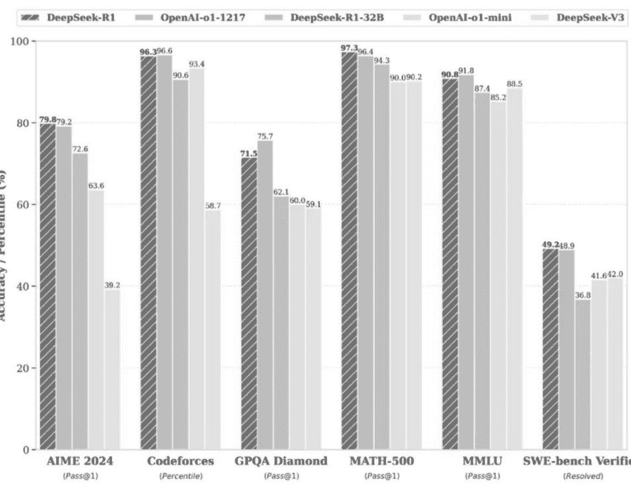

图1 DeepSeek各版本模型与o1模型在不同基准测试中的表现对比

有人质疑其是否针对特定任务优化跑分，但用户实测给出了最直接的反馈。在X、微博、小红书等平台，大量开发者和普通用户证实R1的编程能力在部分场景确实优于o1，这是真实使用体验而非数据游戏。

真正引发震动的，是硅谷巨头与科学家的关注。2025年1月27日，据The Information报道，Meta成立了四支专项小组研究DeepSeek的工作原理，并据此改进自家的Llama模型。

两组聚焦降低训练与运行成本的技术；一组探究训练数据来源；另一组探索基于DeepSeek属性重构Meta模型的新路径。

R1能在编程与推理上展现强劲实力，源于底层架构优化。尽管创造力与语言组织可能不及o1 Pro，但其总参数仅6710亿，采用混合专家架构MoE，单次推理实际激活参数约370亿。

相比之下，GPT-4级别模型通常需动用数千亿参数，算力消耗巨大。R1以更小参数规模提供相近甚至更优的推理与编程能力，显示出惊人的工程优化水平。

“小模型大能量”的设计让其在算力消耗上具备明显优势。AI需要在智能水平与计算效率间取得平衡，R1在这方面做到极致优化，既接近国际旗舰表现，又更灵活，适配更多实际场景。

相比依赖昂贵高性能算力的超大模型，R1可在更多设备、平台与业务场景中高效运行。这一思路不仅带来性能突破，更找到降低成本、提升可用性的关键路径。对于企业用户而言，性能之外还有成本、速度、商业化适配等考量，R1在这些维度都具备竞争力，既是技术产品，也是具备落地价值的商业模型。

### 1.2.2 成本与性价比

DeepSeek的价格极具冲击力。公开数据显示o1训练成本高达上亿美元，而DeepSeek不到600万美元。等同于OpenAI花20块完成的事，DeepSeek1块钱搞定，效果不差。

这种极致的成本优化使其能持续提供低价高质量服务，并在竞争中进一步拉低行业定价，让更多企业与开发者用得起AI，而非仅限巨头。垂直领域构建轻量化高性能模型成为可能。

长期以来，高昂算力成本制约AI普及，特别是在大模型训练与推理环节，GPU消耗惊人。OpenAI、Anthropic、DeepMind等头部公司高度依赖英伟达高端芯片，单次训练成本以亿美元计，让医疗、教育、工业等行业望而却步。

DeepSeek改变了训练逻辑，模型轻量且能在低算力下保持高性能。核心在于模型架构与算力调度的极致优化。混合专家架构让每次推理仅激活部分参数，而非全量计算，大幅减少算力浪费。同时在数据处理、并行训练、推理计算等环节深度优化，相同算力下能训练出更好模型，实现省钱不减质。

其API价格比GPT-4o低数倍，迫使国内厂商跟进降价，压力正向海外蔓延，影响OpenAI与Anthropic。AI本是高投入高回报领域，DeepSeek的定价正在重塑规则，让模型从昂贵高端科技变为普惠的生产力工具。

用户量的指数级攀升，是DeepSeek最近最直观的成绩单。iOS商店里的排名冲顶，并非偶然的波动，而是一次明确的信号——DeepSeek已经走出国界，不再只是国内的新面孔，正以强劲姿态在全球范围内与OpenAI的霸主地位正面交锋。

这股动能也在资本市场投下涟漪。过去几年，AI算力驱动英伟达股价一路狂飙成了共识。如今DeepSeek的出现，让市场开始重新算账：若模型训练能做到更高效，昂贵GPU的刚性需求是否会松动？正是这种情绪的转变，证明DeepSeek的影响早已超出技术圈，在撼动整个科技生态的叙事逻辑。

AI的较量早已不止于“谁更聪明”。技术路线、研发成本、商业玩法和全球布局才决定胜负。DeepSeek用极低成本配合高水平的模型表现，正在改写游戏规则。若这种性价比优势能够延续，它有望先成为中国AI的代表，随后成长为全球行业最关键的变量。

#### 1.2.3 开源到底，AI版安卓
过去行业的主流是封闭。ChatGPT、Claude、Gemini等头部产品基本走“闭源加高价”路线。用得起就得付高额API费用，用不起只能被绑定在官方生态里，开发者无权改动，企业也难以掌控数据。

DeepSeek选择反向操作。模型全量开源，可免费获取，训练方法公开，还允许基于其技术二次开发并商业化。换句话说，任何人都能拿DeepSeek-R1作为底座搭建自己的应用，不受商业公司的定价与政策束缚。

开源不仅停留在大模型层面。DeepSeek还对Qwen和Llama两个主流开源模型做蒸馏，产出六个高性能小模型，全部无条件开放。效果超出预期——32B参数级别的模型在数学类任务上已能超过o1-mini；更夸张的是，15B参数量级的迷你版在数学与算法竞赛场景下的表现，反而能压过GPT-4o和Claude-3.5-Sonnet这两款代表性的闭源模型。

| 模型 | AIME 2024 pass@1 | AIME 2024 cons@64 | MATH-500 pass@1 | GPQA Diamond pass@1 | LiveCodeBench pass@1 | CodeForces rating |
|---|---|---|---|---|---|---|
| GPT-4o-0513 | 9.3 | 13.4 | 74.6 | 49.9 | 32.9 | 759.0 |
| Claude-3.5-Sonnet-1022 | 16.0 | 26.7 | 78.3 | 65.0 | 38.9 | 717.0 |
| o1-mini | 63.6 | 80.0 | 90.0 | 60.0 | 53.8 | 1820.0 |
| QwQ-32B | 44.0 | 60.0 | 90.6 | 54.5 | 41.9 | 1316.0 |
| DeepSeek-R1-Distill-Qwen-1.5B | 28.9 | 52.7 | 83.9 | 33.8 | 16.9 | 954.0 |
| DeepSeek-R1-Distill-Qwen-7B | 55.5 | 83.3 | 92.8 | 49.1 | 37.6 | 1189.0 |
| DeepSeek-R1-Distill-Qwen-14B | 69.7 | 80.0 | 93.9 | 59.1 | 53.1 | 1481.0 |
| DeepSeek-R1-Distill-Qwen-32B | 72.6 | 83.3 | 94.3 | 62.1 | 57.2 | 1691.0 |
| DeepSeek-R1-Distill-Llama-8B | 50.4 | 80.0 | 89.1 | 49.0 | 39.6 | 1205.0 |
| DeepSeek-R1-Distill-Llama-70B | 70.0 | 86.7 | 94.5 | 65.2 | 57.5 | 1633.0 |

图2 DeepSeek各蒸馏模型与主流模型在不同基准测试中的表现对比

这一突破打破了“AI必须依赖云端算力”的刻板印象。15亿参数级别的模型轻到可在个人电脑甚至手机本地运行。开源的意义不只是放出一个大模型，而是把AI从云端垄断推向人人可用的工具。

相比之下，ChatGPT虽仍处第一梯队，却因封闭成为短板。如今它更像AI界的苹果，强大但高度封闭。API价格高企，企业想自建私有助手只能交钱上云，没有自主权，数据隐私也难以保证。一旦OpenAI调价或限流，企业只能被动接受。DeepSeek的开放模式则像安卓，开放、可改、可自部署，让企业安心把AI放到自家服务器上。

更关键的是，开放带来了众包式进化。全球开发者可以一起优化模型，形成类似Linux和安卓的协作生态。闭源团队只能靠内部力量迭代，速度天然受限。历史反复证明，开放与协作往往能催生更快的进步，正如安卓的市场占有率远超iOS。

开源让DeepSeek在开发者社区迅速积累声量，也让行业竞争从拼参数、拼算力转向拼普及度。过去比谁更大，现在比谁能让AI真正落地。如果越来越多团队基于DeepSeek-R1做二次开发，行业会涌现大量垂直场景模型，而坚持闭源的OpenAI、Anthropic、DeepMind可能逐渐失去主导权。

这场变革的余波远超预期。未来DeepSeek会不会拓展到AI搜索或硬件？国产AI能否借此站稳全球？头部企业是否被迫调整策略？这些问题已跨越行业边界，指向整个科技产业的走向。可以确定的是，DeepSeek已经重置了AI的游戏规则。

OpenAI依然强势，却不再能高高在上。AI的未来因DeepSeek变得更开放、更民主、也更充满可能。

### 1.3 DeepSeek的崛起之路
DeepSeek走红后，公众对它的来历格外好奇。如此高性价比的产品背后，是一段怎样的成长史。

#### 1.3.1 量化起步的AI先锋
DeepSeek的缔造者是梁文锋。1985年出生于湛江的他，成长于教师家庭，父母对学习引导很深。小时候他就对数学与计算机着迷，初中阶段已自学完高中数学并触及大学内容。

2002年，17岁的梁文锋考入浙江大学电子信息工程系，本科期间活跃于数学建模竞赛。毕业后他留在浙大攻读信息与通信工程硕士，研究方向是机器视觉。

读研期间正逢2008年金融危机，他意识到数学与计算机可以用来对冲市场波动。于是与同学组队尝试用机器学习分析行情与宏观数据，探索量化交易方法，这为日后创业埋下种子。

量化交易本质是用程序替代人工决策。传统交易员靠经验盯盘，而量化通过大量数据、统计与机器学习寻找规律，再将策略代码化自动执行。

2013年，梁文锋与大学同学徐进创立杭州雅克比投资管理有限公司，进军量化投资。两年后成立幻方量化，聚焦数学与人工智能驱动的量化策略。2015年市场震荡中，幻方凭借高频量化表现突出。2016年推出首个基于深度学习的交易模型，完成策略的全面AI化。2019年，幻方管理规模突破百亿，成为国内顶尖量化私募之一。

#### 1.3.2 幻方的算力拐点
2016年对幻方是转折。首个深度学习交易模型上线后，AI的自适应能力让捕捉趋势与调整策略的速度显著提升。

2018年，幻方正式把AI定位为核心发展方向，不仅用于交易，更要打造AI驱动的交易体系。

随着策略复杂化和规模扩张，算力瓶颈出现。就像老电脑跑不动大型游戏，现有平台已无法支撑模型训练。于是幻方决定自建训练集群。

2019年，在梁文锋主导下上线“萤火一号”，投资约2亿元，搭载1100块GPU，训练效率大幅提升，策略更精细实时。

野心不止于此。2021年推出“萤火二号”，投资10亿元，配置约1万张英伟达A100，算力实现指数级跃升。该平台不仅服务量化，也为幻方向更广阔AI领域扩张铺路。金融交易只是起点，团队开始思考AI本身能否成为独立产业，这成为DeepSeek诞生的前奏。

#### 1.3.3 独立突围与技术攻坚
DeepSeek脱胎于幻方在AI应用上的持续探索。拥有“萤火一号”“萤火二号”后，幻方开始自购高性能芯片搭建训练集群，成为少数拥有自建算力能力的金融机构，为DeepSeek积蓄资源。

2023年，DeepSeek从幻方独立，成为独立AI公司。目标不是打造更聪明的金融模型，而是直接挑战OpenAI、DeepMind、Anthropic等全球巨头，做出具备人类智能水平的通用模型。

挑战巨大：资金与算力不足，AI训练是烧钱黑洞；技术被大厂垄断，OpenAI等年投入数十亿美元；人才稀缺，OpenAI研发团队超1700人，而DeepSeek初期仅约150人。

团队选择在算法上找突破，提出MLA多头潜在注意力机制，大幅降低显存占用，相同算力下可处理更复杂任务，训练成本明显下降。

2024年5月，DeepSeek-V2发布，推理成本仅为Llama3-70B的七分之一、GPT-4 Turbo的七十分之一，性能却接近主流，同期开源直接点燃国内大模型价格战。

同年12月，DeepSeek-V3登场，性能逼近GPT-4，训练成本却只有后者的五十分之一，极致性价比震惊业界。

2025年初，R1模型发布，在海外引发关注。其能力与OpenAI的o1相当，推理速度与成本控制上更优。训练成本与应用效率的双重优势，让DeepSeek在全球AI版图上占据不可忽视的位置。

### 1.4 为什么DeepSeek的成功是必然的
DeepSeek的成长速度惊人，它的成功是运气还是必然？回顾路径会发现，这是技术沉淀、战略选择与市场趋势共同作用的结果。

#### 1.4.1 AI金融化的初衷与实践

DeepSeek的走红并不像外界想象的那样突如其来，而是一条从应用场景生长出来的技术路线。和那些从实验室起步、追逐前沿论文的AI公司不同，DeepSeek的母体幻方量化起步于一个极具商业属性的战场——量化交易。幻方量化的初衷从未是做学术研究、写小说或刷参数，而是把AI当成赚钱的工具，让技术真正落地产生回报。

量化交易本质上是用数学模型、统计分析和高性能计算去做金融决策。每天市场都在产生海量交易数据，交易员要做的就是从噪声里挖出可盈利的规律，并用自动化系统瞬间执行完成套利。这一过程对市场理解的要求很高，对计算资源精细化利用的要求更高。

在这样的环境里长期作战，梁文锋的团队练就了构建高效算法、压榨算力性能、管理数据流转的一整套能力，而这套能力与训练大模型所需的能力高度重合。

这让DeepSeek的发展显得格外务实。行业惯例是先做出技术再找场景，DeepSeek反过来走：先锁定最有商业价值的量化交易场景实战，再在实战中迭代技术。AI金融化是真实的需求，团队不是在实验室里验证可行性，而是把算法丢进真实、复杂的市场里接受检验，要求产生可量化的经济效益。

这种做法绕开了闭门造车的陷阱。学术路线往往是研究—验证—应用的长链条，DeepSeek则直接在市场中打磨，形成应用—优化—创新的闭环，技术更快贴近真实需求，也更早建立起完整的AI应用方法论。

在量化交易的浸润里，团队逐渐意识到AI的边界远不止交易辅助。它可以优化策略制定、提升数据分析效率、降低计算开销，甚至把整个交易流程自动化。AI不再是工具，而是决策链上的一部分，这个认知成为转向模型研发的关键转折。

技术层面，二者的同构性也很明显。量化交易靠市场数据驱动、AI推理靠训练数据驱动；两者都对算力饥渴，量化需要实时处理行情，模型训练需要大量GPU做复杂计算；两者都对算法优化极度敏感，微小的参数变化既可能决定一次交易的成败，也可能显著改变模型表现。

这份相似性给了DeepSeek先发优势。团队早已在严苛的计算环境里练出独特的优化能力，这正是模型研发最宝贵的资产。进入AI并非从零冒险，而是技术能力的可迁移演进，量化交易积累的计算、数据管理、算法优化经验几乎可以无缝衔接到模型训练。

更关键的是务实的商业观一直未变。对DeepSeek来说，AI不是高深课题，而是必须落地的产品。它不想做纯技术供给方，而要把AI嵌入真实业务创造价值。这种思维推动团队在数据治理、算力排布、算法架构上做深度优化，让模型兼具性能与商业化潜力。

于是DeepSeek的崛起不是天降神兵，也不是资本堆起的泡沫，而是多年技术沉淀与行业理解的自然延伸。它的成功在于真正读懂了AI的应用逻辑，能把技术转化为有价值的产品，比纯科研型公司更贴近需求，也更具商业胜算。技术成败不只看创新，也看场景选择。AI的价值最终要体现在应用中，而非论文、套壳或PPT。DeepSeek的成果是积累、洞察与执行共同作用的结果。能否挑战OpenAI尚存变数，但它已走出一条可能成为行业新范式的路径。

#### 1.4.2 算力布局的领先者
人工智能圈里流传一句话，算力决定上限。能训练多大的模型、处理多少数据、完成多复杂的任务，都取决于算力储备。DeepSeek是国内为数不多很早就吃透这点并重金押注的公司。

多数公司先做算法再补算力，DeepSeek反其道而行，从起点就把算力当成底座。没有足够算力支撑，再好的算法也只能停留在纸面。为避免在竞赛中掉队，公司在国内圈内超前地大规模部署英伟达A100集群。

2020年前后国内主流仍是P40、V100，只有极少数头部开始试水A100。DeepSeek直接All in，这相当于把起跑线提前了。

A100带来的变化是质变。性能相比V100提升数倍，训练更快、迭代更密，决定了谁能更快找到最优架构。参数规模的可扩展性也显著提高，模型越大越聪明，但参数增长带来算力需求指数级上升。A100让DeepSeek具备训练超大模型、甚至对标GPT-4的能力，在国内属于领先梯队。

训练之外，推理成本同样关键。模型要商业化就必须可负担。A100的高效计算大幅降低运行时的消耗，让产品具备规模化推广的经济性。DeepSeek不仅能训出更强的模型，还能让模型更便宜地跑起来，为商业化铺路。

#### 1.4.3 不止步于“跑模型”
买到算力只是起点。很多企业拿到设备后只会跑通流程，DeepSeek却在工程化层面做大量优化，让算力价值最大化。

一方面是训练效率的挖掘。在数据预处理、分佈式训练、架构优化等环节持续攻关，相同算力下训出更高质量的模型。通过更先进的并行策略提升GPU利用率，减少资源浪费。

另一方面是推理成本的压缩。团队投入模型压缩、量化、推理加速等方向，确保模型在实际业务中既保性能又降消耗。以聊天机器人为例，推理成本过高会抬高用户使用门槛，难以放量。DeepSeek通过优化实现了性能与成本的平衡。

更进一步，公司不满足于做大模型，而是思考让AI真正懂场景。很多通用模型落地时水土不服，DeepSeek在研发中强调可用性，力求在金融、医疗、教育等多领域发挥真实价值。目标是让AI融入业务，为企业和用户带来实际收益。

从战略看，这套算力布局不仅赢得技术竞赛，也让商业化提前起跑。相比仍困于小模型、低算力的对手，DeepSeek已有能力与国际巨头对话，并在部分领域形成差异化优势。

#### 1.4.4 清晰的商业化路径
DeepSeek的爆发像是赶上了AI风口，拆开来看则是一条有预谋的技术与商业双轮路线。它并非资本炒作的产物，也不是PPT上的领先。2023年百模大战喧嚣时，很多人甚至未曾听闻DeepSeek。它的突围是技术积累、实战经验、市场洞察和战略执行共同作用的结果。

AI竞赛的本质是技术、资源与商业模式的综合较量。进入大模型后，多数公司卡在怎么盈利上。模型训练成本高昂，靠烧钱不可持续。DeepSeek的商业化思路从一开始就很清晰：不止于让AI会聊天，而是让AI具备明确的行业应用价值。

其模型可生成文本、编写代码、分析数据，并直接服务于金融、医疗、教育等垂直场景。这不是一个聊天助手，而是一个能嵌入产业链的智能引擎。类似OpenAI的GPT之所以全球爆火，除了能力强，更因为场景足够广、企业愿意付费。DeepSeek在研发期就同步布局商业化，走技术加商业的双驱动路线，从而在激烈市场中获得更强生存力。

未来仍有变数。要保持领先，需持续突破算力、算法、数据三大要素，并借助开源构建生态。工程化与算力上已有优势，但在更高阶的应用突破上仍需加码。面对巨头围剿，如何打造核心护城河将是关键。

总体看，DeepSeek已站上国内AI竞赛的第一梯队，成为最具潜力的挑战者之一。它的成功不是偶然的风口红利，而是深思熟虑的技术演进与商业落地的结果。能否成长为中国的OpenAI甚至超越，时间会给出答案，但其发展轨迹已值得期待。

### 1.5 震动硅谷：舆论怎么看DeepSeek
DeepSeek-R1爆火后，一夜重创美国科技股、人气反超GPT，引发全球关注，尤其在硅谷掀起震动。专家与媒体从不同角度解读这场冲击。

英伟达GEAR Lab负责人Jim Fan高度评价R1，认为非美国公司正在践行OpenAI最初的开放使命，通过公开算法与学习曲线扩大影响力。他指出DeepSeek不仅开源模型，还披露完整训练细节，可能是首个展示强化学习持续增长能力的开源项目。

A16Z创始人Marc Andreessen称R1是他见过最惊喜、最令人印象深刻的突破之一，作为开源成果是对世界的深远礼物。

图灵奖得主、Meta首席AI科学家Yann LeCun提出不同视角：不是中国在AI上超越美国，而是开源模型正在超越封闭模型。

DeepMind CEO Demis Hassabis话里带忧：成就令人印象深刻，西方需思考如何保持领先，西方仍占优，但中国在工程与规模化能力上极强。

微软CEO Satya Nadella在达沃斯表示，DeepSeek有效开发出开源模型，推理能力出色且计算效率极高，微软必须高度重视中国的技术突破。

Meta CEO扎克伯格认为技术实力令人印象深刻，中美AI差距已微乎其微，中国的加速度让竞争更激烈。

《金融时报》指出，DeepSeek颠覆了AI研发必须巨额投入的认知，精准路线也能产出卓越成果，其无私分享让公司成为更强劲对手。

《经济学人》认为中国在成本效益上的快速突破开始动摇美国技术优势，可能影响未来十年生产力与经济增长。

《纽约时报》把R1发布比作AI行业的“斯普特尼克时刻”，低成本高性能挑战美国主导地位，迫使美国重新评估AI战略，开源模式也可能重塑全球格局。

《华尔街日报》聚焦其以较低成本实现卓越性能的创新方法，甚至跳过传统监督微调，并引用马克·安德森的评价。

《卫报》关注其对全球竞赛的影响，认为可能削弱美国芯片出口禁令效果，加速技术发展，同时指出DeepSeek在内容监管上的限制，与西方模型差异明显。

整体看，即便在芯片管制下，中国企业仍能靠创新与资源效率竞争。美国的限制政策可能适得其反，倒逼中国在开源AI领域加速突破。这对所有中国企业提出一个课题：在资源受限环境下如何通过创新实现领先。

### 2.1 AI领域的拼多多
提起拼多多，人们会想到白菜价、砍一刀、农村包围城市。如今AI圈也出现了类似的搅局者DeepSeek。这家中国公司以极致性价比重塑市场，被视作AI版的拼多多。

它如何成为搅局者？为何引发国际震动？背后折射出什么趋势？

#### 2.1.1 白菜价的大模型
DeepSeek被称作AI拼多多，因其打法与拼多多高度相似。拼多多靠价格便宜、够用、从下沉市场突破打开局面；DeepSeek在AI领域的策略也是同样的逻辑。

拼多多的核心武器是便宜，在淘宝、京东盘踞的市场里杀出一条路。DeepSeek在AI界同样主打极致性价比。

当前大模型训练成本惊人。OpenAI CEO山姆·奥特曼曾称GPT-4训练成本约1亿美元，未来大模型训练或超过10亿美元。未完成的GPT-5某轮训练耗资约5亿美元，可见门槛。

高成本意味着AI几乎是巨头的专属，且必须通过昂贵API和付费订阅回收成本，应用门槛不断抬高，普通用户难以触达前沿能力。

DeepSeek打破了这一格局。公开信息显示，DeepSeek-V3训练成本仅557.6万美元，约合人民币4070万元，约为GPT-4的二十分之一，消耗GPU时长约278.8万小时，参数规模6710亿，单token激活参数370亿。

更关键的是完全免费开放，直接拉低开发者与企业接入门槛。过去创业公司调用巨头API常需高额费用，DeepSeek像拼多多的9.9包邮策略，让AI能力触手可及。用户无需为API付费，甚至可本地部署免费使用。这打破了传统巨头的垄断，让AI从少数大公司的工具变成中小企业和个人开发者可用的基础设施。

模型便宜却不拉胯，性能甚至相当出色。DeepSeek-V3在多个基准测试中表现亮眼（见图1）。

DeepSeek-V3在通用理解和专业能力上的表现已经达到第一梯队。以MMLU和MMLU-Pro这组大规模多任务语言理解评测为例，它的分数相当突出，和Claude-3.5-Sonnet几乎在同一水平，并且整体领先GPT-4o。在中文专项C-Eval、C-SimpleQA上优势更为明显，反映出模型在语义理解与多语言处理上的强势。

| Benchmark (Metric) | DeepSeek-V3 | Qwen2.5 72B-Inst. | Llama3.1 405B-Inst. | Claude-3.5-Sonnet-1022 | GPT-4o 0513 |
| :--- | :--- | :--- | :--- | :--- | :--- |
| Architecture | MoE | Dense | Dense | - | - |
| # Activated Params | 37B | 72B | 405B | - | - |
| # Total Params | 671B | 72B | 405B | - | - |
| MMLU (EM) | 88.5 | 85.3 | 88.6 | 88.3 | 87.2 |
| MMLU-Redux (EM) | 89.1 | 85.6 | 86.2 | 88.9 | 88 |
| MMLU-Pro (EM) | 75.9 | 71.6 | 73.3 | 78 | 72.6 |
| DROP (3-shot F1) | 91.6 | 76.7 | 88.7 | 88.3 | 83.7 |
| IF-Eval (Prompt Strict) | 86.1 | 84.1 | 86 | 86.5 | 84.3 |
| GPQA-Diamond (Pass@1) | 59.1 | 49 | 51.1 | 65 | 49.9 |
| SimpleQA (Correct) | 24.9 | 9.1 | 17.1 | 28.4 | 38.2 |
| FRAMES (Acc.) | 73.3 | 69.8 | 70 | 72.5 | 80.5 |
| LongBench v2 (Acc.) | 48.7 | 39.4 | 36.1 | 41 | 48.1 |
| HumanEval-Mul (Pass@1) | 82.6 | 77.3 | 77.2 | 81.7 | 80.5 |
| LiveCodeBench(Pass@1-COT) | 40.5 | 31.1 | 28.4 | 36.3 | 33.4 |
| LiveCodeBench (Pass@1) | 37.6 | 28.7 | 30.1 | 32.8 | 34.2 |
| Codeforces (Percentile) | 51.6 | 24.8 | 25.3 | 20.3 | 23.6 |
| SWE Verified (Resolved) | 42 | 23.8 | 24.5 | 50.8 | 38.8 |
| Aider-Edit (Acc.) | 79.7 | 65.4 | 63.9 | 84.2 | 72.9 |
| Aider-Polyglot (Acc.) | 49.6 | 7.6 | 5.8 | 45.3 | 16 |
| AIME 2024 (Pass@1) | 39.2 | 23.3 | 23.3 | 16 | 9.3 |
| MATH-500 (EM) | 90.2 | 80 | 73.8 | 78.3 | 74.6 |
| CNMO 2024 (Pass@1) | 43.2 | 15.9 | 6.8 | 13.1 | 10.8 |
| CLUEWSC (EM) | 90.9 | 91.4 | 84.7 | 85.4 | 87.9 |
| C-Eval (EM) | 86.5 | 86.1 | 61.5 | 76.7 | 76 |
| C-SimpleQA (Correct) | 64.1 | 48.4 | 50.4 | 51.3 | 59.3 |

图1 DeepSeek-V3与主流模型在各类基准测试中的表现对比

在更复杂的场景下同样不落下风。代码生成HumanEval-Mul、逻辑追问DROP、长文本LongBench v2都能看到稳健的专业水准，数学类任务CNMO 2024的成绩尤其抢眼，说明模型对高难度专业问题的支撑能力很强。

好用又便宜，这样的组合很难不被市场接受。对中小企业而言，接入智能客服、自动撰写营销文案或进行基础数据分析时，过去首选的高价API如GPT-4成本压力很大。DeepSeek提供开源可自托管的方案，企业可把模型部署在自有服务器上，按需优化，既省下调用费用，也能掌控数据与迭代节奏。

对独立开发者来说更是解放。以前做AI应用基本要绑定厂商API，既要付费又受限速、隐私、调用额度制约。DeepSeek把使用门槛压到白菜价，并且完全开源，开发者能本地运行、无厂商依赖，自由度明显提升。

科研端同样受益。传统顶尖模型多为封闭，如GPT-4与Gemini Ultra，实验只能靠有限API，架构细节也难以窥见。DeepSeek开源后，研究者可以直观复现、改动算法、调整结构，极大降低了前沿研究的准入门槛。

可以说DeepSeek正在让AI普惠。类似拼多多通过性价比打开下沉市场，DeepSeek以低成本模型打破了AI只属于大厂的局面，把能力送到普通开发者、中小企业和研究机构手中。

当然也会有人问，够用是否等于顶尖。就像拼多多的商品有人图性价比有人追求品牌体验，DeepSeek在部分极致任务上仍略逊于OpenAI的最前沿模型，但在文本生成、代码补全、客服对话等日常工作中表现已完全合格。若目的不是做顶级学术攻关，而是满足生产需求，这个选择已经足够。

正是这种出色的性价比，构成了它下一步走得更远的基础。

#### 2.1.2 构建独特的AI生态

拼多多能起量，核心在于农村包围城市，先占下沉市场再反向渗透。DeepSeek在AI圈的打法类似，并非直接面向C端收订阅，而是围绕开发者社区做生态，从技术圈层扩散影响力。

OpenAI的路线是商业化订阅，DeepSeek则选择全面开源。核心的DeepSeek大模型系可以免费使用、修改、二次开发，很快聚拢技术爱好者、研究团队、初创公司，把开发者变成传播的第一梯队。目标不是一开始就拿高利润，而是先赢得开发者心智。

策略一旦打开，就会产生口碑裂变。模型好用、门槛低，讨论自然在GitHub、Reddit、Hugging Face等社区发酵，二次开发层出不穷，应用数据源源不断回流。获取用户几乎不需要重度广告投入，增长像拼多多的“砍一刀”那样自发扩散。

开源还分摊了研发成本。训练大模型耗算力耗人力，DeepSeek把部分优化任务开放给全球社区，开发者基于兴趣或业务需求主动改进性能、加速推理、降低计算开销，形成众包式迭代。用更少的钱撬动更大的研发能量。

生态的价值在于护城河。GPT的成功不只是模型本身，更有API、插件、第三方应用构成的商业网络。DeepSeek凭借高性价比加开放生态，把开发者与企业留在自己的平台上，形成持续贡献与使用循环。随着更多应用落地到企业办公、金融分析、自动化客服、医疗辅助等领域，生态会逐步渗透到更广的行业场景。

总体看，DeepSeek已走完第一步，让AI市场更开放，也让更多人开始思考除资本巨头主导之外的AI发展路径。

#### 2.2 DeepSeek是如何炼成的

DeepSeek发布后迅速登顶应用商店免费榜，靠的正是低成本、高性能与开源三位一体。那么它是如何做到的？

#### 2.2.1 Transformer基础架构未变

DeepSeek的崛起建立在对Transformer的深度优化上。Transformer由谷歌于2017年提出，取代了RNN与CNN在NLP的主导地位。RNN逐词处理，长文本会遗忘；CNN靠局部窗口，难以捕捉全局依赖。Transformer引入自注意力机制，能同时关注句中多个位置，理解长距离关联。

比如“DeepSeek是一个开源大模型”，模型不会线性扫描，而是直接建立“DeepSeek—大模型”之间的强关联，忽略功能词干扰，从而实现更精准的理解。这种全局视角让问答、总结、代码生成等任务大幅提升。

但Transformer在超长文本上计算与显存开销会指数级上升，这是先天短板。DeepSeek正是在此基础上做系统性改进，在有限资源下仍保持强推理能力。

#### 2.2.2 混合专家模型，让计算更高效

MoE最早由谷歌提出，核心理念是按需激活算力，避免所有参数同时工作。好比餐厅里不是所有厨师同时开工，而是根据订单只叫对应专长的厨师上场，既省成本又提效率。

DeepSeek采用改进的MoE架构，模型被拆分为多个专家，各司其职。推理时只激活与任务最相关的专家，数学题调数学专家，写作调语言专家，避免算力浪费。相比传统扩大模型规模的路径，MoE通过增加专家数量实现能力扩展，成本曲线更友好。

为解决专家分配不均的问题，DeepSeek引入无损负载均衡，让计算更均匀分布；同时优化路由网络，减少专家间通信开销，推理更顺畅。OpenAI的GPT-4也用MoE，DeepSeek在此基础上加入更细粒度的专家与共享专家设计，进一步提升稳定性和扩展性。

这套优化让中小企业和个人也能承担模型运行成本，推动了AI平价化，也在法律、金融、医疗等专业长文档处理中保持较高质量。

#### 2.2.3 多头潜在注意力机制，突破长文本瓶颈

Transformer处理超长文本时，注意力计算成本会急剧攀升。为此DeepSeek引入多头潜在注意力机制MLA，在压缩表示形式的同时保留关键信息，使得长文本处理在更低算力下仍保持精度。这一改进直接缓解了先前架构在长文本上的资源瓶颈，让模型在阅读、总结、跨文档推理等任务上更实用。

DeepSeek长文本能力背后的压缩逻辑

要搞懂DeepSeek为什么要做MLA优化，得先看Transformer的自注意力到底在干嘛。简要说，模型在处理一篇材料时，会为每个词生成键和值，再算遍整篇里词与词之间的关联。也就是说既要记住每个词的意义，又要持续回溯全文的相互关系。文本拉长到上万字、两万字时，显存和计算量就会指数级膨胀，很容易把硬件压垮。

用个考试来类比，传统做法像是把整本教材从头到尾背熟，并且把所有知识点之间的联系都刻进脑子里，考场上才能随时调取。这种方式又笨又占内存，现实中也不可能做到逐字存储。

MLA更像一种取巧的学习方法，它并不追求全量背诵，而是用少量关键信息去概括整本书。比如做归纳提炼出核心概念，只保留真正有用的部分，记忆负担大幅下降，却不影响答题效果。

实现这套思路，DeepSeek用了低秩联合压缩。核心就是对庞大的注意力数据做压缩降维，占用更小的存储，却尽可能保留信息。可以理解为教AI做笔记，摒弃死记硬背，抓重点记忆。这样既能把握全文，又不会爆显存。

优化幅度相当明显。以5000字文章为例，传统模型可能要10GB显存，套上MLA后或许5GB甚至更少就能跑完。正是这种降本，让法律文书研读、长篇小说创作、学术论文通读等超长文本场景变得可行，AI在长文本领域的落地空间被极大打开。

更关键的是推理的连贯性。传统Transformer受计算和存储限制，处理长文本时容易遗忘前面内容，输出逻辑断裂。比如让GPT-3.5写5000字文章，结尾常忘了开头写了什么。MLA让长输出保持更连贯，推理更稳。

对话场景也受益。过去长对话容易断片，半路忘记上下文，重复或答非所问。MLA延长了模型的记忆窗口，让长时间交流保持一致思路，减少跑题。这对客服、智能助理这类需要记忆力的应用极其重要。

总体看，MLA是针对Transformer长文本计算瓶颈的一次高效改良，用低秩联合压缩把注意力数据提炼精简，让AI既能看全局又不爆内存。相当于给AI养成高效学习的习惯，分清重点与可忽略信息，在更少算力下完成更复杂的任务。

#### 2.2.4 强化学习加持，推理能力升级

AI的学习轨迹像学生，先靠老师灌输，后期需要自主探索才能变聪明。DeepSeek在推理上的水准，正来自监督微调与强化学习的组合，而不是单靠SFT记忆知识。两者结合让模型既有知识储备，又能基于经验做更深层的推理和决策。

训练里主要有两条路。监督学习像填鸭，给模型海量问答对，让它学会对应模式。见过的题会做，超出训练分布就容易胡编。

强化学习则是让模型自己解题。它依赖奖励机制，模型尝试、试错后根据反馈得到正向或负向信号，反复迭代逼近最优解。不是靠人类手把手给答案，而是靠探索学会怎么选。

DeepSeek先用监督学习打底，再用强化学习提升推理，对数学、逻辑、写作、编程等复杂任务帮助很大。

在R1上，强化学习的落地有两个明显突破。一是成为早期将强化学习大规模用在超大语言模型上的案例之一。过去AlphaGo在围棋上成功，但语言任务的奖励信号模糊，没有胜负那么清晰。二是DeepSeek用规则驱动的方法解决了奖励信号难题，让大模型也能在语言场景稳定训练。

### 2.3 蒸馏技术拆解全景

DeepSeek能把大模型能力下沉到小模型，蒸馏功不可没。它把庞大教师模型的推理模式压缩进轻量学生模型，既保留能力又降低部署门槛。争议也由此而来。

#### 2.3.1 蒸馏技术本质是什么

千亿参数的大模型性能强，但算力需求和调用成本很高，难以在手机、边缘设备上用。如何让能力更轻量化，是业界共同课题。

蒸馏早在2015年提出，本质是模型压缩。让性能卓越但体量巨大的教师模型把知识传给更小更轻的学生模型。教师像经验丰富的导师，学生模仿学习，最终达到接近的效果。

传统训练多用硬目标，即按最终正确答案调整参数。蒸馏则更进一步，让学生学习教师的软目标，也就是决策时的概率分布。看到一张动物图，教师不会只输出猫，而是给出猫80%、狗10%、其他10%的分布。这种分布蕴含丰富的相对关系。

举个数学例子，硬目标只告诉你2+2=4，错了就改。软目标会说你答5虽然错，但比10更接近，因为10离答案更远。这样学生不仅知道对错，还学会调整方向。

具体流程是教师先对大量数据生成软目标，再作为学生训练信号。学生目标不是照抄答案，而是学习教师的思考方式，让自己的输出概率分布尽可能接近教师，同时符合硬答案。相当于模仿解题思路，最终形成自己的能力。

#### 2.3.2 蒸馏带来的核心优势

最直观的是算力需求下降。千亿模型推理需要庞大算力，蒸馏后的10亿到20亿参数模型仍能保留大部分智能，可以跑在一张消费级4090上，让AI从云端走向个人设备。

推理速度也提升不少。客服、语音助手、代码补全更看重响应快。大模型复杂推理可能要数秒，小模型算量少，延迟大幅降低，更适合商业落地。

蒸馏还能做任务定制。大模型是通才，蒸馏可以让小模型在特定领域做专精，比如编程助手、写作助手。既继承知识又聚焦场景。

DeepSeek的实践很明显。670B参数的DeepSeek-R1蒸馏到7B，得到R1-7B，在多个任务上超过GPT-4o-0513这类非推理模型。R1-14B在多项指标上胜过QwQ-32B Preview，R1-32B和R1-70B在多数基准上显著优于o1-mini。

应用场景广泛。NLP里翻译、对话、文本分类常采用蒸馏，谷歌实时翻译能在手机端运行就得益于此。物联网和边缘计算中，蒸馏后的低功耗模型可部署在微处理器上，智能家居、医疗影像、自动驾驶、工厂设备等需要本地决策的场景都能受益。

可以说蒸馏正把AI推向普惠，让模型更小更快更省资源，并可以根据需求打造专才。

#### 2.3.3 DeepSeek蒸馏是否触碰红线

DeepSeek的快速崛起也伴随质疑。OpenAI指控其通过蒸馏获取模型知识，获得不正当优势。

成本之低引发猜测。DeepSeek披露671B参数的V3仅用2048块H800，投入不到560万美元训练，而同等规模模型在OpenAI、谷歌那边花费可能是数十上百倍。这引发两种解释，一种是极致优化：数据筛选、动态剪枝、参数共享等降本。另一种是可能利用OpenAI输出做蒸馏，站在巨人肩膀上绕开高额训练成本。

若真的用OpenAI的API输出大量数据再蒸馏，就触及服务条款。条款禁止复制服务、不得用输出训练竞争模型。确凿证据暂无，但争议已点燃行业讨论。

更大的背景是数据版权。OpenAI自身也面临《纽约时报》和作家们的诉讼，指控其未经许可使用文章训练。AI训练数据的来源合规性一直是灰色地带。若上游数据本身有版权风险，下游蒸馏的知识是否也受牵连，目前法律没有明确答案。

蒸馏本身并非非法，谷歌、Meta、微软都在用。但当蒸馏对象是竞争对手的现成模型时，就容易从技术优化变成侵权争议。未来监管可能要求训练数据来源透明、蒸馏遵循知识产权保护、甚至公开部分数据供审核。AI竞争的重心会从参数规模转向数据合规、透明度和隐私保护。

蒸馏像炼金术，让高性能AI轻量化，但要名正言顺地造福社会，需要行业、司法和政策一起找到创新与合规的平衡点。

### 2.4 中国AI创新新范式

大模型爆发正在重塑科技版图。过去硅谷主导了计算机、互联网、AI浪潮。此轮大模型竞赛中，中国公司展现出后发优势+高效优化+极致性价比的新范式，DeepSeek是典型代表。

#### 2.4.1 向极致效率要突破

算力、数据、资金常被视作AI胜负手。ChatGPT验证了堆资源就能赢的路径。DeepSeek却证明在人员、算力、数据、资金都有限的情况下，仍可实现突破，与巨头同台竞技。

当前许多公司拼人力抢算力大量融资，DeepSeek却在资源受限下做极限生存。把每个环节做到极致，用更聪明的优化替代 brute force，用更低成本换取更快速度，这正是中国AI新范式的核心。

在人力配置上，DeepSeek与OpenAI、DeepMind、Meta等头部公司不在同一量级。构建大模型往往需要上百到上千名研究员与工程师协同，DeepSeek却由一支精干小队支撑，到目前为止总人数仍徘徊在150人左右，而OpenAI的在编规模已超过1700人。基数差距如此之大，迫使DeepSeek把效率推到极致、把流程压薄、杜绝重复，让每个成员的产出都被最大化。

传统企业的分工模式偏向全面铺开：人马A负责算法迭代，人马B打磨架构，人马C采集数据，还有专门团队管算力调度与基础设施。DeepSeek没有这份冗余，人人皆要兼岗，算法与工程同步推进。他们不走人海路线，而是靠一套高效的开发体系，让少数人完成原本需要大团队才能交付的工作量。

资金层面，人工智能是最耗资本的赛道之一，大模型训练的开销更是惊人。据估算OpenAI在GPT-4上的投入可能达到数十亿美元量级，微软为此追加了130亿美元的支持。DeepSeek的预算显然无法匹敌，只能靠内部精算与方法论创新来弥补缺口。

算力层面，训练与推理本质上是海量矩阵运算与数据处理。过去十年，全球AI的较量很大程度上是GPU的较量，谁掌握更多算力谁就占先。英伟达A100、H100曾是训练标配，国产芯片虽在追赶，但在生态适配与硬件调优上仍有差距。随着技术管制升级，中国现阶段无法使用顶级GPU，只能改用H800、A800等降配版本。相较H100，H800在算力与带宽上都被刻意限制，训练瓶颈因此被放大。

在这种客观限制下，DeepSeek要回答的核心问题是：在顶级算力缺席、硬件受限的情况下，如何训练出可与GPT-4正面抗衡的模型。

面对算力窘境，公司没有等待解禁，而是把依赖算力转向挖掘算力的利用率。不是寄望高端GPU回归，而是通过算法创新、架构优化与调度策略提升存量算力的效能，走巧劲制胜的路径。他们跳出算力焦虑，重新审视模型的计算流程，在低算力环境里探索出仍可高效训练的路线。

数据稀缺同样是硬约束。模型质量与训练数据规模高度相关，OpenAI打造GPT-4时动用了近乎整个互联网的公开语料，体量可能达数万亿token。DeepSeek无法复制这一规模，于是采取重质轻量的取舍。

技术资料显示V3的数据获取较为多元。基础语料选用经过严格筛选的Common Crawl，保证广度与代表性。此外团队特别补充专业域数据，包括大规模代码库、数学推理解析、科学文献等。在清洗环节自研过滤算法做分层质控：先剔除重复内容保证唯一性，再以智能规则筛掉格式错误、不完整片段、不合规文本。严谨的清洗为后续表现奠定基础。

数据处理实现上，统一分词器保证一致性；部署动态序列长度调整，让模型兼容不同长度输入；借助混合采样与课程学习提升训练阶段的数据使用效率。总体来看，在架构与训练两端都完成了系统的再造，推理能力明显提升，同时实现降本提效，让能力释放成为可能。

如果说OpenAI是凭借算力、数据、算法率先触发智能涌现的先行者，那么这家公司则是把每个环节做透，把成本降到最低，换来高质低耗的结果。

#### 2.4.2 先行者未必占据全部胜势

科技圈常讲先发制胜，认为抢先占位就能建立壁垒，后来者追赶困难。但在生成式大模型赛道，这一规律并不绝对，后发者反而可能避开弯路，以更低成本、更高效率实现突破，这正是典型的案例。

智能发展速度极快，没有永久领先。以大语言模型核心架构Transformer为例，2017年由谷歌团队提出。按传统逻辑谷歌应最早产品化，现实却是谷歌长期未商业化，OpenAI抓住窗口推出ChatGPT，并靠快速迭代占领市场。这说明原始创新不是唯一决定因素，落地速度、优化能力、成本控制才决定结局。

这里走的与之类似的路径。OpenAI作为领跑者，先后推出GPT-3、GPT-4并投入巨资试错。后发团队可以站在前人验证的技术高地上做筛选与优化，避免昂贵的摸索。

先行者更像开路人，必须试验多种技术路线并消耗大量资源，后来者只需沿被验证的路线前行即可。就像在未知森林行进，走在最前的人难免绕路，跟随者能更快抵达。

V3的训练开销比GPT-4低一到两个数量级，正是后发优势的体现。并非从零摸索，而是基于已有成果选择最优路径，在数据挑选、架构设计、计算优化上做针对性调整，让训练更高效。

后发优势还体现在建模可用更先进的方法。GPT-4诞生时训练方案多基于几年前的研究，而进入赛道时已有更多优化选项。例如更早引入混合专家机制，推理时只激活部分参数，大幅削减算力消耗；采用更精细的数据筛选，减少冗余对学习的干扰。在算力投入远低于对手的情况下，仍能得到高质量模型。

商业化路径上，后发者也占便宜。OpenAI打造ChatGPT时仍需解决用户是否接受AI助手的教育问题，需要大量测试、迭代与推广。进入市场时这一需求已被验证，市场接受度已提升，只需提供性价比更高的替代品就能快速吸量。因此能在短期内获得大量关注并抢占份额，无需像前者那样教育市场，可直接交付低成本、效果相近的方案。

此外AI的门槛并不如外界想象的高。过去科技行业常呈现赢家通吃，如智能手机被苹果、三星主导。但AI赛道不同，核心技术并非完全封闭，有足够算力与优化能力，后来者完全能做出媲美先行者的模型。开源社区的推动让大量方法被共享，新进入者可以更快掌握要点，无需投入数十亿美元独立研发。正是借此，通过高效资源配置与优化，两年左右打造出行业领先方案。

当然后发优势不等于照抄就能成功，关键在既有技术上找到优化空间。这里并非简单复刻，而是训练方法、推理效率、模型架构上实现了自身创新。这种化繁为简、提质增效的思路，正是后来者的典型打法，不从零开始，而是在已有成果上改进提速。

这为后来者提供了一个清晰样本，不必一开始就做探索者，利用既有研究成果找最优路线，用更高效的方式实现突破。在变化极快的时代，谁更快适应、谁更快优化，谁才真正赢得主导。这并非赛道首位玩家，它的成功证明了后发者完全可以凭借更聪明的策略实现弯道超车。

#### 2.4.3 中国制造模式的AI应用

近数十年，中国制造一直是全球经济增长的重要引擎。从消费电子到新能源汽车，再到高铁与基建，企业的竞争力并非源于首个发明，而是基于已有技术优化整合、降本增效，最终实现更高性价比与市场渗透。如今这一逻辑正映射到AI领域，这里的崛起就是最佳注脚。

大模型已成AI主流。OpenAI的GPT系、谷歌的Gemini，各巨头都在加码投入，争夺算力与数据。但训练一个大模型的成本高得惊人，GPT-4训练花费据称达数十亿美元，谷歌、Meta投入规模相近。这种烧钱模式让多数后来者望而却步。

671B参数的V3模型，训练花费却不足560万美元，仅使用2048块H800 GPU。对比OpenAI、谷歌同等规模模型动辄上万块GPU的消耗，这几乎是行业里的一股清流。

这种极致成本优化，正是中国制造的核心思路：在不牺牲质量前提下尽量压缩成本、提升生产效率，让先进技术变得可负担。

在模型训练中，数据是关键、算力是成本、架构是核心，三者皆有优化。

首先是数据筛选。未盲目堆砌互联网数据，而是通过清洗、去重、标注优化提升有效性，并采用高效采样技术，让数据并非平均进入训练，而是通过动态筛选让代表性更强的数据优先学习，既提升效果又避免算力浪费。

其次是模型架构。采用混合专家机制，让资源分配更高效。传统大模型推理时会激活全部参数，而MoE架构每次推理只启用部分专家网络，而非全量计算，从而大幅降低计算成本。

算力管理上，使用更智能的GPU调度策略，让每块GPU的任务更均衡，减少浪费。OpenAI训练GPT-4时依赖复杂调度系统保证上万块GPU协同，这里则通过优化计算图平衡任务、降低通信开销，整体效率提升超过20%。不是简单堆算力，而是用精细化管理挖掘资源潜能。

软件层面也做了大量优化。传统训练常伴随冗余计算，如数据预处理、梯度更新中的重复运算。通过剔除冗余、优化数据流动、减少显存占用，使训练流程更顺畅。例如训练GPT-4时采用多步计算并存储大量中间结果，提升稳定性但大幅增加显存消耗。这里采用更高效的存储管理，让计算更轻量化，显存占用降低近30%，在相同硬件下可训更大模型。

成功的经验体现了中国制造模式的深度应用。中国制造的优势不在于价格低，而在于全球供应链中的高度灵活生产能力、极强成本控制、极高效率配置、最具性价比的产品品质，以及对市场需求的快速响应。把这种能力迁移到AI训练，从数据选择到算力管理，从模型优化到商业化路径，都呈现出精准、高效、低成本的执行风格。

更关键的是，这种模式推动了AI的普惠。过去只有巨头能承担大模型的高昂成本，如今通过成本优化，让中小企业和个人开发者也能用上高性能AI。如同中国制造让手机、家电、新能源汽车更亲民，也在让AI从高不可攀的实验室成果走向大众市场。

AI竞争远未结束，但已证明一件事：科技行业不一定是砸钱最多的赢，而是懂得用最少资源创造最大价值的赢。这是中国制造数十年验证的成功逻辑，在AI这一全新竞技场同样适用，正推动中国AI走向世界。

未来大模型训练的方式可能会越来越像精益生产，PK点不是投入多少，而是优化得有多好。这里正站在这一趋势前沿，用中国制造模式重新定义AI竞争规则。

## 第3章 实战DeepSeek：从入门到精通

### 3.1 与DeepSeek对话的五个核心原则

使用这类智能系统时，提问方式直接决定答案质量。想让模型准确理解需求并给出高质量回应，可以遵循以下五项原则，更高效地互动。

#### 3.1.1 原则一：需求要清晰

提问时要具体明确，避免模糊笼统。系统再强也无法读心，问题越宽泛，答案越跑偏。大模型的输出质量很大程度上取决于用户的指挥能力，指令越精准，结果越贴近预期。

不当示范：“帮我写点东西。”

问题所在：系统无法判断是要文章、邮件还是文案，信息缺失导致输出无用。

适当示范：“我需要一封求职邮件，应聘新媒体运营岗位，请突出3年微信公众号运营经验。”

解析：明确任务类型、岗位、重点，系统才能有针对性生成。

小提示：提问时尽量包含谁、什么、怎么做等要素，让模型更清楚意图。

#### 3.1.2 原则二：补充背景

为问题补充必要背景，帮助系统理解上下文。回答质量取决于信息量，背景不足时系统容易做错误假设，导致偏差。

不当示范：“分析这个数据。”

问题所在：系统不知道数据类型、分析目的，自然无法给出有价值结论。

适当示范：“这是一家奶茶店过去三个月的销售数据，请分析周末与工作日的销量差异（附CSV数据）。”

解析：给出数据来源、时间范围、分析目标，系统可针对性处理。

小提示：复杂任务可附相关文件或链接，帮助模型更好理解问题。

#### 3.1.3 原则三：指定呈现形式

明确回答的格式或结构，确保信息按预期呈现。系统可生成多种形式，若不指定，可能会得到冗长段落而非所需清单。

不当示范：“给几个营销方案。”

问题所在：系统可能输出一段文字描述，而你更想要结构化方案。

适当示范：“请用表格形式列出咖啡店三个情人节促销方案，包含成本预估和预期效果。”

解析：指定格式、内容、附加信息，输出更清晰易读。

小提示：需要结构化信息时，可明确要求表格、列表、流程图等形式。

#### 3.1.4 原则四：控制篇幅

限制回答长度，确保简洁明了，避免冗余。系统有时会过度详尽，而用户可能只需要要点。

不当示范：“详细说明。”

问题所在：系统可能生成长文，而你可能只需几句总结。

适当示范：“请在200字以内解释区块链技术，让完全不懂这一技术的老年人听得懂。”

解析：限定字数与受众，模型会生成通俗简短解释。

小提示：需要简短时，可明确字数限制或要求“一句话总结”。

#### 3.1.5 原则五：及时纠偏

回答不符合预期时，及时反馈帮助系统调整。系统并非每次都完美，但通过反馈可逐步改进。

当对回复不满意时，可回复：

“这个方案成本太高，请提供预算控制在500元以内的版本。”

解析：通过反馈，系统可调整方案以符合预算。

“请用更正式的语气重写第二段。”

解析：提出明确要求，让系统调整语气以匹配需求。

小提示：反馈时尽量具体，指出不满意之处及希望改进方向。

### 3.2 对话场景拆解

#### 3.2.1 场景一：日常生活全方位回应

生活充满各种疑问：健康不适该如何处理？购房贷款有哪些注意事项？孩子的学习能力如何提升？从健康管理到教育、法律、科技选购，每个决策都需要大量信息支撑。现实中我们难以穷尽检索，且信息可靠性参差。有没有办法快速、精准获取实用答案？

这种情况下，智能助手的价值就体现出来了，无论健康、教育、法律、科技、消费还是理财，只需对话，就能帮助找到最合适的解决方案，让生活更高效、便捷、安心。

##### 1. 健康问题：私人健康小助手

健康是最关心的议题之一，但身体不适时往往不知如何正确处理。系统可以提供科学、专业且易懂的健康建议，帮助快速获得答案，减少不必要的焦虑。

感冒来了怎么快速舒缓不适

感冒发作时，DeepSeek 不只罗列缓解做法，还会结合个人体质给出饮食与护理的组合建议，重点集中在：

- 居家护理要点：保持水分充足、确保睡眠质量、适度补充维生素C等基础措施；
- 感冒与流感区分：出现高烧、全身酸痛等表现时，会提示更倾向于流感而非普通感冒，并给出是否就医的参考判断；
- 饮食调理建议：推荐生姜红糖水、清淡鸡汤等有助于缓解的食物，同时提醒避免辛辣刺激类进食。

失眠困扰如何改善睡眠质量

失眠是常见问题，DeepSeek 能提供改善操作的实用方法，也可依据个人作息习惯定制专属方案，包含：

- 睡眠环境优化：降低蓝光干扰、调节卧室温度、使用助眠香薰等；
- 作息规律调整：形成固定入睡时间，睡前尽量减少手机使用；
- 助眠食物推荐：牛奶、香蕉、坚果等；
- 放松方式建议：冥想或白噪音，帮助放松进入深度睡眠。

体检报告看不懂怎么办

拿到体检单难以解读时，DeepSeek 可以逐项说明指标含义，指出需关注的部位、是否需要进一步检查，并提供对应的健康管理建议。

##### 2. 教育学习：孩子的成长规划专家

涉及孩子学业困惑或个人提升需求，都能获得高效学习方案和专业教育建议。

“孩子提不起学习劲怎么办？”

针对厌学、注意力不集中，会先分析可能原因，再给出针对性学习方法。

- 游戏化学习：通过趣味竞赛、积分奖励等形式让学习发生在游戏里；
- 番茄工作法：25分钟专注学习加5分钟休息，提升专注度；
- 兴趣引导：基于孩子兴趣推荐适配资源，如编程启蒙、绘画课程等。

“留学选校怎么选得准？”

可依据专业、成绩、资金预算、未来就业方向等条件，筛选合适的留学国家和院校。

- 排名与适配度权衡：不只看排名，还会分析学校是否契合个人学术背景；
- 费用预算评估：帮助核算学费与生活成本，避免超出承受范围；
- 就业前景分析：结合各校就业率与行业认可度，辅助做出选择。

“想充电却不知学啥？”

可依据职业规划推荐合适的在线课程与技能方向。

- 职场进阶：领导力、数据分析、PPT优化等课程；
- 兴趣学习：对摄影、编程、心理学感兴趣时，也能匹配相应课程资源。

##### 3. 法律问题：随身的法律顾问

生活中难免遇到纠纷和法律问题，普通人对法条理解有限。DeepSeek 能提供通俗易懂的法律建议，帮助厘清法条、规避风险、维护自身权益。

“租房撞上黑中介咋办？”

遇到中介乱收费、不退押金等问题，会提供详细维权指引。

- 法律依据：说明《民法典》《住房租赁条例》相关规定；
- 投诉渠道：列出消协、法院等可行维权途径；
- 文书模板支持：提供起诉状、律师函等模板协助维权。

“劳动合同怎么写才靠谱？”

针对合同条款不清的问题，不仅提供标准模板，还会：

- 解析合同条款，防止不公平条款损害权益；
- 提醒注意事项，如试用期、社保缴纳、工资发放细节等；
- 协助计算赔偿，若被违法解雇，可帮助核算应得赔偿金额。

##### 4. 科技数码：选购与故障修复指南

“最近想换手机，哪款性价比更高？”

能依据拍照、游戏、续航、办公等需求，对比市面上热门机型，给出测评与购买建议。

“电脑开机慢怎么办？”

面对卡顿、开机缓慢，提供简便优化方案：

- 清理开机启动项，减轻系统负担；
- 检查硬盘健康状况，判断是否需要更换固态硬盘SSD；
- 增加内存，提升运行效率。

“家里Wi-Fi信号怎么优化？”

信号不佳时，可分析可能原因并给出建议：

- 调整路由器摆放位置，避免信号干扰；
- 优化信道，减少网络卡顿；
- 扩展覆盖范围，推荐合适的信号增强设备。

#### 3.2.2 场景二：学术论文全流程辅助

##### 1. 开题攻坚：助力高效确定选题与文献调研

开题是论文写作的第一步，也是关键环节。好的研究方向决定论文深度与创新性，也影响后续成效。借助 DeepSeek 能明显提升开题效率，帮助快速锁定方向、优化题目并高效完成文献调研。

###### 1) 寻找研究方向

【输入指令】如果你是机械工程专业的本科生，可以输入：“我是机械工程专业本科生，请推荐5个适合毕业设计的智能机器人相关课题，要求：具有创新性但不过于前沿，需要进行仿真实验而非实物制作，并提供相关参考文献关键词。”

【DeepSeek输出】会依据专业背景和需求，推荐兼具创新性且适合仿真实验的课题，并给出参考文献关键词。例如：

- 基于深度学习的机械臂抓取系统研究
  - 创新点：结合深度学习与机器人控制，提升抓取系统智能化水平。
  - 关键词：机器人抓取算法、自适应控制、仿真实验。
- 基于强化学习的移动机器人路径规划研究
  - 创新点：利用强化学习优化路径规划算法，适应复杂环境。
  - 关键词：强化学习、路径规划、移动机器人、仿真平台。
- 多机器人协作系统的任务分配与优化研究
  - 创新点：研究多机器人系统任务分配策略，提升协作效率。
  - 关键词：多机器人系统、任务分配、协作优化、仿真实验。
- 基于视觉SLAM的室内导航机器人研究
  - 创新点：结合视觉SLAM技术，实现高精度室内导航。
  - 关键词：视觉SLAM、室内导航、机器人定位、仿真实验。
- 智能机器人的人机交互设计与仿真研究
  - 创新点：研究自然语言处理与机器人交互结合，提升用户体验。
  - 关键词：人机交互、自然语言处理、智能机器人、仿真实验。

###### 2) 优化题目

【输入指令】输入“优化‘基于深度学习的机械臂抓取系统研究’”。

【DeepSeek输出】改写为“基于改进YOLOv5的未知物体自适应抓取系统研究”，并指出优化理由。

- 创新点更明确：点明改进YOLOv5算法，突出技术亮点。
- 研究范围更聚焦：针对未知物体的自适应抓取，体现研究独特性。

【进一步优化】若希望题目更具学术性，可输入：“请将题目改写为更符合学术规范的表述。”

【DeepSeek输出】改写为“基于改进YOLOv5算法的未知物体自适应抓取系统设计与仿真研究”，并解释改写逻辑。

- 增加“设计与仿真研究”，突出研究完整性与方法论。
- 使用“算法”一词，体现技术深度。

###### 3) 文献速览

【上传文献】将10篇相关文献上传至平台。

【输入指令】“请用表格对比各文献的研究方法，按‘创新点/局限/可借鉴处’三列整理。”

【DeepSeek输出】生成清晰的文献对比表格：

| 文献标题 | 创新点 | 局限 | 可借鉴处 |
| :--- | :--- | :--- | :--- |
| 文献 A: 基于深度学习的机器人抓取系统 | 提出一种新的抓取策略，适用于复杂场景 | 实验数据量不足，泛化能力有限 | 可借鉴其抓取策略设计 |
| 文献 B: 强化学习在路径规划中的应用 | 引入动态环境适应机制，提升路径规划效率 | 计算复杂度较高，实时性较差 | 可借鉴其动态环境建模方法 |
| 文献 C: 多机器人协作任务分配研究 | 提出一种分布式任务分配算法，降低通信开销 | 未考虑机器人故障情况 | 可借鉴其分布式算法设计 |
| 文献 D: 视觉 SLAM 在室内导航中的应用 | 结合深度学习提升定位精度 | 对光照变化敏感，鲁棒性不足 | 可借鉴其视觉 SLAM 框架 |
| 文献 E: 智能机器人人机交互设计 | 提出一种基于自然语言处理的交互模型 | 交互场景有限，未覆盖复杂指令 | 可借鉴其交互模型设计 |

还会总结文献研究的整体趋势，包括：

- 当前热点：深度学习与机器人控制的结合、强化学习在路径规划中的应用。
- 研究空白：多机器人系统的故障容错机制、复杂环境下的实时抓取策略。

###### 4) 开题报告撰写辅助

【输入指令】“请根据研究方向‘基于改进YOLOv5的未知物体自适应抓取系统研究’，生成开题报告的研究背景和意义部分。”

【DeepSeek输出】

研究背景：随着智能制造和物流自动化的发展，机器人抓取技术成为研究热点。传统抓取系统依赖预设规则，难以适应未知物体抓取需求。近年来，深度学习技术快速发展，为机器人抓取系统提供新思路。

研究意义：本研究旨在结合改进YOLOv5算法，设计一种自适应抓取系统，能够有效识别和抓取未知物体，提升机器人在复杂环境中的作业能力，为智能制造和物流自动化提供技术支持。

总体来看，开题阶段 DeepSeek 可帮助快速锁定研究方向、优化题目设计、高效完成文献调研并辅助撰写开题报告。

##### 2. 正文写作：帮助研究内容高效表达与数据呈现

正文涉及方法描述、数据分析、结果展示等多个板块。借助 DeepSeek 可显著提升正文写作效率与质量。

###### 1) 学术写作方法描述

学术论文方法描述通常使用被动语态，以突出客观性。可帮助将日常语言转化为符合学术规范的表达。

【输入指令】“请将这段实验步骤改写成学术被动语态：‘我们先用CAD画了模型，然后导入ANSYS做力学分析。’”

【DeepSeek输出】改写为“首先通过CAD软件构建模型，随后将其导入ANSYS进行力学分析。”

改写逻辑：

- 使用被动表述，避免主观叙述。
- 增加连接词，使逻辑更清晰。

【进一步优化】若希望表达更简洁，可输入：“请将这段描述压缩为一句话。”

【DeepSeek输出】“通过CAD软件构建模型并导入ANSYS进行力学分析。”

其他示例：原句“我们采集了100组实验数据，并用Python进行了统计分析。” 改写为“实验数据共采集100组，并通过Python进行统计分析。”

###### 2) 数据可视化

数据可视化是展示实验结果的重要手段。

【输入指令】“请建议三种适合展示温度变化曲线的图表类型，并说明选择理由。”

【DeepSeek输出】

- 折线图：适用场景为展示温度随时间变化的连续趋势，选择理由为能清晰反映波动。
- 热力图：适用场景为展示温度在时空上的密度分布，选择理由为颜色深浅直观呈现多维数据。
- 散点图：适用场景为展示温度与其他变量的相关性，选择理由为可揭示变量关系。

【进一步优化】输入：“请根据我的数据生成一张折线图，并标注关键数据点。”

【DeepSeek输出】生成折线图并标注温度峰值与谷值，同时提供图表说明。

###### 3) 降重技巧

【输入指令】“学术化改写‘机器学习需要大量数据支持’，保持原意但调整句式结构。”

【DeepSeek输出】改写为“当前，AI模型的训练过程往往依赖海量样本的持续输入。”

改写逻辑：同义替换并结构调整，提升学术性。

###### 4) 生成结果与讨论

【输入指令】“请根据以下数据生成结果描述：‘实验组A的平均温度为25°C，对照组B的平均温度为20°C，差异显著（P < 0.05）。”

【DeepSeek输出】

结果描述：“实验结果表明，实验组A平均温度25°C显著高于对照组B的20°C，差异具有统计学意义（P < 0.05）。”

讨论建议：“该结果可能与实验组A的处理条件有关，如更高热量输入或更优保温措施。后续可进一步探究具体机制。”

###### 5) 图表与公式生成

【输入指令】“请将以下数据生成表格：‘实验组A的温度分别为25℃、26℃、24℃；对照组B的温度分别为20℃、21℃、19℃。’”

【DeepSeek输出】

| 组别 | 温度1 | 温度2 | 温度3 |
| :--- | :--- | :--- | :--- |
| 实验组A | 25℃ | 26℃ | 24℃ |
| 实验组B | 20℃ | 21℃ | 19℃ |

总体而言，正文阶段 DeepSeek 可实现规范表述、高效数据呈现、降低重复率与优化结果讨论。

##### 3. 格式调整：助力论文规范化

学术论文格式规范是评价专业性的重要标准。借助 DeepSeek 可快速完成格式检查与调整。

###### 1) 格式检查

【输入指令】“请检查我的论文格式是否符合以下要求：1. 三级标题用1.1.1格式；2. 参考文献[1]需要补充DOI号；3. 所有图片添加居中的‘图1-X’编号；4. 行距调整为1.5倍。”

【DeepSeek输出】逐项检查并生成报告：

| 检查项 | 状态 | 问题描述 | 修改建议 |
| :--- | :--- | :--- | :--- |
| 三级标题格式 | 不符合 | 第2章第3节标题为“2.3 实验设计”，未使用1.1.1格式 | 改为“2.3.1 实验设计” |
| 参考文献[1]DOI号 | 缺失 | 参考文献[1]未提供DOI号 | 补充DOI号：10.1016/jmrt.2021.01.001 |
| 图片编号 | 不符合 | 图1未添加居中的“图1-”编号 | 在图片下方添加“图1-1”并居中显示 |
| 行距 | 不符合 | 当前行距为1.0倍 | 将全文行距调整为1.5倍 |

###### 2) 标题层级优化

【输入指令】“请检查我的论文标题层级是否符合：一级标题‘第1章’，二级‘1.1’，三级‘1.1.1’。”

【DeepSeek输出】发现第3章第2节下标题为“1. 实验方法”，不符合格式，建议改为“3.2.1 实验方法”。

###### 3) 参考文献格式调整

【输入指令】“请检查我的参考文献格式是否符合APA格式第7版要求。”

【DeepSeek输出】指出缺少卷号页码、DOI等问题，并给出规范写法，可自动统一调整。

###### 4) 图表编号与引用检查

【输入指令】“请检查图表编号和引用是否符合：图表编号为‘图1-X’‘表1-X’；正文引用用‘如图1-1所示’。”

【DeepSeek输出】指出编号不规范与引用不一致问题，并提供修改建议，可自动统一。

###### 5) 行距与段落格式检查

【输入指令】“请检查行距和段落格式是否符合：行距1.5倍；段落首行缩进2字符。”

# DeepSeek 助力论文排版与内容创作提效

【DeepSeek 输出】

- 检测结论：
  - 当前文档行距为单倍。
  - 段落均未做首行缩进。

- 改进建议：
  - 把整篇行距统一改成1.5倍。
  - 段落开头空两个字符。

【进阶提示】若想让模型直接完成格式修改，可发送指令：“请把我的论文行距改为1.5倍，段落首行缩进2字符。”

【DeepSeek 输出】自动完成全文行距与段落格式的调整，并返回修改后的文档。

总体来看，在格式处理阶段 DeepSeek 可以提供：
- 格式快速自检：逐条核对标题样式、参考文献、图表、行距等是否达标。
- 规范化自动修改：按要求自动调整标题层级、参考文献写法、图表编号等。
- 手工修改指引：给出清晰的操作说明，确保每一步准确。

借助上述能力，可高效完成论文排版，避免因格式问题拉低整体质量。

#### 3.2.3 场景三：自媒体运营从0到1
自媒体运营需要大量文案，标题、脚本、版式直接影响点击与阅读体验。如何快速产出爆款标题、撰写高质量内容并优化排版，是每个创作者的核心诉求。借助 DeepSeek，可将这些环节串联起来，实现从零到一的内容打造。

##### 1. 爆款文案标题的诞生

###### 1) 基础版：小红书标题生成

【输入指令】“请生成10个关于‘时间管理’的小红书标题，要求：使用Emoji符号，包含数字量化，突出痛点解决。”

【DeepSeek输出】

- 1天变48小时！5个时间管理秘籍让你效率翻倍！
- 3步搞定拖延症！时间管理小白也能逆袭！
- 7天时间管理计划！告别忙乱，轻松掌控生活！
- 10分钟学会时间管理！学生党/上班族必备！
- 时间管理神器TOP5！拯救你的低效人生！
- 从0到1的时间管理法！3周见效，效率飙升！
- 时间管理#忙到飞起！3个技巧让你轻松又高效！
- 5个时间管理误区！90%的人都中招了！
- 时间管理大师的秘诀！1张表格搞定所有任务！
- 时间管理拯救计划！3天见效，告别焦虑！

###### 2) 进阶版：抖音标题优化

【输入指令】“将‘Python入门教程’改写成吸引大学生的抖音文案标题，要求：使用悬念结构，不超过15字，带热门话题标签。”

【DeepSeek输出】

- Python入门竟这么简单？3天学会！#编程入门 #大学生必备
- 不会Python？1个视频教会你！#Python教程 #大学生必看
- Python从0到1，你敢挑战吗？#编程小白 #大学生技能
- Python入门秘籍曝光！速来围观！#Python学习 #大学生进阶
- 3天搞定Python？真相来了！#编程教程 #大学生必学

##### 2. 内容创作的模板

以科普类短视频脚本为例。

【输入指令】“请根据以下要求创作一个科普类短视频脚本：
“类型：科普类短视频脚本
“主题：量子计算机原理
“要求：用‘冰箱整理食物’做类比解释量子比特；每30秒设置一个悬念转折；结尾引导点赞话术。”

【DeepSeek输出】

开头（0～30秒）：“你有没有想过，冰箱里的食物怎么整理最省空间？今天，我们就用冰箱整理食物的方法，来揭开量子计算机的神秘面纱！”

悬念转折1（30～60秒）：“传统计算机就像把食物一个个放进冰箱，而量子计算机却能让食物同时存在于多个位置！这是怎么做到的？”

悬念转折2（60～90秒）：“量子比特就像冰箱里的‘超级食物’，不仅能同时存在多个状态，还能互相‘交流’！这种神奇的能力，究竟能带来什么突破？”

结尾引导点赞（90～120秒）：“量子计算机的未来，可能比你想象的更近！如果你也觉得量子世界奇妙无比，就点个赞吧！#量子计算机 #科普知识”

##### 3. 排版优化的技巧

以微信公众号排版优化为例。

【输入指令】“将这段文字改造成适合微信公众号的排版；每段不超过3行；关键句加emoji；添加间隔符号如‘----’；重要数据用绿色字体标注。”

【DeepSeek输出】

原文：
“时间管理是提升效率的关键。研究表明，合理规划时间可以让工作效率提升40%。通过优先级排序和任务分解，你可以更好地掌控时间，减少拖延。”

优化后：
时间管理是提升效率的关键！

研究表明，合理规划时间可以让工作效率提升。

如何掌控时间？

通过优先级排序和任务分解，你可以更好地掌控时间，减少拖延。

行动起来！

从今天开始，试试这些方法，让你的时间更有价值！

### 3.3 如何用 DeepSeek 赋能
DeepSeek 已开放 API 服务，任何人都能将 AI 能力接入自有应用，提升学习与工作效率。API 即应用程序编程接口，通过它只需发出请求，系统即可快速响应并完成任务，无论是写作、编程、数据分析还是学习辅导都能派上用场。

DeepSeek 客户端与 API 源自同一模型，但在用法、灵活度与场景上差异明显。日常查询、改写、解释知识点、写邮件开头、列提纲等轻量需求，直接在客户端界面输入即可获得反馈。

API 的开放则把模型能力从聊天窗口解放出来，可无缝嵌入各类软件或自动化流程。开发者可用代码调用模型，让 AI 成为应用的一部分。例如在代码编辑器中调用 API 实现编程辅助、自动补全、算法优化；数据分析人员可将 API 接入 Excel 或数据库，实现智能分析与预测；普通用户也能在 Notion、Word 等办公软件中集成 AI，获得更智能的写作与编辑体验。

简言之，客户端属于即用即走模式，适合无编程基础的用户查询交流；API 则提供更高灵活性，可深度融入工具与工作流，适合开发者、企业或有特定需求的专业用户。

#### 3.3.1 关键步骤详解
要充分利用 API，先获取访问权限。

**第一步：创建专属 API Key。**

（1）打开 DeepSeek 官方网站，点击右上角的“API 开放平台”链接（见图1）。
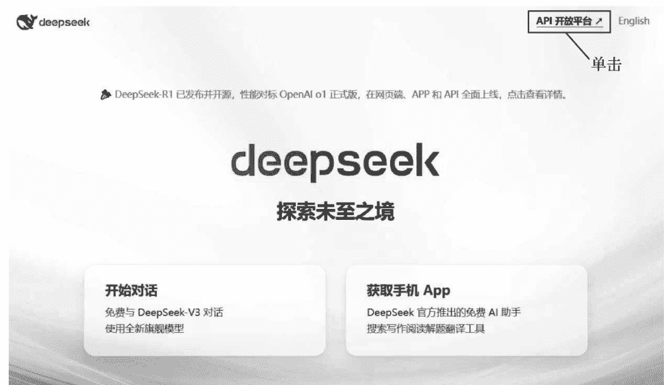
图1 DeepSeek 官网 API 访问入口

（2）进入后点左侧“API keys”，再点“创建 API key”按钮（见图2）。
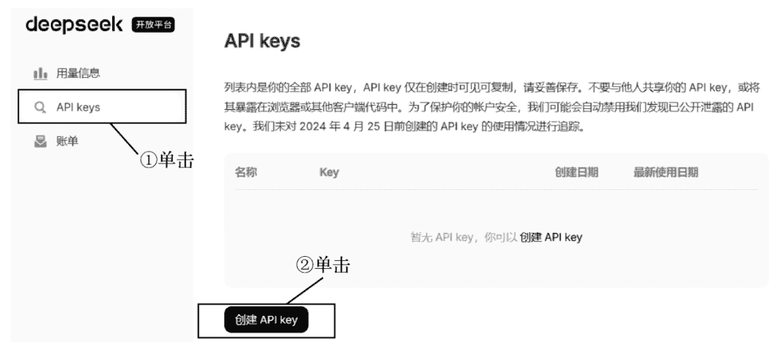
图2 创建 API key

（3）在弹框中输入 Key 名称，点击“创建”。系统会返回一串字符，即访问凭证（见图3）。请及时保存，遗失后官网无法找回。
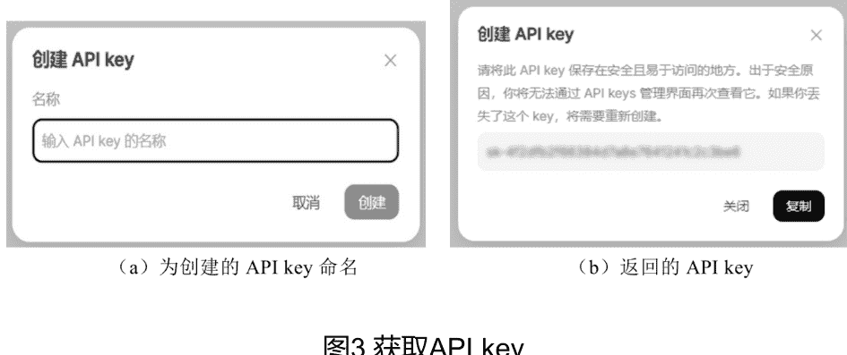

**第二步：调用 API。**
可在 Python、JavaScript 等环境中调用。例如 Python 中仅需几行代码即可生成内容：
```python
import requests

API_KEY = "你的 API Key"
url = "https://DeepSeek API 服务域名/v1/generate"

headers = {
    "Authorization": f"Bearer {API_KEY}",
    "Content-Type": "application/json"
}

data = {
    "prompt": "请帮我写一篇关于人工智能未来发展预测的文章",
    "max_tokens": 200
}

response = requests.post(url, headers=headers, json=data)
print(response.json())
```
将代码中的 Key 与服务域名替换为实际值后运行，即可返回关于人工智能未来发展的预测文章。

#### 3.3.2 赋能实战：将 DeepSeek 接入 Word

**第一步：启用宏（见图4）。**
点 Word 功能区左侧“文件”，再点左下角“选项”；在“Word 选项”对话框中点“信任中心”，再点“信任中心设置”；在弹出对话框中勾选“启用所有宏”，确定完成启用。
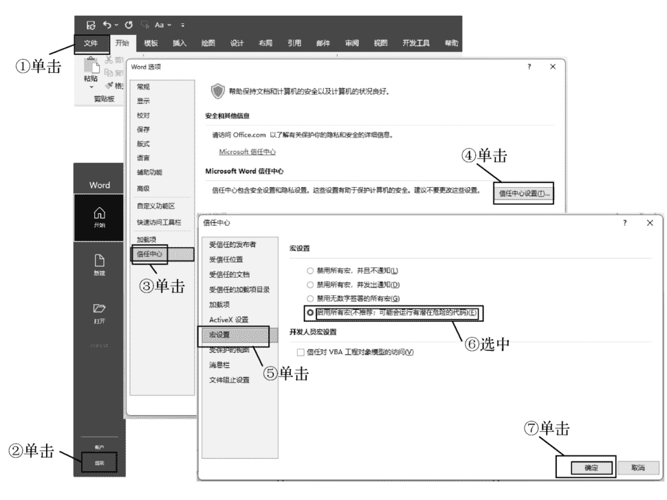
图4 启用宏

**第二步：创建宏（见图5）。**
点功能区“开发工具”，再点“宏”；在弹框中将宏名设为“DeepSeekV3”，位置设为“Normal.dotm”，使宏在所有文档可用；点“创建”，打开 Visual Basic 编辑器，输入以下代码。
该代码可实现选中文字后一键获取模型回复。
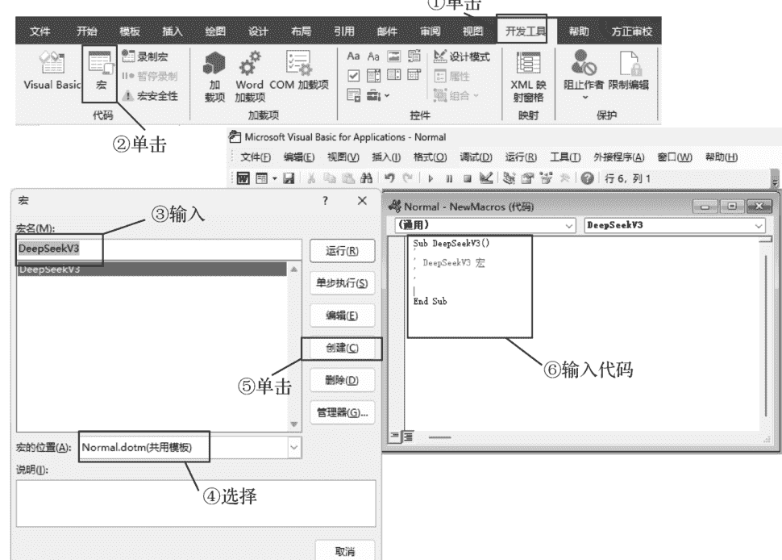
▲图5 创建宏
```vba
Function CallDeepSeekAPI(api_key As String, inputText As String) As String
Dim API As String
Dim SendTxt As String
Dim Http As Object
Dim status_code As Integer
Dim response As String

API = "https://硅基流动 API 服务域名/v1/chat/completions"
SendTxt = "{""model"": ""deepseek-ai/DeepSeek-V3"", ""messages"": [{""role"": ""system"", ""content"": ""You are a Word assistant""}, {""role"": ""user"", ""content"": """ & inputText & """}], ""stream"": false}"
'想用R1模型,就把的deepseek-ai/DeepSeek-V3换成deepseek-ai/DeepSeek-R1

Set Http = CreateObject("MSXML2.XMLHTTP")
With Http
.Open "POST", API, False
.setRequestHeader "Content-Type", "application/json"
.setRequestHeader "Authorization", "Bearer " & api_key
.send SendTxt
status_code = .Status
response = .responseText
End With
If status_code = 200 Then
    CallDeepSeekAPI = response
Else
    CallDeepSeekAPI = "Error: " & status_code & " - " & response
End If

Set Http = Nothing
End Function

Sub DeepSeekV3()
    Dim api_key As String
    Dim inputText As String
    Dim response As String
    Dim regex As Object
    Dim matches As Object
    Dim originalSelection As Range

    ' API Key
    api_key = "输入你的 API Key"
    If api_key = "" Then
        MsgBox "Please enter the API key.", vbExclamation
        Exit Sub
    End If

    ' 检查是否有选中文本
    If Selection.Type <> wdSelectionNormal Then
        MsgBox "Please select text.", vbExclamation
        Exit Sub
    End If

    ' 保存原始选区
    Set originalSelection = Selection.Range.Duplicate

    ' 处理特殊字符
    inputText = Selection.Text
    inputText = Replace(inputText, "", "")
    inputText = Replace(inputText, vbCrLf, " ")
    inputText = Replace(inputText, vbCr, " ")
    inputText = Replace(inputText, vbLf, " ")
    inputText = Replace(inputText, """" , """" ) ' 转义双引号

    ' 发送 API 请求
    response = CallDeepSeekAPI(api_key, inputText)

    ' 处理 API 响应
    If Left(response, 5) <> "Error" Then
        ' 解析 JSON
        Set regex = CreateObject("VBScript.RegExp")
        With regex
            .Global = True
            .MultiLine = True
            .IgnoreCase = False
            .Pattern = """content"":""(.*?)""" ' 匹配 JSON 的"content"字段
        End With
        Set matches = regex.Execute(response)

        If matches.Count > 0 Then
            ' 提取 API 响应的文本内容
            response = matches(0).SubMatches(0)

            ' 处理转义字符
            response = Replace(response, "\n", vbCrLf)
            response = Replace(response, "", "") ' 处理 JSON 里的反斜杠
            response = Replace(response, "&", "") ' 过滤 `&`，防止意外符号

            ' 让光标移动到文档末尾，防止覆盖已有内容
            Selection.Collapse Direction:=wdCollapseEnd
            Selection.TypeParagraph
            Selection.TypeText Text:=response

            ' 将光标移回原来选中文本的末尾
            originalSelection.Select

        Else
            MsgBox "Failed to parse API response.", vbExclamation
        End If

    Else
        MsgBox response, vbCritical
    End If
End Sub
```

**第三步：将宏按钮加入功能区（见图6）。**
保存代码后，按第一步打开“Word 选项”；点“自定义功能区”，右侧选“开发工具”，点“新建组”；在“从下列位置选择命令”下拉列表中选“宏”；选中刚建的宏，点“添加”到新建组；选中宏点“重命名”，显示名称改为“DeepSeekV3”，依次确定即可。
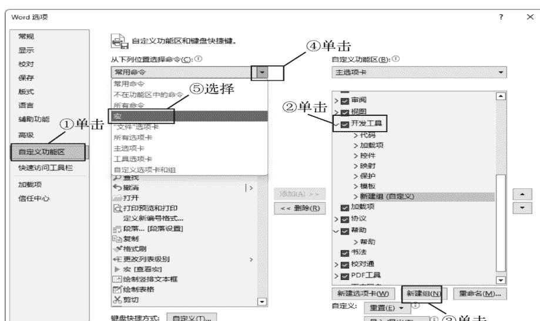
(a)
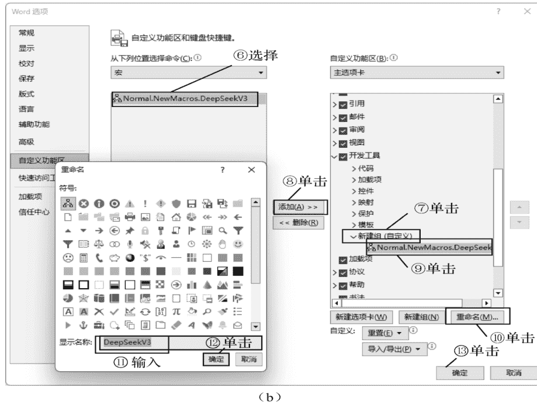
(b)
图6 将宏按钮添加到功能区

**第四步：运行宏（见图7）。**
在 Word 中输入问题并全选，点击第三步创建的宏按钮，即可得到回复。
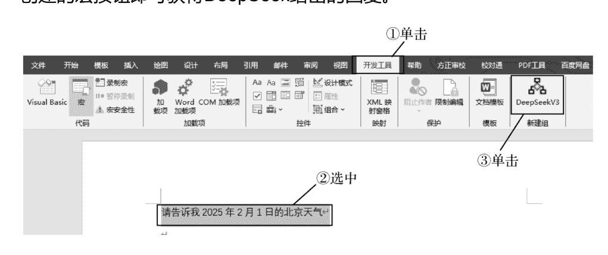
图7 运行宏

### 3.4 打造专属 AI 助手
DeepSeek 的重要贡献之一是模型开源。任何人均可基于其通用模型训练出适配自身需求的专属助手。相当于提供一个通用基座，再在此基础上定制化训练。构建专属模型需从本地部署开始，对硬件配置要求较高，建议先做需求评估。

#### 3.4.1 云端使用 VS 本地部署

云上调用还是本地自建？DeepSeek 两种使用方式对比

把 DeepSeek 放在云端使用，本质是通过网络去访问它的 App、网页版，或者调用 API 与大语言模型交互。App 和网页更偏向零代码的即时体验，适合普通用户做对话和轻量任务；API 则面向需要流程自动化、系统集成或大规模请求的团队，灵活性更高。

把模型搬到自己电脑上运行，则是另一种思路。数据无需上传到外部服务器，断网环境也能保持可用，还能按业务需求自行调节参数和做精细化优化。这类做法更适合对信息安全和运行效率要求较高，且愿意投入硬件与运维成本的个人或企业。综合来看，会倾向本地化的情况主要有：

- ① 本机算力充足，最好配备独立显卡，保证推理效率。
- ② 对信息保密性敏感，同时想借助智能工具提升工作效率。
- ③ 需要二次开发，但不希望长期承担接口调用费用。
- ④ 有专属业务场景，需要对模型做定制化微调与训练。
- ⑤ 团队内部有 AI 相关人才，或使用者本身具备模型操作经验。

#### 3.4.2 本地部署大模型的基本步骤

**第一步：安装Ollama。**

想在本地跑 DeepSeek，Ollama 是目前最顺手的入口。它是一个开源的模型运行平台，能把大语言模型的权重、配置与依赖打包为统一包，极大简化部署流程，同时提供 GPU 调度的细粒度控制。以 4-bit 量化为例，原本以 FP16 保存的参数会被压缩为 4 位整型，模型体积大幅下降，显存占用随之降低，本地推理更可行。

可以把 Ollama 视作面向大模型的分发商店，通过它既能一键拉取 DeepSeek，也能获取 Llama3 等其他开源模型。它覆盖 Linux、Windows 与 macOS，包含 Apple Silicon 机型。

（1）在浏览器中搜索 “Ollama”，进入官网后点击 “Download”，在跳转页根据系统选择对应图标进行下载（见图8）。
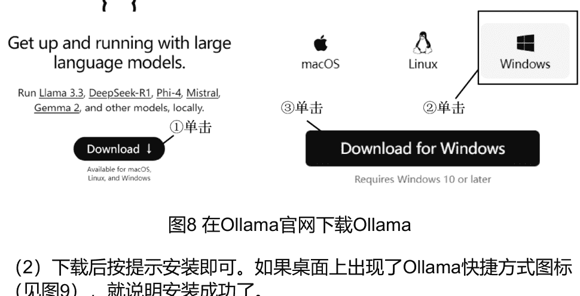
图8 在Ollama官网下载Ollama

（2）按引导完成安装。若桌面出现 Ollama 的快捷方式，即代表安装成功（见图9）。
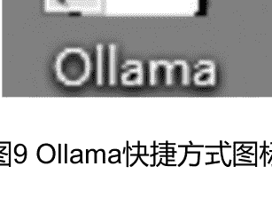
图9 Ollama快捷方式图标

默认情况下模型会写入系统盘 C。若想改到其他磁盘，需要手动调整环境变量。为省事，建议沿用默认的 C 盘路径。

**第二步：下载DeepSeek模型。**

（1）返回 Ollama 官网，点击右上角下拉菜单进入 “Models”，在列表中找到 “deepseek-r1”（见图10）。
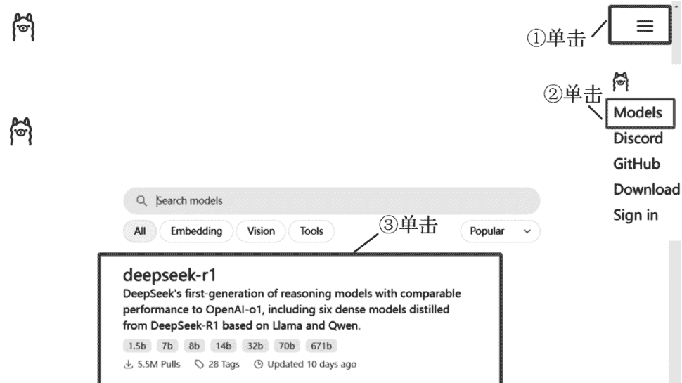
图10 选择DeepSeek-R1模型

（2）依据硬件条件挑选合适的参数量级（见图11），复制对应的运行指令。以 1.5b 为例，指令为 “ollama run deepseek-r1:1.5b”（见图12）。
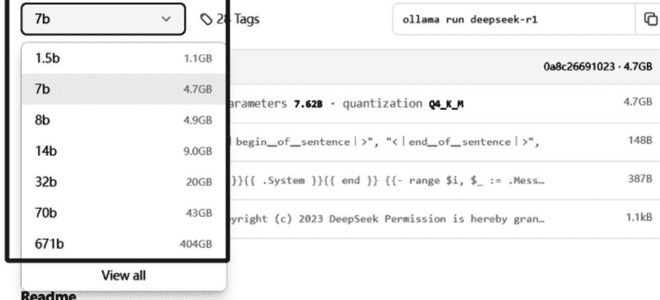
##### deepseek-r1
DeepSeek's first-generation of reasoning models with comparable performance to OpenAI-o1, including six dense models distilled from DeepSeek-R1 based on Llama and Qwen.

- 1.5b

- 7b

- 8b

- 14b

- 32b

- 70b

- 671b

5.5M Pulls Updated 10 days ago
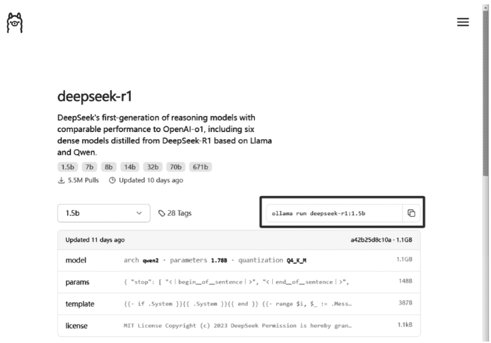
▲图11 选择模型的参数规模

▲图12 复制模型对应的指令

DeepSeek 开源了 7 个不同规模的版本，用户可按设备与需求挑选。数值越大参数越多，能力越强，但对本地硬件的要求也越高。比如 1.5b 约有 15 亿参数，显存需求仅约 3GB，甚至无需独显，普通笔记本也能胜任。

表1是各版本 DeepSeek 模型的硬件需求，可对照自有设备选择。

表1 不同版本DeepSeek模型的硬件要求

| 模型版本 | 参数量（个） | 显存需求（FP16） | 推荐 GPU（单卡） | 多卡支持 | 量化支持 | 适用场景 |
| :--- | :--- | :--- | :--- | :--- | :--- | :--- |
| DeepSeek-R1-1.5B | 15 亿 | 3GB | GTX1650（4GB 显存） | 无需 | 支持 | 低资源设备部署（普通笔记本都能支持）、实时文本生成、嵌入式系统 |
| DeepSeek-R1-7B | 70 亿 | 14GB | RTX3070/4060（8GB 显存） | 可选 | 支持 | 中等复杂度任务（文本摘要、翻译）、轻量级多轮对话系统 |
| DeepSeek-R1-8B | 80 亿 | 16GB | RTX4070（12GB 显存） | 可选 | 支持 | 需更高精度的轻量级任务（代码生成、逻辑推理） |
| DeepSeek-R1-14B | 140 亿 | 32GB | RTX4090/A5000（16GB 显存） | 推荐 | 支持 | 企业级复杂任务（合同分析、报告生成）、长文本理解与生成 |
| DeepSeek-R1-32B | 320 亿 | 64GB | A10040GB（24GB 显存） | 推荐 | 支持 | 高精度专业领域任务（医疗/法律咨询）、多模态任务预处理 |
| 模型版本 | 参数量（个） | 显存需求（FP16） | 推荐 GPU（单卡） | 多卡支持 | 量化支持 | 适用场景 |
| :--- | :--- | :--- | :--- | :--- | :--- | :--- |
| DeepSeek-R1-70B | 700 亿 | 140GB | 2xA100 80GB/ 4xRTX4090（多卡并行） | 必需 | 支持 | 科研机构/大型企业（金融预测、大规模数据分析）、高复杂度生成任务 |
| DeepSeek-671B | 6710 亿 | 512GB+（单卡显存需求极高，通常需要多节点分布式训练） | 8xA100/H100（服务器集群） | 必需 | 支持 | 国家级/超大规模 AI 研究（气候建模、基因组分析）、通用人工智能（AGI）探索 |

（3）按下 < Win+R > 打开运行窗口，输入 “cmd”（见图13），点击确定打开命令行窗口。
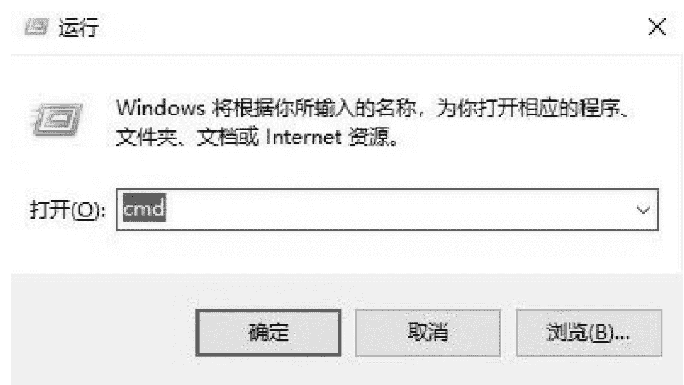
图13 打开“运行”窗口

（4）在命令行窗口粘贴刚才复制的指令 “ollama run deepseek-r1:1.5b”，回车后模型会自动拉取（见图14）。出现 “success” 字样即表示下载完成。
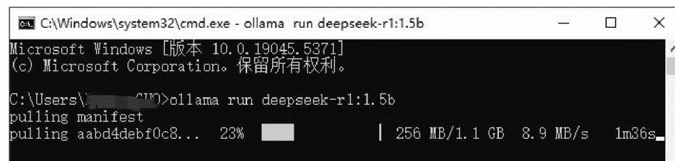
图14 下载模型

###### 第三步，测试本地DeepSeek模型。

此时可在命令行里直接调用模型进行对话，如图15所示。
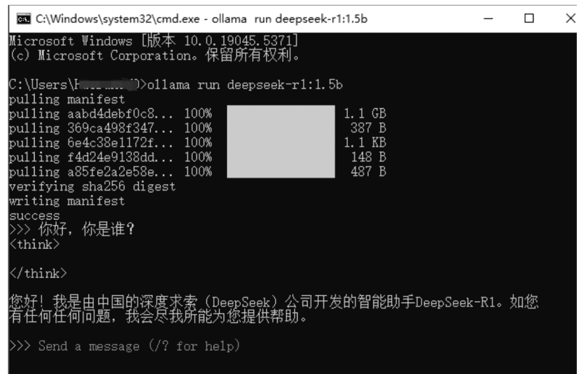
图15 在cmd窗口与模型对话

至此 DeepSeek 的本地部署即告完成，其他开源大模型的操作逻辑类似。纯命令行交互体验有限，通常还需要搭配一个可视化界面来调用 Ollama。

###### 第四步，安装UI应用。

这里推荐 Page Assist。它是一款开源浏览器扩展，可为本地模型提供图形化交互界面。用户可在浏览器侧边栏或 Web UI 中与本地模型对话。当前功能包括：任务侧边栏、视觉模型支持、简洁网页界面、网络搜索、与文档对话（支持 pdf、csv、txt、md、docx）等。

（1）打开 Windows 自带的 Edge 浏览器，访问 Chrome 应用商店，搜索 “pageassist”（见图16），下载插件。
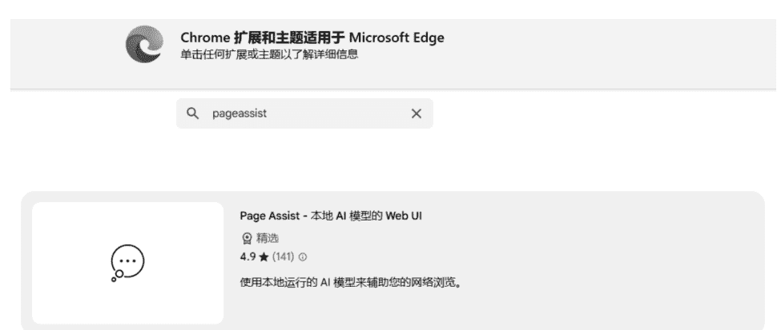
图16 在Chrome应用商店获取 Page Assist插件

（2）安装完成后可在扩展区看到 Page Assist 图标（见图17）；启动 Ollama 后按 < ctrl+shift+L > 即可打开 Web UI。

图17 插件位置

（3）插件默认语言为英文，点击右下角齿轮进入设置，将语言环境改为简体中文（见图18）。
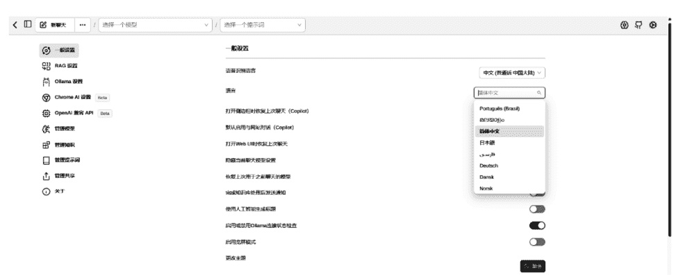
图18 设置语言环境

###### 第五步，在Web UI中与DeepSeek模型交互。

设置完成后，在左上角下拉列表中选择已安装的模型，就能在浏览器界面里与 DeepSeek 进行对话了（见图19）。
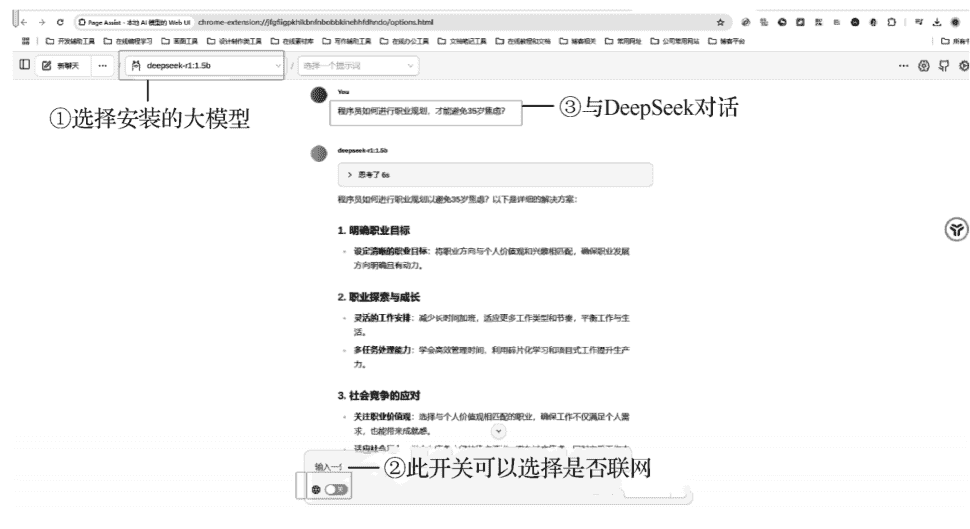
图19 在 Web UI中与DeepSeek模型交互

到这里，本地大模型的基础搭建就结束了。无论是 DeepSeek 还是其他开源模型，部署与界面配置的思路都是相通的。

#### 3.4.3 打造专属AI助手的基础知识

本地部署大模型的核心目标之一，就是训练自己的专属知识库或专属模型。

要让模型更懂业务，需要把专有数据喂给已部署的模型，让它吸收我们准备的“知识大餐”，变得更聪明、更贴合需求，最终成长为专属智能助手。实现这一目标的关键技术是 RAG。

##### 1. 什么是RAG

随着自然语言处理技术的发展，生成式语言模型如 GPT、BART 在文本生成与上下文理解上表现突出。但它们依赖固定的预训练语料，在需要最新或实时信息时容易出现编造，即“机器幻觉”。在 DeepSeek 这类轻量化模型中，该问题更明显，未经专属训练很难稳定使用。

同时，生成模型在处理长尾问题与复杂推理时，若缺乏特定领域的外部知识支撑，回答深度与准确度会受限。

检索模型能在海量文档中快速定位相关信息，解决事实查询类问题。但传统检索如 BM25 往往只返回孤立片段，无法生成连贯的自然语言回答，缺乏上下文推理能力。

检索增强生成 RAG 应运而生，它融合生成与检索的优势，实时从外部知识库获取相关信息并融入生成过程，保证输出既连贯又具备事实依据。

在本地模型中引入 RAG 主要有三个作用：

- ① 降低回答时的“机器幻觉”概率。
- ② 让回答可附带来源与参考。
- ③ 免除对文档元数据注释的强制依赖。

简言之，借助 RAG 就能在本地打造专属模型，实现专属 AI 助手。

##### 2. RAG模型的主要构成

RAG 由检索器 Retriever 与生成器 Generator 组成，二者协同工作。

检索器 Retriever：负责从外部知识库或文档集中找出与查询最相关的片段。常用技术包括：

- 向量检索：如 BERT，把文档与查询映射为向量空间表示，通过相似度匹配。优势在于能捕捉语义相似性，而非仅关键词匹配。
- 传统检索算法：如 BM25，基于词频与逆向文档频率加权排序，适用于关键词能直接匹配的简单场景。

检索器的作用是为生成器提供上下文背景。

生成器 Generator：负责产出最终的自然语言输出。常用模型有：

- BART：序列到序列生成模型，擅长文本生成，通过噪声处理提升质量。
- GPT 系列：预训练语言模型，擅长生成流畅自然文本，在生成任务中表现突出。

生成器在接收检索器提供的片段后，结合用户查询生成相关且自然的回答。

##### 3. RAG模型的工作原理

RAG 的核心是解决大语言模型知识更新困难的问题，通过外挂知识数据库，通常是向量数据库，存储训练数据之外的新数据与领域数据。一般分为三个阶段：

###### 1) 检索阶段

用户查询先转为向量表示，再在知识库中进行向量检索。检索器借助 BERT 等预训练模型把查询与文档片段转为向量，通过余弦相似度等指标匹配最相关的片段。相比简单关键词匹配，语义级向量表示能更精准地应对复杂或模糊查询。该阶段的质量直接决定生成器可用的上下文。

###### 2) 生成阶段

这是 RAG 的核心。生成器如 BART 或 GPT 结合用户查询与检索到的片段，生成更精准丰富的回答。相比传统生成模型，RAG 能在外部知识支撑下提供更有事实依据的内容，显著提升准确性。

###### 3) 多轮交互

RAG 支持对话系统的多轮交互。每轮查询与生成结果成为下一轮的输入，系统通过分析用户反馈逐步优化上下文。循环反馈机制让检索与生成策略不断改进，多轮对话的回答更贴合预期，也增强了在复杂对话场景下的适应性，能处理跨轮知识整合与复杂推理。

举例来说，企业内部手册这类资料大模型难以直接获取，电商智能客服也需要依托商家产品服务信息。借助 RAG，可把这些特定内容投喂给本地部署的大模型，训练出专属 AI 助手，有效缓解特定领域的机器幻觉，并实现精准问答。

总的来说，RAG 就是借助工具把各类格式的内容与数据转化为 AI 可理解的形式，让模型提取知识并按需加工反馈。模型既能依靠自身知识库回答，也能通过检索外部注入的数据集提升准确性与丰富度。

#### 3.4.4 打造专属AI助手的基本流程

##### 第一步，设置RAG。

（1）参照 DeepSeek 模型的下载方式，下载 Ollama 提供的文本嵌入模型 nomic-embed-text，对应指令见图20。该模型用于把文本转换为高维向量嵌入，以便高效检索与相似度计算。
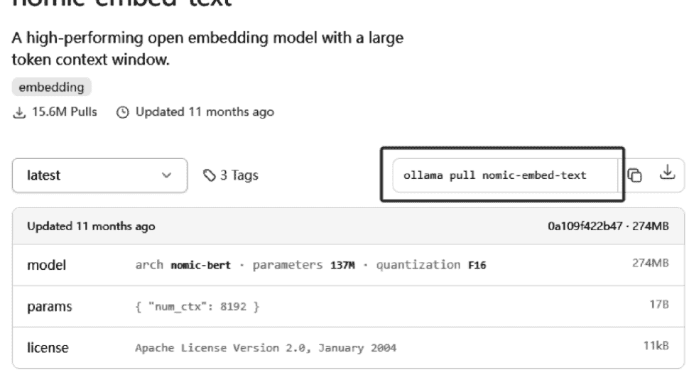
图20 获取文本嵌入模型nomic-embed-text的对应指令

（2）打开 Edge 浏览器，点击 Page Assist 插件打开 Web UI；进入设置页面，左侧选择 “RAG 设置”，把文本嵌入模型设为 nomic-embed-text（见图21）。文本嵌入模型相当于把上传文档量化成 DeepSeek 可识别的数据的工具。
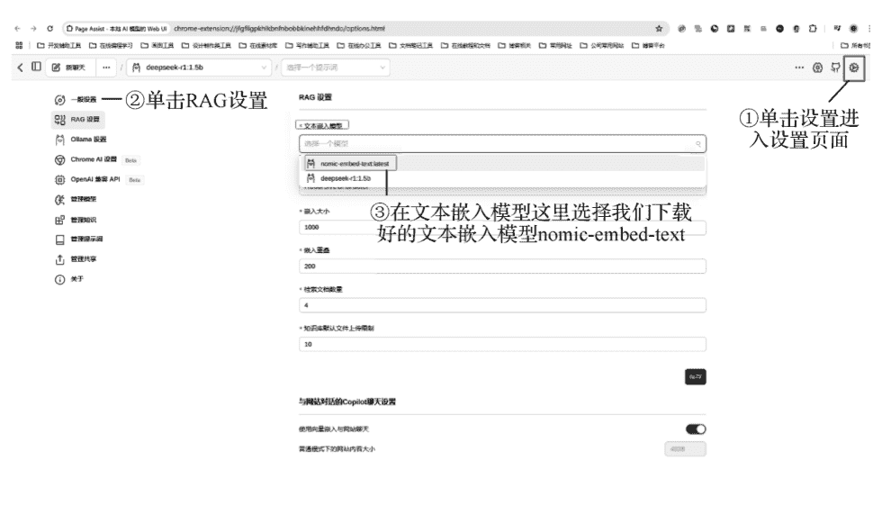
图21 设置RAG

##### 第二步，上传文件投喂DeepSeek模型。

RAG 环境搭建完毕后，就能把内部资料喂给 DeepSeek，孵化出专属的智能助理。启动 Web 控制台，进入设置页，左侧菜单点选“管理知识”，再点击“新增知识”按钮（见图22）。在弹出的对话框里，把提前准备好的 .pdf、.csv、.txt、.md 文件导入，并为这批资料命名。确认“提交”后，等状态栏变为“已完成”，即表示知识注入走通。

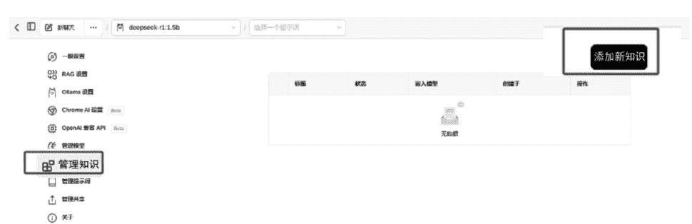

图22 添加新知识

按需反复调用新增知识的功能，可持续补充各类素材。这样一套部署在本地的专属智能体，本质上是一个私有的知识库，已经具备初步能力。随着素材不断累积，其理解广度与回答质量也会同步提升。

## 第4章 DeepSeek 重新定义 AI 商业浪潮

### 4.1 DeepSeek 价值的真正内涵

项目刚上线时，多数人只注意到运算能力强且成本低，这只是表层印象。更具颠覆性的是使用方式的改变。开放代码的思路提供了一条全新路径，让它不再只是单一模型，而是一套可按不同场景灵活适配的基础智能平台。

借助知识蒸馏，大规模模型被压缩为更轻便的形式并完全公开，企业、独立开发者、科研团队都能在此基础上搭建专属系统。该路径大幅拉低入门门槛，让个性化方案成为现实，也催生了一套全新的协作生态，使智能技术真正进入商业实践。

#### 4.1.1 定制化智能已然到来

该平台出现之前，人工智能长期由大型科技公司主导，提供封闭接口，用户需支付高额费用才能调用。此次选择了另一条路，构建开放生态，不仅给出基础架构，还允许组织和个人在其上进行个性化训练，打造贴合自身需求的方案。这一转向标志着产业走向开放，普及速度加快，真正进入行业落地阶段。

在封闭模式下，智能更像一款固定的 SaaS 产品，比如 OpenAI 的 ChatGPT，用户只能按既定方式使用，难以深度调整。而此次开源的架构相当于一款可自由编辑的软件，用户能像调模板一样，按需微调，形成属于自己的助手。

对个人开发者而言，这带来了前所未有的自由度。过去优化代码、整理论文、分析市场都要依赖第三方接口，用量一多开销难以承受。现在可以把模型下载下来在本地运行，不仅节省成本，也让智能体成为真正属于个人的工具。

比如数据分析师可以基于该模型训练系统自动处理报表；自由职业者可以训练系统做市场趋势研判，提升决策效率。这种个性化训练能力让效果更贴近真实需求。

对企业而言价值更明显。过去依赖科技公司接口，每年可能花费数十万甚至上百万美元。此次方案允许在自有服务器上部署，减少对外部服务的依赖，同时保障数据安全。

比如银行可以基于该模型训练自有智能风控系统优化贷款审批，无需把敏感客户数据上传；制造企业可以训练系统做设备预测性维护，提升生产效率，无需采购昂贵的方案。该项目让企业真正掌握主动权，使其成为业务的一部分而非外部工具。

更重要的是，开放模式打破了传统大模型的壁垒，形成多层次部署方案。大型企业可采用私有化部署，深度定制并把智能能力融入业务流程，实现精准智能化升级；中小企业则可用接口快速接入，以低成本获得赋能。

结果是各行业的智能化进程明显加快。过去人工智能主要推动科技行业，现在该平台让医疗、金融、教育、制造、零售等传统领域都能接入。每个领域都能基于架构打造自己的专家，这种垂直化发展很快会成为主流。

开放模式把人工智能变成了可自由调整的生产力工具，不再是封闭的黑盒。未来每个行业都有垂直领域专家，每家公司都能训练企业专属智能体，每个人都能打造自己的助手。这种个性化定制时代，才是产业真正成熟的阶段。

可以说它让人工智能从通用助手变为行业专家，真正走向商业市场，进入商业化落地的全新阶段。

#### 4.1.2 从封闭到开放 生态重塑

开源不仅让用户自由调用、训练模型，也推动生态从封闭走向开放。

过去人工智能技术掌握在少数公司手中，组织和开发者必须依赖其接口或封闭方案。这种模式便捷却缺乏自主权，需遵守供应商规则并持续支付高额费用。例如使用 OpenAI 接口需按调用次数付费，价格上涨就会让成本失控，且无法按自身需求调整模型，难以满足个性化业务。

该方案让人工智能进入去中心化时代，组织和开发者可在本地部署、训练自己的模型，不再受制于云端服务。这彻底改变了传统依赖云计算的格局，让使用更经济高效，也让企业拥有完全控制权。例如电商公司可在自有服务器上训练模型，无需每次调用外部接口，既省成本又保障用户数据安全。对银行、医院、政府等数据敏感机构，本地部署提供了更高安全性，使应用真正落地。

门槛降低后使用更普惠。过去只有科技巨头能负担开发部署，现在任何企业、初创公司甚至个人开发者都能基于该平台训练自己的智能体并投入实务。

它也让垂直行业应用更高效。通用模型推理强，但在具体行业常不够精准，需要额外训练。该方案允许企业在基础架构上微调，使效果更符合行业需求。医疗机构可用自有数据训练提升影像分析准确度；金融机构可训练智能风控提升交易决策精度；教育机构可训练个性化教学助手提升学习效率。这种行业定制模式推动广泛融入。

更重要的是，开源加速了技术创新。封闭生态下优化依赖大公司内部研发，方向和速度受限少数企业战略。此次开放后全球开发者都能参与优化，在架构基础上提出更高效训练方法。例如某开发者发现新的数据处理方式提升推理效率，可在社区分享，惠及整个生态。这种全球协作的自我进化加快发展速度，让效果更智能高效。

从黑盒到开放，从封闭到共享，开源正在重塑生态，降低成本、提升灵活性、加速创新。随着更多企业和开发者加入开源生态，发展将进入全新阶段。

### 4.2 精简算力 突破资源瓶颈

除了开放，还有一个关键特征就是精简计算。这改变了计算模式，让人工智能不再依赖庞大云端算力，用更少资源完成高效训练和推理，让更多企业和开发者受益。

#### 4.2.1 精简智能的必然性

近年来人工智能快速发展，大模型竞赛白热化，焦点常在参数谁多、算力谁强，似乎只有不断扩规模能力才提升。这带来挑战，算力需求越来越难满足，成本攀升会拖慢商业化落地。

以 GPT-4 为例，公开信息显示训练需上万块高端 GPU，电力和算力投入高达上亿美元，多数企业望而却步。即便大型科技公司也面临成本飙升。更关键的是，若无法高效运行，再强的能力也受限。

显然多数行业并不需要庞大通用模型，而是针对特定需求高效运行的轻量方案。商业化因此陷入两难，大模型能力强但昂贵难普及，小模型便宜却难以应对复杂任务。如何在保证性能同时降低计算消耗，成为关键。

该方案通过精简设计给出新解法，让训练推理在更低资源下完成，大幅降低门槛。精简不等于性能下降，而是优化计算结构、提高推理效率、减少浪费，让人工智能从超算级产品变为可嵌入日常应用的工具。

核心依靠蒸馏技术。让小型模型模仿大型模型的输出或中间特征，把大模型知识迁移到小模型并尽量保留智能。如同把资深专家知识提炼成简明指南，让普通人快速掌握。这让系统能在更少资源下运行而不牺牲表现。例如想在产品里加入语音助手的企业，过去需租用昂贵云服务器，现在可在本地服务器或嵌入式设备上运行基于该平台训练的模型，大幅降低部署成本。

轻量化方案的成功不仅是成本控制的胜利，更代表发展方向的转变，让人工智能更高效、可负担，并在更多行业落地。

#### 4.2.2 计算范式转变 云到端侧

精简推动计算模式从云端向本地根本性转变。过去人工智能依赖云计算，任务在远程服务器完成，设备只负责输入输出。现在该平台让推理和计算可在本地设备完成，降低成本，提升数据安全和响应速度。

云端优势是算力集中、处理量大，但存在两大问题。第一成本高昂，企业需租用高性能 GPU 服务器，价格昂贵，尤其智能制造、自动驾驶、医疗人工智能等行业年开销可达数百万美元。第二数据隐私风险，用户数据必须上传远程服务器，对金融、医疗、政府等敏感行业构成隐患。

此次方案的精简让计算可直接在本地运行，彻底改变模式。例如智能语音助手，过去如 Siri、Google Assistant 需把语音上传云端解析再返回，存在延迟和隐私问题。该平台可让模型直接在本地运行，语音数据无需外传，响应更快、隐私更安全。

自动驾驶领域，可让智能驾驶模型运行在车载芯片上，不依赖云端算力。传统方案需不断与云端通信获取路况和决策策略，网络不佳时如隧道、偏远山区会出现延迟，影响安全。本地计算实现更稳定可靠的体验。

智能制造中，工厂数据过去需上传云端分析后返回调度方案。现在可在本地服务器或边缘设备完成计算，数据无需离开工厂，既提升安全性又降低成本。

总体而言，该平台通过精简把人工智能从云端依赖推向本地计算，降低应用成本、提升数据安全，使其能在更多行业落地。从语音助手到自动驾驶，从智能制造到金融风控，本地化趋势加速。未来产业将从比拼算力转向比拼应用价值，人工智能真正走入各行各业。

### 4.3 AI 变革的下一个主轴

自 ChatGPT 推出以来，全球掀起以大模型为代表的新一轮人工智能浪潮，焦点围绕规模竞赛，似乎参数越大、数据越多、算力越强，效果越接近通用智能。

但随着人工智能迈向实际应用，行业意识到大模型在落地中面临巨大挑战，算力成本高昂、推理速度受限、难以适配具体行业需求。发展方向开始从大而全转向小而精，小模型与行业垂直化将成为关键趋势，该平台正是这一趋势的引领者。

#### 4.3.1 通用大模型与聚焦小模型

人工智能爆发期后，行业遵循大力出奇迹路径，通过不断扩大规模和参数让效果更强。OpenAI GPT-4、Google PaLM、Meta Llama 等都遵循此思路，拥有数百亿乃至上万亿参数，借助海量数据和超级计算集群训练。技术上有效，却暴露明显瓶颈。

最直接的是算力成本持续攀升。训练顶级大模型需数百万乃至上亿美元投入，并动用数万块高端 GPU 并行计算。这让人工智能变成极其昂贵的资源，只有少数科技巨头能承担。多数企业部署门槛高，即便调用 OpenAI 接口推理，长期成本也高昂，严重限制更广行业的落地。

此外，大模型虽通用能力强，实际应用却有广而不精问题。例如 GPT-4 能回答各类问题，但在医疗病历管理、金融风控建模、供应链优化等专业任务上，通用性反而成为短板。

不可否认，GPT 的技术突破让我们看到大规模商业化的可能，但目前人类仍处应用起步或初期阶段。接下来产业重点应是通过人工智能赋能各行业有效提升效能。

行业企业真正需要不是什么都懂一点的模型，而是一个专精于特定领域的模型。例如医院需要精通诊疗指南、病理分析的助手，而非写诗讲故事的聊天机器人；制造业需要优化生产调度的系统，而非会写代码的大模型。大模型的泛化能力反而成为行业应用障碍，企业需额外适配微调，进一步增加成本复杂性。

因此发展不能仅局限于回答问题和生成内容，还要在现实世界承担更实际任务。借助大模型对细分垂直行业进行赋能与效率提升，才具有可预期的商业化价值。通过打造垂直行业小模型，让人工智能更深入生活和工作，并自主执行任务和计划，实现从信息到行动的转变，才是必然方向。

也就是说，大模型只是通向人工智能时代的技术基础，而发展垂直行业小模型并利用其赋能生产生活，才能抵达真正的时代。

#### 4.3.2 小模型驱动行业纵深

该平台能迅速崛起，正因并未像 OpenAI 或 Google 那样单纯追求参数规模，而是选择务实路线，在保证推理能力基础上优化计算效率，让技术更容易适配具体行业需求。核心在于不依赖超大规模模型，而是采用精简小模型，为不同行业提供垂直化方案。

这意味着发展重心将从打造无所不能的通用人工智能转向在不同领域培养专家，让其成为各行业智能助手，而非单一超级大脑。

过去落地常受算力限制，企业需依赖云端接口调用如 GPT-4 或 Gemini，带来两大问题。第一应用成本高，每次调用需支付昂贵费用，长期不可持续；第二通用大模型虽语言理解优秀，但缺乏针对性优化，在实际行业中难以满足精准度、可靠性和数据隐私等要求。

市场对AI的关注正在发生位移。过去大家热衷讨论如何堆砌算力来换取更强的模型，现在更关心在算力受限的条件下，如何通过算法和架构的优化让模型发挥最佳效用，同时把可行性放在行业落地的第一位。

正是基于这一转向，DeepSeek给出了一条不同的技术路径。它放弃了单纯依赖参数规模的思路，转而推行小模型叠加行业垂直到顶的组合，让AI在具体场景里做到更精准。金融里，DeepSeek可以为银行风控单独打造模型，直指高风险贷款人群，而不是用通用模型做粗筛。医疗里，模型能被优化用于影像判读、病历整理和个体化治疗建议推荐，不止停留在文本生成层面。这种专家式的行业定位，让AI的赋能更贴合业务真实需求。

小模型路线也带来了可用性和扩展性的提升。相比通用大模型，小模型的算力门槛更低，企业可在自有服务器上直接跑，不必仰赖昂贵的云端资源，依赖度下降的同时可控性增强。制造、法律、教育等需求高度特殊的领域，用通用模型往往需要大量微调，DeepSeek的垂直到顶做法让方案更贴近一线。企业无需长期租用头部厂商的API，而是自建AI专家，让它成为日常运营的一部分。

这种专业化趋势与过去十年科技演进同理。移动互联网起初功能通用，后来衍生出游戏、影像、商务等细分机型。AI也在经历同样过程，从通用到专属，DeepSeek试图引领的正是一套高效的小模型生态，让AI从昂贵的通用工具变为服务各行业的智能助手。

小模型的另一好处是推理效率更高。大模型在评测里表现突出，但实际使用时计算量大、响应慢。DeepSeek的轻量化方案推理更快，可在边缘设备或本地服务器运行，提升真实业务体验。对金融交易、智能制造、物流调度这类毫秒级决策场景尤为关键，云端依赖带来的网络延迟与算力波动都可能拖慢效率，本地化小模型方案正好规避了这些问题。

总体来看，AI竞争的重心将从大模型比拼转向行业垂直到顶的深耕。DeepSeek的探索表明，大模型并非唯一解，在落地层面小模型与垂直方案可能更具实效。其成功也暗示产业正从大而全的通用时代迈向小而精的精准时代，每个行业都将拥有自己的AI解法，AI也更可能成为提升全球生产力的核心动力。

#### 4.3.3 抢占AI红利窗口
随着DeepSeek不断渗透各行各业，商业版图也迎来剧变。过去企业竞争多看资金、资源与规模，未来谁能率先把AI深度嵌入业务，谁就占得先机。当AI成本下降、效率提升且可定制时，它不仅改变运作方式，更重塑整个市场格局，孕育出新一代商业巨头。

法律行业是典型例子。传统上律所靠资深律师团队，未来最有竞争力者可能是拥有最强AI法律助理的律所。AI可快速处理法律文书、合同审查、案件分析，并基于历史判例给出策略建议。若一家律所率先用DeepSeek训练出优质的AI律师，办案效率将大幅领先，成本下降同时客户吸引力增强，未跟上变革者可能被淘汰。

零售行业同样如此。过去电商看流量，未来看AI推荐的精准度。AI购物助手可综合浏览、购买、社交兴趣等多维数据实时推送商品，推荐越准转化越高。未来的助手不只是推荐列表，还能自动匹配最优价格、物流，甚至预测用户下一步需求，构建真正智能的购物体验。

这种赋能不仅提升效率，还催生全新领军者。AI时代的巨头未必是传统老牌企业，而是最早拥抱AI并将其融入业务的新兴公司。过去霸主靠供应链和资本，未来领导者靠最强的AI方案与智能数据系统。DeepSeek作为低成本方案提供者，凭借轻量化与定制化训练能力，让企业以更低成本搭建专属AI体系，推动普及与智能化，成为商业革命的前沿力量。

AI正从工具演变为商业世界的核心驱动力。率先采用的企业能更快、更准地满足客户、降本增效。AI时代新巨头正在成形，谁抓住红利，谁就成为下一轮行业的领军者。

## 第5章 DeepSeek开启行业新图景

### 5.1 DeepSeek落地医疗
AI浪潮席卷各行各业，医疗是最具变革潜力的场景之一。医学影像分析、疾病预测、个体化治疗等应用正在改变行业运行方式，但医院在引入AI时仍受算力成本高、数据隐私风险、模型适配难困扰。

DeepSeek以开源与定制化训练提供新解法，帮助医院以更低成本、更高效率把AI融入诊疗体系，实现真正意义上的医疗革新。

#### 5.1.1 为医院定制专属医疗AI
医疗AI落地离不开精准数据与专业训练。不同医院、科室、疾病的AI需求差异很大。影像科希望AI辅助发现肺结节、肿瘤等早期病变，心血管科关注心脏病风险预测以制定更精准方案。通用模型医学知识虽全，却难匹配机构实际需求。借助DeepSeek开源模型，医院可基于自身数据与需求训练专属系统，打造更贴合的解决方案。

北京儿童医院的“AI儿科医生+多学科专家”双医模式是典型案例。该系统由医院联合科技公司研发，依托市重点实验室，整合300多位知名儿科专家的临床经验与数十年高质量病历数据，用于辅助疑难病症诊断，并帮助医生快速获取最新研究成果与权威指南。

试用期间，系统参与对一名8岁男孩的会诊。孩子抽动持续三周并检出颅底肿物，因病情复杂辗转多地。会诊中，AI儿科医生与耳鼻咽喉头颈外科、肿瘤外科等13位专家给出的建议高度一致，显示AI已从信息查询工具变为可参与临床的智能助手。

案例证明，医疗AI需要基于大模型后结合医院患者数据和病历记录做定制化微调。儿童医院可训练罕见病分析模型，肿瘤中心可聚焦癌症筛查。DeepSeek的开源与本地部署训练能力显得关键，允许医院在自有硬件上完成训练，完全掌控训练数据，按自身优势做“私人订制”，让AI医生更懂本地患者，提升诊断精准度。

在影像分析中价值同样明显。以肺癌早筛为例，AI可学习大量CT影像提高结节识别能力。传统方案多基于欧美人群数据，对亚洲人群适配不足易致误诊。DeepSeek支持本地数据微调，使模型更贴合本地人群特征，并可持续更新学习最新临床案例，无需锁定固定版本。

疾病预测与个体化治疗也是重点。医院可基于DeepSeek训练慢性病管理模型，预测糖尿病并发症风险、优化癌症治疗方案、提供基因与病史驱动的个体化用药建议。北京鹰瞳科技的万语医疗大模型接入DeepSeek后，数据挖掘能力提升30%，可生成个性化近视防控方案。精准化医疗让AI从标准化助手变为可灵活调整的智能医疗专家。

#### 5.1.2 本地化部署的医疗优势
医疗数据隐私与安全至关重要。病历、影像、诊疗记录一旦泄露，后果严重，也是医院核心竞争力。AI引入时，信息安全与本地化专属训练成为关键。

传统方案多依赖云计算与第三方中心化大模型，需把患者数据上传外部服务器训练推理。算力虽有优势，却带来隐私、合规与长期运营成本风险。GDPR、HIPAA等法规对医疗数据存储、传输、处理提出极高要求，患者有权管理与撤回健康数据，这让许多机构因顾虑泄露而犹豫。

DeepSeek的本地化部署解决了核心痛点。医院可在自有服务器运行AI，病历影像均在院内完成训练推理，保护隐私并让医院自主决定训练规则、存储策略与访问权限，实现智能化与合规并行。

成本方面也有明显改善。传统API按次付费模式下，大型医院每日处理上万条数据，年费用可能达数百万美元，中小型与基层机构难以承受。DeepSeek本地运行避免持续高昂订阅费用，使AI成为可持续工具。

2025年2月16日，湖南省人民医院完成DeepSeek本地部署并与OA系统深度融合。模型按医院实际需求个性化定制，实现硬件到软件的全链条自主可控。私有化部署保障数据安全，同时加快响应。

系统可智能处理行政审批、排班、文件流转，4000余台院内终端可登录统一入口获取文档辅助、智能问答、数据分析服务，采用完全本地化运行、国产生算力与多重加密，敏感数据不出院。权限分级管理确保信息仅在授权范围内流转。对医院而言，这是技术升级，也是服务模式的革新。

轻量化模型还降低了硬件门槛。传统训练推理需昂贵GPU集群，基层医院难以负担。DeepSeek优化后可在普通服务器运行，让AI进入更多基层机构。对缺乏专业医生的偏远卫生院尤为重要，本地AI可辅助筛查、判断是否需转诊，减少误诊、提高效率。

#### 5.1.3 医疗生态的重塑
本地化AI不仅适用于医院，也重塑医药研发、医保、个人健康管理等环节。

医药研发周期长、投入大，新药从实验室到上市需10-15年，成本数十亿美元。AI可加速靶点发现、分子筛选、临床试验。本地化AI让药企在自有服务器上训练微调模型，预测药物作用机制与副作用，模拟计算缩短实验周期，提升成功率，尤其推动癌症靶向与个体化医学。

恒瑞医药发布内部通知全面推进DeepSeek应用，并成立专项小组落地药物研发与临床诊断。医渡科技的YiduCore接入DeepSeek后，处理的医疗记录增至55亿份以上，覆盖2800家医院，打通研发与临床壁垒。

医保领域也迎来变革。传统精算依赖历史统计，AI带来精准健康管理。本地化AI可评估客户健康风险、优化产品设计、提升理赔精准度。基于健康数据、基因、生活方式预测重大疾病概率，实现差异化定价与提前干预。

理赔流程中，AI自然语言处理可自动审核病历与发票，缩短周期、减少人工与欺诈。DeepSeek支持保险公司本地部署智能理赔系统，数据不出公司，降低外泄风险并提升运营效率。

东软“领智”平台已在多地医保局落地，实时分析诊疗数据识别异常结算，预计每年减少医保基金浪费超百亿元。微脉CareAI系统集成DeepSeek后，可基于患者历史数据动态定价，推动带病体可保产品创新。

可见，AI正从单一诊断扩展至整个医疗生态。基于DeepSeek模型的本地化部署，让临床、研发、保险、健康管理各环节实现个性化优化、降本增效与数据安全，推动行业真正迈向智能化。

### 5.2 DeepSeek赋能金融
金融一直是AI应用最活跃的领域，智能投顾、风控、市场分析、风险管理等场景广泛使用AI。但传统金融AI投入高、周期长，多依赖昂贵云资源与封闭第三方模型，导致成本高企、数据隐私难保、灵活性受限。

DeepSeek的本地化AI方案正在改变现状，既能让金融机构自主部署提升数据安全，也能在分析、风控、反欺诈等领域释放更大价值，提升决策精准度与服务效率。

#### 5.2.1 银行业：提升合同审核与资产对账效率

银行在推进数字化转型的过程中，合同审查、资产核对以及合规管控的需求日益激增。业务本身盘根错节，每日产生的金融合同、客户交易流水与资产管理记录体量巨大，过去主要靠人工逐份过目，不仅花费高、效率低，还容易因人为疏忽埋下合规隐患。

过去，合规团队只能一条条对照合同条款找法律风险，而在托管与资产管理环节，人工对账更是费时费力。一旦出差错，就可能触发合规处罚、估值失真甚至系统性金融风险。

把DeepSeek模型搬到自有环境运行后，智能合同审查与自动对账成为可能，运营效率与合规能力同步提升。以江苏银行为例，据江苏金融业联合会金融科技专业委员会主办的“江苏金融科技”微信公众号披露，其依托“智慧小苏”大模型服务平台，已将微调后的DeepSeek-VL2多模态模型和轻量DeepSeek-R1推理模型本地化，分别投入智能合同审查与自动化估值对账场景，通过对海量金融数据的深挖重塑服务模式。模型具备很强的语义理解力，可自动读取合同原文、抓取关键条款并与监管要求对照，判断是否存在潜在法律风险，比如是否夹带不符合监管规定的表述，或在责任归属、利率计算等细节上存在漏洞，并及时提醒合规人员调整，从而降低诉讼风险。这种AI辅助的审查方式大幅压缩了人工干预，流程更准更快。北京银行、苏商银行等机构也已完成本地化部署。

在托管对账侧，账户核对、交易匹配与异常排查的压力同样巨大。DeepSeek借助机器学习实现数据智能匹配，能够揪出对账差异。例如交易记录与账面资产不一致时，模型会迅速预警并给出修正建议。智能对账减少了人为失误，提升了资金管理与资产估值的准确度。

AI对银行业的价值不仅是提速。对监管趋严的现实而言，实时合规监测与违规风险的降低尤为关键。在贷款审批环节，AI可自动解析客户合同，筛查不合理条款，避免因合规问题受罚；同时还能自动生成合规报告，减轻审计与监管应对负担，提升自动化程度。

更核心的是本地化部署带来的安全与可控。传统云方案需要把合同与交易数据上传到第三方，存在隐私泄露风险。DeepSeek可在银行自有服务器上运行，数据不出内网，既提升安全性，也让银行能自主调度模型、按需优化，综合使用成本更低、定制化更强。

展望未来，本地化AI还将延伸至自动化放贷、智能客服、实时风控等更多环节，让银行业务更高效、安全、智能。

#### 5.2.2 证券投资：精准数据分析赋能决策
对证券投资而言，核心始终是数据分析和投资决策，而市场瞬息万变放大了不确定性。每天涌现的股票行情、政策法规、行业动向、企业公告、财报、宏观指标等信息量庞大，延迟或误判都可能带来巨额损失。传统分析依赖资深分析师经验与成熟量化模型，后者虽能处理大数据，却难以捕捉非线性走势和突发事件，在情绪研判、政策解读、全球宏观波动预测等方面仍显不足。

DeepSeek为行业提供了新路径。依托深度学习与自然语言处理，它能实时抓取新闻、政策、研报中的非结构化信息，结合历史成交与投资者行为模式，提供全景式的智能洞察。

本地化部署为券商与基金公司带来了更高的数据安全与自主可控。传统云交易系统把敏感的交易策略与市场情报放在外部，一旦泄露损失巨大。DeepSeek支持券商、基金公司在自有数据中心私有化运行，交易数据与投资策略全程本地化，泄露风险显著下降。

同时，本地运行消除了云服务的延迟，AI工具可在毫秒级内解析全球资金流向并迅速调整策略，提升交易效率。

据不完全统计，国泰君安证券、国金证券、兴业证券、光大证券、华福证券、中泰证券、国元证券、华安证券、广发证券等多家券商已接入DeepSeek。

中泰证券于2024年12月就用DeepSeek-V3融合专家规则与思维链技术，在金融新闻文本挖掘上取得突破。2025年1月DeepSeek-R1发布后，中泰本地化部署多套R1模型，并基于此构建215个知识库，落地运营助手、制度库问答等应用。

广发证券在2025年春节前完成DeepSeek-V3与R1接入，并上线微信小程序赋能投顾及全员客户服务。2月10日，其机构客户综合服务平台“广发智汇”正式上线DeepSeek客服模块，成为业内首家推出该创新的券商。

2025年2月6日，兴业证券表示已搭建支持Qwen等开源大模型融合接入的数智中台，并将DeepSeek-V3与R1纳入模型矩阵，实现多场景赋能升级。

2025年2月7日，国金证券宣布完成DeepSeek本地化测试，拟在智能办公、舆情监测、市场分析、文档解析、产业链图谱生成等场景探索。

2025年2月8日，国信证券完成DeepSeek-R1-Distill-32B本地部署，并引入DeepSeek-V3、R1系列版本。

2025年2月10日，国泰君安证券披露春节前已完成DeepSeek-R1本地部署，将强化“君弘灵犀”大模型的智能投研与智能服务能力，推动行业AI变革。

随着AI深入，证券投资正从分析师经验驱动转向数据驱动的智能投资，再到AI自动优化交易策略。DeepSeek的低成本方案让中小型券商与基金公司也能用上AI，智能投资不再是巨头的专属，而是全行业的红利。

#### 5.2.3 普惠金融：降低投资门槛，提升服务可及性
普惠金融是行业的重要方向，其目标是让普通投资者也能享用到优质服务。传统上，智能投顾与财富管理多为高净值客户保留。高门槛与金融知识壁垒让普通人难以获得专业建议，只能依赖银行理财或自身有限经验决策，风险更高，资源分配也更不均。

AI的快速发展正在改写这一局面，尤其是DeepSeek的本地化部署，让智能投顾更普惠、成本更低。

汇添富基金、诺安基金、万家基金等十余家公募已部署DeepSeek金融大模型，推动科技驱动转型。汇添富宣布完成DeepSeek开源系列模型的私有化部署，应用于投研、产品销售、风控合规、客户服务等核心环节。诺安基金完成本地化部署后推出自主研发的“诺安AI助手”，在投研分析、客户服务、风险管控等领域试运行。

传统模式需要大量分析师，耗时费力且易受主观影响。AI可自动抓取市场数据、分析投资者行为、解读行业趋势并给出精准建议。例如普通投资者想买基金时，AI能依据其风险承受力、目标与市场环境，智能推荐适配产品甚至定制个性化组合。

更关键的是风控。基金管理最怕市场波动引发巨亏。DeepSeek具备强风险预测能力，可通过历史数据、政策变化、全球宏观状况识别高风险资产并提前预警。当发现行业交易异常如短线大规模抛售，或某基金持仓资产在经济衰退期的历史表现不佳时，AI系统会主动调低组合中高风险资产占比，帮助规避风险。这种AI赋能的风控体系，为普惠金融的稳健发展提供了技术底座。

### 5.3 DeepSeek在法律
AI的浪潮正席卷多个行业，法律也不例外。传统法律服务依赖大量人工检索与分析，成本高、流程繁琐。DeepSeek提供的开源、轻量化、可定制方案，有望把法律服务推向智能化时代，提升效率与精准度，降低咨询与诉讼门槛。律师、法官、研究者乃至普通人，都将因此获得更高效的法律支持。

#### 5.3.1 改变律师的工作方式
律师被视为精英，专业性强、案件复杂，其诉讼结果直接影响判决。然而背后是繁重的工作量与高压节奏，坊间常说“律师是拿时间换钱”，996成为常态。

律师大致分为诉讼与非诉。诉讼律师除法庭辩护外，需阅读卷宗、撰写诉状、收集证据、研读法条，大案卷宗动辄数十上百本。非诉律师多在幕后，核查资料、修改文书，产出法律意见书、协议书等。

无论哪类，都要与海量文件、合同打交道，法律的严谨性不允许任何疏漏。这种高度重复的机械工作，恰是AI的优势所在。DeepSeek的轻量可定制方案可大幅提升效率，让律师把精力集中在策略与准备上。

法律文书自动化分析是重要突破。AI可解析合同、诉讼材料、判决书等，实现快速检索与风险评估。过去律师需翻阅大量判例与条文，AI数秒即可完成。接手合同纠纷时，AI能迅速扫描全文、识别潜在风险并与现行法条比对，给出策略建议；同时自动抽取付款义务、违约责任、争议解决方式等核心条款，让律师直达重点。

商业交易中合同审查尤为关键。AI借助自然语言处理提供智能审查，自动标注风险点，并与行业标准模板对比，揪出不公平赔偿、隐含漏洞等条款。结合历史判例预估风险并给出优化建议，有助于签约前规避问题，提升审查自动化程度。

此外，AI可快速进行案件调研，几秒内检索海量法律文献并归纳要点，助力律师制定策略。

#### 5.3.2 AI将成为法律行业的核心竞争力
AI不仅改变工作方式，也重塑行业运行逻辑。随着渗透加深，法律服务效率提升、咨询门槛下降，律师与律所的竞争模式发生根本变化。

最直观的是基础工作智能化。法条检索、案件分析、合同起草等过去需要数小时甚至数天的工作，AI可在几秒内完成并自动归纳相关判例。合同起草的标准化文本也能由AI生成，减少失误。低成本自动化让AI完成律师的重复劳动。

与此同时，业务模式面临挑战。简单合同审查、初步咨询、部分诉讼策略制定等基础服务可被AI低价替代，客户对传统律师的基础需求将萎缩。若仍固守“按咨询收费”模式而不升级服务，很可能被取代。从业者需认识到AI趋势不可逆，要提供更高价值的服务，而非仅提供信息。

未来律师的角色将从法律专家转向AI赋能的法律顾问。既要精通法律，也要会用AI工具做数据分析、训练专属法律助手、结合AI进行复杂推理。掌握工具的律师能在更短时间内交付更高质量服务，拒绝AI者将逐渐失势。

对律所而言，竞争标准也在变化。过去比的是律师人数与专业深度，AI时代比的是“AI律师”模型的效能。率先部署AI、优化流程的律所能提供更快更准的服务。例如中小律所若基于DeepSeek训练检索与文书生成模型，其效率可能超越规模更大的传统律所，竞争格局将被彻底改写。

DeepSeek作为低成本解决方案，降低了AI训练与部署门槛，让中小律所与个体律师也能负担得起，提升竞争力。法律服务正走向智能、高效、普惠，个人可通过AI法律助手获得高质量咨询，企业可通过自动化合同审查降风险。

当然，挑战并存。AI在道德判断、案例推理、人情因素等复杂问题上仍有局限；AI法律建议的法律效力、AI在判决中的定位等监管问题，也需法律体系适应调整。

总体来看，DeepSeek正推动法律行业进入新智能时代。律师不再只是知识提供者，而需成为AI赋能的顾问，凭借工具提升效率与质量。律所的竞争力不在于人数，而在于AI赋能能力。低成本方案让智能法律服务落地，为行业带来机遇与挑战并存的新局面。

#### 5.3.3 DeepSeek在司法体系中的应用
法官与法院同样面临文书处理、案例分析、判决制定的巨大压力。随着司法数字化推进，AI正成为不可或缺的力量。司法体系可借助DeepSeek的数据分析、自动判例归纳与智能辅助功能，实现更高效、公正、智能。

对审判而言，AI的最大意义在于为公平提供技术保障。基于司法全流程的录音录像，AI可实现对司法权力的全程智能监控，减少任意性与腐败寻租。审讯、庭审等执法环节，AI也能全程介入，对审理过程进行合规监督与提醒。

例如审理合同纠纷时，AI可自动筛选相似判例并提取相关法条，帮助法官参考过往判决，提升一致性，减少“同案不同判”。AI还能智能分析双方证据，识别矛盾点，辅助事实认定。如在商业欺诈案件中，AI可自动比对合同条款与交易记录，发现不合理变更或隐匿。

数字化推进的过程中，证据形态正在发生根本变化。邮件往来、社交平台聊天记录、银行流水、监控视频等电子数据正越来越多地进入法庭视野。只是这类电子证据量大繁杂，人工翻阅检索耗时耗力，传统方式很难跟得上数据膨胀的速度。AI强大的海量数据解析能力，使得法院得以迅速梳理、分析庞大的电子证据，让司法体系更顺畅地回应数字化诉讼的现实需求。

在刑事办案里，AI的价值尤其直接。以邮件核查为例，系统可以自动比对邮件文本，筛查出时间戳被篡改、内容被修改的可疑线索，通过数据溯源把邮件还原到原始状态，确保证据真实可靠。模式识别同样能发挥作用，从交易流水中捕捉洗钱、诈骗等非法行为的蛛丝马迹。比如金融犯罪案件中，AI可批量扫描银行流水，自动标记异常的大额资金异动，并与已知犯罪资金行为模式交叉比对，帮助检察官快速锁定关键证据。这样的AI赋能分析，能显著加快司法数字化进程，提升法院对复杂案件的处置力。相比人工检索，自动化分析更快触达核心证据，减轻了法官和检察官在案件调查阶段的负担，让司法运转更高效也更精准。

### 5.4 教育场景的智能升级
教育向来是AI落地最具想象力的方向之一。过去以教师讲授为主的模式，学生多为被动接收，课程内容相对固定，很难兼顾个体差异。AI的出现让学习走向智能化、个性化和互动化。DeepSeek的开源方案正提供更精准的教学优化和学习支持能力。

以往智能教育多依托昂贵的商业AI服务，不仅成本高，还难以做到深度定制。DeepSeek开源模型则允许教育机构在本地部署，并用自身积累的数据进行再训练，从而打造真正贴合不同学生需求的个性化教学体系。这一转变推动着AI在教育领域的全面渗透，让每个学生都能拥有专属智能导师，每位教师也能获得强力教学助手。当然，教育AI化也在倒逼我们思考：当技术深度介入课堂，我们的教育应该走向何方？

#### 5.4.1 个性化学习如何被重塑
教学单一、难以满足差异化需求，始终是传统课堂的痛点。每个学生的理解能力、兴趣点、吸收节奏都不一样，但有限的课时和师资往往只能采用统一进度、统一内容的“一刀切”方式。结果是有人吃不透而掉队，有人觉得太慢而浪费潜力。

AI正在改写这一局面。将DeepSeek开源模型训练适配到教育场景后，它可以充当学生的专属导师，按个人节奏推进学习。系统能实时追踪学习轨迹，精准定位薄弱环节，并推送针对性的学习资源，提升学习效率。

拿数学学习来说，不同学生卡住的点各不相同。有人在函数概念上模糊，有人在几何题型上失分。DeepSeek会根据答题表现分析知识漏洞，自动生成个性化计划。若学生在二次函数题目上反复出错，系统就会推荐对应的视频讲解、典型例题和互动练习，帮助循序渐进掌握。对学有余力的学生，它提供拓展内容；对基础薄弱的学生，则强化复习巩固，确保夯实根基。

即时反馈也是核心优势。传统课堂里，作业要等老师批改才能知道错在哪。基于DeepSeek的学习系统可即时解析答案，不仅指出对错，还能诊断错误根源，是概念不清还是计算失误，并给出解题思路。快速纠错机制显著增强学习效果。

AI驱动的个性化学习正颠覆传统模式，但也要求教育内容升级。当前体系偏重数理化等基础学科，而这些正是AI擅长的领域。未来更应培养创新力、想象力、创造力、同理心和终身学习能力。竞争的重点不再是知识堆砌或解题速度，而是如何借助AI释放人的独特潜能。

在未来，AI将从考试评判者变为学习引导者，帮助学生更好地理解世界、探索新领域。学习的重点从背标准答案转向提出问题、思考问题、寻找解法。DeepSeek可被用来锻炼批判性思维、提升创造力，鼓励跨学科探究。

课堂形态也随之改变。学生可借助DeepSeek进行虚拟实验，如在仿真环境中验证物理定律，或利用其进行复杂数据分析以预测环境变化趋势。写作、音乐创作、建筑模型设计等创造性学习同样可以得到AI辅助，让学习更丰富多元。这些在传统模式下难以实现的需求，正因DeepSeek而变为可能。

个性化学习成为现实，也让教育未来更加可期。DeepSeek的方案让学习体验更智能、更灵活、更具适应性，推动教育从单一传授转向探索、互动与创造，让“因材施教”真正落地。

#### 5.4.2 教师的AI搭档
AI的迅猛发展正在重塑教师的工作边界，把他们从重复性行政事务中解放出来，聚焦教学创新与个性化培养。DeepSeek可作为教师的智能助手，承担批改作业、备课、组卷、学情分析等常规工作。自动化赋能提升教学效率，让教师更有精力投入课堂互动、学生辅导与教育创新。

传统教学中，阅卷、作业批改、资料整理、考试安排往往占用大量时间。AI能够把这些重复劳动自动化。例如DeepSeek借助自然语言处理和计算机视觉，可自动批改数学、英语等作业，并给出详细的解答步骤与改进建议。数学批改不仅判断正误，还能分析解题思路，指出计算漏洞或逻辑瑕疵；英语批改则能揪出语法、句式问题，并基于文章结构与逻辑给出评分和提升意见。教师基于AI生成的学情报告即可进行精准辅导。

在课程优化上，AI同样有用。依托开源基础，教师能用DeepSeek分析班级整体学习数据，识别哪些知识点掌握扎实、哪些存在盲区。据此调整教学方案，优化讲解重点。比如发现学生普遍在概率统计上吃力，就可增加案例解析与互动练习，而非机械按课表推进。数据驱动的教学让课堂更贴合实际需求。

这也引发一个关键问题：当知识获取不再稀缺，传统的知识灌输式教学还有多少价值？过去教育的核心是教师单向讲授，学生被动接受。如今学生可随时通过AI获取高质量内容，并获得即时反馈。AI在知识传递层面已能替代大部分常规教学任务，甚至更精准高效。

因此，教师角色将被重新定义：从知识传递者转向引导者、激发者、思维启发者。AI时代，教师的核心价值在于培养学生的想象力、创造力与批判性思维。AI可帮助掌握知识，但如何运用知识、转化为解决实际问题的能力，仍需教师的引领与启发。

#### 5.4.3 教育与AI的融合走向
如何解决复杂问题、如何创造新想法，仍离不开人类教师的引导。这是AI难以替代的部分，因为创造力与思维灵活性是人类的特质。

未来的课堂将更强调互动学习、探究学习与项目学习。教师的职责是设计有挑战性的问题，让学生在AI辅助下探索、讨论与实践，而非被动接受标准答案。如在文学课上，可让学生用AI工具分析不同作家的风格特征，再进行创造性写作；在科学课上，可组织学生借助AI做数据建模预测气候趋势，或开展模拟实验，而非仅讲解既有理论。这样教师更聚焦于培养思考能力与问题解决能力。

教师还将承担更多情感教育职责。AI可批改作业、分析数据，却无法理解学生的情绪、性格与心理状态。教育不仅是知识传递，更是情感传递与人格塑造。未来教师将更关注学生的心理健康、社交协作、团队配合，以及在变革世界中找准方向、成长为更好的人。

AI不会让教师消失，而是让教师价值更突出。未来教育将是AI与教师深度协作：AI提供精准的知识与数据支持，教师负责人文素养、思维方式与创造力的培养。这种结合让教育更高效、人性化、个性化，帮助每个学生按兴趣与能力自由发展。

DeepSeek的开源特性为教育提供高度灵活与可定制的能力，让学校、教师与学生都能训练出专属的AI学习助手，真正实现因材施教。传统体系中，教学内容与授课方式往往固定，学生须按既定进度学习，忽视个体差异。AI介入后，学习变得更个性化、动态化与高效。

比如一所学校可基于DeepSeek打造高考数学智能学习工具，不仅提供题解，还能按薄弱点进行专项训练；教师可训练个性化阅读推荐系统，让学生按兴趣与能力获取适配资料，而非局限于标准课本；学生亦可自建学习助手，辅助制定计划、优化复习策略，提升效率。

AI与教育的结合不仅体现于个性化教学，还体现在实时反馈与交互式学习的优化上。在AI辅助下，教育从单向传授变为双向互动。学生可随时提问，AI会据学习路径给出精准解答与拓展。学习不再受限于时间空间，随时随地可进行深度学习。

对教师而言，AI赋能既是减负也是增效。AI可快速生成个性化教学方案、自动批改作业、分析学情，为教师提供深度教学洞察。对学校而言，AI可优化教育资源配置，提升公平性。在资源不均衡地区，AI能为偏远学校提供高质量远程教学，让学生也能享受到优质师资；大数据分析还能优化课程设置，让安排更科学合理。

AI赋能的模式也为职业教育与终身学习打开空间。随着职业技能迭代加速，人们需要持续学习。传统培训成本高、周期长，AI则提供更灵活方案。医生可用AI进行病例分析与影像学习，法律从业者可用AI做案例解析与法规学习，企业也能基于AI搭建定制化员工培训系统，提升职业技能。

随着技术成熟，教育将进入真正的智能化时代。AI不再是简单工具，而是教育体系的重要组成部分。在智能生态中，学生可随时获得个性化辅导，教师可更精准规划教学，学校可用更公平科学的方式评估。教育效率提升，学习体验也更生动有趣。

DeepSeek的开源AI方案是这一变革的关键，它为未来教育奠定技术基础，让AI成为人人可用的学习助手，推动教育真正实现千人千面。

### 5.5 科研中的DeepSeek实践
科研是文明进步的驱动力，但其过程往往伴随海量数据处理、文献研读、实验设计与结果分析。研究者需提出假设、搭建实验、收集数据并验证假设，中间涉及大量计算、模拟与论证，既繁琐又耗时。AI在各环节均有用武之地，而DeepSeek开源模型的出现，更为科研提供了新可能。

《自然》曾报道，研究人员测试了DeepSeek-R1在科研任务中的表现，覆盖数学到认知科学等领域。初步结果显示，在化学、数学、编程等特定任务上，DeepSeek-R1的表现与GPT-o1相当。《自然》认为，这类模型在解决科学问题上已超越早期语言模型，具有明确的科研应用潜力。

#### 5.5.1 科研计算的AI转型
科学研究常需进行大量计算与模拟。以台风路径预测为例，传统方法依赖动力系统模型，基于流体力学与热力学定律构建大量微分方程来模拟大气运动。模型复杂、计算需求极高，且易受外部扰动影响。即便是动用最先进超算，各国预报仍常有偏差。

近几年，科研思路转向AI。大量机器学习模型开始用于台风预测，放弃传统物理建模，转而用数据驱动的方式学习规律，不仅大幅降低计算负担，还提升了精度。例如“风乌”模型可在单张GPU上运行，30秒内生成未来10天的全球高精度预报结果。

AI的精确计算与模拟能力已在化学、材料科学等领域得到验证，成为科研的有力助手。在化学合成领域，研究人员利用美国专利数据库与Reaxys数据库的反应数据训练AI算法，该算法能为目标分子推荐合成路线与反应条件，并评估路径优劣。配套的开源软件通过学习逆合成转化，确定合适条件并评估反应。基于数百万条反应数据的训练，神经网络可预测最适配的规则，并成功用于15个小分子药物的合成路线设计与自动化合成。最终目标是把目标化合物追溯到易得廉价的小分子，为化学合成提供自动化智能方案。

材料科学亦是如此。牛津大学团队利用在量子力学计算上训练的原子机器学习方法，研究含10纳米尺度硅原子系统的液-晶态及非晶-非晶转变，同时预测结构、稳定性与电子性质。该方法成功描述并解释了与实验一致的非晶硅相变全过程，为理解与调控材料相变提供了新工具。

除计算外，AI已成为直接生产力，可设计机器人甚至芯片。2023年10月，美国西北大学研究人员开发出可完全自主设计机器人的AI算法。输入提示“设计一个能在平坦表面行走的机器人”，不到30秒系统就生成可行方案。随后通过3D打印模具与硅胶填充，AI驱动的机器人虽笨拙却能行走，步幅约人类平均步幅一半。传统机器人设计需数月甚至数年，而AI仅需在仿真环境中迭代设计，无需物理原型。

纽约大学坦登工程学院的研究人员则通过与AI对话，直接设计出微处理器芯片。芯片设计门槛高、投入大，过去非专业人士难以参与，AI的出现打破了这一壁垒。

#### 5.5.2 为实验室定制AI助手
尽管AI在科研中已显价值，但通用模型在具体研究场景中的适配性仍有限。科研工作的复杂性决定了不同学科对AI的需求差异巨大，通用AI虽算力强，却难以精准契合实验室场景。

DeepSeek提供了新思路，让科研机构能定制专属AI助手，成为贴合实验室需求的智能研究伙伴。

在神经科学中，研究者需处理海量脑电图数据，识别神经网络模式并捕捉异常信号。如在帕金森病或阿尔茨海默病研究中，需从EEG或fMRI数据中寻找早期病变迹象。传统方法多依赖专家手动筛选特征，效率低且易受主观偏差影响。DeepSeek可通过深度学习自动识别神经活动特征，预测神经退行性疾病风险，为早期诊断提供依据。相比通用AI，定制化训练让模型更好地适配特定数据集，提升研究任务的准确性与效率。

在科研场景里，AI正从工具箱里的配件，变成推动研究的主引擎。金融市场要同时受政策、供需、地缘政治等多重力量牵动，传统模型很难做到实时跟盘。研究者现在可以喂给AI全球金融市场的长期历史数据，并叠加各种经济变量去训练，得出一套更灵敏的预测模型。比如把过去几十年的货币政策、通胀水平、股市波动回溯起来，让AI模拟不同政策组合可能产生的经济后果，为政府和企业决策提供可量化的参考。

把模型做成定制版，才是关键。通用大模型给的是泛化的结论，而科研机构可以针对自己的研究目标微调参数，让AI更贴合特定课题，提升分析的精准度。

化学与材料研发也在被重塑。过去靠大量试错实验筛选新材料，如今AI可以先上场。训练好的模型能够识别分子结构里的特征模式，提前筛出有潜力的材料。以高分子为例，要找一种耐高温又耐腐蚀的塑料，研究团队可以让AI学习已有的高分子数据库，根据已知结构预测哪些新组合可能表现更好，再把候选方案送进实验室验证，大幅压缩试错周期，优化研发流程。

天文观测同样受益。望远镜每天产出海量数据，天文学家需要从中挑出黑洞、脉冲星、可居住行星等特定天体。经过定制训练的AI可以自动给星系数据分类，提高观测精度。例如让AI读取红移信息，筛选出可能来自宇宙早期的星系，帮助厘清宇宙演化路径。相比人工分类，AI处理更快、更稳，能让团队更快锁定目标。

定制化还有一个特点：能随实验进展不断进化。科研本身是动态的，DeepSeek让团队在已有模型基础上持续微调，使AI始终跟上最新的研究需求。比如一个病毒研究实验室，可以在DeepSeek上训练AI识别病毒基因突变，并用最新的临床数据不断优化预测能力，更快捕捉变异规律。这种方式给了机构自主权，不必依赖更新周期很长的商业服务。

AI还能打通数据源，做跨学科研究。环境科学里，研究气候变化对农业生产的影响时，AI可以把卫星遥感、气象记录、作物生长数据融在一起，建模预测粮食安全风险。用更全面的视角看待复杂自然现象，也能为政策制定提供更科学的依据。

总体看，DeepSeek的定制能力让它不再只是通用助手，而是可按学科和实验室需求深度优化的科研伙伴。从生物医学、经济学到材料、天文，AI都能提供精准的数据分析、预测和实验设计支持。随着技术演进，定制化AI将在科研中发挥更大作用，让科学研究更高效、更智能、更精准。

### 5.6 DeepSeek重塑内容创作
内容创作领域正经历一次加速。直播主、短视频作者、作家、品牌文案都在被AI改变工作方式，DeepSeek也在重新定义创作者与AI的关系，让创作更高效、更智能、更具个性。

#### 5.6.1 让AI自带创作者风格
不同类型的创作都有自己的调性、语气和节奏。传统AI输出偏通用，个性不足，往往还要人工大幅修改。DeepSeek依托开放训练，可以让创作者养出一个符合自身品牌调性的AI助手。

短视频是最需要风格化表达的赛道。有人靠幽默，有人靠理性深度，有人讲故事，标准化内容难以适配。DeepSeek的开源模型可以先学习创作者过往作品：用词习惯、句式节奏、叙述方式，乃至标题和封面风格，最终形成专属的AI模型。比如做财经解读的短视频创作者，可以训练模型输出符合财经语境的内容，同时保留个人表达倾向是风趣还是严肃，增强观众熟悉感和信任。

这种个性化训练让AI真正成为能力延伸。过去创作者要耗费大量时间在素材搜集、脚本撰写、录制和后期；现在AI可以承担重复性工作：自动优化结构、润色文案、生成符合品牌调性的宣传内容、匹配视觉元素，让创作者聚焦创意与策略。

更重要的是，创作者掌握主导权。基于DeepSeek的方案不是来替代人，而是帮助优化内容、保持风格一致、提升效率。未来它还能自动分析观众反馈，优化内容策略，成为理解需求并不断进化的创意伙伴。

#### 5.6.2 创作效率的跃升
在竞争激烈的内容市场，持续输出高质量内容是维持关注度的关键。构思、策划、写作、修改的周期很长，尤其短视频脚本、品牌文案、广告创意多轮打磨容易错过热点。DeepSeek的智能生成能力让创作者极短时间内拿到合格内容，效率大幅提升。

直播主播每天需要脚本、话题、互动文案，过去靠灵感硬撑，容易冷场重复。现在一个自主训练的DeepSeek可作为智能文案助手，实时生成互动话题保持新鲜感。比如游戏主播讲解新游时，AI能即时提供背景故事、角色介绍、战术要点，让讲解更生动专业；遇到观众提问时还能迅速检索信息，提升互动质量。

短视频创作者同样受益。热点稍纵即逝，需要快速反应。经过专门训练的模型既能按创作者风格自动生成文案，也能分析网络热点推荐创作方向。比如科技测评博主做新手机评测，DeepSeek可以汇总核心参数、市场口碑、竞品对比，并以博主语气生成脚本。

DeepSeek的价值在于把重复劳动交给机器，让人专注核心创意。小说家用它辅助情节构思，编剧获取对白参考，广告策划对比多套方案，都能在不牺牲质量的前提下提高速度并保持独特风格。随着生成技术成熟，每位创作者都可以拥有自己的智能写作助手，随时产出高质量创意。

### 5.7 DeepSeek赋能电商
电商正高速扩张，市场需求多元，竞争加剧，企业需要不断优化运营。AI已成为重塑电商的重要力量，从客服到个性化推荐再到消费趋势预测，都在提升效率。DeepSeek的开源模型提供灵活的定制方案，帮助商家改善体验、提高转化、增强竞争力。

#### 5.7.1 定制客服提升满意度
客服不仅是解答问题，更影响体验、转化和复购。想象你在选智能手表，想确认是否支持NFC支付，客服却回一句“请看详情页”。这种机械回复让人失望，可能直接放弃购买。

大模型出现前，市场充斥这类“智障客服”，24小时在线却只能照本宣科，复杂问题仍需转人工。通过DeepSeek定制的客服，AI具备更强的自然语言理解，能深度揣摩用户意图，给出个性化解答。喂入特定数据后，店铺就能拥有专属的AI客服助手。

定制模型还能分析咨询数据优化页面。如果发现某款商品咨询量激增且问题集中，比如“耳机是否降噪”“面霜是否适合敏感肌”，说明详情页描述不清。DeepSeek可以自动生成优化建议，商家调整页面后用户自助查询效率提升，减少咨询压力。

结合购物历史，定制AI还能做精准推荐。用户问“上次买蓝牙耳机，这次有什么更好的推荐吗”，AI可据购买记录推荐升级款或新品，而非让用户自行翻找。更贴心的服务提升好感、客单价和复购率。整体而言，基于DeepSeek的客服系统既是问答工具，也是理解用户、优化体验、促进转化的智能助手，让低成本服务达到甚至超越人工体验。

#### 5.7.2 个性化推荐驱动转化
个性化推荐已是提升体验和转化的核心。传统系统主要依据浏览和购买记录，理解有限，容易推荐不相关或重复商品。DeepSeek允许商家训练专属推荐模型，把用户兴趣、社交行为、实时消费趋势等多元信号结合，实现更精准的“千人千面”。

基于DeepSeek的推荐系统是一个主动学习偏好的智能引擎。电商平台训练AI后，若发现用户在社交媒体频繁关注健身内容，并在站内浏览运动服饰和器材，AI即可推断其正在健身规划，推送运动鞋、瑜伽垫、智能手环等相关装备，比单纯历史记录更贴近真实需求。

它还能预测潜在需求做补充推荐。用户刚买咖啡机，AI会预判可能需要咖啡豆、滤纸、清洁工具并及时推荐，提升复购频率和客单价。结合实时趋势，AI会动态调整权重，社交媒体爆款或季节性品类会自动前置，冬天提升保暖服饰和加湿器权重，夏天优先空调和防晒用品。

同时避免重复推荐的厌烦。传统系统容易窄化，DeepSeek模型通过多维度分析提供多样化关联，例如用户买高端咖啡机后，推荐优质豆、磨豆机、奶泡器等周边，保持逻辑合理。还能优化促销策略，对犹豫用户推送限时折扣，对高价值忠实用户推送高端商品和专属优惠，提升留存和忠诚度。最终目标是让用户感受到被精准理解，提升满意度和粘性。

### 5.8 DeepSeek在设计领域
设计工作充满创造性，从平面到UI再到广告，都需要大量时间精力。时间紧、需求变、修改频是常态，如何在保证创意质量下提升效率是关键。DeepSeek的开源模型让设计师和企业能训练专属设计工具，赋予特定风格和行业知识，提升个性化和专业度。

#### 5.8.1 平面设计的智能化
设计常从零开始，构思、排版、配色都需要反复打磨。基于DeepSeek的工具可以更快完成日常任务，确保品牌视觉一致。做电商海报时，传统流程要手动调字体、排版、色彩、图像，改动牵一发而动全身。专属设计AI能自动分析文案，智能匹配排版方案。输入“简约科技感促销海报，主色蓝色，突出折扣”，AI可生成多套方案供微调，无需从零起步，节省时间并提供灵感。

色彩决策也能被加持。色彩是品牌调性重要载体，DeepSeek模型经专门训练后可分析品牌现有色系，生成符合调性的搭配。高端护肤品牌要“高级感”，AI会推荐莫兰迪系；快消品牌则倾向明亮高对比色。社交媒体投放时，AI还能依据平台用户偏好生成更具吸引力的视觉方案，提升点击和互动。

#### 5.8.2 UI设计与用户体验的优化
UI设计不仅要好看，更要易懂好用。传统流程从原型到测试需多次调整，耗时耗力。基于DeepSeek的专属UI AI让设计更精准、自动化、贴合用户。

在电商App、社交应用或企业系统里，AI可分析用户浏览行为，识别高频点击区，优化按钮和导航布局。比如“立即购买”按钮位置可据真实点击数据自动调整，提升转化。表单填写和注册流程也能被优化，输入框排布更符合阅读习惯，减少错误和流失。

响应式设计也能自动化。移动端普及后，界面需适配手机、平板、PC。专属AI可自动生成响应式方案，保证多端一致，减少重复劳动。通过数据驱动的设计辅助，设计师把精力放回创意本身，实现效率与体验的双赢。

在界面搭建里，配色与字体的取舍往往决定了用户的第一印象，它们不仅关乎好看，更直接牵动情绪与使用决策。金融类产品追求稳重可信，多会选用沉稳的深系色；健康类产品想让用户放松下来，便更偏爱柔和淡雅的基调。AI进入UI环节后，能通过深度学习捕捉色彩与字体对心理的微妙影响，自动给出适配的配色与字配建议，让视觉风格既呼应品牌调性，又最大化使用顺手感。

可用性验证也是AI在UI里的一大价值点。传统做法要组织真人试用、记录操作路径、汇总反馈再迭代，周期长成本高。AI则可以模拟多类用户行为，自动扫描交互流程中的卡点与潜在风险，提前把问题暴露出来。

个性化交互的推进更让界面从“一版通用”走向“一人一面”。过去所有用户看到的都是同一套布局，现在借助AI可以依据使用习惯动态重塑界面。开源 DeepSeek 模型在这方面提供了灵活的基础：电商类应用能按购买历史重排首页推荐，新闻类应用能按阅读偏好调整文章排版与信息密度，学习类应用则可依据学习风格增减视频或文字说明。这样的动态适配让体验更直观、更贴合，提升留存与好感。

整体来看，AI已不只是设计师的辅助工具，而成了智能搭档。它能快速生成布局草案、打磨交互逻辑、微调视觉细节，甚至独立完成可用性自检，让设计更科学、更高效，降低流失、提高满意度。展望未来，随着 DeepSeek 等开源能力的深入，UI 将从单纯的美学手工调整，转向以数据为驱动的智能优化，每个界面都能以更自然流畅的方式服务用户。

### 5.9 DeepSeek在交通
交通工具的演进本身就是一部技术史，从被驯服的马驴、马车牛车，到蒸汽机车，再到如今的高铁与汽车，移动方式一直在升级。AI 的到来重新定义了汽车出行的价值，人、车、路三大要素被赋予类人的感知与决策能力，整条出行链条正在重塑。算力与高质量数据的叠加，成为多维协同出行生态的底座。如今自动驾驶、智能导航、车联网、智慧交通管理等场景里，AI 渗透越来越深。

在这一进程中，DeepSeek 作为开源模型供给方，为智能交通打开了新的空间。它能为车企、自动驾驶团队、物流企业等提供可定制的训练方案，推动交通系统向更智能、更安全、更高效的方向演进。

#### 5.9.1 自动驾驶进入2.0时代
美国汽车工程师学会 SAE 将自动驾驶划分为 L0 到 L5 六个等级。
L0 为非自动化，驾驶员完全掌控；L1 为辅助驾驶，系统仅能在同一时刻接管转向或加减速其中一项，遇到突发情况仍需人立即介入；L2 为半自动化，系统可同时接管横向和纵向控制，但驾驶员必须保持警觉，随时准备接手；L3 为有条件自动化，系统承担绝大多数驾驶任务，仅在紧急时呼叫人应答，且持续监控环境；L4 为高度自动化，系统可在特定模式下无需人应答完成全部驾驶，但适用场景受限；L5 为完全自动化，系统支持所有驾驶模式，人不再是必要的控制主体。

当前国内外主流技术多集中在 L2 到 L3 区间。L2 常见的即为 ADAS 高级驾驶辅助，包含 ACC 自适应巡航、AEB 紧急制动、LDWS 车道偏离预警等，驾控主体仍是人。L3 则迈向“可脱手”阶段，开启功能后系统能自主完成加减速、变道、避障等操作，特定工况下由车机主导，仅在异常时由人决策。该级别涵盖 HWP 高速公路领航、TJP 交通拥堵领航、自动泊车等，并依赖高精度地图与定位。

L3 正处于承上启下的节点，是从有人驾驶辅助到高阶自动驾驶的分水岭。实现真正的“自动”与“无人”，核心在 AI。但即便是特斯拉等头部企业，也多停留在 L3，难以跨越。瓶颈在于系统交互偏机械，缺乏类人思维。现有算法多依赖规则，若前方车辆缓慢行驶，系统可能犹豫是否跟随或变道；在拥堵路段，车辆间相互试探时，过于保守的策略会导致停滞不前，事故风险由此升高。

大语言模型的兴起展示了让机器具备类人上下文理解的可能。它能在不确定场景下给出更符合人类逻辑的应对。若 AI 能像人一样预判路况、读懂驾驶习惯、适应不同风格，自动驾驶才有望进入 2.0 时代，实现真正人性化的决策。

#### 5.9.2 DeepSeek加速实现自动驾驶
大模型为自动驾驶带来新机会，但仍有两大难题。一是实时信息处理复杂度远超语言模型，自动驾驶需融合摄像头、激光雷达、GPS 等多源数据，在极短时间内完成分析与决策；二是数据稀缺，真实驾驶数据受地域、天气、法规、驾驶文化影响，采集标注成本高昂，模型必须在有限样本下保持精准。

DeepSeek 的开源形态为此提供了解法。企业可以在其基础模型上做场景化定制，让 AI 更贴合特定路况与驾驶文化。不同国家习惯迥异，欧洲偏礼让、美国偏快速、中国偏灵活，借助开源模型，自动驾驶公司可以针对各地习惯训练，提升实路适应力。

智能驾驶由车辆自智与路网协同规划两部分组成，DeepSeek 可赋能核心环节。在车端感知层面，模型训练后的 AI 能更精准识别行人、车辆、信号灯、标线等，提升决策的接近人性化水平；在路网规划层面，AI 可结合实时地图预判拥堵，推荐更优路线。

轻量化部署是另一关键。DeepSeek 提供可在车规芯片上本地运行的方案，减少对云端的依赖。传统云依赖架构在隧道、信号差的偏远地区会出现延迟，高速场景下 0.1 秒的迟滞都可能致命。本地推理让车辆即刻决策，保证连续运行。

成本也随之下降。传统方案需高性能 GPU 推高整车价格，DeepSeek 轻量化模型可运行在普通车载计算平台，使自动驾驶技术下探至中低端车型。未来不只是高端电动车，家用车、出租车、物流车、无人配送车都能用上。

更进一步，DeepSeek 的轻量化特性使其可部署于手机端。随着 CarPlay、Hicar 等互联成为标配，手机端 AI 可与车端实时互动，用户能在手机上设定驾驶偏好，AI 学习习惯并提前规划路线，形成真正的智能化驾驶体验。

#### 5.9.3 车联网与智能交通的未来
车联网与智能交通管理的目标是提升通行效率、降低事故、缓解拥堵、优化能耗。DeepSeek 的开源与轻量化技术，让车与路基设施实现更智能协同。

传统车联网依赖中心化云架构，车辆上传数据、云端分析后再下发指令，存在延迟与网络依赖问题。DeepSeek 轻量化 AI 支持车端或边缘节点本地运行，实现实时感知与决策。

在 V2V 车对车通信中，本地 AI 让每辆车成为智能节点，可自主判断路况并向后方广播预警，无需等待云端返回，大幅提升信息传播速度与安全性。

在 ITS 智能交通管理中，AI 可分析实时流量动态调节信号灯时长。传统固定时长的灯控易造成浪费，而基于 DeepSeek 训练的模型结合摄像头、雷达与历史数据，可在早高峰延长主干道绿灯、深夜缩短红灯，既减少等待也降低油耗与排放。

V2I 车路协同层面，路侧信号灯、电子标牌、收费站等可搭载 AI 计算单元，与车辆实时交互。

未来智能交通是 AI、5G、物联网、大数据融合的结果。DeepSeek 的开源方案提供灵活定制能力：城市规划部门可预测交通流量变化，指导道路与公共交通布局；车企可预测电池续航并智能调度充电；网联汽车公司可优化自动驾驶策略，提升安全与舒适。

总之，DeepSeek 正推动车联网与智能交通迈向更高阶的智能化，让自动驾驶更安全，也为整体交通体系带来系统性优化。随着技术演进，开源模型将在智慧交通中扮演日益关键的角色。

### 5.10 DeepSeek在制造
制造业的智能化已成全球趋势，从自动化生产到预测性维护再到供应链优化，各环节都在追求更高效率与精度。传统改造投入高，数据采集、模型训练、设备升级对中小企业压力大。DeepSeek 的开源模型与轻量化部署，为制造升级提供了更灵活低成本的路径，让更多企业享受 AI 红利。

#### 5.10.1 智能化生产：优化工艺流程，提高生产效率
过去使用 AI 优化生产往往依赖昂贵云平台或专业数据团队。DeepSeek 让 AI 可在本地服务器或边缘设备运行，降低门槛并提升实时性。

在精密制造里，工艺参数极其敏感，如半导体制造需严控温湿度气压，航空零部件加工精度达微米级。传统方式靠资深工程师经验调整，难以提前预警。DeepSeek 可实时采集产线数据，建立动态优化模型，识别影响质量的关键变量。例如温度波动超标可能导致材料变形，AI 能在质量检测前就触发调整，减少废品、提升良品率。

在流水线生产中，DeepSeek 通过数据驱动调度优化订单分配、设备负荷、库存与班次。例如汽车制造可动态平衡各线负荷，食品加工可结合库存与市场需求安排批次，减少积压与缺货。

轻量化特性让 AI 直接部署在产线端，避免云传输延迟。以金属激光切割为例，路径需毫秒级调整，本地模型可即时计算，保证材料利用率与精度。中小工厂也能用普通服务器部署，提升智能化水平。

物通博联团队已基于国产芯片工控机实现 DeepSeek-R1 蒸馏模型的本地部署，让边缘设备具备类人决策能力，实现实时推理、应急响应与数据安全。

随着应用深化，DeepSeek 还可结合 IoT 构建生产监控体系，自动调节能耗并减少浪费；配合视觉检测，实现产线自动化缺陷识别，降低人工质检负担。

开源模式让企业能训练专属模型，无需依赖通用平台。无论大厂还是中小制造商，都可按自身工艺定制 AI，优化流程、降本增效，推动智能制造真正落地。

#### 5.10.2 智能预测维护：减少设备停机时间，延长使用寿命
传统维护多为定期检修或故障后维修。前者造成不必要成本，后者导致突发停机与产线损失。预测性维护借助机器学习与数据分析，可提前识别异常，在故障发生前介入。

生产线上的机床、压铸机、注塑机、激光切割机等长期高负荷运行，易出现老化、磨损、润滑不足等问题。若未及时发现，可能引发整线停产。AI 通过分析运行参数、振动、温度等数据，可提前预警潜在故障，减少非计划停机，延长设备寿命并保障生产连续性。

预判式维护正在让工厂从被动抢修转向主动防御。设备全天候在线采集温度、振动频谱、电流波动、压力变化等运行指标，模型据此描绘状态演变轨迹并提前发出风险提示。一家汽车零部件工厂就曾被系统捕捉到某台机床振动特征出现偏离，经研判判定为轴承磨损的前兆，维护组在高峰期来临前完成更换，避免了整线停产。

这与传统传感器只有超限与否的二元判断不同。预判式保养的核心是深度学习对海量运行样本中复杂关联的挖掘。相对固定周期的保养，它的价值在于精准与经济。周期保养常按时间更换耗材，性能尚可的部件也会被提前报废，造成无效开销。预判式方案依据真实工况决策，仅在需要时才触发检修更换，既压缩维护费用，也减少了不必要的停机。

DeepSeek 的轻量化特性把这一方案从大型工厂推向了中小企业。过去的方案多依赖公有云，需要把大量设备数据上传分析，既产生传输费用又受网络时延牵制。借助 DeepSeek 的轻量架构，维护模型可以在厂内服务器上本地运行，甚至部署到 PLC 控制器、工业电脑等终端，实现近距离实时研判，不必借助外部云端。对希望掌握生产数据主权的制造企业而言，这种就地计算模式极具吸引力。

格创东智“章鱼 AI 大模型平台”就是典型实践。它已与 DeepSeek-V3/R1 完成深度协同，接入后平台能更快搭建智能体知识库与智能体驾驶舱，实现智能化质量检测，并在复杂生产工况研判、工厂故障排查、自动派工、设备预测性智控、良率提升、能碳预测性管理等方面给出科学决策建议。

随着 DeepSeek 在制造现场的深化应用，预判式保养的边界会持续扩展。系统可融合 IIoT 数据，把设备状态、环境温度、生产负荷等多维度因素综合起来动态优化保养策略，让预测更智能。结合供应链信息后，还能预估零部件的损耗周期，提前规划备件库存，避免因备件缺口导致维修延期，提升整体维护效率。

这种人工智能驱动的预判保养，正在推动行业从被动维修转向智能预判，帮助企业更高效管控生产装备、降低运营支出、增强生产稳定性。赋能不仅提升了制造业竞争能力，也为智能制造的持续演进奠定了基础。

#### 5.10.3 供应链智能提效：库存与物流协同优化
供应链管理要解决的核心矛盾，是在需求波动与资源受限的条件下保持稳定运转。传统做法多依赖历史数据与人工经验，难以快速响应市场变化，容易出现库存积压或供应短缺，影响生产与销售。借助人工智能预测与优化，企业能更精细地管控库存、梳理流程，提升整体运营效率。

在库存层面，基于 DeepSeek 方案可以同步分析市场需求、原材料供给、订单信息等多个变量，推演未来一段时间各类产品与原材料的消费趋势。相比人工模式，人工智能能够动态调校库存水位，让原材料与成品储备更贴合实际，避免因过度采购占用资金，也减少因缺料导致的订单延误。同时，还能制定更灵活的采购计划，随着市场变化自动调整采购策略。

长虹供应链的“智慧大脑”接入人工智能能力后效果显著。需求预测精度提升了 30%，工作人员只需用自然语言输入销售目标，系统即自动生成多维度分析报告，为采购决策提供依据。过去采购计划多凭经验，常出现量差，现在借助强大的分析能力，计划更贴合真实需求。

除库存以外，人工智能还能优化物流与配送。传统调度常受制于人工经验，路径安排不够合理、车辆利用效率偏低。人工智能可综合订单分布、路况、仓位等因素自动规划配送线路，降低运输时间和成本。

在快消领域，对季节性波动的应对尤为明显。以饮料企业为例，夏季销量大幅攀升、冬季则回落。人工智能通过历史销量、天气预报、消费者搜索趋势等信息，提前预判下一季需求变化，并自动调整生产安排与物流配送方案，既满足市场又避免积压。

更进一步，方案还能与智能仓储联动，实现仓内作业升级。电商仓库里，人工智能可优化货物存放位置，把高频出库品放在靠近发货区，减少拣选时间、加快交付。同时，还能预测未来仓储需求，主动建议扩容或调整布局以匹配业务增长。

DeepSeek 开源架构与轻量化部署方式，让人工智能在制造领域的应用门槛明显下降。传统方案依赖高配算力与昂贵云服务，而 DeepSeek 使企业能够在本地服务器或边缘设备上直接运行，降低成本，让更多中小制造企业也能享受到赋能红利。

未来，人工智能将不仅是工具，而是持续学习优化的智能伙伴。DeepSeek 助力制造企业实现从生产、维护、供应链管理到定制化服务的全链条智能升级，推动行业迈向真正的 AI 时代。可以预见，开源架构的普及将加速人人可定制私有模型的到来，率先落地应用的企业与个人将占据未来先机。

## 第6章 新的挑战，新的机遇

### 6.1 算力制约：创新扩张的上限
人工智能正以惊人速度扩散，DeepSeek 的出现与开源极大加速了技术落地。DeepSeek 作为轻量化代表，在降低计算成本上取得突破，但算力挑战依然存在。算力是发展的核心驱动之一，决定应用能否规模化与响应是否及时。缺乏足够算力支撑，即便模型已轻量化，其大规模部署与实时性仍会受限。

#### 6.1.1 实验室表现难抵现场考验
算力、算法、数据始终是创新的三要素，而当前最突出瓶颈是算力，尤其是大模型训练需求已远超现有硬件承载。以 GPT-4 为例，训练需动用数千块高端 GPU，整体成本可能高达上亿美元。这既是经济问题，也是全球计算资源不足的现实制约。

随着需求指数级增长，GPU 供给紧张已成为行业发展的关键掣肘。不少公司即便算法出色，也难以承担超大模型训练与运行的高昂费用。

得益于轻量化设计与模型蒸馏，DeepSeek 将计算门槛显著拉低，使人工智能能在配置较低的环境中运行。这种轻量化大幅降低了使用成本，让中小企业与个人开发者也能负担应用，无需依赖昂贵云资源。其蒸馏本质是通过压缩参数、剔除冗余、保留核心能力，实现在有限计算资源下运行。但轻量化并不能彻底解决规模化落地问题，在高并发、大数据处理、复杂推理场景下，计算资源仍是绕不开的硬约束。

测试表现与真实应用存在巨大鸿沟。很多模型在实验室环境中表现优异，进入实际场景后问题暴露。测试环境数据标准化、变量可控、指标单一，优化针对性强。而真实场景中，用户提问随机、数据实时变化、网络波动导致延迟，人工智能需要强大的实时计算能力，这又回到算力基础设施层面。

DeepSeek 在测试中表现亮眼，但大规模商用时用户仍反馈不足，例如频繁出现“服务器繁忙”，长文本处理连贯性受限。这本质上是计算瓶颈，当前资源难以支撑爆发式长文本处理与高并发交互。

计算不足会限制应用广度与行业深度。医疗影像智能诊断需要快速分析海量图像，算力受限会拖慢医生决策；人工智能问诊需同时应对大量未知患者，算力不够会导致响应迟缓。法律领域解析文书、比对判例、提供建议均需强算力支持，否则查询缓慢甚至无法处理长合同。金融高频交易与市场预测依赖毫秒级计算，算力缺口会影响决策时效。自动驾驶要求人工智能在毫秒内决策，算力不足会增加安全风险。

因此计算资源是落地的刚需。没有充足算力，复杂任务难以支撑，应用也难进入日常生活。虽然 DeepSeek 降低了计算成本，但算力仍是制约行业发展的天花板，决定人工智能能走多远、覆盖哪些场景。只有算力问题得到解决，人工智能才能真正实现全面规模化落地。

#### 6.1.2 轻量化反而推高算力竞争
在发展史上，计算成本一直是创新与商业化之间的最大障碍。DeepSeek 通过工程优化与轻量化让人工智能更高效经济，但成本创新不等于削减算力需求。

事实上 DeepSeek-R1 训练成本虽大幅下降，仍遵循扩展法则，即性能提升伴随算力需求增长。DeepSeek 让人工智能更高效，但并未让人工智能“低算力”。高性能人工智能仍需大规模算力，DeepSeek 提供的仅是更有性价比的路径，而非绕开算力限制的终极方案。

过去算力投入与性能提升比例不理想制约了发展。DeepSeek 通过更先进优化策略提升了单位算力的产出效率。企业看到更高效的训练后，反而倾向加大投入以获取更优性能。因此优化并未削弱行业对算力的需求，反而加剧了对高性能计算资源的竞争。

近期 DeepSeek 暂停 API 充值服务，引发市场对其算力资源是否充足的讨论，也加速了本地部署人工智能的兴起。本地部署正与云端部署形成双轨。过去人工智能高度依赖云端，但出于数据安全、成本与响应速度考虑，越来越多企业和开发者转向本地运行。

微软已推出针对 NPU 优化的 DeepSeek-R1 模型并集成到 Windows11 Copilot+PC 中，便利开发者本地运行应用。英特尔 Ultra 系列处理器已实现 R1-7B 模型的本地推理，延迟控制在 300 毫秒以内，大幅提升实时响应。国内华为、阿里等纷纷部署 DeepSeek，腾讯“元宝”与百度“文小言”也宣布接入 DeepSeek-R1 以优化服务。

这表明人工智能正从云端垄断向端侧普及转变。过去计算资源集中在少数巨头，如今轻量化方案让更多企业具备自研能力，既提升普及度，也削弱了部分厂商的垄断地位。当然算力焦虑并未消失，本地部署的兴起反而推高整体算力需求，企业仍在持续加码 GPU 采购以保障资源可用性。

DeepSeek-R1 的出现既证明了算法优化与工程创新的价值，也展示了轻量颠覆的可能性。它让人工智能更普惠，中小企业也能拥有自有能力，但并未终结算力竞赛。算力仍是发展的核心驱动，这场计算资源争夺战才刚刚开始。

#### 6.1.3 如何破解算力困局
人工智能模型对算力的需求在持续攀升，但受物理制程等技术限制，算力提升并非无限。

1965 年，英特尔联合创始人戈登·摩尔预测集成电路上可容纳的元器件数目每隔 18 至 24 个月翻一番，这一趋势被

#### 6.1 量子计算：突破算力瓶颈的路径
摩尔定律概括了信息技术进步的速度，对产业产生深远影响。然而经典计算机在延续该规律的道路上终将触及物理极限。

晶体管不断缩小，隔离层也随之变薄。当厚度达到纳米级别，如 3 纳米时，隔离层仅由十几个原子构成。微观下电子会发生量子隧穿，导致晶体管难以精准表示 0 与 1，这就是摩尔定律遭遇天花板的原因。更换材料虽可缓解，但无法从根本上阻止隧穿效应。此外，出于可持续发展与能耗控制，单纯扩建数据中心来弥补算力短缺已不可行。

在此背景下，量子计算成为提升算力的关键突破口。作为未来算力跨越式发展的探索方向，量子计算在原理上具备远超经典计算的并行潜力。经典计算机以比特为单位，一个比特只能是 0 或 1。量子计算机则以量子比特为基本单元，量子比特可处于叠加态，并通过量子纠缠实现大规模并行处理，计算能力实现指数级增长。

速度是量子计算机的最大特征。以质因数分解为例，1994 年分解一个 129 位大数动用 1600 台高端计算机耗时 8 个月，而量子计算机理论上只需 1 秒。一旦与人工智能结合，将产生前所未有的价值。

从实用角度看，若量子计算能融入人工智能领域，其强大运算能力可快速完成经典计算机难以处理的任务，在算力层面实现飞跃，从而打破当前人工智能算力瓶颈，推动能力再跃升。

人工智能训练与推理的数据量与算力需求并非遵循每 18 至 24 个月翻一番的规律，而是以更快的次方速度递进。这意味着基于当前半导体技术的电子计算机难以满足可预见的人工智能应用需求，量子计算将成为推动发展与竞争力提升的下一个关键技术。

### 6.2 数据价值：质量比规模更关键
数据是人工智能成长的养料。早期行业普遍认为数据量越大越好，但实践证明大数据不等同于好数据，数据质量才是决定训练效果的关键。

DeepSeek 的成功进一步验证了这一观点。它通过高效轻量化训练方法证明，高质量数据比单纯的大规模数据更重要。在训练进入深水区后，如何获取、清洗、优化与标注数据，已成为提升竞争力的核心。

#### 6.2.1 海量不等于优质
人工智能初期盛行“数据越多越好”的观念，企业投入巨资从社交媒体、新闻网站、学术期刊、企业数据库等渠道抓取海量信息以构建模型。然而随着技术进步，“大数据至上”观念正在转变。DeepSeek 的实践表明，数据精准度、可靠性和多样性比数量更重要。

训练数据若充斥噪声、错误、偏见与重复信息，学习效果会大打折扣。社交媒体是常见数据源，但其中包含大量未经核实信息、误导言论与强情绪化内容。若直接用于训练，人工智能可能输出错误结果甚至放大偏见，这也是许多聊天助手在敏感话题上表现失准的原因。

非结构化数据的处理也是挑战。来自不同系统的数据格式不一，清洗与预处理会消耗大量算力，影响训练效率。例如企业合同、报表、客户信息等多源异构，若未经严格清洗直接使用，人工智能难以提取关键信息，影响商业决策支持。

DeepSeek 采取不同策略，强调高质量而非海量。数据标注被视为提升模型性能的核心环节之一。不同于仅依赖算法优化与数据积累，它深入标注全流程，确保每条数据精准有效。据称梁文锋亲自参与标注以保证审核质量，并邀请有行业经验的专家参与标注。借助清洗与优化技术，DeepSeek 剔除了重复、低质量与噪声数据，使模型在更少数据下获得更高学习效率。正是对数据精准度的重视，让其在竞争中脱颖而出。

在新阶段，训练重点已从“投喂更多数据”转向筛选、清洗与优化已有数据，确保人工智能只学习真正有价值的信息。这不仅提升智能水平，也提高训练效率、降低算力消耗，推动技术更广泛落地。

#### 6.2.2 训练面临数据稀缺

数据荒：AI的下一个瓶颈

AI发展撞上了新卡点——好数据不够用了。DeepSeek等研究机构已经证明，质量比数量更关键，但这并不意味着数据量可以被忽视。相反，造更强的模型仍然离不开海量支撑，怎么拿到高质量的大数据，已经成为核心难题。

微软研究院的最新测算指出，为维持模型性能持续提升，到2026年全球需要430EB的高质量训练数据。换算一下，这相当于人类历史上所有书籍、论文、新闻、网页文字总量加起来的2300倍。哪怕把整个互联网翻一遍，依然远不够用。优质数据的短缺会直接拉低训练效果，成为限制AI进化的硬约束。

数据越值钱，抢夺就越激烈。谷歌、OpenAI等头部玩家都在砸钱收割数据资源，收购新闻库、学术出版物、企业数据库等高价值源头。

拿新闻来说，AI做新闻整理、政策解读、财经分析时，必须依赖最新、最准的事实，推理数据必须实时。为此科技公司买下《纽约时报》《经济学人》《华尔街日报》等权威媒体的数据库访问权，让模型引用的是可靠的一手信息，而不是带有偏见或错误的社交媒体内容。

学术圈同理。研究型AI需要扎实的学术知识，而大量科学、医学、工程领域的成果被锁在期刊和专利库里。OpenAI、DeepMind等机构已开始采购Springer、Elsevier、IEEE、Arxiv等出版商的数据权限。这些高质量学术料能显著增强模型的逻辑推理力，甚至帮助科学家发现新方向。

与此同时，AI自产数据也受到关注。让AI给自己生成训练数据能在一定程度上缓解短缺，但初始训练仍高度依赖原始优质数据。归根结底，数据的源头质量仍是AI发展的关键。进入新阶段，企业竞争力不再只是算法和技术，而是能不能拿到、掌得住足够高质量的数据。

#### 6.2.3 数据标注行业兴起

高质量数据是DeepSeek大模型表现优异的底座，它提升了准确性、可靠性、泛化力，还加快了训练效率。于是数据清洗与数据标注成了AI发展的下一个风口，随着数据质量权重继续上升，这两个环节很可能迎来爆发式增长。

数据清洗的核心是剔除训练数据里的错误、重复和无关信息，并把格式统一标准化。看似基础，作用却远超预期。数据质量不达标，模型输出就会带偏甚至彻底不可用。

第一步是去冗余。AI训练数据常来自多源爬取，同一篇文章可能在多个站点出现，还混杂着低质的机器生成内容。反复学习这些重复料不仅浪费算力，还会让模型在同一信息上过度拟合，损害泛化能力。去重筛选，确保每条进入训练的数据都是独特且有价值的，是清洗的起点。

格式标准化同样关键。AI需要结构化输入，而现实数据参差不齐。比如日期写法有“2025/01/01”也有“Jan 1, 2025”；同一款商品在不同平台叫“iPhone 15 Pro Max”或“Apple 15 Pro Max”。这些细微差异不处理就会引发误判和关联失败。清洗通过统一格式和结构，让训练更顺畅。

当下大量AI公司自建数据清洗团队，或外包给第三方专业服务。这一趋势推动清洗行业崛起，也标志着训练范式从“堆数据”转向“精数据”。

如果说清洗是让数据变干净，标注就是让数据变有意义。标注质量直接决定AI在真实场景里的表现。

文本标注方面，情感分析需要给句子打上“积极/消极/中立”等标签；NLP任务则要标注关键词、实体、语法结构，帮助模型真正读懂文本含义。这类工作已广泛用于智能客服、搜索引擎、情感分析等领域。

图像标注对计算机视觉至关重要，尤其在自动驾驶。训练需要海量的行车图像、传感器数据，以及驾驶员在不同情境下的反应与决策。特斯拉早期就意识到，标注不只看数量，更要看质量和专家的深度参与。他们挑选有丰富驾驶经验的标注员，让标注信息更贴近真实驾驶复杂性。标注的“顺滑度”即模型反应的自然与流畅，直接影响系统安全表现。

随着AI深入应用，标注已不只是人工体力活，而是训练不可或缺的一环。拥有顶级标注数据的项目在竞争中更有优势，众多公司因此投入资源自建标注平台，或与专业标注机构合作，确保数据高质量。

未来，随着对数据质量的要求持续抬高，清洗与标注行业的发展空间会更大。可以说，AI训练的竞争既是科技公司的竞争，也是数据产业的竞争，能提供最高质量数据的一方，才能在AI时代领先。

### 6.3 创新浪潮：DeepSeek会被淹没吗

AI竞争向来没有常胜者，领先往往只是暂时的，每一次迭代都可能重塑格局。DeepSeek作为开源AI的代表，短时间内实现突破并获得广泛应用。但这并不意味着它能一直稳坐前排，真正的考验可能才开始。

#### 6.3.1 开源下的竞争压力

竞争加剧是大势所趋。国际市场上，OpenAI、Anthropic、谷歌、Meta、微软等巨头正加速推出新一代产品。开源阵营里，Mistral、Llama、Falcon也在持续优化，差距在快速缩小。DeepSeek凭借轻量化、可定制获得关注，但这不代表它能长期领先。

AI竞争本质是迭代竞赛，一旦某条技术路线被验证可行，会迅速被复制、优化，并在很短时间内推出更优版本。2022年Meta的Llama发布即成行业标杆，几个月后Mistral就推出了更轻、推理更快的新模型。DeepSeek本身的架构、优化思路、训练数据、技术实现都完全开源，意味着任何机构都可以在其基础上改进，推出算力更优、成本更低、推理更强的产品。

这种现象并不罕见。GPT-3发布后国内外纷纷跟进类GPT模型，Llama-2公开后衍生变种层出不穷。DeepSeek也难逃此规律，竞争者完全可能基于其开源基座打造更强的替代品。

长远看，DeepSeek甚至可能被自己推动的开源生态反噬。技术普及会催生大量竞争者，他们未必继续依附DeepSeek，而是自建体系。

因此，DeepSeek的成功并不能保证长期领先。若不能在加速的竞赛中持续迭代技术、构建更强生态，其主导地位很可能在下一波革新中被取代。对它而言，挑战不是当下对手，而是如何在未来演进中找到持续突破的路径。

#### 6.3.2 DeepSeek如何保持竞争力

在激烈环境中保持领先，需要多点突破。

首先是迭代速度。AI革新周期极短，几个月就会出现新方案和新架构。作为开源方案的领跑者，DeepSeek必须持续优化架构，避免被后来者超越。开源能共享知识、推动行业，但领先者仍需筑起壁垒，比如算力效率、模型鲁棒性、多模态能力。DeepSeek用蒸馏技术降低计算需求，让AI在更广设备上流畅运行并保持推理水准。随着多模态融合趋势，它也需积极拓展，使模型泛化能力更强。

其次是行业落地。DeepSeek要更主动地把AI嵌入各行业，提升商业价值。在医疗、法律、金融、教育等变革最明显的领域深度优化：医疗上提供医学影像分析与疾病预测方案；法律上助力律所优化文书处理与案件分析；金融上用于风险评估与反欺诈，提升决策精度。通过垂直深耕形成专业化解决方案，建立难以替代的壁垒。

生态建设同样关键。单一模型已不是全部竞争力，强大的生态系统更重要。DeepSeek可搭建开源社区、合作伙伴网络，提供企业级定制化方案。例如推出面向开发者的训练平台，让更多企业和个人能基于其生态训练专属模型，形成网络效应。

工具与基础设施也要完善。API、SDK、开发环境必须足够友好，让企业无缝集成。即便未来出现更强模型，凭借生态影响力也能保持竞争力。

AI普及不可逆，未来发展将从超大云计算转向本地化、边缘计算、低算力场景。DeepSeek需进一步降本，让中小企业和个人开发者也能负担得起的生产力工具成为现实。

总体看，未来的较量不仅是技术，更是行业渗透、生态构建和普惠化应用。DeepSeek在轻量化、开源生态、行业应用上已有突破，但这只是起点。谁能把AI真正嵌入产业、打造不可替代的智能生态，谁才能领跑下一代AI时代。

### 6.4 轻量化VS大而全，如何抉择

AI发展来到十字路口，DeepSeek作为轻量化先行者，引发了“大规模通用模型”与“轻量化模型”的路线讨论。未来是继续押注全能大模型，还是转向垂直精细的轻量化方案？

#### 6.4.1 两种发展路径的对决

大规模通用模型和轻量化模型代表了两条不同路径，各有优劣。从当下趋势看，大模型追求“全能型AI”，覆盖多任务；轻量化模型则聚焦特定场景的高效低成本。选择哪条路，直接关系到技术走向和企业落地方式。

大规模通用模型的核心优势是泛化能力。OpenAI的GPT系列、Anthropic的Claude、谷歌的Gemini，以及国内的通义千问、文小言，都在做通用智能体。基于超大规模数据训练，它们掌握丰富知识，具备跨领域推理，能生成高质量文本、代码、图像、语音。

当参数量达到阈值后会出现“涌现能力”，模型能展现远超预期的推理与逻辑理解，甚至在未训练领域做出新推断。这也是大模型备受追捧的原因，它们不仅是工具，更像可适应的通用智能体。

覆盖面也是优势。企业可以直接调用API，无需自建模型，即“云端AI即服务”的模式，成为各行业的AI基础设施。

但挑战明显。算力成本高昂，且存在“机器幻觉”，即生成貌似合理实则错误的内容，在医疗、法律、金融等高精度场景极具风险。幻觉源于过度泛化，数千亿甚至上万亿参数让模型学会“猜”出符合语法的表述，即使不真实。

另外，大多依赖云端，难以本地部署，限制了隐私要求高、低延迟场景如智能家居、边缘计算、自动驾驶的应用。

轻量化模型更贴近实际场景。DeepSeek选择优化算力成本，提高部署便捷性。其最大特点是算力需求低。通过蒸馏技术压缩大模型，在更小参数规模下保留较强智能，可在本地设备或中小服务器运行，减少对云端依赖。这对企业意味着成本大幅下降，中小企业也能负担。

另一个优势是垂直聚焦。与大模型的“全能”不同，轻量化模型擅长在特定行业深耕，针对性强，表现更精准，企业接受度更高。

推理速度也是亮点。参数少可在终端本地运行，减少传输延迟，提升响应。例如自动驾驶需实时处理传感器数据并快速决策，云端大模型因延迟带来安全隐患，本地轻量化模型则能提高实时性和稳定性。

局限也存在。智能上限受限，若仅靠蒸馏压缩而不优化底层架构，可能在复杂任务上落后大模型。此外，轻量化模型可能出现更严重的机器幻觉问题。

#### 6.4.2 两难之间的平衡点

大模型与轻量化模型各有长短。对DeepSeek而言，要在激烈竞争中站稳脚跟，需要找到最优策略，既保持高效低成本优势，又在智能上持续进化，不被大模型淘汰。未来更可能是融合，形成更灵活、贴合市场需求的混合模式。

这意味着DeepSeek在做轻量化同时，必须提升智能水平。目前主要靠蒸馏缩小规模，能降成本但若不持续优化底层架构，长期来看智能会落后于大模型。

同时，轻量化路线需要在特定行业建立独有壁垒。例如为企业打造本地AI助手，深度融入办公自动化并避免数据泄露，通过垂直能力建立难以取代的优势。

边缘计算与本地部署是轻量化区别于大模型的最大优势。DeepSeek可打造终端AI生态，比如在PC端运行，无需云端服务器，像Windows 11 Copilot+ PC那样集成AI助手。若能在消费级PC流畅运行，将成为个人AI助手市场的重要玩家。智能家居、手机、工业设备等硬件也都是部署方向，提升本地计算和隐私保护能力。

更进一步，可考虑混合模式。对高级推理、复杂分析等重算力任务调用云端大模型，对日常交互、简单问题用本地轻量化模型处理。这样既提升响应速度，又降低云成本，提高普及度。

无论是DeepSeek还是其他玩家，一轮行业洗牌已经开始。谁能找到轻量化与大规模通用之间的最佳平衡点，谁就可能成为下一代AI时代的领军者。

### 6.5 AI发展进入监管新时代

随着DeepSeek等开源模型的崛起，AI应用门槛大幅降低，落地速度加快。但发展越快，挑战越大。AI可能制造和传播错误信息，重塑就业格局，甚至变得比人类更智能并取代人类。如何监管AI，已成为迫在眉睫的全球议题。

#### 6.5.1 加强AI监管迫在眉睫

# AI狂想与暗流并行

人类从未像今天这样，既对一项技术充满无限想象，又对它的边界感到不安。AI带来的效率与便利毋庸置疑，但随之而来的争议却已上升为全球性的科学议题。技术本身的颠覆性，逼着我们去审视背后可能爆发的系统性风险。

尤瓦尔·赫拉利在《未来简史》里曾预警，智人时代可能终结于技术冲击，尤其是AI与生物工程的加速。他判断AI会催生“无用阶级”，关键就在于AI不是单一工具，“智能”所覆盖的范围几乎等同于人类活动的全部版图。

现在，这类担忧正被现实推向台前。DeepSeek这类开源大模型快速切入各行各业，技术伦理的讨论也随之升温。数据隐私、价值偏见、信息失真、系统失控……风险清单不断拉长，这些问题已不只是工程师的课题，而是关涉治理、法律与文明底线的系统命题。

封闭式AI时代，数据多掌握在巨头手中，集中存储、统一审核。可DeepSeek的开源逻辑允许个人和企业在本地自训模型，数据不再受单一监管。可定制性提升了，但数据安全也随之失控。一家公司若用AI处理客户信息，管理松懈就可能泄露隐私，被恶意利用。更令人警惕的是，开发者完全可能在无人监管的环境下，让模型学会识别特定人群、实施隐蔽监控，乃至发动社会工程攻击。

伦理层面，AI是典型的“数据吃人”。模型依据历史数据和统计规律做决策，而训练集本身就带着偏见，模型便会把不公放大。比如招聘场景，若往年录用的男性占比偏高，AI就会倾向推送男性简历，无意中固化性别歧视。司法辅助同样如此，历史判例的偏差可能让某类群体被更严厉地裁决。这已不是简单的技术失误，而是对公平与道德的挑战。

信息污染是另一重灾区。AI擅长生成文字、合成语音、制作深度伪造视频。合规场景下能帮企业做营销、帮媒体写稿，可同样的能力也让造假变得低成本高效。

澳大利亚媒体Crikey的调查显示，在Adobe Stock上检索“以色列、巴勒斯坦、加沙、哈马斯”等关键词，会出现大量AI生成的图集，抗议场面、冲突现场、甚至儿童从爆炸中逃出的画面皆有，实为模型虚构。例如搜索巴勒斯坦时，首条结果标题直白标注“AI生成的以色列与巴勒斯坦冲突”。


▲图1 AI图片泛滥，真假难辨


▲图2 AI图片入侵新闻媒体领域

更棘手的是，这些图片已悄然出现在部分在线媒体和博客，却未做“AI生成”标识。

AI内容逼真、门槛极低，几乎人人可用AIGC生产素材，风险却由整个社会买单。近年的换脸换声诈骗层出不穷。2023年4月，中国的郭先生就因此被骗430万元。骗子用AI伪装成其熟人，称投标需保证金并进行视频通话“对证”，郭先生确认后转账，事后才被朋友告知遭骗。随着模型智力逼近人类，基于AI的新型电诈将带来更大冲击。

最深层的焦虑是失控。AI进化速度远超监管完善速度，而开源模型进一步降低了部署门槛。电网调度、金融交易、军事防御等关键基础设施一旦依赖自动化AI，单次失误都可能酿成灾难。设想某国电网全面由AI调控，若黑客利用DeepSeek自训攻击模型入侵系统、干扰供电，就可能触发国家级安全危机。

在各行各业渗透加深的背景下，AI治理已成全球共识。欧盟已出台《人工智能法案》，要求高风险系统具备可解释性和透明度。中国也在推进合规发展，强化数据保护、内容审校与伦理研究。监管迫在眉睫。

#### 6.5.2 AI监管的新挑战：去中心化的困境

DeepSeek的突破让行业加速，也让监管复杂度指数级上升。过去AI基本由少数巨头掌控，训练、部署、使用链条闭环。OpenAI、谷歌DeepMind、Anthropic等产品多跑在云端，交互数据经服务器流转，政府可通过API限制、数据追踪、内容审核进行管控。开源去中心化则让这套逻辑失效。

封闭AI依赖云计算存储和监控交互。GPT、Gemini、Claude这类模型在云上运行，每次请求都要过审，避免敏感或违法输出。DeepSeek则支持本地部署，可在个人电脑、企业服务器或智能设备上独立运行，无需云平台中转。

去中心化意味着传统监管手段失灵。监管机构无法通过API监控生成内容，也难要求模型提供方为用户行为背书，因为用户可自行改写模型，使其产生个性化甚至非法用途。有人在本地用DeepSeek训练出写假新闻、发诈骗邮件、编造法律文书的版本，监管很难发现更难阻止。训练数据还能被调用来做网络攻击、伪造法律文件、批量生成虚假身份，且不受模型公司审查。

在封闭时代，违法后果多由平台承担。若ChatGPT输出造成损害，OpenAI通常需承担法律责任并调整审核。开源时代责任链条变得模糊。若模型生成违法内容，责任归谁？DeepSeek作为开源提供方，是否要为用户滥用买单？AI参与犯罪时如何追责？过去可向科技公司追索，如今个人在本地运行模型实施诈骗或黑客攻击，执法主体难以锁定。

这种归属不明与追责困难，正把AI监管推向新阶段。开源浪潮下，政府、科技公司和法律界必须共建更完善的规则，让创新不成为风险的源头。

后记

### 创业者精神才是创新原动力

DeepSeek的爆发几乎出人意料。诞生前，全球AI赛道被OpenAI、谷歌、Anthropic等巨头垄断，很少有人相信后来者能撼动格局。

它做到了。既做出高性价比、性能强劲的模型，又出乎意料地来自中国。DeepSeek更搅动全球资本市场，让习惯“科技自恋”的美国精英猝不及防，算是AI时代的第一记重锤，也点燃了印度、欧洲等追赶者的希望。

几乎同期，《哪吒之魔童闹海》刷新亚洲票房纪录，跻身全球影史前十。DeepSeek与《哪吒2》一个是技术奇迹，一个是国漫巅峰，梁文锋与导演饺子杨宇同时被关注：他们的凭仗是什么？

答案是创业者精神。

技术突破与市场需求是表层，内核是敢于创新的姿态。资金与人才在AI领域并不稀缺，真正稀缺的是在巨头林立时敢挑衅权威、敢走不同路的决心。DeepSeek之所以冲击美国AI的烧钱拼芯片范式，正因它另辟道路。

通过混合专家架构、多头潜在注意力、强化学习等技术路线，结合大胆开源，DeepSeek实现了低成本颠覆。梁文锋毕业后曾在多个领域尝试AI，最终在金融领域发力，却未止步。2023年他正式成立DeepSeek深耕通用大模型，并一鸣惊人。

兴趣驱动是关键。梁文锋不做产品、不为融资而做大公司，他想做的是AGI的突破点。正因好奇心驱动，他才敢把模型开源，产生如此大的涟漪。

> “大部分中国公司习惯follow，而不是创新。过去三十年，我们都只强调赚钱，对创新是忽视的。创新不完全是商业驱动的，还需要好奇心和创造欲。我们只是被过去那种惯性束缚了。中国科技公司缺的不是资本，而是缺乏信心，以及不知道如何组织高密度人才。”

> “从商业角度来讲，基础研究的投入回报比很低。既然我们想做这个事，又有这个能力，这个时间点上，我们就是最合适人选之一。从最早的1张卡，到2015年的100张卡、2019年的1000张卡，再到10000张，这个过程是逐步发生的。很多人会以为这里边有一个不为人知的商业逻辑，但其实主要是好奇心驱动，对AI能力边界的好奇。”

与他相似，《哪吒2》导演饺子也是极致的创新者。彼时中国动画工业体系尚未成熟，他用数年时间自力更生打造系列。饺子本是四川大学华西药学院出身，大三在解剖课后写下“实验室的福尔马林气味中，我听见混天绫撕裂空气的爆响”。毕业后短暂广告公司工作便辞职，隐居三年半靠母亲每月1000元退休金创作，被称“啃老族”“失业废柴”，朋友都觉得目标天方夜谭。他从零开始，在最低谷时敢想敢做。

今天人们逐渐明白，AI不是目的而是工具。DeepSeek的价值不只在于模型先进，而在于让更多人能用AI创造。过去AI高成本高门槛，只有巨头能商业化；DeepSeek让AI更自由，成为赋能普通人的生产力工具。这正是创业者精神的另一种体现：技术为人的创造服务。

这与《哪吒2》的意义相通。中国动画曾被视作小众，难以与好莱坞抗衡，《哪吒2》却证明好作品能打破天花板。AI与动画的变革本质一致：创新者打破规则，开辟新可能。

若说AI竞争是算力数据之争，深层则是人才与思维之争。为什么是梁文锋？为什么是饺子？因为他们是时代的创业者。即便OpenAI、谷歌、微软占据优势，DeepSeek证明成熟赛道仍有突破口。未必都要造GPT-4级别的通用模型，找到更灵活贴合需求的路径同样能胜出。

AI竞争远未结束。DeepSeek或许会被更强者取代，但其企业精神不会消失。正如《哪吒2》之后中国电影仍在持续突破，变革永不止步。

创业者精神才是创新的原动力。决定行业与国家能走多远的，不是资本或市场，而是那些敢创造、敢挑战、敢打破旧规则的人。DeepSeek与《哪吒2》只是新时代的切片，真正的变革才刚刚开始。它让世界再次看见中国力量、中国创新的力量，也让我们看到，每个时代的年轻人都是那股意想不到的奇迹创造者。