# DeepSeek：洞察智能时代的底层密码

# 前言

不少读者是透过《AIGC：智能创作时代》这本书认识我的，这一次很荣幸再次与中译出版社合作，把《DeepSeek：读懂 AI 时代的底层逻辑》呈现在大家面前。

产品上线一周，使用人数就突破一亿。生成式智能正以前所未有的频率改写产业形态、生活习惯，乃至人们的认知框架。长期从事 AI 研究与落地实践的我亲历了这一轮演进，也曾在《DeepSeek 使用指南》里谈过对该平台的认知与应用。

本书想给出的是一张更立体、更系统的地图，帮助大家厘清人工智能，特别是一个名为 DeepSeek 的平台，它的运作机理与落地广度。

DeepSeek 并不是一件普通的工具，它更像点燃新一轮智能浪潮的火种，也是一条连接历史与未来的通道，更是推动产业再造的动力源。

全书沿多个维度展开。

认知篇先梳理 DeepSeek 的来历、技术特征，以及与 ChatGPT 等主流方案的差异，并回顾创始人及背后的组织在国内 AI 进程中的关键节点。

实操篇把读者带进使用现场，从快速上手到核心功能，再到一键生成 PPT、图表和短视频的拆解案例，让能力边界变得可感。

第五、六章聚焦企业落地路径，以及在农业、制造、服务等行业的赋能实践，同时讨论对经济结构、教育变革与就业市场的潜在影响。

战略篇则解读 DeepSeek 如何助力企业完成 AI 战略转型，并展望它对世界的重塑。

作为未可知人工智能研究院的院长，我深知技术演进对社会的长远作用。《DeepSeek：读懂 AI 时代的底层逻辑》既是对 DeepSeek 的全景解读，也是对智能时代底层逻辑的深度剖析。希望阅读后，大家能更清晰地理解 AI，抓住时代脉搏，引领未来走向。

感谢中译出版社，感谢每一位读者的陪伴。让我们一起进入 AI 的旅程，发现更多可能。

杜雨
未可知人工智能研究院院长
于杭州西湖

# 认知篇

## 第 一 章

## DeepSeek：点燃智能新纪元的关键钥匙

**第一节 DeepSeek 的身份画像**

人工智能正在以极快的速度拓展边界，不断刷新生活与认知的样貌。在这片充满想象的空间里，DeepSeek 如同一颗新星，以鲜明的理念和扎实的创新能力开辟出自己的航道。

正如爱因斯坦所说：“探索真理比占有真理更可贵。”DeepSeek 的团队秉持对未知领域的执着，在 AI 的广阔宇宙中持续前行，挖掘技术潜力，不断攀向智能新高度，写下了一段极客式的浪漫。

**一、名称所蕴含的探索情怀**

DeepSeek 由 Deep 与 Seek 组合而成，直白却意味深长。Deep 指向对技术本质的专注，强调模型对知识、逻辑与数据的深度把握；Seek 则传递永不止步的探索姿态，暗示智能系统在未知领域的开拓使命。

中文名“深度求索”让人想到《离骚》“路漫漫其修远兮，吾将上下而求索”，既呼应传统文化中求知若渴的价值，也与英文名形成巧妙的双语呼应。

名字里也暗含技术路线的暗示。Deep 对应深度学习这一根基，Seek 暗示模型依托海量数据主动寻找规律的能力。正如官网首页居中的“探索未至之境”，道出了团队在 AI 领域的前瞻愿景——持续突破边界，迈向未知的智能疆域。

这种主动探索的能力，构成了它与传统 AI 的分水岭。传统系统多依赖预设规则与被动学习，而 DeepSeek 的模型被设计为能从数据中自主发现模式、归纳规律并持续优化认知。无论是自然语言处理、计算机视觉，还是多模态学习，它都致力于让系统具备更强的自主学习与适应力。

“探索未至之境”既是技术目标，也是团队气质的概括。研发团队始终保持对未知的好奇与渴望，这股精神推动着他们在通用人工智能之路上不断前行。梁文锋曾表示：“我们的目标很明确，就是不做垂类和应用，而是做研究，做探索。”^(¹)这种对本质的追问，正是名称的深层含义。

这一表述也折射出全球化布局的野心。从研发到落地，再到与全球开发者社区的协作，团队都在拓展新的可能性。这种探索精神既体现在技术层面，也渗入公司文化与价值观，成为持续前行的核心动力。

尽管中文名“深度求索”文化厚度更足，但英文名 DeepSeek 在国际上更具辨识度。这一双轨策略经过深思熟虑：英文名契合 GitHub 代码库命名惯例，便于全球开发者传播；中文名则强化本土文化认同。在 AI 全球竞争中，这种平衡至关重要，既让硅谷工程师快速记住品牌，又让国内用户感受到中国“智造”的底蕴。

**二、普惠浪潮中的诞生逻辑**

在大型语言模型高速发展的背景下，DeepSeek 应运而生，成为智能时代的重要坐标。随着大数据与深度学习算法的突破，传统检索技术面临信息冗余、精准度不足的困境，DeepSeek 正是为了应对这些问题而诞生，旨在以深度学习优化信息检索，提升效率，满足用户对高效智能信息处理的需求。

其诞生还与国际环境密切相关。2023 年美国对华高端芯片出口限制加剧了中国 AI 的技术瓶颈，DeepSeek 却通过算法优化与自主研发突破硬件限制，展现了中国 AI 的自主创新能力。这一成果不仅提升了中国在全球 AI 领域的竞争力，也为行业提供了新的思路。

发展脉络大致可分三阶段（见表 1-1）。2023 年 7 月至 11 月为初创与基础模型发布期，成立并开源首个模型 DeepSeek-Coder 与 DeepSeek LLM。2024 年 2 月至 5 月为模型扩展与多元化期，推出 DeepSeekMath、DeepSeek-VL、DeepSeek-V2 等面向不同场景的模型。2024 年 6 月至 2025 年 3 月为技术深化与性能优化期，陆续发布 DeepSeek-Coder-V2、DeepSeek VL2、DeepSeek-V3、DeepSeek-R1 与 DeepSeek-V3-0324 等升级版本，不断扩大性能与应用范围。

表 1-1 DeepSeek 的发展历程

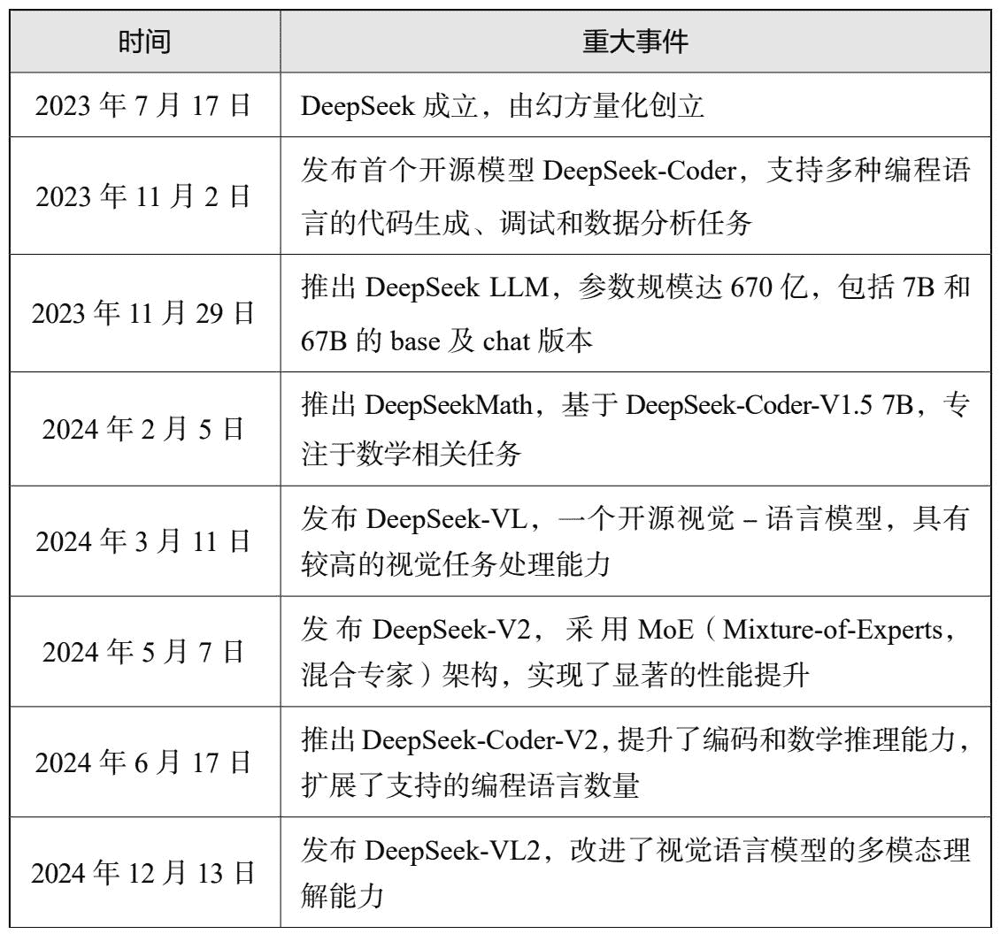

续表

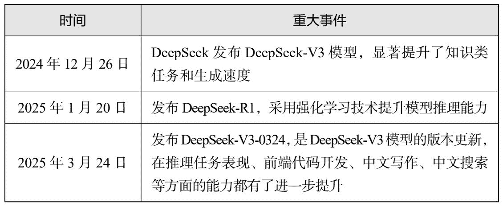

资料来源：根据公开信息整理。

商业化落地进展迅速。例如能源交通领域，道通科技借助 DeepSeek 实现“空地一体”的智能方案；^(²)金融领域，金蝶国际将 DeepSeek 融入全线 SaaS 应用与云平台，为客户提供更高效安全的智能服务。^(³)日常生活、家庭教育、职场工作等场景也广泛应用，如撰写演讲稿、规划旅游路线、数据分析等。

崛起既是技术突破的结果，也是中国 AI 产业自主创新与国际竞争力的体现，其成功为全球 AI 普及注入新动能。

**三、智能中枢如何运转**

**（一）混合专家框架**

DeepSeek 基于先进的人工智能技术，核心是 Transformer 架构。Transformer 专长于处理序列数据，如文字或语音，通过“自注意力机制”让模型在处理每个词时动态关注句子中的其他词，从而把握语义关联。这一机制类似阅读时自动聚焦重点，帮助模型捕捉深层含义。

在此基础上，DeepSeek 做了优化与创新，引入“混合专家”架构，相当于让一组专家共同协作。每个专家负责特定任务或数据特征，输入到来时系统会根据特征挑选最合适的专家处理。如此既提升能力与效率，又节约计算资源。

举例说明。

设想教电脑读小说。它不仅要识字，还要理解“他打了篮球，结果手骨折了”中因果关系。DeepSeek 的方法像给电脑装上“超级阅读器”。

第一层能力：抓重点
阅读器能自动用荧光笔标记关键词。如读到“苹果”，它会联想到前文的“果园”和后文的“手机店”，迅速判断指水果还是品牌。这种“画重点”能力即自注意力机制。

第二层升级：专家会诊
DeepSeek 为电脑配备多领域“专家小组”。处理医疗报告时自动调用医学模块，分析股票信息时启动金融模块。类似医院多学科会诊，不同专家在各自专业领域发言，保证专业性又不浪费资源。

于是当让电脑写一首春天的诗时，它会先用抓重点能力梳理“春天”相关意象，如樱花、细雨、风筝，再调动诗歌专家模块组合词句，犹如诗人团队协作创作。

这种设计让 AI 更聪明，同时避免成为耗电怪兽。如今手机里的诸多智能功能，可能正使用类似技术在后台运行。

**（二）技术创新的要点**

1.独特的注意力机制
对自注意力机制进行了改进，引入局部注意力和稀疏注意力。局部注意力限制关注范围在邻近区域，减少计算量同时保留局部语义捕捉。稀疏注意力通过特定注意力模式，如固定间隔关注点，降低计算复杂度，使模型在更长序列上高效运行，对大规模文本处理尤为重要。

2.高效的参数优化方式
训练过程中采用分布式训练与混合精度训练等先进优化算法。分布式训练把模型与数据分发到多个 GPU 或 TPU 上，大幅加快训练速度，提升收敛效率。混合精度训练结合浮点与半精度计算，既保证精度，又减少内存占用与耗时，使模型在有限硬件下达到更高性能。

3.创新的模型扩展与融合
持续探索模型扩展与融合技术。例如多模态领域，通过有效融合视觉与语言模型，开发出 DeepSeek-VL 等多模态大语言模型，实现图像与文本的联合理解与生成。跨模态扩展拓宽了应用场景，提升了复杂任务表现。

**（三）性能跃升与应用拓展**

基于上述架构与创新，DeepSeek 在多领域实现显著提升。语言生成方面，能产出高质量、连贯且符合语义的文本，广泛用于文本创作、对话系统、机器翻译。代码生成领域，DeepSeek-Coder 等模型可准确理解编程意图，生成高效代码片段，提升开发效率。数学与科学计算方面，模型强化数学推理与逻辑运算，为科研与工程计算提供有力支撑。

**四、跨界人才的合力**

DeepSeek 的创始团队可谓“中国 AI 界的复仇者联盟”。创始人梁文锋原是量化投资领域的算法专家，创立的幻方量化是国内量化投资“四大天王”^(⁴)之一，也是最早将 AI 应用于 A 股投资的先锋。2023 年他创办 DeepSeek，聚焦通用人工智能研发。

核心成员多来自幻方量化，在量化投资与 AI 领域经验丰富。幻方量化为 DeepSeek 提供技术支持、算力与资金保障，使其在短时间内快速发展并取得系列成果。幻方为 DeepSeek 奠定资源基础，DeepSeek 也为幻方在 AI 时代的转型注入新动力。

团队成员多毕业于北大、清华、中山大学等顶尖高校，平均年龄约 28 岁，“90 后”占比超 75%，“95 后”员工占比超 50%。^(⁵)深厚的教育背景与科研实力为技术创新提供支撑。

很多人认为 AI 是理科生专属，但 DeepSeek 融合了文科与理科。核心团队虽多来自计算机、人工智能、数学等理工科专业，但公司积极吸纳文科生。梁文锋曾明确表示愿招揽文科生加入 AI 团队。^(⁶)这种跨学科构成带来多元视角，在语料筛选与优化中发挥重要作用。文科生的语言学、文学知识有助于提升自然语言处理与文本生成能力。

大语言模型的本质是“语言”模型，理论上语言学、文学人才是研究的关键。跨学科团队使 DeepSeek 在技术深度与人文广度上兼顾。

这种融合带来多重优势。理科生的技术实力奠定高性能基础，文科生的视角让应用更人性化、实用化，更好满足不同场景需求。

团队以年轻化、跨学科、本土化著称。年轻带来创新活力，跨学科赋予技术人文温度，本土根基提供坚实土壤。年轻、多元与本土的结合使 DeepSeek 既能快速响应需求，又能深刻理解本土市场的独特性。

团队不仅学术扎实，且具备敏锐科研能力与开放国际视野。年轻结构在新型注意力机制 MLA 与强化学习算法 GRPO 等关键领域取得突破。^(⁷)本土化特征意味着成员均为中国本土人才，体现了中国 AI 的自主创新能力，为中国式现代化贡献力量。通过扁平化管理、鼓励自由讨论与创新，DeepSeek 为年轻科学家提供广阔发展空间与自由实验平台，进一步激发创造力与凝聚力。这些特质塑造了一个充满活力、敢于突破的团队，为 AI 未来注入强劲动力。

其成功不仅是技术胜利，更是对人才多元化的深刻诠释，为人工智能发展提供极具启发性的范例。

**第二节 DeepSeek 的使用场景**

大模型技术正以前所未有的速度重塑生活与工作，从文本生成到语言翻译，从知识管理到决策支持，AI 成为人类创造力与效率的延伸。然而高昂训练成本与技术壁垒让许多创新者望而却步。DeepSeek 的出现打破了这一局面，以低成本训练、开源策略与卓越性能重新定义 AI 大模型的竞争格局。无论是创作者、学习者还是企业决策者，都能获得高效精准的支持，成为技术普惠的先锋。

正如计算机科学家艾伦·凯所言：“预测未来的最好方式，就是创造它。”DeepSeek 以创新力与开放性，为 AI 的未来描绘出更平等多元的图景。

**一、通用写作能力：文本生成与创作**

DeepSeek 在文本生成方面的能力十分突出，能灵活适应多种文体与创作需求，成为专业写作到创意表达的高效助手。无论是新闻稿、市场报告，还是诗歌、故事，都能依据用户提供的关键信息快速生成高质量内容。例如新闻写作时，输入简要背景即可快速构建结构完整、语言流畅的初稿，大幅提升撰写效率。诗歌创作中，可通过调整“温度参数”控制随机性，既生成充满创意的诗句，也保持逻辑连贯，满足不同风格需求。

在创意写作上表现同样出色。它不仅理解用户语义，还能通过多样化输出激发灵感。如输入旅游目的地，即可自动生成详细攻略，包括景点介绍、美食推荐与行程安排，为旅行者提供实用参考。创意激发功能还能基于关键词生成故事大纲或诗歌草稿，帮助创作者突破思维瓶颈。通过精细的提示词工程，还能为文案提供不同语言风格示例或优化文章结构，成为创作者的得力伙伴。

值得一提的是，DeepSeek 在生成文本时注重语言自然流畅与逻辑连贯，同时支持多语言翻译与本地化适配，可在全球范围内发挥作用。无论企业需要专业的市场分析报告，还是个人想创作一首诗，DeepSeek 都能提供高效支持，同时确保人类创作者对内容的最终把控。这种技术与创意的结合，使其在文本生成领域脱颖而出。

二、语义解析与多语互译
在语言理解层面，系统通过前沿的语义拆解手段把握文本深层意图，能够梳理词、短语与句间的关系，面对一词多义、歧义句等复杂现象仍可做出合理判断。情感识别同样可靠，可分辨整体倾向与具体情绪类型，适用于社媒舆情监测、客户反馈洞察等工作。生成侧依托前后语境续写连贯自然的表达，可支撑对话交互、内容创作、自动摘要等任务。语言覆盖范围广泛，主流语种如英语、汉语、法语、西班牙语之外，还包含一批低资源语种。

互译方面，已实现英语、汉语、法语、德语、西班牙语、日语、韩语、俄语等主流语种的双向转换，并持续向低资源语种延伸。翻译底座基于先进神经网络，在保留原文语义的同时追求译文自然度。凭借语境感知与推理，系统可处理复杂句式与文化差异，使译文更贴合目标语表达习惯。该能力在跨语信息交流中实用性强，无论商务往来、学术沟通或日常对话，都能提供即时准确服务，帮助用户跨越语言壁垒。高质量译文也有助于跨文化传播，让文学、影视、音乐等作品更容易被理解与欣赏，推动文化多样性与包容。

应用场景多样。商务沟通中可完成跨语合同、邮件、会议纪要的转换，保证信息准确高效；教育领域可支持多语教学材料的处理，助力师生获取全球教育资源；旅游与文化交流场景下，即时翻译提升旅行者理解与融入度；内容创作与传播中，翻译能力助力作品走向全球，扩大受众并促进交流。总体而言，在语言理解与翻译方面的进展，提升了跨语沟通效率，为全球化背景下的信息流动与文化传播提供支撑。

三、知识整合与自适应学习
在知识管理层面，系统展现出较强的信息整合力，可从海量资料中快速提炼核心要点，并通过构建知识图谱帮助用户把握领域主线。知识获取环节依托自然语言处理，从互联网、数据库、文献等多源渠道识别概念、事实与关系，保证相关性与准确性。整理环节运用语义分析与聚类，将分散信息整合成结构化体系，便于理解与使用。可自动生成知识图谱并可视化知识点关联，帮助用户认识领域的层次与联系。呈现形式丰富，支持文本摘要、图表与交互式图谱，用户可按需选择并通过交互深入细节。

个性化学习是另一亮点。系统会依据学习进度、兴趣点与学习风格定制内容与计划，提升效率。针对用户描述的知识盲区与薄弱点给出有针对性建议；分析学习行为与反馈识别兴趣偏好并推荐相关资源；结合目标与时间安排生成个性化学习方案并融入高效学习策略；同时可动态调整难度与内容，保持挑战性又不造成负担。

实际应用广泛。学术研究中，辅助研究人员快速整理文献、构建图谱，揭示热点与趋势；职业培训中，依据员工发展需求定制培训计划，加速技能形成；在在线教育中，推荐适配资源并提供个性化建议，提升学习效果；在终身学习场景中，提供持续支持与资源，帮助学习者不断更新知识储备。获取、整理、呈现与个性化学习的闭环，为用户提供高效便捷的知识管理方案，推动学习的智能化。

四、逻辑推理与决策辅助
在推理与决策支持层面，系统处理各类逻辑难题与数学问题的表现扎实，推理严谨结果可靠。逻辑推理覆盖命题逻辑、谓词逻辑与归纳推理等，通过形式化推理与规则引擎逐步推导，保证严密性。数学求解涉及代数、几何、微积分等，结合符号计算与数值分析给出精确结果并展示详细步骤，便于理解。整个过程建立在严格逻辑规则与数学原理之上，采用多步验证与交叉核验保证准确性，同时注重可解释性，清晰说明每一步依据，增强信任。

决策支持在商业与科研等领域发挥作用，提供数据驱动建议以降低风险、提升成功率。商业场景中，分析市场、财务、运营数据，帮助制定营销策略、识别风险并制定应对；科研场景中，分析实验数据、文献与领域知识，助力确定研究方向、设计实验方案、优化参数。决策依据来自大数据分析与机器学习模型，从海量数据中提取价值信息，并借助可视化工具直观呈现，便于理解依据。此外，还能识别潜在风险并提出缓解策略，如投资中的分散建议、项目管理中的进度与资源优化，确保顺利推进。

将逻辑推理与数据分析结合，系统能够提供高效可靠的决策支持方案，推动智能决策在各行业落地，带来显著效益提升。

五、用户画像驱动的定制服务
当互联网应用接入 DeepSeek 的 API 后，可基于用户偏好、习惯与行为数据提供高度定制化体验，提升满意度。核心能力包括用户画像构建、聊天风格定制、个性化内容推荐与服务模式定制。通过分析历史行为、兴趣点与使用习惯，系统构建详尽画像，为个性化服务提供基础。例如可依据沟通风格调整机器人语气与回复方式，为偏好简洁者提供简短明了答案，为偏好深入者提供详细分析。内容推荐方面，依据兴趣与历史行为推送个性化内容，如新闻应用中的感兴趣文章，或电商平台中的潜在商品。服务模式也可按需求与场景定制，如智能助手的个性化日程与健康管理建议。

应用场景覆盖面广。智能客服中，依据历史咨询记录与偏好提供更精准服务，对多次咨询同一产品的用户自动识别关注点并给出解答，同时适配沟通风格提升效率。内容推荐场景中，按兴趣与行为数据推荐影视、音乐等个性化内容。智能助手场景中，基于生活习惯与健康数据提供日程提醒、健康建议与运动计划。电商平台中，依据浏览与购买记录推荐相关商品与促销活动，帮助用户发现兴趣点。

融合场景灵活。在新闻阅读应用中融合大模型，可按阅读历史优先推荐科技、财经或娱乐新闻；在健康管理应用中，结合健康数据提供个性化饮食与运动建议；在智能家居场景中，依据作息与娱乐偏好自动调节设备设置并推荐音乐或影视内容。总体而言，个性化定制与服务不仅提升用户体验，也推动智能化服务发展，为各行业提供更高效、更精准的解决方案。

第三节 DeepSeek 与 ChatGPT 的差异观察
OpenAI、Google 等科技巨头凭借雄厚资金与技术积累主导 AI 竞争格局。高昂训练成本与技术壁垒让众多中小企业与开发者难以参与，普惠愿景一度遥远。正是在此背景下，DeepSeek 以低成本训练、开源策略与技术创新打破传统垄断，为行业注入新活力。它大幅降低技术门槛，通过开放共享让更多人参与开发与应用，推动技术普惠。

正如科技先驱史蒂夫·乔布斯所言：“领导者和追随者最大的区别在于创新。”DeepSeek 正以创新力与开放精神重新定义 AI 未来，让技术不再是少数人特权，而是全社会共同财富。

一、算力成本的下移
1.数据对比
在 AI 领域，训练高性能模型的成本曾高得惊人。以 OpenAI 的 GPT-4 为例，其训练成本高达 4000 万美元 ^(⁸)，让许多中小企业和开发者望而却步。随着技术演进，这一局面正在改变。以 DeepSeek-V3 为例，其训练成本仅为 557.6 万美元（见表 1-2）。

表 1-2 DeepSeek-V3 训练成本

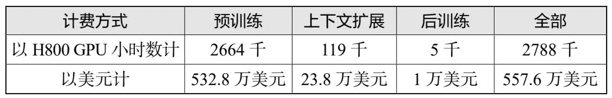

资料来源：DeepSeek-AI  .  DeepSeek-V3Technical  Report（2024）。

注：假设 H800 的租赁价格为每 GPU 小时 2 美元。

巨大差异背后是多项先进技术的支撑。DeepSeek-V3 采用 MoE 架构，通过将任务分派给多个专家模型处理，降低单一模型负担，显著减少算力需求。FP8 混合精度训练技术的应用，使训练过程能更高效利用硬件资源，进一步压缩成本。再加上强化学习优化算法，模型可在训练中自我调节，减少不必要的计算开销。

2.行业影响
成本下降不仅是技术进步，更是对整个 AI 行业的强力推动。过去只有资金雄厚的公司才能承担高性能模型训练，而现在中小型开发者也能以较低成本构建出性能优异的模型（见图 1-1）。

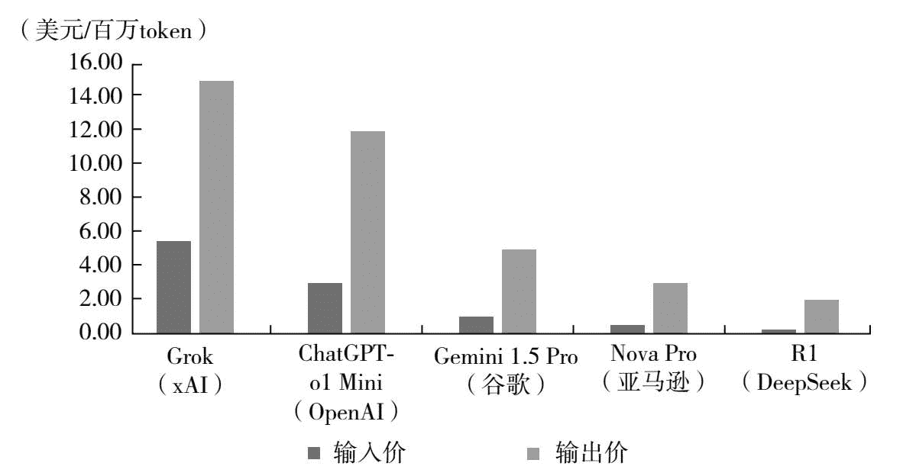

图 1-1 在不同 AI 模型上处理 100 万个 token 的价格[资料来源：DocsBot。注：一个 token 是 AI 模型处理的最小单位（约 4 个字符），o1 是 ChatGPT 的最新模型，图中包括了每家公司最具可比性的模型。]

这种“平民化”趋势加速了 AI 应用普及。随着 DeepSeek-R1 等模型以更低成本提供高效处理，企业和开发者更容易将 AI 集成到产品服务中。这不仅降低进入门槛，还鼓励更多创新与实验，因组织无需巨额预算即可使用先进 AI 技术。

同时，AI 变得更经济后，更多中小企业得以参与，进一步推动市场竞争与多样性。小型企业可借助 AI 优化运营、提升客户服务甚至开拓新商业模式，从而获得竞争优势。

在消费者层面，AI 应用更广泛意味着用户可期待更个性化、智能化的体验。从智能家居到个性化推荐，普及将使这些技术更易获取。即使在资源相对匮乏地区，人们也能享受到语言翻译、图像识别、智能推荐等 AI 便利。AI 技术正以更低门槛、更快速度渗透生活方方面面。

总体而言，训练成本降低让 AI 更亲民，为全球技术创新与应用普及打开新可能。未来随技术持续发展，AI 将不再是少数人专利，而是人人可及的工具。

二、开放共享的策略
在 AI 时代，开源与闭源之争持续升温。DeepSeek 的开源策略是重要里程碑。它不仅将模型权重、代码库如 FlashMLA、DeepGEMM 等以及训练框架全面开源，还采用 MIT 许可证，允许用户自由使用、修改和商业化。这种全栈开源方式降低了中小企业与个人开发者的技术门槛，使其能以更低成本进行模型微调与应用开发。

DeepSeek 于 2025 年 2 月 24 日至 2 月 28 日举行开源周活动。活动期间每天开源一个核心代码库，共开放五个重要底层技术项目代码库（见表 1-3）。

表 1-3 DeepSeek 开源周项目发布安排

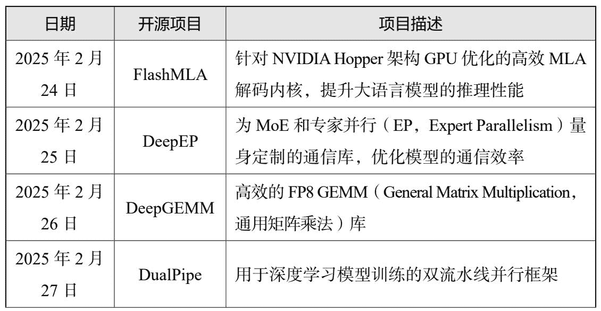

续表

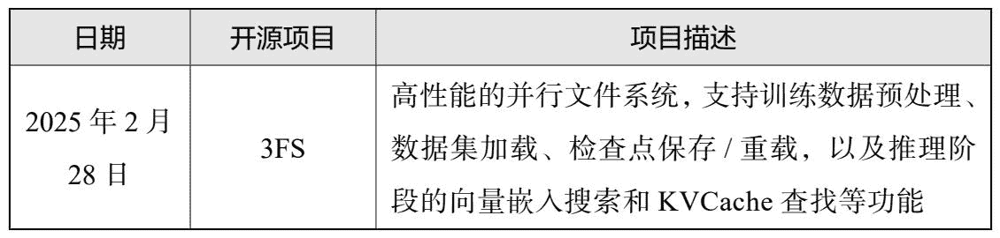

资料来源：根据公开信息整理。

该策略意义多维。一是技术层面推动普惠，让全球开发者使用先进 AI 技术，降低门槛与成本。例如 FlashMLA 提升大模型推理效率，使开发者更高效推理。DeepGEMM 等项目在多个技术领域取得突破，如仅用 300 行代码打造面向 FP8 的矩阵乘法工具，加速模型训练，为行业树立新标杆。

二是行业层面促进竞争与创新，鼓励厂商效仿，形成开放技术生态，助力 AI 快速发展并为用户提供更优质服务。同时挑战英伟达等巨头技术垄断，如 DeepEP 挑战英伟达 NCCL 生态，打破硬件与软件耦合壁垒，为行业带来更多选择与可能性，促进技术多样性与开放性。

三是生态构建层面，通过开源吸引全球开发者参与，形成强大开源生态，有助于技术快速迭代创新，也为 DeepSeek 自身带来机会与资源。开源行为同时彰显中国企业在 AI 领域的实力与开放态度，提升中国全球引领能力，增强在 AI 治理中的话语权，推动中国 AI 技术国际认可与应用。

相比之下，美国 AI 公司多采取闭源策略以保护核心技术与知识产权，通过付费 API 调用、订阅服务等盈利。闭源模型如 OpenAI 的 GPT-4.5 等虽在技术领先性上占优，却限制了技术共享，难以像 DeepSeek 一样吸引全球开发者共建生态。闭源模型如 OpenAI 的 ChatGPT 与 Google 的 Gemini，核心算法与训练数据未完全公开，限制外部研究者对模型的完全理解与创新能力。这种封闭虽有助于商业化与产品稳定，但在技术共享与生态共建方面存在明显不足（见表 1-4）。

表 1-4 中美大语言模型开闭源情况梳理（部分）

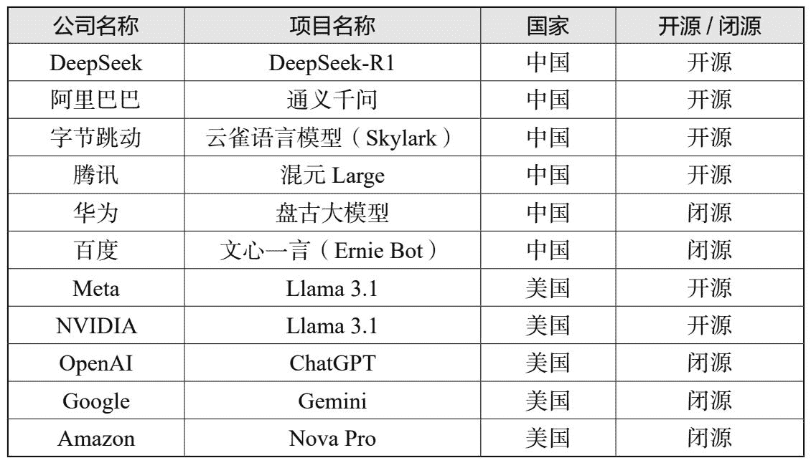

资料来源：根据公开信息整理。

DeepSeek 的开源策略不仅是技术选择，更是一种文化实践。以开放换取社区共创，形成技术标准的隐形控制。它打破封闭巨头垄断生态，激发全球开发者创造力。像 DeepSeek-R1 与 Meta 的 Llama3.1 等开源项目，不仅降低使用门槛，也在全球开发者共同努力下推动 AI 快速发展。正如 DeepSeek 创始人梁文锋所言：“在颠覆性技术面前，闭源形成的护城河是短暂的。即使 OpenAI 闭源，也无法阻止被别人赶超。” ^(⁹)

开源策略降低门槛、推动生态建设，并借助社区力量不断优化模型性能，为 AI 普惠与应用提供新可能。

三、细分领域的表现
1.推理与中文：垂直赛道的高光
在需要严密逻辑链的数学场景中，DeepSeek 展现出独特解题智慧。它不仅能拆解“若集合 X 包含 Y 且 Y 包含 Z，则 X 与 Z 的关系”这类集合论问题，更擅长处理含多重约束条件的工程计算。当海外顶级大语言模型 Claude-3.5 还在为非线性方程组的整数解纠结时，DeepSeek 已能自动切换代数、几何两种思维路径，像同时操控两套思维导图的解题高手。它在 HumanEval-Mul ^(¹⁰) 测试中获得 82.6 分，成功超越 Claude-3.5 的 81.7 分。可把 HumanEval-Mul 想象成一份超级复杂的数学试卷，内容全是编程与数学推理题。DeepSeek 如同数学天才，面对难题能迅速找到思路，给出精准答案。

中文语感的跃迁：能听见弦外之音

在职场用语里，上司对某个提案评价“很有新意”，系统能够分辨出表面褒奖下其实带有保留的意味。古诗文理解的测试中，其他模型常把“落霞与孤鹜齐飞”简单对应为晚霞与野鸭同飞，而 DeepSeek 会指出这是骈文对仗的艺术效果，并联动滕王阁所处的历史时空情境。这种近乎直觉的文化把握，来自对大量古诗词、歇后语、区域方言与民间俗语等中文语料的深度浸润。

2.局限性：文本专家难以跨界

进入类似美术馆的多模态场景，DeepSeek 更像一位只做文字的解谜者。用户若要求生成“唐代诗人对月饮酒的山水意境”，系统给出的赏析可与艺术评论媲美，却无法像 Stable Diffusion 这类生图工具那样落笔为墨。这种功能上的纯粹，与专攻古典文献的学者相近——能拆解《兰亭序》的笔法神韵，却不太擅长即兴创作现代诗。

总体看多模态表现偏弱，图像生成尤为吃紧。普通用户的体感是，与豆包、文心一言等竞品相比，能力版图更窄，主要集中于文本创作、程序编写与逻辑推演。

这些短板说明，即便在垂直赛道取得进展，多模态与功能多样性仍是待补的空间，后续演进很可能指向增强跨模态能力与拓展应用边界。

四、商业模式：以低价完成渗透
1.价格打法：把高算力变成公共品
当行业普遍按字数计费时，DeepSeek 的定价像向市场投下一枚深水炸弹。依托自研 DeepGEMM 方案与分布式推理框架，计算效率被显著提升，硬件开销被压低。以 DeepSeek-R1 的接口为例，每百万输入 tokens 收费 1 元缓存命中或 4 元未命中，而 OpenAI 的同类接口要 55 元与 110 元。低价让中小企业与开发者可以用极低成本调用高性能服务。DeepGEMM 把单次交互的硬件损耗压到近乎可忽略，就像福特靠流水线把汽车送进寻常百姓家，DeepSeek 正致力于把智能能力变成触手可及的基础设施。

2.市场回响：一周内迈向亿级用户
高性价比不仅赢得价格优势，也快速完成市场渗透。上线仅一周，用户规模就净增一亿，增速跑赢对手，活跃度同步抬升。这种反响既证明技术领先，也印证商业逻辑成立。增长速度甚至超过 ChatGPT 的历史纪录，在 AI 圈写下“一周亿级”的增长神话。

背后是精准的三重效应：价格击穿企业采购防线，性能击穿专业领域壁垒，生态击穿开发者准入门槛。

这场商业实验正在改写行业认知：当巨头还在争论 AI 该不该按字数收费时，DeepSeek 用白菜价打开万亿级市场。好比沃尔玛靠极致供应链改造零售业，“高性价比+极致渗透”的组合拳或许在书写 AI 商业化的新范式——在这种范式里，智能服务的计量单位不再是千字，而是心跳，每一次人机思维碰撞都便宜到值得发生。

五、社会影响：普惠与产业重塑
1.门槛下移：从精英工具到大众资源
DeepSeek 的突破在于打破了人工智能“贵族技术”的印象。传统观念里 AI 被少数大厂垄断，研发成本高昂，使用门槛让人望而却步。DeepSeek 通过技术创新与优化大幅拉低使用门槛，让更多中小企业乃至个人开发者能轻松接入应用。这相当于在数字时代发起一次“希望工程”，为有梦想有创意的人提供实现想法的可能，让 AI 从少数人的专属变成大众可得的工具。

正如创始人梁文锋所说：“我们希望更多人，哪怕一个小 App 都可以低成本去用上大模型，而不是技术只掌握在一部分人和公司手中，形成垄断。”

这与上世纪九十年代中国推进九年义务教育颇为相似：当知识资源从稀缺转向普惠，技术红利才能真正落到普通人手里。DeepSeek 在开源上的姿态更像“技术扶贫”，让偏远地区的开发者也能在 GitHub 上“下载未来”。

靠“低成本+开源+持续研究”的组合，DeepSeek 正在把 AI 从神坛拉向现实。

2.政策助力：杭州的创新试验场
杭州这座以互联网经济著称的城市，像一片孕育创新的沃土。DeepSeek 在此扎根成长并非偶然。本地创业环境如春天花园般充满生机，产业链完整，从硬件制造到软件开发，从风险投资到孵化，每个环节紧密衔接，为科技企业提供全方位支撑。

政府对创新的重视尤为突出。为推动 AI 发展，杭州推出专项资金、税收减免、人才引进等优惠政策，如及时雨般滋润 DeepSeek 这类企业。由此催生了以 DeepSeek 为代表的“杭州六小龙”，在各自领域发光发热，形成独特创新生态（见表 1-5）。

表 1-5 杭州“六小龙”

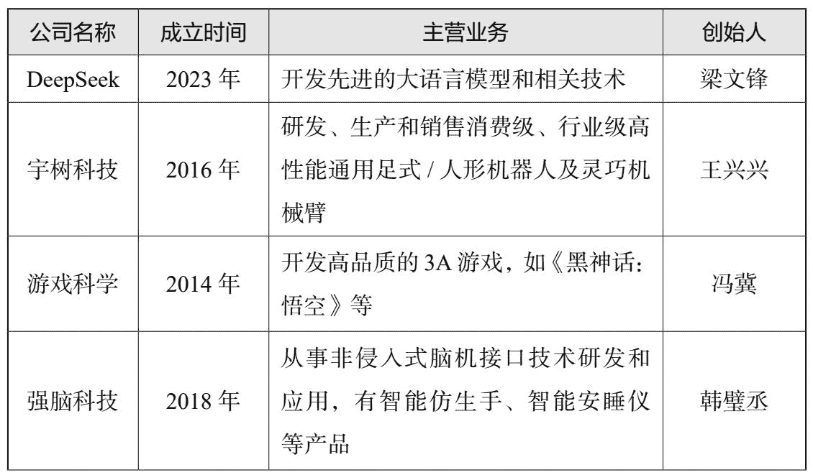

续表

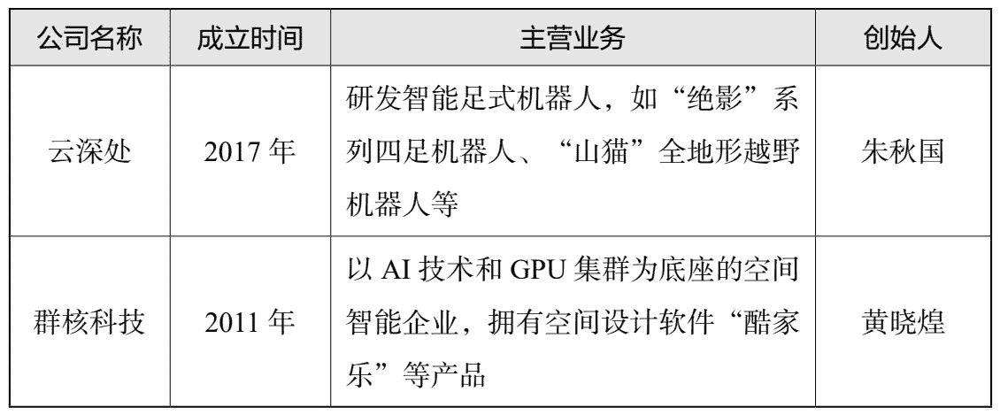

资料来源：根据公开信息整理。

这种“政府搭台、企业唱戏”的模式让杭州成为 AI 创新的天然温室。就像硅谷当年因斯坦福大学与风险资本结合而爆发，杭州正通过政策创新把风景如画的西湖变成数字技术练兵场。

## **[第][二][章]**

## **DeepSeek 发展历程**

**第一节** **创始人梁文锋的成长线**

**一、从小镇到浙大的求学路**
梁文锋 1985 年出生于广东省湛江市吴川市覃巴镇米历岭村，父母均为小学教师。书香氛围对他影响深远。小学就读于吴川市梅菉小学，六年级即通过考试进入吴川市第一中学完成初中高中学业。初中时已自学高中数学，并触及大学层次内容。2002 年，17 岁的他以理科 816 分获吴川一中高考状元，考入浙江大学电子信息工程专业。本科毕业后于 2007 年考入浙江大学信息与通信工程专业读研，师从项志宇研究机器视觉。

彼时的项志宇是浙大副教授，如今是信息与电子工程学院教授、博士生导师，研究机器人环境感知与导航定位及计算机视觉。他还担任信息与通信网络工程研究所副所长。项志宇博士毕业于浙大信电系信息与通信工程专业，既是梁文锋的导师也是直系师兄。项老师 2004 年回浙大任教时，梁文锋正读大二。

在项老师指导下，梁文锋 2010 年获硕士学位，论文题目为《基于低成本 PTZ 摄像机的目标跟踪算法研究》。硕士毕业一年后，与导师合作的论文《一种鲁棒的 PTZ 摄像机目标跟踪算法》发表于《浙江大学学报（工学版）》。同年，另有浙大博士毕业生徐进。

**二、初探量化交易**
徐进是另一位天才少年。本科就读于浙江大学竺可桢学院混合班，后攻读浙大信电学院信号与信息处理博士。参与国家“十一五”计划无人车导航项目、原总装备部无人车项目及嫦娥玉兔月球车视觉导航研究项目。

2005 年，还在读本科的徐进与学长方毅共同注册每日互动。三年后，2008 年全球金融危机爆发，23 岁的梁文锋在浙大读研期间，与读博的徐进及几位同学一起探索全自动量化交易，用机器学习试图破解金融市场密码。当时被视作疯狂尝试，却为他赚到第一桶金，并积累大量行情、金融及宏观经济数据。

梁文锋硕士毕业同年徐进也博士毕业。与同学多获大厂 offer 不同，梁文锋选择前往成都，在出租屋里深耕计算机量化交易技术。深圳城中村研究飞行器的朋友曾邀他加入，被婉拒，他心中怀揣更大梦想。

2010 年他全身心投入全自动量化交易与 AI 算法研究。这一年沪深 300 股指期货推出，为量化投资带来契机。凭借扎实技术与敏锐洞察，团队策略大获成功，自营资金从 6 万元迅速突破 5 亿元。这既验证了量化可行性，也印证了父亲“知识改变命运”的信念。

2012 年深度学习算法 AlexNet 在图像识别取得突破，震撼 AI 圈。梁文锋后表示：“2012 年 AlexNet 的冲击开启新时代，错误率远低于当时模型，复苏了沉睡几十年的神经网络研究。”他坚信 AI 必将改变世界，需充分利用多年积累的量化数据推动更广阔应用。

与此同时，徐进在创办每日互动后先后进入华为和杭州捷尚智能电网科技公司。2013 年，梁文锋与徐进重返杭州，创办杭州雅克比投资管理有限公司，聚焦 AI 量化投资。量化交易依赖数学模型与 AI 自动化决策，其数据基础正是梁文锋多年探索成果。

2015 年 4 月 16 日，上证 50 与中证 500 股指期货挂牌，为量化基金提供更大空间。两个月后，梁文锋与徐进创办杭州幻方科技有限公司，后更名为浙江九章资产管理有限公司，目标成为世界顶级量化对冲基金。幻方是最早探索用机器学习替代传统量化策略的机构之一。梁文锋带领团队仅用 10 张 GPU 显卡，采用高频量化策略，在国内股灾期间取得不俗成绩，逐渐进入公众视野。

梁文锋曾说：“对研究员来说，对算力的渴求永无止境。做完小规模实验总想做更大规模实验。”这种追求驱动他不断探界。2015 年 10 月，幻方一天内成立 10 支产品，两个月后再成立 10 支，募资能力迅速提升。

2016 年 10 月 21 日，幻方首个由深度学习模型生成的股票仓位上线实盘，标志正式进入 GPU 计算时代。之前算法主要依赖线性模型与传统机器学习，计算以 CPU 为主。同年幻方加入中国证券投资基金业协会，专业性与规范性获官方认可。

**三、量化四强格局**
2017 年具有里程碑意义。Transformer 结构横空出世，重塑自然语言处理版图。与此同时，幻方宣布全面将投资策略 AI 化，犹如平静湖面投入巨石，引发诸多质疑。梁文锋在《征服市场的人：西蒙斯传》推荐序中写道：“和很多新技术一样，量化投资刚出现时也是被嘲笑的对象，没有人相信计算机可以像人类一样进行投资。但西蒙斯却敏锐预见到，随着计算机技术发展，终有一天‘不可能’会变成现实。”

詹姆斯·西蒙斯素有“量化投资之父”美誉。1988 年创立文艺复兴科技公司，推出大奖章基金。1988 至 2018 年长达 30 年间，该基金扣除费用后年化复合收益率达 39.1%，累计创造超 1000 亿美元利润。西蒙斯的成就深深影响梁文锋，成为其关键引路人。梁文锋曾写道：“每当工作中遇到困难，我会回想西蒙斯的话：‘一定有办法对价格建模。’”

西蒙斯招聘时只招募无金融背景的数学家、物理学家和计算机科学家，这一理念深植于梁文锋用人策略。幻方核心技术岗位主力多为应届生与毕业一两年的新人，因其思维更纯粹。甚至销售团队骨干也多来自非传统金融领域。

截至 2017 年末，幻方旗下所有量化策略均已采用 AI 模型运算。自 2008 年起团队长期积累市场行情、金融及宏观数据，数据量已突破 10PB。2018 年幻方明确 AI 为核心发展方向，并首次获私募金牛奖。同年 OpenAI 基于 Transformer 推出 GPT-1。梁文锋敏锐察觉美国再度领先，但坚信中国能后来居上。

2019 年幻方管理规模突破百亿元，为把控规模暂停申购与追加。同年 OpenAI 推出 15 亿参数 GPT-2，推动自然语言生成。面对算力需求，梁文锋着手布局超算中心，当时已握有 1000 多张显卡。

2020 年 OpenAI 发布 1750 亿参数 GPT-3。同年 5 月，幻方斥资 2 亿元打造深度学习训练平台“萤火一号”，搭载 1100 张高端显卡，算力相当于 4 万台个人电脑。2021 年 1 月，第二代超算“萤火二号”交付，搭载 1 万张高端显卡，算力为“萤火一号”约 18 倍。当多数 AI 研究者尚未意识到“万卡”已成通用智能关键壁垒时，幻方早已对员工调用算力不设限制。

2021 年幻方管理规模突破千亿元，跻身“量化四大天王”，业内流传“北九坤，南幻方”。当年业绩波动，部分低风险对冲产品亏损。2021 年 12 月 28 日，幻方通过微博致歉，称“长周期持股波动以及策略同质化是导致业绩不佳主要原因”。尽管波折，幻方在合格投资者中热度不减。2022 年宁波幻方量化位列热搜榜第三。

2022 年幻方整体收益率仅 0.38%，公司主动将规模压缩至约 500 亿元。即便如此，技术追求从未动摇。彼时幻方拥有超 1 万张英伟达 A100 显卡，总价值超 3 亿美元。梁文锋已实现财富自由，匿名向母校浙江大学捐赠 2.5 亿元。公司每年投入 2 至 3 亿元公益。2022 年幻方及其员工“一个平凡的小猪”累计捐赠约 3.59 亿元，支持 15 家慈善机构 23 个项目。有报道认为“一个平凡的小猪”极可能即梁文锋本人。

在许多人看来梁文锋的人生已是完美的“赢家剧本”，在他自己眼中这只是新起点。梦想远不止于此，未来将继续在 AI 与量化投资赛道探索未知。

**四、从量化投研到通用智能**
2022 年 ChatGPT 横空出世，交互能力空前，两个月即吸粉 1 亿用户，成为史上爆红最快应用。这一现象级产品点燃国内 AI 市场，一时间相关公司股价飙升，部分企业连夜炮制“AI 应用”搭车。

梁文锋却从中看到更深问题。他意识到中国 AI 不能长期扮演跟随者。有人说中美差距仅一两年，实则原创与模仿天差地别。若不改变，中国永无领跑可能。梁文锋清楚，有些探索无法回避，也必须直面。

量化老将向 AGI 进发

2023 年初 OpenAI 公布 GPT-4，多模态整合能力实现明显跃升，业内普遍感到拐点已到。同一时间梁文锋也在做新的部署。4 月 14 日幻方量化通过公众号宣布组建新的研究组织，公开表示要探索通用智能的底层本质。招聘海报上引用了法国导演特吕弗的说法：要疯狂地保持雄心，也要疯狂地保持真诚。

在一次访谈里他说得很清晰：目标就是通用智能，也就是 AGI，而语言大模型是通往 AGI 的必经路径，并且已经显现出 AGI 的雏形，所以选择从这里切入。5 月时年 38 岁的他正式对外宣布进军通用智能。7 月杭州深度求索人工智能基础技术研究有限公司成立，市场简称 DeepSeek。

在量化圈里他是第一个把 AI 创业单拎出来的从业者，消息被广泛放大。幻方成立之初 AI 就已是核心工具，但当他说要做大模型时回应更多是质疑：量化业务如此赚钱，为何要去碰风险极高的大模型赛道。

梁文锋回应称，大模型研发与量化、与金融没有直接关联，所以独立建公司来做。在幻方的主力阵营里不少人本身从事 AI。团队尝试过很多方向，最后落在金融这样复杂度很高的场景，而通用智能也属于当下最难的命题之一。对团队而言问题不在于是否值得做，而在于怎样做好。

摆在面前的并非动机，而是方法。天时、地利、人和基本齐备。时间窗口上 AI 技术已趋成熟；资源上国内能动用上万张 GPU 的机构很少，幻方就在其中；人才上幻方核心骨干里就有不少资深 AI 研究者。基于这些条件梁文锋认为：既然想做也有能力，这个节点我们有资格成为候选者之一。

他的姿态被外界形容为舍我其谁。多年以来中国公司习惯把国外创新引入本土再变现，他并不认同。在本轮浪潮里 DeepSeek 的定位不是趁势收割，而是要站在技术前沿，带动生态整体进步。

他曾提到，随着经济发展中国需要逐步从使用者变为贡献者，而不是长期搭便车。过去三十年 IT 周期里中国基本没有参与真实的技术创新，大家习惯摩尔定律自动到来，躺在家里 18 个月就能获得更好硬件和软件。Scaling Law 也被如此对待。但这其实是西方主导的技术共同体一代代积累的结果，过去缺席才让它显得理所当然。

在他看来差距不是一两年，而是原创与模仿的本质不同。中国不应坐享其成，而要投入研发，成为全球技术生态的建设方。

2024 年 5 月 39 岁的梁文锋带着 DeepSeek 发布了基于 MoE 的语言模型 DeepSeek-V2。API 定价为百万 tokens 输入 1 元、输出 2 元，约为 GPT-4 Turbo 的百分之一。产品上线后字节、阿里、百度、腾讯等大厂纷纷跟进调价，行业迅速陷入价格战。

他反复强调，无论 API 还是 AI 都应该普惠，让普通人用得起。技术使命是服务大众而非单纯商业博弈。这种理念在定价策略上体现得很彻底，降价触发了全行业的价格竞争，也让更多人接触到 AI。于是有了“AI 界的拼多多”这样的说法。梁文锋和团队不仅在技术上冲锋，也在普及层面迈出关键一步，这既是一次商业尝试，也是对技术未来的深层探索。

**第二节** **DeepSeek 背后的团队与机构**

**一、缘起：幻方量化**

DeepSeek 的源头可以追溯到幻方量化 High-Flyer Capital，这是一家在量化投资领域颇具影响力的机构。公司成立于 2015 年，创始成员多来自顶尖高校和科技企业，以数学与计算机科学为根基，目标是用技术创新提升市场效率。核心优势在于数据处理和算法研发，很快在量化领域站稳脚跟。官网介绍称团队恪守“科技驱动投资”，持续探索前沿技术并落地到策略。业绩是一方面，更重要的是它培养出一批兼具创新精神和实战能力的技术人才，为 DeepSeek 储备了人。

总部设在杭州，在上海也有办公室。管理层包括梁文锋、徐进、蔡力宇、陆政哲等人。成员多为数学、物理、计算机方向的顶尖人才，包含数学奥林匹克金牌获得者、AI 专家、博士等。2020 年左右团队约 130 人，研发团队超 60 人，硕博比例达 100%。AILab 约二十余人，核心成员涵盖国内最早的量化交易者、金牛奖获得者、智能机器人科研专家，以及搜索引擎、大数据与模式识别、深度学习领域的专家等。 ^(²³)

选人上幻方更看重潜力而非履历。不同于传统金融机构，他们主要从学术界和科技行业吸纳人才。公司推行“代码即资产”，鼓励持续优化算法与模型。

尽管研发和策略相对独立，幻方也保持对外合作。例如与浙江大学保持紧密联系，联合开展研究，联合创始人徐进担任浙江大学资本市场研究中心特聘研究员。公司还常参与行业交流，分享经验。这种开放风格帮助它吸收外部资源，提升技术水准和影响力。幻方量化的发展脉络如表 2-1 所示。

表 2-1 幻方量化发展历程

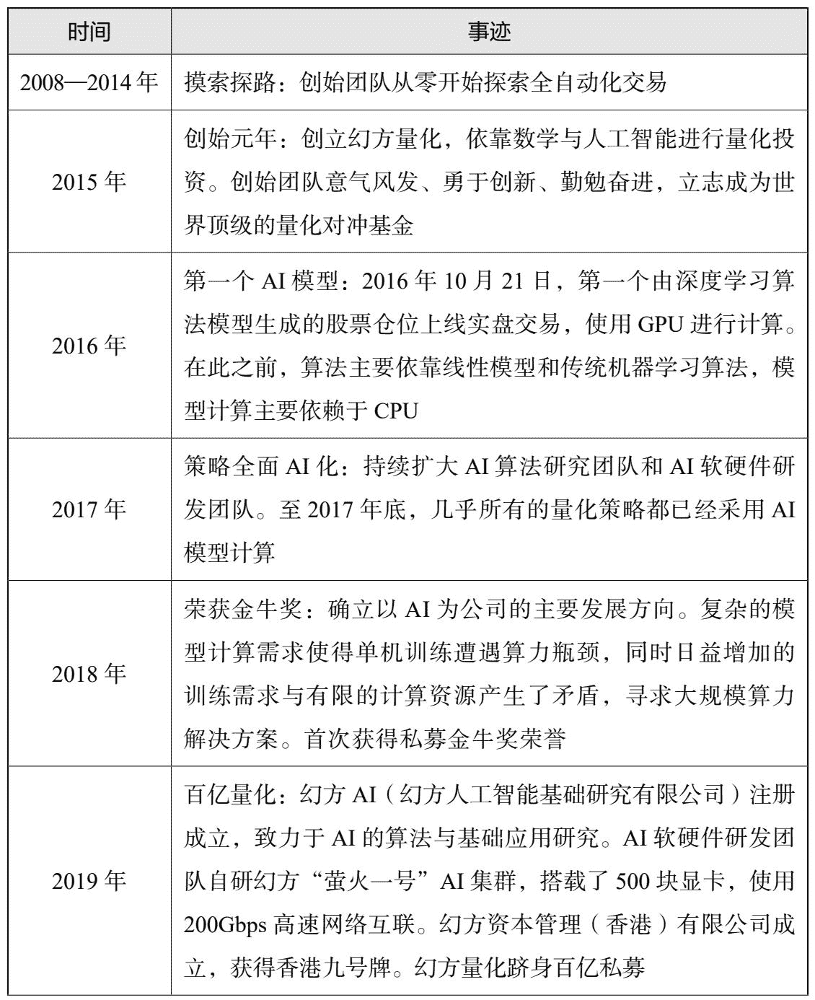

续表

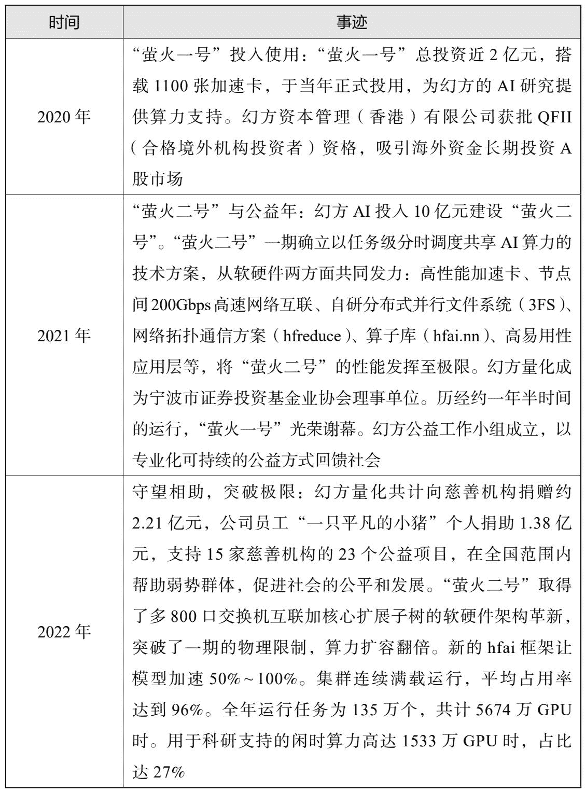

资料来源：根据幻方量化官网信息整理。

据私募排排网数据，徐进管理的九章幻方中证 500 量化多策略 1 号成立以来，截至 2025 年 3 月 9 日收益率达 338.96%。

从基金管理人履历可见，该团队不仅学术背景深厚，在量化投资上的实战经验也丰富。教育背景涉及电子信息工程、金融、信号与信息处理等，显示出选才的多元和专业。从业年限约 10 至 18 年，行业理解扎实。

**二、破局：萤火**

幻方在发展中意识到 AI 在金融里的应用空间远大于传统量化模型。于是把资源投向 AI 研发，2020 年推出“萤火”平台。萤火聚焦金融场景，用深度学习、自然语言处理等技术从海量数据里挖掘价值，为投资决策提供更精准支持。这标志着从传统量化向智能化投资的转型，也为 DeepSeek 积累了技术和人才。成功来自技术先进性，也来自对市场的深刻理解和落地的坚持。

在幻方官网左侧目录里，“萤火”用蓝色艺术字体突出显示。

“萤火一号”2020 年正式启用，总投入近 2 亿元，搭载 1100 枚高性能 GPU，算力相当于 4 万台个人电脑，每秒约 1.844 亿亿次浮点运算，18.4PFLOPS，支持 32 位精度，平均使用率超 90%。 ^(²⁴)平台采用任务级分时调度，实现软硬件高效协同。

2021 年投入 10 亿元建设“萤火二号”，算力是首代的 18 倍，达 325PFLOPS TF32。约 1 万张英伟达 A100 显卡，硬件、网络通信、存储系统全面优化，可用性和性能都有保障。 ^(²⁵)

萤火系列为量化策略提供强算力支持，也推动 AI 在金融的广泛应用。研究员可以快速验证想法，不受算力和模型规模限制，研究效率大幅提升。同时也在探索通用智能的新路径，进一步巩固 AI 领域的领先。

搭建平台不仅是为了内部需求，也是为了看未来金融市场里 AI 的潜力。高效稳定的算力平台让模型迭代和策略优化更快，也能吸引顶尖人才加入。在《幻方萤火深度学习训练平台使用申请》的开头写着“平台主要面向深度学习研究人员，用户申请经审核通过，将由平台分配使用账号”。建设过程中体现了对开源精神的支持，鼓励共享交流，促进行业进步。

萤火系列是幻方在 AI 驱动下的重要里程碑，提升了算力水平，也为量化投资和基础研究打开新空间。

**三、新生：DeepSeek**

从公开信息看，DeepSeek 团队气质很独特。核心成员来自不同顶尖领域，技术研发汇聚了深度学习、强化学习等方向的资深专家，参与过多个大型 AI 项目，在模型架构设计和算法优化上有突出能力。部分成员在国际 AI 竞赛中取得优异成绩，实力得到认可。

招聘上，DeepSeek 表现出很强的多元化诉求。除了要求熟练掌握 TensorFlow、PyTorch 等框架、数学基础扎实外，更看重创新思维和跨领域学习能力。积极寻找计算机与生物、物理等学科交叉的人才，期望不同思维碰撞出新思路。同时偏爱有创业精神和项目实战经验的人，希望成员在快速变化的行业里主动推动进展。

管理上采用扁平化，淡化职级，鼓励自由交流与创新。组织形态接近学术研究机构，按目标分成研究小组，形成“学院派”氛围。没有固定分工和层级限制，成员可按兴趣选方向、自由组队。这种模式提升灵活性，也加快响应和决策。

团队非常年轻化，以“90 后”“95 后”为主，平均年龄约 28 岁，“90 后”占比超 75%，“95 后”占比超 50%。年轻不仅体现在年龄，也体现在职业阶段和学术背景上。不少是应届毕业生、在校学生、博士生和实习生。这种重潜力的策略保证了持续的创新活力和灵活性。

**第三节** **产品发布与初期市场反响**

**一、产品发布历程**

DeepSeek 作为中国 AI 的后起之秀，产品节奏很快，技术迭代的加速度折射出在通用智能上的野心。从早期探索到关键迭代，再到 R1 的突破，两年内完成从追随到引领的转变，见表 2-2。

表 2-2 DeepSeek 模型和产品发布历程

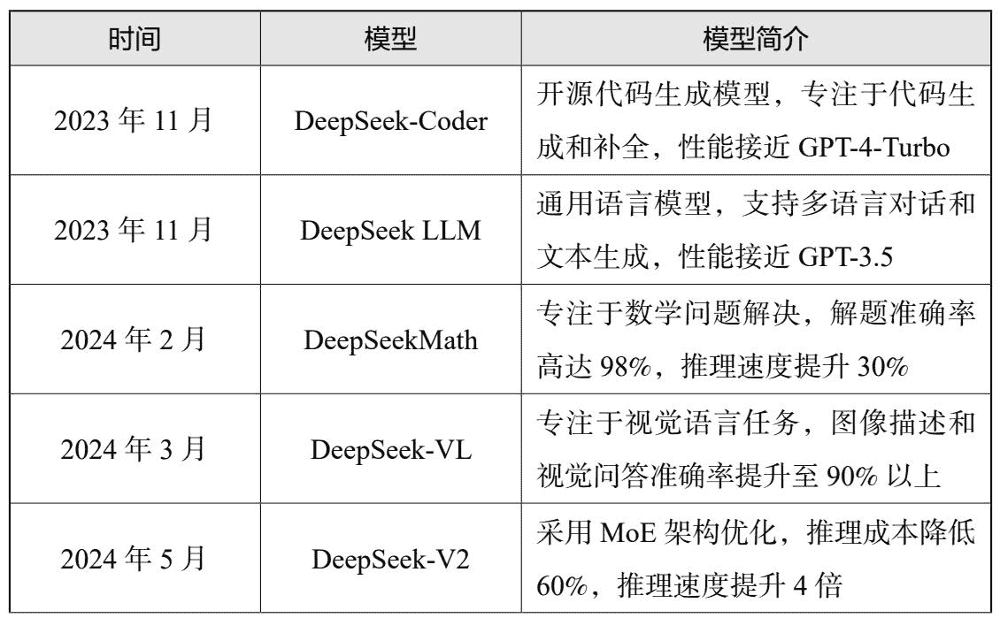

续表

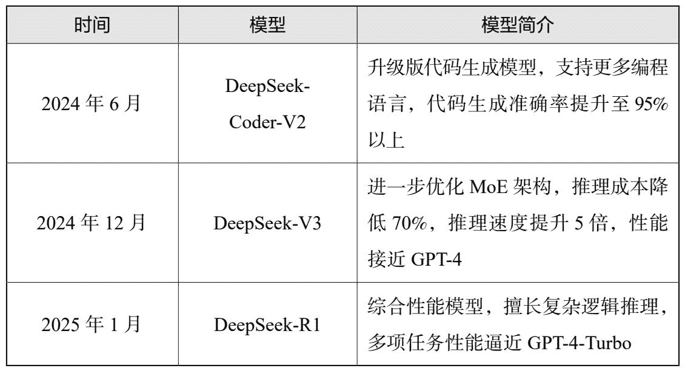

资料来源：根据公开信息整理。

1.早期模型的推出：DeepSeek-Coder

2023 年 11 月，DeepSeek 推出首款 AI 产品 DeepSeek-Coder，正式进入 AI 赛道。产品聚焦代码生成与理解，为开发者提供智能编程辅助。

• 代码生成能力：支持 Python、Java、C++ 等多种语言，能按自然语言描述生成高质量代码片段，覆盖函数到模块级别。
• 代码补全与优化：基于上下文的智能补全，提升开发效率；同时给出优化建议，减少冗余、提升性能。
• 跨语言转换：可在不同编程语言间转换代码，便于多语言团队协作。
• 应用场景：软件开发、教学学习、代码审查等，成为开发者的“AI 编程助手”。

这次推出积累了产品开发经验，为后续升级奠定基础。

2.关键模型的迭代升级：DeepSeek-V2

2024 年 5 月，DeepSeek-V2 面世，采用 MoE 架构，在性能和成本间取得明显平衡，引发广泛关注。

• MoE 架构创新：动态路由把任务分给不同专家子模型，降低推理成本的同时保持输出质量。
• 推理成本优化：相比传统架构，推理成本下降约 60%，为大规模商用铺路。
• 多模态能力：支持文本、图像、代码等多模态输入，拓展应用边界。
• 行业影响：标志着在模型架构上的领先，为行业提供低门槛高性能方案。

该产品巩固了技术优势，也为后续研发提供关键支撑。

3.重大突破与 R1 模型发布：DeepSeek-R1

2025 年 1 月 20 日，DeepSeek 推出里程碑产品 DeepSeek-R1，在数学、代码和复杂逻辑推理上展现强劲实力。

• 数学与逻辑推理能力：在 GSM8K、MATH 等基准上准确率超过 GPT-4，逻辑分析和问题解决能力突出。
• 代码生成与优化：在 HumanEval 等任务上表现接近顶尖人类开发者，支持实时优化与重构。
• 推理过程透明化：引入“思维链”机制，让推理过程可视化，增强用户信任。
• 多任务泛化能力：在自然语言理解、图像生成、代码生成等任务上均表现稳健，显示出通用 AI 基座潜力。

R1 的推出是中国 AI 在全球竞争中取得突破的标志，也为商业化应用拓展奠定基础。

从 DeepSeek-Coder 到 DeepSeek-V2，再到 DeepSeek-R1，产品线清晰展现持续投入和创新。每一步都在拓展技术深度与广度，也为通用智能的未来布局提供支撑。

**二、用户增速创造历史**

产品推出后用户增长非常迅猛。14 天内吸引 100 万用户，20 天内突破 1000 万。 ^(²⁶)2025 年 1 月用户总量达 1.25 亿，包含网站和应用，其中 80% 以上来自 1 月最后一周，7 天内完成 1 亿增长 ^(²⁷)（见图 2-1）。

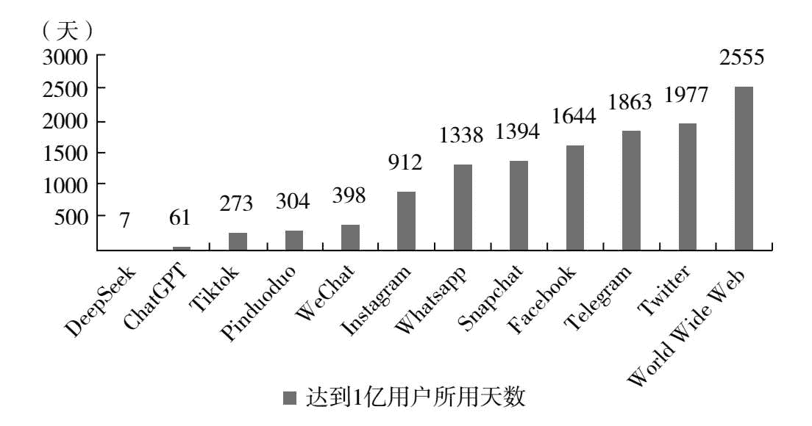

图 2-1 不同平台达到 1 亿用户所用天数[资料来源：数据来自 aicpb.com。]

移动端应用上线 5 天日活就超过 ChatGPT 同期水平，成为全球增速最快的 AI 应用。2025 年 1 月 25 日上线移动端，仅 5 天就登上月活榜第 14 位，2 月份升至第 2 位 ^(²⁸)（见图 2-2）。

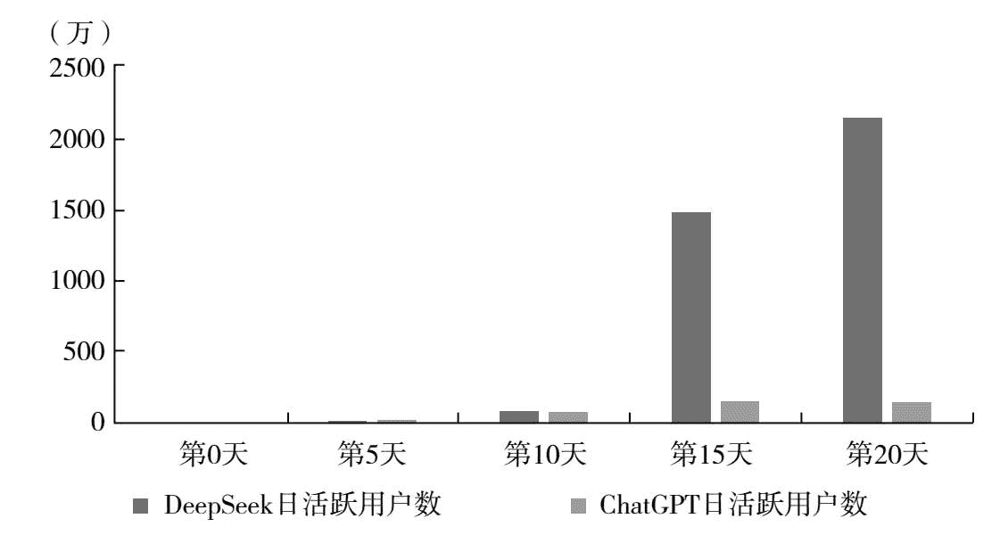

图 2-2 DeepSeek 和 ChatGPT 日活跃用户数对比[资料来源：数据来自 aicpb.com。注：App 用户数不含网页端用户数。]

国内市场里，DeepSeek 迅速登顶月活榜，成为 AI 应用领军者。增长不仅体现在数量，也体现在活跃度和参与度，移动端日活一度超过其他主流 AI 应用。

凭借优异性能和开源策略，DeepSeek 在全球迅速吸粉，实现爆发式增长。国内推动 AI 在多行业落地，海外热度也在不断扩大，成为全球 AI 领域的重要参与者。

根据 Sensor Tower 的统计，DeepSeek 在移动终端的互动活跃度略微领先 Perplexity 与 Claude。较高的留存粘性形成自我强化的正向回路，成为其快速裂变传播的重要推手。

**三、巨头纷纷站队**

DeepSeek 面世后，国内主流互联网平台迅速响应接入，凸显出该模型在人工智能赛道上的号召力与商业想象空间（见表 2-3）。百度最早宣布旗下搜索业务与文心智能体平台全面对接 DeepSeek，为用户带来即时的人工智能体验。腾讯则通过微信搜一搜引入 DeepSeek-R1，一次性打通十亿级入口，并以投资与合作进一步加码布局。阿里巴巴与字节跳动紧随其后，或将 DeepSeek 模型与自研模型融合，或在评估整合路径。

表 2-3 官宣接入 DeepSeek 的国内公司

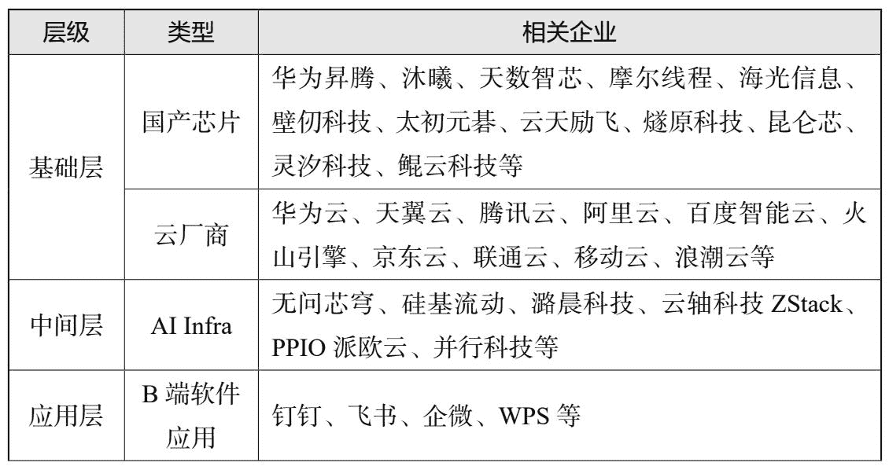

续表

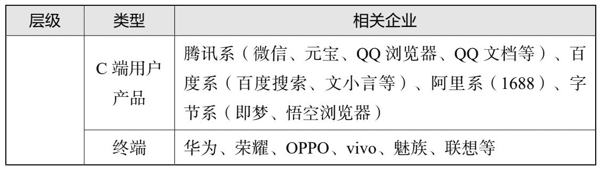

资料来源：根据公开信息整理。

得益于性价比突出，DeepSeek 开始被华为、京东等多家公司纳入自有生态，推动人工智能在不同行业的落地。例如九号公司深度融合 DeepSeek 后，其出行类 App 的智能化水平显著提升。同时，该模型也进入云计算场景，在阿里云、腾讯云等平台落地，辐射面进一步扩大。

从应用层到中间件再到底层，厂商几乎同步完成对接。尤其在底层，海外芯片与云服务商亦纷纷表态支持。AMD、英伟达、英特尔等芯片厂商通过硬件调优、技术协同与联合开发，助力 DeepSeek 在多样化硬件上实现高效运行与扩展（见表 2-4）。阿里云、腾讯云、百度智能云等云服务提供商则通过上线 DeepSeek 大模型、开放推理服务、推出优惠举措等方式，加速其在云端普及，助推创新。这些协同既体现了 DeepSeek 的行业影响力，也反映出其在全球科技体系中的认可度。

表 2-42025 年宣布接入 DeepSeek 的美国公司

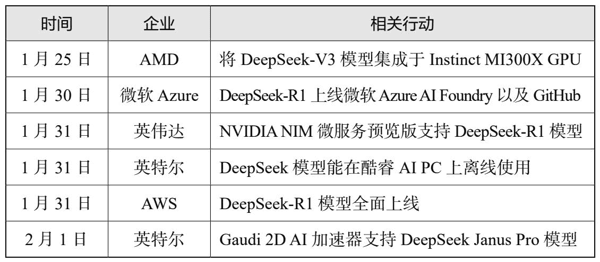

资料来源：根据公开信息整理。

DeepSeek 的崛起模糊了传统互联网头部之间的边界，倒逼资源互通与协同，成为各方竞相追逐的新宠。

**四、算力格局重塑**

DeepSeek 的走红同步掀起算力变革。

一方面为国产芯片带来增量机会，另一方面缓解了部分智算中心算力闲置的矛盾。

DeepSeek 凭借创新的 MoE 架构与算法优化，显著压缩了模型训练与推理所需的算力。需求下降后，即便是性能一般的 GPU，例如英伟达 H20，也足以完成本地化部署，降低了对顶级芯片的依赖。国产芯片厂商得以借助现有硬件资源实现高效部署，无需完全倚赖高端 GPU，并在适配过程中提升自身在算力生态中的竞争力（见表 2-5）。

表 2-5 芯片参数对比

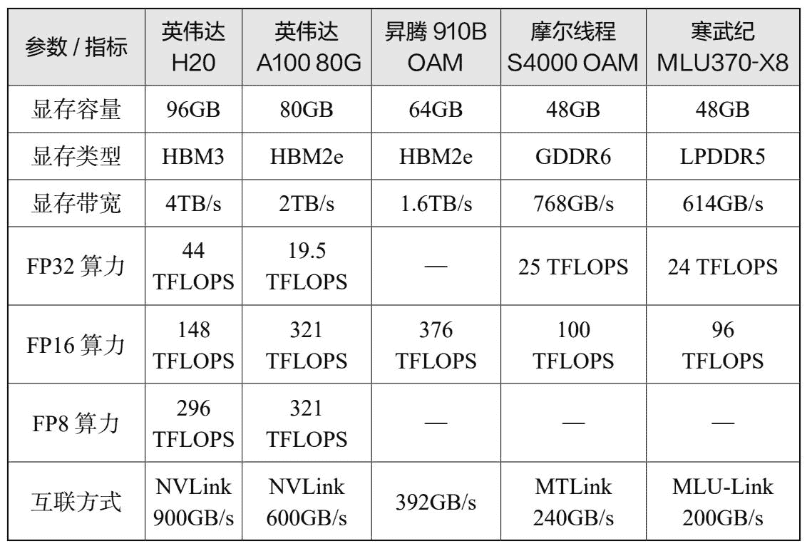

资料来源：根据公开信息整理。

开源属性进一步推动国产算力的整合优化。开源降低了技术门槛，带动上下游协同，多家国产 AI 芯片厂商迅速接入 DeepSeek 模型，实现软硬件协同能力的提升。这种生态整合提高了国产算力的使用效率，也为智算中心消化闲置算力提供了路径（见表 2-6）。

DeepSeek 通过降低算力门槛、强化硬件适配，为国产芯片与算力服务商打开新空间，推动国产算力整合与优化，从而引发行内的算力变革。

表 2-6 各大厂商纷纷推出 DeepSeek 一体机

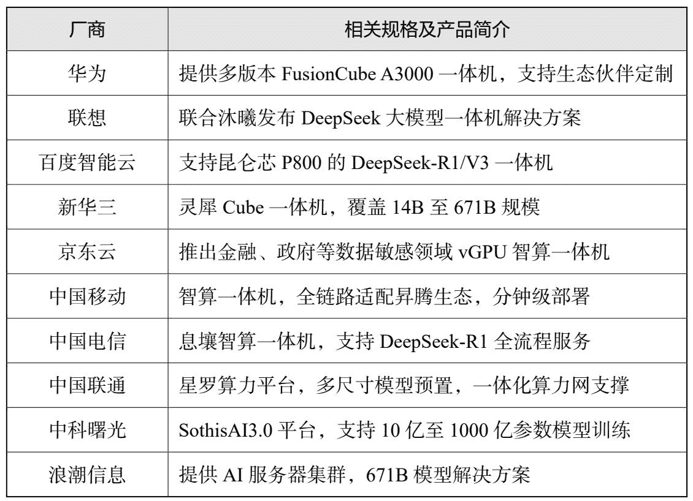

资料来源：根据公开信息整理。

## **[第][三][章]**

## **中国 AI 发展历程：从“四小龙”到“六小虎”再到 DeepSeek**

**第一节** **中国 AI“四小龙”崛起**

**一、政策东风与时代浪潮**

**（一）政策扶持**

20 世纪末至 21 世纪初，中国政府逐步认识到高科技尤其是人工智能对经济发展的战略意义，陆续推出扶持举措（见表 3-1），主要体现在以下方面。

• **科研资金投入：**依托国家自然科学基金、科技重大专项等渠道，为 AI 研究提供持续资金支持，鼓励高校、科研院所与企业开展技术创新。
• **产业园区建设：**在全国布局中关村、张江等高科技园区，给予 AI 企业发展环境与政策优惠，吸引众多初创团队入驻。
• **人才培养：**通过高等教育、科研项目与国际合作，培养 AI 领域高端人才，为“四小龙”等企业发展提供人才基础。

表 3-1 中国支持人工智能的政策

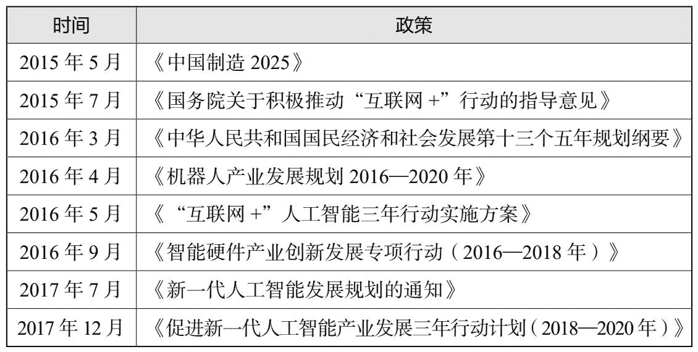

资料来源：根据公开信息整理。

上述政策为商汤科技、旷视科技、云从科技、依图科技等“四小龙”的崛起提供了制度基础，使其能在较短周期内实现快速成长。

**（二）时代需求**

与此同时，互联网经济的繁荣催生了海量数据，企业对 AI 的挖掘能力需求迫切，形成了“四小龙”成长的土壤。

• **数据爆发：**电商、社交、移动支付等应用普及带来数据井喷，企业需借助 AI 深度挖掘，提升运营效率、改善用户体验并孵化新模式。
• **降本增效：**在激烈竞争中，企业急需 AI 驱动自动化与智能化，降低成本、提高效率。图像识别、语音识别、自然语言处理等应用为此提供了解法。
• **创新驱动：**AI 快速发展催生智能客服、智能推荐、自动驾驶等新场景，为企业创造新的增长点，带动“四小龙”加速成长。

据互联网数据中心与申万宏源研究所当时的报告显示，2019 年中国计算机视觉市场中，AI“四小龙”合计份额已超过一半（见图 3-1）。

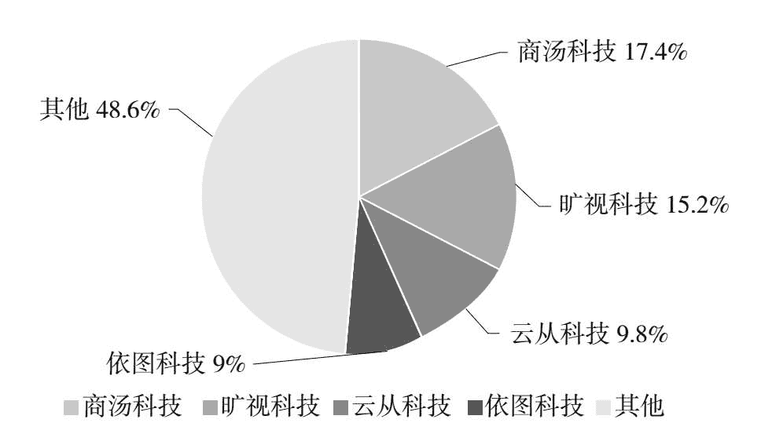

图 3-12019 年中国 AI“四小龙”所占市场份额[资料来源：数据来自 IDC，申万宏源研究所。]

**（三）“四小龙”的崛起**

在政策与需求双重作用下，商汤科技、旷视科技、云从科技与依图科技迅速成长为全球 AI 重要力量。

• **商汤科技：**2014 年成立，深耕计算机视觉与深度学习。其名取自商汤王，寓意创新与引领。凭借强算法与丰富场景，在安防、金融、手机、汽车等领域占据重要位置，人脸识别技术处于全球领先。
• **旷视科技：**2011 年由三位清华学子创立，寓意“旷世之视”。以人脸识别为核心，在安防监控、智能硬件、金融等领域实现突破，技术服务覆盖国内外，成为中国 AI 走向世界的重要代表。
• **云从科技：**2015 年成立，聚焦人脸识别与智能视频分析，寓意“云随人动”。在银行、机场、地铁等行业广泛落地，智慧出行场景应用尤为突出。
• **依图科技：**2012 年成立，兼顾计算机视觉与自然语言处理，寓意“依图而治”。在医疗、金融、安防等领域取得进展，医疗 AI 技术在国际上具有领先性。

这些企业在技术与商业模式上持续创新，推动中国 AI 产业快速发展。受益于持续政策支持与市场扩张，“四小龙”有望在全球市场占据更重要位置，并推动经济数字化转型。

不过发展过程中也存在挑战。尽管云从科技率先通过科创板上市，但“四小龙”整体仍处亏损，面临盈利模式待明确、数据合规、研发投入高企等问题，同时行业泡沫、融资依赖与商业化落地难度亦不容忽视。

在此背景下，互联网巨头也开始通过设立 AI 实验室等方式布局人工智能，为主营业务赋能。

**二、互联网巨头的 AI 之路**

除“四小龙”外，多家企业以独特布局影响行业走向。

• **百度：**2001 年成立，起家于搜索。2011 年上线翻译起步于 AI 应用，2016 年启动百度大脑，系统构建语音识别、图像识别、自然语言处理能力，并延伸至无人驾驶、智能家居等，Apollo 自动驾驶平台为典型案例。
• **字节跳动：**2012 年成立，2012 年 8 月推出今日头条个性化推荐引擎实现算法推荐商业化；2016 年孵化抖音，依靠 AI 精准分发迅速出圈，AI 驱动内容分发与广告投放成为其盈利核心。
• **腾讯：**1998 年成立，2011 年微信上线推动其 AI 布局。AI 技术广泛用于游戏开发与体验优化，优图实验室专注计算机视觉，为社交、金融、医疗提供智能化方案，微信“扫一扫”即为代表。
• **科大讯飞：**1999 年成立，聚焦语音技术。2008 年语音识别取得重大突破，随后推出智能语音助手，2015 年发布 AI 教育产品，技术已在教育、医疗、政法等领域广泛应用。
• **阿里巴巴：**1999 年成立，电商龙头。2017 年阿里云推出 ET 大脑正式切入 AI，技术应用于淘宝推荐、菜鸟物流效率提升、蚂蚁金服风控等，并通过达摩院加强基础研究。

这些企业不仅推动中国 AI 技术进步，也在全球舞台展现中国实力。

**三、技术突围与行业赋能**

**（一）数据金矿：AI 的燃料**

数据决定模型性能。百度、腾讯等大厂拥有海量用户数据，为模型训练提供素材，并通过传感器、物联网等探索新增数据渠道。商汤、旷视等“四小龙”则通过行业合作获取垂直数据，例如商汤在安防领域的数据积累巩固了其人脸识别优势。

**（二）算法革新：AI 的灵魂**

算法决定智能水平。字节跳动的推荐引擎通过持续优化实现精准兴趣分析，提升体验与广告效率。科大讯飞在语音识别上的突破亦源于算法迭代。商汤、旷视等企业通过自主研发在视觉与自然语言处理领域实现突破。

**（三）算力拓展：AI 的引擎**

算力支撑训练与推理速度。百度、腾讯等拥有强算力资源，支撑 Apollo、优图等业务。商汤、旷视等也在自建数据中心与高性能设备投入上不断提升算力。

数据、算法、算力构成 AI 三大支柱。中国互联网大厂与“四小龙”依托此实现技术突围与行业赋能，未来有望在更多场景持续发力。

**四、行业引领与人才培养**

互联网大厂与“四小龙”在技术突破的同时，积极参与标准制定与人才培育，为生态建设奠基。

在标准方面，百度通过 Apollo 推动自动驾驶标准制定，腾讯参与金融科技 AI 应用标准建设，“四小龙”在计算机视觉、语音识别等领域亦推动规范化进程。

在科研合作与人才培养方面，企业与高校院所联合设立研究基金、联合实验室，通过实习与校招吸纳优秀毕业生，字节跳动、科大讯飞、“四小龙”等均有相应布局。这些积累为后续“六小虎”崛起与 DeepSeek 创新提供了必要条件。

**五、挑战与突破**

彼时，中国互联网大厂与 AI“四小龙”在引领发展的同时面临多重挑战。

**（一）国际竞争**

全球 AI 竞速加剧，百度、腾讯等在无人驾驶、智能家居等领域与谷歌、亚马逊等巨头竞争，“四小龙”在视觉、语音等细分赛道亦面临海外对手压力，需提升创新能力与国际化布局。

**（二）技术瓶颈**

卡在瓶颈，国产AI的突围笔记

制约人工智能向上走的核心阻力，来自技术层面的天花板。国内厂商在做产品迭代的同时，也在寻找突破限制的路线。

字节跳动在内容分发和个性化推荐上已经形成明显优势，下一步要把推荐的精准度和运行效率再推高，同时在体验提升中守住用户隐私与信息安全，这仍是攻坚区。科大讯飞在语音识别上取得关键进展，但在嘈杂环境、重口音等复杂语境下的抗干扰能力和识别准确率仍有空间，需要加大研发投入，探索新技术路径。商汤在人脸识别领域保持领先，可在复杂光照、极限场景的稳定性和识别速度上仍需进一步突破。四小龙各自触到赛道瓶颈，强化研发、深化与高校科研机构的合作，是维持持续创新的必修课。

在外部竞争与内部掣肘叠加时，互联网巨头与四小龙并未退缩，反而把研发投入、海外布局和人才建设放在更长的周期里。这一阶段的积累为后半程提供了基础，也为六小虎的浮现和DeepSeek的爆发提供了土壤。随着技术演进与市场打开，国内企业有望在全球版图里获得更大话语权。

第二节 AI“六小虎”接力发展
一、技术裂变与市场新机遇
从感知型智能如图像、语音识别，向认知决策型如推理、规划、判断演进，方向已很清晰。企业不再满足于粗放的数据处理，而是需要更强算力、更低功耗的芯片和更高效的算法来支撑复杂应用。正是在这一背景下，六小虎应运而生，围绕技术突破做深耕。

（一）技术迭代的需求
大语言模型的兴起是重要里程碑。2017年Transformer结构提出，2020年GPT-3发布，2022年ChatGPT面世，自然语言处理进入快车道。2025年DeepSeek-R1的出现再次加速节奏，其成本效益的提升让更多公司负担得起先进模型。

随着人工智能向垂类场景下沉，教育、医疗、金融、工业等领域的需求在快速放量。教育里模型被用于个性化学习；医疗里辅助医生梳理病历、发现风险、提升诊断效率；金融里用于异常交易监测，降低欺诈；工业里则通过智能制造方案提升效率与品质。

（二）“六小虎”的接力
六小虎的出现标志着产业进入新阶段，它们在技术和商业两端都有亮点。

百川智能2023年诞生，聚焦语言AI与大模型，参数优化有特色，文本生成接近人类水准，已在智能客服、创意写作等场景落地。零一万物2023年诞生，属于大模型应用创新的代表，图像与文本处理能力突出，撑起智能办公和教育互动。月之暗面2023年诞生，长文本处理突出，2023年推出对话助手Kimi，成为消费级产品的标杆。MiniMax 2021年成立，2023年推出虚拟人物聊天软件星野Talkie，打造沉浸式内容社区。智谱AI成立于2019年6月，源自清华大学计算机系知识工程实验室的技术转化，专注大模型研发，致力于打造新一代认知智能模型。阶跃星辰2023年诞生，以多模态大模型为核心，强调技术与人才竞争。

六小虎的活力为产业注入新血液，也给后来者提供了可参考的样本。

二、“六小虎”的特色赛道与创新“绝活”
（一）百川智能
百川智能2023年4月由前搜狗CEO王小川创立，目标是通过先进语言技术和大模型研发推动多领域应用。核心产品Baichuan系列包含Baichuan-7B、13B、53B等，在逻辑推理、数学、语义理解、文本创作、知识问答上表现突出，部分指标追平甚至超越国际领先水平。公司还推出角色大模型Baichuan-NPC，提升角色知识与对话自然度。

公司研发节奏快，上线首年半年内就发布七款大模型，并成为首批通过《生成式人工智能服务管理暂行办法》备案的企业之一。商业化方面推出“百小应”助手，支持多步搜索和智能定向搜索，面向企业用户。公司坚持开放协作，推动大模型开源与联合应用。使命是帮助企业和个人完成数字化转型，提升生产力、降本增效、优化体验，覆盖自然语言处理、图像识别、语音识别、机器翻译等。

（二）零一万物
零一万物由李开复创办，2023年5月成立，总部北京，业务涵盖AI双创服务、基础资源、技术研发、数据处理等。Yi系列大模型包括yi-34b-chat-0205、yi-34b-chat-200k、yi-vl-plus，在聊天、问答、协作、翻译等任务上表现稳定。公司推出“万知”一站式工作平台，支持文档阅读、PPT制作、知识问答，为白领和学生提效。

海外应用PopAi已接入DeepSeek-R1，提升深度推理体验。公司与华为签署昇腾原生大模型开发合作，推动工业落地，并计划推出处理图片、视频、3D等数据的多模态模型。

（三）月之暗面
月之暗面科技成立于2023年3月，由清华大学交叉信息研究院杨植麟教授领衔，总部在北京海淀。核心产品Kimi智能助手基于千亿参数大模型打造，2023年10月发布，首版支持20万汉字无损上下文，很快升级到200万字，在消费级产品中具备标杆意义。Kimi提供长文总结、联网搜索、数据处理、代码编写、交互、翻译等能力，长上下文技术实现突破。

创始团队参与过Google Gemini、Bard、盘古NLP等项目，多项核心技术被Google PaLM、Meta LLaMa、Stable Diffusion等主流产品采用。公司已获腾讯、红杉中国等多轮投资，估值达30亿美元。与成都科创生态岛签署入驻协议，计划推动当地产业发展。

（四）MiniMax
MiniMax成立于2021年12月，创始人闫俊杰曾任商汤科技副总裁，聚焦多模态大模型研发与应用。技术覆盖文本、语音、音乐、图像、视频。社交聊天软件Glow在海外获得关注，月活达1100万，下载量位居全球前列。星野Talkie是基于多模态AIGC技术的AI陪伴产品，支持自定义形象、声音和技能，实现高粘性交互。

企业服务方面推出“海螺AI”和开放平台，提供个性化大模型定制，已在火山引擎、金山WPS等落地。资本上完成多轮融资，阿里巴巴领投B轮，米哈游等跟投。

（五）智谱 AI
智谱AI成立于2019年6月，由清华大学计算机系长聘教授唐杰牵头，注册为北京智谱华章科技有限公司。核心技术为大模型，代表产品有开源百亿大模型GLM-10B、高精度千亿大模型GLM-130B、新一代基座模型GLM-4。另开源多模态对话模型VisualGLM-6B即CogVLM，以及端到端情感语音模型GLM-4Voice。

ChatGLM及其单卡开源版ChatGLM-6B以高效低延迟著称，已被广泛使用。智谱清言基于ChatGLM2，支持通用问答、多轮对话、创意写作、代码生成、虚拟对话，经过万亿字符文本与代码预训练并采用有监督微调，在中文语境下流畅、逻辑性强，应用于教育、科研、内容创作和智能办公。

公司与华为、英特尔、联想等建立合作，覆盖智能办公、教育、医疗等场景。团队来自清华知识工程实验室，估值超200亿元，坚持开源与技术创新，推动通用AI普惠。

（六）阶跃星辰
阶跃星辰成立于2023年4月，由前微软全球副总裁、微软亚洲互联网工程院首席科学家姜大昕博士创立。核心产品Step系列包括Step-1千亿参数语言大模型、Step-1V千亿参数多模态大模型、Step-2万亿参数MoE语言大模型预览版，在图像理解、多轮指令跟随、数学、逻辑推理、文本创作上表现突出，具备多模态理解与推理能力。

面向C端推出个人效率助手“跃问”和AI开放世界“冒泡鸭”。公司获腾讯、五源资本等投资，与茶百道合作将Step-1V应用于智能巡检。目标是以自主研发的超级模型和多模态技术赋能各行业智能化升级。

三、资本助力与生态共建
资本关注和生态协同是技术进步的关键。以六小虎为代表的公司凭借创新力和技术优势吸引市场关注。以智谱AI为例，2024年完成多轮融资，用于研发和人才引进。

表 3-2 AI“六小虎”融资情况

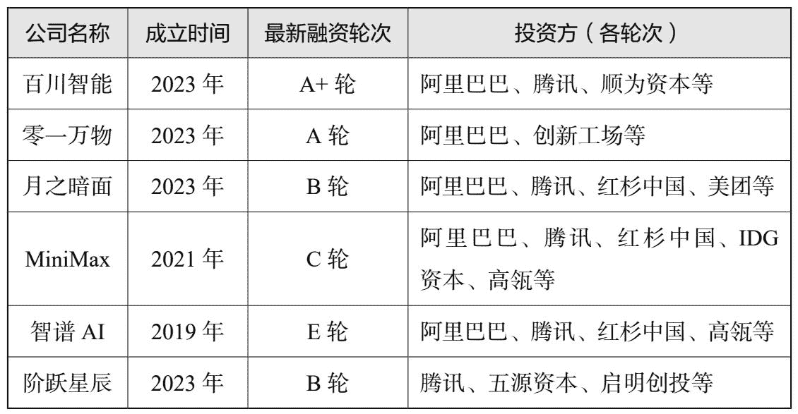

资料来源：根据公开信息整理，最新融资轮次截至 2025 年 3 月。

除资金外，生态联结同样重要。企业间协作、与科研机构联合、开源贡献共同构成活跃生态。百川智能积极参与开源社区，与全球开发者共享成果并汲取灵感。MiniMax选择与硬件厂商深度合作，将软件与硬件结合，为用户提供更高效方案，也推动生态繁荣。

四、行业活力激发
六小虎不仅参与竞争，也在改写规则。月之暗面联合清华等开源大模型推理架构Mooncake，实现推理资源高度优化；智谱AI开源VisualGLM-6B并发布端到端情感语音模型GLM-4-Voice，丰富工具箱，为开发者提供更多可能性。

市场竞争随之进入白热化，新玩家加入促使老牌企业加快创新步伐，加大对大模型与生成式AI的投入。良性竞争让用户受益，也保持行业活力。

DeepSeek的崛起再次重塑格局，以低成本高性能优势快速占领市场，迫使六小虎寻找新突破。零一万物转向B端，智谱AI聚焦通用智能，MiniMax与百川深耕特定应用。尽管面临高昂训练成本和资金压力，它们仍通过技术探索和产品优化保持领先。

第三节 DeepSeek 与“六小虎”的协同发展
一、DeepSeek 的颠覆式创新
2025年初，DeepSeek以DeepSeek-R1推理模型登场，在全球AI领域引发震动，让国内大模型同行经历一段“痛苦春节”。该模型以极低成本实现媲美OpenAI o1的性能，多家公司争相接入，并引发行业深度反思。

技术路线上选择降成本、重落地。DeepSeek-R1的颠覆在于“后训练范式”：通过强化学习RL与长思维链Long CoT技术，在已有模型基础上深度优化，显著提升推理能力，摆脱传统依赖海量算力堆砌的路径。数据显示，开发总成本不足600万美元，却在多项基准测试中超越GPT-4o，训练成本从千万美元级降至百万美元级，标志行业进入新阶段。

低价开放正在改写大模型竞争规则

成本低廉的开放策略叠加高效率，把大模型使用门票压到冰点，研发投入与商业化门槛变得随手可及。对规模不大的公司来说，这相当于开启新想象，不必投入巨额算力也能做出具备市场竞争力的智能应用。

这种做法也在内部瓦解旧有规则。过去动辄上千张显卡、数月训练的流程，如今靠算法提效与合成数据就能实现快速迭代，行业逻辑从算力军备对峙转向效率优先的务实路线。百度、阿里巴巴迅速跟进，文心大模型 4.5 系列宣布开放开源，通义千问整体降价 97%，模型定价进入厘位时代。

R1 的爆红并非没有代价。对于 AI 六小虎而言，新品节奏并未放缓，但在公众关注度与市场声量上已被 R1 反超。C 端市场里，R1 的免费体验与开放姿态让不少厂商直接选用，六小虎的份额承压。

二、六小虎的应对思路

面对 DeepSeek 带来的压力，六小虎正在快速调整打法，寻找突围路径。

（一）技术创新与个性化发展
各家都在加码投入，探寻差异化路线。零一万物与阿里云共建产业大模型联合实验室，主攻参数适中、性能在线、推理更快、成本更低的轻量化方案，面向商业落地；百川智能聚焦医疗，发布具备语言、视觉、搜索三重推理能力的全场景模型 Baichuan-M1-preview，并推出面向儿科的 AI 医生服务；智谱在多模态上发力，自研的 Agentic GLM 技术已搭载到三星最新 Galaxy S25 机型；月之暗面推出 Kimi k1.5 多模态思考模型，上下文窗口扩展到 128k 并加入视觉识别；MiniMax 面世 T2A-01 语音系列与海螺语音产品，覆盖 17 种语言与上百种音色；阶跃星辰密集发布 Step-2-mini、Step-2、Step-1o Audio、Step-1o Vision、Step-Video V2 等，涵盖轻量高性价比、文字创作、语音升级、多模态理解与视频生成。

（二）强化应用层建设
仅靠模型突破不够，体验同样关键。各家加大应用投入，面向 C 端与 B 端推出产品。月之暗面的 Kimi 在多模态能力加持后，能更从容处理搜索问答与复杂问题；智谱的 Agentic GLM 为三星用户提供实时语音视频通话、视觉理解、系统调用、AI 搜索、文案写作等功能。

（三）开放与协作
部分厂商选择以开源换生态。MiniMax 于 2025 年 1 月 15 日发布新一代 01 系列并对外开源；智谱与三星的合作也是其商业化与技术推广的重要一步。

（四）压缩成本结构
为提升竞争力，六小虎在成本侧发力，通过优化研发流程、提升运营效率、合理配置资源，降低训练与应用成本，以更具性价比的方案竞争。

三、格局重塑与未来判断

DeepSeek 的崛起加速行业洗牌，整体叙事正从对标 OpenAI 的宏大故事转向场景优先的务实主义。未来能活下来的大模型公司，需要在技术创新、市场化销售、融资、资本运作等多方面同步具备能力。

开放浪潮也为行业注入活力。更多企业可基于开放模型二次创新，推动技术普及。对用户而言，意味着更低成本享受更优质智能服务。

竞争加剧也带来分化，资源与市场会进一步向头部集中，中小企业的生存空间被压缩。对六小虎而言，能否在技术、应用、成本控制、商业化落地等环节实现突破，找到自身定位，才是能否站稳的关键。

这场变革正在重塑版图：百度、阿里凭云计算底座守住基本盘；DeepSeek 领跑通用模型赛道；六小虎中可能只有 2 至 3 家完成转型。投资机构判断 2025 年底行业将形成“1+3+N”格局。

• 1 个超级平台：DeepSeek，若保持技术领先。
• 3 个特色玩家：医疗赛道的百川智能、多模态的阶跃星辰、出海方向的 MiniMax。
• N 个场景专家：在司法、教育等垂直领域深耕的利基企业。

大厂与创业公司的关系也在变化。腾讯把微信搜索接入 DeepSeek，同时自研混元大模型；阿里投资零一万物的同时，通义千问团队已超 2000 人。这种既合作又对抗的态势，折射出技术不确定期的战略焦虑。

在 AI 普惠浪潮里，真正的受益者可能是中小企业。一位跨境电商老板算过账：用 R1 加自有数据微调后，AI 客服月成本从 20 万元降到 8000 元。当技术红利真正普惠，中国有望涌现出西方难以复制的应用生态。正如李开复所说，大模型的价值不在于它多聪明懂多少事，而在于能不能带来应用的爆发。

当下的阵痛，正是新秩序诞生的过程。资本泡沫退去后，技术回归本质，真正理解产业、聚焦价值的玩家，才能在重构的商业世界中找到坐标。

总体看，DeepSeek 的出现为行业带来前所未有的变革与挑战，也孕育新机遇。只有持续创新、积极应对的企业，才能乘风破浪实现长远发展。

# 实操篇

## [第][四][章]

## 操作指南：DeepSeek 高效使用手册

第一节 DeepSeek 上手指南与核心功能

一、DeepSeek 共提供三种运行形态，分别对应不同使用场景：基础模型 V3、深度思考 R1 和联网搜索。

（一）四种组合状态
打开网页版后，左下角有两个开关：“深度思考 R1”和“联网搜索”。二者组合共产生四种状态。

模式一：两个都不点，就是默认的基础模型 V3。
模式二：只点“深度思考 R1”，进入纯 R1 深度思考形态。
模式三：不点 R1 只点“联网搜索”，进入基于 V3 的联网搜索形态。
模式四：两个都点，进入基于 R1 的联网搜索形态。

注意，一旦打开“联网搜索”，无论是否同时打开 R1，本地文件上传功能都会被禁用，右下角回形针图标不可用。需要上传文档时不能开启联网搜索。

（二）三种形态
• 基础模型 V3
默认形态，日常任务首选。高效便捷、规范性强，能快速给出常识性回答和简洁文本。适合日常对话、知识问答、文案撰写等对结果要求明确且不需要深度分析的任务。

• 深度思考 R1
推理型高级形态，擅长复杂问题和深度分析。可调用内部知识做多角度拆解，给出逻辑严密、思路完整的答案。适合数理逻辑、编程分析、创意任务等需要深度推理的场景。

• 联网搜索
结合 RAG 能力，可实时访问互联网更新知识。适合查询新闻、行情等时效性信息。效果受网络状况影响。

总体来看，日常用 V3，复杂推理用 R1，要最新信息用联网搜索，选择得当能显著提升效率。

表 4-1 形态对比

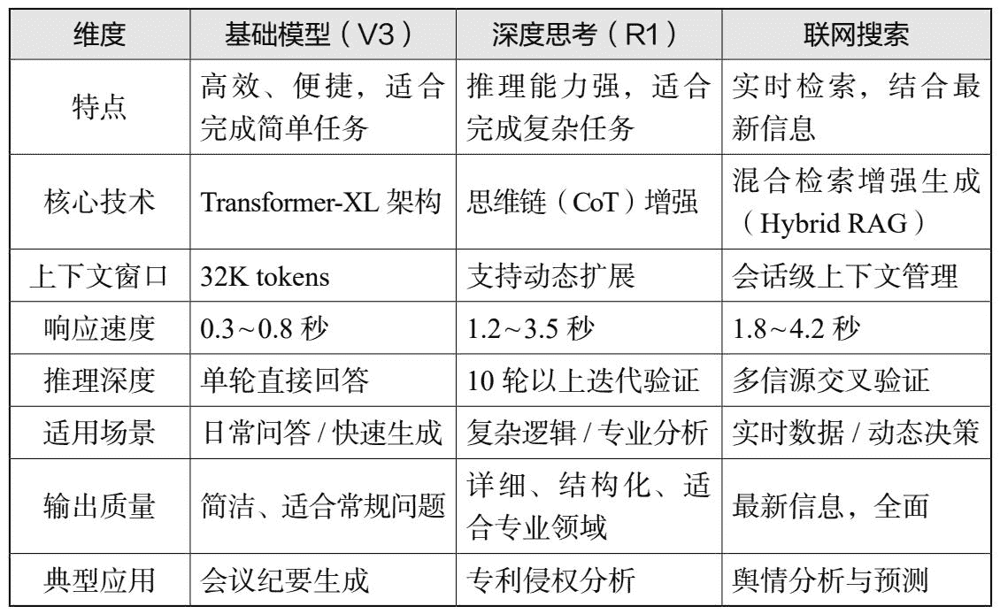

（三）使用策略
“深度思考 R1”和“联网搜索”各有适用时机，合理切换能改善体验。

1.深度思考 R1 的使用时机
• 适合开启：需要复杂推理如数学证明、逻辑分析、策略规划；开放性或创造性需求如多角度分析、跨学科整合；需求分析阶段如软件开发、科研。
• 不适合开启：简单事实查询或常识问题；需要快速获取实时数据或最新事件进展时，应优先联网搜索。

2.联网搜索的使用时机
• 适合开启：获取时效性强的信息、实时数据、行业动态；需要快速筛选整合大量信息如撰写新闻稿；突破预训练时间限制获取最新研究成果。
• 不适合开启：简单事实或已知常识；需要深度逻辑推理或复杂问题分析时，应优先深度思考。

二、DeepSeek 另外两类模型
V3 是指令型通用模型，像个听话的小书呆子，需要用户把步骤安排清楚，擅长高效规范任务；R1 是推理型模型，像个机灵鬼，只需说清目标就能自行思考过程，更适合创意思考、复杂推理和深度分析。

（一）V3 与 R1 的差异
1.功能定位
V3 追求高效便捷，短时间内给出简洁回答。适合百科类、简单文本生成，如解释概念或写段短文。响应快，满足即时信息需求。
R1 专注复杂推理和深度思考，通过多阶段训练和强化学习处理挑战性问题，如数理难题、代码分析、复杂解决方案。

2.技术架构
V3 基于 MoE 架构，6710 亿总参数，每 token 仅激活约 370 亿参数，效率高成本低。训练以指令微调和少量监督学习为主，理解指令快。
R1 同样基于 MoE，但训练更复杂，指令微调结合强化学习，提升推理能力，在复杂任务上表现更深更准。

3.应用场景
V3 适合日常对话、信息查询、简单文本生成。
R1 适合需要深度分析和复杂推理的任务，可提供详细推理过程帮助理解问题本质。

（二）V3 使用技巧
1.指令结构化设计法则
V3 需要清晰具体的指令。可采用过程-结果框架，任务分解、格式约束、场景适配。例如“先计算毛利率再生成同比图表，用 JSON 返回”，或“用友好语气回复客服场景”。

2.COSTAR 框架
参考新加坡 GPT-4 提示工程大赛冠军提出的 COSTAR，包括 Context 上下文、Objective 目标、Structure 结构、Tools 工具、Answer 答案形式、Reasoning 推理展示。帮助模型更好理解任务。V3 更适合快速响应，避免过度复杂逻辑。

（三）R1 使用技巧
1.极简提问
R1 擅长复杂问题，提示无需繁琐。直接点明核心即可触发深度推理。如“求解 dy/dx=x²+y²”“指出这段 Python 代码的内存泄漏”“分析俄乌冲突对全球能源市场的长期影响”。

2.过程可视化的价值挖掘
用“请展示推理过程”等提示，可获得可解释的思考路径。如数学推导分步展示、代码标注时间复杂度、策略推演构建 SWOT 矩阵。

3.避免冗余信息
R1 不需要过多背景铺垫，直接切入主题。建议输入核心问题如“设计基于区块链的供应链溯源方案”，避免前置冗余。

三、DeepSeek 的提示词公式
使用 R1 做推理任务时，好的提示词应包含背景信息、直接需求和约束条件三要素。

（一）模板三要素
1.背景信息
提供任务上下文，帮助模型理解背景和目标，包括目的、主题或领域知识。
2.直接需求
用户希望 AI 完成的具体任务，要清晰直接。
3.约束条件
输出格式、风格或其他限制，如表格、文言文、字数等。

（二）提示词案例
目标：在抖音做露脸读书短视频账号，需要口播文案。
背景：计划运营读书领域账号，目标成为读书博主，吸引爱阅读粉丝。
直接需求：生成一组标题，每条对应 90 秒内可播完的文案，用过来人语气，结尾引导评论区互动。
约束：文案亲切真诚，带互动提问，时长控制在 90 秒。

示例提示词：我现在计划在抖音上经营一个读书领域的账号，做一个读书博主，类型是拍露脸的短视频。帮我设计一下口播文案，包括三点要求。1.我想要一组标题，标题对应一条 90 秒以内可以播完的文案。2.用‘过来人’语气。3.结尾引导评论区互动。

四、DeepSeek 服务器繁忙怎么办

DeepSeek 拥堵时，这几条备用通道更顺畅

使用 DeepSeek 时，服务器高负载常导致排队和卡顿。将主站流量分流到第三方入口，可绕开拥堵并继续使用核心功能。下面介绍几类常用替代方案的操作要点。

**（一）借助腾讯生态**

腾讯旗下产品覆盖面广，元宝 App 已内置 DeepSeek。通过微信内的搜索入口唤起，或直接安装元宝客户端，均可调用 DeepSeek-R1 完整版。该版本支持联网检索，可整合公众号、视频号等生态内容。进入对话页后需手动切换至 DeepSeek-R1，网页端则在左侧先选中 DeepSeek，再开启深度思考与联网检索。该模型对复杂推理和即时查询擅长，例如询问“北京今天天气”可返回实时答案，同时支持编程输出、文件解析等多格式结果，全部免费且免配置。若仍繁忙，可尝试官网备用入口，或把提问改为纯文字描述、减少文件上传以提升响应。

**（二）在钉钉办公场景内调用**

钉钉面向企业协作，接入 DeepSeek 后可提升工作效率。打开钉钉的智能助理模块，新建助手后从模型列表中挑选 DeepSeek 系列的 R1、V3 完成绑定。平台提供模板向导，操作简便，无需复杂设置即可发布具备深度推理和联网查询能力的助手。创建后在对话框输入唤起词如“你好，DeepSeek”，即可实现会议纪要提炼、行业资讯汇总等场景化需求。钉钉宜搭低代码平台还可通过提示词调用该能力，延伸至数据分析、文本生成等更复杂的业务。部分用户反馈在钉钉内调整功能需进入设置菜单，路径比网页版稍长，但基础功能开箱即用，无需额外配置。

**（三）通过硅基流动平台接入**

硅基流动是专业的模型接入平台，资源丰富且使用灵活。先在官网注册登录，在密钥页面新建 API 密钥并妥善保存。随后在网页模型广场找到 DeepSeek-R1、DeepSeek-V3 等，点击在线体验即可即时对话。若需更自由的使用方式，可下载兼容该平台接口的客户端，如 ChatBox、Cherry Studio，将密钥填入配置区并指定模型，设置完成后即可在客户端中提问。整体流程流畅，网页适合快速试用，客户端适合深度使用。

**（四）其他备选渠道**

除了上述三类，还有多种方式缓解主站拥堵。例如超算互联网平台由科技部背书，提供 DeepSeek 7B、14B、32B 蒸馏版，虽然非完整版但运行稳定且免费，适合追求稳定性的用户。纳米 AI 搜索提供 R1 完整版专线通道，响应更快，每日有一定免费额度。

技术能力较强者可考虑本地部署，自建环境运行模型可避开排队并更好保护数据隐私，但对硬件和技术要求较高。另有第三方平台提供统一 API，如 OpenRouter AI，聚合多家大模型，可通过单一接口切换 DeepSeek 不同版本，通常提供免费额度，适合做多模型对比。

对隐私和长期使用要求高的人，本地部署更为彻底；普通用户选择稳定可靠的第三方入口更为省心。

第二节 用 DeepSeek 快速产出 PPT、图表与视频

**一、用 DeepSeek 一键生成演示文稿：从构思到成品**

**（一）明确需求**

先厘清演示主题、用途和大致内容。是产品介绍还是项目汇报？面向客户还是内部同事？把这些要点想清楚后再开始。

**（二）打开 DeepSeek，输入需求**

1. 访问官方站点
在浏览器输入 chat.deepseek.com，完成注册并登录。已有账号直接登录即可。
2. 输入指令
在对话窗口描述需求，描述越具体结果越贴合。可写：我是一名学生，要做一份关于“人工智能发展历程”的演示稿，用于班级演讲，约 10 页，语言简洁，适合初学者。
这样模型能把握身份、主题、用途和具体要求，输出更精准。
3. 选择生成模式
DeepSeek 提供多种模式。若只想快速拿到提纲，可选深度思考 R1 模式，点击生成后会输出 PPT 大纲，说明每页该写什么。

**（三）获取 PPT 大纲**

模型输出的大纲通常以 Markdown 文本呈现，带标题和要点。这个大纲只是框架，接下来需要转成完整演示稿。

**（四）借助 Kimi 完成成稿**

1. 访问 Kimi 官网
打开 kimi.moonshot.cn/chat，点击左侧 Kimi+，选择 PPT 助手。Kimi 在生成幻灯片方面效率很高，与 DeepSeek 配合顺畅。
2. 粘贴大纲
把 DeepSeek 生成的大纲复制粘贴到 Kimi 输入框，Kimi 会据此生成演示稿。
3. 选择模板
Kimi 提供多套精美模板，可按主题和喜好挑选。科技类可选简洁现代风，艺术类可选创意风格。
4. 一键生成 PPT
选好模板后点生成，数秒后即可得到完整 PPT，可在线预览或直接下载。

**（五）优化和编辑 PPT**

初稿可用，但仍可微调。
1. 调整内容
文字不通顺或细节不足时，可直接在幻灯片里修改，补充关键信息。
2. 替换图片
自动生成的图片可能不够贴合，可手动换成更合适的素材。
3. 调整配色
可把主色调改为公司或学校的品牌色，让整体更专业。
4. 添加动画
加入适度的入场、强调动画，能提升观赏性和注意力。

**（六）保存和导出**

1. 下载 PPT
满意后点击下载保存到电脑或手机，随时使用。
2. 导出其他格式
如需发送或打印，可导出为 PDF，避免格式错乱。

**（七）小技巧**

1. 指令越详细越好
不要只写“做一个 PPT”，要明确主题、用途、页数和风格。
2. 多尝试几次
第一次不理想可修改指令或更换模板，多试几次会更好。
3. 结合其他工具
除 DeepSeek 和 Kimi 外，也可用通义千问生成内容，或用讯飞智文优化文字，多工具组合效果更佳。

**二、DeepSeek 生成图表：让数据可视化**

**（一）明确需求**

先确定要生成何种图表、展示什么内容以及使用场景。比如项目进度用甘特图、人员分布用饼图、时间变化用折线图。明确是内部汇报还是对外展示后再开始。

**（二）用 DeepSeek 生成图表代码**

1. 打开官方站点
同上，访问 chat.deepseek.com 并登录。
2. 输入需求
在对话框中写清图表类型、内容和数据。例如：生成一个公司业务流程图，用 Mermaid 语法表示；再如：生成某产品 12 个月销售额折线图，数据为 5000、6000、7500、8200、9500、10500、11000、10200、9200、8500、7000、6000，结果用英文展示。
3. 获取代码
点击生成后，DeepSeek 会输出对应的 Mermaid 代码，包含了图表所需全部信息。

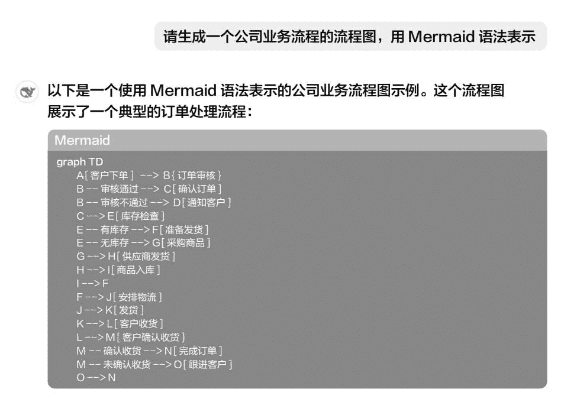

图 4-1 DeepSeek 生成的 Mermaid 代码[资料来源：DeepSeek 官网，https://chat.deepseek.com/。]

**（三）用 Mermaid 在线工具生成图表**

1. 复制代码
把生成代码复制备用。
2. 打开在线编辑器
推荐 Mermaid Live Editor，https://mermaid.live/，免费且专用于 Mermaid 图表。也可选择 Draw.io 获取更多自定义功能。
3. 粘贴代码
在编辑器输入框粘贴代码。
4. 生成图表
粘贴后编辑器会自动解析并实时预览图表，代码无误即可显示。

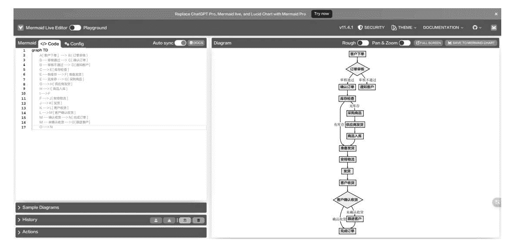

图 4-2 Mermaid 生成的图表[资料来源：Mermaid Live Editor 官网 https://mermaid.live/。]

**（四）调整和导出**

1. 调整样式
可在编辑器中修改颜色、字体、线条粗细等，让图表更符合需求。
2. 导出图表
满意后可导出为 PNG、SVG 或 PDF，方便插入 PPT、Word 等文档。

**（五）小技巧**

1. 需求描述要清晰
不要只写“生成一个图表”，要写明类型、内容和数据。
2. 多尝试几次
不满意可修改描述或调整代码再试。
3. 选择合适的工具
Mermaid Live Editor 适合快速生成，Draw.io 支持更复杂的自定义。
4. 结合其他工具
需要 3D 或动态图表时，可结合 Excel 或 PowerPoint 使用。

**三、DeepSeek 生成视频：脚本到成品的加速器**

**（一）准备工作**

1. DeepSeek 账号：访问官网注册并登录。
2. 视频剪辑软件：推荐剪映，操作简单且支持 AI 功能。
3. 素材生成工具，可选：如 Midjourney，或即梦、可灵、Vidu 等 AI 视频工具。

**（二）生成视频脚本**

1. 打开 DeepSeek
登录官网或 App 进入对话页。
2. 输入需求
清晰描述视频主题和风格。例如：我想做一个关于“春日野餐”的视频，文案轻松有趣，适合年轻人；再如：制作一个 30 秒宠物领养宣传片，文案简洁，画面温馨。描述越详细，脚本越贴合想法。
3. 获取脚本
点击生成后，DeepSeek 会输出详细分镜脚本，明确每秒画面、旁白。

春日野餐视频文案（轻松有趣版）
视频长度：1 分钟
目标受众：年轻人
视频风格：轻松活泼，充满春日气息
BGM：轻快愉悦背景音乐

开场 0：00-0：05
画面：阳光明媚，草地绿意盎然，花朵盛开。
字幕：春天来了，是时候来场说走就走的野餐啦！

准备环节 0：06-0：20
画面：朋友们准备三明治、水果、零食、饮料等。
字幕：野餐吃什么？当然是颜值与美味并存啦！
画面：特写美食。
字幕：别忘了带上野餐垫、篮子和好心情！

出发 0：21-0：30
画面：朋友们骑自行车、滑滑板车或步行前往。
字幕：逃离城市喧嚣，拥抱大自然！

野餐进行时 0：31-0：50
画面：铺开野餐垫、享用美食、聊天玩游戏拍照。
字幕：阳光、草地、美食、好友，这才是春天该有的样子！
画面：特写笑脸。
字幕：记录美好瞬间，留下春日回忆！

结束 0：51-1：00
画面：收拾垃圾离开。
字幕：无痕野餐，从我做起！
画面：挥手告别。
字幕：期待下一次春日之约！

其他建议：可加入快放、慢放、转场等短视频手法，增加趣味性；加入幽默互动或夸张反应吸引注意；使用“yyds”“绝绝子”等网络流行语拉近距离。

**（三）生成视频素材**

1. 登录即梦 AI
打开 jimeng.jianying.com 登录账号。
2. 导入脚本
在主页点击“视频生成”，选择“文本生成”，把 DeepSeek 脚本粘贴进去。即梦 AI 会自动解析并生成视频。可提前选择视频模型、时长、画幅比例。

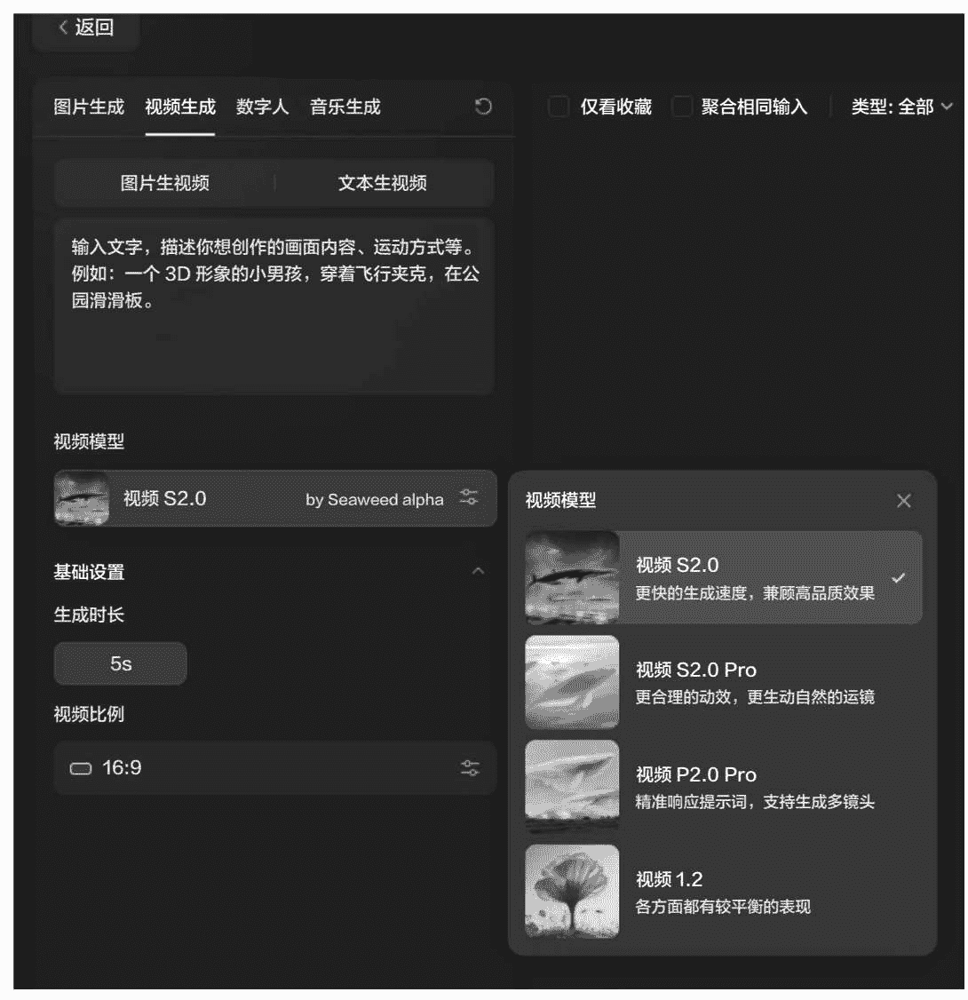

图 4-3 即梦 AI 生成的视频[资料来源：即梦官网，https://jimeng.jianying.com/ai-tool/home。]

3. 选择风格和素材
即梦 AI 提供多种风格如温馨治愈、科技感、复古风等，也会自动匹配相关素材。如有自有素材可上传。
4. 生成视频
设置完成后点击生成，等待数分钟即可得到完整视频。

**（四）视频调整与优化**

1. 预览效果
生成后在即梦 AI 内预览画面、配音和整体效果。
2. 调整配音和字幕
可修改语速、语调，调整字幕位置和样式。
3. 修改画面和素材
对不满意的画面可手动替换素材或调整顺序和时长。

**（五）导出视频**

调整完毕后点击导出，选择合适的分辨率和格式，如抖音所需规格，完成后即可下载。

**（六）进阶技巧**

如需更高质量画面，可将 DeepSeek 生成的详细画面描述导入 Midjourney 生成图片，再导入可灵、Vidu 等工具生成动态片段，最后用剪映合成与后期处理。

第三节 DeepSeek 实操案例精析

**一、职场办公**

**（一）案例背景**
假设你是一名市场部员工，负责撰写本季度的市场分析报告。该报告需涵盖：
1. 市场趋势分析：包括行业动态、竞争对手分析、目标客户群体的变化。
2. 本季度营销活动的效果评估：包括活动数据、用户反馈、成本与收益分析。

3. 下季度策略建议：结合当下数据与走势，给出可落地的方向

这份材料需要在 72 小时内交付，且最终要以演示文稿形式呈给管理层复核。周期紧张量大，借助模型辅助后，整体产出链路明显顺滑。

（二）实操流程
步骤一：先搭建框架
目标是快速理清结构与要点。
具体做法：
1. 打开 DeepSeek 网页端完成登录。
2. 在对话区发出需求：我是市场部同事，需要一份本季度的市场分析材料，内容覆盖市场动向剖析、本季度营销活动复盘、下季度策略建议，请给出详细结构并列出各部分要点。
3. 执行生成后，可得到一份清晰的框架，例如：
市场分析报告框架
一、市场动向剖析
1. 行业新动向
· 近期政策变化
· 技术演进趋势
2. 竞争对手盘点
· 主力对手概况
· 优势与短板
3. 目标客群变化
· 需求侧迁移
· 消费行为特征
二、本季度营销活动复盘
1. 活动数据
· 参与规模
· 转化表现
2. 用户反馈
· 正面评价归纳
· 优化建议
3. 投入产出
· 营销花费
· 收益对比
三、下季度策略建议
1. 基于趋势的策略调整
2. 面向目标客群的方案
3. 预期目标与关键指标

步骤二：依据框架填充正文
目标是逐项生成细节。
做法：
1. 按照框架要点逐条向模型下达指令生成细节。例如：请围绕本季度市场动向，就行业新动向、对手盘点、客群变化撰写详细内容。
2. 执行生成后即可获得正文。

市场动向剖析
本季度行业受多项政策影响，环保法规收紧推动企业加大绿色技术投入。技术面，人工智能与大数据在营销中的渗透加深，为精细触达提供更多工具。
对手层面，主打社交媒体营销的 A 企业本季份额小幅提升；B 企业靠新品发布吸纳了部分年轻用户。相对而言，我方在技术创新上仍有提升空间。
客群侧，数据显示个性化需求上升，健康与环保赛道尤为突出。线上购买占比持续增长，用户对评价参考度也在提高。

同理依次生成“本季度营销活动复盘”和“下季度策略建议”。

步骤三：自动生成演示稿
1. 将模型整理好的完整报告复制。
2. 打开 Kimi 平台，点击左侧“Kimi+”，进入演示助手。
3. 把文本粘贴到输入框，选择模板，如“商务蓝白”。
4. 点击“自动生成演示”，Kimi 会把内容排版成演示文稿。

步骤四：核对与优化
1. 核查生成的演示稿内容是否完整，是否需要增补或修正。
2. 必要时手动调整文字、替换配图、修改配色。
3. 增加动画与切换效果，提升演示质感。

步骤五：导出与分发
1. 在 Kimi 中点“下载”，保存为 PPTX。
2. 如需打印或转发，可导出 PDF。
3. 把文件发给团队或高层，用于汇报。

（三）案例小结
本次任务中，DeepSeek 与 Kimi 的组合让报告撰写与演示制作效率大幅提升。核心价值体现在：
• 结构梳理更高效：先出框架，逻辑与要点一目了然。
• 内容产出加速：依托框架逐条生成细节，大幅节省撰写时间。
• 演示自动成型：文字直接转化为专业演示，省去手工排版。
• 调整空间灵活：可按实际需求对文本与版式进行个性化优化。
• 时间精力节省：短时间内交付高质量报告与演示。

除市场分析外，该组合还可用于：
• 撰写项目计划书：快速产出大纲与正文。
• 制作销售演示：自动生成产品介绍与销售策略演示。
• 数据分析报告：结合数据生成结论与可视化建议。
• 会议纪要整理：把会议内容整理为结构化纪要。

在职场中时间即成本，DeepSeek 加 Kimi 能让复杂任务快速落地。无论是写报告、做演示还是做分析，都能明显提效。

二、教育培训
（一）案例背景
假设你是一名教师，需在一周内完成面向高中生的《人工智能入门》课程设计。课程需包含大纲设计、教学内容编写、学习材料整理、学情分析。两周内完成全流程，任务紧周期短，借助模型后效率显著提升。

（二）实操流程
步骤一：生成课程框架
1. 登录 DeepSeek 网页。
2. 输入需求：我是一名教育工作者，要设计面向高中生的《人工智能入门》课程，请生成详细框架，包含课程目标、教学内容、课时安排。
3. 生成后得到清晰框架。

《人工智能入门》课程框架
一、课程目标
1. 了解人工智能基本概念与发展历史。
2. 掌握主要应用场景与典型案例。
3. 理解机器学习、深度学习等基本原理。
4. 培养学习兴趣与初步应用能力。
二、教学内容
1. 第一课：人工智能总览
· 定义与历史
· 发展现状与未来趋势
2. 第二课：应用场景
· 智能家居
· 自动驾驶
· 医疗健康
3. 第三课：技术原理
· 机器学习基础
· 深度学习简介
4. 第四课：伦理与社会影响
· 伦理问题
· 社会影响
三、课时安排
· 每课时 45 分钟
· 共 4 课时

步骤二：编写教学内容
1. 依据框架逐部分下指令生成细节。例如：请生成《人工智能入门》第一课的教学内容，包含定义、发展历史与现状。
2. 模型输出对应内容。

第一课：人工智能总览
一、人工智能定义
人工智能即通过计算机技术实现的智能化行为，使机器能够模拟人类的感知、推理、学习与决策。
二、发展历史
起源阶段（20世纪40-50年代）：图灵提出图灵测试，为 AI 提供理论起点。
黄金时期（20世纪60-70年代）：专家系统出现，AI 在特定领域取得突破。
低谷期（20世纪80-90年代）：受限于算力，发展放缓。
复兴期（21世纪初至今）：深度学习崛起，推动图像识别、自然语言处理等取得进展。
三、发展现状
AI 已广泛应用于智能家居、自动驾驶、医疗健康等领域，正向更智能、更人性化演进。

重复上述操作，生成第二至第四课内容。

步骤三：整理学习材料
1. 输入需求生成课后练习。例如：为《人工智能入门》第一课生成 5 道课后练习，含选择与简答。
2. 模型输出题目。

课后练习
一、选择题
1. 人工智能英文缩写是：
A.AI B.IT C.AIOT
2. 图灵测试主要用于测试：
A.机器计算能力 B.机器智能水平 C.机器存储能力
3. 图灵测试的核心目的是：
A.评估运算速度 B.判断机器能否表现出类人智能 C.设计高效算法
二、简答题
1. 简述人工智能的定义。
2. 列举三个主要应用场景。

再输入需求生成推荐阅读。例如：为本课程推荐 5 本适合高中生的书籍或文章。
模型输出推荐清单。

推荐阅读
1.《人工智能：一种现代方法》
2.《人工智能的未来》
3.《人工智能在生活中的应用》
4.《图灵测试的意义》
5.《深度学习入门》

步骤四：设计课程反馈问卷
1. 输入需求：为《人工智能入门》课程设计反馈问卷，涵盖内容理解、教学方法满意度与改进建议。
2. 模型生成模板。

《人工智能入门》课程反馈问卷
亲爱的同学，感谢你完成课程，请花几分钟填写以下问卷。
一、课程内容
1. 你对课程内容的理解程度：
A.非常理解 B.基本理解 C.理解困难
2. 你最喜欢的部分：
A.人工智能总览 B.应用场景 C.技术原理 D.伦理与社会影响
二、教学方法
1. 对教学方法的满意度：
A.非常满意 B.比较满意 C.一般
2. 教学方法可改进之处？
三、其他建议
请写下你对课程的其他想法。

步骤五：优化与调整
1. 检查生成内容是否完整，补充或修正不足。
2. 根据学生进度与反馈动态调整。

（三）案例小结
本次课程设计中，DeepSeek 协助完成大纲制定、教学内容撰写、学习材料整理与反馈问卷设计。核心优势：
• 课程结构梳理快：框架生成帮助快速厘清逻辑。
• 教学内容产出快：按框架逐条生成，节省备课时间。
• 可灵活优化：可根据需求调整文本与课件。
• 效率与质量兼顾：短时间内完成高质量教学材料。

除课程设计外，还可用于：
• 编写教案：快速生成教学目标、过程与方法。
• 制作教学视频：结合即梦 AI 生成视频资源。
• 学生学习分析：基于学习数据生成分析报告。

三、创意写作
（一）案例背景
假设你是一名创作者，需在一周内完成一部以“未来城市”为主题的科幻短篇小说。小说需包含故事大纲、人物设定、场景描写、情节发展、结尾升华。

（二）实操流程
步骤一：生成故事大纲
1. 登录 DeepSeek。
2. 输入需求：我想写一部以“未来城市”为主题的科幻短篇小说，请生成详细大纲，包含主要情节、冲突与结局。
3. 生成大纲。

科幻短篇小说大纲
一、故事背景
不远的未来，城市高度智能化，人类与机器人共存，但资源分配不均导致阶层分化。
二、主要情节
1. 起始事件：年轻程序员主角发现城市系统深处隐藏的神秘代码。
2. 冲突升级：破解尝试让他卷入针对城市统治者的阴谋。
3. 高潮：主角联合底层居民对抗统治者。
4. 结局：阴谋被揭露，城市恢复公平，主角选择离开探寻未知。
三、关键情节
1. 探索过程中揭开主角身世之谜。
2. 飞行汽车、智能建筑等科技推动情节。
3. 反转：主角导师实为幕后黑手。

步骤二：完善人物设定
1. 输入需求生成主角背景。例如：为小说主角生成详细背景，含性格、经历与动机。
2. 输出设定。

主角背景设定
1. 姓名：李明
2. 性格：聪明、勇敢、有正义感，内心孤独。
3. 成长经历：出生于工人家庭，父亲是机器人维修工，母亲是教师。目睹社会不公，渴望改变。
4. 动机：破解代码，揭露真相，为底层争取公平。

步骤三：丰富场景描写
1. 输入需求生成环境描写。例如：描写未来城市的建筑、交通与氛围。
2. 输出描写。

未来城市环境描写
高楼切割天空成蓝色条带，飞行汽车在楼间穿梭，投下光影。街上智能机器人与人类并行，全息广告悬浮空中。表面光鲜，底层却阴暗破败，巷弄潮湿，是被遗忘的角落。

再输入需求生成科技元素描写，如智能建筑与飞行汽车。
智能建筑外墙随天气与光线调节透明度，智能家居感知情绪自动调整环境。飞行汽车依智能交通系统有序飞行，流线造型体现未来感。

步骤四：完善情节发展
1. 输入需求生成起承转合。
2. 输出情节。

情节发展
1. 起始：李明偶然发现隐藏代码，触发城市警报。
2. 冲突升级：被安全部队追捕，结识苏菲与底层居民，得知代码背后有统治者阴谋。
3. 高潮：潜入核心区破解代码，发现导师是幕后黑手，展开对峙。
4. 结局：阴谋曝光，城市恢复正义，李明意识到世界复杂，选择离开继续探索。

步骤五：设计结尾升华
1. 输入需求生成反思性结尾。
2. 输出结尾。

结尾升华
李明立于城市边缘仰望星空，代码已解，真相已出。城市虽恢复公平，他明白这只是开始。他踏上寻找未知的旅程，而城市也在他影响下悄然变化。

步骤六：优化与调整
1. 检查故事连贯性与人物立体度。
2. 补充细节，增加个人风格，如幽默语言或独特视角。

步骤七：导出与分享
1. 整理成文档，保存为 Word 或 PDF。
2. 发布至写作平台或投稿。
3. 收集读者反馈进一步优化。

（三）案例小结
DeepSeek 助力从大纲到人物、场景、情节与结尾的全流程创作。优势：
• 结构梳理迅速：大纲帮助厘清逻辑与走向。
• 灵感激发明显：基于大纲生成人物与场景，拓展创意。
• 节省时间精力：快速完成高质量初稿，避免拖延。
• 灵活可调：可按个人风格调整细节。

除科幻小说外，还可用于：
• 小说创作：大纲、人物、情节批量生成。
• 剧本撰写：框架、台词、场景转换。
• 文案策划：广告文案、品牌故事、营销文案。
• 诗歌创作：主题与诗句灵感激发。

## 第五章
## 企业落地：DeepSeek 辅助企业经济分析
第一节 DeepSeek 助力宏观政策分析
本节以具体案例引路，介绍用 DeepSeek 做宏观政策分析的方法。
一、案例背景与分析步骤
案例背景：某电力设备制造企业响应国家“节能减碳”要求，拟聚焦相关设备研发，需了解该领域的国家政策。
针对这一领域的宏观政策分析，可按六个步骤展开：政策获取的提示词设计、政策信息的简洁概览、政策的深入分析、政策的研究洞察、政策的影响下探、政策分析的可视化呈现。
本场景选用接入 DeepSeek 推理模型 R1 的秘塔 AI（https://metaso.cn/）完成分析，相较于直接用联网搜索的 DeepSeek，秘塔 AI 在搜索结果的结构化呈现上更强，更适合专业政策分析。
秘塔 AI 提供三种模式：简洁、深入、研究，适配不同使用场景。
• 简洁：给出最直接的答案，表述简短，适合快速获取基础信息。

**AI 驱动的政策与链路研判路径**

秘塔 AI 同步提供速览、精探、研报三种递进的工作方式。首轮可用概括式提问快速拿框架，补充背景、拆解逻辑和拓展信息；切换到研报式提问后，同一议题会被系统化发散并整理成报告形态。实操上建议先做宏观扫描再做精细挖掘，最后做归纳沉淀，先对目标领域形成整体认知，再逐步细化，最终呈现专业全貌。检索结果还能一键生成互动网页，信息呈现更直观。

二、构建可复用的政策检索提问方式

参考 DeepSeek 推理框架的情境—目标—限制三维度，并对每个维度做颗粒度拆分，指令会更精准。

情境可细化为：
行业指向如电力装备制造、智能电网设备制造、新能源输变电；
技术范围如特高压输电、储能系统、电能质量治理；
政策周期如“十四五”规划、2030 年前碳达峰行动方案。

明确目标可细化为：
政策类型如财政补助、税收优惠、研发专项指南；
技术标准如能效分级规范、设备准入要求、碳排放核算方法；
应用场景如工业园区节能改造、新能源并网技术要求、老旧设备更新目录。

限定范围可细化为：
时效限定如2020 至2025 年仍在执行的政策；
区域限定如长三角环保政策、粤港澳大湾区绿色金融配套；
主体限定如中小企业适用条款、高新技术企业认定条件。

示例指令：检索2021 年以来国家部委发布的面向特高压设备制造企业的研发补助政策，并要求列出设备能效等级的具体数值。

指令拆解如下。

表 5-1 提示词的构成方式

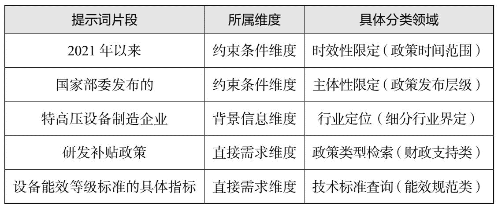

三、用概览模式先建立全貌

政策收集初期，先用概览模式并打开深度思考做初筛，快速把握宏观走向。输入“检索2021 年以来国家部委发布的针对特高压设备制造企业的研发补贴政策，要求包含设备能效等级标准的具体指标”后，系统会为每个要点标注来源，便于复核。

结果大致分两部分。

研发类支持。中央预算资金会向高效用能产品及配套零部件制造项目倾斜，并鼓励地方配套与绿色金融介入，例如金融机构为高能效设备研发提供信贷。税费层面，最高能效等级变压器可享受增值税即征即退七成，节能改造项目设备购置可获三成补贴。

能效标准。《电力变压器能效限定值及能效等级》GB20052—2020 于2021 年起实施，相较旧版变压器损耗下降10%~45%。相关文件预计2023 年高效节能变压器占比将超75%。《重点用能产品设备能效先进水平、节能水平和准入水平（2022 年版）》明确了分级规则，能效低于节能水平的产品原则上不予补贴，推动标准与补贴联动。

由此可先抓住专项资金与退税补贴两大主线，对能效分级也有初步感知。

四、用精探模式看清细节

在概览结果底部点“深入”，对同一问题做精细化展开。

研发支持。国家发改委等部门在《重点用能产品设备能效先进水平、节能水平和准入水平（2022 年版）》中提出，加大中央预算内投入支持高效用能产品及零部件制造，鼓励地方配套。符合先进水平的特高压设备可优先获资。税费方面，2024 年行业报告显示，最高能效变压器可享增值税即征即退70%，节能改造设备购置补贴30%，直接降低研发生产成本。绿色金融也被多部门文件强调，鼓励低息贷款与专项融资。达到先进水平的技术还能进入《绿色低碳转型产业指导目录》《绿色技术推广目录》，获得政策倾斜与推广机会。

能效指标细节。2021 年生效的GB20052—2020 大幅提高要求，空载损耗较旧标准降10%~45%，指标优于欧美，能效划分为三级，一级为最高档。2024 年修订版GB20052—2024 强制淘汰S13 及以下变压器，要求空载损耗再降40%，并推动非晶合金变压器占比提升至50%。特高压系统要求2026 年前实现局放监测、温度预警全覆盖；新能源并网设备如风电光伏专用变压器，需满足110kV 及以上电压等级能效指标并适应高比例可再生能源接入。补贴挂钩原则是仅对达到节能水平及以上即二级或一级的设备支持，一级可获最高优惠。

政策节奏。2021 年国家标准委加快特高压交直流输电标准研制，国家能源局开展工程成效监管。2021 年工信部等三家部门发布《变压器能效提升计划（2021—2023 年）》，要求当年新增高效节能变压器占比达75%以上。2022—2024 年多部门联合更新能效分级文件，强化补贴导向。

总体看，特高压设备研发支持以中央预算、税费优惠、绿色金融为核心，配合GB20052 系列的强制升级推动技术迭代。产品需达到一二级能效并满足损耗降低、智能监测等要求才具备获支持条件。精探模式的产出比概览模式更细，并补充了时间线与主责部门。

五、用研报模式做系统归纳

点底部“研究”按钮，对前述结果做拓展。

国家层面的支持概览。《变压器能效提升计划（2021—2023 年）》由工信部、市场监管总局、国家能源局于2021 年1 月印发，资金用于技术研发、公共服务平台与骨干企业培育，可申请税收优惠、融资担保，政府优先采购并鼓励在新能源电站、特高压工程应用。《加快电力装备绿色低碳创新发展行动计划》由工信部等五部门于2022 年8 月印发，支持柔性直流输电、高压开关设备等攻关，对国产化示范项目给予财政补贴。国家发改委技术改造专项2021 年要求固定资产投资≥2 亿元项目可按15%比例补助，最高1 亿元，覆盖智能化改造与国产化替代。

能效分级通用框架。准入水平为市场最低门槛，与强制性标准一致如GB20052—2020 三级；节能水平不低于二级，比准入节能10%~20%；先进水平对标国际最高，作为补贴与政府采购优先对象。

政策实施特征。能效标准每3~5 年动态升级；能效低于准入水平的产品禁止生产销售且不得享受补贴；地方常有配套，如部分地市对采购一级能效设备的企业额外补贴投资额20%。

总体而言，2021 年以来的政策以“补贴+标准”双轮驱动推进高能效转型，企业需关注研发方向、申报条件与跨部门资金联动，优先布局能效一级的特高压变压器、柔性直流设备等，确保产品通过国家级能效检测，并结合中国制造2025 及双碳目标争取支持。

六、政策落地企业的应对路径

追问“电力设备制造行业该如何适应”，得到的行动方向如下。

聚焦能效升级推动核心研发。产品能效要对标GB20052—2024 一级标准，通过非晶合金铁芯等新材料和工艺降低损耗。建立动态研发机制，跟踪标准更新，提前布局超导变压器、智能损耗控制系统等。利用工信部技术改造专项或发改委绿色低碳技术攻关项目资金，与电科院等科研机构联合攻关。

强化绿色制造与智能化转型。引入LCA 全生命周期碳管理，优化原材料采购、生产工艺和回收体系，通过绿色工厂评价通则认证获取地方补贴。部署工业互联网平台实现绕线、真空注油等工序智能监控，在一二次融合设备中嵌入人工智能算法提升感知与自适应能力。

参与国家示范工程与市场协同。跟进国家电网十四五特高压投资计划，推进卡脖子部件国产化替代。针对风电光伏基地开发高海拔变压器、抗盐雾GIS 设备，并布局储能变流器与变压器一体化方案。

优化产业链协同与资本运作。纵向整合供应链锁定成本，共建联合实验室；横向联合新能源车企探索光储充一体化微电网。发行绿色债券或申请能效提升专项贷款，并购区域中小变压器企业扩大高效节能产品份额。

应对政策风险的动态调整。设立内部检测中心确保新品合规，避免因能效不达标失去补贴。建立政策预警机制跟踪工信部、能源局动态。区域差异化布局如在内蒙古、甘肃新能源基地周边建厂享受税收减免，同步开拓东南亚、中东欧市场。

策略核心为技术+政策+生态：技术端以能效升级为纲，政策端最大化利用补贴税收优惠，生态端通过产业链协同形成规模效应。建议路径为高能效产品研发—申报示范工程—拓展海外市场，同时保持资本与合规机制的灵活性。

七、可视化呈现

研究结果可点“生成互动网页”按钮做可视化呈现，示例如图。

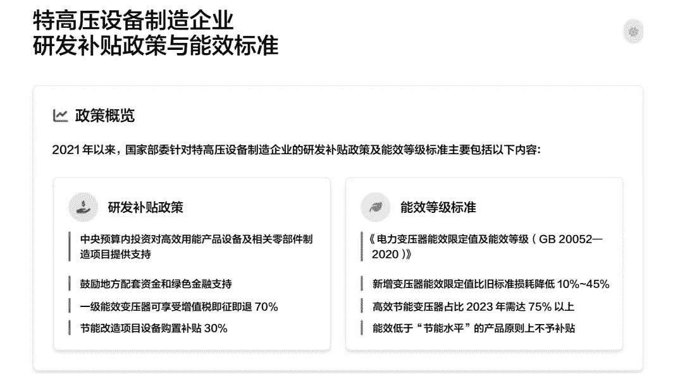

图 5-1 政策分析的可视化呈现示例

八、AI 输出需人工复核

即便接入高质量检索源，专业分析仍需人工核对。可点引用角标查看原始来源，也可用搜索引擎或豆包交叉验证。重点核查数据信息、时间信息、公司案例信息和政策文件信息，AI 易出现数据张冠李戴、时间混淆、案例虚构或文件事实性错误。

第二节 DeepSeek 助力产业经济分析

一、从政策到产业链影响的案例

电力设备制造企业完成政策分析后，需梳理上下游关系以评估节能减排措施的传导效应。产业经济分析可按四步走：梳理上下游关系、做图谱可视化、提取影响分析角度、撰写分析报告。

二、快速梳理产业链上下游

用R1 模型输入“请生成电力设备制造企业的上中下游产业链关系”可得：

上游供应端。原材料供应商包括金属材料如铜、铝、特种钢，非金属材料如绝缘陶瓷、硅钢片，化工原料如环氧树脂。零部件供应商提供变压器线圈、断路器触点、电缆接头及仪表盘、控制芯片、散热装置等。技术支持来自新型绝缘材料研发机构和设备智能控制系统软件公司。

中游制造端。核心企业负责发电设备、输变电设备、配电设备的制造，将200 多个零部件集成完整设备。

下游应用端。直接客户为发电企业、电网公司、EPC 总包方；终端应用覆盖高铁供电、数据中心UPS、钢厂专用变压器、化工厂防爆开关、小区配电箱、充电桩模块；配套服务包括安装调试、运维服务和备件供应。

三、把链路图做出来

为更直观展示结构，可用Napkin 将文本转为演示图。将DeepSeek 结果复制进去，选中文字点蓝色闪电图标即可生成。

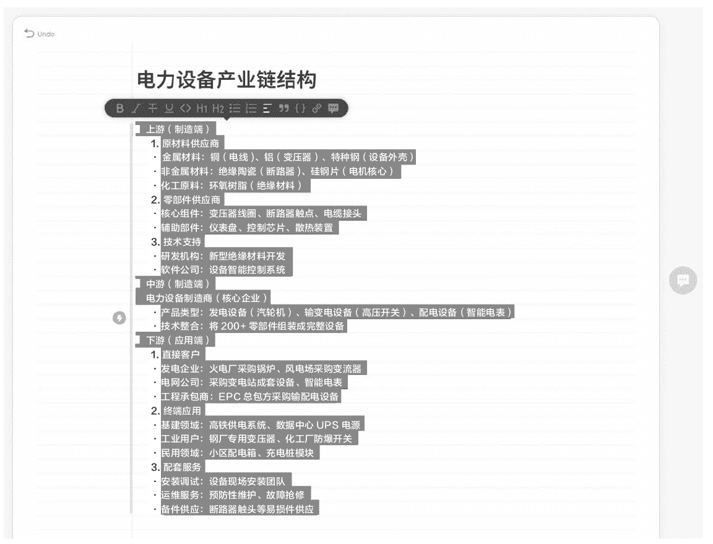

图 5-2 Napkin 生成图片的操作过程

可按需选择样式，示例如图。

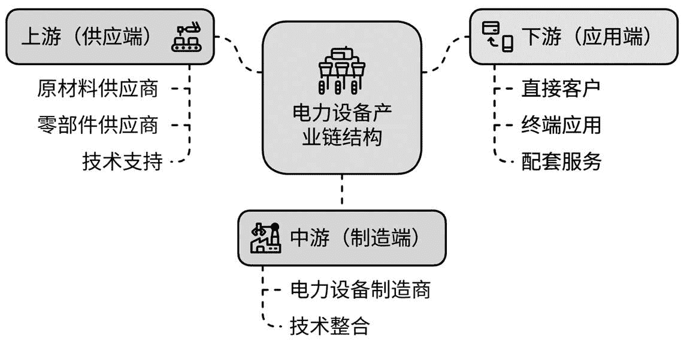

图 5-3 Napkin 生成的产业链结构

四、提炼影响分析的切入点

基于产业链图谱提问“节能减排措施实施后对上游与下游有哪些影响”可提取角度：

对上游供应链。改用低碳材料如再生铝、生物基绝缘材料会导致供应商调整工艺、提高认证门槛、传统材料供应商订单缩减。要求高能效组件会推动硅钢片磁导率提升等技术迭代，小型供应商可能被淘汰。绿色认证采购会缩短运输半径，增加供应链审计成本。

对中游制造端。短期设备改造、工艺升级增加资本开支，长期能耗降低减少运营成本。一级能效产品可进入节能产品目录获补贴，并在电网招标中加分，形成竞争力重构。

后续分析可在此框架下展开成本、供需、技术门槛等量化研判。

研发投入扩表或对短期毛利形成压力

3. 生产流程优化
· 通过 MES 体系对能耗实施数字化可视化与削减，有助于良品率提升。
· 推进废料闭环再利用，将金属边角余料回炉熔炼，可降低原材料损耗水平。

三、对下游客户及市场的影响
1. 客户运营成本变化
· 向电网企业供应低损耗变压器，减少其输配电损耗成本。
· 为工业客户提供智能节电方案，帮助其达成 ESG 目标，增强客户黏性。
2. 市场准入资格
· 欧盟碳边境调节机制 CBAM 倒逼出口设备须达标碳足迹，否则下游海外客户可能转单。
· 国内绿电园区与零碳工厂项目强制要求设备供应商提供减排证明。
3. 服务模式延伸
· 由单一设备销售转向“产品+能效服务”模式，如合同能源管理，抢占运维后市场。
· 带动下游安装商技能升级，需具备碳监测设备调试能力。

四、产业链协同效应分析
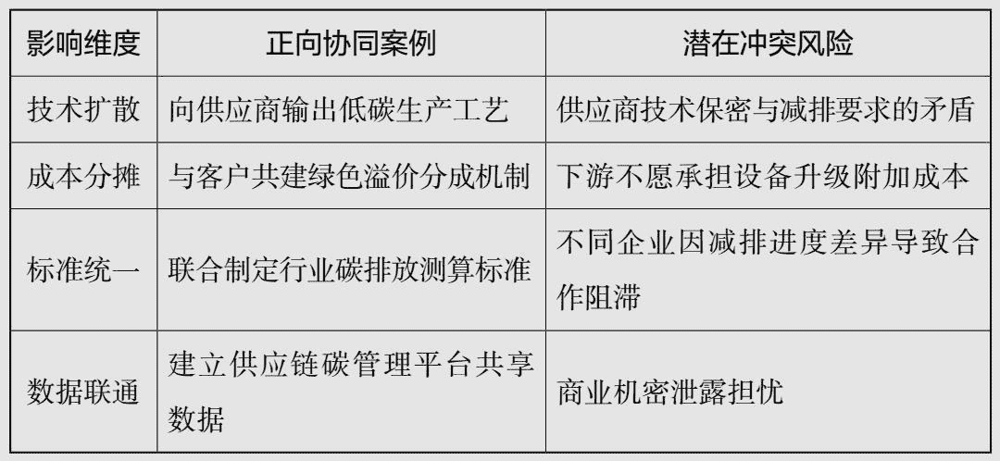

五、重点量化评估指标
1. 上游：绿色材料采购占比、供应商碳达标率、物流碳排放强度
2. 中游：单位产值能耗、产品全生命周期碳足迹、再生材料使用率
3. 下游：客户节能效益分成金额、低碳产品市占率、碳标签认证数量

六、风险预警
1. 绿色陷阱：过度投入减排技术而忽视真实市场需求，例如氢能设备研发过早超前。
2. 政策波动：碳核算标准频繁变动导致供应链需反复调整。
3. 国际传导：欧美供应链碳追溯要求引发连锁反应，例如被迫更换境外供应商。

五、产业分析报告的撰写方法

上述框架的每个要点均可借助 DeepSeek 进行深化拓展，若上传相关产业数据作为附件，结论将更具说服力与落地可能。上传后可复用提示词，最终合成完整报告，例如请依据附件拓展框架中某模块，并明确该模块的撰写要求。

随后将各模块结果按既定框架整合，补充可视化图表并做衔接润色，即完成产业链分析初稿。事实类信息需核验 DeepSeek 生成内容的真实性。

第三节 DeepSeek 助力财务分析

本节以某虚拟企业 2022—2024 年简化利润表为例，演示 DeepSeek 在财务分析中的辅助价值，该表为表 5-2。

表 5-2 某虚拟企业 2022—2024 年简化利润表
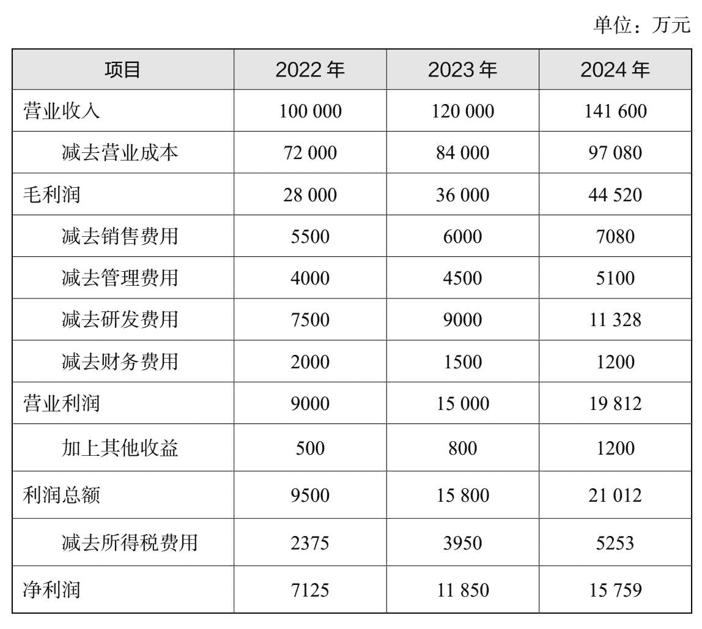

本节演示基于表 5-2 开展复合增速与毛利驱动拆解、研发费用边际效益及税收优惠情景分析。分析前需将表 5-2 导入 Excel 并上传至 DeepSeek 附件区，同时输入对应提示词并开启深度思考 R1 模式，即可获得输出。建议人工复核计算结果以确保准确。

二、复合增长率与毛利驱动分解分析

借助 DeepSeek 计算营业收入与营业成本的年均复合增长率 CAGR，可量化核心业务扩张速度与成本管控效率，进而揭示增长质量与可持续性。收入 CAGR 反映市场份额与产品竞争力趋势，成本 CAGR 反映供应链管理、原材料波动或生产效率变化。

在此基础上拆解毛利率提升动因，可精准定位盈利改善抓手，为管理层提供战略依据，并形成对财务健康与成长潜力的系统评价。

提示词示例：基于 2022—2024 年利润表，计算营业收入、营业成本年均复合增长率，并拆解毛利率提升核心因素，输出贡献度百分比。

一、营业收入与营业成本年均复合增长率 CAGR
1. 营业收入 CAGR

2. 营业成本 CAGR

二、毛利率提升的核心因素分解
1. 毛利率变化
· 2022 年毛利率：28%
· 2024 年毛利率：31.44%
提升幅度：3.44 个百分点
2. 因素分解 基于成本率变化
· 营业收入增长贡献 70.5%
▪ 收入增量 2022—2024 年累计增加 41600 万元。
▪ 假设成本率维持 72%，收入增长带来的毛利贡献：
41600×（1-72%）=11648 万元
· 营业成本控制贡献 29.5%
▪ 实际成本率由 72% 降至 68.57%，累计节约成本：
141600×72%-97080=4872 万元
▪ 贡献度比例：
收入增长贡献= ×100%≈70.5%
成本控制贡献= ×100%≈29.5%

三、结论
1. 增长驱动
收入增长 CAGR 19% 快于成本增长 CAGR 16%，叠加成本率下降，共同推动毛利率抬升。
2. 核心因素
· 收入扩张贡献约 70.5%，体现市场扩张或定价能力提升。
· 成本优化贡献约 29.5%，体现供应链效率改善或规模效应。

三、研发费用效益的边际分析

对比研发费用增速与营业利润增速并计算研发投入边际效益，可量化技术创新对盈利的实际贡献效率。若比值高于行业阈值，说明研发转化效率高、方向精准、商业化能力强，能转化为超额利润；若低于阈值，则可能存在资源错配、技术落地滞后或收益递减。

该分析可揭示创新驱动质量，辅助管理层优化研发策略，聚焦高回报领域并调整研发周期，亦可实现横向对比与纵向追踪。

假设行业阈值为 0.8，提示词为：对比 2023—2024 年研发费用增速与营业利润增速，计算研发投入边际效益，判断是否高于行业阈值 0.8。

生成结果如下。

一、计算研发费用增速与营业利润增速
1. 研发费用
· 2023 年研发费用：9000 万元
· 2024 年研发费用：11328 万元
· 研发费用增速=（11328-9000）/9000=2328/9000≈0.2587 25.87%
2. 营业利润
· 2023 年营业利润：15000 万元
· 2024 年营业利润：19812 万元
· 营业利润增速=（19812-15000）/15000=4812/15000≈0.3208 32.08%

二、计算研发投入边际效益
研发投入边际效益=营业利润增速/研发费用增速=0.3208/0.2587≈1.24

三、技术转化效率评估
行业阈值 0.8，测算结果 1.24。
因 1.24>0.8，技术转化效率高于行业水平。

四、结论
· 研发费用增速：25.87%
· 营业利润增速：32.08%
· 研发投入边际效益：1.24
· 技术转化效率高于行业阈值 0.8，研发投入效益良好。

四、税收优惠的场景分析

对科技型企业而言，取得高新技术企业认证可带来多重利好。本部分聚焦所得税税率优惠价值。假设 2024 年企业取得高新认证后所得税率降至 15%，可量化其对财务绩效的实际影响。

假设 2024 年净资产为 8 亿元 即 80000 万元，可通过净利润与净资产收益率 ROE 的差异衡量政策红利。

提示词示例：2024 年企业净资产 80000 万元，若获高新技术认证所得税率降至 15%，请测算净利润、ROE 的增幅，并与 25% 税率情景对比，输出差异及政策结论。

生成结果如下。

测算结果分析
一、所得税调整测算
1. 利润总额 2024 年：21012 万元
2. 原税率 25%：所得税费用 5253 万元→净利润 15759 万元
3. 高新税率 15%：所得税费用 21012×15%=3151.8 万元→净利润 21012-3151.8=17860.2 万元

二、指标对比
1. 净利润增幅：17860.2-15759=2101.2 万元，增幅 13.3%
2. 净资产收益率 ROE
· 原 ROE：15759/80000≈19.70%
· 高新 ROE：17860.2/80000≈22.33%
· ROE 提升 2.63 个百分点，相对增幅 13.4%

三、政策红利结论
1. 高新技术认证使所得税率下降 10 个百分点，净利润增加 13.3%，ROE 提升 2.63 个百分点。
2. 政策红利绝对值达 2101.2 万元，显著改善盈利能力与股东回报，建议优先争取认证。

四、差异值表格
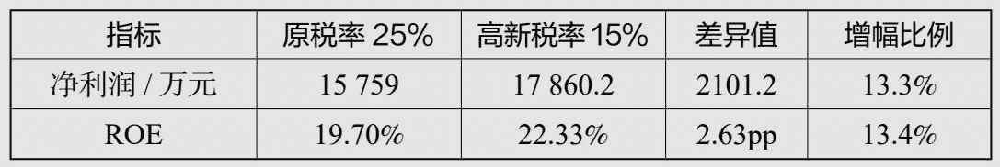

## [第][六][章]

## 产业变革：DeepSeek 赋能万业千行

第一节 初级产业智能跃迁：DeepSeek 重构农业与资源开发

一、DeepSeek 为初级产业智能升级赋能

该模型理论基础源于深度学习与人工智能前沿研究，尤其在神经网络与多模态理解方面。其技术体系涵盖自然语言处理、计算机视觉与数据挖掘，为初级产业智能化转型提供支撑。DeepSeek 依托多模态数据处理能力，可融合文本、图像等多源信息，提升决策支持精准度。其技术支撑主要体现在：

• 深度学习算法：基于多层神经网络自动提取特征并优化模型，实现高效数据分析与处理。
• 大规模模型：如 DeepSeek-V3 在自然语言处理、代码生成与多模态理解任务中表现突出，为初级产业提供强技术支持。
• 高性能计算平台：依托高性能推理中心与 MoE 架构，在保证资源高效利用的同时满足差异化推理需求。
• 开放 API 与合作生态：通过开放 API 与友好基础设施，与开发者、科研人员及合作伙伴协同攻关，推动初级产业智能化。

该模型的应用原理围绕海量数据的深度分析与精准提取展开：

• 数据整合与分析：整合农业传感器、市场交易等各类数据，快速提取价值信息，为决策赋能。
• 自动化决策支持：利用自然语言处理与计算机视觉自动化解析复杂信息并生成建议，提升生产效率与精准度。
• 智能化工具开发：开发易用的工具与模型，让初级产业从业者便捷接入人工智能，实现转型。

总体而言，DeepSeek 为农业、畜牧业等领域数字化和智能化发展提供全方位支持。

二、相关案例分析

以下案例可为 DeepSeek 在初级产业的应用提供战略参考。

（一）约翰迪尔
1. 公司简介
约翰迪尔成立于 1837 年，是全球领先的农业机械制造商与农业技术公司，产品涵盖拖拉机、收割机及精准农业解决方案，近年通过整合人工智能技术推动农业现代化。

2. 应用背景与需求分析
人口增长与气候变化带来资源短缺、病虫害与环境压力，传统模式难以满足粮食需求。约翰迪尔引入人工智能旨在解决上述问题，满足农民对精准农业与高效生产的需求。

3. 人工智能的应用实践
在 FarmForward2.0 项目中，约翰迪尔利用人工智能优化生产流程：
• 精准农业：人工智能分析土壤、气候与作物生长数据，提供定制化种植建议，优化施肥与灌溉。
• 病虫害监测：图像识别技术实时监测病虫害迹象，及时防治，减少化学农药使用。
• 自动化机械：研发无人驾驶拖拉机与收割机，结合传感器与 GPS，实现自动化作业。
• 数据分析与决策支持：人工智能驱动平台提供市场预测、天气分析与土壤健康报告。

4. 人工智能的应用效果
• 产量提升：精准施肥灌溉提升作物产量。
• 成本降低：自动化减少人工投入，农药使用减少。
• 环境保护：优化灌溉减少水资源浪费，缓解土壤板结。
• 决策支持：数据平台提升应对气候变化与市场波动的科学性。

5. 案例经验总结
• 数据质量与准确性是人工智能应用基础。
• 技术需与农业实际需求紧密结合，避免脱离操作实际。
• 需加强农民培训与接受度建设。
• 需政策支持与多方合作推动技术创新。

约翰迪尔的实践为全球农业现代化提供了经验，未来应用前景广阔。

（二）佳沃集团
1. 公司简介
佳沃集团聚焦农业创新，致力于以科技提升生产效率与产品质量。近年在云南红河开展蓝莓种植人工智能应用项目。

2. 应用背景与需求分析
蓝莓对种植环境要求高，传统方式面临劳动成本高、病虫害防治难、产量不稳定等问题。佳沃希望以人工智能实现精准种植与智能管理。

3. 人工智能的应用实践
• 土壤与气候数据分析：人工智能分析土壤成分、气候与生长模式，为种植提供科学依据。
• 病虫害监测与防治：图像识别实时监测病虫害并给出防治建议，减少农药使用。
• 灌溉系统优化：按需水量与土壤湿度自动调整灌溉计划。
• 智能采摘机器人：人工智能驱动采摘机器人提升效率、降低人工成本。

4. 人工智能的应用效果
• 产量提升：精准管理提升平均产量。
• 成本降低：农药与人工成本下降。
• 品质改善：病虫害控制有效，果实品质与市场竞争力增强。

5. 案例经验总结
• 技术需深度融合农业需求进行定制化开发。
• 数据准确性至关重要，需强化采集与分析能力。
• 推广需注重农民培训与教育，提升接受度。
• 需政策支持与产研合作共同推动现代化。

佳沃的案例展示了人工智能在农业领域的潜力。

（三）大北农集团
1. 公司简介
大北农是中国领先的农业科技企业，聚焦种业、饲料、养殖与农业服务，近年积极引入人工智能探索智能农业方案。

2. 应用背景与需求分析
人口增长与气候变化导致资源浪费、效率低下，传统经验种植易受天气与病虫害影响，劳动力短缺与成本上升制约可持续发展。大北农需以人工智能优化流程、提升资源利用率与产量并降低成本。

3. 人工智能的应用实践
• 智能种植管理：人工智能分析土壤与气象数据，预测生长与病虫害风险，提供精准种植建议，减少农药化肥使用。
• 智能农机设备：研发自动驾驶拖拉机、无人机喷洒系统与智能收割机，实现自动化播种、施肥、喷洒与收割。
• 病虫害监测与管理：无人机与传感器实时监测，图像识别与模式分析快速识别病虫害并提供防治措施。
• 数据分析与决策支持：整合气象、土壤、作物数据，人工智能深度分析提供种植策略优化、产量预测与市场分析。

4. 人工智能的应用效果
• 生产效率提升：智能农机减少人工、提高作业速度与精度，显著提升效率。

AI 农业：减耗提质向绿而行

精准种植配合智能病虫害预警，让农药和化肥的投放更克制，生产成本随之下来；灌溉系统被优化后，水源流失的问题明显收敛，资源浪费得到有效遏制。

作物端表现同步向好，AI 介入后产量曲线上移，品质和市场议价能力也跟着提升。

在化学投入减少、资源利用更精细、生态环境受损被控制的叠加效应下，农业的发展路径明显转向绿色可持续。

大北农的实践沉淀出四条经验：

数据驱动是底座。公司搭建起全链路数据平台，对数据准确性和完整性做严格把控，为模型训练和持续优化提供可靠燃料。

先试后推降低风险。AI 部署并非一蹴而就，而是从小范围试点起步，边积累边解决技术卡点，再逐步放大到全系统，成功率因此被拉高。

技术必须落地到田间。培训农户和技术人员是关键，让一线人员既会用工具，也能理解背后的原理，AI 才能真正嵌入生产。

创新要持续跟进。面对模型迭代加速的行业现实，公司保持开放学习姿态，持续引入新方法，并形成功能更贴近中国农业场景的本地化方案。

借助 AI，大北农实现了效率与品质的双提升，也推动了农业的可持续转型，为行业提供了可复制的思路。

第二节 DeepSeek 激活制造业智能跃迁

一、DeepSeek 如何撬动第二产业提效
DeepSeek 的底座是深度学习与机器学习，靠大规模预训练模型模拟人脑信息处理，实现对复杂任务的快速响应。依托海量数据分析和算法迭代，它在自然语言理解、图像识别、代码生成和多模态任务上具备强劲表现。模块化设计与资源的高效利用，也把 AI 开发门槛和成本降下来，让更多企业能用上。

技术支撑主要体现在：
算法优化上，深度学习能从庞大数据里提炼有效信号，并快速给用户回应。
模型架构上，分布式计算与高效训练流程提升了可扩展性和运行效能。
成本效益上，开源高性能模型降低了中小企业的接入门槛，同时保持顶尖竞争力。
智能化监控与优化上，借助传感器与物联网，制造过程实现实时感知与动态调优。

应用逻辑围绕数据和生成展开：
数据驱动让模型从海量信息中捕捉规律，为预测和决策提供支撑。
多模态融合把文本、图像等异构信息打通，实现高效提取与整合。
智能化决策通过实时分析与预测优化生产流程，提升效率并压缩成本。
用户体验提升则体现在智能客服、办公助手等场景，工作效率被显著改善。

总体来看，DeepSeek 为第二产业的效率革命提供了理论与技术双重底座，助推制造业等领域走向智能化。

二、典型产线升级案例解析
（一）海尔集团
1. 企业画像
成立于1984年的海尔，是中国领先的家电制造商和全球知名的智能制造代表，长期以技术创新和数字化转型驱动生产效率与产品质量提升。

2. 背景与痛点
工业4.0背景下，制造业普遍面临效率不高、品质波动、成本攀升和用工紧张。海尔希望借助 AI 降本提质、控碳减排，同时满足消费者个性化需求，推动设计与定制生产提速。

3. AI 落地打法
智能设计与产品开发中，机器学习结合虚拟仿真优化设计流程，AI 可依据市场与用户反馈生成创新方案并快速验证。
生产自动化与质量控制环节，AI 设备和传感器实时采集产线数据，快速定位并纠正缺陷，次品率下降、效率上行。
预测性维护通过运行数据建模，提前识别设备潜在故障，减少停机与维修支出。
供应链优化利用 AI 分析需求与库存，精准预测原材料用量，降低积压与运输成本。

4. 成效呈现
产线吞吐量提升，整体生产效率明显改善；次品率下降，客户满意度提高；预测性维护与供应链优化每年节约约10%的运营成本；响应市场速度加快，个性化产品不断推出。

5. 经验提炼
AI 要与具体业务场景深度绑定才能释放价值；制造领域的 AI 是持续迭代的过程；高素质团队与协作是前提；数据安全与隐私保护必须贯穿始终。

（二）南方电网
1. 企业画像
南方电网是中国主要的电力供应企业之一，专注安全可靠高效供电，在技术创新与数字化转型方面走在行业前列。

2. 背景与痛点
新能源快速接入提升了系统复杂度，对调度、功率预测、负荷管理提出更高要求。企业通过 AI 大赛探索智能调度与资源优化，以提升清洁能源消纳并降本增效。

3. AI 落地打法
电力调度优化把调度时延从分钟级压缩到秒级，效率与准确性同步提升。
发电功率预测基于历史数据建模，实现“削峰填谷”，能源配置更合理。
智能监测与巡检用 AI 实时诊断设备状态，降低故障概率，提升维护效率。
负荷预测与管理结合用电行为与电网数据，实现精细化预测，保证稳定运行。

4. 成效呈现
清洁能源消纳率达99%，新能源利用效率大幅提升；调度效率大幅提高；资源配置与故障减少带来运营成本可控；智能语音等服务提升客户使用便捷性与安全感。

5. 经验提炼
技术选型要贴合电力行业实际；大数据与 AI 算法是高质量决策支撑；人才培养与高校机构合作推动创新；持续优化迭代保持技术领先。

（三）广联达
1. 企业画像
广联达深耕建筑数字化转型，通过 AI 大模型 AecGPT 及大模型层、工具层、应用层体系，为建筑细分领域提供智能化方案。

2. 背景与痛点
建筑行业长期受效率低、成本高、资源浪费困扰；5G、物联网普及为 AI 应用创造条件。企业希望通过 AI 优化设计、施工与运营，提升效率与绿色化水平。

3. AI 落地打法
建筑设计优化借助深度学习分析大量图像与数据，为设计师提供灵感与符合性能指标的方案，提升效率与质量。
施工进度优化在 P6 项目管理中识别风险点并预警，动态调配资源保障任务供给。
智能监控与安全管理通过实时监控与预警发现安全隐患与违规行为，提升施工安全水平。

4. 成效呈现
设计与施工管理效率提高，设计周期缩短且人为错误减少；资源优化与浪费减少带来成本节约；施工质量与管理水平提升，延误与返工下降；节能管理降低能耗与运营成本，推动行业绿色发展。

5. 经验提炼
AI 应用需深入理解业务流程并紧密结合需求；数据质量决定效果，须保证准确完整；系统需持续学习以适应行业复杂性；政策支持与行业协作有助于可持续发展。

第三节 DeepSeek 领航服务业数字化转型

一、DeepSeek 驱动第三产业创新升级
DeepSeek 整合深度学习、自然语言处理、计算机视觉等前沿技术，构建强模型与算法体系，可处理文本、图像等多类型数据，提供高效检索与分析。底层模型持续迭代，自主学习能力增强，满足信息检索与决策需求。大模型训练机制与多模态理解能力为行业创新提供新路径。

技术支撑体现为：
高性能计算能力，DeepSeek-R1 在深度思考、推理和处理速度上突出，推动 AI 普惠。
开源技术路线，开放 API 与开发者社区促进二次开发，形成丰富生态。
数据处理能力，实时分析与清洗海量数据，为企业提供精准模型与决策参考。
多模态理解，在 NLP、代码生成与多模态任务中表现优异，支撑行业创新。

应用原理依托抓取、分析与生成能力，整合多源数据快速抽取关键信息并生成图表与趋势分析，辅助科学决策；同时支持自动化决策与资源配置，提升行业效率。如金融领域可实时分析市场数据辅助投资决策，制造领域可通过预测性维护降低运维成本。

DeepSeek 为第三产业创新提供坚实支撑，推动智能化转型与效率提升。

二、服务业标杆实践
（一）三菱 UFJ 金融集团
1. 机构概览
MUFG 是全球领先的金融服务集团，涵盖银行、证券、保险、资产管理等，持续推进金融创新与技术应用以提升效率与体验。

2. 挑战与需求
金融科技发展下，企业需提升运营效率、优化客户服务与风险管理。传统人工服务难以满足个性化需求，合规与风险管控也亟需自动化与精准化。

3. AI 实践路径
客户服务自动化基于 NLP 开发智能客服，实现账户查询、交易支持等实时响应。
个性化金融建议利用机器学习分析财务状况，提供定制投资与风险管理方案。
文档生成与系统开发借助生成式 AI 自动化产出报告与提案，优化开发流程。
风险管理与合规监控通过大数据与机器学习实时识别异常交易，保障监管要求。

4. 成效呈现
智能客服降低人工压力，客户满意度提升；风险预测准确及时，潜在损失减少；自动化文档与开发降低人力与时间成本；个性化服务增强客户黏性。

5. 经验提炼
AI 需与业务场景深度融合；高质量数据是决策基础；技术迭代需持续跟进；合规与伦理须始终并重。

（二）好未来
1. 机构概览
好未来成立于2003年，是中国领先的教育科技公司，业务覆盖 K12、国际课程、素质教育与在线教育，并设立 AI 实验室聚焦机器学习与自然语言处理。

2. 挑战与需求
传统教育难以满足个性化与高效学习需求；企业需借助 AI 实现内容推荐、学习过程管理与教师辅助，提升资源配置与运营效率。

3. AI 实践路径
个性化学习系统分析学习数据与能力水平，动态调整难度与练习，提供针对反馈。
智能辅导系统以自然语言交互解答疑问，完成作业并即时反馈。
教学内容优化基于学习偏好与表现数据生成个性化推荐。
教师助手自动批改作业、管理课堂并提供教学建议，减轻负担。

4. 成效呈现
学生成绩与学习兴趣参与度提升；教学效率提高，课堂管理更顺畅；智能化管理降低运营成本并提升资源利用率；市场竞争力增强，吸引更多家庭关注。

5. 案例经验总结

**好未来：AI 与教学的深度共生**

• 需求驱动的融合落地：AI 要见效必须先吃透用户真实场景。好未来长期沉浸教育一线，把技术能力嵌入备课、授课、课后练习等环节，让技术与教学实践形成闭环。
• 研发与实践双轮驱动：AI 系统没有终点。好未来持续投入研发，在真实课堂中不断打磨，让功能更完善、性能更稳定。
• 合规与隐私为前提：在全流程应用中严格遵循数据安全规范，对学生信息进行全链路保护。
• 以自身实践带动行业：AI 应用不仅提升了好未来的市场竞争力，也为教育行业提供了可复制的智能化路径，推动整体转型。

好未来借助 AI 实现了教学个性化、管理智能化与运营提效，为传统教育注入新动能，也为同行树立了可参照的样本。

**（三）云迹科技**

1.公司简介
云迹科技专注于酒店行业的智能化升级，通过人工智能重塑服务与运营。其核心产品包括智能语音客服、服务机器人 UP 以及酒店运营系统等，目标是优化住客体验、提升运营效率、压缩成本。

2.应用背景与需求分析
旅游业快速扩张使酒店竞争加剧，客户需求日益多元。传统酒店在服务响应、资源调配和成本管控上压力明显，个性化服务需求上升，运营复杂度提升，客户满意度与忠诚度难以稳定。云迹科技据此推出面向酒店的 AI 解决方案。

3.AI 的应用实践
• 智能语音客服：系统 24 小时在线，可解答疑问、完成预订与退房等事务，有效提升客户满意度。
• 机器人 UP：具备 360° 视觉感知，可承担送物、清洁、消杀等全场景任务，服务响应快且稳定，助力无人化运营。
• 酒店管理系统：HDOS 平台整合智能硬件与客控系统，可根据住客偏好自动响应，并通过数据分析优化成本结构。

4.AI 的应用效果
• 客户体验改善：智能客服与服务机器人让服务更快更便捷，满意度与复购意愿提升。
• 运营效率提升：机器人分担人力，数据驱动的资源与能源配置更合理。
• 成本下降：人工干预减少，整体运营经济性增强。

5.案例经验总结
• AI 需场景化定制：技术不能一概而论，需结合酒店自身需求选择方案。
• 数据安全不可缺位：应用过程中须保障客户数据安全与隐私，避免合规与伦理风险。
• 持续迭代是常态：AI 应用需要不断调优以适应市场变化。

云迹科技以 AI 构建酒店智能化服务体系，既提升了体验与效率，也为行业未来发展提供了新思路。

**（四）晶泰科技**

1.公司简介
晶泰科技成立于 2015 年，聚焦 AI 驱动的药物研发创新。以智能自动化为核心，融合量子物理与人工智能，解决分子设计、靶点发现、药物筛选等关键难题。依托自研平台并与全球药企合作，提供从靶点到临床前候选化合物的一体化服务。

2.应用背景与需求分析
传统药物研发周期长、成本高、成功率低，依赖大量试错。晶泰整合云端超算、大数据与机器学习，推出 XtalFolio™、XcelaMol™ 等平台，提升速度与成功率。核心客户诉求为将研发周期从十年以上缩短至数年、把临床成功率提升至 80%-90%、降低筛选与测试成本。

3.AI 的应用实践
• 分子设计与优化：深度学习对分子结构进行分析与优化，加速新药发现。
• 靶点识别与验证：AI 挖掘海量生物数据，快速锁定潜在靶点并进行验证。
• 干湿实验联动：将量子物理的干实验室与湿实验室紧密结合，AI 预测指导实验，提升效率。
• 跨领域延伸：技术还应用于锂电材料等领域，体现广阔适用性。

4.AI 的应用效果
• 效率显著提升：研发周期压缩至数年，成功率大幅提高。
• 成本控制：筛选与测试的时间资源消耗减少。
• 市场认可度高：已与辉瑞、礼来等合作，获得红杉资本等支持。
• 技术突破：蛋白结构预测、癌症风险预测模型等取得重要进展。

5.案例经验总结
• 核心技术决定突破：自主研发的平台是关键竞争力。
• 产学研协同加速商业化：与药企合作验证效果，推动落地。
• 区域与政策加持：粤港澳大湾区政策与香港科研资源助力领先。
• 竞争与数据挑战并存：需持续创新应对行业竞争与数据不足。

晶泰科技以 AI 重塑药物研发流程，大幅提升效率与成功率，成为行业标杆，未来仍有更大突破空间。

# 战略篇

## 第七章
## DeepSeek 助力企业 AI 战略转型

第一节 从“互联网+”到“DeepSeek+”：所有生意值得再做一遍

一、DeepSeek 的颠覆性：AI 的“Wi-Fi 时刻”到来
互联网早期拨号费用高、网速慢，普及受限。Wi-Fi 大规模应用后接入成本骤降，电商、移动支付等商业模式爆发，传统百货受冲击。DeepSeek 的出现类似 Wi-Fi 对互联网的意义，让 AI 应用成本大幅下降。过去企业涉足 AI 需要巨额研发投入、高薪组建团队、采购昂贵算力。中小企业多望而却步。DeepSeek 以开源高效、操作门槛低、响应速度快的特点，让 AI 从高不可攀变为触手可及。

在此背景下，所有业务都值得在“DeepSeek+”框架下重新审视。例如客服可搭建智能客服，7×24 小时理解问题并给出精准答复，降低人力同时为产品改进提供数据支撑；制造可利用数据分析与预测实现设备预警与生产排程优化，减少不良品；营销可借助行为偏好分析制定个性化策略，提升转化并降低费用。反之，固守传统模式的企业将在成本、服务、创新上被拉开差距，最终被市场淘汰。

二、谁是受益者？谁会被革命？
“互联网+”的核心是连接，打破信息壁垒、降低交易成本。“DeepSeek+”则从连接升级为智能驱动，实现设计智能化、服务个性化、营销精准化、运营自动化。服装企业可用 AI 生成虚拟试衣，制造业优化流程降本，金融机构借助生成式 AI 评估风险。

能快速拥抱变革的企业是受益者。小规模创意工作室借助生成式设计与大厂竞争，传统制造通过 AI 优化供应链提升抗风险能力。而拒绝转型的企业将被淘汰，正如当年未跟上互联网转型的百货。生态位替代已现端倪：传统搜索引擎以“十条蓝链”提供信息，ChatGPT 直接给出答案，改变用户习惯。谷歌被迫转向 AI 优先战略，若固守旧模式恐失领先地位。

AI 时代企业不进则退。观望者将在成本控制、体验提升与竞争力上持续落后。只有洞察趋势、将 AI 融入流程并不断创新商业模式，才能实现可持续发展。

三、企业战略行动清单：要么重构，要么消失
AI 浪潮已至，企业需重塑业务。

1.提升竞争力
利用 AI 优化流程、提效降本、提升质量与服务水平，实现智能化生产与精准营销，更好满足客户。

2.适应市场变化
实时采集分析市场与用户数据，及时感知需求变化，快速迭代产品与服务。

3.创新商业模式
从单一制造转向智能化解决方案，从线上线下割裂走向融合，拓展新市场空间。

4.提升企业决策效率
AI 驱动的数据分析与预测为财务、风险、市场决策提供依据，降低决策失误风险。

5.培养企业创新能力
连接全球创新资源，借助 AI 快速生成创意与方案，保持长期领先。

微软收购诺基亚时高管坦言：“我们没做错什么，却输了。”今天拒绝转型的企业输给的不是对手，而是时代。所有生意值得用 AI 重做，成本归零的已不是连接，而是智能本身。

第二节 企业各职能部门 AI 战略转型
生成式 AI 降低了拥抱成本，推动“DeepSeek+”转型。企业需在研发、生产、营销、客户运营、人力、财务、法务、供应链等职能中落地 AI，实现人效提升与竞争壁垒构建。

一、研发与生产：AI 让“小团队”干出“大产值”
AI 显著提升小团队的灵活性与创新力。调研显示，人员规模小于 100 人的研发团队更易将生成式 AI 嵌入研发任务，通过快速迭代设计、自动化处理重复工作，集中精力于创新。例如游戏开发领域，小团队借助 AI 大幅降低开发成本，保持与大厂的产出竞争力。

生产场景中引入 AI，显著拉升了小团队的产出能力。相关技术能打磨流程、提升品质、压缩库存开销，并借助预测性维护把停机时间压下来。^(²⁹) 比如在小规模制造里，生成式 AI 已被用于产品设计和原型打样，让团队迅速产出多套方案并快速迭代。AI 驱动的库存体系也在优化需求预测，帮企业避开积压或断货。综合来看，效率提升的同时运营成本下降，小团队才有底气在激烈竞争中站稳脚跟。

AI 同时是小团队商业起飞的助推器。不少创业公司借助这套技术完成从零到亿级营收的跃迁。以部分 AI 创企为例，依托精干的小团队架构，短短数月便实现数十亿美元规模的业务扩张。这类公司普遍更看重盈利而非短期拉新，并倾向于招募高势能人才来驱动增长。除此之外，AI 赋能的分析工具还能让小团队更清晰地读懂市场动向与客户偏好，进而制定更精准的营销打法。^(³⁰)

不过红利并非唾手可得。落地时小团队常面临三重考验：其一，人才拼图必须完整，既要有领导力，也要覆盖业务、IT 与技术专家；其二，问题选择要精准，并非所有工作都适合交给机器自动化；其三，宜先小步试点，再根据验证结果逐步放大应用范围。

整体来看，AI 正重塑研发与生产的版图，让小团队以更低成本、更高效率撬动更大商业价值。无论是加快产品研制、精简生产链路，还是增强决策质量，AI 都打开了前所未有的可能性。展望未来，随着技术持续进化，小团队在全球舞台上的话语权有望进一步提升。

**二、营销与客户运营：从人力投放转向 AI 精准触达**

AI 正深度改写营销与客户运营的游戏规则。过去靠人力广撒网，如今转向 AI 精准打击，企业正借助这波技术实现个性化触达、客户体验升级与运营效率优化。

传统打法里，企业主要靠人工梳理用户数据来制定策略，效率低下且易出错。营销人员需手动筛选目标人群、解读消费行为，不仅耗时耗力，还容易因主观判断失误而错失机会。AI 的加入彻底改写了这一路径。依托机器学习与深度学习，AI 能快速处理海量信息，精准锁定潜在客户并预判其需求，从而实现千人千面的个性化营销。

AI 驱动的智能投放系统会依据用户的浏览习惯、购买履历和反馈效果动态调优广告策略，力求每次投放都拿到最大 ROI，即投资回报率。这种精准度不仅削减了投放成本，也显著拉高了广告回报。

在客户运营侧，AI 的价值同样突出。借助自动化工具与平台，企业能实时采集与分析客户数据，优化客户生命周期管理，降低流失率。系统可按客户偏好推送个性化推荐，并通过智能客户关系管理平台加深连接，提升客户粘性。

生成式 AI 还能激发创意，为营销团队提供更具吸引力的个性化方案，同步提升用户体验与市场竞争力。

营销自动化是 AI 在该领域<|message|>的核心应用。通过自动化工具，企业可打通从洞察到推送的全链路。例如在投放环节，AI 能根据消费行为预测购买倾向并自动调整策略；同时还能拆解各渠道效果，实时优化预算分配，进一步提升整体营销 ROI。

从人力投放迈向 AI 精准触达，营销与客户运营正进入新阶段。企业需积极拥抱变革，用好技术优势来强化营销效能，走向可持续发展。

**三、人力资源与组织管理：从人海战术转向 AI 协作成员**

AI 的崛起正深度改写人力与组织管理的逻辑。从过去的人海堆砌，到如今的 AI 协作成员，这一转变既体现技术进步，也映射企业对效率、创新与可持续的追求。

传统模式下，人力资源管理高度依赖人手完成招聘、培养、绩效评估等环节，效率偏低且受主观影响大。AI 的介入改变了局面。依托大数据分析与机器学习，AI 能快速筛简历、预测候选人表现，并给出个性化的培养与发展建议。比如智能算法可分析员工数据，优化招聘流程，提升匹配度与效率。

AI 还能通过实时绩效追踪与风险预警，帮助企业更稳妥地管理表现，削弱负面影响。智能化管理不仅减轻了 HR 部门负担，也让员工把时间释放到更高价值事项上。

AI 在人才管理中的覆盖面很广，涵盖招聘、培养、薪酬与员工关系等多个维度。招聘环节里，AI 通过智能简历筛选和面试助手提升效率，并借助预测性分析帮助 HR 更客观地评估候选人。生成式 AI 还能为员工定制学习计划与职业发展路径，提升技能与满意度。

AI 面试已成招聘主流，尤其在秋招等关键期被广泛使用。该模式通过虚拟形象与文字界面交互，求职者回答系列问题后，系统会生成评估报告并决定是否进入下一轮。优势在于高效、低成本、无接触，能快速处理大量数据并降低传统面试偏见。另一方面，小红书等社交平台上求职者也在热议自身经历，分享应对技巧、逻辑优化与镜头表现等经验，既帮助后来者了解流程，也折射出对这一新方式的适应与探索。

薪酬管理方面，AI 可基于内外市场数据做智能测算，保证公平与竞争力。员工关系管理中，AI 通过情感分析与健康监测工具及时捕捉心理风险，提升满意度与忠诚度。

尽管潜力巨大，AI 本质仍是工具而非替代。人机协同才是未来核心。AI 负责重复性事务，人类聚焦创造力、情感与判断。这种配合既提效，也增强参与感与归属感。与此同时，技术也带来新挑战，如心理安全感保障与技术与人性的平衡。因此转型中企业需坚持以人为本，重视技能成长与心理支持。

从人海战术到 AI 协作成员，人力资源管理正经历深刻变革。AI 提升了效率与精准度，也推动组织结构与管理模式进化。享受便利的同时，企业须关注员工心理安全与技术伦理，未来人机协同将成为关键模式，AI 也将成为智能化管理与高效运营的重要支柱。

**四、财务法务与供应链：AI 让后台部门升格为战略中心**

AI 的加速发展正重塑企业运营底座，尤其是传统上被视为后台的财务、法务与供应链。这些部门借助 AI 从基础支持角色跃升为核心战略枢纽，为数字化转型与竞争力提升提供关键支撑。

在财务领域，AI 应用已从单一自动化扩展到深度战略分析。过去账务处理、报表生成等重复工作占大头，AI 接手后大幅提速，释放人力转向更具战略价值的决策。AI 可通过预测分析优化现金流管理、成本管控与预算规划，提升财务决策力，并借助实时监控与异常检测强化合规与安全。

随着技术成熟，CFO 的角色也在演进。AI 提升了数据准确性与时效性，也赋予 CFO 更强的战略洞察。例如依托 AI 驱动的成本分析与盈利预测，CFO 能更好地参与战略规划，并在风险管理中发挥关键作用。财务部门由此可主动介入战略制定，成为增长与创新的推动者。

法务领域同样迎来变革。传统人工审阅合同、管理法律风险耗时且易错。AI 大幅提升效率与合规质量。例如法大大推出的 AI 智能体 iTerms Pro 可实现条款识别、合同审核与风险预警，显著缩短工作时长并提高效率。^(³¹)

借助自然语言处理与大数据分析，AI 还能提供更精准的法律建议与风险评估，快速识别潜在风险并给出应对方案，帮助企业在复杂法律环境中更稳健运营，提升整体竞争力。

供应链管理作为运营要害，正被 AI 彻底改写。传统模式依赖人工操作与经验判断，效率低、失误率高。AI 通过自动化与智能化手段显著提升透明度与灵活性，比如优化库存管理、物流规划与风险预警，实现链路可视化与高效运转。

AI 还可基于实时数据与预测模型提前捕捉链路风险并给出应对建议，提升运营效率与市场变化适应力。

整体看，AI 正推动财务、法务、供应链等后台职能向战略中心转型。借助自动化与智能化，这些部门不仅提升效率与准确性，也增强企业战略决策与市场竞争力。未来它们将在数字化转型中持续发挥关键作用，成为驱动持续增长的核心力量。

**五、转型关键：避开 AI 落地三大陷阱**

AI 技术高速演进，企业纷纷探索转型路径。但落地并非易事，实践中常掉进三大坑：认知陷阱、数据孤岛与技能断层。

**（一）认知陷阱：缺乏场景思维**

不少企业对 AI 抱有过高期待，将其视为万能解药，却忽视了适用边界。据福布斯调研，74% 的企业 AI 战略未能落地，^(³²)核心原因在于缺乏场景思维，未能把技术与具体业务场景绑定。企业也常盲目追逐技术指标，忽视真实痛点，导致项目成为孤岛，难以融入日常经营。

对策应从小切口入手，先在易落地场景做验证，比如自动生成周报等，再逐步向核心业务扩展。这种渐进方式有助于积累经验、控制风险，并提升团队认知与接受度。

**（二）数据孤岛：系统割裂阻碍整合**

Salesforce 调研显示，60% 的企业因系统割裂而无法实现数据整合，^(³³)导致 AI 价值打折。内部系统割裂使数据流通受阻，制约 AI 全面应用。

解决思路之一是采用轻量级 API 工具，如 DeepSeek，降低集成复杂度，减少成本并加速整合。企业也可避免自行建模，通过外部工具快速满足业务需求，缩短落地周期。

**（三）技能断层：员工缺乏 AI 能力**

57% 的企业因缺乏 AI 知识而难以用好技术，^(³⁴)反映出人才培养与技能提升的短板。AI 落地需要技术能力与业务理解的结合，而多数企业在这方面仍显不足。

破解之道是强制性提升意识，比如要求管理层完成 AI 认知培训，以点带面打造标杆团队。同时注重内部复合型人才培养，加强技术与业务人员的协作，确保技术真正转化为价值。

**第三节 企业 AI 转型案例：从人效焦虑到 AI 领跑**

越来越多的企业意识到 AI 对业务创新与竞争力的拉动作用。但如何有效整合技术、优化流程并实现战略转型，仍是普遍挑战。本节以未可知人工智能研究院助力一家金融企业完成 AI 战略转型的过程为例，展示系统化方法论在金融场景中的应用潜力。

**一、案例背景**

客户是一家位于华东的中型金融服务公司，主营财富管理与投资咨询。面对市场快速变化与客户需求日益多元化，公司承受激烈竞争与监管波动的双重压力。管理层逐渐认识到，若不借助新技术提升服务效率与风险管理能力，市场地位恐难维持。在一次商学院高管 AI 战略课程中，高管接触到未可知人工智能研究院，遂寻求专业转型指导。

**二、转型过程**

**（一）第一阶段：现场调研与基础培训**

1. 现场调研

未可知人工智能研究院首先对该金融企业开展全面现场调研，涵盖管理层访谈与实地考察。团队由数据科学家、AI 专家与金融行业顾问组成，深入投资管理、风险控制、客户服务与合规等部门，进行细致观察与分析。

**（1）调研准备**

调研前，团队梳理了企业基本信息、业务范围、市场定位及核心挑战，并同步研究金融行业最新趋势、法规变化与技术革新，确保调研兼具全面性与前瞻性。

**（2）调研实施**

团队采用多方法组合：管理层访谈以把握高层视角与战略规划；部门会议收集一线人员对流程的看法与改进建议；现场观察投资决策、风险管理与客户服务等关键环节；数据分析交易、客户与市场数据以挖掘改进机会。

**（3）调研发现**

调研发现三大效率瓶颈：投资决策高度依赖分析师个人经验与判断，流程冗长且易受主观影响；风险管理仍以传统统计方法为主，对复杂动态市场反应不足；客户服务流程繁琐，响应慢、体验欠佳，且个性化不足。

调研结束后形成详细报告，指出需引入 AI 优化投资决策、风险管理与客户服务等核心流程，以提升效率、降本增效并增强客户满意度。基于此，双方共同制定初步转型计划，包含员工 AI 基础培训、AI 战略工作坊与本地化 AI 方案部署，目标是通过自动化与智能化保持竞争优势。

2. 基础培训

针对调研结论，未可知人工智能研究院为企业定制基础 AI 培训课程，重点聚焦市面上免费 AI 工具的使用，内容涵盖数据分析、机器学习与自动化工具。培训不仅传授技能，还同步优化工作流程与团队分工。

**（1）培训需求分析**

课程设计前开展需求分析，通过问卷、一对一访谈与小组讨论收集员工对 AI 的认知水平、学习意愿及工作痛点，确保内容贴合实际，提升针对性与有效性。

**（2）培训课程设计**

课程遵循由浅入深原则，从基础概念到高级应用，并融入金融行业案例与最佳实践，帮助员工建立系统认知。

**（3）培训实施**

线上线下结合开展，线上提供视频教程、互动练习与在线测试，线下以讲座、工作坊与小组讨论为主。为增强趣味性，引入积分与竞赛等游戏化元素。

**（4）技能传授与工作流程优化**

在传授技能的同时，与企业协同优化流程。例如引入自动化工具后，原需 3 人完成的数据分析任务现由 1 人即可完成，效率提升并释放人力去聚焦投资策略研究与客户关系管理等高价值工作。

**（5）人力资源重新分配**

节省的人力被投向关键业务。新项目组负责开发基于 AI 的投资分析工具，另一批员工参与客户服务改进，利用 AI 提升体验。此举既优化现有业务，也为未来创新奠基。

**（6）培训效果评估**

建立完善评估体系，覆盖技能掌握、流程改进与团队效率提升。定期反馈与调整确保培训目标达成。

**（7）持续学习与支持**

培训结束后提供持续支持，包括在线学习资源、技术论坛与专家咨询，帮助员工在实践中巩固知识，也为企业持续改进提供动力。

金融机构AI转型的实战样本

通过前期的基础AI培训，金融企业的员工不仅增添了实操能力，对人工智能的认知也明显加深。技能提升带来工作满意度的提高，也为企业后续的创新储备了人才。配合流程再造和团队分工优化，人力资源得以更合理配置，整体执行效率和市场竞争力同步上扬。

**（二）第二阶段：AI 战略工作坊**

1.工作坊的组织

完成基础培训后，企业对AI落地的诉求变得更具体、更分层。为此未可知人工智能研究院针对不同业务线设计并推出了分部门的AI战略工作坊。目标是为各条线量身定制转型路径与战略重点，让技术真正服务于核心业务。

**（1）需求分析**

工作坊首先聚焦需求梳理。未可知人工智能研究院的专家与该金融机构各部门负责人展开多轮沟通会和深度访谈，全面了解业务流程现状、痛点难点以及对AI的期待。讨论覆盖当下需求，也延伸到未来市场变化和潜在增量机会。这一轮分析为技术呈现和战略制定提供了扎实输入。

**（2）技术展示**

需求明确后，未可知人工智能研究院安排了集中技术演示。内容涵盖自然语言处理、计算机视觉、预测分析等前沿方向，并在金融场景下的具体应用案例做了对照呈现。管理层得以直观感受技术的潜力与适用边界，从而激发对AI应用的创新联想。

**（3）战略规划**

在需求与技术对齐的基础上，双方共同描绘AI应用路线图。短期重点放在提升特定流程自动化程度，长远愿景则指向以AI驱动的整体业务创新与行业领先。规划过程中，研究院专家提供专业意见，确保各部门方案与集团总目标保持一致。

**（4）行动计划**

工作坊最后沉淀为可执行的行动方案，明确项目排期、资源投入和预期产出。未可知人工智能研究院与银行团队紧密协作，保证方案具备可行性。计划中同步纳入风险识别与应对预案，以及项目成效的衡量标准与方法。

AI战略工作坊成为该行转型进程中的关键节点。它帮助企业厘清AI投放方向，形成可落地的执行路径，为数字化与智能化升级奠定基础，也体现了未可知人工智能研究院在企业AI转型推进上的方法论积累。

2.工作坊的成果

通过深度交流，未可知人工智能研究院与银行管理层、业务骨干共同确认了智能投顾、风险预判、客服自动化等方向的落地价值，并形成详细推进方案。沟通的加深为后续战略实施提供了信任基础。

**（1）智能投资顾问**

在投顾场景研讨中，双方分析了现有投资流程与客户诉求。结论是AI能够通过海量市场数据、交易历史与行为模式的综合分析，为顾问提供更精准的建议，也能借助自然语言处理实现客户问答与个性化推荐。

落地思路是构建机器学习驱动的智能投顾平台，自动追踪市场动向并给出实时建议，同时配备友好的交互界面，便于客户自主查阅与理解。

**（2）风险预测**

风险管理是金融核心。研讨聚焦如何用AI提升预判精度与效率。AI可整合历史数据与实时市场信息，识别潜在风险因子并评估其对组合的冲击，帮助企业前瞻调整策略，降低损失概率。

实施方向是搭建风险预测模型，融合宏观经济指标、市场情绪与交易数据，形成全景风险评估，并具备持续自学习能力以提升长期准确度。

**（3）客户服务自动化**

提升满意度与粘性离不开服务体验优化。工作坊探讨了以聊天机器人、语音识别与自然语言处理构建24/7在线支持，实现常见咨询的即时响应。

计划是上线智能客服平台，自动处理账户信息、交易状态等高频问题，复杂诉求则智能转接人工，确保响应及时且专业。

**（4）实施计划的制订**

确定应用方向后，双方共同制定了实施细则，主要包括：

• 技术选型：结合业务需求与现有技术栈，挑选适配的AI技术与工具。
• 项目时间表：明确里程碑与交付节点，确保节奏可控。
• 资源配置：盘点人力、技术与资金需求，进行合理分配。
• 风险管理：前置识别实施风险并制定应对措施。
• 评估和优化：建立评估体系，定期复盘并据此迭代。

**（5）后续 AI 战略实施的基础**

工作坊让研究院专家与银行管理层、员工建立了更紧密的协作关系。双方对彼此能力、需求与期望的认知同步，为后续落地打下组织基础。

**（6）资源的有效利用**

工作坊成果不仅指明了方向，更提供了优先级排序与行动指引，帮助企业集中资源于高价值场景，避免分散投入。

**（三）第三阶段：本地化 AI 解决方案部署**

1.解决方案的定制

战略工作坊结束后，未可知人工智能研究院进入实施阶段，核心任务是将AI深度嵌入银行运营，实现流程自动化与智能化，进而提升效率与竞争力。

**（1）定制机器学习模型**

技术团队依托银行实际需求开发定制化模型，用于数据处理与洞察：

• 投资决策支持模型：基于历史与实时市场数据预测资产表现，为投顾提供决策依据。
• 风险评估模型：分析交易数据与市场动态，识别风险并量化组合风险水平，支撑策略调整。
• 客户行为预测模型：挖掘历史交易与互动记录，预测客户需求，为精细化服务提供支撑。

**（2）自动化控制系统**

为提升运营自动化水平，部署自动化控制体系，实现预设流程的自动执行：

• 交易自动化：依据规则自动完成交易，降低人为失误，加快执行速度。
• 账户管理自动化：实时监控账户活动并自动执行合规检查，保障账户安全。
• 报告自动化：自动采集与分析数据，生成各类业务报表，支持管理决策。

**（3）智能决策支持系统**

该系统整合上述模型与自动化模块，形成统一决策平台：

• 数据整合：打通多业务系统数据，形成统一视图。
• 分析工具：提供可视化分析手段，帮助挖掘业务洞察。
• 决策建议：基于分析结果输出建议，辅助战略与运营判断。

2.解决方案的实施与集成

**（1）实施计划**

研究院与银行共同制定详细部署方案，涵盖技术上线节奏、资源安排、人员培训与测试计划，确保平稳落地。

**（2）系统集成**

为保证新方案与现有IT架构无缝对接，技术团队完成数据接口开发、兼容性验证与性能调优。

**（3）用户培训**

提供系统化使用培训，内容包括操作流程、数据分析方法与决策工具应用，提升员工上手效率。

3.解决方案的评估与优化

**（1）性能评估**

上线后对系统准确性、响应速度、稳定性与用户满意度进行全面评估。

**（2）持续优化**

基于评估反馈持续迭代模型、升级系统并扩展功能，形成闭环改进机制。

通过本地化方案部署，银行实现了业务流程的自动化与智能化，运营效率与决策质量显著改善。方案既解决当下需求，也为后续技术升级与业务拓展预留空间。随着AI深化，该行将在数字化转型中走得更远，提供更高效智能的金融服务。

**三、经验总结：AI 战略转型的关键要素**

**（一）管理层的支持与参与**

AI转型的成效与高层支持高度相关。本案例中高管深度参与战略课程，并在全流程提供资源与推动力，为项目落地创造了必要条件。

**（二）员工的培训与发展**

员工是转型主角。系统化培训让团队掌握新技能、建立AI认知，提升了满意度，也构筑了创新人才底座。

**（三）跨部门的协作**

AI转型是系统工程。未可知人工智能研究院与银行各部门协同制定规划与行动方案，实现跨业务覆盖，形成整体增效。

**（四）持续评估与优化**

转型非一步到位。研究院帮助银行建立评估机制，定期复盘成效并动态调整，确保项目持续进化、长期成功。

综合现场调研、基础培训、战略工作坊与本地化部署，未可知人工智能研究院助力该行完成AI战略转型。过程中不仅提供技术支撑，还推动流程优化与分工再造，实现人力资源的合理配置。

从案例可见，AI转型需要战略、人才、协作等多维度协同，持续评估与优化是保障长期成功的关键。希望为同业提供参考。

许多企业在AI转型中只完成了工具替换，却未实现能力迁移。真正的进化是让员工从执行者变为AI指挥官，让企业从解决现有问题转向定义新的问题。

## 第八章

## DeepSeek 将如何改变我们的世界

**第一节 DeepSeek 对经济结构的重塑**

**一、产业层面的变革**

DeepSeek 正以强劲势能重塑产业版图，推动传统行业升级、催生新业态、加速融合。无论身处传统企业还是新兴创企，抑或作为消费者，其影响都在重塑未来。

1.传统产业升级

DeepSeek 通过AI应用推动传统行业智能化。在制造端，AI系统可实时监控产线状态、预测设备故障并给出维护建议，提升效率与稳定；在农业端，智能监测助力种植方案优化，提升产量与品质 ^(³⁵)。同时，DeepSeek 降低了AI开发门槛，加速技术在传统行业的普及。

• 钢铁行业：湖南钢铁集团引入DeepSeek大模型完成本地化部署，并探索百余场景，30余项落地，涵盖信息化、机器人与钢铁大模型，推动效率与质量提升 ^(³⁶)。
• 电力行业：在温度控制、设备检修、智能招采等环节，DeepSeek实现精准控温、智能排查与文件审核，提升生产与管理水平 ^(³⁷)。
• 养猪业：牧原股份借助智能化养猪技术，将传统养殖升级为现代产业，效率提升并带动行业高质量发展 ^(³⁸)。

2.新兴产业崛起

技术突破为新兴领域提供土壤。在AI医疗，DeepSeek加速多模态应用落地，降低成本并推动商业化 ^(³⁹)。在内容创作与法律服务，生成式AI重塑工作流程，释放人力向高价值环节转移。开源生态也为初创企业提供基础，繁荣产业生态。

• 汽车制造：岚图汽车、猛士917、极氪等车企与DeepSeek深度融合，推出搭载AI助手的智能座舱，并通过OTA持续推送，加速智能驾驶普及 ^(⁴⁰)。
• 医疗和政务系统：DeepSeek在医院、微信平台的本地化部署及与政务系统集成，推动服务数字化，提升效率并降低使用门槛。

3.产业融合加速

AI创新促进跨界融合。制造业、零售业、医疗等领域因AI应用实现深度协同。高效部署与普惠策略使AI更广泛渗透，进一步加速融合。

• 办公和工业制造：智能客服与办公助手赋能流程自动化与决策支持，提升效率与体验。
• 教育和人才培养：AI发展重塑技能需求，推动教育体系与人才培养模式调整以匹配新产业。

**二、生产要素的重构**

传统经济以土地、劳动力、资本为核心要素，DeepSeek等AI技术正在重写这一结构。

首先，数据成为核心生产要素。过去数据多为副产品，如今在AI加持下，数据价值被充分激活。强大的处理能力从海量信息中提炼决策洞察，无论是生产优化还是金融预测，数据都是关键驱动力，其价值可比肩石油，成为经济增长新引擎。

其次，劳动力素质要求提升。AI替代重复机械工作，强调创造力、数据分析与跨域知识。高素质复合型人才需求激增，如数据科学家需兼具数学、编程与机器学习能力，市场营销人员需结合品牌与数据分析。这种升级重塑劳动力市场格局。

最后，资本流向发生改变。AI及相关领域吸引大量资本涌入，风险投资、私募与大企业纷纷加码。资本推动技术创新与产业升级，传统制造借AI实现智能化，金融科技优化风控与服务。资本重塑全球经济版图，让快速适应AI变革的行业与区域脱颖而出。

**三、市场竞争格局的重塑**

DeepSeek不仅改变经济结构，也重塑竞争规则。

首先，市场准入门槛降低。过去AI领域需巨额投入与长期研发，如今开源特性与低成本运行让中小企业与创业者也能以较低门槛进入。就像互联网让建站变得容易，DeepSeek让AI触手可及，为创新提供机会。

其次，竞争优势的重新定义。单纯依赖传统商业模式或规模已不足够，关键在于AI研发能力、数据资产与场景整合能力。电商若能更好分析用户行为优化推荐即可占优，制造若能用AI降本提效亦可领先。数据成为新资产，AI成为新引擎，整合能力决定市场主动权。

DeepSeek 带来的冲击已经超出技术本身的范畴，在全球范围内形成了一场加速传播又暗流涌动竞争的局面。各国团队、公司和研究机构在数据、经验和技术上频繁联动，AI 发展因此提速。但合作从未掩盖角力的本质，DeepSeek 的普及让各国把 AI 摆上国家战略的台面，研发投入和应用落地都在加码。从自动驾驶到智慧医疗，从工业自动化到金融科技，抢占技术制高点、拓展应用场景、争夺市场份额成为全球公认的主战场。这场浪潮让经济竞争的舞台更热闹，也更残酷。

DeepSeek 也在重塑市场的基本逻辑。门槛被拉低，更多玩家得以入局；竞争优势被重新定义，企业必须持续进化；竞争强度被放大，全球参与者都在奔向同一个方向。作为创业者、企业家乃至普通用户，都绕不开 DeepSeek 的影响，因为它正在参与定义我们的共同未来。

**第二节 DeepSeek 驱动的教育重塑**

**一、从统一讲授到个性化陪伴**
过去的课堂多是满堂灌的形式，老师讲、学生听，进度和内容对所有人一样。孩子在学习速度、兴趣和理解力上本就不同，一刀切的模式很难兼顾个体差异。DeepSeek 正把这种局面改写。

它能按学习进程、知识掌握和学习偏好，为每个学生单独生成路径和内容。学得快的数学学生可以跳级推进，语文稍弱的学生则会得到更多练习和阅读推荐；喜欢故事化吸收的学生，历史和科学也能被讲成故事。学习不再被硬塞进统一模板，而是随个人节奏展开。

它还提供全天候的智能答疑与辅导。学生遇到数学公式或晦涩概念，不必等到课堂举手或课后单独找老师求助。系统会立刻给出解析，并根据理解程度换方式反复讲解，直到弄懂为止。学习从孤立的难题变成有伙伴在旁的持续互动。

它同时在搭建沉浸式的虚拟场景。借助即梦、Vidu 等视频动画生成工具，历史现场和实验室被搬进屏幕。学生可以“走进”古罗马观看角斗与市井，也可以进入虚拟实验室自由调节物理实验参数观察结果。这种沉浸体验让知识更生动，也激发好奇与探索欲。

**二、资源流动加快与公平改善**
优质师资和教材长期集中在大城市和重点学校，欠发达地区难以企及。DeepSeek 在此形成对冲。

平台像一个高效的资源枢纽，通过大数据和智能算法实现快速检索与精准匹配，推动教育内容跨区域流动。支持团队协作的模式让教案、题库、分析结果能够共享，信息获取效率提升的同时，知识传播也更广。

在线平台尤其改善了区域公平。普通个人电脑即可本地化部署，无需昂贵服务器，很适合师资薄弱、交通不便的农村和山区。本地教育数据平台让资源共享与跨校协作成为可能，教案、题库得以共用，城乡差距被逐步收窄。地域限制被打破后，偏远学生也能连通全国乃至全球的优质资源。优质教育从少数人特权变成可触及的公共品。

**三、课程内容与体系的升级**
传统课程边界清晰，学科各自独立。AI 的到来正在打破这种格局。

AI 素养成为新基础。不懂 AI 如同过去不懂电脑，未来将处于劣势。课堂里出现 AI 原理入门、简单编程等内容，学生通过编程游戏或小型机器人项目理解逻辑，培养对新技术的适应力和创新思维。

跨学科融合也在加速。AI 不是孤立的技术，而是渗入艺术、人文、科学等领域。学生用 AI 生成绘画与音乐，用数据分析历史事件与文学文本。这种融合拓宽视野，培养综合运用知识解决问题的能力。未来需要的是能跨界思考的复合型人才，而非单一学科专家。

DeepSeek 正在重写教育的内容与方法，让学习更贴近 AI 时代的需求。

**第三节 DeepSeek 带来的就业变局**

**一、岗位供给与需求的变化**
AI 技术的发展正重塑劳动力市场的供需关系，既催生新岗位，也改写旧岗位。

新岗位快速出现。AI 训练师负责模型优化与人类需求对齐；数据标注员为模型学习提供标注数据；AI 伦理专家研究道德准则与风险防范。这些角色在过去罕见，如今成为关键。

传统岗位也在转型。客服领域，AI 聊天机器人承担了大部分常规咨询，人工客服转向复杂与情感化处理；设计领域，AI 工具生成基础元素，设计师聚焦创意与个性化；医疗领域，DeepSeek-R1 等工具辅助诊断与方案推荐，医生则需要掌握工具使用与数据分析能力。岗位并未消失，而是更强调人的创造力与情感智慧。

人才需求呈现区域分化。北京、上海、深圳等科技重镇对高端研发与算法人才需求旺盛；传统制造或农业为主的地区则更需要 AI 产品运维与数据标注等技术支持类岗位。这种差异提示人才培养与就业政策需更具针对性。

**二、就业结构的重塑**
就业形态在行业流动、分层和灵活化三个维度发生改变。

行业间流动加剧。制造业工人向智能制造转移，金融从业者涌入金融科技。人才跨界带来个人机会，也为行业注入新动能。

市场分层明显。精通 AI 的人才成为抢手群体，薪酬与发展空间提升；未能及时升级技能的劳动者则面临被替代风险。竞争的核心正转向对新技术的适应与创新能力。

自由职业与零工经济扩大。生成式 AI 让内容创作者高效产出，智能客服接线员借助 AI 实现更高效率服务。灵活就业模式提供更多选择，也让就业形态更多元。

**三、对未来的判断**
**（一）终身学习成为刚需**
技术迭代加速，昨日所学可能明日失效。制造业工人若不掌握智能制造技能易被替代，金融分析师若不使用 AI 数据工具易落伍。学习资源正变得触手可及，在线课程、虚拟实验室、AI 辅助学习让学习更便捷。终身学习从负担变为持续探索的乐趣。

**（二）人机协作成为常态**
机器擅长数据处理与重复执行，人类擅长创造、情感沟通与复杂决策。医生可借助 AI 快速分析病例，最终治疗方案仍需经验与人文判断；设计师可让 AI 生成初稿，最终艺术表达依赖人类智慧。劳动者需学会与 AI 协同，理解其逻辑、有效提问并发挥互补优势。

**（三）政策与保障需要完善**
变革带来的阵痛需制度兜底。政府可通过职业培训补贴、再就业计划帮助受影响人群转型，提供 AI 技能培训。立法层面需保护劳动者权益，防止不合理替代与剥削。工会可提供法律援助与职业指导，行业协会可制定人机协作标准，教育机构可与企业共建贴合市场需求的课程。只有完善的支持体系，才能让技术红利更公平地惠及每个人。

DeepSeek 正在改写教育与就业的底层逻辑，适应与进化是当下每个个体与组织必须进行的课题。

* * *

1.  1.  于丽丽.疯狂的幻方：一家隐形 AI 巨头的大模型之路［Z/OL］.（2023-0525）［2025-02-09］. https://mp.weixin.qq.com/s/Cajwfve7f-z2Blk9lnD0hA.↩︎

2.  1.  曹佩，王景宜. DeepSeek 影响深远，中国 AI 市场有望重构［R/OL］.（2025-02-10）［2025-02-12］.↩︎

3.  1.  经观新科技. 金蝶全面接入 DeepSeek 大模型，驱动企业 AI 应用新变革［Z/OL］.（2025-02-07）［2025-02-12］. http://www.eeo.com.cn/2025/0207/709774.shtml.↩︎

4.  1.  另外三家是九坤投资、灵均投资、明汯投资。↩︎

5.  1.  中国教育在线. DeepSeek 大火，团队成员大多来自国内顶尖院校！你看到了什么？［Z/OL］.（2025-02-02）［2025-02-13］. https://www.sohu.com/a/855166534_121798711.↩︎

6.  1.  搜狐网. DeepSeek 的成功，原来也离不开文科生？！［Z/OL］.（202502-11）［2025-02-13］. https://www.sohu.com/a/857921665_121798711.↩︎

7.  1.  搜狐网. 震撼 AI 界！DeepSeek 大模型通过 1/11 算力超越 Llama3，清北人才成主力［Z/OL］.（2025-01-05）［2025-02-13］. https://www.sohu.com/a/845625543_121924584.↩︎

8.  1.  B. Cottier, R. Rahman, L. Fattorini, N. Maslej, and D. Owen. The rising costs of training frontier AI models（2024） . arXiv preprint arXiv:2405.21015.↩︎

9.  1.  于丽丽. 疯狂的幻方：一家隐形 AI 巨头的大模型之路［Z/OL］.（2023-0525）［2025-02-14］. https://mp.weixin.qq.com/s/Cajwfve7f-z2Blk9lnD0hA.↩︎

10.  1.  HumanEval-Mul 是一个用于评估模型编程能力的测试集，主要衡量模型生成代码的准确性和正确性。↩︎

11.  1.  湛江发布. DeepSeek 创始人梁文锋回家乡踢球！与粤西唯一状元是同乡［Z/OL］.（2025-01-28）［2025-02-14］. https://mp.weixin.qq.com/s/iLOGXc W2MZrysC6I4J4CLQ.↩︎

12.  1.  新快报. DeepSeek 创始人回广东过年［Z/OL］.（2025-01-27）［202502-14］. https://www.toutiao.com/article/7464489081247760911/.↩︎

13.  1.  搜狐网. 梁文锋：从湛江少年到全球 AI 领域的颠覆者［Z/OL］.（202502-01）［2025-02-14］. https://www.sohu.com/a/854966702_121956424.↩︎

14.  1.  林明聪. 火遍全网的 DeepSeek 创始人梁文锋来自吴川！更多细节披露［Z/OL］.（2025-01-28）［2025-02-14］. https://www.gdzjdaily.com.cn/p/2910134.html.↩︎

15.  1.  参考自 https://person.zju.edu.cn/xiangzy#0。↩︎

16.  1.  参考自 http://www.iice.zju.edu.cn/redir.php?catalog_id=19906。↩︎

17.  1.  参考自 http://www.cmrc.zju.edu.cn/view.php?id=351。↩︎

18.  1.  于丽丽. 疯狂的幻方：一家隐形 AI 巨头的大模型之路［Z/OL］.（202305-25）［2025-02-15］. https://mp.weixin.qq.com/s/Cajwfve7f-z2Blk9lnD0hA.↩︎

19.  1.  慕泽. 百亿幻方量化规模暴增的后遗症［Z/OL］.（2020-04-24）［202502-15］. https://www.163.com/dy/article/FB05FFOC0534A4SC.html.↩︎

20. 1. 上述材料可通过 https://www.high-flyer.cn/history 查阅。↩︎
21. 1. ［M］《征服市场的人：西蒙斯传》为格里高利·祖克曼所著，中文译本由安昀、朱易翻译，2021年天津科学技术出版社出版。↩︎
22. 1. 格里高利·祖克曼撰写的《征服市场的人：西蒙斯传》［M］，译者安昀与朱易，出版信息为天津：天津科学技术出版社，2021年。↩︎
23. 1. 于婧、张剑辉合著的国金证券-股票量化策略私募基金月报［N/OL］，发布于2022-1118，2025-02-15检索，链接为 http://mp.weixin qq.com/s/5KBKPXpmFjrFbQxMhF_N0A。↩︎
24. 1. 该部分数据出自幻方官方网站公开披露内容。↩︎
25. 1. 统计口径以幻方官方站点披露为准。↩︎
26. 1. 相关论述可查阅 https://www.51cto.com/article/810123.html。↩︎
27. 1. 详见腾讯新闻报道 https://news.qq.com/rain/a/20250228A03EHD00。↩︎
28. 1. 同一来源再次引用，地址为 https://www.51cto.com/article/810123.html。↩︎
29. 1. Rapp K. 2022年《Artificial Intelligence in Manufacturing: Real World Success Stories and Lessons Learned》，原文见 https://www.nist.gov/blogs/manufacturing-innovation blog/artificial-intelligence-manufacturing-real-world-success-stories。↩︎
30. 1. ICSB 2024年报告《Global Micro-, Small and Medium-Sized Enterprises Report》，文件位置 https://www.un.org/sites/un2.un.org/files/globalmsmesreport2024.pdf。↩︎
31. 1. 《智胜 AI 新战场，法大大顶级法务私享会上海首站火爆收官！》［Z/OL］，2025-04-15发布，2025-04-17访问，来源 https://finance.sina.cn/2025-04-15/detail-inetfhry8016170.d.html。↩︎
32. 1. 观点引自Forbes报道，网址 https://www.forbes.com/sites/meganpoinski/2024/08/08/74-of-early-ai adopters-already-have-roi/。↩︎
33. 1. 研究依据来自Salesforce公开页面 https://www.salesforce.com/news/stories/generative-ai-for-marketing research/。↩︎
34. 1. R. Grünbichler、A. Sitter、T. Fenzl 在 IEOM Society International 主办的13th International Conference on Industrial Engineering and Operations Management:IEOM Manila Conference2023 中发表《Application Potentials and Knowledge Acquisition: Artificial intelligence in industrial companies’ controlling departments》，页码379-385。↩︎
35. 1. 朔州市人民政府《DeepSeek 的惊艳突破对我国 AI 及经济社会发展的意义》［Z/OL］，2025-02-19发布，2025-02918查阅，链接 http://www.shuozhou.gov.cn/ztjs/fzyjzx/zkdt/202502/t20250217_719036.html。↩︎
36. 1. 刘燕娟、孙敏坚、刘笑雪撰写《聚焦湖南代表团“媒体开放日”：创新开放的湖南生机盎然》［Z/OL］，2025-02-17刊发，2025-02-18查阅，地址 https://mp.weixin.qq.com/s/YpxQibJuC3aDV_nbRTeT6Q。↩︎
37. 1. 智汇光伏《DeepSeek 点燃电力央企！超 9 家已接入！》［Z/OL］，202502-17发布，2025-02-18浏览，链接 https://mp.weixin.qq.com/s/upw3h8DFVh5MEPIBrpvJug。↩︎
38. 1. 华夏时报《全国人大代表、牧原股份董事长秦英林：推进智能化养猪，推动生猪产业高质量发展》［Z/OL］，2025-03-08发布，2025-03-09访问，网址 https://news.qq.com/rain/a/20250308A05YB000?refer=cp_1009&scene=qqsearch。↩︎
39. 1. 陈铁林《AI 医疗怎么选？从数据优势+商业化前景+硬件结合出发》［Z/OL］，2025-02-09发表，2025-03-09查阅，链接 https://finance.sina.com.cn/stock/relnews/cn/202502-09/doc-ineiwvfy5134930.shtml。↩︎
40. 1. 杨阳《DeepSeek 赋能车企+比亚迪智驾平权，2025 年智驾平权有望加速》［Z/OL］，2025-02-11上线，2025-03-09查看，地址 https://mp.weixin.qq.com/s/sMwNJ0dmj6p1QweLaN4i6w。↩︎