# DeepSeek 入门与实战指南

## 内容简介
全书按由浅入深的顺序展开，对 DeepSeek 的知识体系、实操经验与使用诀窍做了全面归纳，并对结构化 Prompt 的设计思路进行了系统整理，同时给出大量可直接复用的模板示例。书中还介绍了产品特有的玩法、不同场景的落地实践、高阶使用技巧，以及与外部工具的联动、本地化部署等进阶议题。编写初衷是让零基础的读者能快速掌握使用方法，做到学以致用、触类旁通。

本书既可作为初次接触 DeepSeek 的入门读物，也适合对大模型感兴趣的读者做参考。

## 序
对智能技术保持好奇的读者，翻开本书就等于进入了 DeepSeek 的使用世界。

智能技术在地球上已有八十余年历程。1943 年神经网络概念提出，为后续发展奠定了理论基础；1956 年达特茅斯会议召开，智能成为独立研究方向，登上科技舞台。回望这八十年，智能大致经历了三次跃迁：从规则驱动的弱智能，到以统计学习和深度学习为主的强智能，再到当下深度学习与通用智能融合的超智能阶段。发展过程起伏明显，高潮与低谷交替，期间诞生了众多优秀研究者与创新方法。

提到智能带来的震撼，近几年爆火的 OpenAI 与 ChatGPT 是典型代表。上线后天马行空的对话创作触手可及，很难想象对面其实是机器。其智能水准刷新了公众认知，包括我自己。但同时，工作与生存层面的焦虑也在蔓延，技术带来的不确定性让人担心岗位被替代，甚至在未来冲突中人机失衡。应对不确定性的办法就是主动深入，拥抱技术。ChatGPT 出现后几年，全球 IT 巨头纷纷投入巨额资金与算力研发大模型。海外有 OpenAI 的 ChatGPT、Google 的 Gemini、Anthropic 的 Claude、Meta 的 LLaMA 家族；国内有字节跳动的豆包、阿里巴巴的通义、腾讯的混元、百度的文心，以及近期备受关注的深度求索 DeepSeek。不同厂商的产品在性能、智能程度与使用成本上各有差异，实际应用时需要反复对比并持续优化提示词才能取得理想效果。

2024 年底，由杭州一家创业公司发布的开放源代码大模型 DeepSeek 在全球引发强烈反响。独立评测机构 Artificial Analysis 的测试显示，DeepSeek-V3 在多个基准上超越了其他开放源代码模型，与 GPT-4o、Claude-3.5 Sonnet 等顶尖闭源模型不相上下，而其 API 定价仅为 GPT-4 Turbo 的 1/70。极高的价格性能比让业界高度关注，也吸引了众多企业与技术人员学习、部署和使用。然而关于如何系统使用 DeepSeek 的资料仍然零散。本书力求以简明讲解帮助读者快速上手，成为跟上时代步伐的智能学习参考。话不多说，请翻页开启你的 DeepSeek 探索之旅！

一位持续探索智能应用、拥有 15 年互联网从业经历的从业者
朱俊丞

> **IV** DeepSeek 极简入门与应用

---

## 前言
### 编写背景
在智能浪潮中，大语言模型正以极快速度重塑生活与工作方式。作为后起之秀，DeepSeek 凭借开放源码与高性能路线于 2024 年年末崭露头角，迅速成为全球领先的智能应用平台之一。面对如此强大的技术，许多初学者仍感到不知从何开始。

“DeepSeek 可以做什么？”“怎样借助它提升工作效率？”“如何将它落地到具体场景？”本书正是为回应这些疑问而撰写，帮助读者快速掌握基础用法与多领域实践，让技术真正解决实际问题，并做到触类旁通。

### 学习建议
学习 DeepSeek 不仅是掌握工具操作，更要理解智能如何赋能各行业。本书为不同层次读者设计了递进路径。

1. **入门者**：从头了解核心功能与基本操作。
2. **进阶使用者**：通过具体案例将 DeepSeek 应用于数据分析、文案创作、商业策划等实战场景。
3. **专业人士**：探索 DeepSeek 在医疗、金融、教育等行业的深度定制化方案。

建议学习时多动手实践，结合自身需求灵活调整路径。

### 本书内容
全书共 8 章，安排如下。

第 1 章介绍 DeepSeek 的核心技术、应用场景与配置方式。
第 2 章详解使用方法，从界面认知到实用的对话技巧。
第 3 章全面讲解结构化 Prompt 的概念、优势及高质量编写方法。
第 4 章挖掘 DeepSeek 的特色玩法，提供不同场景的高效解法。
第 5 章通过多个具体场景，手把手提升工作学习效率。
第 6 章深入高阶技巧，让智能潜力发挥得更精准。
第 7 章介绍工具集成与本地部署，兼顾定制化与数据安全。
第 8 章展望 DeepSeek 的未来，帮助读者理解智能助手价值与潜力。

### 本书特色
1. **通俗易懂**：从基础概念到实操，逐步拆解复杂技术逻辑。
2. **案例丰富**：覆盖多个领域的真实应用，便于对号入座。
3. **图文并茂**：借助清晰图示与流程图，让学习更直观。
4. **循序渐进**：从入门到进阶，满足不同层次需求。

### 建议与反馈
著书是一件繁琐细致的工作，尽管力求完善，难免仍有疏漏。欢迎读者提出意见建议，帮助我们改进。联系方式为微信 mjcoding（孟健）和 ylx2ai（姚路行）。期待你的宝贵反馈！

### 致谢
感谢 DeepSeek 团队推动智能普惠，也感谢编写过程中给予支持的同事与朋友。愿本书成为学习 DeepSeek 的得力助手，也期待大家在实践中发现更多可能！

孟健，姚路行
2025 年 2 月

# 第 1 章 认识 DeepSeek
在动手之前，先全面了解 DeepSeek 的来历、技术特点与市场定位。本章将厘清其核心技术、应用场景与独特优势，为后续实操打下基础。

## 1.1 DeepSeek 的历史背景与发展目标
近年来智能尤其是大语言模型深刻改变各行业。作为后来者，DeepSeek 以独特的技术路线和清晰定位迅速成长为全球领先的智能平台之一。本节回顾其诞生背景与演进历程。

### 1.1.1 成立背景与早期筹备
DeepSeek 的起源可追溯至中国量化投资公司幻方量化在智能领域的战略布局。2023 年 5 月，DeepSeek 从幻方量化剥离，7 月 17 日正式成立，总部在杭州。创始人梁文锋整合了幻方量化在算力、资金与技术上的资源，为早期发展奠定基础。

+ - **公司源起**：早期研发经费由幻方量化直接投入，并共享幻方量化的“萤火超算”上万张卡的算力，让 DeepSeek 成立之初就具备强劲算力底座。
- **战略定位**：以“技术普惠”为目标，致力于通过开放源代码大模型推动智能普及，打破技术垄断。成立初期即投入超 5 亿美元采购 GPU，构建坚实算力基础设施。

### 1.1.2 技术演进与核心创新
DeepSeek 短时间内完成多代迭代，融合创新算法、成本控制与多模态探索，其发展脉络如图 1-1 所示。

基础模型路线如下。
(1) **DeepSeek LLM（2023 年 11 月）**：首个开放源代码模型，基于 LLaMA 的 Transformer 架构，参数 6.7B 与 67B 版本，具备文本生成与对话能力，是技术起点。
(2) **DeepSeek-V2（2024 年 5 月）**：第二代混合专家模型 MoE，性能对标 GPT-4 Turbo，推理成本仅为其 1/70，成本优势明显。
(3) **DeepSeek-V3（2024 年 12 月）**：参数规模 671B，多项评测超越 Qwen2.5-72B 与 Llama-3.1-405B，接近 GPT-4o 与 Claude 3.5 水平。
(4) **DeepSeek-R1（2025 年 1 月）**：在数学推理与代码生成上表现突出，支持本地部署强化隐私，训练成本较 Claude 3.5 Sonnet 降低 90%。

关键技术创新体现在两方面。
(1) **成本控制**：通过多头潜在注意力机制 MLA、高效强化学习算法 GRPO 及超参数缩放律研究，显著降低训练与推理开销。例如 DeepSeek-V3 预训练仅消耗 266.4 万 H800 GPU 小时，经济成本约 560 万美元。
(2) **算法突破**：DeepSeek-R1 在数学推理与代码生成任务上优异，训练成本较 Claude 3.5 Sonnet 降 90%，并支持本地部署提升隐私。

### 1.1.3 产品迭代与市场表现
技术创新迅速转化为市场成果。
#### 1. 应用端爆发
(1) **移动端应用**：如图 1-2 所示，2025 年 1 月 27 日，DeepSeek 应用登顶中国及美国区苹果 App Store 免费榜，下载量达 1600 万次，增速超过同期 ChatGPT 百分百。
图 1-2 DeepSeek 登顶中国及美国区苹果 App Store 免费榜
(2) **企业合作**：吸引英伟达、亚马逊、微软等国际巨头，以及华为云、腾讯云等国内头部云服务商接入。

#### 2. 性能对标与成本优势
(1) DeepSeek-R1 性能与 GPT-4o mini 相当，成本降低 90%。
(2) **DeepSeek-V3** 在 AGI 相关评测中展现类人推理能力，支持物理模拟与创意生成，如四维空间代码与游戏开发。

### 1.1.4 行业影响与未来展望
DeepSeek 的崛起改变国内智能格局并影响全球市场。
1. **技术普及化**：凭借低成本高效特点，挑战美国主导格局。如 DeepSeek-V2 推理成本仅为 GPT-4 Turbo 的 1/70，大幅推动应用普及。
2. **开放源码生态建设**：通过 GitHub 开放源码工具如 DeepSeek-Coder，助力开发者集成智能编码辅助，形成广泛技术社区影响。
3. **全球化布局**：支持多语言，特别在印度等地区提供免费服务，扩大市场覆盖。

## 1.2 DeepSeek-R1 的核心突破与技术亮点
DeepSeek-R1 是系列的重要里程碑，通过多维度创新与工程优化显著提升推理能力与应用效率。

### 1.2.1 自主学习的突破：强化学习驱动的推理能力
传统大模型需大量标注数据做监督微调才能推理，而 DeepSeek-R1 首次采用完全基于强化学习的训练方法。

其创新在于完全舍弃监督微调，仅靠强化学习习得复杂推理，可自我校验、反思式思考并生成长逻辑链即思维链 Chain of Thought。DeepSeek-R1-Zero 为前置基础模型，其基准数据如表 1-1 所示。AIME 2024 为高水平数学竞赛测试；MATH-500 用于评估数学解题，含 500 个样本；GPQA 为通用编程测试；LiveCode 为实时编程测试；CodeForces 为竞赛编程测试。例如 AIME 2024 中，DeepSeek-R1-Zero 通过率从初始 15.6% 提升至 71.0%。

这种范式突破证明强化学习可激发模型自主推理潜力，为智能发展提供新思路。

### 表 1-1 DeepSeek-R1-Zero 的基准测试数据
| 模型 | AIME 2024 (pass@1) | MATH-500 (cons@64) | GPQA (pass@1) | LiveCode Diamond Bench | CodeForces rating |
| :--- | :---: | :---: | :---: | :---: | :---: |
| OpenAI-o1-mini | 63.6 | 80.0 | 90.0 | 53.8 | 1820 |
| OpenAI-o1-0912 | 74.4 | 83.3 | 94.8 | 63.4 | 1843 |
| DeepSeek-R1-Zero | 71.0 | 86.7 | 95.9 | 50.0 | 1444 |

### 1.2.2 更高效的架构与训练方式
DeepSeek-R1 的训练与运行效率全面提升，得益于：
(1) **混合专家架构 MoE**：任务分派给不同“专家”，避免资源浪费并降低计算成本。
(2) **FP8 混合精度训练**：算法与硬件协同，解决跨节点通信瓶颈，使 671B 参数模型训练仅需 266.4 万 H800 GPU 小时。
(3) **多头潜在注意力机制**：进一步优化推理速度，输入输出成本仅为竞争对手的 1/3 至 1/5。

### 1.2.3 小模型也有大智慧：模型蒸馏与边缘部署
DeepSeek-R1 通过“模型蒸馏”将大模型能力压缩到小模型。
(1) **蒸馏成果**：如 DeepSeek-R1-Distill-Qwen-32B 在 MATH-500 达到 94.3% 准确率，超越原始 QwQ-32B。
(2) **边缘部署**：结合低比特量化，小模型可在消费级显卡如 RTX 3060 上运行，让普通用户也能使用强大智能。

### 1.2.4 全能型选手：多模态与跨任务能力
DeepSeek-R1 在多领域表现突出，尤其 STEM 编程。
(1) **数学与编程**：MATH-500 准确率高达 97.3%，超越 OpenAI 同类模型。
(2) **透明推理**：生成清晰思维链，推理过程更透明，适用于科研、金融分析等高可信场景。
(3) **长文本理解与指令遵循**：能处理长上下文任务如 FRAMES 问答，并在 IF-Eval 基准上表现优异，实现专业到通用的全面覆盖。

### 1.2.5 开源与低成本普及化策略
DeepSeek-R1 在技术上突破，同时以开放源码与低成本推动普及。
(1) **开放源码生态**：采用 MIT 协议开放源码多个模型如 DeepSeek-R1-Zero 与蒸馏模型，允许自由修改商用。
(2) **成本优势**：结合浪潮信息元脑 R1 推理服务器单机方案，每百万输出令牌价格仅为 GPT-3.5 的 1/27，大幅降低企业门槛。

DeepSeek-R1 更强大、更高效，也更贴近生活，让我们看到智能的无限可能。

## 1.3 DeepSeek 的主要应用场景
作为多模态智能模型，DeepSeek 凭借强推理、跨模态处理与高效低成本优势，广泛适用于多个领域。其适应性强、实用性高，既服务专业场景，也深入日常生活。本节对其主要应用场景展开分析。

### 1.3.1 学习与教学场景
DeepSeek 在教育环节的渗透很深，能够覆盖学员、教师和教育机构的多层需求，让教学更懂人、更高效。典型用法有三方面。

- **(1) 定制学习伙伴**：系统会参照学员的学习节奏、兴趣侧重点和薄弱点，自动生成专属学习方案和复习提纲，并提供一对一答疑。这种有针对性的陪伴既能提升学习效率，也能点燃学习兴趣。
- **(2) 解题思路拆解**：在数学、物理等需要逻辑推演的学科里，DeepSeek 能够呈现完整的求解步骤与思考链路，帮助学员吃透复杂问题的解决逻辑，而不只是拿到标准答案。
- **(3) 语言实战训练**：可以模拟真实交流情境练习口语，纠正语法和用词，优化表达，还能给出译文与写作点评，形成语言学习的闭环服务。

### 1.3.2 企业办公与商业决策
在企业和商务场景里，DeepSeek 的智能化能力能明显提速、梳理流程，并为关键决策提供依据。主要体现为。

(1) **智能客服**：迅速理解用户诉求，给出准确及时的回复，支持多语种对话，在减轻人工压力的同时优化用户体验。
(2) **分析报告自动化**：基于企业运营数据自动产出清晰专业的分析报告或市场洞察，为管理层决策提供支撑，在快速变化的市场中尤为关键。
(3) **代码编写与优化**：不仅能帮助程序员快速成码，还可以定位并修复缺陷、提升代码性能，明显缩短开发周期，降低技术门槛。

### 1.3.3 科研研发助力
在科研与技术研发中价值突出，已推动多个领域创新进程。# 科研人员的核心搭档

举例如下。

## （1）数据分析与建模
可以迅速处理实验数据，挖掘潜在规律并生成预测模型，在面对复杂数据集时效率优势更明显。

## （2）论文写作支持
能够协助起草论文初稿、翻译外文文献、润色学术表达，节省时间，让研究者更聚焦核心研究。

## （3）编程与算法设计
在复杂算法设计与优化环节提供思路建议，帮助开发人员攻克技术难题并完成代码调试。

---

# ### 1.3.4 创意内容生产
在创意领域，多模态与语言生成能力使其成为创作者的强力工具。举例如下。

## （1）文案与写作
无论广告文案、社交媒体内容还是长篇稿件，都能快速产出高质量文本，省时又能激发灵感。

## （2）多模态创作
支持文字、图像、视频等多种形式。例如依据文字描述生成匹配的图片或视频片段。

## （3）故事生成
可基于简单提示生成完整小说或剧本，既服务个人创作，也为影视、游戏行业提供创意支持。

---

# ### 1.3.5 医疗健康领域
医疗场景里，多模态与推理能力带来革新变化。举例如下。

## （1）医学知识问答
帮助医生快速检索专业医学知识或最新研究成果，为临床决策提供参考。

## （2）健康助手
面向普通用户提供健康建议、定制化饮食方案，辅以心理支持，便于管理身体状况。

## （3）医学影像分析
结合多模态技术辅助解读 X 光、CT 等影像，提升诊断准确率与效率。

---

# # 1.3.6 日常生活与个人助理
不仅服务专业场景，也能成为每个人的生活搭档，提升日常便利。举例如下。

## （1）日程管理
可规划日程、提醒要事，并按用户偏好优化时间安排。

## （2）购物推荐
通过分析需求与偏好，推荐合适商品或服务，实现定制化购物体验。

## （3）旅行助手
提供目的地资讯、行程规划，并支持实时翻译，让出行更轻松。

覆盖教育、企业、科研、创意、医疗和日常生活等多个领域。它能提高行业效率、优化流程，也能为个人提供智能化服务。依托多模态技术、强推理能力及开源策略，正推动人工智能普及落地，为智能社会建设奠基。

---

> 012 DeepSeek 极简入门与应用

---

# 1.4 使用前的准备与配置

依据不同应用场景，如普通交互、开发者 API 调用或本地部署，在使用前需做针对性配置。下面是详细流程与注意点。

## 1.4.1 安装与下载

手机端可在应用商店搜索“deepseek”，识别蓝色鲸鱼图标的 App 后下载安装，如图 1-4 所示。

<div style="text-align: center;">


</div>

**图 1-4 在应用商店搜索并安装 DeepSeek**

---

第 1 章   认识 DeepSeek   013

---

电脑端请访问 DeepSeek 官网见链接 1-1⁽¹⁾，在线注册登录，如图 1-5 所示。

理论上支持手机号、邮箱或第三方账号如微信注册，但截至本书成稿时仅开放国内手机号注册。其注册与登录界面如图 1-6、图 1-7 所示。

<div style="text-align: center;">


</div>

<div style="text-align: center;">


</div>

> (1) 链接获取方式详见本书封底“读者服务”。

> 📖 **014** DeepSeek 极简入门与应用

---

首次登录后建议补充账户安全信息，如绑定邮箱或手机，以提升安全性。

---

# ### 1.4.3 模式切换

核心模式选择界面如图 1-8 所示。左侧为操作区，含展开历史对话侧边栏与新建对话按钮；中间对话区含开启 R1 与上传文件两个核心按钮。基本用法是直接在输入框输入内容即开始交流。

平台提供 3 种核心模式，可按任务灵活切换。

## (1) 基础模式 DeepSeek-V3
适用于日常对话、文案创作等轻量任务。

## (2) 深度思考模式 DeepSeek-R1
面向复杂推理、数学难题等高强度任务，性能与 GPT-4o mini 相当。

## (3) 联网搜索模式
用于获取实时网络资讯，让信息更真实可靠。

<div style="text-align: center;">

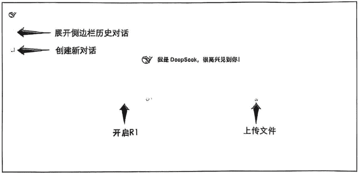

</div>

图 1-8 DeepSeek 的核心模式选择界面

第 1 章 认识 DeepSeek 015

---

# # 1.4.4 运行环境要求

> 面向开发者或希望本地部署定制的用户，推荐软硬件配置如下。

## + 硬件要求

- CPU: Intel i5 及以上。
- 内存：至少 16GB。
- 显卡：NVIDIA GPU，显存 8GB 及以上。
- 存储：建议固态硬盘，容量不低于 50GB。

## + 软件环境配置

- 操作系统：Windows 10/11、macOS 10.15 及以上或 Ubuntu 18.04 及以上。
- Python 环境：需 Python 3.8 及以上，建议用虚拟环境如 deepseek_env 隔离依赖。

> 本地部署与 API 调用属进阶用法，将在第 7 章详述。

---

# # 1.5 本章要点回顾

> 完成本章学习后，你应已全面认识 DeepSeek。

> （1）DeepSeek-R1 是一款突破性大模型，性能强劲、应用前景广阔。

> （2）其核心优势在于低成本、开源特性和卓越推理能力。

> ▶ 016 DeepSeek 极简入门与应用

---

- （3）依托多模态能力与实用场景支撑，能够满足多样化需求。
- （4）使用前的准备工作简洁直接，有助于快速上手。
- 下一章将详细介绍基础知识，帮助你灵活使用这款 AI 助手。

---

# 第 2 章 DeepSeek 入门基础

## 起步指南

**本章**将带你从界面认识到实用的对话技巧，快速掌握这款强大 AI 助手的使用方法。

---

# ### 2.1 提示词入门

在与系统互动时，提示词是沟通桥梁。清晰有效的提示词能让模型准确理解需求，并显著提升输出质量与效率。本节介绍提示词概念、设计原则及常见类型，为实战奠基。

---

# ### 2.1.1 提示词是什么

提示词 Prompt 是与 AI 互动的起点。用户以文本、图片等形式发送信息，系统据此生成回复，见图 2-1。

提示词可为以下类型。

## + 文本
如问题、描述或任务指令。

<div style="text-align: center;">

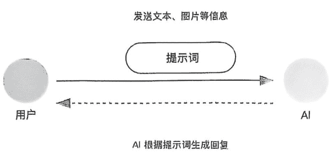

</div>

> > 图 2-1 提示词概念示意

设计优质提示词可帮助系统更精准理解意图并生成预期内容。

---

# ### 2.1.2 设计原则

遵循以下原则可明显提高输出质量。

## 1. 清晰明确
避免模糊表述，用具体语言表达需求。示例如下。

- **模糊表达**
  帮我写个那个……就是那种专业的。
> > ✅ 清晰表达：
  请帮我写一份项目计划书，需包含项目背景、目标、时间安排、预算四部分，风格专业简洁。

## 2. 提供必要背景
为提示词补充上下文，帮助系统理解场景。示例如下。

- **缺少背景的请求**
  帮我写个介绍。
- **有背景的请求**
  我是科技公司产品经理，需为非技术用户写产品介绍，产品是智能家居 App，重点突出易用性与安全性。

## 3. 明确期望输出
指定格式、风格或字数，让输出更贴合需求。示例如下。

- **模糊要求**
  给我讲讲人工智能。
- **明确要求**
  请用通俗语言，约 500 字，向高中生解释人工智能基本概念与应用场景。

---

# ### 2.1.3 提问技巧提升

提问方式直接影响回答质量。下面从提问模板与分步提问两方面展开。

---

# # 1. 提问框架：背景 + 目标 + 限制

清晰提问通常包含背景、需求、约束三要素。

## + 背景
提供问题上下文，让系统掌握具体场景。

## + 需求
明确想要解决的问题或获得的内容。

## + 约束
增加限制条件，如字数、格式或风格，帮助精准输出。

示例提示词如下。

我在写老河口景点介绍（背景），需要 3 个适合拍氛围感（约束）照片的景点（需求）。

我是学校老师（背景），需要设计一个 30 分钟互动课堂活动（需求），主题为“人工智能的应用”（约束）。

要点总结如下。

（1）提问时避免仅用关键词或过于宽泛的表达，如“告诉我一些景点”，会导致系统难以把握意图。

（2）问题复杂或条件多时，可用“背景+需求+约束”结构逐条提问，让问题更清晰。

结构化提问能让系统更准确理解并给出合适答案。

---

# ## 2. 分步拆解提问法

面对复杂问题，可拆解为多个步骤逐步引导回答，既防信息遗漏，也让回答更条理。

示例提示词如下。

- 第一步：解释“人工智能”的基本概念。
- 第二步：列举 2~3 个日常生活中的应用场景。
- 第三步：总结人工智能对未来生活的潜在影响。

应用场景如下。

(1) 学习类：学习新概念或了解领域知识，可从基础到进阶逐层解答。
(2) 工作类：制定计划、撰写报告、分析数据等，可分步获取各部分内容。
(3) 创意类：策划活动、设计内容或写作，可逐步拆解创意流程并完善输出。

注意事项如下。

(1) 对推理模型如 DeepSeek-R1，建议不要在提示词中强制指定“思考步骤”，除非希望模型严格按步执行。因为推理模型通常会自动生成最优解，强制步骤可能限制灵活性。
(2) 分步提问每步应具体独立，避免一开始提出过于笼统的问题。

分步提问可逐层深入，获得更系统条理的解答。

---

# ### 2.2 深度思考模式解析

在日常获取知识时，简单回答即可，但面对复杂逻辑推理、多领域整合或深度分析任务，普通模式可能力不从心。为此推出深度思考模式，专为高难度问题设计，能提供更精准全面的答案，从多维度剖析本质。下面详细介绍该模式及其支持能力。

---

# ## 2.2.1 模式原理

深度思考模式是特色功能，通过更高阶的分析与逻辑推导应对复杂问题，如图 2-2 所示，图中答案仅供参考，不保证完全准确。

<div style="text-align: center;">

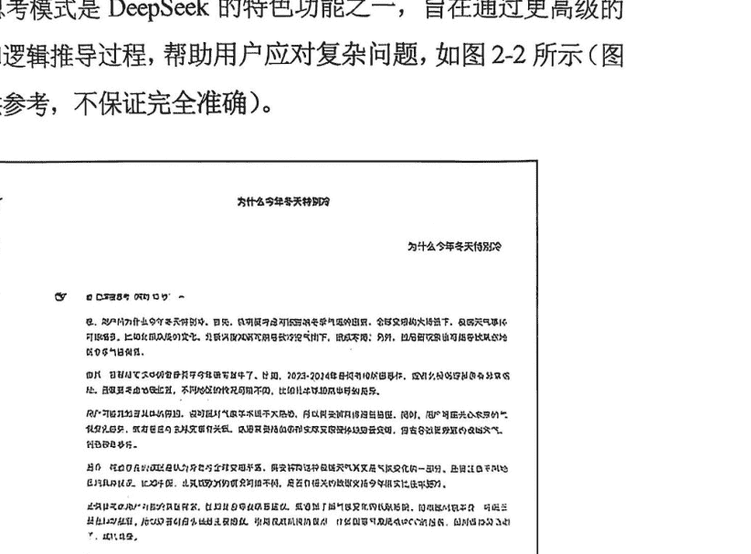

</div>

---

相比普通模式，升级点体现在三大方面。

# ### 1. 强劲引擎驱动
该模式调用 DeepSeek-R1 模型，其思维能力接近大学教授级别，可处理更复杂的推理与分析。普通模式适合简单问答，深度模式能深挖问题本质。

# ### 2. 多角度分析
不仅给出浅显答案，还会多角度展开。例如“为什么今年冬天特别冷”，普通模式可能仅提气候现象，深度模式会结合拉尼娜、北极涡旋、历史数据对比等多维度详细剖析。

# ### 3. 应对难题
擅长高难度任务，举例如下。

## + 复杂数学题
如微积分应用或数学建模。
## + 代码调试
发现深层逻辑错误并给出优化建议。
## + 财务分析
结合行业数据进行交叉验证。
## + 哲学思辨
提供多角度辩证思考，助力探讨抽象问题。

---

# ### 2.2.2 典型应用场景

深度思考模式适用于以下几类场景，能帮助解决复杂问题并提供高质量分析。

# ### 1. 深度分析类
涉及多层逻辑、跨领域知识或长期影响预测时优势明显。典型场景如下。

- 商业决策：分析“公司计划开拓东南亚市场需关注哪些文化差异与法规风险”。
- 学术研究：探讨“如何用机器学习预测气候变化对农作物产量的影响”。
- 技术攻关：排查“分布式系统高并发下数据不一致的可能原因”。

# ### 2. 复杂推理类
需要多步骤推导、抽象逻辑或验证链条完整性时，可提供结构化思考框架。典型场景如下。

## + 数学建模
推导“如何用博弈论模型分析电商平台价格竞争策略”。
## + 故障诊断
分析“工厂自动化生产线突然停机可能故障路径”。
## + 方案设计
规划“北京到巴黎多式联运物流方案的成本优化模型”。

# ### 3. 专业咨询类
在法律、医疗、金融等垂直领域，可结合行业知识与技术动态提供信息整合，需配合专业人员使用。典型场景如下。

## + 法律咨询
解读“《个人信息保护法》中数据跨境传输合规要点”。
> • 医疗辅助：整理“Ⅱ型糖尿病最新非药物干预研究进展”。
## + 金融分析
比对“量化投资策略在熊市中的回测表现差异”。

---

### 4. 不推荐使用的场景
并非万能，以下场景普通模式或其他工具更高效。

## + 简单问答
如“今天北京气温多少”或“圆周率小数点后十位”。
## + 实时信息查询
如“2024 年诺贝尔奖得主名单”或“航班实时动态”。
## + 日常闲聊
如“推荐周末好去处”或“如何安慰失恋的朋友”。

---

### 3. 素材输入建议

提供资料时应注意以下原则。

> 第 2 章 DeepSeek 基础 027

---

## 正确用法如下

- 提供关键段落的页码或核心观点。
- 圈出图片的重点区域。

## 错误用法如下

- 上传整篇 500 页文档或模糊图片。
- 提供未分类的多个网页链接。

实操提问示范：“请把政策文件第三页第二段的截图发过来，帮忙分析下对跨境电商的具体影响。”

---

### 4. 深度推理模式的频率建议

深度推理能力很强，但使用频率需要把握。

实操经验显示，连续进行三轮普通对话后再开启一次深度推理，效果比较均衡。

若遇到“服务器繁忙”的提示，可按下面思路处理。

## + 先收尾当前对话
把进行中的会话先做个收束，避免思路被打断。

## + 用普通模式整理已有信息
切回标准模式，对已获得的内容进行归纳总结。

## + 把重要问题延后提醒
暂时来不及深入的问题先做标记，第二天再继续推进。

---

### 2.3 常见困扰及应对办法
使用过程中常会出现准确度下滑或被技术限制影响的情况。下面汇总了高频困扰及对应的解决思路，提升使用顺畅度。

---

## 2.3.1 对话质量相关问题

> 回答偏离或逻辑不清，多数源于提问不够具体或上下文缺失。以下梳理典型表现与改进做法，帮助提升提问质量，让模型输出更贴合意图。

## 1. 输出偏差较大

常见表现。
- 结果与预期差距明显，针对性不足。
- 出现事实性错误或逻辑漏洞，难以完成任务。

解决思路。
### (1) 精炼提问方式
- 举例：把“怎么做饭”改成“请用三步法教会新手做番茄炒蛋”。
- 方法：套用“背景 + 诉求 + 限制”结构，例如“作为营养师，为糖尿病患者推荐5道快手菜”。

### (2) 补充背景信息
- **专业场景**：提供必要参数与背景。例如编程时说明 Python 3.10、Linux 环境；学术问题时注明“正在备考数学，重点概率论”。
- **复杂任务**：补充细节避免误解。例如“如何优化学习计划”，可补充“我是大三学生，半年内要通过英语六级”。

> > 常见表现。
> > - 结果与预期差距明显，针对性不足。
> > - 出现事实性错误或逻辑漏洞，难以完成任务。
> > > 解决思路。
> > > (1) 精炼提问方式
> > > - 举例：把“怎么做饭”改成“请用三步法教会新手做番茄炒蛋”。
> > > - 方法：套用“背景 + 诉求 + 限制”结构，例如“作为营养师，为糖尿病患者推荐5道快手菜”。
> > > (2) 补充背景信息
> > > - **专业场景**：提供必要参数与背景。例如编程时说明 Python 3.10、Linux 环境；学术问题时注明“正在备考数学，重点概率论”。
> > > - **复杂任务**：补充细节避免误解。例如“如何优化学习计划”，可补充“我是大三学生，半年内要通过英语六级”。

---

[PAGE 33]

后续内容的衔接处理...

## 2. 内容重复或跑题

### 常见情形
- 模型反复绕圈，抓不住要点。
- 回复偏离主题，解决不了实际需求。

处理思路。
#### （1）结构化提问
- 用编号提问帮助理清逻辑。例如：“第一，解释XX概念的定义；第二，列出3个实际应用场景。”
- 增加限定条件防止泛化。例如：“请用不超过3条概括XX的关键要素”“控制在100字内作答”。

#### （2）即时引导纠偏
- 及时打断无关内容并给出明确指令。例如：“请回到XX主题，重点说明……” “不要展开，只给核心结论。”
- 若已跑题，可补充背景重新引导。例如追加“XX的历史背景是……”或提示“忽略历史背景，直接分析XX的现代应用”。

#### （3）会话管理技巧
- 话题发散时建议新建会话，减少上下文干扰。
- 重申关键上下文帮助聚焦。例如：“在你之前的回答中提到XX，请在此基础上展开分析。”

## 2.3.2 技术类问题

技术问题多与网络、输入或操作习惯相关，可能导致延迟、中断或体验下降。下面给出原因分析和优化建议。

### 1. 响应变慢

常见原因。
- **网络不稳**：用户网络波动或服务器负载高。
- **输入过长**：单次输入的长文章或复杂请求超出处理能力。
- **计算复杂**：涉及大数据分析、复杂推理或多步任务。

优化建议。
#### （1）网络排查
- 确保网络通畅，优先使用5G或Wi-Fi 6。
- 用ping命令测试服务器响应延迟。
- 可参考第7章的工具集成方案，通过多种方式访问 DeepSeek。

#### （2）拆分内容
- 长文本分段发送，建议每段不超过500字。例如：“第一部分：实验数据概览……” “第二部分：分析方法……”
- 复杂任务拆成子问题。例如：“第一步，解释公式XX的含义。” “第二步，推导公式XX的应用场景。”

#### （3）格式优化
- 代码用代码块包裹，避免排版混乱。
- 表格数据转CSV上传，减少整理耗时。

### 2. 会话中断

常见原因。
- **网络不稳**：多数情况是用户网络问题。
- **单次输入过长或任务太复杂**，导致处理超时。
- **界面操作**，如切换标签页或刷新页面。

应对措施。
#### （1）保留上下文并重试
- 中断后可重新发送最后一条输入。
- 保持上下文清晰，避免丢失关键信息。例如：“我们之前讨论了XX，请继续…”

#### （2）必要时重开会话
- 若无法恢复，可新建会话并粘贴关键背景。例如：“上一段对话我们提到XX，以下是我的新问题…”

#### （3）断点续接
- 输入“继续”，让模型尝试接上中断的回答。
- 明确指令：“请从上次中断处继续分析XX。”

通过上述方法，可有效解决对话质量和技术问题，让每次使用更顺畅。

## 2.3.3 使用限制说明

了解系统能力边界和使用规范，能更好发挥功能，也能避免误操作带来的困扰。下面说明 DeepSeek 的能力范围和平台限制，并给出优化建议。

### 1. 模型能力边界

技术特性主要体现在以下3点。
- **知识截止**：模型知识更新到某个时间点，无法直接获取实时信息，可通过联网插件扩展实时性，如查询最新新闻或数据。
- **多语言能力**：中英双语表现最佳，小语种或复杂语法语言可能出现翻译偏差或理解错误。
- **创造力边界**：可应对故事创作、代码生成、数据分析等任务，但在极高复杂度或高度专业场景，如前沿科研、复杂法律分析，需人工审核或补充数据。

使用建议。
#### （1）时效性需求
需要最新信息时，建议自行提供最新数据或背景。例如：“请基于2025年最新经济数据分析全球通胀趋势。” 原则：**最新数据 = 模型知识 + 用户提供的实时信息**

#### （2）专业领域
医疗、法律等专业建议仅供参考，需结合专业人士意见。学术研究时，建议交叉验证模型输出与权威文献，避免知识截止偏差。

#### （3）复杂任务
多步骤推理或逻辑链较长的问题，可要求分步解答，例如：“请逐步推导以下公式的计算过程。” 编程任务中提供完整上下文，如语言版本、运行环境，有助于提升准确性。

### 2. 平台使用规范

为保证系统稳定高效，DeepSeek 平台会设置一定限制，如表2-3所示。了解并合理规划，可显著提升体验。

**表 2-3 DeepSeek 可能出现的限制条件**

| 类别 | 标准值 | 优化方案 |
| :--- | :--- | :--- |
| 单次输入 | ≤4000字符 | 分段发送 + 提供内容摘要 |
| 会话长度 | ≤20轮 | 定期新建会话 + 关键信息继承 |
| 高峰时段 | ≤3次/分钟 | 避免高峰期频繁操作 |
| 内容安全 | 符合 GB/T 35273—2020《信息安全技术个人信息安全规范》 | 避免使用敏感词 + 使用替代表述 |

## 2.4 本章小结

本章要点如下。
- （1）DeepSeek 界面简洁实用，上手快。
- （2）高质量提示词是获得理想回答的关键。
- （3）深度思考模式需按场景合理使用。
- （4）熟悉常见问题与解决方案可提升使用体验。

第3章将深入讲解提示词进阶技巧，帮助你更好地驾驭 DeepSeek。

## 第 3 章

### 结构化提示词

提示词是人与大模型交互的桥梁，决定任务目标、步骤和预期结果。随着任务复杂度提升，传统写法逐渐受限，结构化提示词和模板应运而生，为组织与优化提示提供了新思路。本章将系统介绍结构化提示词的概念、优势及高质量编写方法，帮助你在复杂场景下获得更优输出。

### 3.1 什么是结构化提示词

结构化提示词是通过层级化和模块化设计，以清晰语义和逻辑组织提示内容的方式。其核心理念是“像写文章一样写提示词”，利用标题、段落、子模块等提升表达和执行效果。相比传统提示词，结构化写法更强调条理，让模型更高效理解目标和步骤。

传统提示词多用自然语言描述，适合基础任务。任务变复杂、需多步操作时，传统写法会暴露模糊、路径不清、输出不符等问题。结构化提示词通过分层设计和模块化组织，系统性解决这些痛点。

#### 3.1.1 结构化提示词的核心要素

编写时需遵循以下3个核心要素。

1. **层级化结构**
   层级化是基础，通过清晰划分层次，让目标、路径、交付标准一目了然。常见划分：
   - 一级标题：定义总体目标或角色，如"# Role:诗人"。
   - 二级标题：细化任务内容，如"## Profile" 或 "## Rules"。
   - 三级标题：描述细节或子模块，如"### Skills"。
   层级化不仅让内容更有序，也帮助模型逐步理解任务各方面，提升执行效果。

2. **模块化设计**
   模块化是核心思想之一，将提示拆分为多个功能模块，更灵活组织内容。常见模块：
   - **Role**：角色定义，明确AI身份和职责，如“诗人”“数据分析师”“翻译专家”。
   - **Rules**：规则约束，规定执行时需遵守的行为准则，如“内容积极向上”“不得编造事实”。
   - **Workflow**：工作流程，定义具体执行步骤，如“先分析数据，再生成图表，最后撰写报告”。
   - **Input/Output Format**：输入输出格式，规范交互格式，确保一致性。
   模块化便于复用和扩展，不同任务中可直接复用 Rules 或 Workflow，减少重复工作。

3. **语义标识**
   语义标识是关键，通过特定属性词为各部分赋予明确语义，便于理解和聚焦。
   - **属性词 Rules**：定义行为边界，如“不得输出敏感内容”“保持简洁”。
   - **属性词 Workflow**：指导执行步骤，如“第一步：分析用户输入；第二步：生成文本摘要”。
   语义标识帮助快速定位关键信息，提升交互效率。

#### 3.1.2 为什么需要结构化提示词

相比传统提示词，结构化提示词在以下5方面更优。
- **清晰性**：层级化和模块化让目标、路径、交付标准更清晰。例如 Workflow 模块可明确步骤，避免输出跑偏。
- **适应复杂任务**：复杂多步任务时，传统提示难以满足。结构化提示通过模块化轻松应对，如数据分析中定义处理、分析和可视化步骤。
- **提升模型表现**：帮助模型更好理解语义，提升输出质量。Rules 模块明确行为边界，减少非预期内容。
- **便于复用和扩展**：模块化设计利于复用，不同任务中可直接使用 Rules 或 Workflow，提升编写效率。
- **降低学习成本**：新手友好，清晰层级和模块帮助快速上手，编写高质量提示。

#### 3.1.3 示例对比

结构化提示词的优势可通过对比更直观体现。

传统提示词：
> **作为一位诗人，写一首关于友谊的诗。**

任务目标明确但缺乏风格、格式、步骤说明，易导致输出不符预期，如不押韵或风格偏差。

结构化提示词：

# Role: 诗人

## Profile
- Description: 诗人是创作诗歌的艺术家，擅长通过诗歌表达情感。

## Rules
1. 内容健康，积极向上。
2. 保持押韵。
3. 使用优美、富有感染力的语言。

## Workflow
1. 用户以“形式：[]，主题：[]”方式指定需求。
2. 针对需求创作诗歌，包含题目和诗句。
3. 输出需包含标题和至少4行诗句。

结构化写法将目标拆分为模块，各司其职。
- Role 定义身份职责。
- Rules 规定创作规则。
- Workflow 定义执行步骤。
设计更清晰，执行效果显著提升，模型会按 Rules 保持押韵，并按 Workflow 生成符合需求的诗歌。

### 3.2 如何编写高质量的结构化提示词

高质量结构化提示词是提升执行效果和输出质量的关键。需逻辑清晰、语义明确，并能适应复杂任务和多样需求。可从构建全局思维链、保持上下文语义一致性、结合其他技巧和模板化实践四个方面入手。

#### 3.2.1 构造全局思维链

全局思维链是结构化提示的核心框架，决定整体逻辑和条理。完整链需覆盖角色定义到任务执行的各个环节。

##### 1. Role (角色)
定义模型身份和职责，使其明确定位。例如“诗人”“数据分析师”“翻译专家”“教师”等，帮助保持一致性。
**示例如下：**
```
# Role: 数据分析师
```

##### 2. Profile (简介)
描述角色背景和技能，帮助模型深入理解身份和能力范围，如专业领域、特长、行为风格和工作方式。
**示例如下：**
- Description: 数据分析师擅长处理复杂数据集，能生成清晰分析报告。

##### 3. Rules（规则）
规定执行任务时需遵守的行为准则，确保输出符合预期。
- 避免输出敏感内容。
- 保持逻辑严谨，不捏造事实。
- 遵循特定格式或风格。
**示例如下：**
```
## Rules
1. 输出内容必须准确且基于事实。
2. 保持分析逻辑清晰。
```

##### 4. Workflow（工作流程）
定义任务执行步骤，确保按预设流程逐步完成。
- 任务输入要求。
- 每步具体执行方式。
- 任务输出格式。
**示例如下：**
```
## Workflow
1. 接收用户输入的数据集。
2. 分析数据并生成关键指标。
3. 输出一份简洁的分析报告。
```

##### 5. Initialization（初始化）
设置角色启动行为，帮助模型快速进入状态，如定义初始任务或问题，提供背景信息或上下文。
**示例如下：**
```markdown
### Initialization
- 模型启动时，首先检查用户输入是否完整，并给出确认提示。
```

构建全局思维链后，提示词逻辑和条理显著提升，模型完成任务更高效。

#### 3.2.2 保持上下文语义一致性

上下文语义一致性是确保提示清晰准确的关键。内容和格式需前后一致，避免语义混乱导致输出偏离。

1. **格式一致性**
   层级结构和标识符使用应保持统一。例如标题始终用 `#`、`##`、`###`，属性词如 `Role`、`Rule` 用法前后一致。
   **示例如下：**

# 结构化 Prompt 进阶：从语义校准到人格化调度
```markdown
   # Role: 数据分析师
   ## Profile
   --- Description: 数据分析师擅长处理复杂的数据集。
   
   ## Rules
   1. 输出内容必须准确。
   ```

2. **模块与属性的语义匹配**

属性标签要和所在模块的语义严格对应。比如 Rules 里只放行为规范，不能混入角色能力描述；Workflow 里只写执行步骤，不能塞入任务背景说明。

**示例如下：**

```
   ## Rules
   1. 分析过程必须透明。
   2. 输出结果需包含图表。
   ```

3. **语境贴合度**

指令整体语境要和实际任务吻合。若目标是生成报告，提示内容就应聚焦于报告类规则与流程，而不是无关信息。

保持上下文语义统一，能有效避免模型因描述模糊或杂乱而产生偏差。

#### 3.2.3 叠加其他优化技巧

在结构化框架之上再引入通用优化手段，可以进一步提升执行质量。下面列出四类常用做法。

##### 1. 思维链 CoT

引导模型逐步推演而非直接输出结论，降低错误率和信息缺失。

**示例如下：**

```
# Role: 数学教师
## Workflow
1. 分析题目并分步骤解决。
2. 每步都需给出详细解释。
```

##### 2. 投票法 ToT

先生成多组候选结果，再挑选最优。

**示例如下：**

```
## Workflow
1. 针对问题生成 3 个不同的解决方案。
2. 对比方案并选择最佳答案。
```

##### 3. 示例引导

提供输入输出范例，帮助模型更快抓住任务意图。

**示例如下：**

```
## Examples
- Input: 数据集包含销售数据。
- Output: 一份包含销售趋势的分析报告。
```

##### 4. 任务拆解

把复杂目标拆成若干子任务，降低单次推理难度。

**示例如下：**

```
## Workflow
1. 首先清理数据。
2. 然后分析数据趋势。
3. 最后生成分析报告。
```

组合使用以上方法，能显著提升指令的灵活性和适配范围。

#### 3.2.4 模板化落地

模板化是结构化 Prompt 落地的关键，借助预设框架可快速产出高质量指令。常见做法有三类。

##### 1. 通用模板

适用于多数任务的基础框架。

**示例如下：**

```markdown
# Role: 你的角色名称
## Profile
- Author: [Your Name]
- Version: 0.1
- Language: English or 中文
- Description: 描述你的角色。
## Rules
1. 在任何情况下都不要跳出角色。
2. 不要胡说八道或捏造事实。
## Workflow
1. 首先，xxx。
2. 其次，xxx。
3. 最后，xxx。
```

## 2. 领域模板

针对特定垂直领域定制，例如数据分析。示例如下。

> # Role: 数据分析师
> ## Profile
> - Description: 数据分析师擅长处理复杂的数据集，能够生成清晰的分析报告。
> ## Rules
> 1. 数据分析必须准确可靠。
> 2. 输出结果需包含关键指标和图表。
> ## Workflow
> 1. 接收用户输入的数据集。
> 2. 分析数据并生成关键指标。
> 3. 输出一份简洁的分析报告。

## 3. 任务模板

针对特定工作任务定制，例如写作任务。示例如下。

> # Role: 作家
> ## Profile
> - Description: 作家擅长创作富有感染力的文章。
> ## Rules
> 1. 内容必须原创。
> 2. 保持语言优美。
> ## Workflow
> 1. 接收用户输入的主题。
> 2. 根据主题创作文章。
> 3. 输出一篇不少于500字的文章。

模板化可以加速高质量 Prompt 的生成并降低编写门槛。

构建清晰的全局思维链、维持语义统一、融合优化技巧并落地模板，都能明显提升 Prompt 质量与模型执行效果。

# ### 3.3 结构化提示的应用边界

结构化提示是通过清晰逻辑和模块化设计来优化交互的方式，在实践中展现出较大潜力。它能显著提升任务完成效率与准确性。但并非万能，也存在明显局限。下面从应用场景、局限性以及推理模型角度展开分析。

# #### 3.3.1 典型应用场景

结构化提示因条理分明，在以下情境中价值突出。

**1. 复杂多步任务**

指需要串行执行的任务，如数据分析、项目管理、流程设计等。

优势在于借助模块化 Workflow 可将整体拆解，让模型按序完成子任务，避免遗漏关键环节。

示例如下。

# Role: 数据分析师

## Workflow

1. 数据清洗：清理缺失值和异常值。
2. 数据分析：生成关键指标和趋势图。
3. 报告生成：输出一份包含图表和结论的分析报告。

# ## 生产级场景

适用于企业级应用，如客户服务、自动化内容生成和技术支持等。

优势在于大幅提升提示的可读性与复用性，便于团队协作与版本迭代。在生产环境中，结构化提示还能帮助开发者快速界定模型角色与行为，降低试错成本。

示例如下。

# Role: 客服机器人

## Rules

1. 始终保持礼貌和专业。
2. 遇到无法回答的问题时，建议用户联系人工客服。

## Workflow

1. 分析用户问题。
2. 提供解决方案或相关信息。
3. 如果问题超出能力范围，给出其他的解决途径。

# # 3. 教学与学习

为新手提供友好的学习模板，帮助他们快速编写提示。

优势在于结构化设计让新手清晰理解提示构成与逻辑关系，降低入门门槛。例如提供带注释的模板，帮助用户更快掌握编写技巧。

示例如下。

# Role: 教师

## Profile

- Description: 教师擅长通过简单易懂的方式教授复杂的概念。

## Rules

1. 使用通俗易懂的语言。
2. 提供例子帮助理解。

## Workflow

1. 分析学生的问题。
2. 解释相关概念并提供示例。
3. 检查学生是否理解，并根据需要调整解释方式。

# ## 3.3.2 主要局限

结构化提示的不足主要体现在三方面。

### 1. 对模型能力的依赖

效果高度依赖模型的指令遵循能力，具体表现如下。

- **GPT-4**能够较好理解和执行复杂的结构化提示。
+   - **GPT-3.5**表现相对较弱，可能无法完全遵循提示中的规则或流程。
- 对于更早期的模型，复杂结构可能失效。解决方法是依据模型能力调节复杂度，对弱模型简化结构、减少模块数量。

### 2. 复杂度过载

对能力较弱的模型，结构化提示可能导致信息过载，反而降低执行效果。例如模型可能忽略部分内容，或输出与预期不符。应对方式如下。

+   - 简化提示，减少不必要的模块和规则。
- 使用更直白的语言描述任务需求。
- 通过示例法明确任务目标，减轻模型的推理负担。

### 3. 无法根治固有缺陷

结构化提示无法直接解决模型的固有问题。

- **幻觉问题**: 模型生成虚假或不准确的信息。
- **知识陈旧**: 模型的知识截止于训练时间点，无法获取最新信息。

即便提示设计精细，模型仍可能输出错误或过时内容。缓解方法如下。

+   - 针对幻觉，在 Rules 模块增加约束，如“在任何情况下不得编造事实”。
- 针对知识陈旧，结合外部工具（如 API 调用或数据库查询）获取最新信息。

# ### 3.3.3 推理型模型的提示策略

随着模型理解力提升，如 DeepSeek-R1 等高性能模型，部分场景下对结构化提示的依赖在降低。高性能模型能在更少指令下自主推理复杂问题，只需提供充足背景信息即可产出准确且合理的输出。这种能力可以简化提示设计，用户无需过度关注结构化形式。

不过基础技巧仍然必要，例如。

(1) **明确指令**：清晰表达任务需求，避免模型误解或偏离目标。例如明确指定输出格式或内容范围，如“生成一份不超过500字的总结报告”。

(2) **示例参考**：通过提供输入输出示例，帮助模型更好地理解任务目标和期望结果。例如提供类似任务的参考答案，作为模型推理的模板。

在简化结构的同时，需关注背景信息的完整性和指令表达的精准性，以充分发挥高性能模型的推理能力。

注意第2章中提到，对于推理模型（如 DeepSeek-R1），建议在提示词中直接指定“思考步骤”，除非你希望模型严格按照步骤执行。

# ### 3.4 本章小结

通过本章学习，相信你已经掌握了结构化提示词的基本概念和技巧。

**(1) 结构化提示的核心**: 通过层级化和模块化设计，显著提升提示的可读性和性能表现。

**(2) 优势与应用**: 在复杂任务和生产级场景中，结构化提示展现出强大的适应性和灵活性。

**(3) 编写方法**: 通过构建全局思维链、保持上下文语义一致性、结合其他提示词技巧和模板化实践，可以编写出高质量的结构化提示。

**(4) 局限性**: 我们需要根据模型能力调整提示的复杂度，并结合实际需求优化提示的设计。

第4章将探讨 DeepSeek 的特色功能玩法，帮助你发掘更多的创新应用。

# # 第4章

## 特色功能玩法

本章将深入探索 DeepSeek 的特色玩法。这些玩法不仅让 AI 变得更加有趣和实用，而且为用户提供了针对不同场景的高效解决方案。无论你是职场精英、创意工作者，还是普通用户，都能通过这些玩法让 DeepSeek 成为你生活和工作中的得力助手。

# ## 4.1 人格分类模式

在日常生活和工作中，我们常常面临复杂的问题和多样化的需求。单一的思维方式往往会让我们受到局限，人格分类模式正是为了解决这个问题而设计的。通过模拟不同的人格特征，DeepSeek 能够从多个视角深度剖析问题，为用户提供更加全面、科学的解决方案。

# ### 4.1.1 什么是人格分类模式

人格分类模式是指，允许 AI 根据不同的场景和需求，展现出多样化的性格特征和专业特长。简单来说，你可以把它看作给 DeepSeek 换上了“不同的帽子”——它有时是严谨的专家，有时是幽默的创意者，有时又是耐心的老师。通过使用人格分类模式，用户可以获得更符合场景需求的回答。

**为什么需要人格分类模式？**这是因为在现实中，我们常常需要从不同的角度看待问题。例如，在制订商业计划时，可能需要严谨的专家来分析市场数据；而在进行头脑风暴时，又需要创意型人格帮助激发灵感。人格分类模式的出现，正是为了满足这些多样化的需求，让 AI 更加贴近用户的实际场景。

人格分类模式的核心特点如下。

+   - **灵活切换人格**: 根据具体需求选择不同的人格视角。
+   - **多样化回答**: 针对同一个问题，提供多维度的解决方案。
+   - **场景化应用**: 适用于商业决策、教育指导、创意策划等多种场景。

# ### 4.1.2 主要人格类型

我们可以利用 DeepSeek 实现多种人格类型，每种人格都有其特点和应用场景。以下是 4 种主要的人格类型及其详细介绍。

# #### 1. 专家型人格

专家型人格的角色定位为专家，其特点如下。

+   - 专业知识深厚，回答严谨而准确。
+   - 善于从数据和逻辑出发，分析问题。
+   - 注重细节，能够发现潜在的风险和优化点。

专家型人格的适用场景如下。

+   - **商业分析**: 需要严谨的数据分析和市场洞察。
- 科技咨询：需要对技术问题进行深入剖析。
- 风险评估：需要对方案的潜在问题进行预测。

假设你正在开发一款新型的智能硬件设备，希望了解产品的技术可行性。通过专家型人格，DeepSeek 会从技术架构、硬件选型、算法设计等方面入手，逐一分析可行性，并指出可能的技术瓶颈。

**示例提示词如下。**

作为一名资深的机器学习专家，请评估这个算法方案的可行性和潜在问题。

# ### 2. 教师型人格

教师型人格的角色定位是耐心的教育者，其特点如下。

+   - 讲解通俗易懂，善于将复杂问题简单化。
- 循序渐进地引导用户，帮助用户快速掌握知识。
- 善于举例说明，增强理解效果。

教师型人格的适用场景如下。

+   - **教育培训**：需要将专业知识转化为易于讲述和理解的内容。
- 新手指导：帮助用户快速上手新技能或工具。
- 科普讲解：将复杂的科学概念通俗化。

假设你是一名家长，想帮助孩子理解二次函数的概念，但自己对数学的记忆已经模糊不清。这时，你可以让 DeepSeek 切换到教师型人格，并输入提示词。

**示例提示词如下。**

> > **请以一位初中数学老师的身份，用通俗的语言解释什么是二次函数。**

# 3. 创意型人格

创意型人格的角色定位是创意思考者，其特点如下。

- 思维发散，能够从不同角度提出新颖的想法。
- 创意丰富，擅长联想和突破传统思维框架。
- 善于结合趋势，提出具有前瞻性的创意。

创意型人格的适用场景如下。

- **营销策划**：需要新颖的创意方案。
- **产品设计**：需要创新的功能或特点。
- **内容创作**：需要独特的写作或设计灵感。

假设你正在策划一款环保水瓶的营销推广活动。这款水瓶采用100%可回收材料制成，目标是吸引注重环保的年轻消费者，同时传递“环保从小事做起”的理念。你希望活动既能吸引眼球，又能让消费者感受到产品的环保价值。通过创意型人格，DeepSeek 可以为你提供独特的创意方案。

**示例提示词如下。**

请以创意总监的身份，为一款环保主题的产品想出5个独特的营销创意。

# 4. 辩论型人格

辩论型人格的角色定位是理性的辩手，其特点如下。

- 逻辑严密，能够清晰地论证观点。
- 善于从正、反两面分析问题，提供多角度思考。
- 注重事实和数据，避免情绪化表达。

辩论型人格的适用场景如下。

+   - **观点论证**：需要对某个观点进行深度分析。
- 决策支持：需要全面权衡不同选项的利弊。
- 辩论准备：需要准备正方、反方的观点和论据。

假设你是一名行业研究员，正在准备一场关于人工智能对就业市场影响的公开演讲。这场演讲的目标是，向听众清晰地展示人工智能如何改变就业格局，包括其带来的机遇与挑战。为了让内容更有深度和逻辑性，你选择使用辩论型人格，从正、反两方面分析 AI 对就业市场的影响，并提供综合建议。

**示例提示词如下。**

**请从正、反两个角度，分析人工智能对就业市场的影响**。

# ### 4.1.3 人格切换技巧

为了更好地利用人格分类模式，用户可以根据实际需求灵活地切换人格，甚至组合使用不同的人格类型。下面来看一个示例。

假设你是一名产品经理，正在为公司策划一款新型智能家居设备的设计方案。你需要在从创意到执行，再到汇报的完整流程中，充分利用不同人格的特点，确保方案既有创新性，又具备可行性，同时能清晰地传达给团队或客户。

**第一步：使用创意型人格，通过头脑风暴，提出新想法。**

目标是激发创造力，提出尽可能多的创新想法，突破传统思维的限制。

**示例提示词如下。**

**用创意型人格帮我头脑风暴一款智能家居设备的设计方案，要求它能提升用户的便利性和生活质量**。

DeepSeek 的返回结果如下。

> 以下是一款名为“Adaptive Life Hub（自适应生活中枢）”的智能家居设备的设计方案，整合环境感知、健康管理 与预测式服务三大创新模块。

### **核心功能架构**

+   - **① 环境基因图谱（Ambient DNA）**
    - 分布式传感器网络实时生成3D环境热力图
      - 温度/湿度/光照/空气质量四维动态建模。
      - 基于人体工学算法优化空间能量场分布。
    - **智能微气候控制**
      - 纳米级气流矩阵定向调节（办公区恒温/睡眠区控湿/儿童区空气灭菌）。
      - 自适应光疗系统（模拟晨光唤醒/午间活力光谱/黄昏褪黑素激发）。

+   - **② 生物节律引擎（Circadian Engine）**
    - 非接触式健康监测
      - 毫米波雷达捕捉呼吸/心率/体动数据。
      - 热成像追踪代谢水平变化。
    - **个性化节律建模**
      - 结合可穿戴设备数据构建专属生物钟模型。
      - 动态调整环境参数匹配昼夜节律相位。

+   - **③ 预见式服务矩阵（Proactive Service Grid）**
    - 智能补给预测
      - 通过物品重量传感器+图像识别预判日用品存量。
      - 联动电商平台生成最优补货方案（考虑保质期/优惠活动/碳足迹）。
    - **空间效能优化**
      - 基于UWB定位的动线智能规划。
      - 家电联动策略（咖啡机预热与闹钟同步/浴缸注水时间匹配通勤时间）。

### **技术亮点**

- 量子神经网络：在本地端实现隐私安全的持续学习。
- 自进化接口：通过脑电波头带采集认知反馈优化交互逻辑。
- 碳感知计算：动态调节算力分配实现能效比最优。

### **用户价值**

1. **健康先知**：提前2小时预警偏头痛发作的风险，自动启动预防模式。
2. **时空折叠**：将家务准备时间压缩83%，创造更多生活可能。
3. **环境共融**：将年度碳足迹降低42%，构建可持续的生活空间。

该设备通过将空间智能从被动响应升级为主动塑造，重新定义人、环境与技术的关系。是否需要针对某个功能模块进行深入探讨？

**第二步：使用专家型人格，通过评估可行性，筛选最优方案。**

# 从创意到落地：先筛后评

创意型人格负责把想法抛出来，接下来要做的就是用技术是否能做、市场愿不愿意买单这两个维度把点子过一遍，挑出值得先投入的方案并做初步判断。

**可用的提问参考**

请以专家的身份评估这些智能家居功能的实现难度和市场需求强度，并给出排序建议。

模型示例输出如下。

### 优先级评估清单

| 功能模块 | 技术实现难度评分 (1~5) | 市场需求强度 (1~5) | 研发投入评分 (1~5) | 综合排序 |
| :---: | ---: | ---: | ---: | :--- |
| **基础环境感知系统** | 4.2 | 4.8 | 3.1 | ★★★★★ |
| **健康监测基础版** | 3.9 | 4.5 | 3.8 | ★★★★ |
| **智能补给系统** | 3.5 | 4.2 | 4 | ★★★★ |
| **光疗调节系统** | 4 | 3.8 | 3.5 | ★★★★ |
| **代谢追踪系统** | 2.7 | 3.2 | 4.5 | ★★★ |
| **量子神经网络框架** | 1.8 | 2.5 | 4.8 | ★★ |
| **脑电波交互系统** | 1.5 | 2 | 4.9 | ★★ |

### 核心技术拆解

> 1. **毫米波雷达生命体征监测**（实现难度：中等）
> - **现状**：TI AWR6843 已能做到 60GHz 非接触式生命体征采集。
> - **卡点**：多目标分辨精度约 85%，家具遮挡影响明显。
> - **建议**：与加州大学伯克利分校 RF-Pose 研究组合作优化算法。

> 2. **动态光疗系统**（实现难度：较高）
> - **已有产品**：Philips Hue Synced 已实现基础场景联动。
> - **突破点**：研发符合 CIE S026 光生物效应标准的自适应算法。
> - **临床价值**：联合医疗机构验证对季节性情绪的调节效果。

> 3. **预测式补给系统**（实现难度：中偏高）
> - **技术组合**：Intel RealSense D455 深度相机配合应变片传感器的误差补偿。
> - **数据要求**：需要积累超 200 万组家庭物品特征样本。
> - **商业化**：对接 Amazon Dash Replenishment 的 API。

### 商业化路径规划

### 短期聚焦 1~2 年

- 上线“环境优化基础包”，覆盖温湿度、光照、空气。
- 以健康住宅为卖点，接入 WELL 建筑标准认证体系。
- 主攻 30~45 岁科技新贵家庭，预期客单价约 799 美元。

### 中期布局 3~5 年

- 融入经 FDA 认证的 II 类医疗设备功能。
- 打通建筑能源管理系统 BEMS 接口。
- 切入商业场景，如高端养老社区与智慧酒店。

### 风险提示

- 合规风险：欧盟 GDPR 对生物数据的处理要求严格。
- 供应风险：毫米波芯片供给受地缘政治影响较大。
- 习惯风险：北美用户对自动化补给的接受度低于亚洲。

建议采用模块化架构，优先落地技术成熟度达到 TRL7 及以上的功能，并同步推进医疗级认证。是否需要针对重点技术模块做供应链深化分析？

**第三步：用教师型人格把结论讲清楚。**

目标是把筛选后的方案整理成通俗易懂的汇报材料，便于向团队或客户传达，信息要准确清晰。

**可参考的提问方式**

请以教师型视角把智能窗帘方案整理成一份通俗汇报，方便非技术同事理解。

# 智能窗帘项目汇报

## 一、项目背景

**核心思路：** 通过自动化窗帘实现“环境-人”双向智能互动。

**用户痛点：**

- 清晨被强光惊醒。
- 夏季空调能耗上升约 30%。
- 老人或儿童忘记关窗存在安全隐患。

## 二、核心功能

### 1. 环境自适应模式

- **智能调节：** 根据室外光照自动开合，强光时段遮挡约 60%。
- **天气联动：** 雨前自动关闭并推送提醒。
- **节能模式：** 冬季白天最大化采光，减少供暖用量。

### 2. 生活场景模式

- **晨起场景：** 闹钟前 30 分钟，窗帘从 20% 渐进到 100%，模拟日出。
- **影院模式：** 语音指令“看电影”后窗帘关闭、氛围灯启动。
- **安全模式：** 长时间外出时随机开合，营造有人在的假象。

## 三、技术落地三步走

### 阶段 1:基础版 6个月

- 选用 ZigBee 协议窗帘电机，成本降低 40%。
- 手机 App 预置 5 种场景，内置 4 种典型户型遮阳方案。

### 阶段 2:增强版 12个月

- 增加毫米波人体感应，识别室内人员位置。
- 学习用户作息，周末自动延后晨间开启。
- 接入太阳能供电系统，降低 30% 耗电。

### 阶段 3：智慧版 18 个月

- 窗帘布料集成柔性光伏膜，实现自供电。
- 织物表面支持触控滑动调节开合比例。
- 与空调、照明系统深度联动。

## 四、用户价值卡片

| 受益群体 | 具体获益 |
| :--- | :--- |
| 上班族 | 通勤前自动调节室内亮度 |
| 老年人 | 跌倒时自动开窗求救 |
| 物业方 | 楼宇整体节能达标 |
| 房地产商 | 精装房溢价提升 15% |

## 五、实施计划表

| 时间线（季度） | 里程碑 | 关键产出 |
| :--- | :--- | :--- |
| Q1 | 原型验证 | 完成 10 户家庭实测 |
| Q2 | 供应链搭建 | 确定电机供应商短名单 |
| Q3 | 首批量产 | 500 套预售版交付 |
| Q4 | 系统集成 | 接入主流智能家居平台 |

## 六、常见问题解答

**停电怎么办？**
→ 配备应急电池，可维持 3 天基础功能。

**老窗帘能改装吗？**
→ 提供导轨改装套件，适配 90% 主流轨道。

**隐私如何保障？**
→ 数据在本地处理+物理遮挡开关，一键全部关闭。

后续建议开展用户习惯调研，重点验证“晨起渐进光照”功能的接受度。是否需要组织跨部门需求确认会？

组合使用不同人格，能在解决问题的各阶段发挥各自优势。

- **创意型人格**负责发散思维，提出新想法。
- **专家型人格**负责收敛思维，评估可行性。
- **教师型人格**负责沟通思维，保证信息清晰传递。

这种方式既提升了解决问题的效率，也确保方案从创意到执行再到汇报的完整性和专业性。

## 4.2 预判与预言家模式

预判与预言家模式是 DeepSeek 进行深度分析与前瞻建议的核心能力之一。通过模拟多种情境、预判潜在问题与需求，用户能更全面地把握态势并提前制定应对策略。该模式适用于商业计划拆解、产品设计、风险评估等需要多维度思考的场景。

### 4.2.1 模式原则

预判模式的核心是“提前思考、主动预测”，即在作答前主动推演可能的阻碍、需求或未来走向。基于以下 3 项原则。

#### 1. 主动预测问题

回答前会主动剖析已有信息，预判可能遇到的障碍或风险。预测基于数据分析和情境模拟，帮助用户提前识别隐患。

**特点：**

- 结合数据与背景，找出潜在风险点。
- 针对问题给出初步解法或建议。

#### 2. 延伸需求的预判

除识别问题外，还会从用户角度预判未来的需求或延伸场景，让方案设计更周全。

**特点：**

- 从使用场景与习惯中挖掘潜在需求。
- 提供产品或服务的迭代方向建议。

#### 3. 情景模拟

假设不同变量，如市场变化、政策调整，模拟最佳、最差和大概率结果，为用户提供多元应对策略。

**特点：**

- 模拟不同情境结果，帮助权衡利弊。
- 针对每种情况给出优化建议。

在预判模式下，DeepSeek 不只是被动回答，而是站全局视角给出更具前瞻性的方案。

### 4.2.2 应用技巧

基于上述原则，有以下 3 种应用技巧。

#### 1. 问题预判

分析计划或方案时，可提前识别障碍与风险并制定对策。

**🌾 案例**

请在分析此商业计划时：

1. 预判主要障碍。
2. 列出潜在风险点。
3. 提供应对方案。

**模型给出的示例输出如下：**

##### （1）供应链与技术研发

- **障碍：** 硬件生产依赖海外芯片，可能导致成本波动或交付延期。
- **挑战：** 健康监测算法如血压预测的准确率需达医疗级标准＞95%，研发周期长。

##### （2）市场接受度

- **障碍：** 消费者对新品牌信任度低，需与 Apple Watch、华为等成熟品牌竞争。
- **挑战：** 高端定价 299 美元可能超出目标用户 30～50 岁健康人群的心理预期。

##### （3）资金压力

- **障碍：** 硬件研发加量产需前期投入 500 万美元，现金流依赖预售与融资。

### 2. 潜在风险点

| 风险类别 | 具体风险 |
| :--- | :--- |
| 市场风险 | 需求不足致库存积压；竞品降价引发价格战 |
| 技术风险 | 传感器精度未达预期；软件兼容性差如仅支持 iOS |
| 运营风险 | 代工厂产能不足；用户数据泄露引发合规问题 |
| 财务风险 | 融资延迟致研发中断；毛利率低于 20%盈亏平衡点 |

### 3. 应对方案

#### (1) 供应链与技术优化

- **多源采购：** 与 3 家芯片供应商签分级合作，预留 6 个月关键元件库存。
- **技术迭代：** 开放 API 接入第三方健康平台如 Keep、MyFitnessPal，借生态弥补算法短板。

#### (2) 市场策略

- **精准获客**
    - 初期聚焦保险/体检机构合作，赠送设备绑定服务套餐。
    - KOL 营销：邀请医疗专家开展 100 场直播实测对比。
- **定价弹性：** 推出以旧换新和订阅制，软件服务年费 99 美元。

#### (3) 风险管控

- **数据合规**
    - 通过 ISO27701 认证。
    - 用户数据本地化存储，中国区部署私有云。
- **融资预案**
    - 设定融资里程碑，如首轮 200 万美元对应完成 Beta 测试。
    - 申请科技型中小企业创新基金，最高 50 万元补贴。

#### (4) 应急方案

- **库存风险：** 与电商平台确认“90 天无理由退货转二手”通道，损失率控制在 15% 以内。
- **法律风险：** 预留年度预算 5% 用于知识产权诉讼和隐私保护专项基金。

具体应用：

- 在商业计划中可预测市场竞争、资金短缺、团队能力不足等并提出建议。
- 对技术方案可预判瓶颈、开发延期等风险并提出优化。

## 2.需求预判

设计产品或服务时，需求预判能帮助更好地理解目标用户并提前规划功能迭代。

**📝 案例**

在设计此产品功能时，请：

1. 预判用户可能的使用场景。
2. 分析可能延伸的需求。
3. 提供未来迭代建议。

**模型的示例输出如下：**

虚拟产品: SafeHome 智能安防系统。
集成智能摄像头、门窗传感器、环境监测设备与 AI 算法的家庭安全解决方案。

### 一、用户核心使用场景预判

| 场景类型 | 典型用例 |
| :--- | :--- |
| 基础安防 | 离家自动布防、夜间门窗异常震动报警、烟雾/燃气泄漏实时推送 |
| 生活便利 | 快递临时授权开锁、家庭成员个性化识别区分家人与陌生人 |
| 紧急响应 | AI 识别入侵后联动报警、老人跌倒检测自动呼叫紧急联系人 |
| 多设备协同 | 离家模式触发关闭智能家电、回家模式自动开灯并解除警戒 |

### 二、延伸需求分析

- **场景扩展**
    - **宠物友好模式：** AI 忽略宠物正常活动，减少误报。
    - **租赁适配：** 临时住户权限管理，如时限、区域限制。
    - **能源安全：** 水电用量异常监测，如水管爆裂预警。
- **技术增强**
    - **边缘计算：** 本地化 AI 处理敏感数据，降低云端隐私风险。
    - **3D 空间建模：** 通过摄像头构建家庭立体模型，精准定位异常点。
- **服务延伸**
    - **保险联动：** 安全数据作为家庭保险折扣依据。
    - **社区网络：** 异常事件自动通知附近住户。

### 三、迭代建议

- **交互优化：** 语音控制紧急模式“SafeHome，启动警戒”。
- **功能新增：** 暴雨预警自动关窗，需兼容智能窗控设备。
- **安全升级：** SIM 卡双链路通信，防止网络切断失联。
- **算法升级：** 行为模式学习，识别保姆/家政人员常规路径。
- **生态扩展：** 接入新能源汽车，车库异常时自动录制车辆周边影像。
- **增值服务：** 7×24 小时专业安防团队人工复核，订阅制。
- **元宇宙融合：** AR 眼镜远程查看实时安防状态。
- **市政联动：** 火灾预警直通消防系统，需政策支持。
- **情感化设计：** 安全事件后自动启动安抚模式，如灯光/音乐调节。

### 四、关键设计原则

- **a. 隐私红线：** 所有数据采集需二次确认授权。
- **b. 渐进式激活：** 新手引导分阶段释放高级功能。
- **c. 失效安全：** 断网状态下保留核心本地化功能。

通过“场景—需求—迭代”三层推进，构建从基础防护到情感关怀的产品演进路径。

具体应用：

- **用户场景预判：** 如健身应用可预测家庭健身、户外跑步、健身房训练等。
- **延伸需求分析：** 除基础功能外可预判数据分享、社交互动、个性化计划等。
- **迭代建议：** 根据趋势建议未来版本增加 AR 指导、AI 语音教练等功能。

## 3. 情景预设

情景预设是预判模式的重要应用。DeepSeek 通过模拟不同实施结果帮助权衡利弊并制定对策。

**📝 案例**

如果实施此方案：

1. 最理想情况是什么？
2. 最坏情况是什么？
3. 最可能情况是什么？
请分别给出分析和应对建议。

**模型的示例输出如下：**

### 一、理想情况分析

**场景表现**

1. 市场接受度超预期，3 个月占有率达 15%。
2. 技术实现零故障，语音识别准确率达 99.2%。
3. 生态链快速建立，接入 200+ 品牌设备。

**关键驱动因素**

- 精准抓住市场痛点。
- 研发团队技术突破。
- 战略合作伙伴积极支持。

**应对建议**

- 立即启动二期产能扩张，预留 30% 冗余。
- 申请核心算法专利，预计 6 项发明专利。
- 建立开发者激励计划，预算 500 万美元/年。

### 二、风险情景推演

#### 灾难性场景

1. 发生重大隐私泄露，影响 300 万用户。
2. 竞品低价倾销，价格压低 40%。
3. 供应链断裂，关键芯片缺货长达 18 周。

**风险传导路径：** 硬件缺陷 → 用户投诉激增 → 监管介入 → 品牌受损。

#### 止损方案

- 启动 ISO 27001 应急响应流程，72 小时溯源。
- 启用备选供应商名单。
- 推出以旧换新补偿计划，最高补贴 150 美元/台。

### 三、概率最大情景

#### 现实发展预测

- 首年实现 8% 市场渗透率。
- 用户满意度保持在 82～85 分区间。
- 遭遇 3～5 次中等规模技术故障。

#### 典型挑战

- 跨平台兼容性问题，影响 27% 用户。
- 售后服务响应延迟，平均 48 小时。
- 内容合规审查成本超支，超预算 15%。

#### 稳健策略

① 建立模块化架构，支持热插拔组件更换。
② 部署预测性维护系统，故障预警准确率达 92%。
③ 设立风险储备金，占总预算 8%。

> 注：建议采用动态风险评估模型，每季度更新参数权重。

#### 执行要点

1. 建立双周迭代机制，敏捷开发模式。
2. 配置独立压力测试团队，占总人力 20%。
3. 签订对赌协议，关键供应商绩效绑定。

该框架可用于新品研发、市场扩张等场景，需按具体参数调整指标。建议采用蒙特卡洛模拟进行量化风险评估，精确率在 ±7% 以内。

在预判模式下采用问题预判、需求预判、情景预设等技巧，帮助在复杂决策中更全面思考。无论是制订商业计划、设计产品功能，还是评估项目风险，预判模式都能提供深度洞察与前瞻指导，让决策更科学高效。

## 4.3 “杠精”与说人话模式

在沟通与思考中，我们常需切换思维和表达方式以便更好解决问题。“杠精”模式和说人话模式是两种截然不同却相辅相成的思维工具。

- **“杠精”模式**强调批判性思维，帮助从多角度审视问题，发现潜在风险并提出改进建议。适用于方案审核、风险评估和质量控制。
- **说人话模式**专注于将专业化、复杂内容转化为通俗易懂的表达，便于跨领域沟通或向大众解释专业知识。

这两种模式如同硬币正反面，一个负责“挑刺”，一个负责“润色”，共同帮助思考和表达更全面、精准、高效。

### 4.3.1 “杠精”模式

“杠精”模式是一种以批判性思维为核心的分析方法。强调从不同角度全面审视问题，发现潜在风险与不足，并提出改进建议。看似“挑刺”，目的在于让方案更完整、更可靠。

#### 1. 基本用法

# 用挑剔视角把方案压实

想让方案经得起推敲，可以按三步走。

1. **找裂缝：** 把方案摊开逐环检查，把隐藏的风险、逻辑漏洞和落地盲区全部揪出来。
2. **追问后果：** 对已发现的疑点继续追问会带来什么影响，会牵出哪些连锁反应。
3. **给出对策：** 在问题厘清后，给出可执行、可检验的优化方向，让方案更完整。

示例提问可以这样组织：

请用挑剔的态度把这个方案盘一遍：

1. 列出所有可能出现的破绽。
2. 说明这些破绽会造成什么影响。
3. 给出具体的改进办法。

#### 2. 使用场景

挑剔视角最常用的工作场景有：

- **方案审阅：** 在评审或制定计划时，提前把坑找出来。
- **风险研判：** 梳理决策可能遇到的风险，为判断提供依据。
- **质量把控：** 确保最终的产品或服务能达到预期水平。

### 3. 真实案例

**👩‍💻场景1: 智能家居设备设计**

示例提问可以这样写：

请用挑剔思路审视下面这款智能门锁的设计，指出潜在问题并给出改进建议。

模型示例答复如下：

## 一、潜在问题清单（挑剔版）

- **致命安全隐患**
    - 指纹识别可被硅胶膜伪造，业内实验室已能复现。
    - 蓝牙配对仅用6位数字，穷举破解约需18分钟。
    - 锁体抗扭力仅120牛米，专业开锁工具可达200牛米以上。

- **反人性设计**
    - 电量低于5%才推送提醒，容易把人困在门外。
    - 机械应急钥匙孔藏在底部，使用需拆面板。
    - App解绑必须用旧设备扫码，旧设备丢失后账号基本失控。

- **隐私泄露风险**
    - 人脸数据直传云端，欧盟数据合规存疑。
    - 开门记录与家庭成员生物特征绑定，泄露后可还原画像。
    - 默认开启产品改进计划，门锁状态日志持续上报。

- **环境适应不足**
    - 零下10℃时电机扭矩下降约40%，北方冬季易故障。
    - 热带雨季湿度超90%时电路板易腐蚀，约3个月出现接触不良。
    - 公寓走廊逆向强光下摄像头易过曝，人脸识别成功率大幅下降。

## 二、改进建议（技术向）

### 1. 安全加固方案

- **生物识别+动态密码双因子：** 虹膜识别结合时间戳加密。
- **内置剪线报警：** 锁体受破坏时自动触发报警联动。
- **自研可信执行环境安全芯片：** 密钥生成与存储在隔离区完成。

### 2. 可靠性优化

- **双电池仓热切换：** 更换电池时不中断供电。
- **超级电容应急供电：** 可维持48小时待机。
- **机械冗余结构：** 电子失效时自动降级为传统机械锁。

### 3. 隐私保护措施

- **边缘计算处理：** 生物特征在本地完成，不上传云端。
- **差分隐私处理日志：** 开门时间模糊化到±15分钟。
- **物理隐私开关：** 一键切断所有无线模块供电。

### 4. 极端环境适配

- **航天级润滑：** 工作温度-40℃～85℃。
- **三防纳米涂层：** 达到IP68防护等级。
- **智能光感摄像头：** 支持10^5lux动态范围调节。

### 3. 补充建议

- 增加胁迫指纹功能，特定指纹触发时自动发送求救信号。
- 内置电磁脉冲防护，应对线圈攻击。
- 预留抗量子加密升级接口，抵御未来计算威胁。

**场景2：商业计划评估**

示例提问可以这样写：

请用挑剔思路分析下面这份AI编程课程的商业计划，指出风险并给出应对思路。

# 风险点 1：伪需求陷阱

> “杠杆”质疑
> 
> “职场人真的需要专门的AI编程课？GitHub、Kaggle等免费资源和Coursera等综合平台已很成熟，你们凭什么认为用户愿付费？”

# **应对方案**

- 需求验证：先上线最小可行产品，提供3-5门免费试听课，用完课率和付费转化率验证真实需求。
- 差异化定位：聚焦细分赛道，如AI+金融建模、低代码AI工具开发，与通用平台错位竞争。
- 绑定企业合作：与企业签人才定制协议，把C端需求转化为B端刚需。

# **风险点 2：获客成本黑洞**

> “杠杆”质疑
> 
> “线上教育平均获客成本超300元/人，初期预算只有50万能撑几个月？小红书/抖音投流转化率不足1%怎么办？”

# **应对方案**

- 精准流量池：在CSDN、知乎技术专栏做内容营销，用干货引流，降低广告依赖。
- 裂变机制：设计“邀请3人解锁高阶课”和“学员项目展示榜”等社交裂变。
- 私域沉淀：通过企业微信+知识星球构建社群，提升生命周期价值。

# **风险点 3：技术迭代反噬**

> “杠杆”质疑
> 
> “AI半年一个版本，今天教TensorFlow，明天就流行PyTorch、Lightning，课程研发跟得上吗？师资能持续更新吗？”

# **应对方案**

- 模块化课程架构：拆分为基础理论、工具实操、案例库，工具层可快速替换。
- 产学研联动：与AI实验室、开源社区合作，签约兼职导师如Kaggle Grandmaster。
- AI辅助生产：用GPT-4批量生成代码案例，用Stable Diffusion制作示意图，降低生产成本。

## 风险点 4：现金流断崖

> “杠杆”质疑
> 
> “预收款模式看似健康，但若退款率超20%或续费率低于30%，资金链就会断。极端情况考虑了吗？”

# **应对方案**

- 收入多元化：个人订阅60%+企业年框30%+认证考试10%，并推出99元盲盒课提升边际收益。
- 风控准备金：强制留存30%预收款作为退款保证金。
- 对赌融资：A轮约定续费率高于40%时自动触发跟投，降低断资风险。

## **风险点 5：** 政策合规上的可能雷区

> “杠杆”质疑
> 
> “AI教学内容若涉及数据隐私、算法伦理，或被叫停。牌照和审核机制准备好了吗？”

# **应对方案**

- 资质前置：完成在线教育备案和ICP许可，课程标注教学演示数据已脱敏。
- 伦理委员会：组建外部专家AI伦理审查组，所有案例需合规评估。
- 政策预警系统：接入监管数据库，用AI实时扫描政策关键词如“生成式AI教育限制”。

## 4.3.2 说人话模式

说人话模式的核心就是把专业、复杂的表达换成通俗易懂的说法。用生活化语言、具体例子和简单逻辑，让不同背景的人都能快速get到要点。

说人话模式的突出特点：

- 化繁就简：把术语和复杂概念拆成大白话。
- 贴近生活：用日常比喻增加亲和力。
- 增强互动：用轻松有趣的方式传递信息。

### 1. 基本用法

使用时建议把握三点：

- 生活化比喻：用日常场景解释专业概念。
- 减少术语：能少用就少用，必须用就简单解释。
- 增加例子：用具体情境帮助理解抽象内容。

示例提问可以这样写：

请把下面这段专业内容改写成大众能懂的说法：

- 用生活化比喻。
- 避免堆砌专业术语。
- 补充具体例子。

### 2. 使用场景

说人话模式主要适用于：

- 跨领域沟通：让专业人士向非专业人士解释概念。
- 教育科普：把科学知识讲得更易懂。
- 产品推广：用通俗语言介绍功能和卖点。

### 3. 真实案例

#### **场景 1**：区块链技术

示例提问可以这样写：

请用说人话模式向普通用户解释区块链，要求：

1. 用生活化比喻。
2. 少用技术术语。
3. 加具体例子。

模型示例答复如下：

想象你们小区有一个公共记事本，记录每家快递的存放情况。这个本子的特别之处在于：

1. **集体记账：** 每家物业前台都有一本完全一样的本子。张阿姨帮李叔叔代收快递，所有前台都会写上：“11月5日，3号楼201代收包裹暂存2号楼302”。
2. **永久留痕：** 写完后每一页都被塑封。想把“代收包裹”改成“代收衣物”，就必须同时改掉小区200本记事本，几乎不可能。
3. **透明追溯：** 快递员质疑包裹去向时，直接翻任意一本就能看到从入库到代收再到领取的完整记录，每一步都有签名。

现实案例：网购大闸蟹时，区块链就像全程直播的运输监控。捕捞员、冷链车、快递员都在透明箱上电子签名，任何调包都会立刻被发现。收货时扫码就能看到完整的防伪运输链。

#### 场景 2：AI 自适应学习系统

示例提问可以这样写：

请用说人话模式解释AI自适应学习系统的工作原理，要求：

1. 用通俗语言。
2. 加生活化例子。
3. 适合家长理解。

模型示例答复如下：

我用家长能听懂的大白话来解释，就像一个聪明的学习教练在工作。

1. 先做“体检”——看孩子会什么、不会什么
就像看病先量体温，系统会先出几道题判断薄弱点。比如5道分数计算错3道，就说明这里有漏洞。
2. 定制“学习地图”——该补坑还是盖高楼
像规划游乐园路线，系统会根据结果安排路径。乘法不熟就先练计算，几何强就直接学进阶，避免从头再来。
3. 实时“智能导航”——走错路马上提醒
- 连续做对→自动加难度，像游戏通关。
- 突然卡壳→立刻弹出讲解视频，像教练喊暂停。
- 同类题总错→退回基础知识点补课，像系好鞋带再跑。
4. 每周“成长报告”——学习情况一目了然
用图表显示每天学习时长、进步点、薄弱项，比成绩单更清晰。

生活化例子：小明学英语，系统发现他动词时态老错，就把“一般现在时”动画课推到主页，同时减少他已掌握的单词练习。就像妈妈把青菜切碎混进蛋炒饭，营养补上了孩子也愿意吃。

家长需要知道的3件事：

1. [1] AI自适应不是冷冰冰的刷题机，而是会思考的电子老师。
2. [2] 能避免无效刷题，会的题不反复，不会的题不跳过。
3. [3] 比普通网课省约30%时间，因为不学已掌握的内容。

用AI自适应学习就像给每个孩子配了专属家教，这个老师口袋里有十万题库和讲解视频，24小时在线。

#### **场景 3：5G 网络的优势**

示例提问可以这样写：

请用说人话模式向普通用户解释5G优势，要求：

1. 避免太多技术术语。
2. 用日常场景举例。
3. 让用户感受到实际好处。

模型示例答复如下：

5G就像给手机上网装了超能力，用三个接地气场景感受：

- 下载快到飞起
- 人多也不卡顿
- 隔空操作零延迟
- 8K直播身临其境
- 马路杀手终结者

简单说，5G就是让网络世界和现实世界无缝对接，像给手机插上隐形翅膀——快到没空发呆，稳到忘了卡顿，智能到像有个贴身管家。

## 4.4 本章小结

通过本章学习，你已经掌握了DeepSeek的特色玩法。

1. 灵活切换不同人格模式，能获得更专业的回答。
2. 预判模式有助于全面思考，提前预警风险。
3. “杠精”和说人话模式各有侧重，前者强化批判思维，后者强调通俗表达。
4. 创新玩法能激发更多可能性，为用户提供全新AI互动体验。

第5章将用实际案例进一步探索DeepSeek的应用潜力，帮助你了解更多实际价值。

# 第 5 章

## 场景实战应用

在现代生活和工作中，AI助手已成为刚需。如何真正发挥DeepSeek的潜力，解决实际问题？本章将通过具体场景，手把手教你提升效率、优化流程，为生活增添便利。无论是文案创作、数据分析、商业策划，还是学习辅助，DeepSeek都能成为得力助手。

### 5.1 文案创作

文案创作是日常高频需求，从社交媒体短文到广告标题，好的文案直击人心。借助DeepSeek可以快速生成高质量文案，节省时间还能激发灵感。本节通过实例展示不同场景的文案需求如何满足。

#### 5.1.1 营销文案

营销文案是企业推广的核心，优秀文案能迅速抓住注意力并促成转化。本节展示如何用DeepSeek为社交媒体和广告设计高吸引力的文案。

##### 1. 社交媒体文案创作

###### **案例**

小明是护肤品销售，需要为一款主打保湿和自然修复的护肤霜写朋友圈文案，吸引目标用户购买。

示例提问可以这样写：

请帮我创作一组社交媒体文案。

**产品**：深海修复保湿霜，含深海矿物质，主打全天候锁水、修复屏障。

**目标受众**：25~35岁女性，注重效果，追求自然健康。

**要求**：

- 字数：50~80字/条。
- 数量：5条。
- 风格：轻松活泼。
- 必须包含：产品优势、情感共鸣、行动召唤。

模型示例答复如下：

###### **深海水动力，肌肤喝饱水！**

干燥起皮？熬夜暗沉？深海矿物质+48小时锁水黑科技，帮你重建屏障肌！每天2分钟，脸蛋嘭弹像喝饱胶原蛋白~戳👇限时加赠小样，这个冬天，做自己的水光女孩！

###### **【熬夜小姐姐的续命霜】**

**“带妆12小时也不卡粉的秘密”** 深海修复霜悄悄填平干纹，边保湿边修护！办公室空调再猛也不怕，下班约会依旧水润在线~库存告急，手慢无！

###### **【晚安霜：熬夜≠垮脸】**

月亮不睡你不睡？②不怕！深海矿物夜间密集修护，醒来肌肤自带柔焦滤镜～薄涂一层=8小时SPA级保湿，现在下单立减30元，和暗沉说拜拜☞

###### **【沙漠皮急救指南】**

换季泛红干到炸？💮深海霜一抹化水，3秒吸收！98%用户反馈"7天逆转沙漠肌”～加入购物车，打造同款水光肌，今天也是被自己美醒的一天！

###### **【懒人护肤终极答案】**

“既要又要？深海霜全搞定！”一瓶=保湿+修护+妆前打底”，天然矿物质温和到敏感肌尖叫～第2件半价倒计时，精致女孩的梳妆台C位等你来认领❀

在社交媒体文案创作中，提示词的关键在于明确核心信息、精准定位受众特征和需求，并突出文案风格、字数和情感点。通过组合这些要素，能引导DeepSeek生成既有吸引力又具备转化力的文案。

##### **2. 广告文案创作**

###### **案例**

为一款高效学习App设计广告标题，吸引学生和职场人士下载。

示例提问可以这样写：

请为以下产品创作10个广告标题。

**产品信息**：高效学习App"LearnMax"，功能包括智能时间管理、个性化学习计划、海量题库和实时进度追踪。

**核心卖点**：快速提升学习效率，精准掌握知识点。

**要求**：

- 突出痛点和解决方案。
- 使用AIDA模型。
- 每个标题不超过15字。

模型示例答复如下：

1. 学习低效？智能规划助你效率翻倍！
2. 告别拖延！30天逆袭计划精准攻克难点
3. 知识点总遗漏？实时追踪让你掌握99%
4. 学霸秘籍：个性化计划+海量题库突击
5. 每天2小时，LearnMax助你弯道超车！
6. 时间总不够？AI帮你榨干每分学习力
7. 错题反复错？精准诊断弱点一网打尽
8. 学习像导航！实时进度条拒绝无效努力
9. 效率翻3倍！定制你的学霸养成计划
10. 考前焦虑？智能拆解目标稳赢考场

AIDA逻辑贯穿：

- 前5条侧重Attention痛点唤醒→Interest方案吸引。
- 后5条强化Desire成果向往→Action场景化指令。
- 动词+数字+场景词增强驱动力，如“逆袭”“翻倍”“99%”等。

在广告文案创作中，有效提示词的关键在于明确核心卖点、聚焦用户痛点和解决方案，并结合文案模型进行结构化引导。短小精悍的标题设计能直击目标用户需求。

#### 5.1.2 内容创作

内容创作是传递信息和分享价值的重要方式，尤其在指导型文章中，清晰结构和逻辑是提升阅读体验的关键。本节展示如何用DeepSeek为不同主题设计严谨的文章框架。

##### 1. 设计文章结构

###### 案例

为一篇关于“如何用AI提升职场效率”的文章设计框架。

示例提问可以这样写：

请为一篇关于“如何用AI提升职场效率”的文章设计框架。

文章定位：职场人士，目标是学习通过AI工具优化日常工作。

要求：

- 设计3级标题结构。
- 为每个标题配备核心要点。
- 注意逻辑流畅性。
- 标注重点章节。

模型示例答复如下：

以下是关于“如何用AI提升职场效率”的文章框架设计，采用三级标题结构并标注了重点内容。

# 一、智能化重塑职场：从认知到落地
（重点章节：夯实基础认知）

### 1. 技术如何重塑当下工作形态
- 标准化、重复性的环节正被自动化接管。
- 业务判断越来越依赖数据解析与智能辅助。
- 人机协同的方式持续演进。

### 2. 职场人应养成的智能思维习惯
- 放大器思维：把智能系统当作效率杠杆。
- 数据驱动思维：由经验主导转向数据与模型主导。
- 持续进化思维：跟随技术迭代保持学习惯性。

# 二、核心应用场景：高效使用智能化产品
（重点章节：实操指南）

### 1. 智能化时间管理
- 日程协同：Clockwise 等助手可自动匹配会议空档。
- 任务排序：Notion AI 能生成智能待办清单。
- 会议提效：Fireflies.ai 可自动撰写纪要并提炼要点。

### 2. 高效沟通与协作
- 邮件处理：Grammarly 润色商务表达，SaneBox 智能归类邮件。
- 文档协作：ChatGPT 协助搭建报告框架。
- 跨语沟通：DeepL 实现技术文档的即时翻译。

### 3. 数据分析与决策
- 数据清洗：Trifacta 自动整理杂乱数据集。
- 可视化呈现：Tableau GPT 生成图表。
- 场景推演：Causal AI 模拟业务运行情境。

### 4. 专业能力提升
- 学习助手：Coursera 提供个性化课程推荐。
- 简历优化：Rezi AI 匹配岗位 JD 关键词。
- 面试演练：MockInterview.ai 生成实战题库。

# 三、落地策略：选型、风险与持续进化

### 1．职场智能产品选型要点
- 匹配原则：场景需求优先于技术先进性。
- 成本评估：免费方案如 ChatGPT 与企业级服务对比。
- 集成能力：需与现有办公系统如钉钉、飞书兼容。

### 2．使用误区与风险防范
- 数据安全：敏感信息须执行脱敏规范。
- 过度依赖：保留人工对最终决策的审核权。
- 伦理边界：明确智能生成内容的版权声明。

### 3．持续进化方法论
- 建立智能工具资源库，可参考 Notion 模板。
- 定期参与智能办公效率工作坊。
- 搭建个人智能技能评估体系。

# 四、未来展望：人机共生的新关系
- 预测性智能：提前预警项目风险。
- 情感计算：优化团队协作氛围。
- 元宇宙办公：智能驱动的虚拟协作空间。

重点章节说明如下。
- 第二章节需结合真实案例与产品对比展开。
- 第三章节应输出可操作的 checklist。
- 风险防范部分需用醒目标签提示法律合规要点。

该体系兼顾工具实操与战略思考，符合从认知到实践的学习路径，建议以“场景痛点→解决方案→产品推荐”为三段式推进。

在构建文章框架时，提示词设计的关键在于明确目标受众如“职场人士学习智能工具”、清晰的结构要求如三级标题与逻辑流畅性，以及对重点章节的标注。通过细化主题、场景与要点，提示词能有效引导DeepSeek输出符合预期的框架并保证可操作性。

##### 2. 内容扩写

###### 案例

为“如何高效备考”主题文章进行内容扩写。

示例提示词如下。

请基于以下提纲扩写内容。

提纲：
- 备考时间管理
- 知识点梳理与复习
- 模拟测试与反馈

扩写要求：
- 每段300~500字
- 增加实例与数据支撑
- 过渡自然
- 语言轻松易懂

DeepSeek的返回结果如下。

# 一、备考时间管理

备考像马拉松，体力分配合理才能跑完全程。可借四象限法则把任务分为紧急重要、重要不紧急、紧急不重要、不紧急不重要。例如某高三学生在最后三个月备考时，将数学压轴题归为重要不紧急，每天固定投入45分钟专项训练，而把英语单词背诵列为紧急重要，利用早读与睡前碎片时间完成。数据显示，使用时间管理工具如番茄ToDo、Forest的学生群体，日均有效学习时长比无计划者多1.8小时。

过渡技巧：可尝试2小时模块化学习法，每完成一个模块奖励10分钟休息，既保持专注又避免疲劳。例如，将物理公式推导与真题练习组成一个模块，完成后听一首歌或拉伸，学习效率可提升30%。

## 二、知识点梳理与复习

知识体系像拼图，缺一块就会影响整体认知。以高中数学为例，用思维导图法将函数、几何、概率等模块可视化后，某考生发现自己对三角函数公式的记忆完整度仅60%，针对性复习后模考成绩提升22分。

实战案例：化学实验题常考仪器选择与操作顺序，某考生整理近五年真题，发现分液漏斗的使用频率达73%，而冷凝管搭配方向的错误率高达68%，于是有针对性地制作记忆卡片，最终化学实验题的得分率从51%跃升至89%。

## 三、模拟测试与反馈

模考既是压力测试，也是校准复习方向的指南针。北京某重点高中曾进行对比实验：A组每周完成2套全真模拟加错题分析，B组仅做日常练习。8周后，A组平均分提高41分，显著高于B组的19分。关键秘诀在于建立3步分析法：第一步用红笔标注错题知识点，如生物光合作用暗反应阶段；第二步是统计各章节的错误率生成雷达图；第三步是针对薄弱区进行专题爆破。

数据洞察：根据艾宾浩斯遗忘曲线，在模考后24小时内复习错题效果最佳，记忆留存率可达75%，而拖延到3天后复习，记忆留存率仅剩34%。例如，某考生在模考后立即整理数学导数题的解题思路，两周后的同类型题目正确率从37%提升至82%。

> 小贴士：别让模考分数成为心理负担！某高分考生曾分享，他把每次模考失误都看作“提前暴露的彩蛋”，高考前累计修正了127个知识漏洞，最终逆袭夺冠。

在扩写过程中，提示词需明确扩写目标如每段字数、提供具体大纲如时间管理与知识点梳理，并设定要求如增加实例数据与轻松语言。通过细化需求，提示词可引导DeepSeek输出翔实生动且逻辑清晰的内容，过渡与实例的补充更增强连贯性与说服力。

## 5.2 数据分析

数据分析是现代决策的基础。通过解读与可视化，能帮助用户快速发现问题、制定策略。DeepSeek不仅能高效完成数据解读，还可生成专业分析报告与可视化方案。本节结合实际场景展示如何提升数据分析效率。

### 5.2.1 数据解读

数据解读是分析的第一步，通过趋势、对比与相关性分析，为业务决策提供支撑。本节展示如何利用DeepSeek解读销售数据趋势并进行多维度对比。

#### 1. 数据趋势分析

**案例**

某电商平台希望分析近一年某品类产品的销售趋势，以指导营销策略。

> ### DeepSeek 的返回结果如下。
>
> 
> ▶ 096
> > ▶ 096 DeepSeek 极简入门与应用
> **分析报告**
> 一、整体走势
> 通过折线图可见以下信息。
> +   - 季节性波动：Q2~Q3(4~6月)呈稳定增长，Q4(10~12月)受促销季影响达到峰值。
> - 年增长率：从2024年3月的120万元到2025年2月的180万元，同比增长50%
> - 周期性特征：每年6月(年中促销)和11月的“双11”形成销售高峰。
> 二、关键转折点
> a. 2024年6月(+33%)：首次突破200万元大关，系首次参与"618"大促。
> b. 2024年8月(-18%)：供应链调整导致库存短缺。
> c. 2024年11月(+33%)：“双11”单月销售额超260万元，创新高。
> 三、影响因素
> | 驱动因素 | 影响说明 |
> | :---: | :--- |
> | 促销活动 | “618”和“双11"期间日均销量达平日的3倍 |
> | 供应链 | 8月因原料短缺损失约30万元的潜在销售额 |
> | 市场竞争 | 12月竞品降价导致环比下降11% |
> | 季节性 | Q1受春节影响，物流停运导致销量下滑 |
> 四、未来预测(2025年3~5月)
> ```python
#基于移动平均法的预测模型
import numpy as np
last_3 = [200, 180, 230] #最近3个月数据

weights = np.array([0.2, 0.3, 0.5])
print(f'预测值: {np.dot(last_3, weights):.0f}万') # 输出：208万

预期趋势:
# a. 3月：春节后复苏期（预测 208 万元±5%）。
# b. 4月：新品上市带动增长（预计230~250万）。
# c. 5月：预热"618"促销（可能突破 300 万元关口）。

建议措施：提前布局"618"大促备货，优化供应链响应速度，建议Q2备货量增加40%。
```

在数据趋势分析场景中，提示词需明确分析目标如指导营销策略、提供具体数据集如过去12个月销售额，并设定分析维度如整体走势、关键转折点、影响因素、未来预测。

#### 2. 数据对比分析

**案例**

某公司希望对比两款产品销售数据以优化资源分配。

示例提示词如下。

请对比分析以下数据。
- A组：产品A过去6个月的销售额。
- B组：产品B过去6个月的销售额。
对比维度：
- 绝对值差异分析。
- 增长率比较。
- 波动特征分析。
- 相关性分析。

DeepSeek 的返回结果如下。
### 一、绝对值差异分析
```python
差值 = [A-B for A,B in zip(A_data, B_data)]
# 结果：[27, 26, 12, 11, 5, -17]
```
关键发现:
+   - ○ 前 5 个月产品 A 持续领先（最大差距为 27 万元）。
-   ○ 最后 1 个月产品 B 反超 17 万元。
-   ○ 差距收敛速率：每月缩小约 8.8 万元。
### 二、增长率比较
```python
def calc_growth(data):
    return [(data[i]/data[i-1]-1)*100 for i in range(1,len(data))]

A_growth = [10.4%, 2.9%, 9.9%, 4.5%, 7.4%] # 平均 7.0%
B_growth = [14.3%, 16.1%, 11.5%, 9.0%, 21.5%] # 平均 14.5%
```
趋势特征:
+   - ○ 产品 B 保持双位数增长（标准差为 5.3% ）。
-   ○ 产品 A 的增速更稳定（标准差为 3.1% ）。
-   ○ 最后 1 个月产品 B 的增速达 21.5%，实现反超。
### 三、波动特征分析
| 指标 | 产品 A | 产品 B |
| :--- | :--- | :--- |
| 标准差 | 18.3 | 32.6 |
| 极差 | 50 | 94 |
| 变异系数 | 0.13 | 0.27 |
**结论**：产品 B 的销售波动性显著高于产品 A（变异系数高 107%）。
### 四、相关性分析
皮尔逊相关系数：0.89（强正相关）。
**综合结论**
a. **市场渗透阶段**：前 5 个月产品 A 凭借先发优势保持领先。
b. **增长爆发期**：产品 B 通过年末促销（第 6 个月）实现弯道超车。
c. **协同效应**：强相关性（r=0.89）显示两者共享渠道及客群资源。
d. **风险差异**：产品 B 的高增长伴随更大的波动性（标准差高 78%）。
**建议**：在保持产品 A 稳定销售的同时，重点关注产品 B 在第 4～5 个月的增速回落问题，优化库存策略以应对波动风险。

> > 在数据对比分析中，提示词关键在于明确分析目标如优化资源分配、清晰的对比维度如绝对值差异、增长率、波动特征、相关性。通过细化数据组别、维度和输出要求，可有效引导DeepSeek提炼关键趋势与优化建议，确保分析实用且支撑决策。

#### 5.2.2 报告生成

数据报告是工作中不可或缺的环节，尤其在汇报、决策与战略制定中。通过DeepSeek可快速生成结构清晰、图文结合的分析报告并提供可视化建议。本节通过两场景展示高效完成报告生成。

##### 1. 生成数据分析报告

**案例**

某公司需制作月度销售数据分析报告，用于团队会议或管理层决策。报告需涵盖核心指标、趋势分析、解读及改进建议。

示例提示词如下。

请基于以下数据生成分析报告。
- **数据来源**：2025年1月销售数据。
- **报告结构**:
    1. 执行摘要。
    2. 数据概览。
    3. 详细分析。
    4. 结论建议。
- **要求**:
    1. 图文结合。
    2. 重点突出。
    3. 逻辑清晰。
DeepSeek的返回结果如下。
## 2025年1月销售数据分析报告
### 1. 执行摘要
🔍**核心发现**：全月销售额突破1.2亿元，同比增长18%(行业平均增长9%)。
> > **明星产品**：智能家居设备占比42%。
>
> ⚠**待优化项**：西南地区库存周转率低于均值32%。
>
> □**关键趋势**: 线上直播渠道环比增长87%。
### 2. 数据概览
**关键指标矩阵**
| 指标 | 数值 | 同比变化 |
| :--- | :--- | :---: |
| 总销售额 | 12870万元 | 0.18 |
| 日均订单量 | 3850单 | 0.22 |
| 客单价 | 889元 | 0.05 |
| 新客户占比 | 37% | 0.14 |
| 退货率 | 2.80% | -0.50% |
**数据分布**
销售结构分布：智能家居、可穿戴设备、IoT传感器、其他。

### 3. 详细分析
#### 3.1 品类表现
增长引擎如下。
+   - **智能门锁**：2890 万元（增长 45%）。
-  **健康监测手环**：1820 万元（增长 33%）。
需关注品类如下。
-  **智能灯泡**：库存周转天数达 62 天（行业均值为 45 天）。
#### 3.2 渠道分析
渠道效能对比如下。
| 渠道类型 | 转化率 | 客单价 | 复购率 |
| :--- | :---: | :---: | :---: |
| 直播电商 | 8.20% | 720 元 | 25% |
| 平台直营 | 6.10% | 980 元 | 38% |
| 线下体验店 | 3.70% | 1250 元 | 45% |
### 4. 结论建议
战略重点如下。
+   - **库存优化**：建立智能预测模型，重点优化西南地区 IoT 传感器的库存配置。
-  **渠道赋能**：将直播团队扩充至 20 人，搭建私域流量中台。
-  **产品迭代**：针对健康监测手环开发血压监测功能（预计 Q3 上线）。
+   - **风险预警**：关注原材料价格波动（芯片成本已上涨 12%）。
-  **安全加固**：加强数据安全防护（本月检测到 3 次异常访问）。
在生成数据分析报告时，提示词需清晰描述数据来源如时间、类型与背景、明确报告结构如章节安排与重点，并突出生成要求如图文结合、逻辑清晰与重点突出。通过组合这些要素，可引导DeepSeek生成内容完整、条理清晰且具实用价值的分析报告。

##### 2. 设计数据可视化方案

**案例**

某公司需设计季度财务报告的数据可视化方案，用于向管理层汇报，需明确图表类型、配色方案、布局建议和交互设计。

示例提示词如下。

请为以下数据提供可视化建议。
- **数据类型**:
    +   1. 季度收入趋势（时间序列）。
    +   2. 各部门支出占比（占比）。
    +   3. 预算执行情况（对比）。
    +   4. 关键指标变化（多维度）。
- **展示目的**：向管理层汇报财务状况。
- **建议包含**:
    +   1. 适合的图表类型。
    +   2. 配色方案。
    +   3. 布局建议。
    +   4. 交互设计。
DeepSeek 的返回结果如下。
以下是针对管理层财务汇报的可视化方案设计，采用专业的商务风格，并注重信息传达效率。
### 一、图表类型建议
#### 1. 季度收入趋势
- ○ **主图表**：带数据标记的折线图（突出季度节点）。
- ○ **辅助元素**：添加趋势线（线性回归）和同比增幅注释。
> > **示例**：x轴表示时间，y轴表示金额（单位：百万元）。
#### 2. 各部门支出占比
+   - **主图表**：环形图（中心可显示总金额）。
-  **辅助视图**：树状图（同时展示占比和绝对值）。
-  **特殊处理**：将“其他”类别设为灰色，前三大部门用对比色。
#### 3. 预算执行情况
+   - **对比图表**：瀑布图（展示从预算到执行的变化过程）。
-  **差异显示**：子弹图（同时显示实际值、预算值和绩效区间）。
-  **预警标识**：超支 10%以上用红色三角标注。
#### 4. 关键指标变化
+   - **多维展示**：雷达图（适用于不超过 6 个维度）。
-  **动态组合**：联动散点矩阵图（PC端适用）。
-  **移动端适配**：指标卡轮播（带升降箭头）。
### 二、配色方案（基于 IBM Carbon设计系统优化）
#### 1. 主色系
+   - **深空蓝 #0F62FE**：核心指标。
-  **晨雾灰 #8D8D8D**: 基准线/背景。

**数据看板与商业决策实操要点**

**配色规范**
正向类指标建议选用翡翠绿 #24A148，风险类信号建议选用警示红 #FA4D56。辅助体系里，时间序列推荐从 #DBEFFF 过渡到 #002D9C 的蓝调渐变，部门区分可使用 #78A9FF、#BAE6FF、#D0E2FF 等相近蓝系。

### 三、布局架构（适用于16:9演示屏幕）
视觉动线采用 Z 字形，自左上向右下收敛。整体留白约占三成，核心图表外围加 1px 边框以突出。响应式规则如下。
#### 桌面端
采用 4 列网格，列间距 24px。
#### 移动端
改为 2 列纵向堆叠，列间距 16px。

### 四、交互设计规范
#### 1. 基础交互
点击图表标题可逐步展开计算逻辑。悬停时显示预测置信区间。异常值会自动触发解释弹窗。
#### 2. 高级功能
拖动时间滑块即可重算同比。双击预算柱状图可录入假设值。选择部门后关联视图同步高亮。
#### 3. 辅助功能
Space 键可全局重置视图。支持“展示 Q3 细节”等语音指令，需浏览器兼容。提供色盲模式一键切换。

### 五、增强型设计要素
1. 动态水印叠加数据更新时间戳。
2. 敏感信息按权限自动模糊处理。
3. 打印输出保留核心图表的 A4 竖向排版。
4. 数据更新采用右向擦除动画，时长控制在 500ms 以内。

动态图表建议以 Observable 或 Plotly 搭建，配合 Material-UI 组件库保证跨端一致。现场汇报时可预渲染关键帧并准备静态 PDF 备份。

在构建可视化方案时，提示词需要明确数据形态、呈现目标以及图表类型、配色、版式与交互的具体要求，才能引导出贴合受众的直观方案。

## 5.3 商业策划
商业策划依赖清晰逻辑与充分数据，是制定战略与推进市场动作的基础。借助 DeepSeek 可快速完成市场洞察、对手拆解、营销打法与运营规划，本节以实战场景说明效率提升路径。

### 5.3.1 市场分析
市场分析为品类定位与战略决策提供依据，下面演示对手拆解与调研的高效做法。

#### 1. 竞品分析
> ### 案例
某公司需对 3 款主流对手做全面拆解，为新品上市制定差异化打法。
1. Brand A：以价格友好为主，功能集中在基础运动监测。
2. Brand B：定位高端健康，侧重健康数据分析与个性化建议。
3. Brand C：聚焦社交，支持好友互动与运动排行。
拆解维度：市场站位、功能清单、定价思路、口碑反馈、市场占有。
产出：横向对照表 + 强弱点拆解。

DeepSeek 的输出整理如下。由于检索匹配度有限，以下内容基于常规认知框架展开。

### 一、横向对照表（核心维度）
| 维度 | FitPro（目标产品） | Brand A（价格友好） | Brand B（高端健康） | Brand C（社交功能） |
| :---: | :--- | :--- | :--- | :--- |
| 站位 | 中端全能健身伙伴 | 入门级运动监测 | 医疗级健康管理 | 社交激励型运动装备 |
| 功能 | 运动模式识别 + 睡眠分析<br>基础健康指标预警 | 基础步数/心率监测<br>久坐提醒 | 心电图/血压监测<br>定制健康方案 | 运动社区/成就分享<br>实时位置共享 |
| 价格 | 599～899 元 | 199～399 元 | 1299～1999 元 | 699～999 元 |
| 口碑 | 续航优势明显<br>数据分析深度待提升 | 故障率偏高约 7%<br>操作简易 | 数据专业度获认可<br>操作复杂学习成本高 | 社交粘性强<br>健康功能存在误差 |
| 份额 | 新兴品牌约 8% | 低端市场龙头约 35% | 专业领域领先约 22% | 年轻群体首选约 18% |

### 二、优劣势雷达图（图示建议）
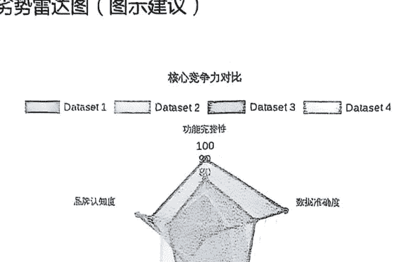

### 三、破局建议
+ **a. 精准卡位** 在 500~1000 元区间建立技术壁垒，避免与 Brand A/B 直接碰撞。
- **b. 功能创新** 打造“运动场景 AI 教练”，整合动作捕捉纠错、实时语音指导、训练负荷智能调节。
- **c. 生态联动** 与 Keep/悦跑圈 等主流运动 App 建立数据互通，打破生态孤岛。

> > 如需具体销售数据或用户画像，可开展定向调研。

在对手拆解中，提示词要点在于明确拆解对象、列出维度如站位、功能、定价等，并规定输出形式如对照表与强弱点拆解。可引导 DeepSeek 生成系统化、具参考价值的报告。

## 2. 设计市场调研方案
### 案例
某初创公司计划推出智能家居新品，需通过调研明确用户需求与价格敏感度。
示例提示词：
请设计一份市场调研方案。
研究目的：了解潜在用户需求和购买意愿。
调研内容：目标用户画像、需求痛点、竞品使用情况、价格敏感度。
方法建议：问卷调查 + 深度访谈；样本覆盖北上广深及杭州、成都、西安；问卷分基础信息、需求偏好、竞品习惯、价格区间。

DeepSeek 的输出如下。

## 智能家居产品市场调研方案
### 一、研究背景
随物联网与消费升级，智能家居市场快速增长。本调研为研发与市场策略提供数据支撑，精准捕捉核心需求。

### 二、研究目标
a. 构建目标用户三维画像模型（人口属性 + 行为特征 + 心理认知）。
b. 识别需求优先级与产品改进方向。
c. 建立竞品动态监测体系。
d. 确定价格弹性区间与溢价接受度。

### 三、研究设计
#### （一）混合研究方法
| 方法 | 样本量 | 执行方式 | 数据维度 |
|---|---|---|---|
| 定量问卷 | 1800份 | 线上 + 线下 | 结构化数据 |
| 深度访谈 | 40人 | 焦点小组+1v1 | 质性数据 |

#### （二）分层抽样框架
**地理分布**
北京 10%、上海 12%、广州 12%、深圳 15%、杭州 18%、成都 18%、西安 18%。
**人口特征配额（Python 样本结构控制参数）**
```python
# 样本结构控制参数
age_groups = {
    "18-25": "25%",
    "26-35": "40%",
    "36-45": "25%",
    "46+": "10%"
}
income_levels = {
    "<8k": "15%",
    "8-15k": "45%",
    "15-30k": "30%",
    "30k+": "10%"
}
```

### 四、执行方案
#### （一）问卷架构
**a. 基础属性模块**
- 智能设备持有量（IoT 指数计算）。
- 技术接受度量表（TAM 模型适配）。
**b. 需求分析模块**
> ### 请对以下需求项进行优先级排序 [强制排序法]
> 1. 远程安防监控
> 2. 语音交互体验
> 3. 能耗管理
> 4. 个性化场景设置

#### （二）竞品体验矩阵
| 评价维度 | 小米 | 华为 | 海尔 | 海外品牌 |
|---|---|---|---|---|
| 易用性 |  |  |  |  |
| 稳定性 |  |  |  |  |
| 服务响应 |  |  |  |  |

**# **价格敏感测试（PSM模型）**
- 理想价格 → 价格带接受度
- 竞品溢价空间 → 心理账户分布

#### （二）深度访谈指南
![图] (img/bad44300e128088c39ec4c71e5ca8e1e_126_0.png)
**主题1：使用场景还原**
“请描述您最近一次使用智能家居设备的具体情境”（STAR 法则应用）。
**主题2：决策路径分析**
- 信息获取渠道：电商平台/社群推荐/KOL 测评
- 决策影响因子：技术参数/设计美学/品牌背书
- 购买阻碍点：数据安全疑虑/安装复杂度/学习成本

### 五、数据分析模型
a. 聚类分析（K-means）构建用户分群。
b. 联合分析（Conjoint Analysis）量化属性偏好。
c. 价格弹性曲线拟合。
d. 语义网络分析（访谈文本挖掘）。

### 六、项目周期
| 阶段 | 时间窗 | 交付物 |
|---|---|---|
| 问卷预测试 | W1 | 信效度检验报告 |
| 实地执行 | W2～W3 | 原始数据库 |
| 深度洞察 | W4 | 需求热力图 |
| 策略建议 | W5 | 产品机会矩阵 |

### 七、质量控制
a. 问卷逻辑跳转校验，避免路径偏差。
b. 录音转录双盲校对。
c. 异常值三重筛查机制。

### 八、预算构成
| 项目 | 费用明细 |
|---|---|
| 问卷平台 | 20000元（含逻辑校验） |
| 访谈激励 | 48000元（1200 元/人*40） |
| 数据分析 | 35000元（含建模服务） |
| 差旅费用 | 15000元（覆盖二线城市） |
| 合计 | 118000元 |

### 九、成果输出
a. 用户需求三维图谱（基础需求/期望需求/兴奋需求）。
b. 产品竞争力 SWOT 矩阵。
c. 动态定价模拟器（不同配置组合）。
d. 市场进入路线图（含风险预警）。

> [注] 本方案预留 15% 样本扩容空间，可依初期发现动态调整重点。

设计调研方案时，提示词要点在于明确研究目的、详细规划内容如画像、痛点、竞品分析，以及具体化方法如方式、样本、问卷结构。可引导 DeepSeek 生成全面可执行且科学的方案。

### 5.3.2 策略制定
策略制定是商业策划核心，清晰目标与执行计划可有效推动市场拓展。

#### 1. 设计营销策略
### 案例
某电商平台拟为新上线的生鲜配送服务制定方案，吸引城市白领。
示例提示词：
请设计一份营销策略方案。
产品/服务：城市生鲜配送 FreshX。
目标：提升新用户注册量和首单转化率。
方案内容：市场定位、目标用户、营销渠道、推广方式、预算分配、效果评估。

DeepSeek 的输出如下。

FreshX 城市生鲜配送服务营销策略方案
### 一、核心策略定位
Slogan 提案：“30 分钟鲜达，职场精英的餐桌管家”。

### 二、渠道策略优化
a. 社交媒体运营（预算占比 35%）
- **抖音**
  - 打造#职场鲜食记话题挑战赛，KOL 示范 3 分钟料理教程。
  - 信息流投放，精准定向 CBD 区域，早 7~9 点/晚 6~8 点。
- **小红书**
  - 建立“FreshX 鲜食研究院”企业号。
  - 每周发布《5 分钟星级料理》图文。
  - 用户 UGC 激励，晒单返现 5 元。

b. 外卖平台合作（预算占比 15%）
- 美团/饿了么开屏广告，午间 11:30～13:00。
- 包装植入“第二单立减券”。

c. 线下场景渗透（预算占比 30%）
- **智慧社区计划**
  - 与高端物业合作设置智能保鲜柜，带注册二维码。
  - 开展“周五鲜品日”，现场注册送 30 元蔬菜盲盒。
- **企业联盟计划**
  - 针对 500 人以上企业推出专属折扣码与茶水间品鉴会。

### 三、转化提升设计
a. 首单加速计划
- **阶梯优惠**
  - 注册即领 20 元券，满 50 元可用。
  - 分享得 15 元券，裂变激励。
b. 体验式营销
- **鲜品体验包**
  - 新客 1 元购价值 39 元尝鲜包。
  - 开发智能推荐功能，基于用户资料推荐套餐。
c. 会员体系升级
- **会员计划**
  - 成长积分：消费 1 元=2 积分，推荐 1 人=100 积分。
  - 权益：银卡专属客服+周三免配送；金卡优先配送+每周菜谱；钻石卡私人营养师咨询，月消费满 2000 元解锁。

### 四、数据监测体系
| 指标维度 | 监测工具 | 优化机制 |
|---|---|---|
| 注册转化率 | Google Analytics+自有 CRM | 实时调整落地页设计 |
| 首单客单价 | 后台交易系统 | 动态优惠券策略 |
| 次日留存率 | 用户行为分析平台 | 触发式短信提醒 |
| 社交裂变率 | 分销系统数据看板 | KOC 培养计划 |

### 五、预算执行方案
总预算以 100 万元为例：
- 线上获客 50 万元，信息流 35 万 + KOL 15 万。
- 线下拓展 30 万元，社区活动 20 万 + 企业合作 10 万。
- 会员运营 20 万元，积分兑换 10 万 + 专属活动 10 万。

#### 风险对冲机制
a. 预留 15% 预算作动态调整。
b. 建立 A/B 测试小组，每周迭代 3 版素材。
c. 签约第三方物流备用团队保障履约。

### 六、执行时间轴
- 🏁 启动期第 1~2 周：渠道谈判与素材准备。
- 🚀 爆发期第 3~4 周：全渠道集中投放。
- ✍️ 优化期第 5~6 周：数据复盘与策略调整。
- 🈚️ 持续期第 7~12 周：会员深度运营与场景渗透。

> [注] 建议配套开发“紧急补货”功能，支持 30 分钟加单，提升依赖度。

设计营销策略时，提示词要点在于明确营销目标、详细描述方案要素如定位、用户、渠道，以及具体化执行细节如推广方式、预算分配、评估指标。可引导 DeepSeek 生成全面可落地方案。

#### 2. 制订运营计划
### 案例
某初创公司计划 6 个月内推广智能水杯 AquaSmart，目标提升认知并实现月销破 10000 个。
示例提示词：
请制订一份运营计划。
项目：智能水杯 AquaSmart。
周期：6 个月。
计划内容：阶段性目标、执行措施、资源配置、风险控制、KPI。

DeepSeek 的输出如下。

智能水杯 AquaSmart 的 6 个月运营计划
### 一、阶段性目标（按月划分）
| 阶段 | 核心目标 |
|---|---|
| 第 1 月 | 完成产品测试与优化，建立线上预售渠道，积累种子用户 500 名以上 |
| 第 2 月 | 启动线下体验营销，首月销量 1500 台，App 激活率≥80% |
| 第 3 月 | 拓展 3 个省级代理，月销突破 3000 台，用户复购率≥15% |
| 第 4 月 | 跨界联名营销，社交媒体曝光超 100 万，社群规模达 5000 人 |
| 第 5 月 | 进驻主流电商 TOP3 品类榜单，月销售额破 200 万元 |
| 第 6 月 | 建立用户忠诚计划，NPS≥35，用户留存率≥60% |

### 二、具体执行措施
#### 1. 线上推广体系
- **社交媒体运营**
  - 抖音/小红书每周发布 3 条创意短视频，聚焦饮水场景与健康数据可视化。

半年智能饮水硬件增长打法全拆解

达人种草：签下10位深耕健康与科技赛道的头部创作者，产出开箱实测内容。
话题裂变：推出 #智能饮水挑战赛# 话题，并以智能水杯抽奖提升参与热情。

电商渠道运营
- 天猫、京东自营旗舰店上线“饮水方案定制”服务。
- 每月15日推出“健康饮水日”限时特惠，下单即赠健康手环配件。
- 部署24小时AI客服，提供饮水方案在线咨询。

#### 2. 线下渠道布局
体验式营销
- 在十个重点城市CBD搭建快闪体验站，现场提供体脂检测并打印专属饮水建议。
- 与连锁健身房联动推出“购杯赠私教饮水计划”组合包。

#### 3. 渠道拓展
- 第3个月完成苏宁、顺电等3C渠道的铺货。
- 第5个月入驻盒马鲜生健康产品专区。
- 建立分级代理体系，省级代理首批订货超500台可享15%返点。

#### 4. 用户运营策略
社群运营
- 组建VIP用户社群，日更个性化饮水提醒。
- 开展“连续21天打卡返现”活动，完成目标返还购机款30%。
数据驱动运营
- 通过App采集饮水行为数据，每月输出《个人饮水健康报告》。
- 建立饮水成就体系，以铜杯、银杯、金杯等级进行激励。

### 三、资源配置

| 模块 | 资源配置 |
|---|---|
| 团队分工 | 市场部 5 人、产品部 3 人、销售部 8 人、客服部 4 人、技术运维 2 人 |
| 预算分配 | 总预算 280 万元：产品研发 20%、营销推广 45%、渠道建设 25%、风险预留 10% |
| 合作伙伴 | 华为运动健康提供数据接口、Keep 联合营销、顺丰物流专线、微盟负责私域运营 |

### 四、风险控制

| 风险类型 | 应对策略 |
|---|---|
| 供应链风险 | 建立3家备选供应商，核心部件保持2个月安全库存 |
| 市场接受度风险 | 设置7天无理由退换 + 30天质量问题换新试用期 |
| 竞争风险 | 每月推送固件更新，如新增咖啡因摄入计算，保持技术领先 |
| 数据安全风险 | 通过ISO27001认证，用户数据采用区块链分布式存储 |

### 五、KPI 设定

| 阶段 | 核心 KPI |
|---|---|
| 第1月 | 预售转化不低于四成、产品缺陷修复响应小于24小时 |
| 第2月 | 线下体验点日均咨询不低于50人、应用次日留存不低于65% |
| 第3月 | 渠道铺货完成度100%、客单价不低于299元 |
| 第4月 | 联名产品销售额占比不低于25%、社群UGC月产出不低于200条 |
| 第5月 | 电商搜索排名进入前三、广告投放ROI达到1:5 |
| 第6月 | 老客推荐购买比例不低于30%、客服满意度不低于4.8/5 |

执行要点：每月25日召开跨部门复盘会，依据用户行为数据动态调整运营策略，预留10%预算用于捕捉突发营销机会。

在制定运营方案时，提示词设计的关键在于明确产品属性与周期、细化阶段目标与落地动作、配置资源并设定风险与KPI评估标准。组合这些要素可引导DeepSeek输出系统化、可执行且便于跟踪的运营规划，为项目落地提供清晰行动指引。

### 5.4 学习辅助
AI工具在学习中可高效获取知识，并通过个性化规划与实时反馈提升效果。本节展示如何借助DeepSeek从知识点梳理到考前备考实现全流程优化。

#### 5.4.1 知识整理
清晰的知识结构与重点标注能帮助快速掌握核心内容，明确复习方向。本节演示如何利用DeepSeek对复杂体系进行高效梳理，包括思维导图与重点标记。

### 知识点梳理

#### 案例
某大学生备考计算机网络课程，希望借助结构化梳理提升复习效率。

示例指令如下。
请帮我梳理课程知识点。
课程名称：计算机网络
核心内容：
1. 网络分层模型，如OSI七层。
2. 数据传输协议，如TCP/IP。
3. 网络安全，如加密、认证、防火墙。
4. 应用层协议，如HTTP、DNS。

输出要求：
1. 以思维导图形式列出要点。
2. 对每个点做简要说明。
3. 标注考试常考内容。

DeepSeek输出如下。

以下为计算机网络课程知识点的文本版思维导图，含简要说明及常考标注。

## 计算机网络知识体系

### 1. 网络分层模型 ★★★★★
- OSI七层理论框架
  - 物理层：比特流传输 网线/光纤★
  - 数据链路层：MAC地址/帧传输 交换机★
  - 网络层：IP地址/路由选择 路由器★★★
  - 传输层：端到端连接 TCP/UDP★★★
  - 会话层：会话建立/管理
  - 表示层：数据格式转换
  - 应用层：用户接口

TCP/IP四层模型 实际应用
- 网络接口层 物理+数据链路
- 网际层 IP/ICMP ★★
- 传输层 TCP/UDP ★★★
- 应用层 HTTP/DNS 等

### 2. 数据传输协议 ★★★★
- TCP协议
  - 三次握手建立连接 ★★★
  - 四次挥手断开连接 ★★★
  - 可靠传输 确认/重传机制
  - 流量控制 滑动窗口★
- UDP协议
  - 无连接 尽最大努力交付
- IP协议
  - IPv4地址分类 A/B/C类★
  - 子网划分 CIDR★★★
  - NAT技术原理★★

## 3. 网络安全 ⭐⭐
- 加密技术
  - 对称加密 AES
  - 非对称加密 RSA
- 认证机制
  - 数字证书 CA机构
  - HTTPS握手过程
- 防火墙
  - 包过滤防火墙
  - 应用代理防火墙

## 4. 应用层协议 ⭐⭐⭐
+ - HTTP协议
  - 请求方法 GET/POST区别
  - 状态码 200/404/500
  - 持久连接/管道化
- DNS协议
  - 域名解析过程 递归/迭代
  - 资源记录类型 A/CNAME/MX
  - DNS缓存机制

标注说明
- ⭐⭐⭐⭐ 高频考点
- ⭐⭐⭐ 常见考点
- ⭐⭐ 中等频率
- ⭐ 基础知识点

典型考题示例
1. TCP三次握手过程 画图说明
2. 子网划分计算 给定IP地址和子网需求
3. HTTP与HTTPS核心区别
4. ARP协议工作过程
5. 路由器与交换机区别

建议重点掌握⭐⭐⭐⭐及以上内容，并配合抓包工具如Wireshark进行协议分析实践。

梳理知识点时，提示词设计关键在于明确课程信息、细化知识模块并具体化输出要求。组合这些要素可引导DeepSeek生成结构清晰、重点突出且便于记忆的知识体系。

# 2. 优化学习笔记

案例
小李希望将零散笔记整理成清晰框架便于复习。

示例指令如下。
请优化以下学习笔记。
原始笔记：
第一章 基本概念 定义公式
第二章 应用案例 案例1、案例2
优化要求：结构重组、重点突出、补充例证、建立知识链接。

DeepSeek输出如下。

### 学习笔记优化版

#### 一、核心概念体系
##### 1.1 基础定义解析
+ - 核心概念 通过集合论视角阐释基本定义 如概率空间=Ω,F,P
- 关键特征 可测性、归一性、可列可加性
- ⬜ 例证 用掷骰子解释样本空间 Ω={1,2,3,4,5,6}
+ - 📊 典型例题 医疗诊断中的假阳性问题计算 附推导

#### 二、实践应用图谱
##### 2.1 金融风险建模
+ - 案例背景 某投行信用风险评估系统
- 技术路径
  a. 建立违约概率模型 如 Logistic 回归
  b. 压力测试场景构建
  c. VaR值计算与验证
- 📈 数据实例 2008年次贷危机中CDO定价失败案例

##### 2.2 工业质量控制
+ - 创新应用 六西格玛管理中的SPC控制图
- 实施流程 数据采集→过程能力分析→控制线设定→异常检测
- 🏭 实际效果 某汽车厂商良品率提升37%的实证数据

### 第5章 场景实战应用
#### 三、知识网络构建
##### 3.1 学科交叉链接
- 概率论→统计学 大数定律与抽样调查
- 随机过程→金融工程 布朗运动与期权定价

##### 3.2 延伸学习资源
- 📖 经典文献《概率论及其应用》William Feller著
- 🌐 在线课程 MIT的 6.041 概率系统分析和应用
- ↪️ 研究前沿 概率图模型在AI诊断中的应用

优化笔记时，提示词设计关键在于提供原始内容、明确优化要求并具体化优化方向。组合这些要素可引导DeepSeek对原笔记进行系统性改进，使其条理清晰、重点突出且易于复习。

## 5.4.2 学习规划
科学计划有助于高效分配时间，兼顾薄弱点突破与优势巩固。本节展示如何利用DeepSeek制定个性化学习计划，从时间管理到复习策略帮助在有限时间内实现最佳效果。

### 1. 制订学习计划

案例
高三学生在最后3个月冲刺高考，需兼顾薄弱科目与强项保持。

示例提示语如下
以下为某高三学生的学习计划
学生情况
+ 1. 数学成绩 弱科 平均分10 英语 中等 平均分85 语文 强科 平均分110
2. 学习时间 每天可投入5小时
3. 目标 数学提升至91分以上 英语提升至85分以上 其他保持稳定
+ 1. 划分学习计划 每周7天
2. 每天具体安排 时间段+学习内容
3. 提出学习建议和注意事项

DeepSeek输出如下。
以下是针对高三学生的四周学习计划，重点提升数学和英语，同时保持语文优势：

#### 第一周 基础巩固阶段
> 每日时间表：
6:00-22:00 含午休1小时
9:00 - 10:00 数学 函数与导数专题 公式推导+基础题训练
10:15 - 11:45 英语 高频词汇背诵 100词/天+语法改错
14:00 - 15:00 语文 文言文词汇整理+1篇阅读理解
15:15 - 16:45 数学 立体几何专题 模型拆解+真题训练
17:00 - 18:00 英语 完形填空专项 2篇/天
19:30 - 20:30 语文 作文素材积累 时事热点+名言整理
20:45 - 21:30 综合 当日错题复盘+标记疑难问题

#### 第二周 专项突破阶段
##### 每日时间表调整
8:00~10:00 数学 概率统计专题 数据解读+应用题强化
10:15~11:45 英语 阅读理解提速训练 限时3篇/40分钟
14:00~15:00 语文 古诗鉴赏答题模板整理
15:15~16:45 数学 解析几何专题 坐标系构建+计算规范
17:00~18:00 英语 七选五+短文改错专项
……其他时段同第一周

#### 第三周 综合强化阶段
##### 新增安排
- 周三/周六晚 19:30~21:30 数学/英语模拟考 近3年真题
- 周日 全科错题重做+知识脑图整理

#### 第四周 冲刺调整阶段
##### 每日重点
- 8:00~10:30 数学 压轴题突破 每日1道+选填限时训练
- 10:45~12:00 英语 作文模板打磨 书信+议论文
- 14:00~15:00 语文 作文审题训练 3题/天
……其他时段侧重薄弱环节

#### ☆复习建议与注意事项
1. 数学提分策略
   - 每日保证50分钟基础题训练 确保选择填空正确率>85%
   - 建立三级错题本
     - Level 1 计算失误 红色标记
     - Level 2 思路错误 黄色标记
     - Level 3 知识盲区 蓝色标记
2. 英语突破要点
   - 实施532单词法
     - 5分钟 快速浏览新词
     - 3分钟 联想记忆巩固
     - 2分钟 英汉互译检测
   - 每周精析2篇高考范文 积累10个高级句式
3. 语文维稳技巧
   - 文言文每日3+2训练
     - 3分钟 快速翻译指定段落
     - 2分钟 重点虚词归类
   - 作文保持每周2篇提纲训练+1篇全文写作
4. 时间管理工具
   - 使用番茄钟工作法 45分钟学习+5分钟休息
   - 每周日 21:30~22:00 进行学习效率自评

> ### ☆注意事项
1. 每日保证6~7小时睡眠 午休不超过1小时
2. 每周安排2次30分钟运动 如跳绳、快走
3. 每完成3小时学习后做眼保健操
4. 遇到知识卡点立即标记 每周集中请教老师
5. 考前两周调整生物钟 严格按高考时间模拟
注：可根据实际进度动态调整各科时间分配，但需确保数学每日不少于3小时、英语不少于2小时、语文不少于1小时

制定学习计划时，提示词设计关键在于明确学生现状、设定具体目标并详细规划执行方案。组合这些要素可引导DeepSeek生成个性化、可执行且针对性强的学习计划。

### 2. 设计复习策略

案例
小明准备参加公务员考试，希望设计复习策略集中攻克重点难点。

示例提示词如下。
请设计一份复习策略。
- 科目/领域 公务员考试
- 时间周期 3个月
- 策略内容 重点难点梳理、复习顺序安排、记忆方法建议、练习题推荐

DeepSeek输出如下。
以下是针对公务员考试的3个月复习策略设计，包含重点难点梳理、复习顺序安排、记忆方法建议及练习题推荐。

#### 一、重点难点梳理
##### 1. 行测 行政职业能力测验
- 言语理解与表达 逻辑填空、片段阅读 主旨概括、细节判断

##### 第三阶段 模拟冲刺 第9~12周
- 目标 全真模拟 查漏补缺
- 行测 每周3套真题 限时110分钟 分析错题并整理高频易错点
- 申论 按考试时间完成套卷 对照参考答案优化答题逻辑

#### 三、记忆方法建议
- 思维导图法 将行测各模块知识点如逻辑判断的论证类型整理成思维导图 强化逻辑关联
- 口诀记忆法 如资料分析公式为 现期量=基期量×（1+增长率）
- 错题归类法 建立错题本 按题型分类 如“图形推理-对称性” 标注错误原因
- 碎片化学习 利用碎片时间刷常识题 App题库 关注时政新闻 学习强国、人民日报等平台

#### 四、练习题推荐
1. 行测教材及题库
   - 中公教育《行政职业能力测验历年真题精解》
   - 华图教育《模块宝典》分模块专项训练
   - 粉笔App 每日智能组卷+模考大赛
   - 历年国考及省考真题 近5年优先
2. 申论教材及训练材料
   - 粉笔《申论的规矩》规范答题模板
   - 半月谈《申论范文宝典》热点话题解析
   - 每日精读1篇时评文章 人民网、新华网 积累规范表达
   - 每周限时完成1套申论真题 重点练习大作文提纲

#### 五、注意事项
- 时间分配 每日学习4~6小时 行测与申论时间比例建议6:4
- 复盘总结 每周日复盘学习进度 调整下一周计划
- 心态调整 避免盲目刷题 注重质量 考前1周减少新题量 专注错题回顾

通过执行以上策略，可系统覆盖公务员考试核心内容，兼顾效率与深度，建议结合个人基础灵活调整节奏。

设计复习策略时，提示词设计关键在于明确复习对象、时间框架以及具体策略要素。组合这些要素可引导DeepSeek生成系统化、实用且针对性强的复习方案。

# 5.5 本章小结
通过本章学习，相信你已掌握在以下场景高效使用DeepSeek的方法。
1. 文案创作 快速生成社交媒体文案、广告标题等
2. 数据分析 解读趋势、对比数据 生成专业报告
3. 商业策划 完成市场分析与策略制定

效率升级，从进阶用法开始
4. **知识重塑与学习规划**：搭建认知框架、规划复习节奏。

上述四类用法已覆盖工作、学习与日常生活的诸多场景，熟练掌握后能明显提升产出效率，形成更大价值。

下一章将进入更高阶的实战层面，帮你把 DeepSeek 的潜力挖掘得更彻底！

# 第 6 章

## 高级应用技巧

本章聚焦 DeepSeek 的进阶功能与实操心法，帮助你在复杂任务中用得更顺手更高效。内容从连续追问的设计入手，说明如何借助深度推理打磨提问，再学习通用提问框架的搭建方法，最后结合乔哈里窗模型构建高效沟通思路。无论是提升对话逻辑、改进提问质量，还是设计创新解法，本章都提供系统化指引，助力你在实战中释放更多价值。

## 6.1 多轮对话优化

连续追问是 DeepSeek 的核心能力之一，通过合理规划问答链条并维持上下文记忆，能显著增强解决复杂问题的表现。本节重点讲解如何设计策略，保证信息传递清晰、推理连贯。

> 注意，DeepSeek-R1 本质是推理框架，并不适合多轮连谈。若要验证多轮效果，建议关闭 DeepSeek 的“深度思考”开关。

在连续追问中，科学搭建对话链能让你更快获取信息、更快落地。常见做法有两种。

### 1. 由浅入深的追问法

从概览到细节再到优化方案，层层深入挖掘关键信息。

**首步：明确需求概览。**

示例
请帮我拆解一下电商平台的用户增速困境。

模型输出概要如下。

#### 电商平台用户规模扩张拆解

用户规模扩张需要多维度审视，具体思路如下。

##### 一、厘清问题找方向
+ 用户增长是停滞还是下滑？增速放缓还是体量减少？
+ 目标人群是谁？特征、需求和痛点是什么？
+ 用户生命周期处于哪个阶段？是获客难，还是留存弱？

##### 二、数据找根因
1. 用户数据
+ 用户肖像：年龄、性别、地域、职业、兴趣等。
+ 使用行为：访问频次、停留时长、浏览路径、转化率、客单等。
+ 来源渠道：自然流量、付费广告、社媒、搜索等。
+ 商品数据：品类、价格、库存、销量、评价等。
+ 运营数据：促销、优惠力度、物流、售后等。
+ 增长打法：竞品采用了哪些增长手段？效果如何？
+ 平台优劣：相较竞品，自身优势与短板在哪？

2. 解决思路
+ 精准营销：依托肖像与行为做定向投放与内容营销。
+ 渠道拓展：开拓新获客渠道，如与创作者合作、线下活动等。
+ 裂变营销：设计邀请、拼团等机制，利用老用户带动新用户。

3. 持续跟进
+ 数据监控：搭建监控体系，实时跟踪增长情况。
+ 效果复盘：定期评估策略成效，及时调整方案。
+ 持续迭代：结合市场与需求变化，不断优化平台与运营。

常用方法与工具
- **AARRR 框架**：获客、激活、留存、变现、传播。
- **漏斗分析**：梳理访问到购买的路径，定位流失点。
- **用户分群**：按特征行为分组，实现差异化运营。
- **分桶实验**：对比方案效果，选出最优解。

用户增长是系统工程，需要产品、运营、技术等多部门协同才能见效。

**第二步：细化执行细节**

提问范式如下。
针对【首轮回答中的要点 A】，请给出具体的执行步骤。

示例
针对持续跟踪并循环改进，请给出具体的执行步骤。

模型输出概要如下。

持续跟踪与循环改进是保证增长策略落地的关键，具体步骤如下。

#### 1. 搭建数据监控框架
- 明确核心指标：新增用户、活跃用户、留存率、转化率、客单价、复购率等。
- 选择分析工具：如 GA、Mixpanel、Tableau 等类产品。
- 建立实时看板：便于团队随时查看核心指标变化。

#### 2. 数据采集与整理
- 自动化采集：通过 API、SDK 等自动抓取行为与交易数据。
- 清洗整理：剔除重复、错误、无效数据，保证准确完整。
- 存储管理：使用 MySQL、BigQuery 等数据库或数据仓库统一管理。

#### 3. 分析与洞察
- 定期复盘：按周、月、季评估策略效果。
- 深度挖掘：通过分群、漏斗等手段找出瓶颈与机会。
- 竞品对标：定期研究竞品动向，了解行业趋势与自身差距。

#### 4. 评估与反馈
- 策略评估：对照数据判断是否达标。
- 用户反馈：通过问卷、访谈、社媒收集对平台与策略的意见。
- 团队沟通：定期会议分享数据与反馈，讨论改进方向。

#### 5. 迭代改进与落地
- 制定改进方案：调整营销、优化功能、改善体验等。
- **分桶实验**：小范围验证有效性，降低风险。
- 分步实施：按测试结果逐步推广。
- 监控效果：持续跟踪指标变化，评估改进成果。

#### 6. 持续学习与提升
- 跟踪行业动态：学习先进经验与方法。
- 升级工具：不断更新数据分析手段。
- 团队培养：定期培训，提升数据分析与增长策略能力。

#### 7. 建立反馈闭环
- 用户反馈机制：快速响应需求与问题，提升满意度。
- 内部反馈机制：鼓励团队提出改进建议，优化流程。
- 持续改进文化：倡导创新与试错，不断优化增长策略。

> 按以上流程，平台可形成监控-改进的闭环，保证增长策略长期有效。

### 第 6 章 高级应用技巧

在做复习计划时，提问设计要明确复习对象、时间周期以及策略要素如重点难点、顺序、记忆方法与练习建议。组合这些要素能引导 DeepSeek 输出系统化、实用且针对性强的复习方案。

## **5.5 本章小结**

通过本章学习，你应已掌握在以下场景高效使用 DeepSeek 的方法。

1. **文案创作**：快速生成社媒文案、广告标题等。
2. **数据分析**：解读趋势、对比数据，产出专业报告。
3. **商业策划**：完成市场分析与策略制定。
4. **学习辅助**：优化知识体系、制定学习计划。

这些场景覆盖了工作、学习和生活的多个层面，灵活运用技巧可显著提升效率，创造更多价值。

在第 6 章中，将探讨更高级的应用技巧，帮助你充分挖掘 DeepSeek 的潜能！## 第三轮：方案深化

提问范式如下。
在【具体条件】下，如何优化上述方案的执行效果？

示例
在实际投资回报率的考量下，如何优化上述方案的执行效果？

模型输出概要如下。

在落地过程中，优化投资回报率是保持增长可持续的核心。以下是在监控与迭代中，通过资源配置、执行效率与成本控制来提升投资回报率的具体做法。

### 1. 聚焦高价值用户
*   用户分层：按生命周期价值 LTV 分层，优先投入高频、高客单用户。
*   精准投放：利用肖像与行为数据定向推送，减少无效曝光。
*   流失召回：对高价值流失用户设计个性化召回，如专属券、限时活动。

### 2. 优化渠道投入
*   渠道投资回报率复盘：定期评估各渠道投资回报率，将预算向高回报渠道倾斜。
*   淘汰低效渠道：对转化差的广告平台减少或停止投入。
*   渠道协同：打通线上线下，设计跨渠道活动提升整体转化。

---

## 3. 提升运营效率

### 自动化工具：
使用营销自动化平台、CRM 系统降低人工成本。

### 流程优化：
精简内部流程，提升协作效率。

### 数据驱动决策：
依托实时数据快速调整，避免资源浪费。

---

## 4. 精细化分桶实验
### 小范围验证：
推广前先小规模测试，降低试错成本。
### 多变量测试：
同时测试文案、页面、优惠力度等，找到最优组合。
### 快速迭代：
根据结果迅速调整，缩短优化周期。

---

## 5. 优化用户体验
### 提升转化率：
简化注册、支付流程等环节。
### 提高复购率：
通过会员体系、个性化推荐、定期促销刺激复购。
### 降低流失：
分析流失原因，针对性优化产品与服务。

---

## 6. 控制成本
### 投放优化：
精准定向、优化素材、动态出价降低广告成本。
### 资源复用：
复用内容、数据、技术工具，减少重复投入。
### 外包非核心：
将客服、物流等外包给专业团队。

#### 第 6 章 高级应用技巧

---

### 7. 数据驱动的预算分配
*   动态调预算：按渠道与策略投资回报率表现灵活调整。
*   设定投资回报率目标：为每个渠道设定明确目标并定期复盘。
*   短长期平衡：兼顾短期回报与长期用户价值，避免牺牲体验。

### 8. 团队协作与激励
*   目标清晰：设定明确投资回报率目标与责任。
*   绩效挂钩：将投资回报率与团队绩效关联，激励高效执行。
*   跨部门协同：市场、产品、技术协同闭环。

### 9. 持续学习与优化
*   行业对标：借鉴头部企业的增长打法。
*   技术升级：引入先进分析工具与 AI 技术。
*   定期复盘：总结经验教训，持续优化策略。

### 10. 建立反馈闭环
*   用户反馈：通过调研、评论收集意见，快速优化。
*   内部反馈：鼓励团队提建议，持续优化运营。
*   快速响应：根据反馈及时调整，减少浪费。

---

**示例：优化广告投放投资回报率**

*   精准定向：按肖像与行为数据投放，减少无效曝光。
*   素材优化：通过分桶实验选出高点击高转化素材。
*   动态出价：依据效果调整出价，降低单次点击成本。
*   渠道整合：与社媒、内容营销联动，提升整体转化。
*   效果评估：定期评估投资回报率，优化预算分配。

以上方法可在保证增长有效性的同时最大化投资回报率，实现可持续增长。

> 实践中可使用以下提问技巧。

提问时保持逻辑连贯，避免跳跃。根据上一轮回答动态调整下一轮问题。通过概述-细化-深化的多轮对话，能快速理清思路，聚焦关键，让结果更符合预期。

---

## 2. 议题分支管理

面对复杂问题，可将问题拆分为多个分支逐一讨论再汇总。例如主问题为产品战略规划，分支包括。

*   主干问题：产品战略规划。
*   分支 1：市场定位。
*   分支 2：竞品分析。
*   分支 3：营销策略。

### 提问范式如下。

让我们先聚焦【分支 X 】，完成后再讨论其他方面。

#### 第 6 章 高级应用技巧

---

## ☘示例

### **分支 1：市场定位**

**目标问题：**这款饮品的目标用户是谁？

**示例提问如下。**

让我们先讨论这款饮品的市场定位。目标用户是哪些人群？从年龄、职业、生活习惯等维度分析。

模型返回如下。

该新型健康饮品的核心目标可定位为。

*   年龄：18～45 岁，集中在 25～35 岁的都市白领与年轻家庭。
*   职业：职场人士、健身爱好者、学生。
*   生活习惯：健康意识强、节奏快、重视便捷与品质。
*   心理需求：追求健康、颜值、减压、社交分享。
*   消费场景：日常饮用、运动后、工作学习、社交场合。

精准定位有助于产品功能、包装、营销的针对性设计，提升竞争力。

### **分支 2：竞品分析**

**目标问题：**当前市场主要竞品有哪些？优劣势如何？

**示例提问如下。**

接下来分析当前市场主要竞品。请列出 2～3 个竞品，并分析定价、包装、功能特点与市场反馈。

**模型返回如下。**

竞品对比总结如下。

| 竞品 | 定价 | 包装风格 | 功能特点 | 市场反馈 |
|---|---|---|---|---|
| 元气森林 | 5~8元/瓶 | 时尚清新 | 0糖0卡、气泡口感、多口味 | 口感好、健康属性强、价格偏高 |
| 东方树叶 | 4~6元/瓶 | 简约自然 | 无糖、天然茶香、多茶类 | 茶味纯正、健康、口感偏淡 |
| 佳得乐 | 6~8元/瓶 | 运动活力 | 电解质补充、能量补充、多口味 | 运动补给有效、含糖偏高 |

竞品启示：
a. 定价策略：健康饮品多在 4~8 元区间，消费者愿为健康溢价。
b. 包装设计：简洁时尚、符合审美能提升吸引力。
c. 功能特点：无糖低卡天然和气泡茶香是核心卖点。
d. 市场反馈：需在口感与健康属性间取得平衡。

在此基础上，新型饮品可在定价、包装、功能上借鉴成功经验并做差异化创新。

### **分支 3: 营销策略**

**目标问题：**基于定位与竞品分析，如何制定差异化营销策略？

**示例提问如下。**

最后讨论营销策略。如何基于前面的定位与竞品分析，设计差异化营销方案？

模型返回如下。

基于定位与竞品分析，营销方案可围绕需求与趋势构建。

#### 1. 产品差异化定位
*   核心卖点。
*   产品线延伸。
    *   运动款：添加电解质与维生素。
    *   美容款：添加胶原蛋白与抗氧化成分。
    *   提神款：添加天然咖啡因或草本成分。

#### 2. 品牌故事与调性
*   品牌故事：如“源自自然的健康力量”，传递核心价值观。
*   品牌调性。
    *   **年轻时尚**：清新有活力的视觉吸引年轻人。
    *   **专业可信**：权威认证与专家背书增强信任。
    *   **情感共鸣**：以“健康是一种态度”为情感连接点。

#### 3. 定价策略
*   **中高端定位**：定价 6～10 元/瓶，以功能创新支撑溢价。
*   促销策略：新品“买一送一”、会员积分、限时折扣等。

#### 4. 渠道策略
*   线上渠道：天猫、京东直播带货、KOL 推荐；私域社群团购。
*   线下渠道：便利店、超市覆盖一二线城市；与健康、运动品牌跨界联名。

---

### 5. 社交媒体营销

#### 内容营销

#### 事件营销

#### 用户互动

社群运营：建立健康生活社群，定期分享知识与线下活动，增强归属感。

用户反馈：通过问卷与评论收集意见，持续优化产品服务。

### 一、差异化亮点

*   ### 功能创新
    *   添加益生菌、胶原蛋白等独特成分实现差异化。
*   ### 场景细分

### 健康饮品破圈的四把钥匙

面向运动补能、办公提神、美容养颜等不同使用场景做配方与包装的差异化定制，才能真正命中多元人群的使用痛点。

### 情感共鸣
用品牌故事和感性沟通去撩动消费者内心，与其建立超越功能层面的深度连接，让产品成为生活方式的象征。

### 绿色主张
选用可降解包装并贯穿可持续理念，直击对环保负责的消费群体，形成价值观上的认同。

### 8. 投放预算与成果复盘

#### 预算分配
线上投放占 50%：聚焦社交媒体种草、电商平台运营及直播带货。
线下铺设占 30%：主攻便利店、超市、健身房等高频触达场景。
品牌建设占 20%：用于品牌故事搭建、内容营销以及公益联动。

#### 效果评估
销售表现：以销售额走势与复购率衡量市场接受度。
用户声音：通过评论区反馈、社交互动热度感知满意度。
品牌认知：以知名度与美誉度评估品牌资产沉淀。

### 总结
功能持续迭代、场景精细化切分、情感化沟通与绿色理念并重，是新锐健康饮品在红海市场突围的核心。线上线下联动投放叠加精细化用户运营，既能放大声量也提升粘性，最终驱动份额的快速爬升。

### 6.1.2 多轮对话的上下文管理
在长对话里做好上下文承接，才能避免信息丢失与重复，保持逻辑通顺，提升回答的准确率与效率。常见做法有两种。

### 1. 信息延续
通过回扣前文，维持一致性与连贯性，让新回答始终扣在既有讨论上。

目标问题：怎样避免长时间对话里信息流失？

提示词模板。
基于我们之前聊的 [方案]，请在此基础上继续展开分析。

示例提示词。
基于我们之前聊的“用户增长策略”，请进一步分析会员体系如何拉高留存。

DeepSeek 的示例输出。
会员体系是增强留存的重要杠杆，具体做法如下：
1. 等级机制设计：按消费金额与活跃度划分为普通、VIP、SVIP，匹配差异化权益。
2. 权益组合：专属折扣与积分兑换、优先客服与抢先购、个性化推荐。
3. 激励闭环：积分累积、会员日、专属礼包刺激持续消费与互动。
4. 数据驱动迭代：分析消费频次与停留时长等行为数据，动态优化权益。

信息延续的价值在于保证对话不跑题，始终围绕核心议题纵深推进。

### 2. 上下文刷新
当对话体量过大或逻辑混乱时，用一次归纳把重点捋清，帮助聚焦关键。

目标问题：怎样让长对话保持清晰逻辑？

提示词模板。
让我们把目前的讨论重新梳理一遍。
1. 已确认的信息：[确认内容]。
2. 待解决的问题：[待明确的问题]。
3. 下一步重点：[后续任务]。

示例提示词。
让我们把目前的讨论重新梳理一遍。
1. 已确认的信息：目标用户为 25~35 岁的城市白领。
2. 待解决的问题：如何为这个群体制定有效营销打法？
3. 下一步重点：设计一套触达方案。

DeepSeek 的示例输出。

#### 用户触达方案设计

**1. 用户画像与需求拆解**
画像：25~35 岁、城市白领、压力大节奏快；注重健康管理、追求高品质生活、愿为健康买单；偏爱线上购物、重度社交媒体用户、易被种草。
核心需求：缓解疲劳、增强免疫、改善肤况的饮品；购买与携带便捷，适配办公室、通勤场景；品牌调性与自我生活方式契合。

**2. 触达渠道**
线上：小红书、抖音、微博、微信等通过 KOL 与 KOC 内容种草；天猫、京东等电商平台借助直播与限时折扣转化；知乎、B 站以健康科普与场景化内容吸粉。
线下：布局一二线城市的全家、7-11 等便利店与大型超市；与办公楼自动售货机、健身房合作；与健康食品、运动、生活方式品牌跨界联名。

**3. 社交媒体内容**
种草笔记展示健康属性、口感与使用场景；短视频系列如“健康饮品百种喝法”配合直播带货。

**4. 内容营销**
公众号、知乎发布健康科普；场景化内容呈现办公室、健身房、户外使用；品牌故事围绕“为都市白领提供健康新选择”传递价值观。

**5. 用户互动与运营**
UGC 征集带话题如 #我的健康新选择# 扩大传播；搭建健康生活社群定期分享知识与线下活动；建立积分与优惠券驱动的会员体系。

**6. 促销与活动**
新品上市买一赠一或第二件半价；电商平台限时折扣；与健身房、咖啡馆联动“购饮品送课程/咖啡券”。

**7. 下一步行动建议**
制定社交与内容平台的排期表；启动健身房、咖啡馆等合作洽谈；落定新品与限时促销规则；搭建会员与社群运营体系。

上下文刷新的价值在于快速校准方向，明确已做与待做，提高推进效率。

### 6.2 用深度思考打磨提示词
DeepSeek-R1 的深度思考能力让提示词可以迭代优化。往往用户藏着时间、失败经验、过敏史等隐性需求。若工作繁忙需要更高效计划；若曾极端节食失败则需要可持续方法；若有食物过敏必须规避；要强调健康减重，避免快速反弹的副作用，建议每周减 0.5~1kg，并提示平台期现象，给予示例周计划与饮食运动记录建议。

DeepSeek-R1 的初始输出提炼。
一、基础原则：每周减 0.5~1kg；每日热量缺口 300~500kcal；营养配比碳水 45%~55%、蛋白 20%~30%、脂肪 20%~30%。
二、分阶段：适应期记录饮食、替换高热量食物、增加蔬菜、每日 8000 步或快走 30 分钟、每周两次拉伸；减脂期控制 1500~2200kcal、高蛋白、粗粮替代、每周 3~4 次有氧+2 次力量、可选 16:8 轻断食；维持期每月 1~2 次放纵餐、保持运动、测体脂率。
三、参考餐单 1600kcal：全麦面包+水煮蛋+无糖豆浆、希腊酸奶+蓝莓、杂粮饭+清蒸鱼+西兰花、坚果、鸡胸肉沙拉+紫薯。
四、注意事项：避免长期不吃主食；大基数从低冲击运动起；平台期变换模式；慢性病先咨询医生。
五、工具：体脂秤、Keep、B 站帕梅拉、MyFitnessPal/薄荷健康。

从中可见提示词缺失关键信息，导致个性化不足。

**信息缺口**
个人生理数据缺失：年龄、性别、身高体重、目标体重与时间线、既往病史。
生活习惯不全：当前运动频率时长类型、作息规律、饮食偏好与忌口。
现实约束未提：时间安排、场地设备、预算。
历史经验空白：是否减过肥、方法与成败原因、禁忌。

**6.2.2 优化后的详细提示词模板**
个人基本信息：年龄、性别、当前身高、当前体重、目标体重。
健康状况：运动习惯及频率时长类型、现有健康问题、食物过敏。
生活作息：工作性质、每日工作时长、作息规律、运动时间可得性。
减肥经历：是否有过经历、方法与持续时间、成败原因、其他压力源与饮食偏好。

**6.2.3 实际应用案例**
个人基本信息：28 岁、女、163cm、65kg、目标 55kg。
健康状况：运动较少，周末偶尔散步，每周 1~2 次、30~40 分钟、散步+瑜伽；常疲劳、轻微腰酸；对虾蟹过敏。
生活作息：互联网产品经理办公室工作、日均 9~10 小时、常 24 点睡 8 点起、工作日难运动周末充裕。
减肥经历：有，节食+断食+代餐 3 个月减 8kg 反弹 10kg，因节食极端不可持续且未养成运动习惯。
补充：工作压力大易甜食解压、外卖食堂为主、周末聚餐、希望可持续健康方式。

**6.2.4 优化效果分析**
基于以上信息生成的针对性方案要点。
科学减重目标设定：建议 5~6 个月完成、每周 0.5~1kg；分三阶段减去 3~4kg、4~5kg、巩固维持。
饮食优化约 1500~1700kcal：早餐全麦面包+鸡蛋+无糖豆浆+小番茄；午餐杂粮饭 150g+清蒸鱼/鸡胸肉+两种绿叶菜；晚餐藜麦粥+豆腐蔬菜汤+拌海带丝；加餐希腊酸奶/坚果 15g/低糖水果。避糖饮、外卖选少油、主食控量、压力时选无糖饮品。
营养配比：蛋白 20%~25% 约 75~90g、碳水 45%~50% 偏低 GI、脂肪 25%~30% 优质来源。
外卖指南：首选轻食沙拉酱料分开；次选清汤麻辣烫多选菜与豆制品；避开油炸勾芡糖醋。
运动计划：阶段一建立习惯，工作日晚间办公室拉伸/靠墙静蹲 15 分钟、午休快走 20 分钟、周末水中漫步/椭圆机 45 分钟；阶段二每周 3 次间歇组合、2 次哑铃推举+深蹲。
作息与压力：逐步把入睡调至 23 点前、睡前 10 分钟冥想；备健康零食包、每周日设限量甜食日 100g 内。
监测：每周一早晨空腹体重、每月量腰臀；记录疲劳度 1~10、腰酸频次。
常见问题对策：加班饿时备即食鸡胸肉/蛋白棒；聚餐选清蒸白灼、控主食；动力不足用打卡 App 与阶段奖励。
营养师提醒：腰酸每日猫牛式伸展早晚各 10 次、避免久坐超 1 小时；每日饮水 >2000ml、每周一次热量控制在 500kcal 内的欺骗餐。

优化后提示词让模型输出更具针对性、可操作性与可持续性。

减重思路先软着陆

回溯过往的减重挫败，根源多半来自做法太极端。这次建议把激进的生酮、长周期断食先放一放，换成更科学的饮食微调。甜食偏好也不必硬扛，可以提前准备既满足口感又相对友好的替代，像低糖甜点搭配应季水果，既能解馋又不至于失控。

**2. 更高的可行性**
运动时间要服从工作节奏，优先选择短频快的高效方案，避免和日常日程打架。饮食建议必须贴近真实生活，既要能应对食堂套餐、外卖点单的现实，也要给出在家就能快速上手的简易餐例。聚餐社交时提供弹性策略，示范怎样在不破坏氛围的前提下，挑更清淡合理的食物。

**3. 更强的持续性**
方案制定讲究循序渐进，开局别把强度拉满，让执行更顺滑。同步配好情绪调节的替代工具，比如冥想、缓慢深呼吸，帮助心理保持平稳。鼓励逐步养成全方位的健康习惯，涵盖饮食、活动和作息，最终推动整体生活方式的升级。

花时间把提示词打磨细致，表达会更清晰，DeepSeek-R1 捕捉真实意图的准确度也会提升，得到的建议于是更对位、更能落地、也更容易坚持。这一过程本质是思维整理，能逼着厘清真实需求与现实限制，减少空泛提问，降低沟通损耗。

## 6.3 提示词框架的应用

和 DeepSeek 对话时选对框架，能让沟通顺畅、结果更靠谱。关键在于用结构把需求拆开，模型理解更准，输出更贴预期。下面按难度与场景归类，方便直接拿去用。

### 6.3.1 基础指令型框架

适合目标明确、单点任务的情形。结构简洁，上手快，适合新手或急需交付的场景。

- **行动**：明确要模型完成的工作，比如“提炼一篇稿子”“生成一段代码”。
- **目的**：说明做这件事的理由，比如“为了快速把握主旨”。
- **期望**：描述交付形态，比如“控制在 300 字以内”。

比如说：
请把下面文章的核心观点提炼，帮我迅速了解要点，并把字数限制在 300 字内。

### T.A.G（任务、行动、目标）

T.A.G 把任务拆成可操作步骤并点明终点，逻辑更清晰。

- **任务**：界定具体要完成的事。
- **行动**：说明完成这件事的步骤。
- **目标**：表达达成后的理想效果。

比如说：
请帮我写一封求职信，内容包含学历、工作经历和职业方向，目的是让招聘方产生阅读兴趣。

### 6.3.2 场景描述型框架

背景复杂或上下文较长时，用场景描述型框架更稳，通过丰富情境帮助模型精准定位。

#### 1. C.O.A.S.T（背景、目标、操作、情境、细项）

C.O.A.S.T 用全景式背景确保方向不偏。

- **背景**：交代对话的舞台。
- **目标**：说明想达到的结果。
- **操作**：定义模型需要执行的行为。
- **情境**：描绘具体场景，补全来龙去脉。
- **细项**：细化任务要求。

比如说：
我正在筹备公司内训，目的是让非技术员工理解人工智能在日常工作的应用。请生成一份提纲，包含 5 个主题，每个主题配一句说明。

#### 2. T.R.A.C.E（任务、诉求、操作、背景、范例）

T.R.A.C.E 结合样例和背景，提升理解精度。

- **任务**：界定具体事项。
- **诉求**：明确你的具体要求。
- **操作**：描述执行步骤。
- **背景**：提供环境信息。
- **范例**：用范例说明输出格式。

比如说：
写一篇关于 AI 在教育领域应用的文章，要涵盖教学、评估和个性化学习。列出 3 个观点并简述。读者是教育从业者。参考格式：观点1：个性化学习的优势，配简短说明。

### 6.3.3 角色定义型框架

给模型指定身份，输出更贴合专业场景。

#### 1. R.I.S.E（身份、素材、分步、结果）

R.I.S.E 强调身份设定和分步执行。

- **身份**：指定模型扮演的角色，如“职业顾问”“技术支持”。
- **素材**：提供所需的信息或资源。
- **分步**：拆解任务流程。
- **结果**：描述期望的产出。

比如说：
请你扮演职业生涯顾问，基于我 5 年软件开发经验、想转产品经理的信息，先分析现有技能，再给出转型路径，最后推荐学习资源，输出一份完整规划。

#### 2. B.R.O.K.E（现状、身份、目标、衡量、改进）

B.R.O.K.E 强化背景与优化建议。

- **现状**：说明目前情况。
- **身份**：指定角色。
- **目标**：明确要达成的目的。
- **衡量**：定义可量化的成功标准。
- **改进**：要求给出优化方案。

比如说：
公司内部沟通效率待提升，你是组织发展顾问，目标是降低沟通延迟、提升协作，三个月内延迟下降 20%。请给出 3 条可落地的优化策略。

### 6.3.5 框架选择建议

选框架要看任务复杂度、信息完整度和输出要求。

- **任务复杂度**
    - 简单任务：可用 A.P.E、T.A.G 等轻量框架。
    - 复杂任务：适合 R.O.S.E.S、B.R.O.K.E 等完整框架。
- **信息完整度**
    - 信息充足：用简洁框架。
    - 信息不足：用 C.O.A.S.T、T.R.A.C.E 等带场景的框架。
- **输出要求**
    - 单一结果：基础指令型即可。
    - 多方案：选解决方案型框架。

> 注意：对推理模型如 DeepSeek-R1，建议不要在提示词里硬性规定思考步骤，除非你确实需要它严格执行。

掌握这些框架，能让你从简单任务到复杂项目都与 DeepSeek 更高效协作。

## 6.4 基于乔哈里视窗的沟通策略

乔哈里视窗原本用来分析人际信息分布，在人机协作里同样适用。把人与 AI 的知识分布切成四个象限，能更清晰地判断信息状态，从而选择合适的沟通方式。

### 6.4.1 四象限沟通模型

如图 6-1 所示，模型把知识分布划分为四

## 一、乔哈里视窗模型解析

个象限，对应不同场景与策略。下面逐一解读。

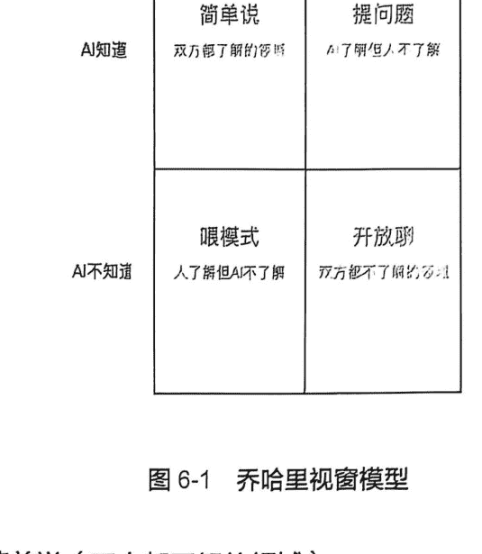

**图 6-1 乔哈里视窗模型**

### 1. 简单说（双方都了解的领域）

**特点如下。**

*   人和 AI 对该领域都比较熟悉。
*   沟通阻力小，信息传递效率高。
*   不需要额外背景，直接点明需求即可。

**沟通策略如下。**

*   用简短提示，如“生成一段代码”“概括一篇文章”。
*   直接说明需求和期望。
*   减少解释，直奔结果。

**应用场景如下。**

*   基础知识查询，如“机器学习是什么”。
*   简单数据处理，如“把下面数据转成表格”。
*   常见问题，如“如何搭建基础 Python 环境”。

**举例如下。**

请把下面这段文字压缩成三句话的概要。

这种表达简洁明了，模型能迅速理解并执行。

### 2. 提问题（AI 了解但人不了解）

**特点如下。**

*   AI 在该领域有专业储备。
*   人需要通过 AI 来学习。
*   需要解释、指导或示范。

**沟通策略如下。**

*   明确学习意图，如“请详细说明”。
*   要求给出具体案例或分步讲解。
*   通过追问深化理解。

**应用场景如下。**

*   专业知识学习，如“深度学习原理是什么”。
*   技术解析，如“神经网络如何实现”。
*   概念理解，如“区块链共识机制怎么运作”。

**举例如下。**

能否介绍卷积神经网络的工作原理并给出一个简单应用场景。

---

### 3. 喂模式（人了解但 AI 不了解）

**特点如下。**

*   人掌握行业知识，AI 缺乏背景。
*   需要补充上下文帮助理解。
*   适合定制化或行业特定任务。

**沟通策略如下。**

*   提供详细背景，如“这是我们行业的常见难题”。
*   用类比或例子辅助理解。
*   分批输入信息，逐步引导。

**适用场景如下。**

*   行业专知，如“医疗领域如何优化患者流程”。
*   个性化需求，如“基于以下数据为我的团队生成报告”。
*   创新方案，如“设计一个全新的营销活动”。

**举例如下。**

我们是一家做环保技术的初创公司，客户是地方政府和环保组织。请基于以下数据帮我们设计市场推广方案。

这种提示提供了背景和目标，便于模型对齐。

---

### 4. 开放聊（双方都不了解的领域）

**特点如下。**

*   双方都在探索未知，答案不唯一。
*   需要共同头脑风暴。
*   适合开放性或创新性任务。

**沟通策略如下。**

*   采用探索式对话，邀请头脑风暴。
*   鼓励提出多种可能性。
*   接受不确定性，多角度思考。

**适用场景如下。**

*   创新激发，如“AI 如何改善未来教育”。
*   趋势探讨，如“未来十年科技走向”。
*   开放讨论，如“如何设计全新社交平台”。

**举例如下。**

假设要做一个面向未来的教育平台，帮助学生更高效学习，请给出一些创意点子。

这种提问鼓励模型发散思考，提供多样建议。

## 6.4.2 沟通效果优化

灵活运用模型能提升沟通质量。

### 1. 准确定位象限

对话前先判断问题所属象限。

*   评估自身知识水平。
*   评估 AI 的能力边界。
*   根据特点调整提示方式。

**举例如下。**

如果你对某个技术概念完全陌生，就用“提问题”象限的策略，明确表达学习需求。

### 2. 跨象限沟通

复杂问题常涉及多个象限，可拆解处理。

*   **拆分问题：** 区分 AI 强项和需补充信息部分。
*   **分策略执行：** 已知部分直接问，未知部分给背景。
*   **保持连贯：** 确保整体逻辑通顺。

**举例如下。**

先请解释卷积神经网络的基本原理（提问题象限）。之后我会提供数据集，请你设计模型（喂模式象限）。

### 3. 动态调整策略

对话中根据反馈实时调整。

*   **观察响应质量：** 回答不理想就补充信息或改问法。
*   **调整提问方式：** 从直接问转为分步引导。
*   **补充必要信息：** 确保模型能理解。

**举例如下。**

如果回答过于笼统，可追问：“能举个具体例子吗？”

## 6.4.3 实践建议

### 1. 提升沟通效率

*   “简单说”象限保持简洁，避免冗长。
*   “提问题”象限多追问，确保理解到位。
*   “喂模式”象限注重信息输入。
*   “开放聊”象限保持开放心态。

### 2. 避免常见误区

*   **不要默认 AI 全懂：** 知识有限时需给背景。
*   **不要一口气问复杂问题：** 分步引导效果更好。
*   **不要忽略上下文：** 缺乏背景会导致偏离。

### 3. 持续优化

*   记录有效对话模式。
*   总结失败原因，避免重复。
*   形成个人最佳实践。

应用乔哈里视窗模型，能更有针对性地与 AI 协作，无论是解决常规问题还是探索未知，都能找到合适策略，让互动更顺畅。

通过本章学习，你将具备以下能力。

> (1) 多轮对话优化：设计清晰的对话链，提升执行深度与连贯性。
> (2) 提示词深度完善：优化结构，让输出更符合预期。
> (3) 提示词框架应用：灵活使用结构化框架，提升效率与质量。
> (4) 乔哈里视窗策略：基于信息分布优化协作，探索创新可能。

第 7 章将聚焦未来趋势与进阶路径，帮助你持续提升 DeepSeek 应用能力。

---

# 第 7 章 工具集成与本地部署

工具集成与本地部署是 AI 助手落地的两个关键环节。集成能让 DeepSeek 接入各类平台扩展功能，本地部署则提供定制化与数据安全保障。本章介绍其方式、特点、场景与实践。

## 7.1 工具集成的多样化选择

DeepSeek 提供多种集成方式，满足不同需求。

### 7.1.1 硅基流动

硅基流动基于云计算，提供高算力与弹性扩展，适合实时分析与高并发场景。

华为云与硅基流动联合推出满血版 DeepSeek-R1，截至本书成稿时，注册可获 2000 万 Token。

**使用说明如下。**

1.  访问地址如链接 7-1 所示。
2.  用手机号注册后登录，如图 7-1 所示。
3.  在模型广场找到 DeepSeek-R1，点击“对话”按钮，如图 7-2 所示。
4.  在文本对话界面，可与大模型交互，如图 7-3 所示。
5.  如需 API 访问，点击“API 文档”按钮查阅，如图 7-4 和图 7-5 所示。

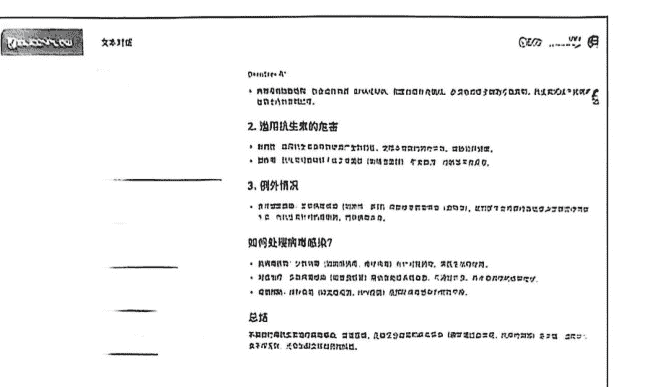

**图 7-3 硅基流动的文本对话界面**

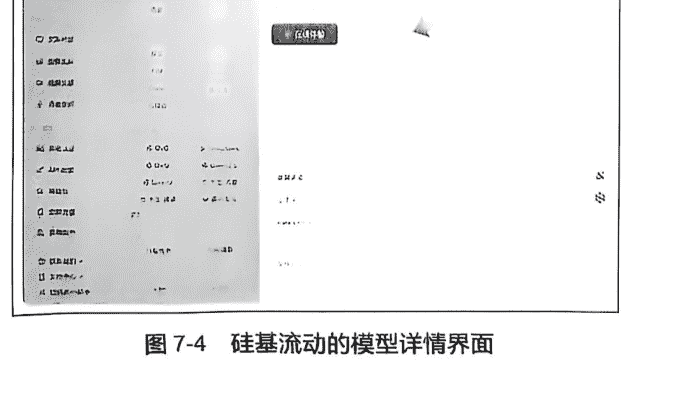

**图 7-4 硅基流动的模型详情界面**

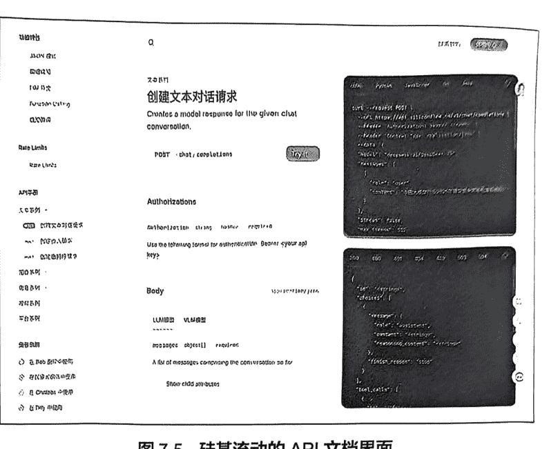

**图 7-5 硅基流动的 API 文档界面**

硅基流动优势如下。

*   **高扩展性：** 支持大规模并发请求。
*   **实时性：** 快速处理与反馈。
*   **赠送 Token：** 可通过 API 使用。

### 7.1.2 纳米 AI 搜索

纳米 AI 搜索聚焦信息检索与知识管理，适合快速获取精准信息。例如企业可快速定位内部文档或外部知识库的关键内容。

移动端接入了“免费版”和“满血版”两个 DeepSeek-R1 版本，“免费版”为蒸馏版，响应受限；“满血版”可联网搜索并解析长文本。

**使用说明如下。**

1.  在应用商店搜索“纳米 AI 搜索”安装应用。

2. 打开客户端后把底部导航切到“大模型”，各式 DeepSeek-R1 的入口便能看到，参考图 7-6、图 7-7。

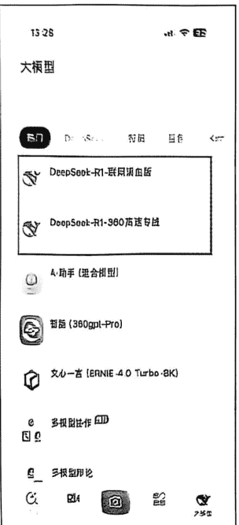

**图 7-6 纳米智能检索 App 主画面**

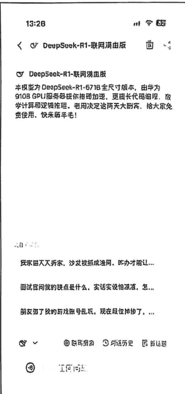

**图 7-7 纳米智能检索对话画面**

纳米智能检索的突出之处：

* 找得准：依托语义理解给出质量更高的结果。
* 手机端上手快，用着便捷。

### 7.1.3 秘塔 AI 搜索

秘塔 AI 搜索定位为多用途检索服务，支持跨端数据融合与深度语义分析，适合对多源信息整合有诉求的企业与机构。目前已接入满血版 DeepSeek-R1。

操作要点：

1. 访问链接 7-2。
2. 勾选“长思考 R1”开关，如图 7-8 所示。
3. 在检索框输入问题后启动查询，进入结果页，如图 7-9 所示。

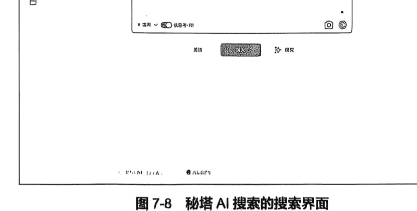

**图 7-8 秘塔智能检索主画面**

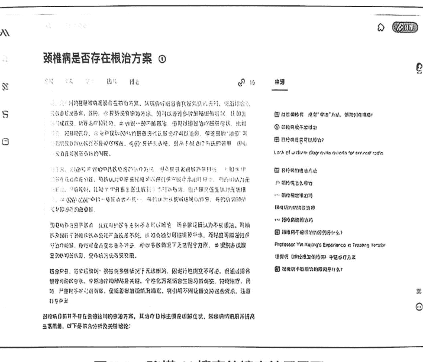

**图 7-9 秘塔智能检索结果画面**

> 秘塔智能检索的优势：
> * 整合能力强，支持多源数据同步分析。
> * 有联网检索，适合实时查问场景。

### 7.1.4 国家超算互联网

国家超算互联网借助国家级超算中心的算力，为模型训练与推理提供支撑，适用于高算力需求场景。截至成稿，平台仅开放 7B 与 32B 规格。

使用指引：

1. 打开链接 7-3，初始页见图 7-10。
2. 在初始页输入问题即可开始对话，如图 7-11 所示。


**图 7-10 国家超算互联网首屏**

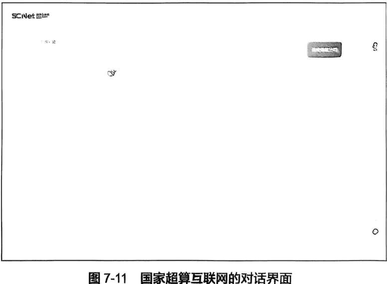

**图 7-11 国家超算互联网对话页**

平台特点：

* **算力强劲：** 可满足高计算量任务。
* **数据合规：** 符合国家级数据安全规范。

### 7.1.5 英伟达平台

英伟达平台提供强劲 GPU 算力，适配图形处理或深度学习类任务。DeepSeek 可借此加速推理与训练。平台以最新 HGX H200 服务器部署满血版 DeepSeek-R1，推理速度约 3782 Token/s。

使用方式：

1. 访问链接 7-4。
2. 直接在官网页面进行对话，如图 7-12 所示。

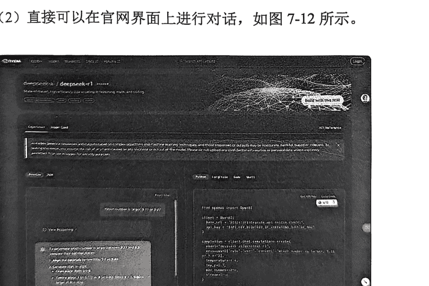

**图 7-12 英伟达平台 DeepSeek 对话页**

平台长处：

* **性能突出：** 支持大规模并行，速度极快。
* **可供 API 代码：** 能直接嵌入业务。

### 7.1.6 Poe

Poe 等服务提供灵活的工具集成方式，覆盖多场景使用。截至成稿，Poe 支持 164K Token 输入上下文、33K Token 输出，并支持 DeepSeek-R1-FW，可输出 164K Token，超过官方指标。

操作步骤：

1. 打开链接 7-5，初始页如图 7-13。
2. 在初始页选择 DeepSeek-R1 或 DeepSeek-R1-FW，即可对话，如图 7-14。


**图 7-13 Poe 初始页**

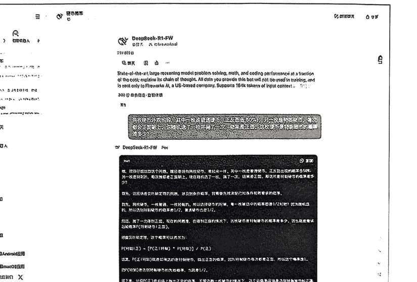

**图 7-14 Poe 对话页**

Poe 的特点：

* 支持超长上下文。
* 可切换众多平台的模型。

## 7.2 API 集成与本地部署的实践方法

对数据安全、隐私或定制化要求较高的用户，本地化部署是理想选择。DeepSeek 支持多种本地化方式，具体如下。

### 7.2.1 API 集成 DeepSeek

通过接口可快速搭建专属 AI 助手，并将 DeepSeek 嵌入现有系统。

实施流程：

1. Cherry Studio 下载见链接 7-6，下载页如图 7-15。
2. 在硅基流动中新建 API 密钥，如图 7-16 所示。
3. 启动 Cherry Studio，填入密钥，连接成功后即可使用。
4. 点击“助手”，在弹窗中切换为 DeepSeek-R1 开始对话，如图 7-18。


**图 7-15 Cherry Studio 下载页**

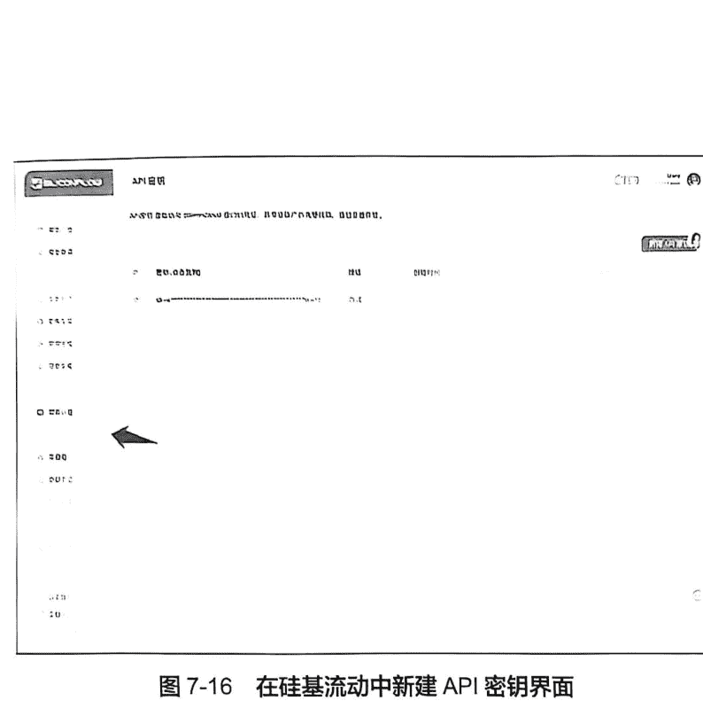

**图 7-16 硅基流动新建密钥页**

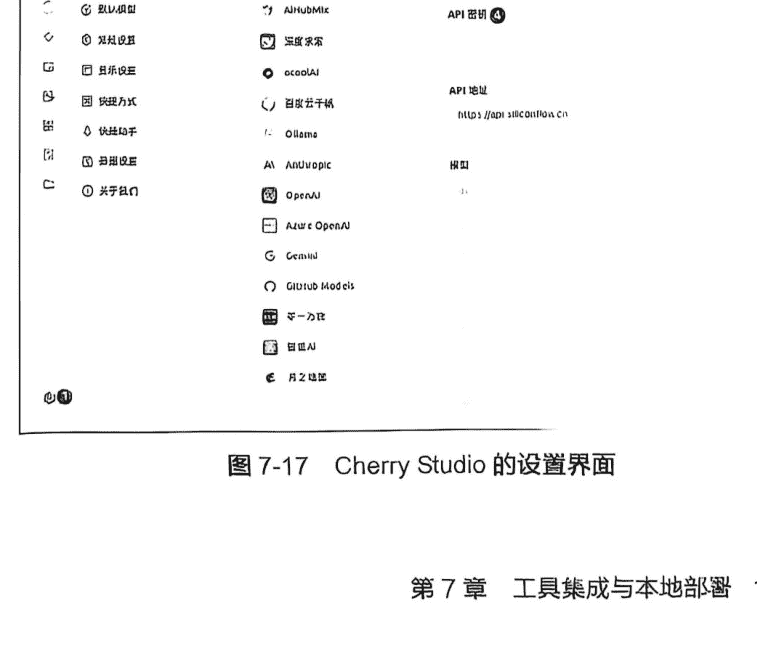

**图 7-17 Cherry Studio 设置页**

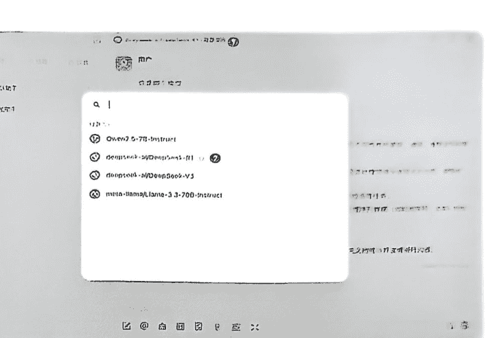

**图 7-18 Cherry Studio 模型切换页**

接口集成的优点：

* 通过接口调用，不受网页稳定性影响。
* 可灵活切换不同模型并保留上下文。

### 7.2.2 Ollama 部署

Ollama 是一款轻量级本地 AI 运行工具，可实现本地快速搭建与交互。

操作步骤：

1. Ollama 下载地址为链接 7-8，下载页如图 7-19。
2. 依据机器配置选择合适的版本，见表 7-1。

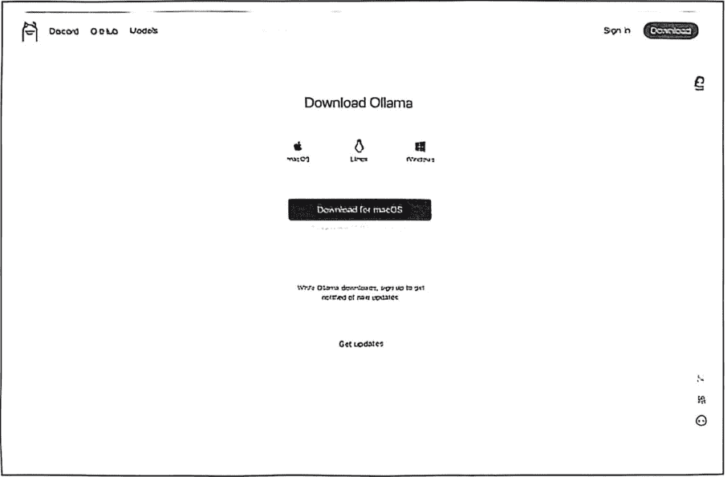

**图 7-19 Ollama 下载页**

**表 7-1 部署 DeepSeek 不同版本的配置要求**

| 模型名称 | 参数量 | 量化后显存 4-bit | 推荐 GPU | 推荐系统内存 |
|:---|:---:|:---:|:---:|:---:|
| DeepSeek-R1-Distill-Qwen-1.5B | 1.5B | 约 1GB | RTX 3060 6GB | 16GB |
| DeepSeek-R1-Distill-Qwen-7B | 7B | 约 4.5GB | RTX 4070 12GB | 24GB |
| DeepSeek-R1-Distill-Llama-8B | 8B | 约 3.7GB | RTX 3070 8GB 及以上 | 24GB |
| DeepSeek-R1-Distill-Qwen-14B | 14B | 约 6.5GB | RTX 4090 24GB | 32GB |
| DeepSeek-R1-Distill-Qwen-32B | 32B | 约 16GB | A100 40GB 及以上 | 64GB |
| DeepSeek-R1-Distill-Llama-70B | 70B | 约 35GB | A100 80GB | 128GB |
| DeepSeek-R1 | 671B | 约 175GB | 多卡 H100/A100 | 1TB 及以上 |

3. 在系统命令行执行对应指令，如图 7-20。

```Bash
ollama run deepseek-r1:1.5b
```

4. 打开 Cherry Studio 设置页，选择 Ollama 对应模型并测试连通性，如图 7-21。

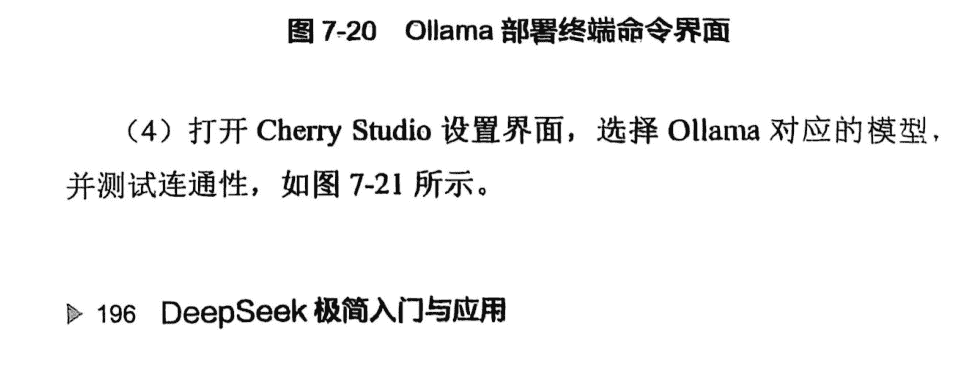

**图 7-20 命令行运行 Ollama 指令**


**图 7-18 Cherry Studio 模型切换页**

**图 7-21 Cherry Studio 设置 Ollama 模型**

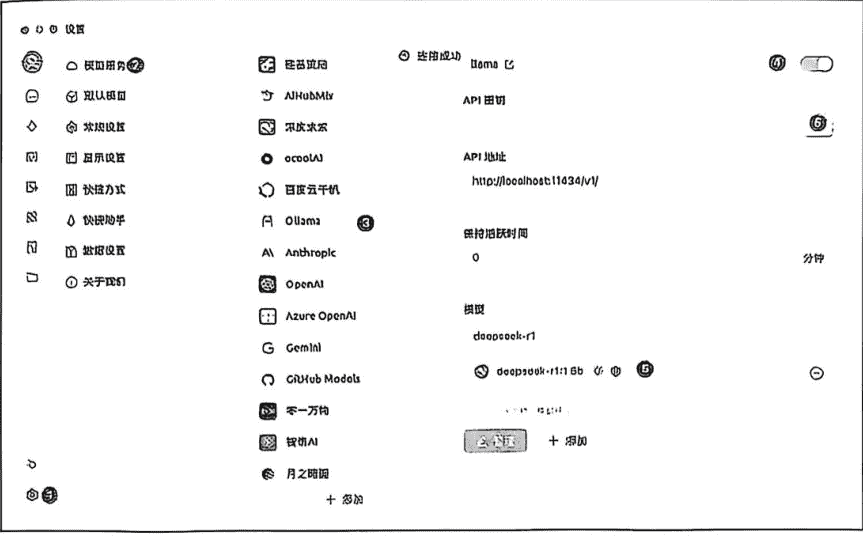

## 图 7-22 Cherry Studio 对话页模型切换
5. 切换到 Ollama 部署的模型即可开始对话，如图 7-22。

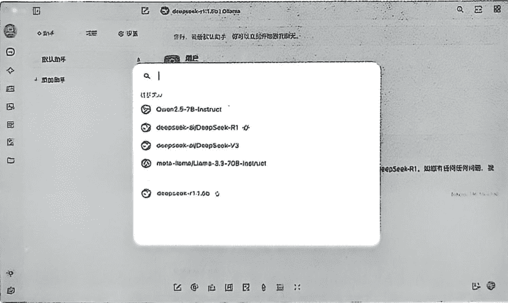

### 7.2.3 LM Studio 部署

LM Studio 是一个功能全面的本地化 AI 运行平台，支持模型训练、推理与知识库管理。

实施步骤：

(1) LM Studio 下载地址为链接 7-9，下载页如图 7-23。

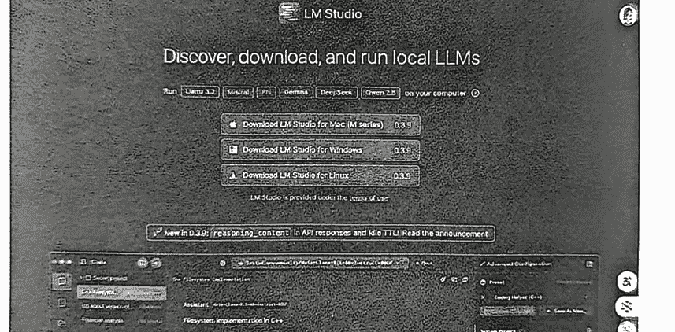

图 7-23 LM Studio 下载页

(2) 打开 LM Studio，在搜索页检索 DeepSeek 对应模型并下载，如图 7-24。


图 7-24 LM Studio 搜索页

(3) 进入已下载模型即可对话，如图 7-25。


图 7-25 LM Studio 对话页模型选择

## 第 7 章 工具集成与本地部署

## 7.3 工具集成与本地部署的对比分析

工具集成与本地部署各有优劣，选择时需结合场景、技术能力、预算与长期需求。本节从多维度对比并结合案例说明适用性。

### 7.3.1 数据安全性

工具集成的特点及案例：
优点：多以云平台为依托，具备加密、访问控制与实时监控等防护，对普通企业和个人已足够。
缺点：数据托管于第三方服务器，仍存泄露或滥用风险，敏感数据场景风险更高。
案例：某中小企业集成秘塔智能检索管理客户数据，效率提升但客户对云端隐私存疑。

本地部署的特点及案例：
优点：数据存于企业或个人私有服务器，自行掌控访问与使用，适合政府、金融、医疗等高隐私行业。
缺点：需自行配置防火墙、加密等措施，技术门槛高，配置不当易出现安全漏洞。
案例：某医院以 LM Studio 本地化部署患者数据系统，确保医疗数据仅在内网流转，满足合规要求。

若数据隐私为首要考量，建议本地部署；一般数据处理云集成的安全性已可满足。

### 7.3.2 性能与计算能力

工具集成的特点及案例：
优点：依托云平台强算力，如国家超算互联网、英伟达平台，可轻松处理大规模数据和高并发，性能稳定可扩展。
缺点：依赖网络，网络中断或带宽不足会影响表现；实时性要求极高的任务云端延迟可能成瓶颈。
案例：某在线教育平台用纳米智能检索实时分析学生数据生成个性化建议，高峰期偶现响应延迟。

本地部署的特点及案例：
优点：性能由本地硬件决定，可通过升级硬件提升且无网络延迟，适合实时场景。
缺点：硬件成本高昂，需高性能服务器或 GPU 集群，扩展性有限。
案例：某制造企业本地部署英伟达 GPU 加速器，实现工业仿真实时计算，避免云端延迟。

高并发场景工具集成更具优势，实时性要求高则本地部署更优。

### 7.3.3 成本

工具集成的特点及案例：
优点：多为按需付费，无需一次性投入硬件或基建，适合预算有限的中小企业和个人。
缺点：长期使用费用累积，数据量大或接口调用频繁时成本上升。
案例：某初创公司用 Poe 平台搭建智能客服，初期投入低，随用户增长接口成本逐步升高。

本地部署的特点及案例：
优点：初期投入高，后续运行成本相对固定，适合长期需求明确的用户。
缺点：硬件采购、维护、电力等成本负担重，对小型组织不友好。
案例：某高校用 LM Studio 部署科研数据系统，初期投入大但长期运行成本低于云方案。

短期项目或预算有限选工具集成，长期稳定需求本地部署可能更经济。

### 7.3.4 用户体验

工具集成的特点及案例：
优点：由专业团队维护，无需关注底层细节，使用流畅；可视化界面和接口文档友好。
缺点：定制性弱，需在平台限制内使用，难满足个性化需求。
案例：某电商企业用 AskManyAI 快速部署聊天机器人，解决大部分咨询，但特殊场景无法完全满足。

本地部署的特点及案例：
优点：灵活性高，可按需深度定制功能模块或优化算法。
缺点：部署维护技术要求高，开发周期可能较长。
案例：某科研团队以 Ollama + PageAssist 插件部署，深度定制知识库检索，满足跨学科查询需求。

追求快速上手选工具集成，需深度定制选本地部署。

### 7.3.5 扩展性与可持续性

工具集成的特点及案例：
优点：云平台通常支持动态扩展，可随需求增加算力或存储，适应业务增长。
缺点：扩展受平台技术架构或商业策略限制。
案例：某 SaaS 公司借助国家超算互联网快速扩展业务，但受平台限制无法接入部分第三方数据源。

本地化部署的核心特质与实战观察

自建环境最大的优势在于决策权完全在手。团队可以按自己的节奏增配算力硬件或对代码做优化，把系统表现逐步拉高，这种方式很适合对未来演进路径有清晰预判的组织。对应的短板也很明显：扩容往往意味着较重的技术投入，硬件换代的费用也不低。实践中，一家金融机构采用本地化方式做渐进式扩容，却因为设备更新周期偏长而拉慢了整体节奏。

总体判断是：当业务需求波动快、迭代频率高时，借助外部工具集成能更快响应；当业务需要长期稳定运行且对演进可控性要求高时，自建环境的可持续性更突出。

### 7.3.6 综合对比一览
将工具集成与自建部署在多个维度并排呈现，对应表 7-2 的要点。

**表 7-2 工具集成与本地部署的对比**

| 维度 | 工具集成 | 本地部署 |
| :--- | :--- | :--- |
| 数据安全性 | 资料由云服务商托管，隐私可控性相对受限 | 资料完全自管，更契合高敏感业务场景 |
| 性能 | 受云平台制约，整体平稳但易受网络波动影响 | 表现取决于本地设备，基本不受网络延迟干扰 |
| 成本 | 启动门槛低，前期花费小，后期支出易累积 | 前期投入高，后续使用更经济 |
| 用户体验 | 操作直观，无需关心底层实现 | 可深度自定，但技术门槛相应提升 |
| 扩展性 | 弹性伸缩快，却受平台规则约束 | 扩张方向由自身主导，硬件升级成本偏高 |
| 适用场景 | 短期任务、追求快速上线 | 长期规划、需要高度定制化的场景 |

综合来看，选择逻辑很清晰。初创或中小团队若想以低成本快速验证，工具集成更合适；当对隐私保护、运行表现和定制深度要求较高时，自建部署更稳妥。

## 7.4 本章小结
读完本章可以带走三点。

+ （1）厘清 DeepSeek 的工具集成形态及其适用情境。
+ （2）掌握自建部署的实践思路，满足深度定制与数据可控的需求。
+ （3）结合自身实际权衡集成或自建，让 DeepSeek 的价值最大化。

下一章将讨论 DeepSeek 可能的演进方向，以及它在更多领域里的进阶用法。

## 第 8 章 DeepSeek 未来演进与进阶打法
人工智能的加速演进正在重塑生产与生活方式，DeepSeek 正是这场变革的重要推手。从技术路线到落地场景，从行业融合到社会效应，DeepSeek 早已不止是一个工具，更成为未来社会的重要组成。本章围绕其特质，梳理技术演进、场景扩展与社会意义，帮助读者建立对智能助手的完整认知。

### 8.1 技术演进与能力跃迁
与 DeepSeek 同类的智能系统，未来很可能聚焦三大主线：多模态处理更强、定制支持更细、自主学习更成熟。

#### 8.1.1 多模态处理持续增强
多模态是智能助手进化的核心。DeepSeek 以融合多种信息为基础，能同时解析文字、图像、语音等输入，给出更立体、更智能的回应。

比如用户上传一张商品图，系统不仅能识别画面内容，还能结合上下文给出分析报告。这种能力还能跨任务联动，例如用户用语音说“把这段视频要点提炼成文档”，系统就能并行处理语音、视频与文字，最后交付符合预期的文件。

未来值得期待的延伸方向有：
(1) 文字与图像互生：依据图像生成描述，或由文字生成高质量图像。
(2) 语音驱动复杂操作：直接用语音触发会议记录、实时翻译等任务。
(3) 跨模态推理：在医疗场景中，从影像资料提取关键指标并给出诊断提示。

典型例子：
(1) 智能文档处理：用户上传含手写文字的图片，系统自动转成可编辑文本并同步产出分析。
(2) 教育协同：在课堂中把语音讲解与可视化内容结合，打造沉浸式学习体验。

#### 8.1.2 定制化支持
随需求分化，DeepSeek 的因人而异能力会提供更贴合个人的服务。

主要体现在：
(1) 使用习惯学习：系统会记录常用功能，在恰当时机主动推荐，提升交互流畅度。
(2) 领域专用模型：面向医疗、金融、教育等行业加载专属知识库，实现专业化服务。例如医疗领域可按医生需求生成定制化诊疗建议。
(3) 提示词优化：使用者通过精细的提示词设计释放模型潜力。内容创作者便可要求生成特定风格的文章，如幽默或学术体。

应用方向包括：
+ （1）行业方案：在医疗中分析病历并给出诊断参考；在教育中据学生进度生成专属学习计划。
+ （2）创作者赋能：提供定制化写作风格，输出幽默、正式或学术文本。

#### 8.1.3 自主学习能力
自主学习是未来发展的重要支点。借助交互数据与积累，系统会持续优化表现。

能力体现为：
+ （1）持续优化：分析用户反馈并自动调整参数，提升回答质量。若用户多次纠正，系统会学习正确处理方式。
+ （2）无监督学习：从非结构化数据中挖掘隐含规律，帮助用户发现潜在问题或趋势。例如在企业数据中找出销量下滑的根因。
+ （3）专属化演进：依据不同用户的偏好动态调整功能与交互风格，如按语言习惯调整回应语调。

实践案例：
(1) 企业运营优化：从历史数据中提炼规律，辅助管理者改进流程。
(2) 专属化推荐：在电商平台中依据行为数据自动优化推荐策略，提升转化。

### 8.2 场景拓展与行业融合
DeepSeek 的使用边界正从基础任务执行向更广更深的领域延伸，尤其在智慧办公、创意产业、行业智能化及新兴商业模式中表现突出。

#### 8.2.1 智慧办公
在智慧办公领域，DeepSeek 通过智能化工具显著提升效率。

日常工作中可完成文档生成到任务管理的多项操作。例如提交长报告后，系统能快速提炼要点生成摘要，节省时间。会议场景中可实时记录内容并按讨论要点整理成结构化纪要。

未来应用有望进一步扩展。
(1) 跨部门协作：整合多部门数据生成综合方案。例如在产品开发会上，依据研发、市场、销售的讨论形成统一行动计划。
(2) 决策支持：结合历史数据与实时动态为管理者提供建议，如预测业务风险并提出应对策略。

典型案例：
(1) 自动化报告：提交多份数据文件后自动生成综合报告，包含分析、可视化图表及结论。
(2) 智能日程管理：按优先级安排日程并提醒重要事项。
(3) 实时数据监控：提供销售额、库存等实时更新，并据变化提出优化建议。

#### 8.2.2 创意产业
在创意领域，DeepSeek 既是助手也是灵感来源。

设计师可用简短指令生成草图或优化方案；影视制作中可据剧本给出场景设计建议，甚至生成特定风格的概念图。

未来可能包括：
(1) 动态内容生成：按用户描述生成动画或视频素材。
(2) 音乐创作支持：依据情绪或主题生成特定风格音乐片段。
(3) 市场营销工具：按目标受众特点生成广告文案、社媒内容及视觉设计。

实际案例：
（1）智能文案：输入产品关键词后自动生成多种风格广告文案，如幽默或情感诉求。
（2）创意激发：描述需求后提供多种新颖方案，如为电影设计多个结局。
（3）艺术创作工具：把用户草图扩展为完整作品，或提供风格化建议。

#### 8.2.3 行业智能化与新兴商业模式
DeepSeek 的能力正推动行业智能化，并催生新商业模式。

（1）医疗健康：通过分析病历与影像生成诊断建议，或为健康管理提供专属化饮食运动方案。
效率提升并降低成本。例如分析生产数据找出瓶颈并提出改进建议。

实际案例：
（1）医疗：协助医生解读影像并生成报告及治疗思路。
（2）金融：为投资者生成专属组合建议并实时跟踪市场。
（3）教育：按学习进度生成复习计划并提供即时答疑。

### 8.3 社会效应与未来展望
随着智能助手的普及，DeepSeek 在技术之外也在经济、文化、伦理层面产生深远影响。

#### 8.3.1 对个人生活的影响
应用已从单一任务处理扩展到生活各方面。

（1）效率提升：自动化处理日程安排、文档撰写、健康计划等，让人们把时间投入创造或休闲。
案例：某企业高管借助 DeepSeek 自动整理邮件与纪要，每天节省约两小时。
（2）专属化服务：学习行为习惯后提供定制服务，如按阅读偏好推荐文章或按健康数据调整饮食建议。
案例：健身爱好者通过系统记录运动数据并获得实时训练优化建议。
(3) 生活便利性：语音交互与自然语言处理使其成为理想个人助理，例如语音控制智能家居或获取天气交通信息。
案例：忙碌母亲用语音指令安排孩子课外活动并启动智能家电烹饪。

#### 8.3.2 对社会结构的影响
普及也在宏观层面重塑社会结构。

##### 1. 就业市场的变化
替代传统岗位：自动化可能取代部分重复性低技术岗位，如客服、数据录入。
创造新兴职业：同时催生提示词工程师、AI 模型训练师、数据标注专家等新角色。
案例：某企业引入 DeepSeek 后客服团队从20人降至5人，但新增提示词优化与模型管理岗位。

##### 2. 教育与技能提升
DeepSeek 可帮助成员快速学习新技能，适应技术变革。例如通过专属化学习计划高效掌握新领域知识。
##### 3. 社会公平性与伦理挑战
公平性问题：算法可能存在偏见，导致部分群体受不公正对待，如招聘中出现性别或种族歧视。
伦理问题：如何保证决策透明公正，如何防止被用于生成虚假信息等，需要技术与政策共同回应。

#### 8.3.3 对文化与价值观的影响
## 1. 文化传播与多样性
在跨语言翻译与内容生成中发挥作用，促进不同文化交流。但需警惕 AI 生成带来的文化同质化风险。
## 2. 价值观的重塑
智能助手普及后，人类对工作的定义或转向“以创造与生活质量为中心”。
案例：传统行业从业者因工作负担减轻，更有时间投入艺术创作与社区服务。

# 8.3.4 面向未来的展望
### 1. 技术普及化
未来智能助手将更广泛普及，门槛不断降低，让更多人受益。
### 2. 人机协作的深化
DeepSeek 不仅是工具，更是合作伙伴。人机协同或成常态，如医生与 AI 共诊、教师与 AI 共教。
### 3. 社会政策的完善
为应对普及挑战，需建立完善框架，如数据隐私保护、AI 伦理规范等。

# 8.4 深入学习与进阶路径
为帮助读者更深入掌握 DeepSeek 与人工智能技术，本节从理论、实践与职业发展三方面提供进阶建议。

## 8.4.1 理论学习
### 1. 学习基础理论
(1) 人工智能基础：推荐《人工智能：一种现代的方法》，系统了解基本概念与原理。
(2) 深度学习理论：推荐《深度学习》，深入神经网络与优化算法。
### 2. 学习相关领域知识
(1) 自然语言处理：掌握词向量、Transformer 等核心技术，可学习 Coursera 的“Natural Language Processing Specialization”。
(2) 多模态学习：了解如何融合文本、图像、语音等多源数据建模。

## 8.4.2 实践提升
- **参与开源项目**
在 GitHub 寻找类似 DeepSeek 的开源项目如 LLaMA3，通过实战掌握技术。
案例：某开发者参与 HuggingFace 社区项目，开发出多语言翻译工具。
- **数据集训练**
使用公开数据集训练模型，如 ImageNet、COCO、SQuAD 等。
案例：研究生用 SQuAD 数据集训练问答模型并发表论文。
- **参加竞赛**
参与 Kaggle、天池等平台竞赛，通过解决真实问题提升技能。
案例：团队在 Kaggle 医疗影像分类赛中积累行业经验。

## 8.4.3 职业发展建议
### 1. 新兴职业方向
(1) **提示词工程师**：设计高效提示词以激发模型潜力。
(2) **AI 应用场景设计师**：规划 AI 在医疗、教育等场景的落地方案。
(3) **数据科学家**：负责数据采集、清洗、分析与建模，为系统提供支撑。
### 2. 职业规划建议
(1) 制定明确学习计划，如每月完成专业书籍或在线课程。
(2) 积极参与行业会议与技术论坛，了解动态。
(3) 积累项目经验，自主开发应用或参与企业级项目。

## 8.4.4 长期学习策略
保持学习热情：技术迭代快，需持续跟进。
关注行业动态：定期阅读报告与论文，掌握前沿趋势。
培养跨学科能力：AI 与医疗、教育等领域的结合是未来方向。

# 8.5 本章小结
本章学习后，读者可获得：

- (1) 深入理解 DeepSeek 的社会影响及其机遇与挑战。
- (2) 掌握从基础理论到实践应用再到职业发展的完整成长路径。
- (3) 展望 DeepSeek 在个人、行业与社会层面的未来潜能与价值。

至此，全书内容告一段落。希望本书能帮助读者更好地理解与应用 DeepSeek，在 AI 时代抓住更多发展机会。无论个人提升还是行业创新，DeepSeek 都将成为推动未来发展的重要力量，愿每位读者都能在 AI 浪潮中找到属于自己的方向。