# Excel+AI在会计与财务日常工作中的应用

### 内容简介

本书是一本教读者应用Excel辅助做好日常会计与财务工作的初级财务用书；同时，本书引入AI工具DeepSeek，辅助进行Excel数据处理、数据分析及数据计算，能够为读者提供个性化的解答和建议，从而有效降低学习难度。

本书具体内容包括财务数据的输入与编辑、财务数据的整理与分析、财务数据计算的函数公式、财务部门日常工作实用表单、公司办公费用支出管理、填制记账凭证并自动登记日记账、管理往来账款并处理账务、管理进销存数据并处理账务、管理分析员工工资数据并处理账务、管理固定资产并计提折旧、月末账务处理并建立财务总账表、编制财务报表、财务分析。

本书赠送了书中案例的教学视频、源文件和PPT课件，读者可扫描书中二维码及封底的“文泉云盘”二维码，在线观看学习并下载素材。

本书面向需要提高Excel应用水平的财务人员，非常适合初涉职场或即将进入职场的读者学习，也可作为高校相关专业的参考教材。

### 作者简介

#### 赛贝尔资讯

云集了微软Office MVP办公专家、电商培训专家、平面设计专家、电脑技术专家等，长期从事行政管理、HR管理、营销管理、市场分析和财务管理，专注于高校大学生就业培训与公司职场技能培训，以及相关的图书策划和编写工作。

## 前言

### PREFACE

首先，感谢您选择并阅读本书!

Excel是一款功能强大的数据处理软件，广泛应用于各类企业的日常办公中，也是目前应用最广泛的数据处理软件之一。Excel不仅具有强大的制表和绘图功能，还内置了数学、财务、统计和工程等多种函数，因此具有强大的数据处理能力和统计分析能力。在财务工作中，灵活并熟练地应用Excel是财务工作者应具备的能力。

然而，许多初学者和经验不足的从业者在使用Excel中的数据处理、数据分析、函数统计等操作方法时，往往面临不会用、嫌烦琐、记不住等众多困扰。进入AI时代之后，这些问题也有了一些新的解决办法。在编写本书时，我们借助了AI大模型领域的焦点DeepSeek的力量来辅助Excel的应用。通过在DeepSeek中随时提问、获得解答和个性化建议，尤其在函数公式的应用方面，有了DeepSeek这个强大而智能的工具，可以在很大程度上帮助读者解决各种Excel在会计与财务日常工作中的操作方法和财务数据计算方面的问题。

### 本书特点

**内容详尽：** 本书详细介绍了Excel在财务管理中的具体应用和操作技巧，包含Excel基本操作、财务管理中常用的函数与公式以及各类账表的制作等，内容系统详尽且深入。

**知识点扩展：** 本书在内容讲解的过程中，添加了知识扩展、专家提示等，能让读者及时巩固知识点并举一反三。

**AI赋能：** AI时代，DeepSeek作为一个强大而智能的“超级助手”，具有极广泛的应用场景。本书主要带领读者学习如何使用DeepSeek来简化Excel中的数据处理、数据分析及数据计算操作，降低学习难度，提升读者对Excel软件的应用效率。这也是本书的最大亮点之一。

**视频讲解：** 本书录制了195集教学视频（近17个小时），包含使用Excel进行财务管理过程中常用的操作功能讲解及实例分析，用手机扫描书中二维码，可以随时随地观看视频。

**PPT课件：** 如果您是高校相关专业的老师，我们还专门为您精心制作了PPT课件，扫描下方的“文泉云盘”二维码即可下载。


### 本书读者对象

本书面向需要提高Excel应用水平的财务人员，也非常适合初涉职场或即将进入职场的读者学习，以提升计算机办公应用技能。

由于作者水平有限，书中难免有疏漏之处，恳请广大读者批评指正。读者可扫描上方“文泉云盘”二维码获取作者联系方式，与我们交流、沟通。

编者
2025年8月

## 绪论 DeepSeek赋能


扫码看教学视频

AI是人工智能（Artificial Intelligence）的缩写，它是一种模拟人类智能的技术，使机器能够像人一样学习、思考，能够处理语言、音频、图像、视频等各种信息，从而能够自主地执行各种任务。

AI技术开发的应用程序涵盖了多个领域，包括但不限于对话聊天、办公软件、视频工具、音频工具、写作工具、设计工具、图像工具等。例如由杭州深度求索人工智能基础技术研究有限公司开发的AI模型工具DeepSeek、OpenAI开发的AI对话工具ChatGPT、高质量AI幻灯片生成工具Decktopus AI、AI真人口播视频生成工具D-ID、网易推出的AI音乐创作平台网易天音、AI文字内容创作工具Jasper等。

这里我们主要来说一说基于AI技术开发的多功能智能助手—DeepSeek。DeepSeek是一款功能强大的AI模型，其功能和特点可以归纳如下：

1. 自然语言处理与理解

DeepSeek能够进行高质量的自然语言交互，快速响应用户需求。无论是科学知识、历史事实，还是日常生活常识，DeepSeek都能给出相对准确的答案。

2. 逻辑推理与问题解决

具备强大的逻辑推理能力，能处理复杂的查询和任务，提供相对准确的答案和解决方案。在解答数学难题或者逻辑谜题时，DeepSeek不仅能给出答案，还能逐步解释解题过程。

3. 文本分析与生成

能进行高质量的文本分析、翻译、摘要生成等任务。无论是撰写文章、报告，还是进行创意写作，DeepSeek都能生成流畅、自然的文本，并提供新颖的思路和独特的观点。

4. 个性化推荐

能根据用户行为和偏好，提供个性化内容推荐，提升用户满意度和参与度。

5. 大数据分析

能高效处理和分析大规模数据，挖掘数据中的模式和趋势，支持数据驱动的决策。

6. 多模态数据融合与学习（未来展望）

支持文本、图像、语音等多种模态的数据融合和学习，未来版本有望实现更丰富且全面的理解和推理（当前版本主要支持文本信息）。

鉴于以上的分析情况，当我们在使用Excel进行数据计算与处理时，可以借助AI来赋能，实现简化数据的处理过程，提高工作效率。

### 0.1 注册DeepSeek并登录账号

启动浏览器，访问DeepSeek的官方网址，在首页找到登录入口，如图0-1所示的界面。


图0-1

单击“开始对话”，按提示登录成功后，系统会自动跳转到DeepSeek的主界面。主界面包括功能导航栏、输入框和结果显示区，如图0-2所示。


图0-2

### 0.2 开始使用DeepSeek

将光标定位到输入框中，组织好提问文字（如图0-3所示），单击图0-3中的 ●按钮发送，DeepSeek将回答你的问题，如图0-4所示。

deepseek

开启新对话

我是 DeepSeek，很高兴见到你！

我可以帮你写代码、读文件、写作各种创意内容，请把你的任务交给我吧~

请给我几个春节主题的名家名篇的经典开头。

暂无历史对话

深度思考 (R1)

联网搜索

下载 App NEW

个人信息

图0-3


图0-4

遇到问题时，也可以直接发问（如图0-5所示），查询解决方案，可以看到DeepSeek提供了多种解决方案，如图0-6所示。


图0-5

当复制数据到别处时，公式计算结果显示错误值，通常是因为公式引用的单元格或数据源发生了变化。以下是解决方法：

1. 检查公式引用
   - 相对引用：公式中的单元格引用可能随位置变化。复制后，引用可能指向错误位置。
   - 绝对引用：使用 $ 符号锁定引用（如 $A$1），确保公式引用固定单元格。
2. 复制公式
   - 如果公式需要在新位置使用，直接复制公式而非结果，确保公式引用正确。
3. 粘贴为数值
   - 如果只需结果，复制后选择“粘贴为数值”，避免公式引用问题。
4. 检查外部链接
   - 如果公式引用其他工作簿或外部数据，确保链接正确且数据源可用。
5. 检查数据格式
   - 确保公式引用的单元格格式正确，如文本格式可能导致计算错误。
6. 重新输入公式
   - 如果问题持续，尝试在新位置重新输入公式。
7. 使用“错误检查”功能

图0-6

还可以以口语化的方式提问，如“我是小白……”“我想要更简单的说明”等，如图0-7所示。

我是新手小白，想根据工作中的需求让DeepSeek给我生成函数公式，我该怎么描述才能更加精准？

为了确保DeepSeek能生成符合你需求的函数公式，你可以按照以下步骤描述你的需求：

1. 明确目标
   - 具体任务：清楚说明你想通过函数完成什么任务，如“计算平均值”或“筛选数据”。
   - 输入和输出：描述输入数据的格式和期望的输出结果。
2. 提供背景信息
   - 数据类型：说明数据的类型（如数字、文本、日期等）。
   - 数据结构：描述数据的组织形式（如Excel表格、数据库表等）。
3. 详细描述需求
   - 具体条件：列出函数需要满足的条件或规则，如“忽略空值”或“只计算大于100的值”。
   - 特殊情况：说明可能遇到的特殊情况及处理方式。
4. 示例数据
   - 输入示例：提供输入数据的示例。
   - 输出示例：提供期望的输出结果示例。
5. 使用环境
   - 工具或软件：说明你将使用的工具（如Excel、Python、SQL等）。
   - 版本信息：如果相关，提供软件版本信息。

图0-7

##### 专家提醒

DeepSeek在回答问题时具有随机性，针对同一个问题，在不同的时间或情况下，用户可能会得到不同的答案。这是因为DeepSeek是基于语言模型及当前知识水平和上下文的信息，这些因素都会影响最后回答的结果。因此，在无法控制DeepSeek回答结果的情况下，只能通过尽量提供准确的提问关键词或分段式提问等方式，逐渐培养和提高DeepSeek的准确性。

### 0.3 掌握DeepSeek中正确的提问技巧

我们都知道DeepSeek是一种基于人工智能技术的语言模型，它可以通过自然语言交互方式与用户进行沟通，从而为用户提供服务。因此能否精准地进行提问，是DeepSeek能否给出正确回复的关键。下面讲解几个提问技巧，从而让提问更加高效精准。

#### 1. 清晰具体的指示

例如“使用VBA代码，将Excel工作簿中……”（如图0-8所示）、“想写一个公式，在Excel工作表中求解……”“撰写……文章，字数控制在500字以内”，能确定的信息就尽量描述清楚，避免模糊不清。


图0-8

下面举一个例子。例如想让DeepSeek将分散的文本数据整理成表格，将数据直接录入或复制到聊天对话框中（如图0-9所示），按按钮发送，得到的回复如图0-10所示。

| 日期 | 部门 | 物品 | 类型 | 数量 | 负责人 |
|---|---|---|---|---|---|
| 23-4-1 | 市场部 | 幻彩复印墨盒 | 易耗品 | 2 | 徐文停 |
| 23-4-4 | 行政部 | 牛皮文件袋 | 易耗品 | 4 | 胡丽丽 |
| 23-4-4 | 市场部 | 手电筒 | 耐用品 | 1 | 潘鹏 |
| 23-4-8 | 市场部 | 工程卷尺 | 耐用品 | 3 | 潘鹏 |
| 23-4-8 | 客服部 | 耳机 | 易耗品 | 4 | 孙婷 |
| 23-4-11 | 市场部 | 工业强力风扇 | 耐用品 | 2 | 徐春宇 |
| 23-4-12 | 人资部 | 计算器 | 易耗品 | 4 | 桂湄 |
| 23-4-12 | 人资部 | 插座 | 易耗品 | 2 | 桂湄 |
| 23-4-15 | 行政部 | 海绵胶 | 易耗品 | 2 | 胡丽丽 |
| 23-4-19 | 行政部 | 人字梯 | 耐用品 | 1 | 胡丽丽 |
| 23-4-19 | 行政部 | 大订书机 | 耐用品 | 1 | 胡丽丽 |
| 23-4-23 | 人资部 | 可折叠文件夹 | 易耗品 | 5 | 桂湄 |

图0-9

根据你提供的数据，看起来是一个采购或物品领用的记录表，包含日期、部门、物品名称、物品类型、数量和负责人等信息。如果你需要对这些数据进行分析或处理，以下是几种常见的需求和对应的解决方法：

##### 1. 按部门统计物品数量

如果你需要按部门统计物品的总数量，可以使用Excel的**数据透视表**或 **SUMIF** 函数。

**方法1：数据透视表**

1. 选中数据区域，点击 **插入** > **数据透视表**。
2. 将“部门”字段拖到**行区域**，将“数量”字段拖到**值区域**，并设置为“求和”。

**方法2：SUMIF 函数**

假设数据在A1:F13范围内，可以在新单元格中输入以下公式：

```
excel
=SUMIF(B:B, "市场部", E:E)
```

将“市场部”替换为其他部门名称即可统计对应部门的总数量。

##### 2. 按物品类型统计数量

如果需要按“易耗品”和“耐用品”分类统计数量，可以使用数据透视表或 **SUMIF** 函数。

**方法1：数据透视表**

1. 选中数据区域，点击 **插入** > **数据透视表**。
2. 将“物品类型”字段拖到**行区域**，将“数量”字段拖到**值区域**，并设置为“求和”。


由于在提问时并未给出清晰的指示，DeepSeek无法确定需要执行的具体任务，因此回复中没有生成表格。DeepSeek会推测我们可能是需要对这些数据进行分析，并给了一些分析方案。这时我们需要调整提问的方式，发出更加精准的指令。输入“将这个资料整理成表格，表头分别为：领用日期、部门、领用物品、物品性质、数量、领取人”（如图0-11所示），继续发送提问。这时得到如图0-12所示的表格。

将这个资料整理成表格，表头分别为：领用日期、部门、领用物品、物品性质、数量、领取人

图0-11

以下是将你提供的资料整理成表格的形式，表头分别为：领用日期、部门、领用物品、物品性质、数量、领取人：

| 领用日期 | 部门 | 领用物品 | 物品性质 | 数量 | 领取人 |
| :--- | :--- | :--- | :--- | :--- | :--- |
| 23-4-1 | 市场部 | 幻彩复印墨盒 | 易耗品 | 2 | 徐文停 |
| 23-4-4 | 行政部 | 牛皮文件袋 | 易耗品 | 4 | 胡丽丽 |
| 23-4-4 | 市场部 | 手电筒 | 耐用品 | 1 | 潘鹏 |
| 23-4-8 | 市场部 | 工程卷尺 | 耐用品 | 3 | 潘鹏 |
| 23-4-8 | 客服部 | 耳机 | 易耗品 | 4 | 孙婷 |
| 23-4-11 | 市场部 | 工业强力风扇 | 耐用品 | 2 | 徐春宇 |
| 23-4-12 | 人资部 | 计算器 | 易耗品 | 4 | 桂湄 |
| 23-4-12 | 人资部 | 插座 | 易耗品 | 2 | 桂湄 |
| 23-4-15 | 行政部 | 海绵胶 | 易耗品 | 2 | 胡丽丽 |
| 23-4-19 | 行政部 | 人字梯 | 耐用品 | 1 | 胡丽丽 |
| 23-4-19 | 行政部 | 大订书机 | 耐用品 | 1 | 胡丽丽 |
| 23-4-23 | 人资部 | 可折叠文件夹 | 易耗品 | 5 | 桂湄 |

图0-12

完成上述操作后，就完成了将资料整理成表格的工作，这样的表格可以被复制到Excel中使用。

❶ 用鼠标拖曳选取整个表格（如图0-13所示），按Ctrl+C组合键进行复制。

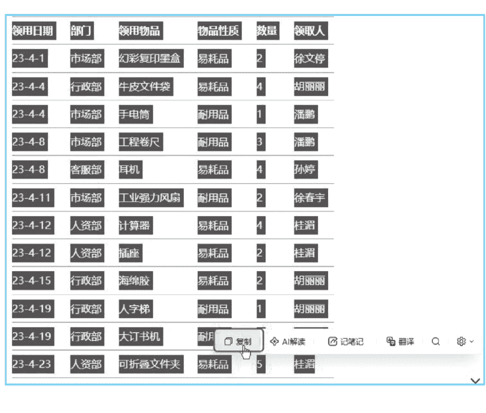

图0-13

❷ 切换到Excel，选中目标单元格，按Ctrl+V组合键粘贴，如图0-14所示。

❸ 由于数据宽度问题，得到的数据在显示效果上有些问题，可以通过调整列宽、行高等对表格稍加整理，整理后的表格如图0-15所示。

| 领用日期 | 部门 | 领用物品 | 物品性质 | 数量 | 领取人 |
| :--- | :--- | :--- | :--- | :--- | :--- |
| 23-4-1 | 市场部 | 幻彩复印墨盒 | 易耗品 | 2 | 徐文停 |
| 23-4-4 | 行政部 | 牛皮文件袋 | 易耗品 | 4 | 胡丽丽 |
| 23-4-4 | 市场部 | 手电筒 | 耐用品 | 1 | 潘鹏 |
| 23-4-8 | 市场部 | 工程卷尺 | 耐用品 | 3 | 潘鹏 |
| 23-4-8 | 客服部 | 耳机 | 易耗品 | 4 | 孙婷 |
| 23-4-11 | 市场部 | 工业强力风扇 | 耐用品 | 2 | 徐春宇 |
| 23-4-12 | 人资部 | 计算器 | 易耗品 | 4 | 桂湄 |
| 23-4-12 | 人资部 | 插座 | 易耗品 | 2 | 桂湄 |
| 23-4-15 | 行政部 | 海绵胶 | 易耗品 | 2 | 胡丽丽 |
| 23-4-19 | 行政部 | 人字梯 | 耐用品 | 1 | 胡丽丽 |
| 23-4-19 | 行政部 | 大订书机 | 耐用品 | 1 | 胡丽丽 |
| 23-4-23 | 人资部 | 可折叠文件夹 | 易耗品 | 5 | 桂湄 |

图0-14

| 领用日期 | 部门 | 领用物品 | 物品性质 | 数量 | 领取人 |
|---|---|---|---|---|---|
| 2023-4-1 | 市场部 | 幻彩复印墨盒 | 易耗品 | 2 | 徐文停 |
| 2023-4-4 | 行政部 | 牛皮文件袋 | 易耗品 | 4 | 胡丽丽 |
| 2023-4-4 | 市场部 | 手电筒 | 耐用品 | 1 | 潘鹏 |
| 2023-4-8 | 市场部 | 工程卷尺 | 耐用品 | 3 | 潘鹏 |
| 2023-4-8 | 客服部 | 耳机 | 易耗品 | 4 | 孙婷 |
| 2023-4-11 | 市场部 | 工业强力风扇 | 耐用品 | 2 | 徐春宇 |
| 2023-4-12 | 人资部 | 计算器 | 易耗品 | 4 | 桂湄 |
| 2023-4-12 | 人资部 | 插座 | 易耗品 | 2 | 桂湄 |
| 2023-4-15 | 行政部 | 海绵胶 | 易耗品 | 2 | 胡丽丽 |
| 2023-4-19 | 行政部 | 人字梯 | 耐用品 | 1 | 胡丽丽 |
| 2023-4-19 | 行政部 | 大订书机 | 耐用品 | 1 | 胡丽丽 |
| 2023-4-23 | 人资部 | 可折叠文件夹 | 易耗品 | 5 | 桂湄 |

图0-15

#### 2. 学会将判断条件描述完整

在向DeepSeek描述问题时，如果有多个限制条件，注意将问题描述清楚。首先我们来看一个提问词，如图0-16所示。送出问题后得到如图0-17所示的回复信息。


图0-16

根据你的需求，可以在Excel中使用 IF 函数结合 AND 函数来实现这个逻辑。以下是具体的公式：

##### Excel公式

```
excel
=IF(AND(A2="洗衣机", B2="白色"), C2+50, IF(AND(A2="洗衣机", B2<>"白色"), C2+200, C2))
```

##### 公式解释

1. 第一层IF：
   - AND(A2="洗衣机", B2="白色")：检查A2是否为“洗衣机”且B2是否为“白色”。
   - 如果条件成立，返回 C2+50，即白色洗衣机上调50元。
2. 第二层IF：
   - AND(A2="洗衣机", B2<>"白色")：检查A2是否为“洗衣机”且B2不为“白色”。
   - 如果条件成立，返回 C2+200，即其他颜色洗衣机上调200元。
3. 默认情况：
   - 如果以上条件都不成立，返回 C2，即不调价。

图0-17

使用DeepSeek的回复在工作表中建立公式后，得到的结果如图0-18所示。可以看到该公式返回的结果都是原价，并未达到按条件调价的目的。

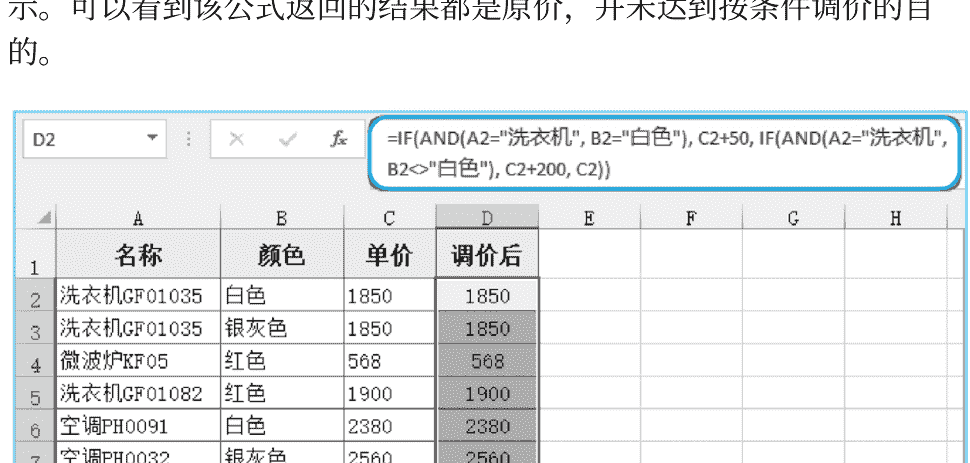

图0-18

这个提问词对单元格位置、范围的指定非常明确，但因为忽视了一个条件而导致DeepSeek无法回复正确的公式。观察A列中的名称可以发现，“洗衣机”这几个字是商品名称的前几个字符，而不是整个单元格呈现的文字。要判断是不是洗衣机，需要将这个条件也描述给DeepSeek。因此调整提问文字，添加一个判断条件“并且要判断A2中前3个字符是不是洗衣机”（如图0-19所示），这时DeepSeek就明白了需要在名称中从左侧提取，并判断是不是“洗衣机”，从而重新生成了公式，如图0-20所示。


图0-19

根据你的需求，我们需要判断A2的前3个字符是否为“洗衣机”，并且结合颜色进行调价。可以使用 **LEFT** 函数提取前3个字符，并结合 **IF** 和 **AND** 函数实现逻辑。以下是具体公式：

##### Excel公式

```
excel
=IF(AND(LEFT(A2, 3)="洗衣机", B2="白色"), C2+50, IF(AND(LEFT(A2, 3)="洗衣机", B2<>"白色"), C2+200, C2))
```

##### 公式解释

1. 第一层IF：
   - AND(LEFT(A2, 3)="洗衣机", B2="白色")：检查A2的前3个字符是否为“洗衣机”且B2是否为“白色”。
   - 如果条件成立，返回 **C2+50**，即白色洗衣机上调50元。
2. 第二层IF：
   - AND(LEFT(A2, 3)="洗衣机", B2<>"白色")：检查A2的前3个字符是否为“洗衣机”且B2不为“白色”。
   - 如果条件成立，返回 **C2+200**，即其他颜色洗衣机上调200元。
3. 默认情况：
   - 如果以上条件都不成立，返回 **C2**，即不调价。

图0-20

我们回到Excel中验证这个公式。可以看到公式能自动判断A列中名称的前几个字符是不是“洗衣机”，还可判断是不是“白色”，然后得到正确的结果，如图0-21所示。

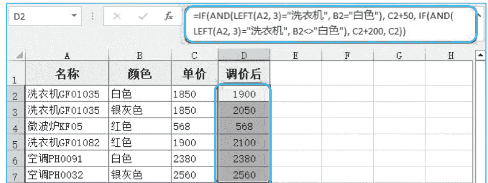

图0-21

#### 3. 对DeepSeek的回复做出追问

前面我们强调了在向DeepSeek提问时必须提供清晰具体的指示，包括明确范围和目的，以及完整描述判断条件等。除此之外，如果一次未能将问题表达清楚，得到的回复不是想要的，仍然可以通过追问的方式对当前问题进行补充，或者继续提出新的需求。

例如在DeepSeek中提问“数据后面都带了中文单位，如何做到一次性分离并删除？”，如图0-22所示。发送问题后得到的回复信息如图0-23所示，从回复信息可以看到，DeepSeek推荐使用“分列”功能解决此问题。


图0-22

如果数据后面带有中文单位（例如“10元”、“5公斤”），您可以使用Excel的“分列”功能 或 公式 来一次性分离并删除这些单位。以下是具体方法：

##### 方法1：使用“分列”功能

“分列”功能是Excel中非常方便的工具，可以快速将文本和数字分离。

步骤：

1. 选中需要处理的列（例如B列）。
2. 点击“数据” > “分列”。
3. 在弹出的对话框中：
   - 选择“固定宽度”，点击“下一步”。
   - 在数据预览中，点击数字和单位之间的位置，设置分列线。
   - 点击“下一步”。
4. 在“列数据格式”中：
   - 选择数字部分为“常规”。
   - 选择单位部分为“不导入此列（跳过）”。
5. 点击“完成”。


当我们无法使用此方法解决问题时，可以通过追问继续描述自己的问题“因为数据长短不一，单位长短不一，我无法使用‘分列’这个功能。”，如图0-24所示。送出问题后，可以看到DeepSeek又重新给出新的解决方案，如图0-25所示。


如果数据长短不一，单位长短不一，无法使用“分列”功能，可以通过以下方法解决：

##### 方法1：使用公式提取数字部分

通过公式可以灵活处理长度不一的数字和单位。

步骤：

1. 在相邻列（例如C列）中输入以下公式，提取数字部分：

```
excel
=LEFT(B2, MIN(FIND({"元","公斤","克","升"}, B2 & "元公斤克升"))-1)
```

2. 如果需要提取单位部分，可以在D列中输入以下公式：

```
excel
=TRIM(RIGHT(B2, LEN(B2) - LEN(C2)))
```

3. 复制公式到整列。

公式解析：

- FIND({"元","公斤","克","升"}, B2 & "元公斤克升")：查找单位（如“元”、“公斤”、“克”、“升”）在文本中的位置。
- MIN(...)：找到最早出现的单位位置。
- LEFT(B2, ...-1)：提取单位之前的数字部分。
- TRIM(RIGHT(...))：提取单位部分并去除空格。

图0-25

所以在使用DeepSeek提问时，若问题未得到解决，可以通过不断地追问将问题细化和具象化，这样DeepSeek给出的回复才会更加精准。

### 0.4 了解DeepSeek给予函数的帮助

灵活的公式设计可以满足日常办公中多种数据计算、统计、分析需求，让日常工作变得高效、智能。而很多用户在使用公式时会面临学不会、记不住、用不好等困扰。进入AI时代，我们可以通过向DeepSeek提问来学习函数语法、示例，甚至只需准确描述需求，就能直接获取解决问题的公式。

#### 1. 让DeepSeek按给定任务提供Excel公式建议

DeepSeek可以按用户给定任务提供Excel函数建议，即只要你能正确地表达需求，DeepSeek就能为你提供一些应用建议，同时还可以通过追问逐步细化问题，最终得出想要的方案。笔者在应用的过程中，着实体会到这一点是非常实用的。

例如在DeepSeek中提问“Excel表格中统计了员工的入职日期，试用期为60天，想建立公式判断每位员工的试用期是否结束。”，如图0-26所示。


图0-26

送出问题后，得到的回复信息如图0-27所示。

要根据员工的入职日期和试用期（60天），判断每位员工的试用期是否结束，可以使用 IF 函数结合 TODAY() 函数来实现。以下是具体步骤和公式：

#### 步骤：

1. 假设入职日期在 B 列（例如 B2:B100）。
2. 在 C2 单元格中输入以下公式：

```
excel
=IF(TODAY()-B2>=60, "试用期结束", "试用期中")
```

3. 按下回车键，公式会自动判断试用期是否结束并显示在 C2 单元格中。
4. 将公式向下拖动：
    * 向下拖动时，公式会依次判断其他员工的试用期状态。

##### 公式解释：

1. TODAY()：
    * 返回当前日期。
2. TODAY()-B2：
    * 计算当前日期与入职日期之间的天数差。
3. IF(TODAY()-B2>=60, "试用期结束", "试用期中")：
    * 如果天数差大于或等于 60 天，返回“试用期结束”；否则返回“试用期中”。

图0-27

根据DeepSeek回复的公式，将其应用到Excel中进行求解，其求解结果如图0-28所示。

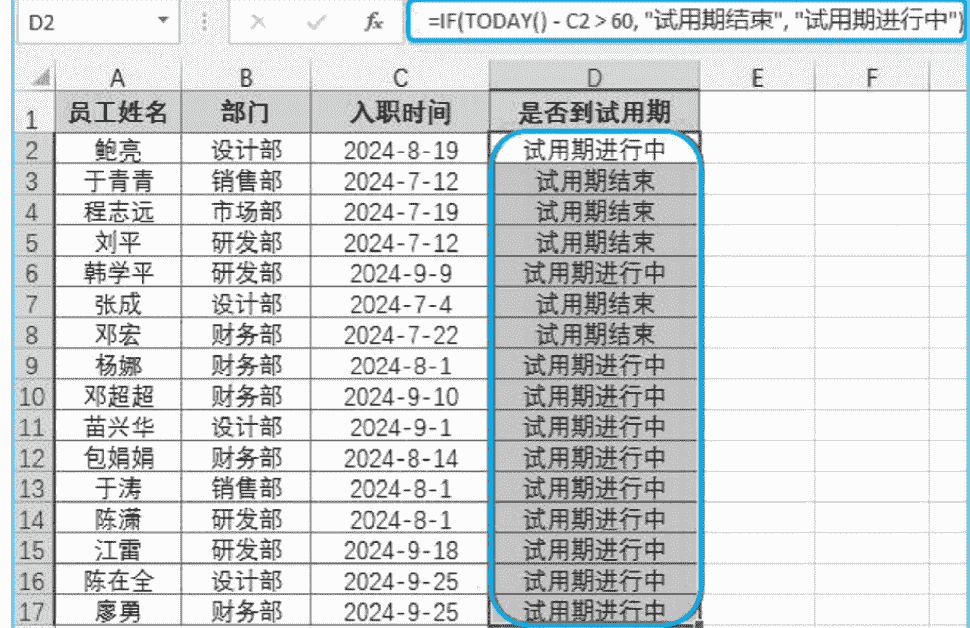

图0-28

#### 2. 根据DeepSeek的提示完成公式的编写

当我们将分析意图整理成文字发送给DeepSeek并得到DeepSeek的回复后，需要根据提示回到Excel中完成公式的编写，在这个编写的过程中不断提升对Excel的应用能力。

例如在DeepSeek中提问“想将表格中所有显示‘录取’文字对应的姓名都提取出来，并使用‘，’号间隔。”（如图0-29所示），送出问题得到的回复信息如图0-30所示。

想将表格中所有显示“录取”文字对应的姓名都提取出来，并使用“，”号间隔。

图0-29

要将表格中所有显示“录取”文字对应的姓名提取出来，并用“，”号间隔，可以使用 TEXTJOIN 函数结合 IF 函数来实现。以下是具体的公式和步骤：

##### 公式：

假设姓名在 A列，录取状态在 B列，数据范围是 A2:A100 和 B2:B100，在目标单元格中输入以下公式：

```
excel
=TEXTJOIN("，", TRUE, IF(B2:B100="录取", A2:A100, ""))
```

#### 公式解析：

1. B2:B100="录取"：
   - 判断 B2:B100 区域中的每个单元格是否等于“录取”。
   - 返回一个布尔数组（TRUE/FALSE），表示每个单元格是否满足条件。
2. IF(B2:B100="录取", A2:A100, "")：
   - 如果 B2:B100 中的单元格等于“录取”，则返回 A2:A100 中对应单元格的值；否则返回空字符串“”。
   - 结果是一个数组，包含满足条件的 A2:A100 值和空字符串。
3. TEXTJOIN("，", TRUE, ...)：
   - TEXTJOIN 函数用于将多个文本字符串连接成一个字符串。
   - “，”：指定分隔符为“，”。
   - TRUE：忽略空值（即忽略 IF 函数返回的空字符串）。
   - 将 IF 函数返回的数组中的非空值用“，”连接起来。

图0-30

DeepSeek不仅提供了公式，还提醒我们在应用公式时需要调整范围A2:A100和B2:B100来适应我们的数据。此外，在DeepSeek的回复信息中还可以看到，如果想让返回的结果使用其他的分隔符或换行符，都可以按相应的方法操作（如图0-31所示），可谓是非常贴心。

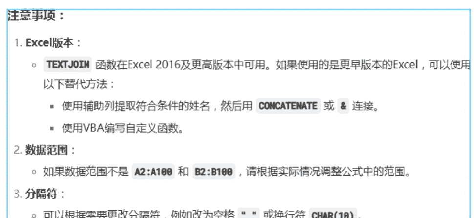

图0-31

将DeepSeek回复的公式复制到Excel中，如图0-32所示。

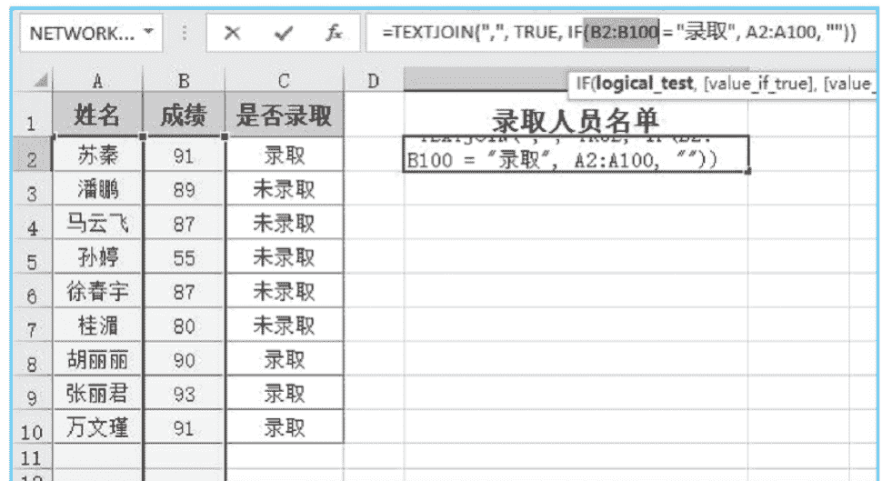

图0-32

根据当前的数据情况去更改对数据区域的引用，如图0-33所示。

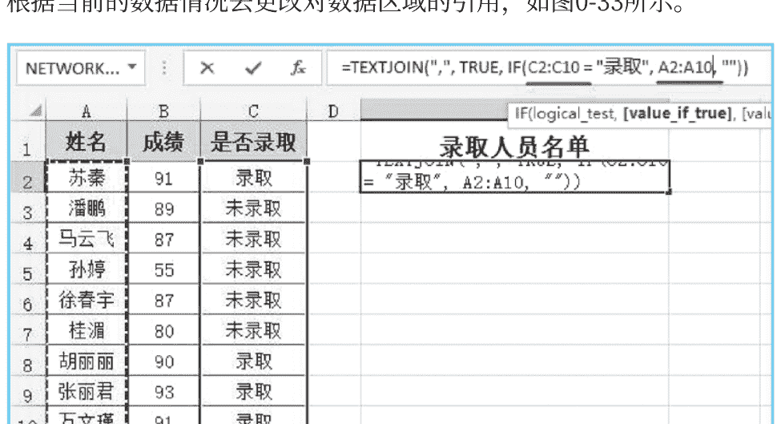

图0-33

按Ctrl + Shift + Enter组合键得出统计结果，如图0-34所示。

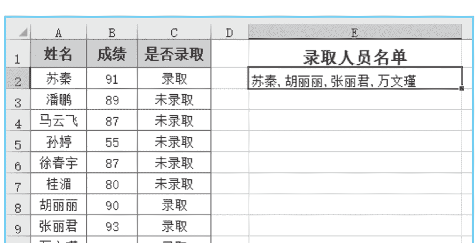

图0-34

#### 3. 根据DeepSeek给出的公式分步解析理解公式

DeepSeek对公式的解析也是比较清晰到位的，尤其对于一些较为复杂的公式，通过其提供的分步解析，理解起来更加轻松。我们通过反复查看、理解并应用这些解析，对于学习函数来说大有裨益。

例如我们引用在后续财务数据处理中需要使用的一个公式。通过向DeepSeek提问，我们看到在DeepSeek的回复信息中，包括“公式解析”“解决的问题”“示例”几个板块。这些对于理解公式与学习公式非常有益，如图0-35、图0-36所示。

请问=IFERROR(SMALL(IF(F:F=$D$1, ROW(F:F)), ROW(1:1)), "")这个公式该如何理解？

这个公式的作用是：在 **F列** 中查找与 **D1** 单元格内容相同的值，并返回这些值所在的行号。公式会依次返回符合条件的行号（从小到大），如果没有更多符合条件的行号，则返回空值。

下面我们详细解析这个公式：

#### 公式解析：

```
excel
=IFERROR(SMALL(IF(F:F=$D$1, ROW(F:F)), ROW(1:1)), "")
```

1. **F:F=$D$1**：
   - 判断 **F列** 中的每个单元格是否等于 **D1** 单元格的内容。
   - 返回一个布尔数组（TRUE/FALSE），表示每个单元格是否满足条件。
2. **IF(F:F=$D$1, ROW(F:F))**：
   - 如果 **F列** 中的单元格等于 **D1** 的内容，则返回该单元格的行号；否则返回 **FALSE**。
   - 结果是一个数组，包含满足条件的行号和 **FALSE**。
3. **SMALL(..., ROW(1:1))**：
   - **SMALL** 函数用于从数组中提取第 **k** 个最小值。
   - **ROW(1:1)**：随着公式向下填充，依次提取第1个、第2个、第3个符合条件的行号。
4. **IFERROR(..., "")**：
   - 如果没有更多符合条件的行号（即 **SMALL** 函数返回错误），则返回空值 ""。

图0-35

#### 解决的问题：

这个公式的作用是：

- 在 F列 中查找与 D1 单元格内容相同的值。
- 返回这些值所在的行号，并按从小到大的顺序依次显示。
- 如果没有更多符合条件的行号，则返回空值。

#### 示例：

假设 D1 单元格的内容是 1001 ，F列 中的数据如下：

| F列（值） |
|---|
| 1001 |
| 1002 |
| 1001 |
| 1003 |
| 1001 |

使用公式：

```
excel
=IFERROR(SMALL(IF(F:F=$D$1, ROW(F:F)), ROW(1:1)), "")
```

# 第1章 财务数据的输入与编辑


扫码看教学视频

数据是表格的最基本元素。在财务数据的处理过程中，首先要约束数据的规范性。因此，掌握数据输入过程中的一些操作技巧，一方面可以提升工作效率，另一方面可保障数据的规范性，为后期的数据统计分析带来便利。

输入各种不同类型的数据

数据批量输入

设定数据验证规范录入的数据

实用的选择性粘贴功能

## 1.1 输入各种不同类型的数据

输入任意类型的数据（如文本型数据、数值型数据、日期型数据等）到工作表中是创建表格的首要工作。不同类型数据的输入，其操作要点各不相同。另外，本节还涉及利用填充和导入的方法以实现数据的批量输入。

### 1.1.1 输入特殊文本

一般来说，只要以程序能识别的格式输入数据或信息，就不需要特意去更改格式。但除了输入普通文本，还有一些特殊的情况，需要将输入的数字“显示”为文本的格式。下面通过例子解说。

#### 1. 输入以0开头的序号

例如在“序号”列中想显示的序号为“001”“002”……这种形式（如图1-1所示），直接输入显示的结果如图1-2所示（前面的0自动省略），此时需要先设置单元格的格式为“文本”，然后输入序号。

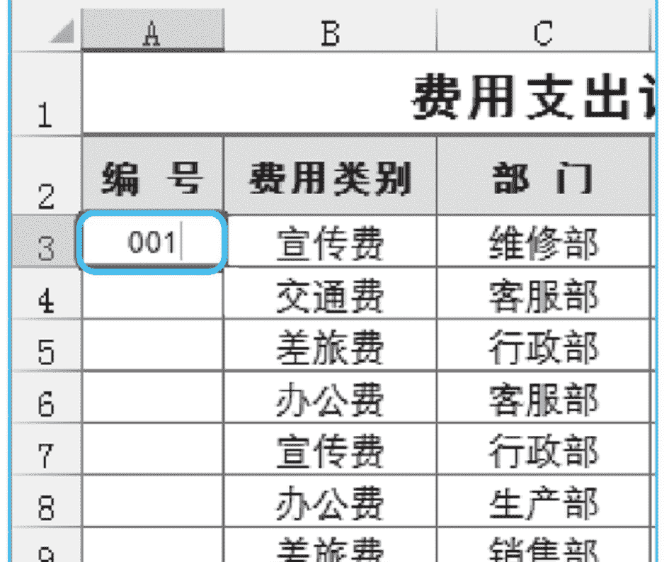

图1-1

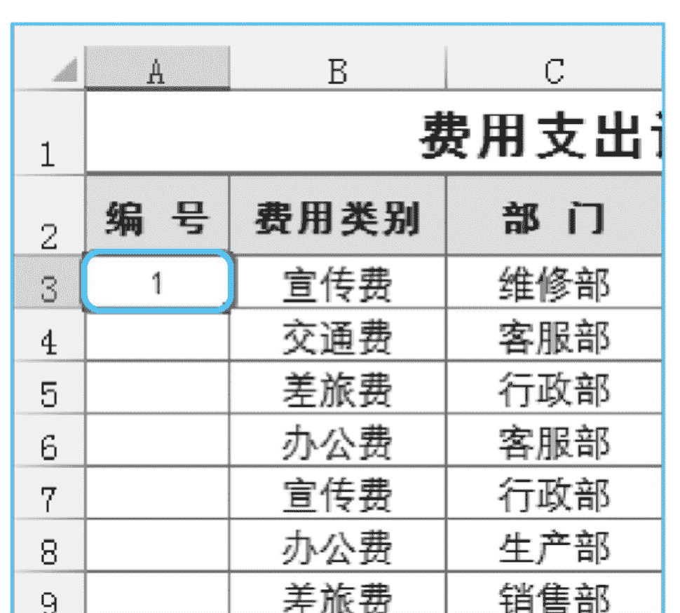

图1-2

##### 专家提醒

在这种情况下注意一定要遵循先设置格式再输入的原则。如果先输入以0开头的编号再设置单元格格式，也无法恢复数字前面的0。

1. 选中要输入“编号”列的单元格区域，切换到“开始”选项卡，在“数字”组中单击格式设置框右侧下拉按钮，在下拉列表中选择“文

#### 1.1.1 输入以0开头的编号

本”，如图1-3所示。

❷单击“确定”按钮，再输入以0开头的编号时即可正确显示出来，如图1-4所示。

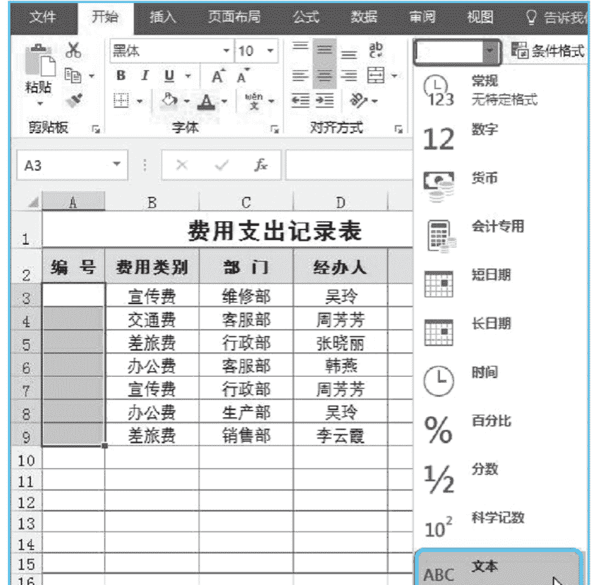

图1-3

| 编号 | 费用类别 | 部门 | 经办人 | 金额 |
|---|---|---|---|---|
| 001 | 宣传费 | 维修部 | 吴玲 | |
| 002 | 交通费 | 客服部 | 周芳芳 | |
| 003 | 差旅费 | 行政部 | 张晓丽 | |
| 004 | 办公费 | 客服部 | 韩燕 | |
| 005 | 宣传费 | 行政部 | 周芳芳 | |
| 006 | 办公费 | 生产部 | 吴玲 | |
| 007 | 差旅费 | 销售部 | 李云霞 | |

图1-4

#### 2. 输入长编码

例如要输入完整的身份证编号，如果直接输入会显示为科学记数法，无法显示完整编码，如图1-5所示。只有先设置单元格的格式为“文本”格式，再输入编号，才可以正确显示，如图1-6所示。

| 姓名 | 学历 | 身份证号码 |
|---|---|---|
| 何小希 | 本科 | 3.40222E+17 |
| 周瑞 | 本科 | 3.40222E+17 |
| 于青青 | 本科 | 3.40025E+17 |
| 罗羽 | 硕士 | 3.40025E+17 |
| 邓志诚 | 本科 | 3.40042E+17 |
| 程飞 | 本科 | 3.40042E+17 |
| 周城 | 大专 | 3.40042E+17 |
| 张翔 | 本科 | 3.42701E+17 |

图1-5

| 姓名 | 学历 | 身份证号码 |
|---|---|---|
| 何小希 | 本科 | 340222198602165426 |
| 周瑞 | 本科 | 340222199105065000 |
| 于青青 | 本科 | 340025197803170540 |
| 罗羽 | 硕士 | 340025198506100224 |
| 邓志诚 | 本科 | 340042198210160517 |
| 程飞 | 本科 | 340025198506100214 |
| 周城 | 大专 | 340025199103240657 |
| 张翔 | 本科 | 342701199002178573 |

图1-6

### 1.1.2 输入数值包含指定小数位数

当输入数值包含小数位时，输入几位小数，单元格中就显示几位小数。如果希望所有输入的数值都包含几位小数（如两位，不足两位的用0补齐），可以按如下方法设置。

❶选中要输入包含两位小数数值的单元格区域，在“开始”选项卡的“数字”组中单击下拉按钮，打开下拉列表，选择“数字”选项，如图1-7所示。

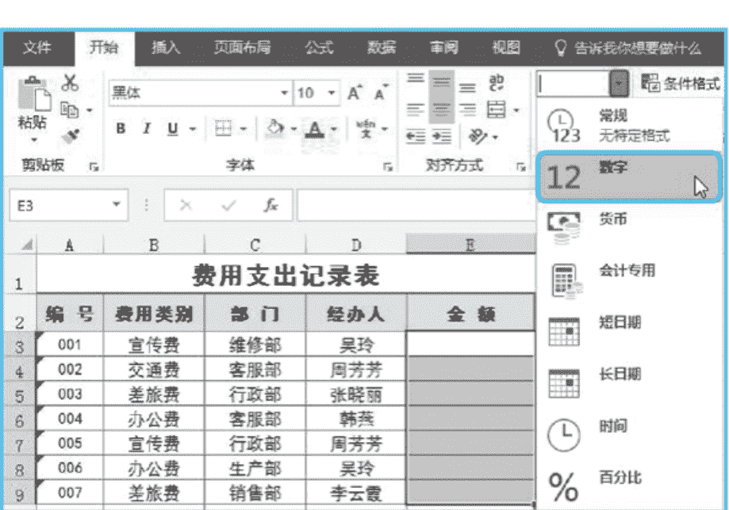

图1-7

❷执行上述操作后，在设置了格式的单元格中输入数值时会自动显示为两位小数，如图1-8所示。

| 编号 | 费用类别 | 部门 | 经办人 | 金额 |
|---|---|---|---|---|
| 001 | 宣传费 | 维修部 | 吴玲 | 2000.50 |
| 002 | 交通费 | 客服部 | 周芳芳 | 580.60 |
| 003 | 差旅费 | 行政部 | 张晓丽 | 2010.30 |
| 004 | 办公费 | 客服部 | 韩燕 | 600.20 |
| 005 | 宣传费 | 行政部 | 周芳芳 | 2500.60 |
| 006 | 办公费 | 生产部 | 吴玲 | 3000.60 |
| 007 | 差旅费 | 销售部 | 李云霞 | 2050.10 |

图1-8

❸如果想对小数位进行增减，则可以在“数字”组中单击“增加小数位”（如图1-9所示）和“减少小数位”。

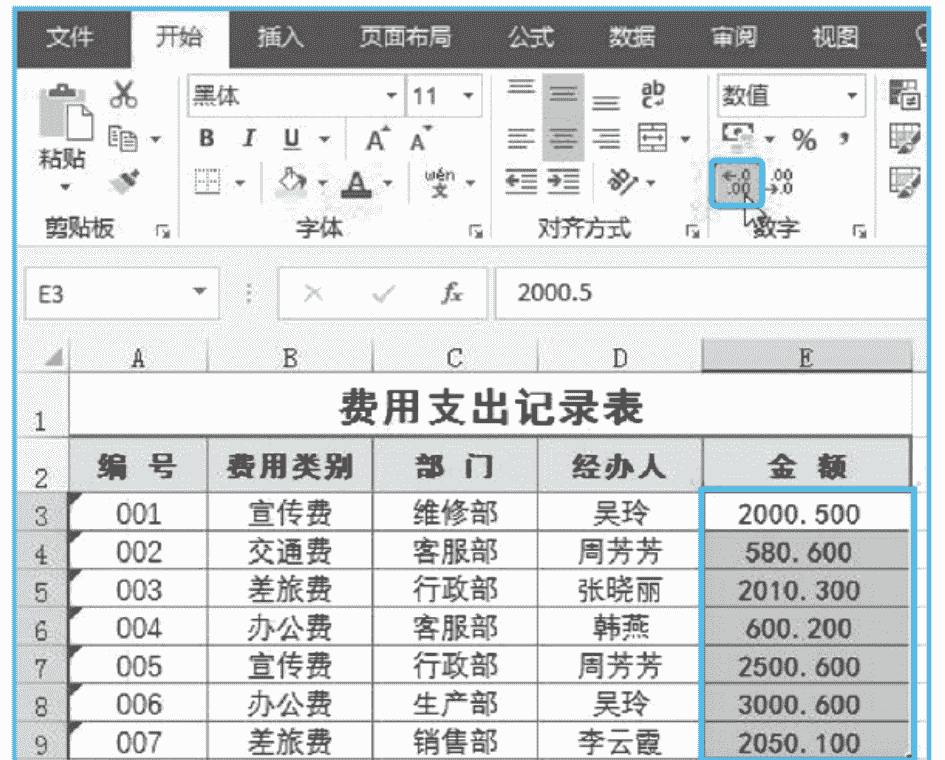

图1-9

##### 知识扩展

下拉按钮中还有“货币”“会计专用”“百分比”等选项。这里的选项都是为了方便用户快速更改数据格式而设计的。在这里无论应用哪种格式的数值都会默认包含两位小数，因此在应用后如果想更改小数位数，则可以使用 .00→.0 和 .0→.00 按钮快速增加或减少小数位。

### 1.1.3 设置费用金额为货币格式

在财务报表中，货币格式的数据也较为常见，要让输入的数据显示为货币格式，可以按如下方法操作。

❶打开工作表，选中想显示为货币格式的数据区域，切换到“开始”选项卡，在“数字”组中单击（设置单元格格式）按钮（如图1-10所示），弹出“设置单元格格式”对话框。

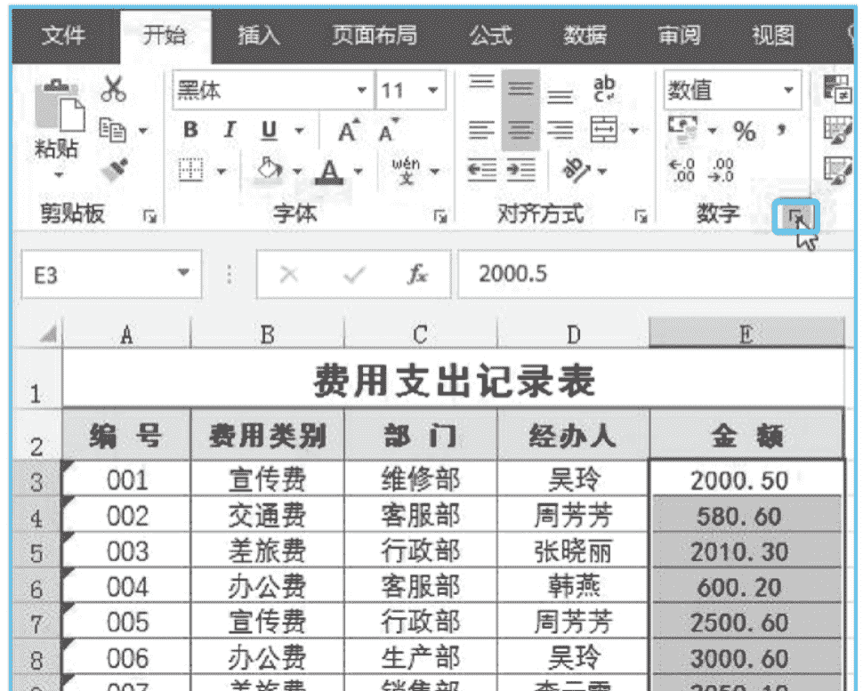

图1-10

❷在“分类”列表中选择“货币”选项，并设置小数位数、选择货币符号的样式，如图1-11所示。

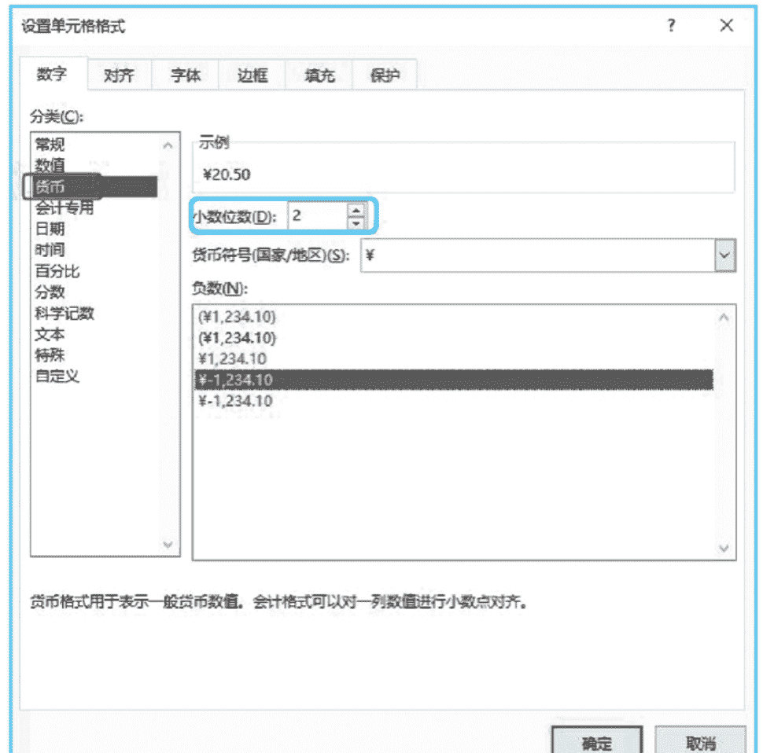

图1-11

❸单击“确定”按钮，则选中的单元格区域数值格式被更改为货币格式，如图1-12所示。

| 编号 | 费用类别 | 部门 | 经办人 | 金额 |
|---|---|---|---|---|
| 001 | 宣传费 | 维修部 | 吴玲 | ¥2,000.50 |
| 002 | 交通费 | 客服部 | 周芳芳 | ¥580.60 |
| 003 | 差旅费 | 行政部 | 张晓丽 | ¥2,010.30 |
| 004 | 办公费 | 客服部 | 韩燕 | ¥600.20 |
| 005 | 宣传费 | 行政部 | 周芳芳 | ¥2,500.60 |
| 006 | 办公费 | 生产部 | 吴玲 | ¥3,000.60 |
| 007 | 差旅费 | 销售部 | 李云霞 | ¥2,050.10 |

图1-12

##### 知识扩展

在“设置单元格格式”对话框中还可以设置负数的显示格式。例如根据图1-13所示的设置，其负数的显示效果如图1-14所示的样式。

#### 设置单元格格式

数字 对齐 字体 边框 填充 保护

分类(C):

- 常规
- 数值
- 货币
- 会计专用
- 日期
- 时间
- 百分比
- 分数
- 科学记数
- 文本
- 特殊
- 自定义

示例

¥18,874.10

小数位数(D): 2

货币符号(国家/地区)(S): ¥

负数(N):

- ¥1,234.10
- (¥1,234.10)
- ¥1,234.10
- ¥-1,234.10
- ¥-1,234.10

货币格式用于表示一般货币数值。会计格式可以对一列数值进行小数点对齐。

确定 取消

图1-13

| 项目 | 上年度 | 本年度 | 增减额(率) |
| :--- | :--- | :--- | :--- |
| 销售收入 | ¥206,424.58 | ¥225,298.68 | ¥18,874.10 |
| 销售成本 | ¥82,698.00 | ¥96,628.02 | ¥13,930.02 |
| 销售费用 | ¥20,462.68 | ¥6,450.46 | (¥14,012.22) |
| 销售税金 | ¥4,952.89 | ¥2,222.65 | (¥2,730.24) |
| 销售成本率 | ¥0.68 | ¥0.83 | ¥0.15 |
| 销售费用率 | ¥0.10 | ¥0.06 | (¥0.03) |
| 销售税金率 | ¥0.05 | ¥0.03 | (¥0.02) |

图1-14

### 1.1.4 输入百分比数值

百分比数据可以通过在数据后添加百分比符号的方式来直接输入，但如果在计算时产生大量的数据，最终需要采用百分比的形式表达出来（如求取利润率），则可以按如下方法来实现。

❶选中要输入百分比数值的单元格区域或选中已经存在数据且希望其显示为百分比格式的单元格区域，在“开始”选项卡的“数字”组中单击 % 按钮，如图1-15所示。此时数据显示为百分数，但不含小数位，如图1-16所示。

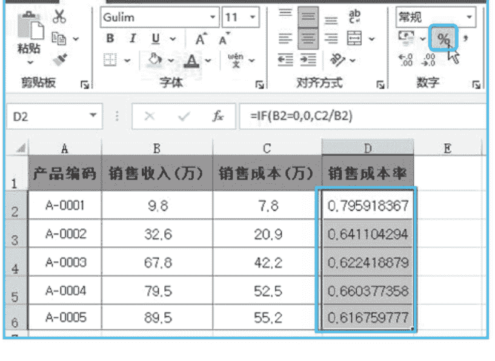

图1-15

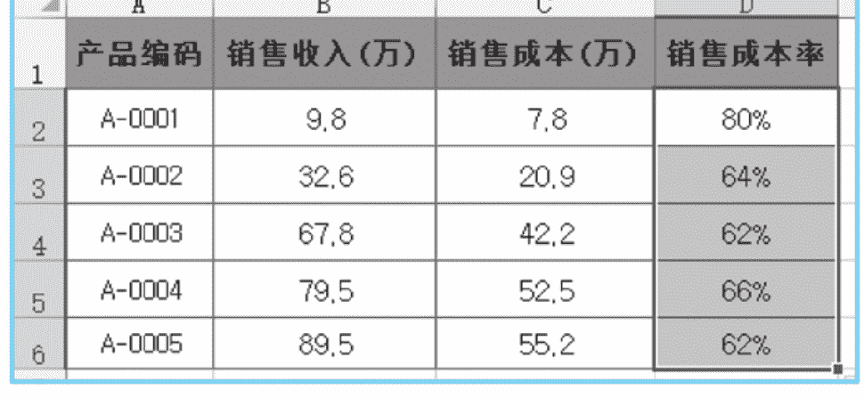

图1-16

❷保持选中状态，在“数字”组中单击按钮来增加小数位，需要几位就单击几次，如图1-17所示。

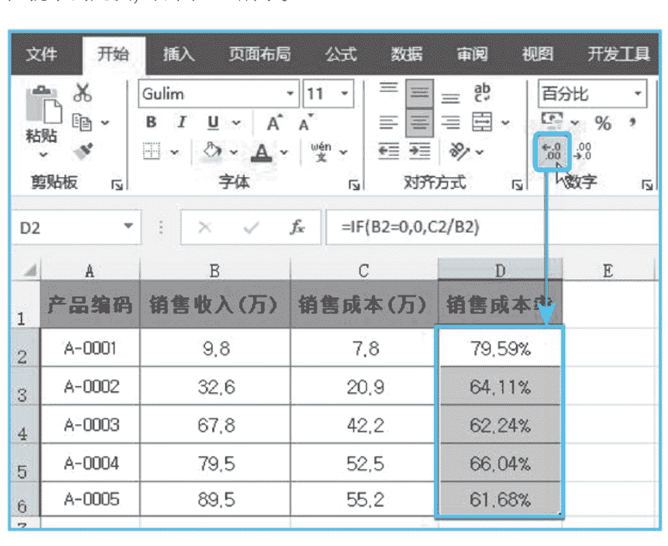

图1-17

## 1.2 数据批量输入

在工作表中批量输入数据（如在连续的单元格中输入相同的数据、填充输入序号、填充输入连续月份等）是最常见的操作，可以方便用户一次性输入相同的或有规律的数据，提高工作效率。

### 1.2.1 批量输入相同数据

快速填充输入相同的数据，包括在连续的单元格区域中输入相同的数据和在不连续的单元格中输入相同的数据。

#### 1. 连续单元格输入相同数据

❶输入首个数据，如本例中在B6单元格中输入“综合处”，鼠标指针指向B6单元格右下角，出现黑色十字形（可称为填充柄），如图1-18所示。

❷按住鼠标左键向下拖动（拖动到的位置按实际填充需要决定），如图1-19所示。

❸释放鼠标即可实现数据填充，如图1-20所示。

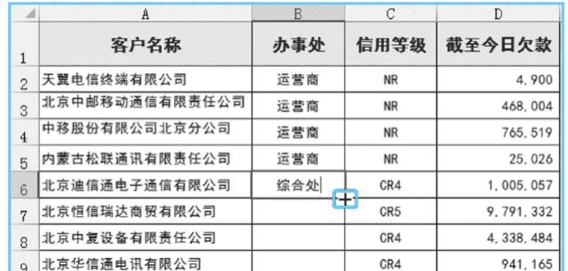

图1-18

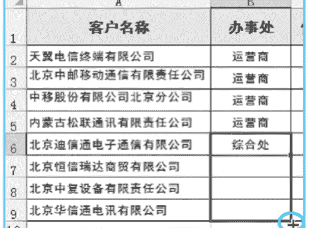

图1-19

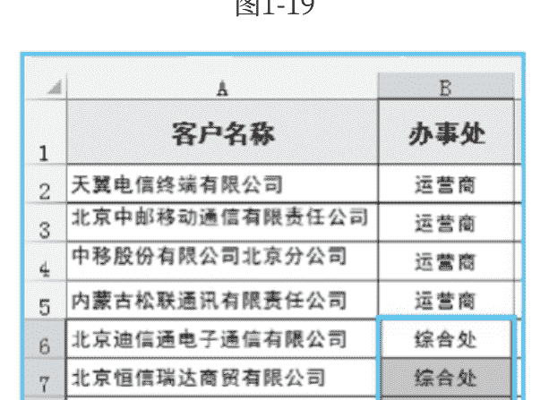

图1-20

#### 2. 不连续单元格输入相同数据

如果想在不连续的单元格中一次性输入相同的数据，也可以利用技巧来输入。

❶按Ctrl键依次选中需要输入相同数据的单元格（如图1-21所示），接着切换到编辑栏中输入数据（如此处输入“农业银行”），如图1-22所示。

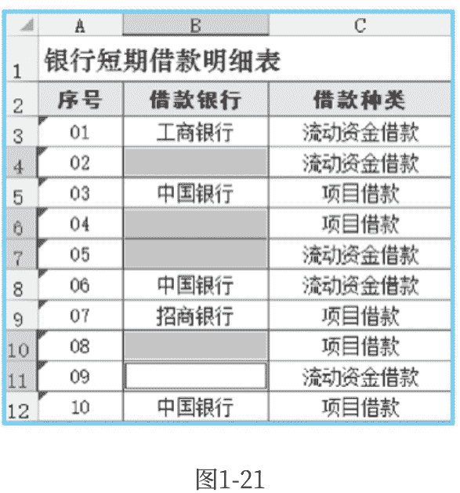

图1-21

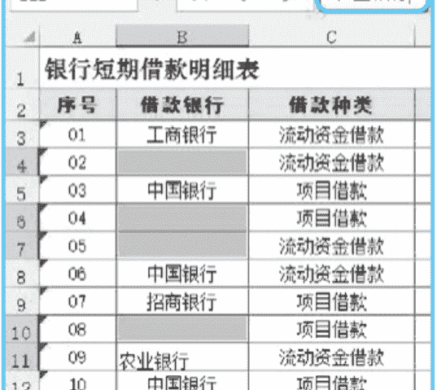

图1-22

❷按Ctrl+Enter组合键，即可在选中的所有单元格中输入相同的数据，如图1-23所示。

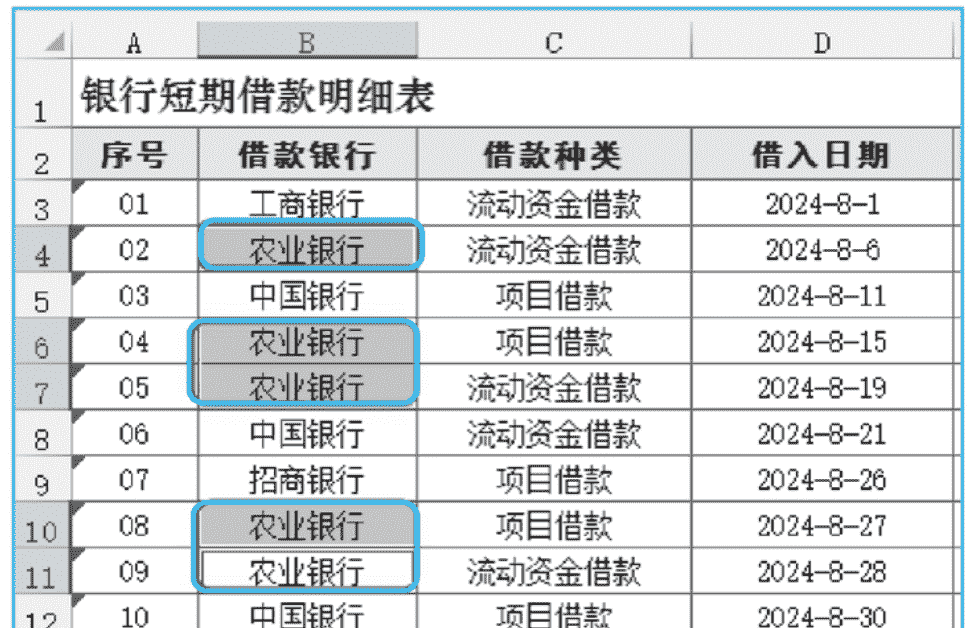

图1-23

### 1.2.2 填充输入序号

通过填充功能可以实现一些有规则数据的输入，例如序号的填充、日期填充、月份填充等。通过填充可以实现连续序号的输入，其操作如下。

#### 1. 快速填充连续的序号

❶在A3单元格中输入“001”（注意要按1.1.1小节中介绍的方法先设置单元格格式为文本格式后再输入以0开头的编号）。选中A3单元格，鼠标指针指向A3单元格右下角，出现黑色十字形（可称为填充柄），如图1-24所示。

❷按住鼠标左键不放，向下拖动至填充结束的位置，如图1-25所示。

| 序号 | 公司名称 | 应收金额 |
|---|---|---|
| 001 | 孚盛装饰公司 | ¥ 29,840.00 |
| | 澳菲斯建材有限公司 | ¥ 28,765.00 |
| | 宏运佳建材公司 | ¥ 15,080.00 |
| | 拓帆建材有限公司 | ¥ 22,015.00 |
| | 澳菲斯建材有限公司 | ¥ 18,009.00 |
| | 孚盛装饰公司 | ¥ 22,000.00 |
| | 孚盛装饰公司 | ¥ 23,000.00 |
| | 雅得丽装饰公司 | ¥ 24,000.00 |
| | 宏运佳建材公司 | ¥ 30,000.00 |
| | 雅得丽装饰公司 | ¥ 8,000.00 |
| | 雅得丽装饰公司 | ¥ 8,500.00 |
| | 海兴建材有限公司 | ¥ 8,500.00 |
| | 宏运佳建材公司 | ¥ 22,000.00 |
| | 海兴建材有限公司 | ¥ 10,000.00 |

图1-24

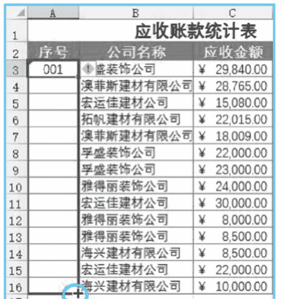

图1-25

❸释放鼠标，拖动过的位置上即会完成序号的填充，如图1-26所示。

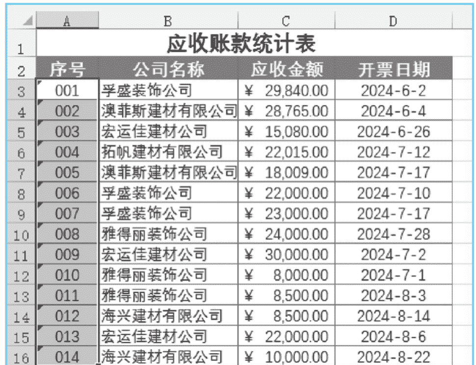

图1-26

#### 2. 快速填充不连续的序号

通过填充功能也可以实现不连续序号的输入，其关键操作在于填充源的输入。例如本例中固定资产的第1个序号为GD001、第2个序号为GD004、第3个序号为GD007，其他序号以此类推，即每个序号间隔“3”。首先要输入前两个序号，然后使用填充的方式批量输入。

❶首先在A2和A3单元格中分别输入前两个编号（GD001与GD004）。选中A2:A3单元格，将光标移至该单元格区域的右下角，直到出现黑色填充柄，如图1-27所示。

❷按住鼠标左键不放，向下拖动至填充结束的位置，放开鼠标左键，拖动过的位置即会以“3”为间隔显示编号，如图1-28所示。

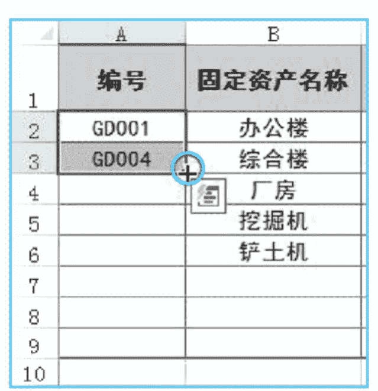

图1-27


图1-28

##### 知识扩展

自动填充完成后，都会出现“自动填充选项”按钮，在此按钮的下拉菜单中，可以为填充选择不同的方式，例如“仅填充格式”“不带格式填充”等，如图1-29所示。

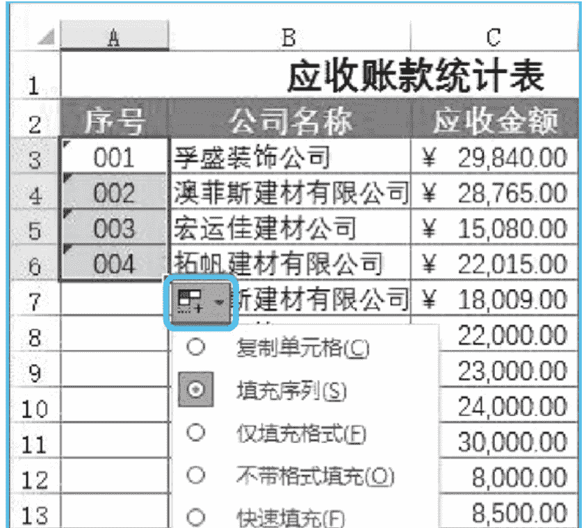

图1-29

另外，“自动填充选项”按钮下拉菜单中的选项内容取决于所填充的数据类型，例如填充日期时会出现“按月填充”“按工作日填充”等选项。

### 1.2.3 填充输入日期

在填充日期时，可以像填充序号一样得到连续的日期，但如果有其他需求，如按月填充、按工作日填充、按年填充等不同的填充方式，则需要通过单击“自动填充选项”按钮，然后进行选择。

#### 1. 快速填充连续日期

❶在A2单元格中输入值班日期，然后将鼠标指针放置在A2单元格右下角，当鼠标指针变成+形状，按住鼠标向下拖动（如图1-30所示），到合适的位置释放鼠标即可看到日期递增序列。

❷单击“自动填充选项”按钮，在下拉菜单中单击“填充工作日”命令（如图1-31所示），即可按照工作日日期填充，如图1-32所示。

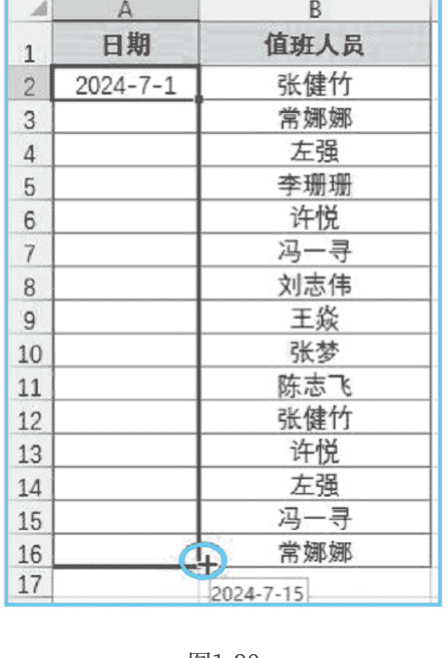

图1-30

| A | B |
|---|---|
| 日期 | 值班人员 |
| 2024-7-1 | 张健竹 |
| 2024-7-2 | 常娜娜 |
| 2024-7-3 | 左强 |
| 2024-7-4 | 李珊珊 |
| 2024-7-5 | 许恺 |
| 2024-7-6 | |
| 2024-7-7 | |
| 2024-7-8 | |
| 2024-7-9 | |
| 2024-7-10 | |
| 2024-7-11 | |
| 2024-7-12 | |
| 2024-7-13 | |
| 2024-7-14 | |
| 2024-7-15 | |

- 复制单元格(C)
- 填充序列(S)
- 仅填充格式(F)
- 不带格式填充(O)
- 以天数填充(D)
- 填充工作日(W)
- 以月填充(M)
- 以年填充(Y)
- 快速填充(F)

图1-31

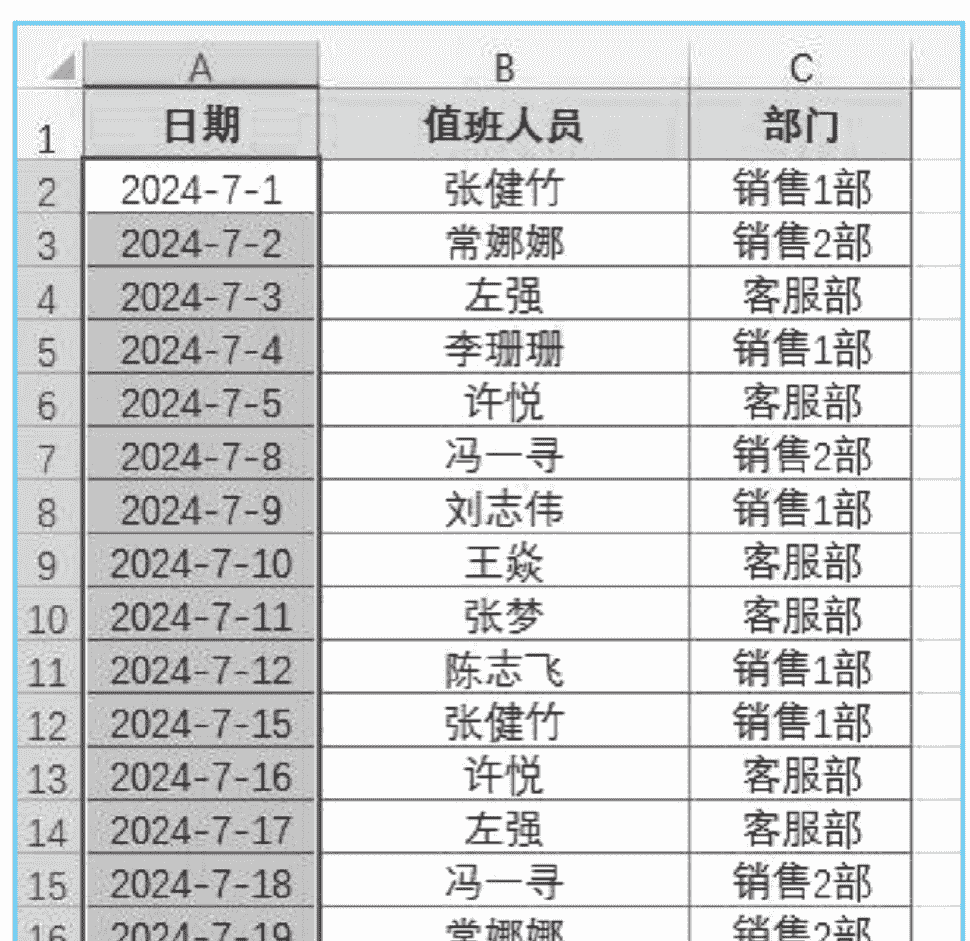

图1-32

#### 2. 快速填充相同日期

填充日期时默认会逐日递增，如果想在连续的单元格区域中填充相同的日期（如图1-33所示），则填充方法为：输入首个日期后，按住Ctrl键不放，再去拖动填充柄，即可实现在这一区域填充相同的日期。或者填充后按右下角出现的“自动填充选项”按钮，然后选择“复制单元格”选项，如图1-34所示。

| A | B | C | D |
|---|---|---|---|
| 销售日期 | 产品名称 | 销售数量 | 重量 |
| 2024-8-1 | 核桃 | 4 | 200克 |
| 2024-8-1 | 花生 | 5 | 500克 |
| 2024-8-1 | 碧根果 | 3 | 200克 |
| 2024-8-1 | 开心果 | 6 | 200克 |
| 2024-8-1 | 仁核桃 | 3 | 150克 |
| 2024-8-1 | 扁桃仁 | 2 | 150克 |
| 2024-8-2 | 丝瓜子 | 2 | 200克 |
| 2024-8-2 | 核桃 | 5 | 200克 |
| 2024-8-2 | 碧根果 | 10 | 200克 |

图1-33

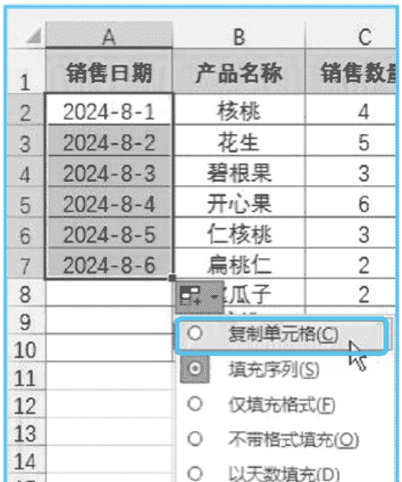

图1-34

##### 专家提示

如果想填充序列，当输入的数据是日期或本身具有增序或减序特征时，直接填充即可；如果输入的数据是数字，需要按住Ctrl键再进行填充，或者在填充后，从“自动填充选项”按钮的下拉菜单中选择“填充序列”。

### 1.2.4 DeepSeek指导快速将缺失数据自动填满

如果经常需要进行数据的输入，通常会有一些重复数据是可以通过填充来简单输入的。例如在本例中C列的仓库名称以及D列的商品类别有多处空格（如图1-35所示），这些空格实际是当输入重复数据时只输入了首个数据，针对这种情况，该如何填充呢？若未找到思路，可以在DeepSeek中提问。

❶在DeepSeek聊天对话框中输入“在Excel中，让选中区域的空白单元格能自动获取上一单元格的数据并自动填入空白单元格中。”，如图1-36所示。

| | A | B | C | D | E |
|---|---|---|---|---|---|
| 1 | 出单日期 | 商品编码 | 仓库名称 | 商品类别 | 出库件数 |
| 2 | 2024-4-8 | WJ8870 | 西城仓 | 瓷片 | 600 |
| 3 | 2024-4-14 | Z8G033 | | | 25 |
| 4 | 2024-4-10 | ZG6011 | | | 32 |
| 5 | 2024-4-17 | ZG6012 | | | 1000 |
| 6 | 2024-4-16 | ZG6013 | | 抛釉砖 | 133 |
| 7 | 2024-4-3 | ZG6016 | | | 817 |
| 8 | 2024-4-11 | ZG6017 | | | 274 |
| 9 | 2024-4-8 | WJ3606B | 建材商城仓库 | 瓷片 | 35 |
| 10 | 2024-4-8 | WJ3608B | | | 900 |
| 11 | 2024-4-13 | ZG63011A | | | 1000 |
| 12 | 2024-4-19 | ZG63016B | | | 80 |
| 13 | 2024-4-2 | WJ8868 | | 抛釉砖 | 90 |
| 14 | 2024-4-4 | Z8G031 | | | 28 |
| 15 | 2024-4-3 | Z8G031 | | | 200 |
| 16 | 2024-4-3 | WJ3608C | 东城仓 | 瓷片 | 550 |
| 17 | 2024-4-4 | WJ3610C | | | 170 |
| 18 | 2024-4-17 | ZG63010 | | | 691 |
| 19 | 2024-4-2 | WJ8869 | | 大理石 | 230 |
| 20 | 2024-4-7 | WJ8871 | | | 636 |
| 21 | 2024-4-6 | WJ8872 | | | 650 |

图1-35

❷单击 📤 按钮送出问题后，得到如图1-37所示的回复信息。从回复信息中可以看到DeepSeek为我们提供的解决方案。

❸切换到Excel，选中目标单元格区域，按Ctrl+G组合键打开“定位”对话框（如图1-38所示），单击“定位条件”按钮，打开“定位条件”对话框，选中“空值”单选按钮，如图1-39所示。

❹单击“确定”按钮，可以看到选中的区域中所有空单元格都被选中，如图1-40所示。

| A | B | C | D | E |
|---|---|---|---|---|
| 出单日期 | 商品编码 | 仓库名称 | 商品类别 | 出库件数 |
| 2024-4-8 | WJ8870 | 西城仓 | 瓷片 | 600 |
| 2024-4-14 | Z8G033 | | | 25 |
| 2024-4-10 | ZG6011 | | | 32 |
| 2024-4-17 | ZG6012 | | | 1000 |
| 2024-4-16 | ZG6013 | | 抛釉砖 | 133 |
| 2024-4-3 | ZG6016 | | | 817 |
| 2024-4-11 | ZG6017 | | | 274 |
| 2024-4-8 | WJ3606B | 建材商城仓库 | 瓷片 | 35 |
| 2024-4-8 | WJ3608B | | | 900 |
| 2024-4-13 | ZG63011A | | | 1000 |
| 2024-4-19 | ZG63016B | | | 80 |
| 2024-4-2 | WJ8868 | | 抛釉砖 | 90 |
| 2024-4-4 | Z8G031 | | | 28 |
| 2024-4-3 | Z8G031 | | | 200 |
| 2024-4-3 | WJ3608C | 东城仓 | 瓷片 | 550 |
| 2024-4-4 | WJ3610C | | | 170 |
| 2024-4-17 | ZG63010 | | | 691 |
| 2024-4-2 | WJ8869 | | 大理石 | 230 |
| 2024-4-7 | WJ8871 | | | 636 |
| 2024-4-6 | WJ8872 | | | 650 |

❺输入“=”，然后按键盘上的↑箭头，引用上面的单元格，如图1-41所示。

❻按Ctrl + Enter组合键使所有选中的空白单元格都填充为上面的单元格的数据，如图1-42所示。

| 出单日期 | 商品编码 | 仓库名称 | 商品类别 | 出库件数 |
| :--- | :--- | :--- | :--- | :--- |
| 2024-4-8 | WJ8870 | 西城仓 | 瓷片 | 600 |
| 2024-4-14 | Z8G033 | 西城仓 | 瓷片 | 25 |
| 2024-4-10 | ZG6011 | 西城仓 | 瓷片 | 32 |
| 2024-4-17 | ZG6012 | 西城仓 | 瓷片 | 1000 |
| 2024-4-16 | ZG6013 | 西城仓 | 抛釉砖 | 133 |
| 2024-4-3 | ZG6016 | 西城仓 | 抛釉砖 | 817 |
| 2024-4-11 | ZG6017 | 西城仓 | 抛釉砖 | 274 |
| 2024-4-8 | WJ3606B | 建材商城仓库 | 瓷片 | 35 |
| 2024-4-8 | WJ3608B | 建材商城仓库 | 瓷片 | 900 |
| 2024-4-13 | ZG63011A | 建材商城仓库 | 瓷片 | 1000 |
| 2024-4-19 | ZG63016B | 建材商城仓库 | 瓷片 | 80 |
| 2024-4-2 | WJ8868 | 建材商城仓库 | 抛釉砖 | 90 |
| 2024-4-4 | Z8G031 | 建材商城仓库 | 抛釉砖 | 28 |
| 2024-4-3 | Z8G031 | 建材商城仓库 | 抛釉砖 | 200 |
| 2024-4-3 | WJ3608C | 东城仓 | 瓷片 | 550 |
| 2024-4-4 | WJ3610C | 东城仓 | 瓷片 | 170 |
| 2024-4-17 | ZG63010 | 东城仓 | 瓷片 | 691 |
| 2024-4-2 | WJ8869 | 东城仓 | 大理石 | 230 |
| 2024-4-7 | WJ8871 | 东城仓 | 大理石 | 636 |
| 2024-4-6 | WJ8872 | 东城仓 | 大理石 | 650 |

## 1.3 设定数据验证以规范录入的数据

数据验证是指让指定单元格中所输入的数据满足一定的要求，如只能输入指定范围的整数、只能输入小数、设置可选择输入序列、添加公式验证等。根据实际情况设置数据有效性后，可以有效防止在单元格中输入无效的数据。

### 1.3.1 限制只能输入指定类型数据

在表格中输入数据时，有些单元格对输入的数据是有限制的，如只能是日期、某范围内的整数等，这时可以在输入数据前进行数据验证设置，从而有效避免错误输入。

例如某些单元格区域中只允许输入当月的日期，可以按如下方法设置数据验证。

1. 选择需设置的单元格区域，切换到“数据”选项卡，在“数据工具”组中单击“数据验证”按钮（如图1-43所示），打开“数据验证”对话框。
2. 在“允许”下拉列表中选择“日期”，在“数据”下拉列表中选择“介于”，然后设置“开始日期”和“结束日期”，如图1-44所示。

❸单击“确定”按钮完成设置。当在单元格中输入程序无法识别为日期的数据时会弹出错误提示，如图1-45所示；当在单元格中输入不在指定区间的日期时也会弹出错误提示，如图1-46所示。

### 1.3.2 限制输入数据的大小

例如要求所输入的交通费金额必须小于指定的金额。操作如下。

1. 选择需设置的单元格区域，切换到“数据”选项卡，在“数据工具”组中单击“数据验证”按钮（如图1-47所示），打开“数据验证”对话框。
2. 在“允许”下拉列表中选择“整数”，在“数据”下拉列表中选择“小于”，然后设置“最大值”，如图1-48所示。

③切换到“出错警告”选项卡，在“标题”文本框中输入警告标题，如图1-49所示。

④单击“确定”按钮即可。当在单元格中输入不是小于400的整数时，即会弹出警告提示框，如图1-50所示。

#### 数据验证

设置 输入信息 出错警告 输入法模式

☑ 输入无效数据时显示出错警告(S)

输入无效数据时显示下列出错警告:

样式(Y):

标题(T):

停止

错误信息(E):

注意交通费预算！

全部清除(C)

确定

取消

### 1.3.3 建立可选择输入的序列

选择输入的序列是指某些单元格区域中只有那几个可输入的选项，如产品的系列名称、费用的类别等。这时可以用数据验证功能建立数据序列，输入时可通过下拉列表选择输入。这是避免数据错误输入的途径之一。

❶ 选中D3:D9单元格区域，在“数据”选项卡的“数据工具”组单击“数据验证”按钮（如图1-51所示）打开“数据验证”对话框。

❷ 单击“允许”设置框右侧下拉按钮，在下拉菜单中选择“序列”。接着在“来源”文本框中输入“生产部,行政部,销售部,客服部,维修部”（注意输入数据间使用半角逗号间隔），如图1-52所示。

③单击“确定”按钮，返回工作表中，单击B2单元格右侧下拉按钮，在下拉菜单中显示出可选择的序列（如图1-53所示），选择相应的部门名称即可。

### 1.3.4 设置鼠标指针指向单元格时显示输入提示

如果有些单元格对可输入的数据有限制要求，可以为这块单元格区域添加输入提醒，即只要选中单元格就显示文字提示，提醒用户可以输入哪些数据。

❶ 选中想要设置的单元格区域（可以一次性选中不连续的单元格区域），切换到“数据”选项卡，在“数据工具”组中单击“数据验证”按钮（如图1-54所示），打开“数据验证”对话框。

❷ 单击“输入信息”标签，在“标题”和“输入信息”文本框中输入要提示的信息，如图1-55所示。

❸ 单击“确定”按钮返回工作表中，此时当鼠标指针指向设置了数据验证的单元格时，系统会显示所设置的提示信息，如图1-56所示。

### 1.3.5 DeepSeek指导禁止输入空格

用公式建立验证条件可以进行更广泛、更灵活的数据验证，例如可以限制数据输入的长度、避免输入重复编号等。要应用好此项功能，需要使用公式来设置验证条件。若不会应用公式设置验证条件，可以通过在DeepSeek中提问来获取公式。

对于需要后期处理的数据库表格，在输入数据时一般都要避免输入空格字符，正是因为这些无关字符的存在，可能导致查找时找不到，计算时出错等情况发生。因此可通过设置实现在输入数据时就禁止空格的出现。

❶在DeepSeek聊天对话框中输入“在Excel中，要求B2: B20单元格区域中的数据不能有空格间隔，否则弹出错误提示。”，如图1-57所示。单击 ●按钮送出问题后，得到如图1-58所示的回复信息。

在Excel中，要求B2: B20单元格区域中的数据不能有空格间隔，否则弹出错误提示。

在Excel中，可以通过数据验证（Data Validation）来实现B2:B20单元格区域中的数据不能包含空格，并在输入空格时弹出错误提示。具体步骤如下：

#### 步骤 1：设置数据验证规则

1. 选中需要设置的单元格区域 **B2:B20**。
2. 在菜单栏中点击 **数据（Data）** 选项卡。
3. 点击 **数据验证（Data Validation）** 按钮（在Excel 2016及更高版本中，可能显示为“数据验证”或“数据有效性”）。
4. 在弹出的对话框中，切换到 **设置（Settings）** 选项卡。
5. 在 **允许（Allow）** 下拉菜单中选择 **自定义（Custom）**。
6. 在 **公式（Formula）** 框中输入以下公式：

```
=ISERROR(FIND(" ",B2))
```

这个公式的作用是检查单元格中是否包含空格。如果包含空格，公式返回 **FALSE**，否则返回 **TRUE**。

#### 步骤 2：设置错误提示

1. 在 **数据验证** 对话框中，切换到 **错误警告（Error Alert）** 选项卡。
2. 勾选 **输入无效数据时显示出错警告（Show error alert after invalid data is entered）**。
3. 在 **样式（Style）** 下拉菜单中选择 **停止（Stop）**。
4. 在 **标题（Title）** 和 **错误信息（Error message）** 中输入提示内容，例如：
   - 标题：输入错误

❷ 复制DeepSeek中的公式到剪贴板中。回到Excel中，按照DeepSeek给出的操作步骤，选中要设置的单元格区域，在“数据”选项卡的“数据工具”组中单击“数据验证”按钮，打开“数据验证”对话框。

❸ 依次设置验证条件：“允许”为“自定义”，将光标定位到“公式”框中，按Ctrl+V组合键粘贴，得到公式“=ISERROR(FIND(“ “,B2))”，如图1-59所示。

❹ 切换到“出错警告”标签下，输入想呈现的出错警告信息，如图1-60所示。

#### 数据验证

设置 输入信息 出错警告 输入法模式

验证条件

允许(A):

自定义

忽略空值(B)

数据(D):

介于

公式(F)

```
=ISERROR(FIND(" ",B2))
```

对有同样设置的所有其他单元格应用这些更改(P)

全部清除(C)

确定

取消

❺单击“确定”按钮完成设置。当在B列中输入带空格的文本后会弹出错误提示框，如图1-61所示。

##### 知识扩展

在DeepSeek的回复信息中，还可以看到它进行了一些知识扩展，告知我们对于已经存在的空格应该进行怎样的处理，这也是我们在进行数据处理过程中的一个必要的操作（如图1-62所示），可谓是非常贴心。

> **注意事项**

- 如果 B2:B20 区域中已经存在包含空格的数据，可以通过以下方法快速检查：
    1. 使用公式 `=IF(ISERROR(FIND(" ",B2)), "无空格", "有空格")` 在辅助列
    2. 使用 **查找和替换**（Ctrl + H）功能，查找空格并替换为空值。

通过以上设置，可以确保 B2:B20 区域中的数据不包含空格。

### 1.3.6 DeepSeek指导禁止输入重复数据

在录入数据时，难免出现重复输入数据的情况，这会给后期的数据整理及数据分析带来麻烦。因此对于不允许输入重复值的数据区域，可以通过在DeepSeek中提问来获取数据验证的公式。

❶在DeepSeek聊天对话框中输入“在Excel中，要求C2:C20单元格区域中的数据不能出现重复值，否则弹出错误提示。”，如图1-63所示。送出问题后得到如图1-64所示的回复信息。

在Excel中，可以通过 **数据验证（Data Validation）** 功能来实现C2:C20 单元格区域中的数据不能出现重复值，并在输入重复值时弹出错误提示。具体步骤如下：

#### 步骤 1：设置数据验证规则

1. 选中需要设置的单元格区域 **C2:C20**。
2. 在菜单栏中点击 **数据（Data）** 选项卡。
3. 点击 **数据验证（Data Validation）** 按钮（在Excel 2016及更高版本中，可能显示为“数据验证”或“数据有效性”）。
4. 在弹出的对话框中，切换到 **设置（Settings）** 选项卡。
5. 在 **允许（Allow）** 下拉菜单中选择 **自定义（Custom）**。
6. 在 **公式（Formula）** 框中输入以下公式：

```
=COUNTIF($C$2:$C$20,C2)=1
```

这个公式的作用是检查当前单元格的值在整个区域中是否只出现一次。如果出现重复，公式返回 **FALSE**，否则返回 **TRUE**。

#### 步骤 2：设置错误提示

1. 在 **数据验证** 对话框中，切换到 **错误警告（Error Alert）** 选项卡。
2. 勾选 **输入无效数据时显示出错警告（Show error alert after invalid data is entered）**。
3. 在 **样式（Style）** 下拉菜单中选择 **停止（Stop）**。
4. 在 **标题（Title）** 和 **错误信息（Error message）** 中输入提示内容，例如：

❷复制DeepSeek中的公式到剪贴板中。回到Excel中，按照DeepSeek给出的操作步骤，选中“条码”列的单元格区域，在“数据”选项卡的“数据工具”组中单击“数据验证”按钮，打开“数据验证”对话框。

❸依次设置验证条件：“允许”为“自定义”，将光标定位到“公式”框中，按Ctrl+V组合键粘贴，得到公式“=COUNTIF($C$2:$C$20, C2)=1”，如图1-65所示。

❹切换到“出错警告”标签下，输入想呈现的出错警告信息，如图1-66所示。

❺单击“确定”按钮完成设置，在C列中输入数据时，可以看到一旦输入了重复的条码，就会弹出错误提示框，如图1-67所示。

图1-65

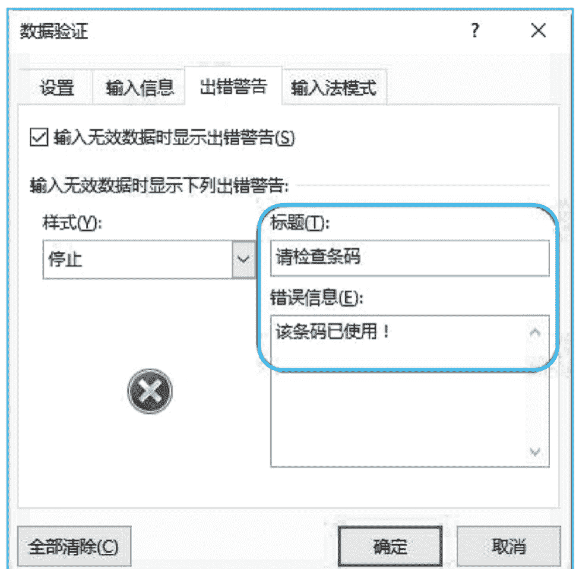

图1-66

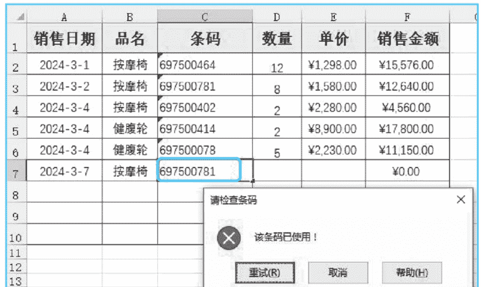

图1-67

### 1.3.7 DeepSeek指导禁止录入周末日期

如图1-68所示，通过设置验证，实现在输入加班日期时禁止输入周末日期。依然可以在DeepSeek中提问获取公式。

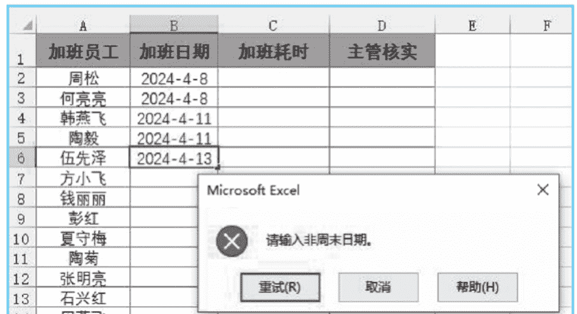

图1-68

❶在DeepSeek聊天对话框中输入“在Excel中，要求在B列中禁止输入周末日期，否则弹出错误提示。”，如图1-69所示。送出问题后得到如图1-70所示的回复信息。


图1-69

在Excel中，可以通过 **数据验证（Data Validation）** 功能来实现B列中禁止输入周末日期（即周六和周日），并在输入周末日期时弹出错误提示。具体步骤如下：

#### 步骤 1：设置数据验证规则

1. 选中需要设置的单元格区域（例如 **B2:B20**，或者整列 **B:B**）。
2. 在菜单栏中点击 **数据（Data）** 选项卡。
3. 点击 **数据验证（Data Validation）** 按钮（在Excel 2016及更高版本中，可能显示为“数据验证”或“数据有效性”）。
4. 在弹出的对话框中，切换到 **设置（Settings）** 选项卡。
5. 在 **允许（Allow）** 下拉菜单中选择 **自定义（Custom）**。
6. 在 **公式（Formula）** 框中输入以下公式：

```
excel
=WEEKDAY(B2,2)<6
```

这个公式的作用是检查当前单元格的日期是否为工作日：

- **WEEKDAY(B2,2)** 返回日期的星期几编号（1 表示周一，2 表示周二，...，7 表示周日）。
- **<6** 表示只允许输入周一到周五（编号为1到5）。

#### 步骤 2：设置错误提示

1. 在 **数据验证** 对话框中，切换到 **错误警告（Error Alert）** 选项卡。
2. 勾选 **输入无效数据时显示出错警告（Show error alert after invalid data is entered）**。

图1-70

❷复制DeepSeek中的公式到剪贴板中。回到Excel中，选中要设置的单元格区域，在“数据”选项卡的“数据工具”组中单击“数据验证”按钮，打开“数据验证”对话框。

❸依次设置验证条件：“允许”为“自定义”，将光标定位到“公式”框中，按Ctrl+V组合键粘贴，得到公式“=WEEKDAY(B3,2)<6”，如图1-71所示。

❹切换到“出错警告”标签下，输入想呈现的出错警告信息，如图1-72所示。

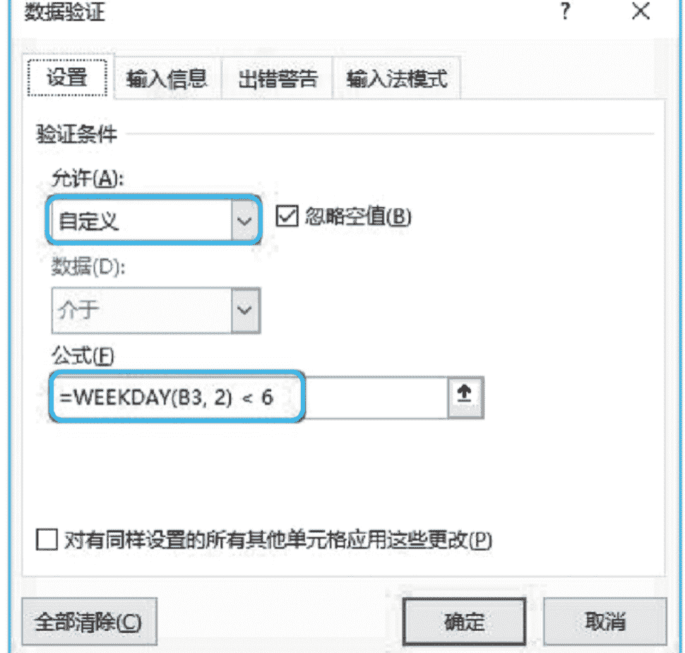

图1-71

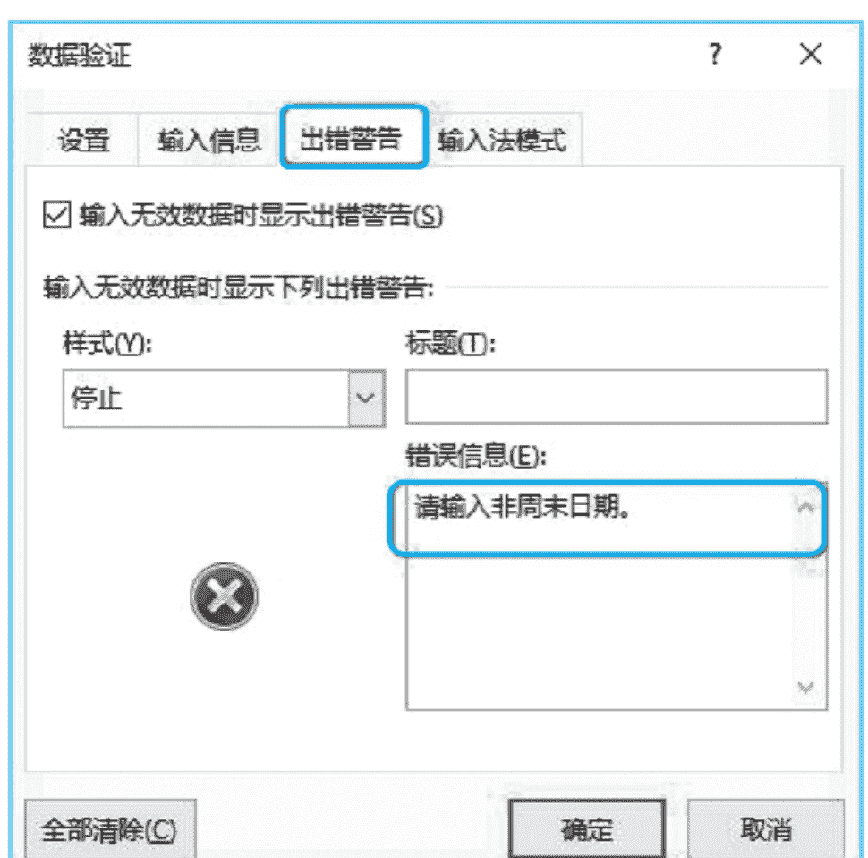

图1-72

❺单击“确定”按钮完成设置，当在这个区域中输入的日期是周末日期时就会弹出错误提示框。

##### 知识扩展

在DeepSeek的回复信息中，对使用的公式也进行了解析（如图1-73所示），可以便于我们对函数的了解与学习。

> 这个公式的作用是检查当前单元格的日期是否为工作日：
- WEEKDAY(B2, 2) 返回日期的星期几编号（1 表示周一，2 表示周二，...，7 表示周日）。
- <6 表示只允许输入周一到周五（编号为1到5）。

图1-73

## 1.4 实用的选择性粘贴功能

当某个数据要在另一个位置使用时，可以将其复制或移动到目标位置，复制粘贴功能是为了提升数据的输入效率而设定的。在数据粘贴时并非只能是原样粘贴，程序还提供了“粘贴选项”与“选择性粘贴”功能，利用它们可以在粘贴的同时达到特定的目的。

### 1.4.1 粘贴时匹配目标区域格式

如果直接复制粘贴数据，数据将保持原样粘贴到目标位置。如果希望复制的数据在粘贴时能自动匹配目标区域的格式，则可以通过“粘贴选项”设置实现。

1. 选中要复制的单元格或单元格区域，按Ctrl+C组合键复制后（如图1-74所示），选中目标位置，按Ctrl+V组合键粘贴，如图1-75所示（默认保持原有格式）。

| 序号 | 费用类别 | 金额 | 部门 | 经办人 |
|---|---|---|---|---|
| 001 | 宣传费 | 865 | 维修部 | 吴玲 |
| 005 | 宣传费 | 2000 | 行政部 | 周芳芳 |
| | 宣传费 | 2865 | | |
| 002 | 交通费 | 78.58 | 客服部 | 周芳芳 |
| 008 | 交通费 | 689 | 行政部 | 张晓丽 |
| | 交通费 | 767.58 | | |
| 003 | 差旅费 | 564.8 | 行政部 | 张晓丽 |
| 007 | 差旅费 | 655.9 | 销售部 | 李云霞 |
| 009 | 差旅费 | 1200 | 销售部 | 李云霞 |
| | 差旅费 | 2420.7 | | |

图1-74

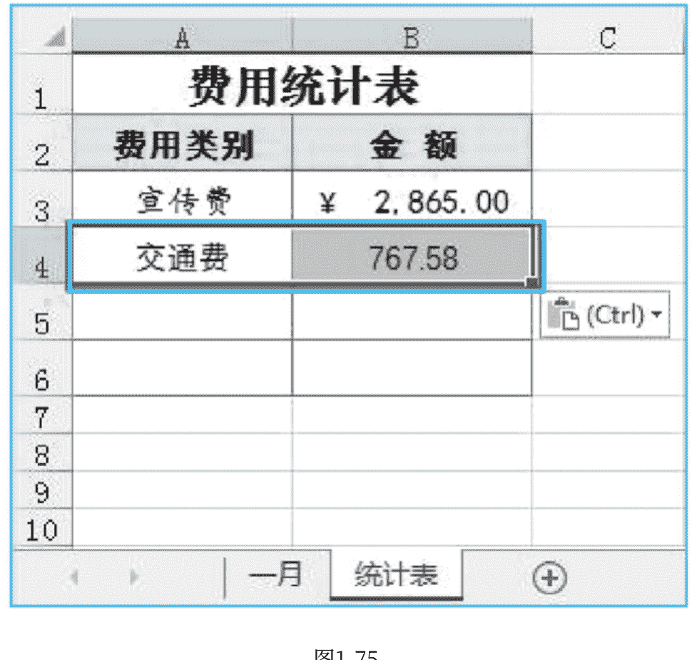

图1-75

❷此时可以出现“粘贴选项”按钮，单击该按钮打开下拉菜单，从下拉菜单中可以选择多个不同的粘贴选项，如此处选择“值”选项（如图1-76所示），即可实现让粘贴的数据与目标位置的数据格式匹配，如图1-77所示。

#### 费用统计表

| 费用类别 | 金额 |
| :--- | :--- |
| 宣传费 | ¥ 2,865.00 |
| 交通费 | 767.58 |

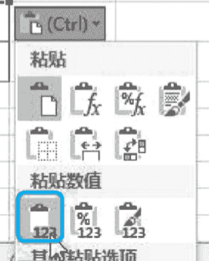

图1-76

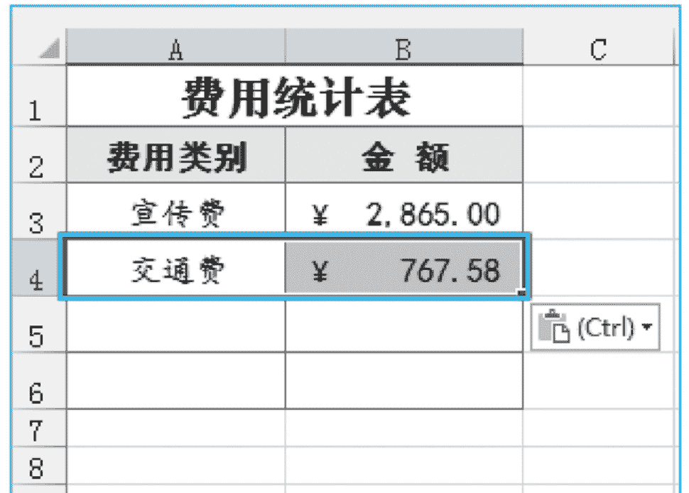

图1-77

### 1.4.2 将公式的计算结果转换为数值

财务统计中通常会用到公式计算，而当计算结果需要移至其他位置使用时，却无法显示正确结果，这是因为公式的计算源丢失了。在这种情况下，要想正确使用公式计算结果数据，可以将其转换为数值。

如图1-78所示的D列为公式计算结果，下面要将其转换为数值。

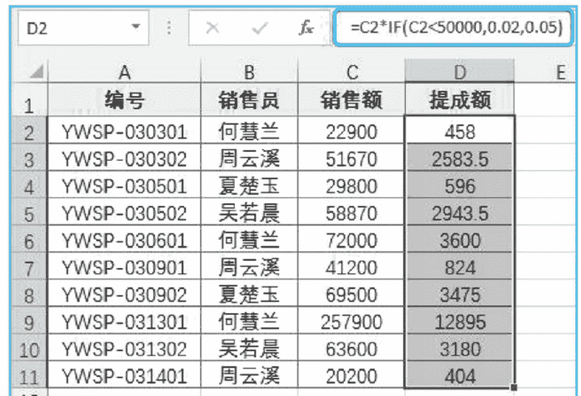

图1-78

1. 选中要转换为数值的单元格区域，按Ctrl+C组合键进行复制。
2. 在“开始”选项卡的“剪贴板”组中单击“粘贴”按钮，在弹出的下拉菜单中的“粘贴数值”区域单击“值”（如图1-79所示），即可将公式的计算结果转换为数值，如图1-80所示。

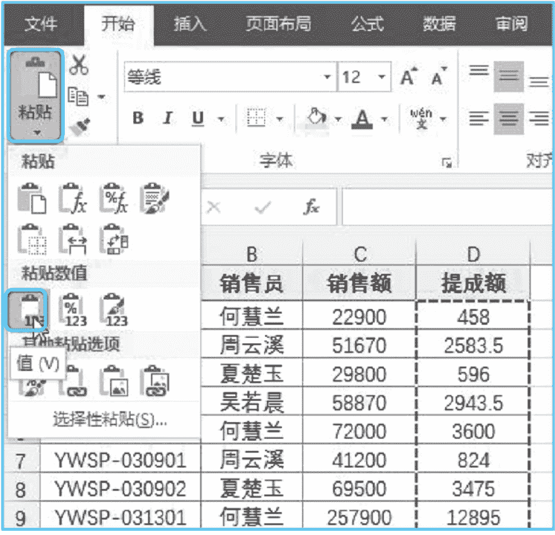

图1-79

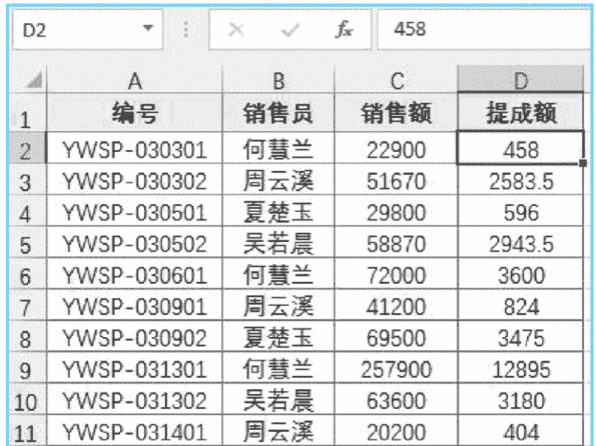

图1-80

### 1.4.3 保持两表数据链接

将其他位置的数据复制到目标单元格区域时，数据默认是当时复制的状态，即当原数据发生变化时不对复制来的数据产生任何影响。但是在关联性较强的表格中，对数据的及时更新要求很高，这时候就要选择“粘贴链接”的粘贴格式。

如图1-81所示的表格是对销售员的销售金额记录的表格，当需要进行销售业绩奖金计算时，需要复制使用此表的数据，此时可在复制时保持二者链接，当销售数量发生变化时，两表的销售金额都会发生变化，如图1-82所示。

| 销售员 | 销售数量 | 销售金额 |
|---|---|---|
| 程又佳 | 11 | 34089 |
| 郑九章 | 13 | 40287 |
| 李琰 | 0 | 0 |
| 黄永松 | 8 | 24792 |
| 黄勇 | 7 | 21693 |
| 张伟 | 14 | 43386 |
| 方海波 | 6 | 18594 |
| 张岩 | 9 | 27891 |
| 刘筱筱 | 10 | 30990 |
| 吴依 | 9 | 27891 |

图1-81

| 销售员姓名 | 总销售额 | 业绩奖金 | 本月最佳销售奖金归属 |
| :--- | :--- | :--- | :--- |
| 程又佳 | 34089 | 3408.9 | |
| 郑九章 | 40287 | 4028.7 | |
| 李琰 | 0 | 0 | |
| 黄永松 | 24792 | 2479.2 | |
| 黄勇 | 21693 | 2169.3 | |
| 张伟 | 43386 | 4338.6 | 800 |
| 方海波 | 18594 | 1859.4 | |
| 张岩 | 27891 | 2789.1 | |
| 刘筱筱 | 30990 | 3099 | |
| 吴依 | 27891 | 2789.1 | |

图1-82

❶ 在“销售统计表”中选择C2:C11单元格区域，按Ctrl+C组合键复制数据，如图1-83所示。

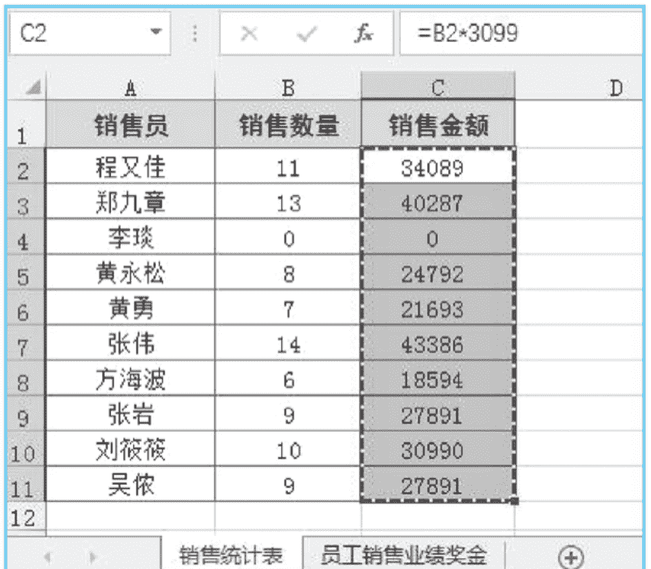

图1-83

❷切换到“员工销售业绩奖金”工作表，选中B3单元格，在“开始”选项卡的“剪贴板”组中单击“粘贴”按钮，在弹出的下拉菜单中单击“粘贴链接”命令（如图1-84所示），单击即可以链接方式粘贴。

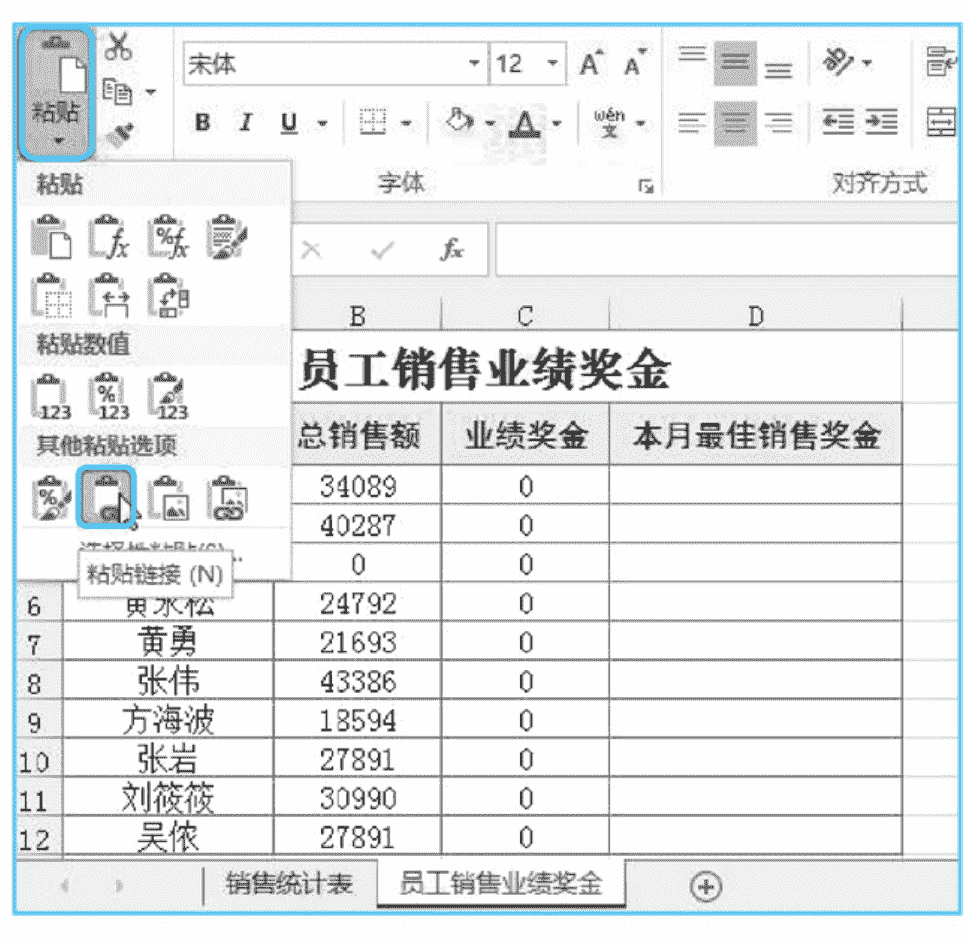

图1-84

❸此时粘贴的数据与原数据是相链接的（可以看到复制来的数据在公式编辑框中自动生成公式，如图1-85所示），假设“销售统计表”中的数据被更改，如“李琰”的总销售额更改为“3099”，“员工销售业绩奖金”工作表中的数据则自动更改，如图1-86所示。

#### 员工销售业绩奖金

| 销售员姓名 | 总销售额 | 业绩奖金 | 本月最佳销售奖金 |
| :--- | :--- | :--- | :--- |
| 程又佳 | 34089 | 3408.9 | |
| 郑九章 | 40287 | 4028.7 | |
| 李琰 | 0 | 0 | |
| 黄永松 | 24792 | 2479.2 | |
| 黄勇 | 21693 | 2169.3 | |
| 张伟 | 43386 | 4338.6 | 800 |
| 方海波 | 18594 | 1859.4 | |
| 张岩 | 27891 | 2789.1 | |
| 刘筱筱 | 30990 | 3099 | |
| 吴依 | 27891 | | |

图1-85

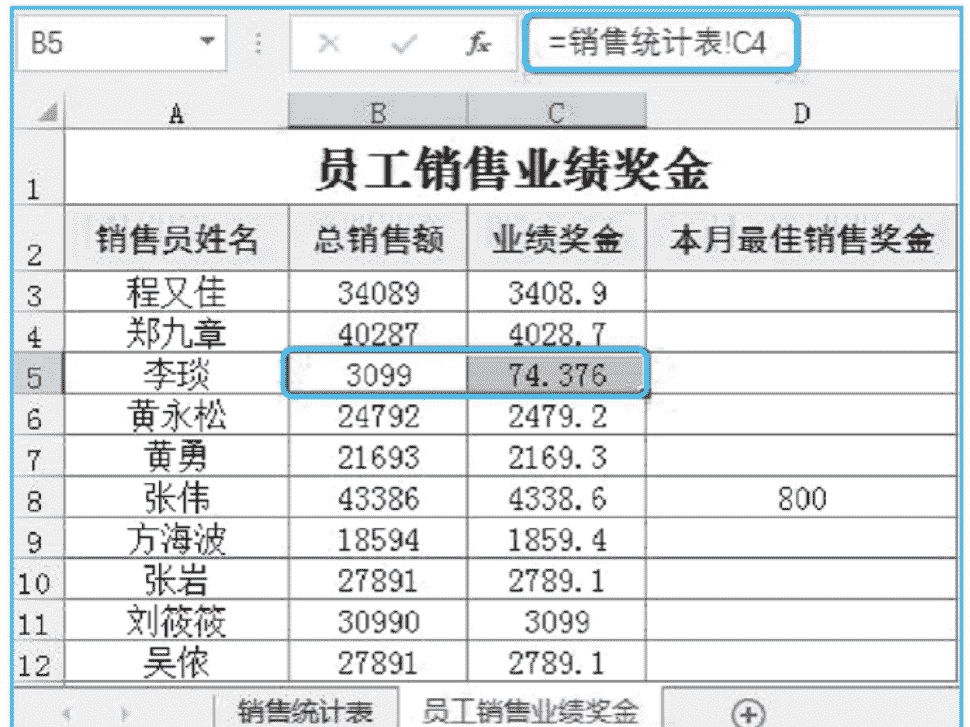

图1-86

### 1.4.4 DeepSeek指导单元格区域进行批量运算

在数据处理过程中，有时会出现一个区域的数据需要同增同减一个具体值的情况，如产品单价统一上涨、基本工资额统一增加等。针对大数据而言，如果采用手工输入显然是不明智的。解决此问题有多种方法，如果对Excel的应用不熟悉，可以在DeepSeek中提问并学习。

❶在DeepSeek聊天对话框中输入“在Excel表格中，想把D列中的进货单价统一上调10%，该如何操作？”，如图1-87所示。送出问题后得到如图1-88所示的回复信息。


图1-87

在 Excel 中将 D 列中的进货单价统一上调 10%，可以通过以下步骤实现：

#### 方法 1：使用公式

1. 选择一个空白列（比如 E 列）。
2. 在 E2 单元格中输入公式（假设 D2 是你的进货单价）：

```
=D2 * 1.1
```

3. 按 Enter 键，然后拖动填充柄（单元格右下角的小方块）向下填充公式，以覆盖整个 E 列。
4. 复制 E 列的数据：
    - 选择 E 列中计算出的所有单元格。
    - 右键点击选择“复制”。
    - 选择 D 列相应区域（从 D2 开始到最后一个需要更新的单元格）。
    - 右键点击选择“粘贴值”。
5. 删除 E 列（如果不再需要）。

#### 方法 2：使用粘贴特殊功能

1. 在任意单元格中输入值 1.1。
2. 复制该单元格（包含 1.1 的单元格）。
3. 选择 D 列中的所有单元格（从 D2 开始到最后一个需要更新的单元格）。
4. 点击“粘贴”下拉菜单，选择“粘贴特殊”。
5. 在“粘贴特殊”对话框中，选择“乘”选项，然后点击“确定”。
    - 这会将 D 列中的每个单元格的值乘以 1.1，实现统一上调 10%。

##### 注意事项

- 备份数据：操作前最好备份原始数据，以防出现意外错误。
- 检查结果：完成操作后，检查几行数据以确保计算正确。

图1-88

从上面的截图可以看出DeepSeek给出两个方案来解决此问题，读者都可以尝试学习操作，进而选择最合适自己的方案。例如这里我们采用方法2来操作。

❷回到Excel中，在空白单元格中输入数字“1.1”（即110%），然后按Ctrl+C组合键进行复制，接着选中进货单价的单元格区域。

❸在“开始”选项卡的“剪贴板”组中单击“粘贴”按钮，在打开的下拉菜单中单击“选择性粘贴”命令，如图1-89所示。

❹打开“选择性粘贴”对话框，在“运算”栏中选中“乘”单选按钮，如图1-90所示。

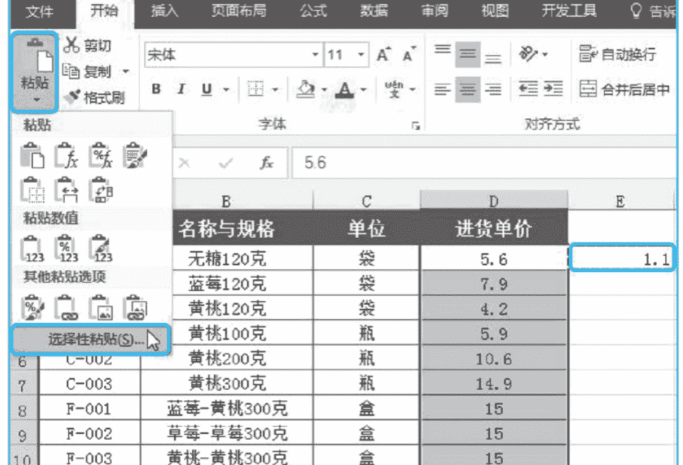

图1-89


图1-90

❺单击“确定”按钮，就可以看到所有被选中的单元格同时进行了乘1.1的运算，结果如图1-91所示。

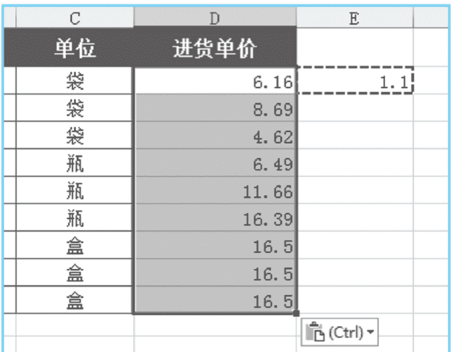

图1-91

##### 专家提示

很多时候在编辑表格时会发现输入数据时受到限制，总是弹出阻止输入对话框，这时应该想到这部分数据是不是从哪里复制得到的，它们是不是被设置了数据验证条件。遇到这种情况只要选中单元格区域，打开“数据验证”对话框，单击左下角的“全部删除”按钮即可。

##### 知识扩展

除了同乘同一数据，还可以同加、同减或同除同一数据。本例中是对所有数据同乘同一数据，如果要同加或同减、同除同一数据都可以按此方法来实现，主要在于“选择性粘贴”对话框中运算法的选择。

如图1-92所示，将养老保险金额在原有基础上统一减少50元。在空白位置输入数字50，然后按相同的方法操作，到步骤❹时选中“加”单选按钮，再单击“确定”按钮即可。

| | A | B | C | D | E | F |
|---|---|---|---|---|---|---|
| 1 | | | 员工社保缴费表 | | | |
| 2 | 姓名 | 部门 | 养老保险 | 医疗保险 | 失业保险 | 合计 |
| 3 | 王琪 | 行政部 | 232 | 68 | 29 | 329 |
| 4 | 陈潇 | 行政部 | 156 | 49 | 19.5 | 224.5 |
| 5 | 张点点 | 行政部 | 124 | 41 | 15.5 | 180.5 |
| 6 | 于青青 | 财务部 | 264 | 76 | 33 | 373 |
| 7 | 邓兰兰 | 财务部 | 156 | 49 | 19.5 | 224.5 |
| 8 | 罗羽 | 财务部 | 100 | 35 | 12.5 | 147.5 |
| 9 | 蔡静 | 客户部 | 236 | 69 | 29.5 | 334.5 |
| 10 | 陈媛 | 客户部 | 232 | 68 | 29 | 329 |
| 11 | 王密 | 客户部 | 180 | 55 | 22.5 | 257.5 |
| 12 | 吕芬芬 | 客户部 | 100 | 35 | 12.5 | 147.5 |
| 13 | 路高泽 | 客户部 | 236 | 69 | 29.5 | 334.5 |
| 14 | 岳庆洁 | 客户部 | 224 | 68 | 27.5 | 319.5 |
| 15 | 李雪儿 | 客户部 | 156 | 49 | 19.5 | 224.5 |
| 16 | 陈山 | 客户部 | 124 | 41 | 15.5 | 180.5 |

图1-92

# 第2章 财务数据的整理与分析


扫码看教学视频

拥有正确并且规范的源数据表是数据分析的基础。然而，日常财务工作中的数据来源各不相同，难免会出现众多不规范的数据，因此，我们不仅要学习建立规范的表格，还要会处理一些不规范的数据，将数据整理到程序可识别的状态。这样，我们才能更好地运用Excel内置的筛选、分类汇总、多维透视分析等工具，从而高效地辅助日常财务工作。

- 学会规范建表
- 整理不规范的数据
- 筛选满足条件的数据
- 数据的分类汇总
- 多维度透视分析工具

## 2.1 学会规范建表

表格的原始数据是数据统计、计算的基础，财务数据的处理过程也不例外。当数据量较大时，各环节中最关键、最复杂，甚至直接决定最终报表质量的就是数据处理环节。因此，在创建表格时应当遵循一定的规范，数据规范、格式规范将会给后期的数据处理带来很多便利。

### 2.1.1 数据格式要规范

数据格式规范是建表的首要要求，表格中的各类数据使用规范的格式，数字就使用常规或数值型的格式，而不应使用文本型的格式。例如日期型格式不能输入“20240325”“2024.3.25”“24.3.25”等不规范的格式，否则在后期数据处理时，就会出现无法运算、运算错误的现象。

#### 例1：

如图2-1所示，要根据所输入的入职时间来计算工龄，同时计算工龄工资，由于当前的入职日期不是程序能识别的日期格式，因此导致后面的公式计算错误（F列与G列都是引用了E列的数据进行计算），如图2-1所示。

### 2.1.2 表格结构要规范

结构规范也是创建表格的注意要点。对用于计算分析的表格，不要随意使用合并单元格，因为这样的结构会破坏表格的连续性，从而导致数据源在后续的数据处理或分析中，都有可能会出现出错的情况。

#### 例1：

如图2-5所示的数据源，在日常工作中应该比较常见。如果只是用来显示数据，没有什么问题，但是如果填充序号，就会出现无法填充的情况，如图2-6所示；如果利用数据透视表合并统计分析，统计结果也会出错，如图2-7所示。

| 产品代码 | 日期 | 订单量 | 销售员 |
| :--- | :--- | :--- | :--- |
| ASP0021361 | 2024-6-12 | 956 | 李杰 |
| | 2024-6-14 | 105 | 林瑞洋 |
| | 2024-6-19 | 360 | 崔娜 |
| ASP0021354 | 2024-6-14 | 521 | 李杰 |
| ASP5791311 | 2024-6-19 | 36 | 王加佳 |
| | 2024-6-20 | 540 | 何小芸 |
| ASP5701987 | 2024-6-5 | 369 | 林瑞洋 |
| | 2024-6-10 | 655 | 崔娜 |
| ASP632100 | 2024-6-5 | 541 | 李杰 |

图2-5

#### 例2：

在多表联动的工作簿中，也应注意保持结构的统一。例如想汇总年工资额，所有月份工资表中的数据都应保持同样的格式（如图2-8所示），这样才能方便使用函数（如图2-9所示，“12月”工作表第一位员工的实发工资在T3单元格）。如果各表的结构不一样，那么可能各月的实发工资就不一定都在T列中，甚至员工的顺序也不一样，这样混乱的数据肯定无法使用SUM函数一次性求解全年实发工资。所以就需要将公式编辑为“=‘1月’!G4+‘2月’!H3+…+‘12月’!T3”这种形式，这种形式完全靠手工编辑、肉眼寻找，可想而知其困难程度，并且计算也容易出错。

### 2.1.3 数据应具有统一性

数据表中的名称应具有统一性，不能使用各自不同的名称，比如有的使用全称，有的又使用简称；有的制作者不够细心，在名称中多添加了空格符号等。这些操作都会造成统计结果的错误。

例如，如图2-10所示的“诺航公司合同登记台账”中“安徽新世纪电子有限公司”与“新世纪电子有限公司”实际为同一家公司，但写成两种名称，对于Excel来说就是两家公司，在行数求和、分类汇总（如图2-11所示）、数据透视表进行数据加工时就会出现错误。

#### 诺航公司订单统计表

| 日期 | 合同号 | 客户名称 | 商品名称 | 颜色 | 金额 |
|---|---|---|---|---|---|
| 2020/1/1 | 20200001 | 安徽新世纪电子有限公司 | 商品A | 红 | 1592.0 |
| 2020/1/8 | 20200002 | 安徽新世纪电子有限公司 | 商品A | 红 | 2592.0 |
| 2020/1/8 | 20200008 | 安徽新世纪电子有限公司 | 商品CCC | 灰 | 6951.0 |
| 2020/1/11 | 20200003 | 江苏新科电子有限公司 | 商品BB | 黑 | 3965.9 |
| 2020/1/20 | 20200005 | 新世纪电子有限公司 | 商品A | 红 | 5628.0 |
| 2020/1/21 | 20200006 | 学舟软件科技有限公司 | 商品BB | 灰 | 2569.0 |
| 2020/2/2 | 20200007 | 学舟软件科技有限公司 | 商品A | 红 | 6952.0 |
| 2020/2/15 | 20200009 | 江苏新科电子有限公司 | 商品A | 黑 | 5589.0 |
| 2020/2/21 | 20200010 | 江苏新科电子有限公司 | 商品CCC | 红 | 8720.0 |
| 2020/3/7 | 20200011 | 学舟软件科技有限公司 | 商品A | 黑 | 5899.3 |
| 2020/3/21 | 20200012 | 学舟软件科技有限公司 | 商品A | 红 | 2592.3 |
| 2020/3/21 | 20200004 | 新世纪电子有限公司 | 商品CCC | 红 | 5962.0 |
| 2020/3/30 | 20200013 | 江苏新科电子有限公司 | 商品CCC | 红 | 5862.0 |

图2-10

| 日期 | 合同号 | 客户名称 | 商品名称 | 颜色 | 金额 |
|---|---|---|---|---|---|
| 2020/1/21 | 20200006 | 学舟软件科技有限公司 | 商品BB | 灰 | 2569.0 |
| 2020/2/2 | 20200007 | 学舟软件科技有限公司 | 商品A | 红 | 6952.0 |
| 2020/3/7 | 20200011 | 学舟软件科技有限公司 | 商品A | 黑 | 5899.3 |
| 2020/3/21 | 20200012 | 学舟软件科技有限公司 | 商品A | 红 | 2592.3 |
| | | **学舟软件科技有限公司 汇总** | | | 18012.6 |
| 2020/3/21 | 20200004 | 新世纪电子有限公司 | 商品CCC | 红 | 5962.0 |
| 2020/1/20 | 20200005 | 新世纪电子有限公司 | 商品A | 红 | 5628.0 |
| | | **新世纪电子有限公司 汇总** | | | 11590.0 |
| 2020/1/11 | 20200003 | 江苏新科电子有限公司 | 商品BB | 黑 | 3965.9 |
| 2020/2/15 | 20200009 | 江苏新科电子有限公司 | 商品A | 黑 | 5589.0 |
| 2020/2/21 | 20200010 | 江苏新科电子有限公司 | 商品CCC | 红 | 8720.0 |
| 2020/3/30 | 20200013 | 江苏新科电子有限公司 | 商品CCC | 红 | 5862.0 |
| | | **江苏新科电子有限公司 汇总** | | | 24136.9 |
| 2020/1/1 | 20200001 | 安徽新世纪电子有限公司 | 商品A | 红 | 1592.0 |
| 2020/1/8 | 20200002 | 安徽新世纪电子有限公司 | 商品A | 红 | 2592.0 |
| 2020/1/8 | 20200008 | 安徽新世纪电子有限公司 | 商品CCC | 灰 | 6951.0 |
| | | **安徽新世纪电子有限公司 汇总** | | | 11135.0 |
| | | **总计** | | | 64874.5 |

图2-11

再例如“日期”列下的数据定义为“1月”，另一个定义为“一月”，这样显然会导致数据在进行统计分析时无法找到统一的标识，统计结果也是错的，如图2-12所示。

### 2.1.4 不破坏数据的连续性

各记录间不能有空行空列，这样会破坏数据的连续性，会给数据计算和分析带来不便。如图2-13所示，添加了合计行，那么这样的数据表在排序、筛选、分类汇总、数据透视表等操作时都会有所不便。因此不要破坏数据的连续性，待到数据表建立完成后，需要统计时再使用合并计算或数据透视表瞬间轻松实现。

| 日期 | 费用类别 | 产生部门 | 支出金额 | 负责人 |
|---|---|---|---|---|
| 2020/4/1 | 办公用品采购费 | 企划部 | ¥8,200 | 张飞玉 |
| 2020/4/11 | 差旅费 | 销售部 | ¥1,500 | 王磊 |
| 2020/4/19 | 办公用品采购费 | 人事部 | ¥550 | 何玲玲 |
| 2020/4/25 | 办公用品采购费 | 行政部 | ¥1,050 | 章敏 |
| 2020/4/28 | 招聘培训费 | 人事部 | ¥1,200 | 程亚飞 |
| **合计** | | | | |
| 2020/5/5 | 会务费 | 财务部 | ¥560 | 王海燕 |
| 2020/5/11 | 差旅费 | 企划部 | ¥5,400 | 周易 |
| 2020/5/16 | 招聘培训费 | 人事部 | ¥2,800 | 华愉悦 |
| 2020/5/21 | 业务拓展费 | 人事部 | ¥1,400 | 李明 |
| 2020/5/25 | 办公用品采购费 | 行政部 | ¥1,600 | 于丽 |
| 2020/5/30 | 福利品采购费 | 财务部 | ¥500 | 陈强 |
| **合计** | | | | |

图2-13

### 2.1.5 要会整理为二维表

在日常工作中我们应该经常看到如图2-14所示的表格，这种表格先对本日的数据进行统计运算，再填入表格。但实际上这并不是很好的处理办法，明明是很简易的一张表格，却被处理得非常烦琐，使表格重复汇总。

仔细看不难发现，表格中“产品”“销售部门”“数量”“金额”是表格的关键字段，而“销售1部”“销售2部”“销售3部”属于同一属性数据，因此应该记录于同一列中。这里没必要分部门对各产品进行“数量”“金额”的汇总，先把表格做成明细型表格，想要怎样的汇总结果都能轻而易举地做到。

1. 我们可以化繁为简，将图2-14所示的表还原为如图2-15所示的明细表。
2. 按相同的方法把每一张分日统计的报表都还原到明细表中，图2-16所示为将3日的报表整理后得到的明细表。

| 日期 | 产品 | 销售部门 | 数量 | 金额 |
|---|---|---|---|---|
| 2024-2-1 | 通用别克-别克GL8 | 销售1部 | 2 | 485,000 |
| 2024-2-1 | 通用别克-君越 | 销售1部 | 1 | 158,000 |
| 2024-2-1 | 通用别克-林荫大道 | 销售1部 | 1 | 369,000 |
| 2024-2-1 | 通用别克-英朗 | 销售1部 | 1 | 154,000 |
| 2024-2-1 | 通用别克-君威 | 销售2部 | 3 | 608,000 |
| 2024-2-1 | 通用别克-英朗 | 销售2部 | 1 | 308,000 |
| 2024-2-1 | 通用别克-君威 | 销售3部 | 1 | 210,000 |
| 2024-2-1 | 通用别克-凯越 | 销售3部 | 1 | 110,000 |
| 2024-2-1 | 通用别克（进口）-昂科雷 | 销售3部 | 1 | 508,000 |

图2-15

| 日期 | 产品 | 销售部门 | 数量 | 金额 |
|---|---|---|---|---|
| 2024-2-1 | 通用别克-别克GL8 | 销售1部 | 2 | 485,000 |
| 2024-2-1 | 通用别克-君越 | 销售1部 | 1 | 158,000 |
| 2024-2-1 | 通用别克-林荫大道 | 销售1部 | 1 | 369,000 |
| 2024-2-1 | 通用别克-英朗 | 销售1部 | 1 | 154,000 |
| 2024-2-1 | 通用别克-君威 | 销售2部 | 3 | 608,000 |
| 2024-2-1 | 通用别克-英朗 | 销售2部 | 1 | 308,000 |
| 2024-2-1 | 通用别克-君威 | 销售3部 | 1 | 210,000 |
| 2024-2-1 | 通用别克-凯越 | 销售3部 | 1 | 110,000 |
| 2024-2-1 | 通用别克（进口）-昂科雷 | 销售3部 | 1 | 508,000 |
| 2024-2-2 | 通用别克-君越 | 销售1部 | 1 | 158,000 |
| 2024-2-2 | 通用别克-林荫大道 | 销售1部 | 2 | 369,000 |
| 2024-2-2 | 通用别克-英朗 | 销售1部 | 1 | 154,000 |
| 2024-2-2 | 通用别克-君威 | 销售2部 | 3 | 608,000 |
| 2024-2-2 | 通用别克-英朗 | 销售2部 | 2 | 308,000 |
| 2024-2-2 | 通用别克-别克GL8 | 销售3部 | 3 | 675,000 |
| 2024-2-2 | 通用别克-凯越 | 销售3部 | 1 | 110,000 |
| 2024-2-2 | 别克（进口）-昂科雷 | 销售3部 | 1 | 508,000 |
| 2024-2-3 | 通用别克-别克GL8 | 销售1部 | 1 | 242,500 |
| 2024-2-3 | 通用别克-君越 | 销售1部 | 1 | 158,000 |
| 2024-2-3 | 通用别克-林荫大道 | 销售1部 | 2 | 369,000 |
| 2024-2-3 | 通用别克-君威 | 销售2部 | 1 | 210,000 |
| 2024-2-3 | 通用别克-君越 | 销售2部 | 1 | 158,000 |
| 2024-2-3 | 通用别克-英朗 | 销售2部 | 2 | 308,000 |
| 2024-2-3 | 通用别克-别克GL8 | 销售3部 | 2 | 485,000 |
| 2024-2-3 | 别克（进口）-昂科雷 | 销售3部 | 1 | 508,000 |

图2-16

有了这个明细表，才便于我们对所有销售数据进行汇总统计，无论是使用函数、数据透视表、分类汇总功能都可以实现。

如图2-17所示是利用数据透视表按部门统计的报表，统计结果一目了然。

如图2-18所示是利用数据透视表按日期统计的报表。

| 销售部门 | 产品 | 求和项:数量 |
| :--- | :--- | :--- |
| 销售1部 | | 13 |
| | 通用别克-别克GL8 | 3 |
| | 通用别克-君越 | 3 |
| | 通用别克-林荫大道 | 5 |
| | 通用别克-英朗 | 2 |
| 销售2部 | | 13 |
| | 通用别克-君威 | 7 |
| | 通用别克-君越 | 1 |
| | 通用别克-英朗 | 5 |
| 销售3部 | | 11 |
| | 别克(进口)-昂科雷 | 2 |
| | 通用别克（进口）-昂科雷 | 1 |
| | 通用别克-别克GL8 | 5 |
| | 通用别克-君威 | 1 |
| | 通用别克-凯越 | 2 |
| 总计 | | 37 |

图2-17

## 2.2 整理不规范的数据

就财务管理本身的职业特征看来，它具有很强的严谨性和规范性，所以在财务工作的处理过程中，它要求每一个环节都有数据可循，每一个数据都是准确而清晰的。由于数据来源的不同，难免经常会遇到一些不规范的数据表格，这种情况下一定要对数据进行编辑整理，以形成规范表格，才有利于在Excel中利用各种分析工具快速得出统计分析结果。

### 2.2.1 DeepSeek辅助处理空白单元格

从数据库或其他途径导出来的数据经常会出现某行或者某列中有空单元格的情况，一般这些空行都需要整理，从而形成规范的、方便分析的表格。

当前表格如图2-20所示，只要一行数据中有一个空单元格就将整行删除。若没有操作方法，我们可以通过在DeepSeek中提问来获取答案。

| A | B | C | D |
|---|---|---|---|
| 日期 | 凭证号 | 凭证摘要 | 借方 |
| | | 年初余额 | |
| 1月2日 | 记账凭证2 | 财务部报销费 | 5000.00 |
| 1月2日 | 记账凭证3 | 税费缴纳 | 340.00 |
| 1月2日 | | 合计 | 12230.00 |
| | | | |
| 1月4日 | 记账凭证4 | 工程部签证费 | 3110.00 |
| 1月4日 | 记账凭证3 | 税费缴纳 | 3120.00 |
| 1月4日 | | 合计 | 408790.00 |
| | | | |
| 1月5日 | 记账凭证34 | 设计部报销费 | 2900.00 |
| 1月5日 | 记账凭证80 | 利息计算 | 3900.00 |
| 1月5日 | | 合计 | 4000.00 |
| | | | |
| 1月8日 | 记账凭证4 | 工程部签证费 | 3880.00 |
| 1月8日 | 记账凭证78 | 土地征用税 | 5000.00 |
| 1月8日 | 记账凭证3 | 税费缴纳 | 4300.00 |
| 1月8日 | 记账凭证80 | 利息计算 | 5000.00 |
| 1月8日 | | 合计 | 33900.00 |
| | | | |
| 1月11日 | 记账凭证34 | 设计部报销费 | 3210.00 |
| 1月11日 | 记账凭证3 | 税费缴纳 | 2290.00 |

图2-20

❶在DeepSeek聊天对话框中输入“在Excel中，检查每一行是否有空白单元格，如果有就将该行删除，如何一次性完成该操作？”，如图2-21所示。送出问题后得到如图2-22所示的回复信息。

在Excel中，检查每一行是否有空白单元格，如果有就将该行删除，如何一次性完成该操作？

图2-21

是的，可以通过 **查找和定位** 功能结合 **删除行** 操作来实现删除包含空白单元格的行。以下是具体步骤：

#### 方法：使用查找和定位功能

- 1. 选中数据区域：
  - 选中包含数据的区域（例如 A1:D100），或者直接选中整个工作表（按 **Ctrl + A**）。
- 2. 打开查找和定位功能：
  - 按 **Ctrl + G** 打开“定位”对话框。
  - 点击 **定位条件（Special）**，在弹出的对话框中选择 **空值（Blanks）**，然后点击 **确定**。此时所有空白单元格会被选中。
- 3. 删除包含空白单元格的行：
  - 保持空白单元格的选中状态，右键点击任意选中的空白单元格。
  - 选择 **删除（Delete）**，在弹出的对话框中选择 **整行（Entire row）**，然后点击 **确定**。

##### 注意事项

- 1. 适用范围：
  - 该方法适用于删除所有包含空白单元格的行。如果只需要删除特定列中包含空白单元格的行，可以先选中特定列，再进行定位和删除操作。

图2-22

❷回到Excel中，按照DeepSeek给出的操作步骤，选中目标数据区域，打开“定位”对话框，如图2-23所示。单击“定位条件”按钮，打开“定位条件”对话框。选中“空值”单选按钮，如图2-24所示。

图2-23

图2-24

❸单击“确定”按钮回到工作表中，可以看到选中了表格中的所有空白单元格。在选中的任意空白单元格上单击鼠标右键，在弹出的菜单中单击“删除”命令（如图2-25所示），打开“删除”对话框。单击“整行”命令，如图2-26所示。

❹单击“确定”按钮完成设置，此时可以看到原先的空单元格所在行全部被删除，如图2-27所示。

图2-25

图2-26

| A | B | C | D |
|---|---|---|---|
| **日期** | **凭证号** | **凭证摘要** | **借方** |
| 1月2日 | 记账凭证2 | 财务部报销费 | 5000.00 |
| 1月2日 | 记账凭证3 | 税费缴纳 | 340.00 |
| 1月4日 | 记账凭证4 | 工程部签证费 | 3110.00 |
| 1月4日 | 记账凭证3 | 税费缴纳 | 3120.00 |
| 1月5日 | 记账凭证34 | 设计部报销费 | 2900.00 |
| 1月5日 | 记账凭证80 | 利息计算 | 3900.00 |
| 1月8日 | 记账凭证4 | 工程部签证费 | 3880.00 |
| 1月8日 | 记账凭证78 | 土地征用税 | 5000.00 |
| 1月8日 | 记账凭证3 | 税费缴纳 | 4300.00 |
| 1月8日 | 记账凭证80 | 利息计算 | 5000.00 |
| 1月11日 | 记账凭证34 | 设计部报销费 | 3210.00 |
| 1月11日 | 记账凭证3 | 税费缴纳 | 2290.00 |

图2-27

如果经常需要整理这样的数据，还可以在DeepSeek中获取VBA代码，在Excel中建立一个宏，从而实现需要处理此问题时，只要运行宏即可。

❶在DeepSeek聊天对话框中输入“使用VBA代码，判断选中的数据区域中每一行中是否含有空白单元格，如果有就将本行删除。”，如图2-28所示。送出问题后得到如图2-29所示的回复信息。

图2-28

以下是使用 VBA 代码实现判断选中的数据区域中每一行是否含有空白单元格，并删除包含空白单元格的行的完整解决方案：

##### VBA 代码

```
Sub DeleteRowsWithBlankCellsInSelection()
    Dim rng As Range
    Dim row As Range
    Dim cell As Range
    Dim hasBlank As Boolean
    Dim i As Long

    ' 检查是否选中了区域
    On Error Resume Next
    Set rng = Selection
    On Error GoTo 0

    If rng Is Nothing Then
        MsgBox "请先选中一个区域！", vbExclamation
        Exit Sub
    End If

    ' 从最后一行向上遍历
    For i = rng.Rows.Count To 1 Step -1
        hasBlank = False
        ' 检查当前行是否有空白单元格
        For Each cell In rng.Rows(i).Cells
            If IsEmpty(cell) Then
                hasBlank = True
                Exit For
            End If
        Next cell
        ' 如果有空白单元格，删除整行
        If hasBlank Then
            rng.Rows(i).Delete
        End If
    Next i
End Sub
```

图2-29

❷ 鼠标指针指向编码区域，右上角出现复制按钮，单击一次复制代码。

❸打开工作表，在“开发工具”选项卡中单击Visual Basic按钮（或者按Alt+F11组合键）开启Microsoft Visual Basic for Applications视窗，在工具栏中单击“插入用户窗体”按钮（）的下拉按钮，选择“模块”（如图2-30所示），创建一个新模块，将光标定位到模块编辑区域中，按Ctrl+V组合键粘贴代码，如图2-31所示。

图2-30

图2-31

❹粘贴代码后，单击工具栏中的“保存”按钮，关闭Microsoft Visual Basic for Applications视窗。

❺在本工作簿中，任意数据表需要执行删除空单元格的操作时，只要选中数据区域，在“开发工具”选项卡中单击“宏”按钮（如图2-32所示），打开“宏”对话框，选中刚才编辑的宏，单击“执行”按钮（如图2-33所示），可以看到此时得到了删除空白单元格后的表格，如图2-34所示。

图2-32

图2-33

| A | B | C | D | E | F | G | H | I |
|---|---|---|---|---|---|---|---|---|
| 姓名 | 性别 | 年龄 | 初试时间 | 参加初试 | 初试通过 | 复试时间 | 参加复试 | 复试通过 |
| 应聘者4 | 女 | 33 | 2023-12-14 | 是 | 是 | 2023-12-19 | 是 | 是 |
| 应聘者10 | 男 | 31 | 2024-3-8 | 是 | 是 | 2024-3-13 | 是 | 是 |
| 应聘者13 | 男 | 28 | 2024-3-10 | 是 | 是 | 2024-3-13 | 是 | 是 |
| 应聘者18 | 男 | 22 | 2024-3-25 | 是 | 是 | 2024-3-28 | 是 | 是 |

图2-34

##### 专家提示

通过编辑Excel中的VBA代码，我们可以完成很多重复性的任务，从而提高工作效率。但如果没有DeepSeek的帮助，许多人宁愿舍弃这些自动化的功能，因为自己可能不擅长编写代码。有了DeepSeek就不一样了，只要学会描述问题，它就能帮我们生成代码，我们要操作的就是复制、粘贴、运行这些简单的工作了。因此，读者也可以通过此方法举一反三，将自己的需求整理好，然后向DeepSeek提问，从而获取能解决问题的代码。

##### 知识扩展

包含VBA代码的Excel文件需要将其保存为启用宏的工作簿才可以运行代码。在打开“另存为”对话框后，设置好保存位置与文件名，单击“保存类型”右侧的下拉按钮，选择文件类型为“Excel启用宏的工作簿”，如图2-35所示。

图2-35

### 2.2.2 处理重复值、重复记录

数据处理时出现重复值的情况很常见，很多时候需要对重复值进行处理，以得到唯一值的清单或记录。

如果是单列数据中有重复值，可以使用Excel中的“删除重复值”功能快速删除。

❶打开表格后，选中目标数据区域，切换到“数据”选项卡，在“数据工具”组中单击“删除重复值”按钮（如图2-36所示），打开“删除重复值”对话框。

图2-36

❷保持默认选项，单击“确定”按钮（如图2-37所示）即可删除重复值，如图2-38所示。

图2-37

图2-38

另外，有时要根据某一列的数据特征来判断是否有重复值，如图2-39所示的表格的“工号”列有重复值，想将重复值删除，并且只要“工号”列有重复值就删除，而不管后面六列中的数据是否重复。

| 工号 | 姓名 | 出差时间 | 返回时间 | 累计天数 | 补助金额（元） |
|---|---|---|---|---|---|
| 0015 | 陈山 | 2024-3-5 | 2024-3-8 | 3 | ¥360.00 |
| 0016 | 廖晓 | 2024-3-6 | 2024-3-10 | 4 | ¥480.00 |
| 0017 | 张丽君 | 2024-3-8 | 2024-3-13 | 5 | ¥600.00 |
| 0018 | 吴华波 | 2024-3-9 | 2024-3-14 | 5 | ¥600.00 |
| 0019 | 黄孝铭 | 2024-3-12 | 2024-3-16 | 4 | ¥480.00 |
| 0016 | 廖晓 | 2024-3-6 | 2024-3-10 | 4 | ¥480.00 |
| 0021 | 庄霞 | 2024-3-15 | 2024-3-19 | 4 | ¥480.00 |
| 0022 | 王福鑫 | 2024-3-16 | 2024-3-20 | 4 | ¥480.00 |
| 0023 | 王琪 | 2024-3-17 | 2024-3-22 | 5 | ¥600.00 |
| 0021 | 庄霞 | 2024-3-15 | 2024-3-19 | 4 | ¥480.00 |
| 0025 | 杨浪 | 2024-3-20 | 2024-3-25 | 5 | ¥600.00 |

图2-39

❶选中目标数据区域（即A3:F13），在“数据”选项卡的“数据工具”组中单击“删除重复项”按钮（如图2-40所示），弹出“删除重复项”对话框。

❷在“列”区域中选中以哪一列为参照来删除重复值（此处只要是“工号”列有重复值就删除），选中“工号”复选框，其他6项取消选中，如图2-41所示。

#### 月份出差补助统计表

| 工号 | 姓名 | 出差时间 | 返回时间 | 累计天数 | 补助金额（元） |
| :--- | :--- | :--- | :--- | :--- | :--- |
| 0015 | 陈山 | 2021/3/5 | 2021/3/8 | 3 | ¥360.00 |
| 0016 | 廖晓 | 2021/3/6 | 2021/3/10 | 4 | ¥480.00 |
| 0017 | 张丽君 | 2021/3/8 | 2021/3/13 | 5 | ¥600.00 |
| 0018 | 吴华波 | 2021/3/9 | 2021/3/14 | 5 | ¥600.00 |

图2-40

图2-41

❸单击“确定”按钮后弹出提示框，指出有多少重复值被删除，有多少唯一值被保留（如图2-42所示），或未发现重复值，单击“确定”按钮即可完成删除重复值的操作。

图2-42

### 2.2.3 DeepSeek辅助处理一格多属性的数据

一格多属性指的是一列中记录两种或多种不同的数据，这种情况经常会在导入数据时出现。

图2-43展示了一定期间的应收账款数据，在“应收金额”列中同时显示了日期与金额，这样的数据将不便于对到期日期的计算，如果有部分账款到账，也不便于对剩余账款的计算。这种情况下需要对数据进行分列处理，可以通过在DeepSeek中提问来学习解决方案。

| 序号 | 公司名称 | 应收金额(元) | 付款期(天) |
|---|---|---|---|
| 001 | 宏运佳建材公司 | 2024/3/12 23000 | 40 |
| 002 | 拓帆建材有限公司 | 2024/3/12 29000 | 60 |
| 003 | 澳菲斯建材有限公司 | 2024/3/17 50000 | 30 |
| 004 | 孚盛装饰公司 | 2024/3/20 4000 | 10 |
| 005 | 孚盛装饰公司 | 2024/4/3 18500 | 25 |
| 006 | 雅得丽装饰公司 | 2024/4/13 5000 | 15 |
| 007 | 宏运佳建材公司 | 2024/4/14 28000 | 90 |
| 008 | 雅得丽装饰公司 | 2024/4/18 24000 | 60 |
| 009 | 孚盛装饰公司 | 2024/4/28 6000 | 15 |
| 010 | 海兴建材有限公司 | 2024/5/3 8600 | 30 |
| 011 | 宏运佳建材公司 | 2024/5/20 25000 | 15 |
| 012 | 海兴建材有限公司 | 2024/6/22 58000 | 60 |
| 013 | 孚盛装饰公司 | 2024/6/22 5000 | 90 |
| 014 | 澳菲斯建材有限公司 | 2024/7/5 12000 | 20 |

图2-43

❶在DeepSeek聊天对话框中输入“在Excel中，C列中的数据既包含日期又包含金额，并且都用空格间隔，如何将它们分隔为两列数据。”，如图2-44所示。送出问题后得到如图2-45所示的回复信息。

图2-44

在 Excel 中，如果 C 列中的数据包含日期和金额，并且用空格分隔，可以通过 **分列功能** 或 **公式** 将它们分隔为两列数据。以下是两种方法的详细步骤：

#### 方法 1：使用分列功能

1. 选中数据列：
   - 选中 C 列中的数据区域（例如 C2:C20）。
2. 打开分列功能：
   - 在菜单栏中点击 **数据**（Data）选项卡。
   - 点击 **分列**（Text to Columns）按钮。
3. 选择分隔方式：
   - 在弹出的对话框中，选择 **分隔符号**（Delimited），然后点击 **下一步**（Next）。
4. 设置分隔符号：
   - 在分隔符号选项中，勾选 **空格**（Space），然后点击 **下一步**（Next）。
5. 设置目标区域：
   - 在目标区域中选择一个空白列作为起始位置（例如 D2），然后点击 **完成**（Finish）。
6. 调整格式：
   - 分隔后的日期和金额会分别出现在 D 列和 E 列。
   - 如果需要，可以调整日期和金额的格式：
     - 选中日期列，右键点击选择 **设置单元格格式**（Format Cells），选择 **日期**（Date）。
     - 选中金额列，右键点击选择 **设置单元格格式**，选择 **数值**（Number）或 **货币**（Currency）。

图2-45

❷回到Excel中，选中D列，然后右击，在弹出的菜单中单击“插入”命令，以插入一列（插入空列是为了显示分列后的数据），如图2-46所示。

| 序号 | 公司名称 | 应收金额(元) | 付款期(天) |
|---|---|---|---|
| 001 | 宏运佳建材公司 | 2024/3/12 23000 | 40 |
| 002 | 拓帆建材有限公司 | 2024/3/12 29000 | 60 |
| 003 | 澳菲斯建材有限公司 | 2024/3/17 50000 | 30 |
| 004 | 孚盛装饰公司 | 2024/3/20 4000 | 10 |
| 005 | 孚盛装饰公司 | 2024/4/3 18500 | 25 |
| 006 | 雅得丽装饰公司 | 2024/4/13 5000 | 15 |
| 007 | 宏运佳建材公司 | 2024/4/14 28000 | 90 |
| 008 | 雅得丽装饰公司 | 2024/4/18 24000 | 60 |
| 009 | 孚盛装饰公司 | 2024/4/28 6000 | 15 |
| 010 | 海兴建材有限公司 | 2024/5/3 8600 | 30 |
| 011 | 宏运佳建材公司 | 2024/5/20 25000 | 15 |
| 012 | 海兴建材有限公司 | 2024/6/22 58000 | 60 |
| 013 | 孚盛装饰公司 | 2024/6/22 5000 | 90 |
| 014 | 澳菲斯建材有限公司 | 2024/7/5 12000 | 20 |

图2-46

❸选中需要分列数据的单元格区域，在“数据”选项卡的“数据工具”组中单击“分列”按钮，如图2-47所示。

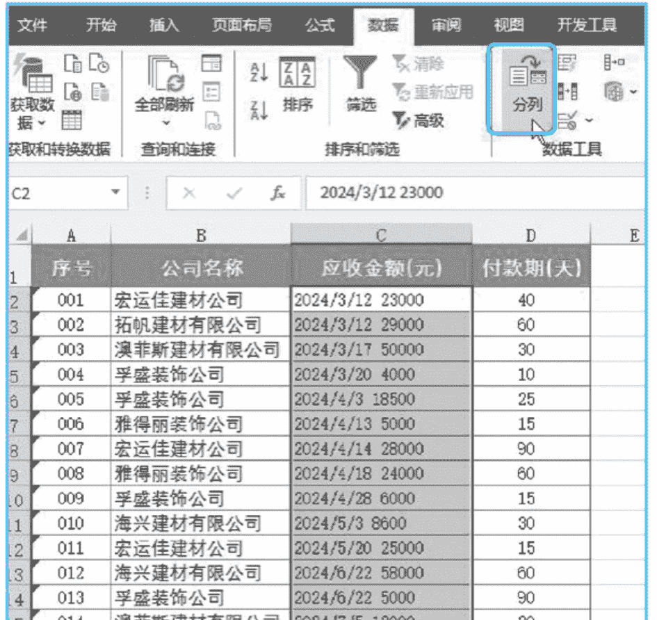

图2-47

❹弹出“文本分列向导-第1步，共3步”对话框，保持默认选项，单击“下一步”按钮，如图2-48所示。

❺弹出“文本分列向导-第2步，共3步”对话框，在“分隔符号”栏下选中“空格”复选框，如图2-49所示。

##### 文本分列向导 - 第 1 步，共 3 步

文本分列向导判定您的数据具有分隔符。
若一切设置无误，请单击“下一步”，否则请选择最合适的数据类型。

原始数据类型

请选择最合适的文件类型：

- 分隔符号(D) - 用分隔字符，如逗号或制表符分隔每个字段
- 固定宽度(W) - 每列字段加空格对齐

预览选定数据：

| 2 | 2024/3/12 23000 |
| 3 | 2024/3/12 29000 |
| 4 | 2024/3/17 50000 |
| 5 | 2024/3/20 4000 |
| 6 | 2024/4/3 18500 |
| 7 | 2024/4/13 5000 |

图2-48

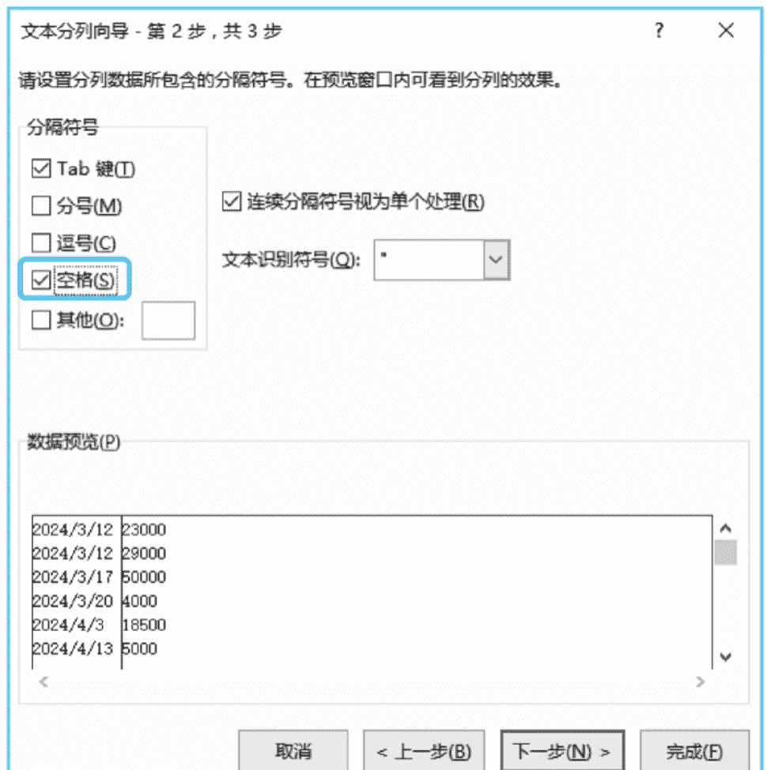

图2-49

❻ 单击“完成”按钮完成数据分列，如图2-50所示，此时根据数据特征重新建立列标识即可完成表格数据的整理。

| 序号 | 公司名称 | 应收金额(元) | | 付款期(天) |
|---|---|---|---|---|
| 001 | 宏运佳建材公司 | 2024-3-12 | 23000 | 40 |
| 002 | 拓帆建材有限公司 | 2024-3-12 | 29000 | 60 |
| 003 | 澳菲斯建材有限公司 | 2024-3-17 | 50000 | 30 |
| 004 | 孚盛装饰公司 | 2024-3-20 | 4000 | 10 |
| 005 | 孚盛装饰公司 | 2024-4-3 | 18500 | 25 |
| 006 | 雅得丽装饰公司 | 2024-4-13 | 5000 | 15 |
| 007 | 宏运佳建材公司 | 2024-4-14 | 28000 | 90 |
| 008 | 雅得丽装饰公司 | 2024-4-18 | 24000 | 60 |
| 009 | 孚盛装饰公司 | 2024-4-28 | 6000 | 15 |
| 010 | 海兴建材有限公司 | 2024-5-3 | 8600 | 30 |
| 011 | 宏运佳建材公司 | 2024-5-20 | 25000 | 15 |
| 012 | 海兴建材有限公司 | 2024-6-22 | 58000 | 60 |
| 013 | 孚盛装饰公司 | 2024-6-22 | 5000 | 90 |
| 014 | 澳菲斯建材有限公司 | 2024-7-5 | 12000 | 20 |

图2-50

##### 专家提示

值得注意的是，分列数据需要数据具有一定的规律，如宽度相等、使用同一种间隔符号（空格、逗号、分号均可）间隔等。在“分隔符号”栏中可以看到还有分号、逗号等其他符号，如果找不到可选的符号，则选中“其他”复选框，然后在后面的设置框中输入自定义的符号。

### 2.2.4 DeepSeek辅助整理文本型数字

公式计算是Excel中最为强大的一项功能，但是有时我们会遇到一些情况，比如明明输入的是数据，却无法对数据进行运算与统计。如图2-51所示，当使用D列的数据计算应收账款的总金额时，出现了计算结果是0值的情况。针对此问题，我们也可以向DeepSeek中提问以获取解决方案。

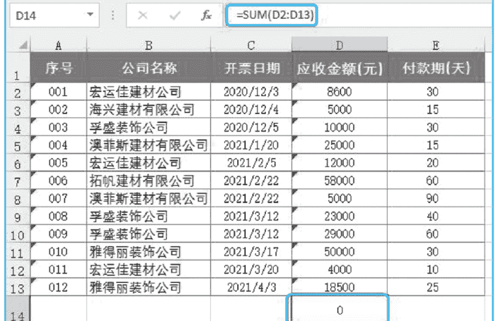

图2-51

❶在DeepSeek聊天对话框中输入“显示数字的单元格左上角有绿色的三角形，并且数字无法进行求和运算，怎么解决？”，如图2-52所示。送出问题后得到如图2-53所示的回复信息。


图2-52

❷回到Excel表格中，选中“应收金额”列的数据区域，单击左方的“⚠”按钮的下拉按钮，在下拉列表中单击“转换为数字”，如图2-54所示。

> 在 Excel 中，单元格左上角出现绿色三角形通常表示该单元格的数字是以 **文本格式** 存储的，而不是数值格式。由于文本格式的数字无法参与数学运算（如求和），因此需要将其转换为数值格式。以下是解决方法：

#### 方法 1：使用错误检查工具

1. 选中包含绿色三角形的单元格：
   - 选中需要转换的单元格或区域。
2. 点击错误提示：
   - 单元格旁边会显示一个感叹号图标，点击它。
   - 在弹出的菜单中选择 **转换为数字**（Convert to Number）。
3. 检查结果：
   - 转换后，绿色三角形会消失，数字可以正常参与求和运算。

#### 方法 2：使用分列功能

1. 选中包含绿色三角形的单元格：
   - 选中需要转换的单元格或区域。
2. 打开分列功能：
   - 在菜单栏中点击 **数据**（Data）选项卡。
   - 点击 **分列**（Text to Columns）按钮。
3. 完成分列操作：
   - 在弹出的对话框中，直接点击 **完成**（Finish）。
   - 文本格式的数字会自动转换为数值格式。

图2-53


图2-54

❸执行上述操作后，左上角绿色文本标志消失，同时重新得到正确的计算结果，如图2-55所示。


图2-55

##### 专家提示

我们看到DeepSeek整理了两种解决方案，都是可以解决问题的。此处选择了最便捷的操作方法。DeepSeek的回复可以带给我们一些新的思路，可以一边应用一边学习。

### 2.2.5 DeepSeek辅助整理带单位的数据

如图2-56所示的表格中，C列数据带上了金额单位，这造成了在计算合计值时出错。数值带上数据单位，它实际就是文本数据了，所以无法参与计算。要解决此问题，可以通过DeepSeek学习解决办法。

| 姓名 | 部门 | 养老保险 | 医疗保险 | 失业保险 | 合计 |
|---|---|---|---|---|---|
| 王琪 | 行政部 | 232元 | 68 | 29 | 97 |
| 陈潇 | 行政部 | 156元 | 49 | 19.5 | 68.5 |
| 张点点 | 行政部 | 124元 | 41 | 15.5 | 56.5 |
| 于青青 | 财务部 | 264元 | 76 | 33 | 109 |
| 邓兰兰 | 财务部 | 156元 | 49 | 19.5 | 68.5 |
| 蔡静 | 客户部 | 236元 | 69 | 29.5 | 98.5 |
| 陈媛 | 客户部 | 232元 | 68 | 29 | 97 |
| 王密 | 客户部 | 180元 | 55 | 22.5 | 77.5 |
| 吕芬芬 | 客户部 | 100元 | 35 | 12.5 | 47.5 |
| 路高泽 | 客户部 | 236元 | 69 | 29.5 | 98.5 |
| 岳庆洁 | 客户部 | 224元 | 68 | 27.5 | 95.5 |
| 李雪儿 | 客户部 | 156元 | 49 | 19.5 | 68.5 |

图2-56

❶在DeepSeek聊天对话框中输入“在Excel中，C列的数据都带有一个统一的单位，想批量删除数据的单位。”，如图2-57所示。送出问题后得到如图2-58所示的回复信息。


图2-57


图2-58

❷回到Excel表格中，选中C列数据，按Ctrl+H组合键，打开“查找和替换”对话框，将光标定位到“查找内容”文本框中，输入单位，“替换为”文本框为空，如图2-59所示。


图2-59

❸单击“全部替换”按钮，可以看到C列中的单位被一次性删除，并且“合计”列也显示了正确的计算结果，如图2-60所示。

| 姓名 | 部门 | 养老保险 | 医疗保险 | 失业保险 | 合计 |
|---|---|---|---|---|---|
| 王琪 | 行政部 | 232 | 68 | 29 | 329 |
| 陈潇 | 行政部 | 156 | 49 | 19.5 | 224.5 |
| 张点点 | 行政部 | 124 | 41 | 15.5 | 180.5 |
| 于青青 | 财务部 | 264 | 76 | 33 | 373 |
| 邓兰兰 | 财务部 | 156 | 49 | 19.5 | 224.5 |
| 蔡静 | 客户部 | 236 | 69 | 29.5 | 334.5 |
| 陈媛 | 客户部 | 232 | 68 | 29 | 329 |
| 王密 | 客户部 | 180 | 55 | 22.5 | 257.5 |
| 吕芬芬 | 客户部 | 100 | 35 | 12.5 | 147.5 |
| 路高泽 | 客户部 | 236 | 69 | 29.5 | 334.5 |
| 岳庆浩 | 客户部 | 224 | 68 | 27.5 | 319.5 |
| 李雪儿 | 客户部 | 156 | 49 | 19.5 | 224.5 |

图2-60

在DeepSeek的回复信息中向下滑动，可以看到方法2的操作，其描述为“如果不想改变原始数据，可以使用公式提取数字部分。”，如图2-61所示。

#### 方法 2：使用公式

如果不想改变原始数据，可以使用公式提取数字部分。

1. 在空白列中输入公式：
   - 假设数据在 C 列，在 D 列中输入以下公式：

```excel
=LEFT(C2, LEN(C2) - LEN("单位"))
```

其中 “单位” 替换为实际的单位（例如 “元” 或 “kg”）。
例如，如果单位是 “元”，公式为：

```excel
=LEFT(C2, LEN(C2) - LEN("元"))
```

2. 填充公式：
   - 将公式向下填充到所有需要处理的行。

3. 复制并粘贴为值：
   - 选中 D 列中的数据，按 Ctrl + C 复制。
   - 右键点击 C 列，选择 粘贴为值（Paste as Values），将处理后的数据覆盖到原始数据中。

图2-61

这种情况也是经常会出现的，例如图2-62中D列的数据就无法通过 “查找” “替换” 为进行一次性处理，而是需要通过提取数字部分来实现删除单位。

| A | B | C | D | E |
|---|---|---|---|---|
| 小票号 | 商品名称 | 售价 | 数量 | 销售金额(元) |
| 9900000984 | 散装大核桃 | 20 | 5袋 | #VALUE! |
| 9900000984 | 盒装牛肉 | 85 | 5盒 | #VALUE! |
| 9900000984 | 盒装水晶梨 | 8 | 11盒 | #VALUE! |
| 9900000985 | 袋装澡巾 | 5 | 5只 | #VALUE! |
| 9900000985 | 筒装通心面 | 3 | 15筒 | #VALUE! |
| 9900000985 | 盒装软中华 | 80 | 1盒 | #VALUE! |
| 9900000985 | 盒装夹子 | 8 | 10盒 | #VALUE! |
| 9900000985 | 散装大核桃 | 20 | 5袋 | #VALUE! |
| 9900000985 | 盒装核桃仁 | 40 | 2盒 | #VALUE! |
| 9900000985 | 盒装安利香皂 | 18 | 120盒 | #VALUE! |

图2-62

❶回到Excel表格中，在D列后插入一个空白列，选中E2单元格，在编辑栏中输入公式“=LEFT(D2, LEN(D2) - 1)”，按下Enter键即可提取D2单元格中数据，如图2-63所示。


图2-63

❷向下复制E2单元格的公式，如图2-64所示。


图2-64

❸按照DeepSeek回复信息中的第3步操作：复制E列的结果并“选择性粘贴”到D列中，选择“值”以覆盖原始数据。这时可以看到由于单位被删除了，F列得到了正确的计算结果，如图2-65所示。

| A | B | C | D | E | F |
|---|---|---|---|---|---|
| 小票号 | 商品名称 | 售价 | 数量 | | 销售金额(元) |
| 9900000984 | 散装大核桃 | 20 | 5 | | 100.00 |
| 9900000984 | 盒装牛肉 | 85 | 5 | | 425.00 |
| 9900000984 | 盒装水晶梨 | 8 | 11 | 1 | 88.00 |
| 9900000985 | 袋装澡巾 | 5 | 5 | | 25.00 |
| 9900000985 | 筒装通心面 | 3 | 15 | 1 | 45.00 |
| 9900000985 | 盒装软中华 | 80 | 1 | | 80.00 |
| 9900000985 | 盒装夹子 | 8 | 10 | 1 | 80.00 |
| 9900000985 | 散装大核桃 | 20 | 5 | | 100.00 |
| 9900000985 | 盒装核桃仁 | 40 | 2 | | 80.00 |
| 9900000985 | 盒装安利香皂 | 18 | 120 | 12 | 2160.00 |
| 9900000985 | 散装中骏枣 | 30 | 22 | 2 | 660.00 |
| 9900000986 | 筒装通心面 | 3 | 15 | 1 | 45.00 |

图2-65

##### 专家提示

当DeepSeek给我们提供了公式方案后，也要学会根据实际情况合理修改公式。

### 2.2.6 不规范文本的整理

就文本来说，不规范文本的表现形式包括文本中含有空格、不可见字符、换行符等。因为这些字符的存在，让数据呈现的是所见非所得的状态，当进行查找等操作时，会出现找不到匹配值的情况，因此需要进行处理。

如图2-66所示，要查询“韩燕”的应缴所得税，但出现无法查询的情况。双击C4单元格查看源数据，在编辑栏就可发现光标所处的位置与数字最后一位间隔有距离，即为不可见的空格，如图2-67所示，而这样的空格却是肉眼很难发现的。

图2-66

1. 用鼠标选中不可见字符并复制。
2. 按Ctrl+H组合键，打开“查找和替换”对话框，将光标定位到“查找内容”文本框中，按Ctrl+V组合键将不可见字符粘贴至“查找内容”文本框，“替换为”文本框留空，如图2-68所示。

图2-67

图2-68

❸单击“全部替换”按钮，弹出提示对话框，显示共有多少处替换；单击“确定”按钮，即可看到之前无法查询的问题已成功解决，如图2-69所示。

图2-69

##### 知识扩展

在如图2-70所示的表格中查询“黎小健”时也出现无法查询的问题，这不是因为有空格存在，而是数据源中有换行符。删除换行符的方法：打开“查找和替换”对话框，将光标定位到“查找内容”文本框中，按下Shift+Enter组合键即可输入换行符，将“替换为”文本框留空，然后执行替换即可。

图2-70

### 2.2.7 DeepSeek辅助整理不规范的日期数据

在Excel中必须按指定的格式输入日期，Excel才会把它当作日期型数值，否则会视为不可计算的文本日期。因此当遇到不规范日期时，要将其处理为规范日期，以便日期运算。

在Excel中输入以下四种日期格式的日期Excel均可识别：

- 短横线“-”分隔的日期，如“2024-4-1”“2024-5”。
- 用斜杠“/”分隔的日期，如“2024/4/1”“2024/5”。
- 使用中文年月日输入的日期，如“2024年4月1日”“2024年5月”。
- 使用包含英文月份或英文月份缩写输入的日期，如April-1、May-18。

用其他符号间隔的日期或数字形式输入的日期，如“2024.4.1”“2024\4\1”“20240401”等，Excel无法自动识别为日期数据，而将其视为文本数据，引用这些区域进行数据计算时也不能返回正确值。对于这种不规则类型该如何批量处理？

❶在DeepSeek聊天对话框中输入“数据表中的日期显示为“2024.4.1”这种格式，导致无法进行日期计算，该如何解决？”，如图2-71所示。送出问题后得到如图2-72所示的回复信息。

图2-71

#### 快速替换日期格式的方法

要将“2024.4.1”这种格式快速转换为可计算的日期格式，以下是几种高效的方法：

##### Excel/WPS表格中的快速替换方法

##### 方法1：查找替换法（最快）

1. 选中日期列
2. 按 Ctrl+H 打开替换对话框
3. 查找内容输入 .
4. 替换为输入 / 或 - (如2024/4/1或2024-4-1)
5. 点击“全部替换”
6. 完成后，Excel通常会自动识别为日期格式

##### 方法2：快速公式转换

在空白列输入：

```
excel
=DATEVALUE(SUBSTITUTE(A1,".","/"))
```

然后向下填充，再将结果复制→选择性粘贴为值

##### 方法3：快速分列法

1. 选中日期列
2. 点击“数据”→“分列”

图2-72

DeepSeek给出多种方法，比较起来，方法1采用查找与替换的方法，操作比较方便快捷；方法2使用公式转换的方法；方法3使用数据分列的方法。

❷回到Excel表格中，选中C2:C13单元格区域（如图2-73所示），按Ctrl+H组合键，打开“查找和替换”对话框。

❸在“查找内容”文本框中输入“.”，在“替换为”文本框中输入“-”（如图2-74所示），单击“全部替换”按钮，此时可以看到Excel程序已将其转换为可识别的规范日期值，如图2-75所示。同时E列中的计算结果也能正确返回了。

| 序号 | 公司名称 | 开票日期 | 付款期(天) | 到期日期 | 应收金额 |
|---|---|---|---|---|---|
| 001 | 宏运佳建材公司 | 2023.12.3 | 30 | #VALUE! | 8600 |
| 002 | 海兴建材有限公司 | 2023.12.4 | 15 | #VALUE! | 5000 |
| 003 | 孚盛装饰公司 | 2023.12.5 | 30 | #VALUE! | 10000 |
| 004 | 澳菲斯建材有限公司 | 2024.1.20 | 15 | #VALUE! | 25000 |
| 005 | 宏运佳建材公司 | 2024.2.5 | 20 | #VALUE! | 12000 |
| 006 | 拓帆建材有限公司 | 2024.2.22 | 60 | #VALUE! | 58000 |
| 007 | 澳菲斯建材有限公司 | 2024.2.22 | 90 | #VALUE! | 5000 |
| 008 | 孚盛装饰公司 | 2024.3.12 | 40 | #VALUE! | 23000 |
| 009 | 孚盛装饰公司 | 2024.3.12 | 60 | #VALUE! | 29000 |
| 010 | 雅得丽装饰公司 | 2024.3.17 | 30 | #VALUE! | 50000 |
| 011 | 宏运佳建材公司 | 2024.3.20 | 10 | #VALUE! | 4000 |
| 012 | 雅得丽装饰公司 | 2024.4.3 | 25 | #VALUE! | 18500 |

图2-73

图2-74

图2-75

## 2.3 筛选满足条件的数据

筛选是指暂时隐藏不必显示的行列，只按设定的条件显示满足条件的数据记录。筛选是数据分析过程中被频繁使用的工具，它是数据分析的基础，在查看数据的过程中也会得到相应的分析结论。

### 2.3.1 按类别快速筛选

在执行筛选前，需要为表格的列标识添加自动筛选。添加自动筛选后可以快速筛选出一类数据。例如在员工社保缴费表中，通过筛选可以实现快速查看某一个部门的缴费情况。

1. 打开工作表，选中任意单元格，切换到“数据”选项卡，在“排序和筛选”组中单击“筛选”按钮，如图2-76所示。
2. 单击“筛选”按钮后，系统会为列标识添加筛选按钮，单击“部门”右侧的筛选按钮，取消选中“全选”复选框，然后选中“客户部”复选框，如图2-77所示。

图2-76

图2-77

❸单击“确定”按钮，返回工作表中，即可看到筛选出客户部社保缴纳的情况，如图2-78所示。

图2-78

##### 专家提示

如果想一次性查看多个部门，则可以一次选中两个或多个复选框。

### 2.3.2 数值大小筛选

数字筛选是数据分析时最常用的筛选方式，例如以支出费用、成绩、销售额等作为字段进行筛选，都可能需要用到数字筛选。数字筛选的类型有“等于”“不等于”“大于”“大于或等于”“小于”“小于或等于”“介于”等，不同的筛选类型可以得到不同的筛选结果。

例如在本例中要筛选出工龄大于5年的所有记录。

1. 选中数据区域任意单元格，在“数据”选项卡的“排序和筛选”组中单击“筛选”按钮添加自动筛选。
2. 单击“工龄”右侧的筛选按钮，在筛选菜单中单击“数字筛选”命令，在弹出的子菜单中单击“大于”命令（如图2-79所示），打开“自定义自动筛选方式”对话框。

❸在“大于”后面文本框中输入5，如图2-80所示。

图2-80

❹ 单击“确定”按钮，返回工作表中，即可筛选出工龄大于5的记录，如图2-81所示。

图2-81

##### 知识扩展

当不需要筛选查看而要显示全部数据时，可以取消筛选。单击“数据”选项卡，在“排序和筛选”选项组单击“清除”按钮（如图2-82所示），即可一次性取消本工作表的所有筛选。

图2-82

例如在下面的表格中要筛选出出库量大于1000或小于100的记录。

1. 切换到“数据”选项卡，在“排序和筛选”组中单击“筛选”按钮。单击“出库量”右侧的筛选按钮，在筛选菜单中单击“数字筛选”命令，在弹出的子菜单中单击“大于”命令(如图2-83所示)，打开“自定义自动筛选方式”对话框。

图2-83

❷在“大于”后面的文本框中输入1000；选中“或”单选按钮，设置条件为“小于”，并在后面文本框中输入100，如图2-84所示。

图2-84

❸单击“确定”按钮，返回工作表中，即可筛选出出库量大于1000或小于100的记录，如图2-85所示。

图2-85

##### 知识扩展

利用数字筛选还可以筛选出排名前几位的记录。在“数字筛选”的子菜单中单击“前10项”命令（如图2-86所示），打开“自动筛选前10个”对话框，设置想显示的最大的项数，如设置为3，如图2-87所示。单击“确定”按钮即可筛选出应收金额排名前3位的记录。

图2-86

图2-87

### 2.3.3 按日期筛选

对日期进行筛选可以筛选出例如本月、上月的记录，或筛选出某指定日期之前或之后的记录等。例如在下面的例子中要求筛选出2024年3月之前的账款记录。

1. 切换到“数据”选项卡，在“排序和筛选”组中单击“筛选”按钮，如图2-88所示。单击“开票日期”右侧的筛选按钮，在筛选菜单中单击“日期筛选”命令，在弹出的子菜单中单击“之前”命令（如图2-89所示），打开“自定义自动筛选方式”对话框。

图2-88

图2-89

❷在“在以下日期之后”文本框后输入日期“2024/3/1”，如图2-90所示。

图2-90

❸单击“确定”按钮，返回工作表中，即可看到已筛选出3月1号之前账款的记录，如图2-91所示。

图2-91

##### 专家提示

在“日期筛选”子菜单中包含多种筛选方式，如“上周”“上月”“今天”“明天”“下季度”等，它们都是以当前系统日期为参照，在单击相应的命令后即可显示满足条件的筛选结果。

### 2.3.4 结果独立放置的高级筛选

自动筛选都是在原有表格上实现数据的筛选，被排除的记录暂时被隐藏，而使用高级筛选功能则可以将筛选的结果存放于指定的位置，以便得到单一的分析结果，便于使用。在高级筛选方式下可以实现只满足一个条件的筛选（即“或”条件筛选），也可以实现同时满足两个条件的筛选（即“与”条件筛选）。

#### 1. 同时满足双条件的筛选

“与”条件筛选是指同时满足两个条件或多个条件的筛选。例如在下面的员工社保缴费表中，需要筛选出客户部缴费合计大于300的记录。

❶在I1:J2单元格区域输入筛选条件，切换到“数据”选项卡，在“排序和筛选”组中单击“高级”按钮(如图2-92所示)，打开“高级筛选”对话框。

图2-92

❷设置“列表区域”为A2:G19单元格区域，设置“条件区域”为I1:J2单元格区域（如图2-93所示），选中“将筛选结果复制到其他位置”单选按钮，将光标定位到激活的“复制到”文本框中，在工作表中单击I3单元格，如图2-94所示。

图2-93

图2-94

❸单击“确定”按钮，返回到工作表中，即可筛选出客户部缴费合计大于300的记录,如图2-95所示。

| I | J | K | L | M | N | O |
|---|---|---|---|---|---|---|
| 部门 | 合计 | | | | | |
| 客户部 | >300 | | | | | |
| 序号 | 姓名 | 部门 | 养老保险 | 医疗保险 | 失业保险 | 合计 |
| NL003 | 蔡静 | 客户部 | 236 | 69 | 29.5 | 324.5 |
| NL004 | 陈媛 | 客户部 | 232 | 68 | 29 | 319 |
| NL005 | 路高泽 | 客户部 | 236 | 69 | 29.5 | 324.5 |

图2-95

#### 2. 满足多条件中任意一个条件的筛选

“或”条件筛选是指数据只要满足两个或多个条件中的任意一个就被作为满足要求的记录。例如在下面的员工社保缴费表中，需要筛选出技术部或者缴费合计大于300的记录。

❶在I1:J3单元格区域输入筛选条件，切换到“数据”选项卡，在“排序和筛选”组中单击“高级”按钮(如图2-96所示)，打开“高级筛选”对话框。

图2-96

##### 专家提示

通过对比“与”条件的设置，可以看到“与”条件中各条件显示在同一行，而“或”条件设置要保证各条件位于不同行中。

❷设置“列表区域”为A2:G19单元格区域，设置“条件区域”为I1:J3单元格区域，选中“将筛选结果复制到其他位置”单选按钮，将光标定位到在激活的“复制到”文本框中，在工作表中单击I4单元格，如图2-97所示。

❸单击“确定”按钮，返回到工作表中，即可筛选出部门为“技术部”或者缴费合计值大于300的记录，如图2-98所示。

图2-97

| 部门 | 合计 | | | | | |
|---|---|---|---|---|---|---|
| 技术部 | | | | | | |
| | >300 | | | | | |
| 序号 | 姓名 | 部门 | 养老保险 | 医疗保险 | 失业保险 | 合计 |
| NL001 | 王琪 | 行政部 | 232 | 68 | 29 | 319 |
| NL002 | 于青青 | 财务部 | 264 | 76 | 33 | 363 |
| NL003 | 蔡静 | 客户部 | 236 | 69 | 29.5 | 324.5 |
| NL004 | 陈媛 | 客户部 | 232 | 68 | 29 | 319 |
| NL005 | 路高泽 | 客户部 | 236 | 69 | 29.5 | 324.5 |
| NL007 | 廖晓 | 技术部 | 204 | 61 | 25.5 | 280.5 |
| NL008 | 吴华波 | 技术部 | 168 | 52 | 21 | 231 |
| NL009 | 张丽君 | 技术部 | 172 | 53 | 21.5 | 236.5 |

图2-98

## 2.4 数据的分类汇总

分类汇总，顾名思义，就是将同一类别的记录进行合并统计，用于合并统计的字段可以自定义设置，合并统计的计算方式可以是求和、求平均值、求最大最小值等。这项功能是数据分析乃至大数据统计分析中常用的功能之一。

### 2.4.1 单层分类汇总

在进行分类汇总之前，需要按目标字段进行排序，将同一类数据放置在一起，形成多个分类，然后才能对各个类别进行合并统计。例如在图2-99所示的表格中，可以通过分类汇总统计各仓库的库存总量，也可以统计各个商品类别的库存总量。

图2-99

❶选中“仓库名称”列下任意单元格，在“数据”选项卡的“排序和筛选”组中单击“升序”按钮，即可将相同品类的记录排序到一起，如图2-100所示。

| 商品编码 | 仓库名称 | 商品名称 | 规格 | 包装规格 | 商品类别 | 色号 | 本月库存 |
|---|---|---|---|---|---|---|---|
| ZT6109 | 西城仓 | 通体大理石 | 600*600 | 4* | 大理石 | 4A | 1269 |
| ZG6011 | 西城仓 | 生态大理石 | 600*600 | 4* | 抛釉砖 | E6 | 32 |
| ZG6014 | 西城仓 | 生态大理石 | 600*600 | 4* | 抛釉砖 | 20A | 819 |
| ZG6012 | 西城仓 | 生态大理石 | 600*600 | 4* | 抛釉砖 | 15A | 1396 |
| ZT6108 | 西城仓 | 通体大理石 | 600*600 | 4* | 大理石 | 14A | 99 |
| ZT6108 | 西城仓 | 通体大理石 | 600*600 | 4* | 大理石 | 5A | 224 |
| ZG6016 | 西城仓 | 生态大理石 | 600*600 | 4* | 抛釉砖 | 1A | 817 |
| ZT6107 | 西城仓 | 通体大理石 | 600*600 | 4* | 大理石 | 7A | 905 |
| ZT6110 | 西城仓 | 通体大理石 | 600*600 | 4* | 大理石 | 14A | 258 |
| ZT6108 | 西城仓 | 通体大理石 | 600*600 | 4* | 大理石 | 16A | 956 |
| ZG6015 | 西城仓 | 生态大理石 | 600*600 | 4* | 抛釉砖 | 1A | 1003 |
| ZG6017 | 西城仓 | 生态大理石 | 600*600 | 4* | 抛釉砖 | 5A | 274 |
| ZG6013 | 西城仓 | 生态大理石 | 600*600 | 4* | 抛釉砖 | 4A | 133 |
| Z8G033 | 西城仓 | 金刚石 | 800*800 | 3* | 抛釉砖 | A53 | 25 |
| Z8G032 | 临玉加工厂仓库 | 金刚石 | 800*800 | 3* | 抛釉砖 | A55 | 587 |
| ZGR80002 | 临玉加工厂仓库 | 负离子生态通体大理石 | 800*800 | 3* | 大理石 | 16 | 312 |
| ZGR80001 | 临玉加工厂仓库 | 负离子生态通体大理石 | 800*800 | 3* | 大理石 | 10 | 509 |
| ZG031 | 临玉加工厂仓库 | 金刚石 | 800*800 | 3* | 抛釉砖 | A52 | 612 |
| ZG63016A | 建材商城仓库 | 晒墨瓷片 | 300*600 | 9* | 瓷片 | 1 | 337 |
| ZG63016C | 建材商城仓库 | 晒墨瓷片 | 300*600 | 9* | 瓷片 | 1 | 217 |
| ZG63011A | 建材商城仓库 | 晒墨瓷片 | 300*600 | 9* | 瓷片 | 7 | 1036 |
| ZG63016B | 建材商城仓库 | 晒墨瓷片 | 300*600 | 9* | 瓷片 | 1 | 482 |
| ZG63012A | 东城仓 | 晒墨瓷片 | 300*600 | 9* | 瓷片 | 3 | 40 |
| ZG6608 | 东城仓 | 艺术仿古砖 | 600*600 | 4* | 仿古砖 | 7 | 1186 |
| ZG6607 | 东城仓 | 艺术仿古砖 | 600*600 | 4* | 仿古砖 | 6 | 50 |
| WJ8868 | 东城仓 | 希腊爵士白 | 800*800 | 2* | 大理石 | 5 | 89 |
| WJ8870 | 东城仓 | 希腊爵士白 | 800*800 | 2* | 大理石 | 8 | 592 |
| WJ8872 | 东城仓 | 希腊爵士白 | 800*800 | 2* | 大理石 | 1 | 608 |
| ZG6606 | 东城仓 | 艺术仿古砖 | 600*600 | 4* | 仿古砖 | 9 | 55 |
| ZG6605 | 东城仓 | 艺术仿古砖 | 600*600 | 4* | 仿古砖 | 14 | 496 |

图2-100

❷在“数据”选项卡的“分级显示”组中单击“分类汇总”按钮（如图2-101所示），打开“分类汇总”对话框。

图2-101

❸单击“分类字段”文本框下拉按钮，在下拉菜单中单击“仓库名称”（注意分类字段一定是经过排序的那个字段），如图2-102所示；“汇总方式”采用默认的“求和”，在“选项汇总项”下选中“本月库存”复选框，如图2-103所示。


图2-102


图2-103

❹单击“确定”按钮，返回工作表中，即可看到表格中的数据以“仓库名称”为字段进行了汇总统计，即每一个相同的大类下出现了一个汇总项，如图2-104所示。


图2-104

❺如果数据较多，为了能更清晰地查看分类统计结果，可以单击左上角的“2”，即可只显示出统计结果，如图2-105所示。


图2-105

另外，在此表中也可以对不同的商品类别进行库存量的汇总。

❶选中“商品类别”列下任意单元格，在“数据”选项卡的“排序和筛选”组中单击“升序”按钮，即可将相同品类的记录排序到一起，如图2-106所示。

❷打开“分类汇总”对话框，单击“分类字段”文本框下拉按钮，在下拉菜单中单击“商品类别”，“汇总方式”采用默认的“求和”，在“选项汇总项”下选中“本月库存”复选框，如图2-107所示。

| 商品编码 | 仓库名称 | 商品名称 | 规格 | 包装规格 | 商品类别 | 色号 | 本月库存 |
|---|---|---|---|---|---|---|---|
| ZG6011 | 西城仓 | 生态大理石 | 600*600 | 4* | 抛釉砖 | E6 | 32 |
| ZG6014 | 西城仓 | 生态大理石 | 600*600 | 4* | 抛釉砖 | 20A | 819 |
| ZG6012 | 西城仓 | 生态大理石 | 600*600 | 4* | 抛釉砖 | 15A | 1396 |
| ZG6016 | 西城仓 | 生态大理石 | 600*600 | 4* | 抛釉砖 | 1A | 817 |
| ZG6015 | 西城仓 | 生态大理石 | 600*600 | 4* | 抛釉砖 | 1A | 1083 |
| ZG6017 | 西城仓 | 生态大理石 | 600*600 | 4* | 抛釉砖 | 5A | 274 |
| ZG6013 | 西城仓 | 生态大理石 | 600*600 | 4* | 抛釉砖 | 4A | 133 |
| Z8G033 | 西城仓 | 金刚石 | 800*800 | 3* | 抛釉砖 | A53 | 25 |
| Z8G032 | 临玉加工厂仓库 | 金刚石 | 800*800 | 3* | 抛釉砖 | A55 | 587 |
| Z8G031 | 临玉加工厂仓库 | 金刚石 | 800*800 | 3* | 抛釉砖 | A52 | 612 |
| Z8G031 | 北城A仓 | 金刚石 | 800*800 | 3* | 抛釉砖 | A05 | 156 |
| Z8G034 | 北城A仓 | 金刚石 | 800*800 | 3* | 抛釉砖 | A52 | 380 |
| Z8G036 | 北城A仓 | 金刚石 | 800*800 | 3* | 抛釉砖 | A53 | 191 |
| Z8G037 | 北城A仓 | 金刚石 | 800*800 | 3* | 抛釉砖 | A51 | 372 |
| ZG6608 | 东城仓 | 艺术仿古砖 | 600*600 | 4* | 仿古砖 | 7 | 1186 |
| ZG6607 | 东城仓 | 艺术仿古砖 | 600*600 | 4* | 仿古砖 | 6 | 58 |
| ZG6606 | 东城仓 | 艺术仿古砖 | 600*600 | 4* | 仿古砖 | 9 | 55 |
| ZG6605 | 东城仓 | 艺术仿古砖 | 600*600 | 4* | 仿古砖 | 14 | 496 |
| ZT6109 | 西城仓 | 通体大理石 | 600*600 | 4* | 大理石 | 4A | 1269 |
| ZT6108 | 西城仓 | 通体大理石 | 600*600 | 4* | 大理石 | 14A | 99 |
| ZT6108 | 西城仓 | 通体大理石 | 600*600 | 4* | 大理石 | 5A | 224 |
| ZT6107 | 西城仓 | 通体大理石 | 600*600 | 4* | 大理石 | 7A | 905 |
| ZT6110 | 西城仓 | 通体大理石 | 600*600 | 4* | 大理石 | 14A | 258 |
| ZT6108 | 西城仓 | 通体大理石 | 600*600 | 4* | 大理石 | 16A | 956 |
| ZGR80002 | 临玉加工厂仓库 | 负离子生态通体大理石 | 800*800 | 3* | 大理石 | 16 | 312 |
| ZGR80001 | 临玉加工厂仓库 | 负离子生态通体大理石 | 800*800 | 3* | 大理石 | 10 | 509 |

图2-106


图2-107

❸单击“确定”按钮，返回工作表中，即可实现按商品类别进行分类汇总，如图2-108所示。


图2-108

### 2.4.2 多级分类汇总

多级分类汇总是指一级分类下还有下一级细分的情况，这时就可以同时显示出多层的分类汇总结果。例如仍然沿用上面的数据表，下面的例子中可以首先对“仓库名称”进行分类汇总，然后对同一仓库名称下的各个“商品类别”进行二次分类汇总。

❶打开工作表，切换到“数据”选项卡，在“排序和筛选”组中单击“排序”按钮（如图2-109所示），打开“排序”对话框。


图2-109

❷分别设置“主要关键字”为“仓库名称”，“次要关键字”为“商品类别”，排序的次序可以采用默认的设置，如图2-110所示。


图2-110

❸单击“确定”按钮，可见表格双关键字排序的结果，即先将同一仓库的数据排到一起，再将同一仓库下相同商品类别排到一起，如图2-111所示。


图2-111

❹在“数据”选项卡的“分级显示”组中单击“分类汇总”按钮，打开“分类汇总”对话框。单击“分类字段”文本框下拉按钮，在下拉菜单中单击“仓库名称”，汇总方式采用默认的“求和”，“选项汇总项”下选中“本月库存”复选框，如图2-112所示。

❺单击“确定”按钮可以看到一次分类汇总的结果，即统计出了各个仓库的库存汇总数量。再次打开“分类汇总”对话框，将“分类字段”更改为“商品类别”，其他选项保持不变，取消选中“替换当前分类汇总”复选框，如图2-113所示。


图2-112


图2-113

##### 专家提示

系统默认在工作表中创建下一个分类汇总时，自动替换当前的分类汇总，如果需要在工作表中创建多级的或者多种统计的分类汇总，则在创建一次分类汇总方式后，在“分类汇总”对话框中必须取消选中“替换当前分类汇总”复选框。

❻单击“确定”按钮可以看到二次分类汇总的结果，因为当前数据量稍大，屏幕显示限制，我们单击左上角的显示级别 2 来查看统计的结果。从当前的统计结果可以看到是分两个级别来统计的，如图2-114所示。


图2-114

##### 知识扩展

分类汇总都是在原数据表中进行的，当不再需要分类汇总的统计时，可以取消分类汇总，不管工作表中设置了一种还是多种分类汇总，都可以一次性取消分类汇总。打开“分类汇总”对话框，单击“全部删除”按钮（如图2-115所示）即可取消工作表中的分类汇总。


图2-115

### 2.4.3 同一字段的多种不同计算

多种统计结果的分类汇总指的是并不仅显示一种分类汇总结果，而是同时显示多种统计结果，如同时显示求和值、最大值、平均值等。如本例中要同时显示各个班级的最大值与平均值两项分类汇总的结果。

❶针对本例数据源，首先对“班级”字段进行排序，将相同班级的数据排到一起。在“数据”选项卡的“分级显示”组中单击“分类汇总”按钮，如图2-116所示。


图2-116

❷打开“分类汇总”对话框，设置“分类字段”为“班级”，设置“汇总方式”为“平均值”，汇总项为“总分”，如图2-117所示。


图2-117

❸单击“确定”按钮，得到第一次分类汇总的结果，如图2-118所示。

❹按相同的方法再次打开“分类汇总”对话框。重新设置“汇总方式”为“最大值”，取消选中下方的“替换当前分类汇总”复选框，如图2-119所示。

| 姓名 | 性别 | 班级 | 总分 |
|---|---|---|---|
| 刘欢第 | 女 | 高三（1）班 | 225 |
| 张得 | 男 | 高三（1）班 | 212 |
| 许允 | 男 | 高三（1）班 | 249 |
| 刘玉 | 男 | 高三（1）班 | 279 |
| 刘只会 | 女 | 高三（1）班 | 246 |
| 武林 | 男 | 高三（1）班 | 245 |
| | | 高三（1）班平均值 | 242.6667 |
| 周海 | 男 | 高三（2）班 | 286 |
| 杨雪 | 男 | 高三（2）班 | 259 |
| 李欣 | 女 | 高三（2）班 | 237 |
| 万茜 | 女 | 高三（2）班 | 289 |
| 黄林 | 男 | 高三（2）班 | 221 |
| 杨佳佳 | 女 | 高三（2）班 | 214 |
| | | 高三（2）班平均值 | 251 |
| 吴玲 | 男 | 高三（3）班 | 268 |
| 刘欣薇 | 男 | 高三（3）班 | 240 |
| 王慧 | 女 | 高三（3）班 | 258 |
| 许凌凌 | 男 | 高三（3）班 | 227 |
| 王超 | 男 | 高三（3）班 | 201 |
| 张瑞雪 | 女 | 高三（3）班 | 226 |
| | | 高三（3）班平均值 | 236.6667 |
| | | 总计平均值 | 243.4444 |

图2-118


图2-119

❺单击“确定”按钮完成设置，此时可以看到表格中分类汇总的结果是两种统计结果，如图2-120所示。


图2-120

### 2.4.4 分类汇总结果的复制使用

在利用分类汇总功能获取统计结果后，可以通过复制使用汇总结果，并进行格式整理形成用于汇报的汇总报表。但是在复制分类汇总结果时，会自动将明细数据全部粘贴过来，如果只想把汇总结果复制下来，则需要按如下方法操作。

❶打开创建了分类汇总的表格，先选中有统计数据的单元格区域，如图2-121所示。


图2-121

❷按下F5键即可打开“定位条件”对话框，选中“可见单元格”单选按钮，如图2-122所示。

❸单击“确定”按钮即可将选中单元格区域中的所有可见单元格区域选中，再按Ctrl+C组合键执行复制命令，如图2-123所示。

#### 定位条件

选择

- 批注(C)
- 常量(O)
- 公式(F)
  - [x] 数字(U)
  - [x] 文本(X)
  - [x] 逻辑值(G)
  - [x] 错误(E)
- 空值(K)
- 当前区域(R)
- 当前数组(A)
- 对象(B)
- 行内容差异单元格(W)
- 列内容差异单元格(M)
- 引用单元格(P)
- 从属单元格(D)
  - 直属(I)
  - 所有级别(L)
- 最后一个单元格(S)
- 可见单元格(Y)
- 条件格式(T)
- 数据验证(V)
  - 全部(L)
  - 相同(E)

确定

取消

图2-122


图2-123

❹打开新工作表后，按下Ctrl+V组合键执行粘贴命令，即可将分类汇总结果粘贴到新表格中，如图2-124所示。

❺将一些没有统计项的列删除，对表格稍作整理，报表如图2-125所示。

| 商品编码 | 仓库名称 | 商品名称 | 规格 | 包装规格 | 商品类别 | 色号 | 本月库存 |
| :--- | :--- | :--- | :--- | :--- | :--- | :--- | :--- |
| | | | | | 大理石 汇总 | | 1464 |
| | | | | | 抛釉砖 汇总 | | 1099 |
| | 北城A仓 汇总 | | | | | | 2563 |
| | | | | | 瓷片 汇总 | | 4350 |
| | 北城B仓 汇总 | | | | | | 4350 |
| | | | | | 瓷片 汇总 | | 731 |
| | | | | | 大理石 汇总 | | 2204 |
| | | | | | 仿古砖 汇总 | | 1795 |
| | 东城仓 汇总 | | | | | | 4730 |
| | | | | | 瓷片 汇总 | | 2072 |
| | 建材商城仓库 汇总 | | | | | | 2072 |
| | | | | | 大理石 汇总 | | 821 |
| | | | | | 抛釉砖 汇总 | | 1199 |
| | 临玉加工厂仓库 汇总 | | | | | | 2020 |
| | | | | | 大理石 汇总 | | 3711 |
| | | | | | 抛釉砖 汇总 | | 4579 |
| | 西城仓 汇总 | | | | | | 8290 |
| | 总计 | | | | | | 24026 |

图2-124

| A | B | C |
|---|---|---|
| 仓库名称 | 商品类别 | 本月库存 |
| | 大理石 汇总 | 1464 |
| | 抛釉砖 汇总 | 1099 |
| 北城A仓 汇总 | | 2563 |
| | 瓷片 汇总 | 4350 |
| 北城B仓 汇总 | | 4350 |
| | 瓷片 汇总 | 731 |
| | 大理石 汇总 | 2204 |
| | 仿古砖 汇总 | 1795 |
| 东城仓 汇总 | | 4730 |
| | 瓷片 汇总 | 2072 |
| 建材商城仓库 汇总 | | 2072 |
| | 大理石 汇总 | 821 |
| | 抛釉砖 汇总 | 1199 |
| 临玉加工厂仓库 汇总 | | 2020 |
| | 大理石 汇总 | 3711 |
| | 抛釉砖 汇总 | 4579 |
| 西城仓 汇总 | | 8290 |
| 总计 | | 24025 |

图2-125

## 2.5 多维度透视分析工具

数据透视表是日常工作中使用最频繁，也最重要的数据分析工具之一，它能以极灵活的统计方式对数据进行多维度透视分析。

数据透视表是汇总、分析数据的好工具，它可以按所设置的字段对数据表进行快速汇总统计与分析，并根据分析目的的不同，再次更改字段位置以重新获取统计结果。并且数据透视表可以进行的数据计算方式也是多样的，如求和、求平均值、求最大值以及计数等，不同的数据分析需求可以选择相应的汇总方式。

### 2.5.1 统计各个客户的应收账款总额

如图2-126所示表格按日期统计了针对各个客户的应收账款，建立数据透视表可以轻松统计各个客户的应收账款总额。下面通过实例讲解建立数据透视表的基本步骤。

❶选中数据源表格中的任意单元格，在“插入”选项卡的“表格”组中单击“数据透视表”按钮，如图2-126所示。

❷打开“创建数据透视表”对话框，在“表/区域”参数框中默认选择当前工作表的全部单元格区域，并默认选中“新工作表”单选按钮，表示默认将数据透视表创建到一张新工作表，如图2-127所示。


图2-126


图2-127

❸单击“确定”按钮，即可在新工作表中创建数据透视表，如图2-128所示。


图2-128

❹在字段列表中将光标指向“客户简称”字段，按住鼠标左键将其拖动至“行”区域中，如图2-129所示；按相同方法将“发票金额”字段拖动到“值”区域中（如图2-130所示），即可得到统计各个客户的应收账款总额的数据透视表，如图2-131所示。


图2-129

图2-130

图2-131

##### 专家提示

在添加字段时，也可以直接选中字段前的复选框，默认情况下文本字段自动添加到“行”区域，日期和时间字段添加到“列”区域，数值字段添加到“值”区域。

### 2.5.2 统计各个车间的不同技工的加班时长

在建立数据透视表时还可以设置双层标签，以实现多级统计。例如在本例中可以实现统计各个车间技工的总加班时长，同时还能统计各个车间不同技工的加班时长合计值。

- ❶选中数据源表格中的任意单元格，在“插入”选项卡的“表格”组中单击“数据透视表”按钮，如图2-132所示。

❷打开“创建数据透视表”对话框，在“表/区域”参数框中默认选择当前工作表的全部单元格区域，并默认选中“新工作表”单选按钮，如图2-133所示。

图2-132

图2-133

❸单击“确定”按钮即可在新工作表中创建数据透视表。按上一例相同的方法将“部门”和“技工类别”两个字段拖入“行”区域中，将“加班时长”字段拖入“值”区域中，如图2-134所示。

图2-134

由于此处添加了双行标签，在数据透视表中默认是折叠显示的，这使得字段的名称不能完整显示出来（只显示“行标签”字样），因此遇到这种情况我们一般都会通过更改报表的布局让行标签名称都显示出来。

❹选中数据透视表任意单元格，在“数据透视表工具→设计”选项卡的“布局”项中单击“报表布局”按钮，在下拉列表中单击“以大纲形式显示”选项（如图2-135所示），这时可以看到两个行标签的名称都显示出来了，如图2-136所示。

图2-135

图2-136

通过调整双字段的顺序又可以获取不同的统计效果，例如本例中将“技工类别”字段移到“部门”的上方，其统计重点就变为对各个技工类别的总加班时长进行了统计，下面再对同一技工类别下的部门进行细分。

❺在“行”区域中单击“技工类别”字段右侧的下拉按钮，在弹出的快捷菜单中单击“上移”（如图2-137所示），可以看到统计结果如图2-138所示。

图2-137

图2-138

### 2.5.3 统计员工的平均工资

如图2-139所示表格为某月的工资表。下面需要按部门统计人数，并统计各个部门的平均工资。仍然可以通过建立数据透视表来达到统计目的。

- ❶选中数据源表格中的任意单元格，在“插入”选项卡的“表格”组中单击“数据透视表”按钮，如图2-139所示。

图2-139

❷打开“创建数据透视表”对话框，保持默认选项，直接单击“确定”按钮创建数据透视表。按上一例相同的方法将“部门”字段拖入“行”区域中，将“姓名”字段和“实发工资”字段拖入“值”区域中，当前得到的统计结果如图2-140所示。

图2-140

观察统计结果可以发现，一项是计数统计，一项是求和统计。在建立数据透视表时，程序会根据字段的类型决定默认的统计方式：如果字段下是数值数据，则会自动使用SUM函数进行求和运算；如果字段下是文本数据，则会自动使用COUNT函数进行计数统计。因此“姓名”字段会使用计数的统计方式，即统计各个部门的人数；而“实发工资”字段会使用求和统计，即统计各个部门的工资总额。而我们当前要求统计各个部门的平均工资，因此对于“实发工资”这个字段的统计方式需要进行改变。

❸双击C3单元格，打开“值字段设置”对话框，将“选择用于汇总所选字段数据的计算类型”更改为“平均值”，并自定义名称为“平均工资”，如图2-141所示。

❹单击“确定”按钮，即可汇总各个部门的平均工资，效果如图2-142所示。

#### 值字段设置

源名称: 实发工资

自定义名称(C): 平均工资

值汇总方式 值显示方式

值字段汇总方式(S)

选择用于汇总所选字段数据的计算类型

- 求和
- 计数
- 平均值
- 最大值
- 最小值
- 乘积

数字格式(N)

确定

取消

图2-141

图2-142

##### 专家提示

在“值字段设置”对话框的“选择用于汇总所选字段数据的计算类型”列表中可以看到还有求最大值、最小值等。因此除了根据字段的性质自动生成汇总方式，如果想得到其他的计算结果，则需要在这里改变计算类型。

❺选中B2单元格，在编辑栏中重新修改名称为“人数”，如图2-143所示。这种自定义名称是为了让统计报表的显示效果更加直观。

图2-143

### 2.5.4 字段决定分析结果

数据透视表的强大功能体现在字段的设置上，不同的字段组合可以获取不同的统计效果，因此可以随时调整字段位置来多角度分析数据。下面以如图2-144所示的销售记录单为例，来介绍如何通过设置不同的字段得到不同的统计结果。

图2-144

#### 1. 各类别商品销售数量及金额统计报表

利用如图2-144所示的数据源创建统计各类别商品销售数量及金额的报表。

- ❶ 以图2-144所示的数据源创建数据透视表，如图2-145所示。

图2-145

❷拖动“类别”字段到“行”区域中，拖动“销售数量”“销售金额”字段到“值”区域中，即可得到分析各类别商品销售情况的数据透视表，如图2-146所示。

图2-146

❸在Sheet2工作表上单击鼠标右键，在弹出的快捷菜单中选择“重命名”命令，如图2-147所示。将工作表重命名为“各类别商品销售分析”，如图2-148所示。

| 行标签 | 求和项:销售数量 | 求和项:销售金额 |
| :--- | :--- | :--- |
| 短靴 | 15 | 2685 |
| 高筒靴 | | 7931 |
| 马丁靴 | | 9459 |
| 小白鞋 | | 6496 |
| 雪地靴 | | 13465 |
| 总计 | | 40036 |

图2-147

图2-148

#### 2. 各部门业绩统计报表

利用如图2-233所示的数据源创建各部门业绩统计报表。

- 1. 创建数据透视表。
- 2. 拖动“部门”字段和“类别”字段到“行”区域中，拖动“销售金额”字段到“值”区域中，即可得到各部门业绩统计报表，如图2-149所示。

❸将工作表重命名为“各部门业绩分析”，如图2-150所示。

图2-149

图2-150

#### 3. 各销售员业绩统计报表

利用如图2-143所示的数据源创建各销售员业绩统计报表。

- 1. 创建数据透视表。

❷拖动“销售员”字段到“行”区域中，拖动“销售金额”字段到“值”区域中，即可得到各销售员业绩统计报表，如图2-151所示。

❸将工作表重命名为“各销售员业绩分析”，如图2-152所示。

图2-151

图2-152

#### 4. 各类别商品各月份销售统计报表

假设当前数据表中涉及多个月的数据，还可以分月统计销售总额。

- ❶此处假设销售记录表中有2月数据与3月数据，如图2-153所示。创建数据透视表。
- ❷拖动“类别”字段和“日期”字段到“行”区域中，拖动“销售金额”字段到“值”区域中，即可让各个类别商品的销售额按月份统计，如图2-154所示。

| 日期 | 类别 | 产品名称 | 尺码 | 销售单价 |
|---|---|---|---|---|
| 2/2 | 雪地靴 | 甜美花朵女靴 | 35-39 | ¥ 90.00 |
| 2/3 | 马丁靴 | 时尚流苏短靴 | 35-40 | ¥ 178.00 |
| 2/3 | 雪地靴 | 潮流亮片女靴 | 35-41 | ¥ 108.00 |
| 2/5 | 高筒靴 | 侧拉时尚长筒靴 | 35-42 | ¥ 159.00 |
| 2/6 | 小白鞋 | 韩版百搭透气小鞋 | 35-43 | ¥ 129.00 |
| 2/6 | 雪地靴 | 潮流亮片女靴 | 35-44 | ¥ 108.00 |
| 2/7 | 小白鞋 | 韩版时尚内增高 | 35-45 | ¥ 169.00 |
| 2/8 | 马丁靴 | 时尚流苏短靴 | 35-46 | ¥ 99.00 |
| 2/9 | 雪地靴 | 贴布刺绣中筒靴 | 35-47 | ¥ 179.00 |
| 2/9 | 高筒靴 | 韩版过膝磨砂长靴 | 35-48 | ¥ 169.00 |
| 2/9 | 雪地靴 | 磨砂格子女靴 | 35-49 | ¥ 69.00 |
| 2/10 | 马丁靴 | 英伦风切尔西靴 | 35-50 | ¥ 139.00 |
| 2/10 | 雪地靴 | 甜美花朵女靴 | 35-51 | ¥ 90.00 |
| 2/10 | 短靴 | 复古雕花擦色单靴 | 35-52 | ¥ 179.00 |
| 2/11 | 高筒靴 | 侧拉时尚长筒靴 | 35-53 | ¥ 159.00 |
| 2/11 | 雪地靴 | 磨砂格子女靴 | 35-54 | ¥ 69.00 |
| 2/11 | 小白鞋 | 韩版时尚内增高 | 35-55 | ¥ 169.00 |
| 2/11 | 雪地靴 | 贴布刺绣中筒靴 | 35-56 | ¥ 179.00 |
| 2/12 | 马丁靴 | 时尚流苏短靴 | 35-57 | ¥ 189.00 |
| 3/12 | 高筒靴 | 韩版过膝磨砂长靴 | 35-58 | ¥ 169.00 |
| 3/12 | 马丁靴 | 英伦风切尔西靴 | 35-59 | ¥ 139.00 |
| 3/13 | 雪地靴 | 甜美花朵女靴 | 35-60 | ¥ 90.00 |
| 3/13 | 短靴 | 复古雕花擦色单靴 | 35-61 | ¥ 179.00 |
| 3/13 | 马丁靴 | 简约百搭小皮靴 | 35-62 | ¥ 149.00 |
| 3/13 | 雪地靴 | 贴布刺绣中筒靴 | 35-63 | ¥ 179.00 |
| 3/14 | 高筒靴 | 侧拉时尚长筒靴 | 35-64 | ¥ 159.00 |
| 3/14 | 雪地靴 | 磨砂格子女靴 | 35-65 | ¥ 69.00 |
| 3/15 | 马丁靴 | 英伦风切尔西靴 | 35-66 | ¥ 139.00 |
| 3/15 | 小白鞋 | 韩版百搭透气小鞋 | 35-67 | ¥ 129.00 |
| 3/15 | 马丁靴 | 简约百搭小皮靴 | 35-68 | ¥ 149.00 |

图2-153

### 2.5.5 迅速查看某汇总项的明细数据

建立数据透视表并对各个字段、数值进行汇总统计之后，如果需要查看明细数据，可以通过以下方法实现。

例如想查看下面的透视表中“赵晗月”这位员工的加班明细数据，则双击B8单元格（如图2-155所示），此时自动新建一张工作表显示明细数据，如图2-156所示。

图2-155

图2-156

如果设置为双标签，还可以建立同时满足双条件的明细表。下面要查看“柔润倍现系列”的明细数据和“水嫩精纯系列”中“黄玉梅”这位销售员的明细数据。

例如想查看下面的透视表中同时满足“水嫩精纯系列”与“黄玉梅”两个条件的明细数据，则双击C14单元格（如图2-157所示），得到的明细表如图2-158所示。

图2-157

| 编码 | 系列 | 产品名称 | 规格 | 单位 | 销售单价 | 销售数量 | 销售金额 | 销售员 |
|---|---|---|---|---|---|---|---|---|
| A-0001 | 水嫩精纯系列 | 水嫩精纯明眸 | 100ml | 瓶 | 115 | 5 | 575 | 黄玉梅 |
| A-0002 | 水嫩精纯系列 | 水嫩精纯肌底 | 30ml | 瓶 | 118 | 0 | 0 | 黄玉梅 |
| A-0007 | 水嫩精纯系列 | 水嫩精纯明眸 | 40g | 支 | 128 | 8 | 1024 | 黄玉梅 |
| A-0004 | 水嫩精纯系列 | 水嫩精纯明眸 | 15g | 瓶 | 118 | 5 | 590 | 黄玉梅 |

图2-158

# 第3章 财务数据计算的函数公式


扫码看教学视频

Excel中有的表格是作为资料显示的，有的是相关工作的原始数据记录，而更多的情况还需要对数据进行计算、统计与分析，因此离不开Excel强大的公式计算功能。应用Excel中的函数公式，可以对财务数据进行计算、统计与分析，从而辅助我们的日常工作及领导的最终决策。

- 了解公式
- 公式对数据源的引用
- 初学者对函数的学习方法
- 了解DeepSeek给予函数的帮助
- DeepSeek生成财务运算的公式
- 专项财务函数

## 3.1 什么是公式

公式是Excel表格进行数据计算的必备工具，在利用Excel进行财务数据计算处理的过程中，公式的使用是必不可少的。公式是进行数据计算的等式，以“=”开头，等号后面可以包括函数、引用、运算符和常量。

### 3.1.1 加、减、乘、除等简易运算的公式

如图3-1所示，已知销售单价和销售数量，在F列中使用公式“=D2*E2”，可以快速计算出销售金额。

图3-1

如图3-2所示，知道员工各项工资情况，在F列中使用公式：“=B2+C2+D2-E2”，可以快速计算出应发工资。

图3-2

### 3.1.2 使用函数的公式

还有很多公式中会使用函数来完成特定的计算（运用函数可以简化表达式或完成特定的计算）。例如在图3-3中，想要根据销售业绩计算绩效奖金，并且要求当销售业绩小于等于50000时按5%给予奖金，销售业绩大于50000时按8%给予奖金。此时必须使用函数才能完成这项判断并得出计算结果。

图3-3

##### 专家提示

不使用函数的公式只能解决简易的计算，要想完成特殊的计算或是进行较为复杂的数据计算是必须使用函数的，如按条件求和、统计数据目、数据查找、日期计算等，因此Excel中提供了很多类型的函数，为的就是完成各种各样的数据计算与分析。

## 3.2 公式对数据源的引用

公式的运算少不了对数据源的引用，只有引用单元格区域进行计算，才能体现出公式计算的灵活性，否则只使用常量进行计算的公式等同于使用计算器，是不具备意义的。在引用数据源计算时可以采用相对引用方式，也可以采用绝对引用方式，还可以引用其他工作表或工作簿中的数据。

### 3.2.1 引用相对数据源计算

在编辑公式时，当选择某个单元格或单元格区域进行运算时，其默认的引用方式是相对引用，显示为A1，A3:C3形式。下面我们以一个例子来说明需要使用数据源相对引用方式的情况。

- ❶ 选中E2单元格，在公式栏中输入公式：=SUM(B2:D2) 如图3-4所示，可以看到公式引用了B2、C2、D2单元格的数据源。
- ❷ 按Enter键即可得到运算结果，将鼠标移动到E2单元格右下角，当出现黑色十字形状时，按住鼠标左键向下拖动复制公式（如图3-5所示），释放鼠标后，即可显示复制公式后的运算结果。

以上通过公式复制的办法实现了批量返回值，下面我们通过查看公式来理解何为数据源的相对引用。

选中E3单元格，在编辑栏中可以看到公式为“=SUM(B3:D3)”，如图3-6所示。

选中E5单元格，在编辑栏中看到公式更改为“=SUM(B5:D5)”，如图3-7所示。

通过对比E2、E3、E5单元格的公式可以看到，当向下复制E2单元格的公式时，相对引用的数据源也发生了相应的变化，而这也正是我们在进行其他商品价格比较时需要使用的正确公式。因此这种情况下我们在公式中必须使用相对引用的数据源。让数据源自动发生相对的变化，从而完成批量的计算。


图3-6


图3-7

##### 专家提示

很多时候建立一个公式后，都是希望能通过这个公式完成其他相似的批量运算。比如在本例中，在建立了第一个求解公式后，其他的求解公式都是通过复制公式的办法得到的。因此公式的复制是应用公式过程中的一项最基本和使用最频繁的操作。

### 3.2.2 引用绝对数据源计算

绝对引用是指把公式移动或复制到其他单元格中，公式的引用位置保持不变。绝对引用的单元格地址前会使用“$”符号。“$”符号表示“锁定”，添加了“$”符号的就是绝对引用。

-   ❶ 选中C2单元格，在公式栏中输入公式：

```
=IF($B$2>=30000,"达标","不达标")
```

如图3-8所示。

②按Enter键即可得到运算结果，将鼠标移动到C2单元格右下角，当出现黑色十字形状时按住鼠标左键向下拖动复制公式，释放鼠标后，即可显示复制公式后的运算结果，如图3-9所示。


图3-8


图3-9

从如图3-9所示的返回的结果可以看到，因为对B2单元格使用了绝对引用，向下复制公式时每个返回值完全相同，这是因为无论你将公式复制到哪里，这个公式永远是“=IF($B$2>=30000,"达标","不达标")”，所以返回值是不会有任何变化的。

通过上面的分析，似乎相对引用才是我们正需要的引用方式。其实并非如此，绝对引用也有其必须使用的场合。在如图3-10所示的表格中，我们要对各位销售员的业绩排名次，首先在C2单元格中输入公式“=RANK(B2,B2:B8)”，得出的是第一个销售员的销售业绩名次，当前单元格中的公式是没有什么错误的。

当我们向下填充公式到C3单元格时，得到的就是错误的结果了（因为用于排名的数值区域发生了变化，已经不是整个数据区域），如图3-11所示。


图3-10


图3-11

继续向下复制公式，可以看到返回的名次都是错的，如图3-12所示。


图3-12

这种情况下显然RANK函数用于排名的数值区域的这个数据源是不能发生变化的，必须对其进行绝对引用。因此将公式更改为“=RANK(B2,$B$2:$B$8)”，然后向下复制公式，即可得到正确的结果，如图3-13所示。

定位任意单元格，可以看到只有进行相对引用的单元格发生了变化，绝对引用的单元格不发生任何变化，如图3-14所示。


图3-13


图3-14

### 3.2.3 引用其他工作表数据源计算

当数据分多表管理时，在最终的数据核算时通常要引用多表的数据完成计算，或进行数据对比。引用其他工作表中数据源的格式：'工作表名'! 数据源地址。

❶ 选中C3单元格，在编辑栏中输入=SUM()，

接着按住Shift或Ctrl键，在工作表标签上单击，将所有要参加计算的工作表选中，如图3-15所示表示的“7月销售业绩”“8月销售业绩”“9月销售业绩”三张工作表都参与运算。


图3-15

##### 专家提示

此处采用同时选中多工作表标签再选中用于计算的单元格区域方式，表示这几个工作表中同一位置上的单元格区域用于计算。如果各个工作表中用于计算的单元格区域不在同一位置，则需要依次进入各工作表中选择需要的单元格区域。

②接着在C3单元格上单击，按Enter键后，即可计算出“林丽”的季度销售金额，如图3-16所示。（这个操作表示将“7月销售业绩”“8月销售业绩”“9月销售业绩”三张工作表中的C3单元格累计相加的结果）


图3-16

③将鼠标移动到C3单元格右下角，当出现黑色十字形状时按住鼠标左键向下拖动复制公式，释放鼠标后，即可引用其他工作表中的数据源计算出员工的季度销售金额，如图3-17所示。


图3-17

## 3.3 初学者对函数的学习

函数是应用于公式中的一个最重要的元素，有了函数的参与，才可以解决非常复杂的手工运算，甚至无法通过手工完成的运算。函数是Excel中的一项强大功能，共有9大类函数，如数学函数、统计函数、文本函数、查找函数等，不同的函数能解决不同的问题，如计算一组数据的平均值（AVERAGE函数）、计算贷款分期偿还额（IPMT函数）、计算固定资产折旧值（SYD函数）、查找满足条件的值（VLOOKUP函数）等，都是在财务数据的处理中经常要使用各种函数。

### 3.3.1 函数的构成

函数的结构以函数名称开始，后面是左圆括号，接着是参数，各参数间使用逗号分隔，参数之后输入右圆括号表示结束。

下面的这个公式中就使用了一个IF函数，其中IF是函数名称，B3=0、0、C3/D3是IF函数的3个参数。

```
=IF(B3=0,0,C3/D3)
```

单一函数不能返回值，函数必须在公式中使用才有意义，即前面添加上“=”号。单独的函数是没有意义的，在单元格中只输入函数，返回的是一个文本而不是计算结果，如图3-18所示中因为没有使用“=”号开头，所以返回的是一个文本。


图3-18

另外，函数的参数设定必须满足此函数的参数规则，否则也会返回错误值。如图3-19所示，因为“合格”与“不合格”是文本，应用于公式中时必须使用双引号，当前未使用双引号，所以参数不符合规则。


图3-19

### 3.3.2 学习函数的用法

在函数使用过程中，参数的设置是关键，可以通过插入函数参数向导学习函数的设置，还可以通过Excel内置的帮助功能学习函数的用法。

-   ❶ 选中单元格，在编辑栏中输入：=RANK()

将光标定位在括号内，此时可以显示出该函数的所有参数，如图3-20所示。


图3-20

②如果想更加清楚地了解每个参数该如何设置，可以单击编辑栏前的“fx”按钮，打开“函数参数”对话框，将光标定位到不同参数编辑框中，下面会显示对该参数的解释，从而便于初学者正确设置参数，如图3-21、图3-22所示。


图3-21


图3-22

## 3.4 了解DeepSeek给予函数的帮助

很多用户在使用公式时会面临记不住、不会用等困扰。进入AI时代，可以通过向DeepSeek提问来学习函数语法、示例。并且只要你能准确地把需求描述出来，DeepSeek就能直接给出解决问题的公式。这对于普通用户而言，在使用公式方面绝对是一个重大的突破。

### 3.4.1 向DeepSeek询问Excel函数的语法和示例

例如在DeepSeek中提问“在Excel中，SUMPRODUCT函数具有什么功能？”，如图3-23所示。

送出问题得到的回复信息如图3-24所示，从回复信息可以看到，DeepSeek讲解了该函数的基本功能并给出了范例便于理解。


图3-23

在 Excel 中，**SUMPRODUCT** 函数是一个非常强大的多功能函数，主要用于对多个数组或范围进行逐元素相乘并求和。它的基本语法如下：

```
excel
=SUMPRODUCT(array1, [array2], [array3], ...)
```

#### 功能：

-   1. 逐元素相乘并求和：
    * **SUMPRODUCT** 函数会将多个数组或范围中的对应元素相乘，然后将所有乘积相加，返回最终结果。
    * 例如：

```
excel
=SUMPRODUCT(A1:A3, B1:B3)
```

等价于：

```
excel
=A1*B1 + A2*B2 + A3*B3
```

图3-24

继续向下翻动，可以看到DeepSeek针对此函数给出的其他功能，例如进行多条件求和与条件计数，如图3-25所示。

#### 2. 多条件求和：

-   - SUMPRODUCT 可以用于实现多条件求和，类似于 SUMIFS 的功能。
- 例如：

```
excel
=SUMPRODUCT((A1:A10="苹果")*(B1:B10="红色")*(C1:C10))
```

统计 A 列为“苹果”且 B 列为“红色”时，C 列的总和。

#### 3. 条件计数：

-   - SUMPRODUCT 可以用于实现多条件计数，类似于 COUNTIFS 的功能。
- 例如：

```
excel
=SUMPRODUCT((A1:A10="苹果")*(B1:B10="红色"))
```

统计 A 列为“苹果”且 B 列为“红色”的条目数。

图3-25

同时还列举了具体的范例数据更加便于学习与理解，如图3-26所示。

#### 2. 多条件求和：

-   - 假设 A1:A5 为 ["苹果", "香蕉", "苹果", "香蕉", "苹果"], B1:B5 为 ["红色", "黄色", "红色", "黄色", "红色"], C1:C5 为 [10, 20, 30, 40, 50]。

-   - 公式：

```
excel
=SUMPRODUCT((A1:A5="苹果")*(B1:B5="红色")*(C1:C5))
```

-   - 结果为：

```
excel
10 + 30 + 50 = 90
```

#### 3. 条件计数：

-   - 假设 A1:A5 为 ["苹果", "香蕉", "苹果", "香蕉", "苹果"], B1:B5 为 ["红色", "黄色", "红色", "黄色", "红色"]。

-   - 公式：

```
excel
=SUMPRODUCT((A1:A5="苹果")*(B1:B5="红色"))
```

-   - 结果为：

```
excel
3
```


接着还可以向DeepSeek提问SUMPRODUCT函数是否具有其他应用场景，在图3-27和图3-28中可以看到DeepSeek列出的功能项及范例，对于函数的学习来说是非常有益的。

#### SUMPRODUCT还有其他的应用场景吗？

是的，**SUMPRODUCT** 函数在 Excel 中还有许多其他应用场景，尤其是在需要处理复杂条件或数组运算时。以下是一些常见的扩展应用场景：

#### 1. 加权平均计算

-   - **SUMPRODUCT** 可以用于计算加权平均值。
- 示例：

```
excel
=SUMPRODUCT(A1:A3, B1:B3) / SUM(B1:B3)
```

-   - A1:A3 是数值，B1:B3 是权重。
- 公式计算加权平均值。

#### 2. 多条件筛选

-   - **SUMPRODUCT** 可以用于筛选满足多个条件的数据。
- 示例：

```
excel
=SUMPRODUCT((A1:A10="苹果")*(B1:B10="红色")*(C1:C10))
```

-   - 统计 A 列为“苹果”且 B 列为“红色”时，C 列的总和。

#### 3. 条件计数

-   - **SUMPRODUCT** 可以用于统计满足多个条件的条目数。
- 示例：

```
excel
=SUMPRODUCT((A1:A10="苹果")*(B1:B10="红色"))
```

-   - 统计 **A** 列为“苹果”且 **B** 列为“红色”的条目数。

#### 4. 处理文本和数字混合数据

-   - **SUMPRODUCT** 可以用于处理包含文本和数字的混合数据。
- 示例：

```
excel
=SUMPRODUCT(--ISNUMBER(A1:A10), B1:B10)
```

-   - 统计 **A** 列为数字时，**B** 列的总和。

#### 5. 跨表计算

-   - **SUMPRODUCT** 可以用于跨表计算。
- 示例：

```
excel
=SUMPRODUCT(Sheet1!A1:A10, Sheet2!B1:B10)
```

-   - 将 **Sheet1** 的 **A** 列与 **Sheet2** 的 **B** 列逐元素相乘并求和。

图3-28

##### 专家提示

通过上面一系列的提问以及获得的回复信息，可以体会到DeepSeek的功能是非常强大的，通过不断地提问可以逐步获取自己想了解与学习的内容。因此有了它的帮助，能为现阶段快节奏的工作提升效率。

### 3.4.2 让DeepSeek按给定任务提供Excel公式建议

DeepSeek可以按用户给定任务提供Excel函数建议，即只要你能正确地表达需求，DeepSeek就能为您提供一些应用建议，同时还可以通过追问逐步细化问题，最终得出想要的方案。笔者在应用的过程中，着实体会到这一点是非常实用的。

例如在DeepSeek中提问“Excel表格中统计了员工的入职日期，试用期为60天，想建立公式判断每位员工的试用期是否结束。”，如图3-29所示。


图3-29

送出问题得到的回复信息如图3-30所示。

要根据员工的入职日期和试用期（60天），判断每位员工的试用期是否结束，可以使用 IF 函数结合 TODAY() 函数来实现。以下是具体步骤和公式：

#### 步骤：

-   1. 假设入职日期在 B 列（例如 B2:B100）。
2. 在 C2 单元格中输入以下公式：

```
excel
=IF(TODAY()-B2>=60, "试用期结束", "试用期中")
```

-   3. 按下回车键，公式会自动判断试用期是否结束并显示在 C2 单元格中。
4. 将公式向下拖动：
   - 向下拖动时，公式会依次判断其他员工的试用期状态。

##### 公式解释：

-   1. TODAY()：
   - 返回当前日期。
2. TODAY()-B2：
   - 计算当前日期与入职日期之间的天数差。
3. IF(TODAY()-B2>=60, "试用期结束", "试用期中")：
   - 如果天数差大于或等于 60 天，返回“试用期结束”；否则返回“试用期中”。

图3-30

根据DeepSeek回复的公式，将其应用到Excel中进行求解，其求解结果，如图3-31所示。


图3-31

##### 专家提示

从DeepSeek的回复信息可以看到，它不但给出了公式，还对公式进行了分步解析。因此在学习函数方法方面，DeepSeek确实能给予我们极大的帮助。

### 3.4.3 根据DeepSeek的提示完成公式的编写

当我们将分析意图整理成文字发送给DeepSeek并得到DeepSeek的回复后，需要根据回复内容的提示回到Excel中完成公式的编写，从而在这个编写的过程中不断提升我们对Excel的应用能力。

例如下面的例子中设置五层判断条件：“面试成绩=100”时，返回“满分”文字；“100>面试成绩>=95”时，返回“优秀”文字；“95>面试成绩>=80”时，返回“良好”文字；“80>面试成绩>=60”时，返回“及格”文字；“面试成绩<60”时，返回“不及格”文字。根据这个要求，先整理我们的提问文字为“在Excel表格中，我想根据测试分数返回不同的测评结果，如果我不想使用IF函数进行多层嵌套，有其他函数可以实现吗？”，如图3-32所示。


图3-32

送出问题后，DeepSeek给出了多个解决方案，我们截取两个方案，如图3-33、图3-34所示。


#### 图3-33

#### 方法 2：使用 VLOOKUP 函数

VLOOKUP 函数可以通过查找表实现条件判断。

步骤：

- 1. 创建查找表：
在 Excel 中创建一个查找表，例如 G1:H6，内容如下：

| 分数下限 | 测评结果 |
| :--- | :--- |
| 0 | 不及格 |
| 60 | 及格 |
| 70 | 中等 |
| 80 | 良好 |
| 90 | 优秀 |

- 2. 输入公式：

```excel
=VLOOKUP(A2, $G$2:$H$6, 2, TRUE)
```

#### 图3-34

例如此处我们选择方法2来解决此问题，回到Excel中去编辑公式。

❶ 首先按DeepSeek的提示创建一个评分表作为辅助数据，如图3-35所示。

| | A | B | C | D | E | F |
|---|---|---|---|---|---|---|
| 1 | 姓名 | 面试 | 测评结果 | | 测试分数 | 测评结果 |
| 2 | 苏文娇 | 80 | | | 0 | 不及格 |
| 3 | 黄辰辰 | 96 | | | 60 | 及格 |
| 4 | 尤越 | 73 | | | 80 | 良好 |
| 5 | 何启新 | 90 | | | 95 | 优秀 |
| 6 | 周志鹏 | 55 | | | 100 | 满分 |
| 7 | 夏奇 | 77 | | | | |
| 8 | 周金星 | 95 | | | | |
| 9 | 张明宇 | 76 | | | | |
| 10 | 赵飞 | 99 | | | | |
| 11 | 韩玲玲 | 78 | | | | |
| 12 | 刘莉 | 78 | | | | |
| 13 | 李杰 | 89 | | | | |

图3-35

②选中C2单元格，将DeepSeek提供的公式“=VLOOKUP(A2, D:E, 2, TRUE)”复制到编辑器中，由于当前表格的测试分数显示在B列中，因此选中A2单元格（如图3-36所示），将其更改为B2（如图3-37所示）。


图3-36


图3-37

③选中公式中的“D:E”，接着在E2:F6单元格区域上拖动选取（如图3-38所示）。

❹接着在公式编辑区中选中 “E2:F6” 部分，按F4键转换为绝对引用方式，如图3-39所示。


图3-38


图3-39

❺按Enter键得到第一个公式返回结果，如图3-40所示。


图3-40

❻通过向下填充公式就可以根据B列中的测评分数得到批量的结果，如图3-41所示。


图3-41

##### 专家提示

当我们的求解目的非常明确时，可以在向DeepSeek提问时就将单元格的区域指定出来，这样DeepSeek在给出公式时多数给出的就是可以直接复制使用的公式（在后面小节中我们会举出范例），如果只有相对模糊的求解目标，想与DeepSeek一起探讨解决方案，那么在DeepSeek中得到公式并回到Excel中后，则需要根据当前表格的实际情况对公式中的单元格引用区域进行适当修正。或者重新组织提问语言进行追问等，以期达到自己的求解目的。

### 3.4.4 用DeepSeek帮助理解公式

DeepSeek不仅可以给我们提供公式应用方案，同时如果有不理解的公式，也可以请教DeepSeek，让其帮助我们去理解公式的计算原理，从而提升我们对函数的学习。

例如向DeepSeek提问 “请问“=TEXTJOIN( “、” ,TRUE,IF(C2:C10=”录取”, A2:A10,” ” ))” 这个公式如何理解？能解决什么问题？”，如图3-42所示。


图3-42

送出问题后得到的回复信息如图3-43、图3-44所示。

这个公式使用了 Excel 中的 TEXTJOIN 函数和 IF 函数，它的作用是将满足条件的单元格内容连接成一个字符串，并用指定的分隔符（“、”）分隔。以下是公式的详细解释和应用场景：

#### 公式解析：

```excel
=TEXTJOIN("、", TRUE, IF(C2:C10="录取", A2:A10, ""))
```

- 1. TEXTJOIN 函数：
  - 用于将多个文本字符串连接成一个字符串。
  - 语法：TEXTJOIN(分隔符，是否忽略空值，文本1，文本2，...)
  - 参数：
    - “、”：分隔符，表示用“、”连接各个字符串。
    - TRUE：忽略空值，即不连接空字符串。
    - IF(C2:C10="录取", A2:A10, "")：生成一个数组，作为 TEXTJOIN 的文本参数。

- 2. IF 函数：
  - 用于条件判断。
  - 语法：IF(条件，值1，值2)
  - 参数：
    - C2:C10="录取"：判断 C2:C10 区域中的每个单元格是否等于“录取”。
    - A2:A10：如果条件为真，返回 A2:A10 中对应单元格的值。
    - ""：如果条件为假，返回空字符串。

- 3. 整体逻辑：
  - 遍历 C2:C10 区域，如果某个单元格的值是“录取”，则返回 A2:A10 中对应单元格的值；否则返回空字符串。
  - 将返回的结果用 TEXTJOIN 函数连接成一个字符串，并用“、”分隔。

图3-43

#### 解决的问题：

这个公式可以解决以下问题：

- 筛选并连接数据：从 A2:A10 中筛选出 C2:C10 中值为“录取”的对应数据，并将这些数据连接成一个字符串。
- 动态生成列表：生成一个以“、”分隔的列表，方便展示或导出。

#### 示例：

假设数据如下：

- A2:A10（姓名）：张三、李四、王五、赵六、孙七、周八、吴九、郑十、钱十一。
- C2:C10（状态）：录取、未录取、录取、未录取、录取、未录取、录取、未录取、录取。

则：

- 公式会筛选出 C2:C10 中值为“录取”的对应姓名：张三、王五、孙七、吴九、钱十一。
- 用“、”连接这些姓名，结果为：

```excel
张三、王五、孙七、吴九、钱十一
```

图3-44

对照DeepSeek的提示，再回到表格去理解，则可以更便于对函数的学习与掌握。如图3-45所示，IF函数先判断C3:C11单元格区域中是不是“满勤”，如果是则返回相应位置A3:A11范围中的值，否则返回空字符串""。之后再使用TEXTJOIN函数将IF函数那一部分的返回值用“、”连接起来。所以最终的返回结果就是所有录取人员的名单。


图3-45

## 3.5 DeepSeek生成财务运算的公式

在日常财务工作中，很多时候都需要使用函数来进行数据运算与统计，例如求和计算、求平均值计算、数据匹配查找等。如果对函数的应用不是非常专业，完全可以借助DeepSeek来辅助生成公式，需要注意的是，要学会对求解目的进行合理地表达。

### 3.5.1 根据员工的职位和工龄调整工资

IF函数是典型的条件判断函数，也是最常用的函数之一，本例中要求根据职位与工龄两个条件进行是否调薪的判断，其规则调整如下。

- 如果职位不是“研发员”的，都保持不变。
- 如果职位是“研发员”并且工龄大于5年，则基本工资加1000元。
- 如果职位是“研发员”但工龄小于等于5年，则基本工资加500元。

下面来学习如何在DeepSeek的聊天对话框准确地表达需求，从而生成正确的公式。

❶在DeepSeek的聊天对话框中输入“B2是职位，C2是工龄，D2是原工资。要求在E2中返回调整后工资，其调整规则为：B2中不是研发员的返回“不变”文字；如果职位是“研发员”并且工龄大于5，工资加1000元；如果职位是“研发员”但工龄小于等于5，工资加500元。”，如图3-46所示。送出问题后得到如图3-47所示的回复信息。


图3-46

要根据 B2 中的职位、C2 中的工龄以及 D2 中的原工资，计算调整后的工资，并按照以下规则进行调整：

- 1. 如果职位 不是“研发员”，则返回“不变”。
- 2. 如果职位是“研发员”且工龄 大于 5 年，则工资加 1000 元。
- 3. 如果职位是“研发员”且工龄 小于或等于 5 年，则工资加 500 元。

可以使用 IF 函数来实现。以下是具体步骤和公式：

#### 步骤：

- 1. 在 E2 单元格中输入以下公式：

```excel
=IF(B2<>"研发员", "不变", IF(C2>5, D2+1000, D2+500))
```

- 2. 按下回车键，公式会自动计算调整后的工资并显示在 E2 单元格中。

##### 公式解释：

- 1. IF(B2<>"研发员", "不变", ...)：
  - 如果 B2 中的职位不是“研发员”，则返回“不变”。
- 2. IF(C2>5, D2+1000, D2+500)：
  - 如果职位是“研发员”且工龄大于 5 年，则工资加 1000 元。
  - 如果职位是“研发员”且工龄小于或等于 5 年，则工资加 500 元。

图3-47

②选中公式并按Ctrl+C组合键复制。切换到Excel表格中，选中E2单元格，光标定位到编辑栏中，按Ctrl+V组合键粘贴，如图3-48所示。按Enter键，即可得出员工“何志新”的调薪情况。


图3-48

❸选中E2单元格，拖动右下角的填充柄向下复制公式，即可实现批量获取各员工的调薪情况，如图3-49所示。

| A | B | C | D | E |
|---|---|---|---|---|
| 姓名 | 职位 | 工龄 | 基本工资 | 调薪后 |
| 何志新 | 设计员 | 1 | 4000 | 不变 |
| 周志鹏 | 研发员 | 3 | 5000 | 5500 |
| 夏楚奇 | 会计 | 5 | 3500 | 不变 |
| 周金星 | 设计员 | 4 | 5000 | 不变 |
| 张明宇 | 研发员 | 5 | 4500 | 5000 |
| 赵思飞 | 测试员 | 4 | 3500 | 不变 |
| 韩佳人 | 研发员 | 6 | 6000 | 7000 |
| 刘莉莉 | 测试员 | 8 | 5000 | 不变 |
| 吴世芳 | 研发员 | 6 | 5000 | 6000 |

图3-49

##### 专家提示

由于我们在向DeepSeek描述问题时将数据所在的单元格描述得很清楚，因此DeepSeek就生成了精准的公式，这样的公式可以直接复制拿来使用。相反的，如果只是描述的意图，而未指定相应的数据所在的单元格，对于生成的公式，则需要根据实际情况对单元格的引用情况进行调整匹配。但无论如何，要想让DeepSeek按我们的求解目的生成公式，则一定要将求解意图、约束条件等描述清楚。

### 3.5.2 判断是不是本月的应收账款

我们已对公司往来账款的应收账款进行了统计，现在需要快速找到本月的账款。

❶在DeepSeek的聊天对话框中输入 “C2单元格中是账款日期，要求根据日期判断是否是本月账款，如果是则在D2中返回“本月”，如果不是返回空白。” ，如图3-50所示。送出问题后得到如图3-51所示的回复信息。


图3-50

要根据 C2 单元格中的账款日期判断是否是本月账款，并在 D2 中返回“本月”或空白，可以使用 IF 函数结合 MONTH 和 YEAR 函数来实现。以下是具体步骤和公式：

#### 步骤：

- 1. 在 D2 单元格中输入以下公式：

```excel
=IF(AND(MONTH(C2)=MONTH(TODAY()), YEAR(C2)=YEAR(TODAY())), "本月", "")
```

- 2. 按下回车键，公式会自动判断并显示结果。

##### 公式解释：

- 1. MONTH(C2)=MONTH(TODAY())：
  - 判断 C2 中的日期是否与当前日期的月份相同。
- 2. YEAR(C2)=YEAR(TODAY())：
  - 判断 C2 中的日期是否与当前日期的年份相同。
- 3. AND(...)：
  - 同时满足月份和年份相同的条件。
- 4. IF(..., "本月", "")：
  - 如果条件成立，返回“本月”；否则返回空白。

图3-51

❷选中公式并按Ctrl+C组合键复制。切换到Excel表格中，选中D2单元格，光标定位到编辑栏中，按Ctrl+V组合键粘贴，如图3-52所示。按Enter键，即可根据C2单元格中的账款日期判断出是否是本月的账款。

❸选中D2单元格，拖动右下角的填充柄向下复制公式，即可实现批量判断本月的账款，如图3-53所示。


图3-52


图3-53

### 3.5.3 判断应收账款是否到期

下面要求根据到期日期判断各项应收账款是否到期，此处约定超过开票日期90天为到期。

❶在DeepSeek的聊天对话框中输入 “C2中是还款日期，约定超过还款日期90天返回“到期”，否则返回“未到期”，并将结果显示在D2单元格。” ，如图3-54所示。送出问题后得到如图3-55所示的回复信息。


图3-54

要根据 C2 中的还款日期，判断是否超过当前日期 90 天，并在 D2 中返回“到期”或“未到期”，可以使用 IF 函数结合 TODAY() 函数来实现。以下是具体步骤和公式：

#### 步骤：

- 1. 在 D2 单元格中输入以下公式：

```excel
=IF(TODAY()-C2>90, "到期", "未到期")
```

- 2. 按下回车键，公式会自动判断并显示结果。

##### 公式解释：

- 1. TODAY()：
  - 返回当前日期。
- 2. TODAY()-C2：
  - 计算当前日期与还款日期之间的天数差。
- 3. IF(TODAY()-C2>90, "到期", "未到期")：
  - 如果天数差大于 90 天，返回“到期”；否则返回“未到期”。

图3-55

❷选中公式并按Ctrl+C组合键复制。切换到Excel表格中，选中D2单元格，光标定位到编辑栏中，按Ctrl+V组合键粘贴。按Enter键，即可根据C2单元格中的开票日期计算出应收款是否到期，如图3-56所示。

❸选中D2单元格，拖动右下角的填充柄向下复制公式，即可批量得出各项应收款是否到期，如图3-57所示。


图3-56


图3-57

### 3.5.4 计算应收账款的逾期天数

根据各项应收账款的发票日期与账期（按日），可以建立公式判断应收账款是否到期，如果到期，则计算出逾期天数。

❶在DeepSeek的聊天对话框中输入“C2是账款日期，E2中是账期，要求根据当前日期计算出账款的逾期天数，并显示在F2单元格中。”，如图3-58所示。送出问题后得到如图3-59所示的回复信息。


图3-58

要根据 C2 中的账款日期和 E2 中的账期，计算账款的逾期天数，并将结果显示在 F2 单元格中，可以使用以下公式：

##### 公式：

```excel
=MAX(0, TODAY()-C2-E2)
```

##### 公式解释：

- 1. TODAY()：
  - 返回当前日期。
- 2. TODAY()-C2：
  - 计算当前日期与账款日期之间的天数差。
- 3. TODAY()-C2-E2：
  - 计算当前日期减去账款日期和账期，得到逾期天数。
- 4. MAX(0, ...)：
  - 如果结果为负数（即未逾期），则返回 0；否则返回实际逾期天数。

图3-59

❷选中公式并按Ctrl+C组合键复制。切换到Excel表格中，选中F2单元格，光标定位到编辑栏中，按Ctrl+V组合键粘贴，如图3-60所示。按Enter键，即可得出第一笔应收账款的逾期天数。

❸选中F2单元格，拖动右下角的填充柄向下复制公式，即可实现批量获取每位客户的逾期天数，如图3-61所示。

| 序号 | 客户简称 | 发票日期 | 发票金额 | 账期 | 逾期天数 |
|---|---|---|---|---|---|
| 001 | 光印印刷 | 2024-8-2 | ¥ 58,500.00 | 30 | |
| 003 | 金立广告 | 2024-7-23 | ¥ 20,000.00 | 60 | |
| 006 | 金立广告 | 2024-8-25 | ¥ 12,000.00 | 30 | |
| 008 | 光印印刷 | 2024-3-28 | ¥ 45,000.00 | 60 | |
| 012 | 金立广告 | 2024-9-3 | ¥ 43,000.00 | 60 | |
| 002 | 伟业设计 | 2024-9-10 | ¥ 4,320.00 | 10 | |
| 010 | 伟业设计 | 2024-8-10 | ¥ 9,600.00 | 20 | |
| 013 | 宏图印染 | 2024-7-20 | ¥ 15,000.00 | 60 | |
| 007 | 伟业设计 | 2024-4-5 | ¥ 22,400.00 | 60 | |
| 009 | 伟业设计 | 2024-8-30 | ¥ 5,600.00 | 20 | |
| 015 | 光印印刷 | 2024-4-2 | ¥ 5,000.00 | 10 | |
| 016 | 伟业设计 | 2024-9-3 | ¥ 20,000.00 | 40 | |
| 004 | 光印印刷 | 2024-6-20 | ¥ 6,700.00 | 10 | |
| 018 | 光印印刷 | 2024-7-13 | ¥ 15,000.00 | 60 | |

图3-60

### 3.5.5 计算固定资产已使用月份

固定资产统计时经常要根据已使用的月份数来计提折旧，因此可以根据固定资产统计表中的新增日期来计算已使用月份数。

❶在DeepSeek的聊天对话框中输入 “C2是固定资产的新增日期，要求根据当前日期计算出固定资产已使用的月数，并显示在D2单元格中。” ，如图3-62所示。送出问题后得到如图3-63所示的回复信息。

C2是固定资产的新增日期，要求根据当前日期计算出固定资产已使用的月数，并显示在D2单元格中。

图3-62

要根据 C2 中的固定资产新增日期，计算从新增日期到当前日期的已使用月数，并将结果显示在 D2 单元格中，可以使用 DATEDIF 函数。以下是具体步骤和公式：

步骤：

- 1. 在 D2 单元格中输入以下公式：

```
=DATEDIF(C2, TODAY(), "m")
```

- 2. 按下回车键，公式会自动计算已使用月数并显示在 D2 单元格中。

图3-63

❷选中公式并按Ctrl+C组合键复制。切换到Excel表格中，选中D2单元格，光标定位到编辑栏中，按Ctrl+V组合键粘贴，如图3-64所示。按Enter键，即可根据C2单元格中的新增日期计算出第一项固定资产已使用月数。

图3-64

❸选中D2单元格，拖动右下角的填充柄向下复制公式，即可实现批量计算各固定资产的已使用月数，如图3-65所示。

| 序号 | 物品名称 | 新增日期 | 使用时间(月) |
|---|---|---|---|
| A001 | 亚克力喷绘机 | 2023-02-01 | 19 |
| A002 | 空调 | 2023-06-05 | 15 |
| A003 | 冷暖空调机 | 2024-06-22 | 3 |
| A004 | 饮水机 | 2020-06-05 | 51 |
| A005 | uv喷绘机 | 2023-05-01 | 16 |
| A006 | 印刷机 | 2024-04-10 | 5 |
| A007 | 覆膜机 | 2023-10-01 | 11 |
| A008 | 平板彩印机 | 2024-02-02 | 7 |

图3-65

### 3.5.6 统计各仓库出库量

在月末要求统计库存记录表中各仓库出库量，即达到如图3-66所示的统计结果。

| 出单日期 | 商品编码 | 仓库名称 | 商品类别 | 出库件数 | 仓库 | 出库件数 |
|---|---|---|---|---|---|---|
| 2024-4-8 | WJ3606B | 建材商城仓库 | 瓷片 | 35 | 西城仓 | 2881 |
| 2024-4-8 | WJ3608B | 建材商城仓库 | 瓷片 | 900 | 建材商城仓库 | 2333 |
| 2024-4-3 | WJ3608C | 东城仓 | 瓷片 | 550 | 东城仓 | 2975 |
| 2024-4-4 | WJ3610C | 东城仓 | 瓷片 | 170 | | |
| 2024-4-2 | WJ8868 | 建材商城仓库 | 大理石 | 90 | | |
| 2024-4-2 | WJ8869 | 东城仓 | 大理石 | 230 | | |
| 2024-4-8 | WJ8870 | 西城仓 | 大理石 | 600 | | |
| 2024-4-7 | WJ8871 | 东城仓 | 大理石 | 636 | | |
| 2024-4-6 | WJ8872 | 东城仓 | 大理石 | 650 | | |
| 2024-4-5 | WJ8873 | 东城仓 | 大理石 | 10 | | |
| 2024-4-16 | WJ8874 | 东城仓 | 大理石 | 38 | | |
| 2024-4-4 | Z8G031 | 建材商城仓库 | 抛釉砖 | 28 | | |
| 2024-4-3 | Z8G031 | 建材商城仓库 | 抛釉砖 | 200 | | |
| 2024-4-14 | Z8G033 | 西城仓 | 抛釉砖 | 25 | | |
| 2024-4-10 | ZG6011 | 西城仓 | 瓷片 | 32 | | |
| 2024-4-17 | ZG6012 | 西城仓 | 瓷片 | 1000 | | |
| 2024-4-16 | ZG6013 | 西城仓 | 抛釉砖 | 133 | | |
| 2024-4-3 | ZG6016 | 西城仓 | 抛釉砖 | 817 | | |
| 2024-4-11 | ZG6017 | 西城仓 | 抛釉砖 | 274 | | |
| 2024-4-17 | ZG63010 | 东城仓 | 瓷片 | 691 | | |
| 2024-4-13 | ZG63011A | 建材商城仓库 | 瓷片 | 1000 | | |
| 2024-4-19 | ZG63016B | 建材商城仓库 | 瓷片 | 80 | | |

图3-66

❶在表格的空白处建立报表的标识，即各个仓库的名称，如图3-67所示。

| A | B | C | D | E | F | G | H |
|---|---|---|---|---|---|---|---|
| 出单日期 | 商品编码 | 仓库名称 | 商品类别 | 出库件数 | | 仓库 | 出库件数 |
| 2024-4-8 | WJ3606B | 建材商城仓库 | 瓷片 | 35 | | 西城仓 | |
| 2024-4-8 | WJ3608B | 建材商城仓库 | 瓷片 | 900 | | 建材商城仓库 | |
| 2024-4-3 | WJ3608C | 东城仓 | 瓷片 | 550 | | 东城仓 | |
| 2024-4-4 | WJ3610C | 东城仓 | 瓷片 | 170 | | | |
| 2024-4-2 | WJ8868 | 建材商城仓库 | 大理石 | 90 | | | |
| 2024-4-2 | WJ8869 | 东城仓 | 大理石 | 230 | | | |
| 2024-4-8 | WJ8870 | 西城仓 | 大理石 | 600 | | | |
| 2024-4-7 | WJ8871 | 东城仓 | 大理石 | 636 | | | |

图3-67

❷在DeepSeek的聊天对话框中输入 “C2:C23单元格区域中是不同的仓库，E2:E23单元格区域中是出库件数，请依照G2:G4中的仓库名称计算总出库件数，并分别显示于H2:H4区域。” ，如图3-68所示。送出问题后得到如图3-69所示的回复信息。

图3-68

要根据 G2:G4 中的仓库名称，从 C2:C23 区域中匹配仓库名称，并计算对应在 E2:E23 区域中的总出库件数，可以使用 SUMIF 函数。以下是具体步骤和公式：

#### 步骤：

- 1. 在 H2 单元格中输入以下公式：
- 2. 按下回车键，公式会自动计算并显示 G2 中仓库名称对应的总出库件数。
- 3. 将公式向下拖动：
    - 将 H2 单元格的公式向下拖动到 H3 和 H4，公式会自动计算 G3 和 G4 中仓库名称对应的总出库件数。

```
=SUMIF($C$2:$C$23, G2, $E$2:$E$23)
```

图3-69

❸选中公式并按Ctrl+C组合键进行复制。切换到Excel表格中，选中H2单元格，光标定位到编辑栏中，按Ctrl+V组合键粘贴，如图3-70所示。按Enter键，即可统计出“西城仓”的总出库件数。

图3-70

❹选中H2单元格，光标定位到右下角，向下填充公式到H4单元格中，分别得到其他仓库的出库件数。由于公式中对于C$2:C$23和E$2:E$23区域都是使用的绝对引用方式，而只对G列的仓库名称采用相对引用方式，因此当公式向下复制时，可以看到只有仓库名称发生变化，从而达到统计各个仓库出库件数的目的，如图3-71所示为H3单元格的公式。

图3-71

### 3.5.7 建立按品类统计的销售月报表

由于数据的存在样式多种多样，根据不同的数据表现形式，在进行数据计算时要采取不同的应对方式。例如在本例的表格中，商品名称都包含商品的品类，但并未建立单独的列表管理品类。这个时候要想按品类来统计销售额，可以将需求准确地描述给DeepSeek，让其给出求解公式。

❶在表格的空白处建立报表标识，即各种不同的商品的品类，如图3-72所示。

图3-72

❷在DeepSeek的聊天对话框中输入 “A2:A24单元格区域中是商品名称，C2:C24单元格区域中是销售金额，请依照E2:E5中计算出包含这些文字的总销售金额，且在F2中建立一个可复制使用的公式。” ，如图3-73所示。送出问题后得到如图3-74所示的回复信息。

图3-73

> 要根据 E2:E5 中的关键词，从 A2:A24 区域中匹配包含这些关键词的商品名称，并计算对应在 C2:C24 区域中的总销售金额，可以使用 SUMIF 函数结合通配符 * 来实现。以下是具体步骤和公式：

#### 步骤：

- 1. 在 F2 单元格中输入以下公式：

```
=SUMIF($A$2:$A$24, "*" & E2 & "*", $C$2:$C$24)
```

- 2. 按下回车键，公式会自动计算并显示 E2 中关键词对应的总销售金额。
- 3. 将公式向下拖动：
    - 将 F2 单元格的公式向下拖动到 F3:F5，公式会自动计算 E3:E5 中关键词对应的总销售金额。

图3-74

❸选中公式并按Ctrl+C组合键复制。切换到Excel表格中，选中F2单元格，光标定位到编辑栏中，按Ctrl+V组合键粘贴，如图3-75所示。按Enter键，即可统计出所有手工曲奇类商品的总销售金额。

❹选中F2单元格，向下填充公式到F5单元格中，分别得到其他品类的合计金额，图3-76显示的是F3单元格的公式。

```
=SUMIF(A$2:A$24, "*" & E2 & "*", C$2:C$24)
```

| | A | B | C | D | E | F |
|---|---|---|---|---|---|---|
| 1 | 商品名称 | 销售数量 | 销售金额 | | 品类 | 总销售金额 |
| 2 | 手工曲奇（迷你） | 175 | 2100 | | 手工曲奇 | |
| 3 | 手工曲奇（草莓） | 146 | 1971 | | 马蹄酥 | |
| 4 | 手工曲奇（红枣） | 68 | 918 | | 伏苓糕 | |
| 5 | 马蹄酥（花生） | 66 | 844.8 | | 薄烧 | |
| 6 | 手工曲奇（香草） | 150 | 2045 | | | |
| 7 | 伏苓糕（铁盒） | 15 | 537 | | | |
| 8 | 伏苓糕（椒盐） | 54 | 529.2 | | | |
| 9 | 伏苓糕（礼盒） | 29 | 1521.5 | | | |
| 10 | 薄烧（榛果） | 20 | 512 | | | |
| 11 | 薄烧（醇香） | 49 | 490 | | | |
| 12 | 手工曲奇（巧克力） | 35 | 472.5 | | | |
| 13 | 薄烧（蔓越莓） | 43 | 430 | | | |
| 14 | 马蹄酥（椒盐） | 30 | 384 | | | |
| 15 | 马蹄酥（孜然） | 19 | 376.2 | | | |
| 16 | 薄烧（杏仁） | 32 | 320 | | | |
| 17 | 手工曲奇（原味） | 21 | 283.5 | | | |
| 18 | 马蹄酥（可可） | 40 | 984 | | | |
| 19 | 伏苓糕（桂花） | 20 | 180 | | | |
| 20 | 马蹄酥（海苔） | 13 | 166.4 | | | |
| 21 | 伏苓糕（绿豆沙） | 11 | 99 | | | |
| 22 | 伏苓糕（香芋） | 10 | 90 | | | |
| 23 | 马蹄酥（奶香） | 22 | 754 | | | |
| 24 | 薄烧（芝麻） | 50 | 680 | | | |

图3-75

图3-76

### 3.5.8 返回指定部门的最高工资

本例表格统计了服装车间与鞋包车间工人的实发工资，下面需要将“服装车间”中的最高工资找出来并显示具体工资数额。

❶在DeepSeek的聊天对话框中输入 “B2:B14单元格区域中是车间名称，D2:D14单元格区域中是工资额，请依照F2:F3中车间名称统计出最高工资，且在G2中建立一个可复制使用的公式。” ，如图3-77所示。送出问题后得到如图3-78所示的回复信息。

图3-77

图3-78

❷选中公式并按Ctrl+C组合键复制。切换到Excel表格中，选中G2单元格，将光标定位到编辑栏中，按Ctrl+V组合键粘贴，如图3-79所示。按Enter键，即可得出“服装车间”的最高工资。

❸选中G2单元格，拖动右下角的填充柄向下复制公式到G3，即可得到“鞋包车间”的最高工资，如图3-80所示。

图3-79

图3-80

##### 专家提示

由于本例使用的是数组公式，因此需要按Ctrl+Shift+Enter组合键才能得出正确的统计结果，DeepSeek在回复信息中也给出了提示，同时还提示如果Excel支持MAXIF函数，则可以使用相应的公式。可见DeepSeek所提供的解决方案还是比较全面的。

### 3.5.9 核算临时工的实际工作天数并计算工资

假设企业在某一段时间使用一批临时工，现在需要对他们的工资进行核算。本例假设临时工日工资为220元。

❶在DeepSeek的聊天对话框中输入 “B3中是开始日期，C3中是结束日期，G3中为指定的法定假日，要计算这两个日期间的工作日数，计算结果显示在D3单元格且公式可以向下复制使用。” ，如图3-81所示。送出问题后得到如图3-82所示的回复信息。

图3-81

图3-82

❷选中公式并按Ctrl+C组合键复制。切换到Excel表格中，选中D3单元格，光标定位到编辑栏中，按Ctrl+V组合键粘贴，如图3-83所示。按Enter键，即可根据员工“高海丽”的开始日期与结束日期计算其工作日数。

❸选中D3单元格，拖动右下角的填充柄向下复制公式，即可根据每位人员的开始日期与结束日期计算出其工作日数，如图3-84所示。

图3-83

| A | B | C | D | E |
|---|---|---|---|---|
| 临时工工资核算表 | | | | |
| 姓名 | 开始日期 | 结束日期 | 工作日数 | 工资核算 |
| 高海丽 | 2024-4-2 | 2024-5-10 | 28 | |
| 许浩 | 2024-4-2 | 2024-5-10 | 28 | |
| 左亮亮 | 2024-4-5 | 2024-5-10 | 25 | |
| 郑伟 | 2024-4-10 | 2024-5-10 | 22 | |
| 袁梦熙 | 2024-4-12 | 2024-5-10 | 20 | |
| 王佑琪 | 2024-4-22 | 2024-5-10 | 14 | |
| 杨海洋 | 2024-4-15 | 2024-5-10 | 19 | |
| 肖沼阳 | 2024-4-20 | 2024-5-10 | 14 | |
| 胡光霞 | 2024-4-21 | 2024-5-10 | 14 | |

图3-84

❹选中E3单元格，在编辑栏中输入公式：=D3*220，按Enter键，即可得出员工“高海丽”的工资核算，然后向下复制公式即可得出每位员工的工资核算，如图3-85所示。

图3-85

### 3.5.10 扣除预支后实际报销给付核算

下面的例子中给出了一些人员在本月的预支金额记录表（如图3-86所示）和实际报销统计表，要求对扣除预支后的实际报销给付金额进行核算。

图3-86

❶在DeepSeek的聊天对话框中输入“预支记录表”中A2显示的是人员，B2中显示的是预支额，要求在“报销支付表”中根据A列中的人员从“预支记录表”中匹配出预支额，公式显示在C3单元格。”，如图3-87所示。送出问题后得到如图3-88所示的回复信息。

图3-87

要从“预支记录表”中根据 A 列中的人员匹配预支额，并在“报销支付表”的 C3 单元格中显示结果，可以使用 VLOOKUP 函数。以下是具体步骤和公式：

#### 步骤：

1. 在“报销支付表”的 C3 单元格中输入以下公式：

```
=VLOOKUP(A3, 预支记录表!$A$2:$B$100, 2, FALSE)
```

2. 按下回车键，公式会自动查找并返回对应人员的预支额。

3. 将公式向下拖动：
   - 将 C3 单元格的公式向下拖动到其他单元格，公式会自动查找其他人员的预支额。

图3-88

❷选中公式并按Ctrl+C组合键复制。切换到Excel表格中，切换到“报销支付表”中，选中C3单元格，光标定位到编辑栏中，按Ctrl+V组合键粘贴，如图3-89所示。

图3-89

❸按Enter键，即可从“预支记录表”查找匹配得出“杨文芝”的预支额，如图3-90所示。

图3-90

❹选中C3单元格，拖动右下角的填充柄向下复制公式，即可查找匹配得出所有人员的预支额，如图3-91所示。

图3-91

❺选中D3单元格，在编辑栏中输入公式“=B3-C3”，按Enter键后再向下复制公式，计算出实际支付金额，正值表示实际支付金额，负值表示预支金额超过报销金额，如图3-92所示。

图3-92

## 3.6 专项财务函数

Excel中有一个“财务函数”分类，它是用来进行财务处理的函数，主要用于金融和财务方面的业务计算，如确定贷款的偿还额、本金额、利息额、投资的未来值或净现值等，以及固定资产折旧的计算（关于固定资产折旧函数，将在后面的第10章中进行讲解）。

### 3.6.1 计算贷款的每期偿还额

某银行的商业贷款利率为6.55%，个人在银行贷款100万元，分28年还清，利用PMT函数可以计算每年的偿还金额。

❶选中D2单元格，在编辑栏中输入公式：

```
=PMT(B1,B2,B3)
```

❷按Enter键，即可返回每年偿还金额，如图3-93所示。

图3-93

##### 知识扩展

PMT函数基于固定利率及等额分期付款方式，返回贷款的每期付款额。

```
PMT(rate,nper,pv,fv,type)
```

- rate：表示贷款利率。
- nper：表示该项贷款的付款总数。
- pv：表示为现值，即本金。
- fv：表示为未来值，即最后一次付款后希望得到的现金余额。
- type：表示指定各期的付款时间是在期初，还是期末。若0为期末；若1，为期初。

### 3.6.2 计算贷款每期偿还额中包含的本金额

使用PPMT函数可以计算出每期偿还额中包含的本金金额。例如本例中得知某笔贷款的金额、贷款年利率、贷款年限，付款方式为期末付款，现在要计算第1年与第2年的偿还额中包含的本金金额。

❶选中B5单元格，在编辑栏中输入公式：

```
=PPMT($B$1,1,$B$2,$B$3)
```

按Enter键即可返回第一年的本金额，如图3-94所示。

图3-94

❷选中B6单元格，在编辑栏中输入公式：

```
=PPMT($B$1,2,$B$2,$B$3)
```

按Enter键即可返回第二年的本金额，如图3-95所示。

图3-95

##### 知识扩展

PPMT函数基于固定利率及等额分期付款方式，返回投资在某一给定期间内的本金偿还额。

```
PPMT(rate,per,nper,pv,fv,type)
```

- rate: 表示各期利率。
- per: 表示用于计算其利息数额的期数，在1～nper之间。
- nper: 表示总投资期。
- pv: 表示现值，即本金。
- fv: 表示未来值，即最后一次付款后的现金余额。如果省略fv，则假设其值为零。
- type：表示指定各期的付款时间是在期初，还是期末。0为期末，1为期初。

### 3.6.3 计算贷款每期偿还额中包含的利息额

有一张表格中录入了某项贷款的金额、贷款年利率、贷款年限，付款方式为期末付款。要求计算每年偿还金额中有多少是利息。

❶选中B6单元格，在编辑栏中输入公式：

```
=IPMT($B$1,A6,$B$2,$B$3)
```

❷按Enter键即可返回第1年的利息金额，如图3-96所示。

❸选中B6单元格，拖动右下角的填充柄向下复制公式，即可返回直到第6年各年的利息额，如图3-97所示。

图3-96

图3-97

##### 知识扩展

IPMT函数可以在固定利率和等额本息还款方式下，返回投资或贷款在某一给定期限内的利息偿还额。

```
IPMT(rate,per,nper,pv,fv,type)
```

- rate: 表示各期利率。
- per: 表示用于计算其利息数额的期数，在1～nper之间。
- nper: 表示总投资期。
- pv: 表示现值，即本金。
- fv: 表示未来值，即最后一次付款后的现金余额。如果省略fv，则假设其值为零。
- type: 表示指定各期的付款时间是在期初，还是期末。0为期末，1为期初。

### 3.6.4 计算投资的未来值

若某些投资年利率为6.38%、分10年付款、各期应付金额为15000元、付款方式为期初付款。现在要计算该项投资的未来值，需要使用FV函数来实现。

❶选中C5单元格，在编辑栏中输入公式：

```
=FV(C1,C2,C3,1)
```

❷按Enter键即可计算出该项投资的未来值，如图3-98所示。

图3-98

##### 知识扩展

FV函数基于固定利率及等额分期付款方式，返回某项投资的未来值。

```
FV(rate,nper,pmt,pv,type)
```

- rate：表示各期利率。
- nper：表示总投资期，即该项投资的付款期总数。
- pmt：表示各期所应支付的金额。
- pv：表示现值，即从该项投资开始计算时已经入账的款项，或一系列未来付款的当前值的累积和，也称为本金。
- type：表示数字0或1（0为期末，1为期初）。

### 3.6.5 计算投资的投资期数

例如某项投资的回报率为7.18%，每月需要投资的金额为10000元，现在想最终获取100000元的收益，计算需要经过多少期的投资才能实现，需要使用NPER函数来计算。

❶选中B4单元格，在编辑栏中输入公式：

```
=NPER(A2/12,B2,C2)
```

❷按Enter键即可计算出要取得预计的收益金额需要总投资的期数（约为10个月），如图3-99所示。

图3-99

##### 知识扩展

NPER函数基于固定利率及等额分期付款方式，返回某项投资（或贷款）的总期数。

```
NPER(rate,pmt,pv,fv,type)
```

- rate：表示各期利率。
- pmt：表示各期所应支付的金额。
- pv：表示现值，即本金。
- fv：表示未来值，即最后一次付款后希望得到的现金余额。
- type：表示指定各期的付款时间是在期初，还是期末。0为期末，1为期初。

# 第4章 财务部门日常工作实用表单

扫码看教学视频

Excel是创建表单的“高手”，而财务部门在日常工作中需要各种各样的表单，例如费用支出报销单、费用预算单、记账凭证、日记账等。只要先将表格的用途及包含的项目规划好，都可以在Excel中去创建，有的用于打印使用、有的用于资料保存、有的用于统计分析……

- 会议费用支出报销单
- 业务招待费用报销明细表
- 差旅费支出申请表
- 差旅费报销单
- 公司日常运营费用预算及支出比较表
- 通用记账凭证表单
- 日记账表单

## 4.1 会议费用支出报销单

会议费用支出报销单用于对举办会议产生的相关费用的报销的填写，会议支出费包含多个项目，如会议名称、会议时间、会议地点、会议费用的各项明细等。该表也是财务部门常用的工作表单，例表如图4-1所示。

| | A | B | C | D |
|---|---|---|---|---|
| 1 | | **会议费用支出报销单** | | |
| 2 | 填表日期： | | 原始单据张数： | |
| 3 | 姓名 | | 部门 | |
| 4 | 会议名称 | | 会议类型 | |
| 5 | 参加人数 | | 预支费用 | |
| 6 | 会议时间 | 自： | 至： | |
| 7 | 会议地点 | | | |
| 8 | **费用类型** | **明细** | **金额** | **备注** |
| 9 | 场地租用费 | | | |
| 10 | 会议资料费 | | | |
| 11 | 人员费 | 接待人员 | | |
| 12 | | 管理人员 | | |
| 13 | | 其他 | | |
| 14 | 设备费 | 购置费 | | |
| 15 | | 安装维护费 | | |
| 16 | | 其他 | | |
| 17 | 其他费用 | | | |
| 18 | | | | |
| 19 | **金额合计** | | | |

图4-1

### 4.1.1 创建表格框架

在创建表格时，首先要根据表格的用途规划好其包含的项目，待输入表格后应调整其结构，同时应对标题文本进行特殊化设置，以提升表格的整体视觉效果。

❶建立新工作表，输入规划好的项目到表格中，如图4-2所示。

| A | B | C | D |
|---|---|---|---|
| 会议费用支出报销单 | | | |
| 填表日期： | | | 原始单据张数： |
| 姓名 | | 部门 | |
| 会议名称 | | 会议类型 | |
| 参加人数 | | 预支费用 | |
| 会议时间 | 自： | 至： | |
| 会议地点 | | | |
| 费用类型 | 明细 | 金额 | 备注 |
| 场地租用费 | | | |
| 会议资料费 | | | |
| 人员费 | 接待人员 | | |
| | 管理人员 | | |
| | 其他 | | |
| 设备费 | 购置费 | | |
| | 安装维护费 | | |
| | 其他 | | |
| 其他费用 | | | |
| | | | |
| 金额合计 | | | |

图4-2

❷选中A1:D1单元格区域，在“开始”选项卡的“对齐方式”组中单击“合并后居中”下拉按钮，接着依次设置标题文字的字体、字号、并选择加粗字体，如图4-3所示。

❸对表格中所有需要合并的单元格区域进行合并，方法都是首先选中目标单元格区域，在“开始”选项卡的“对齐方式”组中单击“合并后居中”下拉按钮，如图4-4所示。

图4-3

图4-4

### 4.1.2 表格边框底纹设置

Excel 2019默认显示的网格线是用于辅助单元格编辑的，实际上这些线条是不存在的（打印预览状态下可以看到）。表格编辑后如果想打印使用，需要为编辑区域添加边框。另外，为了美化表格，增强表达效果，特定区域的底纹设置也是很常用的一项操作。

❶选中A4:D19单元格区域，在“开始”选项卡的“对齐方式”组中单击对话框启动器按钮，如图4-5所示。

❷打开“设置单元格格式”对话框，选择“边框”选项卡，在“样式”列表框中选择线条样式，在“颜色”下拉列表框中选择要使用的线条颜色，在“预置”栏中单击“外边框”和“内部”按钮，即可将设置的线条样式和颜色同时应用到表格的内外边框中去，如图4-6所示。

会议费用支出报销单

| 填表日期： | | | 原始单据张数： |
| :--- | :--- | :--- | :--- |
| 姓名 | | 部门 | |
| 会议名称 | | 会议类型 | |
| 参加人数 | | 预支费用 | |
| 会议时间 | 自： | 至： | |
| 会议地点 | | | |
| 费用类型 | 明细 | 金额 | 备注 |
| 场地租用费 | | | |
| 会议资料费 | | | |
| 人员费 | 接待人员 | | |
| | 管理人员 | | |
| | 其他 | | |
| 设备费 | 购置费 | | |
| | 安装维护费 | | |

图4-5

图4-6

##### 专家提示

如果想设置内外不同样式的边框，则可以先设置好外边框想用的样式和颜色，单击“外边框”应用；再设置内边框想用的样式和颜色，单击“内边框”应用。

❸设置完成后，单击“确定”按钮，即可看到边框的效果，如图4-7所示。

| | A | B | C | D |
|---|---|---|---|---|
| 1 | | 会议费用支出报销单 | | |
| 2 | 填表日期： | | 原始单据张数： | |
| 3 | 姓名 | | 部门 | |
| 4 | 会议名称 | | 会议类型 | |
| 5 | 参加人数 | | 预支费用 | |
| 6 | 会议时间 | 自： | 至： | |
| 7 | 会议地点 | | | |
| 8 | 费用类型 | 明细 | 金额 | 备注 |
| 9 | 场地租用费 | | | |
| 10 | 会议资料费 | | | |
| 11 | 人员费 | 接待人员 | | |
| 12 | | 管理人员 | | |
| 13 | | 其他 | | |
| 14 | 设备费 | 购置费 | | |
| 15 | | 安装维护费 | | |
| 16 | | 其他 | | |
| 17 | 其他费用 | | | |
| 18 | | | | |
| 19 | 金额合计 | | | |

图4-7

❹选中要设置底纹色的单元格区域，在“开始”选项卡的“字体”组中单击“填充颜色”下拉按钮，在弹出的下拉列表中选择一种填充色，鼠标指针指向时预览，单击即可应用，如图4-8所示。

❺对于一些需要特殊显示的区域也可以设置字体的放大、加粗显示，如图4-9所示。

图4-8

图4-9

## 4.2 业务招待费用报销明细表

业务招待费用一般包括餐饮费、住宿费、食品、茶叶、礼品、正常娱乐活动支出、安排客户旅游产生的费用等支出。业务招待费的支出实行“预先申请，据实报销”的管理方式。业务招待费发生前要先提出申请，待相关部门审核通过后方可安排，紧急情况下经口头请示同意后方可进行业务招待，但事后要履行审批手续，否则财务部门不予报销。如图4-10所示为业务招待费用报销单范例。

图4-10

### 4.2.1 表头区域特殊化设计

表格的表头经特殊化设计后，能够清晰地区分标题与表格内容，同时提升表格的整体视觉效果。

❶建立新工作表，输入拟订好的基本数据，选中A1:J1单元格区域，在“开始”选项卡的“对齐方式”组中单击“合并后居中”下拉按钮，接着依次设置标题文字的字体、字号，并选择加粗字体，如图4-11所示。

图4-11

❷选中A2:J2单元格区域，在“开始”选项卡的“对齐方式”组中单击“合并后居中”下拉按钮，再在“对齐方式”组中单击一次“左对齐”按钮（如图4-12所示），这个操作可以让A2:J2单元格区域合并但内容并不居中。

图4-12

❸在合并后的区域中定位光标并输入数据，注意每个项目间用多个空格键隔开，如图4-13所示。

图4-13

❹选中一部分空格区域，在“开始”选项卡的“字体”组中单击“下画线”按钮（如图4-14所示），可以看到显示了填写的下画线。

图4-14

❺选中A4:J4的列标识区域，在“开始”选项卡的“字体”组中单击“填充颜色”下拉按钮，可以选择一种填充色，让标识更加醒目，如图4-15所示。

图4-15

### 4.2.2 建立求和公式

如果表格作为电子表格使用，也可以建立求解报销总金额的公式。

❶选中J9单元格，在“公式”选项卡的“函数库”组中单击“自动求和”按钮，如图4-16所示。

❷拖动选择参与运算的数据区域，如图4-17所示。

图4-16

图4-17

-   ❸ 按Enter键即可完成公式的建立。
-   ❹ 选中显示金额数据的单元格区域，在“开始”选项卡的“数字”组中单击“数字格式”下拉按钮，在弹出的下拉列表中选择“会计专用”，即可为选定单元格区域设置会计数字格式，如图4-18所示。

图4-18

## 4.3 差旅费支出申请表

费用预支申请表是企业中常用的一种财务单据，它是费用预支前所要填写的一种表单。根据不同的费用类型，有差旅费预支申请表、培训费预支申请表等。根据企业性质不同，或个人设计思路不同，差旅费预支申请表在框架结构上也会稍有不同，但一般都会包括基本信息、出差目的，以及各项出差费用明细列表等。如图4-19所示为差旅费预支申请表范例。

图4-19

### 4.3.1 设置填表提醒

表格创建过程中首先需要对表格进行格式调整，此过程在前两节中已讲解，此处省略。下面通过数据验证功能实现填表提醒，本表中的预支总额数据都是根据公式自动计算的，为了防止他人误填金额，可以使用数据验证设置文字提示。

❶选中B12和E21单元格，在“数据”选项卡的“数据工具”组中单击“数据验证”按钮（如图4-20所示），打开“数据验证”对话框。

图4-20

❷在“输入信息”标签下，根据实际情况输入提示信息即可，如图4-21所示。

❸单击“确定”按钮返回表格，此时选中B12单元格，其下方将显示提示文字，如图4-22所示。

图4-21

图4-22

### 4.3.2 设置数值显示为会计专用格式

本例中需要为表格中填写金额的单元格设置会计专用格式。在设计财务报表时，经常需要使用会计专用数字格式。

-   1. 选中B12单元格和E15:E21单元格区域，在“开始”选项卡的“数字”组中单击“数字格式”下拉按钮，在打开的下拉列表中单击“会计专用”，如图4-23所示。

图4-23

②此时在这些单元格内输入数字，会自动转为会计专用数字格式，效果如图4-24所示。

| A | B | C | D | E |
|---|---|---|---|---|
| 预支总额 | | | | |
| 预支费用 | | | | |
| 费用类型 | 费用说明 | 费用标准 | 天数 | 总费用 |
| 往返交通费 | | | | ¥ 500.00 |
| 市内交通费 | | | | ¥ 600.00 |
| 会议费 | | | | ¥ 150.00 |
| 住宿费 | | | | ¥ 1,000.00 |
| 餐费 | | | | ¥ 250.00 |
| 其他费用 | | | | ¥ 320.00 |
| 总计 | | | | |

图4-24

### 4.3.3 预支申请费用合计计算

在差旅费用预支申请表中，可以使用SUM函数对各项预支费用进行求和运算，得到总预支费用。

-   ❶ 选中E21单元格，在编辑栏中输入公式：=SUM(E15:E20)，按Enter键即可得到合计金额（由于没有填写各项费用所以返回0），如图4-25所示。

图4-25

❷选中B12单元格，在编辑栏中输入公式：=E21，按Enter键即可得到预支总额，如图4-26所示。

图4-26

## 4.4 差旅费报销单

“差旅费报销单”是企业中常用的一种财务单据，是用于差旅费报销前对各项明细数据进行记录的表单。根据企业性质不同，或个人设计思路不同，其框架结构也会稍有不同，但一般都会包括报销项目、金额，以及提供相应的原始单据等。如图4-27所示为差旅费报销单范例。

图4-27

### 4.4.1 创建差旅费报销单

创建表格前要根据自己企业的实际情况规划好差旅费报销单应包含哪些项目，可以在稿纸上对表格进行粗略规划。表格创建过程中需要对表格进行格式调整，如标题下画线效果是财务报表中一种常用的应用格式。另外还有特殊区域的底纹色、竖排文字等。

-   1. 新建工作表，将其重命名为“差旅费报销单”，选中A1单元格并输入标题文字，在“开始”选项卡的“字体”组中单击按钮，打开“设置单元格格式”对话框。依次设置标题的字体、字形、字号，单击“下画线”右侧的下拉按钮，在弹出的下拉列表中选择“会计用单下画线”，如图4-28所示。

图4-28 图中所有涉及“下划线”的选项名称应为“下画线”，后面不再赘述。

❷单击“确定”按钮即可看到下画线的标题效果，如图4-29所示。

图4-29

③将拟订好的项目输入表格中，然后对需要合并的单元格区域进行合并，表格的基本框架如图4-30所示。

图4-30

④按住Ctrl键不放，依次选中要设置底纹的单元格或单元格区域，在“开始”选项卡的“字体”组中单击“填充颜色”右侧的下拉按钮，在其下拉列表中选择填充颜色，如图4-31所示。

图4-31

⑤选中M2:M14单元格区域，先进行“合并后居中”处理，然后输入文字“附单据张”，保持选中状态，在“开始”选项卡的“对齐方式”组中单击“方向”按钮，在弹出的下拉菜单中单击“竖排文字”命令（如图4-32所示），即可实现文字的竖向显示，如图4-33所示。

图4-32

图4-33

### 4.4.2 设置数据验证提升填表正确率

通过设置数据验证可以实现对单元格中输入的数据从内容到范围进行限制，或设置选中单元格时就显示输入提醒。因为制作完成的差旅费报销单是需要分发到各个部门投入使用的，因此通过数据验证功能实现选中单元格时给出输入提示是非常必要的。

❶选中A5:A11和C5:C11单元格区域，在“数据”选项卡的“数据工具”组中单击“数据验证”按钮（如图4-34所示），打开“数据验证”对话框。

图4-34

❷在“设置”选项卡下，单击“允许”右侧的下拉按钮，在弹出的下拉列表中选择“日期”选项，在“数据”下拉列表中选择“介于”选项，设置“开始日期”与“结束日期”，如图4-35所示。

❸选择“输入信息”选项卡，选中“选定单元格时显示输入信息”复选框，在“输入信息”文本框中输入“请规范填写。示例2020/3/5”，如图4-36所示。

图4-35

图4-36

-   4. 选择“出错警告”选项卡，选中“输入无效数据时显示出错警告”复选框，在“样式”下拉列表中选择“警告”选项，并在“错误信息”文本框中输入“请规范填写。示例2020/3/5”，如图4-37所示。
5. 单击“确定”按钮，完成数据验证。返回工作表中，选中设置了数据验证的单元格，会立刻出现提醒信息，如图4-38所示。

#### 数据验证

设置 输入信息 出错警告 输入法模式

☑ 输入无效数据时显示出错警告(S)

输入无效数据时显示下列出错警告:

样式(Y): 标题(T):

警告

错误信息(E):

请规范填写。示例2020/3/5

全部清除(C)

确定 取消

图4-37

图4-38

❻按住Ctrl键，依次选中不连续的F12、H12、J12、L12、F14和J14单元格，在“数据”选项卡的“数据工具”组中单击“数据验证”按钮（如图4-39所示），打开“数据验证”对话框。

图4-39

⑦选择“输入信息”选项卡，在“输入信息”文本框中输入“无需填写，公式自动计算”，如图4-40所示。

⑧单击“确定”按钮，完成数据验证。返回工作表中，单击H12单元格，即出现输入提醒信息，如图4-41所示。

图4-40

图4-41

### 4.4.3 报销金额自动求和计算

差旅费报销单中的金额计算包括两项，一是根据伙食补助的天数与住宿补助的天数计算补助金额，二是各项合计金额及总合计金额的计算，这两项都可以使用SUM函数来建立公式。

❶选中H5单元格，在编辑栏中输入公式：=G5*100，按Enter键即可根据伙食补助的天数计算补助金额，如图4-42所示。

图4-42

②选中J5单元格，在编辑栏中输入公式：=I5*200，按Enter键即可根据住宿补助的天数计算补助金额，如图4-43所示。

图4-43

③选中F12单元格，建立求和公式：=SUM(F5:F11)，如图4-44所示；选中H12单元格，建立求和公式：=SUM(H5:H11)，如图4-45所示；选中J12单元格，建立求和公式：=SUM(J5:J11)，如图4-46所示；选中L12单元格，建立求和公式：=SUM(L5:L11)，如图4-47所示。

图4-44

| | E | F | G | H | I |
|---|---|---|---|---|---|
| 2 | 由： | | | 部门： | |
| 3 | 交通工具 | 交通费金额 | 伙食补助(100元/日) | | 住宿补助(2 |
| 4 | | | 天数 | 金额 | 天数 |
| 5 | | | | 0 | |
| 6 | | | | | |
| 7 | | | | | |
| 8 | | | | | |
| 9 | | | | | |
| 10 | | | | | |
| 11 | | | | | |
| 12 | | 0 | ! | 0 | |
| 13 | | | | | |
| 14 | ) | | | 人民 | 无需填写，公式自动计 |

图4-45

| | F | G | H | I | J |
|---|---|---|---|---|---|
| 2 | | 部门： | | | 填单日 |
| 3 | 交通费 | 伙食补助(100元/日) | | 住宿补助(200元/日) | |
| 4 | 金额 | 天数 | 金额 | 天数 | 金额 |
| 5 | | | 0 | | 0 |
| 6 | | | | | |
| 7 | | | | | |
| 8 | | | | | |
| 9 | | | | | |
| 10 | | | | | |
| 11 | | | | | |
| 12 | 0 | | 0 | | 0 |
| 13 | | | | | |
| 14 | | | 人民币（大写） | | 无需填 公式自 |

图4-46

图4-47

④在F14单元格设置求和公式：=F12+H12+J12+L12，建立起计算总金额的公式，如图4-48所示。当填入数据时，所有设置了公式的单元格就会自动计算。

图4-48

### 4.4.4 实现大写金额的自动填写

在完成金额的核算后往往需要向单据中填写大写金额，而在Excel中可以通过单元格格式的设置实现大写金额的自动填写。

-   1. 选中J14单元格，在编辑栏中输入公式：=F14，如图4-49所示。
2. 按Enter键得到结果，在“开始”选项卡的“数字”组中单击按钮（如图4-50所示），打开“设置单元格格式”对话框。

| F | G | H | I | J | K | L |
|---|---|---|---|---|---|---|
| | 部门： | | | 填单日期： | | |
| 交通费 | 伙食补助(100元/日) | | 住宿补助(200元/日) | | 其他补助 | |
| 金额 | 天数 | 金额 | 天数 | 金额 | 项目 | 金额 |
| | | 0 | | 0 | 市内车费 | |
| | | | | | 办公用品费 | |
| | | | | | 商务费 | |
| | | | | | 其他 | |
| | | | | | | |
| | | | | | | |
| 0 | | 0 | | 0 | 合计 | 0 |
| ¥0.00 | 人民币（小 | | | 0 | | |
| 证明： | | | 领款人： | | | |

图4-49

图4-50

❸在“分类”列表框中选择“特殊”选项，在“类型”列表框中选择“中文大写数字”选项，如图4-51所示。

图4-51

❹单击“确定”按钮，返回工作表中，即可看到原先的数字0变成了中文大写数字“零”，如图4-52所示。

图4-52

❺当根据实际情况填写差旅费报销单中的相关费用时，J14单元格中的金额则会自动计算并显示，如图4-53所示。

图4-53

### 4.4.5 设置表格除填写域外其他区域不可编辑

通过本节操作可以实现的效果：只有表格中灰色的需要填写的区域允许编辑，除此之外的其他单元格区域都不能被编辑，也不能被选择。可以利用“保护工作表”功能实现这种效果。

-   ❶ 按住Ctrl键依次拖动选取灰色单元格区域（灰色是需要填写的区域），然后单击鼠标右键，在弹出的快捷菜单中选择“设置单元格格式”命令（如图4-54所示），打开“设置单元格格式”对话框。
❷ 选择“保护”选项卡，取消选中“锁定”复选框，如图4-55所示。

#### 差旅费报销单

| 出差人： | 出差事由： | 填 | |
| :--- | :--- | :--- | :--- |
| 出发 | 到达 | 交通工具 | 金额 |
| 日期 | 地点 | 日期 | 地点 | 金额 | 人数 | 金额 | 人数 | 金额 |
| | | | | 高铁 | | 1 | 200 |
| | | | | 高铁 | | | 0 |
| | | | | | | | 0 |
| | | | | | | | 0 |
| | | | | | | | 0 |
| | | | | | | | 0 |
| | | | | | | | 0 |
| 合计 | | | | | | | 200 |
| 报销总额 | 人民币（¥） | 币（大写） | |
| 主管： | 审核： | 领款人： | |

图4-54

图4-55

③单击“确定”按钮，回到工作表中，在“审阅”选项卡的“保护”组中单击“保护工作表”按钮（如图4-56所示），打开“保护工作表”对话框。

图4-56

④ 在“取消工作表保护时使用的密码”文本框中输入密码，然后在下面的列表框中只保持“选定解除锁定的单元格”这个复选框被选中，其他都不选中，如图4-57所示。

⑤单击“确定”按钮，打开“确认密码”对话框，在“重新输入密码”文本框中再次输入密码。单击“确定”按钮，完成操作。此时返回工作表中，可以看到在灰色单元格区域是可编辑状态，如图4-58所示；而其他任意区域都不能进行编辑，连选择都无法做到，如图4-59所示。

#### 差旅费报销单

| 部门： | 填单日期： |
| :--- | :--- |
| 交通费金额 | 伙食补助(100元/日) | 住宿补助(200元/日) | 其他补助 |
| | 天数 | 金额 | 天数 | 金额 | 项目 | 金额 |
| 286 | 2 | 200 | 1 | 200 | 市内车费 | 200 |
| 288 | | 0 | | 0 | 办公用品费 | |
| | | 0 | | 0 | 商务费 | |
| | | 0 | | 0 | 其他 | |
| | | 0 | | 0 | | |
| | | | | 0 | | |
| | | 0 | | 0 | | |
| 574 | | 200 | | 200 | 合计 | 200 |

图4-58

图4-59

##### 专家提示

此项操作的原理是，工作表的保护只对锁定了的单元格有效。因此首先取消对整张表的锁定，然后设置只锁定需要保护的部分单元格区域，最后再执行保护工作表的操作，其保护操作只对这一部分单元格有效。

## 4.5 公司日常运营费用预算及支出比较表

根据不同企业需求，有时需要制作日常运营费用预算，并记录当期的实际支出费用，按月填写，期末可进行总结统计并作出分析，从而合理控制每月费用支出。例表如图4-60所示。

| 科目名称 | 详细项目 | 预算支出 | 实际支出 | 备注 |
| :--- | :--- | :--- | :--- | :--- |
| 房租、水、电、清洁费 | 房租 | | | |
| | 物业费 | | | |
| | 水费 | | | |
| | 电费 | | | |
| | 空调费 | | | |
| | 保洁费 | | | |
| 通讯费 | 固定话费 | | | |
| | 移动话费 | | | |
| 网络费 | 网络使用费 | | | |
| | 服务器托管费及网站制作 | | | |
| | 邮箱费 | | | |
| 办公费 | 办公用品 | | | |
| | 名片制作费 | | | |
| | 登记、注册、年检、签证 | | | |
| | 办公室日用品 | | | |
| | 消耗材料 | | | |
| 维护费 | 电脑维护费 | | | |
| | 设备维修费 | | | |
| 交通费 | 打车费 | | | |
| | 汽油费 | | | |
| | 维修费、保养费 | | | |
| | 停车、洗车、车位费 | | | |
| | 过路费 | | | |
| | 租车费 | | | |
| | 车辆保险费 | | | |
| 公关费 | 礼品费 | | | |
| | 业务招待费 | | | |

图4-60

此表的创建过程较为简单，在建立了第一个月的表格后，其他各月份的表格都可以复制完成，同时再建立一张本期的统计表，如季末统计表、半年统计表、年末统计表，本例中以季末统计表为例介绍如何在统计表中建立公式进行合计统计并做数据比较。

❶按单月比较表的格式创建“期末统计表”，需要对列标识稍加修改，如图4-61所示。

图4-61

❷我们来完成统计表中公式的建立。在“期末统计表”中，选中C4单元格，在“公式”选项卡的“函数库”组中单击“自动求和”按钮，插入求和函数，如图4-62所示。

图4-62

❸在“1月份数据”工作表标签上单击，按住Shift键不放，再在“3月份数据”工作表标签上单击，表示这三张工作表都参与运算。继续在C4单元格上单击（如图4-63所示），按Enter键后即可计算出“房租”这个项目的本期预算总额，如图4-64所示。（如果有更多的表格，操作都是一样的，凡是选中的工作表的C4单元格都参与计算。）

#### 公司日常运营费用预算及支出比较表

单位：元 月份：1月

| 科目名称 | 详细项目 | 预算支出 | 实际支出 |
| :--- | :--- | :--- | :--- |
| 房租、水、电、清洁费 | 房租 | | |
| | 物业费 | | |
| | 水费 | | |
| | 电费 | | |
| | 空调费 | | |
| | 保洁费 | | |
| 通讯费 | 固定话费 | | |
| | 移动话费 | | |

图4-63

图4-64

❹ 选中C4单元格，鼠标指针指向右下角的填充柄，向右拖动至D4单元格，如图4-65所示。

图4-65

❺选中E4单元格，在编辑栏中输入公式：=D4-C4，按Enter键，计算出差值，如图4-66所示。

图4-66

❻选中C4:E4单元格区域，鼠标指针指向右下角的填充柄，向下拖动批量复制公式，如图4-67所示。

| 科目名称 | 详细项目 | 本期预算 | 本期支出 | 减少(-)或超出(+) |
| :--- | :--- | :--- | :--- | :--- |
| 房租、水、电、清洁费 | 房租 | 0 | 0 | 0 |
| | 物业费 | 0 | 0 | 0 |
| | 水费 | 0 | 0 | 0 |
| | 电费 | 0 | 0 | 0 |
| | 空调费 | 0 | 0 | 0 |
| | 保洁费 | 0 | 0 | 0 |
| 通讯费 | 固定话费 | 0 | 0 | 0 |
| | 移动话费 | 0 | 0 | 0 |
| 网络费 | 网络使用费 | 0 | 0 | 0 |
| | 服务器托管费及网站制作 | 0 | 0 | 0 |
| | 邮箱费 | 0 | 0 | 0 |
| 办公费 | 办公用品 | 0 | 0 | 0 |
| | 名片制作费 | 0 | 0 | 0 |
| | 登记、注册、年检、签证 | 0 | 0 | 0 |
| | 办公室日用品 | 0 | 0 | 0 |
| | 消耗材料 | 0 | 0 | 0 |
| 维护费 | 电脑维护费 | 0 | 0 | 0 |
| | 设备维修费 | 0 | 0 | 0 |
| 交通费 | 打车费 | 0 | 0 | 0 |
| | 汽油费 | 0 | 0 | 0 |
| | 维修费、保养费 | 0 | 0 | 0 |
| | 停车、洗车、车位费 | 0 | 0 | 0 |
| | 过路费 | 0 | 0 | 0 |
| | 租车费 | 0 | 0 | 0 |
| | 车辆保险费 | 0 | 0 | 0 |
| 公关费 | 礼品费 | 0 | 0 | 0 |
| | 业务招待费 | 0 | 0 | 0 |

图4-67

⑦假设表格中已经按实际情况记录了数据，“期末统计表”中的数据则可以自动核算并计算出差值，如图4-68所示。

| 科目名称 | 详细项目 | 本期预算 | 本期支出 | 减少(-)或超出(+) |
| :--- | :--- | :--- | :--- | :--- |
| 房租、水、电、清洁费 | 房租 | 120000 | 120000 | 0 |
| | 物业费 | 5000 | 5000 | 0 |
| | 水费 | 500 | 452 | -48 |
| | 电费 | 2000 | 2092 | 92 |
| | 空调费 | 0 | 0 | 0 |
| | 保洁费 | 1000 | 1096 | 96 |
| 通讯费 | 固定话费 | 1000 | 2200 | 1200 |
| | 移动话费 | 5000 | 6420 | 1420 |
| 网络费 | 网络使用费 | 1200 | 1500 | 300 |
| | 服务器托管费及网站制作 | 500 | 500 | 0 |
| | 邮箱费 | 0 | 0 | 0 |
| 办公费 | 办公用品 | 1000 | 2650 | 1650 |
| | 名片制作费 | 500 | 260 | -240 |
| | 登记、注册、年检、签证 | 0 | 0 | 0 |
| | 办公室日用品 | 1000 | 803.5 | -196.5 |
| | 消耗材料 | 50000 | 40200 | -9800 |
| 维护费 | 电脑维护费 | 1000 | 0 | -1000 |
| | 设备维修费 | 2000 | 6350 | 4350 |
| 交通费 | 打车费 | 600 | 400 | -200 |
| | 汽油费 | 5000 | 6520 | 1520 |
| | 维修费、保养费 | 2000 | 0 | -2000 |
| | 停车、洗车、车位费 | 2000 | 1860 | -140 |
| | 过路费 | 5000 | 2360 | -2640 |
| | 租车费 | 2000 | 0 | -2000 |
| | 车辆保险费 | 0 | 0 | 0 |
| 公关费 | 礼品费 | 5000 | 6850 | 1850 |
| | 业务招待费 | 25000 | 36500 | 11500 |

图4-68

❽选中B12单元格和E15:E21单元格区域，在“开始”选项卡的“数字”组中单击“数字格式”下拉按钮，在打开的下拉列表中单击“会计专用”，则单元格内的数字会自动转为会计专用数字格式，如图4-69所示。

图4-69

## 4.6 创建通用记账凭证表单

记账凭证是根据经审核确认为真实、完整和合法的原始凭证填制的。在Excel中可以首先创建“记账凭证”表单，每当有经济业务发生时，都需要填写此表单，然后将这些表单的数据汇总到一张Excel表中，则可以进行本期月末的账目处理及编制财务报表。本节主要介绍创建记账凭证表单的操作，关于填制记账凭证将在第6章中进行详细介绍。

最常用的记账凭证是通用记账凭证，它可用于填制收款凭证或付款凭证。记账凭证必须具备以下基本内容：

- 记账凭证的名称。
- 填制单位的名称。
- 填制凭证的日期和编号。
- 经济业务的简要说明。
- 会计科目的名称和金额。
- 所附原始凭证和汇总原始凭证的张数。
- 填制、审核、记账和会计主管等有关人员签名或盖章。

所以在设计表单时，无论结构如何，这些内容都是必须包含的。

❶新建工作表，将其重命名为“通用记账凭证”。在表格中输入通用记账凭证的各项元素，主要包括“凭证号”“科目代码”“科目名称”“借方金额”“贷方金额”等，如图4-70所示。

图4-70

②选中表格中数据区域的外围区域，在“开始”选项卡的“字体”组中单击“填充颜色”下拉按钮，选择“水绿色”填充色，如图4-71所示；接着再选中数据区域，单击“填充颜色”下拉按钮，选择“白色”填充色，如图4-72所示。

图4-71

图4-72

③选中C2单元格，在“开始”选项卡的“数字”组中单击“数字格式”下拉按钮，在下拉列表中选择“文本”，如图4-73所示。设置文本格式的目的是在C2单元格中可以输入以0开头的凭证号，如图4-74所示。

图4-73

图4-74

## 4.7 创建现金日记账表单

日记账通常称为序时账，它主要用于按照时间的先后顺序记录经济业务，以保持会计资料的连续性与完整性。因此当一笔经济业务发生时，除了登记记账凭证，还需要登记日记账。日记账分为现金日记账与银行存款日记账。

现金日记账是专门记录现金收付业务的特种日记账。本节先学习建立日记账表单，第6章进行会计记账时则可以学习日记账的登记。

新建工作簿，单击“保存”按钮，将保存文件名设置为“日记账”。在Sheet1工作表标签上双击进入文字编辑状态，重新输入名称为“现金日记账”，输入“现金日记账”表名，建立如图4-75所示的列标识，并进行简易格式设置即可。

图4-75

## 4.8 创建银行存款日记账表单

银行存款日记账是专门记录银行收付业务的特种日记账，它反映了银行存款的增减变化及其结果。此表格可以复制前面建立的“现金日记账”表单，稍加修改即可。

❶在“现金日记账”工作表标题上单击，按住Ctrl键不放，再按住鼠标左键向右拖动，鼠标指针变成 📄 样式（如图4-76所示），释放鼠标即可快速完成对“现金日记账”工作表的复制，如图4-77所示。

| A | B | C |
|---|---|---|
| | | |
| 日期 | 凭证号 | 摘要 |
| | | |
| | | |
| | | |
| | | |
| | | |
| | | |
| | | |

图4-76

图4-77

❷将“现金日记账(2)”重命名为“银行存款日记账”，将表格标题更改为“银行存款日记账”，如图4-78所示。

图4-78

##### 专家提示

无论现金日记账还是银行存款日记账，它们都是根据实际经济业务的发生情况填制的。而利用Excel处理账务时，则可以根据审核无误的记账凭证来实现自动生成现金日记账与银行存款日记账。当然，想要自动生成需要借助强大的函数来建立表格间的关联，实现数据的相互引用。在第6章会讲解日记账的填制，同时对公式进行透彻的分析，让每位读者都能读懂公式，进而会用公式。

# 第5章 公司办公费用支出管理

扫码看教学视频

企业日常办公中会产生众多费用，这些支出数据必须建立表格进行管理，在期末时需要对这些数据进行总结分析，因此会派生出很多统计分析报表，这是辅助企业做出预算、规划和决策的报表，因此在Excel中管理这些数据显得尤其重要。

日常费用支出明细表

按日常费用明细表建立统计报表

实际支出与预算比较表

## 5.1 日常费用支出明细表

日常费用支出表是企业中常用的一种财务表单，用于记录公司日常费用的明细数据。表格中应当包含费用产生部门、费用类别、费用支出金额等项目。根据日常费用支出表，可以延伸建立各费用类别支出统计表、各部门费用支出统计表等。

### 5.1.1 建立日常费用支出明细表

创建表格前要根据自己企业的实际情况规划好费用支出表应包含哪些项目。费用类别一般包括“差旅费用”“办公用品”“会务费”“业务拓展费”等，可以根据实际情况定义费用类别名称。也可以在DeepSeek中提问“想为企业建立一张日常费用支出统计表，一般需要规划出哪些项目？”（如图5-1所示），DeepSeek的回复信息可以作为参考辅助，如图5-2所示。

图5-1

为企业建立一张日常费用支出统计表时，需要规划出清晰的项目，以确保费用记录完整、准确，并便于后续分析和决策。以下是常见的项目规划建议：

#### 1. 基本信息

- 日期：记录费用发生的日期。
- 费用编号：为每笔费用分配唯一编号，便于追踪和管理。
- 经办人：记录费用支出的经办人姓名或工号。
- 部门：记录费用所属的部门（如财务部、市场部等）。

#### 2. 费用类别

- 费用类型：明确费用的类别，例如：
  - 办公用品
  - 差旅费
  - 餐饮招待
  - 交通费
  - 房租水电
  - 通讯费
  - 培训费
  - 广告宣传
  - 维修维护
  - 其他
- 子类别（可选）：如果费用类型较多，可以进一步细分，例如：
  - 差旅费：机票、住宿、餐饮、交通等。

#### 3. 金额信息

- 支出金额：记录费用的具体金额。

图5-2

❶新建工作表，将其重命名为“日常费用统计表”。为表格的编辑区域设置边框，如图5-3所示。

图5-3

对于需要手工填写的数据必须手工认真填写，而对于“费用类别”和“产生部门”两列数据，因为只有几个可供选择的选项，因此可以通过数据验证的设置，实现通过序列选择输入。

②在表格的空白区域输入所有费用类别名称。

③选中C列“费用类别”，在“数据”选项卡的“数据工具”组中单击“数据验证”下拉按钮（如图5-4所示），在弹出的下拉列表中选择“数据验证”选项，打开“数据验证”对话框。

图5-4

④在“允许”下拉列表框中选择“序列”选项，然后单击“来源”文本框右侧的拾取器按钮，进入数据拾取状态，如图5-5所示。

图5-5

❺拖动鼠标选取表格中的H8:H18单元格区域，单击右侧的拾取器按钮（如图5-6所示），返回“数据验证”对话框，即可看到“来源”文本框中拾取的区域，如图5-7所示。

#### 统计表

| E | F | G | H | I | J |
|---|---|---|---|---|---|
| 900 | 客户招待 | 邹雨洁 | | 差旅费用 | |
| 4200 | 新产品布展6人 | 余海丽 | | 交通费 | |
| 1500 | | 余海丽 | | 会务费 | |
| 1050 | | 余海丽 | | 办公用品 | |
| 550 | | 余海丽 | | 业务拓展费 | |
| 560 | | 余海丽 | | 招聘培训费 | |
| 1200 | | 余海丽 | | 员工福利 | |
| 5400 | | 林君 | | 运输费 | |
| 2800 | | 林君 | | 其他费用 | |
| 1000 | | 林君 | | | |
| 58 | | 余海丽 | | | |
| 1500 | | 邹雨洁 | | | |
| 200 | | 余海丽 | | | |
| 850 | | 林君 | | | |
| 695 | | 余海丽 | | | |
| 525 | 打印机耗材 | 余海丽 | | | |

图5-6

⑥切换至“输入信息”选项卡，在“输入信息”文本框中输入“从下拉列表选择费用类别名称”（如图5-8所示），单击“确定”按钮，完成数据验证的设置。单击“费用类别”列任意单元格右侧的下拉按钮，即可在弹出的下拉列表中选择费用类别，如图5-9所示。

#### 数据验证

设置

输入信息

出错警告

输入法模式

☑ 选定单元格时显示输入信息(S)

选定单元格时显示下列输入信息:

标题(T):

输入信息(I):

从下拉列表选择费用类别名称

全部清除(C)

确定

取消

图5-8

⑦由于费用的产生部门是根据公司的实际部门来设定填写的，也只有固定的几个选项，因此可以按相同的方法设置“产生部门”列的可选择输入序列，如图5-10所示。

❽按实际情况向表格中填入数据，如图5-11所示。

### 5.1.2 建立指定类别费用支出明细表

建立“日常费用支出统计表”后，如果只想查看指定类别费用的支出明细，可以应用数据的“筛选”功能来建立明细表。本例中筛选出费用类别为“差旅费”的所有支出记录，从而建立差旅费支出明细表。

❶选中A3:G3单元格，在“数据”选项卡的“排序和筛选”组中单击“筛选”按钮（如图5-12所示），即可为表格添加自动筛选按钮。

❷单击“费用类别”列右侧的筛选按钮，在弹出的下拉列表中取消选中“全选”复选框，再单独选中“差旅费用”复选框即可，如图5-13所示。

##### 专家提示

由于工作表的第2行用于制作了表头，因此程序无法自动识别列标识。在这种情况下无论是进行筛选，还是建立数据透视表的操作，必须准确选中数据区域，即选中列标识及以下数据再去执行操作命令。

③此时只会将“差旅费用”的所有支出记录筛选出来显示。再选中所有筛选出的数据区域，按Ctrl+C组合键执行复制，如图5-14所示。

| 序号 | 日期 | 费用类别 | 产生部门 | 支出金额 | 支出描述 | 负责人 |
|---|---|---|---|---|---|---|
| 002 | 2024-5-7 | 差旅费用 | 产品部 | 4200 | 新产品布展6人 | 余海丽 |
| 003 | 2024-5-8 | 差旅费用 | 销售部 | 1500 | | 余海丽 |
| 005 | 2024-5-9 | 差旅费用 | 产品部 | 550 | | 余海丽 |
| 006 | 2024-5-12 | 差旅费用 | 客服部 | 560 | | 余海丽 |
| 007 | 2024-5-15 | 差旅费用 | 销售部 | 1200 | | 余海丽 |
| 008 | 2024-5-18 | 差旅费用 | 产品部 | 5400 | | 林君 |
| 014 | 2024-6-6 | 差旅费用 | 销售部 | 850 | | 林君 |
| 017 | 2024-6-16 | 差旅费用 | 人事部 | 500 | | 余海丽 |
| 023 | 2024-6-30 | 差旅费用 | 产品部 | 2120 | | 林君 |
| 026 | 2024-7-4 | 差旅费用 | 行政部 | 750 | | 邹雨洁 |
| 030 | 2024-7-16 | 差旅费用 | 产品部 | 560 | | 邹雨洁 |
| 032 | 2024-7-20 | 差旅费用 | 客服部 | 1200 | | 邹雨洁 |
| 035 | 2024-7-29 | 差旅费用 | 销售部 | 58 | | 邹雨洁 |

图5-14

④打开新工作表，选中A2单元格，按Ctrl+V组合键执行粘贴，然后为表格添加标题，如“差旅费支出明细表”，这样就实现了快速建立一张指定费用类别的支出明细表，如图5-15所示。

## 5.2 按日常费用明细表建立统计报表

根据5.1节中创建的“日常费用支出统计表”，可以使用“数据透视表”功能对企业这一时期的费用支出情况进行统计分析，例如各费用类别支出汇总、各部门支出费用统计、各月费用支出统计等，从而建立各种统计报表。

### 5.2.1 各费用类别支出统计报表

数据透视表可以将“日常费用支出统计表”中的数据按照各费用类别进行合计统计。插入数据透视表后，可以在添加相应字段到指定列表区域后，按照费用类别对表格中的支出金额进行汇总统计。

1. 选中表格数据区域，在“插入”选项卡的“表格”组中单击“数据透视表”按钮（如图5-16所示），打开“来自表格或区域的数据透视表”对话框。

②保持默认设置，单击“确定”按钮（如图5-17所示），即可创建数据透视表。

##### 专家提示

如果表格的首行为列标识或第一行为标题，在建立数据透视表时只要选中表格区域的任意单元格，执行“数据透视表”命令时就会自动扩展整个数据区域作为数据透视表的数据源。但由于本例工作表的第2行用于制作了表头，因此破坏了表格的连续性，程序无法自动识别数据区域。在这种情况下建立数据透视表需要手动选择包含列标识在内的整个数据区域。

③拖动“费用类别”字段至“行”区域、拖动“支出金额”字段至“值”区域，得到如图5-18所示数据透视表，从中可以看到各类别的支出合计金额。

❹在“数据透视表工具-设计”选项卡的“布局”组中单击“报表布局”按钮，在打开的下拉列表中选择“以大纲形式显示”命令（如图5-19所示），将报表中列标识显示出来，如图5-20所示。

| 费用类别 | 求和项:支出金额 |
| :--- | ---: |
| 办公用品 | 2925 |
| 差旅费用 | 19448 |
| 会务费 | 4495 |
| 交通费 | 1750 |
| 其他 | 200 |
| 业务拓展费 | 10228 |
| 员工福利 | 3200 |
| 运输费 | 10500 |
| **总计** | **52746** |

图5-20

❺ 为报表添加标题后，即可投入使用，如图5-21所示。

##### 知识扩展

在利用数据透视表功能建立统计报表后，如果报表需要移到其他位置或设备上使用，则可以将报表转换为普通表格，其操作步骤如下。

1. 全部选中表格，按Ctrl+C组合键复制。
2. 选中报表要粘贴到的起始位置，按Ctrl+V组合键粘贴，接着单击右下角出现的“粘贴选项”按钮，在打开的下拉列表中单击“值”选项（如图5-22所示）即可得到普通表格，如图5-23所示。
3. 重新对表格进行格式设置即可。

| 费用类别 | 求和项:支出金额 |
|---|---|
| 办公用品 | 2925 |
| 差旅费用 | 19448 |
| 会务费 | 4495 |
| 交通费 | 1750 |
| 其他 | 200 |
| 业务拓展费 | 10228 |
| 员工福利 | 3200 |
| 运输费 | 10500 |
| 总计 | 52746 |

图5-23

### 5.2.2 各部门费用支出统计报表

数据透视表可以将“日常费用支出统计表”中的数据按照各部门进行合计统计。插入数据透视表后，可以通过添加相应字段到指定列表区域，按照部门对表格中的支出金额进行汇总统计。

❶沿用5.2.1节中的数据透视表，取消选中“费用类别”复选框。
❷重新添加“产生部门”字段至“行”区域，添加“支出金额”字段至“值”区域，得到如图5-24所示的数据透视表，可以看到各部门的合计支出金额。

❸为报表添加标题，如图5-25所示。

##### 知识扩展

由于数据透视表根据不同的字段设置就能得到不同的统计报表，因此如果针对一个源数据要进行多项分析，在建立一个数据透视表后，则可以在复制后通过重新设置字段来得到新的统计报表。

选中工作表标签，按住Ctrl键不放，再按住鼠标左键向右拖动（如图5-26所示），释放鼠标即可复制工作表，如图5-27所示。

#### 各费用类别支出统计报表

| 费用类别 | 求和项:支出金额 |
|---|---|
| 办公用品 | 2925 |
| 差旅费用 | 19448 |
| 会务费 | 4495 |
| 交通费 | 1750 |
| 其他 | 200 |
| 业务拓展费 | 10228 |
| 员工福利 | 3200 |
| 运输费 | 10500 |
| **总计** | **52746** |

图5-26

### 5.2.3 各部门各类别支出费用统计表

数据透视表可以将“日常费用支出统计表”中的数据按照各部门进行合计统计并且在各个部门下再显示明细支出项目。要制作这种统计报表，需要设置双行标签。

❶沿用5.2.2节中的数据透视表，保持原字段设置不变，在字段列表中选中“费用类别”字段，按住鼠标左键将其拖入行标签区域中，并放在“产生部门”字段的下方，得到如图5-28所示数据透视表，可以看到在“产生部门”字段下方有了细分项目。

②为报表添加标题，如图5-29所示。

#### 各部门各类别费用支出统计报表

| 产生部门 | 费用类别 | 求和项:支出金额 |
| :--- | :--- | :--- |
| **产品部** | | **30900** |
| | 差旅费用 | 12830 |
| | 交通费 | 1100 |
| | 业务拓展费 | 6470 |
| | 运输费 | 10500 |
| **行政部** | | **11570** |
| | 办公用品 | 2925 |
| | 差旅费用 | 750 |
| | 会务费 | 4495 |
| | 其他 | 200 |
| | 员工福利 | 3200 |
| **客服部** | | **1760** |
| | 差旅费用 | 1760 |
| **人事部** | | **1050** |
| | 差旅费用 | 500 |
| | 交通费 | 550 |
| **销售部** | | **7466** |
| | 差旅费用 | 3608 |
| | 交通费 | 100 |
| | 业务拓展费 | 3758 |
| **总计** | | **52746** |

图5-29

### 5.2.4 各月费用支出统计报表

数据透视表可以将日常费用支出表中的数据按照月份对支出金额进行统计。插入数据透视表后，可以通过添加相应字段到指定列表区域，按照月份对表格中的支出金额进行汇总统计。

❶ 沿用5.2.1节中的数据透视表，取消选中“费用类别”复选框。
❷ 添加“日期”字段至“行”区域，添加“支出金额”字段至“值”区域，得到如图5-30所示数据透视表。此时可以观察到，根据日期自动生成了“月（日期）”和“天（日期）”这两个字段，这样的数据透视表既可以按月进行分组统计，还可以通过单击月份前面的➕按钮展开，实现各日明细数据的查看。

❸将“日期”和“天（日期）”两个字段从“行”区域中拖出，只保留“月（日期）”，统计表如图5-31所示。

❹ 为报表添加标题，如图5-32所示。

##### 专家提示

当向数据透视表中添加日期字段时，程序会根据日期字段的跨度自动产生分组字段，即如果日期是跨月的会自动产生“月”字段；如果日期是跨年的则会自动产生“年”和“月”字段，同时统计数据会自动进行分组统计。

### 5.2.5 各部门各月费用支出明细报表

统计各部门各月费用支出明细报表，可以建立一个二维表格，将“月份”字段作为列标识，将“产生部门”字段作为行标识。

1. 沿用5.2.4节中的数据透视表。
2. 重新添加“产生部门”字段至“行”区域，添加“月(日期)”字段至“列”区域，添加“支出金额”字段至“值”区域，得到如图5-33所示的数据透视表。可以看到统计结果是按部门对各月费用支出金额进行了统计。

❸为报表添加标题，如图5-34所示。

| | A | B | C | D | E |
|---|---|---|---|---|---|
| 2 | | 各部门各月费用支出统计表 | | | |
| 3 | 求和项:支出金额 | 月(日期) | | | |
| 4 | 产生部门 | 5月 | 6月 | 7月 | 总计 |
| 5 | 产品部 | 10150 | 4320 | 16430 | 30900 |
| 6 | 行政部 | 3800 | 6820 | 950 | 11570 |
| 7 | 客服部 | 560 | | 1200 | 1760 |
| 8 | 人事部 | | 500 | 550 | 1050 |
| 9 | 销售部 | 4708 | 2050 | 708 | 7466 |
| 10 | 总计 | 19218 | 13690 | 19838 | 52746 |

图5-34

### 5.2.6 各类别费用支出的次数统计表

要建立各类别费用支出的次数统计表，可以先建立一个二维表格，将“费用类别”字段作为行标识，并将“费用类别”字段作为“值”字段，而统计结果就是各种费用类型共出现了多少次。

❶沿用5.2.1节中的数据透视表。在“值”区域中拖出“支出金额”字段，然后将“费用类别”字段拖入“值”区域中，得到的数据透视表如图5-35所示。

❷选中B3单元格，在编辑栏中将字段名称更改为“支出次数”，如图5-36所示。然后为表格添加标题，得到的完整报表如图5-37所示。

| 费用类别 | 支出次数 |
| :--- | :--- |
| 办公用品 | 3 |
| 差旅费用 | 13 |
| 会务费 | 3 |
| 交通费 | 5 |
| 其他 | 1 |
| 业务拓展费 | 7 |
| 员工福利 | 1 |
| 运输费 | 4 |
| **总计** | **37** |

图5-36

## 5.3 实际支出与预算比较表

企业一般会在期末或期初对各类别的日常支出费用进行预算，例如本例中建立的表格显示了全年各个月份对各类别费用的支出预算金额，我们将建立表格统计各期各个费用类别实际支出额，并将各类别费用的预算金额进行比较分析，从而得出实际支出金额是否超出预算金额等相关结论。由于在本例的日常支出费用表中显示了1月、2月和7月的数据，因此下面我们以建立7月份的实际支出与预算比较表为例进行讲解。

### 5.3.1 建立全年费用预算表

全年费用预算记录表用于记录全年各个月份中各个费用类别的预算支出金额。在后面的分析表中将使用此表中的数据来对比实际支出额。如图5-38所示为各个月份中对各类别费用支出额的预算金额（本例中预备对7月份的预算费用与实际费用做比较，因此给出部分数据）。

### 5.3.2 建立实际费用与预算费用比较分析表

当前费用的实际支出数据都记录到“日常费用统计表”工作表中后，可以建立表格来分析比较本月的各个类别费用实际支出与预算金额。

1. 创建“实际支出与预算比较表”，如图5-39所示。注意列标识包含求解标识与几项分析标识，这些需要事先规划好。

2. 选中D列与F列需要显示百分比值的单元格区域，在“开始”选项卡的“数字”组中单击按钮（如图5-40所示），打开“设置单元格格式”对话框。在“分类”列表中选择“百分比”，并设置小数位数为“2”，如图5-41所示。

### 5.3.3 DeepSeek辅助生成公式计算各分析指标

接下来需要在“实际支出与预算比较表”中计算各分析指标，这需要使用公式进行计算，有些数据需要从“日常费用统计表”中引用数据进行计算。可以在DeepSeek中描述问题，并生成公式。

1. 在DeepSeek的聊天对话框中输入“日常费用统计表”的C列中显示的是费用类别，E列中显示的是支出金额，要求在当前表格中根据A列中的费用类别从“日常费用统计表”中统计出总支出金额。”，如图5-42所示。送出问题后得到如图5-43所示的回复信息。

要根据 A 列中的费用类别，从“日常费用统计表”的 C 列（费用类别）和 E 列（支出金额）中统计出总支出金额，可以使用 SUMIF 函数。以下是具体步骤和公式：

#### 步骤：

1. 在当前表格的 B2 单元格中输入以下公式：

```excel
=SUMIF(日常费用统计表!$C:$C, A2, 日常费用统计表!$E:$E)
```

2. 按下回车键，公式会自动计算并显示 A2 中费用类别对应的总支出金额。

3. 将公式向下拖动：
   - 将 B2 单元格的公式向下拖动到其他单元格，公式会自动计算其他费用类别的总支出金额。

##### 公式解释：

1. SUMIF 函数：
   - 用于根据条件对指定区域求和。
   - 语法：SUMIF(条件区域, 条件, 求和区域)

2. 日常费用统计表!$C:$C：
   - 条件区域，即“日常费用统计表”中费用类别所在的列。

3. A2：
   - 条件，即当前表格中 A2 单元格的费用类别。

4. 日常费用统计表!$E:$E：
   - 求和区域，即“日常费用统计表”中支出金额所在的列。

5. 绝对引用：
   - 日常费用统计表!$C:$C 和 日常费用统计表!$E:$E 使用绝对引用（$），确保公式向下拖动时区域不变。

##### 专家提示

在DeepSeek的回复信息的“公式解释”栏中可以看到对公式所做出的解析，非常便于读者理解学习公式，进而举一反三。

2. 选中公式并按Ctrl+C组合键复制。切换到Excel表格中，选中B3单元格，光标定位到编辑栏中，按Ctrl+V组合键粘贴，如图5-44所示。

3. 由于我们在向DeepSeek描述问题时并未精准说明数据位置，因此得到公式后要学会对公式进行修改。因为我们要统计的是“日常费用统计表”中7月份的数据，所以需要切换到“日常费用统计表”去选择数据区域，如图5-45所示首先选择7月份的费用类别。

4. 继续进行公式修改：=SUMIF(日常费用统计表!$C$27:$C$40,A3,日常费用统计表!$E$27:$E$40)，如图5-46所示。

5. 在DeepSeek的聊天对话框中输入““全年费用预算表”的A列中显示的是费用类别，H列中显示的是预算金额，要求在当前表格中根据A列中的费用类别从“全年费用预算表”中匹配出对应的预算金额。”，如图5-47所示。送出问题后得到如图5-48所示的回复信息。

要根据当前表格中 A 列（从 A3 开始）的费用类别，从“全年费用预算表”的 A 列（费用类别）和 H 列（预算金额）中匹配出对应的预算金额，可以使用 VLOOKUP 函数。以下是具体步骤和公式：

#### 步骤：

1. 在当前表格的 B3 单元格中输入以下公式：

```excel
=VLOOKUP(A3, 全年费用预算表!$A:$H, 8, FALSE)
```

2. 按下回车键，公式会自动查找并返回 A3 中费用类别对应的预算金额。

3. 将公式向下拖动：
   - 将 B3 单元格的公式向下拖动到其他单元格，公式会自动查找其他费用类别的预算金额。

##### 公式解释：

1. VLOOKUP 函数：
   - 用于在表格中查找指定值，并返回对应行的某一列的值。
   - 语法：VLOOKUP(查找值, 查找区域, 返回列号, [精确匹配])

2. A3：
   - 查找值，即当前表格中 A3 单元格的费用类别。

3. 全年费用预算表!$A:$H：
   - 查找区域，即“全年费用预算表”中费用类别和预算金额所在的区域。
   - $A:$H 使用绝对引用，确保公式向下拖动时区域不变。

6. 选中公式并按Ctrl+C组合键复制。切换到Excel表格中，选中C3单元格，光标定位到编辑栏中，按Ctrl+V组合键粘贴，并对公式进行修改，如图5-49所示。

7. 选中B3:C3单元格区域，将光标定位到该单元格区域右下角，当出现黑色十字形时，按住鼠标左键向下拖动至第11行，即可快速返回各个类别费用的实际支出金额与预算金额，如图5-50所示。

8. 选中B12单元格，在编辑栏中输入公式：=SUM(B3:B11)，按Enter键即可计算出实际支出金额的总计金额，复制B12单元格的公式到C13单元格，计算出预算金额的合计值，如图5-51所示。

9. 选中D3单元格，在编辑栏中输入公式：

```excel
=IF(OR(B3=0,$B$12=0)," 无",B3/$B$12)
```

按Enter键，即可计算出“差旅费用”占总支出额的比率，如图5-52所示。

10. 选中E3单元格，在编辑栏中输入公式：=C3-B3，按Enter键，即可计算出“差旅费用”预算与实际差异额，如图5-53所示。

11. 选中F3单元格，在编辑栏中输入公式：=IF(OR(B3=0,C3=0)," 无",E3/C3)，按Enter键，即可计算出“差旅费用”预算与实际差异额，如图5-54所示。

12. 选中D3:F3单元格区域，将光标定位到该单元格区域右下角，当出现黑色十字形时（如图5-55所示），按住鼠标左键向下拖动复制公式，即可快速返回各个类别费用支出额占总支出额的比率、预算与实际的差异额、差异率，如图5-56所示。

### 5.3.4 筛选查看超支项目

要查看哪些类别的费用出现了超支情况，可以利用筛选功能来实现。

1. 在“实际支出与预算比较表”中选中数据区域中的任意一个单元格，在“数据”选项卡的“排序和筛选”组中单击“筛选”按钮，如图5-57所示。

2. 单击“预算-实际(差异)”右侧的下拉按钮，在筛选菜单中单击“数字筛选”命令，在弹出的子菜单中单击“小于”（如图5-58所示），打开“自定义自动筛选方式”对话框，设置小于的值为0，如图5-59所示。

3. 单击“确定”按钮，筛选出的就是超支的项目，如图5-60所示。

| A | B | C | D | E | F |
|---|---|---|---|---|---|
| 7月份实际支出与预算比较表 | | | | | |
| 费用类别 | 实际 | 预算 | 占总支出额比 | 预算-实际（差异） | 差异率 |
| 运输费 | 9000 | 5500 | 45.37% | -3500 | -63.64% |

# 第6章 填制记账凭证并自动登记日记账

会计记账是会计人员最主要的工作，它是按企业依次发生的每一项经济业务而逐一记录的工作。会计记账的规则是“有借必有贷，借贷必相等”，因此整个记账的过程应清晰、正确、谨慎。在Excel中可以进行记账凭证的填制，并运用表格来统一管理，为期末的账务处理及财务报表做好准备，同时还可以通过公式的建立实现自动登记日记账。

- 制作会计科目表
- 填制记账凭证
- 记账凭证管理表
- 登记现金日记账
- 登记银行存款日记账

## 6.1 制作会计科目表

会计科目是指对会计对象的具体内容进行分类核算的标志或项目，它是处理账务所必须遵守的规则和依据，是正确组织会计核算的一个基本条件。通过设置会计科目，可以分类反映不同的经济业务。会计科目是一种基本的会计核算方法。

任何一个作为会计主体的单位都必须设置一套适合自身特点的会计科目体系。其有以下几种分类方式。

### 1. 按其所提供信息的详细程度分类

- 总分类科目：亦称总账科目或一级科目，它是对会计对象的具体内容进行总括分类的项目。一级科目是由国家有关部门统一制定会计科目。
- 明细分类科目：是对总分类科目进一步分类的项目。即如果某一总分类科目所属的明细分类科目较多，可以增设二级科目。一级科目由4位数字组成，二级科目在一级科目的基础上再加两位数，即如果一级科目包含二级科目，那么前4位数字都是一样的，只在后面添加数字进行识别；二级科目下面包含三级科目，则前6位数字相同，再在其后添加两位数字，以此类推。

### 2. 按其反映会计对象具体内容的不同分类

- 资产类科目（第一位数字为1）。
- 负债类科目（第一位数字为2）。
- 所有者权益类科目（第一位数字为4）。
- 成本类科目（第一位数字为5）。
- 损益类科目（第一位数字为6）。

### 6.1.1 建立会计科目表

要在Excel中进行账目的处理，首先要建立工作表来保存企业的会计科目代码与会计科目名称，从而便于后期处理账目时随时对科目进行引用。

新建工作簿，将Sheet1工作表重命名为“会计科目表”，输入会计科目表的几个列标识，对表格进行格式设置，让其更加便于阅读，如图6-1所示。

### 6.1.2 建立会计科目及明细科目

这里建立的会计科目表，在后面的章节中介绍的每一笔账目的处理都会应用会计科目，因此一定要保障会计科目的正确性。下面以执行《小企业会计准则》的一家企业为例来建立会计科目表。

1. 输入一级科目的代码与科目名称，如图6-2所示。

2. 当某处涉及二级科目时，可以通过插入行的方式添加，例如“银行存款”科目下有两个二级科目，则同时选中5、6两行，单击鼠标右键，在弹出的菜单中单击“插入”（如图6-3所示），即可插入两个空白行，如图6-4所示。

**企业会计科目**

| 科目代码 | 科目名称 |
|---|---|
| 1001 | 库存现金 |
| 1002 | 银行存款 |
| 1012 | 其他货币资金 |
| 1101 | 交易性金融资产 |
| 1121 | 应收票据 |
| 1122 | 应收账款 |
| 1131 | 应收股利 |
| 1132 | 应收利息 |
| 1221 | 其他应收款 |
| 1231 | 坏账准备 |
| 1401 | 材料采购 |
| 1405 | 库存商品 |
| 1481 | 持有待售资产 |
| 1521 | 持有至到期投资 |
| 1523 | 可供出售金融资产 |

3. 在空白行输入“1001”科目的二级科目（如图6-5所示）。注意，一级科目由4位数字组成，二级科目在一级科目的基础上再加两位数字，即如果一级科目包含二级科目，那么前4位数字都是一样的，只在其后再添加数字进行识别，因此此处“科目名称”列填写一致，只在“明细科目”中进行二级区分。

4. 按相同方法添加其他二级科目，例如“应付职工薪酬”科目下包含4个二级科目，则一次性插入4个空白行（如图6-6所示），然后输入二级科目及明细科目，如图6-7所示。

| | A | B | C | D |
|---|---|---|---|---|
| 29 | 2001 | 短期借款 | | |
| 30 | 2101 | 交易性金融负债 | | |
| 31 | 2201 | 应付票据 | | |
| 32 | 2202 | 应付账款 | | |
| 33 | 2205 | 预收账款 | | |
| 34 | 2211 | 应付职工薪酬 | | |
| 35 | | | | |
| 36 | | | | |
| 37 | | | | |
| 38 | | | | |
| 39 | 2221 | 应交税费 | | |
| 40 | 2231 | 应付股利 | | |
| 41 | 2241 | 其他应付款 | | |
| 42 | 2401 | 预提费用 | | |

5. 返回账户名称。账户名称由科目名称与明细科目名称组成。当没有明细科目时，账户名称就是一级科目名称，如果有明细科目则需要将一级科目名称与明细科目名称连接。因此选中E3单元格，在编辑栏中输入公式：=IF(C3="",B3,B3&"-"&C3)，如图6-8所示。

6. 按Enter键，返回结果如图6-9所示。

##### 专家提示

=IF(C3="",B3,B3&"-"&C3)公式解析如下：

IF函数先判断C3单元格是否为空，如果是，返回B3单元格的值；如果C3单元格不为空，则返回结果为“B3&”-“&C3”，即把B3与C3相连接，且中间使用“-”相连接。

7. 选中E4单元格，将光标定位到此单元格右下角的填充柄上，按住鼠标左键向下拖动至最后一条科目记录，释放鼠标即可得出批量的账户名称，如图6-10所示。完成此操作后即完成了会计科目表的创建。

##### 专家提示

在复制公式时，如果公式中对数据使用的是相对引用方式，则随着公式的复制，引用位置也会发生相应的变化。本例中的数据源就是使用了相对引用，因此随着公式向下复制，可以依次返回各个科目代码的账户名称。

## 6.2 填制记账凭证

填制记账凭证，是会计核算工作的重要环节，是由会计人员对原始凭证（收货单、发货单、收款或付款凭证、支票等）的整理和分类，并按照复式记账的要求，运用会计科目，确定会计分录，为登记账簿做准备，填制记账凭证能使记账更为条理化，保证记账工作的质量，也能简化记账工作，提高核算效率。

### 6.2.1 在记账凭证表单中建立公式

由于在第4章的4.6节中我们已经创建了记账凭证表单，因此这里我们介绍填制记账凭证表单的方法。在填制之前我们可以在记账凭证表单中建立公式，其目的是当选择输入会计科目时，其科目的名称能自动返回，有了这个公式的设定，将会为后面所有的填制工作带来便利。

由于在记账凭证表单中建立公式需要使用会计科目，因此需要把会计科目表与记账凭证表创建到一个工作簿中，将第4章中建立的记账凭证表单复制到“会计科目表”工作簿中来，如图6-11所示。


图6-11

❶切换到“会计科目表”中，选中“科目代码”列的单元格区域，在名称框中输入名称为“科目代码”（如图6-12所示），按下Enter键定义成功。此操作是为了将这部分单元格区域定义为名称“科目代码”，以后想引用这个单元格区域时，可以直接使用名称。


图6-12

##### 专家提示

定义名称是指将一个单元格区域的地址定义为一个名称。定义名称后，当公式中需要引用这个单元格区域时，就可以使用这个名称代替，尤其是在跨工作表引用单元格区域时，这样可以让公式变得更加简洁。因为这一列数据在后面的一系列表格中经常要使用，所以先将其定义为名称。

❷切换到“通用记账凭证”工作表中，在“数据”选项卡的“数据工具”组中单击“数据验证”按钮（如图6-13所示），打开“数据验证”对话框。在“允许”下拉列表中选择“序列”，在“来源”设置框中设置“=科目代码”，如图6-14所示。


图6-13


图6-14

##### 专家提示

注意这里的数据来源就直接使用了“科目代码”这个名称，因为这个来源就是“会计科目表”中的“科目代码”列，而这一列在上文中被定义了名称。

❸单击“确定”按钮，在“通用记账凭证”表格中可以看到，当填制“科目代码”时可以通过在下拉列表中选择输入选项，如图6-15所示。


图6-15

❹设置根据科目代码自动返回科目名称的公式。选中E4单元格，在编辑栏中输入公式：=IF(D4="","",VLOOKUP(D4,会计科目表!$A$3:$E$72,5,FALSE))，按Enter键，如图6-16所示。


图6-16

❺选中E4单元格，鼠标指针指向该单元格右下角填充柄上，按住鼠标左键向下拖动，即可实现公式的向下复制（如图6-17所示）。由于当前D列单元格中未填入任何科目代码，因此返回空白；而当填入科目代码后，科目名称则会自动返回，如图6-18所示。


图6-17


图6-18

##### 专家提示

=IF(D4="","",VLOOKUP(D4,会计科目表!$A$3:$E$72,5,FALSE))公式解析如下：

当D4单元格为空时，返回空值；如果不是空值，则进入后面VLOOKUP部分的查询。在“会计科目表!$A$3:$E$72”的首列中查找与D4单元格相同的代码，然后返回对应在第5列上的值，即返回此代码对应的科目名称。

❻选中F10单元格，在“公式”选项卡的“函数库”组中单击“自动求和”按钮（如图6-19所示），然后重新拖动选取F4:F9单元格区域（如图6-20所示），按Enter键即可建立求和公式。


图6-19


图6-20

❼将F10单元格的公式复制到G10单元格中，即可快速建立G10单元格的求和公式，如图6-21所示。


图6-21

##### 知识扩展

如果预备打印出记账凭证来填制，则可以让金额按位填写，这样可以确保填写金额的正确性。这种格式的记账凭证也可以在Excel中制表完成，然后打印使用即可，如图6-22所示。


图6-22

### 6.2.2 填制通用记账凭证

记账凭证表单建立完成后，可以根据各个原始凭证进行会计分录的填制。例如报销招待费金额为1045元，原始凭证审核无误，现在要将此笔经费填制记账凭证。填制方法如下。

- ❶ 输入摘要和会计分录的借方（借记“销售费用”），在“科目代码”列中通过下拉列表选择科目代码为“6601”，科目名称则可以自动返回，如图6-23所示。


图6-23

- ❷输入摘要和会计分录的贷方（贷记“库存现金”），在“科目代码”列中通过下拉列表选择科目代码为“1001”，科目名称则可以自动返回，如图6-24所示。


图6-24

- ❸选中显示金额的单元格区域，在“开始”选项卡的“数字”组中单击数字格式下拉按钮，在下拉列表中选择“会计专用”（如图6-25所示），即可让借方金额与贷方金额均显示为会计专用格式，如图6-26所示。


图6-25


图6-26

完成上述操作后，此项经济业务的记账凭证已填制完成。按相同的方法可依次填制其他凭证。例如，企业2024年9月2日签发了一张中国银行的现金支票，提取现金65000元，作为企业的备用金，原始凭证已审核无误，其填制凭证的方法如下（借记“库存现金”，贷记“银行存款-中国工商银行”）。

- ❹首先输入凭证号、填制日期、摘要，选中D4单元格，在其下拉列表中选择科目代码“1001”（如图6-27所示），此时科目名称可以自动返回（如图6-28所示）；接着选中D5单元格，在其下拉列表中选择科目代码“100201”，其对应的科目名称自动返回；然后填写借方金额与贷方金额，合计金额则自动计算，如图6-29所示。


图6-27


图6-28


图6-29

## 6.3 记账凭证管理表

记账凭证填制完成后就可以登记有关账簿了，在Excel中可以通过自动化的方式来登记账簿，而原始数据则来源于记账凭证，因此在填制了各个单张记账凭证后，需要将本期的所有记账凭证放入同一张表格中，这就是记账凭证的汇总表。

### 6.3.1 制作记账凭证汇总表

“记账凭证汇总表”对整月的账务处理非常重要，如月末账务处理的明细账、总账、编制财务报表等，都要以此表作为原始数据进行统计。

- ❶ 在“会计科目表”工作簿中添加一张新工作表，并将新工作表重命名为“记账凭证汇总表”。建立如图6-30所示的列标识，然后对表格标题、列标识等进行格式设置，以让表格更加容易阅读。


图6-30

- ❷按6.2.1节相同的方法，选中D列单元格区域，使用“数据验证”功能，设置“科目代码”的可选择序列，如图6-31所示。


图6-31

- ❸对表格中特定的单元格区域进行格式设置：设置“日期”列显示为需要的日期格式，如“24/09/01”格式，“凭证号”列为“文本”格式，“借方金额”与“贷方金额”列为“会计专用格式”，这些设置单元格格式的方法在前面都已经介绍过，此处不再赘述。

### 6.3.2 DeepSeek辅助在“记账凭证汇总表”中建立公式

由于记账凭证汇总表中的众多信息都要从“会计科目表”中返回得到，因此需要对多个公式实现数据的自动查询与匹配。

- ❶在DeepSeek的聊天对话框中输入““会计科目表”的A列中显示的是科目代码，E列中显示的是账户名称，要求在当前表格的E3单元格中根据D3中的科目代码从“会计科目表”中匹配对应的账户名称，如果D3中为空，则返回空。”，如图6-32所示。送出问题后得到如图6-33所示的回复信息。


图6-32

#### 在Excel中根据科目代码匹配账户名称

您可以使用以下Excel公式在E3单元格中实现根据D3中的科目代码从“会计科目表”中匹配对应的账户名称：

```
excel
=IF(D3="", "", VLOOKUP(D3, 会计科目表!A:E, 5, FALSE))
```

##### 公式说明

1. `IF(D3="", "", ...)` - 首先检查D3是否为空，如果为空则返回空值
2. `VLOOKUP(D3, 会计科目表!A:E, 5, FALSE)` - 如果不为空，则执行查找：
   - 查找值：D3单元格中的科目代码
   - 查找范围：会计科目表的A到E列（A列是科目代码，E列是账户名称）
   - 返回列：5（即E列，账户名称）
   - 精确匹配：FALSE（确保完全匹配科目代码）

图6-33

- ❷选中公式并按Ctrl+C组合键复制。切换到Excel表格中，选中E3单元格，光标定位到编辑栏中，按Ctrl+V组合键粘贴，如图6-34所示。


图6-34

##### 专家提示

关于对此公式的解析，可以在DeepSeek的回复信息中去查看。VLOOKUP函数是一个非常常用的函数，也比较好理解，读者应当学会熟练应用。

- ❸设置根据科目代码自动返回总账代码的公式。选中F3单元格，在编辑栏中输入公式：=LEFT(D3,4)，按Enter键，提取总账代码，如图6-35所示。


图6-35

##### 专家提示

LEFT函数用于从给定字符串的最左侧开始提取指定数目的字符。=LEFT(D3,4)公式解析如下：表示从D3单元格的最左侧提取，共提取4个字符。

- ❹设置根据科目代码自动返回总账科目的公式。这个公式与步骤❹中使用的公式是类似的，只要稍加更改即可。选中G3单元格，在编辑栏中输入公式：=IF(D3="", "", VLOOKUP(D3, 会计科目表!A:E, 2, FALSE))。按Enter键，返回总账科目，如图6-36所示。


图6-36

- ❺在工作表相应位置输入已记账的记账凭证信息，可以看到设置公式的单元格能自动返回相关信息，如图6-37所示，画红框的为需要手工填制的部分。


图6-37

- ❻为了方便登记账簿，需要对“日期”“凭证号”“摘要”重复记录，因此可以选中A3:D3单元格区域，按住Ctrl键不放，再拖动此单元格区域右下角的填充柄向下一行（如图6-38所示），即可实现内容的完全复制填充。


图6-38

- ❼选中D4单元格，重新选择贷方科目代码，并输入贷方金额，如图6-39所示。


图6-39

- ❽接着选中E3:G3单元格区域，鼠标指针指向此单元格区域右下角的填充柄，按住鼠标左键向下拖动复制公式，如图6-40所示。复制到的位置根据实际凭证的条数决定，也可以随用随复制。


图6-40

- ❾按相同方法可建立下一条记账凭证，如图6-41所示，画框区域为手工填写，其他区域为公式自动返回。


图6-41

##### 专家提示

记账凭证汇总表建立后可谓一劳永逸，后续所有发生的经济业务都需要填制到这张表格中来，同时这张表格也是期末进行账务处理及编制财务报表的原始数据。

## 6.4 登记日记账

根据填制好的记账凭证可以登记现金日记账和银行存款日记账，并对发生额与余额进行计算。因为日记账数据都来源于记账凭证，所以首先可以将“记账凭证汇总表”复制到“日记账”工作簿中。

要想实现现金日记账与银行存款日记账的自动填制，需要完全引用“记账凭证汇总表”中的数据。由于“记账凭证汇总表”创建在“填制记账凭证”工作簿中，因此首先要将“会计科目表”与“记账凭证汇总表”移到“日记账”工作簿中。

打开4.7节创建的“日记账”工作簿，同时打开“会计科目表”工作簿。在“会计科目表”工作簿中选中“会计科目表”与“记账凭证汇总表”，将其复制到“日记账”工作簿中，如图6-42所示。


图6-42

##### 专家提示

在复制工作表时，不仅复制了工作表中的数据，还复制了工作表中各个单元格的公式及公式的引用。如果复制的是其他工作簿中的工作表，系统会自动将原来公式中的同工作簿中的引用更改为不同工作簿之间的引用。如果该工作簿中使用了名称，那么复制工作表的同时也将名称复制到了目标工作簿中。因此为了避免公式调用过于复杂，可以将引用数据的表格也一并复制到当前工作簿中，例如本例除了复制“记账凭证汇总表”，连同“会计科目表”一并复制（因为“记账凭证汇总表”中多处使用了公式调用“会计科目表”中的数据），从而避免跨工作簿调用数据。

### 6.4.1 DeepSeek辅助自动确认“库存现金”与“银行存款”科目

为了能自动登记现金日记账，需要在“记账凭证汇总表”中确认“库存现金”与“银行存款”这两个科目，因为“库存现金”对应现金日记账，“银行存款”对应银行存款日记账。因此可以利用公式先在“记账凭证汇总表”中将这两个科目标记出来。有了标记后，在登记现金日记账与银行存款日记账时就可以利用公式实现自动返回，从而实现现金日记账与银行存款日记账的自动填制。下面我们依次来学习这个过程。

- ❶在DeepSeek的聊天对话框中输入“当E3单元中的值是“库存现金”时，返回当前行的行号，否则返回空值。”，如图6-43所示。送出问题后得到如图6-44所示的回复信息。


图6-43

要根据 E3 单元格中的值是否为“库存现金”，返回当前行的行号或空值，可以使用 IF 函数结合 ROW 函数来实现。以下是具体步骤和公式：

#### 步骤：

1. 在目标单元格中输入以下公式：

```
excel
=IF(E3="库存现金", ROW(), "")
```

2. 按下回车键，公式会自动判断并返回结果。

##### 公式解释：

1. IF 函数：
   - 用于条件判断。
   - 语法：IF(条件, 值1, 值2)
   - 参数：
     - E3="库存现金"：判断 E3 中的值是否为“库存现金”。
     - ROW()：返回当前行的行号。
     - ""：如果条件不成立，则返回空值。

2. ROW 函数：
   - 返回当前单元格所在的行号。

图6-44

- ❷选中公式并按Ctrl+C组合键复制。切换到“记账凭证汇总表”，在J列建立辅助列，选中J3单元格，按Ctrl+V组合键粘贴。按Enter键，判断E3单元格的值是否为“库存现金”，如果是，则返回其行数；如果不是，则返回空值，如图6-45所示。


图6-45

- ❸选中J3单元格，鼠标指针指向右下角填充柄，按住鼠标左键向下拖动（如图6-46所示），释放鼠标后可以依次判断E列中的账户名称是否为“库存现金”，如果是，则返回其行数；如果不是，则返回空值，如图6-47所示。这一列辅助表用于填制后面的现金日记账。


图6-46


图6-47

##### 图6-47

##### 专家提示

公式向下拖动复制时，具体到什么位置结束，由记账凭证的条数决定，也可以先向下复制一些，当有多条记账凭证添加时重新补充向下填充公式即可。

④接着在K列建立辅助列（可以套用前面返回库存现金的公式并稍加修改），选中K3单元格，在编辑栏中输入公式：`=IF(LEFT(E3,4)="银行存款",ROW(),"")`。按Enter键，判断E3单元格值的前4个字是否为“银行存款”，如果是，则返回其行号；如果不是，则返回空值，如图6-48所示。


##### 图6-48

⑤选中K3单元格，鼠标指针指向右下角填充柄，按住鼠标左键向下拖动，释放鼠标后可以依次判断E列中的账户名称是否为“银行存款”，如果是，则返回其行数；如果不是，则返回空值，如图6-49所示。这一列辅助表用于填制后面的银行存款日记账。


##### 图6-49

### 6.4.2 DeepSeek生成公式辅助自动登记现金日记账

现金日记账是专门记录现金收付业务的，它反映了现金的增减变化及其结果。它对应的科目是“库存现金”，因此在“记账凭证汇总表”中确认了“库存现金”与“银行现金”科目后，如果要登记现金日记账，则只需要寻找“库存现金”科目，并将数据自动填制到“现金日记账”表格中。当然要想实现自动填制，必须使用公式来实现。这里公式的建立虽稍显复杂，但是仍然是一劳永逸的工作，只要一次建立则可以长久使用，并且可以通过在DeepSeek中提问来获取公式，并指导我们学习理解公式。

1. 切换到“现金日记账”工作表中，在工作表中输入日期和期初余额，如图6-50所示。


##### 图6-50

②在DeepSeek的聊天对话框中输入“在J列中提取最小值，并返回这个最小值对应在A列上的值。提取后再判断下一个最小值，如果有继续返回对应在A列上的值，如果没有了则返回空值。”，如图6-51所示。送出问题后得到如图6-52所示的回复信息。


##### 图6-51

要在 J 列中提取最小值，并返回这个最小值对应在 A 列上的值，然后继续提取下一个最小值并返回对应的 A 列值，直到没有最小值为止，可以使用以下方法：

#### 方法 1：使用公式（适用于 Excel 365 或 Excel 2019 及以上版本）

步骤：

1. 在目标单元格中输入以下公式：

```
=IFERROR(INDEX($A$2:$A$100, MATCH(SMALL($J$2:$J$100, ROW(A1)), $J$2:$J$100, 0)), "")
```

2. 按下回车键，公式会自动提取最小值并返回对应的 A 列值。

3. 将公式向下拖动：
   - 将公式向下拖动到其他单元格，公式会自动提取下一个最小值并返回对应的 A 列值。

##### 公式解释：

1. `SMALL($J$2:$J$100, ROW(A1))`：
   - 提取 J 列中的第 n 个最小值，`ROW(A1)` 会随着公式向下拖动依次变为 `ROW(A2)`、`ROW(A3)` 等，从而提取第 1、第 2、第 3 个最小值。

2. `MATCH(..., $J$2:$J$100, 0)`：
   - 查找最小值在 J 列中的位置。

3. `INDEX($A$2:$A$100, ...)`：
   - 根据最小值的位置，返回 A 列中对应的值。

4. `IFERROR(..., "")`：
   - 如果找不到最小值（即没有更多最小值），则返回空值。

##### 图6-52

③选中公式并按Ctrl+C组合键复制。切换到“现金日记账”表格中，选中A4单元格，按Ctrl+V组合键粘贴（如图6-53所示）。


##### 图6-53

④因为要查找的对象与确定的“库存现金”的标记位置都在“记账凭证汇总表”中，因此需要按当前表格的实际数据情况，对公式进行修正。按Enter键，返回的是“库存现金”这个科目的第一条记账凭证的日期，如图6-54所示。


##### 图6-54

❺选中A4单元格，向右拖动将公式复制到C4单元格，可依次返回凭证号与摘要，如图6-55所示。


##### 图6-55

##### 专家提示

此公式涉及多个函数的组合使用，我们首先了解一下各函数的作用，同时我们将DeepSeek给出的解析给粘贴出来，因为此公式比较复杂，读者通过清晰的解析步骤来学习，则会比较容易理解。

- IFERROR函数：用于判断指定数据是否为错误值。
- SMALL函数：用于返回某一数据集中的某个（可以指定）最小值。
- INDEX函数：用于根据指定位置查询到该位置所对应的数据。

公式解释：

- SMALL(J:J, ROW(A1))：ROW(A1) 返回1，表示查找J列中的第1小值。如果将公式向下拖动到下一单元格，ROW(A2) 将返回2，查找第2小值，以此类推。
- MATCH(..., J:J, 0)：找到该小值在J列中的位置。
- INDEX(A:A, ...): 根据找到的位置，从A列中提取对应的值。
- IFERROR(..., ""): 如果没有找到对应的小值（比如J列中没有足够的小值），则返回空值""。

##### 专家提示

因为“日期”“凭证号”与“摘要”三列在“记账凭证汇总表”中是连续显示的，因此在建立了A4单元格公式后可以通过复制公式返回凭证号与摘要。随着公式向右复制，公式中的INDEX的第一个参数会依次变为“记账凭证汇总表!B:B”与“记账凭证汇总表!C:C”，即依次返回B列与C列上对应的数据。

⑥选中D4单元格，在编辑栏中输入公式（因为科目名称在“记账凭证汇总表”的E列，所以公式只修改INDEX函数的第一个参数，公式其他部分不变。）：

```
=IFERROR(INDEX(记账凭证汇总表!E:E,SMALL(记账凭证汇总表!$J:$J,ROW($A1))),"")
```

如图6-56所示。


##### 图6-56

⑦选中E4单元格，在编辑栏中输入公式（因为借方金额在“记账凭证汇总表”的H列，所以公式只修改INDEX函数的第一个参数，公式其他部分不变。）：

```
=IFERROR(INDEX(记账凭证汇总表!H:H,SMALL(记账凭证汇总表!$J:$J,ROW($A1))),"")
```

如图6-57所示。


##### 图6-57

⑧选中F4单元格，在编辑栏中输入公式（因为贷方金额在“记账凭证汇总表”的I列，所以公式只修改INDEX函数的第一个参数，公式其他部分不变。）：

```
=IFERROR(INDEX(记账凭证汇总表!I:I,SMALL(记账凭证汇总表!$J:$J,ROW($A1))),"")
```

如图6-58所示。


##### 图6-58

##### 专家提示

D4、E4、F4单元格中的公式与C4单元格中的公式的不同之处只在于INDEX的第一个参数，即指定要返回哪一列上的值。如果要返回的数据在“记账凭证汇总表”中是连续显示的，可以采用向右复制公式的方法一次性返回数据，如果不是连续的，则需要先复制公式再局部修改参数。

❾选中G4单元格，在编辑栏中输入公式：

```
=G3+E4-F4
```

按Enter键计算第一次现金收入或支出后的结存余额，如图6-59所示。


##### 图6-59

⑩选中A4:G4单元格区域，鼠标指针指向填充柄，按住鼠标左键向下拖动复制公式（如图6-60所示）。释放鼠标即可一次性将“记账凭证汇总表”中关于现金的记账凭证统计到现金日记账中并计算出结存金额（G列中出现“#VALUE！”错误值是因为暂时没有日记账数据，当有现金日记账数据返回时，会自动返回计算结果），如图6-61所示。


##### 图6-60

| | A | B | C | D | E | F | G |
|---|---|---|---|---|---|---|---|
| 1 | **现金日记账** | | | | | | |
| 2 | 日期 | 凭证号 | 摘要 | 科目名称 | 借方 | 贷方 | 结存 |
| 3 | 2024-9-1 | | 期初余额 | | | | ¥ 68,750.00 |
| 4 | 2024-9-1 | 0001 | 报销招待费 | 库存现金 | ¥ - | ¥ 1,045.00 | ¥ 67,705.00 |
| 5 | 2024-9-2 | 0002 | 提取备用金 | 库存现金 | ¥65,000.00 | ¥ - | ¥ 132,705.00 |
| 6 | | | | | | | #VALUE! |
| 7 | | | | | | | #VALUE! |
| 8 | | | | | | | #VALUE! |
| 9 | | | | | | | #VALUE! |
| 10 | | | | | | | #VALUE! |
| 11 | | | | | | | #VALUE! |
| 12 | | | | | | | #VALUE! |
| 13 | | | | | | | #VALUE! |
| 14 | | | | | | | #VALUE! |
| 15 | | | | | | | |
| 16 | | | | | | | |
| 17 | | | | | | | |
| 18 | | | | | | | |

##### 图6-61

通过上面公式的建立，现金日记账就可以根据记账凭证自动返回。下面假设在“记账凭证汇总表”中添加了新的记账凭证，以此来验证现金日记账是否能自动添加条目。

❶ 在“记账凭证汇总表”中添加新的记账凭证，因为“辅助”列中已建立了公式，所以可以根据E列中的账户名称自动判断是否满足条件，满足条件的返回行号，不满足的显示空值，如图6-62所示，可以看到返回了一条新增的“库存现金”科目。


##### 图6-62

②切换到“现金日记账”工作表中，可以看到自动添加了一条新的现金日记账条目，如图6-63所示。所以我们说建立公式是一件一劳永逸的事，完成了这些公式的建立后，可以实现一些数据的自动计算、查找、匹配等。


##### 图6-63

### 6.4.3 自动登记银行存款日记账

银行存款日记账是用来记录银行存款收付业务的，它对应的科目是“银行存款”，因此当正确填制了记账凭证后，可以通过设置公式根据记账凭证自动登记本期的银行存款日记账。通过对6.4.2节中对登记现金日记账的学习，根据记账凭证自动登记本期的银行存款日记账则不难，使用的公式基本是相同的。如果已经理解了上一节的公式，本节中只要稍许修改公式即可。

1. 切换到“银行存款日记账”工作表中，在工作表中输入日期和期初余额，如图6-64所示。


##### 图6-64

②在“银行存款日记账”工作表中设置公式返回银行存款记录。公式的设置方法与6.4.2节相似。只需要将用于查找判断的单元格区域从J列更换为K列，因为在登记银行存款日记账时，辅助列是“记账凭证汇总表”中的K列。

例如，A4单元格公式为：

```
=IFERROR(INDEX(记账凭证汇总表!A:A,SMALL(记账凭证汇总表!$K:$K,ROW($A1))),"")
```

如图6-65所示。


##### 图6-65

例如，C4单元格公式为：

```
=IFERROR(INDEX(记账凭证汇总表!C:C,SMALL(记账凭证汇总表!$K:$K,ROW($A1))),"")
```

如图6-66所示。


##### 图6-66

❸选中G4单元格，在编辑栏中输入公式：

```
=G3+E4-F4
```

按Enter键计算第一次银行存款入账或出账后的结存余额，向下填充复制公式可依次计算每次银行存款入账或出账后的结存余额，如图6-67所示。


##### 图6-67

❹选中A4:G4单元格区域，鼠标指针指向填充柄，按住鼠标左键向下拖动复制公式（如图6-68所示）。释放鼠标时即可一次性将“记账凭证汇总表”中关于银行存款的记账凭证填入银行存款日记账中，如图6-69所示。


##### 图6-68


##### 图6-69

##### 专家提示

“银行存款日记账”的单元格中配有公式后，只要在“记账凭证汇总表”中填入银行存款的记账凭证，首先在辅助列K列中会返回数字，然后就会自动填入银行存款日记账中。

# 第7章 管理往来账款并处理账务


扫码看教学视频

往来账款是企业流动资产的一个重要部分，对往来账款管理是企业财务管理的重要内容。往来账款是企业为扩大市场占有率，运用商业信用促进销售，从而产生了多项应收账款与应付账款。作为财务人员应妥善管理往来账款，既要及时收回账款弥补企业在生产经营过程中的各种耗费，保证企业持续经营；同时要合理处理应付账款，避免负债产生财务危机、维护企业信誉。

## 应收账款的统计

- 应收账款的账龄计算
- 按客户统计应收账款
- 坏账准备的账务处理

## 应付账款管理

## 7.1 应收账款的统计

应收账款表示企业在销售过程中被购买单位所占用的资金。企业应及时收回应收账款以弥补企业在生产经营过程中的各种耗费，以保证企业持续经营；对于被拖欠的应收账款应采取措施，组织催收；对于确实无法收回的应收账款，凡符合坏账条件的，应在取得有关证明并按规定程序报批后，作坏账损失处理。

对于企业产生的每笔应收账款都可以建立Excel表格来统一进行管理，并利用函数或相关统计分析工具进行统计分析，从统计结果中获取相关信息，从而作出正确的财务决策。

### 7.1.1 建立应收账款记录表

应收账款是企业因出售商品或提供劳务给接收单位而应该收取的款项。企业日常运作中产生的每笔应收账款都需要记录，在Excel中可以建立应收账款记录表来管理应收账款，以方便数据的计算，同时也便于后期对应收账款账龄的分析等。

应收账款记录表应该包括“公司名称”“开票日期”“应收金额”“付款期”“是否到期”等信息。

1. 新建工作簿，并将其命名为“应收应付账款管理”。将Sheet1工作表重命名为“应收账款记录表”，建立如图7-1所示的列标识，对表格进行格式设置以便于阅读。


#### 图7-1

②由于在后面计算应收账款是否到期或计算账龄时都需要使用当前日期，因此可选中C2单元格输入当前日期，如图7-2所示。


#### 图7-2

❸对表格中特定的单元格区域进行格式设置：“序号”列单元格区域设置为“文本”格式，以实现输入以0开头的编号；显示日期的列设置为需要的日期格式，如“2012-3-14”格式；显示金额的列可以设置为“会计专用格式”。

❹按日期顺序将应收账款基本数据（包括公司名称、开票日期、应收金额、已收金额等）录入表格中，这些数据都是要根据实际情况手工输入的。输入后表格如图7-3所示。


#### 图7-3

⑤选中F4单元格，输入公式：

```
=D4-E4
```

按Enter键，计算第一条记录的未收金额。选中F4单元格，向下复制公式，快速计算各条应收账款的未收金额，如图7-4所示。


#### 图7-4

❻选中H4单元格，输入公式：

```
=IF(D4=E4," 已冲销√" ,IF((C4+G4)<$C$2," 已逾期" ," 未到结账期" ))
```

按Enter键，判断第一条应收账款的目前状态（如图7-5所示）。


#### 图7-5

⑦选中H4单元格，向下复制公式，快速判断出各条应收账款是否到期，如图7-6所示。


#### 图7-6

##### 专家提示

`=IF(D4=E4," 已冲销√" ,IF((C4+G4)<$C$2," 已逾期" ," 未到结账期" ))`公式解析如下：

这是一个IF函数多层嵌套的公式，首先判断是否“D4=E4”，如果是，则返回“已冲销√”。如果不是，则进行二次判断，如果“(C4+G4)<$C$2”，则返回“已逾期”，否则返回“未到结账期”。

### 7.1.2 筛选查看已逾期账款

如果账目条目很多，为方便对已逾期账款的查看，可以通过筛选功能筛选查看。对于已冲销的账款可以通过筛选并执行删除处理。

❶ 选中包含列标识在内的所有数据区域，在“数据”选项卡的“排序和筛选”组中单击“筛选”按钮，此时列标识添加了筛选按钮，如图7-7所示。


图7-7

❷ 此时单击“状态”字段的右侧筛选按钮，在展开的列表中只选中“已逾期”复选框，如图7-8所示。

❸ 单击“确定”按钮，即可将已逾期的账款筛选出来，如图7-9所示。


图7-8


图7-9

### 7.1.3 处理已冲销账款

企业应收账款是不断发生变化的，只要每天发生销售业务，就会产生新的应收账款，如果部分偿还款到账，则需要及时记录；如果全部偿还，则需要将记录删除。因此在判断应收账款当前状态时，在公式中设计了一个判断，即当“应收金额”等于“已收金额”时返回“已冲销”文字，此项设计是为了实现当账款全部偿还时，能及时地删除应收账款的记录。

当某项账款已经全部偿还时，则先正确填入“已收金额”列，此时“状态”栏中会返回“已冲销√”，如图7-10所示。


图7-10

❶ 单击“状态”字段右侧的筛选按钮，在展开的列表中只选中“已冲销√”复选框，如图7-11所示。


图7-11

❷ 单击“确定”按钮，即可将已冲销的账款筛选出来，如图7-12所示。


图7-12

❸ 选中筛选出的已冲销记录行，在行标上单击鼠标右键，在弹出的快捷菜单中选择“删除行”（如图7-13所示），即可将已冲销的账款从工作表中删除。


图7-13

❹ 当删除“已冲销”的账款条目后，在“数据”选项卡的“排序和筛选”组中单击“筛选”按钮，取消其选中状态即可恢复其他数据的显示。

### 7.1.4 应收账款的账务处理

在处理应收账款的账务时，一般都是按实际交易金额进行入账的，如果存在商业折扣的情况，则需要扣减商业折扣。即实际入账金额应该是扣除商业折扣后的实际金额，商业折扣不在买卖任何一方的账面反映。

#### 1. 商业折扣情况下的账务处理

例如，2024年8月21日一笔销售订单金额为98000元，商业折扣为8.5%，扣除商业折扣后的金额为83300元。因此记账金额就为83300元，3月份已记账（借记“应收账款”、贷记“主营业务收入”）。2024年9月4日收到部分货款50000元，此时应进行如下账务处理。

❶ 打开在第6章建立的“日记账”工作簿，并将“填制记账凭证”工作簿中的“通用记账凭证”表格也复制到“日记账”工作簿中。

❷ 在“通用记账凭证”表格中输入该业务的记账凭证，借记“银行存款”、贷记“应收账款”，如图7-14所示。


图7-14

❸ 切换到“记账凭证汇总表”中，填制日期、凭证号、摘要及金额，如图7-15所示。


图7-15

❹ 在“科目代码”下拉列表中选择科目代码（如图7-16所示），选择后“账户名称”“总账代码”与“总账科目”会自动返回，如图7-17所示。


图7-16


图7-17

❺ 按相同方法选择贷方科目代码，自动返回“账户名称”“总账代码”与“总账科目”，如图7-18所示。


图7-18

❻ 登记银行存款日记账。在第6章已经介绍过，现金日记账与银行存款日记账的登记都来自“记账凭证汇总表”，并且在设计表格时都是通过设计公式实现数据的自动填制。因此，只要正确地填制了“记账凭证汇总表”，银行存款日记账就可以自动填制，如图7-19所示，画框记录为自动填制的记录。


图7-19

#### 2. 现金折扣情况下的账务处理

现金折扣是指为了鼓励客户尽早支付货款而采取的一种折扣政策，例如10天内付款给予2%的折扣，20天内付款给予1%的折扣，超过此期限付款的不予折扣等。其表示方法常用2/10、1/20、n/30这种形式。

这种情况的账务处理一般是将未扣除现金折扣前的金额作为应收账款的入账金额，如果客户在折扣期内支付货款，此时才能确定现金折扣，财务处理时将现金折扣金额作为财务费用处理。

例如，2021年3月22日一笔销售订单金额为22000元（给对方的现金折扣为10/10、5/20，表示付款期限在10天内，折扣为10%；付款期限在20天内，折扣为5%）。3月份已记账（借记“应收账款”、贷记“主营业务收入”）。在2024年9月5日收到货款，由于此货款在第20日内收到，因此给对方5%的现金折扣，给予的1100元折扣记作“财务费用”。收到此货款时进行如下账务处理。

❶ 在“通用记账凭证”表格中输入该业务的记账凭证，借记“银行存款”与“财务费用”、贷记“应收账款”，如图7-20所示。


图7-20

❷ 切换到“记账凭证汇总表”中，按前面相同的方法填制记账凭证，如图7-21所示。


图7-21

❸ 正确地填制了记账凭证汇总表后，银行存款日记账可以自动填制，如图7-22所示，画框记录为自动填制的记录。此项银行存款日记账对应记账凭证汇总表中的凭证号为0007的科目。


图7-22

## 7.2 应收账款的分析

对应收账款的分析包括对逾期未收金额计算、分客户统计应收账款等，从而得到一些统计报表。

### 7.2.1 计算各笔账款的账龄

利用公式对各笔应收账款的账龄（即按账期的长短统计）进行计算，是后面进行账龄分析的基础。可以利用公式进行计算。

❶ 在“应收账款记录表”的右侧建立账龄分段标识（因为各个账龄段的未收金额的计算源数据来源于“应收账款记录表”，因此将统计表建立在此处便于对数据的引用），如图7-23所示。


图7-23

❷ 选中J4单元格，在编辑栏中输入公式：

```
=IF(AND($C$2-(C4+G4)>0,$C$2-(C4+G4)<=30),D4-E4,0)
```

按Enter键，判断第一条应收账款记录是否到期，如果到期，是否在“0-30”区间，如果是，则返回未收金额，否则返回0值，如图7-24所示。


图7-24

##### 专家提示

AND函数用于判断给定的条件值或表达式是否都为真，如果是TRUE，否则返回FALSE。

=IF(AND($C$2-(C4+G4)>0,$C$2-(C4+G4)<=30),D4-E4,0)公式解析如下：

“C4+G4”求取的是开票日期与付款期的和，即到期日期，用C2单元格为当前日期与到期日期求差值得到的是逾期天数。接着用AND函数判断“$C$2-(C4+G4)>0”、“$C$2-(C4+G4)<=30”这两个条件是否同时满足，当同时满足时，返回“D4-E4”的值，否则返回0。

❸ 选中K4单元格，在编辑栏中输入公式：

```
=IF(AND($C$2-(C4+G4)>30,$C$2-(C4+G4)<=60),D4-E4,0)
```

按Enter键，判断第一条应收账款记录是否到期，如果到期，是否在“30-60”区间，如果是，则返回未收金额，否则返回0值，如图7-25所示。


图7-25

❹ 选中L4单元格，在编辑栏中输入公式：

```
=IF(AND($C$2-(C4+G4)>60,$C$2-(C4+G4)<=90),D4-E4,0)
```

按Enter键，判断第一条应收账款记录是否到期，如果到期，是否在“60-90”区间，如果是，则返回未收金额，否则返回0值，如图7-26所示。


图7-26

❺ 选中M4单元格，在编辑栏中输入公式：

```
=IF($C$2-(C4+G4)>90,D4-E4,0)
```

按Enter键，判断第一条应收账款记录是否到期，如果到期，是否在“90天以上”区间，如果是，则返回未收金额，否则返回0值，如图7-27所示。


图7-27

❻ 选中J4:M4单元格区域，将光标定位到该单元格区域右下角，当出现黑色十字形时，按住鼠标左键向下拖动。拖动到目标位置后，释放鼠标即可快速返回各条应收账款所在的账龄区间，如图7-28所示。


图7-28

### 7.2.2 DeepSeek辅助生成公式统计每位客户的应收账款

统计各客户信用期内及各个账龄区间的未收金额，可以让财务人员清楚地了解哪些客户是企业的重点债务对象。

统计各客户在各个账龄区间的未收款主要可以使用SUMIF函数进行按条件求和运算，通过在DeepSeek中提问可以轻松获取公式。

❶ 插入新工作表，将工作表标签重命名为“分客户分析逾期未收金额”。输入各项列标识（按账龄区间显示）、公司名称并对表格进行格式设置，如图7-29所示。


图7-29

❷ 在DeepSeek的聊天对话框中输入“根据A2单元格指定的公司名称，到“应收账款记录表”的B列中去查找相同的公司名称，然后将对应于J列上的值求和。”，如图7-30所示。送出问题后得到如图7-31所示的回复信息。


图7-30

要根据 A2 单元格中指定的公司名称，从“应收账款记录表”的 B 列中查找相同的公司名称，并对对应的 J 列值求和，可以使用 SUMIF 函数。以下是具体步骤和公式：

#### 步骤：

1. 在目标单元格中输入以下公式：

```
=SUMIF(应收账款记录表!$B:$B, A2, 应收账款记录表!$J:$J)
```

2. 按下回车键，公式会自动计算并显示 A2 中公司名称对应的 J 列值总和。

##### 公式解释：

1. **SUMIF 函数：**
   - 用于根据条件对指定区域求和。
   - 语法：`SUMIF(条件区域, 条件, 求和区域)`
2. **应收账款记录表!$B:$B：**
   - 条件区域，即“应收账款记录表”中公司名称所在的列。
3. **A2：**
   - 条件，即当前表格中 A2 单元格的公司名称。
4. **应收账款记录表!$J:$J：**
   - 求和区域，即“应收账款记录表”中 J 列的值。
5. **绝对引用：**

图7-31

❸ 选中公式并按Ctrl+C组合键复制。切换到Excel表格中，选中B2单元格，将光标定位到编辑栏中，按Ctrl+V组合键粘贴。

按Enter键，计算“澳菲斯建材有限公司”在“0-30”天账龄期的金额，如图7-32所示。


图7-32

❹ 由于建立的公式需要向右复制和向下复制以实现批量获取统计结果，因此需要学会对公式中引用方式进行改变。当要统计不同账龄的合计金额时，对于查找区域是始终不改变的，因此改为绝对引用方式；在横向复制公式时，公司名称这个统计对象不能变，而纵向复制公式时统计对象需要依次变为A3、A4、……，所以要将“A2”改为“$A2”这种混合引用方式，如图7-33所示。


图7-33

❺ 选中B2单元格，将光标定位到该单元格区域右下角，当出现黑色十字形时，按住鼠标左键向右拖动，释放鼠标即可快速统计出第一个公司各账龄区间的金额。查找C2单元格的公式如图7-34所示。


图7-34

❻ 选中B2:E2单元格区域，将光标定位到该单元格区域右下角，当出现黑色十字形时，按住鼠标左键向下拖动，释放鼠标即可快速统计出各客户信用各个账龄区间的金额，如图7-35所示。查看B3单元格的公式如图7-36所示。


图7-35


图7-36

##### 知识扩展

由于在“应收账款记录表”中，“0-30”“30-60”“60-90”“90天以上”几列是连续显示的，所以在设置了C3单元格的公式后，可以利用复制公式的方法快速完成其他单元格公式的设置，然后向下复制公式，就批量求出了各个公司在各个账龄期间的总额。

要实现这种既向右复制公式又向下复制公式的操作，对于单元格引用方式的设置是极为重要的。在第3章我们介绍了公式中对数据源引用问题，除了讲解的相对引用与绝对引用，还有一种引用方式就是混合引用，即行采用相对引用，列采用绝对引用；或者行采用绝对引用，列采用相对引用。

- 应收账款记录表!$B:$B：表示无论公式向右复制还是向下复制，此区域为条件判断的区域，所以始终不变。
- $A2：公式向右复制时，列不能变，即这一行中始终判断A2单元格；而公式向下复制时，则要依次判断A3、A4、……，因此对列采用绝对引用，对行采用相对引用。
- 应收账款记录表!J:J：公式向右复制时，用于求值的区域要依次改变列为K、L、M，所以对列要使用相对引用。

❼ 选中F2单元格，在“公式”选项卡的“函数库”组中单击“自动求和”按钮，此时函数根据当前选中单元格左右的数据默认参与运算的单元格区域，如图7-37所示。


图7-37

❽ 按Enter键即可得到求和结果，选中F2单元格，拖动填充柄向下复制公式得到批量结果，如图7-38所示。

| 公司名称 | 0-30 | 30-60 | 60-90 | 90天以上 | 合计 |
| :--- | :--- | :--- | :--- | :--- | :--- |
| 澳菲斯建材有限公司 | 0 | 18700 | 0 | 0 | 18700 |
| 孚盛装饰公司 | 37000 | 17000 | 0 | 0 | 54000 |
| 海兴建材有限公司 | 7500 | 0 | 5000 | 0 | 12500 |
| 宏运佳建材公司 | 0 | 0 | 15000 | 12000 | 27000 |
| 拓帆建材有限公司 | 0 | 14000 | 0 | 0 | 14000 |
| 雅得丽装饰公司 | 11500 | 0 | 0 | 0 | 11500 |
| 合计 | | | | | |

图7-38

在完成了上面统计表的建立后，可以通过建立图表来直观显示各个账龄区间的金额。

❶ 选中A1:F7单元格区域，在“数据”选项卡的“排序和筛选”组中单击“排序”按钮（如图7-39所示），打开“排序”对话框，选择排序的主要关键字为“合计”，并设置次序为“降序”，如图7-40所示。


图7-39


图7-40

❷ 单击“确定”按钮即可将账款按合计金额降序排序，如图7-41所示。

| | A | B | C | D | E | F |
|---|---|---|---|---|---|---|
| 1 | 公司名称 | 0-30 | 30-60 | 60-90 | 90天以上 | 合计 |
| 2 | 孚盛装饰公司 | 37000 | 17000 | 0 | 0 | 54000 |
| 3 | 宏运佳建材公司 | 0 | 0 | 15000 | 12000 | 27000 |
| 4 | 澳菲斯建材有限公司 | 0 | 18700 | 0 | 0 | 18700 |
| 5 | 拓帆建材有限公司 | 0 | 14000 | 0 | 0 | 14000 |
| 6 | 海兴建材有限公司 | 7500 | 0 | 5000 | 0 | 12500 |
| 7 | 雅得丽装饰公司 | 11500 | 0 | 0 | 0 | 11500 |
| 8 | 合计 | | | | | |

图7-41

❸ 选中A2:A7、F2:F7单元格区域，单击“插入”选项卡，在“图表”组中单击“饼图”按钮，在下拉菜单中选择一种图表，这里选择“二维饼图”（如图7-42所示），单击即可创建图表，如图7-43所示。

##### 图表标题


- 孚盛装饰公司
- 宏运佳建材公司
- 奥菲斯建材有限公司
- 拓帆建材有限公司
- 海兴建材有限公司
- 雅得丽装饰公司

图7-43

❹选中图表，单击右上角的“图表样式”按钮，在打开的列表中单击“样式3”快速套用样式，如图7-44所示。


图7-44

❺再次单击右上角的“图表样式”按钮，在打开的列表中单击“颜色”标签，选择颜色搭配，如图7-45所示。


图7-45

❻在饼图任意扇面上单击，然后在最大的那个扇面上单击只选中这个扇面。在“图表工具-格式”选项卡的“形状样式”组中单击“形状轮廓”下拉按钮，在打开的下拉列表中先选择“白色”主题色，再指向“粗细”，在子菜单中单击“2.25磅”，如图7-46所示。


图7-46

❼设置完成后，可以看到最大的扇面显示白色轮廓线，如图7-47所示。

❽按相同的方法将第二大扇面也设置为白色轮廓线，然后在图表标题框中输入图表名称。图表效果如图7-48所示。

##### 图表标题


图7-47


图7-48

##### 专家提示

图表标题是用来阐明重要信息的，是必不可少的重要元素。而图表标题文字并不是随意输入的，主要有两方面要求：一是图表标题要设置得足够鲜明；二是一定要把图表想表达的信息写入标题。因为通常标题明确的图表，能够更快速地引导阅读者理解图表意思，读懂分析目的。可以使用如“会员数量持续增加”“A、B两种产品库存不足”“新包装销量明显提升”等类似直达主题的标题。

### 7.2.3 统计各账龄下的应收账款

账龄分析是有效管理应收账款的基础，是确定应收账款管理重点的依据。对应收账款进行账龄分析，可以真实地反映企业实际的资金流动情况，从而对难度较大的应收账款早做准备，同时对逾期时间较长的款项采取相应的催收措施。在分客户统计了各个账龄段的应收账款后，可以对各个账龄段的账款进行合计统计，从而为提取坏账做准备。

❶在“分客户分析逾期未收金额”表格中，对各个账龄下的账款进行求和统计。选中B8单元格，在“数据”选项卡的“函数库”组中单击“自动求和”按钮，此时函数根据当前选中的单元格区域的数据进行求和运算，如图7-49所示。

❷按Enter键即可得到求和结果，此时拖动B8单元格右下角的填充柄向右填充得到批量结果，如图7-50所示。


图7-49

| 公司名称 | 0-30 | 30-60 | 60-90 | 90天以上 | 合计 |
| :--- | :--- | :--- | :--- | :--- | :--- |
| 孚盛装饰公司 | 37000 | 17000 | 0 | 0 | 54000 |
| 宏运佳建材公司 | 0 | 0 | 15000 | 12000 | 27000 |
| 澳菲斯建材有限公司 | 0 | 18700 | 0 | 0 | 18700 |
| 拓帆建材有限公司 | 0 | 14000 | 0 | 0 | 14000 |
| 海兴建材有限公司 | 7500 | 0 | 5000 | 0 | 12500 |
| 雅得丽装饰公司 | 11500 | 0 | 0 | 0 | 11500 |
| 合计 | 56000 | 49700 | 20000 | 12000 | 137700 |

图7-50

❸添加一张新工作表，并重命名为“应收账款账龄分析表”，如图7-51所示。并在表格中建立几个账龄标识，如图7-52所示。


图7-51

❹切换到“分客户分析逾期未收金额”工作表，复制B8:F8单元格区域数据，如图7-53所示。

| 账龄 | 应收账款 |
|---|---|
| 0-30 | |
| 30-60 | |
| 60-90 | |
| 90天以上 | |
| 合计 | |

图7-52

| 公司名称 | 0-30 | 30-60 | 60-90 | 90天以上 | 合计 |
|---|---|---|---|---|---|
| 孚盛装饰公司 | 37000 | 17000 | 0 | 0 | 54000 |
| 宏运佳建材公司 | 0 | 0 | 15000 | 12000 | 27000 |
| 澳菲斯建材有限公司 | 0 | 18700 | 0 | 0 | 18700 |
| 拓帆建材有限公司 | 0 | 14000 | 0 | 0 | 14000 |
| 海兴建材有限公司 | 7500 | 0 | 5000 | 0 | 12500 |
| 雅得丽装饰公司 | 11500 | 0 | 0 | 0 | 11500 |
| 合计 | 56000 | 49700 | 20000 | 12000 | 137700 |

图7-53

❺切换回“应收账款账龄分析表”，选中B3单元格并单击鼠标右键，在弹出的快捷菜单中选择“选择性粘贴”（如图7-54所示），打开“选择性粘贴”对话框。


图7-54

❻选中“数值”与“转置”，如图7-55所示，单击“确定”按钮，即可将复制的数据以数值形式粘贴，如图7-56所示。


图7-55


图7-56

❼在“应收账款账龄分析表”中新建列标识“占比”，选中C3单元格，在编辑栏中输入公式：

```
=B3/$B$7
```

按Enter键返回计算结果，如图7-57所示。


图7-57

❽选中C3单元格，通过拖动右下角的填充柄向下复制公式得到批量结果。保持数据选中状态，在“开始”选项卡的“数字”组中单击“数字格式”右侧的下拉按钮，在下拉菜单中选择“百分比”（如图7-58所示），此时即可将数字格式转换为百分比，如图7-59所示。


图7-58


图7-59

### 7.2.4 应收账款账龄分析图

通过建立图表可以更加直观地对各账龄段的应收款进行比较。

1. 选中A2:B6单元格区域，单击“插入”选项卡，在“图表”组中单击“插入柱形图或条形图”按钮，在下拉菜单中选择“二维柱形图”（如图7-60所示），单击即可创建图表，如图7-61所示。


图7-60


图7-61

❷选中图表，在“图表工具-设计”选项卡的“图表样式”组中单击右侧按钮，在下拉列表中选择图表样式，鼠标指向时即可预览，单击即可应用，如图7-62所示。


图7-62

❸选中图表区，在“图表工具-格式”选项卡的“形状样式”组中单击“形状轮廓”下拉按钮，在下拉列表中选中一种轮廓色，并设置轮廓的粗细为“1.5磅”，如图7-63所示。

❹重命名图表标题，图表效果如图7-64所示。


图7-63


图7-64

##### 知识扩展

在图表中无论进行轮廓线条的设置（如上面对图表区边框线条的设置），还是填充颜色的设置等，它们的操作方法都是一样的，都是分别在“图表工具-设计”选项卡“形状样式”组中的“形状填充”与“形状轮廓”功能按钮下设置。但要想效果准确应用于哪个对象，一定要在设计前准确选中目标对象，选中哪个对象，操作结果就应用于哪个对象。

### 7.2.5 坏账准备的账务处理

商业信用的高度发展是市场经济的重要特征之一。商业信用的发展在为企业带来销售收入增加的同时，会不可避免地导致坏账的发生。坏账是指企业无法收回或收回的可能性极小的应收款项。坏账的确认标准是有证据表明债务单位的偿还能力已经发生困难，或有迹象表明应收款项的可收回数小于其账面余额。

坏账准备是指企业的应收款项（含应收账款、其他应收款等）计提的，是备抵账户。企业对坏账损失的核算，采用备抵法。在备抵法下，企业每期末要估计坏账损失，设置“坏账准备”会计科目，提取坏账准备金，借记“管理费用”科目，贷记“坏账准备”科目。

企业应当定期或者至少每年年度终了，对应收款项进行全面检查，预计各应收款项可能发生的坏账，对于没有把握收回的应收款项，应当计提坏账准备。

估计坏账损失主要有余额百分比法、账龄分析法、销货百分比法几种，其中账龄分析法是根据应收账款账龄的长短来估计坏账损失的方法。通常而言，应收账款的账龄越长，发生坏账的可能性越大。为此，将企业的应收账款按账龄长短进行分组，分别确定不同的计提百分比估算坏账损失，使坏账损失的计算结果更符合客观情况。

例如下面以7.2.3节所统计的账款的账龄作为本期数据范例来进行坏账准备的账务处理。

1. 在“应收账款账龄分析表”中，建立“估计损失比例”和“损失金额”列标识，然后输入不同账龄下的估计损失比例，如图7-65所示。
2. 计算损失金额。选中E3单元格，输入公式“=B3*D3”，然后向下复制公式到E6单元格，计算出各个账龄段估算的损失金额，如图7-66所示。

#### 应收账款账龄分析表

| 账龄 | 应收账款 | 占比 | 估计损失比例 | 损失金额 |
|---|---|---|---|---|
| 0-30 | 56000 | 40.67% | | |
| 30-60 | 49700 | 36.09% | 2% | |
| 60-90 | 20000 | 14.52% | 3% | |
| 90天以上 | 12000 | 8.71% | 5% | |
| 合计 | 137700 | 100.00% | | |

图7-65


图7-66

❸选中E7单元格，使用求和公式计算出估计的总损失金额，如图7-67所示。


图7-67

❹打开“日记账”工作簿，在“通用记账凭证”表格中输入该业务的记账凭证，借记“管理费用”，贷记“坏账准备”，如图7-68所示。


图7-68

❺切换到“记账凭证汇总表”中，填制记账凭证（“账户名称”“总账代码”“总账科目”是由公式自动返回的），如图7-69所示。


图7-69

## 7.3 应付账款管理

应付账款通常是指因购买材料、商品或接受劳务供应等而发生的债务，这是买卖双方在购销活动中由于取得物资与支付货款在时间上不一致而产生的负债。企业要避免财务危机、维护企业信誉，就一定要加强对应付账款的管理。

### 7.3.1 建立应付账款记录表

各项应付账款的产生日期、金额、已付款、结账期等基本信息需要手工填入表格中，然后可以设置公式返回到期日期、逾期天数、已逾期金额。

❶插入新工作表，将工作表重命名为“应付账款记录表”。输入应付账款统计表的各项列标识，包括用于显示基本信息的标识与用于统计计算的标识。再对工作表进行文字格式、边框、对齐方式等设置，如图7-70所示。


图7-70

❷对表格选项进行单元格格式设置。设置“序号”列单元格区域为“文本”格式，以实现输入以0开头的编号；设置“交易日期”“到期日期”列显示为“2024-6-8”形式的日期格式；设置显示金额的单元格区域为货币格式。

❸按日期顺序将应付账款基本数据（包括公司名称、交易日期、应付金额、已付金额、付款期等）记录到表格中，如图7-71所示。


图7-71

### 7.3.2 设置公式分析各项应付账款

应付账款记录表中的到期日期、逾期天数、已逾期金额等数据需要通过公式计算得到。

1. 选中F4单元格，在编辑栏中输入公式：

```
=D4-E4
```

按Enter键即可根据应付金额与已付金额计算出应付余额，如图7-72所示。

2. 选中F4单元格，拖动右下角的填充柄向下复制公式，可以得到每条应付账款的应付余额，如图7-73所示。


图7-72


图7-73

❸选中H4单元格，在编辑栏中输入公式：=C4+G4

按Enter键即可根据交易日期与付款期返回其到期日期，如图7-74所示。

❹选中I4单元格，在编辑栏中输入公式：

```
=IF($C$2-H4>0,$C$2-H4,"" )
```

按Enter键即可首先判断该项应付账款是否逾期，如果逾期，则计算出其逾期天数，如图7-75所示。


图7-74


图7-75

❺选中J4单元格，在编辑栏中输入公式：

```
=IF(D4="","",IF(($C$2-H4)<0,0,D4-E4))
```

按Enter键即可判断J列显示的是否为“未到结账期”，如果是，则返回0值；如果不是，则根据应付金额与已付金额计算出已逾期金额，如图7-76所示。


图7-76

❻选中H4:J4单元格区域，拖动右下角的填充柄向下复制公式（如图7-77所示）。释放鼠标即可快速返回各条应付账款的到期日期、逾期天数、已逾期余额，如图7-78所示。


图7-77


图7-78

### 7.3.3 汇总统计各供应商的总应付账款

根据建立完成的应付账款记录表，可以对各往来单位的应付账款进行汇总统计分析，以直观查看账龄过长的应付账款以及金额过大的应付账款，以及时采取应对措施。通过建立数据透视表可以实现快速地对各供应商的应付账款进行汇总统计。

❶选中包含列标识在内的数据区域，在“插入”选项卡的“表格”组中单击“数据透视表”按钮（如图7-79所示），此时弹出“创建数据透视表”对话框，其中的数据源即为选中的区域，如图7-80所示。


图7-79


图7-80

❷单击“确定”按钮即可创建数据透视表，如图7-81所示。

❸在右侧单击“公司名称”，默认添加到“行”区域，接着单击“已逾期金额”选项，默认添加到“值”区域，此时即可得到各供应商的应付账款总计金额，如图7-82所示。


图7-81


图7-82

❹选中“求和项：已逾期金额”列下任意单元格，在“数据”选项卡的“排序和筛选”组中单击“降序”按钮，将数据从大到小排序，如图7-83所示。

❺选中数据透视表的任意单元格，在“数据透视表-分析”选项卡的“工具”组中单击“数据透视图”按钮（如图7-84所示），打开“插入图表”对话框，选择饼图，如图7-85所示。


图7-83

#### 插入图表

##### 所有图表

- 最近
- 模板
- 柱形图
- 折线图
- 饼图
- 条形图
- 面积图
- XY 散点图
- 地图
- 股价图
- 曲面图
- 雷达图
- 树状图
- 旭日图
- 直方图
- 箱形图
- 瀑布图
- 漏斗图
- 组合图

##### 饼图


图7-85


图7-86

❻单击“确定”按钮即可创建数据透视图，如图7-86所示。

⑦选中图表，单击“图表元素”按钮，打开下拉菜单，单击“数据标签”右侧按钮，在子菜单中单击“更多选项”（如图7-87所示），打开“设置数据标签格式”窗格。


图7-87

⑧ 在“标签包括”栏下选中要显示的标签前的复选框，这里选中“类别名称”和“百分比”（如图7-88所示），即可在图表中显示出两种数据标签，如图7-89所示。通过图表可以直观看到哪些公司的应付账款是较大的。


图7-88


图7-89

### 7.3.4 应付账款的账务处理

在进行应付账款账务处理时，应根据发票账单中的应付金额入账，而不是按到期日的应付金额入账。

例如，公司在2024年8月22日采购某企业的货品价值10000元，尚未支付（3月已记账，借记“材料采购”、贷记“应付账款”），2024年9月12日已支付了该笔应付账款。该项经济业务的账务处理如下。

❶打开“日记账”工作簿，在“通用记账凭证”表格中输入该业务的记账凭证，借记“应付账款”，贷记“银行存款”，如图7-90所示。

##### 记 账 凭 证

凭证号：0009

填制日期 2024-9-12

| 摘 要 | 科目代码 | 科目名称 | 借方金额 | 贷方金额 |
| :--- | :--- | :--- | :--- | :--- |
| 支付津乐泰矿业的货款 | 2202 | 应付账款 | ¥10,000.00 | |
| 支付津乐泰矿业的货款 | 100202 | 银行存款-中国银行 | | ¥10,000.00 |
| | | | | |
| | | | | |
| | | | | |
| | | | ¥10,000.00 | ¥10,000.00 |
| 合计 | | | | |

附单据 张

财务主管： 记账： 出纳： 审核：

图7-90

②切换到“记账凭证汇总表”中，填制记账凭证（注意，“账户名称”“总账代码”“总账科目”是由公式自动返回的），如图7-91所示。

#### 记 账 凭 证 汇 总 表 (2024年9月)

| 日期 | 凭证号 | 摘 要 | 科目代码 | 账户名称 | 总账代码 | 总账科目 | 借方金额 | 贷方金额 |
| :--- | :--- | :--- | :--- | :--- | :--- | :--- | :--- | :--- |
| 2024-9-1 | 0001 | 报销招待费 | 6601 | 销售费用 | 6601 | 销售费用 | ¥ 1,045.00 | |
| 2024-9-1 | 0001 | 报销招待费 | 1001 | 库存现金 | 1001 | 库存现金 | | ¥ 1,045.00 |
| 2024-9-2 | 0002 | 提取备用金 | 1001 | 库存现金 | 1001 | 库存现金 | ¥65,000.00 | |
| 2024-9-2 | 0002 | 提取备用金 | 100201 | 银行存款-中国工商 | 1002 | 银行存款 | | ¥65,000.00 |
| 2024-9-2 | 0003 | 低值易耗品采买 | 6602 | 管理费用 | 6602 | 管理费用 | ¥ 1,265.00 | |
| 2024-9-2 | 0003 | 低值易耗品采买 | 1001 | 库存现金 | 1001 | 库存现金 | | ¥ 1,265.00 |
| 2024-9-2 | 0004 | 收到欠款 | 100201 | 银行存款-中国工商 | 1002 | 银行存款 | ¥22,000.00 | |
| 2024-9-2 | 0004 | 收到欠款 | 1122 | 应收账款 | 1122 | 应收账款 | | ¥22,000.00 |
| 2024-9-4 | 0005 | 收到宇盛装饰的货款 | 100202 | 银行存款-中国银行 | 1002 | 银行存款 | ¥50,000.00 | |
| 2024-9-4 | 0005 | 收到宇盛装饰的货款 | 1122 | 应收账款 | 1122 | 应收账款 | | ¥50,000.00 |
| 2024-9-4 | 0006 | 福利采买 | 6602 | 管理费用 | 6602 | 管理费用 | ¥ 2,200.00 | |
| 2024-9-4 | 0006 | 福利采买 | 1001 | 库存现金 | 1001 | 库存现金 | | ¥ 2,200.00 |
| 2024-9-5 | 0007 | 收到宏运佳建材的货款 | 100202 | 银行存款-中国银行 | 1002 | 银行存款 | ¥20,900.00 | |
| 2024-9-5 | 0007 | 收到宏运佳建材的货款 | 6603 | 财务费用 | 6603 | 财务费用 | ¥ 1,100.00 | |
| 2024-9-5 | 0007 | 收到宏运佳建材的货款 | 1122 | 应收账款 | 1122 | 应收账款 | | ¥22,000.00 |
| 2024-9-10 | 0008 | 计提坏账准备 | 6602 | 管理费用 | 6602 | 管理费用 | ¥ 2,194.00 | |
| 2024-9-10 | 0008 | 计提坏账准备 | 1231 | 坏账准备 | 1231 | 坏账准备 | | ¥ 2,194.00 |
| 2024-9-12 | 0009 | 支付津乐泰矿业的货款 | 2202 | 应付账款 | 2202 | 应付账款 | ¥10,000.00 | |
| 2024-9-12 | 0009 | 支付津乐泰矿业的货款 | 100202 | 银行存款-中国银行 | 1002 | 银行存款 | | ¥10,000.00 |

图7-91

正确地填制了“记账凭证汇总表”后，切换到“银行存款日记账”表格中，可以看到银行存款日记账已自动填制（因为在6.4节中已在“银行存款日记账”表单中建立可自动返回“记账凭证汇总表”中银行存款科目的公式），如图7-92所示，画框记录为自动填制的记录。

#### 银行存款日记账

| 日期 | 凭证号 | 摘要 | 科目名称 | 借方 | 贷方 | 结存 |
| :--- | :--- | :--- | :--- | :--- | :--- | :--- |
| 2024-9-1 | | 期初余额 | | | | ¥227,890.00 |
| 2024-9-2 | 0002 | 提取备用金 | 银行存款-中国工商银 | ¥ - | ¥65,000.00 | ¥162,890.00 |
| 2024-9-2 | 0004 | 收到欠款 | 银行存款-中国工商银 | ¥22,000.00 | ¥ - | ¥184,890.00 |
| 2024-9-4 | 0005 | 收到宇盛装饰的货款 | 银行存款-中国银行 | ¥50,000.00 | ¥ - | ¥234,890.00 |
| 2024-9-5 | 0007 | 收到宏运佳建材的货款 | 银行存款-中国银行 | ¥20,900.00 | ¥ - | ¥255,790.00 |
| 2024-9-12 | 0009 | 支付津乐泰矿业的货款 | 银行存款-中国银行 | ¥ - | ¥10,000.00 | ¥245,790.00 |

图7-92

# 第8章 管理进销存数据并处理账务


扫码看教学视频

进销存管理是企业内部有效管理的重要环节，其中采购成本的管理直接影响企业的利润；而销售是企业实现价值的主要手段，关系到企业的利润实现与发展前景；同时存货管理也是会计核算中的一个重要环节，它的信息提供会直接影响企业的采购、生产和销售的进行。因此完整的进销存数据管理是基础，在此基础上的数据分析将会影响企业后期的各项决策。

- 采购管理
- 销售管理
- 库存管理

## 8.1 采购管理

采购管理指对企业的采购计划进行制定和管理，以采购单为源头，对从供应商确认订单、发货、到货、检验、入库等采购订单流转的各个环节进行准确的跟踪，实现全过程管理，以便为企业提供及时准确的采购计划和执行路线。

### 8.1.1 建立产品基本信息表

产品信息表中显示的是企业当前入库或销售的所有商品的列表，当增加新产品或减少老产品时，都需要在此表格中增加或删除记录。将这些数据按编号一条条记录到Excel报表中，则可以很方便地对后面入库记录表与销售记录表进行统计。

- ❶ 新建工作簿，并将其命名为“企业进销存管理”。在Sheet1工作表标签上双击鼠标，将其重命名为“产品信息表”。
- ❷ 设置好标题、列标识等，产品的基本信息要包括商品的编号、商品名称、入库单价、销售单价等。建立好的商品列表如图8-1所示。


图8-1

### 8.1.2 采购入库明细表

采购记录表中手工输入的信息包括采购时间、编号、采购数量、负责人等，对于产品的基本信息，可以从“产品信息表”中利用公式获取。

- ❶ 新建工作表，在Sheet2工作表标签上双击鼠标，将其重命名为“采购记录表”。
- ❷ 输入表格的列标识，并设置单元格的字体、边框、底纹以及对齐方式，效果如图8-2所示。


图8-2

❸在A2与B2单元格中分别输入产品的采购时间和编号。选中C2单元格，在编辑栏中输入公式：

```
=VLOOKUP($B2,产品信息表!$A:$E,COLUMN(B2), FALSE)
```

按Enter键，返回该编号下对应的产品名称，如图8-3所示。


图8-3

##### 专家提示

=VLOOKUP($B2,产品信息表!$A:$E,COLUMN(B2),FALSE)公式解析如下：

COLUMN(B2)用于返回B列的列号，所以当前结果为2，随着公式的复制，会依次返回2、3、4、……，公式表示在“产品信息表!$A:$E”的首列中查找与B2单元格相同的编号，返回哪一列上的值由“COLUMN()”的返回值决定，因为公式建立后需要向右复制，所以使用“COLUMN()”来返回此参数，如果不需要复制公式，可以直接使用常数来指定。建立第一个公式后既要向右复制又要向下复制，所以把查找对象设置成“$B2”这种混合引用方式。向右复制时列不变，向下复制时行能自动变动。

##### 知识扩展

对于公式的设计思路也可以随时向DeepSeek提问来获取解决方案，例如提问“想让VLOOKUP函数中的列索引参数在公式向右延伸时自动返回2、3、4等”，DeepSeek就会给出如图8-4所示的提示。


图8-4

从而让我们获取了要使用COLUMN()函数来返回值的思路。

❹选中C2单元格，拖动右下角的填充柄到F2单元格，即可一次性返回该产品的其他相关基本信息，如图8-5所示。


图8-5

❺输入采购数量，选中H2单元格，在编辑栏中输入公式：

```
=F2*G2
```

按Enter键返回产品金额，如图8-6所示。


图8-6

❻按照产品采购时间和编号依次填写其他产品信息，对于能够用公式返回的，可以选择公式填充的方法。如图8-7所示，选中C2:E2单元格区域向下拖动填充柄可根据B列中的编号一次性返回所对应的基本信息。如图8-8所示，当输入一条采购数量后，选中G2单元格向下拖动填充柄可分别计算出金额。

| 采购时间 | 编号 | 产品名称 | 规格 | 包装规格 | 单价 | 采购数量 |
| :--- | :--- | :--- | :--- | :--- | :--- | :--- |
| 2024-9-1 | ZG6007 | 通体大理石 | 600*600 | 6* | 225 | 50 |
| 2024-9-1 | ZG6008 | | | | | |
| 2024-9-1 | ZG6009 | | | | | |
| 2024-9-1 | ZG6010 | | | | | |
| 2024-9-1 | ZG6012 | | | | | |
| 2024-9-5 | ZG6008 | | | | | |
| 2024-9-5 | ZG6009 | | | | | |
| 2024-9-5 | ZG6010 | | | | | |
| 2024-9-5 | ZG6011 | | | | | |
| 2024-9-11 | ZG6013 | | | | | |
| 2024-9-11 | ZG6008 | | | | | |
| 2024-9-11 | ZG6009 | | | | | |
| 2024-9-11 | ZG6010 | | | | | |
| 2024-9-16 | ZG6008 | | | | | |
| 2024-9-16 | ZG6008 | | | | | |
| 2024-9-17 | ZG6009 | | | | | |
| 2024-9-17 | ZG6010 | | | | | |
| 2024-9-17 | ZG6012 | | | | | |

图8-7

| 编号 | 产品名称 | 规格 | 包装规格 | 单价 | 采购数量 | 金额 | 负责人 |
| :--- | :--- | :--- | :--- | :--- | :--- | :--- | :--- |
| ZG6007 | 通体大理石 | 600*600 | 6* | 225 | 50 | 11,250.00 | 李梅 |
| ZG6008 | 生态大理石 | 600*600 | 6* | 260 | 30 | 7,800.00 | 夏正军 |
| ZG6009 | 喷墨瓷片 | 300*600 | 9* | 132 | 75 | 9,900.00 | 周伟 |
| ZG6010 | 艺术仿古砖 | 600*600 | 6* | 275 | 20 | 5,500.00 | 周伟 |
| ZG6012 | 通体仿古砖 | 600*600 | 6* | 250 | 42 | 10,500.00 | 周伟 |
| ZG6008 | 生态大理石 | 600*600 | 6* | 260 | 25 | 6,500.00 | 夏正军 |
| ZG6009 | 喷墨瓷片 | 300*600 | 9* | 132 | 60 | 7,920.00 | 周伟 |
| ZG6010 | 艺术仿古砖 | 600*600 | 6* | 275 | 30 | 8,250.00 | 周伟 |
| ZG6011 | 负离子通体全瓷中板 | 400*800 | 11* | 158 | 40 | 6,320.00 | 林海平 |
| ZG6013 | 负离子钻石釉大理石 | 600*600 | 6* | 236 | 20 | 4,720.00 | 林海平 |
| ZG6008 | 生态大理石 | 600*600 | 6* | 260 | 30 | 7,800.00 | 夏正军 |
| ZG6009 | 喷墨瓷片 | 300*600 | 9* | 132 | 30 | 3,960.00 | 周伟 |
| ZG6010 | 艺术仿古砖 | 600*600 | 6* | 275 | 30 | 8,250.00 | 周伟 |
| ZG6008 | 生态大理石 | 600*600 | 6* | 260 | 100 | 26,000.00 | 李梅 |
| ZG6008 | 生态大理石 | 600*600 | 6* | 260 | 30 | 7,800.00 | 夏正军 |
| ZG6009 | 喷墨瓷片 | 300*600 | 9* | 132 | 60 | 7,920.00 | 周伟 |
| ZG6010 | 艺术仿古砖 | 600*600 | 6* | 275 | 20 | 5,500.00 | 周伟 |
| ZG6012 | 通体仿古砖 | 600*600 | 6* | 250 | 55 | 13,750.00 | 周伟 |
| ZG6011 | 负离子通体全瓷中板 | 400*800 | 11* | 158 | 25 | 3,950.00 | 林海平 |
| ZG6013 | 负离子钻石釉大理石 | 600*600 | 6* | 236 | 20 | 4,720.00 | 林海平 |
| ZG6007 | 通体大理石 | 600*600 | 6* | 225 | 40 | 9,000.00 | 李梅 |
| ZG6014 | 木纹金刚石 | 800*800 | 3* | 145 | 40 | 5,800.00 | 李梅 |
| ZG6015 | 希腊爵士白 | 800*800 | 3* | 135 | 40 | 5,400.00 | 李梅 |
| ZG6016 | 负离子生态大理石 | 800*800 | 3* | 142 | 50 | 7,100.00 | 夏正军 |
| ZG6017 | 全抛釉玻化砖 | 800*800 | 3* | 124 | 50 | 6,200.00 | 周伟 |

图8-8

### 8.1.3 采购数据透视分析

根据建立完成的采购统计表，可以分字段统计金额，如按产品进行汇总，以直观查看产品的采购分布，或按供应商进行汇总，都能实现统计。

❶选中“采购记录表”工作表中的任意单元格，在“插入”选项卡的“表格”组中单击“数据透视表”按钮（如图8-9所示），弹出“创建数据透视表”对话框，保持默认选项，如图8-10所示。

图8-9

图8-10

❷ 单击“确定”按钮即可创建数据透视表，如图8-11所示。

图8-11

❸ 在右侧单击“产品名称”，默认添加到“行”区域，接着单击“金额”，默认添加到“值”区域（如果默认添加区域不正确，可选中字段并将其拖动到目标位置），此时即可按产品名称汇总金额，如图8-12所示。

图8-12

④ 在“数据透视表工具-设计”选项卡的“布局”组中单击“报表布局”按钮，在打开的下拉列表中单击“以表格形式显示”（如图8-13所示），则可以让被压缩显示的列标识完整显示出来，接着可以为表格添加一个标题，形成完整表格，如图8-14所示。

图8-13

| 产品名称 | 求和项: 金额 |
| :--- | :--- |
| 负离子生态大理石 | 7100 |
| 负离子通体全瓷中板 | 10270 |
| 负离子钻石釉大理石 | 9440 |
| 木纹金刚石 | 5800 |
| 喷墨瓷片 | 29700 |
| 全抛釉玻化砖 | 6200 |
| 生态大理石 | 55900 |
| 通体大理石 | 20250 |
| 通体仿古砖 | 24250 |
| 希腊爵士白 | 5400 |
| 艺术仿古砖 | 27500 |
| **总计** | **201810** |

图8-14

### 8.1.4 采购业务的账务处理

企业采购物资或产品时，由于结算方式不同，货品入库和货款支付在时间上不一定完全同步，相应地其账务处理也有所不同。

采购业务发生时，按照应支付的款项金额，借记“材料采购”“在途物资”等科目，按照发票上注明的增值税额，借记“应交税费-应交增值税（进项税额）”科目。如果已经结算了货款，贷记“银行存款”或“库存现金”科目；如果货款尚未支付，贷记“应付账款”科目。

当物资验收入库时，借记“原材料”“库存商品”等科目，贷记“材料采购”“在途物资”等科目。

#### 1. 货款已付，物资验收入库的账务处理

例如，企业在2024年9月16日采购“生态大理石”共计26000元，取得增值税率为12%的采购专用发票，货款已由银行存款（中国工商银行）支付，在2024年9月16日收到商品并验收。该项业务的账务处理如下。

##### 1）支付货款时的账务处理

打开在第7章中的“日记账”工作簿，通过填制通用记账凭证，继续向“记账凭证汇总表”中添加项目。

- 1. 在“通用记账凭证”表格中输入该业务的记账凭证，借记“材料采购”“应交税费-应交增值税-进项税额”科目；贷记“银行存款”科目，如图8-15所示。
- 2. 切换到“记账凭证汇总表”中，填制日期、凭证号、摘要及金额，应交税费-应交增值税（进项税额）的金额为26000×12%，如图8-16所示。

| 摘要 | 科目代码 | 科目名称 | 借方金额 | 贷方金额 |
|---|---|---|---|---|
| 采购生态大理石 | 1401 | 材料采购 | ¥26,000.00 | |
| 采购生态大理石 | 22210101 | 应交税费-应交增值税-进项税额 | ¥3,120.00 | |
| 采购生态大理石 | 100201 | 银行存款-中国工商银行 | | ¥29,120.00 |
| 合计 | | | ¥29,120.00 | ¥29,120.00 |

图8-15

| 日期 | 凭证号 | 摘要 | 科目代码 | 账户名称 | 总账代码 | 总账科目 | 借方金额 | 贷方金额 |
|---|---|---|---|---|---|---|---|---|
| 2024-9-1 | 0001 | 报销招待费 | 6601 | 销售费用 | 6601 | 销售费用 | ¥1,045.00 | |
| 2024-9-1 | 0001 | 报销招待费 | 1001 | 库存现金 | 1001 | 库存现金 | | ¥1,045.00 |
| 2024-9-2 | 0002 | 提取备用金 | 1001 | 库存现金 | 1001 | 库存现金 | ¥65,000.00 | |
| 2024-9-2 | 0002 | 提取备用金 | 100201 | 银行存款-中国工商银行 | 1002 | 银行存款 | | ¥65,000.00 |
| 2024-9-2 | 0003 | 低值易耗品采买 | 6602 | 管理费用 | 6602 | 管理费用 | ¥1,265.00 | |
| 2024-9-2 | 0003 | 低值易耗品采买 | 1001 | 库存现金 | 1001 | 库存现金 | | ¥1,265.00 |
| 2024-9-2 | 0004 | 收到欠款 | 100201 | 银行存款-中国工商银行 | 1002 | 银行存款 | ¥22,000.00 | |
| 2024-9-2 | 0004 | 收到欠款 | 1122 | 应收账款 | 1122 | 应收账款 | | ¥22,000.00 |
| 2024-9-4 | 0005 | 收到宇盛装饰的货款 | 100202 | 银行存款-中国银行 | 1002 | 银行存款 | ¥50,000.00 | |
| 2024-9-4 | 0005 | 收到宇盛装饰的货款 | 1122 | 应收账款 | 1122 | 应收账款 | | ¥50,000.00 |
| 2024-9-4 | 0006 | 福利采买 | 6602 | 管理费用 | 6602 | 管理费用 | ¥2,200.00 | |
| 2024-9-4 | 0006 | 福利采买 | 1001 | 库存现金 | 1001 | 库存现金 | | ¥2,200.00 |
| 2024-9-5 | 0007 | 收到宏运佳建材的货款 | 100202 | 银行存款-中国银行 | 1002 | 银行存款 | ¥20,900.00 | |
| 2024-9-5 | 0007 | 收到宏运佳建材的货款 | 6603 | 财务费用 | 6603 | 财务费用 | ¥1,100.00 | |
| 2024-9-5 | 0007 | 收到宏运佳建材的货款 | 1122 | 应收账款 | 1122 | 应收账款 | | ¥22,000.00 |
| 2024-9-10 | 0008 | 计提坏账准备 | 6602 | 管理费用 | 6602 | 管理费用 | ¥2,194.00 | |
| 2024-9-10 | 0008 | 计提坏账准备 | 1231 | 坏账准备 | 1231 | 坏账准备 | | ¥2,194.00 |
| 2024-9-12 | 0009 | 支付津乐泰矿业的货款 | 2202 | 应付账款 | 2202 | 应付账款 | ¥10,000.00 | |
| 2024-9-12 | 0009 | 支付津乐泰矿业的货款 | 100202 | 银行存款-中国银行 | 1002 | 银行存款 | | ¥10,000.00 |
| 2024-9-16 | 0010 | 采购生态大理石 | | | | | ¥26,000.00 | |
| 2024-9-16 | 0010 | 采购生态大理石 | | | | | ¥3,120.00 | |
| 2024-9-16 | 0010 | 采购生态大理石 | | | | | | ¥29,120.00 |

图8-16

③ 在“科目代码”下拉列表中选择科目代码（如图8-17所示），选择后“账户名称”“总账代码”与“总账科目”会自动返回，如图8-18所示。

图8-17

图8-18

❹ 按相同方法选择其他科目代码，自动返回“账户名称”“总账代码”与“总账科目”，如图8-19所示。

图8-19

❺ 登记银行存款日记账。在“日记账”工作簿中，由于通过设定公式实现了银行存款日记账与现金日记账能够随着“记账凭证汇总表”中的填制而自动返回，因此在正确填制了“记账凭证汇总表”后，切换到“银行存款日记账”工作表中可以看到自动填制的记录，如图8-20所示。

图8-20

##### 2) 验收入库时的账务处理

❶ 在“通用记账凭证”表格中输入该业务的记账凭证，借记“库存商品”、贷记“材料采购”科目，如图8-21所示。

| A | B | C | D | E | F | G | H |
|---|---|---|---|---|---|---|---|
| | | | 记 账 凭 证 | | | | |
| | 凭证号：0011 | 填制日期 2024-9-16 | | | | | |
| | 摘 要 | 科目代码 | 科目名称 | 借方金额 | 贷方金额 | | 附 |
| | 物资入库 | 1405 | 库存商品 | ¥26,000.00 | | | 单 |
| | 物资入库 | 1401 | 材料采购 | | | | 据 |
| | | | | | ¥26,000.00 | | 2 |
| | | | | | | | 张 |
| | | | | | | | |
| | | | | | | | |
| | | 合计 | | ¥26,000.00 | ¥26,000.00 | | |
| | 财务主管： | 记账： | 出纳： | 审核： | | | |

图8-21

② 切换到“记账凭证汇总表”中，填制日期、凭证号、摘要及金额，如图8-22所示。（“科目代码”从下拉列表中选择，“账户名称”“总账代码”“总账科目”可自动返回。）

| A | B | C | D | E | F | G | H | I |
|---|---|---|---|---|---|---|---|---|
| | | | 记 账 凭 证 汇 总 表（2021年4月） | | | | | |
| | 日期 | 凭证号 | 摘 要 | 科目代码 | 账户名称 | 总账代码 | 总账科目 | 借方金额 | 贷方金额 |
| | 2024-9-4 | 0006 | 福利采买 | 6602 | 管理费用 | 6602 | 管理费用 | ¥ 2,200.00 | |
| | 2024-9-4 | 0006 | 福利采买 | 1001 | 库存现金 | 1001 | 库存现金 | | ¥ 2,200.00 |
| | 2024-9-5 | 0007 | 收到宏运佳建材的货款 | 100202 | 银行存款-中国银行 | 1002 | 银行存款 | ¥20,900.00 | |
| | 2024-9-5 | 0007 | 收到宏运佳建材的货款 | 6603 | 财务费用 | 6603 | 财务费用 | ¥ 1,100.00 | |
| | 2024-9-5 | 0007 | 收到宏运佳建材的货款 | 1122 | 应收账款 | 1122 | 应收账款 | | ¥22,000.00 |
| | 2024-9-10 | 0008 | 计提坏账准备 | 6602 | 管理费用 | 6602 | 管理费用 | ¥ 2,194.00 | |
| | 2024-9-10 | 0008 | 计提坏账准备 | 1231 | 坏账准备 | 1231 | 坏账准备 | | ¥ 2,194.00 |
| | 2024-9-12 | 0009 | 支付津乐泰矿业的货款 | 2202 | 应付账款 | 2202 | 应付账款 | ¥10,000.00 | |
| | 2024-9-12 | 0009 | 支付津乐泰矿业的货款 | 100202 | 银行存款-中国银行 | 1002 | 银行存款 | | ¥10,000.00 |
| | 2024-9-16 | 0010 | 采购生态大理石 | 1401 | 材料采购 | 1401 | 材料采购 | ¥26,000.00 | |
| | 2024-9-16 | 0010 | 采购生态大理石 | 22210101 | 应交税费-应交增值税-进项税额 | 2221 | 应交税费 | ¥ 3,120.00 | |
| | 2024-9-16 | 0010 | 采购生态大理石 | 100201 | 银行存款-中国工商银行 | 1002 | 银行存款 | | ¥29,120.00 |
| | 2024-9-16 | 0011 | 物资入库 | 1405 | 库存商品 | 1405 | 库存商品 | ¥26,000.00 | |
| | 2024-9-16 | 0011 | 物资入库 | 1401 | 材料采购 | 1401 | 材料采购 | | ¥26,000.00 |
| | | | | | | | | |
| | | | | | | | | |
| | | | | | | | | |

图8-22

#### 2. 货款未付，物资验收入库的账务处理

例如，2024年9月16日收到采购的“通体仿古砖”，共计10500元，该物资已验收入库，但货款尚未支付。该业务的账务处理如下。

##### 1）收到物资时的账务处理

❶ 在“通用记账凭证”表格中输入该业务的记账凭证，借记“材料采购”、贷记“应付账款”科目，如图8-23所示。

图8-23

❷ 切换到“记账凭证汇总表”中，填制日期、凭证号、摘要及金额，如图8-24所示。（“科目代码”从下拉列表中选择，“账户名称”“总账代码”“总账科目”可自动返回。）

| A | B | C | D | E | F | G | H | I |
|---|---|---|---|---|---|---|---|---|
| | | | | 记账凭证汇总表 (2021年4月) | | | | |
| 日期 | 凭证号 | 摘要 | 科目代码 | 账户名称 | 总账代码 | 总账科目 | 借方金额 | 贷方金额 |
| 2024-9-4 | 0006 | 福利采买 | 6602 | 管理费用 | 6602 | 管理费用 | ¥ 2,200.00 | |
| 2024-9-4 | 0006 | 福利采买 | 1001 | 库存现金 | 1001 | 库存现金 | | ¥ 2,200.00 |
| 2024-9-5 | 0007 | 收到宏运佳建材的货款 | 100202 | 银行存款-中国银行 | 1002 | 银行存款 | ¥20,900.00 | |
| 2024-9-5 | 0007 | 收到宏运佳建材的货款 | 6603 | 财务费用 | 6603 | 财务费用 | ¥ 1,100.00 | |
| 2024-9-5 | 0007 | 收到宏运佳建材的货款 | 1122 | 应收账款 | 1122 | 应收账款 | | ¥22,000.00 |
| 2024-9-10 | 0008 | 计提坏账准备 | 6602 | 管理费用 | 6602 | 管理费用 | ¥ 2,194.00 | |
| 2024-9-10 | 0008 | 计提坏账准备 | 1231 | 坏账准备 | 1231 | 坏账准备 | | ¥ 2,194.00 |
| 2024-9-12 | 0009 | 支付津乐泰矿业的货款 | 2202 | 应付账款 | 2202 | 应付账款 | ¥10,000.00 | |
| 2024-9-12 | 0009 | 支付津乐泰矿业的货款 | 100202 | 银行存款-中国银行 | 1002 | 银行存款 | | ¥10,000.00 |
| 2024-9-16 | 0010 | 采购生态大理石 | 1401 | 材料采购 | 1401 | 材料采购 | ¥26,000.00 | |
| 2024-9-16 | 0010 | 采购生态大理石 | 22210101 | 应交税费-应交增值税-进项税额 | 2221 | 应交税费 | ¥ 3,120.00 | |
| 2024-9-16 | 0010 | 采购生态大理石 | 100201 | 银行存款-中国工商银行 | 1002 | 银行存款 | | ¥29,120.00 |
| 2024-9-16 | 0011 | 物资入库 | 1405 | 库存商品 | 1405 | 库存商品 | ¥26,000.00 | |
| 2024-9-16 | 0011 | 物资入库 | 1401 | 材料采购 | 1401 | 材料采购 | | ¥26,000.00 |
| 2024-9-16 | 0012 | 采购通体仿古砖 | 1401 | 材料采购 | 1401 | 材料采购 | ¥10,500.00 | |
| 2024-9-16 | 0012 | 采购通体仿古砖 | 2202 | 应付账款 | 2202 | 应付账款 | | ¥10,500.00 |

图8-24

##### 2) 验收入库时的账务处理

❶ 在“记账凭证”表格中输入该业务的记账凭证，借记“库存商品”、贷记“材料采购”科目，如图8-25所示。

图8-25

② 切换到“记账凭证汇总表”中，填制日期、凭证号、摘要及金额，如图8-26所示。（“科目代码”从下拉列表中选择，“账户名称”“总账代码”“总账科目”可自动返回。）

图8-26

## 8.2 销售管理

销售管理是指通过销售报价、销售订单、销售发货、客户管理、价格管理等方面的管理分析，实现对销售全过程进行有效的控制和跟踪，从而使企业的领导和相关部门及时掌握销售情况，准确地做出生产计划及其他计划安排。对于财务人员来说，其中最重要的一个环节就是对产品销售数据的统计与分析并进行账务处理。

### 8.2.1 创建销售明细表

由于分散的销售单据无法进行数据的统计与分析，因此需要将一段时期分散的销售单据创建为销售记录汇总表，即将这些分散数据汇总录入一张表格中。有了这样的数据表才能使用Excel中的多种分析工具实现销售数据的计算、统计与分析。

“销售记录表”的创建方法与8.1.2节中创建“采购入库明细表”的方法相似。

❶新建工作表，并重命名为“销售记录表”。输入表格标题、列标识，对表格字体、对齐方式、底纹和边框进行设置，如图8-27所示。


图8-27

❷设置好格式后，录入销售时间、编号、产品名称、规格、销售单价、销售数量、销售金额、经办人、收货方等几项信息。选中C2单元格，在编辑栏中输入公式：

```
=VLOOKUP($B2,产品信息表!$A$1:$E$15,COLUMN(B1),FALSE)
```

按Enter键，返回该编号对应的产品名称，如图8-28所示。

❸选中C2单元格，向右拖动填充柄到D2单元格，返回产品的规格，如图8-29所示。


图8-28


图8-29

##### 专家提示

=VLOOKUP($B2,产品信息表!$A$1:$E$15,COLUMN(B1),FALSE)公式解析如下：

此公式的使用方法与8.1.2节的公式的使用是一致的。公式中对B2单元格的引用采用混合引用的方式，即对B列绝对引用，不会随着向右复制公式而改变；对行采用相对引用，即在向下复制公式时，会随着位置的改变而改变行数。

❹选中E2单元格，在编辑栏中输入公式：

```
=VLOOKUP($B2,产品信息表!$A$1:$F$15,6,FALSE)
```

按Enter键，返回该编号对应的销售单价，如图8-30所示。


图8-30

##### 专家提示

因为销售单价在“产品信息表”表中位于第5列，所以不能将C2单元格的公式直接向右复制得到，而需要手动更改VLOOKUP函数的这一个参数，指定返回“产品信息表”表中第6列上的值。

❺选中C2:E2单元格区域向下拖动填充柄，先将公式复制下来，如图8-31所示。暂时返回#N/A是因为B列中的编号还未输入，VLOOKUP函数找不到查找对象。当填入编号后，会自动返回相关信息。

| A | B | C | D | E | F | G |
|---|---|---|---|---|---|---|
| 销售时间 | 编号 | 产品名称 | 规格 | 销售单价 | 销售数量 | 销售金额 |
| 2024-9-3 | ZG6007 | 通体大理石 | 600*600 | 318 | | |
| | | #N/A | #N/A | #N/A | | |
| | | #N/A | #N/A | #N/A | | |
| | | #N/A | #N/A | #N/A | | |
| | | #N/A | #N/A | #N/A | | |
| | | #N/A | #N/A | #N/A | | |
| | | #N/A | #N/A | #N/A | | |
| | | #N/A | #N/A | #N/A | | |
| | | #N/A | #N/A | #N/A | | |
| | | #N/A | #N/A | #N/A | | |
| | | #N/A | #N/A | #N/A | | |
| | | #N/A | #N/A | #N/A | | |
| | | #N/A | #N/A | #N/A | | |
| | | #N/A | #N/A | #N/A | | |
| | | #N/A | #N/A | #N/A | | |
| | | #N/A | #N/A | #N/A | | |
| | | #N/A | #N/A | #N/A | | |
| | | #N/A | #N/A | #N/A | | |
| | | #N/A | #N/A | #N/A | | |
| | | #N/A | #N/A | #N/A | | |
| | | #N/A | #N/A | #N/A | | |

图8-31

❻选中G2单元格，在编辑栏中输入公式：

```
=E2*F2
```

按Enter键返回产品金额并向下填充公式，如图8-32所示。


图8-32

❼按照实际销售单据，填入销售时间、产品编号、销售数量、经办人、收货方，上面设置过公式的单元格会自动返回相关信息，如图8-33所示。

| 销售时间 | 编号 | 产品名称 | 规格 | 销售单价 | 销售数量 | 销售金额 | 经办人 | 收货方 |
|---|---|---|---|---|---|---|---|---|
| 2024-9-3 | ZG6007 | 通体大理石 | 600*600 | 318 | 40 | 12720.00 | 刘玉洁 | 宏运佳建材公司 |
| 2024-9-3 | ZG6009 | 喷墨瓷片 | 300*600 | 207 | 20 | 4140.00 | 林丽 | 海兴建材有限公司 |
| 2024-9-3 | ZG6007 | 通体大理石 | 600*600 | 318 | 12 | 3816.00 | 李木子 | 孚盛装饰公司 |
| 2024-9-3 | ZG6011 | 负离子通体全瓷中板 | 400*800 | 231 | 5 | 1155.00 | 崔红 | 托帆建材有限公司 |
| 2024-9-3 | ZG6008 | 生态大理石 | 600*600 | 344 | 5 | 1720.00 | 崔红 | 托帆建材有限公司 |
| 2024-9-3 | ZG6011 | 负离子通体全瓷中板 | 400*800 | 231 | 5 | 1155.00 | 崔红 | 澳菲斯建材有限公司 |
| 2024-9-3 | ZG6010 | 艺术仿古砖 | 600*600 | 378 | 8 | 3024.00 | 叶佳怡 | 宏运佳建材公司 |
| 2024-9-4 | ZG6009 | 喷墨瓷片 | 300*600 | 207 | 50 | 10350.00 | 叶佳怡 | 澳菲斯建材有限公司 |
| 2024-9-4 | ZG6011 | 负离子通体全瓷中板 | 400*800 | 231 | 2 | 462.00 | 崔红 | 托帆建材有限公司 |
| 2024-9-4 | ZG6013 | 负离子钻石釉大理石 | 600*600 | 360 | 5 | 1800.00 | 崔红 | 澳菲斯建材有限公司 |
| 2024-9-4 | ZG6010 | 艺术仿古砖 | 600*600 | 378 | 5 | 1890.00 | 林丽 | 海兴建材有限公司 |
| 2024-9-4 | ZG6011 | 负离子通体全瓷中板 | 400*800 | 231 | 5 | 1155.00 | 李木子 | 孚盛装饰公司 |
| 2024-9-4 | ZG6009 | 喷墨瓷片 | 300*600 | 207 | 20 | 4140.00 | 叶佳怡 | 宏运佳建材公司 |
| 2024-9-4 | ZG6008 | 生态大理石 | 600*600 | 344 | 10 | 3440.00 | 李木子 | 孚盛装饰公司 |
| 2024-9-5 | ZG6013 | 负离子钻石釉大理石 | 600*600 | 360 | 5 | 1800.00 | 李木子 | 孚盛装饰公司 |
| 2024-9-5 | ZG6009 | 喷墨瓷片 | 300*600 | 207 | 50 | 10350.00 | 刘建忠 | 海兴建材有限公司 |
| 2024-9-5 | ZG6007 | 通体大理石 | 600*600 | 318 | 10 | 3180.00 | 李木子 | 孚盛装饰公司 |
| 2024-9-5 | ZG6007 | 通体大理石 | 600*600 | 318 | 5 | 1590.00 | 李木子 | 孚盛装饰公司 |
| 2024-9-5 | ZG6008 | 生态大理石 | 600*600 | 344 | 8 | 2752.00 | 林丽 | 海兴建材有限公司 |
| 2024-9-6 | ZG6010 | 艺术仿古砖 | 600*600 | 378 | 12 | 4536.00 | 李木子 | 孚盛装饰公司 |
| 2024-9-6 | ZG6012 | 通体仿古砖 | 600*600 | 355 | 2 | 710.00 | 崔红 | 托帆建材有限公司 |
| 2024-9-6 | ZG6008 | 生态大理石 | 600*600 | 344 | 10 | 3440.00 | 刘建忠 | 雅得丽装饰公司 |
| 2024-9-6 | ZG6009 | 喷墨瓷片 | 300*600 | 207 | 15 | 3105.00 | 林丽 | 海兴建材有限公司 |
| 2024-9-6 | ZG6007 | 通体大理石 | 600*600 | 318 | 10 | 3180.00 | 叶佳怡 | 宏运佳建材公司 |
| 2024-9-6 | ZG6008 | 生态大理石 | 600*600 | 344 | 10 | 3440.00 | 李木子 | 孚盛装饰公司 |
| 2024-9-7 | ZG6013 | 负离子钻石釉大理石 | 600*600 | 360 | 5 | 1800.00 | 林丽 | 海兴建材有限公司 |
| 2024-9-7 | ZG6007 | 通体大理石 | 600*600 | 318 | 50 | 15900.00 | 刘建忠 | 雅得丽装饰公司 |
| 2024-9-7 | ZG6010 | 艺术仿古砖 | 600*600 | 378 | 30 | 11340.00 | 林丽 | 海兴建材有限公司 |

图8-33

### 8.2.2 按产品汇总销售金额

销售记录表建立完成后，也可以通过数据透视表统计各类别商品的销售金额，这些数据将为后期的销售决策起到参考辅助作用。

❶ 选中“销售记录表”工作表中任意单元格，在“插入”选项卡的“表格”组中单击“数据透视表”按钮（如图8-34所示），此时弹出“创建数据透视表”对话框，默认分析的数据为所有可见数据，如图8-35所示。


图8-34


图8-35

❷单击“确定”按钮即可创建数据透视表，在右侧单击“产品名称”，默认添加到“行”区域，接着单击“销售金额”选项，默认添加到“值”区域（如果默认添加到的区域不正确，可选中字段并将其拖动到目标位置），此时即可按产品名称汇总销售金额，如图8-36所示。


图8-36

❸在“数据透视表工具-设计”选项卡的“布局”组中单击“报表布局”按钮，在打开的下拉列表中单击“以表格形式显示”（如图8-37所示），则可以让被压缩显示的列标识完整显示出来，接着可为表格添加一个标题，形成完整表格，如图8-38所示。


图8-37

| 产品名称 | 求和项:销售金额 |
|---|---|
| 负离子生态大理石 | 2480 |
| 负离子通体全瓷中板 | 6237 |
| 负离子钻石釉大理石 | 6840 |
| 木纹金刚石 | 14760 |
| 喷墨瓷片 | 34155 |
| 全抛釉玻化砖 | 4000 |
| 生态大理石 | 22360 |
| 通体大理石 | 59466 |
| 通体仿古砖 | 2840 |
| 希腊爵士白 | 6435 |
| 艺术仿古砖 | 26838 |
| 总计 | 186411 |

图8-38

❹选中“求和项：销售金额”列下任意单元格，在“数据”选项卡的“排序”组中单击“升序”按钮，将数据从小到大排序，如图8-39所示。


图8-39

❺在“数据透视表工具-分析”选项卡“工具”选项组中单击“数据透视图”按钮（如图8-40所示），打开“插入图表”对话框。


图8-40

❻选择合适的图表类型，这里选择“条形图”（如图8-41所示），单击“确定”按钮，即可在工作表中插入初始条形图，如图8-42所示。

#### 插入图表

所有图表

- 最近
- 模板
- 柱形图
- 折线图
- 饼图
- 条形图
- 面积图
- XY 散点图
- 地图
- 股价图
- 曲面图
- 雷达图
- 树状图
- 旭日图
- 直方图
- 箱形图
- 瀑布图
- 漏斗图
- 组合图


##### 簇状条形图


确定

取消

图8-41


图8-42

❼选中图表，单击右上角的“图表元素”按钮，在展开的列表中选中“数据标签”复选框（如图8-43所示），此时图表中添加了数据标签，可以将水平轴删除了。


图8-43

❽ 在图表的条形上双击鼠标，打开“设置数据系列格式”右侧窗格，将“间隙宽度”的值调小（如图8-44所示），这时可以看到图表的条形增宽了，如图8-45所示。

##### 设置数据系列格式

系列选项

系列选项

系列绘制在

- 主坐标轴(P)
- 次坐标轴(S)

系列重叠(O) .00%

间隙宽度(W) 60%

图8-44


图8-45

❾为图表添加标题，也可以通过套用图表样式实现美化，如图8-46所示，从图表中可以直观地比较数据大小，看到哪些产品销售得最好。


图8-46

### 8.2.3 按客户汇总销售金额

按客户汇总销售金额也可以利用数据透视表快速统计。

1. 选中“按产品汇总销售金额”表的工作表标签，按住Ctrl键不放，按住鼠标左键拖动（如图8-47所示），释放鼠标即可复制工作表，如图8-48所示。

#### 各产品销售金额统计表

| 产品名称 | 求和项:销售金额 |
| :--- | ---: |
| 负离子生态大理石 | 2480 |
| 通体仿古砖 | 2840 |
| 全抛釉玻化砖 | 4000 |
| 负离子通体全瓷中板 | 6237 |
| 希腊爵士白 | 6435 |
| 负离子钻石釉大理石 | 6840 |
| 木纹金刚石 | 14760 |
| 生态大理石 | 22360 |
| 艺术仿古砖 | 26838 |
| 喷墨瓷片 | 34155 |
| 通体大理石 | 59466 |
| **总计** | **186411** |

图8-47


图8-48

❷重新更改工作表的名称，将“产品名称”字段从“行”区域中拖出，再将“收货方”字段拖入“行”区域中，即可得到新的统计结果，并且数据透视表的格式保持不变，如图8-49所示。

❸重新为数据透视表输入名称，如图8-50所示。

#### 各产品销售金额统计表

| 收货方 | 求和项:销售金额 |
|---|---|
| 澳菲斯建材有限公司 | 16555 |
| 孚盛装饰公司 | 29425 |
| 海兴建材有限公司 | 54715 |
| 宏运佳建材公司 | 40884 |
| 拓帆建材有限公司 | 7682 |
| 雅得丽装饰公司 | 37150 |
| 总计 | 186411 |

图8-49


图8-50

### 8.2.4 DeepSeek辅助生成公式统计销售员业绩

一位销售员会对应多条销售记录，因此在期末都需要对销售员的业绩进行汇总统计并进行销售奖金或提成的核算。

1. 新建工作表，并重命名为“员工销售业绩统计”。输入表格标题、列标识，对表格字体、对齐方式、底纹和边框进行设置，输入销售员姓名，如图8-51所示。

| 销售员 | 销售额 | 提成 |
|---|---|---|
| 刘玉洁 | | |
| 林丽 | | |
| 李木子 | | |
| 崔红 | | |
| 叶佳怡 | | |
| 刘建忠 | | |

图8-51

❷在DeepSeek的聊天对话框中输入“根据A2单元格指定的姓名，到“销售记录表”的H列中去查找相同的姓名，然后将对应于G列上的值求和。”。送出问题后得到如图8-52所示的回复信息。

根据A2单元格指定的姓名，到“销售记录表”的H列中去查找相同的姓名，然后将对应于G列上的值求和。

要根据 **A2** 单元格中指定的姓名，从“销售记录表”的 **H** 列中查找相同的姓名，并对对应的 **G** 列值求和，可以使用 **SUMIF** 函数。以下是具体步骤和公式：

**步骤：**

1. 在目标单元格中输入以下公式：

```
excel
=SUMIF(销售记录表!$H:$H, A2, 销售记录表!$G:$G)
```

2. 按下回车键，公式会自动计算并显示 **A2** 中姓名对应的 **G** 列值总和。

图8-52

❸选中公式并按Ctrl+C组合键复制。切换到Excel表格中，选中B2单元格，将光标定位到编辑栏中，按Ctrl+V组合键粘贴。

按Enter键，即可返回“刘玉洁”的销售额，如图8-53所示。


图8-53

❹将光标定位于B2单元格右下角，拖动填充柄向下填充公式，可以分别统计每位销售员的销售额，如图8-54所示。

图8-54

❺在统计出每位销售员的销售额后，可以根据销售额计算出其提成金额。此处约定采取浮动式提成比例，小于50000元的，提成比例为2%；50000~100000元的，提成比例为4%；大于100000元的，提成比例为8%，可以配合IF函数来统计。选中C2单元格，在编辑栏中输入公式：

```
=IF(B2<50000,B2*0.02,IF(B2<=100000,B2*0.04,B2*0.08))
```

按Enter键计算出第一位销售员的提成，如图8-55所示。

❻将光标定位于C2单元格右下角，拖动填充柄向下填充公式可得到所有销售员的销售提成，如图8-56所示。

图8-55

图8-56

### 8.2.5 销售业务的账务处理

销售商品时应及时确认收入，并结转相关的销售成本。

例如，2024年9月17日销售“喷墨瓷片”共计40000元，适用的增值税率为12%。该项业务的账务处理如下。

#### 1. 确认收入时的账务处理

确认收入实现时，按照应收取的款项金额，借记“应收账款”科目，贷记“主营业务收入”科目；按照发票上注明的增值税额，借记“应交税费-应交增值税（销项税额）”科目。

❶在“通用记账凭证”表格中输入该业务的记账凭证，借记“应收账款”科目；贷记“主营业务收入”“应交税费-应交增值税-已交税金”科目，如图8-57所示。

图8-57

❷切换到“记账凭证汇总表”中，填制日期、凭证号、摘要及金额，如图8-58所示。（“科目代码”从下拉列表中选择，“账户名称”“总账代码”“总账科目”可自动返回。）

图8-58

#### 2. 结转销售成本时的账务处理

结转销售成本时，按照商品的成本，借记“主营业务成本”，贷记“库存商品”科目。对于该项业务，假设结转成本22000元。

- ❶在“通用记账凭证”表格中输入该业务的记账凭证，借记“主营业务成本”科目；贷记“库存商品”科目，如图8-59所示。

##### 记 账 凭 证

凭证号：0015 填制日期 2024-9-17

| 摘 要 | 科目代码 | 科目名称 | 借方金额 | 贷方金额 |
|---|---|---|---|---|
| 结转销售成本 | 6401 | 主营业务成本 | ¥22,000.00 | |
| 结转销售成本 | 1405 | 库存商品 | | ¥22,000.00 |
| | | | | |
| | | | | |
| | | | | |
| | | | | |
| 合计 | | | ¥22,000.00 | ¥22,000.00 |

附单据2张

财务主管： 记账： 出纳： 审核：

图8-59

❷切换到“记账凭证汇总表”中，填制日期、凭证号、摘要及金额，如图8-60所示。（“科目代码”从下拉列表中选择，“账户名称”“总账代码”“总账科目”可自动返回。）

图8-60

## 8.3 库存管理

库存管理主要是在一段时间内对产品的入库数量、单价、销售数量、单价以及本期库存量进行统计。库存管理能够使企业更好地掌握产品销售动态，为产品补给提供数据。

### 8.3.1 建立库存汇总表

汇总库存主要记录产品的基本信息，还要记录本期入库、本期销售、本期库存的数据，其中各自需要记录产品的数量、单价和金额。

- 1. 新建工作表，并重命名为“库存统计表”，编辑库存汇总表的框架，并输入相关产品的基本信息，达到如图8-61所示的效果。

图8-61

❷手工输入产品的基本信息和上期库存数据，如图8-62所示。

图8-62

### 8.3.2 设置公式计算本期入库、销售与库存

使用SUMIF函数可以从“采购记录表”与“销售记录表”中汇总计算出本期入库、销售等数据。

❶选中D3单元格，在编辑栏中输入公式：

```
=SUMIF(采购记录表!$B:$B,A3,采购记录表!$G:$G)
```

按Enter键，即可返回该编号产品的本期入库数量，如图8-63所示。

❷选中D3单元格，拖动右下角的填充柄向下填充公式，即可得到所有产品的本期入库数量，如图8-64所示。

图8-63

| A | B | C | D | E |
|---|---|---|---|---|
| 编号 | 产品名称 | 上期库存 | 本期入库 | 单价 |
| ZG6007 | 通体大理石 | 100 | 90 | |
| ZG6008 | 生态大理石 | 5 | 215 | |
| ZG6009 | 喷墨瓷片 | 12 | 225 | |
| ZG6010 | 艺术仿古砖 | 40 | 100 | |
| ZG6011 | 负离子通体全瓷中板 | 20 | 65 | |
| ZG6012 | 通体仿古砖 | 2 | 97 | |
| ZG6013 | 负离子钻石釉大理石 | 8 | 40 | |
| ZG6014 | 木纹金刚石 | 35 | 40 | |
| ZG6015 | 希腊爵士白 | 0 | 40 | |
| ZG6016 | 负离子生态大理石 | 5 | 50 | |
| ZG6017 | 全抛釉玻化砖 | 5 | 50 | |

图8-64

##### 专家提示

=SUMIF(销售记录表!$H$2:$H$43,A2,销售记录表!$G$2:$G$43)公式解析如下：

公式表示先判断采购记录表B列单元格区域中哪些单元格是A3单元格中指定的产品名称，将所有满足条件的记录找到，然后将对应于G列上的值求和。

❸选中E3单元格，在编辑栏中输入公式：

```
=VLOOKUP($A3,产品信息表!$A$1:$E$15,5,FALSE)
```

按Enter键返回该编号产品的入库单价，如图8-65所示。

图8-65

❹选中F3单元格，在编辑栏中输入公式：

```
=D3*E3
```

按Enter键，返回该编号产品的入库金额，如图8-66所示。

图8-66

❺选中G3单元格，在编辑栏中输入公式：

```
=SUMIF(销售记录表!$B:$B,A3,销售记录表!$F:$F)
```

按Enter键，返回该编号产品的入库数量，如图8-67所示。这个公式与步骤❶中使用的返回本期入库产品数量的公式含义相同。只是前者是从“采购记录表”中统计，后者是从“销售记录表”中统计。

图8-67

❻选中H3单元格，在编辑栏中输入公式：

```
=VLOOKUP($A3,产品信息表!$A$1:$F$15,6,FALSE)
```

按Enter键，返回该编号产品的销售单价，如图8-68所示。此公式使用与步骤❸中返回本期入库产品单价的公式含义相同。前者返回“产品信息表”中第5列上的值，后者返回“产品信息表”中第6列上的值。

图8-68

❼选中I3单元格，在编辑栏中输入公式：

```
=G3*H3
```

按Enter键，返回该编号产品的销售金额，如图8-69所示。

图8-69

❽选中J3单元格，在编辑栏中输入公式：

```
=C3+D3-G3
```

按Enter键，返回该编号下产品的本期库存数量，如图8-70所示。

图8-70

❾选中K3单元格，在编辑栏中输入公式：

```
=J3*E3
```

按Enter键，返回该编号产品的本期库存金额，如图8-71所示。

图8-71

❿选中E3:K3单元格区域，拖动右下角填充柄向下填充公式，即可得到所有产品的库存统计数据，如图8-72所示。

图8-72

### 8.3.3 任意产品库存量查询

编制库存量查询表能够帮助用户快速查询产品库存信息。

- ❶新建一张工作表，并重命名为“产品库存量查询”，在新建工作表中创建如图8-73所示的表格框架，并设置表格的格式，美化表格。

图8-73

❷选中C2单元格，在“数据”选项卡的“数据工具”组中单击“数字验证”按钮，打开“数据验证”对话框。

❸在“允许”下拉列表中选择“序列”（如图8-74所示），单击“来源”框右侧按钮，切换到“产品信息表”工作表中选择“商品编号”列的单元格区域，如图8-75所示。

图8-74

图8-75

❹单击 📋 按钮，返回“数据验证”对话框，可以看到来源数据（如图8-76所示），单击“输入信息”标签，在“输入信息”文本框中输入提醒信息，如图8-77所示。

图8-76

图8-77

❺单击“确定”按钮，完成数据验证的设置，返回“产品库存量查询”工作表中，选中C2单元格，可看到提示信息（如图8-78所示）。单击右侧的下拉按钮，即可实现在下拉菜单中选择产品的编号，如图8-79所示。

图8-78

图8-79

❻选中C3单元格，在编辑栏中输入公式：

```
=VLOOKUP($C$2,产品信息表!A:D,2,FALSE)
```

按Enter键，返回与C2单元格产品编号对应的产品名称，如图8-80所示。

图8-80

##### 专家提示

=VLOOKUP($C$2,产品信息表!A:D,2,FALSE)公式解析如下：

“产品信息表!A:D”区域的第2列为产品名称列，因此使用VLOOKUP函数找C2单元格中的编号后返回“产品信息表!A:D”区域第2列上的值表示返回产品名称。

- ❼选中C4单元格，在编辑栏中输入公式：

```
=VLOOKUP($C$2,库存统计表!A:K,10,FALSE)
```

按Enter键，返回与C2单元格产品编号对应的本期库存值，如图8-81所示。

❽选中C2单元格，选择输入其他产品编号，公式自动重新计算，返回对应的库存量，如图8-82所示。

图8-81

图8-82

##### 专家提示

=VLOOKUP($C$2,库存统计表!A:K,10,FALSE)公式解析如下：

“库存统计表!A:M”区域的第10列为本期库存数据。因此使用VLOOKUP函数找到C2单元格中的编号后返回“库存统计表!A:M”区域第10列上的值，表示返回本期库存数据。

### 8.3.4 库存量控制

给定一个安全库存量，当产品的库存量低于安全库存量时，会特殊显示，提醒采购人员及时补充库存。例如在本例中我们设置当产品的本期库存量小于10时特殊显示。

- ❶切换回“库存统计表”，选中目标单元格区域，在“开始”选项卡的“样式”组中单击“条件格式”按钮，在弹出的下拉菜单中把鼠标移到“突出显示单元格规则”，在打开的子菜单中选择“小于”（如图8-83所示），打开“小于”对话框。

图8-83

❷设置单元格值小于10，显示为“浅红填充色深红色文本”，如图8-84所示。

图8-84

❸单击“确定”按钮回到工作表中，可以看到所有小于10的单元格都显示为浅红色，即表示库存不足，如图8-85所示。

图8-85

# 第9章 管理分析员工工资数据并处理账务


扫码看教学视频

工资管理是保障企业运转的基础，是财务部门的一项重要工作，因此建立一个既方便又好用的工资管理系统是非常有必要的。它可以辅助每一期工资的计算，同时还可以对工资数据进行相关的统计分析。

- 员工基本工资管理表
- 员工个人所得税核算
- 员工月度工资核算
- 多角度分析工资数据

## 生成员工工资条

## 发放工资的账务处理

## 9.1 创建员工工资管理表格

员工在领工资时一般可以看到工资明细项目中包含多项明细核算，如基本工资、工龄工资、各项补贴、加班工资、考勤扣款、个人所得税等，这些数据都需要通过创建表格来管理，然后在月末将其汇总到工资表中，从而得出最终的应发工资。

### 9.1.1 创建员工基本工资表

基本工资管理表是最基础的工资管理类表格，它主要记录员工的基本工资、岗位工资、工龄津贴等，所以其他表格的列标识的建立以基本工资管理表为准。

❶创建工作簿，并将其命名为“员工工资管理”。在Sheet1工作表标签上双击鼠标，将其重命名为“基本工资表”，如图9-1所示。

图9-1

❷手动输入员工编号、姓名、所在部门与所属职位。选中F3单元格，在编辑栏中输入公式：

```
=YEAR(TODAY())-YEAR(E3)
```

按Enter键，计算出工龄，如图9-2所示。

图9-2

❸在使用日期函数进行数据计算时，返回的默认也是日期数据，需要在“开始”选项卡的“数字”组中重新设置单元格的格式为“常规”格式，即可正确显示工龄，如图9-3所示。

❹将光标定位于F3单元格右下角，向下拖动填充柄复制公式得到所有员工的工龄，如图9-4所示。

图9-3

图9-4

##### 专家提示

=YEAR(TODAY())-YEAR(E3)公式解析如下：

“YEAR(TODAY())” 这一部分提取当前日期的年份， “YEAR(E3)” 这一部分提取E3单元格中日期的年份， 二者差值即为工龄值。

❺输入员工基本工资信息。选中H3单元格，在编辑栏中输入公式：

```
=IF(F3<=2,0,(F3-2)*100)
```

按Enter键返回第一位员工的工龄工资，如图9-5所示。

图9-5

❻将光标定位于H3单元格右下角，向下拖动填充柄复制公式得到所有员工的工龄工资，如图9-6所示。

图9-6

### 9.1.2 员工绩效奖金计算表

销售员根据销售额会有销售提成，根据公司性质及销售产品不同，提成规定也是多种多样的。例如，固定提成，无论销售额是多少，提成比例是不变的；浮动提成，达到一定销售额度，总提成比例是变化的。本例主要介绍浮动式提成的计算方法。

- ❶新建工作表并重命名为“员工绩效奖金计算表”，输入标题、列标识以及销售员姓名和所在部门，如图9-7所示。
- ❷输入员工的销售业绩（关于员工的销售业绩可按实际情况进行统计）。选中E3单元格，在编辑栏中输入公式：

```
=IF(D3<=20000,D3*0.03,IF(D3<=50000,D3*0.05,D3*0.08))
```

按Enter键，返回第一位销售员的绩效奖金，如图9-8所示。

图9-7

图9-8

##### 专家提示

=IF(D3<=20000,D3*0.03,IF(D3<=50000,D3*0.05,D3*0.08))公式解析如下：

这是IF函数多层嵌套的例子，首先判断销售额是否小于等于20000元，如果是则提成比例按3%（提成额为D3*返回的比例）；如果不是，接着判断销售额是否为20000~50000元，如果是则提成比例按5%计算（提成额为D3*返回的比例）；如果不是，则表示销售额大于50000，则提成比例按8%计算（提成额为D3*返回的比例）。

❸将光标定位于E3单元格右下角，向下拖动填充柄复制公式得到所有销售员的绩效奖金，如图9-9所示。

图9-9

### 9.1.3 DeepSeek辅助建立公式计算个人所得税

由于个人所得税的计算涉及税率的计算、速算扣除数等，因此可以另建一张表格进行计算。在进行工资核算时可以将此表计算出的个人所得税额匹配到工资核算表中去。

用IF函数配合其他函数计算个人所得税。相关规则如下：

- 起征点为5000元。
- 税率及速算扣除数如表9-1所示。

#### 表9-1

| 应纳税所得额（元） | 税率（%） | 速算扣除数（元） |
| :--- | :--- | :--- |
| 不超过 3000 | 3 | 0 |
| 3001 ～ 12000 | 10 | 210 |
| 12001 ～ 25000 | 20 | 1410 |
| 25001 ～ 35000 | 25 | 2660 |
| 35001 ～ 55000 | 30 | 4410 |
| 55001 ～ 80000 | 35 | 7160 |
| 超过 80000 | 45 | 15160 |

❶创建“所得税计算表”，输入基本数据与用于求解的几项标识，并对表格进行格式设置，如图9-10所示。

图9-10

②选中D3单元格，在编辑栏中输入公式：=员工月度工资表!J3（对员工月度考勤表的“应发工资”列J3单元格采用粘贴连接，因为此表还未建立，所以暂时返回0），如图9-11所示。

图9-11

##### 专家提示

这里有一点要注意，由于D3单元格的公式是返回员工月度工资表中的应发工资额，如果“员工月度工资表”还未创建也没有关系，这里也可以先不要设置“应发工资”列的公式，待后面创建了“员工月度工资表”并计算出“应发工资”后再返回此表中补充公式即可。

❸选中E3单元格，在编辑栏中输入公式：

```
=IF(D3>5000,D3-5000,0)
```

按Enter键，建立求解“应交税所得额”的公式，如图9-12所示（先建立公式）。

图9-12

要计算应缴所得税，需要根据当前的应发工资，涉及税率与速算扣除数，为了便于理解，本例中先分别给出返回税率与速算扣除数的公式，最后再计算应缴所得税。

❶在DeepSeek的聊天对话框中输入如图9-13所示提问文字。送出问题后得到如图9-14所示的回复信息。

图9-13

要根据给定的应纳税所得额范围和对应的税率、速算扣除数，写出自动返回税率和速算扣除数的公式，可以使用 **IF** 函数或 **VLOOKUP** 函数。以下是两种方法的详细说明：

#### 方法 1：使用 **IF** 函数

1. 根据金额自动返回税率的公式：

```
excel
=IF(A2<=3000, 3%, IF(A2<=12000, 10%, IF(A2<=25000, 20%, IF(A2<=35000, 25%, IF(A2<=55000, 30%, IF(A2<=80000, 35%, 45%))))))
```

2. 根据金额自动确认速算扣除数的公式：

```
excel
=IF(A2<=3000, 0, IF(A2<=12000, 210, IF(A2<=25000, 1410, IF(A2<=35000, 2660, IF(A2<=55000, 4410, IF(A2<=80000, 7160, 15160))))))
```

图9-14

②选中第一个公式并按Ctrl+C组合键复制。切换到Excel表格中，选中F3单元格，将光标定位到编辑栏中，按Ctrl+V组合键粘贴，并将公式修正为：
=IF(E3<=3000,0.03,IF(E3<=12000,0.1,IF(E3<=25000,0.2,IF(E3<=35000,0.25,IF(E3<=55000,0.3,IF(E3<=80000,0.35,0.45)))))).
按Enter键，建立起根据“应缴税所得额”求解“税率”的公式，如图9-15所示。

图9-15

##### 专家提示

这是一个IF函数多层嵌套的例子（最多允许7层嵌套），利用多层嵌套实现多条件的判断。其实关于IF函数，很多读者应用还是很熟练的，但像这种多层次的嵌套，有时也难免出错，使用DeepSeek生成公式可以给我们提供很多帮助，这里通过对数值的判断实现返回对应的税率。

③在DeepSeek的聊天对话框中选中第二个公式并按Ctrl+C组合键复制。切换到Excel表格中，选中G3单元格，将光标定位到编辑栏中，按Ctrl+V组合键粘贴，并将公式修正为：
=IF(E3<=3000, 0, IF(E3<=12000, 210, IF(E3<=25000, 1410, IF(E3<=35000, 2660,IF(E3<=55000, 4410, IF(E3<=80000, 7160, 15160))))))
按Enter键，建立起根据“税率”计算“速算扣除数”的公式，如图9-16所示。

图9-16

❹选中H3单元格，在编辑栏中输入公式：

```
=E3*F3-G3
```

按Enter键，建立起计算“应交所得税”的公式，如图9-17所示。

图9-17

❺选中D3:H3单元格区域，将光标定位到右下角的填充柄上，按住鼠标向下拖动复制公式，即可批量建立公式，如图9-18所示。当前这张表格中建立的公式都与D列的“应发工资”相关，此列暂无数据，所以当前都显示为0。待到后面建立了“员工月度工资表”时可以再次回来查看此表的计算数据。

图9-18

### 9.1.4 考勤扣款及满勤奖统计表

考勤统计表包括各项出勤记录，以及通过公式统计出的“满勤奖”和因迟到、请假而统计出的“应扣合计”。其中，“满勤奖”要计入工资的应发部分，“应扣合计”要计入工资的应扣部分。所以月末时可以从人事部门获取此表并复制到当前工作簿中来备用，假设本月的考勤数据如图9-19所示。

图9-19

### 9.1.5 员工月度工资核算

工资表中数据包含应发工资和应扣工资两部分，应发工资合计减去应扣工资合计即可得到实发工资金额。当准备好一些工资核算的相关表格后，就可以进行工资的核算了。

1. 创建“员工月度工资表”，建立好相关列标识后，输入员工编号、姓名、所在部门几项基本信息（这几项数据可以从“基本工资表”中复制得到），如图9-20所示。

图9-20

❷选中D3单元格，在编辑栏中输入公式：

```
=VLOOKUP(A3,基本工资表!$A$2:$H$50,7,FALSE)
```

按Enter键，即可从“基本工资表”中返回第一位员工的基本工资，如图9-21所示。

图9-21

##### 专家提示

=VLOOKUP(A3,基本工资表!$A$2:$H$50,7,FALSE)公式解析如下：

在“基本工资表!$A$2:$H$50”的首列中查找与A3单元格相同的编号，然后返回对应在第7列上的值，即返回的是指定员工的基本工资。

❸选中E3单元格，在编辑栏中输入公式：

=VLOOKUP(A3,基本工资表!$A$2:$H$50,8,FALSE)

按Enter键，即可从“基本工资表”中返回第一位员工的工龄工资，如图9-22所示。

图9-22

❹选中F3单元格，在编辑栏中输入公式：

```
=IFERROR(VLOOKUP(A3,员工绩效奖金计算表!$A$2:$E$50,5,FALSE),"")
```

按Enter键，即可从“员工绩效奖金计算表”中返回第一位员工的绩效奖金，如图9-23所示。

图9-23

##### 专家提示

IFERROR函数在公式计算结果为错误时，返回指定的值；否则，返回公式的结果。使用IFERROR函数可以捕获和处理公式中的错误。

```
=IFERROR(VLOOKUP(A3,员工绩效奖金计算表!$A$2:$E$50,5,FALSE),"")
```

公式解析如下：

在“员工绩效奖金计算表!$A$2:$E$50”的首列中查找与A3相同的编号，找到后返回对应在该区域第5列上的值。再在外层使用IFERROR函数用于判断VLOOKUP是否返回了错误值，如果返回错误，则最终显示为空值。

⑤选中G3单元格，在编辑栏中输入公式：

```
=VLOOKUP(A3,考勤统计表!$A$2:$L$50,11,FALSE)
```

按Enter键，即可从“考勤统计表”中返回第一位员工的满勤奖金，如图9-24所示。

图9-24

❻选中H3单元格，在编辑栏中输入公式：

```
=VLOOKUP(A3,考勤统计表!$A$2:$L$50,12,FALSE)
```

按Enter键，即可从“考勤统计表”中返回第一位员工的请假迟到扣款，如图9-25所示。

图9-25

##### 专家提示

=VLOOKUP(A3,考勤统计表!$A$2:$L$50,12,FALSE)公式解析如下：

在“考勤统计表!$A$2:$L$50”的首列中查找与A3中相同的编号，找到后返回对应在该区域第12列上的值。

❼选中I3单元格，在编辑栏中输入公式：

```
=IF(E3=0,0,(D3+E3)*0.08+(D3+E3)*0.02+(D3+E3)*0.1)
```

按Enter键，计算出第一位职员的保险及公积金扣款，如图9-26所示。

图9-26

⑧选中J3单元格，在编辑栏中输入公式：

```
=SUM(D3:G3)-SUM(H3:I3)
```

按Enter键，即可计算出员工的应发工资合计值，如图9-27所示。

图9-27

⑨选中K3单元格，在编辑栏中输入公式：

```
=VLOOKUP(A3,所得税计算表!$A$2:$H$50,8,FALSE)
```

按Enter键，从“所得税计算表”中返回第一位员工的个人所得税，如图9-28所示。

图9-28

⑩选中L3单元格，在编辑栏中输入公式：

```
=J3-K3
```

按Enter键，计算得出第一位员工的实发工资，如图9-29所示。

图9-29

⑪利用填充功能即可求出每一位员工的工资明细，如图9-30所示。

| 姓名 | 所在部门 | 基本工资 | 工龄工资 | 绩效奖金 | 满勤奖金 | 请假迟到扣款 | 保险\公积金扣款 | 应发工资 | 个人所得税 | 实发工资 |
|---|---|---|---|---|---|---|---|---|---|---|
| 刘玉洁 | 销售部 | 2000 | 500 | 6924.8 | | 280 | 500 | 8644.8 | 154.48 | 8490.32 |
| 陈立君 | 财务部 | 4000 | 500 | | 300 | 0 | 900 | 3900 | 0 | 3900 |
| 刘静 | 售后服务部 | 4200 | 300 | | | 50 | 900 | 3550 | 0 | 3550 |
| 苏德娟 | 售后服务部 | 3500 | 100 | | 300 | 0 | 720 | 3180 | 0 | 3180 |
| 林丽 | 销售部 | 2000 | 100 | 8152 | 300 | 0 | 420 | 10132 | 303.2 | 9828.8 |
| 李木子 | 销售部 | 2000 | 300 | 8440 | 300 | 0 | 460 | 10580 | 348 | 10232 |
| 林成军 | 工程部 | 4800 | 400 | | | 0 | 1040 | 4160 | 0 | 4160 |
| 何莉丽 | 行政部 | 3600 | 200 | | 300 | 0 | 760 | 3340 | 0 | 3340 |
| 崔红 | 销售部 | 3300 | 400 | 6606.4 | | 20 | 740 | 9546.4 | 244.64 | 9301.76 |
| 周云燕 | 财务部 | 3000 | 200 | | | 20 | 640 | 2540 | 0 | 2540 |
| 叶佳怡 | 销售部 | 2000 | 100 | 5168 | | 40 | 460 | 6968 | 59.04 | 6908.96 |
| 梅玲 | 售后服务部 | 3500 | 300 | | | 100 | 720 | 2780 | 0 | 2780 |
| 刘建忠 | 销售部 | 2000 | 200 | 5836.8 | 300 | 40 | 440 | 7856.8 | 85.704 | 7771.096 |
| 秦玲 | 行政部 | 3600 | 400 | | 300 | 0 | 800 | 3500 | 0 | 3500 |
| 胡晓阳 | 售后服务部 | 3500 | 100 | | | 100 | 720 | 2780 | 0 | 2780 |
| 何浩成 | 销售部 | 2000 | 200 | 1600 | | 140 | 440 | 3220 | 0 | 3220 |
| 李苏 | 工程部 | 3400 | 400 | | | 60 | 760 | 2980 | 0 | 2980 |
| 余一燕 | 销售部 | 2000 | 100 | 1345 | | 0 | 420 | 3025 | 0 | 3025 |
| 李庆海 | 工程部 | 3000 | 200 | | 300 | 20 | 640 | 2840 | 0 | 2840 |
| 刘成杰 | 销售部 | 2000 | 0 | 2031 | | 400 | 0 | 3631 | 0 | 3631 |

图9-30

##### 知识扩展

此时切换到“所得税计算表”，可以看到完整的个人所得税计算表，也就是说工作表中建立公式的单元格都进行了自动计算，如图9-31所示。

图9-31

## 9.2 分析工资数据

员工月度工资表创建完成后，可以利用Excel中的筛选、分类汇总、数据透视表等工具来对工资数据进行统计分析，从而了解工资的分布特点，为企业制定更有效的薪资制度提供支撑。

### 9.2.1 突出显示小于平均工资的记录

工资统计表制作完成后，由于数据众多，想要查看低于平均工资的记录是不太容易的，此时可以通过设置条件格式，将满足条件的记录特殊标识出来。

❶切换回“员工月度工资表”，选中“实发工资”列数据区域，在“开始”选项卡的“样式”组中单击“条件格式”按钮，在弹出的下拉菜单中把光标移到“最前/最后规则”，在打开的子菜单中选择“低于平均值”（如图9-32所示），打开“低于平均值”对话框。

图9-32

❷在“低于平均值”对话框的“设置为”右侧下拉列表中重置满足条件的单元格格式，也可以保持默认设置，如图9-33所示。

图9-33

❸单击“确定”按钮回到工作表中，可以看到所有低于平均值的单元格都显示为红色，如图9-34所示。

图9-34

### 9.2.2 按部门统计工资额

按部门汇总统计工资额可以通过建立数据透视表实现快速统计。

❶ 选中“员工月度工资表”工作表中任意单元格，在“插入”选项卡的“表格”组中单击“数据透视表”按钮（如图9-35所示），此时弹出“来自表格或区域的数据透视表”对话框，默认以所有数据来创建数据透视表，如图9-36所示。


图9-35


图9-36

❷ 单击“确定”按钮即可创建数据透视表，在工作表标签上双击重命名工作表。在右侧单击“所属部门”，默认添加到“行”区域，接着单击“实发工资”选项，默认添加到“值”区域（如果默认添加区域不正确，可选中字段并拖动到目标位置），此时即可按部门统计工资额，如图9-37所示。


图9-37

### 9.2.3 部门平均薪酬比较图

在创建上述数据透视表添加字段时，默认值汇总方式为“求和”，当前示例中要求用图表比较部门平均薪酬，需要先统计各部门的平均薪酬。因此可以将上面建立的数据透视表的值汇总方式更改为“平均值”。

❶ 选中“按部门统计工资额”工作表，同时按住Ctrl键与鼠标左键不放向右拖动复制该表（如图9-38所示 📄 图标），得到“按部门统计工资额（2）”，重命名工作表为“部门平均薪酬比较图表”，如图9-39所示。


图9-38


图9-39

❷ 右击“求和项：实发工资”字段，在弹出的快捷菜单中选择“值字段设置”（如图9-40所示），弹出“值字段设置”对话框。

❸ 在“值汇总方式”标签下“计算类型”列表框中选择“平均值”选项，接着在“自定义名称”文本框中输入“平均工资”，如图9-41所示。


图9-40


图9-41

❹ 单击“确定”按钮，即可将数据汇总更改为“平均值”，即计算出部门平均工资，如图9-42所示。

❺ 此时选中“平均工资”字段任意数据单元格，在“数据”选项卡的“排序和筛选”组中单击“升序”按钮，即可将平均工资进行排序，如图9-43所示。

| 行标签 | 平均工资 |
| :--- | :--- |
| 财务部 | 3113.333333 |
| 工程部 | 3320 |
| 行政部 | 3683.333333 |
| 售后服务部 | 3072.5 |
| 销售部 | 6503.266909 |
| **总计** | **4699.83744** |

图9-42


图9-43

❻ 选中数据透视表的任意单元格，在“数据透视表工具-分析”选项卡的“工具”组中单击“数据透视图”，打开“插入图表”对话框。选择合适的图表类型，这里选择“簇状柱形图”（如图9-44所示），单击“确定”按钮，即可在工作表中插入图表，如图9-45所示。

#### 插入图表

所有图表

+   - 最近
- 模板
- 柱形图
- 折线图
- 饼图
- 条形图
- 面积图
- X Y 散点图
- 地图
- 股价图
- 曲面图
- 雷达图
- 树状图
- 旭日图
- 直方图
- 箱形图
- 瀑布图
- 漏斗图
- 组合图

簇状柱形图


确定

取消

图9-44


图9-45

❼ 选中图表，单击“图表元素”按钮，在展开的列表中取消选中“网格线”的“主轴主要水平网格线”复选框，如图9-46所示。


图9-46

❽ 重新输入直观的图表标题，为需要特殊显示的分类重新设置填充颜色（如“销售部”分类），达到如图9-47所示的效果。


图9-47

## 9.3 生成员工工资条

工资表做好以后，一方面用作存档，另一方面还需要打印工资条发给员工。工资条是员工领取工资的一个详单，便于员工详细地了解本月应发工资明细与应扣工资明细。

### 9.3.1 生成工资条

工资条的数据主要引用的是“员工月度工资表”的数据，通过建立公式可快速生成员工工资条。当生成了第一位员工的工资条后，可以利用填充的办法来快速生成每位员工的工资条。

❶ 在“员工月度工资表”工作表中，选中从第3行开始的数据区域，在名称框中定义其名称为“工资表”（如图9-48所示），按Enter键即可完成名称的定义。


图9-48

##### 专家提示

这里将月工资统计表的整表定义为名称是为了方便公式对数据源的引用，因为下面建立工资条时多处建立公式都会用到“工资表”中的数据区域。为了方便公式跨表对数据源引用，可以将数据区域先定义为名称，然后将名称直接应用于公式中，从而简化公式。

❷ 新建工作表并重命名为“工资条”，可以把表格结构建立为如图9-49所示的样式。


图9-49

❸ 在A3单元格中输入第一位员工的编号。选中B3单元格，在编辑栏中输入公式：

```
=VLOOKUP(A3,工资表,2)
```

按Enter键，即可返回第一位员工的姓名（姓名在“工资表”单元格区域的第2列），如图9-50所示。


图9-50

❹ 选中C3单元格，在编辑栏中输入公式：

```
=VLOOKUP(A3,工资表,3)
```

按Enter键，即可返回第一位员工的所在部门（所在部门在“工资表”单元格区域的第3列），如图9-51所示。


图9-51

❺ 选中D3单元格，在编辑栏中输入公式：

```
=VLOOKUP(A3,工资表,12)
```

按Enter键，即可返回第一位员工的实发工资（实发工资在“工资表”单元格区域的第12列），如图9-52所示。


图9-52

❻ 选中A6单元格，在编辑栏中输入公式：

```
=VLOOKUP($A3,工资表,COLUMN(D1))
```

按Enter键，即可返回第一位员工基本工资，如图9-53所示。

❼ 选中A6单元格，将光标定位到该单元格右下角，出现黑色十字形时按住鼠标左键向右拖动至H6单元格，释放鼠标即可一次性返回第一位员工的工资明细，如图9-54所示。


图9-53


图9-54

##### 专家提示

COLUMN函数表示返回指定单元格引用的列号。

=VLOOKUP($A3,工资表,COLUMN(D1))公式解析如下：

在“工资表”单元格区域的首列中查找与A3中相同的编号。找到后返回“COLUMN(D1)”返回值指定列上对应的值。注意“COLUMN(D1)”用于返回D1列的列号，结果为4，随着公式的复制，会依次返回5、6、7…，因此可以依次返回工龄工资、绩效奖金、满勤奖金等。

❽ 选中A2:H7单元格区域，将光标定位到该单元格区域右下角，当其变为黑色十字形时（如图9-55所示），按住鼠标左键向下拖动，释放鼠标即可得到每位员工的工资条，如图9-56所示（拖动到什么位置释放鼠标要根据当前员工的人数来决定，即通过填充得到所有员工的工资条后释放鼠标）。


图9-55


图9-56

##### 专家提示

在选中填充源时注意下面要多选择一个空行，这样做的目的是让生成的每位员工的工资条中间都有空行间隔，便于打印后裁剪。

### 9.3.2 打印输出工资条

完成工资条的建立后，一般都需要进行打印输出。用户可以在打印预览界面预览工资条的打印效果。

单击“文件”选项卡，在左侧窗格中单击“打印”，可以看到打印预览的效果，如图9-57所示。如果预览效果没有什么问题，则可以设置打印份数并单击“打印”按钮即可。


图9-57

##### 知识扩展

在打印预览时如果右侧有少部分内容不能完整显示，则可以单击“设置”选项底部的“页面设置”打开“页面设置”对话框，在“页边距”选项卡下，可以将“左”“右”边距调小，如图9-58所示。如果待打印的表格是横向数据，则可以将纸张的方向设置为“横向”方式，如图9-59所示。


图9-58


图9-59

## 9.4 发放工资的账务处理

会计准则中设置了“应付职工薪酬”科目，该科目下设置“员工工资”“员工福利费”“保险费”“代扣个人所得税”等明细科目。切换到“员工月度工资表”中，通过求和运算统计出9月份的工资为117495.94元（如图9-60所示），保险扣费为12480元，代扣个人所得税为1211.56元（如图9-61所示）。

#### 月工资统计表

| 编号 | 姓名 | 所在部门 | 基本工资 | 工龄工资 | 绩效奖金 | 满勤奖金 | 请假迟到扣款 | 保险\公积金扣款 | 应发工资 | 个人所得税 |
|---|---|---|---|---|---|---|---|---|---|---|
| 001 | 刘玉洁 | 销售部 | 2000 | 500 | 6924.8 | | 280 | 500 | 8644.8 | 154.48 |
| 002 | 陈立君 | 财务部 | 4000 | 500 | | 300 | 0 | 900 | 3900 | 0 |
| 003 | 刘静 | 售后服务部 | 4200 | 300 | | | 50 | 900 | 3550 | 0 |
| 004 | 苏德玛 | 售后服务部 | 3500 | 100 | | 300 | 0 | 720 | 3180 | 0 |
| 005 | 林丽 | 销售部 | 2000 | 100 | 8152 | 300 | 0 | 420 | 10132 | 303.2 |
| 006 | 李木子 | 销售部 | 2000 | 300 | 8440 | 300 | 0 | 460 | 10580 | 348 |
| 007 | 林成军 | 工程部 | 4800 | 400 | | | 0 | 1040 | 4160 | 0 |
| 008 | 何莉丽 | 行政部 | 3600 | 200 | | 300 | 0 | 760 | 3340 | 0 |
| 009 | 崔红 | 销售部 | 3300 | 400 | 6606.4 | | 20 | 740 | 9546.4 | 244.64 |
| 010 | 周云燕 | 财务部 | 3000 | 200 | | | 20 | 640 | 2540 | 0 |
| 011 | 叶佳怡 | 销售部 | 2000 | 300 | 5168 | | 40 | 460 | 6968 | 59.04 |
| 012 | 梅玲 | 售后服务部 | 3500 | 100 | | | 100 | 720 | 2780 | 0 |
| 013 | 刘建忠 | 销售部 | 2000 | 200 | 5896.8 | 300 | 40 | 440 | 7856.8 | 85.704 |
| 014 | 姜玲 | 行政部 | 3600 | 400 | | 300 | 0 | 800 | 3500 | 0 |
| 015 | 胡晓阳 | 售后服务部 | 3500 | 100 | | | 100 | 720 | 2780 | 0 |
| 016 | 何浩成 | 销售部 | 2000 | 200 | 1600 | | 140 | 440 | 3220 | 0 |
| 017 | 李苏 | 工程部 | 3400 | 400 | | | 60 | 760 | 2980 | 0 |
| 019 | 余一燕 | 销售部 | 2000 | 100 | 1345 | | 0 | 420 | 3025 | 0 |
| 020 | 李庆涛 | 工程部 | 3000 | 200 | | 300 | 20 | 640 | 2840 | 0 |
| 021 | 刘成杰 | 销售部 | 2000 | 0 | 2031 | | 400 | 0 | 3631 | 0 |
| 022 | 李平 | 销售部 | 3300 | 0 | 2300 | | 50 | 0 | 5550 | 16.5 |
| 024 | 陈艳霞 | 财务部 | 3000 | 0 | | | 100 | 0 | 2900 | 0 |
| 025 | 杨海萍 | 工程部 | 3000 | 0 | | 300 | 0 | 0 | 3300 | 0 |
| 026 | 肖沼阳 | 销售部 | 2000 | 0 | 1293.5 | 300 | 0 | 0 | 3593.5 | 0 |
| 030 | 胡元霞 | 行政部 | 4300 | 0 | | | 90 | 0 | 4210 | 0 |

图9-60


图9-61

### 9.4.1 计提员工工资

9月份的工资额为117495.94元，借记“管理费用”科目，贷记“应付职工薪酬-员工工资”科目，该账务的处理如下。

- ❶ 打开在第8章中的“日记账”工作簿，通过填制通用记账凭证，继续向“记账凭证汇总表”中添加项目。

- ❷ 在“通用记账凭证”表格中输入该业务的记账凭证，借记“管理费用”科目；贷记“应付职工薪酬-员工工资”科目，如图9-62所示。


图9-62

❸ 切换到“记账凭证汇总表”中，填制日期、凭证号、摘要及金额，如图9-63所示。（“科目代码”从下拉列表中选择，“账户名称”“总账代码”“总账科目”可自动返回。）

### 9.4.2 代扣保险费

企业9月份员工应交的保险费为12480元，这部分费用从员工工资中扣除。借记“应付职工薪酬-保险费”科目，贷记“其他应收款”科目。该账务的处理如下。

| A | B | C | D | E | F | G | H | I |
|---|---|---|---|---|---|---|---|---|
| | | | | 记账凭证汇总表 (2024年9月) | | | | |
| 日期 | 凭证号 | 摘要 | 科目代码 | 账户名称 | 总账代码 | 总账科目 | 借方金额 | 贷方金额 |
| 2024-9-21 | 0022 | 销售员离子通体全瓷中 | 1122 | 应收账款 | 1122 | 应收账款 | | |
| 2024-9-21 | 0023 | 发放3月份工资 | 2211 | 应付职工薪酬 | 2211 | 应付职工薪酬 | ¥ 85,654.00 | |
| 2024-9-21 | 0023 | 发放3月份工资 | 100201 | 银行存款-中国工商银行 | 1002 | 银行存款 | | ¥ 85,654.00 |
| 2024-9-22 | 0024 | 支付银行手续费 | 6603 | 财务费用 | 6603 | 财务费用 | ¥ 1,065.50 | |
| 2024-9-22 | 0024 | 支付银行手续费 | 100202 | 银行存款-中国银行 | 1002 | 银行存款 | | ¥ 1,065.50 |
| 2024-9-22 | 0025 | 预借差旅费 | 1221 | 其他应收款 | 1221 | 其他应收款 | ¥ 1,000.00 | |
| 2024-9-22 | 0025 | 预借差旅费 | 1001 | 库存现金 | 1001 | 库存现金 | | ¥ 1,000.00 |
| 2024-9-23 | 0026 | 支付运输费 | 6601 | 销售费用 | 6601 | 销售费用 | ¥ 1,020.00 | |
| 2024-9-23 | 0026 | 支付运输费 | 1001 | 库存现金 | 1001 | 库存现金 | | ¥ 1,020.00 |
| 2024-9-23 | 0027 | 支付水电费 | 6602 | 管理费用 | 6602 | 管理费用 | ¥ 680.00 | |
| 2024-9-23 | 0027 | 支付水电费 | 1001 | 库存现金 | 1001 | 库存现金 | | ¥ 680.00 |
| 2024-9-26 | 0028 | 销售全抛釉球化砖 | 6001 | 主营业务收入 | 6001 | 主营业务收入 | ¥ 182,000.00 | |
| 2024-9-26 | 0028 | 销售全抛釉球化砖 | 6001 | 主营业务收入 | 6001 | 主营业务收入 | | ¥167,440.00 |
| 2024-9-26 | 0028 | 销售全抛釉球化砖 | 22210102 | 应交税费-应交增值税-已交 | 2221 | 应交税费 | | ¥ 14,560.00 |
| 2024-9-26 | 0029 | 结转销售成本 | 6401 | 主营业务成本 | 6401 | 主营业务成本 | ¥ 65,000.00 | |
| 2024-9-26 | 0029 | 结转销售成本 | 1405 | 库存商品 | 1405 | 库存商品 | | ¥ 65,000.00 |
| 2024-9-27 | 0030 | 计提4月份员工工资 | 6602 | 管理费用 | 6602 | 管理费用 | ¥ 117,495.94 | |
| 2024-9-27 | 0030 | 计提4月份员工工资 | 221101 | 应付职工薪酬-员工工资 | 2211 | 应付职工薪酬 | | ¥117,495.94 |

图9-63

❶ 在“通用记账凭证”表格中输入该业务的记账凭证，借记“应付职工薪酬-保险费”科目；贷记“其他应收款”科目，如图9-64所示。

| A | B | C | D | E | F | G | H |
|---|---|---|---|---|---|---|---|
| | | | | 记 账 凭 证 | | | |
| | 凭证号： 0031 | 填制日期 2024-9-28 | | | | | |
| | 摘 要 | 科目代码 | 科目名称 | 借方金额 | 贷方金额 | | |
| | 代扣保险费 | 221103 | 应付职工薪酬-保险费 | ¥ 12,480.00 | | 附 |
| | 代扣保险费 | 1221 | 其他应收款 | | ¥ 12,480.00 | 单 |
| | | | | | | 据 |
| | | | | | | 2 |
| | | | | | | 张 |
| | | | | | | |
| | | 合计 | | ¥ 12,480.00 | ¥ 12,480.00 | |
| | 财务主管： | 记账： | 出纳： | 审核： | | | |

图9-64

②切换到“记账凭证汇总表”中，填制日期、凭证号、摘要及金额，如图9-65所示。（“科目代码”从下拉列表中选择，“账户名称”“总账代码”“总账科目”可自动返回。）


图9-65

### 9.4.3 代扣个人所得税

企业9月份代扣个人所得税的金额是1211.56元。借记“应付职工薪酬-代扣个人所得税”科目，贷记“应交税费-应交个人所得税”科目。该账务的处理如下。

①在“通用记账凭证”表格中输入该业务的记账凭证，借记“应付职工薪酬-代扣个人所得税”科目；贷记“应缴税费-应交个人所得税”科目，如图9-66所示。


图9-66

②切换到“记账凭证汇总表”中，填制日期、凭证号、摘要及金额，如图9-67所示。（“科目代码”从下拉列表中选择，“账户名称”“总账代码”“总账科目”可自动返回。）


图9-67

### 9.4.4 缴纳个人所得税

企业代员工缴纳个人所得税也需要进行账务处理，例如9月份代缴的个人所得税金额是1211.56元。借记“应缴税费-应缴个人所得税”科目，贷记“银行存款”科目。该账务的处理如下。

- ❶ 在“通用记账凭证”表格中输入该业务的记账凭证，借记“应缴税费-应缴个人所得税”科目；贷记“银行存款”科目，如图9-68所示。


图9-68

- ❷ 切换到“记账凭证汇总表”中，填制日期、凭证号、摘要及金额，如图9-69所示。（“科目代码”从下拉列表中选择，“账户名称”“总账代码”“总账科目”可自动返回。）

#### 记账凭证汇总表 (2024年9月)

| 日期 | 凭证号 | 摘要 | 科目代码 | 账户名称 | 总账代码 | 总账科目 | 借方金额 | 贷方金额 |
|---|---|---|---|---|---|---|---|---|
| 2024-9-22 | 0024 | 支付银行手续费 | 100202 | 银行存款-中国银行 | 1002 | 银行存款 | | 1,065.50 |
| 2024-9-22 | 0025 | 预借差旅费 | 1221 | 其他应收款 | 1221 | 其他应收款 | 1,000.00 | |
| 2024-9-22 | 0025 | 预借差旅费 | 1001 | 库存现金 | 1001 | 库存现金 | | 1,000.00 |
| 2024-9-23 | 0026 | 支付运输费 | 6601 | 销售费用 | 6601 | 销售费用 | 1,020.00 | |
| 2024-9-23 | 0026 | 支付运输费 | 1001 | 库存现金 | 1001 | 库存现金 | | 1,020.00 |
| 2024-9-23 | 0027 | 支付水电费 | 6602 | 管理费用 | 6602 | 管理费用 | 680.00 | |
| 2024-9-23 | 0027 | 支付水电费 | 1001 | 库存现金 | 1001 | 库存现金 | | 680.00 |
| 2024-9-26 | 0028 | 销售全抛釉玻化砖 | 6001 | 主营业务收入 | 6001 | 主营业务收入 | 182,000.00 | |
| 2024-9-26 | 0028 | 销售全抛釉玻化砖 | 6001 | 主营业务收入 | 6001 | 主营业务收入 | | 167,440.00 |
| 2024-9-26 | 0028 | 销售全抛釉玻化砖 | 22210102 | 应交税费-应交增值税-已交税 | 2221 | 应交税费 | | 14,560.00 |
| 2024-9-26 | 0029 | 结转销售成本 | 6401 | 主营业务成本 | 6401 | 主营业务成本 | 65,000.00 | |
| 2024-9-26 | 0029 | 结转销售成本 | 1405 | 库存商品 | 1405 | 库存商品 | | 65,000.00 |
| 2024-9-27 | 0030 | 计提4月份员工工资 | 6602 | 管理费用 | 6602 | 管理费用 | 117,495.94 | |
| 2024-9-27 | 0030 | 计提4月份员工工资 | 221101 | 应付职工薪酬-员工工资 | 2211 | 应付职工薪酬 | | 117,495.94 |
| 2024-9-28 | 0031 | 代扣保险费 | 221103 | 应付职工薪酬-保险费 | 2211 | 应付职工薪酬 | 12,480.00 | |
| 2024-9-28 | 0031 | 代扣保险费 | 1221 | 其他应收款 | 1221 | 其他应收款 | | 12,480.00 |
| 2024-9-28 | 0032 | 代扣个人所得税 | 221104 | 应付职工薪酬-代扣个人所得税 | 2211 | 应付职工薪酬 | 1,211.56 | |
| 2024-9-28 | 0032 | 代扣个人所得税 | 222113 | 应交税费-应交个人所得税 | 2221 | 应交税费 | | 1,211.56 |
| 2024-9-28 | 0033 | 缴纳个人所得税 | 222113 | 应交税费-应交个人所得税 | 2221 | 应交税费 | 1,211.56 | |
| 2024-9-28 | 0033 | 缴纳个人所得税 | 100202 | 银行存款-中国银行 | 1002 | 银行存款 | | 1,211.56 |

图9-69

# 第10章 管理固定资产并计提折旧


扫码看教学视频

固定资产是指企业为生产产品、提供劳务、出租或者经营管理而持有的，使用时间超过12个月的，价值达到一定标准的非货币性资产。固定资产是企业进行生产经营活动的物质基础，是企业赖以生产经营的主要资产，同时对其使用过程中造成的损耗进行计提折旧费，所以对于财务人员来说，有必要对企业的固定资产进行管理。

- 建立固定资产清单
- 固定资产查询
- 固定资产折旧计提
- 固定资产折旧的账务处理

## 10.1 建立固定资产清单

固定资产作为企业长期使用的财产，企业需要定期对固定资产进行盘点，对于资产报废、新增都应该有明细记录，以供企业对其固定资产进行估值判断。

### 10.1.1 创建固定资产清单表

在进行固定资产折旧计提、分析前，首先需要将企业固定资产的初始数据记录到工作簿中，建立一个管理固定资产的数据库。有了这个数据库，后期无论固定资产的增加、减少还是调拨等都可以在数据库中统一管理。

❶创建工作簿，并将其命名为“固定资产管理”。建立如图10-1所示的列标识，统计项目包括“所属部门”“资产名称”“规格型号”“新增日期”“使用状况”“原值”等，并对表格进行基本的格式设置。


图10-1

❷选中H1单元格，输入当前日期，如图10-2所示。


图10-2

❸将固定资产按照编号记录到表格中，这些数据都是根据实际情况手工输入的。输入后表格如图10-3所示。

❹选中G3单元格，在编辑栏中输入公式：

```
=IF((DAYS360(E3,$H$1))/360<=F3,"正常使用","报废")
```

按Enter键，返回该项固定资产的使用状况，如图10-4所示。

| 编号 | 所属部门 | 资产名称 | 规格型号 | 新增日期 | 使用年限 | 使用状况 | 原值 |
|---|---|---|---|---|---|---|---|
| 1 | 销售部 | 仓库 | 混合 | 2018-6-2 | 20 | | 160000 |
| 2 | 销售部 | 轻型载货汽车 | QX1030CS | 2019-6-1 | 10 | | 84000 |
| 3 | 行政部 | 尼桑轿车 | 楼兰混动 | 2020-3-1 | 10 | | 228000 |
| 4 | 行政部 | 电脑 | (E-445) | 2019-12-1 | 5 | | 39338 |
| 5 | 财务部 | 电脑 | (E-445) | 2020-6-1 | 5 | | 2650 |
| 6 | 销售部 | 电脑 | i7 7770 | 2020-6-1 | 5 | | 2500 |
| 7 | 设计部 | 电脑 | i7 7770 | 2020-6-1 | 5 | | 2980 |
| 8 | 设计部 | 电脑 | i7 7770 | 2022-6-1 | 5 | | 3205 |
| 9 | 行政部/财务部 | 打印机 | 爱普生R330 | 2021-3-4 | 5 | | 1098 |
| 10 | 销售部 | 打印机 | 爱普生R330 | 2020-7-3 | 5 | | 2350 |
| 11 | 行政部/设计部/财务部 | 空调 | KFRD-120QW/21C6 | 2021-4-7 | 5 | | 2980 |
| 12 | 销售部 | 空调 | KFRD-120QW/21C6 | 2021-11-5 | 5 | | 5800 |
| 13 | 销售部 | 冷暖空调机 | 乐声P0981 | 2021-11-22 | 4 | | 2200 |
| 14 | 行政部 | 饮水机 | YR1505-R(S1) | 2020-12-5 | 4 | | 378 |
| 15 | 销售部 | 饮水机 | YR1505-R(S1) | 2022-11-5 | 4 | | 378 |
| 16 | 设计部 | 饮水机 | YR1505-R(S1) | 2022-11-5 | 4 | | 378 |
| 17 | 设计部 | uv喷绘机 | SWA500UV | 2021-10-1 | 10 | | 98000 |
| 18 | 设计部 | 印刷机 | 罗兰700 | 2022-9-10 | 5 | | 3080 |
| 19 | 设计部 | 覆膜机 | TM2480-B2 | 2023-3-1 | 10 | | 35500 |
| 20 | 设计部 | 平板彩印机 | Epson/爱普生7880 | 2023-7-2 | 10 | | 42704 |
| 21 | 设计部 | 亚克力喷绘机 | 普兰特A3UV | 2024-3-1 | 10 | | 13920 |

图10-3

```
=IF((DAYS360(E3,$H$1))/360<=F3,"正常使用","报废")
```

| 编号 | 所属部门 | 资产名称 | 规格型号 | 新增日期 | 使用年限 | 使用状况 | 原值 |
|---|---|---|---|---|---|---|---|
| 1 | 销售部 | 仓库 | 混合 | 2018-6-2 | 20 | 正常使用 | 160000 |
| 2 | 销售部 | 轻型载货汽车 | QX1030CS | 2019-6-1 | 10 | | 84000 |
| 3 | 行政部 | 尼桑轿车 | 楼兰混动 | 2020-3-1 | 10 | | 228000 |
| 4 | 行政部 | 电脑 | (E-445) | 2019-12-1 | 5 | | 39338 |
| 5 | 财务部 | 电脑 | (E-445) | 2020-6-1 | 5 | | 2650 |
| 6 | 销售部 | 电脑 | i7 7770 | 2020-6-1 | 5 | | 2500 |
| 7 | 设计部 | 电脑 | i7 7770 | 2020-6-1 | 5 | | 2980 |
| 8 | 设计部 | 电脑 | i7 7770 | 2022-6-1 | 5 | | 3205 |

图10-4

❺选中G3单元格，向下复制公式，快速返回每项固定资产的使用状况，如图10-5所示。


图10-5

##### 专家提示

DAYS360函数按照一年360天的算法（每个月以30天计算），返回两日期间相差的天数，此函数在一些会计计算中会用到。

```
=IF((DAYS360(E3,$H$1))/360<=F3,"正常使用","报废")
```

公式解析如下：

“DAYS360(E3,$H$1)”表示以一年360天的算法计算E3单元格日期与H1单元格日期的差值。用前一步的结果除以360转换为年份，当这个年份小于等于F3单元格中的年份时，返回“正常使用”文字，否则返回“报废”文字。

### 10.1.2 固定资产的新增与减少

假设在统计固定资产数据的过程中，有些固定资产达到一定的使用上限，会处于“报废”状态，此时可以通过筛选功能将其筛选出来并一次性删除；假设有资产新增，此时也需要通过固定资产增加单来加以补充。

如图10-6所示为一份简略资产增加明细表，现在可以将明细表提供的明细信息补充到固定资产清单表中。


图10-6

将“固定资产增加单”中的信息填入“固定资产清单”中，如图10-7所示。


图10-7

随着时间的推移，在固定资产清单表中会有某些资产到达使用期限而进入“报废”状态。“报废”状态的固定资产可以被筛选出来，然后进行删除。

- 1. 选中数据区域的任意单元格，在“数据”选项卡的“排序和筛选”组中单击“筛选”按钮，此时所有列标识被添加筛选按钮，如图10-8所示。
- 2. 单击“使用状况”右侧下拉按钮，在展开的下拉菜单中取消选中“正常使用”复选框，再选中“报废”复选框，如图10-9所示。

#### 固定资产清单

| 编号 | 所属部门 | 资产名称 | 规格型号 | 新增日期 | 使用年限 |
| :--- | :--- | :--- | :--- | :--- | :--- |
| 1 | 销售部 | 仓库 | 混合 | 2018-6-2 | 20 |
| 2 | 销售部 | 轻型载货汽车 | QX1030CS | 2019-6-1 | 10 |
| 3 | 行政部 | 尼桑轿车 | 楼兰混动 | 2020-3-1 | 10 |
| 4 | 行政部 | 电脑 | (E-445) | 2019-12-1 | 5 |
| 5 | 财务部 | 电脑 | (E-445) | 2020-6-1 | 5 |
| 6 | 销售部 | 电脑 | i7 7770 | 2020-6-1 | 5 |
| 7 | 设计部 | 电脑 | i7 7770 | 2020-6-1 | 5 |
| 8 | 设计部 | 电脑 | i7 7770 | 2022-6-1 | 5 |
| 9 | 行政部/财务部 | 打印机 | 爱普生R330 | 2021-3-4 | 5 |
| 10 | 销售部 | 打印机 | 爱普生R330 | 2020-7-3 | 5 |

图10-8


图10-9

❸单击“确定”按钮，即可将报废产品筛选出来，如图10-10所示。


图10-10

❹可以根据实际情况核实报废情况。当确认报废时，在行标上单击鼠标右键，在打开的快捷菜单中选择“删除行”（如图10-11所示）即可。


图10-11

##### 专家提示

在完成对报废固定资产条目的删除后，在“数据”选项卡的“排序和筛选”组中单击“筛选”按钮，取消其选中状态，即可恢复原数据。

## 10.2 固定资产查询

企业固定资产信息过多时，可以使用条件格式、筛选等方法对不同固定资产信息进行有目标的查询。

### 10.2.1 查询报废的固定资产

给表格设置条件格式，当有新的固定资产使用状况变为“报废”时，会自动以特殊的格式显示出来。

❶选中“使用状况”列，在“开始”选项卡的“样式”组中单击“条件格式”按钮，在弹出的下拉菜单中选择“等于”（如图10-12所示），打开“等于”对话框。


图10-12

❷在“为等于以下值的单元格设置格式”文本框中输入“报废”，显示为“浅红填充色深红色文本”，如图10-13所示。


图10-13

❸单击“确定”按钮回到工作表中，可以看到所有“报废”单元格都显示为浅红填充色深红色文本，如图10-14所示。


图10-14

❹随着时间推移会有更多的资产进入“报废”状态，如图10-15所示。


图10-15

### 10.2.2 查询特定使用年限的固定资产

使用高级筛选功能可以根据选定的单元格条件进行筛选，将筛选结果显示到其他位置上，这样可以保证源数据不被破坏。

例如下面要查询出特定使用年限的固定资产。

- 1. 在工作表右侧输入查询标识及要求的查询条件，如图10-16所示。
- 2. 在“数据”选项卡的“排序和筛选”组中单击“高级”按钮，如图10-17所示。
- 3. 打开“高级筛选”对话框，此时“列表区域”默认选中的是整个数据区域，选中“将筛选结果复制到其他位置”单选按钮，如图10-18所示。

### 10.2.3 查询指定日期后新增的固定资产

要查询指定日期后新增的固定资产，同样可以使用高级筛选功能来实现。

1. 在工作表右侧输入查询标识与要求的查询条件，如图10-22所示。

❷ 在“数据”选项卡的“排序和筛选”组中单击“高级”按钮，如图10-23所示。

❸ 打开“高级筛选”对话框，此时“列表区域”默认选中的是整个数据区域。选中“将筛选结果复制到其他位置”单选按钮，按与上一节相同的方法设置条件区域与复制到区域，如图10-24所示。

❹单击“确定”按钮，即可筛选出满足条件的数据记录，如图10-25所示。

## 10.3 固定资产折旧计提

折旧是固定资产使用过程中因逐渐耗损而转移到产品或劳务中的价值。企业的固定资产都需要计算折旧，折旧的金额大小，在一定程度上影响产品的价格和企业的利润。因此企业应当对所有的固定资产计提折旧，一般是按月计提折旧，当月增加的固定资产不计提折旧；当月减少的固定资产仍然计提当月折旧，从下月开始不再计提；提前报废的固定资产也不再补提折旧。

### 10.3.1 创建固定资产折旧表

为了正确计算每一项固定资产的折旧额，需要建立固定资产折旧表，计算每一项固定资产的预计净残值和已使用月数，从而计算出每项固定资产每月的折旧额。

❶ 在“固定资产清单”工作表标签上单击鼠标右键，在弹出的快捷菜单中选择“移动或复制”（如图10-26所示），打开“移动或复制工作表”对话框，选中“建立副本”复选框，如图10-27所示。

❷ 单击“确定”按钮即可复制工作表，选中不需要的几列，如B、D、G列三列，并在列标上单击鼠标右键，在弹出的快捷菜单中选择“删除”（如图10-28所示），即可删除不需要的列。

#### 移动或复制工作表

将选定工作表移至
工作簿(T):

固定资产管理.xlsx

下列选定工作表之前(B):

- 固定资产清单
- 固定资产筛选1
- 固定资产筛选2
- Sheet1
- Sheet2
- (移至最后)

☑ 建立副本(C)

确定
取消

图10-27

❸删除不需要的列后，将工作表重命名为“固定资产折旧”，如图10-29所示。

❹在“固定资产折旧”表中添加需要的列标识，如图10-30所示。

#### 固定资产清单

2024-9-28

| 编号 | 资产名称 | 新增日期 | 使用年限 | 原值 |
|---|---|---|---|---|
| 1 | 仓库 | 2018-6-2 | 20 | 160000 |
| 2 | 轻型载货汽车 | 2019-6-1 | 10 | 84000 |
| 3 | 尼桑轿车 | 2020-3-1 | 10 | 228000 |
| 4 | 电脑 | 2019-12-1 | 5 | 39338 |
| 5 | 电脑 | 2020-6-1 | 5 | 2650 |
| 6 | 电脑 | 2020-6-1 | 5 | 2500 |
| 7 | 电脑 | 2020-6-1 | 5 | 2980 |
| 8 | 电脑 | 2022-6-1 | 5 | 3205 |
| 9 | 打印机 | 2021-3-4 | 5 | 1098 |
| 10 | 打印机 | 2020-7-3 | 5 | 2350 |
| 11 | 空调 | 2021-4-7 | 5 | 2980 |
| 12 | 空调 | 2021-11-5 | 5 | 5800 |
| 13 | 冷暖空调机 | 2021-11-22 | 4 | 2200 |
| 14 | 饮水机 | 2020-12-5 | 4 | 378 |
| 15 | 饮水机 | 2022-11-5 | 4 | 378 |
| 16 | 饮水机 | 2022-11-5 | 4 | 378 |

图10-29

❺输入资产净残值率。选中G3单元格，在编辑栏中输入公式：

```
=E3*F3
```

按Enter键，返回第一条资产的净残值，如图10-31所示。

❻选中H3单元格，在编辑栏中输入公式：

```
=INT(DAYS360(C3,$E$1)/30)
```

按Enter键，返回第一条资产的“已计提月数”，如图10-32所示。

#### 图10-32

##### 专家提示

INT(DAYS360(C3,$E$1)/30)公式解析如下：

“DAYS360(C3,$E$1)”这一部分以一年360天的算法计算C3单元格日期与E1单元格日期的差值。把计算结果除以30转换为月份数。

### 10.3.2 直线折旧法计提折旧

直线折旧法又称为平均年限法，是指将固定资产按预计使用年限平均计算折旧并均衡地分摊到各期的一种方法。采用这种方法计算的每期（年、月）折旧额都是相等的。

#### 1. SLN函数

在Excel中有专门用于计算折旧额的函数，SLN函数就是用于计算某项资产在一个期间的线性折旧值。

在不考虑减值准备的情况下，直线折旧法的计算公式如下：

固定资产年折旧率=（1-预计净残值率）/预计使用寿命（年）

固定资产月折旧率=年折旧率/12

固定资产月折旧额=固定资产原值×月折旧率

##### 1）函数含义及说明

SLN函数用于计算某项资产在一个期间的线性折旧值。

##### 2）语法及说明

SLN(cost,salvage,life)

- cost: 表示资产原值。
- salvage: 表示资产在折旧期末的价值，即资产残值。
- life: 表示折旧期限，即资产的使用寿命。

#### 2. 直线折旧法计算折旧额

要使用直线折旧法计算折旧额，可按如下操作设置公式。

❶选中I3单元格，在编辑栏中输入公式：

```
=SLN(E3,G3,D3*12)
```

按Enter键，返回第一项固定资产按“直接折旧法”计算得到的折旧额，如图10-33所示。

❷选中G3:I3单元格区域，拖动填充柄复制公式得到批量结果，即计算出了每一项固定资产的折旧额，如图10-34所示。

### 10.3.3 年数总和法计提折旧

年数总和法又称总和年限法、折旧年限积数法、年数比率法、级数递减法，是固定资产加速折旧法的一种。它是将固定资产的原值减去残值后的净额乘以一个逐年递减的分数来计算确定固定资产折旧额的一种方法。

#### 1. SYD函数

SYD函数是用于返回某项资产按年数总和法计算的指定期间的折旧值。

逐年递减分数的分子代表固定资产尚可使用的年数，分母代表使用年数的逐年数字之总和，假定使用年限为$n$年，分母即为$1+2+3+\cdots+n=n(n+1)\div2$，相关计算公式如下：

年折旧率=尚可使用年数/年数总和×100%

年折旧额=（固定资产原值－预计净残值）×年折旧率

月折旧率=年折旧率/12

月折旧额=（固定资产原值－预计净残值）×月折旧率

年数总和法主要用于计算以下两个方面的固定资产：

- 由于技术进步，产品更新换代较快的。
- 常年处于强震动、高腐蚀状态的。

##### 1) 函数含义及说明

SYD函数按年数总和法计算某项固定资产指定期间的折旧值。

##### 2) 语法及说明

```
SYD(cost,salvage,life,per)
```

- cost：表示资产原值。
- salvage：表示资产在折旧期末的价值，即资产残值。
- life：表示折旧期限，即资产的使用寿命。
- per：表示期间，单位要与life相同。

如图10-35所示为使用年数总和法计算某项固定资产每年的折旧，可以看到折旧额是逐年递减的。（计算出年折旧额后再除以12，可以计算出月折旧额。）

#### 2. 年数总和法计算折旧额

要使用年数总和法计算折旧额，可按如下操作设置公式。

❶选中J3单元格，在编辑栏中输入公式：

```
=SYD(E3,G3,D3*12,H3)
```

按Enter键，返回第一条按“年数总和法”计算得到的折旧额，如图10-36所示。

❷选中J3单元格，拖动填充柄复制公式得到批量结果，如图10-37所示。

### 10.3.4 双倍余额递减法计提折旧

双倍余额递减法是一种加速计提固定资产折旧的方法。双倍余额递减法是在不考虑固定资产残值的情况下，根据每期期初固定资产账面余额和双倍的直线法折旧率计算固定资产折旧的一种方法。

#### 1. DDB函数

DDB函数用于采用双倍余额递减法计算一笔资产在给定期间内的折旧值。

双倍余额递减法的相关计算公式如下：

年折旧率=2/预计使用年限×100%

年折旧额=该年年初固定资产账面净值×年折旧率

月折旧额=年折旧额/12

由于采用双倍余额递减法在确定固定资产折旧率时，不考虑固定资产的净残值因素，因此在连续计算各年折旧额时，如果发现使用双倍余额递减法计算的折旧额小于采用直线法计算的折旧额，就应改用直线法计提折旧。

##### 1) 函数含义及说明

DDB函数是采用双倍余额递减法计算一笔资产在给定期间内的折旧值。

##### 2) 语法及说明

```
DDB(cost,salvage,life,period,factor)
```

- cost: 表示资产原值。
- salvage: 表示资产在折旧期末的价值，也称为资产残值。
- life: 表示折旧期限，也称作资产的使用寿命。
- period: 表示需要计算折旧值的期间。period必须使用与life相同的单位。
- factor: 表示余额递减速率。若省略，则假设为2。

如图10-38所示为使用双倍余额递减法计算某项固定资产每年的折旧，可以看到折旧额是加速计提的。为了方便操作，采用双倍余额递减法计提折旧的固定资产，应当在固定折旧年限到期以前两年内，将固定资产账面净值扣除预计净残值后的余额平均摊销。所以公式中使用了IF函数进行年数的判断，即当使用年限进入倒数第2年时就不再计提折旧了。

#### 2. 双倍余额递减法计提折旧额

要使用双倍余额法计算折旧额，可按如下操作设置公式。

❶ 选中K3单元格，在编辑栏中输入公式：

```
=DDB(E3,G3,D3*12,H3)
```

按Enter键，返回第一条按“余额递减法”计算得到的折旧额，如图10-39所示。

❷ 选中K3单元格，拖动填充柄复制公式得到批量结果，如图10-40所示。

## 10.4 固定资产折旧的账务处理

企业对固定资产计提的累计折旧，可通过“累计折旧”科目进行核算。

“累计折旧”科目应当按照固定资产的类别或项目进行明细核算，企业按月计提固定资产折旧，借记“制造费用”“销售费用”“管理费用”“其他业务支出”等科目，贷记“累计折旧”。“累计折旧”科目期末贷方金额反映企业固定资产累计折旧额。

假设企业采用直线法计提折旧，根据前面在“固定资产折旧”表中计算出的各项固定资产的折旧额，通过求和运算，计算出本月总折旧金额为5433元，如图10-41所示。该账务的处理如下。

| 资产名称 | 新增日期 | 使用年限 | 原值 | 净残值率 | 净残值 | 已计提月数 | 直线折旧法计提折旧额 | 年数总和法计提折旧额 |
|---|---|---|---|---|---|---|---|---|
| 仓库 | 2018-6-2 | 20 | 160000 | 40% | 64000 | 75 | 400 | 551 |
| 轻型载货汽车 | 2019-6-1 | 10 | 84000 | 5% | 4200 | 63 | 665 | 638 |
| 尼桑轿车 | 2020-3-1 | 10 | 228000 | 5% | 11400 | 54 | 1805 | 1999 |
| 电脑 | 2019-12-1 | 5 | 39338 | 5% | 1967 | 57 | 623 | 82 |
| 电脑 | 2020-6-1 | 5 | 2650 | 5% | 133 | 51 | 42 | 14 |
| 电脑 | 2020-6-1 | 5 | 2500 | 5% | 125 | 51 | 40 | 13 |
| 电脑 | 2020-6-1 | 5 | 2980 | 5% | 149 | 51 | 47 | 15 |
| 电脑 | 2022-6-1 | 5 | 3205 | 5% | 160 | 27 | 51 | 57 |
| 打印机 | 2021-3-4 | 5 | 1098 | 5% | 55 | 42 | 17 | 11 |
| 打印机 | 2020-7-3 | 5 | 2350 | 5% | 118 | 50 | 37 | 13 |
| 空调 | 2021-4-7 | 5 | 2980 | 5% | 149 | 41 | 47 | 31 |
| 空调 | 2021-11-5 | 5 | 5800 | 5% | 290 | 34 | 92 | 81 |
| 冷暖空调机 | 2021-11-22 | 4 | 2200 | 5% | 110 | 34 | 44 | 27 |
| 饮水机 | 2020-12-5 | 4 | 378 | 2% | 8 | 45 | 8 | 1 |
| 饮水机 | 2022-11-5 | 4 | 378 | 2% | 8 | 22 | 8 | 9 |
| 饮水机 | 2022-11-5 | 4 | 378 | 2% | 8 | 22 | 8 | 9 |
| uv喷绘机 | 2021-10-1 | 10 | 98000 | 10% | 9800 | 35 | 735 | 1045 |
| 印刷机 | 2022-9-10 | 5 | 3080 | 5% | 154 | 24 | 49 | 59 |
| 覆膜机 | 2023-3-1 | 10 | 35500 | 8% | 2840 | 18 | 272 | 463 |
| 平板彩印机 | 2023-7-2 | 10 | 42704 | 8% | 3416 | 14 | 327 | 579 |
| 亚克力喷绘机 | 2024-3-1 | 10 | 13920 | 8% | 1114 | 6 | 107 | 203 |
| 空气加湿器 | 2024-8-28 | 6 | 799 | 3% | 24 | 1 | 11 | 21 |
| | | | | | | | 5433 | |

图10-41

1. 打开第9章用过的“日记账”工作簿，通过填制通用记账凭证，继续向“记账凭证汇总表”中添加项目。
2. 在“通用记账凭证”表格中输入该业务的记账凭证，借记“管理费用”科目；贷记“累计折旧”科目，如图10-42所示。

| 摘要 | 科目代码 | 科目名称 | 借方金额 | 贷方金额 |
|---|---|---|---|---|
| 计提固定资产折旧 | 6602 | 管理费用 | ¥ 5,433.00 | |
| 计提固定资产折旧 | 1602 | 累计折旧 | | ¥ 5,433.00 |
| 合计 | | | ¥ 5,433.00 | ¥ 5,433.00 |

图10-42

❸切换到“记账凭证汇总表”中，填制日期、凭证号、摘要及金额（“科目代码”从下拉列表中选择，“账户名称”“总账代码”“总账科目”可自动返回），如图10-43所示。

| 日期 | 凭证号 | 摘要 | 科目代码 | 账户名称 | 总账代码 | 总账科目 | 借方金额 | 贷方金额 |
|---|---|---|---|---|---|---|---|---|
| 2024-9-26 | 0028 | 销售全抛釉玻化砖 | 6001 | 主营业务收入 | 6001 | 主营业务收入 | ¥ 182,000.00 | |
| 2024-9-26 | 0028 | 销售全抛釉玻化砖 | 6001 | 主营业务收入 | 6001 | 主营业务收入 | | ¥ 167,440.00 |
| 2024-9-26 | 0028 | 销售全抛釉玻化砖 | 22210102 | 应交税费-应交增值税-已交税金 | 2221 | 应交税费 | | ¥ 14,560.00 |
| 2024-9-26 | 0029 | 结转销售成本 | 6401 | 主营业务成本 | 6401 | 主营业务成本 | ¥ 65,000.00 | |
| 2024-9-26 | 0029 | 结转销售成本 | 1405 | 库存商品 | 1405 | 库存商品 | | ¥ 65,000.00 |
| 2024-9-27 | 0030 | 计提4月份员工工资 | 6602 | 管理费用 | 6602 | 管理费用 | ¥ 117,495.94 | |
| 2024-9-27 | 0030 | 计提4月份员工工资 | 221101 | 应付职工薪酬-员工工资 | 2211 | 应付职工薪酬 | | ¥ 117,495.94 |
| 2024-9-28 | 0031 | 代扣保险费 | 221103 | 应付职工薪酬-保险费 | 2211 | 应付职工薪酬 | ¥ 12,480.00 | |
| 2024-9-28 | 0031 | 代扣保险费 | 1221 | 其他应收款 | 1221 | 其他应收款 | | ¥ 12,480.00 |
| 2024-9-28 | 0032 | 代扣个人所得税 | 221104 | 应付职工薪酬-代扣个人所得税 | 2211 | 应付职工薪酬 | ¥ 1,211.56 | |
| 2024-9-28 | 0032 | 代扣个人所得税 | 222113 | 应交税费-应交个人所得税 | 2221 | 应交税费 | | ¥ 1,211.56 |
| 2024-9-28 | 0033 | 交纳个人所得税 | 222113 | 应交税费-应交个人所得税 | 2221 | 应交税费 | ¥ 1,211.56 | |
| 2024-9-28 | 0033 | 交纳个人所得税 | 100202 | 银行存款-中国银行 | 1002 | 银行存款 | | ¥ 1,211.56 |
| 2024-9-28 | 0034 | 计提固定资产折旧 | 6602 | 管理费用 | 6602 | 管理费用 | ¥ 5,433.00 | |
| 2024-9-28 | 0034 | 计提固定资产折旧 | 1602 | 累计折旧 | 1602 | 累计折旧 | | ¥ 5,433.00 |

# 第11章 月末账务处理并建立财务总账表

在每期的期末，会计人员要对本月发生的账务进行汇总，并结转企业当前实现的利润。通过对账和结账的工作，结算本期发生额合计和期末余额，建立总账表，为编制财务报表做好准备。

- 结转本期利润
- 编制科目汇总表
- 编制财务总账表
- 编制财务明细账表

财务试算平衡检验

## 11.1 结转本期利润

通过“本年利润”科目核算本期利润，结转后，“本年利润”科目贷方余额为当期实现的净利润，借方余额为当期发生的净亏损。

在年度末，需要将年收入和支出相抵后结转的本年实现的净利润（即各期净利润的总额）转入“利润分配”科目。

企业期末（可以是年末或月末，本章以月末举例）结转利润时，应将各“主营业务收入”“其他业务收入”“营业外收入”等科目的金额转入“本年利润”科目，借记“主营业务收入”“其他业务收入”“营业外收入”等科目，贷记“本年利润”科目。然后将“主营业务成本”“营业税金及附加”“其他业务支出”“销售费用”“管理费用”“财务费用”“营业外支出”“应交税费”等科目的金额转入“本年利润”科目，借记“本年利润”科目，贷记“主营业务成本”“营业税金及附加”“其他业务支出”“销售费用”“管理费用”“财务费用”“营业外支出”“应交税费”等科目。

### 11.1.1 汇总主营业务收入、主营业务成本、销售费用等

利用Excel中的分类汇总功能可以快速实现对本期利润的结转，具体账务处理如下。

❶ 复制第10章中的“日记账”工作簿。打开工作簿，在“记账凭证汇总表”工作表的标签上单击选中（假设本月的日记账已填制完成），按住Ctrl键向右拖动（如图11-1所示）即可复制该工作表，如图11-2所示。

②切换到“记账凭证汇总表（2）”工作表，选中“总账代码”列中任意一个单元格，在“数据”选项卡“排序和筛选”组中单击“升序”按钮（如图11-3所示），此时“总账代码”列数据按升序进行排列，如图11-4所示。

| 日期 | 凭证号 | 摘要 | 科目代码 | 账户名称 |
|---|---|---|---|---|
| 2024-9-1 | 0001 | 报销招待费 | 6601 | 销售费用 |
| 2024-9-1 | 0001 | 报销招待费 | 1001 | 库存现金 |
| 2024-9-2 | 0002 | 提取备用金 | 1001 | 库存现金 |
| 2024-9-2 | 0002 | 提取备用金 | 100201 | 银行存款-中国工商银行 |
| 2024-9-2 | 0003 | 低值易耗品采买 | 6602 | 管理费用 |
| 2024-9-2 | 0003 | 低值易耗品采买 | 1001 | 库存现金 |
| 2024-9-2 | 0004 | 收到欠款 | 100201 | 银行存款-中国工商银行 |
| 2024-9-2 | 0004 | 收到欠款 | 1122 | 应收账款 |
| 2024-9-4 | 0005 | 收到宇盛装饰的 | 100202 | 银行存款-中国银行 |
| 2024-9-4 | 0005 | 收到宇盛装饰的 | 1122 | 应收账款 |
| 2024-9-4 | 0006 | 福利采买 | 6602 | 管理费用 |
| 2024-9-4 | 0006 | 福利采买 | 1001 | 库存现金 |
| 2024-9-5 | 0007 | 收到宏运佳建材的 | 100202 | 银行存款-中国银行 |
| 2024-9-5 | 0007 | 收到宏运佳建材的 | 6603 | 财务费用 |
| 2024-9-5 | 0007 | 收到宏运佳建材的 | 1122 | 应收账款 |
| 2024-9-10 | 0008 | 计提坏账准备 | 6602 | 管理费用 |
| 2024-9-10 | 0008 | 计提坏账准备 | 1231 | 坏账准备 |
| 2024-9-12 | 0009 | 支付津乐泰矿业 | 2202 | 应付账款 |
| 2024-9-12 | 0009 | 支付津乐泰矿业 | 100202 | 银行存款-中国银行 |

图11-2

③在“数据”选项卡的“分级显示”组中单击“分类汇总”按钮（如图11-5所示），弹出“分类汇总”对话框。

④在“分类字段”下拉列表中选择“总账科目”，在“汇总方式”下拉列表中选择“求和”，在“选定汇总项”下拉列表中选中“借方金额”和“贷方金额”复选框，如图11-6所示。

⑤单击“确定”按钮，即可按总账科目进行分类汇总，如图11-7所示。

| 日期 | 凭证号 | 摘要 | 科目代码 | 账户名称 | 总账代码 | 总账科目 | 借方金额 | 贷方金额 |
|---|---|---|---|---|---|---|---|---|
| 2024-9-1 | 0001 | 报销招待费 | 1001 | 库存现金 | 1001 | 库存现金 | | 1,045.00 |
| 2024-9-2 | 0002 | 提取备用金 | 1001 | 库存现金 | 1001 | 库存现金 | 65,000.00 | |
| 2024-9-2 | 0003 | 低值易耗品 | 1001 | 库存现金 | 1001 | 库存现金 | | 1,265.00 |
| 2024-9-4 | 0006 | 福利采买 | 1001 | 库存现金 | 1001 | 库存现金 | | 2,200.00 |
| 2024-9-22 | 0025 | 预借差旅费 | 1001 | 库存现金 | 1001 | 库存现金 | | 1,000.00 |
| 2024-9-23 | 0026 | 支付运输费 | 1001 | 库存现金 | 1001 | 库存现金 | | 1,020.00 |
| 2024-9-23 | 0027 | 支付水电费 | 1001 | 库存现金 | 1001 | 库存现金 | | 680.00 |
| | | **库存现金 汇总** | | | | | **65,000.00** | **7,210.00** |
| 2024-9-2 | 0002 | 提取备用金 | 100201 | 银行存款-中国工 | 1002 | 银行存款 | | 65,000.00 |
| 2024-9-2 | 0004 | 收到欠款 | 100201 | 银行存款-中国工 | 1002 | 银行存款 | 22,000.00 | |
| 2024-9-4 | 0005 | 收到智禾佳 | 100201 | 银行存款-中国工 | 1002 | 银行存款 | 50,000.00 | |
| 2024-9-5 | 0007 | 收到晨成科 | 100202 | 银行存款-中国银 | 1002 | 银行存款 | 20,900.00 | |
| 2024-9-12 | 0009 | 支付科威电 | 100202 | 银行存款-中国银 | 1002 | 银行存款 | | 10,000.00 |
| 2024-9-16 | 0010 | 采购F7plu | 100201 | 银行存款-中国工 | 1002 | 银行存款 | | 29,120.00 |
| 2024-9-18 | 0018 | 收到晨成科 | 100202 | 银行存款-中国银 | 1002 | 银行存款 | 20,000.00 | |
| 2024-9-21 | 0022 | 销售F18中 | 100202 | 银行存款-中国银 | 1002 | 银行存款 | 154,000.00 | |
| 2024-9-21 | 0023 | 发放3月份 | 100201 | 银行存款-中国工 | 1002 | 银行存款 | | 85,854.00 |
| 2024-9-22 | 0024 | 支付银行手 | 100202 | 银行存款-中国银 | 1002 | 银行存款 | | 1,065.50 |
| 2024-9-28 | 0033 | 交纳人个所 | 100202 | 银行存款-中国银 | 1002 | 银行存款 | | 1,211.56 |
| | | **银行存款 汇总** | | | | | **272,900.00** | **192,051.06** |
| 2024-9-2 | 0004 | 收到欠款 | 1122 | 应收账款 | 1122 | 应收账款 | | 22,000.00 |
| 2024-9-4 | 0005 | 收到智禾佳 | 1122 | 应收账款 | 1122 | 应收账款 | | 50,000.00 |
| 2024-9-5 | 0007 | 收到晨成科 | 1122 | 应收账款 | 1122 | 应收账款 | | 22,000.00 |
| 2024-9-17 | 0014 | 销售F7plu | 1122 | 应收账款 | 1122 | 应收账款 | 40,000.00 | |
| 2024-9-18 | 0016 | 销售中控Z8 | 1122 | 应收账款 | 1122 | 应收账款 | 98,000.00 | |
| 2024-9-18 | 0018 | 收到晨成科 | 1122 | 应收账款 | 1122 | 应收账款 | | 26,000.00 |

图11-7

❻单击左上角数字按钮中的 2 按钮时，可将各项明细隐藏起来，达到如图11-8所示的效果。

### 11.1.2 结转利润的账务处理

在完成本月记账凭证汇总表的创建并按11.1.1节的方法汇总主营业务收入、主营业务成本等后，可以进行本月结转利润的账务处理。

(1) 将统计出的“主营业务收入”科目的金额（510816元）转入“本年利润”科目。

❶切换到“通用记账凭证”表格，输入该业务的记账凭证，借记“主营业务收入”科目；贷记“本年利润”科目，如图11-9所示。

②切换到“记账凭证汇总表”中，将审核无误的记账凭证登记到“记账凭证汇总表”中。填制日期、凭证号、摘要及金额，如图11-10所示。（“科目代码”从下拉列表中选择，“账户名称”“总账代码”“总账科目”可自动返回。）

(2) 将“主营业务成本”“销售费用”“管理费用”“财务费用”等科目的金额转入“本年利润”。

❶从分类汇总统计表中的统计结果得出，“主营业务成本”科目的金额为208200元，“销售费用”科目的金额为2065元，“管理费用”科目的金额为129267.94元，“财务费用”科目的金额为2165.5元。因此切换到“通用记账凭证”表格中输入该业务的记账凭证，借记“本年利润”科目（金额为“主营业务成本”+“销售费用”+“管理费用”+“财务费用”）；贷记“主营业务成本”“销售费用”“管理费用”“财务费用”科目，如图11-11所示。

②切换到“记账凭证汇总表”中，将审核无误的记账凭证登记到“记账凭证汇总表”中。填制日期、凭证号、摘要及金额，如图11-12所示。（“科目代码”从下拉列表中选择，“账户名称”“总账代码”“总账科目”可自动返回。）

（3）提取所得税（假设所得税税率为20%）并进行账务处理。

❶切换到“记账凭证汇总表(2)”中，在任意空白单元格中输入公式：

```
=(I75-H80-H83-H90-H93)*20%
```

按下Enter键，即可返回所得税的计算结果，如图11-13所示。

**专家提示**

所得税的计算公式为：=利润总额*20%。其中利润总额=主营业务收入-主营业务成本-营业税金及附加-销售费用-管理费用-财务费用-资产减值损失+公允价值变动收益+投资收益+营业外收入-营业外支出。注意在本例中营业税金及附加、资产减值损失、公允价值变动收益等都为0。

②切换到“通用记账凭证”表格中，输入该业务的记账凭证，借记“所得税费用”科目；贷记“应交税费-应交所得税”科目，如图11-14所示。

③切换到“记账凭证汇总表”中，将审核无误的记账凭证登记到“记账凭证汇总表”中。填制日期、凭证号、摘要及金额，如图11-15所示。（“科目代码”从下拉列表中选择，“账户名称”“总账代码”“总账科目”可自动返回。）

| B | C | D | E | F | G | H | I |
|---|---|---|---|---|---|---|---|
| | | | 记 账 凭 证 汇 总 表 (2024年9月) | | | | |
| 凭证号 | 摘 要 | 科目代码 | 账户名称 | 总账代码 | 总账科目 | 借方金额 | 贷方金额 |
| 0028 | 销售全抛釉玻化砖 | 22210102 | 应缴税费-应缴增值税 | 2221 | 应缴税费 | | 14,560.00 |
| 0029 | 结转销售成本 | 6401 | 主营业务成本 | 6401 | 主营业务成本 | 65,000.00 | |
| 0029 | 结转销售成本 | 1405 | 库存商品 | 1405 | 库存商品 | | 65,000.00 |
| 0030 | 计提4月份员工工资 | 6602 | 管理费用 | 6602 | 管理费用 | 117,495.94 | |
| 0030 | 计提4月份员工工资 | 221101 | 应付职工薪酬-员工工资 | 2211 | 应付职工薪酬 | | 117,495.94 |
| 0031 | 代扣保险费 | 221103 | 应付职工薪酬-保险费 | 2211 | 应付职工薪酬 | 12,480.00 | |
| 0031 | 代扣保险费 | 1221 | 其他应收款 | 1221 | 其他应收款 | | 12,480.00 |
| 0032 | 代扣个人所得税 | 221104 | 应付职工薪酬-代扣个税 | 2211 | 应付职工薪酬 | 1,211.56 | |
| 0032 | 代扣个人所得税 | 222113 | 应缴税费-应缴个人所得税 | 2221 | 应缴税费 | | 1,211.56 |
| 0033 | 交纳个人所得税 | 222113 | 应缴税费-应缴个人所得税 | 2221 | 应缴税费 | 1,211.56 | |
| 0033 | 交纳个人所得税 | 100202 | 银行存款-中国银行 | 1002 | 银行存款 | | 1,211.56 |
| 0034 | 计提固定资产折旧 | 6602 | 管理费用 | 6602 | 管理费用 | 5,433.00 | |
| 0034 | 计提固定资产折旧 | 1602 | 累计折旧 | 1602 | 累计折旧 | | 5,433.00 |
| 0035 | 结转利润 | 6001 | 主营业务收入 | 6001 | 主营业务收入 | 510,816.00 | |
| 0035 | 结转利润 | 4103 | 本年利润 | 4103 | 本年利润 | | 510,816.00 |
| 0036 | 结转利润 | 4103 | 本年利润 | 4103 | 本年利润 | 341,698.44 | |
| 0036 | 结转利润 | 6401 | 主营业务成本 | 6401 | 主营业务成本 | | 208,200.00 |
| 0036 | 结转利润 | 6601 | 销售费用 | 6601 | 销售费用 | | 2,065.00 |
| 0036 | 结转利润 | 6602 | 管理费用 | 6602 | 管理费用 | | 129,267.94 |
| 0036 | 结转利润 | 6603 | 财务费用 | 6603 | 财务费用 | | 2,165.50 |
| 0037 | 提取所得税 | 6801 | 所得税费用 | 6801 | 所得税费用 | 33,823.51 | |
| 0037 | 提取所得税 | 222106 | 应缴税费-应缴所得税 | 2221 | 应缴税费 | | 33,823.51 |

图11-15

④切换到“通用记账凭证”表格中，输入该业务的记账凭证，借记“本年利润”科目；贷记“所得税费用”科目，如图11-16所示。

⑤切换到“记账凭证汇总表”中，将审核无误的记账凭证登记到“记账凭证汇总表”中。填制日期、凭证号、摘要及金额，如图11-17所示。（“科目代码”从下拉列表中选择，“账户名称”“总账代码”“总账科目”可自动返回。）

## 11.2 编制科目汇总表

记账凭证中账目数据按其反映会计对象具体内容的不同而分类，具体分为以下几类。

1. 资产类科目（第一位数字为1）

按资产的流动性分为反映流动资产的科目和反映非流动资产的科目。反映流动资产的科目有“现金”“原材料”“库存商品”“应收账款”等科目；反映非流动资产的科目有“长期股权投资”“固定资产”“无形资产”。

2. 负债类科目（第一位数字为2）

按负债的偿还期限分为反映流动负债的科目和反映长期负债的科目。反映流动负债的科目有“短期借款”“应付账款”“应交税金”等科目。目；反映长期负债的科目有“长期借款”“应付债券”“长期应付款”等科目。

### 3. 所有者权益类科目（第一位数字为4）

按权益的形成和性质可分为反映资本的科目和反映留存收益的科目。反映资本的科目有“实收资本”和“资本公积”科目；反映留存收益的科目有“盈余公积”“本年利润”“利润分配”等科目。

### 4. 损益类科目（第一位数字为6）

反映企业在生产经营过程中取得的各项收入和发生的各项费用的科目。收入类科目，如“主营业务收入”“其他业务收入”；费用类科目，如“管理费用”“财务费用”“营业费用”“所得税”等科目。

编制科目汇总表就是将本期记账凭证中的账目数据按照科目进行汇总，然后以表单的形式表现出来。

### 11.2.1 利用分类汇总进行科目汇总

科目汇总表是根据记账凭证信息生成的，利用分类汇总功能可以轻松实现科目的汇总统计。

#### 1. 分类汇总科目

要进行科目汇总首先需要根据科目代码生成科目分类，然后启用分类汇总功能即可建立科目汇总表。

- ❶ 复制“记账凭证汇总表”工作表，得到的是“记账凭证汇总表（3）”工作表（因为前面已经复制“记账凭证汇总表”工作表，用于结转利润数据的统计）。在复制得到的“记账凭证汇总表（3）”工作表标签上单击，重新输入工作表的名称“科目汇总表”，如图11-18所示。


图11-18

- ②选中F列至I列单元格区域的数据，按Ctrl+C组合键复制，再按Ctrl+V组合键进行粘贴，单击“粘贴选项”按钮，在下拉列表中单击“值”按钮（如图11-19所示），从而将这一部分数据转为值。此步操作的目的在于，若不进行此转换，当进入下一步中删除部分数据时，公式的计算结果将全部丢失。


图11-19

- ❸选中A:E列，单击鼠标右键，在弹出的快捷菜单中选择“删除”（如图11-20所示），接着选中A列，单击鼠标右键，在弹出的快捷菜单中选择“插入”（如图11-21所示）插入新列，重新输入列标识，如图11-22所示。

| 日期 | 凭证号 | 摘要 | 总账代码 | 总账科目 | 借方金额 |
|---|---|---|---|---|---|
| 2024-9-1 | 0001 | 报销 | 6601 | 销售费用 | ¥ 1,045.00 |
| 2024-9-1 | 0001 | 报销 | 1001 | 库存现金 | |
| 2024-9-2 | 0002 | 提现 | 1001 | 库存现金 | ¥ 65,000.00 |
| 2024-9-2 | 0002 | 提现 | 1002 | 银行存款 | |
| 2024-9-2 | 0003 | 低值易耗品 | 6602 | 管理费用 | ¥ 1,265.00 |
| 2024-9-2 | 0003 | 低值易耗品 | 1001 | 库存现金 | |
| 2024-9-2 | 0004 | 收款 | 1002 | 银行存款 | ¥ 22,000.00 |
| 2024-9-2 | 0004 | 收款 | 1122 | 应收账款 | |
| 2024-9-4 | 0005 | 收款 | 1002 | 银行存款 | ¥ 50,000.00 |
| 2024-9-4 | 0005 | 收款 | 1122 | 应收账款 | |
| 2024-9-4 | 0006 | 福利费 | 6602 | 管理费用 | ¥ 2,200.00 |
| 2024-9-4 | 0006 | 福利费 | 1001 | 库存现金 | |
| 2024-9-5 | 0007 | 收到宏运佳建 | 1002 | 银行存款 | ¥ 20,900.00 |
| 2024-9-5 | 0007 | 收到宏运佳建 | 6603 | 财务费用 | ¥ 1,100.00 |
| 2024-9-5 | 0007 | 收到宏运佳建 | 1122 | 应收账款 | |
| 2024-9-10 | 0008 | 计提坏账准备 | 6602 | 管理费用 | ¥ 2,194.00 |
| 2024-9-10 | 0008 | 计提坏账准备 | 1231 | 坏账准备 | |
| 2024-9-12 | 0009 | 支付津乐泰矿 | 2202 | 应付账款 | ¥ 10,000.00 |
| 2024-9-12 | 0009 | 支付津乐泰矿 | 100202 | 银行存款-中国银行 | |
| 2024-9-16 | 0010 | 采购生态大理 | 1401 | 材料采购 | ¥ 28,000.00 |
| 2024-9-16 | 0010 | 采购生态大理 | 22210101 | 应缴税费-应交增值税 | ¥ 3,120.00 |

图11-20


图11-21

| 科目类别 | 总账代码 | 总账科目 | 借方金额 | 贷方金额 |
| :--- | :--- | :--- | :--- | :--- |
| | 6601 | 销售费用 | ¥ 1,045.00 | |
| | 1001 | 库存现金 | | ¥ 1,045.00 |
| | 1001 | 库存现金 | ¥ 65,000.00 | |
| | 1002 | 银行存款 | | ¥ 65,000.00 |
| | 6602 | 管理费用 | ¥ 1,265.00 | |
| | 1001 | 库存现金 | | ¥ 1,265.00 |
| | 1002 | 银行存款 | ¥ 22,000.00 | |
| | 1122 | 应收账款 | | ¥ 22,000.00 |
| | 1002 | 银行存款 | ¥ 50,000.00 | |
| | 1122 | 应收账款 | | ¥ 50,000.00 |
| | 6602 | 管理费用 | ¥ 2,200.00 | |
| | 1001 | 库存现金 | | ¥ 2,200.00 |
| | 1002 | 银行存款 | ¥ 20,900.00 | |
| | 6603 | 财务费用 | ¥ 1,100.00 | |
| | 1122 | 应收账款 | | ¥ 22,000.00 |
| | 6602 | 管理费用 | ¥ 2,194.00 | |
| | 1231 | 坏账准备 | | ¥ 2,194.00 |
| | 2202 | 应付账款 | ¥ 10,000.00 | |
| | 1002 | 银行存款 | | ¥ 10,000.00 |

图11-22

- ④在DeepSeek的聊天对话框中输入 “判断B3单元格的第一个字符，如果是"1"，返回"资产类"；如果是"2",返回"负债类"；如果是"4",返回"所有者权益类"；如果是"6",返回"损益类"。” ，如图11-23所示。送出问题后得到如图11-24所示的回复信息。

判断B3单元格的第一个字符，如果是"1"，返回"资产类"；如果是"2"，返回"负债类"；如果是"4"，返回"所有者权益类"；如果是"6"，返回"损益类"。

图11-23

要根据 B3 单元格的第一个字符，返回对应的类别（如“资产类”、“负债类”等），可以使用 LEFT 函数结合 IF 或 SWITCH 函数来实现。以下是具体步骤和公式：

##### 方法 1：使用 IF 函数

公式：

```
=IF(LEFT(B3,1)="1", "资产类", IF(LEFT(B3,1)="2", "负债类", IF(LEFT(B3,1)="4", "所有者权益类", IF(LEFT(B3,1)="6", "损益类", ""))))
```

##### 方法 2：使用 SWITCH 函数（适用于 Excel 2019 及以上版本）

公式：

```
=SWITCH(LEFT(B3,1), "1", "资产类", "2", "负债类", "4", "所有者权益类", "6", "损益类", "")
```

##### 公式解释：

- 1. LEFT(B3,1)：
   - 提取 B3 单元格的第一个字符。
- 2. IF 或 SWITCH 函数：

图11-24

- ❺选中第一个公式并按Ctrl+C组合键复制。切换到Excel表格中，选中A3单元格，将光标定位到编辑栏中，按Ctrl+V组合键粘贴。

按Enter键，即可根据总账代码返回其对应的科目类别（如图11-25所示），


图11-25

选中A3单元格，鼠标指针指向右下角的填充柄，拖动填充柄向下复制公式即可得到批量结果，如图11-26所示。


图11-26

##### 专家提示

在DeepSeek的回复信息中可以看到，对于此公式，也可以使用“=SWITCH(LEFT(B3, 1), “1”, “资产类”, “2”, “负债类”, “4”, “所有者权益类”, “6”, “损益类”, “”)。SWITCH函数是Excel中用于根据指定的表达式值返回不同结果的函数。它可以简化多个嵌套的IF函数，使公式更加清晰易读。我们可以简单了解一下其语法。

```
SWITCH(expression, value1, result1,
[value2, result2], ..., [default])
```

参数说明如下。

- **expression**: 要比较的值，可以是单元格引用、数值或表达式。
- **value1**: 要与expression进行比较的第一个值。
- **result1**: 如果expression等于value1，则返回的结果。
- **value2 / result2 (可选)**: 第二个值及其对应的结果。如果没有匹配到任何值，可以继续添加更多的值和结果对。
- **default (可选)**: 如果没有匹配到任何值，则返回的结果。

- ❻选中“总账代码”列中任意一个单元格，在“数据”选项卡“排序和筛选”组中单击“升序”按钮，该列数据即可实现按升序排列，如图11-27所示。

- ❼在“数据”选项卡的“分级显示”组中单击“分类汇总”按钮（如图11-28所示），弹出“分类汇总”对话框。（这里的排序是为了分类汇总做准备，分类汇总前必须把相同的科目代码排列到一起。）

##### 科目汇总表

| 科目类别 | 总账代码 | 总账科目 | 借方金额 | 贷方金额 |
| :--- | :--- | :--- | :--- | :--- |
| 资产类 | 1001 | 库存现金 | | ¥ 1,045.00 |
| 资产类 | 1001 | 库存现金 | ¥ 65,000.00 | |
| 资产类 | 1001 | 库存现金 | | ¥ 1,265.00 |
| 资产类 | 1001 | 库存现金 | | ¥ 2,200.00 |
| 资产类 | 1001 | 库存现金 | | ¥ 1,000.00 |
| 资产类 | 1001 | 库存现金 | | ¥ 1,020.00 |
| 资产类 | 1001 | 库存现金 | | ¥ 680.00 |
| 资产类 | 1002 | 银行存款 | | ¥ 65,000.00 |
| 资产类 | 1002 | 银行存款 | ¥ 22,000.00 | |
| 资产类 | 1002 | 银行存款 | ¥ 50,000.00 | |
| 资产类 | 1002 | 银行存款 | ¥ 20,900.00 | |
| 资产类 | 1002 | 银行存款 | | ¥ 10,000.00 |
| 资产类 | 1002 | 银行存款 | | ¥ 29,120.00 |
| 资产类 | 1002 | 银行存款 | ¥ 26,000.00 | |

图11-27


图11-28

- ⑧在“分类字段”下拉列表中选择“科目类别”，在“汇总方式”下拉列表中选择“求和”，在“选定汇总项”下拉列表框中选中“借方金额”和“贷方金额”复选框，如图11-29所示。单击“确定”按钮，按“科目类别”进行汇总，如图11-30所示。


图11-29


图11-30

- ⑨再次打开“分类汇总”对话框，在“分类字段”下拉列表中选择“总账科目”，在下方取消选中“替换当前分类汇总”复选框（如图11-31所示），单击“确定”按钮，实现数据的二次分类汇总，如图11-32所示。


图11-31


图11-32

##### 专家提示

注意在进行第二次分类汇总时，一定要取消选中“替换当前分类汇总”复选框，如果不取消则会用新的分类汇总结果替换上一次的分类汇总结果，而无法同时保存两次分类汇总结果。

- ⑩单击左上角数字按钮中的 3 按钮，随即工作表中只显示前三级数据，如图11-33所示。通过此数据即可得到科目汇总的统计结果。


图11-33

##### 知识扩展

数据分类汇总是对数据进行分组分级显示，通过此功能可以将汇总结果中的一些数据隐藏起来，当需要查看隐藏的数据时再将其显示出来。

例如，在表格的C列中选中“库存现金 汇总”，然后单击数字按钮 2 下与“库存现金 汇总”对应的 + 按钮（如图11-34所示）即可将对应的明细数据显示出来，同时 + 变成了 - 按钮，如图11-35所示。如果想再次隐藏数据，则单击 - 按钮即可。

##### 科目汇总表

| 科目类别 | 总账代码 | 总账科目 | 借方金额 | 贷方金额 |
| :--- | :--- | :--- | :--- | :--- |
| | 10 | 库存现金 汇总 | ¥ 65,000.00 | ¥ 7,210.00 |
| | 22 | 银行存款 汇总 | ¥ 272,900.00 | ¥ 192,051.06 |
| | 33 | 应收账款 汇总 | ¥ 572,200.00 | ¥ 274,000.00 |
| | 36 | 其他应收款 汇总 | ¥ 1,000.00 | ¥ 12,480.00 |
| | 38 | 坏账准备 汇总 | ¥ - | ¥ 2,194.00 |
| | 43 | 材料采购 汇总 | ¥ 36,500.00 | ¥ 36,500.00 |
| | 50 | 库存商品 汇总 | ¥ 36,500.00 | ¥ 208,200.00 |
| | 52 | 累计折旧 汇总 | ¥ - | ¥ 5,433.00 |
| 资产类 汇总 | 53 | | ¥ 984,100.00 | ¥ 738,068.06 |
| | 56 | 应付账款 汇总 | ¥ 10,000.00 | ¥ 10,500.00 |
| | 61 | 应付职工薪酬 汇总 | ¥ 99,345.56 | ¥ 117,495.94 |
| | 71 | 应缴税费 汇总 | ¥ 4,331.56 | ¥ 96,419.08 |
| 负债类 汇总 | 72 | | ¥ 113,677.13 | ¥ 224,415.01 |
| | 75 | 本年利润 汇总 | ¥ 341,698.44 | ¥ 510,816.00 |
| 所有者权益类 汇总 | 76 | | ¥ 341,698.44 | ¥ 510,816.00 |

图11-34


图11-35

#### 2. 将分类汇总结果转换为报表

因为“科目汇总表”中的统计结果是分类汇总的结果，因此可以将分类汇总的结果转换为报表，以更加方便使用。

- ❶定位在“科目汇总表”中，按F5键，打开“定位”对话框，单击“定位条件”按钮，打开“定位条件”对话框，选中“可见单元格”单选按钮，如图11-36所示。


图11-36

##### 专家提示

此处为什么要选择“可见单元格”呢？这是因为分类汇总的结果是将其他记录隐藏起来了，如果不定位可见单元格，则会复制所有数据。

- ❷单击“确定”按钮即可选中工作表中所有可见单元格，按Ctrl+C组合键复制，如图11-37所示。

- ❸选择要粘贴到的位置后（新建的工作表Sheet2的A1单元格），在“开始”选项卡的“剪贴板”组中单击“粘贴”按钮，在下拉列表中单击“值”（如图11-38所示），即可将分类汇总结果转换为报表，如图11-39所示。


图11-37


图11-38

- ④以更加便于阅读为目的，对数据表格进行格式调整，并将新工作表重命名为“科目汇总表”，如图11-40所示。

| 科目类别 | 总账代码 | 总账科目 | 借方金额 | 贷方金额 |
| :--- | :--- | :--- | :--- | :--- |
| 科目汇总表 | | | | |
| | | 库存现金 | 65000 | 7210 |
| | | 银行存款 | 272900 | 192051.1 |
| | | 应收账款 | 572200 | 274000 |
| | | 其他应收款 | 1000 | 12480 |
| | | 坏账准备 | 0 | 2194 |
| | | 材料采购 | 36500 | 36500 |
| | | 库存商品 | 36500 | 208200 |
| | | 累计折旧 | 0 | 5433 |
| 资产类 汇总 | | | 984100 | 738068.1 |
| | | 应付账款 | 10000 | 10500 |
| | | 应付职工薪酬 | 99345.56 | 117495.9 |
| | | 应缴税费 | 4331.564 | 96419.08 |
| 负债类 汇总 | | | 113677.1 | 224415 |
| | | 本年利润 | 341698.4 | 510816 |
| 所有者权益类 汇总 | | | 341698.4 | 510816 |
| | | 主营业务收入 | 510816 | 510816 |
| | | 主营业务成本 | 208200 | 208200 |
| | | 销售费用 | 2065 | 2065 |
| | | 管理费用 | 129267.9 | 129267.9 |
| | | 财务费用 | 2165.5 | 2165.5 |
| | | 所得税费用 | 33823.51 | 0 |
| 损益类 汇总 | | | 886337.9 | 852514.4 |
| 总计 | | | 2325814 | 2325814 |

图11-39

### 11.2.2 利用数据透视表建立科目汇总表

要编辑科目汇总表，还可以借助数据透视表功能实现统计，从而得出各个科目类别的统计数据。

#### 1. 创建数据透视表

数据透视表具有极强的分类统计能力，因此创建数据透视表后正确设置字段即可快速建立科目汇总表。

❶复制前面的科目汇总表，在“数据”选项卡“分级显示”组中单击“分类汇总”按钮（如图11-43所示），打开“分类汇总”对话框，单击“全部删除”按钮，取消之前的分类汇总结果，如图11-44所示。

❷选中表格中任意单元格，在“插入”选项卡的“表格”组中单击“数据透视表”按钮（如图11-45所示），打开“创建数据透视表”对话框，如图11-46所示。

③保持默认选项，单击“确定”按钮，即可在新工作表中创建数据透视表。依次将“科目类别”“总账科目”拖至“行”区域，将“借方金额”“贷方金额”拖至“值”区域，得到的统计结果如图11-47所示。

#### 2. 数据透视表外观调节

建立数据透视表后，默认按行标签字段首文字的首字母升序排列。为了让统计结果按资产类、负债类、损益类、所有者权益的顺序显示，可以对数据透视表的结果进行调整，并且也可以设置在每个分类下添加空行以增强可视化效果。

❶如“资产类”的科目要求排在最前面，就选中“资产类”下的所有项（包括汇总值），将鼠标指针定位在边框上，直到出现四向箭头（如图11-48所示），按住鼠标左键拖动到目标位置（出现横向的I型），如图11-49所示，释放鼠标即可完成顺序调节，如图11-50所示。

②选中数据透视表任意单元格，切换到“数据透视表工具-设计”选项卡，在“布局”组中单击“报表布局”右侧下拉按钮，在下拉列表中单击“以表格形式显示”，如图11-51所示。得到的表格如图11-52所示。

③选中数据透视表中金额区域，切换到“开始”选项卡，在“数字”组中单击数字格式设置右侧下拉按钮，在下拉列表中单击“会计专用”，如图11-53所示。即可看到金额都以会计专用的形式出现，如图11-54所示。

## 11.3 编制财务总账表

总账就是总分类账，是根据一级会计科目设置的，是总结反映全部经济业务和资金状况的账簿，除了统计本期发生额，还应记录期初余额，并计算出期末余额。

### 11.3.1 DeepSeek建立公式辅助提取总账科目

建立总分类账需要先提取总账科目，然后在“记账凭证汇总表”中利用公式匹配汇总计算出各科目的本期发生额（因为一个科目可能多次发生）。

❶建立一张新工作表，并将工作表命名为“总分类账”，输入总分类账表格的标题和相应的列标识，如图11-55所示。

❷在“总分类账”工作表中选中A4单元格，在编辑栏中输入公式：=会计科目表!A3，然后将A4单元格的公式向下填充，得到结果如图11-56所示。

③提取不重复的总账名称。可以将需求提交给DeepSeek来获取公式。

在DeepSeek的聊天对话框中输入“从“会计科目表”的B列中依次计算各个值是否只出现一次，如果是返回其值，如果不是返回空白。”，送出问题后得到如图11-57所示的回复信息。

④选中公式并按Ctrl+C组合键复制。切换到Excel表格中，选中B4单元格，光标定位到编辑栏中，按Ctrl+V组合键粘贴，并将公式修正为：
=IF(COUNTIF(会计科目表!$B$3:B3,会计科目表!B3)=1,会计科目表!B3,"" )

按Enter键，返回第一个总账科目，如图11-58所示。

接着选中B4单元格，鼠标指针指向右下角的填充柄，向下拖动复制公式得到批量结果，如图11-59所示。

##### 专家提示

=IF(COUNTIF(会计科目表!$B$3:B3,会计科目表!B3)<=1,会计科目表!B3,"" )公式解析如下：

在“会计科目表!$B$3:B3”单元格区域中统计B3单元格中值出现的次数是否小于等于1。如果是第一次出现，则返回其值；如果不是第一次出现，则返回空值。这个公式的原理是，“会计科目表”的B列中存放的是科目名称，如果有二级科目，则它们在“会计科目表”的“科目名称”这一列中的值就不是唯一的了，所以在统计出现次数时就会大于1。因此这个公式是排除二级科目的操作。

❺从第2行开始，选中全部数据区域，在“数据”选项卡的“排序和筛选”组中单击“筛选”按钮，添加自动筛选按钮，如图11-60所示。

##### 专家提示

在“本期总分类账”表格中使用了双行表头，在添加自动筛选时一定要选中所有数据区域，因为如果只是选中数据区域任意单元格，执行“筛选”命令时程序无法自动识别列标识。

❻单击“总账科目”右侧筛选按钮，在下拉列表中取消选中其他复选框，只选中“空白”复选框（如图11-61所示），单击“确定”按钮，即可将“总账科目”为空白项的全部筛选出来，如图11-62所示。

⑦选中所有空行，并在行标上单击鼠标右键，在弹出的快捷菜单中选择“删除行”（如图11-63所示），即可将所有空白记录删除。

⑧删除“总账科目”下的所有空行后，在“数据”选项卡的“排序和筛选”组中再次单击“筛选”按钮（如图11-64所示），即可取消筛选，恢复删除了空白行后的数据表，这时就找到了所有的总账科目，如图11-65所示。

##### 本期总分类账

| A | B | C | D |
|---|---|---|---|
| | | | 本期发生额 |
| | | | 借方金额 |
| | 100303 | | |

图11-63

图11-64

图11-65

### 11.3.2 计算各总账科目本期发生额

各总账科目本期发生额需要从“记账凭证汇总表”中计算得到。可以使用SUMIF函数按判断条件进行汇总计算。

- ❶ 选中D4单元格，在编辑栏中输入公式：

```
=SUMIF(记账凭证汇总表!F:F,A4,记账凭证汇总表!H:H)
```

按Enter键，返回借方金额，如图11-66所示。（“记账凭证汇总表”的F列为“总账代码”列，H列为“借方金额”列。）

图11-66

- ②选中E4单元格，在编辑栏中输入公式：

```
=SUMIF(记账凭证汇总表!F:F,A4,记账凭证汇总表!I:I)
```

按Enter键，返回贷方金额，如图11-67所示。（“记账凭证汇总表”的F列为“总账代码”列，H列为“借方金额”列。）

图11-67

##### 专家提示

=SUMIF(记账凭证汇总表!F:F,A4,记账凭证汇总表!H:H)公式解析如下：

在“记账凭证汇总表!F:F”区域（为“总账代码”列）中寻找与A4单元格中值相同的总账代码，将找到的对应在“记账凭证汇总表!H:H”区域（为“借方金额”列）中的所有值求和。

- ③选中D4:E4单元格区域，鼠标指针指向右下角的填充柄，按住鼠标左键向下拖动复制公式得到批量结果，如图11-68所示。

- ④计算期末余额：

资产类科目期末余额=期初余额+借方发生额-贷方发生额

图11-68

负债和权益类科目期末余额=期初余额+贷方发生额-借方发生额

将期初余额数据复制到表格中，选中F4单元格，在编辑栏中输入公式：

```
=C4+D4-E4
```

按Enter键，返回期末余额（如图11-69所示），鼠标指针指向F4右下角的填充柄，向下拖动填充柄直到资产类科目结束的单元格（本例到F27单元格），得到批量结果如图11-70所示。

##### 本期总分类账

| 总账代码 | 总账科目 | 期初余额 | 本期发生额 | 期末余额 |
| :--- | :--- | :--- | :--- | :--- |
| | | | 借方金额 | 贷方金额 | |
| 1001 | 库存现金 | -12600 | 65000 | 7210 | 45190 |
| 1002 | 银行存款 | 25000 | 272900 | 192051.064 | |
| 1012 | 其他货币资金 | 0 | 0 | 0 | |
| 1101 | 交易性金融资产 | 0 | 0 | 0 | |
| 1121 | 应收票据 | 28000 | 0 | 0 | |
| 1122 | 应收账款 | 58100 | 572200 | 274000 | |
| 1131 | 应收股利 | 0 | 0 | 0 | |
| 1132 | 应收利息 | 15000 | 0 | 0 | |

图11-69

图11-70

选中F30单元格，在编辑栏中输入公式：

```
=C30+E30-D30
```

按Enter键，返回期末余额（如图11-71所示），鼠标指针指向右下角的填充柄，向下拖动填充柄直到负债和权益类科目结束的单元格（本例到F48单元格），得到批量结果如图11-72所示。

##### 本期总分类账

| 总账代码 | 总账科目 | 期初余额 | 本期发生额（借方金额） | 本期发生额（贷方金额） | 期末余额 |
|---|---|---|---|---|---|
| 1001 | 库存现金 | -12600 | 65000 | 7210 | 45190 |
| 1002 | 银行存款 | 23000 | 272900 | 192051.064 | 105848.936 |
| 1012 | 其他货币资金 | 0 | 0 | 0 | 0 |
| 1101 | 交易性金融资产 | 0 | 0 | 0 | 0 |
| 1121 | 应收票据 | 28000 | 0 | 0 | 28000 |
| 1122 | 应收账款 | 58100 | 572200 | 274000 | 356300 |
| 1131 | 应收股利 | 0 | 0 | 0 | 0 |
| 1132 | 应收利息 | 15000 | 0 | 0 | 15000 |
| 1221 | 其他应收款 | 0 | 1000 | 12480 | -11480 |
| 1231 | 坏账准备 | 0 | 0 | 2194 | -2194 |
| 1401 | 材料采购 | 47750 | 36500 | 36500 | 47750 |
| 1405 | 库存商品 | 10000 | 36500 | 208200 | -161700 |
| 1481 | 持有待售资产 | 0 | 0 | 0 | 0 |
| 1521 | 持有至到期投资 | 0 | 0 | 0 | 0 |
| 1523 | 可供出售金融资产 | 0 | 0 | 0 | 0 |
| 1524 | 长期股权投资 | 0 | 0 | 0 | 0 |
| 1526 | 投资性房地产 | 0 | 0 | 0 | 0 |
| 1531 | 长期应收款 | 0 | 0 | 0 | 0 |
| 1601 | 固定资产 | 31600 | 0 | 0 | 31600 |
| 1602 | 累计折旧 | -1850 | 0 | 5433 | -7283 |
| 1603 | 固定资产减值准备 | 0 | 0 | 0 | 0 |
| 1701 | 无形资产 | 72600 | 0 | 0 | 72600 |
| 1702 | 累计摊销 | 1100 | 0 | 0 | 1100 |
| 1703 | 无形资产减值准备 | 390 | 0 | 0 | 390 |
| 2001 | 短期借款 | 0 | 0 | 0 | 0 |
| 2101 | 交易性金融负债 | 0 | 0 | 0 | 0 |
| 2201 | 应付票据 | 0 | 0 | 0 | 0 |
| 2202 | 应付账款 | 115050 | 10000 | 10500 | 114550 |
| 2205 | 预收账款 | 400 | 0 | 0 | 400 |
| 2211 | 应付职工薪酬 | 0 | 99345.564 | 117495.936 | -18150.372 |
| 2221 | 应交税费 | 19450 | 4331.564 | 96419.0768 | -72637.5128 |

图11-71

图11-72

## 11.4 编制财务明细账表

明细账又称为明细分类账，是根据二级科目设置的，是详细记录某一类中的某一种经济业务增减变化及其结果的账簿。通过本例中方法建立的明细账表可以实现任意科目的选择，并快速生成明细账。

### 11.4.1 建立明细账表

建立明细账表可以实现对任意给定总账科目的明细项进行查询。本例通过公式的设置，可以实现只要选择输入任意总账科目即可形成该总账科目的明细账表。

- ❶建立一张新工作表，并将工作表命名为“财务明细账”，输入相应的列标识，如图11-73所示。

图11-73

- ❷选中B1单元格，在“数据”选项卡的“数据工具”组中单击“数据验证”按钮（如图11-74所示），打开“数据验证”对话框，在“允许”下拉列表中选择“序列”，接着单击按钮，如图11-75所示。

- ❸在“总分类账”工作表标签上单击进入此表，并使用拾取器拾取“总账科目”列数据区域，如图11-76所示。

图11-74

图11-75

- ❹拾取后单击 📋 按钮回到“数据验证”对话框中，可以看到拾取的数据区域，如图11-77所示。

##### 本期总分类账

| 总账代码 | 总账科目 | 期初余额 | 本期发生额（借方金额） | 本期发生额（贷方金额） | 期末余额 |
|---|---|---|---|---|---|
| 1001 | 库存现金 | -12600 | 65000 | 7210 | 45190 |
| 1002 | 银行存款 | 25000 | 272900 | 192051.064 | 105848.936 |
| 1012 | 其他货币资金 | 0 | 0 | 0 | 0 |
| 1101 | 交易性金融资产 | 0 | 0 | 0 | 0 |
| 1121 | 应收票据 | 28000 | 0 | 0 | 28000 |
| 1122 | 应收账款 | 58100 | 572200 | 274000 | 356300 |
| 1131 | 应收股利 | 0 | 0 | 0 | 0 |
| 1132 | 应收利息 | 15000 | 0 | 0 | 15000 |
| 1221 | 其他应收款 | 0 | 0 | 0 | -11480 |
| 1231 | 坏账准备 | 0 | 0 | 0 | -2194 |
| 1401 | 材料采购 | 0 | 0 | 0 | 47750 |
| 1405 | 库存商品 | 10000 | 36500 | 208200 | -161700 |
| 1481 | 持有待售资产 | 0 | 0 | 0 | 0 |
| 1521 | 持有至到期投资 | 0 | 0 | 0 | 0 |
| 1523 | 可供出售金融资产 | 0 | 0 | 0 | 0 |
| 1524 | 长期股权投资 | 0 | 0 | 0 | 0 |
| 1526 | 投资性房地产 | 0 | 0 | 0 | 0 |
| 1531 | 长期应收款 | 0 | 0 | 0 | 0 |
| 1601 | 固定资产 | 31600 | 0 | 0 | 31600 |
| 1602 | 累计折旧 | -1850 | 0 | 5433 | -7283 |

图11-76

图11-77

- ⑤单击“确定”按钮，回到工作表中，总账科目的选取可以使用下拉列表了，如图11-78所示。

图11-78

- ❻选中C1单元格，在编辑栏中输入公式：

```
=INDEX(会计科目表!A3:A72,MATCH(B1,会计科目表!B3:B72,0))
```

按Enter键，即可根据B1单元格中的科目名称返回科目代码，如图11-79所示。

图11-79

- ❼设置了C1单元格的公式后，当更改B1单元格中的科目名称时，将会自动返回对应的科目编码，如图11-80所示。

图11-80

##### 专家提示

学习这个公式首先要了解INDEX函数与MATCH函数

##### 1. INDEX函数

```
=INDEX(❶要查找的区域，❷指定行，❸指定列)
```

函数返回结果是表格或区域中指定位置的值。即❷和❸交叉位置的值。

##### 2. MATCH函数

```
=MATCH(❶查找值，❷查找值区域)
```

最终结果是❶在❷区域中的位置。注意用于查找的区域首先必须执行升序排序。

```
=INDEX(会计科目表!A3:A72,MATCH(B1,会计科目表!B3:B72,0))
```

公式解析如下：

首先使用MATCH函数在“会计科目表!B3:B72”区域中判断与B1单元格相同的科目名称所在的位置，并返回这个位置值（位于该区域的第几行）。使用INDEX函数返回“会计科目表!A3:A72”区域中前一步返回值指定的行处的数据，即与B1中指定的科目名称对应的科目代码。

### 11.4.2 DeepSeek辅助建立公式自动显示指定科目明细账

前面说过使用本例中方法建立的明细账表可以实现任意科目的选择，并快速生成明细账。要实现这一自动生成的功能，当然要经过函数公式的设置才能实现。

- ❶选中F4单元格，在编辑栏中输入公式：

```
=VLOOKUP(C1,总分类账!A:C,3,0)
```

按Enter键，即可从“总分类账”表中返回C1单元格指定科目的期初余额，如图11-81所示。

图11-81

##### 专家提示

=VLOOKUP(C1,总分类账!A:C,3,0)公式解析如下：

用VLOOKUP函数在“总分类账!A:C”区域的首列上寻找C1单元格中指定的科目编码，找到后返回对应在第3列上的值。“总分类账”表中A列为“总账代码”列，C列为“期初余额”列。

要实现根据C1中的总账科目代码来查询其对应的明细账，需要到“记账凭证汇总表”中去获取。我们整理的思路是先求解符合条件的记录在“记账凭证汇总表”中所在的行号，然后使用查找函数去返回对应的值。可以将整理好的思路表述为文字，然后从DeepSeek中获取公式。

- ②在DeepSeek的聊天对话框中输入“在A列中建立公式，要求在“记账凭证汇总表!$F$1:$F$100”单元格区域中判断其名称是否是D1单元格中指定的科目编码，如果是，就返回对应的行号。”（如图11-82所示）。送出问题后得到如图11-83所示的回复信息。

图11-82

好的！为了满足您的需求，我们需要在“记账凭证汇总表”的F列中依次判断A列中的科目编码是否与D1单元格中的科目编码一致，并返回所有满足条件的行号。以下是正确的公式和步骤：

##### 公式：

假设“记账凭证汇总表”的数据从第2行开始（第1行是标题），科目编码在A列，数据范围是A2:A100。在F2单元格中输入以下公式并向下填充：

```
=IFERROR(SMALL(IF($A$2:$A$100=$D$1, ROW($A$2:$A$100)), ROW(1:1)), "")
```

##### 公式解释：

- 1. $A$2:$A$100=$D$1：
   - 判断A列中的科目编码是否与D1单元格的内容一致。
   - 返回一个布尔数组（TRUE/FALSE）。
- 2. IF($A$2:$A$100=$D$1, ROW($A$2:$A$100))：
   - 如果条件为TRUE，返回对应的行号；否则返回FALSE。
- 3. SMALL(..., ROW(1:1))：
   - 使用SMALL函数从小到大提取符合条件的行号。
   - ROW(1:1)：随着公式向下填充，依次提取第1个、第2个、第3个符合条件的行号。
- 4. IFERROR(..., "")：
   - 如果没有更多符合条件的行号，返回空值。

图11-83

- ③根据提示选择第二个公式，按Ctrl+C组合键复制。切换到Excel表格中，在A列前面插入一个空白列，以此列作为辅助列。选中A4单元格，光标定位到编辑栏中，按Ctrl+V组合键粘贴，并将公式修正为：

```
=IFERROR(SMALL(IF(记账凭证汇总表!$F$2:$F$100=$D$1, ROW(记账凭证汇总表!$F$2:$F$100)), ROW(1:1)), "" )
```

按Ctrl+Shift+Enter键返回第一个符合要求的行号，如图11-84所示。

图11-84

- ④将A4单元格的公式向下复制，可以看到返回了一些行号（如图11-85所示），这些就是指定的总账代码在“记账凭证汇总表”中的记录所在的行数。

图11-85

##### 专家提示

- 1. SMALL函数

```
=SMALL（u查询某个最小值区域，v指定返回第几个最小值）
```

函数用于返回某一数据集中的某个（可以指定）最小值。

- 2. ROW函数

```
=ROW（需要返回其行号的单元格）
```

函数用于返回引用的行号。

我们将DeepSeek回复信息中关于公式的解析剪切出来理解一下：

IF( ‘记账凭证汇总表’ !$F$1:$F$100=D$1, ROW( ‘记账凭证汇总表’ !$F$1:$F$100)): 检查F列中的每个值是否等于D1。如果相等，则返回对应的行号。

SMALL(..., ROW(1:1)): 从匹配的行号中提取最小的行号。ROW(A1) 将生成序列1, 2, 3等（因为这里是一个数组公式），依次提取第1、2、3等最小值。

IFERROR(..., “” ): 如果没有更多匹配项，返回空白。

- ❺当通过下拉列表更改科目名称时，可以看到A列辅助列中返回的行数会自动更改，如图11-86所示。即实现了根据C1单元格中的科目名称，从“记账凭证汇总表”中找到满足条件的记录所在的行数。

图11-86

- ❻选中B5单元格，在编辑栏中输入公式：=INDEX(记账凭证汇总表!A:A,$A5)

按Enter键，即可返回“记账凭证汇总表”中A5单元格指定行中的“日期”值，如图11-87所示。


图11-87

##### 专家提示

=INDEX(记账凭证汇总表!A:A,$A5)公式解析如下：

INDEX函数部分返回“记账凭证汇总表!A:A”中$A5单元格指定行的值。这是INDEX函数最典型的一个用法，即返回指定位置的值。

⑦选中B5单元格，鼠标指针指向右下角填充柄，将其向右拖动到F5单元格，可依次返回“记账凭证汇总表”中A5单元格指定行中的“凭证号”“摘要”“科目代码”“账户名称”，如图11-88所示。


图11-88

⑧选中H5单元格，在编辑栏中输入公式：

```
=INDEX(记账凭证汇总表!H:H,$A5)
```

按Enter键，即可返回“记账凭证汇总表”中A5单元格指定行中的“借方金额”值（因为“借方金额”位于H列上），如图11-89所示。


图11-89

⑨选中I5单元格，在编辑栏中输入公式：

```
=INDEX(记账凭证汇总表!I:I,$A5)
```

按Enter键，即可返回“记账凭证汇总表”中A5单元格指定行中的“贷方金额”值（因为“贷方金额”位于I列上），如图11-90所示。


图11-90

⑩选中B5:I5单元格区域，鼠标指针指向该单元格区域右下角，当出现黑色十字形时，按住鼠标左键向下拖动，即可返回“记账凭证汇总表”中所有与D1单元格中指定科目编码相匹配的凭证信息，如图11-91所示。

| 辅助 | 日期 | 凭证号 | 摘要 | 科目代码 | 账户名称 | 期初余额 | 借方金额 | 贷方金额 |
|---|---|---|---|---|---|---|---|---|
| 6 | 2024-9-2 | 0002 | 提取备用金 | 100201 | 银行存款-中国工商银行 | 25000 | 0 | 65000 |
| 9 | 2024-9-2 | 0004 | 收到欠款 | 100201 | 银行存款-中国工商银行 | | 22000 | 0 |
| 11 | 2024-9-4 | 0005 | 收到宇盛装 | 100202 | 银行存款-中国银行 | | 50000 | 0 |
| 15 | 2024-9-5 | 0007 | 收到宏运佳 | 100202 | 银行存款-中国银行 | | 20900 | 0 |
| 21 | 2024-9-12 | 0009 | 支付津乐泰 | 100202 | 银行存款-中国银行 | | 0 | 10000 |
| 24 | 2024-9-16 | 0010 | 采购生态大 | 100201 | 银行存款-中国工商银行 | | 0 | 29120 |
| 41 | 2024-9-18 | 0018 | 收到雅得丽 | 100202 | 银行存款-中国银行 | | 26000 | 0 |
| 51 | 2024-9-21 | 0022 | 销售负离子 | 100202 | 银行存款-中国银行 | | 154000 | 0 |
| 54 | 2024-9-21 | 0023 | 发放3月份工 | 100201 | 银行存款-中国工商银行 | | 0 | 85654 |
| 56 | 2024-9-22 | 0024 | 支付银行手 | 100202 | 银行存款-中国银行 | | 0 | 1065.5 |
| 75 | 2024-9-28 | 0033 | 交纳人个所 | 100202 | 银行存款-中国银行 | | 0 | 1211.564 |

图11-91

⑪当通过下拉列表更改科目名称时，可以自动生成指定科目的明细账，例如，如图11-92所示的“应收账款”科目的明细账；如图11-93所示的“库存商品”科目的明细账。


图11-92


图11-93

## 11.5 账务试算平衡检验

对账是指会计人员对账簿记录进行核对，是会计工作中的一个重要环节。对账的目的是要达到账实相符、账证相符、账账相符和账表相符，从而为编制财务报表提供正确依据。

### 11.5.1 现金账务核对

在进行现金账务核对时，需要对“现金日记账”中的借贷方发生额与本期总分类账中的“库存现金”科目的借贷方发生额进行比较，从而得出平衡检验的结果。

①新建工作表，命名为“账务试算平衡检验”，在表格中输入相应的表格项目并进行格式设置，如图11-94所示。


图11-94

②选中C3单元格，在编辑栏中输入“=SUM()”，然后将光标定位到括号内，如图11-95所示。

③切换到“现金日记账”工作表中，选中所有“借方”标识下的数据区域，如图11-96所示。


图11-95


图11-96

④按Enter键，即可计算出现金日记账的本期借方发生额，如图11-97所示。然后将C3单元格中的公式复制到D3单元格中，如图11-98所示（因为现金日记账的本期贷方发生额在“现金日记账”工作表的F列中）。


图11-97


图11-98

⑤选中C4单元格，在编辑栏中输入“=”，如图11-99所示。

⑥切换到“总分类账”工作表中，选中D4单元格（该单元格中存放的是现金账务的合计借方金额），如图11-100所示。

#### 账务试算平衡检验

| 比较账簿 | 本期借方发生额 | 本期贷方发生额 |
| :--- | :--- | :--- |
| 现金日记账 | ¥ 65,000.00 | ¥ 7,210.00 |
| 财务总账 | = | |
| 平衡检验 | | |

| 比较账簿 | 本期借方发生额 | 本期贷方发生额 |
| :--- | :--- | :--- |
| 银行存款日记账 | | |
| 财务总账 | | |
| 平衡检验 | | |

图11-99


图11-100

⑦按Enter键，即可在C4单元格中返回值。将C4单元格的公式复制到D4单元格，如图11-101所示。（因为财务总账的本期贷方发生额在“总分类账”工作表的E列中，因此可以直接复制公式。）


图11-101

⑧选中C5单元格，在编辑栏中输入：

```
=IF(C3=C4, ”平衡”, ”不平衡”)
```

如图11-102所示。然后将公式复制到D5单元格，如图11-103所示。


图11-102


图11-103

### 11.5.2 银行存款账务核对

在进行银行存款账务核对时，需要对“银行存款日记账”中的借贷方发生额与本期总分类账中的“银行存款”科目的借贷方发生额进行比较，从而得出平衡检验的结果。

①选中C8单元格，在编辑栏中输入：

```
=SUM()
```

然后将光标定位到括号内，如图11-104所示。

②切换到“银行存款日记账”工作表中，选中所有“借方”标识下的数据区域，如图11-105所示。

③按Enter键，即可计算出银行存款账务的本期借方发生额。然后将C8单元格中的公式复制到D8单元格中，如图11-106所示（因为银行存款账务的本期贷方发生额在“银行存款日记账”工作表的F列中）。

#### 账务试算平衡检验

| 比较账簿 | 本期借方发生额 | 本期贷方发生额 |
| :--- | :--- | :--- |
| 现金日记账 | ¥ 65,000.00 | ¥ 7,210.00 |
| 财务总账 | ¥ 65,000.00 | ¥ 7,210.00 |
| 平衡检验 | 平衡 | 平衡 |

| 比较账簿 | 本期借方发生额 | 本期贷方发生额 |
| :--- | :--- | :--- |
| 银行存款日记账 | =SUM() | |
| 财务总账 | | |
| 平衡检验 | | |

图11-104

#### 银行存款日记账

| 日期 | 凭证号 | 摘要 | 科目名称 | 借方 | 贷方 |
|---|---|---|---|---|---|
| 2024-9-1 | | 期初余额 | | | |
| 2024-9-2 | 0002 | 提取备用金 | 银行存款-中国工商银 | ¥ - | ¥65,000.00 |
| 2024-9-2 | 0004 | 收到欠款 | 银行存款-中国工商银 | ¥ 22,000.00 | ¥ - |
| 2024-9-4 | 0005 | 收到智禾佳慧科技的 | 银行存款-中国银行 | ¥ 50,000.00 | ¥ - |
| 2024-9-5 | 0007 | 收到晟成科技的货款 | 银行存款-中国银行 | ¥ 20,900.00 | ¥ - |
| 2024-9-12 | 0009 | 支付科威电子的货款 | 银行存款-中国银行 | ¥ - | ¥10,000.00 |
| 2024-9-16 | 0010 | 采购F7plus彩屏新机 | 银行存款-中国工商银 | ¥ - | ¥29,120.00 |
| 2024-9-18 | 0018 | 收到晟成科技的货款 | 银行存款-中国银行 | ¥ 26,000.00 | ¥ - |
| 2024-9-21 | 0022 | 销售F18中控旗舰机 | 银行存款-中国银行 | ¥154,000.00 | ¥ - |
| 2024-9-21 | 0023 | 发放3月份工资 | 银行存款-中国工商银 | ¥ - | ¥85,654.00 |
| 2024-9-22 | 0024 | 支付银行手续费 | 银行存款-中国银行 | ¥ - | ¥ 1,065.50 |
| 2024-9-28 | 0033 | 交纳人个所得税 | 银行存款-中国银行 | ¥ - | ¥ 3,102.10 |

图11-105


图11-106

④选中C9单元格，在编辑栏中输入“=”，如图11-107所示。

⑤切换到“总分类账”工作表中，选中D5单元格（该单元格中存放的是银行存款的合计借方金额），如图11-108所示。

#### 账务试算平衡检验

| 比较账簿 | 本期借方发生额 | 本期贷方发生额 |
| :--- | :--- | :--- |
| 现金日记账 | ¥ 65,000.00 | ¥ 7,210.00 |
| 财务总账 | ¥ 65,000.00 | ¥ 7,210.00 |
| 平衡检验 | 平衡 | 平衡 |

| 比较账簿 | 本期借方发生额 | 本期贷方发生额 |
| :--- | :--- | :--- |
| 银行存款日记账 | ¥ 272,900.00 | ¥ 192,051.06 |
| 财务总账 | = | |
| 平衡检验 | | |

图11-107


图11-108

⑥按Enter键，即可在C9单元格中返回值，然后将C9单元格的公式复制到D9单元格，如图11-109所示。

⑦选中C10单元格，在编辑栏中输入：

```
=IF(C8=C9,"平衡","不平衡")
```

然后将公式复制到D10单元格，如图11-110所示。

#### 账务试算平衡检验

| 比较账簿 | 本期借方发生额 | 本期贷方发生额 |
| :--- | :--- | :--- |
| 现金账务核对 | 现金日记账 | ¥ 65,000.00 | ¥ 7,210.00 |
| | 财务总账 | ¥ 65,000.00 | ¥ 7,210.00 |
| | 平衡检验 | 平衡 | 平衡 |

| 比较账簿 | 本期借方发生额 | 本期贷方发生额 |
| :--- | :--- | :--- |
| 银行存款账务核对 | 银行存款日记账 | ¥ 272,900.00 | ¥ 192,051.06 |
| | 财务总账 | ¥ 272,900.00 | ¥ 192,051.06 |
| | 平衡检验 | | |

图11-109


图11-110

##### 专家提示

因为在本书中，无论银行存款日记账还是现金日记账，都是通过设置公式的方式从“记账凭证汇总表”中计算得出的，所以只要确保“记账凭证汇总表”中的数据正确填制以及公式设置的准确无误，账务核算时一般都不会出现账账不符的情况。这也正是使用Excel处理账务优于手工处理的地方。

## 11.6 账目保护

账务处理完成后，为了加强数据保护，可以对个别表格或整个工作簿设置保护，从而有效防止其他无关人员随意操作表格，或将数据向外泄露。

### 11.6.1 保护账务统计表格

保护账务工作表，就是对工作表进行加密处理，在未撤销工作表保护的情况下，被保护的工作表可以查看，但其处于不可编辑的状态。

如图11-111所示为设置了工作表保护后的状态；当试图编辑数据时会弹出提示（如图11-112所示），告知只有撤销工作表保护后才能进行编辑。


图11-111


图11-112

①打开目标工作簿，定位到目标工作表中，单击“审阅”选项卡的“保护”组中的“保护工作表”按钮（如图11-113所示），打开“保护工作表”对话框。


图11-113

②在“取消工作表保护时使用的密码”文本框中设置保护密码（如图11-114所示）。单击“确定”按钮，弹出“确认密码”对话框。

③再次输入密码（如图11-115所示），单击“确定”按钮，即可实现保护。


图11-114


图11-115

### 11.6.2 保护账务处理工作簿

保护工作簿是对工作簿进行加密处理。加密后的工作簿，只有正确输入密码才能打开，否则无法打开。

1. 打开目标工作簿，选择“文件”→“信息”选项，在右侧设置界面中单击“保护工作簿”下拉按钮，在弹出的下拉列表中选择“用密码进行加密”（如图11-116所示），在弹出的“加密文档”对话框的“密码”文本框中输入保护密码，如图11-117所示。

#### 信息

（11.6账目保护）日记账

E: » Excel 2016财务管理从入门到精通（微课视频版） » Excel 财务管理

- 上传
- 共享
- 复制路径
- 打开文件位置

保护工作簿
控制其他人可以对此工作簿所做的更改类型。

- 始终以只读方式打开(O)
询问读者是否要加入编辑，防止意外的更改。
- 用密码进行加密(E)
需要密码才能打开此工作簿。
- 保护当前工作表(P)
控制对当前工作表所做的更改类型。
- 保护工作簿结构(W)
防止对工作簿结构进行不需要的更改，例如添加工作表。

图11-116


图11-117

②单击“确定”按钮，弹出“确认密码”对话框。再次输入密码，如图11-118所示。

③单击“确定”按钮完成密码设置。当再次打开此工作簿时会弹出提示对话框，只有输入正确的密码才能打开此工作簿，如图11-119所示。

#### 确认密码

对此文件的内容进行加密

重新输入密码(R):

•••

警告: 如果丢失或忘记密码，则无法将其恢复。建议将密码列表及其相应文档名放在一个安全位置。(请记住，密码是区分大小写的。)

确定

取消

图11-118


图11-119

# 第12章 编制财务报表


扫码看教学视频

财务报表主要包括资产负债表、利润表和现金流量表三大报表。资产负债表反映企业在一定时期内（如月末、季末或年末）的资金来源及分布状况，因此资产负债表又叫财务状况表。利润表是反映企业在一定会计期间经营成果的报表。现金流量表则是用来反映企业一定时期经营活动、投资活动和筹资活动产生的现金流量的动态情况。

### 资产负债表

## 利润表

## 现金流量表

## 打印财务报表

## 12.1 资产负债表

对资产负债表的基本分析内容包括了解分析公司当时的财务结构、经营能力、盈利水平和偿债能力。

资产负债表、利润表的统计数据来源于总分类账表，现金流量表的统计数据来源于原始表格“记账凭证汇总表”，在第11章中介绍了使用“记账凭证汇总表”编制科目汇总表、总分类账表、明细账表等。因此要实现编制资产负债表、利润表、现金流量表，需要先复制“日记账”工作簿，如此处复制11.5节中的“日记账”工作簿，然后将工作簿重命名为“编制财务报表”，其中包含三张工作表，如图12-1所示。


### 图12-1

### 12.1.1 创建资产负债表

建立资产负债表需要规划好“资产类”项目与“负债及所有者权益”类项目，然后对表格中一些特殊行进行底纹标识，以增加表格的可读性。

❶打开工作簿，建立一张新工作表，将其命名为“资产负债表”，录入资产负债表的科目，并对表格进行边框底纹的设置，达到如图12-2所示的醒目效果。


图12-2

❷选中标题，在“开始”选项卡的“对齐方式”组中单击按钮（如图12-3所示），打开“设置单元格格式”对话框，在“下画线”下拉列表中选择“会计用单下画线”（如图12-4所示），即可为标题添加下画线，如图12-5所示。


图12-3


图12-4


### 图12-5

### 12.1.2 计算“流动资产”类科目的发生额

“资产负债表”中各个科目的数据来源于“总分类账”表格，因此可以使用公式从“总分类账”表格中返回相应的数据。待公式建立完毕后，下个月建立资产负债表时只需要更新“总分类账”表格中的数据，资产负债表就可以自动生成。

- ❶ 计算“货币资金”科目。货币资金=现金+银行存款+其他货币资金。分别在C5与D5单元格中输入公式：

C5=总分类账!C4+总分类账!C5+总分类账!C6

D5=总分类账!F4+总分类账!F5+总分类账!F6

求出的是“货币资金”科目的期初数和期末数，如图12-6所示。


### 图12-6

- ❷ 计算“交易性金融资产”科目。分别在C6与D6单元格中输入公式：

C6=总分类账!C7

D6=总分类账!F7

求出的是“交易性金融资产”科目的期初数和期末数，如图12-7所示。


图12-7

③同时选中C6:D6单元格区域，拖动右下角的填充柄至D8单元格，可以得到“应收票据”科目和“应收账款”科目的期初数与期末数，如图12-8所示。


### 图12-8

##### 专家提示

如果资产负债表中的几个连续显示的科目在“总分类账”工作表中也是连续显示的，如“交易性金融资产”“应收票据”“应收账款”在“总分类账”工作表中连续显示在F7、F8、F9中，则在建立公式时，可以通过复制公式的方法实现公式的快速建立。

④计算“坏账准备”科目。分别在C9与D9单元格中输入公式：

```
C9=ABS(总分类账!C13)
D9=ABS(总分类账!F13)
```

求出的是“坏账准备”科目的期初数和期末数，如图12-9所示。


### 图12-9

##### 专家提示

在“总分类账”工作表中，各会计科目的期末余额都是用借方金额减去贷方金额计算的，因此当一个会计科目在总账中为负值时，表示该科目的金额在贷方。为了在资产负债表中显示为正数，使用ABS函数进行了求绝对值处理。

⑤计算“应收账款净额”科目。分别在C10与D10单元格中输入公式：

```
C10=C8-C9
D10=D8-D9
```

求出的是“应收账款净额”科目的期初数和期末数，如图12-10所示。


图12-10

⑥计算“应收股利”科目。分别在C11与D11单元格中输入公式：

```
C11=总分类账!C10
D11=总分类账!F10
```

求出的是“应收股利”科目的期初数和期末数，如图12-11所示。

⑦同时选中C11:D11单元格区域，拖动右下角的填充柄至D13单元格，可以得到“应收利息”和“其他应收款”科目的期初数与期末数，如图12-12所示。


图12-11


图12-12

⑧计算“存货”科目。存货=材料采购+库存商品。分别在C14与D14单元格中输入公式：

```
C14=总分类账!C14+总分类账!C15
D14=总分类账!F14+总分类账!F15
```

求出的是“存货”科目的期初数和期末数，如图12-13所示。

⑨计算“持有待售资产”科目。分别在C15与D15单元格中输入公式：

```
C15=总分类账!C16
D15=总分类账!F16
```

求出的是“持有待售资产”科目的期初数和期末数，如图12-14所示。

### 资产负债表

单位名称：**********公司 金额单位：元 制表：

| 资产 | 期初数 | 期末数 | 负债及所有者权益 |
|---|---|---|---|
| 流动资产： | | | 流动负债： |
| 货币资金 | 12400.00 | 151038.94 | 短期借款 |
| 交易性金融资产 | 0.00 | 0.00 | 交易性金融负债 |
| 应收票据 | 28000.00 | 28000.00 | 应付票据 |
| 应收账款 | 58100.00 | 356300.00 | 应付账款 |
| 减:坏帐准备 | 0.00 | 2194.00 | 预收账款 |
| 应收账款净额 | 58100.00 | 354106.00 | 应付职工薪酬 |
| 应收股利 | 0.00 | 0.00 | 应交税费 |
| 应收利息 | 15000.00 | 15000.00 | 应付股利 |
| 其他应收款 | 0.00 | -11480.00 | 其他应付款 |
| 存货 | 57750.00 | -113950.00 | 其他流动负债 |
| 持有待售资产 | | | |
| 流动资产合计 | | | 流动负债合计 |

图12-13


图12-14

⑩计算“流动资产合计”金额。分别在C16与D16单元格中输入公式：

```
C16=SUM(C5:C7)+SUM(C10:C15)
D16=SUM(D5:D7)+SUM(D10:D15)
```

求出的是“流动资产合计”金额的期初数和期末数，如图12-15所示。


图12-15

### 12.1.3 计算“非流动资产”类科目的发生额

❶计算“持有至到期投资”科目。分别在C18与D18单元格中输入公式：

```
C18=总分类账!C17
D18=总分类账!F17
```

求出的是“持有至到期投资”科目的期初数和期末数，如图12-16所示。

❷同时选中C18:D18单元格区域，拖动右下角的填充柄至D22单元格，可以得到“可供出售金融资产”“长期股权投资”“投资性房地产”“长期应收款”科目的期初数与期末数，如图12-17所示。


图12-16

| 资产 | 期初数 | 期末数 | 负债及所有者权益 |
| :--- | :--- | :--- | :--- |
| 流动资产： | | | 流动负债： |
| 货币资金 | 12400.00 | 151038.94 | 短期借款 |
| 交易性金融资产 | 0.00 | 0.00 | 交易性金融负债 |
| 应收票据 | 28000.00 | 28000.00 | 应付票据 |
| 应收账款 | 58100.00 | 356300.00 | 应付账款 |
| 减:坏帐准备 | 0.00 | 2194.00 | 预收账款 |
| 应收账款净额 | 58100.00 | 354106.00 | 应付职工薪酬 |
| 应收股利 | 0.00 | 0.00 | 应交税费 |
| 应收利息 | 15000.00 | 15000.00 | 应付股利 |
| 其他应收款 | 0.00 | -11480.00 | 其他应付款 |
| 存货 | 57750.00 | -113950.00 | 其他流动负债 |
| 持有待售资产 | 0.00 | 0.00 | |
| **流动资产合计** | **171250.00** | **422714.94** | **流动负债合计** |
| 非流动资产： | | | 非流动负债： |
| 持有至到期投资 | 0.00 | 0.00 | 长期借款 |
| 可供出售金融资产 | 0.00 | 0.00 | 应付债券 |
| 长期股权投资 | 0.00 | 0.00 | 长期应付款 |
| 投资性房地产 | 0.00 | 0.00 | 预计负债 |
| 长期应收款 | 0.00 | 0.00 | 递延所得税负债 |
| **非流动资产合计** | | | **流动负债合计** |

图12-17

③计算“非流动资产合计”金额。分别在C23与D23单元格中输入公式：

```
C23=SUM(C18:C22)
D23=SUM(D18:D22)
```

求出的是“流动资产合计”金额的期初数和期末数，如图12-18所示。


图12-18

### 12.1.4 计算“固定资产”类科目的发生额

- ❶ 计算“固定资产原值”科目。分别在C25与D25单元格中输入公式：

C25=总分类账!C22

D25=总分类账!F22

求出的是“固定资产原值”科目的期初数和期末数，如图12-19所示。

❷ 计算“累计折旧”科目。分别在C26与D26单元格中输入公式：

C26=ABS(总分类账!C23)

D26=ABS(总分类账!F23)

求出的是“累计折旧”科目的期初数和期末数，如图12-20所示。


图12-19


图12-20

③计算“固定资产减值准备”科目。分别在C27与D27单元格中输入公式：

```
C27=ABS(总分类账!C24)
D27=ABS(总分类账!F24)
```

求出的是“固定资产减值准备”科目的期初数和期末数，如图12-21所示。

④计算“固定资产合计”科目。分别在C28与D28单元格中输入公式：

```
C28=C25-C26-C27
D28=D25-D26-D27
```

求出的是“固定资产合计”金额的期初数和期末数，如图12-22所示。


图12-21


图12-22

### 12.1.5 计算“无形资产”类科目的发生额

❶计算“无形资产原值”科目。分别在C30与D30单元格中输入公式：

```
C30=总分类账!C25
D30=总分类账!F25
```

求出的是“无形资产原值”科目的期初数和期末数，如图12-23所示。

❷计算“累计摊销”科目。分别在C31与D31单元格中输入公式：

```
C31=ABS(总分类账!C26)
D31=ABS(总分类账!F26)
```

求出的是“累计摊销”科目的期初数和期末数，如图12-24所示。


图12-23


图12-24

③计算“无形资产减值准备”科目。分别在C32与D32单元格中输入公式：

```
C32=ABS(总分类账!C27)
D32=ABS(总分类账!F27)
```

求出的是“无形资产减值准备”科目的期初数和期末数，如图12-25所示。

④计算“无形资产合计”金额。分别在C33与D33单元格中输入公式：

```
C33=C30-C31-C32
D33=D30-D31-D32
```

求出的是“无形资产合计”金额的期初数和期末数，如图12-26所示。


图12-25


图12-26

⑤计算“资产合计”金额。资产合计=流动资产合计+非流动资产合计+固定资产合计+无形资产合计。分别在C35与D35单元格中输入公式：

```
C35=C16+C23+C28+C33
D35=D16+D23+D28+D33
```

求出的是“资产合计”金额的期初数和期末数，如图12-27所示。


图12-27

### 12.1.6 计算“流动负债”类科目的发生额

❶ 计算“短期借款”科目。分别在F5与G5单元格中输入公式：

```
F5=总分类账!C28
G5=总分类账!F28
```

求出的是“短期借款”科目的期初数和期末数，如图12-28所示。


图12-28

②同时选中F5:G5单元格区域，拖动右下角的填充柄至G14单元格，可以得到“短期借款”“交易性金融负债”“应付票据”“应付账款”“预收账款”“应付职工薪酬”“应交税费”“应付股利”“其他应付款”“其他流动负债”科目的期初数与期末数，如图12-29所示。


图12-29

③计算“流动负债合计”金额。分别在F16与G16单元格中输入公式：

```
F16=SUM(F5:F14)
G16=SUM(G5:G14)
```

求出的是“流动负债合计”金额的期初数和期末数，如图12-30所示。


图12-30

### 12.1.7 计算“非流动负债”类科目的发生额

①计算“长期借款”科目。分别在F18与G18单元格中输入公式：

```
F18=总分类账!C38
G18=总分类账!F38
```

求出的是“长期借款”科目的期初数和期末数，如图12-31所示。


图12-31

②同时选中F18:G18单元格区域，拖动右下角的填充柄至G22单元格，可以得到“长期借款”“应付债券”“长期应付款”“预计负债”“递延所得税负债”科目的期初数与期末数，如图12-32所示。


图12-32

③计算“非流动负债合计”金额。分别在F23与G23单元格中输入公式：

```
F23=SUM(F18:F22)
G23=SUM(G18:G22)
```

求出的是“非流动负债合计”金额的期初数和期末数，如图12-33所示。


图12-33

### 12.1.8 计算“所有者权益”类科目的发生额

❶计算“实收资本”科目。分别在F25与G25单元格中输入公式：

```
F25=总分类账!C43
G25=总分类账!F43
```

求出的是“实收资本”科目的期初数和期末数，如图12-34所示。


图12-34

②计算“资本公积”科目。分别在F26与G26单元格中输入公式：

```
F26=总分类账!C44
G26=总分类账!F44
```

求出的是“资本公积”科目的期初数和期末数，如图12-35所示。


图12-35

③计算“库存股”科目。分别在F27与G27单元格中输入公式：

```
F27=ABS(总分类账!C48)
G27=ABS(总分类账!F48)
```

求出的是“库存股”科目的期初数和期末数，如图12-36所示。


图12-36

④计算“盈余公积”科目。分别在F28与G28单元格中输入公式：

```
F28=总分类账!C45
G28=总分类账!F45
```

求出的是“盈余公积”科目的期初数和期末数，如图12-37所示。

⑤计算“未分配利润”科目。因本年利润尚未进行分配，因此“未分配利润”就是“本年利润”。分别在F29与G29单元格中输入公式：

```
F29=总分类账!C46
G29=总分类账!F46
```

求出的是“未分配利润”科目的期初数和期末数，如图12-38所示。

⑥计算“所有者权益合计”金额。分别在F30与G30单元格中输入公式：

```
F30 =SUM(F25:F29)
G30 =SUM(G25:G29)
```

求出的是“所有者权益合计”金额的期初数和期末数，如图12-39所示。

⑦计算“负债及所有者权益合计”金额。负债及所有者权益合计=流动负债合计+非流动负债合计+所有者权益合计。分别在F35与G35单元格中输入公式：

```
F35 =F16+F23+F30
G35 =G16+G23+G30
```

求出的是“负债及所有者权益合计”科目的期初数和期末数，如图12-40所示。

##### 专家提示

根据会计恒等式 “资产=负债+所有者权益”，可以判断资产负债表是否平衡。通过建立完成的资产负债表可以看到C35=F35、D35=G35，表示此表正确无误。如果出现了不平衡情况，则应该查询记账凭证和总分类账中的数据并进行复核。

## 12.2 利润表

利润表主要提供有关企业经营成果方面的信息。通过利润表，可以反映企业一定会计期间的收入实现情况，即实现的主营业务收入有多少、实现的其他业务收入有多少、实现的投资收益有多少、实现的营业外收入有多少等；可以反映一定会计期间的费用耗费情况，即耗费的主营业务成本有多少，主营业务税金有多少，营业费用、管理费用、财务费用各有多少，营业外支出有多少等；可以反映企业生产经营活动的成果，即净利润的实现情况，据以判断资本保值、增值情况。

### 12.2.1 创建利润表

“利润表”各个科目的数据来源于“总分类账”表格，因此可以使用公式从“总分类账”表格中返回相应的数据。

建立一张新工作表，并将工作表命名为“利润表”，输入表格的标题和相应的标识，并通过底纹色的设置提升表格的可视化效果，如图12-41所示。

### 12.2.2 根据总分类账填制利润表

利润表的数据来源于“总分类账”，可以使用SUMIF函数从“总分类账”表中计算得到。

①计算主营业务收入。选中D4单元格，在编辑栏中输入公式：

```
=SUMIF(总分类账!A4:A62,6001,总分类账!E4:E62)
```

按Enter键，返回主营业务收入，如图12-42所示。

②计算主营业务收入中包含的成本科目的金额。

计算主营业务成本。选中D5单元格，在编辑栏中输入公式：

```
=SUMIF(总分类账!A4:A62,6401,总分类账!D4:D62)
```

按Enter键，返回主营业务成本，如图12-43所示。

计算主营业务税金及附加。选中D6单元格，在编辑栏中输入公式：

```
=SUMIF(总分类账!A4:A62,6405,总分类账!D4:D62)
```

按Enter键，返回主营业务税金及附加，如图12-44所示。

计算销售费用。选中D7单元格，在编辑栏中输入公式：

```
=SUMIF(总分类账!A4:A62,6601,总分类账!D4:D62)
```

按Enter键，返回销售费用，如图12-45所示。

计算管理费用。选中D8单元格，在编辑栏中输入公式：

```
=SUMIF(总分类账!A4:A62,6602,总分类账!D4:D62)
```

按Enter键，返回管理费用，如图12-46所示。

计算财务费用。选中D9单元格，在编辑栏中输入公式：

```
=SUMIF(总分类账!A4:A62,6603,总分类账!D4:D62)
```

按Enter键，返回财务费用，如图12-47所示。

##### 专家提示

如果涉及计算“研发费用”和“其他收益”科目，可以按相同方法使用SUMIF函数从“总分类账”中返回得到。

③计算主营业务利润。选中D12单元格，在编辑栏中输入公式：

```
=D4-D5-D6-D7-D8-D9
```

按Enter键，返回主营业务利润，如图12-48所示。

④计算其他业务利润。选中D13单元格，在编辑栏中输入公式：

```
=SUMIF(总分类账!A4:A62,6051,总分类账!E4:E62)
```

按Enter键，返回其他业务利润，如图12-49所示。

⑤计算营业利润。选中D14单元格，在编辑栏中输入公式：

```
=D12+D13
```

按Enter键，返回营业利润，如图12-50所示。

⑥计算投资收益。选中D15单元格，在编辑栏中输入公式：

```
=SUMIF(总分类账!$A$4:$A$62,6111,总分类账!$E$4:$E$62)
```

按Enter键，返回投资收益，如图12-51所示。

⑦计算利润总额。选中D19单元格，在编辑栏中输入公式：

```
=D14+D15+D16+D17-D18
```

按Enter键，返回利润总额，如图12-52所示。

⑧计算所得税费用。选中D20单元格，在编辑栏中输入公式：

```
=SUMIF(总分类账!$A$4:$A$62,6801,总分类账!$E$4:$E$62)
```

按Enter键，返回所得税费用，如图12-53所示。

⑨计算净利润。选中D21单元格，在编辑栏中输入公式：

```
=D19-D20
```

按Enter键，返回净利润，如图12-54所示。

⑩计算“本年累计数”。“本年累计数”的计算公式为“本年累计数=上一期本年累计数+本期数”。由于当前实例中未涉及上一期的累计数，因此在此处“本年累计数=本期数”。选中E4单元格，在编辑栏中输入公式：

```
=D4
```

按Enter键，返回第一条累计数，向下填充公式，得到每一科目累计数，如图12-55所示。

### 12.2.3 创建费用统计图表

如果想更加直观地查看利润表中的收入和费用数据，可以建立图表来分析利润表。

1. 从利润表中提取关键标识与数据，建立字段关系表，主要提取收入与成本两大类数据，如图12-56所示。

##### 专家提示

组织图表的数据源时有一个注意要点，即要根据所选择的图表类型去组织数据源，例如本例中预备建立旭日图，它要求数据源按层次结构组织。

②选中数据，在“插入”选项卡的“图表”组中单击“插入层次结构图表”下拉按钮，在下拉列表中选择“旭日图”（如图12-57所示），此时即可插入图表，如图12-58所示。

③选中图表，单击右上方的 + 图标，在弹出的列表中单击“数据标签”右侧的 ▸ 按钮，在下一级列表中，单击“其他数据标签选项”（如图12-59所示），弹出“设置数据标签格式”右侧窗口。

④选中“类别名称”与“值”复选框，在“分隔符”下拉列表中选择“逗号”（如图12-60所示），即可为图标添加类别名称，如图12-61所示。

⑤选中图表，单击图表右侧的“图表样式”按钮，在展开的列表中单击“颜色”标签，从列表中重新选择一种配图方案，如图12-62所示。

⑥将光标定位到图表标题框，重新输入图表的标题，并在“开始”选项卡的“字体”组中重新设置字体与字号，如图12-63所示（其他文字格式需要重新设置时，也按相同的方法操作）。

⑦选中图表（注意是整个图表区，在图表边沿上单击即可选中），在“图表工具-格式”组中单击“形状填充”按钮，在展开的列表中选择灰色作为图表区的填充颜色，如图12-64所示。

⑧由于在成本数据中，“销售费用”与财务费用两项数据金额较小，在圆环中所占的份额就比较小，因此在图表中无法正确显示其数据标签。此时可以手动为其添加数据标签。在“插入”选项卡的“插图”组中单击“形状”下拉按钮，在下拉列表中单击“标注:弯曲线形”图形（如图12-65所示），然后在图表中通过绘制添加图形，如图12-66所示。

⑨在图形上单击鼠标右键，在弹出的快捷菜单中选择“编辑文字”（如图12-67所示），光标即定位于图形中，输入文字信息，如图12-68所示。

⑩按相同方法在另一个图形上添加文字，图表最终效果如图12-69所示。

## 12.3 现金流量表

现金流量表是综合反映企业一定会计期间内现金来源和运用及其增减变动情况的报表。通过现金流量表可以概括反映经营活动、投资活动和筹资活动对企业现金流入流出的影响；评价企业未来产生现金净流量的能力；评价企业偿还债务、支付投资利润的能力；判断企业财务状况。

### 12.3.1 通过本期记账凭证汇总表确定现金流量分类

由于现金流量表只表现产生现金变化的交易，因此首先可以在本期记账凭证汇总表中确定现金流量的分类。

#### 1. 建立现金流量分类选择序列

①切换到“记账凭证汇总表”中，在K2单元格中输入“现金流量分类”辅助标识，然后在空白区域输入现金流量项目，如图12-70所示。

②选中“现金流量分类”列单元格区域，在“数据”选项卡的“数据工具”组中单击“数据验证”按钮（如图12-71所示），打开“数据验证”对话框。

③在“允许”下拉列表中选择“序列”，在“来源”文本框中输入“=$M$3:$M$22”，如图12-72所示。

④设置完成后，选中“现金流量分类”列任意单元格，则会出现下拉按钮，可以从中选择现金流量的分类，如图12-73所示。

#### 2. 选择现金流量分类

现金流量表只表现产生现金变化的交易，因此其总账科目为“银行存款”和“库存现金”。可以使用筛选功能将“记账凭证汇总表”中的“银行存款”和“库存现金”科目筛选出来。这样可以方便地进行现金流量分类的填制。

①在“记账凭证汇总表”中，选中任意单元格，切换到“数据”选项卡，在“排序和筛选”组中单击“筛选”按钮，如图12-74所示。

②单击“总账科目”右侧筛选按钮，选中“银行存款”与“库存现金”复选框，如图12-75所示。

③单击“确定”按钮，得到的筛选结果如图12-76所示。

④根据摘要信息从下拉菜单中选择现金流量分类。例如K4单元格对应的摘要信息为“报销招待费”，其对应的现金流量分类应该为“支付的其他与经营活动有关的现金”，因此选中K4单元格，在下拉列表中选择“支付的其他与经营活动有关的现金”项目，如图12-77所示。

⑤例如K9单元格对应的摘要信息为“收到欠款”，其对应的现金流量分类应该为“借款所收到的现金”，如图12-78所示。

⑥按相同的方法设置好所有现金流量的分类，如图12-79所示。

### 12.3.2 根据本期记账凭证填制现金流量表

在12.3.1节中的操作是建立现金流量表的准备工作，完成上述操作后，接着可以建立现金流量表。

单击“插入工作表”按钮插入新工作表，将工作表重命名为“本期现金流量表”。输入表格标题、表头信息，并输入现金流量表的各个项目。对建立的表格进行边框设置、特定区域底纹设置、文字字体设置、对齐方式设置等，如图12-80所示。

| 项目 | 行次 | 注释 | 金额 |
|---|---|---|---|
| **一、经营活动产生的现金流量** | | | |
| 销售商品提供劳务收到的现金 | | | |
| 收到的税费返还 | | | |
| 收到的其他与经营活动有关的现金 | | | |
| 现金流入小计 | | | |
| 购买商品接受劳务支付的现金 | | | |
| 支付给职工以及为职工支付的现金 | | | |
| 支付的各项税费 | | | |
| 支付的其他与经营活动有关的现金 | | | |
| 现金流出小计 | | | |
| 经营活动产生的现金流量净额 | | | |
| **二、投资活动产生的现金流量** | | | |
| 收回投资所收到的现金 | | | |
| 取得投资收益所收到的现金 | | | |
| 处置固定资产无形资产和其他长期资产而收到的现金净额 | | | |
| 收到的其他与投资活动有关的现金 | | | |
| 现金流入小计 | | | |
| 购建固定资产无形资产和其他长期资产所支付的现金 | | | |
| 投资所支付的现金 | | | |
| 支付的其他与投资活动有关的现金 | | | |
| 现金流出小计 | | | |
| 投资活动产生的现金流量净额 | | | |
| **三、筹资活动产生的现金流量** | | | |
| 吸收投资所收到的现金 | | | |
| 借款所收到的现金 | | | |
| 收到的其他与筹资活动有关的现金 | | | |
| 现金流入小计 | | | |
| 偿还债务所支付的现金 | | | |
| 分配股利利润或偿付利息所支付的现金 | | | |
| 支付的其他与筹资活动有关的现金 | | | |
| 现金流出小计 | | | |
| 筹资活动产生的现金流量净额 | | | |
| **四、汇率变动对现金的影响** | | | |
| **五、现金及现金等价物净增加额** | | | |

#### 1. 计算“经营活动产生的现金流量”

❶选中E5单元格，在编辑栏中输入公式：

```
=SUMIF(记账凭证汇总表!$K$3:$K$86,B5,记账凭证汇总表!$H$3:$H$86)
```

按Enter键，即可从“记账凭证汇总表”中计算得到“销售商品提供劳务收到的现金”项目的金额。选中E5单元格，向下复制公式到E7单元格，即可计算出“经营活动产生的现金流量”分类中其他现金流入项目的金额，如图12-81所示。


##### 专家提示

=SUMIF(记账凭证汇总表!$K$3:$K$86,B5,记账凭证汇总表!$H$3:$H$86)公式解析如下：

公式表示在“记账凭证汇总表!$K$3:$K$86”的K列中判断哪些单元格为与B5中的项目一样，找到后将对应在H列上的值进行求和运算。
“记账凭证汇总表”的K列为现金流量分类（12.3.1节中建立的辅助列），H列为借方金额。

❷选中E8单元格，在编辑栏中输入公式：

```
=SUM(E5:E7)
```

按Enter键，即可计算出“经营活动产生的现金流量”分类现金流入小计，如图12-82所示。


❸选中E9单元格，在编辑栏中输入公式：

```
=SUMIF(记账凭证汇总表!$K$3:$K$86,B9,记账凭证汇总表!$I$3:$I$86)
```

按Enter键，即可从“记账凭证汇总表”工作表中计算得到“购买商品接受劳务支付的现金”项目金额，选中E9单元格，向下复制公式到E12单元格，即可计算出“经营活动产生的现金流量”分类中其他现金流出项目的金额，如图12-83所示。


图12-83

##### 专家提示

使用SUMIF函数时，用于查找的区域一直是“记账凭证汇总表”的K列，这一列是通过辅助列建立的现金流量分类。在计算现金流入时从“记账凭证汇总表”工作表的“借方金额”列（H列）中得到；计算现金流出时从“记账凭证汇总表”工作表的“贷方金额”列（I列）中得到。

❹选中E13单元格，在编辑栏中输入公式：

```
=SUM(E9:E12)
```

按Enter键，即可计算出“经营活动产生的现金流量”分类中现金流出小计，如图12-84所示。

❺选中E14单元格，在编辑栏中输入公式：

```
=E8-E13
```

按Enter键，即可计算出“经营活动产生的现金流量净额”，如图12-85所示。


图12-84


图12-85

#### 2. 计算“投资活动产生的现金流量”

❶选中E16单元格，在编辑栏中输入公式：

```
=SUMIF(记账凭证汇总表!$K$3:$K$86,B16,记账凭证汇总表!$H$3:$H$86)
```

按Enter键，即可从“记账凭证汇总表”工作表中计算得到“收回投资所收到的现金”项目金额。选中E16单元格，向下复制公式到E19单元格，即可计算出“投资活动产生的现金流量”分类中其他现金流入项目的金额，如图12-86所示。


图12-86

❷计算现金流入小计。选中E20单元格，在编辑栏中输入公式：

```
=SUM(E16:E19)
```

按Enter键，即可计算出现金流入小计金额，如图12-87所示。


图12-87

❸选中E21单元格，在编辑栏中输入公式：

```
=SUMIF(记账凭证汇总表!$K$3:$K$86,B21,记账凭证汇总表!$I$3:$I$86)
```

按Enter键，即可从“记账凭证汇总表”工作表中计算得到“购建固定资产无形资产和其他长期资产所支付的现金”项目金额。选中E21单元格，向下复制公式到E23单元格，即可得到“投资活动产生的现金流量”分类中所有现金流出项目的金额，如图12-88所示。


❹选中E24单元格，在编辑栏中输入公式：

```
=SUM(E21:E23)
```

按Enter键，即可计算出“投资活动产生的现金流量”现金流出小计，如图12-89所示。

❺选中E25单元格，在编辑栏中输入公式“=E20-E24”，按Enter键，即可计算出“投资活动产生的现金流量净额”，如图12-90所示。


图12-89


图12-90

❻按相同的方法计算出其他分类中各项目的现金流量金额。计算时都是使用SUMIF函数实现的，计算现金流入时从“记账凭证汇总表”工作表的“借方金额”列中得到；计算现金流出时从“记账凭证汇总表”工作表的“贷方金额”列中得到。

❼选中E37单元格，在编辑栏中输入公式：

```
=E14+E25+E35+E36
```

按Enter键，计算出现金及现金等价物净增加额，如图12-91所示。


图12-91

## 12.4 打印财务报表

财务报表建立完成后，一般都需要进行打印输出，以用于分析企业的资产情况、掌握企业的盈亏状况等。为了让打印的报表实用而又美观，在打印报表之前一般需要进行页面设置。例如，如图12-92所示的资产负债表比较宽，横向跨度大，如果采用默认的“纵向”方向，则会有较大一部分无法打印出来。

### 资产负债表

单位名称：**********公司 金额单位：元 制表： 审核：

| 资产 | 期初数 | 期末数 | 负债及所有者权益 | 期初数 | 期末数 |
|---|---|---|---|---|---|
| 流动资产： | | | 流动负债： | | |
| 货币资金 | 213000.00 | 351638.94 | 短期借款 | 130000.00 | 130000.00 |
| 应收账款 | 222000.00 | 520200.00 | 应付账款 | 0.00 | 500.00 |
| 减:坏帐准备 | 4388.00 | 2194.00 | 应付职工薪酬 | 73300.00 | 91450.37 |
| 应收账款净额 | 226388.00 | 522394.00 | 应缴税费 | 27800.00 | 119887.51 |
| 其他应收款 | 18000.00 | 6520.00 | 其他应付款 | 0.00 | 0.00 |
| 存货 | 469141.00 | 297441.00 | | | |
| 流动资产合计 | 926529.00 | 1177993.94 | 流动负债合计 | 231100.00 | 341837.88 |
| 固定资产： | | | 所有者权益： | | |
| 固定资产原值 | 215000.00 | 215000.00 | 实收资本 | 486915.00 | 486915.00 |
| 减:累计折旧 | 5680.00 | 11113.00 | 盈余公积 | 0.00 | 0.00 |
| 固定资产净值 | 209320.00 | 203887.00 | 未分配利润 | 417834.00 | 553128.05 |
| 固定资产合计 | 209320.00 | 203887.00 | 所有者权益合计 | 904749.00 | 1040043.05 |
| 资产总计 | 1135849.00 | 1381880.94 | 负债及所有者权益合计 | 1135849.00 | 1381880.94 |

图12-92

❶单击“文件”选项卡，在展开的列表中单击“打印”命令，可以看到打印预览的效果（部分未显示），如图12-93所示。


图12-93

❷此时可在预览区域左边纸张方向区域设置打印方向为“横向”，如图12-94所示。

❸单击“页面设置”链接，在弹出的“页面设置”对话框中选择“页边距”选项卡，选中“水平”和“垂直”复选框（如图12-95所示），单击“确定”按钮，即可完整打印报表。

### 设置

打印活动工作表
仅打印活动工作表

页数: [ ] 至 [ ]

单面打印
仅在纸面的一侧上进行...

对照
1,2,3 1,2,3 1,2,3

纵向

纵向

横向

图12-94

### 页面设置

页面 页边距 页眉/页脚 工作表

上(T): 1.9

页眉(A): 0.8

左(L): 1.8

右(R): 1.8

下(B): 1.9

页脚(F): 0.8

居中方式

+   - [x] 水平(Z)
- [x] 垂直(V)

选项(O)...

确定 取消

图12-95

# 第13章 财务分析


扫码看教学视频

财务分析是以企业的财务报表和其他资料为依据和起点，对企业的财务状况和经营成果、财务信用和财务风险以及财务总体情况进行分析和评价。通过财务分析，可以为企业的经营者、投资者、债权人作出正确的决策提供准确的信息和依据。

- 变现能力比率分析
- 资产管理比率分析
- 负债比率分析
- 盈利能力比率分析
- 财务比较分析

## 13.1 财务比率分析

财务比率分析是对财务报表中的有关项目进行对比而得出的一系列的财务比率。因此它们的计算数据都来自本期的利润表与资产负债表。通过对财务比率的分析可以评价企业的财务现状和经营中存在的问题。

### 13.1.1 创建财务比率分析表

财务比率分析表主要包括变现的能力比率、资产管理比率、负债比率和盈利能力比率等4种指标项目。当建立了本期的资产负债表与利润表后，可以对财务比率进行分析。

❶插入一个工作表，并将其命名为“财务比率分析表”。输入分析标识并为表格设置格式（注意当前工作簿中应包含资产负债表与利润表），如图13-1所示。


图13-1

❷选中标题，在“开始”选项卡的“字体”组中单击按钮（如图13-2所示），打开“设置单元格格式”对话框，在“下画线”下拉列表中单击选中“会计用单下画线”（如图13-3所示），即可为标题添加下画线，如图13-4所示。

| | A | B | C | D |
|---|---|---|---|---|
| 1 | 财务比率分析 | | | |
| 2 | 变现能力比率(短期偿债能力比率) | | 负债比率(长期偿债能力比率) | |
| 3 | 流动比率 | | 资产负债率 | |
| 4 | 速动比率 | | 产权比率 | |
| 5 | | | 有形净值债务率 | |
| 6 | | | 获取利息倍数 | |
| 7 | 资产管理比率(营运效率比率) | | 盈利能力比率 | |
| 8 | 存货周转率 | | 销售毛利率 | |
| 9 | 存货周转天数 | | 销售净利率 | |

图13-2


图13-3

| A | B | C | D |
|---|---|---|---|
| | **财务比率分析** | | |
| **变现能力比率(短期偿债能力比率)** | | **负债比率(长期偿债能力比率)** | |
| 流动比率 | | 资产负债率 | |
| 速动比率 | | 产权比率 | |
| | | 有形净值债务率 | |
| | | 获取利息倍数 | |
| **资产管理比率(营运效率比率)** | | **盈利能力比率** | |
| 存货周转率 | | 销售毛利率 | |
| 存货周转天数 | | 销售净利率 | |
| 应收账款周转率 | | 资产报酬率 | |
| 应收账款周转天数 | | 股东权益报酬率 | |
| | | | |
| | | | |
| | | | |

图13-4

### 13.1.2 计算变现能力比率

根据资产负债表和利润表中的相应数据，可分别计算变现能力比率、资产管理比率、负债比率和盈利能力比率4种指标项目。

变现能力比率又称短期偿债能力比率，是企业产生现金的能力，它取决于可以在近期转变为现金的流动资产的多少。反映变现能力的比率指标主要包括流动比率和速动比率两种。

#### 1. 流动比率

流动比率是流动资产与流动负债的比值，它是衡量企业短期偿债能力的一个重要指标。其计算公式为：

流动比率=流动资产/流动负债

一般来说，流动比率为2（即2：1）比较合理。如果比率过低，则表明该企业可能要出现债务问题；如果比率过高，则表明该企业的资金未得到有效利用。

#### 2. 速动比率

速动比率是扣除存货后的流动资产与流动负债的比值，它比流动比率更能表明企业的偿债能力，其计算公式为：

速动比率=（流动资产－存货）/流动负债

一般来说，速动比率为1（即1:1）比较合理。如果比率过低，则表明该企业的偿债能力偏低；如果比率过高，则表明该企业的资金未得到有效利用。

计算变现能力比率指标的具体步骤如下。

❶计算“流动比率”。流动比率=流动资产/流动负债。在B3单元格中输入公式：

```
=资产负债表!D16/资产负债表!G16
```

按Enter键，即可得出流动比率，如图13-5所示。


图13-5

❷计算“速动比率”。速动比率=（流动资产－存货）/流动负债。在B4单元格中输入公式：

```
=(资产负债表!D16-资产负债表!D14)/资产负债表!G16
```

按Enter键，即可得出速动比率，如图13-6所示。


图13-6

### 13.1.3 计算资产管理比率

资产管理比率又称营运效率比率，是用来衡量企业在资产管理方面的效率的财务比率。资产管理比率指标主要包括存货周转率、存货周转天数、应收账款周转率、应收账款周转天数、营业周期、流动资产周转率、固定资产周转率和总资产周转率等。

#### 1. 存货周转率

存货周转率又称存货周转次数，是衡量和评价企业购入存货、投入生产以及销售收回货款等各个环节管理状况的综合性指标，它可以反映企业的销售效率和存货使用效率。其计算公式为：

存货周转率=销售成本/平均存货

平均存货=（期初存货余额+期末存货余额）/2

一般情况下，企业存货周转率越高说明存货周转的速度越快，企业的销售能力越强。

#### 2. 存货周转天数

存货周转天数就是用时间表示的存货周转率，它表示存货周转一次所需要的时间。其计算公式为：

存货周转天数=360/存货周转率=360*平均存货/销售成本

存货周转天数越短说明存货周转越快。

#### 3. 应收账款周转率

应收账款周转率是指年度内应收账款转变为现金的平均次数，它可以反映企业应收账款的变现速度和管理的效率。其计算公式为：

应收账款周转率=销售收入/平均应收账款

平均应收账款=（期初应收账款净额+期末应收账款净额）/2

一般情况下，应收账款周转率越高说明企业催收应收账款的速度越快；如果应收账款周转率过低则说明企业催收应收账款的效率过低，这样会影响企业资金的利用率和现金的正常周转。

#### 4. 应收账款周转天数

应收账款周转天数又称平均收现期，是用时间表示的应收账款周转率，它表示应收账款周转一次所需要的天数。其计算公式为：

应收账款周转天数=360/应收账款周转率=360*平均应收账款/销售收入

应收账款周转天数越短说明应收账款周转的速度越快。

#### 5. 营业周期

营业周期是指从取得存货开始到销售存货并收回现金为止的这段时间，其长短取决于存货周转天数和应收账款周转天数。其计算公式为：

营业周期=存货周转天数+应收账款周转天数

一般情况下，营业周期越短说明资金周转的速度越快，营业周期越长说明资金周转的速度越慢。

#### 6. 流动资产周转率

流动资产周转率是企业销售收入与流动资产平均余额的比值，它反映了企业在一个会计年度内流动资产周转的速度。其计算公式为：

流动资产周转率=销售收入/平均流动资产

平均流动资产=（流动资产期初余额+流动资产期末余额）/2

流动资产周转率越高，说明企业流动资产的利用率越高。

#### 7. 固定资产周转率

固定资产周转率是企业销售收入与固定资产平均净值的比值，它主要用于分析厂房、设备等固定资产的利用效率。其计算公式为：

固定资产周转率=销售收入/固定资产平均净值

固定资产平均净值=（固定资产期初净值+固定资产期末净值）/2

固定资产周转率越高说明固定资产的利用率越高，管理水平越高。

#### 8. 总资产周转率

总资产周转率是企业销售收入与平均资产总额的比值，用来分析企业全部资产的使用效率。其计算公式为：

总资产周转率=销售收入/平均资产总额

平均资产总额=（期初资产总额+期末资产总额）/2

如果总资产周转率较低，说明企业利用其资产进行经营的效率较差，这样会降低企业的获利能力。

计算资产管理比率指标的具体步骤如下。

❶计算“存货周转率”。存货周转率=销售(营业)成本/（（期初存货余额+期末存货余额）/2）。在B8单元格中输入公式：

```
=利润表!D5/((资产负债表!C14+资产负债表!D14)/2)
```

按Enter键，即可得出存货周转率，如图13-7所示。


图13-7

②计算“存货周转天数”。存货周转天数=360/存货周转率。在B9单元格中输入公式：

```
=360/B8
```

按Enter键，即可得出存货周转天数，如图13-8所示。


图13-8

③计算“应收账款周转率”。应收账款周转率=销售收入/（（期初应收账款净额+期末应收账款净额）/2）。在B10单元格中输入公式：

```
=利润表!D4/((资产负债表!C10+资产负债表!D10)/2)
```

按Enter键，即可得出应收账款周转率，如图13-9所示。


图13-9

④计算“应收账款周转天数”。应收账款周转天数=360/应收账款周转率。在B11单元格中输入公式：

```
=360/B10
```

按Enter键，即可得出应收账款周转天数，如图13-10所示。


图13-10

⑤计算“营业周期”。营业周期=存货周转天数+应收账款周转天数。在B12单元格中输入公式：

```
=B9+B11
```

按Enter键，即可得出营业周期，如图13-11所示。


图13-11

⑥计算“流动资产周转率”。流动资产周转率=销售收入/（（流动资产期初余额+流动资产期末余额）/2）。在B13单元格中输入公式：

```
=利润表!D4/((资产负债表!C16+资产负债表!D16)/2)
```

按Enter键，即可得出流动资产周转率，如图13-12所示。

⑦计算“固定资产周转率”。固定资产周转率=销售收入/（（固定资产期初净值+固定资产期末净值）/2）。在B14单元格中输入公式：

```
=利润表!D4/((资产负债表!C28+资产负债表!D28)/2)
```

按Enter键，即可得出固定资产周转率，如图13-13所示。


图13-12


图13-13

⑧计算“总资产周转率”。总资产周转率=销售收入/（（期初资产总额+期末资产总额）/2）。在B15单元格中输入公式：

```
=利润表!D4/((资产负债表!C35+资产负债表!D35)/2)
```

按Enter键，即可得出总资产周转率，如图13-14所示。


图13-14

⑨按住Ctrl键选中B列单元格区域，在“开始”选项卡的“数字”组中，设置数据格式为“数字”，即可让计算结果都保留两位小数，如图13-15所示。


图13-15

⑩按住Ctrl键选中B9和B11单元格，切换到“开始”选项卡的数字组中，单击“数字格式”设置按钮，打开“设置单元格格式”对话框。在“分类”列表中单击“自定义”，在“类型”设置框中输入“0.0天”，如图13-16所示。单击“确定”按钮，得到结果如图13-17所示。


图13-16


图13-17

### 13.1.4 计算负债比率

负债比率又称长期偿债能力比率，是指债务和资产、净资产的关系，可以反映企业偿付到期长期债务的能力。负债比率指标主要包括资产负债率、产权比率、有形净值债务率和获取利息倍数等。

#### 1. 资产负债率

资产负债率是企业负债总额与资产总额的比率，它可以反映企业偿还债务的综合能力。其计算公式为：

资产负债率=负债总额/资产总额

资产负债率越高，表明企业的偿还能力越差，反之则表明偿还能力越强。

#### 2. 产权比率

产权比率又称负债权益比率，是企业负债总额与股东权益总额的比率，它可以反映债权人提供资金与股东所提供资金的对比关系。其计算公式为：

产权比率=负债总额/股东权益总额

产权比率越低，说明企业的长期财务状况越好，债权人贷款的安全越有保障。

#### 3. 有形净值债务率

有形净值债务率实际是产权比率的延伸，是企业负债总额与有形净值的百分比。有形净值是股东权益减去无形资产后的净值，即股东具有所有权的有形资产的净值。其计算公式为：

有形净值债务率=负债总额/（股东权益－无形资产净值）

有形净值债务率越低，说明企业财务风险越小

#### 4. 获取利息倍数

获取利息倍数又称利息保障倍数，是指企业经营业务收益与利息费用的比例，用以衡量企业偿付借款利息的能力。其计算公式为：

获取利息倍数=息税前利润/利息费用

一般来说，企业的获取利息倍数至少要大于1，否则难以偿还债务及利息。

计算负债比率指标的具体步骤如下。

❶计算“资产负债率”。资产负债率=负债总额/资产总额。在D3单元格中输入公式：

```
=(资产负债表!G16+资产负债表!G23)/资产负债表!D35
```

按Enter键，即可得出资产负债率，如图13-18所示。


图13-18

❷计算“产权比率”。产权比率=负债总额/股东权益。在D4单元格中输入公式：

```
=(资产负债表!G16+资产负债表!G23)/资产负债表!G30
```

按Enter键，即可得出产权比率，如图13-19所示。


图13-19

③计算“有形净值债务率”。有形净值债务率=负债总额/（股东权益－无形资产净值）。在D5单元格中输入公式：

```
=(资产负债表!G16+资产负债表!G23)/(资产负债表!G30－资产负债表!D33)
```

按Enter键，即可得出有形净值债务率，如图13-20所示。


图13-20

④计算“获取利息倍数”。获取利息倍数=息税前利润/利息费用。在D6单元格中输入公式：

```
=(利润表!D19+利润表!D9)/利润表!D9
```

按Enter键，即可得出获取利息倍数，如图13-21所示。


图13-21

### 13.1.5 计算盈利能力比率

盈利能力比率是指企业赚取利润的能力。盈利能力比率指标主要包括销售毛利率、销售净利率、资产报酬率和股东权益报酬率等。

#### 1. 销售毛利率

销售毛利率又称毛利率，是企业的销售毛利与销售收入净额的比率，其计算公式为：

```
销售毛利率=销售毛利/销售收入净额
```

销售毛利=销售收入－销售成本

销售毛利率越大，说明销售收入净额中销售成本所占的比重越小，企业通过销售获取利润的能力越强。

#### 2. 销售净利润

销售净利润是企业的净利润与销售收入净额的比率，它可以反映企业赚取利润的能力。其计算公式为：

销售净利润=净利润/销售收入净额

销售净利率越大，企业通过扩大销售获取收益的能力越强。

#### 3. 资产报酬率

资产报酬率又称投资报酬率，是企业在一定时期内的净利润与平均资产总额的比率，它可以反映企业资产的利用效率。其计算公式为：

资产报酬率=净利润/平均资产总额

资产报酬率越大，说明企业的获利能力越强。

#### 4. 股东权益报酬率

股东权益报酬率又被称为净资产收益率，是一定时期内企业的净利润与股东权益平均总额的比率，它可以反映出企业股东获取投资报酬的高低。其计算公式为：

股东权益报酬率=净利润/股东权益平均总额

其中，股东权益平均总额=（期初股东权益+期末股东权益）/2

股东权益报酬率越大，说明企业的获利能力越强。

计算盈利能力比率指标的具体步骤如下：

❶计算“销售毛利率”。销售毛利率=（销售收入-销售成本）/销售收入净额。在D8单元格中输入公式：

```
=(利润表!D4-利润表!D5)/利润表!D4
```

按Enter键，即可得出销售毛利率，如图13-22所示。

❷计算“销售净利率”。销售净利率=净利润/销售收入净额。在D9单元格中输入公式：

```
=利润表!D21/利润表!D4
```

按Enter键，即可得出销售净利率，如图13-23所示。


图13-22


图13-23

③计算“资产报酬率”。资产报酬率=净利润/平均资产总额。在D10单元格中输入公式：

```
=利润表!D21/((资产负债表!C35+资产负债表!D35)/2)
```

按Enter键，即可得出资产报酬率，如图13-24所示。

④计算“股东权益报酬率”。股东权益报酬率=净利润/股东权益平均总额。在D11单元格中输入公式：

```
=利润表!D21/((资产负债表!F30+资产负债表!G30)/2)
```

按Enter键，即可得出股东权益报酬率，如图13-25所示。


图13-24


图13-25

❺选中D3:D11单元格区域，设置计算结果都保留两位小数，统计结果如图13-26所示。

| A | B | C | D |
|---|---|---|---|
| | **财务比率分析** | | |
| 变现能力比率(短期偿债能力比率) | | 负债比率(长期偿债能力比率) | |
| 流动比率 | 1.51 | 资产负债率 | 0.61 |
| 速动比率 | 1.92 | 产权比率 | 1.55 |
| | | 有形净值债务率 | 2.38 |
| | | 获取利息倍数 | 79.10 |
| 资产管理比率(营运效率比率) | | 盈利能力比率 | |
| 存货周转率 | (7.41) | 销售毛利率 | 0.59 |
| 存货周转天数 | -48.6天 | 销售净利率 | 0.26 |
| 应收账款周转率 | 2.17 | 资产报酬率 | 0.34 |
| 应收账款周转天数 | 165.7天 | 股东权益报酬率 | 1.00 |
| 营业周期 | 117.14 | | |
| 流动资产周转率 | 1.72 | | |
| 固定资产周转率 | 18.90 | | |
| 总资产周转率 | 1.29 | | |

图13-26

## 13.2 财务比较的分析

财务比较分析是将企业财务比率与标准财务比率（标准财务比率指的是企业历年的财务比率，或者同行业、同规模其他企业的财务比率）进行比较，从而发现差距，找出产生差异的原因，进一步判定企业的财务状况和经营成果。

### 13.2.1 创建财务比较分析表

规划要进行财务比较分析的一些指标，并在表格中确定标准财务比率指标。

❶插入一个工作表，并将其命名为“财务比较分析表”，输入财务比较分析的相关项目，然后对表格进行格式设置，如图13-27所示。

❷在B3:B14单元格区域中分别输入“标准财务比率”，如图13-28所示。


图13-27


图13-28

### 13.2.2 计算企业财务比率并与标准财务比率进行比较

通过引用资产负债表与利润表中的数据计算本期的财务比率并与标准财务比率进行比较。

❶计算“流动比率”。流动比率=流动资产/流动负债。在C3单元格中输入公式：

```
=资产负债表!D16/资产负债表!G16
```

按Enter键，即可得出流动比率，如图13-29所示。


图13-29

②计算“速动比率”。速动比率=（流动资产-存货）/流动负债。在C4单元格中输入公式：

```
=(资产负债表!D16-资产负债表!D14)/资产负债表!G16
```

按Enter键，即可得出速动比率，如图13-30所示。


图13-30

③计算“应收账款周转率”。应收账款周转率=销售收入/（（期初应收账款净额+期末应收账款净额）/2）。在C5单元格中输入公式：

```
=利润表!D4/((资产负债表!C10+资产负债表!D10)/2)
```

按Enter键，即可得出应收账款周转率，如图13-31所示。


图13-31

④计算“存货周转率”。存货周转率=销售成本/（（期初存货余额+期末存货余额）/2）。在C6单元格中输入公式：

```
=利润表!D5/((资产负债表!C14+资产负债表!D14)/2)
```

按Enter键，即可得出存货周转率，如图13-32所示。


图13-32

⑤计算“流动资产周转率”。流动资产周转率=销售收入/（（流动资产期初余额+流动资产期末余额）/2）。在C7单元格中输入公式：

```
=利润表!D4/((资产负债表!C16+资产负债表!D16)/2)
```

按Enter键，即可得出流动资产周转率，如图13-33所示。


图13-33

⑥计算“总资产周转率”。总资产周转率=销售收入/（（期初资产总额+期末资产总额）/2）。在C8单元格中输入公式：

```
=利润表!D4/((资产负债表!C35+资产负债表!D35)/2)
```

按Enter键，即可得出总资产周转率，如图13-34所示。


图13-34

⑦计算“资产负债率”。资产负债率=负债总额/资产总额。在C9单元格中输入公式：

```
=(资产负债表!G16+资产负债表!G23)/资产负债表!D35
```

按Enter键，即可得出资产负债率，如图13-35所示。


图13-35

⑧计算“产权比率”。产权比率=流动负债/所有者权益。在C10单元格中输入公式：

```
=(资产负债表!G16+资产负债表!G23)/资产负债表!G30
```

按Enter键，即可得出产权比率，如图13-36所示


图13-36

⑨计算“有形净值债务率”。有形净值债务率=负债总额/（股东权益-无形资产净值）。在C11单元格中输入公式：

```
=(资产负债表!G16+资产负债表!G23)/(资产负债表!G30-资产负债表!D33)
```

按Enter键，即可得出有形净值债务率，如图13-37所示。


图13-37

⑩计算“获取利息倍数”。获取利息倍数=息税前利润/利息费用。在C12单元格中输入公式：

```
=(利润表!D19+利润表!D9)/利润表!D9
```

按Enter键，即可得出获取利息倍数，如图13-38所示。


图13-38

⑪计算“销售毛利率”。销售毛利率=（销售收入-销售成本）/销售收入净额。在C13单元格中输入公式：

```
=(利润表!D4-利润表!D5)/利润表!D4
```

按Enter键，即可得出销售毛利率，如图13-39所示。


图13-39

⑫计算“销售净利率”。销售净利率=净利润/销售收入净额。在C14单元格中输入公式：

```
=利润表!D21/利润表!D4
```

按Enter键，即可得出销售净利率，如图13-40所示。

⑬计算“企业财务比率”与“标准财务比率”的“差异”。选中D3单元格，输入公式：

```
D3=C3-B3
```

按Enter键，随即返回计算结果。鼠标指针指向D3单元格右下角，向下拖动填充柄复制公式，计算出各项差异值，如图13-41所示。

⑭选中C3:D14单元格区域，在“开始”选项卡的“数字”组中，设置数据格式为“数字”，即可将计算结果都保留两位小数，如图13-42所示。


图13-40

#### 财务比较分析

| 项目 | 标准财务比率 | 企业财务比率 | 差异 |
|---|---|---|---|
| 流动比率 | 2 | 1.51 | (0.49) |
| 速动比率 | 1.25 | 1.92 | 0.67 |
| 应收账款周转率 | 3 | 2.17 | (0.83) |
| 存货周转率 | 3 | (7.41) | (10.41) |
| 流动资产周转率 | 1 | 1.72 | 0.72 |
| 总资产周转率 | 0.8 | 1.29 | 0.49 |
| 资产负债率 | 0.7 | 0.61 | (0.09) |
| 产权比率 | 1.2 | 1.55 | 0.35 |
| 有形净值债务率 | 0.5 | 2.38 | 1.88 |
| 获取利息倍数 | 200 | 79.10 | (120.90) |
| 销售毛利率 | 0.15 | 0.59 | 0.44 |
| 销售净利率 | 0.1 | 0.26 | 0.16 |

图13-42