# Excel 与 AI 协同的财务实务指南

### 内容简介
这是一部帮助财务初学者用 Excel 做好日常会计工作的入门读物，同时把 AI 工具 DeepSeek 引入到表格操作中，用来辅助数据清洗、分析与计算，并给出个性化解答和建议，以此降低学习难度。

全书涉及财务数据的录入编辑、整理分析、函数公式计算、日常表单模板、办公费用支出管控、记账凭证填制及日记账自动登记、往来款项管理与核算、进销存数据管理与账务处理、员工薪酬数据管理与核算、固定资产管理及折旧计提、月末结账与总账表搭建、财务报表编制与财务分析等内容。

随书附赠案例教学视频、源文件和 PPT 课件，可通过书中二维码或封底的文泉云盘二维码在线学习并下载素材。

本书适合 Excel 水平待提升的财务人员阅读，也适合职场新人或准新人提升办公技能，可作为高校相关专业的参考材料。

### 作者简介

#### 赛贝尔资讯
汇聚了微软 Office MVP 办公专家、电商培训专家、平面设计专家、电脑技术专家等，长期从事行政、人事、营销、市场分析与财务管理培训，专注大学生就业培训与企业职场技能提升，并承担图书策划与编写工作。

## 前言

### PREFACE
感谢您选购本书。

Excel 是企业办公中高频使用的电子表格软件，兼具制表制图能力和数学、财务、统计、工程等多种函数，数据处理与统计分析能力突出，熟练运用是财务岗位的基础素养。

不少初学者和在职人员在使用 Excel 进行数据处理、分析、函数统计时，常因不会用、步骤繁琐、难以记忆而产生抵触。进入人工智能时代后，这些痛点得到缓解。本书编写时引入 AI 大模型代表 DeepSeek 辅助表格应用，通过即时提问获取解答与个性化建议，尤其在函数公式层面，能明显减轻操作负担。

### 本书特点

**内容系统：** 详细梳理 Excel 在财务管理中的实践路径，涵盖基础操作、财务常用函数公式及各类账表制作，脉络清晰、讲解深入。

**要点强化：** 正文加入知识扩展与专家提示，便于巩固要点并举一反三。

**AI 加持：** DeepSeek 作为智能助手，场景覆盖面广。本书重点演示如何借助 DeepSeek 简化表格中的数据处理、分析与计算，降低学习门槛，提升使用效率，是本书亮点之一。

**视频配套：** 全书配 195 集教学视频，约 17 小时，演示财务管理常用操作与案例实操，扫码即可随时观看。

**课件支持：** 为高校教师专门制作 PPT 课件，通过文泉云盘二维码下载使用。


### 本书读者对象
本书面向希望提升 Excel 应用能力的财务人员，也适合初入职场或即将入职的读者提升办公技能。

编者水平有限，书中难免有疏漏，恳请读者批评指正。可扫描上方文泉云盘二维码获取作者联系方式交流。

编者

2025年8月

## 绪论 DeepSeek赋能


扫码看教学视频

AI 是 Artificial Intelligence 的缩写，指模拟人类智能的技术，使机器能够学习与思考，处理语言、音频、图像、视频等信息，进而自主完成任务。

AI 应用已覆盖对话聊天、办公软件、视频工具、音频工具、写作工具、设计工具、图像工具等领域。例如杭州深度求索人工智能基础技术研究有限公司推出的 DeepSeek、OpenAI 的 ChatGPT、AI 幻灯片生成工具 Decktopus AI、AI 真人口播视频生成工具 D-ID、网易 AI 音乐创作平台网易天音、AI 文字创作工具 Jasper 等。

本文聚焦由 AI 技术驱动的多功能智能助手 DeepSeek。其核心能力可概括为：

1. 自然语言处理与理解
DeepSeek 支持高质量自然语言交互，响应迅速。无论专业知识、历史事实还是生活常识，均能给出相对准确的回复。

2. 逻辑推理与问题求解
具备较强逻辑推演能力，可处理复杂查询与任务并给出思路。面对数学或逻辑题，不仅给出结果，还能逐步展示解题过程。

3. 文本分析与生成
可进行文本分析、翻译、摘要等，并撰写文章、报告或创意内容，输出流畅自然，并提供新颖观点。

4. 个性化推荐
依据用户行为与偏好推送定制内容，提升满意度与参与感。

5. 大数据分析
能高效处理大规模数据，挖掘模式与趋势，支撑数据驱动决策。

6. 多模态融合与学习展望
当前版本主要支持文本，未来有望融合文本、图像、语音等多种模态，实现更全面的理解与推理。

基于上述能力，在 Excel 数据计算与处理中引入 AI，可简化流程、提高效率。

### 0.1 注册DeepSeek并登录账号
打开浏览器访问 DeepSeek 官网，首页可找到登录入口，界面如图。


图0-1

点击“开始对话”，按提示完成登录后，页面自动切换至主界面。主界面包含功能导航栏、输入框与结果展示区，如图。


图0-2

### 0.2 开始使用DeepSeek
将光标置于输入框，整理好提问语句后点击发送按钮，DeepSeek 即可给出回答，如图。

deepseek

开启新对话

我是 DeepSeek，很高兴见到你！

我可以帮你写代码、读文件、写作各种创意内容，请把你的任务交给我吧~

请给我几个春节主题的名家名篇的经典开头。

暂无历史对话

深度思考 (R1)

联网搜索

下载 App NEW

个人信息

图0-3


图0-4

遇到问题也可直接提问，如图，查询解决方案，DeepSeek 会给出多种思路，如图。


图0-5

当复制数据到他处时公式计算出现错误值，通常因公式引用单元格或数据源变化所致。解决方法如下：

1. 检查公式引用
   - 相对引用会随位置变化，复制后可能指向错误位置。
   - 绝对引用使用 $ 符号锁定，如 $A$1，可固定引用。
2. 复制公式
   若需在新位置使用，应复制公式而非结果，保证引用正确。
3. 粘贴为数值
   只需结果时，选择“粘贴为数值”，避免引用问题。
4. 检查外部链接
   若公式引用其他工作簿或外部数据，需确认链接有效且数据源可用。
5. 检查数据格式
   确认引用单元格格式正确，文本格式可能导致计算错误。
6. 重新输入公式
   问题持续时，可在新位置重新输入。
7. 使用“错误检查”功能

图0-6

提问也可采用口语化表达，如“我是小白……”“能否更简单说明”等，如图。

我是新手小白，想根据工作中的需求让DeepSeek给我生成函数公式，我该怎么描述才能更加精准？

为了确保DeepSeek能生成符合你需求的函数公式，你可以按照以下步骤描述你的需求：

1. 明确目标
   - 具体任务：清楚说明函数要完成什么，如“计算平均值”或“筛选数据”。
   - 输入和输出：描述输入数据格式和期望输出结果。
2. 提供背景信息
   - 数据类型：说明数据为数字、文本、日期等。
   - 数据结构：描述组织形式，如Excel表格、数据库表等。
3. 详细描述需求
   - 具体条件：列出函数需满足的条件或规则，如“忽略空值”或“只计算大于100的值”。
   - 特殊情况：说明可能遇到的特殊情况及处理方式。
4. 示例数据
   - 输入示例：提供输入数据的例子。
   - 输出示例：提供期望输出结果的例子。
5. 使用环境
   - 工具或软件：说明使用的工具，如Excel、Python、SQL等。
   - 版本信息：如相关，提供软件版本。

图0-7

##### 专家提醒
DeepSeek 的回答具有一定随机性，同一问题在不同时间或情境下可能得到不同结果。这与语言模型、知识边界及上下文有关。因此难以完全控制输出质量，需通过提供更准确的关键词或分段提问，逐步提升回答准确度。

### 0.3 掌握DeepSeek中正确的提问技巧
DeepSeek 基于人工智能语言模型，通过自然语言交互为用户服务。提问的精准度直接决定回复质量。以下介绍几种高效提问技巧。

#### 1. 清晰具体的指示
例如“使用VBA代码，将Excel工作簿中……”如图、“写一个公式，在Excel工作表中求解……”“撰写……文章，字数控制在500字以内”，能确定的信息尽量写清楚，避免模糊。


图0-8

举例说明。若想让 DeepSeek 把分散的文本整理成表格，可将数据直接录入或复制到对话框发送，如图，按发送后得到的回复如图。

| 日期 | 部门 | 物品 | 类型 | 数量 | 负责人 |

|---|---|---|---|---|---|

| 23-4-1 | 市场部 | 幻彩复印墨盒 | 易耗品 | 2 | 徐文停 |

| 23-4-4 | 行政部 | 牛皮文件袋 | 易耗品 | 4 | 胡丽丽 |

| 23-4-4 | 市场部 | 手电筒 | 耐用品 | 1 | 潘鹏 |

| 23-4-8 | 市场部 | 工程卷尺 | 耐用品 | 3 | 潘鹏 |

| 23-4-8 | 客服部 | 耳机 | 易耗品 | 4 | 孙婷 |

| 23-4-11 | 市场部 | 工业强力风扇 | 耐用品 | 2 | 徐春宇 |

| 23-4-12 | 人资部 | 计算器 | 易耗品 | 4 | 桂湄 |

| 23-4-12 | 人资部 | 插座 | 易耗品 | 2 | 桂湄 |

| 23-4-15 | 行政部 | 海绵胶 | 易耗品 | 2 | 胡丽丽 |

| 23-4-19 | 行政部 | 人字梯 | 耐用品 | 1 | 胡丽丽 |

| 23-4-19 | 行政部 | 大订书机 | 耐用品 | 1 | 胡丽丽 |

| 23-4-23 | 人资部 | 可折叠文件夹 | 易耗品 | 5 | 桂湄 |

图0-9

根据你提供的数据，看起来是一个采购或物品领用的记录表，包含日期、部门、物品名称、物品类型、数量和负责人等信息。如果你需要对这些数据进行分析或处理，以下是几种常见的需求和对应的解决方法：

##### 1. 按部门统计物品数量
如果你需要按部门统计物品的总数量，可以使用Excel的**数据透视表**或 **SUMIF** 函数。

**方法1：数据透视表**

1. 选中数据区域，点击 **插入** > **数据透视表**。
2. 将“部门”字段拖到**行区域**，将“数量”字段拖到**值区域**，并设置为“求和”。

**方法2：SUMIF 函数**

假设数据在A1:F13范围内，可以在新单元格中输入以下公式：

```
excel
=SUMIF(B:B, "市场部", E:E)
```

将“市场部”替换为其他部门名称即可统计对应部门的总数量。

##### 2. 按物品类型统计数量
如果需要按“易耗品”和“耐用品”分类统计数量，可以使用数据透视表或 **SUMIF** 函数。

**方法1：数据透视表**

1. 选中数据区域，点击 **插入** > **数据透视表**。
2. 将“物品类型”字段拖到**行区域**，将“数量”字段拖到**值区域**，并设置为“求和”。


由于在提问时并未给出清晰的指示，DeepSeek无法确定需要执行的具体任务，因此回复中没有生成表格。DeepSeek会推测我们可能是需要对这些数据进行分析，并给了一些分析方案。这时我们需要调整提问的方式，发出更加精准的指令。输入“将这个资料整理成表格，表头分别为：领用日期、部门、领用物品、物品性质、数量、领取人”如图，继续发送提问。这时得到如图的表格。

将这个资料整理成表格，表头分别为：领用日期、部门、领用物品、物品性质、数量、领取人

图0-11

以下是将你提供的资料整理成表格的形式，表头分别为：领用日期、部门、领用物品、物品性质、数量、领取人：

| 领用日期 | 部门 | 领用物品 | 物品性质 | 数量 | 领取人 |

| :--- | :--- | :--- | :--- | :--- | :--- |

| 23-4-1 | 市场部 | 幻彩复印墨盒 | 易耗品 | 2 | 徐文停 |

| 23-4-4 | 行政部 | 牛皮文件袋 | 易耗品 | 4 | 胡丽丽 |

| 23-4-4 | 市场部 | 手电筒 | 耐用品 | 1 | 潘鹏 |

| 23-4-8 | 市场部 | 工程卷尺 | 耐用品 | 3 | 潘鹏 |

| 23-4-8 | 客服部 | 耳机 | 易耗品 | 4 | 孙婷 |

| 23-4-11 | 市场部 | 工业强力风扇 | 耐用品 | 2 | 徐春宇 |

| 23-4-12 | 人资部 | 计算器 | 易耗品 | 4 | 桂湄 |

| 23-4-12 | 人资部 | 插座 | 易耗品 | 2 | 桂湄 |

| 23-4-15 | 行政部 | 海绵胶 | 易耗品 | 2 | 胡丽丽 |

| 23-4-19 | 行政部 | 人字梯 | 耐用品 | 1 | 胡丽丽 |

| 23-4-19 | 行政部 | 大订书机 | 耐用品 | 1 | 胡丽丽 |

| 23-4-23 | 人资部 | 可折叠文件夹 | 易耗品 | 5 | 桂湄 |

图0-12

完成上述操作后，就完成了将资料整理成表格的工作，这样的表格可以被复制到Excel中使用。

❶ 用鼠标拖曳选取整个表格如图，按Ctrl+C组合键进行复制。

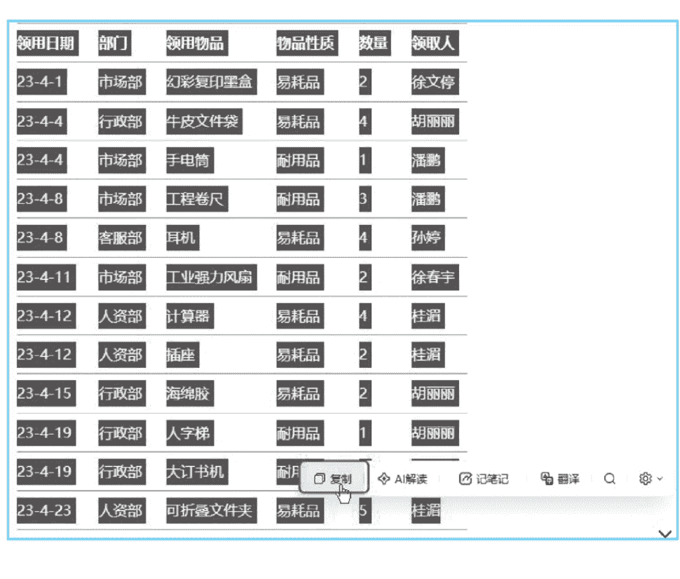

图0-13

❷ 切换到Excel，选中目标单元格，按Ctrl+V组合键粘贴，如图。
❸ 由于数据宽度问题，得到的数据在显示效果上有些问题，可以通过调整列宽、行高等对表格稍加整理，整理后的表格如图。

| 领用日期 | 部门 | 领用物品 | 物品性质 | 数量 | 领取人 |

| :--- | :--- | :--- | :--- | :--- | :--- |

| 23-4-1 | 市场部 | 幻彩复印墨盒 | 易耗品 | 2 | 徐文停 |

| 23-4-4 | 行政部 | 牛皮文件袋 | 易耗品 | 4 | 胡丽丽 |

| 23-4-4 | 市场部 | 手电筒 | 耐用品 | 1 | 潘鹏 |

| 23-4-8 | 市场部 | 工程卷尺 | 耐用品 | 3 | 潘鹏 |

| 23-4-8 | 客服部 | 耳机 | 易耗品 | 4 | 孙婷 |

| 23-4-11 | 市场部 | 工业强力风扇 | 耐用品 | 2 | 徐春宇 |

| 23-4-12 | 人资部 | 计算器 | 易耗品 | 4 | 桂湄 |

| 23-4-12 | 人资部 | 插座 | 易耗品 | 2 | 桂湄 |

| 23-4-15 | 行政部 | 海绵胶 | 易耗品 | 2 | 胡丽丽 |

| 23-4-19 | 行政部 | 人字梯 | 耐用品 | 1 | 胡丽丽 |

| 23-4-19 | 行政部 | 大订书机 | 耐用品 | 1 | 胡丽丽 |

| 23-4-23 | 人资部 | 可折叠文件夹 | 易耗品 | 5 | 桂湄 |

图0-14

| 领用日期 | 部门 | 领用物品 | 物品性质 | 数量 | 领取人 |

|---|---|---|---|---|---|

| 2023-4-1 | 市场部 | 幻彩复印墨盒 | 易耗品 | 2 | 徐文停 |

| 2023-4-4 | 行政部 | 牛皮文件袋 | 易耗品 | 4 | 胡丽丽 |

| 2023-4-4 | 市场部 | 手电筒 | 耐用品 | 1 | 潘鹏 |

| 2023-4-8 | 市场部 | 工程卷尺 | 耐用品 | 3 | 潘鹏 |

| 2023-4-8 | 客服部 | 耳机 | 易耗品 | 4 | 孙婷 |

| 2023-4-11 | 市场部 | 工业强力风扇 | 耐用品 | 2 | 徐春宇 |

| 2023-4-12 | 人资部 | 计算器 | 易耗品 | 4 | 桂湄 |

| 2023-4-12 | 人资部 | 插座 | 易耗品 | 2 | 桂湄 |

| 2023-4-15 | 行政部 | 海绵胶 | 易耗品 | 2 | 胡丽丽 |

| 2023-4-19 | 行政部 | 人字梯 | 耐用品 | 1 | 胡丽丽 |

| 2023-4-19 | 行政部 | 大订书机 | 耐用品 | 1 | 胡丽丽 |

| 2023-4-23 | 人资部 | 可折叠文件夹 | 易耗品 | 5 | 桂湄 |

图0-15

#### 2. 条件说不全，公式就会跑偏

把需求交给 DeepSeek 时，一旦牵扯到多重限制，就要把每条限制都讲到位。下面先看一个提问示例 图0-16，提交后得到的回馈如图0-17。


图0-16

针对上述场景，可用 Excel 的 IF 配合 AND 来实现判断，相关表格表达式如下：

##### Excel公式

```
excel
=IF(AND(A2="洗衣机", B2="白色"), C2+50, IF(AND(A2="洗衣机", B2<>"白色"), C2+200, C2))
```

##### 公式说明

1. 首层 IF：
   - AND(A2="洗衣机", B2="白色")：校验 A2 是否为“洗衣机”且 B2 是否为“白色”。
   - 成立则返回 C2+50，即白色洗衣机上浮 50 元。
2. 次层 IF：
   - AND(A2="洗衣机", B2<>"白色")：校验 A2 是否为“洗衣机”且 B2 不为“白色”。
   - 成立则返回 C2+200，即其余颜色洗衣机上浮 200 元。
3. 默认分支：
   - 以上均不满足时返回 C2，保持原价。

图0-17

把上述回馈落到工作表后，结果如图0-18，全部显示原价，并未按规则调价。

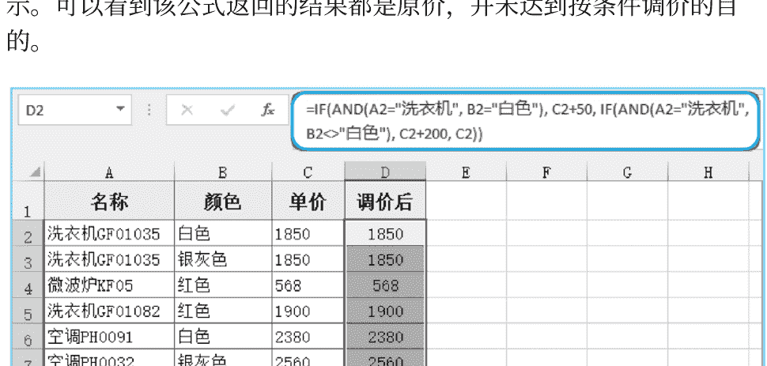

图0-18

提问中对单元格位置的指明很清晰，却漏掉了一个关键特征。观察 A 列名称会发现，“洗衣机”只是商品名称的前缀，并非整串文字。判断是否属于洗衣机，还需把前缀匹配的规则补充进去。于是把提问改写为“并且要核对 A2 左侧前 3 个字符是否为洗衣机”如图0-19，DeepSeek 这才明白要先截取再判断，并给出新表达式如图0-20。


图0-19

现需先确认 A2 前 3 个字符是否为“洗衣机”，再结合颜色进行调价。可借助 LEFT 截取前缀，再与 IF、AND 组合实现。具体表达式如下：

##### Excel公式

```
excel
=IF(AND(LEFT(A2, 3)="洗衣机", B2="白色"), C2+50, IF(AND(LEFT(A2, 3)="洗衣机", B2<>"白色"), C2+200, C2))
```

##### 公式说明

1. 首层 IF：
   - AND(LEFT(A2, 3)="洗衣机", B2="白色")：检查 A2 前 3 字是否为“洗衣机”且 B2 为“白色”。
   - 成立返回 **C2+50**，即白色洗衣机上浮 50 元。
2. 次层 IF：
   - AND(LEFT(A2, 3)="洗衣机", B2<>"白色")：检查 A2 前 3 字是否为“洗衣机”且 B2 不为“白色”。
   - 成立返回 **C2+200**，即其他颜色上浮 200 元。
3. 默认分支：
   - 条件皆不成立时返回 **C2**，不调价。

图0-20

回 Excel 验证，公式可自动识别 A 列名称前缀是否为“洗衣机”，并结合颜色给出正确结果，如图0-21。

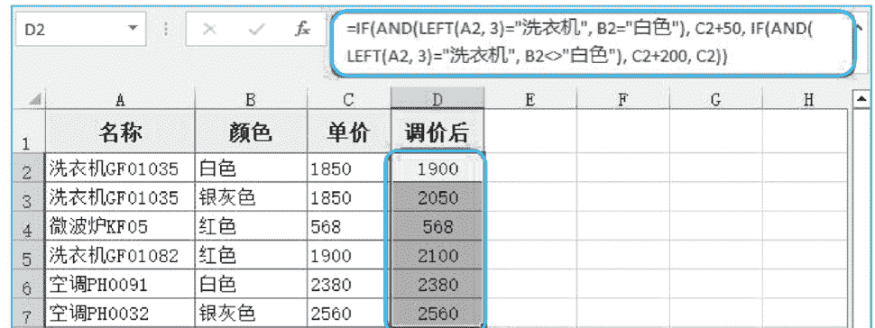

图0-21

#### 3. 回馈不理想时继续追问

前面提到提问要清晰、范围目的明确、条件完整。一次表达不清导致结果不符时，还可以通过追问补充、或提出新需求来修正。

例如提问“数据尾部都带有中文单位，如何一次性拆分并剔除？”如图0-22，得到的建议如图0-23，DeepSeek 推荐使用“分列”功能。


图0-22

若数据后带有中文单位，如“10元”、“5公斤”，可用 Excel 的“分列”功能或公式一次性分离并删除单位。具体做法如下：

##### 方法1：使用“分列”功能

“分列”是 Excel 中很便捷的工具，可快速把文字与数字拆开。

步骤：
1. 选中待处理的列，如 B 列。
2. 点击“数据” > “分列”。
3. 对话框中：
   - 选“固定宽度”，点“下一步”。
   - 在预览区点数字与单位之间，设置分列线。
   - 点“下一步”。
4. “列数据格式”中：
   - 数字部分设为“常规”。
   - 单位部分选“不导入此列（跳过）”。
5. 点“完成”。


若因数据长度与单位长度不一致而无法使用该方法，可追加说明“因为数据长短不一，单位长短不一，我无法使用‘分列’功能。”如图0-24，DeepSeek 便给出另一套思路如图0-25。


当数据与单位长度均不固定、无法使用“分列”时，可采用以下方式：

##### 方法1：用公式提取数字部分

公式对长短不一的情况更具弹性。

步骤：
1. 在相邻列如 C 列输入下方公式，提取数字部分：
```
excel
=LEFT(B2, MIN(FIND({"元","公斤","克","升"}, B2 & "元公斤克升"))-1)
```
2. 如需提取单位部分，可在 D 列输入下方公式：
```
excel
=TRIM(RIGHT(B2, LEN(B2) - LEN(C2)))
```
3. 公式向下复制。

公式要点：
- FIND({"元","公斤","克","升"}, B2 & "元公斤克升")：定位单位首次出现的位置。
- MIN(...)：取最早的出现位置。
- LEFT(B2, ...-1)：截取单位前的数字。
- TRIM(RIGHT(...))：取出单位并去空格。

图0-25

因此在与 DeepSeek 交互时，若结果未达预期，可通过持续追问把问题细化具象化，回馈会更精准。

### 0.4 DeepSeek 在函数方面的支持方式

灵活的公式设计能满足日常办公中各类计算、统计、分析需求。不少用户对函数感到难学难记，进入 AI 时代后，可通过向 DeepSeek 请教语法、示例，甚至直接描述意图获取可用公式。

#### 1. 按指定任务获取表格公式建议

DeepSeek 能够依据用户描述的任务给出表格函数建议，只要描述准确，就能得到初步方案，再经追问逐步细化。实践中体会很明显。

例如提问“表格记录了员工入职日期，试用期为 60 天，想用公式判断试用期是否已结束。”如图0-26。


图0-26

提交后得到回馈如图0-27。

依据入职日期与 60 天试用期判断是否结束，可用 IF 结合 TODAY() 实现。具体步骤与公式如下：

#### 步骤：
1. 假设入职日期在 B 列，如 B2:B100。
2. 在 C2 输入下方公式：
```
excel
=IF(TODAY()-B2>=60, "试用期结束", "试用期中")
```
3. 回车后 C2 会显示试用期状态。
4. 向下填充公式，逐条判断。

##### 公式要点：
1. TODAY()：返回当前日期。
2. TODAY()-B2：计算距入职的天数。
3. IF(TODAY()-B2>=60, "试用期结束", "试用期中")：天数 ≥60 显示结束，否则显示进行中。

图0-27

把回馈公式应用到 Excel，求解结果如图0-28。

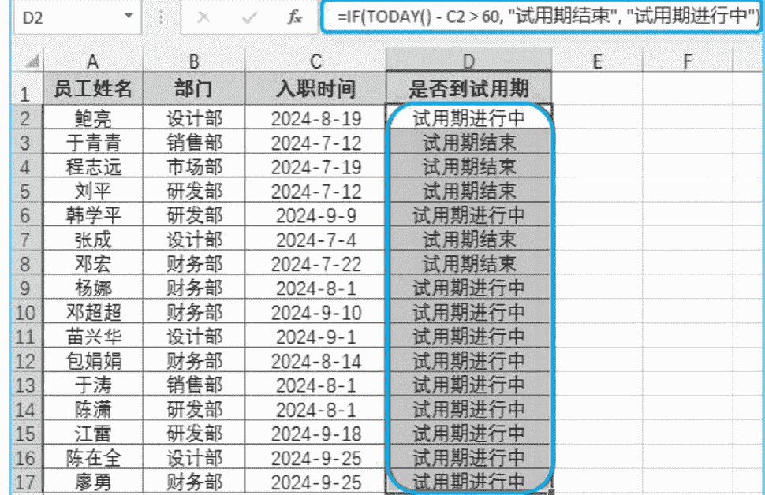

图0-28

#### 2. 依据提示完成公式编写

把分析意图整理成文字发给 DeepSeek 得到回馈后，需回到 Excel 按提示完成编写，编写过程本身也是提升技能的机会。

例如提问“想把表格中所有显示‘录取’对应的姓名提取出来，并用‘，’间隔。”如图0-29，回馈如图0-30。

想将表格中所有显示“录取”文字对应的姓名都提取出来，并使用“，”号间隔。

图0-29

要提取所有标记为“录取”的姓名并以“，”连接，可用 TEXTJOIN 结合 IF 实现。具体公式与步骤如下：

##### 公式：
假设姓名在 A 列，录取状态在 B 列，范围为 A2:A100 和 B2:B100，在目标单元格输入：

```
excel
=TEXTJOIN("，", TRUE, IF(B2:B100="录取", A2:A100, ""))
```

#### 公式解析：
1. B2:B100="录取"：判断区域是否等于“录取”，返回布尔数组。
2. IF(B2:B100="录取", A2:A100, "")：满足条件则返回对应姓名，否则返回空串。
3. TEXTJOIN("，", TRUE, ...)：把结果拼接，分隔符为“，”，TRUE 忽略空值。

图0-30

DeepSeek 不仅给出公式，还提醒根据实际数据调整引用范围，并提示可更换分隔符或使用换行符，如图0-31。

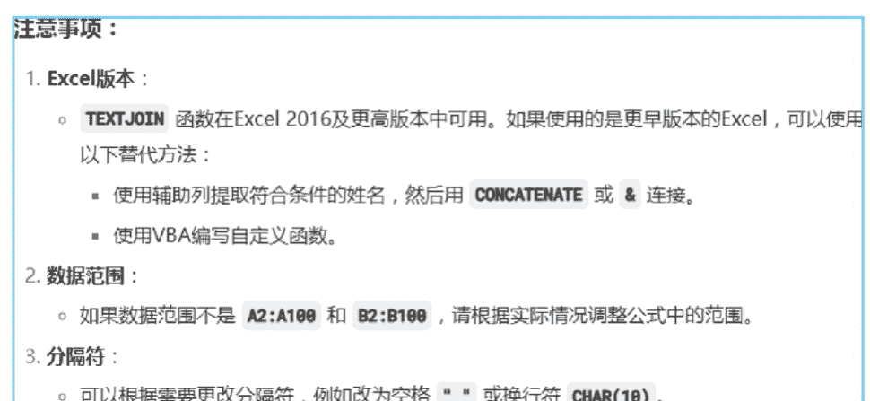

图0-31

把公式复制到 Excel，如图0-32。

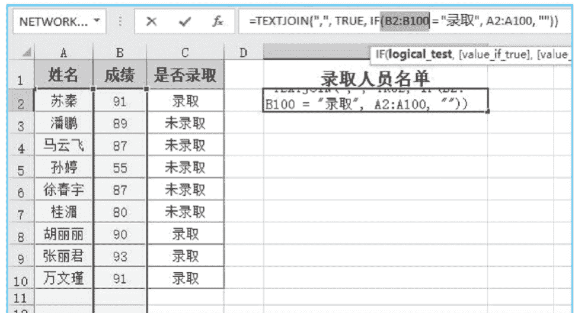

图0-32

根据实际数据修改引用，如图0-33。

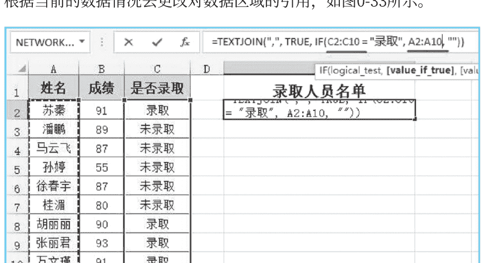

图0-33

按 Ctrl + Shift + Enter 得到结果，如图0-34。

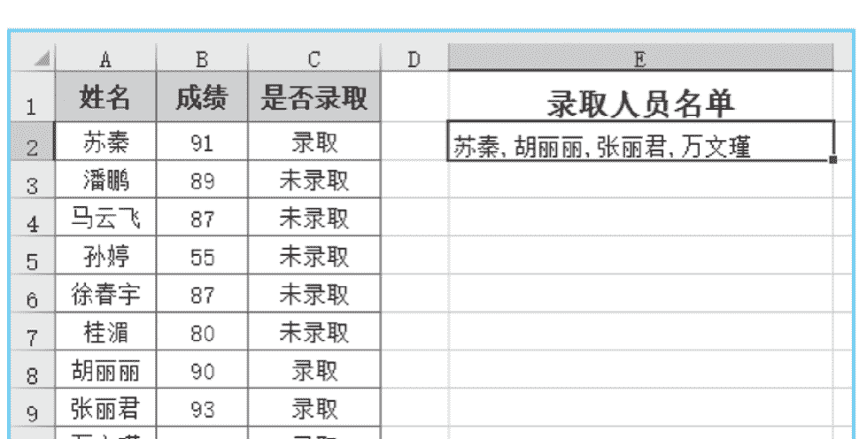

图0-34

#### 3. 借助分步解析理解公式

DeepSeek 对公式的拆解很清晰，尤其是复杂公式，分步说明更易理解。反复研读与实操对学习函数帮助很大。

例如关于后续财务处理中用到的一个公式，向 DeepSeek 请教后得到“公式解析”“解决的问题”“示例”三部分说明，如图0-35、图0-36。

请问=IFERROR(SMALL(IF(F:F=$D$1, ROW(F:F)), ROW(1:1)), "")这个公式该如何理解？

该公式作用是：在 F 列中查找与 D1 单元格内容相同的值，并返回对应行号，按从小到大依次输出，找不到时返回空。

下面详细拆解：

#### 公式解析：
```
excel
=IFERROR(SMALL(IF(F:F=$D$1, ROW(F:F)), ROW(1:1)), "")
```
1. **F:F=$D$1**：
   - 判断 F 列每个单元格是否等于 D1 内容。
   - 返回布尔数组。
2. **IF(F:F=$D$1, ROW(F:F))**：
   - 满足条件则返回行号，否则返回 FALSE。
   - 结果为行号与 FALSE 组成的数组。
3. **SMALL(..., ROW(1:1))**：
   - SMALL 用于提取数组中第 k 小值。
   - ROW(1:1) 随公式向下填充依次取第1、2、3...个匹配行号。
4. **IFERROR(..., "")**：
   - 无更多匹配行号时 SMALL 报错，返回空串 ""。

图0-35

#### 解决的问题：
- 在 F 列中定位与 D1 相同的值。
- 按行号从小到大依次列出。
- 遍历完毕后输出空值。

#### 示例：
假设 D1 为 1001，F 列数据如下：
| F列（值） |
|---|
| 1001 |
| 1002 |
| 1001 |
| 1003 |
| 1001 |
使用公式：
```
excel
=IFERROR(SMALL(IF(F:F=$D$1, ROW(F:F)), ROW(1:1)), "")
```

# 第1章 财务数据的输入与编辑


扫码看教学视频

数据是表格的基础。在财务处理中，首先要保证数据规范。掌握输入技巧，既能提升效率，又能为后续统计分析打下良好基础。

输入各类数据
批量导入数据
设置数据验证规范录入
选择性粘贴的实用技巧

## 1.1 输入各类数据

把文本、数值、日期等不同类型数据录入工作表是建表第一步。不同类型数据的录入要点不同。本节还涉及填充与导入实现批量输入。

### 1.1.1 输入特殊文本

通常按程序可识别的格式录入即可。但对于部分数字需要以文本形式展示的情况，需特别处理。以下举例说明。

#### 1. 保留前导零的序号

例如“序号”列希望显示“001”“002”…如图1-1，直接录入会丢失前导零如图1-2。此时需先把单元格格式设为“文本”，再录入。

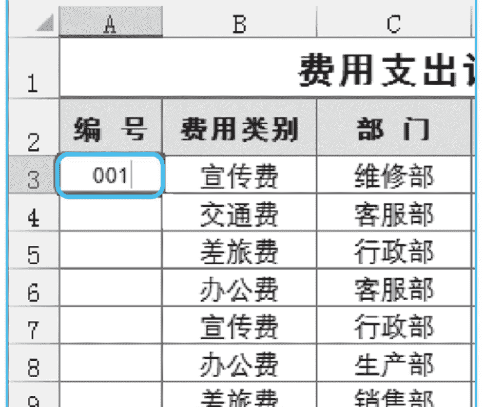

图1-1

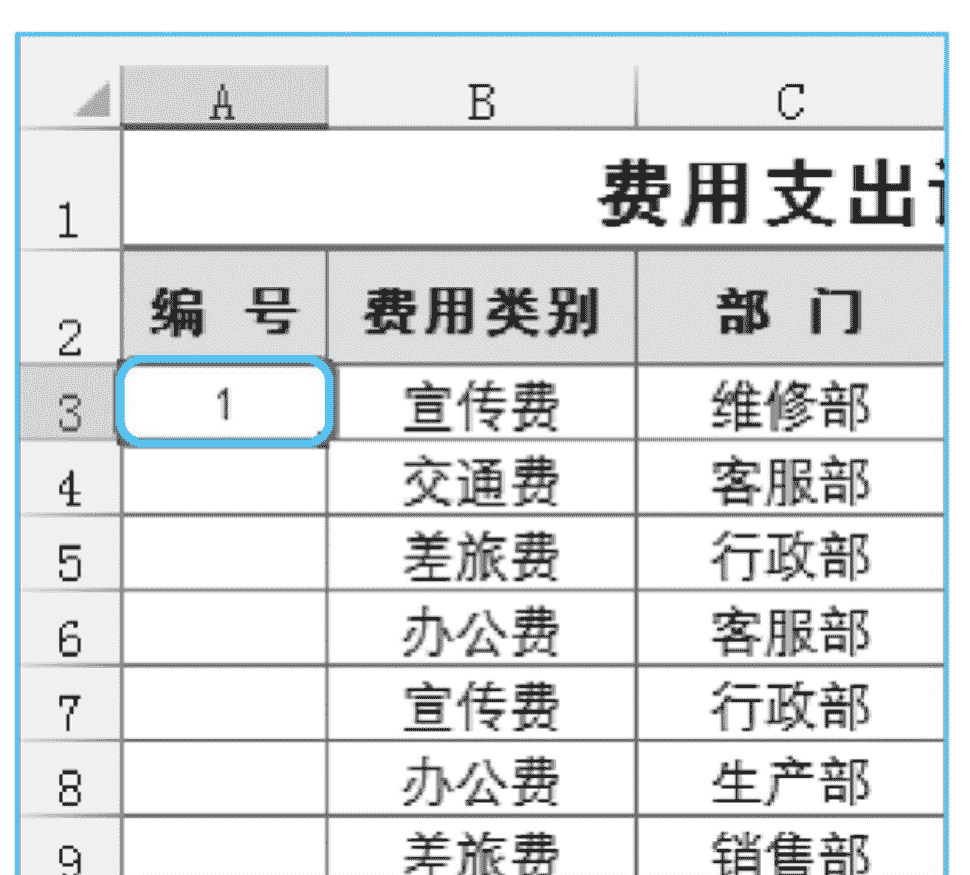

图1-2

##### 专家提醒

务必先设置格式再录入。若先录入再改格式，前导零无法恢复。

1. 选中“编号”列区域，切换到“开始”选项卡，在“数字”组点击格式框右侧下拉，选择“文
#### 1.1.1 输入以0开头的编号

本”，如图1-3所示。

❷点击“确定”后，再录入以0开头的编号即可正确显示，如图1-4所示。

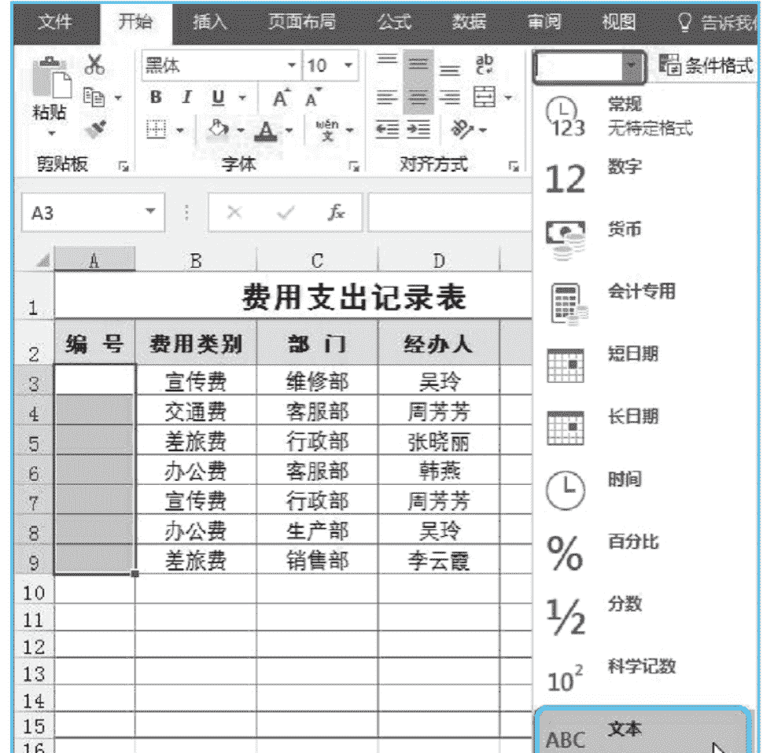

图1-3

| 编号 | 费用类别 | 部门 | 经办人 | 金额 |
|---|---|---|---|---|

| 001 | 宣传费 | 维修部 | 吴玲 | |

| 002 | 交通费 | 客服部 | 周芳芳 | |

| 003 | 差旅费 | 行政部 | 张晓丽 | |

| 004 | 办公费 | 客服部 | 韩燕 | |

| 005 | 宣传费 | 行政部 | 周芳芳 | |

| 006 | 办公费 | 生产部 | 吴玲 | |

| 007 | 差旅费 | 销售部 | 李云霞 | |

图1-4

#### 2. 超长编号防转指数
身份证号这类很长的数字如果直接敲进表格，系统会把它当成普通数值处理，直接显示成 3.40222E+17 这种指数形式，完整号码就丢失了，见图1-5。解决办法是先把目标单元格的格式改成文本，再进行录入，就能完整保留原样，见图1-6。

| 姓名 | 学历 | 身份证号码 |

|---|---|---|

| 何小希 | 本科 | 3.40222E+17 |

| 周瑞 | 本科 | 3.40222E+17 |

| 于青青 | 本科 | 3.40025E+17 |

| 罗羽 | 硕士 | 3.40025E+17 |

| 邓志诚 | 本科 | 3.40042E+17 |

| 程飞 | 本科 | 3.40042E+17 |

| 周城 | 大专 | 3.40042E+17 |

| 张翔 | 本科 | 3.42701E+17 |

图1-5

| 姓名 | 学历 | 身份证号码 |

|---|---|---|

| 何小希 | 本科 | 340222198602165426 |

| 周瑞 | 本科 | 340222199105065000 |

| 于青青 | 本科 | 340025197803170540 |

| 罗羽 | 硕士 | 340025198506100224 |

| 邓志诚 | 本科 | 340042198210160517 |

| 程飞 | 本科 | 340025198506100214 |

| 周城 | 大专 | 340025199103240657 |

| 张翔 | 本科 | 342701199002178573 |

图1-6

### 1.1.2 统一小数位数呈现
数值带小数时，默认按实际输入的位数显示。要让同一块区域都固定显示某一位数，比如始终两位，不足补零，可以按下面步骤。

❶ 把需要统一格式的单元格选中，打开开始标签页的数字区域，点击下拉箭头选择数值样式，如图1-7所示。

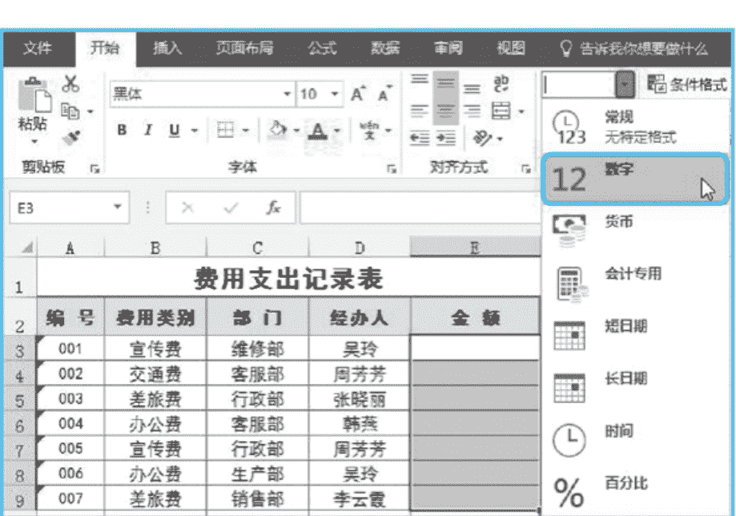

图1-7

❷ 设定完成后，该区域内后续输入都会自动补齐成两位小数样式，如图1-8所示。

| 编号 | 费用类别 | 部门 | 经办人 | 金额 |

|---|---|---|---|---|

| 001 | 宣传费 | 维修部 | 吴玲 | 2000.50 |

| 002 | 交通费 | 客服部 | 周芳芳 | 580.60 |

| 003 | 差旅费 | 行政部 | 张晓丽 | 2010.30 |

| 004 | 办公费 | 客服部 | 韩燕 | 600.20 |

| 005 | 宣传费 | 行政部 | 周芳芳 | 2500.60 |

| 006 | 办公费 | 生产部 | 吴玲 | 3000.60 |

| 007 | 差旅费 | 销售部 | 李云霞 | 2050.10 |

图1-8

❸ 若要增减小数点后位数，可在数字区域使用增加小数位或减少小数位的操作，如图1-9所示。

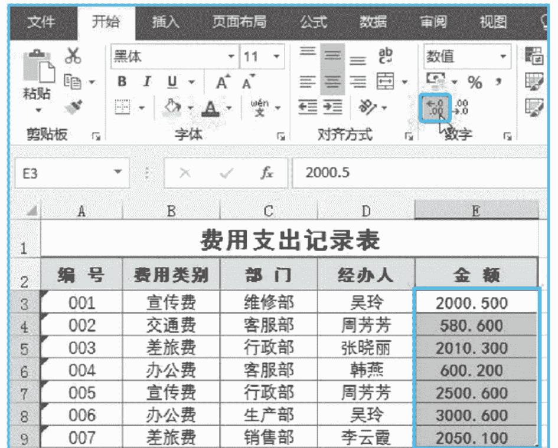

图1-9

##### 知识扩展
数值格式下拉里还提供货币、会计专用、百分比等快捷选项，便于快速切换显示方式。这些样式多数默认保留两位小数，后续仍可用增减小数位按钮微调。

### 1.1.3 金额改成货币样式
财务报表里金额常需带货币符号。要把数字显示为货币格式，可按如下操作。

❶ 打开工作表，选中要改成货币显示的区域，切换到开始标签页，数字区域点击设置单元格格式按钮，弹出对话框，如图1-10所示。

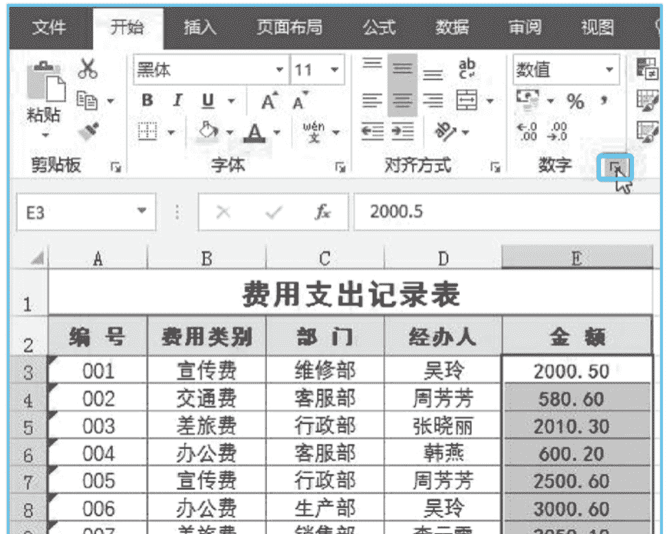

图1-10

❷ 在分类列表中选择货币，设定小数位数并挑选货币符号样式，如图1-11所示。

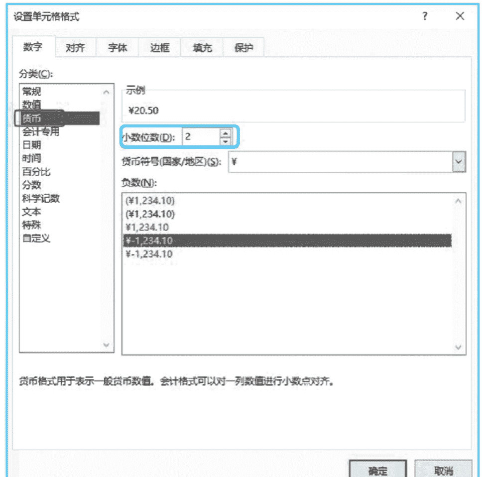

图1-11

❸ 确认后，选中区域的数值即变为标准货币格式，如图1-12所示。

| 编号 | 费用类别 | 部门 | 经办人 | 金额 |

|---|---|---|---|---|

| 001 | 宣传费 | 维修部 | 吴玲 | ¥2,000.50 |

| 002 | 交通费 | 客服部 | 周芳芳 | ¥580.60 |

| 003 | 差旅费 | 行政部 | 张晓丽 | ¥2,010.30 |

| 004 | 办公费 | 客服部 | 韩燕 | ¥600.20 |

| 005 | 宣传费 | 行政部 | 周芳芳 | ¥2,500.60 |

| 006 | 办公费 | 生产部 | 吴玲 | ¥3,000.60 |

| 007 | 差旅费 | 销售部 | 李云霞 | ¥2,050.10 |

图1-12

##### 知识扩展
在设置单元格格式对话框里还能调整负数的呈现方式。按图1-13的配置，负数会按图1-14的样式显示。

#### 设置单元格格式

数字 对齐 字体 边框 填充 保护

分类(C):

- 常规

- 数值

- 货币

- 会计专用

- 日期

- 时间

- 百分比

- 分数

- 科学记数

- 文本

- 特殊

- 自定义

示例

¥18,874.10

小数位数(D): 2

货币符号(国家/地区)(S): ¥

负数(N):

- ¥1,234.10

- (¥1,234.10)

- ¥1,234.10

- ¥-1,234.10

- ¥-1,234.10

货币格式用于表示一般货币数值。会计格式可以对一列数值进行小数点对齐。

确定 取消

图1-13

| 项目 | 上年度 | 本年度 | 增减额(率) |

| :--- | :--- | :--- | :--- |

| 销售收入 | ¥206,424.58 | ¥225,298.68 | ¥18,874.10 |

| 销售成本 | ¥82,698.00 | ¥96,628.02 | ¥13,930.02 |

| 销售费用 | ¥20,462.68 | ¥6,450.46 | (¥14,012.22) |

| 销售税金 | ¥4,952.89 | ¥2,222.65 | (¥2,730.24) |

| 销售成本率 | ¥0.68 | ¥0.83 | ¥0.15 |

| 销售费用率 | ¥0.10 | ¥0.06 | (¥0.03) |

| 销售税金率 | ¥0.05 | ¥0.03 | (¥0.02) |

图1-14

### 1.1.4 百分比怎么录入
百分比可以直接在数字后加上 % 符号输入。但当需要对计算结果统一做百分比展示，比如利润率，就用格式调整更省事。

❶ 选中目标区域，或想把已有数据改成百分比样式的区域，进入开始-数字区，点击 % 按钮，如图1-15所示。此时数据会变为百分数，但默认不带小数，如图1-16所示。

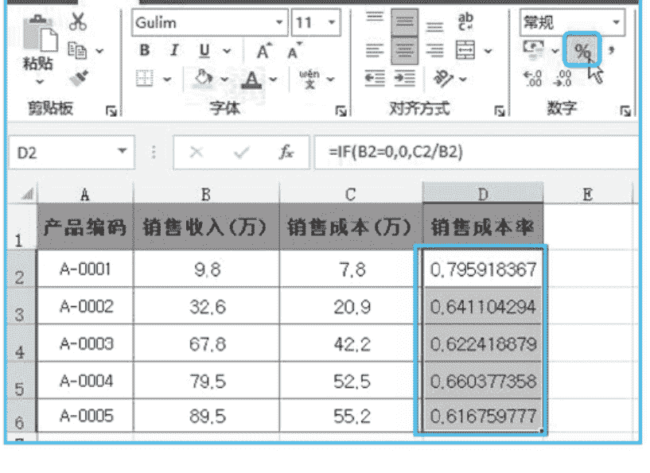

图1-15

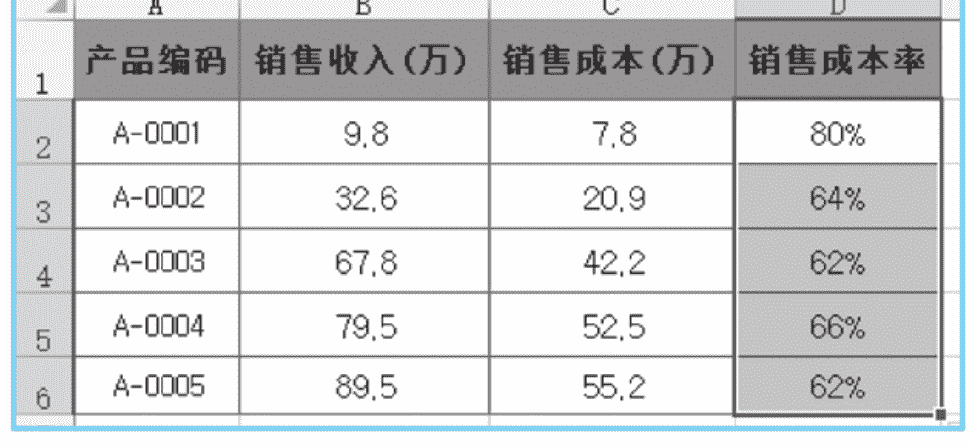

图1-16

❷ 保持选中，在数字区连续点击增加小数位按钮，按需决定保留位数，如图1-17所示。

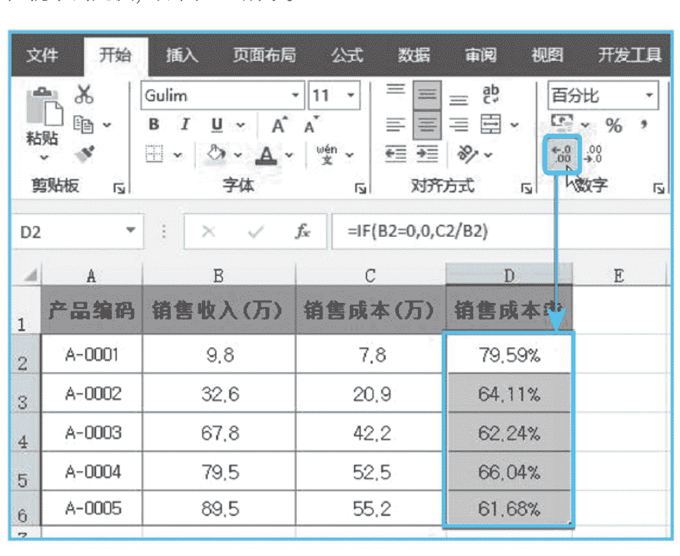

图1-17

## 1.2 数据批量输入
表格里批量录入是常见需求，比如连续填充相同内容、自动生成序号、生成连续月份等，都能一次性完成规律数据，提升效率。

### 1.2.1 批量输入相同内容
快速填充重复内容可分为连续区域和分散区域两种情况。

#### 1. 连续单元格输入相同数据
❶ 先在起始格输入内容，例如 B6 填“综合处”，把光标移到格子右下角出现黑色十字填充柄，如图1-18所示。

❷ 按住左键向下拖动，拖到所需范围，如图1-19所示。

❸ 松开鼠标，内容即可自动填充到拖动区域，如图1-20所示。

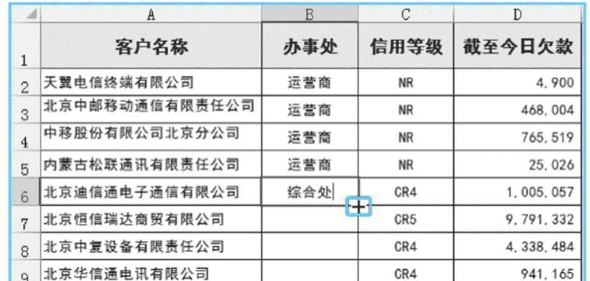

图1-18

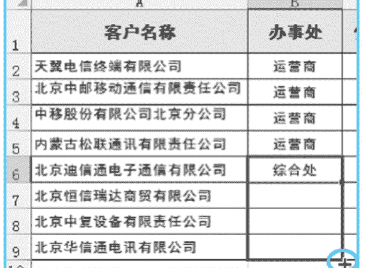

图1-19

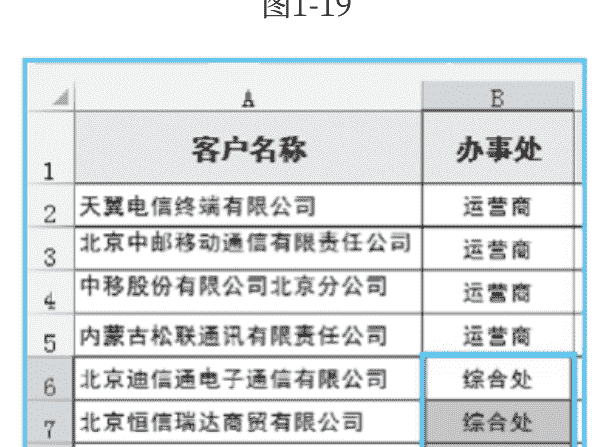

图1-20

#### 2. 不连续单元格输入相同数据
若需在分散不相邻的格子里填入同一内容，也有便捷方法。

❶ 按住 Ctrl 逐一选中目标格子，如图1-21所示，然后在编辑栏输入想要的内容，例如“农业银行”，如图1-22所示。

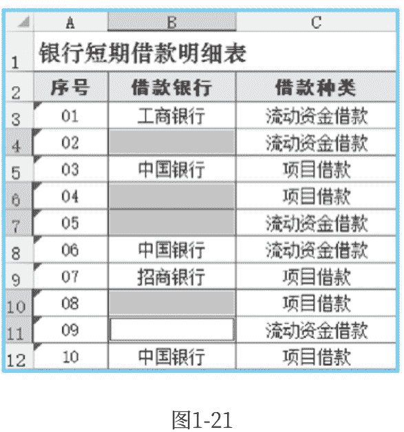

图1-21

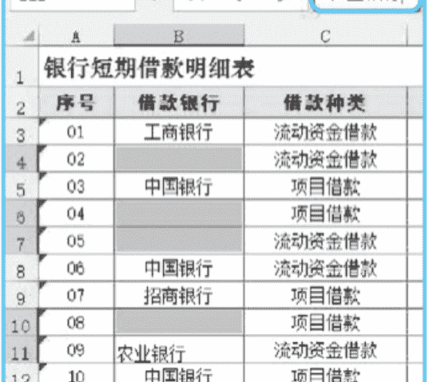

图1-22

❷ 按 Ctrl+Enter，选中区域会同时填入相同内容，如图1-23所示。

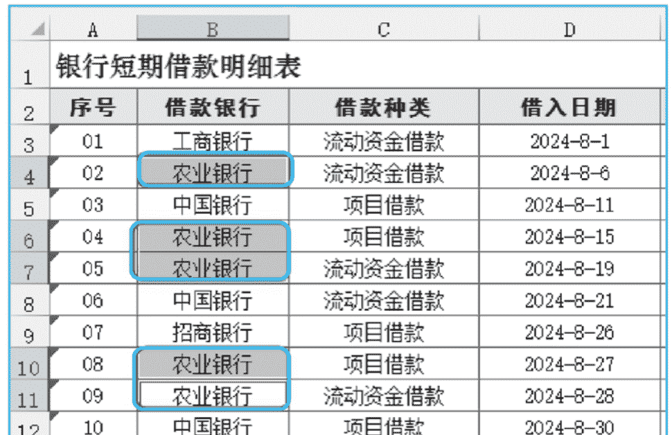

图1-23

### 1.2.2 填充输入序号
填充功能适合生成有规律的数据，序号、日期、月份都能自动生成。下面以连续序号为例说明操作。

#### 1. 快速填充连续的序号
❶ 先在 A3 输入“001”，注意先按 1.1.1 小节的方法把格子设为文本，否则前导零会丢失。选中 A3，移到右下角出现填充柄，如图1-24所示。

❷ 按住左键向下拖动到结束位置，如图1-25所示。

| 序号 | 公司名称 | 应收金额 |

|---|---|---|

| 001 | 孚盛装饰公司 | ¥ 29,840.00 |

| | 澳菲斯建材有限公司 | ¥ 28,765.00 |

| | 宏运佳建材公司 | ¥ 15,080.00 |

| | 拓帆建材有限公司 | ¥ 22,015.00 |

| | 澳菲斯建材有限公司 | ¥ 18,009.00 |

| | 孚盛装饰公司 | ¥ 22,000.00 |

| | 孚盛装饰公司 | ¥ 23,000.00 |

| | 雅得丽装饰公司 | ¥ 24,000.00 |

| | 宏运佳建材公司 | ¥ 30,000.00 |

| | 雅得丽装饰公司 | ¥ 8,000.00 |

| | 雅得丽装饰公司 | ¥ 8,500.00 |

| | 海兴建材有限公司 | ¥ 8,500.00 |

| | 宏运佳建材公司 | ¥ 22,000.00 |

| | 海兴建材有限公司 | ¥ 10,000.00 |

图1-24

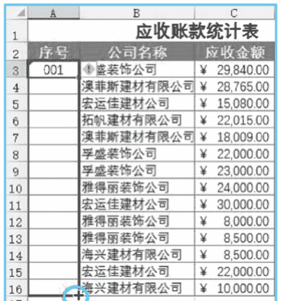

图1-25

❸ 松开鼠标，被拖过的格子会自动生成递增序号，如图1-26所示。

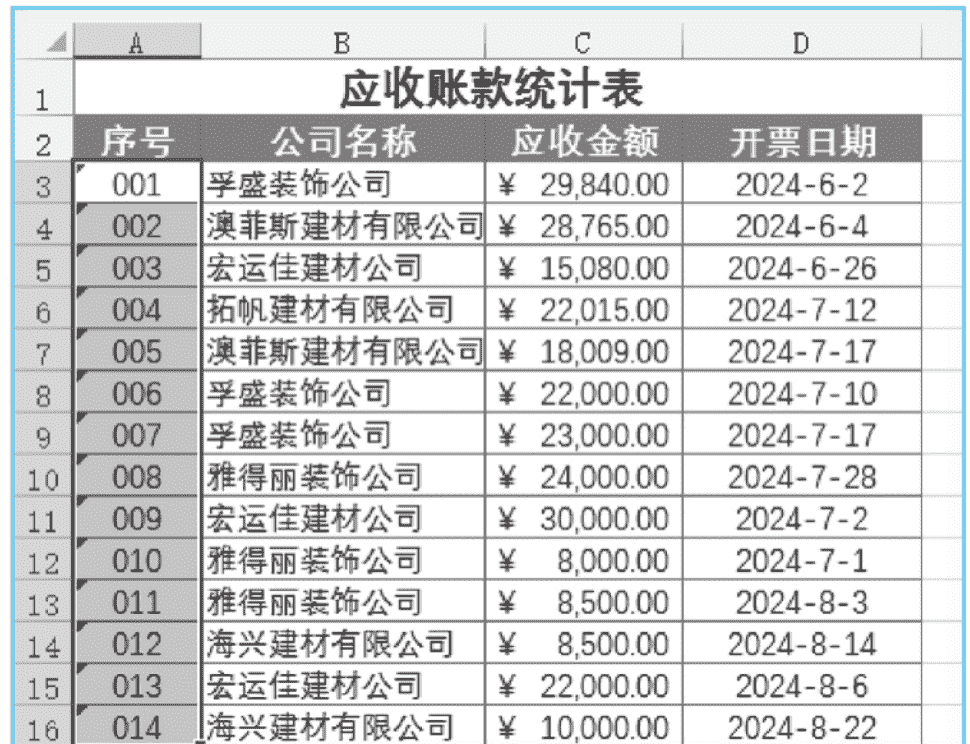

图1-26

#### 2. 快速填充不连续的序号
填充还能生成间隔序号，关键是先给出两个起始样本。比如固定资产编号为 GD001、GD004、GD007……间隔为 3，先输入前两个编号再拖动即可批量生成。

❶ 在 A2、A3 分别填入 GD001 和 GD004，选中这两个格子，把光标移到区域右下角出现填充柄，如图1-27所示。

❷ 按住左键向下拖动到所需位置松开，编号会按 3 的间隔自动递增，如图1-28所示。

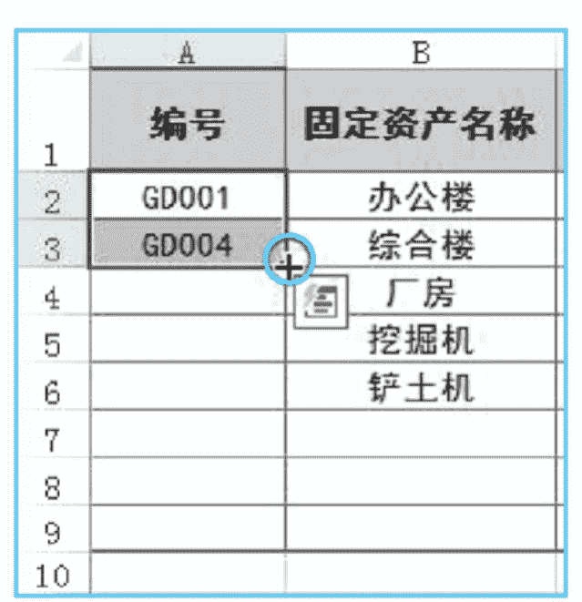

图1-27


图1-28

##### 知识扩展
填充完成后右下角会出现“自动填充选项”按钮，下拉菜单可选择“仅复制格式”“不带格式填充”等不同模式，如图1-29所示。

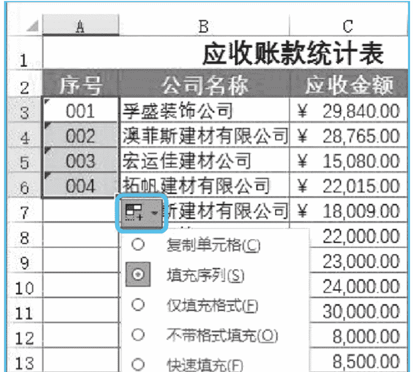

图1-29

另外，下拉菜单的具体选项会随数据类型变化，比如填充日期时会多出“按月填充”“按工作日填充”等。

### 1.2.3 填充输入日期
日期填充同序号类似可得连续序列，若需按月、按工作日或按年递增，就要借助“自动填充选项”按钮进行选择。

#### 1. 快速填充连续日期
❶ 在 A2 输入起始日期，鼠标移到右下角变为 + 号，按住向下拖动到合适位置松开，即可得到逐日递增的日期序列，如图1-30所示。

❷ 点击“自动填充选项”按钮，在菜单里选择“填充工作日”，日期就会跳过周末，只填充工作日，如图1-31、图1-32所示。

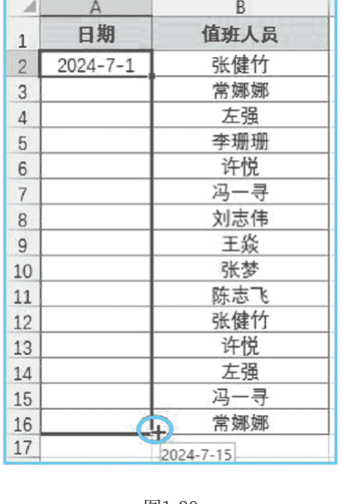

图1-30

| A | B |

|---|---|

| 日期 | 值班人员 |

| 2024-7-1 | 张健竹 |

| 2024-7-2 | 常娜娜 |

| 2024-7-3 | 左强 |

| 2024-7-4 | 李珊珊 |

| 2024-7-5 | 许恺 |

| 2024-7-6 | |

| 2024-7-7 | |

| 2024-7-8 | |

| 2024-7-9 | |

| 2024-7-10 | |

| 2024-7-11 | |

| 2024-7-12 | |

| 2024-7-13 | |

| 2024-7-14 | |

| 2024-7-15 | |

- 复制单元格(C)

- 填充序列(S)

- 仅填充格式(F)

- 不带格式填充(O)

- 以天数填充(D)

- 填充工作日(W)

- 以月填充(M)

- 以年填充(Y)

- 快速填充(F)

图1-31

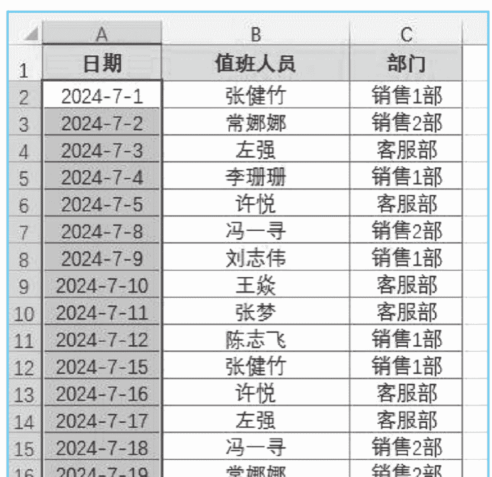

图1-32

#### 2. 快速填充相同日期
日期填充默认是递增的，若想在连续区域填入完全相同的日期，如图1-33所示，可在输入首个日期后按住 Ctrl 再拖动填充柄；或者先拖动再点“自动填充选项”选择“复制单元格”，如图1-34所示。

| A | B | C | D |

|---|---|---|---|

| 销售日期 | 产品名称 | 销售数量 | 重量 |

| 2024-8-1 | 核桃 | 4 | 200克 |

| 2024-8-1 | 花生 | 5 | 500克 |

| 2024-8-1 | 碧根果 | 3 | 200克 |

| 2024-8-1 | 开心果 | 6 | 200克 |

| 2024-8-1 | 仁核桃 | 3 | 150克 |

| 2024-8-1 | 扁桃仁 | 2 | 150克 |

| 2024-8-2 | 丝瓜子 | 2 | 200克 |

| 2024-8-2 | 核桃 | 5 | 200克 |

| 2024-8-2 | 碧根果 | 10 | 200克 |

图1-33

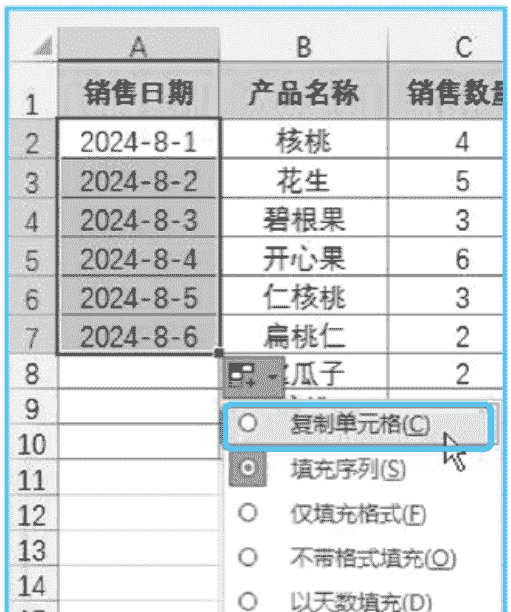

图1-34

##### 专家提示
数据本身带有日期或明显增减规律时直接拖动即可；若为纯数字想复制相同值，需按住 Ctrl 拖动，或拖动后在自动填充选项里选“填充序列”。

### 1.2.4 DeepSeek指导快速将缺失数据自动填满
实际工作中常出现重复项只填首个，后续留空的情况。比如图1-35 中 C 列仓库名称、D 列商品类别有多处空白，若想快速补齐，可向 DeepSeek 请教。

❶ 在 DeepSeek 对话框输入“在 Excel 里，如何让选中区域的空格子自动向上取值并填入”，如图1-36所示。

| | A | B | C | D | E |

|---|---|---|---|---|---|

| 1 | 出单日期 | 商品编码 | 仓库名称 | 商品类别 | 出库件数 |

| 2 | 2024-4-8 | WJ8870 | 西城仓 | 瓷片 | 600 |

| 3 | 2024-4-14 | Z8G033 | | | 25 |

| 4 | 2024-4-10 | ZG6011 | | | 32 |

| 5 | 2024-4-17 | ZG6012 | | | 1000 |

| 6 | 2024-4-16 | ZG6013 | | 抛釉砖 | 133 |

| 7 | 2024-4-3 | ZG6016 | | | 817 |

| 8 | 2024-4-11 | ZG6017 | | | 274 |

| 9 | 2024-4-8 | WJ3606B | 建材商城仓库 | 瓷片 | 35 |

| 10 | 2024-4-8 | WJ3608B | | | 900 |

| 11 | 2024-4-13 | ZG63011A | | | 1000 |

| 12 | 2024-4-19 | ZG63016B | | | 80 |

| 13 | 2024-4-2 | WJ8868 | | 抛釉砖 | 90 |

| 14 | 2024-4-4 | Z8G031 | | | 28 |

| 15 | 2024-4-3 | Z8G031 | | | 200 |

| 16 | 2024-4-3 | WJ3608C | 东城仓 | 瓷片 | 550 |

| 17 | 2024-4-4 | WJ3610C | | | 170 |

| 18 | 2024-4-17 | ZG63010 | | | 691 |

| 19 | 2024-4-2 | WJ8869 | | 大理石 | 230 |

| 20 | 2024-4-7 | WJ8871 | | | 636 |

| 21 | 2024-4-6 | WJ8872 | | | 650 |

图1-35

向 DeepSeek 发送提问后，返回的思路如图1-37，可直接拿来用。

回到 Excel，先圈出需要补齐的区域，按下 Ctrl+G 呼出定位面板如图1-38，进阶到定位条件界面，把空值选项勾选上如图1-39。

点确定后，区域内全部空白格会被一次性框住，效果如图1-40。

| A | B | C | D | E |

|---|---|---|---|---|

| 出单日期 | 商品编码 | 仓库名称 | 商品类别 | 出库件数 |

| 2024-4-8 | WJ8870 | 西城仓 | 瓷片 | 600 |

| 2024-4-14 | Z8G033 | | | 25 |

| 2024-4-10 | ZG6011 | | | 32 |

| 2024-4-17 | ZG6012 | | | 1000 |

| 2024-4-16 | ZG6013 | | 抛釉砖 | 133 |

| 2024-4-3 | ZG6016 | | | 817 |

| 2024-4-11 | ZG6017 | | | 274 |

| 2024-4-8 | WJ3606B | 建材商城仓库 | 瓷片 | 35 |

| 2024-4-8 | WJ3608B | | | 900 |

| 2024-4-13 | ZG63011A | | | 1000 |

| 2024-4-19 | ZG63016B | | | 80 |

| 2024-4-2 | WJ8868 | | 抛釉砖 | 90 |

| 2024-4-4 | Z8G031 | | | 28 |

| 2024-4-3 | Z8G031 | | | 200 |

| 2024-4-3 | WJ3608C | 东城仓 | 瓷片 | 550 |

| 2024-4-4 | WJ3610C | | | 170 |

| 2024-4-17 | ZG63010 | | | 691 |

| 2024-4-2 | WJ8869 | | 大理石 | 230 |

| 2024-4-7 | WJ8871 | | | 636 |

| 2024-4-6 | WJ8872 | | | 650 |

在当前格键入“=”后按上箭头，就能引用上方单元格的内容如图1-41。

按下 Ctrl+Enter，所有被选中的空白位置会同时写入上方数值，补全结果如图1-42。

| 出单日期 | 商品编码 | 仓库名称 | 商品类别 | 出库件数 |

| :--- | :--- | :--- | :--- | :--- |

| 2024-4-8 | WJ8870 | 西城仓 | 瓷片 | 600 |

| 2024-4-14 | Z8G033 | 西城仓 | 瓷片 | 25 |

| 2024-4-10 | ZG6011 | 西城仓 | 瓷片 | 32 |

| 2024-4-17 | ZG6012 | 西城仓 | 瓷片 | 1000 |

| 2024-4-16 | ZG6013 | 西城仓 | 抛釉砖 | 133 |

| 2024-4-3 | ZG6016 | 西城仓 | 抛釉砖 | 817 |

| 2024-4-11 | ZG6017 | 西城仓 | 抛釉砖 | 274 |

| 2024-4-8 | WJ3606B | 建材商城仓库 | 瓷片 | 35 |

| 2024-4-8 | WJ3608B | 建材商城仓库 | 瓷片 | 900 |

| 2024-4-13 | ZG63011A | 建材商城仓库 | 瓷片 | 1000 |

| 2024-4-19 | ZG63016B | 建材商城仓库 | 瓷片 | 80 |

| 2024-4-2 | WJ8868 | 建材商城仓库 | 抛釉砖 | 90 |

| 2024-4-4 | Z8G031 | 建材商城仓库 | 抛釉砖 | 28 |

| 2024-4-3 | Z8G031 | 建材商城仓库 | 抛釉砖 | 200 |

| 2024-4-3 | WJ3608C | 东城仓 | 瓷片 | 550 |

| 2024-4-4 | WJ3610C | 东城仓 | 瓷片 | 170 |

| 2024-4-17 | ZG63010 | 东城仓 | 瓷片 | 691 |

| 2024-4-2 | WJ8869 | 东城仓 | 大理石 | 230 |

| 2024-4-7 | WJ8871 | 东城仓 | 大理石 | 636 |

| 2024-4-6 | WJ8872 | 东城仓 | 大理石 | 650 |

## 1.3 设定数据验证以规范录入的数据

数据验证就是为指定单元格设定输入规则，比如限定日期区间、数值范围、可选清单或用公式做更复杂的校验。规则生效后，违规内容会被拦截，能有效避免错录。

### 1.3.1 限制只能输入指定类型数据

某些单元格对格式有硬性要求，例如只能录入日期。提前做校验可以减少返工。

以仅允许当月日期为例：

1. 框选目标区域，切到“数据”选项卡，在“数据工具”里点“数据验证”，弹出设置窗如图1-43。
2. “允许”选“日期”，“数据”选“介于”，再分别填写起始日和结束日如图1-44。
3. 点确定后，若输入的内容无法识别为日期会跳出错误提示如图1-45；若日期超出区间也会被拦截如图1-46。

### 1.3.2 限制输入数据的大小

比如要求交通费必须小于某个上限。操作如下。

1. 选中区域，数据页签 → 数据工具 → 数据验证，打开对话框如图1-47。
2. “允许”选“整数”，“数据”选“小于”，填入最大值如图1-48。
3. 切换到“出错警告”页签，在标题框写入提示文字如图1-49。
4. 确认后，输入不是小于400的整数时会出现警告框如图1-50。

#### 数据验证

设置 输入信息 出错警告 输入法模式

☑ 输入无效数据时显示出错警告(S)

输入无效数据时显示下列出错警告:

样式(Y):

标题(T):

停止

错误信息(E):

注意交通费预算！

全部清除(C)

确定

取消

### 1.3.3 建立可选择输入的序列

当某列只能从固定选项里挑，如部门名称，可用序列生成下拉清单，这是防错的常用做法。

1. 选中D3:D9，在“数据”选项卡的“数据工具”组点“数据验证”打开窗口如图1-51。
2. “允许”下拉选“序列”，在“来源”框输入“生产部,行政部,销售部,客服部,维修部”，半角逗号分隔如图1-52。
3. 确认后，回到表里点单元格右侧下拉箭头即可看到选项如图1-53，选择即可。

### 1.3.4 设置鼠标指针指向单元格时显示输入提示

对有特殊要求的区域可以加上悬停提示，选中时显示文字说明。

1. 选中要设置的区域，可为不连续区域，切到“数据”选项卡点“数据验证”打开窗口如图1-54。
2. 切换到“输入信息”页签，在“标题”和“输入信息”框填写提示内容如图1-55。
3. 确认后，鼠标指向该单元格时会浮现提示如图1-56。

### 1.3.5 DeepSeek 帮你杜绝空格输入

用公式校验更灵活，比如禁止空格。不会写公式时可让 DeepSeek 提供。

带空格的数据会导致查找失败、计算出错，最好的做法是在录入阶段就禁止。

1. 在 DeepSeek 对话框输入“在Excel中，要求B2:B20单元格区域中的数据不能有空格间隔，否则弹出错误提示。”如图1-57。发送后得到如图1-58的回复。

在Excel中，可以通过数据验证（Data Validation）来实现B2:B20单元格区域中的数据不能包含空格，并在输入空格时弹出错误提示。具体步骤如下：

#### 步骤 1：设置数据验证规则

1. 选中需要设置的单元格区域 **B2:B20**。

2. 在菜单栏中点击 **数据（Data）** 选项卡。

3. 点击 **数据验证（Data Validation）** 按钮（在Excel 2016及更高版本中，可能显示为“数据验证”或“数据有效性”）。

4. 在弹出的对话框中，切换到 **设置（Settings）** 选项卡。

5. 在 **允许（Allow）** 下拉菜单中选择 **自定义（Custom）**。

6. 在 **公式（Formula）** 框中输入以下公式：

```
=ISERROR(FIND(" ",B2))
```

这个公式的作用是检查单元格中是否包含空格。如果包含空格，公式返回 **FALSE**，否则返回 **TRUE**。

#### 步骤 2：设置错误提示

1. 在 **数据验证** 对话框中，切换到 **错误警告（Error Alert）** 选项卡。

2. 勾选 **输入无效数据时显示出错警告（Show error alert after invalid data is entered）**。

3. 在 **样式（Style）** 下拉菜单中选择 **停止（Stop）**。

4. 在 **标题（Title）** 和 **错误信息（Error message）** 中输入提示内容，例如：

   - 标题：输入错误

2. 把 DeepSeek 给出的公式复制到剪贴板。回到 Excel，按指引选中区域，数据 → 数据工具 → 数据验证打开窗口。
3. 设置“允许”为“自定义”，把光标定位到“公式”框，Ctrl+V粘贴，得到公式“=ISERROR(FIND(" ",B2))”如图1-59。
4. 切换到“出错警告”页签，填写警告文字如图1-60。

#### 数据验证

设置 输入信息 出错警告 输入法模式

验证条件

允许(A):

自定义

忽略空值(B)

数据(D):

介于

公式(F)

```
=ISERROR(FIND(" ",B2))
```

对有同样设置的所有其他单元格应用这些更改(P)

全部清除(C)

确定

取消

5. 确认后，在 B 列输入含空格的文本会立刻弹出错误提示如图1-61。

##### 知识扩展

回复中还给出已有空格的处理建议，对数据清理很有帮助如图1-62：

> **注意事项**
> - 如果 B2:B20 区域中已经存在包含空格的数据，可以通过以下方法快速检查：
>     1. 使用公式 `=IF(ISERROR(FIND(" ",B2)), "无空格", "有空格")` 在辅助列
>     2. 使用 **查找和替换**（Ctrl + H）功能，查找空格并替换为空值。
> 通过以上设置，可以确保 B2:B20 区域中的数据不包含空格。

### 1.3.6 DeepSeek 阻止重复值录入

录入重复值会给后续分析带来麻烦，可用有效性进行拦截。

1. 在 DeepSeek 中输入“在Excel中，要求C2:C20单元格区域中的数据不能出现重复值，否则弹出错误提示。”如图1-63。发送后得到如图1-64的回复。

在Excel中，可以通过 **数据验证（Data Validation）** 功能来实现C2:C20 单元格区域中的数据不能出现重复值，并在输入重复值时弹出错误提示。具体步骤如下：

#### 步骤 1：设置数据验证规则

1. 选中需要设置的单元格区域 **C2:C20**。

2. 在菜单栏中点击 **数据（Data）** 选项卡。

3. 点击 **数据验证（Data Validation）** 按钮（在Excel 2016及更高版本中，可能显示为“数据验证”或“数据有效性”）。

4. 在弹出的对话框中，切换到 **设置（Settings）** 选项卡。

5. 在 **允许（Allow）** 下拉菜单中选择 **自定义（Custom）**。

6. 在 **公式（Formula）** 框中输入以下公式：

```
=COUNTIF($C$2:$C$20,C2)=1
```

这个公式的作用是检查当前单元格的值在整个区域中是否只出现一次。如果出现重复，公式返回 **FALSE**，否则返回 **TRUE**。

#### 步骤 2：设置错误提示

1. 在 **数据验证** 对话框中，切换到 **错误警告（Error Alert）** 选项卡。

2. 勾选 **输入无效数据时显示出错警告（Show error alert after invalid data is entered）**。

3. 在 **样式（Style）** 下拉菜单中选择 **停止（Stop）**。

4. 在 **标题（Title）** 和 **错误信息（Error message）** 中输入提示内容，例如：

2. 复制公式回 Excel，选中“条码”列区域，数据 → 数据工具 → 数据验证打开窗口。
3. “允许”选“自定义”，公式框粘贴，得到公式“=COUNTIF($C$2:$C$20, C2)=1”如图1-65。
4. 切换到“出错警告”页签，填入提示信息如图1-66。
5. 确认。在 C 列录入时，一旦出现重复条码就会报错如图1-67。

图1-65

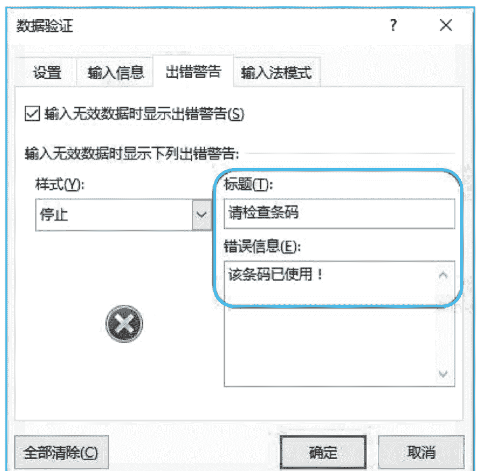

图1-66

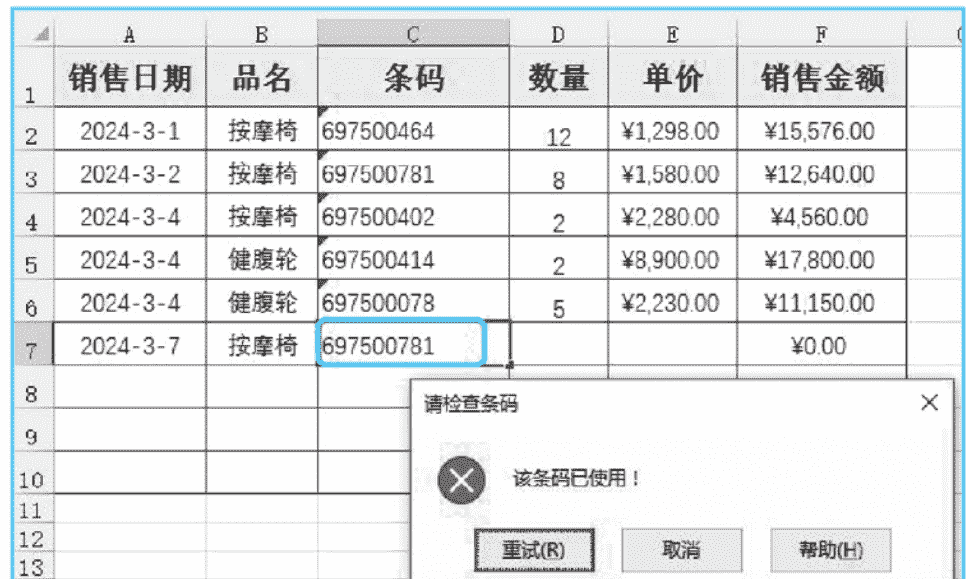

图1-67

### 1.3.7 DeepSeek 屏蔽周末日期录入

如图1-68所示，通过设置验证，实现在输入加班日期时禁止输入周末日期。同样可以在 DeepSeek 中提问获取公式。

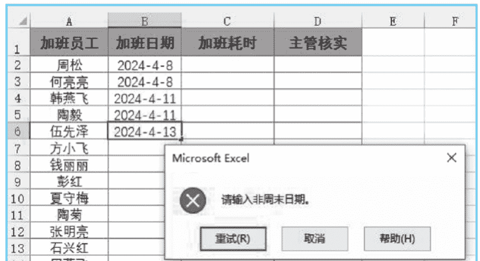

图1-68

1. 在 DeepSeek 中输入“在Excel中，要求在B列中禁止输入周末日期，否则弹出错误提示。”如图1-69。发送后得到如图1-70的回复。


图1-69

在Excel中，可以通过 **数据验证（Data Validation）** 功能来实现B列中禁止输入周末日期（即周六和周日），并在输入周末日期时弹出错误提示。具体步骤如下：

#### 步骤 1：设置数据验证规则

1. 选中需要设置的单元格区域（例如 **B2:B20**，或者整列 **B:B**）。

2. 在菜单栏中点击 **数据（Data）** 选项卡。

3. 点击 **数据验证（Data Validation）** 按钮（在Excel 2016及更高版本中，可能显示为“数据验证”或“数据有效性”）。

4. 在弹出的对话框中，切换到 **设置（Settings）** 选项卡。

5. 在 **允许（Allow）** 下拉菜单中选择 **自定义（Custom）**。

6. 在 **公式（Formula）** 框中输入以下公式：

```
excel
=WEEKDAY(B2,2)<6
```

这个公式的作用是检查当前单元格的日期是否为工作日：

周末日期拦截技巧：用 WEEKDAY 锁定工作日录入

WEEKDAY 在第二个参数取 2 时，会把日期映射成 1 到 7 的星期序号，1 对应周一，7 对应周日。叠加 <6 的筛选，就只放行 1 到 5，即周一到周五的范围。

#### 第二步：配置异常提醒

1. 调出校验面板后切换到“错误警告”页签。
2. 勾选“输入非法数据时弹出警告”。

图1-70

❷ 先把 DeepSeek 给出的公式复制到剪贴板。回到 Excel，框选需要受控的区域，在“数据”选项卡的“数据工具”里点“数据验证”，打开设置面板。

❸ 把“允许”项改为“自定义”，把光标放在“公式”框里，按 Ctrl+V 粘贴，得到 =WEEKDAY(B3,2)<6，如图1-71 所示。

❹ 切到“出错警告”页，填入希望展示的提示文案，如图1-72 所示。

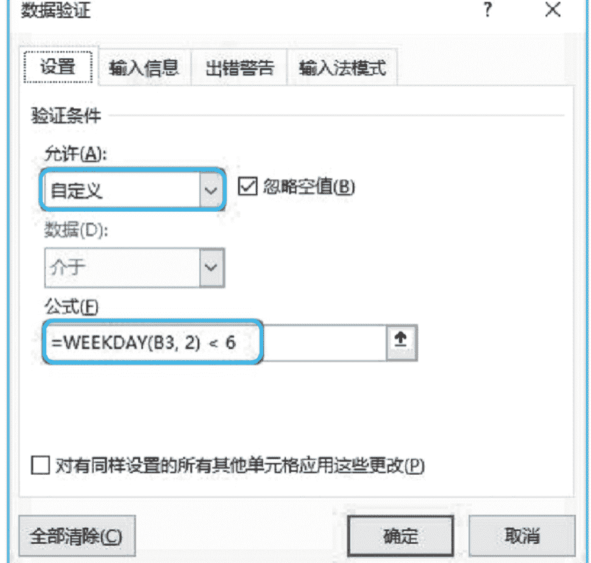

图1-71

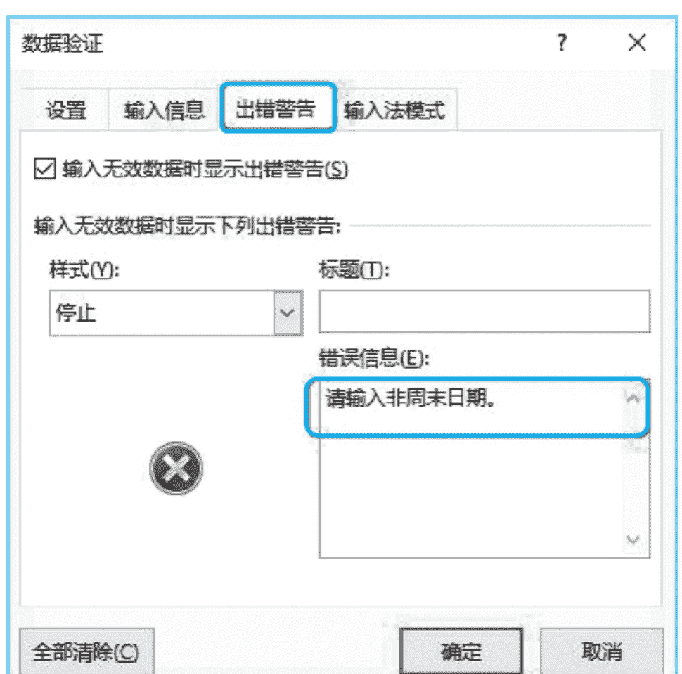

图1-72

❺ 点“确定”完成设置，之后在该区域录入周末日期时会触发错误弹窗。

##### 知识扩展

DeepSeek 的回复里对公式做了拆解，如图1-73，有助于理解函数逻辑。

> 该公式的含义是判断当前单元格日期是否落在工作日区间：

- WEEKDAY(B2,2) 返回星期编号，1 为周一，7 为周日。
- <6 把可输入范围限定为 1 到 5，即周一到周五。

图1-73

## 1.4 实用的选择性粘贴功能

数据需要挪到别处使用时，拷贝移动是最常用的方式。拷贝粘贴不只是原样搬运，Excel 还提供“粘贴选项”与“选择性粘贴”，可以在粘贴的同时实现特定需求。

### 1.4.1 粘贴时自动套用目标格式

直接复制粘贴会保留原格式。若希望粘贴后采用目标区域的样式，可借助粘贴选项实现。

1. 选中要复制的单元格按 Ctrl+C 复制，如图1-74 所示，选中目标位置按 Ctrl+V 粘贴，默认保持原样，如图1-75 所示。

| 序号 | 费用类别 | 金额 | 部门 | 经办人 |

|---|---|---|---|---|

| 001 | 宣传费 | 865 | 维修部 | 吴玲 |

| 005 | 宣传费 | 2000 | 行政部 | 周芳芳 |

| | 宣传费 | 2865 | | |

| 002 | 交通费 | 78.58 | 客服部 | 周芳芳 |

| 008 | 交通费 | 689 | 行政部 | 张晓丽 |

| | 交通费 | 767.58 | | |

| 003 | 差旅费 | 564.8 | 行政部 | 张晓丽 |

| 007 | 差旅费 | 655.9 | 销售部 | 李云霞 |

| 009 | 差旅费 | 1200 | 销售部 | 李云霞 |

| | 差旅费 | 2420.7 | | |

图1-74

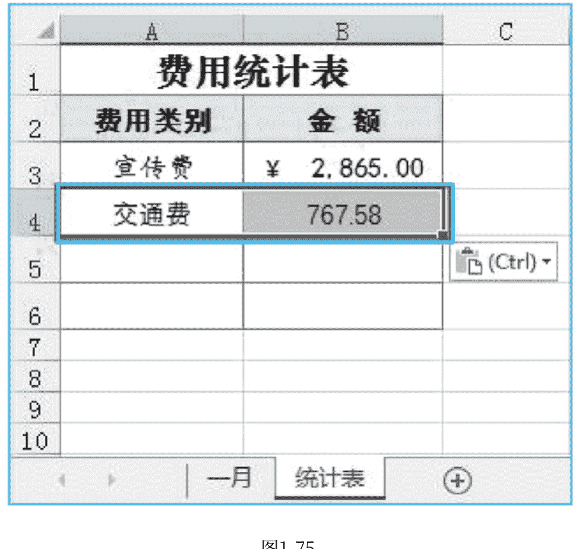

图1-75

❷ 此时会出现“粘贴选项”按钮，点开下拉菜单可选择多种方式。此处选“值”选项，如图1-76 所示，即可让粘贴内容与目标区域格式保持一致，如图1-77 所示。

#### 费用统计表

| 费用类别 | 金额 |

| :--- | :--- |

| 宣传费 | ¥ 2,865.00 |

| 交通费 | 767.58 |

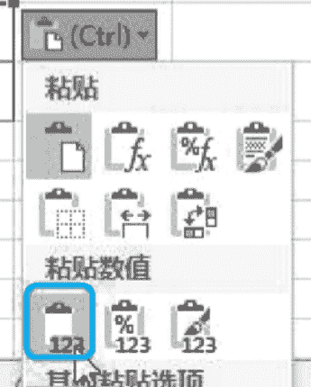

图1-76

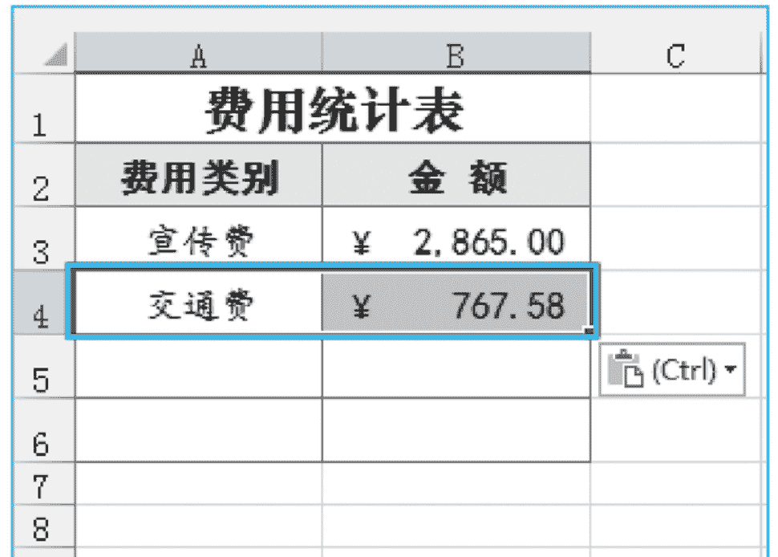

图1-77

### 1.4.2 将公式结果固化为数值

财务统计常用公式计算，搬到别处时若仍带公式会因源丢失而出错。此时需要把计算结果转为纯数值。

见图1-78 所示的 D 列为公式结果，下面演示转为数值。

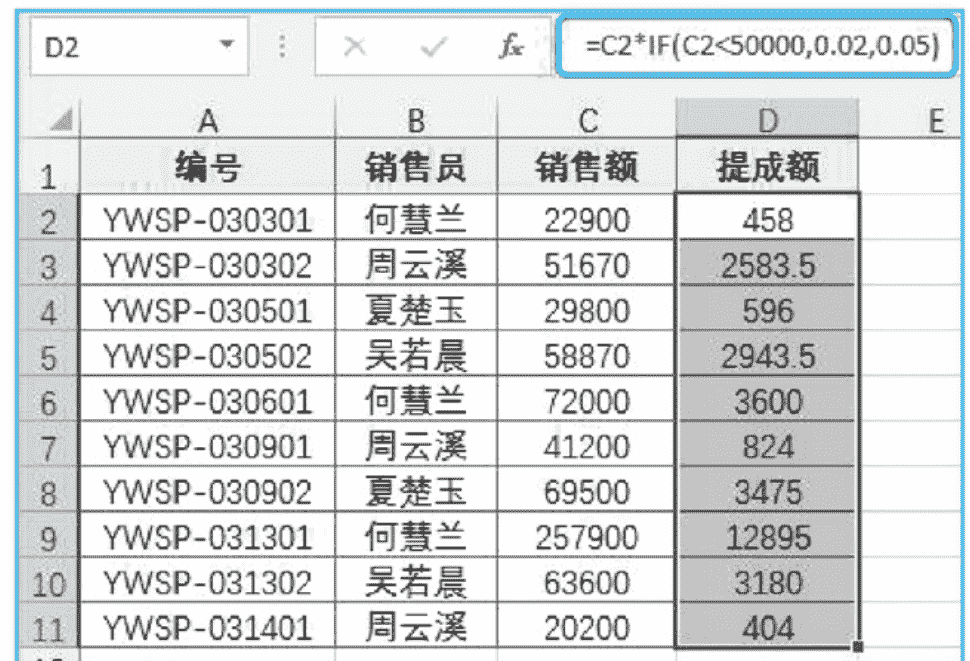

图1-78

1. 选中需要转化的区域按 Ctrl+C 复制。
2. 在“开始”选项卡的“剪贴板”组点“粘贴”下拉，在“粘贴数值”里选择“值”，见图1-79 所示，公式即被替换为结果，见图1-80 所示。

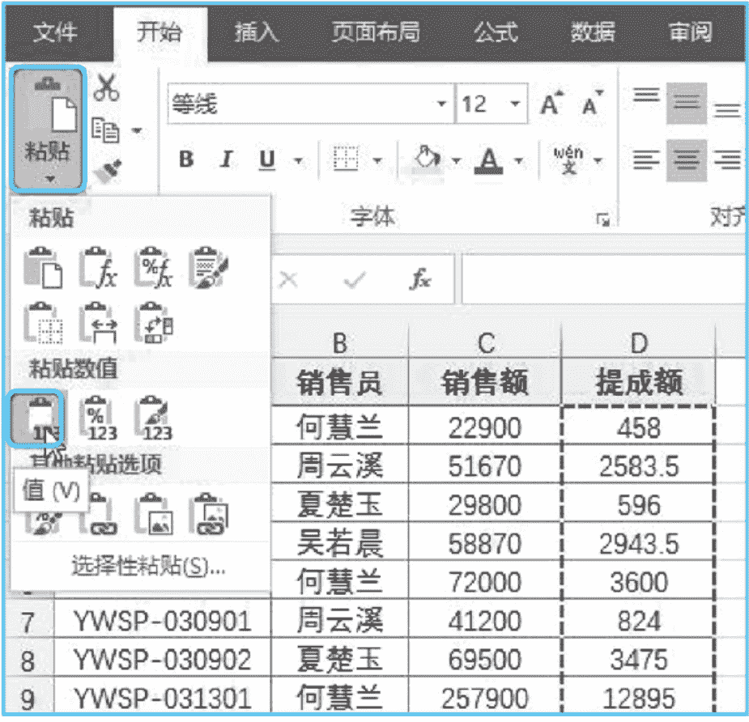

图1-79

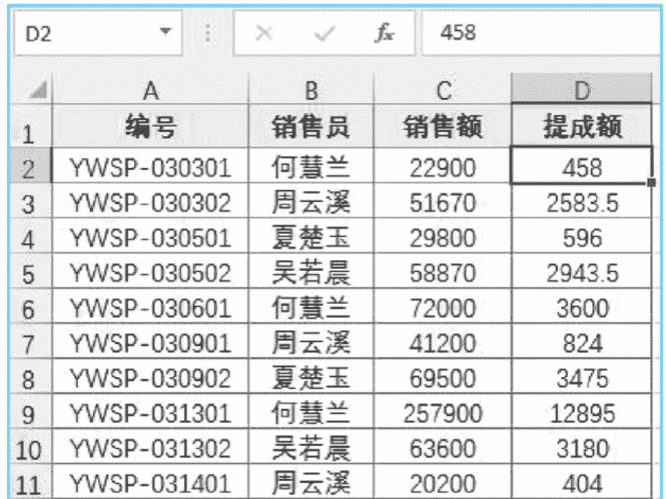

图1-80

### 1.4.3 粘贴链接保持数据联动

默认复制是快照，源变了副本不变。若需要关联更新，就要用粘贴链接。

见图1-81 为销售员的销售数量与金额记录，计算奖金时希望保持联动，源数据一变奖金表也跟着变，见图1-82 所示。

| 销售员 | 销售数量 | 销售金额 |

|---|---|---|

| 程又佳 | 11 | 34089 |

| 郑九章 | 13 | 40287 |

| 李琰 | 0 | 0 |

| 黄永松 | 8 | 24792 |

| 黄勇 | 7 | 21693 |

| 张伟 | 14 | 43386 |

| 方海波 | 6 | 18594 |

| 张岩 | 9 | 27891 |

| 刘筱筱 | 10 | 30990 |

| 吴依 | 9 | 27891 |

图1-81

| 销售员姓名 | 总销售额 | 业绩奖金 | 本月最佳销售奖金归属 |

| :--- | :--- | :--- | :--- |

| 程又佳 | 34089 | 3408.9 | |

| 郑九章 | 40287 | 4028.7 | |

| 李琰 | 0 | 0 | |

| 黄永松 | 24792 | 2479.2 | |

| 黄勇 | 21693 | 2169.3 | |

| 张伟 | 43386 | 4338.6 | 800 |

| 方海波 | 18594 | 1859.4 | |

| 张岩 | 27891 | 2789.1 | |

| 刘筱筱 | 30990 | 3099 | |

| 吴依 | 27891 | 2789.1 | |

图1-82

❶ 在“销售统计表”中选取 C2:C11，按 Ctrl+C 复制，见图1-83 所示。

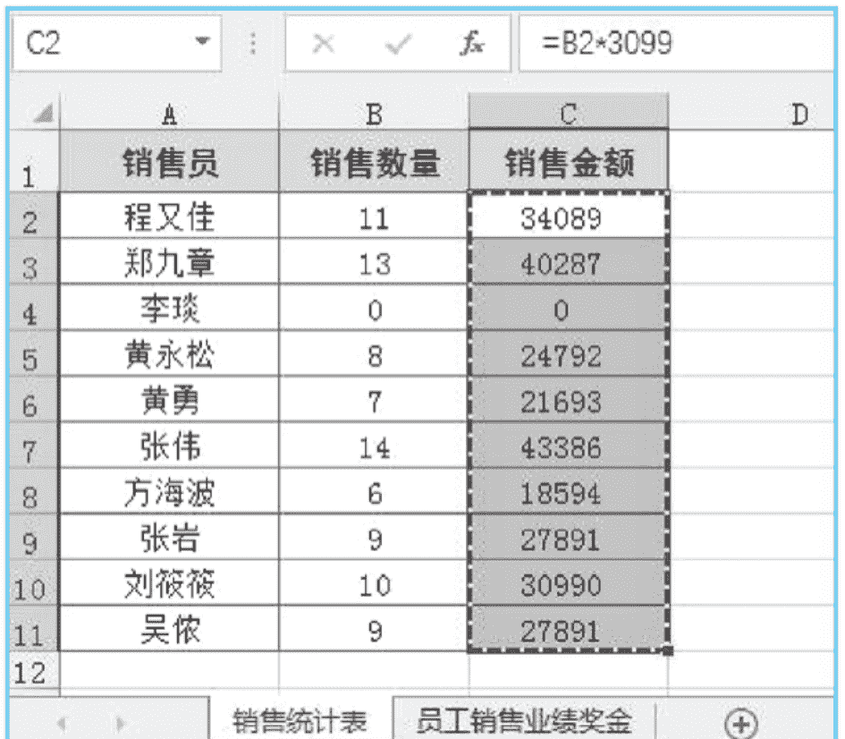

图1-83

❷ 切到“员工销售业绩奖金”工作表，选中 B3，在“开始”选项卡“剪贴板”组点“粘贴”下拉，选择“粘贴链接”命令，见图1-84 所示，即可以链接形式粘贴。

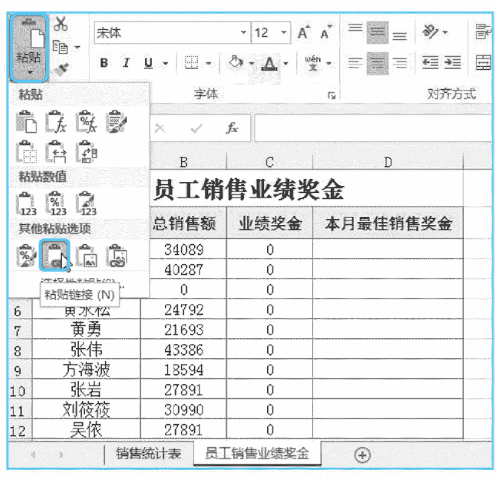

图1-84

❸ 粘贴后数据与源保持关联，公式栏可看到自动生成的引用公式，见图1-85 所示。假设“销售统计表”中“李琰”的销售额改成 3099，“员工销售业绩奖金”表会自动更新，见图1-86 所示。

#### 员工销售业绩奖金

| 销售员姓名 | 总销售额 | 业绩奖金 | 本月最佳销售奖金 |

| :--- | :--- | :--- | :--- |

| 程又佳 | 34089 | 3408.9 | |

| 郑九章 | 40287 | 4028.7 | |

| 李琰 | 0 | 0 | |

| 黄永松 | 24792 | 2479.2 | |

| 黄勇 | 21693 | 2169.3 | |

| 张伟 | 43386 | 4338.6 | 800 |

| 方海波 | 18594 | 1859.4 | |

| 张岩 | 27891 | 2789.1 | |

| 刘筱筱 | 30990 | 3099 | |

| 吴依 | 27891 | | |

图1-85

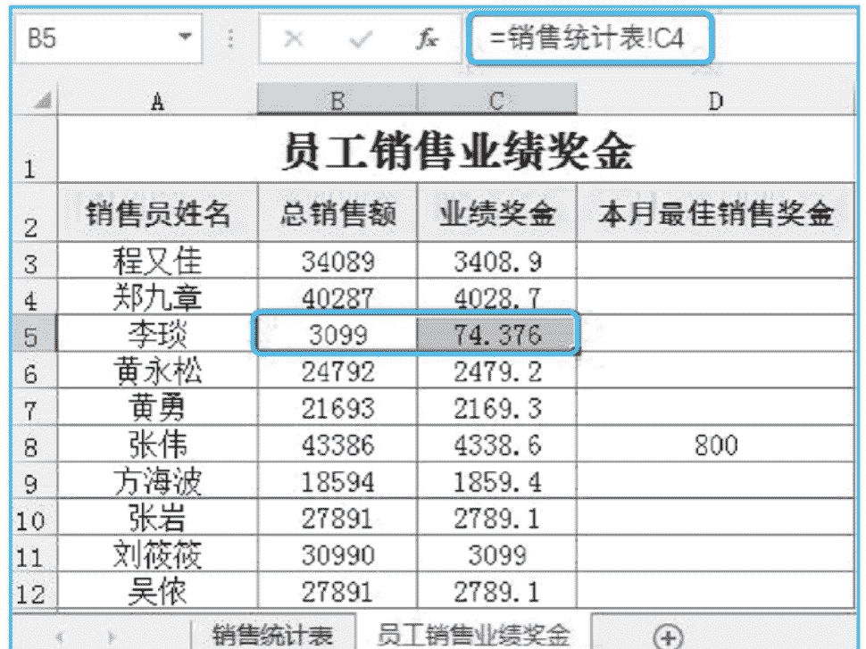

图1-86

### 1.4.4 DeepSeek 指导单元格批量运算

在处理过程中，常遇到整块数据需要与某个常数同加同减同乘同除的情况，比如统一调价、批量加薪。手工改效率低，可向 DeepSeek 请教并套用。

❶ 在 DeepSeek 对话框输入“在 Excel 表格中，想把 D 列的进货单价统一上调 10%，该如何操作？”，见图1-87 所示。得到见图1-88 的建议。


图1-87

在 Excel 中将 D 列中的进货单价统一上调 10%，可以通过以下步骤实现：

#### 方法 1：使用公式

1. 选择一个空白列（比如 E 列）。
2. 在 E2 单元格中输入公式（假设 D2 是你的进货单价）：

```
=D2 * 1.1
```

3. 按 Enter 键，然后拖动填充柄（单元格右下角的小方块）向下填充公式，以覆盖整个 E 列。
4. 复制 E 列的数据：
    - 选择 E 列中计算出的所有单元格。
    - 右键点击选择“复制”。
    - 选择 D 列相应区域（从 D2 开始到最后一个需要更新的单元格）。
    - 右键点击选择“粘贴值”。
5. 删除 E 列（如果不再需要）。

#### 方法 2：使用粘贴特殊功能

1. 在任意单元格中输入值 1.1。
2. 复制该单元格（包含 1.1 的单元格）。
3. 选择 D 列中的所有单元格（从 D2 开始到最后一个需要更新的单元格）。
4. 点击“粘贴”下拉菜单，选择“粘贴特殊”。
5. 在“粘贴特殊”对话框中，选择“乘”选项，然后点击“确定”。
    - 这会将 D 列中的每个单元格的值乘以 1.1，实现统一上调 10%。

##### 注意事项

- 备份数据：操作前最好备份原始数据，以防出现意外错误。
- 检查结果：完成操作后，检查几行数据以确保计算正确。

图1-88

从截图可见 DeepSeek 给出两种思路，这里采用方法 2 操作。

❷ 回到 Excel，在空白单元格输入 1.1，按 Ctrl+C 复制，再选中进货单价区域。

❸ 在“开始”选项卡“剪贴板”组点“粘贴”下拉，点“选择性粘贴”命令，见图1-89 所示。

❹ 打开“选择性粘贴”对话框，在“运算”栏选中“乘”单选按钮，见图1-90 所示。

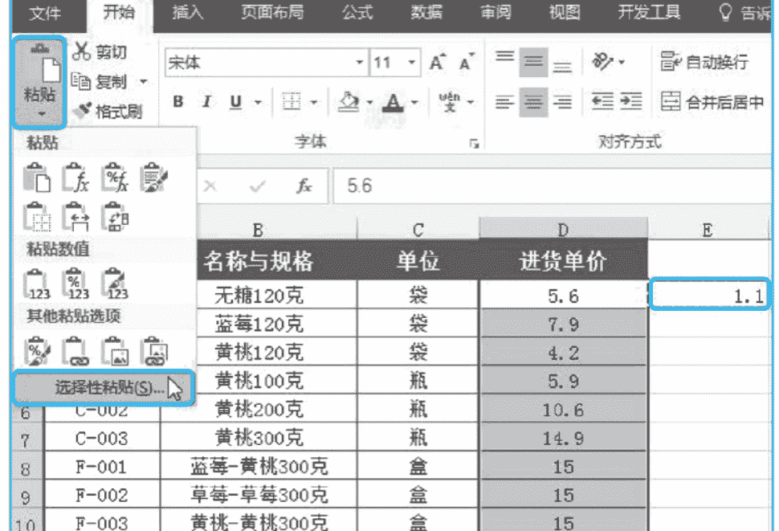

图1-89


图1-90

❺ 点“确定”，被选中的单元格全部完成乘 1.1 的运算，结果见图1-91 所示。

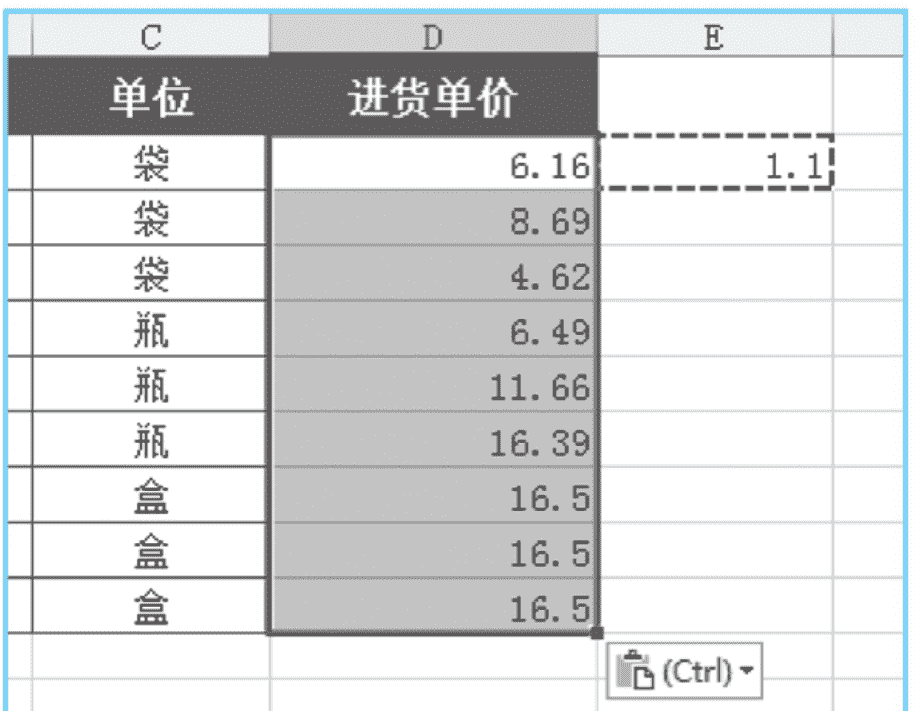

图1-91

##### 专家提示

编辑时若输入被反复拦截弹出阻止框，往往是该区域设置了数据验证。选中区域打开“数据验证”对话框，点左下角的“全部删除”即可解除。

##### 知识扩展

除了同乘，还能同加、同减、同除。只需要在选择性粘贴对话框里更换运算方式即可。本例是同乘，若要统一加减或除以某个数，操作流程相同。

见图1-92 所示，将养老保险金额在原有基础上统一减少 50 元。在空白位置输入数字 50，然后按相同的方法操作，到步骤❹时选中“加”单选按钮，再点“确定”按钮即可。

| | A | B | C | D | E | F |

|---|---|---|---|---|---|---|

| 1 | | | 员工社保缴费表 | | | |

| 2 | 姓名 | 部门 | 养老保险 | 医疗保险 | 失业保险 | 合计 |

| 3 | 王琪 | 行政部 | 232 | 68 | 29 | 329 |

| 4 | 陈潇 | 行政部 | 156 | 49 | 19.5 | 224.5 |

| 5 | 张点点 | 行政部 | 124 | 41 | 15.5 | 180.5 |

| 6 | 于青青 | 财务部 | 264 | 76 | 33 | 373 |

| 7 | 邓兰兰 | 财务部 | 156 | 49 | 19.5 | 224.5 |

| 8 | 罗羽 | 财务部 | 100 | 35 | 12.5 | 147.5 |

| 9 | 蔡静 | 客户部 | 236 | 69 | 29.5 | 334.5 |

| 10 | 陈媛 | 客户部 | 232 | 68 | 29 | 329 |

| 11 | 王密 | 客户部 | 180 | 55 | 22.5 | 257.5 |

| 12 | 吕芬芬 | 客户部 | 100 | 35 | 12.5 | 147.5 |

| 13 | 路高泽 | 客户部 | 236 | 69 | 29.5 | 334.5 |

| 14 | 岳庆洁 | 客户部 | 224 | 68 | 27.5 | 319.5 |

| 15 | 李雪儿 | 客户部 | 156 | 49 | 19.5 | 224.5 |

| 16 | 陈山 | 客户部 | 124 | 41 | 15.5 | 180.5 |

图1-92

# 第2章 财务数据整理与分析


扫码看教学视频

规范且正确的源表是分析的基础。财务数据来源多样，容易出现不规范情况，必须先整理成程序可识别的状态，才能高效使用筛选、分类汇总、数据透视等工具。

- 学会规范建表
- 整理不规范的数据
- 筛选满足条件的数据
- 数据的分类汇总
- 多维度透视分析工具

## 2.1 学会规范建表

表格的原始数据是数据统计、计算的基础，财务数据的处理过程也不例外。当数据量较大时，各环节中最关键、最复杂，甚至直接决定最终报表质量的就是数据处理环节。因此，在创建表格时应当遵循一定的规范，数据规范、格式规范将会给后期的数据处理带来很多便利。

### 2.1.1 数据格式要规范

数据格式规范是建表的首要要求，表格中的各类数据使用规范的格式，数字就使用常规或数值型的格式，而不应使用文本型的格式。例如日期型格式不能输入“20240325”“2024.3.25”“24.3.25”等不规范的格式，否则在后期数据处理时，就会出现无法运算、运算错误的现象。

#### 例1：

见图2-1所示，要根据所输入的入职时间来计算工龄，同时计算工龄工资，由于当前的入职日期不是程序能识别的日期格式，因此导致后面的公式计算错误（F列与G列都是引用了E列的数据进行计算），见图2-1所示。

### 2.1.2 表格结构要规范

结构规范也是创建表格的注意要点。对用于计算分析的表格，不要随意使用合并单元格，因为这样的结构会破坏表格的连续性，从而导致数据源在后续的数据处理或分析中，都有可能会出现出错的情况。

#### 例1：

见图2-5所示的数据源，在日常工作中应该比较常见。如果只是用来显示数据，没有什么问题，但是如果填充序号，就会出现无法填充的情况，见图2-6所示；如果利用数据透视表合并统计分析，统计结果也会出错，见图2-7所示。

| 产品代码 | 日期 | 订单量 | 销售员 |

| :--- | :--- | :--- | :--- |

| ASP0021361 | 2024-6-12 | 956 | 李杰 |

| | 2024-6-14 | 105 | 林瑞洋 |

| | 2024-6-19 | 360 | 崔娜 |

| ASP0021354 | 2024-6-14 | 521 | 李杰 |

| ASP5791311 | 2024-6-19 | 36 | 王加佳 |

| | 2024-6-20 | 540 | 何小芸 |

| ASP5701987 | 2024-6-5 | 369 | 林瑞洋 |

| | 2024-6-10 | 655 | 崔娜 |

| ASP632100 | 2024-6-5 | 541 | 李杰 |

图2-5

#### 例2：

在多表联动的工作簿中，也应注意保持结构的统一。例如想汇总年工资额，所有月份工资表中的数据都应保持同样的格式（见图2-8所示），这样才能方便使用函数（见图2-9所示，“12月”工作表第一位员工的实发工资在T3单元格）。如果各表的结构不一样，那么可能各月的实发工资就不一定都在T列中，甚至员工的顺序也不一样，这样混乱的数据肯定无法使用SUM函数一次性求解全年实发工资。所以就需要将公式编辑为“=‘1月’!G4+‘2月’!H3+…+‘12月’!T3”这种形式，这种形式完全靠手工编辑、肉眼寻找，可想而知其困难程度，并且计算也容易出错。

### 2.1.3 数据应具有统一性

Excel里很多算不对的账，根子往往不在公式，而在表格本身的写法不够干净。下面这几个细节，决定了你的汇总是靠谱还是自嗨。

数据里同一个对象必须用同一个名字，不能这里写全称那里用简称，也别在名称里多敲个空格。Excel只认字面完全一致的文本，写法一变它就当成两家不同的主体来处理，行求和、分类汇总和数据透视都会直接跑偏。

比如诺航公司的合同登记台账里，“安徽新世纪电子有限公司”和“新世纪电子有限公司”其实是同一客户，却被当成两个独立客户对待。汇总时就会出现两份小计，整体统计也对不上。下面两张表能直观看出这种错位带来的后果。

#### 案例表：诺航合同登记台账

| 日期 | 合同号 | 客户名称 | 商品名称 | 颜色 | 金额 |
|---|---|---|---|---|---|
| 2020/1/1 | 20200001 | 安徽新世纪电子有限公司 | 商品A | 红 | 1592.0 |
| 2020/1/8 | 20200002 | 安徽新世纪电子有限公司 | 商品A | 红 | 2592.0 |
| 2020/1/8 | 20200008 | 安徽新世纪电子有限公司 | 商品CCC | 灰 | 6951.0 |
| 2020/1/11 | 20200003 | 江苏新科电子有限公司 | 商品BB | 黑 | 3965.9 |
| 2020/1/20 | 20200005 | 新世纪电子有限公司 | 商品A | 红 | 5628.0 |
| 2020/1/21 | 20200006 | 学舟软件科技有限公司 | 商品BB | 灰 | 2569.0 |
| 2020/2/2 | 20200007 | 学舟软件科技有限公司 | 商品A | 红 | 6952.0 |
| 2020/2/15 | 20200009 | 江苏新科电子有限公司 | 商品A | 黑 | 5589.0 |
| 2020/2/21 | 20200010 | 江苏新科电子有限公司 | 商品CCC | 红 | 8720.0 |
| 2020/3/7 | 20200011 | 学舟软件科技有限公司 | 商品A | 黑 | 5899.3 |
| 2020/3/21 | 20200012 | 学舟软件科技有限公司 | 商品A | 红 | 2592.3 |
| 2020/3/21 | 20200004 | 新世纪电子有限公司 | 商品CCC | 红 | 5962.0 |
| 2020/3/30 | 20200013 | 江苏新科电子有限公司 | 商品CCC | 红 | 5862.0 |

图2-10

| 日期 | 合同号 | 客户名称 | 商品名称 | 颜色 | 金额 |
|---|---|---|---|---|---|
| 2020/1/21 | 20200006 | 学舟软件科技有限公司 | 商品BB | 灰 | 2569.0 |
| 2020/2/2 | 20200007 | 学舟软件科技有限公司 | 商品A | 红 | 6952.0 |
| 2020/3/7 | 20200011 | 学舟软件科技有限公司 | 商品A | 黑 | 5899.3 |
| 2020/3/21 | 20200012 | 学舟软件科技有限公司 | 商品A | 红 | 2592.3 |
| | | **学舟软件科技有限公司 汇总** | | | 18012.6 |
| 2020/3/21 | 20200004 | 新世纪电子有限公司 | 商品CCC | 红 | 5962.0 |
| 2020/1/20 | 20200005 | 新世纪电子有限公司 | 商品A | 红 | 5628.0 |
| | | **新世纪电子有限公司 汇总** | | | 11590.0 |
| 2020/1/11 | 20200003 | 江苏新科电子有限公司 | 商品BB | 黑 | 3965.9 |
| 2020/2/15 | 20200009 | 江苏新科电子有限公司 | 商品A | 黑 | 5589.0 |
| 2020/2/21 | 20200010 | 江苏新科电子有限公司 | 商品CCC | 红 | 8720.0 |
| 2020/3/30 | 20200013 | 江苏新科电子有限公司 | 商品CCC | 红 | 5862.0 |
| | | **江苏新科电子有限公司 汇总** | | | 24136.9 |
| 2020/1/1 | 20200001 | 安徽新世纪电子有限公司 | 商品A | 红 | 1592.0 |
| 2020/1/8 | 20200002 | 安徽新世纪电子有限公司 | 商品A | 红 | 2592.0 |
| 2020/1/8 | 20200008 | 安徽新世纪电子有限公司 | 商品CCC | 灰 | 6951.0 |
| | | **安徽新世纪电子有限公司 汇总** | | | 11135.0 |
| | | **总计** | | | 64874.5 |

图2-11

同理，时间字段也不能混用写法。“1月”和“一月”在人眼里是同一个月，在Excel里就是两个标签，统计时根本匹配不到，结论自然出错。

### 2.1.4 避免空行空列破坏连续性

明细表里不要随意插空行空列，也不要在表中间硬塞合计行。数据一旦不连续，排序、筛选、分类汇总和数据透视都会被干扰。等明细建好后再用透视或合并计算，一秒就能得到汇总。

| 日期 | 费用类别 | 产生部门 | 支出金额 | 负责人 |
|---|---|---|---|---|
| 2020/4/1 | 办公用品采购费 | 企划部 | ¥8,200 | 张飞玉 |
| 2020/4/11 | 差旅费 | 销售部 | ¥1,500 | 王磊 |
| 2020/4/19 | 办公用品采购费 | 人事部 | ¥550 | 何玲玲 |
| 2020/4/25 | 办公用品采购费 | 行政部 | ¥1,050 | 章敏 |
| 2020/4/28 | 招聘培训费 | 人事部 | ¥1,200 | 程亚飞 |
| **合计** | | | | |
| 2020/5/5 | 会务费 | 财务部 | ¥560 | 王海燕 |
| 2020/5/11 | 差旅费 | 企划部 | ¥5,400 | 周易 |
| 2020/5/16 | 招聘培训费 | 人事部 | ¥2,800 | 华愉悦 |
| 2020/5/21 | 业务拓展费 | 人事部 | ¥1,400 | 李明 |
| 2020/5/25 | 办公用品采购费 | 行政部 | ¥1,600 | 于丽 |
| 2020/5/30 | 福利品采购费 | 财务部 | ¥500 | 陈强 |
| **合计** | | | | |

图2-13

### 2.1.5 学会把数据还原成二维明细表

工作中常看到把每天的数据先汇总再填表的样式，看似省事实则把表格做复杂了。本质上“产品”“销售部门”“数量”“金额”是核心字段，部门不该做成横向的表头，应当作为一列属性记录在明细中。保留明细，后续想按天、按部门、按产品怎么切都能立刻实现。

把汇总表拆回明细后，多天数据统一堆叠在一起，就是一张干净的二维表。

| 日期 | 产品 | 销售部门 | 数量 | 金额 |
|---|---|---|---|---|
| 2024-2-1 | 通用别克-别克GL8 | 销售1部 | 2 | 485,000 |
| 2024-2-1 | 通用别克-君越 | 销售1部 | 1 | 158,000 |
| 2024-2-1 | 通用别克-林荫大道 | 销售1部 | 1 | 369,000 |
| 2024-2-1 | 通用别克-英朗 | 销售1部 | 1 | 154,000 |
| 2024-2-1 | 通用别克-君威 | 销售2部 | 3 | 608,000 |
| 2024-2-1 | 通用别克-英朗 | 销售2部 | 1 | 308,000 |
| 2024-2-1 | 通用别克-君威 | 销售3部 | 1 | 210,000 |
| 2024-2-1 | 通用别克-凯越 | 销售3部 | 1 | 110,000 |
| 2024-2-1 | 通用别克（进口）-昂科雷 | 销售3部 | 1 | 508,000 |

图2-15

| 日期 | 产品 | 销售部门 | 数量 | 金额 |
|---|---|---|---|---|
| 2024-2-1 | 通用别克-别克GL8 | 销售1部 | 2 | 485,000 |
| 2024-2-1 | 通用别克-君越 | 销售1部 | 1 | 158,000 |
| 2024-2-1 | 通用别克-林荫大道 | 销售1部 | 1 | 369,000 |
| 2024-2-1 | 通用别克-英朗 | 销售1部 | 1 | 154,000 |
| 2024-2-1 | 通用别克-君威 | 销售2部 | 3 | 608,000 |
| 2024-2-1 | 通用别克-英朗 | 销售2部 | 1 | 308,000 |
| 2024-2-1 | 通用别克-君威 | 销售3部 | 1 | 210,000 |
| 2024-2-1 | 通用别克-凯越 | 销售3部 | 1 | 110,000 |
| 2024-2-1 | 通用别克（进口）-昂科雷 | 销售3部 | 1 | 508,000 |
| 2024-2-2 | 通用别克-君越 | 销售1部 | 1 | 158,000 |
| 2024-2-2 | 通用别克-林荫大道 | 销售1部 | 2 | 369,000 |
| 2024-2-2 | 通用别克-英朗 | 销售1部 | 1 | 154,000 |
| 2024-2-2 | 通用别克-君威 | 销售2部 | 3 | 608,000 |
| 2024-2-2 | 通用别克-英朗 | 销售2部 | 2 | 308,000 |
| 2024-2-2 | 通用别克-别克GL8 | 销售3部 | 3 | 675,000 |
| 2024-2-2 | 通用别克-凯越 | 销售3部 | 1 | 110,000 |
| 2024-2-2 | 别克（进口）-昂科雷 | 销售3部 | 1 | 508,000 |
| 2024-2-3 | 通用别克-别克GL8 | 销售1部 | 1 | 242,500 |
| 2024-2-3 | 通用别克-君越 | 销售1部 | 1 | 158,000 |
| 2024-2-3 | 通用别克-林荫大道 | 销售1部 | 2 | 369,000 |
| 2024-2-3 | 通用别克-君威 | 销售2部 | 1 | 210,000 |
| 2024-2-3 | 通用别克-君越 | 销售2部 | 1 | 158,000 |
| 2024-2-3 | 通用别克-英朗 | 销售2部 | 2 | 308,000 |
| 2024-2-3 | 通用别克-别克GL8 | 销售3部 | 2 | 485,000 |
| 2024-2-3 | 别克（进口）-昂科雷 | 销售3部 | 1 | 508,000 |

图2-16

有了明细，透视表就能自由发挥，按部门统计也能按日期统计，效果一目了然。

| 销售部门 | 产品 | 求和项:数量 |
| :--- | :--- | :--- |
| 销售1部 | | 13 |
| | 通用别克-别克GL8 | 3 |
| | 通用别克-君越 | 3 |
| | 通用别克-林荫大道 | 5 |
| | 通用别克-英朗 | 2 |
| 销售2部 | | 13 |
| | 通用别克-君威 | 7 |
| | 通用别克-君越 | 1 |
| | 通用别克-英朗 | 5 |
| 销售3部 | | 11 |
| | 别克(进口)-昂科雷 | 2 |
| | 通用别克（进口）-昂科雷 | 1 |
| | 通用别克-别克GL8 | 5 |
| | 通用别克-君威 | 1 |
| | 通用别克-凯越 | 2 |
| 总计 | | 37 |

图2-17

## 2.2 面对不规范数据如何快速整理

财务场景对准确性和规范性要求极高，数据源头不同时经常拿到格式混乱的表格。先整理成规范结构，再用Excel的分析工具，才能快速得出可靠结论。

### 2.2.1 借助DeepSeek批量清理空白行

从系统导出的表格里，常常出现整行或整列空着的情况。只要一行里存在空单元格，就需要把整行剔除。下面用一次对话的方式演示批量删除。

当前原始表如下：

| A | B | C | D |
|---|---|---|---|
| 日期 | 凭证号 | 凭证摘要 | 借方 |
| | | 年初余额 | |
| 1月2日 | 记账凭证2 | 财务部报销费 | 5000.00 |
| 1月2日 | 记账凭证3 | 税费缴纳 | 340.00 |
| 1月2日 | | 合计 | 12230.00 |
| | | | |
| 1月4日 | 记账凭证4 | 工程部签证费 | 3110.00 |
| 1月4日 | 记账凭证3 | 税费缴纳 | 3120.00 |
| 1月4日 | | 合计 | 408790.00 |
| | | | |
| 1月5日 | 记账凭证34 | 设计部报销费 | 2900.00 |
| 1月5日 | 记账凭证80 | 利息计算 | 3900.00 |
| 1月5日 | | 合计 | 4000.00 |
| | | | |
| 1月8日 | 记账凭证4 | 工程部签证费 | 3880.00 |
| 1月8日 | 记账凭证78 | 土地征用税 | 5000.00 |
| 1月8日 | 记账凭证3 | 税费缴纳 | 4300.00 |
| 1月8日 | 记账凭证80 | 利息计算 | 5000.00 |
| 1月8日 | | 合计 | 33900.00 |
| | | | |
| 1月11日 | 记账凭证34 | 设计部报销费 | 3210.00 |
| 1月11日 | 记账凭证3 | 税费缴纳 | 2290.00 |

图2-20

在DeepSeek里提问：如何在Excel中一次性找出包含空白单元格的行并删除？得到思路后回到Excel执行定位空白→整行删除的操作。清理后只剩下完整记录。

| A | B | C | D |
|---|---|---|---|
| **日期** | **凭证号** | **凭证摘要** | **借方** |
| 1月2日 | 记账凭证2 | 财务部报销费 | 5000.00 |
| 1月2日 | 记账凭证3 | 税费缴纳 | 340.00 |
| 1月4日 | 记账凭证4 | 工程部签证费 | 3110.00 |
| 1月4日 | 记账凭证3 | 税费缴纳 | 3120.00 |
| 1月5日 | 记账凭证34 | 设计部报销费 | 2900.00 |
| 1月5日 | 记账凭证80 | 利息计算 | 3900.00 |
| 1月8日 | 记账凭证4 | 工程部签证费 | 3880.00 |
| 1月8日 | 记账凭证78 | 土地征用税 | 5000.00 |
| 1月8日 | 记账凭证3 | 税费缴纳 | 4300.00 |
| 1月8日 | 记账凭证80 | 利息计算 | 5000.00 |
| 1月11日 | 记账凭证34 | 设计部报销费 | 3210.00 |
| 1月11日 | 记账凭证3 | 税费缴纳 | 2290.00 |

图2-27

如果这类清理是高频需求，还可以让DeepSeek生成VBA宏，录一次以后直接一键运行即可。

DeepSeek 帮你写 VBA，一键清掉含空白的整行

① 打开 DeepSeek 聊天框，把需求用自然语言描述出来：用 VBA 扫描当前选中的区域，每一行只要出现空单元格就把整行删掉。发送后会返回一段可直接用的示例，示意图见图2-28、图2-29。

图2-28

返回的脚本如下：

##### VBA 代码

```
Sub DeleteRowsWithBlankCellsInSelection()
    Dim rng As Range
    Dim row As Range
    Dim cell As Range
    Dim hasBlank As Boolean
    Dim i As Long

    ' 检查是否选中了区域
    On Error Resume Next
    Set rng = Selection
    On Error GoTo 0

    If rng Is Nothing Then
        MsgBox "请先选中一个区域！", vbExclamation
        Exit Sub
    End If

    ' 从最后一行向上遍历
    For i = rng.Rows.Count To 1 Step -1
        hasBlank = False
        ' 检查当前行是否有空白单元格
        For Each cell In rng.Rows(i).Cells
            If IsEmpty(cell) Then
                hasBlank = True
                Exit For
            End If
        Next cell
        ' 如果有空白单元格，删除整行
        If hasBlank Then
            rng.Rows(i).Delete
        End If
    Next i
End Sub
```

图2-29

② 把鼠标移到代码块上，右上角会出现复制的小图标，按一下就能把代码放到剪贴板。

③ 回到表格界面，通过 开发工具 选项卡里的 Visual Basic 按钮，或者直接按 Alt+F11 启动应用程序宏编辑器。进入编辑器后点 插入 的下拉菜单，挑选 模块，新建一个空白模块，把光标放到代码区，用 Ctrl+V 把代码粘进去，见图2-30、图2-31。

图2-30

图2-31

④ 粘贴完毕后点工具栏上的 保存，关闭编辑窗口。

⑤ 以后需要清理时，先圈定要处理的范围，然后在 开发工具 选项卡里点 宏，打开宏列表后选中刚才新建的宏，按 执行 即可，处理后表格的样子如图2-32、2-33、2-34。

图2-32

图2-33

| A | B | C | D | E | F | G | H | I |

|---|---|---|---|---|---|---|---|---|

| 姓名 | 性别 | 年龄 | 初试时间 | 参加初试 | 初试通过 | 复试时间 | 参加复试 | 复试通过 |

| 应聘者4 | 女 | 33 | 2023-12-14 | 是 | 是 | 2023-12-19 | 是 | 是 |

| 应聘者10 | 男 | 31 | 2024-3-8 | 是 | 是 | 2024-3-13 | 是 | 是 |

| 应聘者13 | 男 | 28 | 2024-3-10 | 是 | 是 | 2024-3-13 | 是 | 是 |

| 应聘者18 | 男 | 22 | 2024-3-25 | 是 | 是 | 2024-3-28 | 是 | 是 |

图2-34

专家提示
在 Excel 里加一段 VBA 就能把重复手工活自动化，效率很明显。很多人不愿碰自动化是因为写代码门槛高，有了 DeepSeek 之后，只要用自然语言把目标说清楚，就能拿到可用脚本，我们只要复制、粘贴、运行。思路可迁移，把个人需求整理好提问，就能得到对应脚本。

知识扩展
包含宏的文件必须以启用宏的格式保存。另存为时设定位置和文件名，在 保存类型 下拉里选择 Excel启用宏的工作簿，见图2-35。

图2-35

### 2.2.2 处理重复值、重复记录

整理数据时碰到重复很常见，去掉后才能拿到干净的唯一清单。

单列或整块去重可以直接用内置功能。

① 把目标区块圈起来，切换到 数据 选项卡，在 数据工具 组里按下 删除重复值，弹出设置窗。

图2-36

② 保留默认勾选直接确认即可完成去重，结果见图2-38。

图2-37

图2-38

有时候需要按某一列来判定重复，例如图2-39 的 工号 列里出现重复，只要工号重复就整行剔除，后面列是否相同不影响。

| 工号 | 姓名 | 出差时间 | 返回时间 | 累计天数 | 补助金额（元） |

|---|---|---|---|---|---|

| 0015 | 陈山 | 2024-3-5 | 2024-3-8 | 3 | ¥360.00 |

| 0016 | 廖晓 | 2024-3-6 | 2024-3-10 | 4 | ¥480.00 |

| 0017 | 张丽君 | 2024-3-8 | 2024-3-13 | 5 | ¥600.00 |

| 0018 | 吴华波 | 2024-3-9 | 2024-3-14 | 5 | ¥600.00 |

| 0019 | 黄孝铭 | 2024-3-12 | 2024-3-16 | 4 | ¥480.00 |

| 0016 | 廖晓 | 2024-3-6 | 2024-3-10 | 4 | ¥480.00 |

| 0021 | 庄霞 | 2024-3-15 | 2024-3-19 | 4 | ¥480.00 |

| 0022 | 王福鑫 | 2024-3-16 | 2024-3-20 | 4 | ¥480.00 |

| 0023 | 王琪 | 2024-3-17 | 2024-3-22 | 5 | ¥600.00 |

| 0021 | 庄霞 | 2024-3-15 | 2024-3-19 | 4 | ¥480.00 |

| 0025 | 杨浪 | 2024-3-20 | 2024-3-25 | 5 | ¥600.00 |

图2-39

① 圈选 A3:F13，点 数据 选项卡里的 删除重复项，弹出设置窗。

② 在 列 区域里只勾选 工号，其余取消，表示只以该列为依据，见图2-41。

#### 月份出差补助统计表

| 工号 | 姓名 | 出差时间 | 返回时间 | 累计天数 | 补助金额（元） |

| :--- | :--- | :--- | :--- | :--- | :--- |

| 0015 | 陈山 | 2021/3/5 | 2021/3/8 | 3 | ¥360.00 |

| 0016 | 廖晓 | 2021/3/6 | 2021/3/10 | 4 | ¥480.00 |

| 0017 | 张丽君 | 2021/3/8 | 2021/3/13 | 5 | ¥600.00 |

| 0018 | 吴华波 | 2021/3/9 | 2021/3/14 | 5 | ¥600.00 |

图2-40

图2-41

③ 确认后会弹出提示，告知剔除多少行、保留多少唯一行，点确定即可完成。

图2-42

### 2.2.3 DeepSeek辅助处理一格多属性的数据

所谓一格多属性，就是单个格子里混进了多种信息，导入时经常出现。

图2-43 的 应收金额 列里同时放了日期和金额，中间用空格隔开，后面做到期计算或剩余计算会很麻烦。这时可以让 DeepSeek 给出拆分思路。

| 序号 | 公司名称 | 应收金额(元) | 付款期(天) |

|---|---|---|---|

| 001 | 宏运佳建材公司 | 2024/3/12 23000 | 40 |

| 002 | 拓帆建材有限公司 | 2024/3/12 29000 | 60 |

| 003 | 澳菲斯建材有限公司 | 2024/3/17 50000 | 30 |

| 004 | 孚盛装饰公司 | 2024/3/20 4000 | 10 |

| 005 | 孚盛装饰公司 | 2024/4/3 18500 | 25 |

| 006 | 雅得丽装饰公司 | 2024/4/13 5000 | 15 |

| 007 | 宏运佳建材公司 | 2024/4/14 28000 | 90 |

| 008 | 雅得丽装饰公司 | 2024/4/18 24000 | 60 |

| 009 | 孚盛装饰公司 | 2024/4/28 6000 | 15 |

| 010 | 海兴建材有限公司 | 2024/5/3 8600 | 30 |

| 011 | 宏运佳建材公司 | 2024/5/20 25000 | 15 |

| 012 | 海兴建材有限公司 | 2024/6/22 58000 | 60 |

| 013 | 孚盛装饰公司 | 2024/6/22 5000 | 90 |

| 014 | 澳菲斯建材有限公司 | 2024/7/5 12000 | 20 |

图2-43

① 在 DeepSeek 里提问：Excel 的 C 列里既有日期又有金额，用空格隔开，怎么拆成两列？参考图2-44，得到的方法见图2-45。

图2-44

在 Excel 中，如果 C 列中的数据包含日期和金额，并且用空格分隔，可以通过 **分列功能** 或 **公式** 将它们分隔为两列数据。以下是两种方法的详细步骤：

#### 方法 1：使用分列功能

1. 选中数据列：

   - 选中 C 列中的数据区域（例如 C2:C20）。

2. 打开分列功能：

   - 在菜单栏中点击 **数据**（Data）选项卡。

   - 点击 **分列**（Text to Columns）按钮。

3. 选择分隔方式：

   - 在弹出的对话框中，选择 **分隔符号**（Delimited），然后点击 **下一步**（Next）。

4. 设置分隔符号：

   - 在分隔符号选项中，勾选 **空格**（Space），然后点击 **下一步**（Next）。

5. 设置目标区域：

   - 在目标区域中选择一个空白列作为起始位置（例如 D2），然后点击 **完成**（Finish）。

6. 调整格式：

   - 分隔后的日期和金额会分别出现在 D 列和 E 列。

   - 如果需要，可以调整日期和金额的格式：

     - 选中日期列，右键点击选择 **设置单元格格式**（Format Cells），选择 **日期**（Date）。

     - 选中金额列，右键点击选择 **设置单元格格式**，选择 **数值**（Number）或 **货币**（Currency）。

图2-45

② 回到 Excel，先在 D 列右键点 插入，空出一列放拆分结果，见图2-46。

| 序号 | 公司名称 | 应收金额(元) | 付款期(天) |

|---|---|---|---|

| 001 | 宏运佳建材公司 | 2024/3/12 23000 | 40 |

| 002 | 拓帆建材有限公司 | 2024/3/12 29000 | 60 |

| 003 | 澳菲斯建材有限公司 | 2024/3/17 50000 | 30 |

| 004 | 孚盛装饰公司 | 2024/3/20 4000 | 10 |

| 005 | 孚盛装饰公司 | 2024/4/3 18500 | 25 |

| 006 | 雅得丽装饰公司 | 2024/4/13 5000 | 15 |

| 007 | 宏运佳建材公司 | 2024/4/14 28000 | 90 |

| 008 | 雅得丽装饰公司 | 2024/4/18 24000 | 60 |

| 009 | 孚盛装饰公司 | 2024/4/28 6000 | 15 |

| 010 | 海兴建材有限公司 | 2024/5/3 8600 | 30 |

| 011 | 宏运佳建材公司 | 2024/5/20 25000 | 15 |

| 012 | 海兴建材有限公司 | 2024/6/22 58000 | 60 |

| 013 | 孚盛装饰公司 | 2024/6/22 5000 | 90 |

| 014 | 澳菲斯建材有限公司 | 2024/7/5 12000 | 20 |

图2-46

③ 圈选待拆范围，点 数据 里的 分列，见图2-47。

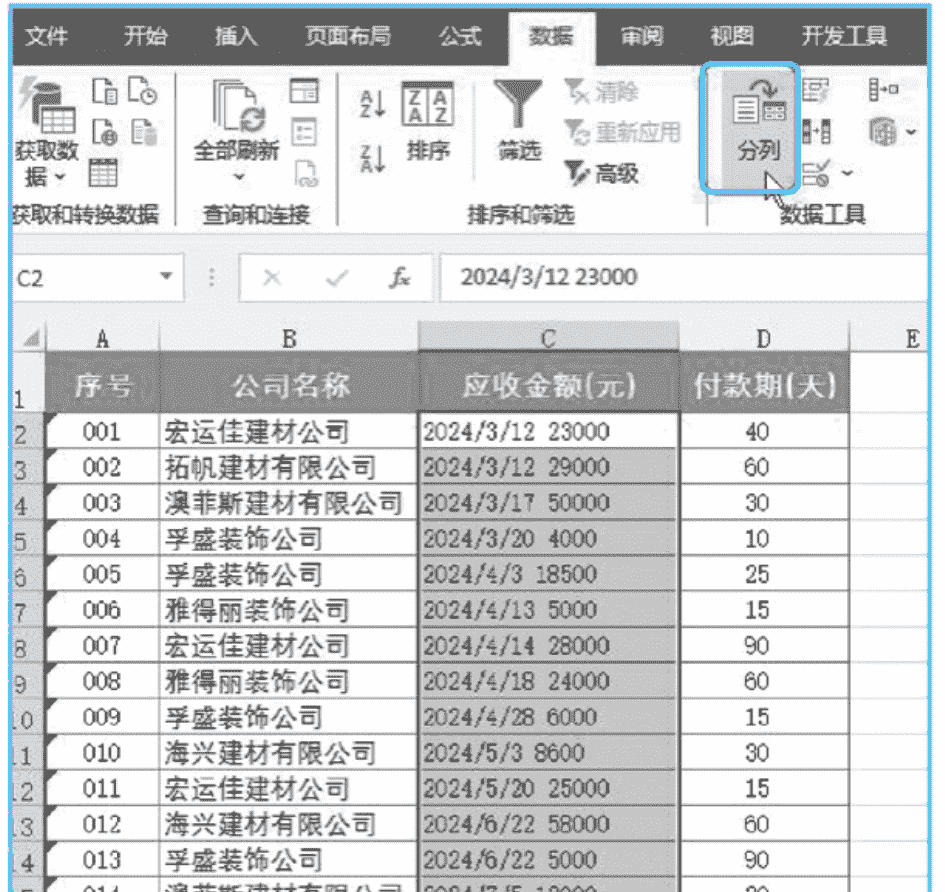

图2-47

④ 弹出导引第一步，保留默认选择，点 继续，见图2-48。

⑤ 进入第二步，在 分隔符号 下勾选 空格，见图2-49。

##### 文本分列向导 - 第 1 步，共 3 步

文本分列向导判定您的数据具有分隔符。

若一切设置无误，请单击“下一步”，否则请选择最合适的数据类型。

原始数据类型

请选择最合适的文件类型：

- 分隔符号(D) - 用分隔字符，如逗号或制表符分隔每个字段

- 固定宽度(W) - 每列字段加空格对齐

预览选定数据：

| 2 | 2024/3/12 23000 |

| 3 | 2024/3/12 29000 |

| 4 | 2024/3/17 50000 |

| 5 | 2024/3/20 4000 |

| 6 | 2024/4/3 18500 |

| 7 | 2024/4/13 5000 |

图2-48

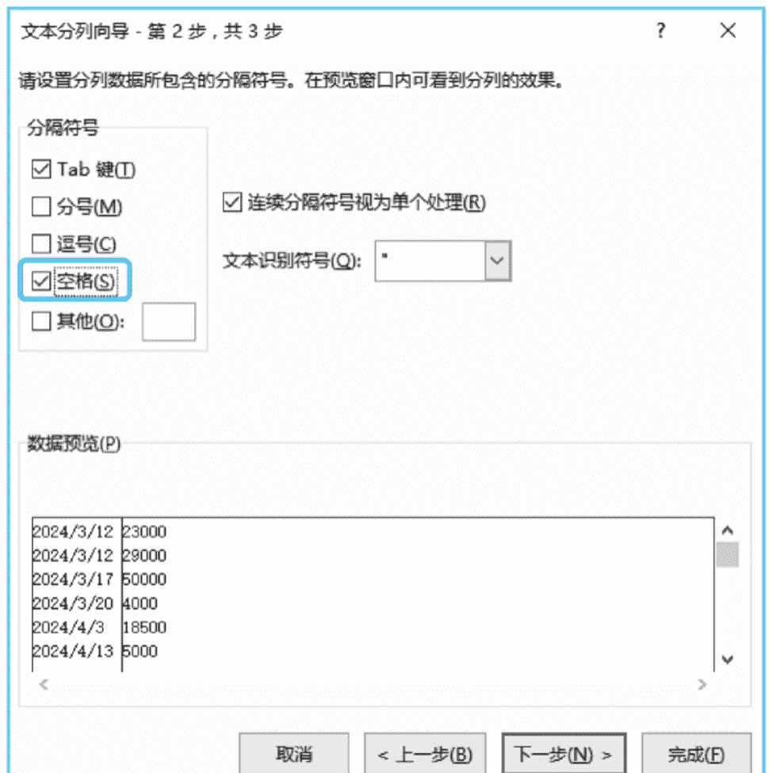

图2-49

⑥ 点 完成 后数据被拆成日期和金额两列，重新命名列标题即可整理完毕，见图2-50。

| 序号 | 公司名称 | 应收金额(元) | | 付款期(天) |

|---|---|---|---|---|

| 001 | 宏运佳建材公司 | 2024-3-12 | 23000 | 40 |

| 002 | 拓帆建材有限公司 | 2024-3-12 | 29000 | 60 |

| 003 | 澳菲斯建材有限公司 | 2024-3-17 | 50000 | 30 |

| 004 | 孚盛装饰公司 | 2024-3-20 | 4000 | 10 |

| 005 | 孚盛装饰公司 | 2024-4-3 | 18500 | 25 |

| 006 | 雅得丽装饰公司 | 2024-4-13 | 5000 | 15 |

| 007 | 宏运佳建材公司 | 2024-4-14 | 28000 | 90 |

| 008 | 雅得丽装饰公司 | 2024-4-18 | 24000 | 60 |

| 009 | 孚盛装饰公司 | 2024-4-28 | 6000 | 15 |

| 010 | 海兴建材有限公司 | 2024-5-3 | 8600 | 30 |

| 011 | 宏运佳建材公司 | 2024-5-20 | 25000 | 15 |

| 012 | 海兴建材有限公司 | 2024-6-22 | 58000 | 60 |

| 013 | 孚盛装饰公司 | 2024-6-22 | 5000 | 90 |

| 014 | 澳菲斯建材有限公司 | 2024-7-5 | 12000 | 20 |

图2-50

专家提示
拆分的前提是数据有规律，比如统一分隔符或固定宽度。分隔符号里除了空格，还有逗号、分号等，找不到时可选 其他 并手动输入自定义符号。

### 2.2.4 DeepSeek辅助整理文本型数字

公式计算很强，但有时明明看着是数字，求和却得到 0。图2-51 即是典型情况，D 列无法参与运算。

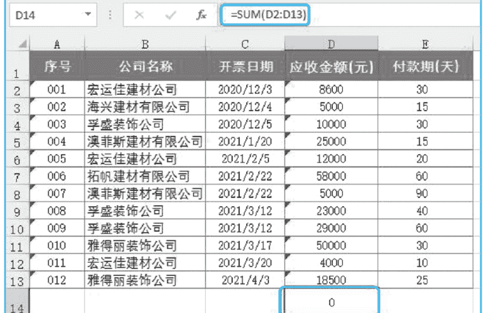

图2-51

① 向 DeepSeek 提问：单元格左上角出现绿色三角，数字不能求和怎么办？参考图2-52，得到解答见图2-53。


图2-52

② 回到表格，选中 应收金额 列，点单元格左上角的警告符号下拉，选择 转换为数字，见图2-54。

> 在 Excel 中，单元格左上角出现绿色三角形通常表示该单元格的数字是以 **文本格式** 存储的，而不是数值格式。由于文本格式的数字无法参与数学运算（如求和），因此需要将其转换为数值格式。以下是解决方法：

#### 方法 1：使用错误检查工具

绿色三角消失，数字才能正常求和

当 Excel 把本该是数值的格子识别成文本时，左上角会出现绿色小三角，求和就会失效。常用的处理思路有两种。

第一种是通过警告提示菜单转换
- 先把带小三角的区域框起来。
- 选区右上角会出现感叹号标记，点击展开菜单。
- 在选项里找到“转成数值”，英文显示为 Convert to Number。
- 处理完成后绿色标记不见，求和结果恢复正常。

第二种是借助分列向导
- 同样先圈定出现小三角的范围。
- 切换到功能区的“数据”标签，打开“分列”入口。
- 在向导界面不做任何额外设定，直接点“完成”，原本被当成文本的数字会变成真正的数值类型。

图2-53


图2-54

❸按上述流程操作后，左上角的绿色文本标记被清除，计算也回到正确值，如图2-55所示。


图2-55

##### 专家提示
DeepSeek 给出了两套都能解决问题的办法，这里采用了更省事的那一种。DeepSeek 的回答比较有启发性，用着用着就能学会新的处理技巧。

### 2.2.5 DeepSeek辅助整理带单位的数据
图2-56 中的表格，C 列“养老保险”每一项后面都缀着“元”，因此合计出错。只要带了单位，Excel 就会把它当成文本，自然无法参与运算。借助 DeepSeek 可以学到快速去单位的做法。

| 姓名 | 部门 | 养老保险 | 医疗保险 | 失业保险 | 合计 |
|---|---|---|---|---|---|
| 王琪 | 行政部 | 232元 | 68 | 29 | 97 |
| 陈潇 | 行政部 | 156元 | 49 | 19.5 | 68.5 |
| 张点点 | 行政部 | 124元 | 41 | 15.5 | 56.5 |
| 于青青 | 财务部 | 264元 | 76 | 33 | 109 |
| 邓兰兰 | 财务部 | 156元 | 49 | 19.5 | 68.5 |
| 蔡静 | 客户部 | 236元 | 69 | 29.5 | 98.5 |
| 陈媛 | 客户部 | 232元 | 68 | 29 | 97 |
| 王密 | 客户部 | 180元 | 55 | 22.5 | 77.5 |
| 吕芬芬 | 客户部 | 100元 | 35 | 12.5 | 47.5 |
| 路高泽 | 客户部 | 236元 | 69 | 29.5 | 98.5 |
| 岳庆洁 | 客户部 | 224元 | 68 | 27.5 | 95.5 |
| 李雪儿 | 客户部 | 156元 | 49 | 19.5 | 68.5 |

图2-56

❶在 DeepSeek 对话框里提问“Excel 中 C 列数值后面统一带一个单位，如何批量去掉单位”，如图2-57。发送后得到如图2-58 的建议。


图2-57


图2-58

❷回到表格，整列 C 全选，调出查找替换面板，把搜索框填为“元”，替换框保持空，如图2-59。


图2-59

❸执行一次性替换，C 列的单位被清空，“合计”列立刻算出正确总额，如图2-60 所示。

| 姓名 | 部门 | 养老保险 | 医疗保险 | 失业保险 | 合计 |
|---|---|---|---|---|---|
| 王琪 | 行政部 | 232 | 68 | 29 | 329 |
| 陈潇 | 行政部 | 156 | 49 | 19.5 | 224.5 |
| 张点点 | 行政部 | 124 | 41 | 15.5 | 180.5 |
| 于青青 | 财务部 | 264 | 76 | 33 | 373 |
| 邓兰兰 | 财务部 | 156 | 49 | 19.5 | 224.5 |
| 蔡静 | 客户部 | 236 | 69 | 29.5 | 334.5 |
| 陈媛 | 客户部 | 232 | 68 | 29 | 329 |
| 王密 | 客户部 | 180 | 55 | 22.5 | 257.5 |
| 吕芬芬 | 客户部 | 100 | 35 | 12.5 | 147.5 |
| 路高泽 | 客户部 | 236 | 69 | 29.5 | 334.5 |
| 岳庆浩 | 客户部 | 224 | 68 | 27.5 | 319.5 |
| 李雪儿 | 客户部 | 156 | 49 | 19.5 | 224.5 |

图2-60

继续往下看 DeepSeek 的回复，还提到方法 2：不改动源数据时可用公式把数字抽出来，如图2-61。

#### 方法 2：使用公式
如果不想改变原始数据，可以使用公式提取数字部分。

1. 在空白列中输入公式：
   - 假设数据在 C 列，在 D 列中输入以下公式：
```excel
=LEFT(C2, LEN(C2) - LEN("单位"))
```
其中 “单位” 替换为实际的单位（例如 “元” 或 “kg”）。
例如，如果单位是 “元”，公式为：
```excel
=LEFT(C2, LEN(C2) - LEN("元"))
```

2. 填充公式：
   - 将公式向下填充到所有需要处理的行。

3. 复制并粘贴为值：
   - 选中 D 列中的数据，按 Ctrl + C 复制。
   - 右键点击 C 列，选择 粘贴为值（Paste as Values），将处理后的数据覆盖到原始数据中。

图2-61

这类情况很常见，比如图2-62 里 D 列的“5袋”“5盒”就不能靠统一查找替换，得靠抽数字来去掉单位。

| A | B | C | D | E |
|---|---|---|---|---|
| 小票号 | 商品名称 | 售价 | 数量 | 销售金额(元) |
| 9900000984 | 散装大核桃 | 20 | 5袋 | #VALUE! |
| 9900000984 | 盒装牛肉 | 85 | 5盒 | #VALUE! |
| 9900000984 | 盒装水晶梨 | 8 | 11盒 | #VALUE! |
| 9900000985 | 袋装澡巾 | 5 | 5只 | #VALUE! |
| 9900000985 | 筒装通心面 | 3 | 15筒 | #VALUE! |
| 9900000985 | 盒装软中华 | 80 | 1盒 | #VALUE! |
| 9900000985 | 盒装夹子 | 8 | 10盒 | #VALUE! |
| 9900000985 | 散装大核桃 | 20 | 5袋 | #VALUE! |
| 9900000985 | 盒装核桃仁 | 40 | 2盒 | #VALUE! |
| 9900000985 | 盒装安利香皂 | 18 | 120盒 | #VALUE! |

图2-62

❶在 D 列后新增一列空白，选中 E2，在编辑栏输入“=LEFT(D2, LEN(D2) - 1)”，回车后可取出 D2 的数字部分，如图2-63。


图2-63

❷把 E2 的公式向下拖拽复制，如图2-64。


图2-64

❸按提示把 E 列结果复制后选择性粘贴为值到 D 列，单位被抹掉，F 列的计算就正常了，如图2-65。

| A | B | C | D | E | F |
|---|---|---|---|---|---|
| 小票号 | 商品名称 | 售价 | 数量 | | 销售金额(元) |
| 9900000984 | 散装大核桃 | 20 | 5 | | 100.00 |
| 9900000984 | 盒装牛肉 | 85 | 5 | | 425.00 |
| 9900000984 | 盒装水晶梨 | 8 | 11 | 1 | 88.00 |
| 9900000985 | 袋装澡巾 | 5 | 5 | | 25.00 |
| 9900000985 | 筒装通心面 | 3 | 15 | 1 | 45.00 |
| 9900000985 | 盒装软中华 | 80 | 1 | | 80.00 |
| 9900000985 | 盒装夹子 | 8 | 10 | 1 | 80.00 |
| 9900000985 | 散装大核桃 | 20 | 5 | | 100.00 |
| 9900000985 | 盒装核桃仁 | 40 | 2 | | 80.00 |
| 9900000985 | 盒装安利香皂 | 18 | 120 | 12 | 2160.00 |
| 9900000985 | 散装中骏枣 | 30 | 22 | 2 | 660.00 |
| 9900000986 | 筒装通心面 | 3 | 15 | 1 | 45.00 |

图2-65

##### 专家提示
拿到公式方案后，也要依据实际数据做适当改写，不能照搬。

### 2.2.6 不规范文本的整理
不规范文本往往藏着空格、不可见字符或换行符，导致“看起来相同实际不同”，查找匹配就会失效，需要清理。

如图2-66 所示，查询“韩燕”的应缴所得税找不到。双击 C4 单元格，编辑栏里能看出光标与数字最后一位之间有空隙，那就是肉眼难辨的空格，如图2-67。

图2-66

1. 用鼠标把不可见字符框选并复制。
2. 打开查找替换面板，把光标放在搜索框，按 Ctrl+V 粘贴该字符，替换框留空，如图2-68。

图2-67

图2-68

❸点“全部替换”，弹出提示说明替换了多少处，确认后之前的查询问题就解决了，如图2-69。

图2-69

##### 知识扩展
图2-70 里查询“黎小健”也失败，这次不是空格而是换行符。处理方法是打开查找替换，在搜索框里按 Shift+Enter 输入换行符，替换框留空后执行替换即可。

图2-70

### 2.2.7 DeepSeek辅助整理不规范的日期数据
Excel 只有按指定写法输入日期才会识别为日期型，否则就是文本，没法做日期运算。

能被自动识别的写法有：
- 短横线分隔，如“2024-4-1”“2024-5”
- 斜杠分隔，如“2024/4/1”“2024/5”
- 中文年月日，如“2024年4月1日”“2024年5月”
- 含英文月份或缩写，如April-1、May-18

用点号、反斜杠或纯数字拼接的写法，如“2024.4.1”“2024\4\1”“20240401”，Excel 会当成文本，计算会出错。该怎么批量处理？

❶在 DeepSeek 里提问“数据表中的日期显示为‘2024.4.1’这种格式，导致无法进行日期计算，该如何解决？”，如图2-71。得到如图2-72 的回复。

图2-71

#### 快速替换日期格式的方法
要把“2024.4.1”这类格式转成可计算的日期，有几种高效做法：

##### Excel/WPS表格中的快速替换方法

##### 方法1：查找替换法（最快）
1. 选中日期列
2. 按 Ctrl+H 打开替换对话框
3. 查找内容输入 .
4. 替换为输入 / 或 - 如2024/4/1或2024-4-1
5. 点击“全部替换”
6. 完成后，Excel通常会自动识别为日期格式

##### 方法2：快速公式转换
在空白列输入：
```
excel
=DATEVALUE(SUBSTITUTE(A1,".","/"))
```
然后向下填充，再将结果复制→选择性粘贴为值

##### 方法3：快速分列法
1. 选中日期列
2. 点击“数据”→“分列”

图2-72

综合来看方法1最方便，方法2用公式转换，方法3用分列。

❷回到表格，选中 C2:C13 区域，按 Ctrl+H 打开查找替换。
❸在搜索框填“.”，替换框填“-”，如图2-74 所示，点“全部替换”。这时日期被识别为规范日期，E 列的计算结果也正确返回，如图2-75。

| 序号 | 公司名称 | 开票日期 | 付款期(天) | 到期日期 | 应收金额 |
|---|---|---|---|---|---|
| 001 | 宏运佳建材公司 | 2023.12.3 | 30 | #VALUE! | 8600 |
| 002 | 海兴建材有限公司 | 2023.12.4 | 15 | #VALUE! | 5000 |
| 003 | 孚盛装饰公司 | 2023.12.5 | 30 | #VALUE! | 10000 |
| 004 | 澳菲斯建材有限公司 | 2024.1.20 | 15 | #VALUE! | 25000 |
| 005 | 宏运佳建材公司 | 2024.2.5 | 20 | #VALUE! | 12000 |
| 006 | 拓帆建材有限公司 | 2024.2.22 | 60 | #VALUE! | 58000 |
| 007 | 澳菲斯建材有限公司 | 2024.2.22 | 90 | #VALUE! | 5000 |
| 008 | 孚盛装饰公司 | 2024.3.12 | 40 | #VALUE! | 23000 |
| 009 | 孚盛装饰公司 | 2024.3.12 | 60 | #VALUE! | 29000 |
| 010 | 雅得丽装饰公司 | 2024.3.17 | 30 | #VALUE! | 50000 |
| 011 | 宏运佳建材公司 | 2024.3.20 | 10 | #VALUE! | 4000 |
| 012 | 雅得丽装饰公司 | 2024.4.3 | 25 | #VALUE! | 18500 |

图2-73

图2-74

图2-75

## 2.3 筛选满足条件的数据
筛选就是暂时把不需要的行列藏起来，只展示符合条件的记录，是数据分析的基础工具。

### 2.3.1 按类别快速筛选
先给表格加上自动筛选。选中任意单元格，切换到“数据”选项卡，在“排序和筛选”组点“筛选”，如图2-76。

点开“部门”右侧的筛选按钮，取消“全选”，只勾选“客户部”，如图2-77。

图2-76

图2-77

❸点“确定”后，工作表只剩下客户部的社保缴纳情况，如图2-78。

图2-78

##### 专家提示
想同时看多个部门，直接多勾几个复选框即可。

### 2.3.2 数值大小筛选
数字筛选在数据分析里非常常用，比如按费用、成绩、销售额筛选，支持等于、不等于、大于、小于、介于等条件。

例如筛选工龄大于5年的记录：
1. 在“数据”选项卡点“筛选”添加自动筛选。
2. 点“工龄”右侧筛选按钮，选择“数字筛选”→“大于”，如图2-79 所示，打开自定义筛选对话框。
❸在“大于”后的输入框填5，如图2-80 所示。
❹点“确定”，即可看到工龄大于5的记录，如图2-81 所示。

图2-80

图2-81

##### 知识扩展
需要恢复全部数据时，到“数据”选项卡点“清除”即可取消所有筛选，如图2-82。

图2-82

例如筛选出库量大于1000或小于100的记录：
1. 点“出库量”筛选按钮，选择“数字筛选”→“大于”，如图2-83 所示。
❷在“大于”框输入1000，选“或”，条件设为“小于”，输入100，如图2-84 所示。

图2-83

图2-84

Excel 筛选与汇总实战手册

❸按下确定回到表格，得到出库量大于1000件或小于100件的记录，如图2-85所示。

图2-85

##### 知识扩展
数字筛选不止能做范围判断，还能抓取名次靠前的记录。打开数字筛选的子菜单后选择前10项，如图2-86所示，会弹出自动筛选前10个对话框，可自行设定要显示的条目数，例如填3，如图2-87所示。确认后即可呈现应收金额排名前三的记录。

图2-86

图2-87

### 2.3.3 按日期筛选
日期筛选可以快速锁定本月、上月或某个时点前后区间的数据。例如要取出2024年3月之前的应收账款。

1. 进入数据选项卡，在排序和筛选组里打开筛选，如图2-88所示。点开开票日期列的筛选列表，选择日期筛选，子列表里再点之前，如图2-89所示，出现自定义自动筛选方式对话框。

图2-88

图2-89

❷在“在以下日期之后”输入框中填写2024/3/1，如图2-90所示。

图2-90

❸点定返回表格，即可看到3月1日之前账款的记录，如图2-91所示。

图2-91

##### 专家提示
日期筛选子菜单提供上周、上月、今天、明天、下季度等快捷条件，全部以电脑当前系统日期为基准，选择后即可直接显示符合条件的结果。

### 2.3.4 结果独立放置的高级筛选
普通自动筛选只在原表上隐藏不需要的行，高级筛选则能把结果复制到指定区域，形成一份独立的分析表。它既支持多条件全部成立的与筛选，也支持满足其一即保留的或筛选。

#### 1. 同时满足双条件的筛选
与筛选要求记录同时符合多个条件。以员工社保缴费表为例，需要取出部门为客户部且缴费合计大于300的记录。

❶先在I1:J2区域写入筛选条件，进入数据选项卡，在排序和筛选组里点高级，如图2-92所示，打开高级筛选对话框。

图2-92

❷将列表区域设为A2:G19，条件区域设为I1:J2，如图2-93所示。勾选将筛选结果复制到其他位置，并把复制到定位到工作表的I3单元格，如图2-94所示。

图2-93

图2-94

❸按下确定后，即可在新位置看到部门为客户部且合计大于300的记录，如图2-95所示。

| I | J | K | L | M | N | O |

|---|---|---|---|---|---|---|

| 部门 | 合计 | | | | | |

| 客户部 | >300 | | | | | |

| 序号 | 姓名 | 部门 | 养老保险 | 医疗保险 | 失业保险 | 合计 |

| NL003 | 蔡静 | 客户部 | 236 | 69 | 29.5 | 324.5 |

| NL004 | 陈媛 | 客户部 | 232 | 68 | 29 | 319 |

| NL005 | 路高泽 | 客户部 | 236 | 69 | 29.5 | 324.5 |

图2-95

#### 2. 满足多条件中任意一个条件的筛选
或筛选只要符合其中任一个条件即会被保留。例如要找出部门为技术部或缴费合计大于300的员工。

❶在I1:J3区域输入筛选条件，进入数据选项卡点高级，如图2-96所示，打开对话框。

图2-96

##### 专家提示
与条件的写法把各条件放在同一行，或条件的写法则把各条件分到不同行，二者设置方式形成对比。

❷设定列表区域为A2:G19，条件区域为I1:J3，勾选将筛选结果复制到其他位置，把复制到设为I4单元格，如图2-97所示。

❸确认后，表格会显示部门为技术部或合计大于300的所有记录，如图2-98所示。

图2-97

| 部门 | 合计 | | | | | |

|---|---|---|---|---|---|---|

| 技术部 | | | | | | |

| | >300 | | | | | |

| 序号 | 姓名 | 部门 | 养老保险 | 医疗保险 | 失业保险 | 合计 |

| NL001 | 王琪 | 行政部 | 232 | 68 | 29 | 319 |

| NL002 | 于青青 | 财务部 | 264 | 76 | 33 | 363 |

| NL003 | 蔡静 | 客户部 | 236 | 69 | 29.5 | 324.5 |

| NL004 | 陈媛 | 客户部 | 232 | 68 | 29 | 319 |

| NL005 | 路高泽 | 客户部 | 236 | 69 | 29.5 | 324.5 |

| NL007 | 廖晓 | 技术部 | 204 | 61 | 25.5 | 280.5 |

| NL008 | 吴华波 | 技术部 | 168 | 52 | 21 | 231 |

| NL009 | 张丽君 | 技术部 | 172 | 53 | 21.5 | 236.5 |

图2-98

## 2.4 数据的分类汇总
分类汇总就是把同一类别的记录合并统计，汇总字段与计算方式都可以自定义，如求和、平均值、最大值最小值等，是数据分析常用手段。

### 2.4.1 单层分类汇总
做汇总前需先按目标字段排序，让同类数据集中在一起。以图2-99的库存表为例，可按仓库统计库存总量，也可按商品类别统计。

图2-99

❶选中仓库名称列任一单元格，在数据选项卡的排序和筛选组里点升序，相同仓库的记录会被集中，如图2-100所示。

| 商品编码 | 仓库名称 | 商品名称 | 规格 | 包装规格 | 商品类别 | 色号 | 本月库存 |

|---|---|---|---|---|---|---|---|

| ZT6109 | 西城仓 | 通体大理石 | 600*600 | 4* | 大理石 | 4A | 1269 |

| ZG6011 | 西城仓 | 生态大理石 | 600*600 | 4* | 抛釉砖 | E6 | 32 |

| ZG6014 | 西城仓 | 生态大理石 | 600*600 | 4* | 抛釉砖 | 20A | 819 |

| ZG6012 | 西城仓 | 生态大理石 | 600*600 | 4* | 抛釉砖 | 15A | 1396 |

| ZT6108 | 西城仓 | 通体大理石 | 600*600 | 4* | 大理石 | 14A | 99 |

| ZT6108 | 西城仓 | 通体大理石 | 600*600 | 4* | 大理石 | 5A | 224 |

| ZG6016 | 西城仓 | 生态大理石 | 600*600 | 4* | 抛釉砖 | 1A | 817 |

| ZT6107 | 西城仓 | 通体大理石 | 600*600 | 4* | 大理石 | 7A | 905 |

| ZT6110 | 西城仓 | 通体大理石 | 600*600 | 4* | 大理石 | 14A | 258 |

| ZT6108 | 西城仓 | 通体大理石 | 600*600 | 4* | 大理石 | 16A | 956 |

| ZG6015 | 西城仓 | 生态大理石 | 600*600 | 4* | 抛釉砖 | 1A | 1003 |

| ZG6017 | 西城仓 | 生态大理石 | 600*600 | 4* | 抛釉砖 | 5A | 274 |

| ZG6013 | 西城仓 | 生态大理石 | 600*600 | 4* | 抛釉砖 | 4A | 133 |

| Z8G033 | 西城仓 | 金刚石 | 800*800 | 3* | 抛釉砖 | A53 | 25 |

| Z8G032 | 临玉加工厂仓库 | 金刚石 | 800*800 | 3* | 抛釉砖 | A55 | 587 |

| ZGR80002 | 临玉加工厂仓库 | 负离子生态通体大理石 | 800*800 | 3* | 大理石 | 16 | 312 |

| ZGR80001 | 临玉加工厂仓库 | 负离子生态通体大理石 | 800*800 | 3* | 大理石 | 10 | 509 |

| ZG031 | 临玉加工厂仓库 | 金刚石 | 800*800 | 3* | 抛釉砖 | A52 | 612 |

| ZG63016A | 建材商城仓库 | 晒墨瓷片 | 300*600 | 9* | 瓷片 | 1 | 337 |

| ZG63016C | 建材商城仓库 | 晒墨瓷片 | 300*600 | 9* | 瓷片 | 1 | 217 |

| ZG63011A | 建材商城仓库 | 晒墨瓷片 | 300*600 | 9* | 瓷片 | 7 | 1036 |

| ZG63016B | 建材商城仓库 | 晒墨瓷片 | 300*600 | 9* | 瓷片 | 1 | 482 |

| ZG63012A | 东城仓 | 晒墨瓷片 | 300*600 | 9* | 瓷片 | 3 | 40 |

| ZG6608 | 东城仓 | 艺术仿古砖 | 600*600 | 4* | 仿古砖 | 7 | 1186 |

| ZG6607 | 东城仓 | 艺术仿古砖 | 600*600 | 4* | 仿古砖 | 6 | 50 |

| WJ8868 | 东城仓 | 希腊爵士白 | 800*800 | 2* | 大理石 | 5 | 89 |

| WJ8870 | 东城仓 | 希腊爵士白 | 800*800 | 2* | 大理石 | 8 | 592 |

| WJ8872 | 东城仓 | 希腊爵士白 | 800*800 | 2* | 大理石 | 1 | 608 |

| ZG6606 | 东城仓 | 艺术仿古砖 | 600*600 | 4* | 仿古砖 | 9 | 55 |

| ZG6605 | 东城仓 | 艺术仿古砖 | 600*600 | 4* | 仿古砖 | 14 | 496 |

图2-100

❷在数据选项卡的分级显示组里点分类汇总，如图2-101所示，打开对话框。

图2-101

❸在分类字段下拉中选择仓库名称，汇总方式保持默认求和，在选项汇总项中勾选本月库存，如图2-102、图2-103所示。


图2-102


图2-103

❹点确定，表格按仓库名称汇总，每类下方出现汇总行，如图2-104所示。


图2-104

❺数据量大时可点左上角的2只显示汇总结果，界面更清晰，如图2-105所示。


图2-105

同理也可按商品类别汇总库存。

❶选中商品类别列，点升序，同类记录归在一起，如图2-106所示。

❷打开分类汇总对话框，选择分类字段为商品类别，汇总方式为求和，勾选本月库存，如图2-107所示。

| 商品编码 | 仓库名称 | 商品名称 | 规格 | 包装规格 | 商品类别 | 色号 | 本月库存 |

|---|---|---|---|---|---|---|---|

| ZG6011 | 西城仓 | 生态大理石 | 600*600 | 4* | 抛釉砖 | E6 | 32 |

| ZG6014 | 西城仓 | 生态大理石 | 600*600 | 4* | 抛釉砖 | 20A | 819 |

| ZG6012 | 西城仓 | 生态大理石 | 600*600 | 4* | 抛釉砖 | 15A | 1396 |

| ZG6016 | 西城仓 | 生态大理石 | 600*600 | 4* | 抛釉砖 | 1A | 817 |

| ZG6015 | 西城仓 | 生态大理石 | 600*600 | 4* | 抛釉砖 | 1A | 1083 |

| ZG6017 | 西城仓 | 生态大理石 | 600*600 | 4* | 抛釉砖 | 5A | 274 |

| ZG6013 | 西城仓 | 生态大理石 | 600*600 | 4* | 抛釉砖 | 4A | 133 |

| Z8G033 | 西城仓 | 金刚石 | 800*800 | 3* | 抛釉砖 | A53 | 25 |

| Z8G032 | 临玉加工厂仓库 | 金刚石 | 800*800 | 3* | 抛釉砖 | A55 | 587 |

| Z8G031 | 临玉加工厂仓库 | 金刚石 | 800*800 | 3* | 抛釉砖 | A52 | 612 |

| Z8G031 | 北城A仓 | 金刚石 | 800*800 | 3* | 抛釉砖 | A05 | 156 |

| Z8G034 | 北城A仓 | 金刚石 | 800*800 | 3* | 抛釉砖 | A52 | 380 |

| Z8G036 | 北城A仓 | 金刚石 | 800*800 | 3* | 抛釉砖 | A53 | 191 |

| Z8G037 | 北城A仓 | 金刚石 | 800*800 | 3* | 抛釉砖 | A51 | 372 |

| ZG6608 | 东城仓 | 艺术仿古砖 | 600*600 | 4* | 仿古砖 | 7 | 1186 |

| ZG6607 | 东城仓 | 艺术仿古砖 | 600*600 | 4* | 仿古砖 | 6 | 58 |

| ZG6606 | 东城仓 | 艺术仿古砖 | 600*600 | 4* | 仿古砖 | 9 | 55 |

| ZG6605 | 东城仓 | 艺术仿古砖 | 600*600 | 4* | 仿古砖 | 14 | 496 |

| ZT6109 | 西城仓 | 通体大理石 | 600*600 | 4* | 大理石 | 4A | 1269 |

| ZT6108 | 西城仓 | 通体大理石 | 600*600 | 4* | 大理石 | 14A | 99 |

| ZT6108 | 西城仓 | 通体大理石 | 600*600 | 4* | 大理石 | 5A | 224 |

| ZT6107 | 西城仓 | 通体大理石 | 600*600 | 4* | 大理石 | 7A | 905 |

| ZT6110 | 西城仓 | 通体大理石 | 600*600 | 4* | 大理石 | 14A | 258 |

| ZT6108 | 西城仓 | 通体大理石 | 600*600 | 4* | 大理石 | 16A | 956 |

| ZGR80002 | 临玉加工厂仓库 | 负离子生态通体大理石 | 800*800 | 3* | 大理石 | 16 | 312 |

| ZGR80001 | 临玉加工厂仓库 | 负离子生态通体大理石 | 800*800 | 3* | 大理石 | 10 | 509 |

图2-106


图2-107

❸确认后即可按商品类别完成分类汇总，如图2-108所示。


图2-108

### 2.4.2 多级分类汇总
多级汇总可在第一层分类下再进行第二层细分。例如先按仓库汇总，再在每个仓库内部按商品类别汇总。

❶打开工作表，进入数据选项卡，在排序和筛选组里点排序，如图2-109所示，打开排序对话框。


图2-109

❷设定主要关键字为仓库名称，次要关键字为商品类别，排序方式保持默认，如图2-110所示。


图2-110

❸确认后表格会先按仓库分组，再在每个仓库内按类别分组，如图2-111所示。


图2-111

❹点分类汇总按钮，打开对话框。选择分类字段为仓库名称，汇总方式为求和，勾选本月库存，如图2-112所示。

❺点确定得到第一层汇总。再次打开分类汇总对话框，将分类字段改为商品类别，保持其他设置不变，并取消替换当前分类汇总，如图2-113所示。


图2-112


图2-113

##### 专家提示

默认打开新的分类汇总时，Excel 会把已有的汇总结果替换掉。若希望在同一张表里保留多层级或多维度的统计，第二次进入汇总设置时必须把“替换当前分类汇总”的复选框取消。

完成设置后点击确认即可看到二次汇总的效果，数据量较大时视图会被折叠，可通过左上角的显示级别2展开查看。此时统计呈现二级结构，如图2-114所示。


图2-114

##### 知识扩展
分类汇总始终作用于原始数据表，后期若不再需要可一次性清除。无论之前建立了一个汇总还是多个，都能一并移除。打开分类汇总对话框，执行“全部删除”按钮即可把工作表中的所有汇总取消。


图2-115

### 2.4.3 同一分组下的多指标汇总
多指标汇总的含义是同一分组内同时呈现多种计算结果，而不是只保留一种，例如求和、最大值、平均值等。本例要让每个班级同时展示平均分和最高分。

❶ 先把数据源按“班级”排序，让同班记录集中排列。切换到“数据”选项卡，在“分级显示”组里点“分类汇总”按钮，如图2-116所示。


图2-116

❷ 打开汇总对话框，将分类字段设为“班级”，汇总方式选“平均值”，汇总项目选“总分”，如图2-117所示。


图2-117

❸ 确认后得到第一次平均汇总的结果，如图2-118所示。

❹ 再次打开汇总对话框，把汇总方式改为“最大值”，并取消下方的“替换当前分类汇总”勾选，如图2-119所示。

| 姓名 | 性别 | 班级 | 总分 |

|---|---|---|---|

| 刘欢第 | 女 | 高三（1）班 | 225 |

| 张得 | 男 | 高三（1）班 | 212 |

| 许允 | 男 | 高三（1）班 | 249 |

| 刘玉 | 男 | 高三（1）班 | 279 |

| 刘只会 | 女 | 高三（1）班 | 246 |

| 武林 | 男 | 高三（1）班 | 245 |

| | | 高三（1）班平均值 | 242.6667 |

| 周海 | 男 | 高三（2）班 | 286 |

| 杨雪 | 男 | 高三（2）班 | 259 |

| 李欣 | 女 | 高三（2）班 | 237 |

| 万茜 | 女 | 高三（2）班 | 289 |

| 黄林 | 男 | 高三（2）班 | 221 |

| 杨佳佳 | 女 | 高三（2）班 | 214 |

| | | 高三（2）班平均值 | 251 |

| 吴玲 | 男 | 高三（3）班 | 268 |

| 刘欣薇 | 男 | 高三（3）班 | 240 |

| 王慧 | 女 | 高三（3）班 | 258 |

| 许凌凌 | 男 | 高三（3）班 | 227 |

| 王超 | 男 | 高三（3）班 | 201 |

| 张瑞雪 | 女 | 高三（3）班 | 226 |

| | | 高三（3）班平均值 | 236.6667 |

| | | 总计平均值 | 243.4444 |

图2-118


图2-119

❺ 再次确认后，表中会出现平均值和最大值的两种结果并存，如图2-120所示。


图2-120

### 2.4.4 仅提取汇总行进行复制
完成分类汇总后，常需把汇总结果单独整理成报表。直接复制会把明细一起带出，若只想要汇总行，可通过可见单元格操作。

❶ 打开已做汇总的表格，先框选包含统计结果的区域，如图2-121所示。


图2-121

❷ 按F5调出“定位条件”对话框，选择“可见单元格”，如图2-122所示。

❸ 确认后，选中区域中仅可见的单元格会被单独选中，再按Ctrl+C复制，如图2-123所示。

#### 定位条件

选择

- 批注(C)

- 常量(O)

- 公式(F)

  - [x] 数字(U)

  - [x] 文本(X)

  - [x] 逻辑值(G)

  - [x] 错误(E)

- 空值(K)

- 当前区域(R)

- 当前数组(A)

- 对象(B)

- 行内容差异单元格(W)

- 列内容差异单元格(M)

- 引用单元格(P)

- 从属单元格(D)

  - 直属(I)

  - 所有级别(L)

- 最后一个单元格(S)

- 可见单元格(Y)

- 条件格式(T)

- 数据验证(V)

  - 全部(L)

  - 相同(E)

确定

取消

图2-122


图2-123

❹ 在新工作表按Ctrl+V粘贴，即可把汇总结果单独放置，如图2-124所示。

❺ 删除无统计意义的列并简单整理，报表如图2-125所示。

| 商品编码 | 仓库名称 | 商品名称 | 规格 | 包装规格 | 商品类别 | 色号 | 本月库存 |

| :--- | :--- | :--- | :--- | :--- | :--- | :--- | :--- |

| | | | | | 大理石 汇总 | | 1464 |

| | | | | | 抛釉砖 汇总 | | 1099 |

| | 北城A仓 汇总 | | | | | | 2563 |

| | | | | | 瓷片 汇总 | | 4350 |

| | 北城B仓 汇总 | | | | | | 4350 |

| | | | | | 瓷片 汇总 | | 731 |

| | | | | | 大理石 汇总 | | 2204 |

| | | | | | 仿古砖 汇总 | | 1795 |

| | 东城仓 汇总 | | | | | | 4730 |

| | | | | | 瓷片 汇总 | | 2072 |

| | 建材商城仓库 汇总 | | | | | | 2072 |

| | | | | | 大理石 汇总 | | 821 |

| | | | | | 抛釉砖 汇总 | | 1199 |

| | 临玉加工厂仓库 汇总 | | | | | | 2020 |

| | | | | | 大理石 汇总 | | 3711 |

| | | | | | 抛釉砖 汇总 | | 4579 |

| | 西城仓 汇总 | | | | | | 8290 |

| | 总计 | | | | | | 24026 |

图2-124

| A | B | C |

|---|---|---|

| 仓库名称 | 商品类别 | 本月库存 |

| | 大理石 汇总 | 1464 |

| | 抛釉砖 汇总 | 1099 |

| 北城A仓 汇总 | | 2563 |

| | 瓷片 汇总 | 4350 |

| 北城B仓 汇总 | | 4350 |

| | 瓷片 汇总 | 731 |

| | 大理石 汇总 | 2204 |

| | 仿古砖 汇总 | 1795 |

| 东城仓 汇总 | | 4730 |

| | 瓷片 汇总 | 2072 |

| 建材商城仓库 汇总 | | 2072 |

| | 大理石 汇总 | 821 |

| | 抛釉砖 汇总 | 1199 |

| 临玉加工厂仓库 汇总 | | 2020 |

| | 大理石 汇总 | 3711 |

| | 抛釉砖 汇总 | 4579 |

| 西城仓 汇总 | | 8290 |

| 总计 | | 24025 |

图2-125

## 2.5 多维度透视分析工具
数据透视表是日常分析中最常用的工具之一，能以灵活的方式实现多角度透视。只需调整字段位置即可重算，支持求和、平均、最大值、计数等多种计算。

### 2.5.1 统计各个客户的应收账款总额
如图2-126所示表格按日期记录了各客户的应收账款，用透视表可快速算出每个客户的总金额。

❶ 选中源数据任意单元格，进入“插入”选项卡→“表格”组→点“数据透视表”，如图2-126所示。

❷ 在创建向导中“表/区域”保持默认，输出位置默认选“新工作表”，如图2-127所示。


图2-126


图2-127

❸ 确认后新表会生成透视表的空白区，如图2-128所示。


图2-128

❹ 在字段列表里，把“客户简称”拖到“行”区域，把“发票金额”拖到“值”区域，如图2-129、图2-130所示，即可得到各客户应收总额，如图2-131所示。


图2-129

图2-130

图2-131

##### 专家提示
添加字段时也可以直接勾选复选框。默认规则是文本类字段进“行”，日期时间类进“列”，数值类进“值”。

### 2.5.2 统计各个车间的不同技工的加班时长
透视表支持多层标签，可做二级汇总。本例要统计各车间总加班时长，同时细分到不同工种。

❶ 选中数据源任意单元格，插入数据透视表。
❷ 在创建向导中保持默认，确认后把“部门”和“技工类别”都拖入“行”区域，把“加班时长”拖入“值”区域，如图2-134所示。

图2-132

图2-133

图2-134

双行标签默认是折叠状态，行名称会显示为“行标签”。需要完整展示时，选中透视表任一单元格，进入“数据透视表工具→设计”选项卡，点“报表布局”→“以大纲形式显示”，即可让两层名称都显示，如图2-136所示。

图2-135

图2-136

调整字段顺序可改变分析重点。把“技工类别”上移至“部门”之上，统计焦点就变为先看各工种总量，再看工种下的车间明细。

❺ 在“行”区域点“技工类别”右侧下拉，选“上移”，结果如图2-138所示。

图2-137

图2-138

### 2.5.3 统计员工的平均工资
如图2-139所示是月度工资表，需要按部门统计人数并算出平均工资。

❶ 选中数据任意单元格，插入数据透视表，保持默认选项直接确认。
❷ 把“部门”拖到“行”，把“姓名”和“实发工资”拖到“值”，得到初始结果如图2-140所示。

图2-139

图2-140

这里“姓名”是文本，所以默认计数，即人数；“实发工资”是数值，默认求和。需求是平均工资，需要修改计算方式。

❸ 双击“实发工资”对应的值，打开“值字段设置”对话框，将汇总方式改为“平均值”，自定义名称改为“平均工资”，如图2-141所示。

❹ 确认后即可看到各部门平均工资，如图2-142所示。

#### 值字段设置

源名称: 实发工资

自定义名称(C): 平均工资

值汇总方式 值显示方式

值字段汇总方式(S)

选择用于汇总所选字段数据的计算类型

- 求和

- 计数

- 平均值

- 最大值

- 最小值

- 乘积

数字格式(N)

确定

取消

图2-141

图2-142

##### 专家提示
值字段设置里除了平均值，还有最大值、最小值等，字段性质只决定默认值，实际分析时可以随时更改计算类型。

❺ 选中人数列的表头，在编辑栏改名为“人数”，让报表更直观，如图2-143所示。

图2-143

### 2.5.4 字段决定分析视角
透视表的强大之处在于字段的自由组合，下面以销售记录单为例演示不同组合带来的不同报表。

图2-144

#### 1. 各类别商品销售数量及金额
创建透视表后，把“类别”拖到“行”，“销售数量”“销售金额”拖到“值”，得到各类别的销量与金额，如图2-146所示。重命名工作表为“各类别商品销售分析”。

图2-145

图2-146

图2-147

图2-148

#### 2. 各部门业绩报表
新建透视表，把“部门”和“类别”拖到“行”，“销售金额”拖到“值”，即可得到部门层面的业绩明细。重命名工作表为“各部门业绩分析”。

图2-149

图2-150

#### 3. 各销售员业绩报表
新建透视表，把“销售员”拖到“行”，“销售金额”拖到“值”，得到个人业绩表。重命名工作表为“各销售员业绩分析”。

图2-151

图2-152

#### 4. 各类别商品按月份的销售额
假设数据包含2月和3月。创建透视表后，把“类别”和“日期”拖到“行”，“销售金额”拖到“值”，销售额就会按月份拆分显示，如图2-154所示。

| 日期 | 类别 | 产品名称 | 尺码 | 销售单价 |

|---|---|---|---|---|

| 2/2 | 雪地靴 | 甜美花朵女靴 | 35-39 | ¥ 90.00 |

| 2/3 | 马丁靴 | 时尚流苏短靴 | 35-40 | ¥ 178.00 |

| 2/3 | 雪地靴 | 潮流亮片女靴 | 35-41 | ¥ 108.00 |

| 2/5 | 高筒靴 | 侧拉时尚长筒靴 | 35-42 | ¥ 159.00 |

| 2/6 | 小白鞋 | 韩版百搭透气小鞋 | 35-43 | ¥ 129.00 |

| 2/6 | 雪地靴 | 潮流亮片女靴 | 35-44 | ¥ 108.00 |

| 2/7 | 小白鞋 | 韩版时尚内增高 | 35-45 | ¥ 169.00 |

| 2/8 | 马丁靴 | 时尚流苏短靴 | 35-46 | ¥ 99.00 |

| 2/9 | 雪地靴 | 贴布刺绣中筒靴 | 35-47 | ¥ 179.00 |

| 2/9 | 高筒靴 | 韩版过膝磨砂长靴 | 35-48 | ¥ 169.00 |

| 2/9 | 雪地靴 | 磨砂格子女靴 | 35-49 | ¥ 69.00 |

| 2/10 | 马丁靴 | 英伦风切尔西靴 | 35-50 | ¥ 139.00 |

| 2/10 | 雪地靴 | 甜美花朵女靴 | 35-51 | ¥ 90.00 |

| 2/10 | 短靴 | 复古雕花擦色单靴 | 35-52 | ¥ 179.00 |

| 2/11 | 高筒靴 | 侧拉时尚长筒靴 | 35-53 | ¥ 159.00 |

| 2/11 | 雪地靴 | 磨砂格子女靴 | 35-54 | ¥ 69.00 |

| 2/11 | 小白鞋 | 韩版时尚内增高 | 35-55 | ¥ 169.00 |

| 2/11 | 雪地靴 | 贴布刺绣中筒靴 | 35-56 | ¥ 179.00 |

| 2/12 | 马丁靴 | 时尚流苏短靴 | 35-57 | ¥ 189.00 |

| 3/12 | 高筒靴 | 韩版过膝磨砂长靴 | 35-58 | ¥ 169.00 |

| 3/12 | 马丁靴 | 英伦风切尔西靴 | 35-59 | ¥ 139.00 |

| 3/13 | 雪地靴 | 甜美花朵女靴 | 35-60 | ¥ 90.00 |

| 3/13 | 短靴 | 复古雕花擦色单靴 | 35-61 | ¥ 179.00 |

| 3/13 | 马丁靴 | 简约百搭小皮靴 | 35-62 | ¥ 149.00 |

| 3/13 | 雪地靴 | 贴布刺绣中筒靴 | 35-63 | ¥ 179.00 |

| 3/14 | 高筒靴 | 侧拉时尚长筒靴 | 35-64 | ¥ 159.00 |

| 3/14 | 雪地靴 | 磨砂格子女靴 | 35-65 | ¥ 69.00 |

| 3/15 | 马丁靴 | 英伦风切尔西靴 | 35-66 | ¥ 139.00 |

| 3/15 | 小白鞋 | 韩版百搭透气小鞋 | 35-67 | ¥ 129.00 |

| 3/15 | 马丁靴 | 简约百搭小皮靴 | 35-68 | ¥ 149.00 |

图2-153

### 2.5.5 透视表明细快速钻取
汇总做完后往往还要回溯原始记录，透视表提供了便捷的钻取路径。

比如要核对透视里员工赵晗月的加班原始条目，直接定位到汇总区B8，按图2-155的方式点两下，Excel 会自动生成一张新工作表并列出明细，如图2-156所示。

图2-155

图2-156

若透视表启用了双标签，就能同时满足两个条件的联动钻取。接下来要同时锁定“水嫩精纯系列”与销售员“黄玉梅”的数据。

在透视表中找到同时符合“水嫩精纯系列”与“黄玉梅”的汇总单元格C14，按图2-157的方式点两下，得到的明细如图2-158所示。

图2-157

| 编码 | 系列 | 产品名称 | 规格 | 单位 | 销售单价 | 销售数量 | 销售金额 | 销售员 |

|---|---|---|---|---|---|---|---|---|

| A-0001 | 水嫩精纯系列 | 水嫩精纯明眸 | 100ml | 瓶 | 115 | 5 | 575 | 黄玉梅 |

| A-0002 | 水嫩精纯系列 | 水嫩精纯肌底 | 30ml | 瓶 | 118 | 0 | 0 | 黄玉梅 |

| A-0007 | 水嫩精纯系列 | 水嫩精纯明眸 | 40g | 支 | 128 | 8 | 1024 | 黄玉梅 |

| A-0004 | 水嫩精纯系列 | 水嫩精纯明眸 | 15g | 瓶 | 118 | 5 | 590 | 黄玉梅 |

图2-158

# 第3章 财务公式实操指南


扫码看教学视频

Excel 表格有些只作展示，有些记录业务原貌，更多场景需要做运算、汇总与分析，这正是公式能力的用武之地。借助函数公式即可对财务数据进行系统化处理，为日常工作和经营决策提供依据。

- 公式基本认知
- 数据引用方式
- 函数入门方法
- AI 辅助函数学习
- AI 生成财务公式
- 专题财务函数

## 3.1 公式是什么
公式是 Excel 进行数值计算的基础手段，在财务处理中几乎无处不在。它是一个等式，必须以“=”起手，后接函数、单元格引用、运算符及常量。

### 3.1.1 基础四则运算示例
图3-1展示单价与数量已知时，在F列写入“=D2*E2”即可快速得到销售额。

图3-1

图3-2给出员工各项收入与扣减，在F列写入“=B2+C2+D2-E2”即可算出应发工资。

图3-2

### 3.1.2 函数参与的条件计算
不少场景必须借助函数，尤其是带分支的计算。图3-3中按业绩计提奖金，业绩≤50000按5%，>50000按8%，这类判断只能靠函数完成。

图3-3

##### 专家提示
不使用函数的公式只能解决简单的加减乘除，要实现条件求和、计数、查找、日期运算等复杂需求就必须调用函数。Excel 提供的众多函数正是为了覆盖各类计算与分析。

## 3.2 公式对数据源的引用
公式要发挥灵活性，必须引用单元格区域。引用方式分为相对、绝对，也可跨表或跨簿引用。

### 3.2.1 相对引用的使用
编辑公式时默认采用相对引用，呈现形式为A1、A3:C3等。下面以例子说明相对引用的情境。

- ❶ 激活E2单元格，在公式栏输入：=SUM(B2:D2) 如图3-4所示，公式引用了B2、C2、D2的数据。
- ❷ 回车确认后，将鼠标移到E2右下角出现黑色十字，向下拖拽复制公式，释放后即可批量得到结果。

复制完成后查看公式有助于理解相对引用的含义。

选中E3单元格，编辑栏显示公式为“=SUM(B3:D3)”，如图3-6所示。


图3-6

选中E5单元格，编辑栏显示公式变为“=SUM(B5:D5)”，如图3-7所示。


图3-7

对比E2、E3、E5的公式可知，向下复制时相对引用的区域会随位置平移，正是这种自动变化实现了批量计算，因此同类批量运算应使用相对引用。

##### 专家提示
通常建立一个公式后，需要通过复制完成同类批量运算。公式复制是日常使用中最基础也最频繁的操作。

### 3.2.2 绝对引用的使用
绝对引用指公式被移动或复制时，引用位置保持不变。绝对引用会在单元格地址前加上“$”符号，表示锁定。

- ❶ 选中C2单元格，在公式栏输入公式：

```
=IF($B$2>=30000,"达标","不达标")
```
如图3-8所示。
②回车得到结果，将鼠标移到C2右下角出现黑色十字，向下拖拽复制，释放后即可看到复制后的结果，如图3-9所示。


图3-8


图3-9

从图3-9的结果可见，对B2使用绝对引用后，公式向下复制时引用始终锁定B2，所以返回值完全相同。公式始终为“=IF($B$2>=30000,"达标","不达标")”，结果不会变化。

相对引用并非总是合适的，绝对引用在特定场景下必不可少。如图3-10所示，要对销售员业绩进行排名，在C2输入“=RANK(B2,B2:B8)”得到第一个名次，公式本身无误。


图3-10

向下填充到C3时，结果出现错误，因为排名区间随之变化，不再是整段数据，如图3-11所示。


图3-11

继续向下复制，名次全部错误，如图3-12所示。


图3-12

此时RANK函数用于排名的数值区域不允许变化，必须用绝对引用锁定。将公式改为“=RANK(B2,$B$2:$B$8)”再向下复制，即可得到正确排名，如图3-13所示。


图3-13

定位任意单元格可发现，相对引用的部分会随位置变化，绝对引用的部分始终不变，如图3-14所示。


图3-14

### 3.2.3 跨工作表引用
数据分散在多张表时，最终核算常需汇总多表信息。跨表引用的格式为：'工作表名'! 单元格地址。

❶ 选中C3单元格，在编辑栏输入=SUM()，然后按住Shift或Ctrl在工作表标签上选中要参与计算的表，如图3-15所示的“7月销售业绩”“8月销售业绩”“9月销售业绩”三张表。


图3-15

##### 专家提示
同时选中多个工作表标签的方式，适用于多表中相同位置的单元格区域参与计算。若各表计算区域位置不同，则需逐表单独选取。

②返回C3单元格，按回车后即可得到“林丽”的季度销售总额，如图3-16所示，表示将三张表中的C3相加。


图3-16

③将鼠标移到C3右下角出现黑色十字，向下拖拽复制公式，释放后即可基于跨表引用计算出各员工的季度销售额，如图3-17所示。


图3-17

## 3.3 函数学习入门
函数是公式中最核心的构成元素，有了函数才能解决手工难以处理的复杂运算。Excel共有9大类函数，如数学、统计、文本、查找等，可用于计算平均值、贷款分期、折旧、查找等财务常见场景。

### 3.3.1 函数构成
函数以函数名开头，后接左括号、参数列表，参数间用逗号分隔，最后以右括号结束。

例如公式中使用了IF函数，IF为函数名，B3=0、0、C3/D3为三个参数。

```
=IF(B3=0,0,C3/D3)
```
单独使用函数不会返回结果，必须在公式前加“=”才有意义。若只输入函数名而不加等号，单元格会返回文本而非计算结果，如图3-18所示。


图3-18

参数设置必须符合函数规则，否则会返回错误。例如“合格”“不合格”作为文本在公式中必须用双引号括起，未加引号就会不符合规则，如图3-19所示。


图3-19

### 3.3.2 函数用法学习
参数设置是函数使用的关键，可通过插入函数向导或Excel内置帮助来学习。

- ❶ 选中单元格，输入：=RANK()
将光标放在括号内即可显示该函数的所有参数，如图3-20所示。


图3-20
②若想更清楚地了解参数含义，可点击编辑栏前的“fx”按钮打开“函数参数”对话框，选中不同参数编辑框后，下方会显示该参数的说明，便于正确设置，如图3-21、图3-22所示。


图3-21


图3-22

## 3.4 DeepSeek助力函数学习
使用公式时常遇到记不住或不会用的问题。进入人工智能时代，可通过向DeepSeek提问学习函数语法与示例，只要描述清楚需求，DeepSeek就能直接给出可用的公式，这对普通用户是很大的助力。

### 3.4.1 用DeepSeek查询语法与案例
例如在DeepSeek中提问“在Excel中，SUMPRODUCT函数有什么功能？”，如图3-23所示。

给出问题后得到的回复如图3-24所示，可看到DeepSeek对该函数的功能做了讲解并附带示例帮助理解。


图3-23

在 Excel 中，**SUMPRODUCT** 函数是一个非常强大的多功能函数，主要用于对多个数组或范围进行逐元素相乘并求和。它的基本语法如下：

```
excel
=SUMPRODUCT(array1, [array2], [array3], ...)
```

#### 功能：

-   1. 逐元素相乘并求和：

    * **SUMPRODUCT** 函数会将多个数组或范围中的对应元素相乘，然后将所有乘积相加，返回最终结果。

    * 例如：

```
excel
=SUMPRODUCT(A1:A3, B1:B3)
```

等价于：

```
excel
=A1*B1 + A2*B2 + A3*B3
```

图3-24

继续向下查看，可看到DeepSeek对该函数的其他用法，如多条件求和与条件计数，如图3-25所示。

#### 2. 多条件求和：

-   - SUMPRODUCT 可以用于实现多条件求和，类似于 SUMIFS 的功能。

- 例如：

```
excel
=SUMPRODUCT((A1:A10="苹果")*(B1:B10="红色")*(C1:C10))
```

统计 A 列为“苹果”且 B 列为“红色”时，C 列的总和。

#### 3. 条件计数：

-   - SUMPRODUCT 可以用于实现多条件计数，类似于 COUNTIFS 的功能。

- 例如：

```
excel
=SUMPRODUCT((A1:A10="苹果")*(B1:B10="红色"))
```

统计 A 列为“苹果”且 B 列为“红色”的条目数。

图3-25

同时还列出具体数据示例，便于学习与理解，如图3-26所示。

#### 2. 多条件求和：

-   - 假设 A1:A5 为 ["苹果", "香蕉", "苹果", "香蕉", "苹果"], B1:B5 为 ["红色", "黄色", "红色", "黄色", "红色"], C1:C5 为 [10, 20, 30, 40, 50]。

-   - 公式：

```
excel
=SUMPRODUCT((A1:A5="苹果")*(B1:B5="红色")*(C1:C5))
```

-   - 结果为：

```
excel
10 + 30 + 50 = 90
```

#### 3. 条件计数：

-   - 假设 A1:A5 为 ["苹果", "香蕉", "苹果", "香蕉", "苹果"], B1:B5 为 ["红色", "黄色", "红色", "黄色", "红色"]。

-   - 公式：

```
excel
=SUMPRODUCT((A1:A5="苹果")*(B1:B5="红色"))
```

-   - 结果为：

```
excel
3
```


如果想把 SUMPRODUCT 的用法吃透，可以继续追问 DeepSeek 它还有哪些延伸玩法，图 3-27 与图 3-28 汇总的功能条目和示例，对掌握函数帮助很大。

#### SUMPRODUCT 还能做哪些事？
可以。SUMPRODUCT 在 Excel 里处理多条件与数组运算时很灵活，下面是几种常用的进阶做法：

#### 1. 加权平均运算
- SUMPRODUCT 可用来求加权平均。
- 示例：
```
excel
=SUMPRODUCT(A1:A3, B1:B3) / SUM(B1:B3)
```
- A1:A3 存放需要加权的数值，B1:B3 存放对应的权重。
- 用公式即可算出加权平均。

#### 2. 多条件求和筛选
- SUMPRODUCT 能实现多条件同时筛选再求和。
- 示例：
```
excel
=SUMPRODUCT((A1:A10="苹果")*(B1:B10="红色")*(C1:C10))
```
- 统计 A 列为“苹果”且 B 列为“红色”时 C 列的总和。

#### 3. 多条件计数
- SUMPRODUCT 也可统计符合多个条件的记录个数。
- 示例：
```
excel
=SUMPRODUCT((A1:A10="苹果")*(B1:B10="红色"))
```
- 统计 A 列为“苹果”且 B 列为“红色”的条数。

#### 4. 文本数字混排处理
- SUMPRODUCT 能处理同一区域里混有文本和数字的情况。
- 示例：
```
excel
=SUMPRODUCT(--ISNUMBER(A1:A10), B1:B10)
```
- 统计 A 列为纯数字时 B 列的汇总值。

#### 5. 跨工作表计算
- SUMPRODUCT 支持跨表逐元素相乘求和。
- 示例：
```
excel
=SUMPRODUCT(Sheet1!A1:A10, Sheet2!B1:B10)
```
- 把 Sheet1 的 A 列与 Sheet2 的 B 列逐项相乘后累加。

图3-28

##### 实战提示
从上面的问答能感受到 DeepSeek 的连问能力很强，持续追问就能逐步把知识点挖出来，对快节奏的工作效率提升明显。

### 3.4.2 让 DeepSeek 按任务定制 Excel 公式建议
DeepSeek 能依据用户描述的具体任务给出函数思路，只要需求表达清楚，它会给出方案并可通过追问细化，实际体验很顺手。

比如提问“表格里记录了员工入职时间，试用期 60 天，想用公式判断试用期是否已结束。”，如图3-29。


图3-29

得到回复如图3-30。

根据入职日期和 60 天试用期判断是否结束，可用 IF 配合 TODAY()。做法如下：

#### 步骤：
- 1. 设入职日期在 B 列，如 B2:B100。
2. 在 C2 输入公式：
```
excel
=IF(TODAY()-B2>=60, "试用期结束", "试用期中")
```
- 3. 回车后 C2 会显示当前试用状态。
4. 向下填充：
- 填充后可逐条判断其他员工。

##### 公式说明：
- 1. TODAY()
- 返回今天的日期。
2. TODAY()-B2
- 计算今天与入职日的间隔天数。
3. IF(TODAY()-B2>=60, "试用期结束", "试用期中")
- 间隔满 60 天返回“试用期结束”，否则返回“试用期中”。

图3-30

把公式套用到表格，结果如图3-31。


图3-31

##### 实战提示
DeepSeek 不只给公式，还会分步拆解。学习函数时这种解释很有用。

### 3.4.3 依据 DeepSeek 提示完成公式编写
把分析思路整理成文字发给 DeepSeek 得到建议后，需要回到 Excel 按提示实现，过程中对函数理解会更深。

例如要求五档评级：“面试成绩=100”返回“满分”；“100>成绩>=95”返回“优秀”；“95>成绩>=80”返回“良好”；“80>成绩>=60”返回“及格”；“成绩<60”返回“不及格”。提问可写成“在 Excel 中想按分数返回不同测评结果，不想用 IF 多层嵌套，还有别的函数吗？”，如图3-32。


图3-32

DeepSeek 给出多个解法，截取两个如图3-33、图3-34。


#### 图3-33

#### 方法 2：使用 VLOOKUP 函数
VLOOKUP 可借助查找表做条件判断。

步骤：
- 1. 建立查找表：
在 Excel 建表如 G1:H6，内容如下：

| 分数下限 | 测评结果 |

| :--- | :--- |

| 0 | 不及格 |

| 60 | 及格 |

| 70 | 中等 |

| 80 | 良好 |

| 90 | 优秀 |

- 2. 输入公式：
```excel
=VLOOKUP(A2, $G$2:$H$6, 2, TRUE)
```

#### 图3-34

选用方法 2，回 Excel 编辑。

❶ 先按提示建评分辅助表，如图3-35。

| | A | B | C | D | E | F |

|---|---|---|---|---|---|---|

| 1 | 姓名 | 面试 | 测评结果 | | 测试分数 | 测评结果 |

| 2 | 苏文娇 | 80 | | | 0 | 不及格 |

| 3 | 黄辰辰 | 96 | | | 60 | 及格 |

| 4 | 尤越 | 73 | | | 80 | 良好 |

| 5 | 何启新 | 90 | | | 95 | 优秀 |

| 6 | 周志鹏 | 55 | | | 100 | 满分 |

| 7 | 夏奇 | 77 | | | | |

| 8 | 周金星 | 95 | | | | |

| 9 | 张明宇 | 76 | | | | |

| 10 | 赵飞 | 99 | | | | |

| 11 | 韩玲玲 | 78 | | | | |

| 12 | 刘莉 | 78 | | | | |

| 13 | 李杰 | 89 | | | | |

图3-35

② 选 C2，把 DeepSeek 提供的“=VLOOKUP(A2, D:E, 2, TRUE)”复制到编辑栏，因分数在 B 列，把 A2 改为 B2，如图3-36、图3-37。


图3-36


图3-37

③ 把公式中的“D:E”改选为 E2:F6 区域，如图3-38。

❹ 在编辑区选中“E2:F6”，按 F4 转为绝对引用，如图3-39。


图3-38


图3-39

❺ 按 Enter 得到首个结果，如图3-40。


图3-40

❻ 向下填充公式，即可在 B 列分数基础上批量得出评级，如图3-41。


图3-41

##### 实战提示
目标明确时提问最好把单元格范围写清楚，DeepSeek 给出的公式多可直接用。若目标模糊，拿到公式后需按实际表调整引用，或重新组织语言追问。

### 3.4.4 用 DeepSeek 帮助理解公式
DeepSeek 不仅能出方案，对不明白的公式也能请它解释原理，有助于函数学习。

例如提问“请问‘=TEXTJOIN( “、” ,TRUE,IF(C2:C10=”录取”, A2:A10,” ” ))’ 怎么理解？能解决什么问题？”，如图3-42。


图3-42

回复如图3-43、图3-44。

该式结合 TEXTJOIN 与 IF，把满足条件的内容拼接成字符串，用“、”分隔。解析如下：

#### 公式解析：
```excel
=TEXTJOIN("、", TRUE, IF(C2:C10="录取", A2:A10, ""))
```
- 1. TEXTJOIN 函数：
- 把多个文本连成一个。
- 语法：TEXTJOIN(分隔符，是否忽略空值，文本1，文本2，...)
- 参数：
- “、”：分隔符。
- TRUE：忽略空值。
- IF(C2:C10="录取", A2:A10, "")：生成数组供 TEXTJOIN 使用。
- 2. IF 函数：
- 条件判断。
- 语法：IF(条件，值1，值2)
- 参数：
- C2:C10="录取"：判断是否录取。
- A2:A10：为真时返回对应姓名。
- ""：为假时返回空串。
- 3. 整体逻辑：
- 遍历 C2:C10，为“录取”时取 A2:A10 对应值，否则空串，再用 TEXTJOIN 以“、”连接。

图3-43

#### 能解决的问题：
- 筛选并拼接：从 A2:A10 中取出 C2:C10 为“录取”的对应数据并连成一串。
- 动态生成名单：生成以“、”分隔的列表，便于展示或导出。

#### 示例：
假设 A2:A10 为姓名，C2:C10 为状态，公式会筛选出录取人员并用“、”连接，结果为：

```excel
张三、王五、孙七、吴九、钱十一
```

图3-44

对照提示回到表格更直观。如图3-45，IF 先判断 C3:C11 是否为“满勤”，是则返回 A3:A11 对应值，否则空串，再由 TEXTJOIN 用“、”拼接，最终得到符合条件人员的名单。


图3-45

## 3.5 DeepSeek 生成财务运算公式
财务工作中常需用函数做求和、平均、查找等运算。若对函数不熟，可借助 DeepSeek 生成公式，关键是把求解目的表述清楚。

### 3.5.1 按职位和工龄调整工资
IF 是常用条件判断函数，本例按职位与工龄判断是否调薪，规则如下：
- 职位不是“研发员”保持不变。
- 职位是“研发员”且工龄大于 5 年，基本工资加 1000 元。
- 职位是“研发员”且工龄小于等于 5 年，基本工资加 500 元。

学习在 DeepSeek 中准确描述需求。

❶ 在对话框输入“B2 是职位，C2 是工龄，D2 是原工资。要求在 E2 返回调整后工资，规则为：B2 不是研发员返回‘不变’；职位是‘研发员’且工龄大于 5，工资加 1000；职位是‘研发员’且工龄小于等于 5，工资加 500。”，如图3-46。得到回复如图3-47。


图3-46

要根据 B2 职位、C2 工龄、D2 原工资计算调整后工资，规则：
- 1. 职位不是“研发员”，返回“不变”。
- 2. 职位是“研发员”且工龄大于 5 年，工资加 1000 元。
- 3. 职位是“研发员”且工龄小于等于 5 年，工资加 500 元。

可用 IF 实现。步骤：

#### 步骤：
- 1. 在 E2 输入公式：
```excel
=IF(B2<>"研发员", "不变", IF(C2>5, D2+1000, D2+500))
```
- 2. 回车后 E2 会自动计算并显示调整后工资。

##### 公式解释：
- 1. IF(B2<>"研发员", "不变", ... )
- B2 不是“研发员”则返回“不变”。
- 2. IF(C2>5, D2+1000, D2+500)
- 研发员且工龄大于 5 年加 1000，否则加 500。

图3-47

② 复制公式到 Excel，选中 E2 粘贴，如图3-48，回车即可得到“何志新”的调薪情况。


图3-48

❸ 选中 E2 向下拖动填充柄复制公式，可批量获取调薪情况，如图3-49。

| A | B | C | D | E |

|---|---|---|---|---|

| 姓名 | 职位 | 工龄 | 基本工资 | 调薪后 |

| 何志新 | 设计员 | 1 | 4000 | 不变 |

| 周志鹏 | 研发员 | 3 | 5000 | 5500 |

| 夏楚奇 | 会计 | 5 | 3500 | 不变 |

| 周金星 | 设计员 | 4 | 5000 | 不变 |

| 张明宇 | 研发员 | 5 | 4500 | 5000 |

| 赵思飞 | 测试员 | 4 | 3500 | 不变 |

| 韩佳人 | 研发员 | 6 | 6000 | 7000 |

| 刘莉莉 | 测试员 | 8 | 5000 | 不变 |

| 吴世芳 | 研发员 | 6 | 5000 | 6000 |

图3-49

##### 实战提示
提问时把数据所在单元格说清楚，DeepSeek 会给出可直接使用的精准公式。若只描述意图未指明位置，后续需按实际情况调整引用。无论如何，求解意图与约束条件必须表述清楚。

### 3.5.2 判断是否为本月应收账款
已统计公司往来账款的应收，现在需快速找出本月账款。

❶ 在 DeepSeek 输入“C2 单元格是账款日期，要求判断是否是本月账款，是则在 D2 返回‘本月’，否则返回空白。”，如图3-50。得到回复如图3-51。


图3-50

Excel 应收与资产快速核算实操

### 当月账款自动标示
想让 D2 根据 C2 日期自动识别是否落在当月，符合时输出“本月”，其余留空，可用 IF 配合 MONTH 与 YEAR 组合实现。

#### 操作要点
- 1. 在 D2 位置写入下列表达式：
```excel
=IF(AND(MONTH(C2)=MONTH(TODAY()), YEAR(C2)=YEAR(TODAY())), "本月", "")
```
- 2. 回车确认，系统即给出判定结果。

#### 逻辑拆解
- 1. MONTH(C2)=MONTH(TODAY())
  将 C2 日期与系统日期的月份做对比。
- 2. YEAR(C2)=YEAR(TODAY())
  将 C2 日期与系统日期的年份做对比。
- 3. AND(...)
  月份与年份两个条件需同时成立。
- 4. IF(...,"本月","")
  条件成立返回“本月”，否则返回空值。

图3-51

将上述表达式拷贝到剪贴板，转至工作薄定位 D2 编辑栏粘贴，Enter 确认后即可依据 C2 的账款日期判定是否属于当月账款，如图3-52所示。

选取 D2 后拖拽右下角小手柄往下延伸，即可批量完成判定，如图3-53所示。


图3-52


图3-53

### 3.5.3 到期应收自动识别
本段演示以开票日起 90 天为到期节点，依据到期日判定应收是否已逾期。

在 DeepSeek 对话框提出 “C2 存放还款日期，超过该日期 90 天返回‘到期’，否则返回‘未到期’，结果写入 D2”，如图3-54所示。得到如图3-55所示的回复。


图3-54

要以 C2 的还款日期判定是否已超过当前日 90 天，并在 D2 返回“到期”或“未到期”，可借助 IF 配合 TODAY() 实现。具体流程和表达式如下：

#### 操作要点
- 1. 于 D2 位置输入下列表达式：
```excel
=IF(TODAY()-C2>90, "到期", "未到期")
```
- 2. 回车后自动完成判定并呈现。

#### 逻辑拆解
- 1. TODAY()
  读取系统当前日期。
- 2. TODAY()-C2
  计算当前日与还款日期的天数差。
- 3. IF(TODAY()-C2>90,"到期","未到期")
  天数差大于 90 天返回“到期”，否则返回“未到期”。

图3-55

将表达式拷贝至剪贴板，回工作表选取 D2 粘贴后按 Enter，即可依据 C2 的开票日期算出是否到期，如图3-56所示。

选取 D2 往下填充，即可批量得出各笔应收款状态，如图3-57所示。


图3-56


图3-57

### 3.5.4 逾期天数自动求算
结合发票日期与账期，可判定是否已逾期并计算具体天数。

在 DeepSeek 输入 “C2 为账款日期，E2 为账期，请依据当前日期算出逾期天数并呈现于 F2”，如图3-58所示。得到如图3-59所示的回复。


图3-58

依据 C2 的账款日期与 E2 的账期计算逾期天数并写入 F2，可使用下列表达式：

##### 表达式：
```excel
=MAX(0, TODAY()-C2-E2)
```

##### 逻辑拆解
- 1. TODAY()
  读取当前日期。
- 2. TODAY()-C2
  当前日与账款日期的天数差。
- 3. TODAY()-C2-E2
  先扣除账期，得到逾期天数。
- 4. MAX(0,...)
  结果为负则返回 0 表示未逾期，为正则返回实际逾期天数。

图3-59

拷贝表达式粘贴到 F2，回车后可得到首笔应收账款的逾期天数。

选取 F2 往下延伸即可批量获取各客户的逾期天数，如图3-61所示。

| 序号 | 客户简称 | 发票日期 | 发票金额 | 账期 | 逾期天数 |
|---|---|---|---|---|---|

图3-60

### 3.5.5 固定资产使用月数统计
固定资产统计常需按已使用月数计提折旧，可依据新增日期计算使用时长。

在 DeepSeek 提问 “C2 为固定资产新增日期，请依据当前日期算出已使用月数并显示在 D2”，如图3-62所示。得到如图3-63所示的回复。

C2是固定资产的新增日期，要求根据当前日期计算出固定资产已使用的月数，并显示在D2单元格中。

图3-62

要计算 C2 的新增日期到当前日期的已使用月数并写入 D2，可使用 DATEDIF 函数。详细说明和表达式如下：

步骤：
- 1. 于 D2 位置输入下列表达式：
```
=DATEDIF(C2, TODAY(), "m")
```
- 2. 回车后自动计算已使用月数并呈现于 D2。

图3-63

拷贝表达式粘贴到 D2，回车后即可算出首项固定资产的使用月数，如图3-64所示。

图3-64

选取 D2 往下延伸即可批量计算各设备的已使用月数，如图3-65所示。

| 序号 | 物品名称 | 新增日期 | 使用时间(月) |
|---|---|---|---|

图3-65

### 3.5.6 各仓库出库总量汇总
月末需统计库存记录表中各仓库的出库总量，得到如图3-66所示的结果。

| 出单日期 | 商品编码 | 仓库名称 | 商品类别 | 出库件数 | 仓库 | 出库件数 |
|---|---|---|---|---|---|---|

图3-66

于工作表空白处建立报表标识，列出各仓库名称，如图3-67所示。

| A | B | C | D | E | F | G | H |
|---|---|---|---|---|---|---|---|

图3-67

在 DeepSeek 输入 “C2:C23 为不同仓库，E2:E23 为出库件数，请依据 G2:G4 的仓库名称计算总出库件数并分别显示于 H2:H4”，如图3-68所示。得到如图3-69所示的回复。

图3-68

要依据 G2:G4 的仓库名称，从 C2:C23 匹配仓库名称并计算对应在 E2:E23 的总出库件数，可使用 SUMIF 函数。具体说明和表达式如下：

#### 步骤：
- 1. 于 H2 位置输入下列表达式：
- 2. 回车后自动计算并呈现 G2 仓库名称对应的总出库件数。
- 3. 将表达式往下复制：
    - 把 H2 的表达式往下复制到 H3 和 H4，自动计算 G3、G4 对应的总出库件数。

```
=SUMIF($C$2:$C$23, G2, $E$2:$E$23)
```

图3-69

拷贝表达式粘贴到 H2，回车后即可统计出“西城仓”的总出库件数，如图3-70所示。

图3-70

选取 H2 往下延伸到 H4，分别得到其他仓库的出库件数。由于 C$2:C$23 与 E$2:E$23 采用绝对引用，G 列采用相对引用，复制时仅仓库名称变化，从而完成多仓库统计，如图3-71所示为 H3 的表达式。

图3-71

### 3.5.7 按品类汇总销售额
当商品标题中已包含品类信息但未单独建表时，可用检索词匹配实现品类汇总。

于工作表空白处建立报表标识，列出各商品品类，如图3-72所示。

图3-72

在 DeepSeek 输入 “A2:A24 区域为商品标题，C2:C24 区域为销售金额，请依据 E2:E5 计算包含这些文字的总销售金额，并在 F2 建立可复制使用的表达式”，如图3-73所示。得到如图3-74所示的回复。

图3-73

要依据 E2:E5 的检索词，从 A2:A24 匹配包含这些检索词的商品标题并计算对应在 C2:C24 的总销售金额，可使用 SUMIF 结合通配符 * 实现。具体说明和表达式如下：

#### 步骤：
- 1. 于 F2 位置输入下列表达式：
```
=SUMIF($A$2:$A$24, "*" & E2 & "*", $C$2:$C$24)
```
- 2. 回车后自动计算并呈现 E2 检索词对应的总销售金额。
- 3. 将表达式往下复制：
    - 把 F2 的表达式往下复制到 F3:F5，自动计算 E3:E5 对应的总销售金额。

图3-74

拷贝表达式粘贴到 F2，回车后即可统计出所有手工曲奇类商品的总销售金额。

选取 F2 往下延伸到 F5，分别得到其他品类的合计金额，图3-76 显示的是 F3 的表达式。

```
=SUMIF(A$2:A$24, "*" & E2 & "*", C$2:C$24)
```

|  | A | B | C | D | E | F |
|---|---|---|---|---|---|---|

| 17 | 手工曲奇（原味） | 21 | 283.5 | | | |

| 18 | 马蹄酥（可可） | 40 | 984 | | | |

| 19 | 伏苓糕（桂花） | 20 | 180 | | | |

| 20 | 马蹄酥（海苔） | 13 | 166.4 | | | |

| 21 | 伏苓糕（绿豆沙） | 11 | 99 | | | |

| 22 | 伏苓糕（香芋） | 10 | 90 | | | |

| 23 | 马蹄酥（奶香） | 22 | 754 | | | |

| 24 | 薄烧（芝麻） | 50 | 680 | | | |

图3-75

图3-76

### 3.5.8 部门最高薪酬提取

本例统计了服装车间与鞋包车间员工的实发工资，需要从“服装车间”中找出最高薪酬并显示具体数额。

向DeepSeek提问时说明 B2:B14存放车间名称，D2:D14存放工资数额，以F2:F3的部门名称为条件求出最高工资，并在G2给出可向下复用的公式，示例见图3-77。提交后得到的回复见图3-78。

将返回的公式复制到剪贴板，回到Excel激活G2，在公式栏粘贴，见图3-79。确认后即可呈现服装车间的最高薪酬。

把G2的公式向下方延伸到G3，即可同步得到鞋包车间的最高薪酬，见图3-80。

专家提示
本例属于数组运算，须用Ctrl+Shift+Enter完成，DeepSeek的返回中已作出提醒，同时提示若Excel支持MAXIFS则可用更简洁写法。整体方案较为完整。

### 3.5.9 临时工工作日与工资批量核算

假设一段时间内使用一批临时工，本例设定日薪为220元。

在DeepSeek中提出：B3为开始日期，C3为结束日期，G3为法定假日，请计算两者间的工作日数，结果写入D3且公式可向下复用，如图3-81。提交后得到如图3-82的解答。

把公式复制回Excel，定位D3粘贴，如图3-83。确认后即可依据高海丽的起止日期算出出勤天数。

把D3公式向下填充，即可批量计算每位人员的出勤天数，如图3-84。

| A | B | C | D | E |
|---|---|---|---|---|
| 临时工工资核算表 | | | | |
| 姓名 | 开始日期 | 结束日期 | 工作日数 | 工资核算 |
| 高海丽 | 2024-4-2 | 2024-5-10 | 28 | |
| 许浩 | 2024-4-2 | 2024-5-10 | 28 | |
| 左亮亮 | 2024-4-5 | 2024-5-10 | 25 | |
| 郑伟 | 2024-4-10 | 2024-5-10 | 22 | |
| 袁梦熙 | 2024-4-12 | 2024-5-10 | 20 | |
| 王佑琪 | 2024-4-22 | 2024-5-10 | 14 | |
| 杨海洋 | 2024-4-15 | 2024-5-10 | 19 | |
| 肖沼阳 | 2024-4-20 | 2024-5-10 | 14 | |
| 胡光霞 | 2024-4-21 | 2024-5-10 | 14 | |

图3-84

在E3写入 =D3*220，确认后得到高海丽的应付金额，再向下复制即可完成全员核算，如图3-85。

图3-85

### 3.5.10 预支扣除后净报销核算

图3-86展示了本月人员的预支记录表及报销统计表，需计算扣除预支后的实际给付金额。

图3-86

向DeepSeek提问：“预支记录表”中A列为人员，B列为预支金额，要求在“报销支付表”里按A列人员匹配出对应预支额，结果放在C3，如图3-87。得到如图3-88的回复。

若要在报销支付表中根据人员名称调取预支记录表的预支金额，可使用VLOOKUP实现。操作要点如下：

1. 在报销支付表的C3单元格输入以下公式：

```
=VLOOKUP(A3, 预支记录表!$A$2:$B$100, 2, FALSE)
```

2. 回车后公式会自动查找并返回对应人员的预支额。

3. 将公式向下拖动：
   - 把C3的公式向下复制，公式会自动查找其他人员的预支额。

图3-88

复制表达式后切换到报销支付表，激活C3粘贴，如图3-89。

图3-89

回车后即可查出杨文芝的预支金额，如图3-90。

图3-90

把C3向下填充，即可批量匹配全部人员的预支额，如图3-91。

图3-91

在D3输入 =B3-C3，确认后再向下复制，正值表示需补付，负值表示预支已超过报销额，如图3-92。

图3-92

## 3.6 专项财务函数

Excel的财务函数组主要用于金融类计算，例如贷款偿还拆分、投资现值净现值、固定资产折旧等，后续第10章会专门讲解折旧相关函数。

### 3.6.1 PMT求贷款每期还款额

某商业贷款年利率6.55%，本金100万元，分28年还清，用PMT可求出年还款额。

选中D2，在编辑区输入公式：

```
=PMT(B1,B2,B3)
```

回车后即可返回年还款金额，如图3-93。

图3-93

知识扩展
PMT基于固定利率等额分期，返回每期应付金额。

```
PMT(rate,nper,pv,fv,type)
```

- rate：贷款利率。
- nper：贷款总期数。
- pv：贷款现值，即本金。
- fv：到期希望剩余的现金，默认0。
- type：付款时间，0为期末，1为期初。

### 3.6.2 PPMT求每期偿还本金

已知贷款本金、年利率、年限，付款方式为期末，要求计算第1年与第2年的本金偿还部分，使用PPMT。

选中B5输入公式：

```
=PPMT($B$1,1,$B$2,$B$3)
```

确认后得到第一年的本金金额，如图3-94。

图3-94

选中B6输入公式：

```
=PPMT($B$1,2,$B$2,$B$3)
```

确认后得到第二年的本金金额，如图3-95。

图3-95

知识扩展
PPMT返回在固定利率等额分期下某期的本金偿还额。

```
PPMT(rate,per,nper,pv,fv,type)
```

- rate: 每期利率。
- per: 计算利息的期数，1至nper。
- nper: 总投资期。
- pv: 现值，即本金。
- fv: 未来值，省略则为0。
- type：付款时间，0期末，1期初。

### 3.6.3 IPMT求每期利息金额

表格中已录入贷款本金、年利率、年限，付款方式为期末，需计算每年还款中的利息部分。

选中B6输入公式：

```
=IPMT($B$1,A6,$B$2,$B$3)
```

回车后返回第1年利息，如图3-96。

把B6向下填充，即可得到第2至第6年的利息，如图3-97。

图3-96

图3-97

知识扩展
IPMT在固定利率等额本息下返回某期的利息偿还额。

```
IPMT(rate,per,nper,pv,fv,type)
```

- rate: 每期利率。
- per: 计算利息的期数。
- nper: 总投资期。
- pv: 现值，即本金。
- fv: 未来值，省略则为0。
- type: 付款时间，0期末，1期初。

### 3.6.4 FV求投资未来值

某投资年利率6.38%，期限10年，每期投入15000元，付款方式为期初，用FV求未来值。

选中C5输入公式：

```
=FV(C1,C2,C3,1)
```

回车后即可得出投资的未来值，如图3-98。

图3-98

知识扩展
FV基于固定利率等额分期，返回投资的未来价值。

```
FV(rate,nper,pmt,pv,type)
```

- rate：每期利率。
- nper：总期数。
- pmt：每期支付额。
- pv：现值，即初始投入。
- type：0期末，1期初。

### 3.6.5 NPER求投资所需期数

某投资回报率7.18%，每月投入10000元，目标收益100000元，求需要多少期，使用NPER。

选中B4输入公式：

```
=NPER(A2/12,B2,C2)
```

回车后得到约10个月的投资期数，如图3-99。

图3-99

知识扩展
NPER基于固定利率等额分期，返回投资的总期数。

```
NPER(rate,pmt,pv,fv,type)
```

- rate：每期利率。
- pmt：每期支付额。
- pv：现值，即本金。
- fv：未来值，即目标余额。
- type：付款时间，0期末，1期初。

# 第4章 财务部门日常工作实用表单

扫码看教学视频

Excel在表单制作上非常高效，财务日常需要大量表格，如费用报销单、预算表、记账凭证、日记账等。先明确用途与字段，再搭建，有的用于打印，有的用于存档，有的用于分析。

- 会议费用支出报销单
- 业务招待费用报销明细表
- 差旅费支出申请表
- 差旅费报销单
- 公司日常运营费用预算及支出比较表
- 通用记账凭证表单
- 日记账表单

## 4.1 会议费用支出报销单

用于填写会议产生的各项费用报销，包含会议名称、时间、地点、费用明细等，是财务常用表单，示例如图4-1。

| | A | B | C | D |
|---|---|---|---|---|
| 1 | | **会议费用支出报销单** | | |
| 2 | 填表日期： | | 原始单据张数： | |
| 3 | 姓名 | | 部门 | |
| 4 | 会议名称 | | 会议类型 | |
| 5 | 参加人数 | | 预支费用 | |
| 6 | 会议时间 | 自： | 至： | |
| 7 | 会议地点 | | | |
| 8 | **费用类型** | **明细** | **金额** | **备注** |
| 9 | 场地租用费 | | | |
| 10 | 会议资料费 | | | |
| 11 | 人员费 | 接待人员 | | |
| 12 | | 管理人员 | | |
| 13 | | 其他 | | |
| 14 | 设备费 | 购置费 | | |
| 15 | | 安装维护费 | | |
| 16 | | 其他 | | |
| 17 | 其他费用 | | | |
| 18 | | | | |
| 19 | **金额合计** | | | |

图4-1

### 4.1.1 搭建表格框架

先按用途规划字段，输入后调整结构，并对标题做特殊处理以提升视觉效果。

新建工作表，按规划输入项目，如图4-2。

| A | B | C | D |
|---|---|---|---|
| 会议费用支出报销单 | | | |
| 填表日期： | | | 原始单据张数： |
| 姓名 | | 部门 | |
| 会议名称 | | 会议类型 | |
| 参加人数 | | 预支费用 | |
| 会议时间 | 自： | 至： | |
| 会议地点 | | | |
| 费用类型 | 明细 | 金额 | 备注 |
| 场地租用费 | | | |
| 会议资料费 | | | |
| 人员费 | 接待人员 | | |
| | 管理人员 | | |
| | 其他 | | |
| 设备费 | 购置费 | | |
| | 安装维护费 | | |
| | 其他 | | |
| 其他费用 | | | |
| | | | |
| 金额合计 | | | |

图4-2

选中A1:D1，在“开始”选项卡“对齐方式”组点击“合并后居中”，再设置字体、字号并加粗，如图4-3。

对其他需要合并的区域同样先选中再执行合并操作，如图4-4。

图4-3

图4-4

### 4.1.2 边框与底纹美化

Excel 2019默认网格线仅为编辑辅助，打印时不可见。编辑完成后需手动添加边框，并可通过底纹增强表达。

选中A4:D19，在“开始”选项卡“对齐方式”组点击对话框启动器，如图4-5。

打开“设置单元格格式”对话框，切换到“边框”选项卡，选择线型与颜色，在预置中点选“外边框”和“内部”，即可同时应用到内外边框，如图4-6。

会议费用支出报销单

| 填表日期： | | | 原始单据张数： |
| :--- | :--- | :--- | :--- |
| 姓名 | | 部门 | |
| 会议名称 | | 会议类型 | |
| 参加人数 | | 预支费用 | |
| 会议时间 | 自： | 至： | |
| 会议地点 | | | |
| 费用类型 | 明细 | 金额 | 备注 |
| 场地租用费 | | | |
| 会议资料费 | | | |
| 人员费 | 接待人员 | | |
| | 管理人员 | | |
| | 其他 | | |
| 设备费 | 购置费 | | |
| | 安装维护费 | | |

图4-5

图4-6

操作小贴士
若内外边框需不同样式，可先设置外边框样式点击“外边框”应用，再设置内边框样式点击“内边框”应用。

点击“确定”后可看到边框效果，如图4-7。

| | A | B | C | D |
|---|---|---|---|---|
| 1 | | 会议费用支出报销单 | | |
| 2 | 填表日期： | | 原始单据张数： | |
| 3 | 姓名 | | 部门 | |
| 4 | 会议名称 | | 会议类型 | |
| 5 | 参加人数 | | 预支费用 | |
| 6 | 会议时间 | 自： | 至： | |
| 7 | 会议地点 | | | |
| 8 | 费用类型 | 明细 | 金额 | 备注 |
| 9 | 场地租用费 | | | |
| 10 | 会议资料费 | | | |
| 11 | 人员费 | 接待人员 | | |
| 12 | | 管理人员 | | |
| 13 | | 其他 | | |
| 14 | 设备费 | 购置费 | | |
| 15 | | 安装维护费 | | |
| 16 | | 其他 | | |
| 17 | 其他费用 | | | |
| 18 | | | | |
| 19 | 金额合计 | | | |

图4-7

选中需底纹的区域，在“开始”选项卡“字体”组点击“填充颜色”下拉，选择颜色后单击应用，如图4-8。

对重点区域可额外放大或加粗字体，如图4-9。

图4-8

图4-9

## 4.2 业务招待费用报销明细表

商务接待开销大致涵盖就餐、住宿、茶点食品、礼品赠送、常规性文娱活动以及为客户安排的旅游等费用。这类支出实行先申请后结报的管理逻辑，费用产生前必须先行提交申请，经相关部门审核通过才能安排。特殊紧急情形下可先口头请示获准临时执行，但事后必须补齐书面审批流程，否则财务不予报销。图4-10展示了商务招待费用报销单的样本。

图4-10

### 4.2.1 表头区域视觉化改造
对表头做差异化处理后，标题与正文的边界会更清晰，整张单据的观感也会提升。

❶ 新建一个工作表，把提前准备的基础信息录入进去。将A1至J1的范围选定后，进入开始页的对齐功能区点开合并居中，再对标题的字型、字号进行设定并加粗，效果见图4-11。

图4-11

❷ 把A2至J2的范围选定，先执行合并，再在同一对齐区点一次左对齐按键，如图4-12所示，这样合并后内容会靠左显示。

图4-12

❸ 在合并后的区域中定位输入说明文字，项目之间用若干个空格隔开，如图4-13所示。

图4-13

❹ 选中部分空白区域，进入开始页字体区点按下划线按钮，就能在对应位置看到填写用的下划线，如图4-14所示。

图4-14

❺ 将A4至J4的列标识区域选定，进入开始页字体区打开填充颜色下拉列表，挑选一种底色，让标识更醒目，如图4-15所示。

图4-15

### 4.2.2 汇总公式搭建
把表格当作电子表使用时，可建立自动求得报销总额的公式。

❶ 选中J9单元格，进入公式页的函数库区点按自动求和按钮，如图4-16所示。

❷ 拖拽选择参与计算的数据范围，如图4-17所示。

图4-16

图4-17

-   ❸ 按下回车即可完成公式的生成。

-   ❹ 选中显示金额的单元格范围，进入开始页数字区打开数字格式下拉列表，选择会计专用样式，即可为该范围设置会计数字样式，如图4-18所示。

图4-18

## 4.3 差旅费支出申请表
费用预支申请表是企业财务常用单据，预支前需先填写。按费用类别可分为差旅预支、培训预支等。不同企业或设计思路不同，框架会有差异，但通常都包含基本信息、出差目的以及各项费用明细清单等。如图4-19所示为差旅预支申请表的范例。

图4-19

### 4.3.1 填写提示设置
表格的格式调整在前面章节已说明，这里省略。下面通过数据验证实现填写提醒，本表中预支总额由公式自动得出，为防止误改，可加入文字提示。

❶ 选中B12和E21单元格，进入数据页的数据工具区点按数据验证按钮，打开对话框。

图4-20

❷ 在输入信息标签页，按实际情况填写提示内容，如图4-21所示。

❸ 点确定返回表格，此时选中B12单元格下方会显示提示文字，如图4-22所示。

图4-21

图4-22

### 4.3.2 金额采用会计专用样式显示
本例需把录入金额的单元格设为会计专用样式。财务报表设计中该样式使用频率很高。

-   1. 选中B12单元格和E15至E21范围，进入开始页数字区打开数字格式下拉列表，选择会计专用，如图4-23所示。

图4-23

② 在这些单元格内输入数值，会自动转为会计专用样式，效果如图4-24所示。

| A | B | C | D | E |
|---|---|---|---|---|

| 预支总额 | | | | |

| 预支费用 | | | | |

| 费用类型 | 费用说明 | 费用标准 | 天数 | 总费用 |

| 往返交通费 | | | | ¥ 500.00 |

| 市内交通费 | | | | ¥ 600.00 |

| 会议费 | | | | ¥ 150.00 |

| 住宿费 | | | | ¥ 1,000.00 |

| 餐费 | | | | ¥ 250.00 |

| 其他费用 | | | | ¥ 320.00 |

| 总计 | | | | |

图4-24

### 4.3.3 预支总额自动累加
在差旅费用预支申请表中，可用SUM函数对各项预支费用求和，得到总预支额。

-   ❶ 选中E21单元格，在编辑栏输入公式：=SUM(E15:E20)，回车即可得到合计，无数据时返回0，如图4-25所示。

图4-25

❷ 选中B12单元格，在编辑栏输入公式：=E21，回车即可带出预支总额，如图4-26所示。

图4-26

## 4.4 差旅费报销单
差旅费报销单是企业常用的财务单据，用于报销前记录各项明细。框架会因企业而异，但通常包含报销项目、金额以及原始凭证等。如图4-27所示为报销单范例。

图4-27

### 4.4.1 报销单模板构建
建表前先按企业实际情况规划应包含的项目，可先在纸上草拟。建表过程中需进行格式调整，标题下画线是财务报表常用格式，还包括特殊区域底纹、竖排文字等。

-   1. 新建工作表并重命名为“差旅费报销单”，选中A1输入标题，进入字体区打开设置单元格格式对话框。分别设置字体、字形、字号，点下画线右侧下拉选择会计用下画线，如图4-28所示。

图4-28 图中所有涉及下划线的选项名称应为下画线，后文不再赘述。

❷ 点确定后即可看到下画线标题效果，如图4-29所示。

图4-29

③ 把拟好的项目录入表格，并对需要合并的区域执行合并，基本框架如图4-30所示。

图4-30

④ 按住Ctrl依次选中要上底纹的区域，在字体区底色下拉中选择颜色，如图4-31所示。

图4-31

⑤ 选中M2至M14区域，先合并居中，再输入“附单据张”，保持选中，在对齐区点方向按钮，在下拉菜单中选竖排文字命令，如图4-32所示，即可实现竖向显示，如图4-33所示。

图4-32

图4-33

### 4.4.2 输入校验提升准确性
设置校验可对单元格输入内容和范围进行限制，或在选中时显示输入提示。因报销单需分发使用，通过校验给出提示非常必要。

❶ 选中A5至A11和C5至C11区域，进入数据页数据工具区点校验按钮打开对话框。

图4-34

❷ 在设置标签页，点允许右侧下拉选择日期，数据下拉选择介于，设置开始日期与结束日期，如图4-35所示。

❸ 切换到输入信息标签页，勾选选中时显示输入信息，在输入信息框输入“请规范填写。示例2020/3/5”，如图4-36所示。

图4-35

图4-36

-   4. 切换到出错警告标签页，勾选输入无效数据时显示警告，样式下拉选警告，在错误信息框输入“请规范填写。示例2020/3/5”，如图4-37所示。

5. 点确定完成设置。返回工作表，选中已设置校验的单元格会立刻出现提醒，如图4-38所示。

图4-37

图4-38

❻ 按住Ctrl依次选中不连续的F12、H12、J12、L12、F14和J14单元格，进入数据页数据工具区点校验按钮打开对话框。

⑦ 切换到输入信息标签页，在输入信息框输入“无需填写，公式自动计算”，如图4-40所示。

⑧ 点确定完成设置。返回工作表，点H12单元格即出现输入提醒，如图4-41所示。

图4-40

图4-41

### 4.4.3 补助与合计自动计算
报销单的金额计算包括按伙食补助天数与住宿补助天数计算补助额，以及各项合计与总合计的计算，均可用SUM函数实现。

❶ 选中H5单元格，在编辑栏输入公式：=G5*100，回车即可按伙食补助天数得出补助金额，如图4-42所示。

图4-42

② 选中J5单元格，在编辑栏输入公式：=I5*200，回车即可按住宿补助天数得出补助金额，如图4-43所示。

图4-43

③ 选中F12单元格，建立求和公式：=SUM(F5:F11)，如图4-44所示；选中H12单元格，建立求和公式：=SUM(H5:H11)，如图4-45所示；选中J12单元格，建立求和公式：=SUM(J5:J11)，如图4-46所示；选中L12单元格，建立求和公式：=SUM(L5:L11)，如图4-47所示。

图4-44

图4-45

图4-46

图4-47

④ 在F14单元格设置求和公式：=F12+H12+J12+L12，建立总金额计算公式，如图4-48所示。填入数据后，所有设了公式的单元格会自动计算。

图4-48

### 4.4.4 大写金额自动转换
核算完成后需在单据上填写大写金额，Excel可通过格式设置实现自动转换。

-   1. 选中J14单元格，在编辑栏输入公式：=F14，如图4-49所示。

2. 回车得到结果，在数字区打开设置单元格格式对话框。

图4-49

图4-50

❸ 在分类列表选择特殊，在类型列表选择中文大写数字，如图4-51所示。

图4-51

❹ 点确定返回工作表，原数字0会变成中文大写“零”，如图4-52所示。

图4-52

❺ 按实际情况填写报销单相关费用时，J14单元格金额会自动计算并以大写显示，如图4-53所示。

图4-53

### 4.4.5 锁定非填写区域
实现效果为：仅灰色需要填写的区域可编辑，其余区域均不可编辑、不可选取。可利用保护工作表功能达成。

-   ❶ 按住Ctrl拖动选中灰色区域，右键选择设置单元格格式命令，打开对话框。

❷ 选择保护标签，取消勾选锁定，如图4-55所示。

图4-54

图4-55

③ 点确定返回工作表，在审阅选项卡保护区点保护工作表按钮，打开对话框。

图4-56

④ 在取消保护时使用的密码框输入密码，列表中仅保留选取未锁定单元格复选框，其余取消勾选，如图4-57所示。

⑤ 点确定后打开确认密码对话框，再次输入密码并确定。此时灰色区域可编辑，如图4-58所示；其他区域均不可编辑、不可选取，如图4-59所示。

图4-58

图4-59

##### 专家提示
工作表保护只对被锁定的单元格生效。因此先取消整表的锁定，再设置需保护部分为锁定，最后执行保护工作表操作，保护效果即作用于该部分。

## 4.5 公司日常运营费用预算及支出比较表
不同企业需求下，需制作日常运营费用预算并记录当期实际支出，按月填写，期末可汇总分析以合理控制费用。例表如图4-60所示。

| 科目名称 | 详细项目 | 预算支出 | 实际支出 | 备注 |
| :--- | :--- | :--- | :--- | :--- |
| 房租、水、电、清洁费 | 房租 | | | |
| | 物业费 | | | |
| | 水费 | | | |
| | 电费 | | | |
| | 空调费 | | | |
| | 保洁费 | | | |
| 通讯费 | 固定话费 | | | |
| | 移动话费 | | | |
| 网络费 | 网络使用费 | | | |
| | 服务器托管费及网站制作 | | | |
| | 邮箱费 | | | |
| 办公费 | 办公用品 | | | |
| | 名片制作费 | | | |
| | 登记、注册、年检、签证 | | | |
| | 办公室日用品 | | | |
| | 消耗材料 | | | |
| 维护费 | 电脑维护费 | | | |
| | 设备维修费 | | | |
| 交通费 | 打车费 | | | |
| | 汽油费 | | | |
| | 维修费、保养费 | | | |
| | 停车、洗车、车位费 | | | |
| | 过路费 | | | |
| | 租车费 | | | |
| | 车辆保险费 | | | |
| 公关费 | 礼品费 | | | |
| | 业务招待费 | | | |

图4-60

### 季度汇总表快速建模与对比

先把第一个月的报表模板做出来，后面月份直接复制复用，再另起一页做当期汇总，季末、半年末、年末都可以这样做。下面以季末汇总页为例，演示跨表汇总和偏差分析的做法。

❶ 用单月对比表的样式新建一页“期末统计表”，只是把栏目名称微调一下即可，参考图4-61。

图4-61

❷ 进入公式录入阶段。在“期末统计表”里点中 C4，切换到“公式”选项卡的函数库，点击“自动求和”按钮插入求和函数，效果如图4-62。

图4-62

❸ 选定参与计算的月份。点击“1月份数据”标签，按住 Shift 再点击“3月份数据”标签，三张工作表就被一起选中。再次激活 C4，回车后房租项目的当期预算合计就出来了，如图4-64。月份再多也同理，被选中的工作表对应位置的 C4 都会参与运算，操作示意见图4-63。

图4-63

图4-64

#### 公司日常运营费用预算及支出比较表

单位：元 月份：1月

| 科目名称 | 详细项目 | 预算支出 | 实际支出 |
| :--- | :--- | :--- | :--- |
| 房租、水、电、清洁费 | 房租 |  |  |
|  | 物业费 |  |  |
|  | 水费 |  |  |
|  | 电费 |  |  |
|  | 空调费 |  |  |
|  | 保洁费 |  |  |
| 通讯费 | 固定话费 |  |  |
|  | 移动话费 |  |  |

❹ 选中 C4，把鼠标移到右下角填充柄，向右拖到 D4，完成横向复制，如图4-65所示。

图4-65

❺ 点选 E4，在编辑栏键入公式：=D4-C4，回车后得到差异值，如图4-66。

图4-66

❻ 把 C4:E4 整块选中，再拖动右下角填充柄向下批量复制公式，如图4-67。

| 科目名称 | 详细项目 | 本期预算 | 本期支出 | 减少(-)或超出(+) |
| :--- | :--- | :--- | :--- | :--- |
| 房租、水、电、清洁费 | 房租 | 0 | 0 | 0 |
|  | 物业费 | 0 | 0 | 0 |
|  | 水费 | 0 | 0 | 0 |
|  | 电费 | 0 | 0 | 0 |
|  | 空调费 | 0 | 0 | 0 |
|  | 保洁费 | 0 | 0 | 0 |
| 通讯费 | 固定话费 | 0 | 0 | 0 |
|  | 移动话费 | 0 | 0 | 0 |
| 网络费 | 网络使用费 | 0 | 0 | 0 |
|  | 服务器托管费及网站制作 | 0 | 0 | 0 |
|  | 邮箱费 | 0 | 0 | 0 |
| 办公费 | 办公用品 | 0 | 0 | 0 |
|  | 名片制作费 | 0 | 0 | 0 |
|  | 登记、注册、年检、签证 | 0 | 0 | 0 |
|  | 办公室日用品 | 0 | 0 | 0 |
|  | 消耗材料 | 0 | 0 | 0 |
| 维护费 | 电脑维护费 | 0 | 0 | 0 |
|  | 设备维修费 | 0 | 0 | 0 |
| 交通费 | 打车费 | 0 | 0 | 0 |
|  | 汽油费 | 0 | 0 | 0 |
|  | 维修费、保养费 | 0 | 0 | 0 |
|  | 停车、洗车、车位费 | 0 | 0 | 0 |
|  | 过路费 | 0 | 0 | 0 |
|  | 租车费 | 0 | 0 | 0 |
|  | 车辆保险费 | 0 | 0 | 0 |
| 公关费 | 礼品费 | 0 | 0 | 0 |
|  | 业务招待费 | 0 | 0 | 0 |

图4-67

⑦ 各月明细填入实际数后，期末页会自动完成汇总并显示偏差，如图4-68。

| 科目名称 | 详细项目 | 本期预算 | 本期支出 | 减少(-)或超出(+) |
| :--- | :--- | :--- | :--- | :--- |
| 房租、水、电、清洁费 | 房租 | 120000 | 120000 | 0 |
|  | 物业费 | 5000 | 5000 | 0 |
|  | 水费 | 500 | 452 | -48 |
|  | 电费 | 2000 | 2092 | 92 |
|  | 空调费 | 0 | 0 | 0 |
|  | 保洁费 | 1000 | 1096 | 96 |
| 通讯费 | 固定话费 | 1000 | 2200 | 1200 |
|  | 移动话费 | 5000 | 6420 | 1420 |
| 网络费 | 网络使用费 | 1200 | 1500 | 300 |
|  | 服务器托管费及网站制作 | 500 | 500 | 0 |
|  | 邮箱费 | 0 | 0 | 0 |
| 办公费 | 办公用品 | 1000 | 2650 | 1650 |
|  | 名片制作费 | 500 | 260 | -240 |
|  | 登记、注册、年检、签证 | 0 | 0 | 0 |
|  | 办公室日用品 | 1000 | 803.5 | -196.5 |
|  | 消耗材料 | 50000 | 40200 | -9800 |
| 维护费 | 电脑维护费 | 1000 | 0 | -1000 |
|  | 设备维修费 | 2000 | 6350 | 4350 |
| 交通费 | 打车费 | 600 | 400 | -200 |
|  | 汽油费 | 5000 | 6520 | 1520 |
|  | 维修费、保养费 | 2000 | 0 | -2000 |
|  | 停车、洗车、车位费 | 2000 | 1860 | -140 |
|  | 过路费 | 5000 | 2360 | -2640 |
|  | 租车费 | 2000 | 0 | -2000 |
|  | 车辆保险费 | 0 | 0 | 0 |
| 公关费 | 礼品费 | 5000 | 6850 | 1850 |
|  | 业务招待费 | 25000 | 36500 | 11500 |

图4-68

❽ 选中 B12 与 E15:E21，打开“开始”选项卡数字组的格式列表，选择“会计专用”，数值即变为财务样式，如图4-69。

图4-69

## 4.6 通用记账凭证表单设计

记账凭证必须以经审核无误的原始凭证为依据。在 Excel 中先搭建凭证模板，每笔业务发生时按模板填写，之后汇总到总表，便于月末结账和报表编制。本节聚焦模板搭建，具体填制见第6章。

最常用的是通用记账凭证，既可作收款凭证也可作付款凭证。它应包含：

- 凭证名称
- 填制单位名称
- 填制日期与编号
- 经济业务简述
- 会计科目名称及金额
- 所附原始凭证与汇总凭证张数
- 填制、审核、记账、会计主管等人员签章

因此无论版式如何变化，以上要素都必须保留。

❶ 新建工作表并重命名为“通用记账凭证”。在表中录入“凭证号”“科目代码”“科目名称”“借方金额”“贷方金额”等字段，如图4-70。

图4-70

② 先选中数据区外围，在“开始”选项卡字体组打开填充颜色下拉菜单，选用水绿色填充，如图4-71；再选中数据区本身，用白色填充，如图4-72。

图4-71

图4-72

③ 选中 C2，在数字组打开数字格式列表，改为“文本”，如图4-73。这样凭证号可保留前导 0，如图4-74。

图4-73

图4-74

## 4.7 现金日记账表单构建

日记账又称序时账，按业务发生先后顺序登记，保证资料连续完整。发生业务时，除填凭证外还需登记日记账，分为现金日记账和银行存款日记账。

现金日记账专用于现金收付记录。本节先做表单，登记方法在第6章。

新建工作簿，保存为“日记账”。双击 Sheet1 标签改名为“现金日记账”，输入表头，建立如图4-75 的列标识并做简单格式。

图4-75

## 4.8 银行存款日记账表单构建

银行存款日记账专用于银行收付，反映存款增减变动。可在现金日记账基础上复制修改。

❶ 点击“现金日记账”标题，按住 Ctrl 拖动鼠标向右，指针变为 📄 样式，松手即可复制，如图4-76、图4-77。

| A | B | C |
|---|---|---|
|  |  |  |
| 日期 | 凭证号 | 摘要 |
|  |  |  |
|  |  |  |
|  |  |  |
|  |  |  |
|  |  |  |
|  |  |  |
|  |  |  |

图4-76

图4-77

❷ 把“现金日记账(2)”改名为“银行存款日记账”，表头改为“银行存款日记账”，如图4-78。

图4-78

##### 专家提示

现金日记账和银行存款日记账都应以实际业务为依据。用 Excel 处理账务时，可基于已审核的记账凭证自动生成两本日记账。自动生成需借助函数建立表间关联实现数据引用，第6章会详细讲解填制与公式原理。

# 第5章 公司办公费用支出管理

扫码看教学视频

企业日常办公会产生大量支出，必须用表格统一管控，期末还要汇总分析，形成预算、规划与决策的依据，因此 Excel 管理尤为重要。

日常费用支出明细表

按日常费用明细表建立统计报表

实际支出与预算比较表

## 5.1 日常费用支出明细表

日常费用支出表是企业常用财务表，用于记录费用明细，包含产生部门、费用类别、支出金额等。依此可延伸出类别汇总、部门汇总等报表。

### 5.1.1 日常费用支出明细表建立

建表前先按企业实际情况规划项目。费用类别通常有“差旅费用”“办公用品”“会务费”“业务拓展费”等，可自定。也可向 DeepSeek 提问“为企业建立日常费用支出统计表需要规划哪些项目？”（图5-1），参考其建议（图5-2）。

图5-1

为企业建立一张日常费用支出统计表时，需要规划出清晰的项目，以确保费用记录完整、准确，并便于后续分析和决策。以下是常见的项目规划建议：

#### 1. 基本信息
- 日期：记录费用发生的日期。
- 费用编号：为每笔费用分配唯一编号，便于追踪和管理。
- 经办人：记录费用支出的经办人姓名或工号。
- 部门：记录费用所属的部门（如财务部、市场部等）。

#### 2. 费用类别
- 费用类型：明确费用的类别，例如：
  - 办公用品
  - 差旅费
  - 餐饮招待
  - 交通费
  - 房租水电
  - 通讯费
  - 培训费
  - 广告宣传
  - 维修维护
  - 其他
- 子类别（可选）：如果费用类型较多，可以进一步细分，例如：
  - 差旅费：机票、住宿、餐饮、交通等。

#### 3. 金额信息
- 支出金额：记录费用的具体金额。

图5-2

❶ 新建工作表，重命名为“日常费用统计表”，为编辑区添加边框，如图5-3。

图5-3

手工录入的数据要认真填写，而“费用类别”“产生部门”选项固定，可通过数据验证实现下拉选择。

② 在空白区罗列所有费用类别名称。

③ 选中 C 列“费用类别”，进入“数据”-“数据工具”-“数据验证”，打开对话框，如图5-4。

图5-4

④ 在“允许”中选择“序列”，点击“来源”右侧拾取器进入拾取状态，如图5-5。

图5-5

❺ 框选 H8:H18 区域，点击拾取器返回对话框，来源已填入，如图5-7。

#### 统计表

| E | F | G | H | I | J |
|---|---|---|---|---|---|
| 900 | 客户招待 | 邹雨洁 |  | 差旅费用 |  |
| 4200 | 新产品布展6人 | 余海丽 |  | 交通费 |  |
| 1500 |  | 余海丽 |  | 会务费 |  |
| 1050 |  | 余海丽 |  | 办公用品 |  |
| 550 |  | 余海丽 |  | 业务拓展费 |  |
| 560 |  | 余海丽 |  | 招聘培训费 |  |
| 1200 |  | 余海丽 |  | 员工福利 |  |
| 5400 |  | 林君 |  | 运输费 |  |
| 2800 |  | 林君 |  | 其他费用 |  |
| 1000 |  | 林君 |  |  |  |
| 58 |  | 余海丽 |  |  |  |
| 1500 |  | 邹雨洁 |  |  |  |
| 200 |  | 余海丽 |  |  |  |
| 850 |  | 林君 |  |  |  |
| 695 |  | 余海丽 |  |  |  |
| 525 | 打印机耗材 | 余海丽 |  |  |  |

图5-6

⑥ 切换到“输入信息”选项卡，填写提示“从下拉列表选择费用类别名称”，如图5-8，确定后即可下拉选择，如图5-9。

#### 数据验证
设置
输入信息
出错警告
输入法模式
☑ 选定单元格时显示输入信息(S)
选定单元格时显示下列输入信息:
标题(T):
输入信息(I):
从下拉列表选择费用类别名称
全部清除(C)
确定
取消

图5-8

⑦ “产生部门”列同理设置可选项序列，如图5-10。

❽ 按实际数据录入表格，如图5-11。

### 5.1.2 指定类别费用支出明细表建立

建好统计表后，若只想查看某一类费用，可用筛选功能。本例筛选“差旅费用”建立明细表。

❶ 选中 A3:G3，点击“数据”-“排序和筛选”-“筛选”，添加筛选按钮，如图5-12。

❷ 点击“费用类别”列的筛选按钮，取消“全选”，只勾选“差旅费用”，如图5-13。

##### 专家提示
第 2 行用于表头，程序无法自动识别列标识。筛选或做数据透视时，必须准确选定包含列标识及数据的区域再执行命令。

③ 筛选结果仅显示差旅费用，选中区域 Ctrl+C 复制，如图5-14。

| 序号 | 日期 | 费用类别 | 产生部门 | 支出金额 | 支出描述 | 负责人 |
|---|---|---|---|---|---|---|
| 002 | 2024-5-7 | 差旅费用 | 产品部 | 4200 | 新产品布展6人 | 余海丽 |
| 003 | 2024-5-8 | 差旅费用 | 销售部 | 1500 |  | 余海丽 |
| 005 | 2024-5-9 | 差旅费用 | 产品部 | 550 |  | 余海丽 |
| 006 | 2024-5-12 | 差旅费用 | 客服部 | 560 |  | 余海丽 |
| 007 | 2024-5-15 | 差旅费用 | 销售部 | 1200 |  | 余海丽 |
| 008 | 2024-5-18 | 差旅费用 | 产品部 | 5400 |  | 林君 |
| 014 | 2024-6-6 | 差旅费用 | 销售部 | 850 |  | 林君 |
| 017 | 2024-6-16 | 差旅费用 | 人事部 | 500 |  | 余海丽 |
| 023 | 2024-6-30 | 差旅费用 | 产品部 | 2120 |  | 林君 |
| 026 | 2024-7-4 | 差旅费用 | 行政部 | 750 |  | 邹雨洁 |
| 030 | 2024-7-16 | 差旅费用 | 产品部 | 560 |  | 邹雨洁 |
| 032 | 2024-7-20 | 差旅费用 | 客服部 | 1200 |  | 邹雨洁 |
| 035 | 2024-7-29 | 差旅费用 | 销售部 | 58 |  | 邹雨洁 |

图5-14

④ 新建工作表，A2 位置 Ctrl+V 粘贴，并加上标题“差旅费支出明细表”，即可快速得到指定类别明细，如图5-15。

## 5.2 基于明细表建立统计报表

利用 5.1 节的“日常费用支出统计表”，可通过数据透视表对费用进行多维度分析，如类别汇总、部门汇总、月度汇总等，形成各类统计报表。

### 5.2.1 各费用类别支出统计报表

透视表可按费用类别对支出金额进行汇总。插入后将相关字段拖入相应区域，即可得到类别合计。

1. 选中数据区域，点击“插入”-“表格”-“数据透视表”，打开对话框，如图5-16。

### 5.2.1 按费用类别汇总

② 维持默认参数不变，点击“确定”即可完成透视表的创建，示意见图5-17。

##### 专家提示
当源表首行即为列标题时，只要选中数据块内的任意单元格执行创建透视表的操作，Excel 会自动把整块区域识别为数据源。但本例把第 2 行用作表头，破坏了连续性，系统无法自行判断边界，这时必须手动圈定包含列标识在内的完整范围。

③ 将“费用类别”字段拖入行区域，将“支出金额”字段拖入值区域，即可得到图5-18 的汇总结果，各类开支的合计一目了然。

❹ 切换到“数据透视表工具-设计”选项卡的“布局”组，点击“报表布局”下拉，选择“以大纲形式显示”，如图5-19，列标题会被展开，呈现效果见图5-20。

| 费用类别 | 求和项:支出金额 |
| :--- | ---: |
| 办公用品 | 2925 |
| 差旅费用 | 19448 |
| 会务费 | 4495 |
| 交通费 | 1750 |
| 其他 | 200 |
| 业务拓展费 | 10228 |
| 员工福利 | 3200 |
| 运输费 | 10500 |
| **总计** | **52746** |

图5-20

❺ 补充报表名称后即可投入使用，如图5-21。

##### 知识扩展
透视表完成后若需搬移到其他位置使用，可先转为普通表格。操作方法为全选数据 Ctrl+C 复制，到目标位置 Ctrl+V 粘贴，随后点击粘贴选项图标，选择“值”，即可得到静态表格，如图5-22、图5-23。之后再自行调整格式即可。

| 费用类别 | 求和项:支出金额 |
|---|---|
| 办公用品 | 2925 |
| 差旅费用 | 19448 |
| 会务费 | 4495 |
| 交通费 | 1750 |
| 其他 | 200 |
| 业务拓展费 | 10228 |
| 员工福利 | 3200 |
| 运输费 | 10500 |
| 总计 | 52746 |

图5-23

### 5.2.2 各部门费用支出统计报表

透视表可对“日常费用支出统计表”按部门进行合计。建好后只要向对应区域添加字段，就能实现按部门的金额汇总。

❶ 沿用 5.2.1 节的透视表，取消“费用类别”的勾选。
❷ 重新把“产生部门”字段放入行区，把“支出金额”字段放入值区，即得到图5-24 的报表，各部门总额清晰可见。
❸ 补充标题后如图5-25。

##### 知识扩展
透视表通过调整字段即可呈现不同维度的分析。对同一份源数据若需多项分析，可先建一个透视表，再复制工作表后重新设置字段即可得到新报表。

选中工作表标签，按住 Ctrl 拖拽向右，如图5-26，释放后即可完成复制，如图5-27。

#### 各费用类别支出统计报表

| 费用类别 | 求和项:支出金额 |
|---|---|
| 办公用品 | 2925 |
| 差旅费用 | 19448 |
| 会务费 | 4495 |
| 交通费 | 1750 |
| 其他 | 200 |
| 业务拓展费 | 10228 |
| 员工福利 | 3200 |
| 运输费 | 10500 |
| **总计** | **52746** |

图5-26

### 5.2.3 各部门各类别支出费用统计表

透视表还能在按部门汇总的同时展示各部门内的明细类别。制作时需要设置双层行标签。

❶ 沿用 5.2.2 节的透视表，字段保持不变，在字段列表中选中“费用类别”，拖入行标签区并置于“产生部门”下方，得到图5-28，部门下出现细分项目。
② 加入标题后如图5-29。

#### 各部门各类别费用支出统计报表

| 产生部门 | 费用类别 | 求和项:支出金额 |
| :--- | :--- | :--- |
| **产品部** | | **30900** |
| | 差旅费用 | 12830 |
| | 交通费 | 1100 |
| | 业务拓展费 | 6470 |
| | 运输费 | 10500 |
| **行政部** | | **11570** |
| | 办公用品 | 2925 |
| | 差旅费用 | 750 |
| | 会务费 | 4495 |
| | 其他 | 200 |
| | 员工福利 | 3200 |
| **客服部** | | **1760** |
| | 差旅费用 | 1760 |
| **人事部** | | **1050** |
| | 差旅费用 | 500 |
| | 交通费 | 550 |
| **销售部** | | **7466** |
| | 差旅费用 | 3608 |
| | 交通费 | 100 |
| | 业务拓展费 | 3758 |
| **总计** | | **52746** |

图5-29

### 5.2.4 各月费用支出统计报表

透视表也可按月份对日常支出做汇总。建立后通过向指定区域添加字段即可实现月度合计。

❶ 沿用 5.2.1 节的透视表，取消“费用类别”的勾选。
❷ 把“日期”字段加入行区，把“支出金额”字段加入值区，得到图5-30。此时系统自动生成“月（日期）”和“天（日期）”两级，既可按月分组，也可点➕展开查看每日明细。
❸ 把“日期”和“天（日期）”从行区移除，只保留“月（日期）”，报表如图5-31。
❹ 补充标题，如图5-32。

##### 专家提示
向透视表中加入日期字段时，程序会依据时间跨度自动创建分组字段。跨月会产生“月”字段，跨年则会产生“年”“月”字段，并自动完成分组汇总。

### 5.2.5 各部门各月费用支出明细报表

做各部门各月的明细，可构建二维表，用“月份”作列标签，用“产生部门”作行标签。

1. 沿用 5.2.4 节的透视表。
2. 重新把“产生部门”放进行区，把“月(日期)”放进列区，把“支出金额”放进值区，得到图5-33，可按部门查看各月支出。
❸ 加入标题，如图5-34。

| | A | B | C | D | E |
|---|---|---|---|---|---|
| 2 | | 各部门各月费用支出统计表 | | | |
| 3 | 求和项:支出金额 | 月(日期) | | | |
| 4 | 产生部门 | 5月 | 6月 | 7月 | 总计 |
| 5 | 产品部 | 10150 | 4320 | 16430 | 30900 |
| 6 | 行政部 | 3800 | 6820 | 950 | 11570 |
| 7 | 客服部 | 560 | | 1200 | 1760 |
| 8 | 人事部 | | 500 | 550 | 1050 |
| 9 | 销售部 | 4708 | 2050 | 708 | 7466 |
| 10 | 总计 | 19218 | 13690 | 19838 | 52746 |

图5-34

### 5.2.6 各类别费用支出的次数统计表

统计各类别发生的次数，可把“费用类别”作为行标签，再把同一字段放进值区，结果即为各类费用出现的频次。

❶ 沿用 5.2.1 节的透视表。从值区移除“支出金额”，再把“费用类别”拖入值区，得到图5-35。
❷ 选中 B3 单元格，在编辑栏把字段名改为“支出次数”，如图5-36。再加标题，完整报表如图5-37。

| 费用类别 | 支出次数 |
| :--- | :--- |
| 办公用品 | 3 |
| 差旅费用 | 13 |
| 会务费 | 3 |
| 交通费 | 5 |
| 其他 | 1 |
| 业务拓展费 | 7 |
| 员工福利 | 1 |
| 运输费 | 4 |
| **总计** | **37** |

图5-36

## 5.3 实际支出与预算比较表

企业通常在期初或期末对各类别日常支出做预算。本例列出了全年各月各类别的预算金额，下面以 7 月份实际与预算对比为例说明。

### 5.3.1 建立全年费用预算表

全年费用预算表用于记录各月各类别的预算支出，后续分析将以此为基准。如图5-38 所示为各月各类别的预算金额，本例仅给出部分数据以便与 7 月实际对比。

### 5.3.2 建立实际费用与预算费用比较分析表

日常费用实际数据录入“日常费用统计表”后，可新建表格比较当月各类别实际与预算。

1. 新建“实际支出与预算比较表”，如图5-39。列标题需提前规划好计算与分析项。
2. 选中 D 列与 F 列需要显示百分比的单元格，在“开始”选项卡“数字”组中点击按钮，如图5-40，打开“设置单元格格式”对话框，选择“百分比”分类，小数位数设为“2”，如图5-41。

### 5.3.3 DeepSeek辅助生成公式计算各分析指标

“实际支出与预算比较表”中的分析指标需要用公式计算，部分数据需从“日常费用统计表”引用，可在 DeepSeek 中描述需求并生成公式。

1. 在 DeepSeek 输入：“日常费用统计表”的 C 列为费用类别，E 列为支出金额，要求在当前表根据 A 列费用类别统计出总支出金额。” 发送后得到回复：

要根据 A 列中的费用类别，从“日常费用统计表”的 C 列（费用类别）和 E 列（支出金额）中统计出总支出金额，可以使用 SUMIF 函数。以下是具体步骤和公式：

#### 步骤：
1. 在当前表格的 B2 单元格中输入以下公式：
```excel
=SUMIF(日常费用统计表!$C:$C, A2, 日常费用统计表!$E:$E)
```
2. 按下回车键，公式会自动计算并显示 A2 中费用类别对应的总支出金额。
3. 将公式向下拖动：
   - 将 B2 单元格的公式向下拖动到其他单元格，公式会自动计算其他费用类别的总支出金额。

##### 公式解释：
1. SUMIF 函数：
   - 用于根据条件对指定区域求和。
   - 语法：SUMIF(条件区域, 条件, 求和区域)
2. 日常费用统计表!$C:$C：
   - 条件区域，即“日常费用统计表”中费用类别所在的列。
3. A2：
   - 条件，即当前表格中 A2 单元格的费用类别。
4. 日常费用统计表!$E:$E：
   - 求和区域，即“日常费用统计表”中支出金额所在的列。
5. 绝对引用：
   - 日常费用统计表!$C:$C 和 日常费用统计表!$E:$E 使用绝对引用（$），确保公式向下拖动时区域不变。

##### 专家提示
在 DeepSeek 回复的“公式解释”中可看到对公式的解析，便于理解并举一反三。

2. 复制公式后切换到 Excel，选中 B3 单元格，在编辑栏粘贴，如图5-44。
3. 因问题描述未精确到月份，需手动修改公式范围。统计 7 月份数据，需先选择 7 月费用类别区域，如图5-45。修改后公式为：=SUMIF(日常费用统计表!$C$27:$C$40,A3,日常费用统计表!$E$27:$E$40)，如图5-46。
4. 在 DeepSeek 输入：““全年费用预算表”的 A 列为费用类别，H 列为预算金额，要求在当前表根据 A 列费用类别匹配对应预算金额。” 发送后得到回复：

要根据当前表格中 A 列（从 A3 开始）的费用类别，从“全年费用预算表”的 A 列（费用类别）和 H 列（预算金额）中匹配出对应的预算金额，可以使用 VLOOKUP 函数。以下是具体步骤和公式：

#### 步骤：
1. 在当前表格的 B3 单元格中输入以下公式：
```excel
=VLOOKUP(A3, 全年费用预算表!$A:$H, 8, FALSE)
```
2. 按下回车键，公式会自动查找并返回 A3 中费用类别对应的预算金额。
3. 将公式向下拖动：
   - 将 B3 单元格的公式向下拖动到其他单元格，公式会自动查找其他费用类别的预算金额。

##### 公式解释：
1. VLOOKUP 函数：
   - 用于在表格中查找指定值，并返回对应行的某一列的值。
   - 语法：VLOOKUP(查找值, 查找区域, 返回列号, [精确匹配])
2. A3：
   - 查找值，即当前表格中 A3 单元格的费用类别。
3. 全年费用预算表!$A:$H：
   - 查找区域，即“全年费用预算表”中费用类别和预算金额所在的区域。
   - $A:$H 使用绝对引用，确保公式向下拖动时区域不变。

6. 复制公式到 C3 单元格并做相应修改，如图5-49。
7. 选中 B3:C3，向下拖动填充柄至第 11 行，可快速返回各类别实际与预算金额，如图5-50。
8. 在 B12 输入公式：=SUM(B3:B11) 回车求和，复制到 C13 求预算合计，如图5-51。
9. 在 D3 输入公式：
```excel
=IF(OR(B3=0,$B$12=0)," 无",B3/$B$12)
```
回车可计算“差旅费用”占总支出的比率，如图5-52。
10. 在 E3 输入公式：=C3-B3 回车计算预算与实际差异，如图5-53。
11. 在 F3 输入公式：=IF(OR(B3=0,C3=0)," 无",E3/C3) 回车计算差异率，如图5-54。
12. 选中 D3:F3，向下拖动填充柄复制公式，可批量得到各类别支出占比、预算差异额及差异率，如图5-56。

### 5.3.4 筛选查看超支项目

若要查看哪些类别超支，可用筛选功能。

1. 在“实际支出与预算比较表”中选中任意单元格，在“数据”选项卡“排序和筛选”组中点“筛选”，如图5-57。
2. 点击“预算-实际(差异)”列的下拉按钮，选择“数字筛选”→“小于”，打开“自定义自动筛选方式”对话框，设置小于 0，如图5-58、图5-59。
3. 点击“确定”，即筛选出超支项目，如图5-60。

| A | B | C | D | E | F |
|---|---|---|---|---|---|
| 7月份实际支出与预算比较表 | | | | | |
| 费用类别 | 实际 | 预算 | 占总支出额比 | 预算-实际（差异） | 差异率 |
| 运输费 | 9000 | 5500 | 45.37% | -3500 | -63.64% |

# 第6章 填制记账凭证并自动登记日记账

会计记账是会计人员核心工作，按经济业务逐项记录，遵循“有借必有贷，借贷必相等”原则。Excel 可用于填制记账凭证并统一管理，通过公式实现日记账自动登记，为期末账务与报表准备。

- 制作会计科目表
- 填制记账凭证
- 记账凭证管理表
- 登记现金日记账
- 登记银行存款日记账

## 6.1 会计科目表构建

会计科目是对会计对象具体内容进行分类核算的标志，是处理账务的规则依据，是组织会计核算的基础。通过设置会计科目可分类反映不同经济业务。会计科目是基本核算方法之一。

各单位须设置一套符合自身特点的科目体系，分类方式之一如下。

### 1. 按其所提供信息的详细程度分类
- 总分类科目：亦称总账科目或一级科目，用于对会计对象具体内容进行总括分类。 一级科目由国家有关部门统一制定会计科目。

Excel账务入门：科目表搭建与凭证自动带出

明细科目是对总账科目做进一步拆分的编码体系。若某个总账下需要管理的项目较多，可增设二级科目。二级编码以一级四位数字为前缀，再追加两位进行区分；三级科目则在前六位不变的基础上再补两位，以此类推。

### 2. 按其反映会计对象具体内容的不同分类

- 资产类科目，首位数字为1。
- 负债类科目，首位数字为2。
- 所有者权益类科目，首位数字为4。
- 成本类科目，首位数字为5。
- 损益类科目，首位数字为6。

### 6.1.1 建立会计科目表

要在Excel里跑账，先要有一张表来保存企业的科目编码和名称，后续引用时才方便。新建一个工作簿，把Sheet1改名为“会计科目表”，写入列抬头并做一下格式整理，阅读会更清晰，如图6-1所示。

### 6.1.2 建立会计科目及明细科目

这张表会在后面每一笔账务里被反复调用，所以准确性必须保证。下面以执行《小企业会计准则》的一家单位为例演示建表流程。

1. 先录入一级编码及名称，如图6-2所示。

2. 若某科目需要下挂二级，可通过插入行扩展，例如“银行存款”下面有两项子目，则选中5、6行右键插入，新增两行空白，如图6-4所示。

**企业会计科目**

| 科目代码 | 科目名称 |

|---|---|

| 1001 | 库存现金 |

| 1002 | 银行存款 |

| 1012 | 其他货币资金 |

| 1101 | 交易性金融资产 |

| 1121 | 应收票据 |

| 1122 | 应收账款 |

| 1131 | 应收股利 |

| 1132 | 应收利息 |

| 1221 | 其他应收款 |

| 1231 | 坏账准备 |

| 1401 | 材料采购 |

| 1405 | 库存商品 |

| 1481 | 持有待售资产 |

| 1521 | 持有至到期投资 |

| 1523 | 可供出售金融资产 |

3. 在空白行录入“1001”对应的二级项目，如图6-5所示。注意一级为四位，二级在原有四位基础上再加两位，前四位保持一致，后两位用来区分，所以名称列可沿用，仅在明细列做区分。

4. 同样方式补充其他二级项目，例如“应付职工薪酬”下包含4个子目，则一次插入4行空白，如图6-6所示，再录入二级编码及明细，如图6-7所示。

| | A | B | C | D |

|---|---|---|---|---|

| 29 | 2001 | 短期借款 | | |

| 30 | 2101 | 交易性金融负债 | | |

| 31 | 2201 | 应付票据 | | |

| 32 | 2202 | 应付账款 | | |

| 33 | 2205 | 预收账款 | | |

| 34 | 2211 | 应付职工薪酬 | | |

| 35 | | | | |

| 36 | | | | |

| 37 | | | | |

| 38 | | | | |

| 39 | 2221 | 应交税费 | | |

| 40 | 2231 | 应付股利 | | |

| 41 | 2241 | 其他应付款 | | |

| 42 | 2401 | 预提费用 | | |

5. 生成账户名称。账户名称由科目名与明细名拼接而成，无明细时即为一级名称，有明细时需要合并。选中E3单元格，在编辑栏输入公式：=IF(C3="",B3,B3&"-"&C3)，如图6-8所示。

6. 按回车，结果如图6-9所示。

##### 专家提示
=IF(C3="",B3,B3&"-"&C3) 的含义是：先判断C3是否为空，若空则返回B3；若不空则把B3与C3用“-”连接后返回。

7. 选中E4单元格的右下角填充柄向下拖动至最后一条记录，即可批量生成账户名称，如图6-10所示，完成科目表的创建。

##### 专家提示
复制公式时若采用相对引用，引用位置会随复制而变化。本例即为相对引用，下拉后即可逐条返回对应科目的账户名称。

## 6.2 填制记账凭证

填制记账凭证是会计核算的关键步骤。会计人员需将原始凭证如收发货单、收付款凭证、支票等整理分类，按复式记账要求确定分录，为登账做准备。规范填制能提升记账质量与效率。

### 6.2.1 在记账凭证表单中建立公式

第4章4.6节已创建记账凭证表单，这里说明如何填制。填制前可在表单中加入公式，使选择科目编号时名称能自动带出，效率大幅提升。

因公式需要引用科目表，需将凭证表与科目表放在同一工作簿，把第4章的记账凭证表单复制到“会计科目表”工作簿，如图6-11所示。


图6-11

❶切换到“会计科目表”，选中“科目代码”列区域，在名称框输入“科目代码”，回车完成定义，如图6-12所示。便于后续直接用名称引用。


图6-12

##### 专家提示
定义名称就是给单元格区域起一个别名，使用时可直接用名称代替地址，尤其跨表引用时公式更简洁。该列在后续多处使用，提前命名更方便。

❷切换到“通用记账凭证”工作表，在“数据”选项卡的“数据工具”组中点开“数据验证”，在“允许”里选“序列”，“来源”填“=科目代码”，如图6-14所示。


图6-13


图6-14

##### 专家提示
此处数据源直接使用已命名的“科目代码”，其指向的就是“会计科目表”中的科目代码列。

❸点击“确定”后，在“科目代码”列可通过下拉菜单选择输入，如图6-15所示。


图6-15

❹设置编号自动返回名称。选中E4单元格，输入公式：=IF(D4="","",VLOOKUP(D4,会计科目表!$A$3:$E$72,5,FALSE))，回车，如图6-16所示。


图6-16

❺选中E4的填充柄向下拖动，公式批量复制，如图6-17所示。D列未填时返回空白，填入编号后名称自动出现，如图6-18所示。


图6-17


图6-18

##### 专家提示
=IF(D4="","",VLOOKUP(D4,会计科目表!$A$3:$E$72,5,FALSE)) 的意思是：D4为空则返回空，否则在会计科目表A3:E72的首列查找与D4相同的编号，并返回第5列的账户名称，精确匹配。

❻选中F10，点“公式”选项卡的“函数库”组“自动求和”，重新选取F4:F9区域，回车建立求和公式。


图6-19


图6-20

❼把F10公式复制到G10，可快速建立贷方合计，如图6-21所示。


图6-21

##### 知识扩展
若需打印填制，可将金额按位设计，Excel中也能制表打印，如图6-22所示。


图6-22

### 6.2.2 填制通用记账凭证

表单建好后即可按原始凭证填制分录。例如报销招待费1045元，凭证审核通过，填制步骤如下。

- ❶录入摘要及借方“销售费用”，在编号列下拉选择“6601”，名称自动带出，如图6-23所示。


图6-23

- ❷录入贷方“库存现金”，下拉选择“1001”，名称自动带出，如图6-24所示。


图6-24

- ❸选中金额区域，在“开始”选项卡“数字”组选择“会计专用”格式，借贷金额显示统一，如图6-26所示。


图6-25


图6-26

凭证完成。同理可继续填制其他业务。例如2024年9月2日签发银行现金支票提取现金65000元作为备用金，借记“库存现金”，贷记“银行存款-中国工商银行”。

- ❹输入凭证号、日期、摘要，D4下拉选择“1001”，名称自动返回；D5下拉选择“100201”，名称自动返回；填入借贷金额，合计自动计算，如图6-29所示。


图6-27


图6-28


图6-29

## 6.3 记账凭证管理表

凭证填制完后需登账，Excel可自动化处理。原始数据来自记账凭证，因此需将当期所有凭证汇总到一张表，即记账凭证汇总表。

### 6.3.1 制作记账凭证汇总表

汇总表是月末登明细账、总账、编报表的原始依据。

- ❶在“会计科目表”工作簿新增工作表，重命名为“记账凭证汇总表”。按图6-30建立列抬头并做格式优化。


图6-30

- ❷参照6.2.1方法，对D列使用数据验证，设置编号下拉序列，如图6-31所示。


图6-31

- ❸对关键列做格式设置：日期列按“24/09/01”格式，凭证号为文本格式，借贷金额为会计专用格式。

### 6.3.2 DeepSeek辅助在“记账凭证汇总表”中建立公式

汇总表多数信息需从科目表调取，需建立自动查询匹配。

- ❶在DeepSeek中提问：“会计科目表”A列为科目代码，E列为账户名称，要求在当前表E3单元格根据D3的科目代码匹配账户名称，D3为空时返回空。得到如图6-33回复。


图6-32

#### 在Excel中根据科目代码匹配账户名称

您可以使用以下Excel公式在E3单元格中实现根据D3中的科目代码从“会计科目表”中匹配对应的账户名称：

```
excel
=IF(D3="", "", VLOOKUP(D3, 会计科目表!A:E, 5, FALSE))
```

##### 公式说明

1. `IF(D3="", "", ...)` - 首先检查D3是否为空，如果为空则返回空值

2. `VLOOKUP(D3, 会计科目表!A:E, 5, FALSE)` - 如果不为空，则执行查找：

   - 查找值：D3单元格中的科目代码

   - 查找范围：会计科目表的A到E列（A列是科目代码，E列是账户名称）

   - 返回列：5（即E列，账户名称）

   - 精确匹配：FALSE（确保完全匹配科目代码）

图6-33

- ❷复制公式后粘贴到E3单元格，如图6-34所示。


图6-34

##### 专家提示
公式解析可参考DeepSeek回复。VLOOKUP是常用函数，掌握后能快速实现匹配。

- ❸在F3输入公式：=LEFT(D3,4)，提取总账代码，如图6-35所示。


图6-35

##### 专家提示
LEFT函数从字符串左侧提取指定字符。=LEFT(D3,4)表示取D3最左侧4个字符。

- ❹在G3输入公式：=IF(D3="", "", VLOOKUP(D3, 会计科目表!A:E, 2, FALSE))。回车，返回总账科目，如图6-36所示。


图6-36

- ❺录入已记账凭证信息，公式单元格自动返回相关内容，如图6-37所示，红框为手工填写区。


图6-37

- ❻为便于登记账簿，可复制“日期”“凭证号”“摘要”行。选中A3:D3按住Ctrl拖动填充柄向下复制。


图6-38

- ❼在D4重新选择贷方科目并录入金额，如图6-39所示。


图6-39

- ❽选中E3:G3向下拖动填充柄复制公式，如图6-40所示，按凭证条数决定复制范围。


图6-40

- ❾同理建立下一条凭证，如图6-41所示，框内为手工填写，其余自动带出。


图6-41

##### 专家提示
记账凭证汇总表建好之后基本就可以一劳永逸，之后产生的每一笔经济业务都直接录入这张表，它同时也是期末结账和生成财务报表的原始依据。

## 6.4 登记日记账
在记账凭证填制完毕的基础上，就可以据此登记现金日记账和银行存款日记账，并自动核算发生额和余额。因为日记账的来源就是记账凭证，所以第一步可以把“记账凭证汇总表”整体复制到“日记账”工作簿中使用。
要让现金日记账和银行存款日记账实现自动填列，就必须直接引用“记账凭证汇总表”里的原始数据。汇总表目前放在“填制记账凭证”工作簿中，因此需要先把“会计科目表”与“记账凭证汇总表”迁移到“日记账”工作簿。
打开在 4.7 节制作的“日记账”工作簿，同时打开“会计科目表”工作簿。选中“会计科目表”和“记账凭证汇总表”两个 Sheet，一并复制到“日记账”工作簿内，如图6-42所示。


图6-42

##### 专家提示
工作表复制时会连带数据、单元格公式以及公式之间的引用关系一起迁移。若复制来源是另一本工作簿，系统会自动把原本的同簿引用改写为跨簿引用。若原簿中使用了名称定义，名称也会同步复制到目标簿。为了避免引用路径过于繁琐，建议把被引用的数据表也一起搬入当前工作簿，本例除了搬“记账凭证汇总表”，也同时搬了“会计科目表”，因为汇总表内部多处公式调用了科目表的数据，这样就避免了跨工作簿取数的问题。

### 6.4.1 DeepSeek辅助自动确认“库存现金”与“银行存款”科目
要自动生成现金日记账，必须在“记账凭证汇总表”里先识别出“库存现金”和“银行存款”这两个科目，前者对应现金日记账，后者对应银行存款日记账。可以先用公式给这两个科目做标记，标记完成后再通过公式自动回取数据，从而实现两本日记账的自动填制。下面按顺序演示操作。

- ❶在 DeepSeek 的对话窗口输入“当 E3 单元格的值是‘库存现金’时，返回当前行的行号，否则返回空值。”，如图6-43所示。发送问题后得到如图6-44所示的回复内容。


图6-43
要判断 E3 是否为“库存现金”并返回行号或空值，可用 IF 函数配合 ROW 函数实现。具体做法如下：

#### 步骤：
1. 在目标单元格输入下列公式：

```
excel
=IF(E3="库存现金", ROW(), "")
```
2. 回车后公式会自动判断并输出结果。

##### 公式说明：
1. IF 函数：
   - 做条件判断。
   - 语法：IF(条件, 真值, 假值)
   - 这里条件为 E3="库存现金"，为真时返回 ROW()，即当前行号；为假时返回空文本。
2. ROW 函数：
   - 返回单元格所在的行号。

图6-44

- ❷把公式复制后切换到“记账凭证汇总表”，在 J 列新建辅助列，选中 J3 粘贴公式并回车。若 E3 为“库存现金”则返回该行的行号，否则为空，如图6-45所示。


图6-45

- ❸选中 J3，拖动右下角填充柄向下填充，可逐行判断 E 列科目名称是否为“库存现金”，是则返回行号，否则为空，如图6-47所示。该列专门用于后续现金日记账的抓取。


图6-46


图6-47

##### 图6-47
##### 专家提示
向下填充的范围由记账凭证的实际条数决定。也可以先填充一部分，后续新增凭证时再补填公式即可。

④接着在 K 列建立另一辅助列，可在前面公式基础上稍作修改，选中 K3 输入公式：`=IF(LEFT(E3,4)="银行存款",ROW(),"")`。回车后判断 E3 前 4 个字符是否为“银行存款”，是则返回行号，否则为空，如图6-48所示。


##### 图6-48

⑤选中 K3 向下拖动填充柄，可逐行判断 E 列科目名称是否为“银行存款”，是则返回行数，否则为空，如图6-49所示。该列用于后续银行存款日记账的填制。


##### 图6-49

### 6.4.2 DeepSeek生成公式辅助自动登记现金日记账
现金日记账专用于记录现金收支，反映现金的变动及余额，对应科目为“库存现金”。在汇总表里对“库存现金”做完标记后，只需定位到该科目并把相关数据自动填入“现金日记账”即可。自动填制依赖公式，首次搭建稍显繁琐，但是一次设置后可长期使用，也可以通过向 DeepSeek 提问获取公式并学习其逻辑。

1. 切换到“现金日记账”工作表，先手工输入日期和期初余额，如图6-50所示。


##### 图6-50

②在 DeepSeek 对话框输入“在 J 列中找出最小值并返回该最小值对应的 A 列值，继续找出下一个最小值并返回对应 A 列值，直到没有值则返回空。”，如图6-51所示。提问后得到如图6-52所示的回复。


图6-51
在 J 列中依次取出最小值并返回对应的 A 列值，可使用以下思路：

#### 方法 1：适用于 Excel 365 或 2019 及以上版本
步骤：
1. 在目标单元格输入以下公式：

```
=IFERROR(INDEX($A$2:$A$100, MATCH(SMALL($J$2:$J$100, ROW(A1)), $J$2:$J$100, 0)), "")
```
2. 回车后会自动提取最小值并返回对应 A 列的值。
3. 向下拖动公式：
   - 拖动后公式会依次提取第 2、第 3 个最小值并返回对应的 A 列值。

##### 公式要点：
1. `SMALL($J$2:$J$100, ROW(A1))`：
   - 取 J 列第 n 个最小值，ROW(A1) 向下拖动时依次为 1、2、3...
2. `MATCH(...)`：
   - 定位最小值在 J 列中的位置。
3. `INDEX(...)`：
   - 根据位置返回 A 列对应值。
4. `IFERROR(..., "")`：
   - 无对应值时返回空。

##### 图6-52

③复制该公式，切换到“现金日记账”表格，粘贴到 A4 单元格（如图6-53所示）。


##### 图6-53

④因为查找基准和标记都位于“记账凭证汇总表”，需要根据实际表格调整公式引用。回车后返回的是“库存现金”科目的第一笔记账凭证日期，如图6-54所示。


##### 图6-54

❺选中 A4 向右拖动复制到 C4，可依次返回凭证号与摘要，如图6-55所示。


##### 图6-55

##### 专家提示
该公式融合了多个函数，先了解各函数功能，再把 DeepSeek 的解析粘贴学习，会更容易掌握。
- IFERROR：判断结果是否为错误并替换。
- SMALL：返回数据集中指定序位最小值。
- INDEX：按位置取值。
公式逻辑：
- SMALL(J:J, ROW(A1))：ROW(A1)=1，取第 1 小值，向下拖动时依次取第 2 小值...
- MATCH(...)：找到该小值在 J 列的位置。
- INDEX(A:A,...)：按位置从 A 列取值。
- IFERROR(...,"")：无值时返回空。

##### 专家提示
“日期”“凭证号”“摘要”三列在汇总表中是连续的，建好 A4 公式后向右复制即可依次返回凭证号和摘要。复制时 INDEX 的第一参数会依次变为汇总表!B:B 与汇总表!C:C，自动取对应列数据。

⑥选中 D4，在编辑栏输入公式（科目在汇总表 E 列，只需修改 INDEX 的第一参数，其余不变）：

```
=IFERROR(INDEX(记账凭证汇总表!E:E,SMALL(记账凭证汇总表!$J:$J,ROW($A1))),"")
```
如图6-56所示。


##### 图6-56

⑦选中 E4，输入公式（借方金额在汇总表 H 列，只改 INDEX 参数）：

```
=IFERROR(INDEX(记账凭证汇总表!H:H,SMALL(记账凭证汇总表!$J:$J,ROW($A1))),"")
```
如图6-57所示。


##### 图6-57

⑧选中 F4，输入公式（贷方金额在汇总表 I 列）：

```
=IFERROR(INDEX(记账凭证汇总表!I:I,SMALL(记账凭证汇总表!$J:$J,ROW($A1))),"")
```
如图6-58所示。


##### 图6-58

##### 专家提示
D4、E4、F4 的公式与 C4 区别仅在于 INDEX 指定返回的列。若目标数据在汇总表中连续，可直接向右复制；若不连续，则复制后局部修改参数。

❾选中 G4，输入公式：

```
=G3+E4-F4
```
回车后计算首笔现金收支后的余额，如图6-59所示。


##### 图6-59

⑩选中 A4:G4 区域，拖动填充柄向下复制公式（如图6-60所示）。释放后即可把汇总表中所有现金相关凭证批量统计到现金日记账并自动计算结存，G 列初期可能出现 #VALUE!，待数据返回后会自动计算，如图6-61所示。


##### 图6-60

|  | A | B | C | D | E | F | G |
|---|---|---|---|---|---|---|---|
| 1 | **现金日记账** |  |  |  |  |  |  |
| 2 | 日期 | 凭证号 | 摘要 | 科目名称 | 借方 | 贷方 | 结存 |
| 3 | 2024-9-1 |  | 期初余额 |  |  |  | ¥ 68,750.00 |
| 4 | 2024-9-1 | 0001 | 报销招待费 | 库存现金 | ¥ - | ¥ 1,045.00 | ¥ 67,705.00 |
| 5 | 2024-9-2 | 0002 | 提取备用金 | 库存现金 | ¥65,000.00 | ¥ - | ¥ 132,705.00 |
| 6 |  |  |  |  |  |  | #VALUE! |
| 7 |  |  |  |  |  |  | #VALUE! |

##### 图6-61

完成上述公式后，现金日记账即可随记账凭证自动更新。下面在“记账凭证汇总表”中新增凭证进行验证。

❶ 在汇总表中追加新凭证，因辅助列已设公式，可自动判断 E 列科目是否符合条件，符合则返回行号，否则为空，如图6-62所示，可见新增的一条“库存现金”凭证已被标记。


##### 图6-62

②切换到“现金日记账”工作表，可看到新条目自动出现，如图6-63所示。这说明公式一次搭建即可长期使用，实现自动计算、查找和匹配。


##### 图6-63

### 6.4.3 自动登记银行存款日记账
银行存款日记账用于记录银行存款的收付，对应科目为“银行存款”。在记账凭证正确填制后，可通过公式自动把当期银行存款业务登记到日记账。结合 6.4.2 节现金日记账的做法，银行存款日记账的建立思路基本相同，主要把查找列从 J 列改为 K 列即可。

1. 切换到“银行存款日记账”工作表，先录入日期和期初余额，如图6-64所示。


##### 图6-64

②在“银行存款日记账”中设置回取值公式，方法与现金日记账类似，只需把用于判断的辅助列从 J 列换成 K 列。

例如 A4 单元格公式为：

```
=IFERROR(INDEX(记账凭证汇总表!A:A,SMALL(记账凭证汇总表!$K:$K,ROW($A1))),"")
```
如图6-65所示。


##### 图6-65

例如 C4 单元格公式为：

```
=IFERROR(INDEX(记账凭证汇总表!C:C,SMALL(记账凭证汇总表!$K:$K,ROW($A1))),"")
```
如图6-66所示。


##### 图6-66

❸选中 G4，输入公式：

```
=G3+E4-F4
```
回车后计算首次银行存款入账或出账后的余额，向下填充可逐笔计算结存，如图6-67所示。


##### 图6-67

❹选中 A4:G4 区域，拖动填充柄向下复制公式（如图6-68所示）。释放后即可一次性把汇总表中的银行存款相关凭证填入银行存款日记账，如图6-69所示。


##### 图6-68


##### 图6-69

##### 专家提示

银行存款日记账单元格内预置了计算式，工作人员只要在记账凭证汇总表补录银行存款凭证，辅助列 K 会先行返回数值，随后日记账自动完成写入。

# 第7章 管理往来账款并处理账务


扫码看教学视频

往来款项在流动资金中占比突出，是财务管控的关键对象。企业通过商业信用扩大销售，必然产生应收与应付款两类余额。会计人员一方面要加快回款以弥补生产经营耗费，保障经营连续；另一方面要审慎安排应付款，避免负债累积引发资金风险并维护企业信誉。

## 应收账款的统计

- 账龄测算
- 按客户汇总应收款
- 坏账准备核算

## 应付账款管理

## 7.1 应收账款的统计

应收款代表商品或劳务交付后被购货方占用的资金。企业须及时收回以补充经营耗费，保持持续运营，对逾期款项应组织催收，对确属无法收回且符合坏账条件的，在取得证明并按程序审批后计入损失。

每笔应收均可通过 Excel 统一建档，利用函数与分析工具进行统计，从结果中提炼决策依据。

### 7.1.1 建立应收账款记录表

应收款是因销售商品或提供劳务而应向对方收取的款项。日常每笔发生均需记录，通过 Excel 建立登记表便于计算与后续账龄分析。

登记表应包含“公司名称”“开票日期”“应收金额”“付款期”“是否到期”等字段。

1. 新建工作簿并命名为“应收应付账款管理”。将 Sheet1 更名为“应收账款记录表”，按图7-1 设置列标识并做格式美化以便阅读。


#### 图7-1

②后续判断到期与计算账龄需要当前日期，可在 C2 单元格录入系统日期，如图7-2。


#### 图7-2

❸对表格关键区域做格式处理：序号列设为文本格式以保留前导零；日期列按“2012-3-14”格式显示；金额列采用会计专用格式。

❹按时间顺序手工录入基础信息，包括公司名称、开票日期、应收金额、已收金额等，均需依据实际情况填写。录入完成后效果如图7-3。


#### 图7-3

⑤选定 F4 单元格录入公式：

```
=D4-E4
```

回车后可计算首条记录的未收金额。将该公式向下复制即可批量得出各笔未收金额，如图7-4。


#### 图7-4

❻选定 H4 单元格录入公式：

```
=IF(D4=E4," 已冲销√" ,IF((C4+G4)<$C$2," 已逾期" ," 未到结账期" ))
```

回车后可判断首笔款项的当前状态，如图7-5。


#### 图7-5

⑦把 H4 公式向下填充，即可快速识别各笔是否已逾期，如图7-6。


#### 图7-6

##### 专家提示

`=IF(D4=E4," 已冲销√" ,IF((C4+G4)<$C$2," 已逾期" ," 未到结账期" ))`公式解析如下：

先判断“D4=E4”，成立则返回“已冲销√”。不成立时再判断“(C4+G4)<$C$2”，成立返回“已逾期”，否则返回“未到结账期”。

### 7.1.2 筛选查看已逾期账款

账目较多时可用过滤功能定位逾期款，已冲销款项可筛出后删除。

❶ 选定含列头的全部区域，在“数据”选项卡“排序和筛选”组点选“筛选”，列头出现筛选按钮，如图7-7。


图7-7

❷ 点选“状态”列的筛选按钮，仅勾选“已逾期”，如图7-8。

❸ 确认后即可显示所有逾期账款，如图7-9。


图7-8


图7-9

### 7.1.3 处理已冲销账款

应收款随业务持续变动，发生销售产生新账，收款需及时登记，全部结清后应从台账移除。因此状态公式中设计了当“应收金额”等于“已收金额”时返回“已冲销”的逻辑，便于识别清理对象。

某笔全部结清后在“已收金额”列正确填写，状态栏会显示“已冲销√”，如图7-10。


图7-10

❶ 点选“状态”列筛选按钮，仅保留“已冲销√”，如图7-11。


图7-11

❷ 确认后可筛出已冲销账款，如图7-12。


图7-12

❸ 选定筛出的行，右键行号选择“删除行”，如图7-13，即可从工作表中移除。


图7-13

❹ 删除后在“数据”选项卡再次点选“筛选”取消筛选，即可恢复全部显示。

### 7.1.4 应收账款的账务处理

账务处理通常按实际交易金额入账。若存在商业折扣，应先扣除，折扣额不体现在双方账面。

#### 1. 商业折扣情形的账务处理

例如 2024年8月21日销售订单金额 98000 元，商业折扣 8.5%，扣除后 83300 元。3 月份已入账。2024年9月4日收到部分货款 50000 元，处理如下。

❶ 打开第6章的“日记账”工作簿，并把“填制记账凭证”工作簿中的“通用记账凭证”复制到“日记账”工作簿。

❷ 在“通用记账凭证”中录入本业务，借银行存款贷应收账款，如图7-14。


图7-14

❸ 切换到“记账凭证汇总表”，填写日期、凭证号、摘要及金额，如图7-15。


图7-15

❹ 在“科目代码”下拉列表选择代码，账户名称、总账代码、总账科目会自动带出，如图7-16、图7-17。


图7-16


图7-17

❺ 同样方式选择贷方科目代码，自动返回相关信息，如图7-18。


图7-18

❻ 登记银行存款日记账。第6章已说明，现金与银行存款日记账均源自“记账凭证汇总表”，通过公式实现自动填列。汇总表填制无误后，日记账即可自动生成，如图7-19，框内为自动记录。


图7-19

#### 2. 现金折扣情形的账务处理

现金折扣为鼓励提前付款而设，如 10 天内付款折 2%，20 天内折 1%，逾期不折，常记作 2/10、1/20、n/30。

入账时按未扣折扣前金额确认应收，客户在折扣期内付款时才确认折扣，折扣额计入财务费用。

例如 2021年3月22日销售订单 22000 元，现金折扣 10/10、5/20，3 月已入账。2024年9月5日收款在 20 天内，给 5% 折扣，折扣额 1100 元计入财务费用。处理如下。

❶ 在“通用记账凭证”中录入凭证，借银行存款与财务费用，贷应收账款，如图7-20。


图7-20

❷ 切换到“记账凭证汇总表”按前述方法填制，如图7-21。


图7-21

❸ 汇总表填制正确后，银行存款日记账自动生成，如图7-22，框内为自动记录，对应凭证号 0007。


图7-22

## 7.2 应收账款的分析

分析包括逾期未收金额测算、分客户汇总等，输出统计报表。

### 7.2.1 计算各笔账款的账龄

账龄按逾期天数分段，是后续分析的基础，可用公式批量计算。

❶ 在“应收账款记录表”右侧建立账龄分段标识，便于引用源数据，如图7-23。


图7-23

❷ 选定 J4 输入公式：

```
=IF(AND($C$2-(C4+G4)>0,$C$2-(C4+G4)<=30),D4-E4,0)
```

回车后判断首笔是否逾期且落在“0-30”区间，是则返回未收金额，否则返回 0，如图7-24。


图7-24

##### 专家提示

AND函数用于判断多个条件是否同时为真，全部为真返回 TRUE，否则返回 FALSE。

=IF(AND($C$2-(C4+G4)>0,$C$2-(C4+G4)<=30),D4-E4,0)公式解析如下：

“C4+G4”为开票日期加付款期即到期日，用 C2 当前日期减到期日得到逾期天数。AND 判断逾期天数大于 0 且不超过 30 时返回未收金额，否则返回 0。

❸ 选定 K4 输入公式：

```
=IF(AND($C$2-(C4+G4)>30,$C$2-(C4+G4)<=60),D4-E4,0)
```

回车后判断首笔是否落在“30-60”区间，是则返回未收金额，否则返回 0，如图7-25。


图7-25

❹ 选定 L4 输入公式：

```
=IF(AND($C$2-(C4+G4)>60,$C$2-(C4+G4)<=90),D4-E4,0)
```

回车后判断首笔是否落在“60-90”区间，是则返回未收金额，否则返回 0，如图7-26。


图7-26

❺ 选定 M4 输入公式：

```
=IF($C$2-(C4+G4)>90,D4-E4,0)
```

回车后判断首笔是否落在“90 天以上”区间，是则返回未收金额，否则返回 0，如图7-27。


图7-27

❻ 选定 J4:M4 向下拖动填充柄，即可批量获取各笔账龄区间金额，如图7-28。


图7-28

### 7.2.2 DeepSeek辅助生成公式统计每位客户的应收账款

按客户统计信用期内及各账龄区间的未收金额，有助于识别重点债务对象。

统计可使用 SUMIF 按条件求和，通过 DeepSeek 提问可快速获得公式。

❶ 插入新工作表，重命名为“分客户分析逾期未收金额”。录入列标识、公司名称并设置格式，如图7-29。


图7-29

❷ 在 DeepSeek 聊天框输入“根据 A2 单元格指定的公司名称，到‘应收账款记录表’的 B 列中查找相同名称，然后将对应 J 列值求和。”，如图7-30。得到回复如图7-31。


图7-30

要根据 A2 单元格中指定的公司名称，从“应收账款记录表”的 B 列中查找相同的公司名称，并对对应的 J 列值求和，可以使用 SUMIF 函数。以下是具体步骤和公式：

#### 步骤：

1. 在目标单元格中输入以下公式：

```
=SUMIF(应收账款记录表!$B:$B, A2, 应收账款记录表!$J:$J)
```

2. 按下回车键，公式会自动计算并显示 A2 中公司名称对应的 J 列值总和。

##### 公式解释：

1. **SUMIF 函数：**

   - 用于根据条件对指定区域求和。

   - 语法：`SUMIF(条件区域, 条件, 求和区域)`

2. **应收账款记录表!$B:$B：**

   - 条件区域，即“应收账款记录表”中公司名称所在的列。

3. **A2：**

   - 条件，即当前表格中 A2 单元格的公司名称。

4. **应收账款记录表!$J:$J：**

   - 求和区域，即“应收账款记录表”中 J 列的值。

5. **绝对引用：**

图7-31

❸ 复制公式粘贴到 B2，回车后可计算“澳菲斯建材有限公司”在“0-30 天”区间的金额，如图7-32。


图7-32

❹ 公式需横向纵向复制。查找区域保持不变应设为绝对引用；公司名称在横向复制时固定，纵向复制时需依次变为 A3、A4…，因此 A2 改为 $A2 混合引用，如图7-33。


图7-33

❺ 选定 B2 向右拖动填充柄，即可快速统计首个客户各账龄区间的金额。C2 公式示例如图7-34。


应收账款账龄一键分析与可视化教程

图7-34

❻ 框住 B2:E2，把指针移到该范围右下侧出现黑色十字后向下拖拽松开，即可批量计算出各客户在不同账龄区间的金额，详见图7-35。B3 单元格的公式示例可对照图7-36。


图7-35


图7-36

##### 知识扩展
在“应收账款记录表”中，0-30、30-60、60-90、90天以上 这四列是连续排列的。先把 C3 的公式设定好，向右复制可完成本行的其余列，向下复制就能得到各公司各账龄的汇总。

要同时实现横向与纵向复制，引用方式的配置是关键。第3章已介绍相对引用与绝对引用，另外还有混合引用，即行相对列绝对，或行绝对列相对。

- 应收账款记录表!$B:$B：无论向右还是向下拖动，做条件判断的区域始终固定不变。
- $A2：向右拖动时列要锁定，始终判断本行的 A2；向下拖动时行会随之变化，依次变为 A3、A4……因此列采用绝对引用，行采用相对引用。
- 应收账款记录表!J:J：向右拖动时求值区域的列会依次变为 K、L、M，所以列需要相对引用。

❼ 选定 F2，切到“公式”选项卡的“函数库”组，点击求和按钮，Excel 会根据左右相邻数据自动判断汇总范围，如图7-37所示。


图7-37

❽ 回车确认后得到合计，选中 F2 拖动角落手柄向下复制，即可批量填充结果，如图7-38所示。

| 公司名称 | 0-30 | 30-60 | 60-90 | 90天以上 | 合计 |
| :--- | :--- | :--- | :--- | :--- | :--- |
| 澳菲斯建材有限公司 | 0 | 18700 | 0 | 0 | 18700 |
| 孚盛装饰公司 | 37000 | 17000 | 0 | 0 | 54000 |
| 海兴建材有限公司 | 7500 | 0 | 5000 | 0 | 12500 |
| 宏运佳建材公司 | 0 | 0 | 15000 | 12000 | 27000 |
| 拓帆建材有限公司 | 0 | 14000 | 0 | 0 | 14000 |
| 雅得丽装饰公司 | 11500 | 0 | 0 | 0 | 11500 |
| 合计 | | | | | |

图7-38

统计表完成后再用图表把各账龄金额直观呈现。

❶ 框选 A1:F7，打开“数据”选项卡的“排序和筛选”组，点击“排序”，在对话框里把主要关键字设为“合计”，顺序选“降序”，如图7-39、图7-40。


图7-39


图7-40

❷ 确认后账款会按合计金额从大到小排列，如图7-41所示。

| | A | B | C | D | E | F |
|---|---|---|---|---|---|---|
| 1 | 公司名称 | 0-30 | 30-60 | 60-90 | 90天以上 | 合计 |
| 2 | 孚盛装饰公司 | 37000 | 17000 | 0 | 0 | 54000 |
| 3 | 宏运佳建材公司 | 0 | 0 | 15000 | 12000 | 27000 |
| 4 | 澳菲斯建材有限公司 | 0 | 18700 | 0 | 0 | 18700 |
| 5 | 拓帆建材有限公司 | 0 | 14000 | 0 | 0 | 14000 |
| 6 | 海兴建材有限公司 | 7500 | 0 | 5000 | 0 | 12500 |
| 7 | 雅得丽装饰公司 | 11500 | 0 | 0 | 0 | 11500 |
| 8 | 合计 | | | | | |

图7-41

❸ 框选 A2:A7、F2:F7，切换到“插入”选项卡的“图表”组点“饼图”，下拉选择“二维饼图”即可生成，如图7-43。

##### 图表标题


- 孚盛装饰公司
- 宏运佳建材公司
- 奥菲斯建材有限公司
- 拓帆建材有限公司
- 海兴建材有限公司
- 雅得丽装饰公司

图7-43

❹ 选中图表点右上角的“图表样式”按钮，列表中选“样式3”套用，如图7-44。


图7-44

❺ 再次点“图表样式”按钮，切换到“颜色”标签挑选配色，如图7-45。


图7-45

❻ 在饼图任一扇面点一下，再单独点中最大那块。进入“图表工具-格式”选项卡的“形状样式”组，打开“形状轮廓”下拉，先选白色主题色，再指向“粗细”子菜单选“2.25磅”，如图7-46。


图7-46

❼ 设置后最大扇面会带上白色轮廓线，如图7-47。

❽ 用相同方式给第二大扇面加上白色轮廓，然后在标题框里输入名称。最终效果见图7-48。

##### 图表标题


图7-47


图7-48

##### 专家提示
图表标题是传达重点信息的必备元素，不能随意填写。要做到醒目且点题，最好直达主题，让读者一眼看出图表想表达什么，例如“会员数量持续增加”“A、B两种产品库存不足”“新包装销量明显提升”等。

### 7.2.3 统计各账龄下的应收账款
账龄分析是管控应收账款的基础，也是确定管理重点的依据。做账龄分析能真实反映资金回笼情况，对难收回的款项提前预警，对长期逾期的款项采取催收措施。先按客户统计完各账龄金额，再对各账龄段求合计，为计提坏账做准备。

❶ 在“分客户分析逾期未收金额”表里对各账龄求和。点选 B8，到“数据”选项卡“函数库”组点求和按钮，系统会按当前区域自动汇总，如图7-49。

❷ 回车后得到结果，拖拽 B8 右下控制点向右填充，即可批量完成，如图7-50。


图7-49

| 公司名称 | 0-30 | 30-60 | 60-90 | 90天以上 | 合计 |
| :--- | :--- | :--- | :--- | :--- | :--- |
| 孚盛装饰公司 | 37000 | 17000 | 0 | 0 | 54000 |
| 宏运佳建材公司 | 0 | 0 | 15000 | 12000 | 27000 |
| 澳菲斯建材有限公司 | 0 | 18700 | 0 | 0 | 18700 |
| 拓帆建材有限公司 | 0 | 14000 | 0 | 0 | 14000 |
| 海兴建材有限公司 | 7500 | 0 | 5000 | 0 | 12500 |
| 雅得丽装饰公司 | 11500 | 0 | 0 | 0 | 11500 |
| 合计 | 56000 | 49700 | 20000 | 12000 | 137700 |

图7-50

❸ 新建一张工作表，重命名为“应收账款账龄分析表”，如图7-51，并在表中建立账龄标识，如图7-52。


图7-51

❹ 切回“分客户分析逾期未收金额”工作表，复制 B8:F8 区域，如图7-53。

| 账龄 | 应收账款 |
|---|---|
| 0-30 | |
| 30-60 | |
| 60-90 | |
| 90天以上 | |
| 合计 | |

图7-52

| 公司名称 | 0-30 | 30-60 | 60-90 | 90天以上 | 合计 |
|---|---|---|---|---|---|
| 孚盛装饰公司 | 37000 | 17000 | 0 | 0 | 54000 |
| 宏运佳建材公司 | 0 | 0 | 15000 | 12000 | 27000 |
| 澳菲斯建材有限公司 | 0 | 18700 | 0 | 0 | 18700 |
| 拓帆建材有限公司 | 0 | 14000 | 0 | 0 | 14000 |
| 海兴建材有限公司 | 7500 | 0 | 5000 | 0 | 12500 |
| 雅得丽装饰公司 | 11500 | 0 | 0 | 0 | 11500 |
| 合计 | 56000 | 49700 | 20000 | 12000 | 137700 |

图7-53

❺ 切回“应收账款账龄分析表”，点选 B3 右键，在快捷菜单里选“选择性粘贴”，如图7-54。


图7-54

❻ 在对话框里勾选“数值”与“转置”，如图7-55，点“确定”后数据以数值形式转置粘贴，如图7-56。


图7-55


图7-56

❼ 在“应收账款账龄分析表”新增“占比”列，点选 C3，在编辑栏输入公式：

```
=B3/$B$7
```

回车后返回结果，如图7-57。


图7-57

❽ 点选 C3 向下拖拽填充柄复制公式。保持数据被选中，在“开始”选项卡“数字”组点“数字格式”下拉，选“百分比”，如图7-58，数字即变为百分比格式，如图7-59。


图7-58


图7-59

### 7.2.4 应收账款账龄分析图
用图表能更直观对比各账龄段的金额。

1. 框选 A2:B6，切到“插入”选项卡“图表”组点“插入柱形图或条形图”，下拉选“二维柱形图”，如图7-60，即可生成，如图7-61。


图7-60


图7-61

❷ 选中图表，到“图表工具-设计”选项卡“图表样式”组点右侧按钮，在列表里选择样式，悬停可预览，确定后应用，如图7-62。


图7-62

❸ 选中图表区，到“图表工具-格式”选项卡“形状样式”组点“形状轮廓”下拉，选一种轮廓色并把粗细设为“1.5磅”，如图7-63。

❹ 重命名图表标题，最终效果如图7-64。


图7-63


图7-64

##### 知识扩展
在图表中无论是轮廓线条还是填充颜色，操作路径都一样，都在“图表工具-设计”选项卡“形状样式”组的“形状填充”和“形状轮廓”里完成。关键是操作前要准确选中目标对象，选中哪个对象，效果就作用到哪个对象。

### 7.2.5 坏账准备的账务处理
商业信用的发展会带来销售增长，也会不可避免产生坏账。坏账是指无法收回或收回可能性极小的应收款项。确认标准是有证据表明债务单位偿还能力出现问题，或应收款项可收回数小于账面余额。

坏账准备是对应收款项计提的备抵账户，企业采用备抵法核算。每期末估计坏账损失，借记“管理费用”，贷记“坏账准备”。

企业应定期或至少每年年末全面检查应收款项，预计可能发生的坏账，对收回把握不大的款项计提准备。估计方法主要有余额百分比法、账龄分析法、销货百分比法，账龄分析法是按账龄长短分组计提，通常账龄越长坏账风险越大。下面以7.2.3节统计的账龄数据为例做账务处理。

1. 在“应收账款账龄分析表”中新增“估计损失比例”和“损失金额”两列，并按账龄填入估计比例，如图7-65。

2. 计算损失金额。点选 E3 输入公式“=B3*D3”，向下复制到 E6，算出各账龄段的估算损失，如图7-66。

#### 应收账款账龄分析表

| 账龄 | 应收账款 | 占比 | 估计损失比例 | 损失金额 |
|---|---|---|---|---|
| 0-30 | 56000 | 40.67% | | |
| 30-60 | 49700 | 36.09% | 2% | |
| 60-90 | 20000 | 14.52% | 3% | |
| 90天以上 | 12000 | 8.71% | 5% | |
| 合计 | 137700 | 100.00% | | |

图7-65


图7-66

❸ 点选 E7 用求和公式算出估计总损失，如图7-67。


图7-67

❹ 打开“日记账”工作簿，在“通用记账凭证”中录入该业务凭证，借记“管理费用”，贷记“坏账准备”，如图7-68。


图7-68

❺ 切到“记账凭证汇总表”，填制记账凭证，“账户名称”“总账代码”“总账科目”由公式自动返回，如图7-69。


图7-69

## 7.3 应付账款管理
应付账款是因采购材料、商品或接受劳务而形成的债务。企业要避免财务风险、维护信誉，就必须加强应付账款管理。

### 7.3.1 建立应付账款记录表
应付账款的产生日期、金额、已付款、结账期等基础信息需手工录入，再用公式返回到期日、逾期天数、已逾期金额。

❶ 插入新工作表，重命名为“应付账款记录表”。输入统计表的列标识，包含基础信息展示项和统计计算项，并对文字格式、边框、对齐方式等做设置，如图7-70。


图7-70

❷ 做单元格格式设定。“序号”列设为“文本”格式，便于输入以0开头的编号；“交易日期”“到期日期”列显示为“2024-6-8”样式；金额列设为货币格式。

❸ 按日期顺序把应付账款基础数据，包括公司名称、交易日期、应付金额、已付金额、付款期等录入表格，如图7-71。


图7-71

### 7.3.2 设置公式分析各项应付账款
应付账款记录表中的到期日期、逾期天数、已逾期金额等需要通过公式得出。

1. 点选 F4 单元格，在编辑栏输入公式：

```
=D4-E4
```

回车后工作表会自动用应付总额减去已付款得出剩余欠款，效果如图7-72所示。

2. 把光标移到F4，拖动右下角的填充手柄向下复制，公式即可批量下延，从而得到每笔应付款的余额，详见图7-73。


图7-72


图7-73

❸ 选中H4单元格，在编辑栏键入公式：=C4+G4
按回车后，交易日加上账期即得出付款截止日，结果如图7-74所示。

❹ 选中I4单元格，在编辑栏中输入公式：

```
=IF($C$2-H4>0,$C$2-H4,"" )
```

回车后会先校验该笔应付款是否已超期，若已超期则自动算出超期天数，如图7-75所示。


图7-74


图7-75

❺ 选中J4单元格，在编辑栏中输入公式：

```
=IF(D4="","",IF(($C$2-H4)<0,0,D4-E4))
```

回车后会自动判断是否处于未到结账期，若是则返回0；若否，则根据应付总额与已付数额计算出已逾期的欠款，如图7-76所示。


图7-76

❻ 将H4:J4区域框选，把右下角的复制控件向下拖动，如图7-77所示。松手后即可一次性得到各笔应付款的到期日、逾期天数及逾期余额，如图7-78所示。


图7-77


图7-78

### 7.3.3 供应商应付款汇总分析

应付款台账建好后，可对各往来单位的欠款进行集中分析，快速识别账龄偏长或金额偏大的项目，及时采取措施。借助数据透视表能迅速完成各供应商欠款的汇总。

❶ 框选包含列标题的数据区域，在“插入”选项卡的“表格”组中点开“数据透视表”按钮，如图7-79所示，弹出“创建数据透视表”对话框，数据源即为所选范围，如图7-80所示。


图7-79


图7-80

❷ 单击“确定”即可生成数据透视表，如图7-81所示。

❸ 在右侧将“公司名称”拖入“行”区域，再把“已逾期金额”拖入“值”区域，即可得到各供应商的应付款合计，如图7-82所示。


图7-81


图7-82

❹ 选中“求和项：已逾期金额”列的任意单元格，在“数据”选项卡的“排序和筛选”组中点“降序”，数据会从大到小排列，如图7-83所示。

❺ 选中数据透视表的任意单元格，在“数据透视表-分析”选项卡的“工具”组中点“数据透视图”按钮，如图7-84所示，打开“插入图表”对话框，选择饼图，如图7-85所示。


图7-83

#### 插入图表

##### 所有图表

- 最近

- 模板

- 柱形图

- 折线图

- 饼图

- 条形图

- 面积图

- XY 散点图

- 地图

- 股价图

- 曲面图

- 雷达图

- 树状图

- 旭日图

- 直方图

- 箱形图

- 瀑布图

- 漏斗图

- 组合图

##### 饼图


图7-85


图7-86

❻ 单击“确定”即可生成透视图表，如图7-86所示。

⑦ 选中图表后点“图表元素”按钮，从下拉菜单打开“数据标签”，再点“更多选项”，如图7-87所示，打开“设置数据标签格式”窗格。


图7-87

⑧ 在“标签包括”栏勾选需要显示的项目，这里勾选“类别名称”和“百分比”，如图7-88所示，图表即可同时展示两类标签，如图7-89所示。通过图表能直观看出哪些企业的欠款占比更大。


图7-88


图7-89

### 7.3.4 应付账款入账与结算实务

处理应付款账务时，应以发票账单列明的应付金额入账，而非按到期日的金额入账。

例如，公司于2024年8月22日采购某企业货物价值10000元，尚未支付，8月已做账，借记“材料采购”、贷记“应付账款”，2024年9月12日已付款。该业务账务处理如下。

❶ 打开“日记账”工作簿，在“通用记账凭证”表格中录入此业务凭证，借“应付账款”，贷“银行存款”，如图7-90所示。

##### 记 账 凭 证

凭证号：0009

填制日期 2024-9-12

| 摘 要 | 科目代码 | 科目名称 | 借方金额 | 贷方金额 |

| :--- | :--- | :--- | :--- | :--- |

| 支付津乐泰矿业的货款 | 2202 | 应付账款 | ¥10,000.00 | |

| 支付津乐泰矿业的货款 | 100202 | 银行存款-中国银行 | | ¥10,000.00 |

| | | | | |

| | | | | |

| | | | | |

| | | | ¥10,000.00 | ¥10,000.00 |

| 合计 | | | | |

附单据 张

财务主管： 记账： 出纳： 审核：

图7-90

② 切换到“记账凭证汇总表”中，填制记账凭证，“账户名称”“总账代码”“总账科目”由公式自动返回，如图7-91所示。

#### 记 账 凭 证 汇 总 表 (2024年9月)

| 日期 | 凭证号 | 摘 要 | 科目代码 | 账户名称 | 总账代码 | 总账科目 | 借方金额 | 贷方金额 |

| :--- | :--- | :--- | :--- | :--- | :--- | :--- | :--- | :--- |

| 2024-9-1 | 0001 | 报销招待费 | 6601 | 销售费用 | 6601 | 销售费用 | ¥ 1,045.00 | |

| 2024-9-1 | 0001 | 报销招待费 | 1001 | 库存现金 | 1001 | 库存现金 | | ¥ 1,045.00 |

| 2024-9-2 | 0002 | 提取备用金 | 1001 | 库存现金 | 1001 | 库存现金 | ¥65,000.00 | |

| 2024-9-2 | 0002 | 提取备用金 | 100201 | 银行存款-中国工商 | 1002 | 银行存款 | | ¥65,000.00 |

| 2024-9-2 | 0003 | 低值易耗品采买 | 6602 | 管理费用 | 6602 | 管理费用 | ¥ 1,265.00 | |

| 2024-9-2 | 0003 | 低值易耗品采买 | 1001 | 库存现金 | 1001 | 库存现金 | | ¥ 1,265.00 |

| 2024-9-2 | 0004 | 收到欠款 | 100201 | 银行存款-中国工商 | 1002 | 银行存款 | ¥22,000.00 | |

| 2024-9-2 | 0004 | 收到欠款 | 1122 | 应收账款 | 1122 | 应收账款 | | ¥22,000.00 |

| 2024-9-4 | 0005 | 收到宇盛装饰的货款 | 100202 | 银行存款-中国银行 | 1002 | 银行存款 | ¥50,000.00 | |

| 2024-9-4 | 0005 | 收到宇盛装饰的货款 | 1122 | 应收账款 | 1122 | 应收账款 | | ¥50,000.00 |

| 2024-9-4 | 0006 | 福利采买 | 6602 | 管理费用 | 6602 | 管理费用 | ¥ 2,200.00 | |

| 2024-9-4 | 0006 | 福利采买 | 1001 | 库存现金 | 1001 | 库存现金 | | ¥ 2,200.00 |

| 2024-9-5 | 0007 | 收到宏运佳建材的货款 | 100202 | 银行存款-中国银行 | 1002 | 银行存款 | ¥20,900.00 | |

| 2024-9-5 | 0007 | 收到宏运佳建材的货款 | 6603 | 财务费用 | 6603 | 财务费用 | ¥ 1,100.00 | |

| 2024-9-5 | 0007 | 收到宏运佳建材的货款 | 1122 | 应收账款 | 1122 | 应收账款 | | ¥22,000.00 |

| 2024-9-10 | 0008 | 计提坏账准备 | 6602 | 管理费用 | 6602 | 管理费用 | ¥ 2,194.00 | |

| 2024-9-10 | 0008 | 计提坏账准备 | 1231 | 坏账准备 | 1231 | 坏账准备 | | ¥ 2,194.00 |

| 2024-9-12 | 0009 | 支付津乐泰矿业的货款 | 2202 | 应付账款 | 2202 | 应付账款 | ¥10,000.00 | |

| 2024-9-12 | 0009 | 支付津乐泰矿业的货款 | 100202 | 银行存款-中国银行 | 1002 | 银行存款 | | ¥10,000.00 |

图7-91

填好“记账凭证汇总表”后，切换到“银行存款日记账”表格，可看到账页已自动填列，因6.4节已在表单中建立了从汇总表自动抓取银行存款科目的公式，如图7-92所示，框出部分为自动生成的记录。

#### 银行存款日记账

| 日期 | 凭证号 | 摘要 | 科目名称 | 借方 | 贷方 | 结存 |

| :--- | :--- | :--- | :--- | :--- | :--- | :--- |

| 2024-9-1 | | 期初余额 | | | | ¥227,890.00 |

| 2024-9-2 | 0002 | 提取备用金 | 银行存款-中国工商银 | ¥ - | ¥65,000.00 | ¥162,890.00 |

| 2024-9-2 | 0004 | 收到欠款 | 银行存款-中国工商银 | ¥22,000.00 | ¥ - | ¥184,890.00 |

| 2024-9-4 | 0005 | 收到宇盛装饰的货款 | 银行存款-中国银行 | ¥50,000.00 | ¥ - | ¥234,890.00 |

| 2024-9-5 | 0007 | 收到宏运佳建材的货款 | 银行存款-中国银行 | ¥20,900.00 | ¥ - | ¥255,790.00 |

| 2024-9-12 | 0009 | 支付津乐泰矿业的货款 | 银行存款-中国银行 | ¥ - | ¥10,000.00 | ¥245,790.00 |

图7-92

# 第8章 进销存全流程管理与账务实操


扫码看教学视频

进销存是企业内控的核心，采购成本直接影响利润，销售决定价值实现，库存信息则牵动采购、生产与销售的节奏。完整的进销存数据是决策的基础。

- 采购管理

- 销售管理

- 库存管理

## 8.1 采购管理

采购管理是对采购计划的制定与执行进行全流程跟进，从供应商下单、发货、到货、检验到入库，每个环节都要精准追踪，确保采购及时准确。

### 8.1.1 建立产品基本信息表

产品信息表收录企业当前所有在库或在售商品的清单，新增或淘汰产品时在这里增删即可。为后续入库与销售记录提供统一的数据来源。

- ❶ 新建工作簿，命名为“企业进销存管理”。双击Sheet1标签，将其改为“产品信息表”。

- ❷ 设置好标题与列名，基本信息需包括商品编号、商品名称、入库单价、销售单价等。建好的商品清单如图8-1所示。


图8-1

### 8.1.2 采购入库明细表

采购记录表主要手工录入采购时间、编号、采购数量、经办人等，产品的名称、规格、单价等信息可从“产品信息表”用公式自动获取。

- ❶ 新建工作表，双击Sheet2标签，将其改为“采购记录表”。

- ❷ 输入列标题并调整字体、边框、底纹及对齐方式，效果如图8-2所示。


图8-2

❸ 在A2、B2分别录入采购时间和编号。选中C2，在编辑栏输入公式：

```
=VLOOKUP($B2,产品信息表!$A:$E,COLUMN(B2), FALSE)
```

回车后即可返回对应编号的产品名称，如图8-3所示。


图8-3

##### 专家提示

=VLOOKUP($B2,产品信息表!$A:$E,COLUMN(B2),FALSE)公式解析如下：

COLUMN(B2)用于返回B列的列号，所以当前结果为2，随着公式的复制，会依次返回2、3、4……，公式表示在“产品信息表!$A:$E”的首列中查找与B2单元格相同的编号，返回哪一列上的值由“COLUMN()”的返回值决定，因为公式建立后需要向右复制，所以使用“COLUMN()”来返回此参数，如果不需要复制公式，可以直接使用常数来指定。建立第一个公式后既要向右复制又要向下复制，所以把查找对象设置成“$B2”这种混合引用方式。向右复制时列不变，向下复制时行能自动变动。

##### 知识扩展

对于公式的设计思路也可以随时向DeepSeek提问来获取解决方案，例如提问“想让VLOOKUP函数中的列索引参数在公式向右延伸时自动返回2、3、4等”，DeepSeek就会给出如图8-4所示的提示。


图8-4

从而让我们获取了要使用COLUMN()函数来返回值的思路。

❹ 选中C2，拖动填充柄到F2，即可一次性带出该产品的其他基础信息，如图8-5所示。


图8-5

❺ 录入采购数量，选中H2，编辑栏输入公式：

```
=F2*G2
```

回车后返回产品金额，如图8-6所示。


图8-6

❻ 按采购时间和编号依次填写其余产品信息，可用公式填充的方式批量带出。如图8-7所示，选中C2:E2单元格区域向下拖动填充柄可根据B列中的编号一次性返回所对应的基本信息。如图8-8所示，当输入一条采购数量后，选中G2单元格向下拖动填充柄可分别计算出金额。

| 采购时间 | 编号 | 产品名称 | 规格 | 包装规格 | 单价 | 采购数量 |

| :--- | :--- | :--- | :--- | :--- | :--- | :--- |

| 2024-9-1 | ZG6007 | 通体大理石 | 600*600 | 6* | 225 | 50 |

| 2024-9-1 | ZG6008 | | | | | |

| 2024-9-1 | ZG6009 | | | | | |

| 2024-9-1 | ZG6010 | | | | | |

| 2024-9-1 | ZG6012 | | | | | |

| 2024-9-5 | ZG6008 | | | | | |

| 2024-9-5 | ZG6009 | | | | | |

| 2024-9-5 | ZG6010 | | | | | |

| 2024-9-5 | ZG6011 | | | | | |

| 2024-9-11 | ZG6013 | | | | | |

| 2024-9-11 | ZG6008 | | | | | |

| 2024-9-11 | ZG6009 | | | | | |

| 2024-9-11 | ZG6010 | | | | | |

| 2024-9-16 | ZG6008 | | | | | |

| 2024-9-16 | ZG6008 | | | | | |

| 2024-9-17 | ZG6009 | | | | | |

| 2024-9-17 | ZG6010 | | | | | |

| 2024-9-17 | ZG6012 | | | | | |

图8-7

| 编号 | 产品名称 | 规格 | 包装规格 | 单价 | 采购数量 | 金额 | 负责人 |

| :--- | :--- | :--- | :--- | :--- | :--- | :--- | :--- |

| ZG6007 | 通体大理石 | 600*600 | 6* | 225 | 50 | 11,250.00 | 李梅 |

| ZG6008 | 生态大理石 | 600*600 | 6* | 260 | 30 | 7,800.00 | 夏正军 |

| ZG6009 | 喷墨瓷片 | 300*600 | 9* | 132 | 75 | 9,900.00 | 周伟 |

| ZG6010 | 艺术仿古砖 | 600*600 | 6* | 275 | 20 | 5,500.00 | 周伟 |

| ZG6012 | 通体仿古砖 | 600*600 | 6* | 250 | 42 | 10,500.00 | 周伟 |

| ZG6008 | 生态大理石 | 600*600 | 6* | 260 | 25 | 6,500.00 | 夏正军 |

| ZG6009 | 喷墨瓷片 | 300*600 | 9* | 132 | 60 | 7,920.00 | 周伟 |

| ZG6010 | 艺术仿古砖 | 600*600 | 6* | 275 | 30 | 8,250.00 | 周伟 |

| ZG6011 | 负离子通体全瓷中板 | 400*800 | 11* | 158 | 40 | 6,320.00 | 林海平 |

| ZG6013 | 负离子钻石釉大理石 | 600*600 | 6* | 236 | 20 | 4,720.00 | 林海平 |

| ZG6008 | 生态大理石 | 600*600 | 6* | 260 | 30 | 7,800.00 | 夏正军 |

| ZG6009 | 喷墨瓷片 | 300*600 | 9* | 132 | 30 | 3,960.00 | 周伟 |

| ZG6010 | 艺术仿古砖 | 600*600 | 6* | 275 | 30 | 8,250.00 | 周伟 |

| ZG6008 | 生态大理石 | 600*600 | 6* | 260 | 100 | 26,000.00 | 李梅 |

| ZG6008 | 生态大理石 | 600*600 | 6* | 260 | 30 | 7,800.00 | 夏正军 |

| ZG6009 | 喷墨瓷片 | 300*600 | 9* | 132 | 60 | 7,920.00 | 周伟 |

| ZG6010 | 艺术仿古砖 | 600*600 | 6* | 275 | 20 | 5,500.00 | 周伟 |

| ZG6012 | 通体仿古砖 | 600*600 | 6* | 250 | 55 | 13,750.00 | 周伟 |

| ZG6011 | 负离子通体全瓷中板 | 400*800 | 11* | 158 | 25 | 3,950.00 | 林海平 |

| ZG6013 | 负离子钻石釉大理石 | 600*600 | 6* | 236 | 20 | 4,720.00 | 林海平 |

| ZG6007 | 通体大理石 | 600*600 | 6* | 225 | 40 | 9,000.00 | 李梅 |

| ZG6014 | 木纹金刚石 | 800*800 | 3* | 145 | 40 | 5,800.00 | 李梅 |

| ZG6015 | 希腊爵士白 | 800*800 | 3* | 135 | 40 | 5,400.00 | 李梅 |

| ZG6016 | 负离子生态大理石 | 800*800 | 3* | 142 | 50 | 7,100.00 | 夏正军 |

| ZG6017 | 全抛釉玻化砖 | 800*800 | 3* | 124 | 50 | 6,200.00 | 周伟 |

图8-8

### 8.1.3 透视表一键拆解采购结构

采购统计表建好之后，可以按任意维度做金额汇总。比如以产品为维度归集，就能直观看出各品类的采购占比；换成负责人为维度，也能统计出每位经办人的采购规模。

❶ 在采购记录表里点中任意单元格，切到插入菜单，在表格组里点创建数据透视表按钮，见图8-9，弹出创建向导，见图8-10，保留默认设置即可。

图8-9

图8-10

❷ 点确定后空白透视表就会生成，见图8-11。

图8-11

❸ 右侧字段窗格里把产品名称默认放到行区域，把金额默认放到值区域，默认汇总方式为求和。若放的位置不对，可直接拖拽调整，这样就能按品项汇总金额了，见图8-12。

图8-12

④ 在数据透视表工具-设计选项卡的布局组里点报表布局，从下拉菜单里选择以表格形式显示，见图8-13，这样被压缩的列标识就能完整展开，再为表格加上标题，就形成完整的汇总表，见图8-14。

图8-13

| 产品名称 | 求和项: 金额 |

| :--- | :--- |

| 负离子生态大理石 | 7100 |

| 负离子通体全瓷中板 | 10270 |

| 负离子钻石釉大理石 | 9440 |

| 木纹金刚石 | 5800 |

| 喷墨瓷片 | 29700 |

| 全抛釉玻化砖 | 6200 |

| 生态大理石 | 55900 |

| 通体大理石 | 20250 |

| 通体仿古砖 | 24250 |

| 希腊爵士白 | 5400 |

| 艺术仿古砖 | 27500 |

| **总计** | **201810** |

图8-14

### 8.1.4 采购业务账务处理要点

企业进货时，因结算方式不同，货物入库和款项支付时间未必一致，记账处理也随之变化。

业务发生时，按应付价款计入材料采购、在途物资等科目，按发票注明的增值税计入应交税费-应交增值税（进项税额）科目。款项已结清则贷记银行存款或库存现金，未结清则贷记应付账款。物资验收入库时，借记原材料、库存商品等科目，贷记材料采购、在途物资等科目。

#### 1. 款项已付，物资验收入库的处理

例如，企业在2024年9月16日采购生态大理石共计26000元，取得增值税率为12%的专用发票，款项已由中国工商银行支付，当日收到商品并验收。该笔业务的处理如下。

##### 1）支付款项时的处理

打开第7章的日记账工作簿，通过填制通用记账凭证，继续向记账凭证汇总表添加记录。

- 1. 在通用记账凭证表格中录入本笔业务，借记材料采购、应交税费-应交增值税-进项税额科目；贷记银行存款科目，见图8-15。

- 2. 转到记账凭证汇总表，填写日期、凭证号、摘要及金额，应交税费-应交增值税（进项税额）的金额为26000×12%，见图8-16。

| 摘要 | 科目代码 | 科目名称 | 借方金额 | 贷方金额 |

|---|---|---|---|---|

| 采购生态大理石 | 1401 | 材料采购 | ¥26,000.00 | |

| 采购生态大理石 | 22210101 | 应交税费-应交增值税-进项税额 | ¥3,120.00 | |

| 采购生态大理石 | 100201 | 银行存款-中国工商银行 | | ¥29,120.00 |

| 合计 | | | ¥29,120.00 | ¥29,120.00 |

图8-15

| 日期 | 凭证号 | 摘要 | 科目代码 | 账户名称 | 总账代码 | 总账科目 | 借方金额 | 贷方金额 |

|---|---|---|---|---|---|---|---|---|

| 2024-9-1 | 0001 | 报销招待费 | 6601 | 销售费用 | 6601 | 销售费用 | ¥1,045.00 | |

| 2024-9-1 | 0001 | 报销招待费 | 1001 | 库存现金 | 1001 | 库存现金 | | ¥1,045.00 |

| 2024-9-2 | 0002 | 提取备用金 | 1001 | 库存现金 | 1001 | 库存现金 | ¥65,000.00 | |

| 2024-9-2 | 0002 | 提取备用金 | 100201 | 银行存款-中国工商银行 | 1002 | 银行存款 | | ¥65,000.00 |

| 2024-9-2 | 0003 | 低值易耗品采买 | 6602 | 管理费用 | 6602 | 管理费用 | ¥1,265.00 | |

| 2024-9-2 | 0003 | 低值易耗品采买 | 1001 | 库存现金 | 1001 | 库存现金 | | ¥1,265.00 |

| 2024-9-2 | 0004 | 收到欠款 | 100201 | 银行存款-中国工商银行 | 1002 | 银行存款 | ¥22,000.00 | |

| 2024-9-2 | 0004 | 收到欠款 | 1122 | 应收账款 | 1122 | 应收账款 | | ¥22,000.00 |

| 2024-9-4 | 0005 | 收到宇盛装饰的货款 | 100202 | 银行存款-中国银行 | 1002 | 银行存款 | ¥50,000.00 | |

| 2024-9-4 | 0005 | 收到宇盛装饰的货款 | 1122 | 应收账款 | 1122 | 应收账款 | | ¥50,000.00 |

| 2024-9-4 | 0006 | 福利采买 | 6602 | 管理费用 | 6602 | 管理费用 | ¥2,200.00 | |

| 2024-9-4 | 0006 | 福利采买 | 1001 | 库存现金 | 1001 | 库存现金 | | ¥2,200.00 |

| 2024-9-5 | 0007 | 收到宏运佳建材的货款 | 100202 | 银行存款-中国银行 | 1002 | 银行存款 | ¥20,900.00 | |

| 2024-9-5 | 0007 | 收到宏运佳建材的货款 | 6603 | 财务费用 | 6603 | 财务费用 | ¥1,100.00 | |

| 2024-9-5 | 0007 | 收到宏运佳建材的货款 | 1122 | 应收账款 | 1122 | 应收账款 | | ¥22,000.00 |

| 2024-9-10 | 0008 | 计提坏账准备 | 6602 | 管理费用 | 6602 | 管理费用 | ¥2,194.00 | |

| 2024-9-10 | 0008 | 计提坏账准备 | 1231 | 坏账准备 | 1231 | 坏账准备 | | ¥2,194.00 |

| 2024-9-12 | 0009 | 支付津乐泰矿业的货款 | 2202 | 应付账款 | 2202 | 应付账款 | ¥10,000.00 | |

| 2024-9-12 | 0009 | 支付津乐泰矿业的货款 | 100202 | 银行存款-中国银行 | 1002 | 银行存款 | | ¥10,000.00 |

| 2024-9-16 | 0010 | 采购生态大理石 | | | | | ¥26,000.00 | |

| 2024-9-16 | 0010 | 采购生态大理石 | | | | | ¥3,120.00 | |

| 2024-9-16 | 0010 | 采购生态大理石 | | | | | | ¥29,120.00 |

图8-16

③ 在科目代码选择框里挑选对应编码，见图8-17，选中后账户名称、总账代码与总账科目会自动带回，见图8-18。

图8-17

图8-18

❹ 用相同方式挑选其余科目代码，相关信息自动带回，见图8-19。

图8-19

❺ 登记银行存款日记账。日记账工作簿已设置公式，银行存款日记账会随记账凭证汇总表的填写自动带出，转到银行存款日记账工作表即可看到自动生成的记录，见图8-20。

图8-20

##### 2) 验收入库时的处理

❶ 在通用记账凭证表格中录入本笔业务，借记库存商品、贷记材料采购科目，见图8-21。

| A | B | C | D | E | F | G | H |

|---|---|---|---|---|---|---|---|

| | | | 记 账 凭 证 | | | | |

| | 凭证号：0011 | 填制日期 2024-9-16 | | | | | |

| | 摘 要 | 科目代码 | 科目名称 | 借方金额 | 贷方金额 | | 附 |

| | 物资入库 | 1405 | 库存商品 | ¥26,000.00 | | | 单 |

| | 物资入库 | 1401 | 材料采购 | | | | 据 |

| | | | | | ¥26,000.00 | | 2 |

| | | | | | | | 张 |

| | | | | | | | |

| | | | | | | | |

| | | 合计 | | ¥26,000.00 | ¥26,000.00 | | |

| | 财务主管： | 记账： | 出纳： | 审核： | | | |

图8-21

② 转到记账凭证汇总表，填写日期、凭证号、摘要及金额，见图8-22。科目代码从选择框里挑选，账户名称、总账代码、总账科目可自动带回。

| A | B | C | D | E | F | G | H | I |

|---|---|---|---|---|---|---|---|---|

| | | | 记 账 凭 证 汇 总 表（2021年4月） | | | | | |

| | 日期 | 凭证号 | 摘 要 | 科目代码 | 账户名称 | 总账代码 | 总账科目 | 借方金额 | 贷方金额 |

| | 2024-9-4 | 0006 | 福利采买 | 6602 | 管理费用 | 6602 | 管理费用 | ¥ 2,200.00 | |

| | 2024-9-4 | 0006 | 福利采买 | 1001 | 库存现金 | 1001 | 库存现金 | | ¥ 2,200.00 |

| | 2024-9-5 | 0007 | 收到宏运佳建材的货款 | 100202 | 银行存款-中国银行 | 1002 | 银行存款 | ¥20,900.00 | |

| | 2024-9-5 | 0007 | 收到宏运佳建材的货款 | 6603 | 财务费用 | 6603 | 财务费用 | ¥ 1,100.00 | |

| | 2024-9-5 | 0007 | 收到宏运佳建材的货款 | 1122 | 应收账款 | 1122 | 应收账款 | | ¥22,000.00 |

| | 2024-9-10 | 0008 | 计提坏账准备 | 6602 | 管理费用 | 6602 | 管理费用 | ¥ 2,194.00 | |

| | 2024-9-10 | 0008 | 计提坏账准备 | 1231 | 坏账准备 | 1231 | 坏账准备 | | ¥ 2,194.00 |

| | 2024-9-12 | 0009 | 支付津乐泰矿业的货款 | 2202 | 应付账款 | 2202 | 应付账款 | ¥10,000.00 | |

| | 2024-9-12 | 0009 | 支付津乐泰矿业的货款 | 100202 | 银行存款-中国银行 | 1002 | 银行存款 | | ¥10,000.00 |

| | 2024-9-16 | 0010 | 采购生态大理石 | 1401 | 材料采购 | 1401 | 材料采购 | ¥26,000.00 | |

| | 2024-9-16 | 0010 | 采购生态大理石 | 22210101 | 应交税费-应交增值税-进项税额 | 2221 | 应交税费 | ¥ 3,120.00 | |

| | 2024-9-16 | 0010 | 采购生态大理石 | 100201 | 银行存款-中国工商银行 | 1002 | 银行存款 | | ¥29,120.00 |

| | 2024-9-16 | 0011 | 物资入库 | 1405 | 库存商品 | 1405 | 库存商品 | ¥26,000.00 | |

| | 2024-9-16 | 0011 | 物资入库 | 1401 | 材料采购 | 1401 | 材料采购 | | ¥26,000.00 |

| | | | | | | | | |

| | | | | | | | | |

| | | | | | | | | |

图8-22

#### 2. 款项未付，物资验收入库的处理

例如，2024年9月16日收到采购的通体仿古砖，共计10500元，该物资已验收入库，但款项尚未支付。该业务的处理如下。

##### 1）收到物资时的处理

❶ 在通用记账凭证表格中录入本笔业务，借记材料采购、贷记应付账款科目，见图8-23。

图8-23

❷ 转到记账凭证汇总表，填写日期、凭证号、摘要及金额，见图8-24。科目代码从选项列表挑选，其余字段可自动带回。

| A | B | C | D | E | F | G | H | I |

|---|---|---|---|---|---|---|---|---|

| | | | | 记账凭证汇总表 (2021年4月) | | | | |

| 日期 | 凭证号 | 摘要 | 科目代码 | 账户名称 | 总账代码 | 总账科目 | 借方金额 | 贷方金额 |

| 2024-9-4 | 0006 | 福利采买 | 6602 | 管理费用 | 6602 | 管理费用 | ¥ 2,200.00 | |

| 2024-9-4 | 0006 | 福利采买 | 1001 | 库存现金 | 1001 | 库存现金 | | ¥ 2,200.00 |

| 2024-9-5 | 0007 | 收到宏运佳建材的货款 | 100202 | 银行存款-中国银行 | 1002 | 银行存款 | ¥20,900.00 | |

| 2024-9-5 | 0007 | 收到宏运佳建材的货款 | 6603 | 财务费用 | 6603 | 财务费用 | ¥ 1,100.00 | |

| 2024-9-5 | 0007 | 收到宏运佳建材的货款 | 1122 | 应收账款 | 1122 | 应收账款 | | ¥22,000.00 |

| 2024-9-10 | 0008 | 计提坏账准备 | 6602 | 管理费用 | 6602 | 管理费用 | ¥ 2,194.00 | |

| 2024-9-10 | 0008 | 计提坏账准备 | 1231 | 坏账准备 | 1231 | 坏账准备 | | ¥ 2,194.00 |

| 2024-9-12 | 0009 | 支付津乐泰矿业的货款 | 2202 | 应付账款 | 2202 | 应付账款 | ¥10,000.00 | |

| 2024-9-12 | 0009 | 支付津乐泰矿业的货款 | 100202 | 银行存款-中国银行 | 1002 | 银行存款 | | ¥10,000.00 |

| 2024-9-16 | 0010 | 采购生态大理石 | 1401 | 材料采购 | 1401 | 材料采购 | ¥26,000.00 | |

| 2024-9-16 | 0010 | 采购生态大理石 | 22210101 | 应交税费-应交增值税-进项税额 | 2221 | 应交税费 | ¥ 3,120.00 | |

| 2024-9-16 | 0010 | 采购生态大理石 | 100201 | 银行存款-中国工商银行 | 1002 | 银行存款 | | ¥29,120.00 |

| 2024-9-16 | 0011 | 物资入库 | 1405 | 库存商品 | 1405 | 库存商品 | ¥26,000.00 | |

| 2024-9-16 | 0011 | 物资入库 | 1401 | 材料采购 | 1401 | 材料采购 | | ¥26,000.00 |

| 2024-9-16 | 0012 | 采购通体仿古砖 | 1401 | 材料采购 | 1401 | 材料采购 | ¥10,500.00 | |

| 2024-9-16 | 0012 | 采购通体仿古砖 | 2202 | 应付账款 | 2202 | 应付账款 | | ¥10,500.00 |

图8-24

##### 2) 验收入库账务处理要点

❶ 在记账凭证表单内登记本次验收业务，借方录入库存商品，贷方录入材料采购，记账效果见图8-25。

图8-25

② 转到记账凭证汇总表，补录制单日期、凭证编号、摘要与发生额，参考图8-26。科目代码可通过下拉列表选取，账户名称、总账代码、总账科目能够自动回填。

图8-26

## 8.2 销售管理

销售管理覆盖报价、订单、出货、客户维护与价格管控等环节，通过系统化分析实现全流程可视化追踪，使经营层即时掌握销售动向，为生产排程及其他计划提供依据。对财务而言，核心在于对销售数据的汇总、分析以及后续账务处理。

### 8.2.1 创建销售明细表

分散的销售单据难以直接统计，需要将一定时间段内的单据集中整理为销售记录汇总表，统一归集后才能借助 Excel 完成计算与分析。

搭建方式与 8.1.2 节中采购入库明细表的制作思路基本相同。

❶ 新建工作表并重命名为销售记录表，设置表头与列标识，对字体、对齐、底纹与边框做基础美化，如图8-27所示。


图8-27

❷ 美化完成后录入销售时间、编号、产品名称、规格、销售单价、销售数量、销售金额、经办人、收货方等信息。选中 C2 单元格，在编辑栏输入公式：

```
=VLOOKUP($B2,产品信息表!$A$1:$E$15,COLUMN(B1),FALSE)
```

回车后即可返回对应编号的产品名称，如图8-28所示。

❸ 将 C2 单元格的公式向右填充至 D2，规格信息自动带出，如图8-29所示。


图8-28


图8-29

##### 专家提示

=VLOOKUP($B2,产品信息表!$A$1:$E$15,COLUMN(B1),FALSE)公式解析如下：

使用方法与 8.1.2 节保持一致。B2 采用混合引用，列锁定不随向右复制而改变，行号相对可随向下复制而变化。

❹ 选中 E2 单元格，在编辑栏输入公式：

```
=VLOOKUP($B2,产品信息表!$A$1:$F$15,6,FALSE)
```

回车后即可获取对应编号的销售单价，如图8-30所示。


图8-30

##### 专家提示

因为销售单价在产品信息表里位于第 5 列，无法直接通过右拉获得，需要手动修改 VLOOKUP 函数的列参数，指向产品信息表第 6 列的值。

❺ 将 C2:E2 区域向下拖动填充柄复制公式，如图8-31所示。B 列编号未录入前会显示 #N/A，待编号填入后信息会自动回填。

| A | B | C | D | E | F | G |

|---|---|---|---|---|---|---|

| 销售时间 | 编号 | 产品名称 | 规格 | 销售单价 | 销售数量 | 销售金额 |

| 2024-9-3 | ZG6007 | 通体大理石 | 600*600 | 318 | | |

| | | #N/A | #N/A | #N/A | | |

| | | #N/A | #N/A | #N/A | | |

| | | #N/A | #N/A | #N/A | | |

| | | #N/A | #N/A | #N/A | | |

| | | #N/A | #N/A | #N/A | | |

| | | #N/A | #N/A | #N/A | | |

| | | #N/A | #N/A | #N/A | | |

| | | #N/A | #N/A | #N/A | | |

| | | #N/A | #N/A | #N/A | | |

| | | #N/A | #N/A | #N/A | | |

| | | #N/A | #N/A | #N/A | | |

| | | #N/A | #N/A | #N/A | | |

| | | #N/A | #N/A | #N/A | | |

| | | #N/A | #N/A | #N/A | | |

| | | #N/A | #N/A | #N/A | | |

| | | #N/A | #N/A | #N/A | | |

| | | #N/A | #N/A | #N/A | | |

| | | #N/A | #N/A | #N/A | | |

| | | #N/A | #N/A | #N/A | | |

| | | #N/A | #N/A | #N/A | | |

| | | #N/A | #N/A | #N/A | | |

| | | #N/A | #N/A | #N/A | | |

图8-31

❻ 在 G2 单元格输入金额计算公式：

```
=E2*F2
```

回车后向下填充即可生成金额列，如图8-32所示。


图8-32

❼ 依据原始销售凭证填写销售时间、产品编号、销售数量、经办人、收货方，已设公式的单元格会自动补全名称、规格、单价与金额，如图8-33所示。

| 销售时间 | 编号 | 产品名称 | 规格 | 销售单价 | 销售数量 | 销售金额 | 经办人 | 收货方 |

|---|---|---|---|---|---|---|---|---|

| 2024-9-3 | ZG6007 | 通体大理石 | 600*600 | 318 | 40 | 12720.00 | 刘玉洁 | 宏运佳建材公司 |

| 2024-9-3 | ZG6009 | 喷墨瓷片 | 300*600 | 207 | 20 | 4140.00 | 林丽 | 海兴建材有限公司 |

| 2024-9-3 | ZG6007 | 通体大理石 | 600*600 | 318 | 12 | 3816.00 | 李木子 | 孚盛装饰公司 |

| 2024-9-3 | ZG6011 | 负离子通体全瓷中板 | 400*800 | 231 | 5 | 1155.00 | 崔红 | 托帆建材有限公司 |

| 2024-9-3 | ZG6008 | 生态大理石 | 600*600 | 344 | 5 | 1720.00 | 崔红 | 托帆建材有限公司 |

| 2024-9-3 | ZG6011 | 负离子通体全瓷中板 | 400*800 | 231 | 5 | 1155.00 | 崔红 | 澳菲斯建材有限公司 |

| 2024-9-3 | ZG6010 | 艺术仿古砖 | 600*600 | 378 | 8 | 3024.00 | 叶佳怡 | 宏运佳建材公司 |

| 2024-9-4 | ZG6009 | 喷墨瓷片 | 300*600 | 207 | 50 | 10350.00 | 叶佳怡 | 澳菲斯建材有限公司 |

| 2024-9-4 | ZG6011 | 负离子通体全瓷中板 | 400*800 | 231 | 2 | 462.00 | 崔红 | 托帆建材有限公司 |

| 2024-9-4 | ZG6013 | 负离子钻石釉大理石 | 600*600 | 360 | 5 | 1800.00 | 崔红 | 澳菲斯建材有限公司 |

| 2024-9-4 | ZG6010 | 艺术仿古砖 | 600*600 | 378 | 5 | 1890.00 | 林丽 | 海兴建材有限公司 |

| 2024-9-4 | ZG6011 | 负离子通体全瓷中板 | 400*800 | 231 | 5 | 1155.00 | 李木子 | 孚盛装饰公司 |

| 2024-9-4 | ZG6009 | 喷墨瓷片 | 300*600 | 207 | 20 | 4140.00 | 叶佳怡 | 宏运佳建材公司 |

| 2024-9-4 | ZG6008 | 生态大理石 | 600*600 | 344 | 10 | 3440.00 | 李木子 | 孚盛装饰公司 |

| 2024-9-5 | ZG6013 | 负离子钻石釉大理石 | 600*600 | 360 | 5 | 1800.00 | 李木子 | 孚盛装饰公司 |

| 2024-9-5 | ZG6009 | 喷墨瓷片 | 300*600 | 207 | 50 | 10350.00 | 刘建忠 | 海兴建材有限公司 |

| 2024-9-5 | ZG6007 | 通体大理石 | 600*600 | 318 | 10 | 3180.00 | 李木子 | 孚盛装饰公司 |

| 2024-9-5 | ZG6007 | 通体大理石 | 600*600 | 318 | 5 | 1590.00 | 李木子 | 孚盛装饰公司 |

| 2024-9-5 | ZG6008 | 生态大理石 | 600*600 | 344 | 8 | 2752.00 | 林丽 | 海兴建材有限公司 |

| 2024-9-6 | ZG6010 | 艺术仿古砖 | 600*600 | 378 | 12 | 4536.00 | 李木子 | 孚盛装饰公司 |

| 2024-9-6 | ZG6012 | 通体仿古砖 | 600*600 | 355 | 2 | 710.00 | 崔红 | 托帆建材有限公司 |

| 2024-9-6 | ZG6008 | 生态大理石 | 600*600 | 344 | 10 | 3440.00 | 刘建忠 | 雅得丽装饰公司 |

| 2024-9-6 | ZG6009 | 喷墨瓷片 | 300*600 | 207 | 15 | 3105.00 | 林丽 | 海兴建材有限公司 |

| 2024-9-6 | ZG6007 | 通体大理石 | 600*600 | 318 | 10 | 3180.00 | 叶佳怡 | 宏运佳建材公司 |

| 2024-9-6 | ZG6008 | 生态大理石 | 600*600 | 344 | 10 | 3440.00 | 李木子 | 孚盛装饰公司 |

| 2024-9-7 | ZG6013 | 负离子钻石釉大理石 | 600*600 | 360 | 5 | 1800.00 | 林丽 | 海兴建材有限公司 |

| 2024-9-7 | ZG6007 | 通体大理石 | 600*600 | 318 | 50 | 15900.00 | 刘建忠 | 雅得丽装饰公司 |

| 2024-9-7 | ZG6010 | 艺术仿古砖 | 600*600 | 378 | 30 | 11340.00 | 林丽 | 海兴建材有限公司 |

图8-33

### 8.2.2 按产品汇总销售金额

销售记录表完成后，可借助数据透视表快速统计各商品类别的销售额，为决策提供参考。

❶ 在销售记录表任一单元格，通过插入选项卡的表格组启动数据透视表，弹出创建对话框，默认范围为全部可见数据，界面如图8-34所示。


图8-34


图8-35

❷ 确认后生成透视表，在字段列表中将产品名称拖入行区，将销售金额拖入值区，系统默认求和，若位置不当可手动调整，汇总结果如图8-36所示。


图8-36

❸ 切换到透视表工具的设计选项卡，在布局组选择报表布局为表格形式，列标题即可完整展开，再添加表头即成规范报表，见图8-37、图8-38。


图8-37

| 产品名称 | 求和项:销售金额 |

|---|---|

| 负离子生态大理石 | 2480 |

| 负离子通体全瓷中板 | 6237 |

| 负离子钻石釉大理石 | 6840 |

| 木纹金刚石 | 14760 |

| 喷墨瓷片 | 34155 |

| 全抛釉玻化砖 | 4000 |

| 生态大理石 | 22360 |

| 通体大理石 | 59466 |

| 通体仿古砖 | 2840 |

| 希腊爵士白 | 6435 |

| 艺术仿古砖 | 26838 |

| 总计 | 186411 |

图8-38

❹ 选中求和项销售金额列任意单元格，通过数据选项卡的排序功能选择升序排列，数据由小到大展示，效果如图8-39所示。


图8-39

❺ 在透视表工具的分析选项卡下点击数据透视图按钮，弹出图表插入对话框。


图8-40

❻ 选择条形图作为可视化类型，确认后在工作表中生成初始条形图，参考图8-41、图8-42。

#### 插入图表

所有图表

- 最近

- 模板

- 柱形图

- 折线图

- 饼图

- 条形图

- 面积图

- XY 散点图

- 地图

- 股价图

- 曲面图

- 雷达图

- 树状图

- 旭日图

- 直方图

- 箱形图

- 瀑布图

- 漏斗图

- 组合图


##### 簇状条形图


确定

取消

图8-41


图8-42

❼ 选中图表后点击右上角的图表元素按钮，勾选数据标签选项，数值即可显示在图形上，水平轴可酌情隐藏，见图8-43。


图8-43

❽ 双击条形打开数据系列格式设置面板，降低间隙宽度数值，条形会更宽实，效果如图8-44、图8-45所示。

##### 设置数据系列格式

系列选项

系列选项

系列绘制在

- 主坐标轴(P)

- 次坐标轴(S)

系列重叠(O) .00%

间隙宽度(W) 60%

图8-44


图8-45

❾ 最后为图表加标题并套用样式美化，可直观比较各产品表现，快速识别热销品，见图8-46。


图8-46

### 8.2.3 按客户汇总销售金额

客户维度的销售额汇总同样可借助透视表快速完成。

1. 选中按产品汇总销售金额表的工作表标签，按住 Ctrl 键拖动复制，生成新工作表，操作如图8-47、图8-48所示。

#### 单品销售额一览

| 品类 | 销售额汇总 |
| :--- | ---: |
| 负离子生态大理石 | 2480 |
| 通体仿古砖 | 2840 |
| 全抛釉玻化砖 | 4000 |
| 负离子通体全瓷中板 | 6237 |
| 希腊爵士白 | 6435 |
| 负离子钻石釉大理石 | 6840 |
| 木纹金刚石 | 14760 |
| 生态大理石 | 22360 |
| 艺术仿古砖 | 26838 |
| 喷墨瓷片 | 34155 |
| 通体大理石 | 59466 |
| 合计 | 186411 |

图8-47


图8-48

② 先更名当前表页，把品类字段从行标签中移除，再把客户字段加入行标签，透视结果即刷新，版式保持不变，见图8-49。

③ 重新为更新后的透视表命名，见图8-50。

#### 按客户口径的销售额汇总

| 客户名称 | 销售额汇总 |
|---|---|
| 澳菲斯建材有限公司 | 16555 |
| 孚盛装饰公司 | 29425 |
| 海兴建材有限公司 | 54715 |
| 宏运佳建材公司 | 40884 |
| 拓帆建材有限公司 | 7682 |
| 雅得丽装饰公司 | 37150 |
| 合计 | 186411 |

图8-49


图8-50

### 8.2.4 DeepSeek 辅助生成销售员业绩公式

业务员往往对应多笔订单，期末需合并计算以核定奖金。

1. 新建工作表并命名为“员工销售业绩统计”，录入表头、列标识，完成字体对齐底纹边框美化，并填入销售员名单，见图8-51。

| 销售员 | 销售额 | 提成 |
|---|---|---|
| 刘玉洁 | | |
| 林丽 | | |
| 李木子 | | |
| 崔红 | | |
| 叶佳怡 | | |
| 刘建忠 | | |

图8-51

② 在 DeepSeek 对话框中输入“依据 A2 单元格的姓名，在‘销售记录表’ H 列查找相同姓名，并把对应 G 列数值求和”。发送后得到如图8-52 的回复。

根据A2单元格指定的姓名，到“销售记录表”的H列中去查找相同的姓名，然后将对应于G列上的值求和。

要根据 **A2** 单元格中指定的姓名，从“销售记录表”的 **H** 列中查找相同的姓名，并对对应的 **G** 列值求和，可以使用 **SUMIF** 函数。以下是具体步骤和公式：

**步骤：**

1. 在目标单元格中输入以下公式：

```
excel
=SUMIF(销售记录表!$H:$H, A2, 销售记录表!$G:$G)
```

2. 按下回车键，公式会自动计算并显示 **A2** 中姓名对应的 **G** 列值总和。

图8-52

③ 把该公式复制到剪贴板，切换到 Excel 后点选 B2，将公式粘贴到公式输入区并确认，即可显示刘玉洁的销售额，见图8-53。


图8-53

④ 将 B2 右下角的小手柄向下延伸，公式自动复制，可逐人得到销售额，见图8-54。

图8-54

⑤ 销售额汇总后按梯度计提。本例约定 5 万以下提成 2%，5-10 万为 4%，10 万以上为 8%，可用 IF 实现。点选 C2 后在公式输入区写入：

```
=IF(B2<50000,B2*0.02,IF(B2<=100000,B2*0.04,B2*0.08))
```

确认后得到首位员工的提成，见图8-55。

⑥ 把 C2 的小手柄向下复制，即可完成全部提成计算，见图8-56。

图8-55

图8-56

### 8.2.5 销售业务的账务处理

商品售出应及时确认收入并结转成本。

以 2024 年 9 月 17 日销售喷墨瓷片 40000 元，增值税率 12% 为例。

#### 1. 确认收入的账务处理

收入实现时，按应收金额借记应收账款，贷记主营业务收入；按发票注明的增值税额，借记应交税费-应交增值税销项税额。

① 在通用记账凭证表中录入本业务，借应收账款，贷主营业务收入、应交税费-应交增值税-已交税金，见图8-57。

图8-57

② 切换到记账凭证汇总表，填写日期、凭证号、摘要及金额，见图8-58。科目代码从下拉选择，账户名称、总账代码、总账科目自动带出。

图8-58

#### 2. 结转销售成本的账务处理

结转成本时，按商品成本借记主营业务成本，贷记库存商品。本例假设结转 22000 元。

① 在通用记账凭证表中录入结转凭证，借主营业务成本，贷库存商品，见图8-59。

##### 记 账 凭 证

凭证号：0015 填制日期 2024-9-17

| 摘 要 | 科目代码 | 科目名称 | 借方金额 | 贷方金额 |
|---|---|---|---|---|
| 结转销售成本 | 6401 | 主营业务成本 | ¥22,000.00 | |
| 结转销售成本 | 1405 | 库存商品 | | ¥22,000.00 |
| | | | | |
| | | | | |
| | | | | |
| | | | | |
| 合计 | | | ¥22,000.00 | ¥22,000.00 |

附单据2张

财务主管： 记账： 出纳： 审核：

图8-59

② 打开记账凭证汇总表，填入日期、凭证号、摘要及金额，见图8-60。科目代码下拉选择，其余字段自动返回。

图8-60

## 8.3 库存管理

在一定期间内汇总入库、单价、售出、单价及期末结存，帮助企业掌握动销，为补货提供依据。

### 8.3.1 建立库存汇总表

汇总表需体现产品基础信息及本期入库、售出、结存的数量、单价和金额。

① 新建工作表命名为“库存统计表”，搭建框架并录入产品基准信息，效果见图8-61。

图8-61

② 手工补全产品资料及上期结存，见图8-62。

图8-62

### 8.3.2 设置公式核算本期入库、售出与库存

借助 SUMIF 可从采购记录表、销售记录表汇总数据。

① 定位 D3，在公式输入区写入：

```
=SUMIF(采购记录表!$B:$B,A3,采购记录表!$G:$G)
```

确认后返回该编号的本期入库数量，见图8-63。

② 将 D3 的小手柄向下复制，即可得到全部产品的本期入库数量，见图8-64。

图8-63

| A | B | C | D | E |
|---|---|---|---|---|
| 编号 | 产品名称 | 上期库存 | 本期入库 | 单价 |
| ZG6007 | 通体大理石 | 100 | 90 | |
| ZG6008 | 生态大理石 | 5 | 215 | |
| ZG6009 | 喷墨瓷片 | 12 | 225 | |
| ZG6010 | 艺术仿古砖 | 40 | 100 | |
| ZG6011 | 负离子通体全瓷中板 | 20 | 65 | |
| ZG6012 | 通体仿古砖 | 2 | 97 | |
| ZG6013 | 负离子钻石釉大理石 | 8 | 40 | |
| ZG6014 | 木纹金刚石 | 35 | 40 | |
| ZG6015 | 希腊爵士白 | 0 | 40 | |
| ZG6016 | 负离子生态大理石 | 5 | 50 | |
| ZG6017 | 全抛釉玻化砖 | 5 | 50 | |

图8-64

##### 专家提示
=SUMIF(销售记录表!$H$2:$H$43,A2,销售记录表!$G$2:$G$43)公式解析如下：

公式表示先判断采购记录表B列单元格区域中哪些单元格是A3单元格中指定的产品名称，将所有满足条件的记录找到，然后将对应于G列上的值求和。

③ 定位 E3，输入公式：

```
=VLOOKUP($A3,产品信息表!$A$1:$E$15,5,FALSE)
```

确认后返回该编号的入库单价，见图8-65。

图8-65

④ 定位 F3，输入公式：

```
=D3*E3
```

确认后返回该编号的入库金额，见图8-66。

图8-66

⑤ 定位 G3，输入公式：

```
=SUMIF(销售记录表!$B:$B,A3,销售记录表!$F:$F)
```

确认后返回该编号的售出数量，见图8-67。逻辑与步骤①相同，只是数据源由采购表改为销售表。

图8-67

⑥ 定位 H3，输入公式：

```
=VLOOKUP($A3,产品信息表!$A$1:$F$15,6,FALSE)
```

确认后返回该编号的销售单价，见图8-68。与步骤③思路一致，前者取产品信息表第5列，后者取第6列。

图8-68

⑦ 定位 I3，输入公式：

```
=G3*H3
```

确认后返回该编号的销售金额，见图8-69。

图8-69

⑧ 定位 J3，输入公式：

```
=C3+D3-G3
```

确认后返回该编号的本期库存数量，见图8-70。

图8-70

⑨ 定位 K3，输入公式：

```
=J3*E3
```

确认后返回该编号的本期库存金额，见图8-71。

图8-71

⑩ 选定 E3:K3 区域，向下复制填充柄，即可完成全部产品的库存统计，见图8-72。

图8-72

### 8.3.3 任意产品库存量查询

制作查询表可快速获取单品库存。

① 新建工作表命名为“产品库存量查询”，搭建框架并美化格式。

图8-73

② 点选 C2，在数据选项卡的数据工具组点击数据验证。

③ 在允许中选序列，点击来源旁按钮，切换到产品信息表选取商品编号列区域，见图8-75。

图8-74

图8-75

④ 点返回对话框，确认来源数据后切换到输入信息标签，填写提示文字，见图8-77。

图8-76

图8-77

⑤ 点确定完成设置，返回工作表，C2 会出现提示，点击右侧下拉即可选择编号，见图8-79。

图8-78

图8-79

⑥ 点选 C3，输入公式：

```
=VLOOKUP($C$2,产品信息表!A:D,2,FALSE)
```

确认后返回与 C2 编号对应的产品名称，见图8-80。

图8-80

##### 专家提示
=VLOOKUP($C$2,产品信息表!A:D,2,FALSE)公式解析如下：

“产品信息表!A:D”区域的第2列为产品名称列，因此使用VLOOKUP函数找C2单元格中的编号后返回“产品信息表!A:D”区域第2列上的值表示返回产品名称。

⑦ 点选 C4，输入公式：

```
=VLOOKUP($C$2,库存统计表!A:K,10,FALSE)
```

确认后返回与 C2 编号对应的本期库存，见图8-81。

⑧ 修改 C2 中的编号，公式自动重算并返回对应库存，见图8-82。

图8-81

图8-82

##### 专家提示
=VLOOKUP($C$2,库存统计表!A:K,10,FALSE)公式解析如下：

“库存统计表!A:M”区域的第10列为本期库存数据。因此使用VLOOKUP函数找到C2单元格中的编号后返回“库存统计表!A:M”区域第10列上的值，表示返回本期库存数据。

### 8.3.4 库存量控制

设定安全库存，当结存低于阈值时高亮提醒。本例以小于10为预警。

① 切回库存统计表，选定目标区域，在开始选项卡样式组点击条件格式，选择突出显示单元格规则下的小于，打开设置框。

图8-83

② 设定小于10，格式选浅红填充色深红色文本，见图8-84。

图8-84

③ 确认后，低于10的单元格显示浅红色，表示需补货，见图8-85。

图8-85

# 第9章 管理分析员工工资数据并处理账务


扫码看教学视频

工资管理是企业运转的基石，是财务工作的重点，搭建好用的工资系统可辅助计算与分析。

- 员工基本工资管理表
- 员工个人所得税核算
- 员工月度工资核算
- 多角度分析工资数据

## 生成员工工资条

## 发放工资的账务处理

## 9.1 创建员工工资管理表格

工资明细通常包含基本工资、工龄工资、补贴、加班、考勤扣款、个税等，需建表管理并在月末汇总。

### 9.1.1 创建员工基本工资表

基本工资表是基础，记录基本工资、岗位工资、工龄津贴等，后续表格以此为准。

① 新建工作簿命名为员工工资管理，双击 Sheet1 标签改为基本工资表，见图9-1。

图9-1

② 手工录入员工编号、姓名、部门、职位。点选 F3，在公式输入区写入：

```
=YEAR(TODAY())-YEAR(E3)
```

确认后算出工龄，见图9-2。

图9-2

③ 日期函数默认返回日期格式，需在开始选项卡数字组把格式改为常规，工龄才能正常显示，见图9-3。

④ 把 F3 右下角的小手柄向下拖拽，复制公式得到全体员工工龄，见图9-4。

图9-3

图9-4

##### 专家提示
=YEAR(TODAY())-YEAR(E3)公式解析如下：

“YEAR(TODAY())” 这一部分提取当前日期的年份， “YEAR(E3)” 这一部分提取E3单元格中日期的年份， 二者差值即为工龄值。

⑤ 录入基本工资信息。点选 H3，输入公式：

```
=IF(F3<=2,0,(F3-2)*100)
```

确认后返回首位员工的工龄工资，见图9-5。

图9-5

⑥ 把 H3 的小手柄向下复制，即可得到全体员工的工龄工资，见图9-6。

图9-6

### 9.1.2 员工绩效奖金计算表

销售员绩效与销售额挂钩，提成规则因企业而异。本例介绍浮动提成。

① 新建工作表命名为员工绩效奖金计算表，录入标题、列名及销售员姓名与部门，见图9-7。
② 录入销售业绩，点选 E3，输入公式：

```
=IF(D3<=20000,D3*0.03,IF(D3<=50000,D3*0.05,D3*0.08))
```

确认后返回首位销售员的绩效奖金，见图9-8。

图9-7

图9-8

##### 专家提示
=IF(D3<=20000,D3*0.03,IF(D3<=50000,D3*0.05,D3*0.08))公式解析如下：

这是IF函数多层嵌套的例子，首先判断销售额是否小于等于20000元，如果是则提成比例按3%（提成额为D3*返回的比例）；如果不是，接着判断销售额是否为20000~50000元，如果是则提成比例按5%计算（提成额为D3*返回的比例）；如果不是，则表示销售额大于50000，则提成比例按8%计算（提成额为D3*返回的比例）。

③ 把 E3 的小手柄向下复制，即可得到全部销售员的绩效奖金，见图9-9。

图9-9

### 9.1.3 DeepSeek辅助建立公式计算个人所得税

个人所得税涉及税率与速算扣除数，建议单独建表计算，再匹配到工资核算表。

用 IF 函数配合其他函数计算个人所得税。相关规则如下：

- 起征点为5000元。
- 税率及速算扣除数如表9-1所示。

#### 表9-1

| 应纳税所得额（元） | 税率（%） | 速算扣除数（元） |

【Excel实战】工资个税自动计算与分析全攻略

先把个税的档次与速算扣除数固定下来，后续公式才能自动抓取。

| 不超过 3000 | 3 | 0 |
| 3001 ～ 12000 | 10 | 210 |
| 12001 ～ 25000 | 20 | 1410 |
| 25001 ～ 35000 | 25 | 2660 |
| 35001 ～ 55000 | 30 | 4410 |
| 55001 ～ 80000 | 35 | 7160 |
| 超过 80000 | 45 | 15160 |

### 搭建所得税计算表

❶ 新建一张“所得税计算表”，录入基础数据和用于计算的标识位，并做简单的格式整理。

② 选中D3，在编辑栏填入 =员工月度工资表!J3 ，也就是引用员工月度工资表的应发工资列J3。表此时可能还没搭好，引用会暂时显示0。

专家提示
D3的公式最终要返回员工月度工资表里的应发工资。表没建之前可以先空着，等“员工月度工资表”完成并算出应发工资后再回填公式也行。

❸ 选中E3，编辑栏输入公式：

```
=IF(D3>5000,D3-5000,0)
```

回车后即可得到应纳税所得额。

算个税需要税率和速算扣除数两个参数。为了方便理解，先单独给出税率和速算扣除数的取值公式，再组合出应缴税额。

❶ 在DeepSeek对话框中输入如图9-13的提问，得到如图9-14的回复。

要根据应纳税所得额区间自动返回税率和速算扣除数，可用IF或VLOOKUP实现。下面是两种思路。

#### 方法1：用IF函数
1. 自动返回税率的公式：

```
excel
=IF(A2<=3000, 3%, IF(A2<=12000, 10%, IF(A2<=25000, 20%, IF(A2<=35000, 25%, IF(A2<=55000, 30%, IF(A2<=80000, 35%, 45%))))))
```

2. 自动确认速算扣除数的公式：

```
excel
=IF(A2<=3000, 0, IF(A2<=12000, 210, IF(A2<=25000, 1410, IF(A2<=35000, 2660, IF(A2<=55000, 4410, IF(A2<=80000, 7160, 15160))))))
```

② 复制第一个公式到Excel，粘贴到F3并修正为：

=IF(E3<=3000,0.03,IF(E3<=12000,0.1,IF(E3<=25000,0.2,IF(E3<=35000,0.25,IF(E3<=55000,0.3,IF(E3<=80000,0.35,0.45))))))

回车后F列便可根据应纳税所得额自动输出税率。

专家提示
这里是IF多层嵌套，最多支持7层。通过层层判断数值范围来返回对应税率，容易出错时可以借助AI生成公式来辅助。

③ 复制第二个公式到G3并修正为：

=IF(E3<=3000, 0, IF(E3<=12000, 210, IF(E3<=25000, 1410, IF(E3<=35000, 2660,IF(E3<=55000, 4410, IF(E3<=80000, 7160, 15160))))))

回车后G列得到速算扣除数。

❹ 选中H3输入公式：

```
=E3*F3-G3
```

回车后即可算出应交所得税。

❺ 选中D3:H3拖动填充柄向下复制，整列公式即可批量生效。此阶段D列应发工资还为空，显示为0，待员工月度工资表建立后数据会自动回写。

### 9.1.4 考勤扣款及满勤奖统计表

考勤表记录出勤明细，并通过公式汇总出“满勤奖”和“应扣合计”。满勤奖计入应发，应扣合计计入应扣。月末从人事部拿到表后可直接复制到本工作簿备用，示例数据如图9-19。

### 9.1.5 员工月度工资核算

工资表由应发和应扣两部分构成，应发合计减应扣合计即为实发。准备好相关表后即可核算。

1. 新建“员工月度工资表”，列出标识后，先从“基本工资表”复制员工编号、姓名、部门等基础信息，如图9-20。

❷ 选中D3输入公式：

```
=VLOOKUP(A3,基本工资表!$A$2:$H$50,7,FALSE)
```

回车后返回首位员工的基本工资。

专家提示
=VLOOKUP(A3,基本工资表!$A$2:$H$50,7,FALSE) 的含义是在基本工资表A2:H50的首列查找A3的编号，返回第7列的值，即基本工资。

❸ 选中E3输入公式：
=VLOOKUP(A3,基本工资表!$A$2:$H$50,8,FALSE)
回车后返回工龄工资。

❹ 选中F3输入公式：

```
=IFERROR(VLOOKUP(A3,员工绩效奖金计算表!$A$2:$E$50,5,FALSE),"")
```

回车后返回绩效奖金。

专家提示
IFERROR可在公式出错时返回指定值，避免显示错误。

```
=IFERROR(VLOOKUP(A3,员工绩效奖金计算表!$A$2:$E$50,5,FALSE),"")
```

解析：在“员工绩效奖金计算表!$A$2:$E$50”首列查找A3编号，返回第5列值，外层IFERROR用于拦截错误并返回空值。

⑤ 选中G3输入公式：

```
=VLOOKUP(A3,考勤统计表!$A$2:$L$50,11,FALSE)
```

回车后返回满勤奖金。

❻ 选中H3输入公式：

```
=VLOOKUP(A3,考勤统计表!$A$2:$L$50,12,FALSE)
```

回车后返回请假迟到扣款。

专家提示
=VLOOKUP(A3,考勤统计表!$A$2:$L$50,12,FALSE) 在考勤表区域首列匹配编号后返回第12列的值。

❼ 选中I3输入公式：

```
=IF(E3=0,0,(D3+E3)*0.08+(D3+E3)*0.02+(D3+E3)*0.1)
```

回车后计算保险及公积金扣款。

⑧ 选中J3输入公式：

```
=SUM(D3:G3)-SUM(H3:I3)
```

回车后得到应发工资合计。

⑨ 选中K3输入公式：

```
=VLOOKUP(A3,所得税计算表!$A$2:$H$50,8,FALSE)
```

回车后从所得税计算表返回个人所得税。

⑩ 选中L3输入公式：

```
=J3-K3
```

回车后得到实发工资。

⑪ 用填充功能向下复制，即可得到完整明细，如图9-30。

知识扩展
切换到“所得税计算表”可看到所有公式已自动计算完成，如图9-31。

## 9.2 分析工资数据

工资表完成后，可用筛选、分类汇总、数据透视表等工具进行统计分析。

### 9.2.1 突出显示小于平均工资的记录

❶ 在“员工月度工资表”中选中“实发工资”列，在开始选项卡样式组点击条件格式，移到最前/最后规则，选择低于平均值，弹出设置对话框。

❷ 在对话框中可自定义格式，保留默认也可。

❸ 确定后，低于平均值的单元格会高亮显示，如图9-34。

### 9.2.2 按部门统计工资额

❶ 选中工资表任意单元格，在插入选项卡的表格组点击数据透视表按钮，弹出对话框，默认使用全部数据，如图9-36。


❷ 确定后创建透视表，重命名工作表。将“所属部门”拖到行区，“实发工资”拖到值区，即可按部门汇总，如图9-37。


### 9.2.3 部门平均薪酬比较图

将上一步的透视表复制一份，重命名为“部门平均薪酬比较图表”。


右键点击“求和项：实发工资”，选择值字段设置。


在值汇总方式中选择平均值，并将自定义名称改为“平均工资”，确定后得到各部门均值。

选中平均工资任一单元格，在数据选项卡中点升序排序。


选中透视表任意单元格，在数据透视表工具-分析选项卡的工具组点击数据透视图，打开插入图表对话框，选择簇状柱形图，确定后插入图表。


选中图表，打开图表元素列表，取消主轴主要水平网格线。


最后重命名图表标题，对销售部等重点分类单独设置填充色，即可得到直观的部门平均薪酬对比图。


图9-47

## 9.3 批量制作个人薪资条

薪资汇总表完成之后，既要作为档案留存，也要把每位同事的明细单拿出来打印发放。个人薪资条把应得项目和扣除项目分开列出，方便大家一目了然地核对当月收入组成。

### 9.3.1 制作步骤拆解

明细单的数据来源是月度员工薪资汇总，借助跨表引用公式就能快速拉取。先把首位同事的条做好，后续直接拖拽填充就能复制到全员。

❶ 打开月度员工薪资汇总页，把从第3行起的数据区块框选出来，在名称框里命名为工资表，敲回车完成命名。


图9-48

##### 操作小贴士
把整张月度统计的数据区先命名，后续公式直接调用名称，跨表引用会更简洁，也能降低公式书写量。

❷ 新建一张工作表，重命名为薪资条，按图9-49搭建框架。


图9-49

❸ 在A3填入首位同事的工号。点选B3，在公式栏粘贴：

```
=VLOOKUP(A3,工资表,2)
```

回车后姓名即显示出来，姓名对应工资表第二列，效果见图9-50。


图9-50

❹ 选定C3，公式栏输入：

```
=VLOOKUP(A3,工资表,3)
```

回车后部门名称出现，部门信息存放在工资表第三列，参考图9-51。


图9-51

❺ 点选D3，输入公式：

```
=VLOOKUP(A3,工资表,12)
```

回车后实发金额显示，实发数据在工资表第12列，见图9-52。


图9-52

❻ 选A6，粘贴公式：

```
=VLOOKUP($A3,工资表,COLUMN(D1))
```

回车即得出首位同事的基本薪资，见图9-53。

❼ 把A6的填充柄拖到H6，松手后该同事的各项薪资明细一次性填满，效果如图9-54所示。


图9-53


图9-54

##### 操作小贴士
COLUMN函数会给出单元格所在的列序号。
=VLOOKUP($A3,工资表,COLUMN(D1)) 的逻辑是：在工资表第一列查找与A3相同的工号，匹配成功后返回由COLUMN(D1)指定的列数据。COLUMN(D1)初始返回4，向右复制时依次变成5、6、7…，从而依次取出工龄、绩效、满勤等项目。

❽ 框选A2:H7，拖动填充柄向下，直到覆盖全部同事，松手后全员薪资条生成，见图9-56。拖动终点按实际人数决定。


图9-55


图9-56

##### 操作小贴士
填充时可在源区下方多留一行空白，这样每份明细之间会自然隔开，裁剪更方便。

### 9.3.2 预览与打印

薪资条建好后通常需要预览打印效果。

点开文件菜单，左侧选择打印，即可看到图9-57的预览。确认无误后设置份数，点击打印按钮即可。


图9-57

##### 进阶技巧
预览时若右侧内容被截断，可点设置底部的页面设置，在页边距页签中把左右边距调小，如图9-58所示。若数据为横向排布，可把纸张方向改为横向，如图9-59所示。


图9-58


图9-59

## 9.4 薪资发放会计分录

准则中设有应付职工薪酬科目，下挂员工工资、员工福利费、保险费、代扣个人所得税等明细。回到月度薪资汇总页求和，9月工资总额117495.94元，见图9-60；保险扣除12480元，个人所得税代扣1211.56元，见图9-61。

#### 月工资统计表

| 编号 | 姓名 | 所在部门 | 基本工资 | 工龄工资 | 绩效奖金 | 满勤奖金 | 请假迟到扣款 | 保险\公积金扣款 | 应发工资 | 个人所得税 |
|---|---|---|---|---|---|---|---|---|---|---|
| 001 | 刘玉洁 | 销售部 | 2000 | 500 | 6924.8 |  | 280 | 500 | 8644.8 | 154.48 |
| 002 | 陈立君 | 财务部 | 4000 | 500 |  | 300 | 0 | 900 | 3900 | 0 |
| 003 | 刘静 | 售后服务部 | 4200 | 300 |  |  | 50 | 900 | 3550 | 0 |
| 004 | 苏德玛 | 售后服务部 | 3500 | 100 |  | 300 | 0 | 720 | 3180 | 0 |
| 005 | 林丽 | 销售部 | 2000 | 100 | 8152 | 300 | 0 | 420 | 10132 | 303.2 |
| 006 | 李木子 | 销售部 | 2000 | 300 | 8440 | 300 | 0 | 460 | 10580 | 348 |
| 007 | 林成军 | 工程部 | 4800 | 400 |  |  | 0 | 1040 | 4160 | 0 |
| 008 | 何莉丽 | 行政部 | 3600 | 200 |  | 300 | 0 | 760 | 3340 | 0 |
| 009 | 崔红 | 销售部 | 3300 | 400 | 6606.4 |  | 20 | 740 | 9546.4 | 244.64 |
| 010 | 周云燕 | 财务部 | 3000 | 200 |  |  | 20 | 640 | 2540 | 0 |
| 011 | 叶佳怡 | 销售部 | 2000 | 300 | 5168 |  | 40 | 460 | 6968 | 59.04 |
| 012 | 梅玲 | 售后服务部 | 3500 | 100 |  |  | 100 | 720 | 2780 | 0 |
| 013 | 刘建忠 | 销售部 | 2000 | 200 | 5896.8 | 300 | 40 | 440 | 7856.8 | 85.704 |
| 014 | 姜玲 | 行政部 | 3600 | 400 |  | 300 | 0 | 800 | 3500 | 0 |
| 015 | 胡晓阳 | 售后服务部 | 3500 | 100 |  |  | 100 | 720 | 2780 | 0 |
| 016 | 何浩成 | 销售部 | 2000 | 200 | 1600 |  | 140 | 440 | 3220 | 0 |
| 017 | 李苏 | 工程部 | 3400 | 400 |  |  | 60 | 760 | 2980 | 0 |
| 019 | 余一燕 | 销售部 | 2000 | 100 | 1345 |  | 0 | 420 | 3025 | 0 |
| 020 | 李庆涛 | 工程部 | 3000 | 200 |  | 300 | 20 | 640 | 2840 | 0 |
| 021 | 刘成杰 | 销售部 | 2000 | 0 | 2031 |  | 400 | 0 | 3631 | 0 |
| 022 | 李平 | 销售部 | 3300 | 0 | 2300 |  | 50 | 0 | 5550 | 16.5 |
| 024 | 陈艳霞 | 财务部 | 3000 | 0 |  |  | 100 | 0 | 2900 | 0 |
| 025 | 杨海萍 | 工程部 | 3000 | 0 |  | 300 | 0 | 0 | 3300 | 0 |
| 026 | 肖沼阳 | 销售部 | 2000 | 0 | 1293.5 | 300 | 0 | 0 | 3593.5 | 0 |
| 030 | 胡元霞 | 行政部 | 4300 | 0 |  |  | 90 | 0 | 4210 | 0 |

图9-60


图9-61

### 9.4.1 计提工资
9月工资117495.94元，借管理费用，贷应付职工薪酬-员工工资。操作如下。

- ❶ 打开第8章的日记账工作簿，用通用记账凭证继续向记账凭证汇总表录入。
- ❷ 在通用记账凭证中录入本笔业务，借管理费用，贷应付职工薪酬-员工工资，如图9-62所示。

图9-62
❸ 切到记账凭证汇总表，填写日期、凭证号、摘要及金额，如图9-63所示。科目代码可下拉选择，账户名称、总账代码、总账科目可自动带出。

| A | B | C | D | E | F | G | H | I |
|---|---|---|---|---|---|---|---|---|
|  |  |  |  | 记账凭证汇总表 (2024年9月) |  |  |  |  |
| 日期 | 凭证号 | 摘要 | 科目代码 | 账户名称 | 总账代码 | 总账科目 | 借方金额 | 贷方金额 |
| 2024-9-21 | 0022 | 销售员离子通体全瓷中 | 1122 | 应收账款 | 1122 | 应收账款 |  |  |
| 2024-9-21 | 0023 | 发放3月份工资 | 2211 | 应付职工薪酬 | 2211 | 应付职工薪酬 | ¥ 85,654.00 |  |
| 2024-9-21 | 0023 | 发放3月份工资 | 100201 | 银行存款-中国工商银行 | 1002 | 银行存款 |  | ¥ 85,654.00 |
| 2024-9-22 | 0024 | 支付银行手续费 | 6603 | 财务费用 | 6603 | 财务费用 | ¥ 1,065.50 |  |
| 2024-9-22 | 0024 | 支付银行手续费 | 100202 | 银行存款-中国银行 | 1002 | 银行存款 |  | ¥ 1,065.50 |
| 2024-9-22 | 0025 | 预借差旅费 | 1221 | 其他应收款 | 1221 | 其他应收款 | ¥ 1,000.00 |  |
| 2024-9-22 | 0025 | 预借差旅费 | 1001 | 库存现金 | 1001 | 库存现金 |  | ¥ 1,000.00 |
| 2024-9-23 | 0026 | 支付运输费 | 6601 | 销售费用 | 6601 | 销售费用 | ¥ 1,020.00 |  |
| 2024-9-23 | 0026 | 支付运输费 | 1001 | 库存现金 | 1001 | 库存现金 |  | ¥ 1,020.00 |
| 2024-9-23 | 0027 | 支付水电费 | 6602 | 管理费用 | 6602 | 管理费用 | ¥ 680.00 |  |
| 2024-9-23 | 0027 | 支付水电费 | 1001 | 库存现金 | 1001 | 库存现金 |  | ¥ 680.00 |
| 2024-9-26 | 0028 | 销售全抛釉球化砖 | 6001 | 主营业务收入 | 6001 | 主营业务收入 | ¥ 182,000.00 |  |
| 2024-9-26 | 0028 | 销售全抛釉球化砖 | 6001 | 主营业务收入 | 6001 | 主营业务收入 |  | ¥167,440.00 |
| 2024-9-26 | 0028 | 销售全抛釉球化砖 | 22210102 | 应交税费-应交增值税-已交 | 2221 | 应交税费 |  | ¥ 14,560.00 |
| 2024-9-26 | 0029 | 结转销售成本 | 6401 | 主营业务成本 | 6401 | 主营业务成本 | ¥ 65,000.00 |  |
| 2024-9-26 | 0029 | 结转销售成本 | 1405 | 库存商品 | 1405 | 库存商品 |  | ¥ 65,000.00 |
| 2024-9-27 | 0030 | 计提4月份员工工资 | 6602 | 管理费用 | 6602 | 管理费用 | ¥ 117,495.94 |  |
| 2024-9-27 | 0030 | 计提4月份员工工资 | 221101 | 应付职工薪酬-员工工资 | 2211 | 应付职工薪酬 |  | ¥117,495.94 |

图9-63

### 9.4.2 代扣保险
9月员工应承担保险费12480元，从薪资中扣减。借应付职工薪酬-保险费，贷其他应收款。具体如下。

❶ 在通用记账凭证中录入，借应付职工薪酬-保险费，贷其他应收款，如图9-64所示。

| A | B | C | D | E | F | G | H |
|---|---|---|---|---|---|---|---|
|  |  |  |  | 记 账 凭 证 |  |  |  |
|  | 凭证号： 0031 | 填制日期 2024-9-28 |  |  |  |  |  |
|  | 摘 要 | 科目代码 | 科目名称 | 借方金额 | 贷方金额 |  |  |
|  | 代扣保险费 | 221103 | 应付职工薪酬-保险费 | ¥ 12,480.00 |  | 附 |
|  | 代扣保险费 | 1221 | 其他应收款 |  | ¥ 12,480.00 | 单 |
|  |  |  |  |  |  | 据 |
|  |  |  |  |  |  | 2 |
|  |  |  |  |  |  | 张 |
|  |  |  |  |  |  |  |
|  |  | 合计 |  | ¥ 12,480.00 | ¥ 12,480.00 |  |
|  | 财务主管： | 记账： | 出纳： | 审核： |  |  |  |

图9-64

② 切到记账凭证汇总表，填制日期、凭证号、摘要及金额，如图9-65所示。科目代码从下拉列表选取，账户名称、总账代码、总账科目可自动带出。


图9-65

### 9.4.3 代扣个税
9月代扣个人所得税1211.56元。借应付职工薪酬-代扣个人所得税，贷应交税费-应交个人所得税。处理如下。

① 在通用记账凭证中录入，借应付职工薪酬-代扣个人所得税，贷应缴税费-应交个人所得税，如图9-66所示。


图9-66

② 切换到记账凭证汇总表，填制日期、凭证号、摘要及金额，如图9-67所示。科目代码从下拉列表选取，账户名称、总账代码、总账科目可自动带出。


图9-67

### 9.4.4 缴纳个税
企业需为员工代缴个税，9月代缴1211.56元。借应缴税费-应缴个人所得税，贷银行存款。处理如下。

- ❶ 在通用记账凭证中录入，借应缴税费-应缴个人所得税，贷银行存款，如图9-68所示。


图9-68

- ❷ 切换到记账凭证汇总表，填制日期、凭证号、摘要及金额，如图9-69所示。科目代码从下拉列表选取，账户名称、总账代码、总账科目可自动带出。

#### 记账凭证汇总表 (2024年9月)

| 日期 | 凭证号 | 摘要 | 科目代码 | 账户名称 | 总账代码 | 总账科目 | 借方金额 | 贷方金额 |
|---|---|---|---|---|---|---|---|---|
| 2024-9-22 | 0024 | 支付银行手续费 | 100202 | 银行存款-中国银行 | 1002 | 银行存款 |  | 1,065.50 |

| 2024-9-22 | 0025 | 预借差旅费 | 1221 | 其他应收款 | 1221 | 其他应收款 | 1,000.00 | |

| 2024-9-22 | 0025 | 预借差旅费 | 1001 | 库存现金 | 1001 | 库存现金 | | 1,000.00 |

| 2024-9-23 | 0026 | 支付运输费 | 6601 | 销售费用 | 6601 | 销售费用 | 1,020.00 | |

| 2024-9-23 | 0026 | 支付运输费 | 1001 | 库存现金 | 1001 | 库存现金 | | 1,020.00 |

| 2024-9-23 | 0027 | 支付水电费 | 6602 | 管理费用 | 6602 | 管理费用 | 680.00 | |

| 2024-9-23 | 0027 | 支付水电费 | 1001 | 库存现金 | 1001 | 库存现金 | | 680.00 |

| 2024-9-26 | 0028 | 销售全抛釉玻化砖 | 6001 | 主营业务收入 | 6001 | 主营业务收入 | 182,000.00 | |

| 2024-9-26 | 0028 | 销售全抛釉玻化砖 | 6001 | 主营业务收入 | 6001 | 主营业务收入 | | 167,440.00 |

| 2024-9-26 | 0028 | 销售全抛釉玻化砖 | 22210102 | 应交税费-应交增值税-已交税 | 2221 | 应交税费 | | 14,560.00 |

| 2024-9-26 | 0029 | 结转销售成本 | 6401 | 主营业务成本 | 6401 | 主营业务成本 | 65,000.00 | |

| 2024-9-26 | 0029 | 结转销售成本 | 1405 | 库存商品 | 1405 | 库存商品 | | 65,000.00 |

| 2024-9-27 | 0030 | 计提4月份员工工资 | 6602 | 管理费用 | 6602 | 管理费用 | 117,495.94 | |

| 2024-9-27 | 0030 | 计提4月份员工工资 | 221101 | 应付职工薪酬-员工工资 | 2211 | 应付职工薪酬 | | 117,495.94 |

| 2024-9-28 | 0031 | 代扣保险费 | 221103 | 应付职工薪酬-保险费 | 2211 | 应付职工薪酬 | 12,480.00 | |

| 2024-9-28 | 0031 | 代扣保险费 | 1221 | 其他应收款 | 1221 | 其他应收款 | | 12,480.00 |

| 2024-9-28 | 0032 | 代扣个人所得税 | 221104 | 应付职工薪酬-代扣个人所得税 | 2211 | 应付职工薪酬 | 1,211.56 | |

| 2024-9-28 | 0032 | 代扣个人所得税 | 222113 | 应交税费-应交个人所得税 | 2221 | 应交税费 | | 1,211.56 |

| 2024-9-28 | 0033 | 缴纳个人所得税 | 222113 | 应交税费-应交个人所得税 | 2221 | 应交税费 | 1,211.56 | |

| 2024-9-28 | 0033 | 缴纳个人所得税 | 100202 | 银行存款-中国银行 | 1002 | 银行存款 | | 1,211.56 |

图9-69

# 第10章 固定资产管控与折旧计提实务


扫码看教学视频

固定资产是指企业为生产产品、提供劳务、对外出租或日常经营管理而持有、使用年限超过12个月且达到价值标准的非货币性资产。它是企业开展经营的物质基础，也是费用分摊与利润形成的重要依据，使用过程中的价值损耗需要通过折旧进行摊销，所以财务人员有必要对资产进行系统化管理。

- 搭建固定资产台账
- 资产信息检索
- 按月计提折旧
- 折旧相关的账务处理

## 10.1 搭建固定资产台账

企业应定期对实物资产进行盘点，对报废、购置等变动形成可追溯的记录，便于后续估值与决策。

### 10.1.1 新建固定资产清单

在开展折旧测算前，先把初始数据录入工作簿，形成统一的资产数据库，后续增减调拨均在该库中集中维护。

❶ 新建一个工作簿，命名为“固定资产管理”。参照图10-1的列结构，设置“所属部门”“资产名称”“规格型号”“新增日期”“使用状况”“原值”等字段，并完成基础格式设置。


图10-1

❷ 定位到H1单元格，填入当前日期，如图10-2所示。


图10-2

❸ 按编号将固定资产逐项手工录入，录入完成后表格呈现如图10-3所示。

❹ 定位到G3单元格，于公式栏填写表达式：

```
=IF((DAYS360(E3,$H$1))/360<=F3,"正常使用","报废")
```

回车后即可返回该项资产的使用状态，如图10-4所示。

| 编号 | 所属部门 | 资产名称 | 规格型号 | 新增日期 | 使用年限 | 使用状况 | 原值 |

|---|---|---|---|---|---|---|---|

| 1 | 销售部 | 仓库 | 混合 | 2018-6-2 | 20 | | 160000 |

| 2 | 销售部 | 轻型载货汽车 | QX1030CS | 2019-6-1 | 10 | | 84000 |

| 3 | 行政部 | 尼桑轿车 | 楼兰混动 | 2020-3-1 | 10 | | 228000 |

| 4 | 行政部 | 电脑 | (E-445) | 2019-12-1 | 5 | | 39338 |

| 5 | 财务部 | 电脑 | (E-445) | 2020-6-1 | 5 | | 2650 |

| 6 | 销售部 | 电脑 | i7 7770 | 2020-6-1 | 5 | | 2500 |

| 7 | 设计部 | 电脑 | i7 7770 | 2020-6-1 | 5 | | 2980 |

| 8 | 设计部 | 电脑 | i7 7770 | 2022-6-1 | 5 | | 3205 |

| 9 | 行政部/财务部 | 打印机 | 爱普生R330 | 2021-3-4 | 5 | | 1098 |

| 10 | 销售部 | 打印机 | 爱普生R330 | 2020-7-3 | 5 | | 2350 |

| 11 | 行政部/设计部/财务部 | 空调 | KFRD-120QW/21C6 | 2021-4-7 | 5 | | 2980 |

| 12 | 销售部 | 空调 | KFRD-120QW/21C6 | 2021-11-5 | 5 | | 5800 |

| 13 | 销售部 | 冷暖空调机 | 乐声P0981 | 2021-11-22 | 4 | | 2200 |

| 14 | 行政部 | 饮水机 | YR1505-R(S1) | 2020-12-5 | 4 | | 378 |

| 15 | 销售部 | 饮水机 | YR1505-R(S1) | 2022-11-5 | 4 | | 378 |

| 16 | 设计部 | 饮水机 | YR1505-R(S1) | 2022-11-5 | 4 | | 378 |

| 17 | 设计部 | uv喷绘机 | SWA500UV | 2021-10-1 | 10 | | 98000 |

| 18 | 设计部 | 印刷机 | 罗兰700 | 2022-9-10 | 5 | | 3080 |

| 19 | 设计部 | 覆膜机 | TM2480-B2 | 2023-3-1 | 10 | | 35500 |

| 20 | 设计部 | 平板彩印机 | Epson/爱普生7880 | 2023-7-2 | 10 | | 42704 |

| 21 | 设计部 | 亚克力喷绘机 | 普兰特A3UV | 2024-3-1 | 10 | | 13920 |

图10-3

```
=IF((DAYS360(E3,$H$1))/360<=F3,"正常使用","报废")
```

| 编号 | 所属部门 | 资产名称 | 规格型号 | 新增日期 | 使用年限 | 使用状况 | 原值 |

|---|---|---|---|---|---|---|---|

| 1 | 销售部 | 仓库 | 混合 | 2018-6-2 | 20 | 正常使用 | 160000 |

| 2 | 销售部 | 轻型载货汽车 | QX1030CS | 2019-6-1 | 10 | | 84000 |

| 3 | 行政部 | 尼桑轿车 | 楼兰混动 | 2020-3-1 | 10 | | 228000 |

| 4 | 行政部 | 电脑 | (E-445) | 2019-12-1 | 5 | | 39338 |

| 5 | 财务部 | 电脑 | (E-445) | 2020-6-1 | 5 | | 2650 |

| 6 | 销售部 | 电脑 | i7 7770 | 2020-6-1 | 5 | | 2500 |

| 7 | 设计部 | 电脑 | i7 7770 | 2020-6-1 | 5 | | 2980 |

| 8 | 设计部 | 电脑 | i7 7770 | 2022-6-1 | 5 | | 3205 |

图10-4

❺ 将G3的公式向下填充，即可批量显示各资产的使用状态，如图10-5所示。


图10-5

##### 专家提示

DAYS360函数按照一年360天、每月30天的口径计算两个日期间的天数差，在会计计算中较为常用。

```
=IF((DAYS360(E3,$H$1))/360<=F3,"正常使用","报废")
```

公式说明如下：

“DAYS360(E3,$H$1)”按360天法计算E3与H1的间隔。将该结果换算成年数后与F3中的使用年限比较，未超过年限返回“正常使用”，超出则返回“报废”。

### 10.1.2 资产增减的处理

盘点过程中，达到使用上限的资产会显示为“报废”，可先通过筛选挑出后批量删除；新增资产则通过增加单补充到清单。

如图10-6所示为一份简化的资产增加明细，可将其中信息补录到资产台账。


图10-6

将“固定资产增加单”内容填入“固定资产清单”，如图10-7所示。


图10-7

随着时间推移，清单中会出现“报废”状态的资产，先筛选后删除。

- 1. 定位到数据区域任意单元格，在“数据”选项卡的“排序和筛选”组中激活“筛选”按钮，此时各列标题出现筛选控件，如图10-8所示。
- 2. 打开“使用状况”右侧下拉列表，在菜单中取消“正常使用”，仅保留“报废”，如图10-9所示。

#### 固定资产清单

| 编号 | 所属部门 | 资产名称 | 规格型号 | 新增日期 | 使用年限 |

| :--- | :--- | :--- | :--- | :--- | :--- |

| 1 | 销售部 | 仓库 | 混合 | 2018-6-2 | 20 |

| 2 | 销售部 | 轻型载货汽车 | QX1030CS | 2019-6-1 | 10 |

| 3 | 行政部 | 尼桑轿车 | 楼兰混动 | 2020-3-1 | 10 |

| 4 | 行政部 | 电脑 | (E-445) | 2019-12-1 | 5 |

| 5 | 财务部 | 电脑 | (E-445) | 2020-6-1 | 5 |

| 6 | 销售部 | 电脑 | i7 7770 | 2020-6-1 | 5 |

| 7 | 设计部 | 电脑 | i7 7770 | 2020-6-1 | 5 |

| 8 | 设计部 | 电脑 | i7 7770 | 2022-6-1 | 5 |

| 9 | 行政部/财务部 | 打印机 | 爱普生R330 | 2021-3-4 | 5 |

| 10 | 销售部 | 打印机 | 爱普生R330 | 2020-7-3 | 5 |

图10-8


图10-9

❸ 确认后，报废项目被筛选出来，如图10-10所示。


图10-10

❹ 核实无误后，右键行标选择“删除行”，如图10-11所示。


图10-11

##### 专家提示

删除报废记录后，可在“数据”选项卡关闭筛选，恢复完整数据视图。

## 10.2 资产信息查询

资产数量庞大时，可借助条件格式与筛选实现定向检索。

### 10.2.1 快速定位报废资产

为“使用状况”列设置条件格式，一旦状态变为“报废”，单元格会自动高亮。

❶ 选中使用状况列，在“开始”选项卡的“样式”组中打开“条件格式”，选择“等于”规则，弹出设置对话框。


图10-12

❷ 在规则输入框填入“报废”，指定浅红底深红字样式，如图10-13所示。


图10-13

❸ 确认后所有报废单元格会按指定样式显示，如图10-14所示。


图10-14

❹ 随着时间推移新增报废资产也会自动呈现，如图10-15所示。


图10-15

### 10.2.2 按使用年限筛选资产

高级筛选可在不破坏源表的前提下将符合条件的记录复制到别处。

- 1. 在表格右侧设置查询标题和条件。
- 2. 通过“数据”选项卡打开“高级筛选”。
- 3. 勾选“将筛选结果复制到其他位置”，按相同方式指定条件区和输出区。

### 10.2.3 按入账时间筛选资产

查询指定日期后新增的资产同样适用高级筛选。

1. 在右侧定义查询标题及日期条件，如图10-22所示。
❷ 点击“数据”选项卡的“高级”按钮，如图10-23所示。
❸ 在高级筛选对话框中勾选“将筛选结果复制到其他位置”，设置条件区与结果区，如图10-24所示。
❹ 确认后即可得到符合条件的记录，如图10-25所示。

## 10.3 按月计提折旧

折旧是指资产在使用过程中因损耗而转入成本费用的价值。折旧额会影响产品定价与企业利润，通常按月计提：当月购入不计提，当月处置仍计提，次月起停止，提前报废不再补提。

### 10.3.1 建立折旧核算表

为准确测算各项资产折旧，需建立折旧表，计算预计净残值和已使用月数，进而得出月折旧额。

❶ 右键“固定资产清单”工作表标签，选择“移动或复制”，勾选“建立副本”，如图10-27所示。
❷ 确认后复制出工作表，删除不需要的B、D、G三列。
#### 移动或复制工作表

将选定工作表移至

工作簿(T):

固定资产管理.xlsx

下列选定工作表之前(B):

- 固定资产清单
- 固定资产筛选1
- 固定资产筛选2
- Sheet1
- Sheet2
- (移至最后)

☑ 建立副本(C)

确定

取消

图10-27

❸ 删除冗余列后将工作表更名为“固定资产折旧”，如图10-29所示。
❹ 在表中补充所需列标题，如图10-30所示。
#### 固定资产清单

2024-9-28

| 编号 | 资产名称 | 新增日期 | 使用年限 | 原值 |
|---|---|---|---|---|
| 1 | 仓库 | 2018-6-2 | 20 | 160000 |
| 2 | 轻型载货汽车 | 2019-6-1 | 10 | 84000 |

| 3 | 尼桑轿车 | 2020-3-1 | 10 | 228000 |

| 4 | 电脑 | 2019-12-1 | 5 | 39338 |

| 5 | 电脑 | 2020-6-1 | 5 | 2650 |

| 6 | 电脑 | 2020-6-1 | 5 | 2500 |

| 7 | 电脑 | 2020-6-1 | 5 | 2980 |

| 8 | 电脑 | 2022-6-1 | 5 | 3205 |

| 9 | 打印机 | 2021-3-4 | 5 | 1098 |

| 10 | 打印机 | 2020-7-3 | 5 | 2350 |

| 11 | 空调 | 2021-4-7 | 5 | 2980 |

| 12 | 空调 | 2021-11-5 | 5 | 5800 |

| 13 | 冷暖空调机 | 2021-11-22 | 4 | 2200 |

| 14 | 饮水机 | 2020-12-5 | 4 | 378 |

| 15 | 饮水机 | 2022-11-5 | 4 | 378 |

| 16 | 饮水机 | 2022-11-5 | 4 | 378 |

图10-29

第5步 录入净残值率参数。激活 G3 单元格，在编辑栏写入公式：

```
=E3*F3
```

回车后首条资产的净残值即可显示，如图10-31。

第6步 激活 H3 单元格，在编辑栏输入：

```
=INT(DAYS360(C3,$E$1)/30)
```

回车确认后可得到该资产截至当期的已提月份，如图10-32。

#### 图10-32

##### 专家提示

INT(DAYS360(C3,$E$1)/30) 的拆解如下：

“DAYS360(C3,$E$1)” 以 360 天为一年口径，测算 C3 日期与 E1 日期之间的天数差。先把天数除以 30 转成月数，再用 INT 取整得到完整的计提月数。

### 10.3.2 直线法计提折旧

直线法也叫平均年限法，核心思路是把一项资产的应提金额在其可使用年限内均匀分摊，逐期摊销额保持一致。年折旧率、月折旧率与月摊销额的关联为：

固定资产年折旧率=（1-预计净残值率）/预计使用寿命（年）
固定资产月折旧率=年折旧率/12
固定资产月折旧额=固定资产原值×月折旧率

#### 1. SLN 函数

Excel 自带 SLN 可直接求得某一期间的线性折旧数值。

##### 1）函数含义

SLN 用于计算资产在指定期间的直线折旧值。

##### 2）语法

SLN(cost,salvage,life)

- cost: 资产原值
- salvage: 折旧结束时的预计价值，即残值
- life: 折旧年限，即预计使用寿命

#### 2. 直线法批量计算折旧额

按直线法生成摊销额的操作如下。

❶ 选择 I3 单元格，在编辑栏输入：

```
=SLN(E3,G3,D3*12)
```

回车后首项固定资产的直线法月折旧额即出现，如图10-33。

❷ 框选 G3:I3 区域，拖动填充柄向下复制公式，即可一次性得到全部资产的计算结果，如图10-34。

### 10.3.3 年数总和法计提折旧

年数总和法属于加速折旧的一种，又称总和年限法或年数比率法。其做法是先以原值减残值得到可折旧基数，再乘以逐年递减的系数，折旧额随年限推移递减。

#### 1. SYD 函数

SYD 可返回资产按年数总和法在指定期间的折旧值。

递减系数的分子为尚可使用年数，分母为 1+2+...+n = n(n+1)/2。若使用年限为 n 年：

年折旧率=尚可使用年数/年数总和×100%
年折旧额=（固定资产原值－预计净残值）×年折旧率
月折旧率=年折旧率/12
月折旧额=（固定资产原值－预计净残值）×月折旧率

该方法多用于技术迭代快、损耗强烈的资产，如长期处于高震动、高腐蚀环境下的设备。

##### 1) 函数说明

SYD 按年数总和法测算固定资产指定期间的折旧值。

##### 2) 语法

```
SYD(cost,salvage,life,per)
```

- cost：资产原值
- salvage：折旧期末价值，即残值
- life：折旧期限，即使用寿命
- per：期间，单位须与 life 一致

图10-35 展示了年数总和法下折旧额逐年递减的形态，年额除以12即为月额。

#### 2. 年数总和法计算折旧额

❶ 选定 J3 单元格，输入公式：

```
=SYD(E3,G3,D3*12,H3)
```

回车后得到首条资产按年数总和法计算的折旧额，如图10-36。

❷ 选中 J3 向下填充，即可批量完成其余行的计算，如图10-37。

### 10.3.4 双倍余额递减法计提折旧

双倍余额递减法是在忽略残值前提下进行的加速折旧，按期初账面余额乘以两倍的直线折旧率计提。

#### 1. DDB 函数

DDB 用于按双倍余额递减法计算资产在给定期间内的折旧值。

相关计算：

年折旧率=2/预计使用年限×100%
年折旧额=年初账面净值×年折旧率
月折旧额=年折旧额/12

该方法在计提时不考虑净残值，若某期按双倍余额法算得的金额小于直线法金额，则应改用直线法。

##### 1) 函数说明

DDB 按双倍余额递减法计算一笔资产在特定期间的折旧。

##### 2) 语法

```
DDB(cost,salvage,life,period,factor)
```

- cost: 资产原值
- salvage: 折旧期末价值，即残值
- life: 折旧期限，即使用寿命
- period: 需计算折旧值的期间，单位须与 life 相同
- factor: 递减速率，省略时默认为 2

图10-38 展示了先高后低的加速形态。为便于落地，通常在到期前两年将账面净值扣除预计净残值后的余额平均摊销，公式中借助 IF 判断倒数第二年起不再加速。

#### 2. 双倍余额递减法计提折旧额

❶ 选定 K3 单元格，输入公式：

```
=DDB(E3,G3,D3*12,H3)
```

回车后得到首条资产按余额递减法计算的折旧额，如图10-39。

❷ 选中 K3 向下填充，即可批量生成结果，如图10-40。

## 10.4 固定资产折旧的账务处理

企业对固定资产计提的累计折旧通过“累计折旧”科目核算，并按类别或项目进行明细管理。月末计提时，借记“制造费用”“销售费用”“管理费用”“其他业务支出”等科目，贷记“累计折旧”。期末贷方余额反映累计折旧总额。

以直线法为例，本月各项固定资产折旧合计为 5433 元，如图10-41。对应会计分录如下。

| 资产名称 | 新增日期 | 使用年限 | 原值 | 净残值率 | 净残值 | 已计提月数 | 直线折旧法计提折旧额 | 年数总和法计提折旧额 |

|---|---|---|---|---|---|---|---|---|

| 仓库 | 2018-6-2 | 20 | 160000 | 40% | 64000 | 75 | 400 | 551 |

| 轻型载货汽车 | 2019-6-1 | 10 | 84000 | 5% | 4200 | 63 | 665 | 638 |

| 尼桑轿车 | 2020-3-1 | 10 | 228000 | 5% | 11400 | 54 | 1805 | 1999 |

| 电脑 | 2019-12-1 | 5 | 39338 | 5% | 1967 | 57 | 623 | 82 |

| 电脑 | 2020-6-1 | 5 | 2650 | 5% | 133 | 51 | 42 | 14 |

| 电脑 | 2020-6-1 | 5 | 2500 | 5% | 125 | 51 | 40 | 13 |

| 电脑 | 2020-6-1 | 5 | 2980 | 5% | 149 | 51 | 47 | 15 |

| 电脑 | 2022-6-1 | 5 | 3205 | 5% | 160 | 27 | 51 | 57 |

| 打印机 | 2021-3-4 | 5 | 1098 | 5% | 55 | 42 | 17 | 11 |

| 打印机 | 2020-7-3 | 5 | 2350 | 5% | 118 | 50 | 37 | 13 |

| 空调 | 2021-4-7 | 5 | 2980 | 5% | 149 | 41 | 47 | 31 |

| 空调 | 2021-11-5 | 5 | 5800 | 5% | 290 | 34 | 92 | 81 |

| 冷暖空调机 | 2021-11-22 | 4 | 2200 | 5% | 110 | 34 | 44 | 27 |

| 饮水机 | 2020-12-5 | 4 | 378 | 2% | 8 | 45 | 8 | 1 |

| 饮水机 | 2022-11-5 | 4 | 378 | 2% | 8 | 22 | 8 | 9 |

| 饮水机 | 2022-11-5 | 4 | 378 | 2% | 8 | 22 | 8 | 9 |

| uv喷绘机 | 2021-10-1 | 10 | 98000 | 10% | 9800 | 35 | 735 | 1045 |

| 印刷机 | 2022-9-10 | 5 | 3080 | 5% | 154 | 24 | 49 | 59 |

| 覆膜机 | 2023-3-1 | 10 | 35500 | 8% | 2840 | 18 | 272 | 463 |

| 平板彩印机 | 2023-7-2 | 10 | 42704 | 8% | 3416 | 14 | 327 | 579 |

| 亚克力喷绘机 | 2024-3-1 | 10 | 13920 | 8% | 1114 | 6 | 107 | 203 |

| 空气加湿器 | 2024-8-28 | 6 | 799 | 3% | 24 | 1 | 11 | 21 |

| | | | | | | | 5433 | |

图10-41

1. 打开第9章使用的“日记账”工作簿，通过通用记账凭证继续向“记账凭证汇总表”录入。

2. 在通用记账凭证中录入本业务：借记“管理费用”，贷记“累计折旧”，如图10-42。

| 摘要 | 科目代码 | 科目名称 | 借方金额 | 贷方金额 |

|---|---|---|---|---|

| 计提固定资产折旧 | 6602 | 管理费用 | ¥ 5,433.00 | |

| 计提固定资产折旧 | 1602 | 累计折旧 | | ¥ 5,433.00 |

| 合计 | | | ¥ 5,433.00 | ¥ 5,433.00 |

图10-42

❸ 切换到“记账凭证汇总表”，填入日期、凭证号、摘要及金额，科目代码可从下拉列表选择，其余字段自动带出，如图10-43。

| 日期 | 凭证号 | 摘要 | 科目代码 | 账户名称 | 总账代码 | 总账科目 | 借方金额 | 贷方金额 |

|---|---|---|---|---|---|---|---|---|

| 2024-9-26 | 0028 | 销售全抛釉玻化砖 | 6001 | 主营业务收入 | 6001 | 主营业务收入 | ¥ 182,000.00 | |

| 2024-9-26 | 0028 | 销售全抛釉玻化砖 | 6001 | 主营业务收入 | 6001 | 主营业务收入 | | ¥ 167,440.00 |

| 2024-9-26 | 0028 | 销售全抛釉玻化砖 | 22210102 | 应交税费-应交增值税-已交税金 | 2221 | 应交税费 | | ¥ 14,560.00 |

| 2024-9-26 | 0029 | 结转销售成本 | 6401 | 主营业务成本 | 6401 | 主营业务成本 | ¥ 65,000.00 | |

| 2024-9-26 | 0029 | 结转销售成本 | 1405 | 库存商品 | 1405 | 库存商品 | | ¥ 65,000.00 |

| 2024-9-27 | 0030 | 计提4月份员工工资 | 6602 | 管理费用 | 6602 | 管理费用 | ¥ 117,495.94 | |

| 2024-9-27 | 0030 | 计提4月份员工工资 | 221101 | 应付职工薪酬-员工工资 | 2211 | 应付职工薪酬 | | ¥ 117,495.94 |

| 2024-9-28 | 0031 | 代扣保险费 | 221103 | 应付职工薪酬-保险费 | 2211 | 应付职工薪酬 | ¥ 12,480.00 | |

| 2024-9-28 | 0031 | 代扣保险费 | 1221 | 其他应收款 | 1221 | 其他应收款 | | ¥ 12,480.00 |

| 2024-9-28 | 0032 | 代扣个人所得税 | 221104 | 应付职工薪酬-代扣个人所得税 | 2211 | 应付职工薪酬 | ¥ 1,211.56 | |

| 2024-9-28 | 0032 | 代扣个人所得税 | 222113 | 应交税费-应交个人所得税 | 2221 | 应交税费 | | ¥ 1,211.56 |

| 2024-9-28 | 0033 | 交纳个人所得税 | 222113 | 应交税费-应交个人所得税 | 2221 | 应交税费 | ¥ 1,211.56 | |

| 2024-9-28 | 0033 | 交纳个人所得税 | 100202 | 银行存款-中国银行 | 1002 | 银行存款 | | ¥ 1,211.56 |

| 2024-9-28 | 0034 | 计提固定资产折旧 | 6602 | 管理费用 | 6602 | 管理费用 | ¥ 5,433.00 | |

| 2024-9-28 | 0034 | 计提固定资产折旧 | 1602 | 累计折旧 | 1602 | 累计折旧 | | ¥ 5,433.00 |

# 第11章 月末账务处理与财务总账建立

每期期末需汇总当月业务并结转利润，通过对账结账得出发生额合计与期末余额，建立总账，为编制报表做准备。

- 结转本期利润
- 编制科目汇总表
- 编制财务总账表
- 编制财务明细账表
财务试算平衡检验

## 11.1 结转本期利润

“本年利润”科目核算当期损益，结转后贷方余额为净利润，借方余额为净亏损。年末需将全年净利润转入“利润分配”。

月末结转时，应将“主营业务收入”“其他业务收入”“营业外收入”等转入“本年利润”，借记收入类科目，贷记“本年利润”；再将“主营业务成本”“营业税金及附加”“其他业务支出”“销售费用”“管理费用”“财务费用”“营业外支出”“应交税费”等转入“本年利润”，借记“本年利润”，贷记相关费用类科目。

### 11.1.1 汇总收入成本费用等

借助 Excel 分类汇总可快速完成利润结转，具体操作如下。

❶ 复制第10章的“日记账”工作簿，打开后在“记账凭证汇总表”工作表标签上单击选中，Ctrl 向右拖动复制工作表，如图11-1、图11-2。

② 切换到“记账凭证汇总表（2）”，在“总账代码”列任选单元格，通过“数据”选项卡的“排序和筛选”组点击“升序”，数据即按总账代码排列，如图11-3、图11-4。

| 日期 | 凭证号 | 摘要 | 科目代码 | 账户名称 |

|---|---|---|---|---|

| 2024-9-1 | 0001 | 报销招待费 | 6601 | 销售费用 |

| 2024-9-1 | 0001 | 报销招待费 | 1001 | 库存现金 |

| 2024-9-2 | 0002 | 提取备用金 | 1001 | 库存现金 |

| 2024-9-2 | 0002 | 提取备用金 | 100201 | 银行存款-中国工商银行 |

| 2024-9-2 | 0003 | 低值易耗品采买 | 6602 | 管理费用 |

| 2024-9-2 | 0003 | 低值易耗品采买 | 1001 | 库存现金 |

| 2024-9-2 | 0004 | 收到欠款 | 100201 | 银行存款-中国工商银行 |

| 2024-9-2 | 0004 | 收到欠款 | 1122 | 应收账款 |

| 2024-9-4 | 0005 | 收到宇盛装饰的 | 100202 | 银行存款-中国银行 |

| 2024-9-4 | 0005 | 收到宇盛装饰的 | 1122 | 应收账款 |

| 2024-9-4 | 0006 | 福利采买 | 6602 | 管理费用 |

| 2024-9-4 | 0006 | 福利采买 | 1001 | 库存现金 |

| 2024-9-5 | 0007 | 收到宏运佳建材的 | 100202 | 银行存款-中国银行 |

| 2024-9-5 | 0007 | 收到宏运佳建材的 | 6603 | 财务费用 |

| 2024-9-5 | 0007 | 收到宏运佳建材的 | 1122 | 应收账款 |

| 2024-9-10 | 0008 | 计提坏账准备 | 6602 | 管理费用 |

| 2024-9-10 | 0008 | 计提坏账准备 | 1231 | 坏账准备 |

| 2024-9-12 | 0009 | 支付津乐泰矿业 | 2202 | 应付账款 |

| 2024-9-12 | 0009 | 支付津乐泰矿业 | 100202 | 银行存款-中国银行 |

图11-2

③ 切换到“数据”标签页，在“分级显示”区块点选“分类汇总”命令，弹出设置面板，如图11-5。

④ 在设置面板中将“分类字段”设为“总账科目”，“汇总方式”选“求和”，并在“选定汇总项”里勾选“借方金额”与“贷方金额”，如图11-6。

⑤ 点“确定”后，数据会按总账科目完成分组汇总，呈现效果见图11-7。

| 日期 | 凭证号 | 摘要 | 科目代码 | 账户名称 | 总账代码 | 总账科目 | 借方金额 | 贷方金额 |

|---|---|---|---|---|---|---|---|---|

| 2024-9-1 | 0001 | 报销招待费 | 1001 | 库存现金 | 1001 | 库存现金 | | 1,045.00 |

| 2024-9-2 | 0002 | 提取备用金 | 1001 | 库存现金 | 1001 | 库存现金 | 65,000.00 | |

| 2024-9-2 | 0003 | 低值易耗品 | 1001 | 库存现金 | 1001 | 库存现金 | | 1,265.00 |

| 2024-9-4 | 0006 | 福利采买 | 1001 | 库存现金 | 1001 | 库存现金 | | 2,200.00 |

| 2024-9-22 | 0025 | 预借差旅费 | 1001 | 库存现金 | 1001 | 库存现金 | | 1,000.00 |

| 2024-9-23 | 0026 | 支付运输费 | 1001 | 库存现金 | 1001 | 库存现金 | | 1,020.00 |

| 2024-9-23 | 0027 | 支付水电费 | 1001 | 库存现金 | 1001 | 库存现金 | | 680.00 |

| | | **库存现金 汇总** | | | | | **65,000.00** | **7,210.00** |

| 2024-9-2 | 0002 | 提取备用金 | 100201 | 银行存款-中国工 | 1002 | 银行存款 | | 65,000.00 |

| 2024-9-2 | 0004 | 收到欠款 | 100201 | 银行存款-中国工 | 1002 | 银行存款 | 22,000.00 | |

| 2024-9-4 | 0005 | 收到智禾佳 | 100201 | 银行存款-中国工 | 1002 | 银行存款 | 50,000.00 | |

| 2024-9-5 | 0007 | 收到晨成科 | 100202 | 银行存款-中国银 | 1002 | 银行存款 | 20,900.00 | |

| 2024-9-12 | 0009 | 支付科威电 | 100202 | 银行存款-中国银 | 1002 | 银行存款 | | 10,000.00 |

| 2024-9-16 | 0010 | 采购F7plu | 100201 | 银行存款-中国工 | 1002 | 银行存款 | | 29,120.00 |

| 2024-9-18 | 0018 | 收到晨成科 | 100202 | 银行存款-中国银 | 1002 | 银行存款 | 20,000.00 | |

| 2024-9-21 | 0022 | 销售F18中 | 100202 | 银行存款-中国银 | 1002 | 银行存款 | 154,000.00 | |

| 2024-9-21 | 0023 | 发放3月份 | 100201 | 银行存款-中国工 | 1002 | 银行存款 | | 85,854.00 |

| 2024-9-22 | 0024 | 支付银行手 | 100202 | 银行存款-中国银 | 1002 | 银行存款 | | 1,065.50 |

| 2024-9-28 | 0033 | 交纳人个所 | 100202 | 银行存款-中国银 | 1002 | 银行存款 | | 1,211.56 |

| | | **银行存款 汇总** | | | | | **272,900.00** | **192,051.06** |

| 2024-9-2 | 0004 | 收到欠款 | 1122 | 应收账款 | 1122 | 应收账款 | | 22,000.00 |

| 2024-9-4 | 0005 | 收到智禾佳 | 1122 | 应收账款 | 1122 | 应收账款 | | 50,000.00 |

| 2024-9-5 | 0007 | 收到晨成科 | 1122 | 应收账款 | 1122 | 应收账款 | | 22,000.00 |

| 2024-9-17 | 0014 | 销售F7plu | 1122 | 应收账款 | 1122 | 应收账款 | 40,000.00 | |

| 2024-9-18 | 0016 | 销售中控Z8 | 1122 | 应收账款 | 1122 | 应收账款 | 98,000.00 | |

| 2024-9-18 | 0018 | 收到晨成科 | 1122 | 应收账款 | 1122 | 应收账款 | | 26,000.00 |

图11-7

⓺ 在左上角数字控件中点“2”，明细折叠后即显示如图11-8的汇总视图。

### 11.1.2 月末损益结转

记账凭证汇总表建好后，参照11.1.1的做法先把主营业务收入、主营业务成本等汇总，再进行当期损益结转。

(1) 将汇总得出的主营业务收入金额转入本年利润，本例为510816元。

❶ 进入“通用记账凭证”工作表录入分录，借方记主营业务收入，贷方记本年利润，见图11-9。

② 切到“记账凭证汇总表”，把已审凭证填入，补充制单日期、凭证编号、摘要及金额，如图11-10。科目编码可通过下拉选择，其余字段自动带回。

(2) 将主营业务成本、销售费用、管理费用、财务费用转入本年利润。

❶ 分类汇总结果显示：主营业务成本208200元，销售费用2065元，管理费用129267.94元，财务费用2165.5元。于是打开“通用记账凭证”，借方记本年利润，金额为四项合计；贷方分别记主营业务成本、销售费用、管理费用、财务费用，见图11-11。

② 再打开“记账凭证汇总表”登记该笔已审凭证，填写日期、凭证号、摘要及金额，如图11-12。科目编码下拉挑选，其余信息自动回填。

（3）按20%税率计提所得税并入账。

❶ 切换到“记账凭证汇总表(2)”，在空白单元格输入公式：

```
=(I75-H80-H83-H90-H93)*20%
```

回车后得到计算结果，如图11-13。

**专家提示**

所得税计算公式为：=利润总额*20%。其中利润总额=主营业务收入-主营业务成本-营业税金及附加-销售费用-管理费用-财务费用-资产减值损失+公允价值变动收益+投资收益+营业外收入-营业外支出。本例中营业税金及附加、资产减值损失、公允价值变动收益等均为0。

② 打开“通用记账凭证”录入分录，借方记所得税费用，贷方记应交税费-应交所得税，如图11-14。

③ 进入“记账凭证汇总表”登记该凭证，填写填制日期、凭证号、摘要及金额，如图11-15。科目编码从下拉选择，其余信息自动返回。

| B | C | D | E | F | G | H | I |

|---|---|---|---|---|---|---|---|

| | | | 记 账 凭 证 汇 总 表 (2024年9月) | | | | |

| 凭证号 | 摘 要 | 科目代码 | 账户名称 | 总账代码 | 总账科目 | 借方金额 | 贷方金额 |

| 0028 | 销售全抛釉玻化砖 | 22210102 | 应缴税费-应缴增值税 | 2221 | 应缴税费 | | 14,560.00 |

| 0029 | 结转销售成本 | 6401 | 主营业务成本 | 6401 | 主营业务成本 | 65,000.00 | |

| 0029 | 结转销售成本 | 1405 | 库存商品 | 1405 | 库存商品 | | 65,000.00 |

| 0030 | 计提4月份员工工资 | 6602 | 管理费用 | 6602 | 管理费用 | 117,495.94 | |

| 0030 | 计提4月份员工工资 | 221101 | 应付职工薪酬-员工工资 | 2211 | 应付职工薪酬 | | 117,495.94 |

| 0031 | 代扣保险费 | 221103 | 应付职工薪酬-保险费 | 2211 | 应付职工薪酬 | 12,480.00 | |

| 0031 | 代扣保险费 | 1221 | 其他应收款 | 1221 | 其他应收款 | | 12,480.00 |

| 0032 | 代扣个人所得税 | 221104 | 应付职工薪酬-代扣个税 | 2211 | 应付职工薪酬 | 1,211.56 | |

| 0032 | 代扣个人所得税 | 222113 | 应缴税费-应缴个人所得税 | 2221 | 应缴税费 | | 1,211.56 |

| 0033 | 交纳个人所得税 | 222113 | 应缴税费-应缴个人所得税 | 2221 | 应缴税费 | 1,211.56 | |

| 0033 | 交纳个人所得税 | 100202 | 银行存款-中国银行 | 1002 | 银行存款 | | 1,211.56 |

| 0034 | 计提固定资产折旧 | 6602 | 管理费用 | 6602 | 管理费用 | 5,433.00 | |

| 0034 | 计提固定资产折旧 | 1602 | 累计折旧 | 1602 | 累计折旧 | | 5,433.00 |

| 0035 | 结转利润 | 6001 | 主营业务收入 | 6001 | 主营业务收入 | 510,816.00 | |

| 0035 | 结转利润 | 4103 | 本年利润 | 4103 | 本年利润 | | 510,816.00 |

| 0036 | 结转利润 | 4103 | 本年利润 | 4103 | 本年利润 | 341,698.44 | |

| 0036 | 结转利润 | 6401 | 主营业务成本 | 6401 | 主营业务成本 | | 208,200.00 |

| 0036 | 结转利润 | 6601 | 销售费用 | 6601 | 销售费用 | | 2,065.00 |

| 0036 | 结转利润 | 6602 | 管理费用 | 6602 | 管理费用 | | 129,267.94 |

| 0036 | 结转利润 | 6603 | 财务费用 | 6603 | 财务费用 | | 2,165.50 |

| 0037 | 提取所得税 | 6801 | 所得税费用 | 6801 | 所得税费用 | 33,823.51 | |

| 0037 | 提取所得税 | 222106 | 应缴税费-应缴所得税 | 2221 | 应缴税费 | | 33,823.51 |

图11-15

④ 打开“通用记账凭证”录入结转分录，借方记本年利润，贷方记所得税费用，如图11-16。

⑤ 进入“记账凭证汇总表”登记该凭证，填写日期、凭证号、摘要及金额，如图11-17。科目编码从列表选择，其余字段自动带出。

## 11.2 科目汇总表制作要点

记账凭证中的数据按反映的会计要素可划分为以下几类。

1. 资产类科目，首位数字为1
按流动性分为流动资产和非流动资产。流动资产包括“现金”“原材料”“库存商品”“应收账款”等；非流动资产包括“长期股权投资”“固定资产”“无形资产”。

2. 负债类科目，首位数字为2
按偿还期分为流动负债和长期负债。流动负债包括“短期借款”“应付账款”“应交税金”等；长期负债包括“长期借款”“应付债券”“长期应付款”等。

### 3. 所有者权益类科目，首位数字为4

按形成方式分为资本类和留存收益类。资本类有“实收资本”“资本公积”；留存收益类有“盈余公积”“本年利润”“利润分配”。

### 4. 损益类科目，首位数字为6

核算生产经营取得的收入及发生的费用。收入类如“主营业务收入”“其他业务收入”；费用类如“管理费用”“财务费用”“营业费用”“所得税”等。

科目汇总表即把本期记账凭证按科目归集汇总后的报表。

### 11.2.1 用分组汇总实现科目汇总

科目汇总表源自记账凭证资料，利用分组汇总功能即可快速完成统计。

#### 1. 分组汇总科目

先按科目编码建立分组，再启用分组汇总即可生成报表。

- ❶ 复制“记账凭证汇总表”工作表，得到“记账凭证汇总表（3）”。因前面已复制过一次用于利润结转统计。将该工作表标签重命名为“科目汇总表”，如图11-18所示。


图11-18

- ② 选中F列至I列区域，按Ctrl+C复制，再按Ctrl+V粘贴，点击粘贴选项选择值，如图11-19所示。此操作可把公式转为数值，避免后续删除列时公式丢失。


图11-19

- ❸ 选中A:E列右键删除，随后选中A列右键插入新列，重新填写列标题，如图11-22所示。

| 日期 | 凭证号 | 摘要 | 总账代码 | 总账科目 | 借方金额 |

|---|---|---|---|---|---|

| 2024-9-1 | 0001 | 报销 | 6601 | 销售费用 | ¥ 1,045.00 |

| 2024-9-1 | 0001 | 报销 | 1001 | 库存现金 | |

| 2024-9-2 | 0002 | 提现 | 1001 | 库存现金 | ¥ 65,000.00 |

| 2024-9-2 | 0002 | 提现 | 1002 | 银行存款 | |

| 2024-9-2 | 0003 | 低值易耗品 | 6602 | 管理费用 | ¥ 1,265.00 |

| 2024-9-2 | 0003 | 低值易耗品 | 1001 | 库存现金 | |

| 2024-9-2 | 0004 | 收款 | 1002 | 银行存款 | ¥ 22,000.00 |

| 2024-9-2 | 0004 | 收款 | 1122 | 应收账款 | |

| 2024-9-4 | 0005 | 收款 | 1002 | 银行存款 | ¥ 50,000.00 |

| 2024-9-4 | 0005 | 收款 | 1122 | 应收账款 | |

| 2024-9-4 | 0006 | 福利费 | 6602 | 管理费用 | ¥ 2,200.00 |

| 2024-9-4 | 0006 | 福利费 | 1001 | 库存现金 | |

| 2024-9-5 | 0007 | 收到宏运佳建 | 1002 | 银行存款 | ¥ 20,900.00 |

| 2024-9-5 | 0007 | 收到宏运佳建 | 6603 | 财务费用 | ¥ 1,100.00 |

| 2024-9-5 | 0007 | 收到宏运佳建 | 1122 | 应收账款 | |

| 2024-9-10 | 0008 | 计提坏账准备 | 6602 | 管理费用 | ¥ 2,194.00 |

| 2024-9-10 | 0008 | 计提坏账准备 | 1231 | 坏账准备 | |

| 2024-9-12 | 0009 | 支付津乐泰矿 | 2202 | 应付账款 | ¥ 10,000.00 |

| 2024-9-12 | 0009 | 支付津乐泰矿 | 100202 | 银行存款-中国银行 | |

| 2024-9-16 | 0010 | 采购生态大理 | 1401 | 材料采购 | ¥ 28,000.00 |

| 2024-9-16 | 0010 | 采购生态大理 | 22210101 | 应缴税费-应交增值税 | ¥ 3,120.00 |

图11-20

Excel 科目代码智能分类与汇总实操


图11-21

| 科目类别 | 总账代码 | 总账科目 | 借方金额 | 贷方金额 |
| :--- | :--- | :--- | :--- | :--- |
| | 6601 | 销售费用 | ¥ 1,045.00 | |
| | 1001 | 库存现金 | | ¥ 1,045.00 |
| | 1001 | 库存现金 | ¥ 65,000.00 | |
| | 1002 | 银行存款 | | ¥ 65,000.00 |
| | 6602 | 管理费用 | ¥ 1,265.00 | |
| | 1001 | 库存现金 | | ¥ 1,265.00 |
| | 1002 | 银行存款 | ¥ 22,000.00 | |
| | 1122 | 应收账款 | | ¥ 22,000.00 |
| | 1002 | 银行存款 | ¥ 50,000.00 | |
| | 1122 | 应收账款 | | ¥ 50,000.00 |
| | 6602 | 管理费用 | ¥ 2,200.00 | |
| | 1001 | 库存现金 | | ¥ 2,200.00 |
| | 1002 | 银行存款 | ¥ 20,900.00 | |
| | 6603 | 财务费用 | ¥ 1,100.00 | |
| | 1122 | 应收账款 | | ¥ 22,000.00 |
| | 6602 | 管理费用 | ¥ 2,194.00 | |
| | 1231 | 坏账准备 | | ¥ 2,194.00 |
| | 2202 | 应付账款 | ¥ 10,000.00 | |
| | 1002 | 银行存款 | | ¥ 10,000.00 |

图11-22

- ④ 在 DeepSeek 对话区提交如下需求：依据 B3 的首位，1 则输出“资产类”，2 则输出“负债类”，4 则输出“所有者权益类”，6 则输出“损益类”。发送后得到图11-23 的应答，内容如图11-24。

判断B3单元格的第一个字符，如果是"1"，返回"资产类"；如果是"2",返回"负债类"；如果是"4"，返回"所有者权益类"；如果是"6"，返回"损益类"。

图11-23

要把总账代码的首位映射为科目类别，可先取首位再做条件分支。DeepSeek 给出两种实现思路。

##### 方法 1：使用 IF 函数

公式：

```
=IF(LEFT(B3,1)="1", "资产类", IF(LEFT(B3,1)="2", "负债类", IF(LEFT(B3,1)="4", "所有者权益类", IF(LEFT(B3,1)="6", "损益类", ""))))
```

##### 方法 2：使用 SWITCH 函数（适用于 Excel 2019 及以上版本）

公式：

```
=SWITCH(LEFT(B3,1), "1", "资产类", "2", "负债类", "4", "所有者权益类", "6", "损益类", "")
```

##### 公式解释：

- 1. LEFT(B3,1)：
   - 提取 B3 的首位字符。

- 2. IF 或 SWITCH 函数：

图11-24

- ❺ 将首个公式复制到剪贴板，回到 Excel 选中 A3，把光标置于编辑栏粘贴，回车后即可按总账代码显示对应类别，如图11-25，


图11-25

把 A3 右下角的填充柄向下拖拽，即可批量生成整列结果，如图11-26。


图11-26

##### 专家提示

DeepSeek 回复中还给出等价写法 =SWITCH(LEFT(B3, 1), “1”, “资产类”, “2”, “负债类”, “4”, “所有者权益类”, “6”, “损益类”, “”)。SWITCH 能依据表达式取值返回不同结果，用来替代多层嵌套 IF，公式更简洁。下面简要说明其语法。

```
SWITCH(expression, value1, result1,
[value2, result2], ..., [default])
```

参数说明如下。

- **expression**: 待比较的值，可为单元格引用、数值或表达式。

- **value1**: 与 expression 对比的第一个值。

- **result1**: expression 等于 value1 时的返回结果。

- **value2 / result2 (可选)**: 第二个值及其对应结果。可继续追加更多值结果对。

- **default (可选)**: 未匹配到任何值时的返回结果。

- ❻ 选中“总账代码”列，切到“数据”选项卡“排序和筛选”区域执行升序排序，使相同代码集中，为分类汇总做准备。

- ❼ 在“数据”选项卡“分级显示”组点开“分类汇总”，弹出设置窗口。

图11-28

##### 科目汇总表

| 科目类别 | 总账代码 | 总账科目 | 借方金额 | 贷方金额 |
| :--- | :--- | :--- | :--- | :--- |
| 资产类 | 1001 | 库存现金 | | ¥ 1,045.00 |
| 资产类 | 1001 | 库存现金 | ¥ 65,000.00 | |
| 资产类 | 1001 | 库存现金 | | ¥ 1,265.00 |
| 资产类 | 1001 | 库存现金 | | ¥ 2,200.00 |
| 资产类 | 1001 | 库存现金 | | ¥ 1,000.00 |
| 资产类 | 1001 | 库存现金 | | ¥ 1,020.00 |
| 资产类 | 1001 | 库存现金 | | ¥ 680.00 |
| 资产类 | 1002 | 银行存款 | | ¥ 65,000.00 |
| 资产类 | 1002 | 银行存款 | ¥ 22,000.00 | |
| 资产类 | 1002 | 银行存款 | ¥ 50,000.00 | |
| 资产类 | 1002 | 银行存款 | ¥ 20,900.00 | |
| 资产类 | 1002 | 银行存款 | | ¥ 10,000.00 |
| 资产类 | 1002 | 银行存款 | | ¥ 29,120.00 |
| 资产类 | 1002 | 银行存款 | ¥ 26,000.00 | |

图11-27


图11-28

- ⑧ 在“分类字段”下拉框挑选“科目类别”，“汇总方式”选“求和”，“选定汇总项”勾选“借方金额”和“贷方金额”，如图11-29。确认后即可按类别完成第一次汇总，如图11-30 所示。


图11-29


图11-30

- ⑨ 再次打开“分类汇总”对话框，这次把“分类字段”改为“总账科目”，并取消“替换当前分类汇总”的勾选，如图11-31，确认后形成第二层汇总，如图11-32 所示。


图11-31


图11-32

##### 专家提示

第二次汇总务必去掉“替换当前分类汇总”的勾选，否则会把第一次的结果覆盖掉，无法保留两层结构。

- ⑩ 点左上角数字栏的 3 按钮，工作表只保留前三级显示，如图11-33 所示，直接读取科目汇总的统计结果。


图11-33

##### 知识扩展

分类汇总会把明细隐藏起来，需要时可以展开。例如选中 C 列的“库存现金 汇总”，点击对应数字 2 旁的 + 号，明细就会显示出来，+ 变成 -；再点 - 即可收起。

##### 科目汇总表

| 科目类别 | 总账代码 | 总账科目 | 借方金额 | 贷方金额 |
| :--- | :--- | :--- | :--- | :--- |
| | 10 | 库存现金 汇总 | ¥ 65,000.00 | ¥ 7,210.00 |
| | 22 | 银行存款 汇总 | ¥ 272,900.00 | ¥ 192,051.06 |
| | 33 | 应收账款 汇总 | ¥ 572,200.00 | ¥ 274,000.00 |
| | 36 | 其他应收款 汇总 | ¥ 1,000.00 | ¥ 12,480.00 |
| | 38 | 坏账准备 汇总 | ¥ - | ¥ 2,194.00 |
| | 43 | 材料采购 汇总 | ¥ 36,500.00 | ¥ 36,500.00 |
| | 50 | 库存商品 汇总 | ¥ 36,500.00 | ¥ 208,200.00 |
| | 52 | 累计折旧 汇总 | ¥ - | ¥ 5,433.00 |
| 资产类 汇总 | 53 | | ¥ 984,100.00 | ¥ 738,068.06 |
| | 56 | 应付账款 汇总 | ¥ 10,000.00 | ¥ 10,500.00 |
| | 61 | 应付职工薪酬 汇总 | ¥ 99,345.56 | ¥ 117,495.94 |
| | 71 | 应缴税费 汇总 | ¥ 4,331.56 | ¥ 96,419.08 |
| 负债类 汇总 | 72 | | ¥ 113,677.13 | ¥ 224,415.01 |
| | 75 | 本年利润 汇总 | ¥ 341,698.44 | ¥ 510,816.00 |
| 所有者权益类 汇总 | 76 | | ¥ 341,698.44 | ¥ 510,816.00 |

图11-34


图11-35

#### 2. 将分类汇总结果转换为报表

分类汇总后部分行被隐藏，直接复制会带入明细，所以要先定位可见单元格。

- ❶ 按 F5 打开“定位”对话框，点击“定位条件”，选择“可见单元格”，如图11-36 所示。


图11-36

##### 专家提示

选择可见单元格的目的是只复制汇总后展示的部分，避免隐藏明细被一起拷贝。

- ❷ 确认后选中所有可见单元格，Ctrl+C 复制。
- ❸ 在新建工作表 Sheet2 的 A1 处粘贴，在“开始”选项卡“剪贴板”组选择“粘贴”下拉中的“值”，如图11-38，即可得到干净的报表，如图11-39 所示。


图11-37


图11-38

- ④ 根据阅读需要调整格式，并把工作表改名为“科目汇总表”，如图11-40 所示。

| 科目类别 | 总账代码 | 总账科目 | 借方金额 | 贷方金额 |
| :--- | :--- | :--- | :--- | :--- |
| 科目汇总表 | | | | |
| | | 库存现金 | 65000 | 7210 |
| | | 银行存款 | 272900 | 192051.1 |
| | | 应收账款 | 572200 | 274000 |
| | | 其他应收款 | 1000 | 12480 |
| | | 坏账准备 | 0 | 2194 |
| | | 材料采购 | 36500 | 36500 |
| | | 库存商品 | 36500 | 208200 |
| | | 累计折旧 | 0 | 5433 |
| 资产类 汇总 | | | 984100 | 738068.1 |
| | | 应付账款 | 10000 | 10500 |
| | | 应付职工薪酬 | 99345.56 | 117495.9 |
| | | 应缴税费 | 4331.564 | 96419.08 |
| 负债类 汇总 | | | 113677.1 | 224415 |
| | | 本年利润 | 341698.4 | 510816 |
| 所有者权益类 汇总 | | | 341698.4 | 510816 |
| | | 主营业务收入 | 510816 | 510816 |
| | | 主营业务成本 | 208200 | 208200 |
| | | 销售费用 | 2065 | 2065 |
| | | 管理费用 | 129267.9 | 129267.9 |
| | | 财务费用 | 2165.5 | 2165.5 |
| | | 所得税费用 | 33823.51 | 0 |
| 损益类 汇总 | | | 886337.9 | 852514.4 |
| 总计 | | | 2325814 | 2325814 |

图11-39

### 11.2.2 利用数据透视表建立科目汇总表

数据透视表具备强大的分组统计能力，设置好字段即可快速生成科目汇总。

#### 1. 创建数据透视表

❶ 复制之前的科目汇总表，在“数据”选项卡“分级显示”组点开“分类汇总”，点击“全部删除”清除已有汇总。
❷ 选中任意单元格，插入选项卡“表格”组点“数据透视表”，打开创建对话框，保持默认选项点确定，在新表生成透视。
③ 将“科目类别”“总账科目”拖入“行”区域，“借方金额”“贷方金额”拖入“值”区域，得到统计结果。

#### 2. 数据透视表外观调节

默认按首字母升序排列，可手动调整顺序。若希望资产类在前，选中资产类下的所有行，出现四向箭头后拖动至目标位置释放即可。
选中透视表任意单元格，切到“数据透视表工具-设计”选项卡，“布局”组中点“报表布局”下拉，选择“以表格形式显示”，表格更清晰。
选中金额区域，切到“开始”选项卡“数字”组，点格式下拉选择“会计专用”，金额统一显示。

## 11.3 编制财务总账表

总账即总分类账，按一级会计科目设立，用于汇总全部经济业务和资金情况，除本期发生额外，还需记录期初余额并推算期末余额。

### 11.3.1 DeepSeek建立公式辅助提取总账科目

先提取不重复的总账科目，再在记账凭证汇总表里通过公式匹配汇总各科目的本期发生额。

❶ 新建工作表命名为“总分类账”，录入标题与列标识，如图11-55 所示。
❷ 在总分类账 A4 输入 =会计科目表!A3，向下填充得到结果，如图11-56 所示。
③ 提取不重复科目名称可借助 DeepSeek。提问：“从‘会计科目表’的 B 列中依次判断每个值是否仅出现一次，是则返回其值，否则返回空白”。得到回复如图11-57 所示。
④ 复制公式到 Excel，粘贴到 B4 并修正为：
=IF(COUNTIF(会计科目表!$B$3:B3,会计科目表!B3)=1,会计科目表!B3,"" )
回车后得到首个科目，选中 B4 向下拖拽填充柄即可批量获取结果，如图11-59 所示。

##### 专家提示

=IF(COUNTIF(会计科目表!$B$3:B3,会计科目表!B3)<=1,会计科目表!B3,"" )公式解析如下：

Excel 总账提纯与发生额一键汇总实操

在 会计科目表!$B$3:B3 这段范围内去数 B3 的值出现了多少次，若计数不大于 1 就保留该值，否则返回空。原理很简单：会计科目表 B 列放的是科目名称，一级总账科目在列里只出现一次，而二级科目会重复出现，计数自然大于 1。借助这个逻辑就能把二级科目自动剔除掉。

⑤ 自第二行起框选整块数据，切到数据标签页的排序和筛选区域，激活筛选，为本期总分类账加上自动筛选，如图11-60 所示。

##### 专家提示
本期总分类账采用了双行表头，打开筛选时务必把全部数据范围一起选中。若只点到某一单元格执行筛选，系统无法正确识别列名。

⑥ 点开“总账科目”右侧的筛选箭头，在弹出列表里取消所有勾选，只留下“空白”，确定后即可把总账科目为空的记录全部挑出来，如图11-61 所示。

⑦ 把所有空白行一起选定，右键行号选择删除行，如图11-63 所示，完成空记录清理。

⑧ 空行删除后，再次回到数据标签页的排序和筛选区域，点击筛选关闭筛选，表格恢复为清理后的总账视图，如图11-65 所示。

##### 本期总分类账

| A | B | C | D |

|---|---|---|---|

| | | | 本期发生额 |

| | | | 借方金额 |

| | 100303 | | |

图11-63

图11-64

图11-65

### 11.3.2 计算各总账科目本期发生额

各总账科目的本期发生额来源于记账凭证汇总表，用 SUMIF 做条件求和最省事。

- ❶ 把光标放在 D4，编辑栏输入公式：

```
=SUMIF(记账凭证汇总表!F:F,A4,记账凭证汇总表!H:H)
```

回车后得到借方金额，如图11-66 所示。记账凭证汇总表 F 列为总账代码，H 列为借方金额。

图11-66

- ② 把光标放在 E4，编辑栏输入公式：

```
=SUMIF(记账凭证汇总表!F:F,A4,记账凭证汇总表!I:I)
```

回车后得到贷方金额，如图11-67 所示。记账凭证汇总表 F 列为总账代码，H 列为借方金额。

图11-67

##### 专家提示
=SUMIF(记账凭证汇总表!F:F,A4,记账凭证汇总表!H:H) 的含义是在记账凭证汇总表 F 列里找与 A4 相同的总账代码，并把对应 H 列的借方金额累加起来。

- ③ 选中 D4:E4，拖动右下角填充柄向下复制，即可批量生成结果，如图11-68 所示。

- ④ 期末余额的计算规则：
资产类科目期末余额=期初余额+借方发生额-贷方发生额

图11-68
负债和权益类科目期末余额=期初余额+贷方发生额-借方发生额

把期初余额填入后，选中 F4 输入公式：

```
=C4+D4-E4
```

回车得到期末余额，如图11-69 所示，将填充柄拖到资产类科目结束的行，本例到 F27，批量结果如图11-70 所示。

##### 本期总分类账

| 总账代码 | 总账科目 | 期初余额 | 本期发生额 | 期末余额 |

| :--- | :--- | :--- | :--- | :--- |

| | | | 借方金额 | 贷方金额 | |

| 1001 | 库存现金 | -12600 | 65000 | 7210 | 45190 |

| 1002 | 银行存款 | 25000 | 272900 | 192051.064 | |

| 1012 | 其他货币资金 | 0 | 0 | 0 | |

| 1101 | 交易性金融资产 | 0 | 0 | 0 | |

| 1121 | 应收票据 | 28000 | 0 | 0 | |

| 1122 | 应收账款 | 58100 | 572200 | 274000 | |

| 1131 | 应收股利 | 0 | 0 | 0 | |

| 1132 | 应收利息 | 15000 | 0 | 0 | |

图11-69

图11-70

选中 F30 输入公式：

```
=C30+E30-D30
```

回车后得到负债权益类期末余额，将填充柄向下拖到本例 F48，批量结果如图11-72 所示。

##### 本期总分类账

| 总账代码 | 总账科目 | 期初余额 | 本期发生额（借方金额） | 本期发生额（贷方金额） | 期末余额 |

|---|---|---|---|---|---|

| 1001 | 库存现金 | -12600 | 65000 | 7210 | 45190 |

| 1002 | 银行存款 | 23000 | 272900 | 192051.064 | 105848.936 |

| 1012 | 其他货币资金 | 0 | 0 | 0 | 0 |

| 1101 | 交易性金融资产 | 0 | 0 | 0 | 0 |

| 1121 | 应收票据 | 28000 | 0 | 0 | 28000 |

| 1122 | 应收账款 | 58100 | 572200 | 274000 | 356300 |

| 1131 | 应收股利 | 0 | 0 | 0 | 0 |

| 1132 | 应收利息 | 15000 | 0 | 0 | 15000 |

| 1221 | 其他应收款 | 0 | 1000 | 12480 | -11480 |

| 1231 | 坏账准备 | 0 | 0 | 2194 | -2194 |

| 1401 | 材料采购 | 47750 | 36500 | 36500 | 47750 |

| 1405 | 库存商品 | 10000 | 36500 | 208200 | -161700 |

| 1481 | 持有待售资产 | 0 | 0 | 0 | 0 |

| 1521 | 持有至到期投资 | 0 | 0 | 0 | 0 |

| 1523 | 可供出售金融资产 | 0 | 0 | 0 | 0 |

| 1524 | 长期股权投资 | 0 | 0 | 0 | 0 |

| 1526 | 投资性房地产 | 0 | 0 | 0 | 0 |

| 1531 | 长期应收款 | 0 | 0 | 0 | 0 |

| 1601 | 固定资产 | 31600 | 0 | 0 | 31600 |

| 1602 | 累计折旧 | -1850 | 0 | 5433 | -7283 |

| 1603 | 固定资产减值准备 | 0 | 0 | 0 | 0 |

| 1701 | 无形资产 | 72600 | 0 | 0 | 72600 |

| 1702 | 累计摊销 | 1100 | 0 | 0 | 1100 |

| 1703 | 无形资产减值准备 | 390 | 0 | 0 | 390 |

| 2001 | 短期借款 | 0 | 0 | 0 | 0 |

| 2101 | 交易性金融负债 | 0 | 0 | 0 | 0 |

| 2201 | 应付票据 | 0 | 0 | 0 | 0 |

| 2202 | 应付账款 | 115050 | 10000 | 10500 | 114550 |

| 2205 | 预收账款 | 400 | 0 | 0 | 400 |

| 2211 | 应付职工薪酬 | 0 | 99345.564 | 117495.936 | -18150.372 |

| 2221 | 应交税费 | 19450 | 4331.564 | 96419.0768 | -72637.5128 |

图11-71

图11-72

## 11.4 编制财务明细账表

明细账按二级科目设立，用来详记某一类业务增减变动及其结果。按本例方式搭建的明细账可以任选科目并迅速生成。

### 11.4.1 建立明细账表

明细账表只要输入任意总账科目就能自动成形。本例通过公式设置，选择一个总账科目即可生成对应明细。

- ❶ 新建工作表命名为“财务明细账”，录入列标题，如图11-73 所示。

图11-73

- ❷ 选中 B1，通过数据标签页数据工具组打开数据验证，在允许中选择序列并点拾取按钮，如图11-74 所示。

- ❸ 切换到总分类账工作表标签，用拾取器框选总账科目列的数据区域，如图11-76 所示。

图11-74

图11-75

- ❹ 拾取后返回数据验证对话框，可见已选取的区域，如图11-77 所示。

##### 本期总分类账

| 总账代码 | 总账科目 | 期初余额 | 本期发生额（借方金额） | 本期发生额（贷方金额） | 期末余额 |

|---|---|---|---|---|---|

| 1001 | 库存现金 | -12600 | 65000 | 7210 | 45190 |

| 1002 | 银行存款 | 25000 | 272900 | 192051.064 | 105848.936 |

| 1012 | 其他货币资金 | 0 | 0 | 0 | 0 |

| 1101 | 交易性金融资产 | 0 | 0 | 0 | 0 |

| 1121 | 应收票据 | 28000 | 0 | 0 | 28000 |

| 1122 | 应收账款 | 58100 | 572200 | 274000 | 356300 |

| 1131 | 应收股利 | 0 | 0 | 0 | 0 |

| 1132 | 应收利息 | 15000 | 0 | 0 | 15000 |

| 1221 | 其他应收款 | 0 | 0 | 0 | -11480 |

| 1231 | 坏账准备 | 0 | 0 | 0 | -2194 |

| 1401 | 材料采购 | 0 | 0 | 0 | 47750 |

| 1405 | 库存商品 | 10000 | 36500 | 208200 | -161700 |

| 1481 | 持有待售资产 | 0 | 0 | 0 | 0 |

| 1521 | 持有至到期投资 | 0 | 0 | 0 | 0 |

| 1523 | 可供出售金融资产 | 0 | 0 | 0 | 0 |

| 1524 | 长期股权投资 | 0 | 0 | 0 | 0 |

| 1526 | 投资性房地产 | 0 | 0 | 0 | 0 |

| 1531 | 长期应收款 | 0 | 0 | 0 | 0 |

| 1601 | 固定资产 | 31600 | 0 | 0 | 31600 |

| 1602 | 累计折旧 | -1850 | 0 | 5433 | -7283 |

图11-76

图11-77

- ⑤ 确认后，B1 即可通过下拉列表选择总账科目，如图11-78 所示。

图11-78

- ❻ 在 C1 输入公式：

```
=INDEX(会计科目表!A3:A72,MATCH(B1,会计科目表!B3:B72,0))
```

回车后根据 B1 的科目名称返回对应科目代码，如图11-79 所示。

图11-79

- ❼ 修改 B1 时，C1 会自动更新对应编码，如图11-80 所示。

图11-80

##### 专家提示
先掌握 INDEX 与 MATCH 用法

##### 1. INDEX 函数
```
=INDEX(❶要查找的区域，❷指定行，❸指定列)
```
返回表格或区域指定位置的值，即第 ❷ 行与第 ❸ 列交叉的值。

##### 2. MATCH 函数
```
=MATCH(❶查找值，❷查找值区域)
```
返回 ❶ 在 ❷ 区域中的位置。注意查找区域需先按升序排列。

```
=INDEX(会计科目表!A3:A72,MATCH(B1,会计科目表!B3:B72,0))
```
解析：先用 MATCH 在会计科目表 B3:B72 中定位与 B1 相同的科目名称，得到其相对位置，再用 INDEX 从会计科目表 A3:A72 中取出对应行的科目代码。

### 11.4.2 DeepSeek 辅助建立公式自动显示指定科目明细账

实现科目一键生成明细，需要用函数定位满足条件的行号，再取出对应值。可把思路写成文字让 DeepSeek 生成公式。

- ❶ 在 F4 输入公式：

```
=VLOOKUP(C1,总分类账!A:C,3,0)
```

回车后从总分类账返回 C1 指定科目的期初余额，如图11-81 所示。

图11-81

##### 专家提示
=VLOOKUP(C1,总分类账!A:C,3,0) 的作用是在总分类账 A:C 区域首列查找 C1 的编码，找到后返回第三列的值。总分类账 A 列为总账代码，C 列为期初余额。

要按 C1 的总账代码查询明细，需到记账凭证汇总表获取。思路是先求出行号，再用查找函数返回内容。

- ② 在 DeepSeek 输入“在 A 列建立公式，要求在记账凭证汇总表 $F$1:$F$100 中判断其值是否等于 D1，若相等则返回所在行号”。如图11-82 所示，得到回复如图11-83 所示。

图11-82

```
=IFERROR(SMALL(IF($A$2:$A$100=$D$1, ROW($A$2:$A$100)), ROW(1:1)), "")
```

图11-83

- ③ 复制第二个公式，在 Excel 中在 A 列前插入辅助列，选中 A4 粘贴并修正为：

```
=IFERROR(SMALL(IF(记账凭证汇总表!$F$2:$F$100=$D$1, ROW(记账凭证汇总表!$F$2:$F$100)), ROW(1:1)), "" )
```

按 Ctrl+Shift+Enter 确认，返回首个符合条件的行号，如图11-84 所示。

图11-84

- ④ 向下复制 A4 公式，可看到多个行号返回，如图11-85 所示，即为指定总账代码在记账凭证汇总表中的记录行。

图11-85

##### 专家提示
- 1. SMALL 函数
```
=SMALL（u查询某个最小值区域，v指定返回第几个最小值）
```
返回数据集中指定序位的最小值。
- 2. ROW 函数
```
=ROW（需要返回其行号的单元格）
```
返回引用的行号。

解析要点：IF 判断 F 列是否等于 D1，相等时返回行号；SMALL 按顺序提取最小的行号；IFERROR 在无匹配时返回空白。

- ❺ 更改下拉科目后，A 列辅助行号自动更新，如图11-86 所示，实现动态定位。

图11-86

- ❻ 在 B5 输入公式：=INDEX(记账凭证汇总表!A:A,$A5)
回车后返回记账凭证汇总表指定行的日期值，如图11-87 所示。


图11-87

##### 专家提示
=INDEX(记账凭证汇总表!A:A,$A5) 表示返回记账凭证汇总表 A 列中 $A5 指定的行内容，是 INDEX 的典型用法。

⑦ 将 B5 的填充柄向右拖至 F5，可依次返回凭证号、摘要、科目代码、账户名称，如图11-88 所示。


图11-88

⑧ 将 H5 位置激活，在公式栏中填入表达式：```
=INDEX(记账凭证汇总表!H:H,$A5)
```
敲回车后即可从“记账凭证汇总表”中调出 A5 所指行对应的借方数额，借方数据落于 H 列，呈现效果见图11-89。

图11-89

⑨ 点选 I5 位置，在编辑区录入公式：```
=INDEX(记账凭证汇总表!I:I,$A5)
```
确认后便能抓取“记账凭证汇总表”里 A5 指定的行之贷方数额，贷方列为 I，样式如图11-90。

图11-90

⑩ 框选 B5:I5 范围，将指针移到右下填充手柄，出现黑十字后按住左键向下拖动，即可把“记账凭证汇总表”中与 D1 设定的科目编码相符的所有凭证信息批量拉出，效果见图11-91。

| 辅助 | 日期 | 凭证号 | 摘要 | 科目代码 | 账户名称 | 期初余额 | 借方金额 | 贷方金额 |

|---|---|---|---|---|---|---|---|---|

| 6 | 2024-9-2 | 0002 | 提取备用金 | 100201 | 银行存款-中国工商银行 | 25000 | 0 | 65000 |

| 9 | 2024-9-2 | 0004 | 收到欠款 | 100201 | 银行存款-中国工商银行 | | 22000 | 0 |

| 11 | 2024-9-4 | 0005 | 收到宇盛装 | 100202 | 银行存款-中国银行 | | 50000 | 0 |

| 15 | 2024-9-5 | 0007 | 收到宏运佳 | 100202 | 银行存款-中国银行 | | 20900 | 0 |

| 21 | 2024-9-12 | 0009 | 支付津乐泰 | 100202 | 银行存款-中国银行 | | 0 | 10000 |

| 24 | 2024-9-16 | 0010 | 采购生态大 | 100201 | 银行存款-中国工商银行 | | 0 | 29120 |

| 41 | 2024-9-18 | 0018 | 收到雅得丽 | 100202 | 银行存款-中国银行 | | 26000 | 0 |

| 51 | 2024-9-21 | 0022 | 销售负离子 | 100202 | 银行存款-中国银行 | | 154000 | 0 |

| 54 | 2024-9-21 | 0023 | 发放3月份工 | 100201 | 银行存款-中国工商银行 | | 0 | 85654 |

| 56 | 2024-9-22 | 0024 | 支付银行手 | 100202 | 银行存款-中国银行 | | 0 | 1065.5 |

| 75 | 2024-9-28 | 0033 | 交纳人个所 | 100202 | 银行存款-中国银行 | | 0 | 1211.564 |

图11-91

⑪ 利用下拉菜单切换科目名称时，明细表会同步刷新。例如切换至“应收账款”时的呈现如图11-92，切换至“库存商品”时的呈现如图11-93。

图11-92


图11-93

## 11.5 账务试算平衡检验

对账是会计人员对账簿记录进行核验的关键环节，目标是达成账实相符、账证相符、账账相符、账表相符，为编表提供准确依据。

### 11.5.1 现金账务核对

现金账核对需把“现金日记账”本期借贷发生额与总分类账中“库存现金”科目的本期借贷发生额进行对比，以判断是否平衡。

① 新建一页，命名为“账务试算平衡检验”，录入相应表头并完成格式编排，如图11-94所示。

图11-94

② 激活 C3 位置，在公式输入区键入“=SUM()”，把光标置于括号内部，如图11-95所示。

③ 切到“现金日记账”页，圈选借方标识下全部数据区域，如图11-96所示。

图11-95


图11-96

④ 回车后现金日记账本期借方发生额即完成计算，如图11-97所示。随后把 C3 中的表达式复制到 D3，如图11-98所示，因现金日记账本期贷方发生额位于 F 列。

图11-97


图11-98

⑤ 选中 C4 位置，在公式栏输入“=”，如图11-99所示。

⑥ 切换至“总分类账”页，点选 D4 位置，该格存放现金账务合计借方金额，如图11-100所示。

#### 账务试算平衡检验

| 比较账簿 | 本期借方发生额 | 本期贷方发生额 |

| :--- | :--- | :--- |

| 现金日记账 | ¥ 65,000.00 | ¥ 7,210.00 |

| 财务总账 | = | |

| 平衡检验 | | |

| 比较账簿 | 本期借方发生额 | 本期贷方发生额 |

| :--- | :--- | :--- |

| 银行存款日记账 | | |

| 财务总账 | | |

| 平衡检验 | | |

图11-99


图11-100

⑦ 回车后 C4 即返回数值。将 C4 表达式复制到 D4，如图11-101所示。因财务总账本期贷方发生额在“总分类账”页的 E 列，故可直接沿用。

图11-101

⑧ 选中 C5 位置，在公式输入区录入：```
=IF(C3=C4, ”平衡”, ”不平衡”)
```
如图11-102所示。随后把该表达式复制到 D5，如图11-103所示。

图11-102


图11-103

### 11.5.2 银行存款账务核对

银行存款核对要把“银行存款日记账”借贷发生额与总分类账中“银行存款”科目的当期借贷发生额对照，得出平衡结论。

① 选中 C8 位置，在公式输入区录入：```
=SUM()
```
把光标停留在括号内，如图11-104所示。

② 切到“银行存款日记账”页，框选借方标识下全部数据区域，如图11-105所示。

③ 回车后即可算出银行存款当期借方发生额。随后把 C8 表达式复制到 D8，如图11-106所示，因当期贷方发生额在 F 列。

#### 账务试算平衡检验

| 比较账簿 | 本期借方发生额 | 本期贷方发生额 |

| :--- | :--- | :--- |

| 现金日记账 | ¥ 65,000.00 | ¥ 7,210.00 |

| 财务总账 | ¥ 65,000.00 | ¥ 7,210.00 |

| 平衡检验 | 平衡 | 平衡 |

| 比较账簿 | 本期借方发生额 | 本期贷方发生额 |

| :--- | :--- | :--- |

| 银行存款日记账 | =SUM() | |

| 财务总账 | | |

| 平衡检验 | | |

图11-104

#### 银行存款日记账

| 日期 | 凭证号 | 摘要 | 科目名称 | 借方 | 贷方 |

|---|---|---|---|---|---|

| 2024-9-1 | | 期初余额 | | | |

| 2024-9-2 | 0002 | 提取备用金 | 银行存款-中国工商银 | ¥ - | ¥65,000.00 |

| 2024-9-2 | 0004 | 收到欠款 | 银行存款-中国工商银 | ¥ 22,000.00 | ¥ - |

| 2024-9-4 | 0005 | 收到智禾佳慧科技的 | 银行存款-中国银行 | ¥ 50,000.00 | ¥ - |

| 2024-9-5 | 0007 | 收到晟成科技的货款 | 银行存款-中国银行 | ¥ 20,900.00 | ¥ - |

| 2024-9-12 | 0009 | 支付科威电子的货款 | 银行存款-中国银行 | ¥ - | ¥10,000.00 |

| 2024-9-16 | 0010 | 采购F7plus彩屏新机 | 银行存款-中国工商银 | ¥ - | ¥29,120.00 |

| 2024-9-18 | 0018 | 收到晟成科技的货款 | 银行存款-中国银行 | ¥ 26,000.00 | ¥ - |

| 2024-9-21 | 0022 | 销售F18中控旗舰机 | 银行存款-中国银行 | ¥154,000.00 | ¥ - |

| 2024-9-21 | 0023 | 发放3月份工资 | 银行存款-中国工商银 | ¥ - | ¥85,654.00 |

| 2024-9-22 | 0024 | 支付银行手续费 | 银行存款-中国银行 | ¥ - | ¥ 1,065.50 |

| 2024-9-28 | 0033 | 交纳人个所得税 | 银行存款-中国银行 | ¥ - | ¥ 3,102.10 |

图11-105


图11-106

④ 选中 C9 位置，在公式栏输入“=”，如图11-107所示。

⑤ 切换至“总分类账”页，点选 D5 位置，该格存放银行存款合计借方金额，如图11-108所示。

#### 账务试算平衡检验

| 比较账簿 | 本期借方发生额 | 本期贷方发生额 |

| :--- | :--- | :--- |

| 现金日记账 | ¥ 65,000.00 | ¥ 7,210.00 |

| 财务总账 | ¥ 65,000.00 | ¥ 7,210.00 |

| 平衡检验 | 平衡 | 平衡 |

| 比较账簿 | 本期借方发生额 | 本期贷方发生额 |

| :--- | :--- | :--- |

| 银行存款日记账 | ¥ 272,900.00 | ¥ 192,051.06 |

| 财务总账 | = | |

| 平衡检验 | | |

图11-107


图11-108

⑥ 回车后 C9 即返回值，随后把该表达式复制到 D9，如图11-109所示。

⑦ 选中 C10 位置，在公式输入区录入：```
=IF(C8=C9,"平衡","不平衡")
```
随后把表达式复制到 D10，如图11-110所示。

#### 账务试算平衡检验

| 比较账簿 | 本期借方发生额 | 本期贷方发生额 |

| :--- | :--- | :--- |

| 现金账务核对 | 现金日记账 | ¥ 65,000.00 | ¥ 7,210.00 |

| | 财务总账 | ¥ 65,000.00 | ¥ 7,210.00 |

| | 平衡检验 | 平衡 | 平衡 |

| 比较账簿 | 本期借方发生额 | 本期贷方发生额 |

| :--- | :--- | :--- |

| 银行存款账务核对 | 银行存款日记账 | ¥ 272,900.00 | ¥ 192,051.06 |

| | 财务总账 | ¥ 272,900.00 | ¥ 192,051.06 |

| | 平衡检验 | | |

图11-109


图11-110

##### 专家提示

本案例中，银行存款日记账与现金日记账均通过公式从“记账凭证汇总表”自动推算，只要汇总表数据填写无误且公式设置正确，账账一般不会出现不符，这正是 Excel 处理账务优于手工操作之处。

## 11.6 账目保护

处理完账务后，可对单页或整个工作簿实施保护，防止无关人员随意改动或数据泄露。

### 11.6.1 保护账务统计表格

给工作页加密后，未解除保护时仅可查看不可编辑。如图11-111所示为保护后的状态；尝试编辑时会弹出提示，如图11-112所示，只有撤销保护后才能修改。

图11-111


图11-112

① 打开目标工作簿，定位到目标页，点击“审阅”选项卡“保护”组中的“保护工作表”按钮，如图11-113所示，打开对话框。

图11-113

② 在“取消工作表保护时使用的密码”文本框中设定保护密码，如图11-114所示。点“确定”后弹出确认密码对话框。

③ 再次输入密码，如图11-115所示，点“确定”即可完成保护。

图11-114


图11-115

### 11.6.2 保护账务处理工作簿

对工作簿加密后，只有输入正确密码才能打开。

1. 打开目标工作簿，选择“文件”→“信息”，在右侧点击“保护工作簿”下拉按钮，选择“用密码进行加密”，如图11-116所示，在弹出的“加密文档”对话框密码框中输入密码，如图11-117所示。

#### 信息

（11.6账目保护）日记账

E: » Excel 2016财务管理从入门到精通（微课视频版） » Excel 财务管理

- 上传

- 共享

- 复制路径

- 打开文件位置

保护工作簿

控制其他人可以对此工作簿所做的更改类型。

- 始终以只读方式打开(O)

询问读者是否要加入编辑，防止意外的更改。

- 用密码进行加密(E)

需要密码才能打开此工作簿。

- 保护当前工作表(P)

控制对当前工作表所做的更改类型。

- 保护工作簿结构(W)

防止对工作簿结构进行不需要的更改，例如添加工作表。

图11-116


图11-117

② 点“确定”后弹出“确认密码”对话框，再次输入密码，如图11-118所示。

③ 点“确定”完成设置。再次打开该工作簿时会弹出提示，只有输入正确密码才能打开，如图11-119所示。

#### 确认密码

对此文件的内容进行加密

重新输入密码(R):

•••

警告: 如果丢失或忘记密码，则无法将其恢复。建议将密码列表及其相应文档名放在一个安全位置。(请记住，密码是区分大小写的。)

确定

取消

图11-118


图11-119

# 第12章 编制财务报表


扫码看教学视频

财务报表主要由资产负债表、利润表和现金流量表构成。资产负债表反映企业在某时点资金来源及分布，又称财务状况表。利润表反映一定会计期间经营成果，现金流量表反映一定期间经营、投资、筹资活动的现金流变动。

### 资产负债表

## 利润表

## 现金流量表

## 打印财务报表

## 12.1 资产负债表

资产负债表分析主要了解公司财务结构、经营能力、盈利水平和偿债能力。

资产负债表、利润表的数据来源于总分类账，现金流量表数据来源于原始表“记账凭证汇总表”。第11章已介绍用汇总表编制科目汇总、总分类账、明细账。要编制三大报表，可复制“日记账”工作簿，例如复制11.5节的“日记账”工作簿，重命名为“编制财务报表”，其中包含三张工作表，如图12-1所示。

### 图12-1

### 12.1.1 创建资产负债表

搭建资产负债表需规划好“资产类”项目与“负债及所有者权益”类项目，并对特殊行做底纹标识，提升可读性。

Excel 资产负债表自动联动指南

先新建一个 Excel 工作簿，给它加一张空白工作页并把页签更名为“资产负债表”。按照报表规范把各项会计科目依次填入，再对区域做边框与底纹的修饰，让版式达到图12-2的清晰可读效果。


图12-2

把报表标题行点选后，切换到 开始 菜单的 对齐 区域，点开对应的命令打开 单元格格式 设置窗口，在 下划线 选项里挑选 会计用单下画线，就能在标题下方生成规范的单线，如图12-5所示。


图12-3


图12-4


### 图12-5

### 12.1.2 流动资产项目从总账抓取
资产负债表里所有金额都以 总分类账 工作表为数据源，通过引用公式实现自动同步。建好公式后，以后每个月只要更新总分类账，报表数值就会即时刷新。

- ❶ 货币资金的汇总。货币资金由 现金、银行存款、其他货币资金 三项组成。C5 单元格填入：
C5=总分类账!C4+总分类账!C5+总分类账!C6
D5 单元格填入：
D5=总分类账!F4+总分类账!F5+总分类账!F6
即可得到该项目的期初余额与期末余额，如图12-6所示。


### 图12-6

- ❷ 交易性金融资产的引用。C6 填入：
C6=总分类账!C7
D6 填入：
D6=总分类账!F7
即可获得期初与期末金额，如图12-7所示。


图12-7

③ 将 C6:D6 区域框选，用右下角的填充手柄向下拖动到 D8，可一次性得到 应收票据 与 应收账款 的期初、期末数值，如图12-8所示。


### 图12-8

##### 专家提示
当报表里连续列示的科目在总分类账中也是连续排列的，例如 交易性金融资产、应收票据、应收账款 在总分类账里依次为 F7、F8、F9 时，公式可直接复制粘贴快速建立。

④ 坏账准备的取数。C9 与 D9 分别填入公式：

```
C9=ABS(总分类账!C13)
D9=ABS(总分类账!F13)
```

由此得出坏账准备的期初与期末金额，如图12-9所示。


### 图12-9

##### 专家提示
总分类账中各科目的期末余额均按 借方金额 减 贷方金额 计算，所以余额为负表示金额在贷方。为了在报表中显示为正值，采用 ABS 函数做绝对值转换。

⑤ 应收账款净额的计算。C10 与 D10 分别填入公式：

```
C10=C8-C9
D10=D8-D9
```

即可得到应收账款净额的期初、期末金额，如图12-10所示。


图12-10

⑥ 应收股利的取数。C11 与 D11 分别填入公式：

```
C11=总分类账!C10
D11=总分类账!F10
```

得到应收股利的期初、期末金额，如图12-11所示。

⑦ 框选 C11:D11 区域，用填充手柄向下复制到 D13，可自动获取 应收利息 与 其他应收款 的期初、期末数据，如图12-12所示。


图12-11


图12-12

⑧ 存货的汇总。存货 = 材料采购 + 库存商品。C14 与 D14 分别填入公式：

```
C14=总分类账!C14+总分类账!C15
D14=总分类账!F14+总分类账!F15
```

得到存货期初、期末金额，如图12-13所示。

⑨ 持有待售资产的引用。C15 与 D15 分别填入公式：

```
C15=总分类账!C16
D15=总分类账!F16
```

得到持有待售资产期初、期末金额，如图12-14所示。

### 资产负债表

单位名称：**********公司 金额单位：元 制表：

| 资产 | 期初数 | 期末数 | 负债及所有者权益 |

|---|---|---|---|

| 流动资产： | | | 流动负债： |

| 货币资金 | 12400.00 | 151038.94 | 短期借款 |

| 交易性金融资产 | 0.00 | 0.00 | 交易性金融负债 |

| 应收票据 | 28000.00 | 28000.00 | 应付票据 |

| 应收账款 | 58100.00 | 356300.00 | 应付账款 |

| 减:坏帐准备 | 0.00 | 2194.00 | 预收账款 |

| 应收账款净额 | 58100.00 | 354106.00 | 应付职工薪酬 |

| 应收股利 | 0.00 | 0.00 | 应交税费 |

| 应收利息 | 15000.00 | 15000.00 | 应付股利 |

| 其他应收款 | 0.00 | -11480.00 | 其他应付款 |

| 存货 | 57750.00 | -113950.00 | 其他流动负债 |

| 持有待售资产 | | | |

| 流动资产合计 | | | 流动负债合计 |

图12-13


图12-14

⑩ 流动资产合计的汇总。C16 与 D16 分别填入公式：

```
C16=SUM(C5:C7)+SUM(C10:C15)
D16=SUM(D5:D7)+SUM(D10:D15)
```

得出流动资产合计的期初、期末金额，如图12-15所示。


图12-15

### 12.1.3 非流动资产自动联动
❶ 持有至到期投资的引用。C18 与 D18 分别填入公式：

```
C18=总分类账!C17
D18=总分类账!F17
```

得到该项目的期初、期末金额，如图12-16所示。

❷ 框选 C18:D18 区域，用填充手柄向下延伸到 D22，可批量得到 可供出售金融资产、长期股权投资、投资性房地产、长期应收款 的期初、期末数值，如图12-17所示。


图12-16

| 资产 | 期初数 | 期末数 | 负债及所有者权益 |

| :--- | :--- | :--- | :--- |

| 流动资产： | | | 流动负债： |

| 货币资金 | 12400.00 | 151038.94 | 短期借款 |

| 交易性金融资产 | 0.00 | 0.00 | 交易性金融负债 |

| 应收票据 | 28000.00 | 28000.00 | 应付票据 |

| 应收账款 | 58100.00 | 356300.00 | 应付账款 |

| 减:坏帐准备 | 0.00 | 2194.00 | 预收账款 |

| 应收账款净额 | 58100.00 | 354106.00 | 应付职工薪酬 |

| 应收股利 | 0.00 | 0.00 | 应交税费 |

| 应收利息 | 15000.00 | 15000.00 | 应付股利 |

| 其他应收款 | 0.00 | -11480.00 | 其他应付款 |

| 存货 | 57750.00 | -113950.00 | 其他流动负债 |

| 持有待售资产 | 0.00 | 0.00 | |

| **流动资产合计** | **171250.00** | **422714.94** | **流动负债合计** |

| 非流动资产： | | | 非流动负债： |

| 持有至到期投资 | 0.00 | 0.00 | 长期借款 |

| 可供出售金融资产 | 0.00 | 0.00 | 应付债券 |

| 长期股权投资 | 0.00 | 0.00 | 长期应付款 |

| 投资性房地产 | 0.00 | 0.00 | 预计负债 |

| 长期应收款 | 0.00 | 0.00 | 递延所得税负债 |

| **非流动资产合计** | | | **流动负债合计** |

图12-17

③ 非流动资产合计的汇总。C23 与 D23 分别填入公式：

```
C23=SUM(C18:C22)
D23=SUM(D18:D22)
```

得到非流动资产合计的期初、期末金额，如图12-18所示。


图12-18

### 12.1.4 固定资产类自动计算
- ❶ 固定资产原值的引用。C25 填入：
C25=总分类账!C22
D25 填入：
D25=总分类账!F22
得到固定资产原值的期初、期末金额，如图12-19所示。

❷ 累计折旧的引用。C26 填入：
C26=ABS(总分类账!C23)
D26 填入：
D26=ABS(总分类账!F23)
得到累计折旧的期初、期末金额，如图12-20所示。


图12-19


图12-20

③ 固定资产减值准备的引用。C27 与 D27 分别填入公式：

```
C27=ABS(总分类账!C24)
D27=ABS(总分类账!F24)
```

得到该准备的期初、期末金额，如图12-21所示。

④ 固定资产合计的汇总。C28 与 D28 分别填入公式：

```
C28=C25-C26-C27
D28=D25-D26-D27
```

得到固定资产合计的期初、期末金额，如图12-22所示。


图12-21


图12-22

### 12.1.5 无形资产类自动计算
❶ 无形资产原值的引用。C30 与 D30 分别填入公式：

```
C30=总分类账!C25
D30=总分类账!F25
```

得到无形资产原值的期初、期末金额，如图12-23所示。

❷ 累计摊销的引用。C31 与 D31 分别填入公式：

```
C31=ABS(总分类账!C26)
D31=ABS(总分类账!F26)
```

得到累计摊销的期初、期末金额，如图12-24所示。


图12-23


图12-24

③ 无形资产减值准备的引用。C32 与 D32 分别填入公式：

```
C32=ABS(总分类账!C27)
D32=ABS(总分类账!F27)
```

得到该准备的期初、期末金额，如图12-25所示。

④ 无形资产合计的汇总。C33 与 D33 分别填入公式：

```
C33=C30-C31-C32
D33=D30-D31-D32
```

得到无形资产合计的期初、期末金额，如图12-26所示。


图12-25


图12-26

⑤ 资产合计的汇总。资产合计 = 流动资产合计 + 非流动资产合计 + 固定资产合计 + 无形资产合计。C35 与 D35 分别填入公式：

```
C35=C16+C23+C28+C33
D35=D16+D23+D28+D33
```

得到资产合计的期初、期末金额，如图12-27所示。


图12-27

### 12.1.6 流动负债类自动取值
❶ 短期借款的引用。F5 与 G5 分别填入公式：

```
F5=总分类账!C28
G5=总分类账!F28
```

得到短期借款的期初、期末金额，如图12-28所示。


图12-28

② 框选 F5:G5 区域，用填充手柄向下复制到 G14，可批量获取 交易性金融负债、应付票据、应付账款、预收账款、应付职工薪酬、应交税费、应付股利、其他应付款、其他流动负债 的期初、期末数据，如图12-29所示。


图12-29

③ 流动负债合计的汇总。F16 与 G16 分别填入公式：

```
F16=SUM(F5:F14)
G16=SUM(G5:G14)
```

得到流动负债合计的期初、期末金额，如图12-30所示。


图12-30

### 12.1.7 非流动负债类自动取值
① 长期借款的引用。F18 与 G18 分别填入公式：

```
F18=总分类账!C38
G18=总分类账!F38
```

得到长期借款的期初、期末金额，如图12-31所示。


图12-31

② 框选 F18:G18 区域，用填充手柄向下复制到 G22，可批量获取 应付债券、长期应付款、预计负债、递延所得税负债 的期初、期末数据，如图12-32所示。


图12-32

③ 非流动负债合计的汇总。F23 与 G23 分别填入公式：

```
F23=SUM(F18:F22)
G23=SUM(G18:G22)
```

得到非流动负债合计的期初、期末金额，如图12-33所示。


图12-33

### 12.1.8 所有者权益类自动取值
❶ 实收资本的引用。F25 与 G25 分别填入公式：

```
F25=总分类账!C43
G25=总分类账!F43
```

得到实收资本的期初、期末金额，如图12-34所示。


图12-34

② 资本公积的引用。F26 与 G26 分别填入公式：

```
F26=总分类账!C44
G26=总分类账!F44
```

得到资本公积的期初、期末金额，如图12-35所示。


图12-35

③ 库存股的引用。F27 与 G27 分别填入公式：

```
F27=ABS(总分类账!C48)
G27=ABS(总分类账!F48)
```

得到库存股的期初、期末金额，如图12-36所示。


图12-36

④ 盈余公积的引用。F28 与 G28 分别填入公式：

```
F28=总分类账!C45
G28=总分类账!F45
```

得到盈余公积的期初、期末金额，如图12-37所示。

⑤ 未分配利润的引用。因本年利润尚未结转，未分配利润即为本年利润。F29 与 G29 分别填入公式：

```
F29=总分类账!C46
G29=总分类账!F46
```

得到未分配利润的期初、期末金额，如图12-38所示。

⑥ 所有者权益合计的汇总。F30 与 G30 分别填入公式：

```
F30 =SUM(F25:F29)
G30 =SUM(G25:G29)
```

得到所有者权益合计的期初、期末金额，如图12-39所示。

⑦ 负债及所有者权益合计的汇总。负债及所有者权益合计 = 流动负债合计 + 非流动负债合计 + 所有者权益合计。F35 与 G35 分别填入公式：

```
F35 =F16+F23+F30
G35 =G16+G23+G30
```

得到负债及所有者权益合计的期初、期末金额，如图12-40所示。

##### 专家提示

通过“资产＝负债＋所有者权益”这一会计恒等关系，可以检验资产负债表的平衡性。表体建完之后，对比合计位置即可判断对错，例如资产合计 C35 应与负债及所有者权益合计 F35 的金额相等，D35 也应与 G35 一致，相等即表示表体平衡。若出现不平衡，就需要回到记账凭证和总分类账中查找原因并复核修正。

## 12.2 利润表
利润表用来反映企业在某一会计期间的经营成果。借助它可以看出主营业务收入、其他业务收入、投资收益、营业外收入等各个收入项目的实现金额；也可以了解主营业务成本、主营业务税金及附加、营业费用、管理费用、财务费用、营业外支出等各项费用的耗用情况；最终以净利润反映资本是否保值增值。

### 12.2.1 创建利润表
利润表各科目的数值均来源于总分类账，所以可以直接借助公式从总分类账中提取。

另新建一张工作表并命名为“利润表”，录入报表标题及相关标识，并通过底纹色块提升表格的可视效果，如图12-41所示。

### 12.2.2 根据总分类账填制利润表
利润表的数据均可从总分类账汇总获得，借助 SUMIF 函式即可从总分类账表中取值。

① 主营业务收入的测算。点选 D4 单元格，在编辑栏填入等式：

```
=SUMIF(总分类账!A4:A62,6001,总分类账!E4:E62)
```

执行后即可返回主营业务收入，如图12-42所示。

② 主营业务收入对应成本费用科目的测算。

主营业务成本。点选 D5 单元格，填入等式：

```
=SUMIF(总分类账!A4:A62,6401,总分类账!D4:D62)
```

执行后返回主营业务成本，如图12-43所示。

主营业务税金及附加。点选 D6 单元格，填入等式：

```
=SUMIF(总分类账!A4:A62,6405,总分类账!D4:D62)
```

执行后返回主营业务税金及附加，如图12-44所示。

销售费用。点选 D7 单元格，填入等式：

```
=SUMIF(总分类账!A4:A62,6601,总分类账!D4:D62)
```

执行后返回销售费用，如图12-45所示。

管理费用。点选 D8 单元格，填入等式：

```
=SUMIF(总分类账!A4:A62,6602,总分类账!D4:D62)
```

执行后返回管理费用，如图12-46所示。

财务费用。点选 D9 单元格，填入等式：

```
=SUMIF(总分类账!A4:A62,6603,总分类账!D4:D62)
```

执行后返回财务费用，如图12-47所示。

##### 温馨提示
若涉及研发费用、其他收益等科目，可沿用相同思路借助 SUMIF 函式从总分类账中返回。

③ 主营业务利润的测算。点选 D12 单元格，填入等式：

```
=D4-D5-D6-D7-D8-D9
```

执行后返回主营业务利润，如图12-48所示。

④ 其他业务利润的测算。点选 D13 单元格，填入等式：

```
=SUMIF(总分类账!A4:A62,6051,总分类账!E4:E62)
```

执行后返回其他业务利润，如图12-49所示。

⑤ 营业利润的测算。点选 D14 单元格，填入等式：

```
=D12+D13
```

执行后返回营业利润，如图12-50所示。

⑥ 投资收益的测算。点选 D15 单元格，填入等式：

```
=SUMIF(总分类账!$A$4:$A$62,6111,总分类账!$E$4:$E$62)
```

执行后返回投资收益，如图12-51所示。

⑦ 利润总额的测算。点选 D19 单元格，填入等式：

```
=D14+D15+D16+D17-D18
```

执行后返回利润总额，如图12-52所示。

⑧ 所得税费用的测算。点选 D20 单元格，填入等式：

```
=SUMIF(总分类账!$A$4:$A$62,6801,总分类账!$E$4:$E$62)
```

执行后返回所得税费用，如图12-53所示。

⑨ 净利润的测算。点选 D21 单元格，填入等式：

```
=D19-D20
```

执行后返回净利润，如图12-54所示。

⑩ 本年累计数的测算。本年累计数的口径为本年累计数＝上期本年累计数＋本期数，本例未涉及上期累计，故本年累计数等于本期数。点选 E4 单元格，填入等式：

```
=D4
```

执行后得到首项累计，向下填充等式即可得到各科目累计数，如图12-55所示。

### 12.2.3 创建费用统计图表
若想更直观地审视利润表中的收入与费用结构，可制作分析图表。

1. 从利润表提取关键标识与数据，构建字段关系表，重点保留收入与成本两大类，如图12-56所示。

##### 温馨提示
组织图表的数据源时要注意结合图表类型，本例拟制作旭日图，其数据源要求按层级结构排列。

② 点选数据，在插入选项卡的图表组中点开插入层次结构图表下拉列表，从中选取旭日图，如图12-57所示，图表随即生成，如图12-58所示。

③ 点选图表，点开右上角 + 标识，在弹出列表中点开数据标签右侧的 ▸ 按钮，在下一级列表中点开其他数据标签选项，弹出设置数据标签格式右侧窗口。

④ 勾选类别名称与值复选框，在分隔符下拉列表中选取逗号，如图12-60所示，即可为图标添加类别名称，如图12-61所示。

⑤ 点选图表，点开图表样式按钮，在展开列表中点开颜色标签，从列表中重新挑选一种配图方案，如图12-62所示。

⑥ 将光标定位到图表标题框，重新输入图表标题，并在开始选项卡的字体组中重新设置字体与字号，如图12-63所示，其他文字格式亦同法处理。

⑦ 选取整个图表区，在图表工具-格式组中点开形状填充按钮，在展开列表中选取灰色作为图表区填充色，如图12-64所示。

⑧ 成本数据中销售费用与财务费用金额较小，在环中所占份额很低，标签难以正常显示。可手动添加标注。在插入选项卡的插图组中点开形状下拉列表，从列表中点选标注:弯曲线形图形，在图表中绘制添加图形，如图12-66所示。

⑨ 在图形上点右键，在快捷菜单中选取编辑文字，光标定位于图形中后输入文字信息，如图12-68所示。

⑩ 以相同方式在另一处图形添加文字，最终效果如图12-69所示。

## 12.3 现金流量表
现金流量表综合反映企业一定会计期间现金的来源、运用及增减变动。借助它可以概括经营活动、投资活动、筹资活动对现金流入流出的影响；评价未来产生现金净流量的能力；评价偿债与支付投资收益的能力；判断财务状况。

### 12.3.1 通过本期记账凭证汇总表确定现金流量分类
现金流量表仅体现产生现金变动的交易，因而首先可在本期记账凭证汇总表中确定现金流量分类。

#### 1. 建立现金流量分类选择序列
① 切换到记账凭证汇总表，在 K2 单元格录入现金流量分类辅助标识，然后在空白区域录入现金流量项目，如图12-70所示。

② 选取现金流量分类列单元格区域，在数据选项卡的数据工具组中点开数据验证按钮，如图12-71所示，打开数据验证对话框。

③ 在允许下拉列表中选取序列，在来源文本框中填入“=$M$3:$M$22”，如图12-72所示。

④ 设置完成后，点选现金流量分类列任意单元格，即会出现下拉按钮，可从中选取现金流量分类，如图12-73所示。

#### 2. 选择现金流量分类
现金流量表只涉及产生现金变动的交易，其总账科目为银行存款和库存现金。可使用筛选功能将记账凭证汇总表中的银行存款和库存现金科目筛选出来，便于填制分类。

① 在记账凭证汇总表中点选任意单元格，切换到数据选项卡，在排序和筛选组中点开筛选按钮，如图12-74所示。

② 点开总账科目右侧筛选按钮，勾选银行存款与库存现金，如图12-75所示。

③ 点开确定按钮，得到筛选结果如图12-76所示。

④ 根据摘要信息从下拉菜单中选取现金流量分类。例如 K4 单元格对应的摘要为报销招待费，其对应的现金流量分类应为支付的其他与经营活动有关的现金，因此点选 K4 单元格，在下拉列表中选取支付的其他与经营活动有关的现金项目，如图12-77所示。

⑤ 例如 K9 单元格对应的摘要为收到欠款，其对应的现金流量分类应为借款所收到的现金，如图12-78所示。

⑥ 以相同方式设置好所有现金流量分类，如图12-79所示。

### 12.3.2 根据本期记账凭证填制现金流量表
12.3.1 节的操作为建立现金流量表的准备工作，完成上述操作后即可建立现金流量表。

点开插入工作表按钮插入新工作表，将工作表重命名为本期现金流量表。录入表格标题、表头信息并录入现金流量表的各个项目。对表格进行边框设置、特定区域底纹设置、文字字体设置、对齐方式设置等，如图12-80所示。

| 项目 | 行次 | 注释 | 金额 |
|---|---|---|---|
| **一、经营活动产生的现金流量** | | | |
| 销售商品提供劳务收到的现金 | | | |
| 收到的税费返还 | | | |
| 收到的其他与经营活动有关的现金 | | | |
| 现金流入小计 | | | |
| 购买商品接受劳务支付的现金 | | | |
| 支付给职工以及为职工支付的现金 | | | |
| 支付的各项税费 | | | |
| 支付的其他与经营活动有关的现金 | | | |
| 现金流出小计 | | | |
| 经营活动产生的现金流量净额 | | | |
| **二、投资活动产生的现金流量** | | | |
| 收回投资所收到的现金 | | | |
| 取得投资收益所收到的现金 | | | |
| 处置固定资产无形资产和其他长期资产而收到的现金净额 | | | |
| 收到的其他与投资活动有关的现金 | | | |
| 现金流入小计 | | | |
| 购建固定资产无形资产和其他长期资产所支付的现金 | | | |
| 投资所支付的现金 | | | |
| 支付的其他与投资活动有关的现金 | | | |
| 现金流出小计 | | | |
| 投资活动产生的现金流量净额 | | | |
| **三、筹资活动产生的现金流量** | | | |
| 吸收投资所收到的现金 | | | |
| 借款所收到的现金 | | | |
| 收到的其他与筹资活动有关的现金 | | | |
| 现金流入小计 | | | |
| 偿还债务所支付的现金 | | | |
| 分配股利利润或偿付利息所支付的现金 | | | |
| 支付的其他与筹资活动有关的现金 | | | |
| 现金流出小计 | | | |
| 筹资活动产生的现金流量净额 | | | |
| **四、汇率变动对现金的影响** | | | |
| **五、现金及现金等价物净增加额** | | | |

#### 1. 计算经营活动产生的现金流量
❶ 点选 E5 单元格，填入等式：

```
=SUMIF(记账凭证汇总表!$K$3:$K$86,B5,记账凭证汇总表!$H$3:$H$86)
```

执行后即可从记账凭证汇总表中计算得到销售商品提供劳务收到的现金项目金额。点选 E5 单元格，向下复制等式到 E7 单元格，即可计算出经营活动产生的现金流量分类中其他现金流入项目金额，如图12-81所示。


##### 温馨提示
=SUMIF(记账凭证汇总表!$K$3:$K$86,B5,记账凭证汇总表!$H$3:$H$86) 等式解析如下：
等式表示在记账凭证汇总表!$K$3:$K$86 的 K 列中判断哪些单元格与 B5 中的项目相同，找到后将对应在 H 列上的值进行求和运算。
记账凭证汇总表的 K 列为现金流量分类，H 列为借方金额。

❷ 点选 E8 单元格，填入等式：

```
=SUM(E5:E7)
```

执行后即可计算出经营活动产生的现金流量分类现金流入小计，如图12-82所示。


❸ 点选 E9 单元格，填入等式：

```
=SUMIF(记账凭证汇总表!$K$3:$K$86,B9,记账凭证汇总表!$I$3:$I$86)
```

执行后即可从记账凭证汇总表工作表中计算得到购买商品接受劳务支付的现金项目金额，点选 E9 单元格，向下复制等式到 E12 单元格，即可计算出经营活动产生的现金流量分类中其他现金流出项目金额，如图12-83所示。


##### 温馨提示
使用 SUMIF 函式时，用于查找的区域始终是记账凭证汇总表的 K 列，这一列是通过辅助列建立的现金流量分类。计算现金流入时从记账凭证汇总表工作表的借方金额列 H 列中获取；计算现金流出时从记账凭证汇总表工作表的贷方金额列 I 列中获取。

❹ 点选 E13 单元格，填入等式：

```
=SUM(E9:E12)
```

执行后即可计算出经营活动产生的现金流量分类中现金流出小计，如图12-84所示。

❺ 点选 E14 单元格，填入等式：

```
=E8-E13
```

执行后即可计算出经营活动产生的现金流量净额，如图12-85所示。


#### 2. 计算投资活动产生的现金流量
❶ 点选 E16 单元格，填入等式：

```
=SUMIF(记账凭证汇总表!$K$3:$K$86,B16,记账凭证汇总表!$H$3:$H$86)
```

执行后即可从记账凭证汇总表工作表中计算得到收回投资所收到的现金项目金额。点选 E16 单元格，向下复制等式到 E19 单元格，即可计算出投资活动产生的现金流量分类中其他现金流入项目金额，如图12-86所示。


❷ 计算现金流入小计。点选 E20 单元格，填入等式：

```
=SUM(E16:E19)
```

执行后即可计算出现金流入小计金额，如图12-87所示。


❸ 点选 E21 单元格，填入等式：

```
=SUMIF(记账凭证汇总表!$K$3:$K$86,B21,记账凭证汇总表!$I$3:$I$86)
```

执行后即可从记账凭证汇总表工作表中计算得到购建固定资产无形资产和其他长期资产所支付的现金项目金额。点选 E21 单元格，向下复制等式到 E23 单元格，即可得到投资活动产生的现金流量分类中所有现金流出项目金额，如图12-88所示。


❹ 点选 E24 单元格，填入等式：

```
=SUM(E21:E23)
```

执行后即可计算出投资活动产生的现金流量现金流出小计，如图12-89所示。

❺ 点选 E25 单元格，填入等式“=E20-E24”，执行后即可计算出投资活动产生的现金流量净额，如图12-90所示。


❻ 以相同方式计算出其他分类中各项目的现金流量金额。计算时均使用 SUMIF 函式实现，计算现金流入时从记账凭证汇总表工作表的借方金额列中获取；计算现金流出时从记账凭证汇总表工作表的贷方金额列中获取。

❼ 点选 E37 单元格，填入等式：

```
=E14+E25+E35+E36
```

执行后计算出现金及现金等价物净增加额，如图12-91所示。


## 12.4 打印财务报表
财务报表建立完成后一般需要打印输出，以用于分析企业资产情况、掌握盈亏状况等。为了让打印报表实用且美观，打印前通常需要进行页面设置。例如，如图12-92所示的资产负债表较宽，横向跨度大，若采用默认纵向方向，会有较大一部分无法打印。

### 资产负债表

单位名称：**********公司 金额单位：元 制表： 审核：

| 资产 | 期初数 | 期末数 | 负债及所有者权益 | 期初数 | 期末数 |
|---|---|---|---|---|---|
| 流动资产： | | | 流动负债： | | |
| 货币资金 | 213000.00 | 351638.94 | 短期借款 | 130000.00 | 130000.00 |
| 应收账款 | 222000.00 | 520200.00 | 应付账款 | 0.00 | 500.00 |

| 减:坏帐准备 | 4388.00 | 2194.00 | 应付职工薪酬 | 73300.00 | 91450.37 |

| 应收账款净额 | 226388.00 | 522394.00 | 应缴税费 | 27800.00 | 119887.51 |

| 其他应收款 | 18000.00 | 6520.00 | 其他应付款 | 0.00 | 0.00 |

| 存货 | 469141.00 | 297441.00 | | | |

| 流动资产合计 | 926529.00 | 1177993.94 | 流动负债合计 | 231100.00 | 341837.88 |

| 固定资产： | | | 所有者权益： | | |

| 固定资产原值 | 215000.00 | 215000.00 | 实收资本 | 486915.00 | 486915.00 |

| 减:累计折旧 | 5680.00 | 11113.00 | 盈余公积 | 0.00 | 0.00 |

| 固定资产净值 | 209320.00 | 203887.00 | 未分配利润 | 417834.00 | 553128.05 |

| 固定资产合计 | 209320.00 | 203887.00 | 所有者权益合计 | 904749.00 | 1040043.05 |

| 资产总计 | 1135849.00 | 1381880.94 | 负债及所有者权益合计 | 1135849.00 | 1381880.94 |

图12-92

❶ 先点开左上角的「文件」菜单，选择里面的「打印」指令，就能进入预览状态，此时画面会展示预览效果，部分内容可能被裁掉，如图12-93所示。


图12-93

❷ 预览窗格左侧的纸张方向区可以把方向改成横向，具体示意见图12-94。

❸ 在预览里点「页面设置」进入设置对话框，切到「页边距」标签，把「水平」和「垂直」两个复选框都勾选上，如图12-95所示，点确定后整张报表即可完整输出。

### 设置

打印活动工作表

仅打印活动工作表

页数: [ ] 至 [ ]

单面打印

仅在纸面的一侧上进行...

对照

1,2,3 1,2,3 1,2,3

纵向

纵向

横向

图12-94

### 页面设置

页面 页边距 页眉/页脚 工作表

上(T): 1.9

页眉(A): 0.8

左(L): 1.8

右(R): 1.8

下(B): 1.9

页脚(F): 0.8

居中方式

+   - [x] 水平(Z)

- [x] 垂直(V)

选项(O)...

确定 取消

图12-95

# 第13章 财务分析入门


扫码看教学视频

财务分析是从企业的报表及相关经营资料出发，对经营成果、财务状况、信用水平和风险状况进行综合研判，为管理层、投资方和债权方提供决策依据的一种方法。

- 变现能力比率分析
- 资产管理比率分析
- 负债比率分析
- 盈利能力比率分析
- 财务比较分析

## 13.1 财务比率分析

财务比率分析是通过将报表中的项目相互对照计算得到的一系列指标，取数来源为本期利润表与资产负债表，利用这些指标可以判断财务现状并找出经营中的问题点。

### 13.1.1 创建财务比率分析表

财务比率分析表通常包含变现能力、资产管理、负债、盈利能力四大类指标。在资产负债表和利润表建立好之后即可开展分析。

❶ 新建一张工作表，把名称改为「财务比率分析表」，录入分析标题并调整版式，前提是当前文件里已有资产负债表与利润表，效果如图13-1所示。


图13-1

❷ 把标题选中后进入「开始」选项卡的字体区域，点击相关按钮，如图13-2所示，打开「设置单元格格式」对话框，在「下划线」下拉中选择「会计用单下划线」，如图13-3所示，即可为标题加上会计下划线，效果如图13-4所示。

| | A | B | C | D |

|---|---|---|---|---|

| 1 | 财务比率分析 | | | |

| 2 | 变现能力比率(短期偿债能力比率) | | 负债比率(长期偿债能力比率) | |

| 3 | 流动比率 | | 资产负债率 | |

| 4 | 速动比率 | | 产权比率 | |

| 5 | | | 有形净值债务率 | |

| 6 | | | 获取利息倍数 | |

| 7 | 资产管理比率(营运效率比率) | | 盈利能力比率 | |

| 8 | 存货周转率 | | 销售毛利率 | |

| 9 | 存货周转天数 | | 销售净利率 | |

图13-2


图13-3

| A | B | C | D |

|---|---|---|---|

| | **财务比率分析** | | |

| **变现能力比率(短期偿债能力比率)** | | **负债比率(长期偿债能力比率)** | |

| 流动比率 | | 资产负债率 | |

| 速动比率 | | 产权比率 | |

| | | 有形净值债务率 | |

| | | 获取利息倍数 | |

| **资产管理比率(营运效率比率)** | | **盈利能力比率** | |

| 存货周转率 | | 销售毛利率 | |

| 存货周转天数 | | 销售净利率 | |

| 应收账款周转率 | | 资产报酬率 | |

| 应收账款周转天数 | | 股东权益报酬率 | |

| | | | |

| | | | |

| | | | |

图13-4

### 13.1.2 计算变现能力比率

基于资产负债表和利润表的数据可以分别求出四类比率。变现能力比率也叫短期偿债能力，反映企业在短期内把流动资产转成现金偿债的能力，核心是流动比率和速动比率。

#### 1. 流动比率

流动比率=流动资产/流动负债

衡量短期偿债的重要标尺，通常认为在2附近比较稳妥，数值偏低提示或有债务风险，数值偏高则说明资金使用不够充分。

#### 2. 速动比率

速动比率=（流动资产－存货）/流动负债

剔除存货后更能体现真实的偿付能力，一般1附近较为理想，偏低意味着偿债压力大，偏高则存在资金闲置。

具体操作如下。

❶ 求流动比率，公式为流动资产除以流动负债。在B3单元格填入计算式：

```
=资产负债表!D16/资产负债表!G16
```

回车后数值即出，如图13-5所示。


图13-5

❷ 求速动比率，公式为（流动资产－存货）除以流动负债。在B4单元格填入计算式：

```
=(资产负债表!D16-资产负债表!D14)/资产负债表!G16
```

回车后结果即显示，如图13-6所示。


图13-6

### 13.1.3 计算资产管理比率

资产管理比率即营运效率比率，用来评价资产的使用效率，包含存货周转率、存货周转天数、应收账款周转率、应收账款周转天数、营业周期、流动资产周转率、固定资产周转率和总资产周转率。

#### 1. 存货周转率

存货周转率=销售成本/平均存货
平均存货=（期初存货余额+期末存货余额）/2
周转次数越高，销售和存货使用越有效。

#### 2. 存货周转天数

存货周转天数=360/存货周转率=360*平均存货/销售成本
天数越少，周转越快。

#### 3. 应收账款周转率

应收账款周转率=销售收入/平均应收账款
平均应收账款=（期初应收账款净额+期末应收账款净额）/2
数值越高，回收越及时。

#### 4. 应收账款周转天数

应收账款周转天数=360/应收账款周转率=360*平均应收账款/销售收入
天数越短，资金回笼越快。

#### 5. 营业周期

营业周期=存货周转天数+应收账款周转天数
周期越短，资金运转越快。

#### 6. 流动资产周转率

流动资产周转率=销售收入/平均流动资产
平均流动资产=（流动资产期初余额+流动资产期末余额）/2
比率越高，流动资产利用越充分。

#### 7. 固定资产周转率

固定资产周转率=销售收入/固定资产平均净值
固定资产平均净值=（固定资产期初净值+固定资产期末净值）/2
比率越高，固定资产利用越好。

#### 8. 总资产周转率

总资产周转率=销售收入/平均资产总额
平均资产总额=（期初资产总额+期末资产总额）/2
比率偏低说明整体经营效率不足，会影响获利。

操作步骤。

❶ 求存货周转率，公式为销售（营业）成本除以（（期初存货余额+期末存货余额）/2）。在B8单元格填入计算式：

```
=利润表!D5/((资产负债表!C14+资产负债表!D14)/2)
```

回车后得到结果，如图13-7所示。


图13-7

② 求存货周转天数，公式为360除以存货周转率。在B9单元格填入计算式：

```
=360/B8
```

回车后数值出现，如图13-8所示。


图13-8

③ 求应收账款周转率，公式为销售收入除以（（期初应收账款净额+期末应收账款净额）/2）。在B10单元格填入计算式：

```
=利润表!D4/((资产负债表!C10+资产负债表!D10)/2)
```

回车后呈现结果，如图13-9所示。


图13-9

④ 求应收账款周转天数，公式为360除以应收账款周转率。在B11单元格填入计算式：

```
=360/B10
```

回车后得到数值，如图13-10所示。


图13-10

⑤ 求营业周期，公式为存货周转天数加应收账款周转天数。在B12单元格填入计算式：

```
=B9+B11
```

回车后显示结果，如图13-11所示。


图13-11

⑥ 求流动资产周转率，公式为销售收入除以（（流动资产期初余额+流动资产期末余额）/2）。在B13单元格填入计算式：

```
=利润表!D4/((资产负债表!C16+资产负债表!D16)/2)
```

回车后得到结果。

⑦ 求固定资产周转率，公式为销售收入除以（（固定资产期初净值+固定资产期末净值）/2）。在B14单元格填入计算式：

```
=利润表!D4/((资产负债表!C28+资产负债表!D28)/2)
```

回车后数值显示，如图13-13所示。


图13-12


图13-13

⑧ 求总资产周转率，公式为销售收入除以（（期初资产总额+期末资产总额）/2）。在B15单元格填入计算式：

```
=利润表!D4/((资产负债表!C35+资产负债表!D35)/2)
```

回车后呈现结果，如图13-14所示。


图13-14

⑨ 按住Ctrl选中B列，在「开始」选项卡数字组里把格式设为「数字」，结果保留两位小数，如图13-15所示。


图13-15

⑩ 按住Ctrl选中B9和B11，打开数字格式设置，选择「自定义」，在类型框输入「0.0天」，如图13-16所示。确认后效果如图13-17所示。


图13-16


图13-17

### 13.1.4 计算负债比率

负债比率即长期偿债能力比率，刻画债务与资产、净资产之间的关系。指标包括资产负债率、产权比率、有形净值债务率和获取利息倍数。

#### 1. 资产负债率

资产负债率=负债总额/资产总额
比率越高，偿债能力越弱。

#### 2. 产权比率

产权比率=负债总额/股东权益总额
比率越低，长期财务越稳健。

#### 3. 有形净值债务率

有形净值债务率=负债总额/（股东权益－无形资产净值）
比率越低，财务风险越小。

#### 4. 获取利息倍数

获取利息倍数=息税前利润/利息费用
一般需要大于1才能覆盖利息支出。

操作步骤。

❶ 求资产负债率，公式为负债总额除以资产总额。在D3单元格填入计算式：

```
=(资产负债表!G16+资产负债表!G23)/资产负债表!D35
```

回车后显示结果，如图13-18所示。


图13-18

❷ 求产权比率，公式为负债总额除以股东权益。在D4单元格填入计算式：

```
=(资产负债表!G16+资产负债表!G23)/资产负债表!G30
```

回车后数值显示，如图13-19所示。


图13-19

③ 求有形净值债务率，公式为负债总额除以（股东权益－无形资产净值）。在D5单元格填入计算式：

```
=(资产负债表!G16+资产负债表!G23)/(资产负债表!G30－资产负债表!D33)
```

回车后得到结果，如图13-20所示。


图13-20

④ 求获取利息倍数，公式为息税前利润除以利息费用。在D6单元格填入计算式：

```
=(利润表!D19+利润表!D9)/利润表!D9
```

回车后即可得出获取利息倍数，如图13-21所示。


图13-21

### 13.1.5 盈利能力怎么看

盈利能力说白了就是一家公司把营业额变成净利润的效率。实务里最常对照的口径有毛利水平、净利水平、资产回报、权益回报这四类。

#### 1. 销售毛利率
该指标也叫毛利率，核心是毛利占净营业收入的比重。表达如下：

```
销售毛利率=销售毛利/销售收入净额
```

销售毛利=销售收入－销售成本

数值越高，代表净收入里被成本吃掉的部分越少，商品或服务本身的造血能力越强。

#### 2. 销售净利润
净利率把净利润放在净营业收入旁边比较，用来刻画整体盈利质量。写法是：

销售净利润=净利润/销售收入净额

数值走高，说明靠扩大经营规模来增厚收益的效果越好。

#### 3. 资产报酬率
又称投资回报率，通过净利润对比资产平均总额来判断资产使用效率。写法是：

资产报酬率=净利润/平均资产总额

比率抬升，意味着公司用存量资产赚钱的能力在增强。

#### 4. 股东权益报酬率
即净资产收益率，衡量期内净利润占股东权益平均余额的比例，体现股东投入的回报高低。写法是：

股东权益报酬率=净利润/股东权益平均总额

其中，股东权益平均总额=（期初股东权益+期末股东权益）/2

数值越大，获利表现越亮眼。

操作顺序整理如下：

❶求“销售毛利率”。算式为（销售收入-销售成本）/销售收入净额。把对应表达式填进D8：

```
=(利润表!D4-利润表!D5)/利润表!D4
```

回车后数值即出，见图13-22。

❷求“销售净利率”。算式为净利润/销售收入净额。把表达式填进D9：

```
=利润表!D21/利润表!D4
```

确认后结果出现，见图13-23。


图13-22


图13-23

③求“资产报酬率”。算式为净利润/平均资产总额。把表达式放进D10：

```
=利润表!D21/((资产负债表!C35+资产负债表!D35)/2)
```

回车后可得结果，见图13-24。

④求“股东权益报酬率”。算式为净利润/股东权益平均总额。填入D11：

```
=利润表!D21/((资产负债表!F30+资产负债表!G30)/2)
```

回车后数值输出，见图13-25。


图13-24


图13-25

❺把D3:D11统一设为保留两位小数，汇总如图13-26所示。

| A | B | C | D |
|---|---|---|---|
|  | **财务比率分析** |  |  |
| 变现能力比率(短期偿债能力比率) |  | 负债比率(长期偿债能力比率) |  |
| 流动比率 | 1.51 | 资产负债率 | 0.61 |
| 速动比率 | 1.92 | 产权比率 | 1.55 |
|  |  | 有形净值债务率 | 2.38 |
|  |  | 获取利息倍数 | 79.10 |
| 资产管理比率(营运效率比率) |  | 盈利能力比率 |  |
| 存货周转率 | (7.41) | 销售毛利率 | 0.59 |
| 存货周转天数 | -48.6天 | 销售净利率 | 0.26 |
| 应收账款周转率 | 2.17 | 资产报酬率 | 0.34 |
| 应收账款周转天数 | 165.7天 | 股东权益报酬率 | 1.00 |
| 营业周期 | 117.14 |  |  |
| 流动资产周转率 | 1.72 |  |  |
| 固定资产周转率 | 18.90 |  |  |
| 总资产周转率 | 1.29 |  |  |

图13-26

## 13.2 财务比较的分析

财务比较分析是把本期算出的比率与基准比率对照，基准可以是历史水平或同业水平，通过差距定位原因，进而判断财务状况与经营成果。

### 13.2.1 建表准备

先锁定要对照的指标，并在表里定好基准值。

❶新增一个工作表，命名为“财务比较分析表”，录入对比项目并做格式处理，如图13-27所示。

❷向B3:B14依次填写“标准财务比率”，如图13-28所示。


图13-27


图13-28

### 13.2.2 比率测算与对照

借助资产负债表与利润表的数据算出本期比率，再与基准值对比。

❶算“流动比率”。流动比率=流动资产/流动负债。把表达式写进C3：

```
=资产负债表!D16/资产负债表!G16
```

回车后数值显示，如图13-29所示。


图13-29

②算“速动比率”。速动比率=（流动资产-存货）/流动负债。把表达式写进C4：

```
=(资产负债表!D16-资产负债表!D14)/资产负债表!G16
```

回车后结果出现，如图13-30所示。


图13-30

③算“应收账款周转率”。应收账款周转率=销售收入/（（期初应收账款净额+期末应收账款净额）/2）。把表达式写进C5：

```
=利润表!D4/((资产负债表!C10+资产负债表!D10)/2)
```

回车后得到结果，如图13-31所示。


图13-31

④算“存货周转率”。存货周转率=销售成本/（（期初存货余额+期末存货余额）/2）。把表达式写进C6：

```
=利润表!D5/((资产负债表!C14+资产负债表!D14)/2)
```

回车后数值显示，如图13-32所示。


图13-32

⑤算“流动资产周转率”。流动资产周转率=销售收入/（（流动资产期初余额+流动资产期末余额）/2）。把表达式写进C7：

```
=利润表!D4/((资产负债表!C16+资产负债表!D16)/2)
```

回车后结果呈现，如图13-33所示。


图13-33

⑥算“总资产周转率”。总资产周转率=销售收入/（（期初资产总额+期末资产总额）/2）。把表达式写进C8：

```
=利润表!D4/((资产负债表!C35+资产负债表!D35)/2)
```

回车后数值输出，如图13-34所示。


图13-34

⑦算“资产负债率”。资产负债率=负债总额/资产总额。把表达式写进C9：

```
=(资产负债表!G16+资产负债表!G23)/资产负债表!D35
```

回车后结果显示，如图13-35所示。


图13-35

⑧算“产权比率”。产权比率=流动负债/所有者权益。把表达式写进C10：

```
=(资产负债表!G16+资产负债表!G23)/资产负债表!G30
```

回车后数值出现，如图13-36所示


图13-36

⑨算“有形净值债务率”。有形净值债务率=负债总额/（股东权益-无形资产净值）。把表达式写进C11：

```
=(资产负债表!G16+资产负债表!G23)/(资产负债表!G30-资产负债表!D33)
```

回车后结果显示，如图13-37所示。


图13-37

⑩算“获取利息倍数”。获取利息倍数=息税前利润/利息费用。把表达式写进C12：

```
=(利润表!D19+利润表!D9)/利润表!D9
```

回车后数值得到，如图13-38所示。


图13-38

⑪算“销售毛利率”。销售毛利率=（销售收入-销售成本）/销售收入净额。把表达式写进C13：

```
=(利润表!D4-利润表!D5)/利润表!D4
```

回车后结果呈现，如图13-39所示。


图13-39

⑫算“销售净利率”。销售净利率=净利润/销售收入净额。把表达式写进C14：

```
=利润表!D21/利润表!D4
```

回车后数值输出。

⑬算“企业财务比率”与“标准财务比率”的“差异”。选中D3，输入公式：

```
D3=C3-B3
```

回车后即得结果。把光标放在D3右下角向下拉动填充柄，将公式复制下去，得到各项差异，如图13-41所示。

⑭选中C3:D14，在“开始”选项卡“数字”组中把格式设为“数字”，使结果保留两位小数，如图13-42所示。


图13-40

#### 财务比较分析

| 项目 | 标准财务比率 | 企业财务比率 | 差异 |
|---|---|---|---|
| 流动比率 | 2 | 1.51 | (0.49) |
| 速动比率 | 1.25 | 1.92 | 0.67 |
| 应收账款周转率 | 3 | 2.17 | (0.83) |
| 存货周转率 | 3 | (7.41) | (10.41) |
| 流动资产周转率 | 1 | 1.72 | 0.72 |
| 总资产周转率 | 0.8 | 1.29 | 0.49 |
| 资产负债率 | 0.7 | 0.61 | (0.09) |
| 产权比率 | 1.2 | 1.55 | 0.35 |
| 有形净值债务率 | 0.5 | 2.38 | 1.88 |
| 获取利息倍数 | 200 | 79.10 | (120.90) |
| 销售毛利率 | 0.15 | 0.59 | 0.44 |
| 销售净利率 | 0.1 | 0.26 | 0.16 |

图13-42