# Excel+AI表格制作与数据处理从新手到高手

## 内容简介

本书是一本系统讲解Excel中表格制作和数据分析的教程式图书；同时本书引入AI工具DeepSeek，辅助进行Excel数据处理、数据分析及数据计算，能够为读者提供个性化的解答和建议，从而降低初学者学习Excel各项功能的难度。

本书内容包括掌握快捷的数据输入方法、学会整理不规范的数据、学会合理地美化表格、数据的计算、数据的筛查、数据的多角度分析、插入图表分析数据、建立数据透视表分析数据、日常行政管理分析表格、企业人事查询和人员结构管理表格、企业员工考勤和加班数据管理、管理分析员工工资数据、企业产品销售与库存管理。

本书赠送了书中案例的教学视频、源文件和PPT课件，读者可扫描书中二维码及下面的“文泉云盘”二维码，在线观看学习并下载素材。

本书面向需要提高Excel应用技能的各层次的读者，适合需要掌握Excel技能以提升日常办公效率、管理运营效率的职场办公人士。也可作为高校相关专业的参考教材。

## 作者简介

### 赛贝尔资讯

云集了微软Office MVP办公专家、电商培训专家、平面设计专家、电脑技术专家等，长期从事行政管理、HR管理、营销管理、市场分析和财务管理，专注于高校大学生就业培训与公司职场技能培训，以及相关的图书策划和编写工作。

## 前言

首先，感谢您选择并阅读本书！

Excel是一款功能强大的数据处理软件，被广泛应用于各类企业的日常办公中。Excel不仅具有强大的制表和绘图功能，还内置了数学、财务、统计和工程等多种函数，因此它具有强大的数据处理能力和统计分析能力。熟练掌握Excel的应用是目前几乎所有办公人员必备的技能之一。

然而，对于许多Excel初学者和经验不足的从业者而言，在Excel中进行数据处理、数据分析、函数统计等操作时，往往面临不会用、嫌繁琐、记不住等困扰。进入AI时代后，这些问题也有了一些新的解决办法。在本书中，我们借助了AI大模型DeepSeek的力量来辅助Excel的应用，通过AI赋能让Excel中的数据处理与函数应用更加简易且高效。

本书系统地讲解了Excel表格制作与数据处理各方面的应用要点，同时深度融合DeepSeek，使之成为你学习和提升Excel技能的得力助手，通过实时答疑和个性化建议，帮助你掌握Excel操作，提高工作效率。

## 本书特点

**内容详尽：** 本书涵盖了Excel表格制作与数据分析的各种使用方法和技巧，编写过程中结合多个实例辅助读者理解，科学合理，好学好用。

**知识点扩展：** 本书添加了知识扩展、练一练等模块，让读者学练结合，及时巩固知识点并学会举一反三。

**AI赋能：** AI时代，DeepSeek作为一个强大的“超级助手”，具有极广泛的应用场景。本书将带领读者学习如何使用DeepSeek来简化Excel中的数据处理、数据分析及数据计算，降低学习难度，提升读者对Excel软件的使用效率。这也是本书的最大亮点之一。

**视频讲解：** 本书配套的教学视频（近20小时），包含Excel表格制作与数据分析中的常用操作功能的讲解及实例分析，用手机扫描书中二维码，可以随时随地观看视频。

**PPT课件：** 如果您是高等院校相关专业的老师，我们还专门为您精心制作了PPT课件，扫描下面的“文泉云盘”二维码即可下载。

## 本书读者对象

- 工作效率低、需要加班的行政办公人员。
- 每天和表格、数据打交道，被各种数据弄得手忙脚乱的职场人士。
- 想简化数据汇总分析流程又不知从何下手的营销人员。
- 刚入职就想尽快搞定工作难题并在领导面前露一手的职场小白。
- 即将毕业，急需打造求职战斗力的学生一族。

由于作者水平有限，书中难免有疏漏之处，恳请广大读者批评、指正。读者可扫描下面“文泉云盘”二维码获取作者联系方式，与我们交流沟通。


文泉云盘

获取学习资源

编者

2025年8月

## 绪论 DeepSeek赋能


扫码看教学视频

AI是人工智能（artificial intelligence）的缩写，它是一种模拟人类智能的技术，使机器能够像人一样学习、思考，并能够处理语言、音频、图像、视频等各种信息，从而能够自主地执行各种任务。

AI技术开发的应用程序涵盖多个领域，包括但不限于聊天软件、办公软件、视频工具、音频工具、写作工具、设计工具、图像工具等。例如由杭州深度求索人工智能基础技术研究有限公司开发的AI模型工具DeepSeek、OpenAI开发的AI对话工具ChatGPT、高质量AI幻灯片生成工具Decktopus AI、AI真人口播视频生成工具D-ID、网易推出的AI音乐创作平台网易天音、AI文字内容创作工具Jasper等。

本书主要介绍基于AI技术开发的多功能智能助手——DeepSeek。
DeepSeek是一款功能强大的AI模型，其功能和特点可以归纳如下：

(1) 自然语言理解与处理。

DeepSeek能够进行高质量的自然语言交互，快速响应用户需求。无论是科学知识、历史事实还是日常生活常识，DeepSeek都能给出较为准确的答案。

(2) 强大的逻辑推理能力。

DeepSeek具备强大的逻辑推理能力，能处理复杂的任务，并提供相应的答案和解决方案。在解答数学问题或者逻辑谜题时，DeepSeek不仅能给出答案，还能逐步分析解题过程。

(3) 文本分析与生成。

DeepSeek能进行高质量的文本分析、翻译、摘要生成等操作。无论是撰写文章、报告还是创意写作，DeepSeek都能生成流畅、自然的文本，并提供新颖的思路和独特的观点。

(4) 个性化推荐。

DeepSeek能根据用户行为和偏好，为用户提供个性化内容推荐，提升用户满意度和参与度。

(5) 大数据分析。

DeepSeek能高效处理和分析大规模数据，并挖掘数据中的有用信息，支持数据驱动的决策。

(6) 多模态数据融合与学习（未来展望）。

DeepSeek支持文本、图像、语音等多种模态的数据融合和学习，未来版本有望实现更丰富、更全面的理解和推理（当前版本可能主要支持文本信息）。

鉴于以上分析，当我们使用Excel进行数据的计算与处理时，可以用AI来赋能，简化数据的处理过程，提高工作效率。

### 0.1 注册DeepSeek账号并登录

启动浏览器，访问DeepSeek的官方网址 (https://www.deepseek.com) ，在首页找到登录或注册入口。如果已有账号，直接输入用户名和密码登录。如果没有账号，则单击“立即注册”链接并按照提示完成账号创建，进入如图0-1所示的界面。


图0-1

登录成功后，系统会自动跳转到DeepSeek的主界面。主界面包括功能导航栏、输入框和结果显示区，如图0-2所示。


图0-2

### 0.2 开始使用DeepSeek

将光标定位到输入框中，输入提示词（如图0-3所示），单击 ⬆ 按钮，DeepSeek便开始回答你的问题，如图0-4所示。


图0-3


图0-4

工作中遇到问题时，也可以向DeepSeek提问（如图0-5所示），查询解决方案，可以看到DeepSeek提供了多种解决方案，如图0-6所示。


图0-5

当复制数据到别处时，公式计算结果显示错误值，通常是因为公式引用的单元格或数据源发生了变化。以下是解决方法：

1. 检查公式引用
   - 相对引用：公式中的单元格引用可能随位置变化。复制后，引用可能指向错误位置。
   - 绝对引用：使用 $ 符号锁定引用（如 $A$1），确保公式引用固定单元格。
2. 复制公式
   - 如果公式需要在新位置使用，直接复制公式而非结果，确保公式引用正确。
3. 粘贴为数值
   - 如果只需结果，复制后选择“粘贴为数值”，避免公式引用问题。
4. 检查外部链接
   - 如果公式引用其他工作簿或外部数据，确保链接正确且数据源可用。
5. 检查数据格式
   - 确保公式引用的单元格格式正确，如文本格式可能导致计算错误。
6. 重新输入公式
   - 如果问题持续，尝试在新位置重新输入公式。
7. 使用“错误检查”功能

图0-6

还可以以口语化的方式提问，如“我是新手小白……”“我想要更简单的说明”等，如图0-7所示。

我是新手小白，想根据工作中的需求让DeepSeek给我生成函数公式，我该怎么描述才能更加精准？

为了确保DeepSeek能生成符合你需求的函数公式，你可以按照以下步骤描述你的需求：

1. 明确目标
   - 具体任务：清楚说明你想通过函数完成什么任务，如“计算平均值”或“筛选数据”。
   - 输入和输出：描述输入数据的格式和期望的输出结果。
2. 提供背景信息
   - 数据类型：说明数据的类型（如数字、文本、日期等）。
   - 数据结构：描述数据的组织形式（如Excel表格、数据库表等）。
3. 详细描述需求
   - 具体条件：列出函数需要满足的条件或规则，如“忽略空值”或“只计算大于100的值”。
   - 特殊情况：说明可能遇到的特殊情况及处理方式。
4. 示例数据
   - 输入示例：提供输入数据的示例。
   - 输出示例：提供期望的输出结果示例。
5. 使用环境
   - 工具或软件：说明你将使用的工具（如Excel、Python、SQL等）。
   - 版本信息：如果相关，提供软件版本信息。


**专家提醒**

DeepSeek在回答问题时具有随机性，对同一个问题，在不同的时间或情况下，可能会得到不同的答案，这是因为DeepSeek的回答是基于语言模型、当前知识水平和上下文信息给出的，这些因素都会影响最终的回答结果。因此，在无法控制DeepSeek回答结果的情况下，只能通过尽量提供准确的提问关键字或分段式提问等方式，逐渐培养和提高DeepSeek的准确性。

### 0.3 向DeepSeek发出清晰具体的指示

我们都知道DeepSeek是一种基于人工智能技术的语言模型，它可以通过自然语言交互方式与用户进行沟通，从而为用户提供服务。因此，在提问时需要尽可能地给出清晰具体的指示，从而让提问更加高效精准。

例如“使用VBA程序码，将Excel工作簿中……”（如图0-8所示）
“想写一个公式，在Excel工作表中求解……”“撰写……文章，字数控制在500字以内”，确定的信息要尽量描述清楚，避免模糊不清。


图0-8

例如想让DeepSeek将分散的文本数据整理成表格时，如果将数据录入或复制到聊天对话框中（如图0-9所示），并单击按钮，得到的回复如图0-10所示。


图0-9

由于在提问时并未给出清晰的指示说明让DeepSeek干什么，因此得出的回复并未生成表格，而是推测我们可能需要对这些数据作出分析，并且给了一些分析方案。这时我们需要调整一下提问的方式，发出更加精准的指令。如输入“将这些资料整理成表格，表头分别为：领用日期、部门、领用物品、物品性质、数量、领取人”（如图0-11所示），继续发送提示词。这时便能得到如图0-12所示的表格。

根据你提供的数据，看起来是一个采购或物品领用的记录表，包含日期、部门、物品名称、物品类型、数量和负责人等信息。如果你需要对这些数据进行分析或处理，以下是几种常见的需求和对应的解决方法：

#### 1. 按部门统计物品数量

如果你需要按部门统计物品的总数量，可以使用Excel的**数据透视表**或**SUMIF**函数。

##### 方法1：数据透视表

1. 选中数据区域，点击 **插入 > 数据透视表**。
2. 将“部门”字段拖到行区域，将“数量”字段拖到值区域，并设置为“求和”。

##### 方法2：**SUMIF**函数

假设数据在A1:F13范围内，可以在新单元格中输入以下公式：

```
excel
=SUMIF(B:B, "市场部", E:E)
```

将“**市场部**”替换为其他部门名称即可统计对应部门的总数量。

#### 2. 按物品类型统计数量

如果需要按“易耗品”和“耐用品”分类统计数量，可以使用数据透视表或**SUMIF**函数。

##### 方法1：数据透视表

1. 选中数据区域，点击 **插入 > 数据透视表**。
2. 将“物品类型”字段拖到行区域，将“数量”字段拖到值区域，并设置为“求和”。

图0-10

将这些资料整理成表格，表头分别为：领用日期、部门、领用物品、物品性质、数量、领取人

图0-11

以下是将你提供的资料整理成表格的形式，表头分别为：领用日期、部门、领用物品、物品性质、数量、领取人：

| 领用日期 | 部门 | 领用物品 | 物品性质 | 数量 | 领取人 |
| :--- | :--- | :--- | :--- | :--- | :--- |
| 23-4-1 | 市场部 | 幻彩复印墨盒 | 易耗品 | 2 | 徐文停 |
| 23-4-4 | 行政部 | 牛皮文件袋 | 易耗品 | 4 | 胡丽丽 |
| 23-4-4 | 市场部 | 手电筒 | 耐用品 | 1 | 潘鹏 |
| 23-4-8 | 市场部 | 工程卷尺 | 耐用品 | 3 | 潘鹏 |
| 23-4-8 | 客服部 | 耳机 | 易耗品 | 4 | 孙婷 |
| 23-4-11 | 市场部 | 工业强力风扇 | 耐用品 | 2 | 徐春宇 |
| 23-4-12 | 人资部 | 计算器 | 易耗品 | 4 | 桂湄 |
| 23-4-12 | 人资部 | 插座 | 易耗品 | 2 | 桂湄 |
| 23-4-15 | 行政部 | 海绵胶 | 易耗品 | 2 | 胡丽丽 |
| 23-4-19 | 行政部 | 人字梯 | 耐用品 | 1 | 胡丽丽 |
| 23-4-19 | 行政部 | 大订书机 | 耐用品 | 1 | 胡丽丽 |
| 23-4-23 | 人资部 | 可折叠文件夹 | 易耗品 | 5 | 桂湄 |

图0-12

完成上述操作，就完成了将资料整理成表格的工作，这样的表格可以复制到Excel中使用。

1. 利用鼠标拖曳选取整个表格（如图0-13所示），按Ctrl+C组合键复制。

| 领用日期 | 部门 | 领用物品 | 物品性质 | 数量 | 领取人 |
|---|---|---|---|---|---|
| 23-4-1 | 市场部 | 幻彩复印墨盒 | 易耗品 | 2 | 徐文停 |
| 23-4-4 | 行政部 | 牛皮文件袋 | 易耗品 | 4 | 胡丽丽 |
| 23-4-4 | 市场部 | 手电筒 | 耐用品 | 1 | 潘鹏 |
| 23-4-8 | 市场部 | 工程卷尺 | 耐用品 | 3 | 潘鹏 |
| 23-4-8 | 客服部 | 耳机 | 易耗品 | 4 | 孙婷 |
| 23-4-11 | 市场部 | 工业强力风扇 | 耐用品 | 2 | 徐春宇 |
| 23-4-12 | 人资部 | 计算器 | 易耗品 | 4 | 桂湄 |
| 23-4-12 | 人资部 | 插座 | 易耗品 | 2 | 桂湄 |
| 23-4-15 | 行政部 | 海绵胶 | 易耗品 | 2 | 胡丽丽 |
| 23-4-19 | 行政部 | 人字梯 | 耐用品 | 1 | 胡丽丽 |
| 23-4-19 | 行政部 | 大订书机 | 耐用品 | 1 | 胡丽丽 |
| 23-4-23 | 人资部 | 可折叠文件夹 | 易耗品 | 5 | 桂湄 |

图0-13

② 切换到Excel，选中目标单元格，按Ctrl+V组合键粘贴，如图0-14所示。

③ 由于数据宽度的原因，得到的数据在显示效果上稍有问题，可以通过调整列宽、行高等对表格稍加整理，整理后的表格如图0-15所示。

| 领用日期 | 部门 | 领用物品 | 物品性质 | 数量 | 领取人 |
| :--- | :--- | :--- | :--- | :--- | :--- |
| 23-4-1 | 市场部 | 幻彩复印墨盒 | 易耗品 | 2 | 徐文停 |
| 23-4-4 | 行政部 | 牛皮文件袋 | 易耗品 | 4 | 胡丽丽 |
| 23-4-4 | 市场部 | 手电筒 | 耐用品 | 1 | 潘鹏 |
| 23-4-8 | 市场部 | 工程卷尺 | 耐用品 | 3 | 潘鹏 |
| 23-4-8 | 客服部 | 耳机 | 易耗品 | 4 | 孙婷 |
| 23-4-11 | 市场部 | 工业强力风扇 | 耐用品 | 2 | 徐春宇 |
| 23-4-12 | 人资部 | 计算器 | 易耗品 | 4 | 桂湄 |
| 23-4-12 | 人资部 | 插座 | 易耗品 | 2 | 桂湄 |
| 23-4-15 | 行政部 | 海绵胶 | 易耗品 | 2 | 胡丽丽 |
| 23-4-19 | 行政部 | 人字梯 | 耐用品 | 1 | 胡丽丽 |
| 23-4-19 | 行政部 | 大订书机 | 耐用品 | 1 | 胡丽丽 |
| 23-4-23 | 人资部 | 可折叠文件夹 | 易耗品 | 5 | 桂湄 |

图0-14

| 领用日期 | 部门 | 领用物品 | 物品性质 | 数量 | 领取人 |
|---|---|---|---|---|---|
| 2023-4-1 | 市场部 | 幻彩复印墨盒 | 易耗品 | 2 | 徐文停 |
| 2023-4-4 | 行政部 | 牛皮文件袋 | 易耗品 | 4 | 胡丽丽 |
| 2023-4-4 | 市场部 | 手电筒 | 耐用品 | 1 | 潘鹏 |
| 2023-4-8 | 市场部 | 工程卷尺 | 耐用品 | 3 | 潘鹏 |
| 2023-4-8 | 客服部 | 耳机 | 易耗品 | 4 | 孙婷 |
| 2023-4-11 | 市场部 | 工业强力风扇 | 耐用品 | 2 | 徐春宇 |
| 2023-4-12 | 人资部 | 计算器 | 易耗品 | 4 | 桂湄 |
| 2023-4-12 | 人资部 | 插座 | 易耗品 | 2 | 桂湄 |
| 2023-4-15 | 行政部 | 海绵胶 | 易耗品 | 2 | 胡丽丽 |
| 2023-4-19 | 行政部 | 人字梯 | 耐用品 | 1 | 胡丽丽 |
| 2023-4-19 | 行政部 | 大订书机 | 耐用品 | 1 | 胡丽丽 |
| 2023-4-23 | 人资部 | 可折叠文件夹 | 易耗品 | 5 | 桂湄 |

图0-15

## 0.4 生成公式时指定单元格位置、范围

在提问时，如果能将单元格位置、范围等指定清楚，那么DeepSeek生成的公式一般都可以达到统计或分析目的，同时生成的公式不需要修改，可以直接复制使用。

例如提示词为“当前是一张招聘进程表，我想建立一个公式统计出本次招聘中各个学历的人数分别是多少。”。发送提示词后得出的回复如图0-16所示，DeepSeek会进行推测并给出相应操作，当前的公式一般需要你根据实际情况进行修改。

当前是一张招聘进程表，我想建立一个公式统计出本次招聘中各个学历的人数分别是多少。

要统计各个学历的人数，可以使用Excel中的 **COUNTIF** 函数。假设学历信息在B列，从B2到B100，公式如下：

- 1. 本科人数：
- 2. 硕士人数：
- 3. 博士人数：
- 4. 其他学历人数：

```
excel
=COUNTIF(B2:B100, "本科")
```

```
excel
=COUNTIF(B2:B100, "硕士")
```

```
excel
=COUNTIF(B2:B100, "博士")
```

```
excel
=COUNTIF(B2:B100, "其他")
```

步骤：

- 1. 在空白单元格输入上述公式。
- 2. 将 **B2:B100** 替换为实际的数据范围。

图0-16

重新调整提示词，如“当前是一张招聘进程表，D2:D20区域显示的是学历，在P2中统计出O2中指定的学历的数量，并将公式延伸至P4。”。发送提示词后得到的回答如图0-17所示。因为在提问时清晰地指定了单元格范围、地址，同时还要求公式可以延伸使用，这时DeepSeek还会考虑对单元格的引用问题。所以生成的公式可以直接选中，按Ctrl+C组合键复制。

当前是一张招聘进程表，D2:D20区域显示的是学历，在P2中统计出O2中指定的学历的数量，并将公式延伸至P4。

要在P2中统计O2中指定学历的数量，并将公式延伸至P4，可以使用 **COUNTIF** 函数。以下是具体步骤：

## 公式：

在P2单元格中输入以下公式：

```
excel
=COUNTIF($D$2:$D$20, O2)
```

### 解释：

- `$D$2:$D$20`：这是学历数据所在的固定区域（D2到D20），使用 `$` 符号锁定区域，确保公式下拉时范围不变。
- `O2`：这是要统计的学历条件，公式会根据O2中的值统计D2:D20 中匹配的数量。
- 公式下拉时，`O2` 会自动变为 `O3`、`O4`，从而统计O3、O4中指定的学历数量。

### 操作步骤：

1. 在P2单元格中输入公式：

```
excel
=COUNTIF($D$2:$D$20, O2)
```

2. 按下回车键，P2会显示O2中指定学历的数量。


回到Excel中，选中P2单元格，直接将复制的公式粘贴到编辑栏中，然后按Enter键即可得出统计结果，如图0-18所示。同时这个公式还可以直接向下填充到P4单元格中，快速实现其他几个学历人数的统计，如图0-19所示。

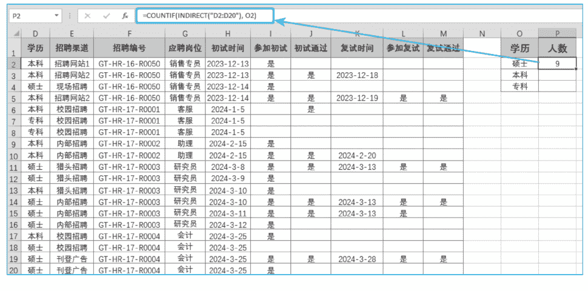

图0-18

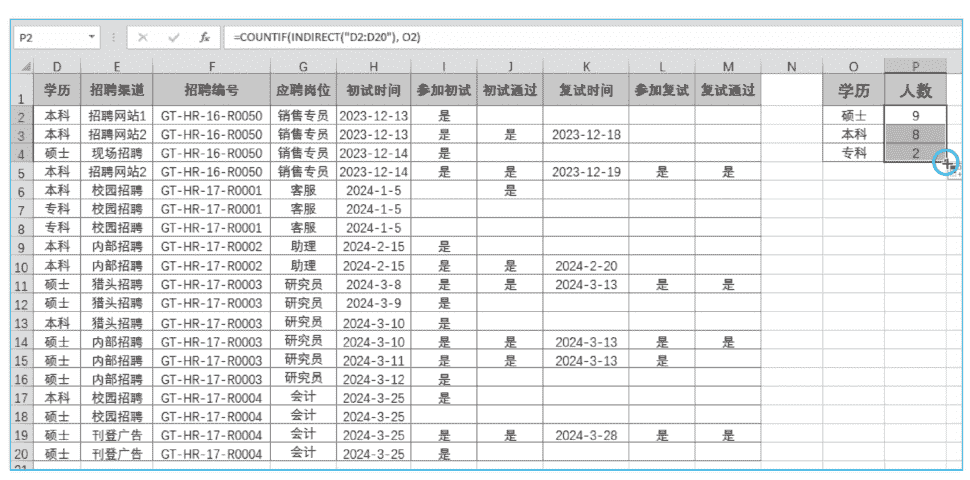

图0-19

## 0.5 生成公式时将判断条件描述完整

在向DeepSeek描述问题时，如果有多个限制条件，注意一定要将问题描述清楚。我们来看一个提示词，如图0-20所示。发送提示词后得到如图0-21所示的回复信息。


图0-20

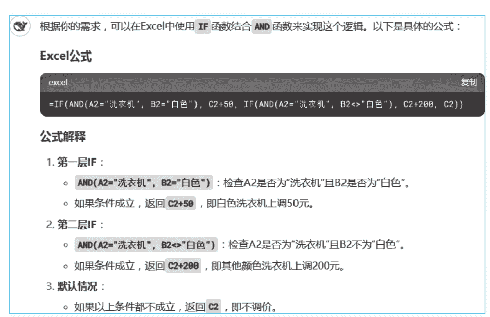

图0-21

根据DeepSeek的回复回到工作表中建立公式后，得到的结果如图0-22所示。可以看到公式返回的结果都是原价，并未达到按条件调价的目的。

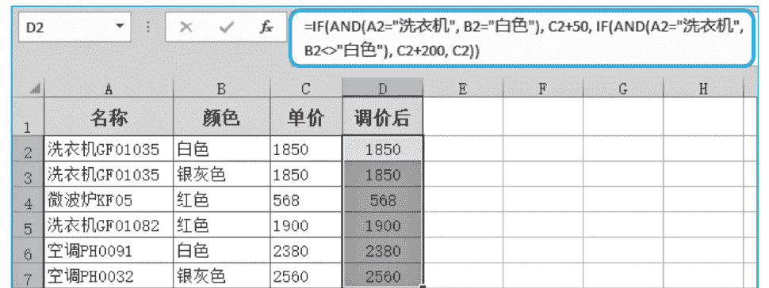

图0-22

上述提示词对单元格位置、范围的指定非常明确，但因为忽视了一个条件，导致DeepSeek无法回复正确的公式。观察A列中的名称可以发现，“洗衣机”这几个字是商品名称的前几个字，所以要判断是否为洗衣机，需要将这个条件也描述给DeepSeek。因此调整提示词，添加一个判断条件“并且要判断A2中前3个字符是否是洗衣机”（如图0-23所示），这时DeepSeek就明白了需要在名称中从左侧提取三个字符，并判断是否为“洗衣机”，从而重新生成公式，如图0-24所示。


图0-23

根据你的需求，我们需要判断A2的前3个字符是否为“洗衣机”，并且结合颜色进行调价。可以使用 `LEFT` 函数提取前3个字符，并结合 `IF` 和 `AND` 函数实现逻辑。以下是具体公式：

### Excel公式

```
excel
=IF(AND(LEFT(A2, 3)="洗衣机", B2="白色"), C2+50, IF(AND(LEFT(A2, 3)="洗衣机", B2<>"白色"), C2+200, C2))
```

### 公式解释

- 1. 第一层IF：
   - `AND(LEFT(A2, 3)="洗衣机", B2="白色")`：检查A2的前3个字符是否为“洗衣机”且B2是否为“白色”。
   - 如果条件成立，返回 `C2+50`，即白色洗衣机上调50元。
- 2. 第二层IF：
   - `AND(LEFT(A2, 3)="洗衣机", B2<>"白色")`：检查A2的前3个字符是否为“洗衣机”且B2不为“白色”。
   - 如果条件成立，返回 `C2+200`，即其他颜色洗衣机上调200元。
- 3. 默认情况：
   - 如果以上条件都不成立，返回 `C2`，即不调价。


我们回到Excel中去验证一下这个公式，可以看到公式能自动判断A列中名称的前几个字符是不是“洗衣机”，还可以判断颜色是否为“白色”，然后得到正确的结果，如图0-25所示。

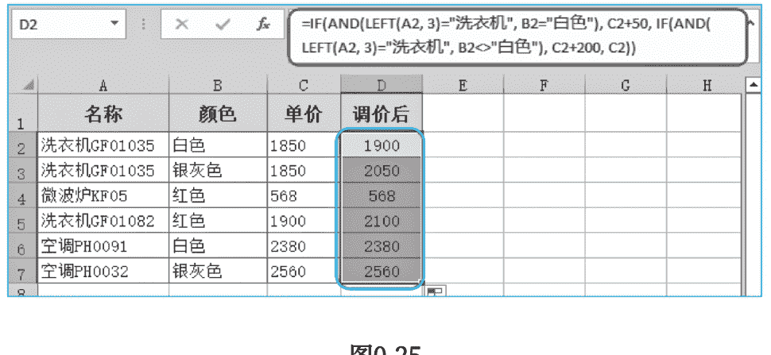

图0-25

## 0.6 对DeepSeek的回复进行追问

前面我们强调了在向DeepSeek提问时要给出清晰具体的指示、说明范围及目的、把判断条件描述完整等。除此之外，如果一次提示未能将问题表达清楚，得到的回复不是你想要的，可以通过追问的方式对当前问题进行补充，或者继续提出新的需求。

例如想用表格列出几种最适合作为花茶的玫瑰花，同时给出它们的产地、制作方法以及口感的相关资料，这时可以组织好提示词，让DeepSeek帮忙提供一些有用的数据信息。

- 1. 在聊天对话框中输入“用表格列出6种最适合作为花茶的玫瑰花，包含名称、产地、制作方式、口感的资料。”，如图0-26所示。发送提示词后得到如图0-27所示的表格信息。
- 2. 继续在聊天对话框中输入“新增一栏“维C含量”，放在“口感描述”后面。”如图0-28所示。发送提示词后，得到如图0-29所示的表格信息。

用表格列出6种最适合作为花茶的玫瑰花，包含名称、产地、制作方式、口感的资料。

图0-26

以下是6种最适合作为花茶的玫瑰花，整理成表格形式，包含名称、产地、制作方式、口感等信息：

| 名称 | 产地 | 制作方式 | 口感描述 |
| :--- | :--- | :--- | :--- |
| 大马士革玫瑰 | 保加利亚 | 采摘新鲜花蕾，晾晒至干燥，保留完整花瓣。 | 香气浓郁，带有蜂蜜和果香的甜味，口感柔和顺滑。 |
| 平阴玫瑰 | 中国山东 | 采用传统晾晒工艺，保留花瓣完整性和香气。 | 香气清新，带有淡淡的甜味和草本香，口感清爽。 |
| 法国千叶玫瑰 | 法国 | 手工采摘花瓣，低温烘干，保留细腻香气。 | 香气优雅，带有柑橘和香草的复合香味，口感细腻。 |
| 墨红玫瑰 | 中国云南 | 新鲜花瓣经过低温烘焙，保留深红色泽和浓郁香气。 | 香气浓郁，带有果香和蜜香，口感醇厚，回味甘甜。 |
| 苦水玫瑰 | 中国甘肃 | 采用传统晾晒工艺，花瓣干燥后色泽深紫。 | 香气独特，带有淡淡的苦味和草本香，口感清爽，适合搭配其他花茶。 |
| 英国老玫瑰 | 英国 | 手工采摘花瓣，低温烘干，保留经典玫瑰香气。 | 香气经典，带有淡淡的木质香和甜味，口感温和，适合单独冲泡或搭配红茶。 |

图0-27

新增一栏“维C含量”，放在“口感描述”后面。

图0-28

以下是更新后的表格，新增了“维C含量”一栏，放在“口感描述”后面：

| 名称 | 产地 | 制作方式 | 口感描述 | 维C含量 |
| :--- | :--- | :--- | :--- | :--- |
| 大马士革玫瑰 | 保加利亚 | 采摘新鲜花蕾，晾晒至干燥，保留完整花瓣。 | 香气浓郁，带有蜂蜜和果香的甜味，口感柔和顺滑。 | 中等（约20mg/100g） |
| 平阴玫瑰 | 中国山东 | 采用传统晾晒工艺，保留花瓣完整性和香气。 | 香气清新，带有淡淡的甜味和草本香，口感清爽。 | 较高（约30mg/100g） |
| 法国千叶玫瑰 | 法国 | 手工采摘花瓣，低温烘干，保留细腻香气。 | 香气优雅，带有柑橘和香草的复合香味，口感细腻。 | 较低（约15mg/100g） |
| 墨红玫瑰 | 中国云南 | 新鲜花瓣经过低温烘焙，保留深红色泽和浓郁香气。 | 香气浓郁，带有果香和蜜香，口感醇厚，回味甘甜。 | 中等（约25mg/100g） |
| 苦水玫瑰 | 中国甘肃 | 采用传统晾晒工艺，花瓣干燥后色泽深紫。 | 香气独特，带有淡淡的苦味和草本香，口感清爽，适合搭配其他花茶。 | 较高（约35mg/100g） |
| 英国老玫瑰 | 英国 | 手工采摘花瓣，低温烘干，保留经典玫瑰香气。 | 香气经典，带有淡淡的木质香和甜味，口感温和，适合单独冲泡或搭配红茶。 | 较低（约10mg/100g） |

图0-29

③ DeepSeek还可以按照你的分析意图对数据进行处理，这一功能非常可贵。例如我们想让获取的数据表按维C含量从高到低进行排序，则可以在聊天对话框中输入“将维C含量按“高”“中”“低”排序。”，如图0-30所示。发送提示词后，得到新的回复表格已经按“维C含量”这一列对数据进行了排序，如图0-31所示。

将维C含量按“高”“中”“低”排序。

图0-30

④ 利用鼠标拖曳选取整个表格（如图0-32所示），按Ctrl+C组合键复制，然后切换到Excel中，选中目标单元格，按Ctrl+V组合键粘贴，即可得到数据表。

以下是按照“维C含量”从高到低排序后的表格：

| 名称 | 产地 | 制作方式 | 口感描述 | 维C含量 |
| :--- | :--- | :--- | :--- | :--- |
| 苦水玫瑰 | 中国甘肃 | 采用传统晾晒工艺，花瓣干燥后色泽深紫。 | 香气独特，带有淡淡的苦味和草本香，口感清爽，适合搭配其他花茶。 | 高（约35mg/100g） |
| 平阴玫瑰 | 中国山东 | 采用传统晾晒工艺，保留花瓣完整性和香气。 | 香气清新，带有淡淡的甜味和草本香，口感清爽。 | 高（约30mg/100g） |
| 墨红玫瑰 | 中国云南 | 新鲜花瓣经过低温烘焙，保留深红色泽和浓郁香气。 | 香气浓郁，带有果香和蜜香，口感醇厚，回味甘甜。 | 中（约25mg/100g） |
| 大马士革玫瑰 | 保加利亚 | 采摘新鲜花蕾，晾晒至干燥，保留完整花瓣。 | 香气浓郁，带有蜂蜜和果香的甜味，口感柔和顺滑。 | 中（约20mg/100g） |
| 法国千叶玫瑰 | 法国 | 手工采摘花瓣，低温烘干，保留细腻香气。 | 香气优雅，带有柑橘和香草的复合香味，口感细腻。 | 低（约15mg/100g） |
| 英国老玫瑰 | 英国 | 手工采摘花瓣，低温烘干，保留经典玫瑰香气。 | 香气经典，带有淡淡的木质香和甜味，口感温和，适合单独冲泡或搭配红茶。 | 低（约10mg/100g） |

图0-31

以下是按照“维C含量”从高到低排序后的表格：

| 名称 | 产地 | 制作方式 | 口感描述 | 维C含量 |
| :--- | :--- | :--- | :--- | :--- |
| 苦水玫瑰 | 中国甘肃 | 采用传统晾晒工艺，花瓣干燥后色泽深紫。 | 香气独特，带有淡淡的苦味和草本香，口感清爽，适合搭配其他花茶。 | 高（约35mg/100g） |
| 平阴玫瑰 | 中国山东 | 采用传统晾晒工艺，保留花瓣完整性和香气。 | 香气清新，带有淡淡的甜味和草本香，口感清爽。 | 高（约30mg/100g） |
| 墨红玫瑰 | 中国云南 | 新鲜花瓣经过低温烘焙，保留深红色泽和浓郁香气。 | 香气浓郁，带有果香和蜜香，口感醇厚，回味甘甜。 | 中（约25mg/100g） |
| 大马士革玫瑰 | 保加利亚 | 采摘新鲜花蕾，晾晒至干燥，保留完整花瓣。 | 香气浓郁，带有蜂蜜和果香的甜味，口感柔和顺滑。 | 中（约20mg/100g） |
| 法国千叶玫瑰 | 法国 | 手工采摘花瓣，低温烘干，保留细腻香气。 | 香气优雅，带有柑橘和香草的复合香味，口感细腻。 | 低（约15mg/100g） |
| 英国老玫瑰 | 英国 | 手工采摘花瓣，低温烘干，保留经典玫瑰香气。 | 香气经典，带有淡淡的木质香和甜味，适合搭配红茶。 | 低（约10mg/100g） |

图0-32

# 第1章 掌握快捷的数据输入方法


扫码看教学视频

## 1.1 了解数据的几种类型

输入任意类型的数据（如文本型数据、数值型数据、日期型数据等）到工作表中是创建表格的首要工作。因此首先我们需要了解Excel中的几种数据类型，数据的类型不能混乱，因为规范的数据是将来进行数据核算、统计及分析的基础。

### 1.1.1 文本型数据

一般来说，输入单元格中的中文、字母即为文本型数据。这类数据直接输入即可，不需要特意去设置它们的格式。

打开工作表，输入文字与数字时，其默认格式都为“常规”（在“开始”选项卡的“数字”组中可以看到格式），如图1-1所示，输入的数据都是“常规”格式，并且也是文本数据。

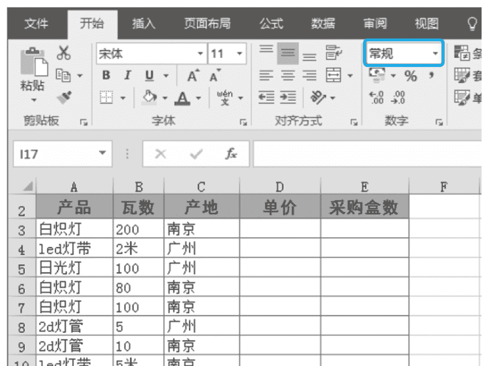

图1-1

如果想让输入的数字显示为“文本”格式，例如在“序号”列中希望显示的序号为“001”“002”……这种形式（如图1-2所示），直接输入时，显示的结果如图1-3所示（前面的0被自动省略），此时需要首先将单元格的格式设置为“文本”然后再输入序号。

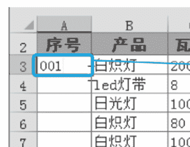

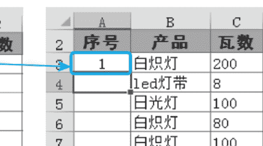

具体操作如下。

- 1. 选中要输入“序号”的单元格区域，切换到“开始”选项卡，在“数字”组中单击格式设置框右侧的下拉按钮，在下拉列表中选择“文本”选项，如图1-4所示。

## 专家提示

在这种情况下，注意一定要遵循先设置格式再输入的原则。因为如果先输入以0开头的编号，再设置单元格格式，则无法恢复数字前面的0。

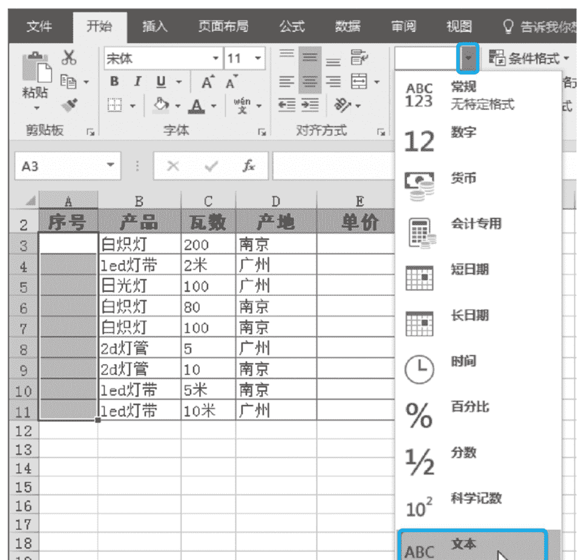

图1-4

② 再输入以0开头的序号时即可正确显示，如图1-5所示。

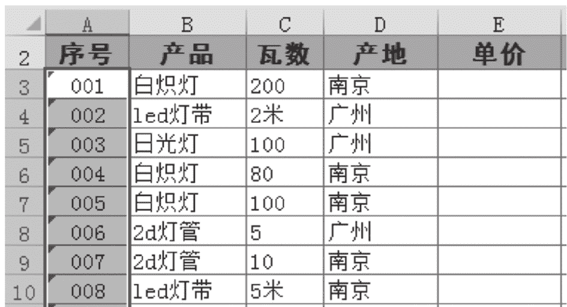

图1-5

## 专家提示

将以上操作总结如下，如果输入文字、字母等内容，表格会默认将其作为文本来处理，无须特意设置单元格的格式为“文本”。但在有些情况下必须设置单元格的格式为“文本”格式，例如输入以0开头的编号、一串数字表示的产品编码、身份证号码等，如果不设置单元格格式为“文本”格式，则这些数据将无法正确显示。

如果在一个单元格中输入较长的文本，当需要换行时，无法像在Word文档中那样按Enter键就能换行，这时需要强制换行。下面举一个例子。

如图1-6所示的A24:E24单元格区域是一个合并后的区域，首先输入了文字“说明：”，后面的说明内容是按条目显示的，每一条应分行显示。要想进行换行输入就要强制换行。

| A | B | C | D | E |
|---|---|---|---|---|
| 9 | | | | |
| 10 | | | | |
| 11 | | | | |
| 12 | | | | |
| 13 | | | | |
| 14 | | | | |
| 15 | | | | |
| 16 | | | | |
| 申请人签字： | | 主管领导签字： | | |
| 说明： | | | | |

图1-6

具体操作步骤如下。

- 1. 输入“说明：”后，按Alt+Enter组合键，即可进入下一行，可以看到光标在下一行中闪烁，如图1-7所示。

## 1.1.2 数值数据

数值数据是表格中最常使用的数字格式，整数、小数、百分比、会计专用都属于数值数据。数值在输入时也是输入什么就显示什么，但除此之外可能还需要显示为其他格式，如统一包含指定位数的小数、显示货币样式等。在“开始”选项卡“数字”组中有一个“数字格式”设置项，当选中单元格时可以迅速查看它的格式，如图1-10所示，选中输入数字的单元格后，可以看到默认是“常规”格式。

单击右侧的下拉按钮，可以看到其中包含“常规”“数字”“百分比”“货币”“会计专用”“短日期”及“长日期”等格式，要设置数据的格式时，可以在选中数据区域后在这里快速应用。例如想要将当前表格的数据显示为货币格式，操作如下。

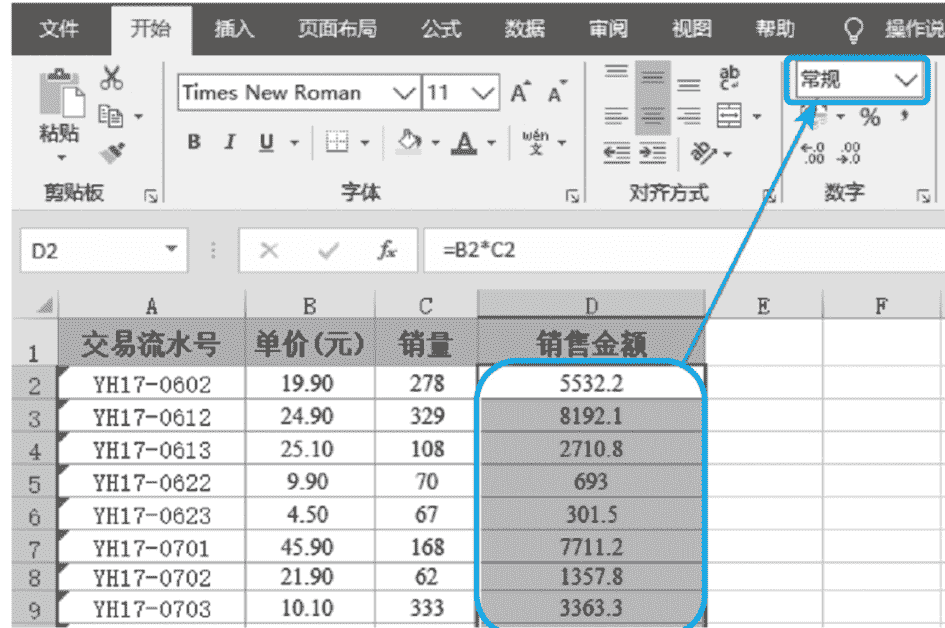

图1-10

❶ 选中要更改格式的单元格区域，在“开始”选项卡的“数字”组中单击“数字格式”下拉按钮，在弹出的下拉列表中选择“货币”选项，即可更改数字格式，如图1-11所示。

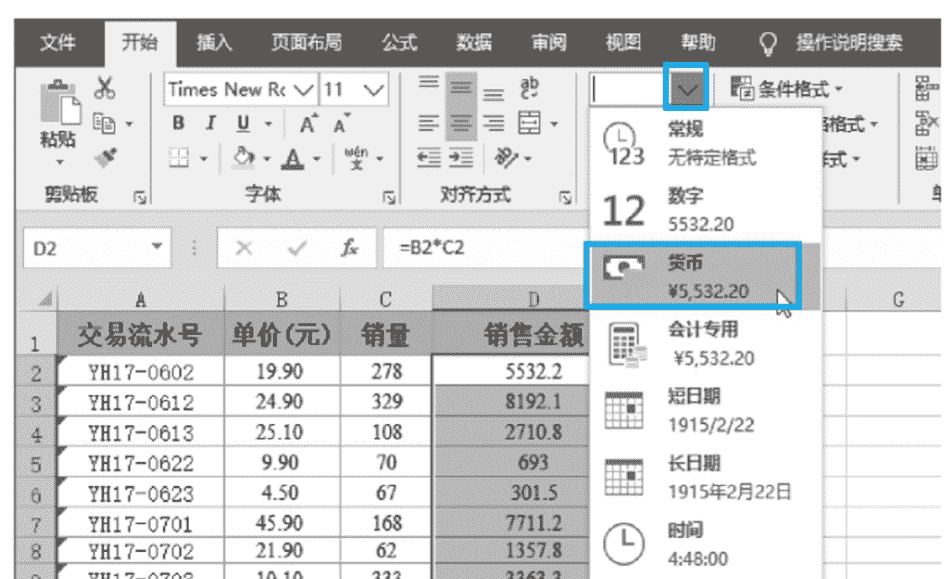

图1-11

② 这时可以看到原先的数据被重新更改为货币格式，在数据前添加了货币符号，并自动保留两位小数位数，效果如图1-12所示。

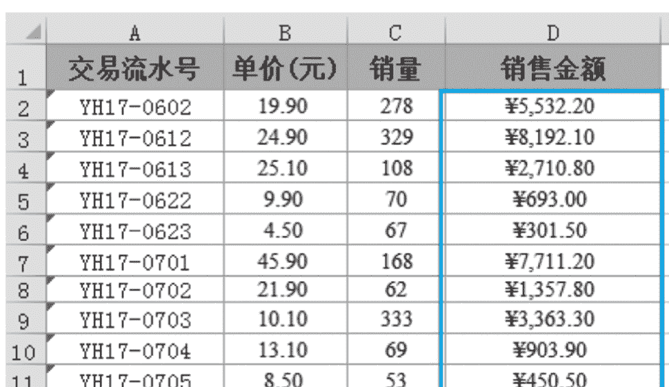

图1-12

在输入百分比值时，如果每个数字都手工输入“%”，会降低输入效率。因此可以先输入小数，然后通过设置单元格格式一次性转换，操作如下。

- 1. 选中要更改数据格式的数据区域，在“开始”选项卡的“数字”组中单击“数字格式”下拉按钮，在弹出的下拉列表中选择“百分比”选项，如图1-13所示，即可更改数字格式。

## 知识扩展

与货币格式类似的还有会计专用格式。二者有细微区别：

- (1) 币种符号位置不同，货币格式的货币符号与数据是连在一起靠右的，会计专用格式的货币符号是靠左显示。
- (2) 会计专用格式不能特殊设置负数的显示样式。

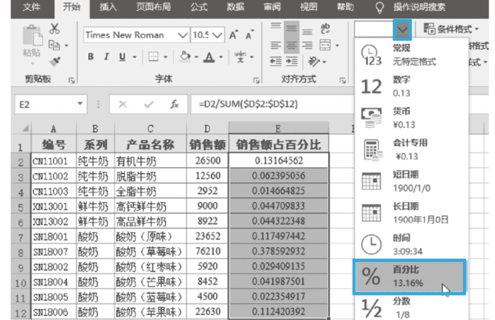

图1-13

② 此时可以看到原来的数据重新显示为两位小数位数的百分数，效果如图1-14所示。

| 编号 | 系列 | 产品名称 | 销售额 | 销售额占百分比 |
|---|---|---|---|---|
| CN11001 | 纯牛奶 | 有机牛奶 | 26500 | 13.16% |
| CN11002 | 纯牛奶 | 脱脂牛奶 | 12560 | 6.24% |
| CN11003 | 纯牛奶 | 全脂牛奶 | 2952 | 1.47% |
| XN13001 | 鲜牛奶 | 高钙鲜牛奶 | 9000 | 4.47% |
| XN13002 | 鲜牛奶 | 高品鲜牛奶 | 8922 | 4.43% |
| SN18001 | 酸奶 | 酸奶（原味） | 23652 | 11.75% |
| SN18007 | 酸奶 | 酸奶（草莓味） | 76210 | 37.86% |
| SN18002 | 酸奶 | 酸奶（红枣味） | 5920 | 2.94% |
| SN18004 | 酸奶 | 酸奶（芒果味） | 8452 | 4.20% |
| SN18005 | 酸奶 | 酸奶（蓝莓味） | 4500 | 2.24% |
| SN18006 | 酸奶 | 酸奶（苹果味） | 22630 | 11.24% |

图1-14

## 知识扩展


“数字”组中还有5个功能按钮，分别是“会计数字格式”“百分比样式”“千位分隔样式”“增加小数位数”和“减少小数位数”，如图1-15所示。通过单击这些按钮可以快速更改数字格式，并且当数据涉及小数位时，可以通过单击两个按钮随意增加或减少小数位数。


图1-15

练一练：设置金额的货币格式。

让数据显示货币格式并且负数用红色括号表示，如图1-16所示。

| 项目 | 上年度 | 本年度 | 增减额(率) |
| :--- | :--- | :--- | :--- |
| 销售收入 | ¥206,424.58 | ¥225,298.68 | ¥18,874.10 |
| 销售成本 | ¥82,698.00 | ¥96,628.02 | ¥13,930.02 |
| 销售费用 | ¥20,462.68 | ¥6,450.46 | (¥14,012.22) |
| 销售税金 | ¥4,952.89 | ¥2,222.65 | (¥2,730.24) |
| 销售成本率 | ¥0.68 | ¥0.83 | ¥0.15 |
| 销售费用率 | ¥0.10 | ¥0.06 | (¥0.03) |
| 销售税金率 | ¥0.05 | ¥0.03 | (¥0.02) |

图1-16

## 1.1.3 日期与时间数据

日期型数据是表示日期的数据，日期的默认格式是“yyyy/mm/dd”格式，其中yyyy表示年份，mm表示月份，dd表示日期，固定长度为8位。在输入日期时注意要使用规范的格式，让程序能识别它是日期，否则在后期涉及日期的计算时将无法进行。

日期型数据可以在数字间使用“-”间隔，如2024-9-1（如图1-17所示），或者使用“/”间隔，如2024/9/1。如果是本年的日期，可以在输入时省略年份，如图1-18所示。还可以直接输入“2024年9月1日”，这些都是程序能识别的最简易的输入方式。

| 类型 | 货号 | 销售日期 | 销售员 | 销售数量 |
|---|---|---|---|---|
| D5D | A-01 | 2024-9-1 | | |
| D4X | A-01 | | | |
| D4C | A-02 | | | |
| D3D | A-011 | | | |
| D4D | A-011 | | | |
| D4C | A-031 | | | |
| D4X | A-03 | | | |
| D4X | A-011 | | | |
| D4X | A-031 | | | |
| D4C | A-01 | | | |

图1-17

| 类型 | 货号 | 销售日期 | 销售员 | 销售数量 |
|---|---|---|---|---|
| D5D | A-01 | 9月1日 | | |
| D4X | A-01 | | | |
| D4C | A-02 | | | |
| D3D | A-011 | | | |
| D4D | A-011 | | | |
| D4C | A-031 | | | |
| D4X | A-03 | | | |
| D4X | A-011 | | | |
| D4X | A-031 | | | |
| D4C | A-01 | | | |

图1-18

如果需要对单元格区域中输入的默认日期格式进行设置（如将日期以英文日期格式显示出来），则需要打开“设置单元格格式”对话框来设置，操作如下。

❶ 先以程序能识别的最简易的格式输入日期，接着选中目标单元格区域，在“开始”选项卡的“数字”组中单击“launcher”（设置单元格格式）按钮（如图1-19所示），打开“设置单元格格式”对话框。

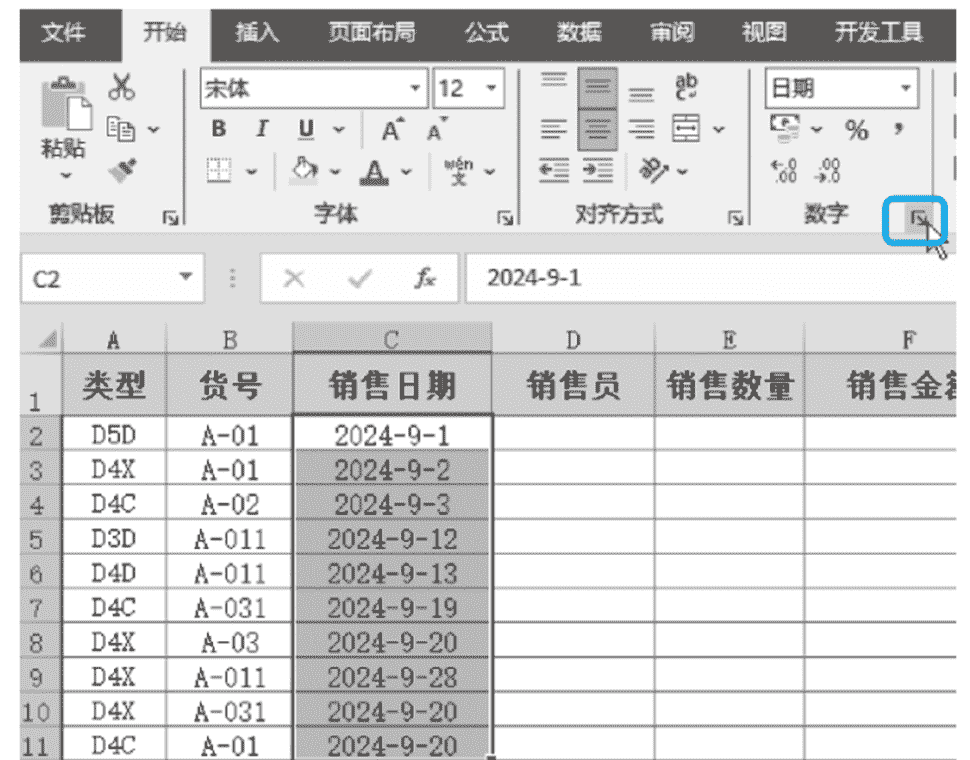

图1-19

❷ 在“分类”列表中单击“日期”，然后可以根据实际需要设置日期格式为“14-Mar-12”，如图1-20所示。

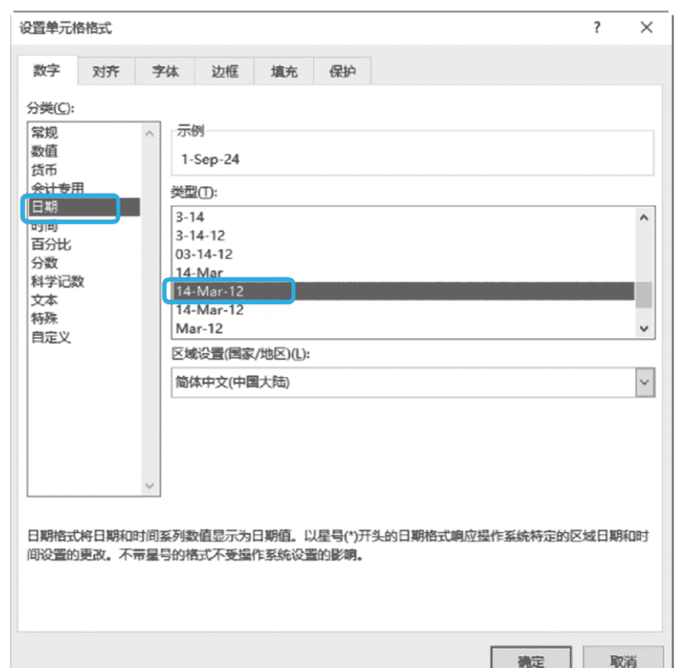

图1-20

③ 单击“确定”按钮，选中的单元格区域的数值格式即可更改为指定日期格式，如图1-21所示。

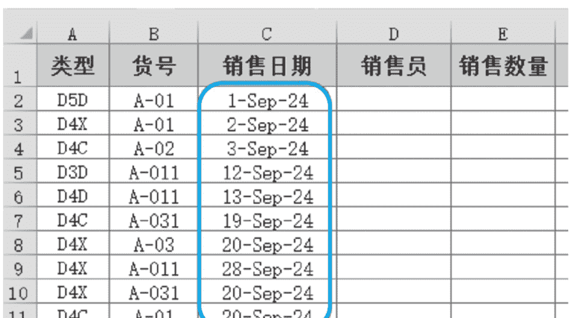

图1-21

在单元格中直接输入的“1:30”样式的数据会被自动识别为时间数据，如果需要在单元格区域中输入指定样式的时间格式（如12小时制的时间格式），可以按如下方法实现。

- 1. 先以程序能识别的最简易的格式输入时间，接着选中目标单元格区域，在“开始”选项卡的“数字”组中单击“”（设置单元格格式）按钮（如图1-22所示），打开“设置单元格格式”对话框。

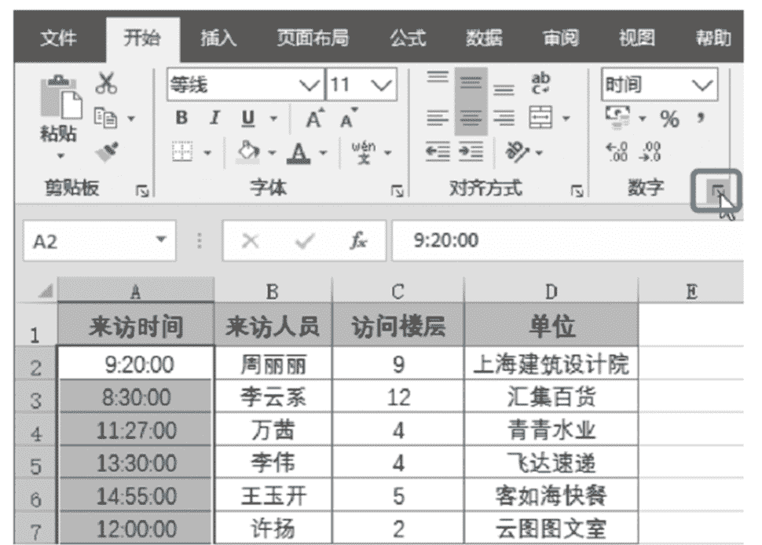

图1-22

② 在“分类”列表中单击“时间”，然后可以根据实际需要设置时间样式为“1:30 PM”，如图1-23所示。

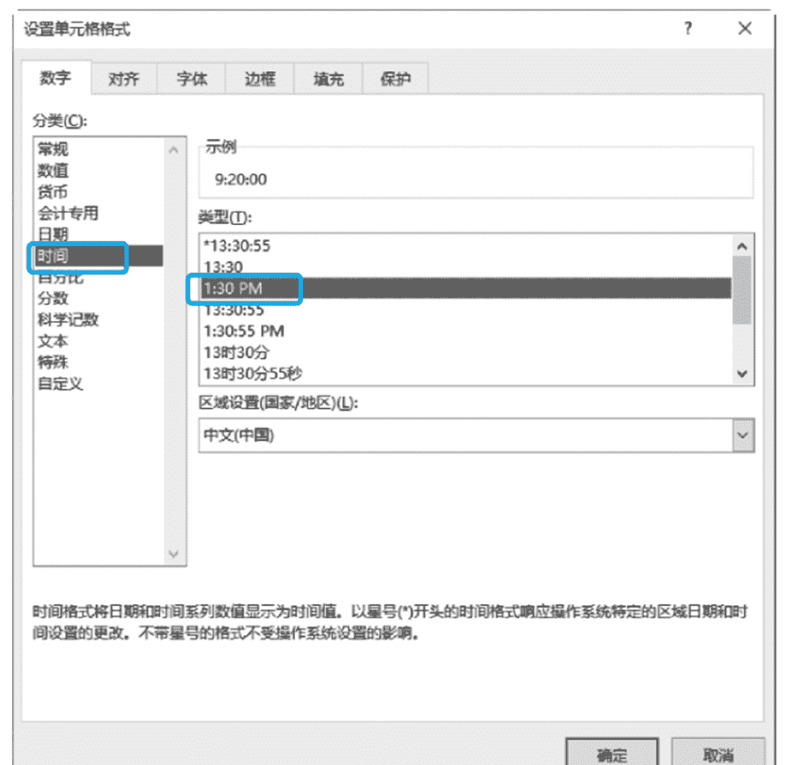

图1-23

③ 单击“确定”按钮，可以看到表中时间变成了12小时制的时间，如图1-24所示。

| 来访时间 | 来访人员 | 访问楼层 | 单位 |
| :--- | :--- | :--- | :--- |
| 9:20 AM | 周丽丽 | 9 | 上海建筑设计院 |
| 8:30 AM | 李云系 | 12 | 汇集百货 |
| 11:27 AM | 万茜 | 4 | 青青水业 |
| 1:30 PM | 李伟 | 4 | 飞达速递 |
| 2:55 PM | 王玉开 | 5 | 客如海快餐 |
| 12:00 PM | 许扬 | 2 | 云图图文室 |
| 2:11 PM | 万茜 | 11 | 青青水业 |
| 15:27:00 | 李伟 | 28 | 飞达速递 |

图1-24

## 知识扩展

如果输入的日期是递增的日期序列，可以用填充的方式快速输入，而不必逐个输入。

在C2单元格内输入首个日期（如图1-25所示），接着将鼠标指针放在C2单元格的右下角，向下拖动填充柄（如图1-26所示），释放鼠标左键即可输入连续的日期数据，如图1-27所示。

| 姓名 | 部门 | 值班日期 |
|---|---|---|
| 吴伟云 | 生产1部 | 2024-9-1 |
| 杨清 | 生产1部 | |
| 李欣 | 生产2部 | |
| 金鑫 | 生产2部 | |
| 华涵涵 | 生产2部 | |
| 张玮 | 生产1部 | |
| 聂新余 | 生产2部 | |
| 陈媛媛 | 生产2部 | |
| 高雨 | 生产1部 | |
| 刘慧洁 | 生产2部 | |
| 李季 | 生产1部 | |
| 周梦伟 | 生产2部 | |
| 林源 | 生产1部 | |

图1-25

| 姓名 | 部门 | 值班日期 |
|---|---|---|
| 吴伟云 | 生产1部 | 2024-9-1 |
| 杨清 | 生产1部 | |
| 李欣 | 生产2部 | |
| 金鑫 | 生产2部 | |
| 华涵涵 | 生产2部 | |
| 张玮 | 生产1部 | |
| 聂新余 | 生产2部 | |
| 陈媛媛 | 生产2部 | |
| 高雨 | 生产1部 | |
| 刘慧洁 | 生产2部 | |
| 李季 | 生产1部 | |
| 周梦伟 | 生产2部 | |
| 林源 | 生产1部 | |

图1-26

| 姓名 | 部门 | 值班日期 |
|---|---|---|
| 吴伟云 | 生产1部 | 2024-9-1 |
| 杨清 | 生产1部 | 2024-9-2 |
| 李欣 | 生产2部 | 2024-9-3 |
| 金鑫 | 生产2部 | 2024-9-4 |
| 华涵涵 | 生产2部 | 2024-9-5 |
| 张玮 | 生产1部 | 2024-9-6 |
| 聂新余 | 生产2部 | 2024-9-7 |
| 陈媛媛 | 生产2部 | 2024-9-8 |
| 高雨 | 生产1部 | 2024-9-9 |
| 刘慧洁 | 生产2部 | 2024-9-10 |
| 李季 | 生产1部 | 2024-9-11 |
| 周梦伟 | 生产2部 | 2024-9-12 |
| 林源 | 生产1部 | 2024-9-13 |

图1-27

练一练：把日期转换为对应的星期数。

在值班表中，除了显示值班日期，还要显示值班日期对应的星期数，如图1-28所示。

| 职工工号 | 姓名 | 值班日期 | 星期 |
| :--- | :--- | :--- | :--- |
| RCH001 | 张怡伶 | 2024-9-10 | 星期二 |
| RCH009 | 苏明 | 2024-9-9 | 星期三 |
| RCH003 | 陈秀秀 | 2024-9-3 | 星期四 |
| RCH011 | 何世杰 | 2024-9-12 | 星期五 |
| RCH005 | 袁晓 | 2024-9-13 | 星期六 |
| RCH007 | 夏兰兰 | 2024-9-19 | 星期日 |
| RCH004 | 吴晶 | 2024-9-20 | 星期一 |
| RCH008 | 蔡天放 | 2024-9-28 | 星期二 |
| RCH012 | 崔小琴 | 2024-9-20 | 星期三 |
| RCH010 | 袁元 | 2024-9-20 | 星期四 |

图1-28

## 1.1.4 外部数据

Excel表格中的数据除了手工录入的，还有的数据需要从外部导入，例如文本文件中的数据、网页中的数据等。这些数据需要先导入Excel中形成标准的数据表后，再进行相关的数据分析。

### 1. 从文本文件中导入数据

文本数据是常见的数据来源，但是文本文件仅用来记录数据，并没有分析和计算数据的功能。因此可以将文本数据导入Excel中。如图1-29所示为考勤机数据，这种数据都需要导入Excel工作簿中，操作如下。

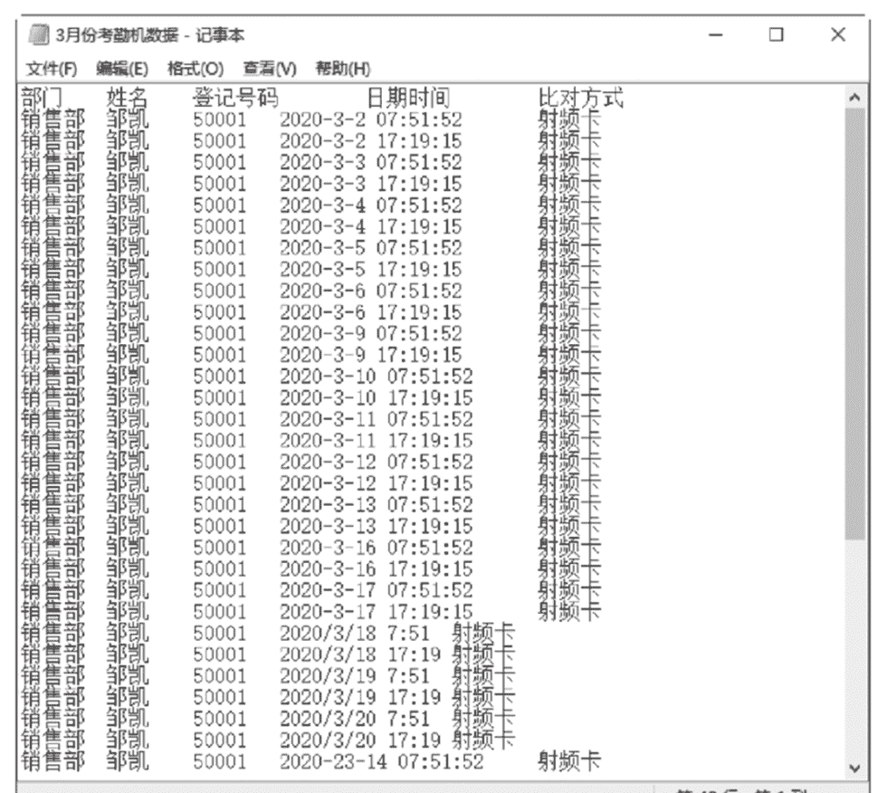

图1-29

- 1. 新建一个空白工作簿，在“数据”选项卡的“获取和转换数据”组中单击“从文本/CSV”按钮，如图1-30所示。


图1-30

② 打开“导入数据”对话框，找到相应的文本文件并选中（如图1-31所示），然后单击“导入”按钮，打开相应对话框，如图1-32所示。

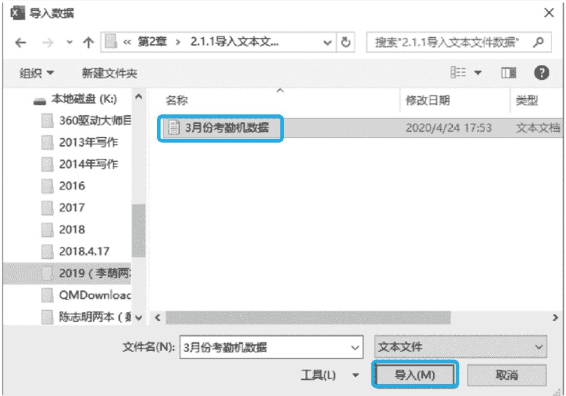

图1-31

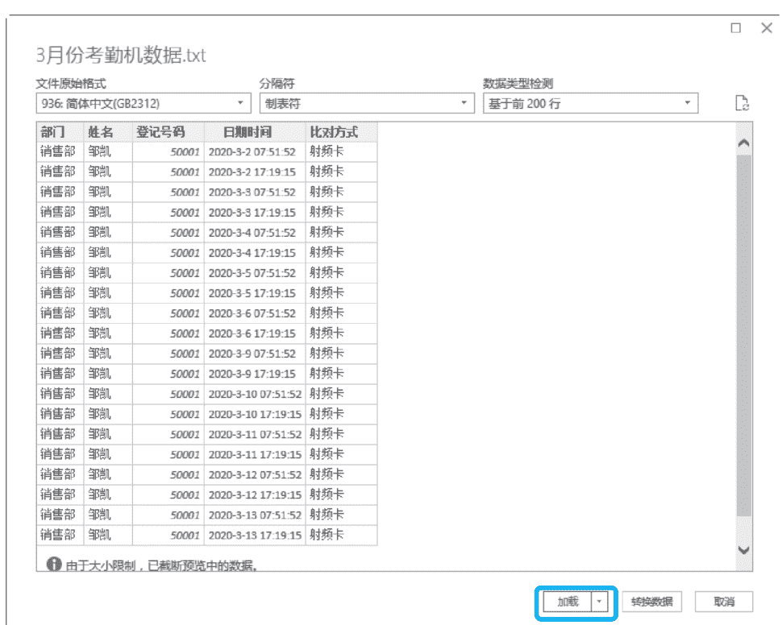

图1-32

③ 此时可以看到表格预览。接着单击“加载”按钮，即可将数据导入表格中，如图1-33所示。

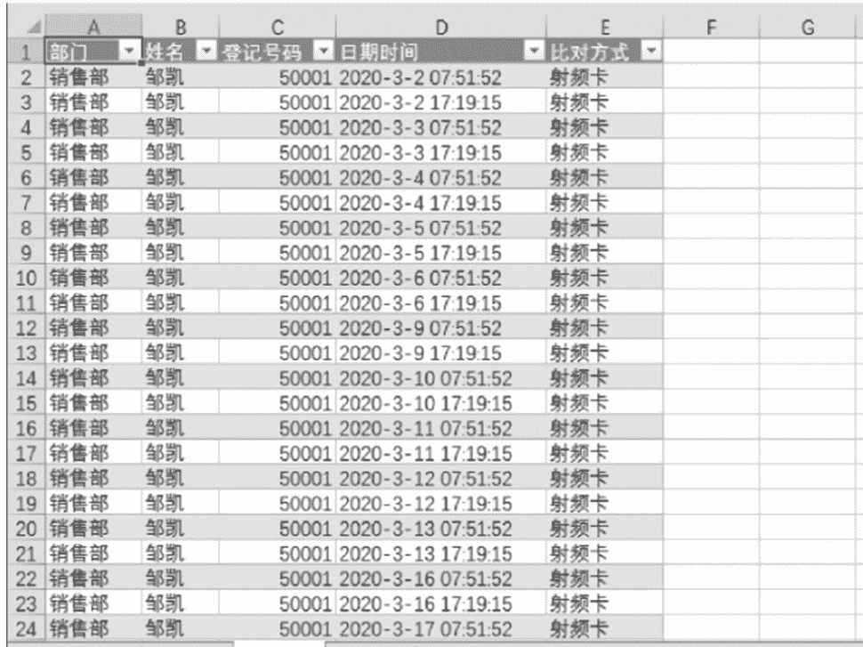

图1-33

## 专家提示

要导入的文本文件数据要具有一定规则，如以统一的分隔符进行分隔或具有固定的宽度，这样导入的数据才会自动填入相应的单元格中。过于杂乱的文本数据，程序难以找到相应分列的规则，导入Excel表格后也会显得很杂乱。这种情况下，一定要先在文本文件中对数据进行整理。

### 2. 从网页中导入数据

报告分析所要用到的数据，有一部分可以直接从公司的销售、财务、人事等部门收集，而另一部分涉及宏观、横向比较的数据，例如市场份额、产品渠道分布等，一般需要通过网络查询官方统计数据库或年鉴等获取。因此导入网页数据也是源表数据的来源之一。从网页中找到需要的数据后，可以利用如下方法将其导入Excel工作表中。

❶ 打开Excel表格，在“数据”选项卡的“获取和转换”组中单击“自网站”按钮，如图1-34所示。


图1-34

❷ 打开“从Web”对话框，在“URL”框中输入网址（如图1-35所示），单击“确定”按钮，打开导航器。


图1-35

③ 导航器会将当前网页中所有能导入的表格都在左侧列出，单击选择相应表格可在右侧预览，确定要导入的内容后（如图1-36所示），单击“加载”按钮，即可将数据导入表格中，如图1-37所示。

图1-36

④ 如果还有其他要导入的内容，可以按相同的方法导入，新导入的数据会自动存放于新工作表中，如图1-38所示。可以待所有数据导入完成后再做合并整理。

图1-37

图1-38

练一练：导入文本文件数据为规范表格。

当前的文本文件如图1-39所示，试将其转换为规范的Excel表格。

图1-39

## 1.1.5 输入特殊符号

在特殊情况下需要在单元格中输入特殊符号，一方面起到特殊标注的作用，另一方面也能美化表格，操作如下。

1. 将光标定位到要插入特殊符号的电话号码前，在“插入”选项卡的“符号”组单击“符号”按钮（如图1-40所示），打开“符号”对话框。

图1-40

② 在“字体”设置框中选择“Wingdings”，拖动右侧滑块找到需要添加的特殊符号，单击并选中，如图1-41示。

图1-41

③ 单击“插入”按钮，返回工作表，即可看到在电话号码前添加了“电话”特殊符号，全部添加后效果如图1-42所示。

| A | B | C |
|---|---|---|
| 客户名称 | 电子邮件 | 电话 |
| 吴华 | wh@126.com | 025-86592312 |
| 张晓晨 | zxiaochen@126.com | 1309800**** |
| 方俊 | fj@163.com | 1308980**** |
| 莫晓晓 | xiaoxiao@163.com | 025-86592451 |
| 刘芸 | lyun@126.com | 025-86502635 |
| 胡丽丽 | hll@139.com | 1385601**** |
| 王茜 | wqian@163.com | 0551-86593698 |
| 贺刚 | hgang@163.com | 027-86593361 |
| 彭燕 | py@126.com | 021-86599850 |
| 吴瑜 | ywu@126.com | 1378941**** |

图1-42

## 专家提示

在插入多个特殊符号时，需要逐一进行插入，如果直接将插入的特殊符号复制到下一单元格中，则不会显示特殊符号样式。

## 1.2 智能的批量输入

在工作表中批量输入数据（如在连续的单元格中输入相同的数据、填充输入序号、填充输入连续月份等）是最常见的操作，可以方便用户一次性输入相同的或有规律的数据，提高工作效率。

### 1.2.1 批量输入相同数据

快速填充输入相同的数据包括在连续的单元格区域中输入相同的数据和在不连续的单元格中输入相同的数据。

### 1. 在连续单元格中填充相同数据

❶ 输入首个数据，如本例中在B6单元格中输入“综合处”，鼠标指针指向B6单元格右下角，光标变成“+”形状（可称为填充柄），如图1-43所示。

图1-43

❷ 按住鼠标左键不放向下拖动（拖动到的位置按实际填充需要决定），如图1-44所示。

❸ 释放鼠标即可实现数据填充，如图1-45所示。

| 客户名称 | 办事处 |
| --- | --- |
| 天翼电信终端有限公司 | 运营商 |
| 北京中邮移动通信有限责任公司 | 运营商 |
| 中移股份有限公司北京分公司 | 运营商 |
| 内蒙古松联通信有限责任公司 | 运营商 |
| 北京迪信通电子通信有限公司 | 综合处 |
| 北京恒信瑞达商贸有限公司 | |
| 北京中复设备有限责任公司 | |
| 北京华信通电讯有限公司 | |

图1-44

图1-45

### 2. 在不连续单元格中输入相同数据

❶ 按Ctrl键依次选中需要输入相同数据的单元格，接着松开Ctrl键，在最后一个选中的单元格中输入数据，此处输入0，如图1-46所示。

图1-46

② 按Ctrl+Enter组合键，即可在选中的所有单元格中输入相同的数据0，如图1-47所示。

图1-47

练一练：在不连续单元格中一次性输入相同的数据。

在如图1-48所示的表格中，在空白单元格中一次性输入文字“正常”，使表格达到如图1-49所示的结果。

| 姓名 | 是否正常出勤 |
|---|---|
| 朱小龙 | |
| 张勤 | 迟到 |
| 周韵 | |
| 赵小超 | |
| 李文文 | |
| 张安静 | 迟到 |
| 徐勇 | 事假 |
| 朱晓霞 | |
| 王艳 | |
| 夏露 | |
| 尹晟 | |
| 杜鹃 | 病假 |
| 张恺 | |
| 胡琴 | |

图1-48

| 姓名 | 是否正常出勤 |
|---|---|
| 朱小龙 | 正常 |
| 张勤 | 迟到 |
| 周韵 | 正常 |
| 赵小超 | 正常 |
| 李文文 | 正常 |
| 张安静 | 迟到 |
| 徐勇 | 事假 |
| 朱晓霞 | 正常 |
| 王艳 | 正常 |
| 夏露 | 正常 |
| 尹晟 | 正常 |
| 杜鹃 | 病假 |
| 张恺 | 正常 |
| 胡琴 | 正常 |

图1-49

### 1.2.2 填充序号

通过填充功能可以实现一些有规则数据的输入，例如序号填充、日期填充、月份填充等。通过填充可以实现连续序号的输入，其操作如下。

### 1. 快速填充连续的序号

❶ 在A3单元格中输入“001”（注意，要按1.1.1小节中介绍的方法先设置单元格格式为文本格式，再输入以0开头的编号）。选中A3单元格，鼠标指针指向A3单元格右下角，出现黑色十字形（可称为填充柄），如图1-50所示。

| 序号 | 公司名称 | 应收金额 |
|---|---|---|
| 001 | 孚盛装饰公司 | ¥ 29,840.00 |
| | 澳菲斯建材有限公司 | ¥ 28,765.00 |
| | 宏运佳建材公司 | ¥ 15,080.00 |
| | 拓帆建材有限公司 | ¥ 22,015.00 |
| | 澳菲斯建材有限公司 | ¥ 18,009.00 |
| | 孚盛装饰公司 | ¥ 22,000.00 |
| | 孚盛装饰公司 | ¥ 23,000.00 |
| | 雅得丽装饰公司 | ¥ 24,000.00 |
| | 宏运佳建材公司 | ¥ 30,000.00 |
| | 雅得丽装饰公司 | ¥ 8,000.00 |
| | 雅得丽装饰公司 | ¥ 8,500.00 |
| | 海兴建材有限公司 | ¥ 8,500.00 |
| | 宏运佳建材公司 | ¥ 22,000.00 |
| | 海兴建材有限公司 | ¥ 10,000.00 |

图1-50

② 按住鼠标左键不放，向下拖动至填充结束的位置，如图1-51所示。

| 序号 | 公司名称 | 应收金额 |
|---|---|---|
| 001 | 盛装饰公司 | ¥ 29,840.00 |
| | 澳菲斯建材有限公司 | ¥ 28,765.00 |
| | 宏运佳建材公司 | ¥ 15,080.00 |
| | 拓帆建材有限公司 | ¥ 22,015.00 |
| | 澳菲斯建材有限公司 | ¥ 18,009.00 |
| | 孚盛装饰公司 | ¥ 22,000.00 |
| | 孚盛装饰公司 | ¥ 23,000.00 |
| | 雅得丽装饰公司 | ¥ 24,000.00 |
| | 宏运佳建材公司 | ¥ 30,000.00 |
| | 雅得丽装饰公司 | ¥ 8,000.00 |
| | 雅得丽装饰公司 | ¥ 8,500.00 |
| | 海兴建材有限公司 | ¥ 8,500.00 |
| | 宏运佳建材公司 | ¥ 22,000.00 |
| | 海兴建材有限公司 | ¥ 10,000.00 |

图1-51

③ 释放鼠标，即会完成序号的填充，如图1-52所示。

图1-52

### 2. 快速填充不连续的序号

通过填充功能也可以实现不连续序号的输入，其关键操作在于填充源的输入，例如本例中固定资产的第1个序号为GD001、第2个序号为GD004、第3个序号为GD007，其他以此类推，即每个序号间隔“3”，那么首先要输入前两个序号，然后再使用填充的方式批量输入。

1. 首先在A2和A3单元格中分别输入前两个编号（GD001与GD004）。选中A2:A3单元格，将光标移至该单元格区域的右下角，直到光标变成填充柄，如图1-53所示。

| 编号 | 固定资产名称 |
|---|---|
| GD001 | 办公楼 |
| GD004 | 综合楼 |
| | 厂房 |
| | 挖掘机 |
| | 铲土机 |

图1-53

② 按住鼠标左键不放，向下拖动到填充结束的位置，松开鼠标左键，拖动过的位置上即会以“3”为间隔显示编号，如图1-54所示。

图1-54

## 知识扩展

自动填充完成后，会出现“自动填充选项”按钮，在此按钮的下拉菜单中，可以为填充选择不同的方式，如“仅填充格式”“不带格式填充”等，如图1-55所示。

另外，“自动填充选项”按钮下拉菜单中的选项内容取决于所填充的数据类型，比如填充日期时会出现“按月填充”“按工作日填充”等选项。

图1-55

练一练：填充有递增属性的数据。

如果想填充的数据具有递增属性，直接填充会自动递增（如图1-56所示），这种数据如果想填充为相同数据（如图1-57所示），有两种操作方法：一是填充柄填充时按住“Ctrl”键不放；二是使用“开始”选项卡的“编辑”组中的“填充”功能按钮进行填充。

| 类型 | 货号 | 销售日期 |
|---|---|---|
| D3D | A-011 | 12-Apr-14 |
| D4C | A-02 | 3-Apr-14 |
| D5C | A-031 | 19-Apr-14 |
| D6C | A-01 | 30-Apr-14 |
| D7C | A-011 | 13-Apr-14 |

图1-56

图1-57

### 1.2.3 填充输入日期

在填充日期时，可以像填充序号一样操作，会得到连续的日期，但如果有其他需求，如按月填充、按工作日填充、按年填充等不同的填充方式，则需要通过单击“自动填充选项”按钮，然后选择相应填充方式进行填充。

### 1. 快速填充工作日

1. 在A2单元格输入值班日期，然后将鼠标放置在A2单元格右下角，当鼠标变成填充柄时，按住鼠标向下拖动（如图1-58所示）到合适的位置，释放鼠标即可看到日期递增序列。

② 单击“自动填充选项”按钮，在下拉菜单中单击“填充工作日”命令，如图1-59所示，即可按照工作日日期填充，如图1-60所示。

| 日期 | 值班人员 |
|---|---|
| 2024-7-1 | 张健竹 |
| | 常娜娜 |
| | 左强 |
| | 李珊珊 |
| | 许悦 |
| | 冯一寻 |
| | 刘志伟 |
| | 王焱 |
| | 张梦 |
| | 陈志飞 |
| | 张健竹 |
| | 许悦 |
| | 左强 |
| | 冯一寻 |
| | 常娜娜 |

图1-58

| 日期 | 值班人员 |
|---|---|
| 2024-7-1 | 张健竹 |
| 2024-7-2 | 常娜娜 |
| 2024-7-3 | 左强 |
| 2024-7-4 | 李珊珊 |
| 2024-7-5 | 许悦 |
| 2024-7-6 | |
| 2024-7-7 | |
| 2024-7-8 | |
| 2024-7-9 | |
| 2024-7-10 | |
| 2024-7-11 | |
| 2024-7-12 | |
| 2024-7-13 | |
| 2024-7-14 | |
| 2024-7-15 | |

- 复制单元格(C)
- 填充序列(S)
- 仅填充格式(F)
- 不带格式填充(O)
- 以天数填充(D)
- 填充工作日(W)
- 以月填充(M)
- 以年填充(Y)
- 快速填充(F)

图1-59

| A | B | C |
|---|---|---|
| 日期 | 值班人员 | 部门 |
| 2024-7-1 | 张健竹 | 销售1部 |
| 2024-7-2 | 常娜娜 | 销售2部 |
| 2024-7-3 | 左强 | 客服部 |
| 2024-7-4 | 李珊珊 | 销售1部 |
| 2024-7-5 | 许悦 | 客服部 |
| 2024-7-8 | 冯一寻 | 销售2部 |
| 2024-7-9 | 刘志伟 | 销售1部 |
| 2024-7-10 | 王焱 | 客服部 |
| 2024-7-11 | 张梦 | 客服部 |
| 2024-7-12 | 陈志飞 | 销售1部 |
| 2024-7-15 | 张健竹 | 销售1部 |
| 2024-7-16 | 许悦 | 客服部 |
| 2024-7-17 | 左强 | 客服部 |
| 2024-7-18 | 冯一寻 | 销售2部 |
| 2024-7-19 | 常娜娜 | 销售2部 |

图1-60

### 2. 快速填充相同日期

填充日期时默认会逐日递增，如果想在连续的单元格区域中填充相同的日期，如图1-61所示。可以在输入首个日期后，按住Ctrl键不放，再去拖动填充柄，即可实现在这一区域填充相同的日期。或者填充后按右下角出现的“自动填充选项”按钮，然后选择“复制单元格”选项，如图1-62所示。

图1-61

图1-62

## 专家提示

在填充序列时，当输入的数据是日期或具有增序或减序特征时，只要输入首个数据，直接填充即可；如果输入的数据是纯数字，则需要在填充后从“自动填充选项”按钮的下拉列表中选择“填充序列”命令，或按住Ctrl键的同时拖动填充。如果想在单元格中填充相同的数据而不是序列，与上面的操作正好相反，即当输入的数据是日期或具有增序或减序特性时，则需要在填充后从“自动填充选项”按钮的下拉列表中选择“复制单元格”命令，或按住Ctrl键的同时拖动填充。

### 1.2.4 DeepSeek指导快速将缺失数据自动填满

如果经常需要进行数据的输入，通常会有一些重复数据是可以通过填充来简单输入。例如在本例中C列的仓库名称以及D列的商品类别有多处空格，如图1-63所示，这些空格实际是当输入重复数据时只输入了首个数据，针对这种情况，该如何填充呢？若未找到思路，可以在DeepSeek中提问，操作如下。

| | A | B | C | D | E |
|---|---|---|---|---|---|
| 1 | 出单日期 | 商品编码 | 仓库名称 | 商品类别 | 出库件数 |
| 2 | 2024-4-8 | WJ8870 | 西城仓 | 瓷片 | 600 |
| 3 | 2024-4-14 | Z8G033 | | | 25 |
| 4 | 2024-4-10 | ZG6011 | | | 32 |
| 5 | 2024-4-17 | ZG6012 | | | 1000 |
| 6 | 2024-4-16 | ZG6013 | | 抛釉砖 | 133 |
| 7 | 2024-4-3 | ZG6016 | | | 817 |
| 8 | 2024-4-11 | ZG6017 | | | 274 |
| 9 | 2024-4-8 | WJ3606B | 建材商城仓库 | 瓷片 | 35 |
| 10 | 2024-4-8 | WJ3608B | | | 900 |
| 11 | 2024-4-13 | ZG63011A | | | 1000 |
| 12 | 2024-4-19 | ZG63016B | | | 80 |
| 13 | 2024-4-2 | WJ8868 | | 抛釉砖 | 90 |
| 14 | 2024-4-4 | Z8G031 | | | 28 |
| 15 | 2024-4-3 | Z8G031 | | | 200 |
| 16 | 2024-4-3 | WJ3608C | 东城仓 | 瓷片 | 550 |
| 17 | 2024-4-4 | WJ3610C | | | 170 |
| 18 | 2024-4-17 | ZG63010 | | | 691 |
| 19 | 2024-4-2 | WJ8869 | | 大理石 | 230 |
| 20 | 2024-4-7 | WJ8871 | | | 636 |
| 21 | 2024-4-6 | WJ8872 | | | 650 |

图1-63

❶ 在DeepSeek聊天对话框中输入“在Excel中，让选中区域的空白单元格能自动获取上一单元格的数据并自动填入空白单元格中。”，如图1-64所示。

## 图1-64

❷ 单击“⬆”按钮发送提示词后得到如图1-65所示的回复信息。从回复信息中可以看到DeepSeek为我们提供的解决方案。

❸ 切换到Excel中，选中目标单元格区域，按Ctrl+G组合键打开“定位”对话框，如图1-66所示。

单击“定位条件”按钮，打开“定位条件”对话框，选中“空值”单选按钮，如图1-67所示。

在Excel中，可以通过以下步骤让选中区域的空白单元格自动获取上一单元格的数据并填充：

## 方法：使用“定位条件”和公式填充

1. 选中目标区域：
   - 选择包含空白单元格的区域（例如A1:A10）。
2. 打开“定位条件”对话框：
   - 按 `Ctrl + G` 快捷键，或者点击菜单栏的 **开始** -> **查找和选择** -> **定位条件**。
3. 选择“空值”：
   - 在“定位条件”对话框中，选择 **空值**，然后点击 **确定**。此时所有空白单元格会被选中。
4. 输入公式：
   - 在选中的第一个空白单元格中（注意不要点击其他地方），输入以下公式：
5. 按 `Ctrl + Enter`：
   - 按下 `Ctrl + Enter`，所有选中的空白单元格会自动填充为上方单元格的值。

```
excel
=上方单元格的地址
```

例如，如果空白单元格是A3，则输入：

```
excel
=A2
```

图1-65

图1-66

## 定位条件

选择

- 批注(C)
- 常量(O)
- 公式(F)
  - [x] 数字(U)
  - [x] 文本(X)
  - [x] 逻辑值(G)
  - [x] 错误(E)
- 空值(K)
- 当前区域(R)
- 当前数组(A)
- 对象(B)
- 行内容差异单元格(W)
- 列内容差异单元格(M)
- 引用单元格(P)
- 从属单元格(D)
  - 直属(I)
  - 所有级别(L)
- 最后一个单元格(S)
- 可见单元格(Y)
- 条件格式(T)
- 数据验证(V)
  - 全部(L)
  - 相同(E)

确定

取消

图1-67

❹ 单击“确定”按钮，可以看到选中的区域中所有空单元格都被选中，如图1-68所示。

| | A | B | C | D | E |
|---|---|---|---|---|---|
| 1 | 出单日期 | 商品编码 | 仓库名称 | 商品类别 | 出库件数 |
| 2 | 2024-4-8 | WJ8870 | 西城仓 | 瓷片 | 600 |
| 3 | 2024-4-14 | Z8G033 | | | 25 |
| 4 | 2024-4-10 | ZG6011 | | | 32 |
| 5 | 2024-4-17 | ZG6012 | | | 1000 |
| 6 | 2024-4-16 | ZG6013 | | 抛釉砖 | 133 |
| 7 | 2024-4-3 | ZG6016 | | | 817 |
| 8 | 2024-4-11 | ZG6017 | | | 274 |
| 9 | 2024-4-8 | WJ3606B | 建材商城仓库 | 瓷片 | 35 |
| 10 | 2024-4-8 | WJ3608B | | | 900 |
| 11 | 2024-4-13 | ZG63011A | | | 1000 |
| 12 | 2024-4-19 | ZG63016B | | | 80 |
| 13 | 2024-4-2 | WJ8868 | | 抛釉砖 | 90 |
| 14 | 2024-4-4 | Z8G031 | | | 28 |
| 15 | 2024-4-3 | Z8G031 | | | 200 |
| 16 | 2024-4-3 | WJ3608C | 东城仓 | 瓷片 | 550 |
| 17 | 2024-4-4 | WJ3610C | | | 170 |
| 18 | 2024-4-17 | ZG63010 | | | 691 |
| 19 | 2024-4-2 | WJ8869 | | 大理石 | 230 |
| 20 | 2024-4-7 | WJ8871 | | | 636 |
| 21 | 2024-4-6 | WJ8872 | | | 650 |

图1-68

❺ 输入“=D2”，引用上面的单元格即可，如图1-69所示。

图1-69

## 1.3 数据有效性验证

数据有效性验证是指让指定单元格中输入的数据满足一定的要求，如只能输入指定范围的整数、只能输入小数、设置可选择输入序列、添加公式验证等，根据实际情况设置数据有效性后，可以有效防止在单元格中输入无效的数据。

## 1.3.1 限制只能输入指定类型数据

在表格中输入数据时，有些单元格输入的数据有限制，如只能是日期、某范围内的整数等，这时可以在输入数据前进行数据验证设置，从而有效避免错误输入。

例如某些单元格区域中只允许输入当月的日期，可以按如下方法设置数据验证。

1. 选择需设置的单元格区域，切换到“数据”选项卡，在“数据工具”组中单击“数据验证”按钮，如图1-70所示，打开“数据验证”对话框。
2. 在“允许”下拉列表中选择“日期”，在“数据”下拉列表中选择“介于”，然后设置“开始日期”和“结束日期”，如图1-71所示。

图1-70

图1-71

❸ 单击“确定”按钮完成设置。当在单元格中输入程序无法识别为日期的数据时会弹出错误提示，如图1-72所示；当在单元格中输入不在指定区间的日期时也会弹出错误提示，如图1-73所示。

图1-72

图1-73

练一练：只允许输入2020年4月份上旬的日期，如图1-74所示。

设置数据验证条件为“日期→介于”。

图1-74

## 1.3.2 限制输入数据的大小

下面的例子中要求所输入的交通费金额必须小于指定的金额。操作如下。

1. 选择需设置的单元格区域，切换到“数据”选项卡，在“数据工具”组中单击“数据验证”按钮（如图1-75所示），打开“数据验证”对话框。

图1-75

❷ 在“允许”下拉列表中选择“整数”，在“数据”下拉列表中选择“小于”，然后设置“最大值”，如图1-76所示。

图1-76

❸ 切换到“出错警告”选项卡，在“错误信息”文本框中输入警告信息，如图1-77所示。

图1-77

❹ 单击“确定”按钮即可。当单元格中输入数据不是小于400的整数时，即会弹出警告提示框，如图1-78所示。

图1-78

## 1.3.3 建立可选择输入的序列

选择输入的序列是指某些单元格区域中只有哪几个可输入的选项，如产品的系列名称、费用的类别等。这时可以用数据验证功能建立数据序列，输入时可通过下拉列表选择输入。也是避免数据错误输入的途径之一，操作如下。

1. 选中D3:D9单元格区域，在“数据”选项卡的“数据工具”组单击“数据验证”按钮（如图1-79所示）打开“数据验证”对话框。

图1-79

❷ 单击“允许”设置框右侧下拉按钮，在下拉菜单中选择“序列”。接着在“来源”文本框中输入“生产部,行政部,销售部,客服部,维修部”（注意，输入数据间使用半角逗号间隔），如图1-80所示。

图1-80

❸ 单击“确定”按钮，返回工作表，单击D2单元格右侧的下拉按钮，在下拉菜单中显示可选择的序列（如图1-81所示），选择相应的部门名称即可。

图1-81

## 知识扩展

如果序列中的选项过多，可以把数据来源输入工作表中，然后单击“来源”文本框右侧的按钮，回到工作表中选择想作为序列的单元格区域。

## 1.3.4 设置鼠标指向时显示输入提示

如果有些单元格对可输入的数据有限制，可以为这些单元格区域添加输入提醒，即只要选中这些单元格就显示出文字提示，提醒用户可以输入哪些数据，操作如下。

1. 选中想要设置的单元格区域（可以一次性选中不连续的单元格区域），切换到“数据”选项卡，在“数据工具”组中单击“数据验证”按钮（如图1-82所示），打开“数据验证”对话框。

图1-82

❷ 选择“输入信息”选项卡，在“标题”和“输入信息”文本框中输入要提示的信息，如图1-83所示。

图1-83

❸ 单击“确定”按钮返回工作表中，此时当鼠标指针指向设置了数据验证的单元格时，系统会显示所设置的提示信息，如图1-84所示。

图1-84

## 1.3.5 DeepSeek指导禁止输入空格

用公式建立验证条件可以进行更广泛、更灵活的数据验证，例如可以避免输入重复编号、限制输入数据的长度等。要应用好此项功能，需要使用公式来设置验证条件，若不会应用公式设置判断条件，可以在DeepSeek中提问，获取公式。

对于需要后期处理的数据库表格，在输入数据时一般都要避免输入空格字符，因为这些无关字符的存在，可能导致查找数据时找不到，计算时出错等情况发生。因此可通过设置实现在输入数据时就禁止空格的出现，操作如下。

1. 在DeepSeek聊天对话框中输入“在Excel中，要求B2:B20单元格区域中的数据不能有空格间隔，否则弹出错误提示。”，如图1-85所示。单击“⬆”按钮发送提示词后得到如图1-86所示的回复信息。

在Excel中，要求B2:B20单元格区域中的数据不能有空格间隔，否则弹出错误提示。

图1-85

在Excel中，可以通过数据验证（Data Validation）来实现B2:B20单元格区域中的数据不能包含空格，并在输入空格时弹出错误提示。具体步骤如下：

### 步骤 1：设置数据验证规则

1. 选中需要设置的单元格区域 **B2:B20**。
2. 在菜单栏中点击 **数据（Data）** 选项卡。
3. 点击 **数据验证（Data Validation）** 按钮（在Excel 2016及更高版本中，可能显示为“数据验证”或“数据有效性”）。
4. 在弹出的对话框中，切换到 **设置（Settings）** 选项卡。
5. 在 **允许（Allow）** 下拉菜单中选择 **自定义（Custom）**。
6. 在 **公式（Formula）** 框中输入以下公式：

```
=ISERROR(FIND(" ",B2))
```

这个公式的作用是检查单元格中是否包含空格。如果包含空格，公式返回 **FALSE**，否则返回 **TRUE**。

### 步骤 2：设置错误提示

1. 在 **数据验证** 对话框中，切换到 **错误警告（Error Alert）** 选项卡。
2. 勾选 **输入无效数据时显示出错警告（Show error alert after invalid data is entered）**。
3. 在 **样式（Style）** 下拉菜单中选择 **停止（Stop）**。
4. 在 **标题（Title）** 和 **错误信息（Error message）** 中输入提示内容，例如：
   - 标题：输入错误

图1-86

❷ 复制DeepSeek中的公式到剪贴板中。回到Excel中，按照DeepSeek给出的操作步骤，选中要设置的单元格区域，在“数据”选项卡的“数据工具”组中单击“数据验证”按钮，打开“数据验证”对话框。

❸ 依次设置验证条件如下：“允许”条件为“自定义”，光标定位到“公式”框中，按Ctrl+V组合键粘贴，得到公式“=ISERROR(FIND(" ",B2))”，如图1-87所示。

图1-87

❹ 切换到“出错警告”选项卡，输入想呈现的出错警告信息，如图1-88所示。

图1-88

❺ 单击“确定”按钮完成设置，当在B列中输入带空格的文本后会弹出错误提示框，如图1-89所示。

图1-89

## 知识扩展

在DeepSeek的回复信息中，还可以看到它进行了一些知识扩展，告诉我们对于已经存在的空格应该进行怎样的处理，这也是我们在进行数据处理过程中的一个必要的操作（如图1-90所示），可谓非常贴心。

### 注意事项

- 如果 B2:B20 区域中已经存在包含空格的数据，可以通过以下方法快速检查：
    1. 使用公式 `=IF(ISERROR(FIND(" ",B2)), "无空格", "有空格")` 在辅助列中检查。
    2. 使用 **查找和替换**（Ctrl + H）功能，查找空格并替换为空值。

通过以上设置，可以确保 B2:B20 区域中的数据不包含空格。

图1-90

## 1.3.6 DeepSeek指导禁止输入重复数据

在录入数据时，难免出现输入重复数据的情况，这会给后期的数据整理及数据分析带来麻烦。因此，对于不允许输入重复值的数据区域，可以通过DeepSeek获取数据验证的公式，操作如下。

1. 在聊天对话框中输入“在Excel中，要求C2:C20单元格区域中的数据不能出现重复值，否则弹出错误提示。”，如图1-91所示。发送提示词后得到如图1-92所示的回复信息。

图1-91

在Excel中，可以通过 **数据验证（Data Validation）** 功能来实现C2:C20 单元格区域中的数据不能出现重复值，并在输入重复值时弹出错误提示。具体步骤如下：

### 步骤 1：设置数据验证规则

1. 选中需要设置的单元格区域 **C2:C20**。
2. 在菜单栏中点击 **数据（Data）** 选项卡。
3. 点击 **数据验证（Data Validation）** 按钮（在Excel 2016及更高版本中，可能显示为“数据验证”或“数据有效性”）。
4. 在弹出的对话框中，切换到 **设置（Settings）** 选项卡。
5. 在 **允许（Allow）** 下拉菜单中选择 **自定义（Custom）**。
6. 在 **公式（Formula）** 框中输入以下公式：

```
excel
=COUNTIF($C$2:$C$20,C2)=1
```

这个公式的作用是检查当前单元格的值在整个区域中是否只出现一次。如果出现重复，公式返回 **FALSE**，否则返回 **TRUE**。

### 步骤 2：设置错误提示

1. 在 **数据验证** 对话框中，切换到 **错误警告（Error Alert）** 选项卡。
2. 勾选 **输入无效数据时显示出错警告（Show error alert after invalid data is entered）**。
3. 在 **样式（Style）** 下拉菜单中选择 **停止（Stop）**。
4. 在 **标题（Title）** 和 **错误信息（Error message）** 中输入提示内容，例如：

❷ 复制DeepSeek中的公式到剪贴板中。回到Excel中，按照DeepSeek给出的操作步骤，选中“条码”列的单元格区域，在“数据”选项卡的“数据工具”组中单击“数据验证”按钮，打开“数据验证”对话框。

❸ 依次设置验证条件如下：“允许”条件为“自定义”，光标定位到“公式”输入框中，按Ctrl+V组合键粘贴，得到公式“=COUNTIF($C$2:$C$20,C2)=1”，如图1-93所示。

❹ 切换到“出错警告”选项卡，输入想呈现的出错警告信息，如图1-94所示。

❺ 单击“确定”按钮完成设置，当在C列中输入数据时，可以看到，一旦输入了重复的条码就会弹出错误提示框，如图1-95所示。

图1-93

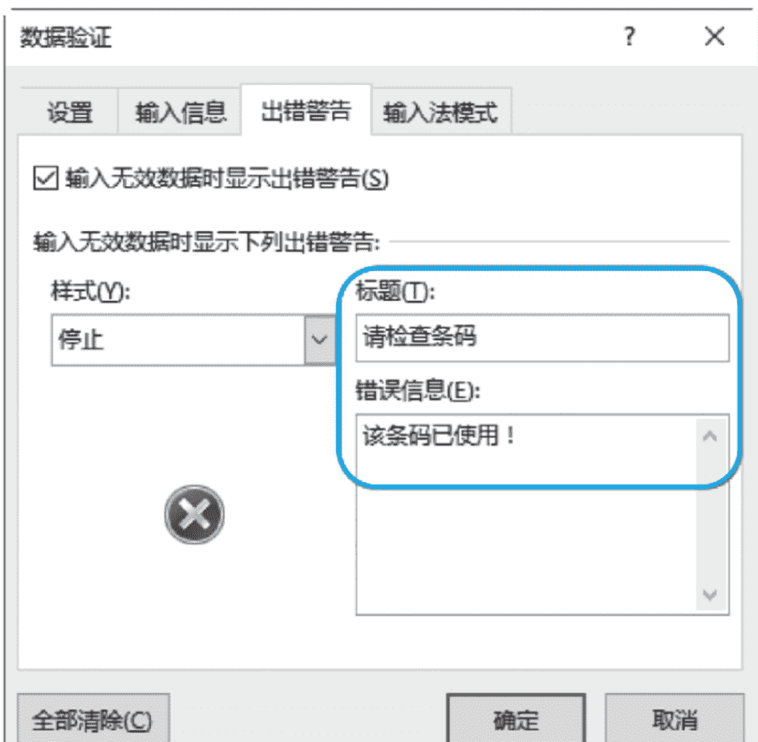

图1-94

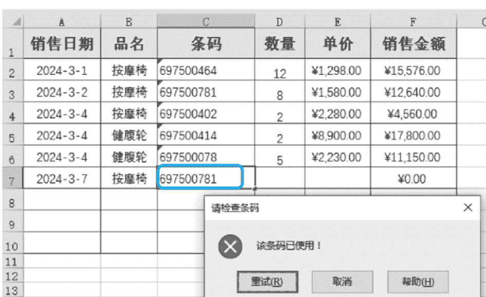

图1-95

## 1.3.7 DeepSeek指导禁止录入周末日期

如图1-96所示，通过验证的设置，实现在输入加班日期时禁止输入周末日期。我们依然可以通过DeepSeek获取公式，操作如下。

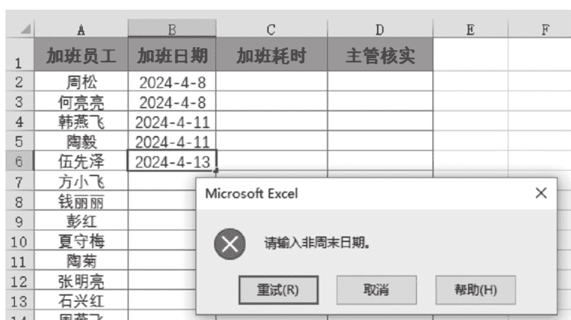

图1-96

❶ 在聊天对话框中输入“在Excel中，要求在B列中禁止输入周末日期，否则弹出错误提示。”，如图1-97所示。发送提示词后得到如图1-98所示的回复信息。


图1-97

在Excel中，可以通过 **数据验证（Data Validation）** 功能来实现B列中禁止输入周末日期（即周六和周日），并在输入周末日期时弹出错误提示。具体步骤如下：

### 步骤 1：设置数据验证规则

1. 选中需要设置的单元格区域（例如 **B2:B20**，或者整列 **B:B**）。
2. 在菜单栏中点击 **数据（Data）** 选项卡。
3. 点击 **数据验证（Data Validation）** 按钮（在Excel 2016及更高版本中，可能显示为“数据验证”或“数据有效性”）。
4. 在弹出的对话框中，切换到 **设置（Settings）** 选项卡。
5. 在 **允许（Allow）** 下拉菜单中选择 **自定义（Custom）**。
6. 在 **公式（Formula）** 框中输入以下公式：

```
=WEEKDAY(B2,2)<6
```

这个公式的作用是检查当前单元格的日期是否为工作日：

- `WEEKDAY(B2,2)` 返回日期的星期几编号（1 表示周一，2 表示周二，...，7 表示周日）。
- `<6` 表示只允许输入周一到周五（编号为1到5）。

### 步骤 2：设置错误提示

1. 在 **数据验证** 对话框中，切换到 **错误警告（Error Alert）** 选项卡。
2. 勾选 **输入无效数据时显示出错警告（Show error alert after invalid data is entered）**。

图1-98

❷ 复制DeepSeek中的公式到剪贴板。回到Excel中，选中要设置的单元格区域，在“数据”选项卡的“数据工具”组中单击“数据验证”按钮，打开“数据验证”对话框。

❸ 依次设置验证条件如下：“允许”条件为“自定义”，光标定位到“公式”输入框中，按Ctrl+V组合键粘贴，得到公式“=WEEKDAY(B3, 2) < 6”，如图1-99所示。

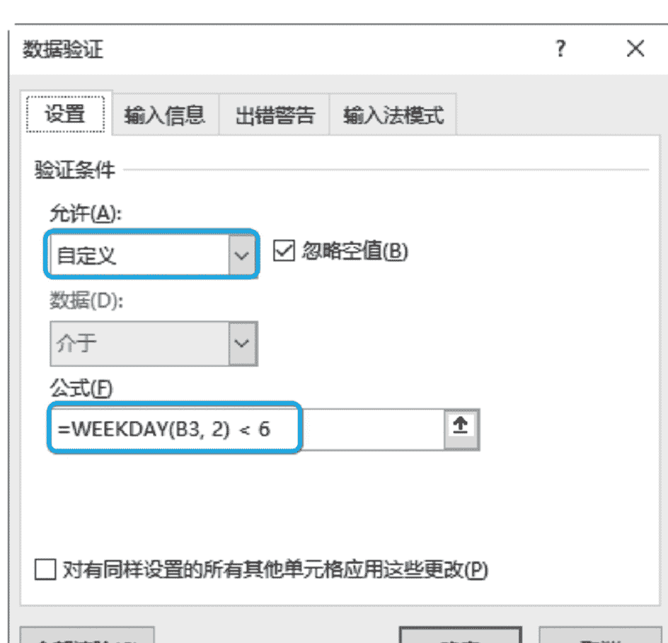

图1-99

4. 切换到“出错警告”选项卡，输入想呈现的出错警告信息，如图1-100所示。

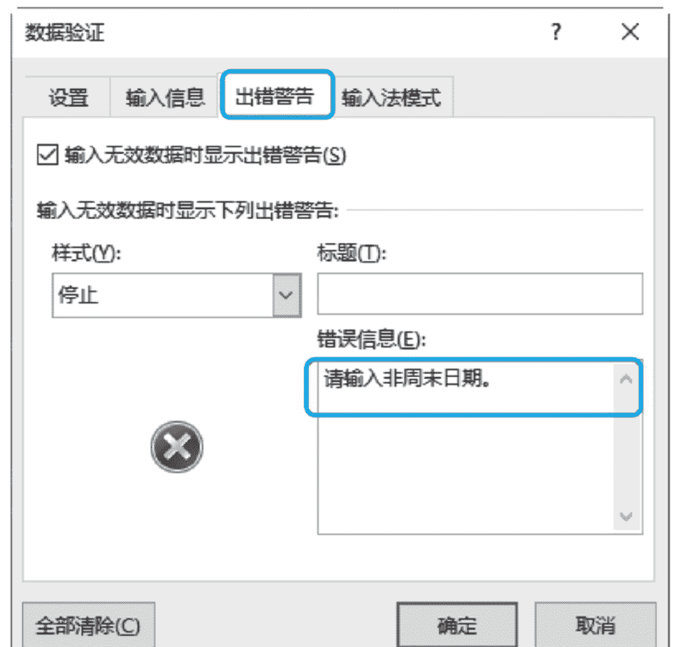

图1-100

❺ 单击“确定”按钮完成设置，当在这个区域中输入的日期是周末日期时就会弹出错误提示框。

## 知识扩展

在DeepSeek的回复信息中，对使用的公式也进行了解释（如图1-101所示），便于我们了解与学习相应函数。

> 这个公式的作用是检查当前单元格的日期是否为工作日：
- `WEEKDAY(B2,2)` 返回日期的星期几编号（1表示周一，2表示周二，...，7表示周日）。
- `<6` 表示只允许输入周一到周五（编号为1到5）。

图1-101

## 1.4 表格数据的移动、复制

将数据输入单元格中后，需要进行相关的编辑操作，例如对数据进行修改、移动、复制与删除等操作，这是数据编辑必备的操作。修改数据的操作很简单，只要选中单元格，把光标定位到其中，按Delete键或Backspace键删除原数据或部分数据，重新输入即可。删除数据的操作是，直接选中目标单元格，按Delete键删除即可。下面主要讲解数据的移动与复制。

### 1.4.1 移动数据到新位置

移动数据是数据编辑过程中最常用的操作，运用这些操作可以在很大程度上提高数据编辑效率。

#### 1. 移动数据到新位置

当需要将工作表中的数据移动到空白区域时，可以通过鼠标拖动的方法实现。

选中需要移动数据的单元格区域，当鼠标指针变为“拖动”按钮时，按住鼠标左键不放拖动至目标位置，如图1-102所示，释放鼠标即可实现数据移动，如图1-103所示。

| 产品名称 | 产品类别 | 销售单价 | 销售数量 | 销售金额 |
|---|---|---|---|---|
| 小天鹅 | 洗衣机 | 1260 | 3 | 3780 |
| 海尔 | 洗衣机 | 3550 | 5 | 17750 |
| 戴尔 | 电脑 | 3200 | 2 | 6400 |
| 苹果 | 电脑 | 6800 | 4 | 27200 |
| 美菱 | 冰箱 | 1850 | 7 | 12950 |
| 康佳 | 彩电 | 2300 | 1 | 2300 |
| 清华同方 | 电脑 | 3860 | 9 | 34740 |
| 联想 | 电脑 | 3850 | 5 | 19250 |

图1-102

| 产品名称 | 产品类别 | 销售单价 | 销售数量 | 销售金额 |
|---|---|---|---|---|
| 小天鹅 | 洗衣机 | 1260 | 3 | 3780 |
| 海尔 | 洗衣机 | 3550 | 5 | 17750 |
| 美菱 | 冰箱 | 1850 | 7 | 12950 |
| 康佳 | 彩电 | 2300 | 1 | 2300 |
| 清华同方 | 电脑 | 3860 | 9 | 34740 |
| 联想 | 电脑 | 3850 | 5 | 19250 |
| 戴尔 | 电脑 | 3200 | 2 | 6400 |
| 苹果 | 电脑 | 6800 | 4 | 27200 |

图1-103

#### 2. 调换两列数据

如图1-104所示，产品类别显示在B列，现在需要将其移动到A列，如图1-105所示，操作如下。

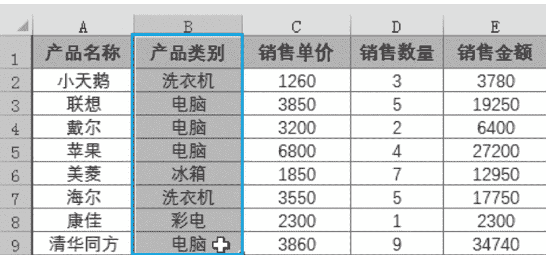

图1-104

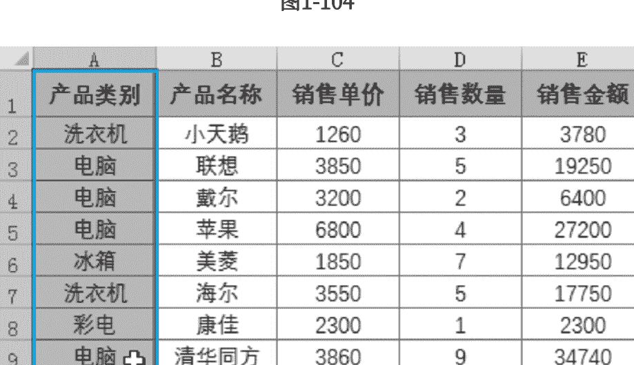

图1-105

❶ 选中B1:B9单元格区域，单击鼠标右键，在菜单中选择“剪切”命令，如图1-106所示。

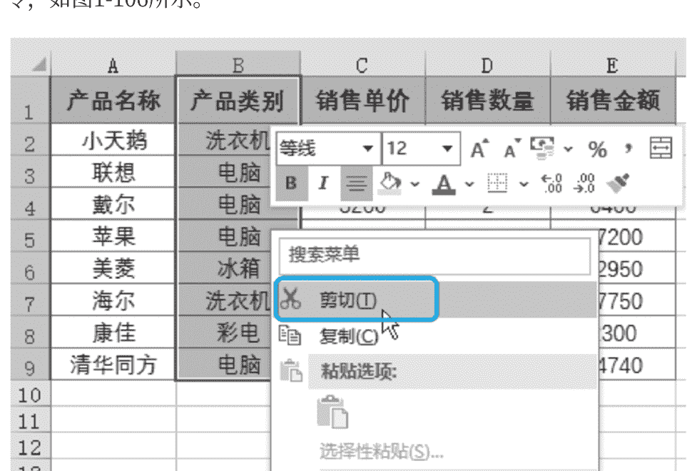

图1-106

❷ 选中A1:A9单元格区域单击鼠标右键，在菜单中选择“插入剪切的单元格”命令（如图1-107所示），即可将B1:B9单元格区域数据移动到A1:A9单元格区域。

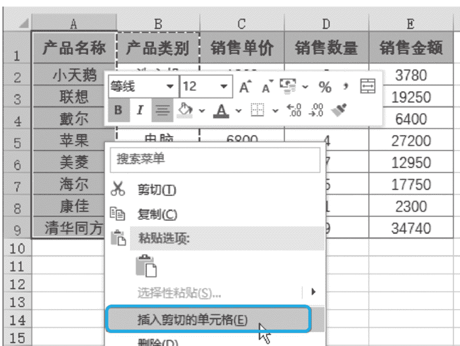

图1-107

练一练：配合快捷键快速调换两行数据。

调换到列的数据可以使用剪切再粘贴的方法，也可以配合Shift键快速拖动实现。如图1-108所示，要将第5行的数据调到第4行，操作要点如下：

选中行后，鼠标指针指到行边线上，按Shift键将其拖动到目标位置。

| A | B | C | D | E | F | G | H |
|---|---|---|---|---|---|---|---|
| 日期 | 客户姓名 | 年龄 | 联系电话 | 职业 | 需求户型 | 接受价格 | 职业顾问 |
| 2024-9-1 | 程云 | 29 | 15855178596 | 销售经理 | 二居 | 45万 | 华新 |
| 2024-9-1 | 戴王新 | 32 | 13254685621 | 销售经理 | 三居 | 50万 | 黎明 |
| 2024-9-2 | 邓翠翠 | 30 | 13326563369 | 人事经理 | 二居 | 50万 | 张华 |
| 2024-9-1 | 何如新 | 27 | 18145722563 | 公司经理 | 二居 | 60万 | 黎明 |
| 2024-9-2 | 胡夏 | 26 | 13685245412 | 个体户 | 三居 | 75万 | 华新 |
| 2024-9-2 | 霍振宇 | 28 | 15556253693 | 个体户 | 二居 | 75万 | 张华 |
| 2024-9-2 | 李曼 | 32 | 13965826954 | 商厦经理 | 三居 | 75万 | 黎明 |
| 2024-9-3 | 李明宇 | 27 | 18124565623 | 个体户 | 三居 | 60万 | 路飞 |
| 2024-9-3 | 卢晓磊 | 28 | 13025698541 | 银行职员 | 二居 | 75万 | 黎明 |

图1-108

### 1.4.2 复制数据

在编辑数据时常会有重复数据出现，此时复制输入是最常用的方式。

下面以图1-109所示的例子进行操作说明。

1. 选中C3单元格，按Ctrl+C组合键复制数据，如图1-109所示。

| | A | B | C | D |
|---|---|---|---|---|
| 1 | | | **用户资料** | |
| 2 | **姓名** | **性别** | **家庭住址** | |
| 3 | 莫离 | 女 | 江苏 | 淮安 |
| 4 | 宋兰 | 女 | 安徽 | 六安 |
| 5 | 刘飞 | 男 | 安徽 | 阜阳 |
| 6 | 陈冲 | 男 | | 南京 |
| 7 | 张远 | 男 | 安徽 | 合肥 |
| 8 | 杜子明 | 男 | 安徽 | 巢湖 |
| 9 | 周雅 | 女 | | 常州 |
| 10 | 杜云 | 男 | | 盐城 |

图1-109

❷ 按Ctrl键依次选中C6、C9、C10单元格，按Ctrl+V组合键即可复制C3单元格中的内容到选中单元格中，如图1-110所示。

| A | B | C | D |
|---|---|---|---|
| | | **用户资料** | |
| **姓名** | **性别** | **家庭住址** | |
| 莫离 | 女 | 江苏 | 淮安 |
| 宋兰 | 女 | 安徽 | 六安 |
| 刘飞 | 男 | 安徽 | 阜阳 |
| 陈冲 | 男 | 江苏 | 南京 |
| 张远 | 男 | 安徽 | 合肥 |
| 杜子明 | 男 | 安徽 | 巢湖 |
| 周雅 | 女 | 江苏 | 常州 |
| 杜云 | 男 | 江苏 | 盐城 |

图1-110

练一练：复制不连续的数据。

在如图1-111所示的表格中，将所有需求户型为“三居”的数据记录复制到另一张工作表中。

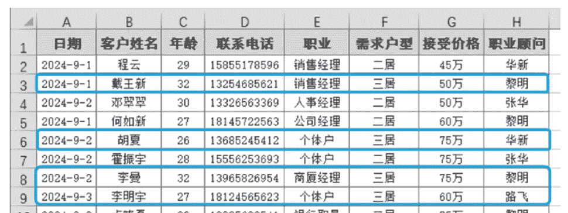

图1-111

### 1.4.3 实用的选择性粘贴功能——匹配目标区域格式

在1.4.2小节中讲解的复制数据，实际就是原样粘贴数据，除此之外，Excel还提供了“粘贴选项”与“选择性粘贴”功能，利用它们可以在粘贴的同时达到一些特殊的目的。如粘贴时匹配目标区域格式、粘贴后保持两表数据链接、利用粘贴实现数据批量运算。

如果希望从一个表格中复制数据到另一个表格中，且希望能保持与目标表格的格式一致，则可以通过“粘贴选项”实现，操作如下。

1. 选中要复制的单元格或单元格区域，按Ctrl+C组合键复制，如图1-112所示，选中目标位置，按Ctrl+V组合键粘贴，如图1-113所示（默认保持原有格式）。

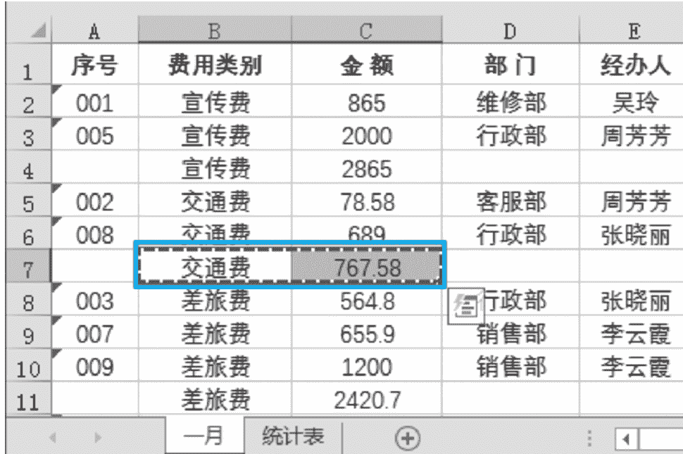

图1-112

❷ 此时会出现“粘贴选项”下拉按钮，单击该按钮打开下拉菜单，从下拉菜单中可以选择多个不同的粘贴选项，此处选择“值”选项，如图1-114所示，即可实现让粘贴的数据与目标位置的数据格式匹配，如图1-115所示。

# 费用统计表

| 费用类别 | 金额 |
| :--- | :--- |
| 宣传费 | ¥ 2,865.00 |
| 交通费 | 767.58 |

图1-113

# 费用统计表

| 费用类别 | 金额 |
| :--- | :--- |
| 宣传费 | ¥ 2,865.00 |
| 交通费 | 767.58 |

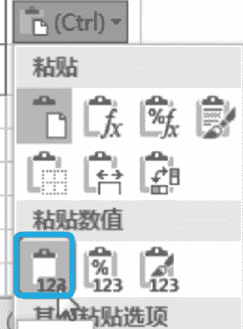

图1-114

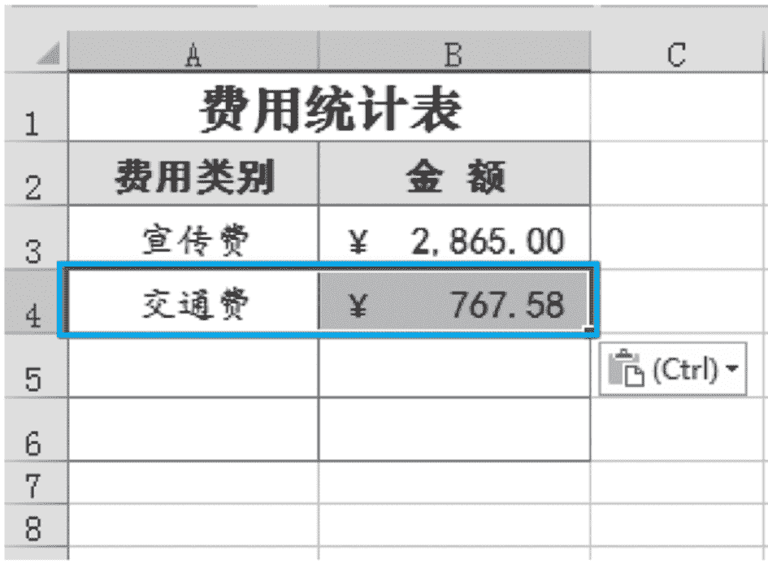

图1-115

练一练：复制数据并保持前后两处数据相链接。

如图1-116所示为产品的“单价表”，如图1-117所示为“利润率计算表”，要求保持两个表格的“进货单价”列的数据相链接，即当在“单价表”中更改某商品的单价时，“利润率计算表”中的单价也可以自动更改。

| 序号 | 产品 | 瓦数 | 产地 | 进货单价 |
|---|---|---|---|---|
| 001 | 白炽灯 | 200 | 南京 | 4.5 |
| 002 | led灯带 | 2米 | 广州 | 12.8 |
| 003 | 日光灯 | 100 | 广州 | 8.8 |
| 004 | 白炽灯 | 80 | 南京 | 2.0 |
| 005 | 白炽灯 | 100 | 南京 | 3.2 |
| 006 | 2d灯管 | 5 | 广州 | 12.5 |
| 007 | 2d灯管 | 10 | 南京 | 18.2 |
| 008 | led灯带 | 5米 | 南京 | 22.0 |
| 009 | led灯带 | 10米 | 广州 | 36.5 |

图1-116

| 产品 | 瓦数 | 产地 | 进货单价 | 销售单价 | 销售数量 | 利润率 |
|---|---|---|---|---|---|---|
| 白炽灯 | 200 | 南京 | 4.5 | 6.2 | 95 | |
| led灯带 | 2米 | 广州 | 12.8 | 15.5 | 125 | |
| 日光灯 | 100 | 广州 | 8.8 | 11.5 | 110 | |
| 白炽灯 | 80 | 南京 | 2.0 | 4.0 | 198 | |
| 白炽灯 | 100 | 南京 | 3.2 | 6.0 | 224 | |
| 2d灯管 | 5 | 广州 | 12.5 | 16.8 | 220 | |
| 2d灯管 | 10 | 南京 | 18.2 | 25.0 | 184 | |
| led灯带 | 5米 | 南京 | 22.0 | 28.0 | 170 | |
| led灯带 | 10米 | 广州 | 36.5 | 45.5 | 198 | |

图1-117

### 1.4.4 实用的选择性粘贴功能——将公式计算结果转换为数值

公式计算得出结果后，为方便数据使用，有时需要将计算结果转换为数值，从而更加方便移动使用。如图1-118所示，表格的C列中包含公式，下面将其转换为数值。

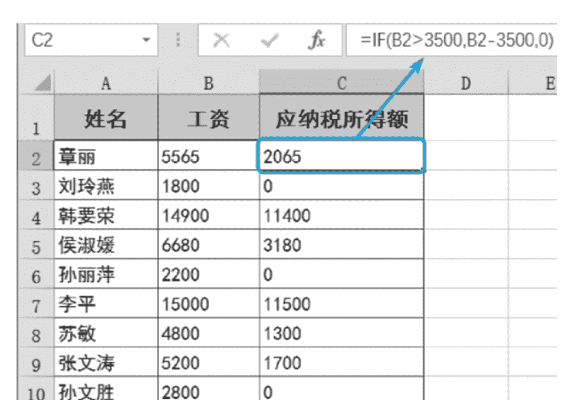

图1-118

1. 选中C2:C10单元格区域，按Ctrl+C组合键复制，然后再按Ctrl+V组合键粘贴。

❷ 单击粘贴区域右下角的按钮，打开下拉菜单，选择“值”选项（如图1-119所示），即可只粘贴数值。

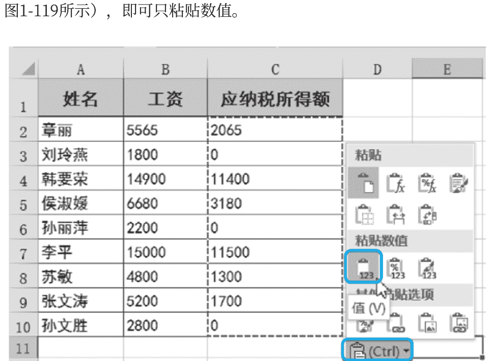

### 1.4.5 实用的选择性粘贴功能——数据验证的复制使用

为表格指定单元格区域设置好数据验证之后，如果新表格需要应用和其他表格中相同的数据验证，而不需要重新设置，只需要使用“选择性粘贴”功能粘贴验证条件即可，操作如下。

❶ 选中C2:C15（设置好数据验证的数据区域），按Ctrl+C组合键进行复制，如图1-120所示。

| A | B | C |
|---|---|---|
| 工号 | 值班人 | 值班日期 |
| NO.001 | 邓二超 | 2024/4/4 |
| NO.002 | 包娟娟 | 2024/4/10 |
| NO.003 | 陈潇 | 2024/4/15 |
| NO.004 | 张兴 | 2024/4/16 |
| NO.005 | 陈在全 | 2024/4/17 |
| NO.006 | 王辉 | 2024/4/18 |
| NO.007 | 柳林娜 | 2024/4/19 |
| NO.008 | 李倩 | 2024/4/20 |
| NO.009 | 李凌云 | 2024/4/21 |
| NO.010 | 王婷婷 | 2024/4/22 |
| NO.011 | 柳小续 | 2024/4/23 |
| NO.012 | 许开 | 2024/4/24 |
| NO.013 | 穆宇飞 | 2024/4/25 |
| NO.014 | 于青青 | 2024/4/26 |

图1-120

❷ 切换至另一张工作表（需要复制相同数据验证的表格），并选中要应用数据验证的区域，并在“开始”选项卡的“剪贴板”组中单击“粘贴”下拉按钮，在打开的下拉列表中选择“选择性粘贴”命令，如图1-121所示，打开“选择性粘贴”对话框。

图1-121

❸ 在“粘贴”栏下选中“验证”单选按钮，如图1-122所示。

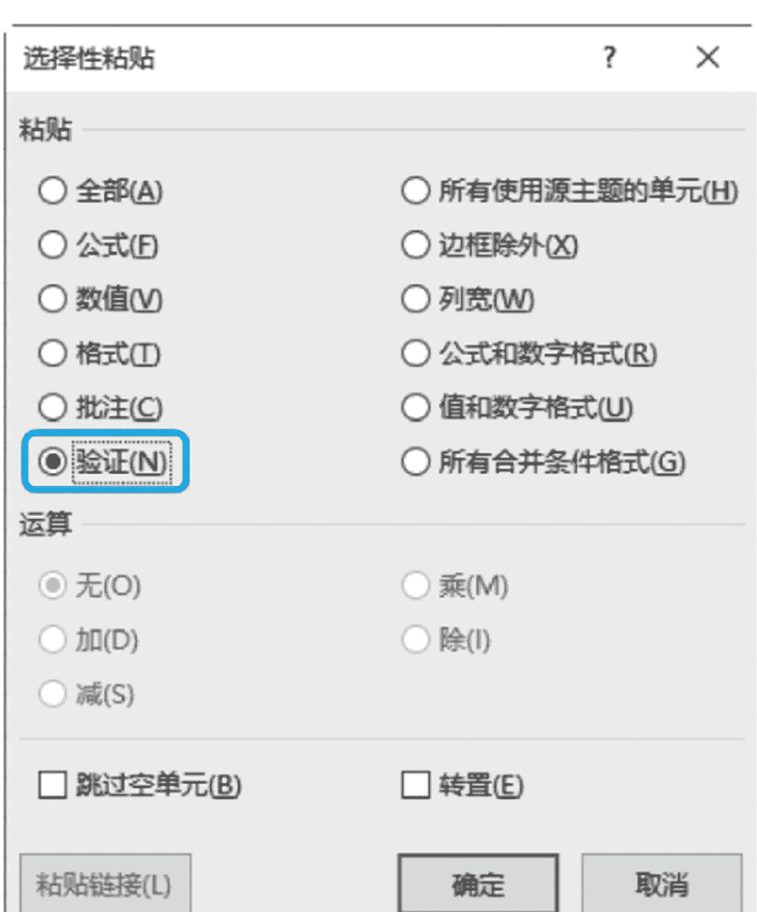

图1-122

❹ 单击“确定”按钮，即可在选中区域中应用相同的验证条件，当输入的日期范围错误时，会弹出警告提示框，如图1-123所示。

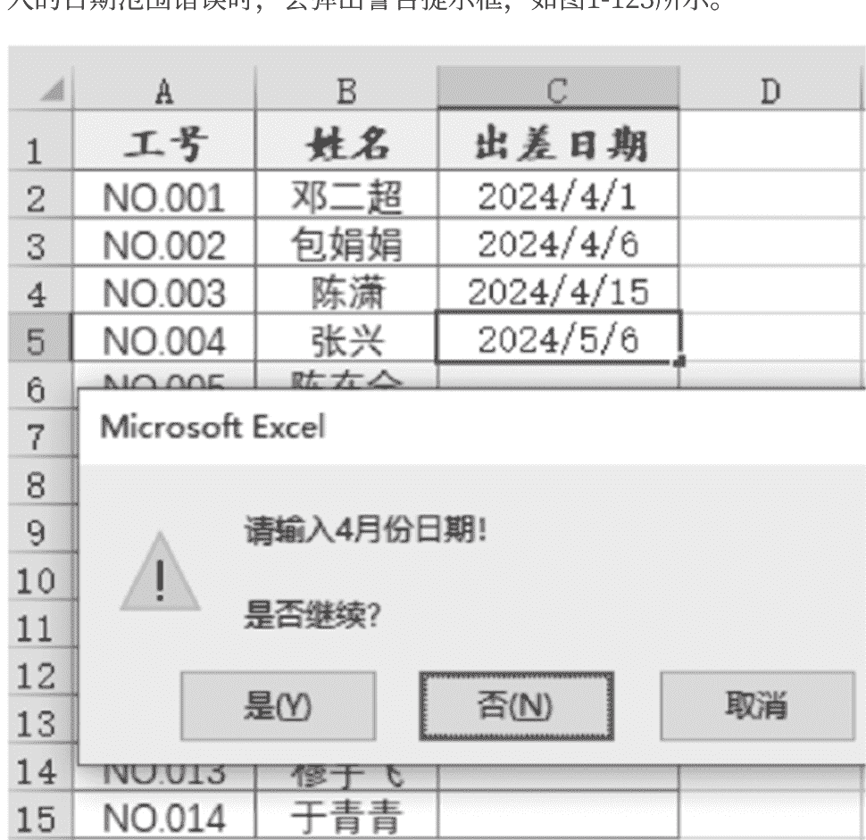

图1-123

## 1.4.6 实用的选择性粘贴功能——DeepSeek指导单元格区域进行批量运算

在数据处理过程中，有时会出现要将一个区域的数据同时增加或减少一个具体值的情况，如产品单价统一上涨、基本工资统一增加等。针对大量数据，如果采用手工输入显然是不明智的。解决此问题有多种方法，如果对Excel的应用不熟悉，可以在DeepSeek中提问并学习。

❶ 在聊天对话框中输入“在Excel表格中，想把D列中的进货单价统一上调10%，该如何操作？”，如图1-124所示。发送提示词后得到如图1-125所示的回复信息。


图1-124

在 Excel 中将 D 列中的进货单价统一上调 10%，可以通过以下步骤实现：

### 方法 1：使用公式

1. 选择一个空白列（比如 E 列）。
2. 在 E2 单元格中输入公式（假设 D2 是你的进货单价）：

```
=D2 * 1.1
```

3. 按 Enter 键，然后拖动填充柄（单元格右下角的小方块）向下填充公式，以覆盖整个 E 列。
4. 复制 E 列的数据：
    - 选择 E 列中计算出的所有单元格。
    - 右键点击选择“复制”。
    - 选择 D 列相应区域（从 D2 开始到最后一个需要更新的单元格）。
    - 右键点击选择“粘贴值”。
5. 删除 E 列（如果不再需要）。

### 方法 2：使用粘贴特殊功能

1. 在任意单元格中输入值 1.1。
2. 复制该单元格（包含 1.1 的单元格）。
3. 选择 D 列中的所有单元格（从 D2 开始到最后一个需要更新的单元格）。
4. 点击“粘贴”下拉菜单，选择“粘贴特殊”。
5. 在“粘贴特殊”对话框中，选择“乘”选项，然后点击“确定”。
    - 这会将 D 列中的每个单元格的值乘以 1.1，实现统一上调 10%。

### 注意事项

- 备份数据：操作前最好备份原始数据，以防出现意外错误。
- 检查结果：完成操作后，检查几行数据以确保计算正确。

图1-125

从上面的回答可以看出DeepSeek给出了两个方案来解决此问题，读者都可以尝试学习操作，进而选择最适合自己的方案。例如这里采用方法2来实现，操作如下。

❷ 回到Excel中，在空白单元格中输入“1.1”（即110%），然后按Ctrl+C组合键进行复制，接着选中进货单价的单元格区域。

❸ 在“开始”选项卡的“剪贴板”组中单击“粘贴”按钮，在打开的下拉菜单中单击“选择性粘贴”命令，如图1-126所示。

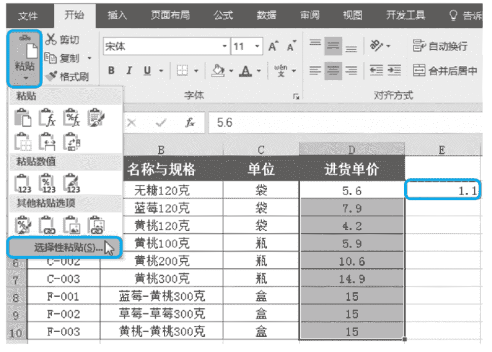

图1-126

❹ 打开“选择性粘贴”对话框，在“运算”栏中选中“乘”单选按钮，如图1-127所示。

### 选择性粘贴

**粘贴**
- 全部(A)
- 公式(F)
- 数值(V)
- 格式(T)
- 批注(C)
- 验证(N)
- 所有使用源主题的单元(H)
- 边框除外(X)
- 列宽(W)
- 公式和数字格式(R)
- 值和数字格式(U)
- 所有合并条件格式(G)

**运算**
- 无(O)
- 加(D)
- 减(S)
- 乘(M)
- 除(I)

- 跳过空单元(B)
- 转置(E)

粘贴链接(L)

确定

取消

图1-127

❺ 单击“确定”按钮，就可以看到所有被选中的单元格同时进行了乘1.1的运算，结果如图1-128所示。

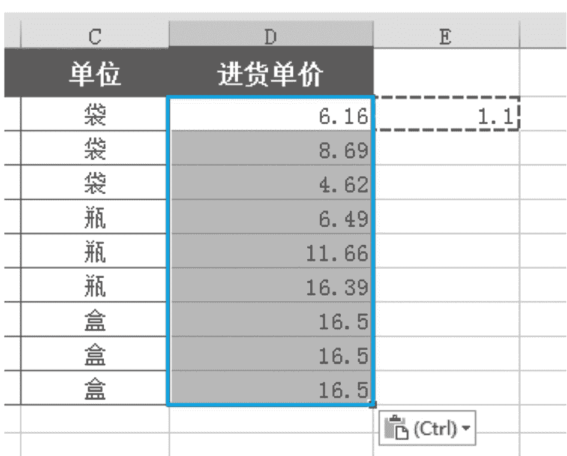

图1-128

## 专家提示

很多时候，在编辑表格时会发现输入数据受到限制，总是弹出阻止输入对话框，这时我们应该想到这部分数据是不是从别的地方复制得到的，它们是不是被设置了数据验证条件。遇到这种情况时只要选中单元格区域，打开“数据验证”对话框，单击左下角的“全部删除”按钮即可。

## 1.5 查找与替换数据

在日常办公中，可能需要从庞大的数据中查找相关的记录或者对数据进行修改，如果采用手动的方法来查找或修改，效率会很低，此时可以使用“查找和替换”功能。

### 1.5.1 表格数据的查找

当表格中数据众多时，肉眼查找某个数据会很费时费力，此时可以使用查找工具快速将需要的数据查找出来，操作如下。

1. 打开工作表，在“开始”选项卡的“编辑”组中单击“查找”下拉按钮，在下拉菜单中选择“查找”命令（或直接按Ctrl+F组合键），打开“查找和替换”对话框。在“查找内容”文本框中输入“崔娜”，单击“查找全部”按钮，如图1-129所示。
2. 按Ctrl+A组合键选中所有单元格查找到的选项，如图1-130所示。

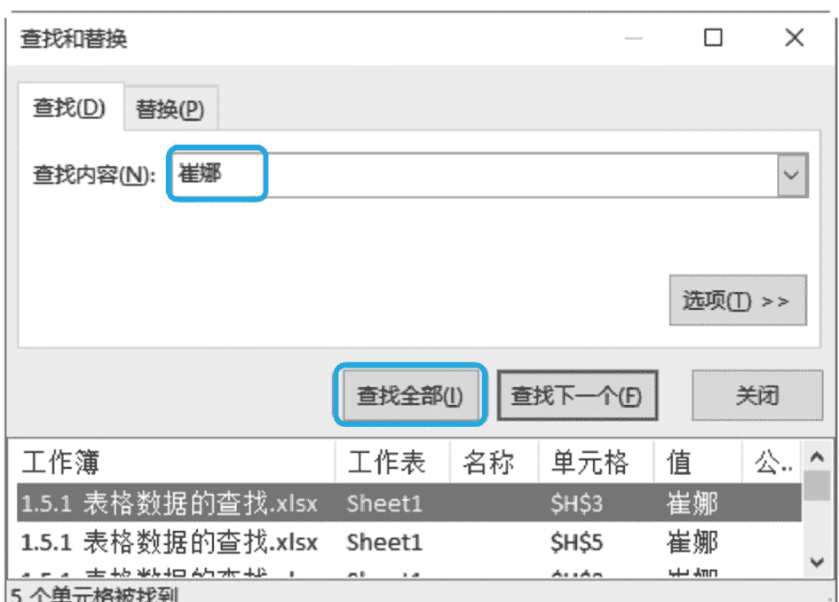

图1-129

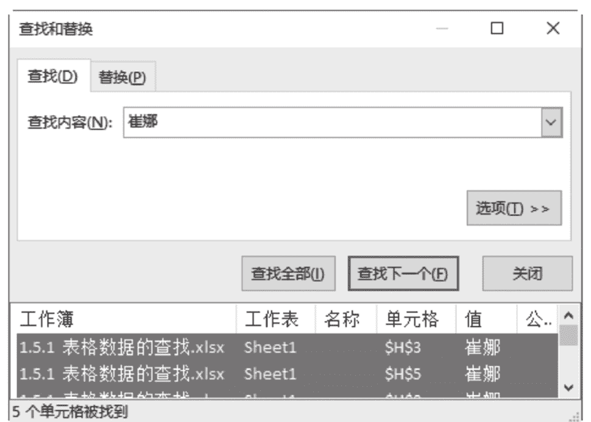

图1-130

❸ 关闭“查找与替换”对话框，可以看到工作表中所有找到的单元格都被选中，如图1-131所示。

| A | B | C | D | E | F | G | H |
|---|---|---|---|---|---|---|---|
| 日期 | 客户姓名 | 年龄 | 联系电话 | 职业 | 需求户型 | 接受价格 | 职业顾问 |
| 2024-9-1 | 程云 | 29 | 15855178596 | 销售经理 | 二居 | 45万 | 刘志飞 |
| 2024-9-1 | 戴王新 | 32 | 13254685621 | 销售经理 | 三居 | 50万 | 崔娜 |
| 2024-9-2 | 邓翠翠 | 30 | 13326563369 | 人事经理 | 二居 | 50万 | 张华 |
| 2024-9-1 | 何如新 | 27 | 18145722563 | 公司经理 | 二居 | 60万 | 崔娜 |
| 2024-9-2 | 胡夏 | 26 | 13685245412 | 个体户 | 三居 | 75万 | 刘志飞 |
| 2024-9-2 | 霍振宇 | 28 | 15556253693 | 个体户 | 二居 | 75万 | 张华 |
| 2024-9-2 | 李曼 | 32 | 13965826954 | 商厦经理 | 三居 | 75万 | 崔娜 |
| 2024-9-3 | 李明宇 | 27 | 18124565623 | 个体户 | 三居 | 60万 | 路飞 |
| 2024-9-3 | 卢晓磊 | 28 | 13025698541 | 银行职员 | 二居 | 75万 | 崔娜 |
| 2024-9-5 | 袁锋 | 31 | 15021306325 | 销售经理 | 三居 | 75万 | 刘志飞 |
| 2024-9-7 | 张凤 | 26 | 13026563230 | 企业主管 | 二居 | 75万 | 崔娜 |

图1-131

## 专家提示

在“查找和替换”对话框中依次单击“查找下一个”按钮，可以直接在工作表中跳转到查找到的数据所在单元格。如果要一次性查看所有找到的单元格，则按本例方法单击“查找全部”按钮。

练一练：查找完全匹配的内容。

在进行查找时，只要单元格中的数据包含所设置的查找关键字，就会被作为符合要求的对象被找到。在图1-132所示的表格中，要求只找到“经理”，其他“销售经理”“区域经理”“人事经理”都不被作为查找对象。

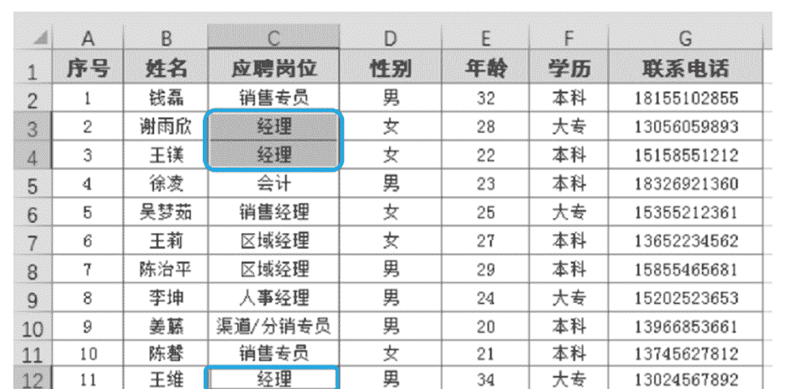

图1-132

### 1.5.2 表格数据的替换

当复制使用往期表格或者由于数据输入错误，需要对工作表中某些相同的数据进行修改时，可以直接使用替换功能实现快速查找并替换。

#### 1. 查找并替换数据

例如在某食品厂车间生产产量预期表中，由于食品厂结构调整，现要将第三车间调整为综合车间，可以使用替换功能一次性替换，操作如下。

1. 按Ctrl+H组合键，打开“查找和替换”对话框，在“查找内容”文本框中输入“第三车间”，在“替换为”文本框中输入“综合车间”，如图1-133所示。

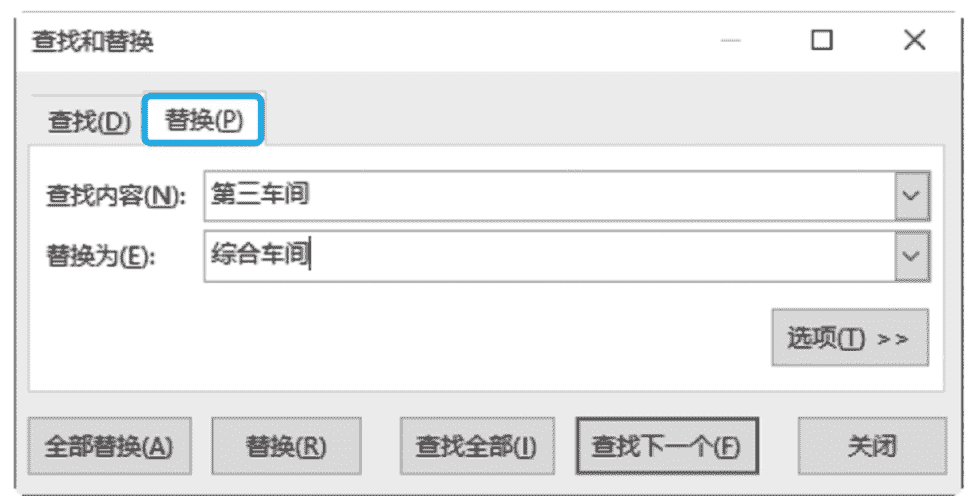

图1-133

❷ 单击“全部替换”按钮，即可弹出对话框，提示已完成3处替换，如图1-134所示。


图1-134

3. 单击“确定”按钮，替换后结果如图1-135所示。

| 产品名称 | 生产数量 | 单位 | 生产车间 |
| :--- | :--- | :--- | :--- |
| 山楂片 | 20000 | 袋 | 第一车间 |
| 小米锅粑 | 24000 | 袋 | 第二车间 |
| 通心卷 | 16000 | 袋 | 第二车间 |
| 蚕豆 | 12000 | 袋 | 第二车间 |
| 鱼皮花生 | 30000 | 袋 | 第二车间 |
| 豆腐干 | 27000 | 袋 | 第一车间 |
| 薯条 | 25000 | 袋 | 综合车间 |
| 话梅 | 10000 | 袋 | 第二车间 |
| 沙琪玛 | 15000 | 袋 | 综合车间 |
| 早餐饼干 | 12000 | 袋 | 综合车间 |
| 蛋黄派 | 20000 | 袋 | 第一车间 |
| 巧克力豆 | 7000 | 袋 | 第二车间 |

图1-135

#### 2. 替换数据的同时设置特殊格式

在替换数据的同时，用户可以为替换的数据设置特殊的格式，从而让替换的结果更加便于查看核对。例如下面的表格中要求将“第三车间”替换为“综合车间”，并以红色、加粗字体格式显示，操作如下。

1. 按Ctrl+H组合键，打开“查找和替换”对话框，并单击“选项”按钮展开对话框。在“查找内容”文本框中输入“第三车间”，在“替换为”文本框中输入“综合车间”，单击“替换为”设置框右侧的“格式”下拉按钮，在下拉菜单中选择“格式”命令，如图1-136所示。

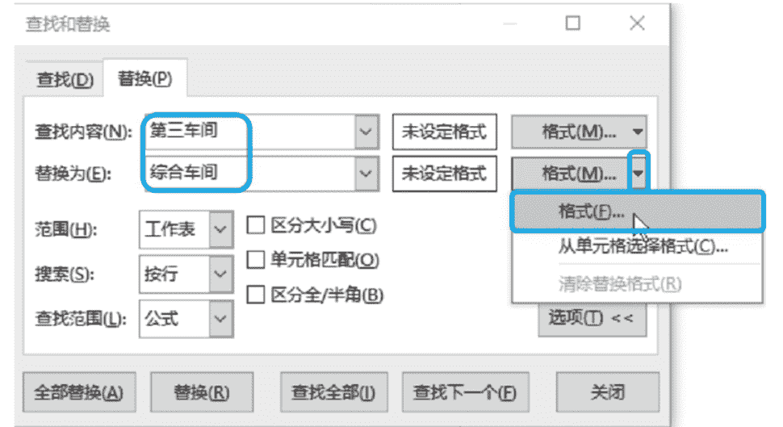

图1-136

❷ 打开“替换格式”对话框，选择“字体”选项卡，在“字形”列表框中选择“加粗”，接着单击“颜色”下拉按钮，在下拉菜单中选择“红色”，如图1-137所示。

❸ 设置完成后单击“确定”按钮，返回“查找和替换”对话框，即可在“预览”区域中看到设置的格式，如图1-138所示。

❹ 单击“全部替换”按钮，即可在替换内容的同时将单元格数据设置红色、加粗字体，如图1-139所示。

### 替换格式

数字 对齐 字体 边框 填充 保护

字体(F):

字形(O):

字号(S):
- 宋体 (标题)
- 宋体 (正文)
- Malgun Gothic Semilight
- Microsoft YaHei Light
- Microsoft YaHei UI
- Microsoft YaHei UI Light

- 常规
- 倾斜
- 加粗
- 加粗倾斜

- 6
- 8
- 9
- 10
- 11
- 12

下划线(U):

颜色(C):

特殊效果

预览
- [x] 删除线(K)
- [x] 上标(E)
- [ ] 下标(B)

Calibri

清除(R)

从单元格选择格式(A)...

确定

取消

图1-137

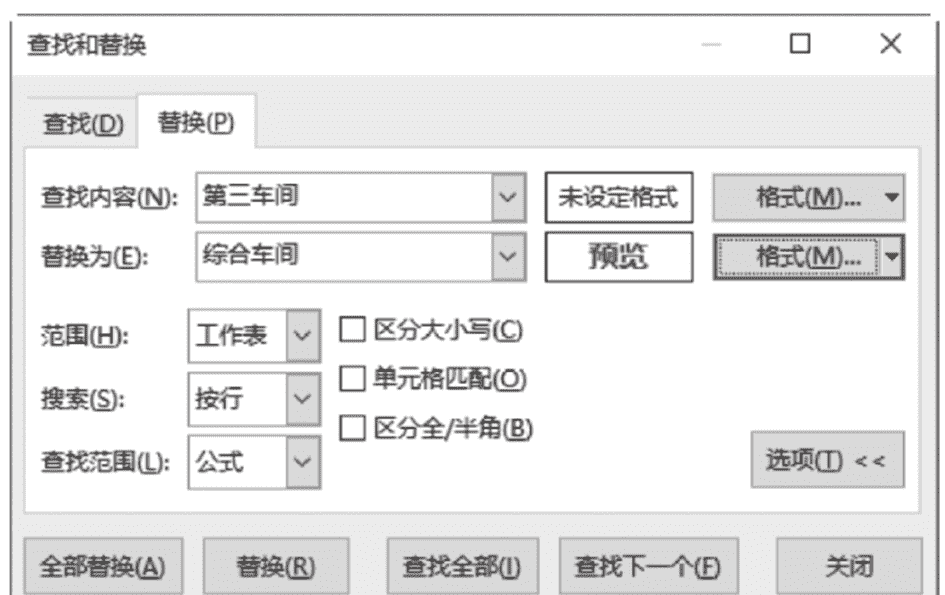

图1-138

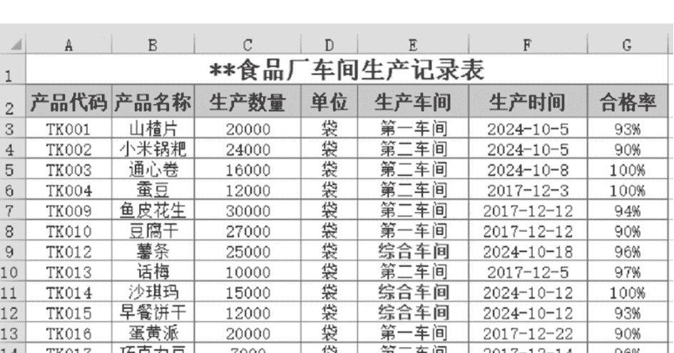

图1-139

### 练一练：一次性替换整个工作簿中的错误。

如图1-140所示，工作簿中有多张工作表，所有表格中都将“白炽灯”写成了“白织灯”，现想将整个工作簿统一进行替换，该如何操作？这时需要在“查找与替换”对话框中设置查找与替换的范围为“工作簿”（默认是当前工作表）。

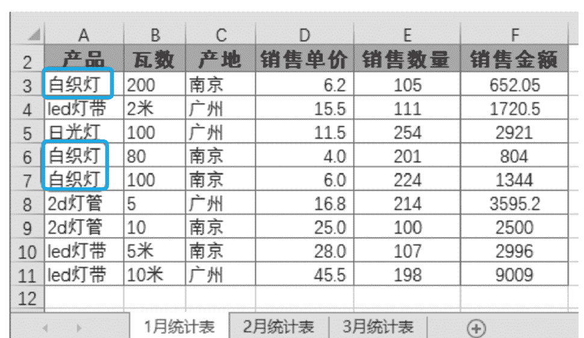

图1-140

# 第2章 学会整理不规范的数据


扫码看教学视频

## 2.1 学会规范建表

表格的原始数据是数据统计、计算的基础，财务数据的处理过程也不例外，当数据量较大时，各环节中最关键、最复杂甚至直接决定最终报表质量的就是数据处理环节。因此在创建表格时应当遵循一定的规范，数据规范、格式规范将会给后期的数据处理带来很多便利。

### 2.1.1 数据格式要规范

数据格式规范是建表的首要要求，表格中的各类数据使用规范的格式，数字应使用常规或数值型的格式，而不应使用文本型的格式。例如日期型格式不能输入“20240325”“2024.3.25”“24.3.25”等不规范的格式，否则在后期进行数据处理时，就会出现无法运算、运算错误的现象。

#### 例1：使用程序能识别的数据格式

例如在如图2-1所示的表格中要根据所输入的入职时间来计算工龄，同时要计算工龄工资，由于当前的入职日期不是程序能识别的日期格式，从而导致后面的公式计算错误（F列与G列均引用了E列的数据进行计算），如图2-1所示。


图2-1

同时按日期进行筛选也无法进行，如图2-2所示。


图2-2

#### 例2：不要随意使用中文单位

在如图2-3所示的表格中，由于“基本工资”列中有的工资额带上了单位，这样就会导致数字变成文本了，因此计算结果出现“#VALUE!”错误值。

| A | B | C | D |
|---|---|---|---|
| 姓名 | 基本工资 | 工龄工资 | 实发工资 |
| 蔡瑞暖 | 3200 | 320 | 3520 |
| 陈家玉 | 2500元 | 360 | #VALUE! |
| 王莉 | 2500元 | 320 | #VALUE! |
| 吕从英 | 3000 | 160 | 3160 |
| 邱路平 | 2500元 | 440 | #VALUE! |
| 岳书焕 | 1800 | 160 | 1960 |
| 明雪花 | 3200元 | 160 | #VALUE! |
| 陈惠婵 | 3000 | 160 | 3160 |
| 廖春 | 3200 | 160 | 3360 |

图2-3

#### 例3：不使用无意义的空格

在如图2-4所示的表格中，要查询“韩燕”的应缴所得税，但出现无法查询到的情况。仔细观察数据可以发现，数据编辑人员在编辑表格时，为了显示美观，在两个字的姓名中间使用了空格间隔。殊不知，这种空格却给数据的后期处理带来了不便，甚至是错误。


图2-4

### 2.1.2 表格结构要规范

结构规范也是创建表格时的注意要点，对于用于计算分析的表格，不要随意使用合并单元格，这样的结构会破坏表格的连续性，这样的数据源，无论是数据处理还是分析都有可能会出现出错的情况。

#### 例1：拒绝合并单元格

如图2-5所示的数据源，在日常工作中应该比较常见。如果只是用来显示数据，没有什么问题，但是如果要填充序号，会出现无法填充的情况，如图2-6所示；如果利用数据透视表合并统计分析，也会出现统计结果出错的情况，如图2-7所示。

| 产品代码 | 日期 | 订单量 | 销售员 |
| :--- | :--- | :--- | :--- |
| ASP0021361 | 2024-6-12 | 956 | 李杰 |
| | 2024-6-14 | 105 | 林瑞洋 |
| | 2024-6-19 | 360 | 崔娜 |
| ASP0021354 | 2024-6-14 | 521 | 李杰 |
| ASP5791311 | 2024-6-19 | 36 | 王加佳 |
| | 2024-6-20 | 540 | 何小芸 |
| ASP5701987 | 2024-6-5 | 369 | 林瑞洋 |
| | 2024-6-10 | 655 | 崔娜 |
| ASP632100 | 2024-6-5 | 541 | 李杰 |

图2-5


图2-6


图2-7

#### 例2：多表关联性的意识

另外，在多表联动的工作簿中，也应注意保持结构的统一。例如想汇总年工资总额，所有月份工资表中的数据都应保持同样的格式，如图2-8所示，这样才能方便使用函数，如图2-9所示，例如“12月”工作表第一位员工的实发工资在T3单元格。如果各表的结构不一样，那么可能各月的实发工资就不一定都在T列中，甚至员工的顺序也不一样，这样混乱的数据肯定无法使用SUM函数一次性求解全年实发工资。可能就需要将公式编辑为“= ‘1月’ !G4+ ‘2月’ !H3+ … + ‘12月’ !T3”这种形式，这种完全是靠手工编辑、肉眼寻找的方式，其困难程度可想而知。


图2-8


图2-9

### 2.1.3 数据应具有统一性

数据表中的名称应具有统一性，不能使用各自不同的名称，比如有的使用全称，有的使用简称；有的表格制作者粗心，在名称中多添加了空格符号等。这些都会造成统计结果的错误。

例如，在如图2-10所示的“诺航公司订单统计表”中，“安徽新世纪电子有限公司”与“新世纪电子有限公司”实际为同一家公司，但写成两种名称，对于Excel来说就是两家公司，在行数求和、分类汇总（如图2-11所示）、对数据透视表进行数据加工时就会出现错误。

## 诺航公司订单统计表

| 日期 | 合同号 | 客户名称 | 商品名称 | 颜色 | 金额 |
|---|---|---|---|---|---|
| 2020/1/1 | 20200001 | 安徽新世纪电子有限公司 | 商品A | 红 | 1592.0 |
| 2020/1/8 | 20200002 | 安徽新世纪电子有限公司 | 商品A | 红 | 2592.0 |
| 2020/1/8 | 20200008 | 安徽新世纪电子有限公司 | 商品CCC | 灰 | 6951.0 |
| 2020/1/11 | 20200003 | 江苏新科电子有限公司 | 商品BB | 黑 | 3965.9 |
| 2020/1/20 | 20200005 | 新世纪电子有限公司 | 商品A | 红 | 5628.0 |
| 2020/1/21 | 20200006 | 学舟软件科技有限公司 | 商品BB | 灰 | 2569.0 |
| 2020/2/2 | 20200007 | 学舟软件科技有限公司 | 商品A | 红 | 6952.0 |
| 2020/2/15 | 20200009 | 江苏新科电子有限公司 | 商品A | 黑 | 5589.0 |
| 2020/2/21 | 20200010 | 江苏新科电子有限公司 | 商品CCC | 红 | 8720.0 |
| 2020/3/7 | 20200011 | 学舟软件科技有限公司 | 商品A | 黑 | 5899.3 |
| 2020/3/21 | 20200012 | 学舟软件科技有限公司 | 商品A | 红 | 2592.3 |
| 2020/3/21 | 20200004 | 新世纪电子有限公司 | 商品CCC | 红 | 5962.0 |
| 2020/3/30 | 20200013 | 江苏新科电子有限公司 | 商品CCC | 红 | 5862.0 |

图2-10

## 诺航公司订单统计表

| 日期 | 合同号 | 客户名称 | 商品名称 | 颜色 | 金额 |
|---|---|---|---|---|---|
| 2020/1/21 | 20200006 | 学舟软件科技有限公司 | 商品BB | 灰 | 2569.0 |
| 2020/2/2 | 20200007 | 学舟软件科技有限公司 | 商品A | 红 | 6952.0 |
| 2020/3/7 | 20200011 | 学舟软件科技有限公司 | 商品A | 黑 | 5899.3 |
| 2020/3/21 | 20200012 | 学舟软件科技有限公司 | 商品A | 红 | 2592.3 |
| | | 学舟软件科技有限公司 汇总 | | | 18012.6 |
| 2020/3/21 | 20200004 | 新世纪电子有限公司 | 商品CCC | 红 | 5962.0 |
| 2020/1/20 | 20200005 | 新世纪电子有限公司 | 商品A | 红 | 5628.0 |
| | | 新世纪电子有限公司 汇总 | | | 11590.0 |
| 2020/1/11 | 20200003 | 江苏新科电子有限公司 | 商品BB | 黑 | 3965.9 |
| 2020/2/15 | 20200009 | 江苏新科电子有限公司 | 商品A | 黑 | 5589.0 |
| 2020/2/21 | 20200010 | 江苏新科电子有限公司 | 商品CCC | 红 | 8720.0 |
| 2020/3/30 | 20200013 | 江苏新科电子有限公司 | 商品CCC | 红 | 5862.0 |
| | | 江苏新科电子有限公司 汇总 | | | 24136.9 |
| 2020/1/1 | 20200001 | 安徽新世纪电子有限公司 | 商品A | 红 | 1592.0 |
| 2020/1/8 | 20200002 | 安徽新世纪电子有限公司 | 商品A | 红 | 2592.0 |
| 2020/1/8 | 20200008 | 安徽新世纪电子有限公司 | 商品CCC | 灰 | 6951.0 |
| | | 安徽新世纪电子有限公司 汇总 | | | 11135.0 |
| | | 总计 | | | 64874.5 |

图2-11

再例如在如图2-12所示的表格中，“日期”列下的数据一个定义为“1月”，另一个定义为“一月”，这样显然会导致数据在进行统计分析时无法找到统一的标识。统计结果显然也是错的。

| 序号 | 产品 | 销售月份 | 销售金额 |
|---|---|---|---|
| 1 | 通用别克-别克GL8 | 1月 | 485,000 |
| 2 | 通用别克-君越 | 1月 | 158,000 |
| 3 | 通用别克-林荫大道 | 二月 | 369,000 |
| 4 | 通用别克-英朗 | 2月 | 154,000 |
| 5 | 通用别克-君威 | 2月 | 608,000 |
| 6 | 通用别克-英朗 | 2月 | 308,000 |
| 7 | 通用别克-君威 | 1月 | 210,000 |
| 8 | 通用别克-凯越 | 1月 | 110,000 |
| 9 | 通用别克（进口）-昂科雷 | 1月 | 508,000 |
| 10 | 通用别克-君越 | 二月 | 158,000 |
| 11 | 通用别克-林荫大道 | 一月 | 369,000 |
| 12 | 通用别克-英朗 | 一月 | 154,000 |
| 13 | 通用别克-君威 | 2月 | 608,000 |
| 14 | 通用别克-英朗 | 2月 | 308,000 |
| 15 | 通用别克-别克GL8 | 1月 | 675,000 |
| 16 | 通用别克-凯越 | 1月 | 110,000 |
| 17 | 别克（进口）-昂科雷 | 1月 | 508,000 |
| 18 | 通用别克-别克GL8 | 一月 | 242,500 |
| 19 | 通用别克-君越 | 一月 | 158,000 |
| 20 | 通用别克-林荫大道 | 一月 | 369,000 |
| 21 | 通用别克-君威 | 2月 | 210,000 |

| 行标签 | 求和项:销售金额 |
|---|---|
| 一月 | 1292500 |
| 二月 | 527000 |
| 1月 | 2764000 |
| 2月 | 2196000 |
| 总计 | 6779500 |

图2-12

## 2.1.4 不破坏数据的连续性

各记录间不能有空行和空列，因为空行和空列会破坏数据的连续性，会给数据计算分析带来不便。在如图2-13所示的表格中，添加了合计行，这样的数据表在进行排序、筛选、分类汇总、数据透视表等操作时会有不便。因此这里不需要破坏数据的连续性，待到数据表建立完成后，需要统计时使用合并计算或数据透视表即可轻松实现。

| A | B | C | D | E |
|---|---|---|---|---|
| 日期 | 费用类别 | 产生部门 | 支出金额 | 负责人 |
| 2020/4/1 | 办公用品采购费 | 企划部 | ¥8,200 | 张飞玉 |
| 2020/4/11 | 差旅费 | 销售部 | ¥1,500 | 王磊 |
| 2020/4/19 | 办公用品采购费 | 人事部 | ¥550 | 何玲玲 |
| 2020/4/25 | 办公用品采购费 | 行政部 | ¥1,050 | 章敏 |
| 2020/4/28 | 招聘培训费 | 人事部 | ¥1,200 | 程亚飞 |
| 合计 | | | | |
| 2020/5/5 | 会务费 | 财务部 | ¥560 | 王海燕 |
| 2020/5/11 | 差旅费 | 企划部 | ¥5,400 | 周易 |
| 2020/5/16 | 招聘培训费 | 人事部 | ¥2,800 | 华愉悦 |
| 2020/5/21 | 业务拓展费 | 人事部 | ¥1,400 | 李明 |
| 2020/5/25 | 办公用品采购费 | 行政部 | ¥1,600 | 于丽 |
| 2020/5/30 | 福利品采购费 | 财务部 | ¥500 | 陈强 |
| 合计 | | | | |

图2-13

## 2.1.5 要会整理为二维表

在日常工作中，我们应该经常能看到如图2-14所示的表格，这种表格对“本日”的数据进行了统计运算，再填入表格。但实际上这并不很好的处理办法，明明是很简易的一张表格却被处理得非常烦琐。


图2-14

仔细看不难发现，表格中“产品”“销售部门”“数量”“金额”是表格的关键字段，而“销售一部”“销售二部”“销售三部”属于同一属性数据，因此应该记录于同一列中。这里没必要分部门对各产品进行“数量”“金额”的汇总，应先把表格做成明细型表格，这样想要怎样的汇总结果都能轻而易举地做到，操作如下。

1. 首先我们可以化繁为简，将上表还原为如图2-15所示的明细表。
2. 然后按相同的方法把每一张分日统计的报表都还原到明细表中，如图2-16所示是将3日的报表整理后得到的明细表。

| 日期 | 产品 | 销售部门 | 数量 | 金额 |
|---|---|---|---|---|
| 2024-2-1 | 通用别克-别克GL8 | 销售1部 | 2 | 485,000 |
| 2024-2-1 | 通用别克-君越 | 销售1部 | 1 | 158,000 |
| 2024-2-1 | 通用别克-林荫大道 | 销售1部 | 1 | 369,000 |
| 2024-2-1 | 通用别克-英朗 | 销售1部 | 1 | 154,000 |
| 2024-2-1 | 通用别克-君威 | 销售2部 | 3 | 608,000 |
| 2024-2-1 | 通用别克-英朗 | 销售2部 | 1 | 308,000 |
| 2024-2-1 | 通用别克-君威 | 销售3部 | 1 | 210,000 |
| 2024-2-1 | 通用别克-凯越 | 销售3部 | 1 | 110,000 |
| 2024-2-1 | 通用别克（进口）-昂科雷 | 销售3部 | 1 | 508,000 |

图2-15

| 日期 | 产品 | 销售部门 | 数量 | 金额 |
|---|---|---|---|---|
| 2024-2-1 | 通用别克-别克GL8 | 销售1部 | 2 | 485,000 |
| 2024-2-1 | 通用别克-君越 | 销售1部 | 1 | 158,000 |
| 2024-2-1 | 通用别克-林荫大道 | 销售1部 | 1 | 369,000 |
| 2024-2-1 | 通用别克-英朗 | 销售1部 | 1 | 154,000 |
| 2024-2-1 | 通用别克-君威 | 销售2部 | 3 | 608,000 |
| 2024-2-1 | 通用别克-英朗 | 销售2部 | 1 | 308,000 |
| 2024-2-1 | 通用别克-君威 | 销售3部 | 1 | 210,000 |
| 2024-2-1 | 通用别克-凯越 | 销售3部 | 1 | 110,000 |
| 2024-2-1 | 通用别克（进口）-昂科雷 | 销售3部 | 1 | 508,000 |
| 2024-2-2 | 通用别克-君越 | 销售1部 | 1 | 158,000 |
| 2024-2-2 | 通用别克-林荫大道 | 销售1部 | 2 | 369,000 |
| 2024-2-2 | 通用别克-英朗 | 销售1部 | 1 | 154,000 |
| 2024-2-2 | 通用别克-君威 | 销售2部 | 3 | 608,000 |
| 2024-2-2 | 通用别克-英朗 | 销售2部 | 2 | 308,000 |
| 2024-2-2 | 通用别克-别克GL8 | 销售3部 | 3 | 675,000 |
| 2024-2-2 | 通用别克-凯越 | 销售3部 | 1 | 110,000 |
| 2024-2-2 | 别克（进口）-昂科雷 | 销售3部 | 1 | 508,000 |
| 2024-2-3 | 通用别克-别克GL8 | 销售1部 | 1 | 242,500 |
| 2024-2-3 | 通用别克-君越 | 销售1部 | 1 | 158,000 |
| 2024-2-3 | 通用别克-林荫大道 | 销售1部 | 2 | 369,000 |
| 2024-2-3 | 通用别克-君威 | 销售2部 | 1 | 210,000 |
| 2024-2-3 | 通用别克-君越 | 销售2部 | 1 | 158,000 |
| 2024-2-3 | 通用别克-英朗 | 销售2部 | 2 | 308,000 |
| 2024-2-3 | 通用别克-别克GL8 | 销售3部 | 2 | 485,000 |
| 2024-2-3 | 别克（进口）-昂科雷 | 销售3部 | 1 | 508,000 |

图2-16

有了这个明细表，才便于对所有销售数据进行汇总统计，无论是使用函数、数据透视表、分类汇总功能都可以实现。

❶ 如图2-17所示是利用数据透视表按部门统计的报表，统计结果一目了然。


图2-17

❷ 如图2-18所示是利用数据透视表按日期统计的报表。

| 日期 | 产品 | 求和项:数量 |
| :--- | :--- | :--- |
| 2024-2-1 | | 12 |
| | 通用别克（进口）-昂科雷 | 1 |
| | 通用别克-别克GL8 | 2 |
| | 通用别克-君威 | 4 |
| | 通用别克-君越 | 1 |
| | 通用别克-凯越 | 1 |
| | 通用别克-林荫大道 | 1 |
| | 通用别克-英朗 | 2 |
| 2024-2-2 | | 14 |
| | 别克(进口)-昂科雷 | 1 |
| | 通用别克-别克GL8 | 3 |
| | 通用别克-君威 | 3 |
| | 通用别克-君越 | 1 |
| | 通用别克-凯越 | 1 |
| | 通用别克-林荫大道 | 2 |
| | 通用别克-英朗 | 3 |
| 2024-2-3 | | 11 |
| | 别克(进口)-昂科雷 | 1 |
| | 通用别克-别克GL8 | 3 |
| | 通用别克-君威 | 1 |
| | 通用别克-君越 | 2 |
| | 通用别克-林荫大道 | 2 |
| | 通用别克-英朗 | 2 |
| 总计 | | 37 |

图2-18

❸ 如图2-19所示是利用数据透视表按产品、按日期统计的报表。


图2-19

## 2.2 整理不规范的数据

就财务管理的职业特征看来，它具有很强的严谨性和规范性，所以在财务工作的处理过程中，要求每一个环节都有数据可循，每一个数据都是准确而清晰的。由于数据来源的不同，难免经常会遇到一些不规范的数据表格，这种情况下一定要对数据进行编辑整理，以形成规范表格，才有利于在Excel中利用各种分析工具快速得出统计分析结果。

## 2.2.1 DeepSeek辅助处理空白单元格

从数据库或其他途径导出的数据经常会出现某行或者某列中有空单元格的情况，一般这些空行都需要整理，从而形成规范的、便于分析的表格。

在如图2-20所示的表格中，要实现只要一行数据中有一个空单元格就将整行删除。若不知道如何操作，可以通过在DeepSeek中提问来学习。

| A | B | C | D |
|---|---|---|---|
| 日期 | 凭证号 | 凭证摘要 | 借方 |
| | | 年初余额 | |
| 1月2日 | 记账凭证2 | 财务部报销费 | 5000.00 |
| 1月2日 | 记账凭证3 | 税费缴纳 | 340.00 |
| 1月2日 | | 合计 | 12230.00 |
| | | | |
| 1月4日 | 记账凭证4 | 工程部签证费 | 3110.00 |
| 1月4日 | 记账凭证3 | 税费缴纳 | 3120.00 |
| 1月4日 | | 合计 | 408790.00 |
| | | | |
| 1月5日 | 记账凭证34 | 设计部报销费 | 2900.00 |
| 1月5日 | 记账凭证80 | 利息计算 | 3900.00 |
| 1月5日 | | 合计 | 4000.00 |
| | | | |
| 1月8日 | 记账凭证4 | 工程部签证费 | 3880.00 |
| 1月8日 | 记账凭证78 | 土地征用税 | 5000.00 |
| 1月8日 | 记账凭证3 | 税费缴纳 | 4300.00 |
| 1月8日 | 记账凭证80 | 利息计算 | 5000.00 |
| 1月8日 | | 合计 | 33900.00 |
| | | | |
| 1月11日 | 记账凭证34 | 设计部报销费 | 3210.00 |
| 1月11日 | 记账凭证3 | 税费缴纳 | 2290.00 |

图2-20

❶ 在聊天对话框中输入“在Excel中，检查每一行是否有空白单元格，如果有就将该行删除，如何一次性完成该操作？”，如图2-21所示。发送提示词后得到如图2-22所示的回复信息。

在Excel中，检查每一行是否有空白单元格，如果有就将该行删除，如何一次性完成该操作？

图2-21

是的，可以通过 **查找和定位** 功能结合 **删除行** 操作来实现删除包含空白单元格的行。以下是具体步骤：

### 方法：使用查找和定位功能

1. 选中数据区域：
   - 选中包含数据的区域（例如 A1:D100），或者直接选中整个工作表（按 `Ctrl + A`）。
2. 打开查找和定位功能：
   - 按 `Ctrl + G` 打开“定位”对话框。
   - 点击 **定位条件（Special）**，在弹出的对话框中选择 **空值（Blanks）**，然后点击 **确定**。此时所有空白单元格会被选中。
3. 删除包含空白单元格的行：
   - 保持空白单元格的选中状态，右键点击任意选中的空白单元格。
   - 选择 **删除（Delete）**，在弹出的对话框中选择 **整行（Entire row）**，然后点击 **确定**。

### 注意事项

1. 适用范围：
   - 该方法适用于删除所有包含空白单元格的行。如果只需要删除特定列中包含空白单元格的行，可以先选中特定列，再进行定位和删除操作。

图2-22

❷ 回到Excel中，按照DeepSeek给出的操作步骤，选中目标数据区域，打开“定位”对话框，如图2-23所示。单击“定位条件”按钮，打开“定位条件”对话框。选中“空值”单选按钮，如图2-24所示。

图2-23

③ 单击“确定”按钮返回工作表中，可以看到选中了表格中的所有空白单元格。在选中的任意空白单元格上单击鼠标右键，在打开的菜单中选择“删除”命令（如图2-25所示），打开“删除”对话框。选中“整行”单选按钮，如图2-26所示。

图2-24

图2-25

删除

- 右侧单元格左移(L)
- 下方单元格上移(U)
- 整行(R)
- 整列(C)

确定

取消

图2-26

④ 单击“确定”按钮完成设置，此时可以看到原来的空单元格所在行已全部被删除，如图2-27所示。

| A | B | C | D |
|---|---|---|---|
| 日期 | 凭证号 | 凭证摘要 | 借方 |
| 1月2日 | 记账凭证2 | 财务部报销费 | 5000.00 |
| 1月2日 | 记账凭证3 | 税费缴纳 | 340.00 |
| 1月4日 | 记账凭证4 | 工程部签证费 | 3110.00 |
| 1月4日 | 记账凭证3 | 税费缴纳 | 3120.00 |
| 1月5日 | 记账凭证34 | 设计部报销费 | 2900.00 |
| 1月5日 | 记账凭证80 | 利息计算 | 3900.00 |
| 1月8日 | 记账凭证4 | 工程部签证费 | 3880.00 |
| 1月8日 | 记账凭证78 | 土地征用税 | 5000.00 |
| 1月8日 | 记账凭证3 | 税费缴纳 | 4300.00 |
| 1月8日 | 记账凭证80 | 利息计算 | 5000.00 |
| 1月11日 | 记账凭证34 | 设计部报销费 | 3210.00 |
| 1月11日 | 记账凭证3 | 税费缴纳 | 2290.00 |

图2-27

练一练：删除整行为空的单元格。

在如图2-28所示的表格中既有整行为空的行，也有部分单元格为空的行，要求只删除整行为空的记录（删除后如图2-29所示）。

操作要点：（1）打开“高级筛选”对话框，选中“选择不重复的记录”复选框。

（2）筛选后就只剩下一个空行了，将筛选后得到的数据复制到其他位置，然后删除那个唯一的空行即可。

| 员工编号 | 姓名 | 所属部门 | 实发工资 |
| :--- | :--- | :--- | :--- |
| KB001 | 蔡静 | 技术部 | 4538.13 |
| KB002 | 陈媛 | 技术部 | 4361 |
| KB002 | | | |
| KB004 | 吕芬芬 | 技术部 | 2732.5 |
| KB005 | 路高泽 | 客户部 | 4499.33 |
| KB006 | 岳庆浩 | 客户部 | 4619.5 |
| KB007 | 李雪儿 | 客户部 | 4205.5 |
| KB008 | | | |
| KB009 | 廖晓 | 财务部 | 3569.5 |
| KB010 | 张丽君 | 财务部 | 3013.5 |
| KB011 | 吴华波 | 行政部 | 3119 |
| KB012 | 于青青 | 行政部 | 3269 |

图2-28

| 员工编号 | 姓名 | 所属部门 | 实发工资 |
| :--- | :--- | :--- | :--- |
| KB001 | 蔡静 | 技术部 | 4538.13 |
| KB002 | 陈媛 | 技术部 | 4361 |
| KB002 | | | |
| KB004 | 吕芬芬 | 技术部 | 2732.5 |
| KB005 | 路高泽 | 客户部 | 4499.33 |
| KB006 | 岳庆浩 | 客户部 | 4619.5 |
| KB007 | 李雪儿 | 客户部 | 4205.5 |
| KB008 | | | |
| KB009 | 廖晓 | 财务部 | 3569.5 |
| KB010 | 张丽君 | 财务部 | 3013.5 |
| KB011 | 吴华波 | 行政部 | 3119 |
| KB012 | 于青青 | 行政部 | 3269 |

图2-29

如果经常需要处理空白单元格，还可以在DeepSeek中获取VBA程序码，在Excel中建立一个宏，从而实现需要处理此问题时，只要运行宏即可，操作如下。

1. 在DeepSeek聊天对话框中输入“使用VBA程序码，判断选中的数据区域中每一行中是否含有空白单元格，如果有就将本行删除。”，如图2-30所示。发送提示词后得到如图2-31所示的回复信息。

使用VBA程序码，判断选中的数据区域中每一行中是否含有空白单元格，如果有就将本行删除。

图2-30

以下是使用 VBA 代码实现判断选中的数据区域中每一行是否含有空白单元格，并删除包含空白单元格的行的完整解决方案：

## VBA 代码

```
Sub DeleteRowsWithBlankCellsInSelection()
    Dim rng As Range
    Dim row As Range
    Dim cell As Range
    Dim hasBlank As Boolean
    Dim i As Long

    ' 检查是否选中了区域
    On Error Resume Next
    Set rng = Selection
    On Error GoTo 0

    If rng Is Nothing Then
        MsgBox "请先选中一个区域！", vbExclamation
        Exit Sub
    End If

    ' 从最后一行向上遍历
    For i = rng.Rows.Count To 1 Step -1
        hasBlank = False
        ' 检查当前行是否有空白单元格
        For Each cell In rng.Rows(i).Cells
            If IsEmpty(cell) Then
                hasBlank = True
                Exit For
            End If
        Next cell
        ' 如果有空白单元格，删除整行
        If hasBlank Then
```

图2-31

② 鼠标指针指向编码区域，右上角出现复制按钮，单击该按钮复制代码。

③ 打开工作表，在“开发工具”选项卡中单击Visual Basic按钮（或者按Alt+F11组合键）开启Microsoft Visual Basic for Applications视窗，在工具栏中单击“插入用户窗体”按钮（）的下拉按钮，选择“模块”（如图2-32所示），创建一个新模块，将光标定位到模块编辑区域中，按Ctrl+V组合键粘贴代码，如图2-33所示。

图2-32

图2-33

④ 粘贴代码后，单击工具栏中的“保存”按钮，关闭Microsoft Visual Basic for Applications视窗。

⑤ 在本工作簿中，任意数据表需要执行删除空单元格的操作时，只要选中数据区域，在“开发工具”选项卡中单击“宏”功能按钮，如图2-34所示，打开“宏”对话框，选中刚才编辑的宏，单击“执行”按钮，如图2-35所示，可以看到此时得到了删除空白单元格后的表格，如图2-36所示。

| 姓名 | 性别 | 年龄 | 应聘岗位 | 初试时间 | 参加初试 | 初试通过 | 复试时间 | 参加复试 | 复试通过 |
|---|---|---|---|---|---|---|---|---|---|
| 应聘者1 | 女 | 21 | 销售专员 | 2023-12-13 | 是 | | | | |
| 应聘者2 | 男 | 26 | 销售专员 | 2023-12-13 | 是 | 是 | 2023-12-18 | | |
| 应聘者3 | 男 | 27 | 销售专员 | 2023-12-14 | 是 | | | | |
| 应聘者4 | 女 | 33 | 销售专员 | 2023-12-14 | 是 | 是 | 2023-12-19 | 是 | 是 |
| 应聘者5 | 女 | 33 | 客服 | 2024-1-5 | 是 | 是 | | | |
| 应聘者6 | 男 | 32 | 客服 | 2024-1-5 | | | | | |
| 应聘者7 | 男 | 27 | 客服 | 2024-1-5 | | | | | |
| 应聘者8 | 女 | 21 | 助理 | 2024-2-15 | 是 | | | | |
| 应聘者9 | 女 | 28 | 助理 | 2024-2-15 | 是 | 是 | 2024-2-20 | | |
| 应聘者10 | 男 | 31 | 研究员 | 2024-3-8 | 是 | 是 | 2024-3-13 | 是 | 是 |
| 应聘者11 | 女 | 29 | 研究员 | 2024-3-9 | 是 | | | | |
| 应聘者12 | 男 | 31 | 研究员 | 2024-3-10 | 是 | | | | |
| 应聘者13 | 男 | 28 | 研究员 | 2024-3-10 | 是 | 是 | 2024-3-13 | 是 | 是 |
| 应聘者14 | 女 | 36 | 研究员 | 2024-3-11 | 是 | 是 | 2024-3-13 | 是 | |
| 应聘者15 | 男 | 26 | 研究员 | 2024-3-12 | 是 | | | | |
| 应聘者16 | 男 | 23 | 会计 | 2024-3-25 | 是 | | | | |
| 应聘者17 | 女 | 22 | 会计 | 2024-3-25 | | | | | |
| 应聘者18 | 男 | 22 | 会计 | 2024-3-25 | 是 | 是 | 2024-3-28 | 是 | 是 |
| 应聘者19 | 男 | 33 | 会计 | 2024-3-25 | 是 | | | | |

图2-34

图2-35

图2-36

## 专家提示

在Excel中，通过编辑VBA代码，可以使我们在Excel中完成很多重复性的任务，从而提高工作效率。但如果没有DeepSeek的帮助，很多人宁愿舍弃这些自动化的功能，因为他们无法编写代码。而有了DeepSeek就不一样了，我们只要学会将描述问题给DeepSeek，它就能帮我们生成代码，我们只需要进行复制、粘贴、运行。读者也可以通过此方法举一反三，将自己的需求整理好，然后向DeepSeek提问，从而获取能解决问题的代码。

## 知识扩展

包含VBA程序码的Excel文件需要保存为启用宏的工作簿才可以运行代码。在打开“另存为”对话框后，设置好保存位置与文件名，接着需要单击“保存类型”右侧的下拉按钮，选择文件类型为“Excel启用宏的工作簿”，如图2-37所示。

图2-37

### 2.2.2 处理重复值、重复记录

数据处理时出现重复值的情况很常见，很多时候需要对重复值进行处理，以得到唯一值的清单或记录。

如果是单列数据中有重复值，可以使用Excel中的“删除重复值”功能按钮将重值快速删除，操作如下。

1. 打开表格后，选中目标数据区域，切换到“数据”选项卡，在“数据工具”组中单击“删除重复值”按钮，如图2-38所示，打开“删除重复值”对话框。

图2-38

② 保持默认选项，单击“确定”按钮，如图2-39所示，即可删除重复值，如图2-40所示。

删除重复值

若要删除重复值，请选择一个或多个包含重复值的列。

全选(A)

取消全选(U)

数据包含标题(M)

列

科目代码

确定

取消

图2-39

图2-40

另外，有时要根据某一列的数据特征来判断是否有重复值，如图2-41所示的表格的“工号”列有重复值，想将重复值删除，并且只要“工号”列是重复值就删除，而不管后面六列中的数据是否重复，操作如下。

## 月份出差补助统计表

| 工号 | 姓名 | 出差时间 | 返回时间 | 累计天数 | 补助金额（元） |
|---|---|---|---|---|---|
| 0015 | 陈山 | 2024-3-5 | 2024-3-8 | 3 | ¥360.00 |
| 0016 | 廖晓 | 2024-3-6 | 2024-3-10 | 4 | ¥480.00 |
| 0017 | 张丽君 | 2024-3-8 | 2024-3-13 | 5 | ¥600.00 |
| 0018 | 吴华波 | 2024-3-9 | 2024-3-14 | 5 | ¥600.00 |
| 0019 | 黄孝铭 | 2024-3-12 | 2024-3-16 | 4 | ¥480.00 |
| 0016 | 廖晓 | 2024-3-6 | 2024-3-10 | 4 | ¥480.00 |
| 0021 | 庄霞 | 2024-3-15 | 2024-3-19 | 4 | ¥480.00 |
| 0022 | 王福鑫 | 2024-3-16 | 2024-3-20 | 4 | ¥480.00 |
| 0023 | 王琪 | 2024-3-17 | 2024-3-22 | 5 | ¥600.00 |
| 0021 | 庄霞 | 2024-3-15 | 2024-3-19 | 4 | ¥480.00 |
| 0025 | 杨浪 | 2024-3-20 | 2024-3-25 | 5 | ¥600.00 |

图2-41

① 选中目标数据区域（即A2:F13），在“数据”选项卡的“数据工具”组中单击“删除重复项”按钮，如图2-42所示，打开“删除重复项”对话框。

图2-42

② 在“列”区域中选中以相应列为参照来删除重复值（此处只要是“工号”列有重复值就删除），只选中“工号”复选框，取消选中其他六项，如图2-43所示。

图2-43

③ 单击“确定”按钮弹出提示框，指出有多少重复值被删除，有多少唯一值被保留，如图2-44所示，或未发现重复值，单击“确定”按钮即可完成删除重复值的操作。

图2-44

### 2.2.3 DeepSeek辅助处理一格多属性的数据

一格多属性指的是一列中记录两种或多种不同的数据，这种情况经常会在导入数据时出现。

如图2-45所示为一定期间的应收账款数据，在“应收金额”列中同时显示了日期与金额，这样的数据将不便于到期日期的计算，如果有部分账款到账，也不便于剩余账款的计算。在这种情况下，需要对数据进行分列处理，可以在DeepSeek中提问来学习解决方案，操作如下。

图2-45

① 在DeepSeek聊天对话框中输入 “在Excel中，C列中的数据既包含日期又包含金额，并且都用空格间隔，如何将它们分隔为两列数据。” ，如图2-46所示。发送提示词后则得到如图2-47所示的回复信息。

图2-46

在 Excel 中，如果 C 列中的数据包含日期和金额，并且用空格分隔，可以通过 **分列功能** 或 **公式** 将它们分隔为两列数据。以下是两种方法的详细步骤：

## 方法 1：使用分列功能

1. 选中数据列：
   - 选中 C 列中的数据区域（例如 C2:C20）。
2. 打开分列功能：
   - 在菜单栏中点击 **数据**（Data）选项卡。
   - 点击 **分列**（Text to Columns）按钮。
3. 选择分隔方式：
   - 在弹出的对话框中，选择 **分隔符号**（Delimited），然后点击 **下一步**（Next）。
4. 设置分隔符号：
   - 在分隔符号选项中，勾选 **空格**（Space），然后点击 **下一步**（Next）。
5. 设置目标区域：
   - 在目标区域中选择一个空白列作为起始位置（例如 D2），然后点击 **完成**（Finish）。
6. 调整格式：
   - 分隔后的日期和金额会分别出现在 D 列和 E 列。
   - 如果需要，可以调整日期和金额的格式：
     - 选中日期列，右键点击选择 **设置单元格格式**（Format Cells），选择 **日期**（Date）。
     - 选中金额列，右键点击选择 **设置单元格格式**，选择 **数值**（Number）或 **货币**（Currency）。

图2-47

② 回到Excel中，选中D列，右击，在右键菜单中选择“插入”命令，插入一列（插入空列是为了显示分列后的数据），如图2-48所示。

## 2.2.4 DeepSeek辅助整理文本型数字

公式计算是Excel中最为强大的一项功能之一，但是有时候我们会遇到一些问题，比如明明输入的是数据，却无法对数据进行运算与统计。如图2-54所示，当使用D列的数据计算应收账款的总金额时，出现了计算结果是0值的情况。针对此问题，我们可以在DeepSeek中提问来获取解决方案，操作如下。

❶ 在DeepSeek聊天对话框中输入“显示数字的单元格左上角有绿色的三角形，并且数字无法进行求和运算，怎么解决？”，如图2-55所示。发送提示词后得到如图2-56所示的回复信息。

在 Excel 中，单元格左上角出现绿色三角形通常表示该单元格的数字是以 **文本格式** 存储的，而不是数值格式。由于文本格式的数字无法参与数学运算（如求和），因此需要将其转换为数值格式。以下是解决方法：

### 方法 1：使用错误检查工具

1. 选中包含绿色三角形的单元格：
   - 选中需要转换的单元格或区域。
2. 点击错误提示：
   - 单元格旁边会显示一个感叹号图标，点击它。
   - 在弹出的菜单中选择 **转换为数字**（Convert to Number）。
3. 检查结果：
   - 转换后，绿色三角形会消失，数字可以正常参与求和运算。

### 方法 2：使用分列功能

1. 选中包含绿色三角形的单元格：
   - 选中需要转换的单元格或区域。
2. 打开分列功能：
   - 在菜单栏中点击 **数据**（Data）选项卡。
   - 点击 **分列**（Text to Columns）按钮。
3. 完成分列操作：
   - 在弹出的对话框中，直接点击 **完成**（Finish）。
   - 文本格式的数字会自动转换为数值格式。

② 回到Excel表格中，选中“应收金额”列的数据区域，单击左方的“⚠️”按钮的下拉按钮，在下拉列表中选择“转换为数字”，如图2-57所示。

③ 执行上述操作后，左上角绿色文本标志消失，同时重新得到正确的计算结果，如图2-58所示。

## 专家提示

我们看到，DeepSeek整理出了两种解决方案，都是可以解决问题的。此处选择了最便捷的操作方法。DeepSeek的回复可以带给我们一些新的思路，读者可以一边应用一边学习。

## 2.2.5 DeepSeek辅助整理带单位的数据

在如图2-59所示的表格中，C列数据带上了金额单位，这会造成在计算合值时出错。当数值带上数据单位，它实际上就是文本数据了，所以无法参与计算。要解决此问题，可以在DeepSeek中学习解决办法，操作如下。

❶ 在DeepSeek聊天对话框中输入“在Excel中，C列的数据都带有一个统一的单位，想批量删除数据的单位。”，如图2-60所示。发送提示词后得到如图2-61所示的回复信息。

② 回到Excel表格中，选中C列数据，按Ctrl+H组合键，打开“查找和替换”对话框，光标定位到“查找内容”输入框中，输入“元”，“替换为”输入框为空，如图2-62所示。

③ 单击“全部替换”按钮，可以看到C列中的单位被一次性删除了，并且“合计”列也显示了正确的计算结果，如图2-63所示。

| 姓名 | 部门 | 养老保险 | 医疗保险 | 失业保险 | 合计 |
|---|---|---|---|---|---|
| 王琪 | 行政部 | 232 | 68 | 29 | 329 |
| 陈潇 | 行政部 | 156 | 49 | 19.5 | 224.5 |
| 张点点 | 行政部 | 124 | 41 | 15.5 | 180.5 |
| 于青青 | 财务部 | 264 | 76 | 33 | 373 |
| 邓兰兰 | 财务部 | 156 | 49 | 19.5 | 224.5 |
| 蔡静 | 客户部 | 236 | 69 | 29.5 | 334.5 |
| 陈媛 | 客户部 | 232 | 68 | 29 | 329 |
| 王密 | 客户部 | 180 | 55 | 22.5 | 257.5 |
| 吕芬芬 | 客户部 | 100 | 35 | 12.5 | 147.5 |
| 路高泽 | 客户部 | 236 | 69 | 29.5 | 334.5 |
| 岳庆浩 | 客户部 | 224 | 68 | 27.5 | 319.5 |
| 李雪儿 | 客户部 | 156 | 49 | 19.5 | 224.5 |

在DeepSeek的回复信息中向下滑动，可以看到方法2的操作，其描述为“如果不想改变原始数据，可以使用公式提取数字部分。”，如图2-64所示。

### 方法 2：使用公式

如果不想改变原始数据，可以使用公式提取数字部分。

1. 在空白列中输入公式：
   - 假设数据在 C 列，在 D 列中输入以下公式：

```
excel
=LEFT(C2, LEN(C2) - LEN("单位"))
```

其中 `单位` 替换为实际的单位（例如 "元" 或 "kg"）。
例如，如果单位是 "元"，公式为：

```
excel
=LEFT(C2, LEN(C2) - LEN("元"))
```

2. 填充公式：
   - 将公式向下填充到所有需要处理的行。

3. 复制并粘贴为值：
   - 选中 D 列中的数据，按 `Ctrl + C` 复制。
   - 右键点击 C 列，选择 **粘贴为值**（Paste as Values），将处理后的数据覆盖到原始数据中。

这种情况也是经常会出现的，例如图2-65中D列的数据就无法通过查找替换进行一次性处理，需要通过提取数字部分来实现删除单位，操作如下。

| A | B | C | D | E |
|---|---|---|---|---|
| **小票号** | **商品名称** | **售价** | **数量** | **销售金额(元)** |
| 9900000984 | 散装大核桃 | 20 | 5袋 | #VALUE! |
| 9900000984 | 盒装牛肉 | 85 | 5盒 | #VALUE! |
| 9900000984 | 盒装水晶梨 | 8 | 11盒 | #VALUE! |
| 9900000985 | 袋装澡巾 | 5 | 5只 | #VALUE! |
| 9900000985 | 筒装通心面 | 3 | 15筒 | #VALUE! |
| 9900000985 | 盒装软中华 | 80 | 1盒 | #VALUE! |
| 9900000985 | 盒装夹子 | 8 | 10盒 | #VALUE! |
| 9900000985 | 散装大核桃 | 20 | 5袋 | #VALUE! |
| 9900000985 | 盒装核桃仁 | 40 | 2盒 | #VALUE! |
| 9900000985 | 盒装安利香皂 | 18 | 120盒 | #VALUE! |

❶ 在Excel表格中，在D列后插入一个空白列，选中E2单元格，在编辑栏中输入公式“=LEFT(D2,LEN(D2)-1)”，按Enter键即可提取D2单元格中的数据，如图2-66所示。

② 向下复制E2单元格的公式，如图2-67所示。

③ 按照DeepSeek回复信息中的第3步操作：复制E列的结果并将其“选择性粘贴”到D列中，选择“值”以覆盖原始数据。这时可以看到，由于单位被删除了，F列中的金额得到了正确的计算结果，如图2-68所示。

## 专家提示

当DeepSeek给我们提供了方案后，也要学会根据实际情况合理修改公式。

## 2.2.6 整理不规范的文本

不规范文本的表现形式有：文本中含有空格、不可见字符、分行符等。因为这些字符的存在，让数据呈现所见非所得的状态，当进行查找等操作时，会出现找不到匹配值的情况，因此需要进行处理。

如图2-69所示，要查询“韩燕”的应缴所得税，但出现查询不到的情况。双击C4单元格查看源数据，在编辑栏可以发现光标所处的位置与数字最后一位有间隔，即不可见的空格，如图2-70所示。而这样的空格却是肉眼很难发现的，整理此类不规范文本的操作如下。

```
=VLOOKUP(F2,B1:D17,3,FALSE)
```

| 编号 | 姓名 | 应发工资 | 应缴所得税 | 查询对象 | 应缴所得税 |
|---|---|---|---|---|---|
| 012 | 崔 娜 | 2400 | 0 | 韩燕 | #N/A |
| 005 | 方婷婷 | 2300 | 0 | | |
| 002 | 韩 燕 | 7472 | 292.2 | | |
| 007 | 郝艳艳 | 1700 | 0 | | |
| 004 | 何开运 | 3400 | 0 | | |
| 001 | 黎小健 | 6720 | 217 | | |
| 011 | 刘 丽 | 2500 | 0 | | |
| 015 | 彭 华 | 1700 | 0 | | |
| 003 | 钱 丽 | 3550 | 1.5 | | |
| 010 | 王 芬 | 8060 | 357 | | |
| 013 | 王海燕 | 8448 | 434.6 | | |
| 008 | 王 青 | 10312 | 807.4 | | |
| 006 | 王雨虹 | 4495 | 29.85 | | |
| 009 | 吴银花 | 2400 | 0 | | |
| 016 | 武 杰 | 3100 | 0 | | |
| 014 | 张 燕 | 12700 | 1295 | | |

1. 用鼠标选中不可见字符并复制。
2. 按Ctrl+H组合键，打开“查找和替换”对话框，光标定位到“查找内容”输入框中，按Ctrl+V组合键粘贴，将不可见字符粘贴至“查找内容”输入框中，“替换为”输入框为空，如图2-71所示。

③ 单击“全部替换”按钮，弹出提示对话框提示共有多少处被替换，单击“确定”按钮即可看到已经解决了无法查询的问题，如图2-72所示。

## 知识扩展

在如图2-73所示的表格中查询“黎小健”时，也出现查询不到的问题，这不是因为有空格存在，而是因为数据源中有换行符。删除换行符的方法是：打开“查找和替换”对话框，光标定位到“查找内容”输入框中，在英文状态下按Ctrl+Enter组合键输入分行符，“替换为”输入框为空，然后执行替换操作即可。

## 2.2.7 DeepSeek辅助整理不规范的日期数据

在Excel中必须按指定的格式输入日期，Excel才会把它当作日期型数据，否则会将其视为不可计算的文本日期。因此，当遇到这些不规范日期时，也要将其处理为规范日期，以便于进行日期运算。

以下四种格式的日期Excel均可识别：

1. 用短横线“-”分隔的日期，如“2024-4-1”“2024-5”。
2. 用斜杠“/”分隔的日期，如“2024/4/1”“2024/5”。
3. 使用中文年月日输入的日期，如“2024年4月1日”“2024年5月”。

## 快速替换日期格式的方法

要将“2024.4.1”这种格式快速转换为可计算的日期格式，以下是几种高效的方法：

### Excel/WPS表格中的快速替换方法

#### 方法1：查找替换法（最快）

1. 选中日期列
2. 按 Ctrl+H 打开替换对话框
3. 查找内容输入 .
4. 替换为输入 / 或 - (如2024/4/1或2024-4-1)
5. 点击“全部替换”
6. 完成后，Excel通常会自动识别为日期格式

#### 方法2：快速公式转换

在空白列输入：

```
=DATEVALUE(SUBSTITUTE(A1,".","/"))
```

然后向下填充，再将结果复制→选择性粘贴为值

#### 方法3：快速分列法

1. 选中日期列
2. 点击“数据”→“分列”

DeepSeek给出了多种方法，比较起来，方法1采用查找与替换的方法，操作比较方便快捷；方法2使用公式转换的方法；方法3使用数据分列的方法。

② 回到Excel表格中，选中C2:C13单元格区域，如图2-76所示，按Ctrl+H组合键，打开“查找和替换”对话框。

| 序号 | 公司名称 | 开票日期 | 付款期(天) | 到期日期 | 应收金额 |
|---|---|---|---|---|---|
| 001 | 宏运佳建材公司 | 2023.12.3 | 30 | #VALUE! | 8600 |
| 002 | 海兴建材有限公司 | 2023.12.4 | 15 | #VALUE! | 5000 |
| 003 | 孚盛装饰公司 | 2023.12.5 | 30 | #VALUE! | 10000 |
| 004 | 澳菲斯建材有限公司 | 2024.1.20 | 15 | #VALUE! | 25000 |
| 005 | 宏运佳建材公司 | 2024.2.5 | 20 | #VALUE! | 12000 |
| 006 | 拓帆建材有限公司 | 2024.2.22 | 60 | #VALUE! | 58000 |
| 007 | 澳菲斯建材有限公司 | 2024.2.22 | 90 | #VALUE! | 5000 |
| 008 | 孚盛装饰公司 | 2024.3.12 | 40 | #VALUE! | 23000 |
| 009 | 孚盛装饰公司 | 2024.3.12 | 60 | #VALUE! | 29000 |
| 010 | 雅得丽装饰公司 | 2024.3.17 | 30 | #VALUE! | 50000 |
| 011 | 宏运佳建材公司 | 2024.3.20 | 10 | #VALUE! | 4000 |
| 012 | 雅得丽装饰公司 | 2024.4.3 | 25 | #VALUE! | 18500 |

图2-76

③ 在“查找内容”输入框中输入“.”，在“替换为”输入框中输入“-”（如图2-77所示），单击“全部替换”按钮，此时可以看到Excel已将其转换为可识别的规范日期值，如图2-78所示。同时E列中的计算结果也能正确返回了。

练一练：处理不规范的日期。

将如图2-79所示的表格C列中的日期转换为标准日期。可以根据DeepSeek中提供的方法进行转换：方法1，使用查找替换的方法；方法2，使用“文本到列”（即“分列”功能）的方法。

| 序号 | 公司名称 | 开票日期 |
|---|---|---|
| 001 | 兰苑包装 | (2024/2/5) |
| 002 | 华宇包装 | (2024/2/22) |
| 003 | 通达科技 | (2024/2/22) |
| 004 | 华宇包装 | (2024/3/12) |
| 005 | 华宇包装 | (2024/3/12) |
| 006 | 中汽出口贸易 | (2024/3/17) |
| 007 | 安广彩印 | (2024/3/20) |
| 008 | 弘扬科技 | (2024/4/3) |
| 009 | 灵运商贸 | (2024/6/4) |
| 010 | 安广彩印 | (2024/7/6) |
| 011 | 兰苑包装 | (2024/8/20) |

图2-79

### 2.2.8 谨防空值陷阱

空值陷阱是指一些“假”空单元格，这些单元格看起来没有数值，是空状态，但实际上是包含内容的单元格，并非真正意义上的空单元格。在进行数据处理时，很多时候会被“假”空单元格迷惑，导致数据运算时出现一些错误。当出现这种情况时要学会排除这些的问题。出现空单元格的情况有很多种，来看一些例子。

（1）一些由公式返回的空字符串（如图2-80所示），由于使用公式在D7、D8单元格中返回了空字符串（选中D7单元格，在编辑栏中可以看到这个单元格的空值是IF函数返回的，因此并非真正的空值），所以当在F7单元格中使用公式“=D7+E7”进行求和计算时出现了错误值）。

解决办法如下。

1. 选中存在问题的单元格（如本例的D7:D8单元格），在“开始”选项卡的“编辑”组中单击“清除”下拉按钮，在弹出的下拉菜单中选择“全部清除”命令，如图2-81所示。

② 如果是具有大量数据的表格，单个手动处理效率低下，可以选中这一列，将数据复制到Word文档中，如图2-82所示，然后再复制回来即可解决计算错误的问题，如图2-83所示。

| |
|---|
| 400 |
| 400 |
| 200 |
| 600 |
| 200 |
|  |
|  |
| 200 |
| 600 |

图2-82

| 编号 | 姓名 | 工龄 | 工龄工资 | 基本工资 | 应发工资 |
|---|---|---|---|---|---|
| 001 | 刘志飞 | 2 | 400 | 800 | 1200 |
| 002 | 何许诺 | 2 | 400 | 2500 | 2900 |
| 003 | 崔娜 | 1 | 200 | 1800 | 2000 |
| 004 | 何忆婷 | 3 | 600 | 3000 | 3600 |
| 005 | 高攀 | 1 | 200 | 1500 | 1700 |
| 006 | 陈佳佳 | 0 | | 2200 | 2200 |
| 007 | 陈怡 | 0 | | 1500 | 1500 |
| 008 | 周蓓 | 1 | 200 | 800 | 1000 |
| 009 | 王荣 | 3 | 600 | 2200 | 2800 |

图2-83

（2）单元格中仅包含一个英文单引号（如图2-84所示，由于C3单元格中包含一个英文单引号，在C10单元格中使用公式“=C3+C7”求和时出现错误值）。

解决办法如下。

选中单元格，将其中内容清空即可。

（3）有些单元格虽包含内容，但其单元格格式被设置为“;;;”等（如图2-85所示的C2:C5单元格中有数据，但是在C6单元格中使用公式：=SUM(C2:C5)求和时返回了图2-86所示的“空”数据）。

解决办法如下。

当单元格格式被设置为 “;;;” 导致数据被隐藏时，需要打开 “设置单元格格式” 对话框，选择 “自定义” 选项卡，在 “类型” 列表框中选择 “G/通用格式” 选项即可恢复。

## 第3章 学会合理地美化表格

### 3.1 规划表格结构

建立报表是一个不断调整的过程，可以根据需求先在纸上绘制大致框架，然后再进入Excel通过合并单元格调整行高列宽、插入行列等操作，最终获取满足要求的表格结构。

#### 3.1.1 按表格布局合并单元格

单元格合并是规划表格结构时的一项最常用的功能。可以随时进行单元格合并及取消合并的操作，直到将表格结构调整合理。一般用在表格的标题上，或者为了表达一对多的对应关系，另外有时也为了创建更大的文本书写空间，具体操作如下。

1. 先向表格中输入基本数据，选中A1:H1单元格区域，在“开始”选项卡的“对齐方式”组中单击“合并后居中”按钮，如图3-1所示。

② 执行命令后，可以看到报表的标题已经是跨多列居中显示的效果，如图3-2所示。

③ 选中A3:A23单元格区域，在“开始”选项卡的“对齐方式”组中单击“合并后居中”按钮，如图3-3所示，可以看到“本周工作总结”已经是跨多行合并居中的显示效果，如图3-4所示。

④ 无论是横向的多单元格，还是纵向的多单元格，都可以按相同的操作方法进行单元格合并，多处合并后的表格如图3-5所示。

#### 3.1.2 调整行高列宽

行高列宽的调整是一项简单且使用频繁的操作，在表格的调整过程中发现哪里不合适都可以随时调整，调整的过程也是规划表格结构的过程。比如表格标题所在行一般可增大行高、放大字体来提升整体视觉效果。表体区域也可以根据排版需求合理设置行高列宽，具体操作如下。

1. 将光标指向要调整行的边线上，当光标变为双向对拉箭头形状时（如图3-6所示），按住鼠标左键向下拖动（如图3-7所示）即可增大行高。

② 调整标题行的行高后，通过增大字体可以提升表格的视觉效果，如图3-8所示。

③ 选中表体区域的所有行，并在行标上单击鼠标右键，在打开的菜单中选择“行高”命令，如图3-9所示。

④ 打开“行高”对话框，输入精确的行高值，这里设置为16.5，如图3-10所示。

⑤ 单击“确定”按钮，即可调整选中行的行高，效果如图3-11所示。

## 专家提示

另外，有时还需要一次调整多行的行高或多列的列宽。其操作要点在于准确选中要调整的行或列。选中之后，调整的方法与单行单列的调整方法一样。

练一练：调整列宽。

按排版需要调整表格列宽，如图3-12所示。

操作要点：鼠标指向列标识的边线，按住鼠标左键拖动调整。

| 退休金发放年限 | 公司工作年限 | 累计缴纳社保年限 | 备注 |
| :--- | :--- | :--- | :--- |
| 2014 | 20 | 10 | 欠款员工退休时不满缴费年限的，需继续缴费至规定年限： |
| 2015 | 21 | 11 | |
| 2016 | 22 | 12 | |
| 2017 | 23 | 13 | |
| 2018 | 24 | 14 | |
| 2019 | 25 | 15 | |

图3-12

#### 3.1.3 补充插入新行（列）

在规划表格结构时，有时会有缺漏、多余行（列）的情况。这时在已有的表格框架下，可以在任意需要的位置随时插入、删除单元格，行或列。

例如，在如图3-13所示的表格中，要在第7行上方插入新行。可在第7行的行标上单击选中整行，然后单击鼠标右键，在打开的菜单中选择“插入”命令，如图3-13所示，即可在选中的行上方插入新行，如图3-14所示。

练一练：插入多个不连续的行。

一次性插入多个不连续的行，如图3-15所示。

操作要点：操作关键在于执行命令前对行的选择，如果选中的行是不连续的，执行命令后依次在选中行上方插入新行。

#### 3.1.4 补充插入单元格

在规划表格结构时，有时漏掉的可能不是一行、一列，而是只需要在某处添加单元格，这时可以进行快速插入处理，操作如下。

1. 打开工作表，选中要在其前面或上面插入单元格的单元格，如选中C2:C3单元格区域，在“开始”选项卡的“单元格”选项组中单击“插入”下拉按钮，在展开的下拉菜单中选择“插入单元格”命令，如图3-16所示，弹出“插入”对话框。

② 选择在选定单元格之前还是上方插入单元格，本例选择“活动单元格右移”，如图3-17所示。

#### 插入

- 活动单元格右移(I)
- 活动单元格下移(D)
- 整行(R)
- 整列(C)

确定

取消

图3-17

③ 单击“确定”按钮，即可在选中的单元格前面插入单元格，而表格的其他结构并没有改变，如图3-18所示。

练一练：插入连续的单元格。

在某个单元格上方插入连续的三个单元格，如图3-19所示。

操作要点：（1）同时选中3个单元格。

（2）执行“活动单元格下移”命令。

### 3.2 设置文字格式提升表格层次感

文字格式设置也是美化报表的一个重要方面，一般需要对标题文字进行美化及突出显示，列标识也需要突出显示，同时有些地方还需要进行文字竖排。设计文字格式后的表格，其辨识度会更高。

#### 3.2.1 字体字号的不同层级搭配

一张表格中的字体字号并非必须保持一种状态，而是可以通过设置不同的字体字号来营造表格数据不同层次的效果，另外还可以提升表格的视觉效果。

例如，图3-20所示表格的文字为默认的文字格式，而图3-21所示表格的文字为设置不同文字格式后的效果，可以看到其视觉效果好了很多。尤其是针对待打印的报表，这种不同层级字体格式的设置是非常有必要的。

## 图3-21

❶ 设置文字格式的方法是：选中单元格，在“开始”选项卡的“字体”组中可以重新设置字体和字号，还可以设置“加粗”“倾斜”等字形，如图3-22所示。


## 图3-22

❷ 值得注意的是，如果是同一单元格中的文字需要设置不同样式的字体，则需要在单元格中用鼠标拖动的方法选中目标文字再进行设置，如图3-23所示。


图3-23

练一练：标题文字的下画线效果。

实现如图3-24所示的标题的下画线效果。

操作要点：打开“设置单元格格式”对话框。选择“字体”选项卡，在“下画线”下拉列表框中选择“会计用单下画线”选项。


图3-24

## 3.2.2 竖排文字

在单元格中输入的数据默认都是横向排列的，而有些表格中单元格数据需要竖向排列，可以通过设置单元格格式来实现。

选中想让文字竖排的数据区域。在“开始”选项卡的“对齐方式”组中单击“方向”下拉按钮，在弹出的下拉列表中选择“竖排文字”选项（如图3-25所示），即可得到竖排文本效果，如图3-26所示。

## 市场部区域经理周工作汇报

| 填报人： | 区域： | 时间： |
| :--- | :--- | :--- |
| 产品 | 销量(吨、万元) | 开发客户(个) |
| | 计划销量 | 实际销量 | 计划 | 实际 |
| 板簧 | | | | |
| 制动阀 | | | | |
| 拜访形式 | 拜访客户(个) | 意向客户(个) |
| | 老客户 | 新客户 | 板簧 | 制动阀 |
| 电话 | | | | |
| 上门 | | | | |
| 合计 | | | | |

| 成交客户 | 姓名 | 区域 | 销量 | 问题 |
| :--- | :--- | :--- | :--- | :--- |
| | | | 板簧 | 制动阀 | |
| 1 | | | | | |
| 2 | | | | | |
| 3 | | | | | |
| 4 | | | | | |
| 5 | | | | | |

| 意向客户 | 姓名 | 区域 | 未成交原因或问题 |
| :--- | :--- | :--- | :--- |
| 1 | | | |
| 2 | | | |
| 3 | | | |
| 4 | | | |

图3-25

| 填报人： | 区域： | 时间： |
| :--- | :--- | :--- |
| 产品 | 销量(吨、万元) | 开发客户(个) |
| | 计划销量 | 实际销量 | 计划 | 实际 |
| 板簧 | | | | |
| 制动阀 | | | | |
| 拜访形式 | 拜访客户(个) | 意向客户(个) |
| | 老客户 | 新客户 | 板簧 | 制动阀 |
| 电话 | | | | |
| 上门 | | | | |
| 合计 | | | | |
| 成交客户 | 姓名 | 区域 | 销量 | 问题 |
| | | | 板簧 | 制动阀 |
| 1 | | | | |
| 2 | | | | |
| 3 | | | | |
| 4 | | | | |
| 5 | | | | |
| 意向客户 | 姓名 | 区域 | 未成交原因或问题 |
| 1 | | | |
| 2 | | | |
| 3 | | | |
| 4 | | | |

图3-26

练一练：设置分散对齐效果。

设置如图3-27所示表格中的分散对齐效果（图中红框位置）。

操作要点：打开“设置单元格格式”对话框，在“水平对齐”栏中进行设置。


图3-27

## 3.3 设置边框底纹美化表格

Excel中显示的网格线是用于辅助单元格编辑的，实际上这些线条是不存在的（如果进入打印预览状态可以看到不包含任何框线）。对于编辑完成的待打印的报表，需要为其添加边框。另外，为了增强表格的表现效果，对特定区域设置底纹也是很常用的一项操作。

## 3.3.1 为编辑区域添加边框线

需要添加边框的区域一般是数据的编辑区域，其他非编辑区域无须添加。因此添加边框前应准确选中数据区域。

1. 在如图3-28所示的表格中选中A3:H23单元格区域，在“开始”选项卡的“对齐方式”组中单击对话框启动器按钮，如图3-28所示。


## 图3-28

② 打开“设置单元格格式”对话框，选择“边框”选项卡，在“样式”列表框中选择线条样式，在“颜色”下拉列表框中选择要使用的线条颜色，在“预置”栏中单击“外边框”和“内部”按钮，即可将设置的样式和颜色同时应用到表格内外边框中，如图3-29所示。


## 图3-29

❸ 设置完成后，单击“确定”按钮，即可看到边框的效果，如图3-30所示。

## 市场部区域经理周工作报表

填报人：
区域：
时间：

| 产品 | 销量(吨、万元) | 开发客户(个) |
| --- | --- | --- |
| | 计划销量 | 实际销量 | 计划 | 实际 |
| 板簧 | | | | |
| 制动阀 | | | | |
| 拜访形式 | 拜访客户(个) | 意向客户(个) |
| | 老客户 | 新客户 | 板簧 | 制动阀 |
| 电话 | | | | |
| 上门 | | | | |
| 合计 | | | | |
| 成交客户 | 姓名 | 区域 | 销量 | 问题 |
| | | | 板簧 | 制动阀 |
| 1 | | | | |
| 2 | | | | |
| 3 | | | | |
| 4 | | | | |
| 5 | | | | |
| 意向客户 | 姓名 | 区域 | 未成交原因或问题 |
| 1 | | | |
| 2 | | | |
| 3 | | | |
| 4 | | | |

图3-30

练一练：自定义边框效果。

设置如图3-31所示的边框效果。


图3-31

## 3.3.2 用部分框线修饰表格

单元格的框线并非选中哪一块区域就一定在该区域设置全部的外边框与内边框，也可以只应用部分框线来达到分隔、修饰等目的。如图3-32所示的表格，在表头部分选择性地只使用下框线，这几条框线起到了美化表格的作用。

## 2024迎新活动费用预算表

活动时间：
活动地点：
参加人数：100人（预计）

## 基金支出项分类预算

| 支出分类 | 支出项目 | 预算金额 | 实际金额 | 备注 |
| :--- | :--- | :--- | :--- | :--- |
| 场地费用 | 场地租赁费 | 3000 | | |
| | 宴席费用 | 10000 | | |
| | 烟酒、饮料 | 2000 | | |
| 广告费 | 公仔设计 | 1000 | | |
| | 公仔制作 | 2500 | | 25*100计算 |
| | 视频制作 | 1000 | | |
| | 背景、签到墙设计 | 3500 | | |
| 表演费用 | 化妆 | 1500 | | |
| | 舞蹈老师 | 2000 | | |
| | 《**》节目费用 | 1600 | | 衣服100*12、鞋子200、道具200 |
| | 《**》节目费用 | 200 | | 服装100*2 |
| | 《**》节目费用 | 500 | | 衣服200*2、头饰200*1 |

图3-32

1. 选中要设置的单元格或单元格区域，本例中先选中B1单元格，在“开始”选项卡的“对齐方式”组中单击对话框启动器按钮，打开“设置单元格格式”对话框。
2. 先设置线条样式与颜色，然后在选择应用范围时，只需单击“下框线”按钮即可，如图3-33所示。同理，如果想将线条应用于其他位置，则可以单击相应的按钮。设置完成后可以看到表格的标题部分只显示一条下画线效果，如图3-34所示。

## 设置单元格格式

数字 对齐 字体 边框 填充 保护

直线

预置

样式(S):

无

无(N)

外边框(O)

内部(I)

边框

文本

颜色(C):

自动

单击预置选项、预览草图及上面的按钮可以添加边框样式。

确定

取消

图3-33


图3-34

❸ 再选中B2:C2单元格区域，按相同的方法为这个区域只设置下框线。

## 3.3.3 底纹色的简约美

底纹设置一方面可以凸显一些数据，另一方面，合理的底纹效果也可以起到美化表格的作用。当然，为表格配色时要遵循简约的原则，用颜色突出特定的数据，强调需要引起关注的地方，区别不同的类别等都是合理的做法。但是不应毫无理由、毫无意义地使用各种颜色，把图表设置得五颜六色，会让图表显得混乱。下面给出两点配色建议：

## 1. 协调自然的同色系深浅色

同色系的配色组合给人高雅、文静、协调、自然的感觉，并且操作简单。主题色中的每一个竖列的颜色就是一组同色系深浅色。

## 2. 黑色/灰色与鲜亮彩色的搭配

就像人们穿衣服一样，黑色与灰色被称为百搭色。从心理学角度而言，灰色带有严肃、含蓄、高雅的心理暗示，可让所搭配的鲜亮的颜色轻易融入稳重的商务会议。因此黑色/灰色与鲜亮彩色也可以有不凡的表现，例如橙灰搭配，黑蓝搭配、黑黄搭配等。

❶ 选中要设置底纹的A1单元格，在“开始”选项卡的“字体”组中单击“填充颜色”下拉按钮 ，在弹出的下拉列表中选择一种填充色，鼠标指针指向相应颜色时可以进行预览，单击即可应用，如图3-35所示。


图3-35

❷ 按相同的方法可设置其他区域的填充色，该表中应用两处底纹色后的效果如图3-36所示。

| 退休金发放年限 | 公司工作年限 | 累计缴纳社保年限 | 备注 |
| :--- | :--- | :--- | :--- |
| 2019 | 20 | 10 | ❖ 欠款员工退休时不满缴费年限的，需继续缴费至规定年限；
❖ 享受待遇不包括公司股份和重大疾病保险；
❖ 如果工作年限没有达标的，退休金将减少到80%，且不享受公司股份和重大疾病保险。 |
| 2020 | 21 | 11 | |
| 2021 | 22 | 12 | |
| 2022 | 23 | 13 | |
| 2023 | 24 | 14 | |
| 2024 | 25 | 15 | |

图3-36

在如图3-37所示的表格中，用间隔的底纹色凸显表格布局，也是一种不错的做法。


图3-37

## 3.4 图片和绘图修饰要合理

表格美化不仅包括已经介绍的文字格式、边框底纹、对齐方式等的设置，还可为表格应用图片、自定义图形、SmartArt图形等。与前面讲解的设置表格背景一样，并不是所有表格都需要使用这种修饰效果，我们在学习了应用方法后，可以选择性地将其应用于合适的表格中。

## 3.4.1 在报表中插入图片

打开目标报表，在程序功能区中执行插入命令即可快速插入图片，操作如下。

1. 在“插入”选项卡的“插图”组中单击“图片”按钮（如图3-38所示）打开“插入图片”对话框。


图3-38

2. 找到图片所在的文件夹路径并单击选中图片，如图3-39所示。
3. 单击“插入”按钮即可将图片插入表格。


图3-39

❹ 插入图片后，其默认的大小与位置一般都是需要进行调整的。选中图片，其四周会出现控制点，将鼠标指针指向拐角控点，此时鼠标指针变成双向对拉箭头，如图3-40所示，按住鼠标左键拖动即可改变图片大小；如果要移动图片的位置，可以指向图片上非控点的其他任意位置，鼠标指针为四向箭头，如图3-41所示，按住鼠标拖动即可移动图片。

❺ 将该图片调整到合适大小并移动到目标位置后的效果如图3-42所示。

# 报价明细表

项目名称：林碗居
建设单位：******
设计单位：******
施工单位：******
施工单位项目负责
施工许可证：****


| 序号 | 施工项目 | 单位 | 工程量 | 单价 | 合价 | 管理费 | 材料合计 |
| :--- | :--- | :--- | :--- | :--- | :--- | :--- | :--- |
| 一 | 一层公共区 | | | | | | |
| 1 | 水泥砂浆找平 | | | | | | 5154.65 |
| 2 | 平铺七彩晶 | | | | | | 3654.66 |
| 3 | 七彩晶麻石材六面防护 | ㎡ | 84.04 | 11.00 | 924.44 | 8.16 | 685.77 |
| 4 | 七彩晶麻石材晶面处理 | ㎡ | 84.04 | 22.00 | 1848.88 | 25.50 | 2143.02 |

图3-40

# 报价明细表

项目名称：林碗厨一层内装工程
建设单位：**********
设计单位：**********
施工单位：**********
施工单位项目负责人
施工许可证：******


| 序号 | 施工部位 | ... | 合价 |
|---|---|---|---|
| 一 | 一层公共区域... | ... | ... |
| 1 | 水泥砂浆找平... | ... | 4.05 |
| 2 | 平铺七彩晶麻（异形）（ST-004） | m² 84.04 | 60.00 | 5042.40 |

图3-41

# 报价明细表

项目名称：林碗厨一层内装工程
建设单位：***************
设计单位：***************
施工单位：***************
施工单位项目负责人：****
施工许可证：***************


| 序号 | 施工部位及工艺名称 | 单位 | 数量 | 人工单价 | 人工合价 | 材料单价 | 材料合计 |
| :--- | :--- | :--- | :--- | :--- | :--- | :--- | :--- |
| 一 | 一层公共区域地面 | | | | | | |
| 1 | 水泥砂浆找平 | ㎡ | 1500.46 | 8.80 | 13204.05 | 10.10 | 15154.65 |
| 2 | 平铺七彩晶麻（异形）(ST-004) | ㎡ | 84.04 | 60.00 | 5042.40 | 1176.40 | 98864.66 |
| 3 | 七彩晶麻石材六面防护 | ㎡ | 84.04 | 11.00 | 924.44 | 8.16 | 685.77 |

图3-42

## 3.4.2 应用样式快速美化图片

插入图片后，只要选中图片就会出现“图片工具”→“格式”选项卡，在此选项卡下可以通过套用图片样式快速美化图片，操作如下。

1. 选中图片，在“图片工具”→“格式”选项卡的“图片样式”组中可以选择图片样式，如图3-43所示。


图3-43

② 单击“图片样式”右侧的按钮可以展开完整的样式库，例如选择“旋转，白色”样式，如图3-44所示，应用效果如图3-45所示。


图3-44


图3-45

## 3.4.3 图形辅助编排表格

合理应用图形可以提升表格的可视化效果，但要根据设计思路合理应用。如果表格并没有图形设计的思路，就不必强行使用图形，操作如下。

❶ 打开目标表格后，在“插入”选项卡的“插图”组中单击“形状”下拉按钮，在打开的下拉列表中选择图形样式，如本例中选择“六边形”图形，如图3-46所示。


图3-46

❷ 在表中相应位置按住鼠标左键拖动，即可绘制一个图形，如图3-47所示。

## 尚平国际员工

| 退休金发放年限 | 公司工作年限 | 累 |
|---|---|---|
| 2019 | 20 | |
| 2020 | 21 | |
| 2021 | 22 | |
| 2022 | 23 | |
| 2023 | 24 | |
| 2024 | 25 | |


## 图3-47

③ 根据当前范例的设计思路，依次绘制如图3-48所示的多个不同图形。


## 图3-48

④ 在图形上单击鼠标右键，在弹出的菜单中选择“编辑文字”命令（如图3-49所示），即可进入文字编辑状态，输入文字后，可以在“字体”组中重新设置字体或字号，如图3-50所示。

图3-49

文件 开始 插入 页面布局 公式 数据 审阅 视图

剪切 复制 格式刷 粘贴

等线 (正文) 11 B I U

六边形 4

A B C

尚平国际员 休金发放

2024年最新规

| 退休金发放年限 | 公司工作年限 | 缴纳社保年限 |
| :--- | :--- | :--- |
| 2019 | 20 | 10 |
| 2020 | 21 | 11 |
| 2021 | 22 | 12 |
| 2022 | 23 | 13 |
| 2023 | 24 | 14 |
| 2024 | 25 | 15 |

## 图3-50

⑤ 按相同的方法依次在各个图形上添加文字，最后呈现如图3-51所示的效果。

## 图3-51

## 3.4.4 图形格式自定义设置

绘制的图形有默认的颜色和默认的边框，我们可以根据设计需要对图形颜色和边框进行重新设置，操作如下。

① 选中形状后，在“绘图工具”→“格式”选项卡的“形状样式”组中，单击右下角的对话框启动器按钮，打开“设置形状格式”窗格，如图3-52所示。在“填充”栏中可以设置图形的各种填充效果，在“线条”栏中可以设置图形的边框样式。

图3-52

② 例如在本例中设置填充色如图3-53所示；设置线条样式如图3-54所示。设置格式后图形的效果如图3-55所示。

### 填充

- ○ 无填充(N)
- ● 纯色填充(S)
- ○ 渐变填充(G)
- ○ 图片或纹理填充(P)
- ○ 图案填充(A)

颜色(C)

透明度(T) 0%

图3-53

### 线条

- ○ 无线条(N)
- ● 实线(S)
- ○ 渐变线(G)

颜色(C)

透明度(T)

宽度(W)

复合类型(C)

短划线类型(D)

线端类型(A)

连接类型(J)

## 图3-54

| A | B | C |
|---|---|---|
| 退休金发放年限 | 公司工作年限 | 累计缴纳社保年限 |
| 2019 | 20 | 10 |
| 2020 | 21 | 11 |
| 2021 | 22 | 12 |
| 2022 | 23 | 13 |
| 2023 | 24 | 14 |
| 2024 | 25 | 15 |

## 图3-55

③ 按相同的方法依次设置各个图形的外观样式，最后呈现如图3-56所示的效果。

## 图3-56

## 专家提示

需要注意的是，如果单击一次格式刷，引用一次格式后自动退出。如果双击格式刷则可以无限次引用格式，当不再使用时需要再次单击“格式刷”按钮退出引用。

“格式刷”是表格数据编辑中非常实用的一个功能按钮，它不仅可以用于引用图形格式，还可以用于引用文字格式、数字格式、边框样式及单元格样式等。

## 3.5 为专业报表添加页眉页脚

有时用于打印的工作表需要添加页眉效果，尤其是一些总结报表、对外商务报表等，特别需要专业的设计。

### 3.5.1 设计文字页眉

添加文字页眉的操作相对简单，编辑文字后对字体格式的设置是美化的关键，操作如下。

- ❶ 在“插入”选项卡的“文本”选项组中单击“页眉和页脚”按钮进入页眉页脚编辑状态，如图3-57所示。

图3-57

- ❷ 页眉区域包括三个编辑框，定位到目标框中输入文字，如图3-58所示。

③ 选中文本，在“开始”选项卡的“字体”选项组中可以对文字的格式进行设置，例如在本例中，我们设置了大小不同的页眉文字，呈现错落有致的效果，如图3-59所示。

## 图3-59

## 专家提示

只有在页面视图中才可以看到页眉页脚，我们日常编辑表格时都是在普通视图中，普通视图是看不到页眉的。当执行插入页眉页脚命令后，进入的就是页面视图，可以在“视图”选项卡的“工作簿视图”选项组中进行几种视图的切换。

### 3.5.2 设计专业的图片页眉

在添加页眉时不但可以使用文字页眉，还可以使用图片页眉，例如将企业LOGO添加到页眉是一种常见做法，添加图片页眉可以让办公表格更专业、美观。但添加到页眉中的图片不像Word文档中一样所见即所得，而是图片链接，因此在添加后需要按如下的方法进行合理调整。

- 1. 在“插入”选项卡的“文本”选项组中单击“页眉和页脚”按钮进入页眉页脚编辑状态。首先定位插入图片页眉的位置，如图3-60所示。

## 图3-60

② 在“页眉和页脚工具”→“设计”选项卡的“页眉和页脚元素”选项组中单击“图片”按钮，弹出“插入图片”提示窗口。

③ 单击“浏览”按钮，如图3-61所示，弹出“插入图片”对话框。进入图片的保存位置并选中图片，如图3-62所示。

### 插入图片

来自文件
浏览计算机或本地网络上的文件

必应图像搜索
搜索 Web

使用您的 Microsoft 帐户登录以插入来自 OneDrive 和其他站点的照片和视频。

图3-61

图3-62

④ 单击“插入”按钮，完成图片插入后默认显示的是图片的链接，而不显示图片本身，如图3-63所示。要想查看图片，可以在页眉区以外任意位置单击一次即可看到页眉图片，如图3-64所示。

图3-63

图3-64

⑤ 从图3-64中可以看到页眉图片的大小显然很不合适，此时需要对图片进行调整。光标定位到图片所在的编辑框选中图片链接，在“页眉和页脚工具”→“设计”选项卡的“页眉和页脚元素”选项组中单击“设置图片格式”按钮（如图3-65所示），打开“设置图片格式”对话框。

图3-65

❻ 在“大小”选项卡中设置图片的“高度”和“宽度”（显示到页眉中的图片不宜过大），如图3-66所示。

图3-66

⑦ 设置完成后，单击“确定”按钮即可完成图片的调整，页眉效果如图3-67所示。

# 鼎宸装饰-让生活更美好！

# 报价明细表

项目名称：

| 序号 | 施工部位及工艺名称 | 单位 | 数量 | 人工单价 | 人工合价 | 材料单价 | 材料合计 |
|---|---|---|---|---|---|---|---|
| 一 | 一层公共区域地面 | | | | | | |
| 1 | 水泥砂浆找平 | ㎡ | 1500.46 | 8.80 | 13204.05 | 10.10 | 15154.65 |
| 2 | 平铺七彩晶麻（异形）（ST-004） | ㎡ | 84.04 | 60.00 | 5042.40 | 1176.40 | 98864.66 |
| 3 | 七彩晶麻石材六面防护 | ㎡ | 84.04 | 11.00 | 924.44 | 8.16 | 685.77 |
| 4 | 七彩晶麻石材晶面处理 | ㎡ | 84.04 | 22.00 | 1848.88 | 25.50 | 2143.02 |
| 5 | 异型石材开料、加工、切割费 | ㎡ | 84.04 | 186.30 | 15656.65 | 0.00 | 0.00 |
| 6 | 平铺七彩晶麻（弧形）（ST-004） | ㎡ | 84.54 | 60.00 | 5072.40 | 1084.60 | 91692.08 |
| 7 | 七彩晶麻石材六面防护 | ㎡ | 84.54 | 11.00 | 929.94 | 8.16 | 689.85 |
| 8 | 七彩晶麻石材晶面处理 | ㎡ | 84.54 | 22.00 | 1859.88 | 25.50 | 2155.77 |
| 9 | 弧型石材开料、加工、切割费 | ㎡ | 84.54 | 186.30 | 15749.80 | 0.00 | 0.00 |
| 10 | 平铺七彩晶麻（ST-004） | ㎡ | 2.69 | 59.50 | 160.06 | 986.50 | 2653.69 |

图3-67

# 第4章 数据的计算

扫码看教学视频

## 4.1 什么是公式

公式是Excel表格进行数据计算的必备工具，在利用Excel进行财务数据计算处理的过程中，公式的使用是必不可少的。公式是进行数据计算的等式，以“=”开头，等号后面可以包括函数、引用、运算符和常量。

### 4.1.1 加、减、乘、除等简易运算的公式

在如图4-1所示的表格中，已知销售单价和销售数量，在F2中使用公式“=D2*E2”并向下填充，可以快速计算出销售金额。

图4-1

在如图4-2所示的表格中，已知员工各项工资情况，在F2中使用公式：“=B2+C2+D2-E2”并向下填充，可以快速计算出应发工资。

图4-2

### 4.1.2 使用函数的公式

还有很多公式中会使用函数来完成特定的计算（运用函数可以简化表达式或是完成特定的计算）。例如在图4-3所示的表格中，想要根据销售业绩计算绩效奖金，并且要求当销售业绩小于50000时按5%发放奖金，销售业绩大于50000时按8%发放奖金。此时必须使用函数才能完成这项判断并得出计算结果。

图4-3

## 专家提示

不使用函数的公式只能解决简易的计算，要想完成特殊的计算或进行较为复杂的数据计算，则必须使用函数，如按条件求和、统计数量、数据查找、日期计算等，因此Excel中提供了很多类型的函数，为的就是完成各种各样的数据计算与分析。

### 4.1.3 公式运算符

运算符是公式的基本元素，也是必不可少的元素，每一个运算符代表一种运算。Excel 2013中有4种运算类型，各运算符的作用如表4-1所示。

表4-1

| 运算符类型 | 运算符 | 作用 | 示例 |
| :--- | :--- | :--- | :--- |
| 算术运算符 | + | 加法运算 | 10+5 或 A1+B1 |
| | - | 减号运算 | 10-5 或 A1-B1 或 -A1 |
| | * | 乘法运算 | 10*5 或 A1*B1 |
| | / | 除法运算 | 10/5 或 A1/B1 |
| | % | 百分比运算 | 85.5% |
| | ^ | 乘幂运算 | 2^3 |
| 比较运算符 | = | 等于运算 | A1=B1 |
| | > | 大于运算 | A1>B1 |
| | < | 小于运算 | A1<B1 |
| | >= | 大于或等于运算 | A1>=B1 |
| | <= | 小于或等于运算 | A1<=B1 |
| | <> | 不等于运算 | A1<>B1 |
| 文本连接运算符 | & | 用于连接多个单元格中的文本字符串，产生一个文本字符串 | A1&B1 |
| 引用运算符 | :（冒号） | 特定区域引用运算 | A1:D8 |
| | ,（逗号） | 联合多个特定区域引用运算 | SUM(A1:C2,C2:D10) |
| | （空格） | 交叉运算，即对 2 个共引用区域中共有的单元格进行运算 | A1:B8 B1:D8 |

在这些运算符中，“算术运算符”（“+”“-”“*”“/”等）与“比较运算符”我们都比较熟悉了。“文本连接运算符”与“引用运算符”我们可以通过下面的示例进行学习。

#### 1. 文本连接运算符

文本连接运算符只有一个，是“&”，它可以将多个单元格的文本连接到一个单元格中显示。如图4-4所示，在C2单元格中使用了公式，将A2与B2单元格中数据连接成一个数据，连接的结果显示在C2单元格中。

图4-4

也可以连接常量，如图4-5所示的“（鼓楼店）”就是一个常量，即将A2中的数据与B2中的数据与“（鼓楼店）”相连接。注意常量要使用双引号引起来。

图4-5

#### 2. 引用运算符

如图4-6所示，E10单元格内的公式为“=SUM(E2:E9)”，这里使用了引用运算符中的“:（冒号）”，表示从E2开始一直到E9的区域都是参与运算的区域。

图4-6

练一练：编辑一个简易的条件判断公式。

编辑一个条件判断公式用于判断考核成绩是否达标。要求当成绩大于或等于80分时返回“达标”，否则返回“不达标”，如图4-7所示。

图4-7

### 4.1.4 复制公式完成批量计算

建立一个公式后，如果连续或不连续的单元格都要完成类似的计算，此时填充公式即可完成批量的计算。这是在Excel中完成高效批量运算最常用的操作，操作如下。

- 1. 在D2单元格中应用了公式后，选中D2单元格，将鼠标移动到单元格右下角，当鼠标变为填充柄时，如图4-8所示，拖动填充柄向下复制公式到D7单元格，如图4-9所示。

| 产品名称 | 销售单价 | 销售数量 | 销售金额 |
| :--- | :--- | :--- | :--- |
| A4打印纸 | 45 | 22 | 990 |
| 记号笔 | 2.2 | 36 | |
| 四层文件盘 | 38.5 | 12 | |
| 白板 | 220 | 2 | |
| 铁网笔筒 | 19.8 | 16 | |
| 削笔器 | 15.8 | 50 | |

图4-8

图4-9

② 释放鼠标后，可以看到D3:D7单元格区域复制了D2单元格区域的公式，即计算出了各个产品的销售金额，如图4-10所示。

| 产品名称 | 销售单价 | 销售数量 | 销售金额 |
| :--- | :--- | :--- | :--- |
| A4打印纸 | 45 | 22 | 990 |
| 记号笔 | 2.2 | 36 | 79.2 |
| 四层文件盘 | 38.5 | 12 | 462 |
| 白板 | 220 | 2 | 440 |
| 铁网笔筒 | 19.8 | 16 | 316.8 |
| 削笔器 | 15.8 | 50 | 790 |

图4-10

练一练：利用快捷键批量填充大范围公式。

填充公式还可以使用Ctrl+D组合键，如图4-11所示。

| D | E | F |
|---|---|---|
| 单价 | 采购盒数 | 金额 |
| ¥ 4.50 | 5 | ¥ 22.50 |
| ¥ 8.80 | 6 | ¥ 52.80 |
| ¥ 2.00 | 12 | ¥ 24.00 |
| ¥ 3.20 | 8 | ¥ 25.60 |
| ¥ 12.50 | 10 | ¥ 125.00 |
| ¥ 18.20 | 6 | ¥ 109.20 |
| ¥ 3.80 | 10 | ¥ 38.00 |
| ¥ 1.80 | 10 | ¥ 18.00 |

图4-11

## 4.2 公式对数据源的引用

公式的运算少不了对数据源的引用，只有引用了单元格区域进行计算才能体现公式计算的灵活性，否则只使用常量进行计算的公式等同于使用计算器。在引用数据源进行计算时，既可以采用相对引用方式，也可以采用绝对引用方式，还可以引用其他工作表或工作簿中的数据。

### 4.2.1 引用相对数据源计算

在编辑公式时，当选择某个单元格或单元格区域参与运算时，其默认的引用方式是相对引用的方式，其显示为A1、A3:C3等形式。下面我们以一个例子来说明需要使用数据源相对引用方式的情况。

- 1. 选中E2单元格，在公式栏中输入公式：“=SUM(B2:D2)”，如图4-12所示，可以看到公式引用了B2、C2、D2单元格的数据源。

图4-12

- 2. 按Enter键即可得到运算结果，将鼠标移动到E2单元格右下角，当出现填充柄时，按住鼠标左键向下拖动复制公式，如图4-13所示，释放鼠标后，即可显示复制公式后的运算结果。

| 费用类别 | 1月支出 | 2月支出 | 3月支出 | 一季度总支出 |
| :--- | :--- | :--- | :--- | :--- |
| 广告宣传费 | 11800 | 8000 | 0 | 19800 |
| 办公费 | 10094 | 5600 | 6854 | 22548 |
| 业务招待费 | 4560 | 5980 | 8900 | 19440 |
| 差旅费 | 3873 | 654 | 621 | 5148 |
| 低值易耗品购置 | 2997 | 321 | 963 | 4281 |
| 通讯费 | 2987 | 346 | 987 | 4320 |
| 招聘培训费 | 2500 | 647 | 271 | 3418 |

图4-13

下面我们通过查看公式来理解何为数据源的相对引用。

选中E3单元格，在编辑栏可以看到公式为 “=SUM(B3:D3)”，如图4-14所示。


图4-14

选中E5单元格，在编辑栏中看到公式更改为“=SUM(B5:D5)”，如图4-15所示。


图4-15

通过对比E2、E3、E5单元格的公式可以看到，当向下复制E2单元格的公式时，相对引用的数据源也发生了相应的变化，而这也正是我们在进行其他费用计算时需要使用的正确公式。因此，在这种情况下我们在公式中必须使用相对引用的数据源。让数据源自动发生相对的变化，从而完成批量的计算。

## 专家提示

很多时候，我们建立一个公式后，都是希望能通过这个公式能完成其他相似的批量运算。比如在本例中，当建立了第一个计算公式后，其他的计算公式都是通过复制公式的办法得到的。因此公式的复制是在应用公式过程中的一项最基本和使用最频繁的操作。

## 4.2.2 引用绝对数据源计算

绝对引用是指把公式移动或复制到其他单元格中，公式的引用位置保持不变。绝对引用的单元格地址前会使用“$”符号。“$”符号表示“锁定”，添加了“$”符号的就是绝对引用，操作如下。

❶ 如图4-16所示，选中C2单元格，在公式栏中输入公式 =IF($B$2>=30000,"达标","不达标")。


图4-16

❷ 按Enter键即可得到运算结果，将鼠标移动到C2单元格右下角，当出现填充柄时按住鼠标左键向下拖动复制公式，释放鼠标后，即可显示复制公式后的运算结果，如图4-17所示。


图4-17

从如图4-17所示的返回结果可以看到，因为对B2单元格使用了绝对引用，向下复制公式时每个返回值完全相同，这是因为无论你将公式复制到哪里，永远都是“=IF($B$2>=30000,"达标","不达标")”这个公式，所以返回值是不会有任何变化的。

通过上面的分析，似乎相对引用才是我们正需要的引用方式。其实并非如此，绝对引用也有其适用的场合。在如图4-18所示的表格中，我们要对各位销售员的业绩进行排名，首先在C2单元格中输入公式“=RANK(B2,B2:B8)”，得出的是第一位销售员的销售业绩，当前单元格中的公式是没有错误的。

当我们向下填充公式到C3单元格时，得到的就是错误的结果了，因为用于排名的数值区域发生了变化，已经不是整个数据区域，如图4-19所示。


图4-18


图4-19

继续向下复制公式，可以看到返回的名次都是错的，如图4-20所示。

| A | B | C |
|---|---|---|
| 姓名 | 业绩 | 名次 |
| 何玉 | 39000 | 1 |
| 林玉洁 | 38700 | 1 |
| 马俊 | 25200 | 4 |
| 李明璐 | 32400 | 3 |
| 刘蕊 | 32960 | 2 |
| 张中阳 | 24500 | 2 |
| 林晓辉 | 37200 | 1 |

图4-20

这种情况下，显然RANK函数的用于排名的数值区域是不能发生变化的，必须对其使用绝对引用。因此将公式更改为“=RANK(B2,$B$2:$B$8)”，然后向下复制公式，即可得到正确的结果，如图4-21所示。


图4-21

定位任意单元格，可以看到只有相对引用的单元格发生了变化，绝对引用的单元格不发生任何变化，如图4-22所示。


图4-22

练一练：求每位销售员销售额占销售总额的百分比。

在如图4-23所示的表格中，要求解每位销售员的销售额占销售总额的百分比，需要使用混合引用的方式。


图4-23

## 4.2.3 引用其他工作表数据源计算

当数据分多表管理时，在最终的数据核算时通常要引用多个表的数据完成计算，或进行数据对比。引用其他工作表中数据源的格式为：'工作表名'! 数据源地址。

1. 选中C2单元格，在编辑栏中输入 “=IF(B2>” ，如图4-24所示。

接着按住Shift键，在工作表标签上单击，将所有要参加计算的工作表选中，本例要求“1月出库业绩”“2月出库”两张工作表都参与运算。


图4-24

② 单击“1月出库”工作表标签，切换到“1月出库”工作表中，选择要参与的单元格（本例为B2单元格），如图4-25所示。


图4-25

③ 接着将公式剩余部分补充完整，然后按Enter键即可得到公式判断结果，如图4-26所示。


图4-26

练一练：对多表的同一个单元格求和运算。

在如图4-27所示的表格中，当前表格的C3单元格中公式是引用“7月销售业绩”“8月销售业绩”“9月销售业绩”3张工作表的C3单元格进行求和运算的结果。


图4-27

## 4.3 初学者对函数的学习

函数是应用于公式中的一个最重要的元素，有了函数的参与，才可以解决非常复杂的手工运算，甚至是无法通过手工完成的运算。函数是Excel软件中一项强大的功能，共有9大类函数，如数学函数、统计函数、文本函数、查找函数等，不同的函数能解决不同的问题，如计算一组数据的平均值（AVERAGE函数）、计算贷款分期偿还额（PMT函数）、计算固定资产折旧值（SYD函数）、查找满足条件的值（VLOOKUP函数）等。在财务数据的处理中经常要使用各种函数。

### 4.3.1 函数的构成

函数的结构以函数名称开始，后面是左圆括号，接着是参数，各参数间使用逗号分隔，参数设置完毕后输入右圆括号表示结束。

下面的这个公式中就使用了一个IF函数，其中“IF”是函数名称，“B3=0、0、C3/D3”是IF函数的3个参数。

```
=IF(B3=0,0,C3/D3)
```

单一函数不能返回值，函数必须在公式中使用才有意义，即前面添加上“=”号。在单元格中只输入函数，返回的是一个文本而不是计算结果，如图4-28所示的公式中因为没有使用“=”号开头，所以返回的是一个文本。


图4-28

另外，函数的参数设定必须满足此函数的参数规则，否则也会返回错误值，如图4-29所示，因为“合格”与“不合格”是文本，在应用于公式中时必须使用双引号，当前未使用双引号，所以参数不符合规则。


图4-29

### 4.3.2 学习函数的用法

在函数使用过程中，参数的设置是关键，我们既可以通过插入函数参数向导学习函数的设置，也可以通过Excel内置的帮助功能学习函数的用法。

1. 选中单元格，在编辑栏中输入：“=函数名()”

将光标定位在括号内，此时可以显示该函数的所有参数，如图4-30所示。

2. 如果想更加清楚地了解每个参数该如何设置，可以单击编辑栏前的“fx”按钮，打开“插入函数”对话框，将光标定位到不同参数编辑框中，下面会显示对该参数的解释，从而便于初学者正确设置参数，如图4-31、图4-32所示。


图4-30


图4-31


## 4.4 了解DeepSeek给予函数的帮助

很多用户在使用公式时会面临记不住、不会用等众多困扰。进入AI时代，可以通过向DeepSeek提问学习函数语法、示例。并且只要你能准确地把需求描述出来，DeepSeek基本都能直接给出解决问题的公式。这对于普通用户而言，在使用公式方面是一个重大的突破。

### 4.4.1 向DeepSeek询问Excel函数的语法和示例

例如在DeepSeek中提问“在Excel中，SUMPRODUCT函数具有什么功能？”，如图4-33所示。

发送问题后得到的回复信息如图4-34所示，回复信息给出了该函数基本功能并给出了示例便于用户理解。

在Excel中，SUMPRODUCT函数具有什么功能？

图4-33

在 Excel 中，SUMPRODUCT 函数是一个非常强大的多功能函数，主要用于对多个数组或范围进行逐元素相乘并求和。它的基本语法如下：

```
excel
=SUMPRODUCT(array1, [array2], [array3], ...)
```

功能：

1. 逐元素相乘并求和：
   - SUMPRODUCT 函数会将多个数组或范围中的对应元素相乘，然后将所有乘积相加，返回最终结果。
   - 例如：

```
excel
=SUMPRODUCT(A1:A3, B1:B3)
```

等价于：

```
excel
=A1*B1 + A2*B2 + A3*B3
```

图4-34

继续向下翻动，可以看到DeepSeek针对此函数给出的其他功能，例如进行多条件求和与条件计数，如图4-35所示。

2. 多条件求和：
   - `SUMPRODUCT` 可以用于实现多条件求和，类似于 `SUMIFS` 的功能。
   - 例如：

```
excel
=SUMPRODUCT((A1:A10="苹果")*(B1:B10="红色")*(C1:C10))
```

统计 A 列为“苹果”且 B 列为“红色”时，C 列的总和。

3. 条件计数：
   - `SUMPRODUCT` 可以用于实现多条件计数，类似于 `COUNTIFS` 的功能。
   - 例如：

```
excel
=SUMPRODUCT((A1:A10="苹果")*(B1:B10="红色"))
```

统计 A 列为“苹果”且 B 列为“红色”的条目数。

图4-35

同时，DeepSeek还列举了具体的范例数据，更加利于用户学习与理解，如图4-36所示。

2. 多条件求和：
   - 假设 A1:A5 为 ["苹果", "香蕉", "苹果", "香蕉", "苹果"]，B1:B5 为 ["红色", "黄色", "红色", "黄色", "红色"]，C1:C5 为 [10, 20, 30, 40, 50]。
   - 公式：

```
excel
=SUMPRODUCT((A1:A5="苹果")*(B1:B5="红色")*(C1:C5))
```

   - 结果为：

```
excel
10 + 30 + 50 = 90
```

3. 条件计数：
   - 假设 A1:A5 为 ["苹果", "香蕉", "苹果", "香蕉", "苹果"]，B1:B5 为 ["红色", "黄色", "红色", "黄色", "红色"]。
   - 公式：

```
excel
=SUMPRODUCT((A1:A5="苹果")*(B1:B5="红色"))
```

   - 结果为：

```
excel
3
```

图4-36

接着还可以提问SUMPRODUCT函数是否具有其他应用场景，在图4-37和图4-38中可以看到DeepSeek列出的功能项及范例，对于函数的学习是非常有益的。

SUMPRODUCT还有其他的应用场景吗？

是的，SUMPRODUCT 函数在 Excel 中还有许多其他应用场景，尤其是在需要处理复杂条件或数组运算时。以下是一些常见的扩展应用场景：

1. 加权平均计算
   - SUMPRODUCT 可以用于计算加权平均值。
   - 示例：
     - A1:A3 是数值，B1:B3 是权重。
     - 公式计算加权平均值。

```
excel
=SUMPRODUCT(A1:A3, B1:B3) / SUM(B1:B3)
```

2. 多条件筛选
   - SUMPRODUCT 可以用于筛选满足多个条件的数据。
   - 示例：
     - 统计 A 列为“苹果”且 B 列为“红色”时，C 列的总和。

```
excel
=SUMPRODUCT((A1:A10="苹果")*(B1:B10="红色")*(C1:C10))
```

图4-37

3. 条件计数
   - `SUMPRODUCT` 可以用于统计满足多个条件的条目数。
   - 示例：

```
excel
=SUMPRODUCT((A1:A10="苹果")*(B1:B10="红色"))
```

   - 统计 `A` 列为“苹果”且 `B` 列为“红色”的条目数。

4. 处理文本和数字混合数据
   - `SUMPRODUCT` 可以用于处理包含文本和数字的混合数据。
   - 示例：

```
excel
=SUMPRODUCT(--ISNUMBER(A1:A10), B1:B10)
```

   - 统计 `A` 列为数字时，`B` 列的总和。

5. 跨表计算
   - `SUMPRODUCT` 可以用于跨表计算。
   - 示例：

```
excel
=SUMPRODUCT(Sheet1!A1:A10, Sheet2!B1:B10)
```

   - 将 `Sheet1` 的 `A` 列与 `Sheet2` 的 `B` 列逐元素相乘并求和。

图4-38

## 专家提示

通过上面一系列的提问以及得的回复信息，我们可以体会到DeepSeek功能的强大，通过不断地提问可以逐步获取自己想了解和学习的内容。有了它的帮助，能为快节奏的工作提升效率。

### 4.4.2 让DeepSeek按给定任务提供Excel公式建议

DeepSeek可以按用户给定任务提供Excel函数建议，即只要用户能正确地表达需求，DeepSeek就能为用户提供一些应用建议，同时还可以通过追问逐步细化问题，最终得出想要的方案，这一点是非常实用的。

例如在DeepSeek中提问“Excel表格中统计了员工的入职日期，试用期为60天，想建立公式判断每位员工的试用期是否结束。”，如图4-39所示。


图4-39

发送提示词后得到的回复信息如图4-40所示。

要根据员工的入职日期和试用期（60天），判断每位员工的试用期是否结束，可以使用 `IF` 函数结合 `TODAY()` 函数来实现。以下是具体步骤和公式：

步骤：

1. 假设入职日期在 `B` 列（例如 `B2:B100`）。
2. 在 `C2` 单元格中输入以下公式：
3. 按下回车键，公式会自动判断试用期是否结束并显示在 `C2` 单元格中。
4. 将公式向下拖动：
    * 向下拖动时，公式会依次判断其他员工的试用期状态。

```
excel
=IF(TODAY()-B2>=60, "试用期结束", "试用期中")
```

公式解释：

1. `TODAY()`：
    * 返回当前日期。
2. `TODAY()-B2`：
    * 计算当前日期与入职日期之间的天数差。
3. `IF(TODAY()-B2>=60, "试用期结束", "试用期中")`：
    * 如果天数差大于或等于60天，返回“试用期结束”；否则返回“试用期中”。

图4-40

根据DeepSeek回复的公式，将其应用到Excel中进行求解，结果如图4-41所示。


图4-41

## 专家提示

从DeepSeek的回复信息可以看到，它不但给出了公式，还对公式进行了分步解析。因此在学习函数方法时，DeepSeek确实能给予我们极大的帮助。

### 4.4.3 根据DeepSeek的提示完成公式的编写

当我们将分析意图整理成文字发送给DeepSeek并得到DeepSeek的回复后，需要根据提示回到Excel中完成公式的编写，在这个编写的过程中不断提升对Excel的应用能力。

下面的例子中要设置五层判断条件：“面试成绩=100”时，返回“满分”文字；“100>面试成绩>=95”时，返回“优秀”文字；“95>面试成绩>=90”时，返回“良好”文字；“90>面试成绩>=80”时，返回“中等”文字；“面试成绩<80”时，返回“差”文字。

试成绩>=80”时，返回“良好”文字；“80>面试成绩>=60”时，返回“及格”文字；“面试成绩<60”时，返回“不及格”文字。根据这个要求，我们先整理我们的提问文字为“在Excel表格中，我想根据测试分数返回不同的测评结果，如果我不想使用IF函数进行多层嵌套，有其他函数可以实现吗？”，如图4-42所示。


图4-42

发送问题后，DeepSeek给出了多个解决方案，我们截取两个方案，如图4-43和图4-44所示。


图4-43

## 方法 2：使用 VLOOKUP 函数

VLOOKUP 函数可以通过查找表实现条件判断。

步骤：

1. 创建查找表：

在 Excel 中创建一个查找表，例如 G1:H6，内容如下：

| 分数下限 | 测评结果 |
| :--- | :--- |
| 0 | 不及格 |
| 60 | 及格 |
| 70 | 中等 |
| 80 | 良好 |
| 90 | 优秀 |

2. 输入公式：

```
excel
=VLOOKUP(A2, $G$2:$H$6, 2, TRUE)
```

图4-44

此处我们选择方法2来解决此问题，回到Excel中去编辑公式。

1. 首先按DeepSeek的提示创建一个评分表作为辅助数据，如图4-45所示。

| A | B | C | D | E | F |
|---|---|---|---|---|---|
| 姓名 | 面试 | 测评结果 | | 测试分数 | 测评结果 |
| 苏文娇 | 80 | | | 0 | 不及格 |
| 黄辰辰 | 96 | | | 60 | 及格 |
| 尤越 | 73 | | | 80 | 良好 |
| 何启新 | 90 | | | 95 | 优秀 |
| 周志鹏 | 55 | | | 100 | 满分 |
| 夏奇 | 77 | | | | |
| 周金星 | 95 | | | | |
| 张明宇 | 76 | | | | |
| 赵飞 | 99 | | | | |
| 韩玲玲 | 78 | | | | |
| 刘莉 | 78 | | | | |
| 李杰 | 89 | | | | |

图4-45

2. 选中C2单元格，将DeepSeek提供的公式修改为 “=VLOOKUP(A2, D:E, 2, TRUE)” 并复制到编辑器中，由于当前表格的测试分数显示在B列中，因此选中公式中的 “A2” （如图4-46所示），将其更改为 “B2”，如图4-47所示。


图4-46


图4-47

3. 选中公式中的 “D:E”，接着在E2:F6单元格区域上拖动选取，如图4-48所示。


图4-48

4. 接着在公式编辑区中选中 “E2:F6” 部分，按F4键转换为绝对引用方式，如图4-49所示。


图4-49

5. 按Enter键得到第一个公式返回结果，如图4-50所示。


图4-50

6. 通过向下填充公式即可根据B列中的测评分数得到批量返回的结果，如图4-51所示。


图4-51

## 专家提示

当我们的求解目的非常明确时，可以在向DeepSeek提问时就将单元格的区域指定出来，这样DeepSeek在给出公式时，多数情况下，给出的就是可以直接复制使用的公式（在后面内容中我们会举例说明），如果只有相对模糊的求解目标，想与DeepSeek一起探讨解决方案，那么在DeepSeek中得到公式回到Excel中后，需要根据当前表格的实际情况对公式中的单元格引用区域进行适当修正。或者重新组织提问语言进行追问等，以期达到求解目的。

## 4.4.4 用DeepSeek帮助理解公式

DeepSeek不仅可以给我们提供公式应用方案，同时，当有不理解的公式，也可以请教DeepSeek，让其帮助我们理解公式的计算原理，从而提升对函数的学习效率。

例如向DeepSeek提问 “请问“=TEXTJOIN( “、” ,TRUE,IF(C3:C11=” 满勤” , A3:A11,” ” ))” 这个公式如何理解？能解决什么问题？” ，如图4-52所示。


图4-52

发送问题得到的回复信息如图4-53、图4-54所示。

这个公式的作用是将满足条件的单元格内容用指定的分隔符（“、”）连接起来。下面我们详细解析这个公式，并说明它能解决什么问题。

### 公式解析：

```
excel
=TEXTJOIN("、", TRUE, IF(C3:C11="满勤", A3:A11, ""))
```

1. **C3:C11="满勤"**：
   - 这是一个条件判断，检查 **C3:C11** 区域中的每个单元格是否等于 **“满勤”**。
   - 返回一个布尔数组（TRUE/FALSE），表示每个单元格是否满足条件。
2. **IF(C3:C11="满勤", A3:A11, "")**：
   - 如果 **C3:C11** 中的单元格等于 **“满勤”**，则返回 **A3:A11** 中对应单元格的值；否则返回空字符串 **""**。
   - 结果是一个数组，包含满足条件的 **A3:A11** 值和空字符串。
3. **TEXTJOIN("、", TRUE, ...)**：
   - **TEXTJOIN** 函数用于将多个文本字符串连接成一个字符串。
   - **"、"**：指定分隔符为“、”。
   - **TRUE**：忽略空值（即忽略 **IF** 函数返回的空字符串）。
   - 将 **IF** 函数返回的数组中的非空值用“、”连接起来。

图4-53

这个公式的作用是：

- 在 `C3:C11` 区域中查找值为“满勤”的单元格。
- 将对应的 `A3:A11` 区域中的值提取出来。
- 用“、”将这些值连接成一个字符串。

示例：

假设有以下数据：

| A列（姓名） | C列（考勤状态） |
| :--- | :--- |
| 张三 | 满勤 |
| 李四 | 缺勤 |
| 王五 | 满勤 |
| 赵六 | 满勤 |
| 孙七 | 缺勤 |

使用公式：

```
excel
=TEXTJOIN("、", TRUE, IF(C3:C11="满勤", A3:A11, ""))
```

结果将是：

```
张三、王五、赵六
```

图4-54

根据DeepSeek的提示，再结合表格，就可以加深对该函数的理解与掌握。如图4-55所示，IF函数先判断C3:C11单元格区域中是不是“满勤”，如果是，则返回相应位置A3:A11范围中的值，否则返回空字符串。之后再使用TEXTJOIN函数将IF函数那一部分的返回值用“、”连接起来。所以最终的返回结果就是所有满勤人员的名单。


图4-55

## 4.5 常用的函数范例

不同的函数能解决不同的问题，如按条件求和运算（SUMIF函数）、按条件统计函数（COUNTIF函数）、数据查找（LOOKUP函数）、日期计算函数（DATEDIF函数）等。下面，我们讲解一些在数据计算与统计中常用的函数，如果对函数公式的应用存在困难，可以按本小节的方法学会在DeepSeek中描述问题，从而获取公式的设计思路。

### 4.5.1 求和函数SUM、SUMIF

对一个区域快速求和运算在办公中极为常用。很多时候还需要对满足条件的数据进行求和，满足单条件时使用SUMIF函数，满足双条件时使用SUMIFS函数。

#### 1. 计算总库存量

已知1号仓库和2号仓库各个产品的库存量，可以使用SUM函数快速计算出总的库存量，操作如下。

1. 选中B10单元格，单击“公式”选项卡，在“函数库”选项组中单击“自动求和”按钮，此时自动插入SUM函数并且给出默认的数据源，如图4-56所示。


图4-56

2. 利用鼠标选取的方式将引用的单元格区域更改为“B2:C8”单元格区域，如图4-57所示，按Enter键，即可计算出库存总量，如图4-58所示。

| 产品名称 | 1号仓库 | 2号仓库 |
|---|---|---|
| 美的BX-0908 | 87 | 32 |
| 海尔KT-1067 | 54 | 22 |
| 格力KT-1188 | 34 | 13 |
| 美菱BX-676C | 17 | 45 |
| 美的BX-0908 | 33 | 32 |
| 荣事达XYG-710Y | 30 | 21 |
| 海尔XYG-8796F | 22 | 45 |
| 库存总量 | =SUM(B2:C8) | |

图4-57

| 产品名称 | 1号仓库 | 2号仓库 |
|---|---|---|
| 美的BX-0908 | 87 | 32 |
| 海尔KT-1067 | 54 | 22 |
| 格力KT-1188 | 34 | 13 |
| 美菱BX-676C | 17 | 45 |
| 美的BX-0908 | 33 | 32 |
| 荣事达XYG-710Y | 30 | 21 |
| 海尔XYG-8796F | 22 | 45 |
| 库存总量 | 487 | |

图4-58

## 知识扩展

在“自动求和”下拉菜单中预置了如图4-59所示的几种最常用的函数。当需要使用时，可以从此处选择使用，用法与SUM函数一样。


图4-59

## 专家提示

在选择“自动求和”下拉菜单中的常用函数进行计算时，系统默认引用计算单元格所在同一行或同一列数据源，用户在计算时，需要根据实际情况手动调整用于计算的单元格区域。

#### 2. 计算指定销售员的总销售额

如图4-60所示的表格中统计了本月员工的销售记录，现在需要统计指定销售员的销售额总计值，即满足条件时才被求和，不满足条件的不求和，操作如下。

1. 选中E2单元格，在编辑栏输入公式：=SUMIF(B2:B11,” 何慧兰",C2:C11)
2. 按Enter键，即可计算出销售员“何慧兰”的总销售额，如图4-60所示。


图4-60

## 专家提示

SUMIF函数是指对区域中满足条件的单元格求和。它的参数设置详解如下：

```
=SUMIF(B2:B11,” 何慧兰”,C2:C11)
```

1. B2:B11是用于条件判断的单元格区域。
2. 何慧兰是指定的条件。
3. C2:C11是用于求和计算的单元格区域。

公式表示先判断B2:B11单元格区域中哪些单元格为“何慧兰”，然后将对应于C2:C12单元格区域上的值求和。

#### 3. 同时满足双条件时求和

如图4-63所示的表格统计了某公司3月份中各品牌产品在各门店的销售额，为了对销售数据进一步分析，需要计算“新都汇店”“玉肌”品牌产品的总销售额，即要同时满足两个条件，可按如下步骤操作。

1. 在DeepSeek的聊天对话框中输入“B2:B14区域是店面名称，C2:C14区域是品牌名称，写一个公式统计“新都汇店”“玉肌”品牌的总销售额。”，如图4-61所示。发送提示词后得到如图4-62所示的回复信息。


图4-61

要统计“新都汇店”和“玉肌”品牌的总销售额，假设销售额数据在 `D2:D14` 区域，可以使用 `SUMIFS` 函数来实现。公式如下：

```
excel
=SUMIFS(D2:D14, B2:B14, "新都汇店", C2:C14, "玉肌")
```

解释：

- `D2:D14`：销售额数据区域。
- `B2:B14`：店面名称区域。
- `"新都汇店"`：要匹配的店面名称。
- `C2:C14`：品牌名称区域。
- `"玉肌"`：要匹配的品牌名称。

这个公式会统计 `B2:B14` 区域中为“新都汇店”且 `C2:C14` 区域中为“玉肌”的对应销售额总和。

图4-62

2. 选中公式并按Ctrl+C组合键复制。切换到Excel，选中F2单元格，光标定位到编辑栏中，按Ctrl+V组合键粘贴，如图4-63所示。


图4-63

3. 粘贴公式后，按Enter键即可得出计算结果，如图4-64所示。


图4-64

#### 4. 只统计上半年的出库总量

如图4-67所示的表格统计了某产品各个日期对应的出库数量（并未按日期顺序排列），现在需要统计2024年上半年的总出库数量统计，操作如下。

1. 在DeepSeek的聊天对话框中输入 “A2:A15区域是2024的出库日期，B2:B15区域是出库量，写一个公式统计出上半年的总出库量。” ，如图4-65所示。发送提示词后得到如图4-66所示的回复信息。


图4-65

如果 `A2:A15` 区域是 2024 年的出库日期，`B2:B15` 区域是出库量，要统计 2024 年上半年的总出库量，可以使用以下公式：

```
excel
=SUMIFS(B2:B15, A2:A15, ">=2024-01-01", A2:A15, "<=2024-06-30")
```

解释：

- `B2:B15`：出库量数据区域。
- `A2:A15`：出库日期区域。
- `">=2024-01-01"`：筛选条件，日期大于或等于 2024 年 1 月 1 日。
- `"<=2024-06-30"`：筛选条件，日期小于或等于 2024 年 6 月 30 日。

### 动态年份（适用于任意年份）：

如果希望公式动态适应任意年份（而不局限于 2024 年），可以使用以下公式：

```
excel
=SUMIFS(B2:B15, A2:A15, ">=" & DATE(YEAR(A2), 1, 1), A2:A15, "<=" & DATE(YEAR(A2), 6, 30))
```

解释：

- `YEAR(A2)`：提取 `A2` 单元格的年份（假设 `A2` 是 2024 年的日期）。
- `DATE(YEAR(A2), 1, 1)`：生成当前年份的 1 月 1 日。
- `DATE(YEAR(A2), 6, 30)`：生成当前年份的 6 月 30 日。

图4-66

2. 选中公式并按Ctrl+C组合键复制。切换到Excel，选中D2单元格，光标定位到编辑栏中，按Ctrl+V组合键粘贴。

3. 粘贴公式后，按Enter键即可得出计算结果，如图4-67所示。


图4-67

## 知识扩展

在DeepSeek的回复信息中可以看到，只要能准确地描述需求，生成的公式还是比较准确的。同时它还会推测一些情况并给出扩展公式。比如在本例中如果希望公式动态适应任意年份，则可以使用如图4-68所示的公式。

### 动态年份（适用于任意年份）：

如果希望公式动态适应任意年份（而不局限于 2024 年），可以使用以下公式：

```
excel
=SUMIFS(B2:B15, A2:A15, ">=" & DATE(YEAR(A2), 1, 1), A2:A15, "<=" & DATE(YEAR(A2), 6, 30))
```

图4-68

#### 5. 统计大于12个月的账款

如图4-71所示的表格按日期统计了账款金额，要求分别统计12个月以内的账款与超过12个月的账款，操作如下。

1. 在DeepSeek的聊天对话框中输入 “B2:B12区域中是开票日期，C2:C12区域中是账款金额，要求根据B2:B12区域中的日期统计出超过12个月的账款总额。” ，如图4-69所示。发送提示词后得到如图4-70所示的回复信息。


图4-69

2. 选中公式并按Ctrl+C组合键复制。切换到Excel，选中F2单元格，光标定位到编辑栏中，按Ctrl+V组合键粘贴。

要根据 `B2:B12` 区域中的开票日期统计出超过 12 个月的账款总额，可以使用 `SUMIF` 或 `SUMIFS` 函数结合 `TODAY()` 函数来实现。以下是公式：

## 公式：

```
excel
=SUMIFS(C2:C12, B2:B12, "<" & EDATE(TODAY(), -12))
```

### 解释：

1. `C2:C12`：账款金额区域。
2. `B2:B12`：开票日期区域。
3. `"<" & EDATE(TODAY(), -12)`：
   - `TODAY()`：返回当前日期。
   - `EDATE(TODAY(), -12)`：返回当前日期往前推 12 个月的日期。
   - `"<" & EDATE(TODAY(), -12)`：筛选条件，开票日期早于当前日期往前推 12 个月的日期。

图4-70

3. 粘贴公式后，按Enter键即可计算出超过12个月的账款总额，如图4-71所示。

## 图4-71

④ 选中F3单元格，将公式进行粘贴，并修改为“=SUMIFS(C2:C12, B2:B12, ">" & EDATE(TODAY(), -12))”，即可计算出12个月以内的账款总额，如图4-72所示。

## 专家提示

这个公式在使用SUMIFS函数时嵌套了日期函数，可以对照DeepSeek给出的解释进行学习：

1. C2:C12：账款金额区域。B2:B12：开票日期区域。
2. "<" & EDATE(TODAY(), -12)：
   - TODAY()：返回当前日期。
   - EDATE(TODAY(), -12)：返回当前日期往前推12个月的日期。
   - "<" & EDATE(TODAY(), -12)：筛选条件，开票日期早于当前日期往前推12个月的日期。

练一练：一次性统计所有销售员的销售总额。

如图4-73所示，要求一次性计算所有销售员各自的总销售额。设计公式时有两点需要注意：

（1）指定条件时也使用引用单元格的方式。
（2）注意单元格区域的引用方式（不能变的区域要绝对引用）。

## 4.5.2 求平均值函数AVERAGE、AVERAGEIF

对一个区域快速求平均值运算在办公中极为常用，同时操作方法也非常简单。另外有时也需要只对满足条件的数据求平均值，此时需要使用AVERAGEIF函数。

### 1. 统计指定班级的平均分

如图4-74所示的表格中统计了部分学生的成绩（属于不同的班级），要求计算出各个班级的平均分，即得到F2:F4单元格区域中的值，操作如下。

❶ 在DeepSeek聊天对话框中输入“A2:A13单元格区域中是班级，C2:C13单元格区域中是分数，在F2中统计出E2指定班级的平均分，并将公式延伸至F4单元格。”，如图4-75所示。发送提示词后得到如图4-76所示的回复信息。

要在 F2 中统计出 E2 指定班级的平均分，并将公式延伸至 F4 单元格，可以使用 AVERAGEIF 函数，并确保公式中的引用正确。以下是具体步骤和公式：

## 步骤：

1. 在 F2 单元格中输入以下公式：

```
excel
=AVERAGEIF($A$2:$A$13, E2, $C$2:$C$13)
```

2. 将 F2 单元格的公式向下拖动填充到 F3 和 F4。

## 公式解释：

- $A$2:$A$13 : 班级区域（绝对引用，确保公式向下填充时区域不变）。
- E2 : E2:E4 区域中的班级名称（相对引用，公式向下填充时会自动调整为 E3、E4）。
- $C$2:$C$13 : 分数区域（绝对引用，确保公式向下填充时区域不变）。
- AVERAGEIF : 根据条件计算平均值。

② 选中公式并按Ctrl+C组合键复制。切换到Excel，选中F2单元格，光标定位到编辑栏中，按Ctrl+V组合键粘贴公式，如图4-77所示。

③ 按Enter键即可得出计算结果，然后选中F2单元格，拖动填充柄向下填充公式到F4单元格中即可，如图4-78所示。

| A | B | C | D | E | F |
|---|---|---|---|---|---|
| 班级 | 姓名 | 分数 | | 班级 | 平均分数 |
| 五(1)班 | 林若涵 | 93 | | 五(1)班 | 87.5 |
| 五(2)班 | 张轩 | 72 | | 五(2)班 | 84.75 |
| 五(1)班 | 张亚文 | 87 | | 五(3)班 | 82 |
| 五(2)班 | 陆路 | 90 | | | |
| 五(3)班 | 罗佳怡 | 60 | | | |
| 五(1)班 | 王小蝶 | 88 | | | |
| 五(3)班 | 刘余 | 99 | | | |
| 五(1)班 | 韩智贤 | 82 | | | |
| 五(2)班 | 杨维玲 | 88 | | | |
| 五(3)班 | 王翔 | 89 | | | |
| 五(2)班 | 徐志恒 | 89 | | | |
| 五(3)班 | 朱虹丽 | 80 | | | |

### 2. 排除新店计算平均利润

如图4-79所示的表格中统计了各个分店的利润金额，要求排除新店计算平均利润，操作如下。

| 分店 | 利润(万元) |
|---|---|
| 市府广场店 | 108.37 |
| 舒城路店(新店) | 50.21 |
| 城隍庙店 | 98.25 |
| 南七店 | 112.8 |
| 太湖路店(新店) | 45.32 |
| 青阳南路店 | 163.5 |
| 黄金广场店 | 98.09 |
| 大润发店 | 102.45 |
| 兴园小区店(新店) | 56.21 |
| 香雅小区店 | 77.3 |

❶ 在DeepSeek聊天对话框中输入“A2:A11单元格区域中是分店名称，B2:B11单元格区域中是利润，现在需要排除A2:A11区域中末尾是“(新店)”文字的单元格，计算平均利润。”，如图4-80所示。发送提示词后得到如图4-81所示的回复信息。

要排除 A2:A11 区域中末尾是 (新店) 的分店名称，并计算剩余分店的平均利润，可以使用 AVERAGEIF 函数结合通配符 * 来实现。以下是具体公式：

公式：

```
=AVERAGEIF(A2:A11, "<>*\(新店\)", B2:B11)
```

公式解释：

1. A2:A11：分店名称区域。
2. "<>*\(新店\)"：筛选条件，<> 表示"不等于"，* 是通配符，表示任意字符，(新店) 是需要排除的末尾文字。
   - "<>*\(新店\)" 的意思是：排除末尾是 (新店) 的分店名称。
3. B2:B11：利润区域。
4. AVERAGEIF：根据条件计算平均值。

② 选中公式并按Ctrl+C组合键复制。切换到Excel，选中D2单元格，光标定位到编辑栏中，按Ctrl+V组合键粘贴公式，按Enter键即可得出计算结果。如图4-82所示。

练一练：统计电视机类商品（各种不同品牌的电视机）的平均销量。

如图4-83所示，要求统计所有电视机类商品的平均销量，这时应注意在判断条件中可以使用通配符，“*”代表多字符，“？”代表单个字符。

## 4.5.3 求最大最小值函数MAXIFS、MINIFS

MAX函数用于返回数据集中的最大值，MIN函数用于返回数据集中的最小值。这两个函数是返回极值函数，它们是极简单的函数，在“公式”选项卡的“函数库”组中“自动求和”功能按钮下就有这两个函数。在Excel 2019版本中又新增了MAXIFS、MINIFS函数，应用这两个函数可以很方便地进行按条件求极值操作。

### 1. 返回指定产品的最低报价

如图4-86所示的表格中统计的是各个公司对不同产品的报价，下面需要找出某种产品的最低报价，本例中以找出“喷淋头”这个产品的最低报价为例，操作如下。

❶ 在DeepSeek聊天对话框中输入“B2:B14区域中是材料名称，C2:C14区域中是报价，要求用公式统计出“喷淋头”的最低报价。”，如图4-84所示。发送提示词后得到如图4-85所示的回复信息。

要统计 **B2:B14** 区域中材料名称为“喷淋头”的最低报价，可以使用 **MINIFS** 函数。以下是具体公式：

公式：

```
excel
=MINIFS(C2:C14, B2:B14, "喷淋头")
```

公式解释：

1. **C2:C14** : 报价区域。
2. **B2:B14** : 材料名称区域。
3. **"喷淋头"** : 需要匹配的材料名称。
4. **MINIFS** : 根据条件计算最小值。

❷ 选中公式并按Ctrl+C组合键复制。切换到Excel，选中F2单元格，光标定位到编辑栏中，按Ctrl+V组合键粘贴，如图4-86所示。

③ 粘贴公式后，按Enter键即可得出统计结果，如图4-87所示。

| A | B | C | D | E | F |
|---|---|---|---|---|---|
| 报价单位 | 材料名称 | 报价 | 单位 | | 喷淋头最低报价 |
| A公司 | 火灾探测器 | 480 | 个 | | 89 |
| A公司 | 报警按钮 | 200 | 个 | | |
| A公司 | 烟感器 | 55 | 个 | | |
| A公司 | 喷淋头 | 90 | 个 | | |
| A公司 | 多功能报警器 | 1200 | 个 | | |
| B公司 | 烟感器 | 65 | 个 | | |
| B公司 | 火灾探测器 | 480 | 个 | | |
| B公司 | 烟感器 | 60 | 个 | | |
| B公司 | 喷淋头 | 109 | 个 | | |
| B公司 | 报警按钮 | 200 | 个 | | |
| C公司 | 火灾探测器 | 550 | 个 | | |
| C公司 | 烟感器 | 55 | 个 | | |
| C公司 | 喷淋头 | 89 | 个 | | |

### 2. 分别统计各班级最高分、最低分和平均分

在本例中需要对学生的成绩进行几项统计，即统计各个班级的最高分、最低分和平均分，如图4-88所示，操作如下。

❶ 在DeepSeek聊天对话框中输入“A2:A15区域中是学生的班级，C2:C15区域是考试成绩，在F2中统计出E2中指定班级的最高分，并将公式延伸至F3中。”，如图4-89所示。发送提示词后得到如图4-90所示的回复信息。

要在 F2 中统计出 E2 中指定班级的最高分，并将公式延伸至 F3 中，可以使用 MAXIFS 函数。以下是具体步骤和公式：

## 步骤：

1. 在 F2 单元格中输入以下公式：

```
excel
=MAXIFS($C$2:$C$15, $A$2:$A$15, E2)
```

2. 将 F2 单元格的公式向下拖动填充到 F3。

## 公式解释：

- $C$2:$C$15 : 考试成绩区域（绝对引用，确保公式向下填充时区域不变）。
- $A$2:$A$15 : 班级区域（绝对引用，确保公式向下填充时区域不变）。
- E2 : E2:E3 区域中的班级名称（相对引用，公式向下填充时会自动调整为 E3）。
- MAXIFS : 根据条件计算最大值。

❷ 选中公式并按Ctrl+C组合键复制。切换到Excel，选中F2单元格，光标定位到编辑栏中，按Ctrl+V组合键粘贴，如图4-91所示。

③ 要统计最低分，只需要将函数改为MINIFS函数即可。因此复制F2单元格的公式，选中G2单元格，按Ctrl+V组合键粘贴，接着将函数改为MINIFS，如图4-92所示。

❹ 要统计平均分，只需要将函数改为AVERAGEIFS函数即可。因此复制F2单元格的公式，选中H2单元格，按Ctrl+V组合键粘贴，接着将函数改为“AVERAGEIFS”，如图4-93所示。

⑤ 同时选中F2:H2单元格区域，鼠标指向右下角，出现填充柄时向下拖动，即可返回其他班级的最高分、最低分和平均分，如图4-94所示。

练一练：分别统计不同车间员工的最高工资。

如图4-95所示，要求返回各个车间员工的最高工资。这时的公式有两个注意点：

1. 指定条件的单元格使用相对引用。
2. 判断条件的区域和返回值的区域使用绝对引用。

## 4.5.4 按条件计数函数COUNTIF

计数用于对一个单元格区域中存在的数字进行计数。COUNTIF函数可以先判断条件然后对满足条件的数字进行计数，如统计工资额大于6000元的人数、学历为“研究生”的人数等。因此COUNTIF函数更加实用。

### 1. 统计工资大于6000元的人数

现有一表格统计了某公司员工的工资，要求统计出工资金额大于6000元的人数，操作如下。

❶ 在DeepSeek聊天对话框中输入“统计C2:C14单元格区域中工资额大于6000元的人数。”，如图4-96所示。发送提示词后得到如图4-97所示的回复信息。

❷ 选中公式并按Ctrl+C组合键复制。切换到Excel，选中E2单元格，光标定位到编辑栏中，按Ctrl+V组合键粘贴，如图4-98所示。

③ 粘贴公式后，按Enter键即可得出统计的结果，如图4-99所示。

| | A | B | C | D | E |
|---|---|---|---|---|---|
| 1 | 姓名 | 部门 | 应发工资 | | 大于6000元的人数 |
| 2 | 陈华 | 行政部 | 4968 | | 6 |
| 3 | 周逸 | 人事部 | 5460 | | |
| 4 | 于宝强 | 行政部 | 4516 | | |
| 5 | 于娜 | 设计部 | 5570 | | |
| 6 | 陈振海 | 行政部 | 6605 | | |
| 7 | 黄俊杰 | 人事部 | 5828 | | |
| 8 | 常丽 | 销售部 | 12589 | | |
| 9 | 郑立媛 | 设计部 | 6297 | | |
| 10 | 马同燕 | 设计部 | 5155 | | |
| 11 | 莫云 | 销售部 | 14269 | | |
| 12 | 钟华 | 研发部 | 6238 | | |
| 13 | 张燕 | 人事部 | 5384 | | |
| 14 | 柳小续 | 研发部 | 6788 | | |

### 2. 统计各个学历的人数

如图4-100所示的表格统计了某公司某次招聘中应聘者的相关信息，现在想统计各个学历的人数，操作如下。

❶ 在DeepSeek聊天对话框中输入“E2:E14单元格区域中显示的是学历名称，请依照G2:G4单元格中指定的学历名称分别统计人数，并显示于H2:H4区域。”，如图4-101所示。发送提示词后得到如图4-102所示的回复信息。

要根据 G2:G4 中指定的学历名称，统计 E2:E14 区域中对应学历的人数，并将结果显示在 H2:H4 区域中，可以使用 COUNTIF 函数。以下是具体步骤和公式：

## 步骤：

1. 在 H2 单元格中输入以下公式：

```
excel
=COUNTIF($E$2:$E$14, G2)
```

2. 将 H2 单元格的公式向下拖动填充到 H3 和 H4。

## 公式解释：

- $E$2:$E$14 : 学历名称区域（绝对引用，确保公式向下填充时区域不变）。
- G2 : G2:G4 区域中的学历名称（相对引用，公式向下填充时会自动调整为 G3、G4）。
- COUNTIF : 根据条件统计满足条件的单元格个数。

② 选中公式并按Ctrl+C组合键复制。切换到Excel，选中H2单元格，光标定位到编辑栏中，按Ctrl+V组合键粘贴，如图4-103所示。

## 4.5.5 条件判断函数IF

条件判断即判断给定条件的“真”“假”，如果为真，则返回某个指定值；如果为假，则返回某个指定值。当我们能灵活地设置判断条件时，就可以实现日常工作中非常多元化的条件判断。同时在DeepSeek中进行提问，也可以帮我们快速获取想要的公式。

### 1. 根据设定的返利比计算返利金额

在如图4-106所示的表格中，根据产品销售总额的多少，其返利百分比各不相同。具体规则如下：

- 销售金额小于或等于5000元时，返利比为2%。
- 销售金额在5000~10000元区间时，返利比为5%。
- 总金额大于10000元时，返利比为8%。

即设置公式并复制后可批量得出如图4-106所示C列中的结果。

| 商品编码 | 销售金额 | 返利金额 |
|---|---|---|
| WJ3606B | 13550 | 1084.00 |
| WJ3608B | 2376 | 47.52 |
| WJ3608C | 2535 | 50.70 |
| WJ3610C | 7548 | 377.40 |
| WJ8868 | 3184 | 63.68 |
| WJ8869 | 10920 | 873.60 |
| WJ8870 | 5940 | 297.00 |
| WJ8871 | 4094 | 81.88 |
| WJ8872 | 1770 | 35.40 |
| WJ8873 | 1785 | 35.70 |
| WJ8874 | 9858 | 492.90 |
| Z8G031 | 6850 | 342.50 |
| Z8G031 | 1260 | 25.20 |
| Z8G033 | 3200 | 64.00 |

图4-106

❶ 在聊天对话框中输入 “B2是销售金额，要求在C2中计算返利金额，计算规则为：B2小于或等于5000元时，返利比为2%；B2在5000~10000元时，返利比为5%；B2大于10000元时，返利比为8%。最后将C2中的公式向下延伸。”，如图4-107所示。发送提示词后得到如图4-108所示的回复信息。

图4-107

要根据 B2 中的销售金额计算返利金额，并按照以下规则进行计算：

1. B2 ≤ 5000 元：返利比为 2%。
2. 5000 元 < B2 ≤ 10000 元：返利比为 5%。
3. B2 > 10000 元：返利比为 8%。

可以使用 IF 函数来实现这个逻辑，并将公式向下延伸。以下是具体步骤和公式：

## 步骤：

1. 在 C2 单元格中输入以下公式：

```
excel
=IF(B2<=5000, B2*0.02, IF(B2<=10000, B2*0.05, B2*0.08))
```

2. 将 C2 单元格的公式向下拖动填充到其他单元格（如 C3、C4 等）。

## 公式解释：

- IF(B2<=5000, B2*0.02, ...)：
  - 如果 B2 小于或等于 5000 元，返利金额为 B2 * 2%。
- IF(B2<=10000, B2*0.05, B2*0.08)：
  - 如果 B2 大于 5000 元但小于或等于 10000 元，返利金额为 B2 * 5%。
  - 如果 B2 大于 10000 元，返利金额为 B2 * 8%。

图4-108

② 选中公式并按Ctrl+C组合键复制。切换到Excel，选中C2单元格，光标定位到编辑栏中，按Ctrl+V组合键粘贴，如图4-109所示。

图4-109

③ 粘贴公式后，按Enter键即可得到判断结果。重新选中C2单元格，拖动右下角的填充柄向下填充公式，如图4-110所示，即可得出批量的返利金额。

图4-110

### 2. 实现智能调薪

某企业想对职位为“研发员”的人员进行工资调整，其调整规则如下：

- 如果职位不是“研发员”的，工资都保持不变。
- 如果职位是“研发员”并且工龄大于5年的，则基本工资加1000元。
- 如果职位是“研发员”但工龄小于或等于5年的，则基本工资加500元。

① 在DeepSeek聊天对话框中输入“B2是职位，C2是工龄，D2是原工资。要求在E2中返回调整后的工资，其调整规则为：B2中不是研发员的返回D2；如果职位是“研发员”并且工龄大于5，工资加1000元；如果职位是“研发员”但工龄小于或等于5，工资加500元。”，如图4-111所示。发送提示词后得到如图4-112所示的回复信息。

图4-111

要根据 B2 中的职位、C2 中的工龄以及 D2 中的原工资，计算调整后的工资，并按照以下规则进行调整：

1. 如果职位 **不是**“研发员”，则返回原工资 D2。
2. 如果职位是“研发员”且工龄 **大于** 5 年，则工资加 1000 元。
3. 如果职位是“研发员”且工龄 **小于或等于** 5 年，则工资加 500 元。

可以使用 IF 函数来实现这个逻辑，并将公式向下延伸。以下是具体步骤和公式：

## 步骤：

1. 在 E2 单元格中输入以下公式：

```
excel
=IF(B2<>"研发员", D2, IF(C2>5, D2+1000, D2+500))
```

2. 将 E2 单元格的公式向下拖动填充到其他单元格（如 E3、E4 等）。

## 公式解释：

- IF(B2<>"研发员", D2, ...)：
    - 如果 B2 中的职位 **不是**“研发员”，则返回原工资 D2。
- IF(C2>5, D2+1000, D2+500)：
    - 如果职位是“研发员”且工龄 **大于** 5 年，则工资加 1000 元。
    - 如果职位是“研发员”且工龄 **小于或等于** 5 年，则工资加 500 元。

图4-112

② 选中公式并按Ctrl+C组合键复制。切换到Excel，选中E2单元格，光标定位到编辑栏中，按Ctrl+V组合键粘贴，如图4-113所示。

图4-113

③ 粘贴公式后，按Enter键即可得出判断结果。重新选中E2单元格，拖动右下角的填充柄向下填充公式，如图4-114所示，即可得出批量的判断结果。从结果中的比较可以看到，只有“研发员”才被调整工资，并且根据工龄的长短，调薪也有不同，如图4-115所示。

| 姓名 | 职位 | 工龄 | 原工资 | 调薪后工资 |
|---|---|---|---|---|
| 何志新 | 设计员 | 1 | 5000 | 5000 |
| 周志鹏 | 研发员 | 3 | 6000 | 6500 |
| 夏楚奇 | 会计 | 5 | 4500 | 4500 |
| 周金星 | 设计员 | 4 | 6000 | 6000 |
| 张明宇 | 研发员 | 2 | 5500 | 6000 |
| 赵思飞 | 测试员 | 4 | 4500 | 4500 |
| 韩佳人 | 研发员 | 6 | 7000 | 8000 |
| 刘莉莉 | 测试员 | 8 | 6000 | 6000 |
| 吴世芳 | 研发员 | 3 | 6000 | 6500 |

图4-114

图4-115

### 3. 分性别判断成绩是否合格

如图4-116所示的表格中记录了学生的跑步用时，性别不同，其对合格成绩的要求也不同。具体规则如下：

- 当性别为“男”且用时小于30秒时，返回结果为“合格”。
- 当性别为“女”且用时小于32秒时，返回结果为“合格”。
- 否则返回结果为“不合格”。

即设置公式并复制后可批量得出如图4-116所示D列中的判断结果，操作如下。

| 姓名 | 性别 | 200米用时(秒) | 是否合格 |
|---|---|---|---|
| 段郭森 | 女 | 30 | 合格 |
| 刘录旻 | 男 | 27 | 合格 |
| 段海林 | 女 | 33 | 不合格 |
| 彭刘辉 | 男 | 28 | 合格 |
| 薛露沁 | 男 | 30 | 不合格 |
| 陈乐 | 女 | 31 | 合格 |
| 付勇 | 男 | 26 | 合格 |
| 谭佛照 | 女 | 30 | 合格 |
| 段知思 | 女 | 29 | 合格 |
| 赖林军 | 男 | 31 | 不合格 |
| 罗娟 | 女 | 34 | 不合格 |
| 陈梦豪 | 男 | 25 | 合格 |

图4-116

① 在DeepSeek聊天对话框中输入 “B2是性别，C2是用时，要求在D2中返回判断结果，规则为：当性别为“男”且用时小于30时，返回结果为“合格”；当性别为“女”且用时小于32时，返回结果为“合格”；否则返回结果为“不合格”。”，如图4-117所示。发送提示词后得到如图4-118所示的回复信息。

图4-117

要根据 B2 中的性别和 C2 中的用时，在 D2 中返回判断结果，并按照以下规则进行判断：

1. 如果性别为“男”且用时小于 30，则返回“合格”。
2. 如果性别为“女”且用时小于 32，则返回“合格”。
3. 否则返回“不合格”。

可以使用 IF 函数结合逻辑判断来实现这个规则。以下是具体步骤和公式：

## 步骤：

1. 在 D2 单元格中输入以下公式：

```
excel
=IF(OR(AND(B2="男", C2<30), AND(B2="女", C2<32)), "合格", "不合格")
```

2. 将 D2 单元格的公式向下拖动填充到其他单元格（如 D3、D4 等）。

## 公式解释：

- AND(B2="男", C2<30)：
  - 判断性别是否为“男”且用时是否小于 30。
- AND(B2="女", C2<32)：
  - 判断性别是否为“女”且用时是否小于 32。
- OR(...)：
  - 如果上述任意一个条件成立，则返回 TRUE。
- IF(..., "合格", "不合格")：
  - 如果条件成立，返回“合格”；否则返回“不合格”。

图4-118

② 选中公式并按Ctrl+C组合键复制。切换到Excel，选中D2单元格，光标定位到编辑栏中，按Ctrl+V组合键粘贴，如图4-119所示。

图4-119

③ 粘贴公式后，按Enter键即可得出判断结果。重新选中D2单元格，拖动右下角的填充柄向下填充公式，如图4-120所示，即可得到批量的判断结果。

| 姓名 | 性别 | 200米用时(秒) | 是否合格 |
|---|---|---|---|
| 段郭森 | 女 | 30 | 合格 |
| 刘录旻 | 男 | 27 | 合格 |
| 段海林 | 女 | 33 | 不合格 |
| 彭刘辉 | 男 | 28 | 合格 |
| 薛露沁 | 男 | 30 | 不合格 |
| 陈乐 | 女 | 31 | 合格 |
| 付勇 | 男 | 26 | 合格 |
| 谭佛照 | 女 | 30 | 合格 |
| 段知思 | 女 | 29 | 合格 |
| 赖林军 | 男 | 31 | 不合格 |
| 罗娟 | 女 | 34 | 不合格 |
| 陈梦豪 | 男 | 25 | 合格 |

图4-120

练一练：根据库存数量给出“补货”“准备”“充足”的提示。

如图4-121所示，要求根据库存数量一次性返回“补货”（小于或等于10件时）、“准备”（大于10件小于20件时）、“充足”（大于或等于20件时）的提示。

图4-121

## 4.5.6 数据查找函数VLOOKUP

数据的查找指的是根据给定的查找对象，自动为该对象匹配其他值。这在日常工作中是极为常用的。如实现考生分数的自动查询、实现任意产品库存量的查询、实现多表数据的匹配等。

### 1. 查询并匹配符合条件的数据

通过查询匹配数据可以实现从资料数据中匹配目标数据，例如图4-122是某产品的销售记录表和销售单价对照表，在销售产品时，只要填写了正确的产品名称，就可以从对照表中匹配到它的价格。表格中D列的单价都是从右侧对照表中自动匹配得到的，这样的效果自然少不了公式的应用，操作如下。

图4-122

❶ 在DeepSeek聊天对话框中输入 “G2:H9是产品价格的对照表，G2:G9是产品的名称，H2:H9是销售单价，在D2中显示B2中商品的销售单价，最后将公式延伸到D18单元格。” ，如图4-123所示。发送提示词后得到如图4-124所示的回复信息。

图4-123

要根据 B2:B18 中的商品名称，从 G2:H9 的价格对照表中查找对应的销售单价，并将结果显示在 D2:D18 中，可以使用 VLOOKUP 函数。以下是具体步骤和公式：

## 步骤：

1. 在 D2 单元格中输入以下公式：

```
excel
=VLOOKUP(B2, $G$2:$H$9, 2, FALSE)
```

2. 将 D2 单元格的公式向下拖动填充到 D3:D18。

## 公式解释：

- B2：要查找的商品名称。
- $G$2:$H$9：价格对照表区域（绝对引用，确保公式向下填充时区域不变）。
- 2：返回价格对照表中第 2 列（即 H2:H9 中的销售单价）。
- FALSE：表示精确匹配。

图4-124

② 选中公式，按Ctrl+C组合键复制，切换到Excel，选中D2单元格，光标定位到编辑栏中，按Ctrl+V组合键粘贴，如图4-125所示。

图4-125

❸ 按Enter键后，重新选中D2单元格，拖动右下角的填充柄向下填充公式，如图4-126所示，即可依次判断B列中的各个产品名称并为其匹配正确的销售单价。

图4-126

④ 匹配了销售单价后，就可以通过“数量*单价”的公式计算销售金额，如图4-127所示。

图4-127

## 专家提示

如果要查询匹配的单元格在其他工作表中，则在DeepSeek的提问描述时稍加优化即可，如“单价对照表的H2:H9是销售单价”，DeepSeek依然会为我们生成公式。当前范例只是为了查看方便将两个表格显示在同一个工作表中。

### 2. 根据编号自动查询相关信息

建立一张员工成绩表后，如果数据条目很多，那么当想查看某位员工的成绩时，不方便快速找到，这时可以使用VLOOKUP函数来建立一个查询系统，从而实现根据序号自动查询员工的成绩明细数据。例如在下面的例子中，左侧为成绩表，右侧为查询表，在查询表中只要输入查询编号，即可实现对该员工详细成绩的查询。在如图4-128所示的表中，查询编号为10；在如图4-129所示的表中，查询编号为16。

图4-128

图4-129

❶ 在聊天对话框中输入 “A2:D20区域是对照表，A2:A20区域是编号，B2:B20区域是姓名，F3中是查询编号，在G3:I3区域中依次显示F3中编号对应在A2:D20区域中的信息。” ，如图4-130所示。发送提示词后得到如图4-131所示的回复信息。

图4-130

❷ 选中公式，按Ctrl+C组合键复制，切换到Excel，选中G3单元格，光标定位到编辑栏中，按Ctrl+V组合键粘贴，如图4-132所示。

③ 按Enter键后，重新选中G2单元格，拖动右下角的填充柄向右填充公式，如图4-133所示，即可依次返回F3中的编号对应的各项信息。

要根据 F3 中的查询编号，从 A2:D28 区域中查找对应的信息，并将结果显示在 G3:I3 区域中，可以使用 VLOOKUP 函数。以下是具体步骤和公式：

## 步骤：

1. 在 G3 单元格中输入以下公式：

```
excel
=VLOOKUP($F$3, $A$2:$D$20, COLUMN(B1), FALSE)
```

2. 将 G3 单元格的公式向右拖动填充到 H3 和 I3。

## 公式解释：

- $F$3 : 查询编号（绝对引用，确保公式向右填充时查询编号不变）。
- $A$2:$D$20 : 对照表区域（绝对引用，确保公式向右填充时区域不变）。
- COLUMN(B1) :
    - 在 G3 中，COLUMN(B1) 返回 2，表示返回对照表中的第 2 列（姓名）。
    - 在 H3 中，COLUMN(C1) 返回 3，表示返回对照表中的第 3 列。
    - 在 I3 中，COLUMN(D1) 返回 4，表示返回对照表中的第 4 列。
- FALSE : 表示精确匹配。

图4-131

```
=VLOOKUP($F$3, $A$2:$D$20, COLUMN(B1), FALSE)
```

| 编号 | 姓名 | 理论知识 | 操作成绩 |
|---|---|---|---|
| 1 | 王明阳 | 76 | 79 |
| 2 | 黄照先 | 89 | 90 |
| 3 | 夏红蕊 | 89 | 82 |
| 4 | 贾云馨 | 84 | 83 |
| 5 | 陈世发 | 90 | 81 |
| 6 | 马雪蕊 | 82 | 81 |
| 7 | 李沐天 | 82 | 86 |
| 8 | 朱明健 | 75 | 87 |
| 9 | 龙明江 | 81 | 90 |
| 10 | 刘碧 | 87 | 86 |
| 11 | 吴小华 | 73 | 89 |
| 12 | 刘平 | 78 | 90 |
| 13 | 韩学平 | 85 | 94 |
| 14 | 张成 | 95 | 89 |
| 15 | 邓宏 | 86 | 87 |
| 16 | 杨娜 | 89 | 86 |
| 17 | 邓超超 | 80 | 87 |
| 18 | 苗兴华 | 85 | 89 |
| 19 | 包娟娟 | 89 | 90 |

| 输入查询编号 | 姓名 | 理论知识 | 操作成绩 |
|---|---|---|---|
| 16 | | | |

图4-132


图4-133

## 专家提示

从DeepSeek的解析可以看到，用“COLUMN(B1)”来作为指定返回哪一列值的参数，这样当公式向右复制时就不必再修改公式，为我们解决了通过复制公式批量返回值的问题。

## 4.5.7 日期计算函数TODAY、DATEDIF、WEEKDAY

日期数据也属于数值数据，它是可以进行计算的。而在日常工作中也经常有使用到日期的计算，如计算固定资产的已使用月份、计算员工的工龄、计算应收账款逾期天数等。

### 1. 判断应收账款是否到期

本例要求根据到期日期判断各项应收账款是否到期，此处约定超过开票日期90天为到期，操作如下。

1. 在DeepSeek的聊天对话框中输入 “C2中是还款日期，约定超过还款日期90天返回“到期”，否则返回“未到期”，并将结果显示在D2单元格。” ，如图4-134所示。发送提示词后得到如图4-135所示的回复信息。


图4-134

要根据 C2 中的还款日期，判断是否超过当前日期 90 天，并在 D2 中返回“到期”或“未到期”，可以使用 IF 函数结合 TODAY() 函数来实现。以下是具体步骤和公式：

## 步骤：

1. 在 D2 单元格中输入以下公式：

```
excel
=IF(TODAY() - C2 > 90, "到期", "未到期")
```

2. 将 D2 单元格的公式向下拖动填充到其他单元格（如 D3、D4 等）。

## 公式解释：

- TODAY()：返回当前日期。
- TODAY() - C2：计算当前日期与还款日期之间的天数差。
- > 90：判断天数差是否大于 90 天。
- IF(..., "到期", "未到期")：
    - 如果天数差大于 90 天，返回“到期”；否则返回“未到期”。

图4-135

② 选中公式并按Ctrl+C组合键复制。切换到Excel表格中，选中D2单元格，光标定位到编辑栏中，按Ctrl+V组合键粘贴。按Enter键，即可根据C2单元格中的开票日期计算出应收款是否到期，如图4-136所示。

③ 选中D2单元格，拖动右下角的填充柄向下复制公式，即可批量得出各项应收款是否到期，如图4-137所示。


图4-136


图4-137

### 2. 计算应收账款的逾期天数

根据各项应收账款的发票日期与账期（按日计算），可以建立公式判断应收账款是否到期，如果到期，则计算出逾期天数，操作如下。

1. 在DeepSeek的聊天对话框中输入“C2是账款日期，E2中是账期，要求根据当前日期计算出账款的逾期天数，并显示在F2单元格中。”，如图4-138所示。发送提示词后得到如图4-139所示的回复信息。


图4-138

要根据 C2 中的账款日期和 E2 中的账期，计算账款的逾期天数，并将结果显示在 F2 单元格中，可以使用以下公式：

## 公式：

```
excel
=MAX(0, TODAY() - (C2 + E2))
```

## 公式解释：

1. C2：账款日期。
2. E2：账期（天数）。
3. C2 + E2：计算账款的到期日期（账款日期加上账期）。
4. TODAY()：返回当前日期。
5. TODAY() - (C2 + E2)：计算当前日期与到期日期之间的天数差。
6. MAX(0, ...)：
   - 如果天数差为负数（即未逾期），则返回 0。
   - 如果天数差为正数（即已逾期），则返回实际逾期天数。

图4-139

② 选中公式并按Ctrl+C组合键复制。切换到Excel表格中，选中F2单元格，光标定位到编辑栏中，按Ctrl+V组合键粘贴，如图4-140所示。按Enter键，即可得到第一笔应收账款的逾期天数。

③ 选中F2单元格，拖动右下角的填充柄向下复制公式即可批量获取每位客户的逾期天数，如图4-141所示。

```
=MAX(0, TODAY() - (C2 + E2))
```

| 序号 | 客户简称 | 发票日期 | 发票金额 | 账期 | 逾期天数 |
|---|---|---|---|---|---|
| 001 | 光印印刷 | 2024-8-2 | ¥ 58,500.00 | 30 | (C2 + E2)) |
| 003 | 金立广告 | 2024-7-23 | ¥ 20,000.00 | 60 | |
| 006 | 金立广告 | 2024-8-25 | ¥ 12,000.00 | 30 | |
| 008 | 光印印刷 | 2024-3-28 | ¥ 45,000.00 | 60 | |
| 012 | 金立广告 | 2024-9-3 | ¥ 43,000.00 | 60 | |
| 002 | 伟业设计 | 2024-9-10 | ¥ 4,320.00 | 10 | |
| 010 | 伟业设计 | 2024-8-10 | ¥ 9,600.00 | 20 | |
| 013 | 宏图印染 | 2024-7-20 | ¥ 15,000.00 | 60 | |
| 007 | 伟业设计 | 2024-4-5 | ¥ 22,400.00 | 60 | |
| 009 | 伟业设计 | 2024-8-30 | ¥ 5,600.00 | 20 | |
| 015 | 光印印刷 | 2024-4-2 | ¥ 5,000.00 | 10 | |
| 016 | 伟业设计 | 2024-9-3 | ¥ 20,000.00 | 40 | |
| 004 | 光印印刷 | 2024-6-20 | ¥ 6,700.00 | 10 | |
| 018 | 光印印刷 | 2024-7-13 | ¥ 15,000.00 | 60 | |

图4-140

| 序号 | 客户简称 | 发票日期 | 发票金额 | 账期 | 逾期天数 |
|---|---|---|---|---|---|
| 001 | 光印印刷 | 2024-8-2 | ¥ 58,500.00 | 30 | 23 |
| 003 | 金立广告 | 2024-7-23 | ¥ 20,000.00 | 60 | 3 |
| 006 | 金立广告 | 2024-8-25 | ¥ 12,000.00 | 30 | 0 |
| 008 | 光印印刷 | 2024-3-28 | ¥ 45,000.00 | 60 | 120 |
| 012 | 金立广告 | 2024-9-3 | ¥ 43,000.00 | 60 | 0 |
| 002 | 伟业设计 | 2024-9-10 | ¥ 4,320.00 | 10 | 4 |
| 010 | 伟业设计 | 2024-8-10 | ¥ 9,600.00 | 20 | 25 |
| 013 | 宏图印染 | 2024-7-20 | ¥ 15,000.00 | 60 | 6 |
| 007 | 伟业设计 | 2024-4-5 | ¥ 22,400.00 | 60 | 112 |
| 009 | 伟业设计 | 2024-8-30 | ¥ 5,600.00 | 20 | 5 |
| 015 | 光印印刷 | 2024-4-2 | ¥ 5,000.00 | 10 | 165 |
| 016 | 伟业设计 | 2024-9-3 | ¥ 20,000.00 | 40 | 0 |
| 004 | 光印印刷 | 2024-6-20 | ¥ 6,700.00 | 10 | 86 |
| 018 | 光印印刷 | 2024-7-13 | ¥ 15,000.00 | 60 | 13 |

图4-141

## 专家提示

在这个公式中使用了“MAX(0, ...)”，这是为了实现当天数差为负数（即未逾期）时，返回0。如果不进行这样的安排，当未逾期时，会返回一个负数。

### 3. 计算固定资产已使用月份

固定资产统计时经常要根据已使用的月份数来计提折旧，因此可以根据固定资产统计表中的新增日期来计算已使用月份数，操作如下。

1. 在DeepSeek的聊天对话框中输入“C2是固定资产的新增日期，要求根据当前日期计算出固定资产已使用的月数，并显示在D2单元格中。”，如图4-142所示。发送提示词后得到如图4-143所示的回复信息。


图4-142

要根据 C2 中的固定资产新增日期，计算从新增日期到当前日期的已使用月数，并将结果显示在 D2 单元格中，可以使用 DATEDIF 函数。以下是具体步骤和公式：

## 步骤：

1. 在 D2 单元格中输入以下公式：

```
excel
=DATEDIF(C2, TODAY(), "m")
```

2. 将 D2 单元格的公式向下拖动填充到其他单元格（如 D3、D4 等）。

## 公式解释：

- C2：固定资产的新增日期。
- TODAY()：返回当前日期。
- "m"：表示计算两个日期之间的完整月数。
- DATEDIF：计算两个日期之间的差值，支持年、月、日等单位。

图4-143

② 选中公式并按Ctrl+C组合键复制。切换到Excel表格中，选中D2单元格，光标定位到编辑栏中，按Ctrl+V组合键粘贴，如图4-144所示。按Enter键，即可根据C2单元格中的新增日期计算出第一项固定资产已使用月数。


图4-144

③ 选中D2单元格，拖动右下角的填充柄向下复制公式即可批量计算各固定资产的已使用月数，如图4-145所示。

| 序号 | 物品名称 | 新增日期 | 使用时间(月) |
|---|---|---|---|
| A001 | 亚克力喷绘机 | 2023-02-01 | 19 |
| A002 | 空调 | 2023-06-05 | 15 |
| A003 | 冷暖空调机 | 2024-06-22 | 3 |
| A004 | 饮水机 | 2020-06-05 | 51 |
| A005 | uv喷绘机 | 2023-05-01 | 16 |
| A006 | 印刷机 | 2024-04-10 | 5 |
| A007 | 覆膜机 | 2023-10-01 | 11 |
| A008 | 平板彩印机 | 2024-02-02 | 7 |

图4-145

### 4. 判断值班日期是工作日还是双休日

本例表格中统计了员工的值班日期，因为平时值班与双休日值班的补贴费用有所不同，所以要根据值班日期判断各条值班记录是平时值班还是双休日值班，操作如下。

1. 在聊天对话框中输入 “A2中是值班日期，要求当日期是周六和周日时返回“双休日值班”，否则返回“平时值班”，结果显示在C2单元格。”，如图4-146所示。发送提示词后得到如图4-147所示的回复信息。

A2中是值班日期，要求当日期是周六和周日时返回“双休日值班”，否则返回“平时值班”，结果显示在C2单元格。

图4-146

要根据 A2 中的值班日期，判断该日期是否为周六或周日，并在 C2 中返回“双休日值班”或“平时值班”，可以使用 WEEKDAY 函数结合 IF 函数来实现。以下是具体步骤和公式：

## 步骤：

1. 在 C2 单元格中输入以下公式：

```
excel
=IF(OR(WEEKDAY(A2, 2)=6, WEEKDAY(A2, 2)=7), "双休日值班", "平时值班")
```

2. 将 C2 单元格的公式向下拖动填充到其他单元格（如 C3、C4 等）。

## 公式解释：

- WEEKDAY(A2, 2)：
  - 返回 A2 中日期的星期几。
  - 参数 2 表示星期一为 1，星期日为 7。

- OR(WEEKDAY(A2, 2)=6, WEEKDAY(A2, 2)=7)：
  - 判断日期是否为周六（6）或周日（7）。

- IF(..., "双休日值班", "平时值班")：
  - 如果日期是周六或周日，返回“双休日值班”；否则返回“平时值班”。

图4-147

② 选中公式并按Ctrl+C组合键复制。切换到Excel，选中C3单元格，光标定位到编辑栏中，按Ctrl+V组合键粘贴，如图4-148所示。


图4-148

③ 粘贴公式后，按Enter键即可得到判断结果。重新选中C3单元格，拖动右下角的填充柄向下填充公式，如图4-149所示，即可得到批量的判断结果。

| A | B | C | D |
|---|---|---|---|
| **值班日期** | **姓名** | **值班类型** | |
| 2024-3-3 | 张进 | 双休日值班 | |
| 2024-3-5 | 潘阳磊 | 平时值班 | |
| 2024-3-8 | 蔡明 | 平时值班 | |
| 2024-3-9 | 杨浪 | 双休日值班 | |
| 2024-3-13 | 邓敏 | 平时值班 | |
| 2024-3-16 | 江河 | 双休日值班 | |
| 2024-3-18 | 刘晓俊 | 平时值班 | |
| 2024-3-20 | 李文杰 | 平时值班 | |
| 2024-3-25 | 林可军 | 平时值班 | |
| 2024-3-30 | 平宜人 | 双休日值班 | |

图4-149

练一练：根据学员的交费日期与交费方式自动计算到期日期。

在如图4-150所示的表格中，要求根据学员的交费日期与交费方式自动计算到期日期。其公式设置要点如下。

1. 使用EDATE函数。
2. 由于D列中指定了两种不同的交费方式，因此公式中需要使用IF函数进行判断。

| 学员姓名 | 性别 | 所在班级 | 交费方式 | 金额 | 交费日期 | 到期日期 |
| :--- | :--- | :--- | :--- | :--- | :--- | :--- |
| 侯孟杰 | 男 | 初级班 | 年交 | 5800 | 2023-12-22 | 2024-12-22 |
| 刘瑞 | 男 | 初级班 | 半年交 | 3000 | 2023-12-20 | 2024-6-20 |
| 周家栋 | 男 | 高级班 | 半年交 | 4000 | 2023-11-28 | 2024-5-28 |
| 周家栋 | 男 | 高级班 | 半年交 | 4000 | 2023-7-10 | 2024-1-10 |
| 李佳怡 | 女 | 中级班 | 年交 | 6600 | 2023-12-5 | 2024-12-5 |
| 林晨曦 | 女 | 高级班 | 年交 | 7500 | 2023-11-10 | 2024-11-10 |
| 邹阳 | 女 | 中级班 | 年交 | 6600 | 2024-1-11 | 2025-1-11 |
| 张景源 | 男 | 中级班 | 半年交 | 3500 | 2024-9-1 | 2025-3-1 |
| 夏雪 | 女 | 初级班 | 半年交 | 3000 | 2024-10-1 | 2025-4-1 |

图4-150

## 第5章 数据的筛查


扫码看教学视频

## 5.1 用颜色标记特殊数据

Excel中的“条件格式”功能可以从庞大的数据库中快速找到满足条件的数据，并让满足条件的数据以特殊的格式显示出来，方便查看和分析数据。例如，找到所有销售额大于50000元的记录、找到所有指定班级的成绩记录、找到工资额排名前5的记录等。这项功能是进行简易数据分析的必备工具。

### 5.1.1 用红色标记库存量过小的数据

在“条件格式”的规则中有“突出显示规则”，其中包含有“大于”“小于”“介于”“等于”，这几项常用于对数值数据或日期数据的判断。本例为某库存表的部分数据，现在需要将库存小于20件的数据特殊显示出来，操作如下。

1. 选中要设置的单元格区域，在“开始”选项卡的“样式”组中单击“条件格式”下拉按钮，在弹出的下拉菜单中选择“突出显示单元格规则”→“小于”命令，如图5-1所示。


图5-1

2. 打开“小于”对话框，在数值框中删除原有值，输入想设定的数值，“设置为”后面是默认的格式，如图5-2所示。


图5-2

3. 单击“确定”按钮，数值小于20的单元格就会以特殊格式显示，效果如图5-3所示。

## 知识扩展

“设置为”后面是默认的格式，通过单击下拉按钮，可以打开下拉列表选择其他几种预设格式。设置格式是为了让满足条件的数据能特殊显示，一般预设格式的就够用了。如果一定要设置特殊格式，可以单击“自定义格式”，打开对话框进行更个性化的设置。

| 产品名称 | 规格 | 库存量 |
|---|---|---|
| 盼盼番茄鸡味块 | 105g | 220 |
| 盼盼真食惠薯片 | 145g | 210 |
| 盼盼法式奶香小面包 | 200g | 24 |
| 盼盼法式奶香小面包 | 320g | 18 |
| 盼盼莲蓉香包 | 45g | 260 |
| 盼盼莲蓉香包 | 150g | 24 |
| 盼盼红豆蓉香包 | 150g | 224 |
| 盼盼莲蓉香包 | 300g | 15 |
| 盼盼红豆蓉香包 | 300g | 9 |
| 艾比利真情原味薯片 | 20g | 26 |
| 艾比利激情香辣味薯片 | 20g | 346 |
| 艾比利风情烧烤味薯片 | 48g | 19 |
| 艾比利田园番茄味薯片 | 48g | 120 |
| 艾比利真情原味薯片 | 48g | 240 |
| 艾比利激情香辣味薯片 | 48g | 28 |

图5-3

## 专家提示

使用条件格式规则对满足条件的数据进行了标记后，如果数据量巨大，数据分散会不便于查看，这时可以使用“筛选”功能将有相同颜色标记的单元格筛选出来，或者利用“排序”功能将有相同颜色标记的单元格全部排列显示在最上方，这些操作将在6.1节中介绍。

### 5.1.2 用红色标记工龄在3～5年的数据

本例为某档案表的一部分，现在需要将工龄在3～5年的记录特殊显示出来。要完成这项筛查，仍然可以使用“条件格式”规则中的“突出显示单元格规则”，操作如下。

1. 选中要设置的单元格区域，在“开始”选项卡的“样式”组中单击“条件格式”下拉按钮，在弹出的下拉菜单中选择“突出显示单元格规则”→“介于”命令，如图5-4所示。


图5-4

2. 打开“介于”对话框，在数值框中输入想设定的数值，如本例为“3”到“5”，如图5-5所示。


图5-5

3. 单击“确定”按钮，数值在3和5之间（包括3和5）的数据就会以特殊格式显示，效果如图5-6所示。

| | A | B | C | D | E |
|---|---|---|---|---|---|
| 1 | 姓名 | 所属部门 | 性别 | 入职时间 | 工龄 |
| 2 | 张跃进 | 行政部 | 男 | 2016-5-8 | 8 |
| 3 | 吴佳娜 | 人事部 | 女 | 2021-2-4 | 3 |
| 4 | 柳惠 | 行政部 | 女 | 2018-11-5 | 6 |
| 5 | 项筱筱 | 行政部 | 女 | 2022-3-12 | 2 |
| 6 | 宋佳佳 | 行政部 | 女 | 2020-3-5 | 4 |
| 7 | 刘琰 | 人事部 | 男 | 2020-6-18 | 4 |
| 8 | 蔡晓燕 | 行政部 | 女 | 2022-2-15 | 2 |
| 9 | 吴春华 | 行政部 | 女 | 2018-6-3 | 6 |
| 10 | 汪涛 | 行政部 | 男 | 2020-4-8 | 4 |
| 11 | 赵晓 | 行政部 | 女 | 2021-5-6 | 3 |
| 12 | 简佳丽 | 行政部 | 女 | 2018-6-11 | 6 |
| 13 | 李敏 | 行政部 | 女 | 2022-1-2 | 2 |
| 14 | 彭宇 | 人事部 | 男 | 2022-4-18 | 2 |
| 15 | 赵扬 | 研发部 | 男 | 2021-3-12 | 3 |

图5-6

## 专家提示

关于格式的设定，这里统一做一个说明，一般设置不同的字体、边框格式、填充色等格式，设置格式是为了特殊显示，一般只要醒目、易查看即可。

### 5.1.3 用红色标记同一类型的数据

对同一类型数据的筛选，实际类似于我们在查找时使用通配符，它需要使用到“突出显示单元格规则”中的“文本包含”规则，操作如下。

1. 选中要设置的单元格区域，在“开始”选项卡的“样式”组中单击“条件格式”下拉按钮，在弹出的下拉菜单中选择“突出显示单元格规则”→“文本包含”命令，如图5-7所示。


图5-7

2. 打开“文本中包含”对话框，在“为包含以下文本的单元格设置格式”文本框中输入文本值，如“合肥市”，如图5-8所示。


图5-8

3. 单击“确定”按钮，可以看到所有包含“合肥市”的单元格以特殊格式显示，效果如图5-9所示。


图5-9

### 5.1.4 用红色标记本周的日期

本例中统计了公司员工的加班日期，需要将本周加班的记录以特殊格式显示。这一项操作是对发生日期的筛查，仍然可以应用“突出显示单元格规则”中的规则，操作如下。

1. 选中要设置的单元格区域，在“开始”选项卡的“样式”组中单击“条件格式”下拉按钮，在弹出的下拉菜单中选择“突出显示单元格规则”→“发生日期”命令，如图5-10所示。


图5-10

2. 打开“发生日期”对话框，在“为包含以下日期的单元格设置格式”下拉列表框中选择“本周”，“设置为”后面是默认的格式，如图5-11所示。

3. 单击“确定”按钮，即可让所有本周的日期以特殊格式显示，如图5-12所示。


图5-11

| 加班日期 | 加班人员 |
|---|---|
| 2024-11-9 | 程小丽 |
| 2024-11-10 | 张艳 |
| 2024-11-11 | 卢红 |
| 2024-11-12 | 刘丽 |
| 2024-11-13 | 杜月 |
| 2024-11-16 | 张成 |
| 2024-11-17 | 卢红燕 |
| 2024-11-18 | 李佳 |
| 2024-11-19 | 杜月红 |
| 2024-11-20 | 李成 |
| 2024-11-23 | 张红军 |
| 2024-11-24 | 李诗诗 |
| 2024-11-25 | 杜乐 |
| 2024-11-26 | 刘大为 |
| 2024-11-27 | 唐艳霞 |

图5-12

### 5.1.5 为不同库存量亮起三色灯

本例要求根据库存量的不同显示不同的亮灯提示，需要使用“图标集”的规则。图标集规则就是根据单元格的值区间采用不同颜色的图标进行标记，图标的样式与值区间的设定都是可以自定义设置的。

例如在本例中选择“三色灯”图标，通过设置可以让绿色灯表示库存充足，红色灯表示库存紧缺，以起到警示的作用等。例如本例中要求当库存量大于或等于500时显示绿色图标，当库存量在500至200之间时显示黄色图标，当库存量小于200时显示红色图标，操作如下。

1. 选中要设置条件格式的单元格区域（C2:C19单元格区域），切换到“开始”选项卡，在“样式”组中单击“条件格式”下拉按钮，在下拉菜单中单击“图标集”→“其他规则”命令，如图5-13所示，打开“新建格式规则”对话框。


图5-13

2. 由于默认的值类型都是“百分比”，所以首先单击“类型”下各个设置框右侧的下拉按钮，从打开的列表中选择“数字”格式，如图5-14所示。


图5-14

3. 在“图标”区域设置绿色圆形图标后的值为“>=500”，如图5-15所示。


图5-15

4. 用相同的方法设置黄色圆形图标后的值为“<500且>=200”的值，红色圆形图标后自动显示为“<200”，如图5-16所示。


图5-16

5. 单击“确定”按钮，返回工作表中，可以看到在C2:C19单元格区域使用不同的图标集显示出库存量（库存较少的显示红色圆点，可特殊关注），如图5-17所示。

| A | B | C |
|---|---|---|
| **产品名称** | **出库量** | **库存量** |
| 卡莱饰新车空气净化光触媒180ml | 756 | 236 |
| 南极人汽车头枕腰靠 | 564 | 510 |
| 北极绒U型枕护颈枕 | 350 | 494 |
| 康车宝 空调出风口香水夹 | 780 | 488 |
| 倍逸舒 EBK-标准版 汽车腰靠 | 800 | 508 |
| 卡莱饰 汽车净味长嘴狗竹炭包 | 750 | 167 |
| COMFIER汽车座垫按摩座垫 | 705 | 345 |
| 毕亚兹 中控台磁吸式 | 600 | 564 |
| 牧宝冬季纯羊毛汽车座垫 | 781 | 180 |
| 快美特空气科学Ⅱ 车载香水 | 782 | 476 |
| 固特异丝圈汽车脚垫 飞足系列 | 865 | 514 |
| 尼罗河四季通用汽车座垫 | 800 | 140 |
| 香木町汽车香水 | 654 | 404 |
| GREAT LIFE 汽车脚垫丝圈 | 750 | 504 |
| 途雅汽车香水 | 756 | 289 |
| 卡饰社便携式记忆棉U型枕 | 682 | 164 |
| 洛克 重力支架 | 754 | 138 |
| 五福金牛 汽车脚垫 | 654 | 568 |

图5-17

## 知识扩展

图标集有多种样式（默认是三色灯样式），可以单击右侧的下拉按钮从打开的下拉列表中选择，如图5-18所示。无论哪种样式，都是分色显示，选用后都是按此方法分别设置不同的值区间。


图5-18

### 练一练：创建一个旋风图

利用“条件格式”中的“数据条”功能创建一个旋风图，达到如图5-19所示的效果。

操作要点如下。

1. 分别为B列数据和C列数据添加数据条。
2. 选择B列的数据，打开“新建格式规则”对话框。在“条形图方向”中设置方向为“从右到左”。

| A | B | C |
|---|---|---|
| 年份 | 出口（万元） | 内销（万元） |
| 2012年 | 4000 | 3000 |
| 2013年 | 3000 | 1200 |
| 2014年 | 1200 | 900 |
| 2015年 | 900 | 3300 |
| 2016年 | 3400 | 4450 |
| 2017年 | 870 | 5609 |
| 2018年 | 680 | 2450 |
| 2019年 | 900 | 889 |

图5-19

### 5.1.6 给优秀成绩插红旗

如果要实现给模考成绩大于600分的数据插红旗，也是使用“条件格式”中的“图标集”规则，其操作方法如下。

1. 选择目标区域后切换到“开始”选项卡，在“样式”组中单击“条件格式”下拉按钮，在下拉菜单中单击“图标集”→“其他规则”命令，打开“新建格式规则”对话框。首先需要更改图标的样式，单击第一个图标右侧的下拉按钮，在列表中选择红旗，如图5-20所示。


图5-20

2. 设置数值为“>=600”（注意要先选择类型为“数字”后再设置数值），如图5-21所示。
3. 单击第二个图标右侧的下拉按钮，然后在打开的列表中选择“无单元格图标”，即取消图标，如图5-22所示。按相同方法再取消第三个图标，如图5-23所示。

### 新建格式规则

选择规则类型(S):

- 基于各自值设置所有单元格的格式
- 只为包含以下内容的单元格设置格式
- 仅对排名靠前或靠后的数值设置格式
- 仅对高于或低于平均值的数值设置格式
- 仅对唯一值或重复值设置格式
- 使用公式确定要设置格式的单元格

编辑规则说明(E):

基于各自值设置所有单元格的格式:

格式样式(O):

图标样式(C):

根据以下规则显示各个图标:

| 图标(N) | | | 值(V) | | 类型(T) |
|---|---|---|---|---|---|
| ▶ | 当值是 | >= | 600 | | 数字 |
| ● | 当 < 0 且 | >= | 33 | | 百分比 |
| ● | 当 < 33 | | | | |

确定

取消

图5-21

### 新建格式规则

选择规则类型(S):

- 基于各自值设置所有单元格的格式
- 只为包含以下内容的单元格设置格式
- 仅对排名靠前或靠后的数值设置格式
- 仅对高于或低于平均值的数值设置格式
- 仅对唯一值或重复值设置格式
- 使用公式确定要设置格式的单元格

编辑规则说明(E):

基于各自值设置所有单元格的格式:

格式样式(O): 图标集

图标样式(C): 自定义

根据以下规则显示各个图标:

| 图标(N) | 值(V) | 类型(T) |
| :--- | :--- | :--- |
| ▶ | 当值是 >= 600 | 数字 |
| ○ | 当 < 800 且 >= 33 | 百分比 |

无单元格图标

确定 取消

图5-22


图5-23

4. 完成设置后，单击“确定”按钮可以看到在“模考成绩”列只给大于或等于600的数字前添加了红旗图标，如图5-24所示。

| 序号 | 姓名 | 性别 | 模考成绩 |
|---|---|---|---|
| 1 | 王晗 | 女 | 592 |
| 2 | 陈亮 | 男 | 611 |
| 3 | 周学成 | 男 | 564 |
| 4 | 陶毅 | 男 | 589 |
| 5 | 于泽 | 男 | 612 |
| 6 | 方小飞 | 男 | 592 |
| 7 | 钱诚 | 男 | 525 |
| 8 | 程明宇 | 男 | 599 |
| 9 | 牧渔风 | 男 | 605 |
| 10 | 王成婷 | 女 | 597 |
| 11 | 陈雅丽 | 女 | 595 |
| 12 | 权城 | 男 | 613 |
| 13 | 李烟 | 女 | 575 |
| 14 | 周松 | 男 | 568 |
| 15 | 放明亮 | 男 | 555 |
| 16 | 赵晓波 | 女 | 578 |

图5-24

### 5.1.7 自动标识周末日期（DeepSeek辅助建立公式）

本例中统计了某公司员工的加班日期，想在当前表格中快速查看到哪些是双休日加班的记录。要完成这一特殊标记的任务，需要借助于公式来完成，若未找到解决办法，可以向DeepSeek提问获取解决办法，操作如下。

1. 在聊天对话框中输入“在Excel中，将A2:A16区域中的周末日期自动特殊标识出来。”，如图5-25所示。发送提示词后得到如图5-26所示的回复信息。


图5-25

在 Excel 中，将 A2:A16 区域中的周末日期（周六和周日）自动特殊标识出来，可以通过 条件格式 功能实现。以下是详细步骤：

## 步骤：

1. 选择区域：
   - 选中 A2:A16 区域。
2. 打开条件格式：
   - 在 Excel 顶部菜单栏中，点击“开始”选项卡。
   - 在“样式”组中，点击“条件格式”。
   - 选择“新建规则”。
3. 设置规则：
   - 在弹出的窗口中，选择“使用公式确定要设置格式的单元格”。
   - 在公式框中输入以下公式：
4. 设置格式：
   - 点击“格式”按钮，选择你想要的特殊标识样式。例如：
     - 设置背景颜色为黄色。
     - 设置字体颜色为红色。

```
excel
=OR(WEEKDAY(A2, 2)=6, WEEKDAY(A2, 2)=7)
```

解释：
- WEEKDAY(A2, 2)：返回 A2 中日期的星期几，参数 2 表示星期一为 1，星期日为 7。
- OR(WEEKDAY(A2, 2)=6, WEEKDAY(A2, 2)=7)：判断日期是否为周六（6）或周日（7）。

图5-26

2. 复制DeepSeek中的公式到剪贴板中。选中要设置的单元格区域，在“开始”选项卡的“样式”组中单击“条件格式” → “新建规则”命令。

3. 打开“新建格式规则”对话框，选择“使用公式确定要设置格式的单元格”规则类型，光标定位到“为符合此公式的值设置格式”输入框中，按Ctrl+V组合键粘贴，得到公式“=OR(WEEKDAY(A2,2)=6, WEEKDAY(A2, 2)=7)”，如图5-27所示。

### 新建格式规则

选择规则类型(S):

- 基于各自值设置所有单元格的格式
- 只为包含以下内容的单元格设置格式
- 仅对排名靠前或靠后的数值设置格式
- 仅对高于或低于平均值的数值设置格式
- 仅对唯一值或重复值设置格式
- 使用公式确定要设置格式的单元格

编辑规则说明(E):

为符合此公式的值设置格式(O):

```
=OR(WEEKDAY(A2, 2)=6, WEEKDAY(A2, 2)=7)
```

预览: 微软卓越 AaBbCc

图5-27

④ 单击“格式”按钮，打开“设置单元格格式”对话框，可以选择想使用的特殊格式，如图5-28所示，效果如图5-29所示。


图5-28

| 加班日期 | 加班人员 | 开始时间 | 结束时间 | 加班小时数 |
| :--- | :--- | :--- | :--- | :--- |
| 2024-3-1 | 张红军 | 18:00 | 22:00 | 4 |
| 2024-3-1 | 李诗诗 | 18:00 | 21:00 | 3 |
| 2024-3-3 | 杜月红 | 8:30 | 12:00 | 3.5 |
| 2024-3-4 | 刘大为 | 18:00 | 20:30 | 2.5 |
| 2024-3-5 | 张艳 | 18:00 | 20:30 | 2.5 |
| 2024-3-8 | 程小丽 | 17:30 | 21:30 | 4 |
| 2024-3-9 | 张艳 | 8:00 | 11:00 | 3 |
| 2024-3-15 | 卢红 | 17:30 | 22:30 | 5 |
| 2024-3-16 | 刘丽 | 14:30 | 18:00 | 3.5 |
| 2024-3-17 | 杜月 | 8:00 | 12:00 | 4 |
| 2024-3-18 | 张成 | 10:00 | 17:30 | 7.5 |
| 2024-3-28 | 卢红燕 | 10:00 | 16:00 | 6 |
| 2024-3-29 | 刘丽 | 13:00 | 17:00 | 4 |
| 2024-3-30 | 杜月红 | 14:00 | 18:00 | 4 |

图5-29

练一练：让周末加班的人员姓名以特殊格式显示。

沿用上面的例子，让加班日期是周末的加班人员姓名以特殊格式显示，如图5-30所示。

操作要点：在操作前选中B列的加班人员单元格区域，然后打开“新建格式规则”对话框进行设置。

| A | B | C | D | E |
|---|---|---|---|---|
| 加班日期 | 加班人员 | 开始时间 | 结束时间 | 加班小时数 |
| 2024-3-1 | 张红军 | 18:00 | 22:00 | 4 |
| 2024-3-1 | 李诗诗 | 18:00 | 21:00 | 3 |
| 2024-3-3 | 杜月红 | 8:30 | 12:00 | 3.5 |
| 2024-3-4 | 刘大为 | 18:00 | 20:30 | 2.5 |
| 2024-3-5 | 张艳 | 18:00 | 20:30 | 2.5 |
| 2024-3-8 | 程小丽 | 17:30 | 21:30 | 4 |
| 2024-3-9 | 张艳 | 8:00 | 11:00 | 3 |
| 2024-3-15 | 卢红 | 17:30 | 22:30 | 5 |
| 2024-3-16 | 刘丽 | 14:30 | 18:00 | 3.5 |
| 2024-3-17 | 杜月 | 8:00 | 12:00 | 4 |
| 2024-3-18 | 张成 | 10:00 | 17:30 | 7.5 |
| 2024-3-28 | 卢红燕 | 10:00 | 16:00 | 6 |
| 2024-3-29 | 刘丽 | 13:00 | 17:00 | 4 |
| 2024-3-30 | 杜月红 | 14:00 | 18:00 | 4 |
| 2024-3-31 | 李成 | 9:00 | 12:00 | 3 |

图5-30

## 5.1.8 高亮提醒次日值班人员（DeepSeek辅助建立公式）

如图5-31所示为一份值班人员安排表，要求当前日期的下一天日期总能自动特殊标记，以达到自动提醒次日值班的目的，操作如下。

| 值班人姓名 | 值班日期 |
|---|---|
| 韩要荣 | 2024-4-1 |
| 何云洁 | 2024-4-3 |
| 黄博 | 2024-4-5 |
| 高成 | 2024-4-7 |
| 李平 | 2024-4-8 |
| 陈佳佳 | 2024-4-11 |
| 柯娜 | 2024-4-12 |
| 陈怡 | 2024-4-15 |
| 姚金年 | 2024-4-17 |
| 刘江波 | 2024-4-18 |
| 李杰 | 2024-4-19 |
| 王磊 | 2024-4-21 |
| 何灵云 | 2024-4-23 |
| 郝艳艳 | 2024-4-25 |
| 林云 | 2024-4-16 |

图5-31

❶ 在DeepSeek的聊天对话框中输入“在Excel中，判断B2:B16区域中的日期是否是当前日期的下一天日期，如果是就特殊标识出来。”，如图5-32所示。发送提示词后得到如图5-33所示的回复信息。


图5-32

在 Excel 中，判断 **B2:B16** 区域中的日期是否是当前日期的下一天日期，并特殊标识出来，可以通过 **条件格式** 功能实现。以下是详细步骤：

## 步骤：

1. 选择区域：
    * 选中 **B2:B16** 区域。
2. 打开条件格式：
    * 在 Excel 顶部菜单栏中，点击“**开始**”选项卡。
    * 在“**样式**”组中，点击“**条件格式**”。
    * 选择“**新建规则**”。
3. 设置规则：
    * 在弹出的窗口中，选择“**使用公式确定要设置格式的单元格**”。
    * 在公式框中输入以下公式：
    * 解释：
        * **TODAY()**：返回当前日期。
        * **TODAY()+1**：当前日期的下一天日期。
        * **B2=TODAY()+1**：判断 **B2** 中的日期是否等于当前日期的下一天日期。
4. 设置格式：
    * 点击“**格式**”按钮，选择你想要的特殊标识样式。例如：
        * 设置背景颜色为黄色。

```
excel
=B2=TODAY()+1
```

图5-33

② 复制DeepSeek中的公式到剪贴板中。选中要设置的单元格区域，在“开始”选项卡的“样式”组中单击“条件格式” → “新建规则”命令。

③ 打开“新建格式规则”对话框，选择“使用公式确定要设置格式的单元格”规则类型，光标定位到“为符合此公式的值设置格式”输入框中，按Ctrl+V组合键粘贴，得到公式“=B2=TODAY()+1”，如图5-34所示。


图5-34

❹ 单击“格式”按钮，打开“设置单元格格式”对话框，选择想使用的特殊格式，如图5-35所示。


图5-35

⑤ 依次单击“确定”按钮，被特殊标记出来的就是当前日期的下一日期。这个特殊标记的效果会随系统时间的变化而自动变化。

练一练：快速引用条件格式。

当某一个单元格区域应用了条件格式后，如图5-36所示，可以快速将条件格式复制并使用，如图5-37所示。

操作要点：选中设置了条件格式的单元格区域，启用格式刷，在其他位置刷取即可。

| 序号 | 姓名 | 语文 | 数学 | 英语 |
|---|---|---|---|---|
| 1 | 王一帆 | 82 | 79 | 93 |
| 2 | 王辉会 | | 80 | |
| 3 | 邓敏 | 77 | 76 | 65 |
| 4 | 吕梁 | 91 | 77 | 79 |
| 5 | 庄美尔 | 89 | 88 | 90 |
| 6 | 刘小龙 | 90 | 67 | 62 |
| 7 | 刘萌 | 56 | 91 | 91 |
| 8 | 李凯 | | 82 | 77 |
| 9 | 李德印 | 88 | 89 | |
| 10 | 张泽宇 | 96 | 68 | 86 |
| 11 | 张奎 | 89 | 92 | 81 |
| 12 | 陆路 | 66 | 82 | 77 |
| 13 | 陈小芳 | 92 | 88 | 93 |
| 14 | 陈晓 | 68 | 90 | |
| 15 | 陈曦 | 88 | 92 | 72 |
| 16 | 罗成佳 | 71 | 77 | 88 |
| 17 | 姜旭旭 | | 88 | 84 |
| 18 | 崔衡 | 78 | 86 | 70 |
| 19 | 窦云 | 88 | 91 | 88 |

图5-36

| 序号 | 姓名 | 语文 | 数学 | 英语 |
|---|---|---|---|---|
| 1 | 王一帆 | 82 | 79 | 93 |
| 2 | 王辉会 | | 80 | |
| 3 | 邓敏 | 77 | 76 | 65 |
| 4 | 吕梁 | 91 | 77 | 79 |
| 5 | 庄美尔 | 89 | 88 | 90 |
| 6 | 刘小龙 | 90 | 67 | 62 |
| 7 | 刘萌 | 56 | 91 | 91 |
| 8 | 李凯 | | 82 | 77 |
| 9 | 李德印 | 88 | 89 | |
| 10 | 张泽宇 | 96 | 68 | 86 |
| 11 | 张奎 | 89 | 92 | 81 |
| 12 | 陆路 | 66 | 82 | 77 |
| 13 | 陈小芳 | 92 | 88 | 93 |
| 14 | 陈晓 | 68 | 90 | |
| 15 | 陈曦 | 88 | 92 | 72 |
| 16 | 罗成佳 | 71 | 77 | 88 |
| 17 | 姜旭旭 | | 88 | 84 |
| 18 | 崔衡 | 78 | 86 | 70 |
| 19 | 窦云 | 88 | 91 | 88 |

图5-37

## 5.1.9 高亮显示每行数据中的最大值（DeepSeek辅助建立公式）

要突出显示每行中的最大值也需要使用公式来进行条件格式的设置，本例中经过设置突出显示每列中的最大值，可以很直观地看到每位学生在几次月考中哪一次的成绩是最好的，如图5-38所示，操作如下。


图5-38

❶ 在聊天对话框中输入“在Excel中，将B2:G10区域中每一行中的最大值特殊标识出来。”，如图5-39所示。发送提示词后得到如图5-40所示的回复信息。


图5-39

在 Excel 中，将 **B2:G10** 区域中每一行的最大值特殊标识出来，可以通过 **条件格式** 功能实现。以下是详细步骤：

## 步骤：

1. 选择区域：
   - 选中 **B2:G10** 区域。
2. 打开条件格式：
   - 在 Excel 顶部菜单栏中，点击“**开始**”选项卡。
   - 在“**样式**”组中，点击“**条件格式**”。
   - 选择“**新建规则**”。
3. 设置规则：
   - 在弹出的窗口中，选择“**使用公式确定要设置格式的单元格**”。
   - 在公式框中输入以下公式：

```
excel
=B2=MAX($B2:$G2)
```

- 解释：
  - **MAX($B2:$G2)**：计算当前行（第 2 行）中 **B2:G2** 区域的最大值。
  - **B2=MAX($B2:$G2)**：判断 **B2** 是否等于当前行的最大值。
  - 注意：**$B2:$G2** 中的列是绝对引用（**$**），行是相对引用，确保公式适用于每一行。


② 复制DeepSeek中的公式到剪贴板中。选中要设置的单元格区域，在“开始”选项卡的“样式”组中单击“条件格式” → “新建规则”命令。

③ 打开“新建格式规则”对话框，选择“使用公式确定要设置格式的单元格”规则类型，将光标定位到“为符合此公式的值设置格式”输入框中，按Ctrl+V组合键粘贴，得到公式“=B2=MAX($B2:$G2)”，如图5-41所示。

④ 单击“格式”按钮，打开“设置单元格格式”对话框，按前面例子相同的方法设置想使用的特殊格式。


图5-41

练一练：突出显示每行的最大和最小值。

突出显示每行的最大和最小值，达到如图5-42所示的效果。

操作要点：（1）使用公式“=A2=MAX($A2:$K2)”，设置橙色格式。

（2）使用公式“=A2=MIN($A2:$K2)”，设置蓝色格式。


图5-42

## 5.2 数字筛选

在大数据表中，能快速筛选出满足条件的数据是数据分析中必备工作技能之一。数字筛选是数据分析中最常用的筛选方式，如以支出费用、成绩、销售额等作为字段进行筛选。数字筛选的类型有“等于”“不等于”“大于”“大于或等于”“小于”“小于或等于”“介于”等，不同的筛选类型可以得到不同的筛选结果。

### 5.2.1 筛选支出费用大于5000元的记录

本例表格中统计了不同部门的费用支出情况，下面需要将支出费用在5000元以上的记录筛选出来，这里可以使用“大于”筛选功能，操作如下。

❶ 选中表格中的任意单元格，在“数据”选项卡的“排序和筛选”组中单击“筛选”按钮，如图5-43所示，即可为表格列标识添加自动筛选按钮。


图5-43

❷ 单击“支出金额”列标识右侧下拉按钮，在“数字筛选”子菜单中选择“大于”命令，如图5-44所示。


图5-44

③ 打开“自定义自动筛选方式”对话框，选择筛选方式为“大于”并输入支出金额，如图5-45所示。


图5-45

④ 单击“确定”按钮后，即可将支出金额在5000元以上的记录筛选出来，效果如图5-46所示。


图5-46

## 知识扩展

单击“部门名称”右侧的下拉按钮，可以看到部门列表，如图5-47所示，选中前面的复选框，单击“确定”按钮，则可以筛选查看某个部门的所有支出记录。


图5-47

### 5.2.2 筛选成绩前5名的学生

本例表格统计了学生的总成绩，可以使用“前10项”功能将总分排名前5的记录筛选出来，操作如下。

1. 为表格添加自动筛选按钮之后，单击“总分”列标识右侧下拉按钮，在“数字筛选”子菜单中选择“前10项”命令，如图5-48所示。

打开“自动筛选前10个”对话框，设置自动筛选的条件为“最大”→“5”，如图5-49所示。


图5-48


图5-49

② 单击“确定”按钮，即可筛选出排名前5的记录，效果如图5-50所示。


图5-50

练一练：筛选出指定时间区域的来访记录，如图5-51所示。

时间值也可以像数值一样进行大小判断，可以使用“介于”条件进行设置。


图5-51

### 5.2.3 筛选高于(低于)平均值的记录

进行数据筛选，还具有对数据进行简易分析的功能，比如可以筛选出一组高于（低于）平均值的记录。

本例表格统计了学生的总成绩，可以快速筛选出总分高于平均成绩的记录，操作如下。

1. 为表格添加自动筛选按钮后，单击“总分”列标识右侧下拉按钮，在“数字筛选”子菜单中选择“高于平均值”命令，如图5-52所示。


图5-52

② 执行上述操作后，即可筛选出高于平均值的记录，如图5-53所示。


图5-53

## 5.3 文本筛选

文本筛选，顾名思义，就是针对文本字段的筛选。可以筛选出“包含”某文本、“开头是”某文本或者“结尾是”某文本的记录。

### 5.3.1 包含的筛选

如果要筛选出包含某个文本的记录，可以使用搜索筛选器自动筛选出符合要求的记录。例如，本例中要筛选出品名中有“风衣”文字的销售记录，操作如下。

1. 为表格添加自动筛选按钮后，单击“品名”列标识右侧下拉按钮，弹出下拉菜单，在搜索框内输入“风衣”，如图5-54所示。

## 5.3.2 不包含的筛选

在进行文本筛选时也可以实现排除某文本的筛选功能。例如，要筛选出除了冬季服装的所有商品记录，可以使用“不包含”功能自动剔除包含指定文本的记录，操作如下。

1. 为表格添加自动筛选按钮后，单击“品名”列标识右侧下拉按钮，在“文本筛选”子菜单中选择“不包含”命令，如图5-56所示。
2. 打开“自定义自动筛选”对话框，设置不包含文本为“冬季”，如图5-57所示。


3. 单击“确定”按钮后，即可筛选出品名中排除“冬季”文字的商品记录，效果如图5-58所示。

| 编号 | 品名 | 库存 | 补充提示 |
|---|---|---|---|
| ML_002 | 春秋低领毛衣 | 18 | 补货 |
| ML_003 | 春秋毛呢短裙 | 47 | 充足 |
| ML_004 | 春秋风衣 | 55 | 充足 |
| ML_005 | 春秋长款毛呢外套 | 17 | 补货 |
| ML_007 | 春秋荷花袖外套 | 14 | 补货 |
| ML_008 | 春秋混搭超值三件套 | 38 | 准备 |
| ML_009 | 春秋低腰牛仔裤 | 32 | 准备 |
| ML_010 | 春秋气质风衣 | 55 | 充足 |
| ML_012 | 夏装连衣裙 | 18 | 补货 |
| ML_013 | 夏季蕾丝短袖上衣 | 47 | 充足 |
| ML_014 | 夏季牛仔短裤 | 55 | 充足 |
| ML_015 | 春夏民族风半身裙 | 17 | 补货 |
| ML_018 | 夏季吊带衫 | 38 | 准备 |


## 专家提示

关于文本的筛选有如下总结：如果判断文本是否完全等于或不等于设置的值，则直接使用“文本筛选”中的“等于”和“不等于”；如果判断文本中的部分文本，则使用“文本筛选”中的“开头是”“结尾是”“包含”“不包含”。

练一练：从竞赛成绩表中排除某个学校的记录。

如图5-59所示为源数据表，如图5-60所示为排除“实验中学”数据后的筛选结果。

操作要点：打开“自定义自动筛选”对话框，通过下拉列表选择条件为“不等于”。

| 序号 | 学校 | 姓名 | 成绩 |
|---|---|---|---|
| 1 | 桃园二中 | 王一帆 | 93 |
| 2 | 实验中学 | 王辉会 | 70 |
| 3 | 实验中学 | 邓敏 | 65 |
| 4 | 锦鸿中学 | 吕梁 | 79 |
| 5 | 桃园二中 | 庄美尔 | 90 |
| 6 | 实验中学 | 刘小龙 | 62 |
| 7 | 锦鸿中学 | 刘萌 | 91 |
| 8 | 实验中学 | 李凯 | 77 |
| 9 | 桃园二中 | 李德印 | 87 |
| 10 | 桃园二中 | 张泽宇 | 86 |
| 11 | 锦鸿中学 | 张奎 | 81 |
| 12 | 锦鸿中学 | 陆路 | 77 |
| 13 | 桃园二中 | 陈小芳 | 70 |

图5-59


## 5.4 日期筛选

使用日期筛选可以筛选出符合指定日期条件的所有记录，用户可以设置某个日期“之后”“之前”或者筛选出“今天”“昨天”“上月”“本周”的记录。

### 5.4.1 筛选某日之后的所有记录

例如在下面的例子中要求筛选出10月10日之前的报名记录，以开展学费减免的优惠活动，操作如下。

1. 为工作表中的列标识添加筛选按钮，单击“报名时间”右侧筛选按钮，在筛选菜单中单击“日期筛选”命令，在弹出的子菜单中选择“之前”命令，如图5-61所示，打开“自定义自动筛选”对话框。


## 专家提示

当为日期数据添加自动筛选后，默认会自动进行分组处理，即按年、月进行分组，因此要筛选查看哪一年或哪一月份的数据，只要选中前面的复选框，单击“确定”按钮即可实现筛选。

2. 在“在以下日期之前”文本框后输入日期“2024-10-10”，如图5-62所示。


3. 单击“确定”按钮，即可筛选出指定日期之后的记录，效果如图5-63所示。

| 序号 | 报名时间 | 姓名 | 所报课程 | 学费 |
|---|---|---|---|---|
| 1 | 2024-10-2 | 陆路 | 轻粘土手工 | 780 |
| 2 | 2024-10-1 | 陈小旭 | 线描画 | 980 |
| 3 | 2024-10-6 | 李林杰 | 剪纸手工 | 1080 |
| 4 | 2024-10-7 | 李成曦 | 轻粘土手工 | 780 |
| 5 | 2024-10-7 | 罗成佳 | 水墨画 | 980 |
| 6 | 2024-10-8 | 姜旭旭 | 剪纸手工 | 1080 |
| 8 | 2024-10-1 | 吴可佳 | 轻粘土手工 | 780 |
| 9 | 2024-10-1 | 蔡晶 | 线描画 | 980 |
| 10 | 2024-10-2 | 张云翔 | 水墨画 | 980 |
| 11 | 2024-10-4 | 刘成瑞 | 轻粘土手工 | 780 |
| 12 | 2024-10-5 | 张凯 | 水墨画 | 980 |
| 13 | 2024-10-5 | 刘梦凡 | 线描画 | 980 |
| 14 | 2024-10-9 | 刘萌 | 水墨画 | 980 |
| 15 | 2024-10-8 | 张梦云 | 水墨画 | 980 |

图5-63

练一练：筛选任意指定日期区间的报名记录。

在某培训班的报名统计表中，要求统计出任意指定日期区间的报名记录，如图5-64所示为原数据，如图5-65所示为筛选后的数据（要求筛选出2024-9-15到2024-10-10之间的记录）。

操作要点：在“日期筛选”子菜单中选择“介于”选项，然后设置日期区间。

| 序号 | 报名时间 | 姓名 | 所报课程 | 学费 |
|---|---|---|---|---|
| 1 | 2024-9-2 | 陆路 | 轻粘土手工 | 780 |
| 2 | 2024-9-1 | 陈小旭 | 线描画 | 980 |
| 3 | 2024-10-6 | 李林杰 | 卡漫 | 1080 |
| 4 | 2024-9-17 | 李成曦 | 轻粘土手工 | 780 |
| 5 | 2024-10-12 | 罗成佳 | 水墨画 | 980 |
| 6 | 2024-10-14 | 姜旭旭 | 卡漫 | 1080 |
| 7 | 2024-9-18 | 崔心怡 | 轻粘土手工 | 780 |
| 8 | 2024-11-1 | 吴可佳 | 轻粘土手工 | 780 |
| 9 | 2024-10-1 | 蔡晶 | 线描画 | 980 |
| 10 | 2024-10-2 | 张云翔 | 水墨画 | 980 |
| 11 | 2024-10-4 | 刘成瑞 | 轻粘土手工 | 780 |
| 12 | 2024-10-5 | 张凯 | 水墨画 | 980 |
| 13 | 2024-9-5 | 刘梦凡 | 线描画 | 980 |
| 14 | 2024-11-12 | 刘萌 | 水墨画 | 980 |
| 15 | 2024-11-10 | 张梦云 | 水墨画 | 980 |
| 16 | 2024-11-10 | 张春阳 | 卡漫 | 1080 |
| 17 | 2024-10-11 | 杨一帆 | 轻粘土手工 | 780 |
| 18 | 2024-11-11 | 李小蝶 | 卡漫 | 1080 |
| 19 | 2024-11-17 | 黄新磊 | 卡漫 | 1080 |
| 20 | 2024-11-17 | 冯琪 | 水墨画 | 980 |

图5-64


### 5.4.2 筛选本月的所有记录

本例中需要根据借出日期筛选出本月的所有借出记录，可以使用自动筛选功能，在日期筛选中选择“本月”选项，操作如下。

1. 为表格添加自动筛选按钮后，单击“借出日期”列标识右侧下拉按钮，在“日期筛选”子菜单中选择“本月”命令，如图5-66所示。


2. 执行上述命令后即可筛选出本月的记录，效果如图5-67所示。


## 专家提示

在“日期筛选”子菜单中还可以选择其他日期筛选条件，如“今天”“本周”“上月”“下季度”等，程序会以当前系统日期为准自动筛选符合要求的记录。

练一练：筛选任意指定月份的报名记录。

在如图5-68所示的表格中筛选任意指定月份的报名记录。

操作要点：在日期数据添加自动筛选后，日期会自动被分组，有很多年份的数据先按年分，再按月分，可以筛选任意指定月份的数据。


## 5.5 筛查结果独立放置的两种高级操作

使用自动筛选都是在原有表格上实现数据的筛选，被排除的记录行自动被隐藏；而使用高级筛选功能则可以将筛选出的结果存放在其他位置，以便得到单一的分析结果，便于使用。在高级筛选方式下既可以实现同时满足两个条件的筛选（即“与”条件筛选），也可以实现只满足一个条件的筛选（即“或”条件筛选）。高级筛选中筛选条件的设置是至关重要的，它会决定筛选出的数据记录是否符合要求。

### 5.5.1 “与”条件筛选

使用“与”条件筛选可以实现将同时满足多个条件的记录全部筛选出来，只要有一个条件不符合要求都不会被选中。本例中要将销售2部中需要二次培训的记录筛选出来，即要同时满足“销售2部”与“二次培训”两个条件，操作如下。

1. 在A20:B21单元格区域建立筛选条件，切换到“数据”选项卡，在“排序和筛选”组中单击“高级”按钮，如图5-69所示。


2. 打开“高级筛选”对话框，设置“列表区域”地址（整个数据区域）、“条件区域”地址（第1步中设置条件的单元格区域），选中“将筛选结果复制到其他位置”单选按钮，设置“复制到”的单元格地址，如图5-70所示。


3. 单击“确定”按钮，返回到工作表中，即可筛选出销售2部需要二次培训的人员记录，如图5-71所示。


## 专家提示

（1）在设置筛选条件时，条件区域中的列标识文本必须和原先表格中的列标识文本完全一致。

（2）只要源数据表是标准的数据明细表，“高级筛选”对话框中的“列表区域”一般会自动显示为整个表格区域。如果默认的区域不正确或想使用其他的数据区域，可以单击后面的拾取器按钮回到数据表中重新选择。

在设置筛选条件时，也可以使用“<”“>”这些符号来判断数值、日期等。例如想筛选出在2024-10-10之前报名的所有“剪纸手工”课程的记录，操作如下。

1. 在G1:H2单元格区域建立筛选条件（注意报名时间列中条件的书写格式），如图5-72所示，切换到“数据”选项卡，在“排序和筛选”组中单击“高级”按钮。


2. 打开“高级筛选”对话框，设置“列表区域”地址（整个数据区域）、“条件区域”地址（第1步中设置条件的单元格区域），选中“将筛选结果复制到其他位置”单选按钮，设置“复制到”的单元格地址，如图5-73所示。


3. 单击“确定”按钮，返回工作表中，即可筛选出在2024-10-10之前报名的所有“剪纸手工”课程的记录，如图5-74所示。

| 序号 | 报名时间 | 姓名 | 所报课程 | 学费 | 报名时间 | 所报课程 |
|---|---|---|---|---|---|---|
| 1 | 2024-10-2 | 陆路 | 轻黏土手工 | 780 | <2024-10-10 | 剪纸手工 |
| 2 | 2024-10-1 | 陈小旭 | 线描画 | 980 | | |
| 3 | 2024-10-6 | 李林杰 | 剪纸手工 | 1080 | | |
| 4 | 2024-10-7 | 李成曦 | 轻黏土手工 | 780 | | |
| 5 | 2024-10-7 | 罗成佳 | 水墨画 | 980 | | |
| 6 | 2024-10-8 | 姜旭旭 | 剪纸手工 | 1080 | | |
| 7 | 2024-10-15 | 崔心怡 | 水墨画 | 780 | | |
| 8 | 2024-10-1 | 吴可佳 | 轻黏土手工 | 780 | | |
| 9 | 2024-10-1 | 蔡晶 | 线描画 | 980 | | |
| 10 | 2024-10-2 | 张云翔 | 水墨画 | 980 | | |
| 11 | 2024-10-4 | 刘成瑞 | 轻黏土手工 | 780 | | |
| 12 | 2024-10-5 | 张凯 | 水墨画 | 980 | | |
| 13 | 2024-10-5 | 刘梦凡 | 线描画 | 980 | | |
| 14 | 2024-10-9 | 刘萌 | 剪纸手工 | 980 | | |
| 15 | 2024-10-8 | 张梦云 | 水墨画 | 980 | | |
| 16 | 2024-10-19 | 张春阳 | 剪纸手工 | 1080 | | |
| 17 | 2024-10-11 | 杨一帆 | 轻黏土手工 | 780 | | |
| 18 | 2024-10-11 | 李小蝶 | 剪纸手工 | 1080 | | |
| 19 | 2024-10-17 | 黄新磊 | 线描画 | 1080 | | |
| 20 | 2024-10-17 | 冯琪 | 水墨画 | 980 | | |

| 序号 | 报名时间 | 姓名 | 所报课程 | 学费 |
|---|---|---|---|---|
| 3 | 2024-10-6 | 李林杰 | 剪纸手工 | 1080 |
| 6 | 2024-10-8 | 姜旭旭 | 剪纸手工 | 1080 |
| 14 | 2024-10-9 | 刘萌 | 剪纸手工 | 980 |

图5-74

练一练：筛选出指定时间某一类课程的报名记录。

如图5-75所示，要求筛选出2024-10-10前报名的所有手工课（“轻粘土手工”和“剪纸手工”）的记录。

操作要点：由于手工课有两种类型，分别为“轻黏土手工”与“剪纸手工”，所以使用“*手工”作为条件。


### 5.5.2 “或”条件筛选

“或”条件筛选是指筛选的数据只要满足两个或多个条件中的一个，即可作为满足条件的对象被筛选出来。本例中，在入职考试表中需要筛选出笔试成绩高于90分（包含90分）或者面试成绩高于90分（包含90分）或者综合成绩高于90分（包含90分）的记录，即三项成绩中只要有一项达到90分就会被筛选出来，操作如下。

1. 在F1:H4单元格区域建立筛选条件，切换到“数据”选项卡，在“排序和筛选”组中单击“高级”按钮，如图5-76所示。


2. 打开“高级筛选”对话框，设置“列表区域”“条件区域”地址，选中“将筛选结果复制到其他位置”单选按钮，设置“复制到”的单元格地址，如图5-77所示。


3. 单击“确定”按钮，返回工作表中，即可筛选出笔试成绩高于90分（包含90分）或者面试成绩高于90分（包含90分）或者综合成绩高于90分（包含90分）的记录，效果如图5-78所示。


练一练：满足两个条件中任意一个时都被筛选出来。

在下面的员工社保缴费表中，需要筛选出技术部或者缴费合计大于300元的记录，如图5-79所示。

操作要点：注意条件区域的列标识要与源表完全一致；两个筛选条件要错位。

# 员工社保缴费表

| 序号 | 姓名 | 部门 | 养老保险 | 医疗保险 | 失业保险 | 合计 |
|---|---|---|---|---|---|---|
| NL001 | 王琪 | 行政部 | 232 | 68 | 29 | 319 |
| NL002 | 于青青 | 财务部 | 264 | 76 | 33 | 363 |
| NL003 | 蔡静 | 客户部 | 236 | 69 | 29.5 | 324.5 |
| NL004 | 陈媛 | 客户部 | 232 | 68 | 29 | 319 |
| NL005 | 路高泽 | 客户部 | 236 | 69 | 29.5 | 324.5 |
| NL006 | 岳庆浩 | 客户部 | 204 | 61 | 25.5 | 280.5 |
| NL007 | 廖晓 | 技术部 | 204 | 61 | 25.5 | 280.5 |
| NL008 | 吴华波 | 技术部 | 168 | 52 | 21 | 231 |
| NL009 | 张丽君 | 技术部 | 172 | 53 | 21.5 | 236.5 |
| NL010 | 陈潇 | 行政部 | 156 | 49 | 19.5 | 214.5 |
| NL011 | 李雪儿 | 客户部 | 156 | 49 | 19.5 | 214.5 |
| NL012 | 张点点 | 行政部 | 124 | 41 | 15.5 | 170.5 |
| NL013 | 邓兰兰 | 财务部 | 156 | 49 | 19.5 | 214.5 |
| NL014 | 罗羽 | 财务部 | 100 | 35 | 12.5 | 137.5 |
| NL015 | 王密 | 客户部 | 180 | 55 | 22.5 | 247.5 |
| NL016 | 吕芬芬 | 客户部 | 100 | 35 | 12.5 | 137.5 |
| NL017 | 陈山 | 客户部 | 124 | 41 | 15.5 | 170.5 |

| 部门 | 合计 |
|---|---|
| 技术部 | >300 |

| 序号 | 姓名 | 部门 | 养老保险 | 医疗保险 | 失业保险 | 合计 |
|---|---|---|---|---|---|---|
| NL001 | 王琪 | 行政部 | 232 | 68 | 29 | 319 |
| NL002 | 于青青 | 财务部 | 264 | 76 | 33 | 363 |
| NL003 | 蔡静 | 客户部 | 236 | 69 | 29.5 | 324.5 |
| NL004 | 陈媛 | 客户部 | 232 | 68 | 29 | 319 |
| NL005 | 路高泽 | 客户部 | 236 | 69 | 29.5 | 324.5 |
| NL007 | 廖晓 | 技术部 | 204 | 61 | 25.5 | 280.5 |
| NL008 | 吴华波 | 技术部 | 168 | 52 | 21 | 231 |
| NL009 | 张丽君 | 技术部 | 172 | 53 | 21.5 | 236.5 |

图5-79

## 第6章 数据的多角度分析


扫码看教学视频

### 6.1 排序数据

在进行大数据分析时，排序是一个既简单又常用的功能，例如对数值进行排序可以迅速查看数据的大小、极值；例如对文本进行排序可以方便对数据进行集中查看、对比、分析等。

### 6.1.1 快速查看极值

按单个数据排序是最简单的排序方法，主要注意点是在执行排序命令前准确地定位单元格。例如，针对本例的数据，不管当前数据表有多少条目，都能够快速查看所有销售员的销售额排名情况，操作如下。

1. 首先选中C列中的任意某个单元格（如C4），然后在“数据”选项卡的“排序和筛选”组中单击“降序”按钮（如果要让数据从低到高排序则单击“升序”按钮），如图6-1所示。

# 销售业绩表

| 姓名 | 部门 | 一月份 | 二月份 |
|---|---|---|---|
| 程小丽 | 销售（1）部 | 66,500 | 92,500 |
| 张艳 | 销售（1）部 | 73,500 | 91,500 |
| 卢红 | 销售（1）部 | 75,500 | 62,500 |
| 刘丽 | 销售（1）部 | 79,500 | 98,500 |
| 杜月 | 销售（1）部 | 82,050 | 63,500 |
| 张成 | 销售（1）部 | 82,500 | 78,000 |
| 卢红燕 | 销售（1）部 | 84,500 | 71,000 |
| 李佳 | 销售（1）部 | 87,500 | 63,500 |
| 杜月红 | 销售（1）部 | 88,000 | 82,500 |
| 李成 | 销售（1）部 | 92,000 | 64,000 |
| 张红军 | 销售（1）部 | 93,000 | 71,500 |
| 李诗诗 | 销售（1）部 | 93,050 | 85,500 |

图6-1

② 此时可以看到“一月份”列中的数据按照从高到低排列，效果如图6-2所示。

# 销售业绩表

| 姓名 | 部门 | 一月份 | 二月份 |
|---|---|---|---|
| 唐艳霞 | 销售（1）部 | 97,500 | 76,000 |
| 李诗 | 销售（2）部 | 97,000 | 75,500 |
| 刘大为 | 销售（1）部 | 96,500 | 86,500 |
| 刘志刚 | 销售（3）部 | 96,500 | 74,500 |
| 杜乐 | 销售（1）部 | 96,000 | 72,500 |
| 张红 | 销售（2）部 | 95,000 | 95,000 |
| 许泽平 | 销售（3）部 | 94,000 | 68,050 |
| 李诗诗 | 销售（1）部 | 93,050 | 85,500 |
| 张红军 | 销售（1）部 | 93,000 | 71,500 |
| 李成 | 销售（2）部 | 92,500 | 93,500 |
| 李成 | 销售（1）部 | 92,000 | 64,000 |
| 杜月红 | 销售（1）部 | 88,000 | 82,500 |
| 李佳 | 销售（1）部 | 87,500 | 63,500 |
| 詹荣华 | 销售（3）部 | 86,500 | 65,500 |
| 李娜 | 销售（3）部 | 85,500 | 64,500 |
| 卢红燕 | 销售（1）部 | 84,500 | 71,000 |
| 郝艳芬 | 销售（2）部 | 84,500 | 78,500 |
| 李辉 | 销售（2）部 | 83,500 | 78,500 |
| 张成 | 销售（1）部 | 82,500 | 78,000 |

图6-2

### 6.1.2 满足双条件排序

在本例的工资表中，要求查看相同部门中工资额的高低情况，则可以设置“所属部门”为主要关键字，再设置次要关键字为“应发合计”，即按双关键字排序，操作如下。

1. 选中表格区域任意单元格，在“数据”选项卡的“排序和筛选”组中单击“排序”按钮，如图6-3所示。
2. 打开“排序”对话框，设置主要关键字，并设置排序方式，如图6-4、图6-5所示。


图6-3


图6-4


图6-5

## 专家提示

在设置“主要关键字”时，要想显示这些与表格中一致的字段，注意源表格一定要是规范的明细表，例如列标识不能有合并单元格等。如果不能识别列标识，主要关键字会显示列A、列B、列C这种格式。

③ 单击“添加条件”按钮，设置次关键字，并设置排序方式，如图6-6、图6-7所示。


图6-6


图6-7

④ 单击“确定”按钮，即可将数据首先按照所属部门排序，再将每个部门的工资按照降序排序，效果如图6-8所示。

# 销售部工资分析表

| 编号 | 姓名 | 所属部门 | 实发工资 |
|---|---|---|---|
| 002 | 陈江远 | 销售(2)部 | 13322 |
| 010 | 苏敏 | 销售(2)部 | 10980 |
| 020 | 刘杰 | 销售(2)部 | 9280.6 |
| 008 | 邹阳阳 | 销售(2)部 | 7780 |
| 025 | 杨海洋 | 销售(2)部 | 6256 |
| 024 | 彭丽 | 销售(2)部 | 6220 |
| 014 | 胡平 | 销售(2)部 | 4937 |
| 017 | 李苏 | 销售(2)部 | 4420 |
| 007 | 林成瑞 | 销售(2)部 | 3570 |
| 030 | 胡光霞 | 销售(2)部 | 3282 |
| 006 | 周洋 | 销售(1)部 | 9207 |
| 005 | 苏运成 | 销售(1)部 | 8856.6 |
| 009 | 张景源 | 销售(1)部 | 8320.5 |
| 001 | 李成雪 | 销售(1)部 | 7594.84 |
| 013 | 何艳红 | 销售(1)部 | 6988 |
| 011 | 何平 | 销售(1)部 | 6186.2 |
| 022 | 李萍 | 销售(1)部 | 4385 |
| 026 | 肖沼阳 | 销售(1)部 | 2793.5 |
| 021 | 刘成杰 | 销售(1)部 | 2751 |
| 016 | 何浩成 | 销售(1)部 | 2710 |
| 019 | 余一燕 | 销售(1)部 | 2465 |

图6-8

练一练：先按应聘职位排序，再按考核分数排序。

查看各应聘职位的成绩排名情况，如图6-9所示。

操作要点：双关键字排序，主要关键字“应聘职位”，次要关键字“考核分数”。

| 姓名 | 应聘职位 | 考核分数 |
|---|---|---|
| 陆路 | 办公室文员 | 92 |
| 陈小芳 | 办公室文员 | 87 |
| 王辉会 | 办公室文员 | 75 |
| 邓敏 | 办公室文员 | 70.5 |
| 陈曦 | 客服 | 92 |
| 蔡晶 | 客服 | 89 |
| 吕梁 | 客服 | 88 |
| 张海 | 客服 | 78 |
| 张泽宇 | 客服 | 77 |
| 刘小龙 | 客服 | 70 |
| 庄美尔 | 销售代表 | 95 |
| 李德印 | 销售代表 | 88.5 |
| 王一帆 | 销售代表 | 86 |
| 罗成佳 | 销售代表 | 82.5 |
| 崔衡 | 销售代表 | 78 |

图6-9

### 6.1.3 按单元格颜色排序

数据在排序时默认按以数值大小为依据，除此之外还可以设置以单元格的颜色、字体颜色、条件格式图标为排序依据。在第5章中，我们讲解了很多利用条件格式功能用颜色来标记特殊数据的知识，在大数据中，可以将这些有颜色的单元格排到前面，更加方便数据的查看。

例如在本例的数据表中设置了条件格式，即为库存量较少的单元格设置了底纹色，这时为了更快速、直观地查看库存量较少的产品，可以将设置了底纹色的单元格排序到顶端，操作如下。

1. 选中表格区域任意单元格，在“数据”选项卡的“排序和筛选”组中单击“排序”按钮，如图6-10所示。


| | A | B | C |
|---|---|---|---|
| 1 | 产品名称 | 规格 | 库存量 |
| 2 | 盼盼番茄鸡味块 | 105g | 220 |
| 3 | 盼盼真食惠薯片 | 145g | 210 |
| 4 | 盼盼法式奶香小面包 | 200g | 24 |
| 5 | 盼盼法式奶香小面包 | 320g | 18 |
| 6 | 盼盼莲蓉香包 | 45g | 260 |
| 7 | 盼盼莲蓉香包 | 150g | 24 |
| 8 | 盼盼红豆蓉香包 | 150g | 224 |
| 9 | 盼盼莲蓉香包 | 300g | 15 |
| 10 | 盼盼红豆蓉香包 | 300g | 9 |
| 11 | 艾比利真情原味薯片 | 20g | 26 |
| 12 | 艾比利激情香辣味薯片 | 20g | 346 |
| 13 | 艾比利风情烧烤味薯片 | 48g | 19 |

图6-10

② 打开“排序”对话框，分别设置主要关键字为“库存量”，排序依据为“单元格颜色”，如图6-11所示，次序如图6-12所示。


图6-11


图6-12

③ 单击“确定”按钮，效果如图6-13所示。

| 产品名称 | 规格 | 库存量 |
|---|---|---|
| 盼盼法式奶香小面包 | 320g | 18 |
| 盼盼莲蓉香包 | 300g | 15 |
| 盼盼红豆蓉香包 | 300g | 9 |
| 艾比利风情烧烤味薯片 | 48g | 19 |
| 艾比利风情烧烤味薯片 | 70g | 12 |
| 盼盼番茄鸡味块 | 105g | 220 |
| 盼盼真食惠薯片 | 145g | 210 |
| 盼盼法式奶香小面包 | 200g | 24 |
| 盼盼莲蓉香包 | 45g | 260 |
| 盼盼莲蓉香包 | 150g | 24 |
| 盼盼红豆蓉香包 | 150g | 224 |
| 艾比利真情原味薯片 | 20g | 26 |
| 艾比利激情香辣味薯片 | 20g | 346 |
| 艾比利田园番茄味薯片 | 48g | 120 |
| 艾比利真情原味薯片 | 48g | 240 |
| 艾比利激情香辣味薯片 | 48g | 28 |

图6-13

练一练：将带条件格式图标的数据显示在最上方。

将逾期天数较多的账款排列在上方，如图6-14所示（红灯图标为高账龄）。

操作要点：设置排序依据为“条件格式图标”，次序为红灯图标。

| A | B | C | D | E | F |
|---|---|---|---|---|---|
| 序号 | 客户简称 | 发票日期 | 发票金额 | 账期 | 逾期天数 |
| 001 | 光印印刷 | 24-4-24 | ¥ 58,500.00 | 30 | ● 181 |
| 002 | 伟业设计 | 24-7-23 | ¥ 4,320.00 | 10 | ● 111 |
| 003 | 金立广告 | 24-4-25 | ¥ 20,000.00 | 60 | ● 150 |
| 005 | 宏图印染 | 24-5-3 | ¥ 6,900.00 | 10 | ● 192 |
| 006 | 金立广告 | 24-5-10 | ¥ 12,000.00 | 30 | ● 165 |
| 008 | 光印印刷 | 24-5-20 | ¥ 45,000.00 | 60 | ● 125 |
| 010 | 优乐商行 | 24-7-22 | ¥ 9,600.00 | 20 | ● 102 |
| 004 | 光印印刷 | 24-9-28 | ¥ 6,700.00 | 10 | ● 44 |
| 007 | 优乐商行 | 24-8-13 | ¥ 22,400.00 | 60 | ● 40 |
| 009 | 伟业设计 | 24-8-22 | ¥ 5,600.00 | 20 | ○ 71 |
| 012 | 金立广告 | 24-7-3 | ¥ 43,000.00 | 60 | ○ 81 |
| 013 | 优乐商行 | 24-9-12 | ¥ 15,000.00 | 60 | ● 10 |
| 014 | 金立广告 | 24-7-13 | ¥ 33,400.00 | 60 | ○ 71 |
| 015 | 光印印刷 | 24-9-21 | ¥ 5,000.00 | 10 | ● 51 |
| 016 | 伟业设计 | 24-9-23 | ¥ 20,000.00 | 40 | ● 19 |
| 017 | 宏图印染 | 24-10-25 | ¥ 8,800.00 | 20 | ● 7 |

图6-14

### 6.1.4 自定义排序的规则

在Excel中进行数据排序时，对于数据值是按数值大小进行排序的，对于文字则是按首文字的笔画或首字母的顺序进行排列的。除了这种排序规则，还可以设置自定义排序规则，例如按指定的学历顺序、地域顺序、部门顺序等。

在本例中按照“学历”从高到低排序，即按“硕士、本科、专科、高中”的顺序排列，操作如下。

1. 选中表格区域任意单元格，在“数据”选项卡的“排序和筛选”组中单击“排序”按钮，如图6-15所示。


图6-15

② 打开“排序”对话框，设置主要关键字为“学历”，然后单击“次序”右侧的下拉按钮，在弹出的下拉列表中选择“自定义序列”选项，如图6-16所示。


图6-16

③ 打开“自定义序列”对话框，在“输入序列”列表框中依次输入自定义序列内容，如图6-17所示。单击“添加”按钮，将其添加到左侧的“自定义序列”列表框中，如图6-18所示。

自定义序列

自定义序列

自定义序列(L):

输入序列(E):

- 新序列
Sun, Mon, Tue, Wed, Thu, Fri, S
Sunday, Monday, Tuesday, We
Jan, Feb, Mar, Apr, May, Jun, Ju
January, February, March, April,
日, 一, 二, 三, 四, 五, 六
星期日, 星期一, 星期二, 星期三, 星
一月, 二月, 三月, 四月, 五月, 六月,
第一季, 第二季, 第三季, 第四季
正月, 二月, 三月, 四月, 五月, 六月,
子, 丑, 寅, 卯, 辰, 巳, 午, 未, 申, 酉
甲, 乙, 丙, 丁, 戊, 己, 庚, 辛, 壬, 癸

- 硕士
本科
专科
高中

添加(A)

删除(D)

按 Enter 分隔列表条目。

确定

取消

图6-17

图6-18

④ 单击“确定”按钮，效果如图6-19所示。

| 职位代码 | 职位名称 | 应聘人员 | 学历 | 专业 |
|---|---|---|---|---|
| 01 | 营销经理 | 姜辉 | 硕士 | 电子商务 |
| 09 | 财务经理 | 窦灵 | 硕士 | 财务 |
| 14 | 制造工程师 | 李勋 | 硕士 | 化工专业 |
| 03 | 区域经理 | 柳依依 | 本科 | 市场营销 |
| 05 | 客户经理 | 李雯雯 | 本科 | 企业管理 |
| 10 | 会计师 | 王婷 | 本科 | 财务 |
| 02 | 销售代表 | 李艾 | 专科 | 市场营销 |
| 04 | 渠道/分销专员 | 王章 | 专科 | 电子商务/市场营销 |
| 06 | 客户专员 | 张端端 | 专科 | 企业管理专 |
| 08 | 美术指导 | 陈虎 | 专科 | 广告、设计 |
| 12 | 生产主管 | 王影 | 专科 | 化工 |
| 07 | 文案策划 | 刘晓 | 高中 | |
| 11 | 出纳员 | 杨韩宇 | 高中 | |

图6-19

## 专家提示

像“第一季度、第二季度……”“一、二、三……”这样的数据看似具有递增特性，但在排序时却无法按这个顺序排序，而是按它们的首字母的顺序排序。这时要实现排序，则需要通过“自定义序列”来完成。在“自定义序列”对话框的“自定义序列”列表框中程序已经给出了一些常用的序列，如果没有，则自行创建即可。

## 6.2 多表汇总数据

多表数据的汇总统计除了使用函数公式外，在Excel中还有一项特殊的功能，那就是“合并计算”，利用此功能可以将多个分散表中的数据按照项目进行匹配并合并计算。例如在日常工作中我们经常会将数据分门别类地存放在不同的表格，按月存放、按部门存放、按销售区域存放等。在季末或是月末一般都需要将数据进行合并汇总统计。这个时候就需要使用“合并计算”的功能。数据汇总的方式包括求和、计数、求平均值、求最大值、求最小值等。

### 6.2.1 季度总销售额汇总报表

如图6-20～图6-22所示分别为一些产品3个月的销售记录表（各产品每月的销售情况分别记录在多张结构相同的表格中），现在需要根据现有的数据进行计算，建立一张汇总表格，将三张表格中的销售金额汇总，得到每个产品本季度的总销售金额。观察一下这三张表格，可以看到需要合并计算的数据存放的位置相同（顺序和位置均相同），因此可以按位置进行合并计算，操作如下。

1. 新建一张工作表，将其重命名为“季度合计”，建立基本数据。选中B2单元格，在“数据”选项卡的“数据工具”组中单击“合并计算”按钮，如图6-23所示。打开“合并计算”对话框，使用默认的求和函数，单击“引用位置”右侧的拾取器按钮，如图6-24所示。

| 类别 | 产品名称 | 销售金额 |
| :--- | :--- | :--- |
| 吹风机 | 充电式吸剪打毛器 | 2189 |
| | 迷你小吹风机 | 2170 |
| | 学生静音吹风机 | 1055.7 |
| | 大功率家用吹风机 | 1192 |
| | 负离子吹风机 | 1799 |
| | 发廊用大功率吹风机 | 4194 |
| 熨斗 | 家用挂烫机 | 997.5 |
| | 手持式迷你挂烫机 | 548.9 |
| | 学生旅行熨斗 | 295 |
| | 大功率熨烫机 | 198 |
| | 吊瓶式电熨斗 | 358 |

图6-20

| 类别 | 产品名称 | 销售金额 |
| :--- | :--- | :--- |
| 吹风机 | 充电式吸剪打毛器 | 163.9 |
| | 迷你小吹风机 | 458.7 |
| | 学生静音吹风机 | 3540 |
| | 大功率家用吹风机 | 1078.2 |
| | 负离子吹风机 | 785.3 |
| | 发廊用大功率吹风机 | 657.7 |
| 熨斗 | 家用挂烫机 | 408 |
| | 手持式迷你挂烫机 | 463.1 |
| | 学生旅行熨斗 | 217 |
| | 大功率熨烫机 | 2106 |
| | 吊瓶式电熨斗 | 364 |

图6-21

| 类别 | 产品名称 | 销售金额 |
| :--- | :--- | :--- |
| 吹风机 | 充电式吸剪打毛器 | 300.9 |
| | 迷你小吹风机 | 758.3 |
| | 学生静音吹风机 | 1857 |
| | 大功率家用吹风机 | 812.8 |
| | 负离子吹风机 | 1233.4 |
| | 发廊用大功率吹风机 | 423.2 |
| 熨斗 | 家用挂烫机 | 312.4 |
| | 手持式迷你挂烫机 | 635 |
| | 学生旅行熨斗 | 312 |
| | 大功率熨烫机 | 1045.4 |
| | 吊瓶式电熨斗 | 613 |

图6-22

图6-23

图6-24

② 切换到“1月”工作表选择待计算的区域C2:C12单元格区域（注意不要选中列标识），如图6-25所示。

图6-25

③ 再次单击拾取器按钮，返回“合并计算”对话框。单击“添加”按钮，完成第一个计算区域的添加，如图6-26所示。按相同的方法依次将“2月”工作表中的C2:C12单元格区域、“3月”工作表中的C2:C12单元格区域都添加为计算区域，如图6-27所示。

图6-26

图6-27

④ 单击“确定”按钮，即可看到“季度合计”工作表中合并计算后的结果，如图6-28所示。

| A | B | C |
|---|---|---|
| 产品名称 | 销售金额 | |
| 充电式吸剪打毛器 | 2653.8 | |
| 迷你小吹风机 | 3387 | |
| 学生静音吹风机 | 6452.7 | |
| 大功率家用吹风机 | 3083 | |
| 负离子吹风机 | 3817.7 | |
| 发廊用大功率吹风机 | 5274.9 | |
| 家用挂烫机 | 1717.9 | |
| 手持式迷你挂烫机 | 1647 | |
| 学生旅行熨斗 | 824 | |
| 大功率熨烫机 | 3349.4 | |
| 吊瓶式电熨斗 | 1335 | |

图6-28

### 6.2.2 销售部年平均工资核算分析

合并计算时默认使用的函数是求和函数，除此之外还有求平均值、最大值、计数等其他函数。本例中是按月份记录销售部员工的工资（如图6-29和图6-30所示，当前显示3个月），并且每张表格的结构完全相同。现在需要计算出这一季度中每位销售员的月平均工资，操作如下。

图6-29

1. 新建一张工作表，将其重命名为“月平均工资计算”，建立基本数据。选中B2单元格，在“数据”选项卡的“数据工具”组中单击“合并计算”按钮，如图6-31所示。打开“合并计算”对话框，单击“函数”右侧的下拉按钮，在弹出的下拉列表中选择“平均值”选项，然后单击“引用位置”右侧的拾取器按钮，如图6-32所示。

| 编号 | 姓名 | 所属部门 | 应发合计 |
|---|---|---|---|
| 001 | 陈春洋 | 销售部 | 5500 |
| 002 | 侯淑媛 | 销售部 | 4510 |
| 003 | 孙丽萍 | 销售部 | 3250 |
| 004 | 李平 | 销售部 | 3800 |
| 005 | 王保国 | 销售部 | 5932 |
| 006 | 杨和平 | 销售部 | 4103.57 |
| 007 | 张文轩 | 销售部 | 8829.2 |
| 008 | 彭丽丽 | 销售部 | 20440 |
| 009 | 韦余强 | 销售部 | 7500 |
| 010 | 闫绍红 | 销售部 | 3250 |
| 011 | 罗婷 | 销售部 | 7058.33 |
| 012 | 杨增 | 销售部 | 8764.8 |
| 013 | 姚磊 | 销售部 | 8939.29 |

图6-30

图6-31

图6-32

② 切换到“一月”工作表，选择待计算的区域D2:D14单元格区域（注意不要选中列标识），如图6-33所示。

图6-33

③ 再次单击拾取器按钮，返回“合并计算”对话框。单击“添加”按钮，完成第一个计算区域的添加，如图6-34所示。按相同的方法依次将“二月”工作表中的D2:D14单元格区域、“三月”工作表中的D2:D14单元格区域都添加为计算区域，如图6-35所示。

图6-34

图6-35

④ 单击“确定”按钮，即可看到“月平均工资计算”工作表中工资平均计算后的结果，如图6-36所示。

图6-36

练一练：统计费用支出总额。

各个部门的支出费用是分表统计的，并同时统计了一季度与二季度的数据，现在要进行汇总统计，得到这两个季度中各项费用的合计金额，得到如图6-37所示的统计结果。

操作要点：费用名称的项目名与顺序都一致，因此逐一添加合并计算的区域后，不需要选中“最左列”复选框。

图6-37

### 6.2.3 解决合并计算中位置、顺序不同问题

在进行分类汇总时，有时表格的数据结构并非完全相同，例如，数据记录顺序不同，条目也不完全相同，此时在完成多表数据的合并计算时，需要按类别进行合并计算。

对于如图6-38和图6-39所示的表格，产品的名称既有相同的也有不同的，显示顺序也不尽相同，要对这两张售货单中各商品的销售数量进行合并计算，让相同商品的数量能够自动累加，即只要是相同的产品名称就进行合并计算，无论它分布于哪张表中，同一张表中的相同名称的产品也一次性进行合计统计，操作如下。

1. 在另一张工作表中建立表格的标识，选中A2单元格，在“数据”选项卡的“数据工具”组中单击“合并计算”按钮，如图6-40所示。

| | A | B | C |
|---|---|---|---|
| 1 | 产品名称 | 销售数量 | 销售金额 |
| 2 | 时尚流苏短靴 | 5 | 890 |
| 3 | 侧拉时尚长筒靴 | 15 | 2385 |
| 4 | 韩版百搭透气小白鞋 | 8 | 1032 |
| 5 | 韩版时尚内增高小白鞋 | 4 | 676 |
| 6 | 时尚流苏短靴 | 15 | 1485 |
| 7 | 贴布刺绣中筒靴 | 10 | 1790 |
| 8 | 韩版过膝磨砂长靴 | 5 | 845 |
| 9 | 英伦风切尔西靴 | 8 | 1112 |
| 10 | 复古雕花擦色单靴 | 10 | 1790 |
| 11 | 侧拉时尚长筒靴 | 6 | 954 |
| 12 | 磨砂格子女靴 | 4 | 276 |
| 13 | 韩版时尚内增高小白鞋 | 6 | 1014 |
| 14 | 贴布刺绣中筒靴 | 4 | 716 |
| 15 | 简约百搭小皮靴 | 10 | 1490 |
| 16 | 真皮百搭系列 | 2 | 318 |
| 17 | 韩版过膝磨砂长靴 | 4 | 676 |
| 18 | 真皮百搭系列 | 12 | 1908 |
| 19 | 简约百搭小皮靴 | 5 | 745 |
| 20 | 侧拉时尚长筒靴 | 6 | 954 |

图6-38

| 产品名称 | 销售数量 | 销售金额 |
| --- | --- | --- |
| 甜美花朵女靴 | 10 | 900 |
| 时尚流苏短靴 | 5 | 890 |
| 韩版百搭透气小白鞋 | 8 | 1032 |
| 韩版时尚内增高小白鞋 | 4 | 676 |
| 时尚流苏短靴 | 15 | 1485 |
| 韩版过膝磨砂长靴 | 5 | 845 |
| 时尚流苏短靴 | 10 | 1890 |
| 韩版过膝磨砂长靴 | 5 | 845 |
| 英伦风切尔西靴 | 4 | 556 |
| 甜美花朵女靴 | 5 | 450 |
| 贴布刺绣中筒靴 | 15 | 2685 |
| 侧拉时尚长筒靴 | 8 | 1272 |
| 英伦风切尔西靴 | 5 | 695 |
| 韩版百搭透气小白鞋 | 12 | 1548 |
| 甜美花朵女靴 | 10 | 900 |
| 韩版过膝磨砂长靴 | 4 | 676 |
| 侧拉时尚长筒靴 | 6 | 954 |
| 潮流亮片女靴 | 5 | 540 |

图6-39

图6-40

② 打开“合并计算”对话框，单击“引用位置”右侧的拾取器按钮，如图6-41所示。返回“销售单1”工作表中，选中A2:C20单元格区域（注意不要选中列标识），如图6-42所示。

图6-41

图6-42

③ 单击拾取器按钮，返回“合并计算”对话框。单击“添加”按钮，将选择的引用位置添加到“所有引用位置”列表框中，如图6-43所示。

图6-43

④ 再次单击“引用位置”右侧的拾取器按钮，返回到“销售单2”工作表中，选中A2:C19单元格区域，依次按相同的方法添加此区域为第二个引用位置。然后在“标签位置”栏中选中“最左列”复选框（表示以最左侧的数据作为分类依据，这是此操作的关键），如图6-44所示。

图6-44

⑤ 单击“确定”按钮，即可进行合并计算，得到如图6-45所示的统计结果。

| 产品名称 | 销售数量 | 销售金额 |
|---|---|---|
| 甜美花朵女靴 | 25 | 2250 |
| 时尚流苏短靴 | 50 | 6640 |
| 侧拉时尚长筒靴 | 41 | 6519 |
| 韩版百搭透气小白鞋 | 28 | 3612 |
| 韩版时尚内增高小白鞋 | 14 | 2366 |
| 贴布刺绣中筒靴 | 29 | 5191 |
| 韩版过膝磨砂长靴 | 23 | 3887 |
| 英伦风切尔西靴 | 17 | 2363 |
| 复古雕花茶色单靴 | 10 | 1790 |
| 磨砂格子女靴 | 4 | 276 |
| 简约百搭小皮靴 | 15 | 2235 |
| 真皮百搭系列 | 14 | 2226 |
| 潮流亮片女靴 | 5 | 540 |

图6-45

练一练：分类汇总销售总额。

分类汇总所有销售员一月、二月的销售业绩总额，如图6-46所示。

操作要点：由于销售员的流动性，“一月业绩”表与“二月业绩”表中的销售员有相同的也有不相同的，因此逐一添加合并计算的区域后，一定要选中“最左列”复选框。

图6-46

### 6.2.4 合并计算多工作簿中的数据

如果要合并计算的多张表格不在同一个工作簿中，则首先依次打开所有工作簿，然后在“合并计算”对话框中引用正确的单元格数据区域即可。它的设置方法和同工作簿多张不同工作表合并计算的方法是相同的，关键就在于引用方式的不同，一个是引用工作表的名称，另一个是引用工作簿的名称。

本例在文件夹中分别有A区、B区、C区销售统计表，如图6-47～图6-49所示。现在需要将其汇总到统计表中，无论产品是否叠加，最后统计的是整体的销售金额，操作如下。

## A区销售统计表

| 月份 | 单方精油系列 | 基础油系列 | 复方油系列 |
| :--- | :--- | :--- | :--- |
| 1月 | 15369 | 9856 | 8652 |
| 2月 | 25630 | 10026 | 10020 |
| 3月 | 45263 | 10000 | 12530 |
| 4月 | 32562 | 12360 | 13520 |
| 5月 | 42530 | 9952 | 9525 |
| 6月 | 32020 | 9852 | 9856 |
| 7月 | 33080 | 8852 | 9985 |
| 8月 | 20152 | 7852 | 8521 |
| 9月 | 20458 | 12360 | 7789 |
| 10月 | 25423 | 15369 | 8957 |
| 11月 | 32120 | 16520 | 8852 |
| 12月 | 30069 | 12360 | 8963 |

图6-47

## B区销售统计表

| 月份 | 基础油系列 | 复方油系列 | 纯露 |
| :--- | :--- | :--- | :--- |
| 1月 | 9376 | 8002 | 8563 |
| 2月 | 9796 | 9520 | 9523 |
| 3月 | 9770 | 8952 | 7425 |
| 4月 | 12130 | 7852 | 7752 |
| 5月 | 9852 | 9878 | 8521 |
| 6月 | 9622 | 9639 | 5623 |
| 7月 | 8622 | 9120 | 6852 |
| 8月 | 7622 | 9525 | 9852 |
| 9月 | 12130 | 9925 | 6774 |
| 10月 | 15139 | 9364 | 8525 |
| 11月 | 16290 | 9756 | 8521 |
| 12月 | 11269 | 9985 | 8523 |

图6-48

## C区销售统计表

| 月份 | 纯露 | 香薰周边 |
| :--- | :--- | :--- |
| 1月 | 9865 | 7852 |
| 2月 | 10025 | 6520 |
| 3月 | 10069 | 7425 |
| 4月 | 9562 | 6930 |
| 5月 | 8967 | 6660 |
| 6月 | 8896 | 6258 |
| 7月 | 7859 | 6897 |
| 8月 | 7720 | 7000 |
| 9月 | 8526 | 7890 |
| 10月 | 8630 | 8960 |
| 11月 | 9632 | 9008 |
| 12月 | 6526 | 8900 |

图6-49

❶ 将各区的销售统计表打开，即3个不同的工作簿都同时打开。

❷ 打开汇总表，选中A1单元格，在“数据”选项卡的“数据工具”组中单击“合并计算”按钮，如图6-50所示。


图6-50

## 专家提示

如果每个表中的类别相同，则可以事先在汇总表中建立好行、列标识，再进行合并计算。如果当前各表中的类别不同，则不要先建立行、列标识，可以通过在后面的“合并计算”对话框中选中“首行”与“最左列”两个复选框，让行、列标识自动生成。

③ 打开“合并计算”对话框，在“函数”下拉列表中选择“求和”选项，单击“引用位置”右侧的拾取器按钮，如图6-51所示。此时回到工作表中，选择并拾取“A区销售统计表”工作簿中的A2:D14单元格，拾取后再次单击按钮返回，如图6-52所示。


图6-51

## A区销售统计表

| 月份 | 单方精油系列 | 基础油系列 | 复方油系列 |
|---|---|---|---|
| 1月 | 15369 | 9856 | 8652 |
| 2月 | 25630 | 10026 | 10020 |
| 3月 | 45263 | 10000 | 12530 |
| 4月 | 32562 | 12360 | 13520 |
| 5月 | 42530 | 9952 | 9525 |
| 6月 | 32020 | 9852 | 9856 |
| 7月 | 33080 | 8852 | 9985 |
| 8月 | 20152 | 7852 | 8521 |
| 9月 | 20458 | 12360 | 7789 |
| 10月 | 25423 | 15369 | 8957 |
| 11月 | 32120 | 16520 | 8852 |
| 12月 | 30069 | 12360 | 8963 |

图6-52

④ 此时回到“合并计算”对话框，单击“添加”按钮，拾取的数据即被添加到引用位置，如图6-53所示。


图6-53

⑤ 单击“引用位置”右侧的拾取器按钮，按相同方法拾取“B区销售统计表”工作簿中要参与计算的数据，并添加到引用位置区域。接着再添加“C区销售统计表”工作簿中要参与计算的数据。全部添加后选中“首行”和“最左列”复选框，如图6-54所示。


图6-54

❻ 单击“确定”按钮，即可完成多工作簿数据的合并计算，结果如图6-55所示。

| 月份 | 单方精油系列 | 基础油系列 | 复方油系列 | 纯露 | 香薰周边 |
|---|---|---|---|---|---|
| 1月 | 15369 | 19232 | 16654 | 18428 | 7852 |
| 2月 | 25630 | 19822 | 19540 | 19548 | 6520 |
| 3月 | 45263 | 19770 | 21482 | 17494 | 7425 |
| 4月 | 32562 | 24490 | 21372 | 17314 | 6930 |
| 5月 | 42530 | 19804 | 19403 | 17488 | 6660 |
| 6月 | 32020 | 19474 | 19495 | 14519 | 6258 |
| 7月 | 33080 | 17474 | 19105 | 14711 | 6897 |
| 8月 | 20152 | 15474 | 18046 | 17572 | 7000 |
| 9月 | 20458 | 24490 | 17714 | 15300 | 7890 |
| 10月 | 25423 | 30508 | 18321 | 17155 | 8960 |
| 11月 | 32120 | 32810 | 18608 | 18153 | 9008 |
| 12月 | 30069 | 23629 | 18948 | 15049 | 8900 |

图6-55

## 专家提示

本例的合并计算表按类别对数据进行合并计算，如果汇总表格已经指定了需要汇总的行标题和列标题，那么Excel只支持合并计算指定的字段，并将结果汇总到指定的单元格中，如图6-56所示的表格就指定了几个月份（不是全部），也指定了几个系列名称（不是全部）。

因此，要想只对指定的部分进行合并计算，必须事先在汇总表中指定想合并计算的项目。例如，上面的统计结果，先要按如图6-57所示的表格指定好，然后选中这一块区域，再打开“合并计算”对话框进行设置。

| 月份 | 单方精油系列 | 基础油系列 | 纯露 |
|---|---|---|---|
| 1月 | 15369 | 19232 | 18428 |
| 3月 | 45263 | 19770 | 17494 |
| 5月 | 42530 | 19804 | 17488 |
| 7月 | 33080 | 17474 | 14711 |
| 9月 | 20458 | 24490 | 15300 |
| 11月 | 32120 | 32810 | 18153 |

图6-56

| 月份 | 单方精油系列 | 基础油系列 | 纯露 |
|---|---|---|---|
| 1月 | | | |
| 3月 | | | |
| 5月 | | | |
| 7月 | | | |
| 9月 | | | |
| 11月 | | | |

图6-57

## 6.2.5 合并计算生成二维汇总报表

本例统计了各个分部中各产品的销售额，下面需要将各个分部的销售额汇总在一张表格中显示（也就是既显示各分部名称又显示各个不同产品对应的销售额）。因为表格具有相同的列标识（如图6-58～图6-60所示），所以如果直接合并就会将两个表格的数据按最左侧数据直接合并出金额，因此要想显示出多个分部，需要先对原表数据的列标识进行处理，操作如下。

| 商品 | 销售额（万元） |
| :--- | :--- |
| A商品 | 78 |
| B商品 | 90 |
| C商品 | 12.6 |
| D商品 | 33 |
| E商品 | 45 |
| F商品 | 76 |
| G商品 | 88.9 |

图6-58

| 商品 | 销售额（万元） |
| :--- | :--- |
| B商品 | 21 |
| A商品 | 88 |
| D商品 | 22.8 |
| E商品 | 61.3 |
| F商品 | 29.4 |

图6-59


图6-60

1. 依次将各个表中B1单元格的列标识更改为“上海-销售额”“南京-销售额”“合肥-销售额”，即让它们分别显示出不同的列标识。
2. 首先在“统计表”中选中A1单元格，在“数据”选项卡的“数据工具”组中单击“合并计算”按钮，如图6-61所示。


图6-61

③ 打开“合并计算”对话框，单击“引用位置”右侧的拾取器按钮，设置第一个引用位置为“上海销售分部”工作表的A1:B8单元格区域，如图6-62所示。继续设置第二个引用位置为“南京销售分部”工作表的A1:B6单元格区域，如图6-63所示。设置最后一个引用位置为“合肥销售分部”工作表的A1:B7单元格区域，如图6-64所示。这样就得到了所有合并计算需要应用的区域。

合并计算 - 引用位置:

上海销售分部!$A$1:$B$8

| | 商品 | 上海-销售额（万元） |
|---|---|---|
| 1 | 商品 | 上海-销售额（万元） |
| 2 | A商品 | 78 |
| 3 | B商品 | 90 |
| 4 | C商品 | 12.6 |
| 5 | D商品 | 33 |
| 6 | E商品 | 45 |
| 7 | F商品 | 76 |
| 8 | G商品 | 88.9 |

上海销售分部

南京销售分部

图6-62

合并计算 - 引用位置:

南京销售分部!$A$1:$B$6

| 商品 | 南京-销售额（万元） |
|---|---|
| B商品 | 21 |
| A商品 | 88 |
| D商品 | 22.8 |
| E商品 | 61.3 |
| F商品 | 29.4 |

图6-63


图6-64

④ 返回“合并计算”对话框，选中“首行”和“最左列”复选框，如图6-65所示。


图6-65

⑤ 单击“确定”按钮完成合并计算，在“统计表”中可以看到各产品在各分部的总销售额，如图6-66所示。

| A | B | C | D |
|---|---|---|---|
| 商品 | 合肥-销售额 (万元) | 南京-销售额 (万元) | 上海-销售额 (万元) |
| B商品 | 77 | 21 | 90 |
| F商品 | 45.9 | 29.4 | 76 |
| G商品 | 55 | | 88.9 |
| C商品 | 80 | | 12.6 |
| A商品 | | 88 | 78 |
| D商品 | 90.5 | 22.8 | 33 |
| E商品 | 22.8 | 61.3 | 45 |

图6-66

## 6.2.6 按单价表与销售量合并计算总销售额

本例工作簿中分两个工作表分别统计了商品的单价和商品的销售数量（如图6-67、图6-68所示）。利用合并计算功能可以迅速得到总销售额统计表，其操作方法如下。

| 商品 | 单价 |
|---|---|
| LED护眼台灯 | 96 |
| 40抽厨房纸 | 16.8 |
| 保鲜膜（盒装） | 16.8 |
| 美洁刀切纸1000g | 13.9 |
| 彩色玫瑰仿真花 | 89 |
| 沐浴球 | 9.9 |
| 陶瓷多肉迷你小花盆 | 15 |
| 18色马克毛套盒 | 25 |
| 洗脸仪 | 88 |
| 衣物除毛滚轮（可撕式） | 25 |
| ins风玻璃简洁花瓶 | 89 |
| 脚踏式垃圾桶 | 22.8 |

图6-67

| A | B | C |
|---|---|---|
| **商品** | **件数** | |
| 脚踏式垃圾桶 | 65 | |
| 40抽厨房纸 | 190 | |
| 保鲜膜（盒装） | 165 | |
| 美洁刀切纸1000g | 138 | |
| 衣物除毛滚轮（可撕式） | 20 | |
| 沐浴球 | 200 | |
| 陶瓷多肉迷你小花盆 | 236 | |
| 18色马克毛套盒 | 22 | |
| LED护眼台灯 | 36 | |
| 彩色玫瑰仿真花 | 12 | |
| 洗脸仪 | 2 | |
| ins风玻璃简洁花瓶 | 3 | |

图6-68

① 建立“总销售额报表”，并建立列标识，如图6-69所示，打开“合并计算”对话框，选择函数为“乘积”，如图6-70所示。


图6-69

② 分别拾取“商品单价”工作中的A2:B13单元格区域和“销售件数”工作表中的A2:B13单元格区域，将它们都添加到“合并计算”对话框的“引用位置”列表中，并选中“最左列”复选框，如图6-71所示。

### 合并计算

函数(F):

求和

- 求和
- 计数
- 平均值
- 最大值
- 最小值
- 乘积
- 数值计数
- 标准偏差
- 总体标准偏差
- 方差
- 总体方差

浏览(B)...

添加(A)

删除(D)

□ 首行(I)

□ 最左列(L)

□ 创建指向源数据的链接(S)

确定

关闭

图6-70


图6-71

③ 单击“确定”按钮，返回“总销售额报表”工作表后，即可计算出每一种商品的总销售额，如图6-72所示。

| A | B | C |
|---|---|---|
| **商品** | **总销售额** | |
| LED护眼台灯 | 3456 | |
| 40抽厨房纸 | 3192 | |
| 保鲜膜（盒装） | 2772 | |
| 美洁刀切纸1000g | 1918.2 | |
| 彩色玫瑰仿真花 | 1068 | |
| 沐浴球 | 1980 | |
| 陶瓷多肉迷你小花盆 | 3540 | |
| 18色马克毛套盒 | 550 | |
| 洗脸仪 | 176 | |
| 衣物除毛滚轮（可撕式） | 500 | |
| ins风玻璃简洁花瓶 | 267 | |
| 脚踏式垃圾桶 | 1482 | |

图6-72

## 6.2.7 统计多个月各活动的促销次数

如图6-73和图6-74所示的两张工作表分别记录了1月和2月各大店铺所做的促销活动，现在要统计各类产品的总促销活动次数，需要合并两表中的数据统计次数。在“合并计算”功能中选择“计数”函数选项可以达到这一统计目的，操作如下。

| 活动主题 | 店铺 |
|---|---|
| 美妆产品折扣 | 红街店 |
| 羽绒服折扣 | 西都店 |
| 美妆产品折扣 | 万达店 |
| 电器折扣 | 步行街店 |
| 羽绒服折扣 | 红街店 |
| 电器折扣 | 步行街店 |
| 美妆产品折扣 | 西都店 |
| 电器折扣 | 红街店 |
| 羽绒服折扣 | 万达店 |
| 电器折扣 | 西都店 |
| 美妆产品折扣 | 万达店 |
| 羽绒服折扣 | 红街店 |
| 美妆产品折扣 | 西都店 |

图6-73


图6-74

❶ 在另一张工作表中建立表格的标识，选中A2单元格，在“数据”选项卡的“数据工具”组中单击“合并计算”按钮，如图6-75所示。


图6-75

② 打开“合并计算”对话框，单击“函数”右侧的下拉按钮，在打开的下拉列表中选择“计数”选项，如图6-76所示。


图6-76

③ 单击“引用位置”中的拾取器按钮，回到工作表中设置第一个引用位置为“1月促销”工作表中A2:B14单元格区域，如图6-77所示。


图6-77

④ 继续设置第二个引用位置为“2月促销”工作表的A2:B14单元格区域。返回“合并计算”对话框，选中“最左列”复选框，如图6-78所示。


图6-78

⑤ 单击“确定”按钮，即可以计数的方式合并计算两张表格的数据，计算出各类别产品的促销活动次数，如图6-79所示。


图6-79

## 6.3 多角度汇总分析报表

分类汇总可以为同一类别的记录自动添加合计或小计，如计算同一类数据的总和、平均值、最大值等，从而得到分散记录的合计数据。这项功能是数据分析（特别是大数据分析）中常用的命令之一。

## 6.3.1 不做无意义的汇总

所谓分类汇总，顾名思义，至少要有“类”可分，如果数据不具有分类属性，就不必做无意义的汇总。如图6-80所示的数据表，无论是哪一列数据，都找不出分类属性，因此这样的表无法进行分类汇总。

再比如，图6-81所示的数据表，“班级”列已经具备了分类属性，但如果直接对数据分类汇总，也将是无意义的汇总，如图6-82所示的汇总表毫无意义。

因此正确的做法是必须对待分类的字段先进行排序，将相同的分类排到一起，然后才能对各个类别进行汇总统计，如图6-83所示。

| | A | B | C | D | E |
|---|---|---|---|---|---|
| 1 | 姓名 | 语文 | 数学 | 英语 | 总分 |
| 2 | 李成雪 | 81 | 80 | 70 | 231 |
| 3 | 苏瑞瑞 | 91 | 77 | 79 | 247 |
| 4 | 陈江远 | 90 | 67 | 62 | 219 |
| 5 | 刘澈 | 56 | 91 | 91 | 238 |
| 6 | 苏俊成 | 96 | 68 | 86 | 250 |
| 7 | 张泽宇 | 89 | 65 | 81 | 235 |
| 8 | 林成瑞 | 66 | 82 | 77 | 225 |
| 9 | 王辉会 | 90 | 88 | 70 | 248 |
| 10 | 张景源 | 68 | 90 | 79 | 237 |
| 11 | 杨冰冰 | 88 | 92 | 72 | 252 |
| 12 | 肖诗雨 | 91 | 88 | 84 | 263 |
| 13 | 田心贝 | 78 | 86 | 70 | 234 |
| 14 | 何心怡 | 90 | 91 | 88 | 269 |
| 15 | 徐梓瑞 | 82 | 88 | 69 | 239 |
| 16 | 胡晓阳 | 69 | 80 | 56 | 205 |

图6-80

| 班级 | 姓名 | 语文 | 数学 | 英语 | 总分 |
|---|---|---|---|---|---|
| 高三（2）班 | 李成雪 | 81 | 80 | 70 | 231 |
| 高三（2）班 | 苏瑞瑞 | 56 | 91 | 91 | 238 |
| 高三（1）班 | 陈江远 | 91 | 77 | 79 | 247 |
| 高三（3）班 | 刘澈 | 90 | 67 | 62 | 219 |
| 高三（3）班 | 苏俊成 | 96 | 68 | 86 | 250 |
| 高三（2）班 | 张泽宇 | 89 | 65 | 81 | 235 |
| 高三（1）班 | 林成瑞 | 66 | 82 | 77 | 225 |
| 高三（2）班 | 王辉会 | 90 | 88 | 70 | 248 |
| 高三（3）班 | 张景源 | 68 | 90 | 79 | 237 |
| 高三（1）班 | 杨冰冰 | 88 | 92 | 72 | 252 |
| 高三（1）班 | 肖诗雨 | 91 | 88 | 84 | 263 |
| 高三（2）班 | 田心贝 | 78 | 86 | 70 | 234 |
| 高三（1）班 | 何心怡 | 90 | 91 | 88 | 269 |
| 高三（3）班 | 徐梓瑞 | 82 | 88 | 69 | 239 |
| 高三（3）班 | 胡晓阳 | 69 | 80 | 56 | 205 |

图6-81

| 班级 | 姓名 | 语文 | 数学 | 英语 | 总分 |
|---|---|---|---|---|---|
| 高三（2）班 | 李成雪 | 81 | 80 | 70 | 231 |
| 高三（2）班 | 苏瑞瑞 | 56 | 91 | 91 | 238 |
| 高三（2）班 平均值 | | | | | 234.5 |
| 高三（1）班 | 陈江远 | 91 | 77 | 79 | 247 |
| 高三（1）班 平均值 | | | | | 247 |
| 高三（3）班 | 刘澈 | 90 | 67 | 62 | 219 |
| 高三（3）班 | 苏俊成 | 96 | 68 | 86 | 250 |
| 高三（3）班 平均值 | | | | | 234.5 |
| 高三（2）班 | 张泽宇 | 89 | 65 | 81 | 235 |
| 高三（2）班 平均值 | | | | | 235 |
| 高三（1）班 | 林成瑞 | 66 | 82 | 77 | 225 |
| 高三（1）班 平均值 | | | | | 225 |
| 高三（2）班 | 王辉会 | 90 | 88 | 70 | 248 |
| 高三（2）班 平均值 | | | | | 248 |
| 高三（3）班 | 张景源 | 68 | 90 | 79 | 237 |
| 高三（3）班 平均值 | | | | | 237 |
| 高三（1）班 | 杨冰冰 | 88 | 92 | 72 | 252 |
| 高三（1）班 | 肖诗雨 | 91 | 88 | 84 | 263 |
| 高三（1）班 平均值 | | | | | 257.5 |
| 高三（2）班 | 田心贝 | 78 | 86 | 70 | 234 |
| 高三（2）班 平均值 | | | | | 234 |
| 高三（1）班 | 何心怡 | 90 | 91 | 88 | 269 |
| 高三（1）班 平均值 | | | | | 269 |
| 高三（3）班 | 徐梓瑞 | 82 | 88 | 69 | 239 |
| 高三（3）班 | 胡晓阳 | 69 | 80 | 56 | 205 |

图6-82


图6-83

## 6.3.2 按统计目的选择汇总方式

分类汇总的计算函数有求和、求平均值、求最大最小值、计算等。选用哪一种汇总方式由统计目的来决定。例如，本例中要统计各种图书分类的总销量，因此在进行汇总时需要进行求和计算，操作如下。

1. 选中“图书分类”列中任一单元格，然后在“数据”选项卡的“排序和筛选”组中单击“降序”按钮，将“图书分类”列的数据降序排列，如图6-84所示。


图6-84

2. 在“数据”选项卡的“分级显示”组中单击“分类汇总”按钮，如图6-85所示。


图6-85

3. 打开“分类汇总”对话框，单击“分类字段”右侧的下拉按钮，在打开的下拉列表中选择“图书分类”选项，设置“汇总方式”为“求和”，选中“总销量（本）”复选框，如图6-86和图6-87所示。

### 分类汇总

分类字段(A):

图书编码

- 图书编码
- 销售日期
- 图书分类
- 作者
- 出版社
- 总销量（本）

- [ ] 销售日期
- [ ] 图书分类
- [ ] 作者
- [ ] 出版社
- [x] 总销量（本）

- [x] 替换当前分类汇总(C)
- [ ] 每组数据分页(P)
- [x] 汇总结果显示在数据下方(S)

全部删除(R)

确定

取消

图6-86

### 分类汇总

分类字段(A):

图书分类

汇总方式(U):

求和

选定汇总项(D):

- [ ] 图书编码
- [ ] 销售日期
- [ ] 图书分类
- [ ] 作者
- [ ] 出版社
- [x] 总销量（本）

- [x] 替换当前分类汇总(C)
- [ ] 每组数据分页(P)
- [x] 汇总结果显示在数据下方(S)

全部删除(R)

确定

取消

图6-87

4. 单击“确定”按钮，即可按图书分类统计出总销量，如图6-88所示。


图6-88

## 知识扩展

默认的汇总方式是求和，如果要使用其他汇总方式，如求最大值、平均值，则需要在下拉列表中重新选择汇总方式，如图6-89所示。


图6-89

练一练：分类汇总求出最大值。

统计各个班级的最高分，如图6-90所示。

操作要点：先按“班级”进行排序，再设置汇总方式为“最大值”。


图6-90

## 6.3.3 多种统计的分类汇总

多种统计结果的分类汇总指的是并不不仅使用一种分类汇总结果，而是同时显示多种统计结果，如同时显示求和、求最大值、求平均值等。如本例中要想同时显示各个班级的最大值与平均值两项分类汇总的结果，操作如下。

1. 针对本例数据源，首先对“班级”字段进行排序，将相同班级的数据排到一起。在“数据”选项卡的“分级显示”组中单击“分类汇总”按钮，如图6-91所示。


图6-91

2. 打开“分类汇总”对话框，设置“分类字段”为“班级”，设置“汇总方式”为“平均值”，汇总项为“总分”，如图6-92所示。

### 分类汇总

分类字段(A):

班级

汇总方式(U):

平均值

选定汇总项(D):

- [ ] 姓名
- [ ] 性别
- [ ] 班级
- [x] 总分

- [x] 替换当前分类汇总(C)
- [ ] 每组数据分页(P)
- [x] 汇总结果显示在数据下方(S)

全部删除(R) 确定 取消

图6-92

3. 单击“确定”按钮得到第一次分类汇总的结果，如图6-93所示。

| | A | B | C | D |
|---|---|---|---|---|
| 1 | 姓名 | 性别 | 班级 | 总分 |
| 2 | 刘欢第 | 女 | 高三（1）班 | 225 |
| 3 | 张得 | 男 | 高三（1）班 | 212 |
| 4 | 许允 | 男 | 高三（1）班 | 249 |
| 5 | 刘玉 | 男 | 高三（1）班 | 279 |
| 6 | 刘只会 | 女 | 高三（1）班 | 246 |
| 7 | 武林 | 男 | 高三（1）班 | 245 |
| 8 | | | 高三（1）班 平均值 | 242.6667 |
| 9 | 周海 | 男 | 高三（2）班 | 286 |
| 10 | 杨雪 | 男 | 高三（2）班 | 259 |
| 11 | 李欣 | 女 | 高三（2）班 | 237 |
| 12 | 万茜 | 女 | 高三（2）班 | 289 |
| 13 | 黄林 | 男 | 高三（2）班 | 221 |
| 14 | 杨佳佳 | 女 | 高三（2）班 | 214 |
| 15 | | | 高三（2）班 平均值 | 251 |
| 16 | 吴玲 | 男 | 高三（3）班 | 268 |
| 17 | 刘欣薇 | 男 | 高三（3）班 | 240 |
| 18 | 王慧 | 女 | 高三（3）班 | 258 |
| 19 | 许凌凌 | 男 | 高三（3）班 | 227 |
| 20 | 王超 | 男 | 高三（3）班 | 201 |
| 21 | 张瑞雪 | 女 | 高三（3）班 | 226 |
| 22 | | | 高三（3）班 平均值 | 236.6667 |
| 23 | | | 总计平均值 | 243.4444 |

图6-93

4. 按相同的方法再次打开“分类汇总”对话框。重新设置“汇总方式”为“最大值”，取消选中下方的“替换当前分类汇总”复选框，如图6-94所示。

### 分类汇总

分类字段(A):

班级

汇总方式(U):

最大值

选定汇总项(D):

- [ ] 姓名
- [ ] 性别
- [ ] 班级
- [x] 总分

- [ ] 替换当前分类汇总(C)
- [ ] 每组数据分页(P)
- [x] 汇总结果显示在数据下方(S)

全部删除(R)

确定

取消

图6-94

5. 单击“确定”按钮，此时可以看到表格中分类汇总的结果是两种统计结果，如图6-95所示。

| 姓名 | 性别 | 班级 | 总分 |
|---|---|---|---|
| 刘欢第 | 女 | 高三（1）班 | 225 |
| 张得 | 男 | 高三（1）班 | 212 |
| 许允 | 男 | 高三（1）班 | 249 |
| 刘玉 | 男 | 高三（1）班 | 279 |
| 刘只会 | 女 | 高三（1）班 | 246 |
| 武林 | 男 | 高三（1）班 | 245 |
| 高三（1）班 最大值 | | | 279 |
| 高三（1）班 平均值 | | | 242.6667 |
| 周海 | 男 | 高三（2）班 | 286 |
| 杨雪 | 男 | 高三（2）班 | 259 |
| 李欣 | 女 | 高三（2）班 | 237 |
| 万茜 | 女 | 高三（2）班 | 289 |
| 黄林 | 男 | 高三（2）班 | 221 |
| 杨佳佳 | 女 | 高三（2）班 | 214 |
| 高三（2）班 最大值 | | | 289 |
| 高三（2）班 平均值 | | | 251 |
| 吴玲 | 男 | 高三（3）班 | 268 |
| 刘欣薇 | 男 | 高三（3）班 | 240 |
| 王慧 | 女 | 高三（3）班 | 258 |
| 许凌凌 | 男 | 高三（3）班 | 227 |
| 王超 | 男 | 高三（3）班 | 201 |
| 张瑞雪 | 女 | 高三（3）班 | 226 |
| 高三（3）班 最大值 | | | 268 |
| 高三（3）班 平均值 | | | 236.6667 |
| 总计最大值 | | | 289 |
| 总计平均值 | | | 243.4444 |

图6-95

## 6.3.4 多级统计的分类汇总

多级分类汇总指的是，对一级数据进行汇总后，该级数据下还有下级分类，再对下级数据也按类进行汇总。本例数据中“系列”作为第一级分类，在同一“系列”下还对应不同的商品，再按不同的商品进行汇总。在创建多级分类汇总之前的一个最重要的步骤是先进行双字段排序，操作如下。

1. 打开表格，在“数据”选项卡的“排序和筛选”组中单击“排序”按钮，如图6-96所示。


2. 打开“排序”对话框，设置主要关键字为“系列”、次要关键字为“商品”，如图6-97所示。


图6-97

## 专家提示

这里进行双关键字排序是为了先将相同系列排在一起，再将相同系列中相同商品排在一起，因此对次序没有特别要求。这个排序是为后面的双重分类汇总做准备。

3. 单击“确定”按钮，即可得到排序结果，效果如图6-98所示。在“数据”选项卡的“分级显示”组中单击“分类汇总”按钮，打开“分类汇总”对话框。


图6-98

4. 单击“分类字段”右侧的下拉按钮，在打开的下拉列表中选择“系列”选项，设置“汇总方式”为“求和”，并选中下方的“销量”复选框，如图6-99所示。

5. 单击“确定”按钮，得到一级分类汇总结果。再次打开“分类汇总”对话框，单击“分类字段”右侧的下拉按钮，在打开的下拉列表中选择“商品”选项，并取消选中下方的“替换当前分类汇总”复选框，如图6-100所示。

6. 单击“确定”按钮，即可得到多级分类汇总结果（先按系列得到总销量统计，再按商品得到总销量统计），效果如图6-101所示。

### 分类汇总

分类字段(A):

系列

汇总方式(U):

求和

选定汇总项(D):

- [ ] 序号
- [ ] 系列
- [ ] 商品
- [ ] 规格重量
- [ ] 单价（元）
- [x] 销量

- [x] 替换当前分类汇总(C)
- [ ] 每组数据分页(P)
- [x] 汇总结果显示在数据下方(S)

全部删除(R)

确定

取消

图6-99

### 分类汇总

分类字段(A):

商品

汇总方式(U):

求和

选定汇总项(D):

- [ ] 序号
- [ ] 系列
- [ ] 商品
- [ ] 规格重量
- [ ] 单价（元）
- [x] 销量

- [ ] 替换当前分类汇总(C)
- [ ] 每组数据分页(P)
- [x] 汇总结果显示在数据下方(S)

全部删除(R)

确定

取消

图6-100


图6-101

## 知识扩展

对于已经进行了分类汇总处理的表格，如果想恢复原来的表格数据，可以在“分类汇总”对话框中单击“全部删除”按钮。但注意此操作无法恢复未排序前的数据次序，因此，如果想随时恢复未排序前的数据次序，可以在排序前添加一个辅助列，从1开始添加一列序号，当想恢复数据时，可以按添加的那一列重新排序一次即可。

## 6.3.5 隐藏分类汇总明细数据

在进行分类汇总后，统计的结果会显示在每个分类的下方，如果数据量较大，则会不便于统计结果的查看。这时需要隐藏明细数据，从而只显示分类汇总的结果。

在执行分类汇总后，操作区域的左上角位置会出现几个按钮，这几个按钮就是用来控制数据的显示级别的。例如沿用上面的实例，针对当前本例中的统计结果，单击显示级别 3，显示的统计结果如图6-102所示；单击显示级别 2，显示的统计结果如图6-103所示。


图6-102


图6-103

## 6.3.6 将分类汇总结果整理成报表

在利用分类汇总功能获取统计结果后，可以通过复制使用汇总结果并进行格式整理，形成用于汇报的汇总报表。但是在复制分类汇总结果时，会自动将明细数据全部粘贴过来，如果只想复制汇总结果，则需要按如下方法操作。

1. 打开创建了分类汇总的表格，先选中有统计数据的单元格区域，如图6-104所示。


图6-104

2. 按F5键即可打开“定位条件”对话框，选中“可见单元格”单选按钮，如图6-105所示。

3. 单击“确定”按钮即可将选中单元格区域中的所有可见单元格区域选中，再按Ctrl+C组合键执行复制命令，如图6-106所示。

## 定位条件

选择

- 批注(C)
- 常量(O)
- 公式(F)
  - [x] 数字(U)
  - [x] 文本(X)
  - [x] 逻辑值(G)
  - [x] 错误(E)
- 空值(K)
- 当前区域(R)
- 当前数组(A)
- 对象(B)
- 行内容差异单元格(W)
- 列内容差异单元格(M)
- 引用单元格(P)
- 从属单元格(D)
  - 直属(I)
  - 所有级别(L)
- 最后一个单元格(S)
- 可见单元格(Y)
- 条件格式(T)
- 数据验证(V)
  - 全部(L)
  - 相同(E)

确定

取消

图6-105


图6-106

④ 打开新工作表后，按Ctrl+V组合键执行粘贴命令，即可只将分类汇总结果粘贴到新表格中，如图6-107所示。

| 省区 | 推广经理 | 药店GSP名称 | 品种 | 9月销售合计(盒) | 10月销售合计(盒) |
|---|---|---|---|---|---|
| | | 河北康乐堂大药房有限公 | | 1452 | 1172 |
| | | 石家庄乐仁堂医药连锁有 | | 1166 | 1284 |
| | | 石家庄桥西区君康药房 | | 943 | 932 |
| 河北省 汇总 | | | | 3561 | 3388 |
| | | 哈尔滨海晖医药连锁有限 | | 403 | 109 |
| | | 双城市泰康医药连锁兴达 | | 462 | 439 |
| | | 双城市中兴大药房有限公 | | 223 | 102 |
| 黑龙江 汇总 | | | | 1088 | 650 |
| | | 吉林省永新大药房连锁有 | | 54 | 82 |
| | | 吉林省长春义善堂大药房 | | 441 | 339 |
| | | 平阳光明大药房旗舰店 | | 14 | 59 |
| | | 长春市福百草大药房有限 | | 202 | 251 |
| 吉林 汇总 | | | | 711 | 731 |
| | | 济南市光明大药房和平路 | | 257 | 218 |
| | | 山东省恒爱大药房连锁有 | | 65 | 120 |
| | | 山东省恒爱大药房连锁有 | | 80 | 90 |
| 山东 汇总 | | | | 402 | 428 |
| 总计 | | | | 5762 | 5197 |

图6-107

⑤ 将一些没有统计项的列删除，对表格稍作整理，报表如图6-108所示。

| 省区 | 药店GSP名称 | 9月销售合计（盒） | 10月销售合计（盒） |
| :--- | :--- | :--- | :--- |
| | 河北康乐堂大药房有限公司 汇总 | 1452 | 1172 |
| | 石家庄乐仁堂医药连锁有限责任公司怀安店 汇总 | 1166 | 1284 |
| | 石家庄桥西区君康药房 汇总 | 943 | 932 |
| 河北省 汇总 | | 3561 | 3388 |
| | 哈尔滨海晖医药连锁有限公司延福店 汇总 | 403 | 109 |
| | 双城市泰康医药连锁兴达药店 汇总 | 462 | 439 |
| | 双城市中兴大药房有限公司 汇总 | 223 | 102 |
| 黑龙江 汇总 | | 1088 | 650 |
| | 吉林省永新大药房连锁有限公司红旗街店 汇总 | 54 | 82 |
| | 吉林省长春义善堂大药房连锁有限公司 汇总 | 441 | 339 |
| | 平阳光明大药房旗舰店 汇总 | 14 | 59 |
| | 长春市福百草大药房有限公司农大连锁店 汇总 | 202 | 251 |
| 吉林 汇总 | | 711 | 731 |
| | 济南市光明大药房和平路店 汇总 | 257 | 218 |
| | 山东省恒爱大药房连锁有限公司春城大街连锁店 汇总 | 65 | 120 |
| | 山东省恒爱大药房连锁有限公司杭州路连锁店 汇总 | 80 | 90 |
| 山东 汇总 | | 402 | 428 |

图6-108

❻ 按Ctrl+H组合键打开“查找和替换”对话框，在“查找内容”框中输入“汇总”，“替换为”输入框中保持空白，如图6-109所示。


图6-109

⑦ 单击“全部替换”按钮即可将报表中的“汇总”文字删除，然后再为报表添加标题，最终形成可用于工作汇报的报表，如图6-110所示。

# 各省区各药店销售数量统计

| 省区 | 药店GSP名称 | 9月销售合计（盒） | 10月销售合计（盒） |
|---|---|---|---|
| | 河北康乐堂大药房有限公司 | 1452 | 1172 |
| | 石家庄乐仁堂医药连锁有限责任公司怀安店 | 1166 | 1284 |
| | 石家庄桥西区君康药房 | 943 | 932 |
| 河北省 | | 3561 | 3388 |
| | 哈尔滨海晖医药连锁有限公司延福店 | 403 | 109 |
| | 双城市泰康医药连锁兴达药店 | 462 | 439 |
| | 双城市中兴大药房有限公司 | 223 | 102 |
| 黑龙江 | | 1088 | 650 |
| | 吉林省永新大药房连锁有限公司红旗街店 | 54 | 82 |
| | 吉林省长春义善堂大药房连锁有限公司 | 441 | 339 |
| | 平阳光明大药房旗舰店 | 14 | 59 |
| | 长春市福百草大药房有限公司农大连锁店 | 202 | 251 |
| 吉林 | | 711 | 731 |
| | 济南市光明大药房和平路店 | 257 | 218 |
| | 山东省恒爱大药房连锁有限公司春城大街连锁店 | 65 | 120 |
| | 山东省恒爱大药房连锁有限公司杭州路连锁店 | 80 | 90 |
| 山东 | | 402 | 428 |

图6-110

# 第7章 插入图表分析数据


扫码看教学视频

## 7.1 认识图表

图表是一种直观显示数据源数据的图示，具有较好的视觉效果，可以更清晰地反映数据的变化，数据之间的关系等。因此在日常办公及数据分析的过程中，合理使用图表可以帮助我们更直观地比较数据大小、预测趋势、分析原因等。

### 7.1.1 了解图表的构图要素

图表主要由图表区域和绘图区域组成，图表区域包括图表标题、图表边框、图例项。绘图区包括数据系列、数据标签、垂直轴标签、水平轴标签、网格线。创建图表后一般都会包含基本元素，但在优化图表效果的过程中，既可以补充元素，也可以删除一些不必要的元素让图表更加简洁。

首先来看如图7-1所示的图表，它是一个元素齐备、外观简约整洁的图表。


图7-1

商务图表应该具备如下一些基本构图要素，分别是：主标题、副标题（可视情况而定）、图例（多系列时）、金额单位（不是“元”为单位时）、绘图和脚注信息。

- **标题：** 是用来阐明重要信息的，是必不可少的重要元素；对图表标题有两方面要求：一是图表标题要设置得足够鲜明；二是要注意一定要把图表想表达的信息写入标题，因为通常标题明确的图表，能够更快速地引导阅读者理解图表的意思，读懂分析目的。可以使用例如“会员数量持续增加”“A、B两种产品库存不足”“新包装销量明显提升”等直达主题的标题。
- **图例：** 用于标识图表中不同颜色的图形所代表的数据种类。当图表包含两个或两个以上的数据系列时，必须添加图例。单数据系列时可以不使用图例。
- **尾注：** 一般表明数据来源等信息。
- 其他辅助说明信息：可视情况而定，需要使用时可以使用文本框在图表适当位置绘制。

### 7.1.2 选中图表中的任意对象

图表中包含多个对象，在对图表进行编辑或者美化操作时，都需要首先选中图表中的对象。

1. 在图表上将鼠标指针停留在要选择对象上约两秒钟，会显示对象名称的提示文字，如图7-2所示，单击鼠标即可选中对象。


图7-2

② 对于图表中较小的不容易点选的对象，可以先选中图表，切换到“图表工具”下的“格式”选项卡在“当前所选内容”组中单击“图表元素”文本框下拉按钮，在下拉菜单中即可选择需要选中的对象，如图7-3所示。


图7-3

### 7.1.3 隐藏、显示图表中的对象

为使图表更加简洁，图表中默认存在的不必要的元素，该隐藏的可以隐藏起来，需要时也可以让其重新显示。

例如，本例图表中已添加数据标签，可以将显示数值的水平轴隐藏起来，让图表更加简洁一些，操作如下。

1. 选中图表，单击右上角的“图表元素”按钮，在打开的下拉列表中单击“坐标轴”右侧三角形按钮，在子列表中取消选中“主要横坐标轴”复选框，如图7-4所示，可以看到横坐标轴被隐藏了，如图7-5所示。


图7-4

2. 对于隐藏的元素，要想让其重新显示出来，只要恢复对它们前面复选框的选中状态即可。


图7-5

## 知识扩展

创建图表后，选中图表时会在图表右上角位置出现三个按钮，如图7-6所示。这三个按钮可以使我们快速选择、预览和调整图表元素、设置图表的外观和风格，以及筛选要显示的数据。下面的操作中会陆续使用到它们。


图7-6

## 专家提示

隐藏图表中的对象也可以选中对象后按Delete键将其删除，但要想让其重新显示，就必须按本例中介绍的方法重新恢复对象前复选框的选中状态。

## 7.2 根据分析目的创建图表

Excel支持各种各样的图表，因此我们需要用最能展示分析目的图表类型来展示数据。不同类型的图表能达到不同的分析目的，如比较数据大小通常使用柱形图，查看数据发展趋势常使用折线图，展示数据比例常使用饼图等。本节中使用一些图表范例来带领大家学会选择图表类型，同时学会随时更改图表类型与图表的数据源，以快速查看不同的分析结果。

### 7.2.1 柱形图

柱形图用于显示一段时间内数据的变化，或者显示不同项目之间的对比情况。下面创建柱形图比较各月份中两种产品的销量情况，操作如下。

1. 在如图7-7所示的数据表中，选中A1:C4单元格区域，切换到“插入”选项卡，在“图表”组中单击“插入柱形图和条形图”下拉按钮，打开下拉菜单，如图7-7所示。


图7-7

② 单击“簇状柱形图”子图表类型，即可新建图表，如图7-8所示。对图表进行编辑及美化设置可达到如图7-9所示的效果。


图7-8


图7-9

柱形图又分为簇状和堆积状。图7-10所示为簇状柱形图，图7-11所示为堆积柱形图。虽然两者都是柱形图，但它们表达的意思显然是不同的。如图7-10所示的簇状柱形图明确地表达了在1月到4月期间，每个月中金鹰店的销售额都高于西都店，重于店铺间的比较。而在如图7-11所示的堆积柱形图中，更直观地表达了两个店铺的总销售在3月份最高、4月份最低，重于对总销售额的比较。


图7-10


图7-11

由此可见，选择正确的图表类型对准确传递信息至关重要。

### 7.2.2 条形图

条形图用于显示各个项目之间的比较情况，条形图可以看成旋转的柱形图。

如图7-12所示为簇状条形图，其侧重点在于对每位业务员上半年业绩与下半年业绩作出比较。


图7-12

如图7-13所示为堆积条形图，其侧重点在于对业务员全年业绩作出比较。


图7-13

### 7.2.3 折线图

折线图可以显示随时间而变化的连续数据，因此非常适用于显示在相同时间间隔下数据的变化趋势。如图7-14所示的图表选取了8月1日至8月30日某股票每天的收盘价格数据为数据源，使用折线图可以直观地显示这一个月该股票的收盘价格的波动情况。


图7-14

### 7.2.4 饼图

饼图用于显示直观显示局部占总和的比例情况。饼图通常只显示一个数据系列，当希望查看数据中的各部分占总体的比例时，可以采用饼图。如图7-15所示，使用饼图显示下调薪酬情况后，员工的选择项目占比情况可以从图中直观地看出，换工作是员工对下调目前薪酬状况后最多的选择，高达45%。

### 改变目前薪酬状况的选择


图7-15

在如图7-16所示的饼图中，不仅用图表标题强调了四部的业绩未达标，而且设置了对比色，又将该扇面拖出，达到强调的目的。


图7-16

除了饼图，圆环图也可以表示局部与整体的关系，可以根据上面图表的数据源建立圆环图，如图7-17所示。


图7-17

### 7.2.5 组合图

组合图是指在一个图表中应用两种以上的图表类型，但要注意并非所有图形类型都可以组合使用。Excel中有三种组合图可以使用：簇状柱形图-折线图、簇状柱形图-次坐标轴上的折线图、堆积面积图-簇状柱形图。

如图7-18所示为“堆积面积图-簇状柱形图”。通过此图表可以清楚地看到卖场各产品的售价与市场平均售价的关系，只有A产品的售价高于市场平均售价。


图7-18

练一练：使用饼图统计热播电影某日票房占当日所有电影票房的比例。

如图7-19所示，使用饼图可以直观显示某日几部热播电影中哪部票房最高。


图7-19

### 7.2.6 使用推荐的图表

Excel在2013版本之后提供了一个“推荐的图表”功能，当选择数据源时，程序会根据所选数据源推荐使用一些图表类型，这对初学者来说是一项不错的功能。

#### 例1：创建堆积柱形图

1. 在如图7-20所示的工作表中，选中A2:C5单元格区域，在“插入”选项卡的“图表”组中单击“推荐的图表”，如图7-20所示，打开“插入图表”对话框。


图7-20

② 左侧列表中显示的都是推荐的图表，例如当前需要对各个月份的总销售收入作比较，可以选择“堆积柱形图”，如图7-21所示。


图7-21

③ 单击“确定”按钮，创建的图表如图7-22所示。


图7-22

#### 例2：创建混合图表

1. 在如图7-23所示的工作表中，选中A2:D5单元格区域，在“插入”选项卡的“图表”组中单击“推荐的图表”，如图7-23所示，打开“插入图表”对话框。


图7-23

② 此时可以看到系统推荐了混合型的图表，如图7-24所示。


图7-24

❸ 单击“确定”按钮，创建的图表如图7-25所示，可以看到百分比值被直接绘制到了次坐标轴上，这也正是我们所需要的图表效果。


图7-25

练一练：使用推荐的图表快速创建漏斗图。

如图7-26所示的数据源适合创建漏斗图，在Excel2016中可以使用“推荐的图表”功能快速创建漏斗图。

| 产品 | 人数 |
|---|---|
| 收到简历 | 98 |
| 面试 | 74 |
| 笔试 | 34 |
| 试用 | 22 |
| 正式录取 | 12 |


图7-26

### 7.2.7 更改创建的图表类型

在建立图表后，如果发现建立的图表不能很好地展示分析结果，可以更改创建的图表类型。例如下面的例子中需要将条形图更改为饼图，操作如下。

1. 选中图表绘图区，单击鼠标右键，在弹出的菜单中选择“更改图表类型”命令，如图7-27所示，打开“更改图表类型”对话框。

## A产品成本分析


图7-27

② 在左侧单击“饼图”，在右侧单击“饼图”子图表类型，如图7-28所示。


图7-28

③ 单击“确定”按钮返回工作表中，即可看到已将图表更改为饼图，如图7-29所示。


图7-29

练一练：将簇状柱形图更改为堆积柱形图。

在如图7-30所示图表中，要将左侧的簇状柱形图更改为右侧的堆积柱形图。通过两张图表的标题可以看到二者不同的表达重点。


图7-30

## 7.2.8 更改图表的数据源

建立图表后，如果需要重新更改图表的数据源，而不需要重新建立图表，可以在当前图表中更改。例如下面的例子中可以通过更改数据源将A产品成本分析图表更改为B产品成本分析图表，操作如下。

1. 选中图表绘图区，单击鼠标右键，在弹出的菜单中选择“选择数据”命令，如图7-31所示，打开“选择数据源”对话框。


图7-31

② 在对话框中的“图表数据区域”文本框显示出当前图表绘图区域引用的数据源，如图7-32所示。


图7-32

❸ 删除该文本框数据源，将鼠标放置到文本框中，按住Ctrl键不放，在工作表中选中B产品所需数据源（A2:D2，A4:D4单元格区域），如图7-33所示。


图7-33

④ 单击“确定”按钮，返回工作表中，即可看到图表已根据选择数据源发生改变，将图表标题更改为“B产品成本分析”，如图7-34所示。


图7-34

知识扩展

在创建图表之后，当有新数据需要追加到图表中时，不需要重新建立图表，可以快速向原图表中添加新数据系列。

选择要添加的数据（数据源），按Ctrl+C组合键进行复制。在图表边框上单击准确选中图表区，按Ctrl+V组合键进行粘贴，即可添加新数据系列。但要注意饼图只能绘制一个数据系列。

## 7.3 使用迷你图分析数据

迷你图是Excel 2010版本后新增加的功能，其可以直接在单元格中生成简易图形，简要地展现数据的变化。它分为折线图、柱形图、盈亏三种类型。

### 7.3.1 创建迷你图

迷你图是放入单个单元格中的小型图，每个迷你图代表所选内容中的一行数据。从迷你图中可以看出一组数据中的最大值和最小值，以及数值的走势等信息，创建迷你图的操作如下。

1. 打开工作表，选中需要放置迷你图的单元格，如E3单元格，在“插入”选项卡的“迷你图”组中单击“柱形图”按钮，如图7-35所示，打开“创建迷你图”对话框。


图7-35

② 将光标放置到“数据范围”文本框中，在工作表中拖动鼠标选中迷你图数据源（本例为B3:D3单元格区域），如图7-36所示。


图7-36

③ 单击“确定”按钮，即可看到在E3单元格中创建了迷你柱形图，如图7-37所示。

| | A | B | C | D | E |
|---|---|---|---|---|---|
| 1 | | **员工销售记录表** | | | |
| 2 | **姓名** | **7月销售额** | **8月销售额** | **9月销售额** | **迷你图** |
| 3 | 徐霞 | 9000 | 8000 | 7800 | ▬ — — |
| 4 | 葛文宝 | 5600 | 7800 | 6000 | |
| 5 | 周娟 | 6500 | 7800 | 9000 | |
| 6 | 王小平 | 4400 | 8800 | 8800 | |
| 7 | 周潇 | 8000 | 7100 | 9400 | |
| 8 | 李伟 | 9800 | 7400 | 7200 | |

图7-37

知识扩展

在Excel2013版本中，也可以使用“快速分析”按钮来快速创建迷你图。

选中要创建迷你图的单元格区域，单击“快速分析”按钮，在弹出的菜单中单击“迷你图”标签，选择迷你图类型创建迷你图即可，如图7-38所示。


图7-38

练一练：创建一组迷你图。

如图7-39所示，要求一次性创建一组迷你图。创建好一个迷你图后，可以利用填充柄填充为连续的数据快速创建迷你图。


图7-39

### 7.3.2 更改迷你图类型

迷你图有柱形图、折线图和盈亏三种，如果当前选用图表不合适，可以更改迷你图的图表类型，操作如下。

选中迷你图，在“迷你图工具”→“设计”选项卡的“类型”组中单击“转换为盈亏迷你图”按钮，如图7-40所示，即可看到原来的折线迷你图更改为了盈亏迷你图，如图7-41所示。


图7-40

| 分店名称 | 4月 | 5月 | 6月 | 7月 | 8月 | 9月 | 迷你图 |
| :--- | :--- | :--- | :--- | :--- | :--- | :--- | :--- |
| 望江路店 | -20000 | 45000 | -20000 | 35000 | 25000 | -10000 | [迷你图] |
| 栖霞路店 | 60000 | 58000 | 38000 | -10000 | 10000 | 20000 | [迷你图] |
| 凤林弯店 | -15000 | 45000 | 40000 | 32000 | -12000 | 25000 | [迷你图] |
| 清溪路店 | 25000 | 35000 | 25000 | -32000 | 18000 | -15000 | [迷你图] |
| 周谷堆店 | -17000 | 40000 | -15000 | 20000 | -5000 | 10000 | [迷你图] |
| 新市口店 | 32500 | -10000 | 42000 | 20000 | 25800 | -12500 | [迷你图] |

图7-41

### 7.3.3 标记数据点颜色

创建好迷你图后，可以使用不同的填充颜色来标记迷你图的特殊数据点，如标记负点、高点、低点等，操作如下。

1. 选中一组迷你图，在“迷你图工具”→“设计”选项卡的“样式”组中单击“标记颜色”下拉按钮，在下拉菜单中选择“负点”命令，在弹出的颜色菜单中选择“红色”，如图7-42所示。


图7-42

② 执行上述操作后，迷你图的负值即显示为红色，如图7-43所示。


图7-43

练一练：为折线图迷你图标记高低点。

如图7-44所示，在B14和C14单元格中分别建立迷你图，同时标记最高点与最低点。

| A | B | C |
|---|---|---|
| 月份 | 客流量（2024年） | 客流量（2023年） |
| 1月 | 0.78 | 1.02 |
| 2月 | 1.05 | 2.05 |
| 3月 | 1.85 | 3.25 |
| 4月 | 4.05 | 3.5 |
| 5月 | 7.18 | 6.78 |
| 6月 | 2.77 | 4.34 |
| 7月 | 1.02 | 5.78 |
| 8月 | 1.79 | 6.69 |
| 9月 | 2.07 | 0.89 |
| 10月 | 8.2 | 7.5 |
| 11月 | 1.2 | 0.98 |
| 12月 | 1.14 | 1.17 |
| 趋势 | [趋势图] | [趋势图] |

图7-44

## 7.4 图表大小调整及复制使用

在工作表中创建图表后，可以对图表进行编辑，如调整图表的大小和位置，以及对图表进行复制使用等。

### 7.4.1 图表大小及位置调整

图表创建后有默认的大小，可以根据实际需要调整，例如在商务图表中也常使用纵向版式。

#### 1. 调整图表的大小

方法1：选中图表，切换到“图表工具”→“格式”选项卡，在“大小”组中设置图表的高度与宽度，如图7-45所示。


方法2：将鼠标指针移动到图表拐角控点上，鼠标指针变为样式，如图7-46所示，按住鼠标左键拖动鼠标即可按比例放大或缩小图表。将鼠标指针移动到图表上、下、左、右控点上，鼠标指针变为，如图7-47所示，或者形状，按住鼠标左键拖动鼠标可以调整图表的宽度或者高度。


图7-45


图7-46


图7-47

专家提示

默认的图表是横向版式，在商务图表中很多时候会使用纵向版式，因此可用此方法调节。

#### 2. 调整图表位置

如果要在本工作表中移动图表，可以将鼠标移动到图表边框上（避开控制点），当鼠标指针更改为形状时，如图7-48所示，按住鼠标左键拖动鼠标即可移动图表。要移动图表到其他工作表中，也可以采用复制的方法（复制图表的方法将在后续内容中介绍）。


图7-48

### 7.4.2 图表的复制

创建图表后，可以将编辑好的图表复制到其他表格中使用，也可以复制到其他Office程序中使用，还可以将图表复制为图片使用。

#### 1. 以链接方式复制图表

##### 1）复制图表到Excel表格中

选中目标图表，按Ctrl+C组合键进行复制，如果只在当前工作表中复制图表，则将鼠标定位到目标位置上，按Ctrl+V组合键进行粘贴即可；如果要将图表复制到其他工作表中，则在目标工作表标签上单击鼠标，然后定位目标位置，按Ctrl+V组合键进行粘贴即可。

##### 2）复制图表到Word文档中

选中目标图表，按Ctrl+C组合键进行复制，切换到要使用该目标图表的Word文档中，定位光标位置，按Ctrl+V组合键进行粘贴即可。

专家提示

以此方式粘贴的图表与源数据源是相链接的，即当图表的数据源发生改变时，任何一个复制的图表也做相应更改。

#### 2. 将图表复制为图片

建立的图表可以转化为静态图片，其转化方法如下。

1. 选中图表，按Ctrl+C组合键复制图表，在“开始”选项卡“剪贴板”组中单击“粘贴”下拉按钮，在下拉菜单中选择“图片”命令，如图7-49所示。


图7-49

② 选择“图片”命令后，即可将图表复制为图片，如图7-50所示。


图7-50

专家提示

将图表复制为图片后，该图表不具备一切图表功能，不能再对其进行编辑和更改，而只具备图片功能。

③ 将转换后的静态图表复制到图片处理工具中（最便捷的工具就是使用Win程序自带的绘图工具），如图7-51所示。接着再设置保存路径将图片保存下来，如图7-52所示。


图7-51


图7-52

练一练：复制图表格式。

如果一张图表已经设置好了全部格式，当创建新图表时可以引用其格式。这样省去了逐一设置的麻烦。

选中想使用其格式的图表，执行“复制”命令，如图7-53所示。选中目标图表，执行“选择性粘贴”命令，如图7-54所示，在打开的对话框中选中“格式”单选项，如图7-55所示，即可实现格式的快速应用，如图7-56所示。

| 姓名 | A产品 | B产品 |
| :--- | :--- | :--- |
| 1月 | 920 | 690 |
| 2月 | 880 | 402 |
| 3月 | 786 | 560 |


图7-53

| | 1月份 | 2月份 |
|---|---|---|
| 通讯费 | 5000 | 7820 |
| 交通费 | 14000 | 12600 |
| 差旅费 | 24580 | 35600 |
| 会务费 | 29000 | 8000 |
| 餐饮费 | 72000 | 6600 |
| 广告费 | 58000 | 9600 |


图7-54

选择性粘贴

粘贴

- ○ 全部(A)
- ● 格式(T)
- ○ 公式(R)

确定

取消

图7-55


图7-56

## 7.5 图表对象编辑

新建图表后，可以对图表中包含的对象进行编辑，以提升图表对数据的分析效果，例如重设坐标轴的刻度、添加数据标签、调整数据标签的间距等。

### 7.5.1 为坐标轴添加标题

坐标轴标题用于对当前图表中的水平轴与垂直轴表达的内容作出说明。默认情况下不含坐标轴标题，如需使用需要重新添加，操作如下。

1. 选中图表，单击“图表元素”按钮，打开下拉菜单，单击“坐标轴标题”拓展按钮，如图7-57所示。


图7-57

② 在子菜单中选择要添加的坐标轴标题即可应用，如这里选择“主要纵坐标轴”，编辑后效果如图7-58所示。


图7-58

### 7.5.2 重新设置坐标轴的刻度

在选择数据源建立图表时，程序会根据当前数据自动计算刻度的最大值、最小值及刻度单位，如果默认的刻度的值不完全满足实际需要，可以重新进行设置，操作如下。

1. 在要设置刻度的坐标轴（如垂直坐标轴）单击鼠标右键，在右键菜单中选择“设置坐标轴格式”命令，如图7-59所示，打开“设置坐标轴格式”窗格。


图7-59

2. 设置主要刻度，单击“显示单位”设置框右侧的下拉按钮，在下拉菜单中选择“10000”，如图7-60所示。

设置坐标轴格式

坐标轴选项 | 文本选项

坐标轴选项

边界

最小值

0.0

重置

最大值

100000.0

重置

单位

主要

20000.0

次要

4000.0

横坐标轴交叉

自动(O)

坐标轴值(E)

0.0

最大坐标轴值(M)

显示单位(U)

在图表上显示刻度单位标签(S)

对数刻度(L)

基准(B)

10

图7-60

③ 设置完成后，图表中刻度改变了显示单位，变得更简洁了，如图7-61所示。


图7-61

知识扩展

关于坐标轴的编辑还有“刻度线标记”（设置是否显示刻度线的标记或显示位置）、“标签”（设置是否显示标签或显示位置）、“数字”（设置坐标轴上数值的数字格式）几个选项，如图7-62所示。


图7-62

练一练：重设坐标轴标签的位置。

当图表中出现负值时，坐标轴标签将会被负值图形覆盖，如图7-63所示，此时需要让坐标轴标签显示到图外，如图7-64所示。


图7-63


图7-64

### 7.5.3 添加数据标签到图表上

在创建图表后，可以对图表数据系列进行编辑，如添加数据标签、调整系列的间距、各分类的间距等。

系统默认创建的图表是不包含数据标签的，用户既可以通过套用包含标签的布局样式快速应用数据标签，也可以手动为图表添加数据标签，操作如下。❶ 选中图表，单击“图表元素”按钮，在弹出的菜单中选中“数据标签”复选框，单击右侧的“拓展”按钮，在子菜单中可以选择需要引用的数据标签样式，如“数据标注”，如图7-65所示。


图7-65

❷ 执行上述操作后，即可为图表应用数据标签，如图7-66所示。

❸ 如果默认添加的数据标签的数字格式不满足要求（例如要求数据标签的百分比值显示两位小数），还可以补充设置。在图7-65所示的图表中单击“更多选项”命令，打开右侧窗格。在“数字”区域中单击“类别”设置框右侧的下拉按钮，选择“百分比”数字格式，如图7-67所示。

## 化妆品类1季度与4季度是销售旺季

新百大厦-化妆品类销售利润比较


图7-66


图7-67

## 知识扩展

展开“标签选项”区域，有很多选项可供设置，如标签包括的内容、标签的位置等。只要默认添加的数据标签不满足需要，都可以进入此处来补充设置。

④ 选择数字格式后，在“小数位数”文本框中设置小数位数，如“2”。设置完成后，图表应用效果如图7-68所示。


图7-68

### 7.5.4 调整系列的间距

在柱形图或条形图中，各个不同系列使用不同颜色的柱子表示。柱子在默认情况下是无空隙连接显示的，但图表设计过程中经常要使用分离显示或重叠显示的效果，可以按照下面的方法进行设置。

- 1. 选中图表中的任意数据系列后单击鼠标右键，在弹出的菜单中选择“设置数据系列格式”命令，如图7-69所示，打开“设置数据系列格式”窗格。
- 2. 调整“系列重叠”后面的滑块位置，或者直接在右侧的数值框内输入数值，如图7-70所示。

## 与下半年业绩比较图表


图7-69


图7-70

③ 调整至 “74%”，可达到如图7-71所示的显示效果。


图7-71

练一练：调整分类间距。

分类间距是水平轴上各个分类间的距离，调小这个距离可以让柱子变宽，当调整到0值时，柱子将连接到一起了，如图7-72所示。


图7-72

## 7.6 图表的美化设置

新建的图表显示为默认效果，虽可以说明数据特点但视觉效果不佳。为使图表能更好地传递数据信息，可以进行图表美化。可以通过套用图表样式、设置对象的填充颜色、设置对象的线条格式等操作来美化图表。

### 7.6.1 套用图表样式一键美化图表

创建图表后，图表应用的是最常规的默认样式，在Excel 2016中可以通过套用样式一键美化图表。套用样式后，不仅改变了图表的填充颜色、边框线条等，同时调整了布局。

如图7-73所示为原始图，可以通过套用图表样式进行快速美化，操作如下。


图7-73

- 1. 选中图表后，单击右侧的“图表样式”按钮，展开的列表显示了所有可应用的样式，如图7-74所示（可拖动右侧滑块依次向下查看）。


图7-74

❷ 单击“样式2”效果图，即可应用样式2的图表，如图7-75所示。单击“样式4”效果图即可应用样式4的图表，如图7-76所示。

❸ 选中图表，单击右侧的“图标样式”按钮，在“颜色”标签下，可以通过选择颜色快速重新为系列配色，例如单击“彩色调色板4”，图表效果如图7-77所示。

## 业务员2024年业绩比较图表

■ 上半年业绩　□ 下半年业绩


图7-75

## 业务员2024年业绩比较图表


图7-76


图7-77

## 专家提示

在应用图表样式时，如果之前对图表做了格式设置，其格式都将会被覆盖，而且布局样式也有可能被更改，因此可以先选择先套用格式，再对需要修改的部分进行微调。

### 7.6.2 为对象设置线条格式

图表中的线条包括坐标轴、网格线、对象的边框等，这些线条的格式都可以重新设置。只要在设置前先准确选择目标对象，其设置的过程都是一样的。

例如本例中要将饼图中占比最高的扇面分离出来并重新设置边框线条，操作如下。

❶ 选中数据系列后，在“高职”所在数据系列上再单击一次，即可单独选中该对象。在“图表工具”→“格式”选项卡的“形状样式”组中单击“形状轮廓”下拉按钮，在打开的下拉列表中，首先在“主题颜色”栏中选择黑色，然后依次选择“粗细”→“1.5磅”命令，如图7-78所示。


图7-78

❷ 此时可以看到“高职”数据系列被设置为加粗的黑色轮廓效果，如图7-79所示。选中该数据系列并按住鼠标左键向下拖动到如图7-80所示的位置即可。

## 公司学历分布


图7-79


图7-80

练一练：美化折线图的线条。

如图7-81所示，折线图的默认线条颜色可以更改，而且对于预测值还可以更改为虚线线条。


图7-81

### 7.6.3 为对象设置填充效果

创建图表后，图表中的对象都有默认的填充颜色，可以根据实际需要为特定的对象设置不同的填充颜色，以起到特殊标识或美化的作用。

#### 1. 设置单色填充

例如本例中为了突出图表中的一项重要数据，可以为单个对象设置与其他数据系列不同的颜色填充效果，操作如下。

- 1. 选中数据系列后，在“12190”这个数据点上再单击一次，即可单独选中该数据点。在“图表工具”下的“格式”选项卡的“形状样式”组中单击“形状填充”下拉按钮，在打开的下拉列表中选择“黑色”命令，如图7-82所示。


图7-82

② 执行上述操作后，可以看到目标对象被重新设置了填充色，如图7-83所示。


图7-83

#### 2. 设置渐变填充效果

- ❶ 选中要设置的对象（如图表区），在图表区上双击鼠标，打开“设置图表区格式”窗格，在“填充”区域中选中“渐变填充”单选按钮，单击“预设渐变”下拉按钮，在下拉菜单中可选择需要的渐变颜色，如图7-84所示。

## 设置图表区格式

图表选项 ▼  文本选项

▲ 填充

- ○ 无填充(N)
- ○ 纯色填充(S)
- ● 渐变填充(G)
- ○ 图片或纹理填充(P)
- ○ 图案填充(A)
- ○ 自动(U)

预设渐变(R)


图7-84

## 专家提示

对于对颜色搭配不够专业的初学者来说，建议从“预设渐变”中选择一种颜色，然后再局部调整。

② 例如单击“浅色渐变-个性色4”，应用效果如图7-85所示。


图7-85

③ 在下方可以设置渐变的类型、方向、角度等，也可以对渐变光圈进行改变。改变的方法：拖动光圈可调节位置，也可以通过下面的按钮重新更改颜色。例如本例中在如图7-86所示红框位置进行了设置，可以获取左侧的渐变填充效果。


图7-86

## 专家提示

关于渐变的参数还有其他多个选项，我们可以首先在“预设渐变”中选择自己需要的一种颜色和渐变幅度，应用后再进行微调整。一般商务图表建议使用浅色调的渐变，或不使用渐变。

无论对哪个对象进行美化设置，最关键的都是在进行操作前要保障准确选中想设置的对象。选中哪个对象，其操作效果即应用于哪个对象。

练一练：设置对象不同的填充颜色。

如图7-87所示的图表，两个系列使用不同的颜色，关键是其中一个系列使用的是半透明的填充颜色，这样便于与重叠在下方的系列的值相比较。


图7-87

## 7.7 图表应用的范例

本节通过两个完整的图表范例来带领大家对前面学习的图表的创建、编辑及美化的知识点进行系统地梳理和练习，从而提升读者创建图表及美化图表的能力。

### 7.7.1 各月销量达标评测图

各月销量达标评测图的设计方案是使用条形图直观比较各个月的销售量，然后根据测评标准添加一条直线，用于直观比较各月销量是否超出该直线。

#### 1. 创建图表

在如图7-88所示的工作表中选中A1:B13单元格区域，切换到“插入”选项卡，在“图表”组中单击“插入柱形图或条形图”下拉按钮，在其展开的“二维条形图”组中单击“簇状条形图”选项，即可在工作表中插入簇状条形图，如图7-89所示。


图7-88


图7-89

#### 2. 绘制达标线

达标线是我们为当前图表自定义的一个值，它实际上是一条直线，在绘制时注意需要使其值与坐标轴上的值匹配，操作如下。

- 1. 切换到“图表工具”→“格式”选项卡在“插入形状”组中选择“直线”命令，如图7-90所示，在水平轴“320”目标位置处绘制一条直线，如图7-91所示。


图7-90


图7-91

❷ 选中直线后单击鼠标右键，在弹出的菜单中选择“设置对象格式”，如图7-92所示，打开“设置形状格式”窗格。

❸ 单击“填充与线条”标签按钮，在“线条”组中，单击“颜色”设置框的下拉按钮，在弹出的下拉菜单中选择“红色，个性色2”；设置“宽度”值为“2.25磅”；单击“联接类型”设置框的下拉按钮，在弹出的下拉菜单中单击选择“圆形”选项；单击“箭头前段类型”下拉按钮，选择“圆头箭型”选项；单击“箭头末端类型”下拉按钮，选择“圆头箭型”选项，如图7-93所示。


图7-92


图7-93

④ 完成上述操作后，得到如图7-94所示的直线。


图7-94

#### 3. 将垂直轴标签的顺序改为从1月到12月

条形图的垂直轴标签默认情况下与数据源的显示顺序不一致，如果图表表达的是日期序列，则会造成日期排序颠倒，本例中的默认图表就是从12月到1月的显示顺序。通过如下调整可以更改此顺序，操作如下。

- 1. 在垂直轴上单击鼠标右键（条形图与柱形图相反，水平轴为数值轴），在弹出的菜单中选择“设置坐标轴格式”命令，打开“设置坐标轴格式”窗格。
- 2. 选中“坐标轴选项”标签按钮，在“坐标轴选项”栏中选中“逆序类别”复选框和“最大分类”单选按钮，如图7-95所示。关闭“设置坐标轴格式”窗格，可以看到图表标签按正确顺序显示，如图7-96所示。

## 设置坐标轴格式

坐标轴选项 ▼ 文本选项

▲ 坐标轴选项

坐标轴类型

- ● 根据数据自动选择(Y)
- ○ 文本坐标轴(T)
- ○ 日期坐标轴(X)

横坐标轴交叉

- ○ 自动(O)
- ○ 分类编号(E)
- ● 最大分类(G)

坐标轴位置

- ○ 在刻度线上(K)
- ● 刻度线之间(W)

- ☑ 逆序类别(C)

图7-95


图7-96

#### 4. 调整分类间距

- 1. 单击数据系列，即可选中该数据序列，然后单击鼠标右键，在弹出的菜单中选择“设置数据系列格式”命令，打开“设置数据系列格式”窗格。
- 2. 在“分类间距”数值框中输入数字，如“90%”，如图7-97所示，即可调整分类间距，效果如图7-98所示。

## 设置数据系列格式

系列选项


系列选项

系列绘制在

- 主坐标轴(P)
- 次坐标轴(S)

系列重叠(O) .00%

分类间距(W) 90%

图7-97


图7-98

❸ 在图表框中输入能表达主题的标题，并在下方添加文本框输入图表的附加信息，得到如图7-99所示的图表。

❹ 接着再进行如下几个步骤的调整与美化，达到如图7-100所示的效果。

- 在标题上添加一条横线，同时注意要设置横线的线条格式，包括粗细、颜色等。
- 重新设置绘图区的背景色。
- 重新设置系列的填充色。
- 在达标线旁添加具体的数值标识，让表达更加直观。


图7-99


图7-100

### 7.7.2 计划与实际营销对比图

为了比较计划与实际营销的区别，可以创建用于比较的温度计图表。在这样的图表中可以直观比较销售额是否达到标准。此图表还适合其他两项指标进行比较的场合，例如今年与往年的数据对比、定价与市场平均价格对比等。

#### 1. 创建图表并启用次坐标轴

❶ 在如图7-101所示的工作表中选中A1:C7单元格区域，切换到“插入”选项卡，在“图表”组中单击“插入柱形图或条形图”下拉按钮，弹出下拉菜单，在“二维柱形图”组中单击“簇状柱形图”选项，如图7-101所示，即可在工作表中插入柱形图，如图7-102所示。


图7-101


图7-102

② 在“实际销售额”数据系列上单击将其选中，鼠标选中该数据系列后单击鼠标右键，在弹出的菜单中选择“设置数据系列格式”命令，如图7-103所示，打开“设置数据系列格式”窗格。


图7-103

③ 选中“次坐标轴”单选按钮（此操作将“实际业绩”系列沿次坐标轴绘制），并将分类间距设置为“400%”，如图7-104所示。设置后图表显示如图7-105所示的效果。

## 设置数据系列格式

系列选项

系列选项

系列绘制在

- ○ 主坐标轴(P)
- ● 次坐标轴(S)

系列重叠(O) -27%

分类间距(W) 400%

图7-104


图7-105

4 在“预算销售额”数据系列上单击将其选中，设置分类间距为“110%”，如图7-106所示，即可实现让“实际业绩”系列位于“业绩目标”系列内部的效果，如图7-107所示。

## 设置数据系列格式

系列选项

系列选项

系列绘制在

- 主坐标轴(P)
- 次坐标轴(S)

系列重叠(O) -27%

分类间距(W) 110%

图7-106


图7-107

#### 2. 固定坐标轴的最大值

因为本例最主要的一项操作是使用次坐标轴，而使用次坐标轴的目的是让两个不同的系列拥有各自不同的分类间距，即上图中红色柱子显示在蓝色柱子内部的效果。但是二者的坐标轴值必须保持一致，在如图7-107所示的图表中可以看到左侧坐标轴的最大值为“16”，右侧的最大值却为“18”，这是程序默认生成的，这就造成了两个系列的绘制标准不同，因此必须把两个坐标轴的最大值固定为相同数值，操作如下。

- 1. 选中次坐标轴并双击鼠标，打开“设置坐标轴格式”窗格，单击“坐标轴选项”标签按钮，在“最大值”数值框中输入“18.0”，如图7-108所示。

## 图7-108

② 按照相同的方法将主坐标轴的最大值也设置坐标轴为“18.0”，从而保持主坐标轴和次坐标轴数值一致，如图7-109所示。

## 图7-109

③ 单击图表右上角的图表元素按钮，在打开的菜单中单击“坐标轴”右侧的按钮，弹出快捷菜单，取消选中“次要纵坐标轴”复选框，如图7-110所示，即可隐藏次要纵坐标轴，如图7-111所示。

## 图7-110

## 图7-111

④ 进行如下几个步骤的调整与美化，达到如图7-112所示的效果。

- 调整图表为纵向布局。
- 为图表添加反映主题的标题文字。
- 用文本框添加辅助信息。
- 重新设置两个数据系列的颜色（建议宽的用深色，窄的用浅色）。
- 设置整个图表区为灰色底纹。

## 图7-112

练一练：将图表存储为模板使用。

当一些常用的图表经过多步操作完善后，可以考虑将它们存为模板，这样在以后需要创建相同类型的图表时，就能够直接套用模板创建图表。

选中图表，右击，选择“另存为模板”命令，如图7-113所示，打开“保存图表模板”对话框设置一个合适的名称，但一定不要更改保存位置，如图7-114所示。

## 图7-113

## 图7-114

保存模板后，选择新数据，如图7-115所示，打开“插入图表”对话框，就可以找到所保存的模板了，如图7-116所示，以该模板创建图表非常方便快捷，如图7-117所示。

## 图7-115

## 图7-116

## 所有产品的平均售价均低于定价

单位：万元

## 图7-117

## 第8章 建立数据透视表分析数据

扫码看教学视频

## 8.1 了解数据分析利器——数据透视表

数据透视表是汇总、分析数据的好工具，它可以按设置的字段对数据表进行快速汇总统计与分析，并根据分析目的的不同，可以再次更改字段位置重新获取统计结果。并且数据透视表可以进行的数据计算方式也是多样的，如求和、求平均值、求最大值及计数等，不同的数据分析需求可以选择相应的汇总方式。

## 8.1.1 数据透视表的统计能力

数据透视表所具有的统计能力是非常强大的。下面给出几个实例，通过对源数据与统计结果的查看，可以了解数据透视表能达到哪些统计目的。

### 例1：统计各店铺的总销售额

如图8-1所示的表格按日期统计了各个店铺的销售额，轻松建立数据透视表可以快速统计出各个店铺的总销售额，如图8-2所示。

| 日期 | 店铺 | 销售金额 |
|---|---|---|
| 1/1 | 长江路专卖 | 2570 |
| 1/2 | 鼓楼店 | 1340 |
| 1/3 | 步行街专卖 | 1880 |
| 1/4 | 长江路专卖 | 1590 |
| 1/5 | 鼓楼店 | 2260 |
| 1/6 | 步行街专卖 | 1440 |
| 1/7 | 长江路专卖 | 1225 |
| 1/8 | 鼓楼店 | 2512 |
| 1/9 | 鼓楼店 | 1720 |
| 1/10 | 长江路专卖 | 1024 |
| 1/11 | 鼓楼店 | 2110 |
| 1/12 | 步行街专卖 | 2450 |
| 1/13 | 长江路专卖 | 2136 |
| 1/14 | 鼓楼店 | 2990 |
| 1/15 | 鼓楼店 | 1180 |
| 1/16 | 鼓楼店 | 2296 |
| 1/17 | 步行街专卖 | 2352 |
| 1/18 | 长江路专卖 | 3354 |
| 1/19 | 鼓楼店 | 1416 |
| 1/20 | 长江路专卖 | 1590 |
| 1/21 | 鼓楼店 | 1528 |
| 1/22 | 鼓楼店 | 1110 |

图8-1

| 行标签 | 求和项:销售金额 |
|---|---|
| 步行街专卖 | 8122 |
| 鼓楼店 | 20462 |
| 长江路专卖 | 13489 |
| 总计 | 42073 |

图8-2

### 例2：统计各班级的最高分、最低分、平均分

如图8-3所示的表格为某次竞赛考试的成绩表，表格数据涉及4个班级，现在想对各个班级的最高分、最低分、平均分进行统计。通过建立如图8-4所示的数据透视表即可快速达到统计目的。

| 班级 | 姓名 | 语文 | 数学 | 英语 | 总分 |
|---|---|---|---|---|---|
| 高三（1）班 | 王一帆 | 82 | 79 | 93 | 254 |
| 高三（2）班 | 王辉会 | 81 | 80 | 70 | 231 |
| 高三（2）班 | 邓敏 | 77 | 76 | 65 | 218 |
| 高三（1）班 | 吕梁 | 91 | 77 | 79 | 247 |
| 高三（4）班 | 庄美尔 | 90 | 88 | 90 | 268 |
| 高三（3）班 | 刘小龙 | 90 | 67 | 62 | 219 |
| 高三（2）班 | 刘萌 | 56 | 91 | 91 | 238 |
| 高三（4）班 | 李凯 | 76 | 82 | 77 | 235 |
| 高三（4）班 | 李德印 | 88 | 90 | 87 | 265 |
| 高三（3）班 | 张泽宇 | 96 | 68 | 86 | 250 |
| 高三（2）班 | 张奎 | 89 | 65 | 81 | 235 |
| 高三（1）班 | 陆路 | 66 | 82 | 77 | 225 |
| 高三（2）班 | 陈小芳 | 90 | 88 | 70 | 248 |
| 高三（3）班 | 陈晓 | 68 | 90 | 79 | 237 |
| 高三（1）班 | 陈曦 | 88 | 92 | 72 | 252 |
| 高三（3）班 | 罗成佳 | 71 | 77 | 88 | 236 |
| 高三（1）班 | 姜旭旭 | 91 | 88 | 84 | 263 |
| 高三（2）班 | 崔衡 | 78 | 86 | 70 | 234 |
| 高三（1）班 | 窦云 | 90 | 91 | 88 | 269 |
| 高三（3）班 | 蔡晶 | 82 | 88 | 69 | 239 |
| 高三（3）班 | 廖凯 | 69 | 80 | 56 | 205 |
| 高三（4）班 | 霍晶 | 70 | 88 | 91 | 249 |

图8-3

| 班级 | 最大值项:总分 | 最小值项:总分2 | 平均值项:总分3 |
| :--- | :--- | :--- | :--- |
| 高三（1）班 | 269 | 225 | 251.6666667 |
| 高三（2）班 | 248 | 218 | 234 |
| 高三（3）班 | 250 | 205 | 231 |
| 高三（4）班 | 268 | 235 | 254.25 |
| 总计 | 269 | 205 | 241.6818182 |

图8-4

### 例3：统计应聘者中各学历层次的人数

如图8-5所示的表格中统计了公司某次招聘中应聘者的相关数据。通过建立数据透视表可以快速统计各个学历层次的人数，如图8-6所示；通过更改“学历”字段的值显示方式还可以直观看到各个学历的占比情况，如图8-7所示。

| 员工 | 职位代码 | 学历 | 专业考核 | 业绩考核 | 平均分 |
|---|---|---|---|---|---|
| 蔡晶 | 05资料员 | 高中 | 88 | 69 | 78.5 |
| 陈曦 | 05资料员 | 研究生 | 92 | 72 | 82 |
| 陈小芳 | 04办公室主任 | 研究生 | 88 | 70 | 79 |
| 陈晓 | 03出纳员 | 研究生 | 90 | 79 | 84.5 |
| 崔衡 | 01销售总监 | 研究生 | 86 | 70 | 78 |
| 邓敦 | 04办公室主任 | 研究生 | 76 | 65 | 70.5 |
| 窦云 | 05资料员 | 高中 | 91 | 88 | 89.5 |
| 霍晶 | 02科员 | 专科 | 88 | 91 | 89.5 |
| 姜旭旭 | 05资料员 | 高职 | 88 | 84 | 86 |
| 李德印 | 01销售总监 | 本科 | 90 | 87 | 88.5 |
| 李凯 | 04办公室主任 | 专科 | 82 | 77 | 79.5 |
| 廖凯 | 06办公室文员 | 研究生 | 80 | 56 | 68 |
| 刘兰芝 | 03出纳员 | 研究生 | 76 | 90 | 83 |
| 刘萌 | 01销售总监 | 专科 | 91 | 91 | 91 |

图8-5

| | A | B |
|---|---|---|
| 3 | 计数项:员工 | |
| 4 | 学历 | 汇总 |
| 5 | 高中 | 5 |
| 6 | 高职 | 2 |
| 7 | 专科 | 5 |
| 8 | 本科 | 2 |
| 9 | 研究生 | 10 |
| 10 | 总计 | 24 |

图8-6

| | A | B |
|---|---|---|
| 3 | 计数项:员工 | |
| 4 | 学历 | 汇总 |
| 5 | 高中 | 20.83% |
| 6 | 高职 | 8.33% |
| 7 | 专科 | 20.83% |
| 8 | 本科 | 8.33% |
| 9 | 研究生 | 41.67% |
| 10 | 总计 | 100.00% |

图8-7

### 例4：统计员工的薪酬分布

如图8-8所示的表格为某公司某月的工资表。下面需要按部门统计人数，并统计出各个部门的平均工资。通过建立数据透视表即可得到想要的统计结果，如图8-9所示。

## 本月工资统计表

| 编号 | 姓名 | 所属部门 | 基本工资 | 工龄工资 | 福利补贴 | 提成或奖金 | 加班工资 | 满勤奖金 | 应发合计 |
|---|---|---|---|---|---|---|---|---|---|
| 001 | 郑立媛 | 销售部 | 800 | 1100 | 800 | 9603.2 | 380.95 | 0 | 8684.15 |
| 002 | 艾羽 | 财务部 | 2500 | 1600 | 500 | | 740.48 | 500 | 5840.48 |
| 003 | 章晖 | 企划部 | 1800 | 1300 | 550 | | 495.24 | 0 | 3445.24 |
| 004 | 钟文 | 企划部 | 2500 | 900 | 550 | 0 | 748.81 | 0 | 4698.81 |
| 005 | 朱安婷 | 网络安全部 | 2000 | 800 | 650 | | 316.67 | 0 | 3766.67 |
| 006 | 钟武 | 销售部 | 800 | 500 | 700 | 4480 | 0 | 500 | 6980 |
| 007 | 梅香菱 | 网络安全部 | 3000 | 600 | 650 | | 175 | 0 | 4425 |
| 008 | 李霞 | 行政部 | 1500 | 400 | 500 | | 642.86 | 0 | 3042.86 |
| 009 | 苏海涛 | 销售部 | 2200 | 1100 | 700 | 23670.4 | 0 | 500 | 18170.4 |
| 010 | 喻可 | 财务部 | 1500 | 1100 | 500 | 200 | 742.86 | 0 | 4042.86 |
| 011 | 苏曼 | 销售部 | 800 | 400 | 800 | 2284.5 | 214.29 | 0 | 4498.79 |
| 012 | 蒋苗苗 | 企划部 | 1800 | 1000 | 650 | 1000 | 325 | 0 | 4775 |
| 013 | 胡子强 | 销售部 | 800 | 1000 | 700 | 1850 | 271.43 | 0 | 4621.43 |
| 014 | 刘玲燕 | 行政部 | 1500 | 1200 | 500 | | 532.14 | 0 | 3732.14 |
| 015 | 韩斐荣 | 网络安全部 | 2000 | 1100 | 550 | | 815.48 | 0 | 4465.48 |
| 016 | 侯淑媛 | 销售部 | 800 | 1000 | 800 | 510 | 0 | 0 | 3110 |
| 017 | 孙丽萍 | 行政部 | 1500 | 600 | 500 | | 250 | 0 | 2850 |
| 018 | 李平 | 行政部 | 1500 | 500 | 400 | | 0 | 0 | 2400 |
| 019 | 王保国 | 销售部 | 800 | 500 | 700 | 10032 | 0 | 500 | 7532 |
| 020 | 杨和平 | 网络安全部 | 2000 | 800 | 550 | 0 | 391.67 | 0 | 3741.67 |
| 021 | 张文轩 | 销售部 | 800 | 900 | 700 | 17879.2 | 150 | 0 | 20429.2 |
| 022 | 彭丽丽 | 销售部 | 2300 | 700 | 800 | 26240 | 0 | 0 | 30040 |
| 023 | 韦余强 | 企划部 | 1800 | 900 | 550 | | 771.43 | 0 | 4021.43 |

图8-8

| 所属部门 | 人数 | 平均值项:应发合计 |
|---|---|---|
| 财务部 | 3 | ¥4,311.11 |
| 行政部 | 6 | ¥3,050.20 |
| 企划部 | 4 | ¥4,235.12 |
| 网络安全部 | 6 | ¥4,637.50 |
| 销售部 | 11 | ¥10,481.80 |
| 总计 | 30 | ¥6,376.66 |

## 图8-9

## 8.1.2 数据透视表的结构与元素

数据透视表创建完成后，就可以在工作表中显示数据透视表的结构与组成元素，有专门用于编辑数据透视表的“数据透视表工具”菜单项，并显示字段列表，如图8-10所示。

## 图8-10

数据透视表中一般包含的元素有字段、项、数值和报表筛选，下面我们来逐一了解这些元素的作用。

### 1. 字段

建立数据透视表后，源数据表中的列标识都会产生相应的字段，如字段列表框中显示的都是字段，如图8-11所示。

## 图8-11

对于字段列表中的字段，根据其设置的不同又分为行字段、列字段和数值字段。如图8-11所示的数据透视表中，“系列”字段被设置为行字段，“销售员”字段被设置为列字段，“销售金额”字段被设置为值字段。

### 2. 项

项是字段的子分类或成员。如图8-11所示，“行字段”下的具体系列名称及“列字段”下的具体销售员姓名都称作项。

### 3. 数值

数值是用来对数据字段中的值进行合并的计算类型。数据透视表通常为包含数字的数据字段使用SUM函数，而为包含文本的数据字段使用COUNT函数。建立数据透视表并设置汇总后，可选择其他汇总函数，如AVERAGE、MIN、MAX和PRODUCT。

### 4. 报表筛选

字段下拉列表中显示了可在字段中显示的项，利用该下拉列表可以进行数据的筛选。当包含 ▼ 按钮时，可以单击打开下拉列表，通过复选框的选中与取消实现筛选，如图8-12和图8-13所示。

| 行标签 | 黄玉梅 | 肖绍梅 | 张佳茜 | 周凌云 | 总计 |
| :--- | :--- | :--- | :--- | :--- | :--- |
| | 0 | 880 | 0 | 3396 | |
| | 276 | | 1028 | 1688 | |
| | 731 | | 96 | 3016 | |
| **总计** | **1007** | **880** | **1124** | **8100** | |

- 升序(S)
- 降序(O)
- 其他排序选项(M)...
- 从“系列”中清除筛选(C)
- 标签筛选(L)
- 值筛选(V)

- ☑ (全选)
- ☑ 红石榴系列
- ☑ 柔润倍现系列
- ☑ 水嫩精纯系列

图8-12

## 图8-13

练一练：了解数据透视表的经典布局。

在日常工作中建立数据透视表时，有时会遇到如图8-14所示的布局样式，这是Excel早期版本的经典布局样式，它对分析结果无任何影响，只要按实际分析需求设置相应字段即可。

## 图8-14

## 8.2 数据源有要求

数据透视表的功能虽然非常强大，但使用之前需要规范数据源表格，否则会给后期创建和使用数据透视表带来阻碍，甚至无法创建数据透视表。很多新手不懂如何规范数据源，下面我们介绍一些创建数据透视表应当避免的误区。

## 8.2.1 不能包含多层表头

在日常建表时，为了排版美观，经常会配合合并单元格的方式使用双层表头，如图8-15所示。但如果使用这样的数据进行数据透视分析，程序无法为数据透视表生成字段，如图8-16所示。正确的做法是把表头整理成如图8-17所示的样式。

## 4月份工资统计表

| 基本数据 | 应发明细 | 应扣明细 | 实发工资 |
| :--- | :--- | :--- | :--- |
| 工号 | 姓名 | 部门 | 基本工资 | 工龄工资 | 绩效奖金 | 加班工资 | 满勤奖 | 考勤扣款 | 代扣代缴 | 个人所得税 | 工资 |
| NO.001 | 童晖 | 行政部 | 3200 | 1400 | | 200 | 0 | 280 | 920 | 0 | 3600 |
| NO.002 | 姚磊 | 人事部 | 3500 | 1000 | | 200 | 300 | 0 | 900 | 0 | 4100 |
| NO.003 | 闫绍红 | 行政部 | 2800 | 400 | | 400 | 300 | 0 | 640 | 0 | 3260 |
| NO.004 | 焦文蕾 | 设计部 | 4000 | 1000 | | 360 | 0 | 190 | 1000 | 0 | 4170 |
| NO.005 | 魏义成 | 行政部 | 2800 | 400 | | 280 | 300 | 0 | 640 | 0 | 3140 |
| NO.006 | 李秀秀 | 人事部 | 4200 | 1400 | | 0 | 0 | 100 | 1120 | 0 | 4380 |
| NO.007 | 焦文全 | 销售部 | 2800 | 400 | 8048 | 425 | 300 | 0 | 640 | 423.3 | 10909.7 |
| NO.008 | 郑立媛 | 设计部 | 4500 | 1400 | | 125 | 0 | 20 | 1180 | 0 | 4825 |
| NO.009 | 马同燕 | 设计部 | 4000 | 1000 | | 175 | 0 | 20 | 1000 | 0 | 4155 |
| NO.010 | 吴云 | 销售部 | 2200 | 1200 | 10072 | 225 | 0 | 20 | 680 | 589.7 | 12407.3 |
| NO.011 | 陈芳 | 研发部 | 3200 | 300 | | 360 | 300 | 0 | 700 | 0 | 3460 |
| NO.012 | 钟华 | 研发部 | 4500 | 100 | | 280 | 0 | 90 | 920 | 0 | 3870 |
| NO.013 | 张燕 | 人事部 | 3500 | 1200 | | 320 | 0 | 60 | 940 | 0 | 4020 |
| NO.014 | 柳小婕 | 研发部 | 5000 | 1000 | | 0 | 300 | 0 | 1200 | 3 | 5097 |
| NO.015 | 许开 | 研发部 | 3500 | 1200 | | 425 | 0 | 20 | 940 | 0 | 4165 |
| NO.016 | 陈建 | 销售部 | 2500 | 1200 | 5664 | 125 | 0 | 400 | 740 | 124.9 | 8224.1 |
| NO.017 | 万茜 | 财务部 | 4200 | 1000 | | 200 | 0 | 30 | 1040 | 0 | 4330 |
| NO.018 | 张亚明 | 销售部 | 2000 | 1000 | 7248 | 225 | 300 | 0 | 600 | 307.3 | 9865.7 |

图8-15

### 数据透视表字段

选择要添加到报表的字段:

搜索

+   - [ ] 4月份工资统计表

更多表格...

在以下区域间拖动字段:

筛选

列

行

值

图8-16

| 工号 | 姓名 | 部门 | 基本工资 | 工龄工资 | 绩效奖金 | 加班工资 | 满勤奖 | 考勤扣款 | 代扣代缴 | 个人所得税 | 实发工资 |
|---|---|---|---|---|---|---|---|---|---|---|---|
| NO.001 | 童晖 | 行政部 | 3200 | 1400 | | 200 | 0 | 280 | 920 | 0 | 3600 |
| NO.002 | 姚磊 | 人事部 | 3500 | 1000 | | 200 | 300 | 0 | 900 | 0 | 4100 |
| NO.003 | 闫绍红 | 行政部 | 2800 | 400 | | 400 | 300 | 0 | 640 | 0 | 3260 |
| NO.004 | 焦文蕾 | 设计部 | 4000 | 1000 | | 360 | 0 | 190 | 1000 | 0 | 4170 |
| NO.005 | 魏义成 | 行政部 | 2800 | 400 | | 280 | 300 | 0 | 640 | 0 | 3140 |
| NO.006 | 李秀秀 | 人事部 | 4200 | 1400 | | | 0 | 100 | 1120 | 0 | 4380 |
| NO.007 | 焦文全 | 销售部 | 2800 | 400 | 8048 | 425 | 300 | 0 | 640 | 423.3 | 10909.7 |
| NO.008 | 郑立媛 | 设计部 | 4500 | 1400 | | 125 | 0 | 20 | 1180 | 0 | 4825 |
| NO.009 | 马同燕 | 设计部 | 4000 | 1000 | | 175 | 0 | 20 | 1000 | 0 | 4155 |
| NO.010 | 吴云 | 销售部 | 2200 | 1200 | 10072 | 225 | 0 | 20 | 680 | 589.7 | 12407.3 |
| NO.011 | 陈芳 | 研发部 | 3200 | 300 | | 360 | 300 | 0 | 700 | 0 | 3460 |
| NO.012 | 钟华 | 研发部 | 4500 | 100 | | 280 | 0 | 90 | 920 | 0 | 3870 |
| NO.013 | 张燕 | 人事部 | 3500 | 1200 | | 320 | 0 | 60 | 940 | 0 | 4020 |
| NO.014 | 柳小婕 | 研发部 | 5000 | 1000 | | | 300 | 0 | 1200 | 3 | 5097 |
| NO.015 | 许开 | 研发部 | 3500 | 1200 | | 425 | 0 | 20 | 940 | 0 | 4165 |
| NO.016 | 陈建 | 销售部 | 2500 | 1200 | 5664 | 125 | 0 | 400 | 740 | 124.9 | 8224.1 |
| NO.017 | 万茜 | 财务部 | 4200 | 1000 | | 200 | 0 | 30 | 1040 | 0 | 4330 |
| NO.018 | 张亚明 | 销售部 | 2000 | 1000 | 7248 | 225 | 300 | 0 | 600 | 307.3 | 9865.7 |

图8-17

## 8.2.2 列标识不能缺失

数据表的列标识不能出现缺失，如图8-18所示的表格因为漏输了一个列标识，在创建数据透视表时弹出了错误提示。


图8-18

## 8.2.3 数据至少要有一个分类

进行数据透视表分析是为了达到分类统计的目的，如果数据表中一个分类都没有，那么对其创建数据透视表是没有任何意义的。

例如，如图8-19所示的表格没有任何分类，这种表无论怎么统计都还是一个结果，而图8-20所示的表格则可以按班级进行分类统计（例如按班级统计最高分、平均分等）。

| 姓名 | 语文 | 数学 | 英语 | 总分 |
|---|---|---|---|---|
| 王辉会 | 81 | 80 | 70 | 231 |
| 吕梁 | 91 | 77 | 79 | 247 |
| 刘小龙 | 90 | 67 | 62 | 219 |
| 刘萌 | 56 | 91 | 91 | 238 |
| 张泽宇 | 96 | 68 | 86 | 250 |
| 张奎 | 89 | 65 | 81 | 235 |
| 陆路 | 66 | 82 | 77 | 225 |
| 陈小芳 | 90 | 88 | 70 | 248 |
| 陈晓 | 68 | 90 | 79 | 237 |
| 陈曦 | 88 | 92 | 72 | 252 |
| 姜旭旭 | 91 | 88 | 84 | 263 |
| 崔衡 | 78 | 86 | 70 | 234 |
| 窦云 | 90 | 91 | 88 | 269 |
| 蔡晶 | 82 | 88 | 69 | 239 |
| 廖凯 | 69 | 80 | 56 | 205 |

图8-19

| 班级 | 姓名 | 语文 | 数学 | 英语 | 总分 |
|---|---|---|---|---|---|
| 高三（2）班 | 王辉会 | 81 | 80 | 70 | 231 |
| 高三（1）班 | 吕梁 | 91 | 77 | 79 | 247 |
| 高三（3）班 | 刘小龙 | 90 | 67 | 62 | 219 |
| 高三（2）班 | 刘萌 | 56 | 91 | 91 | 238 |
| 高三（3）班 | 张泽宇 | 96 | 68 | 86 | 250 |
| 高三（2）班 | 张奎 | 89 | 65 | 81 | 235 |
| 高三（1）班 | 陆路 | 66 | 82 | 77 | 225 |
| 高三（2）班 | 陈小芳 | 90 | 88 | 70 | 248 |
| 高三（3）班 | 陈晓 | 68 | 90 | 79 | 237 |
| 高三（1）班 | 陈曦 | 88 | 92 | 72 | 252 |
| 高三（1）班 | 姜旭旭 | 91 | 88 | 84 | 263 |
| 高三（2）班 | 崔衡 | 78 | 86 | 70 | 234 |
| 高三（1）班 | 窦云 | 90 | 91 | 88 | 269 |
| 高三（3）班 | 蔡晶 | 82 | 88 | 69 | 239 |
| 高三（3）班 | 廖凯 | 69 | 80 | 56 | 205 |

图8-20

## 8.2.4 数据格式要规范

数据格式规范对数据透视表的创建也很重要，不规范的数据会导致统计结果出错，甚至无法达到统计目的。

例如数据表中存在文本数字，即使只有一个数据是文本，当建立数据透视表并将这个字段作为数值字段时，就无法进行“求和”运算，如图8-21所示，而只能进行“计数”运算。


图8-21

再例如，如果数据源中包含无意义的空格，数据透视表会把这样的数据当作两个不同的标签进行统计。如图8-22所示，“曼茵”与“曼 茵”将作为两个统计项，显然这个统计结果是错误的。

另外，如果数据表中使用的日期不是规范的，那么在进行数据透视统计时会导致无法按年、月、日进行分组统计，关于日期数据的分组统计，在后面的内容中也会着重介绍。


图8-22

## 8.2.5 数据应具有连续性

数据表应具有连续性，不要使用小计、空白行等进行中断。如图8-23所示的表格中添加了“合计”行，在建立数据透视表时，统计结果是错误的（注意看图中红框部分）。


图8-23

如果不是要打印这样的明细表，在表格中添加这样的合计行是没有必要的。如图8-24所示，待建立了数据透视表之后，要想分月统计支出金额，只要拖动添加两个字段即可，是极其简单的事情。


图8-24

另外，数据表中也不要使用空行让数据中断，否则程序无法获取完整的数据源，即使手动添加数据源，也会在统计结果中产生空白数据。

## 8.3 建立数据透视表

创建数据透视表的过程中需要确定字段的位置、引用的数据区域，以及透视表的放置位置等。默认建立的数据透视表是空白状态，需要通过添加字段及相应的编辑才能得到需要的统计结果，本节将介绍数据透视表的创建及字段的添加方法。

## 8.3.1 添加字段获取不同分析结果

数据透视表的强大功能体现在字段的设置上，不同的字段组合可以获取不同的统计效果，因此可以随时调整字段位置多角度分析数据。下面以如图8-25所示的销售记录单为例，介绍字段的设置及调整方法。其中涉及字段位置的设置、顺序的调整等知识点。


图8-25

### 例1：各类别商品销售数量及金额统计报表

利用如图8-25所示的数据源创建统计各类别商品销售数量及金额的报表，操作如下。

1. 选中数据源表格中的任意单元格，在“插入”选项卡的“表格”组中单击“数据透视表”按钮，如图8-26所示。


图8-26

② 打开“来自表格或区域的数据透视表”对话框，在“表/区域”参数框中默认选择当前工作表的全部单元格区域，选中“新工作表”单选按钮，如图8-27所示。


图8-27

**知识扩展**

如果要将数据透视表显示到当前源数据表的空白处，则选中“现有工作表”单选按钮，然后再在下面设置显示位置。

③ 单击“确定”按钮，即可在新工作表中创建数据透视表，如图8-28所示。


图8-28

❹ 在字段列表中将光标指向“类别”字段，按住鼠标左键将其拖动至“行”区域中，然后按相同方法将“销售数量”“销售金额”字段拖动到“值”区域中，即可得到分析各类别商品销售情况的数据透视表，如图8-29所示。

❺ 在Sheet2工作表上单击鼠标右键，在弹出的快捷菜单中选择“重命名”命令，如图8-30所示。将工作表重命名为“各类别商品销售分析”，如图8-31所示。


图8-29

| 行标签 | 求和项:销售数量 | 求和项:销售金额 |
| :--- | :--- | :--- |
| 短靴 | 15 | 2685 |
| 高筒靴 | | 7931 |
| 马丁靴 | | 9459 |
| 小白鞋 | | 6496 |
| 雪地靴 | | 13465 |
| 总计 | | 40036 |


图8-30


图8-31

**知识扩展**

在添加字段时，也可以直接选中字段前面的复选框。默认情况下文本字段自动添加到“行”区域，日期和时间字段添加到“列”区域，数值字段添加到“值”区域。如果不选择这种默认情况，则可以按步骤④操作。

### 例2：各部门业绩统计报表

利用如图8-25所示的数据源创建各部门业绩统计报表，操作如下。

❶ 按例1中的方法创建数据透视表。

❷ 拖动“部门”字段和“类别”字段到“行”区域中，拖动“销售金额”字段到“值”区域中，即可得到各部门业绩统计报表，如图8-32所示。


图8-32

❸ 将工作表重命名为“各部门业绩分析”，如图8-33所示。


图8-33

### 例3：各销售员业绩统计报表

利用如图8-25所示的数据源创建各销售员业绩统计报表，操作如下。

1. 按例1中的方法创建数据透视表。

② 拖动“销售员”字段到“行”区域中，拖动“销售金额”字段到“值”区域中，即可得到各销售员业绩统计报表，如图8-34所示。


图8-34

③ 按例1中的方法将工作表重命名为“各销售员业绩分析”，如图8-35所示。

| 行标签 | 求和项:销售金额 |
|---|---|
| 陈佳 | 2735 |
| 崔宁 | 2516 |
| 何佳怡 | 6106 |
| 何许诺 | 5344 |
| 黄玉梅 | 3788 |
| 林欣 | 8319 |
| 秦玲 | 4512 |
| 张佳茜 | 3665 |
| 张怡聆 | 3051 |
| 总计 | 40036 |

图8-35

### 例4：各类别商品各月份销售统计报表

假设当前数据表中涉及多个月的数据，还可以分月统计销售总额，操作如下。

① 此处假设销售记录表中有1月数据与2月数据，如图8-36所示。按例1中的方法创建数据透视表。

| 日期 | 类别 | 产品名称 | 尺码 | 销售单价 | 销售数量 | 销售金额 |
|---|---|---|---|---|---|---|
| 2-2 | 雪地靴 | 甜美花朵女靴 | 35-39 | ¥ 90.00 | 10 | ¥ 900.00 |
| 2-3 | 马丁靴 | 时尚流苏短靴 | 35-40 | ¥ 178.00 | 5 | ¥ 890.00 |
| 2-3 | 雪地靴 | 潮流亮片女靴 | 35-41 | ¥ 108.00 | 15 | ¥ 1,620.00 |
| 2-5 | 高筒靴 | 侧拉时尚长筒靴 | 35-42 | ¥ 159.00 | 15 | ¥ 2,385.00 |
| 2-6 | 小白鞋 | 韩版百搭透气小白鞋 | 35-43 | ¥ 129.00 | 8 | ¥ 1,032.00 |
| 2-6 | 雪地靴 | 潮流亮片女靴 | 35-44 | ¥ 108.00 | 10 | ¥ 1,080.00 |
| 2-7 | 小白鞋 | 韩版时尚内增高小白鞋 | 35-45 | ¥ 169.00 | 4 | ¥ 676.00 |
| 2-8 | 马丁靴 | 时尚流苏短靴 | 35-46 | ¥ 99.00 | 15 | ¥ 1,485.00 |
| 2-9 | 雪地靴 | 贴布刺绣中筒靴 | 35-47 | ¥ 179.00 | 10 | ¥ 1,790.00 |
| 2-9 | 高筒靴 | 韩版过膝磨砂长靴 | 35-48 | ¥ 169.00 | 5 | ¥ 845.00 |
| 2-9 | 雪地靴 | 磨砂格子女靴 | 35-49 | ¥ 69.00 | 11 | ¥ 759.00 |
| 2-10 | 马丁靴 | 英伦风切尔西靴 | 35-50 | ¥ 139.00 | 8 | ¥ 1,112.00 |
| 2-10 | 雪地靴 | 甜美花朵女靴 | 35-51 | ¥ 90.00 | 12 | ¥ 1,080.00 |
| 2-10 | 短靴 | 复古雕花擦色单靴 | 35-52 | ¥ 179.00 | 10 | ¥ 1,790.00 |
| 2-11 | 高筒靴 | 侧拉时尚长筒靴 | 35-53 | ¥ 159.00 | 6 | ¥ 954.00 |
| 2-11 | 雪地靴 | 磨砂格子女靴 | 35-54 | ¥ 69.00 | 4 | ¥ 276.00 |
| 2-11 | 小白鞋 | 韩版时尚内增高小白鞋 | 35-55 | ¥ 169.00 | 6 | ¥ 1,014.00 |
| 2-11 | 雪地靴 | 贴布刺绣中筒靴 | 35-56 | ¥ 179.00 | 4 | ¥ 716.00 |
| 2-12 | 马丁靴 | 时尚流苏短靴 | 35-57 | ¥ 189.00 | 10 | ¥ 1,890.00 |
| 3-12 | 高筒靴 | 韩版过膝磨砂长靴 | 35-58 | ¥ 169.00 | 5 | ¥ 845.00 |
| 3-12 | 马丁靴 | 英伦风切尔西靴 | 35-59 | ¥ 139.00 | 4 | ¥ 556.00 |
| 3-13 | 雪地靴 | 甜美花朵女靴 | 35-60 | ¥ 90.00 | 5 | ¥ 450.00 |
| 3-13 | 短靴 | 复古雕花擦色单靴 | 35-61 | ¥ 179.00 | 5 | ¥ 895.00 |
| 3-13 | 马丁靴 | 简约百搭小皮靴 | 35-62 | ¥ 149.00 | 4 | ¥ 596.00 |
| 3-13 | 雪地靴 | 贴布刺绣中筒靴 | 35-63 | ¥ 179.00 | 15 | ¥ 2,685.00 |
| 3-14 | 高筒靴 | 侧拉时尚长筒靴 | 35-64 | ¥ 159.00 | 8 | ¥ 1,272.00 |
| 3-14 | 雪地靴 | 磨砂格子女靴 | 35-65 | ¥ 69.00 | 5 | ¥ 345.00 |
| 3-15 | 马丁靴 | 英伦风切尔西靴 | 35-66 | ¥ 139.00 | 5 | ¥ 695.00 |
| 3-15 | 小白鞋 | 韩版百搭透气小白鞋 | 35-67 | ¥ 129.00 | 12 | ¥ 1,548.00 |
| 3-15 | 马丁靴 | 简约百搭小皮靴 | 35-68 | ¥ 149.00 | 10 | ¥ 1,490.00 |

图8-36

② 拖动“类别”字段和“日期”字段到“行”区域中，拖动“销售金额”字段到“值”区域中，即可让各个类别商品的销售额按月份统计，如图8-37所示。


图8-37

练一练：使用部分数据创建数据透视表。

如图8-38所示，在建立数据透视表时，并不是一定要使用所有数据，也可以根据分析目的，只选中部分数据创建数据透视表，但要注意选中的部分数据必须是连续的列。

操作要点：（1）选择连续的ABC三列创建数据透视表。

（2）在进行人数统计时，可以将“姓名”字段设置为“值”字段。


图8-38

## 8.3.2 解决字段名称折叠问题

建立数据透视表时，是默认以压缩形式显示的，例如，如图8-39所示的数据透视表有“系列”与“销售员”两个行标签，却没有显示，而是只显示“行标签”字样，真正的标签名称被隐藏了。如果设置报表的布局为“以表格形式显示”，则可以获取更好的显示效果，操作如下。

-   ❶ 选中数据透视表，在“数据透视表工具”→“设计”选项卡的“布局”组中单击“报表布局”下拉按钮，在弹出的下拉菜单中选择“以表格形式显示”命令，如图8-40所示。

| 行标签 | 求和项:销售金额 |
| :--- | :--- |
| **红石榴系列** | **3396** |
| 黄玉梅 | 2516 |
| 肖绍梅 | 0 |
| 张佳茜 | 880 |
| 周凌云 | 0 |
| **柔润倍现系列** | **1688** |
| 黄玉梅 | 384 |
| 肖绍梅 | 276 |
| 周凌云 | 1028 |
| **水嫩精纯系列** | **3016** |
| 黄玉梅 | 2189 |
| 肖绍梅 | 731 |
| 周凌云 | 96 |
| **总计** | **8100** |

图8-39


图8-40

② 执行上述命令后，数据透视表的显示效果如图8-41所示。


图8-41

## 8.3.3 将数据透视表转换为普通报表

数据透视表是一种统计报表，这种统计结果很多时候都需要复制到其他的地方使用。因此在得到统计结果后可以将其转换为普通表格，方便使用，操作如下。

❶ 选中整张数据透视表，按Ctrl+C组合键复制，如图8-42所示。


图8-42

❷ 在当前工作表或新工作表中选中一个空白单元格，在“开始”选项卡的“剪贴板”组中单击“粘贴”下拉按钮，在弹出的下拉菜单中单击 📋（“值和源格式”）按钮，如图8-43所示，即可将数据透视表中当前数据转换为普通表格，如图8-44所示。


图8-43

③ 把透视表统计结果转换为普通数据后，就得到了想要的统计结果，表格可以重新进行格式整理与设计，得到如图8-45所示的表格。然后可以复制到任意需要的位置上使用。

| 类别 | 求和项:销售数量 | 求和项:销售金额 |
|---|---|---|
| 短靴 | 15 | 2685 |
| 高筒靴 | 49 | 7931 |
| 马丁靴 | 66 | 9459 |
| 小白鞋 | 44 | 6496 |
| 雪地靴 | 119 | 13465 |
| 总计 | 293 | 40036 |

图8-44

| 类别 | 销售数量 | 销售金额 |
|---|---|---|
| 短靴 | 15 | 2685 |
| 高筒靴 | 49 | 7931 |
| 马丁靴 | 66 | 9459 |
| 小白鞋 | 44 | 6496 |
| 雪地靴 | 119 | 13465 |
| 总计 | 293 | 40036 |

图8-45

## 专家提示

数据透视表是一个整体，不能单一地删除其中任意单元格的数据（删除时会弹出错误提示），如果需要删除，则需要选中数据透视表所在的全部区域，然后按Delete键，即可删除整张工作表。

## 8.3.4 有新数据源添加时同步更新透视表

若原工作表中的数据发生更改，则需要通过刷新才能让原数据透视表重新得到正确的统计结果，操作如下。

选中数据透视表，在“数据透视表工具”→“分析”选项卡的“数据”组中单击“刷新”下拉按钮，从弹出的下拉菜单中选择“刷新”命令，如图8-46所示。即可让数据透视表按新数据源重新得出统计结果。


图8-46

## 专家提示

在刷新数据透视表后经常会出现原来的某个字段自动从数据透视表中消失的情况，这是因为更改了原数据表中的列标识，导致数据透视表的字段名称更改了，这时它就会被自动删除，需要重新添加。

## 8.4 汇总与显示方式

建立初始的数据透视表后，可以对数据透视表进行一系列的编辑操作。例如，更改统计字段的算法可以达到不同的统计目的、更改值的显示方式也能得到不同的统计结果。

### 8.4.1 哪些情况下要修改值的汇总方式

当设置某个字段为数值字段后，数据透视表会自动对数据字段中的值进行合并计算。其默认的计算方式为：如果字段下是数值数据，则会自动使用SUM函数进行求和运算；如果字段下是文本数据，则会自动使用COUNT函数进行计数统计。除了根据字段的性质自动生成汇总方式，如果想得到其他的计算结果，如求最大值、最小值、平均值等，则需要修改对数值字段中值的合并计算类型。下面介绍重新更改汇总方式的两个实例。

（1）本例中原先将各个班级的成绩进行了求和汇总，这种数据统计结果没有任何意义，这时需要将“求和”更改为“计数”汇总方式，从而统计出各个班级中有多少人在前30名，操作如下。

-   1. 打开数据透视表，选中汇总项中的任意单元格，单击鼠标右键，在弹出的快捷菜单中选择“值字段设置”命令，如图8-47所示。
    2. 打开“值字段设置”对话框，将“选择用于汇总所选字段数据的计算类型”更改为“计数”，并自定义名称为“入围人数”，如图8-48所示。单击“确定”按钮，即可汇总各个班级入围的人数，效果如图8-49所示。

### 年级前30名成绩统计表

| 成绩排名 | 姓名 | 所属班级 | 总分 |
|---|---|---|---|
| 1 | 彭丽丽 | 高三（1）班 | 799 |
| 2 | 苏海涛 | 高三（2）班 | 789 |
| 3 | 张文轩 | 高三（2）班 | 766 |
| 4 | 杨增 | 高三（5）班 | 711 |
| 5 | 郑立媛 | 高三（1）班 | 701 |
| 6 | 王保国 | 高三（1）班 | 700 |
| 7 | 钟武 | 高三（1）班 | 699 |
| 8 | 胡子强 | 高三（5）班 | 687 |
| 9 | 苏曼 | 高三（2）班 | 665 |
| 10 | 侯淑媛 | 高三（5）班 | 611 |
| 11 | 郑燕媚 | 高三（5）班 | 610 |
| 12 | 罗婷 | 高三（5）班 | 609 |
| 13 | 王倩 | 高三（1）班 | 608 |
| 14 | 韩雯荣 | 高三（1）班 | 600 |
| 15 | 梅香菱 | 高三（2）班 | 577 |
| 16 | 朱安婷 | 高三（4）班 | 566 |
| 17 | 杨和平 | 高三（2）班 | 545 |

| 行标签 | 求和项:总分 |
|---|---|
| 高三（1）班 | 611 |
| 高三（2）班 | 473 |
| 高三（3）班 | 1512 |
| 高三（4）班 | 201 |
| 高三（5）班 | 322 |
| 总计 | 1760 |

图8-47


图8-48

| 行标签 | 入围人数 |
| :--- | :--- |
| 高三（1）班 | 10 |
| 高三（2）班 | 8 |
| 高三（3）班 | 3 |
| 高三（4）班 | 4 |
| 高三（5）班 | 5 |
| 总计 | 30 |

图8-49

（2）本例中从各个班级中抽取8人的成绩组成抽样统计表，现在需要统计各个班级的平均分，操作如下。

-   1. 选中汇总项中的任意单元格，单击鼠标右键，在弹出的快捷菜单中选择“值字段设置”命令，如图8-50所示。


图8-50

② 打开“值字段设置”对话框，在“选择用于汇总所选字段数据的计算类型”列表框中选择“平均值”，并自定义名称为“平均分”，如图8-51所示。单击“确定”按钮，即可得到各个班级的平均分，效果如图8-52所示。


图8-51

| 行标签 | 平均分 |
| :--- | :--- |
| 高三（1）班 | 643.625 |
| 高三（2）班 | 632.5 |
| 高三（3）班 | 600.375 |
| 总计 | 625.5 |

图8-52

练一练：按班级统计最高分、最低分。

统计出如图8-53所示表格各个班级的最高分与最低分。

操作要点：（1）要将“总分”字段添加两次到“值”字段区域。

（2）分别设置“最大值”与“最小值”值汇总方式。


图8-53

### 8.4.2 几种百分比的显示方式

将数值字段添加到“值”字段框中时，默认的汇总方式为求和，求和值只是其中的一种显示方式。除此之外还有占总和的百分比显示方式、占行汇总的百分比、累计显示等。下面举例介绍几种不同的百分比的显示方式。

#### 例1：显示总计的百分比

例如，在如图8-54所示的数据透视表中统计了各个部门的销售总额。现在要求显示各个部门的销售额占总销售额的百分比，操作如下。


图8-54

-   1. 选中列字段下的任意单元格，单击鼠标右键，在弹出的快捷菜单中依次选择“值显示方式”→“总计的百分比”命令，如图8-55所示。
    2. 按上述操作完成设置后，即可看到各部门的销售额占总销售额的百分比，效果如图8-56所示。

| 行标签 | 求和项:总销售额 |
|---|---|
| 销售1部 | 21150 |
| 销售2部 | 28921 |
| 销售3部 | 19682 |
| 总计 | 69753 |


图8-55

| 行标签 | 求和项:总销售额 |
| :--- | :--- |
| 销售1部 | 30.32% |
| 销售2部 | 41.46% |
| 销售3部 | 28.22% |
| **总计** | **100.00%** |

图8-56

#### 例2：显示占行汇总的百分比

在有列标签的数据透视表中，可以设置值的显示方式为占行汇总的百分比。在此显示方式下横向观察报表，可以看到各个项所占百分比情况。如图8-57所示的数据透视表为默认统计结果，需要查看每个系列产品在各个店铺中的销售占总销售额的百分比情况，操作如下。


图8-57

❶ 选中列字段下的任意单元格，单击鼠标右键，在弹出的快捷菜单中依次选择“值显示方式”→“行汇总的百分比”命令，如图8-58所示。


图8-58

② 按上述操作完成设置后，即可看到各系列在不同商场的销售占比。例如，“水能量系列”产品鼓楼店占12.85%，步行街店占40.35%，长江路专卖店占46.80%，如图8-59所示。


图8-59

#### 例3：显示占父行汇总的百分比

如果设置了双行标签，可以设置值的显示方式为占父行汇总的百分比。在此显示方式下可以看到每一个父级下的各个类别所占的百分比。如图8-60所示的数据透视表为默认统计结果，通过设置“占父行汇总的百分比”的显示方式可以直观地看到在每个月份中每一种支出项目所占百分比的情况，如图8-61所示，操作如下。

| 日期 | 项目 | 求和项:金额 |
| :--- | :--- | :--- |
| 1月 | | 12963 |
| | 差旅费 | 863 |
| | 办公用品 | 650 |
| | 餐饮费 | 5400 |
| | 福利 | 1500 |
| | 会务费 | 2200 |
| | 交通费 | 1450 |
| | 通信费 | 900 |
| 2月 | | 9405 |
| | 差旅费 | 3800 |
| | 办公用品 | 200 |
| | 餐饮费 | 2350 |
| | 福利 | 500 |
| | 会务费 | 380 |
| | 交通费 | 1675 |
| | 通信费 | 500 |
| 3月 | | 12300.5 |
| | 差旅费 | 2800 |
| | 办公用品 | 732 |
| | 餐饮费 | 4568.5 |
| | 福利 | 800 |
| | 会务费 | 2600 |
| | 交通费 | 800 |

图8-60

| 日期 | 项目 | 求和项:金额 |
| :--- | :--- | :--- |
| 1月 | | 37.39% |
| | 差旅费 | 6.66% |
| | 办公用品 | 5.01% |
| | 餐饮费 | 41.66% |
| | 福利 | 11.57% |
| | 会务费 | 16.97% |
| | 交通费 | 11.19% |
| | 通信费 | 6.94% |
| 2月 | | 27.13% |
| | 差旅费 | 40.40% |
| | 办公用品 | 2.13% |
| | 餐饮费 | 24.99% |
| | 福利 | 5.32% |
| | 会务费 | 4.04% |
| | 交通费 | 17.81% |
| | 通信费 | 5.32% |
| 3月 | | 35.48% |
| | 差旅费 | 22.76% |
| | 办公用品 | 5.95% |
| | 餐饮费 | 37.14% |
| | 福利 | 6.50% |
| | 会务费 | 21.14% |
| | 交通费 | 6.50% |

图8-61

❶ 选中列字段下的任意单元格，单击鼠标右键，在弹出的快捷菜单中依次选择“值显示方式”→“父行汇总的百分比”命令，如图8-62所示。


图8-62

❷ 按上述操作完成设置后，即可看到每个月份下各个不同的支出项目各占的百分比，同时也显示出一季度中各个月份支出额占总支出额的百分比。

### 8.4.3 查看任意汇总项的明细数据

建立数据透视表之后，通过对各个字段、数值进行汇总统计之后，如果需要查看明细数据，可以通过以下方法实现。

下面要查看“柔润倍现系列”的明细数据和“水嫩精纯系列”中“黄玉梅”这位销售员的明细数据，操作如下。

-   1. 双击B9单元格，如图8-63所示，即可新建一个工作表用于显示“柔润倍现系列”的明细数据，如图8-64所示。

| 行标签 | 求和项:销售金额 |
| :--- | :--- |
| **红石榴系列** | **3396** |
| 黄玉梅 | 2516 |
| 肖绍梅 | 0 |
| 张佳茜 | 880 |
| 周凌云 | 0 |
| **柔润倍现系列** | **1688** |
| 黄玉梅 | 384 |
| 肖绍梅 | 276 |
| 周凌云 | 1028 |
| **水嫩精纯系列** | **3016** |
| 黄玉梅 | 2189 |
| 肖绍梅 | 731 |
| 周凌云 | 96 |
| **总计** | **8100** |

图8-63


图8-64

② 双击B14单元格，显示同时满足“水嫩精纯系列”与“黄玉梅”两个条件的明细数据，如图8-65所示。得到的明细表如图8-66所示。

| 行标签 | 求和项:销售金额 |
| :--- | :--- |
| **红石榴系列** | **3396** |
| 黄玉梅 | 2516 |
| 肖绍梅 | 0 |
| 张佳茜 | 880 |
| 周凌云 | 0 |
| **柔润倍现系列** | **1688** |
| 黄玉梅 | 384 |
| 肖绍梅 | 276 |
| 周凌云 | 1028 |
| **水嫩精纯系列** | **3016** |
| 黄玉梅 | 2189 |
| 肖绍梅 | 731 |
| 周凌云 | 96 |
| **总计** | **8100** |

图8-65


图8-66

练一练：查询某一位员工的所有加班记录。

在如图8-67所示的数据透视表中，想查看某一位员工的所有加班记录，如图8-68所示。

操作要点：在目标人员的求和项单元格中双击。

| 行标签 | 求和项: 加班费 |
| :--- | :--- |
| 蔡晶 | ¥ 37.50 |
| 陈芳 | ¥ 65.63 |
| 李梓玥 | ¥ 356.25 |
| 王梓 | ¥ 253.13 |
| 赵伊然 | ¥ 478.13 |
| **总计** | **¥ 1,190.63** |

图8-67

| 员工姓名 | 加班日期 | 加班性质 | 加班时长 | 加班费 |
| :--- | :--- | :--- | :--- | :--- |
| 李梓玥 | 2024-9-13 | 平时加班 | 2 | 37.5 |
| 李梓玥 | 2024-9-13 | 平时加班 | 2.5 | 46.875 |
| 李梓玥 | 2024-9-7 | 平时加班 | 2.5 | 46.875 |
| 李梓玥 | 2024-9-1 | 平时加班 | 3 | 56.25 |
| 李梓玥 | 2024-9-17 | 双休日加班 | 3 | 168.75 |

图8-68

## 8.5 两种分组方式

对字段进行分组是指对过于分散的统计结果进行分段、分类等统计，从而获取某一个阶段（如年龄段、日期段）一类数据的统计结果。下面通过例子来讲解。

### 8.5.1 哪些情况下要进行分组统计

在学习分组前我们需要了解在什么情况下需要对数据进行分组，概括地说就是当统计结果比较分散时，可以通过分组的办法让统计结果分段显示。例如，如图8-69所示的数据透视表，想达到的统计目的是：统计出“三星以上商务酒店”的数量。默认的统计结果可以说毫无意义，如果通过分组则可以得到如图8-70所示的效果，即可直观看到各个数量区间各对应的城市数量，操作如下。

| 序号 | 城市名 | 三星以上商务酒店 |
|---|---|---|
| 1 | 上海 | 390 |
| 2 | 南京 | 345 |
| 3 | 宁波 | 224 |
| 4 | 合肥 | 200 |
| 5 | 杭州 | 356 |
| 6 | 苏州 | 296 |
| 7 | 无锡 | 130 |
| 8 | 绍兴 | 222 |
| 9 | 常州 | 306 |
| 10 | 南昌 | 269 |
| 11 | 长沙 | 308 |
| 12 | 贵阳 | 165 |
| 13 | 兰宁 | 105 |
| 14 | 青岛 | 306 |
| 15 | 威海 | 407 |
| 16 | 济南 | 320 |
| 17 | 德州 | 105 |
| 18 | 天津 | 330 |
| 19 | 北京 | 443 |
| 20 | 成都 | 312 |
| 21 | 长春 | 325 |
| 22 | 西安 | 301 |
| 23 | 石家庄 | 362 |
| 24 | 杭州 | 368 |
| 25 | 南京 | 398 |

| 三星以上商务酒店 | 数量 |
|---|---|
| 105 | 2 |
| 130 | 1 |
| 165 | 1 |
| 200 | 1 |
| 207 | 1 |
| 222 | 1 |
| 224 | 1 |
| 268 | 1 |
| 269 | 1 |
| 293 | 1 |
| 296 | 1 |
| 297 | 1 |
| 301 | 1 |
| 306 | 2 |
| 308 | 1 |
| 312 | 1 |
| 320 | 1 |
| 325 | 1 |
| 330 | 1 |
| 345 | 1 |
| 356 | 1 |
| 362 | 1 |
| 368 | 1 |
| 390 | 1 |

图8-69

| 序号 | 城市名 | 三星以上商务酒店 | | 三星以上商务酒店 | 数量 |
|---|---|---|---|---|---|
| 1 | 上海 | 390 | | 105-204 | 5 |
| 2 | 南京 | 345 | | 205-304 | 9 |
| 3 | 宁波 | 224 | | 305-404 | 13 |
| 4 | 合肥 | 200 | | 405-504 | 2 |
| 5 | 杭州 | 356 | | 总计 | 29 |
| 6 | 苏州 | 296 | | | |
| 7 | 无锡 | 130 | | | |
| 8 | 绍兴 | 222 | | | |

图8-70

❶ 选中要分组字段下的任意单元格，在“数据透视表工具”→“分析”选项卡的“组合”组中单击“分组选择”按钮，如图8-71示。打开“组合”对话框，选中“起始于”和“终止于”复选框，并根据分析需求设置步长，如本例中设置为“100”，表示以100为间隔来统计数量，如图8-72示。


图8-71


图8-72

② 单击“确定”按钮，即可得到如图8-70所示的分组统计效果。

## 专家提示

只有选中行标签或列标签字段下的任意项时，才能让“组合”组中的命令按钮处于激活状态。如果选中的是其他单元格，这些命令按钮将呈现灰色状态。

### 8.5.2 自动分组

自动分组包括按上面设定的步长分组，同时日期数据也经常应用自动分组。如果数据表中使用的是标准的日期数据，当添加日期字段后会自动进行分组，数据涉及多月份时自动按月分组，数据涉及多季度时自动按季度分组等。

如图8-73所示，当添加“日期”字段到行标签后，“月”字段是自动生成的。可以单击月前面的 + 按钮查看明细数据，如图8-74所示。


图8-73


图8-74

如果想按指定的日数为步长进行分组，则操作如下。

1. 在字段列表中取消选中“月”字段前的复选框，然后选中要分组字段下的任意单元格，在“数据透视表工具”→“分析”选项卡的“组合”组中单击“分组选择”按钮，如图8-75所示。
2. 打开“组合”对话框，在“步长”列表框中选择“日”，“天数”设置为“7”，如图8-76所示。


| 日期 | 求和项:产量 |
| :--- | :--- |
| 10月15日 | 588 |
| 10月16日 | 790 |
| 10月17日 | 590 |
| 10月18日 | 482 |
| 10月19日 | 1050 |
| 10月20日 | 255 |
| 10月21日 | 589 |
| 10月22日 | 263 |
| 10月23日 | 988 |
| 10月24日 | 592 |
| 10月25日 | 582 |
| 10月26日 | 289 |
| 10月27日 | 500 |
| 10月28日 | 648 |
| 10月29日 | 268 |

图8-75

## 组合

自动

☑ 起始于(S): 2024-10-15

☑ 终止于(E): 2024-11-7

步长(B)

- 秒
- 分
- 小时
- 日
- 月
- 季度
- 年

天数(N): 7

确定

取消

## 图8-76

③ 单击“确定”按钮，即可得到如图8-77所示的按7日分组统计的结果。


## 图8-77

### 8.5.3 手动分组

在进行数据分组时，除了使用程序默认的步长，还可以根据实际情况自定义分组，即手动分组。

如图8-78所示的透视表想达到的统计结果是显示各个提成区间的人数，但设置“提成金额”为行标签，“姓名”字段为值标签时，默认统计结果很分散。下面要对此统计结果进行手动分组，操作如下。


## 图8-78

1. 选中要分为一组的多个项，在“数据透视表工具”→“分析”选项卡的“组合”组中单击“分组选择”按钮，如图8-79所示，即可建立“数据组1”，如图8-80所示。
2. 选中“数据组1”单元格，将其重命名为“5000以下”，如图8-81所示。


## 图8-79

3. 在数据透视表中选中要分为第二个组的多个项，在“数据透视表工具”→“分析”选项卡的“组合”组中单击“分组选择”按钮，如图8-82所示，即可建立“数据组2”，如图8-83所示。
4. 选中图8-82和图8-83所示的单元格，将“数据组2”重命名为“5000-7000”，如图8-84所示。

| 行标签 | 计数项:姓名 |
| :--- | :--- |
| **数据组1** | **7** |
| 1760 | 1 |
| 1832 | 1 |
| 3601.6 | 1 |
| 3653.6 | 1 |
| 3680 | 1 |
| 3896 | 1 |
| 5000 | 1 |
| **5450** | **1** |
| 5450 | 1 |
| **5600** | **1** |
| 5600 | 1 |
| **5754** | **1** |
| 5754 | 1 |

## 图8-80

| 行标签 | 计数项:姓名 |
|---|---|
| 5000以下 | 7 |
| 1760 | 1 |
| 1832 | 1 |
| 3601.6 | 1 |
| 3653.6 | 1 |
| 3680 | 1 |
| 3896 | 1 |
| 5000 | 1 |
| 5450 | 1 |
| 5450 | 1 |
| 5600 | 1 |
| 5600 | 1 |
| 5754 | 1 |
| 5754 | 1 |

图8-81

审阅 视图 帮助 分析 设计

→ 分组选择
取消组合
分组字段
组合

插入切片器
插入日程表
筛选器连接
筛选

刷新
更改数据源
数据

| 行标签 | 计数项:姓名 |
|---|---|
| 5000以下 | 7 |
| 1760 | 1 |
| 1832 | 1 |
| 3601.6 | 1 |
| 3653.6 | 1 |
| 3680 | 1 |
| 3896 | 1 |
| 5000 | 1 |
| 5450 | 1 |
| 5450 | 1 |
| 5600 | 1 |
| 5600 | 1 |
| 5754 | 1 |
| 5754 | 1 |
| 6000 | 1 |
| 6000 | 1 |
| 6280 | 1 |
| 6280 | 1 |
| 7500 | 1 |

## 图8-82

| 行标签 | 计数项:姓名 |
|---|---|
| **5000以下** | **7** |
| 1760 | 1 |
| 1832 | 1 |
| 3601.6 | 1 |
| 3653.6 | 1 |
| 3680 | 1 |
| 3896 | 1 |
| 5000 | 1 |
| **数据组2** | **5** |
| 5450 | 1 |
| 5600 | 1 |
| 5754 | 1 |
| 6000 | 1 |
| 6280 | 1 |
| **7500** | **1** |
| 7500 | 1 |
| **7720** | **1** |
| 7720 | 1 |

## 图8-83

| 行标签 | 计数项:姓名 |
| :--- | :--- |
| **5000以下** | **7** |
| 1760 | 1 |
| 1832 | 1 |
| 3601.6 | 1 |
| 3653.6 | 1 |
| 3680 | 1 |
| 3896 | 1 |
| 5000 | 1 |
| **5000-7000** | **5** |
| 5450 | 1 |
| 5600 | 1 |
| 5754 | 1 |
| 6000 | 1 |
| 6280 | 1 |
| **7500** | **1** |
| 7500 | 1 |

## 图8-84

⑤ 按相同的方法进行第三个分组，并重命名为“7000以上”，如图8-85所示。单击组前面的 [-] 按钮，将下面的明细项折叠起来，如图8-86所示。最终的分组效果如图8-87所示。

| G | H |
|---|---|
| 1832 | 1 |
| 3601.6 | 1 |
| 3653.6 | 1 |
| 3680 | 1 |
| 3896 | 1 |
| 5000 | 1 |
| **5000-7000** | **5** |
| 5450 | 1 |
| 5600 | 1 |
| 5754 | 1 |
| 6000 | 1 |
| 6280 | 1 |
| **7000以上** | **3** |
| 7500 | 1 |
| 7720 | 1 |
| 7890.6 | 1 |
| **总计** | **15** |

## 图8-85

| 行标签 | 计数项:姓名 |
|---|---|
| 5000以下 | 7 |
| 1760 | 1 |
| 1832 | 1 |
| 3601.6 | 1 |
| 3653.6 | 1 |
| 3680 | 1 |
| 3896 | 1 |
| 5000 | 1 |
| 5000-7000 | 5 |
| 5450 | 1 |
| 5600 | 1 |
| 5754 | 1 |
| 6000 | 1 |
| 6280 | 1 |
| 7000以上 | 3 |

图8-86


图8-87

## 8.6 动态筛选

数据透视表的统计结果也是可以进行筛选的，即筛选符合要求的数据参与汇总，不符合要求的数据不参与汇总。在数据透视表中进行动态的筛选统计有两种方式，一是添加筛选字段，二是添加切片器。

### 8.6.1 添加筛选字段

通过添加字段到“报表筛选”标签中也可以实现对数据透视表的筛选，从而有选择地统计目标数据，操作如下。

❶ 添加“商品类别”字段到“筛选”框中，如图8-88所示。


图8-88

❷ 在数据透视表中单击筛选字段“商品类别”右侧的下拉按钮，选中“选择多项”复选框，然后取消选中“全部”复选框，选中要显示的项目前面的复选框，如“图书”，如图8-89所示。

❸ 单击“确定”按钮，当前数据透视表的统计结果则只是针对图书销售记录的，其他商品类别则不在统计范围内，如图8-90所示。

| 商品类别 | (全部) |
|---|---|
| 搜索 | 🔍 |
| ☑ (全部) | |
| ☑ 图书 | |
| ☐ 玩具 | |
| ☐ 文具 | |
| ☑ 选择多项 | |
| 确定 | 取消 |

| 求和项:销售金额 |
|---|
| 10076.61 |
| 2874.09 |
| 7591.59 |
| 2152.57 |
| 2767.69 |
| 8051.26 |
| 13664.61 |
| 2470.96 |
| 3073.76 |
| 7704.91 |
| 1137.06 |
| **61565.11** |

图8-89

| 行标签 | 求和项:数量 | 求和项:销售金额 |
| :--- | :--- | :--- |
| 1/1 | 60 | 539.8 |
| 1/2 | 27 | 539.73 |
| 1/5 | 112 | 1134.96 |
| 1/7 | 109 | 6937.95 |
| 1/8 | 148 | 1239.32 |
| 1/10 | 171 | 6751.63 |
| 1/11 | 60 | 299.8 |
| **总计** | **687** | **17443.19** |

图8-90

4 在进行筛选统计时，也可以一次性选中多个项目，如图8-91所示为同时选中“图书”与“玩具”两个项目。


图8-91

⑤ 单击“确定”按钮，当前数据透视表的统计结果则是针对“图书”与“玩具”类别的统计结果，如图8-92所示。


图8-92

### 8.6.2 切片器辅助筛选

切片器是Excel 2013以后版本的新增功能，它提供了一种可视性极强的筛选方式。插入切片器后，即可使用多个按钮对数据进行快速筛选统计，以显示所需要的数据，操作如下。

1. 选中数据透视表中的任意单元格，在“数据透视表”→“分析”选项卡的“筛选”组中单击“插入切片器”按钮，如图8-93所示。打开“插入切片器”对话框，如图8-94所示。

② 在“插入切片器”对话框中，选中要为其创建切片器的数据透视表字段复选框，单击“确定”按钮，即可创建一个切片器，如图8-95所示。


图8-93

## 插入切片器

- [ ] 月份
- [ ] 日期
- [ ] 编号代码
- [x] 所属部门
- [ ] 项目花费
- [ ] 金额

确定

取消

## 图8-94

| 行标签 | 求和项:金额 |
| :--- | :--- |
| **8月** | **1634** |
| 资料费 | 320 |
| 邮寄费用 | 340 |
| 通讯费 | 200 |
| 交通费用 | 25 |
| 话费补 | 260 |
| 浮动费用 | 68 |
| 额外交通费用 | 175 |
| 差旅费 | 66 |
| 办公用品 | 180 |
| **9月** | **11860** |
| 招待费 | 1340 |
| 邮寄费用 | 1600 |
| 养老保险 | 290 |
| 通讯费 | 330 |
| 失业保险 | 1550 |
| 教育经费 | 1500 |
| 交通工具消耗 | 1860 |
| 交通费用 | 160 |
| 额外交通费用 | 1200 |
| 差旅费 | 1070 |
| 采暖费补助 | 960 |
| **10月** | **63940** |


## 图8-95

③ 在切片器中，单击要筛选的项目，即可显示筛选统计结果，图8-96显示的是“第一车间”费用支出的统计结果。

## 图8-96

要同时筛选出多个项目，可以按住Ctrl键不放，接着使用鼠标左键依次选择相应项目即可。如图8-97显示的是多个筛选结果。

图8-97

练一练：筛选统计某日的总销售额。

操作要点：添加“日期”为切片器，如图8-98所示，即可选择相应的日期实现按日期进行筛选统计。

## 图8-98

## 8.7 统计结果的图表展示

数据透视图是以图形的方式直观、动态地展现数据透视表的统计结果，当数据透视表的统计结果发生变化时，数据透视图也会做出相应变化。

## 8.7.1 创建数据透视图

数据透视图的类型与普通图表类型一样，不同的图表类型所表达的重点不同，针对要分析的数据的重点，应当选择合适的图表类型。

本例中的数据透视表统计了所有员工的销售金额，现在要比较项目的大小，通常用柱形图和条形图，操作如下。

1. 选中数据透视表任意单元格，在“数据透视图工具” → “分析”选项卡“工具”组中单击“数据透视图”按钮，如图8-99所示。

## 图8-99

2. 打开“插入图表”对话框，从中选择合适的图表。根据数据情况，这里选择“簇状柱形图”，如图8-100所示。

## 图8-100

3. 单击“确定”按钮，即可在当前工作表中插入柱形图。选中数据透视图，通过拖动四周的按钮调整图表的大小，如图8-101所示。

图8-101

4. 选择图表，在“数据透视表工具”→“设计”选项卡的“图表样式”组中选择套用的样式，单击即可套用样式，如图8-102所示。

图8-102

5. 输入图表的标题，如图8-103所示。

图8-103

## 8.7.2 优化数据透视图的显示效果

插入数据透视图后，如果对创建好的图表不满意，可以重新更改数据透视图的类型，为图表添加数据标签，还可以美化图表。

本例中需要将创建好的柱形图更改为饼形图表，不需要重新根据数据透视表创建图表，直接在图表中更改就可以了，操作如下。

1. 打开图表，在“数据透视图工具”→“设计”选项卡的“类型”组中单击“更改图表类型”按钮，如图8-104所示。打开“更改图表类型”对话框，按图8-105所示更改图表类型。

图8-104

2. 单击“确定”按钮，即可将图表更改为饼图，效果如图8-106所示。

## 更改图表类型

所有图表

- 最近
- 模板
- 柱形图
- 折线图
- 饼图
- 条形图
- 面积图
- X Y 散点图
- 地图
- 股价图
- 曲面图
- 雷达图
- 树状图
- 旭日图
- 直方图
- 箱形图
- 瀑布图
- 漏斗图
- 组合图

饼图

确定

取消

图8-105

图8-106

另外，为了能直观地查看数据，还可以在图表中添加数据标签，操作如下。

1. 选中数据透视图，单击其右侧的 + 按钮，在展开的“图表元素”列表中选中“数据标签”复选框，即可为饼图添加“值”数据标签，如图8-107所示。

图8-107

2. 在数据标签上再次单击，选中全部数据标签，然后单击鼠标右键，在弹出的快捷菜单中选择“设置数据标签格式”命令，如图8-108所示。

图8-108

3. 打开“设置数据标签格式”窗格，在“标签选项”栏中，取消选中“值”复选框，选中“百分比”复选框，如图8-109所示。

# 设置数据标签格式

标签选项 ▼ 文本选项

▲ 标签选项

标签包括

- [ ] 单元格中的值(F)
- [ ] 系列名称(S)
- [ ] 类别名称(G)
- [ ] 值(V)
- [x] 百分比(P)
- [x] 显示引导线(H)
- [ ] 图例项标示(L)

分隔符(E)

重设标签文本(R)

标签位置

## 图8-109

4. 在“数字”选项中，将“小数位数”设置为2，如图8-110所示。返回数据透视图中，得到的图表效果如图8-111所示。

# 设置数据标签格式

标签选项 ▼ 文本选项

▷ 标签选项

▼ 数字

类别(C)

百分比

小数位数(D): 2

格式代码(T)

0.00%

添加(A)

□ 链接到源(I)

图8-110

图8-111

练一练：建立各系列商品销售占比分析的饼图。

操作要点：创建数据透视表后，即可生成如图8-112所示的数据透视图。

求和项:销售金额

## 2月份各系列商品销售占比分析

图8-112

# 第9章 日常行政管理分析表格

扫码看教学视频

## 9.1 客户资料管理表

企业日常经营中需要与多个客户进行联系，因此对于交易客户的基本资料需要长期保存，以方便后期业务联系，从而建立长期的合作关系。通过在Excel中建立数据表来保存客户资料是首选的方法，因为在Excel中不但方便数据的添加、查询，也方便对数据进行分析。

### 9.1.1 建立客户资料管理表

客户资料管理表包括客户单位信息、联系人、性别、部门、合作日期等基本信息，以及客户的银行卡开户账号、银行名称以及客户等级评定等。创建好表格并设置格式后，可以批量填充客户编号，并使用公式根据合作时间计算客户等级。

#### 1. 重命名工作表并设置格式

重命名工作表，并规划好客户资料管理表应包括的列标识。然后再设置表格的格式，包括文字格式、边框、底纹等，操作如下。

1. 将一张新工作表重新命名为“客户资料管理表”。

2. 将规划好的客户资料管理表的表格标题、列标识等输入表格中，如图9-1所示。

图9-1

3. 选中A1单元格，在“开始”选项卡的“字体”组中单击字体设置框右侧的下拉按钮，打开下拉菜单。选择“黑体”命令，如图9-2所示。即可更改字体格式。

图9-2

4. 继续选中A1单元格，在“开始”选项卡的“字体”组中单击字号设置框右侧的下拉按钮，打开下拉菜单。选择“24”命令，如图9-3所示。即可更改字体大小。

图9-3

5. 选中标题区域，在“开始”选项卡的“对齐方式”组中单击“合并后居中”按钮，如图9-4所示，即可合并居中标题行。

图9-4

6. 选中列标识所在的单元格区域，在“开始”选项卡的“字体”组中单击“字体颜色”下拉按钮，打开下拉菜单，单击“黄色”命令，如图9-5所示，即可为列标识填充黄色底纹。

图9-5

7. 将光标放在列标识的行边线上，按住鼠标左键向下拖动，如图9-6所示，调整表格行高至合适位置后，释放鼠标左键，即可完成表格行高的手动调整，效果如图9-7所示。

| NO | 合作日期 | 单位 |
|---|---|---|
| | | |
| | | |
| | | |
| | | |
| | | |

图9-6

图9-7

专家提示

创建表格时，很多时候也需要根据列的实际使用宽度来调整列宽，调整方法是将光标移至列边线上，按住鼠标左键拖动调节。

8. 选中所有表格数据区域，在“开始”选项卡的“字体”组中单击“下框线”下拉按钮，打开下拉菜单，单击“所有框线”命令，如图9-8所示，即可为选中区域添加边框线条如图9-9所示。

图9-8

图9-9

#### 2. 批量填充编号

1. 分别在A3、A4单元格中输入序号1和2，选中A3:A4单元格区域，将光标定位到该单元格区域右下角的填充柄上，按住鼠标左键向下拖动，如图9-10所示。
2. 释放鼠标即可实现快速填充序号，如图9-11所示。

| NO | 合作日期 | 单位 |
|---|---|---|
| 1 | | |
| 2 | | |
| | | |
| | | |
| | | |
| | | |
| | | |
| | | |
| | | |
| | | |
| | | |
| | | |

图9-10

| NO | 合作日期 | 单位 | 联系人 |
|---|---|---|---|
| 1 | | | |
| 2 | | | |
| 3 | | | |
| 4 | | | |
| 5 | | | |
| 6 | | | |
| 7 | | | |
| 8 | | | |
| 9 | | | |
| 10 | | | |
| 11 | | | |
| 12 | | | |
| 13 | | | |
| 14 | | | |
| 15 | | | |

图9-11

### 9.1.2 DeepSeek辅助返回客户等级

创建好表格框架后，将基本的客户信息输入表格中，如图9-12所示。用户可以根据“合作日期”列的数据自动返回客户等级，假设本例中约定当合作年限小于或等于3年时，为C级客户；当合作年限大于3年并且小于或等于5年时，为B级客户；当合作年限大于5年时，为A级客户。若没有建立公式的思路，可以利用DeepSeek获取公式，操作如下。

图9-12

1. 打开DeepSeek，在聊天对话框中输入“根据B3单元格的日期进行判断：当距当前日期年限小于或等于3年时，返回C；当距当前日期年限大于3年并且小于或等于5年时，返回B；当距当前日期年限大于5年时，返回A。”，如图9-13所示。发送提示词后得到如图9-14所示的回复信息。

图9-13

要根据 B3 单元格中的日期，判断距离当前日期的年限，并返回相应的结果（C、B 或 A），可以使用 IF 函数结合 DATEDIF 函数来实现。以下是具体步骤和公式：

公式：

```
=IF(DATEDIF(B3, TODAY(), "y")<=3, "C", IF(DATEDIF(B3, TODAY(), "y")<=5, "B", "A"))
```

公式解释：

1. DATEDIF(B3, TODAY(), "y")：
   - 计算 B3 中的日期与当前日期之间的完整年数。
   - 参数 "y" 表示返回年数。
2. IF(DATEDIF(B3, TODAY(), "y")<=3, "C", ...)：
   - 如果年数小于或等于 3 年，返回 "C"。
3. IF(DATEDIF(B3, TODAY(), "y")<=5, "B", "A")：
   - 如果年数大于 3 年但小于或等于 5 年，返回 "B"。
   - 如果年数大于 5 年，返回 "A"。

图9-14

2. 选中公式并按Ctrl+C组合键复制。切换到Excel，选中M3单元格，光标定位到编辑栏中，按Ctrl+V组合键粘贴，按Enter键得出判断结果，如图9-15所示。

3. 然后选中M3单元格，拖动右下角的填充柄向下填充公式，可实现根据B列中的合作日期对客户等级进行批量判断，如图9-16所示。

图9-15

图9-16

专家提示

在DeepSeek的回复信息中对公式做了详尽的解析。由此可见通过DeepSeek不仅生成了公式，同时也非常便于我们对公式的理解与应用。

### 9.1.3 将客户名称链接到公司网页

设置“客户名称”超链接可以实现在单击客户名称时即可打开客户所在公司的简介文档，或是打开该公司的网页，从而便于查看该公司的详细资料，操作如下。

1. 选中C3单元格，切换到“插入”选项卡，在“链接”组中单击“超链接”按钮，如图9-17所示，打开“插入超链接”对话框。

2. 在地址栏中输入网址，如图9-18所示。单击“屏幕提示”按钮，打开“设置超链接屏幕提示”对话框。

图9-17

图9-18

3. 输入提示文字，如图9-19所示。

图9-19

4. 设置完成后单击“确定”按钮回到工作表中，可以设置的超链接以蓝色显示且显示下画线。鼠标指向相应文字时显示提示文字，如图9-20所示，单击即可打开网页。

图9-20

5. 按相同的方法，可以为其他客户名称添加超链接，效果如图9-21所示。

| NO | 合作日期 | 单位 | 联系人 | 性别 | 部门 | 职位 |
|---|---|---|---|---|---|---|
| 1 | 2018-1-1 | 上海怡程电脑 | 张斌 | 男 | 采购部 | 经理 |
| 2 | 2017-11-2 | 上海东林电子 | 李少杰 | 男 | 销售部 | 经理 |
| 3 | 2020-2-3 | 上海瑞杨贸易 | 王玉珠 | 女 | 采购部 | 经理 |
| 4 | 2022-3-14 | 上海毅华电脑 | 赵玉普 | 男 | 销售部 | 经理 |
| 5 | 2015-12-11 | 上海汛程科技 | 李晓 | 女 | 采购部 | 经理 |
| 6 | 2018-1-6 | 洛阳赛朗科技 | 何平安 | 男 | 销售部 | 经理 |
| 7 | 2017-3-22 | 上海佳杰电脑 | 陈胜平 | 男 | 采购部 | 经理 |
| 8 | 2020-11-8 | 嵩山旭科科技 | 释永信 | 男 | 行政部 | 主管 |
| 9 | 2021-5-9 | 天津宏鼎信息 | 李杰 | 男 | 销售部 | 经理 |
| 10 | 2021-1-23 | 北京天怡科技 | 崔娜 | 女 | 行政部 | 主管 |

图9-21

### 9.1.4 筛选指定等级或特定城市的客户

完成对客户资料的填写后，还可以利用筛选功能筛选查看特定的客户，如查看特定等级的客户，查看指定城市的客户等。

#### 1. 筛选出指定等级的客户资料

1. 选中包括列标识在内的数据区域，切换到“数据”选项卡，在“排序和筛选”组中单击“筛选”按钮，如图9-22所示，为表格添加自动筛选按钮。

图9-22

2. 单击“客户等级”列标识右侧的下拉按钮，在展开的下拉菜单中取消选中“全选”复选框，只选中需要查看的等级前面的复选框，如图9-23所示。

| J | K | L | M |
|---|---|---|---|
| 电子邮箱 | 开户行 | 账号 | 客户等 |

| 电子邮箱 | 开户行 | 账号 | 客户等 |
|---|---|---|---|
| jwangrong@yirag... | 升序(S) | | |
| pengzheng@zrtan... | 降序(O) | | |
| xianhon@163.com | 按颜色排序(T) | | |
| xuning@163.com | 工作表视图(V) | | |
| wangshilin@163... | 从“客户等级”中清除筛选器(C) | | |
| lidehua@163.com | 按颜色筛选(I) | | |
| xiayong@163.com | 文本筛选(F) | | |
| wangwei@rhbail... | 搜索 | | |
| liyujie@163.co... | (全选) | | |
| lidehua@163.com | A | | |
| | B | | |
| | C | | |
| | (空白) | | |

## 图9-23

③ 单击“确定”按钮即可查看指定等级的客户，如图9-24所示。


## 图9-24

## 2. 筛选出特定城市的客户资料

① 单击“通信地址”列标识右侧的下拉按钮，在“文本筛选”输入框中输入“上海”，如图9-25所示。

② 单击“确定”按钮即可筛选出所有“通信地址”中包含“上海”文字的客户资料，如图9-26所示。

## 客户资料管理表

| 联系人 | 性别 | 部门 | 职位 | 通信地址 | 固话或手机 | 电子邮箱 |
|---|---|---|---|---|---|---|
| 张斌 | | | | | 13600200552 | jwangron |
| 李少杰 | | | | | 13263009600 | pengzhen |
| 王玉珠 | | | | | 13966714860 | xianhon@ |
| 赵玉普 | | | | | 13096352100 | xuning@1 |
| 李晓 | | | | | 13796310000 | wangshil |
| 何平安 | | | | | 13606112133 | lidehua@ |
| 陈胜平 | | | | | 13096542130 | xiayong@ |
| 释永信 | | | | | 13796855636 | wangwei |
| 李杰 | | | | | 13600200552 | liyujie |
| 崔娜 | | | | | 13606112133 | lidehua@ |

图9-25

## 客户资料管理表

| N | 合作日期 | 单位 | 联系人 | 性别 | 部门 | 职位 | 通信地址 | 固话或手机 | 电子邮箱 |
|---|---|---|---|---|---|---|---|---|---|
| 3 | 2020-2-3 | 上海瑞杨贸易 | 王玉珠 | 女 | 采购部 | 经理 | 上海市浦东新区世纪大道108号 | 13966714860 | xianhon@163.com |
| 4 | 2022-3-14 | 上海鹏华电脑 | 赵玉普 | 男 | 销售部 | 经理 | 上海市浦东新区即墨路85号 | 13096352100 | xuning@163.com |
| 5 | 2015-12-11 | 上海迅程科技 | 李晓 | 女 | 采购部 | 经理 | 上海市浦东新区世纪大道15号 | 13796310000 | wangshilin@163.com |
| 7 | 2017-3-22 | 上海佳杰电脑 | 陈胜平 | 男 | 采购部 | 经理 | 上海市浦东新区银城中路32号 | 13096542130 | xiayong@163.com |

图9-26

## 9.1.5 保护客户资料管理表

为了保护客户资料管理表，可以为表格设置保护密码，只有拥有正确密码的用户才能够打开表格，操作如下。

1. 单击“文件”选项卡，在展开的面板中单击“信息”标签。
2. 在右侧面板中单击“保护工作簿”下拉按钮，在弹出的下拉菜单中选择“用密码进行加密”选项，如图9-27所示，打开“加密文档”对话框。


图9-27

③ 在“密码”文本框中输入密码，如图9-28所示。


图9-28

④ 单击“确定”按钮，打开“确认密码”对话框，在“重新输入密码”文本框中再次输入密码，如图9-29所示。


图9-29

⑤ 单击“确定”按钮，即可完成工作簿的加密保护的操作，如图9-30所示。


图9-30

⑥ 当再次打开工作簿时，会弹出“密码”对话框。只有输入了正确的密码，单击“确定”按钮才能打开工作簿。如图9-31所示。


图9-31

## 9.2 员工培训成绩统计分析表

培训成绩统计是企业人力资源部门经常要进行的一项工作。在统计出数据表格后，要对数据进行计算。

例如在图9-32所示的统计表中，要计算每位培训者的总成绩、平均成绩，同时还要对其合格情况进行综合性判断，利用Excel中提供的函数、统计分析工具等可以达到这些统计目的。

| 姓名 | 抱怨投诉处理礼仪与技巧 | 服务用语优美塑造 | 客户核心战略 | 赢得客户的关键时刻 | 优秀客户服务修炼 | 优质服务意识塑造 | 优质客户服务技能提升训练 | 卓越客户服务技巧 | 总成绩 | 平均成绩 | 达标与否 | 排名 |
|---|---|---|---|---|---|---|---|---|---|---|---|---|
| 蔡晓 | 79 | 96 | 64 | 80 | 79 | 74 | 80 | 82 | 634 | 79.25 | 不达标 | 19 |
| 陈虹 | 69 | 69 | 70 | 70 | 74 | 75 | 73 | 79 | 579 | 72.375 | 不达标 | 22 |
| 崔凯 | 91 | 79 | 66 | 73 | 83 | 62 | 69 | 79 | 602 | 75.25 | 不达标 | 21 |
| 丁一鸣 | 66 | 82 | 79 | 68 | 75 | 73 | 70 | 64 | 577 | 72.125 | 不达标 | 23 |
| 方航 | 90 | 84 | 71 | 80 | 58 | 82 | 78 | 80 | 623 | 77.875 | 不达标 | 20 |
| 李杰林 | 81 | 96 | 83 | 81 | 90 | 88 | 85 | 84 | 688 | 86 | 达标 | 14 |
| 李鑫 | 88 | 83 | 89 | 92 | 88 | 93 | 95 | 85 | 713 | 89.125 | 达标 | 9 |
| 刘绮丽 | 98 | 97 | 83 | 92 | 96 | 81 | 87 | 98 | 732 | 91.5 | 达标 | 5 |
| 刘亚飞 | 82 | 92 | 86 | 94 | 99 | 72 | 87 | 86 | 698 | 87.25 | 不达标 | 13 |
| 罗佳 | 98 | 95 | 98 | 92 | 86 | 91 | 97 | 98 | 755 | 94.375 | 达标 | 1 |
| 吕明 | 96 | 82 | 99 | 93 | 99 | 93 | 84 | 88 | 734 | 91.75 | 达标 | 3 |
| 梅晓丽 | 91 | 80 | 82 | 81 | 82 | 84 | 83 | 82 | 665 | 83.125 | 达标 | 18 |
| 宋佳佳 | 95 | 88 | 93 | 86 | 95 | 90 | 88 | 89 | 724 | 90.5 | 达标 | 6 |
| 汪健 | 87 | 98 | 95 | 89 | 98 | 99 | 92 | 81 | 739 | 92.375 | 达标 | 2 |
| 王娟娟 | 95 | 88 | 83 | 93 | 88 | 87 | 92 | 85 | 711 | 88.875 | 达标 | 10 |
| 王晓宇 | 90 | 98 | 95 | 91 | 88 | 83 | 92 | 69 | 706 | 88.25 | 不达标 | 11 |
| 王洋 | 85 | 85 | 85 | 85 | 94 | 94 | 89 | 89 | 706 | 88.25 | 达标 | 11 |
| 吴丽萍 | 88 | 79 | 91 | 88 | 85 | 82 | 85 | 90 | 688 | 86 | 不达标 | 14 |
| 肖菲菲 | 89 | 88 | 94 | 85 | 72 | 79 | 80 | 89 | 676 | 84.5 | 不达标 | 17 |
| 杨林 | 92 | 89 | 92 | 93 | 89 | 82 | 98 | 84 | 719 | 89.875 | 达标 | 7 |
| 章岩 | 87 | 85 | 90 | 89 | 88 | 85 | 83 | 72 | 679 | 84.875 | 不达标 | 16 |
| 赵明宇 | 84 | 88 | 90 | 90 | 92 | 89 | 93 | 91 | 717 | 89.625 | 达标 | 8 |
| 钟琛 | 88 | 98 | 93 | 94 | 93 | 98 | 86 | 84 | 734 | 91.75 | 达标 | 3 |

图9-32

## 9.2.1 计算培训总成绩、平均成绩、名次

在员工进行培训后，会对员工培训成绩进行考核，先记录每位员工的各科培训成绩，再计算总成绩，判断合格情况等。在判断合格情况时，其约定的标准是：单科成绩全部大于或等于80分为合格，否则为不合格，操作如下。

1. 选中J3单元格，在“公式”选项卡下单击“自动求和”下拉按钮，在下拉列表中选择“求和”命令，如图9-33所示。


图9-33

② 完成上述操作后可以看到自动建立了求和的公式，并根据当前数据确认了参与计算的数据源，如图9-34所示。


图9-34

③ 按Enter键，得出计算结果，如图9-35所示。


图9-35

❹ 单击选中K3单元格，在编辑栏中输入：“=AVERAGE（B3:I3）”。按Enter键，得出计算结果，如图9-36所示。


图9-36

❺ 选中L3单元格，在编辑栏中输入公式：“=IF(AND(B3:I3>=80),”达标”,”不达标”)”。如图9-37所示。


图9-37

⑥ 按Ctrl+Shift+Enter组合键，得到结果，如图9-38所示。


图9-38

## 知识扩展

IF函数与AND函数都为逻辑函数。AND函数用来检验一组条件判断是否都为“真”，即当所有条件均为“真”（TRUE）时，返回的运算结果为“真”（TRUE）；反之，返回的运算结果为“假”（FALSE）。因此，该函数一般用来检验一组数据是否都满足条件。

=IF(AND(B3:I3>=80), “达标”, “不达标”)解析如下：

AND函数这部分表示依次判断B3:I3这个单元格区域的各个单元格的值是否都是大于或等于80，如果是，则返回TRUE，如果有一个不是大于或等于80，则返回FALSE。当这一部分返回TRUE时，最终IF函数返回“达标”，当这一部分返回FALSE时，最终IF函数返回“不达标”。

此公式还有一个注意要点，即这个公式必须按Ctrl+Shift+Enter组合键结束，因为这一个数组的判断，只有按下Ctrl+Shift+Enter组合键，函数才会调用内部数组依次对B3:I3单元格区域的各个单元格进行判断。

⑦ 选中I3:L3单元格区域，将光标放在该区域的右下角，光标变成填充柄时，按住鼠标左键不放，向下拖动填充公式，如图9-39所示。

⑧ 到达最后一条记录后释放鼠标，即可快速得出其他员工的总成绩、平均成绩、达标与否的结果，如图9-40所示。

⑨ 选中M3单元格，在编辑栏输入公式：“=RANK(J3,$J$3:$J$25)”，按Enter键，即可计算出“陈虹”的成绩排名，如图9-41所示。

| 优质客户服务技能提升训练 | 卓越客户服务技巧 | 总成绩 | 平均成绩 | 达标与否 | 排名 |
| :--- | :--- | :--- | :--- | :--- | :--- |
| 80 | 82 | 634 | 79.25 | 不达标 | 19 |
| 73 | 79 | 579 | | | |
| 69 | 79 | 602 | | | |
| 70 | 64 | 577 | | | |
| 78 | 80 | 623 | | | |
| 85 | 84 | 688 | | | |
| 95 | 85 | 713 | | | |
| 87 | 98 | 732 | | | |
| 87 | 86 | 698 | | | |
| 97 | 98 | 755 | | | |
| 84 | 88 | 734 | | | |
| 83 | 82 | 665 | | | |
| 88 | 89 | 724 | | | |
| 92 | 81 | 739 | | | |
| 92 | 85 | 711 | | | |
| 92 | 69 | 706 | | | |
| 89 | 89 | 706 | | | |

图9-39

## 第一期培训成绩表

| 姓名 | 抱怨投诉处理礼仪与技巧 | 服务用语优美塑造 | 客户核心战略 | 赢得客户的关键时刻 | 优秀客户服务修炼 | 优质服务意识塑造 | 优质客户服务技能提升训练 | 卓越客户服务技巧 | 总成绩 | 平均成绩 | 达标与否 | 排名 |
|---|---|---|---|---|---|---|---|---|---|---|---|---|
| 蔡晓 | 79 | 96 | 64 | 80 | 79 | 74 | 80 | 82 | 634 | 79.25 | 不达标 | 19 |
| 陈虹 | 69 | 69 | 70 | 70 | 74 | 75 | 73 | 79 | 579 | 72.375 | 不达标 | 22 |
| 崔凯 | 91 | 79 | 66 | 73 | 83 | 62 | 69 | 79 | 602 | 75.25 | 不达标 | 21 |
| 丁一鸣 | 66 | 82 | 79 | 68 | 75 | 73 | 70 | 64 | 577 | 72.125 | 不达标 | 23 |
| 方航 | 90 | 84 | 71 | 80 | 58 | 82 | 78 | 80 | 623 | 77.875 | 不达标 | 20 |
| 李杰林 | 81 | 96 | 83 | 81 | 90 | 88 | 85 | 84 | 688 | 86 | 达标 | 14 |
| 李鑫 | 88 | 83 | 89 | 92 | 88 | 93 | 95 | 85 | 713 | 89.125 | 达标 | 9 |
| 刘绮丽 | 98 | 97 | 83 | 92 | 96 | 81 | 87 | 98 | 732 | 91.5 | 达标 | 5 |
| 刘亚飞 | 82 | 92 | 86 | 94 | 99 | 72 | 87 | 86 | 698 | 87.25 | 不达标 | 13 |
| 罗佳 | 98 | 95 | 98 | 92 | 86 | 91 | 97 | 98 | 755 | 94.375 | 达标 | 1 |
| 吕明 | 96 | 82 | 99 | 93 | 99 | 93 | 84 | 88 | 734 | 91.75 | 达标 | 3 |
| 梅晓丽 | 91 | 80 | 82 | 81 | 82 | 84 | 83 | 82 | 665 | 83.125 | 达标 | 18 |
| 宋佳佳 | 95 | 88 | 93 | 86 | 95 | 90 | 88 | 89 | 724 | 90.5 | 达标 | 6 |
| 汪健 | 87 | 98 | 95 | 89 | 98 | 99 | 92 | 81 | 739 | 92.375 | 达标 | 2 |
| 王娟娟 | 95 | 88 | 83 | 93 | 88 | 87 | 92 | 85 | 711 | 88.875 | 达标 | 10 |
| 王晓宇 | 90 | 98 | 95 | 91 | 88 | 83 | 92 | 69 | 706 | 88.25 | 不达标 | 11 |
| 王洋 | 85 | 85 | 85 | 85 | 94 | 94 | 89 | 89 | 706 | 88.25 | 达标 | 11 |
| 吴丽萍 | 88 | 79 | 91 | 88 | 85 | 82 | 85 | 90 | 688 | 86 | 不达标 | 14 |
| 肖菲菲 | 89 | 88 | 94 | 85 | 72 | 79 | 80 | 89 | 676 | 84.5 | 不达标 | 17 |
| 杨林 | 92 | 89 | 92 | 93 | 89 | 82 | 98 | 84 | 719 | 89.875 | 达标 | 7 |
| 章岩 | 87 | 85 | 90 | 89 | 88 | 85 | 83 | 72 | 679 | 84.875 | 不达标 | 16 |
| 赵明宇 | 84 | 88 | 90 | 90 | 92 | 89 | 93 | 91 | 717 | 89.625 | 达标 | 8 |
| 钟琛 | 88 | 98 | 93 | 94 | 93 | 98 | 86 | 84 | 734 | 91.75 | 达标 | 3 |

图9-40


图9-41

## 知识扩展

对公式 “=RANK(J3,$J$3:$J$25)” 的解析如下：

该公式表示判断J3单元格中的值在$J$3:$J$25区域中的排位，因为用于判断的单元格区域是不能改变的，所以使用绝对引用方式。

⑩ 选中M3单元格，将光标移动到单元格右下角，拖动填充柄向下填充，即可为所有员工此次培训进行排名，图9-42所示。

## 第一期培训成绩表

| 姓名 | 优质客户服务技能提升训练 | 卓越客户服务技巧 | 总成绩 | 平均成绩 | 达标与否 | 排名 |
|---|---|---|---|---|---|---|
| 蔡晓 | 80 | 82 | 634 | 79.25 | 不达标 | 19 |
| 陈虹 | 73 | 79 | 579 | 72.375 | 不达标 | 22 |
| 崔凯 | 69 | 79 | 602 | 75.25 | 不达标 | 21 |
| 丁一鸣 | 70 | 64 | 577 | 72.125 | 不达标 | 23 |
| 方航 | 78 | 80 | 623 | 77.875 | 不达标 | 20 |
| 李杰林 | 85 | 84 | 688 | 86 | 达标 | 14 |
| 李鑫 | 95 | 85 | 713 | 89.125 | 达标 | 9 |
| 刘绮丽 | 87 | 98 | 732 | 91.5 | 达标 | 5 |
| 刘亚飞 | 87 | 86 | 698 | 87.25 | 不达标 | 13 |
| 罗佳 | 97 | 98 | 755 | 94.375 | 达标 | 1 |
| 吕明 | 84 | 88 | 734 | 91.75 | 达标 | 3 |
| 梅晓丽 | 83 | 82 | 665 | 83.125 | 达标 | 18 |
| 宋佳佳 | 88 | 89 | 724 | 90.5 | 达标 | 6 |
| 汪健 | 92 | 81 | 739 | 92.375 | 达标 | 2 |
| 王娟娟 | 92 | 85 | 711 | 88.875 | 达标 | 10 |
| 王晓宇 | 92 | 69 | 706 | 88.25 | 不达标 | 11 |
| 王洋 | 89 | 89 | 706 | 88.25 | 达标 | 11 |
| 吴丽萍 | 85 | 90 | 688 | 86 | 不达标 | 14 |
| 肖菲菲 | 80 | 89 | 676 | 84.5 | 不达标 | 17 |
| 杨林 | 98 | 84 | 719 | 89.875 | 达标 | 7 |
| 章岩 | 83 | 72 | 679 | 84.875 | 不达标 | 16 |
| 赵明宇 | 93 | 91 | 717 | 89.625 | 达标 | 8 |
| 钟琛 | 86 | 84 | 734 | 91.75 | 达标 | 3 |

图9-42

## 9.2.2 标记优秀培训者的姓名（DeepSeek辅助建立公式）

本例工作表中统计了所有员工的培训成绩，为了方便查看，现在想要突出显示有单科成绩大于95分的培训者的姓名。要达到此目的需要使用“条件格式”功能，并使用公式来确定设置格式的单元格，操作如下。

❶ 在DeepSeek的聊天对话框中输入“A列中显示的是姓名，B3:I3中显示的是各科目成绩，如果B3:I3中有任意一个值大于95，则将对应在A列中的姓名以突出格式显示。”，如图9-43所示。发送提示词后得到如图9-44所示的回复信息。


图9-43

❷ 复制DeepSeek中的公式到剪贴板中。选中“姓名”下的单元格区域，在“开始”选项卡的“样式”组中选择“条件格式”命令，在弹出的下拉菜单中选择“新建规则”命令，如图9-45所示，打开“新建格式规则”对话框。

### 突出显示任意科目成绩>95分的姓名

您可以使用Excel的条件格式功能来实现当B3:I3区域中有任意科目成绩大于95分时，自动突出显示A列对应的姓名。以下是具体步骤：

### 方法一：使用条件格式（推荐）

1. 选择姓名单元格：
   - 选中A3单元格（第一个姓名）
   - 如果要应用到多个姓名，可以选中A3:A20（根据实际数据范围调整）

2. 设置条件格式：
   - 点击“开始”选项卡 → “条件格式” → “新建规则”
   - 选择“使用公式确定要设置格式的单元格”

3. 输入公式：

```
excel
=COUNTIF($B3:$I3,">95")>0
```

注意使用混合引用B3:I3，锁定列但不锁定行

4. 设置突出显示格式：
   - 点击“格式”按钮
   - 在“字体”选项卡设置加粗、红色等
   - 或在“填充”选项卡设置背景色（如浅黄色）
   - 点击“确定”

5. 应用格式：
   - 点击“确定”完成规则创建

图9-44


图9-45

❸ 在“新建格式规则”对话框中，选择“使用公式确定要设置格式的单元格”规则类型，光标定位到“为符合此公式的值设置格式”中，按Ctrl+V组合键粘贴，得到公式“=COUNTIF($B3:$I3, ">95" )>0”，如图9-46所示。

单击“格式”按钮（如图9-46所示），打开“设置单元格格式”对话框。

### 新建格式规则

选择规则类型(S):

- 基于各自值设置所有单元格的格式
- 只为包含以下内容的单元格设置格式
- 仅对排名靠前或靠后的数值设置格式
- 仅对高于或低于平均值的数值设置格式
- 仅对唯一值或重复值设置格式
- 使用公式确定要设置格式的单元格

编辑规则说明(E):

为符合此公式的值设置格式(O):

```
=COUNTIF($B3:$I3,">95")>0
```

预览: 未设定格式

图9-46

④ 选择“填充”标签，在“背景色”列表框中选择“黄色”，如图9-47所示。


图9-47

❺ 依次单击“确定”按钮返回工作表，可以看到单科成绩大于95分的员工姓名填充了黄色背景特殊显示，如图9-48所示。


图9-48

## 9.2.3 给优秀成绩插红旗

要实现给优秀成绩插红旗的效果，也可以利用“条件格式”功能来实现，例如本例中要求把总成绩大于700分成绩的插红旗，操作如下。

❶ 选中J3:J25单元格，在“开始”选项卡的“样式”组中选择“条件格式”命令，在弹出的下拉菜单中选择“新建规则”命令，如图9-49所示，打开“新建格式规则”对话框。


图9-49

② 在“编辑规则说明”栏中，单击“格式样式”右侧的下拉按钮，在展开的下拉列表中选择“图标集”，如图9-50所示；单击“图标样式”下拉按钮，在展开的下拉列表中选择“三色旗”，如图9-51所示。

### 新建格式规则

选择规则类型(S):

- 基于各自值设置所有单元格的格式
- 只为包含以下内容的单元格设置格式
- 仅对排名靠前或靠后的数值设置格式
- 仅对高于或低于平均值的数值设置格式
- 仅对唯一值或重复值设置格式
- 使用公式确定要设置格式的单元格

编辑规则说明(E):

基于各自值设置所有单元格的格式:

格式样式(O):

双色刻度

- 双色刻度
- 三色刻度
- 数据条
- 图标集

最小值

最大值

类型(T):

最低值

最高值

值(V):

(最低值)

(最高值)

颜色(C):

预览:

确定

取消

图9-50


图9-51

③ 在“图标”组中，单击绿旗下拉按钮，在展开的图标列表中选择“红旗”选项，如图9-52所示。


图9-52

❹ 单击“类型”下拉按钮，在展开的列表中单击“数字”选项，在“值”输入框中输入“700”，如图9-53所示。


图9-53

⑤ 在“图标”组中，单击黄旗下拉按钮，在展开的图标列表中选择“无单元格图标”选项，如图9-54所示。


图9-54

⑥ 按照相同的方法，设置最后一个旗也为“无单元格图标”，如图9-55所示。


图9-55

⑦ 单击“确定”按钮，返回工作表中，即可看到选中的单元格区域中，总分大于700的成绩插上了小红旗，如图9-56所示。

## 第一期培训成绩表

| 姓名 | 抱怨投诉处理礼仪与技巧 | 服务用语优美塑造 | 客户核心战略 | 赢得客户的关键时刻 | 优秀客户服务修炼 | 优质服务意识塑造 | 优质客户服务技能提升训练 | 卓越客户服务技巧 | 总成绩 |
|---|---|---|---|---|---|---|---|---|---|
| 蔡晓 | 79 | 96 | 64 | 80 | 79 | 74 | 80 | 82 | 634 |
| 陈虹 | 69 | 69 | 70 | 70 | 74 | 75 | 73 | 79 | 579 |
| 崔凯 | 91 | 79 | 66 | 73 | 83 | 62 | 69 | 79 | 602 |
| 丁一鸣 | 66 | 82 | 79 | 68 | 75 | 73 | 70 | 64 | 577 |
| 方航 | 90 | 84 | 71 | 80 | 58 | 82 | 78 | 80 | 623 |
| 李杰林 | 81 | 96 | 83 | 81 | 90 | 88 | 85 | 84 | 688 |
| 李鑫 | 88 | 83 | 89 | 92 | 88 | 93 | 95 | 85 | 713 |
| 刘绮丽 | 98 | 97 | 83 | 92 | 96 | 81 | 87 | 98 | 732 |
| 刘亚飞 | 82 | 92 | 86 | 94 | 99 | 72 | 87 | 86 | 698 |
| 罗佳 | 98 | 95 | 98 | 92 | 86 | 91 | 97 | 98 | 755 |
| 吕明 | 96 | 82 | 99 | 93 | 99 | 93 | 84 | 88 | 734 |
| 梅晓丽 | 91 | 80 | 82 | 81 | 82 | 84 | 83 | 82 | 665 |
| 宋佳佳 | 95 | 88 | 93 | 86 | 95 | 90 | 88 | 89 | 724 |
| 汪健 | 87 | 98 | 95 | 89 | 98 | 99 | 92 | 81 | 739 |
| 王娟娟 | 95 | 88 | 83 | 93 | 88 | 87 | 92 | 85 | 711 |
| 王晓宇 | 90 | 98 | 95 | 91 | 88 | 83 | 92 | 69 | 706 |
| 王洋 | 85 | 85 | 85 | 85 | 94 | 94 | 89 | 89 | 706 |
| 吴丽萍 | 88 | 79 | 91 | 88 | 85 | 82 | 85 | 90 | 688 |
| 肖菲菲 | 89 | 88 | 94 | 85 | 72 | 79 | 80 | 89 | 676 |
| 杨林 | 92 | 89 | 92 | 93 | 89 | 82 | 98 | 84 | 719 |
| 章岩 | 87 | 85 | 90 | 89 | 88 | 85 | 83 | 72 | 679 |
| 赵明宇 | 84 | 88 | 90 | 90 | 92 | 89 | 93 | 91 | 717 |
| 钟琛 | 88 | 98 | 93 | 94 | 93 | 98 | 86 | 84 | 734 |

图9-56

## 9.2.4 筛选“不达标”的培训记录

筛选功能在数据的分析过程中使用是非常频繁的，当为表格执行“筛选”操作时实际是为每个字段添加了一个自动筛选的按钮，通过这个筛选按钮可以实现查看满足条件的记录。如在本例中可以将所有“不达标”的培训记录筛选出来，操作如下。

1. 选中数据区域中的任意一个单元格，在“数据”选项卡的“排序和筛选”组中单击“筛选”按钮即可为每个字段添加筛选按钮，如图9-57所示。


图9-57

② 单击“达标与否”右侧的下拉按钮，在展开的菜单中取消选中所有复选框，只选中“不达标”复选框，如图9-58所示

| 优秀客户服务修炼 | 优质服务意识塑造 | 优质客户服务技能提升训练 | 卓越客户服务技巧 | 总成绩 | 平均成绩 | 达标与否 | 排名 |
|---|---|---|---|---|---|---|---|
| 79 | 74 | 80 | | | | | 19 |
| 74 | 75 | 73 | | | | | 22 |
| 83 | 62 | 69 | | | | | 21 |
| 75 | 73 | 70 | | | | | 23 |
| 58 | 82 | 78 | | | | | 20 |
| 90 | 88 | 85 | | | | | 14 |
| 88 | 93 | 95 | | | | | 9 |
| 96 | 81 | 87 | | | | | 5 |
| 99 | 72 | 87 | | | | | 13 |
| 86 | 91 | 97 | | | | | 1 |
| 99 | 93 | 84 | | | | | 3 |
| 82 | 84 | 83 | | | | | 18 |
| 95 | 90 | 88 | | | | | 6 |
| 98 | 99 | 92 | | | | | 2 |
| 88 | 87 | 92 | | | | | 10 |
| 88 | 83 | 92 | | | | | 11 |
| 94 | 94 | 89 | | | | | 11 |
| 85 | 82 | 85 | | | | | 14 |
| 72 | 79 | 80 | | | | | 17 |
| 89 | 82 | 98 | | | | | 7 |


图9-58

③ 单击“确定”按钮即可得到所有不达标的记录，如图9-59所示。


图9-59

④ 由于筛选操作是将所有不满足条件的数据进行了隐藏，所以不满足条件的数据也是存在的。如果想使用这一部分数据，可以将筛选结果复制到新工作表中保存。选中筛选结果，按Ctrl+C组合键复制，如图9-60所示。


图9-60

⑤ 切换到新工作表中，选中保存的起始位置，按Ctrl+V组合键粘贴，即可得到数据表，如图9-61所示。


图9-61

## 9.2.5 筛选总成绩前5名的记录

Excel的筛选功能也可以对数据进行简易分析得到满足要求的数据，例如可以将数据根据大小自动排序，显示前几名、后几名的记录。如本例中要求筛选出总成绩前5名的记录，操作如下。

1. 如9.4.4小节中的操作一样，选中数据区域任意单元格，在“数据”选项卡的“排序和筛选”组中单击“筛选”按钮添加自动筛选。
2. 单击“总成绩”右侧筛选按钮，在筛选菜单中选择“数字筛选”命令，在弹出的子菜单中选择“前10项”命令，如图9-62所示，打开“自动筛选前10个”对话框。


图9-62

③ 将筛选最大值的项数更改为“5”，如图9-63所示。


图9-63

④ 单击“确定”按钮筛选出的就是成绩前5名的记录，如图9-64所示。


图9-64

## 9.2.6 查询任意培训者成绩（DeepSeek辅助建立公式）

如果参与培训的员工过多，要想查看任意员工的成绩，可以建立一个查询表，只要输入员工的姓名就可以查询到该员工的各项成绩。我们可以在DeepSeek中通过描述需求来获取目标公式，操作如下。

❶ 首先建立一个查询表，可以直接复制表格的列标识，并将其粘贴到A29单元格中（也可以粘贴到其他工作表中，本例中为了方便查看查询结果，所以直接放在当前表的下方），在A30单元格中输入任意一位员工的姓名，如图9-65所示。


图9-65

❷ 在DeepSeek的聊天对话框中输入“从A2:M25的首列中查询与A30中的相同的姓名，并依次返回对应在B列至M列中的成绩。”，如图9-66所示。发送提示词后得到如图9-67所示的回复信息。


图9-66

要从 A2:M25 区域的首列（A2:A25）中查询与 A30 中相同的姓名，并返回对应在 B 列至 M 列中的成绩，可以使用 INDEX 和 MATCH 函数组合来实现。以下是具体步骤和公式：

## 步骤：

1. 在 B30 单元格中输入以下公式：

```
excel
=INDEX($B$2:$M$25, MATCH($A$30, $A$2:$A$25, 0), COLUMN(A1))
```

2. 将公式向右拖动填充到 C30:M30：
   - 拖动 B30 单元格的填充柄（右下角的小方块）向右填充到 C30:M30。

## 公式解释：

1. MATCH($A$30, $A$2:$A$25, 0)：
   - 在 A2:A25 中查找与 A30 相同的姓名，并返回其所在的行号（相对于 A2:A25 区域）。
   - 参数 0 表示精确匹配。

2. INDEX($B$2:$M$25, ..., COLUMN(A1))：
   - INDEX 函数用于从 B2:M25 区域中提取数据。
   - MATCH 函数返回的行号用于定位 B2:M25 中的行。
   - COLUMN(A1) 返回 1，表示从 B 列开始提取数据。向右拖动时，COLUMN(A1) 会依次变为 COLUMN(B1)、COLUMN(C1) 等，从而依次提取 C 列、D 列等的数据。

图9-67

③ DeepSeek中当前给出的公式使用的是INDEX和MATCH函数配合的方法来设计的，也可以再次询问DeepSeek有没有更加简洁一些的公式，如图9-68所示为重新追问后，DeepSeek重新给出的回复。

如果你需要一个更简易的公式来实现根据姓名查找并返回成绩的功能，我们可以使用 VLOOKUP 函数。这是一个常见且简洁的查找函数。

## 1. 步骤说明

你希望根据 A30 中的姓名在 A2:A25 区域查找，找到对应的成绩并依次返回 B列至M列中的值。

## 2. 简易公式

假设你要从 B30 开始显示成绩，在 B30 中输入以下公式：

```
=VLOOKUP($A$30, $A$2:$M$25, COLUMN(), FALSE)
```

## 3. 公式解析

- VLOOKUP($A$30, $A$2:$M$25, COLUMN(), FALSE) ：
  - $A$30 ：查找的值，即你输入的姓名。
  - $A$2:$M$25 ：查找的区域，包括 A列（姓名列）和 B列至M列（成绩列）。
  - COLUMN() ：返回当前列号（例如，B列返回 2，C列返回 3，依此类推）。这使得公式可以自动根据列的变化获取相应的成绩列。
  - FALSE ：表示精确匹配。

## 4. 公式使用方法

- 在 B30 单元格输入上述公式后，拖动填充公式到 C30 至 M30，即可自动返回对应的成绩。

图9-68

④ 这个公式直接使用的是VLOOKUP函数，相对比较简洁。复制公式，回到表格，选中B30单元格，按Ctrl+V将公式粘贴进来，并将公式修正为 “=VLOOKUP($A$30,$A$2:$M$25,COLUMN(B1))” ，如图9-69所示。


## 图9-69

⑤ 按Enter键，得出的是员工“刘绮丽”的第一项成绩，选中B30单元格，将光标定位到单元格右下角，当其变为黑色十字形时，按住鼠标左键向右拖动，到达目标位置后，释放鼠标即可返回员工“刘绮丽”的全部成绩，如图9-70所示。

## 第一期培训成绩表

| 姓名 | 抱怨投诉处理礼仪与技巧 | 服务用语优美塑造 | 客户核心战略 | 赢得客户的关键时刻 | 优秀客户服务修炼 | 优质服务意识塑造 | 优质客户服务技能提升训练 | 卓越客户服务技巧 | 总成绩 | 平均成绩 | 达标与否 | 排名 |
|---|---|---|---|---|---|---|---|---|---|---|---|---|
| 罗佳 | 98 | 95 | 98 | 92 | 86 | 91 | 97 | 98 | 755 | 94.375 | 达标 | 1 |
| 吕明 | 96 | 82 | 99 | 93 | 99 | 93 | 84 | 88 | 734 | 91.75 | 达标 | 3 |
| 梅晓丽 | 91 | 80 | 82 | 81 | 82 | 84 | 83 | 82 | 665 | 83.125 | 达标 | 18 |
| 宋佳佳 | 95 | 88 | 93 | 86 | 95 | 90 | 88 | 89 | 724 | 90.5 | 达标 | 6 |
| 汪健 | 87 | 98 | 95 | 89 | 98 | 99 | 92 | 81 | 739 | 92.375 | 达标 | 2 |
| 王娟娟 | 95 | 88 | 83 | 93 | 88 | 87 | 92 | 85 | 711 | 88.875 | 达标 | 10 |
| 王晓宇 | 90 | 98 | 95 | 91 | 88 | 83 | 92 | 69 | 706 | 88.25 | 不达标 | 11 |
| 王洋 | 85 | 85 | 85 | 85 | 94 | 94 | 89 | 89 | 706 | 88.25 | 达标 | 11 |
| 吴丽萍 | 88 | 79 | 91 | 88 | 85 | 82 | 85 | 90 | 688 | 86 | 不达标 | 14 |
| 肖翠华 | 89 | 88 | 94 | 85 | 72 | 79 | 80 | 89 | 676 | 84.5 | 不达标 | 17 |
| 杨林 | 92 | 89 | 92 | 93 | 89 | 82 | 98 | 84 | 719 | 89.875 | 达标 | 7 |
| 章岩 | 87 | 85 | 90 | 89 | 88 | 85 | 83 | 72 | 679 | 84.875 | 不达标 | 16 |
| 赵明宇 | 84 | 88 | 90 | 90 | 92 | 89 | 93 | 91 | 717 | 89.625 | 达标 | 8 |
| 钟琛 | 88 | 98 | 93 | 94 | 93 | 98 | 86 | 84 | 734 | 91.75 | 达标 | 3 |

| 姓名 | 抱怨投诉处理礼仪与技巧 | 服务用语优美塑造 | 客户核心战略 | 赢得客户的关键时刻 | 优秀客户服务修炼 | 优质服务意识塑造 | 优质客户服务技能提升训练 | 卓越客户服务技巧 | 总成绩 | 平均成绩 | 达标与否 | 排名 |
|---|---|---|---|---|---|---|---|---|---|---|---|---|
| 刘绮丽 | 98 | 97 | 83 | 92 | 96 | 81 | 87 | 98 | 732 | 91.5 | 达标 | 5 |

图9-70

❻ 要查看其他员工的成绩时，只需要在A30单元格中输入员工的姓名，并按Enter键，即可查看该员工的全部成绩，如图9-71所示。

| 姓名 | 抱怨投诉处理礼仪与技巧 | 服务用语优美塑造 | 客户核心战略 | 赢得客户的关键时刻 | 优秀客户服务修炼 | 优质服务意识塑造 | 优质客户服务技能提升训练 | 卓越客户服务技巧 | 总成绩 | 平均成绩 | 达标与否 | 排名 |
|---|---|---|---|---|---|---|---|---|---|---|---|---|
| 蔡晓 | 79 | 96 | 64 | 80 | 79 | 74 | 80 | 82 | 634 | 79.25 | 不达标 | 19 |
| 陈虹 | 69 | 69 | 70 | 70 | 74 | 75 | 73 | 79 | 579 | 72.375 | 不达标 | 22 |
| 崔凯 | 91 | 79 | 66 | 73 | 83 | 62 | 69 | 79 | 602 | 75.25 | 不达标 | 21 |
| 丁一鸣 | 66 | 82 | 79 | 68 | 75 | 73 | 70 | 64 | 577 | 72.125 | 不达标 | 23 |
| 方航 | 90 | 84 | 71 | 80 | 58 | 82 | 78 | 80 | 623 | 77.875 | 不达标 | 20 |
| 李杰林 | 81 | 96 | 83 | 81 | 90 | 88 | 85 | 84 | 688 | 86 | 达标 | 14 |
| 李鑫 | 88 | 83 | 89 | 92 | 88 | 93 | 95 | 85 | 713 | 89.125 | 达标 | 9 |
| 刘靖丽 | 98 | 97 | 83 | 92 | 96 | 81 | 87 | 98 | 732 | 91.5 | 达标 | 5 |
| 刘亚飞 | 82 | 92 | 86 | 94 | 99 | 72 | 87 | 86 | 698 | 87.25 | 不达标 | 13 |
| 罗佳 | 98 | 95 | 98 | 92 | 86 | 91 | 97 | 98 | 755 | 94.375 | 达标 | 1 |
| 吕明 | 96 | 82 | 99 | 93 | 99 | 93 | 84 | 88 | 734 | 91.75 | 达标 | 3 |
| 梅晓丽 | 91 | 80 | 82 | 81 | 82 | 84 | 83 | 82 | 665 | 83.125 | 达标 | 18 |
| 宋佳佳 | 95 | 88 | 93 | 86 | 95 | 90 | 88 | 89 | 724 | 90.5 | 达标 | 6 |
| 汪健 | 87 | 98 | 95 | 89 | 98 | 99 | 92 | 81 | 739 | 92.375 | 达标 | 2 |
| 王娟娟 | 95 | 88 | 83 | 93 | 88 | 87 | 92 | 85 | 711 | 88.875 | 达标 | 10 |
| 王晓宇 | 90 | 98 | 95 | 91 | 88 | 83 | 92 | 69 | 706 | 88.25 | 不达标 | 11 |
| 王洋 | 85 | 85 | 85 | 85 | 94 | 94 | 89 | 89 | 706 | 88.25 | 达标 | 11 |
| 吴丽萍 | 88 | 79 | 91 | 88 | 85 | 82 | 85 | 90 | 688 | 86 | 不达标 | 14 |
| 肖菲菲 | 89 | 88 | 94 | 85 | 72 | 79 | 80 | 89 | 676 | 84.5 | 不达标 | 17 |
| 杨林 | 92 | 89 | 92 | 93 | 89 | 82 | 98 | 84 | 719 | 89.875 | 达标 | 7 |
| 章岩 | 87 | 85 | 90 | 89 | 88 | 85 | 83 | 72 | 679 | 84.875 | 不达标 | 16 |
| 赵明宇 | 84 | 88 | 90 | 90 | 92 | 89 | 93 | 91 | 717 | 89.625 | 达标 | 8 |
| 钟琛 | 88 | 98 | 93 | 94 | 93 | 98 | 86 | 84 | 734 | 91.75 | 达标 | 3 |


## 专家提示

在DeepSeek的回复中关于绝对引用与相对引用也作了解析说明。当在使用一些需要延伸使用的公式时，只有准确地使用绝对引用和相对引用才能得到正确的结果。

$A$30、$A$2:$A$25和$B$2:$M$25使用绝对引用（$），确保公式拖动时区域不变。

COLUMN(A1)使用相对引用，确保公式向右拖动时列号自动递增。

## 9.3 自动化到期提醒表

自动化到期提醒设计常常出现在值班人员安排表、试用期记录等表格设计中，根据记录的日期，以及系统当前的日期，当日期满足条件时就能特殊显示，以达到提醒的目的。

### 9.3.1 值班人员提醒表（DeepSeek辅助建立公式）

安排好值班人员的值班日期后，为了达到及时提醒的目的，可以通过设置实现让表格中第二天需要值班的记录特殊显示出来，这样便于人力资源部门及时通知值班人员。

### 1. 建立值班安排表

本例中建立的值班安排表需要注意两个要点：一是值班日期不能重复；二是工作日值班与周六日值班的时间不同。基于以上两个要点，可以使用数据有效性功能与公式来辅助完成该表格的建立，操作如下。

- 1. 新建工作表，并将其重命名为“值班人员安排表”，然后输入表格的基本数据，如图9-72所示。


图9-72

② 在DeepSeek的聊天对话框中输入“在Excel中，要求B列中的数据不能出现重复值，否则弹出错误提示。”，如图9-73所示。发送提示词后得到如图9-74所示的回复信息。

在Excel中，要求B列中的数据不能出现重复值，否则弹出错误提示。

## 图9-73

在 Excel 中，可以通过 **数据验证** 功能实现 **B** 列中的数据不能出现重复值，否则弹出错误提示。以下是具体步骤：

## 步骤：

- 1. 选择区域：
   - 选中 **B** 列中需要限制重复值的区域（例如 **B2:B100**）。
- 2. 打开数据验证：
   - 在 Excel 顶部菜单栏中，点击“**数据**”选项卡。
   - 在“**数据工具**”组中，点击“**数据验证**”。
   - 选择“**数据验证**”。
- 3. 设置验证条件：
   - 在弹出的窗口中，选择“**设置**”选项卡。
   - 在“**允许**”下拉菜单中选择“**自定义**”。
   - 在“**公式**”框中输入以下公式：

```
excel
=COUNTIF($B:$B, B2)=1
```

- 解释：
   - **COUNTIF($B:$B, B2)**：统计 **B** 列中与当前单元格（**B2**）值相同的单元格个数。
   - **COUNTIF($B:$B, B2)=1**：确保当前单元格的值在 **B** 列中只出现一次。

图9-74

③ 复制DeepSeek中的公式到剪贴板中。回到Excel中，按照DeepSeek给出的操作步骤，选中“值班日期”列的单元格区域，在“数据”选项卡的“数据工具”组中单击“数据验证”按钮，如图9-75所示，打开“数据验证”对话框。


图9-75

④ 依次设置验证条件为：“允许”条件为“自定义”，光标定位到“公式”输入框中，按Ctrl+V组合键粘贴，得到公式

“=COUNTIF($B:$B,B2)=1”，如图9-76所示。


图9-76

⑤ 切换到“出错警告”标签，输入想呈现的出错警告信息，如图9-77所示。


图9-77

⑥ 单击“确定”按钮完成设置，在B列中输入数据时，可以看到一旦输入了重复的日期则会弹出错误提示框，如图9-78所示。


图9-78

⑦ 在DeepSeek的聊天对话框中输入 “判断B3单元格中的日期是工作日还是周六日，如果是工作日返回” 23:00~7:00”，如果是周六日返回” 9:00~17:00” 。”，如图9-79所示。发送提示词后得到如图9-80所示的回复信息。


## 图9-79

要根据 B3 单元格中的日期判断是工作日还是周六日，并返回相应的时间段（工作日返回 "23:00~7:00"，周六日返回 "9:00~17:00"），可以使用 IF 函数结合 WEEKDAY 函数来实现。以下是具体步骤和公式：

## 公式：

```
excel
=IF(OR(WEEKDAY(B3, 2)=6, WEEKDAY(B3, 2)=7), "9:00~17:00", "23:00~7:00")
```

## 公式解释：

- 1. WEEKDAY(B3, 2)：
   - 返回 B3 中日期的星期几。
   - 参数 2 表示星期一为 1，星期日为 7。
- 2. OR(WEEKDAY(B3, 2)=6, WEEKDAY(B3, 2)=7)：
   - 判断日期是否为周六（6）或周日（7）。
- 3. IF(..., "9:00~17:00", "23:00~7:00")：
   - 如果日期是周六或周日，返回 "9:00~17:00"。
   - 否则返回 "23:00~7:00"。

## 图9-80

⑧ 复制DeepSeek中的公式到剪贴板中。回到Excel中，选中C3单元格，粘贴公式：
“=IF(OR(WEEKDAY(B3, 2)=6, WEEKDAY(B3, 2)=7), “9:00~17:00”, “23:00~7:00”)”，按Enter键，即可计算第一位员工的值班时间，如图9-81所示。


图9-81

⑨ 选中C3单元格，向下填充公式，即可根据值班日期批量返回其他员工的值班时间，如图9-82所示。

## 值班人员安排表

| 值班人 | 值班日期 | 起讫时间 |
|---|---|---|
| 陈平 | 2024-11-24 | 9:00~17:00 |
| 李璐瑶 | 2024-11-25 | 23:00~7:00 |
| 肖骁 | 2024-11-26 | 23:00~7:00 |
| 金晔 | 2024-11-27 | 23:00~7:00 |
| 杨玉 | 2024-11-28 | 23:00~7:00 |
| 刘楠楠 | 2024-11-29 | 23:00~7:00 |
| 陈平 | 2024-11-30 | 9:00~17:00 |
| 李璐瑶 | 2024-12-1 | 9:00~17:00 |
| 肖骁 | 2024-12-2 | 23:00~7:00 |
| 金晔 | 2024-12-3 | 23:00~7:00 |
| 杨玉 | 2024-12-4 | 23:00~7:00 |
| 刘楠楠 | 2024-12-5 | 23:00~7:00 |
| 陈平 | 2024-12-6 | 23:00~7:00 |
| 李璐瑶 | 2024-12-7 | 9:00~17:00 |
| 肖骁 | 2024-12-8 | 9:00~17:00 |
| 金晔 | 2024-12-9 | 23:00~7:00 |
| 杨玉 | 2024-12-10 | 23:00~7:00 |
| 刘楠楠 | 2024-12-11 | 23:00~7:00 |
| 陈平 | 2024-12-12 | 23:00~7:00 |
| 李璐瑶 | 2024-12-13 | 23:00~7:00 |
| 肖骁 | 2024-12-14 | 9:00~17:00 |

图9-82

### 2. 设置单元格格式实现自动提醒

本例中需要根据每位员工的值班日期，使用“条件格式”新建规则，将日期在系统日期后一天的单元格数据以特殊格式进行标记，操作如下。

❶ 在DeepSeek的聊天对话框中输入“在Excel中，判断B列中的日期是否是当前日期的下一天日期，如果是就特殊标识出来。”，如图9-83所示。发送提示词后得到如图9-84所示的回复信息。


图9-83

在 Excel 中，判断 B 列中的日期是否是当前日期的下一天日期，并特殊标识出来，可以通过条件格式功能实现。以下是详细步骤：

## 步骤：

1. 选择区域：
   - 选中 B 列中需要判断的日期区域（例如 B2:B100）。
2. 打开条件格式：
   - 在 Excel 顶部菜单栏中，点击“开始”选项卡。
   - 在“样式”组中，点击“条件格式”。
   - 选择“新建规则”。
3. 设置规则：
   - 在弹出的窗口中，选择“使用公式确定要设置格式的单元格”。
   - 在公式框中输入以下公式：

```
excel
=B2=TODAY()+1
```

   - 解释：
     - TODAY()：返回当前日期。
     - TODAY()+1：当前日期的下一天日期。
     - B2=TODAY()+1：判断 B2 中的日期是否等于当前日期的下一天日期。

图9-84

② 复制DeepSeek中的公式到剪贴板中。选中要设置的单元格区域，在“开始”选项卡的“样式”组中执行“条件格式”→“新建规则”命令，如图9-85所示。

图9-85

③ 打开“新建格式规则”对话框，选择“使用公式确定要设置格式的单元格”规则类型，光标定位到“为符合此公式的值设置格式”输入框中，按Ctrl+V组合键粘贴，得到公式“=B2=TODAY()+1”，如图9-86所示。

图9-86

④ 单击“格式”按钮，打开“设置单元格格式”对话框。在“字体”标签下设置满足条件时显示的特殊格式，如图9-87所示。

图9-87

⑤ 依次单击“确定”按钮返回工作表中，即可看到当前日期的后一日会显示特殊格式，以达到提醒的目的，如图9-88所示。

## 值班人员安排表

| 值班人 | 值班日期 | 起讫时间 |
|---|---|---|
| 陈平 | 2024-11-24 | 9:00~17:00 |
| 李璐瑶 | 2024-11-25 | 23:00~7:00 |
| 肖骁 | 2024-11-26 | 23:00~7:00 |
| 金晔 | 2024-11-27 | 23:00~7:00 |
| 杨玉 | 2024-11-28 | 23:00~7:00 |
| 刘楠楠 | 2024-11-29 | 23:00~7:00 |
| 陈平 | 2024-11-30 | 9:00~17:00 |
| 李璐瑶 | 2024-12-1 | 9:00~17:00 |
| 肖骁 | 2024-12-2 | 23:00~7:00 |
| 金晔 | 2024-12-3 | 23:00~7:00 |
| 杨玉 | 2024-12-4 | 23:00~7:00 |
| 刘楠楠 | 2024-12-5 | 23:00~7:00 |
| 陈平 | 2024-12-6 | 23:00~7:00 |
| 李璐瑶 | 2024-12-7 | 9:00~17:00 |
| 肖骁 | 2024-12-8 | 9:00~17:00 |
| 金晔 | 2024-12-9 | 23:00~7:00 |
| 杨玉 | 2024-12-10 | 23:00~7:00 |
| 刘楠楠 | 2024-12-11 | 23:00~7:00 |
| 陈平 | 2024-12-12 | 23:00~7:00 |

图9-88

## 9.3.2 试用期到期提醒表

根据系统当前的日期和员工入职日期，计算每位员工的试用期到期日期。

某企业招聘新员工时，规定了两个月的试用期，试用期结束后方能决定是否让员工转正。因此人力资源部门可以创建一个试用期到期提醒，对试用期员工进行考核决定其转正或是对试用期不合格者予以辞退，操作如下。

1. 在DeepSeek的聊天对话框中输入“计算D3单元格日期与当前日期的差值，当二者的差值天数大于60天时，返回“到期”，否则返回“未到期”。”，如图9-89所示。发送提示词后得到如图9-90所示的回复信息。

图9-89

要根据 D3 单元格中的日期与当前日期的差值天数，判断是否大于 60 天，并返回“到期”或“未到期”，可以使用 IF 函数结合 TODAY() 函数来实现。以下是具体步骤和公式：

## 公式：

```
excel
=IF(TODAY()-D3>60, "到期", "未到期")
```

## 公式解释：

1. TODAY()：
   - 返回当前日期。
2. TODAY()-D3：
   - 计算当前日期与 D3 中日期的差值天数。
3. IF(TODAY()-D3>60, "到期", "未到期")：
   - 如果差值天数大于 60 天，返回“到期”。
   - 否则返回“未到期”。

图9-90

② 复制DeepSeek中的公式到剪贴板中。回到Excel中，选中E3单元格，粘贴公式：=IF(TODAY()-D3>60, “到期”，“未到期”)，按Enter键，即可判断第一位员工试用期是否到期，如图9-91所示。

图9-91

③ 选中E3单元格，向下填充公式，即可批量判断其他员工的试用期是否到期，如图9-92所示。

④ 选中E3:E16单元格区域，在“开始”选项卡“样式”选项组中单击“条件格式”下拉按钮，依次选择“突出显示单元格规则” → “等于”命令，如图9-93所示，打开“等于”对话框。

## 试用期到期提醒

| 姓名 | 部门 | 员工工号 | 入职日期 | 是否到试用期 |
|---|---|---|---|---|
| 刘伶 | 客服部 | KE001 | 2024-9-2 | 到期 |
| 张蒙蒙 | 财务部 | KE002 | 2024-10-13 | 未到期 |
| 徐玉玉 | 行政部 | KE003 | 2024-10-15 | 未到期 |
| 李品 | 销售部 | KE004 | 2024-9-30 | 到期 |
| 钟玉兰 | 人事部 | KE005 | 2024-10-9 | 到期 |
| 郝丽丽 | 行政部 | KE006 | 2024-10-13 | 未到期 |
| 王志飞 | 客服部 | KE007 | 2024-9-19 | 到期 |
| 黄斌 | 人事部 | KE008 | 2024-9-22 | 到期 |
| 鲍鹏飞 | 销售部 | KE009 | 2024-10-16 | 未到期 |
| 崔梦阳 | 客服部 | KE010 | 2024-10-27 | 未到期 |
| 李杨 | 研发部 | KE011 | 2024-9-15 | 到期 |
| 张翠红 | 客服部 | KE012 | 2024-11-17 | 未到期 |
| 刘雨欣 | 销售部 | KE013 | 2024-11-19 | 未到期 |
| 程佳佳 | 销售部 | KE014 | 2024-11-24 | 未到期 |

图9-92

图9-93

⑤ 在“为等于以下值的单元格设置格式”文本框中输入“到期”，如图9-94所示。

图9-94

⑥ 单击“确定”按钮返回工作表中，即可看到所有值等于“到期”的单元格都以特殊格式显示，如图9-95所示。

图9-95

## 9.3.3 合同到期提醒表（DeepSeek辅助建立公式）

员工正式加入企业后，都会签订劳动合同，通常期限是1年，1年之后公司根据需要续签劳动合同，人力资源部门可以创建合同到期提醒，在合同快到期的时间段里准备新的合同，操作如下。

① 当前的“合同到期提醒表”中已经记录了员工姓名、签订合同日期、合同到期日期等基本数据，如图9-96所示。

图9-96

② 在DeepSeek的聊天对话框中输入“如果E3单元格的日期减去当前日期小于或等于0，返回“到期”，否则计算出E3单元格日期与当前日期的差值。”，如图9-97所示。发送提示词后得到如图9-98所示的回复信息。

如果E3单元格的日期减去当前日期小于或等于0，返回“到期”，否则计算出E3单元格日期与当前日期的差值。

图9-97

③ 复制DeepSeek中的公式到剪贴板中。回到Excel中，选中F3单元格，粘贴公式：=IF((E3-TODAY())<=0,” 到期” ,E3-TODAY()), 按Enter键，即可判断第1位员工合同是否到期，如图9-99所示。

要根据 **E3** 单元格中的日期与当前日期的差值，判断是否小于等于 0，并返回“到期”或计算差值天数，可以使用 **IF** 函数结合 **TODAY()** 函数来实现。以下是具体步骤和公式：

## 公式：

```
excel
=IF(E3-TODAY()<=0, "到期", E3-TODAY())
```

## 公式解释：

1. **TODAY()**：
   - 返回当前日期。
2. **E3-TODAY()**：
   - 计算 **E3** 中的日期与当前日期的差值天数。
3. **IF(E3-TODAY()<=0, "到期", E3-TODAY())**：
   - 如果差值天数小于或等于 0，返回“到期”。
   - 否则返回差值天数。

图9-98

图9-99

④ 选中F3单元格，向下填充公式，即可得到所有员工合同到期情况，如图9-100所示。若到期，则显示“到期”，若未到期，则显示剩余天数。

## 合同到期提醒表

| 员工工号 | 姓名 | 所属部门 | 签订合同日期 | 合同到期日期 | 合同到期提醒 |
|---|---|---|---|---|---|
| NL001 | 吴佳娜 | 人事部 | 2023-6-1 | 2024-6-1 | 到期 |
| NL002 | 项筱筱 | 行政部 | 2024-3-14 | 2025-3-15 | 92 |
| NL003 | 刘琰 | 人事部 | 2023-6-16 | 2024-6-16 | 到期 |
| NL004 | 蔡晓燕 | 行政部 | 2024-2-10 | 2025-2-10 | 59 |
| NL005 | 吴春华 | 行政部 | 2023-6-13 | 2024-6-13 | 到期 |
| NL006 | 柳惠 | 行政部 | 2023-11-1 | 2024-11-1 | 到期 |
| NL007 | 简佳丽 | 行政部 | 2023-6-8 | 2024-6-8 | 到期 |
| NL008 | 李敏 | 行政部 | 2024-1-3 | 2025-1-3 | 21 |
| NL009 | 彭宇 | 人事部 | 2023-4-15 | 2024-4-15 | 到期 |
| NL010 | 刘源 | 财务部 | 2023-11-1 | 2024-11-1 | 到期 |
| NL011 | 陶菲 | 财务部 | 2024-2-11 | 2025-2-11 | 60 |
| NL012 | 汪涛 | 行政部 | 2023-4-1 | 2024-4-1 | 到期 |
| NL013 | 宋佳佳 | 行政部 | 2024-1-4 | 2025-1-4 | 22 |
| NL014 | 卢明宇 | 研发部 | 2024-1-24 | 2025-1-24 | 42 |
| NL015 | 周松海 | 研发部 | 2024-2-12 | 2025-2-12 | 61 |
| NL016 | 姜维 | 研发部 | 2024-1-21 | 2025-1-21 | 39 |
| NL017 | 赵晓 | 行政部 | 2024-4-4 | 2025-4-5 | 113 |
| NL018 | 左亮亮 | 销售部 | 2024-5-14 | 2025-5-15 | 153 |

图9-100

# 第10章 企业人事查询和人员结构管理表格

扫码看教学视频

## 10.1 员工个人资料登记表

员工个人资料登记表是在员工通过试用期后需要填写的表格，这些信息是任何一个用人单位必须留存的。同时这些信息也会录入企业的人事信息数据库中，进而在一段时期内进行相关的人事数据分析。

### 10.1.1 分区拟定内容

在建立员工个人资料登记表时，一般可以分区域拟订，在本例中分为“基本信息”“社会保险”“紧急情况联系人”“教育经历”“工作经历”几个部分。

将拟定的项目录入工作表中，然后按照第3章中学习的知识对需要合并的区域进行合并，进行特殊区域的底纹设置，字体字号设置，以及单元格边框的设置等，如图10-1所示。

| 员工个人信息登记表 | | | | | | |
|---|---|---|---|---|---|---|
| 聘用公司名称： | | | | 工号： | | |
| 部门 | | 职位 | | 入职日期 | | |
| 基本信息 | | | | | | |
| 姓名 | | 性别 | | 学历 | | 照片 |
| 出生日期 | | 民族 | | 血型 | | |
| 政治面貌 | | 国籍 | | 健康状况 | | |
| 户口性质 | | 婚否 | | 有无子女 | | |
| 身份证号码 | | | | 户口所在地 | | |
| 现家庭地址 | | | | 手机号码 | | |
| 社会保险 | | | | | | |
| | | | | | | |
| 紧急情况联系人 | | | | | | |
| 姓名 | | 关系 | | 工作单位 | | 联系方式 |
| | | | | | | |
| | | | | | | |
| 教育经历（由高学历开始） | | | | | | |
| 起止时间 | | 教育机构 | | 专业及学位 | | |
| | | | | | | |

图10-1

### 10.1.2 Excel中的英汉互译

本例设计的员工个人资料登记表需要使用中英文格式，即同时显示中文与英文，如果对有些英文不太熟悉，可以直接在Excel中使用英汉互译的功能。同时注意必须学会用Alt+Enter组合键实现手动换行，操作如下。

① 将光标定位到文字的后面，如“部门”文字的后面（如图10-2所示），按Alt+Enter组合键，即可强制切换到下一行，如图10-3所示。

图10-2

| | A | B | C | D |
|---|---|---|---|---|
| 1 | | | 员工个人信息表 | |
| 2 | 聘用公司名称： | | | |
| 3 | 部门 | | 职位 | |
| 4 | | 基本信息 | | |
| 5 | 姓名 | | 性别 | |
| 6 | 出生日期 | | 民族 | |
| 7 | 政治面貌 | | 国籍 | |
| 8 | 户口性质 | | 婚否 | |

图10-3

② 换行后，重新选中单元格，注意是选中单元格，而不是将光标定位在单元格中，在“审阅”选项卡中单击“翻译”功能按钮，如图10-4所示，这时将会出现“翻译工具”窗格，实现对该词语的翻译，如图10-5所示。

图10-4

## 翻译工具

源语言: 简体中文 (检测到)

部门

目标语言 英语

Department.

**department** 的翻译

- 名词
署
department, agency

部门
department, sector, division, departmental, authorities, agencies, branch

图10-5

③ 将翻译的英文复制到“部门”文字的下方，如图10-6所示。

图10-6

④ 选中下一个单元格，这里翻译工具会自动翻译，如图10-7所示。

图10-7

⑤ 按相同的方法可实现对其他各个填表项目的翻译，如图10-8所示。

图10-8

### 10.1.3 打印员工个人资料登记表

表格实际内容的边缘与纸张的边缘之间的距离就是页边距。一般情况下不需要调整页边距，但如果遇到只有少量内容因为超出纸张宽度而未显示时则需要调整页边距。本例的员工个人资料登记表在打印时就遇到了这样的情况。

① 在当前需要打印的工作表中，单击“文件”选项卡，在展开的菜单中单击“打印”标签，即可在窗口右侧显示出表格的打印预览效果，在打印预览下看到还有一些内容没有显示出来，如图10-9所示。

## 员工个人信息登记表

聘用公司名称：
工号：

| 部门 Department | 职位 Position | 入职日期 Onboard time |
| :--- | :--- | :--- |
| | | |

| 基本信息Basic information |
| :--- |
| 姓名 Name | 性别 Sex | 学历 Education |
| 出生日期 Date of birth | 民族 National | 血型 Blood Type |
| 政治面貌 Politic countenance | 国籍 Nationality | 健康状况 Health status |
| 户口性质 Native | 婚否 Marriage | 有无子女 Children |
| 身份证号码 ID NO. | | 户口所在地 Registered residence |
| 现家庭地址 Home address | | 手机号码 Mobile |

| 社会保险Social security |
| :--- |
| □新参保 |
| 注：若首次参保时间为2010年之前（不含2010），且之后未再缴纳，则请勾选新参保。 |

| 紧急情况联系人Emergency contact |
| :--- |
| 姓名Name | 关系Relation | 工作单位 |
| | | |
| | | |

| 教育经历（由高学历开始）Educational experience (from high to low) |
| :--- |
| 起止时间(from_to_) | 教育机构School | |
| | | |
| | | |
| | | |

| 工作经历（从最近工作经历开始）Work experience (from recent to past) |
| :--- |
| 起止时间(from_to_) | 公司名称及职位Company /position | 工作内容 |
| | | |
| | | |
| | | |

## 图10-9

② 拖动“设置”栏中的滑块到底部，并单击底部的“页面设置”按钮，如图10-10所示，打开“页面设置”对话框，在“页边距”选项卡下，将“左”与“右”的页边距调小，此处都调整为“0.5”，如图10-11所示。

③ 单击“确定”按钮重新回到打印预览状态下，可以看到想打印的内容都能显示出来了，如图10-12所示。

## 打印机

Canon Inkjet MX850 se... 就绪

打印机属性

## 设置

打印活动工作表
仅打印活动工作表

页数: [ ] 至 [ ]

横向

A4
21 厘米 x 29.7 厘米

上一个自定义边距设置
左: 1.3 厘米 右: 1.3 ...

无缩放
打印实际大小的工作表

页面设置

## 图10-10

页面设置

页面

页边距

页眉/页脚

工作表

上(T):

页眉(A):

1.9

0.8

左(L):

右(R):

0.5

0.5

下(B):

页脚(F):

1.9

0.8

居中方式

+   - [ ] 水平(Z)
- [ ] 垂直(V)

选项(O)...

确定

取消

## 图10-11

## 员工个人信息登记表

聘用公司名称：
工号：

| 部门 Department | 职位 Position | 入职日期 Onboard time |
| :--- | :--- | :--- |

| 基本信息 Basic information | | | |
| :--- | :--- | :--- | :--- |
| 姓名 Name | | 性别 Sex | | 学历 Education | | 照片 Photo |
| 出生日期 Date of birth | | 民族 National | | 血型 Blood Type | | |
| 政治面貌 Politic countenance | | 国籍 Nationality | | 健康状况 Health status | | |
| 户口性质 Native | | 婚否 Marriage | | 有无子女 Children | | |
| 身份证号码 ID NO. | | | | 户口所在地 Registered residence | | |
| 现家庭地址 Home address | | | | 手机号码 Mobile | | |

| 社会保险 Social security | |
| :--- | :--- |
| □新参保 | □社保转入（五险一金） |
| 注：若首次参保时间为2010年之前（不含2010），且之后未再缴纳，则请勾选新参保。 | |

| 紧急情况联系人 Emergency contact | | | |
| :--- | :--- | :--- | :--- |
| 姓名 Name | 关系 Relation | 工作单位 Company | 联系方式 Contact |

| 教育经历（由高学历开始） Educational experience (from the highest) | | |
| :--- | :--- | :--- |
| 起止时间(from_to_) | 教育机构 School | 专业及学位 Major |

| 工作经历（从最近工作经历开始） Work experience (from the nearest) | | |
| :--- | :--- | :--- |
| 起止时间(from_to_) | 公司名称及职位 Company/position | 工作内容 Job Description |

## 图10-12

## 专家提示

此方法只能应用于超出页面内容不太多的情况，当超出内容过多时，即使将页边距调整为0也不能完全显示。而这样的表格显然是不能分两页打印的，这时可以回到工作表中适当调小各列的列宽。

## 10.2 建立人事信息数据表

人事信息数据表是每个公司都必须建立的基本表格，基本每一项人事工作都与此表有所关联。完善的人事信息便于对一段时期的人事情况进行准确分析（如年龄结构、学历层次、人员流失情况等）。如图10-13所示为某公司建立完成的人事信息数据表。


## 图10-13

## 10.2.1 DeepSeek辅助建立公式限制整表输入空格

在实际工作中，员工信息表数据的输入与维护可能不是一个人完成的，为了防止一些错误输入，一般会采用设定数据验证来限制输入或给出输入提示。本例在录入数据前设置整表的数据验证，以防止输入空格。因为空格的存在会破坏数据的连续性，给后期数据的统计、查找等带来阻碍。可以从DeepSeek中获取设置公式，操作如下。

❶ 人事信息通常包括员工工号、姓名、所属部门、性别、身份证号码、年龄、学历、职位、入职时间等。因此建表时要先合理规划这些项目，并将其录入工作表中，如图10-14所示。


## 图10-14

❷ 在DeepSeek的聊天对话框中输入“在表格的数据区域中限制在输入数据时手动添加空格，如何设置？”，如图10-15所示。发送问题后得到如图10-16所示的回复信息。


## 图10-15

③ 复制DeepSeek中的公式到剪贴板中。回到Excel中，按照DeepSeek给出的操作步骤，选中要设置的单元格区域，在“数据”选项卡的“数据工具”组中单击“数据验证”按钮，如图10-17所示，打开“数据验证”对话框。

在 Excel 中，可以通过 **数据验证** 功能限制在输入数据时手动添加空格。以下是具体步骤：

## 步骤：

+   1. 选择区域：
   - 选中需要限制输入空格的区域（例如 `A2:A100`）。
2. 打开数据验证：
   - 在 Excel 顶部菜单栏中，点击“**数据**”选项卡。
   - 在“**数据工具**”组中，点击“**数据验证**”。
   - 选择“**数据验证**”。
3. 设置验证条件：
   - 在弹出的窗口中，选择“**设置**”选项卡。
   - 在“**允许**”下拉菜单中选择“**自定义**”。
   - 在“**公式**”框中输入以下公式：

```
excel
=ISERROR(FIND(" ", A2))
```

+   - 解释：
  - `FIND(" ", A2)`：查找 `A2` 单元格中是否包含空格。如果包含空格，返回空格的位置；否则返回错误值。
  - `ISERROR(FIND(" ", A2))`：如果 `FIND` 函数返回错误值（即不包含空格），则返回 `TRUE`，允许输入；否则返回 `FALSE`，禁止输入。

## 图10-16


## 图10-17

④ 依次设置验证条件为：“允许”条件为“自定义”，将光标定位到“公式”输入框中，按Ctrl+V组合键粘贴，并将公式修改为“=ISERROR(FIND("",B3))”（因为需要从B3开始应用），如图10-18所示。


## 图10-18

⑤ 切换到“出错警告”标签，输入想呈现的出错警告信息，如图10-19所示。


## 图10-19

❻ 单击“确定”按钮完成设置，当在选择的单元格区域输入空格时就会弹出提示对话框，如图10-20所示。单击“取消”按钮，重新输入即可。


## 图10-20

## 10.2.2 填充输入工号

员工工号作为员工在企业中的标识，它是唯一的，但又是相似的。一般在建表时我们会按照编号次序依次建立，因此在输入员工编号时可以采用填充的方法一次性输入。本例中首个编号为NO.001，后面的编号可以通过填充快速输入，操作如下。

+   1. 选中A3:A90单元格区域（选中区域由实际条目数决定），在“开始”选项卡的“数字”组中单击“数字格式”下拉按钮，在打开的下拉列表中选择“文本”选项，如图10-21所示，即可设置数据为文本格式。


## 图10-21

② 选中A3单元格，输入NO.001。接着将鼠标指针指向该单元格右下角，如图10-22所示，当其变为填充柄时，向下拖动到目标位置，然后释放鼠标即可快速填充员工工号，如图10-23所示。

| 员工工号 | 姓名 | 所属部门 | 性别 |
| :--- | :--- | :--- | :--- |
| NO.001 | | | |

## 图10-22

| 员工工号 | 姓名 | 所属部门 | 性别 |
|---|---|---|---|
| NO.001 | | | |
| NO.002 | | | |
| NO.003 | | | |
| NO.004 | | | |
| NO.005 | | | |
| NO.006 | | | |
| NO.007 | | | |
| NO.008 | | | |
| NO.009 | | | |
| NO.010 | | | |
| NO.011 | | | |
| NO.012 | | | |
| NO.013 | | | |
| NO.014 | | | |
| NO.015 | | | |
| NO.016 | | | |
| NO.017 | | | |
| NO.018 | | | |

## 图10-23

## 10.2.3 正确显示身份证号

在单元格中输入数字的时候，如果输入的数字位数超过11位，就会自动变成科学记数法的数据，而有时我们需要完整地显示一串长数字，比如产品的编码、身份证号码等。这个时候就不能让数字显示为科学计数方式，要解决这个问题需要先设置单元格的格式为“文本”格式，操作如下。

+   1. 如图10-24所示，当我们输入身份证号码后按下Enter键显示科学记数数据。


## 图10-24

+   2. 选中E3:E90单元格区域（选中区域由实际条目数决定），在“开始”选项卡的“数字”组中单击“数字格式”下拉按钮，在打开的下拉列表中选择“文本”选项，如图10-25所示。


## 图10-25

③ 重新再输入身份证号码，即可正确显示，如图10-26所示。


## 图10-26

④ 接着补齐每位员工的基本信息，达到如图10-27所示的效果。注意“性别”列、“年龄”列和“工龄”列可暂时不输入内容，因为在下一小节中将会介绍如何利用公式从身份证号码中提取这些信息，工龄也需要通过公式来计算。


## 图10-27

## 专家提示

当设置单元格的格式为“文本”格式后，所有输入的数字都将被视作文本数据，是无法参与数据计算的。所以要注意的是，正常数字我们不要将其更改为“文本”格式，而只有当需要这个数字显示为文本格式时（比如本例中说到的以0开头的编号、身份证号码）才去设置。

## 10.2.4 DeepSeek辅助建立公式返回员工性别、年龄及计算工龄

根据人事信息表中的身份证号码，可以使用相关函数提取员工的性别、年龄等基本信息，还可以根据员工的入职时间统计员工的工龄。这些基本信息可以帮助人事部门后期更好地分析公司员工的年龄层次及员工稳定性。

身份证号码包含了持证人的多项信息，第7~14位表示出生年月日，第17位表示性别（奇数为男性、偶数为女性），因此在完善人事信息时，这些数据可以直接使用函数从身份证号码中提取。如果不知道公式该如何编写，可以在DeepSeek中提问，操作如下。

+   1. 在DeepSeek的聊天对话框中输入 “E3中是身份证号码，要求从身份证号码中判断性别，结果显示在D3单元格中。” ，如图10-28所示。发送提示词后得到如图10-29所示的回复信息。


## 图10-28

在 Excel 中，可以根据身份证号码的第 17 位数字来判断性别。中国大陆的身份证号码规则如下：

+   - 身份证号码的第 17 位数字表示性别：奇数表示男性，偶数表示女性。

以下是具体步骤和公式：

## 步骤：

1. 在 D3 单元格中输入以下公式：

```
excel
=IF(LEN(E3)<>18, "身份证号码错误", IF(MOD(MID(E3, 17, 1), 2)=1, "男", "女"))
```

2. 按下回车键，公式会自动判断性别并显示在 D3 单元格中。

## 公式解释：

+   1. LEN(E3)<>18：
   - 检查身份证号码是否为 18 位。如果不是 18 位，返回“身份证号码错误”。
2. MID(E3, 17, 1)：
   - 从 E3 单元格的身份证号码中提取第 17 位字符。
3. MOD(MID(E3, 17, 1), 2)：
   - 对提取的第 17 位数字进行取模运算（除以 2 的余数）。
   - 如果余数为 1（奇数），表示男性。
   - 如果余数为 0（偶数），表示女性。
4. IF(..., "男", "女")：
   - 如果第 17 位数字是奇数，返回“男”；否则返回“女”。

## 图10-29

② 复制DeepSeek中给出的公式。切换到Excel，选中D3单元格，光标定位到编辑栏中，按Ctrl+V组合键粘贴，如图10-30所示，按Enter键即可得出结果。

```
=IF(LEN(E3)<>18, "身份证号码错误", IF(MOD(MID(E3, 17, 1), 2)=1, "男", "女"))
```

| 员工工号 | 姓名 | 所属部门 | 性别 | 身份证号码 | 年龄 | 学历 | 职位 |
|---|---|---|---|---|---|---|---|
| NO.001 | 滕汪歌 | 行政部 | 女 | 342701199202138542 | | 硕士 | 行政助理 |
| NO.002 | 胡伟立 | 人事部 | | 340025199456845131 | | 大专 | HR专员 |
| NO.003 | 黄雅黎 | 行政部 | | 342701199208148521 | | 硕士 | 网络维护 |
| NO.004 | 夏梓 | 设计部 | | 340025199505162522 | | 大专 | 主管 |
| NO.005 | 方小妹 | 行政部 | | 342001198311202528 | | 本科 | 行政文员 |
| NO.006 | 江华 | 人事部 | | 340042198910160517 | | 本科 | HR经理 |
| NO.007 | 王莹 | 市场部 | | 340025197202268563 | | 本科 | 网络维护 |
| NO.008 | 王启秀 | 设计部 | | 340222196612022562 | | 高中 | 保洁 |
| NO.009 | 陈友 | 设计部 | | 340222198105023652 | | 高中 | 网管 |
| NO.010 | 肖念青 | 行政部 | | 340042199110160527 | | 本科 | 网管 |
| NO.011 | 余琴 | 行政部 | | 342122199411035620 | | 本科 | 网管 |
| NO.012 | 张梦 | 行政部 | | 342222199202252520 | | 本科 | 网络维护 |

## 图10-30

③ 选中D3单元格，向下填充公式，即可批量返回性别，如图10-31所示。

## 人事信息数据表（盛煜科技公司）

| 员工工号 | 姓名 | 所属部门 | 性别 | 身份证号码 | 年龄 | 学历 | 职位 |
|---|---|---|---|---|---|---|---|
| NO.001 | 滕汪歌 | 行政部 | 女 | 342701199202138542 | | 硕士 | 行政副总 |
| NO.002 | 胡伟立 | 人事部 | 男 | 340025199456845131 | | 大专 | HR专员 |
| NO.003 | 黄雅黎 | 行政部 | 女 | 342701199208148521 | | 硕士 | 网络编辑 |
| NO.004 | 夏梓 | 设计部 | 女 | 340025199505162522 | | 大专 | 主管 |
| NO.005 | 方小妹 | 行政部 | 女 | 342001198311202528 | | 本科 | 行政文员 |
| NO.006 | 江华 | 人事部 | 男 | 340042198910160517 | | 本科 | HR经理 |
| NO.007 | 王莹 | 市场部 | 女 | 340025197202268563 | | 本科 | 网络编辑 |
| NO.008 | 王启秀 | 设计部 | 女 | 340222196612022562 | | 高中 | 保洁 |
| NO.009 | 陈友 | 设计部 | 男 | 340222198105023652 | | 高中 | 网管 |
| NO.010 | 肖念青 | 行政部 | 女 | 340042199110160527 | | 本科 | 网管 |
| NO.011 | 余琴 | 行政部 | 女 | 342122199411035620 | | 本科 | 网管 |
| NO.012 | 张梦 | 行政部 | 女 | 342222199202252520 | | 本科 | 网络编辑 |
| NO.013 | 任玉军 | 人事部 | 男 | 340025198202281235 | | 本科 | HR专员 |
| NO.014 | 鲍骏 | 研发部 | 男 | 340001198103088452 | | 本科 | 研究员 |
| NO.015 | 艾好 | 行政部 | 女 | 342701199204018543 | | 本科 | 行政专员 |
| NO.016 | 沈慧琴 | 市场部 | 女 | 340025199503240647 | | 本科 | 总监 |
| NO.017 | 王劲军 | 财务部 | 男 | 340025197202138578 | | 大专 | 主办会计 |
| NO.018 | 章醒 | 市场部 | 男 | 340025198606100214 | | 本科 | 市场专员 |
| NO.019 | 胡雨薇 | 财务部 | 女 | 342001198307202528 | | 本科 | 会计 |
| NO.020 | 张宇 | 市场部 | 男 | 342701198002178573 | | 本科 | 研究员 |
| NO.021 | 张鹤鸣 | 研发部 | 男 | 342701198502138579 | | 硕士 | 研究员 |
| NO.022 | 郝亚丽 | 研发部 | 女 | 342701198502148521 | | 本科 | 助理 |
| NO.023 | 马童颜 | 销售部 | 女 | 342701198202138528 | | 本科 | 销售专员 |
| NO.024 | 孙俪 | 销售部 | 女 | 340025199502138548 | | 本科 | 销售专员 |

## 图10-31

④ 切换回DeepSeek，在聊天对话框中输入“E3中是身份证号码，要求根据身份证号码来计算出当前的年龄。”，如图10-32所示。发送提示词后得到如图10-33所示的回复信息。

E3中是身份证号码，要求根据身份证号码来计算出当前的年龄。

图10-32

在 Excel 中，可以根据身份证号码中的出生日期来计算当前年龄。中国大陆的身份证号码规则如下：

- 身份证号码的第 7 到 14 位是出生日期，格式为 YYYYMMDD。

以下是具体步骤和公式：

## 步骤：

1. 在 D3 单元格中输入以下公式：

```excel
=DATEDIF(DATE(MID(E3, 7, 4), MID(E3, 11, 2), MID(E3, 13, 2)), TODAY(), "y")
```

2. 按下回车键，公式会自动计算年龄并显示在 D3 单元格中。

## 公式解释：

1. MID(E3, 7, 4)：
   - 从 E3 单元格的身份证号码中提取出生年份（第 7 到 10 位）。
2. MID(E3, 11, 2)：
   - 提取出生月份（第 11 到 12 位）。
3. MID(E3, 13, 2)：
   - 提取出生日期（第 13 到 14 位）。
4. DATE(MID(E3, 7, 4), MID(E3, 11, 2), MID(E3, 13, 2))：
   - 将提取的年、月、日组合成一个完整的日期。

图10-33

⑤ 选中公式并按Ctrl+C组合键复制。切换到Excel，选中F3单元格，光标定位到编辑栏中，按Ctrl+V组合键粘贴，如图10-34所示，按Enter键即可得出结果。


图10-34

⑥ 选中F3单元格，向下填充公式，可以一次性返回所有员工的年龄，如图10-35所示。


图10-35

⑦ 切换回DeepSeek，在聊天对话框中输入“根据I3中的入职日期计算工龄，要求如果未达到1整年返回0，否则返回整年工龄。”，如图10-36所示。发送提示词后得到如图10-37所示的回复信息。


图10-36

要根据I3中的入职日期计算工龄，并确保如果未达到1整年返回0，否则返回整年工龄，可以使用以下公式：

```excel
=IF(DATEDIF(I3, TODAY(), "y") < 1, 0, DATEDIF(I3, TODAY(), "y"))
```

## 公式解释：

1. DATEDIF(I3, TODAY(), "y"): 计算从入职日期（I3）到今天（TODAY()）之间的整年数。
2. IF(DATEDIF(I3, TODAY(), "y") < 1, 0, DATEDIF(I3, TODAY(), "y")): 如果整年数小于1，返回0；否则返回整年数。

图10-37

⑧ 选中公式并按Ctrl+C组合键复制。切换到Excel，选中J3单元格，光标定位到编辑栏中，按Ctrl+V组合键粘贴，如图10-38所示，按Enter键即可得出判断结果。


图10-38

⑨ 重新选中J3单元格，向下填充公式，即可计算出所有员工的工龄，如图10-39所示。


图10-39

## 专家提示

在DeepSeek的回复信息中，我们可以看到，除了给出公式，还给出了详细的说明，以及一些操作举例，这对于学习函数公式是非常有帮助的。

## 10.3 员工信息查询表

在建立了人事信息数据表后，如果企业员工较多，要想查询任意某位员工的数据信息会比较麻烦。可以利用Excel中的函数功能建立一个查询表，当需要查询某位员工的信息数据时，只需要输入其工号即可快速查询。建立这种查询表，要基于VLOOKUP这个重要的函数。

### 10.3.1 创建员工信息查询表

员工信息查询表的数据来自人事信息数据表，所以可以选择在同一个工作簿中插入新工作表来建立查询表，操作如下。

1. 插入新工作表并将其命名为“员工信息查询表”，在工作表头输入表头信息。切换到“人事信息数据表”，选中B2:K2单元格区域，在“开始”选项卡的“剪贴板”组中单击“复制”按钮，如图10-40所示。


图10-40

② 切换回“员工信息查询表”，选中要放置粘贴内容的单元格区域，在“开始”选项卡的“剪贴板”组中单击“粘贴”下拉按钮，在打开的下拉列表中选择“选择性粘贴”选项，如图10-41所示。


图10-41

③ 打开“选择性粘贴”对话框，在“粘贴”栏中选中“数值”单选按钮，选中“转置”复选框，单击“确定”按钮，如图10-42所示。

④ 返回工作表中，即可将复制的列标识转置为行标识显示，如图10-43所示。


图10-42


图10-43

⑤ 对复制得到的数据进行格式整理，如设置表格的字体格式、边框颜色及单元格背景色等，得到如图10-44所示的查询表。


图10-44

### 10.3.2 建立查询公式

创建好员工信息查询表后，需要创建下拉列表选择员工工号，还需要使用函数根据员工工号查询员工所在的部门、姓名等其他相关信息。

在员工信息查询表中，可以使用数据验证引用“人事信息数据表”中的“员工工号”列数据，实现查询编号的选择性输入，操作如下。

❶ 选中D2单元格，在“数据”选项卡的“数据工具”组中单击“数据验证”按钮，如图10-45所示。


图10-45

❷ 打开“数据验证”对话框，单击“允许”右侧的下拉按钮，在弹出的下拉列表中选择“序列”选项，接着在“来源”参数框中输入“=人事信息数据表!$A$3:$A$90”（也可以单击右侧的按钮回到工作表中拖动选择“员工工号”一列数据），如图10-46所示。


图10-46

③ 切换到“输入信息”选项卡，设置选中该单元格时所显示的提示信息，如图10-47所示，设置完成后单击“确定”按钮。


图10-47

4. 返回工作表中，选中的单元格就会显示提示信息，提示从下拉列表中可以选择员工工号，如图10-48所示。
5. 单击D2单元格右侧的下拉按钮，即可在下拉列表中选择员工的工号，如图10-49所示。

员工信息查询表

请选择要查询的编号

| 姓名 | |
|---|---|
| 所属部门 | |
| 性别 | |
| 身份证号码 | |
| 年龄 | |
| 学历 | |
| 职位 | |
| 入职时间 | |
| 工龄 | |
| 联系方式 | |

> 查询工号
请从下拉列表中
选择需要查询的
员工工号！

图10-48


图10-49

设置数据验证实现员工查询编号的快速输入后，下一步就需要使用VLOOKUP函数从“人事信息数据表”中根据指定的编号依次返回相关的信息。

1. 选中C4单元格，在编辑栏中输入公式：“=VLOOKUP($D$2,人事信息数据表!$A$3:$M$92,ROW(A2))”。按Enter键，如图10-50所示。


图10-50

② 鼠标指针指向C4单元格的右下角，拖动填充柄向下填充此公式，依次根据指定查询编号返回员工相关信息，如图10-51所示。


图10-51

③ 选中C11单元格，在“开始”选项卡的“数字”组中单击“数字格式”下拉按钮，在打开的下拉列表中选择“短日期”选项，如图10-52所示，即可将其显示为正确的日期格式。

## 专家提示

因为建立的公式需要向下复制，对于不能改变的部分需要使用绝对引用方式，而对于需要改变的公式则需要使用相对引用方式。一般对于需要延展使用的公式很多时候都使用混合引用的方式。


图10-52

## 知识扩展

VLOOKUP函数是一个非常重要的查找函数，用于在表格或数值数组的首列查找指定的数值，并返回表格或数组中指定列所对应位置的数值。在第4章中也介绍过如何通过DeepSeek来辅助建立公式，读者也可以去学习其中的方法。

=VLOOKUP($D$2,人事信息数据表!$A$3:$M$92,ROW(A2))解析如下：

先使用“ROW(A2)”返回A2单元格所在的行号，因此当前返回结果为2（随着公式的复制，这个值会不断变动）。然后用VLOOKUP函数表示在人事信息数据表的A3:M92单元格区域的首列中寻找与D2单元格中相同的编号，找到后返回对应在第2列中的值，即对应的姓名。此公式中的查找范围与查找条件都使用了绝对引用方式，即在向下复制公式时都是不改变的，唯一要改变的是用于指定返回“人事信息数据表”A3:M92单元格区域哪一列值的参数。本例中使用了ROW(A2)来指定，当公式复制到C5单元格时，ROW(A2)变为ROW(A3)，返回值为3；当公式复制到C6单元格时，ROW(A2)变为ROW(A4)，返回值为4，以此类推，这样就能依次返回指定编号人员的各项档案信息。

### 10.3.3 查询任意员工信息

当在员工信息查询表中建立公式后，就可以更改任意员工的编号以根据公式返回该工号下对应的员工信息，操作如下。

单击D2单元格下拉按钮，在其下拉列表中选择其他员工工号，如分别选择NO.015和NO.048，系统即可自动显示对应员工信息，如图10-53和图10-54所示。

员工信息查询表

请选择要查询的编号

NO.015

| 姓名 | 艾好 |
|---|---|
| 所属部门 | 行政部 |
| 性别 | 女 |
| 身份证号码 | 342701199204018543 |
| 年龄 | 32 |
| 学历 | 本科 |
| 职位 | 行政专员 |
| 入职时间 | 2020-3-1 |
| 工龄 | 4 |
| 联系方式 | 1382223**** |

查询工号
请从下拉列表中
选择需要查询的
员工工号！

图10-53


图10-54

## 10.4 员工学历层次、年龄层次、稳定性分析表

对于一个快速发展的企业而言，对骨干型员工的培养是非常重要的。为了解公司人员结构，可以通过分析员工年龄层次、学历层次、稳定性来掌握人员结构情况。在建立了完善的人事信息数据表后，可以使用数据透视表、图表等工具建立多种分析表。

### 10.4.1 员工学历层次分析表

数据透视表是Excel用来分析数据的利器，可以利用数据透视表快速统计企业员工中各学历的人数比例情况，操作如下。

❶ 在“人事信息数据表”中选中G2:G90单元格区域，在“插入”选项卡的“表格”组中单击“数据透视表”按钮，如图10-55所示。

❷ 打开“来自表格或区域的数据透视表”对话框，在“选择表格或区域”栏下的“表/区域”框中显示了选中的单元格区域，创建位置默认设置为“新工作表”，如图10-56所示。


图10-55


图10-56

③ 单击“确定”按钮，即可在新工作表中创建数据透视表。在字段列表中选中“学历”字段，按住鼠标左键将其拖动到“行”区域中；再次选中“学历”字段，按住鼠标左键将其拖动到“值”区域中，得到的统计结果如图10-57所示。

④ 在数据透视表中双击值字段，即B3单元格。打开“值字段设置”对话框，选择“值显示方式”选项卡，在“值显示方式”下拉列表中选择“总计的百分比”选项，在“自定义名称”文本框中输入“人数”，如图10-58所示。

| 行标签 | 计数项:学历 |
|---|---|
| 硕士 | 16 |
| 本科 | 51 |
| 大专 | 17 |
| 高中 | 4 |
| 总计 | 88 |

数据透视表字段

选择要添加到报表的字段:

搜索

- [x] 学历
- 更多表格...

在以下区域间拖动字段:

筛选

列

行

值

学历

计数项:学历

延迟布局更新

更新

图10-57


图10-58

⑤ 完成以上设置后，单击“确定”按钮返回工作表中，即可得到如图10-59所示的数据透视表。


图10-59

⑥ 选中数据透视表任意单元格，在“数据透视表分析”选项卡的“工具”组中单击“数据透视图”按钮，如图10-60所示，打开“插入图表”对话框。选择合适的图表类型，例如“饼图”，如图10-61所示。单击“确定”按钮，即可在工作表中插入数据透视图。


图10-60


图10-61

⑦ 选中图表，单击“图表元素”按钮，在弹出的菜单中选择“数据标签”→“更多选项”命令，如图10-62所示。


图10-62

⑧ 打开“设置数据标签格式”窗格，在“标签选项”栏下选中“类别名称”和“百分比”复选框，如图10-63所示。继续在“数字”栏下设置数字类别为“百分比”，并设置小数位数为2，如图10-64所示。

设置数据标签格式

标签选项 文本选项

标签选项

标签包括

- [ ] 单元格中的值(F)
- [ ] 系列名称(S)
- [x] 类别名称(G)
- [ ] 值(V)
- [x] 百分比(P)
- [x] 显示引导线(H)
- [ ] 图例项标示(L)

图10-63


图10-64

⑨ 设置完毕后，图表如图10-65所示。重新输入图表标题，并做一定的美化，得到如图10-66所示的图表。


图10-65


图10-66

### 10.4.2 员工年龄层次分析表

通过分析员工的年龄层次，可以帮助管理者实时掌握公司员工的年龄结构，及时调整招聘方案，为公司注入新鲜血液和留住有经验的老员工。

使用“年龄”列数据建立数据透视表和数据透视图，可以实现对公司年龄层次的分析，操作如下。

1. 在“人事信息数据表”中选中F2:F90单元格区域，在“插入”选项卡的“表格”组中单击“数据透视表”按钮，如图10-67所示，打开“来自表格或区域的数据透视表”对话框。在“选择表格或区域”的“表/区域”框中显示了选中的单元格区域，创建位置默认设置为“新工作表”，如图10-68所示。


| 姓名 | 所属部门 | 性别 | 身份证号码 | 年龄 | 学历 | 职位 |
|---|---|---|---|---|---|---|
| 滕汪歌 | 行政部 | 女 | 342701199202138542 | 32 | 硕士 | 行政副总 |
| 胡伟立 | 人事部 | 男 | 340025199456845131 | 26 | 大专 | HR专员 |
| 黄雅黎 | 行政部 | 女 | 342701199208148521 | 32 | 硕士 | 网络编辑 |
| 夏梓 | 设计部 | 女 | 340025199505162522 | 29 | 大专 | 主管 |
| 方小妹 | 行政部 | 女 | 342001198311202528 | 41 | 本科 | 行政文员 |
| 江华 | 人事部 | 男 | 340042198910160517 | 35 | 本科 | HR经理 |
| 王莹 | 市场部 | 女 | 340025197202268563 | 52 | 本科 | 网络编辑 |
| 王启秀 | 设计部 | 女 | 340222196612022562 | 58 | 高中 | 保洁 |
| 陈友 | 设计部 | 男 | 340222198105023652 | 43 | 高中 | 网管 |
| 肖念青 | 行政部 | 女 | 340042199110160527 | 33 | 本科 | 网管 |
| 余琴 | 行政部 | 女 | 342122199411035620 | 30 | 本科 | 网管 |
| 张梦 | 行政部 | 女 | 342222199202252520 | 32 | 本科 | 网络编辑 |
| 任玉军 | 人事部 | 男 | 340025198202281235 | 42 | 本科 | HR专员 |
| 鲍骏 | 研发部 | 男 | 340001198103088452 | 43 | 本科 | 研究员 |

图10-67

## 10.4.3 员工稳定性分析直方图

对工龄进行分段统计，可以分析公司员工的稳定性。而在人事信息信息表中，通过工龄数据可以快速创建直方图直观显示各工龄段人数分布情况，操作如下。

1. 在“人事信息数据表”中，选中“工龄”列下的单元格区域，在“插入”选项卡的“图表”组中单击“插入统计图表”下拉按钮，在打开的下拉列表中选择“直方图”选项，如图10-81所示，即可在工作表中插入默认的直方图，如图10-82所示。注意，默认创建的直方图数据的分布区间是默认的，一般都需要根据实际情况重新设置。

2. 双击图表中的水平坐标轴，打开“设置坐标轴格式”窗格，选中“箱数”单选按钮，在右侧数值框中输入5，如图10-83所示。执行上述操作后，可以看到图表变为如图10-84所示的直方图。

3. 在图表中输入能直观反映图表主题的标题，并美化图表，最终效果如图10-85所示。从图表中可以直观地看到工龄段在3~5年的员工最多。

## 10.5 在职员工结构统计报表（DeepSeek辅助建立公式）

公司人员结构分析是对公司人力资源状况的审查，用来检验人力资源配置与公司业务是否匹配，它是人力资源规划的一项基础性工作。人员结构分析可以从性别、学历、年龄、工龄、人员类别等方面进行分析。

在进行数据统计前需要进入“人事信息数据表”中，将数据区域定义为名称，因为后面的数据统计工作需要大量引用“人事信息数据表”中的数据，为方便对数据的引用，可先将它们定义为名称。在引用的时候直接使用名称来代替数据区域，将会使公式更加简洁清晰。

创建工作表，在工作表标签上双击，重新输入名称为“在职人员结构统计”，输入标题和列标识，并进行字体、边框、底纹等设置，从而让表格更加易于阅读，如图10-86所示。

### 10.5.1 统计各部门员工总数、各性别员工人数

要统计各部门的员工总人数，可以去除离职人员后，再按部门进行统计。如果要统计指定性别的人数，则可以增加一个求和条件对性别进行判断，具体公式设置及解析如下。

1. 选中B4单元格，在编辑栏中输入公式：“=COUNTIF(人事信息数据表!$C:$C,A4)”，按Enter键，如图10-87所示。鼠标指针指向B4单元格的右下角，拖动填充柄向下填充此公式，即可快速得出各部门的员工总人数，如图10-88所示。

如果要实现双条件判断，可以在DeepSeek中提问。

2. 在DeepSeek的聊天对话框中输入“从‘人事信息数据表’的C列中判断与A4中相同的部门，从D列中判断与C3中相同的性别，在C4单元格中统计出同时满足两个条件的人数。并且此公式既能向右复制，又能向下复制达到批量统计。”，如图10-89所示。发送提示词后得到如图10-90所示的回复信息。

要从“人事信息数据表”的 C 列（部门）中判断与 A4 中相同的部门，从 D 列（性别）中判断与 C3 中相同的性别，并在 C4 单元格中统计出同时满足两个条件的人数，同时生成一个既能向右复制又能向下复制的公式，可以使用 COUNTIFS 函数。以下是具体步骤和公式：

**步骤：**

1. 在 C4 单元格中输入以下公式：
```excel
=COUNTIFS(人事信息数据表!$C:$C, $A4, 人事信息数据表!$D:$D, C$3)
```
2. 按下回车键，公式会自动统计满足条件的人数并显示在 C4 单元格中。
3. 将公式向右和向下拖动：
    - 向右拖动时，公式会依次统计不同性别的数据。
    - 向下拖动时，公式会依次统计不同部门的数据。

**公式解释：**

1. COUNTIFS：
    - 用于多条件统计，统计同时满足多个条件的单元格数量。
2. 人事信息数据表!$C:$C, $A4：
    - 在“人事信息数据表”的 C 列（部门）中查找与 A4 中相同的部门。
    - $A4 中的 $ 锁定列，确保公式向右拖动时列不变。
3. 人事信息数据表!$D:$D, C$3：
    - 在“人事信息数据表”的 D 列（性别）中查找与 C3 中相同的性别。
    - C$3 中的 $ 锁定行，确保公式向下拖动时行不变。

**知识扩展**

COUNTIF函数用于统计满足某个条件的单元格数量。

`=COUNTIF(人事信息数据表!$C:$C,A4)`解析如下：

这是一个COUNTIF函数最简易的公式，第一个参数为指定判断区域，第二个参数为判断条件，即在“人事信息数据表!$C:$C”区域中判断哪些是A4单元格中指定的“行政部”，并最终统计出“行政部”的数量。

3. 复制公式，回到表格中，选中C4单元格，按Ctrl+V组合键将公式粘贴进去。按Enter键，即可统计“行政部”中男性员工的人数，如图10-91所示。

4. 选中C4单元格，拖动右下角的填充柄至D4单元格，如图10-92所示。

5. 同时选中C4:D4单元格区域，向下拖动填充柄复制公式，快速得出各部门的男性和女性员工的人数，如图10-93所示。

**专家提示**

在DeepSeek中提问时我们有这样一个补充描述“并且此公式既能向右复制，又能向下复制达到批量统计。”，我们观察一下所生成的公式对于单元格的引用方式，它们对数据源使用了混合使用的方式，对于一直不改变的引用区域，使用绝对引用方式，对于需要改变的引用区域，使用相对引用方式。

以“=COUNTIFS(人事信息数据表!$C:$C, $A4, 人事信息数据表!$D:$D, C$3)”为例，向右复制时，$A4不会改变，C$3变为D$3；向下复制公式时，$A4变为$A5，C$3不会改变。

一般对于需要向右、向下或既要向右又要向下延展使用的公式，很多时候都使用混合引用的方式。

### 10.5.2 统计各部门各学历人数

根据“人事信息数据表”中“学历”列的数据，可以设置公式统计各部门各个学历的总人数。因为在“人事信息数据表”表中，“学历”列在G列，所以对下面的公式稍加修改即可实现统计。

1. 选中E4单元格，在编辑栏中输入公式：“=COUNTIFS(人事信息数据表!$C:$C, $A4,人事信息数据表!$G:$G, E$3)”，按Enter键，即可统计“行政部”中硕士人数，如图10-94所示。

2. 选中E4单元格，鼠标指针指向右下角，拖动填充柄向下填充此公式，快速得出指定部门“硕士”学历的员工总人数，如图10-95所示。保持单元格选中状态再向右使用填充柄复制公式，即可依次得到其他各个部门各学历层次的人数合计，如图10-96所示。

### 10.5.3 统计各部门各年龄段人数

根据不同的年龄段，依然可以使用COUNTIFS函数将指定部门符合指定年龄段的人数统计出来。如果不知道如何设置，可以向DeepSeek提问，操作如下。

1. 在DeepSeek的聊天对话框中输入“从‘人事信息数据表’的C列中判断与A4中相同的部门，从F列中判断年龄小于或等于25的员工，在I4单元格中统计出人数。并且需要生成一个能向下复制的公式。”，如图10-97所示。发送提示词后得到如图10-98所示的回复信息。

要从“人事信息数据表”的 C 列（部门）中判断与 A4 中相同的部门，从 F 列（年龄）中判断年龄小于或等于 25，并在 I4 单元格中统计出满足条件的人数，同时生成一个能向下复制的公式，可以使用 COUNTIFS 函数。以下是具体步骤和公式：

**步骤：**

1. 在 I4 单元格中输入以下公式：
```excel
=COUNTIFS(人事信息数据表!$C:$C, $A4, 人事信息数据表!$F:$F, "<=25")
```
2. 按下回车键，公式会自动统计满足条件的人数并显示在 I4 单元格中。
3. 将公式向下拖动：
    - 向下拖动时，公式会依次统计不同部门的数据。

**公式解释：**

1. COUNTIFS：
    - 用于多条件统计，统计同时满足多个条件的单元格数量。
2. 人事信息数据表!$C:$C, $A4：
    - 在“人事信息数据表”的 C 列（部门）中查找与 A4 中相同的部门。
    - $A4 中的 $ 锁定列，确保公式向下拖动时列不变。
3. 人事信息数据表!$F:$F, "<=25"：
    - 在“人事信息数据表”的 F 列（年龄）中查找年龄小于或等于 25 的记录。

2. 复制公式，回到表格中，选中I4单元格，按Ctrl+V组合键将公式“=COUNTIFS(人事信息数据表!$C:$C, $A4, 人事信息数据表!$F:$F, “<=25” )”粘贴进去，按Enter键，即可统计“行政部”中年龄小于或等于25岁的人数，如图10-99所示。

当需要统计年龄26～30这个区间的人数时，实际要进行3个条件的判断，第一个是指定部门，第二个是要大于25，第三个是要小于或等于30。要实现这样的判断，我们可以调整一个表述方式，向DeepSeek发问，操作如下。

1. 在DeepSeek的聊天对话框中输入“从‘人事信息数据表’的C列中判断与A4中相同的部门，从F列中判断年龄大于25且小于或等于30，在J4单元格中统计出人数。并且需要生成一个能向下复制的公式。”，如图10-100所示。发送提示词后得到如图10-101所示的回复信息。

要从“人事信息数据表”的 C 列（部门）中判断与 A4 中相同的部门，从 F 列（年龄）中判断年龄大于 25 且小于或等于 30，并在 J4 单元格中统计出满足条件的人数，同时生成一个能向下复制的公式，可以使用 COUNTIFS 函数。以下是具体步骤和公式：

**步骤：**

1. 在 J4 单元格中输入以下公式：
```excel
=COUNTIFS(人事信息数据表!$C:$C, $A4, 人事信息数据表!$F:$F, ">25", 人事信息数据表!$F:$F, "<=30")
```
2. 按下回车键，公式会自动统计满足条件的人数并显示在 J4 单元格中。
3. 将公式向下拖动：
    - 向下拖动时，公式会依次统计不同部门的数据。

**公式解释：**

1. COUNTIFS：
    - 用于多条件统计，统计同时满足多个条件的单元格数量。
2. 人事信息数据表!$C:$C, $A4：
    - 在“人事信息数据表”的 C 列（部门）中查找与 A4 中相同的部门。
    - $A4 中的 $ 锁定列，确保公式向下拖动时列不变。
3. 人事信息数据表!$F:$F, ">25"：
    - 在“人事信息数据表”的 F 列（年龄）中查找年龄大于 25 的记录。

2. 复制公式，然后回到表格中，选中J4单元格，按Ctrl+V组合键将公式“=COUNTIFS(人事信息数据表!$C:$C, $A4, 人事信息数据表!$F:$F, “>25”，人事信息数据表!$F:$F, “<=30”)”粘贴进去，按Enter键，即可统计“行政部”中年龄在26～30岁区间的人数，如图10-102所示。


图10-102

③ 分别选中K4、L4、M4、N4单元格并依次输入公式：

```
=COUNTIFS(人事信息数据表!$C:$C, $A4, 人事信息数据表!$F:$F, ">30", 人事信息数据表!$F:$F, "<=35" )

=COUNTIFS(人事信息数据表!$C:$C, $A4, 人事信息数据表!$F:$F, ">35", 人事信息数据表!$F:$F, "<=40" )

=COUNTIFS(人事信息数据表!$C:$C, $A4, 人事信息数据表!$F:$F, ">40", 人事信息数据表!$F:$F, "<=45" )

=COUNTIFS(人事信息数据表!$C:$C, $A4, 人事信息数据表!$F:$F, ">45" )
```

即可得到“行政部”各年龄段的人数，如图10-103所示。

| 部门 | 员工总数 | 25岁及以下 | 26-30岁 | 31-35岁 | 36-40岁 | 41-45岁 | 45岁以上 |
| :--- | :--- | :--- | :--- | :--- | :--- | :--- | :--- |
| 行政部 | 13 | 0 | 2 | 7 | 2 | 2 | 0 |
| 人事部 | 5 | | | | | | |
| 设计部 | 14 | | | | | | |
| 市场部 | 14 | | | | | | |
| 研发部 | 8 | | | | | | |
| 财务部 | 2 | | | | | | |
| 销售部 | 20 | | | | | | |
| 客服部 | 12 | | | | | | |
| 总计 | | | | | | | |

图10-103

④ 再选中I4:N4单元格区域，向下填充此公式，即可快速得出其他部门各年龄段的员工的人数，如图10-104所示。


图10-104

## 10.5.4 统计各部门各工龄段人数

统计各部门各工龄段人数实际与10.5.3小节中设计公式的方法是类似的，我们依然使用COUNTIFS函数设置公式，操作如下。

1. 选中O4单元格，在编辑栏中输入公式：

```
=COUNTIFS(人事信息数据表!$C:$C, $A4, 人事信息数据表!$J:$J, "<=1")
```

按Enter键，统计出该部门指定工龄段的人数，如图10-105所示。


图10-105

② 分别选中P4、Q4、R4单元格并依次输入公式：

```
=COUNTIFS(人事信息数据表!$C:$C, $A4, 人事信息数据表!$J:$J, ">1" , 人事信息数据表!$J:$J, "<=3" )
```

```
=COUNTIFS(人事信息数据表!$C:$C, $A4, 人事信息数据表!$J:$J, ">3" , 人事信息数据表!$J:$J, "<=5" )
```

```
=COUNTIFS(人事信息数据表!$C:$C, $A4, 人事信息数据表!$J:$J, ">5" )
```

从而统计出“行政部”各工龄段的人数，如图10-106所示。

| 部门 | 员工总数 | 性别 | | 工龄 | | | |
|---|---|---|---|---|---|---|---|
| | | 男 | 女 | 1年及以下 | 1-3年 | 3-5年 | 5年以上 |
| 行政部 | 13 | 4 | 9 | 0 | 3 | 7 | 3 |
| 人事部 | 5 | 4 | 1 | | | | |
| 设计部 | 14 | 2 | 12 | | | | |
| 市场部 | 14 | 7 | 7 | | | | |
| 研发部 | 8 | 4 | 4 | | | | |
| 财务部 | 2 | 1 | 1 | | | | |
| 销售部 | 20 | 8 | 12 | | | | |
| 客服部 | 12 | 8 | 4 | | | | |
| 总计 | | | | | | | |

图10-106

③ 再选中O4:R4单元格区域，鼠标指向该区域右下角，向下拖动填充柄向下复制公式，快速得出其他部门各工龄段的员工的人数，如图10-107所示。


图10-107

④ 选中B12单元格，在编辑栏中输入公式：“=SUM(B4:B11)”，按Enter键，然后将B12单元格的公式向右拖动直到R12单元格，从而进行各列的求和运算，完成整个报表的统计，如图10-108所示。


图10-108

## 专家提示

对于专业的数据分析人员来说，对于经常需要进行的分析操作可以事先建立一套完善的统计表格，以后可以重复使用。如在职、入职人员的学历、性别、年龄、工龄统计分析在工作中是固定需要的，可以像本章中介绍的一样建立多种统计报表，其中统计数据都来自“人事信息数据表”，如果有数据变动，只需要在“人事信息数据表”中更新数据，各统计报表就可以自动更新统计。

# 第11章 企业员工考勤和加班数据管理


扫码看教学视频

## 11.1 建立月考勤记录表

考勤表用于对企业员工考勤情况的记录，它是后期分析员工出勤状况的原始数据，所以制表必须严谨、填表必须真实仔细。

### 11.1.1 表头日期的填制

考勤表的基本元素包括员工的工号、部门、姓名和整月的考勤日期及对应的星期数，我们把这些信息称为考勤表的表头信息。

1. 新建工作表并在工作表标签上双击鼠标，将其重命名为“考勤表”。在工作表中创建如图11-1所示的表格。


图11-1

② 在D2单元格中输入2024-9-1，在“开始”选项卡下的“数字”组中单击“数字格式”按钮，如图11-2所示，打开“设置单元格格式”对话框。在“分类”列表框中选择“自定义”选项，设置“类型”为d，表示只显示日，如图11-3所示。


图11-2

## 专家提示

这里的自定义日期的格式为d表示将日期提取出“日”，如果要提取月份，可以设置为m；提取年份，可以设置为y。


图11-3

3. 单击“确定”按钮，可以看到D2单元格显示指定日期格式，如图11-4所示。
4. 再向右批量填充日期至9月份的最后一天，如图11-5所示。

| 工号 | 姓名 | 部门 |
|---|---|---|
| SL-001 | 李菲菲 | 生产部 |
| SL-002 | 朱华颖 | 生产部 |
| SL-003 | 华玉凤 | 生产部 |
| SL-004 | 李先标 | 生产部 |
| SL-005 | 张翔 | 生产部 |
| SL-006 | 邓珂 | 生产部 |
| SL-007 | 黄欣 | 生产部 |
| SL-008 | 王彬 | 生产部 |

图11-4

| 工号 | 姓名 | 部门 | 11 | 12 | 13 | 14 | 15 | 24 | 25 | 26 | 27 | 28 | 29 | 30 |
|---|---|---|---|---|---|---|---|---|---|---|---|---|---|---|
| SL-001 | 李菲菲 | 生产部 | | | | | | | | | | | | |
| SL-002 | 朱华颖 | 生产部 | | | | | | | | | | | | |
| SL-003 | 华玉凤 | 生产部 | | | | | | | | | | | | |
| SL-004 | 李先标 | 生产部 | | | | | | | | | | | | |
| SL-005 | 张翔 | 生产部 | | | | | | | | | | | | |
| SL-006 | 邓珂 | 生产部 | | | | | | | | | | | | |
| SL-007 | 黄欣 | 生产部 | | | | | | | | | | | | |
| SL-008 | 王彬 | 生产部 | | | | | | | | | | | | |
| SL-009 | 夏晓辉 | 生产部 | | | | | | | | | | | | |
| SL-010 | 刘清 | 生产部 | | | | | | | | | | | | |
| SL-011 | 何娟 | 生产部 | | | | | | | | | | | | |
| SL-012 | 王倩 | 生产部 | | | | | | | | | | | | |
| SL-013 | 周磊 | 生产部 | | | | | | | | | | | | |

图11-5

⑤ 选中D3单元格并输入公式 “=TEXT(D2, “AAA” )”，按Enter键，如图11-6所示。


图11-6

⑥ 鼠标指针指向D3单元格右下角，向右拖动填充柄复制此公式，如图11-7所示，即可依次返回各日期对应的星期数，如图11-7所示。


图11-7

## 知识扩展

TEXT函数用于将数值转换为按指定数字格式表示的文本。

=TEXT（❶数据，❷想更改为的文本格式）

第2个参数是格式代码，用来告诉TEXT函数，应该将第1个参数的数据更改成什么样子。多数自定义格式的代码，都可以直接用在TEXT函数中。如果不知道怎样给TEXT函数设置格式代码，可以打开“设置单元格格式”对话框，在“分类”列表框中选择“自定义”选项，在“类型”列表框中参考Excel已经准备好的自定义数字格式代码，这些代码可以作为TEXT函数的第2个参数。

在本例公式中使用的代码则为中文星期数对应的代码，假如将代码更改为“AAAA”，则返回值为“星期*”。

## 知识扩展

关于TEXT再给出两个应用示例：

(1) 如图11-8所示，使用公式
“=TEXT(A2,” 0年00月00日” )” 可以将A2单元格中的数据转换为C3单元格的样式，因此它也可以用于将非标准日期转换为标准日期。

(2) 如图11-9所示，使用公式
“=TEXT(A2,” 上午/下午h时mm分” )” 可以将A列单元格中的数据转换为C列中的样式。


图11-8


图11-9

### 11.1.2 周末日期的特殊显示

创建了考勤表后，周末日期一般都需要显示为特殊的颜色，这里将“星期六”“星期日”分别显示为蓝色和红色，可以方便员工填写实际考勤数据，操作如下。

① 选中D2:AG2单元格，在“开始”选项卡下的“样式”组中单击“条件格式”下拉按钮，在打开的下拉菜单中选择“新建规则”命令，如图11-10所示。


图11-10

② 打开“编辑格式规则”对话框，选择“使用公式确定要设置格式的单元格”规则类型，设置公式为“=WEEKDAY(D2,2)=6”，如图11-11所示。


图11-11

③ 单击“格式”按钮，打开“设置单元格格式”对话框。切换到“填充”选项卡，设置特殊背景色（还可以切换到“字体”“边框”选项卡设置其他特殊格式），如图11-12所示。


图11-12

4. 依次单击“确定”按钮完成设置，回到工作表中，可以看到所有“周六”都显示为蓝色，如图11-13所示。


图11-13

⑤ 继续选中显示日期的区域，打开“编辑格式规则”对话框。选择“使用公式确定要设置格式的单元格”规则类型，设置公式为“=WEEKDAY(D2,2)=7”，如图11-14所示。接着单击“格式”按钮，按照和步骤③相同的办法设置填充颜色为红色，如图11-15所示。

新建格式规则

选择规则类型(S):

- 基于各自值设置所有单元格的格式
- 只为包含以下内容的单元格设置格式
- 仅对排名靠前或靠后的数值设置格式
- 仅对高于或低于平均值的数值设置格式
- 仅对唯一值或重复值设置格式
- 使用公式确定要设置格式的单元格

编辑规则说明(E):

为符合此公式的值设置格式(O):

```
=WEEKDAY(D2,2)=7
```

预览: 未设定格式

图11-14


图11-15

⑥ 依次单击“确定”按钮完成设置，这时可以看到所有“周日”显示为红色，如图11-16所示。


图11-16

## 知识扩展

WEEKDAY函数用于返回日期对应的星期数。默认情况下，其值为1（星期天）到7（星期六）。

```
=WEEKDAY（①指定日期，②返回值类型）
```

其中参数1必须是程序能识别的标准日期。参数2指定为数字1或省略时，则1~7代表星期天到星期六。指定为数字2时，则1~7代表星期一到星期天。指定为数字3时，则0~6代表星期一到星期天。指定参数为2最符合使用习惯，因为返回几就表示星期几，例如返回4就表示星期四。

```
=WEEKDAY(D2,2)=6公式解析如下：
```

判断D2中返回的日期值是不是6，即是不是星期六。

### 11.1.3 填制考勤表

“考勤表”里的数据是人事部门的工作人员先根据实际考勤情况手工记录的，主要是针对异常数据进行记录，如事假、病假、出差、旷工等，其他未特殊标记的即为正常出勤。考勤数据的填制也可以结合考勤机，但对于考勤机中的异常数据仍然要核实实际的情况并进行填写，如考勤机中出现未打卡情况，有可能是“出差”“事假”“病假”等多种原因，这时需要核实后予以纠正。

如图11-17所示为填制完成的考勤表。


图11-17

## 11.2 建立考勤情况统计表

对员工本月的出勤情况进行记录后，在月末需要建立考勤情况统计表，以统计各员工本月应当出勤天数、实际出勤天数、请假天数、迟到次数等，最终计算出因异常出勤的应扣工资及满勤奖等数据。

### 11.2.1 本月出勤数据统计

① 在表格中选中E3单元格，在编辑栏中输入公式“=COUNTIF(考勤表!D4:AG4,” ”)”，按Enter键，即可返回第一位员工的实际出勤天数，如图11-18所示。


图11-18

## 知识扩展

COUNTIF函数用于对指定区域中符合指定条件的单元格计数。第一个参数为指定的单元格区域，第二个参数为指定的条件。

=COUNTIF(考勤表!D4:AG4,” ”)公式解析如下：

统计出D4:AG4区域中空白单元格的个数。因为考勤表中只显示异常出勤的记录，凡是正常出勤的显示空白，因此统计空单元格的个数就是正常出勤的天数。

② 在表格中选中F3单元格，在编辑栏中输入公式“=COUNTIF(考勤表!$D4:$AG4,F$2)”，按Enter键，即可返回第一位员工的出差天数，如图11-19所示。

③ 选中F3单元格，鼠标指针指向右下角，拖动填充柄向右填充此公式，即可一次性返回第一位员工的各项假别的天数或次数，如图11-20所示。


图11-19

```
=COUNTIF(考勤表!$D4:$AG4,F$2)
```

F9月份出勤情况统计

病假：30元 事假：50元
迟到(早退)：20元
旷工：200元 旷（半）：100元

| 姓名 | 应该出勤 | 实际出勤 | 出差 | 事假 | 病假 | 旷工 | 迟到 | 早退 | 旷(半) |
|---|---|---|---|---|---|---|---|---|---|
| 李菲菲 | 21 | 16 | 0 | 0 | 0 | 1 | 2 | 2 | 0 |
| 朱华颖 | | | | | | | | | |
| 华玉凤 | | | | | | | | | |
| 李先标 | | | | | | | | | |
| 张翔 | | | | | | | | | |
| 邓珂 | | | | | | | | | |
| 黄欣 | | | | | | | | | |
| 王彬 | | | | | | | | | |
| 夏晓辉 | | | | | | | | | |
| 刘清 | | | | | | | | | |

图11-20

④ 选中E3:L3单元格区域，鼠标指针指向右下角，拖动填充柄向下填充此公式，即可一次性返回其他员工的各项假别的天数或次数，如图11-21所示。

## 专家提示

在这里依然要再次强调对数据源区域使用混合引用方式的重要性，它是批量建立公式时的一个重要的操作。对于只向右复制的公式或向下复制的公式，其设置方法相对简单。最需要理解透彻的就是如何建立一个既能向右复制又向下复制的公式（如本例的公式），在本书中多次使用到这样的公式，读者可以反复学习体会。

## 11.2.2 计算满勤奖与应扣合计

根据考勤统计结果，可以计算出满勤奖与应扣合计，这一数据是本月财务部门进行工资核算时需要使用的数据，操作如下。

❶ 选中M3单元格，在编辑栏中输入公式“=IF(E3=D3,300," ")”，按Enter键，即可返回第一位员工的满勤奖，如图11-22所示。

❷ 选中N3单元格，在编辑栏中输入公式“=G3*50+H3*30+I3*200+J3*20+K3*20+L3*100”，按Enter键，即可返回第一位员工的应扣合计，如图11-23所示。

❸ 选中M3:N3单元格区域，鼠标指针指向右下角，拖动填充柄向下填充此公式，即可一次性返回其他员工的满勤奖和应扣合计，如图11-24所示。

## 11.3 考勤数据分析表

在对本月考勤情况进行记录后，可以配合函数的计算生成当月的考勤情况统计表，依据这张考勤情况统计表可以派生多个统计分析表，如月出勤率统计表、满勤率统计表、各部门缺勤情况的比较分析表等，这也是Excel的强大之处。

### 11.3.1 DeepSeek辅助建立月出勤率分析表

通过分析员工的出勤率，可以了解哪个出勤率对应的人数最高，以及了解当月每日的出勤情况，从而方便企业对员工出勤的管理。在统计出了各个员工当月的考勤情况后，可以建立报表对员工的出勤率进行分析。可将员工出勤率分为四组，然后分别统计出各组的人数情况，操作如下。

❶ 在出勤情况统计表中将光标定位在O3单元格中，输入公式“=E3/D3”，按Enter键，即可返回第一位员工的当月出勤率，如图11-25所示。

❷ 选中O3单元格，鼠标指针指向右下角，拖动填充柄向下填充此公式，即可一次性返回其他员工的当月出勤率，如图11-26所示。

# 9月份出勤情况统计

病假：30元 事假：50元
迟到（早退）：20元
旷工：200元 旷（半）：100元

| 姓名 | 应该出勤 | 实际出勤 | 出差 | 事假 | 病假 | 旷工 | 迟到 | 早退 | 旷(半) | 满勤奖 | 应扣合计 | 出勤率 |
|---|---|---|---|---|---|---|---|---|---|---|---|---|
| 李非非 | 21 | 16 | 0 | 0 | 0 | 1 | 2 | 2 | 0 | | 280 | 76.19% |
| 朱华颖 | 21 | 21 | 0 | 0 | 0 | 0 | 0 | 0 | 0 | 300 | 0 | 100.00% |
| 华玉凤 | 21 | 21 | 0 | 0 | 0 | 0 | 0 | 0 | 0 | 300 | 0 | 100.00% |
| 李先标 | 21 | 17 | 0 | 1 | 0 | 0 | 1 | 1 | 1 | | 190 | 80.95% |
| 张翔 | 21 | 21 | 0 | 0 | 0 | 0 | 0 | 0 | 0 | 300 | 0 | 100.00% |
| 邓珂 | 21 | 20 | 0 | 0 | 0 | 0 | 0 | 0 | 1 | | 100 | 95.24% |
| 黄欣 | 21 | 21 | 0 | 0 | 0 | 0 | 0 | 0 | 0 | 300 | 0 | 100.00% |
| 王彬 | 21 | 20 | 0 | 0 | 0 | 0 | 1 | 0 | 0 | | 20 | 95.24% |
| 夏晓辉 | 21 | 20 | 0 | 0 | 0 | 0 | 1 | 0 | 0 | | 20 | 95.24% |
| 刘清 | 21 | 20 | 0 | 0 | 0 | 0 | 1 | 0 | 0 | | 20 | 95.24% |
| 何娟 | 21 | 21 | 0 | 0 | 0 | 0 | 0 | 0 | 0 | 300 | 0 | 100.00% |
| 王倩 | 21 | 18 | 0 | 1 | 0 | 0 | 2 | 0 | 0 | | 90 | 85.71% |
| 周磊 | 21 | 16 | 2 | 0 | 0 | 0 | 1 | 2 | 0 | | 60 | 76.19% |
| 蒋苗苗 | 21 | 19 | 2 | 0 | 0 | 0 | 0 | 0 | 0 | | 0 | 90.48% |
| 胡琛琛 | 21 | 20 | 0 | 0 | 0 | 0 | 1 | 0 | 0 | | 20 | 95.24% |
| 刘玲燕 | 21 | 19 | 0 | 0 | 0 | 2 | 0 | 0 | 0 | | 400 | 90.48% |
| 韩要荣 | 21 | 20 | 0 | 0 | 1 | 0 | 0 | 0 | 0 | | 30 | 95.24% |
| 王昌灵 | 21 | 21 | 0 | 0 | 0 | 0 | 0 | 0 | 0 | 300 | 0 | 100.00% |
| 余永梅 | 21 | 21 | 0 | 0 | 0 | 0 | 0 | 0 | 0 | 300 | 0 | 100.00% |
| 黄伟 | 21 | 21 | 0 | 0 | 0 | 0 | 0 | 0 | 0 | 300 | 0 | 100.00% |

❸ 在统计表旁建立报表，选中R4单元格，在编辑栏中输入公式“=COUNTIF(O3:O105,"=100%")”，按Enter键，即可返回出勤率为100%的人数，如图11-27所示。

## 专家提示

在建立统计报表时，既可以在当前表格中建立，也可以到新工作表中建立，由于它们都是公式计算的结果，所以在完成统计后，如果想将其移到其他地方使用，则需要将公式的计算结果转换为值，否则当复制到其他位置时，公式的计算结果就出现错误。

## 知识扩展

将公式计算结果转换为值的方法如下：

选中公式计算结果，按Ctrl+C组合键复制，接着再按Ctrl+V组合键粘贴，这时右下角会出现“粘贴选项”按钮，单击此按钮，在列表中单击“值”按钮即可，如图11-28所示。

在统计条目数时，如果想同时满足两个条件，则需要使用COUNTIFS函数，如果对该函数的应用不太熟悉，可以借助DeepSeek来创建公式，操作如下。

1. 在DeepSeek的聊天对话框中输入“设计一个公式统计出O3:O105区域中小于100%且大于或等于95%的条目数。”，如图11-29所示。发送提示词后得到如图11-30所示的回复信息。

要统计 `O3:O105` 区域中小于 100% 且大于或等于 95% 的条目数，可以使用 `COUNTIFS` 函数。以下是具体步骤和公式：

## 步骤：

1. 在目标单元格中输入以下公式：

```
=COUNTIFS(O3:O105, ">=95%", O3:O105, "<100%")
```

2. 按下回车键，公式会自动统计满足条件的条目数。

## 公式解释：

1. `COUNTIFS`：
    * 用于多条件统计，统计同时满足多个条件的单元格数量。
2. `O3:O105, ">=95%"`：
    * 在 `O3:O105` 区域中查找大于等于 95% 的条目。
3. `O3:O105, "<100%"`：
    * 在 `O3:O105` 区域中查找小于 100% 的条目。

❷ 复制公式，选中R5单元格，在编辑栏中粘贴公式“=COUNTIFS(O3:O105, ">=95%", O3:O105, "<100%")”，按Enter键，即可返回出勤率为95%～100%的人数，如图11-31所示。

❸ 按照上一个公式的思路，选中R6单元格，在编辑栏中输入公式“=COUNTIFS(O3:O105, ">=90%", O3:O105, "<95%")”，按Enter键，即可返回出勤率为90%～95%的人数，如图11-32所示。

❹ 在表格中选中R7单元格，在编辑栏中输入公式：“=COUNTIF(O3:O105,"<90%")”，按Enter键，即可返回出勤率小于90%的人数，如图11-33所示。

### 11.3.2 日出勤率分析表

根据考勤数据，可以使用COUNTIF函数计算出员工每日出勤实到人数。根据每日的应到人数和实到人数可以计算出每日的出勤率，操作如下。

1. 建立日出勤率分析表，在如图11-34所的表格中选中B4单元格，在编辑栏中输入公式“=COUNTIF(考勤表!D4:D106," ")+COUNTIF(考勤表!D4:D106,"出差")”，按Enter键，即可返回第一日的实到人数，如图11-34所示。

## 专家提示

```
=COUNTIF(考勤表!D4:D106," ")+COUNTIF(考勤表!D4:D106,"出差")
```

前面部分统计出D4:D106单元格区域中空值的记录数（即正常出勤的记录），后面部分统计出D4:D106单元格区域中“出差”的记录数。二者之和为实到天数。

❷ 向右填充此公式，即可得到每日实到员工人数（当出现周末日期时，返回结果是0），如图11-35所示。

❸ 统计完成后，选中所有周末所在列并右击，在弹出的右键菜单中选择“删除”命令，如图11-36所示，即可删除周末没有出勤的数据。

❹ 在表格中选中B5单元格，在编辑栏中输入公式“=B4/B3”，如图11-37所示。按Enter键，即可返回第1日的出勤率。

❺ 向右填充公式，即可得到每日员工的出勤率，如图11-38所示。

### 11.3.3 各部门缺勤情况比较分析表

根据出勤情况统计表中出勤统计数据，可以利用数据透视表来分析各部门的请假情况，以便于企业人事部门对员工请假情况做出控制，操作如下。

1. 在出勤情况统计表中选中任意单元格，在“插入”选项卡的“表格”组中单击“数据透视表”按钮，如图11-39所示。打开“来自表格或区域的数据透视表”对话框，保持各默认设置不变，如图11-40所示。

# 2024年9月份出勤情况统计

| 工号 | 部门 | 姓名 | 应该出勤 | 实际出勤 | 出差 | 事假 |
|---|---|---|---|---|---|---|
| SL-001 | 生产部 | 李菲菲 | 21 | 16 | 0 | 0 |
| SL-002 | 生产部 | 朱华颖 | 21 | 21 | 0 | 0 |
| SL-003 | 生产部 | 华玉凤 | 21 | 21 | 0 | 0 |
| SL-004 | 生产部 | 李先标 | 21 | 17 | 0 | 1 |
| SL-005 | 生产部 | 张翔 | 21 | 21 | 0 | 0 |
| SL-006 | 生产部 | 邓珂 | 21 | 20 | 0 | 0 |
| SL-007 | 生产部 | 黄欣 | 21 | 21 | 0 | 0 |
| SL-008 | 生产部 | 王彬 | 21 | 20 | 0 | 0 |
| SL-009 | 生产部 | 夏晓辉 | 21 | 20 | 0 | 0 |
| SL-010 | 生产部 | 刘清 | 21 | 20 | 0 | 0 |

❷ 单击“确定”按钮即可在新建的工作表中显示数据透视表，在工作表标签上双击，然后输入新名称为“各部门缺勤情况分析表”；设置“部门”字段为行标签，设置“事假”“病假”“旷工”“迟到”“早退”字段为值字段，如图11-41所示。

❸ 选中数据透视表中的任意单元格，在“数据透视表工具”→“分析”选项卡的“工具”组中单击“数据透视图”按钮，如图11-42所示。

❹ 打开“插入图表”对话框，选择图表类型，这里选择堆积条形图，如图11-43所示。

❺ 单击“确定”按钮即可新建数据透视图，如图11-44所示。从图表中可以直接看到“生产部”缺勤情况最为严重，其次是“研发部”和“销售部”。

❻ 选中图表，在“数据透视表工具”→“设计”选项卡的“数据”组中单击“切换行/列”按钮，如图11-45所示。

❼ 执行上述操作后，图表效果如图11-46所示。通过得到的图表可以看到，通过此操作可以改变图表的绘制方式。未切换前图表可以直接查看部门的缺勤情况，切换后可以直观查看哪一种假别出现的次数最多。

### 11.3.4 月满勤率透视分析表

根据出勤情况统计表中的员工实际出勤天数创建数据透视表，可以了解满勤人员占总体人员的比重，操作如下。

❶ 在出勤情况统计表中，选中“实际出勤”列的数据，在“插入”选项卡的“表格”组中单击“数据透视表”按钮，如图11-47所示。打开“来自表格或区域的数据透视表”对话框，在“选择表格或区域”框中显示了选中的单元格区域，如图11-48所示。

# 2024年9月份出勤情况统计

| 工号 | 部门 | 姓名 | 应该出勤 | 实际出勤 | 出差 | 事假 | 病假 |
|---|---|---|---|---|---|---|---|
| SL-001 | 生产部 | 李菲菲 | 21 | 16 | 0 | 0 | 0 |
| SL-002 | 生产部 | 朱华颖 | 21 | 21 | 0 | 0 | 0 |
| SL-003 | 生产部 | 华玉凤 | 21 | 21 | 0 | 0 | 0 |
| SL-004 | 生产部 | 李先标 | 21 | 17 | 0 | 1 | 0 |
| SL-005 | 生产部 | 张翔 | 21 | 21 | 0 | 0 | 0 |
| SL-006 | 生产部 | 邓珂 | 21 | 20 | 0 | 0 | 0 |
| SL-007 | 生产部 | 黄欣 | 21 | 21 | 0 | 0 | 0 |
| SL-008 | 生产部 | 王彬 | 21 | 20 | 0 | 0 | 0 |
| SL-009 | 生产部 | 夏晓辉 | 21 | 20 | 0 | 0 | 0 |
| SL-010 | 生产部 | 刘清 | 21 | 20 | 0 | 0 | 0 |
| SL-011 | 生产部 | 何娟 | 21 | 21 | 0 | 0 | 0 |
| SL-012 | 生产部 | 王倩 | 21 | 18 | 0 | 1 | 0 |
| SL-013 | 生产部 | 周磊 | 21 | 16 | 2 | 0 | 0 |
| SL-014 | 生产部 | 蒋苗苗 | 21 | 19 | 2 | 0 | 0 |
| SL-015 | 生产部 | 胡琛琛 | 21 | 20 | 0 | 0 | 0 |
| SL-016 | 设计部 | 刘玲燕 | 21 | 19 | 0 | 0 | 0 |

③ 选中B5单元格并右击，在弹出的快捷菜单中依次选择“值显示方式” → “总计的百分比”命令，如图11-50所示。即可更改显示方式为百分比，如图11-51所示。


图11-49


图11-50


图11-51

④ 在“数据透视表工具”→“设计”选项卡的“布局”组中单击“报表布局”按钮，在打开的下拉列表中选择“以表格形式显示”命令，如图11-52所示。然后再将报表的B3单元格的名称更改为“占比”，并为报表添加标题，如图11-53所示。从报表中可以看到满勤天数21天对应的人数比例为58.47%。


图11-52


图11-53

## 11.4 建立月加班记录表

加班记录表是按加班人、加班开始时间、加班结束时间逐条记录的。加班记录表的数据都来源于平时员工填写的加班申请表，在月末时将这些审核无误的审核表汇总到一张Excel表格中。利用这些原始数据可以进行加班费的核算。

### 11.4.1 按加班日期自动判断加班类型

根据加班日期的不同，其加班类型也有所不同，本例中将加班日期分为“平常日”和“公休日”两类。通过建立公式可以对加班类型进行判断，操作如下。

❶ 新建工作表并在标签上双击，然后重新输入名称为“加班记录表”。在表格中建立相应列标识，并进行文字格式设置、边框底纹设置等美化设置，如图11-54所示。


图11-54

❷ 按照各个审核无误的加班申请表填制加班人、加班日期、加班起始时间与加班结束时间数据，如图11-55所示。


图11-55

③ 选中D3单元格，在编辑栏中输入公式：“=IF(WEEKDAY(C3,2)>=6,” 公休日”,” 平常日” )”，按Enter键，如图11-56所示。

# 7月份加班记录表

| 序号 | 加班人 | 加班时间 | 加班类型 | 开始时间 | 结束时间 |
|---|---|---|---|---|---|
| 1 | 张丽丽 | 2024-7-3 | 平常日 | 17:30 | 21:30 |
| 2 | 魏娟 | 2024-7-3 | | 18:00 | 22:00 |
| 3 | 孙婷 | 2024-7-6 | | 17:30 | 22:30 |
| 4 | 张振梅 | 2024-7-8 | | 17:30 | 22:00 |
| 5 | 孙婷 | 2024-7-12 | | 17:30 | 21:00 |
| 6 | 张毅君 | 2024-7-13 | | 10:00 | 17:30 |
| 7 | 张丽丽 | 2024-7-13 | | 10:00 | 16:00 |
| 8 | 何佳怡 | 2024-7-14 | | 13:00 | 17:00 |
| 9 | 刘志飞 | 2024-7-15 | | 17:30 | 22:00 |
| 10 | 廖凯 | 2024-7-16 | | 17:30 | 21:00 |
| 11 | 刘琦 | 2024-7-16 | | 18:00 | 22:00 |
| 12 | 何佳怡 | 2024-7-17 | | 18:00 | 21:00 |

图11-56

④ 选中D3单元格，鼠标指针指向右下角，拖动黑色十字形向下填充此公式，即可判断出所有加班日期对应的加班类型，如图11-57所示。

# 7月份加班记录

| 序号 | 加班人 | 加班时间 | 加班类型 | 开始时间 |
|---|---|---|---|---|
| 1 | 张丽丽 | 2024-7-3 | 平常日 | 17:30 |
| 2 | 魏娟 | 2024-7-3 | 平常日 | 18:00 |
| 3 | 孙婷 | 2024-7-6 | 公休日 | 17:30 |
| 4 | 张振梅 | 2024-7-8 | 平常日 | 17:30 |
| 5 | 孙婷 | 2024-7-12 | 平常日 | 17:30 |
| 6 | 张毅君 | 2024-7-13 | 公休日 | 10:00 |
| 7 | 张丽丽 | 2024-7-13 | 公休日 | 10:00 |
| 8 | 何佳怡 | 2024-7-14 | 公休日 | 13:00 |
| 9 | 刘志飞 | 2024-7-15 | 平常日 | 17:30 |
| 10 | 廖凯 | 2024-7-16 | 平常日 | 17:30 |
| 11 | 刘琦 | 2024-7-16 | 平常日 | 18:00 |
| 12 | 何佳怡 | 2024-7-17 | 平常日 | 18:00 |
| 13 | 刘志飞 | 2024-7-17 | 平常日 | 17:30 |
| 14 | 何佳怡 | 2024-7-18 | 平常日 | 18:00 |
| 15 | 金璐忠 | 2024-7-19 | 平常日 | 18:00 |
| 16 | 刘志飞 | 2024-7-20 | 公休日 | 10:00 |
| 17 | 刘琦 | 2024-7-21 | 公休日 | 10:00 |
| 18 | 魏娟 | 2024-7-22 | 平常日 | 17:30 |
| 19 | 张丽丽 | 2024-7-23 | 平常日 | 17:30 |
| 20 | 魏娟 | 2024-7-24 | 平常日 | 18:00 |

图11-57

## 知识扩展

WEEKDAY函数用于返回某日期对应的星期数。默认情况下，其值为1（星期天）~7（星期六）。

WEEKDAY（❶指定日期，❷返回值类型）

第二个参数指定为数字1或省略时，则1~7代表星期日到星期六；指定为数字2时，则1~7代表星期一到星期日；指定为数字3时，则0~6代表星期一到星期日。

=IF(WEEKDAY(C3,2)>=6,” 公休日”,” 平常日”)公式解析如下：

首先内层用WEEKDAY返回值，外层使用IF函数表示判断C3单元格中的日期数字是否大于或等于6，如果是大于或等于6，则返回“公休日”；如果不是，则返回“平常日”。

### 11.4.2 DeepSeek辅助统计加班时数

根据每位员工的加班开始时间和结束时间，可以统计出总加班小时数。在统计加班小时数时，如果用结束时间减去开始时间得到的是一个时间值，而我们此处想得到的是加班小时数，可以在DeepSeek描述需求，从而生成正确的公式，操作如下。

❶ 在DeepSeek的聊天对话框中输入“E3单元格为加班开始时间，F3单元格为加班结束时间，要求计算出加班的小时数。”，如图11-58所示。发送提示词后得到如图11-59所示的回复信息。


图11-58

要根据 E3 单元格中的加班开始时间和 F3 单元格中的加班结束时间，计算出加班的小时数，可以使用以下公式：

## 公式：

```
=(F3-E3)*24
```

## 公式解释：

- 1. **F3-E3**：
   - 计算加班结束时间与加班开始时间的差值（结果为天数）。
- 2. **\*24**：
   - 将天数转换为小时数（1 天 = 24 小时）。

图11-59

② 选中G3单元格，在编辑栏中输入公式 “=(F3- E3) * 24”，按Enter键，如图11-60所示。


图11-60

③ 选中G3单元格，鼠标指针指向右下角，拖动填充柄向下填充此公式，即可计算出各条记录的加班小时数，效果如图11-61所示。

# 7月份加班记录表

| 序号 | 加班人 | 加班时间 | 加班类型 | 开始时间 | 结束时间 | 加班小时数 |
|---|---|---|---|---|---|---|
| 1 | 张丽丽 | 2024-7-3 | 平常日 | 17:30 | 21:30 | 4 |
| 2 | 魏娟 | 2024-7-3 | 平常日 | 18:00 | 22:00 | 4 |
| 3 | 孙婷 | 2024-7-6 | 公休日 | 17:30 | 22:30 | 5 |
| 4 | 张振梅 | 2024-7-8 | 平常日 | 17:30 | 22:00 | 4.5 |
| 5 | 孙婷 | 2024-7-12 | 平常日 | 17:30 | 21:00 | 3.5 |
| 6 | 张毅君 | 2024-7-13 | 公休日 | 10:00 | 17:30 | 7.5 |
| 7 | 张丽丽 | 2024-7-13 | 公休日 | 10:00 | 16:00 | 6 |
| 8 | 何佳怡 | 2024-7-14 | 公休日 | 13:00 | 17:00 | 4 |
| 9 | 刘志飞 | 2024-7-15 | 平常日 | 17:30 | 22:00 | 4.5 |
| 10 | 廖凯 | 2024-7-16 | 平常日 | 17:30 | 21:00 | 3.5 |
| 11 | 刘琦 | 2024-7-16 | 平常日 | 18:00 | 22:00 | 4 |
| 12 | 何佳怡 | 2024-7-17 | 平常日 | 18:00 | 21:00 | 3 |
| 13 | 刘志飞 | 2024-7-17 | 平常日 | 17:30 | 21:30 | 4 |
| 14 | 何佳怡 | 2024-7-18 | 平常日 | 18:00 | 20:30 | 2.5 |
| 15 | 金璐忠 | 2024-7-19 | 平常日 | 18:00 | 20:30 | 2.5 |
| 16 | 刘志飞 | 2024-7-20 | 公休日 | 10:00 | 16:30 | 6.5 |
| 17 | 刘琦 | 2024-7-21 | 公休日 | 10:00 | 15:00 | 5 |
| 18 | 魏娟 | 2024-7-22 | 平常日 | 17:30 | 22:00 | 4.5 |
| 19 | 张丽丽 | 2024-7-23 | 平常日 | 17:30 | 21:00 | 3.5 |
| 20 | 魏娟 | 2024-7-24 | 平常日 | 18:00 | 21:00 | 3 |
| 21 | 张毅君 | 2024-7-25 | 平常日 | 18:00 | 21:30 | 3.5 |
| 22 | 桂萍 | 2024-7-27 | 公休日 | 10:00 | 16:30 | 6.5 |
| 23 | 张振梅 | 2024-7-28 | 公休日 | 12:00 | 17:30 | 5.5 |
| 24 | 孙婷 | 2024-7-28 | 公休日 | 9:00 | 12:30 | 3.5 |
| 25 | 金璐忠 | 2024-7-28 | 公休日 | 14:00 | 19:00 | 5 |

图11-61

## 知识扩展

如果要计算两个时间相差的分钟数，则使用公式 “= (F3 - E3) * 1440”，1440 是一天的分钟数（24 小时 × 60 分钟 = 1440分钟）。将时间差乘以1440，可以得到以分钟为单位的加班时长。

# 第12章 管理分析员工工资数据


扫码看教学视频

## 12.1 创建员工工资管理表格

员工在领工资时一般可以看到工资明细中包含多项核算，如基本工资、工龄工资、各项补贴、考勤扣款、个人所得税等，这些数据都需要创建表格来管理，然后在月末将其汇总到工资表中，从而得出最终的应发工资。

### 12.1.1 创建员工基本工资表

基本工资管理表是最基础的工资管理类表格，它主要记录员工的基本工资、岗位工资、工龄津贴等，所以其他表格的列标识的建立以基本工资管理表为准。

- 1. 创建工作簿，并将其命名为“员工工资管理”。在Sheet1工作表标签上双击，将其重命名为“基本工资表”，如图12-1所示。


图12-1

② 手动输入员工编号、姓名、所在部门与所属职位。选中F3单元格，在编辑栏中输入公式“=YEAR(TODAY())-YEAR(E3)”，按Enter键，计算员工工龄，如图12-2所示。


图12-2

③ 在使用日期函数进行数据计算时，默认返回的也是日期数据，需要在“开始”选项卡的“数字”组中重新设置单元格的格式为“常规”格式，即可正确显示工龄，如图12-3所示。


图12-3

④ 将光标定位到F3单元格右下角，向下拖动填充柄复制公式得到所有员工的工龄，如图12-4所示。


图12-4

## 知识扩展

“=YEAR(TODAY())-YEAR(E3)” 公式解析如下：

“YEAR(TODAY())” 用于提取当前日期的年份，“YEAR(E3)” 用于提取E3单元格中日期的年份，二者差值即为工龄值。

⑤ 输入员工基本工资信息。选中H3单元格，在编辑栏中输入公式 “=IF(F3<=2,0,(F3-2)*100)”，按Enter键，即可返回第一位员工的工龄工资，如图12-5所示。


图12-5

⑥ 将光标定位到H3单元格右下角，向下拖动填充柄复制公式得到所有员工的工龄工资，如图12-6所示。


图12-6

### 12.1.2 员工绩效奖金计算表

销售员根据销售额会有销售提成，根据公司性质及销售产品不同，提成规定也各有不同。例如，固定提成，指无论销售额是多少，提成比例都是不变的；浮动提成，指到达一定销售额度，总提成比例是变化的。本例主要介绍浮动提成的计算方法。

❶ 新建工作表并重命名为“员工绩效奖金计算表”，输入标题、列标识及销售员姓名和销售业绩，如图12-7所示。


图12-7

❷ 输入员工的销售业绩（关于员工的销售业绩可按实际情况进行统计）。选中E3单元格，在编辑栏中输入公式

“=IF(D3<=20000,D3*0.03,IF(D3<=50000,D3*0.05,D3*0.08))”，按Enter键返回第一位销售员的提成金额，如图12-8所示。


图12-8

## 知识扩展

=IF(D3<=20000,D3*0.03,IF(D3<=50000,D3*0.05,D3*0.08))公式解析如下：

这是IF函数多层嵌套的例子，首先判断销售额是否小于或等于20 000元，如果是，则提成比例按3%（提成额为D3*返回的比例）；如果不是，接着判断销售额是否在20 000~50 000元之间，如果是则按提成比例按5%计算（提成额为D3*返回的比例）；如果不是，则表示销售额大于50 000，则提成比例按8%计算（提成额为D3*返回的比例）。

- ③ 将光标定位到E3单元格右下角，向下拖动填充柄复制公式得到所有销售人员的绩效奖金，如图12-9所示。


图12-9

### 12.1.3 DeepSeek辅助建立公式计算个人所得税

由于个人所得税的计算涉及税率的计算、速算扣除数等，因此可以另建一张表格来进行计算。在进行工资核算时，可以将此表计算出的个人所得税额匹配到工资核算表中去。

用IF函数配合其他函数计算个人所得税。相关规则如下：

- （1）起征点为5 000元
注：1. “应纳税所得额”指工资收入扣除5000元起征点后的余额。

- （2）税率及速算扣除数如表12-1所示。

表12-1

| 应纳税所得额（元） | 税率（%） | 速算扣除数（元） |
|---|---|---|
| 不超过 3000 | 3 | 0 |
| 3001 ～ 12000 | 10 | 210 |
| 12001 ～ 25000 | 20 | 1410 |
| 25001 ～ 35000 | 25 | 2660 |
| 35001 ～ 55000 | 30 | 4410 |
| 55001 ～ 80000 | 35 | 7160 |
| 超过 80000 | 45 | 15160 |

❶ 创建“所得税计算表”，输入基本数据与用于求解的几项标识，并对表格进行格式设置，如图12-10所示。


图12-10

② 选中D3单元格，在编辑栏中输入公式“=员工月度工资表!J3”（对员工月度考勤表的“应发工资”列J3单元格采用粘贴链接，因为此表还未建立，所以暂时返回0），如图12-11所示。


图12-11

## 专家提示

这里有一个注意要点，由于D3单元格的公式是返回员工月度工资表中的应发工资额，如果“员工月度工资表”还未创建也没有关系，这里也可以先不要设置“应发工资”列的公式，待后面创建了“员工月度工资表”并计算出“应发工资”后再返回此表中补充公式即可。

- ③ 选中E3单元格，在编辑栏中输入公式：“=IF(D3>5000,D3-5000,0)”，按Enter键建立起求解“应交税所得额”的公式，如图12-12所示（先建立公式）。

要计算应缴所得税，需要知道当前的应发工资涉及的税率与速算扣除数，为了便于理解，本例中分别给出返回税率与速算扣除数的公式，最后再计算应缴所得税，操作如下。

1. 在DeepSeek的聊天对话框中输入如图12-13所示提问文字。发送提示词后得到如图12-14所示的回复信息。

要根据给定的应纳税所得额范围和对应的税率、速算扣除数，写出自动返回税率和速算扣除数的公式，可以使用 `IF` 函数或 `VLOOKUP` 函数。以下是两种方法的详细说明：

## 方法 1：使用 `IF` 函数

1. 根据金额自动返回税率的公式：

```
excel
=IF(A2<=3000, 3%, IF(A2<=12000, 10%, IF(A2<=25000, 20%, IF(A2<=35000, 25%, IF(A2<=55000, 30%, IF(A2<=80000, 35%, 45%))))))
```

2. 根据金额自动确认速算扣除数的公式：

```
excel
=IF(A2<=3000, 0, IF(A2<=12000, 210, IF(A2<=25000, 1410, IF(A2<=35000, 2660, IF(A2<=55000, 4410, IF(A2<=80000, 7160, 15160))))))
```

2. 选中第一个公式并按Ctrl+C组合键复制。切换到Excel表格中，选中F3单元格，光标定位到编辑栏中，按Ctrl+V组合键粘贴，并将公式修正为：
`=IF(E3<=3000,0.03,IF(E3<=12000,0.1,IF(E3<=25000,0.2,IF(E3<=35000,0.25,IF(E3<=55000,0.3,IF(E3<=80000,0.35,0.45))))))`。
按Enter键，建立根据“应缴税所得额”求解“税率”的公式，如图12-15所示。

## 专家提示

这是一个IF函数多层嵌套的例子（最多允许7层嵌套），利用多层嵌套实现多条件的判断。IF函数的应用很多读者还是很熟练的，但像这种多层次的嵌套，有时也难免出错，使用DeepSeek生成公式可以给我们提供很多帮助。

3. 在DeepSeek的聊天选中第二个公式并按Ctrl+C组合键复制。切换到Excel表格中，选中G3单元格，光标定位到编辑栏中，按Ctrl+V组合键粘贴，并将公式修正为：
`=IF(E3<=3000, 0, IF(E3<=12000,210, IF(E3<=25000, 1410, IF(E3<=35000,2660, IF(E3<=55000, 4410, IF(E3<=80000,7160, 15160))))))`。
按Enter键，建立根据“税率”计算“速算扣除数”的公式，如图12-16所示。

4. 选中H3单元格，在编辑栏中输入公式：

```
=F3*G3-H3
```

按Enter键，建立计算“应交所得税”的公式，如图12-17所示。

5. 选中D3:H3单元格区域，将光标定位到右下角的填充柄上，按住鼠标向下拖动复制公式，即可批量建立公式，如图12-18所示。当前表格中建立的公式都与D列的“应发工资”相关，此列暂无数据，所以当前都显示为0。待后面建立了“员工月度工资表”后可以再次回来查看此表的计算数据。

## 12.1.4 考勤扣款及满勤奖统计表

考勤统计表包括各项出勤记录，以及通过公式统计出“满勤奖”与因迟到、请假而统计出的“应扣合计”。其中，“满勤奖”要计入工资的应发部分，“应扣合计”要计入工资的应扣部分。所以月末时可以从人事部门获取此表并复制到当前工作簿中备用，假设本月的考勤数据如图12-19所示。

## 12.1.5 员工月度工资核算

工资表中数据包含应发工资和应扣工资两部分，应发工资合计减去应扣工资合计即可得到实发工资金额。当准备好一些工资核算的相关表格后，就可以进行工资的核算了，操作如下。

1. 创建“员工月度工资表”，建立好相关列标识后，输入员工编号、姓名、所属部门几项基本信息（这几项数据可以从“基本工资表”中复制得到），如图12-20所示。

2. 选中D3单元格，在编辑栏中输入公式：

```
=VLOOKUP(A3,基本工资表!$A$2:$H$50,7,FALSE)
```

按Enter键，即可从“基本工资表”中返回第一位员工的基本工资，如图12-21所示。

## 知识扩展

`=VLOOKUP(A3,基本工资表!$A$2:$H$50,7,FALSE)`公式解析如下：

在“基本工资表!$A$2:$H$50”的首列中查找与A3单元格相同的编号，然后返回对应在第7列上的值，即返回的是指定员工的基本工资。

3. 选中E3单元格，在编辑栏中输入公式：

```
=VLOOKUP(A3,基本工资表!$A$2:$H$50,8,FALSE)
```

按Enter键，即可从“基本工资表”中返回第一位员工的工龄工资，如图12-22所示。

4. 选中F3单元格，在编辑栏中输入公式：

```
=IFERROR(VLOOKUP(A3,员工绩效奖金计算表!$A$2:$E$50,5,FALSE),"" )
```

按Enter键，即可从“员工绩效奖金计算表”中返回第一位员工的提成或奖金，如图12-23所示。

## 知识扩展

IFERROR函数是在当公式计算结果为错误时，则返回指定的值；否则，返回公式的结果。使用IFERROR函数可以捕获和处理公式中的错误。

```
=IFERROR(VLOOKUP(A3,员工绩效奖金计算表!$A$2:$E$50,5,FALSE),"" )
```

公式解析如下：

在“员工绩效奖金计算表!$A$2:$E$50”的首列中查找与A3相同的编号，找到后返回对应在该区域第5列上的值。再在外层使用IFERROR函数用于判断VLOOKUP是否返回了错误值，如果返回错误，则最终显示为空值。这个公式在11.7小节中我们借助DeepSeek深入了解过，这里可按相同的步骤去理解。

5. 选中G3单元格，在编辑栏中输入公式：

```
=VLOOKUP(A3,考勤统计表!$A$2:$L$50,11,FALSE)
```

按Enter键，即可从“考勤统计表”中返回第一位员工的满勤奖金，如图12-24所示。

6. 选中H3单元格，在编辑栏中输入公式：

```
=VLOOKUP(A3,考勤统计表!$A$2: $L$50,12,FALSE)
```

按Enter键，即可从“考勤统计表”中返回第一位员工的请假迟到扣款，如图12-25所示。

7. 选中I3单元格，在编辑栏中输入公式：

```
=IF(E3=0,0,(D3+E3)*0.08+(D3+E3)*0.02+(D3+E3)*0.1)
```

按Enter键计算出第一位职员的保险及公积金扣款，如图12-26所示。

8. 选中J3单元格，在编辑栏中输入公式：

```
=SUM(D3:G3)-SUM(H3:I3)
```

按Enter键，即可计算出员工的应发工资合计值，如图12-27所示。

9. 选中K3单元格，在编辑栏中输入公式：

```
=VLOOKUP(A3,所得税计算表!$A$2: $H$50,8,FALSE)
```

按Enter键从“所得税计算表”中返回第一位员工的个人所得税，如图12-28所示。

10. 选中L3单元格，在编辑栏中输入公式：

```
=J3-K3
```

按Enter键计算得出第一位员工的实发工资，如图12-29所示。

选中D3:L3单元格区域，光标定位到右下角，向下拖动填充公式，即可求出每一位员工的工资明细，如图12-30所示。

| 姓名 | 所在部门 | 基本工资 | 工龄工资 | 绩效奖金 | 满勤奖金 | 请假迟到扣款 | 保险\公积金扣款 | 应发工资 | 个人所得税 | 实发工资 |
|---|---|---|---|---|---|---|---|---|---|---|
| 刘玉洁 | 销售部 | 2000 | 500 | 6924.8 | | 280 | 500 | 8644.8 | 154.48 | 8490.32 |
| 陈立君 | 财务部 | 4000 | 500 | | 300 | 0 | 900 | 3900 | 0 | 3900 |
| 刘静 | 售后服务部 | 4200 | 300 | | | 50 | 900 | 3550 | 0 | 3550 |
| 苏德玥 | 售后服务部 | 3500 | 100 | | 300 | 0 | 720 | 3180 | 0 | 3180 |
| 林丽 | 销售部 | 2000 | 100 | 8152 | 300 | 0 | 420 | 10132 | 303.2 | 9828.8 |
| 李木子 | 销售部 | 2000 | 300 | 8440 | 300 | 0 | 460 | 10580 | 348 | 10232 |
| 林成军 | 工程部 | 4800 | 400 | | | 0 | 1040 | 4160 | 0 | 4160 |
| 何莉丽 | 行政部 | 3600 | 200 | | 300 | 0 | 760 | 3340 | 0 | 3340 |
| 崔红 | 销售部 | 3300 | 400 | 6606.4 | | 20 | 740 | 9546.4 | 244.64 | 9301.76 |
| 周云燕 | 财务部 | 3000 | 200 | | | 20 | 640 | 2540 | 0 | 2540 |
| 叶佳怡 | 销售部 | 2000 | 300 | 5168 | | 40 | 460 | 6968 | 59.04 | 6908.96 |
| 梅玲 | 售后服务部 | 3500 | 100 | | | 100 | 720 | 2780 | 0 | 2780 |
| 刘建忠 | 销售部 | 2000 | 200 | 5836.8 | 300 | 40 | 440 | 7856.8 | 85.704 | 7771.096 |
| 秦玲 | 行政部 | 3600 | 400 | | 300 | 0 | 800 | 3500 | 0 | 3500 |
| 胡晓阳 | 售后服务部 | 3500 | 100 | | | 100 | 720 | 2780 | 0 | 2780 |
| 何浩成 | 销售部 | 2000 | 200 | 1600 | | 140 | 440 | 3220 | 0 | 3220 |
| 李苏 | 工程部 | 3400 | 400 | | | 60 | 760 | 2980 | 0 | 2980 |
| 余一燕 | 销售部 | 2000 | 100 | 1345 | | 0 | 420 | 3025 | 0 | 3025 |
| 李庆涛 | 工程部 | 3000 | 200 | | 300 | 20 | 640 | 2840 | 0 | 2840 |
| 刘成杰 | 销售部 | 2000 | 0 | 2031 | | 400 | 0 | 3631 | 0 | 3631 |

## 知识扩展

此时切换到“所得税计算表”，可以看到完整的个人所得税计算表，也就是说工作表中建立公式的单元格都进行自动计算了，如图12-31所示。

## 12.2 分析工资数据

员工月度工资表创建完成后，可以利用Excel中的筛选、分类汇总、数据透视表等工具来对工资数据进行统计分析，以了解工资的分布特点，为企业制定更有效的薪资制度提供建议。

### 12.2.1 突出显示小于平均工资的记录

工资统计表制作完成后，由于数据众多，要查看低于平均工资的记录是不太容易的，此时可以通过设置条件格式，将满足条件的记录特殊标识出来。

1. 切换回“员工月度工资表”，选中“实发工资”列数据区域，在“开始”选项卡的“样式”组中单击“条件格式”按钮，在弹出的下拉菜单中把鼠标移到“最前/最后规则”，在打开的子菜单中选择“低于平均值”命令（如图12-32所示），打开“低于平均值”对话框。

2. 在“低于平均值”对话框的“针对选定区域，设置为”右侧下拉列表框中重置满足条件的单元格格式，也可以保持默认设置，如图12-33所示。

3. 单击“确定”按钮回到工作表中，可以看到所有低于平均值的单元格都显示为红色，如图12-34所示。

### 12.2.2 按部门统计工资额

按部门汇总统计工资额可以通过建立数据透视表实现快速统计。

1. 选中“员工月度工资表”工作表中任意单元格，在“插入”选项卡的“表格”组中单击“数据透视表”按钮（如图12-35所示），此时弹出“来自表格或区域的数据透视表”对话框，默认以所有数据来创建数据透视表，如图12-36所示。

2. 单击“确定”按钮即可创建数据透视表，在工作表标签上双击重命名工作表。在右侧单击“所在部门”，默认添加到“行”区域，接着单击“实发工资”选项，默认添加到“值”区域（如果默认添加区域不正确，可选中字段并拖动到目标位置），此时即可按部门统计工资额，如图12-37所示。

### 12.2.3 部门平均薪酬比较图

在创建上述数据透视表添加字段时，默认值汇总方式为“求和”，当前例中要求用图表比较部门平均薪酬，则先统计各部门的平均薪酬。因此可以将上面建立的数据透视表的值汇总方式更改为“平均值”。

1. 选中“按部门统计工资额”工作表，同时按住Ctrl键与鼠标左键不放向右拖动复制该表（如图12-38所示显示图标），得到“按部门统计工资额（2）”，重命名工作表为“部门平均薪酬比较图表”，如图12-39所示。

| 行标签 | 求和项:实发工资 |
|---|---|
| 财务部 | 9340 |
| 工程部 | 13280 |
| 行政部 | 11050 |
| 售后服务部 | 12290 |
| 销售部 | 71535.936 |
| 总计 | 117495.936 |

2. 右击“求和项：实发工资”字段，在弹出的快捷菜单中选择“值字段设置”命令（如图12-40所示），弹出“值字段设置”对话框。

3. 在“值汇总方式”标签下“计算类型”列表框中选择“平均值”选项，接着在“自定义名称”文本框中输入“平均工资”，如图12-41所示。

### 数据透视表字段

选择要添加到报表的字段:

在以下区域间拖动字段:

搜索

- [ ] 编号
- [ ] 姓名
- [x] 所在部门
- [ ] 基本工资
- [ ] 工龄工资
- [ ] 绩效奖金
- [ ] 满勤奖金
- [ ] 请假迟到扣款
- [ ] 保险\公积金扣款
- [ ] 应发工资
- [ ] 个人所得税
- [x] 实发工资

筛选

- 上移(U)
- 下移(D)
- 移至开头(G)
- 移至末尾(E)
- 移动到报表筛选
- 移动到行标签
- 移动到列标签
- 移动到数值
- 删除字段
- 值字段设置(N)...

更多表格...

求和项:实发工资

## 12.3 员工工资条

工资表做好以后，一方面用于存档，另一方面还需要打印工资条发给员工。工资条是员工领取工资的一个详单，便于员工详细地了解本月应发工资明细与应扣工资明细。

### 12.3.1 生成员工工资条

工资条的数据主要引用的是“员工月度工资表”的数据，通过建立公式可快速生成员工工资条。当生成了第一位员工的工资条后，可以利用填充的办法来快速生成每位员工的工资条。

❶ 在“员工月度工资表”工作表中，选中从第3行开始的数据区域，在名称框中定义其名称为“工资表”（如图12-48所示），按Enter键即可完成名称的定义。

图12-48

**专家提示**

这里将工资统计表的整表定义为名称是为了方便公式对数据源的引用，因为下面建立工资条时多处建立公式都会用到“工资表”中的数据区域。为了方便公式跨表对数据源引用，可以将数据区域先定义为名称，然后将名称直接应用于公式中，从而简化公式。

② 新建工作表并重命名为“工资条”，可以把表格结构建立为如图12-49所示的样式。

图12-49

③ 在A3单元格中输入第一位员工的编号。选中B3单元格，在编辑栏中输入公式：

```
=VLOOKUP(A3,工资表,2)
```

按Enter键，即可返回第一位员工的姓名（姓名在“工资表”单元格区域的第2列），如图12-50所示。

图12-50

❹ 选中C3单元格，在编辑栏中输入公式：

```
=VLOOKUP(A3,工资表,3)
```

按Enter键，即可返回第一位员工的所在部门（所在部门在“工资表”单元格区域的第3列），如图12-51所示。

图12-51

❺ 选中D3单元格，在编辑栏中输入公式：

```
=VLOOKUP(A3,工资表,12)
```

按Enter键，即可返回第一位员工的实发工资（实发工资在“工资表”单元格区域的第4列），如图12-52所示。

图12-52

❻ 选中A6单元格，在编辑栏中输入公式：

```
=VLOOKUP($A3,工资表,COLUMN(D1))
```

按Enter键，即可返回第一位员工基本工资，如图12-53所示。

❼ 选中A6单元格，将光标定位到该单元格右下角，出现黑色十字形时按住鼠标左键向右拖动至H6单元格，释放鼠标即可一次性返回第一位员工的工资明细，如图12-54所示。

图12-53

图12-54

**知识扩展**

COLUMN函数表示返回指定单元格引用的列号。

=VLOOKUP($A3,工资表,COLUMN(D1))公式解析如下：

在“工资表”单元格区域的首列中查找与A3中相同的编号。找到后返回“COLUMN(D1)”返回值指定列上对应的值。注意“COLUMN(D1)”用于返回D1列的列号，结果为4，随着公式的复制，会依次返回5、6、7……，因此可以依次返回工龄工资、绩效奖金、满勤奖金等。

⑧ 选中A2:H7单元格区域，将光标定位到该单元格区域右下角，当其变为黑色十字形时（如图12-55所示），按住鼠标左键向下拖动，释放鼠标即可得到每位员工的工资条，如图12-56所示（拖动到什么位置释放鼠标要根据当前员工的人数来决定，即通过填充得到所有员工的工资条后释放鼠标）。

图12-55

| 编号 | 姓名 | 所在部门 | 实发工资 |
|---|---|---|---|
| 001 | 刘玉洁 | 销售部 | 8490.32 |
| 明细如下： | | | |
| 基本工资 | 工龄工资 | 绩效奖金 | 满勤奖金 | 请假迟到扣款 | 保险\公积金扣款 | 应发工资 | 个人所得税 |
| 2000 | 500 | 6924.8 | | 280 | 500 | 8644.8 | 154.48 |

| 编号 | 姓名 | 所在部门 | 实发工资 |
|---|---|---|---|
| 002 | 陈立君 | 财务部 | 3900 |
| 明细如下： | | | |
| 基本工资 | 工龄工资 | 绩效奖金 | 满勤奖金 | 请假迟到扣款 | 保险\公积金扣款 | 应发工资 | 个人所得税 |
| 4000 | 500 | | 300 | 0 | 900 | 3900 | 0 |

| 编号 | 姓名 | 所在部门 | 实发工资 |
|---|---|---|---|
| 003 | 刘静 | 售后服务部 | 3550 |
| 明细如下： | | | |
| 基本工资 | 工龄工资 | 绩效奖金 | 满勤奖金 | 请假迟到扣款 | 保险\公积金扣款 | 应发工资 | 个人所得税 |
| 4200 | 300 | | | 50 | 900 | 3550 | 0 |

| 编号 | 姓名 | 所在部门 | 实发工资 |
|---|---|---|---|
| 004 | 苏德玥 | 售后服务部 | 3180 |
| 明细如下： | | | |
| 基本工资 | 工龄工资 | 绩效奖金 | 满勤奖金 | 请假迟到扣款 | 保险\公积金扣款 | 应发工资 | 个人所得税 |
| 3500 | 100 | | 300 | 0 | 720 | 3180 | 0 |

| 编号 | 姓名 | 所在部门 | 实发工资 |
|---|---|---|---|
| 005 | 林丽 | 销售部 | 9828.8 |
| 明细如下： | | | |
| 基本工资 | 工龄工资 | 绩效奖金 | 满勤奖金 | 请假迟到扣款 | 保险\公积金扣款 | 应发工资 | 个人所得税 |
| 2000 | 100 | 8152 | 300 | 0 | 420 | 10132 | 303.2 |

| 编号 | 姓名 | 所在部门 | 实发工资 |
|---|---|---|---|
| 006 | 李木子 | 销售部 | 10232 |
| 明细如下： | | | |
| 基本工资 | 工龄工资 | 绩效奖金 | 满勤奖金 | 请假迟到扣款 | 保险\公积金扣款 | 应发工资 | 个人所得税 |
| 2000 | 300 | 8440 | 300 | 0 | 460 | 10580 | 348 |

图12-56

**专家提示**

在选中填充源时注意下面要多选择一个空行，这样做的目的是让生成的每位人员的工资条中间有空行间隔，便于打印后的裁剪。

### 12.3.2 打印输出工资条

完成工资条的建立后，一般都需要进行打印输出。用户可以在打印预览界面预览工资条的打印效果。

单击“文件”选项卡，在左侧窗格中单击“打印”选项，可以看到打印预览的效果，如图12-57所示。如果预览效果符合预期，则设置打印份数并单击“打印”按钮即可。

图12-57

**知识扩展**

在打印预览时如果右侧有少部分内容不能完整显示，则可以单击设置选项底部的“页面设置”打开“页面设置”对话框，在“页边距”选项卡下，可以将“左”“右”边距调小，如图12-58所示。如果待打印的表格是横向数据，则可以将纸张的方向设置为“横向”，如图12-59所示。

页面设置

页面 页边距 页眉/页脚 工作表

上(T): 1.9

页眉(A): 0.8

左(L): 1.8

右(R): 1.8

下(B): 1.9

页脚(F): 0.8

居中方式

- [ ] 水平(Z)
- [ ] 垂直(V)

选项(O)...

确定 取消

图12-58

图12-59

2. “不超过3000元”指扣除起征点后不超过3000元的部分。

## 第13章 企业产品销售与库存管理

扫码看教学视频

### 13.1 制作销售单据

销售单据是在销售时根据实际销售情况实时产生的一种单据，如图13-1所示是一张针对零售业的销售单据表，在填写了销售数据后，可以快速计算合计值，同时还可以根据不同的金额区间计算出相应的折后金额。

| 类别 | 名称 | 单位 | 数量 | 单价 | 金额 | 备注 |
|---|---|---|---|---|---|---|
| 纯牛奶 | 全脂牛奶 | 盒 | 20 | 8 | 160 | |
| 鲜牛奶 | 高钙鲜牛奶 | 瓶 | 15 | 5 | 75 | |
| 酸奶 | 酸奶（原味） | 盒 | 10 | 9.8 | 98 | |
| 儿童奶 | 佳智型（125ML） | 盒 | 20 | 12.8 | 256 | |
| | | | | | | |
| | | | | | | |
| | | | | | | |
| | | | | | | |
| | | | | 合计： | 589 | |
| | | | | 折后金额： | 559.55 | |

图13-1

建立此表主要得力于几个公式的创建，在完成公式的建立后，当需要使用时只要填入基本数据，需要的金额数据就能够自动计算。

- ❶ 新建工作表，建立表格的框架，如图13-2所示。

图13-2

- ❷ 选中F4单元格，输入公式“=D4*E4”，按Enter键，接着拖动右下角的填充柄向下填充公式，如图13-3所示。此公式是根据销售数量与单价计算金额的公式。

图13-3

❸ 选中F12单元格，在“公式”选项卡的“函数库”组中单击“自动求和”按钮，如图13-4所示，此时自动建立求和公式，并且默认的数据源也是正确的，如图13-5所示。按Enter键即可建立此公式。

图13-4

图13-5

④ 选中F13单元格，输入公式“=IF(F12<=500,F12,IF(F12<=1000,F12*0.95,IF(F12<=2000,F12*0.9,F12*0.85)))”，按Enter键完成公式的建立，如图13-6所示。此公式可根据F12单元格中的金额区间给出相应的折扣，并计算出折后金额。本例的规则如下：

- 如果合计金额≤500元，无折扣。
- 如果500<合计金额≤1000，九五折。
- 如果1000<合计金额≤2000，九折。
- 如果合计金额大于2000，八五折。

| 类别 | 名称 | 单位 | 数量 | 单价 | 金额 | 备注 |
|---|---|---|---|---|---|---|
| | | | | | 0 | |
| | | | | | 0 | |
| | | | | | 0 | |
| | | | | | 0 | |
| | | | | | | |
| | | | | | | |
| | | | | | | |
| | | | | | | |
| | | | | | | |
| | | | | | | |
| | | | | 合计： | 0 | |
| | | | | 折后金额： | 0 | |

图13-6

⑤ 完成公式的建立后，当填入销售数据时，金额就可以自动计算出来，如图13-7所示。

| 类别 | 名称 | 单位 | 数量 | 单价 | 金额 | 备注 |
|---|---|---|---|---|---|---|
| 花色牛奶 | 朱古力牛奶 | 盒 | 2 | 25 | 50 | |
| 乳饮料 | 酸酸乳（原味） | 盒 | 24 | 3 | 72 | |
| 乳饮料 | 真果粒（草莓味） | 盒 | 24 | 4.5 | 108 | |
| 儿童奶 | 妙妙成长牛奶（100mL） | 盒 | 20 | 13.5 | 270 | |
| 花色牛奶 | 核桃早餐奶 | 盒 | 2 | 21.5 | 43 | |
| 儿童奶 | 骨力型（125mL） | 盒 | 20 | 12.8 | 256 | |
| 儿童奶 | 骨力型（190mL） | 盒 | 20 | 13.5 | 270 | |
| | | | | | 0 | |
| | | | | 合计： | 1069 | |
| | | | | 折后金额： | 962.1 | |

图13-7

### 13.2 销售记录汇总表

销售记录汇总表包括在售产品的各项基本信息（可以从“产品基本信息表”中获取）、产品的价格和销售数据，还可以计算出产品的总销售额，有折扣的商品还可以根据折扣率计算折后金额。

#### 13.2.1 创建商品基本信息表

产品基本信息表中显示的是企业当前入库或销售的所有商品的列表，当增加新产品或减少老产品时，都需要在此表格中增加或删除。将这些数据按编号一条条记录到Excel报表中，就可以很方便地对后面入库记录表与销售记录表进行统计，操作如下。

1. 创建新工作表，并将其重命名为“产品基本信息表”。
2. 设置好标题、列标识等，其中包括产品编号、系列、产品名称等基本信息。建立如图13-8所示的商品列表。

| 产品编号 | 系列 | 产品名称 | 规格 | 进货单价 | 零售单价 |
|---|---|---|---|---|---|
| CN11001 | 纯牛奶 | 有机牛奶 | 盒 | 6.5 | 9 |
| CN11002 | 纯牛奶 | 脱脂牛奶 | 盒 | 6 | 8 |
| CN11003 | 纯牛奶 | 全脂牛奶 | 盒 | 6 | 8 |
| XN13001 | 鲜牛奶 | 高钙鲜牛奶 | 瓶 | 3.5 | 5 |
| XN13002 | 鲜牛奶 | 高品鲜牛奶 | 瓶 | 3.5 | 5 |
| SN18001 | 酸奶 | 酸奶（原味） | 盒 | 6.5 | 9.8 |
| SN18002 | 酸奶 | 酸奶（红枣味） | 盒 | 6.5 | 9.8 |
| SN18003 | 酸奶 | 酸奶（椰果味） | 盒 | 7.2 | 9.8 |
| SN18004 | 酸奶 | 酸奶（芒果味） | 盒 | 5.92 | 6.6 |
| SN18005 | 酸奶 | 酸奶（菠萝味） | 盒 | 5.92 | 6.6 |
| SN18006 | 酸奶 | 酸奶（苹果味） | 盒 | 5.2 | 6.6 |
| SN18007 | 酸奶 | 酸奶（草莓味） | 盒 | 5.2 | 6.6 |
| SN18008 | 酸奶 | 酸奶（葡萄味） | 盒 | 5.2 | 6.6 |
| SN18009 | 酸奶 | 酸奶（无蔗糖） | 盒 | 5.2 | 6.6 |
| EN12001 | 儿童奶 | 有机奶 | 盒 | 7.5 | 12.8 |
| EN12002 | 儿童奶 | 佳智型（125mL） | 盒 | 7.5 | 12.8 |
| EN12003 | 儿童奶 | 佳智型（190mL） | 盒 | 7.5 | 12.8 |
| EN12004 | 儿童奶 | 骨力型（125mL） | 盒 | 7.5 | 12.8 |
| EN12005 | 儿童奶 | 骨力型（190mL） | 盒 | 9.9 | 13.5 |
| EN12006 | 儿童奶 | 少成长牛奶(100mL) | 盒 | 9.9 | 13.5 |
| EN12007 | 儿童奶 | 少成长牛奶(125mL) | 盒 | 8.5 | 12 |
| EN12008 | 儿童奶 | 少成长牛奶(180mL) | 盒 | 9.9 | 13.5 |
| HN15001 | 花色牛奶 | 红枣早餐奶 | 盒 | 9.9 | 13.5 |
| HN15002 | 花色牛奶 | 核桃早餐奶 | 盒 | 13.5 | 21.5 |
| HN15003 | 花色牛奶 | 麦香早餐奶 | 盒 | 12.8 | 19.8 |
| HN15004 | 花色牛奶 | 包谷粒早餐奶 | 盒 | 18.5 | 25 |

图13-8

#### 13.2.2 创建“销售记录汇总表”

创建表格后，可以根据每日的销售单据将销售数据汇总录入到该表格中（需要手工录入的部门采用手工录入，设置公式的单元格区域则自动返回数据）。

❶ 新建工作表，将其重命名为“销售记录汇总”。输入表格标题、列标识，对表格字体、对齐方式、底纹和边框进行设置，如图13-9所示。


图13-9

❷ 设置好格式后，根据销售单据在表格中依次录入销售日期、单号（如果一张单据中有多项产品则全部输入相同单号）、产品编号、数量，效果如图13-10所示。


图13-10

## 13.2.3 设置公式根据产品编号返回基本信息

在“销售记录汇总表”中，基本的销售数据是必须手工填写的，由于前面我们已经创建了“产品基本信息表”，因此可以在录入产品编号后，通过设置公式来实现自动返回“产品名称”“规格”等其他基本数据，从而实现表格的自动处理效果，操作如下。

1. 选中D2单元格，在编辑栏中输入公式：“=VLOOKUP($C2,产品基本信息表!$B$2:$G$100,COLUMN(B1),FALSE)”，按Enter键即可返回系列，如图13-11所示。


图13-11

❷ 选中D2单元格，将光标定位到该单元格区域右下角，向右拖动填充柄至F2单元格复制公式，可一次性返回指定编号商品的系列、产品名称、规格，如图13-12所示。


图13-12

## 知识扩展

公式=VLOOKUP($C2,产品基本信息表!$B$2:$G$100,COLUMN(B1),FALSE)解析如下：

在“产品基本信息表!$B$2:$G$100”区域的首列中查找与$C2中的相匹配的产品编号，找到后返回“COLUMN(B1)”（返回值为2）指定列上对应的数据。注意“COLUMN(B1)”随着公式向右复制，会依次变为“COLUMN(C1)”“COLUMN(D1)”……即依次返回第3列、第4列上的值。

这个公式还有一个关键点，即“$C2”的引用方式，因为在D2单元格中建立的公式既要向右复制又要向下复制，因此为了保障向右复制时对“$C2”的引用不变，需要对列使用绝对引用，并且为了保障向下复制时对“$C2”的引用要依次变为C3、C4、C5……，因此对行的引用不能使用绝对引用，而需要使用相对引用。

❸ 选中D2:F2单元格区域，将光标定位到该单元格区域右下角，向下拖动填充柄复制公式，即可根据C列中的编号批量得到相关基本信息，如图13-13所示。

| 日期 | 单号 | 产品编号 | 系列 | 产品名称 | 规格 |
|---|---|---|---|---|---|
| 7/1 | 0800002 | XN13001 | 鲜牛奶 | 高钙鲜牛奶 | 瓶 |
| 7/1 | 0800004 | XN13002 | 鲜牛奶 | 高品鲜牛奶 | 瓶 |
| 7/1 | 0800004 | EN12004 | 儿童奶 | 骨力型（125ML） | 盒 |
| 7/1 | 0800004 | EN12005 | 儿童奶 | 骨力型（190ML） | 盒 |
| 7/1 | 0800004 | RN14003 | 乳饮料 | 果蔬酸酸乳（草莓味） | 盒 |
| 7/1 | 0800002 | HN15001 | 花色牛奶 | 红枣早餐奶 | 盒 |
| 7/1 | 0800001 | EN12003 | 儿童奶 | 佳智型（190ML） | 盒 |
| 7/1 | 0800001 | SN18005 | 酸奶 | 酸奶（菠萝味） | 盒 |
| 7/1 | 0800003 | SN18002 | 酸奶 | 酸奶（红枣味） | 盒 |
| 7/1 | 0800001 | SN18006 | 酸奶 | 酸奶（苹果味） | 盒 |
| 7/1 | 0800004 | SN18001 | 酸奶 | 酸奶（原味） | 盒 |
| 7/1 | 0800003 | CN11002 | 纯牛奶 | 脱脂牛奶 | 盒 |
| 7/1 | 0800001 | CN11001 | 纯牛奶 | 有机牛奶 | 盒 |
| 7/2 | 0800007 | XN13001 | 鲜牛奶 | 高钙鲜牛奶 | 瓶 |
| 7/2 | 0800005 | EN12004 | 儿童奶 | 骨力型（125ML） | 盒 |

图13-13

❹ 选中H2单元格，在编辑栏中输入公式“=VLOOKUP(C2,产品基本信息表!$B$2:$G$100,6,FALSE)”，按Enter键即可从“产品基本信息表”中返回销售单价，如图13-14所示。


图13-14

❺ 选中H2单元格区域，将光标定位到该单元格右下角，向下拖动填充柄复制公式，即可根据C列中的产品编号批量得到相应的销售单价，如图13-15所示。


图13-15

## 13.2.4 DeepSeek辅助计算折扣和交易金额

填入各销售单据的销售数量与销售单价后，需要计算出各条记录的销售金额、折扣金额（是否存此项，可根据实际情况而定），以及最终的交易金额。为了让单笔购买金额达到一定金额时给予相应的折扣。这里假设约定一个单号的总金额小于500时，无折扣，500≤总金额≤1000时，为九五折，总金额大于1000时，为九折。

❶ 选中I2单元格，在编辑栏中输入公式“=G2*H2”，按Enter键即可计算出销售额，如图13-16所示。


图13-16

❷ 在DeepSeek的聊天对话框中输入“B列中显示的是销售单号，将同一编号的对应在I列上的金额求和，继续判断该金额，当金额小于500时，返回1；当金额在500-1000之间时返回0.95的值；当金额在1000以上时返回0.9。”提问文字，如图13-17所示。送出问题后则得到如图13-18所示的回复信息。


图13-17

根据您的要求，我们需要在 Excel 中完成以下操作：

1. 对同一销售单号（B列）对应的金额（I列）求和。
2. 根据求和后的金额进行判断：
   - 如果总金额小于 500，返回 1。
   - 如果总金额在 500 到 1000 之间，返回 0.95。
   - 如果总金额大于 1000，返回 0.9。

### 1. 使用公式进行求和与判断

我们可以通过 SUMIF 函数来对同一销售单号的金额进行求和，并通过 IF 函数来判断金额范围，返回相应的值。

假设您将公式放在 K2 单元格（或其他列），可以使用以下公式：

```
=IF(SUMIF(B:B, B2, I:I) < 500, 1, IF(SUMIF(B:B, B2, I:I) <= 1000, 0.95, 0.9))
```

### 2. 公式解析

1. SUMIF(B:B, B2, I:I) ：
   该函数对 B列 中与 B2 中相同的销售单号进行查找，并对对应的 I列 中金额求和。
2. IF(SUMIF(B:B, B2, I:I) < 500, 1, ...) ：
   - 如果求和后的金额小于 500，返回 1。
3. IF(SUMIF(B:B, B2, I:I) <= 1000, 0.95, 0.9) ：
   - 如果金额在 500 到 1000 之间（包括 500），返回 0.95。
   - 如果金额大于 1000，返回 0.9。

图13-18

❸ 选中公式并按Ctrl+C组合键复制。切换到Excel表格中，选中J3单元格，光标定位到编辑栏中，按Ctrl+V组合键粘贴，公式为“=IF(SUMIF($B:$B,B2, $I:$I)<500, 1, IF(SUMIF($B:$B, B2, $I:$I)<=1000,0.95, 0.9))”，按Enter键得出结果，如图13-19所示。


图13-19

❹ 选中K2单元格，在编辑栏中输入公式：“=I2* J2”，按Enter键即可计算出交易金额，如图13-20所示。


图13-20

❺ 选中I2:K2单元格区域，将光标定位到该单元格区域右下角，拖动填充柄向下填充，完成公式复制，效果如图13-21所示。


图13-21

完成公式的复制后，我们再回来看一下J列的返回值，这里的返回值来自对B列中单号的判断，以及对相同单号对应的销售额进行合计后得出的结果，如图13-22所示是两个相同单号，两条记录的销售额总和小于500，因此返回的折扣为1；如图13-23所示是6个相同单号，6条记录的销售额总和大于500且小于1000，因此返回的折扣为0.95。

| 单号 | 产品编号 | 系列 | 产品名称 | 规格 | 数量 | 销售单价 | 销售额 | 折扣 | 交易金额 |
|---|---|---|---|---|---|---|---|---|---|
| 0800001 | EN12003 | 儿童奶 | 佳智型（190ML） | 盒 | 12 | 12.8 | 153.6 | 1 | 153.6 |
| 0800001 | SN18005 | 酸奶 | 酸奶（菠萝味） | 盒 | 12 | 6.6 | 79.2 | 1 | 79.2 |
| 0800001 | SN18006 | 酸奶 | 酸奶（苹果味） | 盒 | 5 | 6.6 | 33 | 1 | 33 |
| 0800001 | CN11001 | 纯牛奶 | 有机牛奶 | 盒 | 6 | 9 | 54 | 1 | 54 |
| 0800002 | XN13001 | 鲜牛奶 | 高钙鲜牛奶 | 瓶 | 19 | 5 | 95 | 1 | 95 |
| 0800002 | HN15001 | 花色牛奶 | 红枣早餐奶 | 盒 | 13 | 13.5 | 175.5 | 1 | 175.5 |
| 0800003 | SN18002 | 酸奶 | 酸奶（红枣味） | 盒 | 25 | 9.8 | 245 | 1 | 245 |
| 0800003 | CN11002 | 纯牛奶 | 脱脂牛奶 | 盒 | 25 | 8 | 200 | 1 | 200 |
| 0800004 | XN13002 | 鲜牛奶 | 高品鲜牛奶 | 瓶 | 12 | 5 | 60 | 1 | 60 |
| 0800004 | EN12004 | 儿童奶 | 骨力型（125ML） | 盒 | 10 | 12.8 | 128 | 1 | 128 |
| 0800004 | EN12005 | 儿童奶 | 骨力型（190ML） | 盒 | 10 | 13.5 | 135 | 1 | 135 |
| 0800004 | RN14003 | 乳饮料 | 果蔬酸酸乳（草莓味） | 盒 | 4 | 4 | 16 | 1 | 16 |
| 0800004 | SN18001 | 酸奶 | 酸奶（原味） | 盒 | 5 | 9.8 | 49 | 1 | 49 |
| 0800005 | EN12004 | 儿童奶 | 骨力型（125ML） | 盒 | 5 | 12.8 | 64 | 0.95 | 60.8 |
| 0800005 | EN12002 | 儿童奶 | 佳智型（125ML） | 盒 | 27 | 12.8 | 345.6 | 0.95 | 328.32 |
| 0800005 | EN12003 | 儿童奶 | 佳智型（190ML） | 盒 | 7 | 12.8 | 89.6 | 0.95 | 85.12 |
| 0800005 | SN18009 | 酸奶 | 酸奶（无蔗糖） | 盒 | 5 | 6.6 | 33 | 0.95 | 31.35 |
| 0800005 | EN12001 | 儿童奶 | 有机奶 | 盒 | 5 | 12.8 | 64 | 0.95 | 60.8 |
| 0800005 | CN11001 | 纯牛奶 | 有机牛奶 | 盒 | 5 | 9 | 45 | 0.95 | 42.75 |
| 0800006 | SN18005 | 酸奶 | 酸奶（菠萝味） | 盒 | 15 | 6.6 | 99 | 1 | 99 |

图13-22

| 单号 | 产品编号 | 系列 | 产品名称 | 规格 | 数量 | 销售单价 | 销售额 | 折扣 | 交易金额 |
|---|---|---|---|---|---|---|---|---|---|
| 0800001 | EN12003 | 儿童奶 | 佳智型（190ML） | 盒 | 12 | 12.8 | 153.6 | 1 | 153.6 |
| 0800001 | SN18005 | 酸奶 | 酸奶（菠萝味） | 盒 | 12 | 6.6 | 79.2 | 1 | 79.2 |
| 0800001 | SN18006 | 酸奶 | 酸奶（苹果味） | 盒 | 5 | 6.6 | 33 | 1 | 33 |
| 0800001 | CN11001 | 纯牛奶 | 有机牛奶 | 盒 | 6 | 9 | 54 | 1 | 54 |
| 0800002 | XN13001 | 鲜牛奶 | 高钙鲜牛奶 | 瓶 | 19 | 5 | 95 | 1 | 95 |
| 0800002 | HN15001 | 花色牛奶 | 红枣早餐奶 | 盒 | 13 | 13.5 | 175.5 | 1 | 175.5 |
| 0800003 | SN18002 | 酸奶 | 酸奶（红枣味） | 盒 | 25 | 9.8 | 245 | 1 | 245 |
| 0800003 | CN11002 | 纯牛奶 | 脱脂牛奶 | 盒 | 25 | 8 | 200 | 1 | 200 |
| 0800004 | XN13002 | 鲜牛奶 | 高品鲜牛奶 | 瓶 | 12 | 5 | 60 | 1 | 60 |
| 0800004 | EN12004 | 儿童奶 | 骨力型（125ML） | 盒 | 10 | 12.8 | 128 | 1 | 128 |
| 0800004 | EN12005 | 儿童奶 | 骨力型（190ML） | 盒 | 10 | 13.5 | 135 | 1 | 135 |
| 0800004 | RN14003 | 乳饮料 | 果蔬酸酸乳（草莓味） | 盒 | 4 | 4 | 16 | 1 | 16 |
| 0800004 | SN18001 | 酸奶 | 酸奶（原味） | 盒 | 5 | 9.8 | 49 | 1 | 49 |
| 0800005 | EN12004 | 儿童奶 | 骨力型（125ML） | 盒 | 5 | 12.8 | 64 | 0.95 | 60.8 |
| 0800005 | EN12002 | 儿童奶 | 佳智型（125ML） | 盒 | 27 | 12.8 | 345.6 | 0.95 | 328.32 |
| 0800005 | EN12003 | 儿童奶 | 佳智型（190ML） | 盒 | 7 | 12.8 | 89.6 | 0.95 | 85.12 |
| 0800005 | SN18009 | 酸奶 | 酸奶（无蔗糖） | 盒 | 5 | 6.6 | 33 | 0.95 | 31.35 |
| 0800005 | EN12001 | 儿童奶 | 有机奶 | 盒 | 5 | 12.8 | 64 | 0.95 | 60.8 |
| 0800005 | CN11001 | 纯牛奶 | 有机牛奶 | 盒 | 5 | 9 | 45 | 0.95 | 42.75 |
| 0800006 | SN18005 | 酸奶 | 酸奶（菠萝味） | 盒 | 15 | 6.6 | 99 | 1 | 99 |

图13-23

## 专家提示

关于对此公式的解析，DeepSeek的回复信息中已经分步骤讲解得比较详细了，主要就是先使用SUMIF按条件求和，接着再对求和的结果进行数值区间的判断，最后返回对应的值。

## 13.3 销售数据分析报表

数据透视表在销售数据的分析报表生成中扮演着极其重要的角色，通过此工具可以从多个角度分析数据，并快速生成分析报表。

### 13.3.1 各系列商品销售额统计报表

按店铺统计交易金额、按商品类别统计交易金额、按销售员统计交易金额等，都可以使用数据透视表来快速建立统计报表，操作如下。

1. 选中数据表中的任意单元格，在“插入”选项卡的“表格”组中单击“数据透视表”按钮，如图13-24所示，打开“来自表格或区域的数据透视表”对话框，如图13-25所示。
2. 保持默认设置，单击“确定”按钮即可创建数据透视表，将“系列”字段拖到“行”区域中，将“交易金额”字段拖动到“值”区域中，如图13-26所示。


图13-24


图13-25


图13-26

❸ 选中数据透视表中任意单元格，在“设计”选项卡的“布局”组中单击“报表布局”按钮，在展开的下拉菜单中单击“以大纲形式显示”，如图13-27所示。这一步操作是为了让“系列”这样的字段名称能显示出来，如图13-28所示，默认是被折叠的，所以这个布局的更改对于生成报表是必要的。

## 13.3.2 各系列商品销售额占比分析报表

各产品销售额占比分析报表也是销售数据分析中的常用报表。可以直接复制13.3.1节中的数据透视表，然后重新设置值显示方式并更改报表名称即可生成，操作如下。

❶ 选中“各系列商品交易金额统计表”的工作表标签，按住Ctrl键不放，按住鼠标左键拖动，如图13-31所示，释放鼠标即可复制工作表，如图13-32所示。

② 更改工作表的名称，在值字段下任意单元格中单击鼠标右键，在右键菜单中依次选择“值显示方式”→“总计的百分比”命令，如图13-33所示。

③ 执行上述操作后，即可显示各个系列的商品在本月的交易金额中占总交易金额的百分比情况，如图13-34所示。重新输入报表的名称与列标识名称，最终报表如图13-35所示。

# 各系列商品交易金额统计表

| 系列 | 本月交易金额 |
|---|---|
| 纯牛奶 | 14.21% |
| 儿童奶 | 24.18% |
| 花色牛奶 | 26.69% |
| 乳饮料 | 9.27% |
| 酸奶 | 19.11% |
| 鲜牛奶 | 6.54% |
| 总计 | 100.00% |

图13-34

## 知识扩展

在设置字段时都需要在字段列表中进行操作，但有时可能由于误操作关闭了任务窗格，此时需要进行恢复，操作方法如下。

在“数据透视表工具”→“分析”选项卡的“显示”组中单击“字段列表”按钮使其处于点亮状态，即可恢复该任务窗格的显示。

## 13.3.3 各系列商品销售额占比分析图

在建立数据透视表统计出各商品的销售金额后，可以通过创建饼图更加直观地比较各商品总销售额占比情况，操作如下。

+   1. 选中“交易金额占比”列下的任意单元格，在“数据”选项卡“排序和筛选”组中单击“降序”按钮执行排序，如图13-36所示。

② 选中数据透视表中的任意单元格，在“数据透视表工具”→“分析”选项卡的“工具”组中单击“数据透视图”按钮，如图13-37所示。

③ 打开“插入图表”对话框，选择图表类型为“饼图”，如图13-38所示。单击“确定”按钮创建图表，如图13-39所示。

# 插入图表

所有图表

+   - 最近
- 模板
- 柱形图
- 折线图
- 饼图
- 条形图
- 面积图
- X Y 散点图
- 地图
- 股价图
- 曲面图
- 雷达图
- 树状图
- 旭日图
- 直方图
- 箱形图
- 瀑布图
- 漏斗图
- 组合图

饼图

图13-38

④ 选中图表，单击右侧的“图表元素”按钮，在打开的下拉列表中依次选择“数据标签”→“更多选项”命令，如图13-40所示。

⑤ 打开“设置数据标签格式”窗格，分别选中“类别名称”和“百分比”复选框，如图13-41所示。

⑥ 完成设置后可以看到图表中添加了数据标签，可以为图表添加标题，并对图表的字体进行美化，同时将销售额占比较高的扇面上的标签进行放大处理，以增强图表的视觉效果，如图13-42所示。

# 设置数据标签格式

标签选项 文本选项

标签选项

标签包括

+   - [ ] 单元格中的值(F)
- [ ] 系列名称(S)
- [x] 类别名称(G)
- [ ] 值(V)
- [x] 百分比(P)
- [ ] 显示引导线(H)
- [ ] 图例项标示(L)

分隔符(E) (新文本行)

图13-41

## 13.3.4 单日销售额统计报表

单日销售额统计报表也可以使用数据透视表功能快速建立，操作如下。

+   1. 复制前面的创建数据透视表，重新更改表格的标签名称与报表名称，将“日期”字段拖到“行”区域中，将“交易金额”字段拖动到“值”区域中，如图13-43所示。注意不需要的字段直接拖出即可。

② 选中“求和项：交易金额”列下的任意单元格，在“数据”选项卡“排序和筛选”组中单击“降序”按钮执行排序，让统计结果按从大到小排序，生成达到分析目的的报表，如图13-44所示。

# 单日交易金额统计表

| 日期 | 求和项:交易金额 |
|---|---|
| 7/2 | 1881.18 |
| 7/1 | 1423.3 |
| 7/6 | 1414.8 |
| 7/3 | 1293 |
| 7/15 | 1257.5 |
| 7/11 | 1106.3 |
| 7/8 | 1009.3 |
| 7/13 | 932.1 |
| 7/7 | 928.2 |
| 7/12 | 921.6 |
| 7/10 | 868.9 |
| 7/5 | 806.4 |
| 7/14 | 716.25 |
| 7/9 | 311.2 |
| 7/4 | 78 |
| 总计 | 14948.03 |

图13-44

## 13.3.5 畅销商品分析报表

通过数据透视对各商品的销售额进行统计汇总，然后再应用排序功能进行排序，就可以对畅销商品作出分析。

+   1. 复制前面的创建数据透视表，重新更改表格的标签名称与报表名称，将“产品名称”字段拖到“行”区域中，将“数量”字段拖动到“值”区域中，如图13-45所示。注意不需要的字段直接拖出即可。
2. 选中“求和项：数量”列下任意单元格，在“数据”选项卡“排序和筛选”组中单击“降序”按钮执行排序，让统计结果按从大到小排序，如图13-46所示。排序靠前的产品为畅销产品，因此可以将此分析结果作为下期采购的参考。

# 畅销产品分析表

| 产品名称 | 求和项:数量 |
| :--- | :--- |
| 高钙鲜牛奶 | 115 |
| 酸奶（原味） | 114 |
| 骨力型（125ML） | 112 |
| 有机牛奶 | 87 |
| 全脂牛奶 | 86 |
| 脱脂牛奶 | 82 |
| 高品鲜牛奶 | 81 |
| 酸奶（菠萝味） | 68 |
| 酸奶（红枣味） | 68 |
| 真果粒（芦荟味） | 58 |
| 佳智型（125ML） | 57 |
| 酸酸乳（原味） | 56 |
| 真果粒（草莓味） | 47 |
| 包谷粒早餐奶 | 46 |
| 朱古力牛奶 | 45 |
| 红枣早餐奶 | 45 |
| 果蔬酸酸乳（黄瓜味） | 45 |
| 果蔬酸酸乳（草莓味） | 42 |
| 酸酸乳（AD钙奶） | 40 |
| 核桃早餐奶 | 39 |
| 有机奶 | 37 |

图13-46

## 13.4 入库记录表

商品的入库数据也需要建立表格来管理，同时入库记录表中的产品基本信息数据也需要从之前创建的“产品基本信息表”中利用公式获取，操作如下。

+   ❶ 新建工作表，并将其重命名为“入库记录表”，列标识包括商品的编号等基本信息、入库数量、入库单价和入库金额，如图13-47所示。

图13-47

+   ❷ 选中A2单元格，在编辑栏中输入公式“=IF(产品基本信息表!B3="","",产品基本信息表!B3)”，按Enter键即可从“产品基本信息表”中获取数据。

本信息表”中返回产品编号，向下填充公式，效果如图13-48所示。

③ 选中B2单元格，在编辑栏中输入公式“=VLOOKUP($A2,产品基本信息表!$B$2:$G$100,COLUMN(B1),FALSE)”，按Enter键，然后再向右复制公式，即可根据A2单元格中的编号返回系列、产品名称与规格，如图13-49所示。

图13-48

④ 选中B2:D2单元格区域，向下复制公式即可依次返回所有编号对应的产品的基本信息，如图13-50所示。

| 编号 | 系列 | 产品名称 | 规格 | 入库 |
|---|---|---|---|---|
| CN11001 | 纯牛奶 | 有机牛奶 | 盒 | |
| CN11002 | 纯牛奶 | 脱脂牛奶 | 盒 | |
| CN11003 | 纯牛奶 | 全脂牛奶 | 盒 | |
| XN13001 | 鲜牛奶 | 高钙鲜牛奶 | 瓶 | |
| XN13002 | 鲜牛奶 | 高品鲜牛奶 | 瓶 | |
| SN18001 | 酸奶 | 酸奶（原味） | 盒 | |
| SN18002 | 酸奶 | 酸奶（红枣味） | 盒 | |
| SN18003 | 酸奶 | 酸奶（椰果味） | 盒 | |
| SN18004 | 酸奶 | 酸奶（芒果味） | 盒 | |
| SN18005 | 酸奶 | 酸奶（菠萝味） | 盒 | |
| SN18006 | 酸奶 | 酸奶（苹果味） | 盒 | |
| SN18007 | 酸奶 | 酸奶（草莓味） | 盒 | |
| SN18008 | 酸奶 | 酸奶（葡萄味） | 盒 | |
| SN18009 | 酸奶 | 酸奶（无蔗糖） | 盒 | |

图13-50

⑤ 根据当前入库的实际情况，输入入库数量（这项数据需要手工输入）。输入完成后，如图13-51所示。

| 编号 | 系列 | 产品名称 | 规格 | 入库数量 | 入库单价 |
|---|---|---|---|---|---|
| CN11001 | 纯牛奶 | 有机牛奶 | 盒 | 22 | |
| CN11002 | 纯牛奶 | 脱脂牛奶 | 盒 | 22 | |
| CN11003 | 纯牛奶 | 全脂牛奶 | 盒 | 22 | |
| XN13001 | 鲜牛奶 | 高钙鲜牛奶 | 瓶 | 22 | |
| XN13002 | 鲜牛奶 | 高品鲜牛奶 | 瓶 | 22 | |
| SN18001 | 酸奶 | 酸奶（原味） | 盒 | 60 | |
| SN18002 | 酸奶 | 酸奶（红枣味） | 盒 | 22 | |
| SN18003 | 酸奶 | 酸奶（椰果味） | 盒 | 10 | |
| SN18004 | 酸奶 | 酸奶（芒果味） | 盒 | 25 | |
| SN18005 | 酸奶 | 酸奶（菠萝味） | 盒 | 25 | |
| SN18006 | 酸奶 | 酸奶（苹果味） | 盒 | 20 | |
| SN18007 | 酸奶 | 酸奶（草莓味） | 盒 | 20 | |
| SN18008 | 酸奶 | 酸奶（葡萄味） | 盒 | 20 | |
| SN18009 | 酸奶 | 酸奶（无蔗糖） | 盒 | 10 | |
| EN12001 | 儿童奶 | 有机奶 | 盒 | 30 | |
| EN12002 | 儿童奶 | 佳智型（125ML） | 盒 | 15 | |
| EN12003 | 儿童奶 | 佳智型（190ML） | 盒 | 15 | |
| EN12004 | 儿童奶 | 骨力型（125ML） | 盒 | 50 | |

图13-51

⑥ 选中F2单元格，在编辑栏中输入公式：“=VLOOKUP($A2,产品基本信息表!$B$2:$G$100,5,FALSE)（返回对应在“产品基本信息表”中第5列的数据，也就是“进货单价”,这里是“入库单价”）”，按Enter键，即可根据A2单元格中的编号返回入库单价，如图13-52所示。

图13-52

⑦ 选中G2单元格，在编辑栏中输入公式：“=E2*F2”，按Enter键即可计算出入库金额，如图13-53所示。

图13-53

⑧ 选中F2:G2单元格区域，向下复制公式，即可批量得到计算结果，如图13-54所示。

| C | D | E | F | G |
|---|---|---|---|---|
| 产品名称 | 规格 | 入库数量 | 入库单价 | 入库金额 |
| 有机牛奶 | 盒 | 22 | 6.5 | 143 |
| 脱脂牛奶 | 盒 | 22 | 6 | 132 |
| 全脂牛奶 | 盒 | 22 | 6 | 132 |
| 高钙鲜牛奶 | 瓶 | 22 | 3.5 | 77 |
| 高品鲜牛奶 | 瓶 | 22 | 3.5 | 77 |
| 酸奶（原味） | 盒 | 60 | 6.5 | 390 |
| 酸奶（红枣味） | 盒 | 22 | 6.5 | 143 |
| 酸奶（椰果味） | 盒 | 10 | 7.2 | 72 |
| 酸奶（芒果味） | 盒 | 25 | 5.92 | 148 |
| 酸奶（菠萝味） | 盒 | 25 | 5.92 | 148 |
| 酸奶（苹果味） | 盒 | 20 | 5.2 | 104 |
| 酸奶（草莓味） | 盒 | 20 | 5.2 | 104 |
| 酸奶（葡萄味） | 盒 | 20 | 5.2 | 104 |
| 酸奶（无蔗糖） | 盒 | 10 | 5.2 | 52 |
| 有机奶 | 盒 | 30 | 7.5 | 225 |
| 佳智型（125ML） | 盒 | 15 | 7.5 | 112.5 |
| 佳智型（190ML） | 盒 | 15 | 7.5 | 112.5 |

图13-54

## 13.5 库存汇总、查询、预警

### 13.5.1 建立“库存汇总表”

库存数据的管理涉及本期入库数据、本期销售数据、本期出库数据。有了这些数据之后，就可以利用公式自动计算各产品的库存数据。

+   1. 新建工作表，将其重命名为“库存汇总”，并设置表格的格式。设置后表格如图13-55所示。

图13-55

② 选中A3单元格，在编辑栏中输入公式 “=IF(产品基本信息表!B3="" ,"" ,产品基本信息表!B3)” ，按Enter键，即可从“产品基本信息表”中返回产品编号，如图13-56所示。

图13-56

③ 选中A3单元格，将光标定位到该单元格区域右下角，向右复制公式至D3单元格，即可一次性从“产品基本信息表”中返回编号、系列、产品名称、规格。选中A3:D3单元格区域，将光标定位到该单元格区域右下角，向下拖动填充柄复制公式，返回所有产品的基本信息，如图13-57所示。接着根据当前的实际情况，输入上期库存，效果如图13-58所示。

④ 选中F3单元格，在编辑栏中输入公式“=IF($A3="","",VLOOKUP($A3,入库记录表!$A$1:$E$38,5, FALSE))”，按Enter键，即可从“入库记录表”中统计出第一种产品的入库总数量，如图13-59所示。

| | A | B | C | D | E |
|---|---|---|---|---|---|
| 1 | | | 基本信息 | | 上期库存 |
| 2 | 编号 | 系列 | 产品名称 | 规格 | |
| 3 | CN11001 | 纯牛奶 | 有机牛奶 | 盒 | |
| 4 | CN11002 | 纯牛奶 | 脱脂牛奶 | 盒 | |
| 5 | CN11003 | 纯牛奶 | 全脂牛奶 | 盒 | |
| 6 | XN13001 | 鲜牛奶 | 高钙鲜牛奶 | 瓶 | |
| 7 | XN13002 | 鲜牛奶 | 高品鲜牛奶 | 瓶 | |
| 8 | SN18001 | 酸奶 | 酸奶（原味） | 盒 | |
| 9 | SN18002 | 酸奶 | 酸奶（红枣味） | 盒 | |
| 10 | SN18003 | 酸奶 | 酸奶（椰果味） | 盒 | |
| 11 | SN18004 | 酸奶 | 酸奶（芒果味） | 盒 | |
| 12 | SN18005 | 酸奶 | 酸奶（菠萝味） | 盒 | |
| 13 | SN18006 | 酸奶 | 酸奶（苹果味） | 盒 | |
| 14 | SN18007 | 酸奶 | 酸奶（草莓味） | 盒 | |
| 15 | SN18008 | 酸奶 | 酸奶（葡萄味） | 盒 | |
| 16 | SN18009 | 酸奶 | 酸奶（无蔗糖） | 盒 | |
| 17 | EN12001 | 儿童奶 | 有机奶 | 盒 | |

## 图13-57

| | A | B | C | D | E |
|---|---|---|---|---|---|
| 1 | | | 基本信息 | | 上期库存 |
| 2 | 编号 | 系列 | 产品名称 | 规格 | |
| 3 | CN11001 | 纯牛奶 | 有机牛奶 | 盒 | 70 |
| 4 | CN11002 | 纯牛奶 | 脱脂牛奶 | 盒 | 60 |
| 5 | CN11003 | 纯牛奶 | 全脂牛奶 | 盒 | 110 |
| 6 | XN13001 | 鲜牛奶 | 高钙鲜牛奶 | 瓶 | 101 |
| 7 | XN13002 | 鲜牛奶 | 高品鲜牛奶 | 瓶 | 60 |
| 8 | SN18001 | 酸奶 | 酸奶（原味） | 盒 | 65 |
| 9 | SN18002 | 酸奶 | 酸奶（红枣味） | 盒 | 60 |
| 10 | SN18003 | 酸奶 | 酸奶（椰果味） | 盒 | 12 |
| 11 | SN18004 | 酸奶 | 酸奶（芒果味） | 盒 | 0 |
| 12 | SN18005 | 酸奶 | 酸奶（菠萝味） | 盒 | 52 |
| 13 | SN18006 | 酸奶 | 酸奶（苹果味） | 盒 | 8 |
| 14 | SN18007 | 酸奶 | 酸奶（草莓味） | 盒 | 0 |
| 15 | SN18008 | 酸奶 | 酸奶（葡萄味） | 盒 | 0 |
| 16 | SN18009 | 酸奶 | 酸奶（无蔗糖） | 盒 | 20 |
| 17 | EN12001 | 儿童奶 | 有机奶 | 盒 | 28 |

## 图13-58


图13-59

⑤ 选中G3单元格，在编辑栏中输入公式 “=VLOOKUP($A3,产品基本信息表!$B$2:$G$100,5,FALSE)”，按Enter键，即可从“产品基本信息表”中统计出第一种产品的单价，如图13-60所示。


## 图13-60

❻ 选中H3单元格，在编辑栏中输入公式“=F3*G3”，按Enter键，即可计算出第一种产品的入库总金额，如图13-61所示。


## 图13-61

❼ 选中I3单元格，在编辑栏中输入公式：“=SUMIF(销售记录汇总!$C$2:$C$234,A3,销售记录汇总!$G$2:$G$234)”，按Enter键，即可从“销售记录汇总”中统计出第一种产品的销售总数量，如图13-62所示。


图13-62

## 知识扩展

公式=SUMIF(销售记录汇总!$C$2:$C$234,A3,销售记录汇总!$G$2:$G$234)解析如下：

在“销售记录汇总!$C$2:$C$234”单元格区域中寻找与A3单元格相同的编号，找到后把对应在“销售记录汇总!$G$2:$G$234)”单元格区域上的值相加。

⑧ 选中J3单元格，在编辑栏中输入公式“=VLOOKUP($A3,产品基本信息表!$B$2:$G$100,6,FALSE)”，按Enter键，即可从“产品基本信息表”中统计出第一种产品的单价，如图13-63所示。


图13-63

⑨ 选中K3单元格，在编辑栏中输入公式 “=I3*J3”，按Enter键，即可计算出第一种产品的销售总金额，如图13-64所示。


## 图13-64

⑩ 选中L3单元格，在编辑栏中输入公式“=E3+F3-I3”，按Enter键，即可计算出本期库存数量，如图13-65所示。


## 图13-65

⑪ 选中M3单元格，在编辑栏中输入公式“=VLOOKUP($A3,产品基本信息表!$B$2:$G$100,5,FALSE)”，按Enter键，即可从“产品基本信息表”中统计出第一种库存产品的单价，如图13-66所示。

⑫ 选中N3单元格，在编辑栏中输入公式“=L3*M3”，按Enter键，计算出第一种产品的库存金额，如图13-67所示。


图13-66


图13-67

⑬ 选中F3:N3单元格区域，将光标定位到该单元格区域右下角，向下拖动填充柄批量复制公式，完成对本期库存数据的汇总，如图13-68所示。


## 图13-68

## 13.5.2 库存量查询表

建立产品库存量查询表，可以帮助管理人员第一时间查询任意产品的库存信息，有了查询表，即使表格数据众多，查询起来也比较方便，操作如下。

① 新建一张工作表，并重命名为“任意产品库存量查询”，在新建工作表中创建如图13-69所示的表格框架。选中C2单元格，在“数据”选项卡的“数据工具”组中单击“数据验证”按钮，打开“数据验证”对话框。


图13-69

② 在“允许”下拉菜单中选择“序列”，如图13-70所示，单击“来源”框右侧的按钮回到“产品基本信息表”工作表中，选中“产品编号”列的单元格区域，如图13-71所示。单击按钮，返回“数据验证”对话框，如图13-72所示。

## 数据验证

设置 输入信息 出错警告 输入法模式

验证条件

允许(A):

序列

忽略空值(B)

提供下拉箭头(I)

数据(D):

介于

来源(S):

对有同样设置的所有其他单元格应用这些更改(P)

全部清除(C)

确定

取消

图13-70

| 产品编号 | 系列 | 产品名称 | 规格 | 进货单价 | 零售单价 |
|---|---|---|---|---|---|
| CN11001 | 纯牛奶 | 有机牛奶 | 盒 | 6.5 | 9 |
| CN11002 | 纯牛奶 | 脱脂牛奶 | 盒 | 6 | 8 |
| CN11003 | 纯牛奶 | 全脂牛奶 | 盒 | 6 | 8 |
| XN13001 | 鲜奶 | | | | |
| XN13002 | 鲜奶 | | | | |
| SN18001 | 酸奶 | | | | |
| SN18002 | 酸奶 | 酸奶（红枣味） | 盒 | 6.5 | 9.8 |
| SN18003 | 酸奶 | 酸奶（椰果味） | 盒 | 7.2 | 9.8 |
| SN18004 | 酸奶 | 酸奶（芒果味） | 盒 | 5.92 | 6.6 |
| SN18005 | 酸奶 | 酸奶（菠萝味） | 盒 | 5.92 | 6.6 |
| SN18006 | 酸奶 | 酸奶（苹果味） | 盒 | 5.2 | 6.6 |
| SN18007 | 酸奶 | 酸奶（草莓味） | 盒 | 5.2 | 6.6 |
| SN18008 | 酸奶 | 酸奶（葡萄味） | 盒 | 5.2 | 6.6 |
| SN18009 | 酸奶 | 酸奶（无蔗糖） | 盒 | 5.2 | 6.6 |
| EN12001 | 儿童奶 | 有机奶 | 盒 | 7.5 | 12.8 |

图13-71


图13-72

③ 切换至“输入信息”标签，在“输入信息”文本框中输入提示信息，如图13-73所示。单击“确定”按钮，完成数据验证的设置，返回“任意产品库存量查询”工作表中，选中C2单元格，单击右侧的下拉按钮即可实现在下拉菜单中选择产品的编号，如图13-74所示。

## 数据验证

设置

输入信息

出错警告

输入法模式

☑ 选定单元格时显示输入信息(S)

选定单元格时显示下列输入信息:

标题(T):

输入信息(I):

请选择产品编号！

全部清除(C)

确定

取消

图13-73


图13-74

④ 选中C3单元格，在编辑栏中输入公式 “=VLOOKUP($C$2,产品基本信息表!B:G, ROW(A2),FALSE)” ，按Enter键，返回与C2单元格产品编号对应的系列值，如图13-75所示。


图13-75

⑤ 选中C3单元格，拖动右下角的填充柄到C5单元格，即可一次性返回该产品的其他相关信息，如图13-76所示。


图13-76

## 专家提示

这个公式中的 “ROW(A2)” 返回值是2，即指定返回 “产品基本信息表” 中第2列上的值，随着公式向下复制，“ROW(A2)” 会依次变为 “ROW(A3)” “ROW(A4)”，即依次指定返回 “产品基本信息表” 中第3列、第4列上的值。

❻ 选中C6单元格，在编辑栏中输入公式 “=VLOOKUP($C$2,库存汇总!A:N,5,FALSE)” （上期库存位于A:N区域的第5列），按Enter键，返回与C2单元格产品编号对应的上期库存值，如图13-77所示。


图13-77

⑦ 选中C7单元格，在编辑栏中输入公式 “=VLOOKUP($C$2,库存汇总!A:N,6,FALSE)”（本期入库量位于A:N区域的第6列），按Enter键，返回与C2单元格产品编号对应的本期入库值，如图13-78所示。


图13-78

⑧ 选中C8单元格，在编辑栏中输入公式“=VLOOKUP($C$2,库存汇总!A:N,9,FALSE)”（本期销售量位于A:N区域的第9列），按Enter键，返回与C2单元格产品编号对应的本期销量值，如图13-79所示。


图13-79

⑨ 选中C9单元格，在编辑栏中输入公式 “=VLOOKUP($C$2,库存汇总!A:N,12,FALSE)”（本期库存位于A:N区域的第12列），按Enter键，返回与C2单元格产品编号对应的本期库存值，如图13-80所示。


图13-80

⑩ 选中C2单元格，选择输入其他产品编号，即可实现其库存信息的自动查询，如图13-81所示。


图13-81

## 13.5.3 库存预警提醒

在库存统计表中，还可以为每一种产品的库存设置一个安全库存量，当库存量低于安全库存量时，系统自动进行预警提示。例如设置库存量小于10时显示库存预警，操作如下。

1. 选中L3:L39单元格区域，切换到“开始”选项卡，在“样式”组中单击“条件格式”按钮，打开下拉菜单，依次选择“突出显示单元格规则”→“小于”命令，如图13-82所示。打开“小于”对话框。


图13-82

② 设置单元格值小于“10”显示为“黄填充色深黄色文本”，如图13-83所示。


图13-83

③ 单击“确定”按钮回到工作表中，可以看到所有小于10的单元格都显示为黄色，即表示库存不足，如图13-84所示。


## 图13-84

## 13.6 本期利润分析表

建立本期库存汇总表后，通过这些数据可以分析产品的收入及成本情况，从而判断各产品的盈利情况。因此可以建立本期利润分析表，在该表格中，可以从“库存汇总”表返回存货数量，并根据“产品基本信息表”中的数据返回采购价格再计算存货占用金额；也可以从“库存汇总”表返回销售收入、销售成本，进而计算销售毛利，操作如下。

1. 新建工作表，并将其重命名为“本期利润分析”。在表格中输入表格标题、列标识，然后从“产品基本信息表”工作表中复制当前销售的所有产品的基本信息到“本期利润分析”表中，如图13-85所示。


## 图13-85

② 选中D2单元格，在编辑栏中输入公式“=库存汇总!L3”，按Enter键，计算出第一种产品的存货数量，如图13-86所示。

③ 选中E2单元格，在编辑栏中输入公式“=VLOOKUP($A2,产品基本信息表!$B$2:$G$100,5,FALSE)”，按Enter键，即可从“产品基本信息表”中统计出第一种产品的采购单价，如图13-87所示。

| 编号 | 系列 | 产品名称 | 存货数量 | 采购价格 | 存货占用 |
|---|---|---|---|---|---|
| CN11001 | 纯牛奶 | 有机牛奶 | 5 | | |
| CN11002 | 纯牛奶 | 脱脂牛奶 | | | |
| CN11003 | 纯牛奶 | 全脂牛奶 | | | |
| XN13001 | 鲜牛奶 | 高钙鲜牛奶 | | | |
| XN13002 | 鲜牛奶 | 高品鲜牛奶 | | | |
| SN18001 | 酸奶 | 酸奶（原味） | | | |
| SN18002 | 酸奶 | 酸奶（红枣味） | | | |
| SN18003 | 酸奶 | 酸奶（椰果味） | | | |
| SN18004 | 酸奶 | 酸奶（芒果味） | | | |
| SN18005 | 酸奶 | 酸奶（菠萝味） | | | |
| SN18006 | 酸奶 | 酸奶（苹果味） | | | |

图13-86


图13-87

④ 选中F2单元格，在编辑栏中输入公式 “=D2*E2”，按Enter键，返回第一种产品的存货占用资金额，如图13-88所示。


图13-88

⑤ 选中G2单元格，在编辑栏中输入公式“=库存汇总!I3*E2”，按Enter键，返回第一种产品的销售成本，如图13-89所示。


图13-89

❻ 选中H2单元格，在编辑栏中输入公式“=库存汇总!I3*库存汇总!J3”，按Enter键，返回第一种产品的销售收入，如图13-90所示。


图13-90

❼ 选中I2单元格，在编辑栏中输入公式“=H2-G2”，按Enter键，返回第一种产品的销售毛利，如图13-91所示。


图13-91

⑧ 选中J2单元格，在编辑栏中输入公式 “=TEXT(IF(I2=0,0,I2/G2),”0.00%”)”，按Enter键，返回第一种产品的销售利润率，如图13-92所示。


图13-92

❾ 选中D2:J2单元格区域，将光标定位到该单元格右下角，出现填充柄时，按住鼠标左键向下拖动，即可快速得到其他产品库存分析数据，如图13-93所示。

| B | C | D | E | F | G | H | I | J |
|---|---|---|---|---|---|---|---|---|
| 系列 | 产品名称 | 存货数量 | 采购价格 | 存货占用资金 | 销售成本 | 销售收入 | 销售毛利 | 销售利润率 |
| 纯牛奶 | 有机牛奶 | 5 | 6.5 | 32.5 | 565.5 | 783 | 217.5 | 38.46% |
| 纯牛奶 | 脱脂牛奶 | 0 | 6 | 0 | 492 | 656 | 164 | 33.33% |
| 纯牛奶 | 全脂牛奶 | 46 | 6 | 276 | 516 | 688 | 172 | 33.33% |
| 鲜牛奶 | 高钙鲜牛奶 | 8 | 3.5 | 28 | 402.5 | 575 | 172.5 | 42.86% |
| 鲜牛奶 | 高品鲜牛奶 | 1 | 3.5 | 3.5 | 283.5 | 405 | 121.5 | 42.86% |
| 酸奶 | 酸奶（原味） | 11 | 6.5 | 71.5 | 741 | 1117.2 | 376.2 | 50.77% |
| 酸奶 | 酸奶（红枣味） | 14 | 6.5 | 91 | 442 | 666.4 | 224.4 | 50.77% |
| 酸奶 | 酸奶（椰果味） | 0 | 7.2 | 0 | 158.4 | 215.6 | 57.2 | 36.11% |
| 酸奶 | 酸奶（芒果味） | 4 | 5.92 | 23.68 | 124.3 | 138.6 | 14.28 | 11.49% |
| 酸奶 | 酸奶（菠萝味） | 9 | 5.92 | 53.28 | 402.6 | 448.8 | 46.24 | 11.49% |
| 酸奶 | 酸奶（苹果味） | 21 | 5.2 | 109.2 | 36.4 | 46.2 | 9.8 | 26.92% |
| 酸奶 | 酸奶（草莓味） | 20 | 5.2 | 104 | 0 | 0 | 0 | 0.00% |
| 酸奶 | 酸奶（葡萄味） | 12 | 5.2 | 62.4 | 41.6 | 52.8 | 11.2 | 26.92% |
| 酸奶 | 酸奶（无蔗糖） | 3 | 5.2 | 15.6 | 140.4 | 178.2 | 37.8 | 26.92% |
| 儿童奶 | 有机奶 | 21 | 7.5 | 157.5 | 277.5 | 473.6 | 196.1 | 70.67% |
| 儿童奶 | 佳智型（125ML） | 12 | 7.5 | 90 | 427.5 | 729.6 | 302.1 | 70.67% |
| 儿童奶 | 佳智型（190ML） | 28 | 7.5 | 210 | 187.5 | 320 | 132.5 | 70.67% |
| 儿童奶 | 骨力型（125ML） | 16 | 7.5 | 120 | 840 | 1433.6 | 593.6 | 70.67% |

图13-93

## 专家提示

公式=TEXT(IF(I2=0,0,I2/G2),” 0.00%” )解析如下：

IF函数用于判断I2单元格中的销售毛利是否为0。如果是，则返回0；如果不是，则用I2单元格数据除以G2单元格数据。由于得到的计算结果为小数，所以在外层套用TEXT函数，直接将计算结果转换为百分比格式。

也可以直接使用公式“=IF(I2=0,0,I2/G2)”，计算完毕后，在“开始”选项卡的“数字”组中重新设置单元格的数字格式为百分比即可。

为了能更加直观地查看销售最理想的产品，可以选中“销售毛利”列的任意单元格，在“数据”选项卡的“排序和筛选”组中单击“降序”按钮，这样就可以按销售毛利从大到小的顺序将商品进行排序，如图13-94所示。


图13-94