# Excel融合AI：从基础到精通玩转表格与数据

## 内容简介
本书以Excel表单搭建与数据解读为主线，并把AI助手DeepSeek引入数据整理、分析与计算环节，为读者提供定制化解答，降低学习门槛。全书涵盖快速录入技巧、非规范数据清洗、表格视觉优化、计算与筛选、多维度拆解、图表呈现、数据透视表应用，以及行政报表、人事查询与组织架构管理、考勤加班管控、薪酬核算、产品销售与库存管理等实操场景。配套提供案例教学视频、源文件与PPT课件，扫码通过文泉云盘即可在线学习并下载。面向希望提升Excel实战能力的各层次读者，特别适合借助Excel提高日常办公与运营效率的职场人群，也可作为高校相关专业的参考用书。

## 作者简介
### 赛贝尔资讯
汇聚微软Office MVP办公专家、电商培训讲师、平面设计专家、电脑技术专家等人才，长期深耕行政管理、HR管理、营销管理、市场分析与财务管理，专注高校就业培训与企业职场技能提升，并承担图书策划与编写工作。

## 前言
感谢阅读本书。
Excel兼具制表绘图与数学、财务、统计、工程等函数，广泛应用于各类型企业日常办公，具备强大的数据处理与统计分析能力，熟练度已成为办公必备技能。
对新手和经验不足的用户而言，数据处理、分析、函数统计往往因操作不熟、流程繁琐、难以记忆而受阻。进入人工智能时代后，这些痛点有了新解法。本书引入大模型DeepSeek辅助Excel使用，让数据处理与函数应用更简便高效。
全书系统讲解Excel表格制作与数据处理要点，并深度融合DeepSeek，使其成为学习伙伴，通过即时答疑与个性化建议，帮助掌握操作、提升效率。

## 本书特点
**体系完备：** 覆盖表格制作与数据分析的方法与技巧，以案例辅助理解，结构清晰易学。
**学练结合：** 设置知识拓展与练习环节，边学边练，巩固要点并培养举一反三能力。
**AI加持：** DeepSeek作为智能伙伴，应用场景丰富。本书指导如何借助它简化数据处理、分析与计算，减轻学习负担，提升软件使用效能，是本书亮点。
**视频配套：** 近20小时教学视频讲解常用操作与案例，扫码即可随时观看。
**课件资源：** 为高校教师准备PPT课件，扫码文泉云盘即可获取。

## 本书读者对象
- 办公效率待提升、经常需加班的行政人员。
- 日常与表格数据打交道、被数据弄得手忙脚乱的职场人士。
- 希望简化汇总分析流程却不知如何入手的营销人员。
- 入职不久想快速解决工作难题、在同事前展示能力的职场新人。
- 即将毕业、希望增强求职竞争力的大学生。

作者水平有限，书中难免有疏漏，敬请指正。可扫码文泉云盘获取作者联系方式交流。


文泉云盘

获取学习资源

编者

2025年8月

## 绪论 DeepSeek赋能Excel

扫码看教学视频
AI是人工智能的简称，指模拟人类智能的技术，使机器能够学习、思考并处理语言、音频、图像、视频等信息，从而自主完成任务。
AI应用覆盖聊天、办公、视频、音频、写作、设计、图像等领域。例如杭州深度求索人工智能基础技术研究有限公司推出的DeepSeek、OpenAI的ChatGPT、Decktopus AI、D-ID、网易天音、Jasper等。
本书重点介绍多功能智能助手DeepSeek。

DeepSeek是一款功能强大的大模型，主要特性归纳如下：
(1) 自然语言理解与处理。
可进行高质量自然语言交互，快速响应需求。无论科学知识、历史事实或生活常识，均能给出较为准确的回复。
(2) 强大的逻辑推理能力。
能处理复杂任务并提供答案与方案。面对数学或逻辑题时，不仅给出结果，还能逐步拆解过程。
(3) 文本分析与生成。
可执行文本分析、翻译、摘要生成等。撰写文章、报告或创意写作时，能输出流畅自然的文本并提供新思路。
(4) 个性化推荐。
依据用户行为与偏好推送内容，提升满意度与参与感。
(5) 大数据分析。
能高效处理与分析海量数据，挖掘有用信息，支撑数据驱动决策。
(6) 多模态数据融合与学习（未来展望）。
支持文本、图像、语音等多模态融合学习，未来版本有望实现更丰富全面的理解与推理（当前以文本为主）。

基于以上能力，在Excel计算与处理时借助AI可简化流程、提升效率。

### 0.1 注册DeepSeek账号并登录
打开浏览器，访问DeepSeek官网 https://www.deepseek.com ，在首页找到登录或注册入口。有账号直接输入用户名密码登录；无账号点击“立即注册”按提示创建，进入如图0-1所示界面。


图0-1

登录成功后自动跳转至主界面，包含功能导航栏、输入框与结果显示区，如图0-2所示。


图0-2

### 0.2 开始使用DeepSeek
将光标置于输入框，输入提示词如图0-3所示，点击 ⬆ 按钮，DeepSeek即开始作答，如图0-4所示。


图0-3


图0-4

工作中遇到问题也可向DeepSeek提问如图0-5所示，可看到多种解决方案，如图0-6所示。


图0-5

当复制数据到他处时公式结果显示错误，通常因公式引用单元格或数据源变化所致。解决思路如下：
1. 检查公式引用
   - 相对引用会随位置变化，复制后可能指向错误位置。
   - 绝对引用使用 $ 符号锁定，如 $A$1，确保固定引用。
2. 复制公式
   - 如需在新位置使用，直接复制公式而非结果，保证引用正确。
3. 粘贴为数值
   - 只需结果时，选择“粘贴为数值”，避免引用问题。
4. 检查外部链接
   - 公式引用其他工作簿或外部数据时，确保链接有效且数据源可访问。
5. 检查数据格式
   - 确认引用单元格格式正确，文本格式可能导致计算错误。
6. 重新输入公式
   - 问题持续时，尝试在新位置重输公式。
7. 使用“错误检查”功能

图0-6

提问也可采用口语化表达，如“我是新手小白……” “我想要更简单的说明”等，如图0-7所示。

我是新手小白，想根据工作中的需求让DeepSeek给我生成函数公式，我该怎么描述才能更加精准？

为确保生成符合需求的函数公式，可按以下方式描述：
1. 明确目标
   - 具体任务：说明想完成的任务，如“计算平均值”或“筛选数据”。
   - 输入输出：描述输入数据格式与期望输出。
2. 提供背景信息
   - 数据类型：说明数据类型如数字、文本、日期等。
   - 数据结构：描述组织形式如 Excel 表格、数据库表等。
3. 详细描述需求
   - 具体条件：列出函数需满足的条件或规则，如“忽略空值”或“只计算大于100的值”。
   - 特殊情况：说明可能遇到的特殊情况及处理方式。
4. 示例数据
   - 输入示例：提供输入数据的样例。
   - 输出示例：提供期望输出样例。
5. 使用环境
   - 工具或软件：说明使用工具如 Excel、Python、SQL 等。
   - 版本信息：如相关，提供软件版本。


**专家提示**
DeepSeek 回答存在随机性，同一问题在不同时间或情境下可能得到不同答案，因其基于语言模型、知识水平和上下文生成。因此无法完全控制结果，只能通过提供更准确的提问关键词或分段提问，逐步提升准确性。

### 0.3 向DeepSeek发出清晰具体的指示
DeepSeek 基于人工智能技术进行自然语言交互，提问时给出清晰具体指示可大幅提升效率。
例如“使用VBA程序码，将Excel工作簿中……”如图0-8所示。
“想写一个公式，在Excel工作表中求解……” “撰写……文章，字数控制在500字以内”，信息需尽量明确，避免模糊。


图0-8

例如想让 DeepSeek 将分散文本整理成表格，若把数据录入或复制到对话框如图0-9所示并发送，回复如图0-10所示。


图0-9

由于提问未给出明确指令，回复并未生成表格，而是推测需分析并给出方案。此时应调整提问方式，发出更精准指令。如输入“将这些资料整理成表格，表头分别为：领用日期、部门、领用物品、物品性质、数量、领取人”如图0-11所示，再发送提示词。即可得到如图0-12所示的表格。

根据你提供的数据，看起来是一个采购或物品领用的记录表，包含日期、部门、物品名称、物品类型、数量和负责人等信息。如果你需要对这些数据进行分析或处理，以下是几种常见的需求和对应的解决方法：

#### 1. 按部门统计物品数量

如果你需要按部门统计物品的总数量，可以使用Excel的**数据透视表**或**SUMIF**函数。

##### 方法1：数据透视表

1. 选中数据区域，点击 **插入 > 数据透视表**。
2. 将“部门”字段拖到行区域，将“数量”字段拖到值区域，并设置为“求和”。

##### 方法2：**SUMIF**函数

假设数据在A1:F13范围内，可以在新单元格中输入以下公式：

```
excel
=SUMIF(B:B, "市场部", E:E)
```
将“**市场部**”替换为其他部门名称即可统计对应部门的总数量。

#### 2. 按物品类型统计数量

如果需要按“易耗品”和“耐用品”分类统计数量，可以使用数据透视表或**SUMIF**函数。

##### 方法1：数据透视表

1. 选中数据区域，点击 **插入 > 数据透视表**。
2. 将“物品类型”字段拖到行区域，将“数量”字段拖到值区域，并设置为“求和”。

图0-10

将这些资料整理成表格，表头分别为：领用日期、部门、领用物品、物品性质、数量、领取人

图0-11

以下是将你提供的资料整理成表格的形式，表头分别为：领用日期、部门、领用物品、物品性质、数量、领取人：

| 领用日期 | 部门 | 领用物品 | 物品性质 | 数量 | 领取人 |
| :--- | :--- | :--- | :--- | :--- | :--- |
| 23-4-1 | 市场部 | 幻彩复印墨盒 | 易耗品 | 2 | 徐文停 |
| 23-4-4 | 行政部 | 牛皮文件袋 | 易耗品 | 4 | 胡丽丽 |
| 23-4-4 | 市场部 | 手电筒 | 耐用品 | 1 | 潘鹏 |
| 23-4-8 | 市场部 | 工程卷尺 | 耐用品 | 3 | 潘鹏 |
| 23-4-8 | 客服部 | 耳机 | 易耗品 | 4 | 孙婷 |
| 23-4-11 | 市场部 | 工业强力风扇 | 耐用品 | 2 | 徐春宇 |
| 23-4-12 | 人资部 | 计算器 | 易耗品 | 4 | 桂湄 |
| 23-4-12 | 人资部 | 插座 | 易耗品 | 2 | 桂湄 |
| 23-4-15 | 行政部 | 海绵胶 | 易耗品 | 2 | 胡丽丽 |
| 23-4-19 | 行政部 | 人字梯 | 耐用品 | 1 | 胡丽丽 |
| 23-4-19 | 行政部 | 大订书机 | 耐用品 | 1 | 胡丽丽 |
| 23-4-23 | 人资部 | 可折叠文件夹 | 易耗品 | 5 | 桂湄 |

图0-12

完成上述操作，即可将资料整理成表格，可复制到 Excel 使用。

1. 利用鼠标拖曳选取整个表格如图0-13所示，按Ctrl+C复制。

| 领用日期 | 部门 | 领用物品 | 物品性质 | 数量 | 领取人 |
|---|---|---|---|---|---|
| 23-4-1 | 市场部 | 幻彩复印墨盒 | 易耗品 | 2 | 徐文停 |
| 23-4-4 | 行政部 | 牛皮文件袋 | 易耗品 | 4 | 胡丽丽 |
| 23-4-4 | 市场部 | 手电筒 | 耐用品 | 1 | 潘鹏 |
| 23-4-8 | 市场部 | 工程卷尺 | 耐用品 | 3 | 潘鹏 |
| 23-4-8 | 客服部 | 耳机 | 易耗品 | 4 | 孙婷 |
| 23-4-11 | 市场部 | 工业强力风扇 | 耐用品 | 2 | 徐春宇 |
| 23-4-12 | 人资部 | 计算器 | 易耗品 | 4 | 桂湄 |
| 23-4-12 | 人资部 | 插座 | 易耗品 | 2 | 桂湄 |
| 23-4-15 | 行政部 | 海绵胶 | 易耗品 | 2 | 胡丽丽 |
| 23-4-19 | 行政部 | 人字梯 | 耐用品 | 1 | 胡丽丽 |
| 23-4-19 | 行政部 | 大订书机 | 耐用品 | 1 | 胡丽丽 |
| 23-4-23 | 人资部 | 可折叠文件夹 | 易耗品 | 5 | 桂湄 |

图0-13

② 切换到 Excel，选中目标单元格，按Ctrl+V粘贴，如图0-14所示。

③ 因数据宽度原因，显示效果可能略有问题，可通过调整列宽、行高整理，整理后的表格如图0-15所示。

| 领用日期 | 部门 | 领用物品 | 物品性质 | 数量 | 领取人 |
| :--- | :--- | :--- | :--- | :--- | :--- |
| 23-4-1 | 市场部 | 幻彩复印墨盒 | 易耗品 | 2 | 徐文停 |
| 23-4-4 | 行政部 | 牛皮文件袋 | 易耗品 | 4 | 胡丽丽 |
| 23-4-4 | 市场部 | 手电筒 | 耐用品 | 1 | 潘鹏 |
| 23-4-8 | 市场部 | 工程卷尺 | 耐用品 | 3 | 潘鹏 |
| 23-4-8 | 客服部 | 耳机 | 易耗品 | 4 | 孙婷 |
| 23-4-11 | 市场部 | 工业强力风扇 | 耐用品 | 2 | 徐春宇 |
| 23-4-12 | 人资部 | 计算器 | 易耗品 | 4 | 桂湄 |
| 23-4-12 | 人资部 | 插座 | 易耗品 | 2 | 桂湄 |
| 23-4-15 | 行政部 | 海绵胶 | 易耗品 | 2 | 胡丽丽 |
| 23-4-19 | 行政部 | 人字梯 | 耐用品 | 1 | 胡丽丽 |
| 23-4-19 | 行政部 | 大订书机 | 耐用品 | 1 | 胡丽丽 |
| 23-4-23 | 人资部 | 可折叠文件夹 | 易耗品 | 5 | 桂湄 |

图0-14

| 领用日期 | 部门 | 领用物品 | 物品性质 | 数量 | 领取人 |
|---|---|---|---|---|---|
| 2023-4-1 | 市场部 | 幻彩复印墨盒 | 易耗品 | 2 | 徐文停 |
| 2023-4-4 | 行政部 | 牛皮文件袋 | 易耗品 | 4 | 胡丽丽 |
| 2023-4-4 | 市场部 | 手电筒 | 耐用品 | 1 | 潘鹏 |
| 2023-4-8 | 市场部 | 工程卷尺 | 耐用品 | 3 | 潘鹏 |

Excel 公式一次就能直接用

| 2023-4-8 | 客服部 | 耳机 | 易耗品 | 4 | 孙婷 |

| 2023-4-11 | 市场部 | 工业强力风扇 | 耐用品 | 2 | 徐春宇 |

| 2023-4-12 | 人资部 | 计算器 | 易耗品 | 4 | 桂湄 |

| 2023-4-12 | 人资部 | 插座 | 易耗品 | 2 | 桂湄 |

| 2023-4-15 | 行政部 | 海绵胶 | 易耗品 | 2 | 胡丽丽 |

| 2023-4-19 | 行政部 | 人字梯 | 耐用品 | 1 | 胡丽丽 |

| 2023-4-19 | 行政部 | 大订书机 | 耐用品 | 1 | 胡丽丽 |

| 2023-4-23 | 人资部 | 可折叠文件夹 | 易耗品 | 5 | 桂湄 |

图0-15

## 0.4 说清范围，公式就能直接抄走

跟模型交流时把数据所在的列、行区间、目标单元格都明确写出来，返回的统计或汇总公式基本能原样粘贴，不用再改来改去。

譬如先问“当前是一张招聘进程表，我想建立一个公式统计出本次招聘中各个学历的人数分别是多少。”。发出后得到的回复如图0-16所示，模型会自己猜范围给出写法，这类写法一般要对照实际表格再做调整。

当前是一张招聘进程表，我想建立一个公式统计出本次招聘中各个学历的人数分别是多少。

要统计各个学历的人数，可以使用Excel中的 **COUNTIF** 函数。假设学历信息在B列，从B2到B100，公式如下：

- 1. 本科人数：

- 2. 硕士人数：

- 3. 博士人数：

- 4. 其他学历人数：

```
excel
=COUNTIF(B2:B100, "本科")
```

```
excel
=COUNTIF(B2:B100, "硕士")
```

```
excel
=COUNTIF(B2:B100, "博士")
```

```
excel
=COUNTIF(B2:B100, "其他")
```

步骤：

- 1. 在空白单元格输入上述公式。

- 2. 将 **B2:B100** 替换为实际的数据范围。

图0-16

把问题改成“当前是一张招聘进程表，D2:D20区域显示的是学历，在P2中统计出O2中指定的学历的数量，并将公式延伸至P4。”。返回结果如图0-17所示。因为这次把区间、目标位置以及向下填充的需求都交代清楚了，模型也会处理绝对引用与相对引用的差异，拿到的表达式可以直接 Ctrl+C 复制。

当前是一张招聘进程表，D2:D20区域显示的是学历，在P2中统计出O2中指定的学历的数量，并将公式延伸至P4。

要在P2中统计O2中指定学历的数量，并将公式延伸至P4，可以使用 **COUNTIF** 函数。以下是具体步骤：

## 公式：

在P2单元格中输入以下公式：

```
excel
=COUNTIF($D$2:$D$20, O2)
```

### 解释：

- `$D$2:$D$20`：这是学历数据所在的固定区域（D2到D20），使用 `$` 符号锁定区域，确保公式下拉时范围不变。

- `O2`：这是要统计的学历条件，公式会根据O2中的值统计D2:D20 中匹配的数量。

- 公式下拉时，`O2` 会自动变为 `O3`、`O4`，从而统计O3、O4中指定的学历数量。

### 操作步骤：

1. 在P2单元格中输入公式：

```
excel
=COUNTIF($D$2:$D$20, O2)
```

2. 按下回车键，P2会显示O2中指定学历的数量。


回到Excel中，选中P2单元格，直接将复制的公式粘贴到编辑栏中，然后按Enter键即可得出统计结果，如图0-18所示。同时这个公式还可以直接向下填充到P4单元格中，快速实现其他几个学历人数的统计，如图0-19所示。

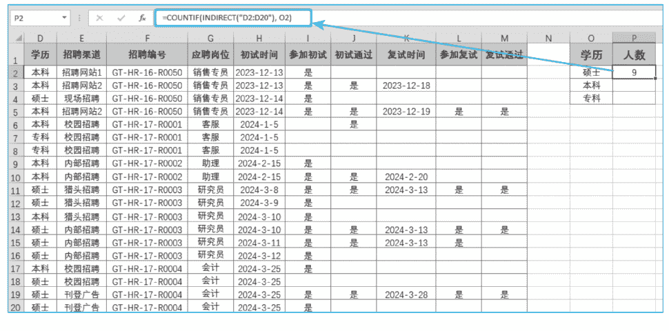

图0-18

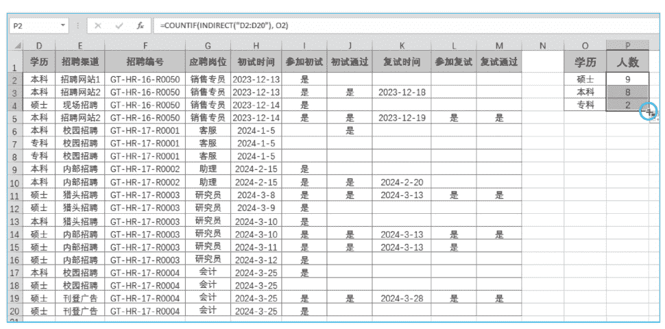

图0-19

## 0.5 条件没写全，结果就会跑偏

描述业务场景时限制条件写得越细越好。下面这个例子，如图0-20所示。发送后得到如图0-21所示的回复。


图0-20

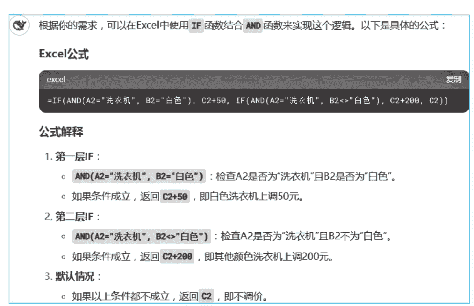

图0-21

按提示在表格里搭建后，得到的结果如图0-22所示。可以看到返回的都是原价，并没有按预期完成调价。

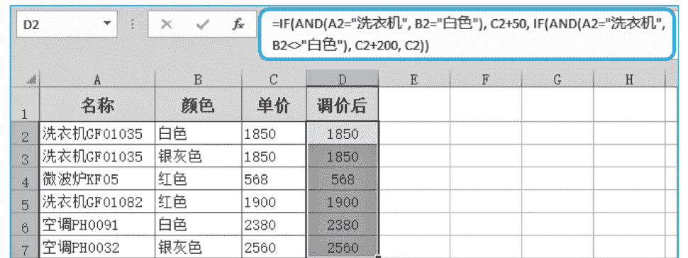

图0-22

上面的提问对位置和范围的描述很清晰，只漏掉了一个判断要素。以致模型推导错误。观察A列可知，“洗衣机”只是商品名称的开头部分，若要判定是不是洗衣机，还需要把这一特征告诉模型。因此在提示里补充“并且要判断A2中前3个字符是否是洗衣机”（如图0-23所示），模型这才明白需要先用 LEFT 取出左侧三个字符再做判断，于是重新给出表达式，如图0-24所示。


图0-23

根据你的需求，我们需要判断A2的前3个字符是否为“洗衣机”，并且结合颜色进行调价。可以使用 `LEFT` 函数提取前3个字符，并结合 `IF` 和 `AND` 函数实现逻辑。以下是具体公式：

### Excel公式

```
excel
=IF(AND(LEFT(A2, 3)="洗衣机", B2="白色"), C2+50, IF(AND(LEFT(A2, 3)="洗衣机", B2<>"白色"), C2+200, C2))
```

### 公式解释

- 1. 第一层IF：

   - `AND(LEFT(A2, 3)="洗衣机", B2="白色")`：检查A2的前3个字符是否为“洗衣机”且B2是否为“白色”。

   - 如果条件成立，返回 `C2+50`，即白色洗衣机上调50元。

- 2. 第二层IF：

   - `AND(LEFT(A2, 3)="洗衣机", B2<>"白色")`：检查A2的前3个字符是否为“洗衣机”且B2不为“白色”。

   - 如果条件成立，返回 `C2+200`，即其他颜色洗衣机上调200元。

- 3. 默认情况：

   - 如果以上条件都不成立，返回 `C2`，即不调价。


回到表格中检验，表达式能够自动识别A列名称开头的三个字是不是“洗衣机”，同时还能判断B列颜色是不是白色，最终得到正确的调价结果，如图0-25所示。

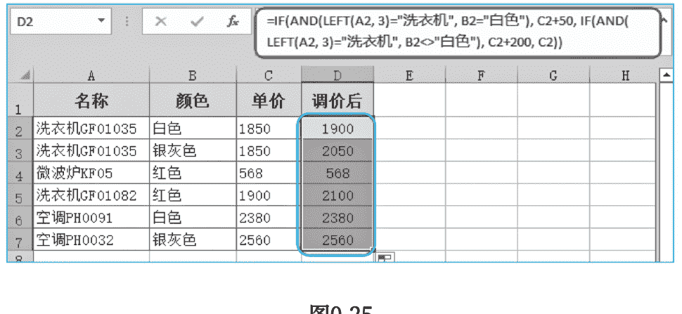

图0-25

## 0.6 不满意就继续追问优化

前面提到提问要具体、说明范围目的、把限制条件写全。除了首次提问，还可以借助追问来补充或扩展。

例如想以表格形式列出几种适合做花茶的玫瑰，并附上产地、加工方式与口感资料，可以先给出明确指令，让模型整理数据。

- 1. 在对话框输入“用表格列出6种最适合作为花茶的玫瑰花，包含名称、产地、制作方式、口感的资料。”，如图0-26所示。发送后得到如图0-27所示的表格。

- 2. 随后输入“新增一栏“维C含量”，放在“口感描述”后面。”如图0-28所示。发送后，得到如图0-29所示的表格。

用表格列出6种最适合作为花茶的玫瑰花，包含名称、产地、制作方式、口感的资料。

图0-26

以下是6种最适合作为花茶的玫瑰花，整理成表格形式，包含名称、产地、制作方式、口感等信息：

| 名称 | 产地 | 制作方式 | 口感描述 |

| :--- | :--- | :--- | :--- |

| 大马士革玫瑰 | 保加利亚 | 采摘新鲜花蕾，晾晒至干燥，保留完整花瓣。 | 香气浓郁，带有蜂蜜和果香的甜味，口感柔和顺滑。 |

| 平阴玫瑰 | 中国山东 | 采用传统晾晒工艺，保留花瓣完整性和香气。 | 香气清新，带有淡淡的甜味和草本香，口感清爽。 |

| 法国千叶玫瑰 | 法国 | 手工采摘花瓣，低温烘干，保留细腻香气。 | 香气优雅，带有柑橘和香草的复合香味，口感细腻。 |

| 墨红玫瑰 | 中国云南 | 新鲜花瓣经过低温烘焙，保留深红色泽和浓郁香气。 | 香气浓郁，带有果香和蜜香，口感醇厚，回味甘甜。 |

| 苦水玫瑰 | 中国甘肃 | 采用传统晾晒工艺，花瓣干燥后色泽深紫。 | 香气独特，带有淡淡的苦味和草本香，口感清爽，适合搭配其他花茶。 |

| 英国老玫瑰 | 英国 | 手工采摘花瓣，低温烘干，保留经典玫瑰香气。 | 香气经典，带有淡淡的木质香和甜味，口感温和，适合单独冲泡或搭配红茶。 |

图0-27

新增一栏“维C含量”，放在“口感描述”后面。

图0-28

以下是更新后的表格，新增了“维C含量”一栏，放在“口感描述”后面：

| 名称 | 产地 | 制作方式 | 口感描述 | 维C含量 |

| :--- | :--- | :--- | :--- | :--- |

| 大马士革玫瑰 | 保加利亚 | 采摘新鲜花蕾，晾晒至干燥，保留完整花瓣。 | 香气浓郁，带有蜂蜜和果香的甜味，口感柔和顺滑。 | 中等（约20mg/100g） |

| 平阴玫瑰 | 中国山东 | 采用传统晾晒工艺，保留花瓣完整性和香气。 | 香气清新，带有淡淡的甜味和草本香，口感清爽。 | 较高（约30mg/100g） |

| 法国千叶玫瑰 | 法国 | 手工采摘花瓣，低温烘干，保留细腻香气。 | 香气优雅，带有柑橘和香草的复合香味，口感细腻。 | 较低（约15mg/100g） |

| 墨红玫瑰 | 中国云南 | 新鲜花瓣经过低温烘焙，保留深红色泽和浓郁香气。 | 香气浓郁，带有果香和蜜香，口感醇厚，回味甘甜。 | 中等（约25mg/100g） |

| 苦水玫瑰 | 中国甘肃 | 采用传统晾晒工艺，花瓣干燥后色泽深紫。 | 香气独特，带有淡淡的苦味和草本香，口感清爽，适合搭配其他花茶。 | 较高（约35mg/100g） |

| 英国老玫瑰 | 英国 | 手工采摘花瓣，低温烘干，保留经典玫瑰香气。 | 香气经典，带有淡淡的木质香和甜味，口感温和，适合单独冲泡或搭配红茶。 | 较低（约10mg/100g） |

图0-29

③ 模型还能按分析意图处理数据。比如希望按维C含量从高到低排序，可在对话框输入“将维C含量按“高”“中”“低”排序。”，如图0-30所示。发送后，新表格已按该列排序，如图0-31所示。

将维C含量按“高”“中”“低”排序。

图0-30

④ 用鼠标框选整个表格（如图0-32所示），按Ctrl+C复制，切换到Excel中选中目标格按Ctrl+V粘贴即可得到数据表。

以下是按照“维C含量”从高到低排序后的表格：

| 名称 | 产地 | 制作方式 | 口感描述 | 维C含量 |

| :--- | :--- | :--- | :--- | :--- |

| 苦水玫瑰 | 中国甘肃 | 采用传统晾晒工艺，花瓣干燥后色泽深紫。 | 香气独特，带有淡淡的苦味和草本香，口感清爽，适合搭配其他花茶。 | 高（约35mg/100g） |

| 平阴玫瑰 | 中国山东 | 采用传统晾晒工艺，保留花瓣完整性和香气。 | 香气清新，带有淡淡的甜味和草本香，口感清爽。 | 高（约30mg/100g） |

| 墨红玫瑰 | 中国云南 | 新鲜花瓣经过低温烘焙，保留深红色泽和浓郁香气。 | 香气浓郁，带有果香和蜜香，口感醇厚，回味甘甜。 | 中（约25mg/100g） |

| 大马士革玫瑰 | 保加利亚 | 采摘新鲜花蕾，晾晒至干燥，保留完整花瓣。 | 香气浓郁，带有蜂蜜和果香的甜味，口感柔和顺滑。 | 中（约20mg/100g） |

| 法国千叶玫瑰 | 法国 | 手工采摘花瓣，低温烘干，保留细腻香气。 | 香气优雅，带有柑橘和香草的复合香味，口感细腻。 | 低（约15mg/100g） |

| 英国老玫瑰 | 英国 | 手工采摘花瓣，低温烘干，保留经典玫瑰香气。 | 香气经典，带有淡淡的木质香和甜味，口感温和，适合单独冲泡或搭配红茶。 | 低（约10mg/100g） |

图0-31

以下是按照“维C含量”从高到低排序后的表格：

| 名称 | 产地 | 制作方式 | 口感描述 | 维C含量 |

| :--- | :--- | :--- | :--- | :--- |

| 苦水玫瑰 | 中国甘肃 | 采用传统晾晒工艺，花瓣干燥后色泽深紫。 | 香气独特，带有淡淡的苦味和草本香，口感清爽，适合搭配其他花茶。 | 高（约35mg/100g） |

| 平阴玫瑰 | 中国山东 | 采用传统晾晒工艺，保留花瓣完整性和香气。 | 香气清新，带有淡淡的甜味和草本香，口感清爽。 | 高（约30mg/100g） |

| 墨红玫瑰 | 中国云南 | 新鲜花瓣经过低温烘焙，保留深红色泽和浓郁香气。 | 香气浓郁，带有果香和蜜香，口感醇厚，回味甘甜。 | 中（约25mg/100g） |

| 大马士革玫瑰 | 保加利亚 | 采摘新鲜花蕾，晾晒至干燥，保留完整花瓣。 | 香气浓郁，带有蜂蜜和果香的甜味，口感柔和顺滑。 | 中（约20mg/100g） |

| 法国千叶玫瑰 | 法国 | 手工采摘花瓣，低温烘干，保留细腻香气。 | 香气优雅，带有柑橘和香草的复合香味，口感细腻。 | 低（约15mg/100g） |

| 英国老玫瑰 | 英国 | 手工采摘花瓣，低温烘干，保留经典玫瑰香气。 | 香气经典，带有淡淡的木质香和甜味，适合搭配红茶。 | 低（约10mg/100g） |

图0-32

# 第1章 数据录入提速指南


扫码看教学视频

## 1.1 先搞清数据类型

把文本、数值、日期等各类信息录入工作表是建表的第一步。先要了解Excel支持的几种数据类型，保持类型统一，后续的核算、统计与分析才可靠。

### 1.1.1 文本型数据怎么填

通常中文、字母直接输入即为文本，不需要额外设置。

打开表，输入文字和数字时默认都是“常规”，在“开始”选项卡的“数字”组可以看到，如图1-1所示，内容均为常规格式，也属于文本。

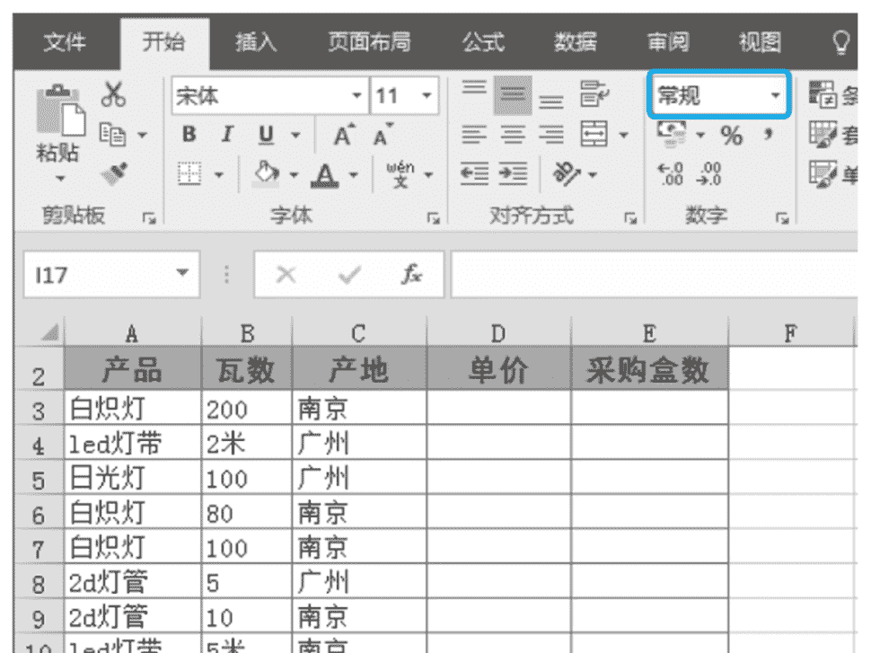

图1-1

若想让数字以文本形式显示，例如序号列希望显示001、002……这种形式（如图1-2所示），直接输入会得到如图1-3所示的结果（前导0会被自动去掉），这时需要先把格格式改为“文本”，再输入序号。

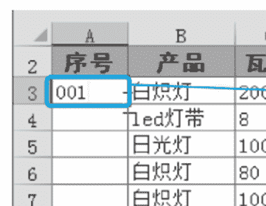

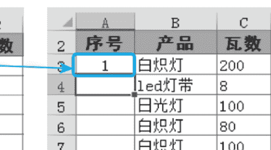

操作如下。

- 1. 选中要输入序号的区域，切换到“开始”选项卡，在“数字”组点击格式框右侧的下拉按钮，选择“文本”，如图1-4所示。

## 专家提示

一定要先改格式再输入。先输入以0开头的编号再改格格式，前面的0无法恢复。

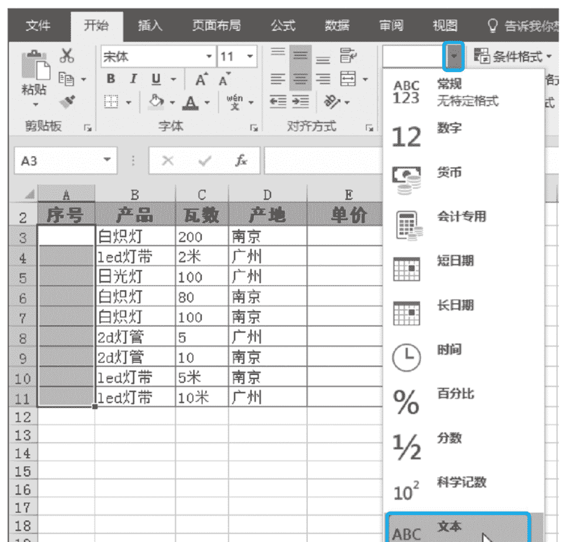

图1-4

② 改完后再输入以0开头的序号就能正常显示，如图1-5所示。

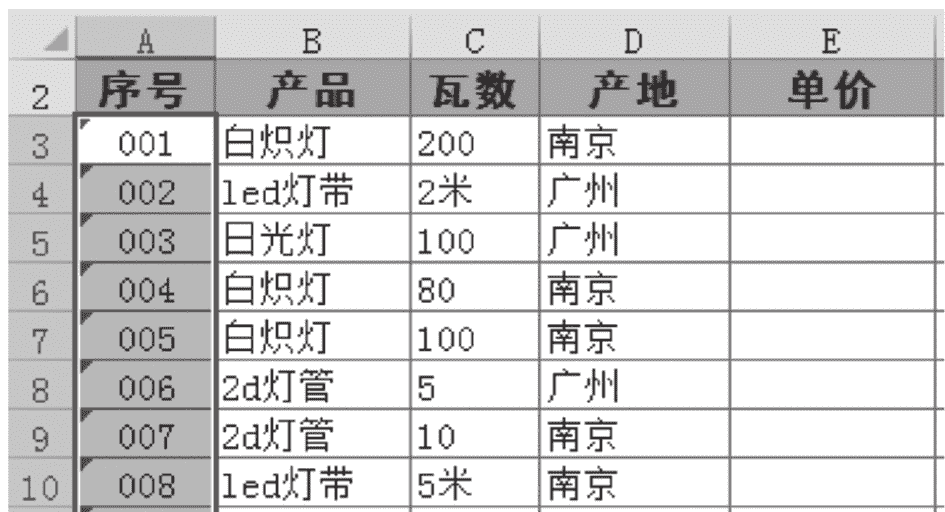

图1-5

## 专家提示

总结一下，输入文字、字母，表格会自动按文本处理，无需特意设置。但在特定场景必须设为文本，例如以0开头的编号、产品编码、身份证号等，否则显示会出错。

在一个格里输入较长的说明时，需要换行，不能像Word那样直接回车，这时要用强制换行。下面举例。

如图1-6所示的A24:E24区域是一个合并区域，先输入了“说明：”，后面的内容按条目展示，每条应另起一行。要换行就需要强制换行。

| A | B | C | D | E |

|---|---|---|---|---|

| 9 | | | | |

| 10 | | | | |

| 11 | | | | |

| 12 | | | | |

| 13 | | | | |

| 14 | | | | |

| 15 | | | | |

| 16 | | | | |

| 申请人签字： | | 主管领导签字： | | |

| 说明： | | | | |

图1-6

操作步骤如下。

- 1. 输入“说明：”后，按Alt+Enter，即可进入下一行，可以看到光标在下一行闪烁，如图1-7所示。

## 1.1.2 数值数据

让数字呈现更专业

表格里最常见的就是各种数值，整数、小数、百分比、会计专用格式都属于这一类。刚录入时系统保持原样输出，多数场景下还需要统一外观，比如统一保留几位小数、加上货币符号等。点中任意单元格后，顶部菜单【开始】下方的数字工具区会即时显示当前采用的样式，新建文件默认是“常规”，见图1-10。

打开右侧的小三角，可以看到“常规”“数字”“百分比”“货币”“会计专用”“短日期”“长日期”等选项。先框定需要修改的区域，就能一键套用。下面演示如何把区域切换为货币样式。

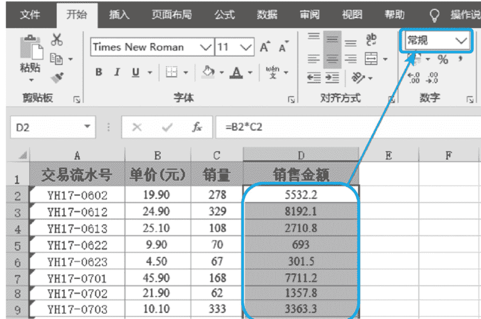

图1-10

❶ 把需要改动格式的单元格选中，切换到【开始】-数字区，点击“数字格式”旁的下拉箭头，在列表里挑选“货币”，格式立刻生效，如图1-11所示。

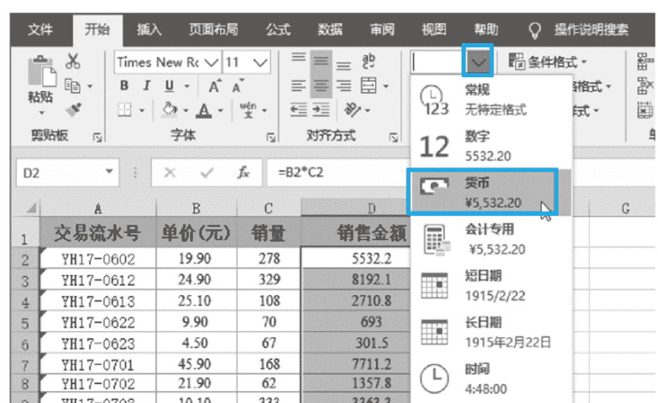

图1-11

② 原数据会被重新排版，前方自动加上货币符号并保留两位小数，效果见图1-12。

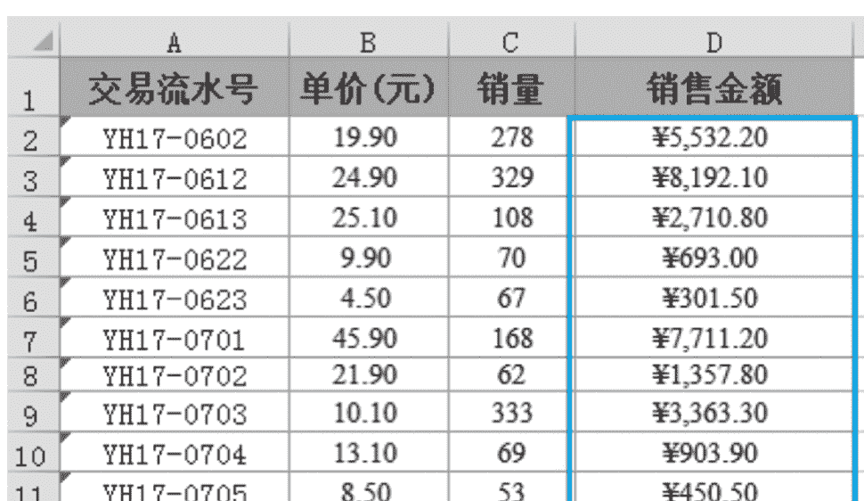

图1-12

手工逐个输入“%”效率很低，更顺手的做法是先填入小数，再整体改成百分比。具体操作如下。

- 1. 圈定要转换的范围，进入【开始】-数字区，展开“数字格式”菜单，选择“百分比”，样式瞬间更新，如图1-13所示，即完成格式修改。

## 知识扩展

货币与会计专用看似相近，实则有两处差异：
- (1) 符号位置不同，普通货币符号紧贴数字靠右显示，会计专用符号会单独靠左摆放。
- (2) 会计专用无法自行自定义负数的显示方式。

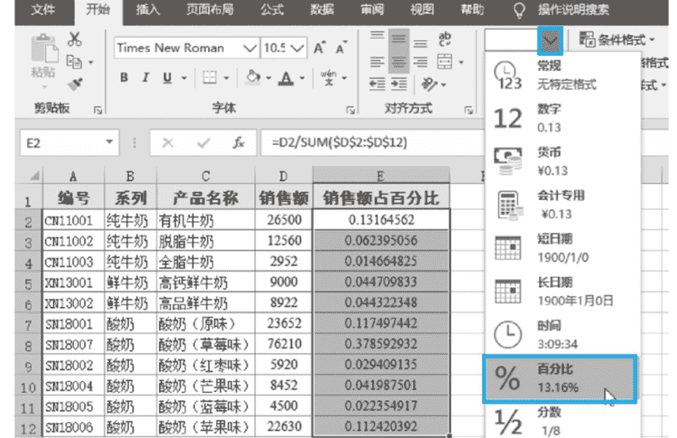

图1-13

② 设定完成后，原始数值会以两位小数的百分数形式呈现，见图1-14所示。

| 编号 | 系列 | 产品名称 | 销售额 | 销售额占百分比 |
|---|---|---|---|---|
| CN11001 | 纯牛奶 | 有机牛奶 | 26500 | 13.16% |
| CN11002 | 纯牛奶 | 脱脂牛奶 | 12560 | 6.24% |
| CN11003 | 纯牛奶 | 全脂牛奶 | 2952 | 1.47% |
| XN13001 | 鲜牛奶 | 高钙鲜牛奶 | 9000 | 4.47% |
| XN13002 | 鲜牛奶 | 高品鲜牛奶 | 8922 | 4.43% |
| SN18001 | 酸奶 | 酸奶（原味） | 23652 | 11.75% |
| SN18007 | 酸奶 | 酸奶（草莓味） | 76210 | 37.86% |
| SN18002 | 酸奶 | 酸奶（红枣味） | 5920 | 2.94% |
| SN18004 | 酸奶 | 酸奶（芒果味） | 8452 | 4.20% |
| SN18005 | 酸奶 | 酸奶（蓝莓味） | 4500 | 2.24% |
| SN18006 | 酸奶 | 酸奶（苹果味） | 22630 | 11.24% |

图1-14

## 知识扩展


数字工具区里还藏着五个快捷键：会计数字格式、百分比样式、千位分隔、增加小数位数、减少小数位数，如图1-15所示。点一下即可快速切换，特别是处理小数时，后两个键能自由增减显示位数。


图1-15

练一练：设置金额的货币格式。

让金额以货币样式显示，负数用红色括号括起来，如图1-16所示。

| 项目 | 上年度 | 本年度 | 增减额(率) |
| :--- | :--- | :--- | :--- |
| 销售收入 | ¥206,424.58 | ¥225,298.68 | ¥18,874.10 |
| 销售成本 | ¥82,698.00 | ¥96,628.02 | ¥13,930.02 |
| 销售费用 | ¥20,462.68 | ¥6,450.46 | (¥14,012.22) |
| 销售税金 | ¥4,952.89 | ¥2,222.65 | (¥2,730.24) |
| 销售成本率 | ¥0.68 | ¥0.83 | ¥0.15 |
| 销售费用率 | ¥0.10 | ¥0.06 | (¥0.03) |
| 销售税金率 | ¥0.05 | ¥0.03 | (¥0.02) |

图1-16

## 1.1.3 日期与时间数据

日期类内容用来标记具体时间点，默认显示为「yyyy/mm/dd」，共八位，其中年份、月份、日期分别对应 yyyy、mm、dd。若后期要做计算，录入时必须使用系统可识别的规范写法。

日期可用“-”或“/”分隔，例如2024-9-1，如图1-17所示，也可用2024/9/1。若为当年日期，可省略年份，如图1-18所示。直接写“2024年9月1日”也是系统能识别的简便方式。

| 类型 | 货号 | 销售日期 | 销售员 | 销售数量 |
|---|---|---|---|---|
| D5D | A-01 | 2024-9-1 | | |
| D4X | A-01 | | | |
| D4C | A-02 | | | |
| D3D | A-011 | | | |
| D4D | A-011 | | | |
| D4C | A-031 | | | |
| D4X | A-03 | | | |
| D4X | A-011 | | | |
| D4X | A-031 | | | |
| D4C | A-01 | | | |

图1-17

| 类型 | 货号 | 销售日期 | 销售员 | 销售数量 |
|---|---|---|---|---|
| D5D | A-01 | 9月1日 | | |
| D4X | A-01 | | | |
| D4C | A-02 | | | |
| D3D | A-011 | | | |
| D4D | A-011 | | | |
| D4C | A-031 | | | |
| D4X | A-03 | | | |
| D4X | A-011 | | | |
| D4X | A-031 | | | |
| D4C | A-01 | | | |

图1-18

若想把默认日期换成特定样式，例如英文日期，需要打开“设置单元格格式”对话框，操作如下。

❶ 先用系统可识别的简易写法输入日期，再选中目标区域，在【开始】页签的数字区点击启动器，如图1-19所示，打开“设置单元格格式”对话框。

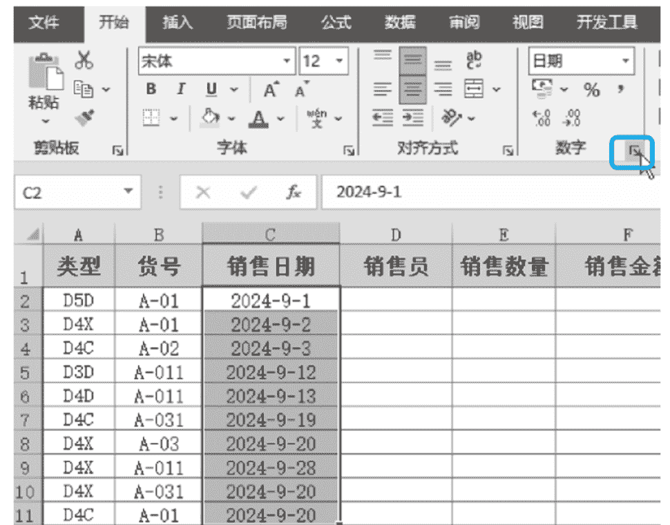

图1-19

❷ 在左侧【分类】里选择【日期】，按需求把格式设为“14-Mar-12”，如图1-20所示。

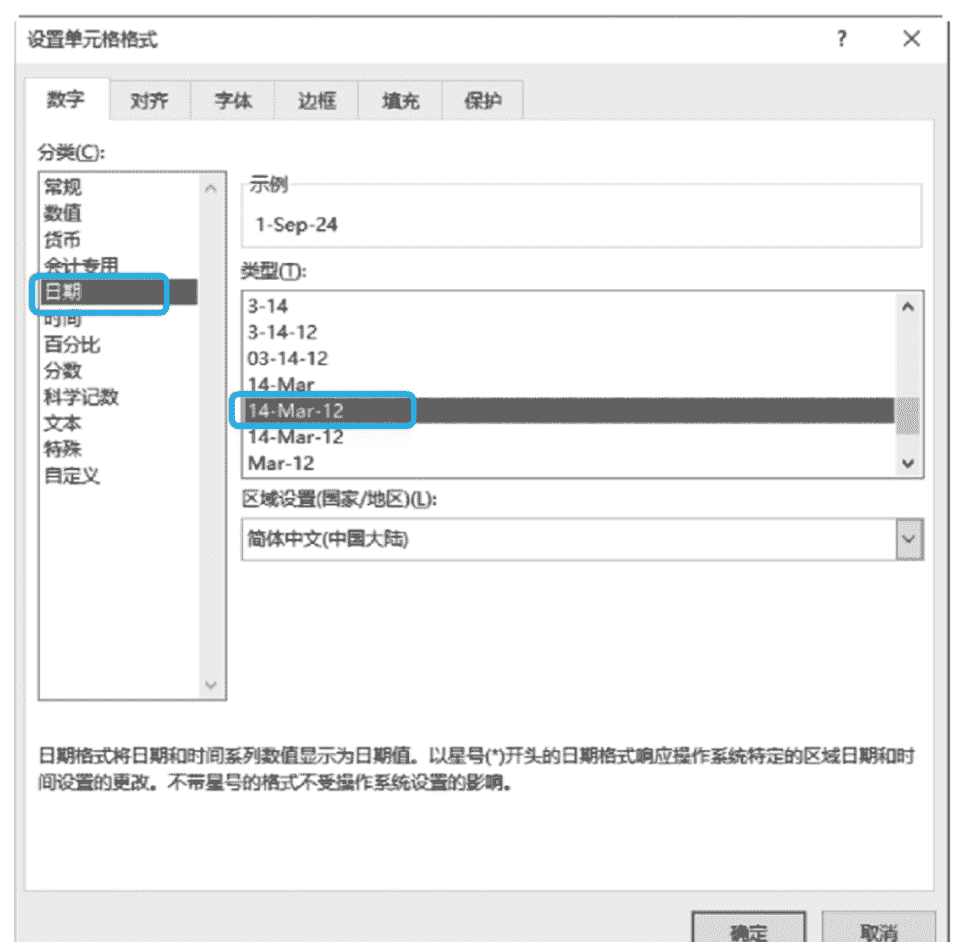

图1-20

③ 点【确定】，所选区域的格式就会变成指定的日期样式，如图1-21所示。

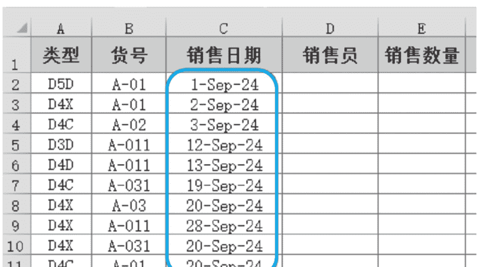

图1-21

在单元格里直接输入“1:30”这类写法，系统会自动识别为时间。若想指定时间显示样式，比如12小时制，可按下面方法操作。

- 1. 先用系统可识别的简易格式把时间输进去，再选中目标区域，在【开始】页签的数字区点启动器，如图1-22所示，打开“设置单元格格式”对话框。

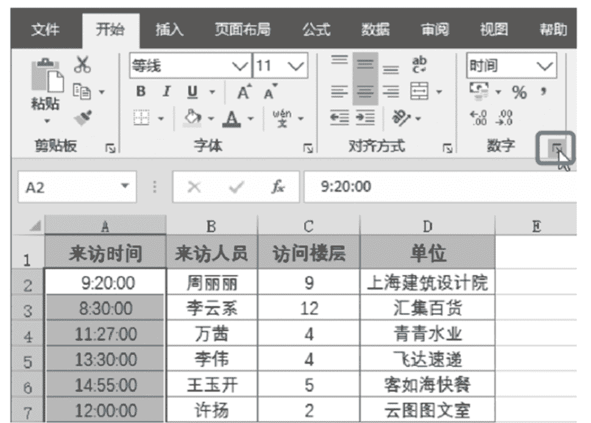

图1-22

② 在【分类】中点【时间】，按需要把样式设为“1:30 PM”，如图1-23所示。

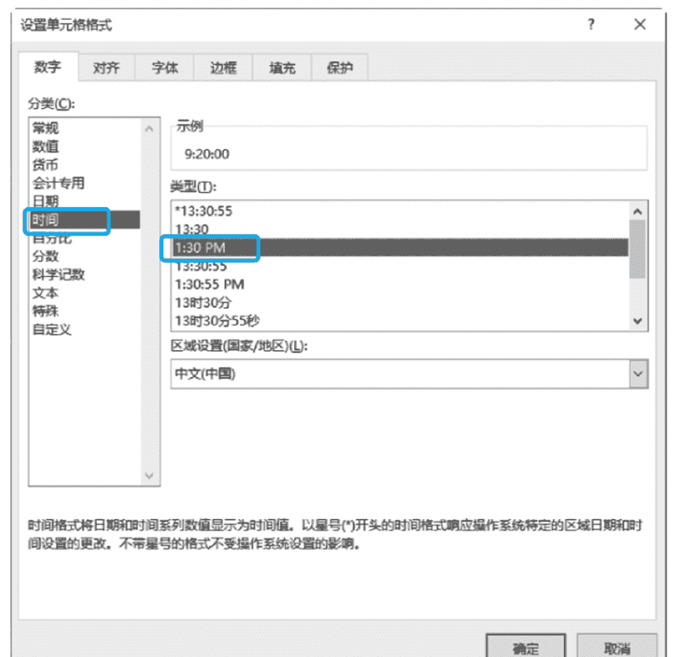

图1-23

③ 点【确定】后，表格中的时间就会变成12小时制显示，如图1-24所示。

| 来访时间 | 来访人员 | 访问楼层 | 单位 |
| :--- | :--- | :--- | :--- |
| 9:20 AM | 周丽丽 | 9 | 上海建筑设计院 |
| 8:30 AM | 李云系 | 12 | 汇集百货 |
| 11:27 AM | 万茜 | 4 | 青青水业 |
| 1:30 PM | 李伟 | 4 | 飞达速递 |
| 2:55 PM | 王玉开 | 5 | 客如海快餐 |
| 12:00 PM | 许扬 | 2 | 云图图文室 |
| 2:11 PM | 万茜 | 11 | 青青水业 |
| 15:27:00 | 李伟 | 28 | 飞达速递 |

图1-24

## 知识扩展

输入的是连续递增的日期序列，可以用填充功能快速生成，不必一个个手动填。

在C2单元格内输入首个日期，如图1-25所示，接着把鼠标指针放在C2单元格的右下角，向下拖动填充柄，如图1-26所示，松开鼠标左键即可生成连续的日期数据，如图1-27所示。

| 姓名 | 部门 | 值班日期 |
|---|---|---|
| 吴伟云 | 生产1部 | 2024-9-1 |
| 杨清 | 生产1部 | |
| 李欣 | 生产2部 | |
| 金鑫 | 生产2部 | |
| 华涵涵 | 生产2部 | |
| 张玮 | 生产1部 | |
| 聂新余 | 生产2部 | |
| 陈媛媛 | 生产2部 | |
| 高雨 | 生产1部 | |
| 刘慧洁 | 生产2部 | |
| 李季 | 生产1部 | |
| 周梦伟 | 生产2部 | |
| 林源 | 生产1部 | |

图1-25

| 姓名 | 部门 | 值班日期 |
|---|---|---|
| 吴伟云 | 生产1部 | 2024-9-1 |
| 杨清 | 生产1部 | |
| 李欣 | 生产2部 | |
| 金鑫 | 生产2部 | |
| 华涵涵 | 生产2部 | |
| 张玮 | 生产1部 | |
| 聂新余 | 生产2部 | |
| 陈媛媛 | 生产2部 | |
| 高雨 | 生产1部 | |
| 刘慧洁 | 生产2部 | |
| 李季 | 生产1部 | |
| 周梦伟 | 生产2部 | |
| 林源 | 生产1部 | |

图1-26

| 姓名 | 部门 | 值班日期 |
|---|---|---|
| 吴伟云 | 生产1部 | 2024-9-1 |
| 杨清 | 生产1部 | 2024-9-2 |
| 李欣 | 生产2部 | 2024-9-3 |
| 金鑫 | 生产2部 | 2024-9-4 |
| 华涵涵 | 生产2部 | 2024-9-5 |
| 张玮 | 生产1部 | 2024-9-6 |
| 聂新余 | 生产2部 | 2024-9-7 |
| 陈媛媛 | 生产2部 | 2024-9-8 |
| 高雨 | 生产1部 | 2024-9-9 |
| 刘慧洁 | 生产2部 | 2024-9-10 |
| 李季 | 生产1部 | 2024-9-11 |
| 周梦伟 | 生产2部 | 2024-9-12 |
| 林源 | 生产1部 | 2024-9-13 |

图1-27

练一练：把日期转换为对应的星期数。

在值班表中，除了显示值班日期，还要显示值班日期对应的星期数，如图1-28所示。

| 职工工号 | 姓名 | 值班日期 | 星期 |
| :--- | :--- | :--- | :--- |
| RCH001 | 张怡伶 | 2024-9-10 | 星期二 |
| RCH009 | 苏明 | 2024-9-9 | 星期三 |
| RCH003 | 陈秀秀 | 2024-9-3 | 星期四 |
| RCH011 | 何世杰 | 2024-9-12 | 星期五 |
| RCH005 | 袁晓 | 2024-9-13 | 星期六 |
| RCH007 | 夏兰兰 | 2024-9-19 | 星期日 |
| RCH004 | 吴晶 | 2024-9-20 | 星期一 |
| RCH008 | 蔡天放 | 2024-9-28 | 星期二 |
| RCH012 | 崔小琴 | 2024-9-20 | 星期三 |
| RCH010 | 袁元 | 2024-9-20 | 星期四 |

图1-28

## 1.1.4 外部数据

工作表里的数据除了手工录入，还有很多需要从外部引入，比如文本文件、网页数据等。这些内容先导入表格形成规范的数据表，再进行分析。

### 1. 从文本文件中导入数据

文本是常见的数据来源，但仅能记录，无法分析计算。因此需要把文本数据导入表格。如图1-29所示为考勤机数据，都需要导入工作簿，操作如下。

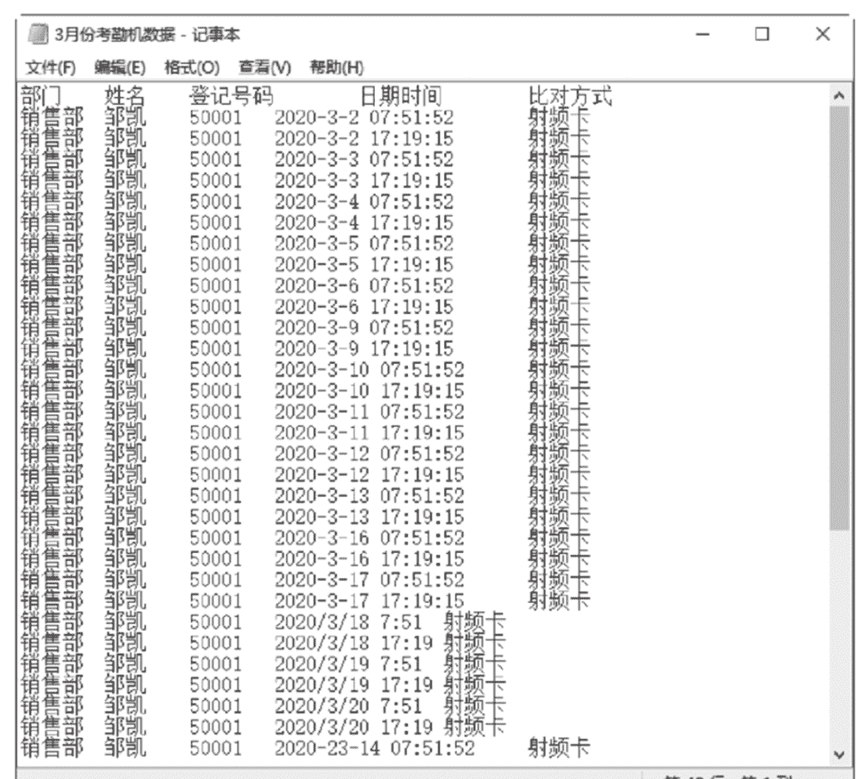

图1-29

- 1. 新建空白工作簿，在【数据】页签的【获取和转换数据】分组中点按【从文本/CSV】按钮，如图1-30所示。


图1-30

② 打开【导入数据】对话框，找到相应的文本文件并选中，如图1-31所示，然后点【导入】按钮，打开相应对话框，如图1-32所示。

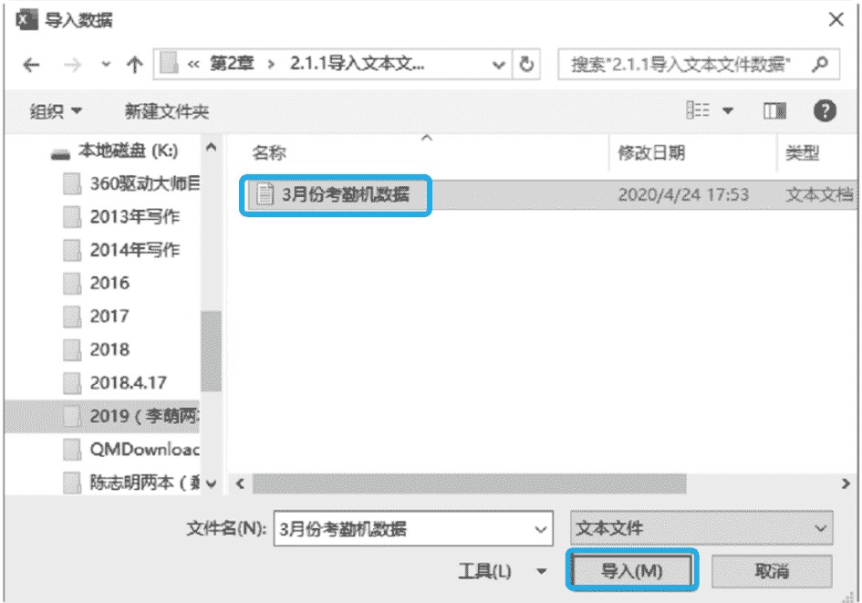

图1-31

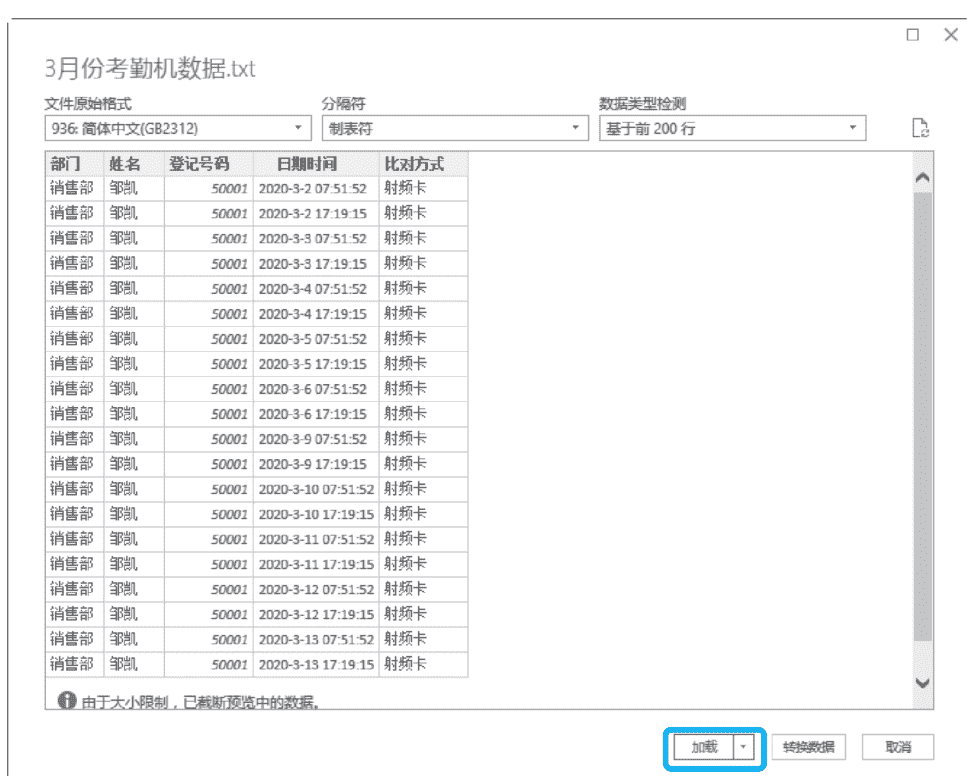

图1-32

③ 此时可以看到表格预览。接着点【加载】按钮，即可将数据导入表格中，如图1-33所示。

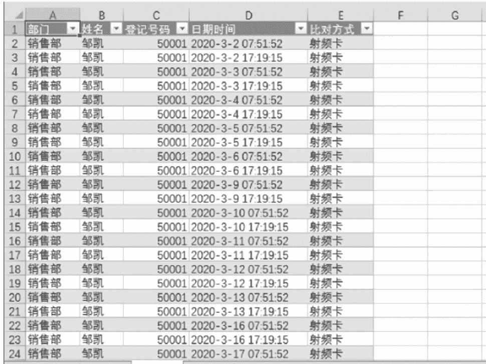

图1-33

## 专家提示

要导入的文本文件数据要具有一定规则，如以统一的分隔符进行分隔或具有固定的宽度，这样导入的数据才会自动填入相应的单元格中。过于杂乱的文本数据，程序难以找到相应分列的规则，导入工作表后也会显得很杂乱。这种情况下，一定要先在文本文件中对数据进行整理。

### 2. 从网页中导入数据

报告分析所需的数据，一部分可直接从公司销售、财务、人事等部门收集，另一部分涉及宏观、横向比较的数据，例如市场份额、产品渠道分布等，一般需要通过网络查询官方统计数据库或年鉴等获取。因此导入网页数据也是源表数据的来源之一。从网页中找到需要的数据后，可以利用如下方法将其导入工作表中。

❶ 打开工作表，在【数据】页签的【获取和转换】分组中点按【自网站】按钮，如图1-34所示。


图1-34

❷ 打开【从Web】对话框，在【URL】框中输入网址，如图1-35所示，点【确定】按钮，打开导航器。


图1-35

③ 导航器会将当前网页中所有能导入的表格都在左侧列出，点选相应表格可在右侧预览，确定要导入的内容后，如图1-36所示，点【加载】按钮，即可将数据导入表格中，如图1-37所示。

图1-36

④ 如果还有其他要导入的内容，可以按相同的方法导入，新导入的数据会自动存放于新工作表中，如图1-38所示。可以待所有数据导入完成后再做合并整理。

图1-37

图1-38

练一练：导入文本文件数据为规范表格。

当前的文本文件如图1-39所示，试将其转换为规范的工作表。

图1-39

## 1.1.5 输入特殊符号

在特殊情况下需要在单元格中输入特殊符号，一方面起到特殊标注的作用，另一方面也能美化表格，操作如下。

1. 将光标定位到要插入特殊符号的电话号码前，在【插入】页签的【符号】分组点按【符号】按钮，如图1-40所示，打开【符号】对话框。

图1-40

② 在【字体】设置框中选择【Wingdings】，拖动右侧滑块找到需要添加的特殊符号，点选并选中，如图1-41示。

图1-41

③ 点【插入】按钮，返回工作表，即可看到在电话号码前添加了“电话”特殊符号，全部添加后效果如图1-42所示。

| A | B | C |
|---|---|---|
| 客户名称 | 电子邮件 | 电话 |
| 吴华 | wh@126.com | 025-86592312 |
| 张晓晨 | zxiaochen@126.com | 1309800**** |
| 方俊 | fj@163.com | 1308980**** |
| 莫晓晓 | xiaoxiao@163.com | 025-86592451 |
| 刘芸 | lyun@126.com | 025-86502635 |
| 胡丽丽 | hll@139.com | 1385601**** |
| 王茜 | wqian@163.com | 0551-86593698 |
| 贺刚 | hgang@163.com | 027-86593361 |
| 彭燕 | py@126.com | 021-86599850 |
| 吴瑜 | ywu@126.com | 1378941**** |

图1-42

## 专家提示

在插入多个特殊符号时，需要逐一进行插入，如果直接将插入的特殊符号复制到下一单元格中，则不会显示特殊符号样式。

## 1.2 批量录入效率提升
表格里一次性把重复或有规律的信息补齐，是办公中最常见的刚需。掌握填充的用法，就能让相同内容、递增编号、连续日期等快速铺开，省去大量手工输入。

### 1.2.1 同类数据批量写入
把一样的信息写入多个位置，场景大致分连续区域和分散区域两类。

### 1. 连续区域统一写入
❶ 起点格先填入内容，例如本例把 B6 填成“综合处”，将光标移到该格的右下角，指针会变成小加号，即填充手柄，见图1-43。
❷ 长按左键向下拉动，拖到所需终点为止，参考图1-44。
❸ 松开鼠标后整段会被自动填满，效果见图1-45。

| 客户名称 | 办事处 |
| --- | --- |
| 天翼电信终端有限公司 | 运营商 |
| 北京中邮移动通信有限责任公司 | 运营商 |
| 中移股份有限公司北京分公司 | 运营商 |
| 内蒙古松联通信有限责任公司 | 运营商 |
| 北京迪信通电子通信有限公司 | 综合处 |
| 北京恒信瑞达商贸有限公司 |  |
| 北京中复设备有限责任公司 |  |
| 北京华信通电讯有限公司 |  |

图1-44

图1-45

### 2. 分散区域同步写入
❶ 按住 Ctrl 逐个点选需要写入相同内容的格子，选完松开 Ctrl，在最后被点中的格内输入内容，这里输入 0，参考图1-46。
② 同时按下 Ctrl 和 Enter，所有被选中的格子会一起写入 0，见图1-47。

练一练：在不连续格子中一次写入相同内容。
在图1-48 的表格里，把空白格全部填成文字“正常”，达到图1-49 的效果。

| 姓名 | 是否正常出勤 |
|---|---|
| 朱小龙 |  |
| 张勤 | 迟到 |
| 周韵 |  |
| 赵小超 |  |
| 李文文 |  |
| 张安静 | 迟到 |
| 徐勇 | 事假 |
| 朱晓霞 |  |
| 王艳 |  |
| 夏露 |  |
| 尹晟 |  |
| 杜鹃 | 病假 |
| 张恺 |  |
| 胡琴 |  |

图1-48

| 姓名 | 是否正常出勤 |
|---|---|
| 朱小龙 | 正常 |
| 张勤 | 迟到 |
| 周韵 | 正常 |
| 赵小超 | 正常 |
| 李文文 | 正常 |
| 张安静 | 迟到 |
| 徐勇 | 事假 |
| 朱晓霞 | 正常 |
| 王艳 | 正常 |
| 夏露 | 正常 |
| 尹晟 | 正常 |
| 杜鹃 | 病假 |
| 张恺 | 正常 |
| 胡琴 | 正常 |

图1-49

### 1.2.2 序号智能填充
填充不仅能复制，还能生成有规律的数字序列，比如连续编号、间隔编号等。

### 1. 连续序号一键生成
❶ 先把 A3 设为文本格式再输入 001，前面 1.1.1 节讲过带前导零的设置方法。选中 A3，移到右下角会出现黑色十字手柄，见图1-50。

| 序号 | 公司名称 | 应收金额 |
|---|---|---|
| 001 | 孚盛装饰公司 | ¥ 29,840.00 |
|  | 澳菲斯建材有限公司 | ¥ 28,765.00 |
|  | 宏运佳建材公司 | ¥ 15,080.00 |
|  | 拓帆建材有限公司 | ¥ 22,015.00 |

图1-50
② 保持左键按下往下拖到所需结束行，参考图1-51。
③ 松开后序号即自动完成，见图1-52。

### 2. 间隔序号批量生成
想生成间隔递增的编号，关键是先给出两个种子值。本例固定资产编号第1个 GD001、第2个 GD004，之后每隔 3 递增。
1. 先在 A2 写入 GD001，A3 写入 GD004。选中 A2:A3 范围，移至右下角出现手柄，见图1-53。

| 编号 | 固定资产名称 |
|---|---|
| GD001 | 办公楼 |
| GD004 | 综合楼 |
|  | 厂房 |
|  | 挖掘机 |
|  | 铲土机 |

图1-53
② 按住左键往下拖到目标位置后松开，经过的格子会以 3 为间隔自动生成编号，见图1-54。

知识扩展
填充结束后右下角会弹出填充快捷菜单，下拉里可以切换“仅格式”“不带格式”等不同处理方式，见图1-55。菜单内容会随数据类型变化，填充日期时会出现“按月”“按工作日”等选项。

实操练习：填充自带递增属性的数据。
数据本身自带递增时直接拖动会自动递增，如图1-56。若想填成相同值，如图1-57，有两种做法：一是拖动手柄时按住 Ctrl 不放；二是先拖完再通过开始选项卡的编辑组里的填充功能切换模式。

| 类型 | 货号 | 销售日期 |
|---|---|---|
| D3D | A-011 | 12-Apr-14 |
| D4C | A-02 | 3-Apr-14 |
| D5C | A-031 | 19-Apr-14 |
| D6C | A-01 | 30-Apr-14 |
| D7C | A-011 | 13-Apr-14 |

图1-56

图1-57

### 1.2.3 日期批量生成
日期的填充逻辑和序号相近，默认逐日递增。若需要按月、按工作日、按年等特殊方式，则需点开填充快捷菜单选择对应模式。

### 1. 工作日快速填充
1. 在 A2 填入起始值班日，指针移到右下角变手柄后往下拖到合适位置松开，会先看到日期逐日递增，见图1-58。
② 点开右下角的填充快捷菜单，选择“填充工作日”，周末会被自动跳过，效果见图1-60。

| 日期 | 值班人员 |
|---|---|
| 2024-7-1 | 张健竹 |
|  | 常娜娜 |
|  | 左强 |
|  | 李珊珊 |
|  | 许悦 |

图1-58

| 日期 | 值班人员 | 部门 |
|---|---|---|
| 2024-7-1 | 张健竹 | 销售1部 |
| 2024-7-2 | 常娜娜 | 销售2部 |
| 2024-7-3 | 左强 | 客服部 |
| 2024-7-4 | 李珊珊 | 销售1部 |
| 2024-7-5 | 许悦 | 客服部 |
| 2024-7-8 | 冯一寻 | 销售2部 |

图1-60

### 2. 固定日期重复填充
默认拖动日期会递增，若想在一段连续区域里写完全相同的日期，如图1-61。可在输入首日后按住 Ctrl 再拖手柄，或先拖完再点右下角的填充快捷菜单选择“复制单元格”，见图1-62。

专业提醒
填充序列时，若输入内容为日期或自带增序减序特征，直接拖就行。若输入的是纯数字，想递增则需在拖完后从填充快捷菜单里选“填充序列”，或拖动时按住 Ctrl。若想复制相同内容而不递增，操作相反：对日期或自带增序减序的数据，拖完后选“复制单元格”，或拖动时按住 Ctrl。

### 1.2.4 DeepSeek 帮你补齐空缺数据
日常录入常出现重复信息只填首行，后续留白的情况。如图1-63 所示，C 列仓库名称和 D 列商品类别有多处空白，若想让空白自动继承上一行的数据，可向 DeepSeek 求助。

|  | A | B | C | D | E |
|---|---|---|---|---|---|
| 1 | 出单日期 | 商品编码 | 仓库名称 | 商品类别 | 出库件数 |
| 2 | 2024-4-8 | WJ8870 | 西城仓 | 瓷片 | 600 |
| 3 | 2024-4-14 | Z8G033 |  |  | 25 |
| 4 | 2024-4-10 | ZG6011 |  |  | 32 |

图1-63

❶ 打开 DeepSeek 对话框，输入提示：“在 Excel 里，让选定区域的空白格自动获取上一格的数据并填入”，见图1-64。
❷ 发送后得到如图1-65 的回复，核心思路是用定位空值加公式填充。
❸ 回到 Excel，框选需要处理的区域，按 Ctrl+G 调出定位窗口，见图1-66。点“定位条件”，勾选“空值”，见图1-67。

在Excel中，可以通过以下步骤让选中区域的空白单元格自动获取上一单元格的数据并填充：

## 方法：使用“定位条件”和公式填充

1. 选中目标区域：
   - 选择包含空白单元格的区域（例如A1:A10）。

2. 打开“定位条件”对话框：
   - 按 `Ctrl + G` 快捷键，或者点击菜单栏的 **开始** -> **查找和选择** -> **定位条件**。

3. 选择“空值”：
   - 在“定位条件”对话框中，选择 **空值**，然后点击 **确定**。此时所有空白单元格会被选中。

4. 输入公式：
   - 在选中的第一个空白单元格中（注意不要点击其他地方），输入以下公式：

5. 按 `Ctrl + Enter`：
   - 按下 `Ctrl + Enter`，所有选中的空白单元格会自动填充为上方单元格的值。

```
excel
=上方单元格的地址
```

例如，如果空白单元格是A3，则输入：

```
excel
=A2
```

图1-65

❹ 确定后区域内所有空格被选中，如图1-68 所示。此时在选中区域输入向上引用的公式并同时按 Ctrl 和 Enter，即可一次性把空白补齐。

|  | A | B | C | D | E |
|---|---|---|---|---|---|
| 1 | 出单日期 | 商品编码 | 仓库名称 | 商品类别 | 出库件数 |
| 2 | 2024-4-8 | WJ8870 | 西城仓 | 瓷片 | 600 |
| 3 | 2024-4-14 | Z8G033 |  |  | 25 |
| 4 | 2024-4-10 | ZG6011 |  |  | 32 |

| 20 | 2024-4-7 | WJ8871 | | | 636 |

| 21 | 2024-4-6 | WJ8872 | | | 650 |

图1-68

❺ 在公式编辑区填入 =D2，直接引用上一行数值即可，效果见图1-69。

图1-69

## 1.3 数据有效性验证

数据有效性验证的核心是为指定单元格设定录入边界，比如限定数值区间、日期范围、候选清单或由公式决定的自定义规则。规则生效后，不合规的输入会被即时拦截，避免脏数据进入表格。

## 1.3.1 限制只能输入指定类型数据

很多区域对数据类型有硬性要求，例如仅允许本月日期。提前做校验可以减少返工。

以仅收本月日期为例，操作思路如下。

先框选需要管控的范围，进入顶部菜单的数据标签，在数据工具区点开数据验证，弹出设置面板，如图1-70所示。

把许可类型设为日期，条件模式挑选介于，随后填入起始日期与结束日期，如图1-71所示。

图1-70

图1-71

❸ 点确定完成设定。若写入的内容系统无法识别为日期会立刻弹出错误提示，如图1-72所示；若日期超出设定区间也会被拦截，如图1-73所示。

图1-72

图1-73

练一练：只允许录入2020年4月上旬的日期，如图1-74所示。

校验条件设为日期→介于。

图1-74

## 1.3.2 限制输入数据的大小

以下案例要求交通费金额必须小于既定上限。具体做法如下。

框选目标范围，进入数据标签，点击数据工具中的数据验证，如图1-75所示。

图1-75

❷ 在许可类型里选整数，条件模式选小于，再设定最大值，如图1-76所示。

图1-76

❸ 切换到错误提醒页签，在提示文本框里写入提醒语，如图1-77所示。

图1-77

❹ 确认保存。只要录入的不是小于400的整数，就会触发警告框，如图1-78所示。

图1-78

## 1.3.3 建立可选择输入的序列

某些列只允许从固定选项中挑选，比如部门名称、费用类别等。借助校验可以生成下拉清单，录入时直接选择，减少手误。

操作步骤如下。

选中 D3:D9 区域，在数据标签的数据工具组里点开数据验证，打开对话框，如图1-79所示。

图1-79

❷ 打开许可类型设置区的下拉，在列表里选序列。随后在来源文本框输入 生产部,行政部,销售部,客服部,维修部，注意各值之间用半角逗号分隔，如图1-80所示。

图1-80

❸ 点确定返回工作表，点击 D2 单元格右侧的下拉箭头，可见可选清单，如图1-81所示，挑选对应部门即可。

图1-81

知识扩展
若候选项很多，手打来源不现实。可以先把候选值写到工作表里，再点来源文本框右侧的折返键，在表中框选作为序列来源的区域。

## 1.3.4 设置鼠标指向时显示输入提示

对有特殊要求的单元格，可以附加一个输入提示，选中或移入时即显示说明，告诉用户该填什么。

操作如下。

选中要设置提示的区域，也可是不连续的多块区域，切到数据标签点数据验证，弹出对话框，如图1-82所示。

图1-82

❷ 切换到输入信息页签，在标题与输入信息框里填入需要展示的提示内容，如图1-83所示。

图1-83

❸ 点确定返回表格。此时鼠标停在已设置校验的单元格上时，系统会显示预设的提示，如图1-84所示。

图1-84

## 1.3.5 DeepSeek指导禁止输入空格

用自定义公式做校验，能处理更灵活的场景，比如防重复、控长度等。若公式不会写，可以让 DeepSeek 给出判断式。

在需要后续处理的数据库表格里，空格是常见隐形错误，会导致查找失败、计算出错。可以在录入时就禁止空格出现。

操作过程如下。

在 DeepSeek 对话框里输入：在Excel中，要求B2:B20单元格区域中的数据不能有空格间隔，否则弹出错误提示。，如图1-85所示。发送后得到如图1-86所示的回复。

在Excel中，要求B2:B20单元格区域中的数据不能有空格间隔，否则弹出错误提示。

图1-85

在Excel中，可以通过数据验证（Data Validation）来实现B2:B20单元格区域中的数据不能包含空格，并在输入空格时弹出错误提示。具体步骤如下：

### 步骤 1：设置数据验证规则

1. 选中需要设置的单元格区域 **B2:B20**。

2. 在菜单栏中点击 **数据（Data）** 选项卡。

3. 点击 **数据验证（Data Validation）** 按钮（在Excel 2016及更高版本中，可能显示为“数据验证”或“数据有效性”）。

4. 在弹出的对话框中，切换到 **设置（Settings）** 选项卡。

5. 在 **允许（Allow）** 下拉菜单中选择 **自定义（Custom）**。

6. 在 **公式（Formula）** 框中输入以下公式：

```
=ISERROR(FIND(" ",B2))
```

这个公式的作用是检查单元格中是否包含空格。如果包含空格，公式返回 **FALSE**，否则返回 **TRUE**。

### 步骤 2：设置错误提示

1. 在 **数据验证** 对话框中，切换到 **错误警告（Error Alert）** 选项卡。

2. 勾选 **输入无效数据时显示出错警告（Show error alert after invalid data is entered）**。

3. 在 **样式（Style）** 下拉菜单中选择 **停止（Stop）**。

4. 在 **标题（Title）** 和 **错误信息（Error message）** 中输入提示内容，例如：

   - 标题：输入错误

图1-86

❷ 把 DeepSeek 给出的公式复制到剪贴板。回到 Excel，按提示框选目标区域，点 数据 → 数据工具 → 数据验证 ，打开设置窗口。

依次设置：许可类型选 自定义，光标移到 公式 栏，按 Ctrl+V 粘贴，得到公式 =ISERROR(FIND(" ",B2))，如图1-87所示。

图1-87

❹ 切换到 错误提醒 页签，填入想要的警告文案，如图1-88所示。

图1-88

❺ 点 确定 完成。之后在 B 列输入带空格的文本时，会立刻弹出错误提示，如图1-89所示。

图1-89

知识扩展
DeepSeek 的回复里还提到已有空格的处理方法，这在数据清洗时也很有用，如图1-90所示。

注意事项
- 如果 B2:B20 里已存在带空格的数据，可先用公式 =IF(ISERROR(FIND(" ",B2)), "无空格", "有空格") 在辅助列排查。
- 也可使用 查找和替换 Ctrl+H，查找空格并替换为空值。

通过以上设置，可以确保 B2:B20 区域中的数据不包含空格。

图1-90

## 1.3.6 DeepSeek指导禁止输入重复数据

录入时难免出现重复，会给后续整理和分析带来麻烦。对不允许重复的区域，可以让 DeepSeek 提供校验公式。

操作如下。

在聊天框里输入：在Excel中，要求C2:C20单元格区域中的数据不能出现重复值，否则弹出错误提示。，如图1-91所示。发送后得到如图1-92所示的回复。

图1-91

在Excel中，可以通过 **数据验证（Data Validation）** 功能来实现C2:C20 单元格区域中的数据不能出现重复值，并在输入重复值时弹出错误提示。具体步骤如下：

### 步骤 1：设置数据验证规则

1. 选中需要设置的单元格区域 **C2:C20**。

2. 在菜单栏中点击 **数据（Data）** 选项卡。

3. 点击 **数据验证（Data Validation）** 按钮（在Excel 2016及更高版本中，可能显示为“数据验证”或“数据有效性”）。

4. 在弹出的对话框中，切换到 **设置（Settings）** 选项卡。

5. 在 **允许（Allow）** 下拉菜单中选择 **自定义（Custom）**。

6. 在 **公式（Formula）** 框中输入以下公式：

```
excel
=COUNTIF($C$2:$C$20,C2)=1
```

这个公式的作用是检查当前单元格的值在整个区域中是否只出现一次。如果出现重复，公式返回 **FALSE**，否则返回 **TRUE**。

### 步骤 2：设置错误提示

1. 在 **数据验证** 对话框中，切换到 **错误警告（Error Alert）** 选项卡。

2. 勾选 **输入无效数据时显示出错警告（Show error alert after invalid data is entered）**。

3. 在 **样式（Style）** 下拉菜单中选择 **停止（Stop）**。

4. 在 **标题（Title）** 和 **错误信息（Error message）** 中输入提示内容，例如：

复制公式回 Excel。选中 条码 列的区域，打开 数据验证 对话框。

设置 许可 为 自定义，在 公式 输入框粘贴，得到公式 =COUNTIF($C$2:$C$20,C2)=1，如图1-93所示。

切换到 错误提醒 页签，填写提示信息，如图1-94所示。

点 确定 完成。之后在 C 列录入时，一旦出现重复条码就会触发错误提示，如图1-95所示。

图1-93

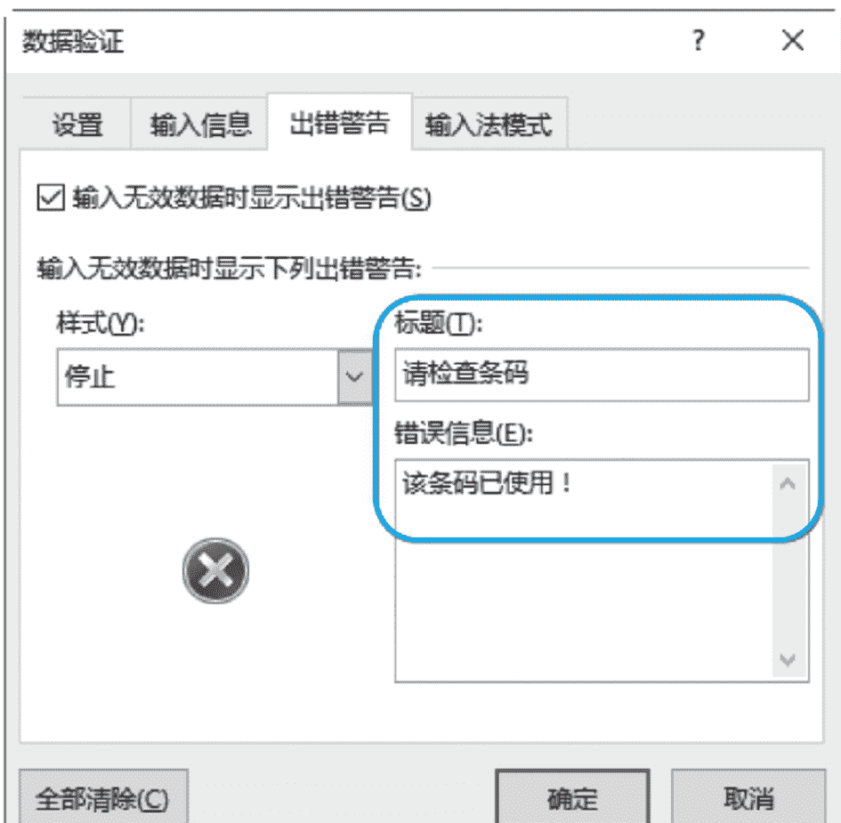

图1-94

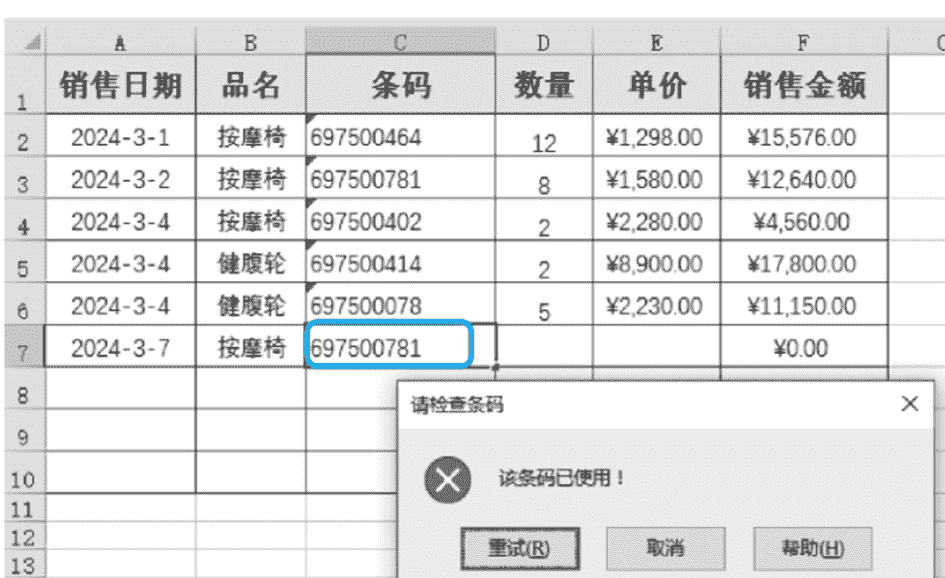

图1-95

## 1.3.7 DeepSeek指导禁止录入周末日期

如图1-96所示，想在加班日期列里禁止周末日期，也可以请 DeepSeek 给公式。

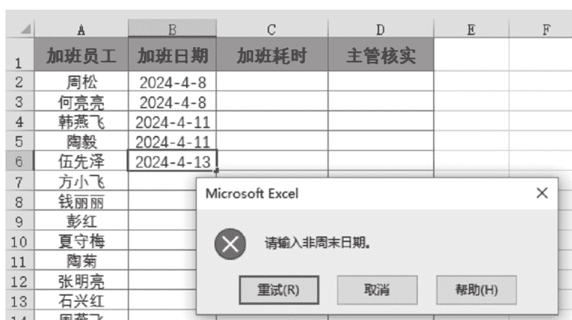

图1-96

在聊天框输入：在Excel中，要求在B列中禁止输入周末日期，否则弹出错误提示。，如图1-97所示。发送后得到如图1-98所示的回复。


图1-97

在Excel中，可以通过 **数据验证（Data Validation）** 功能来实现B列中禁止输入周末日期（即周六和周日），并在输入周末日期时弹出错误提示。具体步骤如下：

### 步骤 1：设置数据验证规则

1. 选中需要设置的单元格区域（例如 **B2:B20**，或者整列 **B:B**）。

2. 在菜单栏中点击 **数据（Data）** 选项卡。

3. 点击 **数据验证（Data Validation）** 按钮（在Excel 2016及更高版本中，可能显示为“数据验证”或“数据有效性”）。

4. 在弹出的对话框中，切换到 **设置（Settings）** 选项卡。

5. 在 **允许（Allow）** 下拉菜单中选择 **自定义（Custom）**。

6. 在 **公式（Formula）** 框中输入以下公式：

```
=WEEKDAY(B2,2)<6
```

这个公式的作用是检查当前单元格的日期是否为工作日：

- `WEEKDAY(B2,2)` 返回日期的星期几编号（1 表示周一，2 表示周二，...，7 表示周日）。

- `<6` 表示只允许输入周一到周五（编号为1到5）。

### 步骤 2：设置错误提示

1. 在 **数据验证** 对话框中，切换到 **错误警告（Error Alert）** 选项卡。

2. 勾选 **输入无效数据时显示出错警告（Show error alert after invalid data is entered）**。

图1-98

❷ 把公式复制回 Excel。选中需要管控的区域，打开 数据验证 。

设置 许可 为 自定义，在 公式 输入框粘贴，得到公式 =WEEKDAY(B3, 2) < 6，如图1-99所示。

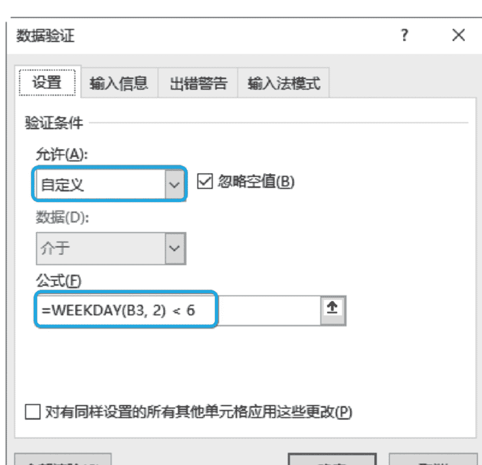

图1-99

4. 切换到 错误提醒 页签，填写提示文案，如图1-100所示。

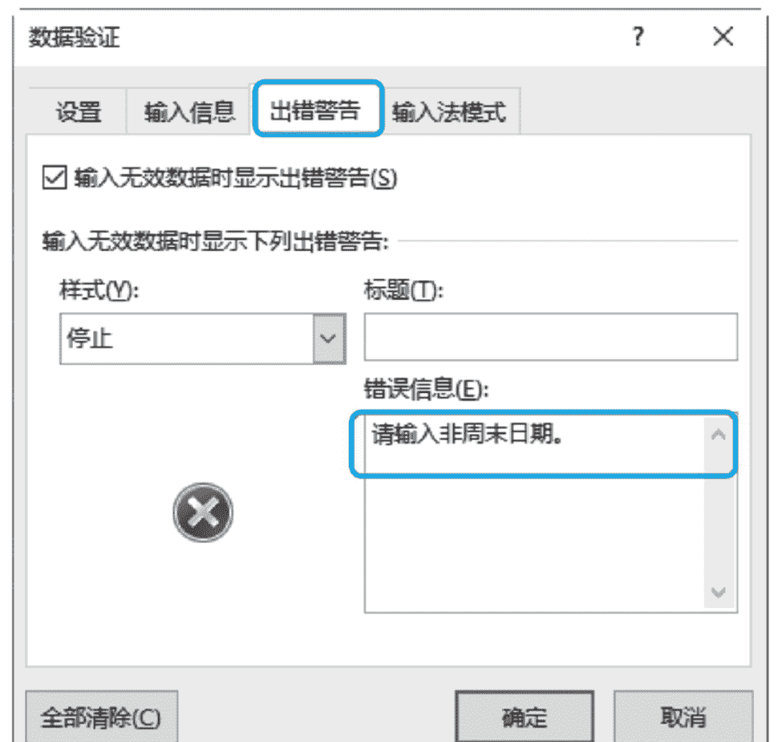

图1-100

❺ 点 确定 完成。之后在该区域输入周末日期时会自动弹出错误提示。

知识扩展
DeepSeek 回复里还对公式做了说明，如图1-101所示，便于理解函数逻辑。

> 这个公式的作用是检查当前单元格的日期是否为工作日：

- `WEEKDAY(B2,2)` 返回日期的星期几编号（1表示周一，2表示周二，...，7表示周日）。

- `<6` 表示只允许输入周一到周五（编号为1到5）。

图1-101

## 1.4 表格数据的移动、复制

数据录入后常需要编辑，比如修改、移动、复制或删除。修改很简单，选中单元格直接改或按 Delete 清空再重写。删除也直接选中后按 Delete。下面重点讲移动与复制。

### 1.4.1 把数据放到新位置

移动是日常编辑里最高频的操作，能大幅提升效率。

1. 移动数据到新位置

需要把工作表中的一块数据搬到空白区时，可以用鼠标拖动。

选中要移动的区域，鼠标变成拖动标志时按住左键拖到目标位置，松手即可完成搬移，如图1-102所示，结果如图1-103所示。

| 产品名称 | 产品类别 | 销售单价 | 销售数量 | 销售金额 |

|---|---|---|---|---|

| 小天鹅 | 洗衣机 | 1260 | 3 | 3780 |

| 海尔 | 洗衣机 | 3550 | 5 | 17750 |

| 戴尔 | 电脑 | 3200 | 2 | 6400 |

| 苹果 | 电脑 | 6800 | 4 | 27200 |

| 美菱 | 冰箱 | 1850 | 7 | 12950 |

| 康佳 | 彩电 | 2300 | 1 | 2300 |

| 清华同方 | 电脑 | 3860 | 9 | 34740 |

| 联想 | 电脑 | 3850 | 5 | 19250 |

图1-102

| 产品名称 | 产品类别 | 销售单价 | 销售数量 | 销售金额 |

|---|---|---|---|---|

| 小天鹅 | 洗衣机 | 1260 | 3 | 3780 |

| 海尔 | 洗衣机 | 3550 | 5 | 17750 |

| 美菱 | 冰箱 | 1850 | 7 | 12950 |

| 康佳 | 彩电 | 2300 | 1 | 2300 |

| 清华同方 | 电脑 | 3860 | 9 | 34740 |

| 联想 | 电脑 | 3850 | 5 | 19250 |

| 戴尔 | 电脑 | 3200 | 2 | 6400 |

| 苹果 | 电脑 | 6800 | 4 | 27200 |

图1-103

2. 调换两列的位置

如图1-104所示，产品类别在 B 列，现在想移到 A 列，效果如图1-105所示，操作如下。

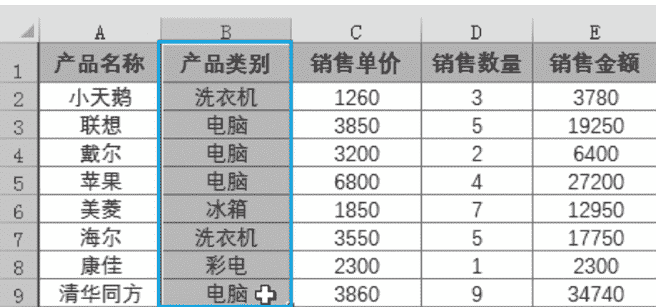

图1-104

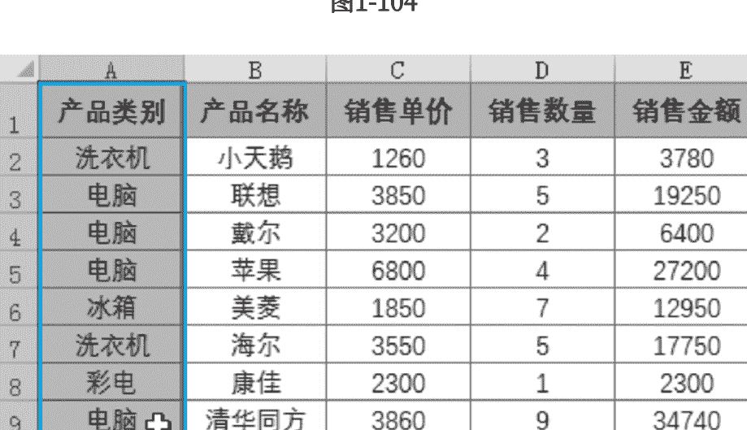

图1-105

❶ 选中 B1:B9，右键选择 剪切，如图1-106所示。

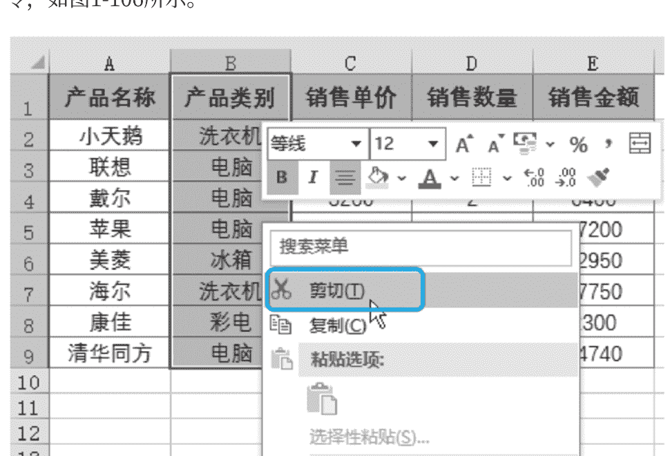

图1-106

❷ 选中 A1:A9，右键选择 插入剪切的单元格，如图1-107所示，即可把 B1:B9 的内容搬到 A1:A9。

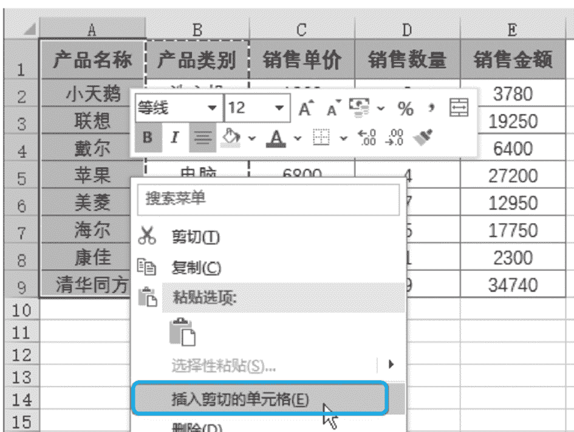

图1-107

练一练：配合快捷键快速调换两行数据。

调换列也可以剪切粘贴实现，也可用 Shift 键配合拖动。图1-108所示，把第5行调到第4行，操作要点是选中整行，鼠标移到行号边线，按住 Shift 拖到目标位置。

| A | B | C | D | E | F | G | H |

|---|---|---|---|---|---|---|---|

| 日期 | 客户姓名 | 年龄 | 联系电话 | 职业 | 需求户型 | 接受价格 | 职业顾问 |

| 2024-9-1 | 程云 | 29 | 15855178596 | 销售经理 | 二居 | 45万 | 华新 |

| 2024-9-1 | 戴王新 | 32 | 13254685621 | 销售经理 | 三居 | 50万 | 黎明 |

| 2024-9-2 | 邓翠翠 | 30 | 13326563369 | 人事经理 | 二居 | 50万 | 张华 |

| 2024-9-1 | 何如新 | 27 | 18145722563 | 公司经理 | 二居 | 60万 | 黎明 |

| 2024-9-2 | 胡夏 | 26 | 13685245412 | 个体户 | 三居 | 75万 | 华新 |

| 2024-9-2 | 霍振宇 | 28 | 15556253693 | 个体户 | 二居 | 75万 | 张华 |

| 2024-9-2 | 李曼 | 32 | 13965826954 | 商厦经理 | 三居 | 75万 | 黎明 |

| 2024-9-3 | 李明宇 | 27 | 18124565623 | 个体户 | 三居 | 60万 | 路飞 |

| 2024-9-3 | 卢晓磊 | 28 | 13025698541 | 银行职员 | 二居 | 75万 | 黎明 |

图1-108

### 1.4.2 非连续单元格复制妙招

在整理表格时，相同的条目经常会出现，反复手动输入既慢又容易出错。复制粘贴是提升效率的常用手段，下面以图1-109 为例演示具体做法。

1. 将活动单元格定位到 C3，使用 Ctrl+C 把内容拷贝到剪贴板，如图1-109 所示。

| | A | B | C | D |

|---|---|---|---|---|

| 1 | | | **用户资料** | |

| 2 | **姓名** | **性别** | **家庭住址** | |

| 3 | 莫离 | 女 | 江苏 | 淮安 |

| 4 | 宋兰 | 女 | 安徽 | 六安 |

| 5 | 刘飞 | 男 | 安徽 | 阜阳 |

| 6 | 陈冲 | 男 | | 南京 |

| 7 | 张远 | 男 | 安徽 | 合肥 |

| 8 | 杜子明 | 男 | 安徽 | 巢湖 |

| 9 | 周雅 | 女 | | 常州 |

| 10 | 杜云 | 男 | | 盐城 |

图1-109

❷ 按住 Ctrl 逐一点击 C6、C9、C10，多选完成后按 Ctrl+V，即可把 C3 的内容同时填入这几个分散的单元格，效果如图1-110 所示。

| A | B | C | D |

|---|---|---|---|

| | | **用户资料** | |

| **姓名** | **性别** | **家庭住址** | |

| 莫离 | 女 | 江苏 | 淮安 |

| 宋兰 | 女 | 安徽 | 六安 |

| 刘飞 | 男 | 安徽 | 阜阳 |

| 陈冲 | 男 | 江苏 | 南京 |

| 张远 | 男 | 安徽 | 合肥 |

| 杜子明 | 男 | 安徽 | 巢湖 |

| 周雅 | 女 | 江苏 | 常州 |

| 杜云 | 男 | 江苏 | 盐城 |

图1-110

练一练：复制不连续的数据。

在如图1-111 所示的表格中，把所有需求户型为“三居”的记录整体搬到另一张工作表。

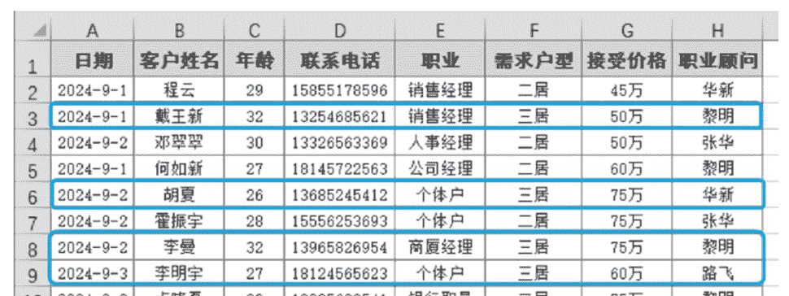

图1-111

### 1.4.3 让粘贴结果匹配目标格式

1.4.2 小节讲的是原样搬运。Excel 另外提供了粘贴选项与选择性粘贴，可以在粘贴的同时实现格式适配、数据联动、批量运算等效果。

当希望复制的内容进入目标表后使用目标表的排版样式时，可以这样操作。

1. 框选需要搬运的区域，按 Ctrl+C 复制，如图1-112 所示，移动到目标位置后按 Ctrl+V 粘贴，如图1-113 所示，默认会保留来源的样式。

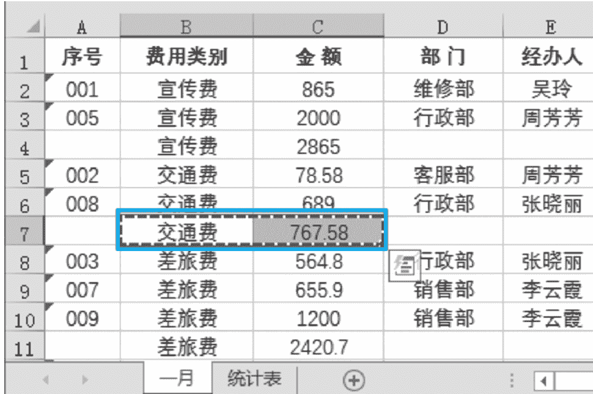

图1-112

❷ 粘贴后会出现粘贴选项按钮，点击展开菜单，从中挑选“值”选项，如图1-114 所示，就能让新数据套用目标区域的格式，如图1-115 所示。

# 费用统计表

| 费用类别 | 金额 |

| :--- | :--- |

| 宣传费 | ¥ 2,865.00 |

| 交通费 | 767.58 |

图1-113

# 费用统计表

| 费用类别 | 金额 |

| :--- | :--- |

| 宣传费 | ¥ 2,865.00 |

| 交通费 | 767.58 |

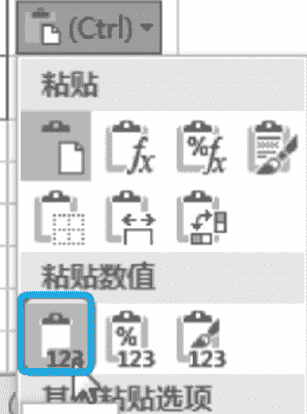

图1-114

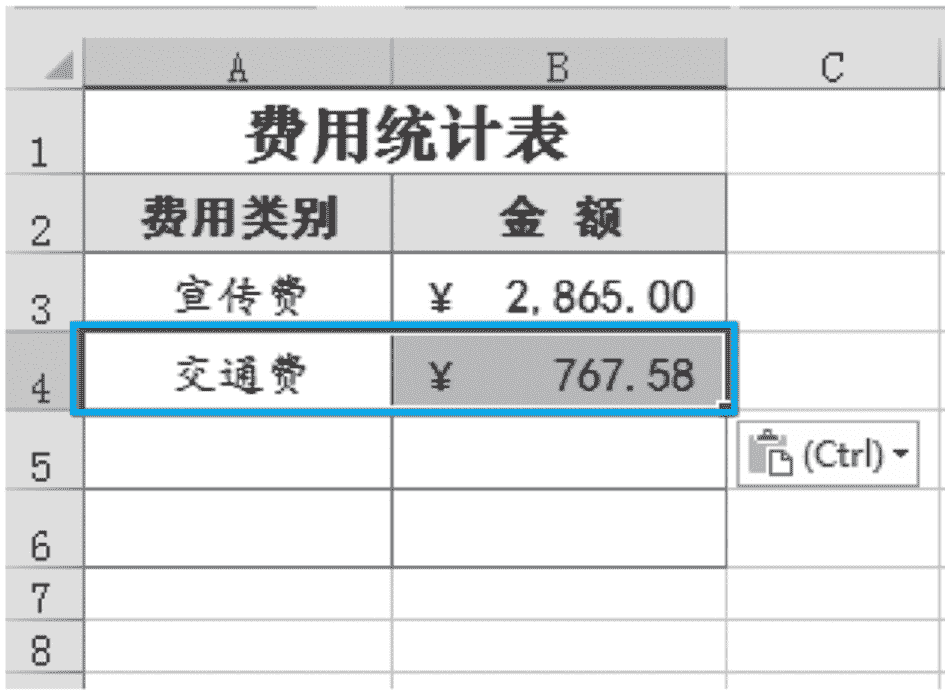

图1-115

练一练：复制数据并保持前后两处数据相链接。

如图1-116 所示为产品的“单价表”，如图1-117 所示为“利润率计算表”，要求保持两个表格的“进货单价”列的数据相链接，即当在“单价表”中更改某商品的单价时，“利润率计算表”中的单价也可以自动更改。

| 序号 | 产品 | 瓦数 | 产地 | 进货单价 |

|---|---|---|---|---|

| 001 | 白炽灯 | 200 | 南京 | 4.5 |

| 002 | led灯带 | 2米 | 广州 | 12.8 |

| 003 | 日光灯 | 100 | 广州 | 8.8 |

| 004 | 白炽灯 | 80 | 南京 | 2.0 |

| 005 | 白炽灯 | 100 | 南京 | 3.2 |

| 006 | 2d灯管 | 5 | 广州 | 12.5 |

| 007 | 2d灯管 | 10 | 南京 | 18.2 |

| 008 | led灯带 | 5米 | 南京 | 22.0 |

| 009 | led灯带 | 10米 | 广州 | 36.5 |

图1-116

| 产品 | 瓦数 | 产地 | 进货单价 | 销售单价 | 销售数量 | 利润率 |

|---|---|---|---|---|---|---|

| 白炽灯 | 200 | 南京 | 4.5 | 6.2 | 95 | |

| led灯带 | 2米 | 广州 | 12.8 | 15.5 | 125 | |

| 日光灯 | 100 | 广州 | 8.8 | 11.5 | 110 | |

| 白炽灯 | 80 | 南京 | 2.0 | 4.0 | 198 | |

| 白炽灯 | 100 | 南京 | 3.2 | 6.0 | 224 | |

| 2d灯管 | 5 | 广州 | 12.5 | 16.8 | 220 | |

| 2d灯管 | 10 | 南京 | 18.2 | 25.0 | 184 | |

| led灯带 | 5米 | 南京 | 22.0 | 28.0 | 170 | |

| led灯带 | 10米 | 广州 | 36.5 | 45.5 | 198 | |

图1-117

### 1.4.4 把公式结果转为固定数值

公式算出结果后，为了方便移动或分享，有时需要把计算结果固化为数值。图1-118 的 C 列包含公式，下面演示固化方法。

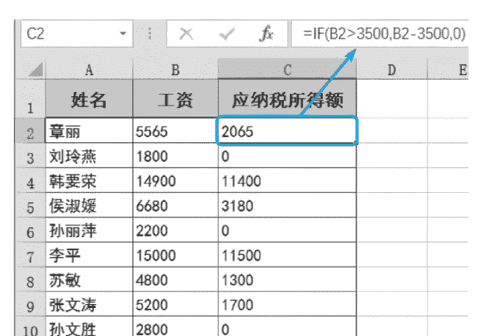

图1-118

1. 选中 C2:C10 区域，先用 Ctrl+C 复制，再用 Ctrl+V 粘贴。
❷ 点击粘贴区域右下角的下拉箭头，在菜单中选择“值”选项，如图1-119 所示，即可只保留计算结果。

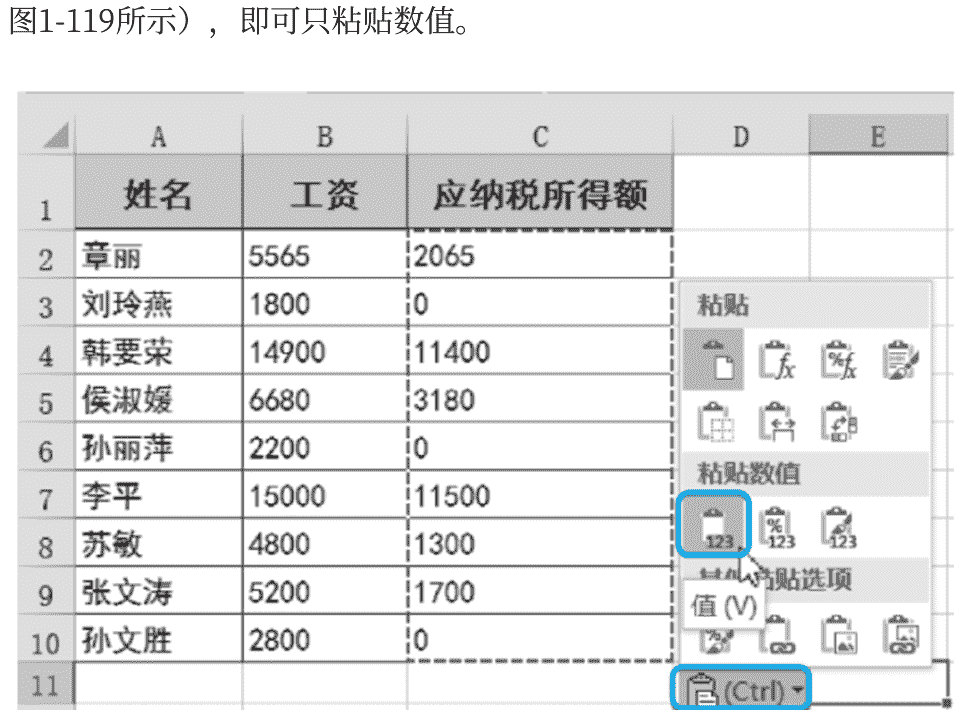

### 1.4.5 数据验证规则批量复制

为某区域设置好数据验证后，若新表需要同样的校验规则，不必重新设置，可通过选择性粘贴把验证条件复制过去，操作如下。

❶ 选中已设置验证的 C2:C15 区域，按 Ctrl+C 复制，如图1-120 所示。

| A | B | C |

|---|---|---|

| 工号 | 值班人 | 值班日期 |

| NO.001 | 邓二超 | 2024/4/4 |

| NO.002 | 包娟娟 | 2024/4/10 |

| NO.003 | 陈潇 | 2024/4/15 |

| NO.004 | 张兴 | 2024/4/16 |

| NO.005 | 陈在全 | 2024/4/17 |

| NO.006 | 王辉 | 2024/4/18 |

| NO.007 | 柳林娜 | 2024/4/19 |

| NO.008 | 李倩 | 2024/4/20 |

| NO.009 | 李凌云 | 2024/4/21 |

| NO.010 | 王婷婷 | 2024/4/22 |

| NO.011 | 柳小续 | 2024/4/23 |

| NO.012 | 许开 | 2024/4/24 |

| NO.013 | 穆宇飞 | 2024/4/25 |

| NO.014 | 于青青 | 2024/4/26 |

图1-120

❷ 切换到需要套用验证的工作表，选中目标区域，在“开始”选项卡的“剪贴板”组中打开粘贴下拉列表，选择“选择性粘贴”命令，如图1-121 所示。

图1-121

❸ 在对话框的“粘贴”栏中勾选“验证”单选按钮，如图1-122 所示。

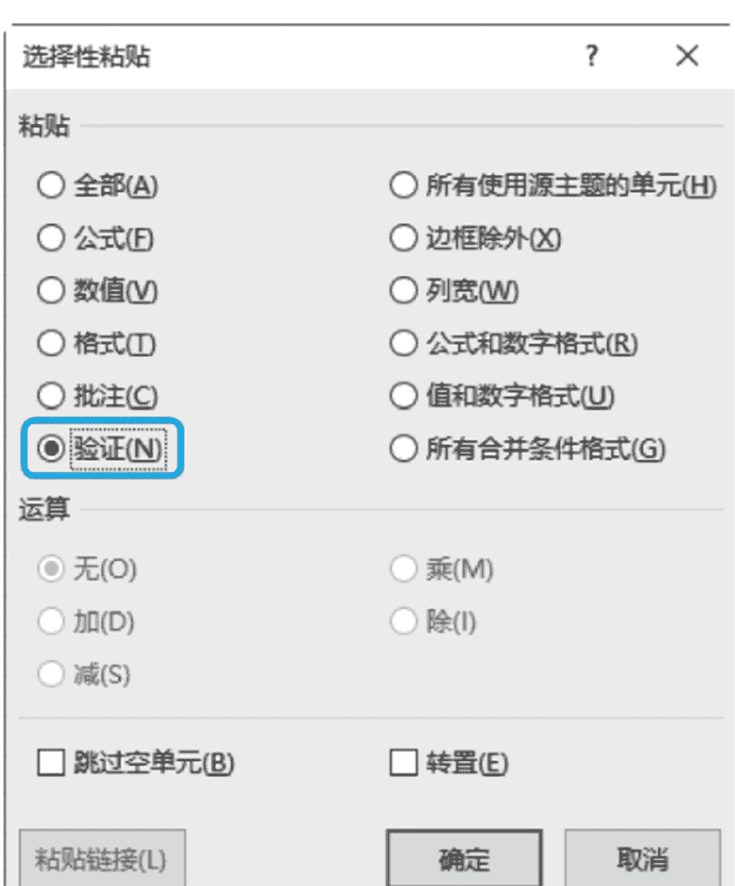

图1-122

❹ 单击“确定”按钮，目标区域即可应用相同的验证条件，输入日期超出范围时会弹出警告提示框，如图1-123 所示。

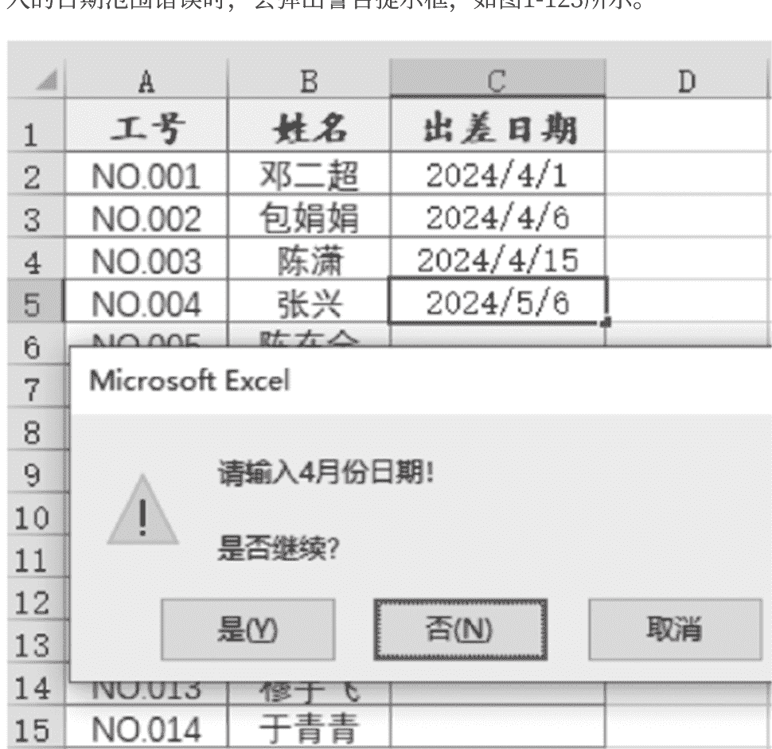

图1-123

## 1.4.6 借助 AI 思路做批量运算

处理数据时常需要对一整列统一加减乘除，例如单价整体上调、工资统一增加。手工修改效率低，可以向 DeepSeek 请教方法。

❶ 在聊天框输入“在Excel表格中，想把D列中的进货单价统一上调10%，该如何操作？”，如图1-124 所示。发送后得到如图1-125 所示的回复信息。


图1-124

在 Excel 中将 D 列中的进货单价统一上调 10%，可以通过以下步骤实现：

### 方法 1：使用公式

1. 选择一个空白列（比如 E 列）。

2. 在 E2 单元格中输入公式（假设 D2 是你的进货单价）：

```
=D2 * 1.1
```

3. 按 Enter 键，然后拖动填充柄（单元格右下角的小方块）向下填充公式，以覆盖整个 E 列。

4. 复制 E 列的数据：

    - 选择 E 列中计算出的所有单元格。

    - 右键点击选择“复制”。

    - 选择 D 列相应区域（从 D2 开始到最后一个需要更新的单元格）。

    - 右键点击选择“粘贴值”。

5. 删除 E 列（如果不再需要）。

### 方法 2：使用粘贴特殊功能

1. 在任意单元格中输入值 1.1。

2. 复制该单元格（包含 1.1 的单元格）。

3. 选择 D 列中的所有单元格（从 D2 开始到最后一个需要更新的单元格）。

4. 点击“粘贴”下拉菜单，选择“粘贴特殊”。

5. 在“粘贴特殊”对话框中，选择“乘”选项，然后点击“确定”。

    - 这会将 D 列中的每个单元格的值乘以 1.1，实现统一上调 10%。

### 注意事项

- 备份数据：操作前最好备份原始数据，以防出现意外错误。

- 检查结果：完成操作后，检查几行数据以确保计算正确。

图1-125

从回复可见有公式法和粘贴特殊法两种思路。下面采用方法2演示。

❷ 回到 Excel，在空白单元格输入“1.1”，按 Ctrl+C 复制，再选中进货单价的单元格区域。
❸ 在“开始”选项卡的“剪贴板”组中单击“粘贴”按钮，打开下拉菜单选择“选择性粘贴”命令，如图1-126 所示。

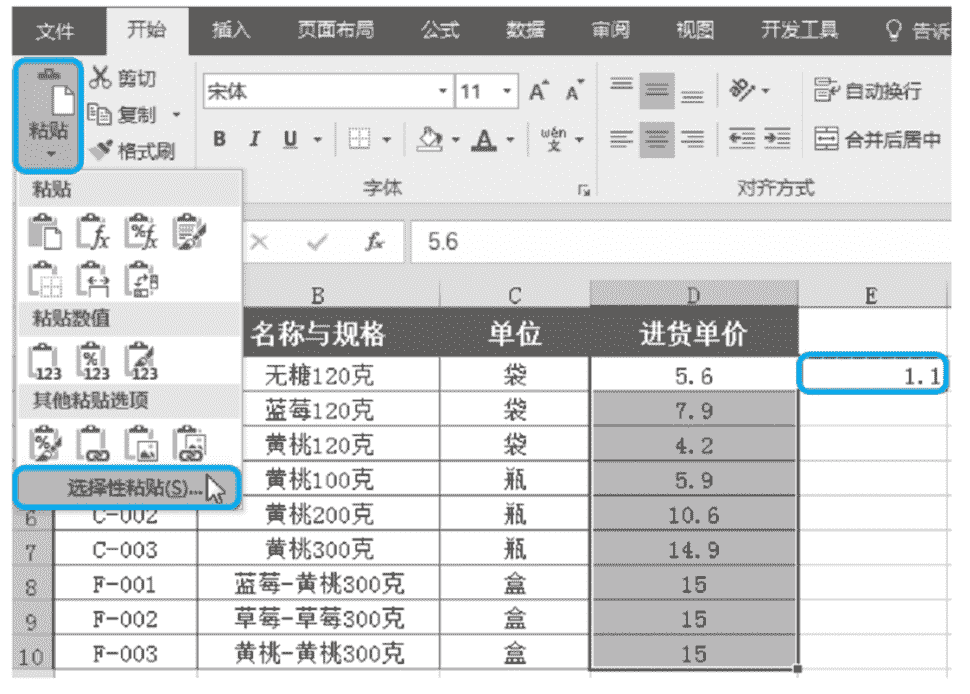

图1-126

❹ 打开“选择性粘贴”对话框，在“运算”栏中选中“乘”单选按钮，如图1-127 所示。

### 选择性粘贴

**粘贴**

- 全部(A)

- 公式(F)

- 数值(V)

- 格式(T)

- 批注(C)

- 验证(N)

- 所有使用源主题的单元(H)

- 边框除外(X)

- 列宽(W)

- 公式和数字格式(R)

- 值和数字格式(U)

- 所有合并条件格式(G)

**运算**

- 无(O)

- 加(D)

- 减(S)

- 乘(M)

- 除(I)

- 跳过空单元(B)

- 转置(E)

粘贴链接(L)

确定

取消

图1-127

❺ 单击“确定”按钮，所有被选中的单元格会完成乘1.1的运算，结果如图1-128 所示。

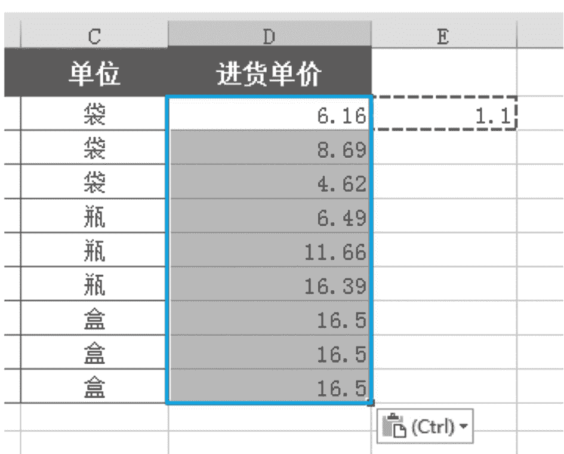

图1-128

## 专家提示

编辑表格时若发现输入被拦截并弹出阻止框，通常是该区域被设置了数据验证。此时选中区域打开数据验证对话框，点击左下角的“全部删除”按钮即可解除限制。

## 1.5 数据查找与替换

在日常办公中，需要从大量数据里定位记录或批量修改，手动操作效率很低，可以使用“查找和替换”功能。

### 1.5.1 快速查找指定记录

表格数据众多时，肉眼查找费时，可用查找工具迅速命中。

1. 打开工作表，在“开始”选项卡的“编辑”组中单击“查找”下拉按钮，选择“查找”命令，或直接按 Ctrl+F，打开“查找和替换”对话框。在“查找内容”文本框中输入“崔娜”，单击“查找全部”按钮，如图1-129 所示。
2. 按 Ctrl+A 组合键选中所有查找结果，如图1-130 所示。

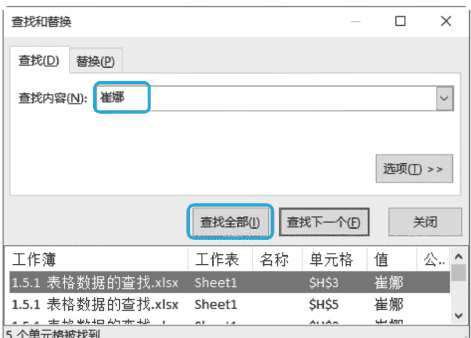

图1-129

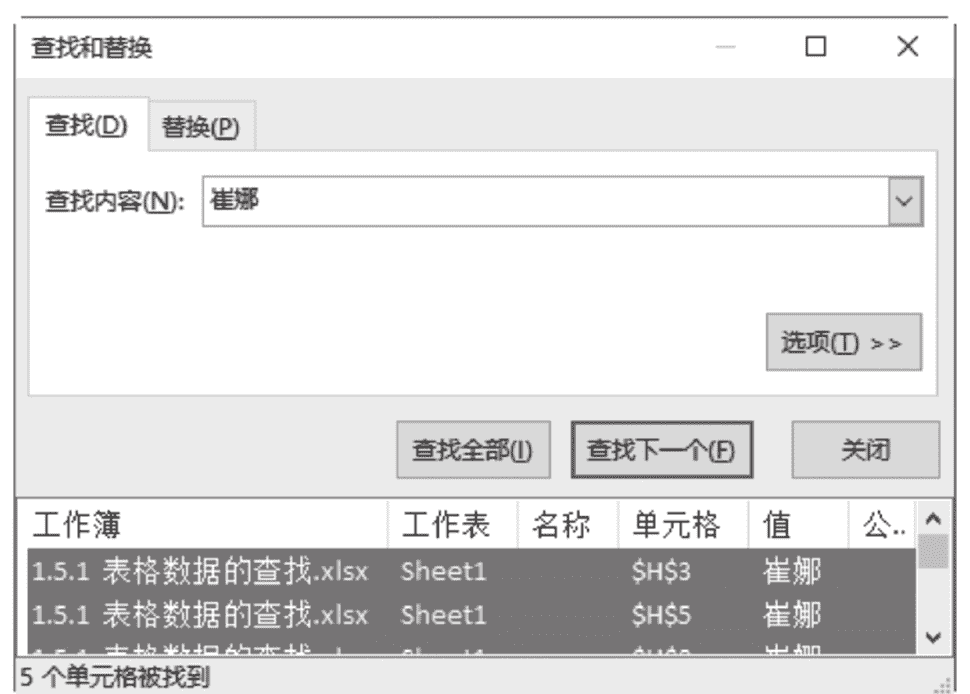

图1-130

❸ 关闭“查找与替换”对话框，可以看到工作表中所有找到的单元格都被选中，如图1-131 所示。

| A | B | C | D | E | F | G | H |

|---|---|---|---|---|---|---|---|

| 日期 | 客户姓名 | 年龄 | 联系电话 | 职业 | 需求户型 | 接受价格 | 职业顾问 |

| 2024-9-1 | 程云 | 29 | 15855178596 | 销售经理 | 二居 | 45万 | 刘志飞 |

| 2024-9-1 | 戴王新 | 32 | 13254685621 | 销售经理 | 三居 | 50万 | 崔娜 |

| 2024-9-2 | 邓翠翠 | 30 | 13326563369 | 人事经理 | 二居 | 50万 | 张华 |

| 2024-9-1 | 何如新 | 27 | 18145722563 | 公司经理 | 二居 | 60万 | 崔娜 |

| 2024-9-2 | 胡夏 | 26 | 13685245412 | 个体户 | 三居 | 75万 | 刘志飞 |

| 2024-9-2 | 霍振宇 | 28 | 15556253693 | 个体户 | 二居 | 75万 | 张华 |

| 2024-9-2 | 李曼 | 32 | 13965826954 | 商厦经理 | 三居 | 75万 | 崔娜 |

| 2024-9-3 | 李明宇 | 27 | 18124565623 | 个体户 | 三居 | 60万 | 路飞 |

| 2024-9-3 | 卢晓磊 | 28 | 13025698541 | 银行职员 | 二居 | 75万 | 崔娜 |

| 2024-9-5 | 袁锋 | 31 | 15021306325 | 销售经理 | 三居 | 75万 | 刘志飞 |

| 2024-9-7 | 张凤 | 26 | 13026563230 | 企业主管 | 二居 | 75万 | 崔娜 |

图1-131

## 专家提示

在“查找和替换”对话框中连续单击“查找下一个”按钮，可以逐条跳转到匹配单元格；若想一次性查看全部匹配项，则单击“查找全部”按钮。

练一练：精准匹配查找

查找时只要单元格包含关键词就会被命中。在图1-132 所示的表格中，要求仅命中“经理”，而“销售经理”“区域经理”“人事经理”等不被纳入结果。

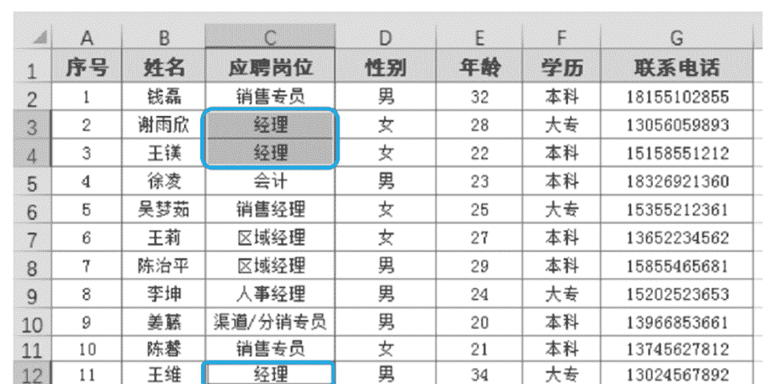

图1-132

### 1.5.2 批量替换错误信息

复制旧表使用或录入错误时，需要对大量相同内容统一修改，替换功能可实现快速更新。

#### 1. 查找并替换数据

例如某食品厂车间生产产量预期表中，因结构调整需把“第三车间”统一改为“综合车间”，可用替换功能一次性完成，操作如下。

1. 用 Ctrl+H 调出查找替换面板，在查找区域填入“第三车间”，在替换区域填入“综合车间”，界面参考图1-133。

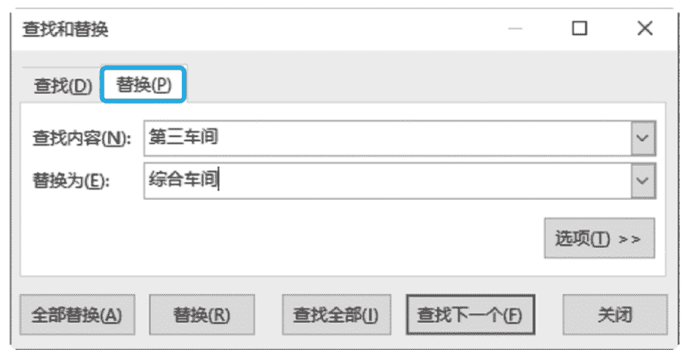

图1-133

❷ 接着按下“全部替换”，系统会弹出提示告知本次共完成3次替换，效果见图1-134。

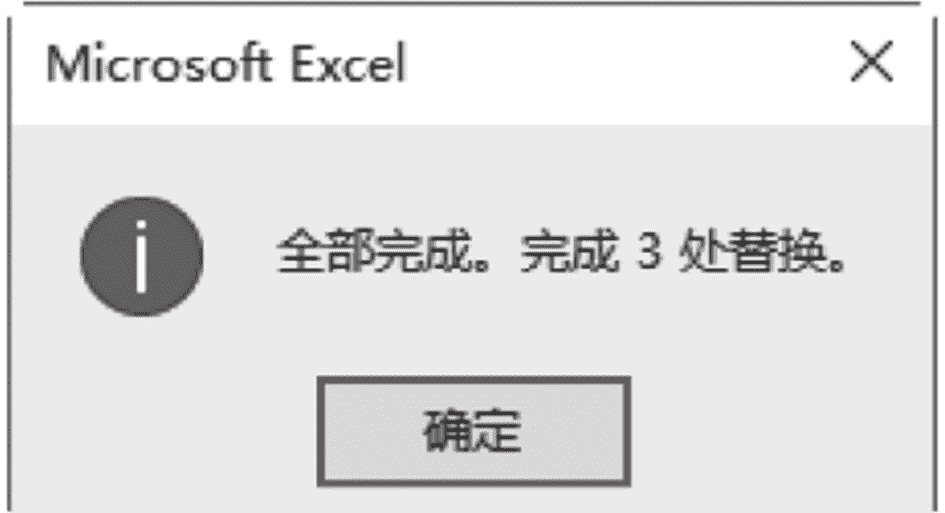

图1-134

3. 确认提示后关闭对话框，可看到替换完成后的表格，如图1-135所示。

| 产品名称 | 生产数量 | 单位 | 生产车间 |

| :--- | :--- | :--- | :--- |

| 山楂片 | 20000 | 袋 | 第一车间 |

| 小米锅粑 | 24000 | 袋 | 第二车间 |

| 通心卷 | 16000 | 袋 | 第二车间 |

| 蚕豆 | 12000 | 袋 | 第二车间 |

| 鱼皮花生 | 30000 | 袋 | 第二车间 |

| 豆腐干 | 27000 | 袋 | 第一车间 |

| 薯条 | 25000 | 袋 | 综合车间 |

| 话梅 | 10000 | 袋 | 第二车间 |

| 沙琪玛 | 15000 | 袋 | 综合车间 |

| 早餐饼干 | 12000 | 袋 | 综合车间 |

| 蛋黄派 | 20000 | 袋 | 第一车间 |

| 巧克力豆 | 7000 | 袋 | 第二车间 |

图1-135

#### 2. 替换的同时套用特殊样式
查找替换不仅能改内容，还能给新内容指定专属格式，方便后续核对。下面以把“第三车间”改为“综合车间”并以红色加粗显示为例。

1. 按 Ctrl+H 打开查找替换窗口，点击“选项”展开完整面板。查找框内写入“第三车间”，替换框内写入“综合车间”，随后在替换框右侧的格式下拉中选择“格式”命令，见图1-136。

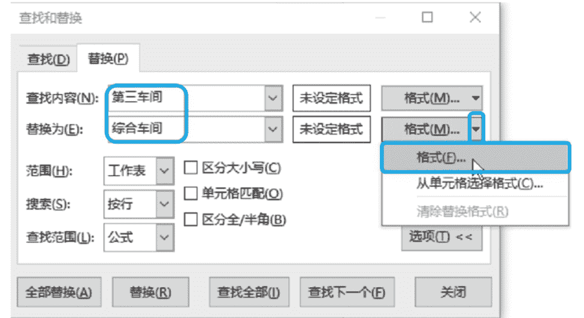

图1-136

❷ 弹出“替换格式”窗口后切换到“字体”页，字形列表中勾选“加粗”，颜色下拉中挑选“红色”，见图1-137。

❸ 设置完毕点“确定”返回主窗口，预览区会即时呈现样式，见图1-138。

❹ 最后按下“全部替换”，内容被更新的同时单元格也应用了红色加粗，见图1-139。

### 替换格式

数字 对齐 字体 边框 填充 保护

字体(F):

字形(O):

字号(S):

- 宋体 (标题)

- 宋体 (正文)

- Malgun Gothic Semilight

- Microsoft YaHei Light

- Microsoft YaHei UI

- Microsoft YaHei UI Light

- 常规

- 倾斜

- 加粗

- 加粗倾斜

- 6

- 8

- 9

- 10

- 11

- 12

下划线(U):

颜色(C):

特殊效果

预览

- [x] 删除线(K)

- [x] 上标(E)

- [ ] 下标(B)

Calibri

清除(R)

从单元格选择格式(A)...

确定

取消

图1-137

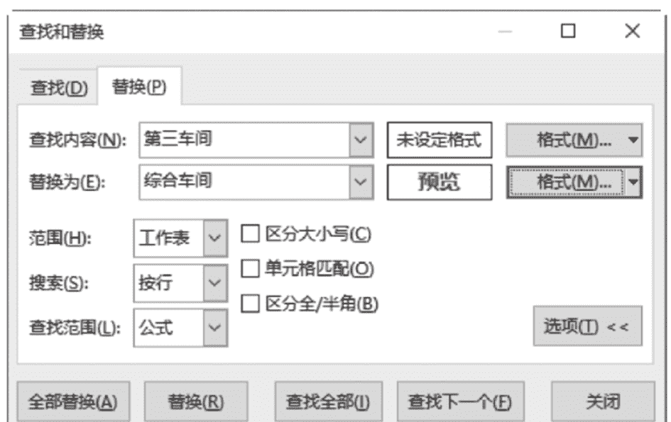

图1-138

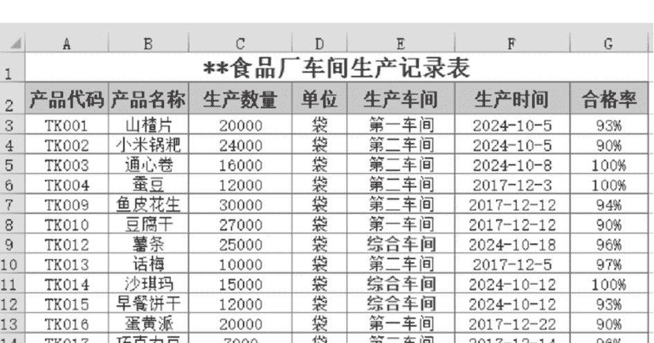

图1-139

### 练一练：整本工作簿统一修正笔误
图1-140 的工作簿里多张表都把“白炽灯”写成了“白织灯”，若想一次改完，需要在查找替换对话框里把作用范围由默认的当前工作表改为整个工作簿。


图1-140

# 第2章 学会整理不规范的数据


扫码看教学视频

## 2.1 学会规范建表
表格是统计与计算的基础，财务处理亦然。数据量越大，处理环节越关键，也越费事，直接影响报表质量。建表时坚持规范，让数据与格式统一，后续工作会顺畅许多。

### 2.1.1 数据格式要规范
格式统一是建表的首要门槛。各类信息应采用标准写法，数字要用常规或数值类型保存，勿存成文本。日期也不能写成“20240325”“2024.3.25”“24.3.25”等非标准形式，否则后续运算会失败或出错。

#### 例1：使用程序可识别的日期写法
图2-1 中需依据入职时间算工龄与工龄工资，但 E 列的入职日期写法程序无法识别，导致 F 列和 G 列引用计算出错，如图2-1所示。


图2-1

按日期筛选同样失效，如图2-2所示。


图2-2

#### 例2：避免在数值后加中文单位
图2-3 中“基本工资”列部分数值后带了“元”，数字被转为文本，计算时出现“#VALUE!”错误。

| A | B | C | D |

|---|---|---|---|

| 姓名 | 基本工资 | 工龄工资 | 实发工资 |

| 蔡瑞暖 | 3200 | 320 | 3520 |

| 陈家玉 | 2500元 | 360 | #VALUE! |

| 王莉 | 2500元 | 320 | #VALUE! |

| 吕从英 | 3000 | 160 | 3160 |

| 邱路平 | 2500元 | 440 | #VALUE! |

| 岳书焕 | 1800 | 160 | 1960 |

| 明雪花 | 3200元 | 160 | #VALUE! |

| 陈惠婵 | 3000 | 160 | 3160 |

| 廖春 | 3200 | 160 | 3360 |

图2-3

#### 例3：避免插入无意义的空白
图2-4 想查询“韩燕”的应缴所得税却查不到。仔细观察会发现录入时为美观在双字姓名中间加入了空格，导致匹配失败，给后续处理带来困扰。


图2-4

### 2.1.2 表格结构要规范
结构规范同样关键。用于计算分析的表格切勿随意合并单元格，合并会破坏数据的连续性，后续处理易出错。

#### 例1：拒绝合并单元格
图2-5 的数据源在工作中很常见。仅作展示尚可，但填充序号时会失败，如图2-6所示；用数据透视表汇总也会出错，如图2-7所示。

| 产品代码 | 日期 | 订单量 | 销售员 |

| :--- | :--- | :--- | :--- |

| ASP0021361 | 2024-6-12 | 956 | 李杰 |

| | 2024-6-14 | 105 | 林瑞洋 |

| | 2024-6-19 | 360 | 崔娜 |

| ASP0021354 | 2024-6-14 | 521 | 李杰 |

| ASP5791311 | 2024-6-19 | 36 | 王加佳 |

| | 2024-6-20 | 540 | 何小芸 |

| ASP5701987 | 2024-6-5 | 369 | 林瑞洋 |

| | 2024-6-10 | 655 | 崔娜 |

| ASP632100 | 2024-6-5 | 541 | 李杰 |

图2-5


图2-6


图2-7

#### 例2：多表保持一致的结构意识
多表联动的工作簿要保持结构统一。如要汇总全年工资总额，各月工资表的格式必须相同，如图2-8所示，这样才能用函数快速求和，如图2-9所示。以“12月”表为例，第一位员工的实发工资在 T3。若各表结构不同，列位置、员工顺序都可能变化，就无法一次性求和，只能写成“= ‘1月’ !G4+ ‘2月’ !H3+ … + ‘12月’ !T3”这种手工拼凑的公式。


图2-8


图2-9

### 2.1.3 数据名称要保持统一
表内名称必须统一，不能时而全称时而简称，也不能在名称里随意加空格，否则统计会出错。

例如图2-10 的“诺航公司订单统计表”中，“安徽新世纪电子有限公司”与“新世纪电子有限公司”实际是同一家，但在 Excel 中被视为两家，导致求和、分类汇总、数据透视加工时出错。

## 诺航公司订单统计表

| 日期 | 合同号 | 客户名称 | 商品名称 | 颜色 | 金额 |

|---|---|---|---|---|---|

| 2020/1/1 | 20200001 | 安徽新世纪电子有限公司 | 商品A | 红 | 1592.0 |

| 2020/1/8 | 20200002 | 安徽新世纪电子有限公司 | 商品A | 红 | 2592.0 |

| 2020/1/8 | 20200008 | 安徽新世纪电子有限公司 | 商品CCC | 灰 | 6951.0 |

| 2020/1/11 | 20200003 | 江苏新科电子有限公司 | 商品BB | 黑 | 3965.9 |

| 2020/1/20 | 20200005 | 新世纪电子有限公司 | 商品A | 红 | 5628.0 |

| 2020/1/21 | 20200006 | 学舟软件科技有限公司 | 商品BB | 灰 | 2569.0 |

| 2020/2/2 | 20200007 | 学舟软件科技有限公司 | 商品A | 红 | 6952.0 |

| 2020/2/15 | 20200009 | 江苏新科电子有限公司 | 商品A | 黑 | 5589.0 |

| 2020/2/21 | 20200010 | 江苏新科电子有限公司 | 商品CCC | 红 | 8720.0 |

| 2020/3/7 | 20200011 | 学舟软件科技有限公司 | 商品A | 黑 | 5899.3 |

| 2020/3/21 | 20200012 | 学舟软件科技有限公司 | 商品A | 红 | 2592.3 |

| 2020/3/21 | 20200004 | 新世纪电子有限公司 | 商品CCC | 红 | 5962.0 |

| 2020/3/30 | 20200013 | 江苏新科电子有限公司 | 商品CCC | 红 | 5862.0 |

图2-10

## 诺航公司订单统计表

| 日期 | 合同号 | 客户名称 | 商品名称 | 颜色 | 金额 |

|---|---|---|---|---|---|

| 2020/1/21 | 20200006 | 学舟软件科技有限公司 | 商品BB | 灰 | 2569.0 |

| 2020/2/2 | 20200007 | 学舟软件科技有限公司 | 商品A | 红 | 6952.0 |

| 2020/3/7 | 20200011 | 学舟软件科技有限公司 | 商品A | 黑 | 5899.3 |

| 2020/3/21 | 20200012 | 学舟软件科技有限公司 | 商品A | 红 | 2592.3 |

| | | 学舟软件科技有限公司 汇总 | | | 18012.6 |

| 2020/3/21 | 20200004 | 新世纪电子有限公司 | 商品CCC | 红 | 5962.0 |

| 2020/1/20 | 20200005 | 新世纪电子有限公司 | 商品A | 红 | 5628.0 |

| | | 新世纪电子有限公司 汇总 | | | 11590.0 |

| 2020/1/11 | 20200003 | 江苏新科电子有限公司 | 商品BB | 黑 | 3965.9 |

| 2020/2/15 | 20200009 | 江苏新科电子有限公司 | 商品A | 黑 | 5589.0 |

| 2020/2/21 | 20200010 | 江苏新科电子有限公司 | 商品CCC | 红 | 8720.0 |

| 2020/3/30 | 20200013 | 江苏新科电子有限公司 | 商品CCC | 红 | 5862.0 |

| | | 江苏新科电子有限公司 汇总 | | | 24136.9 |

| 2020/1/1 | 20200001 | 安徽新世纪电子有限公司 | 商品A | 红 | 1592.0 |

| 2020/1/8 | 20200002 | 安徽新世纪电子有限公司 | 商品A | 红 | 2592.0 |

| 2020/1/8 | 20200008 | 安徽新世纪电子有限公司 | 商品CCC | 灰 | 6951.0 |

| | | 安徽新世纪电子有限公司 汇总 | | | 11135.0 |

| | | 总计 | | | 64874.5 |

图2-11

再看图2-12，“销售月份”列中“1月”“一月”“2月”“二月”混用，导致统计时无法归并，结果错误。

| 序号 | 产品 | 销售月份 | 销售金额 |

|---|---|---|---|

| 1 | 通用别克-别克GL8 | 1月 | 485,000 |

| 2 | 通用别克-君越 | 1月 | 158,000 |

| 3 | 通用别克-林荫大道 | 二月 | 369,000 |

| 4 | 通用别克-英朗 | 2月 | 154,000 |

| 5 | 通用别克-君威 | 2月 | 608,000 |

| 6 | 通用别克-英朗 | 2月 | 308,000 |

| 7 | 通用别克-君威 | 1月 | 210,000 |

| 8 | 通用别克-凯越 | 1月 | 110,000 |

| 9 | 通用别克（进口）-昂科雷 | 1月 | 508,000 |

| 10 | 通用别克-君越 | 二月 | 158,000 |

| 11 | 通用别克-林荫大道 | 一月 | 369,000 |

| 12 | 通用别克-英朗 | 一月 | 154,000 |

| 13 | 通用别克-君威 | 2月 | 608,000 |

| 14 | 通用别克-英朗 | 2月 | 308,000 |

| 15 | 通用别克-别克GL8 | 1月 | 675,000 |

| 16 | 通用别克-凯越 | 1月 | 110,000 |

| 17 | 别克（进口）-昂科雷 | 1月 | 508,000 |

| 18 | 通用别克-别克GL8 | 一月 | 242,500 |

| 19 | 通用别克-君越 | 一月 | 158,000 |

| 20 | 通用别克-林荫大道 | 一月 | 369,000 |

| 21 | 通用别克-君威 | 2月 | 210,000 |

| 行标签 | 求和项:销售金额 |

|---|---|

| 一月 | 1292500 |

| 二月 | 527000 |

| 1月 | 2764000 |

| 2月 | 2196000 |

| 总计 | 6779500 |

图2-12

### 2.1.4 保持数据的连续性
记录之间不应出现空行或空列，否则会破坏连续性，给排序、筛选、分类汇总、数据透视带来不便。图2-13 的表格中间插入了合计行，操作时会受影响。建议源表保持干净，统计时再用合并计算或数据透视表汇总。

| A | B | C | D | E |

|---|---|---|---|---|

| 日期 | 费用类别 | 产生部门 | 支出金额 | 负责人 |

| 2020/4/1 | 办公用品采购费 | 企划部 | ¥8,200 | 张飞玉 |

| 2020/4/11 | 差旅费 | 销售部 | ¥1,500 | 王磊 |

| 2020/4/19 | 办公用品采购费 | 人事部 | ¥550 | 何玲玲 |

| 2020/4/25 | 办公用品采购费 | 行政部 | ¥1,050 | 章敏 |

| 2020/4/28 | 招聘培训费 | 人事部 | ¥1,200 | 程亚飞 |

| 合计 | | | | |

| 2020/5/5 | 会务费 | 财务部 | ¥560 | 王海燕 |

| 2020/5/11 | 差旅费 | 企划部 | ¥5,400 | 周易 |

| 2020/5/16 | 招聘培训费 | 人事部 | ¥2,800 | 华愉悦 |

| 2020/5/21 | 业务拓展费 | 人事部 | ¥1,400 | 李明 |

| 2020/5/25 | 办公用品采购费 | 行政部 | ¥1,600 | 于丽 |

| 2020/5/30 | 福利品采购费 | 财务部 | ¥500 | 陈强 |

| 合计 | | | | |

图2-13

## 2.1.5 先把汇总拆成明细再算

实际业务里图2-14 这种先把当日结果算好再填表的样式很常见，看起来省事，处理起来却很拖沓。


图2-14

把结构拆开看，真正能支撑分析的是产品、销售部门、数量、金额这几列。销售一部、销售二部、销售三部其实是同一个维度的不同取值，应当收归一列，而不是在源头就按部门对产品做预聚合。先把表恢复成逐条记录的形态，后续想怎么切分、怎么汇总都很容易。思路如下。

1. 先把汇总形态还原成逐笔清单，参考如图2-15 的明细样式。
2. 用相同逻辑把其它日的分日报表全部补到同一明细库，图2-16 就是把前三日合并后的结果。

| 日期 | 产品 | 销售部门 | 数量 | 金额 |

|---|---|---|---|---|

| 2024-2-1 | 通用别克-别克GL8 | 销售1部 | 2 | 485,000 |

| 2024-2-1 | 通用别克-君越 | 销售1部 | 1 | 158,000 |

| 2024-2-1 | 通用别克-林荫大道 | 销售1部 | 1 | 369,000 |

| 2024-2-1 | 通用别克-英朗 | 销售1部 | 1 | 154,000 |

| 2024-2-1 | 通用别克-君威 | 销售2部 | 3 | 608,000 |

| 2024-2-1 | 通用别克-英朗 | 销售2部 | 1 | 308,000 |

| 2024-2-1 | 通用别克-君威 | 销售3部 | 1 | 210,000 |

| 2024-2-1 | 通用别克-凯越 | 销售3部 | 1 | 110,000 |

| 2024-2-1 | 通用别克（进口）-昂科雷 | 销售3部 | 1 | 508,000 |

图2-15

| 日期 | 产品 | 销售部门 | 数量 | 金额 |

|---|---|---|---|---|

| 2024-2-1 | 通用别克-别克GL8 | 销售1部 | 2 | 485,000 |

| 2024-2-1 | 通用别克-君越 | 销售1部 | 1 | 158,000 |

| 2024-2-1 | 通用别克-林荫大道 | 销售1部 | 1 | 369,000 |

| 2024-2-1 | 通用别克-英朗 | 销售1部 | 1 | 154,000 |

| 2024-2-1 | 通用别克-君威 | 销售2部 | 3 | 608,000 |

| 2024-2-1 | 通用别克-英朗 | 销售2部 | 1 | 308,000 |

| 2024-2-1 | 通用别克-君威 | 销售3部 | 1 | 210,000 |

| 2024-2-1 | 通用别克-凯越 | 销售3部 | 1 | 110,000 |

| 2024-2-1 | 通用别克（进口）-昂科雷 | 销售3部 | 1 | 508,000 |

| 2024-2-2 | 通用别克-君越 | 销售1部 | 1 | 158,000 |

| 2024-2-2 | 通用别克-林荫大道 | 销售1部 | 2 | 369,000 |

| 2024-2-2 | 通用别克-英朗 | 销售1部 | 1 | 154,000 |

| 2024-2-2 | 通用别克-君威 | 销售2部 | 3 | 608,000 |

| 2024-2-2 | 通用别克-英朗 | 销售2部 | 2 | 308,000 |

| 2024-2-2 | 通用别克-别克GL8 | 销售3部 | 3 | 675,000 |

| 2024-2-2 | 通用别克-凯越 | 销售3部 | 1 | 110,000 |

| 2024-2-2 | 别克（进口）-昂科雷 | 销售3部 | 1 | 508,000 |

| 2024-2-3 | 通用别克-别克GL8 | 销售1部 | 1 | 242,500 |

| 2024-2-3 | 通用别克-君越 | 销售1部 | 1 | 158,000 |

| 2024-2-3 | 通用别克-林荫大道 | 销售1部 | 2 | 369,000 |

| 2024-2-3 | 通用别克-君威 | 销售2部 | 1 | 210,000 |

| 2024-2-3 | 通用别克-君越 | 销售2部 | 1 | 158,000 |

| 2024-2-3 | 通用别克-英朗 | 销售2部 | 2 | 308,000 |

| 2024-2-3 | 通用别克-别克GL8 | 销售3部 | 2 | 485,000 |

| 2024-2-3 | 别克（进口）-昂科雷 | 销售3部 | 1 | 508,000 |

图2-16

拥有明细库后，全量销售的统计就很自由，函数、数据透视、分类汇总都能直接用上。

❶ 图2-17 按部门做的透视，各部门表现一目了然。


图2-17

❷ 图2-18 按日期做的透视。

| 日期 | 产品 | 求和项:数量 |

| :--- | :--- | :--- |

| 2024-2-1 | | 12 |

| | 通用别克（进口）-昂科雷 | 1 |

| | 通用别克-别克GL8 | 2 |

| | 通用别克-君威 | 4 |

| | 通用别克-君越 | 1 |

| | 通用别克-凯越 | 1 |

| | 通用别克-林荫大道 | 1 |

| | 通用别克-英朗 | 2 |

| 2024-2-2 | | 14 |

| | 别克(进口)-昂科雷 | 1 |

| | 通用别克-别克GL8 | 3 |

| | 通用别克-君威 | 3 |

| | 通用别克-君越 | 1 |

| | 通用别克-凯越 | 1 |

| | 通用别克-林荫大道 | 2 |

| | 通用别克-英朗 | 3 |

| 2024-2-3 | | 11 |

| | 别克(进口)-昂科雷 | 1 |

| | 通用别克-别克GL8 | 3 |

| | 通用别克-君威 | 1 |

| | 通用别克-君越 | 2 |

| | 通用别克-林荫大道 | 2 |

| | 通用别克-英朗 | 2 |

| 总计 | | 37 |

图2-18

❸ 图2-19 按产品和日期的交叉透视。


图2-19

## 2.2 先把数据规范，再做分析

财务管理对严谨和可追溯的要求很高，每一步都得有清晰可核的记录。来源不同，不规范的表格经常出现，这类资料必须先整理成标准形态，才能在 Excel 里快速做分析。

## 2.2.1 借助 DeepSeek 批量清空行

从数据库或其它系统导出的表常常出现某行或某列里混进空单元的情况，这些干扰行得先清理。

如图2-20 的需求是只要一行里出现空单元就把整行剔除。操作不熟时可以请 DeepSeek 给提示。

| A | B | C | D |

|---|---|---|---|

| 日期 | 凭证号 | 凭证摘要 | 借方 |

| | | 年初余额 | |

| 1月2日 | 记账凭证2 | 财务部报销费 | 5000.00 |

| 1月2日 | 记账凭证3 | 税费缴纳 | 340.00 |

| 1月2日 | | 合计 | 12230.00 |

| | | | |

| 1月4日 | 记账凭证4 | 工程部签证费 | 3110.00 |

| 1月4日 | 记账凭证3 | 税费缴纳 | 3120.00 |

| 1月4日 | | 合计 | 408790.00 |

| | | | |

| 1月5日 | 记账凭证34 | 设计部报销费 | 2900.00 |

| 1月5日 | 记账凭证80 | 利息计算 | 3900.00 |

| 1月5日 | | 合计 | 4000.00 |

| | | | |

| 1月8日 | 记账凭证4 | 工程部签证费 | 3880.00 |

| 1月8日 | 记账凭证78 | 土地征用税 | 5000.00 |

| 1月8日 | 记账凭证3 | 税费缴纳 | 4300.00 |

| 1月8日 | 记账凭证80 | 利息计算 | 5000.00 |

| 1月8日 | | 合计 | 33900.00 |

| | | | |

| 1月11日 | 记账凭证34 | 设计部报销费 | 3210.00 |

| 1月11日 | 记账凭证3 | 税费缴纳 | 2290.00 |

图2-20

❶ 在对话框里问：在 Excel 里如何一次性检查每一行，有空格子就把整行去掉？如图2-21 所示，得到的解答如图2-22 所示。

在Excel中，检查每一行是否有空白单元格，如果有就将该行删除，如何一次性完成该操作？

图2-21

是的，可以通过 **查找和定位** 功能结合 **删除行** 操作来实现删除包含空白单元格的行。以下是具体步骤：

### 方法：使用查找和定位功能

1. 选中数据区域：

   - 选中包含数据的区域（例如 A1:D100），或者直接选中整个工作表（按 `Ctrl + A`）。

2. 打开查找和定位功能：

   - 按 `Ctrl + G` 打开“定位”对话框。

   - 点击 **定位条件（Special）**，在弹出的对话框中选择 **空值（Blanks）**，然后点击 **确定**。此时所有空白单元格会被选中。

3. 删除包含空白单元格的行：

   - 保持空白单元格的选中状态，右键点击任意选中的空白单元格。

   - 选择 **删除（Delete）**，在弹出的对话框中选择 **整行（Entire row）**，然后点击 **确定**。

### 注意事项

1. 适用范围：

   - 该方法适用于删除所有包含空白单元格的行。如果只需要删除特定列中包含空白单元格的行，可以先选中特定列，再进行定位和删除操作。

图2-22

❷ 按提示在 Excel 里圈定目标范围调出定位窗口，如图2-23 所示，切换到定位条件并点选空值，如图2-24 所示。

图2-23

③ 确认后所有空单元被圈定，右键任一单元点删除命令，如图2-25 所示，弹出删除窗口。点选整行，如图2-26 所示。

图2-24

图2-25

删除

- 右侧单元格左移(L)

- 下方单元格上移(U)

- 整行(R)

- 整列(C)

确定

取消

图2-26

④ 点确定后含空的行被全部移除，效果如图2-27 所示。

| A | B | C | D |

|---|---|---|---|

| 日期 | 凭证号 | 凭证摘要 | 借方 |

| 1月2日 | 记账凭证2 | 财务部报销费 | 5000.00 |

| 1月2日 | 记账凭证3 | 税费缴纳 | 340.00 |

| 1月4日 | 记账凭证4 | 工程部签证费 | 3110.00 |

| 1月4日 | 记账凭证3 | 税费缴纳 | 3120.00 |

| 1月5日 | 记账凭证34 | 设计部报销费 | 2900.00 |

| 1月5日 | 记账凭证80 | 利息计算 | 3900.00 |

| 1月8日 | 记账凭证4 | 工程部签证费 | 3880.00 |

| 1月8日 | 记账凭证78 | 土地征用税 | 5000.00 |

| 1月8日 | 记账凭证3 | 税费缴纳 | 4300.00 |

| 1月8日 | 记账凭证80 | 利息计算 | 5000.00 |

| 1月11日 | 记账凭证34 | 设计部报销费 | 3210.00 |

| 1月11日 | 记账凭证3 | 税费缴纳 | 2290.00 |

图2-27

练一练：只删完全空的行。

如图2-28 的表里既有整行空的，也有部分单元空的，要求仅移除整行空记录，处理后如图2-29 所示。

操作要点：（1）调出高级筛选窗口，勾选选择不重复的记录。
（2）筛选后只剩一个空行，把筛选结果复制到别处，再把唯一的空行去掉即可。

| 员工编号 | 姓名 | 所属部门 | 实发工资 |

| :--- | :--- | :--- | :--- |

| KB001 | 蔡静 | 技术部 | 4538.13 |

| KB002 | 陈媛 | 技术部 | 4361 |

| KB002 | | | |

| KB004 | 吕芬芬 | 技术部 | 2732.5 |

| KB005 | 路高泽 | 客户部 | 4499.33 |

| KB006 | 岳庆浩 | 客户部 | 4619.5 |

| KB007 | 李雪儿 | 客户部 | 4205.5 |

| KB008 | | | |

| KB009 | 廖晓 | 财务部 | 3569.5 |

| KB010 | 张丽君 | 财务部 | 3013.5 |

| KB011 | 吴华波 | 行政部 | 3119 |

| KB012 | 于青青 | 行政部 | 3269 |

图2-28

| 员工编号 | 姓名 | 所属部门 | 实发工资 |

| :--- | :--- | :--- | :--- |

| KB001 | 蔡静 | 技术部 | 4538.13 |

| KB002 | 陈媛 | 技术部 | 4361 |

| KB002 | | | |

| KB004 | 吕芬芬 | 技术部 | 2732.5 |

| KB005 | 路高泽 | 客户部 | 4499.33 |

| KB006 | 岳庆浩 | 客户部 | 4619.5 |

| KB007 | 李雪儿 | 客户部 | 4205.5 |

| KB008 | | | |

| KB009 | 廖晓 | 财务部 | 3569.5 |

| KB010 | 张丽君 | 财务部 | 3013.5 |

| KB011 | 吴华波 | 行政部 | 3119 |

| KB012 | 于青青 | 行政部 | 3269 |

图2-29

若这类清洗很频繁，还可让 DeepSeek 生成 VBA 脚本，一键运行即可。操作如下。

1. 在 DeepSeek 对话框里输入：使用 VBA 程序码，判断选中的数据区域中每一行中是否含有空白单元格，如果有就将本行删除。如图2-30 所示，得到如图2-31 所示的代码。

使用VBA程序码，判断选中的数据区域中每一行中是否含有空白单元格，如果有就将本行删除。

图2-30

以下是使用 VBA 代码实现判断选中的数据区域中每一行是否含有空白单元格，并删除包含空白单元格的行的完整解决方案：

## VBA 代码

```
Sub DeleteRowsWithBlankCellsInSelection()
    Dim rng As Range
    Dim row As Range
    Dim cell As Range
    Dim hasBlank As Boolean
    Dim i As Long

    ' 检查是否选中了区域
    On Error Resume Next
    Set rng = Selection
    On Error GoTo 0

    If rng Is Nothing Then
        MsgBox "请先选中一个区域！", vbExclamation
        Exit Sub
    End If

    ' 从最后一行向上遍历
    For i = rng.Rows.Count To 1 Step -1
        hasBlank = False
        ' 检查当前行是否有空白单元格
        For Each cell In rng.Rows(i).Cells
            If IsEmpty(cell) Then
                hasBlank = True
                Exit For
            End If
        Next cell
        ' 如果有空白单元格，删除整行
        If hasBlank Then
```

图2-31

② 鼠标停在代码区，点右上角复制按钮复制代码。
③ 打开工作表，按 Alt+F11 进入 VBA 编辑器，在插入菜单下新建模块，粘贴代码，如图2-33 所示。

图2-32

图2-33

④ 保存并关闭编辑器。
⑤ 后续只需圈定需要处理的范围，在开发工具选项卡点宏按钮，如图2-34 所示，在宏窗口里选定该宏并执行，如图2-35 所示，即可得到清理后的表格，如图2-36 所示。

| 姓名 | 性别 | 年龄 | 应聘岗位 | 初试时间 | 参加初试 | 初试通过 | 复试时间 | 参加复试 | 复试通过 |

DeepSeek 助力 Excel 自动化更高效

|---|---|---|---|---|---|---|---|---|---|

| 应聘者1 | 女 | 21 | 销售专员 | 2023-12-13 | 是 | | | | |

| 应聘者2 | 男 | 26 | 销售专员 | 2023-12-13 | 是 | 是 | 2023-12-18 | | |

| 应聘者3 | 男 | 27 | 销售专员 | 2023-12-14 | 是 | | | | |

| 应聘者4 | 女 | 33 | 销售专员 | 2023-12-14 | 是 | 是 | 2023-12-19 | 是 | 是 |

| 应聘者5 | 女 | 33 | 客服 | 2024-1-5 | 是 | 是 | | | |

| 应聘者6 | 男 | 32 | 客服 | 2024-1-5 | | | | | |

| 应聘者7 | 男 | 27 | 客服 | 2024-1-5 | | | | | |

| 应聘者8 | 女 | 21 | 助理 | 2024-2-15 | 是 | | | | |

| 应聘者9 | 女 | 28 | 助理 | 2024-2-15 | 是 | 是 | 2024-2-20 | | |

| 应聘者10 | 男 | 31 | 研究员 | 2024-3-8 | 是 | 是 | 2024-3-13 | 是 | 是 |

| 应聘者11 | 女 | 29 | 研究员 | 2024-3-9 | 是 | | | | |

| 应聘者12 | 男 | 31 | 研究员 | 2024-3-10 | 是 | | | | |

| 应聘者13 | 男 | 28 | 研究员 | 2024-3-10 | 是 | 是 | 2024-3-13 | 是 | 是 |

| 应聘者14 | 女 | 36 | 研究员 | 2024-3-11 | 是 | 是 | 2024-3-13 | 是 | |

| 应聘者15 | 男 | 26 | 研究员 | 2024-3-12 | 是 | | | | |

| 应聘者16 | 男 | 23 | 会计 | 2024-3-25 | 是 | | | | |

| 应聘者17 | 女 | 22 | 会计 | 2024-3-25 | | | | | |

| 应聘者18 | 男 | 22 | 会计 | 2024-3-25 | 是 | 是 | 2024-3-28 | 是 | 是 |

| 应聘者19 | 男 | 33 | 会计 | 2024-3-25 | 是 | | | | |

图2-34

图2-35

图2-36

专家提示
利用 VBA 可把 Excel 里重复的手工操作封装成一键流程，效率提升明显。多数人见到代码就会却步，于是放弃自动化。有了 DeepSeek 就可以绕过这层门槛，把需求用自然语言描述清楚，模型会直接给出可复制粘贴即跑的脚本。把问题整理成明确的描述进行提问，得到可用代码后还能类推到其他场景。

知识扩展
带宏的 Excel 必须以宏启用格式保存才能正常运行。执行另存为后确定路径与文件名，在保存类型下拉框里选择 Excel 启用宏的工作簿，如图2-37 所示。

图2-37

### 2.2.2 处理重复值、重复记录
数据清洗时出现重复条目很常见，保留唯一清单是基本功。

单列去重可借助内置按钮完成。先框选目标范围，切换到 数据 选项卡，在 数据工具 区域点  Perkembangan 删除重复值，弹出对话框后沿用默认设置确认即可，如图2-38、图2-39、图2-40 所示。

图2-38

图2-39

图2-40

有时需要以某列为判断依据剔除重复，例如月份出差补助统计表中工号列出现重复，后续列可能不一致，此时仅以工号为准去重即可，如图2-41 所示。

## 月份出差补助统计表

| 工号 | 姓名 | 出差时间 | 返回时间 | 累计天数 | 补助金额（元） |

|---|---|---|---|---|---|

| 0015 | 陈山 | 2024-3-5 | 2024-3-8 | 3 | ¥360.00 |

| 0016 | 廖晓 | 2024-3-6 | 2024-3-10 | 4 | ¥480.00 |

| 0017 | 张丽君 | 2024-3-8 | 2024-3-13 | 5 | ¥600.00 |

| 0018 | 吴华波 | 2024-3-9 | 2024-3-14 | 5 | ¥600.00 |

| 0019 | 黄孝铭 | 2024-3-12 | 2024-3-16 | 4 | ¥480.00 |

| 0016 | 廖晓 | 2024-3-6 | 2024-3-10 | 4 | ¥480.00 |

| 0021 | 庄霞 | 2024-3-15 | 2024-3-19 | 4 | ¥480.00 |

| 0022 | 王福鑫 | 2024-3-16 | 2024-3-20 | 4 | ¥480.00 |

| 0023 | 王琪 | 2024-3-17 | 2024-3-22 | 5 | ¥600.00 |

| 0021 | 庄霞 | 2024-3-15 | 2024-3-19 | 4 | ¥480.00 |

| 0025 | 杨浪 | 2024-3-20 | 2024-3-25 | 5 | ¥600.00 |

图2-41

① 选中 A2:F13，进入 数据 选项卡 点 删除重复项，如图2-42 所示。
图2-42
② 在列设置中仅勾选 工号，其余列取消勾选，如图2-43 所示。
图2-43
③ 确认后会弹出结果提示，说明删除了多少条重复、保留了多少条唯一记录，如图2-44 所示，操作完成。

图2-44

### 2.2.3 DeepSeek 辅助拆分一格多属性数据
导入数据时一格混入多种信息的情况很常见。如图2-45 所示的应收账款，应收金额列里同时写了日期与金额并以空格分隔，不利于到期计算与余额核算，需要先拆开。

图2-45

① 在 DeepSeek 对话框输入“Excel 中 C 列同时包含日期和金额，用空格隔开，如何拆成两列”，如图2-46 所示，发送后得到如图2-47 所示的解答。
图2-46
图2-47
② 回到 Excel，先在 D 列右侧插入一空列，再按建议使用 数据→分列，以空格为分隔符拆分，随后把日期列设为日期格式、金额列设为数值格式即可。

### 2.2.4 DeepSeek 辅助整理文本型数字
Excel 计算能力强，但数字被识别为文本就会失效。如图2-54 所示，用 D 列求和却得到 0。可向 DeepSeek 提问“单元格左上角出现绿色小三角，数字无法求和怎么办”，如图2-55 所示，得到如图2-56 所示的思路。

图2-54
图2-55
图2-56

方案一走错误检查：选中带绿色三角的区域，点击单元格旁的感叹号，选择 转换为数字，标记消失后即可正常求和。
方案二走分列：选中区域后点 数据→分列，直接完成，文本数字会自动变成数值格式。

回到表格，选中应收金额列，点击左侧警告图标的下拉，选择 转换为数字，如图2-57 所示。操作后绿色标记消失，计算结果恢复正常，如图2-58 所示。

图2-57
图2-58

专家提示
DeepSeek 通常会给出数条可行路径，任选其一即可。此处选用最省事的做法。思路可借鉴，实际使用时灵活取舍。

### 2.2.5 DeepSeek 辅助整理带单位的数据
如图2-59 所示的表格，C 列带了金额单位，导致求和出错。带单位的数值本质是文本，无法参与运算。可向 DeepSeek 发问“Excel 中 C 列数据都带一个统一单位，想批量去掉单位”，如图2-60 所示，得到如图2-61 所示的回复。

图2-59
图2-60
图2-61

回到表格，选中 C 列，按 Ctrl+H 打开查找和替换，查找内容输入“元”，替换为留空，如图2-62 所示。点全部替换后单位被批量清除，合计也显示正确，如图2-63 所示。

| 姓名 | 部门 | 养老保险 | 医疗保险 | 失业保险 | 合计 |

|---|---|---|---|---|---|

| 王琪 | 行政部 | 232 | 68 | 29 | 329 |

| 陈潇 | 行政部 | 156 | 49 | 19.5 | 224.5 |

| 张点点 | 行政部 | 124 | 41 | 15.5 | 180.5 |

| 于青青 | 财务部 | 264 | 76 | 33 | 373 |

| 邓兰兰 | 财务部 | 156 | 49 | 19.5 | 224.5 |

| 蔡静 | 客户部 | 236 | 69 | 29.5 | 334.5 |

| 陈媛 | 客户部 | 232 | 68 | 29 | 329 |

| 王密 | 客户部 | 180 | 55 | 22.5 | 257.5 |

| 吕芬芬 | 客户部 | 100 | 35 | 12.5 | 147.5 |

| 路高泽 | 客户部 | 236 | 69 | 29.5 | 334.5 |

| 岳庆浩 | 客户部 | 224 | 68 | 27.5 | 319.5 |

| 李雪儿 | 客户部 | 156 | 49 | 19.5 | 224.5 |

图2-62
图2-63

继续向下滑动回复可见方法二：不改动原数据可用公式提取数字部分。

```
excel
=LEFT(C2, LEN(C2) - LEN("单位"))
```

其中 `单位` 替换为实际的单位，例如 "元" 或 "kg"。

例如，如果单位是 "元"，公式为：

```
excel
=LEFT(C2, LEN(C2) - LEN("元"))
```

填充公式后复制为值即可覆盖原列。

像图2-65 中 D 列的数据带了“5袋”“5盒”等不同后缀，查找替换无法一次性处理，就需要用提取法，如图2-65 所示。

| A | B | C | D | E |

|---|---|---|---|---|

| **小票号** | **商品名称** | **售价** | **数量** | **销售金额(元)** |

| 9900000984 | 散装大核桃 | 20 | 5袋 | #VALUE! |

| 9900000984 | 盒装牛肉 | 85 | 5盒 | #VALUE! |

| 9900000984 | 盒装水晶梨 | 8 | 11盒 | #VALUE! |

| 9900000985 | 袋装澡巾 | 5 | 5只 | #VALUE! |

| 9900000985 | 筒装通心面 | 3 | 15筒 | #VALUE! |

| 9900000985 | 盒装软中华 | 80 | 1盒 | #VALUE! |

| 9900000985 | 盒装夹子 | 8 | 10盒 | #VALUE! |

| 9900000985 | 散装大核桃 | 20 | 5袋 | #VALUE! |

| 9900000985 | 盒装核桃仁 | 40 | 2盒 | #VALUE! |

| 9900000985 | 盒装安利香皂 | 18 | 120盒 | #VALUE! |

❶ 在 D 列后插入空白列，在 E2 输入公式“=LEFT(D2,LEN(D2)-1)”，回车提取数字，如图2-66 所示。
② 向下填充公式，如图2-67 所示。
③ 复制 E 列结果，选择性粘贴为值到 D 列覆盖原数据，单位被去除后 F 列金额计算正确，如图2-68 所示。

图2-66
图2-67
图2-68

专家提示
拿到 DeepSeek 给出的方案后要结合实际情况微调公式，不要照搬。

### 2.2.6 整理不规范的文本
不规范文本常带空格、不可见字符、分行符等，导致查找匹配失败。如图2-69 所示，查询“韩燕”的应缴所得税却查不到。双击 C4 查看源数据，发现编辑栏里光标与数字间有间隔，即肉眼难察的空格，如图2-70 所示。整理操作如下。

```
=VLOOKUP(F2,B1:D17,3,FALSE)
```

| 编号 | 姓名 | 应发工资 | 应缴所得税 | 查询对象 | 应缴所得税 |

|---|---|---|---|---|---|

| 012 | 崔 娜 | 2400 | 0 | 韩燕 | #N/A |

| 005 | 方婷婷 | 2300 | 0 | | |

| 002 | 韩 燕 | 7472 | 292.2 | | |

| 007 | 郝艳艳 | 1700 | 0 | | |

| 004 | 何开运 | 3400 | 0 | | |

| 001 | 黎小健 | 6720 | 217 | | |

| 011 | 刘 丽 | 2500 | 0 | | |

| 015 | 彭 华 | 1700 | 0 | | |

| 003 | 钱 丽 | 3550 | 1.5 | | |

| 010 | 王 芬 | 8060 | 357 | | |

| 013 | 王海燕 | 8448 | 434.6 | | |

| 008 | 王 青 | 10312 | 807.4 | | |

| 006 | 王雨虹 | 4495 | 29.85 | | |

| 009 | 吴银花 | 2400 | 0 | | |

| 016 | 武 杰 | 3100 | 0 | | |

| 014 | 张 燕 | 12700 | 1295 | | |

1. 用鼠标选中不可见字符并复制。

# Excel 数据清洗与排版避坑实战

## 清理隐形字符让查询恢复正常

在表格里明明存在的数据却搜不到，往往是不可见字符在作怪。把查找与替换面板调出来，把光标放在查找框中，把要清除的隐藏字符粘贴进去，替换框保持空白，确认后执行批量替换。系统会提示替换了多少处，确认后查询障碍就消失了。

知识补给
有时候按姓名检索“黎小健”仍找不到，并非空格的问题，而是记录里混入了换行符。处理思路是在查找框里切换到英文输入状态后敲下 Ctrl+Enter 生成分段符号，替换框留空，执行一次替换即可把分段符清掉。

2.2.7 DeepSeek思路把混乱日期转为可计算格式
Excel 只有按规范录入日期才会识别成日期类型，否则就被当成普通文本无法参与运算。能被自动识别的写法大致有四类：短横线分隔如 2024-4-1、2024-5；斜杠分隔如 2024/4/1、2024/5；中文写法如 2024年4月1日、2024年5月。

把 2024.4.1 这种写法快速变规范的思路

在工作表中的速用手法

方案一：搜寻替换法 最省时
1. 先把整列日期选中
2. 调出替换面板
3. 在查找框填一个点号 .
4. 替换框填入 / 或 -，变成 2024/4/1 或 2024-4-1 的样式
5. 点批量替换
6. 完成后表格通常会自动转为可参与运算的日期

方案二：公式过渡法
在相邻空白列写入：
```
=DATEVALUE(SUBSTITUTE(A1,".","/"))
```

向下填充后，再复制结果选择性粘贴为数值。

方案三：分列法
选中日期列，进入 数据→分列 引导式拆分再合并。

DeepSeek 给出的三条路径各有侧重，方案一最简便，方案二靠公式，方案三靠分列。

回到示例区，选中 C2:C13 区域打开替换面板。在查找框输入 “.”，替换框输入 “-”，执行批量替换后日期被识别为规范值，E 列的计算也恢复正常。

练一练：处理不规范的日期
把示例表中 C 列带括号的日期转为标准日期。可用方案一的替换思路，也可用文本到列的分列思路。

2.2.8 小心假空单元格的陷阱
假空单元看起来是空白，实则包藏内容，会在求和时导致错误。常见情形有三类。

1. 公式返回空文本
D7、D8 用 IF 函数返回空文本，编辑栏能看出并非真空。此时 F7 用 =D7+E7 求和会出错。处理方式是在 开始 选项卡 编辑 组点 清除 下拉，选择 全部清除。大数据量时可整列复制到 Word 再复制回来，隐藏字符会被去掉。

2. 单元格里只剩一个英文单引号
C3 残留单引号导致 =C3+C7 求和失败。选中后清空内容即可。

3. 格式被设为 ;;; 造成数据隐藏
C2:C5 明明有数，却因格式被设为 ;;;，SUM 求和返回空。打开设置单元格格式，选择 自定义，把类型改为 G/通用格式 就能恢复显示。

第3章 学会合理地美化表格

3.1 规划表格结构

3.1.1 按布局合并单元格
合并是调整版式的常用手段，可随时合并与取消。常用于标题区或一对多关系展示。

先输入基础数据，选中 A1:H1，点 开始→对齐方式→合并后居中，标题横向跨列居中。同样选中 A3:A23 合并后居中，可实现纵向跨行效果。多处合并后整体更整洁。

3.1.2 调整行高列宽
行高列宽是版面规划的高频操作。把光标移到行边线，光标变成双向箭头时拖动即可增高。标题行适当加高并放大字体视觉更突出。

选中多行右键选择 行高，在对话框输入精确数值如 16.5，确定后即可批量统一。列宽调整同理，指向列字母边线拖动即可。

专家提示
批量调行高或列宽时关键在准确选定范围，选中后操作方法与单行单列一致。

练一练：调整列宽
按排版需求调整示例表列宽，操作要点是把鼠标挂在列标识边线拖动。

3.1.3 补充插入新行列
规划时若出现遗漏，可在任意位置插入。选中第7行行标右键选 插入，新行会出现在上方。一次插入多个不连续行时，先选中不连续行再执行插入即可按顺序逐行添加。

3.1.4 补充插入单元格
有时只需在某处加几个单元格。选中 C2:C3，点 开始→单元格→插入→插入单元格，弹出对话框后选择 活动单元格右移 或 活动单元格下移，确认后表格结构保持不变。

练一练：插入连续单元格
在某单元格上方连续插入三个单元格，需先选中三个单元格再执行 活动单元格下移。

3.2 设置文字格式提升层次感

3.2.1 字体字号的分层搭配
同一张表不必统一字号，通过不同字号、加粗、倾斜营造层次，打印报表时效果更明显。

设置方式是选中区域后在 开始→字体 组修改字体、字号、加粗倾斜等，如图3-22所示。


若同一单元格内部分文字需不同样式，可用鼠标在单元格内选中目标文字再设置，如图3-23所示。


练一练：标题文字的下画线效果
打开设置单元格格式，选择字体选项卡，在下画线下拉中选 会计用单下画线。


3.2.2 竖排文字
默认文字横向排列，需竖排时选中区域，在 开始→对齐方式→方向 下拉中选择 竖排文字，即可得到竖向显示效果。

练一练：设置分散对齐效果
在指定表格的红框位置实现分散对齐，操作要点是打开设置单元格格式，在水平对齐栏中选择对应方式。


3.3 设置边框底纹美化表格
Excel 网格线仅为编辑辅助，打印时不可见。待打印报表需手动添加边框，并可对重点区域加底纹增强表现。

3.3.1 为编辑区域添加边框线
先准确选中数据编辑区，例如 A3:H23，在 开始→对齐方式 组点对话框启动器，进入边框设置即可添加需要的线条。


## 图3-28 快速设定内外框线

② 调出单元格格式设置窗，切换到边框标签，先在样式区挑选想要的线型，再从颜色下拉中指定线条色，最后在预设区同时点选外框与内部，即可让选好的线型和色彩一次性作用于整张表格的内外，如图3-29所示。


## 图3-29

❸ 确认后点击确定按钮，边框样式立即生效，可在图3-30中看到实际呈现。

## 市场部区域经理周工作报表

填报人：

区域：

时间：

| 产品 | 销量(吨、万元) | 开发客户(个) |
| --- | --- | --- |
| | 计划销量 | 实际销量 | 计划 | 实际 |
| 板簧 | | | | |
| 制动阀 | | | | |
| 拜访形式 | 拜访客户(个) | 意向客户(个) |
| | 老客户 | 新客户 | 板簧 | 制动阀 |
| 电话 | | | | |
| 上门 | | | | |
| 合计 | | | | |
| 成交客户 | 姓名 | 区域 | 销量 | 问题 |
| | | | 板簧 | 制动阀 |
| 1 | | | | |
| 2 | | | | |
| 3 | | | | |
| 4 | | | | |
| 5 | | | | |
| 意向客户 | 姓名 | 区域 | 未成交原因或问题 |
| 1 | | | |
| 2 | | | |
| 3 | | | |
| 4 | | | |

图3-30

练一练：自定义边框效果。

设置如图3-31所示的边框效果。


图3-31

## 3.3.2 局部框线提升质感

并非每次框选区域都要套用完整边框，有时只用少量线条就能起到分隔和点缀的效果。图3-32中的表头就只用了下边线，简单一笔让标题更清晰。

## 2024迎新活动费用预算表

活动时间：

活动地点：

参加人数：100人（预计）

## 基金支出项分类预算

| 支出分类 | 支出项目 | 预算金额 | 实际金额 | 备注 |
| :--- | :--- | :--- | :--- | :--- |
| 场地费用 | 场地租赁费 | 3000 | | |
| | 宴席费用 | 10000 | | |
| | 烟酒、饮料 | 2000 | | |
| 广告费 | 公仔设计 | 1000 | | |
| | 公仔制作 | 2500 | | 25*100计算 |
| | 视频制作 | 1000 | | |
| | 背景、签到墙设计 | 3500 | | |
| 表演费用 | 化妆 | 1500 | | |
| | 舞蹈老师 | 2000 | | |
| | 《**》节目费用 | 1600 | | 衣服100*12、鞋子200、道具200 |
| | 《**》节目费用 | 200 | | 服装100*2 |
| | 《**》节目费用 | 500 | | 衣服200*2、头饰200*1 |

图3-32

1. 先框选目标单元格，本例先选中B1，通过开始选项卡对齐方式组中的启动器打开设置单元格格式对话框。
2. 先确认线型与色彩，再在边框按钮区仅点一下下边线即可，如图3-33所示。若需作用于其它位置，可点选对应按钮。设置完成后标题区仅出现一条下划线效果，如图3-34所示。

## 设置单元格格式

数字 对齐 字体 边框 填充 保护

直线

预置

样式(S):

无

无(N)

外边框(O)

内部(I)

边框

文本

颜色(C):

自动

单击预置选项、预览草图及上面的按钮可以添加边框样式。

确定

取消

图3-33


图3-34

❸ 随后选中B2:C2，重复同样操作，只保留底部线条。

## 3.3.3 底纹的简约美感

填充色既能让重点数据跳出来，也能提升整体观感。配色要克制，用色目的要明确——突出重点、区分类别即可。随意堆砌多种颜色只会让表格花哨难读。下面分享两个实用配色思路：

## 1. 同色系深浅搭配

同色系的深浅组合显得雅致柔和，协调自然，而且上手快。主题色中每一列的渐变就是典型例子。

## 2. 中性色搭配亮色

黑灰色是百搭底色，心理上给人稳重、含蓄、高雅的感觉，能很好地衬托跳跃的亮色。常见的组合有橙配灰、蓝配黑、黄配黑等。

❶ 先点中A1，在开始选项卡字体组的填充颜色按钮里挑选一种底色，悬停可预览，点击即应用，如图3-35所示。


图3-35

❷ 用同样方式给其它区域上色，示例表在两个区域使用底纹后的呈现如图3-36所示。

| 退休金发放年限 | 公司工作年限 | 累计缴纳社保年限 | 备注 |
| :--- | :--- | :--- | :--- |
| 2019 | 20 | 10 | ❖ 欠款员工退休时不满缴费年限的，需继续缴费至规定年限；<br>❖ 享受待遇不包括公司股份和重大疾病保险；<br>❖ 如果工作年限没有达标的，退休金将减少到80%，且不享受公司股份和重大疾病保险。 |
| 2020 | 21 | 11 | |
| 2021 | 22 | 12 | |
| 2022 | 23 | 13 | |
| 2023 | 24 | 14 | |
| 2024 | 25 | 15 | |

图3-36

图3-37展示了用间隔填充色来强调表格结构的做法，效果也很清晰。


图3-37

## 3.4 图片与图形的合理运用

除了文字、边框和底纹，图片、自定义图形、SmartArt也都能让表格更生动。但并非每张表都适合装饰，学会方法后根据场景取舍更重要。

## 3.4.1 在报表中插入图片

打开目标报表，在功能区执行插入命令即可快速插入图片，操作如下。

1. 切换到插入选项卡，在插图组里点图片按钮打开插入图片对话框。


图3-38

2. 定位到图片所在目录，选中目标文件，如图3-39所示。

3. 点击插入，图片即进入工作表。


图3-39

❹ 刚插入的图片尺寸和位置通常需要微调。选中后四角会出现调节点，移到角点指针会变成双向拉伸形状，按住拖动即可缩放；想移动位置，把指针放在空白处会变成四向箭头，拖动即可，如图3-40、图3-41所示。

❺ 调整完毕后的完整呈现见图3-42所示。

# 报价明细表

项目名称：林碗居

建设单位：******

设计单位：******

施工单位：******

施工单位项目负责

施工许可证：****


| 序号 | 施工项目 | 单位 | 工程量 | 单价 | 合价 | 管理费 | 材料合计 |
| :--- | :--- | :--- | :--- | :--- | :--- | :--- | :--- |
| 一 | 一层公共区 | | | | | | |
| 1 | 水泥砂浆找平 | | | | | | 5154.65 |
| 2 | 平铺七彩晶 | | | | | | 3654.66 |
| 3 | 七彩晶麻石材六面防护 | ㎡ | 84.04 | 11.00 | 924.44 | 8.16 | 685.77 |
| 4 | 七彩晶麻石材晶面处理 | ㎡ | 84.04 | 22.00 | 1848.88 | 25.50 | 2143.02 |

图3-40

# 报价明细表

项目名称：林碗厨一层内装工程

建设单位：**********

设计单位：**********

施工单位：**********

施工单位项目负责人

施工许可证：******


| 序号 | 施工部位 | ... | 合价 |
|---|---|---|---|
| 一 | 一层公共区域... | ... | ... |
| 1 | 水泥砂浆找平... | ... | 4.05 |
| 2 | 平铺七彩晶麻（异形）（ST-004） | m² 84.04 | 60.00 | 5042.40 |

图3-41

# 报价明细表

项目名称：林碗厨一层内装工程

建设单位：***************

设计单位：***************

施工单位：***************

施工单位项目负责人：****

施工许可证：***************


| 序号 | 施工部位及工艺名称 | 单位 | 数量 | 人工单价 | 人工合价 | 材料单价 | 材料合计 |
| :--- | :--- | :--- | :--- | :--- | :--- | :--- | :--- |
| 一 | 一层公共区域地面 | | | | | | |
| 1 | 水泥砂浆找平 | ㎡ | 1500.46 | 8.80 | 13204.05 | 10.10 | 15154.65 |
| 2 | 平铺七彩晶麻（异形）(ST-004) | ㎡ | 84.04 | 60.00 | 5042.40 | 1176.40 | 98864.66 |
| 3 | 七彩晶麻石材六面防护 | ㎡ | 84.04 | 11.00 | 924.44 | 8.16 | 685.77 |

图3-42

## 3.4.2 应用样式快速美化图片

选中图片后顶部会出现图片工具-格式选项卡，这里可以一键套用样式让图片更专业。步骤如下。

1. 选中图片后，在图片样式组里浏览可用样式，如图3-43所示。


图3-43

② 点右侧的下拉按钮展开完整样式库，比如选用“旋转，白色”样式，如图3-44所示，应用效果如图3-45所示。


图3-44


图3-45

## 3.4.3 图形辅助编排表格

适度加入图形能增强可视化，但要服务于设计意图，没有需求就不要硬加。下面以六边形为例演示。

❶ 在插入选项卡插图组的形状下拉菜单中挑选图形，本例用六边形，如图3-46所示。


图3-46

❷ 在合适位置按住左键拖动即可绘制出形状，如图3-47所示。

## 尚平国际员工

| 退休金发放年限 | 公司工作年限 | 累 |
|---|---|---|
| 2019 | 20 | |
| 2020 | 21 | |
| 2021 | 22 | |
| 2022 | 23 | |
| 2023 | 24 | |
| 2024 | 25 | |


## 图3-47

③ 按照版式需要依次绘制多个图形，组合效果如图3-48所示。


## 图3-48

④ 右键点选图形，选择编辑文字进入输入状态，填入内容后可在字体组调整字号或字体，如图3-49、图3-50所示。

图3-49

文件 开始 插入 页面布局 公式 数据 审阅 视图

剪切 复制 格式刷 粘贴

等线 (正文) 11 B I U

六边形 4

A B C

尚平国际员 休金发放

2024年最新规

| 退休金发放年限 | 公司工作年限 | 缴纳社保年限 |
| :--- | :--- | :--- |
| 2019 | 20 | 10 |
| 2020 | 21 | 11 |
| 2021 | 22 | 12 |
| 2022 | 23 | 13 |
| 2023 | 24 | 14 |
| 2024 | 25 | 15 |

## 图3-50

⑤ 重复以上操作为各图形添加文字，最终效果如图3-51所示的效果。

## 图3-51

## 3.4.4 图形格式自定义设置

新建图形自带默认填充和边框，可按需求重新定义。操作方法如下。

① 选中图形后，打开绘图工具-格式选项卡的形状样式组，点击右下角启动器打开设置形状格式面板，如图3-52所示。填充区可调整颜色，线条区可修改边框。

图3-52

② 本例先调填充色见图3-53所示；再改线条样式见图3-54所示。调整后的呈现如图3-55所示。

### 填充

- ○ 无填充(N)

- ● 纯色填充(S)

- ○ 渐变填充(G)

- ○ 图片或纹理填充(P)

- ○ 图案填充(A)

颜色(C)

透明度(T) 0%

图3-53

### 线条

- ○ 无线条(N)

- ● 实线(S)

- ○ 渐变线(G)

颜色(C)

透明度(T)

宽度(W)

复合类型(C)

短划线类型(D)

线端类型(A)

连接类型(J)

## 图3-54

| A | B | C |
|---|---|---|
| 退休金发放年限 | 公司工作年限 | 累计缴纳社保年限 |
| 2019 | 20 | 10 |
| 2020 | 21 | 11 |
| 2021 | 22 | 12 |
| 2022 | 23 | 13 |
| 2023 | 24 | 14 |
| 2024 | 25 | 15 |

## 图3-55

③ 用同样方式为其余图形统一风格，最终版式如图3-56所示的效果。

## 图3-56

## 专家提示

格式刷使用小技巧：单次点击只能复制一次格式，使用完毕自动退出；双击后可连续复制多次，想停止时再点一次格式刷即可关闭。格式刷不仅能复制图形样式，也能快速套用字体、数字、边框和单元格格式，效率很高。

## 3.5 为专业报表添加页眉页脚

打印报表时加上页眉会更正式，尤其是对外或总结类文档，专业感明显提升。

### 3.5.1 设计文字页眉

文字页眉操作很简便，关键在于文字排版和字体设计。步骤如下。

- ❶ 进入插入选项卡文本组，点击页眉和页脚按钮进入编辑模式，如图3-57所示。

图3-57

- ❷ 页眉由三个区域组成，选择需要的位置输入文字，如图3-58所示。

③ 选中文字后在开始选项卡字体组中调整样式，本例用不同字号形成层次感，效果如图3-59所示。

## 图3-59

## 专家提示

页眉页脚仅在页面视图下可见，日常编辑多在普通视图，所以看不到。当你打开页眉页脚编辑时会自动切换到页面视图，也可在视图选项卡的工作簿视图组中手动切换。

### 3.5.2 设计专业的图片页眉

页眉除了文字，也可插入图片，比如加上公司 LOGO，显得更专业。注意页眉里的图片是链接形式，插入后需要手动调整。

- 1. 同样进入页眉页脚编辑状态，先确定要放置图片的位置，如图3-60所示。

## 图3-60

② 切换到页眉和页脚工具-设计选项卡，在页眉和页脚元素组中点图片按钮，弹出插入提示。

③ 点击浏览按钮，如图3-61所示，打开文件选择窗口，定位到图片保存路径并选中，如图3-62所示。

### 插入图片

来自文件

浏览计算机或本地网络上的文件

必应图像搜索

搜索 Web

使用您的 Microsoft 帐户登录以插入来自 OneDrive 和其他站点的照片和视频。

图3-61

图3-62

④ 点击“插入”之后，页眉里先只会出现一个链接，图片本身不会立刻呈现，可参考图3-63。若想看到真实画面，只要在页眉区域外任一点一次，图形就会显现，见图3-64。

图3-63

图3-64

⑤ 从图3-64可以看出，页眉中的图片比例明显失调，需要重新调整。先将光标移至图片所在编辑框选中链接，再切换到“页眉和页脚工具”中的“设计”选项卡，在“页眉和页脚元素”组内点开“设置图片格式”按钮，参照图3-65打开格式窗口。

图3-65

⑥ 进入“大小”页签，手动修改高度和宽度数值，页眉里的图不宜过大，保持合理即可，如图3-66所示。

图3-66

⑦ 调整完毕后点击“确定”，页眉效果即被修正，最终呈现如图3-67所示。

图3-67

# 鼎宸装饰-让生活更美好！

# 报价明细表

项目名称：

| 序号 | 施工部位及工艺名称 | 单位 | 数量 | 人工单价 | 人工合价 | 材料单价 | 材料合计 |
|---|---|---|---|---|---|---|---|

| 一 | 一层公共区域地面 | | | | | | |

| 1 | 水泥砂浆找平 | ㎡ | 1500.46 | 8.80 | 13204.05 | 10.10 | 15154.65 |

| 2 | 平铺七彩晶麻（异形）（ST-004） | ㎡ | 84.04 | 60.00 | 5042.40 | 1176.40 | 98864.66 |

| 3 | 七彩晶麻石材六面防护 | ㎡ | 84.04 | 11.00 | 924.44 | 8.16 | 685.77 |

| 4 | 七彩晶麻石材晶面处理 | ㎡ | 84.04 | 22.00 | 1848.88 | 25.50 | 2143.02 |

| 5 | 异型石材开料、加工、切割费 | ㎡ | 84.04 | 186.30 | 15656.65 | 0.00 | 0.00 |

| 6 | 平铺七彩晶麻（弧形）（ST-004） | ㎡ | 84.54 | 60.00 | 5072.40 | 1084.60 | 91692.08 |

| 7 | 七彩晶麻石材六面防护 | ㎡ | 84.54 | 11.00 | 929.94 | 8.16 | 689.85 |

| 8 | 七彩晶麻石材晶面处理 | ㎡ | 84.54 | 22.00 | 1859.88 | 25.50 | 2155.77 |

| 9 | 弧型石材开料、加工、切割费 | ㎡ | 84.54 | 186.30 | 15749.80 | 0.00 | 0.00 |

| 10 | 平铺七彩晶麻（ST-004） | ㎡ | 2.69 | 59.50 | 160.06 | 986.50 | 2653.69 |

# 第4章 数据的计算

扫码看教学视频

## 4.1 什么是公式

在Excel里完成数值运算，公式是核心工具，财务数据处理更是离不开它。公式的本质是以“=”开头的计算式，等号之后可包含函数、引用、运算符和常量。

### 4.1.1 加、减、乘、除等简易运算的公式

图4-1展示了单价与数量已知的情况，在F2输入“=D2*E2”后向下填充，即可快速算出销售额。

图4-1

图4-2示例中员工各项工资已知，F2使用“=B2+C2+D2-E2”并向下复制，可迅速得到应发工资。

图4-2

### 4.1.2 使用函数的公式

大量计算需要借助函数，函数能简化表达式或实现条件判断。比如图4-3，绩效奖金按业绩分段发放，低于5万按5%，高于5万按8%，这类带判断的计算必须用函数完成。

图4-3

## 专家提示

仅用运算符只能解决基础算术，遇到条件求和、计数、查找、日期等复杂需求就必须借助函数。Excel提供了众多函数以满足各类运算和分析。

### 4.1.3 公式运算符

运算符是公式的基本组成。Excel 2013提供四类运算符，具体作用见表4-1。

表4-1

| 运算符类型 | 运算符 | 作用 | 示例 |
| :--- | :--- | :--- | :--- |
| 算术运算符 | + | 加法运算 | 10+5 或 A1+B1 |
| | - | 减号运算 | 10-5 或 A1-B1 或 -A1 |
| | * | 乘法运算 | 10*5 或 A1*B1 |
| | / | 除法运算 | 10/5 或 A1/B1 |
| | % | 百分比运算 | 85.5% |
| | ^ | 乘幂运算 | 2^3 |
| 比较运算符 | = | 等于运算 | A1=B1 |
| | > | 大于运算 | A1>B1 |
| | < | 小于运算 | A1<B1 |
| | >= | 大于或等于运算 | A1>=B1 |
| | <= | 小于或等于运算 | A1<=B1 |
| | <> | 不等于运算 | A1<>B1 |
| 文本连接运算符 | & | 用于连接多个单元格中的文本字符串，产生一个文本字符串 | A1&B1 |
| 引用运算符 | :（冒号） | 特定区域引用运算 | A1:D8 |
| | ,（逗号） | 联合多个特定区域引用运算 | SUM(A1:C2,C2:D10) |
| | （空格） | 交叉运算，即对 2 个共引用区域中共有的单元格进行运算 | A1:B8 B1:D8 |

#### 1. 文本连接运算符

文本连接只有“&”一个符号，可把多个单元格文字拼接。如图4-4，C2里的公式将A2与B2合并显示。

图4-4

也可拼接常量，如图4-5中的“（鼓楼店）”就是文本常量，注意要用双引号括起。

图4-5

#### 2. 引用运算符

如图4-6所示，E10的公式“=SUM(E2:E9)”用到了冒号“:”，表示E2到E9整段区域参与运算。

图4-6

练一练：编辑一个简易的条件判断公式。

做一个判断公式，成绩大于等于80返回“达标”，否则返回“不达标”，如图4-7所示。

图4-7

### 4.1.4 复制公式完成批量计算

公式建立后，若需对多个单元格做同类计算，可通过填充柄实现批量复制，这是Excel最高效的手法，操作如下。

- 1. D2已有公式，选中该单元格，鼠标移到右下角出现填充柄时，如图4-8所示，向下拖动到D7，如图4-9所示。

| 产品名称 | 销售单价 | 销售数量 | 销售金额 |
| :--- | :--- | :--- | :--- |
| A4打印纸 | 45 | 22 | 990 |
| 记号笔 | 2.2 | 36 |  |
| 四层文件盘 | 38.5 | 12 |  |
| 白板 | 220 | 2 |  |
| 铁网笔筒 | 19.8 | 16 |  |
| 削笔器 | 15.8 | 50 |  |

图4-8

图4-9

② 松手后D3:D7自动复制公式并算出各产品销售额，如图4-10所示。

| 产品名称 | 销售单价 | 销售数量 | 销售金额 |
| :--- | :--- | :--- | :--- |
| A4打印纸 | 45 | 22 | 990 |
| 记号笔 | 2.2 | 36 | 79.2 |
| 四层文件盘 | 38.5 | 12 | 462 |
| 白板 | 220 | 2 | 440 |
| 铁网笔筒 | 19.8 | 16 | 316.8 |
| 削笔器 | 15.8 | 50 | 790 |

图4-10

练一练：利用快捷键批量填充大范围公式。

填充公式还可使用Ctrl+D组合键，如图4-11所示。

| D | E | F |
|---|---|---|
| 单价 | 采购盒数 | 金额 |
| ¥ 4.50 | 5 | ¥ 22.50 |
| ¥ 8.80 | 6 | ¥ 52.80 |
| ¥ 2.00 | 12 | ¥ 24.00 |
| ¥ 3.20 | 8 | ¥ 25.60 |
| ¥ 12.50 | 10 | ¥ 125.00 |
| ¥ 18.20 | 6 | ¥ 109.20 |
| ¥ 3.80 | 10 | ¥ 38.00 |
| ¥ 1.80 | 10 | ¥ 18.00 |

图4-11

## 4.2 公式对数据源的引用

公式运算少不了引用单元格，只有引用才能体现灵活性，若只用常量则等同于计算器。引用方式有相对、绝对，还可跨表跨簿。

### 4.2.1 引用相对数据源计算

编辑时默认是相对引用，显示为A1、A3:C3等形式。下面用例子说明。

- 1. 选中E2，在公式栏输入“=SUM(B2:D2)”，如图4-12所示，公式引用了B2、C2、D2的数据源。

图4-12

- 2. 按Enter得到结果，将鼠标移到E2右下角出现填充柄时向下拖动复制，如图4-13所示，释放后即可显示复制后的结果。

| 费用类别 | 1月支出 | 2月支出 | 3月支出 | 一季度总支出 |
| :--- | :--- | :--- | :--- | :--- |
| 广告宣传费 | 11800 | 8000 | 0 | 19800 |
| 办公费 | 10094 | 5600 | 6854 | 22548 |
| 业务招待费 | 4560 | 5980 | 8900 | 19440 |
| 差旅费 | 3873 | 654 | 621 | 5148 |
| 低值易耗品购置 | 2997 | 321 | 963 | 4281 |
| 通讯费 | 2987 | 346 | 987 | 4320 |
| 招聘培训费 | 2500 | 647 | 271 | 3418 |

图4-13

下面通过查看公式来理解相对引用。

选中E3单元格，在编辑栏可以看到公式为 “=SUM(B3:D3)”，如图4-14所示。


图4-14

选中E5单元格，在编辑栏中看到公式更改为“=SUM(B5:D5)”，如图4-15所示。


图4-15

对比E2、E3、E5单元格的公式可以看到，复制时相对引用的数据源会随位置自动变化，这正是批量计算需要的效果。

## 专家提示

多数情况下，建立一个公式后希望通过复制完成相似的批量运算。本例中其余计算公式均由复制首个公式得到，公式复制是应用公式中最基本且最频繁的操作。

### 4.2.2 引用绝对数据源计算

绝对引用表示公式移动或复制时引用位置保持不变，单元格地址前会加上“$”符号，表示锁定。具体操作如下。

❶ 如图4-16所示，选中C2，在公式栏中输入 =IF($B$2>=30000,"达标","不达标")。


图4-16

❷ 按Enter得到结果，将鼠标移到C2右下角出现填充柄时向下拖动复制，释放后可得复制后的结果，如图4-17所示。


图4-17

从结果可见，因B2使用了绝对引用，向下复制后每个返回值相同，因为公式始终为“=IF($B$2>=30000,"达标","不达标")”。

相对引用常用，但绝对引用也有适用场景。如图4-18所示，需对销售员业绩排名，在C2输入“=RANK(B2,B2:B8)”得出第一位业绩排名，当前公式无误。

向下填充到C3时，结果出错，因为排名的数值区域随之改变，已非整个数据区，如图4-19所示。


图4-18


图4-19

继续向下复制，返回的名次均不正确，如图4-20所示。

| A | B | C |
|---|---|---|
| 姓名 | 业绩 | 名次 |
| 何玉 | 39000 | 1 |
| 林玉洁 | 38700 | 1 |
| 马俊 | 25200 | 4 |
| 李明璐 | 32400 | 3 |
| 刘蕊 | 32960 | 2 |
| 张中阳 | 24500 | 2 |
| 林晓辉 | 37200 | 1 |

图4-20

此时RANK函数的数值区域不能变化，必须使用绝对引用。把公式改为“=RANK(B2,$B$2:$B$8)”后向下复制，即可得到正确结果，如图4-21所示。


图4-21

定位任意单元格可看到相对引用的部分会变化，绝对引用的部分保持不变，如图4-22所示。


图4-22

练一练：求每位销售员销售额占销售总额的百分比。

如图4-23所示，要求计算每位销售员销售额占总额的百分比，需要使用混合引用方式。


图4-23

### 4.2.3 引用其他工作表数据源计算

数据分散在多张表时，最终核算常需引用多个表的数据，引用格式为：'工作表名'! 数据源地址。

1. 选中C2，在编辑栏中输入 “=IF(B2>” ，如图4-24所示。

接着按住Shift键，在工作表标签上单击，将所有要参加计算的工作表选中，本例要求“1月出库业绩”“2月出库”两张工作表都参与运算。


图4-24

② 单击“1月出库”工作表标签，切换到“1月出库”工作表中，选择要参与的单元格，本例为B2单元格，如图4-25所示。


图4-25

③ 接着将公式剩余部分补充完整，然后按Enter键即可得到公式判断结果，如图4-26所示。


图4-26

练一练：对多表的同一个单元格求和运算。

如图4-27所示，当前表格的C3单元格中公式是引用“7月销售业绩”“8月销售业绩”“9月销售业绩”3张工作表的C3单元格进行求和运算的结果。


图4-27

## 4.3 初学者对函数的学习

函数是公式中最重要的元素，有了函数的参与，才可以解决非常复杂的手工运算，甚至是无法通过手工完成的运算。函数是Excel软件中一项强大的功能，共有9大类函数，如数学函数、统计函数、文本函数、查找函数等，不同的函数能解决不同的问题，如计算一组数据的平均值、计算贷款分期偿还额、计算固定资产折旧值、查找满足条件的值等。在财务数据的处理中经常要使用各种函数。

### 4.3.1 函数的构成

函数的结构以函数名称开始，后面是左圆括号，接着是参数，各参数间使用逗号分隔，参数设置完毕后输入右圆括号表示结束。

下面的这个公式中就使用了一个IF函数，其中“IF”是函数名称，“B3=0、0、C3/D3”是IF函数的3个参数。

```
=IF(B3=0,0,C3/D3)
```

单一函数不能返回值，函数必须在公式中使用才有意义，即前面添加上“=”号。在单元格中只输入函数，返回的是一个文本而不是计算结果，如图4-28所示的公式中因为没有使用“=”号开头，所以返回的是一个文本。


图4-28

参数写错也会让公式直接报错。图4-29的案例里，“合格”“不合格”属于文本常量，放进公式必须用双引号括起来，示例中漏掉了引号，参数校验就通不过。


图4-29

### 4.3.2 参数设置与自学路径
函数是否能跑通，核心在于参数是否填对。入门时有两条常用路径：借助参数向导摸索，或调用 Excel 自带的帮助补齐盲区。

1. 在目标单元格编辑栏输入 “=函数名()”，把光标停在括号内部，系统会即时弹出该函数所需的所有参数提示，如图4-30 所示。
2. 想更细致地了解每个参数的填写规则，可点编辑栏左侧 fx 图标打开“插入函数”对话框。切换不同参数输入框时，下方说明区会同步刷新解释，对初学者判断参数很有帮助，如图4-31、图4-32 所示。


图4-30


图4-31


## 4.4 AI 驱动的函数学习新方式
写公式时常被语法卡住。进入智能化阶段，直接把需求描述给 DeepSeek 就能拿到语法讲解与可运行示例，只要描述够准确，通常一次就能得到可用方案，对普通用户是明显的能力跃升。

### 4.4.1 向 AI 探询 SUMPRODUCT 的用法与示例
比如对 DeepSeek 发问“在 Excel 中，SUMPRODUCT 函数有什么作用？”，如图4-33 所示。

发问后得到的答复如图4-34 所示，先概括核心能力，再配示例帮助理解。

在 Excel 中，SUMPRODUCT 是一个多用途函数，主要用于对多个数组或区域逐元素相乘后求和。基本语法如下：

```
excel
=SUMPRODUCT(array1, [array2], [array3], ...)
```

功能：

1. 逐元素相乘并求和：
   - 该函数会把多个数组或区域中对应位置的元素相乘，再把所有乘积累加，返回最终数值。
   - 例如：

```
excel
=SUMPRODUCT(A1:A3, B1:B3)
```

等价于：

```
excel
=A1*B1 + A2*B2 + A3*B3
```

图4-34

继续阅读可看到 AI 提供的其他用法，比如多条件求和与条件计数，如图4-35 所示。

2. 多条件求和：
   - `SUMPRODUCT` 可实现多条件求和，效果类似 `SUMIFS`。
   - 例如：

```
excel
=SUMPRODUCT((A1:A10="苹果")*(B1:B10="红色")*(C1:C10))
```

统计 A 列为“苹果”且 B 列为“红色”时，C 列的合计。

3. 条件计数：
   - `SUMPRODUCT` 也能实现多条件计数，效果类似 `COUNTIFS`。
   - 例如：

```
excel
=SUMPRODUCT((A1:A10="苹果")*(B1:B10="红色"))
```

统计 A 列为“苹果”且 B 列为“红色”的记录数。

图4-35

同时，AI 还给出具体数据样例，便于理解，如图4-36 所示。

2. 多条件求和：
   - 假设 A1:A5 为 ["苹果", "香蕉", "苹果", "香蕉", "苹果"]，B1:B5 为 ["红色", "黄色", "红色", "黄色", "红色"]，C1:C5 为 [10, 20, 30, 40, 50]。
   - 公式：

```
excel
=SUMPRODUCT((A1:A5="苹果")*(B1:B5="红色")*(C1:C5))
```

   - 结果为：

```
excel
10 + 30 + 50 = 90
```

3. 条件计数：
   - 假设 A1:A5 为 ["苹果", "香蕉", "苹果", "香蕉", "苹果"]，B1:B5 为 ["红色", "黄色", "红色", "黄色", "红色"]。
   - 公式：

```
excel
=SUMPRODUCT((A1:A5="苹果")*(B1:B5="红色"))
```

   - 结果为：

```
excel
3
```

图4-36

再追问 SUMPRODUCT 是否还有其他用途，图4-37 和图4-38 列出了更多应用方向与范例，对学习很有价值。

SUMPRODUCT 还有其他的应用场景吗？

是的，SUMPRODUCT 在 Excel 中还有不少扩展用法，尤其在处理复杂条件或数组运算时。以下是一些常见场景：

1. 加权平均计算
   - SUMPRODUCT 可用于计算加权平均值。
   - 示例：
     - A1:A3 为数值，B1:B3 为权重。
     - 公式计算加权平均值。

```
excel
=SUMPRODUCT(A1:A3, B1:B3) / SUM(B1:B3)
```

2. 多条件筛选
   - SUMPRODUCT 可用于筛选满足多个条件的数据。
   - 示例：
     - 统计 A 列为“苹果”且 B 列为“红色”时，C 列的总和。

```
excel
=SUMPRODUCT((A1:A10="苹果")*(B1:B10="红色")*(C1:C10))
```

图4-37

3. 条件计数
   - `SUMPRODUCT` 可用于统计满足多个条件的条目数。
   - 示例：

```
excel
=SUMPRODUCT((A1:A10="苹果")*(B1:B10="红色"))
```

   - 统计 `A` 列为“苹果”且 `B` 列为“红色”的条目数。

4. 处理文本和数字混合数据
   - `SUMPRODUCT` 可用于处理包含文本和数字的混合数据。
   - 示例：

```
excel
=SUMPRODUCT(--ISNUMBER(A1:A10), B1:B10)
```

   - 统计 `A` 列为数字时，`B` 列的总和。

5. 跨表计算
   - `SUMPRODUCT` 可用于跨表计算。
   - 示例：

```
excel
=SUMPRODUCT(Sheet1!A1:A10, Sheet2!B1:B10)
```

   - 将 `Sheet1` 的 `A` 列与 `Sheet2` 的 `B` 列逐元素相乘并求和。

图4-38

专家提示
通过上述几轮追问与反馈，可以感受到 DeepSeek 的强大。持续追问即可逐步挖掘想要学习的内容，有了它快节奏的工作效率明显提升。

### 4.4.2 让 AI 按任务给出公式建议
DeepSeek 还能根据用户给出的具体任务直接提供 Excel 函数建议。只要把需求讲清楚，它就能给出可用方案，并可通过追问不断细化，最终锁定答案，非常实用。

例如发问“Excel 表格中统计了员工的入职日期，试用期为 60 天，想建立公式判断每位员工的试用期是否结束。”，如图4-39 所示。


图4-39

发送提示后得到的回复如图4-40 所示。

要根据员工的入职日期和试用期（60 天），判断每位员工的试用期是否结束，可以使用 `IF` 函数结合 `TODAY()` 函数来实现。以下是具体步骤和公式：

步骤：
1. 假设入职日期在 `B` 列（例如 `B2:B100`）。
2. 在 `C2` 单元格中输入以下公式：
3. 按下回车键，公式会自动判断试用期是否结束并显示在 `C2` 单元格中。
4. 将公式向下拖动：
    * 向下拖动时，公式会依次判断其他员工的试用期状态。

```
excel
=IF(TODAY()-B2>=60, "试用期结束", "试用期中")
```

公式解释：
1. `TODAY()`：
    * 返回当前日期。
2. `TODAY()-B2`：
    * 计算当前日期与入职日期之间的天数差。
3. `IF(TODAY()-B2>=60, "试用期结束", "试用期中")`：
    * 如果天数差大于或等于 60 天，返回“试用期结束”；否则返回“试用期中”。

图4-40

把 AI 给出的公式套用到 Excel 中，求解结果如图4-41 所示。


图4-41

专家提示
从 AI 的答复可见，它不仅给出了公式，还做了分步拆解。在学习函数时，这样的解释能大幅提升理解效率。

### 4.4.3 依据 AI 提示在 Excel 中完成公式编写
把分析思路整理成文字发给 DeepSeek，拿到提示后再回到 Excel 里实操编写，应用能力会随之提升。

下面要做的是五段式评级：“面试成绩=100”返回“满分”；“100>面试成绩>=95”返回“优秀”；“95>面试成绩>=90”返回“良好”；“90>面试成绩>=80”返回“中等”；“面试成绩<80”返回“差”。为避免 IF 多层嵌套，整理提问为“在 Excel 表格中，我想根据测试分数返回不同的测评结果，如果我不想使用 IF 函数进行多层嵌套，有其他函数可以实现吗？”，如图4-42 所示。


图4-42

提问后 DeepSeek 给出了多个解法，这里截取两个方案，如图4-43 和图4-44 所示。


图4-43

## 方法 2：使用 VLOOKUP 函数
VLOOKUP 函数可以通过查找表实现条件判断。

步骤：
1. 创建查找表：
在 Excel 中创建一个查找表，例如 G1:H6，内容如下：

| 分数下限 | 测评结果 |
| :--- | :--- |
| 0 | 不及格 |
| 60 | 及格 |
| 70 | 中等 |
| 80 | 良好 |
| 90 | 优秀 |

2. 输入公式：

```
excel
=VLOOKUP(A2, $G$2:$H$6, 2, TRUE)
```

图4-44

选用方法 2 来解决，回到 Excel 编辑公式。

1. 先按 AI 提示建一个评分对照表作为辅助数据，如图4-45 所示。

| A | B | C | D | E | F |
|---|---|---|---|---|---|
| 姓名 | 面试 | 测评结果 | | 测试分数 | 测评结果 |
| 苏文娇 | 80 | | | 0 | 不及格 |
| 黄辰辰 | 96 | | | 60 | 及格 |
| 尤越 | 73 | | | 80 | 良好 |
| 何启新 | 90 | | | 95 | 优秀 |
| 周志鹏 | 55 | | | 100 | 满分 |
| 夏奇 | 77 | | | | |
| 周金星 | 95 | | | | |
| 张明宇 | 76 | | | | |
| 赵飞 | 99 | | | | |
| 韩玲玲 | 78 | | | | |
| 刘莉 | 78 | | | | |
| 李杰 | 89 | | | | |

图4-45

2. 选中 C2 单元格，把 AI 提供的公式改为 “=VLOOKUP(A2, D:E, 2, TRUE)” 并粘入编辑器，因当前分数在 B 列，故把公式中的 “A2” 改为 “B2”，如图4-46、图4-47 所示。


图4-46


图4-47

3. 选中公式中的 “D:E”，然后在 E2:F6 区域上拖动选取，如图4-48 所示。


图4-48

4. 在公式编辑区选中 “E2:F6”，按 F4 键转为绝对引用，如图4-49 所示。


图4-49

5. 按 Enter 得到首个结果，如图4-50 所示。


图4-50

6. 向下填充公式，即可批量返回 B 列分数对应的评级，如图4-51 所示。


图4-51

专家提示
当求解目标很明确时，提问时就把单元格区域指出来，AI 给出的公式往往可以直接复制使用。若目标较模糊，需要先探讨方案，再回到 Excel 中根据实际情况调整引用的区域，或重新组织语言追问，直到满足需求。

### 4.4.4 借助 AI 理解公式原理
DeepSeek 不仅能给方案，也能帮助解释不懂的公式，提升学习效率。

例如发问 “请问“=TEXTJOIN( “、” ,TRUE,IF(C3:C11=” 满勤” , A3:A11,” ” ))” 这个公式如何理解？能解决什么问题？” ，如图4-52 所示。


图4-52

得到的回复如图4-53、图4-54 所示。

这个公式的作用是将满足条件的单元格内容用指定的分隔符（“、”）连接起来。下面我们详细解析这个公式，并说明它能解决什么问题。

### 公式解析：

```
excel
=TEXTJOIN("、", TRUE, IF(C3:C11="满勤", A3:A11, ""))
```

1. **C3:C11="满勤"**：
   - 这是一个条件判断，检查 **C3:C11** 区域中的每个单元格是否等于 **“满勤”**。
   - 返回一个布尔数组（TRUE/FALSE），表示每个单元格是否满足条件。

2. **IF(C3:C11="满勤", A3:A11, "")**：
   - 如果 **C3:C11** 中的单元格等于 **“满勤”**，则返回 **A3:A11** 中对应单元格的值；否则返回空字符串 **""**。
   - 结果是一个数组，包含满足条件的 **A3:A11** 值和空字符串。

3. **TEXTJOIN("、", TRUE, ...)**：
   - **TEXTJOIN** 函数用于将多个文本字符串连接成一个字符串。
   - **"、"**：指定分隔符为“、”。
   - **TRUE**：忽略空值（即忽略 **IF** 函数返回的空字符串）。
   - 将 **IF** 函数返回的数组中的非空值用“、”连接起来。

图4-53

这个公式的作用是：
- 在 `C3:C11` 区域中查找值为“满勤”的单元格。
- 将对应的 `A3:A11` 区域中的值提取出来。
- 用“、”将这些值连接成一个字符串。

示例：
假设有以下数据：

| A列（姓名） | C列（考勤状态） |
| :--- | :--- |
| 张三 | 满勤 |
| 李四 | 缺勤 |
| 王五 | 满勤 |
| 赵六 | 满勤 |
| 孙七 | 缺勤 |

使用公式：

```
excel
=TEXTJOIN("、", TRUE, IF(C3:C11="满勤", A3:A11, ""))
```

结果将是：

```
张三、王五、赵六
```

图4-54

结合 AI 的说明和表格，能更深刻理解函数。如图4-55 所示，IF 先判断 C3:C11 是否为“满勤”，是则返回 A3:A11 对应值，否则返回空串；随后 TEXTJOIN 把 IF 的返回值用“、”拼接，最终得到所有满勤人员的名单。


图4-55

## 4.5 常见函数的应用范例
不同函数解决不同问题，如条件求和 SUMIF、条件计数 COUNTIF、数据查找 LOOKUP、日期计算 DATEDIF 等。下面介绍数据计算与统计中常用的函数，若公式应用有困难，可按此方法在 DeepSeek 中描述问题，获取设计思路。

### 4.5.1 求和类函数 SUM 与 SUMIF
在办公中快速对区域求和非常常见。很多场景下需要对符合条件的数据求和，单条件用 SUMIF，多条件用 SUMIFS。

#### 1. 两仓库库存快速汇总
1号和2号仓库各产品的结存已知时，想把所有数量一次性加总，SUM是最常用的方法，具体操作如下。

1. 把活动单元格定位到 B10，切换到公式选项卡，在函数区点击 Σ 自动求和，系统会自动写入 SUM 并带出默认引用，如图4-56所示。


图4-56

2. 改用鼠标把引用范围调整为 B2:C8，按回车后即可得到库存合计，如图4-58所示。

| 产品名称 | 1号仓库 | 2号仓库 |
|---|---|---|
| 美的BX-0908 | 87 | 32 |
| 海尔KT-1067 | 54 | 22 |
| 格力KT-1188 | 34 | 13 |
| 美菱BX-676C | 17 | 45 |
| 美的BX-0908 | 33 | 32 |
| 荣事达XYG-710Y | 30 | 21 |
| 海尔XYG-8796F | 22 | 45 |
| 库存总量 | =SUM(B2:C8) | |
图4-57

| 产品名称 | 1号仓库 | 2号仓库 |
|---|---|---|
| 美的BX-0908 | 87 | 32 |
| 海尔KT-1067 | 54 | 22 |
| 格力KT-1188 | 34 | 13 |
| 美菱BX-676C | 17 | 45 |
| 美的BX-0908 | 33 | 32 |
| 荣事达XYG-710Y | 30 | 21 |
| 海尔XYG-8796F | 22 | 45 |
| 库存总量 | 487 | |
图4-58

## 知识扩展
打开 Σ 的下拉列表，能看到图4-59 中预置的常用汇总函数，使用方式与 SUM 保持一致。


图4-59

## 专家提示
通过 Σ 菜单调取常用函数时，Excel 会默认沿用当前单元格所在行或列的数据，使用前请手动把计算范围改到正确区域。

#### 2. 统计指定业务员的销售额
如图4-60 的本月销售明细，要把“何慧兰”个人的销售额单独汇总，SUMIF 可实现条件求和。

1. 点选 E2，在编辑栏输入：=SUMIF(B2:B11,” 何慧兰",C2:C11)
2. 回车后即可得到该业务员的总业绩，如图4-60所示。


图4-60

## 专家提示
SUMIF 用于对满足条件的数值求和，参数说明如下：

```
=SUMIF(B2:B11,” 何慧兰”,C2:C11)
```
1. B2:B11 为条件判断的范围。
2. 何慧兰 为筛选标准。
3. C2:C11 为参与求和的数值范围。
先筛选 B2:B11 中等于“何慧兰”的行，再累加对应 C2:C12 的数值。

#### 3. 双条件同时成立时求和
如图4-63 的表格记录了 3 月各品牌在各门店的销售额，现在要计算“新都汇店”且品牌为“玉肌”的合计，需要同时满足两个条件。

1. 在 DeepSeek 对话框提问“B2:B14 区域是店面名称，C2:C14 区域是品牌名称，写一个公式统计“新都汇店”“玉肌”品牌的总销售额。”，如图4-61所示。发送后得到如图4-62 的回复。


图4-61

要统计“新都汇店”和“玉肌”品牌的总销售额，假设销售额数据在 `D2:D14` 区域，可以使用 `SUMIFS` 函数来实现。公式如下：

```
excel
=SUMIFS(D2:D14, B2:B14, "新都汇店", C2:C14, "玉肌")
```

解释：
- `D2:D14`：销售额数据区域。
- `B2:B14`：店面名称区域。
- `"新都汇店"`：要匹配的店面名称。
- `C2:C14`：品牌名称区域。
- `"玉肌"`：要匹配的品牌名称。
这个公式会统计 `B2:B14` 区域中为“新都汇店”且 `C2:C14` 区域中为“玉肌”的对应销售额总和。

图4-62

2. 复制返回的公式，切换到 Excel 选中 F2，激活编辑栏后粘贴，如图4-63所示。


图4-63

3. 粘贴后回车即可显示结果，如图4-64所示。


图4-64

#### 4. 仅汇总上半年出库量
如图4-67 的表记录了某产品各日期的出库数量，日期未排序，需要统计 2024 年上半年的出库总和。

1. 在 DeepSeek 对话框输入 “A2:A15 区域是 2024 的出库日期，B2:B15 区域是出库量，写一个公式统计出上半年的总出库量。”，如图4-65所示。发送后得到如图4-66 的回复。


图4-65

如果 `A2:A15` 区域是 2024 年的出库日期，`B2:B15` 区域是出库量，要统计 2024 年上半年的总出库量，可以使用以下公式：

```
excel
=SUMIFS(B2:B15, A2:A15, ">=2024-01-01", A2:A15, "<=2024-06-30")
```

解释：
- `B2:B15`：出库量数据区域。
- `A2:A15`：出库日期区域。
- `">=2024-01-01"`：筛选条件，日期大于或等于 2024 年 1 月 1 日。
- `"<=2024-06-30"`：筛选条件，日期小于或等于 2024 年 6 月 30 日。

### 动态年份（适用于任意年份）：
如果希望公式动态适应任意年份（而不局限于 2024 年），可以使用以下公式：

```
excel
=SUMIFS(B2:B15, A2:A15, ">=" & DATE(YEAR(A2), 1, 1), A2:A15, "<=" & DATE(YEAR(A2), 6, 30))
```

解释：
- `YEAR(A2)`：提取 `A2` 单元格的年份（假设 `A2` 是 2024 年的日期）。
- `DATE(YEAR(A2), 1, 1)`：生成当前年份的 1 月 1 日。
- `DATE(YEAR(A2), 6, 30)`：生成当前年份的 6 月 30 日。

图4-66

2. 复制公式到剪贴板，回到 Excel 选中 D2，调出编辑栏粘贴。
3. 回车后即可得到计算结果，如图4-67所示。


图4-67

## 知识扩展
DeepSeek 的回复只要需求描述清晰，公式基本准确，还会给出扩展写法。例如本例若要让公式随年份自动变化，可使用如图4-68 所示的写法。

### 动态年份（适用于任意年份）：
如果希望公式动态适应任意年份（而不局限于 2024 年），可以使用以下公式：

```
excel
=SUMIFS(B2:B15, A2:A15, ">=" & DATE(YEAR(A2), 1, 1), A2:A15, "<=" & DATE(YEAR(A2), 6, 30))
```

图4-68

#### 5. 拆分账期超过12个月的款项
如图4-71 的表按开票日期记录了账款金额，需要分别算出 12 个月内和超过 12 个月的总额。

1. 在 DeepSeek 对话框输入 “B2:B12 区域中是开票日期，C2:C12 区域中是账款金额，要求根据 B2:B12 区域中的日期统计出超过 12 个月的账款总额。”，如图4-69所示。发送后得到如图4-70 的回复。


图4-69

2. 复制公式后回到 Excel，选中 F2，调出编辑栏粘贴。
要根据 `B2:B12` 区域中的开票日期统计出超过 12 个月的账款总额，可以使用 `SUMIF` 或 `SUMIFS` 函数结合 `TODAY()` 函数来实现。以下是公式：

## 公式：

```
excel
=SUMIFS(C2:C12, B2:B12, "<" & EDATE(TODAY(), -12))
```

### 解释：
1. `C2:C12`：账款金额区域。
2. `B2:B12`：开票日期区域。
3. `"<" & EDATE(TODAY(), -12)`：
   - `TODAY()`：返回当前日期。
   - `EDATE(TODAY(), -12)`：返回当前日期往前推 12 个月的日期。
   - `"<" & EDATE(TODAY(), -12)`：筛选条件，开票日期早于当前日期往前推 12 个月的日期。

图4-70

3. 回车后即可算出超过 12 个月的账款总额，如图4-71所示。

## 图4-71

④ 选中 F3 单元格粘贴公式并改为“=SUMIFS(C2:C12, B2:B12, ">" & EDATE(TODAY(), -12))”，即可得到 12 个月以内的账款总额，如图4-72所示。

## 专家提示
该例在 SUMIFS 中嵌套了日期函数，可对照说明学习：
1. C2:C12：账款金额区域。B2:B12：开票日期区域。
2. "<" & EDATE(TODAY(), -12)：
   - TODAY()：返回当前日期。
   - EDATE(TODAY(), -12)：返回当前日期往前推12个月的日期。
   - "<" & EDATE(TODAY(), -12)：筛选条件，开票日期早于当前日期往前推12个月的日期。

练一练：一次性统计所有销售员的销售总额。
如图4-73 所示，要求同时算出每个销售员各自的销售额。设计时注意：（1）条件也要用单元格引用；（2）区域引用要用绝对引用锁定不变部分。

## 4.5.2 求平均值函数AVERAGE、AVERAGEIF
日常中快速求平均值很常见，操作简便；当需要按条件取平均时则使用 AVERAGEIF。

### 1. 按班级求平均分
如图4-74 的表记录了不同班级学生的成绩，需要算出各班级平均分，得到 F2:F4 的值。

❶ 在 DeepSeek 对话中输入“A2:A13 单元格区域中是班级，C2:C13 单元格区域中是分数，在 F2 中统计出 E2 指定班级的平均分，并将公式延伸至 F4 单元格。”，如图4-75所示。发送后得到如图4-76 的回复。

要在 F2 中统计出 E2 指定班级的平均分，并将公式延伸至 F4 单元格，可以使用 AVERAGEIF 函数，并确保公式中的引用正确。以下是具体步骤和公式：

## 步骤：
1. 在 F2 单元格中输入以下公式：

```
excel
=AVERAGEIF($A$2:$A$13, E2, $C$2:$C$13)
```

2. 将 F2 单元格的公式向下拖动填充到 F3 和 F4。

## 公式解释：
- $A$2:$A$13 : 班级区域（绝对引用，确保公式向下填充时区域不变）。
- E2 : E2:E4 区域中的班级名称（相对引用，公式向下填充时会自动调整为 E3、E4）。
- $C$2:$C$13 : 分数区域（绝对引用，确保公式向下填充时区域不变）。
- AVERAGEIF : 根据条件计算平均值。

② 复制公式后回到 Excel，选中 F2，调出编辑栏粘贴，如图4-77所示。

③ 回车后得到结果，再选中 F2 向下填充到 F4 即可，如图4-78所示。

| A | B | C | D | E | F |
|---|---|---|---|---|---|
| 班级 | 姓名 | 分数 | | 班级 | 平均分数 |
| 五(1)班 | 林若涵 | 93 | | 五(1)班 | 87.5 |
| 五(2)班 | 张轩 | 72 | | 五(2)班 | 84.75 |
| 五(1)班 | 张亚文 | 87 | | 五(3)班 | 82 |
| 五(2)班 | 陆路 | 90 | | | |
| 五(3)班 | 罗佳怡 | 60 | | | |
| 五(1)班 | 王小蝶 | 88 | | | |
| 五(3)班 | 刘余 | 99 | | | |
| 五(1)班 | 韩智贤 | 82 | | | |
| 五(2)班 | 杨维玲 | 88 | | | |
| 五(3)班 | 王翔 | 89 | | | |
| 五(2)班 | 徐志恒 | 89 | | | |
| 五(3)班 | 朱虹丽 | 80 | | | |

### 2. 剔除新店后求平均利润
如图4-79 的表记录了各分店利润，需要排除新店后再求平均值。

| 分店 | 利润(万元) |
|---|---|
| 市府广场店 | 108.37 |
| 舒城路店(新店) | 50.21 |
| 城隍庙店 | 98.25 |
| 南七店 | 112.8 |
| 太湖路店(新店) | 45.32 |
| 青阳南路店 | 163.5 |
| 黄金广场店 | 98.09 |
| 大润发店 | 102.45 |
| 兴园小区店(新店) | 56.21 |
| 香雅小区店 | 77.3 |

❶ 在 DeepSeek 对话中输入“A2:A11 单元格区域中是分店名称，B2:B11 单元格区域中是利润，现在需要排除 A2:A11 区域中末尾是“(新店)”文字的单元格，计算平均利润。”，如图4-80所示。发送后得到如图4-81 的回复。

要排除 A2:A11 区域中末尾是 (新店) 的分店名称，并计算剩余分店的平均利润，可以使用 AVERAGEIF 函数结合通配符 * 来实现。以下是具体公式：

公式：

```
=AVERAGEIF(A2:A11, "<>*\(新店\)", B2:B11)
```

公式解释：
1. A2:A11：分店名称区域。
2. "<>*\(新店\)"：筛选条件，<> 表示"不等于"，* 是通配符，表示任意字符，(新店) 是需要排除的末尾文字。
   - "<>*\(新店\)" 的意思是：排除末尾是 (新店) 的分店名称。
3. B2:B11：利润区域。
4. AVERAGEIF：根据条件计算平均值。

② 复制公式后回到 Excel，选中 D2，调出编辑栏粘贴，回车即可得出结果。如图4-82所示。

练一练：统计电视机类商品的平均销量。
如图4-83 所示，要求统计所有电视机类商品的平均销量，此时条件判断中可使用通配符，“*”代表多字符，“？”代表单个字符。

## 4.5.3 求最大最小值函数MAXIFS、MINIFS
MAX 返回最大值，MIN 返回最小值，属于基础极值函数，在公式选项卡的自动求和按钮下即可找到。Excel 2019 起新增了 MAXIFS、MINIFS，可按条件求极值。

### 1. 找出指定物料的最低报价
如图4-86 的表记录了各公司对不同材料的报价，需要找出“喷淋头”的最低报价。

❶ 在 DeepSeek 对话中输入“B2:B14 区域中是材料名称，C2:C14 区域中是报价，要求用公式统计出“喷淋头”的最低报价。”，如图4-84所示。发送后得到如图4-85 的回复。

要统计 **B2:B14** 区域中材料名称为“喷淋头”的最低报价，可以使用 **MINIFS** 函数。以下是具体公式：

公式：

```
excel
=MINIFS(C2:C14, B2:B14, "喷淋头")
```

公式解释：
1. **C2:C14** : 报价区域。
2. **B2:B14** : 材料名称区域。
3. **"喷淋头"** : 需要匹配的材料名称。
4. **MINIFS** : 根据条件计算最小值。

❷ 复制公式后回到 Excel，选中 F2，调出编辑栏粘贴，如图4-86所示。

③ 粘贴后回车即可得到统计结果，如图4-87所示。

| A | B | C | D | E | F |
|---|---|---|---|---|---|
| 报价单位 | 材料名称 | 报价 | 单位 | | 喷淋头最低报价 |
| A公司 | 火灾探测器 | 480 | 个 | | 89 |
| A公司 | 报警按钮 | 200 | 个 | | |
| A公司 | 烟感器 | 55 | 个 | | |
| A公司 | 喷淋头 | 90 | 个 | | |
| A公司 | 多功能报警器 | 1200 | 个 | | |
| B公司 | 烟感器 | 65 | 个 | | |
| B公司 | 火灾探测器 | 480 | 个 | | |

| B公司 | 烟感器 | 60 | 个 | | |

| B公司 | 喷淋头 | 109 | 个 | | |

| B公司 | 报警按钮 | 200 | 个 | | |

| C公司 | 火灾探测器 | 550 | 个 | | |

| C公司 | 烟感器 | 55 | 个 | | |

| C公司 | 喷淋头 | 89 | 个 | | |

### 2. 一次算出班级最高分最低分均分
本例围绕学生成绩做分组汇总，目标是为每个班级分别求出最高分、最低分和平均分，示意图见图4-88，操作思路如下。

① 向 DeepSeek 提出需求：A2:A15 存放班级，C2:C15 存放考试分数，请在 F2 依据 E2 指定的班级返回最高分，并把公式向下延伸到 F3。提问示例见图4-89，返回示例见图4-90。

要在 F2 中统计出 E2 中指定班级的最高分，并将公式延伸至 F3 中，可以使用 MAXIFS 函数。以下是具体步骤和公式：

## 步骤：

1. 在 F2 单元格中输入以下公式：

```
excel
=MAXIFS($C$2:$C$15, $A$2:$A$15, E2)
```

2. 将 F2 单元格的公式向下拖动填充到 F3。

## 公式解释：

- $C$2:$C$15 : 考试成绩区域（绝对引用，确保公式向下填充时区域不变）。

- $A$2:$A$15 : 班级区域（绝对引用，确保公式向下填充时区域不变）。

- E2 : E2:E3 区域中的班级名称（相对引用，公式向下填充时会自动调整为 E3）。

- MAXIFS : 根据条件计算最大值。

② 把上一步得到的公式复制回 Excel，定位到 F2 编辑栏粘贴，效果见图4-91。
③ 求最低分只需把函数名换成 MINIFS。把 F2 的公式复制到 G2 粘贴后改名，见图4-92。
④ 求平均值同理，使用 AVERAGEIFS。将 F2 的公式复制到 H2 粘贴后改名，见图4-93。
⑤ 选中 F2:H2 区域，向下拖动填充柄即可批量得到各班最高、最低、平均成绩，见图4-94。

练一练：分别统计不同车间员工的最高工资。
图4-95 要求返回各车间员工的最高薪资。注意两点：条件单元格采用相对引用，条件区与返回值区采用绝对引用。

## 4.5.4 条件计数函数 COUNTIF
COUNTIF 先做条件筛选再计数，例如统计工资高于 6000 元的人数、学历为研究生的人数等，使用场景很广。

### 1. 快速统计高薪员工人数
现有员工工资表，需统计工资大于 6000 元的人数，操作如下。

① 在 DeepSeek 中提问：统计 C2:C14 区域中工资额大于 6000 元的人数，见图4-96。得到图4-97 的回复。
② 把公式复制到 Excel，粘贴到 E2 编辑栏，见图4-98。
③ 回车后即可得出结果，见图4-99。

| | A | B | C | D | E |
|---|---|---|---|---|---|
| 1 | 姓名 | 部门 | 应发工资 | | 大于6000元的人数 |
| 2 | 陈华 | 行政部 | 4968 | | 6 |
| 3 | 周逸 | 人事部 | 5460 | | |
| 4 | 于宝强 | 行政部 | 4516 | | |
| 5 | 于娜 | 设计部 | 5570 | | |
| 6 | 陈振海 | 行政部 | 6605 | | |
| 7 | 黄俊杰 | 人事部 | 5828 | | |
| 8 | 常丽 | 销售部 | 12589 | | |
| 9 | 郑立媛 | 设计部 | 6297 | | |
| 10 | 马同燕 | 设计部 | 5155 | | |
| 11 | 莫云 | 销售部 | 14269 | | |
| 12 | 钟华 | 研发部 | 6238 | | |
| 13 | 张燕 | 人事部 | 5384 | | |
| 14 | 柳小续 | 研发部 | 6788 | | |

### 2. 按学历盘点应聘人数
图4-100 为招聘信息表，需按 G2:G4 指定的学历分别统计人数到 H2:H4。

① 向 DeepSeek 提问：E2:E14 为学历，G2:G4 为指定学历，请在 H2:H4 返回对应人数，见图4-101。得到图4-102 回复。

要根据 G2:G4 中指定的学历名称，统计 E2:E14 区域中对应学历的人数，并将结果显示在 H2:H4 区域中，可以使用 COUNTIF 函数。以下是具体步骤和公式：

## 步骤：

1. 在 H2 单元格中输入以下公式：

```
excel
=COUNTIF($E$2:$E$14, G2)
```

2. 将 H2 单元格的公式向下拖动填充到 H3 和 H4。

## 公式解释：

- $E$2:$E$14 : 学历名称区域（绝对引用，确保公式向下填充时区域不变）。

- G2 : G2:G4 区域中的学历名称（相对引用，公式向下填充时会自动调整为 G3、G4）。

- COUNTIF : 根据条件统计满足条件的单元格个数。

② 把公式复制到 Excel H2 编辑栏粘贴，见图4-103。

## 4.5.5 条件判断函数 IF
IF 用于真假判断并返回不同结果，结合 DeepSeek 提问可快速生成复杂逻辑。

### 1. 分档返利自动计算
图4-106 返利规则：销售额 ≤5000 元返 2%，5000~10000 元返 5%，>10000 元返 8%。设置公式后 C 列可批量生成。

| 商品编码 | 销售金额 | 返利金额 |
|---|---|---|
| WJ3606B | 13550 | 1084.00 |
| WJ3608B | 2376 | 47.52 |
| WJ3608C | 2535 | 50.70 |
| WJ3610C | 7548 | 377.40 |
| WJ8868 | 3184 | 63.68 |
| WJ8869 | 10920 | 873.60 |
| WJ8870 | 5940 | 297.00 |
| WJ8871 | 4094 | 81.88 |
| WJ8872 | 1770 | 35.40 |
| WJ8873 | 1785 | 35.70 |
| WJ8874 | 9858 | 492.90 |
| Z8G031 | 6850 | 342.50 |
| Z8G031 | 1260 | 25.20 |
| Z8G033 | 3200 | 64.00 |

图4-106

① 在对话窗口输入：B2 为销售金额，请在 C2 计算返利，规则为 ≤5000 返 2%，5000~10000 返 5%，>10000 返 8%，并向下延伸，见图4-107。得到图4-108 回复。

要根据 B2 中的销售金额计算返利金额，并按照以下规则进行计算：

1. B2 ≤ 5000 元：返利比为 2%。

2. 5000 元 < B2 ≤ 10000 元：返利比为 5%。

3. B2 > 10000 元：返利比为 8%。

可以使用 IF 函数来实现这个逻辑，并将公式向下延伸。以下是具体步骤和公式：

## 步骤：

1. 在 C2 单元格中输入以下公式：

```
excel
=IF(B2<=5000, B2*0.02, IF(B2<=10000, B2*0.05, B2*0.08))
```

2. 将 C2 单元格的公式向下拖动填充到其他单元格（如 C3、C4 等）。

## 公式解释：

- IF(B2<=5000, B2*0.02, ...)：

  - 如果 B2 小于或等于 5000 元，返利金额为 B2 * 2%。

- IF(B2<=10000, B2*0.05, B2*0.08)：

  - 如果 B2 大于 5000 元但小于或等于 10000 元，返利金额为 B2 * 5%。

  - 如果 B2 大于 10000 元，返利金额为 B2 * 8%。

图4-108

② 把公式复制到 Excel C2 粘贴，见图4-109。
③ 回车确认后拖动填充柄向下批量计算，见图4-110。

### 2. 基于工龄与职位的智能调薪
企业对职位为“研发员”的人员调薪：非研发员工资不变；研发员且工龄 >5 年加 1000 元；研发员且工龄 ≤5 年加 500 元。

① 在 DeepSeek 提问：B2 为职位，C2 为工龄，D2 为原工资，请在 E2 返回调后工资，按上述规则，见图4-111。得到图4-112 回复。

要根据 B2 中的职位、C2 中的工龄以及 D2 中的原工资，计算调整后的工资，并按照以下规则进行调整：

1. 如果职位 **不是**“研发员”，则返回原工资 D2。

2. 如果职位是“研发员”且工龄 **大于** 5 年，则工资加 1000 元。

3. 如果职位是“研发员”且工龄 **小于或等于** 5 年，则工资加 500 元。

可以使用 IF 函数来实现这个逻辑，并将公式向下延伸。以下是具体步骤和公式：

## 步骤：

1. 在 E2 单元格中输入以下公式：

```
excel
=IF(B2<>"研发员", D2, IF(C2>5, D2+1000, D2+500))
```

2. 将 E2 单元格的公式向下拖动填充到其他单元格（如 E3、E4 等）。

## 公式解释：

- IF(B2<>"研发员", D2, ...)：

    - 如果 B2 中的职位 **不是**“研发员”，则返回原工资 D2。

- IF(C2>5, D2+1000, D2+500)：

    - 如果职位是“研发员”且工龄 **大于** 5 年，则工资加 1000 元。

    - 如果职位是“研发员”且工龄 **小于或等于** 5 年，则工资加 500 元。

图4-112

② 复制到 Excel E2 粘贴，见图4-113。
③ 回车后向下填充，见图4-114。结果显示只有研发员被调整，且按工龄分档，见图4-115。

| 姓名 | 职位 | 工龄 | 原工资 | 调薪后工资 |
|---|---|---|---|---|
| 何志新 | 设计员 | 1 | 5000 | 5000 |
| 周志鹏 | 研发员 | 3 | 6000 | 6500 |
| 夏楚奇 | 会计 | 5 | 4500 | 4500 |
| 周金星 | 设计员 | 4 | 6000 | 6000 |
| 张明宇 | 研发员 | 2 | 5500 | 6000 |
| 赵思飞 | 测试员 | 4 | 4500 | 4500 |
| 韩佳人 | 研发员 | 6 | 7000 | 8000 |
| 刘莉莉 | 测试员 | 8 | 6000 | 6000 |
| 吴世芳 | 研发员 | 3 | 6000 | 6500 |

图4-114

图4-115

### 3. 按性别标准判定跑步达标
图4-116 记录学生 200 米用时，合格线按性别区分：男 <30 秒合格，女 <32 秒合格，否则不合格。

| 姓名 | 性别 | 200米用时(秒) | 是否合格 |
|---|---|---|---|
| 段郭森 | 女 | 30 | 合格 |
| 刘录旻 | 男 | 27 | 合格 |
| 段海林 | 女 | 33 | 不合格 |
| 彭刘辉 | 男 | 28 | 合格 |
| 薛露沁 | 男 | 30 | 不合格 |
| 陈乐 | 女 | 31 | 合格 |
| 付勇 | 男 | 26 | 合格 |
| 谭佛照 | 女 | 30 | 合格 |
| 段知思 | 女 | 29 | 合格 |
| 赖林军 | 男 | 31 | 不合格 |
| 罗娟 | 女 | 34 | 不合格 |
| 陈梦豪 | 男 | 25 | 合格 |

图4-116

① 提问：B2 为性别，C2 为用时，请在 D2 返回合格/不合格，按规则判断，见图4-117。得到图4-118 回复。

要根据 B2 中的性别和 C2 中的用时，在 D2 中返回判断结果，并按照以下规则进行判断：

1. 如果性别为“男”且用时小于 30，则返回“合格”。

2. 如果性别为“女”且用时小于 32，则返回“合格”。

3. 否则返回“不合格”。

可以使用 IF 函数结合逻辑判断来实现这个规则。以下是具体步骤和公式：

## 步骤：

1. 在 D2 单元格中输入以下公式：

```
excel
=IF(OR(AND(B2="男", C2<30), AND(B2="女", C2<32)), "合格", "不合格")
```

2. 将 D2 单元格的公式向下拖动填充到其他单元格（如 D3、D4 等）。

## 公式解释：

- AND(B2="男", C2<30)：

  - 判断性别是否为“男”且用时是否小于 30。

- AND(B2="女", C2<32)：

  - 判断性别是否为“女”且用时是否小于 32。

- OR(...)：

  - 如果上述任意一个条件成立，则返回 TRUE。

- IF(..., "合格", "不合格")：

  - 如果条件成立，返回“合格”；否则返回“不合格”。

图4-118

② 复制到 Excel D2 粘贴，见图4-119。
③ 回车后向下填充得到批量结果。

| 姓名 | 性别 | 200米用时(秒) | 是否合格 |
|---|---|---|---|
| 段郭森 | 女 | 30 | 合格 |
| 刘录旻 | 男 | 27 | 合格 |
| 段海林 | 女 | 33 | 不合格 |
| 彭刘辉 | 男 | 28 | 合格 |
| 薛露沁 | 男 | 30 | 不合格 |
| 陈乐 | 女 | 31 | 合格 |
| 付勇 | 男 | 26 | 合格 |
| 谭佛照 | 女 | 30 | 合格 |
| 段知思 | 女 | 29 | 合格 |
| 赖林军 | 男 | 31 | 不合格 |
| 罗娟 | 女 | 34 | 不合格 |
| 陈梦豪 | 男 | 25 | 合格 |

图4-120

练一练：根据库存数量给出“补货”“准备”“充足”提示。
图4-121 要求库存 ≤10 件提示补货，>10 且 <20 提示准备，≥20 提示充足。

## 4.5.6 查找匹配函数 VLOOKUP
查找即按指定对象自动匹配对应值，常用于分数查询、价格匹配、多表关联。

### 1. 价格对照表自动匹配
图4-122 为销售记录表和价格对照表，D 列单价需从右侧对照表自动匹配。

图4-122

① 在 DeepSeek 提问：G2:H9 是价格对照表，G 列是品名，H 列是单价，请在 D2 显示 B2 商品的单价，公式延伸到 D18，见图4-123。得到图4-124 回复。

图4-123

要根据 B2:B18 中的商品名称，从 G2:H9 的价格对照表中查找对应的销售单价，并将结果显示在 D2:D18 中，可以使用 VLOOKUP 函数。以下是具体步骤和公式：

## 步骤：

1. 在 D2 单元格中输入以下公式：

AI 一键搞定 Excel 查找与日期计算

借助智能助手生成表达式，商品单价匹配、员工信息检索以及账款到期判断都能快速完成，整体操作更流畅。

```
excel
=VLOOKUP(B2, $G$2:$H$9, 2, FALSE)
```

把 D2 的表达式延续到 D3 到 D18 的范围，让后续行自动生效。

参数说明

- B2 用于存放待检索的商品名称。
- $G$2:$H$9 是价格对照区，全部锁定，延伸时对照区保持不变。
- 2 表示提取对照区第二列，即 H 列的销售单价。
- FALSE 代表要求严格相等。

图4-124
② 把 AI 返回的表达式拷贝到剪贴板，切换到 Excel 后打开 D2 的编辑区，将内容贴入，如图4-125 所示。
图4-125
❸ 回车后再次点选 D2，用鼠标把填充手柄往下延伸，如图4-126 所示，即可为 B 列的每个商品带出对应的单价。
图4-126
④ 单价确认后，用“数量乘单价”得到销售额，如图4-127 所示。
图4-127

专业建议
若对照表在别的表格，提问时把表名与范围写明，例如说明“单价对照表的 H2:H9 即为销售单价”，生成的结果依然可用。本示例为便于查看把两张表放在同一张表。

### 2. 根据编号自动查询相关信息

员工数据增多时手动查找很费时。用 VLOOKUP 建立查询区，输入编号即可立刻返回姓名、理论、操作等明细。示例左侧为成绩表，右侧为查询区，演示编号为10与16。
图4-128
图4-129
❶ 在对话窗口描述“A2:D20 为对照区，A2:A20 为编号，B2:B20 为姓名，F3 为查询编号，请把 F3 对应的信息依次填到 G3:I3”，如图4-130 所示。发送后得到如图4-131 的回复。
图4-130
❷ 把返回的表达式拷贝，回到 Excel 选定 G3，打开编辑区贴入，如图4-132 所示。
③ 确认后重新点选 G3，向右拉伸手柄至 H3、I3，就能依次取出 F3 编号对应的各项内容。

要从 A2:D20 中按 F3 的查询编号查找内容并展示到 G3:I3，可使用 VLOOKUP。操作如下：

## 步骤
1. 在 G3 格中写入以下表达式：
```
excel
=VLOOKUP($F$3, $A$2:$D$20, COLUMN(B1), FALSE)
```
2. 将 G3 的表达式向右延伸至 H3 与 I3。

## 参数说明
- $F$3 为查询编号，全部锁定，向右延伸时编号不变。
- $A$2:$D$20 为对照区，锁定保证范围固定。
- COLUMN(B1)：
    - 在 G3 中返回 2，对应对照表的第 2 列姓名。
    - 在 H3 中变为 COLUMN(C1) 返回 3，对应第 3 列。
    - 在 I3 中变为 COLUMN(D1) 返回 4，对应第 4 列。
- FALSE 表示严格相等。

图4-131
```
=VLOOKUP($F$3, $A$2:$D$20, COLUMN(B1), FALSE)
```

| 编号 | 姓名 | 理论知识 | 操作成绩 |

|---|---|---|---|

| 1 | 王明阳 | 76 | 79 |

| 2 | 黄照先 | 89 | 90 |

| 3 | 夏红蕊 | 89 | 82 |

| 4 | 贾云馨 | 84 | 83 |

| 5 | 陈世发 | 90 | 81 |

| 6 | 马雪蕊 | 82 | 81 |

| 7 | 李沐天 | 82 | 86 |

| 8 | 朱明健 | 75 | 87 |

| 9 | 龙明江 | 81 | 90 |

| 10 | 刘碧 | 87 | 86 |

| 11 | 吴小华 | 73 | 89 |

| 12 | 刘平 | 78 | 90 |

| 13 | 韩学平 | 85 | 94 |

| 14 | 张成 | 95 | 89 |

| 15 | 邓宏 | 86 | 87 |

| 16 | 杨娜 | 89 | 86 |

| 17 | 邓超超 | 80 | 87 |

| 18 | 苗兴华 | 85 | 89 |

| 19 | 包娟娟 | 89 | 90 |

| 输入查询编号 | 姓名 | 理论知识 | 操作成绩 |

|---|---|---|---|

| 16 | | | |

图4-133

专业建议
使用 COLUMN(B1) 作为列号参数，向右延伸时列号自动递增，避免手动修改，实现批量取值。

### 4.5.7 日期计算函数TODAY、DATEDIF、WEEKDAY

日期也是数值，可直接参与运算。实践中常需计算固定资产使用月数、员工工龄、应收账款逾期天数等。

### 1. 判断应收账款是否到期
本例约定还款日后 90 天视为到期。

1. 在对话窗口输入“C2 为还款日期，超过还款日 90 天返回‘到期’，否则返回‘未到期’，结果显示在 D2”，如图4-134 所示。发送后得到如图4-135 的回复。

图4-134
要根据 C2 的还款日期判断是否已超过当前日期 90 天，并在 D2 返回“到期”或“未到期”，可用 IF 结合 TODAY() 实现。具体如下：

## 步骤
1. 在 D2 格中写入以下表达式：
```
excel
=IF(TODAY() - C2 > 90, "到期", "未到期")
```
2. 把 D2 表达式扩展到 D3、D4 等格。

## 参数说明
- TODAY() 返回今天的日期。
- TODAY() - C2 计算当前与还款日的天数差。
- > 90 判断差值是否大于 90 天。
- IF(..., "到期", "未到期") 满足条件返回到期，否则未到期。

图4-135
② 选中表达式拷贝，切换到表格中选中 D2，打开编辑区贴入，回车后即可根据 C2 判断是否到期，如图4-136 所示。
③ 选中 D2 拉动手柄向下复制，即可批量得出各笔应收款状态，如图4-137 所示。

图4-136

图4-137

### 2. 计算应收账款的逾期天数
根据发票日期和账期判断是否逾期并计算逾期天数。

1. 在对话窗口输入“C2 为账款日期，E2 为账期，请根据当前日期计算逾期天数并显示在 F2”，如图4-138 所示。发送后得到如图4-139 的回复。

图4-138
要根据 C2 的账款日期和 E2 的账期计算逾期天数并显示在 F2，可用以下表达式：

## 表达式
```
excel
=MAX(0, TODAY() - (C2 + E2))
```

## 参数说明
1. C2 为账款日期。
2. E2 为账期天数。
3. C2 + E2 得到到期日。
4. TODAY() 为当前日期。
5. TODAY() - (C2 + E2) 为与到期日的天数差。
6. MAX(0, ...) 若差值为负即未逾期则返回 0，已逾期则返回实际天数。

图4-139
② 拷贝表达式到 Excel，选定 F2 打开编辑区贴入，回车后得到首笔账款的逾期天数。
③ 选定 F2 向下拉动手柄，即可批量获取各客户逾期天数，如图4-141 所示。
```
=MAX(0, TODAY() - (C2 + E2))
```

| 序号 | 客户简称 | 发票日期 | 发票金额 | 账期 | 逾期天数 |

|---|---|---|---|---|---|

| 001 | 光印印刷 | 2024-8-2 | ¥ 58,500.00 | 30 | (C2 + E2)) |

| 003 | 金立广告 | 2024-7-23 | ¥ 20,000.00 | 60 | |

| 006 | 金立广告 | 2024-8-25 | ¥ 12,000.00 | 30 | |

| 008 | 光印印刷 | 2024-3-28 | ¥ 45,000.00 | 60 | |

| 012 | 金立广告 | 2024-9-3 | ¥ 43,000.00 | 60 | |

| 002 | 伟业设计 | 2024-9-10 | ¥ 4,320.00 | 10 | |

| 010 | 伟业设计 | 2024-8-10 | ¥ 9,600.00 | 20 | |

| 013 | 宏图印染 | 2024-7-20 | ¥ 15,000.00 | 60 | |

| 007 | 伟业设计 | 2024-4-5 | ¥ 22,400.00 | 60 | |

| 009 | 伟业设计 | 2024-8-30 | ¥ 5,600.00 | 20 | |

| 015 | 光印印刷 | 2024-4-2 | ¥ 5,000.00 | 10 | |

| 016 | 伟业设计 | 2024-9-3 | ¥ 20,000.00 | 40 | |

| 004 | 光印印刷 | 2024-6-20 | ¥ 6,700.00 | 10 | |

| 018 | 光印印刷 | 2024-7-13 | ¥ 15,000.00 | 60 | |

| 序号 | 客户简称 | 发票日期 | 发票金额 | 账期 | 逾期天数 |

|---|---|---|---|---|---|

| 001 | 光印印刷 | 2024-8-2 | ¥ 58,500.00 | 30 | 23 |

| 003 | 金立广告 | 2024-7-23 | ¥ 20,000.00 | 60 | 3 |

| 006 | 金立广告 | 2024-8-25 | ¥ 12,000.00 | 30 | 0 |

| 008 | 光印印刷 | 2024-3-28 | ¥ 45,000.00 | 60 | 120 |

| 012 | 金立广告 | 2024-9-3 | ¥ 43,000.00 | 60 | 0 |

| 002 | 伟业设计 | 2024-9-10 | ¥ 4,320.00 | 10 | 4 |

| 010 | 伟业设计 | 2024-8-10 | ¥ 9,600.00 | 20 | 25 |

| 013 | 宏图印染 | 2024-7-20 | ¥ 15,000.00 | 60 | 6 |

| 007 | 伟业设计 | 2024-4-5 | ¥ 22,400.00 | 60 | 112 |

| 009 | 伟业设计 | 2024-8-30 | ¥ 5,600.00 | 20 | 5 |

| 015 | 光印印刷 | 2024-4-2 | ¥ 5,000.00 | 10 | 165 |

| 016 | 伟业设计 | 2024-9-3 | ¥ 20,000.00 | 40 | 0 |

| 004 | 光印印刷 | 2024-6-20 | ¥ 6,700.00 | 10 | 86 |

| 018 | 光印印刷 | 2024-7-13 | ¥ 15,000.00 | 60 | 13 |

专业建议
表达式中使用 MAX(0, ...) 的目的是让未逾期的情况返回 0，避免出现负数。

### 3. 计算固定资产已使用月份
根据新增日期算出已使用月数，用于折旧计提。

1. 在对话窗口输入“C2 为固定资产新增日期，请按当前日期计算已使用月数并显示在 D2”，如图4-142 所示。发送后得到如图4-143 的回复。

图4-142
要根据 C2 的新增日期计算到今天的已使用月数并显示在 D2，可用 DATEDIF 函数。步骤如下：

## 步骤
1. 在 D2 格中写入以下表达式：
```
excel
=DATEDIF(C2, TODAY(), "m")
```
2. 把 D2 表达式扩展到下方 D3、D4 等。

## 参数说明
- C2 为新增日期。
- TODAY() 返回当前日期。
- "m" 表示按完整月数计算。
- DATEDIF 用于计算两日期间的年、月、日差值。

图4-143
② 拷贝表达式到 Excel，选定 D2 打开编辑区贴入，回车后得到第一项固定资产的使用月数，如图4-144 所示。

图4-144
③ 选定 D2 向下拉动手柄，即可批量计算各资产的使用月数，如图4-145 所示。

| 序号 | 物品名称 | 新增日期 | 使用时间(月) |

|---|---|---|---|

| A001 | 亚克力喷绘机 | 2023-02-01 | 19 |

| A002 | 空调 | 2023-06-05 | 15 |

| A003 | 冷暖空调机 | 2024-06-22 | 3 |

| A004 | 饮水机 | 2020-06-05 | 51 |

| A005 | uv喷绘机 | 2023-05-01 | 16 |

| A006 | 印刷机 | 2024-04-10 | 5 |

| A007 | 覆膜机 | 2023-10-01 | 11 |

| A008 | 平板彩印机 | 2024-02-02 | 7 |

### 4. 判断值班日期是工作日还是双休日
周末值班补贴不同，需要自动标记值班类型。

1. 在对话窗口输入“A2 为值班日期，周六周日返回‘双休日值班’，否则返回‘平时值班’，结果显示在 C2”，如图4-146 所示。发送后得到如图4-147 的回复。
A2中是值班日期，要求当日期是周六和周日时返回“双休日值班”，否则返回“平时值班”，结果显示在C2单元格。
图4-146
要根据 A2 的值班日期判断是否为周六或周日，并在 C2 返回“双休日值班”或“平时值班”，可用 WEEKDAY 结合 IF 实现。步骤如下：

## 步骤
1. 在 C2 格中写入以下表达式：
```
excel
=IF(OR(WEEKDAY(A2, 2)=6, WEEKDAY(A2, 2)=7), "双休日值班", "平时值班")
```
2. 把 C2 表达式扩展到下方 C3、C4 等。

## 参数说明
- WEEKDAY(A2, 2)：返回星期几，参数 2 表示周一为 1，周日为 7。
- OR(WEEKDAY(A2,2)=6, WEEKDAY(A2,2)=7)：判断是否为周六 6 或周日 7。
- IF(..., "双休日值班", "平时值班")：满足条件返回双休，否则平时。

图4-147
② 拷贝表达式后切换到 Excel，选定 C3 打开编辑区贴入，如图4-148 所示。

图4-148
③ 回车得到判断结果，再选定 C3 拉动手柄向下，即可批量标记，如图4-149 所示。

| A | B | C | D |

|---|---|---|---|

| **值班日期** | **姓名** | **值班类型** | |

| 2024-3-3 | 张进 | 双休日值班 | |

| 2024-3-5 | 潘阳磊 | 平时值班 | |

| 2024-3-8 | 蔡明 | 平时值班 | |

| 2024-3-9 | 杨浪 | 双休日值班 | |

| 2024-3-13 | 邓敏 | 平时值班 | |

| 2024-3-16 | 江河 | 双休日值班 | |

| 2024-3-18 | 刘晓俊 | 平时值班 | |

| 2024-3-20 | 李文杰 | 平时值班 | |

| 2024-3-25 | 林可军 | 平时值班 | |

| 2024-3-30 | 平宜人 | 双休日值班 | |

图4-149

练习：按缴费日期和缴费周期自动推算到期日。

图4-150 展示的学员清单，需要让到期日随缴费时间和缴费方式联动更新。实现思路是先用 EDATE 做月份偏移，再用 IF 对 D 列的“年交”“半年交”两类情况做分支判断。

1. 选用 EDATE 函数。

2. D 列存在两种缴费方式，公式里必须借助 IF 来区分。

| 学员姓名 | 性别 | 所在班级 | 交费方式 | 金额 | 交费日期 | 到期日期 |

| :--- | :--- | :--- | :--- | :--- | :--- | :--- |

| 侯孟杰 | 男 | 初级班 | 年交 | 5800 | 2023-12-22 | 2024-12-22 |

| 刘瑞 | 男 | 初级班 | 半年交 | 3000 | 2023-12-20 | 2024-6-20 |

| 周家栋 | 男 | 高级班 | 半年交 | 4000 | 2023-11-28 | 2024-5-28 |

| 周家栋 | 男 | 高级班 | 半年交 | 4000 | 2023-7-10 | 2024-1-10 |

| 李佳怡 | 女 | 中级班 | 年交 | 6600 | 2023-12-5 | 2024-12-5 |

| 林晨曦 | 女 | 高级班 | 年交 | 7500 | 2023-11-10 | 2024-11-10 |

| 邹阳 | 女 | 中级班 | 年交 | 6600 | 2024-1-11 | 2025-1-11 |

| 张景源 | 男 | 中级班 | 半年交 | 3500 | 2024-9-1 | 2025-3-1 |

| 夏雪 | 女 | 初级班 | 半年交 | 3000 | 2024-10-1 | 2025-4-1 |

图4-150

## 第5章 数据筛查实战


扫码看教学视频

## 5.1 用色彩快速定位异常

Excel 的条件格式可以在大数据表里迅速揪出符合条件的行，并用特殊样式呈现，利于直观查看和初步分析。比如挑出销售额超过5万元的记录、锁定某班级的成绩、找出工资排名前五的记录，都是简易分析的基础手段。

### 5.1.1 库存过低自动高亮

条件格式的高亮规则里有大于、小于、介于、等于，常用来判断数值或日期。本例是库存表部分数据，要求把库存不足20件的条目单独显出来，操作如下。

1. 选中目标区域，到开始选项卡样式组展开条件格式，在下拉菜单里选择突出显示单元格规则→小于，如图5-1所示。


图5-1

2. 打开小于对话框，把数值框里的默认值清空，填入想要的阈值，后面的设置为默认样式，如图5-2所示。


图5-2

3. 确认后，数值小于20的单元格会以特殊样式呈现，效果如图5-3所示。

## 知识扩展

设置为后面的样式是预设值，点击下拉可以挑选其他内置格式。设置样式的目的是让符合条件的数据更醒目，一般内置样式就够用。若想个性化，可点自定义格式打开对话框做更细致的设定。

| 产品名称 | 规格 | 库存量 |

|---|---|---|

| 盼盼番茄鸡味块 | 105g | 220 |

| 盼盼真食惠薯片 | 145g | 210 |

| 盼盼法式奶香小面包 | 200g | 24 |

| 盼盼法式奶香小面包 | 320g | 18 |

| 盼盼莲蓉香包 | 45g | 260 |

| 盼盼莲蓉香包 | 150g | 24 |

| 盼盼红豆蓉香包 | 150g | 224 |

| 盼盼莲蓉香包 | 300g | 15 |

| 盼盼红豆蓉香包 | 300g | 9 |

| 艾比利真情原味薯片 | 20g | 26 |

| 艾比利激情香辣味薯片 | 20g | 346 |

| 艾比利风情烧烤味薯片 | 48g | 19 |

| 艾比利田园番茄味薯片 | 48g | 120 |

| 艾比利真情原味薯片 | 48g | 240 |

| 艾比利激情香辣味薯片 | 48g | 28 |

图5-3

## 专家提示

用条件格式规则标记完数据后，若数据量大且分散，查看会不便。这时可用筛选把同色标记的单元格筛出来，或用排序把同色标记的单元格全部排到最上，相关操作会在6.1节介绍。

### 5.1.2 工龄在3到5年高亮

本例是人事档案的一部分，要求把工龄落在3到5年之间的记录高亮。同样可用条件格式中的突出显示单元格规则，具体操作如下。

1. 选中目标范围，在开始选项卡样式组点开条件格式，选择突出显示单元格规则→介于，如图5-4所示。


图5-4

2. 在介于对话框中输入想要的区间，本例填3到5，如图5-5所示。


图5-5

3. 确认后，数值在3到5之间包含边界的数据会以特殊样式显示，效果如图5-6所示。

| | A | B | C | D | E |

|---|---|---|---|---|---|

| 1 | 姓名 | 所属部门 | 性别 | 入职时间 | 工龄 |

| 2 | 张跃进 | 行政部 | 男 | 2016-5-8 | 8 |

| 3 | 吴佳娜 | 人事部 | 女 | 2021-2-4 | 3 |

| 4 | 柳惠 | 行政部 | 女 | 2018-11-5 | 6 |

| 5 | 项筱筱 | 行政部 | 女 | 2022-3-12 | 2 |

| 6 | 宋佳佳 | 行政部 | 女 | 2020-3-5 | 4 |

| 7 | 刘琰 | 人事部 | 男 | 2020-6-18 | 4 |

| 8 | 蔡晓燕 | 行政部 | 女 | 2022-2-15 | 2 |

| 9 | 吴春华 | 行政部 | 女 | 2018-6-3 | 6 |

| 10 | 汪涛 | 行政部 | 男 | 2020-4-8 | 4 |

| 11 | 赵晓 | 行政部 | 女 | 2021-5-6 | 3 |

| 12 | 简佳丽 | 行政部 | 女 | 2018-6-11 | 6 |

| 13 | 李敏 | 行政部 | 女 | 2022-1-2 | 2 |

| 14 | 彭宇 | 人事部 | 男 | 2022-4-18 | 2 |

| 15 | 赵扬 | 研发部 | 男 | 2021-3-12 | 3 |

图5-6

## 专家提示

关于样式设定，这里统一说明，一般可调整字体、边框、填充色等，让数据更醒目更易读即可。

### 5.1.3 批量标记同一类文本

对同一类型数据的筛选类似查找时的通配符，需要用到突出显示单元格规则里的文本包含，操作如下。

1. 框选范围，在开始选项卡样式组展开条件格式，选择突出显示单元格规则→文本包含，如图5-7所示。


图5-7

2. 在文本包含对话框中，为包含以下文本的单元格设置格式的输入框里填入关键词，如合肥市，如图5-8所示。


图5-8

3. 确认后，所有包含该关键词的单元格会以特殊样式显示，效果如图5-9所示。


图5-9

### 5.1.4 本周日期高亮

本例统计了员工加班日期，要求把本周的加班记录高亮。这是日期筛查，仍可使用突出显示单元格规则，操作如下。

1. 选中日期列，在开始选项卡样式组打开条件格式，选择突出显示单元格规则→发生日期，如图5-10所示。


图5-10

2. 在发生日期对话框中，为包含以下日期的单元格设置格式的下拉中选择本周，设置为默认样式，如图5-11所示。

3. 确认后，本周的日期会以特殊样式呈现，如图5-12所示。


图5-11

| 加班日期 | 加班人员 |

|---|---|

| 2024-11-9 | 程小丽 |

| 2024-11-10 | 张艳 |

| 2024-11-11 | 卢红 |

| 2024-11-12 | 刘丽 |

| 2024-11-13 | 杜月 |

| 2024-11-16 | 张成 |

| 2024-11-17 | 卢红燕 |

| 2024-11-18 | 李佳 |

| 2024-11-19 | 杜月红 |

| 2024-11-20 | 李成 |

| 2024-11-23 | 张红军 |

| 2024-11-24 | 李诗诗 |

| 2024-11-25 | 杜乐 |

| 2024-11-26 | 刘大为 |

| 2024-11-27 | 唐艳霞 |

图5-12

### 5.1.5 库存三色灯提示

本例要根据库存量不同显示不同灯号提示，需用图标集规则。图标集会按单元格值区间用不同颜色图标标记，样式和区间都可自定义。

本例选用三色灯，绿色表示充足，红色表示紧缺。要求库存≥500显示绿色，200到500之间显示黄色，小于200显示红色，操作如下。

1. 选中C2:C19，在开始选项卡样式组打开条件格式，下拉选择图标集→其他规则，打开新建格式规则对话框，如图5-13所示。


图5-13

2. 默认类型是百分比，需先把类型改为数字，如图5-14所示。


图5-14

3. 在图标区，把绿色圆点对应的阈值设为>=500，如图5-15所示。


图5-15

4. 同样方式把黄色圆点设为<500且>=200，红色圆点自动变为<200，如图5-16所示。


图5-16

5. 确认后，C2:C19 会用不同图标显示库存，库存偏少的显示红点，便于关注，如图5-17所示。

| A | B | C |

|---|---|---|

| **产品名称** | **出库量** | **库存量** |

| 卡莱饰新车空气净化光触媒180ml | 756 | 236 |

| 南极人汽车头枕腰靠 | 564 | 510 |

| 北极绒U型枕护颈枕 | 350 | 494 |

| 康车宝 空调出风口香水夹 | 780 | 488 |

| 倍逸舒 EBK-标准版 汽车腰靠 | 800 | 508 |

| 卡莱饰 汽车净味长嘴狗竹炭包 | 750 | 167 |

| COMFIER汽车座垫按摩座垫 | 705 | 345 |

| 毕亚兹 中控台磁吸式 | 600 | 564 |

| 牧宝冬季纯羊毛汽车座垫 | 781 | 180 |

| 快美特空气科学Ⅱ 车载香水 | 782 | 476 |

| 固特异丝圈汽车脚垫 飞足系列 | 865 | 514 |

| 尼罗河四季通用汽车座垫 | 800 | 140 |

| 香木町汽车香水 | 654 | 404 |

| GREAT LIFE 汽车脚垫丝圈 | 750 | 504 |

| 途雅汽车香水 | 756 | 289 |

| 卡饰社便携式记忆棉U型枕 | 682 | 164 |

| 洛克 重力支架 | 754 | 138 |

| 五福金牛 汽车脚垫 | 654 | 568 |

图5-17

## 知识扩展

图标集样式很多，默认三色灯，点击右侧下拉可切换。无论哪种样式，都按区间分色，设置逻辑相同。


图5-18

练一练：创建一个旋风图

用条件格式的数据条功能做旋风图，达到如图5-19的效果。

操作要点：

1. 分别为B列和C列添加数据条。
2. 选中B列打开新建格式规则对话框，把条形图方向设为从右到左。

| A | B | C |

|---|---|---|

| 年份 | 出口（万元） | 内销（万元） |

| 2012年 | 4000 | 3000 |

| 2013年 | 3000 | 1200 |

| 2014年 | 1200 | 900 |

| 2015年 | 900 | 3300 |

| 2016年 | 3400 | 4450 |

| 2017年 | 870 | 5609 |

| 2018年 | 680 | 2450 |

| 2019年 | 900 | 889 |

图5-19

### 5.1.6 成绩超标插红旗

给模考成绩大于600分的数据插红旗，也用图标集规则，操作如下。

1. 选中目标区域到开始选项卡样式区，打开条件格式→图标集→其他规则。先更改样式，点第一个图标右侧下拉选择红旗，如图5-20所示。


图5-20

2. 把数值设为>=600，注意先把类型改成数字，如图5-21所示。

3. 点第二个图标右侧下拉选择无单元格图标取消显示，同样取消第三个图标，如图5-22、图5-23所示。

### 新建格式规则

选择规则类型(S):

- 基于各自值设置所有单元格的格式

- 只为包含以下内容的单元格设置格式

- 仅对排名靠前或靠后的数值设置格式

- 仅对高于或低于平均值的数值设置格式

- 仅对唯一值或重复值设置格式

- 使用公式确定要设置格式的单元格

编辑规则说明(E):

基于各自值设置所有单元格的格式:

格式样式(O):

图标样式(C):

根据以下规则显示各个图标:

| 图标(N) | | | 值(V) | | 类型(T) |

|---|---|---|---|---|---|

| ▶ | 当值是 | >= | 600 | | 数字 |

| ● | 当 < 0 且 | >= | 33 | | 百分比 |

| ● | 当 < 33 | | | | |

确定

取消

图5-21

### 新建格式规则

选择规则类型(S):

- 基于各自值设置所有单元格的格式

- 只为包含以下内容的单元格设置格式

- 仅对排名靠前或靠后的数值设置格式

- 仅对高于或低于平均值的数值设置格式

- 仅对唯一值或重复值设置格式

- 使用公式确定要设置格式的单元格

编辑规则说明(E):

基于各自值设置所有单元格的格式:

格式样式(O): 图标集

图标样式(C): 自定义

根据以下规则显示各个图标:

| 图标(N) | 值(V) | 类型(T) |

| :--- | :--- | :--- |

| ▶ | 当值是 >= 600 | 数字 |

| ○ | 当 < 800 且 >= 33 | 百分比 |

无单元格图标

确定 取消

图5-22


图5-23

4. 确认后，模考成绩列中大于等于600的数字前会出现红旗图标，如图5-24所示。

| 序号 | 姓名 | 性别 | 模考成绩 |

|---|---|---|---|

| 1 | 王晗 | 女 | 592 |

| 2 | 陈亮 | 男 | 611 |

| 3 | 周学成 | 男 | 564 |

| 4 | 陶毅 | 男 | 589 |

| 5 | 于泽 | 男 | 612 |

| 6 | 方小飞 | 男 | 592 |

| 7 | 钱诚 | 男 | 525 |

| 8 | 程明宇 | 男 | 599 |

| 9 | 牧渔风 | 男 | 605 |

| 10 | 王成婷 | 女 | 597 |

| 11 | 陈雅丽 | 女 | 595 |

| 12 | 权城 | 男 | 613 |

| 13 | 李烟 | 女 | 575 |

| 14 | 周松 | 男 | 568 |

| 15 | 放明亮 | 男 | 555 |

| 16 | 赵晓波 | 女 | 578 |

图5-24

### 5.1.7 AI 助力快速标记周末加班

本节以员工加班日期清单为场景，目标是在原表里一眼看出哪些记录落在双休日。精准高亮需要结合公式与格式条件实现，公式写法不确定时可直接向 DeepSeek 询问思路，具体操作如下。

1. 在 DeepSeek 对话窗输入“在Excel中，将A2:A16区域中的周末日期自动特殊标识出来。”，如图5-25所示。发送后得到如图5-26的回复。


图5-25

在 Excel 中，将 A2:A16 区域中的周末日期（周六和周日）自动特殊标识出来，可以通过 条件格式 功能实现。以下是详细步骤：

## 步骤：

1. 选择区域：

   - 选中 A2:A16 区域。

2. 打开条件格式：

   - 在 Excel 顶部菜单栏中，点击“开始”选项卡。

   - 在“样式”组中，点击“条件格式”。

   - 选择“新建规则”。

3. 设置规则：

   - 在弹出的窗口中，选择“使用公式确定要设置格式的单元格”。

   - 在公式框中输入以下公式：

4. 设置格式：

   - 点击“格式”按钮，选择你想要的特殊标识样式。例如：

     - 设置背景颜色为黄色。

     - 设置字体颜色为红色。

```
excel
=OR(WEEKDAY(A2, 2)=6, WEEKDAY(A2, 2)=7)
```

解释：

- WEEKDAY(A2, 2)：返回 A2 中日期的星期几，参数 2 表示星期一为 1，星期日为 7。

- OR(WEEKDAY(A2, 2)=6, WEEKDAY(A2, 2)=7)：判断日期是否为周六（6）或周日（7）。

图5-26

2. 将 DeepSeek 返回的公式拷贝到剪贴板。先框定目标单元格，再进入“开始”选项卡的“样式”组点击“条件格式”→“新建规则”。

3. 在“新建格式规则”对话框里选择“使用公式确定要设置格式的单元格”，把光标放在“为符合此公式的值设置格式”输入框，按 Ctrl+V 粘贴，得到公式“=OR(WEEKDAY(A2,2)=6, WEEKDAY(A2, 2)=7)”，如图5-27所示。

### 新建格式规则

选择规则类型(S):

- 基于各自值设置所有单元格的格式

- 只为包含以下内容的单元格设置格式

- 仅对排名靠前或靠后的数值设置格式

- 仅对高于或低于平均值的数值设置格式

- 仅对唯一值或重复值设置格式

- 使用公式确定要设置格式的单元格

编辑规则说明(E):

为符合此公式的值设置格式(O):

```
=OR(WEEKDAY(A2, 2)=6, WEEKDAY(A2, 2)=7)
```

预览: 微软卓越 AaBbCc

图5-27

4. 点“格式”按钮打开“设置单元格格式”对话框，自行挑选高亮样式，如图5-28所示，最终呈现效果如图5-29所示。


图5-28

| 加班日期 | 加班人员 | 开始时间 | 结束时间 | 加班小时数 |

| :--- | :--- | :--- | :--- | :--- |

| 2024-3-1 | 张红军 | 18:00 | 22:00 | 4 |

| 2024-3-1 | 李诗诗 | 18:00 | 21:00 | 3 |

| 2024-3-3 | 杜月红 | 8:30 | 12:00 | 3.5 |

| 2024-3-4 | 刘大为 | 18:00 | 20:30 | 2.5 |

| 2024-3-5 | 张艳 | 18:00 | 20:30 | 2.5 |

| 2024-3-8 | 程小丽 | 17:30 | 21:30 | 4 |

| 2024-3-9 | 张艳 | 8:00 | 11:00 | 3 |

| 2024-3-15 | 卢红 | 17:30 | 22:30 | 5 |

| 2024-3-16 | 刘丽 | 14:30 | 18:00 | 3.5 |

| 2024-3-17 | 杜月 | 8:00 | 12:00 | 4 |

| 2024-3-18 | 张成 | 10:00 | 17:30 | 7.5 |

| 2024-3-28 | 卢红燕 | 10:00 | 16:00 | 6 |

| 2024-3-29 | 刘丽 | 13:00 | 17:00 | 4 |

| 2024-3-30 | 杜月红 | 14:00 | 18:00 | 4 |

图5-29

练一练：让周末加班的人员姓名以特殊格式显示。

沿用前例，把加班日期落在周末的人员姓名单独高亮，如图5-30所示。

操作要点：先选中 B 列的加班人员范围，再打开“新建格式规则”对话框进行设置。

| A | B | C | D | E |

|---|---|---|---|---|

| 加班日期 | 加班人员 | 开始时间 | 结束时间 | 加班小时数 |

| 2024-3-1 | 张红军 | 18:00 | 22:00 | 4 |

| 2024-3-1 | 李诗诗 | 18:00 | 21:00 | 3 |

| 2024-3-3 | 杜月红 | 8:30 | 12:00 | 3.5 |

| 2024-3-4 | 刘大为 | 18:00 | 20:30 | 2.5 |

| 2024-3-5 | 张艳 | 18:00 | 20:30 | 2.5 |

| 2024-3-8 | 程小丽 | 17:30 | 21:30 | 4 |

| 2024-3-9 | 张艳 | 8:00 | 11:00 | 3 |

| 2024-3-15 | 卢红 | 17:30 | 22:30 | 5 |

| 2024-3-16 | 刘丽 | 14:30 | 18:00 | 3.5 |

| 2024-3-17 | 杜月 | 8:00 | 12:00 | 4 |

| 2024-3-18 | 张成 | 10:00 | 17:30 | 7.5 |

| 2024-3-28 | 卢红燕 | 10:00 | 16:00 | 6 |

| 2024-3-29 | 刘丽 | 13:00 | 17:00 | 4 |

| 2024-3-30 | 杜月红 | 14:00 | 18:00 | 4 |

| 2024-3-31 | 李成 | 9:00 | 12:00 | 3 |

图5-30

## 5.1.8 条件格式自动提醒次日值班

图5-31 展示了一张值班排班表，需求是让第二天的日期自动高亮，以提醒即将值班的人员，具体步骤如下。

| 值班人姓名 | 值班日期 |

|---|---|

| 韩要荣 | 2024-4-1 |

| 何云洁 | 2024-4-3 |

| 黄博 | 2024-4-5 |

| 高成 | 2024-4-7 |

| 李平 | 2024-4-8 |

| 陈佳佳 | 2024-4-11 |

| 柯娜 | 2024-4-12 |

| 陈怡 | 2024-4-15 |

| 姚金年 | 2024-4-17 |

| 刘江波 | 2024-4-18 |

| 李杰 | 2024-4-19 |

| 王磊 | 2024-4-21 |

| 何灵云 | 2024-4-23 |

| 郝艳艳 | 2024-4-25 |

| 林云 | 2024-4-16 |

图5-31

1. 在 DeepSeek 对话框里输入“在Excel中，判断B2:B16区域中的日期是否是当前日期的下一天日期，如果是就特殊标识出来。”，如图5-32所示。发送后得到如图5-33的回复。


图5-32

在 Excel 中，判断 **B2:B16** 区域中的日期是否是当前日期的下一天日期，并特殊标识出来，可以通过 **条件格式** 功能实现。以下是详细步骤：

## 步骤：

1. 选择区域：

    * 选中 **B2:B16** 区域。

2. 打开条件格式：

    * 在 Excel 顶部菜单栏中，点击“**开始**”选项卡。

    * 在“**样式**”组中，点击“**条件格式**”。

    * 选择“**新建规则**”。

3. 设置规则：

    * 在弹出的窗口中，选择“**使用公式确定要设置格式的单元格**”。

    * 在公式框中输入以下公式：

    * 解释：

        * **TODAY()**：返回当前日期。

        * **TODAY()+1**：当前日期的下一天日期。

        * **B2=TODAY()+1**：判断 **B2** 中的日期是否等于当前日期的下一天日期。

4. 设置格式：

    * 点击“**格式**”按钮，选择你想要的特殊标识样式。例如：

        * 设置背景颜色为黄色。

```
excel
=B2=TODAY()+1
```

图5-33

2. 把 DeepSeek 给出的公式复制到剪贴板。框定目标区域后，在“开始”选项卡的“样式”组点“条件格式”→“新建规则”。

3. 在“新建格式规则”对话框中选择“使用公式确定要设置格式的单元格”，在“为符合此公式的值设置格式”框里按 Ctrl+V 粘贴，得到公式“=B2=TODAY()+1”，如图5-34所示。


图5-34

4. 点“格式”按钮打开“设置单元格格式”对话框，选择需要的特殊样式，如图5-35所示。


图5-35

5. 连续确认后，符合条件的日期会被高亮。该高亮会随系统日期自动更新。

练一练：快速引用条件格式。

给某个区域设置好条件格式后，如图5-36所示，可以迅速把它复制到其他位置，如图5-37所示。

操作要点：选中已设置格式的单元格范围，启用格式刷，在目标位置刷取即可。

| 序号 | 姓名 | 语文 | 数学 | 英语 |

|---|---|---|---|---|

| 1 | 王一帆 | 82 | 79 | 93 |

| 2 | 王辉会 | | 80 | |

| 3 | 邓敏 | 77 | 76 | 65 |

| 4 | 吕梁 | 91 | 77 | 79 |

| 5 | 庄美尔 | 89 | 88 | 90 |

| 6 | 刘小龙 | 90 | 67 | 62 |

| 7 | 刘萌 | 56 | 91 | 91 |

| 8 | 李凯 | | 82 | 77 |

| 9 | 李德印 | 88 | 89 | |

| 10 | 张泽宇 | 96 | 68 | 86 |

| 11 | 张奎 | 89 | 92 | 81 |

| 12 | 陆路 | 66 | 82 | 77 |

| 13 | 陈小芳 | 92 | 88 | 93 |

| 14 | 陈晓 | 68 | 90 | |

| 15 | 陈曦 | 88 | 92 | 72 |

| 16 | 罗成佳 | 71 | 77 | 88 |

| 17 | 姜旭旭 | | 88 | 84 |

| 18 | 崔衡 | 78 | 86 | 70 |

| 19 | 窦云 | 88 | 91 | 88 |

图5-36

| 序号 | 姓名 | 语文 | 数学 | 英语 |

|---|---|---|---|---|

| 1 | 王一帆 | 82 | 79 | 93 |

| 2 | 王辉会 | | 80 | |

| 3 | 邓敏 | 77 | 76 | 65 |

| 4 | 吕梁 | 91 | 77 | 79 |

| 5 | 庄美尔 | 89 | 88 | 90 |

| 6 | 刘小龙 | 90 | 67 | 62 |

| 7 | 刘萌 | 56 | 91 | 91 |

| 8 | 李凯 | | 82 | 77 |

| 9 | 李德印 | 88 | 89 | |

| 10 | 张泽宇 | 96 | 68 | 86 |

| 11 | 张奎 | 89 | 92 | 81 |

| 12 | 陆路 | 66 | 82 | 77 |

| 13 | 陈小芳 | 92 | 88 | 93 |

| 14 | 陈晓 | 68 | 90 | |

| 15 | 陈曦 | 88 | 92 | 72 |

| 16 | 罗成佳 | 71 | 77 | 88 |

| 17 | 姜旭旭 | | 88 | 84 |

| 18 | 崔衡 | 78 | 86 | 70 |

| 19 | 窦云 | 88 | 91 | 88 |

图5-37

## 5.1.9 一键高亮每行最高分

若想让每行里的最高分自动凸显，也得借助公式配合格式条件。本例对 B2:G10 区域做了设置，能直观看出每位学生各次月考的最好成绩，如图5-38所示，操作如下。


图5-38

1. 在对话窗口输入“在Excel中，将B2:G10区域中每一行中的最大值特殊标识出来。”，如图5-39所示。发送后得到如图5-40的解答。


图5-39

在 Excel 中，将 **B2:G10** 区域中每一行的最大值特殊标识出来，可以通过 **条件格式** 功能实现。以下是详细步骤：

## 步骤：

1. 选择区域：

   - 选中 **B2:G10** 区域。

2. 打开条件格式：

   - 在 Excel 顶部菜单栏中，点击“**开始**”选项卡。

   - 在“**样式**”组中，点击“**条件格式**”。

   - 选择“**新建规则**”。

3. 设置规则：

   - 在弹出的窗口中，选择“**使用公式确定要设置格式的单元格**”。

   - 在公式框中输入以下公式：

```
excel
=B2=MAX($B2:$G2)
```

- 解释：

  - **MAX($B2:$G2)**：计算当前行（第 2 行）中 **B2:G2** 区域的最大值。

  - **B2=MAX($B2:$G2)**：判断 **B2** 是否等于当前行的最大值。

  - 注意：**$B2:$G2** 中的列是绝对引用（**$**），行是相对引用，确保公式适用于每一行。


2. 把 DeepSeek 返回的公式复制到剪贴板。框定目标区域后，在“开始”选项卡“样式”组点“条件格式”→“新建规则”。

3. 在“新建格式规则”对话框里选择“使用公式确定要设置格式的单元格”，把光标定位到输入框按 Ctrl+V 粘贴，得到公式“=B2=MAX($B2:$G2)”，如图5-41所示。

4. 点“格式”按钮打开“设置单元格格式”对话框，按前例方法设置想要的特殊样式。


图5-41

练一练：突出显示每行的最大和最小值。

同时把每行的最大值和最小值高亮，达到如图5-42的效果。

操作要点：（1）使用公式“=A2=MAX($A2:$K2)”，设置橙色格式。

（2）使用公式“=A2=MIN($A2:$K2)”，设置蓝色格式。


图5-42

## 5.2 数字筛选技巧

在海量数据表中，迅速挑出符合条件的记录是数据分析的基本功。数字筛选是最常用的手段，常按费用、分数、销售额等字段进行，可用的筛选条件包括“等于”“不等于”“大于”“大于或等于”“小于”“小于或等于”“介于”等，不同条件会得到不同结果。

### 5.2.1 快速筛出超 5000 元支出

本表汇总了各部门支出情况，现在要挑出支出金额超过5000元的记录，可用“大于”筛选，具体步骤如下。

1. 选中表格任意单元格，在“数据”选项卡的“排序和筛选”组中点“筛选”按钮，如图5-43所示，为各列添加筛选按钮。


图5-43

2. 点“支出金额”列右侧的下拉按钮，在“数字筛选”子菜单中选择“大于”命令，如图5-44所示。


图5-44

3. 打开“自定义自动筛选方式”对话框，选择筛选方式为“大于”并填入支出金额，如图5-45所示。


图5-45

4. 点“确定”后，即可只显示支出金额在5000元以上的记录，效果如图5-46所示。


图5-46

## 知识扩展

点“部门名称”右侧的下拉按钮，可看到部门清单，如图5-47所示，勾选需要的复选框后点“确定”，即可只查看某个部门的所有支出记录。


图5-47

### 5.2.2 前五名成绩的快速锁定

本表统计了学生的总分，若想把得分最高的五条单独留出来，可以借助“前10项”功能。实现路径如下。

1. 给表格打开筛选后，点击“总分”列标题右侧的下拉三角，在数字筛选子菜单里找到“前10项”，见图5-48。

随后弹出“自动筛选前10个”对话框，把排序方式调成“最大”，条目数填写 5，见图5-49。


图5-48


图5-49

② 点击“确定”后，排名前五的行会被保留，其余自动隐藏，呈现效果见图5-50。


图5-50

练一练：按指定时段挑出到访记录，见图5-51。

时间值同样可以进行大小判断，用“介于”条件就能框定起止区间。


图5-51

### 5.2.3 提取高于均分的记录

筛选不仅能找极值，还能做简易分析，比如把高于或低于平均水平的记录单独展示。

以学生总分表为例，演示如何快速拿到高于平均分的名单。

1. 开启表格筛选后，点击“总分”列标题右侧的下拉箭头，在数字筛选里选择“高于平均值”，见图5-52。


图5-52

② 执行完这一步，高于平均线的记录就会显示出来，见图5-53。


图5-53

## 5.3 文本字段的精准过滤

文本过滤就是针对文字列做条件提取，支持包含、开头是、结尾是等匹配规则。

### 5.3.1 关键词包含抓取

要把字段里含有某关键词的记录找出来，可以直接用搜索过滤器定位。以本例为例，需要筛出品名里带“风衣”的销售行，步骤如下。

1. 启用表格筛选后，点击品名列标题右侧的下拉控件，在弹出菜单的搜索框里输入风衣，见图5-54所示。

### 5.3.2 排除指定文本的过滤

文本过滤也能实现剔除需求。例如要去掉冬季服装，只保留其余商品，就可以用“不包含”功能，操作如下。

1. 开启筛选后，点击品名列标题右侧的下拉控件，在文本筛选菜单里选择“不包含”，见图5-56所示。

2. 弹出自定义自动筛选窗口，把要剔除的文字设为冬季，见图5-57所示。


3. 确认后，品名里不含冬季字样的记录被保留，效果见图5-58所示。

| 编号 | 品名 | 库存 | 补充提示 |

|---|---|---|---|

| ML_002 | 春秋低领毛衣 | 18 | 补货 |

| ML_003 | 春秋毛呢短裙 | 47 | 充足 |

| ML_004 | 春秋风衣 | 55 | 充足 |

| ML_005 | 春秋长款毛呢外套 | 17 | 补货 |

| ML_007 | 春秋荷花袖外套 | 14 | 补货 |

| ML_008 | 春秋混搭超值三件套 | 38 | 准备 |

| ML_009 | 春秋低腰牛仔裤 | 32 | 准备 |

| ML_010 | 春秋气质风衣 | 55 | 充足 |

| ML_012 | 夏装连衣裙 | 18 | 补货 |

| ML_013 | 夏季蕾丝短袖上衣 | 47 | 充足 |

| ML_014 | 夏季牛仔短裤 | 55 | 充足 |

| ML_015 | 春夏民族风半身裙 | 17 | 补货 |

| ML_018 | 夏季吊带衫 | 38 | 准备 |


## 专家提示

文本过滤的使用可以这样归纳：若要判断整段文字是否完全相等或不相等，直接用文本筛选里的等于和不等于；若要判断文字中的局部片段，则用开头是、结尾是、包含、不包含。

练一练：从竞赛成绩表里剔除某所学校的记录。

见图5-59为源表，见图5-60为剔除实验中学后的结果。

操作要点：打开自定义自动筛选窗口，通过下拉列表把条件设为不相等。

| 序号 | 学校 | 姓名 | 成绩 |

|---|---|---|---|

| 1 | 桃园二中 | 王一帆 | 93 |

| 2 | 实验中学 | 王辉会 | 70 |

| 3 | 实验中学 | 邓敏 | 65 |

| 4 | 锦鸿中学 | 吕梁 | 79 |

| 5 | 桃园二中 | 庄美尔 | 90 |

| 6 | 实验中学 | 刘小龙 | 62 |

| 7 | 锦鸿中学 | 刘萌 | 91 |

| 8 | 实验中学 | 李凯 | 77 |

| 9 | 桃园二中 | 李德印 | 87 |

| 10 | 桃园二中 | 张泽宇 | 86 |

| 11 | 锦鸿中学 | 张奎 | 81 |

| 12 | 锦鸿中学 | 陆路 | 77 |

| 13 | 桃园二中 | 陈小芳 | 70 |

图5-59


## 5.4 日期条件的精准过滤

日期过滤可以按指定日期的前后或相对时间段提取记录，例如之前、之后、今天、昨天、上月、本周等。

### 5.4.1 提取指定日期之前的报名

例如要筛选出10月10日之前的报名记录以开展学费减免，具体步骤如下。

1. 为工作表的列标题添加筛选按钮，点击报名时间右侧的筛选按钮，在菜单里点日期筛选，在弹出的二级菜单里选择之前，见图5-61，打开自定义自动筛选窗口。


## 专家提示

给日期列加上筛选后，系统会自动按年、月做分组。要查看某年或某月，只需勾选对应复选框后点确定即可完成过滤。

2. 在“在以下日期之前”输入框后填写日期2024-10-10，见图5-62。


3. 确认后，指定日期之前的记录被呈现，效果见图5-63。

| 序号 | 报名时间 | 姓名 | 所报课程 | 学费 |

|---|---|---|---|---|

| 1 | 2024-10-2 | 陆路 | 轻粘土手工 | 780 |

| 2 | 2024-10-1 | 陈小旭 | 线描画 | 980 |

| 3 | 2024-10-6 | 李林杰 | 剪纸手工 | 1080 |

| 4 | 2024-10-7 | 李成曦 | 轻粘土手工 | 780 |

| 5 | 2024-10-7 | 罗成佳 | 水墨画 | 980 |

| 6 | 2024-10-8 | 姜旭旭 | 剪纸手工 | 1080 |

| 8 | 2024-10-1 | 吴可佳 | 轻粘土手工 | 780 |

| 9 | 2024-10-1 | 蔡晶 | 线描画 | 980 |

| 10 | 2024-10-2 | 张云翔 | 水墨画 | 980 |

| 11 | 2024-10-4 | 刘成瑞 | 轻粘土手工 | 780 |

| 12 | 2024-10-5 | 张凯 | 水墨画 | 980 |

| 13 | 2024-10-5 | 刘梦凡 | 线描画 | 980 |

| 14 | 2024-10-9 | 刘萌 | 水墨画 | 980 |

| 15 | 2024-10-8 | 张梦云 | 水墨画 | 980 |

图5-63

练一练：按任意指定日期区间统计报名记录。

在某培训班的报名统计表里，要求统计出任意日期区间的报名记录，见图5-64为原数据，见图5-65为过滤后的数据，要求提取2024-9-15到2024-10-10之间的记录。

操作要点：在日期筛选二级菜单里选择“介于”选项，然后设定起止日期。

| 序号 | 报名时间 | 姓名 | 所报课程 | 学费 |

|---|---|---|---|---|

| 1 | 2024-9-2 | 陆路 | 轻粘土手工 | 780 |

| 2 | 2024-9-1 | 陈小旭 | 线描画 | 980 |

| 3 | 2024-10-6 | 李林杰 | 卡漫 | 1080 |

| 4 | 2024-9-17 | 李成曦 | 轻粘土手工 | 780 |

| 5 | 2024-10-12 | 罗成佳 | 水墨画 | 980 |

| 6 | 2024-10-14 | 姜旭旭 | 卡漫 | 1080 |

| 7 | 2024-9-18 | 崔心怡 | 轻粘土手工 | 780 |

| 8 | 2024-11-1 | 吴可佳 | 轻粘土手工 | 780 |

| 9 | 2024-10-1 | 蔡晶 | 线描画 | 980 |

| 10 | 2024-10-2 | 张云翔 | 水墨画 | 980 |

| 11 | 2024-10-4 | 刘成瑞 | 轻粘土手工 | 780 |

| 12 | 2024-10-5 | 张凯 | 水墨画 | 980 |

| 13 | 2024-9-5 | 刘梦凡 | 线描画 | 980 |

| 14 | 2024-11-12 | 刘萌 | 水墨画 | 980 |

| 15 | 2024-11-10 | 张梦云 | 水墨画 | 980 |

| 16 | 2024-11-10 | 张春阳 | 卡漫 | 1080 |

| 17 | 2024-10-11 | 杨一帆 | 轻粘土手工 | 780 |

| 18 | 2024-11-11 | 李小蝶 | 卡漫 | 1080 |

| 19 | 2024-11-17 | 黄新磊 | 卡漫 | 1080 |

| 20 | 2024-11-17 | 冯琪 | 水墨画 | 980 |

图5-64


### 5.4.2 只显示当月数据

本例需按借出日期挑出本月的所有借出记录，可用筛选功能，在日期筛选里选择“本月”选项，具体步骤如下。

1. 为表格添加筛选按钮后，点击借出日期列标题右侧的下拉控件，在日期筛选二级菜单里选择本月，见图5-66。


2. 执行该指令后，本月的记录即被展示，效果见图5-67。


## 专家提示

日期筛选二级菜单里还可选择今天、本周、上月、下季度等，程序会以当前系统日期为基准自动提取符合条件的记录。

练一练：按任意指定月份提取报名记录。

在见图5-68所示的表格里提取任意指定月份的报名记录。

操作要点：日期列添加筛选后，日期会自动分组，先按年再按月，可直接挑选任意月份的数据。


## 5.5 高级筛选：把结果搬到别处

普通过滤是在原表上隐藏不符合条件的行；而高级筛选可将提取结果复制到其它位置，得到独立的分析结果。在高级筛选下既能实现多个条件同时满足的与筛选，也能实现满足其一的或筛选。筛选条件的设定直接决定结果是否正确。

### 5.5.1 同时满足多个条件的取数

与条件筛选可以把同时满足多个条件的记录全部提取出来，只要有一项不符即被排除。本例要把销售2部中需要二次培训的记录提取出来，即同时满足销售2部与二次培训两个条件，具体步骤如下。

1. 在A20:B21单元格区域建立筛选条件，切换到数据选项卡，在排序和筛选组里点按高级按钮，见图5-69。


2. 打开高级筛选对话框，设定列表区域地址为整个数据区域、条件区域地址为第1步建立的单元格区域，勾选将筛选结果复制到其他位置单选按钮，设定复制到的单元格地址，见图5-70。


3. 确认后，工作表里即显示出销售2部需要二次培训的人员记录，见图5-71。


## 专家提示

1 在设定筛选条件时，条件区域中的列标题文本必须与原表格中的列标题完全一致。
2 只要源数据表是标准的数据明细表，高级筛选对话框中的列表区域通常会自动显示为整个表格范围。如默认区域不对或想使用其它数据区域，可点后面的拾取器按钮回到数据表重新选择。

在设定筛选条件时，也可使用 < > 等符号来判断数值、日期。例如想提取出在2024-10-10之前报名且课程为剪纸手工的记录，具体步骤如下。

1. 在G1:H2单元格区域建立筛选条件，注意报名时间列的书写格式，见图5-72，切换到数据选项卡，在排序和筛选组里点按高级按钮。


2. 打开高级筛选对话框，设定列表区域地址与条件区域地址，勾选将筛选结果复制到其他位置单选按钮，设定复制到的单元格地址，见图5-73。


3. 确认后，工作表里即提取出在2024-10-10之前报名的所有剪纸手工课程记录，见图5-74。

| 序号 | 报名时间 | 姓名 | 所报课程 | 学费 | 报名时间 | 所报课程 |

|---|---|---|---|---|---|---|

| 1 | 2024-10-2 | 陆路 | 轻黏土手工 | 780 | <2024-10-10 | 剪纸手工 |

| 2 | 2024-10-1 | 陈小旭 | 线描画 | 980 | | |

| 3 | 2024-10-6 | 李林杰 | 剪纸手工 | 1080 | | |

| 4 | 2024-10-7 | 李成曦 | 轻黏土手工 | 780 | | |

| 5 | 2024-10-7 | 罗成佳 | 水墨画 | 980 | | |

| 6 | 2024-10-8 | 姜旭旭 | 剪纸手工 | 1080 | | |

| 7 | 2024-10-15 | 崔心怡 | 水墨画 | 780 | | |

| 8 | 2024-10-1 | 吴可佳 | 轻粘土手工 | 780 | | |

| 9 | 2024-10-1 | 蔡晶 | 线描画 | 980 | | |

| 10 | 2024-10-2 | 张云翔 | 水墨画 | 980 | | |

| 11 | 2024-10-4 | 刘成瑞 | 轻粘土手工 | 780 | | |

| 12 | 2024-10-5 | 张凯 | 水墨画 | 980 | | |

| 13 | 2024-10-5 | 刘梦凡 | 线描画 | 980 | | |

| 14 | 2024-10-9 | 刘萌 | 剪纸手工 | 980 | | |

| 15 | 2024-10-8 | 张梦云 | 水墨画 | 980 | | |

| 16 | 2024-10-19 | 张春阳 | 剪纸手工 | 1080 | | |

| 17 | 2024-10-11 | 杨一帆 | 轻黏土手工 | 780 | | |

| 18 | 2024-10-11 | 李小蝶 | 剪纸手工 | 1080 | | |

| 19 | 2024-10-17 | 黄新磊 | 线描画 | 1080 | | |

| 20 | 2024-10-17 | 冯琪 | 水墨画 | 980 | | |

| 序号 | 报名时间 | 姓名 | 所报课程 | 学费 |

|---|---|---|---|---|

| 3 | 2024-10-6 | 李林杰 | 剪纸手工 | 1080 |

| 6 | 2024-10-8 | 姜旭旭 | 剪纸手工 | 1080 |

| 14 | 2024-10-9 | 刘萌 | 剪纸手工 | 980 |

图5-74

练一练：提取指定时间段内某一类课程的报名记录。

见图5-75所示，要求提取出2024-10-10前报名的所有手工课即轻粘土手工和剪纸手工的记录。

操作要点：手工课包含两种类型，可用*手工作为条件来匹配。


### 5.5.2 或逻辑筛选实操

或逻辑的核心思路是只要一条记录符合多个条件中的任一项就予以保留。以入职考试表为例，需要取出笔试、面试、综合三项中任意一项达到90分及以上的人员，操作思路如下。

1. 先在F1:H4范围内搭建条件区，然后切换到数据菜单，在排序和筛选区域点开高级功能，参考图5-76。

2. 在高级筛选窗口里分别指定清单区域和条件区域的地址，勾选将筛选结果复制到其他位置并指定输出单元格，参考图5-77。

3. 点击确定返回工作表，就能得到三项成绩中任一不低于90分的记录，呈现效果见图5-78。


练一练：任一条件成立即被挑选。

下面这张员工社保缴费表，要挑出部门为技术部的记录，或缴费合计超过300元的记录，见图5-79。

注意点：条件区的列标题必须与源表完全对应；两条筛选规则需要错行放置。

# 员工社保缴费表

| 序号 | 姓名 | 部门 | 养老保险 | 医疗保险 | 失业保险 | 合计 |

|---|---|---|---|---|---|---|

| NL001 | 王琪 | 行政部 | 232 | 68 | 29 | 319 |

| NL002 | 于青青 | 财务部 | 264 | 76 | 33 | 363 |

| NL003 | 蔡静 | 客户部 | 236 | 69 | 29.5 | 324.5 |

| NL004 | 陈媛 | 客户部 | 232 | 68 | 29 | 319 |

| NL005 | 路高泽 | 客户部 | 236 | 69 | 29.5 | 324.5 |

| NL006 | 岳庆浩 | 客户部 | 204 | 61 | 25.5 | 280.5 |

| NL007 | 廖晓 | 技术部 | 204 | 61 | 25.5 | 280.5 |

| NL008 | 吴华波 | 技术部 | 168 | 52 | 21 | 231 |

| NL009 | 张丽君 | 技术部 | 172 | 53 | 21.5 | 236.5 |

| NL010 | 陈潇 | 行政部 | 156 | 49 | 19.5 | 214.5 |

| NL011 | 李雪儿 | 客户部 | 156 | 49 | 19.5 | 214.5 |

| NL012 | 张点点 | 行政部 | 124 | 41 | 15.5 | 170.5 |

| NL013 | 邓兰兰 | 财务部 | 156 | 49 | 19.5 | 214.5 |

| NL014 | 罗羽 | 财务部 | 100 | 35 | 12.5 | 137.5 |

| NL015 | 王密 | 客户部 | 180 | 55 | 22.5 | 247.5 |

| NL016 | 吕芬芬 | 客户部 | 100 | 35 | 12.5 | 137.5 |

| NL017 | 陈山 | 客户部 | 124 | 41 | 15.5 | 170.5 |

| 部门 | 合计 |

|---|---|

| 技术部 | >300 |

| 序号 | 姓名 | 部门 | 养老保险 | 医疗保险 | 失业保险 | 合计 |

|---|---|---|---|---|---|---|

| NL001 | 王琪 | 行政部 | 232 | 68 | 29 | 319 |

| NL002 | 于青青 | 财务部 | 264 | 76 | 33 | 363 |

| NL003 | 蔡静 | 客户部 | 236 | 69 | 29.5 | 324.5 |

| NL004 | 陈媛 | 客户部 | 232 | 68 | 29 | 319 |

| NL005 | 路高泽 | 客户部 | 236 | 69 | 29.5 | 324.5 |

| NL007 | 廖晓 | 技术部 | 204 | 61 | 25.5 | 280.5 |

| NL008 | 吴华波 | 技术部 | 168 | 52 | 21 | 231 |

| NL009 | 张丽君 | 技术部 | 172 | 53 | 21.5 | 236.5 |

图5-79

## 第6章 数据多角度分析


扫码看教学视频

### 6.1 排序数据

在大数据分析中，排序是高频基础手段。数值排序能快速呈现高低与极值，文本排序则便于集中归类与横向对比。

### 6.1.1 快速查看极值

单列排序最直接，关键是执行前点对好单元格。以本例为例，无论行数多少，都能迅速看到各销售员一月份销售额的名次。步骤如下。

1. 先点中C列的任意单元格，例如C4，随后在数据标签页的排序筛选区域点选降序，升序则点升序，见图6-1。

# 销售业绩表

| 姓名 | 部门 | 一月份 | 二月份 |

|---|---|---|---|

| 程小丽 | 销售（1）部 | 66,500 | 92,500 |

| 张艳 | 销售（1）部 | 73,500 | 91,500 |

| 卢红 | 销售（1）部 | 75,500 | 62,500 |

| 刘丽 | 销售（1）部 | 79,500 | 98,500 |

| 杜月 | 销售（1）部 | 82,050 | 63,500 |

| 张成 | 销售（1）部 | 82,500 | 78,000 |

| 卢红燕 | 销售（1）部 | 84,500 | 71,000 |

| 李佳 | 销售（1）部 | 87,500 | 63,500 |

| 杜月红 | 销售（1）部 | 88,000 | 82,500 |

| 李成 | 销售（2）部 | 92,000 | 64,000 |

| 张红军 | 销售（1）部 | 93,000 | 71,500 |

| 李诗诗 | 销售（1）部 | 93,050 | 85,500 |

图6-1

② 此时一月份列已按从高到低重排，效果见图6-2。

# 销售业绩表

| 姓名 | 部门 | 一月份 | 二月份 |

|---|---|---|---|

| 唐艳霞 | 销售（1）部 | 97,500 | 76,000 |

| 李诗 | 销售（2）部 | 97,000 | 75,500 |

| 刘大为 | 销售（1）部 | 96,500 | 86,500 |

| 刘志刚 | 销售（3）部 | 96,500 | 74,500 |

| 杜乐 | 销售（1）部 | 96,000 | 72,500 |

| 张红 | 销售（2）部 | 95,000 | 95,000 |

| 许泽平 | 销售（3）部 | 94,000 | 68,050 |

| 李诗诗 | 销售（1）部 | 93,050 | 85,500 |

| 张红军 | 销售（1）部 | 93,000 | 71,500 |

| 李成 | 销售（2）部 | 92,500 | 93,500 |

| 李成 | 销售（1）部 | 92,000 | 64,000 |

| 杜月红 | 销售（1）部 | 88,000 | 82,500 |

| 李佳 | 销售（1）部 | 87,500 | 63,500 |

| 詹荣华 | 销售（3）部 | 86,500 | 65,500 |

| 李娜 | 销售（3）部 | 85,500 | 64,500 |

| 卢红燕 | 销售（1）部 | 84,500 | 71,000 |

| 郝艳芬 | 销售（2）部 | 84,500 | 78,500 |

| 李辉 | 销售（2）部 | 83,500 | 78,500 |

| 张成 | 销售（1）部 | 82,500 | 78,000 |

图6-2

### 6.1.2 满足双条件排序

若要在同一部门内比较工资高低，就需要双关键字排序，先按所属部门分组，再按应发合计排序。

1. 选中表格任意单元格，在数据标签页的排序筛选区域点排序，见图6-3。
2. 在排序对话框里设定主要关键字为所属部门，并选择排序方向，见图6-4、图6-5。


图6-3


图6-4


图6-5

## 专家提示

设置主要关键字时要保证字段可被正确识别，源表必须规范，例如列标题不能合并。若不规范，关键字会显示为列A、列B这种形式。

③ 点添加条件，设置次级关键字为应发合计，并选择排序方向，见图6-6、图6-7。


图6-6


图6-7

④ 确认后，数据先按部门排列，每个部门内部的工资再按降序排列，效果见图6-8。

# 销售部工资分析表

| 编号 | 姓名 | 所属部门 | 实发工资 |

|---|---|---|---|

| 002 | 陈江远 | 销售(2)部 | 13322 |

| 010 | 苏敏 | 销售(2)部 | 10980 |

| 020 | 刘杰 | 销售(2)部 | 9280.6 |

| 008 | 邹阳阳 | 销售(2)部 | 7780 |

| 025 | 杨海洋 | 销售(2)部 | 6256 |

| 024 | 彭丽 | 销售(2)部 | 6220 |

| 014 | 胡平 | 销售(2)部 | 4937 |

| 017 | 李苏 | 销售(2)部 | 4420 |

| 007 | 林成瑞 | 销售(2)部 | 3570 |

| 030 | 胡光霞 | 销售(2)部 | 3282 |

| 006 | 周洋 | 销售(1)部 | 9207 |

| 005 | 苏运成 | 销售(1)部 | 8856.6 |

| 009 | 张景源 | 销售(1)部 | 8320.5 |

| 001 | 李成雪 | 销售(1)部 | 7594.84 |

| 013 | 何艳红 | 销售(1)部 | 6988 |

| 011 | 何平 | 销售(1)部 | 6186.2 |

| 022 | 李萍 | 销售(1)部 | 4385 |

| 026 | 肖沼阳 | 销售(1)部 | 2793.5 |

| 021 | 刘成杰 | 销售(1)部 | 2751 |

| 016 | 何浩成 | 销售(1)部 | 2710 |

| 019 | 余一燕 | 销售(1)部 | 2465 |

图6-8

练一练：先按应聘职位排序，再按考核分数排序。

查看各应聘职位的成绩名次情况，见图6-9。

注意点：双关键字排序，主要关键字应聘职位，次要关键字考核分数。

| 姓名 | 应聘职位 | 考核分数 |

|---|---|---|

| 陆路 | 办公室文员 | 92 |

| 陈小芳 | 办公室文员 | 87 |

| 王辉会 | 办公室文员 | 75 |

| 邓敏 | 办公室文员 | 70.5 |

| 陈曦 | 客服 | 92 |

| 蔡晶 | 客服 | 89 |

| 吕梁 | 客服 | 88 |

| 张海 | 客服 | 78 |

| 张泽宇 | 客服 | 77 |

| 刘小龙 | 客服 | 70 |

| 庄美尔 | 销售代表 | 95 |

| 李德印 | 销售代表 | 88.5 |

| 王一帆 | 销售代表 | 86 |

| 罗成佳 | 销售代表 | 82.5 |

| 崔衡 | 销售代表 | 78 |

图6-9

### 6.1.3 按单元格颜色排序

排序依据不止数值，还可以按填充色、字体色或条件格式图标排序。第5章已用条件格式给特殊数据上色，这里就能把带色单元格提到前面。

例如本例数据表已为库存量偏少的单元格设置了底纹，想快速查看，就把这些带色行排到顶部。步骤如下。

1. 选中表格任意单元格，在数据标签页的排序筛选区域点排序，见图6-10。


| | A | B | C |

|---|---|---|---|

| 1 | 产品名称 | 规格 | 库存量 |

| 2 | 盼盼番茄鸡味块 | 105g | 220 |

| 3 | 盼盼真食惠薯片 | 145g | 210 |

| 4 | 盼盼法式奶香小面包 | 200g | 24 |

| 5 | 盼盼法式奶香小面包 | 320g | 18 |

| 6 | 盼盼莲蓉香包 | 45g | 260 |

| 7 | 盼盼莲蓉香包 | 150g | 24 |

| 8 | 盼盼红豆蓉香包 | 150g | 224 |

| 9 | 盼盼莲蓉香包 | 300g | 15 |

| 10 | 盼盼红豆蓉香包 | 300g | 9 |

| 11 | 艾比利真情原味薯片 | 20g | 26 |

| 12 | 艾比利激情香辣味薯片 | 20g | 346 |

| 13 | 艾比利风情烧烤味薯片 | 48g | 19 |

图6-10

② 打开排序对话框，将主要关键字设为库存量，排序依据选单元格颜色，顺序设置见图6-11、图6-12。


图6-11


图6-12

③ 确认后，带底纹的低库存产品被置顶，效果见图6-13。

| 产品名称 | 规格 | 库存量 |

|---|---|---|

| 盼盼法式奶香小面包 | 320g | 18 |

| 盼盼莲蓉香包 | 300g | 15 |

| 盼盼红豆蓉香包 | 300g | 9 |

| 艾比利风情烧烤味薯片 | 48g | 19 |

| 艾比利风情烧烤味薯片 | 70g | 12 |

| 盼盼番茄鸡味块 | 105g | 220 |

| 盼盼真食惠薯片 | 145g | 210 |

| 盼盼法式奶香小面包 | 200g | 24 |

| 盼盼莲蓉香包 | 45g | 260 |

| 盼盼莲蓉香包 | 150g | 24 |

| 盼盼红豆蓉香包 | 150g | 224 |

| 艾比利真情原味薯片 | 20g | 26 |

| 艾比利激情香辣味薯片 | 20g | 346 |

| 艾比利田园番茄味薯片 | 48g | 120 |

| 艾比利真情原味薯片 | 48g | 240 |

| 艾比利激情香辣味薯片 | 48g | 28 |

图6-13

练一练：将带条件格式图标的数据置顶。

把逾期天数较多的账款排在前面，见图6-14，红灯图标代表高账龄。

注意点：排序依据选条件格式图标，次序为红灯图标。

| A | B | C | D | E | F |

|---|---|---|---|---|---|

| 序号 | 客户简称 | 发票日期 | 发票金额 | 账期 | 逾期天数 |

| 001 | 光印印刷 | 24-4-24 | ¥ 58,500.00 | 30 | ● 181 |

| 002 | 伟业设计 | 24-7-23 | ¥ 4,320.00 | 10 | ● 111 |

| 003 | 金立广告 | 24-4-25 | ¥ 20,000.00 | 60 | ● 150 |

| 005 | 宏图印染 | 24-5-3 | ¥ 6,900.00 | 10 | ● 192 |

| 006 | 金立广告 | 24-5-10 | ¥ 12,000.00 | 30 | ● 165 |

| 008 | 光印印刷 | 24-5-20 | ¥ 45,000.00 | 60 | ● 125 |

| 010 | 优乐商行 | 24-7-22 | ¥ 9,600.00 | 20 | ● 102 |

| 004 | 光印印刷 | 24-9-28 | ¥ 6,700.00 | 10 | ● 44 |

| 007 | 优乐商行 | 24-8-13 | ¥ 22,400.00 | 60 | ● 40 |

| 009 | 伟业设计 | 24-8-22 | ¥ 5,600.00 | 20 | ○ 71 |

| 012 | 金立广告 | 24-7-3 | ¥ 43,000.00 | 60 | ○ 81 |

| 013 | 优乐商行 | 24-9-12 | ¥ 15,000.00 | 60 | ● 10 |

| 014 | 金立广告 | 24-7-13 | ¥ 33,400.00 | 60 | ○ 71 |

| 015 | 光印印刷 | 24-9-21 | ¥ 5,000.00 | 10 | ● 51 |

| 016 | 伟业设计 | 24-9-23 | ¥ 20,000.00 | 40 | ● 19 |

| 017 | 宏图印染 | 24-10-25 | ¥ 8,800.00 | 20 | ● 7 |

图6-14

### 6.1.4 按业务逻辑设定排序方式

Excel 出厂的默认行为是数字按大小排、文字按笔画或字母排。实际工作中很多场合需要按业务自己定的先后顺序来排，比如学历层级、地区先后、部门归属等，这时就要借助专属清单来控制顺序。

本例想把学历从高到低排，期望的先后是硕士、本科、专科、高中，操作路径如下。

1. 把光标放在目标区域任意一格，切换到顶部菜单的数据标签，在排序与筛选区块点击排序命令，如图6-15所示。


图6-15

② 弹出排序面板后，把第一依据设为学历，再点开次序右侧的下拉，在列表里挑自定列表的选项，如图6-16所示。


图6-16

③ 进入自定列表面板，在输入序列框中按想要的先后依次填入，点击添加把它放到左侧的自定序列列表里，如图6-17、图6-18所示。

自定义序列

自定义序列

自定义序列(L):

输入序列(E):

- 新序列

Sun, Mon, Tue, Wed, Thu, Fri, S

Sunday, Monday, Tuesday, We

Jan, Feb, Mar, Apr, May, Jun, Ju

January, February, March, April,

日, 一, 二, 三, 四, 五, 六

星期日, 星期一, 星期二, 星期三, 星

一月, 二月, 三月, 四月, 五月, 六月,

第一季, 第二季, 第三季, 第四季

正月, 二月, 三月, 四月, 五月, 六月,

子, 丑, 寅, 卯, 辰, 巳, 午, 未, 申, 酉

甲, 乙, 丙, 丁, 戊, 己, 庚, 辛, 壬, 癸

- 硕士

本科

专科

高中

添加(A)

删除(D)

按 Enter 分隔列表条目。

确定

取消

图6-17

图6-18

④ 点确定后回到表格，数据已按设定的学历梯度重新排列，如图6-19所示。

| 职位代码 | 职位名称 | 应聘人员 | 学历 | 专业 |

|---|---|---|---|---|

| 01 | 营销经理 | 姜辉 | 硕士 | 电子商务 |

| 09 | 财务经理 | 窦灵 | 硕士 | 财务 |

| 14 | 制造工程师 | 李勋 | 硕士 | 化工专业 |

| 03 | 区域经理 | 柳依依 | 本科 | 市场营销 |

| 05 | 客户经理 | 李雯雯 | 本科 | 企业管理 |

| 10 | 会计师 | 王婷 | 本科 | 财务 |

| 02 | 销售代表 | 李艾 | 专科 | 市场营销 |

| 04 | 渠道/分销专员 | 王章 | 专科 | 电子商务/市场营销 |

| 06 | 客户专员 | 张端端 | 专科 | 企业管理专 |

| 08 | 美术指导 | 陈虎 | 专科 | 广告、设计 |

| 12 | 生产主管 | 王影 | 专科 | 化工 |

| 07 | 文案策划 | 刘晓 | 高中 | |

| 11 | 出纳员 | 杨韩宇 | 高中 | |

图6-19

专家提示

像第一季度、第二季度……或一、二、三……这类看起来有递进关系的内容，Excel 仍然会按首字母笔画排序，不会自动按季度或数字顺序排。若想按真实业务顺序显示，就要用自定列表来实现。对话框里自带了一些常用清单，直接挑选即可，没有合适的就自行新建。

## 6.2 多表数据的汇总处理

用函数公式也能跨表汇总，但Excel自带的汇总向导更直观。它可以把分散在不同表里的对应位置数据按项目匹配后进行汇总，日常按月、按部门、按区域建表，月末季末就需要合并，支持求和、计数、平均、最大值、最小值等多种运算。

### 6.2.1 季度销售额汇总

图6-20～图6-22 为某类产品三个月的销售记录，三张表的结构完全一致，现在要做一张季度汇总，把三个月的金额累加得到每款产品本季度的总销售额。因为三张表的数据存放位置完全一致，可以按位置合并，具体步骤如下。

1. 新建工作表并重命名为季度合计，搭好表头。选中B2单元格，在数据选项卡的数据工具组点合并计算，打开对话框保持默认求和函数，点击引用位置右侧的拾取器，如图6-23、图6-24所示。

| 类别 | 产品名称 | 销售金额 |

| :--- | :--- | :--- |

| 吹风机 | 充电式吸剪打毛器 | 2189 |

| | 迷你小吹风机 | 2170 |

| | 学生静音吹风机 | 1055.7 |

| | 大功率家用吹风机 | 1192 |

| | 负离子吹风机 | 1799 |

| | 发廊用大功率吹风机 | 4194 |

| 熨斗 | 家用挂烫机 | 997.5 |

| | 手持式迷你挂烫机 | 548.9 |

| | 学生旅行熨斗 | 295 |

| | 大功率熨烫机 | 198 |

| | 吊瓶式电熨斗 | 358 |

图6-20

| 类别 | 产品名称 | 销售金额 |

| :--- | :--- | :--- |

| 吹风机 | 充电式吸剪打毛器 | 163.9 |

| | 迷你小吹风机 | 458.7 |

| | 学生静音吹风机 | 3540 |

| | 大功率家用吹风机 | 1078.2 |

| | 负离子吹风机 | 785.3 |

| | 发廊用大功率吹风机 | 657.7 |

| 熨斗 | 家用挂烫机 | 408 |

| | 手持式迷你挂烫机 | 463.1 |

| | 学生旅行熨斗 | 217 |

| | 大功率熨烫机 | 2106 |

| | 吊瓶式电熨斗 | 364 |

图6-21

| 类别 | 产品名称 | 销售金额 |

| :--- | :--- | :--- |

| 吹风机 | 充电式吸剪打毛器 | 300.9 |

| | 迷你小吹风机 | 758.3 |

| | 学生静音吹风机 | 1857 |

| | 大功率家用吹风机 | 812.8 |

| | 负离子吹风机 | 1233.4 |

| | 发廊用大功率吹风机 | 423.2 |

| 熨斗 | 家用挂烫机 | 312.4 |

| | 手持式迷你挂烫机 | 635 |

| | 学生旅行熨斗 | 312 |

| | 大功率熨烫机 | 1045.4 |

| | 吊瓶式电熨斗 | 613 |

图6-22

图6-23

图6-24

② 切到1月工作表，框选待合并的区域C2:C12，注意不要点到列标，如图6-25所示。

图6-25

③ 再点一次拾取器回到对话框，按添加把第一个区域存入。同样把2月和3月表的C2:C12依次加入，如图6-26、图6-27所示。

图6-26

图6-27

④ 点确定，季度合计表即生成合并后的结果，如图6-28所示。

| A | B | C |

|---|---|---|

| 产品名称 | 销售金额 | |

| 充电式吸剪打毛器 | 2653.8 | |

| 迷你小吹风机 | 3387 | |

| 学生静音吹风机 | 6452.7 | |

| 大功率家用吹风机 | 3083 | |

| 负离子吹风机 | 3817.7 | |

| 发廊用大功率吹风机 | 5274.9 | |

| 家用挂烫机 | 1717.9 | |

| 手持式迷你挂烫机 | 1647 | |

| 学生旅行熨斗 | 824 | |

| 大功率熨烫机 | 3349.4 | |

| 吊瓶式电熨斗 | 1335 | |

图6-28

### 6.2.2 销售部季度月均薪核算

汇总向导默认是求和，还可以换成平均、最大值、计数等。本例按月记录销售部员工工资，表结构相同，现在要算出季度里每位销售员的月平均工资，做法如下。

图6-29

1. 新建表命名为月平均工资计算，建好表头。选中B2单元格，点击数据工具里的合并计算，打开对话框后在函数下拉中选平均值，再点引用位置拾取器，如图6-31、图6-32所示。

| 编号 | 姓名 | 所属部门 | 应发合计 |

|---|---|---|---|

| 001 | 陈春洋 | 销售部 | 5500 |

| 002 | 侯淑媛 | 销售部 | 4510 |

| 003 | 孙丽萍 | 销售部 | 3250 |

| 004 | 李平 | 销售部 | 3800 |

| 005 | 王保国 | 销售部 | 5932 |

| 006 | 杨和平 | 销售部 | 4103.57 |

| 007 | 张文轩 | 销售部 | 8829.2 |

| 008 | 彭丽丽 | 销售部 | 20440 |

| 009 | 韦余强 | 销售部 | 7500 |

| 010 | 闫绍红 | 销售部 | 3250 |

| 011 | 罗婷 | 销售部 | 7058.33 |

| 012 | 杨增 | 销售部 | 8764.8 |

| 013 | 姚磊 | 销售部 | 8939.29 |

图6-30

图6-31

图6-32

② 切换到一月表，选中D2:D14区域，如图6-33所示。

图6-33

③ 回到对话框点添加保存该引用，再按同样方式把二月三月表的D2:D14加入，如图6-34、图6-35所示。

图6-34

图6-35

④ 确认后即可在月平均工资计算表中看到平均结果，如图6-36所示。

图6-36

练一练：统计费用支出总额。

各部门的支出是分表记录的，一季度和二季度各一张表，现在要汇总得到各项费用的合计。费用名称的顺序一致，添加完所有引用区域后无需勾选最左列。

图6-37

### 6.2.3 位置顺序不一致时的汇总

实际工作中表格顺序可能不一致，条目也不完全相同，这时需要按类别合并。只要名称相同就累加，不受位置影响。

图6-38和图6-39是两张售货单，商品名称有重复也有新增，排列顺序不同，要求把相同商品的销售数量和金额合并。操作如下。

1. 在新表里先搭好结果表头，选中A2单元格，点击数据工具里的合并计算打开对话框，如图6-40所示。

| | A | B | C |

|---|---|---|---|

| 1 | 产品名称 | 销售数量 | 销售金额 |

| 2 | 时尚流苏短靴 | 5 | 890 |

| 3 | 侧拉时尚长筒靴 | 15 | 2385 |

| 4 | 韩版百搭透气小白鞋 | 8 | 1032 |

| 5 | 韩版时尚内增高小白鞋 | 4 | 676 |

| 6 | 时尚流苏短靴 | 15 | 1485 |

| 7 | 贴布刺绣中筒靴 | 10 | 1790 |

| 8 | 韩版过膝磨砂长靴 | 5 | 845 |

| 9 | 英伦风切尔西靴 | 8 | 1112 |

| 10 | 复古雕花擦色单靴 | 10 | 1790 |

| 11 | 侧拉时尚长筒靴 | 6 | 954 |

| 12 | 磨砂格子女靴 | 4 | 276 |

| 13 | 韩版时尚内增高小白鞋 | 6 | 1014 |

| 14 | 贴布刺绣中筒靴 | 4 | 716 |

| 15 | 简约百搭小皮靴 | 10 | 1490 |

| 16 | 真皮百搭系列 | 2 | 318 |

| 17 | 韩版过膝磨砂长靴 | 4 | 676 |

| 18 | 真皮百搭系列 | 12 | 1908 |

| 19 | 简约百搭小皮靴 | 5 | 745 |

| 20 | 侧拉时尚长筒靴 | 6 | 954 |

图6-38

| 产品名称 | 销售数量 | 销售金额 |

| --- | --- | --- |

| 甜美花朵女靴 | 10 | 900 |

| 时尚流苏短靴 | 5 | 890 |

| 韩版百搭透气小白鞋 | 8 | 1032 |

| 韩版时尚内增高小白鞋 | 4 | 676 |

| 时尚流苏短靴 | 15 | 1485 |

| 韩版过膝磨砂长靴 | 5 | 845 |

| 时尚流苏短靴 | 10 | 1890 |

| 韩版过膝磨砂长靴 | 5 | 845 |

| 英伦风切尔西靴 | 4 | 556 |

| 甜美花朵女靴 | 5 | 450 |

| 贴布刺绣中筒靴 | 15 | 2685 |

| 侧拉时尚长筒靴 | 8 | 1272 |

| 英伦风切尔西靴 | 5 | 695 |

| 韩版百搭透气小白鞋 | 12 | 1548 |

| 甜美花朵女靴 | 10 | 900 |

| 韩版过膝磨砂长靴 | 4 | 676 |

| 侧拉时尚长筒靴 | 6 | 954 |

| 潮流亮片女靴 | 5 | 540 |

图6-39

图6-40

② 点击引用位置拾取器，回到销售单1工作表选中A2:C20，如图6-41、图6-42所示。

图6-41

图6-42

③ 再次点拾取器回对话框，按添加把该引用加入，如图6-43所示。

图6-43

④ 再点拾取器切到销售单2选中A2:C19，按同样方式加入为第二个引用。此处关键一步：在标签位置中勾选最左列，表示以最左侧列的产品名称作为分类依据，如图6-44所示。

图6-44

⑤ 确定后得到按产品名称自动累加的结果，如图6-45所示。

| 产品名称 | 销售数量 | 销售金额 |

|---|---|---|

| 甜美花朵女靴 | 25 | 2250 |

| 时尚流苏短靴 | 50 | 6640 |

| 侧拉时尚长筒靴 | 41 | 6519 |

| 韩版百搭透气小白鞋 | 28 | 3612 |

| 韩版时尚内增高小白鞋 | 14 | 2366 |

| 贴布刺绣中筒靴 | 29 | 5191 |

| 韩版过膝磨砂长靴 | 23 | 3887 |

| 英伦风切尔西靴 | 17 | 2363 |

| 复古雕花茶色单靴 | 10 | 1790 |

| 磨砂格子女靴 | 4 | 276 |

| 简约百搭小皮靴 | 15 | 2235 |

| 真皮百搭系列 | 14 | 2226 |

| 潮流亮片女靴 | 5 | 540 |

图6-45

练一练：分类汇总销售总额。

把一月、二月业绩表的所有销售员业绩汇总，表里人员有重叠也有变动。逐一添加引用区域后，必须勾选最左列，才能按姓名自动归并。

图6-46

### 6.2.4 跨工作簿的汇总操作

当需要合并的数据不在同一本工作簿时，先把所有相关文件打开，之后在汇总向导对话框中引用正确的单元格即可。设置逻辑与同工作簿多表合并一致，只是引用路径从工作表名变成了工作簿名。

本例的文件夹里有A区、B区、C区三份销售统计表，如图6-47～图6-49所示，现在要汇总到一张统计表里，产品是否重复都计入整体销售金额，操作如下。

## A区销售统计表

| 月份 | 单方精油系列 | 基础油系列 | 复方油系列 |

| :--- | :--- | :--- | :--- |

| 1月 | 15369 | 9856 | 8652 |

| 2月 | 25630 | 10026 | 10020 |

| 3月 | 45263 | 10000 | 12530 |

| 4月 | 32562 | 12360 | 13520 |

| 5月 | 42530 | 9952 | 9525 |

| 6月 | 32020 | 9852 | 9856 |

| 7月 | 33080 | 8852 | 9985 |

| 8月 | 20152 | 7852 | 8521 |

| 9月 | 20458 | 12360 | 7789 |

| 10月 | 25423 | 15369 | 8957 |

| 11月 | 32120 | 16520 | 8852 |

| 12月 | 30069 | 12360 | 8963 |

图6-47

## B区销售统计表

| 月份 | 基础油系列 | 复方油系列 | 纯露 |

| :--- | :--- | :--- | :--- |

| 1月 | 9376 | 8002 | 8563 |

| 2月 | 9796 | 9520 | 9523 |

| 3月 | 9770 | 8952 | 7425 |

# Excel 合并计算：多表汇总技巧拆解

| 4月 | 12130 | 7852 | 7752 |

| 5月 | 9852 | 9878 | 8521 |

| 6月 | 9622 | 9639 | 5623 |

| 7月 | 8622 | 9120 | 6852 |

| 8月 | 7622 | 9525 | 9852 |

| 9月 | 12130 | 9925 | 6774 |

| 10月 | 15139 | 9364 | 8525 |

| 11月 | 16290 | 9756 | 8521 |

| 12月 | 11269 | 9985 | 8523 |

图6-48

## C区销售统计表

| 月份 | 纯露 | 香薰周边 |

| :--- | :--- | :--- |

| 1月 | 9865 | 7852 |

| 2月 | 10025 | 6520 |

| 3月 | 10069 | 7425 |

| 4月 | 9562 | 6930 |

| 5月 | 8967 | 6660 |

| 6月 | 8896 | 6258 |

| 7月 | 7859 | 6897 |

| 8月 | 7720 | 7000 |

| 9月 | 8526 | 7890 |

| 10月 | 8630 | 8960 |

| 11月 | 9632 | 9008 |

| 12月 | 6526 | 8900 |

图6-49

要把 A 区、B 区、C 区三份报表合成一张，先把三个工作簿同时打开，让它们都能被引用。

随后在汇总文件里把光标放在 A1，再经由 数据 选项卡下的 数据工具 区域 启动 合并计算，弹出向导如图6-50。


图6-50

## 专家提示

类别完全一致时，可以先在汇总表里手工搭建好行列标识再合并；类别不一致时不建议提前建标识，直接在合并计算对话框里勾选 首行 与 最左列，由系统自动生成结构。

进入合并计算窗口后，把函数选为 求和，点击 引用位置 右侧的拾取器。此时切换到 A区销售统计表 工作簿，框定 A2:D14，再点拾取器返回，操作示意如图6-51，选区如图6-52。


图6-51

## A区销售统计表

| 月份 | 单方精油系列 | 基础油系列 | 复方油系列 |

|---|---|---|---|

| 1月 | 15369 | 9856 | 8652 |

| 2月 | 25630 | 10026 | 10020 |

| 3月 | 45263 | 10000 | 12530 |

| 4月 | 32562 | 12360 | 13520 |

| 5月 | 42530 | 9952 | 9525 |

| 6月 | 32020 | 9852 | 9856 |

| 7月 | 33080 | 8852 | 9985 |

| 8月 | 20152 | 7852 | 8521 |

| 9月 | 20458 | 12360 | 7789 |

| 10月 | 25423 | 15369 | 8957 |

| 11月 | 32120 | 16520 | 8852 |

| 12月 | 30069 | 12360 | 8963 |

图6-52

回到向导，点击 添加，将刚才拾取的范围写入引用位置列表，如图6-53。


图6-53

再次点击 引用位置 旁的拾取器，按同样方式把 B区销售统计表 需要汇总的区域加进去，再把 C区销售统计表 对应的区域加进去。全部添加完后勾选 首行 和 最左列，如图6-54。


图6-54

点击 确定，多工作簿的合并即完成，结果如图6-55。

| 月份 | 单方精油系列 | 基础油系列 | 复方油系列 | 纯露 | 香薰周边 |

|---|---|---|---|---|---|

| 1月 | 15369 | 19232 | 16654 | 18428 | 7852 |

| 2月 | 25630 | 19822 | 19540 | 19548 | 6520 |

| 3月 | 45263 | 19770 | 21482 | 17494 | 7425 |

| 4月 | 32562 | 24490 | 21372 | 17314 | 6930 |

| 5月 | 42530 | 19804 | 19403 | 17488 | 6660 |

| 6月 | 32020 | 19474 | 19495 | 14519 | 6258 |

| 7月 | 33080 | 17474 | 19105 | 14711 | 6897 |

| 8月 | 20152 | 15474 | 18046 | 17572 | 7000 |

| 9月 | 20458 | 24490 | 17714 | 15300 | 7890 |

| 10月 | 25423 | 30508 | 18321 | 17155 | 8960 |

| 11月 | 32120 | 32810 | 18608 | 18153 | 9008 |

| 12月 | 30069 | 23629 | 18948 | 15049 | 8900 |

图6-55

## 专家提示

本例按产品类别做汇总。若汇总表已事先写好需要汇总的行标题和列标题，Excel 只会把指定字段汇总到指定单元格，例如图6-56 仅涉及部分月份和系列。

做局部汇总必须先在汇总表里框出要合并的项目。先按图6-57 的方式搭好骨架，再选中该区域打开合并计算进行设置。

| 月份 | 单方精油系列 | 基础油系列 | 纯露 |

|---|---|---|---|

| 1月 | 15369 | 19232 | 18428 |

| 3月 | 45263 | 19770 | 17494 |

| 5月 | 42530 | 19804 | 17488 |

| 7月 | 33080 | 17474 | 14711 |

| 9月 | 20458 | 24490 | 15300 |

| 11月 | 32120 | 32810 | 18153 |

图6-56

| 月份 | 单方精油系列 | 基础油系列 | 纯露 |

|---|---|---|---|

| 1月 | | | |

| 3月 | | | |

| 5月 | | | |

| 7月 | | | |

| 9月 | | | |

| 11月 | | | |

图6-57

## 6.2.5 合并计算生成二维汇总报表

本例需把各分部的销售额汇总到一张表，同时呈现分部与产品两个维度。原表列标识相同，如图6-58～图6-60 所示，直接合并会把金额简单叠加，分部信息会丢失。先把列标识改成带分部名的不同标签再合并，步骤如下。

| 商品 | 销售额（万元） |

| :--- | :--- |

| A商品 | 78 |

| B商品 | 90 |

| C商品 | 12.6 |

| D商品 | 33 |

| E商品 | 45 |

| F商品 | 76 |

| G商品 | 88.9 |

图6-58

| 商品 | 销售额（万元） |

| :--- | :--- |

| B商品 | 21 |

| A商品 | 88 |

| D商品 | 22.8 |

| E商品 | 61.3 |

| F商品 | 29.4 |

图6-59


图6-60

1. 将各表中 B1 的列标识分别改为“上海-销售额”“南京-销售额”“合肥-销售额”，使每张表的列名唯一。
2. 在统计表里选中 A1，进入 数据 选项卡点开 合并计算，如图6-61。


图6-61

3. 打开 合并计算 对话框，点按 引用位置 旁的拾取按钮。第一个引用设为 上海销售分部 工作表的 A1:B8，如图6-62。接着设置 南京销售分部 的 A1:B6，如图6-63。再设置 合肥销售分部 的 A1:B7，如图6-64。这样所有待合并的范围就齐全。

合并计算 - 引用位置:

上海销售分部!$A$1:$B$8

| | 商品 | 上海-销售额（万元） |

|---|---|---|

| 1 | 商品 | 上海-销售额（万元） |

| 2 | A商品 | 78 |

| 3 | B商品 | 90 |

| 4 | C商品 | 12.6 |

| 5 | D商品 | 33 |

| 6 | E商品 | 45 |

| 7 | F商品 | 76 |

| 8 | G商品 | 88.9 |

上海销售分部

南京销售分部

图6-62

合并计算 - 引用位置:

南京销售分部!$A$1:$B$6

| 商品 | 南京-销售额（万元） |

|---|---|

| B商品 | 21 |

| A商品 | 88 |

| D商品 | 22.8 |

| E商品 | 61.3 |

| F商品 | 29.4 |

图6-63


图6-64

4. 返回对话框，勾选 首行 和 最左列，如图6-65。


图6-65

5. 点 确定，统计表即可显示各产品在各分部的销售额，如图6-66。

| A | B | C | D |

|---|---|---|---|

| 商品 | 合肥-销售额 (万元) | 南京-销售额 (万元) | 上海-销售额 (万元) |

| B商品 | 77 | 21 | 90 |

| F商品 | 45.9 | 29.4 | 76 |

| G商品 | 55 | | 88.9 |

| C商品 | 80 | | 12.6 |

| A商品 | | 88 | 78 |

| D商品 | 90.5 | 22.8 | 33 |

| E商品 | 22.8 | 61.3 | 45 |

图6-66

## 6.2.6 按单价表与销售量合并计算总销售额

工作簿中一张表记录商品单价，一张表记录销售件数，如图6-67、图6-68。利用 合并计算 可快速得到总销售额，具体做法如下。

| 商品 | 单价 |

|---|---|

| LED护眼台灯 | 96 |

| 40抽厨房纸 | 16.8 |

| 保鲜膜（盒装） | 16.8 |

| 美洁刀切纸1000g | 13.9 |

| 彩色玫瑰仿真花 | 89 |

| 沐浴球 | 9.9 |

| 陶瓷多肉迷你小花盆 | 15 |

| 18色马克毛套盒 | 25 |

| 洗脸仪 | 88 |

| 衣物除毛滚轮（可撕式） | 25 |

| ins风玻璃简洁花瓶 | 89 |

| 脚踏式垃圾桶 | 22.8 |

图6-67

| A | B | C |

|---|---|---|

| **商品** | **件数** | |

| 脚踏式垃圾桶 | 65 | |

| 40抽厨房纸 | 190 | |

| 保鲜膜（盒装） | 165 | |

| 美洁刀切纸1000g | 138 | |

| 衣物除毛滚轮（可撕式） | 20 | |

| 沐浴球 | 200 | |

| 陶瓷多肉迷你小花盆 | 236 | |

| 18色马克毛套盒 | 22 | |

| LED护眼台灯 | 36 | |

| 彩色玫瑰仿真花 | 12 | |

| 洗脸仪 | 2 | |

| ins风玻璃简洁花瓶 | 3 | |

图6-68

1. 新建总销售额报表，创建好列标题，如图6-69，打开 合并计算 对话框，把函数改为 乘积，如图6-70。


图6-69

2. 分别选取 商品单价 工作表的 A2:B13 和 销售件数 工作表的 A2:B13，全部加入 引用位置 列表，并勾选 最左列，如图6-71。

### 合并计算

函数(F):

求和

- 求和

- 计数

- 平均值

- 最大值

- 最小值

- 乘积

- 数值计数

- 标准偏差

- 总体标准偏差

- 方差

- 总体方差

浏览(B)...

添加(A)

删除(D)

□ 首行(I)

□ 最左列(L)

□ 创建指向源数据的链接(S)

确定

关闭

图6-70


图6-71

3. 点 确定，回到总销售额报表即可看到每种商品的销售额，如图6-72。

| A | B | C |

|---|---|---|

| **商品** | **总销售额** | |

| LED护眼台灯 | 3456 | |

| 40抽厨房纸 | 3192 | |

| 保鲜膜（盒装） | 2772 | |

| 美洁刀切纸1000g | 1918.2 | |

| 彩色玫瑰仿真花 | 1068 | |

| 沐浴球 | 1980 | |

| 陶瓷多肉迷你小花盆 | 3540 | |

| 18色马克毛套盒 | 550 | |

| 洗脸仪 | 176 | |

| 衣物除毛滚轮（可撕式） | 500 | |

| ins风玻璃简洁花瓶 | 267 | |

| 脚踏式垃圾桶 | 1482 | |

图6-72

## 6.2.7 统计多个月各活动的促销次数

如图6-73 和图6-74 所示的两张表分别记录了 1月 和 2月 各大店铺的促销活动，现在要统计各类产品的总促销次数，需合并两表数据并计数。在 合并计算 中选择 计数 函数即可，操作如下。

| 活动主题 | 店铺 |

|---|---|

| 美妆产品折扣 | 红街店 |

| 羽绒服折扣 | 西都店 |

| 美妆产品折扣 | 万达店 |

| 电器折扣 | 步行街店 |

| 羽绒服折扣 | 红街店 |

| 电器折扣 | 步行街店 |

| 美妆产品折扣 | 西都店 |

| 电器折扣 | 红街店 |

| 羽绒服折扣 | 万达店 |

| 电器折扣 | 西都店 |

| 美妆产品折扣 | 万达店 |

| 羽绒服折扣 | 红街店 |

| 美妆产品折扣 | 西都店 |

图6-73


图6-74

1. 在另一张工作表中建立表格标识，选中 A2 单元格，在 数据 选项卡的 数据工具 组中单击 合并计算 按钮，如图6-75。


图6-75

2. 打开 合并计算 对话框，单击 函数 右侧的下拉按钮，在列表中选择 计数 选项，如图6-76。


图6-76

3. 单击 引用位置 中的拾取按钮，回到工作表中设置第一个引用位置为 1月促销 工作表中 A2:B14 单元格区域，如图6-77。


图6-77

4. 继续设置第二个引用位置为 2月促销 工作表的 A2:B14 单元格区域。返回 合并计算 对话框，选中 最左列 复选框，如图6-78。


图6-78

5. 单击 确定 按钮，即可以计数的方式合并两张表格的数据，得到各类别产品的促销活动次数，如图6-79。


图6-79

## 6.3 多角度汇总分析报表

分类汇总可以为同一类别的记录自动添加合计或小计，如计算同一类数据的总和、平均值、最大值等，从而得到分散记录的合计数据。这项功能是数据分析特别是大数据分析中常用的命令之一。

## 6.3.1 不做无意义的汇总

所谓分类汇总，顾名思义，至少要有“类”可分，如果数据不具有分类属性，就不必做无意义的汇总。如图6-80 所示的数据表，无论是哪一列数据，都找不出分类属性，因此这样的表无法进行分类汇总。

再比如，图6-81 所示的数据表，“班级”列已经具备了分类属性，但如果直接对数据分类汇总，也将是无意义的汇总，如图6-82 所示的汇总表毫无意义。

因此正确的做法是必须对待分类的字段先进行排序，将相同的分类排到一起，然后才能对各个类别进行汇总统计，如图6-83 所示。

| | A | B | C | D | E |

|---|---|---|---|---|---|

| 1 | 姓名 | 语文 | 数学 | 英语 | 总分 |

| 2 | 李成雪 | 81 | 80 | 70 | 231 |

| 3 | 苏瑞瑞 | 91 | 77 | 79 | 247 |

| 4 | 陈江远 | 90 | 67 | 62 | 219 |

| 5 | 刘澈 | 56 | 91 | 91 | 238 |

| 6 | 苏俊成 | 96 | 68 | 86 | 250 |

| 7 | 张泽宇 | 89 | 65 | 81 | 235 |

| 8 | 林成瑞 | 66 | 82 | 77 | 225 |

| 9 | 王辉会 | 90 | 88 | 70 | 248 |

| 10 | 张景源 | 68 | 90 | 79 | 237 |

| 11 | 杨冰冰 | 88 | 92 | 72 | 252 |

| 12 | 肖诗雨 | 91 | 88 | 84 | 263 |

| 13 | 田心贝 | 78 | 86 | 70 | 234 |

| 14 | 何心怡 | 90 | 91 | 88 | 269 |

| 15 | 徐梓瑞 | 82 | 88 | 69 | 239 |

| 16 | 胡晓阳 | 69 | 80 | 56 | 205 |

图6-80

| 班级 | 姓名 | 语文 | 数学 | 英语 | 总分 |

|---|---|---|---|---|---|

| 高三（2）班 | 李成雪 | 81 | 80 | 70 | 231 |

| 高三（2）班 | 苏瑞瑞 | 56 | 91 | 91 | 238 |

| 高三（1）班 | 陈江远 | 91 | 77 | 79 | 247 |

| 高三（3）班 | 刘澈 | 90 | 67 | 62 | 219 |

| 高三（3）班 | 苏俊成 | 96 | 68 | 86 | 250 |

| 高三（2）班 | 张泽宇 | 89 | 65 | 81 | 235 |

| 高三（1）班 | 林成瑞 | 66 | 82 | 77 | 225 |

| 高三（2）班 | 王辉会 | 90 | 88 | 70 | 248 |

| 高三（3）班 | 张景源 | 68 | 90 | 79 | 237 |

| 高三（1）班 | 杨冰冰 | 88 | 92 | 72 | 252 |

| 高三（1）班 | 肖诗雨 | 91 | 88 | 84 | 263 |

| 高三（2）班 | 田心贝 | 78 | 86 | 70 | 234 |

| 高三（1）班 | 何心怡 | 90 | 91 | 88 | 269 |

| 高三（3）班 | 徐梓瑞 | 82 | 88 | 69 | 239 |

| 高三（3）班 | 胡晓阳 | 69 | 80 | 56 | 205 |

图6-81

| 班级 | 姓名 | 语文 | 数学 | 英语 | 总分 |

|---|---|---|---|---|---|

| 高三（2）班 | 李成雪 | 81 | 80 | 70 | 231 |

| 高三（2）班 | 苏瑞瑞 | 56 | 91 | 91 | 238 |

| 高三（2）班 平均值 | | | | | 234.5 |

| 高三（1）班 | 陈江远 | 91 | 77 | 79 | 247 |

| 高三（1）班 平均值 | | | | | 247 |

| 高三（3）班 | 刘澈 | 90 | 67 | 62 | 219 |

| 高三（3）班 | 苏俊成 | 96 | 68 | 86 | 250 |

| 高三（3）班 平均值 | | | | | 234.5 |

| 高三（2）班 | 张泽宇 | 89 | 65 | 81 | 235 |

| 高三（2）班 平均值 | | | | | 235 |

| 高三（1）班 | 林成瑞 | 66 | 82 | 77 | 225 |

| 高三（1）班 平均值 | | | | | 225 |

| 高三（2）班 | 王辉会 | 90 | 88 | 70 | 248 |

| 高三（2）班 平均值 | | | | | 248 |

| 高三（3）班 | 张景源 | 68 | 90 | 79 | 237 |

| 高三（3）班 平均值 | | | | | 237 |

| 高三（1）班 | 杨冰冰 | 88 | 92 | 72 | 252 |

| 高三（1）班 | 肖诗雨 | 91 | 88 | 84 | 263 |

| 高三（1）班 平均值 | | | | | 257.5 |

| 高三（2）班 | 田心贝 | 78 | 86 | 70 | 234 |

| 高三（2）班 平均值 | | | | | 234 |

| 高三（1）班 | 何心怡 | 90 | 91 | 88 | 269 |

| 高三（1）班 平均值 | | | | | 269 |

| 高三（3）班 | 徐梓瑞 | 82 | 88 | 69 | 239 |

| 高三（3）班 | 胡晓阳 | 69 | 80 | 56 | 205 |

图6-82


图6-83

## 6.3.2 依统计目的挑选汇总函数

分类汇总支持求和、平均、最大最小等多种运算，具体选用要看分析意图。本例的目标是得到各图书类别的累计销量，运算就应选用求和。操作路径如下。

1. 先在“图书分类”列中任意激活一个单元格，切换到“数据”标签页的“排序和筛选”区域，使用“降序”把该列从大到小排列，见图6-84。

图6-84

2. 仍在“数据”标签页的“分级显示”区域，点按“分类汇总”命令，如图6-85所示。

图6-85

3. 打开“分类汇总”设置窗口，在“分类字段”下拉列表中选择“图书分类”，将“汇总方式”设为“求和”，并勾选“总销量（本）”，设置细节见图6-86和图6-87。

### 分类汇总

分类字段(A):

图书编码

- 图书编码

- 销售日期

- 图书分类

- 作者

- 出版社

- 总销量（本）

- [ ] 销售日期

- [ ] 图书分类

- [ ] 作者

- [ ] 出版社

- [x] 总销量（本）

- [x] 替换当前分类汇总(C)

- [ ] 每组数据分页(P)

- [x] 汇总结果显示在数据下方(S)

全部删除(R)

确定

取消

图6-86

### 分类汇总

分类字段(A):

图书分类

汇总方式(U):

求和

选定汇总项(D):

- [ ] 图书编码

- [ ] 销售日期

- [ ] 图书分类

- [ ] 作者

- [ ] 出版社

- [x] 总销量（本）

- [x] 替换当前分类汇总(C)

- [ ] 每组数据分页(P)

- [x] 汇总结果显示在数据下方(S)

全部删除(R)

确定

取消

图6-87

4. 点“确定”后即可按图书分类输出累计销量，结果如图6-88所示。

图6-88

## 知识扩展

系统默认的汇总运算为求和，若需最大值、平均值等，只需在汇总方式下拉列表中重新指定，参考图6-89所示。

图6-89

练一练：用分类汇总求最大值。
任务是统计各班总分的最高值，见图6-90。关键操作是先按“班级”排序，再把汇总方式改为“最大值”。

图6-90

## 6.3.3 并列显示多种汇总指标

多统计分类汇总是指在一张表里同时呈现几种不同的计算结果，如求和、最大值、平均值并存。本例希望同时列出各班总分的平均值与最大值，具体做法如下。

1. 先对“班级”字段排序，使同班记录集中在一起。然后在“数据”标签页的“分级显示”区域点击“分类汇总”按钮，如图6-91所示。

图6-91

2. 打开分类汇总对话框，将“分类字段”设为“班级”，“汇总方式”选“平均值”，汇总项目选“总分”，如图6-92所示。

### 分类汇总

分类字段(A):

班级

汇总方式(U):

平均值

选定汇总项(D):

- [ ] 姓名

- [ ] 性别

- [ ] 班级

- [x] 总分

- [x] 替换当前分类汇总(C)

- [ ] 每组数据分页(P)

- [x] 汇总结果显示在数据下方(S)

全部删除(R) 确定 取消

图6-92

3. 确认后得到第一次平均值汇总的结果，如图6-93所示。

| | A | B | C | D |

|---|---|---|---|---|

| 1 | 姓名 | 性别 | 班级 | 总分 |

| 2 | 刘欢第 | 女 | 高三（1）班 | 225 |

| 3 | 张得 | 男 | 高三（1）班 | 212 |

| 4 | 许允 | 男 | 高三（1）班 | 249 |

| 5 | 刘玉 | 男 | 高三（1）班 | 279 |

| 6 | 刘只会 | 女 | 高三（1）班 | 246 |

| 7 | 武林 | 男 | 高三（1）班 | 245 |

| 8 | | | 高三（1）班 平均值 | 242.6667 |

| 9 | 周海 | 男 | 高三（2）班 | 286 |

| 10 | 杨雪 | 男 | 高三（2）班 | 259 |

| 11 | 李欣 | 女 | 高三（2）班 | 237 |

| 12 | 万茜 | 女 | 高三（2）班 | 289 |

| 13 | 黄林 | 男 | 高三（2）班 | 221 |

| 14 | 杨佳佳 | 女 | 高三（2）班 | 214 |

| 15 | | | 高三（2）班 平均值 | 251 |

| 16 | 吴玲 | 男 | 高三（3）班 | 268 |

| 17 | 刘欣薇 | 男 | 高三（3）班 | 240 |

| 18 | 王慧 | 女 | 高三（3）班 | 258 |

| 19 | 许凌凌 | 男 | 高三（3）班 | 227 |

| 20 | 王超 | 男 | 高三（3）班 | 201 |

| 21 | 张瑞雪 | 女 | 高三（3）班 | 226 |

| 22 | | | 高三（3）班 平均值 | 236.6667 |

| 23 | | | 总计平均值 | 243.4444 |

图6-93

4. 再次打开分类汇总对话框，把“汇总方式”改为“最大值”，同时取消“替换当前分类汇总”的勾选，如图6-94所示。

### 分类汇总

分类字段(A):

班级

汇总方式(U):

最大值

选定汇总项(D):

- [ ] 姓名

- [ ] 性别

- [ ] 班级

- [x] 总分

- [ ] 替换当前分类汇总(C)

- [ ] 每组数据分页(P)

- [x] 汇总结果显示在数据下方(S)

全部删除(R)

确定

取消

图6-94

5. 确认后表格中会同时出现最大值和平均值两项汇总，见图6-95。

| 姓名 | 性别 | 班级 | 总分 |

|---|---|---|---|

| 刘欢第 | 女 | 高三（1）班 | 225 |

| 张得 | 男 | 高三（1）班 | 212 |

| 许允 | 男 | 高三（1）班 | 249 |

| 刘玉 | 男 | 高三（1）班 | 279 |

| 刘只会 | 女 | 高三（1）班 | 246 |

| 武林 | 男 | 高三（1）班 | 245 |

| 高三（1）班 最大值 | | | 279 |

| 高三（1）班 平均值 | | | 242.6667 |

| 周海 | 男 | 高三（2）班 | 286 |

| 杨雪 | 男 | 高三（2）班 | 259 |

| 李欣 | 女 | 高三（2）班 | 237 |

| 万茜 | 女 | 高三（2）班 | 289 |

| 黄林 | 男 | 高三（2）班 | 221 |

| 杨佳佳 | 女 | 高三（2）班 | 214 |

| 高三（2）班 最大值 | | | 289 |

| 高三（2）班 平均值 | | | 251 |

| 吴玲 | 男 | 高三（3）班 | 268 |

| 刘欣薇 | 男 | 高三（3）班 | 240 |

| 王慧 | 女 | 高三（3）班 | 258 |

| 许凌凌 | 男 | 高三（3）班 | 227 |

| 王超 | 男 | 高三（3）班 | 201 |

| 张瑞雪 | 女 | 高三（3）班 | 226 |

| 高三（3）班 最大值 | | | 268 |

| 高三（3）班 平均值 | | | 236.6667 |

| 总计最大值 | | | 289 |

| 总计平均值 | | | 243.4444 |

图6-95

## 6.3.4 构建多层级分类汇总

多级汇总是指先对一级分类做汇总，再在同一大类下对二级分类继续汇总。本例以“系列”为第一层，内部再按“商品”细分。创建多级汇总前必须先做双字段排序，操作如下。

1. 打开表格，在“数据”标签页的“排序和筛选”区域点击“排序”按钮，如图6-96所示。


2. 打开“排序”对话框，设置主要关键字为“系列”、次要关键字为“商品”，如图6-97所示。

图6-97

## 专家提示

双关键字排序的目的是先让相同系列的记录聚在一起，再在系列内部按商品聚类，顺序本身没有硬性要求，主要为后续的双重汇总做准备。

3. 确认后得到排序结果，效果如图6-98所示。再在“数据”标签页的“分级显示”区域点击“分类汇总”按钮，打开分类汇总对话框。

图6-98

4. 在“分类字段”下拉列表中选择“系列”，汇总方式设为“求和”，并勾选“销量”，如图6-99所示。

5. 确认后得到一级汇总结果。再次打开分类汇总对话框，将分类字段改为“商品”，并取消“替换当前分类汇总”的勾选，如图6-100所示。

6. 确认后即可得到系列和商品两层的汇总结果，先按系列统计总销量，再按商品统计总销量，效果如图6-101所示。

### 分类汇总

分类字段(A):

系列

汇总方式(U):

求和

选定汇总项(D):

- [ ] 序号

- [ ] 系列

- [ ] 商品

- [ ] 规格重量

- [ ] 单价（元）

- [x] 销量

- [x] 替换当前分类汇总(C)

- [ ] 每组数据分页(P)

- [x] 汇总结果显示在数据下方(S)

全部删除(R)

确定

取消

图6-99

### 分类汇总

分类字段(A):

商品

汇总方式(U):

求和

选定汇总项(D):

- [ ] 序号

- [ ] 系列

- [ ] 商品

- [ ] 规格重量

- [ ] 单价（元）

- [x] 销量

- [ ] 替换当前分类汇总(C)

- [ ] 每组数据分页(P)

- [x] 汇总结果显示在数据下方(S)

全部删除(R)

确定

取消

图6-100


图6-101

## 知识扩展

已做分类汇总的表格若想恢复原貌，可在分类汇总对话框中点“全部删除”。但此操作不会恢复排序前的原始顺序。若想随时还原，可在排序前加一列从1开始的序号，后续按该序号重新排序即可回到原样。

## 6.3.5 折叠明细聚焦汇总

汇总完成后每个分类的汇总行会显示在明细下方，数据量大时查看不便。这时可以隐藏明细，只保留汇总。执行分类汇总后，工作表左上角会出现层级控制按钮，用来调节显示层级。例如本例中点显示级别3，结果如图6-102所示；点显示级别2，结果如图6-103所示。

图6-102

图6-103

## 6.3.6 将汇总结果整理成报表

用分类汇总得到统计结果后，可以复制整理成汇报报表。但直接复制会把明细一起带走，若只想复制汇总行，按下面方法操作。

1. 打开已做分类汇总的表格，先选中包含统计数据的单元格区域，如图6-104所示。

图6-104

2. 按F5键打开“定位条件”对话框，选中“可见单元格”单选按钮，如图6-105所示。

3. 单击“确定”按钮即可将选中单元格区域中的所有可见单元格区域选中，再按Ctrl+C组合键执行复制命令，如图6-106所示。

## 定位条件

选择

- 批注(C)

- 常量(O)

- 公式(F)

  - [x] 数字(U)

  - [x] 文本(X)

  - [x] 逻辑值(G)

  - [x] 错误(E)

- 空值(K)

- 当前区域(R)

- 当前数组(A)

- 对象(B)

- 行内容差异单元格(W)

- 列内容差异单元格(M)

- 引用单元格(P)

- 从属单元格(D)

  - 直属(I)

  - 所有级别(L)

- 最后一个单元格(S)

- 可见单元格(Y)

- 条件格式(T)

- 数据验证(V)

  - 全部(L)

  - 相同(E)

确定

取消

图6-105


图6-106

④ 新建空白工作表后，使用 Ctrl+V 进行粘贴，就能把分类汇总的数据独立放到新表里，呈现效果见图6-107。

| 省区 | 推广经理 | 药店GSP名称 | 品种 | 9月销售合计(盒) | 10月销售合计(盒) |

|---|---|---|---|---|---|

| | | 河北康乐堂大药房有限公 | | 1452 | 1172 |

| | | 石家庄乐仁堂医药连锁有 | | 1166 | 1284 |

| | | 石家庄桥西区君康药房 | | 943 | 932 |

| 河北省 汇总 | | | | 3561 | 3388 |

| | | 哈尔滨海晖医药连锁有限 | | 403 | 109 |

| | | 双城市泰康医药连锁兴达 | | 462 | 439 |

| | | 双城市中兴大药房有限公 | | 223 | 102 |

| 黑龙江 汇总 | | | | 1088 | 650 |

| | | 吉林省永新大药房连锁有 | | 54 | 82 |

| | | 吉林省长春义善堂大药房 | | 441 | 339 |

| | | 平阳光明大药房旗舰店 | | 14 | 59 |

| | | 长春市福百草大药房有限 | | 202 | 251 |

| 吉林 汇总 | | | | 711 | 731 |

| | | 济南市光明大药房和平路 | | 257 | 218 |

| | | 山东省恒爱大药房连锁有 | | 65 | 120 |

| | | 山东省恒爱大药房连锁有 | | 80 | 90 |

| 山东 汇总 | | | | 402 | 428 |

| 总计 | | | | 5762 | 5197 |

图6-107

⑤ 去掉不需统计的列，稍作排版调整后，报表形态变为图6-108。

| 省区 | 药店GSP名称 | 9月销售合计（盒） | 10月销售合计（盒） |

| :--- | :--- | :--- | :--- |

| | 河北康乐堂大药房有限公司 汇总 | 1452 | 1172 |

| | 石家庄乐仁堂医药连锁有限责任公司怀安店 汇总 | 1166 | 1284 |

| | 石家庄桥西区君康药房 汇总 | 943 | 932 |

| 河北省 汇总 | | 3561 | 3388 |

| | 哈尔滨海晖医药连锁有限公司延福店 汇总 | 403 | 109 |

| | 双城市泰康医药连锁兴达药店 汇总 | 462 | 439 |

| | 双城市中兴大药房有限公司 汇总 | 223 | 102 |

| 黑龙江 汇总 | | 1088 | 650 |

| | 吉林省永新大药房连锁有限公司红旗街店 汇总 | 54 | 82 |

| | 吉林省长春义善堂大药房连锁有限公司 汇总 | 441 | 339 |

| | 平阳光明大药房旗舰店 汇总 | 14 | 59 |

| | 长春市福百草大药房有限公司农大连锁店 汇总 | 202 | 251 |

| 吉林 汇总 | | 711 | 731 |

| | 济南市光明大药房和平路店 汇总 | 257 | 218 |

| | 山东省恒爱大药房连锁有限公司春城大街连锁店 汇总 | 65 | 120 |

| | 山东省恒爱大药房连锁有限公司杭州路连锁店 汇总 | 80 | 90 |

| 山东 汇总 | | 402 | 428 |

图6-108

⑥ 呼出查找替换对话框，快捷键是 Ctrl+H，查找内容填写“汇总”，替换为保持空，界面如图6-109所示。


图6-109

⑦ 执行“全部替换”后，报表中“汇总”两字被清除，再补充标题，就得到可直接汇报的报表，如图6-110所示。

# 各省区各药店销售数量统计

| 省区 | 药店GSP名称 | 9月销售合计（盒） | 10月销售合计（盒） |

|---|---|---|---|

| | 河北康乐堂大药房有限公司 | 1452 | 1172 |

| | 石家庄乐仁堂医药连锁有限责任公司怀安店 | 1166 | 1284 |

| | 石家庄桥西区君康药房 | 943 | 932 |

| 河北省 | | 3561 | 3388 |

| | 哈尔滨海晖医药连锁有限公司延福店 | 403 | 109 |

| | 双城市泰康医药连锁兴达药店 | 462 | 439 |

| | 双城市中兴大药房有限公司 | 223 | 102 |

| 黑龙江 | | 1088 | 650 |

| | 吉林省永新大药房连锁有限公司红旗街店 | 54 | 82 |

| | 吉林省长春义善堂大药房连锁有限公司 | 441 | 339 |

| | 平阳光明大药房旗舰店 | 14 | 59 |

| | 长春市福百草大药房有限公司农大连锁店 | 202 | 251 |

| 吉林 | | 711 | 731 |

| | 济南市光明大药房和平路店 | 257 | 218 |

| | 山东省恒爱大药房连锁有限公司春城大街连锁店 | 65 | 120 |

| | 山东省恒爱大药房连锁有限公司杭州路连锁店 | 80 | 90 |

| 山东 | | 402 | 428 |

图6-110

# 第7章 插入图表分析数据


扫码看教学视频

## 7.1 认识图表

图表把原始数据转化为图形，视觉效果好，能让数据的变化和相互关系一目了然。在办公和数据分析场景里，合理选用图表可帮助快速比较数值高低、判断走势、挖掘原因。

### 7.1.1 了解图表的构图要素

图表由整体区域和绘图区构成。整体区域包含标题、边框、图例；绘图区包含系列、标签、坐标轴文字、网格线。刚生成时自带基础部件，后续可增减以达到简洁美观。

如图7-1所示的案例，部件齐全且布局清爽。


图7-1

商务图表一般应包含以下要素：主标题、视情况加入的副标题、多系列时必备的图例、非元为单位时需标注单位、绘图区与脚注。

- **标题：** 承载核心信息的关键部位，必须醒目且把图表想表达的结论写进去，标题明确阅读者才能迅速把握分析意图。可采用“会员规模持续扩大”“A、B两款产品库存紧张”“新包装销量明显上涨”等直指重点的表述。
- **图例：** 用来说明不同色彩图形对应的数据含义。包含两个及以上系列时必须有，单系列可省略。
- **尾注：** 通常用于说明数据出处。
- **其他补充说明：** 视需求可用文本框在合适位置添加。

### 7.1.2 选中图表中的任意对象

图表由多个对象拼成，编辑或美化前须先选中目标。

1. 将光标停留在图表对象上约两秒，会弹出名称提示，如图7-2所示，点击即可选中。


图7-2

② 对于体积较小难以点中的元素，可先选中整张图表，切换到“图表工具-格式”选项卡，在“当前所选内容”组展开“图表元素”下拉框，从列表中挑选所需对象，如图7-3所示。


图7-3

### 7.1.3 隐藏、显示图表中的对象

为提升简洁度，可隐藏默认存在但不必要的部件，需要时再恢复。

本例已加入数据标签，可将水平坐标轴隐藏，具体做法如下。

1. 选中图表后点右上角“图表元素”，在展开列表中点开“坐标轴”，取消“主要横坐标轴”的勾选，如图7-4所示，横轴消失效果如图7-5。


图7-4

2. 若要让被隐藏的部件重新出现，只需把对应复选框重新勾选即可。


图7-5

## 知识扩展

选中图表后右上角会出现三个快捷按钮，如图7-6所示。它们分别用于快速切换元素、预览调整外观风格、筛选数据，之后的操作会陆续用到。


图7-6

## 专家提示

隐藏对象也可以直接选中后按 Delete 删除，但若想恢复显示，仍需通过勾选复选框的方式重新激活。

## 7.2 根据分析目的创建图表

Excel 提供多种图表类型，应选用最能体现分析意图的类型。不同目的对应不同图形：比大小常用柱形，看走势常用折线，看占比常用饼图。下面通过案例演示如何选型并随时更改类型与数据源。

### 7.2.1 柱形图

柱形图适用于展示时间内的变化或项目间的对比。以下以比较各月份两种产品销量为例。

1. 在如图7-7所示的数据区选中 A1:C4，切换到“插入”选项卡，在“图表”组打开“插入柱形图和条形图”下拉菜单，如图7-7所示。


图7-7

② 选择“簇状柱形图”即可生成，如图7-8所示。经过编辑美化后可得到如图7-9的效果。


图7-8


图7-9

柱形图分簇状和堆积。图7-10 为簇状，图7-11 为堆积。虽然同属柱形，但表达重点不同。簇状图清晰显示 1-4 月每个月金鹰店销售额高于西都店，重在店铺对比；堆积图更直观展示两店合计的月度总量，3 月最高、4 月最低，重在总量对比。


图7-10


图7-11

所以选对图表类型对信息传达至关重要。

### 7.2.2 条形图

条形图用于项目间比较，可视为柱形的横向版。

如图7-12所示的簇状条形图侧重比较每位业务员上半年与下半年业绩。


图7-12

如图7-13所示的堆积条形图侧重比较业务员全年业绩。


图7-13

### 7.2.3 折线图

折线图适合展示等间隔时间下数据的连续变化。如图7-14所示的图表以 8 月 1 日至 8 月 30 日某只股票的日收盘价为数据源，直观呈现当月股价波动。


图7-14

### 7.2.4 饼图

饼图用于展示局部在整体中的占比，通常仅含一个数据系列。如图7-15 显示薪酬下调后的员工选择分布，其中换工作占比最高达 45%。

### 改变目前薪酬状况的选择


图7-15

如图7-16所示的饼图中，标题强调四部业绩未达标，并用对比色突出该扇面并将其拉出，起到强调作用。


图7-16

除饼图外，圆环图也能表达局部与整体关系，可基于相同数据源生成，如图7-17所示。


图7-17

### 7.2.5 组合图

组合图在一个图表中结合两种以上类型，但并非所有类型都能组合。Excel 支持三种组合：簇状柱形图加折线图、簇状柱形图加次坐标轴折线图、堆积面积图加簇状柱形图。

如图7-18所示的“堆积面积图-簇状柱形图”清晰显示各卖场产品售价与市场平均售价的关系，仅 A 产品高于市场均价。


图7-18

练一练：用饼图统计某日热播电影票房占当日总票房的比例。

如图7-19，饼图能直观看出当日几部热播电影中票房最高者。


图7-19

### 7.2.6 使用推荐的图表

Excel 2013 起提供“推荐的图表”功能，选中数据源后系统会推荐合适的类型，对新手十分友好。

#### 例1：创建堆积柱形图

1. 在如图7-20所示的工作表选中 A2:C5，在“插入”选项卡“图表”组点击“推荐的图表”，打开“插入图表”对话框，如图7-20所示。


图7-20

② 左侧列出推荐类型。当前需比较各月总销售收入，可选择“堆积柱形图”，如图7-21所示。


图7-21

③ 点击“确定”后生成的图表如图7-22所示。


图7-22

#### 例2：创建混合图表

1. 在如图7-23所示的工作表选中 A2:D5，在“插入”选项卡“图表”组点击“推荐的图表”，打开对话框，如图7-23所示。


图7-23

② 此时系统推荐了混合型图表，如图7-24所示。


图7-24

❸ 点击“确定”后生成的图表如图7-25所示，百分比被绘制在次坐标轴上，正是所需效果。


图7-25

练一练：利用推荐图表快速创建漏斗图。

如图7-26所示的数据源适合做漏斗图，在 Excel 2016 中可借助“推荐的图表”功能快速生成。

| 产品 | 人数 |

|---|---|

| 收到简历 | 98 |

| 面试 | 74 |

| 笔试 | 34 |

| 试用 | 22 |

| 正式录取 | 12 |


图7-26

### 7.2.7 更改创建的图表类型

图表生成后若展示效果不佳，可随时更改类型。如需将条形图改为饼图，按以下步骤操作。

1. 选中图表绘图区，右键选择“更改图表类型”，打开对话框，如图7-27所示。

## A产品成本分析


图7-27

② 在左侧选择“饼图”，右侧选择具体样式，如图7-28所示。


图7-28

③ 点击“确定”返回工作表，图表已变为饼图，如图7-29所示。


图7-29

练一练：将簇状柱形图更改为堆积柱形图。

如图7-30所示，左侧为簇状柱形图，右侧为堆积柱形图，标题已体现两者表达重点的不同。


图7-30

## 7.2.8 快速更换图表数据源

图形生成后若想换成别的范围，不必删除重做，直接在原图上改动即可。下面以 A 产品成本分析切到 B 产品为例：

1. 把光标落在绘图区域，右键唤出菜单，点“选择数据”，弹出数据源设置窗口。


图7-31

② 窗口左侧“图表数据区域”的输入框会列出当前引用的单元格范围，如图7-32。


图7-32

❸ 清空该输入框里的旧范围，保持光标在框内，按住 Ctrl 在工作表中框选 B 产品所需区域 A2:D2、A4:D4，如图7-33。


图7-33

④ 按下“确定”返回工作表，图形会随新范围刷新，再手动把标题改成“B产品成本分析”，效果如图7-34。


图7-34

知识扩展

图表建好后若要追加新系列，也无需重建。先用 Ctrl+C 复制要添加的数据，再点图表边框选中整张图，用 Ctrl+V 粘贴即可。注意饼图仅支持一个系列。

## 7.3 迷你图快速看趋势

从 Excel 2010 起可在单元格内生成微型图形，用来简要展示数值走向，主要有柱形、折线、盈亏三种。

### 7.3.1 生成迷你图

一个迷你图占一个单元格，对应一行数据，能快速看出最大最小值及走势。操作如下：

1. 打开工作表，选中要放置迷你图的单元格，例如 E3，在“插入”选项卡“迷你图”组中点“柱形图”，弹出“创建迷你图”对话框。


图7-35

② 把光标放到“数据范围”框，在工作表里拖选数据源，本例为 B3:D3，如图7-36。


图7-36

③ 点“确定”，E3 单元格即出现柱形迷你图，如图7-37。

|  | A | B | C | D | E |
|---|---|---|---|---|---|
| 1 |  | **员工销售记录表** |  |  |  |
| 2 | **姓名** | **7月销售额** | **8月销售额** | **9月销售额** | **迷你图** |
| 3 | 徐霞 | 9000 | 8000 | 7800 | ▬ — — |
| 4 | 葛文宝 | 5600 | 7800 | 6000 |  |
| 5 | 周娟 | 6500 | 7800 | 9000 |  |
| 6 | 王小平 | 4400 | 8800 | 8800 |  |
| 7 | 周潇 | 8000 | 7100 | 9400 |  |
| 8 | 李伟 | 9800 | 7400 | 7200 |  |

图7-37

知识扩展

Excel 2013 也可以用“快速分析”按钮来做。选中区域，点“快速分析”，在弹出菜单选“迷你图”标签，再选类型即可，如图7-38。


图7-38

练一练：批量制作一组迷你图。

如图7-39所示，要求一次生成一列迷你图。先做好一个，再用填充柄向下复制即可。


图7-39

### 7.3.2 切换迷你图类型

迷你图支持柱形、折线、盈亏三种形态，不合适时可转换。操作如下：

选中迷你图，进入“迷你图工具→设计”选项卡“类型”组，点击“转换为盈亏迷你图”按钮，如图7-40，原折线会变为盈亏样式，如图7-41。


图7-40

| 分店名称 | 4月 | 5月 | 6月 | 7月 | 8月 | 9月 | 迷你图 |
| :--- | :--- | :--- | :--- | :--- | :--- | :--- | :--- |
| 望江路店 | -20000 | 45000 | -20000 | 35000 | 25000 | -10000 | [迷你图] |
| 栖霞路店 | 60000 | 58000 | 38000 | -10000 | 10000 | 20000 | [迷你图] |
| 凤林弯店 | -15000 | 45000 | 40000 | 32000 | -12000 | 25000 | [迷你图] |
| 清溪路店 | 25000 | 35000 | 25000 | -32000 | 18000 | -15000 | [迷你图] |
| 周谷堆店 | -17000 | 40000 | -15000 | 20000 | -5000 | 10000 | [迷你图] |
| 新市口店 | 32500 | -10000 | 42000 | 20000 | 25800 | -12500 | [迷你图] |

图7-41

### 7.3.3 为特殊点着色

做好迷你图后，可用颜色突出负值、高点、低点等。操作如下：

1. 选中一组迷你图，进入“迷你图工具→设计”选项卡“样式”组，点“标记颜色”下拉，选择“负点”，在颜色列表里选红色，如图7-42。


图7-42

② 执行后，迷你图的负值会显示为红色，如图7-43。


图7-43

练一练：为折线迷你图标注最高最低点。

如图7-44所示，在 B14、C14 建立迷你图，并标记最高点与最低点。

| A | B | C |
|---|---|---|
| 月份 | 客流量（2024年） | 客流量（2023年） |
| 1月 | 0.78 | 1.02 |
| 2月 | 1.05 | 2.05 |
| 3月 | 1.85 | 3.25 |
| 4月 | 4.05 | 3.5 |
| 5月 | 7.18 | 6.78 |
| 6月 | 2.77 | 4.34 |
| 7月 | 1.02 | 5.78 |
| 8月 | 1.79 | 6.69 |
| 9月 | 2.07 | 0.89 |
| 10月 | 8.2 | 7.5 |
| 11月 | 1.2 | 0.98 |
| 12月 | 1.14 | 1.17 |
| 趋势 | [趋势图] | [趋势图] |

图7-44

## 7.4 图表尺寸与复用技巧

建好图表后可以调整大小位置，也可以复制到别处使用。

### 7.4.1 尺寸与位置的调整

默认是横向排版，可按需改为纵向。

#### 1. 调整大小

方法1：选中图表，切换到“图表工具→格式”选项卡，在“大小”组直接设定高宽，如图7-45。


方法2：把指针移到图表角落控点，指针变为双向箭头，如图7-46，按住左键拖动可按比例缩放。移到上下左右控点，指针变为单向箭头，如图7-47，拖动可单独改高或宽。


图7-45


图7-46


图7-47

专家提示

默认横向，商务场景常需纵向，以上两种方式都能实现。

#### 2. 移动位置

在当前表内移动，把指针移到图表边框空白处避开控点，指针变为四向箭头，如图7-48，按住左键拖动即可。若要移到其它表，可用复制方式。


图7-48

### 7.4.2 图表的复制

排版好的图表可以以链接形式复制到 Excel 或 Word，也能转成静态图片。

#### 1. 链接复制

##### 1）复制到 Excel 工作表中

选中目标图表 Ctrl+C 复制，定位到目标位置 Ctrl+V 粘贴。若目标在另一工作表，先点目标表标签再粘贴即可。

##### 2）复制到 Word 文档中

选中目标图表 Ctrl+C 复制，切换到 Word 文档，定位光标 Ctrl+V 粘贴即可。

专家提示

这种粘贴保持链接，源数据变化时所有副本会同步更新。

#### 2. 转为图片

把图表变成静态图片的步骤如下：

1. 选中图表 Ctrl+C 复制，在“开始”选项卡“剪贴板”组点“粘贴”下拉，选“图片”命令，如图7-49。


图7-49

② 选择“图片”后，图表变成可直接使用的图片，如图7-50。


图7-50

专家提示

转成图片后图表功能丧失，只能当普通图片使用。

③ 可把静态图再复制到绘图工具等软件，设置保存路径导出，如图7-51、图7-52。


图7-51


图7-52

练一练：复制图表格式。

已有格式完美的图表，新图可直接套用格式，省去逐项设置。

选中源图表复制，选中目标图表执行“选择性粘贴”，在对话框里勾选“格式”选项，如图7-53至图7-56，即可快速套用。

| 姓名 | A产品 | B产品 |
| :--- | :--- | :--- |
| 1月 | 920 | 690 |
| 2月 | 880 | 402 |
| 3月 | 786 | 560 |


图7-53

|  | 1月份 | 2月份 |
|---|---|---|
| 通讯费 | 5000 | 7820 |
| 交通费 | 14000 | 12600 |
| 差旅费 | 24580 | 35600 |
| 会务费 | 29000 | 8000 |
| 餐饮费 | 72000 | 6600 |
| 广告费 | 58000 | 9600 |


图7-54

选择性粘贴

粘贴

- ○ 全部(A)
- ● 格式(T)
- ○ 公式(R)

确定

取消

图7-55


图7-56

## 7.5 图表对象的精细编辑

新建图表后，可对坐标轴、数据标签等进行编辑，提升分析效果。

### 7.5.1 增加坐标轴标题

坐标轴标题用于说明横纵轴含义，默认不显示，需手动添加。

1. 选中图表，点“图表元素”按钮，打开下拉菜单，点“坐标轴标题”展开按钮，如图7-57。


图7-57

② 在子菜单里选择所需轴标题，例如“主要纵坐标轴”，编辑后效果如图7-58。


图7-58

### 7.5.2 重新设定刻度

建表时 Excel 会自动计算最大值、最小值和单位，若不合适可手动调整。

1. 右键点击要设置的坐标轴，如垂直轴，选择“设置坐标轴格式”，打开格式窗格，如图7-59。


图7-59

2. 在“显示单位”下拉中选择合适的单位，如“10000”，如图7-60。

设置坐标轴格式

坐标轴选项 | 文本选项

坐标轴选项

边界

最小值

0.0

重置

最大值

100000.0

重置

单位

主要

20000.0

次要

4000.0

横坐标轴交叉

自动(O)

坐标轴值(E)

0.0

最大坐标轴值(M)

显示单位(U)

在图表上显示刻度单位标签(S)

对数刻度(L)

基准(B)

10

图7-60

③ 调整后刻度更简洁清晰，如图7-61。


图7-61

知识扩展

坐标轴还可编辑“刻度线标记”“标签”“数字”格式，如图7-62。


图7-62

练一练：重设坐标轴标签位置。

出现负值时标签可能被图形覆盖，需把标签移至图外，如图7-63到图7-64。


图7-63


图7-64

### 7.5.3 在图表上添加数据标签

默认图表不带数据标签，可手动添加或套用布局样式。

❶ 选中图表，点“图表元素”按钮，勾选“数据标签”，点右侧展开按钮，选择样式如“数据标注”，如图7-65。


图7-65

❷ 执行后图表即可显示数据标签，如图7-66。

❸ 若数字格式不符，可点“更多选项”打开右侧窗格，在“数字”区域选择“百分比”格式，如图7-67。

## 化妆品类1季度与4季度是销售旺季

新百大厦-化妆品类销售利润比较


图7-66


图7-67

知识扩展

展开“标签选项”可设置标签内容、位置等，默认不满足需求时在此补充。

④ 在“小数位数”文本框设定位数，如“2”，设置完成后效果如图7-68所示。


图7-68

### 7.5.4 让柱条呼吸：间距与重叠的控制

柱状图或条形图里，每组数据常以不同配色呈现。默认状态下柱条是紧密相连的，实际排版时往往想要松散一点或局部重叠，下面是常用做法。

- 1. 在图表内点选任意一个数据系列，右键打开菜单，选择“设置数据系列格式”，如图7-69所示，右侧会出现格式面板。
- 2. 在面板里找到“系列重叠”，拖动滑块或直接在数值框里输入百分比，如图7-70所示。

## 与下半年业绩比较图表


图7-69


图7-70

③ 把数值调到 “74%”，就能得到类似图7-71的视觉效果。


图7-71

练一练：动手调分类间距。
分类间距指水平轴上相邻分类之间的空隙，数值越小柱子越宽，调到0时柱子会连成一片，如图7-72所示。


图7-72

## 7.6 让图表更耐看的美化思路

新生成的图表虽然能说明问题，但观感一般。通过套用样式、调整填充和线条等方式可以明显提升信息传达力。

### 7.6.1 一键套样式快速提亮

刚建好的图表使用的是基础样式。Excel 2016 支持一键套用预设样式，套用后配色、边框和版式会同步更新。
图7-73 是初始效果，下面演示快速美化。


图7-73

- 1. 点选整个图表，点击右侧的“图表样式”按钮，展开列表即可浏览所有可用样式，如图7-74所示，可以拖动右侧滑块向下查看更多。


图7-74

❷ 点击“样式2”的缩略图即可应用样式2，效果见图7-75；点击“样式4”的缩略图则得到图7-76的效果。

❸ 再次选中图表，点击右侧的“图表样式”按钮切换到“颜色”标签，可快速更换系列配色，例如选择“彩色调色板4”，效果如图7-77所示。

## 业务员2024年业绩比较图表

■ 上半年业绩　□ 下半年业绩


图7-75

## 业务员2024年业绩比较图表


图7-76


图7-77

## 专家提示

套用样式会覆盖之前的手动格式，版式也可能被改动。建议先套样式，再对需要保留的细节做微调。

### 7.6.2 线条格式的精细调整

坐标轴、网格线以及图形轮廓都属于线条范畴，均可单独设置。先精准选中目标对象，后续操作逻辑一致。
比如要把饼图中占比最大的扇区突出并改边框，步骤如下。

❶ 选定数据系列后，再次点击“高职”所在的系列，即可单独选中该扇区。在“图表工具”→“格式”选项卡的“形状样式”组中打开“形状轮廓”下拉，先在“主题颜色”里选黑色，再依次选择“粗细”→“1.5磅”，如图7-78所示。


图7-78

❷ 此时“高职”系列呈现加粗黑色边框，如图7-79所示。选中该系列按住鼠标左键向下拖动到如图7-80的位置即可。

## 公司学历分布


图7-79


图7-80

练一练：折线图的线条美化。
如图7-81所示，折线的默认颜色可以更换，预测段还能改为虚线。


图7-81

### 7.6.3 填充效果的灵活运用

图表对象默认自带填充色，可根据需求为特定对象指定不同填充，以实现强调或美化。

#### 1. 单色填充

为突出某项关键数据，可为单个对象设置区别于其他系列的颜色，操作如下。

- 1. 选中数据系列后，再次点中“12190”这个数据点，即可单独选中该点。在“图表工具”下“格式”选项卡的“形状样式”组中打开“形状填充”下拉，选择“黑色”，如图7-82所示。


图7-82

② 执行后目标对象的填充色被更新，如图7-83所示。


图7-83

#### 2. 渐变填充

❶ 选中待设置的对象，例如图表区，双击打开“设置图表区格式”窗格，在“填充”区域勾选“渐变填充”，点击“预设渐变”下拉，在菜单中挑选需要的渐变色，如图7-84所示。

## 设置图表区格式

图表选项 ▼  文本选项

▲ 填充

- ○ 无填充(N)

- ○ 纯色填充(S)

- ● 渐变填充(G)

- ○ 图片或纹理填充(P)

- ○ 图案填充(A)

- ○ 自动(U)

预设渐变(R)


图7-84

## 专家提示

对配色不熟悉时，建议先在“预设渐变”里挑选一种，再做局部微调。

② 例如选择“浅色渐变-个性色4”，效果如图7-85所示。


图7-85

③ 下方可调节渐变的类型、方向、角度，也可拖动光圈改变位置或通过下方按钮更换颜色。本例在图7-86红框处做了设置，得到左侧的渐变效果。


图7-86

## 专家提示

渐变参数较多，可先在“预设渐变”中选定颜色与幅度，再精细调整。商务图表建议使用浅色渐变或不使用渐变。

无论美化哪个对象，关键都是操作前准确选中目标，选中哪个，效果就作用于哪个。

练一练：为对象设置差异化填充。
如图7-87所示的图表中，两个系列配色不同，其中一个系列采用半透明填充，便于观察下方重叠系列的数值。


图7-87

## 7.7 实战案例梳理

本节通过两个完整案例，对图表创建、编辑与美化的知识点进行系统练习，提升制作能力。

### 7.7.1 月度销量达标评估图

设计思路是用条形图对比各月销量，并添加一条基准线，直观判断是否达标。

#### 1. 创建图表
选中如图7-88所示工作表的A1:B13区域，切换到“插入”选项卡，在“图表”组中打开“插入柱形图或条形图”下拉菜单，在“二维条形图”组中选择“簇状条形图”，即可插入如图7-89所示的图表。


图7-88


图7-89

#### 2. 绘制达标线
达标线是自定义的基准值，绘制时需与坐标轴数值对应，操作如下。

切换至“图表工具”→“格式”选项卡，在“插入形状”组中选择“直线”，如图7-90所示，在水平轴“320”处绘制一条直线，如图7-91所示。


图7-90


图7-91

右键点击直线，选择“设置对象格式”，如图7-92，打开“设置形状格式”窗格。
打开“填充与线条”标签，在“线条”组中，将颜色设为“红色，个性色2”，宽度设为“2.25磅”，联接类型选“圆形”，箭头前段与末端均选“圆头箭型”，如图7-93所示。


图7-92


图7-93

完成设置后得到如图7-94所示的直线。


图7-94

#### 3. 将垂直轴标签顺序改为1月到12月
条形图的垂直轴标签默认顺序与数据源相反，若为日期序列会造成倒序。本例默认从12月到1月，可按以下方法调整。

右键单击垂直轴，选择“设置坐标轴格式”，打开窗格。
在“坐标轴选项”标签中勾选“逆序类别”并选择“最大分类”单选按钮，如图7-95。关闭窗格后标签按正确顺序显示，如图7-96所示。

## 设置坐标轴格式
坐标轴选项 ▼ 文本选项
▲ 坐标轴选项
坐标轴类型
- ● 根据数据自动选择(Y)
- ○ 文本坐标轴(T)
- ○ 日期坐标轴(X)
横坐标轴交叉
- ○ 自动(O)
- ○ 分类编号(E)
- ● 最大分类(G)
坐标轴位置
- ○ 在刻度线上(K)
- ● 刻度线之间(W)
- ☑ 逆序类别(C)
图7-95


图7-96

#### 4. 调整分类间距
单击数据系列选中后右键选择“设置数据系列格式”，打开窗格。
在“分类间距”框中输入如“90%”，如图7-97，间距随之变化，效果如图7-98所示。

## 设置数据系列格式
系列选项


系列选项
系列绘制在
- 主坐标轴(P)
- 次坐标轴(S)
系列重叠(O) .00%
分类间距(W) 90%
图7-97


图7-98

在图表区输入主题标题，下方添加文本框补充说明，得到图7-99。
再进行以下美化，达到图7-100效果：
为标题添加横线并设置线条粗细与颜色；
修改绘图区背景色；
重新设定系列填充色；
在达标线旁标注数值，提升可读性。


图7-99


图7-100

### 7.7.2 计划与实际营销对比图
为比较计划与实际，可制作温度计式图表，直观判断销售额是否达标，也适用于其他双指标对比场景。

#### 1. 创建图表并启用次坐标轴
选中如图7-101所示工作表的A1:C7区域，切换到“插入”选项卡，在“图表”组中打开“插入柱形图或条形图”下拉菜单，在“二维柱形图”组中选择“簇状柱形图”，如图7-101所示，插入柱形图如图7-102。


图7-101


图7-102

选中“实际销售额”系列，右键选择“设置数据系列格式”，如图7-103，打开窗格。


图7-103

勾选“次坐标轴”并将分类间距设为“400%”，如图7-104，设置后效果如图7-105。

## 设置数据系列格式
系列选项
系列选项
系列绘制在
- ○ 主坐标轴(P)
- ● 次坐标轴(S)
系列重叠(O) -27%
分类间距(W) 400%
图7-104


图7-105

选中“预算销售额”系列，分类间距设为“110%”，如图7-106，使“实际业绩”系列置于“业绩目标”系列内部，如图7-107。

## 设置数据系列格式
系列选项
系列选项
系列绘制在
- 主坐标轴(P)
- 次坐标轴(S)
系列重叠(O) -27%
分类间距(W) 110%
图7-106


图7-107

#### 2. 固定坐标轴最大值
使用次坐标轴的目的是让两个系列拥有不同分类间距，但坐标轴数值必须一致。如图7-107所示，左侧最大值16，右侧18，需统一。

双击次坐标轴打开“设置坐标轴格式”窗格，在“坐标轴选项”中将最大值设为“18.0”，如图7-108。
## 图7-108
同样将主坐标轴最大值设为“18.0”，保持一致，如图7-109。
## 图7-109
单击图表右上角图表元素按钮，在“坐标轴”菜单中取消“次要纵坐标轴”，如图7-110，隐藏后效果如图7-111。
## 图7-110
## 图7-111
进行以下调整，达到图7-112效果：
调整图表为纵向布局；
添加主题标题文字；
用文本框添加辅助信息；
重新设定两个系列颜色，建议宽柱用深色、窄柱用浅色；
将图表区设为灰色底纹。
## 图7-112

练习：将图表存储为模板使用。
常用图表完善后可保存为模板，便于日后快速套用。
选中图表右键选择“另存为模板”，如图7-113，打开“保存图表模板”对话框填入名称，不要更改保存位置，如图7-114。
## 图7-113
## 图7-114
保存后，选新数据打开“插入图表”对话框即可找到模板，如图7-116，套用后快速生成图表，如图7-117。
## 图7-115
## 图7-116
## 所有产品的平均售价均低于定价
单位：万元
## 图7-117

## 第8章 建立数据透视表分析数据
扫码看教学视频
## 8.1 了解数据分析利器——数据透视表

透视表是把明细清单压缩成分析看板的常用手段。先确定分析维度，原始记录就能被即时归并；视角调整时拖动字段位置即可重新生成结果。聚合方式也很丰富，求和、求平均、取最大值、计数等多种口径都能切换，适配不同的分析目的。

## 8.1.1 透视表的统计能力

透视表的计算弹性非常可观。以下几组操作结合原始清单与生成结果，直观展示它能完成的典型统计任务。

### 例1：各门店销售额汇总
图8-1 按日期记录了各门店的销售金额，利用透视表可以快速得到每家店铺的累计销售额，结果见图8-2。

| 日期 | 店铺 | 销售金额 |
|---|---|---|
| 1/1 | 长江路专卖 | 2570 |
| 1/2 | 鼓楼店 | 1340 |
| 1/3 | 步行街专卖 | 1880 |
| 1/4 | 长江路专卖 | 1590 |
| 1/5 | 鼓楼店 | 2260 |
| 1/6 | 步行街专卖 | 1440 |
| 1/7 | 长江路专卖 | 1225 |
| 1/8 | 鼓楼店 | 2512 |
| 1/9 | 鼓楼店 | 1720 |
| 1/10 | 长江路专卖 | 1024 |
| 1/11 | 鼓楼店 | 2110 |
| 1/12 | 步行街专卖 | 2450 |
| 1/13 | 长江路专卖 | 2136 |
| 1/14 | 鼓楼店 | 2990 |
| 1/15 | 鼓楼店 | 1180 |
| 1/16 | 鼓楼店 | 2296 |
| 1/17 | 步行街专卖 | 2352 |
| 1/18 | 长江路专卖 | 3354 |
| 1/19 | 鼓楼店 | 1416 |
| 1/20 | 长江路专卖 | 1590 |
| 1/21 | 鼓楼店 | 1528 |
| 1/22 | 鼓楼店 | 1110 |
图8-1

| 行标签 | 求和项:销售金额 |
|---|---|
| 步行街专卖 | 8122 |
| 鼓楼店 | 20462 |
| 长江路专卖 | 13489 |
| 总计 | 42073 |
图8-2

### 例2：各班总分最高、最低与平均
图8-3 为一次竞赛的成绩清单，涉及四个班级。需要查看各班总分的极值与均值，制作如图8-4的透视表即可快速得出。

| 班级 | 姓名 | 语文 | 数学 | 英语 | 总分 |
|---|---|---|---|---|---|
| 高三（1）班 | 王一帆 | 82 | 79 | 93 | 254 |
| 高三（2）班 | 王辉会 | 81 | 80 | 70 | 231 |
| 高三（2）班 | 邓敏 | 77 | 76 | 65 | 218 |
| 高三（1）班 | 吕梁 | 91 | 77 | 79 | 247 |
| 高三（4）班 | 庄美尔 | 90 | 88 | 90 | 268 |
| 高三（3）班 | 刘小龙 | 90 | 67 | 62 | 219 |
| 高三（2）班 | 刘萌 | 56 | 91 | 91 | 238 |
| 高三（4）班 | 李凯 | 76 | 82 | 77 | 235 |
| 高三（4）班 | 李德印 | 88 | 90 | 87 | 265 |
| 高三（3）班 | 张泽宇 | 96 | 68 | 86 | 250 |
| 高三（2）班 | 张奎 | 89 | 65 | 81 | 235 |
| 高三（1）班 | 陆路 | 66 | 82 | 77 | 225 |
| 高三（2）班 | 陈小芳 | 90 | 88 | 70 | 248 |
| 高三（3）班 | 陈晓 | 68 | 90 | 79 | 237 |
| 高三（1）班 | 陈曦 | 88 | 92 | 72 | 252 |
| 高三（3）班 | 罗成佳 | 71 | 77 | 88 | 236 |
| 高三（1）班 | 姜旭旭 | 91 | 88 | 84 | 263 |
| 高三（2）班 | 崔衡 | 78 | 86 | 70 | 234 |
| 高三（1）班 | 窦云 | 90 | 91 | 88 | 269 |
| 高三（3）班 | 蔡晶 | 82 | 88 | 69 | 239 |
| 高三（3）班 | 廖凯 | 69 | 80 | 56 | 205 |
| 高三（4）班 | 霍晶 | 70 | 88 | 91 | 249 |
图8-3

| 班级 | 最大值项:总分 | 最小值项:总分2 | 平均值项:总分3 |
| :--- | :--- | :--- | :--- |
| 高三（1）班 | 269 | 225 | 251.6666667 |
| 高三（2）班 | 248 | 218 | 234 |
| 高三（3）班 | 250 | 205 | 231 |
| 高三（4）班 | 268 | 235 | 254.25 |
| 总计 | 269 | 205 | 241.6818182 |
图8-4

### 例3：应聘者学历人数与占比
图8-5 记录了一次招聘中应聘者的相关信息。透视表能迅速统计各学历的人数，如图8-6；将学历字段的显示方式改为占比，还能看到各学历的分布比例，如图8-7。

| 员工 | 职位代码 | 学历 | 专业考核 | 业绩考核 | 平均分 |
|---|---|---|---|---|---|
| 蔡晶 | 05资料员 | 高中 | 88 | 69 | 78.5 |
| 陈曦 | 05资料员 | 研究生 | 92 | 72 | 82 |
| 陈小芳 | 04办公室主任 | 研究生 | 88 | 70 | 79 |
| 陈晓 | 03出纳员 | 研究生 | 90 | 79 | 84.5 |
| 崔衡 | 01销售总监 | 研究生 | 86 | 70 | 78 |
| 邓敦 | 04办公室主任 | 研究生 | 76 | 65 | 70.5 |
| 窦云 | 05资料员 | 高中 | 91 | 88 | 89.5 |
| 霍晶 | 02科员 | 专科 | 88 | 91 | 89.5 |
| 姜旭旭 | 05资料员 | 高职 | 88 | 84 | 86 |
| 李德印 | 01销售总监 | 本科 | 90 | 87 | 88.5 |
| 李凯 | 04办公室主任 | 专科 | 82 | 77 | 79.5 |
| 廖凯 | 06办公室文员 | 研究生 | 80 | 56 | 68 |
| 刘兰芝 | 03出纳员 | 研究生 | 76 | 90 | 83 |
| 刘萌 | 01销售总监 | 专科 | 91 | 91 | 91 |
图8-5

| | A | B |
|---|---|---|
| 3 | 计数项:员工 | |
| 4 | 学历 | 汇总 |
| 5 | 高中 | 5 |
| 6 | 高职 | 2 |
| 7 | 专科 | 5 |
| 8 | 本科 | 2 |
| 9 | 研究生 | 10 |
| 10 | 总计 | 24 |
图8-6

| | A | B |
|---|---|---|
| 3 | 计数项:员工 | |
| 4 | 学历 | 汇总 |
| 5 | 高中 | 20.83% |
| 6 | 高职 | 8.33% |
| 7 | 专科 | 20.83% |
| 8 | 本科 | 8.33% |
| 9 | 研究生 | 41.67% |
| 10 | 总计 | 100.00% |
图8-7

### 例4：部门薪酬人数与均值
图8-8 为某公司当月工资清单。需求是按部门统计人数并计算各部门的平均应发工资，制作透视表后即可得到结果，如图8-9所示。

## 本月工资统计表

| 编号 | 姓名 | 所属部门 | 基本工资 | 工龄工资 | 福利补贴 | 提成或奖金 | 加班工资 | 满勤奖金 | 应发合计 |
|---|---|---|---|---|---|---|---|---|---|
| 001 | 郑立媛 | 销售部 | 800 | 1100 | 800 | 9603.2 | 380.95 | 0 | 8684.15 |
| 002 | 艾羽 | 财务部 | 2500 | 1600 | 500 | | 740.48 | 500 | 5840.48 |
| 003 | 章晖 | 企划部 | 1800 | 1300 | 550 | | 495.24 | 0 | 3445.24 |
| 004 | 钟文 | 企划部 | 2500 | 900 | 550 | 0 | 748.81 | 0 | 4698.81 |
| 005 | 朱安婷 | 网络安全部 | 2000 | 800 | 650 | | 316.67 | 0 | 3766.67 |
| 006 | 钟武 | 销售部 | 800 | 500 | 700 | 4480 | 0 | 500 | 6980 |
| 007 | 梅香菱 | 网络安全部 | 3000 | 600 | 650 | | 175 | 0 | 4425 |
| 008 | 李霞 | 行政部 | 1500 | 400 | 500 | | 642.86 | 0 | 3042.86 |
| 009 | 苏海涛 | 销售部 | 2200 | 1100 | 700 | 23670.4 | 0 | 500 | 18170.4 |
| 010 | 喻可 | 财务部 | 1500 | 1100 | 500 | 200 | 742.86 | 0 | 4042.86 |
| 011 | 苏曼 | 销售部 | 800 | 400 | 800 | 2284.5 | 214.29 | 0 | 4498.79 |
| 012 | 蒋苗苗 | 企划部 | 1800 | 1000 | 650 | 1000 | 325 | 0 | 4775 |
| 013 | 胡子强 | 销售部 | 800 | 1000 | 700 | 1850 | 271.43 | 0 | 4621.43 |
| 014 | 刘玲燕 | 行政部 | 1500 | 1200 | 500 | | 532.14 | 0 | 3732.14 |
| 015 | 韩斐荣 | 网络安全部 | 2000 | 1100 | 550 | | 815.48 | 0 | 4465.48 |
| 016 | 侯淑媛 | 销售部 | 800 | 1000 | 800 | 510 | 0 | 0 | 3110 |
| 017 | 孙丽萍 | 行政部 | 1500 | 600 | 500 | | 250 | 0 | 2850 |
| 018 | 李平 | 行政部 | 1500 | 500 | 400 | | 0 | 0 | 2400 |
| 019 | 王保国 | 销售部 | 800 | 500 | 700 | 10032 | 0 | 500 | 7532 |
| 020 | 杨和平 | 网络安全部 | 2000 | 800 | 550 | 0 | 391.67 | 0 | 3741.67 |
| 021 | 张文轩 | 销售部 | 800 | 900 | 700 | 17879.2 | 150 | 0 | 20429.2 |
| 022 | 彭丽丽 | 销售部 | 2300 | 700 | 800 | 26240 | 0 | 0 | 30040 |
| 023 | 韦余强 | 企划部 | 1800 | 900 | 550 | | 771.43 | 0 | 4021.43 |
图8-8

| 所属部门 | 人数 | 平均值项:应发合计 |
|---|---|---|
| 财务部 | 3 | ¥4,311.11 |
| 行政部 | 6 | ¥3,050.20 |
| 企划部 | 4 | ¥4,235.12 |
| 网络安全部 | 6 | ¥4,637.50 |
| 销售部 | 11 | ¥10,481.80 |
| 总计 | 30 | ¥6,376.66 |

## 图8-9

## 8.1.2 透视表的构成与要素

建好透视表后，工作表会呈现其内部结构，同时“数据透视表工具”菜单弹出，字段列表也随之显示，如图8-10所示。

## 图8-10

透视表常见的组成包括字段、项、数值和报表筛选，下面逐项说明。

### 1. 字段
创建完成后，源表中的每一列都会生成对应的字段，字段列表框内列出的即为这些字段，如图8-11所示。

## 图8-11

依据摆放位置，字段可分为行字段、列字段和数值字段。如图8-11所示的透视表中，“系列”被设为行字段，“销售员”被设为列字段，“销售金额”被设为值字段。

### 2. 项
项是字段下的具体分类或成员。如图8-11所示，行字段下的系列名称与列字段下的销售员姓名都属于项。

### 3. 数值
数值用于对数据字段的值进行聚合计算。默认情况下数字字段采用SUM汇总，文本字段采用COUNT计数。创建并设置汇总后，还可切换为AVERAGE、MIN、MAX、PRODUCT等其他汇总方式。

### 4. 报表筛选
字段下拉列表展示了该字段可显示的项，通过下拉菜单可对数据进行筛选。出现 ▼ 按钮时，点击即可展开列表，用复选框勾选或取消勾选实现过滤，如图8-12和图8-13所示。

| 行标签 | 黄玉梅 | 肖绍梅 | 张佳茜 | 周凌云 | 总计 |
| :--- | :--- | :--- | :--- | :--- | :--- |
| | 0 | 880 | 0 | 3396 | |
| | 276 | | 1028 | 1688 | |
| | 731 | | 96 | 3016 | |
| **总计** | **1007** | **880** | **1124** | **8100** | |

- 升序(S)
- 降序(O)
- 其他排序选项(M)...
- 从“系列”中清除筛选(C)
- 标签筛选(L)
- 值筛选(V)
- ☑ (全选)
- ☑ 红石榴系列
- ☑ 柔润倍现系列
- ☑ 水嫩精纯系列

图8-12

## 图8-13

练一练：认识透视表的经典布局。
日常工作中常会遇到如图8-14所示的布局样式，这是Excel早期版本的经典布局，它对分析结果并无影响，只要按实际分析需求摆放字段即可。

## 图8-14

## 8.2 数据源的规范要求
透视表功能虽强，但使用前必须规范数据源，否则会给后续创建与使用带来阻碍，甚至无法生成。很多新手容易踩坑，下面介绍创建透视表应避免的误区。

## 8.2.1 不宜使用多层表头
为了排版美观，很多人会用合并单元格配合双层表头，如图8-15所示。但这样的数据做透视分析时，程序无法识别并生成字段，如图8-16所示。正确做法是把表头整理成如图8-17所示的扁平样式。

## 4月份工资统计表

| 基本数据 | 应发明细 | 应扣明细 | 实发工资 |
| :--- | :--- | :--- | :--- |
| 工号 | 姓名 | 部门 | 基本工资 | 工龄工资 | 绩效奖金 | 加班工资 | 满勤奖 | 考勤扣款 | 代扣代缴 | 个人所得税 | 工资 |
| NO.001 | 童晖 | 行政部 | 3200 | 1400 | | 200 | 0 | 280 | 920 | 0 | 3600 |
| NO.002 | 姚磊 | 人事部 | 3500 | 1000 | | 200 | 300 | 0 | 900 | 0 | 4100 |
| NO.003 | 闫绍红 | 行政部 | 2800 | 400 | | 400 | 300 | 0 | 640 | 0 | 3260 |
| NO.004 | 焦文蕾 | 设计部 | 4000 | 1000 | | 360 | 0 | 190 | 1000 | 0 | 4170 |
| NO.005 | 魏义成 | 行政部 | 2800 | 400 | | 280 | 300 | 0 | 640 | 0 | 3140 |
| NO.006 | 李秀秀 | 人事部 | 4200 | 1400 | | 0 | 0 | 100 | 1120 | 0 | 4380 |
| NO.007 | 焦文全 | 销售部 | 2800 | 400 | 8048 | 425 | 300 | 0 | 640 | 423.3 | 10909.7 |
| NO.008 | 郑立媛 | 设计部 | 4500 | 1400 | | 125 | 0 | 20 | 1180 | 0 | 4825 |
| NO.009 | 马同燕 | 设计部 | 4000 | 1000 | | 175 | 0 | 20 | 1000 | 0 | 4155 |
| NO.010 | 吴云 | 销售部 | 2200 | 1200 | 10072 | 225 | 0 | 20 | 680 | 589.7 | 12407.3 |
| NO.011 | 陈芳 | 研发部 | 3200 | 300 | | 360 | 300 | 0 | 700 | 0 | 3460 |
| NO.012 | 钟华 | 研发部 | 4500 | 100 | | 280 | 0 | 90 | 920 | 0 | 3870 |
| NO.013 | 张燕 | 人事部 | 3500 | 1200 | | 320 | 0 | 60 | 940 | 0 | 4020 |
| NO.014 | 柳小婕 | 研发部 | 5000 | 1000 | | 0 | 300 | 0 | 1200 | 3 | 5097 |
| NO.015 | 许开 | 研发部 | 3500 | 1200 | | 425 | 0 | 20 | 940 | 0 | 4165 |
| NO.016 | 陈建 | 销售部 | 2500 | 1200 | 5664 | 125 | 0 | 400 | 740 | 124.9 | 8224.1 |

透视表建模前，先把数据基础打牢

| NO.017 | 万茜 | 财务部 | 4200 | 1000 | | 200 | 0 | 30 | 1040 | 0 | 4330 |

| NO.018 | 张亚明 | 销售部 | 2000 | 1000 | 7248 | 225 | 300 | 0 | 600 | 307.3 | 9865.7 |

图8-15

### 字段面板概览

要加入报表的字段:

搜索

+   - [ ] 4月份工资统计表

更多表格...

把字段放到这些区域:

筛选

列

行

值

图8-16

| 工号 | 姓名 | 部门 | 基本工资 | 工龄工资 | 绩效奖金 | 加班工资 | 满勤奖 | 考勤扣款 | 代扣代缴 | 个人所得税 | 实发工资 |

|---|---|---|---|---|---|---|---|---|---|---|---|

| NO.001 | 童晖 | 行政部 | 3200 | 1400 | | 200 | 0 | 280 | 920 | 0 | 3600 |

| NO.002 | 姚磊 | 人事部 | 3500 | 1000 | | 200 | 300 | 0 | 900 | 0 | 4100 |

| NO.003 | 闫绍红 | 行政部 | 2800 | 400 | | 400 | 300 | 0 | 640 | 0 | 3260 |

| NO.004 | 焦文蕾 | 设计部 | 4000 | 1000 | | 360 | 0 | 190 | 1000 | 0 | 4170 |

| NO.005 | 魏义成 | 行政部 | 2800 | 400 | | 280 | 300 | 0 | 640 | 0 | 3140 |

| NO.006 | 李秀秀 | 人事部 | 4200 | 1400 | | | 0 | 100 | 1120 | 0 | 4380 |

| NO.007 | 焦文全 | 销售部 | 2800 | 400 | 8048 | 425 | 300 | 0 | 640 | 423.3 | 10909.7 |

| NO.008 | 郑立媛 | 设计部 | 4500 | 1400 | | 125 | 0 | 20 | 1180 | 0 | 4825 |

| NO.009 | 马同燕 | 设计部 | 4000 | 1000 | | 175 | 0 | 20 | 1000 | 0 | 4155 |

| NO.010 | 吴云 | 销售部 | 2200 | 1200 | 10072 | 225 | 0 | 20 | 680 | 589.7 | 12407.3 |

| NO.011 | 陈芳 | 研发部 | 3200 | 300 | | 360 | 300 | 0 | 700 | 0 | 3460 |

| NO.012 | 钟华 | 研发部 | 4500 | 100 | | 280 | 0 | 90 | 920 | 0 | 3870 |

| NO.013 | 张燕 | 人事部 | 3500 | 1200 | | 320 | 0 | 60 | 940 | 0 | 4020 |

| NO.014 | 柳小婕 | 研发部 | 5000 | 1000 | | | 300 | 0 | 1200 | 3 | 5097 |

| NO.015 | 许开 | 研发部 | 3500 | 1200 | | 425 | 0 | 20 | 940 | 0 | 4165 |

| NO.016 | 陈建 | 销售部 | 2500 | 1200 | 5664 | 125 | 0 | 400 | 740 | 124.9 | 8224.1 |

| NO.017 | 万茜 | 财务部 | 4200 | 1000 | | 200 | 0 | 30 | 1040 | 0 | 4330 |

| NO.018 | 张亚明 | 销售部 | 2000 | 1000 | 7248 | 225 | 300 | 0 | 600 | 307.3 | 9865.7 |

图8-17

## 8.2.2 表头缺失会直接报错

向导对列名的完整性要求很严。图8-18里这张表漏掉了一个列标题，一点开始就弹出错提示，透视根本建不起来。


图8-18

## 8.2.3 没有分组维度透视就没意义

透视的核心是分组汇总。如果源表里找不到可分组的字段，最后只能得到一个整体合计，看不出结构。

比如图8-19这份成绩单只有姓名和各科分数，没有班级等分组信息，怎么汇总都是一笔账。而图8-20在前面补上班级后，就能按班级算最高分、平均分等指标了。

| 姓名 | 语文 | 数学 | 英语 | 总分 |

|---|---|---|---|---|

| 王辉会 | 81 | 80 | 70 | 231 |

| 吕梁 | 91 | 77 | 79 | 247 |

| 刘小龙 | 90 | 67 | 62 | 219 |

| 刘萌 | 56 | 91 | 91 | 238 |

| 张泽宇 | 96 | 68 | 86 | 250 |

| 张奎 | 89 | 65 | 81 | 235 |

| 陆路 | 66 | 82 | 77 | 225 |

| 陈小芳 | 90 | 88 | 70 | 248 |

| 陈晓 | 68 | 90 | 79 | 237 |

| 陈曦 | 88 | 92 | 72 | 252 |

| 姜旭旭 | 91 | 88 | 84 | 263 |

| 崔衡 | 78 | 86 | 70 | 234 |

| 窦云 | 90 | 91 | 88 | 269 |

| 蔡晶 | 82 | 88 | 69 | 239 |

| 廖凯 | 69 | 80 | 56 | 205 |

图8-19

| 班级 | 姓名 | 语文 | 数学 | 英语 | 总分 |

|---|---|---|---|---|---|

| 高三（2）班 | 王辉会 | 81 | 80 | 70 | 231 |

| 高三（1）班 | 吕梁 | 91 | 77 | 79 | 247 |

| 高三（3）班 | 刘小龙 | 90 | 67 | 62 | 219 |

| 高三（2）班 | 刘萌 | 56 | 91 | 91 | 238 |

| 高三（3）班 | 张泽宇 | 96 | 68 | 86 | 250 |

| 高三（2）班 | 张奎 | 89 | 65 | 81 | 235 |

| 高三（1）班 | 陆路 | 66 | 82 | 77 | 225 |

| 高三（2）班 | 陈小芳 | 90 | 88 | 70 | 248 |

| 高三（3）班 | 陈晓 | 68 | 90 | 79 | 237 |

| 高三（1）班 | 陈曦 | 88 | 92 | 72 | 252 |

| 高三（1）班 | 姜旭旭 | 91 | 88 | 84 | 263 |

| 高三（2）班 | 崔衡 | 78 | 86 | 70 | 234 |

| 高三（1）班 | 窦云 | 90 | 91 | 88 | 269 |

| 高三（3）班 | 蔡晶 | 82 | 88 | 69 | 239 |

| 高三（3）班 | 廖凯 | 69 | 80 | 56 | 205 |

图8-20

## 8.2.4 格式不统一会让结果跑偏

数据类型一致是透视正常工作的前提。表里混进文本格式的数字，哪怕只有一条，被放到数值区后就求不了和，只能计数，如图8-21。


图8-21

另外，尾随空格肉眼很难发现，却会让透视把“曼茵”和“曼 茵”当成两个不同标签汇总，统计自然就错了。图8-22就是典型。

日期如果不是标准日期格式，按年、月、日分组也会失效，后面会专门讲日期拆分的方法。


图8-22

## 8.2.5 数据区要完整连贯

源表最好是一个干净的矩形，别用小计行或空行把数据切断。图8-23在明细里硬加了合计行，生成的透视在红框处就出现异常。


图8-23

明细表里手动加合计其实没必要，透视本身就能按月份汇总支出，只要把对应字段拖进去就行，图8-24展示了操作的简便。


图8-24

空行同样会打断数据源，程序抓不到完整区域，结果里还会出现空白项。整理时一定要保证连续。

## 8.3 透视表的创建全流程

建表时需要确定字段归属、引用范围和输出位置。默认生成的透视是空白的，需要通过添加字段和编辑设置才能得到想要的分析，本节讲创建与字段调整。

## 8.3.1 字段组合决定分析视角

透视的灵活性就在于字段怎么放，不同的组合能呈现完全不同的分析视角。下面用图8-25的销售记录单来演示字段设置。


图8-25

### 例1：品类销量销售额汇总

具体做法如下。

1. 在数据源任意单元格打开“插入”选项卡的“表格”组，点击“数据透视表”，图8-26。


图8-26

② 在“来自表格或区域的数据透视表”对话框里，表/区域默认已选中，勾选“新工作表”继续，图8-27。


图8-27

**知识扩展**

如果想把透视表放在当前工作表的空白处，就选“现有工作表”，再指定放置位置。

③ 确认后新工作表会出现空白透视和字段列表，图8-28。


图8-28

❹ 把“类别”拽到“行”区，把“销售数量”“销售金额”拽到“值”区，就能得到各品类的汇总，图8-29。

❺ 在Sheet2上右键重命名为“各类别商品销售分析”，图8-30、图8-31。


图8-29

| 行标签 | 求和项:销售数量 | 求和项:销售金额 |

| :--- | :--- | :--- |

| 短靴 | 15 | 2685 |

| 高筒靴 | | 7931 |

| 马丁靴 | | 9459 |

| 小白鞋 | | 6496 |

| 雪地靴 | | 13465 |

| 总计 | | 40036 |


图8-30


图8-31

**知识扩展**

加字段也可以直接勾选复选框。默认文本字段进“行”，日期时间字段进“列”，数值字段进“值”。不喜欢默认的话就手动拖拽。

### 例2：部门业绩一目了然

参照前面做法建表后，把“部门”“类别”放进“行”区，“销售金额”放进“值”区，就能得到部门维度的业绩表，图8-32。


图8-32

把工作表改名为“各部门业绩分析”，图8-33。


图8-33

### 例3：销售员个人业绩明细

照样建表，把“销售员”放到“行”区，“销售金额”放到“值”区，就能看到个人业绩，图8-34。


图8-34

按前面的方式把工作表改名为“各销售员业绩分析”，图8-35。

| 行标签 | 求和项:销售金额 |

|---|---|

| 陈佳 | 2735 |

| 崔宁 | 2516 |

| 何佳怡 | 6106 |

| 何许诺 | 5344 |

| 黄玉梅 | 3788 |

| 林欣 | 8319 |

| 秦玲 | 4512 |

| 张佳茜 | 3665 |

| 张怡聆 | 3051 |

| 总计 | 40036 |

图8-35

### 例4：多月品类销售对比

数据跨月时可以做时间切片。假设记录里有1月和2月数据，图8-36，建表后把“日期”与“类别”放入行，“销售金额”放入值，就能按月看各品类表现。

| 日期 | 类别 | 产品名称 | 尺码 | 销售单价 | 销售数量 | 销售金额 |

|---|---|---|---|---|---|---|

| 2-2 | 雪地靴 | 甜美花朵女靴 | 35-39 | ¥ 90.00 | 10 | ¥ 900.00 |

| 2-3 | 马丁靴 | 时尚流苏短靴 | 35-40 | ¥ 178.00 | 5 | ¥ 890.00 |

| 2-3 | 雪地靴 | 潮流亮片女靴 | 35-41 | ¥ 108.00 | 15 | ¥ 1,620.00 |

| 2-5 | 高筒靴 | 侧拉时尚长筒靴 | 35-42 | ¥ 159.00 | 15 | ¥ 2,385.00 |

| 2-6 | 小白鞋 | 韩版百搭透气小白鞋 | 35-43 | ¥ 129.00 | 8 | ¥ 1,032.00 |

| 2-6 | 雪地靴 | 潮流亮片女靴 | 35-44 | ¥ 108.00 | 10 | ¥ 1,080.00 |

| 2-7 | 小白鞋 | 韩版时尚内增高小白鞋 | 35-45 | ¥ 169.00 | 4 | ¥ 676.00 |

| 2-8 | 马丁靴 | 时尚流苏短靴 | 35-46 | ¥ 99.00 | 15 | ¥ 1,485.00 |

| 2-9 | 雪地靴 | 贴布刺绣中筒靴 | 35-47 | ¥ 179.00 | 10 | ¥ 1,790.00 |

| 2-9 | 高筒靴 | 韩版过膝磨砂长靴 | 35-48 | ¥ 169.00 | 5 | ¥ 845.00 |

| 2-9 | 雪地靴 | 磨砂格子女靴 | 35-49 | ¥ 69.00 | 11 | ¥ 759.00 |

| 2-10 | 马丁靴 | 英伦风切尔西靴 | 35-50 | ¥ 139.00 | 8 | ¥ 1,112.00 |

| 2-10 | 雪地靴 | 甜美花朵女靴 | 35-51 | ¥ 90.00 | 12 | ¥ 1,080.00 |

| 2-10 | 短靴 | 复古雕花擦色单靴 | 35-52 | ¥ 179.00 | 10 | ¥ 1,790.00 |

| 2-11 | 高筒靴 | 侧拉时尚长筒靴 | 35-53 | ¥ 159.00 | 6 | ¥ 954.00 |

| 2-11 | 雪地靴 | 磨砂格子女靴 | 35-54 | ¥ 69.00 | 4 | ¥ 276.00 |

| 2-11 | 小白鞋 | 韩版时尚内增高小白鞋 | 35-55 | ¥ 169.00 | 6 | ¥ 1,014.00 |

| 2-11 | 雪地靴 | 贴布刺绣中筒靴 | 35-56 | ¥ 179.00 | 4 | ¥ 716.00 |

| 2-12 | 马丁靴 | 时尚流苏短靴 | 35-57 | ¥ 189.00 | 10 | ¥ 1,890.00 |

| 3-12 | 高筒靴 | 韩版过膝磨砂长靴 | 35-58 | ¥ 169.00 | 5 | ¥ 845.00 |

| 3-12 | 马丁靴 | 英伦风切尔西靴 | 35-59 | ¥ 139.00 | 4 | ¥ 556.00 |

| 3-13 | 雪地靴 | 甜美花朵女靴 | 35-60 | ¥ 90.00 | 5 | ¥ 450.00 |

| 3-13 | 短靴 | 复古雕花擦色单靴 | 35-61 | ¥ 179.00 | 5 | ¥ 895.00 |

| 3-13 | 马丁靴 | 简约百搭小皮靴 | 35-62 | ¥ 149.00 | 4 | ¥ 596.00 |

| 3-13 | 雪地靴 | 贴布刺绣中筒靴 | 35-63 | ¥ 179.00 | 15 | ¥ 2,685.00 |

| 3-14 | 高筒靴 | 侧拉时尚长筒靴 | 35-64 | ¥ 159.00 | 8 | ¥ 1,272.00 |

| 3-14 | 雪地靴 | 磨砂格子女靴 | 35-65 | ¥ 69.00 | 5 | ¥ 345.00 |

| 3-15 | 马丁靴 | 英伦风切尔西靴 | 35-66 | ¥ 139.00 | 5 | ¥ 695.00 |

| 3-15 | 小白鞋 | 韩版百搭透气小白鞋 | 35-67 | ¥ 129.00 | 12 | ¥ 1,548.00 |

| 3-15 | 马丁靴 | 简约百搭小皮靴 | 35-68 | ¥ 149.00 | 10 | ¥ 1,490.00 |

图8-36

② 若想按月查看各品类销售额，可把类别、日期拖至行标签区，销售金额拖至数值区，透视表即可按月展示各类别的销售额，效果见图8-37。


图8-37

练一练：使用部分数据创建数据透视表。

图8-38 提示，建表不必覆盖全部源数据，可按需求挑选一段连续列来创建，只要列是相邻的即可。

注意点：（1）本次练习选取连续的 A、B、C 三列作为数据源。

（2）计数人数时，把姓名字段放进值区即可。


图8-38

## 8.3.2 解决字段名称折叠问题

创建透视表后默认使用紧凑布局，例如图8-39 中行区其实包含系列和销售员两层结构，但界面只显示统一的“行标签”提示，真实字段名被折叠隐藏。改用表格布局会更直观，具体做法如下。

- ❶ 全选透视表，切换到数据透视表工具的 设计 选项卡，在布局组中打开报表布局下拉菜单，选择以表格形式显示，如图8-40所示。

| 行标签 | 求和项:销售金额 |

| :--- | :--- |

| **红石榴系列** | **3396** |

| 黄玉梅 | 2516 |

| 肖绍梅 | 0 |

| 张佳茜 | 880 |

| 周凌云 | 0 |

| **柔润倍现系列** | **1688** |

| 黄玉梅 | 384 |

| 肖绍梅 | 276 |

| 周凌云 | 1028 |

| **水嫩精纯系列** | **3016** |

| 黄玉梅 | 2189 |

| 肖绍梅 | 731 |

| 周凌云 | 96 |

| **总计** | **8100** |

图8-39


图8-40

② 完成设置后，透视表的呈现变为图8-41 的样式。


图8-41

## 8.3.3 将数据透视表转换为普通报表

透视表的统计结果常需搬到其他表格中使用，这时可以将其固化为普通数据，操作步骤如下。

❶ 框选整个透视表，按 Ctrl+C 复制，如图8-42所示。


图8-42

❷ 在目标工作表的空白单元格中，通过开始选项卡的剪贴板组打开粘贴下拉，选择 📋“值和源格式”按钮，如图8-43所示，透视数据即被转为普通表格，如图8-44所示。


图8-43

③ 转换完成后即可对表格重新排版，如图8-45所示，之后就能随意复制到其他位置使用。

| 类别 | 求和项:销售数量 | 求和项:销售金额 |

|---|---|---|

| 短靴 | 15 | 2685 |

| 高筒靴 | 49 | 7931 |

| 马丁靴 | 66 | 9459 |

| 小白鞋 | 44 | 6496 |

| 雪地靴 | 119 | 13465 |

| 总计 | 293 | 40036 |

图8-44

| 类别 | 销售数量 | 销售金额 |

|---|---|---|

| 短靴 | 15 | 2685 |

| 高筒靴 | 49 | 7931 |

| 马丁靴 | 66 | 9459 |

| 小白鞋 | 44 | 6496 |

| 雪地靴 | 119 | 13465 |

| 总计 | 293 | 40036 |

图8-45

专家提示

透视表整体不可单独删除单元格，强行删除会触发错误提示。若要清空，需先全选透视表区域再按 Delete，一次性移除整表。

## 8.3.4 有新数据源添加时同步更新透视表

源数据更新后透视表不会自动变化，需要手动刷新。

点选透视表，进入数据透视表工具的 分析 选项卡，在数据组中点击刷新下拉并选择刷新命令，如图8-46所示，透视表会基于最新数据重新计算。


图8-46

专家提示

刷新后有时会发现某个字段莫名消失，通常是因为源表的列标题被修改，导致字段名变更，透视表会自动剔除失效字段，需手动重新添加。

## 8.4 汇总与显示方式

透视表建好后仍可继续编辑，既可调整汇总算法以满足不同分析需求，也可改变数值的呈现方式以获得更直观的结果。

### 8.4.1 哪些情况下要修改值的汇总方式

字段放进数值区后，透视表会依据数据类型自动汇总：数值默认求和，文本默认计数。若需最大值、最小值、平均值等其他统计，就要手动更改汇总类型。下面举两个例子。

（1）原先对各班成绩做了求和，结果没有意义。这里需要把汇总方式改为计数，用来统计各班进入前30名的人数。步骤如下。

- 1. 在透视表中点选汇总区域的任意单元格，右键选择值字段设置，如图8-47所示。
  2. 在弹出的对话框中把计算类型改为计数，并重命名为入围人数，如图8-48所示。确认后即可得到各班入围人数，效果如图8-49所示。

### 年级前30名成绩统计表

| 成绩排名 | 姓名 | 所属班级 | 总分 |

|---|---|---|---|

| 1 | 彭丽丽 | 高三（1）班 | 799 |

| 2 | 苏海涛 | 高三（2）班 | 789 |

| 3 | 张文轩 | 高三（2）班 | 766 |

| 4 | 杨增 | 高三（5）班 | 711 |

| 5 | 郑立媛 | 高三（1）班 | 701 |

| 6 | 王保国 | 高三（1）班 | 700 |

| 7 | 钟武 | 高三（1）班 | 699 |

| 8 | 胡子强 | 高三（5）班 | 687 |

| 9 | 苏曼 | 高三（2）班 | 665 |

| 10 | 侯淑媛 | 高三（5）班 | 611 |

| 11 | 郑燕媚 | 高三（5）班 | 610 |

| 12 | 罗婷 | 高三（5）班 | 609 |

| 13 | 王倩 | 高三（1）班 | 608 |

| 14 | 韩雯荣 | 高三（1）班 | 600 |

| 15 | 梅香菱 | 高三（2）班 | 577 |

| 16 | 朱安婷 | 高三（4）班 | 566 |

| 17 | 杨和平 | 高三（2）班 | 545 |

| 行标签 | 求和项:总分 |

|---|---|

| 高三（1）班 | 611 |

| 高三（2）班 | 473 |

| 高三（3）班 | 1512 |

| 高三（4）班 | 201 |

| 高三（5）班 | 322 |

| 总计 | 1760 |

图8-47


图8-48

| 行标签 | 入围人数 |

| :--- | :--- |

| 高三（1）班 | 10 |

| 高三（2）班 | 8 |

| 高三（3）班 | 3 |

| 高三（4）班 | 4 |

| 高三（5）班 | 5 |

| 总计 | 30 |

图8-49

（2）本例抽取各班8人成绩构成样本，需计算各班平均分。操作如下。

- 1. 选中汇总项任一单元格，右键打开值字段设置，如图8-50所示。


图8-50

② 在对话框中选择平均值作为计算类型，并命名为平均分，如图8-51所示。确定后各班平均分即呈现，效果如图8-52所示。


图8-51

| 行标签 | 平均分 |

| :--- | :--- |

| 高三（1）班 | 643.625 |

| 高三（2）班 | 632.5 |

| 高三（3）班 | 600.375 |

| 总计 | 625.5 |

图8-52

练一练：按班级统计最高分、最低分。

根据图8-53 的数据求出各班的最高分和最低分。

操作要点：（1）把总分字段重复添加两次到数值区。
（2）分别将两个副本的汇总方式设为最大值和最小值。


图8-53

### 8.4.2 几种百分比的显示方式

数值字段进入值区后默认显示求和，这只是众多呈现形式之一。还可切换为占总计百分比、占行百分比、累计值等。下面介绍几种常见用法。

#### 例1：显示总计的百分比

例如图8-54 统计了各部门销售额，现需显示各部门占总销售额的比例。做法如下。


图8-54

- 1. 选中列标签下任一单元格，右键依次选择值显示方式→总计的百分比，如图8-55所示。
  2. 设置完成后各部门占比即显示，效果如图8-56所示。

| 行标签 | 求和项:总销售额 |

|---|---|

| 销售1部 | 21150 |

| 销售2部 | 28921 |

| 销售3部 | 19682 |

| 总计 | 69753 |


图8-55

| 行标签 | 求和项:总销售额 |

| :--- | :--- |

| 销售1部 | 30.32% |

| 销售2部 | 41.46% |

| 销售3部 | 28.22% |

| **总计** | **100.00%** |

图8-56

#### 例2：显示占行汇总的百分比

当透视表含有列标签时，可将数值设为占行汇总百分比，横向对比更清晰。图8-57 为默认结果，需查看各系列在不同门店的销售额占比。步骤如下。


图8-57

❶ 选中列区任意单元格，右键依次选择值显示方式→行汇总的百分比，如图8-58所示。


图8-58

② 设置后即可看到各系列在各商场的占比。例如，水能量系列产品鼓楼店占12.85%，步行街店占40.35%，长江路专卖店占46.80%，如图8-59所示。


图8-59

#### 例3：显示占父行汇总的百分比

设置双行标签后，可采用占父行汇总百分比的显示方式，直观看出父级下各子项的比重。图8-60 为默认结果，设置后可在每个月内看到各项支出的占比，如图8-61所示，操作如下。

| 日期 | 项目 | 求和项:金额 |

| :--- | :--- | :--- |

| 1月 | | 12963 |

| | 差旅费 | 863 |

| | 办公用品 | 650 |

| | 餐饮费 | 5400 |

| | 福利 | 1500 |

| | 会务费 | 2200 |

| | 交通费 | 1450 |

| | 通信费 | 900 |

| 2月 | | 9405 |

| | 差旅费 | 3800 |

| | 办公用品 | 200 |

| | 餐饮费 | 2350 |

| | 福利 | 500 |

| | 会务费 | 380 |

| | 交通费 | 1675 |

| | 通信费 | 500 |

| 3月 | | 12300.5 |

| | 差旅费 | 2800 |

| | 办公用品 | 732 |

| | 餐饮费 | 4568.5 |

| | 福利 | 800 |

| | 会务费 | 2600 |

| | 交通费 | 800 |

图8-60

| 日期 | 项目 | 求和项:金额 |

| :--- | :--- | :--- |

| 1月 | | 37.39% |

| | 差旅费 | 6.66% |

| | 办公用品 | 5.01% |

| | 餐饮费 | 41.66% |

| | 福利 | 11.57% |

| | 会务费 | 16.97% |

| | 交通费 | 11.19% |

| | 通信费 | 6.94% |

| 2月 | | 27.13% |

| | 差旅费 | 40.40% |

| | 办公用品 | 2.13% |

| | 餐饮费 | 24.99% |

| | 福利 | 5.32% |

| | 会务费 | 4.04% |

| | 交通费 | 17.81% |

| | 通信费 | 5.32% |

| 3月 | | 35.48% |

| | 差旅费 | 22.76% |

| | 办公用品 | 5.95% |

| | 餐饮费 | 37.14% |

| | 福利 | 6.50% |

| | 会务费 | 21.14% |

| | 交通费 | 6.50% |

图8-61

❶ 选中列区任一单元格，右键依次选择值显示方式→父行汇总的百分比，如图8-62所示。


图8-62

❷ 完成设置后，每个月下各支出项目的占比一目了然，同时也能看到一季度内各月支出占总支出的比例。

### 8.4.3 查看任意汇总项的明细数据

汇总完成后若需查看明细，可直接双击透视表中的汇总值。

下面示例查看柔润倍现系列的明细，以及水嫩精纯系列中黄玉梅的明细。操作如下。

- 1. 双击B9单元格，如图8-63所示，即可新建一个工作表用于显示柔润倍现系列的明细数据，如图8-64所示。

| 行标签 | 求和项:销售金额 |

| :--- | :--- |

| **红石榴系列** | **3396** |

| 黄玉梅 | 2516 |

| 肖绍梅 | 0 |

| 张佳茜 | 880 |

| 周凌云 | 0 |

| **柔润倍现系列** | **1688** |

| 黄玉梅 | 384 |

| 肖绍梅 | 276 |

| 周凌云 | 1028 |

| **水嫩精纯系列** | **3016** |

| 黄玉梅 | 2189 |

| 肖绍梅 | 731 |

| 周凌云 | 96 |

| **总计** | **8100** |

图8-63


图8-64

② 双击B14单元格，显示同时满足水嫩精纯系列与黄玉梅两个条件的明细数据，如图8-65所示。得到的明细表如图8-66所示。

| 行标签 | 求和项:销售金额 |

| :--- | :--- |

| **红石榴系列** | **3396** |

| 黄玉梅 | 2516 |

| 肖绍梅 | 0 |

| 张佳茜 | 880 |

| 周凌云 | 0 |

| **柔润倍现系列** | **1688** |

| 黄玉梅 | 384 |

| 肖绍梅 | 276 |

| 周凌云 | 1028 |

| **水嫩精纯系列** | **3016** |

| 黄玉梅 | 2189 |

| 肖绍梅 | 731 |

| 周凌云 | 96 |

| **总计** | **8100** |

图8-65


图8-66

实操：如何快速调取个人的加班清单

图8-67 是汇总视角，若要查看某位同事的全部加班记录，可对照图8-68 的明细。关键动作很简单：在汇总表中把鼠标放在该同事的合计格子上双击展开即可。

| 行标签 | 求和项: 加班费 |

| :--- | :--- |

| 蔡晶 | ¥ 37.50 |

| 陈芳 | ¥ 65.63 |

| 李梓玥 | ¥ 356.25 |

| 王梓 | ¥ 253.13 |

| 赵伊然 | ¥ 478.13 |

| **总计** | **¥ 1,190.63** |

图8-67

| 员工姓名 | 加班日期 | 加班性质 | 加班时长 | 加班费 |

| :--- | :--- | :--- | :--- | :--- |

| 李梓玥 | 2024-9-13 | 平时加班 | 2 | 37.5 |

| 李梓玥 | 2024-9-13 | 平时加班 | 2.5 | 46.875 |

| 李梓玥 | 2024-9-7 | 平时加班 | 2.5 | 46.875 |

| 李梓玥 | 2024-9-1 | 平时加班 | 3 | 56.25 |

| 李梓玥 | 2024-9-17 | 双休日加班 | 3 | 168.75 |

图8-68

## 8.5 两种分组方式

对字段做分组，核心是把过于分散的汇总结果按区间或类别重新归并，让阶段性或时段性的统计变得可读。下面分场景说明。

### 8.5.1 哪些情况下要进行分组统计

先明确分组的适用时机：汇总结果太零散时，用分段展示会更清晰。例如图8-69 想统计各城市三星以上商务酒店的数量分布。默认展示项非常分散意义不大，分组后如图8-70，就能直观看出不同数量区间对应的城市个数。具体做法：

❶ 先点中待分组字段下任意一个单元格，切换到透视表工具的分析页，在组合区域点击分组命令，如图8-71。打开组合对话框，勾选起始于和终止于，并按分析需求设定步长，本例步长设为100，即以100为间隔统计，如图8-72。


图8-71


图8-72

② 点击确定，即可得到图8-70 的分组效果。

## 专家提示

组合区域的按钮只有在选中行标签或列标签字段下的任意一项时才会激活。选中其他区域时，相关命令会呈灰色不可用。

### 8.5.2 自动分组

自动归类既包含按设定步长归并，也常用于日期数据。若数据表使用标准日期格式，添加日期字段后会自动建立层级，多月数据会自动按月汇总，多季度会自动按季度汇总等。

如图8-73所示，把日期字段拖到行标签后，系统会自动生成月层级。可点击月前面的 + 按钮查看明细，如图8-74。


图8-73


图8-74

若想按指定的天数作为间隔分组，操作如下。

1. 在字段列表中先取消月字段的勾选，再点中待分组字段下任意单元格，进入分析页组合区域点击分组命令，如图8-75。
2. 在组合对话框中把步长选为日，天数设为7，如图8-76。


| 日期 | 求和项:产量 |

| :--- | :--- |

| 10月15日 | 588 |

| 10月16日 | 790 |

| 10月17日 | 590 |

| 10月18日 | 482 |

| 10月19日 | 1050 |

| 10月20日 | 255 |

| 10月21日 | 589 |

| 10月22日 | 263 |

| 10月23日 | 988 |

| 10月24日 | 592 |

| 10月25日 | 582 |

| 10月26日 | 289 |

| 10月27日 | 500 |

| 10月28日 | 648 |

| 10月29日 | 268 |

图8-75

## 组合

自动

☑ 起始于(S): 2024-10-15

☑ 终止于(E): 2024-11-7

步长(B)

- 秒

- 分

- 小时

- 日

- 月

- 季度

- 年

天数(N): 7

确定

取消

## 图8-76

③ 点击确定后，即可得到按7天为周期分组的汇总结果，如图8-77。


## 图8-77

### 8.5.3 手动分组

除系统默认步长外，还可按业务需要自行定义区间，即手动分组。

图8-78 的透视表希望呈现各提成区间的员工人数。把提成金额设为行标签、姓名设为值标签时，结果过于分散，需要手动归并。具体步骤：


## 图8-78

1. 选中要归为一组的多个项目，进入分析页组合区域点击分组命令，如图8-79，即生成数据组1，如图8-80。
2. 选中该组，将其重命名为5000以下，如图8-81。


## 图8-79

3. 在透视表中选中下一个分组的多个项目，同样触发分组命令，如图8-82，即生成数据组2，如图8-83。
4. 将数据组2 改名为5000-7000，如图8-84。

| 行标签 | 计数项:姓名 |

| :--- | :--- |

| **数据组1** | **7** |

| 1760 | 1 |

| 1832 | 1 |

| 3601.6 | 1 |

| 3653.6 | 1 |

| 3680 | 1 |

| 3896 | 1 |

| 5000 | 1 |

| **5450** | **1** |

| 5450 | 1 |

| **5600** | **1** |

| 5600 | 1 |

| **5754** | **1** |

| 5754 | 1 |

## 图8-80

| 行标签 | 计数项:姓名 |

|---|---|

| 5000以下 | 7 |

| 1760 | 1 |

| 1832 | 1 |

| 3601.6 | 1 |

| 3653.6 | 1 |

| 3680 | 1 |

| 3896 | 1 |

| 5000 | 1 |

| 5450 | 1 |

| 5450 | 1 |

| 5600 | 1 |

| 5600 | 1 |

| 5754 | 1 |

| 5754 | 1 |

图8-81

审阅 视图 帮助 分析 设计

→ 分组选择

取消组合

分组字段

组合

插入切片器

插入日程表

筛选器连接

筛选

刷新

更改数据源

数据

| 行标签 | 计数项:姓名 |

|---|---|

| 5000以下 | 7 |

| 1760 | 1 |

| 1832 | 1 |

| 3601.6 | 1 |

| 3653.6 | 1 |

| 3680 | 1 |

| 3896 | 1 |

| 5000 | 1 |

| 5450 | 1 |

| 5600 | 1 |

| 5754 | 1 |

| 6000 | 1 |

| 6280 | 1 |

| 7500 | 1 |

## 图8-82

| 行标签 | 计数项:姓名 |

|---|---|

| **5000以下** | **7** |

| 1760 | 1 |

| 1832 | 1 |

| 3601.6 | 1 |

| 3653.6 | 1 |

| 3680 | 1 |

| 3896 | 1 |

| 5000 | 1 |

| **数据组2** | **5** |

| 5450 | 1 |

| 5600 | 1 |

| 5754 | 1 |

| 6000 | 1 |

| 6280 | 1 |

| **7500** | **1** |

| 7500 | 1 |

| **7720** | **1** |

| 7720 | 1 |

## 图8-83

| 行标签 | 计数项:姓名 |

| :--- | :--- |

| **5000以下** | **7** |

| 1760 | 1 |

| 1832 | 1 |

| 3601.6 | 1 |

| 3653.6 | 1 |

| 3680 | 1 |

| 3896 | 1 |

| 5000 | 1 |

| **5000-7000** | **5** |

| 5450 | 1 |

| 5600 | 1 |

| 5754 | 1 |

| 6000 | 1 |

| 6280 | 1 |

| **7500** | **1** |

| 7500 | 1 |

## 图8-84

⑤ 按相同方式再建第三组并命名为7000以上，如图8-85。点击组前面的 [-] 可折叠明细，如图8-86，最终效果如图8-87。

| G | H |

|---|---|

| 1832 | 1 |

| 3601.6 | 1 |

| 3653.6 | 1 |

| 3680 | 1 |

| 3896 | 1 |

| 5000 | 1 |

| **5000-7000** | **5** |

| 5450 | 1 |

| 5600 | 1 |

| 5754 | 1 |

| 6000 | 1 |

| 6280 | 1 |

| **7000以上** | **3** |

| 7500 | 1 |

| 7720 | 1 |

| 7890.6 | 1 |

| **总计** | **15** |

## 图8-85

| 行标签 | 计数项:姓名 |

|---|---|

| 5000以下 | 7 |

| 1760 | 1 |

| 1832 | 1 |

| 3601.6 | 1 |

| 3653.6 | 1 |

| 3680 | 1 |

| 3896 | 1 |

| 5000 | 1 |

| 5000-7000 | 5 |

| 5450 | 1 |

| 5600 | 1 |

| 5754 | 1 |

| 6000 | 1 |

| 6280 | 1 |

| 7000以上 | 3 |

图8-86


图8-87

## 8.6 动态筛选

透视表的汇总结果也可以动态筛选，只让符合条件的数据参与汇总。常用做法是添加筛选字段或切片器。

### 8.6.1 添加筛选字段

把字段拖到报表筛选区即可实现限定范围的统计，只汇总目标数据。操作如下。

❶ 将商品类别字段添加到筛选框中，如图8-88。


图8-88

❷ 在透视表中点击筛选字段商品类别右侧的下拉按钮，勾选选择多项，取消全部，勾选需要展示的项目如图书，如图8-89。

❸ 点击确定后，当前透视表的统计结果仅针对图书销售记录，其他类别不再参与，如图8-90。

| 商品类别 | (全部) |

|---|---|

| 搜索 | 🔍 |

| ☑ (全部) | |

| ☑ 图书 | |

| ☐ 玩具 | |

| ☐ 文具 | |

| ☑ 选择多项 | |

| 确定 | 取消 |

| 求和项:销售金额 |

|---|

| 10076.61 |

| 2874.09 |

| 7591.59 |

| 2152.57 |

| 2767.69 |

| 8051.26 |

| 13664.61 |

| 2470.96 |

| 3073.76 |

| 7704.91 |

| 1137.06 |

| **61565.11** |

图8-89

| 行标签 | 求和项:数量 | 求和项:销售金额 |

| :--- | :--- | :--- |

| 1/1 | 60 | 539.8 |

| 1/2 | 27 | 539.73 |

| 1/5 | 112 | 1134.96 |

| 1/7 | 109 | 6937.95 |

| 1/8 | 148 | 1239.32 |

| 1/10 | 171 | 6751.63 |

| 1/11 | 60 | 299.8 |

| **总计** | **687** | **17443.19** |

图8-90

4 筛选时可一次性勾选多个项目，例如同时选中图书与玩具，如图8-91。


图8-91

⑤ 点击确定后，当前汇总即为图书与玩具类别的结果，如图8-92。


图8-92

### 8.6.2 切片器辅助筛选

切片器是Excel 2013以后版本新增的可视化筛选控件，通过按钮可快速切换数据范围。操作步骤：

1. 选中透视表任意单元格，进入数据透视表分析选项卡的筛选组，点击插入切片器，如图8-93。打开插入切片器对话框，如图8-94。
② 在对话框中勾选要创建切片器的字段，点击确定，即可生成切片器，如图8-95。


图8-93

## 插入切片器

- [ ] 月份

- [ ] 日期

- [ ] 编号代码

- [x] 所属部门

- [ ] 项目花费

- [ ] 金额

确定

取消

## 图8-94

| 行标签 | 求和项:金额 |

| :--- | :--- |

| **8月** | **1634** |

| 资料费 | 320 |

| 邮寄费用 | 340 |

| 通讯费 | 200 |

| 交通费用 | 25 |

| 话费补 | 260 |

| 浮动费用 | 68 |

| 额外交通费用 | 175 |

| 差旅费 | 66 |

| 办公用品 | 180 |

| **9月** | **11860** |

| 招待费 | 1340 |

| 邮寄费用 | 1600 |

| 养老保险 | 290 |

| 通讯费 | 330 |

| 失业保险 | 1550 |

| 教育经费 | 1500 |

| 交通工具消耗 | 1860 |

| 交通费用 | 160 |

| 额外交通费用 | 1200 |

| 差旅费 | 1070 |

| 采暖费补助 | 960 |

| **10月** | **63940** |


## 图8-95

③ 在切片器里点选想要的条目，透视表的统计会随之刷新，图8-96 展示的就是筛选出“第一车间”后费用汇总的情况。

## 图8-96
若要同时保留多个筛选条件，可按住 Ctrl 再用鼠标左键依次点选目标项，图8-97 呈现了多选后的汇总效果。

图8-97

练一练：按天统计总销售额。
操作要点：把“日期”字段添加为切片器，参考图8-98 即可按日期切换汇总。

## 图8-98

## 8.7 统计结果的图表展示
数据透视图能够以图形化方式动态呈现数据透视表的统计，底表变动时图形也会联动更新。

## 8.7.1 创建数据透视图
透视图的种类与普通图表一致，不同类型侧重点不同，应结合分析目的挑选。
本例透视表汇总了全体员工销售额，若要做大小对比，柱形图或条形图更合适，操作如下。
1. 选定透视表任意单元格，切换到“数据透视图工具”→“分析”选项卡“工具”组，点击“数据透视图”按钮，见图8-99。

## 图8-99
2. 打开“插入图表”对话框后选择合适类型。按数据特点，这里选用“簇状柱形图”，见图8-100。

## 图8-100
3. 确认后图表会插入到当前工作表。选定图形后拖动四周调节点调整大小，见图8-101。
图8-101
4. 选定图表后切换到“数据透视表工具”→“设计”选项卡“图表样式”组，挑选样式套用，见图8-102。
图8-102
5. 为图表补充标题，见图8-103。
图8-103

## 8.7.2 优化数据透视图的显示效果
透视图创建后可更改类型、添加标签并美化。
本例要把已有的柱形改为饼图，无需重建，直接在原图上切换即可，操作如下。
1. 选定图表后在“数据透视图工具”→“设计”选项卡“类型”组点击“更改图表类型”按钮，见图8-104。打开对话框后按图8-105 调整类型。
图8-104
2. 确认后图表变为饼图，效果见图8-106。

## 更改图表类型

所有图表

- 最近

- 模板

- 柱形图

- 折线图

- 饼图

- 条形图

- 面积图

- X Y 散点图

- 地图

- 股价图

- 曲面图

- 雷达图

- 树状图

- 旭日图

- 直方图

- 箱形图

- 瀑布图

- 漏斗图

- 组合图
饼图

确定

取消

图8-105

图8-106

另外可在图表中加入数据标签提升可读性，具体做法如下。
1. 选定数据透视图，点击右侧“+”号，在“图表元素”列表中勾选“数据标签”，饼图即可显示数值，见图8-107。
图8-107
2. 再次点选数据标签，右键选择“设置数据标签格式”命令，见图8-108。
图8-108
3. 在“设置数据标签格式”窗格的“标签选项”中，去掉“值”的勾选，勾选“百分比”，见图8-109。

# 设置数据标签格式

标签选项 ▼ 文本选项

▲ 标签选项

标签包括

- [ ] 单元格中的值(F)

- [ ] 系列名称(S)

- [ ] 类别名称(G)

- [ ] 值(V)

- [x] 百分比(P)

- [x] 显示引导线(H)

- [ ] 图例项标示(L)

分隔符(E)

重设标签文本(R)

标签位置

## 图8-109
4. 进入“数字”选项，将“小数位数”设为2，见图8-110。返回后图表效果见图8-111。

# 设置数据标签格式

标签选项 ▼ 文本选项

▷ 标签选项

▼ 数字

类别(C)

百分比

小数位数(D): 2

格式代码(T)

0.00%

添加(A)

□ 链接到源(I)

图8-110

图8-111

练一练：制作各系列商品销售占比饼图。
操作要点：基于数据透视表生成透视图，效果如图8-112所示。

求和项:销售金额

## 2月份各系列商品销售占比分析

图8-112

# 第9章 日常行政管理分析表格

扫码看教学视频

## 9.1 客户资料管理表
企业在运营中需与多家客户保持联系，客户基础信息应长期保存以便后续跟进。借助 Excel 建立客户资料表既方便增删查改，又便于后续分析。

### 9.1.1 建立客户资料管理表
客户资料表涵盖单位信息、联系人、性别、部门、合作日期等，同时记录银行卡账号、开户银行及客户等级。框架搭好并排版后，可批量生成编号，并依据合作年限自动评定等级。

#### 1. 重命名工作表并设置格式
先重命名工作表并规划列标题，再进行字体、边框、底纹等排版，操作如下。
1. 将空白工作表改名为“客户资料管理表”。
2. 录入标题与列标识，见图9-1。
图9-1
3. 选定 A1，在“开始”选项卡“字体”组打开字体下拉列表，选择“黑体”，见图9-2。
图9-2
4. 仍选定 A1，在字号下拉列表中选择“24”，见图9-3。
图9-3
5. 选定标题区域，在“开始”选项卡“对齐方式”组点击“合并后居中”，见图9-4。
图9-4
6. 选定列标识区域，在“字体颜色”下拉列表中选择“黄色”，见图9-5，即为列标题填充底色。
图9-5
7. 将光标置于列标题行边向下拖动调整行高，见图9-6，效果见图9-7。

| NO | 合作日期 | 单位 |

|---|---|---|

| | | |

| | | |

| | | |

| | | |

| | | |

图9-6

图9-7

专家提示
列宽也可按内容调整，将光标移至列边界拖动即可。
8. 选定整个数据区，在“字体”组“下框线”下拉菜单中选择“所有框线”，见图9-8，效果见图9-9。
图9-8
图9-9

#### 2. 批量填充编号
1. 在 A3、A4 分别输入 1、2，选定 A3:A4，将填充柄向下拖动，见图9-10。
2. 松开鼠标后序号自动填充，见图9-11。

| NO | 合作日期 | 单位 |

|---|---|---|

| 1 | | |

| 2 | | |

| | | |

| | | |

| | | |

| | | |

| | | |

| | | |

| | | |

| | | |

| | | |

| | | |

图9-10

| NO | 合作日期 | 单位 | 联系人 |

|---|---|---|---|

| 1 | | | |

| 2 | | | |

| 3 | | | |

| 4 | | | |

| 5 | | | |

| 6 | | | |

| 7 | | | |

| 8 | | | |

| 9 | | | |

| 10 | | | |

| 11 | | | |

| 12 | | | |

| 13 | | | |

| 14 | | | |

| 15 | | | |

图9-11

### 9.1.2 DeepSeek辅助返回客户等级
框架完成后再录入基础信息，见图9-12。根据“合作日期”自动判断等级：合作≤3年为C级，3<合作≤5年为B级，>5年为A级。可借助 DeepSeek 获取公式，步骤如下。
图9-12
1. 打开 DeepSeek，输入“根据 B3 的日期判断距当前日期的年数：≤3 年返回 C，大于3年且≤5年返回 B，大于5年返回 A”，见图9-13。得到回复如图9-14所示。
图9-13
要根据 B3 单元格中的日期，判断距离当前日期的年限，并返回相应的结果（C、B 或 A），可以使用 IF 函数结合 DATEDIF 函数来实现。以下是具体步骤和公式：

公式：

```
=IF(DATEDIF(B3, TODAY(), "y")<=3, "C", IF(DATEDIF(B3, TODAY(), "y")<=5, "B", "A"))
```

公式解释：

1. DATEDIF(B3, TODAY(), "y")：

   - 计算 B3 中的日期与当前日期之间的完整年数。

   - 参数 "y" 表示返回年数。

2. IF(DATEDIF(B3, TODAY(), "y")<=3, "C", ...)：

   - 如果年数小于或等于 3 年，返回 "C"。

3. IF(DATEDIF(B3, TODAY(), "y")<=5, "B", "A")：

   - 如果年数大于 3 年但小于或等于 5 年，返回 "B"。

   - 如果年数大于 5 年，返回 "A"。

图9-14
2. 复制公式粘贴到 Excel 的 M3，按 Enter 确认，见图9-15。
3. 拖动 M3 填充柄向下，即可批量依据 B 列合作日期评定等级，见图9-16。
图9-15
图9-16

专家提示
DeepSeek 的回复对公式做了详细说明，便于理解与使用。

### 9.1.3 将客户名称链接到公司网页
为客户名称添加超链接，点击即可打开公司简介或官网，操作如下。
1. 选定 C3，切换到“插入”选项卡“链接”组，点击“超链接”，见图9-17。
2. 在地址栏输入网址，见图9-18。点击“屏幕提示”按钮设置提示。
图9-17
图9-18
3. 输入提示文字，见图9-19。
图9-19
4. 确认后链接以蓝色下划线显示，悬停时出现提示，见图9-20，点击可打开网页。
图9-20
5. 按相同方法为其他客户添加链接，效果如图9-21所示。

| NO | 合作日期 | 单位 | 联系人 | 性别 | 部门 | 职位 |

|---|---|---|---|---|---|---|

| 1 | 2018-1-1 | 上海怡程电脑 | 张斌 | 男 | 采购部 | 经理 |

| 2 | 2017-11-2 | 上海东林电子 | 李少杰 | 男 | 销售部 | 经理 |

| 3 | 2020-2-3 | 上海瑞杨贸易 | 王玉珠 | 女 | 采购部 | 经理 |

| 4 | 2022-3-14 | 上海毅华电脑 | 赵玉普 | 男 | 销售部 | 经理 |

| 5 | 2015-12-11 | 上海汛程科技 | 李晓 | 女 | 采购部 | 经理 |

| 6 | 2018-1-6 | 洛阳赛朗科技 | 何平安 | 男 | 销售部 | 经理 |

| 7 | 2017-3-22 | 上海佳杰电脑 | 陈胜平 | 男 | 采购部 | 经理 |

| 8 | 2020-11-8 | 嵩山旭科科技 | 释永信 | 男 | 行政部 | 主管 |

| 9 | 2021-5-9 | 天津宏鼎信息 | 李杰 | 男 | 销售部 | 经理 |

| 10 | 2021-1-23 | 北京天怡科技 | 崔娜 | 女 | 行政部 | 主管 |

图9-21

### 9.1.4 筛选指定等级或特定城市的客户
资料录入完成后，可用筛选快速查看特定等级或城市的客户。

#### 1. 筛选出指定等级的客户资料
1. 选定含标题的数据区域，切换到“数据”选项卡“排序和筛选”组，点击“筛选”按钮，见图9-22。
图9-22
2. 点击“客户等级”列标题右侧的下拉按钮，取消“全选”，只勾选所需等级，见图9-23。

| J | K | L | M |

|---|---|---|---|

| 电子邮箱 | 开户行 | 账号 | 客户等 |

| 电子邮箱 | 开户行 | 账号 | 客户等 |

|---|---|---|---|

| jwangrong@yirag... | 升序(S) | | |

| pengzheng@zrtan... | 降序(O) | | |

| xianhon@163.com | 按颜色排序(T) | | |

| xuning@163.com | 工作表视图(V) | | |

| wangshilin@163... | 从“客户等级”中清除筛选器(C) | | |

| lidehua@163.com | 按颜色筛选(I) | | |

| xiayong@163.com | 文本筛选(F) | | |

| wangwei@rhbail... | 搜索 | | |

| liyujie@163.co... | (全选) | | |

| lidehua@163.com | A | | |

| | B | | |

| | C | | |

| | (空白) | | |

## 图9-23

③ 确认后即可显示指定等级的客户，见图9-24。


## 图9-24

#### 2. 筛选出特定城市的客户资料
① 点击“通信地址”列标题右侧的下拉按钮，在文本筛选框中输入“上海”，见图9-25。
② 确认后即可筛选出通信地址包含“上海”的客户，见图9-26。

## 客户资料管理表

| 联系人 | 性别 | 部门 | 职位 | 通信地址 | 固话或手机 | 电子邮箱 |

|---|---|---|---|---|---|---|

| 张斌 | | | | | 13600200552 | jwangron |

| 李少杰 | | | | | 13263009600 | pengzhen |

| 王玉珠 | | | | | 13966714860 | xianhon@ |

| 赵玉普 | | | | | 13096352100 | xuning@1 |

| 李晓 | | | | | 13796310000 | wangshil |

| 何平安 | | | | | 13606112133 | lidehua@ |

| 陈胜平 | | | | | 13096542130 | xiayong@ |

| 释永信 | | | | | 13796855636 | wangwei |

| 李杰 | | | | | 13600200552 | liyujie |

| 崔娜 | | | | | 13606112133 | lidehua@ |

图9-25

## 客户资料管理表

| N | 合作日期 | 单位 | 联系人 | 性别 | 部门 | 职位 | 通信地址 | 固话或手机 | 电子邮箱 |

|---|---|---|---|---|---|---|---|---|---|

| 3 | 2020-2-3 | 上海瑞杨贸易 | 王玉珠 | 女 | 采购部 | 经理 | 上海市浦东新区世纪大道108号 | 13966714860 | xianhon@163.com |

| 4 | 2022-3-14 | 上海鹏华电脑 | 赵玉普 | 男 | 销售部 | 经理 | 上海市浦东新区即墨路85号 | 13096352100 | xuning@163.com |

| 5 | 2015-12-11 | 上海迅程科技 | 李晓 | 女 | 采购部 | 经理 | 上海市浦东新区世纪大道15号 | 13796310000 | wangshilin@163.com |

| 7 | 2017-3-22 | 上海佳杰电脑 | 陈胜平 | 男 | 采购部 | 经理 | 上海市浦东新区银城中路32号 | 13096542130 | xiayong@163.com |

图9-26

## 9.1.5 保护客户资料管理表

为了防止客户资料表被随意打开，给工作簿加上打开密码是最直接的做法，只有持有正确凭证的人才能进入文件。下面是常用的设置流程。

1. 进入“文件”选项卡，切换到“信息”页面。
2. 在右侧的“保护工作簿”下拉区，选择“用密码进行加密”，随即弹出“加密文档”对话框。


图9-27

③ 在密码输入框里填入想要使用的密码。


图9-28

④ 点“确定”后会进入“确认密码”窗口，在“重新输入密码”栏再次敲一遍。


图9-29

⑤ 再次确认后，工作簿的加密就完成了。


图9-30

⑥ 之后再打开该文件，会先跳出“密码”提示框，输对密码并点“确定”才能进入。


图9-31

## 9.2 员工培训成绩统计分析表

对培训成绩做汇总分析是人资部门的常规工作。汇总完原始分数后，还需要算出每个人的总分、平均分，并做达标判断。Excel 的函数与统计工具就能把这些事一次性处理好。以图9-32 的统计表为例，就要完成总成绩、平均成绩和达标情况的计算。

| 姓名 | 抱怨投诉处理礼仪与技巧 | 服务用语优美塑造 | 客户核心战略 | 赢得客户的关键时刻 | 优秀客户服务修炼 | 优质服务意识塑造 | 优质客户服务技能提升训练 | 卓越客户服务技巧 | 总成绩 | 平均成绩 | 达标与否 | 排名 |

|---|---|---|---|---|---|---|---|---|---|---|---|---|

| 蔡晓 | 79 | 96 | 64 | 80 | 79 | 74 | 80 | 82 | 634 | 79.25 | 不达标 | 19 |

| 陈虹 | 69 | 69 | 70 | 70 | 74 | 75 | 73 | 79 | 579 | 72.375 | 不达标 | 22 |

| 崔凯 | 91 | 79 | 66 | 73 | 83 | 62 | 69 | 79 | 602 | 75.25 | 不达标 | 21 |

| 丁一鸣 | 66 | 82 | 79 | 68 | 75 | 73 | 70 | 64 | 577 | 72.125 | 不达标 | 23 |

| 方航 | 90 | 84 | 71 | 80 | 58 | 82 | 78 | 80 | 623 | 77.875 | 不达标 | 20 |

| 李杰林 | 81 | 96 | 83 | 81 | 90 | 88 | 85 | 84 | 688 | 86 | 达标 | 14 |

| 李鑫 | 88 | 83 | 89 | 92 | 88 | 93 | 95 | 85 | 713 | 89.125 | 达标 | 9 |

| 刘绮丽 | 98 | 97 | 83 | 92 | 96 | 81 | 87 | 98 | 732 | 91.5 | 达标 | 5 |

| 刘亚飞 | 82 | 92 | 86 | 94 | 99 | 72 | 87 | 86 | 698 | 87.25 | 不达标 | 13 |

| 罗佳 | 98 | 95 | 98 | 92 | 86 | 91 | 97 | 98 | 755 | 94.375 | 达标 | 1 |

| 吕明 | 96 | 82 | 99 | 93 | 99 | 93 | 84 | 88 | 734 | 91.75 | 达标 | 3 |

| 梅晓丽 | 91 | 80 | 82 | 81 | 82 | 84 | 83 | 82 | 665 | 83.125 | 达标 | 18 |

| 宋佳佳 | 95 | 88 | 93 | 86 | 95 | 90 | 88 | 89 | 724 | 90.5 | 达标 | 6 |

| 汪健 | 87 | 98 | 95 | 89 | 98 | 99 | 92 | 81 | 739 | 92.375 | 达标 | 2 |

| 王娟娟 | 95 | 88 | 83 | 93 | 88 | 87 | 92 | 85 | 711 | 88.875 | 达标 | 10 |

| 王晓宇 | 90 | 98 | 95 | 91 | 88 | 83 | 92 | 69 | 706 | 88.25 | 不达标 | 11 |

| 王洋 | 85 | 85 | 85 | 85 | 94 | 94 | 89 | 89 | 706 | 88.25 | 达标 | 11 |

| 吴丽萍 | 88 | 79 | 91 | 88 | 85 | 82 | 85 | 90 | 688 | 86 | 不达标 | 14 |

| 肖菲菲 | 89 | 88 | 94 | 85 | 72 | 79 | 80 | 89 | 676 | 84.5 | 不达标 | 17 |

| 杨林 | 92 | 89 | 92 | 93 | 89 | 82 | 98 | 84 | 719 | 89.875 | 达标 | 7 |

| 章岩 | 87 | 85 | 90 | 89 | 88 | 85 | 83 | 72 | 679 | 84.875 | 不达标 | 16 |

| 赵明宇 | 84 | 88 | 90 | 90 | 92 | 89 | 93 | 91 | 717 | 89.625 | 达标 | 8 |

| 钟琛 | 88 | 98 | 93 | 94 | 93 | 98 | 86 | 84 | 734 | 91.75 | 达标 | 3 |

图9-32

## 9.2.1 计算培训总成绩、平均成绩、名次

培训考核完成后，需要把各科分数汇总，再判断是否达标。这里约定的合格规则是：八门课程全部≥80分才算达标，否则为不达标。具体操作如下。

1. 选中J3单元格，切到“公式”选项卡，打开“自动求和”下拉菜单，选择“求和”。


图9-33

② 公式会自动生成并锁定对应的求和区域。


图9-34

③ 按回车即可得到总分。


图9-35

❹ 选中K3，在编辑栏输入“=AVERAGE（B3:I3）”，回车后得到平均分。


图9-36

❺ 选中L3，输入“=IF(AND(B3:I3>=80),”达标”,”不达标”)”。如图9-37所示。


图9-37

⑥ 用Ctrl+Shift+Enter结束，数组公式生效后返回达标结果。


图9-38

知识扩展

IF与AND都属于逻辑类函数。AND会检查一组条件是否全部为真，只有全部满足才返回TRUE，否则返回FALSE。公式“=IF(AND(B3:I3>=80), “达标”, “不达标”)”的意思是先逐个判断B3:I3是否都≥80，全部是则显示“达标”，只要有一个不及格就显示“不达标”。因为涉及整列判断，必须用Ctrl+Shift+Enter作为数组公式的结束键，Excel才会对区域内每个单元格依次运算。

⑦ 选中I3:L3，把鼠标移到右下角填充柄，向下拖动复制公式。
⑧ 拖到最后一行松手，总成绩、平均分和达标情况就批量生成，如图9-40所示。
⑨ 在M3输入“=RANK(J3,$J$3:$J$25)”，回车即可得出陈虹的总成绩排名。

| 优质客户服务技能提升训练 | 卓越客户服务技巧 | 总成绩 | 平均成绩 | 达标与否 | 排名 |

| :--- | :--- | :--- | :--- | :--- | :--- |

| 80 | 82 | 634 | 79.25 | 不达标 | 19 |

| 73 | 79 | 579 | | | |

| 69 | 79 | 602 | | | |

| 70 | 64 | 577 | | | |

| 78 | 80 | 623 | | | |

| 85 | 84 | 688 | | | |

| 95 | 85 | 713 | | | |

| 87 | 98 | 732 | | | |

| 87 | 86 | 698 | | | |

| 97 | 98 | 755 | | | |

| 84 | 88 | 734 | | | |

| 83 | 82 | 665 | | | |

| 88 | 89 | 724 | | | |

| 92 | 81 | 739 | | | |

| 92 | 85 | 711 | | | |

| 92 | 69 | 706 | | | |

| 89 | 89 | 706 | | | |

图9-39

第一期培训成绩表

| 姓名 | 抱怨投诉处理礼仪与技巧 | 服务用语优美塑造 | 客户核心战略 | 赢得客户的关键时刻 | 优秀客户服务修炼 | 优质服务意识塑造 | 优质客户服务技能提升训练 | 卓越客户服务技巧 | 总成绩 | 平均成绩 | 达标与否 | 排名 |

|---|---|---|---|---|---|---|---|---|---|---|---|---|

| 蔡晓 | 79 | 96 | 64 | 80 | 79 | 74 | 80 | 82 | 634 | 79.25 | 不达标 | 19 |

| 陈虹 | 69 | 69 | 70 | 70 | 74 | 75 | 73 | 79 | 579 | 72.375 | 不达标 | 22 |

| 崔凯 | 91 | 79 | 66 | 73 | 83 | 62 | 69 | 79 | 602 | 75.25 | 不达标 | 21 |

| 丁一鸣 | 66 | 82 | 79 | 68 | 75 | 73 | 70 | 64 | 577 | 72.125 | 不达标 | 23 |

| 方航 | 90 | 84 | 71 | 80 | 58 | 82 | 78 | 80 | 623 | 77.875 | 不达标 | 20 |

| 李杰林 | 81 | 96 | 83 | 81 | 90 | 88 | 85 | 84 | 688 | 86 | 达标 | 14 |

| 李鑫 | 88 | 83 | 89 | 92 | 88 | 93 | 95 | 85 | 713 | 89.125 | 达标 | 9 |

| 刘绮丽 | 98 | 97 | 83 | 92 | 96 | 81 | 87 | 98 | 732 | 91.5 | 达标 | 5 |

| 刘亚飞 | 82 | 92 | 86 | 94 | 99 | 72 | 87 | 86 | 698 | 87.25 | 不达标 | 13 |

| 罗佳 | 98 | 95 | 98 | 92 | 86 | 91 | 97 | 98 | 755 | 94.375 | 达标 | 1 |

| 吕明 | 96 | 82 | 99 | 93 | 99 | 93 | 84 | 88 | 734 | 91.75 | 达标 | 3 |

| 梅晓丽 | 91 | 80 | 82 | 81 | 82 | 84 | 83 | 82 | 665 | 83.125 | 达标 | 18 |

| 宋佳佳 | 95 | 88 | 93 | 86 | 95 | 90 | 88 | 89 | 724 | 90.5 | 达标 | 6 |

| 汪健 | 87 | 98 | 95 | 89 | 98 | 99 | 92 | 81 | 739 | 92.375 | 达标 | 2 |

| 王娟娟 | 95 | 88 | 83 | 93 | 88 | 87 | 92 | 85 | 711 | 88.875 | 达标 | 10 |

| 王晓宇 | 90 | 98 | 95 | 91 | 88 | 83 | 92 | 69 | 706 | 88.25 | 不达标 | 11 |

| 王洋 | 85 | 85 | 85 | 85 | 94 | 94 | 89 | 89 | 706 | 88.25 | 达标 | 11 |

| 吴丽萍 | 88 | 79 | 91 | 88 | 85 | 82 | 85 | 90 | 688 | 86 | 不达标 | 14 |

| 肖菲菲 | 89 | 88 | 94 | 85 | 72 | 79 | 80 | 89 | 676 | 84.5 | 不达标 | 17 |

| 杨林 | 92 | 89 | 92 | 93 | 89 | 82 | 98 | 84 | 719 | 89.875 | 达标 | 7 |

| 章岩 | 87 | 85 | 90 | 89 | 88 | 85 | 83 | 72 | 679 | 84.875 | 不达标 | 16 |

| 赵明宇 | 84 | 88 | 90 | 90 | 92 | 89 | 93 | 91 | 717 | 89.625 | 达标 | 8 |

| 钟琛 | 88 | 98 | 93 | 94 | 93 | 98 | 86 | 84 | 734 | 91.75 | 达标 | 3 |

图9-40


图9-41

知识扩展

“=RANK(J3,$J$3:$J$25)”表示用J3的值去$J$3:$J$25这个固定区域里排位，区域用绝对引用是为了拖动时不变动。

⑩ 用填充柄把M3的排名公式向下复制，所有员工的排名即可一次性完成。

第一期培训成绩表

| 姓名 | 优质客户服务技能提升训练 | 卓越客户服务技巧 | 总成绩 | 平均成绩 | 达标与否 | 排名 |

|---|---|---|---|---|---|---|

| 蔡晓 | 80 | 82 | 634 | 79.25 | 不达标 | 19 |

| 陈虹 | 73 | 79 | 579 | 72.375 | 不达标 | 22 |

| 崔凯 | 69 | 79 | 602 | 75.25 | 不达标 | 21 |

| 丁一鸣 | 70 | 64 | 577 | 72.125 | 不达标 | 23 |

| 方航 | 78 | 80 | 623 | 77.875 | 不达标 | 20 |

| 李杰林 | 85 | 84 | 688 | 86 | 达标 | 14 |

| 李鑫 | 95 | 85 | 713 | 89.125 | 达标 | 9 |

| 刘绮丽 | 87 | 98 | 732 | 91.5 | 达标 | 5 |

| 刘亚飞 | 87 | 86 | 698 | 87.25 | 不达标 | 13 |

| 罗佳 | 97 | 98 | 755 | 94.375 | 达标 | 1 |

| 吕明 | 84 | 88 | 734 | 91.75 | 达标 | 3 |

| 梅晓丽 | 83 | 82 | 665 | 83.125 | 达标 | 18 |

| 宋佳佳 | 88 | 89 | 724 | 90.5 | 达标 | 6 |

| 汪健 | 92 | 81 | 739 | 92.375 | 达标 | 2 |

| 王娟娟 | 92 | 85 | 711 | 88.875 | 达标 | 10 |

| 王晓宇 | 92 | 69 | 706 | 88.25 | 不达标 | 11 |

| 王洋 | 89 | 89 | 706 | 88.25 | 达标 | 11 |

| 吴丽萍 | 85 | 90 | 688 | 86 | 不达标 | 14 |

| 肖菲菲 | 80 | 89 | 676 | 84.5 | 不达标 | 17 |

| 杨林 | 98 | 84 | 719 | 89.875 | 达标 | 7 |

| 章岩 | 83 | 72 | 679 | 84.875 | 不达标 | 16 |

| 赵明宇 | 93 | 91 | 717 | 89.625 | 达标 | 8 |

| 钟琛 | 86 | 84 | 734 | 91.75 | 达标 | 3 |

图9-42

## 9.2.2 标记优秀培训者的姓名

当前表格已经汇总了全体员工的培训分数，想快速把单科成绩大于95分的学员姓名凸显出来，最方便的做法是借助条件格式配合公式来判断。設定好规则后，符合条件的姓名会立刻高亮，便于管理者一眼定位优秀人才。

借助DeepSeek让Excel条件格式更智能：高亮、打旗、筛选与查询实战

先用自然语言向DeepSeek描述处理逻辑，拿到公式后再在表格里落地。下面这套流程可以直接复用。

❶ 打开DeepSeek对话窗口，描述需求：A列是姓名，B3:I3存放各科分数，只要该区间任一格大于95，就把A列对应姓名突出显示，如图9-43。提交后得到如图9-44的返回内容。


图9-43

❷ 将返回的表达式复制到剪贴板。选中姓名列需要应用的单元格，切换到开始选项卡样式区，点击条件格式→新建规则，如图9-45所示，打开新建格式规则对话框。

### 单科超95时让姓名更醒目
当B3:I3中任一科目大于95，A列对应姓名即可自动强调。思路如下：

### 首选方案：条件格式
1. 确定作用范围：
   - 先点A3；
   - 如需多行，可选A3:A20，按实际数据调整。
2. 新建规则：
   - 开始→条件格式→新建规则
   - 选择“使用公式确定要设置格式的单元格”
3. 写入判断式：

```
excel
=COUNTIF($B3:$I3,">95")>0
```

提示：公式里用$B3:$I3这类混合引用，列锁定行随单元格变化。

4. 定义样式：
   - 点“格式”
   - 在字体页设置加粗、红色等
   - 或在填充页选择底色如浅黄
   - 确认
5. 完成规则：
   - 再点确定使规则生效。

图9-44


图9-45

❸ 在新建格式规则对话框里选择“使用公式确定要设置格式的单元格”，在“为符合此公式的值设置格式”处按Ctrl+V粘贴，得到“=COUNTIF($B3:$I3, ">95" )>0”，如图9-46所示。

点“格式”按钮打开“设置单元格格式”对话框。

### 新建格式规则
选择规则类型(S):
- 基于各自值设置所有单元格的格式
- 只为包含以下内容的单元格设置格式
- 仅对排名靠前或靠后的数值设置格式
- 仅对高于或低于平均值的数值设置格式
- 仅对唯一值或重复值设置格式
- 使用公式确定要设置格式的单元格

编辑规则说明(E):
为符合此公式的值设置格式(O):

```
=COUNTIF($B3:$I3,">95")>0
```

预览: 未设定格式

图9-46

④ 切换到“填充”标签，在“背景色”列表里挑选黄色，如图9-47所示。


图9-47

❺ 连续确认回到工作表，单科超过95分的员工姓名会以黄色底纹显现，如图9-48所示。


图9-48

## 9.2.3 用图标标出高分总成绩
借助条件格式的图标集也能实现“总分>700插红旗”。本例操作如下：

❶ 选中J3:J25，打开“开始”→“样式”→“条件格式”→“新建规则”，如图9-49所示。


图9-49

② 在“编辑规则说明”区，点击“格式样式”右侧下拉选择“图标集”，如图9-50所示；再打开“图标样式”下拉选择“三色旗”，如图9-51所示。

### 新建格式规则
选择规则类型(S):
- 基于各自值设置所有单元格的格式
- 只为包含以下内容的单元格设置格式
- 仅对排名靠前或靠后的数值设置格式
- 仅对高于或低于平均值的数值设置格式
- 仅对唯一值或重复值设置格式
- 使用公式确定要设置格式的单元格

编辑规则说明(E):
基于各自值设置所有单元格的格式:
格式样式(O):
双色刻度
- 双色刻度
- 三色刻度
- 数据条
- 图标集

最小值
最大值
类型(T):
最低值
最高值
值(V):
(最低值)
(最高值)
颜色(C):
预览:

确定
取消

图9-50


图9-51

③ 在“图标”组中点开绿旗下拉，从列表里挑“红旗”，如图9-52所示。


图9-52

❹ 展开“类型”下拉选“数字”，在“值”框内填入“700”，如图9-53所示。


图9-53

⑤ 在“图标”组中点开黄旗下拉，选“无单元格图标”，如图9-54所示。


图9-54

⑥ 同样把第三个图标也设为“无单元格图标”，如图9-55所示。


图9-55

⑦ 单击“确定”返回表格，总分大于700的单元格会显示小红旗，如图9-56所示。

## 第一期培训成绩表

| 姓名 | 抱怨投诉处理礼仪与技巧 | 服务用语优美塑造 | 客户核心战略 | 赢得客户的关键时刻 | 优秀客户服务修炼 | 优质服务意识塑造 | 优质客户服务技能提升训练 | 卓越客户服务技巧 | 总成绩 |
|---|---|---|---|---|---|---|---|---|---|
| 蔡晓 | 79 | 96 | 64 | 80 | 79 | 74 | 80 | 82 | 634 |
| 陈虹 | 69 | 69 | 70 | 70 | 74 | 75 | 73 | 79 | 579 |
| 崔凯 | 91 | 79 | 66 | 73 | 83 | 62 | 69 | 79 | 602 |
| 丁一鸣 | 66 | 82 | 79 | 68 | 75 | 73 | 70 | 64 | 577 |
| 方航 | 90 | 84 | 71 | 80 | 58 | 82 | 78 | 80 | 623 |
| 李杰林 | 81 | 96 | 83 | 81 | 90 | 88 | 85 | 84 | 688 |
| 李鑫 | 88 | 83 | 89 | 92 | 88 | 93 | 95 | 85 | 713 |
| 刘绮丽 | 98 | 97 | 83 | 92 | 96 | 81 | 87 | 98 | 732 |
| 刘亚飞 | 82 | 92 | 86 | 94 | 99 | 72 | 87 | 86 | 698 |
| 罗佳 | 98 | 95 | 98 | 92 | 86 | 91 | 97 | 98 | 755 |
| 吕明 | 96 | 82 | 99 | 93 | 99 | 93 | 84 | 88 | 734 |
| 梅晓丽 | 91 | 80 | 82 | 81 | 82 | 84 | 83 | 82 | 665 |
| 宋佳佳 | 95 | 88 | 93 | 86 | 95 | 90 | 88 | 89 | 724 |
| 汪健 | 87 | 98 | 95 | 89 | 98 | 99 | 92 | 81 | 739 |
| 王娟娟 | 95 | 88 | 83 | 93 | 88 | 87 | 92 | 85 | 711 |
| 王晓宇 | 90 | 98 | 95 | 91 | 88 | 83 | 92 | 69 | 706 |
| 王洋 | 85 | 85 | 85 | 85 | 94 | 94 | 89 | 89 | 706 |
| 吴丽萍 | 88 | 79 | 91 | 88 | 85 | 82 | 85 | 90 | 688 |
| 肖菲菲 | 89 | 88 | 94 | 85 | 72 | 79 | 80 | 89 | 676 |
| 杨林 | 92 | 89 | 92 | 93 | 89 | 82 | 98 | 84 | 719 |
| 章岩 | 87 | 85 | 90 | 89 | 88 | 85 | 83 | 72 | 679 |
| 赵明宇 | 84 | 88 | 90 | 90 | 92 | 89 | 93 | 91 | 717 |
| 钟琛 | 88 | 98 | 93 | 94 | 93 | 98 | 86 | 84 | 734 |

图9-56

## 9.2.4 快速挑出不达标记录
为各字段加上筛选按钮后即可定位符合条件的记录。本例要把“不达标”挑出来，操作如下：

1. 在数据区域任一单元格，点击“数据”→“排序和筛选”→“筛选”，为每列添加筛选按钮，如图9-57所示。


图9-57

② 点击“达标与否”右侧下拉，取消全部勾选，仅保留“不达标”，如图9-58所示

| 优秀客户服务修炼 | 优质服务意识塑造 | 优质客户服务技能提升训练 | 卓越客户服务技巧 | 总成绩 | 平均成绩 | 达标与否 | 排名 |
|---|---|---|---|---|---|---|---|
| 79 | 74 | 80 | | | | | 19 |
| 74 | 75 | 73 | | | | | 22 |
| 83 | 62 | 69 | | | | | 21 |
| 75 | 73 | 70 | | | | | 23 |
| 58 | 82 | 78 | | | | | 20 |
| 90 | 88 | 85 | | | | | 14 |
| 88 | 93 | 95 | | | | | 9 |
| 96 | 81 | 87 | | | | | 5 |
| 99 | 72 | 87 | | | | | 13 |
| 86 | 91 | 97 | | | | | 1 |
| 99 | 93 | 84 | | | | | 3 |
| 82 | 84 | 83 | | | | | 18 |
| 95 | 90 | 88 | | | | | 6 |
| 98 | 99 | 92 | | | | | 2 |
| 88 | 87 | 92 | | | | | 10 |
| 88 | 83 | 92 | | | | | 11 |
| 94 | 94 | 89 | | | | | 11 |
| 85 | 82 | 85 | | | | | 14 |
| 72 | 79 | 80 | | | | | 17 |
| 89 | 82 | 98 | | | | | 7 |


图9-58

③ 单击“确定”，只剩下不达标的记录，如图9-59所示。


图9-59

④ 筛选只是隐藏不符合条件的数据。若需保留，可全选可见结果按Ctrl+C复制，如图9-60所示。


图9-60

⑤ 切换到新工作表，定位起始位置按Ctrl+V粘贴，即可得到独立表格，如图9-61所示。


图9-61

## 9.2.5 一键取出前五名
筛选也能做简易排行。

1. 如前文所述，先为数据区域添加自动筛选。

2. 打开“总成绩”筛选按钮→“数字筛选”→“前10项”，弹出“自动筛选前10个”对话框，如图9-62所示。


图9-62

③ 将项数改成“5”，如图9-63所示。


图9-63

④ 单击“确定”，显示的就是总成绩前5名的记录，如图9-64所示。


图9-64

## 9.2.6 用DeepSeek生成查询公式
学员较多时可建查询区，输入姓名自动返回各科分数。

❶ 先建查询区，可把列标题复制到A29，A30填入待查姓名，如图9-65所示。


图9-65

❷ 在DeepSeek输入：“从A2:M25的首列查找与A30相同的姓名，并依次返回对应B列至M列的成绩。”如图9-66所示。发送后得到如图9-67的回复。


图9-66

要从 A2:M25 区域的首列（A2:A25）中查询与 A30 中相同的姓名，并返回对应在 B 列至 M 列中的成绩，可以使用 INDEX 和 MATCH 函数组合来实现。以下是具体步骤和公式：

## 步骤：

1. 在 B30 单元格中输入以下公式：

```
excel
=INDEX($B$2:$M$25, MATCH($A$30, $A$2:$A$25, 0), COLUMN(A1))
```

2. 将公式向右拖动填充到 C30:M30：
   - 拖动 B30 单元格的填充柄（右下角的小方块）向右填充到 C30:M30。

## 公式解释：

1. MATCH($A$30, $A$2:$A$25, 0)：
   - 在 A2:A25 中查找与 A30 相同的姓名，并返回其所在的行号（相对于 A2:A25 区域）。
   - 参数 0 表示精确匹配。

2. INDEX($B$2:$M$25, ..., COLUMN(A1))：
   - INDEX 函数用于从 B2:M25 区域中提取数据。
   - MATCH 函数返回的行号用于定位 B2:M25 中的行。
   - COLUMN(A1) 返回 1，表示从 B 列开始提取数据。向右拖动时，COLUMN(A1) 会依次变为 COLUMN(B1)、COLUMN(C1) 等，从而依次提取 C 列、D 列等的数据。

图9-67

③ 也可以追问DeepSeek是否有更简洁写法，得到基于VLOOKUP的方案，如图9-68所示。

如果你需要一个更简易的公式来实现根据姓名查找并返回成绩的功能，我们可以使用 VLOOKUP 函数。这是一个常见且简洁的查找函数。

## 1. 步骤说明

你希望根据 A30 中的姓名在 A2:A25 区域查找，找到对应的成绩并依次返回 B列至M列中的值。

## 2. 简易公式

假设你要从 B30 开始显示成绩，在 B30 中输入以下公式：

```
=VLOOKUP($A$30, $A$2:$M$25, COLUMN(), FALSE)
```

## 3. 公式解析

- VLOOKUP($A$30, $A$2:$M$25, COLUMN(), FALSE) ：
  - $A$30 ：查找的值，即你输入的姓名。
  - $A$2:$M$25 ：查找的区域，包括 A列（姓名列）和 B列至M列（成绩列）。
  - COLUMN() ：返回当前列号（例如，B列返回 2，C列返回 3，依此类推）。这使得公式可以自动根据列的变化获取相应的成绩列。
  - FALSE ：表示精确匹配。

## 4. 公式使用方法

- 在 B30 单元格输入上述公式后，拖动填充公式到 C30 至 M30，即可自动返回对应的成绩。

图9-68

④ 复制公式回表，选中B30粘贴并修正为“=VLOOKUP($A$30,$A$2:$M$25,COLUMN(B1))”，如图9-69所示。


## 图9-69

⑤ 回车后得到“刘绮丽”的首项成绩，选中B30向右拖动填充柄，即可一次性拉出该学员全部成绩，如图9-70所示。

## 第一期培训成绩表

| 姓名 | 抱怨投诉处理礼仪与技巧 | 服务用语优美塑造 | 客户核心战略 | 赢得客户的关键时刻 | 优秀客户服务修炼 | 优质服务意识塑造 | 优质客户服务技能提升训练 | 卓越客户服务技巧 | 总成绩 | 平均成绩 | 达标与否 | 排名 |

|---|---|---|---|---|---|---|---|---|---|---|---|---|

| 罗佳 | 98 | 95 | 98 | 92 | 86 | 91 | 97 | 98 | 755 | 94.375 | 达标 | 1 |

| 吕明 | 96 | 82 | 99 | 93 | 99 | 93 | 84 | 88 | 734 | 91.75 | 达标 | 3 |

| 梅晓丽 | 91 | 80 | 82 | 81 | 82 | 84 | 83 | 82 | 665 | 83.125 | 达标 | 18 |

| 宋佳佳 | 95 | 88 | 93 | 86 | 95 | 90 | 88 | 89 | 724 | 90.5 | 达标 | 6 |

| 汪健 | 87 | 98 | 95 | 89 | 98 | 99 | 92 | 81 | 739 | 92.375 | 达标 | 2 |

| 王娟娟 | 95 | 88 | 83 | 93 | 88 | 87 | 92 | 85 | 711 | 88.875 | 达标 | 10 |

| 王晓宇 | 90 | 98 | 95 | 91 | 88 | 83 | 92 | 69 | 706 | 88.25 | 不达标 | 11 |

| 王洋 | 85 | 85 | 85 | 85 | 94 | 94 | 89 | 89 | 706 | 88.25 | 达标 | 11 |

| 吴丽萍 | 88 | 79 | 91 | 88 | 85 | 82 | 85 | 90 | 688 | 86 | 不达标 | 14 |

| 肖翠华 | 89 | 88 | 94 | 85 | 72 | 79 | 80 | 89 | 676 | 84.5 | 不达标 | 17 |

| 杨林 | 92 | 89 | 92 | 93 | 89 | 82 | 98 | 84 | 719 | 89.875 | 达标 | 7 |

| 章岩 | 87 | 85 | 90 | 89 | 88 | 85 | 83 | 72 | 679 | 84.875 | 不达标 | 16 |

| 赵明宇 | 84 | 88 | 90 | 90 | 92 | 89 | 93 | 91 | 717 | 89.625 | 达标 | 8 |

| 钟琛 | 88 | 98 | 93 | 94 | 93 | 98 | 86 | 84 | 734 | 91.75 | 达标 | 3 |

| 姓名 | 抱怨投诉处理礼仪与技巧 | 服务用语优美塑造 | 客户核心战略 | 赢得客户的关键时刻 | 优秀客户服务修炼 | 优质服务意识塑造 | 优质客户服务技能提升训练 | 卓越客户服务技巧 | 总成绩 | 平均成绩 | 达标与否 | 排名 |

|---|---|---|---|---|---|---|---|---|---|---|---|---|

| 刘绮丽 | 98 | 97 | 83 | 92 | 96 | 81 | 87 | 98 | 732 | 91.5 | 达标 | 5 |

图9-70

❻ 若需查看其他人的考核结果，只需把姓名填入 A30 单元格后回车，整条记录就会即时呈现，如图9-71所示。

| 姓名 | 抱怨投诉处理礼仪与技巧 | 服务用语优美塑造 | 客户核心战略 | 赢得客户的关键时刻 | 优秀客户服务修炼 | 优质服务意识塑造 | 优质客户服务技能提升训练 | 卓越客户服务技巧 | 总成绩 | 平均成绩 | 达标与否 | 排名 |

|---|---|---|---|---|---|---|---|---|---|---|---|---|

| 蔡晓 | 79 | 96 | 64 | 80 | 79 | 74 | 80 | 82 | 634 | 79.25 | 不达标 | 19 |

| 陈虹 | 69 | 69 | 70 | 70 | 74 | 75 | 73 | 79 | 579 | 72.375 | 不达标 | 22 |

| 崔凯 | 91 | 79 | 66 | 73 | 83 | 62 | 69 | 79 | 602 | 75.25 | 不达标 | 21 |

| 丁一鸣 | 66 | 82 | 79 | 68 | 75 | 73 | 70 | 64 | 577 | 72.125 | 不达标 | 23 |

| 方航 | 90 | 84 | 71 | 80 | 58 | 82 | 78 | 80 | 623 | 77.875 | 不达标 | 20 |

| 李杰林 | 81 | 96 | 83 | 81 | 90 | 88 | 85 | 84 | 688 | 86 | 达标 | 14 |

| 李鑫 | 88 | 83 | 89 | 92 | 88 | 93 | 95 | 85 | 713 | 89.125 | 达标 | 9 |

| 刘靖丽 | 98 | 97 | 83 | 92 | 96 | 81 | 87 | 98 | 732 | 91.5 | 达标 | 5 |

| 刘亚飞 | 82 | 92 | 86 | 94 | 99 | 72 | 87 | 86 | 698 | 87.25 | 不达标 | 13 |

| 罗佳 | 98 | 95 | 98 | 92 | 86 | 91 | 97 | 98 | 755 | 94.375 | 达标 | 1 |

| 吕明 | 96 | 82 | 99 | 93 | 99 | 93 | 84 | 88 | 734 | 91.75 | 达标 | 3 |

| 梅晓丽 | 91 | 80 | 82 | 81 | 82 | 84 | 83 | 82 | 665 | 83.125 | 达标 | 18 |

| 宋佳佳 | 95 | 88 | 93 | 86 | 95 | 90 | 88 | 89 | 724 | 90.5 | 达标 | 6 |

| 汪健 | 87 | 98 | 95 | 89 | 98 | 99 | 92 | 81 | 739 | 92.375 | 达标 | 2 |

| 王娟娟 | 95 | 88 | 83 | 93 | 88 | 87 | 92 | 85 | 711 | 88.875 | 达标 | 10 |

| 王晓宇 | 90 | 98 | 95 | 91 | 88 | 83 | 92 | 69 | 706 | 88.25 | 不达标 | 11 |

| 王洋 | 85 | 85 | 85 | 85 | 94 | 94 | 89 | 89 | 706 | 88.25 | 达标 | 11 |

| 吴丽萍 | 88 | 79 | 91 | 88 | 85 | 82 | 85 | 90 | 688 | 86 | 不达标 | 14 |

| 肖菲菲 | 89 | 88 | 94 | 85 | 72 | 79 | 80 | 89 | 676 | 84.5 | 不达标 | 17 |

| 杨林 | 92 | 89 | 92 | 93 | 89 | 82 | 98 | 84 | 719 | 89.875 | 达标 | 7 |

| 章岩 | 87 | 85 | 90 | 89 | 88 | 85 | 83 | 72 | 679 | 84.875 | 不达标 | 16 |

| 赵明宇 | 84 | 88 | 90 | 90 | 92 | 89 | 93 | 91 | 717 | 89.625 | 达标 | 8 |

| 钟琛 | 88 | 98 | 93 | 94 | 93 | 98 | 86 | 84 | 734 | 91.75 | 达标 | 3 |


## 专家提示

DeepSeek 的回复里对绝对引用和相对引用的用法做了对比说明。公式需要延展时，引用是否锁定直接决定结果是否正确。

$A$30、$A$2:$A$25 和 $B$2:$M$25 属于绝对引用，带 $ 的部分在拖动时保持不变。

COLUMN(A1) 属于相对引用，向右拉伸时列号会自动递增。

## 9.3 自动化到期提醒表

自动化到期提醒常出现在排班表、试用期记录等场景里。把记录日期与系统当前日期做比较，满足条件时自动特殊显示，就能实现可视化预警。

### 9.3.1 值班人员提醒表（DeepSeek辅助建立公式）

排班确定后，为让人事部门提前掌握次日值班人，可让对应记录自动高亮显示。

### 1. 建立值班安排表

本例排班表要兼顾两点：一是值班日期不能重复，二是工作日与周末的班次时间不同。利用数据有效性配合公式即可完成校验，操作如下。

- 1. 新建工作表并重命名为“值班人员安排表”，先录入基础数据，如图9-72所示。


图9-72

② 在 DeepSeek 对话区输入“在Excel中，要求B列中的数据不能出现重复值，否则弹出错误提示。”，如图9-73所示。发送后得到如图9-74所示的回复。

在 Excel 中，可以通过 **数据验证** 功能实现 **B** 列中的数据不能出现重复值，否则弹出错误提示。以下是具体步骤：

## 步骤：

- 1. 选择区域：

   - 选中 **B** 列中需要限制重复值的区域（例如 **B2:B100**）。

- 2. 打开数据验证：

   - 在 Excel 顶部菜单栏中，点击“**数据**”选项卡。

   - 在“**数据工具**”组中，点击“**数据验证**”。

   - 选择“**数据验证**”。

- 3. 设置验证条件：

   - 在弹出的窗口中，选择“**设置**”选项卡。

   - 在“**允许**”下拉菜单中选择“**自定义**”。

   - 在“**公式**”框中输入以下公式：

```
excel
=COUNTIF($B:$B, B2)=1
```

- 解释：

   - **COUNTIF($B:$B, B2)**：统计 **B** 列中与当前单元格（**B2**）值相同的单元格个数。

   - **COUNTIF($B:$B, B2)=1**：确保当前单元格的值在 **B** 列中只出现一次。

图9-74

③ 把 DeepSeek 给出的公式复制到剪贴板。回到 Excel，按指引选定“值班日期”列的范围，在“数据”选项卡的“数据工具”里点“数据验证”，如图9-75所示，打开对话框。


图9-75

④ 依次把验证条件设为“允许”选“自定义”，光标放到“公式”输入框，用 Ctrl+V 粘贴，得到公式 “=COUNTIF($B:$B,B2)=1”，如图9-76所示。


图9-76

⑤ 切换到“出错警告”页签，填写提示文案，如图9-77所示。


图9-77

⑥ 点“确定”完成设置。之后在 B 列录入时，一旦出现重复日期就会弹出错误提示，如图9-78所示。


图9-78

⑦ 在 DeepSeek 对话区输入 “判断B3单元格中的日期是工作日还是周六日，如果是工作日返回” 23:00~7:00”，如果是周六日返回” 9:00~17:00” 。”，如图9-79所示。发送提示词后得到如图9-80所示的回复信息。


## 图9-79

要根据 B3 单元格中的日期判断是工作日还是周六日，并返回相应的时间段（工作日返回 "23:00~7:00"，周六日返回 "9:00~17:00"），可以使用 IF 函数结合 WEEKDAY 函数来实现。以下是具体步骤和公式：

## 公式：

```
excel
=IF(OR(WEEKDAY(B3, 2)=6, WEEKDAY(B3, 2)=7), "9:00~17:00", "23:00~7:00")
```

## 公式解释：

- 1. WEEKDAY(B3, 2)：

   - 返回 B3 中日期的星期几。

   - 参数 2 表示星期一为 1，星期日为 7。

- 2. OR(WEEKDAY(B3, 2)=6, WEEKDAY(B3, 2)=7)：

   - 判断日期是否为周六（6）或周日（7）。

- 3. IF(..., "9:00~17:00", "23:00~7:00")：

   - 如果日期是周六或周日，返回 "9:00~17:00"。

   - 否则返回 "23:00~7:00"。

## 图9-80

⑧ 复制公式回 Excel，选中 C3 粘贴 “=IF(OR(WEEKDAY(B3, 2)=6, WEEKDAY(B3, 2)=7), “9:00~17:00”, “23:00~7:00”)”，回车即可算出首位员工的班次，如图9-81所示。


图9-81

⑨ 选中 C3 向下填充，就能批量生成其余人员的起止时间，如图9-82所示。

## 值班人员安排表

| 值班人 | 值班日期 | 起讫时间 |

|---|---|---|

| 陈平 | 2024-11-24 | 9:00~17:00 |

| 李璐瑶 | 2024-11-25 | 23:00~7:00 |

| 肖骁 | 2024-11-26 | 23:00~7:00 |

| 金晔 | 2024-11-27 | 23:00~7:00 |

| 杨玉 | 2024-11-28 | 23:00~7:00 |

| 刘楠楠 | 2024-11-29 | 23:00~7:00 |

| 陈平 | 2024-11-30 | 9:00~17:00 |

| 李璐瑶 | 2024-12-1 | 9:00~17:00 |

| 肖骁 | 2024-12-2 | 23:00~7:00 |

| 金晔 | 2024-12-3 | 23:00~7:00 |

| 杨玉 | 2024-12-4 | 23:00~7:00 |

| 刘楠楠 | 2024-12-5 | 23:00~7:00 |

| 陈平 | 2024-12-6 | 23:00~7:00 |

| 李璐瑶 | 2024-12-7 | 9:00~17:00 |

| 肖骁 | 2024-12-8 | 9:00~17:00 |

| 金晔 | 2024-12-9 | 23:00~7:00 |

| 杨玉 | 2024-12-10 | 23:00~7:00 |

| 刘楠楠 | 2024-12-11 | 23:00~7:00 |

| 陈平 | 2024-12-12 | 23:00~7:00 |

| 李璐瑶 | 2024-12-13 | 23:00~7:00 |

| 肖骁 | 2024-12-14 | 9:00~17:00 |

图9-82

### 2. 设置单元格格式实现自动提醒

本例需按每位员工的值班日期，用条件格式新建规则，把与系统日期相差一天的记录高亮，便于提醒，操作如下。

❶ 在 DeepSeek 对话区输入“在Excel中，判断B列中的日期是否是当前日期的下一天日期，如果是就特殊标识出来。”，如图9-83所示。发送后得到如图9-84所示的说明。


图9-83

在 Excel 中，判断 B 列中的日期是否是当前日期的下一天日期，并特殊标识出来，可以通过条件格式功能实现。以下是详细步骤：

## 步骤：

1. 选择区域：

   - 选中 B 列中需要判断的日期区域（例如 B2:B100）。

2. 打开条件格式：

   - 在 Excel 顶部菜单栏中，点击“开始”选项卡。

   - 在“样式”组中，点击“条件格式”。

   - 选择“新建规则”。

3. 设置规则：

   - 在弹出的窗口中，选择“使用公式确定要设置格式的单元格”。

   - 在公式框中输入以下公式：

```
excel
=B2=TODAY()+1
```

   - 解释：

     - TODAY()：返回当前日期。

     - TODAY()+1：当前日期的下一天日期。

     - B2=TODAY()+1：判断 B2 中的日期是否等于当前日期的下一天日期。

图9-84

② 复制公式后，选中目标区域，在“开始”选项卡的“样式”组执行“条件格式”→“新建规则”，如图9-85所示。

图9-85

③ 打开“新建格式规则”对话框，选择“使用公式确定要设置格式的单元格”，在“为符合此公式的值设置格式”框中粘贴，得到公式“=B2=TODAY()+1”，如图9-86所示。

图9-86

④ 点“格式”按钮，打开“设置单元格格式”对话框，在“字体”标签下定义满足条件时的显示样式，如图9-87所示。

图9-87

⑤ 连续点“确定”返回工作表，就能看到明天的值班日期以特殊格式呈现，实现自动提醒，如图9-88所示。

## 值班人员安排表

| 值班人 | 值班日期 | 起讫时间 |

|---|---|---|

| 陈平 | 2024-11-24 | 9:00~17:00 |

| 李璐瑶 | 2024-11-25 | 23:00~7:00 |

| 肖骁 | 2024-11-26 | 23:00~7:00 |

| 金晔 | 2024-11-27 | 23:00~7:00 |

| 杨玉 | 2024-11-28 | 23:00~7:00 |

| 刘楠楠 | 2024-11-29 | 23:00~7:00 |

| 陈平 | 2024-11-30 | 9:00~17:00 |

| 李璐瑶 | 2024-12-1 | 9:00~17:00 |

| 肖骁 | 2024-12-2 | 23:00~7:00 |

| 金晔 | 2024-12-3 | 23:00~7:00 |

| 杨玉 | 2024-12-4 | 23:00~7:00 |

| 刘楠楠 | 2024-12-5 | 23:00~7:00 |

| 陈平 | 2024-12-6 | 23:00~7:00 |

| 李璐瑶 | 2024-12-7 | 9:00~17:00 |

| 肖骁 | 2024-12-8 | 9:00~17:00 |

| 金晔 | 2024-12-9 | 23:00~7:00 |

| 杨玉 | 2024-12-10 | 23:00~7:00 |

| 刘楠楠 | 2024-12-11 | 23:00~7:00 |

| 陈平 | 2024-12-12 | 23:00~7:00 |

图9-88

## 9.3.2 试用期到期预警

很多公司对新人设定约两个月的考察期，期满后再做转正或淘汰判断。人事可以把入职时间与当前系统日期做对比，提前形成到期清单，便于按时考核。操作思路如下。

1. 在 DeepSeek 对话框里提出需求：“用 D3 里的日期和今天算间隔天数，超过 60 天输出 到期，否则输出 未到期”，如图9-89。发送后得到如图9-90 的解答。

图9-89

要根据 D3 单元格中的日期与当前日期的差值天数，判断是否大于 60 天，并返回“到期”或“未到期”，可以使用 IF 函数结合 TODAY() 函数来实现。以下是具体步骤和公式：

## 公式：

```
excel
=IF(TODAY()-D3>60, "到期", "未到期")
```

## 公式解释：

1. TODAY()：

   - 返回当前日期。

2. TODAY()-D3：

   - 计算当前日期与 D3 中日期的差值天数。

3. IF(TODAY()-D3>60, "到期", "未到期")：

   - 如果差值天数大于 60 天，返回“到期”。

   - 否则返回“未到期”。

图9-90

② 将 DeepSeek 返回的表达式复制出来，回到 Excel 在 E3 写入 =IF(TODAY()-D3>60, “到期”，“未到期”) 回车，即可判断首位员工的状态，如图9-91所示。

图9-91

③ 把 E3 的公式向下拖拽填充，其余人员的状态会批量生成，如图9-92所示。

④ 选中 E3:E16，进入 开始-样式 打开 条件格式 下拉，选择 突出显示单元格规则 → 等于，如图9-93所示，弹出设置面板。

## 试用期到期提醒

| 姓名 | 部门 | 员工工号 | 入职日期 | 是否到试用期 |

|---|---|---|---|---|

| 刘伶 | 客服部 | KE001 | 2024-9-2 | 到期 |

| 张蒙蒙 | 财务部 | KE002 | 2024-10-13 | 未到期 |

| 徐玉玉 | 行政部 | KE003 | 2024-10-15 | 未到期 |

| 李品 | 销售部 | KE004 | 2024-9-30 | 到期 |

| 钟玉兰 | 人事部 | KE005 | 2024-10-9 | 到期 |

| 郝丽丽 | 行政部 | KE006 | 2024-10-13 | 未到期 |

| 王志飞 | 客服部 | KE007 | 2024-9-19 | 到期 |

| 黄斌 | 人事部 | KE008 | 2024-9-22 | 到期 |

| 鲍鹏飞 | 销售部 | KE009 | 2024-10-16 | 未到期 |

| 崔梦阳 | 客服部 | KE010 | 2024-10-27 | 未到期 |

| 李杨 | 研发部 | KE011 | 2024-9-15 | 到期 |

| 张翠红 | 客服部 | KE012 | 2024-11-17 | 未到期 |

| 刘雨欣 | 销售部 | KE013 | 2024-11-19 | 未到期 |

| 程佳佳 | 销售部 | KE014 | 2024-11-24 | 未到期 |

图9-92

图9-93

⑤ 在 “为等于以下值的单元格设置格式” 文本框填入 “到期”，如图9-94所示。

图9-94

⑥ 确认后，所有标记为 到期 的单元格会以特殊样式高亮，如图9-95所示。

图9-95

## 9.3.3 合同到期智能提醒

正式员工一般签订一年劳动合同，临近截止需要准备续签。HR 可搭建到期预警，提前处理续签事宜。步骤如下。

① 现有的 合同到期提醒表 已记录姓名、签约日、到期日等基础信息，如图9-96所示。

图9-96

② 在 DeepSeek 输入：“比较 E3 日期与今天，若 E3 减去今天 ≤0 则返回 到期，否则返回剩余天数”，如图9-97所示。发送后得到如图9-98 的回复。

如果E3单元格的日期减去当前日期小于或等于0，返回“到期”，否则计算出E3单元格日期与当前日期的差值。

图9-97

③ 把公式粘回 Excel，选中 F3 输入：=IF((E3-TODAY())<=0,” 到期” ,E3-TODAY()), 回车即可看到首位员工的提示，如图9-99所示。

要根据 **E3** 单元格中的日期与当前日期的差值，判断是否小于等于 0，并返回“到期”或计算差值天数，可以使用 **IF** 函数结合 **TODAY()** 函数来实现。以下是具体步骤和公式：

## 公式：

```
excel
=IF(E3-TODAY()<=0, "到期", E3-TODAY())
```

## 公式解释：

1. **TODAY()**：

   - 返回当前日期。

2. **E3-TODAY()**：

   - 计算 **E3** 中的日期与当前日期的差值天数。

3. **IF(E3-TODAY()<=0, "到期", E3-TODAY())**：

   - 如果差值天数小于或等于 0，返回“到期”。

   - 否则返回差值天数。

图9-98

图9-99

④ 对 F3 向下填充，即可得到全部员工的合同状态，如图9-100所示。到期的显示 到期，未到期的显示剩余天数。

## 合同到期提醒表

| 员工工号 | 姓名 | 所属部门 | 签订合同日期 | 合同到期日期 | 合同到期提醒 |

|---|---|---|---|---|---|

| NL001 | 吴佳娜 | 人事部 | 2023-6-1 | 2024-6-1 | 到期 |

| NL002 | 项筱筱 | 行政部 | 2024-3-14 | 2025-3-15 | 92 |

| NL003 | 刘琰 | 人事部 | 2023-6-16 | 2024-6-16 | 到期 |

| NL004 | 蔡晓燕 | 行政部 | 2024-2-10 | 2025-2-10 | 59 |

| NL005 | 吴春华 | 行政部 | 2023-6-13 | 2024-6-13 | 到期 |

| NL006 | 柳惠 | 行政部 | 2023-11-1 | 2024-11-1 | 到期 |

| NL007 | 简佳丽 | 行政部 | 2023-6-8 | 2024-6-8 | 到期 |

| NL008 | 李敏 | 行政部 | 2024-1-3 | 2025-1-3 | 21 |

| NL009 | 彭宇 | 人事部 | 2023-4-15 | 2024-4-15 | 到期 |

| NL010 | 刘源 | 财务部 | 2023-11-1 | 2024-11-1 | 到期 |

| NL011 | 陶菲 | 财务部 | 2024-2-11 | 2025-2-11 | 60 |

| NL012 | 汪涛 | 行政部 | 2023-4-1 | 2024-4-1 | 到期 |

| NL013 | 宋佳佳 | 行政部 | 2024-1-4 | 2025-1-4 | 22 |

| NL014 | 卢明宇 | 研发部 | 2024-1-24 | 2025-1-24 | 42 |

| NL015 | 周松海 | 研发部 | 2024-2-12 | 2025-2-12 | 61 |

| NL016 | 姜维 | 研发部 | 2024-1-21 | 2025-1-21 | 39 |

| NL017 | 赵晓 | 行政部 | 2024-4-4 | 2025-4-5 | 113 |

| NL018 | 左亮亮 | 销售部 | 2024-5-14 | 2025-5-15 | 153 |

图9-100

# 第10章 人事查询与组织架构管理

扫码看教学视频

## 10.1 员工档案登记表

试用期通过后需要建档。个人资料表是企业必须留存的基础信息，后续会进入人事数据库用于分析。

### 10.1.1 模块化设计

制作登记表时一般分块，本例划分为 基本信息、社会保险、紧急情况联系人、教育经历、工作经历。先把字段录入，再按第3章方法合并单元格、设置底纹、字号、边框，如图10-1所示。

| 员工个人信息登记表 | | | | | | |

|---|---|---|---|---|---|---|

| 聘用公司名称： | | | | 工号： | | |

| 部门 | | 职位 | | 入职日期 | | |

| 基本信息 | | | | | | |

| 姓名 | | 性别 | | 学历 | | 照片 |

| 出生日期 | | 民族 | | 血型 | | |

| 政治面貌 | | 国籍 | | 健康状况 | | |

| 户口性质 | | 婚否 | | 有无子女 | | |

| 身份证号码 | | | | 户口所在地 | | |

| 现家庭地址 | | | | 手机号码 | | |

| 社会保险 | | | | | | |

| | | | | | | |

| 紧急情况联系人 | | | | | | |

| 姓名 | | 关系 | | 工作单位 | | 联系方式 |

| | | | | | | |

| | | | | | | |

| 教育经历（由高学历开始） | | | | | | |

| 起止时间 | | 教育机构 | | 专业及学位 | | |

| | | | | | | |

图10-1

### 10.1.2 中英文双语自动翻译

本表需要中英文对照，若英文不熟可直接用 Excel 的翻译功能。注意用 Alt+Enter 手动换行，具体如下。

① 把光标放到文字末尾，如 “部门” 后，按 Alt+Enter 强制换行，如图10-2、图10-3所示。

图10-2

| | A | B | C | D |

|---|---|---|---|---|

| 1 | | | 员工个人信息表 | |

| 2 | 聘用公司名称： | | | |

| 3 | 部门 | | 职位 | |

| 4 | | 基本信息 | | |

| 5 | 姓名 | | 性别 | |

| 6 | 出生日期 | | 民族 | |

| 7 | 政治面貌 | | 国籍 | |

| 8 | 户口性质 | | 婚否 | |

图10-3

② 换行后整格选中，进入 审阅 选项卡点击 翻译 按钮，如图10-4，会弹出 翻译工具 窗格，如图10-5所示。

图10-4

## 翻译工具

源语言: 简体中文 (检测到)

部门

目标语言 英语

Department.

**department** 的翻译

- 名词

署

department, agency

部门

department, sector, division, departmental, authorities, agencies, branch

图10-5

③ 将译文粘贴到中文下方，如图10-6所示。

图10-6

④ 选中下一单元格，翻译工具会自动给出译文，如图10-7所示。

图10-7

⑤ 同样方式可完成其余项目的英译，如图10-8所示。

图10-8

### 10.1.3 打印排版优化

表格边缘与纸张边缘的距离就是页边距。若内容因宽度超限未显示，需调小边距。本表打印时即出现此问题。

① 在工作表点 文件-打印，右侧显示预览，可见部分内容未呈现，如图10-9所示。

## 员工个人信息登记表

聘用公司名称：

工号：

| 部门 Department | 职位 Position | 入职日期 Onboard time |

| :--- | :--- | :--- |

| | | |

| 基本信息Basic information |

| :--- |

| 姓名 Name | 性别 Sex | 学历 Education |

| 出生日期 Date of birth | 民族 National | 血型 Blood Type |

| 政治面貌 Politic countenance | 国籍 Nationality | 健康状况 Health status |

| 户口性质 Native | 婚否 Marriage | 有无子女 Children |

| 身份证号码 ID NO. | | 户口所在地 Registered residence |

| 现家庭地址 Home address | | 手机号码 Mobile |

| 社会保险Social security |

| :--- |

| □新参保 |

| 注：若首次参保时间为2010年之前（不含2010），且之后未再缴纳，则请勾选新参保。 |

| 紧急情况联系人Emergency contact |

| :--- |

| 姓名Name | 关系Relation | 工作单位 |

| | | |

| | | |

| 教育经历（由高学历开始）Educational experience (from high to low) |

| :--- |

| 起止时间(from_to_) | 教育机构School | |

| | | |

| | | |

| | | |

| 工作经历（从最近工作经历开始）Work experience (from recent to past) |

| :--- |

| 起止时间(from_to_) | 公司名称及职位Company /position | 工作内容 |

| | | |

| | | |

| | | |

| | | |

## 图10-9

② 把 设置 栏滑块拖到底部，点击 页面设置，在 页边距 选项卡把左右边距调小，本例均设为 0.5，如图10-10、图10-11所示。

③ 点 确定 返回预览，内容完整显示，如图10-12所示。

## 打印机

Canon Inkjet MX850 se... 就绪

打印机属性

## 设置

打印活动工作表

仅打印活动工作表

页数: [ ] 至 [ ]

横向

A4

21 厘米 x 29.7 厘米

上一个自定义边距设置

左: 1.3 厘米 右: 1.3 ...

无缩放

打印实际大小的工作表

页面设置

## 图10-10

页面设置

页面

页边距

页眉/页脚

工作表

上(T):

页眉(A):

1.9

0.8

左(L):

右(R):

0.5

0.5

下(B):

页脚(F):

1.9

0.8

居中方式

+   - [ ] 水平(Z)

- [ ] 垂直(V)

选项(O)...

确定

取消

## 图10-11

## 员工个人信息登记表

聘用公司名称：

工号：

| 部门 Department | 职位 Position | 入职日期 Onboard time |

| :--- | :--- | :--- |

| 基本信息 Basic information | | | |

| :--- | :--- | :--- | :--- |

| 姓名 Name | | 性别 Sex | | 学历 Education | | 照片 Photo |

| 出生日期 Date of birth | | 民族 National | | 血型 Blood Type | | |

| 政治面貌 Politic countenance | | 国籍 Nationality | | 健康状况 Health status | | |

| 户口性质 Native | | 婚否 Marriage | | 有无子女 Children | | |

| 身份证号码 ID NO. | | | | 户口所在地 Registered residence | | |

| 现家庭地址 Home address | | | | 手机号码 Mobile | | |

| 社会保险 Social security | |

| :--- | :--- |

| □新参保 | □社保转入（五险一金） |

| 注：若首次参保时间为2010年之前（不含2010），且之后未再缴纳，则请勾选新参保。 | |

| 紧急情况联系人 Emergency contact | | | |

| :--- | :--- | :--- | :--- |

| 姓名 Name | 关系 Relation | 工作单位 Company | 联系方式 Contact |

| 教育经历（由高学历开始） Educational experience (from the highest) | | |

| :--- | :--- | :--- |

| 起止时间(from_to_) | 教育机构 School | 专业及学位 Major |

| 工作经历（从最近工作经历开始） Work experience (from the nearest) | | |

| :--- | :--- | :--- |

| 起止时间(from_to_) | 公司名称及职位 Company/position | 工作内容 Job Description |

## 图10-12

## 专家提示
当表格溢出量不大时可以靠调页边距来处理，一旦超出部分太多，即便页边距归零也装不下。表格类内容最好不要拆页，最实际的做法是回到源表里手动压缩列宽。

## 10.2 建立人事信息数据表
人事总表是企业人力资源工作的底座，招聘、绩效、薪酬等环节都围绕它展开。基础信息越齐全，就越能清晰呈现一段时间内的年龄构成、学历分布、人员流动等情况。图10-13展示的就是一家企业已经搭建完成的人事信息表。


## 图10-13

## 10.2.1 用 DeepSeek 生成公式，整表拦截空格输入
多人共同维护员工表时，很容易误敲空格，导致数据不连贯，后续统计和检索会出现问题。可以在正式录入前先对整表做一次空格拦截，公式可以向 DeepSeek 请教，具体流程如下。

❶ 先梳理工号、姓名、所属部门、性别、身份证号、年龄、学历、岗位、入职时间等常用字段，并把表头填好到工作表里，如图10-14所示。


## 图10-14

❷ 在 DeepSeek 对话框里提问“如何在表格的数据区域禁止手动输入空格”，如图10-15，得到的思路见图10-16。


## 图10-15

③ 把 DeepSeek 返回的公式复制到剪贴板，回到 Excel 中框选需要管控的区域，通过 数据 选项卡→数据工具→数据验证 打开设置窗口，如图10-17所示。

在 Excel 中，可以通过 **数据验证** 功能限制在输入数据时手动添加空格。以下是具体步骤：

## 步骤：

+   1. 选择区域：
   - 选中需要限制输入空格的区域（例如 `A2:A100`）。

2. 打开数据验证：
   - 在 Excel 顶部菜单栏中，点击“**数据**”选项卡。
   - 在“**数据工具**”组中，点击“**数据验证**”。
   - 选择“**数据验证**”。

3. 设置验证条件：
   - 在弹出的窗口中，选择“**设置**”选项卡。
   - 在“**允许**”下拉菜单中选择“**自定义**”。
   - 在“**公式**”框中输入以下公式：

```
excel
=ISERROR(FIND(" ", A2))
```

+   - 解释：
  - `FIND(" ", A2)`：查找 `A2` 单元格中是否包含空格。如果包含空格，返回空格的位置；否则返回错误值。
  - `ISERROR(FIND(" ", A2))`：如果 `FIND` 函数返回错误值（即不包含空格），则返回 `TRUE`，允许输入；否则返回 `FALSE`，禁止输入。

## 图10-16


## 图10-17

④ 将“允许”设为“自定义”，把光标放到公式输入框，Ctrl+V 粘贴后把公式改成“=ISERROR(FIND("",B3))”，让校验从 B3 开始生效，如图10-18所示。


## 图10-18

⑤ 切换到“出错警告”标签页，填入需要提示给用户的文案，如图10-19所示。


## 图10-19

❻ 单击“确定”完成设置，之后在受控区域输入空格时会立即弹出警告，如图10-20所示，点击“取消”后重新输入即可。


## 图10-20

## 10.2.2 快速填充员工工号
工号是员工在公司的唯一编号，通常按顺序生成。首个编号填好后，后续编号可以用填充柄一次性生成。本例首号为 NO.001，后续操作如下。

+   1. 选中 A3:A90，范围根据实际条数调整，在 开始 选项卡→数字 组中打开数字格式下拉，选择“文本”，如图10-21所示，避免编号被转成数字。


## 图10-21

② 选中 A3 输入 NO.001，把鼠标移到单元格右下角，如图10-22所示，出现填充柄后向下拖拽到目标行，松开鼠标即可批量生成序列，如图10-23所示。

| 员工工号 | 姓名 | 所属部门 | 性别 |

| :--- | :--- | :--- | :--- |

| NO.001 | | | |

## 图10-22

| 员工工号 | 姓名 | 所属部门 | 性别 |

|---|---|---|---|

| NO.001 | | | |

| NO.002 | | | |

| NO.003 | | | |

| NO.004 | | | |

| NO.005 | | | |

| NO.006 | | | |

| NO.007 | | | |

| NO.008 | | | |

| NO.009 | | | |

| NO.010 | | | |

| NO.011 | | | |

| NO.012 | | | |

| NO.013 | | | |

| NO.014 | | | |

| NO.015 | | | |

| NO.016 | | | |

| NO.017 | | | |

| NO.018 | | | |

## 图10-23

## 10.2.3 让身份证号完整显示
直接在单元格输入 11 位以上的数字，回车后 Excel 会自动转为科学计数。身份证号、产品编码等需要保持完整时，必须先把格式设为文本。

+   1. 如图10-24所示，未处理前回车后身份证号会变成科学计数形式。


## 图10-24

+   2. 选中 E3:E90，范围按实际条数调整，在 开始 选项卡→数字 组中打开数字格式下拉，选择“文本”，如图10-25所示。


## 图10-25

③ 重新输入身份证号码即可完整显示，如图10-26所示。


## 图10-26

④ 补齐其他基础信息，得到如图10-27 的初版表格。性别、年龄、工龄三列暂时留空，下节会介绍如何用公式从身份证号中提取，工龄也需要公式计算。


## 图10-27

## 专家提示
设置成文本格式后，单元格内容会被视为文本，无法参与数值运算。因此只有需要保留前导零或完整展示的编号、身份证号等场景才改格式，普通数字不要随意更改。

## 10.2.4 让 DeepSeek 帮忙提取性别、年龄并计算工龄
身份证号本身就携带出生日期和性别信息：第 7~14 位为出生年月日，第 17 位奇数为男偶数为女。结合入职时间还能算出工龄，有助于分析年龄层次和员工稳定性。

+   1. 在 DeepSeek 输入“E3 是身份证号，请判断性别并把结果放在 D3”，如图10-28，返回的公式与说明见图10-29。


## 图10-28

在 Excel 中，可以根据身份证号码的第 17 位数字来判断性别。中国大陆的身份证号码规则如下：

+   - 身份证号码的第 17 位数字表示性别：奇数表示男性，偶数表示女性。

以下是具体步骤和公式：

## 步骤：

1. 在 D3 单元格中输入以下公式：

```
excel
=IF(LEN(E3)<>18, "身份证号码错误", IF(MOD(MID(E3, 17, 1), 2)=1, "男", "女"))
```

2. 按下回车键，公式会自动判断性别并显示在 D3 单元格中。

## 公式解释：

+   1. LEN(E3)<>18：
   - 检查身份证号码是否为 18 位。如果不是 18 位，返回“身份证号码错误”。

2. MID(E3, 17, 1)：
   - 从 E3 单元格的身份证号码中提取第 17 位字符。

3. MOD(MID(E3, 17, 1), 2)：
   - 对提取的第 17 位数字进行取模运算（除以 2 的余数）。
   - 如果余数为 1（奇数），表示男性。
   - 如果余数为 0（偶数），表示女性。

4. IF(..., "男", "女")：
   - 如果第 17 位数字是奇数，返回“男”；否则返回“女”。

## 图10-29

② 把 DeepSeek 给出的公式复制过来，切换到 Excel 选中 D3，定位到编辑栏按 Ctrl+V 粘贴，如图10-30，回车即可得到结果。

```
=IF(LEN(E3)<>18, "身份证号码错误", IF(MOD(MID(E3, 17, 1), 2)=1, "男", "女"))
```

| 员工工号 | 姓名 | 所属部门 | 性别 | 身份证号码 | 年龄 | 学历 | 职位 |

|---|---|---|---|---|---|---|---|

| NO.001 | 滕汪歌 | 行政部 | 女 | 342701199202138542 | | 硕士 | 行政助理 |

| NO.002 | 胡伟立 | 人事部 | | 340025199456845131 | | 大专 | HR专员 |

| NO.003 | 黄雅黎 | 行政部 | | 342701199208148521 | | 硕士 | 网络维护 |

| NO.004 | 夏梓 | 设计部 | | 340025199505162522 | | 大专 | 主管 |

| NO.005 | 方小妹 | 行政部 | | 342001198311202528 | | 本科 | 行政文员 |

| NO.006 | 江华 | 人事部 | | 340042198910160517 | | 本科 | HR经理 |

| NO.007 | 王莹 | 市场部 | | 340025197202268563 | | 本科 | 网络维护 |

| NO.008 | 王启秀 | 设计部 | | 340222196612022562 | | 高中 | 保洁 |

| NO.009 | 陈友 | 设计部 | | 340222198105023652 | | 高中 | 网管 |

| NO.010 | 肖念青 | 行政部 | | 340042199110160527 | | 本科 | 网管 |

| NO.011 | 余琴 | 行政部 | | 342122199411035620 | | 本科 | 网管 |

| NO.012 | 张梦 | 行政部 | | 342222199202252520 | | 本科 | 网络维护 |

## 图10-30

③ 选中 D3 向下填充公式，即可批量返回性别，如图10-31所示。

## 人事信息数据表（盛煜科技公司）

| 员工工号 | 姓名 | 所属部门 | 性别 | 身份证号码 | 年龄 | 学历 | 职位 |

|---|---|---|---|---|---|---|---|

| NO.001 | 滕汪歌 | 行政部 | 女 | 342701199202138542 | | 硕士 | 行政副总 |

| NO.002 | 胡伟立 | 人事部 | 男 | 340025199456845131 | | 大专 | HR专员 |

| NO.003 | 黄雅黎 | 行政部 | 女 | 342701199208148521 | | 硕士 | 网络编辑 |

| NO.004 | 夏梓 | 设计部 | 女 | 340025199505162522 | | 大专 | 主管 |

| NO.005 | 方小妹 | 行政部 | 女 | 342001198311202528 | | 本科 | 行政文员 |

| NO.006 | 江华 | 人事部 | 男 | 340042198910160517 | | 本科 | HR经理 |

| NO.007 | 王莹 | 市场部 | 女 | 340025197202268563 | | 本科 | 网络编辑 |

| NO.008 | 王启秀 | 设计部 | 女 | 340222196612022562 | | 高中 | 保洁 |

| NO.009 | 陈友 | 设计部 | 男 | 340222198105023652 | | 高中 | 网管 |

| NO.010 | 肖念青 | 行政部 | 女 | 340042199110160527 | | 本科 | 网管 |

| NO.011 | 余琴 | 行政部 | 女 | 342122199411035620 | | 本科 | 网管 |

| NO.012 | 张梦 | 行政部 | 女 | 342222199202252520 | | 本科 | 网络编辑 |

| NO.013 | 任玉军 | 人事部 | 男 | 340025198202281235 | | 本科 | HR专员 |

| NO.014 | 鲍骏 | 研发部 | 男 | 340001198103088452 | | 本科 | 研究员 |

| NO.015 | 艾好 | 行政部 | 女 | 342701199204018543 | | 本科 | 行政专员 |

| NO.016 | 沈慧琴 | 市场部 | 女 | 340025199503240647 | | 本科 | 总监 |

| NO.017 | 王劲军 | 财务部 | 男 | 340025197202138578 | | 大专 | 主办会计 |

| NO.018 | 章醒 | 市场部 | 男 | 340025198606100214 | | 本科 | 市场专员 |

| NO.019 | 胡雨薇 | 财务部 | 女 | 342001198307202528 | | 本科 | 会计 |

| NO.020 | 张宇 | 市场部 | 男 | 342701198002178573 | | 本科 | 研究员 |

| NO.021 | 张鹤鸣 | 研发部 | 男 | 342701198502138579 | | 硕士 | 研究员 |

| NO.022 | 郝亚丽 | 研发部 | 女 | 342701198502148521 | | 本科 | 助理 |

| NO.023 | 马童颜 | 销售部 | 女 | 342701198202138528 | | 本科 | 销售专员 |

| NO.024 | 孙俪 | 销售部 | 女 | 340025199502138548 | | 本科 | 销售专员 |

## 图10-31

④ 再次回到 DeepSeek，在对话窗口输入“E3 是身份证号，请按此计算当前年龄”，如图10-32，发送后得到如图10-33 的回复信息。

E3中是身份证号码，要求根据身份证号码来计算出当前的年龄。

图10-32

在 Excel 中，可以根据身份证号码中的出生日期来计算当前年龄。中国大陆的身份证号码规则如下：

- 身份证号码的第 7 到 14 位是出生日期，格式为 YYYYMMDD。

以下是具体步骤和公式：

## 操作步骤

1. 打开 D3，先把下面这个表达式贴进去：
```excel
=DATEDIF(DATE(MID(E3, 7, 4), MID(E3, 11, 2), MID(E3, 13, 2)), TODAY(), "y")
```

2. 敲 Enter 之后，系统会依据身份证号码自动推导出年龄，直接显示在 D3。

## 表达式拆解

1. MID(E3,7,4)：
   - 从 E3 里的身份证字符中截取第7位开始的4位，得到出生年份。

2. MID(E3,11,2)：
   - 取出第11-12位，对应出生月份。

3. MID(E3,13,2)：
   - 取出第13-14位，对应出生日期。

4. DATE(MID(E3,7,4),MID(E3,11,2),MID(E3,13,2))：
   - 把年、月、日三段拼成一个完整的日期值。

图10-33

⑤ 把上一步的表达式复制，切换到 Excel，将光标移到 F3 编辑区执行 Ctrl+V 粘贴，按回车即可得到年龄，见图10-34。

图10-34

⑥ 抓住 F3 右下角的填充手柄往下拖，就能批量算出全部员工的年龄，效果如图10-35。

图10-35

⑦ 切回 DeepSeek，在对话区输入“根据 I3 的入职日期算工龄，如果不满1整年就返回0，满了就返回整年数”，如图10-36。发送后得到如图10-37 的回复。

图10-36

要按 I3 的入职日期算工龄，并保证未满1年返回0、已满返回整年，可用下面公式：
```excel
=IF(DATEDIF(I3, TODAY(), "y") < 1, 0, DATEDIF(I3, TODAY(), "y"))
```

## 表达式拆解

1. DATEDIF(I3,TODAY(),"y")：以今天为终点，计算 I3 到此刻的完整年数。

2. IF(DATEDIF(I3,TODAY(),"y")<1,0,DATEDIF(I3,TODAY(),"y"))：年数小于1就输出0，否则输出实际年数。

图10-37

⑧ 把 DeepSeek 给出的表达式复制，回到 Excel 粘贴到 J3 编辑区，回车完成计算，如图10-38。

图10-38

⑨ 再次选中 J3，向下填充公式，就能一次性算出所有人的工龄，如图10-39。

图10-39

## 专家提示
DeepSeek 的回复除了给出可用表达式，还附带原理说明和示例，对学习函数逻辑很有帮助。

## 10.3 员工信息查询表
人事信息表建立后，人员一多就很难快速定位。可以借助 VLOOKUP 搭建一个查询表，输入工号就能调出档案。

### 10.3.1 创建员工信息查询表
查询表的数据来源于人事信息表，建议在同一工作簿新建工作表，做法如下。
1. 新建工作表并命名为“员工信息查询表”，在表头区域录入标题。切换到“人事信息数据表”，框选 B2:K2，在“开始”选项卡“剪贴板”组点“复制”，如图10-40。

图10-40
② 切回“员工信息查询表”，框选目标区域，在“开始”选项卡“剪贴板”组点“粘贴”下拉，选择“选择性粘贴”，如图10-41。

图10-41
③ 打开“选择性粘贴”对话框，在“粘贴”栏选“数值”，并勾选“转置”，点“确定”，如图10-42。
④ 回到工作表，列标题被转为行标题，如图10-43。

图10-42

图10-43
⑤ 对转置后的数据做格式整理，如字体、边框、底色等，最终得到如图10-44 的查询表。

图10-44

### 10.3.2 建立查询公式
查询表完成后，还需在 D2 建立工号下拉，并用函数按工号返回部门、姓名等信息。

在查询表里用数据验证引用人事表的工号列，实现下拉选择，操作如下。
❶ 选中 D2，在“数据”选项卡“数据工具”组点“数据验证”，如图10-45。

图10-45
❷ 打开“数据验证”对话框，在“允许”右侧下拉选“序列”，在“来源”框输入“=人事信息数据表!$A$3:$A$90”，如图10-46。

图10-46
③ 切到“输入信息”选项卡，设置选中该单元格时的提示文字，如图10-47，设置完点“确定”。

图10-47
4. 回到工作表，D2 会显示提示信息，提醒从下拉列表挑选工号，如图10-48。
5. 点 D2 右侧的下拉箭头，即可在列表中选工号，如图10-49。

员工信息查询表

请选择要查询的编号

| 姓名 | |

|---|---|

| 所属部门 | |

| 性别 | |

| 身份证号码 | |

| 年龄 | |

| 学历 | |

| 职位 | |

| 入职时间 | |

| 工龄 | |

| 联系方式 | |

> 查询工号

请从下拉列表中

选择需要查询的

员工工号！

图10-48

图10-49

下拉设置好后，用 VLOOKUP 按指定工号从人事表逐项取值。
1. 选中 C4，在编辑栏输入公式：“=VLOOKUP($D$2,人事信息数据表!$A$3:$M$92,ROW(A2))”。回车，如图10-50。

图10-50
② 把鼠标放到 C4 右下角拖动填充柄向下复制，公式会依次返回该工号对应的各项档案信息，如图10-51。

图10-51
③ 选中 C11，在“开始”选项卡“数字”组打开“数字格式”下拉，选“短日期”，如图10-52，就能把入职时间显示为规范日期。
## 专家提示
公式需要向下延伸，不变的引用要用绝对引用，需随行变化的要用相对引用，混合引用能兼顾两者。

图10-52

## 知识扩展
VLOOKUP 是首列查找并返回对应列值的常用函数。本例 =VLOOKUP($D$2,人事信息数据表!$A$3:$M$92,ROW(A2)) 的含义是：在人事表 A3:M92 的首列找与 D2 相同的工号，找到后返回第 ROW(A2) 列的值。随着公式向下复制，ROW(A2) 会依次变成 3、4…，从而逐行返回姓名、部门等信息，而查找区域和查找值始终锁定不变。

### 10.3.3 查询任意员工信息
公式建好后，只需改动 D2 的工号，下方信息就会自动更新。点 D2 下拉，选择 NO.015 或 NO.048，系统即显示对应员工档案，如图10-53 和图10-54。
员工信息查询表

请选择要查询的编号
NO.015

| 姓名 | 艾好 |

|---|---|

| 所属部门 | 行政部 |

| 性别 | 女 |

| 身份证号码 | 342701199204018543 |

| 年龄 | 32 |

| 学历 | 本科 |

| 职位 | 行政专员 |

| 入职时间 | 2020-3-1 |

| 工龄 | 4 |

| 联系方式 | 1382223**** |

查询工号

请从下拉列表中

选择需要查询的

员工工号！

图10-53

图10-54

## 10.4 员工学历层次、年龄层次、稳定性分析表
企业发展需要了解人员结构，通过学历、年龄、稳定性等维度分析能帮助制定人才策略。借助数据透视表和图表即可快速完成。

### 10.4.1 员工学历层次分析表
数据透视表能快速统计各学历人数占比，具体操作如下。
❶ 在“人事信息数据表”框选 G2:G90，在“插入”选项卡“表格”组点“数据透视表”，如图10-55。
❷ 打开“来自表格或区域的数据透视表”对话框，确认表/区域范围，创建位置保持新工作表，如图10-56。

图10-55

图10-56
③ 点“确定”后，在字段列表把“学历”拖入“行”区域，再把“学历”再次拖入“值”区域，得到初步统计，如图10-57。
④ 双击值格子打开“值字段设置”，选“值显示方式”中的“总计的百分比”，自定义名称改为“人数”，如图10-58。

| 行标签 | 计数项:学历 |

|---|---|

| 硕士 | 16 |

| 本科 | 51 |

| 大专 | 17 |

| 高中 | 4 |

| 总计 | 88 |

数据透视表字段
选择要添加到报表的字段:
搜索
- [x] 学历
- 更多表格...
在以下区域间拖动字段:
筛选
列
行
值
学历
计数项:学历
延迟布局更新
更新

图10-57

图10-58
⑤ 确认后会得到带百分比的数据透视表，如图10-59。

图10-59
⑥ 选中透视表任意格子，在“数据透视表分析”选项卡“工具”组点“数据透视图”，在插入图表对话框选饼图，如图10-60、图10-61，点击确定。

图10-60

图10-61
⑦ 选中图表，点“图表元素”，选“数据标签”→“更多选项”，如图10-62。

图10-62
⑧ 在“设置数据标签格式”窗格勾选“类别名称”和“百分比”，在数字设置选百分比格式且保留两位小数，如图10-63、图10-64。
设置数据标签格式
标签选项 文本选项
标签选项
标签包括
- [ ] 单元格中的值(F)
- [ ] 系列名称(S)
- [x] 类别名称(G)
- [ ] 值(V)
- [x] 百分比(P)
- [x] 显示引导线(H)
- [ ] 图例项标示(L)

图10-63

图10-64
⑨ 完成设置后图表如图10-65，调整标题和美化后得到最终效果如图10-66。

图10-65

图10-66

### 10.4.2 员工年龄层次分析表
年龄结构有助于管理者把握招聘和保留经验人才的节奏。
在“人事信息数据表”框选 F2:F90，点击“插入”选项卡“表格”组中的“数据透视表”，如图10-67，打开对话框确认范围，创建于新工作表，如图10-68。

| 姓名 | 所属部门 | 性别 | 身份证号码 | 年龄 | 学历 | 职位 |

|---|---|---|---|---|---|---|

| 滕汪歌 | 行政部 | 女 | 342701199202138542 | 32 | 硕士 | 行政副总 |

| 胡伟立 | 人事部 | 男 | 340025199456845131 | 26 | 大专 | HR专员 |

| 黄雅黎 | 行政部 | 女 | 342701199208148521 | 32 | 硕士 | 网络编辑 |

| 夏梓 | 设计部 | 女 | 340025199505162522 | 29 | 大专 | 主管 |

| 方小妹 | 行政部 | 女 | 342001198311202528 | 41 | 本科 | 行政文员 |

| 江华 | 人事部 | 男 | 340042198910160517 | 35 | 本科 | HR经理 |

| 王莹 | 市场部 | 女 | 340025197202268563 | 52 | 本科 | 网络编辑 |

| 王启秀 | 设计部 | 女 | 340222196612022562 | 58 | 高中 | 保洁 |

| 陈友 | 设计部 | 男 | 340222198105023652 | 43 | 高中 | 网管 |

| 肖念青 | 行政部 | 女 | 340042199110160527 | 33 | 本科 | 网管 |

| 余琴 | 行政部 | 女 | 342122199411035620 | 30 | 本科 | 网管 |

| 张梦 | 行政部 | 女 | 342222199202252520 | 32 | 本科 | 网络编辑 |

| 任玉军 | 人事部 | 男 | 340025198202281235 | 42 | 本科 | HR专员 |

| 鲍骏 | 研发部 | 男 | 340001198103088452 | 43 | 本科 | 研究员 |

图10-67

## 10.4.3 员工稳定性分析直方图
对工龄分段统计可以直观反映员工稳定性。利用人事表中的工龄数据可以快速生成直方图展示各工龄段人数分布，具体操作如下。

工龄分布直方图三步速成

1. 打开人事信息数据表，框选工龄列的连续单元格。切换到插入选项卡，在图表组里点开插入统计图表的下拉菜单，选择直方图，工作表即刻生成一张默认样式的图形。提示：系统初始的分组区间是自动划分的，实际应用里基本都要按业务需要手动再调。

2. 轻点两下图表底部的横坐标轴，唤出设置坐标轴格式面板。勾选箱数选项，把右侧数值改为5，确认后分组立刻刷新。

3. 为图表补上一个能概括主题的标题，并对配色、版式做适度美化。调整完成后的图形一目了然，工龄落在3~5年区间的员工占比最高。

10.5 人力结构透视：借助 DeepSeek 快速搭建在职人员统计表

盘点公司人员结构，实质是对人力资源现状做体检，用来校验配置是否与业务发展匹配，是人力规划的基础环节。可从性别、学历、年龄、工龄、人员类别等维度展开。

正式统计前先回到人事信息数据表，把常用数据区域命名。后续公式直接调用名称，写法更简洁清晰，出错概率也更低。

新建工作表，双击标签改名为在职人员结构统计，补充报表标题与列标识，并对字体、边框、底纹做排版，让表格更易阅读。

### 10.5.1 统计各部门员工总数、各性别员工人数

部门总人数的思路是先剔除离职人员，再按部门汇总。需要区分性别时，就要在求和里增加性别判断。

1. 将焦点放在B4，在编辑栏填入 `=COUNTIF(人事信息数据表!$C:$C,A4)` 回车。把鼠标移到B4右下角的填充柄向下拉，各部门的人数即可批量生成。

若要做双条件统计，可让DeepSeek帮忙生成公式。

2. 在DeepSeek对话里提出需求：从人事信息数据表的C列匹配A4的部门，从D列匹配C3的性别，在C4统计同时满足的人数，要求公式既能向右复制又能向下复制。得到建议是用COUNTIFS。

要从“人事信息数据表”的 C 列（部门）中判断与 A4 中相同的部门，从 D 列（性别）中判断与 C3 中相同的性别，并在 C4 单元格中统计出同时满足两个条件的人数，同时生成一个既能向右复制又能向下复制的公式，可以使用 COUNTIFS 函数。以下是具体步骤和公式：

**步骤：**

1. 在 C4 单元格中输入以下公式：

```excel
=COUNTIFS(人事信息数据表!$C:$C, $A4, 人事信息数据表!$D:$D, C$3)
```

2. 按下回车键，公式会自动统计满足条件的人数并显示在 C4 单元格中。

3. 将公式向右和向下拖动：

    - 向右拖动时，公式会依次统计不同性别的数据。

    - 向下拖动时，公式会依次统计不同部门的数据。

**公式解释：**

1. COUNTIFS：

    - 用于多条件统计，统计同时满足多个条件的单元格数量。

2. 人事信息数据表!$C:$C, $A4：

    - 在“人事信息数据表”的 C 列（部门）中查找与 A4 中相同的部门。

    - $A4 中的 $ 锁定列，确保公式向右拖动时列不变。

3. 人事信息数据表!$D:$D, C$3：

    - 在“人事信息数据表”的 D 列（性别）中查找与 C3 中相同的性别。

    - C$3 中的 $ 锁定行，确保公式向下拖动时行不变。

**知识扩展**

COUNTIF函数用于统计满足某个条件的单元格数量。

`=COUNTIF(人事信息数据表!$C:$C,A4)`解析如下：

这是一个COUNTIF函数最简易的公式，第一个参数为指定判断区域，第二个参数为判断条件，即在“人事信息数据表!$C:$C”区域中判断哪些是A4单元格中指定的“行政部”，并最终统计出“行政部”的数量。

3. 回到报表选中C4，按Ctrl+V把公式粘贴进去，回车后得到行政部男性人数。向右拉动填充柄到D4，再同时选中C4:D4向下填充，即可快速得到各部门的男女人数。

**专家提示**

DeepSeek提问时加上“并且此公式既能向右复制又能向下复制达到批量统计。”的限定，返回的公式会采用混合引用。对固定不变的部分用绝对引用，需要变动的部分用相对引用。

例如 `=COUNTIFS(人事信息数据表!$C:$C, $A4, 人事信息数据表!$D:$D, C$3)` 向右复制时 $A4 不变，C$3 变成 D$3；向下复制时 $A4 变成 $A5，C$3 保持不变。需要横向纵向同时扩展时，混合引用是常用做法。

### 10.5.2 统计各部门各学历人数

学历列在人事信息数据表的G列，思路与性别统计一致，只需把列引用改到G列。

1. 定位到E4，输入 `=COUNTIFS(人事信息数据表!$C:$C, $A4,人事信息数据表!$G:$G, E$3)` 回车，即可得到行政部硕士人数。
2. 先向下填充得到同一学历在各部门的分布，再保持选中状态向右复制，即可汇总各部门在不同学历层级的人数。

### 10.5.3 统计各部门各年龄段人数

年龄段统计同样可用COUNTIFS。若不确定区间写法，可让DeepSeek生成。

1. 向DeepSeek提问：从人事信息数据表的C列匹配A4部门，从F列统计年龄小于或等于25的员工，在I4统计人数，要求公式可向下复制。得到回复。

要从“人事信息数据表”的 C 列（部门）中判断与 A4 中相同的部门，从 F 列（年龄）中判断年龄小于或等于 25，并在 I4 单元格中统计出满足条件的人数，同时生成一个能向下复制的公式，可以使用 COUNTIFS 函数。以下是具体步骤和公式：

**步骤：**

1. 在 I4 单元格中输入以下公式：

```excel
=COUNTIFS(人事信息数据表!$C:$C, $A4, 人事信息数据表!$F:$F, "<=25")
```

2. 按下回车键，公式会自动统计满足条件的人数并显示在 I4 单元格中。

3. 将公式向下拖动：

    - 向下拖动时，公式会依次统计不同部门的数据。

**公式解释：**

1. COUNTIFS：

    - 用于多条件统计，统计同时满足多个条件的单元格数量。

2. 人事信息数据表!$C:$C, $A4：

    - 在“人事信息数据表”的 C 列（部门）中查找与 A4 中相同的部门。

    - $A4 中的 $ 锁定列，确保公式向下拖动时列不变。

3. 人事信息数据表!$F:$F, "<=25"：

    - 在“人事信息数据表”的 F 列（年龄）中查找年龄小于或等于 25 的记录。

2. 把公式复制到I4回车，可得行政部25岁及以下人数。

统计26～30岁区间需要两个年龄条件：大于25且小于或等于30。再次向DeepSeek求助：从人事信息数据表的C列匹配A4部门，从F列统计年龄大于25且小于或等于30，在J4统计人数，要求公式可向下复制。

要从“人事信息数据表”的 C 列（部门）中判断与 A4 中相同的部门，从 F 列（年龄）中判断年龄大于 25 且小于或等于 30，并在 J4 单元格中统计出满足条件的人数，同时生成一个能向下复制的公式，可以使用 COUNTIFS 函数。以下是具体步骤和公式：

**步骤：**

1. 在 J4 单元格中输入以下公式：

```excel
=COUNTIFS(人事信息数据表!$C:$C, $A4, 人事信息数据表!$F:$F, ">25", 人事信息数据表!$F:$F, "<=30")
```

2. 按下回车键，公式会自动统计满足条件的人数并显示在 J4 单元格中。

3. 将公式向下拖动：

    - 向下拖动时，公式会依次统计不同部门的数据。

**公式解释：**

1. COUNTIFS：

    - 用于多条件统计，统计同时满足多个条件的单元格数量。

2. 人事信息数据表!$C:$C, $A4：

    - 在“人事信息数据表”的 C 列（部门）中查找与 A4 中相同的部门。

    - $A4 中的 $ 锁定列，确保公式向下拖动时列不变。

3. 人事信息数据表!$F:$F, ">25"：

    - 在“人事信息数据表”的 F 列（年龄）中查找年龄大于 25 的记录。

2. 把公式粘贴到J4，可得行政部26～30岁人数。


③ 分别选中K4、L4、M4、N4依次输入公式：

```
=COUNTIFS(人事信息数据表!$C:$C, $A4, 人事信息数据表!$F:$F, ">30", 人事信息数据表!$F:$F, "<=35" )

=COUNTIFS(人事信息数据表!$C:$C, $A4, 人事信息数据表!$F:$F, ">35", 人事信息数据表!$F:$F, "<=40" )

=COUNTIFS(人事信息数据表!$C:$C, $A4, 人事信息数据表!$F:$F, ">40", 人事信息数据表!$F:$F, "<=45" )

=COUNTIFS(人事信息数据表!$C:$C, $A4, 人事信息数据表!$F:$F, ">45" )
```

即可得到行政部各年龄段人数。

| 部门 | 员工总数 | 25岁及以下 | 26-30岁 | 31-35岁 | 36-40岁 | 41-45岁 | 45岁以上 |
| :--- | :--- | :--- | :--- | :--- | :--- | :--- | :--- |
| 行政部 | 13 | 0 | 2 | 7 | 2 | 2 | 0 |
| 人事部 | 5 |  |  |  |  |  |  |
| 设计部 | 14 |  |  |  |  |  |  |
| 市场部 | 14 |  |  |  |  |  |  |
| 研发部 | 8 |  |  |  |  |  |  |
| 财务部 | 2 |  |  |  |  |  |  |
| 销售部 | 20 |  |  |  |  |  |  |
| 客服部 | 12 |  |  |  |  |  |  |
| 总计 |  |  |  |  |  |  |  |

④ 选中I4:N4向下填充，快速得到其余部门各年龄段人数。


### 10.5.4 统计各部门各工龄段人数

工龄段统计的思路与年龄段相同，依然使用COUNTIFS。

1. 选中O4，输入公式：

```
=COUNTIFS(人事信息数据表!$C:$C, $A4, 人事信息数据表!$J:$J, "<=1")
```

回车统计该部门指定工龄段人数。


② 分别选中P4、Q4、R4依次输入公式：

```
=COUNTIFS(人事信息数据表!$C:$C, $A4, 人事信息数据表!$J:$J, ">1" , 人事信息数据表!$J:$J, "<=3" )
```

```
=COUNTIFS(人事信息数据表!$C:$C, $A4, 人事信息数据表!$J:$J, ">3" , 人事信息数据表!$J:$J, "<=5" )
```

```
=COUNTIFS(人事信息数据表!$C:$C, $A4, 人事信息数据表!$J:$J, ">5" )
```

即可汇总行政部各工龄段人数。

| 部门 | 员工总数 | 性别 |  | 工龄 |  |  |  |
|---|---|---|---|---|---|---|---|
|  |  | 男 | 女 | 1年及以下 | 1-3年 | 3-5年 | 5年以上 |
| 行政部 | 13 | 4 | 9 | 0 | 3 | 7 | 3 |
| 人事部 | 5 | 4 | 1 |  |  |  |  |
| 设计部 | 14 | 2 | 12 |  |  |  |  |
| 市场部 | 14 | 7 | 7 |  |  |  |  |
| 研发部 | 8 | 4 | 4 |  |  |  |  |
| 财务部 | 2 | 1 | 1 |  |  |  |  |
| 销售部 | 20 | 8 | 12 |  |  |  |  |
| 客服部 | 12 | 8 | 4 |  |  |  |  |
| 总计 |  |  |  |  |  |  |  |

③ 选中O4:R4向下拖动填充柄，完成各部门工龄段的批量统计。


④ 在B12输入 `=SUM(B4:B11)` 回车，再向右拖动到R12，完成各列求和，报表全部统计完毕。


**专家提示**

对经常使用的分析，可提前制作一套可复用的统计模板。像在职、入职人员的学历、性别、年龄、工龄统计，只要数据源人事信息数据表更新，各张报表会自动刷新结果，节省重复手工时间。

# 第11章 企业员工考勤和加班数据管理


扫码看教学视频

## 11.1 建立月考勤记录表

考勤表是记录员工出勤的原始依据，后续分析都依赖其准确性，制表与填表都要严谨细致。

### 11.1.1 表头日期的填制

考勤表表头需包含工号、部门、姓名以及当月各日期和对应的星期。

1. 新建工作表，双击标签重命名为考勤表，按图示创建表格框架。


② 在D2输入2024-9-1，进入开始选项卡的数字组，点击数字格式，打开设置单元格格式对话框。选择自定义，类型设为d，仅显示日。


图11-2

## 专家提示

自定义格式d表示只取日期中的日，m取月，y取年。


图11-3

3. 确定后D2显示为指定格式。向右批量填充日期至9月底。

| 工号 | 姓名 | 部门 |
|---|---|---|
| SL-001 | 李菲菲 | 生产部 |
| SL-002 | 朱华颖 | 生产部 |
| SL-003 | 华玉凤 | 生产部 |
| SL-004 | 李先标 | 生产部 |
| SL-005 | 张翔 | 生产部 |
| SL-006 | 邓珂 | 生产部 |
| SL-007 | 黄欣 | 生产部 |
| SL-008 | 王彬 | 生产部 |

图11-4

| 工号 | 姓名 | 部门 | 11 | 12 | 13 | 14 | 15 | 24 | 25 | 26 | 27 | 28 | 29 | 30 |
|---|---|---|---|---|---|---|---|---|---|---|---|---|---|---|
| SL-001 | 李菲菲 | 生产部 |  |  |  |  |  |  |  |  |  |  |  |  |

Excel考勤表从排期到分析的一体化实操

| SL-002 | 朱华颖 | 生产部 | | | | | | | | | | | | |

| SL-003 | 华玉凤 | 生产部 | | | | | | | | | | | | |

| SL-004 | 李先标 | 生产部 | | | | | | | | | | | | |

| SL-005 | 张翔 | 生产部 | | | | | | | | | | | | |

| SL-006 | 邓珂 | 生产部 | | | | | | | | | | | | |

| SL-007 | 黄欣 | 生产部 | | | | | | | | | | | | |

| SL-008 | 王彬 | 生产部 | | | | | | | | | | | | |

| SL-009 | 夏晓辉 | 生产部 | | | | | | | | | | | | |

| SL-010 | 刘清 | 生产部 | | | | | | | | | | | | |

| SL-011 | 何娟 | 生产部 | | | | | | | | | | | | |

| SL-012 | 王倩 | 生产部 | | | | | | | | | | | | |

| SL-013 | 周磊 | 生产部 | | | | | | | | | | | | |

图11-5

⑤ 在D3里填入 “=TEXT(D2, “AAA” )”，回车后单元格即显示对应星期的文字，如图11-6所示。


图11-6

⑥ 把鼠标放到D3右下角的填充手柄，向右拉动即可把公式批量复制，整行日期对应的星期名会依次出现，如图11-7所示。


图11-7

知识扩展
TEXT的任务是按照指定数字格式把数值转成文本。
=TEXT（❶数据，❷目标文本格式）
第二个参数决定第一参数的呈现方式。Excel绝大多数自定义数字格式代码都可直接用在TEXT里。若不确定写法，可打开设置单元格格式，在分类选择自定义，在类型栏里参考系统自带的样例代码，直接借用即可。
本例使用的就是对应中文星期的格式码，若把代码改成“AAAA”，返回结果会变成“星期*”样式。

知识扩展
TEXT的另外两个常用用法：
(1) 如图11-8所示，公式 “=TEXT(A2,” 0年00月00日” )” 可把A2的日期重写为C3那样规范的样式，也常用于把非标准日期统一化。
(2) 如图11-9所示，公式 “=TEXT(A2,” 上午/下午h时mm分” )” 可把A列的时间转为C列的上下午表达。


图11-8


图11-9

### 11.1.2 周末日期的特殊显示

考勤表建好后，周末最好做视觉区分。这里把周六标蓝、周日标红，录入时更直观，操作如下。

① 框选D2:AG2，在开始选项卡样式组里点条件格式下拉，选择新建规则，如图11-10所示。


图11-10

② 在编辑格式规则窗口选择“使用公式确定要设置格式的单元格”，把判断式设为“=WEEKDAY(D2,2)=6”，如图11-11所示。


图11-11

③ 点格式按钮打开设置单元格格式，切换到填充页挑选蓝色底色，也可在字体、边框页做额外修饰，如图11-12所示。


图11-12

4. 连续确认后回到工作表，所有周六会呈现蓝色，如图11-13所示。


图11-13

⑤ 保持日期区域被选中，再次进入规则编辑器，同样采用“使用公式确定要设置格式的单元格”，公式改为“=WEEKDAY(D2,2)=7”，如图11-14所示。随后点格式，按相同方式把填充色设为红色，如图11-15所示。

新建格式规则

选择规则类型(S):

- 基于各自值设置所有单元格的格式

- 只为包含以下内容的单元格设置格式

- 仅对排名靠前或靠后的数值设置格式

- 仅对高于或低于平均值的数值设置格式

- 仅对唯一值或重复值设置格式

- 使用公式确定要设置格式的单元格

编辑规则说明(E):

为符合此公式的值设置格式(O):

```
=WEEKDAY(D2,2)=7
```

预览: 未设定格式

图11-14


图11-15

⑥ 再次确认后，所有周日会呈现红色，如图11-16所示。


图11-16

知识扩展
WEEKDAY用来获取日期对应的星期序号。默认返回1为星期天到7为星期六。
```
=WEEKDAY（①指定日期，②返回值类型）
```
其中第一个参数必须是Excel可识别的日期。第二个参数决定编号方式：省略或为1时1~7代表星期天到星期六；为2时1~7代表星期一到星期天；为3时0~6代表星期一到星期天。参数2使用最顺手，因为返回值直接对应星期几，例如返回4即星期四。
```
=WEEKDAY(D2,2)=6公式解析如下：
```
本例即判断D2是否为6，也就是是否为星期六。

### 11.1.3 填制考勤表

考勤表由人事按实际出勤手工填写，主要记录异常情况，如事假、病假、出差、旷工等，未做标记的视为正常出勤。也可结合考勤机导入，但考勤机中的异常仍需人工核实，例如未打卡可能是出差、事假、病假等原因，核实后手工修正。
如图11-17所示为填制完成的考勤表。


图11-17

## 11.2 建立考勤情况统计表

月末要汇总每位员工应出勤天数、实出勤天数、各假别天数、迟到早退次数，再算出应扣工资与满勤奖。

### 11.2.1 本月出勤数据统计

① 在统计表选中E3，编辑栏输入公式“=COUNTIF(考勤表!D4:AG4,” ”)”，回车后得到第一位员工的实际出勤天数，如图11-18所示。


图11-18

知识扩展
COUNTIF用于统计指定区域内符合条件的单元格个数。第一参数为区域，第二参数为条件。
=COUNTIF(考勤表!D4:AG4,” ”)的含义是统计D4:AG4中空白单元格的数量。因为考勤表只记录异常，正常出勤留空，所以空白数即正常出勤天数。

② 选中F3，输入“=COUNTIF(考勤表!$D4:$AG4,F$2)”回车，得到第一位员工的出差天数，如图11-19所示。
③ 保持F3被选中，向右拖动填充柄，可一次性得到该员工各项假别的天数或次数，如图11-20所示。


图11-19

```
=COUNTIF(考勤表!$D4:$AG4,F$2)
```

F9月份出勤情况统计

病假：30元 事假：50元

迟到(早退)：20元

旷工：200元 旷（半）：100元

| 姓名 | 应该出勤 | 实际出勤 | 出差 | 事假 | 病假 | 旷工 | 迟到 | 早退 | 旷(半) |

|---|---|---|---|---|---|---|---|---|---|

| 李菲菲 | 21 | 16 | 0 | 0 | 0 | 1 | 2 | 2 | 0 |

| 朱华颖 | | | | | | | | | |

| 华玉凤 | | | | | | | | | |

| 李先标 | | | | | | | | | |

| 张翔 | | | | | | | | | |

| 邓珂 | | | | | | | | | |

| 黄欣 | | | | | | | | | |

| 王彬 | | | | | | | | | |

| 夏晓辉 | | | | | | | | | |

| 刘清 | | | | | | | | | |

图11-20

④ 选中E3:L3，向下拖动填充柄，即可批量返回其余员工的各项数据，如图11-21所示。

专家提示
数据源区域要使用混合引用，这是批量复制公式的关键。只向下或只向右复制相对简单，最需要理解的是既能向右又能向下的公式写法，本例即为典型，多加练习即可熟练。

### 11.2.2 计算满勤奖与应扣合计

基于统计结果计算满勤奖和应扣金额，供财务核算使用。
❶ 选中M3，输入“=IF(E3=D3,300," ")”，回车后得到第一位员工的满勤奖，如图11-22所示。
❷ 选中N3，输入“=G3*50+H3*30+I3*200+J3*20+K3*20+L3*100”，回车后得到应扣合计，如图11-23所示。
❸ 选中M3:N3向下填充，即可批量得到其余员工的满勤奖和应扣合计，如图11-24所示。

## 11.3 考勤数据分析表

完成月度记录后，可用函数生成统计分析表，如月出勤率、满勤率、部门缺勤对比等，体现Excel的分析能力。

### 11.3.1 DeepSeek辅助建立月出勤率分析表

通过出勤率分组可了解人数分布及每日出勤趋势，便于管理。
❶ 在出勤统计表把光标放在O3，输入“=E3/D3”回车，得到第一位员工的月出勤率，如图11-25所示。
❷ 选中O3向下填充，即可得到全体员工的出勤率，如图11-26所示。
# 9月份出勤情况统计
病假：30元 事假：50元
迟到（早退）：20元
旷工：200元 旷（半）：100元
| 姓名 | 应该出勤 | 实际出勤 | 出差 | 事假 | 病假 | 旷工 | 迟到 | 早退 | 旷(半) | 满勤奖 | 应扣合计 | 出勤率 |
|---|---|---|---|---|---|---|---|---|---|---|---|---|
| 李非非 | 21 | 16 | 0 | 0 | 0 | 1 | 2 | 2 | 0 | | 280 | 76.19% |
| 朱华颖 | 21 | 21 | 0 | 0 | 0 | 0 | 0 | 0 | 0 | 300 | 0 | 100.00% |
| 华玉凤 | 21 | 21 | 0 | 0 | 0 | 0 | 0 | 0 | 0 | 300 | 0 | 100.00% |
| 李先标 | 21 | 17 | 0 | 1 | 0 | 0 | 1 | 1 | 1 | | 190 | 80.95% |
| 张翔 | 21 | 21 | 0 | 0 | 0 | 0 | 0 | 0 | 0 | 300 | 0 | 100.00% |
| 邓珂 | 21 | 20 | 0 | 0 | 0 | 0 | 0 | 0 | 1 | | 100 | 95.24% |
| 黄欣 | 21 | 21 | 0 | 0 | 0 | 0 | 0 | 0 | 0 | 300 | 0 | 100.00% |
| 王彬 | 21 | 20 | 0 | 0 | 0 | 0 | 1 | 0 | 0 | | 20 | 95.24% |
| 夏晓辉 | 21 | 20 | 0 | 0 | 0 | 0 | 1 | 0 | 0 | | 20 | 95.24% |
| 刘清 | 21 | 20 | 0 | 0 | 0 | 0 | 1 | 0 | 0 | | 20 | 95.24% |
| 何娟 | 21 | 21 | 0 | 0 | 0 | 0 | 0 | 0 | 0 | 300 | 0 | 100.00% |
| 王倩 | 21 | 18 | 0 | 1 | 0 | 0 | 2 | 0 | 0 | | 90 | 85.71% |
| 周磊 | 21 | 16 | 2 | 0 | 0 | 0 | 1 | 2 | 0 | | 60 | 76.19% |
| 蒋苗苗 | 21 | 19 | 2 | 0 | 0 | 0 | 0 | 0 | 0 | | 0 | 90.48% |
| 胡琛琛 | 21 | 20 | 0 | 0 | 0 | 0 | 1 | 0 | 0 | | 20 | 95.24% |
| 刘玲燕 | 21 | 19 | 0 | 0 | 0 | 2 | 0 | 0 | 0 | | 400 | 90.48% |
| 韩要荣 | 21 | 20 | 0 | 0 | 1 | 0 | 0 | 0 | 0 | | 30 | 95.24% |
| 王昌灵 | 21 | 21 | 0 | 0 | 0 | 0 | 0 | 0 | 0 | 300 | 0 | 100.00% |
| 余永梅 | 21 | 21 | 0 | 0 | 0 | 0 | 0 | 0 | 0 | 300 | 0 | 100.00% |
| 黄伟 | 21 | 21 | 0 | 0 | 0 | 0 | 0 | 0 | 0 | 300 | 0 | 100.00% |
❸ 在统计表旁建报表，选中R4，输入“=COUNTIF(O3:O105,"=100%")”回车，得到出勤率100%的人数，如图11-27所示。

专家提示
统计报表可在当前表或新工作表建立。若需搬移使用，记得把公式结果转为数值，否则复制后公式会失效。

知识扩展
把公式结果转为值的方法：选中区域按Ctrl+C复制，再按Ctrl+V粘贴，点右下角粘贴选项按钮，选择值即可，如图11-28所示。
当需要同时满足两个条件时，用COUNTIFS。例如统计O3:O105区域中小于100%且大于等于95%的条目数，可借助DeepSeek生成公式。
1. 在DeepSeek对话框输入“设计一个公式统计出O3:O105区域中小于100%且大于或等于95%的条目数。”，发送后得到回复。
要统计 `O3:O105` 区域中小于 100% 且大于或等于 95% 的条目数，可以使用 `COUNTIFS` 函数。以下是具体步骤和公式：
## 步骤：
1. 在目标单元格中输入以下公式：
```
=COUNTIFS(O3:O105, ">=95%", O3:O105, "<100%")
```
2. 按下回车键，公式会自动统计满足条件的条目数。
## 公式解释：
1. `COUNTIFS`：
    * 用于多条件统计，统计同时满足多个条件的单元格数量。
2. `O3:O105, ">=95%"`：
    * 在 `O3:O105` 区域中查找大于等于 95% 的条目。
3. `O3:O105, "<100%"`：
    * 在 `O3:O105` 区域中查找小于 100% 的条目。
❷ 复制公式，选中R5，粘贴“=COUNTIFS(O3:O105, ">=95%", O3:O105, "<100%")”回车，得到出勤率95%～100%的人数，如图11-31所示。
❸ 选中R6，输入“=COUNTIFS(O3:O105, ">=90%", O3:O105, "<95%")”回车，得到出勤率90%～95%的人数，如图11-32所示。
❹ 选中R7，输入“=COUNTIF(O3:O105,"<90%")”回车，得到出勤率低于90%的人数，如图11-33所示。

### 11.3.2 日出勤率分析表
利用COUNTIF计算每日实到人数，结合应到人数求出日出勤率，具体操作如下。

1. 建立日出勤率分析表
参照图11-34的版式，把活动单元格定位到B4，在编辑栏输入公式“=COUNTIF(考勤表!D4:D106," ")+COUNTIF(考勤表!D4:D106,"出差")”，回车后即可得到第一天的实到人数，如图11-34所示。

专家提示
```
=COUNTIF(考勤表!D4:D106," ")+COUNTIF(考勤表!D4:D106,"出差")
```
前半段用COUNTIF统计D4:D106区域内空白单元格的数量，该类记录视为正常出勤；后半段统计同一区域标注为“出差”的数量。两者相加即为当日的实到天数。

❷ 对该公式进行向右填充，可一次性得出每日到岗人数，周末对应的列返回值是0，如图11-35所示。
❸ 统计完成后，将所有周末所在列一次性选中，右键选择删除，即可剔除周末无出勤的列，如图11-36所示。
❹ 在B5单元格中输入公式“=B4/B3”，按Enter键，即可得到第1日的出勤率，如图11-37所示。
❺ 再向右复制该公式，即可得到每日员工的出勤率，如图11-38所示。

### 11.3.3 各部门缺勤情况比较分析表
根据出勤情况统计表中的出勤数据，利用数据透视表可对各部门请假情况进行拆解，便于人事部门进行管控，具体操作如下。

1. 在出勤情况统计表中选中任意单元格，进入“插入”选项卡的“表格”组，点击“数据透视表”按钮，如图11-39所示。打开“来自表格或区域的数据透视表”对话框，保持默认设置不变，如图11-40所示。

# 2024年9月份出勤情况统计

| 工号 | 部门 | 姓名 | 应该出勤 | 实际出勤 | 出差 | 事假 |
|---|---|---|---|---|---|---|
| SL-001 | 生产部 | 李菲菲 | 21 | 16 | 0 | 0 |
| SL-002 | 生产部 | 朱华颖 | 21 | 21 | 0 | 0 |
| SL-003 | 生产部 | 华玉凤 | 21 | 21 | 0 | 0 |
| SL-004 | 生产部 | 李先标 | 21 | 17 | 0 | 1 |
| SL-005 | 生产部 | 张翔 | 21 | 21 | 0 | 0 |
| SL-006 | 生产部 | 邓珂 | 21 | 20 | 0 | 0 |
| SL-007 | 生产部 | 黄欣 | 21 | 21 | 0 | 0 |
| SL-008 | 生产部 | 王彬 | 21 | 20 | 0 | 0 |
| SL-009 | 生产部 | 夏晓辉 | 21 | 20 | 0 | 0 |
| SL-010 | 生产部 | 刘清 | 21 | 20 | 0 | 0 |

❷ 单击“确定”后在新工作表中生成数据透视表，双击工作表标签重命名为“各部门缺勤情况分析表”；设置“部门”字段为行标签，设置“事假”“病假”“旷工”“迟到”“早退”字段为值字段，如图11-41所示。
❸ 选中数据透视表任意单元格，在“数据透视表工具”→“分析”选项卡的“工具”组中单击“数据透视图”按钮，如图11-42所示。
❹ 在“插入图表”对话框中选择堆积条形图，如图11-43所示。
❺ 单击“确定”后新建数据透视图，如图11-44所示。从图表中可看出“生产部”缺勤情况最为严重，其次是“研发部”和“销售部”。
❻ 选中图表，在“数据透视表工具”→“设计”选项卡的“数据”组中单击“切换行/列”按钮，如图11-45所示。
❼ 执行后图表效果如图11-46所示。切换前可直接查看部门缺勤情况，切换后可直观查看哪种假别出现次数最多。

### 11.3.4 月满勤率透视分析表
基于出勤情况统计表中的实际出勤天数创建数据透视表，可了解满勤人员占总体人员的比重，具体操作如下。

❶ 在出勤情况统计表中选中“实际出勤”列的数据，在“插入”选项卡的“表格”组中单击“数据透视表”按钮，如图11-47所示。打开对话框后“选择表格或区域”框中已显示所选范围，如图11-48所示。

# 2024年9月份出勤情况统计

| 工号 | 部门 | 姓名 | 应该出勤 | 实际出勤 | 出差 | 事假 | 病假 |
|---|---|---|---|---|---|---|---|
| SL-001 | 生产部 | 李菲菲 | 21 | 16 | 0 | 0 | 0 |
| SL-002 | 生产部 | 朱华颖 | 21 | 21 | 0 | 0 | 0 |
| SL-003 | 生产部 | 华玉凤 | 21 | 21 | 0 | 0 | 0 |
| SL-004 | 生产部 | 李先标 | 21 | 17 | 0 | 1 | 0 |
| SL-005 | 生产部 | 张翔 | 21 | 21 | 0 | 0 | 0 |
| SL-006 | 生产部 | 邓珂 | 21 | 20 | 0 | 0 | 0 |
| SL-007 | 生产部 | 黄欣 | 21 | 21 | 0 | 0 | 0 |
| SL-008 | 生产部 | 王彬 | 21 | 20 | 0 | 0 | 0 |
| SL-009 | 生产部 | 夏晓辉 | 21 | 20 | 0 | 0 | 0 |
| SL-010 | 生产部 | 刘清 | 21 | 20 | 0 | 0 | 0 |
| SL-011 | 生产部 | 何娟 | 21 | 21 | 0 | 0 | 0 |
| SL-012 | 生产部 | 王倩 | 21 | 18 | 0 | 1 | 0 |
| SL-013 | 生产部 | 周磊 | 21 | 16 | 2 | 0 | 0 |
| SL-014 | 生产部 | 蒋苗苗 | 21 | 19 | 2 | 0 | 0 |
| SL-015 | 生产部 | 胡琛琛 | 21 | 20 | 0 | 0 | 0 |
| SL-016 | 设计部 | 刘玲燕 | 21 | 19 | 0 | 0 | 0 |

③ 选中B5单元格右键，在快捷菜单中依次选择“值显示方式” → “总计的百分比”，如图11-50所示。显示方式即可改为百分比，如图11-51所示。


图11-49


图11-50


图11-51

④ 在“数据透视表工具”→“设计”选项卡的“布局”组中单击“报表布局”按钮，在下拉列表中选择“以表格形式显示”，如图11-52所示。然后将报表B3单元格名称改为“占比”，并为报表添加标题，如图11-53所示。从报表中可看到满勤天数21天对应的人数比例为58.47%。


图11-52


图11-53

## 11.4 建立月加班记录表
加班记录表按加班人、加班开始时间、加班结束时间逐条记录，数据来源于平时员工填写的加班申请表，月末汇总后用于加班费核算。

### 11.4.1 按加班日期自动判断加班类型
根据加班日期的不同，加班类型分为“平常日”和“公休日”两类，可通过公式自动判断，具体操作如下。

❶ 新建工作表并双击标签重命名为“加班记录表”。在表格中建立列标识，并进行文字格式、边框底纹等美化设置，如图11-54所示。


图11-54

❷ 按照审核无误的加班申请表填写加班人、加班日期、加班起始时间与结束时间数据，如图11-55所示。


图11-55

③ 选中D3单元格，在编辑栏输入公式“=IF(WEEKDAY(C3,2)>=6," 公休日"," 平常日")”，按Enter键，如图11-56所示。

# 7月份加班记录表

| 序号 | 加班人 | 加班时间 | 加班类型 | 开始时间 | 结束时间 |
|---|---|---|---|---|---|
| 1 | 张丽丽 | 2024-7-3 | 平常日 | 17:30 | 21:30 |
| 2 | 魏娟 | 2024-7-3 |  | 18:00 | 22:00 |
| 3 | 孙婷 | 2024-7-6 |  | 17:30 | 22:30 |
| 4 | 张振梅 | 2024-7-8 |  | 17:30 | 22:00 |
| 5 | 孙婷 | 2024-7-12 |  | 17:30 | 21:00 |
| 6 | 张毅君 | 2024-7-13 |  | 10:00 | 17:30 |
| 7 | 张丽丽 | 2024-7-13 |  | 10:00 | 16:00 |
| 8 | 何佳怡 | 2024-7-14 |  | 13:00 | 17:00 |
| 9 | 刘志飞 | 2024-7-15 |  | 17:30 | 22:00 |
| 10 | 廖凯 | 2024-7-16 |  | 17:30 | 21:00 |
| 11 | 刘琦 | 2024-7-16 |  | 18:00 | 22:00 |
| 12 | 何佳怡 | 2024-7-17 |  | 18:00 | 21:00 |

图11-56

④ 选中D3单元格，将鼠标移至右下角拖动黑色十字向下填充公式，即可判断所有加班日期对应的加班类型，如图11-57所示。

# 7月份加班记录

| 序号 | 加班人 | 加班时间 | 加班类型 | 开始时间 |
|---|---|---|---|---|
| 1 | 张丽丽 | 2024-7-3 | 平常日 | 17:30 |
| 2 | 魏娟 | 2024-7-3 | 平常日 | 18:00 |
| 3 | 孙婷 | 2024-7-6 | 公休日 | 17:30 |
| 4 | 张振梅 | 2024-7-8 | 平常日 | 17:30 |
| 5 | 孙婷 | 2024-7-12 | 平常日 | 17:30 |
| 6 | 张毅君 | 2024-7-13 | 公休日 | 10:00 |
| 7 | 张丽丽 | 2024-7-13 | 公休日 | 10:00 |
| 8 | 何佳怡 | 2024-7-14 | 公休日 | 13:00 |
| 9 | 刘志飞 | 2024-7-15 | 平常日 | 17:30 |
| 10 | 廖凯 | 2024-7-16 | 平常日 | 17:30 |
| 11 | 刘琦 | 2024-7-16 | 平常日 | 18:00 |
| 12 | 何佳怡 | 2024-7-17 | 平常日 | 18:00 |
| 13 | 刘志飞 | 2024-7-17 | 平常日 | 17:30 |
| 14 | 何佳怡 | 2024-7-18 | 平常日 | 18:00 |
| 15 | 金璐忠 | 2024-7-19 | 平常日 | 18:00 |
| 16 | 刘志飞 | 2024-7-20 | 公休日 | 10:00 |
| 17 | 刘琦 | 2024-7-21 | 公休日 | 10:00 |
| 18 | 魏娟 | 2024-7-22 | 平常日 | 17:30 |
| 19 | 张丽丽 | 2024-7-23 | 平常日 | 17:30 |
| 20 | 魏娟 | 2024-7-24 | 平常日 | 18:00 |

图11-57

知识扩展
WEEKDAY函数用于返回某日期对应的星期数。默认值为1到7，分别代表星期天到星期六。

WEEKDAY（指定日期，返回值类型）
第二个参数指定数字1或省略时，1到7代表星期日到星期六；指定为2时，1到7代表星期一到星期日；指定为3时，0到6代表星期一到星期日。

公式=IF(WEEKDAY(C3,2)>=6," 公休日"," 平常日")的解析：内层WEEKDAY计算星期数，外层IF判断C3中的日期是否大于等于6，是则返回“公休日”，否则返回“平常日”。

### 11.4.2 DeepSeek辅助统计加班时数
根据每位员工的加班开始时间和结束时间，可统计总加班小时数。结束时间减开始时间得到的是时间值，需乘以24换算为小时，可借助DeepSeek生成公式，具体操作如下。

❶ 在DeepSeek聊天对话框中输入“E3单元格为加班开始时间，F3单元格为加班结束时间，要求计算出加班的小时数。”，如图11-58所示。发送后得到如图11-59的回复信息。


图11-58
要根据 E3 单元格中的加班开始时间和 F3 单元格中的加班结束时间，计算出加班的小时数，可以使用以下公式：

## 公式：
```
=(F3-E3)*24
```
## 公式解释：
- 1. **F3-E3**：
   - 计算加班结束时间与加班开始时间的差值（结果为天数）。
- 2. **\*24**：
   - 将天数转换为小时数（1 天 = 24 小时）。

图11-59

② 选中G3单元格，在编辑栏输入公式“=(F3- E3) * 24”，按Enter键，如图11-60所示。


图11-60

③ 选中G3单元格，将鼠标移至右下角拖动填充柄向下填充公式，即可计算各条记录的加班小时数，效果如图11-61所示。

# 7月份加班记录表

| 序号 | 加班人 | 加班时间 | 加班类型 | 开始时间 | 结束时间 | 加班小时数 |
|---|---|---|---|---|---|---|
| 1 | 张丽丽 | 2024-7-3 | 平常日 | 17:30 | 21:30 | 4 |
| 2 | 魏娟 | 2024-7-3 | 平常日 | 18:00 | 22:00 | 4 |
| 3 | 孙婷 | 2024-7-6 | 公休日 | 17:30 | 22:30 | 5 |
| 4 | 张振梅 | 2024-7-8 | 平常日 | 17:30 | 22:00 | 4.5 |
| 5 | 孙婷 | 2024-7-12 | 平常日 | 17:30 | 21:00 | 3.5 |
| 6 | 张毅君 | 2024-7-13 | 公休日 | 10:00 | 17:30 | 7.5 |
| 7 | 张丽丽 | 2024-7-13 | 公休日 | 10:00 | 16:00 | 6 |
| 8 | 何佳怡 | 2024-7-14 | 公休日 | 13:00 | 17:00 | 4 |
| 9 | 刘志飞 | 2024-7-15 | 平常日 | 17:30 | 22:00 | 4.5 |
| 10 | 廖凯 | 2024-7-16 | 平常日 | 17:30 | 21:00 | 3.5 |
| 11 | 刘琦 | 2024-7-16 | 平常日 | 18:00 | 22:00 | 4 |
| 12 | 何佳怡 | 2024-7-17 | 平常日 | 18:00 | 21:00 | 3 |
| 13 | 刘志飞 | 2024-7-17 | 平常日 | 17:30 | 21:30 | 4 |
| 14 | 何佳怡 | 2024-7-18 | 平常日 | 18:00 | 20:30 | 2.5 |
| 15 | 金璐忠 | 2024-7-19 | 平常日 | 18:00 | 20:30 | 2.5 |
| 16 | 刘志飞 | 2024-7-20 | 公休日 | 10:00 | 16:30 | 6.5 |
| 17 | 刘琦 | 2024-7-21 | 公休日 | 10:00 | 15:00 | 5 |
| 18 | 魏娟 | 2024-7-22 | 平常日 | 17:30 | 22:00 | 4.5 |
| 19 | 张丽丽 | 2024-7-23 | 平常日 | 17:30 | 21:00 | 3.5 |
| 20 | 魏娟 | 2024-7-24 | 平常日 | 18:00 | 21:00 | 3 |
| 21 | 张毅君 | 2024-7-25 | 平常日 | 18:00 | 21:30 | 3.5 |
| 22 | 桂萍 | 2024-7-27 | 公休日 | 10:00 | 16:30 | 6.5 |
| 23 | 张振梅 | 2024-7-28 | 公休日 | 12:00 | 17:30 | 5.5 |
| 24 | 孙婷 | 2024-7-28 | 公休日 | 9:00 | 12:30 | 3.5 |
| 25 | 金璐忠 | 2024-7-28 | 公休日 | 14:00 | 19:00 | 5 |

图11-61

知识扩展
若需计算两个时间相差的分钟数，可用公式“= (F3 - E3) * 1440”，1440为一天的分钟数，乘后即可得到以分钟为单位的加班时长。

# 第12章 管理分析员工工资数据

扫码看教学视频

## 12.1 创建员工工资管理表格
工资明细包含基本工资、工龄工资、各项补贴、考勤扣款、个人所得税等，需先建立表格进行管理，月末汇总后得出最终应发工资。

### 12.1.1 创建员工基本工资表

# Excel薪酬核算实战拆解

薪酬体系的底座是基础薪资明细表，它把基础薪、岗位薪、工龄津贴等关键要素集中起来，后续所有表格的字段命名和结构都依此为标准。

1. 新建空白工作簿，文件命名为“员工工资管理”。双击Sheet1的标签，将名称改为“基本工资表”，呈现效果见图12-1。


图12-1

② 先手工录入工号、姓名、部门及职位。把F3设为当前单元格，在编辑栏键入公式“=YEAR(TODAY())-YEAR(E3)”，回车后该人员的工龄即可得出，见图12-2。


图12-2

③ 用日期函数计算时，默认返回的是日期类型。需进入“开始”选项卡的“数字”组，把单元格格式重新设为“常规”，数值才会正常显示，见图12-3。


图12-3

④ 将鼠标停在F3右下角的填充柄，向下拖拽即可把公式复制到整列，批量生成全部人员的工龄，见图12-4。


图12-4

## 知识扩展
“=YEAR(TODAY())-YEAR(E3)” 的作用：
“YEAR(TODAY())” 提取当前系统年份，“YEAR(E3)” 提取E3中的入职年份，两者相减即为年资。

⑤ 录入工龄津贴。选中H3，在公式栏输入 “=IF(F3<=2,0,(F3-2)*100)”，回车后首位员工的工龄工资返回，见图12-5。


图12-5

⑥ 把光标置于H3右下角的填充柄，向下拉动即可批量得到所有员工的工龄津贴，见图12-6。


图12-6

### 12.1.2 员工绩效奖金计算表
销售提成与业绩直接挂钩，不同企业规则各异。固定提成比例恒定，浮动提成随区间变化。本例演示浮动提成的计算方式。

❶ 新建一张工作表并重命名为“员工绩效奖金计算表”，填写表头、列标识以及销售员姓名与业绩，见图12-7。


图12-7

❷ 业绩可按实际统计填写。点选E3，在编辑区输入
“=IF(D3<=20000,D3*0.03,IF(D3<=50000,D3*0.05,D3*0.08))”，回车后首位销售员的提成金额显示，见图12-8。


图12-8

## 知识扩展
=IF(D3<=20000,D3*0.03,IF(D3<=50000,D3*0.05,D3*0.08)) 为IF多层嵌套：
先判断销售额是否≤20 000，是则按3%计提；否则再判断是否≤50 000，是则按5%计提；其余按8%处理。

- ③ 把E3的填充柄向下拖动，整列销售人员的绩效奖金即可生成，见图12-9。


图12-9

### 12.1.3 DeepSeek辅助建立公式计算个人所得税
个人所得税涉及税率与速算扣除数，建议单独建表。核算时可把该表的计算结果链接到工资汇总表。

使用IF配合其他函数实现个税。规则如下：

- （1）起征点为5 000元
注：1.“应纳税所得额”指工资收入扣除5 000元起征点后的余额。

- （2）税率及速算扣除数见表12-1。

表12-1

| 应纳税所得额（元） | 税率（%） | 速算扣除数（元） |
|---|---|---|
| 不超过 3000 | 3 | 0 |
| 3001 ～ 12000 | 10 | 210 |
| 12001 ～ 25000 | 20 | 1410 |
| 25001 ～ 35000 | 25 | 2660 |
| 35001 ～ 55000 | 30 | 4410 |
| 55001 ～ 80000 | 35 | 7160 |
| 超过 80000 | 45 | 15160 |

❶ 新建“所得税计算表”，录入基础数据与求解标识，并做格式设置，见图12-10。


图12-10

② 选中D3，在公式栏输入“=员工月度工资表!J3”，即对员工月度工资表“应发工资”列J3建立链接，当前无表时显示0，见图12-11。


图12-11

## 专家提示
D3的公式取自员工月度工资表的应发工资额。若该表尚未创建，可先不设置，等“员工月度工资表”建好并算出应发工资后再回填即可。

- ③ 选中E3，公式栏输入：“=IF(D3>5000,D3-5000,0)”，回车后生成“应纳税所得额”公式，见图12-12。

为便于理解，本例分别给出税率与速算扣除数的返回公式，最后再算应缴税额。

1. 在DeepSeek对话框中输入如图12-13的提问文字，发送后得到如图12-14的回复。

要根据给定的应纳税所得额区间和对应税率、速算扣除数，写出能自动返回税率和速算扣除数的公式，可使用 `IF` 函数或 `VLOOKUP` 函数。以下是两种方法的说明：

## 方法 1：使用 `IF` 函数

1. 根据金额自动返回税率的公式：

```
excel
=IF(A2<=3000, 3%, IF(A2<=12000, 10%, IF(A2<=25000, 20%, IF(A2<=35000, 25%, IF(A2<=55000, 30%, IF(A2<=80000, 35%, 45%))))))
```

2. 根据金额自动确认速算扣除数的公式：

```
excel
=IF(A2<=3000, 0, IF(A2<=12000, 210, IF(A2<=25000, 1410, IF(A2<=35000, 2660, IF(A2<=55000, 4410, IF(A2<=80000, 7160, 15160))))))
```

2. 复制第一个公式，切换回Excel选中F3，在编辑栏粘贴并修正为：
`=IF(E3<=3000,0.03,IF(E3<=12000,0.1,IF(E3<=25000,0.2,IF(E3<=35000,0.25,IF(E3<=55000,0.3,IF(E3<=80000,0.35,0.45))))))`。
回车后建立基于“应纳税所得额”求解“税率”的公式，见图12-15。

## 专家提示
这是一个最多支持7层的IF多层嵌套示例，用于分段判断。复杂嵌套时借助DeepSeek生成公式能大幅降低出错概率。

3. 在DeepSeek中复制第二个公式，切换到Excel选中G3粘贴并修正为：
`=IF(E3<=3000, 0, IF(E3<=12000,210, IF(E3<=25000, 1410, IF(E3<=35000,2660, IF(E3<=55000, 4410, IF(E3<=80000,7160, 15160))))))`。
回车后建立“速算扣除数”公式，见图12-16。

4. 选中H3，公式栏输入公式：

```
=F3*G3-H3
```

回车后生成“应交所得税”公式，见图12-17。

5. 选中D3:H3区域，拖动右下角填充柄向下复制。当前D列“应发工资”无数据，显示为0，待“员工月度工资表”完成后即可看到计算结果，见图12-18。

## 12.1.4 考勤扣款及满勤奖统计表
考勤表记录各类出勤情况，并通过公式汇总“满勤奖”与迟到、请假产生的“应扣合计”。满勤奖计入应发，应扣合计计入应扣。月末可从人事部门拷贝该表备用，本月数据假设如图12-19所示。

## 12.1.5 员工月度工资核算
工资表由应发与应扣两部分构成，应发合计减去应扣合计即为实发。各项核算表准备好后即可开始月度核算。

1. 创建“员工月度工资表”，设置好列标识后录入员工编号、姓名、所属部门等基础信息，这些数据可从“基本工资表”复制而来，见图12-20。

2. 选中D3，公式栏输入：

```
=VLOOKUP(A3,基本工资表!$A$2:$H$50,7,FALSE)
```

回车后从“基本工资表”返回首位员工的基础工资，见图12-21。

## 知识扩展
`=VLOOKUP(A3,基本工资表!$A$2:$H$50,7,FALSE)` 的含义：
在“基本工资表!$A$2:$H$50”首列查找与A3相同的编号，找到后返回第7列的值，即该员工的基础工资。

3. 选中E3，公式栏输入：

```
=VLOOKUP(A3,基本工资表!$A$2:$H$50,8,FALSE)
```

回车后从“基本工资表”返回首位员工的工龄工资，见图12-22。

4. 选中F3，公式栏输入：

```
=IFERROR(VLOOKUP(A3,员工绩效奖金计算表!$A$2:$E$50,5,FALSE),"" )
```

回车后从“员工绩效奖金计算表”返回首位员工的提成或奖金，见图12-23。

## 知识扩展
IFERROR在公式出错时返回指定值，否则返回原结果，可用于捕获VLOOKUP的错误。

```
=IFERROR(VLOOKUP(A3,员工绩效奖金计算表!$A$2:$E$50,5,FALSE),"" )
```
说明：
在“员工绩效奖金计算表!$A$2:$E$50”首列查找与A3相同的编号，找到后返回第5列的值，外层IFERROR用于在出错时显示为空。

5. 选中G3，公式栏输入：

```
=VLOOKUP(A3,考勤统计表!$A$2:$L$50,11,FALSE)
```

回车后从“考勤统计表”返回首位员工的满勤奖金，见图12-24。

6. 选中H3，公式栏输入：

```
=VLOOKUP(A3,考勤统计表!$A$2: $L$50,12,FALSE)
```

回车后从“考勤统计表”返回首位员工的请假迟到扣款，见图12-25。

7. 选中I3，公式栏输入：

```
=IF(E3=0,0,(D3+E3)*0.08+(D3+E3)*0.02+(D3+E3)*0.1)
```

回车后计算出首位员工的保险及公积金扣款，见图12-26。

8. 选中J3，公式栏输入：

```
=SUM(D3:G3)-SUM(H3:I3)
```

回车后得出员工的应发工资合计，见图12-27。

9. 选中K3，公式栏输入：

```
=VLOOKUP(A3,所得税计算表!$A$2: $H$50,8,FALSE)
```

回车后从“所得税计算表”返回首位员工的个人所得税，见图12-28。

10. 选中L3，公式栏输入：

```
=J3-K3
```

回车后计算出首位员工的实发工资，见图12-29。

选中D3:L3区域，向下拖动填充柄即可生成全部员工的工资明细，见图12-30。

| 姓名 | 所在部门 | 基本工资 | 工龄工资 | 绩效奖金 | 满勤奖金 | 请假迟到扣款 | 保险\公积金扣款 | 应发工资 | 个人所得税 | 实发工资 |
|---|---|---|---|---|---|---|---|---|---|---|
| 刘玉洁 | 销售部 | 2000 | 500 | 6924.8 |  | 280 | 500 | 8644.8 | 154.48 | 8490.32 |
| 陈立君 | 财务部 | 4000 | 500 |  | 300 | 0 | 900 | 3900 | 0 | 3900 |
| 刘静 | 售后服务部 | 4200 | 300 |  |  | 50 | 900 | 3550 | 0 | 3550 |
| 苏德玥 | 售后服务部 | 3500 | 100 |  | 300 | 0 | 720 | 3180 | 0 | 3180 |
| 林丽 | 销售部 | 2000 | 100 | 8152 | 300 | 0 | 420 | 10132 | 303.2 | 9828.8 |
| 李木子 | 销售部 | 2000 | 300 | 8440 | 300 | 0 | 460 | 10580 | 348 | 10232 |
| 林成军 | 工程部 | 4800 | 400 |  |  | 0 | 1040 | 4160 | 0 | 4160 |
| 何莉丽 | 行政部 | 3600 | 200 |  | 300 | 0 | 760 | 3340 | 0 | 3340 |
| 崔红 | 销售部 | 3300 | 400 | 6606.4 |  | 20 | 740 | 9546.4 | 244.64 | 9301.76 |
| 周云燕 | 财务部 | 3000 | 200 |  |  | 20 | 640 | 2540 | 0 | 2540 |
| 叶佳怡 | 销售部 | 2000 | 300 | 5168 |  | 40 | 460 | 6968 | 59.04 | 6908.96 |
| 梅玲 | 售后服务部 | 3500 | 100 |  |  | 100 | 720 | 2780 | 0 | 2780 |
| 刘建忠 | 销售部 | 2000 | 200 | 5836.8 | 300 | 40 | 440 | 7856.8 | 85.704 | 7771.096 |
| 秦玲 | 行政部 | 3600 | 400 |  | 300 | 0 | 800 | 3500 | 0 | 3500 |
| 胡晓阳 | 售后服务部 | 3500 | 100 |  |  | 100 | 720 | 2780 | 0 | 2780 |
| 何浩成 | 销售部 | 2000 | 200 | 1600 |  | 140 | 440 | 3220 | 0 | 3220 |
| 李苏 | 工程部 | 3400 | 400 |  |  | 60 | 760 | 2980 | 0 | 2980 |
| 余一燕 | 销售部 | 2000 | 100 | 1345 |  | 0 | 420 | 3025 | 0 | 3025 |
| 李庆涛 | 工程部 | 3000 | 200 |  | 300 | 20 | 640 | 2840 | 0 | 2840 |
| 刘成杰 | 销售部 | 2000 | 0 | 2031 |  | 400 | 0 | 3631 | 0 | 3631 |

## 知识扩展
切换到“所得税计算表”，可看到完整的个税计算结果，表中公式均已自动运行，见图12-31。

## 12.2 分析工资数据
月度工资表完成后，可借助Excel的筛选、分类汇总、数据透视表等工具进行统计分析，了解工资分布，为薪酬优化提供依据。

### 12.2.1 突出显示小于平均工资的记录
数据量大时手动查找低于平均工资的记录不易。可通过条件格式高亮标识。

1. 切换至“员工月度工资表”，选中“实发工资”列的数据区域，在“开始”选项卡“样式”组点击“条件格式”，从下拉菜单选择“低于平均值”命令，打开对话框，见图12-32。

2. 在对话框中可重新设置满足条件的格式，也可保留默认，见图12-33。

3. 确认后，所有低于平均值的单元格均显示为红色，见图12-34。

### 12.2.2 按部门统计工资额

## 薪资透视与工资条自动化实操

部门工资的合计完全可以交给数据透视表来处理，操作很快。

在员工月度工资表里点任意一个单元格，切到插入选项卡的表格组，按下数据透视表按钮。弹出的来自表格或区域的数据透视表对话框默认就是整表范围。点确定后会新建透视工作表，双击标签改名。字段窗格里把所在部门放到行区域，把实发工资放到值区域，位置不对就手动拖拽。布局完成即可看到各部门的工资合计。

### 12.2.3 部门平均薪酬比较图

上面透视表的默认汇总是求和，如果要做部门平均薪资的比较，就要把汇总方式调成均值。

1. 把按部门统计工资额的工作表用 Ctrl+鼠标向右拖动复制一份，得到按部门统计工资额（2），随后改名为部门平均薪酬比较图表。

| 行标签 | 求和项:实发工资 |
|---|---|
| 财务部 | 9340 |
| 工程部 | 13280 |
| 行政部 | 11050 |
| 售后服务部 | 12290 |
| 销售部 | 71535.936 |
| 总计 | 117495.936 |

2. 右键求和项：实发工资，从菜单里打开值字段设置。
3. 在值汇总方式页签的计算类型列表中选平均值，自定义名称文本框里写入平均工资。

### 数据透视表字段

选择要添加到报表的字段:

在以下区域间拖动字段:

搜索

- [ ] 编号

- [ ] 姓名

- [x] 所在部门

- [ ] 基本工资

- [ ] 工龄工资

- [ ] 绩效奖金

- [ ] 满勤奖金

- [ ] 请假迟到扣款

- [ ] 保险\公积金扣款

- [ ] 应发工资

- [ ] 个人所得税

- [x] 实发工资

筛选

- 上移(U)

- 下移(D)

- 移至开头(G)

- 移至末尾(E)

- 移动到报表筛选

- 移动到行标签

- 移动到列标签

- 移动到数值

- 删除字段

- 值字段设置(N)...

更多表格...

求和项:实发工资

### 12.3 员工工资条

工资表一方面要归档，另一方面要给员工发放明细。工资条能把当月应发明细与各项扣除一目了然地展示出来。

### 12.3.1 生成员工工资条

工资条的来源是员工月度工资表，用公式拉取。第一位员工建好后就能用填充批量复制。

❶ 在员工月度工资表里选取第3行开始的数据区域，在名称框里命名为工资表，按回车完成定义。

图12-48

**专家提示**

把统计表的整块数据先命名成工资表，后续公式引用会更简洁。工资条里所有指向数据源的公式都可以直接用这个名称，跨表引用也更清晰。

② 新建一张工作表，重命名为工资条，按图12-49的版式搭好框架。

图12-49

③ 在A3输入首位员工编号。选中B3，在编辑栏写入公式：

```
=VLOOKUP(A3,工资表,2)
```

回车后即返回该员工姓名，姓名位于工资表区域的第2列。

图12-50

❹ 选中C3，在编辑栏写入公式：

```
=VLOOKUP(A3,工资表,3)
```

回车后即返回所在部门，部门位于工资表区域的第3列。

图12-51

❺ 选中D3，在编辑栏写入公式：

```
=VLOOKUP(A3,工资表,12)
```

回车后即返回实发工资，实发工资位于工资表区域的第4列。

图12-52

❻ 选中A6，在编辑栏写入公式：

```
=VLOOKUP($A3,工资表,COLUMN(D1))
```

回车后即返回该员工基本工资。

❼ 把光标放到A6单元格右下角，出现黑色十字后向右拖拽到H6，松手即可一次性带出该员工的工资明细。

图12-53

图12-54

**知识扩展**

COLUMN函数的作用是返回单元格所在的列序号。=VLOOKUP($A3,工资表,COLUMN(D1))的含义是：在工资表首列查找与A3相同的编号，找到后返回COLUMN(D1)所指示列对应的值。COLUMN(D1)返回4，随着公式向右复制会依次变成5、6、7……，从而依次取出工龄工资、绩效奖金、满勤奖金等。

⑧ 选中A2:H7区域，移动到区域右下角变成黑色十字后向下拖拽，松手后就能生成全体员工的工资条。拖拽的终点要根据实际人数决定，填充完所有人员后再释放。

图12-55

| 编号 | 姓名 | 所在部门 | 实发工资 |
|---|---|---|---|
| 001 | 刘玉洁 | 销售部 | 8490.32 |
| 明细如下： | | | |
| 基本工资 | 工龄工资 | 绩效奖金 | 满勤奖金 | 请假迟到扣款 | 保险\公积金扣款 | 应发工资 | 个人所得税 |
| 2000 | 500 | 6924.8 | | 280 | 500 | 8644.8 | 154.48 |
| 编号 | 姓名 | 所在部门 | 实发工资 |
|---|---|---|---|
| 002 | 陈立君 | 财务部 | 3900 |
| 明细如下： | | | |
| 基本工资 | 工龄工资 | 绩效奖金 | 满勤奖金 | 请假迟到扣款 | 保险\公积金扣款 | 应发工资 | 个人所得税 |
| 4000 | 500 | | 300 | 0 | 900 | 3900 | 0 |
| 编号 | 姓名 | 所在部门 | 实发工资 |
|---|---|---|---|
| 003 | 刘静 | 售后服务部 | 3550 |
| 明细如下： | | | |
| 基本工资 | 工龄工资 | 绩效奖金 | 满勤奖金 | 请假迟到扣款 | 保险\公积金扣款 | 应发工资 | 个人所得税 |
| 4200 | 300 | | | 50 | 900 | 3550 | 0 |
| 编号 | 姓名 | 所在部门 | 实发工资 |
|---|---|---|---|
| 004 | 苏德玥 | 售后服务部 | 3180 |
| 明细如下： | | | |
| 基本工资 | 工龄工资 | 绩效奖金 | 满勤奖金 | 请假迟到扣款 | 保险\公积金扣款 | 应发工资 | 个人所得税 |
| 3500 | 100 | | 300 | 0 | 720 | 3180 | 0 |
| 编号 | 姓名 | 所在部门 | 实发工资 |
|---|---|---|---|
| 005 | 林丽 | 销售部 | 9828.8 |
| 明细如下： | | | |
| 基本工资 | 工龄工资 | 绩效奖金 | 满勤奖金 | 请假迟到扣款 | 保险\公积金扣款 | 应发工资 | 个人所得税 |
| 2000 | 100 | 8152 | 300 | 0 | 420 | 10132 | 303.2 |
| 编号 | 姓名 | 所在部门 | 实发工资 |
|---|---|---|---|
| 006 | 李木子 | 销售部 | 10232 |
| 明细如下： | | | |
| 基本工资 | 工龄工资 | 绩效奖金 | 满勤奖金 | 请假迟到扣款 | 保险\公积金扣款 | 应发工资 | 个人所得税 |
| 2000 | 300 | 8440 | 300 | 0 | 460 | 10580 | 348 |

图12-56

**专家提示**

填充源最好多带一行空白，这样每位员工的明细之间会留出间隔，打印后裁剪更方便。

### 12.3.2 打印输出工资条

工资条建好后通常要打印。点文件选项卡，左侧选打印即可看到预览效果。确认无误后设定份数点打印即可。

图12-57

**知识扩展**

预览时若右侧内容显示不全，可点页面设置底部的页面设置，在页边距页签里把左右边距调小。如果表格是横向排列的，可把纸张方向改成横向。

页面设置

页面 页边距 页眉/页脚 工作表

上(T): 1.9

页眉(A): 0.8

左(L): 1.8

右(R): 1.8

下(B): 1.9

页脚(F): 0.8

居中方式

- [ ] 水平(Z)

- [ ] 垂直(V)

选项(O)...

确定 取消

图12-58

图12-59

2. 不超过3000元指扣除起征点后不超过3000元的部分。

## 第13章 企业产品销售与库存管理

扫码看教学视频

### 13.1 制作销售单据

销售单据是根据实际交易情况实时生成的凭证，如图13-1所示是一张零售业的销售单据表，填入销售数据后能快速得出合计，还能按金额区间自动计算折后金额。

| 类别 | 名称 | 单位 | 数量 | 单价 | 金额 | 备注 |
|---|---|---|---|---|---|---|
| 纯牛奶 | 全脂牛奶 | 盒 | 20 | 8 | 160 | |
| 鲜牛奶 | 高钙鲜牛奶 | 瓶 | 15 | 5 | 75 | |
| 酸奶 | 酸奶（原味） | 盒 | 10 | 9.8 | 98 | |
| 儿童奶 | 佳智型（125ML） | 盒 | 20 | 12.8 | 256 | |
| | | | | | | |
| | | | | | | |
| | | | | | | |
| | | | | | | |
| | | | | 合计： | 589 | |
| | | | | 折后金额： | 559.55 | |

图13-1

此表的实现主要依赖几个公式，公式建好后只需录入基础数据，金额会自动得出。

- ❶ 新建工作表，搭建表格框架，如图13-2所示。

图13-2

- ❷ 选中F4单元格，输入公式“=D4*E4”，回车后拖动右下角填充柄向下复制，如图13-3所示。该公式用于根据数量与单价计算金额。

图13-3

❸ 选中F12单元格，在公式选项卡的函数库组中点自动求和按钮，如图13-4所示，此时自动生成求和公式且数据源默认正确，如图13-5所示。回车即可完成。

图13-4

图13-5

④ 选中F13单元格，输入公式“=IF(F12<=500,F12,IF(F12<=1000,F12*0.95,IF(F12<=2000,F12*0.9,F12*0.85)))”，回车完成建立，如图13-6所示。该公式根据F12的金额区间给出折扣并计算折后金额。本例规则如下：

- 合计金额≤500元，无折扣。
- 500<合计金额≤1000，九五折。
- 1000<合计金额≤2000，九折。
- 合计金额大于2000，八五折。

| 类别 | 名称 | 单位 | 数量 | 单价 | 金额 | 备注 |
|---|---|---|---|---|---|---|
| | | | | | 0 | |
| | | | | | 0 | |
| | | | | | 0 | |
| | | | | | 0 | |
| | | | | | | |
| | | | | | | |
| | | | | | | |
| | | | | | | |
| | | | | | | |
| | | | | | | |
| | | | | 合计： | 0 | |
| | | | | 折后金额： | 0 | |

图13-6

⑤ 公式建立后，填入销售数据金额就能自动计算，如图13-7所示。

| 类别 | 名称 | 单位 | 数量 | 单价 | 金额 | 备注 |
|---|---|---|---|---|---|---|
| 花色牛奶 | 朱古力牛奶 | 盒 | 2 | 25 | 50 | |
| 乳饮料 | 酸酸乳（原味） | 盒 | 24 | 3 | 72 | |
| 乳饮料 | 真果粒（草莓味） | 盒 | 24 | 4.5 | 108 | |
| 儿童奶 | 妙妙成长牛奶（100mL） | 盒 | 20 | 13.5 | 270 | |
| 花色牛奶 | 核桃早餐奶 | 盒 | 2 | 21.5 | 43 | |
| 儿童奶 | 骨力型（125mL） | 盒 | 20 | 12.8 | 256 | |
| 儿童奶 | 骨力型（190mL） | 盒 | 20 | 13.5 | 270 | |
| | | | | | 0 | |
| | | | | 合计： | 1069 | |
| | | | | 折后金额： | 962.1 | |

图13-7

### 13.2 销售记录汇总表

销售记录汇总表包含在售产品的各项基本信息、可从产品基本信息表获取、产品的价格与销售数据，还能计算总销售额，有折扣的商品可按折扣率计算折后金额。

#### 13.2.1 创建商品基本信息表

产品基本信息表列出企业当前入库或销售的所有商品，新产品增加或老产品减少时都要在此表里增删。把这些数据按编号逐条记录到Excel报表中，后续入库记录表与销售记录表的统计会更方便，操作如下。

1. 新建工作表，重命名为产品基本信息表。
2. 设置好标题、列标识等，包含产品编号、系列、产品名称等基本信息，建立如图13-8所示的商品清单。

| 产品编号 | 系列 | 产品名称 | 规格 | 进货单价 | 零售单价 |
|---|---|---|---|---|---|
| CN11001 | 纯牛奶 | 有机牛奶 | 盒 | 6.5 | 9 |
| CN11002 | 纯牛奶 | 脱脂牛奶 | 盒 | 6 | 8 |
| CN11003 | 纯牛奶 | 全脂牛奶 | 盒 | 6 | 8 |
| XN13001 | 鲜牛奶 | 高钙鲜牛奶 | 瓶 | 3.5 | 5 |
| XN13002 | 鲜牛奶 | 高品鲜牛奶 | 瓶 | 3.5 | 5 |
| SN18001 | 酸奶 | 酸奶（原味） | 盒 | 6.5 | 9.8 |
| SN18002 | 酸奶 | 酸奶（红枣味） | 盒 | 6.5 | 9.8 |
| SN18003 | 酸奶 | 酸奶（椰果味） | 盒 | 7.2 | 9.8 |
| SN18004 | 酸奶 | 酸奶（芒果味） | 盒 | 5.92 | 6.6 |
| SN18005 | 酸奶 | 酸奶（菠萝味） | 盒 | 5.92 | 6.6 |
| SN18006 | 酸奶 | 酸奶（苹果味） | 盒 | 5.2 | 6.6 |
| SN18007 | 酸奶 | 酸奶（草莓味） | 盒 | 5.2 | 6.6 |
| SN18008 | 酸奶 | 酸奶（葡萄味） | 盒 | 5.2 | 6.6 |
| SN18009 | 酸奶 | 酸奶（无蔗糖） | 盒 | 5.2 | 6.6 |
| EN12001 | 儿童奶 | 有机奶 | 盒 | 7.5 | 12.8 |
| EN12002 | 儿童奶 | 佳智型（125mL） | 盒 | 7.5 | 12.8 |
| EN12003 | 儿童奶 | 佳智型（190mL） | 盒 | 7.5 | 12.8 |
| EN12004 | 儿童奶 | 骨力型（125mL） | 盒 | 7.5 | 12.8 |
| EN12005 | 儿童奶 | 骨力型（190mL） | 盒 | 9.9 | 13.5 |
| EN12006 | 儿童奶 | 少成长牛奶(100mL) | 盒 | 9.9 | 13.5 |
| EN12007 | 儿童奶 | 少成长牛奶(125mL) | 盒 | 8.5 | 12 |
| EN12008 | 儿童奶 | 少成长牛奶(180mL) | 盒 | 9.9 | 13.5 |
| HN15001 | 花色牛奶 | 红枣早餐奶 | 盒 | 9.9 | 13.5 |
| HN15002 | 花色牛奶 | 核桃早餐奶 | 盒 | 13.5 | 21.5 |
| HN15003 | 花色牛奶 | 麦香早餐奶 | 盒 | 12.8 | 19.8 |
| HN15004 | 花色牛奶 | 包谷粒早餐奶 | 盒 | 18.5 | 25 |

图13-8

#### 13.2.2 创建“销售记录汇总表”

建表后可依据每日销售单据把销售数据汇总录入该表，手工录入的区域手动填写，设置公式的区域自动返回数据。

❶ 新建工作表，重命名为销售记录汇总。输入表格标题、列标识，对字体、对齐方式、底纹和边框进行设置，如图13-9所示。


图13-9

❷ 格式设置好后，依据销售单据在表格中依次录入销售日期、单号，若一张单据含多项产品则单号全部相同、产品编号、数量，效果如图13-10所示。


图13-10

## 13.2.3 编号驱动自动补全商品资料

销售汇总表里的日期、单号等基础项仍需人工录入，但《产品基本信息表》已搭建完成。只要在编号列填入值，就能通过函数把系列、品名、规格等字段自动抓回，让表格处理更省心。操作步骤如下。

1. 点中 D2，于公式栏键入 “=VLOOKUP($C2,产品基本信息表!$B$2:$G$100,COLUMN(B1),FALSE)”，回车后系列会立刻显示，见图13-11。


图13-11

❷ 保持 D2 处于选中状态，将单元格右下角的填充手柄向右拉到 F2，完成横向复制，即可一次性把指定编号对应的系列、品名、规格全部带出，见图13-12。


图13-12

## 公式要点拆解

公式 =VLOOKUP($C2,产品基本信息表!$B$2:$G$100,COLUMN(B1),FALSE) 的工作方式是：

在 产品基本信息表!$B$2:$G$100 的首列中寻找与 $C2 相同的产品编号，定位后取出 COLUMN(B1) 所指列的数据。COLUMN(B1) 起始返回 2，向右复制时依次变为 COLUMN(C1)、COLUMN(D1)……也就依次取到第 3、第 4 列的值。

$C2 的引用写法是关键。D2 中的公式既要横向复制也要纵向复制，所以列使用 $ 锁定不变，行保持相对。向右拖动时引用仍指向 C 列，向下拖动时会变成 C3、C4、C5……

❸ 把 D2:F2 区域框选，下拉填充柄完成纵向复制，C 列的每个编号都能批量拉出对应档案，见图13-13。

| 日期 | 单号 | 产品编号 | 系列 | 产品名称 | 规格 |

|---|---|---|---|---|---|

| 7/1 | 0800002 | XN13001 | 鲜牛奶 | 高钙鲜牛奶 | 瓶 |

| 7/1 | 0800004 | XN13002 | 鲜牛奶 | 高品鲜牛奶 | 瓶 |

| 7/1 | 0800004 | EN12004 | 儿童奶 | 骨力型（125ML） | 盒 |

| 7/1 | 0800004 | EN12005 | 儿童奶 | 骨力型（190ML） | 盒 |

| 7/1 | 0800004 | RN14003 | 乳饮料 | 果蔬酸酸乳（草莓味） | 盒 |

| 7/1 | 0800002 | HN15001 | 花色牛奶 | 红枣早餐奶 | 盒 |

| 7/1 | 0800001 | EN12003 | 儿童奶 | 佳智型（190ML） | 盒 |

| 7/1 | 0800001 | SN18005 | 酸奶 | 酸奶（菠萝味） | 盒 |

| 7/1 | 0800003 | SN18002 | 酸奶 | 酸奶（红枣味） | 盒 |

| 7/1 | 0800001 | SN18006 | 酸奶 | 酸奶（苹果味） | 盒 |

| 7/1 | 0800004 | SN18001 | 酸奶 | 酸奶（原味） | 盒 |

| 7/1 | 0800003 | CN11002 | 纯牛奶 | 脱脂牛奶 | 盒 |

| 7/1 | 0800001 | CN11001 | 纯牛奶 | 有机牛奶 | 盒 |

| 7/2 | 0800007 | XN13001 | 鲜牛奶 | 高钙鲜牛奶 | 瓶 |

| 7/2 | 0800005 | EN12004 | 儿童奶 | 骨力型（125ML） | 盒 |

图13-13

❹ 打开 H2，输入公式 “=VLOOKUP(C2,产品基本信息表!$B$2:$G$100,6,FALSE)”，回车后即可从《产品基本信息表》中取回销售单价，见图13-14。


图13-14

❺ 把 H2 右下角的填充柄往下拉复制，C 列编号就能批量得到对应价钱，见图13-15。


图13-15

## 13.2.4 借助 DeepSeek 快速算出折扣与实收

数量与单价填好后，需要算出每条记录的销售额、折扣系数及最终成交额。假设规则为：同一单号合计 <500 不打折，500～1000 九五折，>1000 九折。

❶ 激活 I2，输入 “=G2*H2”，回车得到销售额，如图13-16。


图13-16

❷ 在 DeepSeek 对话框内提问：B 列为销售单号，将同一单号对应的 I 列金额求和，再按区间返回折扣系数，小于 500 返回 1，500-1000 返回 0.95，大于 1000 返回 0.9。发送后得到回复如图13-17。


图13-17

根据您的要求，我们需要在 Excel 中完成以下操作：

1. 对同一销售单号（B列）对应的金额（I列）求和。

2. 根据求和后的金额进行判断：

   - 如果总金额小于 500，返回 1。

   - 如果总金额在 500 到 1000 之间，返回 0.95。

   - 如果总金额大于 1000，返回 0.9。

### 1. 使用公式进行求和与判断

我们可以通过 SUMIF 函数来对同一销售单号的金额进行求和，并通过 IF 函数来判断金额范围，返回相应的值。

假设您将公式放在 K2 单元格（或其他列），可以使用以下公式：

```
=IF(SUMIF(B:B, B2, I:I) < 500, 1, IF(SUMIF(B:B, B2, I:I) <= 1000, 0.95, 0.9))
```

### 2. 公式解析

1. SUMIF(B:B, B2, I:I) ：

   该函数对 B列 中与 B2 中相同的销售单号进行查找，并对对应的 I列 中金额求和。

2. IF(SUMIF(B:B, B2, I:I) < 500, 1, ...) ：

   - 如果求和后的金额小于 500，返回 1。

3. IF(SUMIF(B:B, B2, I:I) <= 1000, 0.95, 0.9) ：

   - 如果金额在 500 到 1000 之间（包括 500），返回 0.95。

   - 如果金额大于 1000，返回 0.9。

图13-18

❸ 把上述公式复制，切换回 Excel 粘贴到 J3，公式为 “=IF(SUMIF($B:$B,B2, $I:$I)<500, 1, IF(SUMIF($B:$B, B2, $I:$I)<=1000,0.95, 0.9))”，回车后得到折扣值，见图13-19。


图13-19

❹ 激活 K2，输入 “=I2* J2”，回车算出成交额，见图13-20。


图13-20

❺ 选定 I2:K2 区域，右下角手柄向下拖动完成批量复制，效果如图13-21。


图13-21

填充完成后看 J 列，其值源自对 B 列单号的汇总判断。相同单号销售额合计 <500 时折扣为 1，如图13-22；合计在 500~1000 之间时折扣为 0.95，如图13-23。

| 单号 | 产品编号 | 系列 | 产品名称 | 规格 | 数量 | 销售单价 | 销售额 | 折扣 | 交易金额 |

|---|---|---|---|---|---|---|---|---|---|

| 0800001 | EN12003 | 儿童奶 | 佳智型（190ML） | 盒 | 12 | 12.8 | 153.6 | 1 | 153.6 |

| 0800001 | SN18005 | 酸奶 | 酸奶（菠萝味） | 盒 | 12 | 6.6 | 79.2 | 1 | 79.2 |

| 0800001 | SN18006 | 酸奶 | 酸奶（苹果味） | 盒 | 5 | 6.6 | 33 | 1 | 33 |

| 0800001 | CN11001 | 纯牛奶 | 有机牛奶 | 盒 | 6 | 9 | 54 | 1 | 54 |

| 0800002 | XN13001 | 鲜牛奶 | 高钙鲜牛奶 | 瓶 | 19 | 5 | 95 | 1 | 95 |

| 0800002 | HN15001 | 花色牛奶 | 红枣早餐奶 | 盒 | 13 | 13.5 | 175.5 | 1 | 175.5 |

| 0800003 | SN18002 | 酸奶 | 酸奶（红枣味） | 盒 | 25 | 9.8 | 245 | 1 | 245 |

| 0800003 | CN11002 | 纯牛奶 | 脱脂牛奶 | 盒 | 25 | 8 | 200 | 1 | 200 |

| 0800004 | XN13002 | 鲜牛奶 | 高品鲜牛奶 | 瓶 | 12 | 5 | 60 | 1 | 60 |

| 0800004 | EN12004 | 儿童奶 | 骨力型（125ML） | 盒 | 10 | 12.8 | 128 | 1 | 128 |

| 0800004 | EN12005 | 儿童奶 | 骨力型（190ML） | 盒 | 10 | 13.5 | 135 | 1 | 135 |

| 0800004 | RN14003 | 乳饮料 | 果蔬酸酸乳（草莓味） | 盒 | 4 | 4 | 16 | 1 | 16 |

| 0800004 | SN18001 | 酸奶 | 酸奶（原味） | 盒 | 5 | 9.8 | 49 | 1 | 49 |

| 0800005 | EN12004 | 儿童奶 | 骨力型（125ML） | 盒 | 5 | 12.8 | 64 | 0.95 | 60.8 |

| 0800005 | EN12002 | 儿童奶 | 佳智型（125ML） | 盒 | 27 | 12.8 | 345.6 | 0.95 | 328.32 |

| 0800005 | EN12003 | 儿童奶 | 佳智型（190ML） | 盒 | 7 | 12.8 | 89.6 | 0.95 | 85.12 |

| 0800005 | SN18009 | 酸奶 | 酸奶（无蔗糖） | 盒 | 5 | 6.6 | 33 | 0.95 | 31.35 |

| 0800005 | EN12001 | 儿童奶 | 有机奶 | 盒 | 5 | 12.8 | 64 | 0.95 | 60.8 |

| 0800005 | CN11001 | 纯牛奶 | 有机牛奶 | 盒 | 5 | 9 | 45 | 0.95 | 42.75 |

| 0800006 | SN18005 | 酸奶 | 酸奶（菠萝味） | 盒 | 15 | 6.6 | 99 | 1 | 99 |

图13-22

| 单号 | 产品编号 | 系列 | 产品名称 | 规格 | 数量 | 销售单价 | 销售额 | 折扣 | 交易金额 |

|---|---|---|---|---|---|---|---|---|---|

| 0800001 | EN12003 | 儿童奶 | 佳智型（190ML） | 盒 | 12 | 12.8 | 153.6 | 1 | 153.6 |

| 0800001 | SN18005 | 酸奶 | 酸奶（菠萝味） | 盒 | 12 | 6.6 | 79.2 | 1 | 79.2 |

| 0800001 | SN18006 | 酸奶 | 酸奶（苹果味） | 盒 | 5 | 6.6 | 33 | 1 | 33 |

| 0800001 | CN11001 | 纯牛奶 | 有机牛奶 | 盒 | 6 | 9 | 54 | 1 | 54 |

| 0800002 | XN13001 | 鲜牛奶 | 高钙鲜牛奶 | 瓶 | 19 | 5 | 95 | 1 | 95 |

| 0800002 | HN15001 | 花色牛奶 | 红枣早餐奶 | 盒 | 13 | 13.5 | 175.5 | 1 | 175.5 |

| 0800003 | SN18002 | 酸奶 | 酸奶（红枣味） | 盒 | 25 | 9.8 | 245 | 1 | 245 |

| 0800003 | CN11002 | 纯牛奶 | 脱脂牛奶 | 盒 | 25 | 8 | 200 | 1 | 200 |

| 0800004 | XN13002 | 鲜牛奶 | 高品鲜牛奶 | 瓶 | 12 | 5 | 60 | 1 | 60 |

| 0800004 | EN12004 | 儿童奶 | 骨力型（125ML） | 盒 | 10 | 12.8 | 128 | 1 | 128 |

| 0800004 | EN12005 | 儿童奶 | 骨力型（190ML） | 盒 | 10 | 13.5 | 135 | 1 | 135 |

| 0800004 | RN14003 | 乳饮料 | 果蔬酸酸乳（草莓味） | 盒 | 4 | 4 | 16 | 1 | 16 |

| 0800004 | SN18001 | 酸奶 | 酸奶（原味） | 盒 | 5 | 9.8 | 49 | 1 | 49 |

| 0800005 | EN12004 | 儿童奶 | 骨力型（125ML） | 盒 | 5 | 12.8 | 64 | 0.95 | 60.8 |

| 0800005 | EN12002 | 儿童奶 | 佳智型（125ML） | 盒 | 27 | 12.8 | 345.6 | 0.95 | 328.32 |

| 0800005 | EN12003 | 儿童奶 | 佳智型（190ML） | 盒 | 7 | 12.8 | 89.6 | 0.95 | 85.12 |

| 0800005 | SN18009 | 酸奶 | 酸奶（无蔗糖） | 盒 | 5 | 6.6 | 33 | 0.95 | 31.35 |

| 0800005 | EN12001 | 儿童奶 | 有机奶 | 盒 | 5 | 12.8 | 64 | 0.95 | 60.8 |

| 0800005 | CN11001 | 纯牛奶 | 有机牛奶 | 盒 | 5 | 9 | 45 | 0.95 | 42.75 |

| 0800006 | SN18005 | 酸奶 | 酸奶（菠萝味） | 盒 | 15 | 6.6 | 99 | 1 | 99 |

图13-23

## 专家小贴士

DeepSeek 给出的思路很清晰：先用 SUMIF 按单号做条件求和，再用 IF 对求和结果做区间判断，最后返回对应系数。

## 13.3 销售数据透视分析

数据透视表在销售分析报表制作中作用很大，能多角度快速汇总数据。

### 13.3.1 各系列销售额汇总

按店铺、按类别、按销售员统计交易金额都可以用数据透视表快速完成。

1. 选中数据表任意格，进入 插入 选项卡 表格 组，点击 数据透视表 按钮，打开对话框，见图13-24，保持默认设置确定后创建透视表，见图13-25。将 系列 字段拖到 行 区域，交易金额 拖到 值 区域，见图13-26。


图13-24


图13-25


图13-26

❸ 点中透视表任意格，进入 设计 选项卡 布局 组，点击 报表布局 下拉选择 以大纲形式显示，见图13-27。这样 系列 等字段名就能正常显示，如图13-28，默认折叠，调整后报表更清晰。

## 13.3.2 各系列销售额占比分析

占比报表是销售分析的常用形式，可在上一节透视表基础上复制并更改显示方式生成。

❶ 选中 各系列商品交易金额统计表 工作表标签，按住 Ctrl 拖动复制工作表，见图13-31，释放后得到副本，见图13-32。

② 重命名工作表，在值字段任意格右键，选择 值显示方式 → 总计的百分比，见图13-33。

③ 执行后即可看到各系列在本月交易金额中的占比，见图13-34。改写报表名称与列标题，最终效果如图13-35。

# 各系列商品交易金额统计表

| 系列 | 本月交易金额 |

|---|---|

| 纯牛奶 | 14.21% |

| 儿童奶 | 24.18% |

| 花色牛奶 | 26.69% |

| 乳饮料 | 9.27% |

| 酸奶 | 19.11% |

| 鲜牛奶 | 6.54% |

| 总计 | 100.00% |

图13-34

## 字段列表误关恢复办法
透视表的字段增删改都离不开字段窗格。误点关闭后，切换到「数据透视表工具」-「分析」标签，在「显示」组里把「字段列表」按钮重新点亮即可让窗格重新出现。

## 13.3.3 各系列销售额占比饼图制作
透视表算出各品类销售额后，用饼图展示占比更直观，操作流程如下。

1. 点选「交易金额占比」列中任意单元格，通过「数据」-「排序和筛选」执行降序，数值从高到低排列，如图13-36所示。
② 在透视表内任选一格，打开「数据透视表工具」-「分析」-「工具」组，点击「数据透视图」按钮，如图13-37所示。
③ 在「插入图表」对话框中选择「饼图」类别，如图13-38所示。确认后图表生成，如图13-39所示。

# 插入图表

所有图表

+   - 最近

- 模板

- 柱形图

- 折线图

- 饼图

- 条形图

- 面积图

- X Y 散点图

- 地图

- 股价图

- 曲面图

- 雷达图

- 树状图

- 旭日图

- 直方图

- 箱形图

- 瀑布图

- 漏斗图

- 组合图

饼图

图13-38

④ 图表生成后点击右侧「图表元素」图标，选择「数据标签」-「更多选项」，如图13-40所示。
⑤ 在「设置数据标签格式」面板中同时勾选「类别名称」和「百分比」，如图13-41所示。
⑥ 设置完成后图表会显示标签，可补充标题、美化字体，并将占比靠前的扇区标签放大以提升视觉效果，如图13-42所示。

# 设置数据标签格式

标签选项 文本选项

标签选项

标签包括

+   - [ ] 单元格中的值(F)

- [ ] 系列名称(S)

- [x] 类别名称(G)

- [ ] 值(V)

- [x] 百分比(P)

- [ ] 显示引导线(H)

- [ ] 图例项标示(L)

分隔符(E) (新文本行)

图13-41

## 13.3.4 单日业绩排行榜
单日销售额同样能借助透视表快速汇总。

1. 复制已有透视表，更改报表名与字段名，把「日期」拖入「行」区，把「交易金额」拖入「值」区，其余字段拖出，如图13-43所示。
② 选中「求和项：交易金额」列任意单元格，在「数据」-「排序和筛选」中执行降序，报表按金额高到低排列，如图13-44所示。

# 单日交易金额统计表

| 日期 | 求和项:交易金额 |

|---|---|

| 7/2 | 1881.18 |

| 7/1 | 1423.3 |

| 7/6 | 1414.8 |

| 7/3 | 1293 |

| 7/15 | 1257.5 |

| 7/11 | 1106.3 |

| 7/8 | 1009.3 |

| 7/13 | 932.1 |

| 7/7 | 928.2 |

| 7/12 | 921.6 |

| 7/10 | 868.9 |

| 7/5 | 806.4 |

| 7/14 | 716.25 |

| 7/9 | 311.2 |

| 7/4 | 78 |

| 总计 | 14948.03 |

图13-44

## 13.3.5 透视加排序锁定热销单品
先用透视表汇总各商品销量，再排序即可判断热销品。

1. 复制之前的透视表，更改名称，将「产品名称」放入「行」区，将「数量」放入「值」区，不需要字段拖出，如图13-45所示。
2. 点选「求和项：数量」列任意单元格，通过「数据」-「排序和筛选」执行降序，销量从高到低排列，如图13-46所示。排名靠前的商品可作为下期备货参考。

# 畅销产品分析表

| 产品名称 | 求和项:数量 |

| :--- | :--- |

| 高钙鲜牛奶 | 115 |

| 酸奶（原味） | 114 |

| 骨力型（125ML） | 112 |

| 有机牛奶 | 87 |

| 全脂牛奶 | 86 |

| 脱脂牛奶 | 82 |

| 高品鲜牛奶 | 81 |

| 酸奶（菠萝味） | 68 |

| 酸奶（红枣味） | 68 |

| 真果粒（芦荟味） | 58 |

| 佳智型（125ML） | 57 |

| 酸酸乳（原味） | 56 |

| 真果粒（草莓味） | 47 |

| 包谷粒早餐奶 | 46 |

| 朱古力牛奶 | 45 |

| 红枣早餐奶 | 45 |

| 果蔬酸酸乳（黄瓜味） | 45 |

| 果蔬酸酸乳（草莓味） | 42 |

| 酸酸乳（AD钙奶） | 40 |

| 核桃早餐奶 | 39 |

| 有机奶 | 37 |

图13-46

## 13.4 搭建联动的入库记录表
入库信息需单表管理，基础信息可从「产品基本信息表」通过公式拉取。

+   ❶ 新建工作表命名为「入库记录表」，表头包含编号等基础信息、入库数量、入库单价及入库金额，如图13-47所示。

图13-47

+   ❷ 在 A2 输入公式“=IF(产品基本信息表!B3="","",产品基本信息表!B3)”，回车后即可从「产品基本信息表」获取编号，向下填充，效果如图13-48所示。

本信息表”中返回产品编号，向下填充公式，效果如图13-48所示。

③ 在 B2 输入公式“=VLOOKUP($A2,产品基本信息表!$B$2:$G$100,COLUMN(B1),FALSE)”，回车后向右复制，即可根据 A2 编号返回系列、商品名与规格，如图13-49所示。

图13-48

④ 选中 B2:D2 向下复制公式，即可批量返回所有编号对应的基础信息，如图13-50所示。

| 编号 | 系列 | 产品名称 | 规格 | 入库 |

|---|---|---|---|---|

| CN11001 | 纯牛奶 | 有机牛奶 | 盒 | |

| CN11002 | 纯牛奶 | 脱脂牛奶 | 盒 | |

| CN11003 | 纯牛奶 | 全脂牛奶 | 盒 | |

| XN13001 | 鲜牛奶 | 高钙鲜牛奶 | 瓶 | |

| XN13002 | 鲜牛奶 | 高品鲜牛奶 | 瓶 | |

| SN18001 | 酸奶 | 酸奶（原味） | 盒 | |

| SN18002 | 酸奶 | 酸奶（红枣味） | 盒 | |

| SN18003 | 酸奶 | 酸奶（椰果味） | 盒 | |

| SN18004 | 酸奶 | 酸奶（芒果味） | 盒 | |

| SN18005 | 酸奶 | 酸奶（菠萝味） | 盒 | |

| SN18006 | 酸奶 | 酸奶（苹果味） | 盒 | |

| SN18007 | 酸奶 | 酸奶（草莓味） | 盒 | |

| SN18008 | 酸奶 | 酸奶（葡萄味） | 盒 | |

| SN18009 | 酸奶 | 酸奶（无蔗糖） | 盒 | |

图13-50

⑤ 按照实际入库情况手工录入入库数量，录入完毕如图13-51所示。

| 编号 | 系列 | 产品名称 | 规格 | 入库数量 | 入库单价 |

|---|---|---|---|---|---|

| CN11001 | 纯牛奶 | 有机牛奶 | 盒 | 22 | |

| CN11002 | 纯牛奶 | 脱脂牛奶 | 盒 | 22 | |

| CN11003 | 纯牛奶 | 全脂牛奶 | 盒 | 22 | |

| XN13001 | 鲜牛奶 | 高钙鲜牛奶 | 瓶 | 22 | |

| XN13002 | 鲜牛奶 | 高品鲜牛奶 | 瓶 | 22 | |

| SN18001 | 酸奶 | 酸奶（原味） | 盒 | 60 | |

| SN18002 | 酸奶 | 酸奶（红枣味） | 盒 | 22 | |

| SN18003 | 酸奶 | 酸奶（椰果味） | 盒 | 10 | |

| SN18004 | 酸奶 | 酸奶（芒果味） | 盒 | 25 | |

| SN18005 | 酸奶 | 酸奶（菠萝味） | 盒 | 25 | |

| SN18006 | 酸奶 | 酸奶（苹果味） | 盒 | 20 | |

| SN18007 | 酸奶 | 酸奶（草莓味） | 盒 | 20 | |

| SN18008 | 酸奶 | 酸奶（葡萄味） | 盒 | 20 | |

| SN18009 | 酸奶 | 酸奶（无蔗糖） | 盒 | 10 | |

| EN12001 | 儿童奶 | 有机奶 | 盒 | 30 | |

| EN12002 | 儿童奶 | 佳智型（125ML） | 盒 | 15 | |

| EN12003 | 儿童奶 | 佳智型（190ML） | 盒 | 15 | |

| EN12004 | 儿童奶 | 骨力型（125ML） | 盒 | 50 | |

图13-51

⑥ 在 F2 输入公式：“=VLOOKUP($A2,产品基本信息表!$B$2:$G$100,5,FALSE)（返回对应在“产品基本信息表”中第5列的数据，也就是“进货单价”,这里是“入库单价”）”，回车后即可根据 A2 编号返回入库单价，如图13-52所示。

图13-52

⑦ 在 G2 输入公式：“=E2*F2”，回车即可算出入库金额，如图13-53所示。

图13-53

⑧ 选中 F2:G2 向下复制公式，即可批量得到计算结果，如图13-54所示。

| C | D | E | F | G |

|---|---|---|---|---|

| 产品名称 | 规格 | 入库数量 | 入库单价 | 入库金额 |

| 有机牛奶 | 盒 | 22 | 6.5 | 143 |

| 脱脂牛奶 | 盒 | 22 | 6 | 132 |

| 全脂牛奶 | 盒 | 22 | 6 | 132 |

| 高钙鲜牛奶 | 瓶 | 22 | 3.5 | 77 |

| 高品鲜牛奶 | 瓶 | 22 | 3.5 | 77 |

| 酸奶（原味） | 盒 | 60 | 6.5 | 390 |

| 酸奶（红枣味） | 盒 | 22 | 6.5 | 143 |

| 酸奶（椰果味） | 盒 | 10 | 7.2 | 72 |

| 酸奶（芒果味） | 盒 | 25 | 5.92 | 148 |

| 酸奶（菠萝味） | 盒 | 25 | 5.92 | 148 |

| 酸奶（苹果味） | 盒 | 20 | 5.2 | 104 |

| 酸奶（草莓味） | 盒 | 20 | 5.2 | 104 |

| 酸奶（葡萄味） | 盒 | 20 | 5.2 | 104 |

| 酸奶（无蔗糖） | 盒 | 10 | 5.2 | 52 |

| 有机奶 | 盒 | 30 | 7.5 | 225 |

| 佳智型（125ML） | 盒 | 15 | 7.5 | 112.5 |

| 佳智型（190ML） | 盒 | 15 | 7.5 | 112.5 |

图13-54

## 13.5 库存汇总、查询、预警

### 13.5.1 一键生成库存汇总表
库存管理涉及本期入库、本期销售与本期出库，数据齐全后可自动核算各品类库存。

+   1. 新建工作表命名为「库存汇总」，设置格式后如图13-55所示。

图13-55

② 在 A3 输入公式 “=IF(产品基本信息表!B3="" ,"" ,产品基本信息表!B3)” ，回车后即可从「产品基本信息表」返回编号，如图13-56所示。

图13-56

③ 选中 A3，将光标移至右下角向右复制公式至 D3，一次性返回编号、系列、名称、规格。再选中 A3:D3 向下拖动填充柄复制公式，返回全部基础信息，如图13-57所示。随后按实际填写上期库存，效果如图13-58所示。

④ 在 F3 输入公式“=IF($A3="","",VLOOKUP($A3,入库记录表!$A$1:$E$38,5, FALSE))”，回车后即可从「入库记录表」统计出首个品类的入库总量，如图13-59所示。

|  | A | B | C | D | E |

|---|---|---|---|---|---|

| 1 |  |  | 基本信息 |  | 上期库存 |

| 2 | 编号 | 系列 | 产品名称 | 规格 |  |

| 3 | CN11001 | 纯牛奶 | 有机牛奶 | 盒 |  |

| 4 | CN11002 | 纯牛奶 | 脱脂牛奶 | 盒 |  |

| 5 | CN11003 | 纯牛奶 | 全脂牛奶 | 盒 |  |

| 6 | XN13001 | 鲜牛奶 | 高钙鲜牛奶 | 瓶 |  |

| 7 | XN13002 | 鲜牛奶 | 高品鲜牛奶 | 瓶 |  |

| 8 | SN18001 | 酸奶 | 酸奶（原味） | 盒 |  |

| 9 | SN18002 | 酸奶 | 酸奶（红枣味） | 盒 |  |

| 10 | SN18003 | 酸奶 | 酸奶（椰果味） | 盒 |  |

| 11 | SN18004 | 酸奶 | 酸奶（芒果味） | 盒 |  |

| 12 | SN18005 | 酸奶 | 酸奶（菠萝味） | 盒 |  |

| 13 | SN18006 | 酸奶 | 酸奶（苹果味） | 盒 |  |

| 14 | SN18007 | 酸奶 | 酸奶（草莓味） | 盒 |  |

| 15 | SN18008 | 酸奶 | 酸奶（葡萄味） | 盒 |  |

| 16 | SN18009 | 酸奶 | 酸奶（无蔗糖） | 盒 |  |

| 17 | EN12001 | 儿童奶 | 有机奶 | 盒 |  |

## 图13-57

|  | A | B | C | D | E |

|---|---|---|---|---|---|

| 1 |  |  | 基本信息 |  | 上期库存 |

| 2 | 编号 | 系列 | 产品名称 | 规格 |  |

| 3 | CN11001 | 纯牛奶 | 有机牛奶 | 盒 | 70 |

| 4 | CN11002 | 纯牛奶 | 脱脂牛奶 | 盒 | 60 |

| 5 | CN11003 | 纯牛奶 | 全脂牛奶 | 盒 | 110 |

| 6 | XN13001 | 鲜牛奶 | 高钙鲜牛奶 | 瓶 | 101 |

| 7 | XN13002 | 鲜牛奶 | 高品鲜牛奶 | 瓶 | 60 |

| 8 | SN18001 | 酸奶 | 酸奶（原味） | 盒 | 65 |

| 9 | SN18002 | 酸奶 | 酸奶（红枣味） | 盒 | 60 |

| 10 | SN18003 | 酸奶 | 酸奶（椰果味） | 盒 | 12 |

| 11 | SN18004 | 酸奶 | 酸奶（芒果味） | 盒 | 0 |

| 12 | SN18005 | 酸奶 | 酸奶（菠萝味） | 盒 | 52 |

| 13 | SN18006 | 酸奶 | 酸奶（苹果味） | 盒 | 8 |

| 14 | SN18007 | 酸奶 | 酸奶（草莓味） | 盒 | 0 |

| 15 | SN18008 | 酸奶 | 酸奶（葡萄味） | 盒 | 0 |

| 16 | SN18009 | 酸奶 | 酸奶（无蔗糖） | 盒 | 20 |

| 17 | EN12001 | 儿童奶 | 有机奶 | 盒 | 28 |

## 图13-58


图13-59

⑤ 在 G3 输入公式 “=VLOOKUP($A3,产品基本信息表!$B$2:$G$100,5,FALSE)”，回车后即可从「产品基本信息表」获取首个品类的单价，如图13-60所示。


## 图13-60

❻ 在 H3 输入公式“=F3*G3”，回车后即可算出首个品类的入库总金额，如图13-61所示。


## 图13-61

❼ 在 I3 输入公式：“=SUMIF(销售记录汇总!$C$2:$C$234,A3,销售记录汇总!$G$2:$G$234)”，回车后即可从「销售记录汇总」统计出首个品类的销售总量，如图13-62所示。


图13-62

## 知识补充
公式=SUMIF(销售记录汇总!$C$2:$C$234,A3,销售记录汇总!$G$2:$G$234)解析如下：
在“销售记录汇总!$C$2:$C$234”单元格区域中寻找与A3单元格相同的编号，找到后把对应在“销售记录汇总!$G$2:$G$234)”单元格区域上的值相加。

⑧ 在 J3 输入公式“=VLOOKUP($A3,产品基本信息表!$B$2:$G$100,6,FALSE)”，回车后即可从「产品基本信息表」获取首个品类的单价，如图13-63所示。


图13-63

⑨ 激活 K3 单元格，在公式输入区填写 “=I3*J3” 后敲回车，首款商品的销售额即自动汇总出来，效果可对照图13-64。


## 图13-64

⑩ 把光标挪到 L3，公式区键入 “=E3+F3-I3” 确认回车，本期结余库存马上算出，参考图13-65。


## 图13-65

⑪ 定位到 M3，编辑栏里填入 “=VLOOKUP($A3,产品基本信息表!$B$2:$G$100,5,FALSE)” 回车，就能从产品基本信息表里提取首个库存产品的单价，见图13-66。

⑫ 将 N3 设为当前单元格，录入 “=L3*M3” 后回车，即得到首个商品的库存金额，呈现如13-67。


图13-66


图13-67

⑬ 框定 F3:N3 区域，把鼠标放到右下角填充柄，向下拖动即可批量复制公式，完成本期库存数据的汇总，成果见图13-68。


## 图13-68

## 13.5.2 任意商品库存即查即得

想让管理者秒查任意商品库存，做一张查询表最省事。数据再多也能快速定位，具体做法如下。

① 新建工作表并改名为“任意产品库存量查询”，参考图13-69搭建表格框架。点 C2，打开“数据”选项卡下的“数据验证”功能，弹出设置窗口。


图13-69

② 在“允许”下拉列表里选择“序列”，界面如13-70。点“来源”旁的引用按钮，跳回“产品基本信息表”工作表，选取“产品编号”列的单元格区域，如13-71所示。再点返回，回到验证对话框，状态见13-72。

## 数据验证

设置 输入信息 出错警告 输入法模式

验证条件

允许(A):

序列

忽略空值(B)

提供下拉箭头(I)

数据(D):

介于

来源(S):

对有同样设置的所有其他单元格应用这些更改(P)

全部清除(C)

确定

取消

图13-70

| 产品编号 | 系列 | 产品名称 | 规格 | 进货单价 | 零售单价 |

|---|---|---|---|---|---|

| CN11001 | 纯牛奶 | 有机牛奶 | 盒 | 6.5 | 9 |

| CN11002 | 纯牛奶 | 脱脂牛奶 | 盒 | 6 | 8 |

| CN11003 | 纯牛奶 | 全脂牛奶 | 盒 | 6 | 8 |

| XN13001 | 鲜奶 | | | | |

| XN13002 | 鲜奶 | | | | |

| SN18001 | 酸奶 | | | | |

| SN18002 | 酸奶 | 酸奶（红枣味） | 盒 | 6.5 | 9.8 |

| SN18003 | 酸奶 | 酸奶（椰果味） | 盒 | 7.2 | 9.8 |

| SN18004 | 酸奶 | 酸奶（芒果味） | 盒 | 5.92 | 6.6 |

| SN18005 | 酸奶 | 酸奶（菠萝味） | 盒 | 5.92 | 6.6 |

| SN18006 | 酸奶 | 酸奶（苹果味） | 盒 | 5.2 | 6.6 |

| SN18007 | 酸奶 | 酸奶（草莓味） | 盒 | 5.2 | 6.6 |

| SN18008 | 酸奶 | 酸奶（葡萄味） | 盒 | 5.2 | 6.6 |

| SN18009 | 酸奶 | 酸奶（无蔗糖） | 盒 | 5.2 | 6.6 |

| EN12001 | 儿童奶 | 有机奶 | 盒 | 7.5 | 12.8 |

图13-71


图13-72

③ 切换到“输入信息”标签，在提示文本框里写入说明文字，示例见13-73。确认后返回查询表，选中 C2 点右侧下拉箭头，就能在列表里挑选产品编号，如13-74。

## 数据验证

设置

输入信息

出错警告

输入法模式

☑ 选定单元格时显示输入信息(S)

选定单元格时显示下列输入信息:

标题(T):

输入信息(I):

请选择产品编号！

全部清除(C)

确定

取消

图13-73


图13-74

④ 在 C3 填入 “=VLOOKUP($C$2,产品基本信息表!B:G, ROW(A2),FALSE)” 回车，拉回 C2 所选编号对应的系列值，见13-75。


图13-75

⑤ 保持 C3 被选中，将填充柄向下拖到 C5，一次性带回该商品的其他相关信息，如13-76。


图13-76

## 专家提示

ROW(A2) 起始返回 2，相当于取产品基本信息表的第 2 列。公式向下复制时，ROW 会依次变为 ROW(A3)、ROW(A4)，也就依次指向第 3 列、第 4 列的数据。

❻ 在 C6 输入 “=VLOOKUP($C$2,库存汇总!A:N,5,FALSE)” 回车，5 列即 A:N 中的上期库存，可抓出对应编号的上期库存量，见13-77。


图13-77

⑦ C7 写入 “=VLOOKUP($C$2,库存汇总!A:N,6,FALSE)” 回车，6 列为本期入库，可返回对应商品的本期入库量，见13-78。


图13-78

⑧ C8 输入 “=VLOOKUP($C$2,库存汇总!A:N,9,FALSE)” 回车，9 列为本期销售量，可得到对应编号的本期销量，见13-79。


图13-79

⑨ C9 输入 “=VLOOKUP($C$2,库存汇总!A:N,12,FALSE)” 回车，12 列为本期库存，可返回对应编号的本期库存值，见13-80。


图13-80

⑩ 之后在 C2 换一个产品编号，库存信息会即时刷新，如13-81。


图13-81

## 13.5.3 库存预警提醒

在统计表中为每款商品设定安全库存，低于阈值时自动提示。例如库存小于 10 就预警，操作如下。

1. 框选 L3:L39，切换到“开始”选项卡→“样式”→“条件格式”下拉，选择“突出显示单元格规则”→“小于”，弹出设置窗口，如13-82。


图13-82

② 把阈值设为 10，格式选黄色底深黄字，效果如13-83。


图13-83

③ 单击“确定”返回工作表，所有小于 10 的单元格会变黄，代表库存不足，如13-84。


## 图13-84

## 13.6 本期利润分析表

有了库存汇总表，就能分析收入与成本，判断各商品的盈利水平。新建利润分析表，可从“库存汇总”取存货数量，结合“产品基本信息表”取采购价算占用金额；同时取销售收入和成本算毛利，具体步骤如下。

1. 新建工作表并重命名为“本期利润分析”。在表头录入标题和列名，再把当前在售商品的相关信息从“产品基本信息表”复制过来，如图13-85。


## 图13-85

② 点选 D2，输入 “=库存汇总!L3” 回车，可算出首款商品的存货数量，如图13-86。

③ 点选 E2，输入 “=VLOOKUP($A2,产品基本信息表!$B$2:$G$100,5,FALSE)” 回车，从产品基本信息表中取出首款商品的采购单价，如图13-87。

| 编号 | 系列 | 产品名称 | 存货数量 | 采购价格 | 存货占用 |

|---|---|---|---|---|---|

| CN11001 | 纯牛奶 | 有机牛奶 | 5 | | |

| CN11002 | 纯牛奶 | 脱脂牛奶 | | | |

| CN11003 | 纯牛奶 | 全脂牛奶 | | | |

| XN13001 | 鲜牛奶 | 高钙鲜牛奶 | | | |

| XN13002 | 鲜牛奶 | 高品鲜牛奶 | | | |

| SN18001 | 酸奶 | 酸奶（原味） | | | |

| SN18002 | 酸奶 | 酸奶（红枣味） | | | |

| SN18003 | 酸奶 | 酸奶（椰果味） | | | |

| SN18004 | 酸奶 | 酸奶（芒果味） | | | |

| SN18005 | 酸奶 | 酸奶（菠萝味） | | | |

| SN18006 | 酸奶 | 酸奶（苹果味） | | | |

图13-86


图13-87

④ 选中 F2，输入 “=D2*E2” 回车，得到首款商品的存货占用资金，如图13-88。


图13-88

⑤ 选中 G2，输入 “=库存汇总!I3*E2” 回车，得到首款商品的销售成本，如图13-89。


图13-89

❻ 选中 H2，输入 “=库存汇总!I3*库存汇总!J3” 回车，得到首款商品的销售收入，如图13-90。


图13-90

❼ 选中 I2，输入 “=H2-G2” 回车，得到首款商品的销售毛利，如图13-91。


图13-91

⑧ 选中 J2，输入 “=TEXT(IF(I2=0,0,I2/G2),”0.00%”)” 回车，得到首款商品的销售利润率，如图13-92。


图13-92

❾ 选中 D2:J2 区域，把光标放到右下角填充柄，向下拖动即可批量生成其余商品的分析数据，如图13-93。

| B | C | D | E | F | G | H | I | J |

|---|---|---|---|---|---|---|---|---|

| 系列 | 产品名称 | 存货数量 | 采购价格 | 存货占用资金 | 销售成本 | 销售收入 | 销售毛利 | 销售利润率 |

| 纯牛奶 | 有机牛奶 | 5 | 6.5 | 32.5 | 565.5 | 783 | 217.5 | 38.46% |

| 纯牛奶 | 脱脂牛奶 | 0 | 6 | 0 | 492 | 656 | 164 | 33.33% |

| 纯牛奶 | 全脂牛奶 | 46 | 6 | 276 | 516 | 688 | 172 | 33.33% |

| 鲜牛奶 | 高钙鲜牛奶 | 8 | 3.5 | 28 | 402.5 | 575 | 172.5 | 42.86% |

| 鲜牛奶 | 高品鲜牛奶 | 1 | 3.5 | 3.5 | 283.5 | 405 | 121.5 | 42.86% |

| 酸奶 | 酸奶（原味） | 11 | 6.5 | 71.5 | 741 | 1117.2 | 376.2 | 50.77% |

| 酸奶 | 酸奶（红枣味） | 14 | 6.5 | 91 | 442 | 666.4 | 224.4 | 50.77% |

| 酸奶 | 酸奶（椰果味） | 0 | 7.2 | 0 | 158.4 | 215.6 | 57.2 | 36.11% |

| 酸奶 | 酸奶（芒果味） | 4 | 5.92 | 23.68 | 124.3 | 138.6 | 14.28 | 11.49% |

| 酸奶 | 酸奶（菠萝味） | 9 | 5.92 | 53.28 | 402.6 | 448.8 | 46.24 | 11.49% |

| 酸奶 | 酸奶（苹果味） | 21 | 5.2 | 109.2 | 36.4 | 46.2 | 9.8 | 26.92% |

| 酸奶 | 酸奶（草莓味） | 20 | 5.2 | 104 | 0 | 0 | 0 | 0.00% |

| 酸奶 | 酸奶（葡萄味） | 12 | 5.2 | 62.4 | 41.6 | 52.8 | 11.2 | 26.92% |

| 酸奶 | 酸奶（无蔗糖） | 3 | 5.2 | 15.6 | 140.4 | 178.2 | 37.8 | 26.92% |

| 儿童奶 | 有机奶 | 21 | 7.5 | 157.5 | 277.5 | 473.6 | 196.1 | 70.67% |

| 儿童奶 | 佳智型（125ML） | 12 | 7.5 | 90 | 427.5 | 729.6 | 302.1 | 70.67% |

| 儿童奶 | 佳智型（190ML） | 28 | 7.5 | 210 | 187.5 | 320 | 132.5 | 70.67% |

| 儿童奶 | 骨力型（125ML） | 16 | 7.5 | 120 | 840 | 1433.6 | 593.6 | 70.67% |

图13-93

## 专家提示

公式=TEXT(IF(I2=0,0,I2/G2),” 0.00%” )的思路是：IF 先判断 I2 的销售毛利是否为 0，是则返回 0，否则用 I2 除以 G2。结果为小数，外层 TEXT 直接转成百分比格式。

也可以直接用 “=IF(I2=0,0,I2/G2)” 计算完后，在“开始”选项卡“数字”组里手动把格式设为百分比。

想更直观看到最赚钱的商品，选中“销售毛利”列任意单元格，到“数据”选项卡“排序和筛选”组点“降序”，商品会按毛利从高到低排列，如图13-94。


图13-94