# Excel财务实战·AI驱动版

## 内容概览
以 Excel 2021 为操作环境，本书紧扣财务实务痛点，对基础操作与实战技巧进行系统化梳理。融入主流生成式人工智能工具，给出更具启发性的解答思路与问题处理路径，对财会从业者具有较强参考价值。
全书共 12 章，分成三大模块。第一模块聚焦 Excel 财务应用基础，结合日常业务讲清基本功，帮助新手避开常见弯路。第二模块围绕会计与财务典型场景，通过案例详解如何综合使用 Excel 构建各业务模块的管理表单。第三模块聚焦财务数据分析，说明多维度解读数据的思路与落地操作。
在循序渐进的编排与充足案例演示下，本书既可供基础薄弱想快速上手的财务会计人员自学，也可作为希望提升办公效率、积累实操经验的从业者案头参考，亦可用于院校、财会培训及计算机培训相关专业的教学参考。

## 前言

## 前言 Excel
INTRODUCTION
数据驱动、效率优先已成为当下财会工作的常态。做好本职既要求专业过硬，也要求熟练掌握数据处理类办公软件。在众多工具中，Excel 仍是最常用、最贴合财务核算与分析需求的平台，其计算、统计与分析能力是多数财会人员日常的首选。
实践中不少人仅能“会用”Excel，因基础不牢、缺乏系统学习与实战沉淀，始终停留在“用不好”的阶段，难以提效。
本书由浅入深介绍 Excel 知识与实战应用，创新性地引入 ChatGPT 等生成式工具进行答疑，助力从“会用”迈向“用得好”，从容应对各类数据问题，实现真正的高效办公。
本书另有以下特色。

- ◆ 实战案例精挑细选
以财会日常为载体，系统说明 Excel 在财务与会计管理中的运用。案例均源于编者多年实务提炼，经调研后呈现，真实可感、代表性强、实用性高，可让读者置身真实业务场景学习上手。同时融入财务工作思路，帮助读者掌握数据管理的心法，全方位提升处理能力与工作效率。

- ◆ 体系完整 图文结合
从操作习惯养成、原始数据采集与整理、常用工具运用、财务人员必备函数语法，到六大类管理表单的设计制作，再到财务数据分析、图表与动态图表制作，均提供详细步骤与同步示意图，以图文结合的方式加速知识内化。


- ◆ AI 智能答疑与技巧点拨 查漏补缺
每章末尾设置“AI 智能答疑与技巧点拨”栏目，借助 AI 高效学习并针对性答疑，同时点拨 2～3 个操作技巧，围绕本章主题查漏补缺，巩固成果、提升实操。

- ◆ 双栏排版 信息密度高
采用双栏排版，相较传统单栏信息承载更多，在有限篇幅内讲全讲透，让一本书收获更多知识与技能。

- ◆ 配套资源 学习更轻松
❶ 提供与讲解同步的学习文件，含素材文件与结果文件；❷ 提供多媒体教学视频；❸ 提供精美的 PPT 课件。

- ◆ 额外赠送 超值实用
除配套资源外，还额外赠送学习资料：❶ 500 个精选 Office 职场办公模板，含 200 个 Word 办公模板、200 个 Excel 办公模板、100 个 PPT 商务办公模板；❷ 《10 招精通超级时间整理术》和《5 分钟学会番茄工作法》视频教程，助你整理时间、管理时间。

> 温馨提示
> 以上资源，请微信扫码关注公众号，输入 96131 获取下载地址及密码。


## 创作者寄语
本书由凤凰高新教育策划并组织编写，作者团队拥有丰富的 Excel 应用实战经验，感谢他们的付出。编写过程中我们力求呈现最全实用的功能，但难免有疏漏，敬请读者指正。若有疑问或建议，欢迎邮件联系。读者邮箱：2751801073@qq.com。

## 第1章 好习惯即高效：Excel 财务表格管理法

> 本章导读
财务工作离不开各类表格与海量数据。面对庞大数据，如何用 Excel 高效完成繁重任务，成为优秀财务人？关键在于培养良好的操作习惯，用 Excel 有效管理财务表格，才能在后续工作中游刃有余。本章先借助讯飞星火、ChatGPT、文心一言等 AI 助手理解良好 Excel 操作习惯的重要性，再介绍具体应用方法，助你用习惯塑造高效，用高效成就优秀。

### 1.1 AI 解析良好操作习惯的价值
马克思曾言：“良好的习惯是一辆舒适的四架马车，坐上它，你就跑得更快。”对财务人员而言，处理数据前先养成良好操作习惯，工作才能更高效。下面借助 AI 助手“讯飞星火”了解其重要性。

> 提问：财务人员养成良好的 Excel 操作习惯的重要性是什么？
> 讯飞星火
> 重要性主要体现在以下方面。
> 首先，Excel 是财务日常不可或缺的工具。做工资表、报表、报税、核账时高频使用。掌握数据录入、筛选、查找替换、排序等基本功能，能直接提升工作效率。
> 其次，熟练使用可减轻工作负担，从繁琐核算中解放。例如借助筛选与分类汇总快速处理大量数据。
> 再次，掌握高级功能如高级筛选、数据透视表与图表高级运用、函数理解与运用，可进行深入数据分析，为决策提供依据。
> 最后，良好的操作习惯帮助更好地完成工作、提升效率，让成果更出色。因此养成良好习惯的重要性不言而喻。

从以上回复可知，提升效率最基础也是最重要的一步，就是先养成良好的 Excel 操作习惯。

### 1.2 同类财务表格集中存放在一个工作簿
财务数据管理需对海量表格分类，如采购、销售、存货、工资、税金等。管理这些数据时，应养成将同类数据放在同一工作簿多个工作表中的习惯，便于后续查阅、建公式或用数据透视表汇总分析。下面请 AI 助手“讯飞星火”说明好处。

> 提问：将同类型财务表格保存在同一个工作簿中有什么好处？
> 讯飞星火
> 主要好处有以下几点。
> 首先，便于数据对比核对。所有财务数据集中在一个工作簿，可方便排列对比，检查一致性与完整性。
> 其次，有助于提效。操作多个表格时，统一工作簿避免频繁开关文件；工作簿间交互也更方便。数据分散则需链接或复制粘贴，易出错；同一工作簿可用公式或引用快速交互。
> 再次，使用模板创建工作簿可规范数据录入与展示，提升管理与组织性。
> 最后，要养成良好保存习惯防丢。未保存数据存于内存，系统崩溃或断电可能永久丢失，需间隔保存而非只在结束时一次保存。

由此可知，养成同类表格集中存放的习惯，能大幅提升效率。以下介绍在工作簿中快速创建多个工作表的实用方法。

#### 1.2.1 手动快速新建多个工作表
启动 Excel 可创建空白工作簿，默认带一个工作表。需要多个时可手动快速创建。操作如下。

步骤一 启动 Excel，单击【开始】选项【新建】列表下的【空白工作簿】命令。如下图所示。

步骤二 单击空白工作簿中“Sheet1”右侧的“新工作表”按钮“⊕”即可新建工作表。如下图所示。

步骤三 按住【Ctrl】键依次单击“Sheet1”和“Sheet2”标签选中两者，右击在快捷菜单中单击【插入】命令。如下图所示。

> 温馨提示
> 按上述方法选中 n 个工作表标签，即可插入 n 个工作表。
步骤四 弹出【插入】对话框，系统默认选中【工作表】选项，直接单击【确定】即可。如下图所示。

步骤五 操作完成后即可一次性创建两个工作表，效果如下图所示。
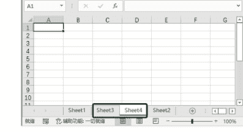

#### 1.2.2 新建工作簿时自动生成指定数量工作表
若每次所需工作表数量相对固定，可设置 Excel 默认工作表个数，实现新建时自动生成。例如按月统计全年数据创建 12 个工作表，操作如下。

步骤一 启动 Excel，单击窗口左侧列表下方的【选项】按钮。如下图所示。

步骤二 弹出【Excel 选项】对话框，❶在【常规】选项【新建工作簿时】组中的【包含的工作表数】文本框输入“12”，❷单击【确定】关闭对话框。如下图所示。
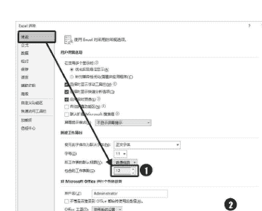
操作完成后重新启动 Excel 并创建空白工作簿，即可看到已包含 12 个工作表。效果如下图所示。


#### 1.2.3 批量建表并同步重命名
工作表默认命名为“Sheet1”“Sheet2”…实际工作中尤其是数量多时，应重命名以便区分与引用。若名称有规律，如“2023年1月利润表”…“2023年12月利润表”，可利用数据透视表【显示报表筛选页】功能批量创建并重命名，提升效率。操作如下。

步骤一 创建空白工作簿，分别在 A1 和 A2 单元格输入标题“工作表名称”与首个名称“2023年1月利润表”。如下图所示。
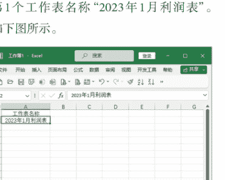
步骤二 选中 A2 单元格，将指针移至右下角变为“+”后按住鼠标左键向下拖动至 A13，释放后自动填充全部名称。如下图所示。

步骤三 ❶选中 A1:A13 区域，❷单击【插入】选项卡，❸单击【表格】组中的【数据透视表】按钮。
步骤四 弹出【来自表格或区域的数据透视表】对话框，直接单击【确定】即可创建新工作表及空白数据透视表。
步骤五 在“Sheet2”工作表中选中数据透视表区域任意单元格激活【数据透视表字段】列表，将【工作表名称】字段拖至【筛选】窗格。
步骤六 ❶单击激活后的【数据透视表分析】选项卡，❷单击【数据透视表】组【选项】下拉列表中的【显示报表筛选页】命令。
步骤七 弹出【显示报表筛选页】对话框，直接单击【确定】。
操作完成后，Excel 瞬间创建 12 个已重命名的工作表。
> 温馨提示
本例创建完成后，可删除“Sheet1”中的原始内容、生成的“Sheet2”及数据透视表，以及创建的工作表中的数据透视表。

### 1.3 三种方法创建目录，一键切换工作表
在一个工作簿中用多个工作表存储同类数据可大幅提效，但工作表过多易查找困难、切换缓慢。解决方法是养成制作目录的习惯，为每个工作表创建链接，单击即可一键跳转。下面先请 AI 助手“ChatGPT”介绍创建工作表目录的好处。

> 提问：在 Excel 工作簿中创建工作表目录有哪些好处？
ChatGPT
好处主要有以下几点。
（1）方便查找与导航：目录列出所有工作表名称与位置，快速定位，提高效率。
（2）结构更清晰：可将相关工作表分组按逻辑排序，使工作簿结构明晰。
（3）快速跳转：目录中超链接可直接跳至指定工作表，避免翻页查找。
（4）提升可读性与可维护性：目录可提供简要描述，帮助整体把握，方便后续维护修改。
（5）便于共享与协作：目录作为导航页，方便他人查看使用，提升团队沟通效率。

由此可知，创建目录不仅提升个人效率，也方便团队共享与交流。本节介绍三种快速创建目录的方法。

#### 1.3.1 用 HYPERLINK 函数批量建目录
HYPERLINK 专用于创建链接，可为工作表、文件、网页等建立链接。

打开“素材文件\第1章\使用HYPERLINK函数创建链接.xlsx”，右击窗口左下角工作表导航按钮打开【激活】对话框，可看到工作簿内全部 12 个工作表。以下用 HYPERLINK 函数为每个工作表创建链接。

步骤一 ①在“2023年1月销售表”前插入新工作表并重命名为“目录”，②在“目录”工作表的 A1:B13 区域绘制简单表格，在 A1:B1 输入列标题，在 A2:A13 输入工作表名称。如下图所示。
> 温馨提示
HYPERLINK 函数含两个参数，第 1 个为指定位置。本例公式设定位置为当前工作簿（用“#”代表）“2023年1月销售表”工作表（引用 A2 单元格工作表名称）中的 A1 单元格（“!A1”），第 2 个参数为链接名称，可设为任意字符或缺省。本例设为符号“★”。
操作完成后，单击任意链接即可立即切换至对应工作表。例如单击 B12 中的“★”，光标瞬间切换至“2023年11月销售表” A1 单元格。
步骤二 ①在 B2 输入公式“=HYPERLINK("#"&A2&"!A1","★")”，为 A2 中工作表创建链接并显示为“★”，②复制 B2 公式粘贴至 B3:B13，即可批量创建其他工作表链接。如下图所示。

#### 1.3.2 巧用“兼容性检查器”创建工作表目录
第1.3.1 节函数法需预先输入工作表名称再引用。若不想手动输入，可利用 Excel 的【兼容性检查器】工具快速为每个工作表建链接。具体操作如下。

步骤一 打开“素材文件\第1章\巧用兼容性检查器创建工作表链接.xlsx”文件，右击任意工作表标签，在快捷菜单中单击“选定全部工作表”命令。如下图所示。
步骤二 在 A1 单元格输入公式“=ZA1”，如下图所示。
步骤三 ①展开【文件】菜单单击【信息】选项卡，②单击【检查问题】下拉列表中的【检查兼容性】命令。如下图所示。
步骤四 弹出【Microsoft Excel-兼容性检查器】对话框，单击【复制到新表】按钮。如下图所示。


第5步 设置完毕后，Excel会自动新建一张工作表，并把所有其他工作表A1单元格的引用都集中到该表里，呈现效果见下图。

第6步 接下来把名为“Sheet1”的工作表重命名为“目录”，清除其中无用的内容，统一版式、字体以及链接文案，最后把其他工作表中用于生成链接的公式删除，整理后的样式如下图所示。

#### 1.3.3 插入“返回目录”超链接

目录链接建好后，要在多张表之间自由跳转，就需要在每张表里都放一个“返回目录”的超链接，先回到目录再转到其他表。因为各表的返回链接内容相同，制作一次后可批量复制使用。具体做法如下。

第1步 启动“素材文件\第1章\插入返回目录超链接.xlsx”文件，①切换到“2023年1月销售表”工作表并定位A1单元格，②打开【插入】选项卡，③在【链接】组中点击【链接】按钮。如下图所示。

第2步 弹出【插入超链接】对话框，①在【链接到：】列表中选择【本文档中的位置】，②在【要显示的文字】文本框里输入链接名称例如“返回目录”，③在【或在此文档中选择一个位置】列表中选择【目录】，④点击【确定】关闭对话框。如下图所示。

第3步 返回工作表，把A1单元格中的链接复制，然后粘贴到除“目录”工作表外的其他工作表A1单元格即可，效果如下图所示。

### 1.4 财务数据至关重要，文件安全不容忽视

众所周知，财务数据在企业内部属于核心商业机密，必须严格保密。下面借助ChatGPT说明财务文件一旦泄漏或被未授权访问会带来哪些后果。

> 提问：财务文件的泄露或遭到未经授权的访问有什么危害？

ChatGPT

财务文件被泄漏或遭未经授权访问可能带来以下风险。

（1）金融欺诈：黑客或内部人员可能利用泄露的财务文件实施欺诈，如盗取公司资金、篡改账户余额或虚构交易等。

（2）资料篡改：未经授权的访问可能导致财务文件被篡改，进而损害公司财务数据的准确性和完整性，导致误导投资者、决策失误以及财务报告失真。

（3）商业竞争：竞争对手可能获取公司财务数据，从而深入了解业务与财务状况，获得竞争优势。

（4）法律与合规风险：泄漏或未授权访问可能违反隐私法、数据保护法及金融合规要求，导致公司被罚款、诉讼或声誉受损。

（5）员工信任度下降及公司声誉受损：财务文件泄漏会降低员工信任度，特别是涉及个人信息和薪酬的文件。信息外泄还会对公司形象造成负面影响，使投资者、客户和合作伙伴失去信任。

（6）个人隐私泄漏：财务文件中可能包含员工、客户和供应商的个人身份信息，若被泄漏或未授权访问，可能导致隐私受侵，并被用于身份盗窃、欺诈等非法活动。

为避免上述风险，企业应采取相应安全措施，如加密财务文件、限制访问权限、定期检视并更新安全策略，同时开展员工安全培训，提升安全意识。

从以上回复可知，财务数据安全对企业和相关个人都至关重要。因此财务人员更应高度重视数据安全，养成良好习惯，及时对存储财务数据的重要文件进行加密保护，避免被无关人员随意查看。同时要妥善保存工作成果，防止因软硬件故障导致文件丢失。

本节介绍用Excel保护财务数据文件安全的四种操作方法。

#### 1.4.1 设置工作簿打开密码

设置打开密码后可防止财务文件被随意打开查看。操作步骤如下。

第1步 打开“素材文件\第1章\设置工作簿打开密码.xlsx”文件，❶展开【文件】菜单，点击【信息】选项卡，❷点击【保护工作簿】下拉列表中的【用密码进行加密】命令。如下图所示。

第2步 弹出【加密文档】对话框，❶在【密码】文本框中输入密码如“123”，❷点击【确定】按钮。如下图所示。

第3步 弹出【确认密码】对话框，❶在【重新输入密码】文本框中再次输入相同密码，❷点击【确定】关闭对话框。如下图所示。

密码设置成功后，关闭并保存工作簿，重新打开时必须输入正确密码。

#### 1.4.2 设置工作簿编辑密码

Excel除可设定打开密码外，还能设定编辑密码，防止财务文件被随意修改，为数据安全增添一道防护。操作如下。

第1步 打开“素材文件\第1章\设置工作簿编辑密码.xlsx”文件，❶展开【文件】菜单，点击【另存为】选项，❷点击【浏览】命令。如下图所示。

第2步 弹出【另存为】对话框，选择存储文件夹，点击【工具】下拉列表中的【常规选项】命令。如下图所示。

第3步 弹出【常规选项】对话框，❶分别在【打开权限密码】和【修改权限密码】文本框中输入不同密码如“123”和“456”，❷点击【确定】按钮。如下图所示。

第4步 弹出【确认密码】对话框，❶在【重新输入密码】文本框中输入打开权限密码“123”，❷点击【确定】按钮。如下图所示。

第5步 再次弹出【确认密码】对话框，❶在【重新输入修改权限密码】文本框中输入修改权限密码“456”，❷点击【确定】按钮。如下图所示。

第6步 返回【另存为】对话框后，点击【保存】按钮即可。如下图所示。

#### 1.4.3 设置密码保护工作簿结构

工作中若需与他人共同编辑部分数据，但不希望他人擅自更改工作簿结构，如增删、复制、移动、隐藏或显示工作表，可在Excel中设置密码单独保护结构。设置方法如下。

第1步 打开“素材文件\第1章\设置密码保护工作簿结构.xlsx”文件，❶点击【审阅】选项卡，❷点击【保护】组中的【保护工作簿】按钮。如下图所示。

第2步 弹出【保护结构和窗口】对话框，❶在【密码(可选)】文本框中输入密码如“123”，❷点击【确定】按钮。如下图所示。

第3步 弹出【确认密码】对话框，❶再次输入相同密码，❷点击【确定】关闭对话框。如下图所示。

第4步 返回工作表，右键工作表标签，可见快捷菜单中【插入】【删除】【移动或复制】等命令均已变灰，无法执行，如下图所示。

#### 1.4.4 缩短文件自动恢复时间，降低意外损失

财务人员制作表格时，难免会遇到死机、断电等意外，导致Excel异常关闭，造成重要数据丢失。Excel具备自动恢复功能，会按一定间隔自动保存正在编辑的工作簿。

为最大限度降低损失，可把自动恢复间隔调至最短。操作如下。

第1步 打开“素材文件\第1章\缩短文件自动恢复时间.xlsx”文件，❶展开【文件】菜单，点击【更多】选项卡，❷点击【选项】命令。如下图所示。

第2步 弹出【Excel 选项】对话框，❶点击【保存】选项卡，❷将【保存工作簿】选项组中的【保存自动恢复信息时间间隔】文本框默认值“10”改为“1”，即每隔1分钟，❸点击【确定】关闭对话框，完成设置。如下图所示。

> 温馨提示

【Excel 选项】对话框中的设置属于通用设置。因此本例操作完成后，电脑中所有Excel工作簿的自动恢复间隔均被调整为1分钟。

## AI 智能答疑与技巧点拨

本章提醒财务人员应养成良好的Excel操作习惯以高效管理财务表格，并介绍了几种培养好习惯的具体方法。下面结合本章内容，利用AI工具“文心一言”的学习引导，补充介绍几个实用小技巧，帮助提升工作效率。

### 01 Excel 工具按钮、命令一秒搜索

Excel功能强大，内置数百个工具按钮和命令。许多新手使用时常需花费时间寻找所需功能。细心的读者应已注意到，Excel 2021界面较以往的一个明显变化是窗口顶部新增了一个搜索框，可快速定位工具、命令及表格中的财务数据，如下图所示。

具体如何搜索目标，先看AI工具“文心一言”是如何操作的。

# Excel 高效办公

会计与财务管理（AI 版）

> 提问：如何在Excel中使用搜索框查找工具、命令？


文心一言

在Excel 2021中，使用搜索框查找工具、命令的方法如下。

在Excel界面上方，可以找到一个搜索框。在这个搜索框中输入你想要查找的工具或命令的关键词。

Excel会在搜索框下方显示与关键词相关的工具和命令的列表，你可以在这个列表中查找你需要的工具或命令。

如果你找到了你需要的工具或命令，只需要单击它们，就可以在Excel中使用了。

另外，也可以使用快捷键【Ctrl+F】打开【查找和替换】窗口，或者单击编辑栏左侧的查找选择按钮，在弹出的菜单中选择【查找】选项。在弹出的窗口中填入需要查找的内容，Excel会显示出所有包含该内容的单元格。

> 教你一招：使用快捷键快速定位指针

按下快捷组合键【Alt+Q】可快速将指针定位至搜索框中。

### 02 DIY 快速访问工具栏

Excel是一款人性化的智能办公软件，除搜索框外，还提供可个性化定制的【自定义快速访问工具栏】，用户可按自身操作习惯和喜好，将常用工具按钮、命令按顺序放置其中，打造专属工具栏。下面先跟着AI工具“文心一言”预习定制方法。

从以上回复可知，利用Excel 2021新增的“搜索框”能迅速找到所需工具按钮或命令，操作也十分简便。

例如，要打开【数据验证】对话框，就在搜索框中输入“验证”，即可在列表中看到包含“验证”的工具按钮，按下【Enter】键即可立即打开对话框。如下图所示。

> 提问：如何自定义Excel快速访问工具栏？


文心一言

自定义Excel快速访问工具栏的方法有多种，以下列举几种常见的方式。

# 第1章 好习惯即高效：如何用 Excel 管理财务表格

方式一：

单击快速访问工具栏右侧的下拉按钮，会展开一个菜单，里面有一些备选功能可供选择。这时单击需要的功能，就会出现在工具栏了。要想添加其他功能，可以单击该下拉列表中的【其他命令】按钮，然后在Excel选项窗口中，选择需要的功能并添加即可。

方式二：

在功能区找到需要添加到快速访问工具栏的命令，然后右击，在菜单里面选择【添加到快速访问工具栏】即可。

方式三：

单击【文件】选项卡，选择【选项】，弹出【Excel选项】对话框，单击【快速访问工具栏】。在左侧文本框中选择相关命令后单击【添加】，相关命令会显示在右侧文本框中，同时也添加在快速访问工具栏。

在右侧文本框中选择相关命令后单击【删除】，则可将其从右侧文本框中删除，同时也从快速访问工具栏中删除。

以上就是自定义Excel快速访问工具栏的几种方式，您可以根据需求选择适合自己的方法。


第2步 单击【快速访问工具栏】右侧的下拉按钮，展开下拉列表，单击【在功能区下方显示】命令，如下图所示，将其放置在功能区下方，更方便使用。

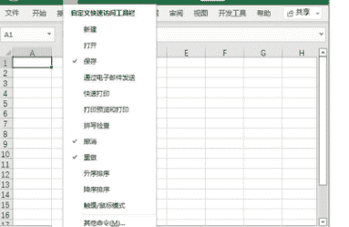

第3步 在下拉列表中勾选需要的命令，即可将其添加至【快速访问工具栏】中。如下图所示。


从以上回复可知，自定义快速访问工具栏的操作非常简单。下面参考上述提示，跟着以下具体步骤和图例DIY自己的快速访问工具栏。

第1步 创建一个空白工作簿。初始设置下，【自定义快速访问工具栏】位于功能区左上方，且默认只有3个工具按钮，如下图所示。

# Excel 高效办公

会计与财务管理（AI版）

第4步 如果列表中没有需要的工具按钮或命令，可展开功能区中的选项卡，右击工具按钮或命令，单击快捷菜单中的【添加到快速访问工具栏】命令即可。

如下图所示的操作，即添加了【开始】选项卡【字体】组中的【等线】工具按钮至【快速访问工具栏】中。


第5步 如果【快速访问工具栏】下拉列表和功能区中均没有需要的工具按钮或命令，还可以打开【Excel选项】对话框，❶切换至【快速访问工具栏】选项，❷在【从下列位置选择命令】下拉列表中选择【不在功能区中的命令】或【所有命令】选项，在下方列表框中选中需要的命令，❸单击【添加】按钮将其添加至【自定义快速访问工具栏】列表框中，❹单击右侧的上下箭头按钮调整命令的排列顺序，❺调整完毕后，单击【确定】按钮关闭对话框即可。如下图所示。

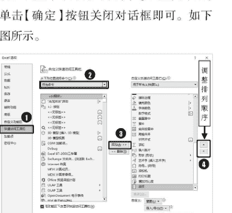

第6步 返回工作表，可看到【快速访问工具栏】中已列出各项工具按钮、命令。效果如下图所示。


## 第2章 财务数据很重要：Excel批量获取和整理原始数据

原始数据是核算财务数据的基础，对财务工作至关重要。数据是否完整、格式是否规范，都直接影响后续工作的效率和质量。因此财务人员学习Excel时，必须掌握运用Excel高效获取并整理不规范原始数据的技能。本章将通过讯飞星火、ChatGPT、文心一言等AI工具让财务人员了解在Excel中可通过哪些方法批量获取和整理原始数据，并介绍具体操作方法，帮助打好技术基础和核算基础。

### 2.1 批量导入技巧：“分分钟”获取原始数据

实际工作中，财务人员很多时候需要从其他Excel工作簿、办公软件中获取原始数据，如财务软件、ERP系统、B2B电子商务平台等。这些系统或网站中的数据通常可导出Excel表格。下面让AI工具“ChatGPT”为我们推荐几种Excel批量导入原始数据的技巧。

> 提问：请推荐几种Excel快速批量导入外部原始数据的技巧。

ChatGPT

以下是几种Excel快速批量导入外部原始数据的技巧。

（1）使用【数据】选项卡中的【从文本】功能：选择【从文本】选项，然后选择要导入的文本文件，按照向导的指示进行操作。可以选择分隔符、数据格式等选项，以确保正确导入数据。

（2）使用【数据】选项卡中的【从网页】功能：选择【从网页】选项，然后输入要导入数据的网页地址，按照向导的指示进行操作。Excel会尝试从网页中提取数据，并将其导入工作表中。

（3）使用【数据】选项卡中的【从其他来源】功能：选择【从其他来源】选项，然后选择适合的数据源，如数据库、XML文件等。按照向导的指示进行操作，以导入外部数据。

（4）使用Power Query：Power Query是Excel中的一种数据获取和转换工具。它可以帮助您从各种来源导入和整理数据。通过Power Query，您可以连接各种数据源，如数据库、Web服务、文件夹等，并对数据进行转换和清洗。

（5）使用宏：如果您需要经常导入相同格式的外部数据，可以考虑使用宏来自动化导入。您可以录制一个宏来执行导入操作，并将其保存为一个按钮，以便将来使用。

ChatGPT推荐的5种快速批量导入原始数据的操作技巧都非常实用，操作也十分简便。本节结合日常工作中常见的不同来源的原始数据，从上述技巧中挑选出3种方法，略作调整后进行介绍。

#### 2.1.1 导入网站数据，在Excel中获取实时信息

日常工作中，财务人员时常要从网站获取相关信息。例如，外贸企业需要从汇率网查询外币汇率，运用Excel提供的【获取和转换数据】工具可将网站数据导入Excel中。只需打开Excel文件并刷新数据，即可获得最新数据，而且还可设置刷新频率，定时自动刷新数据。

##### 1. 创建连接

在Excel中创建与网站的连接，操作方法如下。

第1步 创建一个空白工作簿，❶点击【数据】选项卡，❷点击【获取和转换数据】组中的【自网站】按钮。如下图所示。


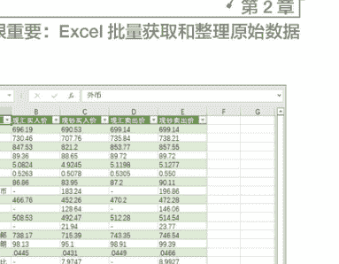

第2步 弹出【从Web】对话框，❶复制常用网站的网址并粘贴至【URL】文本框中，❷点击【确定】按钮。如下图所示。


##### 2. 手动刷新数据

刷新数据操作非常简单，❶选中表格区域中任意一个单元格激活表格工具，❷点击【表设计】选项卡，❸点击【外部表数据】组中的【刷新】按钮即可。如下图所示。

第3步 弹出【导航器】对话框，❶点击【显示选项】列表中的【Table 0】选项，同时可在右侧预览框中查看预览界面，❷点击【加载】按钮。如下图所示。

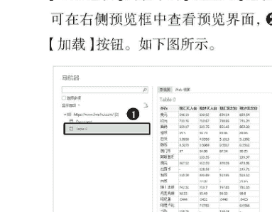

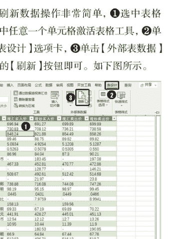

第4步 以上操作完成后，Excel将自动创建一个新的工作表，同时把网站数据导入同步生成的表格中。效果如下图所示。

##### 3. 设置自动刷新频率

除了手动刷新，还可通过设置属性让数据按指定频率自动刷新。操作方法如下。

**第1步** ❶选中表格区域中任意一个单元格，激活表格工具，❷点击【查询】选项卡，❸点击【编辑】组中的【属性】按钮。如下图所示。

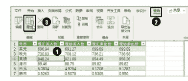

**第2步** 弹出【查询属性】对话框，❶勾选【刷新控件】组中的【刷新频率】复选框，在【分钟】文本框中输入分钟数，如“30”（默认频率为120分钟），❷点击【确定】关闭对话框。如下图所示。

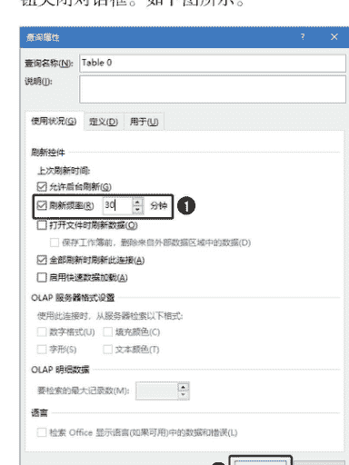

操作完成后，将工作簿命名为“汇率表”保存即可。

#### 2.1.2 导入文本文件，同步分列原始数据

在财务日常里，处理文本文件时很多人会直接把内容复制到Excel，结果所有信息都挤在同一列，后续整理非常费劲。利用Excel的【获取和转换数据】功能，就能自动调出Power Query编辑器，按预设规则把原始记录拆分成多列。

以“素材文件\第2章\客户信息表.txt”为例，文件里存有客户信息，接下来演示如何导入Excel并同步完成分列。


**第1步** 新建一个空白工作簿，❶ 切换到【数据】选项卡，❷ 在【获取和转换数据】组内点击【从文本/CSV】。如下图所示。


**第2步** 弹出【导入数据】对话框，❶ 定位到文本文件所在文件夹并选中目标文件，❷ 按【导入】。如下图所示。


第3步 对话框出现后，直接点【转换数据】。如下图所示。


第4步 执行后Power Query编辑器自动打开，❶ 切换到【主页】选项卡的【转换】组，点击【拆分列】下拉，❷ 选择【按分隔符】。如下图所示。

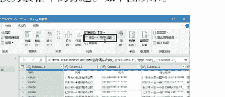

第5步 在【按分隔符拆分列】窗口中，❶ 于【选择或输入分隔符】下拉里选【自定义】，并在输入框填入分隔符“~~”，❷ 点【确定】。如下图所示。


第6步 回到Power Query主界面，可看到拆列效果。随后在【转换】组中点【将第一行用作标题】，把原标题行转为表头。如下图所示。


第7步 点击【主页】选项卡【关闭】组中的【关闭并上载】。如下图所示。

第8步 完成操作后，文本数据已被导入并按列展示在新表中。效果如下图所示。

#### 2.1.3 运用Power Query导入其他工作簿数据

财务工作中常需在当前Excel里引用别的Excel的数据，要求当源文件更新时目标文件能自动同步。Power Query编辑器就能实现这种联动，既省去重复修改，也保证一致性与效率。

比如，销售收入数据保存在“销售收入统计表”工作簿里，现在要把“费用报销记录表”工作簿中的费用报销数据拉入其中。

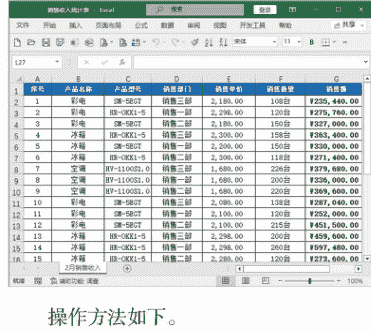

操作流程如下。

第1步 打开“素材文件\第2章\销售收入统计表.xlsx”，❶ 点【数据】选项卡，❷ 点击【获取数据】下拉，❸ 选【来自文件】，❹ 再选【从Excel工作簿】。如下图所示。

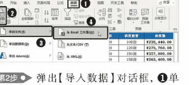

第2步 在【导入数据】对话框中，❶ 选中“费用报销记录表”工作簿，❷ 点【导入】。如下图所示。


第3步 进入【导航器】对话框，❶ 在【显示选项】里勾选【2月报销】，右侧预览区可查看内容，❷ 点【转换数据】。如下图所示。

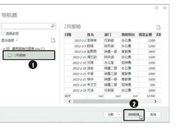

第4步 Power Query编辑器自动启动，默认选中【日期】字段，❶ 在【主页】选项卡【转换】组点击【数据类型】下拉，❷ 选择【日期】，即可把该字段改为日期格式。如下图所示。


第5步 点【主页】选项卡【关闭】组中的【关闭并上载】。如下图所示。


完成后，“费用报销记录表”工作簿中“2月报销”整张表的数据已导入“销售收入统计表”工作簿。效果如下图所示。

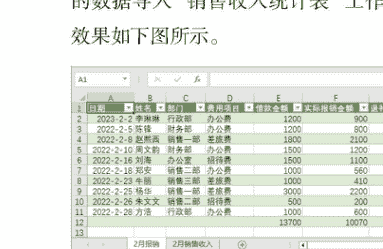

第6步 保存并关闭“销售收入统计表”工作簿，打开“素材文件\第2章\费用报销记录表.xlsx”，把F11单元格数值改为“800”，保存后关闭。如下图所示。

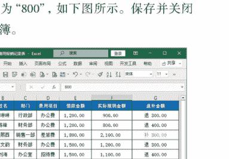

第7步 重新打开“销售收入统计表”工作簿，❶ 进入【数据】选项卡，❷ 在【查询和连接】组点【全部刷新】。如下图所示。

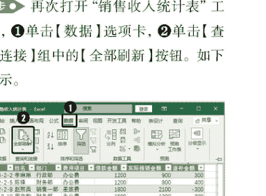

刷新后，“销售收入统计表”工作簿中“2月报销”表的F11单元格数值也随之变成“800”。效果如下图所示。


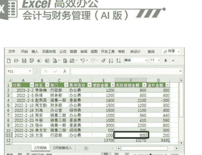

### 2.2 批量录入原始数据

日常里大部分原始数据仍需手工录入，如何更高效？核心思路是批量操作。下面是AI工具“ChatGPT”给出的批量录入思路。

> 提问: Excel中如何批量录入原始数据?

ChatGPT

在Excel里，批量录入原始数据可采用以下方法。

（1）打开一个新工作簿。
（2）在A1输入首个数据。
（3）按住Shift，同时用鼠标左键拖到最后一个需要输入的单元格。
（4）按Ctrl+Enter，所有选中单元格会同时填入相同内容。
（5）若数据连续，可先在首单元格输入起点值，下一个单元格输入次值，选中两者后将鼠标移到右下角填充柄，待光标变十字后按住拖动，即可自动生成连续序列。
（6）若数据需重复，可在首单元格输入内容，选中后拖动填充柄向下复制相同内容。
（7）若数据不连续，先输入前两个不同值，选中后拖动填充柄，即可按规律自动填充。

综合来看，可按数据属性选择两类做法：一是借助快捷键先批量选中再统一录入相同内容；二是借助填充功能录入有规律的序列。本节依据ChatGPT的建议，介绍几种常见情形的具体做法。

#### 2.2.1 批量选定不连续的单元格和单元格区域

财务录入时常要对多个分散的单元格或区域做同一操作，操作前先完成选定。连续区域可通过拖拽或在名称框输入地址如“A3:D12”快速选中。不连续区域的选定同样简单，可用【Ctrl】或【Shift+F8】配合鼠标，下面分别说明。

##### 1.【Ctrl】键+鼠标批量选定

按住【Ctrl】不放，依次单击或拖拽目标单元格或区域即可。如下图所示，工作表里同时选中了C2、C6、C11、E11单元格，以及E2:E3、E5:E8区域。

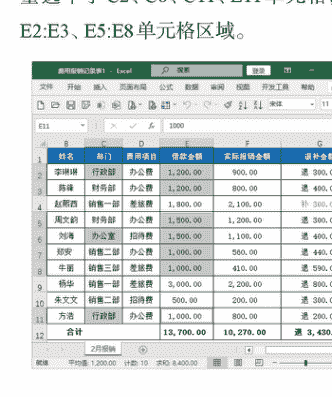

> 教您一招

已选中的批量区域要取消，只要点一下未被选中的任意单元格即可。

##### 2.【Shift+F8】组合键切换为多选模式

当需要选中的分散目标较多时，按一下【Shift+F8】切换到多选模式，再用鼠标单击或拖拽选定目标。

第1步 打开“素材文件\第2章\费用报销记录表1.xlsx”，按下【Shift+F8】后，状态栏会显示“添加或删除所选内容”，表示已进入多选模式，如下图所示。

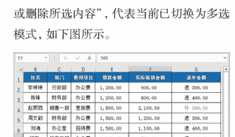

第2步 此时可用鼠标单击或拖拽选中目标单元格或区域，再按一次【Shift+F8】即可退出多选模式。如下图所示。


#### 2.2.2 批量快速定位同类型单元格

当需要选中的单元格类型相同，可用Excel的【定位】功能一次性全部选中，例如带批注、空白或含公式的单元格。

如下图所示，【销售部门】列中部分单元格为空，填入统一部门名前需先选中这些空白单元格。

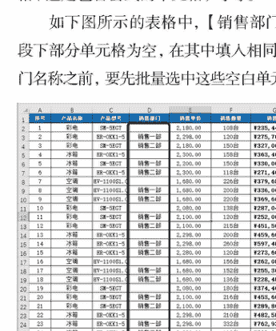

操作方法如下。

第1步 打开“素材文件\第2章\销售收入统计表1.xlsx”，选中D2:D28，按【F5】或【Ctrl+G】打开【定位】对话框，点击【定位条件】。如下图所示。

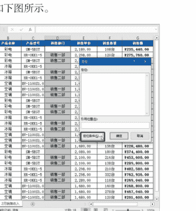

第2步 在【定位条件】对话框中，❶ 勾选【空值】，❷ 点【确定】。如下图所示。

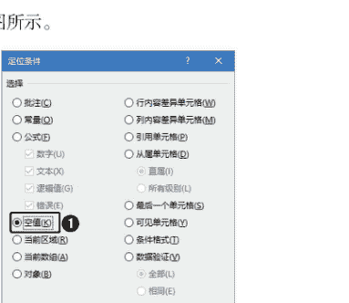

第3步 返回工作表，D2:D28区域中的空白单元格已被全部选中。效果如下图所示。

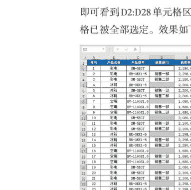

#### 2.2.3 批量选定工作表

实际工作中不仅要批量操作单张表里的单元格，也常需对多张表做统一处理，如给1~12月的销售表添加相同字段。操作前先批量选中目标工作表，再选中单元格区域。具体方法如下表。

| 需要批量选定的工作表 | 操作方法 |
|---|---|
| 选定全部工作表 | 右键任意标签→快捷菜单点【选定全部工作表】；或按住【Shift】点击最后一张标签 |
| 选定不连续的工作表 | 按住【Ctrl】依次点击目标标签；取消时点任意未选标签 |
| 选定连续的工作表 | 按住【Shift】点击首张标签再点末张标签；取消时点任意未选标签 |

#### 2.2.4 批量录入相同数据

完成批量选定后，统一录入就很简单：在编辑栏或活动单元格输入内容后按【Ctrl+Enter】即可。

打开“素材文件\第2章\销售收入统计表1.xlsx”，用【定位】功能选中D2:D28中的空白单元格，在编辑栏输入“销售三部”，按【Ctrl+Enter】即可瞬间完成。效果如下图所示。

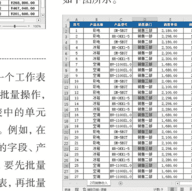

示例结果见“结果文件\第2章\销售收入统计表1.xlsx”文件。

#### 2.2.5 批量填充序列数据

前述方法适合填入完全相同的内容。若需录入序号、日期等有规律变化的序列，则需借助填充。下面介绍三种常用方式。

##### 1. 使用填充柄

填充柄是最快的方式，双击或拖拽即可完成少量序号或日期的填充。

第1步 打开“素材文件\第2章\2023年3月销售收入统计表.xlsx”，❶ 在A3输入“1”，B3输入“2023-3-1”，❷ 选中A3:B3，将鼠标移到B3右下角，指针变为十字填充柄。如下图所示。


第2步 双击填充柄，序号和日期会自动填充至A4:B28。效果如下图所示。

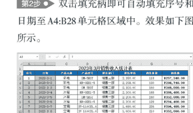

示例结果见“结果文件\第2章\2023年3月销售收入统计表.xlsx”文件。

##### 2. 使用“快速填充”功能

“快速填充”可根据示例智能识别填充意图，适合文本组合或拆分。

例如，将A3:A29的【产品名称】和B3:B29的【产品型号】合并到C3:C29的【产品名称和型号】。

操作方法如下。

打开“素材文件\第2章\2023年3月销售收入统计表1.xlsx”，❶ 在C3输入示例“彩电 SM-5EGT”，❷ 选中C4:C29，按【Ctrl+E】即可完成。如下图所示。

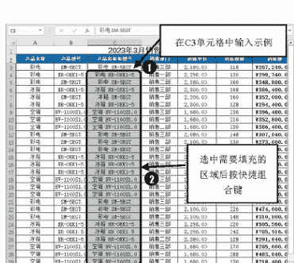

示例结果见“结果文件\第2章\2023年3月销售收入统计表1.xlsx”文件。

> 温馨提示

“快速填充”命令位于【开始】选项卡【编辑】组中的【填充】下拉列表。

##### 3. 通过【序列】对话框填充

当序列量大或规则复杂，如从1填到10000，或按工作日填日期，可用【序列】对话框。

下面演示快速填充日期。

**第1步** 打开“素材文件\第2章\2023年每日销售汇总表.xlsx”，❶ 在A3输入“2023-1-1”，选中A3:A367，❷ 点【开始】选项卡，❸ 点【编辑】组【填充】下拉，❹ 选【序列】。如下图所示。

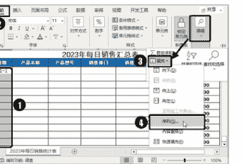

如下图所示，财务人员年初常制作空白汇总表，【销售日期】列可预先填入全年日期。

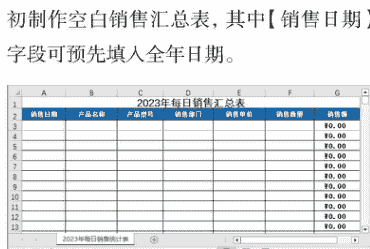

**第2步** 在【序列】对话框中，❶ 选【自动填充】，❷ 点【确定】。如下图所示。


**第3步** 返回工作表，2023年全年日期已填充完毕。效果如下图所示。

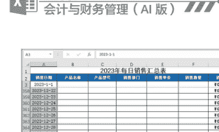

示例结果见“结果文件\第2章\2023年每日销售汇总表.xlsx”文件。

#### 2.2.6 批量选择性粘贴数据

复制粘贴最常见，但常规粘贴会整体覆盖。实际工作中常只需要粘贴格式、数据验证或公式结果等部分内容，这时就要用“选择性粘贴”，它还能在粘贴时做简单运算或转置。

##### 1. 选择性粘贴公式

选择性粘贴公式的作用是只把源单元格的公式复制过去，不改变目标单元格原有格式。

如下图所示，E30用公式求和E3:E29，现在要在F30、G30放置相同逻辑的公式分别求和F2:F29、G2:G29。由于三列格式不同，应只粘贴公式以保留各自格式。

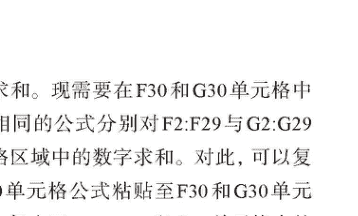

选择性粘贴公式的操作方法如下。

**公式粘贴保留格式示例**

**第1步** 载入资料包第2章中的2023年3月销售收入统计表2.xlsx。❶ 先把E30的内容用 Ctrl+C 拷走，❷ 再把F30:G30这块区域点选后右键，在贴上选项里点按【公式】的 fx 快速键。示意图参考上方。

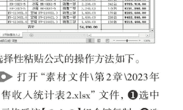

**第2步** 执行完毕后，F30、G30同时保留了原有样式并展示出计算后的结果。呈现效果见配图。

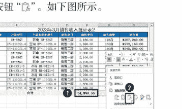

对照版本可查阅结果文件第2章的2023年3月销售收入统计表2.xlsx。

##### 2. 选择性粘贴运算
选择性粘贴的运算功能是在贴上时把来源数值与目标格已有数值做加减乘除。财务临时算账时，这招能快速完成。

图示表格记录了2023年3月的销售收入，现在要临时算出次月销售额上浮8%后的金额，并在单价不变的前提下反推对应的销售数量。

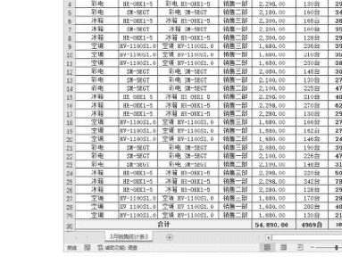

操作流程如下。

**第1步** 载入资料包第2章的2023年3月销售收入统计表3.xlsx。❶ 在F3输入公式“=ROUND(G3/E3,0)”，即销售额除以单价并四舍五入为整数，❷ 把该公式向下拖到F4:F29。编辑栏可看到F3的公式。

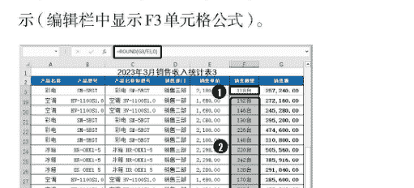

**第2步** ❶ 在任意空白位置如H2填入1.08后用 Ctrl+C 拷走，❷ 点选G3:G29后右键，选择【选择性粘贴】。

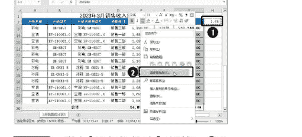

**第3步** 弹出【选择性粘贴】弹窗，❶ 在【粘贴】分组勾选【数值】，❷ 在【运算】分组勾选【乘】，❸ 点【确定】。

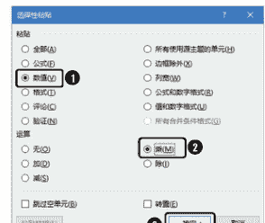

❹ 返回工作表，G3:G29的销售额已全部变为原值乘以1.08后的结果，F3:F29的销售数量也随公式自动刷新。效果见下图。

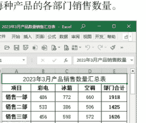

参考结果见结果文件第2章的2023年3月销售收入统计表3.xlsx。

##### 3. 选择性粘贴转置
转置贴上的作用是把来源数据的行列互换。需要换角度分析时，这个功能能快速重排布局。

图示表格把产品横向排列，用来对比各部门每种产品的销售数量。现在想把部门横向排列，以便从产品维度对比各部门表现。

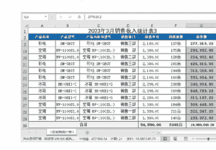

操作如下。

❶ 载入资料包第2章的2023年3月产品数量销售汇总表.xlsx，选定A2:E6用 Ctrl+C 拷贝，再点选空白格如A8后右键，在【粘贴选项】里点按【转置】快速键“↵”。示意图见上。

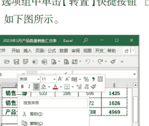

❷ 完成后，来源数据的行列已互换。效果见下图。

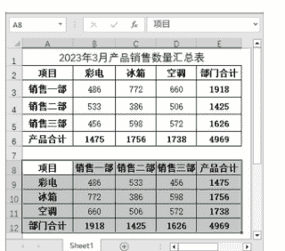

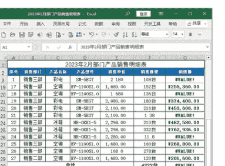

对照文件为结果文件第2章的2023年3月产品数量销售汇总表.xlsx。

#### 2.2.7 批量查找和替换数据
查找与替换是 Excel 最基础的功能之一，简便却藏着不少提效技巧。下面介绍几种批量高效完成的用法。

##### 1. 批量删除无效字符
财务录入时容易误加空格等无效字符，导致合计不准或出现错误值。可利用查找替换批量清理。

图示部分格子数字间混入空格，导致F30合计失准，【销售额】列出现多处错误代码。


下面用查找替换批量删除这些无效字符。

**第1步** 载入资料包第2章的2023年2月部门产品销售明细表.xlsx。❶ 按 Ctrl+H 调出【查找和替换】弹窗，切到【替换】，在【查找内容】输入一个空格，❷ 点【全部替换】。示意图见上。

**第2步** 替换完成后弹出提示，直接点【确定】。示意图见上。


**第3步** 关闭弹窗返回工作表，所有空格已被清除，F30合计与【销售额】列均恢复正确计算。效果见下图。

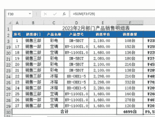

示例结果见结果文件第2章的2023年2月部门产品销售明细表.xlsx。

##### 2. 在空单元格中批量输入数据
此前提到过用定位空值配合 Ctrl+Enter 填充，现在用查找替换更简洁快速。

图示表格里【销售单价】字段存在多个空值。

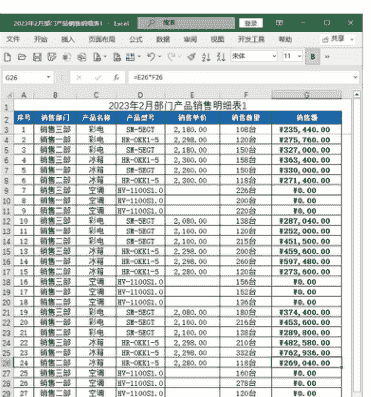

下面用查找替换在空格子里统一填入数字“1680”。

**第1步** 载入资料包第2章的2023年2月部门产品销售明细表1.xlsx。❶ 选定E3:E29，按 Ctrl+H 打开【查找和替换】弹窗，直接在【替换为】输入“1680”，❷ 点【全部替换】。示意图见上。


**第2步** 替换完成后弹出提示，点【确定】。示意图见上。

## 第2章 财务数据很重要：Excel 批量获取和整理原始数据

以完成工作任务。


第3步 关闭弹窗返回工作表，可见E3:E29区域的空格子全部被填入1680。效果见下图。

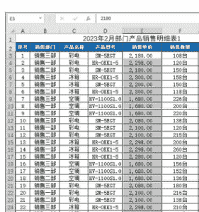

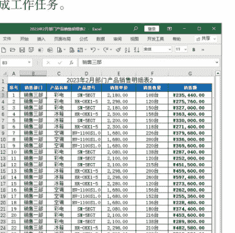

对照结果见结果文件第2章的2023年2月部门产品销售明细表1.xlsx。

3. 批量替换格式，为单元格添加标识
查找替换不仅能改内容，还能批量改格式，这个用法常被忽略，可用来为特定格子快速打标记。

图示若要为【销售部门】字段中值为“销售一部”的格子做标识，手动选定后设置格式比较费事，用查找替换更高效。

操作如下。

第1步 载入资料包第2章的2023年2月部门产品销售明细表2.xlsx。❶ 选定B3:B29，按 Ctrl+H 打开【查找和替换】弹窗，在【查找内容】和【替换为】均输入“销售一部”，❷ 点【替换为】右侧的【格式】按钮。示意图见上。


# Excel 高效办公

会计与财务管理（AI 版）

第2步 弹出【替换格式】弹窗，❶ 切到【字体】标签，❷ 设置字形与颜色，❸ 点【填充】标签。示意图见上。

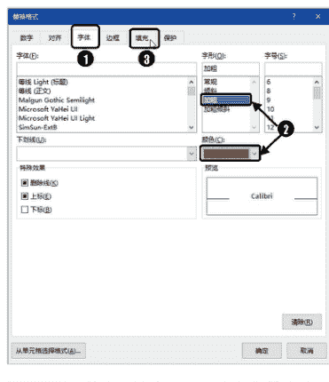

第3步 ❶ 在【填充】标签的【背景色】调色板中挑选合适颜色，❷ 点【确定】关闭弹窗。示意图见上。


第4步 返回【查找和替换】弹窗，点【全部替换】。示意图见上。

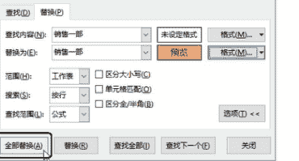

第5步 最后弹出提示弹窗，直接点【确定】即可。示意图见上。


第6步 返回工作表，即可看到格式替换后的效果。示意图见上。

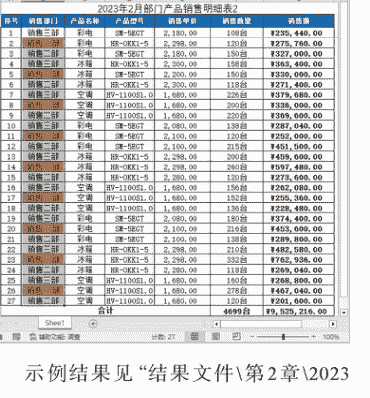

示例结果见结果文件第2章的2023年2月部门产品销售明细表2.xlsx。

### 2.3 玩转数据验证工具，确保数据录入快、准、稳
实际工作中录入原始数据时很容易出现手误，比如字符间多空格、数字位数错、日期超出范围、重复录入等。这些小错误不易察觉却会影响后续统计分析。熟练运用 Excel 的数据验证功能，就能在录入瞬间拦截错误，保证数据质量。下面先请 AI 工具“讯飞星火”介绍数据验证的好处与功能。

> 提问1：Excel 中使用数据验证工具录入数据有哪些好处？
> 提问2：Excel 中的数据验证工具有哪些功能？

讯飞星火

在 Excel 中，数据验证工具是一个功能强大的工具，它对于提高我们的工作效率具有巨大的帮助。以下是使用数据验证工具录入数据的主要好处。

（1）创建下拉列表：通过简单的设置，您可以为某个单元格或整个列创建一个下拉列表。例如，当您需要输入员工的部门名称时，可以创建一个包含所有部门名称的下拉列表，从而确保输入的数据准确无误。

（2）规范数据输入：数据验证工具允许您限制用户可以输入的数据类型。例如，您可以规定某列只能填写整数，或者限制数值的大小范围，如基本工资不低于3500。

（3）显示输入消息和出错警告：当用户尝试输入不符合规定的内容时，数据验证工具可以显示相关的提示信息，指导用户如何正确输入。同时，如果出现异常数据，还可以发出警告。

（4）提供可供选择的值列表：除了自定义的数据验证规则，您还可以为用户提供一个预定义的值列表，从而进一步确保数据的准确性。

讯飞星火

Excel 中的数据验证工具有以下功能。

（1）整数验证：限制输入的数据必须为整数。

（2）小数验证：限制输入的数据必须为小数。

（3）文本长度验证：限制输入的数据长度必须在指定范围内。

（4）列表验证：限制输入的数据必须为指定的值之一。

（5）日期验证：限制输入的数据必须为日期格式。

（6）时间验证：限制输入的数据必须为时间格式。

（7）自定义公式验证：使用自定义公式对输入的数据进行验证。

（8）提示输入消息：可以为数据验证设置输入提示，提供输入时的提示信息。

（9）显示错误消息：可以为数据验证设置错误提示，当输入不符合验证规则时显示错误信息。

（10）输入限制：可以设置输入的数据必须符合指定的条件，如大于、小于、等于等。

（11）条件格式：可以根据数据验证的结果自动设置单元格的背景色、字体颜色等。

（12）删除验证：可以删除已经设置的数据验证规则。

从以上可知，数据验证的核心作用是保障各类数据录入的准确性，同时减少手动核对，也能让繁重的录入工作更轻松。本节从上述功能中精选几种，结合财会实务举例说明操作方法。

#### 2.3.1 重复性数据在“下拉列表”中选取
财务工作中常需反复录入相同内容，如部门名称、费用类别等。针对这类重复性强、选项有限的数据，可用【数据验证】中的序列功能创建下拉列表，直接选取即可。

图示“2023年2月费用报销记录表”中，【部门】和【费用类别】字段即可设置下拉列表。

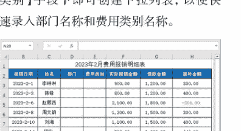

操作如下。

**第1步** 载入资料包第2章的2023年2月费用报销记录表.xlsx。❶ 选定D3:D12，❷ 点【数据】标签，❸ 点【数据工具】组中的【数据验证】。示意图见上。


第2步 弹出【数据验证】弹窗，❶ 在【设置】标签的【允许】下拉列表选择【序列】，❷ 在【来源】文本框依次输入部门名称，多个名称之间用英文逗号分隔，❸ 点【确定】。示意图见上。

第3步 返回工作表，D3格子右下出现下拉三角“▼”，点击展开可见5个选项，与【来源】中输入一致。示意图见上。

第4步 重复第1~2步操作，在【费用类别】字段创建下拉列表，来源设为“销售费用,管理费用,财务费用”即可。效果见下图。


第5步 最后在D3:D12【部门】和E3:E12【费用类别】的每个格子里从下拉列表选择需要的内容。最终效果见下图。


示例结果见结果文件第2章的2023年2月费用报销记录表.xlsx。

> 教您一招
如果下拉列表的序列选项较多，可先在工作表空白区域的同一行或同一列依次录入，再在【数据验证】弹窗中点【来源】文本框，选中该区域即可快速导入。

#### 2.3.2 限定文本长度避免数据多位或少位
限定文本长度是数据验证的一大特色，尤其适用于身份证号、手机号等固定长度的文本输入。下面以身份证号为例演示。

第1步 载入资料包第2章的员工基础信息登记表.xlsx文件，原始内容见下图。


第2步 ① 选定E3:E12区域，② 点【数据】标签，③ 点【数据工具】组中的【数据验证】。示意图见上。


第3步 弹出【数据验证】弹窗，① 在【设置】标签的【允许】下拉列表选择【文本长度】，② 在【数据】下拉列表选择【等于】，③ 在【长度】文本框输入“18”。示意图见上。


第4步 ① 切到【输入信息】标签，② 保留默认的【选定单元格时显示输入信息】，在【标题】和【输入信息】中填入相关提示。示意图见上。


第5步 ❶ 切到【出错警告】标签，❷ 保留默认的【输入无效数据时显示出错警告】及【样式】为【停止】，在【标题】和【错误信息】中输入内容，❸ 点【确定】关闭弹窗。示意图见上。


第6步 返回工作表，❶ 选中E3格子即可显示提示信息，❷ 在E3中输入非18位的数字，按回车后将被阻止并弹出警告。示意图见上。


第7步 点【取消】后重新录入18位身份证号码即可，本例号码均为虚构。最终效果见下图。


示例结果见结果文件第2章的员工基础信息登记表.xlsx。

> 温馨提示
【数据验证】弹窗【设置】标签内的【允许】下拉列表共包含8个选项——任何值、整数、小数、序列、日期、时间、文本长度、自定义。

“任意值”代表关闭校验，单元格可随意填写；“自定义”则支持用公式自行定义合法范围。其余校验类型的操作逻辑类似，可参照前文“序列”与“文本长度”的设置方式。

具体如何使用自定义校验，会在 2.3.3 小节展开说明。

#### 2.3.3 自定义验证条件
工作中，系统自带的整数、小数、序列、日期、时间、文本长度等规则常不够用，这时借助自定义校验并配合公式，就能实现更灵活的管控。下面围绕手工录入时最容易出现的两类错误——重复录入与误插入空格，说明如何用公式进行拦截。

##### 1. 防止重复录入数据
财务场景里，身份证号、手机号等信息必须唯一。可通过数据验证的自定义选项结合 COUNTIF 函数实现查重阻断。下面以手机号为例演示操作。

第1步 启动“素材文件\第2章\员工基础信息登记表1.xlsx”，初始画面如下。


第2步 先选中 F3:F12 区域，切换到【数据】选项卡，再在【数据工具】组中点击【数据验证】。如下图所示。


第3步 在弹出的【数据验证】对话框的【设置】页，将【允许】下拉框改为【自定义】，在【公式】框内填入 “=COUNTIF(F:F,F3)<2”。该公式的意思是用 COUNTIF 统计整列 F 中当前单元格数值的出现次数，必须小于 2，即只能出现一次。确认后点【确定】关闭对话框。如下图所示。


第4步 回到工作表，在 F3:F12 任意单元格重新输入与已有单元格相同的号码。本例在 F6 中输入与 F3 相同的 “135****5256” 后回车，系统即弹出阻止提示，点击【取消】即可关闭。效果如下。


示例结果见“结果文件\第2章\员工基础信息登记表 1.xlsx”文件。

##### 2. 不允许在字符之间插入空格
手工录入姓名时容易误敲空格，导致“陈锋”与“陈 锋”被系统视为两个分类。利用自定义公式可提前拦截。下面以姓名为例。

第1步 打开“素材文件\第2章\员工基础信息登记表 2.xlsx”，原始内容与上表一致，示意图略。先选中 C3:C12，再点【数据】选项卡的【数据工具】组中【数据验证】按钮。如下图所示。


第2步 在【数据验证】对话框的【设置】页，把【允许】改为【自定义】，在【公式】框内输入 “=ISERROR(FIND(" ",C3))”，确认后关闭对话框。如下图所示。


第3步 回到工作表测试。在 C4 单元格的两个字符之间加一个空格后回车，会弹出提示并阻止输入，点击【取消】清除空格后方可继续。效果如下。


示例结果见“结果文件\第2章\员工基础信息登记表2.xlsx”文件。

### 2.4 原始数据快速拆分列示
在 Excel 日常整理中，常常遇到不同格式的数据混在同一列，既不利于透视也不利于公式计算；有时也需要从长文本中抽取特定片段。为提升效率，需要掌握批量分列的技巧。下面先看 AI 给出的思路。

> 提问: Excel中数据快速分列有哪些方法?

讯飞星火

在 Excel 里，快速分列大致有以下几种做法。
（1）使用“分列”向导：选中数据后，通过【数据】选项卡的【分列】按钮启动向导，按步骤完成。
（2）利用快捷键快速填充：选中单元格后按【Ctrl+E】，可按默认分隔符自动拆分。
（3）查找替换配合分列：先用查找替换统一分隔符，再执行分列。
（4）函数拆分：对量大且需求特殊的情况可用函数实现。
（5）导入文本文件分列：通过导入文本并分列的方式处理。

讯飞星火介绍了五种思路，其中“快速填充”和“分列”是上手最快的两种。本节先分别介绍。


#### 2.4.1 使用“快速填充”功能快速拆分数据
前文提到过用快速填充合并列，该功能同样能完成相对简单的拆分。

下图显示客户信息是从增值税税控系统导出的文本，编码和名称全挤在 A 列。


下面用快速填充把编码和名称拆开。

第1步 打开“素材文件\第2章\客户信息表1.xlsx”，在 B2 手动输入示例编码 “00501”。
第2步 选中 B3，按快捷键【Ctrl+E】即可瞬间填充完成。如下图所示。

第3步 参照同样做法，把名称拆到 C2:C13。效果如下。


示例结果见“结果文件\第2章\客户信息表1.xlsx”文件。

#### 2.4.2 使用“分列”工具拆分规律性数据
分列是 Excel 专门的拆分工具，支持“分隔符号”和“固定宽度”两种模式，同时可在拆分时转换格式。下面说明操作流程。

##### 1. 通过“分隔符号”拆分数据
当同一列的数据都使用统一的分隔符，如逗号、连字符、空格等时，就可用分隔符号方式拆分。

# Excel 高效办公
会计与财务管理（AI 版）
只要同一列包含相同的分隔符且规律分布，就可以通过分隔符号进行拆分。

下图是从 ERP 进销存系统导出的 2023 年 2 月销售明细片段。“单据编号”规则为“业务类型-单据日期-单据顺序号”。例如“XS-20230216-00010”表示 2023 年 2 月 16 日的第 10 张销售单。


为便于汇总，需要把日期和顺序号拆到两列。数据以“-”分隔，适合用分列的分隔符号法。操作如下。

第1步 打开“素材文件\第2章\2023年2月××客户销售明细表.xlsx”，在 A 列右侧插入两列并命名。如下图所示。
第2步 ①选中 A2:A22，②点【数据】选项卡，③点【数据工具】组中的【分列】按钮。如下图所示。

第3步 弹出【文本分列向导】，第 1 步共 3 步已默认选【分隔符号】，直接点【下一步】即可。如下图所示。
# 第2章 财务数据很重要：Excel 批量获取和整理原始数据
在数据预览框中选中第 1 列，然后在列数据格式里选择【不导入此列（跳过）】。如下图所示。


第4步 进入“第 2 步，共 3 步”，①勾选【分隔符号】组中的【其他】，在右侧输入“-”，②点【下一步】。如下图所示。


第5步 进入“第 3 步，共 3 步”，页面已默
第6步 ①选中数据预览框中的第 2 列，②把列数据格式设为【日期】。如下图所示。


第7步 ①选中数据预览框中的第 3 列，②把列数据格式设为【文本】，③在【目标区域】输入 “$B$2”，④点【完成】关闭对话框。如下图所示。
示例结果见“结果文件\第2章\2023年2月××客户销售明细表.xlsx”文件。

##### 2. 通过“固定宽度”拆分数据
如果同一列待拆分的字符串长度都相同，可采用固定宽度拆分。

下图显示身份证号码的第 7-14 位为出生年月日，共 8 位，可用固定宽度把出生日期拆出。


❽ 弹出【Microsoft Excel】提示框，直接点【确定】即可。如右图所示。


❾ 操作后返回工作表，可看到【单据日期】与【单据编号】字段已分别列出从 A 列拆分的数据。如下图所示。

操作方法如下。

❶ 打开“素材文件\第2章\员工基础信息登记表3.xlsx”，❷选中 E4:E12，❸点【数据】选项卡，❹点【数据工具】组中的【分列】按钮。如下图所示。


# 第2章 财务数据很重要：Excel 批量获取和整理原始数据


第2步 弹出【文本分列向导】，❶在“第 1 步，共 3 步”选择【固定宽度】，❷点【下一步】。如下图所示。
第3步 进入“第 2 步，共 3 步”，❶在数据预览框中分别点身份证号码的第 6 位与第 7 位之间、第 14 位与第 15 位之间建立分列线，❷点【下一步】。如下图所示。
第4步 进入“第 3 步，共 3 步”，❶在数据预览框中把第 1 列和第 3 列的格式设为“不导入此列(跳过)”，第 2 列设为“日期”，❷在【目标区域】输入 “$F$3”，❸点【完成】关闭对话框。如下图所示。


# Excel 高效办公
会计与财务管理（AI 版）
第5步 完成后返回工作表，可看到身份证号码中的出生日期已以日期格式显示在 F3:F12。效果如下。


示例结果见“结果文件\第2章\员工基础信息登记表3.xlsx”文件。

### 2.5 巧用数据透视表快速转换表格结构
数据透视表是 Excel 的强力分析工具，对数据源格式要求较严，最基本的是要求一维表格。日常表格多不符合要求，因此在学习透视表应用前，先学会快速转换结构。下面先看 AI 的建议。

进行转换。以下是具体步骤。

（1）二维转一维：选择数据后点【数据】-【自表格区域】进入 Power Query 编辑器，选中一列后点【转换】-【逆透视列】-【逆透视其他列】，即可完成。
（2）一维转二维：全选数据后点【插入】-【数据透视表】，将“姓名”拖到行区，“月份工资”拖到列区，“金额”拖到值区（仅示例），确定求和方式。
（3）使用向导：还可按【Alt】【D】【P】调出向导，勾选【多重合并计算数据区域】并选定区域。

> 提问：如何使用数据透视表将二维表和一维表互相转换？

> 讯飞星火

在 Excel 中，数据透视表是强大的工具，可帮助将二维表和一维表互相转换。

# 第2章 财务数据很重要：Excel 批量获取和整理原始数据
向导后勾选【多重合并计算数据区域】，选定转换区域。


上述说明表明，用数据透视表转换结构很简便，只需在数据源上创建透视表，再把字段拖到行或列区域即可。本节介绍具体做法。

#### 2.5.1 二维表转换为一维表
二维转一维可借助数据透视表向导实现。

下图是典型的二维表，记录 2023 年 3 月各部门销售数据。


操作步骤如下。

第1步 打开“素材文件\第2章\2023年3月部门销售日报表.xlsx”，❶点【插入】选项卡，❷点【透视表向导】组中的【数据透视表和数据透视图向导】按钮。如下图所示。
第2步 在【数据透视表和数据透视图向导】的“步骤1（共3步）”中，❶选【多重合并计算数据区域】，❷点【下一步】。如下图所示。


第3步 进入“步骤2a（共3步）”，系统默认勾选【创建单页字段】，直接点【下一步】。如下图所示。
# Excel 高效办公
会计与财务管理（AI 版）


第4步 进入“第2b步，共3步”，❶在【选定区域】框中选中表格 A2:E33，❷点【添加】按钮加入【所有区域】列表，❸点【完成】。如下图所示。


第5步 执行后 Excel 自动生成新工作表并创建数据透视表，此时双击“总计”数字所在的 F36 单元格。如下图所示。


第6步 随后 Excel 自动生成新工作表并产生一维超级表格（可再以此为数据源创建透视表），效果如下。
示例结果见“结果文件\第2章\2023年3月部门销售日报表.xlsx”文件。

> **温馨提示**
Excel 默认情况下，【数据透视表和数据透视图向导】按钮不在【插入】选项卡功能区。可通过【Excel选项】对话框在【自定义功能区】中添加至指定选项卡。

#### 2.5.2 一维表转换为二维表
一般来说，二维表更易阅读，对外报送时常需把一维表转为二维表，同样可用数据透视表快速完成。

下图是一维规范表格，对外报送时需要把销售部门横向展示。
# 第2章 财务数据很重要：Excel 批量获取和整理原始数据


接下来就以该表格为源数据直接建立数据透视表，随后马上转成二维格式。具体做法如下。

**第1步** 打开“素材文件\第2章\2023年3月部门销售日报表1.xlsx”，❶在表中任选一个单元格，切换到【插入】标签页，❷在【表格】分组里点选【数据透视表】。参考示意图。

**第2步** 此时会出现【来自表格或区域的数据透视表】对话框，Excel 已自动把数据源范围填入【表/区域】框内，直接点【确定】即可。如下图所示。

**第3步** 执行完上一步后，Excel 会新建一个工作表，并在其中放置一个空白的数据透视表。示意图如下。


**第4步** 在【数据透视表字段】窗格里，把【销售日期】拖到【行】区，把【销售部门】拖到【列】区，把【销售额】拖到【值】区，就能得到二维的报表版式。如下图所示。


# Excel 高效办公指南

会计财务管理·AI版

参考结果请查看“结果文件\第2章\2023年3月部门销售日报表1.xlsx”。

> 小技巧
数据透视表会跟源数据联动，不适合直接外发。建议先整理成二维报表样式，再把内容复制出来，用“选择性粘贴—数值”变成静态表格后再发送。

## AI 智能问答与实操要点

本章聚焦 Excel 如何高效获取与整理原始数据的方法。结合章节内容，借助 AI 工具“讯飞星火”“文心一言”的引导，下面再补充两条能提升财务工作效率的实用小技巧。

### 01 一键去重 清洗重复无效数据

日常接收的外部原始数据常夹杂错误重复项，若不清理会干扰后续统计。Excel 自带的“删除重复值”功能可以快速剔除重复。下面先由 AI 工具“讯飞星火”讲解操作思路。

> 提问：Excel 中如何使用“删除重复值”工具快速删除重复数据？

> 讯飞星火

Excel 删除重复值的流程如下。

（1）选定区域：先框选含重复数据的单元格范围。
（2）调出工具：点击【数据】选项卡，在【数据工具】里找到【删除重复值】并单击，会弹出设置对话框。
（3）确认列项：对话框中可勾选需要检查的列，默认保留首行，后续重复自动剔除，确认后点【确定】。

若该方式不够灵活，还可借助【高级筛选】，或新增辅助列用 COUNTIF 函数标记重复，再筛选出计数为2的行进行剔除。

下面用图示演示“删除重复值”工具的具体使用流程。

如图所示，被涂成灰色的行即为完全重复的记录。

# 第2章 财务数据为王：Excel 批量采集与整理

下面演示如何用去重工具清除重复数据。

**第1步** 打开“素材文件\第2章\2023年3月××客户销售明细表.xlsx”，切换到【数据】选项卡，在【数据工具】组中点【删除重复值】。示意图如下。


**第2步** 弹出【删除重复值】对话框，【列】列表默认全选，❶先取消【序号】的勾选，❷再点【确定】。示意图如下。

**第3步** 随后出现提示框，直接点击【确定】关闭即可。图示如下。

**第4步** 完成操作后，重复记录已被全部剔除，效果如图所示。


对照结果详见“结果文件\第2章\2023年××客户销售明细表.xlsx”。

### 02 用条件格式预警重复录入

避免重复录入除了可用“数据验证”自定义公式，还能用“条件格式”来设置规则。一旦录入重复值，单元格就会自动变格式。下面继续由 AI 工具“文心一言”介绍做法。

> 提问：Excel中如何防止录入重复数据？

> 文心一言

在 Excel 里可用条件格式来预警重复录入，具体做法如下。

（1）先选定需要录入的单元格范围。
（2）在菜单栏点击【开始】→【样式】→【条件格式】。
（3）下拉列表中选【突出显示单元格规则】→【重复值】。
（4）在格式设置框里挑选样式，例如黄色填充搭配深黄文字。
（5）点【确定】后，若再次录入重复内容，单元格会自动变成黄色背景并改变文字颜色进行提示。

下面按此思路，结合实例图示进行实操练习。

如图所示，“电子普通发票报销记录表”用于登记发票与报销信息，防止重复报销。虽可手动查找“发票号码”核对，但用条件格式能在录入时即时高亮重复号码，更省时便捷。


操作步骤如下。

**第1步** 打开“素材文件\第2章\电子普通发票报销记录表.xlsx”，❶选中 B3:B15 区域，❷切换到【开始】选项卡，❸在【样式】组中展开【条件格式】下拉菜单，❹选择【突出显示单元格规则】，❺再点【重复值】。图示如下。

**第2步** 设置完成后回到工作表，在 B11 输入与 B3:B10 中重复的发票号，如把 B5 的“32101234”填入，即可看到 B5 与 B11 同时被高亮的效果。示意图如下。


结果文件见“结果文件\第2章\电子普通发票报销记录表.xlsx”。

## 第3章 数据工具全掌握 财务分析更高效

### 章节导读

财务人员在打牢基础、养成良好表格习惯并掌握原始数据整理技巧后，若想进一步提升分析效率，还需深入学习 Excel 中的实用数据分析工具，熟练运用才能在实务中游刃有余。本章继续借助讯飞星火、ChatGPT、文心一言等 AI 工具，介绍几项实用分析功能，帮助财务工作事半功倍。

### 3.1 数据筛选的高级玩法

财务表格往往包含成百上千条记录，处理时常需按不同角度和分类标准从海量数据中挑出符合条件的内容，以便查阅、统计、分析或打印。此时大家常用的做法是给表头加上筛选按钮，再在下拉列表里选择条件完成筛选。

当筛选条件增多或追求更高效率时，就需要用到更高级的筛选手段。下面先请 AI 工具“讯飞星火”介绍 Excel 数据筛选的高级用法。

> 提问：Excel数据筛选工具有哪些高级应用？

> 讯飞星火

Excel 高级筛选主要包括以下几点。

（1）启动高级筛选：先选中表格区域，在【数据】选项卡的【排序和筛选】区点【高级】。
（2）设置条件区：这是核心步骤，需在空白处建立条件区域，填写列标题和筛选值。
（3）复杂数值比较：可进行多重数值比较，满足特定筛选需求。
（4）结果另存：高级筛选支持把结果直接复制到指定位置，省去筛选后手动复制粘贴的步骤。

讯飞星火的总结可归纳为“自动筛选”和“高级筛选”两大类，此外针对超级表和数据透视表还有专用的“切片器”。本节重点介绍高级筛选和切片器的使用方法。

#### 3.1.1 用高级筛选实现多条件筛选

与普通筛选不同，高级筛选无需逐个字段设置，可在空白区域统一设定所有条件，支持复杂组合，还能直接把结果复制到指定位置或去重，同时保留源数据完整。下面介绍几种典型用法。

##### 1. 快速去重

高级筛选最简便的场景就是删除重复记录。如图所示，灰色背景的单元格为重复无效记录，除用“删除重复值”外，高级筛选也能秒去重。

操作如下。

第1步 打开“素材文件\第3章\2023年3月××客户销售明细表1.xlsx”，❶进入【数据】选项卡，❷在【排序和筛选】组中点击【高级】。示意图如下。

第2步 在【高级筛选】对话框中，❶勾选【选择不重复的记录】，其余保持默认，❷点击【确定】。示意图如下。

第3步 回到工作表，可见重复记录已被全部清除，效果如图所示。

参考结果见“结果文件\第3章\2023年3月××客户销售明细表1.xlsx”。

##### 2. 多条件组合筛选

高级筛选的核心在于按多项条件定位目标数据并直接输出到指定区域，关键在于条件区的设置。

以“2023年4月部门产品销售统计表”为例，筛选出销售二部、产品为冰箱、数量≥100台、销售额>25万且≤35万的记录。

操作步骤如下。

第1步 打开“素材文件\第3章\2023年4月部门产品销售统计表.xlsx”，在 I2:M4 区域创建条件表并填入筛选条件。示意图如下。

第2步 ❶点【数据】选项卡，❷在【排序和筛选】组中点【高级】。示意图如下。

第3步 弹出对话框后，❶选择【将筛选结果复制到其他位置】，❷列表区域和条件区域会自动填入，保持不变，❸在【复制到】框中指定输出起始单元格，如 I6，❹点击【确定】。示意图如下。

第4步 回到工作表，可看到符合条件的记录已按指定位置输出。示意图如下。

结果请参考“结果文件\第3章\2023年4月部门产品销售统计表.xlsx”。

> 温馨提示
设置条件区时请注意：
（1）条件区与数据源的列标题名称必须完全一致。
（2）“且”关系条件写在同一行，“或”关系条件写在不同行。

#### 3.1.2 用切片器筛选超级表数据

切片器是 Excel 为超级表和数据透视表提供的可视化筛选控件。它会把字段对应的唯一值以按钮形式展示在一个图形面板中，每个字段可生成一个切片器。用户只需点击对应按钮即可实时筛选数据，同时切片器会直观显示当前筛选状态。下面介绍具体用法。

##### 1. 插入切片器

在使用切片器前，需要先为目标字段插入切片器。如图，要按【销售部门】和【产品名称】筛选，就需先插入这两个切片器。

操作如下。

第1步 打开“素材文件\第3章\2023年4月部门产品销售统计表1.xlsx”，❶选中超级表任意单元格激活【表设计】选项卡，❷在【工具】组中点击【插入切片器】。示意图如下。

第2步 在【插入切片器】对话框中，❶勾选【销售部门】和【产品名称】，❷点【确定】关闭。示意图如下。

第3步 返回工作表，可见【销售部门】和【产品名称】两个切片器已生成。示意图如下。

##### 2. 调整切片器样式

插入后可通过切片器工具调整样式和按钮布局，使之更易用。

第1步 ❶选中【销售部门】切片器激活【切片器】选项卡，❷切换到该选项卡，❸在【按钮】组中调节列数。本例切片器有3个选项，设列数为3。示意图如下。

第2步 ❶在【切片器样式】组中展开【快速样式】下拉菜单，❷挑选一种喜欢的样式。示意图如下。

第3步 回到工作表，❶手动调整【销售部门】切片器的宽高，❷按同样方式设置【产品名称】切片器的按钮和样式。效果如下。

##### 3. 用切片器进行筛选

用切片器筛选非常直观，点击或拖动按钮即可。下面介绍单选与多选的操作。

第1步 ❶在【销售部门】切片器中点【销售三部】，❷在【产品名称】切片器中点【冰箱】。示意图如下。

第2步 执行后，超级表中只保留“销售三部”售“冰箱”的记录。效果如下。

第3步 点各切片器右上角的【清除筛选器】按钮即可恢复全部数据。示意图如下。

第4步 ❶点【销售部门】切片器里的【销售二部】，❷按住 Ctrl 再点【销售一部】实现多选，❸在【产品名称】切片器中点【多选】按钮进入多选模式，❹取消【空调】的选择以反选【冰箱】和【彩电】。示意图如下。

第5步 此时超级表中只显示“销售一部”与“销售二部”销售“冰箱”“彩电”的数据。效果如下。

结果文件见“结果文件\第3章\2023年4月部门产品销售统计表1.xlsx”。

> 小技巧
进入多选模式后，再次点【多选】按钮即可退出。连续的选项也可以直接用鼠标拖拽批量选择。

### 3.2 快速分类汇总

分类汇总是财务的常规工作。Excel 中有哪些工具能快速完成同类数据的汇总？先看 AI 工具“讯飞星火”的建议。

> 提问：Excel中有哪些数据工具可以将数据快速分类汇总？

> 讯飞星火

Excel 提供多种快速分类汇总方式：

（1）【分类汇总】命令：适合简单需求，先选定数据列，在【数据】→【分级显示】中点【分类汇总】，再在对话框里设定分类字段、汇总函数和汇总列。
（2）多级汇总：按多字段汇总时，先对各字段排序，再多次执行【分类汇总】，如先按业务员后按品名。
（3）分页打印：汇总时可勾选【每组分页】，打印时自动按类别分页。
（4）表格格式：用“格式化的表格”可便捷汇总，但部分分类汇总功能受限时需先转回普通区域。
（5）数据透视表：大数据或复杂多维汇总时更高效，支持灵活多角度分析。

讯飞星火列出五种常用手段，总体可归为“分级显示”和“合并计算”两类。本节重点介绍分级显示的应用。

#### 3.2.1 用分级显示进行汇总

“分级显示”是一组专门用来分组汇总的工具，可按同一字段的相同值自动分组并按指定函数汇总。操作后会生成分级按钮，方便展开或折叠明细，兼顾汇总与明细查看。

该工具支持求和、计数、平均、最大值、最小值、乘积、方差等多种汇总方式，可对单个或多个字段进行多级汇总。下面介绍操作流程。

##### 1. 单字段分类汇总

单字段汇总操作简便，只需在分级显示组的【分类汇总】对话框中设置即可。

以下以示例表为例，按【销售部门】对【销售额】进行汇总。

操作方法如下。

第1步 启动素材文档\第3章\2023年4月部门产品销售统计表2.xlsx，激活数据标签页，在分级显示功能区触发分类汇总。示意图可参照。

第2步 分类汇总窗口随即出现，Excel 已自动判定分组列与汇总列，汇总方式默认求和，无需调整直接确认退出。示意图可参照。

第3步 返回表格后，分层汇总已完成，表头左上角出现层级标识 1 2 3，左侧出现折叠展开符号 “-”。示意图可参照。

参考成品请查阅结果文件\第3章\2023年4月部门产品销售统计表2.xlsx。

##### 2. 分类汇总多个字段数据
多字段分层汇总要点有二：先确定分组先后，其次按该顺序对明细进行排序。

示例先以产品名称为第一层分组，在其下按销售部门细分，最后对销售额做汇总。

操作流程如下。

第1步 打开素材文档\第3章\2023年4月部门产品销售明细表3.xlsx，切换到数据标签，在排序和筛选区点开排序入口。见图。

第2步 在排序面板中，主关键字选用产品名称，点按添加条件后在次关键字中指定销售部门，其余保持默认后确认关闭。图示如下。

第3步 回到工作区再次进入数据标签，分级显示区点选分类汇总。见图。

第4步 弹出的汇总窗口中将分类字段设为产品名称，其余维持默认，直接确认。图示如下。

第5步 回到表体，可看到按产品名称完成的首轮分层汇总效果。图示如下。

第6步 再次调出分类汇总窗口，这次把分类字段改为销售部门，并去掉替换当前分类汇总的勾选，其他不变后确认。见图。

第7步 返回表格，即可看到按销售部门进行的第二轮汇总结果。图示如下。

参考结果文件\第3章\2023年4月部门产品销售明细表3.xlsx。

> 教您一招
若要清除分层汇总结果，只要打开分类汇总窗口，按下全部删除即可。

#### 3.2.2 运用“合并计算”汇总多表数据
除分级显示外，合并计算也是 Excel 数据工具中常用的汇总手段。

它能迅速把一个或多个表里的指定区域与指定字段汇总，并生成汇总表；汇总表可建立动态链接，源数据变动时汇总表同步更新；还能巧妙实现同类数据的对比。

##### 1. 合并计算一个数据表中的多个字段数据
对单表字段做汇总是合并计算最基础的用法，只需在对话框里指定汇总方式和引用区域即可完成。

下面以示例表为例，对销售部门和产品名称下的项目数据做汇总。


操作方法如下。

第1步 打开素材文档\第3章\2023年1-3月部门产品销售统计表.xlsx，在 1月 工作表挑选任意空白格如 H2，切换到数据菜单，点选数据工具组里的合并计算按钮。图示如下。


第2步 弹出合并计算窗口，在引用位置框中选取 A2:E29 区域，按下添加将其加入所有引用位置列表。图示如下。


第3步 把引用位置地址改为“1月'!$B$2:$E$29”，再次按下添加，同时勾选标签位置里的首行和最左列，然后确认。图示如下。


第4步 回到工作表，合并计算结果已生成。图示如下。


##### 2. 合并计算多数据表并创建动态链接
多表合并的操作思路与单表基本一致，只需在引用位置框里依次加入各表需要汇总的区域，并可在新表生成汇总表，此时汇总表会自动建立分级显示并与源表同步。

下面在 2023年1-3月部门产品销售统计表 工作簿中按产品名称汇总三个工作表的数据。

操作方法如下。

第1步 在工作簿里新建一张工作表并命名为 1-3月汇总表，选中任意空白格如 A2，切换到数据菜单，再点选数据工具里的合并计算。图示如下。

第2步 在合并计算窗口中，依次把 1月、2月、3月 工作表需要汇总的区域添加到所有引用位置列表，勾选标签位置里的首行和最左列，并勾选创建指向源数据的链接，然后确认。图示如下。


第3步 返回工作表，可看到汇总结果，同时已生成分级显示。图示如下。

**第4步** 切换至 1月 工作表，把 E3 单元格中彩电的销售额修改为 300000，用于测试同步效果。图示如下。


**第5步** 切回 1-3月汇总表 工作表，可看到 E29 单元格中彩电销售额的汇总数已被更新。效果如下。


示例结果见结果文件\第3章\2023年1-3月部门产品销售统计表.xlsx 文件。

> **温馨提示** 由于合并计算不能在被合并的工作表中建立链接，本例在新增工作表中汇总并创建链接。

##### 3. 巧用“合并计算”对比多表同类数据
合并计算的原理是把不同表里名称完全相同的字段数据汇总，而名称不同的字段则全部列出。若想对比多表相同字段的数据，可通过改变字段名实现差异化对比。

如下图所示，2023年1-3月部门产品销售统计表1 工作簿中的 1月、2月、3月 表，在销售数量和销售额字段前添加了月份标识。


下面对比三个月份的销售数量和销售额。

**第1步** 打开素材文档\第3章\2023年1-3月部门产品销售统计表1.xlsx，在 1-3月对比 空白工作表选中 A2 单元格，切换到数据菜单，再点选数据工具里的合并计算。图示如下。

第2步 在合并计算窗口中，依次把 1月、2月、3月 表需要汇总的区域加入所有引用位置列表，勾选标签位置里的首行和最左列，并勾选创建指向源数据的链接，然后确认。图示如下。


第3步 返回工作表，可看到各表中不同名称的字段及数据全部列示在表格中。图示如下。


示例结果见结果文件\第3章\2023年1-3月部门产品销售统计表1.xlsx 文件。

### 3.3 使用数据透视表实现动态分析
本章 3.2 节介绍了 Excel 中几种实用的统计汇总工具，能帮助财务人员高效处理数据，但这些工具多为静态表象分析。实务中需要从不同角度动态分析数据，就必须掌握更强大的数据透视表。

下面让 AI 工具“ChatGPT”对数据透视表的概念和功能作一个专题介绍。

> 💬 提问：Excel数据透视表是什么？有哪些功能？

> 🤖 ChatGPT

Excel 数据透视表是一种数据分析工具，可以帮助使用者快速分析大量数据并提取有效信息。它能将原始数据按使用者定义的行、列、值进行汇总与计算，从而生成新的表格，便于更好理解数据。

数据透视表具备以下功能。

- （1）汇总数据：可按照使用者选择的字段对数据进行汇总。例如，对销售数据按产品与地区汇总，得到每个产品在每个地区的销售额。
- （2）计算数据：可对汇总后的数据进行计算，如销售额总和、平均值、最大值、最小值等。
- （3）筛选数据：可按使用者设定的条件筛选数据，如仅显示销售额大于 1000 元的产品。
- （4）分组数据：可按使用者选定的字段对数据分组，如按年份、季度或月份对销售数据分组。
- （5）排序数据：可按使用者选定的字段对数据排序，如按销售额从大到小排序。
- （6）动态更新：原始数据变化时，透视表可自动更新汇总结果，保持分析准确。

通过使用数据透视表，使用者能更轻松地分析和理解海量数据，发现数据中的模式与趋势，并获取有价值的信息。

从以上回复可知，数据透视表是集排序、筛选、分类汇总、部分统计函数功能于一体的交互式报表。它能将静态源表转化为动态透视表，让使用者重新布局字段，从而从不同角度与维度动态分析数据。本节即对数据透视表的相关知识、创建方法及基本应用进行介绍。

#### 3.3.1 数据透视表对源数据的要求
数据透视表基于源数据创建，对源数据的规范性有一定要求。使用前应了解，保证源数据符合规范，才能充分发挥功能。

数据透视表对源数据主要要求两方面：一是表格结构，二是数值格式。

##### 1. 源数据表的结构要求
用于创建数据透视表的源数据表在结构上必须是一个标准的一维表格。具体要求如下。

- （1）源数据表的首行必须设置为字段标题。
数据透视表创建后，系统会自动把源数据区域的第一行作为字段标题。因此首行若不是标题，会导致结构混乱和计算错误。

如下图所示，数据透视表字段窗格中列示的字段名称，就是没有字段标题的源数据表的首行内容。


- （2）源数据表中不得有合并单元格。
源数据中列和行的数据必须与字段及字段项目一一对应，表格中不能出现合并单元格，否则会导致汇总错误。

- （3）源数据表中不得设置合计行或合计列。
很多财务人员习惯在表中插入小计行或设置合计行列。但数据透视表会把所有数据都当作原始数据汇总，会造成重复汇总和严重错误。

- （4）源数据表中不得有空行、空列。
空行空列多因操作不当或导入造成，不符合规范，会严重影响透视表分析的准确性。

- （5）多个源数据表的列结构必须一致。
数据透视表可汇总多个源数据区域，前提是各表的列结构完全一致。

##### 2. 源数据数值格式要求
源数据中数值格式必须规范，同一字段的格式类型要统一，否则会影响计算和分析结果。具体包括：

- （1）日期类数据为标准格式。
日期必须为标准日期格式，不能是文本型日期。建议按“yyyy-mm-dd”规则录入，本年可省略年份。不得直接录入形似日期的文本，如“2023.3.15”“20230415”等。

- （2）编码类数据设置为文本格式。
如发票号码、采购订单编号、商品编码等，最好转为文本格式的数字，便于分类汇总或计数。

- （3）文本格式的数字转换为纯数字。
外部导入的数字常为文本格式，Excel 只能计数无法汇总，必须转为真正的数字，透视表才能计算正确。

- （4）文本字符串中不得插入不必要的空格。
空格也是字符，手误插入空格会导致数据透视表将其视为新项目，造成汇总错误。如下图所示，数据透视表中 A5 单元格里的“彩电”正是因源数据录入时插入了空格而被单独汇总。


- （5）源数据表中不得包含不必要的特殊字符。
外部数据源常含破折号、引号、换行符等。创建透视表前应使用查找和替换工具清除这些符号。

#### 3.3.2 快速创建数据透视表
使用数据透视表前需在源数据基础上创建。本书第 2 章介绍过通过向导多重合并计算区域创建透视表，若源数据为规范的一维表，操作会更简单。下面介绍两种快速方法。

##### 1. 创建空白数据透视表
创建空白透视表极其简单，只需选定数据源区域，两步即可完成。操作方法如下。

**第1步** 打开素材文档\第3章\2023年1月部门产品销售毛利计算表.xlsx，选中数据表区域中任意单元格，点击插入选项卡，再点击表格组中的数据透视表按钮。图示如下。


**第2步** 弹出来自表格或区域的数据透视表对话框，保持默认设置不作修改，直接确认。图示如下。


**第3步** 操作完成后，系统会自动新建一个工作表并创建一个空白数据透视表。选中透视表区域中任意单元格，即可激活数据透视表字段窗格。图示如下。


##### 2. 创建自动布局的数据透视表
若不确定字段添加方式和布局，可使用推荐功能。Excel 会根据源数据预先布局并展示预览图，选择其一即可立即创建已布局的透视表。下面继续以 2023年1月部门产品销售毛利计算表 为源数据介绍操作。

**第1步** 切换至 Sheet1 工作表，选中数据表区域中任意单元格，点击插入选项卡，再点击表格组中的推荐的数据透视表按钮。图示如下。


**第2步** 弹出推荐的数据透视表对话框，左侧列示了多种布局和样式，单击其中一个样式选项，右侧显示预览图，点击确认即可创建透视表。图示如下。


**第3步** 操作完成后，Excel 自动生成新工作表并创建已自动布局的数据透视表。图示如下。


#### 3.3.3 字段布局和调整样式
空白数据透视表创建成功后，需要进行初始字段布局。初始样式往往较粗糙，后续可运用透视表工具调整样式，使其更整洁规范、呈现更清晰。本小节以 3.3.2 小节在 2023 年 1 月部门产品销售毛利计算表 工作簿中创建的空白透视表为例，介绍字段布局和样式调整的基本操作。

##### 1. 快速完成初始字段布局
初始字段布局操作简单，只需从数据透视表字段窗格中选择目标字段，通过勾选或拖放将其放置到目标区域即可。操作方法如下。

第1步 切换至 Sheet2 工作表并激活数据透视表字段窗格，将销售部门字段拖放至列区域，勾选产品名称和产品型号复选框，系统自动将其分配至行区域，勾选销售额复选框，系统自动将其分配至值区域。图示如下。


完成版面设计后，工作表里的透视表默认呈现方式如下所示。


##### 2. 精进透视表的布局与视觉

对透视表的排版和样式做调整其实很直接，Excel 为此专门提供了设计工具，几步操作就能让报表更符合财务使用习惯。下面汇总几个常见做法。

（1）把汇总行挪到组尾。

新建透视表会把每组的小计放在顶部，而财务同事通常更喜欢底部查看汇总。可以调整一下。

第1步 在透视表任意单元格点一下激活工具，先点【设计】选项卡，再点【布局】组里的【分类汇总】下拉，最后点【在组的底部显示所有分类汇总】。效果如图。


第2步 调整后，各组的汇总数字就落到组底部了。

（2）切换报表展示形式。

初始是压缩视图，也能改成大纲或表格，这里示范表格。

第1步 先点【设计】，再点【布局】里的【报表布局】下拉，选择【以表格形式显示】。

第2步 完成以后，整张报表变成规整的表格样式。


（3）为每个项目加空行。

在表格样式下给每项后空一行，数据会更透气，阅读体验更好。

第1步 点【设计】选项卡，点【布局】组【空行】下拉，选择【在每个项目后插入空行】。


# Excel 高效办公

会计与财务管理（AI 版）

第2步 执行后，每个条目后面都有空白行分隔。


（4）重命名透视表。

默认名称是“数据透视表1”，改成业务相关的名字便于管理。

点【数据透视表分析】选项卡，在【数据透视表】组名称框里直接输入新名字即可。


（5）统一选项与数字格式。

通过【数据透视表选项】可做到标签合并居中、空单元格显示0、关闭自动调列宽；再用【设置单元格格式】把数字改为会计专用，整体更清爽。

操作如下。

第1步 点【数据透视表分析】选项卡，点【数据透视表】组里的【选项】。


第2步 对话框打开后，在【布局和格式】页的【布局】里勾选【合并且居中排列带标签的单元格】，在【格式】里勾选【对于空单元格，显示】并输入0，取消【更新时自动调整列宽】，点【确定】。


80

## 第3章 用透视表让财务分析更高效

第3步 回到工作表，排版已经更新。


第4步 选中 C:F 区域按 Ctrl+1 打开格式对话框，先点【数字】页【分类】里的【会计专用】，再在【货币符号】里选【无】，点【确定】。


第5步 格式生效后，数值按会计专用样式展示。


（6）隐藏展开折叠按钮。

建表时系统会在标签左侧放【+/-】，想让版面更干净可以隐藏。

第1步 点【数据透视表分析】选项卡，在【显示】组点一下【+/-按钮】即可隐藏，再点一次会显示。


第2步 隐藏后，标签左侧的【+/-】消失了。

# Excel 高效办公

会计与财务管理（AI 版）


## 1. 用组合功能灵活分组汇总

组合的作用是把指定条目按设定规则归并，便于分类汇总。建表后会自动按字段同类汇总，日期字段也会自动按月归并，如图所示的【月】就是自动生成的。

3.3.2和3.3.3小节示例结果见“结果文件\第3章\2023年1月部门产品销售毛利计算表.xlsx”文件。

> 小技巧

隐藏【+/-】后仍可快速展开收起：①双击标签；②右键标签在快捷菜单里选【展开/折叠】。


#### 3.3.4 动态汇总分析数据

透视表的核心是动态计算，包含分组合并、切换汇总方式、添加计算字段等。下面演示以10天为一组重新组合日期并汇总销售额。

第1步 打开“素材文件\第3章\2023年1-3月部门产品销售毛利计算表.xlsx”，激活透视表工具点【数据透视表分析】选项卡，点【组合】组的【分组选择】按钮。

# 第3章

用透视表让财务分析更高效


第2步 在【组合】对话框里，取消【步长】中的【月】，保留默认【日】，起止日期系统自动填充不用改，只需在【天数】框填“10”，点【确定】。


## 2. 自定义多项分类汇总

行或列字段默认按求和汇总，通过【字段设置】可换成其它方式或同时展示多项，常见有求和、计数、平均值、最大值、最小值等。默认是求和。下面在“2023年1-3月部门产品销售毛利计算表”里为产品名称同时显示求和、平均值、最大值、最小值。

第3步 返回后，【日期】已按10天一组分组，右键任意项目标签选【分类汇总“日期”】。


第4步 完成后再看，日期区间分组和汇总已生效。

# Excel 高效办公

会计与财务管理（AI 版）

操作如下。

**第1步** 在“自定义分类汇总”表里点 A3 单元格激活工具并点【数据透视表分析】选项卡，点【活动字段】组的【字段设置】按钮。


**第2步** 对话框里选【分类汇总和筛选】页的【自定义】，勾选【求和】【平均值】【最大值】【最小值】，点【确定】。


**第3步** 返回后，每个产品名下会出现4项汇总结果。


示例结果见“结果文件\第3章\2023年1-3月部门产品销售毛利计算表.xlsx”文件。


## 3. 切换值汇总依据实现动态汇总

在透视表中，值字段的汇总依据默认是求和，需要其它汇总时可通过快捷菜单或值字段设置快速切换。下面给销售额再加一个平均值。

操作方法如下。

**第1步** 打开“素材文件\第3章\2023年1-3月部门产品销售毛利计算表1.xlsx”，在“值汇总依据”表的字段窗格里把【销售额】再拖一次到【值】区，现在值区有两项销售额。


**第2步** 右键 D5 单元格【求和项:销售额2】，选【值汇总依据】，在二级列表里选【平均值】。


**第3步** 完成后，【平均值项:销售额2】里的数字已全部变成平均值。


## 4. 用值显示方式做比率分析

若要看占比、差异等，可通过“值显示方式”快速得到结果。提供总计百分比、列汇总百分比、行汇总百分比、百分比、父行汇总百分比、父列汇总百分比、差异、差异百分比等，默认是无计算。下面在“2023年1-3月部门产品销售毛利计算表”里分别算三个占比。


第1步 右键“值显示方式”表里 E3 单元格【总计占比】，选【值显示方式】，选【总计的百分比】。


第2步 完成后，【总计占比】全变为占总计的百分比，可用【求和项:销售额】校验。


第3步 右键 F3 单元格【产品占比】，选【值显示方式】，选【父行汇总的百分比】。


第4步 完成后，【产品占比】变为占各产品汇总的百分比。

86

## 第3章 用透视表让财务分析更高效


用 D4 的销售额除以对应月汇总可验证日期占比。


第5步 右键 G3 单元格【日期占比】，选【值显示方式】，选【父级汇总的百分比】。


示例结果见“结果文件\第3章\2023年1-3月部门产品销售毛利计算表1.xlsx”文件。

## 5. 创建计算字段与计算项实现自定义分析

除了切换汇总依据和显示方式，还能自建公式生成新字段或项目。下面演示创建计算字段。

第6步 弹出【值显示方式（日期占比）】对话框，在【基本字段】下拉选【日期】，点【确定】。


（1）创建计算字段。

计算字段是基于现有字段运算产生的新字段。

如下表已列出各产品各部门销售额和毛利额，需算毛利率，源表没有该字段，就在透视表里建。


第1步 打开“素材文件\第3章\2023年1-3月部门产品销售毛利计算表2.xlsx”，激活“计算字段”表透视表工具点【数据透视表分析】选项卡，点【计算】组的【字段、项目和集】下拉，选【计算字段】。


第2步 在【插入计算字段】对话框里，【名称】填“毛利率”，【公式】填“=ROUND(毛利额/销售额,4)”，点【添加】，点【确定】。


第3步 返回工作表，透视表已新增“毛利率”字段并显示计算结果。


第4步 选中【求和项:毛利率】整列，点【开始】选项卡，在【数字】组下拉选【百分比】。

88

# 第3章

善用分析工具，让财务报表说话更快更准

财务工作要做到快且准，关键在于把合适的分析工具用熟。以销售指标完成度测算为例，本案例的考核基数为冰箱400万元、彩电300万元、空调350万元。


| 求和项:销售额 | 销售部门 | 销售1部 | 销售2部 | 销售3部 | 总计 |

|---|---|---|---|---|---|

| 产品名称 | 冰箱 | 5,422,108.00 | 2,413,661.00 | 4,495,876.00 | 12,331,645.00 |

| | 彩电 | 3,203,054.00 | 3,751,202.00 | 2,334,499.00 | 9,288,755.00 |

| | 空调 | 3,076,290.00 | 2,592,030.00 | 3,268,762.00 | 8,937,082.00 |

| 总计 | | 11,701,452.00 | 8,756,893.00 | 10,099,137.00 | 30,557,482.00 |

第1步 启动素材文件\第3章\2023年1-3月部门产品销售毛利计算表3.xlsx，进入计算项工作表后点选A4单元格，即产品名称字段，以激活透视表，随后切换至数据透视表分析菜单，在计算区域展开字段、项目和集的下拉列表，再执行计算项指令。示意图如下。

第5步 完成设置后，求和项:毛利率的显示格式如下所示。

| 产品名称 | 销售部门 | 求和项:销售额 | 求和项:毛利额 | 求和项:毛利率 |

|---|---|---|---|---|

| 冰箱 | 销售1部 | 5,422,108.00 | 1,116,392.87 | 20.59% |

| | 销售2部 | 2,413,661.00 | 546,807.58 | 22.65% |

| | 销售3部 | 4,495,876.00 | 970,238.22 | 21.58% |

| 冰箱 汇总 | | 12,331,645.00 | 2,633,438.67 | 21.36% |

| 彩电 | 销售1部 | 3,203,054.00 | 719,007.88 | 22.45% |

| | 销售2部 | 3,751,202.00 | 732,615.32 | 19.53% |

| | 销售3部 | 2,334,499.00 | 456,454.59 | 19.55% |

| 彩电 汇总 | | 9,288,755.00 | 1,908,077.79 | 20.54% |

| 空调 | 销售1部 | 3,076,290.00 | 666,845.06 | 21.68% |

| | 销售2部 | 2,592,030.00 | 480,623.94 | 18.54% |

| | 销售3部 | 3,268,762.00 | 646,751.69 | 19.79% |

| 空调 汇总 | | 8,937,082.00 | 1,794,220.69 | 20.08% |

| 总计 | | 30,557,482.00 | 6,335,737.15 | 20.73% |


结果文件示例见结果文件\第3章\2023年1-3月部门产品销售毛利计算表2.xlsx。

二、新增计算项

计算项是在透视表既有字段项目上，利用自定义公式衍生出的新指标。现以透视表为基础，加入计算项来衡量各部门各产品的销售指标达成情况，目标数值仍为冰箱400万、彩电300万、空调350万。

第2步 弹出在产品名称中插入计算字段的对话框，❶在名称框内填入冰箱达成率，❷双击字段列表中的产品名称将其移至项列表，❸在公式框内写入 =ROUND(冰箱/4000000,4)，

# Excel 高效办公

会计与财务管理（AI 版）

❹按添加。如图所示。


第3步 ❶重复上述操作，分别新建彩电达成率与空调达成率两项并放入项列表，❷点击确定关闭对话框。如图所示。


第4步 返回工作表，产品名称字段下方已出现三个计算项，并在销售部门字段中呈现计算结果。如图所示。


第5步 ❶选中冰箱达成率、彩电达成率、空调达成率所在区域A8:E10，❷切换至开始菜单，❸在数字组下拉中选取百分比。如图所示。


第6步 ❶打开设计菜单，❷点击布局组中的总计下拉，❸选择仅对行启用。如图所示。


90

## 第3章 用好这些数据工具：让财务分析事半功倍

> 温馨提示：创建计算项后，透视表的行总计、列总计及分类汇总会把计算值一并纳入汇总，容易导致汇总失真。应依据计算项所属字段的方向关闭对应的行或列总计。本例无分类汇总，只需关闭列总计，保留行总计。


结果文件示例见结果文件\第3章\2023年1-3月部门产品销售毛利计算表3.xlsx。

第7步 完成以上设置后的展示效果如下图所示。

## AI智能答疑与技巧点拨

本章聚焦Excel数据分析工具的实操要点，重点围绕透视表的构建、排版与动态分析展开。结合ChatGPT与文心一言的引导，补充若干高频技巧，帮助财务人员提升工作质量。

筛选器可依据日期字段的年、季、月、周、日层级限定显示范围，实现按时间段的汇总。

借助日程表筛选器，用户能迅速锁定所需时间区间，快速过滤数据。例如仅显示某月或某季度，或仅显示某周，便于把握趋势。

日程表还能与字段筛选器、报表筛选器配合，实现更精细的报表输出，用户可按需自定义条件。

### 01 在数据透视表中插入“日程表”筛选日期

日程表是Excel除切片器外另一类筛选工具。下面先请ChatGPT简要说明其作用。

从回复可知，日程表与切片器原理相近，主要区别是日程表仅能在透视表中使用且仅针对日期字段。更关键的是，日程表支持按日、月、季、年等多级日期筛选，灵活性高于切片器。下面介绍操作步骤。

> 提问：Excel数据透视表工具中的“日程表”筛选器有什么作用？

> ChatGPT

在Excel数据透视表工具中，“日程表”

# Excel 高效办公

会计与财务管理（AI版）

**第1步** 打开素材文件\第3章\2023年1-3月部门产品销售毛利计算表4.xlsx，❶激活日程表工作表内的透视表并切换到数据透视表分析菜单，❷点击筛选组里的插入日程表。如图所示。

**第4步** 在日程表中点击任意月份下方的按钮，即可把透视表数据筛到对应月份。本例数据为2023年1-3月，这里点击2月按钮，筛选出2月数据。效果如图所示。


**第2步** 弹出插入日程表的对话框，❶勾选日期复选框，❷点击确定。如图所示。

**第5步** ❶点击日程表中的日期下拉“月”，❷在列表里选择日，将日期层级切换为日。如图所示。


**第3步** 返回工作表，可见日程表已插入，默认按月份呈现。如图所示。

**第6步** 在切片器中展开2023年1月组，点击1—7按钮，即可筛选出透视表2023年1月1日至1月7日的数据。如图所示。


结果文件示例见结果文件\第3章\2023年1-3月部门产品销售毛利计算表4.xlsx。

## 第3章 用好这些数据工具：让财务分析事半功倍

> 温馨提示：在日程表中进行多项筛选，只能选取连续的日期区间，不支持跳跃式选择不连续日期。

实现透视表多表联动，需先生成链接透视表。先复制整个透视表粘贴到空白区域，新表中把筛选字段移至行区域，其余字段清空，仅保留一个字段。右键切片器选择数据透视表连接，勾选工作表中两个透视表，新表会显示第一个透视表被筛选的项目列表，随第一个透视表的筛选变化而自动更新。

### 02 在数据透视表中使用一个筛选器筛选多个数据

工作中常需同时查看同一组数据的不同计算结果，可基于同一数据源创建多个透视表，并用一个筛选器同步控制多个透视表。下面先请文心一言讲解操作方法。

下面以切片器为例，演示如何让一个筛选器连接多个透视表。

> 提问：Excel数据透视表中，如何用一个筛选器连接多个数据透视表？

如下图所示，切片器一对多筛选工作表里包含两个维度和分析对象不同的透视表，均基于源数据工作表创建，而产品名称切片器目前仅作用于上方一个透视表。

> 文心一言：在Excel中，可以使用切片器功能来连接多个数据透视表。以下是一种方法。

（1）生成一个数据透视表。在Excel工作簿中选择一个数据透视表，然后单击数据透视表右下角的“+”按钮，添加需要的字段和筛选器。

（2）在数据透视表中右击，选择【筛选器】选项，然后选择【切片器】。

（3）在弹出的【切片器】对话框中，选择需要连接的另一个数据透视表。

（4）单击【确定】按钮，切片器将被添加到工作表中。在筛选下拉列表中所选择的项目在切片器中也会被选择并高亮显示。

需要注意的是，要使用切片器连接多个


# Excel 高效办公

会计与财务管理（AI 版）

下面通过设置，使切片器同时筛选两个透视表的数据。

**第1步** 打开素材文件\第3章\2023年1-3月部门产品销售毛利计算表5.xlsx，❶选中切片器—一对多筛选工作表中的产品名称切片器激活切片器工具并打开切片器菜单，❷点切片器组中的报表连接。如图所示。


**第2步** 弹出数据透视表连接（产品名称）对话框，当前切片器连接的是数据透视表1，❶勾选数据透视表2，❷点确定关闭对话框。如图所示。


**第3步** 操作完成后，两个透视表已同步筛选出相同的产品名称。效果如图所示。


结果文件示例见结果文件\第3章\2023年1-3月部门产品销售毛利计算表5.xlsx。

## 第4章 财务数据计算分析：财务人员必知必会的函数与公式

> 本章导读

财务工作的核心是对经营产生的海量数据进行计算与分析。面对繁琐数据，如何又快又准地完成核算与分析，除专业知识外，还需熟练掌握 Excel 函数公式。本章借助讯飞星火、ChatGPT、文心一言等 AI 工具，推荐财务人员必须掌握的函数并详解其用法，提升效率。

### 4.1 对数字进行求和计算

对数字求和主要用到数学和三角函数类别的函数，对财务人员而言是必修项。下面请讯飞星火介绍该类别中财务人员必备的函数。

> 提问：在Excel的“数学和三角函数”类别中，哪些函数是财务人员必须掌握的？

讯飞星火

在Excel的“数学和三角函数”类别中，财务人员必须掌握的函数包括以下几个。

（1）SUM函数：这是一个常用的数学函数，用于计算一系列数字的总和。对于财务人员来说，无论是对收入、支出还是资产的汇总，这个函数都是必不可少的。

（2）AVERAGE函数：此函数返回参数的算术平均值。在财务分析中，它常被用来求平均数，如月度或年度的平均收入或支出。

（3）SUMIF和SUMIFS函数：这两个函数都是条件求和函数，它们分别允许用户根据单个条件或多个条件对数据进行求和。

（4）SUMPRODUCT函数：这是一个数组乘法函数，用于计算两个或更多数组的元素的乘积之和。在财务分析中，尤其是计算多种产品的销售总额时，这个函数非常有用。

（5）SUBTOTAL函数：用于对指定范围内的数据进行求和、平均值、最大值、最小值等统计计算，并可以忽略被筛选的行。

讯飞星火介绍了5个函数，其中SUM函数使用简单，后续实例会多次出现，本节暂不单独展开。下面重点介绍SUMIF、SUMIFS、SUMPRODUCT、SUBTOTAL这4个函数的用法。

#### 4.1.1 运用SUMIF函数进行单一条件求和

SUMIF函数仅对满足一项条件的单元格求和。语法结构如下。

```
SUMIF(条件区域, 条件, 求和区域)
```

SUMIF函数只设定一组条件，适合简单分类汇总。

例如，下图工作表需按部门汇总各项报销数据。


操作步骤如下。

第1步 打开素材文件\第4章\2023年2月费用报销部门统计表.xlsx，在K3单元格输入公式 =SUMIF($D$3:$D$12,$J3,F$3:F$12)，汇总销售部的实际报销金额。

结果文件示例见结果文件\第4章\2023年2月费用报销部门统计表.xlsx。

公式中3个参数分别是D3:D12、J3、F3:F12。含义为当D3:D12中的部门名称等于J3中的部门名称时，求和F3:F12对应数值。公式与结果如图所示。

> 温馨提示：设置公式时，对需要固定的列标或行号加上“$”，防止复制后地址错位导致结果错误。

#### 4.1.2 运用SUMIFS函数进行多条件求和


SUMIFS是SUMIF的升级版，可设置多组条件，对同时满足所有条件的数据求和。语法结构如下。

```
SUMIFS(求和区域, 条件区域1, 条件1, 条件区域2, 条件2, …)
```

SUMIFS与SUMIF在条件区域和条件设置上基本一致，区别是SUMIFS的第一个参数是求和区域。条件区域与条件成对出现，最多支持127组，最多255个参数。

第2步 将K3单元格公式复制粘贴到K3:M7区域，即可得到各部门各项报销数据的分类汇总结果。如图所示。


例如，下图工作表需按部门和产品汇总销售额。


操作步骤如下。

第1步 打开素材文件\第4章\2023年2月部门产品销售统计表.xlsx，在J3单元格输入公式 =SUMIFS($G$3:$G$29,$B$3:$B$29,$I3,$C$3:$C$29,J$2)，汇总销售一部冰箱的销售额。公式与计算结果如图所示。


第2步 将J3单元格公式复制粘贴到J3:L5区域，即可得到全部部门各产品的销售额数据。如图所示。


查阅成品请打开“结果文件\第4章\2023年2月部门产品销售统计表.xlsx”。

#### 4.1.3 SUMPRODUCT 条件乘积求和实操

SUMPRODUCT 的核心思路是对多个数组对应位置的数值先相乘再累加。格式如下。

```
SUMPRODUCT(数组1, 数组2, 数组3, ...)
```

整体可接受的参数上限为255，其中首个数组为必选，后续为可选。若只提供单一数组，返回的就是该数组内部数值的累计和。

除了基础的逐位相乘累加，SUMPRODUCT 还能把布尔条件嵌入参与运算，只对符合规则的部分做乘加。下面先讲一般用法，再讲带条件的用法。

##### 1. 基础乘积累加

基础做法很直接，按语法填入一个或多个运算区域即可。

例如下面这张清单尚未汇总每款商品的销售金额。想一次性得到全部商品的总额，用 SUMPRODUCT 一步即可完成。


具体步骤：

启动“素材文件\第4章\2023年2月部门产品销售统计表1.xlsx”，在 F30 位置写入“=SUMPRODUCT(E3:E29,F3:F29)”。算式与返回结果如下图。


对照文件请见“结果文件\第4章\2023年2月部门产品销售统计表1.xlsx”。

##### 2. 带有条件的乘积累加

进阶用法是加入筛选条件。做法是把条件写成布尔数组，用 * 连接，整体变为 “SUMPRODUCT((条件区1=条件1)*(条件区2=条件2)*…*数组1,数组2,…)”。

例如下表未拆分各部门各商品的金额。若要分别统计，可用条件乘积的方式实现。


操作流程：

第1步 启动“素材文件\第4章\2023年2月部门产品销售统计表2.xlsx”，在 I3 位置写入“=SUMPRODUCT(($B$3:$B$29=$H3)*($C$3:$C$29=$I$2)*($E$3:$E$29),$F$3:$F$29)”，即可得到“销售一部”“冰箱”对应的金额。算式与结果如下图。


第2步 把 I3 的算式向右向下复制到 I3:K5 区域，就能一次性得到所有部门与所有商品的金额矩阵。如图。


最终文件参见“结果文件\第4章\2023年2月部门产品销售统计表2.xlsx”。

#### 4.1.4 SUBTOTAL 配合筛选做动态汇总

SUBTOTAL 专为筛选场景设计，只对当前可见行进行计算，可求和、均值、乘积、计数等。结构如下。

```
SUBTOTAL(代码, 计算区域)
```

第一个参数“代码”共提供22种取值，对应11种统计需求，每种有忽略手动隐藏与纳入手动隐藏两套编码，具体对应关系如下。

表3-1 SUBTOTAL函数代码表

| 代码 | 不计算手动隐藏的数据 | 计算手动隐藏的数据 | 代表函数 | 说明 |

| :--- | :--- | :--- | :--- | :--- |

| 1 | 101 | AVERAGE | 计算筛选结果数据组的平均值 |

| 2 | 102 | COUNT | 统计筛选结果数据组中包含数字的单元格个数 |

| 3 | 103 | COUNTA | 统计筛选结果数据组中不为空的单元格个数 |

| 4 | 104 | MAX | 返回筛选结果数据组中的最大值 |

| 5 | 105 | MIN | 返回筛选结果数据组中的最小值 |

| 6 | 106 | PRODUCT | 计算筛选结果数据组中的乘积 |

| 7 | 107 | STDEV | 计算筛选结果数据组的样本标准差 |

| 8 | 108 | STDEVP | 计算筛选结果数据组的总体标准差 |

| 9 | 109 | SUM | 计算筛选结果数据组的总计 |

| 10 | 110 | VAR | 计算筛选结果数据组的样本方差 |

| 11 | 111 | VARP | 计算筛选结果数据组的总体方差 |

输入名称后会弹出编码列表可直接挑选。如图，表格记录了2023年3月的27条销售记录，使用 SUBTOTAL 后即可对筛选后的数据实时汇总。


操作流程：

第1步 启动“素材文件\第4章\2023年3月部门产品销售统计表.xlsx”，在 F2 位置写入“=SUBTOTAL(2,A5:A31)”，统计 A5:A31 的可见记录数。未筛选时结果为27。算式与结果如图。


第2步 ① 在 G2 位置写入“=SUBTOTAL(9,G5:G31)”对可见销售额求和，② 把该算式复制到 H2。如图。

第3步 测试：① 点击 C4“产品名称”字段右下角的筛选按钮展开列表，② 取消“全选”，③ 仅勾选“空调”，④ 确定。如图。


第4步 筛选完成后，F2:H2 会自动更新为空调明细的记录数、销售数量与销售额合计。如图。


成品请见“结果文件\第4章\2023年3月部门产品销售统计表.xlsx”。

### 4.2 数据逻辑判断技巧

日常工作中常需对原始数据做真假判断，这时就要用到 Excel 的逻辑类功能。它们依据设定条件返回不同结果，在财务核算与分析中出现频率很高。下面先请 AI 工具“讯飞星火”梳理财务人员必备的逻辑类功能。

> 💬 提问：财务人员必须掌握哪些逻辑函数？
> 
> 🤖 讯飞星火
> 
> 财务人员必须掌握的逻辑函数主要包括以下几个。
> 
> (1)IF函数：这是一种条件函数，用于执行基于特定条件的计算。例如，财务人员可能会使用IF函数来自动确定发票是否已付款。
> 
> (2)AND函数：AND函数主要用于判断多个条件是否同时成立。在财务分析中，可以使用此函数检查多个条件是否均已满足，如检查一笔交易是否同时满足多种状态。
> 
> (3)OR函数：与AND函数相反，OR函数用于判断多个条件中是否有至少一个成立。例如，财务人员可能会使用OR函数来检查一笔交易是否满足任一指定状态。
> 
> (4)NOT函数：NOT函数是一个逻辑取反函数，主要用于判断某个条件是否不成立。例如，财务人员可能会使用NOT函数来排除某些不符合条件的数据。
> 
> (5)IFERROR函数：用于判断一个公式是否返回错误值，并返回指定的值。
> 
> 这些逻辑函数在处理复杂的财务问题时非常有用，可以帮助财务人员快速进行数据分析和决策。

讯飞星火列出的5项核心功能本次将逐一展开，并额外补充 Excel 2021 新增的 IFS 与 LET 两个功能。

#### 4.2.1 IF 实现单条件与多条件判断

IF 用来依据一个条件判断真假并返回对应结果，可返回文本、数值、算式等。语法如下。

```
IF(指定的条件，条件为真时返回的值，条件为假时返回的值)
```

单层 IF 只能处理一个条件，多条件需要嵌套，同一算式最多可嵌套64层。下面看基础与嵌套用法。

##### 1. 单条件判断

只要按语法填写即可。例如下表需依据销售额与120万元指标判定业绩，返回“已达标”或“未达标”。


操作流程：

第1步 启动“素材文件\第4章\2023年3月部门产品销售业绩评价.xlsx”，在 E3 写入“=IF(D3<1200000,"未达标","已达标")”，当 D3 小于1200000 时返回“未达标”，否则返回“已达标”。算式与结果如图。

例如需要三档评价：

（1）销售额小于120万元，返回“未达标”。
（2）销售额大于150万元，返回“优秀”。
（3）销售额在120万元至150万元之间，返回“达标”。


操作流程：

**第1步** 启动“素材文件\第4章\2023年3月部门销售业绩评价1.xlsx”，在 E3 写入“=IF(D3<1200000,"未达标",IF(D3<=1500000,"达标","优秀"))”。先判断是否小于1200000，不满足则进入第二层判断是否小于等于1500000，是则返回“达标”，否则返回“优秀”。算式与结果如图。

**第2步** 把 E3 算式复制到 E4:E11，可得到全部商品的评价结果。如图。


成品请见“结果文件\第4章\2023年2月部门产品销售统计表.xlsx”。

##### 2. 多条件判断

多条件同样靠嵌套 IF 实现。

第2步 把 E3 算式复制到 E4:E11 区域，即可完成全部商品的部门销售业绩评价。如图。


成品请见“结果文件\第4章\2023年3月部门产品销售业绩评价 1.xlsx”。

#### 4.2.2 IFS 实现多重条件判断

IFS 是 Excel 2021 新增功能，相当于 IF 的升级版，可一次性判断多组条件，无需嵌套。语法如下。

```
IFS(测试条件1, 真值1, [测试条件2], [真值2]…)
```

每组测试条件对应一个返回结果，最多可写127组。与 IF 不同，IFS 只在条件为真时返回，不会返回假值。

例如按4组规则判定：

- (1) 销售额小于120万元，返回“未达标”。
- (2) 销售额大于或等于120万元，返回“达标”。
- (3) 销售额大于130万元，返回“超额”。
- (4) 销售额大于或等于150万元，返回“优秀”。

操作流程：

第1步 启动“素材文件\第4章\2023年3月部门销售业绩评价 2.xlsx”，在 E3 写入“=IFS(D3<1200000,"未达标",D3>=1500000,"优秀",D3>1300000,"超额",D3>=1200000,"达标")”，按上述顺序返回结果。如图。


第2步 把 E3 算式复制到 E4:E11，即可得到全部评价。如图。


配合 AND、OR、NOT 能更清晰地表达条件，三者的语法与作用如下。

```
AND(逻辑值1, 逻辑值2…)
```

AND 的作用是所有条件都为真才返回真值，否则返回假值。

```
OR(逻辑值1, 逻辑值2…)
```

OR 的作用是多个条件中只要有一个为真就返回真值，全部为假才返回假值。

```
NOT(逻辑值1, 逻辑值2…)
```

NOT 的作用是对逻辑值取反，条件为假时返回真，为真时返回假。

成品请见“结果文件\第4章\2023年3月部门销售业绩评价2.xlsx”。

> 温馨提示：IF 或 IFS 会按条件出现的顺序依次判断并返回。前面条件满足即停止，后面的条件不再检查。因此本例中把 D3>=1500000 放在 D3>=1200000 之前，否则大额业绩会被提前判定为“达标”而得不到“优秀”。

#### 4.2.3 AND、OR、NOT 辅助判断

IF 或 IFS 已能完成判断，但在多条件组合时，用 AND、OR、NOT 辅助会更直观。

启动“素材文件\第4章\2023年3月部门销售业绩评价3.xlsx”，❶ 在 E3 设置算式“=IF(D3<1200000,"未达标",IF(AND(D3>=1200000,D3<1300000),"达标",IF(AND(D3>=1300000,D3<1500000),"超额","优秀")))”，❷ 复制到 E4:E11。结果如图。


成品请见“结果文件\第4章\2023年3月部门销售业绩评价3.xlsx”。

#### 4.2.4 LET 定义名称并参与计算

LET 也是 Excel 2021 新增功能，可为中间值命名，并在最后的计算式中使用，提升可读性并简化复杂算式。语法如下。

```
LET(名称1, 名称值1, 计算或名称2, 名称值2, ...)
```

参数个数必须是奇数，最多127个，最后一个参数为计算式，其余为成对的名称与值，最多126对。

沿用4.2.2的例子说明用法。

**第1步** 启动“素材文件\第4章\2023年3月部门销售业绩评价4.xlsx”，在 E3 写入“=LET(销售额,D3,指标,1200000,超额,1300000,优秀,1500000,IFS(销售额<指标,"未达标",销售额>=优秀,"优秀",销售额>=超额,"超额",销售额>=指标,"达标"))”。先把 D3 命名为“销售额”，把阈值分别命名为“指标”“超额”“优秀”，再代入 IFS 计算。算式与结果如图。


**第2步** 把 E3 算式复制到 E4:E11，即可得到全部商品与部门的业绩评价。如图。


成品请见“结果文件\第4章\2023年3月部门销售业绩评价4.xlsx”。

#### 4.2.5 IFERROR 屏蔽错误值

IFERROR 用来检测算式是否出错，出错时返回指定值，正常时返回原结果。语法如下。

```
IFERROR(公式表达式，公式错误时返回的指定值)
```

第一个参数一般嵌套其他算式，计算正确则返回其值，否则返回第二个参数的值。

在财务表格中，IFERROR 常用来隐藏错误，让报表更整洁。设置算式时建议一并嵌套 IFERROR。

# 平均单价除零与查找引用实战

图中可看出，平均单价的计算方式是销售额 ÷ 数量。扫地机器人和电脑这两行，销售额与数量都为 0，分母为零时公式会返回 #DIV/0! 错误。


想把错误屏蔽掉，只需在原公式外套一层 IFERROR。具体做法如下。

打开“素材文件\第4章\2023年3月产品销售统计表.xlsx”，❶把 D3 改写为“=IFERROR(ROUND(B3/C3,2),0)”，IFERROR 会先尝试计算 ROUND(B3/C3,2)，计算成功就返回结果，失败就返回第二个参数 0；❷再把 D3 的公式复制到 D4:D7，整列的错误就被统一压掉了。效果见图。


完整对照可查看“结果文件\第4章\2023年3月产品销售统计表.xlsx”。

### 4.3 数据的查找与引用
数据量一大，想按条件抽取内容，很多人第一反应是筛选。筛选要手动操作，财务经常要跨表取数，全靠手工既慢又容易出错。用 Excel 查找引用类函数做公式化定位，按关键词自动带回关联值，效率和准确性都会提升。下面先看 AI 工具讯飞星火给出的清单。

> 提问：财务人员必须掌握哪些Excel查找与引用类函数？
> 🤖 讯飞星火
> 财务人员必须掌握的Excel查找与引用类函数主要包括以下几个。
> (1)VLOOKUP函数：VLOOKUP是一种常用的查找和引用函数，用于在表格的第一列中查找一个值，并返回该值所在行的其他列的值。这在处理大量数据时非常有用，如自动填充报表中的数值。
> (2)HLOOKUP函数：HLOOKUP函数的工作方式与VLOOKUP类似，区别在于它是在水平方向上查找值。
> (3)INDEX+MATCH函数：这是一种高级的查找与引用函数组合，INDEX函数根据位置从一行/列中提取值，而MATCH函数则用来查找到这个位置。因此，INDEX+MATCH函数组合可以实现先使用MATCH查找到行数列数，然后用INDEX根据位置从另一行/列中提取值的功能。
> (4)CHOOSE函数：CHOOSE函数可以根据给定的索引号返回参数列表中的值。财务人员可以使用此函数来创建动态图表或其他动态内容。
> (5)OFFSET函数：OFFSET函数可以根据某个基准单元格的位置，返回相对于该单元格的偏移位置的值。
> (6)INDIRECT函数：INDIRECT函数可以根据一个文本字符串的引用，返回该引用所指向的单元格的值。
> (7)LOOKUP函数：LOOKUP函数可以在一个有序的数组或区域中查找某个值，并返回与之最接近的值。
> (8)ADDRESS函数：ADDRESS函数可以根据给定的行号和列号，返回相应单元格的引用。
> 这些函数可以帮助财务人员在Excel中进行数据的查找和引用，从而进行数据分析和财务报表的制作。

星火列出 8 项，其中 VLOOKUP、HLOOKUP、LOOKUP、MATCH、OFFSET、INDIRECT 这 6 项在会计实务里使用频率最高，本节围绕它们的语法与用法展开。

## 第4章 财务数据计算分析：财务人员必知必会的函数与公式
结合案例逐项说明。另外 Excel 2021 新增了若干升级版查找引用函数，本节择取 XLOOKUP、FILTER、UNIQUE、SORT、SORTBY 共 5 项作介绍。

0 代表精确匹配，匹配不到返回 #N/A；1 代表近似匹配，匹配不到返回小于查找量的最大值。省略时默认近似匹配，即 1。

#### 4.3.1 运用HLOOKUP和VLOOKUP函数查找引用行列数据
VLOOKUP 与 HLOOKUP 都能依据关键字从源表抓取关联信息，公式简洁。两者参数规则相同，差异仅在方向：VLOOKUP 纵向，HLOOKUP 横向。

图示的“电子发票报销记录表”记录了报销明细，为避免重复报销，可用 VLOOKUP 核验当前提交的发票号是否已入账，找不到即未报销，反之已报销。

##### 1. VLOOKUP函数：按列查找引用数据
VLOOKUP 是财务里使用最多的引用函数，从指定区域首列定位关键字并返回同行其它列内容。语法如下。


```
VLOOKUP（关键字，查找区域，列数，匹配条件）
```

注意第 3 参数指查找域内的第 n 列，而非工作表列序。
第 4 参数为可选逻辑值，0 精确匹配，1 近似匹配。

操作如下。
- 步骤一 启动 “素材文件\第4章\电子发票记录表.xlsx”，在 C3 写入 “=IFERROR(VLOOKUP($B3,$B$7:$H$19,2,0),"未报销")”。公式在 B7:H19 中查找 B3 的发票号并返回第 2 列的发票类型，IFERROR 把找不到时的 #N/A 改为“未报销”。此时 B3 为空，结果为“未报销”。表达式与结果见下图。

- 步骤二 把 C3 公式复制到 D3:G3，并依次把第 3 参数改为 3、4、5、6，获取其余列信息。结果见下图。

- 步骤三 在 C3 输入与 G7:B14 相同域内的发票号，如“65432101”，公式即返回匹配行内容。见下图。


示例对照见 “结果文件\第4章\电子发票记录表.xlsx”。

##### 2. HLOOKUP函数：按行查找引用数据
多数财务表适合 VLOOKUP，但在需先转置维度再按关键字取值时，HLOOKUP 更合适。语法如下。
```
HLOOKUP（关键字，查找区域，行数，匹配条件）
```

注意第 3 参数指查找域内的第 n 行。如图所示，“2022年地区季度销售统计表”记录各省各季度销售额，需在“2022年地区季度销售查询表”中按季度取值。


操作如下。
- 步骤一 打开 “素材文件\第4章\2022年地区季度销售统计表.xlsx”，在 B4 输入 “=HLOOKUP($A4,$A$7:$F$13,2,0)”，在 A7:F13 中查找 A4 的季度名称并返回第 2 行数值。表达式与结果见下图。

- 步骤二 把 B4 公式填充到 C4:F4，并依次把第 3 参数改为 3、4、5、6。结果见下图。

- 步骤三 在 A4 下拉列表切换到“第三季度”，B4:F4 随之更新为匹配结果。见下图。


示例对照见 “结果文件\第4章\2022年地区季度销售统计表.xlsx”。

#### 4.3.2 运用LOOKUP函数设置条件查找引用数据
LOOKUP 兼顾 VLOOKUP 与 HLOOKUP，突破单一方向限制，还支持条件查找，写法更简。分为向量形式与数组形式，语法如下。
向量形式：
```
LOOKUP（关键字，查找向量，[返回向量]）
```

数组形式：
```
LOOKUP（关键字，数组）
```

##### 1. 向量形式：设定条件实现精确匹配
LOOKUP 本质是近似匹配，若查找向量中找不到精确值，会返回小于关键字的最大值。要求精确匹配时需先排序。为免排序，可在公式里加入条件实现不排序精确匹配。操作如下。
- 步骤一 打开 “素材文件\第4章\2022年地区季度销售统计表1.xlsx”，在 B4 输入 “=LOOKUP(1,0/($A$8:$A$12=$A$4), B$8: B$12)”，即可取到 A4 省份“四川”在“第一季度”的销售额。表达式与结果见下图。

- 步骤二 把 B4 公式填充到 C4:E4，即可得到四川其余季度数据。结果见下图。

- 步骤三 在 A4 下拉列表切换到“广西”，B4:F4 随之更新。见下图。


示例对照见 “结果文件\第4章\2022年地区季度销售统计表1.xlsx”。

原理简述：把关键字设为 1，查找向量设为 0/(查找列=关键字)，生成一组错误值。LOOKUP 在错误值里找不到 1，只能退而求其次返回小于 1 的最大值，从而实现条件精确匹配。

##### 2. 数组形式：在数字区间中查找
当查找域与返回域均为纯数字时，数组形式的 LOOKUP 更直观。

我国现行个税档次如下表。下面用数组形式 LOOKUP 计算累计税额。
| 序号 | 全年应纳税所得额 | 税率 | 速算扣除数 |
|---|---|---|---|
| 1 | 不超过36000元的部分 | 3% | 0 |
| 2 | 超过36000至144000元的部分 | 10% | 2520 |
| 3 | 超过144000至300000元的部分 | 20% | 16920 |
| 4 | 超过300000至420000元的部分 | 25% | 31920 |
| 5 | 超过420000至660000元的部分 | 30% | 52920 |
| 6 | 超过660000至960000元的部分 | 35% | 85920 |
| 7 | 超过960000元的部分 | 45% | 181920 |


操作如下。
- 步骤一 打开 “素材文件\第4章\2022年个人所得税计算表.xlsx”，①D3 输入 “=LOOKUP(C3,{0,0.01,36000.01,144000.01,300000.01,420000.01,660000.01,960000.01},{0,0.03,0.1,0.2,0.25,0.3,0.35,0.45})”，在第一个数组中定位 C3 的近似值并返回对应税率；②E3 输入 “=LOOKUP(D3,{0,0.03,0.1,0.2,0.25,0.3,0.35,0.45},{0,0,2520,16920,31920,52920,85920,181920})”，依据税率带回速算扣除数；③F3 输入 “=ROUND(C3*D3-E3,2)”，计算累计应纳税额。表达式与结果见下图，编辑栏显示 E3 公式。
- 步骤二 把 D3:F3 填充到 D4:F12，即可批量计算。见下图。


示例对照见 “结果文件\第4章\2022年个人所得税计算表.xlsx”。

#### 4.3.3 运用MATCH函数自动定位行数或列数
MATCH 在指定域内定位查找值的坐标。语法如下。
```
MATCH(查找值, 查找区域, [匹配类型])
```

第 2 参数只能是同一行或同一列，第 3 参数 0 为精确匹配，1 为近似匹配。实务中常与其它函数嵌套，用来动态生成 VLOOKUP/HLOOKUP 的列/行序号。以下演示与 VLOOKUP 的配合。
- 步骤一 打开 “素材文件\第4章\2022年地区季度销售统计表2.xlsx”。❶在 B4 输入 “=VLOOKUP($A4, $A$8:$E$12,MATCH(B3, 7:7,0),0)”，VLOOKUP 在 A8:E12 中查找 A4 的地区，列序号由 MATCH 动态获取，即在第 7 行查找 B3 的“第一季度”，返回 2。❷把 B4 填充到 C4:E4，即可得到其余季度数据。表达式与结果见下图，编辑栏显示 E4 公式。

- 步骤二 在 A4 下拉列表切换到“云南”，B4:E4 更新为匹配内容。见下图。


示例对照见 “结果文件\第4章\2022年地区季度销售统计表2.xlsx”。

#### 4.3.4 运用XLOOKUP函数查找引用数据并设定错误返回值
XLOOKUP 是 Excel 2021 新增函数，是 VLOOKUP/HLOOKUP/LOOKUP 的升级版。基本作用是在指定数组中查找关键字并返回另一数组的匹配值。语法如下。
```
XLOOKUP(查找值, 查找数组, 返回数组, [未找到值], [匹配模式], [搜索模式])
```

相比旧函数，XLOOKUP 新增第 4 参数“[未找到值]”和第 6 参数“[搜索模式]”，第 5 参数“[匹配模式]”也更丰富。
第 4 参数可替代 IFERROR 自定义未找到时的返回值。
第 5 参数 0 为默认精确匹配，-1/1 为近似匹配返回相邻较小/较大值，2 为通配符匹配。
第 6 参数 1 默认从首项开始，-1 从末项开始，2/-2 分别按升序/降序搜索。

日常使用多用前 4 参数。实操如下。
- 步骤一 打开 “素材文件\第4章\电子发票记录表1.xlsx”，❶在 B3 输入 “=XLOOKUP($A3,B$7:B$14,A7:A14,"-")”，在 B7:B14 中查找 A3 并返回 A7:A14 的发票日期，未找到返回“-”；❷在 C3 输入 “=XLOOKUP($A3,$B$7:$B$14,C7:C14,"-")”，带回发票类型；❸把 C3 填充到 D3:G3，即可引用其余字段。表达式与结果见下图，编辑栏显示 G3 公式。


- 第2步 在A3单元格里填入与B7:B14区域一致的发票编号，举例填“43211013”，B3:G3区域的公式就会立即定位到匹配项并显示对应内容。效果如图。


示例结果见“结果文件\第4章\电子发票记录表1.xlsx”文件。

#### 4.3.5 运用OFFSET函数定位查找引用数据

OFFSET可以根据一个基准单元格，按指定的行列偏移量移动到目的位置并返回该位置的数值，从而实现查找与引用。其语法如下。

```
OFFSET(基准单元格，偏移行数，偏移列数，[偏移高度]，[偏移宽度])
```

其中前三个参数必须提供，第2、3个参数可以写0或留空占位。用逗号占位即可。第2、3个参数为正数表示向下、向右偏移，为负数则表示向上、向左偏移。

第4、5个参数为可选项，用来设定返回区域的行高和列宽，用于构成动态区域，常在需要对定位后的区域进行计算时使用。若不填，默认取0。

下面分别演示如何用OFFSET定位行列查找数据，以及如何构建动态区域进行计算。

##### 1. 定位行、列查找数据

下图为“2023年3月部门销售日报表2”，记录了2023年3月各部门每日销售额。现要在“2023年3月部门销售查询表2”中动态调取某部门连续7天的明细。


操作步骤如下。

- 第1步 打开“素材文件\第4章\2023年3月部门销售日报表2.xlsx”，❶在A3中任选3月某一天作为起始日，例如“2023-3-6”，❷在A4输入公式“=A3+1”，❸将A4公式复制粘贴到A5:A9，即可依据A3自动生成连续7个日期。如图所示，编辑栏显示A9的公式。


- 第2步 在B3输入公式“=OFFSET($A$11,MATCH($A3,$A$12:$A$43,0),MATCH(B$2,$B$12:$E$12,0))”，以A11为起点向下、向右偏移后返回数值。其中第2个参数用MATCH根据A3的日期在A12:A43中查找位置作为行偏移量，第3个参数同理根据表头查找列偏移量。公式与结果如图。


- 第3步 将B3公式复制到B3:F9区域，即可一次性调取所选日期下各部门的销售数据。示意如下。


- 第4步 修改A3为新的起始日，例如“2023-3-15”，A4:A9与B3:E9的内容会随之动态刷新，显示2023年3月15日至21日的各部门数据。效果如图。


##### 2. 构建动态区域进行计算

若要对动态定位的区域进行汇总等计算，就必须使用OFFSET的第4、5个参数。

下面以指定起止日期汇总各部门销售为例。

操作方法如下。

**第1步** 打开“素材文件\第4章\2023年3月部门销售日报表3.xlsx”，❶在A4输入“=C2-B2+1”计算起止包含的天数，❷在B4输入“=SUM(OFFSET($A$6,MATCH($B$2,$A$7:$A$37,0),MATCH(B$3,$B$6:$E$6,0),$A4))”，汇总“销售1部”在2023年3月5日至12日共8天的销售额。其中OFFSET的第5参数取A4，即天数作为高度。公式及结果如图，编辑栏显示B4公式。

**第2步** 将B4公式复制到C4:E4，即可得到其他部门同期汇总值。如图所示。

**第3步** 重新在B2、C2输入其它日期，如“2023-3-3”和“2023-3-8”，A4:E4会重新计算出各部门6天的汇总。效果如图。

示例结果见“结果文件\第4章\2023年3月部门销售日报表3.xlsx”文件。

#### 4.3.6 运用INDIRECT函数跨表查找引用

INDIRECT依据文本字符串返回其所代表的引用。语法如下。

```
INDIRECT(单元格引用, [引用样式])
```

第1参数“单元格引用”分为直接引用和间接引用两种。

直接引用即用双引号直接写出要引用的文本。例如A3内容为“会计与财务管理”，在B3写“=INDIRECT("A3")”即可返回该文本。示意图如下。

间接引用即引用单元格中文本所指向的另一单元格。例如A7为“A8”，A8为“会计与财务管理”，B7写“=INDIRECT(A7)”则返回A8的内容。示意图如下。

第2参数“[引用样式]”有A1与R1C1两种，默认A1。A1用数字行号加字母列标，R1C1行列均用数字。日常多用A1。

下面分别演示两种引用方式的实操。

##### 1. 直接引用：跨表引用数据

直接引用常嵌套在其他函数中实现跨表引用，引用形式为工作表名+地址。

如图所示，“2023年1月”“2023年2月”“2023年3月”三张表分别记录各部门产品销售额，现汇总到“1-3月汇总”表。

操作方法如下。

**第1步** 打开“素材文件\第4章\2023年1-3月产品汇总表.xlsx”，在B3输入“=XLOOKUP(B$2,INDIRECT($A3&"!2:2"),INDIRECT($A3&"!6:6"))”，用XLOOKUP配合INDIRECT调取2023年1月空调的合计。XLOOKUP的查找数组和返回数组均由INDIRECT直接引用对应表第2行和第6行。公式与结果如图。

> 设定公式时注意，若引用内容涉及日期、数字，必须把单元格格式设为文本，否则引用会失效并返回#REF！本例中“1-3月汇总”表的A3:A5月份均为文本格式。

**第2步** 将B3公式复制到B3:D5，即可引用其余月份和产品的合计。如图所示。

示例结果见“结果文件\第4章\2023年1-3月产品汇总表.xlsx”文件。

> 温馨提示

INDIRECT函数引用的是文本类数据，所

##### 2. 间接引用：制作联动下拉列表

下拉列表可提升录入效率并减少错误，但选项过多时体验下降。

以会计核算三大期间费用为例，下挂众多明细项，可用“定义名称”配合INDIRECT制作二级联动下拉。

操作方法如下。

**第1步** 打开“素材文件\第4章\期间费用明细表.xlsx”，❶点【公式】选项卡，❷点【定义的名称】组中的【定义名称】。

**第2步** 在【新建名称】对话框中，❶名称填“期间费用”，❷在【引用位置】选中A2:C2，❸点【确定】。

**第3步** 选中A2:C13，❶点【公式】选项卡，❷点【定义的名称】组中的【根据所选内容创建】。

**第4步** 在【根据所选内容创建名称】对话框中，❶取消【最左列】复选框，❷点【确定】。

**第5步** 再次点【公式】选项卡，点【定义的名称】组中的【名称管理器】。

**第6步** 在【名称管理器】中确认各名称的数值与引用位置，点【关闭】。

**第7步** 选中E2，点【数据】选项卡，点【数据工具】组中的【数据验证】。

**第8步** 在【数据验证】对话框的【设置】页，❶【允许】选【序列】，❷【来源】输入“=期间费用”，❸点【确定】。

**第9步** 选中F2打开【数据验证】，❶【允许】选【序列】，❷【来源】输入“=INDIRECT(E2)”，❸点【确定】。

**第10步** 在E2下拉选择“管理费用”，F2下拉会显示对应的明细项；再将E2改为“财务费用”，F2的选项随之变为财务费用类明细。效果如图。

示例结果见“结果文件\第4章\期间费用明细表.xlsx”文件。

#### 4.3.7 运用FILTER函数动态筛选数据

FILTER是Excel 2021新增函数，按条件筛选明细并以动态数组返回。语法如下。

```
FILTER(数组, 包括, [如果为空])
```

第2参数“包括”为筛选条件，可多条件并列。第3参数“[如果为空]”用于未找到时显示的内容，作用类似XLOOKUP的第4参数，可屏蔽错误。

如图所示，“2023年2月部门产品销售明细表”记录各类产品销售，现在“2023年2月部门产品销售明细查询表”中按产品筛选。

操作方法如下。

**第1步** 打开“素材文件\第4章\2023年2月部门产品销售明细查询表.xlsx”，在I4输入“=FILTER(C3:G29, B3:B29=J2, "")”，利用FILTER在C3:G29中筛选。由于结果为动态溢出，只需在I4写入公式即可自动填充。公式与结果如图。

**第2步** 在J2下拉选择其它产品，如“冰箱”，I4:M12区域会动态刷新为对应数据。如图所示。

示例结果见“结果文件\第4章\2023年2月部门产品销售明细查询表.xlsx”文件。

#### 4.3.8 运用UNIQUE函数提取唯一数值

UNIQUE也是Excel 2021新增的查找引用函数，用于返回范围或数组中的唯一值，相当于去重。语法如下。

```
UNIQUE(数组, [唯一行], [每个不同的项])
```

第2、3参数为可选逻辑值，默认FALSE。第2参数控制返回唯一列或行，第3参数控制是否只返回出现一次的项。多数场景只需提供第1参数“数组”。

以在“2023年3月部门产品销售统计表1”中按产品汇总各部门销售额为例，可用UNIQUE从“2023年3月部门产品销售日报表1”自动提取产品名称，且日报表新增产品时统计表会同步更新。

操作方法如下。

**第1步** 打开“素材文件\第4章\2023年3月部门产品销售统计表1.xlsx”，在J3输入“=UNIQUE(C3:C29)”。只需一个单元格即可溢出所有唯一产品。

**第2步** 在K3输入“=SUMIFS($H:$H,$C:$C,$J3,$E:$E,K$2)”，用SUMIFS汇总销售一部销售“彩电”的金额。公式与结果如图。

**第3步** 将K3公式复制到K3:M7，完成三种产品各部门的汇总。如图所示。

**第4步** 在A30:G31输入两条新的产品及数据。如图所示。

**第5步** 完成操作后，新产品名称和数据会同步出现在统计表。如图所示。

示例结果见“结果文件\第4章\2023年3月部门产品销售统计表1.xlsx”文件。

> 温馨提示

本例的“2023年3月部门产品销售日报表1”为超级表，可自动扩展引用范围，故UNIQUE的数组C3:C29会随之扩展。若引用普通区域，建议预先设定更大范围，如“=UNIQUE(C3:C100)”。

本章将在“AI智能答疑与技巧点拨”栏目介绍超级表的创建方法。

#### 4.3.9 运用SORT和SORTBY函数自动排序

SORT与SORTBY均为Excel 2021新增，可对指定数组自动排序，不影响原表。SORT仅支持单条件，SORTBY支持多条件。

##### 1. SORT函数: 单条件排序

语法如下。

```
SORT( 数组, [排序依据], [排序顺序], [排序方向] )
```

第1参数为待排序的区域或数组。第2参数“[排序依据]”指定按第n行或第n列排序，默认第1行/列。第3参数“[排序顺序]”用1表示升序、-1表示降序，默认1。第4参数“[排序方向]”用TRUE按列排序、FALSE按行排序，默认TRUE。

如图所示，“员工基础信息登记表4”按入职顺序登记，现要在“员工出生日期统计表”中按出生日期降序排列，即年龄从小到大。

操作方法如下。

**第1步** 打开“素材文件\第4章\员工基础信息登记表4.xlsx”，在H3输入“=SORT(A3:F12,6,-1)”，对A3:F12的第6列出生日期降序排序。只需在H3写入，溢出区域自动生成结果。公式与结果如图。

示例结果见“结果文件\第4章\员工基础信息登记表4.xlsx”文件。

**第2步** 修改登记表某员工出生日期与身份证号进行测试，例如将“李琳琳”出生年份由1980改为1985。如图所示。

**第3步** 修改后，“员工出生日期统计表”中李琳琳的排序位置随之变化。如图所示。

##### 2. SORTBY函数：多条件排序

SORTBY可对多组数据进行升序或降序排列。语法如下。

```
SORTBY( 数组，排序依据数组 1，[ 排序顺序 1 ]，[ 排序依据数组 2 ]，[ 排序顺序 2 ]…)
```

除结构差异外，参数含义与SORT基本一致。

如图所示，“2023年2月产品销售明细表”记录原始销售数据，现要在“2023年2月部门产品销售排行榜”中按产品名称升序、销售数量降序排列。

# Excel 高效办公

会计与财务管理（AI 版）

操作方法如下。

销量排行一键排序

请调取 素材文件\第4章\2023年2月部门产品销售排行榜.xlsx，将 I3 单元格填入 =SORTBY(B3:F29,B3:B29,1,E3:E29,-1) 即可完成排序。公式的写法与返回效果如下图所示。


完整数据可对照 结果文件\第4章\2023年2月部门产品销售排行榜.xlsx 查看。

### 4.4 对数据进行统计分析

在 Excel 的函数体系里，统计类函数是财务建模中频繁使用的基础模块，核心作用是对指定区间内的数值或文本进行汇总计数，为后续运算提供支撑。函数种类虽然较多，财务人员只要吃透少数常用函数并灵活组合，就能解决大部分日常统计需求。下面请 AI 助手 文心一言 为财务从业者梳理一份必备清单。

> 提问：财务人员必须掌握哪些 Excel 统计类函数？

> 文心一言

财务人员建议掌握以下 Excel 统计类函数。

- (1) COUNT 函数：统计指定区间内单元格的数量。
- (2) COUNTIF 函数：对指定区间内满足特定条件的单元格进行计数。
- (3) AVERAGE 函数：计算指定区间内所有单元格的平均值。
- (4) MAX 函数：找出指定区间内最大的单元格的值。
- (5) MIN 函数：找出指定区间内最小的单元格的值。
- (6) RANK 函数：返回一个数值在指定区间内的相对排名。

以上为常见的 Excel 统计类函数，掌握它们可帮助财务人员更高效地进行数据分析、统计与汇报。

## 第4章 财务数据计算分析：财务人员必知必会的函数与公式

文心一言列出的 6 个统计函数中，Excel 2021 已给出 MAX 与 MIN 的条件版 MAXIFS 和 MINIFS。本节围绕这对新函数，并结合 COUNT、COUNTIF、COUNTIFS 与 COUNTA 作介绍。

操作方法如下。

#### 4.4.1 运用MAXIFS和MINIFS按条件统计极值

MAXIFS 与 MINIFS 是一组按条件求极值的工具，可在给定条件下分别求出数组的最大值与最小值。两者结构与参数规则完全一致。语法结构如下。

```
MAXIFS(数组, 条件区域1, 条件1, 条件区域2, 条件2, ...)
MINIFS(数组, 条件区域1, 条件1, 条件区域2, 条件2, ...)
```

注意这两个工具只处理数值，会忽略逻辑值和文本，不会因此产生错误值。

以 2023年2月部门产品销售统计表3 为例，要求依据产品名称与销售部门，从 2023年2月部门产品销售明细表3 中分别统计最高、最低销售数量及销售额，销售单价列已预先用 =IFERROR(K4/J4,0) 计算。

第1步 打开 素材文件\第4章\2023年2月部门产品销售统计表3.xlsx，❶ 在 J4 输入 =MAXIFS(F:F,$C:$C,$I$2,$B:$B,$J$2)，用 MAXIFS 计算产品 冰箱 在 销售一部 的最高销售数量，❷ 将 J4 公式复制到 J5，把函数名改为 MINIFS 即可得到该产品的最低销售数量。公式写法与结果如下，编辑栏显示的是 J5 公式。


第2步 复制 J4:J5 区域，通过 选择性粘贴—公式 粘贴到 K4:K5，即可统计对应产品的最高、最低销售额。公式写法与结果如下，编辑栏中展示 K5 公式。


第3步 在 I2 下拉列表切换为另一产品，如 彩电，J4:L5 区域的数据会随之变化。如下图所示。

COUNT 的参数最多可设 255 个，可接收多种数据类型，但只对数值型进行计数，其他类型会被忽略且不会报错。


如图所示，C4 公式为 =COUNT(C1:C3)，统计 C1:C3 中的数值个数。因为 C3 是文本格式数字，被 COUNT 忽略，最终只计入 C1:C2，返回结果为 2。

第4步 在 J2 下拉列表切换为另一部门，如 销售三部，再次查看 J4:L5 的变化。如下图所示。


COUNT 单独使用作用有限，但与其它函数配合可产生更灵活的效果。例如与 IF 嵌套，可判断表格同一行是否为空并自动生成序号且动态更新。下面介绍其用法。

示例结果见 结果文件\第4章\2023年2月部门产品销售统计表3.xlsx。

#### 4.4.2 运用COUNT函数统计数字单元格

COUNT 的作用是统计指定区间内包含数值的单元格个数。语法结构如下。

```
COUNT(数字1, [数字2]…)
```

第1步 打开 素材文件\第4章\2023年2月部门产品销售统计表4.xlsx，在 A3 输入 =IF(B3="","",COUNT(A$2:A2)+1)，用 IF 判断 B3 是否为空，若为空返回空值，否则用 COUNT 统计 A$2:A2 中的数值个数。该区间目前无数值，COUNT 返回 0，加 1 后生成首个序号 1。公式写法与结果如下图所示。


示例结果见 结果文件\第4章\2023年2月部门产品销售统计表4.xlsx。

#### 4.4.3 运用COUNTIF和COUNTIFS函数按条件统计数据

COUNTIF 和 COUNTIFS 是一组条件计数工具，前者支持单条件，后者支持多条件。语法结构基本相同。语法结构如下。

```
COUNTIF(区域，条件)
COUNTIFS(区域1，条件1，[区域2]，[条件2]…)
```

COUNTIFS 最多可设置 127 组条件。下面介绍两者的使用方法。

如图所示，需在 表一：产品销售频率统计表 中统计 2023年2月部门产品销售明细表5 里各产品的销售频次；再在 表二：部门产品销售频率统计表 中按部门统计各产品的频次。

第2步 复制 A3 公式并粘贴到 A4:A29，即可生成全部序号。如下图所示。


第3步 删除表格中一条数据，如删除 B3:G33 区域的数据或仅删除 B3 单元格，可看到 A5 变为空，同时 A6:A29 的序号全部重新排列。如下图所示。


131


图所示，编辑栏显示 L8 公式。


操作方法如下。

第1步 打开 素材文件\第4章\2023年2月部门产品销售统计表5.xlsx，❶ 在 I3 输入 =COUNTIF($B:$G,I$2)，用 COUNTIF 统计 B:G 区间中与 I2 中产品名 冰箱 相同的单元格数量，❷ 将 I3 公式复制到 J3:K3。公式写法与结果如下图所示，编辑栏显示 K3 公式。

示例结果见 结果文件\第4章\2023年2月部门产品销售统计表5.xlsx。

#### 4.4.4 运用COUNTA函数统计文本数量


COUNTA 的作用是统计指定区间中不为空的单元格个数。语法结构如下。

```
COUNTA(值1, [值2]…)
```

COUNTA 返回的是数字，工作中常与含数字参数的函数嵌套使用，例如嵌入 OFFSET 函数作为第 4 或第 5 参数，可动态生成计算区间。

如图所示，C2 下拉列表的 序列 来源原设为 A3:A8。当在 A9 添加内容后，下拉列表不会自动更新。利用 OFFSET+COUNTA 设置公式即可解决。

第2步 在 J6 输入 =COUNTIFS($B:$B,$I6,$C:$C,J$5)，用 COUNTIFS 统计 B:B 与 C:C 中同时匹配 I6 和 J5 的部门名与产品名数量，将 J6 公式复制到 J6:L8 即可。公式写法与结果如下

132


操作方法如下。

第1步 打开 素材文件\第4章\客户名称表.xlsx，❶ 选中 C2 单元格，❷ 点击 数据 选项卡，❸ 点击 数据工具 组中的 数据验证 按钮。如下图所示。


公式含义：以 A2 为起点，向下偏移 1 行，右移 0 列，高度由 COUNTA 统计 A:A 中非空单元格数减 1 得出，减去的是标题 A2。由此可动态生成下拉列表选项数量。

第3步 返回工作表，展开 C2 下拉列表，可看到 A9 的客户名称已加入其中。如下图所示。


第2步 弹出 数据验证 对话框，❶ 在 设置 选项卡的 来源 框中将原内容改为公式 =OFFSET($A$2,1,,COUNTA(A:A)-1)，❷ 点击 确定 关闭对话框。如下图所示。

第4步 ❶ 在 A10 输入新客户名如 客户08，❷ 展开 C2 下拉列表，可看到 A10 的客户名称已同步添加。如下图所示。

示例结果见 结果文件\第4章\客户名称表.xlsx。


## AI 答疑与操作技巧

本章介绍了 Excel 中财务人员必会的函数语法、参数设置及具体用法。下面结合 ChatGPT 的学习引导，补充几个函数公式的知识点与小技巧，帮助查漏补缺，进一步完善知识体系。

### 01 制作 Excel 超级表

超级表是 Excel 提供的一种智能化表格，具有自动扩展、智能填充、快速切换汇总方式、可添加切片器筛选等优势。下面看 ChatGPT 对超级表的定义与功能介绍。

> 提问：什么是 Excel 超级表？它有什么作用？

> ChatGPT

Excel 超级表（Excel Power Pivot）是 Microsoft Excel 的一个功能，用于处理大量数据、创建数据模型和进行高级数据分析。

Excel 超级表具有以下作用。

（1）处理大量数据：Excel 超级表可以处理数百万行数据，比传统的 Excel 工作表更高效。
（2）创建数据模型：Excel 超级表可以将多个数据源合并为一个集中的数据模型，方便进行数据分析和报表制作。
（3）高级数据分析：Excel 超级表提供了一系列高级分析功能，如数据透视表、自定义计算字段、数据关系建立等，方便用户进行复杂的数据分析和挖掘。
（4）数据可视化：Excel 超级表可以将数据模型中的数据以图表的形式展示，帮助用户更直观地理解数据和进行可视化分析。
（5）实时数据更新：Excel 超级表支持实时数据更新，可以与外部数据源建立连接，实时获取最新数据。

总的来说，Excel 超级表可以帮助用户更高效地处理和分析大量数据，提供更强大的数据建模和分析功能，以及实现数据的可视化和实时更新。

超级表功能丰富，也是财务人员应熟练掌握的数据处理工具。下面介绍最基础的创建操作。具体步骤如下。

第1步 打开 素材文件\第4章\员工基础信息登记表5.xlsx，❶ 选中 A2:F12 区域，❷ 点击 插入 选项卡，❸ 点击 表格 组中的 表格 按钮。如下图所示。


第2步 弹出 创建表 对话框，直接点击 确定 即可完成创建。如右图所示。


第3步 创建完成后，单击表格任意单元格激活 表设计 工具，展开 表设计 选项卡后可使用其中的功能组，点击相应按钮打开对话框按提示操作即可。如下图所示。


示例结果见 结果文件\第4章\员工基础信息登记表5.xlsx。

> 温馨提示

创建超级表时使用快捷键更方便，选中区域后按 Ctrl+T 即可弹出 创建表 对话框，再点 确定 完成。

### 02 公式报错原因解析

日常工作中，财务人员在设置公式时常因操作失误导致返回 #N/A #DIV/0 #NUM! #REF 等乱码。多数人只知道出错却不知原因，影响效率。下面由 ChatGPT 先做解答。

> 提问: Excel 函数公式为什么有时会返回乱码?

> ChatGPT

Excel 函数公式返回乱码的原因可能有以下几个。

（1）函数公式中的某个参数包含非英文字符或特殊字符，而 Excel 默认使用的字符编码与该字符编码不一致，导致显示乱码。
（2）函数公式中的某个参数包含了错误的字符编码，导致显示乱码。
（3）函数公式中的某个参数包含了无法识别的字符或格式，导致显示乱码。
（4）Excel 软件本身存在 Bug 或版本不兼容的问题，导致函数公式返回乱码。

从以上可知，除第 4 条外，其余多为人为编写失误，只要提前学习即可防患于未然。出现乱码也能对症解决。

在 Excel 中，常见错误值有 8 种：#N/A、#NAME?、#NUM!、#NULL!、#DIV/0!、#VALUE!、#REF!、###。下面介绍产生原因与解决方法。

（1）#N/A

当公式引用的单元格对函数不可用时返回 #N/A，常见于查找类公式找不到目标数据。对此可用 IFERROR 嵌套屏蔽。

（2）#NAME?

公式结果为 #NAME? 通常是函数名或已定义名称写错。

如图所示，C2 公式中 ROUND 被误写为 ROUMD，因此返回 #NAME?。改正名称即可。


（3）#NUM!

当函数中包含无效数字时返回 #NUM!。

例如 SQRT 不能对负数开方。如图所示 A2 为 -900，B2 公式 =SQRT(A2) 返回 #NUM!。

## 第4章 财务数据计算分析：财务人员核心函数与公式

此类错误只需提供正确参数即可解决。

（4）#DIV/0!

#DIV/0! 常出现在除法计算中，若除数为 0 或空白单元格就会返回。

如图所示，B3 数量 为空，C3 公式 =A3/B3 返回 #DIV/0!。


（5）#NULL!

null 意为空位。当公式使用错误运算符或引用区间交集为空时返回 #NULL!。

如图所示，C2 公式引用区间间插入空格，导致返回 #NULL! 错误，修正运算符即可。


（6）#REF!

若公式返回 #REF!，通常是误删了公式引用的单元格或区间。

图里 C3 最初的公式是 =ROUND(A3/B3,2)。把 B3 删除后，C3 的引用会跟着左移，指向一个已不存在的位置，于是显示 #REF!。表单定稿后尽量不要随意删除或移动单元格区域。


（7）#VALUE!

#VALUE! 多半是公式所依赖的区域数据类型不一致造成的。示例里 A2 本应是金额，因为数值为零被手动填入了文本占位符 “-”，导致引用该区域的 C2 无法计算，返回 #VALUE!。用公式时请保持引用区域统一为数值。


（8）###

出现 ### 一般有两种情况：列宽不够内容显示不下，扩大列宽或缩小字体即可；日期时间公式、格式或输入值本身错误。举例 C2 用 =A2-B2 计算两个日期的间隔，因为 A2 在 B2 之前，结果为负数，而 C2 格式被设为日期，负日期无法呈现于是变成 ########。把格式改为数值型即可正常显示。


### 03 编辑栏中隐藏公式的操作

财务类表格公式较多，默认选中含公式的格子后公式会出现在编辑栏。若需对外报送或避免误改，可以让单元格只显示计算结果而不暴露公式。下面先看 AI 对“Excel 2021 中如何隐藏编辑栏中的公式？”的常规说法。

> 提问：Excel 2021 中如何隐藏编辑栏中的公式？

ChatGPT

操作流程如下。

（1）启动 Excel 2021 并打开目标文件。
（2）点顶部【文件】。
（3）在【文件】下点【选项】。
（4）在【Excel 选项】对话框切换到【高级】。
（5）找到【显示】分组。
（6）取消勾选【显示编辑栏】。
（7）点【确定】保存。

注意，关闭编辑栏只是界面不显示，公式仍在后台参与计算。

这种做法人尽皆知，重新勾选即可恢复。要真正受控，需要借助工作表保护与密码来隐藏。下面以示例文件演示。

第1步 打开“素材文件\第4章\2023年2月部门产品销售明细查询表1.xlsx”，点工作表左上角【全选】选中整表。如下图所示。

第2步 按快捷键【Ctrl+1】打开【设置单元格格式】，❶切到【保护】，❷取消【锁定】，❸点【确定】。如下图所示。


第3步 返回工作表，选中需要隐藏加密的公式区域，例如 J4:M12，可看到编辑栏显示活动单元格 J4 的公式内容。如下图所示。


第4步 再按【Ctrl+1】打开格式窗口，❶切换到【保护】，❷勾选【锁定】和【隐藏】，❸点【确定】。如下图所示。


第5步 回到工作表，❶点【审阅】选项卡，❷点【保护】组里的【保护工作表】。如下图所示。


第6步 在【保护工作表】对话框，❶在【取消工作表保护时使用的密码】里输入“123”，❷保持其他默认设置，点【确定】。

第7步 在【确认密码】对话框，❶再次输入“123”，❷点【确定】。


第8步 回到工作表，选中 J4:M12 中任意一个格子，编辑栏为空，不再显示公式。如下图所示。


示例结果见“结果文件\第4章\2023年2月部门产品销售明细查询表1.xlsx”文件。

## 第5章 财务凭证表单实战制作

财务凭证是记录经济业务的书面凭证，按来源分为原始凭证与记账凭证。原始凭证是填制记账凭证的依据，记账凭证是登记账簿的基础。做好凭证管理才能为后续账簿和报表提供可靠依据。在不违背管理原则的前提下，用 Excel 设计凭证既经济又灵活。本章先借助讯飞星火、ChatGPT、文心一言等 AI 了解设计思路，再讲解如何综合运用 Excel 制作规范的财务凭证表单。

### 5.1 原始凭证表单制作：多功能电子收据

原始凭证是在业务发生时取得或填制的证明文件，常见有收据、发票、借款单、报销单、入库单、发货单等。按来源可分为外来原始凭证和自制原始凭证。下面看讯飞星火给出的思路。

> 提问: 如何设计财务原始凭证表单?

讯飞星火

设计财务原始凭证表单应注意以下要点。

(1)明确所需种类：依据单位实际业务确定外来和自制凭证的种类。
(2)明确用途：弄清每种凭证记录的业务类型。
(3)拟定格式：包含凭证名称、填制单位、日期、编号、内容、金额、数量等。
(4)规定流转：明确从填制到归档的流程，保证信息完整。
(5)制定保管制度：确保凭证安全可查。
(6)填写内容：应含名称、日期、单位、业务内容、数量、单价、金额，外来凭证还需税务信息。
(7)遵循统一性原则：格式内容尽量标准化，便于核对。

从中可知设计要兼顾内容、外观、结构和数据准确性。本节以常用的“收据”为例，制作一份可自动计算、自动编号、自动分栏、自动转大写的电子收据模板。

#### 5.1.1 辅助列实现自动计算并汇总收款金额

辅助列可简化公式，便于后续多次引用。打开“素材文件\第5章\电子收据.xlsx”，框架如下图所示。


设置如下公式。

- 1. 在 F5 输入 =ROUND(D5*E5,2) 计算单行收款金额。
- 2. 将 F5 公式复制到 F6:F8。
- 3. 在 F9 输入 =SUM(F5:F8) 合计收款金额。示意图如下。


#### 5.1.2 自动生成单据流水号

模板复制使用时，为保证流水连续唯一，可用公式自动编号。

在 P1 输入 =COUNTIF(C$1:C1,C1)，统计 C1:C1 区域中文本“收款收据”的出现次数。如下图所示。


原理：COUNTIF 的统计区域 C$1:C1 行号被锁定，随着向下复制，区域逐渐扩大，计数值随之递增，实现自动流水。

#### 5.1.3 自定义单元格格式

自定义格式可规范显示并减少手工输入。

- 第1步
- 1. 选中 A2，按【Ctrl+1】打开格式窗口，选【数字】-【自定义】。
- 2. 在【类型】输入 “交款人(单位):@”。
- 3. 点【确定】。

第2步 返回后可看到 A2 的效果。如下图所示。


第3步 同法自定义 P1 和 K2。P1 格式代码为 “"No:"00000000”；K2 格式代码为 “收款日期：yyyy年m月d日”。效果如下图所示。


#### 5.1.4 自动分栏填写收款金额

用公式把金额拆分到各数位栏，既整洁又避免手工录入错误。

第1步 ❶ 在 G5 输入 =IFERROR(MID($F5*100, LEN($F5*100)-7, 1),"" )，截取十万位，错误时返回空。❷ 将公式复制到 H5:M5，依次把数字 7 改为 6、5、4、3、2、1，分别填入万位到角位。❸ 在 N5 输入 =IF($F5*100=0,"", MID($F5*100,LEN($F5*100),1))，取分位。如下图所示。


第2步 将 G5:N5 复制到 G6:N9，即可自动分栏填充其余行及合计。如下图所示。


#### 5.1.5 自动转换中文大写金额

Excel 自带“中文大写数字”格式，但无法识别元角分，只能把每个数字单独转写。例如 S2 为“123456.78”，设为中文大写数字后显示“一十二万三千四百五十六.七八”。示意图如下。


因此本例需配合格式代码与公式实现完整转换。

##### 1. 获取中文大写数字的格式代码

为便于引用，先把格式代码提取到单元格。

第1步 ❶ 按【Ctrl+1】打开格式窗口，选【数字】-【特殊】，❷ 在【类型】列表中选择【中文大写数字】。如下图所示。


第2步 ❶ 点【自定义】，在【类型】文本框中可见完整代码，❷ 复制该代码，❸ 点【确定】。

第3步 返回工作表，将代码粘贴到 A1。如下图所示。


##### 2. 设置公式自动转换大写金额

使用 IF、INT、TEXT 三个函数实现。

第1步 在 A9 输入 ="合计(大写): 人民币"&IF(F9=0,"",IF(INT(F9)=0,"",TEXT(INT(F9),A1)&IF(OR(M9*1>0,N9*1>0),"元","元整")))&IFERROR(IFS(M9*1>0,TEXT(M9,A1&" 角"),AND(M9*1=0,N9*1>0),"零"),"")&IF(N9*1>0,TEXT(N9,A1&" 分"),"")。结果如下图所示。


公式由多段用 “&” 连接组成。

（1）"合计(大写): 人民币" 为固定前缀。
（2）IF 逻辑判断整数部分并用 TEXT 转换为大写，末尾根据角分是否为空决定“元”或“元整”。
（3）IFERROR 配合 IFS 处理角位，角位有值则转换并加上“角”，角位为零且分位不为零时显示“零”。
（4）最后的 IF 处理分位。

第2步 在 E5 输入整数 50000，验证整数大写。如下图所示。


第3步 在 E5 改为 5001.60，角不为零分位为零，检验准确性。如下图所示。


第4步 在 E5 改为 123.08，角为零分不为零，检验准确性。如下图所示。


# Excel 高效办公

会计与财务管理（AI 版）

第5步 回到 E5 重新填入一个仅含小数的数值，例如 0.36，用来测试不含整数部分时中文大写金额的转换是否准确。下图为测试结果。


第6步 公式校验通过后，可将 A1 单元格的格式代码屏蔽。① 选中 A1，按 Ctrl+1 打开【设置单元格格式】对话框，切换到【数字】页签，在【分类】列表中选择【自定义】；② 在【类型】文本框中写入格式代码“;;;”；③ 单击【确定】关闭对话框。如图所示。


第7步 返回工作表，隐藏后的呈现效果即可看到。如图所示。


#### 5.1.6 按收款方式分类汇总收款金额

实务中除传统的银行转账、现金收款外，微信、支付宝等第三方渠道也很常见。为便于按渠道核对各账户收款情况，可在收据中增设收款方式的下拉选项，并另建一张简易统计表，对收款笔数与金额进行分类汇总。具体做法如下。

第1步 打开“素材文件\第5章\电子收据.xlsx”。① 选中 O5:O8 区域，切换到【数据】选项卡，② 在【数据工具】组中点击【数据验证】。如下图所示。


第2步 弹出【数据验证】对话框，① 在【设置】选项卡的【允许】列表中选择【序列】，② 在【来源】框内输入“现金,银行,微信,支付宝”，③ 单击【确定】关闭对话框。如下图所示。

第3步 返回工作表，① 在收据表单中随意录入若干“数量”“单价”数据，② 在 O5:O8 各单元格的下拉列表中选择对应的收款方式。示例如下。

第4步 将 1:10 行整体复制粘贴到 12:21 行，生成第二份收据表单，并在其中随意填写几笔收款数据及方式。如下图所示。


第5步 在空白区域搭建“收款统计表”，设置项目名称、基础排版以及初步求和逻辑。如下图所示。


第6步 ① 在 T5 输入公式“=COUNTIF($O:$O,$S5)”，利用 COUNTIF 统计 O 列中与 S5 相同的记录数，即现金的收款次数；② 在 U5 输入公式“=SUMIF($O:$O,$S5,$F:$F)”，利用 SUMIF 求出 O 列匹配 S5 时 F 列金额的总和，即现金收款金额合计；③ 将 T5:U5 的公式复制到 T6:U8。如下图所示，编辑栏显示 U8 公式。


第7步 最后右键选中 F 列即辅助列，从快捷菜单选择【隐藏】，将该列隐藏。如下图所示。

第8步 操作完成后，收据表单最终效果如下图所示。


本节示例结果见“结果文件\第5章\电子收据.xlsx”文件。

### 5.2 制作会计凭证表单——记账凭证

记账凭证是企业财务部门在原始凭证审核无误后据以填制、用于归类整理经济业务并作为登记账簿依据的专用凭证。实务中科目数量多达数百个，制证人员既要凭借专业知识判断业务对应的科目，又要熟练运用 Excel 快速定位科目，难度较大。因此先了解 AI 工具 ChatGPT 给出的设计思路和要点。

> 提问：如何设计会计记账凭证表单？
> 
> ChatGPT
> 
> 设计记账凭证表单需关注以下方面。
> 
> （1）表单标题：在顶部放置标题，明确这是一张会计记账凭证。
> （2）表单编号：在顶部或标题下方设置编号，用于唯一标识每张凭证。
> （3）凭证日期：在顶部或编号下方设置日期输入框，记录凭证日期。
> （4）会计科目：在主体部分设置科目表格，包含科目编号、科目名称、借方金额和贷方金额四列，每项科目提供金额输入框。
> （5）摘要：在表格下方或右侧设置摘要输入框，简要说明本次记账内容。
> （6）制单人和复核人：在表格底部设置签名栏，记录制单人和复核人姓名及日期。
> （7）备注：在签名栏下方设置备注输入框，记录额外说明。
> （8）打印和保存：在底部放置打印、保存按钮，方便用户操作。

可见记账凭证表单设计要求更高，必须按财会实务规范流程制作。本节结合实务，介绍如何综合运用 Excel 功能制作智能化电子记账凭证录入表与打印模板，减少手工操作，提高填制效率。

#### 5.2.1 整合科目代码和科目名称

填制凭证最基本的操作是选择科目。实务中为更细致准确地记录经济业务，通常在第一层科目下设置二至三层明细科目。填制时应选择最末层明细科目，并同时列示代码及包含全部层级的科目名称。因此制作凭证前需准备一份科目表，并用 Excel 优化整理，核心一步是整合代码和名称，以便经济业务在凭证中清晰完整地呈现。

打开“素材文件\第5章\记账凭证.xlsx”文件，如下图所示，“会计科目”工作表中的“会计科目表”的布局和格式是已经在原始表格基础上做过初步整理后的效果。本小节主要介绍整合代码和名称的方法和技巧。


操作方法如下。

第1步 在 G4 单元格设置公式“=IFS(B4=1,C4&" "&D4,B4=2,C4&" "&D4&""&E4,B4=3,C4&""&""&D4&""&F4”，利用 IFS 根据 B4 的层级 1、2、3，采用不同拼接方式把 C4 的代码与空格、反斜杠符号分别与 D4、E4、F4 的名称组合。公式结果如下图所示。


第2步 将 G4 公式复制并粘贴至 G5:G195 区域，即可整合全部科目代码和名称。如下图所示，编辑栏显示 G195 公式。


#### 5.2.2 定义第一层科目名称

为方便后续创建科目下拉列表，可把全部第一层科目定义为一个名称。先删除表格中重复的第一层科目。

因第一层科目数量和名称固定，本例无需动态筛选，只需一次性删除即可。操作方法如下。

第1步 ① 复制 D3:D195 粘贴到 J3:J195，② 点击【数据】选项卡，③ 点【数据工具】组的【删除重复值】按钮。如下图所示。


第2步 弹出【删除重复值】对话框，直接点【确定】即可。如下图所示。


第3步 弹出提示对话框，点【确定】关闭即可。如下图所示。


第4步 ① 选中 J3:J119，② 点【公式】选项卡，③ 点【定义的名称】组的【根据所选内容创建】按钮。如下图所示。


第5步 弹出【根据所选内容创建名称】对话框，系统默认勾选【首行】，点【确定】即可。如下图所示。


切换至“记账凭证”工作簿“填制凭证”工作表，如图所示，【一级科目】字段已预先创建下拉列表，其序列来源为 5.2.2 小节定义的名称“一级科目”。本节将在【明细科目】字段下创建联动的二级下拉列表，并在【月份+凭证号】和【分录数量】辅助字段中设置公式自动统计每张凭证的分录数，便于后续打印模板引用。


#### 5.2.3 制作记账凭证填制表

记账凭证表单可参照 5.1 节以单据形式填制，但为方便录入及后续统计管理，本节采用一维表格录入每笔分录，后续再制作打印模板实现单据样式打印。

##### 1. 创建二级联动的“明细科目”下拉列表

明细科目数量多，直接建下拉列表不便查找。先定义动态名称，再在【明细科目】字段下创建以该名称为序列来源的下拉列表，使选项随第一层科目变化而动态变化。操作方法如下。

> 温馨提示：已定义的名称可通过【公式】选项卡【定义的名称】组的【名称管理器】查看或编辑。

第1步 ① 在 D4 下拉列表中任选一个第一层科目，如“应收账款”，② 选中 E4:E65，③ 点【公式】选项卡，④ 点【定义的名称】组的【定义名称】按钮。如下图所示。


第2步 弹出【新建名称】对话框，① 在【名称】文本框输入“明细科目”，② 在【引用位置】输入公式“=OFFSET(会计科目!$A$1,MATCH(填制凭证!$D$4,会计科目!$D:$D,0),6,COUNTIF(会计科目!$D:$D,填制凭证!$D$4)-1)”，③ 点【确定】关闭。如下图所示。


名称“明细科目”的引用位置使用 OFFSET 构建动态区域作为下拉序列。原理如下：
（1）起始单元格为“会计科目”工作表的 A1。
（2）向下偏移行数用 MATCH 定位“填制凭证”工作表 D4 的第一层科目名称在“会计科目”工作表 D 列的行号。
（3）向右偏移列数为固定值“6”，因自 A 列起至 G 列【记账凭证科目】字段相隔 6 列。
（4）引用区域行高用 COUNTIF 统计“会计科目”工作表 D 列中第一层科目名称的数量，减 1 去掉本身的第一层科目。

第3步 返回工作表，① 点【数据】选项卡，② 点【数据工具】组的【数据验证】按钮。如下图所示。


第4步 弹出【数据验证】对话框，① 在【设置】页签【允许】下拉列表选【序列】，② 在【来源】文本框输入“=明细科目”，③ 点【确定】关闭。如下图所示。


第5步 操作完成后，展开 E4 下拉列表，可看到选项均为“应收账款”下全部明细科目。如下图所示。


第6步 ① 在 D4 下拉列表中重新选择第一层科目，如“库存商品”，② 再次展开 E4 下拉列表，可看到选项变为“库存商品”下的全部明细科目。如下图所示。


##### 2. 判断借贷平衡，统计分录数量

下面设置公式判断借贷是否平衡并计算差异，同时在辅助字段中统计分录数量，供打印模板引用。

第1步 在记账凭证填制表中填制两份凭证，用于测试公式。如下图所示。


第2步 ① 在 F2 设置公式“=SUBTOTAL(9,F4:F1000)”，用 SUBTOTAL 汇总借方金额，② 将 F2 公式复制到 G2 汇总贷方金额，③ 在 C2 设置公式“=IF(F2=G2,"借贷平衡","差异："&F2-G2)”，用 IF 判断 F2 与 G2 相等时返回“借贷平衡”，否则显示差异。如下图所示，编辑栏显示 C2 公式。


第3步 ① 在 I4 设置公式“=IF(A4="","-",MONTH(A4)&"-"&B4)”，用 IF 判断 A4 为空时返回“-”，否则用 MONTH 提取所属月份并与“-”及 B4 凭证号组合；② 在 J4 设置公式“=IF(I4="-","-",I4&"-"&COUNTIF($3:I4,I4))”，用 IF 判断 I4 为“-”时返回“-”，

#### 5.2.4 制作记账凭证打印模板

打印模板思路是另建一份固定样式表单，用于打印纸质凭证。表单中通过函数公式，按指定月份及凭证号从“填制凭证”表查找并引用匹配内容，也可用于查询凭证。

##### 1. 设置辅助单元格和区域

设置辅助单元格便于查看凭证份数并简化引用公式。操作方法如下。

① 切换至“打印凭证”工作表，绘制基础表单框架并设置字段名称及格式。如下图所示。
② 在 B1 输入日期“2023-3-1”，单元格格式自定义为“yyyy年m月”，③ 在 C1 设置公式“=”本月共“&MAXIFS(填制凭证!$B:$B,填制凭证!$A:$A,">="&B1)&”份凭证“”，用 MAXIFS 统计“填制凭证”工作表 B 列中日期大于等于 B1 的最大凭证号，即当月凭证份数；④ 在 A5:A10 输入数字 1～6，便于后续公式引用。如下图所示。


## 第5章 实战：制作财务凭证表单

##### 2. 引用记账凭证日期和附件张数

引用凭证日期和附件张数可用 XLOOKUP 嵌套 MONTH 函数实现。

第1步 在 B3 输入数字“1”，单元格格式自定义为“记字 第000#号”，显示为“记字 第0001号”。如下图所示。


第2步 在 C3 设置公式“=XLOOKUP(MONTH($B$1)&"-"&$B$3,填制凭证!I:I,填制凭证!A:A,"",0)”，用 XLOOKUP 以月份与凭证号拼接的关键字在“填制凭证”工作表 I 列查找匹配项，返回 A 列凭证日期。结果如下图所示。

第3步 在 E3 设置公式“=XLOOKUP(MONTH($B$1)&"-"&$B$3,填制凭证!I:I,填制凭证!H:H,"",0)”，用同样关键字在 I 列查找并返回 H 列附件张数。效果如下图所示。


第4步 将 E3 格式自定义为“附件#张”，显示为“附件2张”。效果如下图所示。


##### 3. 引用记账凭证内容

XLOOKUP+MONTH 快速调取凭证数据技巧

调取凭证内容的逻辑与凭证日期引用原理相通，都能用 XLOOKUP 嵌套 MONTH 来完成。搭建思路如下。

步骤一 ❶ 在 B5 格写入计算式“=XLOOKUP(MONTH($B$1)&"-"&$B$3&"-"&$A5,填制凭证!$J:$J, 填制凭证!C:C, "",0)”，用 XLOOKUP 以 “MONTH($B$1)&"-"&$B$3” 拼接的检索键在 “填制凭证” 表 J 列匹配，并返回对应 C 列摘要；❷ 将 B5 的计算式复制到 C5 后，把返回列由 “填制凭证!D:D” 改为 “填制凭证!E:E”，就能把 “填制凭证” 表 E 列的明细科目拉过来；❸ 再把 C5 的计算式复制到 F5:G5 区域，即可同时带回 “填制凭证” 表 F 列借方金额和 G 列贷方金额。运行效果见图，编辑栏展示的是 E5 计算式。


步骤二 ❶ 将 B5:E5 这组计算式整体复制到 B6:E10 覆盖范围，就能一次性把第2号凭证全部内容带出；❷ 在 C11 位置写入计算式“=IF(D11=E11,"-","借贷不平衡,差异:"&ROUND(D11-E11,2))”，用 IF 判断 D11 与 E11 的借贷合计是否相等，相等返回 “-”，不相等则计算差额并提示核查录入是否正确。效果如图所示，编辑栏显示的是 C11 计算式。


步骤三 把 B3 的数字改为 “2”，展示区会即时切换为第2号凭证的数据。演示见图。


示例文件可查看“结果文件\第5章\记账凭证.xlsx”。

## AI智能答疑与技巧点拨

本章讲解了 Excel 搭建财务凭证表单的方法。下面结合“讯飞星火”“文心一言”的引导，补充几条可直接上手的效率小技巧，帮助查漏补缺。

### 01 用数值调节钮实现凭证号一键切换

Excel 自带的表单控件能减少手工输入，提升操作效率。本章第5.2节的凭证打印模板里，凭证号为纯数字，用“数值调节钮”控件即可快速切换，无需手动敲数字。

先请“讯飞星火”介绍在 Excel 中添加并配置该控件的方法。

> 提问：Excel 中数值调节钮控件的作用是什么？如何在工作表中添加数值调节钮？

> 讯飞星火

数值调节钮控件的用途是让用户直观地调节指定格的数值，不必重复进入格修改。像日期、凭证号这类需要频繁调整的数值特别适用。

在工作表中添加的步骤如下。

（1）打开 Excel，点击【文件】→【选项】，打开自定义功能区设置，勾选【开发工具】并确定，便可在功能区看到开发工具选项卡。

（2）切到【开发工具】选项卡，点击【插入】，在 ActiveX 控件组中选择【数值调节钮】。

返回工作表，按住鼠标在表格上拖动即可放置数值调节钮，可自行调整大小与位置。

（3）为关联指定格，右击控件选择【设置控件格式】，在【控制】选项卡的【单元格链接】中输入目标格地址。

（4）还可自行设定最大值、最小值以及每次点击的步长。

在记账凭证表单中实操如下。

步骤一 打开“素材文件\第5章\记账凭证1.xlsx”文件，❶ 切换到【开发工具】选项卡，❷ 点击【控件】组中的【插入】下拉按钮，❸ 在【表单控件】选项组里选择【数值调节钮】按钮“”，如图所示。


步骤二 ❶ 鼠标变为十字后，在 B3 格凭证号右侧绘制【数值调节钮】控件，❷ 右击控件并选择快捷菜单中的【设置控件格式】命令。如图所示。


步骤三 弹出【设置控件格式】对话框，
❶ 在【当前值】文本框填入“2”，
❷ 在【最小值】文本框填入“1”，
❸ 在【单元格链接】文本框填入绝对引用“$B$3”，❹ 其余保持默认，点击【确定】关闭对话框。如图所示。

### 02 快速锁定凭证打印区域

凭证打印模板完成后，只需把主体区域设为打印区域，打印时就不会把辅助区带出来。如何操作，由智能助手“文心一言”说明。

> 提问：Excel 如何设置打印区域？


> 文心一言

设置打印区域的具体流程如下。

（1）打开表格并选中需要打印的数据范围。

（2）点击菜单栏【页面布局】，进入【打印区域】。

（3）在弹出菜单中选择【设置打印区域】。

（4）被设定的区域边框会变为虚线，表示设置成功。

（5）打开【打印预览】，预览中仅显示打印区域内容。

步骤四 设置完成后，返回工作表，点击数值调节钮的上、下箭头即可快速切换凭证号。

参照上述方法，把记账凭证表单主体设为打印区域。

步骤一 ① 选中 B2:E12 区域，② 切换到【页面布局】选项卡，③ 点击【页面布局】组中的【打印区域】下拉按钮，④ 在列表中选择【设置打印区域】命令。如图所示。

步骤二 设置完成后，工作表上即可看到打印区域的效果。如图所示。


示例文件见“结果文件\第5章\记账凭证1.xlsx”。

## 第6章 实战：制作固定资产管理表单

> 本章导读

固定资产是指使用年限超12个月、为生产经营或管理而持有且达到计价标准的非货币性资产，涵盖房屋建筑物、机器设备、运输工具及其他相关器具。固定资产信息量大且价值会以折旧形式逐步转入成本费用，如何高效管理每项资产并准确计提折旧，是财务工作的难点。本章先借助讯飞星火、ChatGPT、文心一言等智能助手梳理设计思路，再演示如何用 Excel 综合打造规范的固定资产管理表单，帮助把繁琐工作化简。

### 6.1 固定资产登记表单

企业购入固定资产后首要工作是入账登记。原始数据的完整与准确直接影响后续折旧、费用及财务指标。登记时需记录各项关键信息，为后续核算提供依据。下面由智能助手“ChatGPT”给出设计思路。

> 💡 提问：固定资产入账登记时，需要记录哪些信息？请给出一个入账登记表单的设计思路。

🤖 ChatGPT

固定资产入账登记通常需要记录以下信息。

（1）资产名称：固定资产的名称或描述。

（2）资产编号：唯一编号，用于标识和追踪。

（3）资产类别：如办公设备、机械设备等。

（4）规格型号：具体的规格与型号。

（5）购置日期：购置的具体日期。

（6）购置金额：购置时的金额。

（7）使用部门：所属部门。

（8）存放地点：存放位置。

（9）使用状态：如在用、闲置、报废等。

（10）使用人员：实际使用者。

（11）折旧方式：直线法、加速折旧法等。

（12）预计使用年限：预计可使用年限。

（13）预计残值率：预计残值占原值的比例。

（14）经办人：登记经办人。

（15）备注：其他补充说明。

表单设计可按上述信息设列，每行代表一项资产，便于记录与查询。可使用 Excel、Google Sheets 或数据库实现，按实际情况选择。

在 ChatGPT 列出的清单基础上，结合实务，本节制作固定资产登记表单，用于登记与管理原始数据。

#### 6.1.1 表单框架与原始数据

入账时至少要记录名称、规格型号、发票号码、入账日期、原值等，同时设置用途、使用部门、预计使用年限、预计净残值、折旧方法、折旧期数、折旧期间等信息。其中部分手工填写，其余通过计算式自动生成。

打开“素材文件\第6章\固定资产登记表单.xlsx”文件，如图所示。本例以“超级表”为框架，已预设字段名并填入部分原始数据。其中【用途】【使用部门】【折旧方法】使用下拉列表录入，其余字段通过函数计算式自动生成。


#### 6.1.2 固定资产自动编号

按购置日期顺序编排号码，便于后续管理和查询。可使用 IF、COUNTA 组合 TEXT 实现自动编号。操作如下。

步骤一 ❶ 在 A3 格输入计算式“=IF(C3="", "-", COUNTA(C$3:C3))”，用 IF 判断 C3“资产名称”是否为空，空则返回“-”，否则用 COUNTA 统计到当前行的文本格式格数作为序号，❷ 在 B3 格输入计算式“=IF(A3="-", "-", "GDZC"&TEXT(A3, "000"))”，若 A3 为“-”则返回“-”，否则用 TEXT 把 A3 转为 3 位编码并拼接“GDZC”构成资产编号。如图所示，编辑区显示 B3 计算式。


步骤二 将 A3:B3 计算式复制到 A4:B8 区间，即可自动生成其余资产编号。如图所示。


#### 6.1.3 预计净残值与折旧基数测算

预计净残值通常按原值的5%计算，折旧基数为原值减去预计净残值。计算简便，嵌套 ROUND 可提升精度。操作如下。

步骤一 ❶ 在 K3 格输入计算式“=ROUND(J3*0.05,2)”，计算预计净残值，❷ 在 L3 格输入计算式“=ROUND(J3-K3,2)”，计算折旧基数。如图所示，编辑区显示 L3 计算式。


步骤二 将 K3:L3 计算式复制到 K4:L8 区间，即可批量计算其余资产的预计净残值与折旧基数。如图所示。


#### 6.1.4 折旧期数与直线法每期折旧额

折旧期数等于使用年限×12。若采用直线法，每期折旧额相同，可直接在登记表计算。操作如下。

步骤一 ❶ 在 N3 格输入计算式“=IF(M3="直线法",I3*12&"期/"&ROUND(L3/(I3*12),2)&"元",I3*12)”，用 IF 判断 M3 是否为“直线法”，是则用 I3×12 得到期数并与折旧基数除以期数的结果拼接，否则仅返回期数，❷ 将 N3 计算式复制到 N4:N8 区间，即可得到其余资产的折旧期数及直线法每期金额。如图所示，编辑区显示 N3 计算式。


#### 6.1.5 折旧起止日期的计算

按规定，折旧起始日为入账当月次月1日，终止日为折旧期满当月最后一日。本例主要使用 DATE、YEAR、MONTH 和 EDATE 函数。操作如下。

## 第6章 实战：制作固定资产管理表单

### 6.1 固定资产登记表单

做法如下。

步骤一 在 O3 格输入计算式 “=IF(C3="-","-",DATE(YEAR(F3),MONTH(F3)+1,1))”，用 IF 判断 C3 是否为“-”，是则返回“-”，否则用 YEAR、MONTH 分解 F3 日期，再用 DATE 组合成次月1日，即折旧起始日。如图所示。

即 (I3*12)-1 后的最末1日，即折旧终止日。如图所示。


步骤二 在 P3 格输入计算式 “=IF(C3="-","-",EDATE(O3,I3*12)-1)”，用 IF 判断 C3 是否为“-”，是则返回“-”，否则用 EDATE 计算起始日起 n 个月后的日期再减1，

步骤三 将 O3:P3 区域计算式复制到 O4:P8 区间，即可批量得到其余资产的折旧起始日与终止日。如图所示。


本节示例结果见 “结果文件\第6章\固定资产登记表单.xlsx” 文件。

### 6.2 固定资产卡片

固定资产卡片是以卡片形式记录单项固定资产原始信息的一种明细账。下面让智能助手 “ChatGPT” 解释概念并提示 Excel 制作方法。

> 提问：固定资产卡片是什么？如何在 Excel 中制作固定资产卡片？

> ChatGPT

固定资产卡片是记录企业固定资产信息的表格或文件，通常包含资产编号、名称、规格、数量、购置日期、原值、累计折旧、净值等。

在 Excel 中制作可按以下步骤进行。

（1）新建工作表。

（2）在第一行设置表头：资产编号、名称、规格、购置日期、原值、累计折旧、净值等。

（3）按需添加筛选行，便于筛选排序。

（4）逐行录入各资产信息。

（5）在累计折旧列使用计算式计算，如原值×折旧率。

（6）在净值列使用计算式“=原值-累计折旧”。

（7）使用格式工具美化表头、调整列宽等。

（8）在其他位置汇总统计总资产数、总原值、总累计折旧等。

（9）保存文件即可随时查看编辑。

通过以上步骤即可在 Excel 中制作固定资产卡片，便于记录与管理。

固定资产卡片的本质是单项资产信息表。本小节将制作动态卡片，通过关键字查询把登记表信息引用到卡片中，便于直接打印。

#### 6.2.1 名称定义、下拉列表与动态标题

卡片制作思路是以资产名称为关键字，查询并引用其他相关信息。本节先定义名称并创建以名称为来源的下拉列表，再设置动态标题。

打开“素材文件\第6章\固定资产卡片.xlsx”文件，如图所示。“固定资产卡片”工作表已预先绘制卡片框架。“折旧情况”表数据为动态变化，仅供查看，不参与打印。


下面创建名称并在“固定资产卡片”工作表 A1 格设置下拉列表。操作方法如下。

步骤一 ❶ 选中“固定资产登记”工作表 C2:C8 区域，❷ 点击【公式】选项卡，❸ 点击【定义的名称】组中的【根据所选内容创建】按钮。如图所示。


步骤二 弹出【根据所选内容创建名称】，系统默认勾选【首行】复选框创建名称，直接点击【确定】按钮即可，如图所示。


第3步 进入“固定资产卡片”工作表，点选 A1 位置后唤出数据校验窗口，① 在设置页面的允许下拉区挑“序列”；② 在来源输入区填入“=资产名称”；③ 按确定收起对话框。效果见图示。


第4步 回到表格，① 从 A1 的选择栏里挑一个资产名称；② 在 A2 填入计算式“="××公司固定资产卡片"&IF(A1="","","—"&A1)”。该式用 IF 判断 A1 是否为空，若空则不输出，否则把“—”和 A1 内容拼接，再与固定文字“××公司固定资产卡片”合并，得到卡片标题。图示如下。


#### 6.2.2 调取登记表资产信息

下面将借助 XLOOKUP 以及 VLOOKUP 配合 MATCH 的方式，以 A1 里的资产名称去“固定资产登记”表里抓取相关数据。具体做法如下。

第1步 把这条计算式填入 B3 位置：“=IF(A1="","—",XLOOKUP($A$1,固定资产登记!$C:$C,固定资产登记!B:B,"—",0))”。先用 IF 看 A1 是否为空，为空则返回空，否则调用 XLOOKUP 以 A1 的名称在固定资产登记表的 C 列找对应项，并取回 B 列的编号。图示如下。


第2步 在 B4 位置写入：“=IFERROR(VLOOKUP($A$1,固定资产登记!$C:$P,MATCH(A4,固定资产登记!$2:$2,0)-2,0),"-")”。VLOOKUP 以 A1 名称在登记表的 C:P 范围内查找一致项并返回对应列的数据。其中列序参数由 MATCH 根据 A4 的内容在登记表第2行定位列号，再减2以排除 A、B 两列的偏移。图示如下。


第3步 把 B4 的计算式复制到 B5:B9 与 D3:D9 区域，就能批量拉取其余字段。效果见图。


> 小贴士：本例 B3 的计算式没有用 VLOOKUP 去取资产编号，主要是为了精简。因为登记表里资产编号字段在资产名称左侧，若反向查找需嵌套 IF({1,0}) 形式，表达式会很长。所以 B3 单独用 XLOOKUP 完成。

#### 6.2.3 当前折旧数据测算

当前要算的包括已折旧期数、剩余期数、累计折旧、账面余额等，都基于当前日期推算。注意，本例的累计折旧和资产余额只按直线法估算，双倍余额递减法、年数总和法、工作量法每期的金额不一样，后续需另表核算。

本例把当前时间定为 2023 年 12 月 25 日来测算。下面是操作步骤。

第1步 在 B12 位置填入式子“=IFERROR(DATEDIF(D8,"2023-12-25","M"),"-")”，用 DATEDIF 求 D8 的折旧起始日与 2023-12-25 的月数差。下面见图。


第2步 在 B13 填入“=IFERROR(B8*12-B12,"-")”。先把 B8 的年限换算成月数，再减去 B12 的已折旧期数，得剩余期数。图示如下。

第3步 D12 位置输入“=IF(D$5="直线法",D6/(B8*12)*B12,0)”。IF 判断 D5 是否为直线法，是则用 D6 基数除以总月数得到单期折旧，再乘已折旧期数得累计折旧，否则返回0。图示如下。

第4步 D13 位置输入“=IF(D12=0,0,D3-D12)”。若 D12 为0则返回0，否则用原值 D3 减累计折旧 D12 得到余额。图示如下。


第5步 操作完后可在 A1 选择栏切换其他资产，比如“××办公设备 02”，验证计算是否正确。效果如图所示。

本节案例文件在“结果文件\第6章\固定资产卡片.xlsx”。


> 小贴士

实际应用中用 DATEDIF 算间隔时，可把第二个参数换成 TODAY() 实现自动更新。DATEDIF 的第三参数除了“M”代表月，还能用“Y”表示年，“D”表示天。

### 6.3 固定资产折旧计算表

固定资产入账登记完成后，还需提前核算折旧额。下面请 AI 工具“讯飞星火”介绍折旧方法与计算要点。

> 提问：固定资产有哪几种折旧方法？每种方法如何计算折旧额？

> 讯飞星火

固定资产折旧方法主要有四种，分别是年限平均法即直线法、工作量法、双倍余额递减法和年数总和法。

（1）年限平均法：将固定资产按预计使用年限分摊，每期折旧额相等。计算公式为：年折旧率=（1-预计净残值率）÷预计使用年限×100%。例如原值 300 万元、年限 5 年、净残值 0 的设备，第一年折旧额为 300 万元÷5=60 万元。

（2）工作量法：按实际完成工作量计提折旧，每单位工作量折旧额相同。计算公式为：每单位工作量折旧额=固定资产原值×（1-净残值率）/预计总工作量；当期折旧额=当期工作量×每单位工作量折旧额。

（3）双倍余额递减法：以每年年初账面净值为基数计提折旧。计算公式为：年折旧率=2/预计使用年限×100%，年折旧额=年初账面净值×年折旧率。

（4）年数总和法：以原值减净残值后的余额为基数，按逐年尚可使用年数加权计算。计算公式为：年折旧率=（预计使用年限-已使用年限）/[预计使用年限×（预计使用年限+1）/2]×100%，年折旧额=（原值-净残值）×年折旧率。

以上四种方法与会计准则一致。如何在 Excel 中制作折旧计算表？6.1 节和 6.2 节已在登记表和卡片中体现了直线法折旧，但其他方法各期金额不同，工作量法更是依赖实际工作量，登记表和卡片无法完整呈现。为此本节制作两张表：直线法、年数总和法、双倍余额递减法放在同一张通用折旧预算表，并与固定资产卡片联动；工作量法因需按期工作量计算，单独建表。

#### 6.3.1 制作通用动态折旧计算表

通用动态折旧表的思路很简单，用 IF 判断卡片返回的折旧方式，再调用 SLN、SYD、VDB 等财务函数即可。函数所需参数也能用公式自动生成。

打开素材文件第6章的固定资产折旧计算表工作簿，“固定资产卡片和折旧计算表”里折旧区放在卡片右侧，方便联动。


开始制作通用动态折旧计算表。

##### 1. 制作动态标题

动态标题的做法很简便，只要引用卡片相关数据与固定文字拼接，或设置格式即可。下面步骤。

第1步 F1 位置输入“="××公司固定资产折旧计算表—"&A1”，把 A1 的资产名称与固定标题文字合并。效果见图。


第2步 F2 位置输入“=B8”，引用 B8 的折旧年限，并把格式设为“"折旧年限:"0"年"”，形成副标题。见图。


第3步 ❶ G2 输入“=D5”，显示折旧方法；❷ H2 预先输入“=SUM(H4:H18)”，汇总 H4:H18 的年度折旧，并把格式自定为“"合计:"#,##0.00”。效果如图所示，编辑栏可见 H2 公式。


##### 2. 自动列示折旧年份

自动列出折旧年数可借助 IF 与 ROW() 组合，按 F2 的年限自动生成。

❶ F4 输入“=IF(ROW()-ROW(F$3)<=$F$2, ROW()-ROW(F$3), "")”，格式设为“"第"#"年"”；❷ 把 F4 的式子复制到 F5:F18。图示如下，编辑栏显示 F18 公式。


F4 的逻辑是：IF 判断 ROW()-ROW(F$3) 是否小于等于 F2 的年限，是则返回该值，否则返回空。ROW() 返回当前行号，ROW(F$3) 固定为 3，差值即为第1年、第2年…复制后依次递增。

##### 3. 自动计算折旧期间

年度起止月份可用 TEXT 与 EDATE 组合按格式自动生成。步骤如下。

❶ G4 输入“=IF(F4="","",TEXT(EDATE($B$5,F4*12-11),"YYYY.MM")&"—"&TEXT(EDATE($B$5,F4*12),"YYYY.MM"))”；❷ 复制到 G5:G18。图示如下，编辑栏显示 G4 公式。


G4 的逻辑如下。

（1）IF 判断 F4 是否为空，为空返回空，否则返回 TEXT+EDATE 组合的值。

（2）TEXT(EDATE($B$5,F4*12-11),"YYYY.MM") 先用 EDATE 计算入账日往后 F4*12-11 个月，再转成 YYYY.MM 格式，得到当年起始月。

（3）TEXT(EDATE($B$5,F4*12),"YYYY.MM") 同理得到截止月。

##### 4. 自动计算折旧额

年度折旧额按 G2 显示的方法调用对应财务函数计算，月折旧额为年额除以12。步骤如下。

第1步 在 H4 输入“=IFERROR(IFS(AND($G$2="直线法",F4<>""),SLN($D$3,$D$4,$F$2),$G$2="年数总和法",SYD($D$3,$D$4,$F$2,F4),$G$2="双倍余额递减法",VDB($D$3,$D$4,$F$2,F4-1,F4)),"")”，算出第一年折旧额。图示如下。


公式原理如下。

（1）IFS 判断 G2 分别为“直线法”“年数总和法”或“双倍余额递减法”时，返回 SLN、SYD 或 VDB 的结果。

（2）SLN($D$3,$D$4,$F$2) 用 SLN 计算直线法折旧，参数为原值、净残值、年限。

（3）SYD($D$3,$D$4,$F$2,F4) 用 SYD 计算年数总和法，前三参数同上，第4参数为当前年数。

（4）VDB($D$3,$D$4,$F$2,F4-1,F4) 用 VDB 计算双倍余额递减法，前三参数同上，第4、5参数为起止年，F4-1 为0，F4 为1，表示第0-1年。

（5）IFERROR 用来屏蔽 F4 为空时的错误，返回空值。

## 第6章 实战：制作固定资产管理表单

第2步 把 H4 的式子复制到 H5:H18，可算出其余年份。图示如下，编辑栏显示 H18 公式。


第3步 ① I4 输入“=IFERROR(IF(F4="","",ROUND(H4/12, 2)),"")”。IF 判断 F4 是否为空，为空返回空，否则用 H4 年额除以12并四舍五入得月额；② 复制到 I5:I18。效果如图所示，编辑栏显示 I18 公式。


第4步 在 A1 选择栏里换成“××生产设备02”，其方法是双倍余额递减法，可看到折旧表随之更新。图示如下。


#### 6.3.2 工作量法折旧计算表

工作量法折旧是按各期实际工作量乘以单位工作量得出，所以每期金额不固定，需单独建表。本节继续在同一工作簿的“固定资产卡片和折旧计算”表里制作工作量法折旧区。

##### 1. 制作动态标题

动态标题仍是引用卡片资产名称与固定文字组合，同时预先求出单位工作量供后续引用。步骤如下。

第1步 ❶ A1 选择栏挑选“××汽车”；❷ 在空白处搭建表框架，填入字段名，在 N16【本期工作量】和 O16【本期折旧额】里设求和式，并在 L4【里程期初数】填 0，里程期末数字段预填若干数值。图示如下。


第5步 再次在 A1 选择栏换成“××办公设备02”，方法为年数总和法，折旧表数据随之变化。图示如下。


## 第6章 实战：制作固定资产管理表单


D8 的年数加上 K3 数字减1后再加上 D8 日期月数，与数字“1”组合形成新的日期，即得到折旧当年第1个月份，并将格式设为“日期”，如下图所示。

第2步 ❶ K1 写入公式“=”××公司固定资产工作量法折旧计算表一”&A1”，把 A1 里的资产名称拼接到固定文字后作为表头；❷ K2 录入“=B8”，并把格式改为“折旧年限:0年”；❸ L3 直接填入 300000 之类的总里程，并自定义为“预计总工作量:0公里”；❹ O2 写入“=ROUND(D6/L2,2)”求出单位工作量，格式设为“单位工作量:0.00公里”。下图可看到 O2 的编辑栏。


第2步 ❶ K5 写入“=DATE(YEAR(K4),MONTH(K4)+1,1)”，用 DATE 把 K4 的年、月各加 1 再配 1 号生成当年第 2 个月，格式设为日期样式“2021年2月”；❷ 把该公式向下复制到 K6:K15，即可依次得到第 3 月到第 12 月。编辑栏中 K15 的公式如图所示。

##### 2. 按指定年度自动生成当月日期
指定折旧年数即第 n 年，该年各月可随 n 变化自动产出。具体做法如下。

第1步 ❶ K3 填入 1，并设格式为“第0年”；❷ K4 写入“=DATE(YEAR(D8)+K3-1,MONTH(D8),1)”，利用 DATE 将 D8 的年份加上 K3 减 1 后的数值、D8 的月份与 1 号组合，得到折旧当年首月的日期，格式设为日期。下图为效果。


##### 3. 折旧额及相关数据的核算
本例工作量法表单中，除【里程期初数】每年的首月数值和【里程期末数】需要人工填写外，其余均可自动求得。操作如下。

第1步 ① L5 写入“=M4”，把上月期末数带入本月期初；② 该公式复制到 L6:L15。编辑栏中 L5 的公式如图所示。


第2步 ① N4 写入“=IF(M4=0,0,M4-L4)”，IF 判断 M4 是否为 0，是则返回 0，否则用期末减期初得到本期工作量；② 复制到 N5:N15 计算各期工作量。编辑栏中 N15 的公式如图所示。


第3步 ① O4 写入“=ROUND(N4*O$2,2)”，本期工作量乘以 O2 的单位工作量得出本期折旧额；② 向下复制到 O5:O15。编辑栏中 O15 的公式如图所示。


第4步 ① P4 写入“=ROUND(SUM(O$4:O4),2)”求首月累计折旧；② 复制到 P5:P15 得其余月份累计；③ P16 写入“=O16”直接引用合计作为累计。编辑栏中 P15 的公式如图所示。


第5步 Q4 写入“=ROUND(D$3-P4,2)”用原值 D3 减累计 P4 得到当年首月余额；复制到 Q5:Q15 得各月余额；Q16 写入“=Q15”引用第 12 月余额，工作量法表单制作完成。编辑栏中 Q15 的公式如图所示。


本节范例文件见“结果文件\第6章\固定资产折旧计算表.xlsx”。

### 6.4 固定资产每月折旧清单
财务做完纸质记账凭证后，一般要在凭证后附上与业务一致的原始凭证。折旧和费用归集的凭证同样需要附上折旧清单，清单要尽可能详细展示资产基本信息、本期折旧、累计折旧、净值以及费用归集情况。下面先请 AI 工具“讯飞星火”介绍下月度折旧清单的作用，提升重视。

> 提问：固定资产每月折旧清单的作用是什么？

> 讯飞星火

固定资产每月折旧清单的核心作用是把资产价值在寿命期内分摊，以保障企业再生产活动的持续性。简单说，就是在资产使用年限内，按照确定的方法，对应计折旧额即原价扣除预计净残值后的金额进行系统摊销。

月度清单能帮助企业更清晰地掌握资产消耗进度，从而做出是否更换或升级的判断。比如某项资产折旧较快，可能就需要更频繁地更新。此外，折旧也是资本保全手段，会影响应税所得和所得税税负。

由此可见，月度折旧清单的编制是财务日常必做的工作。本节将介绍用 Excel 制作动态的固定资产折旧清单，按月自动生成明细数据，并一键转为静态清单用于打印存档。

#### 6.4.1 制作动态固定资产折旧清单
思路是：以查找引用函数为主，从“固定资产登记”表抓取基础信息；折旧额等数据另行公式计算；费用归集时在下拉列表中为每项资产选择费用类别，再用公式按类别汇总。

打开“素材文件\第6章\固定资产折旧清单.xlsx”。“固定资产折旧清单”表已画好框架并命名字段。其中 A1 的“12月1日”即本例折旧月份 2023 年 12 月，为展示方便 A1:J1 已合并为 A1。


##### 1. 设计清单主标题
先把标题做成可引用的多功能抬头，并在副标题与辅助格中统计当前资产总数和本月应提折旧资产数。具体如下。

把 A1 格式自定义为“××公司yyyy年m月固定资产折旧清单”，即可生成抬头。下图为效果。


##### 2. 统计资产总数
在辅助区统计资产数量，供后续自动生成序号并在副标题中提示。做法如下。

第1步 在 A3 辅助格写入“=MAX(固定资产登记!$A:$A)”，用 MAX 取“固定资产登记”表 A 列序号最大值，即得当前资产数。下图为效果。


第2步 在 A2 写入“="当前共"&A3&"项固定资产"”，把 A3 的数字与固定文字拼接成副标题。下图为效果。


##### 3. 自动生成表单序号
序号将作为后续引用登记表信息的关键字，按资产总数自动生成。

第1步 在 A5 写入“=IF(ROW()-4<=A$3,ROW()-4,"")”，IF 判断行号减 4 是否≤A3，是则返回序号，否则空值。ROW()-4 的原理是 A5 所在行减去 A1:A4 占用的 4 行，得到首个序号 1。下图为效果。


第2步 把 A5 公式复制到 A6:A15，即可按资产数量依次列出序号。下图为效果。


##### 4. 引入资产基础信息
序号生成后，按序号从“固定资产登记”表中抓取基础信息。

第1步 在 B5 写入“=IFERROR(VLOOKUP($A5,固定资产登记!$A:$P,MATCH(B$3,固定资产登记!$2:$2,0),0),"" )”，VLOOKUP 依 A5 序号在登记表 A:P 查找，返回对应列的资产名称；第 3 参数用 MATCH 自动定位 B3 字段名在第 2 行的列号。下图为效果。


第2步 把 B5 公式复制到 B5:I15、M5:M15 和 O5:P15 区域，即可引用其余信息。下图为效果。


##### 5. 计算折旧期数与年度
清单需体现折旧总期数、当月期数和所属年数。

第1步 在 J5 写入“=IFERROR(F5*12,"" )”，依据 F5 使用年限算出总期数，格式自定义为“0 期”。下图为效果。


第2步 在 K5 写入“=IFERROR((IF(A5="","",DATEDIF($H5,$A$1,"Y")+1)),0)”，IF 判断 A5 是否为空，否则用 DATEDIF 算 H5 折旧起始日至 A1 日期间的年数再加 1，格式自定义为“第0年”。下图为效果。


第3步 在 I5 写入“=IFERROR(IF(A5="","",DATEDIF($H5,$A$1,"M")+1),0)”，计算起始日至当月间隔月数加 1，格式自定义为“第0期”。下图为效果。


第4步 把 J5:L5 区域公式复制到 J6:L15，可得到全部资产的期数和年度。下图为效果。


第5步 在 A2 原公式后追加文本“，本月计提”和表达式“&COUNTIF(H:H,"<="&A1)&"项固定资产折旧"”，用 COUNTIF 统计 H 列折旧起始日≤A1 的个数，即本月应提折旧资产数。下图为效果。


##### 6. 计算折旧额与期末余额
计算时需体现期初累计、本期发生、本期累计并得出期末余额。本例“期初累计折旧额”手工录入，实务中可复制上期累计后公式计算。

**第1步** 在 O5:O10 区域分别填入 2023 年 12 月的期初累计折旧额。下图为效果。


**第2步** ❶ 在 R5 写入 `=IF(A5="","",IF(H5<=$A$1,IFS(G5="直线法",SLN(O5,P5,F5)/12,G5="年数总和法",SYD(O5,P5,F5,K5)/12,G5="双倍余额递减法",VDB(O5,P5,F5,K5-1,K5)/12,G5="工作量法","直接填入折旧额"),0))`，先判断 A5 是否为空，再判断 H5 是否≤A1，是则按 G5 的折旧方法用对应函数月折旧，否则返回 0。❷ 把 R5 公式复制到 R6:R15，计算其余资产本期折旧。下图显示编辑栏中 R5 的公式。


**第3步** ❶ 在 S5 写入 `=IFERROR(Q5+R5,"")`，用期初累计加本期折旧得到期末累计；❷ 复制到 S6:S15。下图显示编辑栏中 S15 的公式。


## 第6章 实战：制作固定资产管理表单

第4步 ❶ 在 T5 写入“=IFERROR(O5-S5," ")”，用原值减期末累计得到期末余额；❷ 复制到 T6:T15。下图显示编辑栏中 T15 的公式。


##### 7. 分类汇总期间费用
月度折旧需按用途计入费用，先归集再汇总。

第1步 在 N5:N10 各格下拉列表中选择合适的费用类别。下图为效果。


第2步 在 B4 写入“="本月费用归集："&"其他业务成本："&TEXT(SUMIF(N:N, "其他业务成本",R:R),"0.00元")&"；生产成本："&TEXT(SUMIF(N:N,"生产成本",R:R),"0.00元")&"；营业费用："&TEXT(SUMIF(N:N,"营业费用",R:R),"0.00元")&"；管理费用："& TEXT(SUMIF(N:N, "管理费用",R:R),"0.00元")”。下图为效果。


原理：固定文字“本月费用归集：”加上 4 组 TEXT+SUMIF。例如 TEXT(SUMIF(N:N,"其他业务成本",R:R),"0.00元") 先按 N 列类别对 R 列求和，再转成金额格式。

##### 8. “替换”辅助单元格内容
前面 A3 作为辅助格用 MAX 统计资产数，结果为数字，与同行字段名类型不一致影响美观。可在全部操作完成后用自定义格式把显示替换为字段名。


**第1步** 选中 A3，按【Ctrl+1】打开设置单元格格式，❶ 在数字选项卡的分类中选【自定义】，❷ 在类型框输入“序号”，❸ 点确定关闭。下图为效果。

#### 6.4.2 生成静态的固定资产折旧清单
动态清单主要用于查询与自动计算。打印前可复制一份，清除公式生成静态清单作电子档案留存，也便于反复打印。操作方法如下。


**第1步** ❶打开固定资产折旧清单工作簿，用鼠标右键点工作表标签，❷在快捷菜单里选取【移动或复制】。图示如下。

**第2步** 返回工作区后，A3格已显示“序号”。图示如下。


**第2步** 此时弹出【移动或复制工作表】窗口，❶在【下列选定工作表之前】列表中选【（移至最后）】，②勾选【建立副本】，③按【确定】关闭。图示如下。


第4步 最后把第11至15行的空行删掉，再把A1:T1合并成A1，让主标题居中即可。效果见图。


第3步 上一步完成后会生成一张与原表完全相同的新表，默认名为“固定资产折旧清单(2)”，①重命名为“2023年12月折旧清单”，②点左上角全选后再按【Ctrl+C】复制，③右键任意区域，从【粘贴选项】组里点【值】完成粘贴。图示如下。


示例文件见“结果文件\第6章\固定资产折旧清单.xlsx”。

## AI互动问答与实操提示

本章以财务实操为依托，演示了如何综合使用电子表格搭建固定资产表单，实现规范管理。结合讯飞星火、文心一言两款智能助手的引导，以及本章主题与日常用表痛点，下面提供两条可直接落地的技巧，帮助财务人员优化细节、提升效率。

### 01 让折旧计算表的边框随数据动态显隐

本章制作了可动态列示数据的固定资产计算表与折旧清单。数据会变，框架却固定，当数据不满时空白区的线条仍在，影响美观。借助格式规则可让边框随数据自动增减。下面先看讯飞星火的思路。

> 提问: 电子表格里如何用格式规则动态增删表格框线?

讯飞星火

电子表格的格式规则能实现边框动态添加，具体步骤如下。
(1)圈定需要自动添框的范围。
(2)点【开始】→【样式】→【条件格式】→【新建规则】。
(3)在新建规则中选【使用公式确定要设置格式的单元格】。
(4)在【为符合此公式的值设置格式】里输入公式，如“=$A2<>""”，表示A2不为空时为其添加外边框。
(5)点【格式】→【边框】，挑选所需样式与颜色。
(6)最后点【确定】完成设置。

以下以折旧计算表为例具体演示。

第1步 打开“素材文件\第6章\固定资产折旧计算表1.xlsx”，❶选中“固定资产卡片”工作表的F4:I18区域，❷进入【开始】选项卡，❸在【字体】组里打开【边框】下拉，选择【无框线】清除边框。如图。


第2步 ❶进入【开始】选项卡，❷点【格式】组里的【条件格式】下拉，❸在列表中选【新建规则】。如图。

❶切换到【边框】页签，❷在【预置】里点【外边框】，❸点【确定】关闭窗口。如图。


第3步 弹出【新建格式规则】窗口，❶在规则类型列表里选【使用公式确定要设置格式的单元格】，❷在文本框输入公式“=$F4<>""”，含义是F4不为空，❸点【格式】按钮。如图。


第5步 回到【新建格式规则】窗口，可在【预览】中看到效果。点【确定】关闭。如图。


第4步 弹出【设置单元格格式】窗口，

第6步 设置完成后，在A1下拉列表切换另一项固定资产名称，如“××生产设备01”，即可看到F4:I18区域的动态边框效果。如图。


示例成果见“结果文件\第6章\固定资产折旧计算表1”文件。

### 02 拆分窗口查看表单中不相邻的数据

实际工作中，财务表单字段多时整体宽度超屏，查看不相邻字段会很不便。可使用拆分窗口把当前工作表切成四个可调窗口，把需要查看的数据行列调至相邻即可。下面由文心一言介绍拆分方法。

> 提问: 电子表格中如何拆分窗口？

> 文心一言

拆分窗口有两种做法。

方法一：
（1）打开目标工作表；
（2）选中要拆分的行或列，点菜单栏【视图】再选【新建窗口】；
（3）在新窗口中点【视图】菜单下的【全部重排】，在对话框选【垂直并排】，即可左右各得一个窗口；
（4）若需同时查看两个工作表的数据，可在两表里分别操作。

方法二：
（1）打开目标工作表；
（2）选中要拆分的行或列，点菜单栏【窗口】再选【拆分】；
（3）表格会自动把当前窗口拆为上下或左右两区，可在各窗口浏览同一工作表的不同区域。

取消拆分时点【视图】再选【拆分】即可恢复。

下面以本章的固定资产折旧清单为例实操。

第1步 打开“素材文件\第6章\固定资产折旧清单1.xlsx”，❶在“2023年12月折旧清单”工作表中选定拆分界点如K5，❷进入【视图】选项卡，❸点【窗口】组中的【拆分】按钮。如图。

把不相邻的数据调至相邻位置，方便查看。如图。


第2步 操作后，工作表窗口被拆为四个窗口，以绿色分割线标识。拖动水平或垂直滚动条即可

> 温馨提示

拆分窗口仅为临时改变视图以便查看数据，关闭工作簿后会自动恢复常规视图。

## 第7章 实战：制作进销存管理表单

> 本章导读

进销存是指企业从采购入库到销售出库，再到库存核算的动态过程。经营中每一次进销存活动都会产生大量原始数据，随之而来的是大量计算、统计、分析工作。财务人员应善用电子表格制作规范管理表格，减少手工操作，以降低失误、顺利完成任务。本章先借助讯飞星火、ChatGPT、文心一言等智能助手让财务人员了解进销存管理表单的设计思路，再讲解用电子表格管理进销存数据的思路与具体操作技巧，帮助财务人员高效科学地管理进销存数据。

### 7.1 基础数据管理表单

管理好进销存数据的前提是建立完善规范的基础数据档案。进销存基础数据主要包括供应商信息、客户信息、产品信息三大类，每一类都包含多个关键内容，直接影响后续统计分析的准确性。因此，建立规范的基础信息库，为后续计算、统计、分析提供保障十分重要。下面先看智能助手“ChatGPT”对进销存基础数据管理表单的设计建议。

> 提问：进销存数据管理中，如何设计供应商、客户、产品的基础数据管理表单？

ChatGPT

进销存数据管理中，可设计以下基础数据管理表单来管理供应商、客户和产品基础数据。

(1)供应商表单。
- 供应商编号：唯一标识供应商的编号。
- 供应商名称：供应商的名称。
- 联系人：供应商的联系人。
- 联系电话：供应商的联系电话。
- 地址：供应商的地址。
- 备注：其他相关信息的备注栏。

(2)客户表单。
- 客户编号：唯一标识客户的编号。
- 客户名称：客户的名称。
- 联系人：客户的联系人。
- 联系电话：客户的联系电话。
- 地址：客户的地址。
- 备注：其他相关信息的备注栏。

(3)产品表单。
- 产品编号：唯一标识产品的编号。
- 产品名称：产品的名称。
- 产品分类：产品所属的分类，如电子产品、服装等。
- 单位：产品的计量单位，如件、箱等。
- 进货价格：产品的进货价格。
- 销售价格：产品的销售价格。
- 备注：其他相关信息的备注栏。

以上表单可根据实际需求扩展调整，以满足具体的进销存数据管理需求。同时，可使用数据库存储和管理这些基础数据，便于后续查询和统计分析。

从上述回复可见，无论是供应商、客户还是产品的基础数据管理表单，编号、名称、类别、价格等都是必备项目。下面结合增值税发票相关数据，介绍如何用电子表格建立三类基础数据档案库，为后续计算、统计、分析提供准确源数据。

#### 7.1.1 供应商信息管理表单

供应商基础信息不仅是采购环节的必备数据，也是产品基础信息的重要组成部分。例如制定产品销售价格时，必须考虑供应商是否开具增值税发票、发票类型是专用还是普通、专用发票的可抵扣税率等。因此，完善的供应商信息管理表单至少应包含“纳税人类型”“发票类型”“进项税率”等关键信息。

打开“素材文件\第7章\进销存基础信息表单.xlsx”文件，如下图所示。本例已预先绘制供应商信息管理表单框架并设定字段名称，同时填入部分原始信息。其中【纳税人类型】【发票类型】和【预设采购价类型】等字段使用“数据验证”创建下拉列表填写。其余字段将通过函数设置公式自动计算。

操作方法如下。

第1步 ❶ 在 A3 格输入公式“=IF(D3="","-",COUNT($A$2:$A2)+1)”，用 IF 判断 D3 是否为空，为空返回“-”，否则用 COUNT 统计 A 列数字型数据个数加 1 返回序号，❷ 将 A3 公式复制粘贴至 A4:A12，即可得到全部现有供应商的序号。如下图所示（编辑栏显示 A12 格公式）。


第2步 ❶ 在 C3 格输入公式“=IF(D3="","-","GYS"&TEXT(A3,"000"))”，用 IF 判断 D3 是否为空，为空返回“-”，否则用 TEXT 将 A3 数字格式化为 3 位文本“000”并与固定文本“GYS”拼接构成供应商编号，❷ 将 C3 公式复制粘贴至 C4:C12，即可得到全部供应商编号。如下图所示（编辑栏显示 C12 格公式）。


第3步 ①在B3格输入公式“=C3&" "&D3”，将C3供应商编号、空格与D3供应商名称拼接，②把B3公式复制粘贴至B4:B12。该字段数据将在后续表单中频繁引用，同时显示编号和名称，更便于核对。如下图所示（编辑栏显示B12格公式）。


第4步 ①在H3格输入公式“=IF(F3="专票",1,2)”，用IF判断F3是否为“专票”，是则返回1，否则返回2，并将单元格格式自定义为“[=1]”抵扣“;[=2]”不抵扣””，②把H3公式复制粘贴至H4:H12。如下图所示（编辑栏显示H12格公式）。

第5步 ①在J3格输入公式“=IF(H3=1,1,2)”，用IF判断H3数字是否为1代表进项税可抵扣则返回1，否则返回2，并将单元格格式自定义为“[=1]”未税单价“;[=2]”价税合计””，②把J3公式复制粘贴至J4:J12。如下图所示（编辑栏显示J12格公式）。


# Excel 高效办公

会计与财务管理（AI 版）

> 温馨提示

本例在【抵扣进项税】和【成本价】字段的 IF 公式中返回数字1和2，便于在其他表单中引用。自定义单元格格式的作用是提升可读性。

#### 7.1.2 客户信息管理表单

客户信息管理表单的大部分字段、格式、公式设置思路与供应商信息管理表单基本一致，复制后稍作修改即可，故不再赘述。另外本例统一使用销项税率13%，因此表单中无需设置“税率”字段。

如下图所示，“进销存基础信息表单”工作簿“客户”工作表中“客户基本信息”表单除【目标利润率】字段外，其他字段已预先填入或设公式计算。另外“客户定价标准”表单是一个超级表，预先设定了各价格类型的目标利润率，只需引用至【目标利润率】字段即可。


操作方法如下。

第1步 在“客户”工作表 H3 格输入公式“=VLOOKUP(G3,O$3:P$7,2,0)”，用 VLOOKUP 根据 G3 的价格类型在 O3:P7 区域查找匹配的目标利润率。如下图所示。


第2步 把 H3 公式复制粘贴至 H4:H12，即可计算出全部客户的目标利润率。如下图所示。

## 第7章 实战：制作进销存管理表单


列表，同时将序列来源设为公式，生成动态下拉列表。其余字段数据也将设公式自动计算。

#### 7.1.3 产品信息管理表单

实务中产品基本信息通常由供应商提供，各供应商表单布局格式不一，很难统一合并。因此财务人员收到资料后应整理规范后录入统一模板，并按成本价预先制定各价格类型价格。该工作内容不复杂但工作量大，制作模板时应尽量减少手工录入，除必须手动录入或复制粘贴的信息外，其余均可设公式自动计算，既减轻工作量也保证数据质量。


如下图所示，“进销存基础信息表单”工作簿“产品”工作表中“产品基本信息”表单已预先填入产品名称、规格型号、条码、包装数信息。而【默认供应商】字段将运用“数据验证”功能创建下拉


##### 1. 自动生成表单序号

表单序号为全部产品的序号，仍可用 IF+COUNT 组合公式自动生成。操作方法如下。

❶ 在“产品”工作表 A3 格输入公式“=IF(C3="","-",COUNT($A$2:A2)+1)”，用 IF 判断 C3 是否为空为空返回“-”，否则用 COUNT 统计 A 列数字型数据个数加1返回序号，❷ 把 A3 公式复制粘贴至 A4:A22。如下图所示（编辑栏显示 A22 格公式）。


##### 2. 自动生成产品编码

本例产品编码规则为：供应商编码+产品顺序号。例如供应商编码为“002”，其供应产品依次编码为“002001”“002002”……自动生成产品编码仅需运用 MID、TEXT 和 COUNTIF 函数即可实现。操作方法如下。

第一步 在 B3 单元格写入公式“=MID(G3,4,3)&TEXT(COUNTIF(G$3:G3,G3),"000")”，产品编码即可自动生成。由于此时 G3 还是空值，返回结果为 000。如图所示。


该公式可拆成两段来看，逻辑如下。

（1）MID 段：从 G3 单元格字符串的第 4 个字符开始截取 3 个字符，用来取出供应商编码。
（2）TEXT+COUNTIF 组合段：COUNTIF 先统计 G$3:G3 范围内 G3 的出现次数，得到 1，TEXT 再把这个数字格式化为三位文本 000。
（3）用连接符 & 把 MID 结果与 TEXT+COUNTIF 结果拼起来，就组成最终的产品编码。

第二步 将 B3 的公式向下复制粘贴到 B4:B22，一次性生成全部产品的编码。如图所示。

## 第7章 进销存表单实战


公式的工作原理如下。

以“供应商”工作表 A1 为起点，OFFSET 向下偏移 2 行、向右偏移 1 列，定位到 B3。偏移的高度由 COUNTA 统计“供应商”表 B 列的文本个数再减 1 得到，即当前供应商的实际数量，减 1 是为了去掉表头 B2。

##### 3. 创建动态下拉列表

在【默认供应商】中手动输入容易出错，可用数据验证做成下拉列表。随着供应商增多，来源要用公式实现动态扩展。具体操作如下。

第1步 打开数据验证对话框，❶ 在【设置】页签的【允许】下拉中选【序列】，❷ 在【来源】框内输入公式“=OFFSET(供应商!$A$1,2,1,COUNTA(供应商!$B:$B)-1)”，❸ 点【确定】关闭对话框。如图所示。


第2步 在 G3:G22 填写默认供应商后，B3:B22 的【产品编码】字段会自动产生编码号码。如图所示。


> 温馨提示

公式较长时，【来源】文本框会显示不全，点击右侧“↑”按钮即可展开完整显示。

##### 4. 计算产品价格

下面以未税单价为基准，先算含税单价，再算不同类型价。操作如下。

# Excel 高效办公

会计与财务管理（AI 版）

第1步 ❶ 在 I3 输入公式“=ROUND(H3*1.13,2)”，用 H3 的未税单价乘 1.13 得到“产品001”的含税单价，❷ 把 I3 公式复制到 I4:I22，可一次性算出全部含税单价。如图所示，编辑栏显示 I22 的公式。

公式原理如下。

（1）先用 VLOOKUP 根据 G3 的默认供应商在“供应商”表的 B:H 范围内查找 B 列【供应商编号名称（辅助列）】，返回 H 列【抵扣进项税】对应的 1 或 2，1 表示可抵扣，2 表示不可抵扣。
（2）IF 再判断 VLOOKUP 的结果，若为 1 则返回 H3 的未税单价，否则返回 I3 的含税单价。


第2步 在 J3 设置公式“=IF(VLOOKUP($G3,供应商!$B:$H,7,0)=1,H3,I3)”，即可得到“产品001”的入库成本单价。如图所示。

第3步 把 J3 公式复制到 J4:J22，即可得到全部产品的入库成本单价。如图所示。


第4步 在 K3 输入公式“=ROUND($J3/(1-VLOOKUP(K$2,客户!$O$3:$P$7,2,0)),2)”，即可算出“产品001”的参考零售价。如图所示。

## 第7章 进销存表单实战


第5步 把 K3 公式复制到 K3:O22，即可得出所有产品的各类型价格。如图所示。

公式原理如下。

（1）用 J3 的入库成本单价除以 1 减去目标利润率，得到参考零售价。
（2）目标利润率由 VLOOKUP 根据 K2 的价格类型在“客户”表 O3:O7 中查找，返回 P3:P7 对应的利润率。


本节示例文件为“结果文件\第7章\进销存基础信息表单.xlsx”。

### 7.2 进销存业务管理表单

实务中，采购入库、销售出库、进销存统计是三大核心环节，会产生入库成本、销售金额、销售成本、利润率、库存数量、库存金额、盘点差异等大量数据，手工汇总既繁琐又易错。借助规范的 Excel 表单和函数，就能简化流程并保证准确。下面看 AI 对进销存表单设计的建议。

> 提问：如何设计进销存业务管理表单？

ChatGPT

设计进销存业务管理表单需关注以下方面。

（1）业务流程：理清采购、销售、库存等流程，确定所需表单及关联。
（2）数据字段：明确每个表单要记录的字段，如商品名称、规格、数量、价格、供应商、客户等，可按需增加分类、仓位等自定义字段。
（3）表单设计：按流程和字段设计布局，表格化展示，每行一条记录，每列一个字段，可加筛选、排序、分页。
（4）表单关联：采购单、销售单等需关联同一商品，设计时要建立关联，方便查询统计。
（5）数据验证：设置必填、格式校验，避免错误录入。
（6）报表统计：按需设计库存报表、销售统计等，用图表呈现。
（7）导入导出：支持从 Excel 导入，导出为 Excel、CSV 等。

总体建议是先厘清企业业务流程，再据此确定字段、样式和验证条件；表单关联应指向基础数据表，避免在业务表重复录入，保证基础数据准确高效。

本节据此制作采购入库表单、销售出库明细表单及单据打印模板等。

#### 7.2.1 制作采购入库表单

产品到库验收后，需录入供应商、规格型号、数量、单价、金额等原始信息，并调取条形码、包装数、原始报价、最近进价等基础数据。下面制作采购入库表单，用公式自动计算完善信息。

打开“素材文件\第7章\进销存业务管理表单.xlsx”。“采购入库”表的“××有限公司2023年采购入库业务表单”中，已预填【供应商】【入库日期】【生成新单】【规格型号】【入库数量】和【入库成本单价】。其余字段由公式自动计算。【供应商】和【规格型号】均用数据验证做下拉。【生成新单】固定填 1，格式自定义为“[=1]"√"”。


辅助表“价格参考明细表”位于 P2:V28，用于查看产品价格和库存。T2 建有下拉，来源为 W1:W2，用来动态比较原始报价、最新采购价、最近采购价的差异。

##### 1. 生成表单序号并计算入库月份

序号用 IF+COUNTA 组合，所属月份用于后续月度统计。

第1步 ❶ 在 A3 输入“=IF($D3="","-",COUNTA(A$2:A2)+1)”，D3 为空时返回“-”，否则用 COUNTA 统计已有序号数加 1；❷ 在 B3 输入“=IF($A3="-","-",MONTH(D3))”，A3 为“-”时返回“-”，否则提取 D3 的月份并格式设为“00月”。如图所示。


第2步 把 A3:B3 复制到 A4:B28，即可得到其余序号和所属月份。如图所示。


##### 2. 自动生成单据编号

单据编号规则为“单据简称拼音首字母+日期+序号”。

第1步 在 F3 输入“=IF($A3="-","-",IF(E3=1,"CGD-"&TEXT(D3,"YYYYMMDD")&"-"&TEXT(COUNTIF(E$2:E3,E3),"000"),F2))”，按规则生成编号。如图所示。


原理如下。

（1）IF 判断 A3 是否为“-”，是则返回“-”，否则进入第二层 IF。
（2）第二层 IF 判断 E3 是否为 1，是则用固定文本“CGD”、TEXT 转换的日期 YYYYMMDD 和 TEXT 转换的三位序号 000 拼接成编号，否则返回 F2 的上一个编号，实现同一单据多行编号一致。

第2步 把 F3 公式复制到 F4:F28，自动生成其余单据编号。如图所示。


##### 3. 引用产品基本信息

产品编号、名称、条形码、包装数等用 XLOOKUP 引用。

第1步 ① 在 G3 输入“=IF(H3="","-",XLOOKUP(H3,产品!D:D,产品!B:B,"-",0))”，H3 空时返回“-”，否则在“产品”表 D 列找规格型号并返回 B 列产品编号；② 复制到 G4:G28，引用其余编号。如图所示。


第2步 ① 在 I3 输入“=IF($G3="-","-",XLOOKUP($G3,产品!$B:$B,产品!E:E,"-",0))”，G3 为“-”时返回“-”，否则返回对应条形码；② 把 I3 复制到 J3，将引用改为“产品!C:C”获取产品名称；③ 再复制到 K3，将引用改为“产品!F:F”获取包装数。如图所示。


第3步 把 I3:K3 复制到 I4:K28，即可引用其余入库产品的条形码、名称、包装数。如图所示。


##### 4. 计算入库金额

按数量乘单价计算。

1. 在 N3 输入“=IF(L3="",0,ROUND(L3*M3,2))”，L3 空时返回 0，否则用入库数量乘入库成本单价并保留两位小数。
2. 复制到 N4:N28，即可算出全部入库金额。如图所示。


##### 5. 引用产品价格类型和原始价格

把价格类型和原始报价引到辅助表，方便填单时参考。

第1步 在 P3 输入“=IFERROR(VLOOKUP($C3,供应商!$B:L,8,0),"-")”，在“供应商”表 B:I 中查找供应商名称并返回第 8 列【预设采购价格类型】。如图所示。


第2步 在 Q3 输入“=IFERROR(VLOOKUP($G3,产品!$B:J,9,0),0)”，在“产品”表 B:J 中查找产品编号并返回第 9 列【供应商原始报价】。如图所示。

## 第7章 进销存表单实战

##### 6. 计算最新采购价和最近采购价

最新采购价直接引用，最近采购价用 LOOKUP 查找上一次入库价。


第1步 ① 在 R3 输入“=M3”，直接引用入库成本单价；② 在 S3 输入“=IF(G3="-",0,IFERROR(LOOKUP(1,0/(G2:G$3=G3),M2:M$3),M3))”，G3 为“-”时返回 0，否则用 LOOKUP 在 M2:M3 中找同一编号的上一次价格，若出错则返回本次价格。如图所示。

第3步 把 P3:Q3 复制到 P4:Q28，即可引用其余产品的预设采购价格类型和原始报价。如图所示。


# Excel 高效办公

会计与财务管理（AI 版）

进销存表单自动化实战：采购到销售全流程

第2步 把 R3:S3 区域里的公式向下复制，粘贴到 R4:S28，就能一次性算出其余入库商品的最新采购价和最近采购价，效果如图。

第2步 用“数据验证”在 T2 单元格建立下拉菜单，来源范围指定为 W1:W3。【数据验证】对话框的具体参数如下图。


##### 7. 价格差异动态计算

之所以要算价格差异，主要是为了把供应商原始报价、最新采购价和最近采购价放在一起对照，让财务在填入库单时立刻掌握价格波动，并及时通知相关部门与供应商沟通。下面就用下拉选项来切换公式，实现三种价格之间的两两比较。具体操作如下。

第1步 在 W1:W3 区域里依次录入“最新-原始”“最近-原始”“最新-最近”，示意图如下。

第3步 ❶ 先在 T2 下拉列表里选择一项，例如“最近-原始”，表示当前要算最近采购价与原始报价的差额；❷ 再在 T3 单元格输入公式“=IFERROR(ROUND(IFS(T$2=W$1,R3-Q3, T$2=W$2, S3-Q3,T$2=W$3,R3-S3),2),0)”，并把单元格自定义格式设为“[=0]- ;[红色][<0]-0.00;0.00”。如下图所示。


## 第7章 进销存管理表单实战篇

T3 单元格的公式逻辑说明如下。

（1）借助 IFS 函数判断 T2 单元格的内容是否与 W1、W2 或 W3 相符，匹配成功后分别返回对应的差额计算式，从而得到最近采购价与原始报价之间的差异。
（2）通过 ROUND 函数把结果保留两位小数。
（3）最后用 IFERROR 函数屏蔽错误值，返回数字 0。


T3 单元格的自定义格式代码含义如下。

如果单元格数值为 0，显示符号“-”；如果数值小于 0，为负数，则字体染成红色，格式为“-0.00”，其余情况格式为“0.00”。


第4步 把 T3 的公式复制并填充到 T4:T28，就能算出其余入库商品的最近采购价与原始报价差额。如下图所示。


> 温馨提示

辅助表中的【产品库存数量】和【产品库存金额】字段用于呈现当前库存的件数和金额，后续汇总时会引用到本表。

#### 7.2.2 销售出库表单搭建

销售出库表单的整体框架与采购入库表单基本一致。产品基础信息字段如【序号】【月份】【产品编号】【条形码】【产品名称】【包装数】等保持相同，仅在销售环节需要增加【销售价格类型】【销售单价】【折扣率】等字段。本节用到的工具、函数与采购表单大同小异，这里重点说明不同字段的计算思路。销售出库表单的辅助表还额外设置了【销售毛利率】与【销售毛利额】两项关键字段。

下图所示为“进销存业务管理表”工作簿中“销售出库”工作表的“××有限公司销售出库业务表单”，部分基础信息已预填，其余字段均已设置公式自动计算。


下面展开制作思路。

##### 1. 销售价格类型引用

每个客户的销售价都不一样，所以要在出库表单里先引用销售价格类型，后续再据此调取对应单价。操作很简单，用 VLOOKUP 就能实现。

第1步 在 D3 单元格输入公式“=IFERROR(VLOOKUP($C3,客户!$C:G,5,0),"-")”，在“客户”表的 C:G 区域中查找与 C3 相同客户名称，并返回第 5 列的【销售价格类型】。如下图所示。


## 第7章 进销存管理表单实战篇

第2步 把 D3 的公式复制到 D4:D28，即可为其余出库商品带出价格类型。如下图所示。


##### 2. 销售单价引用

销售单价的确定需要产品编号和价格类型两个条件。做法是用 VLOOKUP 配合 MATCH。

第1步 在 N3 单元格输入公式“=IFERROR(VLOOKUP($H3,产品!B:O,MATCH($D3,产品!$2:$2,0)-1,0),"-")”，在“产品”表的 B:O 区域查找与 H3 相同的产品编号，并按 D3 的价格类型返回对应价格。其中第 3 个参数用 MATCH 自动算出价格类型在“产品”表第 2 行的列号，再减 1 用来抵消 A 列。如下图所示。


第2步 把 N3 公式复制到 N4:N28，即可为其余出库商品引用销售单价。如下图所示。


##### 3. 折扣率引用

实际业务中客户常要求临时折扣，所以在辅助表里设置了【是否折扣】和【折扣率】两个字段，手动录入后引用到表单。特别地，【是否折扣】的自定义格式为“[=1]"√";[=2]"-"”，1 显示“√”表示有折扣，2 显示“-”表示无折扣。下面把折扣率带入表单。

**第1步** 在 O3 单元格输入公式“=IF(T3=1,U3,1)”，用 IF 判断 T3 是否为 1，是则引用 U3 的折扣率，否则返回 1 即 100% 不打折。如下图所示。


**第2步** 把 O3 公式复制到 O4:O28，即可为其余出库商品带出折扣率。如下图所示。


##### 4. 金额、税额与价税合计计算

金额、税额和价税合计的计算属于基础算术，设置方法如下。

**第1步** ❶ 在 P3 单元格输入“=IFERROR(ROUND(M3*N3*O3,2),0)”，把销售数量、单价和折扣率相乘得金额；❷ 在 Q3 输入“=IFERROR(ROUND(P3*0.13,2),0)”，用金额乘 0.13 得税额；❸ 在 R3 输入“=SUM(P3:Q3)”，金额加税额得到价税合计。编辑栏示例为 P3 公式，如下图所示。


**第2步** 把 P3:R3 区域的公式复制到 P4:Q28，就能计算出其余商品的金额、税额和价税合计。如下图所示。

## 第7章 进销存管理表单实战篇

出库产品的折扣额，如下图所示。


##### 5. 折扣额计算

折扣额方便财务核对，公式也很简洁。

第1步 在 V3 单元格输入公式“=IFERROR(ROUND(M3*N3-P3,2),0)”，用销售数量乘单价的总额减去实际金额即为折扣额。如下图所示。


> 温馨提示

辅助区中的【平均成本单价】【销售毛利额】【销售毛利率】【产品库存数量】和【产品库存金额】字段的数据在汇总进销存后会回填至本表。

#### 7.2.3 按月份全自动统计采购入库与销售出库数据

采购入库和销售出库表单录入完成后，需要把分散在各单据中的数据按月分类汇总，方便财务和分析。本节制作单据统计表，实现按月自动汇总。

下图为“进销存业务管理表单”工作簿“单据统计”工作表 A2:I16 区域的统计表框架，已预设字段名、基础求和公式和格式。

第2步 把 V3 公式复制到 V4:V28，即可计算出其余商品的折扣额。

汇总思路很清晰，只需用 COUNTIF、COUNTIFS 做计数，SUMIF 做求和即可实现。具体步骤如下。

第1步 在 A4:A15 依次填入 2023 年各月首日，如“2023-1-1”“2023-2-1”，并把格式设为“m月”。如下图所示。


第2步 ①在 B4 输入“=COUNTIFS(采购入库!B:B,MONTH($A4),采购入库!E:E,1)”，统计采购入库表 B 列月份等于 A4 且 E 列为 1 的单据数，格式设为“[=0]"-";0 单”；②在 C4 输入“=COUNTIF(采购入库!B:B,MONTH($A4))”，统计该月全部明细条数，格式设为“[=0]"-";0 条”；③在 E4 输入“=SUMIF(采购入库!B:B,MONTH($A4),采购入库!N:N)”，按月汇总入库金额。编辑栏示例为 B4，如下图所示。


## 第7章 进销存管理表单实战篇

第3步 复制 B4:D4 公式到 B5:D15，即可得到采购单其余月份的汇总数据。如下图所示。


第4步 ①在 E4 输入“=COUNTIFS(销售出库!B:B,MONTH($A4),销售出库!F:F,1)”，统计 1 月销售单据数，格式“[=0]"-";0"单"”；②在 F4 输入“=COUNTIF(销售出库!B:B,MONTH($A4))”，统计该月销售明细条数，格式“[=0]"-";0"条"”；③在 G4 输入“=SUMIF(销售出库!$B:$B,MONTH($A4),销售出库!P:P)”，汇总 1 月销售金额；④复制 G4 到 H4:I4，汇总税额和价税合计。编辑栏示例为 G4，如下图所示。


第5步 把 E4:I4 公式复制到 E5:I15，即可得到销售单其余月份的汇总数据。如下图所示。


> 温馨提示

本例仅示范录入了 1～3 月数据，因此统计表中 4～12 月的汇总结果为 0。

#### 7.2.4 动态汇总每月每日的采购入库与销售出库数据

除了月度汇总，还要对每个月每日的数据做统计，才能更精细地掌握进销存情况。下面通过下拉选择日期的方式实现每日动态汇总。

下图为“单据统计”工作表 K2:V35 区域的统计表框架，已预设字段名、基础求和公式和格式。


下面介绍设计思路与制作方法。

##### 1. 每月日期与星期数自动生成

思路是在 K2 建立月份下拉，公式自动生成该月的全部日期和对应的星期数。具体如下。

第1步 用“数据验证”在 K2 创建下拉列表，来源取 A4:A15 区域。对话框设置见下图。


第2步 把 K2 格式设为【日期】→【2021年3月】类型。设置对话框如下图。


第3步 ①在 K2 下拉中选择月份，如“1月”；②在 K5 输入“=K2”引用月份；③在 K6 输入“=K5+1”得到下一日；④复制 K6 到 K7:K32，逐日递增；⑤在 K33 输入“=IF(K32>=EOMONTH($K$2,0),"-",K32+1)”判断是否已到当月最后一天，到达则显示“-”，否则继续+1；⑥复制 K33 到 K34:K35。编辑栏示例为 K33，如下图所示。

K33 公式逻辑说明。
（1）一年中 2 月天数最少，为 28 或 29 天，本例按 28 天设计，公式为上一日加 1。
（2）若 K33:K35 也全设为加 1，选择 2 月时会出现 3 月 1 日至 3 日，导致后续按日汇总时会把 3 月数据也算进来，影响准确性。因此在 29～31 日单元格里需要判断上一日是否为当月末日，再返回“-”或继续加 1。


第4步 在 L5 输入“=K5”，把格式设为【日期】→【星期三】，显示星期。设置对话框如下图。


第5步 复制 L5 到 L6:L35，即可展示当月全部日期的星期数。编辑栏示例为 L35，如下图所示。


##### 2. 每日单据起止编号自动生成

起止编号既能让操作人员更细致掌握单据，也能在下一步统计单据数时简化公式。起止编号分别用 MIN 和 MAX 统计每日最小和最大编号。

O5 单元格公式原理如下。

首先用 IF 判断采购入库工作表 D3:D28 的日期是否等于 K5 的日期，若相等，则用 RIGHT 从右截取采购入库工作表 F3:F28 单据编号的 3 个字符，乘以 1 把文本转数字，方便 MIN 准确计算；否则返回“-”。其次用 MIN 统计 IF 计算结果数组中的最小值，即可得到当日的起始编号。

第1步 ❶ 在 O5 位置写入公式 “=MIN(IF(采购入库!$D$3:$D$28=$K5,RIGHT(采购入库!$F$3:$F$28,3)*1,"-"))”，随后把该单元格的数字格式改成自定义 “[=0]"-";000”，这样就能得到当天采购单的最小编号作为起号；❷ 把 O5 的公式复制到 P5，并把公式里 MIN 改成 MAX，就能拿到当天单据的最大编号作为终号。因为示例里 1 月 1 日没有单据，所以返回 “-”。下图展示编辑区里的 O5 公式。


第2步 把 O5:P5 这块区域的公式整体复制到 O6:P35，整月每天的采购单起止号就一次性填满。如下图所示。


##### 3. 每日单据笔数与金额的自动汇总
笔数依据起止号推导，金额则用 SUMIF 一键汇总。做法如下。

第1步 ❶ 在 M5 输入 “=IF(P5>0,P5-O5+1,"-")”，借助 IF 判断 P5 是否大于 0，成立时用 P5-O5+1 算出笔数，否则输出 “-”。❷ 在 N5 输入 “=SUMIF(采购入库!$D:$D,$K5,采购入库!$N:$N)”，按日期把入库金额累加。如下图所示，编辑栏呈现 N5 公式。


第2步 把 M5:N5 的公式拖到 M6:N35，月度内每一天的单据数量、入库金额以及起止编号即可全部算出。如下图所示。


第3步 按同样思路，把销售单的笔数和金额也统计一遍。如下图所示。


第4步 完成以后，在 K2 的下拉框里切换月份，表格会即时刷新。如下图所示。


#### 7.2.5 采购单打印模版搭建
录入完数据后往往需要纸质凭证留存。本节先做采购单打印模板，思路与第5章、第6章的记账凭证和固定资产卡片模板类似，核心是利用查找引用函数，按指定月份与单据编号从对应表里调取信息。


如图，“进销存业务管理表单”工作簿的“单据打印”表里已经画好了采购入库单的框架。A1:J1 为辅助区，会自动算出几项关键数据供后续调用。A1 已做下拉列表，来源为“=单据统计!$A$4:$A$15”。

制作要点如下。

##### 1. 按月筛选的单据编号二级下拉
作用是依据 A1 选定的月份，在下拉里动态列出本月所有单据编号，方便挑选并被其他公式引用。

第1步 在 E1 用“数据验证”建下拉，来源公式设为 “=OFFSET(采购入库!$F$2,MATCH(MONTH($A$1),采购入库!B:B,0)-3,COUNTIF(采购入库!B:B,MONTH($A$1)*1))”。对话框设置见图。


公式思路：

（1）以“采购入库”表的 F2 单元格【单据编号】为基准，用 OFFSET 做偏移。
（2）向下偏移行数由 “MATCH(MONTH($A$1),采购入库!B:B,0)-3” 计算，即找到 A1 月份在 B:B【所属月份】里的首行，再减去标题占的 3 行；向右偏移列数填 0。
（3）偏移高度由 “COUNTIF(采购入库!B:B,MONTH($A$1)*1)” 统计，即本月在 B:B 中的记录数，乘 1 用来把文本数字转成数值。

第2步 展开 E1 下拉，可看到 2023 年 1 月的全部单据编号，重复的次数对应明细条数。如下图所示。


##### 2. 预先生成公式要引用的单元格地址
后面要频繁用 OFFSET 调取指定单据的明细，且起点随编号变化，先算出地址能简化公式。

在 D1 写入 “="采购入库!F"& MATCH($E$1,采购入库!F:F,0)”，用 MATCH 定位 E1 编号在 F:F 中的行号，再拼成地址。如下图所示。


##### 3. 明细条数统计与数量金额汇总
辅助区先算明细条数，方便后面生成序号；同时汇总数量和金额以便核对。

- G1 设为 “=COUNTIF(采购入库!F:F,E1)”，统计指定编号的明细条数，格式自定义为 “0条明细”。
- I1 设为 “=SUMIF(采购入库!$F:$F,$E1,采购入库!L:L)”，汇总入库数量，格式自定义为 “数量:"#"”。
- J1 设为 “=ROUND(SUMIF(采购入库!$F:$F,$E1,采购入库!N:N),2)”，汇总入库金额，格式自定义为 “金额:"0.00;[红色]-0.00"”。如下图所示，编辑栏显示 J1 公式。


##### 4. 单据表头自动填充
在 D3:I3 区域生成供应商、日期、单据编号等表头信息，用 XLOOKUP 查找即可。

- A3 设为 “="供应商："&XLOOKUP($E$1,采购入库!$F:$F,采购入库!C:C,"-",0)”，返回对应供应商。
- E3 设为 “=XLOOKUP($E$1,采购入库!$F:$F,采购入库!D:D,"-",0)”，返回对应日期。
- H3 设为 “="单据编号："&E1”，直接引用编号。如下图所示，编辑栏显示 A3 公式。

##### 5. 单据序号自动生成
序号可以用 IF 配合 ROW 实现。

❶ 在 A5 输入 “=IF(ROW()-4<=$G$1,ROW()-4," ")”，判断行号减 4 是否不超过明细数，是则输出序号，否则空白。ROW()-4 去掉了前 4 行标题。❷ 把 A5 公式复制到 A6:A18，序号会自动递增。如下图所示，编辑栏显示 A18 公式。


##### 6. 明细数据的引用
引用明细主要靠 OFFSET，参数需用 INDIRECT、MATCH 动态算出。

第1步 在 B5 输入 “=IF($A5="","",IFERROR(OFFSET(INDIRECT($D$1),$A5-1,MATCH(B$4,采购入库!$2:$2,0)-6),""))”，调取首个产品编号。如下图所示。


OFFSET 各参数说明：

（1）起始单元格由 INDIRECT 读取 D1 产生的地址，即该单据首条明细所在位置。
（2）向下偏移行数用 “A5-1”，序号 1 对应偏移 0，向下依次递增。
（3）向右偏移列数用 MATCH 定位 B4 字段名在采购入库表第 2 行的列号，减 6 是因为起点列固定为 F，而【产品编号】在第 6 列，偏移 0。

第2步 把 B5 公式复制到 B5:J18，就能把整张单据的明细全部拉出。如下图所示。


##### 7. 动态合计行
标准单据要在末尾加上合计行。做法是在原公式外再包一层 IF。

第1步 把 E6 原 IF 的前半段改成 “IF(AND($A6="",$A5<>""),"合计",”，当 A6 空且 A5 有值时表示上一行是最后一条明细，于是输出“合计”。如下图所示。


第2步 把 E6 公式复制到 E8:E18，合计行会出现在合适位置。如下图所示。


第3步 把 G6 原 IF 的前半段改成 “IF($E6="合计",SUM(G$5:G5),”，遇到合计行就对上方数据求和。如下图所示。


第4步 ① 把 G6 公式复制到 G7:G18，② 再把 G6:G18 复制到 I6:I18，合计行会自动累加。如下图所示。

第5步 把 C6 原 IF 的前半段改成 “=IF($E6="合计","-",”，合计行相关列显示“-”。如下图所示。

第6步 把 B6 公式选择性粘贴到 B6:D18、F6:F18、H6:H18，合计行也会显示“-”。如下图所示。


##### 8. 条件格式运用
为突出合计行并动态添加框线。

第1步 ① 选中 A6:J18，② 进入【开始】选项卡，③ 在【样式】组点【条件格式】下拉，④ 选【新建规则】。如下图所示。


第2步 在【新建格式规则】对话框，
# Excel 高效办公

会计与财务管理（AI 版）

�在【选择规则类型】里选【使用公式确定要设置格式的单元格】，❷ 在【为符合此公式的值设置格式】输入 “=$E6="合计"”，❸ 点【格式】设置样式，❹ 确定。如下图所示。


巧点拨”栏目的“巧用条件格式动态添加或清除固定资产折旧计算表的表格框线”进行操作）。最后把 A2:J18 设为打印区域（请参照第5章“AI智能答疑与技巧点拨”栏目“设置记账凭证表单打印区域”进行操作。设置完成后，效果如下图所示。


第5步 在 A1 下拉里换成另一个月份，如“2月”，在 E1 选一个单据编号如“CGD-20230201-003”，单据内容与格式就会更新。如下图所示。


第3步 回到工作表，可看到条件格式已生效。如下图所示。


#### 7.2.6 销售单打印模版制作
销售单打印模板可以在“单据打印”表的空白区制作，也可新建表，思路、公式和条件格式设置与采购单模板完全一致，只需把公式里的工作表名和单元格地址换成销售相关即可，这里不再展开。

第4步 选中 A6:I18 再设置一个条件格式，自动增删表格框线（请参照第6章“AI智能答疑与技巧点拨”

制作完成后，销售单打印模板如下图所示。


本节示例结果见“结果文件\第7章\进销存业务管理表单.xlsx”文件。

### 7.3 进销存数据汇总表单
实际经营中采购入库、销售出库几乎每天都有发生，需要随时汇总进销存数据以掌握变化，并在月末正确结转。下面让 AI 工具“讯飞星火”给出设计思路。

> 提问：如何设计和制作进销存数据汇总表单？

讯飞星火

设计和制作进销存数据汇总表单可按以下步骤进行。

（1）明确表单目标与内容：确定是汇总数据还是分析趋势等，再确定要包含的产品名称、销售数量、进货数量、库存数量、销售额等字段。
（2）规划结构与布局：按内容确定表头、列名及数据排列方式。
（3）添加数据字段：为每个字段设置列，视需要定义文本、数字、日期等类型与格式。
（4）设置校验与计算：设置数据验证规则确保准确性，并用公式自动计算如销售额等。
（5）提供输入导入功能：设单元格可编辑或提供导入功能，支持从其他文件或数据库导入。
（6）设计汇总分析功能：用数据透视表、图表等实现汇总与分析，便于理解利用数据。
（7）设计打印导出功能：设置打印区域与样式，支持导出为 PDF、CSV 等格式。

进销存月度汇总表搭建与联动实操

在表结构完成之后，一定要留出时间做整体校验，确认各项功能正常、数据口径一致，最后交付才能经得起真实业务检验。

下面这套思路概括了进销存汇总表的落地路径，后续可根据业务变化灵活微调。

此前已梳理过汇总表的设计逻辑，覆盖从规划到部署的关键点。现在在此基础上，利用已有的业务基础表，继续构建一套能自动汇总进销存及衍生指标的月度汇总页，并把当期库存回写到采购入库和销售出库表，用以演示Excel实操要点并提供可复用的数据管理思路。

#### 7.3.1 制作进销存数据汇总表单

实务里，进销存一般按自然月分开核算。整体思路很清晰：借助查找、统计和条件求和函数，把每款商品当月的采购入库和销售出库集中起来，再在此基础上推算其他指标。

打开“素材文件\第7章\进销存数据汇总表单.xlsx”。“2023年1月进销存”工作表的框架、字段名和基础格式已经准备好。为方便展示，本例期初数先手工录入，后续月份改由公式自动带入。工作簿其余工作表均为前面章节做好的业务表单。


开始制作。

##### 1. 生成动态字段标题

动态标题指的是让H2自动生成对应文案。做法如下。

❶ 把A1填上2023年1月最后一天“2023-1-31”，并把单元格格式自定为“××有限公司yyyy年m月进销存数据汇总”，❷ 在H2输入“=MONTH(A1-40)”，靠MONTH函数取A1日期往前推40天后的月份，单元格格式自定为“期初数（0月期末）”。如下图所示。


##### 2. 自动生成表单序号

序号是后续公式检索的主键，需要自动生成。

第1步 ➤ 在A4输入“=MAX(产品!A:A)”，统计“产品”表中A列的最大序号，即当前在库商品条数，并把格式自定为“当前共0条产品信息”。如下图所示。

第2步 ➤ ❶在A5输入“=IF(ROW()-4<=A$4,ROW()-4,"-")”，用IF判断ROW()-4是否不大于A4，若满足返回该值，否则返回“-”，❷把A5公式复制到A6:A28，即可自动列出全部序号。如下图所示，编辑栏显示A5内容。


##### 3. 引用产品基础信息

引用基础信息只需以序号为关键字，用VLOOKUP+MATCH组合即可。

第1步 ➤ B5输入“=IFERROR(VLOOKUP($A5,产品!$A:$O,MATCH(B$2,产品!$2:$2,0),0),"-")”，VLOOKUP在“产品”表A:O区域按A5序号定位，返回对应商品名称。其中第3参数由MATCH根据B2字段名在产品表第2行定位列号。如下图所示。

第2步 ➤ 把B5复制到B5:G28，即可带入全部在库商品的其他基础资料。如下所示。


##### 4. 汇总产品入库数据

当月入库量和金额可用SUMIFS条件求和，平均成本采用加权平均法。

第1步 ① K5输入“=SUMIFS(采购入库!L:L,采购入库!$G:$G,$B5,采购入库!$B:$B,MONTH($A$1))”，按商品和月份筛选入库数量汇总，② 把K5公式选择性粘贴到M5，汇总入库金额，③ L5输入“=IFERROR(ROUND((J5+M5)/(H5+K5),2),"-")”，按“平均成本单价=(期初库存金额+本期增加金额)÷(期初库存数量+本期增加数量)”计算。如下图所示，编辑栏显示M5公式。

第2步 把K5:M5复制到K6:M28，即可得到其余商品的入库数据。如下图所示。


##### 5. 计算产品销售成本

销售成本先用SUMIFS汇总出库量，再乘以平均成本。

第1步 ① N5输入“=SUMIFS(销售出库!$M:$M,销售出库!$H:$H,$B5,销售出库!$B:$B,MONTH($A$1))”，汇总符合条件的出库量，② O5输入“=IFERROR(ROUND(N5*L5,2),"-")”，用N5出库量乘以L5平均单价得到出库金额。如下图所示，编辑栏显示N5公式。

第2步 把N5:O5复制到N6:O28，即可算出其余商品的出库金额。

##### 6. 计算期末产品库存数据

有了期初、入库和出库，期末库存按会计恒等式直接推算。

第1步 ① P5输入“=H5+K5-N5”，计算期末库存量，② R5输入“=IFERROR(ROUND(J5+M5-O5,2),"-")”，计算库存金额，③ Q5输入“=IFERROR(ROUND(R5/P5,2),"-")”，计算平均成本单价。如下图所示，编辑栏显示R5公式。


第2步 把P5:R5复制到P6:R28，即可完成其余商品期末库存。


##### 7. 一步生成次月进销存数据

首月表完成后，次月只需改日期，期初可设公式自动引用。

第1步 ❶新建工作表并命名为“2023年2月进销存”，整表复制“2023年1月进销存”内容粘贴过去，❷把A1改成“2023-2-28”，即可看到当期入库与出库自动更新为2月数据。如下图所示。


第2步 清空H5:J28原手工期初，在H5输入“=IFERROR(VLOOKUP($B5,INDIRECT("2023年"&$H$2&"月进销存!$B:$R"),15,0),"-")”，INDIRECT动态拼接上月表名，VLOOKUP返回第15列期初数量。如下图所示。


第3步 ❶复制H5并选择性粘贴公式到I5:J5，分别把VLOOKUP列号改为“16”和“17”，❷复制H5:J5并粘贴到H6:J28，即可引用其余商品的上期期末库存。

> 温馨提示

再次生成次月时，可直接以2月表为模板复制粘贴，只需修改A1日期，其余均由公式自动计算。


#### 7.3.2 在业务表单中引用库存数据

汇总表完成后，可把月度库存反向引用到采购入库和销售出库表，便于录入时参考实时库存。销售出库表还能同步引用平均成本，自动计算毛利额与毛利率，为财务提供定价参考并及时发现异常利润。

##### 1. 在采购业务表单中引用库存数据

采购入库表只需当月库存量与金额。

第1步 ➤ ① “采购入库”表U3输入“=IFERROR(VLOOKUP($H3,INDIRECT("2023年"&$B3&"月进销存!$B:$R"),15,0),0)”，② 把U3选择性粘贴到V3，将第3参数改为“17”。如下图所示，编辑栏显示V3公式。

第2步 ➤ 把U3:V3复制到U4:V28，即可为其余商品与月份带入库存。


##### 2. 在销售业务表单中引用库存数据并计算毛利额和毛利率

在销售出库表带入库存与成本，自动算毛利。

第1步 ➤ ① W3输入“=IFERROR(VLOOKUP($H3, INDIRECT("2023年"&$B3&"月进销存!$B:$R"),16,0),"-")”，引用平均成本单价，② X3输入“=IFERROR(ROUND(P3-W3*M3, 2),0)”，计算毛利额，③ Y3输入“=IFERROR(X3/P3,"-")”，计算毛利率，④ Z3输入“=IFERROR(VLOOKUP($H3,INDIRECT("2023年"&$B3&"月进销存!$B:$R"),15,0),0)”，引用库存数量，⑤ 把Z3选择性粘贴到AA3，将第3参数改为“17”，引用库存金额。如下图所示，编辑栏显示AA3公式。


第2步 ➤ 把W3:AA3复制到W4:AA28，即可完成全部商品库存、毛利与毛利率的计算。


示例结果见“结果文件\第7章\进销存数据汇总表单.xlsx”文件。

## AI 智能答疑与技巧点拨

本章以财务实操为背景，演示了如何综合运用Excel构建进销存管理体系。下面借助讯飞星火、文心一言的学习引导，结合日常工作中常见的Excel问题，介绍两个实用技巧，帮助财务人员完善细节、提升效率。

### 01 批量导入并匹配产品图片

实际工作中，需要把大量商品图片导入表格，单纯用【插入】→【图片】批量导入后，还需耗费大量时间手动配对名称，容易错位。如何在导入时实现图片与名称自动对应？下面看讯飞星火的思路。

> 提问：如何将图片批量导入Excel表格，并与表格中的名称一一对应？

讯飞星火

将图片批量导入Excel并与表格中的名称一一对应，可以参考以下步骤。

（1）将所有图片按照你想要在Excel中导入的顺序命名。例如，如果你有5张图片，你可以将它们命名为“Image1.jpg”“Image2.jpg”“Image3.jpg”等。

（2）打开Excel，创建一个新的工作表。

（3）在第一列中，输入你想要与图片对应的名称。例如，你可以在A列中输入“Image1”“Image2”“Image3”等。

（4）在第二列中，插入一个公式来获取图片的路径。例如，如果你的图片都存储在一个名为“Images”的文件夹中，你可以在B列中输入以下公式：=CELL("address", A1 & "!Image1.jpg")。这个公式会返回图片的完整路径。

（5）将这个公式复制到B列的所有单元格中。

（6）现在，你可以通过单击每个单元格中的链接来查看对应的图片。

注意：这种方法只能在Excel中查看图片，如果你想要在其他地方（如Word或PowerPoint）使用这些图片，你需要将它们导出为其他格式（如JPEG或PNG）。

下面参考讯飞星火提供的方法，结合“选择性粘贴”一次性批量导入图片并准确匹配名称。操作如下。

第1步 准备好商品图片，并编辑好图片名称和编号，在计算机E盘新建文件夹“产品图片”，把所有图片存放其中。如下图所示。


第2步 打开“素材文件\第7章\批量导入产品图片.xlsx”文件，❶在P3输入公式“="<table>”，❷把P3复制到P4:P22。如下图所示，编辑栏显示P22公式。

# Excel 高效办公

会计与财务管理（AI 版）

第3步 把P3:P22区域复制并粘贴至临时文本文档。如下图所示。

第4步 删除“批量导入图片”工作簿“产品”表P3:P22内容，并调整A3:P22区域行高和P列列宽，用于放置图片。如下图所示。

第5步 复制文本文档全部内容后，右击“批量导入产品图片”工作簿“产品”表P3单元格，单击快捷菜单中【选择性粘贴】。如下图所示。

第6步 弹出【选择性粘贴】对话框，系统默认选中【方式】列表中的【Unicode 文本】，单击【确定】即可。

第7步 操作完成后，商品图片已被批量导入工作表，且图片与商品名称匹配正确。如下图所示。

示例结果见“结果文件\第7章\批量导入产品图片.xlsx”文件。

## 第7章 实战：制作进销存管理表单

### 02 动态标识指定数据信息

实际工作中，财务表单数据较多，查找某条信息较为吃力。下面看文心一言如何解决。

> 提问：Excel中，如何动态标识数据表单中需要查看的某些信息？

文心一言

在Excel中，您可以通过使用条件格式来动态标识数据表单中需要查看的某些信息。以下是一些步骤。

（1）选中您希望应用条件格式的单元格。

（2）在【开始】选项卡中，找到【样式】组，并单击【条件格式】按钮。

（3）在弹出的下拉列表中，选择【突出显示单元格规则】或【新建规则】。

（4）在【突出显示单元格规则】中，根据需要选择要应用的规则，如【大于】【小于】【介于】等。

（5）在弹出的对话框中，根据您的需要设置条件和格式。

（6）单击【确定】按钮以应用条件格式。

例如，如果您希望标记C3:C15单元格区域中大于2500的单元格，可以按照以下步骤进行操作。

（1）选中C3:C15单元格区域。

（2）在【开始】选项卡中，单击【样式】组中的【条件格式】右侧的下拉按钮。

（3）在弹出的下拉列表中选择【突出显示单元格规则】命令。

（4）在子菜单中选择【大于】命令。

（5）打开【大于】对话框，在【为大于以下值的单元格格式】文本框中输入“2500”。

（6）在【设置为】下拉列表框中选择【黄填充色深黄色文本】。

（7）单击【确定】按钮，符合条件的单元格将被突出显示。

文心一言提供了两种方法动态标识数据信息。下面即运用“条件格式功能”，参照上述步骤，为需要查看的数据区域设置独特格式，即可一目了然。具体操作如下。

动态数据高亮实操演示

第一步，打开素材文件\第7章\动态标识指定数据信息.xlsx，进入“单据统计”工作表，圈定A4:I15区域，切换到开始标签页，在样式组内展开条件格式下拉菜单，再选择新建规则。

第二步，弹出新建格式规则窗口后，从规则类型列表里挑选使用公式确定格式的单元格选项，在编辑说明框中填入公式 =$A4=$K$2，随后按下格式按钮打开设置单元格格式对话框自行调整样式，确认后返回并点确定关闭窗口。

完成设置后，A5:I5区域已生效条件格式。

第四步，修改K2下拉框的值，例如换成“8月”，即可看到A11:I11被自动标记。

第三步，回工作表可发现，A5中的日期与K2保持一致，因而触发高亮。

完整效果可参考结果文件\第7章\动态标识指定数据信息.xlsx。

第8章 实战：制作资金管理表单

> 本章导读

企业货币资金是开展经营与支付费用的核心资产，也是企业存续的基础。资金管控水平直接关系财务工作成效。本章先借助讯飞星火、ChatGPT、文心一言等AI工具提供表单设计思路，再结合Excel实操手法，帮助财务人员快速搭建科学高效的资金管控体系。

### 8.1 制作资金日记账表单

实际工作中企业通常会开设多套资金账户，例如银行基本户、一般户、现金账户等。设计日记账时，除了要保证每笔收支记录准确，还要为后续汇总分析预留结构。下面先看讯飞星火的建议。

> 提问：Excel中如何设计资金日记账表单？请给出一种思路。

讯飞星火

搭建资金日记账需兼顾以下维度。

（1）日期：记录交易发生时间。
（2）交易类型：记录业务性质，如收入、支出、转账等。
（3）交易描述：记录业务具体内容，如采购办公用品、发放工资等。
（4）收入金额：记录当笔收入。
（5）支出金额：记录当笔支出。
（6）结余金额：记录交易后余额。
（7）备注：记录其他信息，如交易对手、支付方式等。

Excel搭建步骤可概括为：

（1）新建工作簿。
（2）在首表设置列头：日期、交易类型、交易描述、收入金额、支出金额、结余金额、备注。
（3）在列头下方逐笔录入数据。
（4）必要时用数据验证限制输入，例如交易类型只能选“收入”“支出”或“转账”。
（5）结余可通过公式计算，首行填期初余额，后续累加收入减支出。
（7）可用条件格式突出显示，例如结余为负时整行变红。
（8）需要时可复制到其他表或工作簿分析打印。

由此可见，日记账结构简洁，对于重复录入，讯飞星火推荐数据验证。不同账户的日记账框架必须统一，字段名称完全一致。本节据此制作模板，为后续核算提供可靠数据源。

#### 8.1.1 创建收支项目名称

为便于后期归集分析，制作日记账前应按企业业务设定收支归属类别。即款项属于销售回款、借款还是其他收入；支出属于采购、费用、税金还是其他支出等。本小节建立二级项目类别并命名，后续在日记账中建立二级下拉。操作如下。

第1步 打开素材文件\第8章\资金管理表单.xlsx，在“收支项目管理”表创建9个单列超级表，每列首行作为主类名兼表名，下方填写子类名。

第2步 ❶ 选中A2:I2，❷ 切换到公式标签页，❸ 在定义名称组点定义名称。

第3步 新建名称对话框弹出，❶ 在名称文本框输入总类别，❷ 点确定关闭。

第4步 返回工作表，❶ 打开公式标签页，❷ 点定义名称组中的名称管理器。

第5步 名称管理器中名称列表可见9个超级表名及1个自定义名称。

#### 8.1.2 制作资金日记账表单模板

日记账数据是后续汇总的基础。应结合企业业务内容、流程、特点及数据需求设计模板。完整的账表至少包含日期、摘要、收入、支出、余额、对方户名、项目类别等。为方便汇总，本例增加辅助列，按年自动生成每条记录序号，作为汇总表的关键字。具体如下。

第1步 ❶ 在工作簿新建工作表，重命名为简短账户名如“招行基本户”，❷ 绘制表格框架、设置字段名与基础格式，并转为超级表，同时将表名设为“招行基本户”。浅蓝色背景字段由公式自动计算。

第2步 为一级类别字段K4:K90创建下拉列表，序列来源设为=总类别。数据验证设置如下图所示。

第3步 为二级类别字段L4:L90创建下拉列表，序列来源使用INDIRECT函数间接引用同行一级类别内容。例如L4的序列来源为=INDIRECT(K4)。数据验证设置如下图所示。

第4步 在非公式字段录入部分原始信息，以便测试公式效果。

第5步 ❶ B4输入公式=IF(D4="","-",YEAR(D4))，IF判断D4为空返回“-”，否则YEAR返回年份，格式自定义为“0”年；❷ C4输入公式=IF(D4="","-",MONTH(D4))，IF判断D4为空返回占位符“-”，否则MONTH返回月份，格式自定义为“0”月。

第6步 A4输入公式=IF(B4="","-","-",COUNTIF(B$4:B4,B4))，IF判断B4为“-”返回“-”，否则COUNTIF统计当年记录序号。

第7步 将A4:C4公式复制到A5:C90，可自动得到其它收支的年、月及序号。

第8步 ❶ H4输入2023年年初银行余额，本例填26588.62，❷ H5输入公式=H4+F5-G5计算首笔收支后余额，❸ 将H5公式复制到H6:H90，依次得出各笔余额。

第9步 ❶ J4输入公式=IF(D4="","-","招行基本户")，IF判断D4为空返回“-”，否则返回文本“招行基本户”，❷ 将J4公式复制到J5:J90。

第10步 ❶ M4输入公式=B4&A4，将年份与序号拼接成记录标识，❷ 将M4公式复制到M5:M90。

第11步 模板完成后复制整表，再录入其它账户收支数据作为后续汇总来源。本例新增“建行一般户”和“库存现金”两个日记账，共3个。

### 8.2 制作资金统计汇总表单

财务人员在日记账中记录完各账户每笔收支后，核心工作是对大量原始数据进行多维度统计汇总分析，以便管理者全面了解资金状况、优化运用、降低风险。例如按时间汇总每月各账户收支余额；按客户供应商汇总收付款；按时间动态汇总收支；按项目和对方户名汇总月度收支等。下面看ChatGPT给出的思路。

> 提问：Excel中，如何从不同角度统计汇总资金的收入和支出数据？

在Excel中可从不同角度汇总收支，步骤如下。
(1) 创建数据透视表。
选择数据区域，依次点插入-数据透视表，在创建对话框确认后点确定。
(2) 添加字段并调整汇总方式。
可在数据透视表中添加多个字段并调整布局与汇总方式。例如：
- 收入和支出字段：用于统计收支。
- 日期字段：用于时间分析，可拖至行标签。
- 客户或供应商字段：用于对象分析，可拖至行标签。
添加后可右击值字段选择求和、平均值、最大值、最小值等。
（3）组合日期字段。
如需按月或季汇总，右击行标签选择创建组并指定时间间隔。
（4）修改字段标题。
右击字段标题选择替换为以表达更清晰。
（5）删除总计。
如不需要总计行，右击总计行选择删除。

通过上述可按需多角度汇总。从回复可知，最便捷的方法是创建数据透视表，通过添加字段、调整布局、组合字段即可快速完成统计。本节即据此思路，结合函数与数据透视表，在8.1节制作的3个账户日记账基础上制作汇总表单。

#### 8.2.1 账户月度收支汇总表单

该表用于汇总各账户每月收入、支出及余额，便于财务与管理者掌握动态。制作简便，只需用SUMIFS、VLOOKUP等函数配合INDIRECT设置公式即可。具体如下。

第1步 ❶ 在工作簿新建工作表，重命名为“月度收支汇总表”，❷ 在A3:F17绘制表格，设置字段名与格式，并将A4:F17转为超级表以便切片器筛选，同时将A3:F3设为合计行。

第2步 ❶ A5:A17填入相同的账户名如“招行基本户”，❷ B5:B17全部填入2023，格式自定义为“0年”，❸ C6:C17依次填入1～12，格式自定义为“0月”。

第3步 C3设公式=DATE(B5,1,1)，用DATE将B5与两个1组合成日期2023-1-1，格式自定义为“yyyy年年初”。

第4步 D5设公式=SUMIFS(INDIRECT($A5&"!F:F"),INDIRECT($A5&"!B:B"),$B5,INDIRECT($A5&"!C:C"),$C5)，用SUMIFS对指定区域符合条件的数据求和。

第5步 将D5公式复制到E5，并把SUMIFS首个参数改为INDIRECT($A5&"!G:G")，即可汇总该账户2023年1月支出。

第6步 将D5:E5公式复制到D6:E17，汇总其它月份收入支出。

第7步 F5设公式=IFERROR(VLOOKUP($C5,INDIRECT($A5&"!D:H"),5,0),0)，用VLOOKUP在该表D:H中查找与C5相同的日期并返回第5列余额，即引用年初余额。

第8步 ① F6设公式=IFERROR(F5+D6-E6,0)计算该账户2023年1月末余额，② 将F6公式复制到F7:F17，依次得到各月末余额。

第9步 将A5:F17公式复制到A18:F30，并把A18:A30账户名改为“建行一般户”，自动计算该账户月度收入、支出、余额。

第10步 将A18:F30公式复制到A31:F43，并把A31:A43账户名改为“库存现金”，自动计算该账户月度数据。

第11步 ① D3设公式=SUBTOTAL(9,D5:D360)，用SUBTOTAL对被筛选出的数组求和，范围按实际账户数与年份自行确定，② 将D3公式复制到E3。

第12步 F3设公式=IF(SUBTOTAL(3,A5:A360)=3,SUBTOTAL(9,F5:F360),"-")，用IF判断筛选出是否3个不同账户，是则对余额求和，否则返回“-”。

第13步 汇总表完成后插入账户名称和月份两个切片器，可按账户和月份筛选。例如查看建行一般户，点账户名称切片器中的建行一般户即可。

第14步 按月份查看各账户余额，只需在月份切片器中筛选。例如查看3月余额，点月份切片器中的3月即可。

#### 8.2.2 账户收支明细汇总表单

该表将3个资金日记账的明细全部汇总到一张表，以便下一步制作数据透视表多维度统计。制作简便，只需用XLOOKUP+INDIRECT组合将3个表数据引用至汇总表即可。具体如下。

第1步 ❶ 在工作簿新建工作表，重命名为“账户收支明细汇总表”，❷ 在A2:F402绘制框架，为首个账户预留400行引用明细，设置字段名与格式并转为超级表。

第2步 ❶ B3输入账户名如“招行基本户”，❷ C3输入年份2023，格式自定义为“0年”，❸ A3设公式=COUNTIFS(B$3:B3,B3,C$3:C3,C3)生成该账户2023年的序号，④ D3设公式=IFERROR(IF(E3="-","-",MONTH(E3)),"-")，IF判断E3为“-”返回“-”，否则MONTH计算所属月份，⑤ 将A3:D3公式复制到A4:D402。

第三步 在E3写入公式“=XLOOKUP($C3&$A3,INDIRECT($B3&"!M:M"),INDIRECT($B3&"!D:D"),"-",0)”。该公式以B3指定的“招行基本户”同名工作表为目标，在该表的M列辅助列中查找由C3年份与A3序号拼接而成的编码，命中后返回同一表D列对应的日期。编码由年份和序号组合而成，可与辅助列一一对应。配图可参照。

第四步 将E3的公式横向复制到F3:L3。随后把F3中XLOOKUP的第三参数由“INDIRECT($B3&"!D:D")”改成“INDIRECT($B3&"!E:E")”，即可调取“招行基本户”表的摘要内容。可对照图示。

第五步 ①把G3的XLOOKUP第三参数从“INDIRECT($B3&"!D:D")”改为“INDIRECT($B3&"!F:F")”；②把H3改为“INDIRECT($B3&"!G:G")”；③把I3改为“INDIRECT($B3&"!H:H")”；④把J3改为“INDIRECT($B3&"!I:I")”；⑤把K3改为“INDIRECT($B3&"!K:K")”；⑥把L3改为“INDIRECT($B3&"!L:L")”。这样就能引用“招行基本户”表其余字段的数据。编辑栏中L3的表达式即为示例。

第六步 把E3:L3整段公式复制粘贴到E4:L402，完成对“招行基本户”全部收支明细的拉取。图示可参照。

第七步 再把A3:L402的公式复制到A403:L410，并把B403:B410全部改为“建行一般户”，即可汇入“建行一般户”的收支明细。图示可参照。

第八步 接着把A403:L410的公式复制到A803:L810，并把B803:B810全部改为“库存现金”，即可把“库存现金”表的收支纳入汇总。图示可参照。

#### 8.2.3 客户收款和供应商付款明细表单

账户收支明细汇总表做好后，可作为数据源生成多张透视报表，从不同角度汇总收支。本小节先围绕客户与供应商梳理收款、付款明细。

##### 1. 制作客户收款明细表单

本章8.1节把客户收款归到一级类别“合同收款”，因此建透视表后只需筛选该类别下的收入即可。具体做法如下。

第1步 ❶在“账户收支明细汇总表”超级表区域任意选取一格，❷切换到【插入】标签，❸点选【数据透视表】按钮。图示可参照。

第2步 弹出【来自表格或区域的数据透视表】对话框，直接点【确定】即可。图示可参照。

第3步 系统新建工作表与空白透视表后，将两者名称一并改为“客户收款明细表”。图示可参照。

第4步 在【在以下区域间拖动字段】窗格进行布局，❶把【日期】和【对方户名】拖入【行】区，❷把【银行账户简称】拖入【列】区，❸把【求和项:收入】拖入【值】区。如右图所示。

第5步 布局完成后自行美化样式。效果见图。

第6步 为透视表加入【月份】与【一级类别】两个切片器，自行设定样式。点选【一级类别】中的【合同收款】，即可筛选出各账户的客户收款明细。图示可参照。

第7步 点选【月份】切片器中的某按钮，如【2月】，即可查看各账户该月的客户收款。图示可参照。

第8步 ①点选【月份】切片器上的【清除筛选器】按钮“×”恢复全部，②在透视表的【对方户名】筛选列表里勾选指定客户，如【贵州省仁怀市××包装制品有限公司】，即可显示该客户全部收款明细。效果见图。

##### 2. 制作供应商支付明细表单

本章8.1节把支付给供应商的应付款设为一级类别“合同成本支出”，思路与客户收款明细表一致，操作更简便，直接复制工作表稍作调整即可。步骤如下。

第1步 ①右键“客户收款明细表”标签，②在快捷菜单中点【移动或复制】。图示可参照。

第2步 弹出【移动或复制工作表】对话框，①在【下列选定工作表之前】列表里选【（移至最后）】，②勾选【建立副本】，③点【确定】。图示可参照。

第3步 系统立即生成名为“客户收款明细表（2）”的表单，并同步复制透视表与切片器，先把表单名与透视表名一并改为“供应商付款明细表”。图示可参照。

第4步 在字段拖动窗格调整布局，删除【值】区的【求和项:收入】，再把【求和项:支出】拖入【值】区。图示可参照。

第5步 ①清除透视表中【对方户名】的筛选，②点选【一级类别】切片器中的【合同成本支出】按钮，即可完成“供应商付款明细表”。效果见图。

#### 8.2.4 项目收支动态汇总表单

本章8.1节在建表时已对资金项目进行归集，录入收支时可在下拉列表中选择具体项目。本节重点按项目汇总收支，帮助企业了解资金投向与金额。

下面分别从时间、项目与对方户名维度汇总全部账户收支。

##### 1. 分月动态汇总项目和账户收支数据

先制作表单，按一级类别与二级类别汇总全部账户收支，并通过切片器实现按月动态筛选。为同时列示收入与支出，使透视表更简洁，可新建计算字段合并两者。具体步骤如下。

第1步 以“账户收支明细汇总表”超级表为来源新建数据透视表，并把表单名与透视表名改为“项目账户收支明细”。图示可参照。

第2步 在字段窗格布局，❶把【一级类别】与【二级类别】拖入【行】区，❷把【银行账户简称】拖入【列】区。图示可参照。

第3步 布局完成后，❶切换到【数据透视表分析】标签，❷点【计算】组的【字段、项目和集】下拉按钮，❸选【计算字段】。图示可参照。

第4步 弹出【插入计算字段】对话框，❶在【名称】框输入“收入/支出”，❷在【公式】框输入“= '收入' - '支出'”，可双击字段列表快速插入，❸点【添加】，❹点【确定】关闭。图示可参照。

第5步 返回表单，可见【收入/支出】计算字段已自动加入【值】区并显示结果，正数为收入，负数为支出。图示可参照。

## 第8章 实战：制作资金管理表单

透视表布局稍作调整即可。具体操作如下。

**第1步** 参考制作供应商付款明细表的第1～2步操作复制一份“项目账户收支明细”表单，将“项目账户收支明细（2）”表单名及其中的透视表名均改为“项目户名收支明细”。如下图所示。


**第2步** 在字段窗格中调整布局，❶把【对方户名】拖到【行】区，❷把【银行账户简称】从【列】区删除，再把【月份】拖到【列】区。如下图所示。


**第3步** 清除【月份】切片器的筛选结


**第6步** 插入【月份】切片器，点其中某按钮，即可筛选出指定月份的项目账户收支汇总数据。如点【2月】，即可看到2月各项目与账户的收支情况。如下图所示。


##### 2. 按项目和户名汇总每月收支数据

下面制作表单，按项目与户名汇总各月收支数据，即把每月收支全部列出并汇总全年。方法简便，只需复制一份“项目账户收支明细”表单，再对复制过来的数

果后删除切片器，再插入一个【一级类别】切片器，即可单选或多选指定项目中每个户名每月的收支数据。例如按住【Ctrl】键同时点选【销售费用】和【管理费用】，即可筛选出两项费用的各户名月度支出。效果下图所示。


8.1节至8.2节示例结果参见“结果文件\第8章\资金管理表单.xlsx”文件。

## AI智能答疑与技巧点拨

本章结合财务实操讲解了综合运用Excel制作资金管理表单的方法。下面借助AI助手“ChatGPT”和“文心一言”的引导，结合本章主题及Excel使用中的常见问题，介绍两项实用技巧，帮助财务人员完善细节、提升效率。

的每条收支记录。但当资金日记账表单中的实际收支条数超过预留行数时，“账户收支明细汇总表”就无法引用400条以上的数据，汇总统计便会失真。下面先请教AI助手“ChatGPT”如何解决。

### 01 统计预留行数、已用行数与剩余行数

> 提问：Excel中，可用查找引用函数把数据表信息引用到统计表，但如果数据表信息超过统计表的预留行数，会导致统计不全，该如何解决？

本章制作的“资金管理表单”工作簿中，在“项目账户收支明细表”中的“账户收支明细汇总表”表单为“招行基本户”“建行一般户”和“库存现金”3个资金账户预留400行，并全部设置了XLOOKUP函数公式分别引用3个资金日记账表单中

> ChatGPT

如果使用查找引用函数把数据表信息引用到统计表时，数据表信息超过统计表的预留行数，导致统计不全，可采取以下方法解决。

（1）扩充统计表的行数。

在统计表中把预留行数增加到足以容纳数据表信息，以确保查找引用函数能完整引用数据表信息。

（2）使用动态范围。

采用动态范围引用数据表信息，确保统计表始终能引用完整数据。

（3）使用数据透视表。

数据透视表能自动适应数据变化并生成准确统计结果。

通过上述方法，可解决查找引用函数引用时因数据表信息超出预留行数导致统计不全的问题。

ChatGPT给出的3种方法中，本章案例适用第1种，即扩充统计表行数。为此可制作一个小表，用COUNTIF函数分别统计“账户收支明细汇总表”中的预留行数、资金日记账表单中的实际收支条数，并计算差异，及时提醒操作人员增加总行数，避免遗漏汇总数据。操作如下。


第1步 打开“素材文件\第8章\资金管理表单1.xlsx”文件，在“账户收支明细汇总表”表单的空白区，如N2:Q5单元格区域绘制表格框架，设置好标题和格式。如下图所示。

第2步 ①在O3单元格输入公式“=COUNTIF($B:$B,O$2)”，用COUNTIF统计B:B区域中包含O2单元格文本“招行基本户”的单元格数量，即得为引用“招行基本户”表单收支信息预留的行数，②在O4单元格输入公式“=COUNTIF(INDIRECT(O$2&"!J:J"),O$2)”，用COUNTIF统计O2单元格文本代表的表单中J:J区域中包含O2单元格文本“招行基本户”的数量，即得“招行基本户”表中当前记录的收支条数，③在O5单元格输入公式“=O3-O4”，并把O3:O5区域格式自定义为“0行”。如下图所示，编辑栏显示的是O4单元格公式。


第3步 把D3:D5区域公式复制粘贴到P3:Q5区域，即可统计得到“账户收支明细汇总表”中其他账户的预留行数、其他表单的当前记录数及剩余行数。如下图所示。


示例结果参见“结果文件\第8章\资金管理表单1.xlsx”文件。

> 温馨提示

若实务中账户较多，可在新建表单中制作统计样表。

### 02 手动刷新数据透视表容易忘？设置打开时自动刷新

本章“资金管理表单”工作簿中，账户收支明细汇总表为来源创建了多个数据透视表。来源更新后需手动刷新透视表才能同步，实务中易遗忘。那么透视表能否设为自动刷新？如何操作？下面让AI助手“文心一言”给出答案。

> 提问: Excel数据透视表能否设置为自动刷新？具体如何操作？

260

> 文心一言

可以，Excel数据透视表可以设置为自动刷新，具体操作如下。

- （1）选定透视表任意单元格，右键选择【刷新】，或在【分析】选项卡下的【数据】选项组中点击【刷新】按钮。

- （2）在【数据透视表选项】对话框中，勾选【打开文件时刷新数据】，然后点击【确定】。

- （3）设置完成后，每次打开该透视表时，系统会自动刷新相关数据。

另外，若想实现动态刷新，可尝试以下方法。

- （1）选定透视表，在【分析】选项卡下点击【更改数据源】。

- （2）在弹出的【更改数据透视表数据源】窗口中重新选择数据区域，确保新增数据也在范围内。

- （3）点击【确定】后，透视表会自动刷新并显示新数据。

注意，若数据源区域发生了改变，您需要重新设置透视表的行、列、筛选字段，以保证正确性。

文心一言提供的方法是设置透视表在打开文件时自动刷新，并给出详细步骤。下面进行实操演练。

第1步 打开“素材文件\第8章\资金管理表单2.xlsx”文件，❶选定任意一个透视表的任意单元格激活透视表工具，例如“客户收款明细表”透视表，②点击【数据透视表分析】选项卡，③点击【数据透视表】组中的【选项】按钮。如下图所示。


第2步 弹出【数据透视表选项】对话框，①切换至【数据】选项卡，②勾选【数据透视表数据】选项组中的【打开文件时刷新数据】，③点击【确定】关闭对话框。如下图所示。


第3步 随后弹出【Microsoft Excel】对话框提示相关信息，直接点击【确定】即可。如下图所示。


示例结果参见“结果文件\第8章\资金管理表单 2.xlsx”文件。

## 第9章 实战：制作工资管理表单

> 本章导读

工资是员工从企业获取的主要经济来源，计算是否准确、管理是否规范对企业长期稳定发展至关重要。财务人员做好工资核算与管理，才能从这一层面促进企业健康发展。

本章将借助讯飞星火、ChatGPT和文心一言等AI助手为财务人员提供设计制作工资表单的方法思路，并介绍运用Excel准确核算与管理工资数据的方法技巧，帮助高效高质量完成相关工作。

### 9.1 固定工资数据表单的设计与制作

固定工资数据指在一定期间内相对稳定、不随期变化的数据，如基本工资、岗位津贴、工龄工资及企业代扣代缴的保险费用等。这类薪酬数据可单独建表，既便于统计管理，也方便月度工资计算时查找引用。下面请AI助手“ChatGPT”说明工资项目中哪些数据相对固定。

> 提问：工资项目中哪些项目数据是相对固定的？

> ChatGPT

在工资项目中，以下项目数据相对固定。

- （1）基本工资：基本工资是员工固定薪资，通常由职位、级别和工作经验决定。

- （2）职务津贴：职务津贴是根据员工担任的职位或特定职务支付的额外津贴，通常为固定金额。

- （3）工龄工资：工龄工资是指按员工在公司年限确定的工资水平。随着工龄增长，工龄工资逐步增加，以鼓励忠诚和稳定。

- （4）通信津贴：通信津贴为员工提供通信设备和服务而支付的津贴，通常为固定金额。

- （5）交通津贴：交通津贴为员工提供通勤费用补贴，按通勤距离和方式计算，通常为固定金额。

需要注意，虽然这些项目金额可能是固定的，但具体标准和政策可能随公司规定和员工变动而调整。

ChatGPT的观点与我们认知一致，固定工资项目通常包括基本工资、岗位津贴、工龄工资。本节在示例表单中设置这些项目，并增设保险及公积金项目，同时介绍在固定工资数据表单中计算员工工龄及工龄工资的方法。

#### 9.1.1 固定工资数据表单的规划

Excel薪资自动化：从底表到个税一键核算

搭建月薪体系时，先把每个人的基础档案和固定薪酬整理成底表，后续所有计薪环节都以它为源。表里至少要收齐出生日期、入职日期等人事要素，以及各项固定薪酬。

打开【素材文件\第9章\工资管理表单.xlsx】，切到“固定薪酬”工作表的“××有限公司员工固定薪酬计算表”，已有部分原始数据填好。【出生月份】列已用 MONTH 函数自动得出。【实际工龄】和【工龄工资】待后文用公式补齐。

#### 9.1.2 自动计算员工工龄
工龄指员工与用人单位建立劳动关系后，以工资为主要或全部收入的工作年限，计至统计日。做法是先用 DATEDIF 求出入职日至统计日的月差，再换成年。


第1步 ❶ 在 P1 单元格填入参考日期，例如 2023年4月30日，作为计算基准；❷ 在 J3 输入“=ROUND(DATEDIF(I3,$P$1,"M")/12,1)”，先算出 P1 与 I3 入职日之间的总月数除以 12，再保留 1 位小数。把 J3 格式设为自定义“0.0年”。如下图所示。


第2步 把 J3 公式向下复制到 J4:J12，即可得到全体人员的工龄。如下图所示。


> 实务提示：正式使用时建议把 DATEDIF 第二个参数换成 TODAY()，工龄会随系统日期自动更新。

#### 9.1.3 计算员工工龄工资
工龄工资是对工作年限与经验积累的补偿，企业多采用阶梯标准。本例标准如下：

- （1）工龄≤1年：0元。
- （2）工龄>1年且≤3年：50元/月。
- （3）工龄>3年且≤5年：100元/月。
- （4）工龄>5年且≤10年：150元/月。
- （5）工龄>10年：200元/月。

第1步 在 M3 写入“=IFS(J3<=1,0,AND(J3>1,J3<=3),50,AND(J3>3,J3<=5),100,AND(J3>5,J3<=10),150,J3>10,200)”，用 IFS 配合 AND 对 J3 的工龄做区间判断并返回对应金额。如下图所示。


第2步 将 M3 公式复制到 M4:M12，全部工龄工资自动生成。如下图所示。


### 9.2 设计制作月度工资计算表单
企业发放多按月进行，每月需一张薪资明细。下面先看 AI 工具“讯飞星火”对月度薪资表的项目建议。

> 提问：月度工资计算表单应该设置哪些项目？
> 讯飞星火
> 月度工资计算表单的设置需要根据公司的实际情况而定，但一般来说，主要包含以下几个项目。
> - （1）基本工资：员工的基本月薪。
> - （2）岗位工资：根据员工的岗位性质和职责所设定的工资。
> - （3）绩效工资：根据员工的工作表现和完成任务的效果来设定。
> - （4）加班工资：员工加班所得的额外工资。
> - （5）福利工资：公司提供的各种福利对应的工资部分。
> - （6）绩效奖金：根据员工的工作表现发放的奖金。
> - （7）餐费补助：提供给员工的餐食补贴。
> - （8）通信补助：为员工的电话费、网络费等提供的补贴。
> - （9）交通补助：为员工通勤提供的交通费用补贴。
> - （10）应发工资：上述所有工资项的总和。
> - （11）代扣款项：如社会保险费、个人所得税等需要从员工工资中扣除的部分。
> - （12）代扣税金：根据国家税法规定，由企业代为扣除并上缴的税款部分。
> - （13）实发工资：实际发放给员工的工资，即应发工资减去代扣款项和代扣税金。
> 奖金、福利（如生日礼金）、个人所得税和其他相关数据。

“工资管理表单”工作簿的“2013年1月工资”工作表已按上述思路搭建，灰底字段均由公式驱动，仅少量需手工录入，实际也能另表预算后再引用。


基于上述清单，本节在“工资管理表单”工作簿中利用 Excel 函数与技巧搭建可自动核算的月度薪资表，并联动个税，提升核算效率。


#### 9.2.1 设计月度工资计算表单
月度薪资表是发放凭证，准确性与完整性要求高。设计时应结合企业薪酬制度，同时覆盖人员基础信息、固定薪酬及绩效、补助等变动数据。

#### 9.2.2 计算月度工资数据
固定薪酬可直接引用，其他项目多为算术求和。本例中绩效奖金、加班费、全勤奖、其他补贴、考勤扣款、其他扣款手工录入，个人所得税在 9.2.3 小节另设辅助表计算后再带回【个人所得税】列。

##### 1. 自动生成工资表单序号
序号不可或缺，本例按当月在职人数自动生成。

第1步 ① A1 输入 2023年1月最后一天“2023-1-31”，格式设为“××有限公司yyyy年m月工资表”生成标题；② A2 输入“本月员工人数”；③ D2 输入“=MAXIFS(固定薪酬!A:A,固定薪酬!I:I,"<="&$A$1)”，用 MAXIFS 筛选入职日≤A1 的最大序号即为本月人数，格式设为“0人”。如下图所示。


第2步 ① A4 输入“=IF(ROW(A4)-3<=$D$2,ROW(A4)-3,0)”，判断行号换算后是否不超过 D2 人数，满足则返回序号；② 复制到 A5:A13，得到完整序号序列。如下图所示。


##### 2. 引用员工基础信息和固定工资数据
引用采用 VLOOKUP+MATCH 组合。

第1步 B4 输入“=VLOOKUP($A4,固定薪酬!$A:$M,MATCH($B3,固定薪酬!$2:$2,0),0)”，先用 MATCH 定位表头列序，再用 VLOOKUP 按序号取值。如下图所示。


第2步 把 B4 公式复制到 B5:H13 及 O4:O13，批量引用其余固定薪酬数据。如下图所示。

# Excel 高效办公
会计与财务管理（AI 版）

##### 3. 自动添加生日礼金
多数企业会在生日当月发放礼金。本例用 IF+VLOOKUP 判断出生月是否与薪资月一致，符合则计入 100 元。

第1步 L4 输入“=IF(VLOOKUP($A4,固定薪酬!$A:$N,8,0)=MONTH($A$1),100,0)”，出生月等于 A1 所属月则返回 100，否则 0。如下图所示。

第2步 复制 L4 到 L5:L13，可随 A1 月份动态计入礼金。如下图所示。

第3步 把 A1 改为“2023-2-28”等其它月份，L4:L13 金额即时变化。如下图所示。

##### 4. 计算应发工资和实发工资
应发为各项收入之和，实发为应发减各类扣除。

第1步 手工填入绩效奖金、加班费、全勤奖、其他补贴、考勤扣款、其他扣款。如下图所示。

第2步 ① N4 输入“=ROUND(SUM(F4:M4),2)”，求和得应发薪资；② 复制到 N5:N13。

第3步 ① S4 输入“=ROUND(N4-SUM(O4:R4),2)”，用应发减 O4:R4 扣除得实发，暂不含个税；② 复制到 S5:S13。如下图所示。

#### 9.2.3 制作个人所得税计算表单
我国个税实行月度预扣预缴、年度汇算清缴，企业需在发放前代扣代缴。计税基础为当年累计应纳税所得额，按七级超额累进税率计算累计税额后减前期已缴。

个人所得税税率表
（综合所得适用）

| 级数 | 全年应纳税所得额 | 税率 | 速算扣除数 |
| :--- | :--- | :--- | :--- |
| 1 | 不超过36000元的部分 | 3% | 0 |
| 2 | 超过36000元至144000元的部分 | 10% | 2520 |
| 3 | 超过144000元至300000元的部分 | 20% | 16920 |
| 4 | 超过300000元至420000元的部分 | 25% | 31920 |
| 5 | 超过420000元至660000元的部分 | 30% | 52920 |
| 6 | 超过660000元至960000元的部分 | 35% | 85920 |
| 7 | 超过960000元的部分 | 45% | 181920 |

预扣预缴公式：
（1）当月预扣预缴税额=全年应纳税所得额×适用税率-速算扣除数-累计已预缴税额。
（2）全年应纳税所得额=全年累计应税收入-全年累计扣除费用（每月5000元）-全年累计附加扣除-其他累计扣除。

附加扣除含社保代扣及五项专项附加扣除。

##### 1. 设计个人所得税计算表单
为简化操作，在每月薪资表右侧增设个税辅助区，已预填【其他应税收入】、【前期累计应税收入】、【每月专项附加扣除】、【前期累计已缴税金】，灰底单元格由公式自动计算。

##### 2. 计算累计收入和累计扣除数据
累计收入为本月应税收入加前期累计，累计扣除按月数累加。

- 第1步 ① U1 输入“=A1”，引用薪资表日期并设格式为“yyyy年m月个人所得税计算表”；② W4 输入“=ROUND(N4-O4+V4,2)”，计算本月累计应税收入；③ X4 输入“=MONTH($U$1)*O4”，用月份数乘以代扣保险公积金得累计扣除。如下图所示。
- 第2步 将 W4:X4 公式复制到 W5:X13。
- 第3步 ① Z4 输入“=MONTH($U$1)*Y4”，计算累计专项附加扣除；② AA4 输入“=MONTH($U$1)*5000”，计算累计费用扣除；③ 复制 Z4:AA4 到 Z5:AA13。

##### 3. 计算个人所得税税金
核心是累计应纳税所得额、适用税率、速算扣除数。

第1步 ❶ AB4 输入“=IF(W4-SUM(X4,Z4:AA4)>0,W4-SUM(X4,Z4:AA4),0)”，算出累计应纳税所得额，不足零则为零；❷ 复制到 AB5:AB13。

第2步 ❶ AC4 输入“=IF(AB4=0,0,LOOKUP(AB4,{0,36000.01,144000.01,300000.01,420000.01,660000.01,960000.01},{0.03,0.1,0.2,0.25,0.3,0.35,0.45}))”，根据累计所得返回税率；❷ 复制到 AC5:AC13。

第3步 ❶ AD4 输入“=IF(AC4=0,0,LOOKUP(AC4,{0.03,0.1,0.2,0.25,0.3,0.35,0.45},{0,2520,16920,31920,52920,85920,181920}))”，返回速算扣除数；❷ 复制到 AD5:AD13。

第4步 ❶ AE4 输入“=ROUND(AB4*AC4-AD4,2)”，得到本月累计应缴税金；❷ 复制到 AE5:AE13。

第5步 ❶ AG4 输入“=ROUND(AE4-AF4,2)”，用累计应缴税减前期已缴税得本月应补缴税额；❷ 复制到 AG5:AG13。

第6步 ❶ P4 输入“=AG4”，将应补缴税额引用回薪资表个税列；❷ 复制到 P5:P13。

#### 9.2.4 快速生成其他月份工资表单数据
表制作完成后，后续月份可直接复制使用。新建月份表后只需修改日期、手工项目并引用上月的【前期累计应税收入】和【前期累计已缴税金】即可完成核算。

第1步 ❶ 在“工资管理表单”工作簿新建工作表并命名为“2023年2月工资”；❷ 将“2023年1月工资”整表复制过去，把 A1 日期改为“2023-2-28”。如下图所示。

第2步 修改未公式化字段：【绩效奖金】【加班费】【全勤奖】【考勤扣款】【其他扣款】【其他应税收入】等。如下图所示。

步骤三 ❶ 把“2023年1月工资”页中 W4:W13 范围里的【本月累计应税收入】整块复制下来，以数值形式粘贴到“2023年2月工资”页 V4:V13 的【前期累计应税收入】；❷ 参照同样的复制粘贴逻辑，将1月的应缴个税搬到“2023年2月工资”页 AF4:AF13 的【前期累计已缴税金】里，2月的工资就算核算完毕。效果示意如下。

示例文件见“结果文件\第9章\工资管理表单.xlsx”。

## AI 实操问答与技巧点拨

本章围绕财务实务，演示了如何用 Excel 搭建工资管理表格。下面结合 ChatGPT、文心一言的学习引导，以及工作中常见的使用痛点，拆解两项实用技巧——个人工资查询表和动态工资条。个人工资查询表可依员工编号拉取全年各月薪资并汇总；工资条则可按所选月份自动调取当月薪资，样式设计成可单独发送给个人的迷你报表。

### 01 搭建个人工资查询表

个人工资查询表的作用是输入员工编号后，自动调出该员工的基础信息及全年逐月薪资并做汇总。下面看文心一言给出了哪些思路。

> 提问：Excel 中快速查个人工资数据有哪些办法？

文心一言

Excel 里能快速定位个人工资数据的方式主要有：

1）函数公式法：若薪资数据分布在多个表格页且表头一致，可用 VLOOKUP 在不同页间匹配员工并返回对应列数据，实现跨表快速查找。
2）数据透视法：透视表可对数据进行排序、筛选、分组及统计计算，通过把员工姓名或编号设为行标签，把薪资项设为值，即可快速对比不同人的薪资。
3）监视点法：监视点能追踪单元格数值变动，在公式审计区设置监视点后，目标单元格变动时会自动刷新显示最新值。
4）筛选器法：对存放薪资的表格页启用筛选，可按编号或姓名快速锁定个人记录并进行对比。

使用提示：为保证查询顺畅，建议把各月薪资放在同一工作簿的不同表格页，表头列名统一且页名称唯一，便于定位。

文心一言共给出4种思路，下面演示第1种思路，用 VLOOKUP 结合 INDIRECT 与 MATCH 实现自动拉取。操作如下。

第1步 ①打开“素材文件\第9章\工资管理表单1.xlsx”，新建一页并改名为“个人工资查询表”；②画好查询表的框架，设置好字段名并填入基础数据。注意薪资项目的字段名务必与原工资表完全一致，可直接复制过来。如下图所示。

第2步 在 B2 创建下拉列表，序列来源设为公式“=OFFSET(固定薪酬!$B$1,2,,COUNTA(固定薪酬!$B:$B)-1)”。该公式以“固定薪酬”页 B1 为起点向下偏移2行，通过 COUNTA 统计 B 列文本个数并减去表头两行。数据验证设置如图。

第3步 ❶ 在 B2 下拉中任选一个编号，如“HT006”；❷ 在 D2 输入公式“=VLOOKUP($B2,固定薪酬!$B:$N,MATCH(C2,固定薪酬!2:2,0)-1,0)”。该式在“固定薪酬”页 B:N 区间里按 B2 编号查找，并用 MATCH 定位 C2 字段在第2行中的列序再减去 A 列。❸ 把 D2 的公式复制选择性粘贴到 F2、I2、L2。编辑栏中可分别看到 F2 与 L2 的公式。如下图所示。

第4步 在 B4 输入公式“=IFERROR(VLOOKUP($B$2,INDIRECT($A4&"!$B:$S"),MATCH(B$3,INDIRECT($A4&"!$3:$3"),0)-1,0),"-")”。借助 INDIRECT 动态拼接 A4 中的页名与固定区间 !$B:$S 来定位查找范围，MATCH 则定位 B3 字段在目标页第3行的列号并减1。

## 第9章 工资管理表单实战演练

掉A列所占用的1列。如下图所示。


第5步 ● 把 B4 的公式复制选择性粘贴到 B4:O15，即可把该员工全年薪资全部拉出。如下图所示。


第6步 ● 在 B2 下拉中切换到其他编号，如“HT008”，信息与薪资会随之刷新。如下图所示。


### 02 月度动态工资条生成

按指定月份生成工资条本质上是动态引用。下面请 ChatGPT 给出思路参考。

> 提问：Excel 如何按指定月份动态生成工资条？

ChatGPT

要在 Excel 中按月份动态生成全部员工的工资条，可用公式实现，大致步骤如下。

1）准备薪资数据。建立一张工资表，每行一位员工，每列一个月份，填入各月薪资。
2）建立日期清单。用自动填充生成月份序列。
3）用 VLOOKUP 抓取每个员工对应月份的薪资。参数为查找值、查找范围、返回列等。
4）把含 VLOOKUP 的单元格向下向右复制，使公式覆盖全部员工与月份。
5）把日期清单与薪资列对应，确保月份与数据对齐。

完成后，表格会依据日期清单与薪资数据自动计算并输出各月工资条。

从回复可见，思路核心是 VLOOKUP 引用。下面在该思路上优化，做成可按月份切换的工资条表单，并额外做一份工资条统计表，用来核对条数与实发总额是否与本月工资表一致，以校验公式正确性。

##### 1. 制作动态工资条

动态工资条依然用 VLOOKUP 嵌套 INDIRECT 与 MATCH 实现。操作如下。

第1步 ①在“工资管理表单1”工作簿中新建一页并命名为“工资条”；②复制“2023年1月工资”页 A3:S4 的字段名及表格骨架粘贴到“工资条”页 A2:S3，并把 A4:S4 的下边框设为虚线作为裁剪线。如下图所示。


第2步 在 B1 创建下拉列表，序列来源设为“=个人工资查询表!$A$4:$A$15”。数据验证设置如图。


第3步 ①在 B1 下拉中选择一个月份，如“2023年1月工资”；②在 A3 输入公式“=COUNT(A$2:A2)+1”，自动生成序号。如下图所示。

278

第4步 ①在 B3 输入公式“=IFERROR(VLOOKUP($A3,INDIRECT($B1&"!$A:$S"),MATCH(B2,INDIRECT($B1&"!$3:$3"),0),0),"-")”，利用 VLOOKUP+INDIRECT+MATCH 依据 A3 序号引用指定页的员工编号；②把 B3 公式复制选择性粘贴到 C3:S3，拉取其他薪资项目。编辑栏中可看到 J3 与 S3 的公式。如下图所示。


第5步 把 A1:S4 区域复制粘贴到 A5:S8，自动生成第二份工资条。如下图所示。


第6步 清除 B5 的数据验证，并在其中输入公式“=$B$1”，直接引用 B1。如下图所示。


第7步 复制 A5:S8 区域，依据员工人数向下粘贴若干份，本例共10人，粘贴10份共12份工资条。如下图所示。


##### 2. 制作工资条统计表

制作一张小表统计工资条数量与实发工资总额，并与本月工资表总额核对，用来检查公式。若不一致，说明工资条公式有误，需及时修正。操作如下。

第1步 在空白区如 U2:X3 绘制表格，设置好字段名与格式。如下图所示。


第2步 在 U1 输入公式“=B1&"条统计表"”，把 B1 内容与固定文本拼接成标题。如下图所示。


第3步 在 U3 输入公式“=IFERROR(INDIRECT(B1&"!D2"),"-")”，用 INDIRECT 取指定页 D2 的员工人数，并设格式为“0人”。如下图所示。


第4步 在 V3 输入公式“=COUNT(A:A)”，统计 A 列数字个数即工资条份数，并设格式为“0份”。如下图所示。


> 温馨提示

U3 与 V3 分别引用员工总数与工资条份数，二者对比可判断条数是否足够。当员工数大于条数时，需再复制工资条。

第5步 在 W3 输入公式“=SUM(S:S)”，汇总 S 列的实发工资总额。如下图所示。


第6步 在 X3 输入公式“=IFERROR(IF(W3=VLOOKUP("合计",INDIRECT(B1&"!A:S"),19,0),"√",W3-VLOOKUP("合计",INDIRECT(B1&"!A:S"),19,0)),"-")”，用 IF 判断 W3 是否等于目标页合计行第19列的实发总额，相等返回“√”，否则返回差额。如下图所示。


第7步 制作完成后，在 B1 下拉中切换到“2023年2月工资”，可看到工资条与统计表数据随之动态变化。如下图所示。


示例文件见“结果文件\第9章\工资管理表单1.xlsx”。

## 第10章 税金管理表单实战

我国大部分企业采用“查账征收”方式纳税，即纳税人按账簿自行计算申报，税务机关抽查核实。若因管理不规范导致多缴、少缴或滞纳，将面临罚款、滞纳金及信用评级下降等风险，甚至引发更大税务风险。故财务人员需高度重视纳税数据管理，确保计算准确、申报及时。

本章借助讯飞星火、ChatGPT、文心一言等 AI 工具，讲解税金管理表单的设计思路，以增值税等常见税种为例演示如何用 Excel 规范管理税金数据并准确核算。同时分享管理思路，提升效率与数据质量。

### 10.1 增值税管理统计表单设计

增值税是我国重点监管税种，管理起点在发票。以票控税要求纳税人从发票管理入手核算与管控。下面看 ChatGPT 对 Excel 增值税统计表的思路。

> 提问：我在 Excel 中制作增值税管理统计表，请给出设计思路与操作方法

ChatGPT

一种可行的设计思路如下。

1）打开 Excel，新建工作簿。
2）新建工作表命名为“增值税管理统计”。
3）设置表头：日期、开票日期、发票号码、客户名称、销售额、税率、税金。
4）在表头下方录入数据或公式。
5）日期列填入如2023-03-01。
6）开票日期列填入如2023-03-05。
7）发票号码列填入如12345678。
8）客户或供应商名称列填入如客户A。
9）销售额列填入如10000。
10）税率列填入如13%或6%。
11）税金列公式为销售额÷(1+税率)×税率。
12）按需增列数据行。
13）调整列宽与字体，便于阅读。
14）保存关闭。

此表可用于管理增值税数据，并可按需增删字段与公式。

以上是 ChatGPT 给出的详细思路。本节在此基础上优化，从发票开具、收受、记录等细节出发，说明如何用 Excel 规范管理增值税发票、核算税金与税负率，并运用数据透视表多角度汇总。本节示例以一般纳税人、税率13%为设定。

#### 10.1.1 增值税发票登记表制作

要管好增值税发票，必须详实准确记录票面原始信息。本节制作完善的发票登记表，记录原始数据并按不同维度分类，便于后续汇总与指标计算。

打开“素材文件\第10章\税金管理表单.xlsx”。在“发票登记表单”页的“××有限公司增值税发票登记表单”中，已预置超级表“发票登记”，字段名与基础格式已设置。其中灰色填充区数据将由公式自动计算。


##### 1. 字段设计说明

本例参考 ChatGPT 方法结合实务设计，字段均有必要。下面说明用途与录入方式。

- (1)【序号】字段：财务表单通用字段，本例后文用公式自动生成。
- (2)【开票月份】字段：用于公式或数据透视分月汇总，后续自动计算。
- (3)【发票种类】字段：记录发票介质与类型，下拉选择，选项包括“纸质专票”“纸质普票”“电子专票”“电子普票”。如左下图所示。

-(4)【进销项】栏位：记录发票归属方向，以下拉框录入，仅开放“进项”“销项”两个取值，见下方右图。


-(5)【项目】栏位：标识开票业务类型，通过下拉菜单选择，可选“产品”“劳务”“费用”三类，右侧图示。


-(6)【开票日期】栏位：按发票票面日期抄写。
-(7)【公司名称】栏位：填写票面显示的对方主体名称。
-(8)【发票号码】栏位：录入票面8位号码，样式定义为“00000000”，位数不足时自动前补零至八位。
-(9)【未税额】与【税额】栏位：分别逐项抄录票面“金额”与“税额”。
-(10)【价税合计】栏位：汇总含税金额，已预置公式，仅需与票面税率核对，无需手工输入。
-(11)【税率】栏位：主要登记进项票的税率，销项票统一为13%便于分类统计，公式已设好，只需核对票面。
-(12)【发票状态】栏位：实时追踪发票流转及作废情况，下拉提供“未收到”“已收到”“已签收”“已交付”“作废”五种状态，见右图。
-(13)【抵扣月份】栏位：记录进项票抵扣期间，下拉备选“-”与“留置”，填写规则如下。

    -① 纸质普票或电子普票进项不可抵扣，选择“-”。
    -② 纸质专票或电子专票进项，抵扣当月写入对应数字，如4月抵扣填“4”；暂不抵扣选“留置”。
    -③ 为保持口径一致，销项票也按开具当月写入月份，如4月开具填“4”。样式设为“0月”。

【抵扣月份】下拉示例：


> 小技巧

若需在单元格中输入下拉框外的内容，可打开【数据验证】对话框，在【出错警告】页签取消【输入无效数据时显示出错警告】复选框。

##### 2. 录入发票源数据

在非公式列中录入部分原始票据以演示效果，本例录入2023年1-4月记录，示意如下。


##### 3. 序号自增与开票月份提取

序号与月份均可借助函数自动生成，前者用IF配合COUNT，后者用IF配合TEXT与MONTH。操作如下。

第1步 ①A3格内录入“=IF(F3="","-",COUNT(A$1:A2)+1)”，IF判断F3是否为空为空返回“-”，否则统计上方已生成序号的个数加1；②B3格内录入“=IF(F3="","-",TEXT(MONTH(F3),"00月"))”，IF判断日期是否为空，为空返“-”，否则取月并转成“00月”格式，下图可见B3公式编辑区。


第2步 将A3:B3的公式复制到A4:B110，即可批量生成后续序号与月份，如下图。


##### 4. 价税合计与税率计算

按常规会计逻辑，用ROUND与SUM即可实现。

①K3格内录入“=ROUND(SUM(I3:J3),2)”，对未税额与税额求和后保留两位小数；②L3格内录入“=IFERROR(ROUND(J3/I3,4),"-")”，用税额除未税额求得税率；③将K3:L3复制到K4:L110，完成整表计算，下图显示L110公式。

税负率与税负变动率是税务部门监控纳税的重要指标，财务人员需动态掌握波动，在抵扣前对进项数据做适当调整，避免税负异常。


如图所示，“税金管理表单”工作簿的“税负计算”表已搭建框架，设好列名、基础样式与合计公式。A4:A15实际为1-12，代表月份，样式设为“0月”。B4:B16与F4:F16用于统计销项、进项张数，样式设为“0份”。

#### 10.1.2 增值税动态税负测算

税负包含税负额、税负率、税负变动率。

增值税税负额=当月销项税额-当月抵扣进项税额，即当期应缴额。
增值税税负率=税负额÷当月销项未税额。
税负变动率=本期税负率-上期税负率÷上期税负率，一般应控制在±30%内。


按步骤设置公式实现动态测算。

##### 1. 销项进项分类汇总

先对“增值税发票登记表单”进行汇总，采用COUNTIFS与SUMIFS按“开票月份”与“进销项”双条件筛选。操作如下。

第1步 ❶B4格内录入“=COUNTIFS(发票登记表!$N:$N,$A4, 发票登记表!$D:$D, B$2)”，统计1月销项份数；❷C4格内录入“=SUMIFS(发票登记表!I:I, 发票登记表!$N:$N,$A4, 发票登记表!$D:$D,$B$2)”，汇总1月销项未税额；❸将C4公式选择性粘贴至D4:E4，汇总1月销项税额与价税合计，下图显示E4公式。


第2步 ❶复制B4:E4至F4:I4，并把G4公式中的“发票登记表!M:M”改为“发票登记表!I:I”；❷再把G4公式中的“$B$2”改为“$F$2”，即可汇总1月进项未税额，如下图。


第3步 将G4公式选择性粘贴至H4:I4，完成1月进项税额与价税合计汇总，如下图。


第4步 将C4:I4区域选择性粘贴至C5:I15，完成全年各月汇总，如下图。


##### 2. 实际税负测算

第1步 ❶J4格内录入“=ROUND(D4-H4,2)”，销项税额减进项税额得1月实际税负额；❷K4格内录入“=IFERROR(ROUND(J4/C4,4),"-")”，税负额除销项未税额得税负率；❸1月为年初，L4直接填“0”，下图显示K4公式。


第2步 将J4:K4选择性粘贴至J5:K15；将L15公式选择性粘贴至L16求全年合计；L5录入“=IFERROR(ROUND((K5-K4)/K4,4),"-")”计算2月变动率，再复制至L6:L15，如下图。

##### 3. 实际税负与行业平均税负差异

差异用于指导进项抵扣决策，达平均水平时可将剩余进项延后。

**第1步** ❶M4格内录入“=ROUND(J4-C4*0.01,2)”，实际税负额减未税额×1%得税负额差异；❷N4格内录入“=IFERROR(K4-0.01,"-")”，税负率减1%得税负率差异，下图显示N4公式。


**第2步** 将M4:N4复制到M5:N15，完成各月差异计算，如下图。


##### 4. 应抵扣进项测算

以平均税负率为基准，反推本月应抵扣进项，指导筹划。

**第1步** ❶O4格内录入“=ROUND(D4-C4*0.01,2)”，按1%税负计算应抵扣进项税额；❷P4格内录入“=ROUND(O4/0.13*1.13,2)”，换算为含税金额，下图显示P4公式。


**第2步** ❶Q4格内录入“=ROUND(O4-H4,2)”，计算尚需抵扣税额；❷R4格内录入“=ROUND(Q4/0.13*1.13,2)”，换算为尚需抵扣含税额，下图显示R4公式。

> 若主营业务适用其他税率，应以对应税率作基准换算。

第3步 将O4:R4复制到O5:R15，得到各月应抵扣数据，如下图。

> 温馨提示

本例以13%反推尚需进项含税额，实务中应结合6%等其他税率综合测算。

#### 10.1.3 按公司名称逐月汇总发票

按主体汇总月度开票，有助于分析应收应付及结算进度，采用数据透视表实现。


##### 1. 新建数据透视表

以“税金管理表单”工作簿超级表“发票登记”为数据源。

第1步 ❶选中“发票登记表”中超级表“发票登记”任意单元格，点击【插入】→【表格】组→【数据透视表】，如下图。


第2步 弹出【来自表格或区域的数据透视表】对话框，【表/区域】已自动显示“发票登记”，直接【确定】，如下图。


第3步 生成新表并创建空白透视，❶重命名工作表为“公司发票汇总”；❷激活透视后点击【数据透视表分析】→【数据透视表名称】改为“公司发票汇总”，如下图。


##### 2. 透视布局

在字段窗格拖拽布局。

第1步 ❶【公司名称】拖至【行】区；❷【开票月份】拖至【列】区；❸【求和项:价税合计】拖至【值】区，如下图。


第2步 完成布局后自行设置样式与数值格式，效果如下图。


##### 3. 切片器筛选进销项

第1步 ❶【数据透视表分析】→【筛选】组→【插入切片器】，如下图。


第2步 弹出【插入切片器】对话框，勾选【进销项】后【确定】，如右图。


第3步 返回工作表，切片器已插入，可调整样式与列数，调整后效果如下。

第4步 ❶点击切片器【进项】显示供应商汇总；❷点击【销项】显示客户汇总，如下图。


#### 10.1.4 按月份与发票类型统计进销项

按月份与类型分类汇总，便于与电子税务局核对并填报申报，同样使用数据透视表实现。

第10章 实战：税金管理表单的搭建思路

第1步 依据10.1.3节第一条的操作方式，以超级表“发票登记”为源表，在同一工作表中制作两张透视表；❶ 把工作表“Sheet1”改名为“每月发票汇总”，❷ 将两张透视表的名称分别设定为“销项发票汇总”和“进项发票汇总”。示意图如下。

第2步 分别为两张透视表配置字段布局，两个表的布局要保持一致。把【开票月份】和【发票种类】放入【行】区域，把【求和项:未税额】、【求和项:税额】、【求和项:价税合计】放入【值】区域。示意图如下。


第3步 完成上述布局后，两张透视表展示的明细与汇总结果完全相同。示意图如下。


第4步 在“销项发票汇总”透视表中新增一个【进销项】切片器，点选其中的【销项】后，表内仅保留销项发票的数据。示意图如下。


第5步 在“进项发票汇总”透视表中同样新增【进销项】切片器，点选【进项】后，表内只呈现进项发票的明细与合计。示意图如下。


第6步 ❶ 在“销项发票汇总”中插入【开票月份】切片器，❷ 切换到【切片器】选项卡，❸ 在【切片器】组中点击【报表连接】。示意图如下。


第7步 弹出【数据透视表连接（开票月份）】对话框，❶ 勾选【进项发票汇总】，❷ 点击【确定】关闭。示意图如下。


第8步 设置完毕后，【开票月份】切片器可同时控制两张透视表。例如同时勾选【01月】【02月】【03月】，两张表均只显示1至3月的数据。示意图如下。


#### 10.1.5 月度抵扣与留抵进项的盘点

实务中，月末核算可抵扣进项税时，若进项大于销项，往往会把部分进项发票暂作留抵，360天内再行抵扣。为方便整理当期已抵扣与暂留的进项，本节继续借助透视表汇总，操作如下。


第1步 参考10.1.3节第一条，以超级表“发票登记”为源表新建一张透视表，并将工作表与透视表同名改为“进项抵扣和留置统计”。示意图如下。

第2步 在字段布局窗格中，❶ 将【抵扣月份】【开票月份】【发票种类】【开票日期】【发票号码】【公司名称】【税率】七个字段放入【行】区域，❷ 将【求和项:未税额】【求和项:税额】【求和项:价税合计】放入【值】区域。示意图如下。


第3步 ❶ 新增【进销项】切片器并点选【进项】以筛选进项明细；❷ 再新增【抵扣月份】切片器，点选当期月份与【留置】。本例以2023年4月为例，点选【4月】和【留置】即可得到当期抵扣及留置的进项；❸ 把A6单元格文字改为“4月抵扣”，切片器按钮名称会同步更新。示意图如下。


> 温馨提示

进项发票的抵扣月份与留置状态会动态变化，建议每月末筛选出当期抵扣和留置明细后，将透视表另存为静态普通表格，便于后续查阅。

### 10.2 税金及附加的计算与管理表单设计

“税金及附加”用于核算企业经营活动应负担的税费，属于一级损益类科目，具体包含哪些税费、税率如何、怎样计算？先看AI工具ChatGPT的说明。

> 提问：会计实务中“税金及附加”科目一般包含哪些常见税费？税率各是多少？怎么计算？2023年有哪些优惠？

## 第 10 章 实战：制作税金管理表单

税金及附加指企业经营中除增值税外按国家规定缴纳的各类税费，常见税费、税率及计算方式概述如下。

- （1）城市维护建设税简称“城建税”：以增值税为计税基础，按所在地比例征收：市区7%；县城、镇5%；其他地区1%。
- （2）教育费附加：以增值税为基础，按3%征收。
- （3）地方教育费附加：以增值税为基础，按2%征收。
- （4）印花税：按合同类型和金额分档计征，常见有销售合同、采购合同、借款合同等。
- （5）土地增值税：以土地转让增值额为基础，按四级超率累进税率30%至60%征收。
- （6）房产税：按房产类型和用途采用不同计税方法和税率。

计算方法如下。

- （1）城建税：应纳税额=增值税金额×适用税率。
- （2）教育费附加：应纳费额=增值税金额×适用税率。
- （3）地方教育费附加：应纳费额=增值税金额×适用税率。
- （4）印花税：应纳税额=合同金额×适用税率。
- （5）土地增值税：应纳税额=土地转让增值额×适用税率。
- （6）房产税：应纳税额=房产原值×适用税率或租金收入×适用税率。

以上口径会因政策和地区略有差异，具体以税收法规为准，企业需依法合规缴纳。

ChatGPT列出的常见税费较为全面。其中城建税、教育费附加和地方教育费附加合称“附加税费”，与印花税同属日常高频税种。本节以此两类为例，结合优惠政策及申报要求，用Excel搭建“税金及附加”计算与管理表单，提升财务效率。

#### 10.2.1 附加税费全自动计算表单的设计

附加税费即城建税、教育费附加和地方教育费附加，三者均以增值税与消费税实缴税金之和为基数乘以不同税率。本节以一般纳税人位于市区，税率7%、3%、2%为例，以实缴增值税为依据，并结合附加税费减半征收及“按月销售额或营业额不超过10万元、按季不超过30万元的纳税人免征教育费附加、地方教育费附加”的优惠，制作全自动计算表。

##### 1. 表单框架、字段与基础格式

附加税费表结构简洁，按计算逻辑搭建即可。思路如下。

首先，需两项依据：月度收入和增值税实缴税金。实缴税金用于计算税费金额，月度收入用于判断教育费附加和地方教育费附加是否减免。两项数据可通过函数引用前文增值税税负计算表获取。

其次，三项税费税率不同，为方便公式复制，预先设置税率单元格，不在公式中硬编码。

最后，按申报表习惯，对附加税费及增值税加附加税费分别求和，便于核对。

在“税金管理表单”中新建工作表，重命名为“附加税费”，绘制框架并设置字段与基础格式。A4:A15依次填入1至12，并在该区域设置自定义格式“0月”。见下图。


##### 2. 引用“收入”和“实缴增值税”数据

“收入”和“实缴增值税”均从“税负计算”工作表引用。收入对应销项“未税额”，实缴增值税对应“实际税负”。使用VLOOKUP+INDIRECT组合即可。操作如下。

第1步 ❶ 在B4单元格输入公式“=VLOOKUP($A4,INDIRECT("税负计算!A:R"),3,0)”，在“税负计算”A:R区域中匹配A4对应月份并返回第3列“未税额”；❷ 复制B4公式到C4，将VLOOKUP第三参数改为“10”，即可引用“实缴增值税”。见下图。


第2步 将B4:C4公式复制到B5:C15，即可获取其他月份的收入与实缴增值税。见下图。

地方教育费附加费额。见下图。


第3步 在D4单元格输入公式“=ROUND($C4*D$3*50%,2)”，计算享受优惠后的城建税。见下图。

第5步 ① 在G4单元格输入公式“=ROUND(SUM(D4:F4),2)”，汇总附加税费；② 在H4单元格输入公式“=ROUND(C4+G4,2)”，计算增值税与附加税费合计。见下图。


第4步 ① 在E4单元格输入公式“=IF($B4<100000,0,$C4*E$3*50%)”，当收入小于100000时免征，否则按50%优惠计算教育费附加；② 复制E4公式到F4，计算得到地方教育费附加。

第6步 将D4:H4公式复制到D5:H15，即可完成各月计算。见下图。


#### 10.2.2 印花税计算表单的设计

印花税是对书立、领受具有法律效力的凭证行为征收的税种。原则上按次申报，实务中多汇总当月各笔税额后一次申报。本节制作印花税计算表单，按不同税目税率计算税金。

##### 1. 印花税的税目和税率

现行印花税税目共17种，各税目税率略有差异，税率表如下。


##### 2. 按项目汇总发票金额

印花税计税通常按发票不含税金额统计。本例在10.1.1小节制作增值税发票登记表时已设置【项目】字段，包含“产品”“劳务”“运费”“费用”。其中前三项对应印花税税目中的“买卖合同”“承揽合同”“运输合同”，税率均为万分之三。“费用”一般不属于印花税计税范围。现创建透视表，按“产品”“劳务”“运费”三类项目汇总发票金额，作为计税依据，并添加计算字段。操作如下。

第1步 以“税金管理表单”工作簿“发票登记表”工作表中的超级表“发票登记”为数据源新建透视表，新工作表与透视表均命名为“印花税”。见下图。


第2步 在字段窗格中布局，将【开票月份】和【项目】拖入【行】区域，将【求和项:未税额】拖入【值】区域。见下图。


第3步 ❶ 在透视表中插入【开票月份】切片器，选中除【-】外的月份按钮；❷ 再插入【项目】切片器，选中【产品】【劳务】【运费】。见下图。

第5步 弹出【插入计算字段】对话框，❶ 在【名称】输入“应交税金”，❷ 在【公式】输入“=ROUND(未税额*0.0003,2)”，❸ 点击【添加】。见下图。


第4步 激活透视表工具，❶ 点【数据透视表分析】选项卡，❷ 在【计算】组点【字段、项目和集】下拉按钮，❸ 选择【计算字段】命令。见下图。

第6步 对话框中【应交税金】已出现在字段列表，点击【确定】。见下图。


第7步 再次添加计算字段，命名为“减免50%”，按税收政策计算减免额。对话框设置如下。


第8步 再次添加计算字段，名称设为“实交税金”，用【应交税金】减【减免50%】得出实际应缴印花税。对话框设置如下。

第9步 完成设置后返回工作表，值区域会出现三个计算字段并按公式计算结果。见下图。


### 10.3 企业所得税计算管理表单的设计

企业所得税是对境内企业及其他组织生产经营所得和其他所得征收的重要税种。为提高管理效率，先通过AI工具“讯飞星火”了解征收时点及2023年减免政策。

> 💡 提问：我国企业所得税征收时间如何规定？2023年有哪些税收减免政策？

💡 讯飞星火

企业所得税通常在会计年度结束后的5个月内缴纳，具体日期由税务机关确定。

2023年税收减免信息概要如下。

(1)《财政部 税务总局：关于小微企业和个体工商户所得税优惠政策的公告》（2023年第6号）规定，对年应纳税所得额不超过100万元的部分，按25%计入应纳税所得额并按20%税率缴纳；超过100万元不超过300万元的部分，同样按25%计入并按20%税率缴纳。享受主体为从事非限制行业且年应纳税所得额不超过300万元、从业人数不超过300人、资产总额不超过5000万元的企业。

（2）CPA指出，2023年和2024年小微企业企业所得税统一按5%税率缴纳，不区分区间。

（3）2023年1月起，有5项企业所得税优惠即将到期，包括高新技术企业新购设备一次性扣除和100%加计扣除等。

（4）个体工商户自2023年1月1日至2027年12月31日，年应纳税所得额不超过200万元的部分减半征收个人所得税。

以上信息仅供参考，以税务总局最新通知为准。

实务中企业多按季预缴，企业所得税在每季度终了后15日内预缴，计税基础为年初至本季度末的应纳税所得额。本节以小型微利企业优惠政策为例，制作企业所得税计算表单，按月测算利润相关指标，按季汇总利润总额及应纳税所得额，得到季度预缴税额，并自动生成季度预缴明细表，供查询和做账附件使用。

#### 10.3.1 企业所得税预缴税金计算表单的设计

中国企业所得税的法定基准税率是应纳税所得额的25%。2023年小微企业税收优惠明确，年应纳税所得额在300万元以内的部分，先按25%折算进计税基数，再以20%的税率缴纳。本部分结合计税原理与上述优惠，搭建企业所得税预缴税金的管理表格。

##### 1. 表单框架与字段的初步搭建

企业所得税核算表依计算逻辑设公式即可自动得出结果，搭建思路如下。

（1）按优惠规则，应纳税所得额可拆成两段，即≤300万元与>300万元，对应实际税负可简化。具体分层与对应税负为。

应纳税所得额≤300万元，实际负担5%（25%×20%）。
应纳税所得额>300万元，实际负担25%。

（2）“营业收入”“利润总额”是所得税测算的核心输入。“营业收入”用于推算利润率，计算步骤较多，实务多交由财务系统处理，本例直接在表格中录入。

（3）设计两张联动的表：利润测算表和企业所得税测算表。利润表中录入“营业收入”“利润总额”，“已预缴所得税额”引用自所得税表；所得税表中的“利润总额”反向引用自利润表。

依此逻辑，本例在“税金管理表单”工作簿新建“企业所得税”工作表并绘制两张表，字段名称、基础样式已设定，部分基础数据已填入。其中C2录入年度数字“2023”，格式自定义为“0年”。B4:B15依次录入月份数字“1～12”，格式自定义为“0月”。图示如下。


##### 2. 利润类指标的测算

在“××有限公司利润计算表”中写入公式完成利润类指标的计算。“所得税费用”与“税负率”待所得税表完成后回引。操作如下。

第1步 在A4设置公式“=TEXT(MIN(IF(12/B4>={4,2,1.33,1},{1,2,3,4})),"第0季度")”，依据B4的月份自动判定所属季度。图示如下。


公式机理：

（1）IF判断“12/B4”是否分别≥“4”“2”“1.33”“1”，返回数组“{1,2,3,4}”中满足条件的数值。
（2）MIN取其中最小值。
（3）TEXT把数值转为“第n季度”的文本。
（4）“12/B4>={4,2,1.33,1}”的原理是用12除以B4的结果与数组“{4,2,1.33,1}”比较。该数组来源于12除以各季度末月份，12÷3=4，12÷6=2，12÷9=1.33，12÷12=1。若B4为1，则12÷1=12>4，返回“{1,2,3,4}”中的最小值1，类推。

E4为所得税费用，可求得净利润，②在G4设置公式“=IFERROR(ROUND(F4/C4,4),0)”，用F4净利润除以C4营业收入得到净利润率。图示如下（编辑栏显示G4公式）。

第2步 ◆ ①把A4公式复制到A5:A15，可批量得到各月所属季度。图示如下。


第4步 ◆ ①复制F4:G4区域公式粘贴到F5:G15，可批量得到各月净利润额与净利润率，②复制G15并选择性粘贴公式至G16，可得到全年净利润率。图示如下。


第3步 ◆ ①在F4设置公式“=ROUND(D4-E4,2)”，用D4利润总额减去E4所得税费用。

> 温馨提示 ◆ 至此所得税费用尚未计算，利润总额与净利润额暂时相同。

##### 3. 所得税税金的核算

在“企业所得税计算表”中写入公式完成税金核算。操作如下。

第1步 ❶在K4设置公式“=SUMIF(A:A,J4,D:D)”，用SUMIF条件求和，当A列与J列内容相同时，对D列对应数值求和，❷复制K4并选择性粘贴公式到K5:K7，可汇总其他季度利润总额。图示如下（编辑栏显示K7公式）。


第2步 ❶在M4设置公式“=ROUND(SUM(K$3:L4)-$L$2,2)”，用K3:L4合计减去L2“弥补以前年度亏损”，得到第1季度“累计应纳税所得额”，❷复制M4粘贴到M5:M7，可得到各季度末的累计应纳税所得额，❸在M8设置公式“=M7”，直接引用M7的累计数值，全年累计与第4季度末一致。图示如下（编辑栏显示M7公式）。


第3步 ❶在N4设置公式“=IF(M4<=0,0,IF(M4<=3000000,0.05,0.25))”，IF先判断M4≤0时返回0，否则再判断M4≤300万元时返回优惠税率0.05，否则返回0.25，❷复制N4粘贴到N5:N8，可得到各季度末及全年的实际税率。图示如下（编辑栏显示N8公式）。


第4步 ❶在O4设置公式“=ROUND(M4*N4,2)”，用累计应纳税所得额乘以实际税率，得到“累计应预缴所得税”，❷复制O4公式粘贴到O5:O8，可得到其他季度及全年的累计应预缴所得税。图示如下（编辑栏显示O8公式）。

> 温馨提示

“已预缴所得税”需引用“实补（退）税额”和“缴税日期”，本步暂不计算。

❼ 假设当前日期为2023年12月，已预缴前三季度税款，于S4:S6分别录入实际缴纳日期。图示如下。


❺ ❶在Q4设置公式“=ROUND(O4-SUM(P$3:P4),2)”，用累计应预缴所得税减去P3:P4已预缴合计，得到“应补（退）税额”，❷复制Q4粘贴到Q5:Q7，可计算其他季度应补（退）税额。图示如下（编辑栏显示Q7公式）。

❼ 在R4设置公式“=ROUND(IF(S4="",0,O4-SUM(P$3:P4)),2)”，IF判断S4为空时返回0，否则计算累计应预缴减已预缴合计得到“实补（退）税额”，复制R4粘贴到R5:R7，可计算其他季度实补（退）税额。图示如下（编辑栏显示R7公式）。


> 温馨提示

实务中预缴税金可能因尾差与公式结果略有差异，可按缴税凭证直接录入。若差异较大，需检查公式或申报表填报。

第8步 在P4设置公式“=IF(OR(S3="",ISTEXT(S3)=TRUE),0,R3)”，IF判断S3为空或ISTEXT(S3)为TRUE时返回0，否则返回R3。图示如下。


嵌套ISTEXT的原理：ISTEXT用于判断单元格内容是否为文本，返回TRUE/FALSE。本例S3为文本，故返回0，符合第1季度无预缴、第4季度预缴1-3季度税款的实际情况。向下复制后，P5:P7将自动填入第1至第3季度的已预缴所得税。

第9步 复制P4公式选择性粘贴到P5:P7，可得到正确数据。图示如下。


##### 4. 所得税税负率的测算

最后把“企业所得税计算表”中的“应补（退）税额”回引到“××有限公司利润计算表”，用于计算税负率。操作如下。

第1步 在E4设置公式“=IF(OR(B4={3,6,9,12}),VLOOKUP(A4,J:Q,8,0))”，IF判断B4为3、6、9或12时，用VLOOKUP在J:Q区域查找A4对应内容并返回第8列“应补（退）税额”。实务中季度末计提税金，B4为1时不满足条件，返回0，格式后显示“-”。图示如下。


第2步 复制E4公式粘贴到E5:E15，可引用其他月份应补（退）税额。图示如下。

第3步 ❶在H4设置公式“=ROUND(E4/SUM(C$4:C4),4)”，用所得税费用除以累计营业收入，得到截至1月的税负率，结果为0.00%，单元格格式设为“[=0]"-";0.00%”，显示为“-”，表格更整洁。❷复制H4公式粘贴到H5:H15，可计算其他月份税负率。❸在H16设置公式“=ROUND(E16/C16,4)”，计算全年税负率。图示如下（编辑栏显示H15公式）。


## 第10章 实战：制作税金管理表单

#### 10.3.2 制作动态的企业所得税记账凭证附件

财务人员月度测算税金后，需填制记账凭证，同时制作一张精简表格，列示当月税金明细并打印作为凭证附件。本小节以企业所得税为例，制作“企业所得税预缴明细表”模板，可按指定季度快速查询计算方法与金额，并直接打印，其他税种可参照制作。

##### 1. 表单框架与字段的初步搭建

记账凭证附件是重要备查文件，应按优惠政策设计表格，详细列示企业所得税全部相关数据与计算过程。制作时仅保留一处手工操作，即通过下拉列表选择季度，其余数据全部公式化动态计算。

按此思路，本例已在“税金管理表单”工作簿新建“企业所得税凭证附件”工作表并绘制表单，字段名称与基础格式已设置。图示如下。


##### 2. 税款所属期间的自动生成

在A1创建4个季度的下拉列表，序列来源设为“1,2,3,4”，代表四季度，并在其中任选其一，如“1”。同时将单元格格式自定义为“2023年第#季度企业所得税预缴明细表”，作为表单标题。图示如下。


第2步 在A2设置公式“=IFERROR(EOMONTH(1,MAX(IF(A1={1,2,3,4},{3,6,9,12}))-1),"-")”，并将单元格格式自定义为“"税款所属期间：2023.1.1—"m.d"”。图示如下。


A2公式原理：

（1）“MAX(IF(A1={1,2,3,4},{3,6,9,12}))-1”依据A1季度数字返回对应季度末月份，减1后用于EOMONTH计算。如A1为1，返回3-1=2。
（2）EOMONTH第一个参数“1”代表1月1日，起始日固定。第2参数为间隔月数，EOMONTH(1,2)返回3月最后一天，常规格式显示91，自定义格式后显示指定样式。

##### 3. 常规企业所得税税金的计算

记账凭证附件应详细列示税金数据。为让财务人员及查账人员清晰了解计算过程，需先按基础税率25%计算未享受减免时的应缴税额。操作方法如下。

第1步 ❶在A4设置公式“=IFERROR(SUM(OFFSET(企业所得税!K$4,,$A$1)),0)”，计算第1季度利润总额累计。其中OFFSET以“企业所得税”工作表K4为起点，向下偏移0行，向右偏移由A1决定，构成求和区域，即K4:K4，❷复制A4公式粘贴到B4，可引用“企业所得税”工作表中的“调增/减额”。图示如下（编辑栏显示A4公式）。

第2步 ◆ 在C4设置公式“=VLOOKUP(C3,企业所得税!J:S,3,0)”，在“企业所得税”工作表J:S区域查找C3匹配内容并返回第3列数据。图示如下。

第3步 ◆ ❶在D4设置公式“=ROUND(IF(A4+B4-C4<=0,0,A4+B4-C4),2)”，IF判断“利润总额+调增/减额-弥补以前年度亏损”≤0时返回0，否则返回该值，❷在F4设置公式“=ROUND(D4*0.25,2)”，用应纳税所得额乘以基础税率25%，得到常规应缴税额。图示如下（编辑栏显示D4公式）。


##### 4. 实际应预缴企业所得税税金的计算

以下计算当前季度实际应预缴税额。操作方法如下。

第1步 ◆ ❶在B7设置公式“=IF(D$4>3000000,0,D$4)”，判断D4应纳税所得额是否大于300万元，大于则返回0，否则返回D4，即可享受减免部分的应纳税所得额，❷在C7设置公式“=ROUND(B7*0.5,2)”，按减免政策将B7乘以50%，得到实际计税金额。图示如下（编辑栏显示B7公式）。


第2步 ◆ ❶ D7 格写入公式 “=IF(B7=0,0,10%)”，借助 IF 实现判断，若 B7 为 0 表示不具备减免资格则返回 0，其余情况返回 10% 的优惠税率。❷ E7 格写入公式 “=ROUND(C7*D7,2)”，把 C7 的实际计税金额乘以 D7 的优惠税率并保留两位小数，即为实际应交所得税。❸ F7 格写入公式 “=IF(C7=0,"-",C7&"×"&TEXT(D7,"0%"))”，先用 IF 判断 C7 是否为 0，为 0 时显示 “-”，否则将 C7 数值、乘号以及经 TEXT 转换后的 D7 百分比拼成文本。编辑栏可看到 F7 公式。


第3步 ● ❶ B8 格写入 “=IF(D$4>3000000,D$4,0)”，用 IF 判断 D4 的应纳税所得额是否大于 300 万，大于则全额计税返回该值，否则返回 0。❷ C8 格写入 “=B8”，直接引用 B8 的数值。❸ D8 格写入 “=IF(B8=0,0,25%)”，判断 B8 是否为 0，为 0 返回 0，否则返回 25% 税率。配图可见编辑栏里 B8 的公式。


第4步 ● 把 E7:F7 的公式复制粘贴到 E8:F8，即可得出应纳税所得额超过 300 万时的实缴所得税及计算过程文本。示意图可参考。


第5步 ● ❶ E10 格写入 “=ROUND(F4-E9,2)”，用 F4 按 25% 计算的税额减去 E9 的实际应交所得税合计，得出减免税额。❷ E11 格写入 “=IFERROR(SUM(OFFSET(企业所得税!$P$4,,$A$1)),0)”，计算截至第 1 季度已预缴所得税累计。SUM 的求和范围用 OFFSET，以“企业所得税”表的 P4 为起点，向下偏移 0 行，向右偏移量由 A1 决定。❸ E12 格写入 “=ROUND(E9-E11,2)”，用 E9 的实际应交所得税合计减去 E11 的本年已预缴额，得出本季度应补缴税额。配图可看到编辑栏 E11 公式。


第6步 ● 在 A1 下拉列表里切换其它数字，如 “3” 代表第 3 季度，验证公式是否正确，数据会即时联动变化。示意图可参考。


第7步 ● ❶ 令 A1 下拉列表重新选回数字 “1” 代表第 1 季度，❷ 在 A4 直接输入一个大于 300 万的数值，如 “3,100,000”，测试公式正确性，可见数据动态刷新。测试完毕请恢复 A4 原始数据。示意图可参考。


10.1 节到 10.3 节的示例可在“结果文件\第10章\税金管理表单.xlsx”中查看。

AI 问答与实操诀窍

本章以财务实操为背景，演示了如何用 Excel 搭建税金管理表单。结合讯飞星火、文心一言等智能助手的提示，并围绕本章主题与日常 Excel 常见问题，介绍两项能提升效率的实用技巧。

### 01 插入列表框表单控件实现税金数据快速查询

Excel 表单控件的使用，第 5 章“AI 智能答疑与技巧点拨”中“插入‘数值调节钮’表单控件快速切换凭证号码”已作介绍。数值调节钮适合数字较多时快速切换；数字较少时，列表框控件操作更省事。下面请讯飞星火说明列表框控件的作用。

> 提问: Excel 中的列表框控件有什么作用？请举例说明。
> 讯飞星火
列表框控件在Excel中的主要作用是提供一种选择数据的方式，它可以显示一个有预定义选项的列表，用户可以从中选择一个或多个项目。

例如，如果你正在收集员工的反馈，你可以创建一个包含各种选项（如“非常满意”“满意”“一般”“不满意”“非常不满意”）的列表框，然后让用户从中选择他们的反馈。此外，列表框控件还可以实现多选功能，这样用户就可以一次性选择多个项目。

从以上回复可知，使用列表框控件可以提高数据输入的效率和准确性，简化数据处理过程。

下面以本章制作的企业所得税凭证附件表单为例，说明列表框表单控件的插入与使用。

第1步 打开“素材文件\第10章\税金管理表单1.xlsx”文件，❶ 在“企业所得税凭证附件”工作表空白同列区域，如 I1:I4 中依次输入“第1季度”至“第4季度”，❷ 单击【开发工具】选项卡，❸ 单击【控件】组中的【插入】下拉按钮，❹ 单击【表单控件】组中的【列表框】控件按钮“”。如下图所示。


第2步 ❶ 鼠标变为十字后在空白处绘制【列表框】控件，❷ 右击控件后在快捷菜单中单击【设置控件格式】命令。如下图所示。


第3步 弹出【设置对象格式】对话框，
第 10 章 实战：制作税金管理表单
❶ 单击【数据源区域】文本框，选中工作表中的 I1:I4 单元格区域，❷ 单击【单元格链接】文本框，选中 A1 单元格，❸ 勾选【三维阴影】复选框，❹ 单击【确定】按钮关闭对话框。如下图所示。

管理表单 1.xlsx”文件。

### 02 运用 VBA 在“税金管理表单”中自动创建工作表目录


实务中，财务人员常在一个 Excel 工作簿里建立多个工作表。例如本章的“税金管理表单”工作簿包含 9 个工作表。为方便查阅，需要在工作表间快速切换。本书曾介绍过用 HYPERLINK 函数为每个工作表创建链接。这里再介绍一种更简便的方法，即运用 Excel 内置的 VBA 编写一段宏代码，运行后即可自动获取当前工作簿所有工作表名称并创建超链接，同时在每个工作表中批量创建“返回目录”链接。下面先看 AI 工具“文心一言”的说明。

> 提问：Excel中如何使用VBA创建工作表目录？

第4步 设置完成后，返回工作表，即可看到【列表框】控件列出 I1:I4 区域内容，单击其中一个选项即可控制 A1 单元格数字变化。如下图所示。


> 文心一言
在Excel中，您可以使用VBA(Visual Basic for Applications)创建一个工作表目录。以下是一个简单的例子。

(1)打开Excel并按下【Alt+F11】组合键，打开VBA编辑器。

(2)在VBA编辑器中，选择【插入】→【模块】，在新模块中输入代码。

（3）关闭VBA编辑器并返回Excel。在Excel中，选择【开发工具】→【宏】→【创建宏】（或按【Alt+F8】组合键），选择您刚才创建的“创建工作表目录”宏，然后单击运行。这将在“Sheet1”工作表中创建工作表目录。每个工作表名称将按列A中的顺序列出。


从以上回复可知，在 Excel 中用 VBA 创建工作表目录操作很简单，核心在于代码编写。下面展示具体操作方法及代码。

**第1步** 打开“素材文件\第10章\税金管理表单2.xlsx”文件，选定全部工作表后在第一行之上插入一行，为后面在每个工作表中批量生成“返回目录”链接预留位置。如下图所示。


**第2步** ❶ 新增一张工作表，重命名为“工作表目录”，❷ 右击工作表标签后在快捷菜单中单击【查看代码】命令。如下图所示。

**第3步** 弹出 VBA 窗口及代码编辑窗口，输入以下宏代码后关闭窗口。

```
Sub 目录()
Dim ws As Worksheet, n%
For Each ws In Worksheets
If ws.Name <> "工作表目录" Then
n = n + 1
Cells(n + 1, 2) = ws.Name
Worksheets("工作表目录").Hyperlinks.Add Cells(n + 1, 2), "", ws.Name & "!B1"
ws.[b1].Value = "返回目录"
ws.Hyperlinks.Add ws.[b1], "", "工作表目录!B2"
End If
Next
End Sub
```

如下图所示。


代码大概含义如下。
（1）将宏的名称定义为“目录”。
（2）从“工作表目录”工作表的 B2 单元格起依次创建工作簿中其它工作表的超链接。
（3）在其它工作表的 B1 单元格中创建超链接，名称为“返回目录”。

第4步 返回工作表，❶ 单击【开发工具】选项卡，❷ 单击【控件】组中的【插入】下拉按钮，❸ 单击下拉列表中的【按钮】控件按钮“□”。如下图所示。


第5步 在工作表中绘制【按钮】控件后自动弹出【指定宏】对话框，❶ 选中【宏名】列表框中的【Sheet1. 目录】选项，❷ 单击【确定】按钮关闭对话框。如下图所示。


第6步 返回工作表，可看到生成一个【按钮】控件，名称为“按钮 1”。右击控件，在快捷菜单中单击【编辑文字】命令。如下图所示。


第7步 将控件名称改为“创建目录”后单击控件，即可在工作表中自动创建其它工作表的超链接。如下图所示。


第8步 单击其中一个超链接，如“税负计算”切换至同名工作表，可看到 B1 单元格中也已自动创建“返回目录”超链接。如下图所示。


第9步 按快捷键【Ctrl+S】保存工作簿，弹出【Microsoft Excel】对话框，提示需保存为启用宏的工作簿才能使用宏。这里单击【否】按钮。如下图所示。


第10步 弹出【另存为】对话框，选择存放文件夹，在【保存类型】下拉列表中选择【Excel 启用宏的工作簿】选项，单击【保存】按钮即可。如下图所示。


示例结果见“结果文件\第10章\税金管理表单2.xlsm”文件。

## 第11章 实战：成本和利润数据分析

本章导读

成本和利润数据能反映企业投入成本所获利润，该指标越大说明成本回报率越高，盈利能力越强。因此对成本利润数据进行分析是财务重要工作之一。本章先通过讯飞星火、ChatGPT 和文心一言等 AI 工具为财务人员提供数据分析思路和方法，再讲解用 Excel 高效准确分析财务数据并创建图表动态展示结果的具体操作步骤。

### 11.1 成本利润占比分析

成本利润占比即利润占销售收入的比例，也就是“利润率”。下面先了解 AI 工具“ChatGPT”为成本利润占比分析提供的思路和方法。

> 提问：成本利润占比分析的思路和方法有哪些？
ChatGPT
成本利润占比分析是评估公司经营状况的方法，通过分析成本与利润比例，帮助企业确定成本控制和利润增长策略。思路和方法如下。
（1）确定成本和利润的分类：将企业成本和利润进行分类，常见成本分类包括直接成本（如原材料、人工成本）、间接成本（如租金、水电费）等，利润分类包括毛利润、净利润等。
（2）收集数据：收集企业财务数据，包括成本和利润的具体金额，通常从财务报表获取。
（3）计算成本利润占比：将成本和利润金额计算得到各自占比。例如计算直接成本占销售额比例，可将直接成本金额除以销售额乘以100%。
（4）对比历史数据和行业平均水平：将当前成本利润占比与历史数据对比，了解变化趋势；同时与行业平均水平比较，评估竞争力和盈利能力。
（5）分析成本和利润关系：根据占比分析结果，分析成本与利润关系。例如成本占比偏高可能需考虑降本措施；利润占比偏低可能需提高销售额或降低成本。
（6）制定改进措施：根据分析结果制定改进措施。例如某项成本占比高，可考虑寻找替代原材料或优化生产流程降本；利润占比低，可考虑提高产品定价或开展市场推广增加销售额。
总之，成本利润占比分析可以帮助企业了解成本和利润状况，找出问题并制定改进措施，以提高盈利能力和竞争力。

从以上回复可知，对成本利润占比数据进行分析可以帮助决策者衡量盈利能力、评估风险并对经营决策提供指导，对企业发展意义重大。本节参考以上思路和方法，介绍如何具体运用 Excel 对成本利润进行快速高效的占比分析。

#### 11.1.1 动态汇总成本和利润数据

在进行成本利润占比分析前，仍需先对相关数据汇总。

如下图所示，“成本利润分析”工作簿的原始数据表列示了 2023 年每月各地区各类商品的销售额、销售成本和销售利润数据。下面分别按月份、地区、商品类别动态汇总三项数据，并创建堆积柱形图动态展示。


##### 1. 动态汇总销售额、销售成本和销售利润数据

原始数据表为每月、各个地区和各个商品类别的明细，因此应按月份、地区和商品类别三个维度分别汇总。操作方法如下。

第1步 打开“素材文件\第11章\成本利润分析.xlsx”文件，在“利润明细表”工作表空白区域绘制数据汇总表框架，并设置字段名称、基础格式及基本求和公式。如下图所示。

第2步 在 I2 单元格创建下拉列表，将序列来源设为 A2:C2 单元格区域（【月份】【地区】和【商品类别】字段标题所在区域）。【数据验证】对话框设置如下图所示。


第3步 ❶ 在 I2 下拉列表中选择一个选项，如【月份】，❷ 在 I3 单元格设置公式“=UNIQUE(IFS(I2=A2,A3:A338,I2=B2,B3:B338, I2=C2,C3:C338))”，用 UNIQUE 函数自动生成不同区域的唯一值。系统自动将公式填充至 I4:I14 区域。如下图所示，编辑栏显示 I3 公式。


第4步 在 H2 单元格设置公式“=COUNTA(I3:I14)”，用 COUNTA 函数统计 I3:I14 区域文本数量。如下图所示。

第5步 ① 在 H3 单元格设置公式“=IF(ROW()-2<=$H$2,ROW()-2,""”，用 IF 判断“ROW()-2”是否小于或等于 H2 单元格数字，是则返回该值，否则返回空值。公式作用是根据 I4:I14 区域内容自动生成序号，便于后续公式引用。② 复制 H3 公式粘贴至 H4:H14 区域即可依次生成其它序号。③ 在 H15 单元格设置公式“=H2+1”，用 H2 数字加 1，自动生成 I15 单元格固定文本的序号。如下图所示，编辑栏显示 H3 公式。


第6步 在 J3 单元格设置公式“=SUMIF(IFS($I$2=$A$2,$A$3:$A$338,$I$2=$B$2,$B$3:$B$338,$I$2=$C$2,$C$3:$C$338),$I$3,D$3:D$338)/10000”，用 SUMIF 按指定条件对 D3:D338 区域数据求和，并除以 10000 换算为万元便于阅读。其中 SUMIF 第一个参数借助 IFS 根据 I2 内容返回不同单元格区域。如下图所示，编辑栏显示 J3 公式。


第7步 复制 J3 公式并粘贴至 J3:L15 区域，即可汇总其它月份和全年销售数据。如下图所示。


##### 2. 制作动态堆积柱形图

动态成本利润拆分·可交互图表

累计式柱图把多组数值叠加进同一根柱体里，既能看出各组间的相对高低，也能凭整根柱的高出来判断时段总量的对比。本例销售额 = 销售成本 + 销售利润，用累计柱图展示非常贴切。搭建思路如下。

第一步 先建两个会随数据范围变化的名字，分别叫作“销售成本”和“销售利润”。“销售成本”引用写法为“=OFFSET(利润明细表!$K$2,1,0,利润明细表!$H$2)”，“销售利润”引用写法为“=OFFSET(利润明细表!$L$2,1,0,利润明细表!$H$2)”。命名示意如下。

引用逻辑说明：

以【销售成本】为例子，OFFSET 以 K2 也就是字段标题所在格为基准，向下移动1行、左右不偏移，取的高由 H2 单元格里 COUNTA 统计的 I2:I14 文本条目数决定，就能框定成本的数据区间。


第二步 ①圈定 I2:I14 与 K2:L14，②切到【插入】，③在【图表】里展开【柱形图】，④在【二维柱形图】组里点【堆积柱形图】，就得到一张基础累计柱图。效果见图。


第三步 ①点中图表进入图表工具区，②进入【图表设计】，③在【数据】里按【选择数据】。如下图。


第四步 弹出【选择数据源】，❶在【图例项】列表里选中【销售成本】，❷按【编辑】。如下图。


第五步 进入【编辑数据系列】，❶把【系列值】改为“=成本利润分析.xlsx!销售成本”，即引用第一步建好的名称【销售成本】，❷点【确定】关闭。如下图。


第六步 回到【选择数据源】后，重复第四、五步操作，把【销售利润】的系列值改成“=成本利润分析.xlsx!销售利润”。设置界面如下。


第七步 回到工作表自行美化，例如加上数据标签、改标签文字色、换系列配色、设图表标题等。调整后效果如下。


第八步 ❶把 I2 单元格设为自定义格式“序号”，始终显示文字“序号”，❷在 I2 下拉里挑选【地区】，表与图会联动更新。如下图。

第九步 把 I2 下拉切换到【商品类别】，数据表和图形同步刷新。如下图。


#### 11.1.2 成本和利润动态占比分析

完成销售、成本、利润的分类汇总后，可在此基础上算出占比。本节承接 11.1.1 小节的“2023年销售成本利润汇总”表另建一张表，按月、区、品类三个维度动态拆解成本与利润占比，并用饼图配合控件展示明细。

##### 1. 动态计算成本和利润占比

动态算出成本、利润各自占销售额的比例。做法如下。

第一步 在空区 H18:L31 搭好框架，整理好列头与基础格式。如下图。


第二步 ①I18 写入“=I2”，直接搬用 I2 的字段名，②H19 写入“=IF(ROW()-18<=$H$15, ROW()-18, "")”，用 IF+ROW 自动生成序号，③把 H19 公式复制到 H20:H31。如下图，编辑栏显示 H31 公式。

# Excel 高效办公
会计与财务管理（AI 版）

第三步 ①I19 写入“=IF(H19="","",VLOOKUP(H19,$H$3:$I$15,2,0))”，H19 为空则返回空，否则用 VLOOKUP 在 H3:I15 中匹配并返回第2列，②把 I19 公式复制到 I20:I31。如下图，编辑栏显示 I31 公式。

第四步 ①J19 写入“=IF(H19="","",1)”，空则空，否则返回1即100%，②K19 写入“=IFERROR(VLOOKUP($H19,$H$3:$L$15,4,0)/VLOOKUP($H19,$H$3:$L$15,3,0),"")”，先用 VLOOKUP 取销售额与销售成本再相除得成本占比，③L19 写入“=IFERROR(J19-K19,"")”，用100%减成本占比得利润占比。如下图，编辑栏显示 K19 公式。

第五步 把 J19:L19 公式复制到 J20:L31，即可得到全部占比。如下图。

## 第11章 实战：成本和利润数据分析

第二步 新建动态名称，命名为“动态占比”，引用位置设为“=OFFSET(利润明细表!$K$18,利润明细表!$H$18,0,1,2)”。设置示意如下。

引用原理：

OFFSET 以 K18 即【销售成本】字段名单元格为起点，向下偏移 H18 指定的行数，水平不偏移，高度取1、宽度取2，覆盖成本与利润两列，形成饼图的数据源。

##### 2. 制作动态饼图展示成本和利润占比

饼图能直观体现各项目本身大小及在总量中的份额，如本例成本、利润占销售额的比例。下面建饼图并借助表单控件实现联动展示。步骤如下。

第一步 在空白处插入【列表框】表单控件，数据源区域设为 I19:I31，单元格链接设为 H18。【设置控件格式】如下图。

第三步 H17 写入公式“="2023年成本利润占比分析——"&VLOOKUP(H18,H19:L31,2,0)”，用 VLOOKUP 在 H19:L31 中找到 H18 对应的项目名并与固定文字拼接，形成动态标题。如下图。
# Excel 高效办公
会计与财务管理（AI版）

设置数据标签位置、字体颜色、调整系列配色、设定图表标题等。完成效果如下图。

第四步 ①选中 K18:L19，②打开【插入】，③在【图表】组点开【饼图】下拉，④在【二维饼图】中选【饼图】，即可生成基础饼图。如下图。

第七步 为 H19:L26 设置条件格式，①打开【新建格式规则】对话框，选【使用公式确定要设置格式的单元格】，②在公式框输入“=$H19=$H$18”，③点【格式】设置单元格样式，④返回后在预览确认后点【确定】。如下图。

第五步 建好饼图后打开【选择数据源】的【编辑数据系列】对话框，①把“系列名称”设为 H17 单元格，②把“系列值”设为第二步创建的名称“动态占比”。如下图。

第六步 回到工作表后自行美化。如添加数据标签、调标签位置与字体颜色、改系列颜色、设图表标题等。效果如下图。

## 第11章 实战：成本和利润数据分析

第八步 ❶把 H18 单元格格式自定义为“序号”，❷在【列表框】里选其它选项如【微波炉】，条件格式与图表随之联动。如下图。

在列表框里再选【全年合计】等选项，占比数据与图表也会动态变化。如下图。

第九步 ❶在 I2 下拉切换为【月份】等其它选项，❷在【列表框】
本节示例结果见“结果文件\第11章\成本利润分析.xlsx”文件。

### 11.2 利润指标达成和总指标进度分析

指标达成分析帮助企业评估业绩、发现问题、制定目标、监控绩效和提升决策质量，有助增强竞争力和运营效率。在用 Excel 算达成率前，先借助 AI 工具“ChatGPT”了解指标达成分析的含义与方法。

> 💬 提问：什么是指标达成分析？指标达成分析的思路和方法有哪些？

🤖 ChatGPT
指标达成分析是对指标实际达成情况进行分析评估的过程，通过将实际值与预期值比较，判断目标是否达成并解释评估。

思路与方法包括：
（1）明确指标定义与目标，设定合理目标值。
（2）收集实际值与预期值的数据，可通过问卷、统计、调研等方式。
（3）比较实际值与预期值，计算达成率或差距率。
（4）解释与评估，采用统计、趋势、因果分析等深入研究。
（5）提出改进措施，如调整目标、优化流程、加强培训。
（6）监测反馈，及时调整优化确保持续改进。

通过指标达成分析可了解目标达成情况，及时发现问题并采取措施提高效率和绩效。

上述回复说明指标达成分析即比较实际值与预期值，通常以“达成率”体现，即实际值对目标值的符合程度。下面以利润指标和总指标为例介绍 Excel 分析与展示方法。

#### 11.2.1 利润达成率分析

利润达成率是实际利润占目标利润的百分比。

如图所示，“利润指标达成分析”工作簿的两张原始表分别列出 2023 年各商品在各地区的利润指标和实际利润。下面在 Excel 中按地区、商品类别维度动态计算利润指标达成率。

##### 1. 按不同维度动态计算利润指标达成率

按地区和商品类别两个维度制作数据表计算达成率。步骤如下。

第一步 打开“素材文件\第11章\利润指标达成分析.xlsx”，创建名称“地区”和“商品类别”以便引用。“地区”的引用位置为“=利润指标和汇总!$C$2:$F$2”；“商品类别”的引用位置为“=利润指标和汇总!$A$3:$A$9”。【名称管理器】如图，引用位置文本框显示“地区”。

第四步 在 I1 创建下拉列表，序列来源设为公式“=IF(H2=1,地区,商品类别)”，用 IF 判断 H2 为1时返回“地区”引用，否则返回“商品类别”引用。【数据验证】设置如图。

第二步 在工作表空白区如 H2:L10 绘制表格，设置好格式、字段名、序号及基础求和公式。如图所示。

第三步 插入两个【选项按钮】表单控件，分别命名“地区”和“商品类别”，链接单元格设为 H2。选中【地区】时 H2 为1，选中【商品类别】时变为2。如图所示，当前选中地区。

第五步 ①在 I1 下拉列表中选择如“华东”，并将单元格格式自定义为““2023年指标达成分析——”@”，②在 I2 输入公式“=IF(H2=1,"商品类别","地区")”，用 IF 根据 H2 返回字段名。如图所示。

# Excel 高效办公
会计与财务管理（AI 版）

第六步 在 I2 输入公式“=IF(H2=1,商品类别,TRANSPOSE(地区))”，若 H2 为1则返回名称“商品类别”的序列内容，否则用 TRANSPOSE 将“地区”序列由横向转为纵向列出。输入后系统自动填充至 I4:I9。如图所示。

第七步 在 J2 输入公式“=IFERROR(IF($H$2=1,VLOOKUP($I3,$A$3:$F$9,MATCH($I$1,地区,0)+1,0),HLOOKUP($I$3,$B$2:$E$9,MATCH($I$1,商品类别,0)+1,0)),”-”)”，用 IF 判断 H2，若为1则用 VLOOKUP 在 A3:F9 中查找 I3 对应的商品类别并返回利润指标，第三参数由 MATCH 自动定位 I1 在“地区”序列中的位置，否则用 HLOOKUP 按地区查找指标。如图所示。

第八步 ❶复制 J2 公式粘贴到 K2，将 VLOOKUP 第二参数改为“$A$13:$F$19”，❷将 HLOOKUP 第二参数改为“$B$12:$E$19”，即可引用利润完成数据。如图所示。

第九步 在 L2 输入公式“=IFERROR(K3/J3,”-”)”，用利润完成除以利润指标得到达成率。如图所示。

第十步 将 J3:L3 公式复制到 J4:L9，即可得到其它商品类别的达成率。如图所示。

# 第 11 章 实战：成本和利润数据分析

第十一步 ①选中【商品类别】表单控件，②在 I1 下拉列表中任选如【电烤箱】，数据随之动态变化。如图所示。

第二步 ①右击图表中【利润指标】数据系列，深色部分，②在快捷菜单中选择【设置数据系列格式】。如图所示。

##### 2. 制作动态柱形图展示指标达成率

在完成动态利润指标达成分析表后，可在此基础上创建柱形图动态展示达成率。操作如下。

第一步 选中 I2:K9 区域后插入基础二维簇状柱形图。如图所示。

第三步 右侧弹出【设置数据系列格式】任务窗格，在【系列选项】的【系列重叠】输入“100%”，使两系列重叠。如图所示。

# Excel 高效办公
会计与财务管理（AI 版）

第四步 分别设置两个数据的填充色、边框颜色等，注意色调统一，并为两系列添加数据标签，同时将图表标题链接到 I1 单元格。完成后效果如下图所示。
②弹出【数据标签区域】对话框，点【选择数据标签区域】文本框后选中 L3:L9，③单击【确定】关闭。如下图所示。

第五步 ①右击【利润指标】数据系列任一标签，②在快捷菜单中选择【设置数据标签格式】。如图所示。

第七步 返回【设置数据标签格式】窗格后，在【分隔符】下拉列表中选择【（新文本行）】。如图所示。

第六步 右侧弹出【设置数据标签格式】对话框，①勾选【标签选项】下的【标签包括】中【单元格中的值】。

## 第11章 实战：成本和利润数据分析

第八步 以上操作完成后，图表效果如下图所示。

第九步 ❶将 H2 单元格格式自定义为“序号”，②I1 下拉列表中选择其它选项如【洗衣机】，数据表与图表动态变化。如图所示。

示例结果见“结果文件\第11章\利润指标达成分析.xlsx”文件。

第十步 ①选中【地区】表单控件，②在 I1 下拉列表中选择如【华南】，数据表与图表再次变化。如图所示。

# Excel 高效办公
会计与财务管理（AI 版）

（编辑栏中显示 D15 单元格公式）。

##### 1. 计算利润总指标累计达成率

计算总指标累计达成率及相关数据。

操作方法如下。

# 第11章 利润进度可视化操作

**步骤一** 启动《素材文件\第11章\利润总指标达成进度.xlsx》，在 B2 写入年度目标 480，并把该单元格套用自定义数字格式 “"利润指标额："0万元”。

**步骤二** ❶ D4 输入 =SUM(C$4:C4) 求出 1 月为止的累计完成额；❷ 把 D4 的公式向下填充到 D5:D15，逐月累加；❸ D16 填 =D15 抓取 12 月累计值。

**步骤三** ❶ E4 输入 =$B$2-D4 用总目标减去 1 月累计完成得到累计缺口；❷ 把 E4 复制到 E5:E16，依次得到各月累计未完成额。编辑栏可查看 E16 的表达式。

336

## 第11章 实战：成本和利润数据分析

**步骤四** ❶ F4 输入 =D4/$B$2 计算 1 月为止的累计达成比例；❷ 把 F4 下拉到 F5:F16，得到各月比例。编辑栏可看到 F16 表达式。

##### 2. 用圆环图呈现利润总指标完成情况
达成率算出后即可作图。操作如下。

第1步 ❶ 选定 D16:E16 ❷ 切到【插入】 ❸ 打开【图表】组中饼图的展开 ❹ 选择【圆环图】，生成基础图表。

第2步 插入后开启【设置数据系列格式】面板，在【系列选项】里把【圆环图圆环大小】调成 80%。

第3步 为【累计完成利润额】和【累计未完成利润额】两项选用同色系但明暗不同的填充，自行微调视觉。

第4步 插入【艺术字】文本框置于圆环中心，调整字号与效果并链接到 F16。

第5步 可移除图表标题和图例，隐藏边框，再把图表与艺术字组合，方便整体移动。

第6步 在 C11、C12 填入 8 月、9 月的当月完成额，圆环会实时变化。

示例文件见“结果文件\第11章\利润总指标达成进度.xlsx”。

## AI 智能答疑与技巧点拨

本章围绕实操讲解了成本利润分析与动态图表制作。下面结合主题与常见痛点，借助讯飞星火、文心一言等 AI 工具引出两个实用技巧。

金额过大阅读不便时可换算为万元。Excel 如何快速切换单位？下面看讯飞星火的建议。

### 01 借助控件与条件格式切换金额单位
日常财务数据量大，单位切换频繁。

> 提问：Excel中如何快速切换金额单位？

讯飞星火

Excel 可轻松切换金额单位。如把元转千元或万元，可按以下操作。

（1）打开表并选取目标区域，如 B2:B12。
（2）右键选【设置单元格格式】。
（3）弹出窗口选数字格式，点【数值】，小数位设 0。
（4）再点【自定义】，类型输入“#,##0_”，保留 #, 其余去掉后输入“K”，确定后 B 列即按千显示。
（5）转万元时在类型输入 0“0,”“万”，确定即可。
（6）或用复制粘贴法：单元格输入“10000”复制，选取目标区域右键【选择性粘贴】选【除】确定完成转换。

可知 Excel 有多种切换单位的方式。下面结合示例，用条件格式配合表单控件实现快速切换。

第1步 打开“素材文件\第 11 章\成本利润分析1.xlsx”，在“利润明细表1”中插入两个选项按钮控件，分别命名为“元”和“万元”，链接单元格设为 L1。选【元】时 L1 为“1”，选【万元】时变为“2”。见图，当前选【万元】。

第2步 选取 J4:L15 打开【新建格式规则】对话框，❶ 选【使用公式确定要设置格式的单元格】，❷ 在说明框输入公式“=$L$1=2”，❸ 点【格式】。

第3步 弹出【设置单元格格式】对话框，❶ 在【数字】-【自定义】的【类型】框输入“0!.0000”，❷ 点【确定】。

第4步 回到【新建格式规则】对话框点【确定】关闭。

第5步 回工作表，J3:L15 区域数字即以万元显示。

第6步 选取【元】控件，J3:L15 区域恢复为元显示。

示例结果见“结果文件\第11章\成本利润分析1.xlsx”。

### 02 在图表数字里加上金额单位
给图表数字加单位更直观。下面看文心一言做法。

> 提问：如何为Excel图表中的数字添加金额单位？

文心一言

为图表数字添加单位可按以下步骤。

（1）选取需加单位的数字。
（2）功能区点【数字格式】，或快捷键【Ctrl+1】调出【设置单元格格式】窗口。
（3）在窗口选【自定义】，文本框输入所需单位，如“元”。
（4）点【确定】完成。

对“万元”等特定单位，可按以下步骤。

（1）选取区域，右键选【设置单元格格式】。
（2）在【数字】页选【自定义】。
（3）在类型框输入：“万元”，确定即可。

另外，若要为多列统一加单位，可选取这些列一次性操作。

由此可知加单位可采用常规设置法或自定义格式代码法。下面以坐标轴为例，用第二种方法为数字加单位。

第1步 打开“素材文件\第11章\利润指标达成分析1.xlsx”，右键“利润指标和汇总1”工作表中柱形图的【纵坐标轴】，点【设置坐标轴格式】。

第2步 激活【设置坐标轴格式】窗格后，❶ 在【坐标轴选项】-【数字】-【类别】下拉选【自定义】，❷ 在【格式代码】框输入“0万元”，❸ 点【添加】。

第3步 操作后格式代码进入【类型】下拉列表，同时图表纵坐标轴数字单位显示为万元。

示例结果见“结果文件\第11章\利润指标达成分析1.xlsx”。

## 第12章 财务报表与财务指标分析实战

### 本章导读
财务报表反映企业一定时期财务状况、经营成果和现金流量，是企业最核心财务信息来源，也是对财务状况和经营成果的结构性描述。财务指标则是对财务状况和经营成果进行总结评价的重要依据。因此在保证数据质量前提下高效完成报表分析与指标计算是财务工作重点。本章先借助讯飞星火、ChatGPT、文心一言梳理思路，介绍报表与指标基本概念及会计公式，再讲解用 Excel 高效准确分析财务数据的具体操作。

### 12.1 财务报表数据分析
财务报表反映企业一定时期财务状况、经营成果和现金流量，包含资产负债表、利润表、现金流量表、所有者权益变动表。实务中多数企业需定期编报前三项报表，以便及时获取财务信息、掌握经营状况并为决策提供依据。报表数据可从哪些角度分析？下面看讯飞星火思路。

> 提问：财务报表数据可从哪些方面进行分析？

讯飞星火

财务报表分析可从多角度展开，有助于全面了解企业经营与财务状况。常用方法如下。

（1）垂直分析：计算各项目占总额比重或百分比，通过占比判断其重要性与对整体影响。
（2）水平分析：对比同一企业不同期间数据，了解经营与财务变化趋势。
（3）比率分析：计算流动比率、速动比率、资产负债率等，评估偿债、营运、盈利能力。
（4）杜邦分析法：经典盈利能力分析框架，ROE=销售净利率×资产周转率×权益乘数。
（5）现金流量表分析：了解现金流入流出及来源用途。
（6）关键项目分析：聚焦营业收入、费用构成、利润构成等关键项目，掌握经营状况。

财务人员可据此对报表进行分析，为投资者、管理者等提供支持。本节以资产负债表和利润表为例，介绍用 Excel 进行报表分析的方法。

#### 12.1.1 资产负债表数据变动分析
资产负债表反映企业在某一时点全部资产、负债和所有者权益情况，是经营活动的静态体现。它揭示了企业拥有的经济资源、承担的现有义务及所有者权益。

资产负债表分析通常从变动入手，包括各项目变动额、变动率及对总额的影响程度。管理层可据此分析财务状况变化及原因，指导后续经营政策。

本例已准备好一张资产负债表，各数据如下图所示。

下面计算变动情况并制作动态条形图按科目展示。

##### 1. 计算资产负债表数据变动情况
计算方法与公式较为简单，具体操作如下。

- 第1步 打开“素材文件\第12章\资产负债表分析.xlsx”，在“Sheet1”工作表中资产负债表右侧空白区 H2:M32 绘制表格，设置标题、字段及基础格式。见图。

- 第2步 在 H4 写入公式“=IFERROR(ROUND(C5-B5,2),0)”，用 C5 的期末数减 B5 的年初数，得到货币资金变动额。见图。

- 第3步 在 I5 写入公式“=IFERROR(ROUND(H5/B5,4),0)”，用变动额除以年初数，得到货币资金变动率。见图。

第4步 在 J5 写入公式“=IFERROR(ROUND(H5/B$32,4),0)”，用变动额除以 B32 的资产总计，得到变动对资产总额的影响程度。见图。

第5步 复制 H5:J5 区域公式粘贴到 K5:M5，计算短期借款的变动额、变动率和影响程度。见图。

第6步 复制 H5:M5 区域公式粘贴到 H6:M32，完成全部科目的变动数据计算。见图。

##### 2. 制作动态条形图展示变动情况
条形图适用于项目间大小比较，本例用于展示资产负债表中各科目的年初数与年末数，通过条长直观表现增减。继续在“资产负债表分析”工作簿中制作动态条形图。

第1步 在“资产负债表分析”工作簿中创建两个名称，分别命名为“资产”和“负债及所有者权益”。其中名称【资产】引用位置为“=Sheet1!$A$5:$A$32”，名称【负债及所有者权益】引用位置为“=Sheet1!$D$5:$D$32”。【名称管理器】对话框如下图所示（【引用位置】文本框中显示【负债及所有者权益】名称的位置）。

第2步 在空白区域如 O3:T4 绘制动态数据源表格框架，设置字段名称和基本格式。见图。

第3步 在 O4 创建下拉菜单，序列来源设为文本“资产,负债及所有者权益”。【数据验证】对话框设置如下图所示。

第4步 在 P4 创建与 O4 联动的二级下拉菜单，序列来源设为公式“=INDIRECT(O4)”。【数据验证】对话框设置如下图所示。

第5步 ①在 O4 下拉菜单选择【资产】，②在 P4 下拉菜单任选一项如【货币资金】，③在 Q4 写入公式“=IFERROR(VLOOKUP($P4,IF($O4="资产",$A$3:$C$32,$D$3:$F$32),2,0),0)”，用 VLOOKUP 在指定区域查找与 P4 相同的科目并返回第 2 列数据，其中第 2 参数用 IF 判断 O4 为“资产”或“负债及所有者权益”分别返回 A3:C32 或 D3:F32。见图。


第6步 复制 Q4 内容粘贴到 R4，将 VLOOKUP 的第 3 参数改为“3”即可。见图。

第7步 ①在 S4 写入公式“=P4&IF(R4-Q4>0,"增加：","减少：")&TEXT(R4-Q4,"#,##0.00")”，计算科目变动额并用 TEXT 格式化，与 IF 返回的文本组合；②在 T4 写入公式“="变动率："&TEXT((R4-Q4)/Q4,"0.00%")”，计算变动率并格式化；③在 O2 写入公式“=S4&"；"&T4”，将 S4、分隔符“；”与 T4 组合构成图表动态标题。见图，编辑栏显示 S4 公式。

第8步 ①选取 P3:R4 区域，②点【插入】选项卡，③点【图表】组中【柱形图】下拉按钮，④在【二维条形图】组中点【簇状条形图】按钮。见图。


第9步 插入基础条形图后，自行调整布局，如将图表标题链接到 O2 单元格，添加数据标签，设置数据系列填充色等。完成后效果如下图所示。

第10步 在 P4 下拉菜单任选另一科目如【应收账款】，即可看到数据源和图表的动态变化。见图。

经营活动的动态体现。利润表揭示了企业在某一特定时期实现的收入、发生的费用成本及利润或亏损情况。

如下图所示，“利润表”工作簿包含 6 张工作表，分别存储 2023 年 1 月至 6 月的利润数据。

第11步 在 O4 下拉菜单选择【负债及所有者权益】，在 P4 下拉菜单任选一项如【应付账款】，即可看到数据源和图表的动态变化。见图。


合并利润表月度数据，用动态透视做项目横向对比

## 1. 多区域合并生成利润表透视表

参考成果可查看“结果文件\第12章\资产负债表分析.xlsx”。

当同一类科目散落在不同工作表，想汇总到一张表里，最便捷的思路是用多重合并计算区域来建透视。思路如下。

#### 12.1.2 利润表数据对比分析

损益表即利润表，用来反映企业在月度、季度、半年或年度等区间内的经营成果，是经营活动的动态体现。它披露了特定时段的收入、成本费用支出及最终盈亏情况。

1）启动“素材文件\第12章\利润表分析.xlsx”，进入【插入】标签，在【透视表向导】组里点【数据透视表和数据透视图向导】。


2）弹出向导对话框，在【步骤 1 共 3 步】里勾选【多重合并计算数据区域】，再点【下一步】。


3）进入【步骤 2a 共 3 步】页面，直接点【下一步】。


4）进入【第 2b 步 共...】页面，把 6 个工作表中相同位置 A3:B23 区域逐一加入【所有区域】列表，再点【下一步】。


5）进入【步骤 3 共 3 步】页面，直接点【完成】。


6）完成后自动新建工作表并生成初始透视表，初始版式见下。
# Excel 高效办公

会计与财务管理（AI 版）


把行标签改为“项目”，将【列】区的【页1】字段改名为“月份”，并把【月份】下的 6 个页签依次命名为“1月”“2月”“3月”“4月”“5月”“6月”。见下图。


7）在【数据透视表字段】里把【页1】拖入【列】区，并移除【列】区原有的【列】字段。

8）对透视表进行微调，按利润表项目顺序手动调整【行】区排序，把行标签名改为“项目”，把【列】区的【页1】改名为“月份”，把【月份】下的名称依次改为“1月”到“6月”。

9）打开【设计】标签，在【布局】组展开【总计】，选择【仅对行启用】，即可去掉 A29:H29 的总计行。


10）最后自行设定数字格式，调整后透视表如下。


350

# 第 12 章 实战：财务报表和财务指标分析

## 2. 用透视柱形图按月对比利润表各科目

透视图表是依托透视表产生的联动图形。因为透视表本身具备交互式排布，基于它生成的图表无需额外数据源即可自动刷新，操作更省事。具体做法如下。

1）点开【数据透视表分析】，在【工具】组点击【数据透视图】。


2）弹出【插入图表】对话框，在【所有图表】中点【柱形图】，默认选中【簇状柱形图】，点【确定】关闭。


3）回到工作表，点图表左下角【行】字段的下拉，在列表取消【全选】并勾选【一、主营业务收入】，点【确定】。


4）此时图表即展示“主营业务收入”的月度对比，可自行添加数据标签。透视表也会同步筛选到该科目。效果如下。
# Excel 高效办公

会计与财务管理（AI 版）


5）选中图表，切换到【设计】标签，在【数据】组点击【切换行/列】。

6）执行后，透视表与图表的行列会同步互换，动态效果如下。


7）在图表右侧【行】字段筛选列表里换选其它项，例如【五、净利润（净亏损以“-”号填列）】，透视表与图表会同步呈现净利润的月度对比。

示例结果见“结果文件\第12章\利润表分析.xlsx”。

### 12.2 财务指标分析

财务指标是衡量企业财务状况与经营成果的重要依据，有助管理层把握经营质量与财务稳健性，也为投资者选股提供参考。下面先请 AI 工具“讯飞星火”做简要说明。

> 提问：请简要介绍一下财务指标。
> 讯飞星火
> 财务指标是用来评估公司财务状况和经营成果的重要工具，它们可以提供关于企业经济状况的详细信息。这些指标通常可以分为四类：偿债能力指标、营运能力指标、盈利能力指标和发展能力指标。
> （1）偿债能力指标：这类指标主要关注企业偿还债务的能力，常见的有资产负债率（负债总额与资产总额之比）、流动比率（流动资产与流动负债之比）和速动比率[（流动资产-存货）与流动负债之比]等。
> （2）营运能力指标：这类指标主要反映企业资产的运营效率，如应收账款周转率（销售收入除以平均应收账款余额）、存货周转率（销售成本除以平均存货余额）等。
> （3）盈利能力指标：这类指标主要关注企业赚取利润的能力，常见的有毛利率[（销售收入-销售成本）/销售收入]、净利率（净利润/销售收入）等。
> （4）发展能力指标：这类指标主要关注企业未来发展潜力，如营业收入增长率、总资产增长率等。

上述说明基本正确但不够全面。专业角度看，财务指标涵盖但不限于偿债、营运、盈利和发展四大类，每类下还有多个具体指标各有侧重。学习重点是掌握概念、作用及计算公式。Excel 中计算较简单，按公式写函数即可。本节重点讲解相关知识并在 Excel 中实操。

#### 12.2.1 偿债能力指标分析

偿债能力指企业清偿债务的保障程度，是效益持续增长的稳健基础，也是综合财务能力评价的重要维度。受负债结构与可偿资产影响，偿债能力分短期与长期。

##### 1. 短期偿债能力指标

短期偿债能力指用流动资产偿还流动负债的能力，体现到期债务的偿付能力。常用指标有营运资本、流动比率、速动比率、现金比率，公式均来自资产负债表。

（1）营运资本=流动资产-流动负债。
本例“偿债能力指标分析”工作簿的“资产负债表”工作表已准备好报表，数据如下。

（2）流动比率=流动资产÷流动负债×100%。
（3）速动比率=速动资产÷流动负债×100%。

速动资产=货币资金+应收票据+应收账款+其他应收款。
（4）现金比率=（货币资金+交易性金融资产）÷流动负债×100%。

##### 2. 长期偿债能力指标

长期偿债能力指企业承担一年以上大额债务的能力与保障，主要涉及长期借款、应付债券、长期应付款等。常用指标有资产负债率、股权比率、产权比率、权益乘数。

（1）资产负债率=负债总额÷资产总额×100%。
启动“素材文件\第12章\偿债能力指标分析.xlsx”，切换到“偿债能力指标”工作表，绘制框架，设置字段名与格式，并填入指标名称与会计公式，便于对照设置函数。示意图如下。

（2）股权比率=所有者权益总额÷资产总额×100%。
（3）产权比率=负债总额÷所有者权益总额×100%。

（4）权益乘数=资产总额÷所有者权益总额。
权益乘数=1÷股权比率。

##### 3. 计算分析偿债能力指标

偿债能力指标的原始数据均来自资产负债表。

2）为简化公式，在空白区如 F2:I9 绘制辅助表，设置格式、字段名与所需科目名称，用来引用“资产负债表”中的数据。示意图如下。


3）在 G3 输入公式“=VLOOKUP("*"&F3&"*",资产负债表!A:C,3,0)”，用 VLOOKUP 在“资产负债表”A:C 中查找包含 F3 文本的科目并返回第 3 列期末余额。首参数加通配符是因为科目名中含空格。效果如下。


4）复制 G3 公式并选择性粘贴至 G4:G9，可引用其它资产科目数据。示意图如下。


5）① 复制 G3 公式粘贴到 I3，并把 VLOOKUP 的第 2 参数改为“资产负债表!D:F”，即可引用“短期借款”数据，② 复制 I3 并选择性粘贴至 I4:I9，引用其它负债科目。示意图如下，编辑栏显示 I9 公式。


6）① D3 输入“=ROUND(G7-I6,2)”计算营运资本，② D4 输入“=ROUND(G7/I6,4)”计算流动比率，③ D5 输入“=ROUND(SUM(G3:G6)/I6,4)”计算速动比率，④ D6 输入“=ROUND((G3+G4)/I6,4)”计算现金比率。“短期偿债能力”结果如下，编辑栏显示 D6 公式。


7）① D7 输入“=ROUND((I6+I7)/G9,4)”计算资产负债率，② D8 输入“=ROUND(I8/G9,4)”计算股权比率，③ D9 输入“=ROUND((I6+I7)/I8,4)”计算产权比率，④ D10 输入“=ROUND(1/D8,2)”计算权益乘数。“长期偿债能力”结果如下，编辑栏显示 D10 公式。


示例结果见“结果文件\第12章\偿债能力指标分析.xlsx”。

#### 12.2.2 营运能力指标分析

营运能力指企业运用资产获取利润的效率与效益。效率体现在周转率或周转期，效益体现在产出与占用量的关系。分析实质是对周转速度进行评价。周转率即周转次数，周转期即周转天数。

营运能力指标主要分流动资产、固定资产与总资产三类。计算时需频繁使用“周转天数”与“平均余额”，通用公式如下。

周转天数=360 ÷ 周转率
平均余额=（期初余额+期末余额）÷ 2

##### 1. 流动资产营运能力指标

指企业对流动资产的利用效率，即流动资金的使用能力。流动资产包括货币资金、存货、应收款项、预付款项、短期投资等。常用指标包括应收账款周转率及天数、存货周转率及天数、营业周期、现金周期、营运资本周转率、流动资产周转率。公式如下。

## 第 12 章 实战：财务报表和财务指标分析
（1）应收账款周转率=赊销收入净额 ÷ 应收账款平均余额。
（2）存货周转率=主营业务成本 ÷ 存货平均余额。
（3）营业周期=存货周转天数+应收账款周转天数。
（4）现金周期=营业周期-应付账款周转天数。
应付账款周转率=赊购净额 ÷ 应付账款平均余额。
赊购净额=销货成本+期末存货-期初存货。
（5）营运资本周转率=销售净额 ÷ 平均营运资本。
（6）流动资产周转率=主营业务收入 ÷ 流动资产平均余额。
总资产周转率=主营业务收入 ÷ 平均资产总额。

##### 4. 计算营运能力指标

大部分原始数据来自资产负债表，“主营业务收入”与“主营业务成本”来自利润表。为方便计算，本例已在“营运能力指标分析”工作簿“资产负债表”工作表中准备好报表。数据如下。

##### 2. 固定资产营运能力指标

指企业对固定资产的利用效率与获利能力。具体指标为固定资产周转率。公式如下。

固定资产周转率=主营业务收入 ÷ 固定资产平均余额。


##### 3. 总资产营运能力指标

指企业对全部资产的利用效率及获利能力，核心指标为总资产周转率。公式如下。

下面开始计算。操作如下。

1）启动“素材文件\第12章\营运能力指标分析.xlsx”，切换到“营运能力指标”工作表，绘制框架，设置格式，并填入指标名称与会计公式，便于对照设置函数。示意图如下。
# Excel 高效办公

会计与财务管理（AI 版）


把函数的第 3 个参数改为“3”，即可引用“期末数”数据。示意图如下，编辑栏显示 H3 公式。

2）在工作表空白区如 F2:K10 绘制表格，设置格式、字段名与计算所需的资产负债表项目及基础求和公式。“主营业务收入”与“主营业务成本”为利润表项目，可直接填入或引用。本例直接填入。示意图如下。


4）① 复制 G3:H3 公式并粘贴至 G4:H7，引用资产类项目的“年初数”与“期末数”，② 复制 G7:H7 并粘贴至 G8:H8，分别把 G8 与 H8 公式中 VLOOKUP 的第 2 参数改为“资产负债表!$D:$F”，③ 复制 G8:H8 并选择性粘贴至 G9:H9，引用负债类项目的“年初数”“期末数”。示意图如下。


营运能力指标的 Excel 落地操作

第3步 ① 在 G3 单元格填入公式“=VLOOKUP("\*"&$F3&"\*",资产负债表!$A:$C,2,0)”，借助 VLOOKUP 在“资产负债表”工作表的 A:C 区域查找包含 F3 中项目名称的记录，并返回对应第 2 列的年初数；② 把 G3 的公式复制到 H3，完成期末数值的调取。


第5步 ① 向 G10 输入公式“=ROUND(G6-G9,2)”，计算出营运资本年初金额；② 将 G10 的公式复制粘贴到 H10，即可得到营运资本期末金额。配图里公式栏可以看到 H10 的完整写法。

款”的周转率和周转天数，② 只复制 D3 的公式到 D4，就能得出“存货”的周转率与周转天数。配图可看到公式栏中的 D4 写法。


第8步 ① 在 D5 设定公式“=ROUND(360/(K3/I3),0)+ROUND(360/(K4/I4),0)”，并把单元格格式自定义为“0天”。该式先分别算出应收账款与存货的周转天数再求和，得到营业周期；② 在 D6 设定公式“=ROUND(D5-(360/((K4+H4-G4)/I8)),0)”，同样设为“0天”格式，按会计关系推算现金周期。配图里公式栏展示了 D6 的写法。

第6步 ① I3 录入公式“=ROUND(AVERAGE(G3:H3),2)”，用 AVERAGE 求“应收账款”的平均余额；② 将 I3 的公式选择性复制到 I4:I10，批量获得资产负债表其余项目的平均余额。配图里公式栏显示了 I10 的写法。


第9步 ① D7 设为“=ROUND(K3/I10,2)”，按会计口径求营运资本周转率；② D8 设为“=ROUND(K3/I6,2)”，求流动资产周转率；③ D9 设为“=ROUND(K3/I5,2)&"/"&ROUND(360/(K3/I5),0)&"天"”，求固定资产的周转率

第7步 ① D3 设为“=ROUND(K3/I3,2)&"/"&ROUND(360/(K3/I3),0)&"天"”，得出应收账款的周转率及天数；② 把 D3 的公式选择性粘贴到 D4，即可得到存货的周转率与天数。配图里公式栏可见 D4 的写法。

和周转天数，④ D10 设为“=ROUND($K3/I7,2)&"/"&ROUND(360/(K4/I7),0)&"天"”，求总资产的周转率与天数。配图里公式栏可见 D10 的写法。


示例结果请查看“结果文件\第12章\营运能力指标分析.xlsx”。

#### 12.2.3 盈利能力指标分析

盈利能力即资本增值能力，体现企业赚取利润的本领，是保持持续经营与长期发展的保障。

本部分涉及 4 项指标：流动资产收益率、固定资产收益率、总资产收益率、净资产收益率。净资产收益率可进一步拆分为全面摊薄口径与加权平均口径。

随后逐项说明内涵与会计计算式，并演示测算过程。

##### 1. 流动资产收益率
用净利润除以流动资产平均余额，反映企业运用流动资产获取利润的能力。计算式：
流动资产收益率=净利润 ÷ 流动资产平均余额×100%。

##### 2. 固定资产收益率
净利润除以固定资产平均净额，既体现创利能力，也反映固定资产价值。计算式：
固定资产收益率=净利润 ÷ 固定资产平均净值×100%。

##### 3. 总资产收益率
又称资产利润率，净利润与总资产平均余额的比值，体现全部资产的盈利水平。计算式：
总资产收益率=净利润 ÷ 总资产平均余额×100%

##### 4. 净资产收益率
即所有者权益收益率或股东权益收益率，净利润与平均净资产的比值，体现股东投入的回报。包含两层含义：其一为全面摊薄净资产收益率，侧重年末数据；其二为加权平均净资产收益率，侧重经营期内的回报。

计算式：
（1）全面摊薄净资产收益率=净利润 ÷ 期末净资产 × 100%。
（2）加权平均净资产收益率=净利润 ÷ 净资产平均余额 × 100%。

先搭建名称、基础格式，并录入指标名称与会计公式，便于后续对照设公式。如图所示。

##### 5. 计算盈利能力指标
大部分原始数据来自资产负债表，“主营业务收入”“主营业务成本”“净利润”来自利润表。


为方便取值，本例已在“盈利能力指标分析”工作簿的“资产负债表”表中预置了一份资产负债表。数据如图所示。

第2步 在空白区如 F2:K6 绘制表格，设定格式、字段名及所需项目，并填入基础求和式。如图所示。


计算流程如下。

第3步 ① 参照 12.2.2 小节第 4 条操作，用 VLOOKUP 将“固定资产净值”“流动资产合计”“资产总计”“负债合计”等项目的年初、期末数从“资产负债表”引用到 G3:H6；② 用 AVERAGE 在 I3:I6 计算各项目平均余额；③ 在 K3:K5 依次直接填入“主营业务收入”“主营业务成本”“净利润”

第1步 打开“素材文件\第12章\盈利能力指标分析.xlsx”，切换到“盈利能力指标”表，搭建框架，设置字段

数据。如图所示，公式栏显示 H6 的写法。


第4步 ① D3 录入“=ROUND(K5/I4,4)”，算流动资产收益率；② D4 录入“=ROUND(K5/I3,4)”，算固定资产收益率；③ D5 录入“=ROUND(K5/I5,4)”，算总资产收益率。如图所示，公式栏显示 D5 的写法。


第5步 ① D6 录入“=ROUND(K5/(H5-H6),4)”，算全面摊薄净资产收益率；② D7 录入“=ROUND(K5/(I5-I6),4)”，算加权平均净资产收益率。如图所示，公式栏显示 D7 的写法。


示例结果见“结果文件\第12章\盈利能力指标分析.xlsx”。

#### 12.2.4 发展能力指标分析

发展能力是指企业通过生产经营不断成长、积累形成的潜力，直接影响财务管理目标实现，核心在于企业价值增长率。

受政策环境、行业环境、主营业务、经营能力、财务状况等多方面影响。其中以经营能力为主的因素驱动未来财务状况，财务状况是过往经营的结果。因此对发展能力需从动因与结果两面展开，即经营发展能力与财务发展能力。

下面分别介绍指标与会计公式，并演示计算。

##### 1. 经营发展能力指标
分为销售增长指标与资产增长指标，用以衡量经营发展水平。

(1) 销售增长指标。包含销售增长率与三年销售平均增长率。

销售增长率=本年销售增长额 ÷ 上年销售额 × 100%。

①销售增长率：评价发展状况的重要指标，指当年营业收入增长额与上年营业收入总额的比率，反映收入增减。计算式如上。

②三年销售平均增长率：当年年末收入总额与三年前年末收入总额比率的平均值，反映三年增长趋势与稳定度。计算式：
三年销售平均增长率 = (\sqrt[3]{年末销售收入总额 \div 3年前年末销售收入总额} - 1) × 100%

(2) 资产增长指标。
从资产总额扩张角度衡量发展能力，体现规模增长的影响。

包含资产规模增长指标与固定资产成新率。资产规模增长指标包含总资产增长率与三年总资产平均增长率。

三年总资产平均增长率指当年年末资产总额与三年前年末资产总额比率的平均值，反映总资产三年增长趋势与稳定度。

①资产规模增长指标：总资产增长率与三年总资产平均增长率。
计算式：
总资产增长率=本年总资产增长额 ÷ 年初资产总额 × 100%
三年总资产平均增长率 = (\sqrt[3]{年末资产总额 \div 3年前年末资产总额} - 1) × 100%

②固定资产成新率：当期平均固定资产净值与平均固定资产原值之比，反映新旧程度与更新速度。计算式：
固定资产成新率 = 平均固定资产净值 ÷ 平均固定资产原值 × 100%

下面计算经营发展能力各项指标。

第1步 打开“素材文件\第12章\发展能力指标分析.xlsx”，在“发展能力指标”表中绘制框架，设置字段名、格式，并填入指标名与会计公式，便于对照设公式。如图所示。


第2步 在 G2:K7 绘制表格，填入 2020—2023 年末销售收入与总资产，并按“增长率=(本年-上年)÷上年”设公式计算增长率。如图所示，公式栏显示 K7 的写法。


第3步 在 M2:O6 绘制表格，填入 2023 年固定资产原值与净值的年初、年末，并用 AVERAGE 计算平均值。如图所示，公式栏显示 O6 的写法。


第4步 ① E4 录入“=I7”，引用 I7 中 2023 年的销售增长率；② E5 录入“=ROUND(POWER(H7/H4, 1/3)-1,4)”，算三年销售平均增长率。如图所示，公式栏显示 E5 的写法。


第5步 ① E6 录入“=K7”，引用 K7 中 2023 年的总资产增长率；② E7 录入“=ROUND(POWER(J7/J4,1/3)-1,4)”，算三年总资产平均增长率。


第6步 E8 录入“=ROUND(O6/N6,4)”，算固定资产成新率。如图所示。


##### 2. 财务发展能力指标
分为资本扩张指标与股利增长指标，是发展结果的体现，也是预测趋势的依据。

(1) 资本扩张指标。
资本积累率=本年所有者权益增长额÷年初所有者权益×100%
包含资本积累率与三年资本平均增长率。

三年资本平均增长率=(√[3]{年末所有者权益总额÷3年前所有者权益总额}-1)×100%

(2) 股利增长指标。
股利增长率=本年每股股利增长额÷上年每股股利×100%
包含股利增长率与三年股利平均增长率。

三年股利平均增长率=(√[3]{本年每股股利÷3年前每股股利}-1)×100%

下面继续在“发展能力指标分析”工作簿“发展能力指标”表中计算财务发展能力指标。


第1步 在 A12:E17 绘制表格框架，设置字段名、格式，并填入指标名与会计公式。如图所示。

第2步 在 G12:K17 绘制表格，填入 2020—2023 年末所有者权益与每股股利，并按“增长率=(本年-上年)÷上年”设公式计算增长率。如图所示，公式栏显示 K17 的写法。


第3步 ① E14 录入“=I17”，引用 I17 中 2023 年年末所有者权益；② E15 录入“=ROUND(POWER(H17/H14,1/3)-1,4)”，算三年资本平均增长率。如图所示，公式栏显示 E15 的写法。


第4步 ① E16 录入“=ROUND(J17/J16-1,4)”，算股利增长率；② E17 录入“=ROUND(POWER(J17/J14,1/3)-1,4)”，算三年股利平均增长率。如图所示，公式栏显示 E17 的写法。


示例结果见“结果文件\第12章\发展能力指标分析.xlsx”。

## AI 智能答疑与技巧点拨

本章结合财务实操，讲解了用 Excel 计算分析财务指标的方法。下面借助 AI 工具“ChatGPT”“文心一言”的引导，结合本章主题及实际工作中用 Excel 的常见问题，介绍两个实用技巧，帮助财务人员提升效率。

会计公式与函数公式虽简单，但每个公式引用的原始数据不同。如何清晰追溯指标值的来龙去脉？让 AI 工具“ChatGPT”给出答案。

### 01 如何查看指标计算公式？—键让公式现“真身”

> 提问: Excel 中如何查看全部公式内容?

本章介绍了多个计算财务指标值的

> ChatGPT

在 Excel 中，可用以下方法查看全部公式内容。

（1）公式编辑栏：在 Excel 公式编辑栏可看到当前单元格的公式内容，可直接在编辑栏编辑和修改公式。

（2）公式选项卡：通过 Excel 的“公式审核”功能，可查看当前工作表中的所有公式内容。

（3）快捷键：按下组合键【Ctrl+~】，可在单元格中显示或隐藏公式内容。

需注意，若单元格包含函数或公式，Excel 会自动将其显示为公式内容。若单元格仅含数字或文本等静态数据，Excel 不会将其显示为公式内容。

如图所示。


下面运用 ChatGPT 提供的第 2 种方法，使用“公式审核”功能查看工作表中计算指标值的公式。操作方法如下。

- 步骤1 打开“素材文件\第12章\偿债能力指标分析1.xlsx”文件，①切换至“偿债能力指标”表，②单击【公式】选项卡，③单击【公式审核】组中的【显示公式】按钮。如图所示。


成品样表请前往 “结果文件\第12章\偿债能力指标分析1.xlsx” 查看。

> 操作小贴士
若先把单元格的计算值切换为公式文本显示，想再恢复数值视图，只需再次点选 【公式】 标签页下 【公式审核】 区块的 【显示公式】 指令即可切回。

### 02 公式文本并排查看法

先前介绍的通过显示公式模式查看表达式，会把单元格里的结果整体替换成文本，切换后就看不到计算值，财务同事在核对函数写法与会计口径时并不便利。若想数值和表达式同时可见，可在相邻列写入 FORMULATEXT，让源单元格的公式以文本形式呈现。动手前，先请 AI 助手 文心一言 说明该函数的用途与写法规范。

> 提问: FORMULATEXT 到底是做什么的？语法是怎样的？

> 文心一言
FORMULATEXT 能把单元格中的计算公式抽取成纯文本，也就是把公式转为字符串形式呈现。该功能常在需要批量展示整列公式，或快速核查某单元格写法时使用。
语法比较简洁，只接受一个参数，即要引用的单元格位置，标准写法为：
=FORMULATEXT(单元格引用)
参数必须指向含有公式的单元格，若指向的是数值单元格，则会返回错误值。

可以看出，FORMULATEXT 仅需一个引用参数，操作很直接。下面在指标计算表里做演示。

步骤一 启动素材包 第12章 营运能力指标分析1.xlsx，定位到 营运能力指标 工作表，在 E3 填入 =FORMULATEXT(D3)，D3 中 应收账款周转率/天数 的函数表达式就会以文本形式出现在 E3。图示如下。


步骤二 把 E3 的公式复制后，仅粘贴公式到 E4:E10 区间，即可批量拉出其余营运能力指标的公式文本。图示如下。


参考成品可打开 “结果文件\第12章\营运能力指标分析1.xlsx”。

## 第 12 章
实战：财务报表和财务指标分析

## Excel 高效办公 会计与财务管理
AI 版


资源下载

“北京大学出版社” 微信公众号

上架建议：Excel/会计财务

ISBN 978-7-301-34838-3

定价：89.00元

巧用AI工具
高效搞定会计与财务工作，早做完，不加班
# Excel 高效办公
会计与财务管理
蒋迪 著
## AI版
- **案例实景，回应岗位需求**
紧贴会计财务岗位日常，以真实商业案例为主线，系统演示 Excel 在该领域的实操方法
- **经验沉淀，避免反复试错**
书中收录 12 处 AI 智能答疑与技巧提示、35 条温馨提示及 7 个实用小窍门，帮助快速掌握高效办公方法
- **兼顾操作手法与思维方法**
把财务处理思路植入 Excel 实战，既学到具体操作步骤，也理解财务数据管理的底层逻辑，从而提升处理效率
- **配套资源**
- 附带与正文案例对应的练习文件
- 随书提供多媒体教学演示
- 附赠精美 PPT 讲义


北京大学出版社
PEKING UNIVERSITY PRESS