# GPT 全景拆解：从原理到落地的大模型实务

### 作者简介


#### 黄佳

黄佳，网称咖哥，现任新加坡科技研究局人工智能研究员。研究聚焦 NLP 超大规模模型的研发与应用、持续学习以及 AI 融入金融科技。多年深耕行业，既做前沿科研，也主导过政府、银行、能源、医疗等领域的落地项目，当前正与 PlatoX.AI 开展技术协作。著有《零基础学机器学习》《数据分析咖哥十话》等书。于极客时间主持《零基础实战机器学习》《LangChain 实战课》两档专栏，深蓝学院开设“生成式预训练语言模型：理论与实战”视频课。

作者微信：jackyhuang79

## 内容提要

生成式语言模型与 AIGC 正在以极快的节奏改写现实。要想驾驭这波浪潮，关键是深入 NLP 的技术内核。本书以可读可练的方式带你进入探索现场，既能读懂原理，也能亲手复现模型。

全书覆盖 N-Gram、词袋 BoW、Word2Vec、神经概率语言模型 NPLM、循环神经网络 RNN、Seq2Seq、注意力机制、Transformer，以及从首版 GPT 到 ChatGPT 再到 GPT-4 的演进脉络。

语言生动活泼，把技术细节转成故事与图示，带领读者在不同技术时空中穿行，看 NLP 如何传承、演化与蜕变。在持续攀登技术高峰的过程中，你既能吃透核心原理，也能从零搭建出一系列语言模型。

无论是校园里的学生还是业内的从业者，这本书都能为探索人工智能的奥秘提供清晰指引。

## 前言

**PREFACE**

动笔时总觉得时间飞快。转眼月上中天，窗外灯火稀疏。


抬头看天，月光如水，宇宙辽阔。每每想起人类已踏上月球，如今再次启程，便忍不住感慨自己生逢其时。

没有任何技术能绕过一次次试错就直接呈现眼前。

人工智能的发展便是如此，热潮与寒冬轮转，期待与失望交织。

自然语言处理也是如此。

ChatGPT 与 GPT-4 亦然。

由 N-Gram 与 Bag-of-Words 起步，NLP 逐步引入更强的神经网络，如 RNN、Seq2Seq、Transformer 等。现代预训练语言模型如 BERT 与 GPT 进一步提升了任务表现，成为当下主流范式。

本书试图以纯技术视角梳理生成式语言模型的发展线索，对从 N-Gram、词袋模型 BoW、Word2Vec、神经概率语言模型 NPLM、循环神经网络 RNN、Seq2Seq、注意力机制、Transformer、BERT 到 GPT 的技术进行解读，理清传承关系。

脉络如下。

- - N-Gram 与 Bag-of-Words：早期文本处理手段，关注词频与局部词序。
- - Word2Vec：词嵌入的突破，能从词频与局部词序中提炼语义。
- - NPLM：基于神经网络的语言模型，开启用神经网络处理词序列的尝试。
- - RNN：具备更强长距离依赖捕捉能力的神经网络。
- - Seq2Seq：基于 RNN 的编码器-解码器结构，把输入序列映射为输出序列，是 Transformer 的前身。
- - Attention Mechanism：让 Seq2Seq 生成时更聚焦输入的特定部分。
- - Transformer：舍弃 RNN，提出完全基于自注意力的架构，实现高效并行。
- - BERT：基于 Transformer 的双向预训练语言模型，迁移能力强。
- - 初代 GPT：基于 Transformer 的单向预训练语言模型，采用生成式预训练。
- - ChatGPT：自 GPT-3 起，通过任务设计与微调优化，尤其是人类反馈强化学习，获得强大文本生成与对话能力。
- - GPT-4：仍以 Transformer 为底座，用超大规模参数与数据训练，展现跨领域普遍智能，可处理数学、编程、视觉、医学、法律、心理学等难题，被视作“Sparks of Artificial General Intelligence”。

当我们为 ChatGPT、GPT-4 的能力惊叹时，也值得对底层逻辑做一次严肃又愉快的回溯。对我而言，这是一段朝圣，重温人工智能与 NLP 七十年跌宕发展的历程。

于是为这篇轻松的序言取了一个沉重的标题：看似寻常最奇崛，成如容易却艰辛①。

> ① 出自宋代王安石《题张司业诗》，意为看似平常实则非凡，看似易成实则需艰辛。

格物致知，叩问苍穹，直面失败，勇往直前。

向持续探索未知的科学家致敬！

**黄佳**

2023 年春末夏初月夜

---

> RADFORD A, NARASIMHAN K, SALIMANS T, et al. Improving language understanding by generative pre-training [EB/OL]. [2023-04-15].

> https://s3-us-west-2.amazonaws.com/openai-assets/research-covers/language_unsupervised/language_understanding_paper.pdf


本书由异步社区出品，社区 https://www.epubit.com 提供资源与后续服务。

## 配套资源

本书提供以下资源：

- - 案例配套代码；
- - 案例数据集。

获取方式：在异步社区本书页面点 **配套资源**，跳转下载页按提示操作。注意下载会提示输入提取码以验证购买资格。

## 提交勘误

作者与编辑已尽力校对，但难免有疏漏。欢迎反馈以提升质量。

登录异步社区 https://www.epubit.com，搜索书名进入页面，点击“发表勘误”，填写信息后提交。审核通过后可获赠 100 积分，可兑换优惠券、样书或奖品。


---

## 扫码关注本书


扫描下方二维码，可在异步社区微信服务号中查看本书信息及服务提示。

## 与我们联系

联系邮箱：contact@epubit.com.cn

有疑问或建议请发邮件，并在标题注明书名。

若有出版、录制教学视频、翻译、技术审校意向，欢迎联系。

学校、培训机构或企业批量采购本书或其他异步社区图书，可邮件咨询。

若发现针对异步社区图书的盗版行为，包括未授权传播全部或部分内容，请将链接邮件告知。您的举报有助于保护作者权益。

## 关于异步社区和异步图书

**“异步社区”** www.epubit.com 由人民邮电出版社创办，2015 年 8 月上线，致力于优质 IT 内容出版与分享，为读者提供高品质学习内容，为作者提供专业出版服务，实现线上交流与传统出版融合。

**“异步图书”** 是异步社区旗下精品 IT 图书品牌，依托人民邮电出版社 40 余年计算机图书积累，面向 IT 行业及各行业 IT 用户。

---

# 序章 看似寻常最奇崛，成如容易却艰辛


> 1. 小冰与咖哥的前情见《零基础学机器学习》与《数据分析咖哥十话：从思维到实践促进运营增长》。

二月初傍晚，乍暖还寒，咖哥在桌前喝咖啡。

楼梯上传来急促脚步，推门的是气喘吁吁的小冰 (1)：咖哥，我就知道你在公司！全公司最近炸锅。老板下死命令：“第一，两个月内‘雕龙一拍’必须上线，和 ChatGPT 竞争，成为全球首个推出竞品的大厂。第二，全员不管背景，必须在三周内吃透 NLP 与 Transformer 全架构，为‘雕龙一拍’的训练与维护出力。进不了核心算法组，每天至少四小时做人工标注。”怎么办，我好歹是研究生，可不想去标注。那我是不是又要突击学习了？有什么办法？

小冰说到上气不接下气。

咖哥：小冰，你来得正好，我正要为像你这样追 ChatGPT 热潮的同学定制入门方案……

小冰看到电脑屏幕：嘿，咖哥正在和 ChatGPT 聊天呢（见下图）。


ChatGPT 也给了咖哥想要的内容，如下图所示。


ChatGPT 为新课创作的开场白：

> “在一个科技无处不在的未来世界，聪明的人工智能助手为人类带来便利。有两位闻名遐迩的研究员：咖哥和小冰。他们是师徒，共同在人工智能领域研究进步。为让更多人了解，咖哥决定把故事写成书。”

故事从去年 11 月底 ChatGPT 发布会开始。那天全世界关注此会。咖哥感受到 AI 的力量与希望，也看到挑战与风险。

此时一颗陨石从天而降砸向现场，引发混乱。人们奔逃尖叫。陨石中竟有一个神秘宝盒。咖哥走上前，小心打开。

盒中是一卷古老羊皮卷。展开后写着预言：只有历练与传承，才能更好地驾驭 AI 力量。咖哥意识到使命是把 ChatGPT 奥义传给小冰等 NLP 新手。

于是新故事开始。

---

# GPT-4：点亮人工通用智能的火花

咖哥：小冰，出发前先理清方向。你思考过 ChatGPT 与 GPT-4 的底层原理吗？它们从何而来，将向何处去？

小冰：呦，咖哥。我只知道 ChatGPT 是 OpenAI 开发的强大聊天机器人。能聊天，还能写代码、做科研、画示意图，如下图所示。


GPT-4 是升级版，功能应该差不多吧。

**请** 用字符画一个循环神经网络简图，说明其结构特性。横向展示 Input、Hidden、Output 并体现递归。

**当然可以**，下面是一个简化版 RNN 字符图示，帮助理解结构。这次横向画出 Input、Hidden、Output 组件并显示递归过程：

```bash
[aetmo] Copy code _t_ -> |Input| -> Hidden | -> |Output| -> y_t ^ h_t-1 v
```

ChatGPT 绘图能力有限。咖哥：GPT-4 没那么简单。以 GPT-4 为代表的大规模语言模型 LLM 是用前所未有的参数与海量数据训练得到的。

它们在各领域展现非凡能力，挑战学习与认知理解。GPT-4 的强大让图灵奖得主 Yoshua Bengio 与特斯拉 CEO Elon Musk 等感到恐惧。他们联名呼吁暂停比 GPT-4 更强的模型研发。连 OpenAI CEO Sam Altman 也难以完全解读 GPT-4，只能通过提问判断其思路。

微软研究院测评早期版本，认为其通用性强于此前模型，包括令人惊艳的 ChatGPT。论文《人工通用智能的星星之火：GPT-4 早期实验》[1] 讨论了能力提升及其影响。文中指出 GPT-4 能跨任务跨领域解决数学、编码、视觉、医学、法律、心理学等新颖难题，并把多种任务统一到对话式人机交互，大大提升易用性。这种普适与易用正是 AGI 的标志。

AGI 一直是人工智能科学家的终极梦想，曾被视为难以企及的珠峰。在 GPT-4 前，没有模型被冠以 AGI 标签。如今 ChatGPT 初露锋芒即获全人类关注，GPT-4 以严密逻辑与广泛适用被视为 AGI 早期形态。ChatGPT、GPT-4 等大模型正重塑学习、工作与生活。新纪元已开启，ChatGPT 与 GPT-4 无疑将点燃更强 AGI 的火花。

1) 英文原题《Sparks of Artificial General Intelligence: Early experiments with GPT-4》，中文译名多样。

序章 看似寻常最奇崛，成如容易却艰辛 003

你能用一首诗证明存在无限多个质数吗？文字奇妙且尽量押韵。

你的一段 Python 程序，画一个神秘西瓜，红瓤黑籽。

下面使用 python matplotlib 库编程画出西瓜的代码:

python

import numpy as np

import matplotlib.pyplot as plt

fig,ax=plt.subplots(1)

circle1=plt.Circle((.3,.8),.5,color='red',zorder=1)

ax.add_artist(circle1)

circle2=plt.Circle((.4,.6),.5,color='green',zorder=2)

ax.add_artist(circle2)

ax.plot(np.random.uniform(0,1),np.random.uniform(0,1),'k.')

plt.axis('off')

fig.savefig('watermelon')

无尽的数字在夜幕下起舞，

从一开始，质数的乐曲就启动。

二是最小的偶数星，但请注意，

除此之外，偶数都不完全、不足为质。

三是第一个奇质数，踏着自由的步伐，

后面跟随着五和七，形成了奇质数的序列。

接下来是十一和十三，一直向前推，

我们发现，质数的舞台，永无止境。

任意数 N，假设 N 之前的质数都找到，

再找一个，让 N 之前的所有质数相乘再加一。

这新数 M，无法被前面的质数整除，

因此 M 是质数，或者有更大的质数作为因数。

所以我们知道，无论多远，多么疲倦，

质数的舞会还在继续，不断延伸。

这是数字的奇妙，真强的馈赠，

在每一个角落，它都在无声地舞动。

这段代码首先定义了两个图形：一个大的绿色圆形代表西瓜的外皮，一个稍小的红色圆形代表西瓜的瓤。然后，它在红色圆形的区域内随机放置了一些黑色点，代表西瓜籽。最后，通过`plt.show()`命令显示整个图像。

提示：用 TikZ 画一只独角兽。

GPT-4:[LaTeX 编码生成如下的图片]

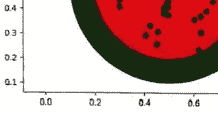

GPT 解题既会吟诗作赋，也能编程绘图

## AI 纵览：神经网络的两次沉寂与三次抬头

咖哥说：正是被通用人工智能的浪潮冲得心潮澎湃，我们不妨先把视线拉远，看看不到百年里这门学科是怎么一步步走到现在的。

人工智能这个概念可以追溯到上世纪四五十年代，却是在 1956 年的达特茅斯会议上才正式成为独立研究方向。那场聚会召集了计算机科学家、数学家等各路学者，共同探讨让机器具备人类智能的可能性，从而开启了现代 AI 的研究进程。此后领域持续扩张，理论、[content]
GPT 解题既会吟诗作赋，也能编程绘图

## AI 纵览：神经网络的两次沉寂与三次抬头

咖哥说：正是被通用人工智能的浪潮冲得心潮澎湃，我们不妨先把视线拉远，看看不到百年里这门学科是怎么一步步走到现在的。

人工智能这个概念可以追溯到上世纪四五十年代，却是在 1956 年的达特茅斯会议上才正式成为独立研究方向。那场聚会召集了计算机科学家、数学家等各路学者，共同探讨让机器具备人类智能的可能性，从而开启了现代 AI 的研究进程。此后领域持续扩张，理论、技术和应用层出不穷。

只是这条路并非顺风顺水，其核心技术深度学习，以及其根基神经网络，曾两次陷入被称作“AI 寒冬”的低谷。下一页的梳理就是以神经网络为主线的一张发展脉络图。

GPT 图解 大模型底层怎么搭

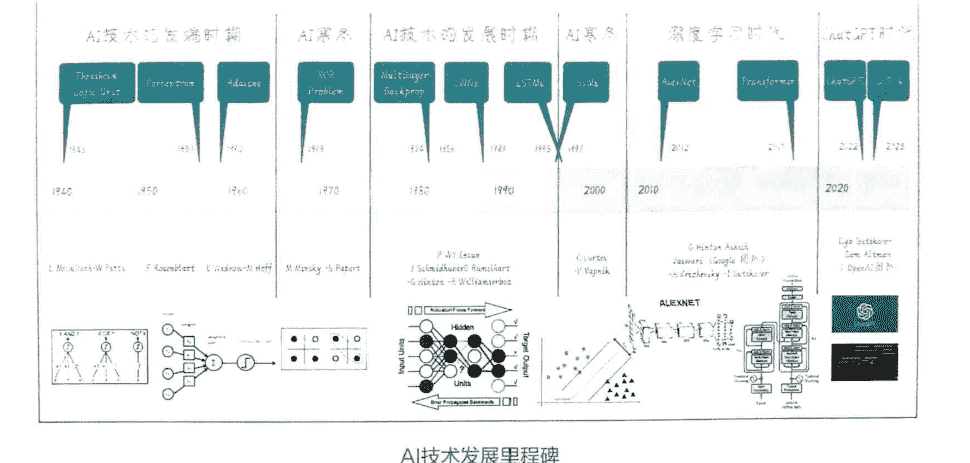

小冰接话：咖哥，这些节点你以前在《零基础学机器学习》里讲过，我印象很深。

- **阈值逻辑单元**：最早可回溯到 1943 年，由美国神经生理学家沃伦·麦克卡洛克和数学家沃尔特·皮茨提出。它本质上是一个简单的逻辑门，通过设定阈值决定输出，常被视作神经网络和人工智能的起点。
- **感知器**：1952 年的霍奇金－赫胥黎模型揭示了神经元如何形成网络，为动作电位提供了生物物理解释，受此启发，弗兰克·罗森布拉特在 1957 年推出感知器。这是首个具备自我学习能力的模型，能依据输入与目标的误差调整权重，完成简单的二分类。虽然只是线性分类器，却是现代神经网络的雏形。
- **自适应线性神经元 Adaline**：1960 年由伯纳德·维德罗和特德·霍夫发明，采用最小均方误差的学习规则，与感知器类似，但收敛性更好。
- **第一次 AI 寒冬——异或难题**：1969 年，马尔温·明斯基和西摩·佩珀特在《感知器》一书中指出，单层感知器无法处理非线性问题，异或问题就是典型。这让学界对感知器失望，资金撤离，第一次寒冬到来。
- **多层反向传播**：保罗·韦尔博斯在 1974 年提出让梯度逐层反向传播的方法，使深层网络训练成为可能。1986 年，大卫·鲁梅尔哈特、杰弗里·辛顿和罗纳德·威廉姆斯发表《通过反向传播误差进行表示学习》，系统阐述了该算法用于训练多层网络。
- **卷积神经网络 CNN**：1989 年杨立昆提出，利用卷积层提取局部特征，在图像识别与计算机视觉领域大放异彩。
- **长短期记忆网络 LSTM**：1997 年谢普·霍赫赖特和于尔根·施米德胡贝提出的一种循环结构，通过门控机制缓解梯度消失与爆炸，能捕捉长程依赖，在自然语言处理和时序预测中广泛应用。CNN 与 LSTM 的出现标志神经网络重返学界视野。
- **第二次 AI 寒冬——支持向量机 SVM**：1995 年弗拉基米尔·瓦普尼克和科琳娜·科尔特斯提出 SVM，通过最大化间隔分类。SVM 在多项任务上表现优异且可解释性强，导致学界再度质疑神经网络潜力，神经网络再次沉寂多年。

好在随后深度学习时代到来。多层隐藏层的神经网络能够学习复杂特征表示，随着互联网数据爆发和算力提升，尤其是 GPU 的并行能力，研究与应用加速，21 世纪初开始取得突破。

GPT 图解大模型是怎样构建的

咖哥：对，小冰，你总结得很清晰。深度学习时代涌现的标志性突破接连不断。

> **AlexNet**：2012 年由亚历克斯·克里泽夫斯基、伊利亚·苏茨克维和杰弗里·辛顿提出的深度卷积网络，在 ImageNet 竞赛中取得突破，被视为深度学习时代的开端。
> **Transformer**：2017 年阿希什·瓦斯瓦尼等人论文《Attention Is All You Need》提出，引入自注意力机制，摒弃传统循环与卷积结构，训练更快、长序列处理能力更强，成为后续模型的基础架构。
> **ChatGPT 与 GPT 系列预训练模型**：ChatGPT 基于 GPT 生成式预训练 Transformer 架构，由 OpenAI 开发，其首席科学家伊利亚·苏茨克维正是 AlexNet 的参与者。ChatGPT 于 2022 年底、GPT-4 于 2023 年初发布后在全球掀起热潮。不同于以往单一科学家突破，这次成功更多归功于 OpenAI 团队的积累与前期技术沉淀。

从 AlexNet 到 Transformer 再到 ChatGPT，人类一次次被 AI 能力震撼。

AI 的两大核心应用是计算机视觉和自然语言处理。有意思的是，早期里程碑偏向 CV，如 CNN、AlexNet；后期则转向 NLP，如 Transformer、ChatGPT。

下面我们再单独梳理自然语言处理的技术演进，会发现它有一些独有细节，体会后对 NLP 的理解会更深。

## 自然语言处理：从手工规则迈向数据驱动

咖哥：自然语言处理是 AI 的子领域，研究计算机如何理解、解释和生成人类语言。

序章看似寻常最奇崛，成如容易却艰辛 007

成人类语言。那我们就先聊聊“语言”是什么。你有没有想过，为什么你说的话我能听懂？

小冰：你普通话讲得好呗。


## 语言传递与信息编码

咖哥笑了：你说得也对。最早语言靠声音传播，使用同一语言交流很重要。中国地域辽阔，方言众多，所谓“十里不同音”。为方便交流，国家推广普通话。其实两千多年前就有类似尝试，古代的“雅言”就起过统一讲学的文化作用。春秋时孔子三千弟子来自各地，《论语·述而》记载孔子讲学使用雅言。

口头传播信息积累难、传播慢，后来人类用结绳、刻契、图画辅助记事，再发展出图形符号，简化后与语言建立对应，才形成早期文字。无论象形、楔形、甲骨文还是现代文字，作用都是承载信息。


没有口语没有文字就无法沟通，语言是信息的载体。口语和书面语都是重要组成部分。

有了载体，还需要编码解码的通道。一个只说英语的人面对不懂英语的中国人，也无法沟通。同理计算机也无法直接理解自然语言。必须把语言编码成机器可读的形式。

这个过程可以用简化的通信模型来理解。


## 简化通信模型

发送者通过绘画、文字、声音等编码方式把信息编码，经信道传递给接收者，接收者解码后获取内容。

## NLP 是人机沟通的桥梁

小冰：这张图讲英译中我能懂，讲电话电报信号转声音文字我也能懂，但 ChatGPT 怎么就能懂人话了呢？

咖哥：NLP 的核心就是为人类的语言做编码和解码，让计算机理解人类语言，才能完成原本只有人类能做的任务。说白了，NLP 就是人和机器之间的沟通桥梁。

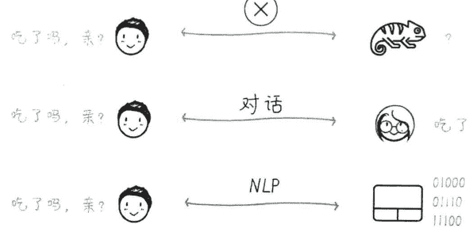

NLP 技术演进大致分四阶段：起源、基于规则、基于统计、深度学习与大数据驱动。

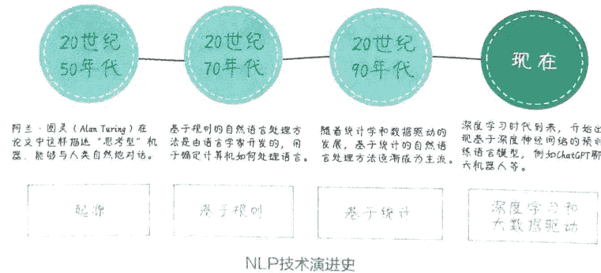

**起源**：可追溯到上世纪五十年代阿兰·图灵提出的图灵测试。若计算机在自然语言对话中表现得像人，便可认为具智能。NLP 问题自 AI 诞生起就是核心难题。

- **基于规则**：数十年间人们尝试用语法语义规则解决 NLP，但规则繁多复杂，难以覆盖语言现象。示例如下图所示。

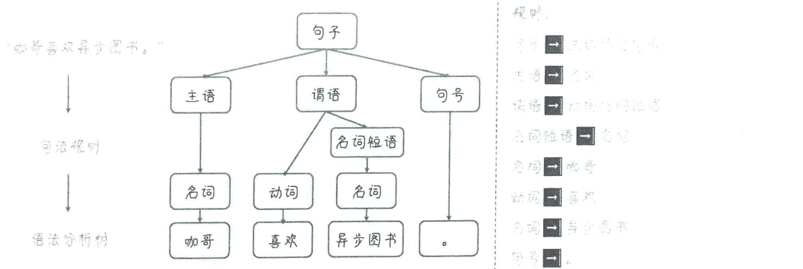

- **基于统计**：1970 年后以弗雷德里克·贾尼尼克为首的 IBM 团队用统计方法解决语音识别，把规则问题变成数学问题，使准确率质变。人们开始意识到统计才是正路。语言模型由此被定义为捕捉词汇、短语、句子概率分布的统计模型，用以估计文本序列出现的概率。
- **深度学习与大数据驱动**：在统计方法确立后，算力提升和深度学习发展让大数据驱动的 NLP 成为主流。深度神经网络处理海量语言数据，学习复杂结构与语义。当前大型预训练语言模型在多项任务上已超越人类，可用于语音识别、文本分类、对话、机器翻译等。

不难看出，基于规则和基于统计是关键节点，大规模语言模型的诞生进一步拓展了应用。

## 大规模预训练语言模型：BERT 与 GPT 各领风骚

小冰问：经常听到语言模型，到底是什么？

## 语言模型的成长轨迹

咖哥：语言模型用于计算和预测自然语言序列的概率分布，通过大量语料学习上下文特性，建立数学模型来推断语言现象。简单说就是根据上下文预测下一个词。广泛用于机器翻译、语音识别、文本生成、对话系统。常见类型有 N-Gram、循环神经网络、LSTM，以及基于 Transformer 的预训练语言模型如 BERT、GPT 系列，还有 ChatGPT。

小冰：还是不懂，能举例吗？

咖哥：我这里有几个词：咖哥一本书学零基础机器学习写了。假设任务是判断哪个组合能构成可理解的句子。句子 A：咖哥零基础学一本书写了机器学习；句子 B：咖哥写了一本书零基础学机器学习。哪个更通顺？

> **不过**，AI 怎么判断？这就靠统计语言模型了。按贾尼尼克假设，句子合理性取决于其在自然语言中出现的可能性。**也就是说**，若语料库足够大，句子 B 曾出现过，AI 会认为它更好，因为概率更高。如图所示，概率高不等于百分百正确，这也是大模型偶尔出错的原因。核心思路是数据驱动，这比手工规则更具优势。

句子 B 的概率更高

小冰：这样我有点明白了。

咖哥：别急，还没完。

设 S 是一个有意义的句子，由词 W1,W2,...,Wn 组成。目标是求 P(S)。若能统计人类有史以来所有句子，就能得到 P(S)(1)。

```
P(S)= P(W_1,W_2,...,W_n)
利用条件概率公式计算 P(W1,W2,..., Wn):

$$egin{gathered} P\left(W_{1}, W_{2}, \cdots, W_{n}\right)=P\left(W_{1}\right) \cdot P\left(W_{2} \mid W_{1}\right) \cdot P\left(W_{3} \mid W_{1}, W_{2}\right) \cdots P\left(W_{n} \mid W_{1}, W_{2}, \cdots, W_{n-1}\right) 
\end{gathered}$$

根据马尔可夫假设（任意一个词出现的概率只同它前面的那一个词有关），就有：

$$P\left(W_{1}, W_{2}, \cdots, W_{n}\right) \approx P\left(W_{1}\right) \cdot P\left(W_{2} \mid W_{1}\right) \cdot P\left(W_{3} \mid W_{2}\right) \cdots P\left(W_{n} \mid W_{n-1}\right)$$
```

> (1) 理想情况，实际只能统计可收集到的语料库。

再通过条件概率和马尔可夫假设，就能判断一个句子是否像人类语言。

统计语言模型优点：

(1) 可扩展性：能处理大规模数据，扩展到更广任务。
(2) 自适应性：从真实数据学习规律，可实时更新。
(3) 容错性强：能处理错误或缺失数据并提取有用信息。
(4) 易实现：基于简单数学和统计方法。

## 统计语言模型的发展与局限

统计语言模型出现很早，但受限于网络结构和数据量，早期并未实现突破。它存在过拟合、难以处理长距离依赖、难以捕捉细微语义等问题。

从 N-gram 到大模型：NLP 的演进脉络

历经数十年积累，自然语言处理逐渐摆脱纯手工规则的束缚。在深度学习兴起后，能够应对早期难题的新思路和新模型相继出现。

语言模型的里程碑可以用一张图概括。

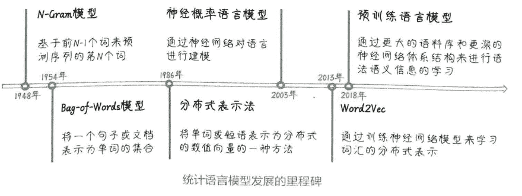

上半区描绘语言模型技术本身的变迁，下半区记录词表示学习的发展轨迹。词向量的突破为语言模型提供了更富语义的输入。按时间顺序把图中的关键节点梳理如下。

- 1948 年 N-Gram 模型问世，核心逻辑是用前 N-1 个词元预测第 N 个词元，词元可以是词或短语。
- 1954 年 Bag-of-Words 把文本压缩成词集合，表示时丢弃顺序，每个词对应一维，数值即词频。
- 1986 年分布式表示把词或短语映射为稠密向量，语义被分散到各维度，能捕捉相似与关联，主要依托上下文构建，有效缓解了词袋与独热编码带来的语义鸿沟，比如歧义和同义问题。
- 2003 年神经概率语言模型首次用神经网络建模词间复杂关系，成为后来的 CNN、RNN、LSTM 类神经语言模型的思想源头。
- 2013 年 Word2Vec 作为标志性工作，用神经网络学习分布式词向量，方法简洁高效。CBOW 通过上下文预测中心词，Skip-Gram 则反向操作。由此得到的向量保留了相似性、语义关联与句法信息，被大量后续模型继承。
- 2018 年之后，以 Transformer 为骨干的预训练体系占据主导地位，借助更大语料和更复杂的网络学习语法与语义，即预训练阶段。经微调后在机器翻译、问答、文本分类、情感分析、文本生成等任务上表现突出，不断刷新基准，如今已是多数 NLP 项目的起点。

图上每个节点都为后继技术奠基，也构成了本篇的讲解顺序。整体演进是规则驱动到统计驱动，再到靠海量语料训练的大模型驱动。

## Transformer 预训练成为新基座

以 BERT 为代表的 Transformer 预训练体系面世后引发广泛关注，有了它，很多过去难以解决的问题变得可解。

小冰：厂里同事一直说 Transformer 究竟指什么，预训练又是什么意思？

咖啡：Transformer 是当前几乎所有预训练体系的底层架构，本课程的核心内容，后续再展开。NLP 中的预训练，简单说就是在海量无标注语料上训练语言模型。训练好的大模型常被称为基础模型。训练过程中模型学会词汇、语法、句法结构和上下文依赖等语言知识，为情感分析、文本分类、命名实体识别、问答等下游任务提供通用的语言表征。

早期 BERT 是最具代表性的预训练体系，它同时利用前后文对句子结构做深度理解。BERT 之后，大型预训练体系迅速涌现，领域进入新阶段，这些体系大幅加速了 NLP 发展，为以往难以应对的问题提供强工具。

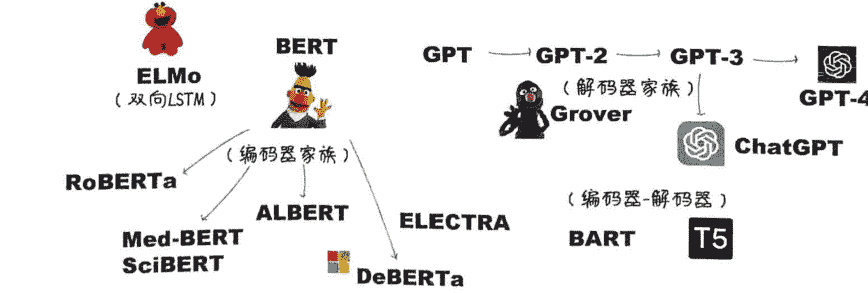

按出现先后对常见体系做简要说明。

> **表 0.1 各种预训练语言模型的说明**

|编号 | 模型名称| 发布年份 | 描述 | 特性|

|:----:|:--------:|:--------:|:-------------:|:---------:|

|1 | ELMo|2018 |基于双向 LSTM 的上下文词嵌入方法 |捕捉前后文信息，生成动态词向量，非 Transformer 结构 |

|2 | GPT|2018 |OpenAI 推出的生成式预训练体系 |单向 Transformer，专注下一个词的预测 |

|3 | BERT |2018 |基于 Transformer 的预训练体系 |双向建模上下文，深入理解句子结构|

|4 | GPT-2 |2019 |GPT 的升级版 |规模与数据量均扩大，预训练效果提升|

|5 | RoBERTa |2019 |在 BERT 基础上优化的预训练体系 |调整训练策略、数据处理与架构，提升速度与性能 |

|6 | ALBERT |2019 |轻量化 BERT |参数与算力成本下降，性能保持高位 |

|7 | T5 |2019 |文本到文本迁移 Transformer |把各类 NLP 任务统一为文本到文本，端到端训练与微调|

|8 | Grover |2019 |生成式预训练体系 |面向新闻虚假信息检测与生成，学习新闻写作方式与结构 |

|9 | ELECTRA|2020 |高效代币替换分类编码器 |采用生成-判别框架，提升预训练效率|

|10 | GPT-3 |2020 |第三代生成式预训练 Transformer |体量更大、数据更多，生成能力强且具备零样本学习能力 |

|11 | BART |2020 |双向自回归 Transformer |结合编码器-解码器与自回归预训练，适用于生成类任务|

|12 | MedBERT/SciBERT |2020 |医学与科学领域的 BERT 变体 |用专业语料预训练，提升垂直任务效果 |

|13 | DeBERTa |2021 |解耦注意力增强 BERT |凭借解耦注意力和相对位置编码提升性能|

|14 | ChatGPT|2022 |基于 GPT-3 的对话机器人 |在 GPT-3 上额外微调，更好适配聊天场景 |

|15 | GPT-4 |2023 |GPT 系列最新一代体系 |模型容量更大、数据更多，生成与推理能力更强

当下预训练体系的发展趋势是参数与体量持续攀升，单次训练花费可达数百万美元，仅顶级大厂可承担，学界难以引领，这种现象常被研究者诟病。

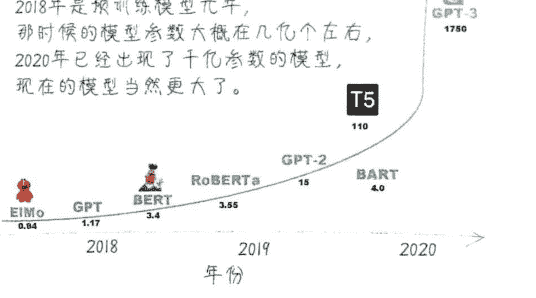

预训练加微调的常用做法

对应用方而言，大型预训练体系是好消息。预训练体系习得的语义和语言知识迁移性强。只需对头部或部分参数做适应性调整，通常在小规模有标注数据上做监督学习，让模型适配特定任务，这就是微调。相比从零训练，微调更快、数据需求更少，让 NLP 方案开发与部署更高效。


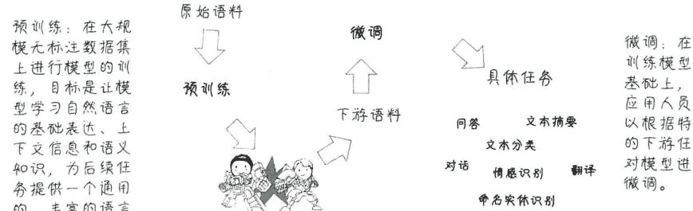

该模式优势明显。预训练提供通用语言知识，无需自建语料从头训练，节省时间与数据。微调可快速针对任务优化，降低部署门槛。可扩展性强，适配多种 NLP 任务，大幅提升技术实用性与普及度。

### 用提示和指令直接驱动大模型

咖啡：小冰要记住，近几年随着 GPT 这类生成式大模型的迅猛发展，预训练加微调的模式正被提示 Prompt 或指令 Instruct 的使用方式逐步替代。

Prompt 与 Instruct 的核心想法是：训练阶段模型通过海量文本掌握语言结构、语法和一定语义，应用阶段只要在输入里给出恰当信息和引导，就能得到更有相关性和可用性的输出。这本质上是一种对话，用户提供提示或指令，模型据此生成结果。

下图来自卡内基梅隆大学研究团队的一篇 Prompt 综述，展示了在多个预训练体系上使用 Prompt 的方式：提供合适的输入就能引导模型按目标输出。

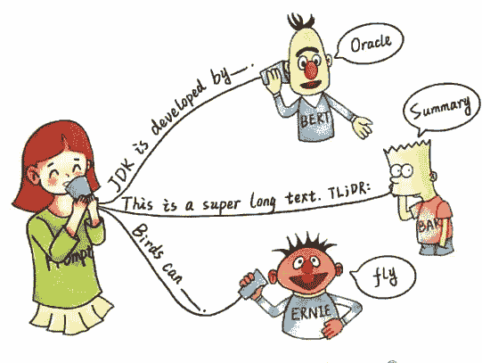

> **Prompt：想让模型做什么，就直接说**

>

> > 1. LIU P, YUAN W, JIANG Z. et al. Pre-train, prompt, and predict: A systematic survey of prompting methods in natural language processing[J]. ACM Computing Surveys, 2022: 55(9), Article No. 195, 1-35.
> >
> > 2. 图中的 BERT、BART 和 ERNIE 都是预训练语言模型，同时也是卡通人物的名字。其中 BART 由 Facebook AI Research 于 2019 年推出，ERNIE 是百度研究院于 2019 年推出。

我的理解是，大模型本身就是知识库，里面装着所需信息，不一定非要微调，只要会把它里的知识“调”出来就行。

> > 提示工程已不是新鲜概念，它就是有效地与人工智能沟通以获得想要的结果。大多数人做得不佳，但它正成为越来越重要的技能……
> >
> > 不好的输入往往导致不好的输出。因此出现了提示工程师这个角色。他们负责设计和优化模型的输入，以引导输出满足目标。需要懂任务需求和领域知识，还要有良好的沟通协作能力。

小冰：Prompt 和 Instruct 有什么区别？

咖哥：主要区别在输入形式和任务性质。


- **Prompt 模式**：输入常是一个词或短语，模型据此生成自然连贯的文本。适合生成类任务，如续写、摘要。例如输入“从前”，模型可能接“有个山，山里有个庙……”。
- **Instruct 模式**：输入是一条明确指令，要求模型完成特定任务。适合需要明确指示的场景，如问答、概念解释。例如输入“请给我讲个故事”，模型返回“从前有个山，山里有个庙，庙里有个咖哥给小冰、小雪上课……”。

小冰：能总结一下 Prompt/Instruct 和预训练加微调的异同吗？

咖哥：相似点是两者都依赖大型预训练体系，在大规模无标注文本上学习通用知识，都利用迁移学习在下游任务上使用预训练好的体系，减少训练时间和数据需求。

不同点如下。

| 特点 | '预训练 + 微调大模型'模式 | Prompt / Instruct 模式 |

| :-- | :-- | :-- |

| 是否微调 | 在下游任务上微调以适配需求 | 不做微调，通过设计指令生成输出 |

| 学习方式 | 在有标注数据上做监督学习 | 通常不需要标注数据 |

| 任务适应性 | 微调后任务适应性较高 | 依赖提示，适应性可能偏低 |

| 灵活性 | 需针对每个任务单独微调 | 灵活性更高，无需微调，但可能需试错 |

总体看，两种方式都利用了预训练体系的强大能力，但实现路径不同。预训练加微调通过针对性调整让模型更精确；Prompt/Instruct 则直接发挥生成能力，用合适提示解决问题。选择依据任务需求、数据情况以及对精确性和灵活性的权衡。

小冰：谢谢梳理了预训练体系的诞生、发展和使用方式，我对大模型有了宏观认识。那能不能把 GPT 的脉络也捋一下？

咖哥：可以。

## GPT 家族：从初代到 ChatGPT 再到 GPT-4

前面提到，初代 GPT 和 BERT 几乎同期出现，GPT 稍早。GPT 全称 Generative Pre-Training，和 BERT 一样基于 Transformer。核心思想是用 Transformer 对大量文本做无监督学习，目标是最大化语句序列的出现概率。


序章 看似寻常最奇崛，成如容易却艰辛 021


## GPT 生成式优势的来源

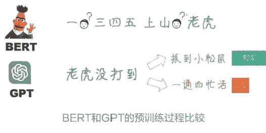

小冰：BERT 和 GPT 都是预训练体系，训练方式有什么不同？

咖哥：了解差异有助于把握语言模型本质。我用初学者角度解释。

BERT 的预训练像做填空题。模型在大量文本上随机遮住部分词，然后根据上下文预测被遮住的词，是双向学习。这样学会句子结构、语法和词汇关联。

GPT 的预训练像文字接龙。模型在大量文本上学习预测给定上文的下一个词，是单向学习。就像接龙，要根据前面内容写后面。通过这种方式，GPT 学会生成连贯文本，并理解句法语义。

细节后面实战再展开。但我要强调，相比 BERT，GPT 更贴近语言模型本质，因为它的训练过程完整再现了自然语言生成的流程。

BERT 虽然靠双向上下文增强理解能力很“聪明”，但语言模型的核心任务是为给定上下文生成合理的概率分布。实际应用中我们通常需要模型根据上下文续写，而不是填补空白。

GPT 通过从左到右逐词预测，在生成过程中学习到连贯表达、句法和语义信息。早期它没有 BERT 那么耀眼，但后劲很足，为 ChatGPT 的出现奠定了基础。

## ChatGPT 背后的推动者——OpenAI

聊完 GPT 的天然优势后，再看它的公司 OpenAI。OpenAI 很年轻，比小冰还小。

OpenAI 成立于 2015 年，由埃隆·马斯克、PayPal 联合创始人彼得·蒂尔、Y Combinator 总裁萨姆·阿尔特曼等多位科技领袖共同发起。宗旨是通过开放合作，将专利和研究成果公开，推动人工智能技术进步。

现如今的OpenAI早已突破了单纯发布开源模型的定位。ChatGPT与GPT-4的训练与推理成本极高，公司正逐步转向收费的商业化路径，调用这些能力都需要付费。

OpenAI走过的关键节点整理如下：

| 时间 | 事件 |
| :--- | :--- |
| 2015年 | 埃隆·马斯克、彼得·蒂尔、萨姆·阿尔特曼等联合发起OpenAI |
| 2018年 | 人工智能选手Five在Dota 2中击败人类，同期首个GPT模型面世 |
| 2019年 | OpenAI对外发布API接口 |
| 2020年 | 微软向OpenAI投入10亿美元 |
| 2022年 | ChatGPT上线引发广泛讨论 |
| 2023年 | 微软追加100亿美元投资，搭载ChatGPT的新版Bing发布，GPT-4推出 |

### OpenAI发展大事记

- 2015年，由埃隆·马斯克、彼得·蒂尔、萨姆·阿尔特曼等人共同创立OpenAI。
- 2018年，OpenAI打造的Five在Dota 2对战中战胜人类玩家。同一时期，自然语言处理领域的首个GPT问世。
- 2019年，微软向OpenAI提供10亿美元资金并取得技术商业化授权。
- 2020年，OpenAI API正式对外开放，开启对外收费运营。
- 2022年11月30日，ChatGPT发布，随即获得极大关注。
- 2023年1月中旬，微软再次投入100亿美元。2月8日，微软推出集成ChatGPT的新一代搜索引擎Bing。
- 2023年4月，GPT-4发布，将大规模预训练模型的能力推向新高度，通向AGI的路径愈发清晰……

未完，待续……

## 从初代GPT到ChatGPT再到GPT-4的演进

ChatGPT是沿着初代GPT逐步发展而来的。在这一过程中，GPT系列的参数规模呈指数级增长，从最早约1.17亿，到GPT-2的15亿，再到GPT-3的1750亿。参数变大、训练语料扩充，模型表现随之提升。发展脉络如下图所示。

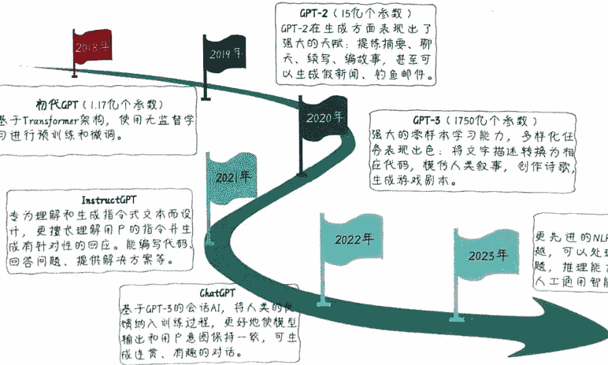

**GPT图解：大模型是怎样构建的**


市面上最早流行的ChatGPT是基于GPT-3.5进一步微调得到的。从GPT-3到ChatGPT，技术重点集中在对话场景的精调、提示技巧、生成可控性，即控制长度、风格与内容，以及安全与伦理责任。这些改进让ChatGPT在会话交互中更贴合用户。

在预训练大模型研究中，研究者观察到，随着参数与语料规模扩大，模型会自然显现出此前未被显式编程的新功能。学界称之为涌现能力。

到了GPT-4，能力进一步扩展。它能理解图像，支持图像加文本的多模态输入并给出正确文本回应；具备超长文本处理能力，可解读约2.5万字的长材料；可进行艺术创作，如写歌、讲故事，甚至模仿特定用户的风格；在多项测试中表现突出，模拟律师资格考试成绩进入前10%，而GPT-3.5仅在后10%左右。

至此，你已对NLP整体演进、大规模预训练模型的轨迹，以及ChatGPT到GPT-4的变化有了宏观把握。后续课程将沿着自然语言处理的技术脉络，讲透核心要点并配合实操。精彩即将开始……

# 第 1 课

### 地基篇：语言模型雏形 N元语法与词袋表示

初春阳光正好，咖哥与小冰边走边刷手机。

咖哥笑道：你看，又是GPT上头条，大模型热度不减。

不过语言模型刚诞生时远没有今日强大，当年几乎无法完成基础的自然语言处理任务。谁能想到，几十年后得益于深度学习与海量数据，语言模型会发展到现在？今天我们就从最基础的语言模型说起。不搞清语言模型的本质与演化，GPT与ChatGPT就无从谈起。你还记得语言模型是什么吗？

小冰：我隐约记得，好像是用来预测下一个词的模型？

咖哥：只对了一半。语言模型确实能预测词，但更准确的描述是，它是估计文本概率分布的数学模型，用来衡量一段文本在自然语言中出现的可能性，从而基于上下文预测最可能的下一个词。它关注上下文中词语间的关联，以保证生成的序列是合理的句子。

这个概念很常见。比如手机输入法会根据已输入的前几个字和个人习惯，自动推荐后续字词，这就是语言模型的应用。


### 1.1 N元语法模型

小冰：原来如此！我记得你说过语言模型的雏形N元语法出现很早。

咖哥：没错。20世纪40年代，人工智能概念刚提出，计算机科学家就开始探索机器理解与生成自然语言。信息论创始人香农提出用香农熵衡量信息量，他认为评估一句话的信息量需要知道其中每个词出现的概率。

小冰：还“彼时”，太文绉绉了……

咖哥：别打岔，听重点。受香农熵启发，研究者意识到让计算机理解自然语言，需要学会对语言中词序列进行概率估计。这样才能判断哪些句子符合语言规律，哪些不合理。这为语言模型奠定了理论基础。

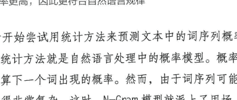

第一个句子的出现概率更高，因而更符合自然语言规律

此后20世纪50年代，研究者开始用统计方法估计文本中词序列的概率，这就是自然语言处理中的概率模型。核心思路是，给定一个词序列，计算下一个词出现的概率。直接计算整个序列的联合概率①非常困难，于是N元语法应运而生。

N元语法把文本切分成连续的N个词组成的片段，用来近似词序列的联合概率。它假设一个词的出现只依赖于它前面的N-1个词，也就是用有限的上下文来预测下一个词。

下图是以词为单元的N元语法示意。其中Unigram对应N=1，即一元组；Bigram对应N=2，二元组；Trigram为三元组。

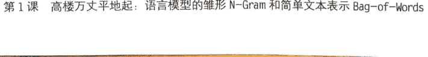

以词为元素的N元语法模型

①联合概率是指多个随机变量同时取特定值的概率，例如p(x,y)表示x取某值且y取某值同时发生的概率。

####### 咖哥发言

N元语法并非出自某一位作者，二十世纪初人工智能确立前，它已在语言学、数学和密码学研究里逐渐成型。

哈佛的乔治·金斯利·齐普夫提出词频与排名的经验规律，即齐普夫定律，说明在语料中词频与其排名成反比，激发了人们对词频分布的研究兴趣。

30至40年代，数学家、语言学家和密码学家为破解敌方加密通信，研究概率论与信息论在语言处理中的应用，香农在此时期提出“熵”的概念，为N元语法奠基。

二战期间，英国密码学家阿兰·图灵为破解恩尼格玛密码机也使用统计方法，这些方法后来演化为N元语法的雏形。战后数十年，研究者持续探索基于统计的自然语言处理，N元语法成为基石。

总之，N元语法是多学科交叉的结果，没有单一“大师”，是众多学者智慧的累积。

具体构建过程如下。

（1）将文本切分为连续的N个词组合，即N元语法。

例如Bigram模型中，文本被切成相邻两词构成的二元组。

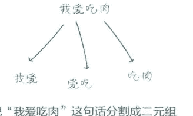

把“我爱吃肉”这句话分割成二元组

（2）统计每个N元语法在语料中出现的次数，即词频。

例如二元组“我爱”在语料库出现3次。

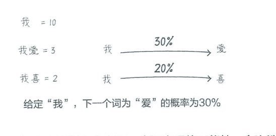

GPT图解：大模型是怎样构建的

（3）利用条件概率计算在给定上下文下下一个词出现的概率，即某个N元语法出现次数除以前缀出现次数。

例如“我爱”出现3次，前缀“我”出现10次，则在“我”后出现“爱”的概率为30%。


（4）用这些概率预测下一个词，甚至迭代生成整句，并计算句子在语料中的概率。例如从“我”生成“爱”，再生成“吃”，最终得到“我爱吃肉”，并将“我爱”“爱吃”“吃肉”的条件概率相乘得到整句概率。如右图所示。

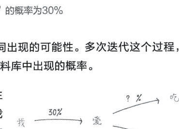

咖哥：听懂了吗？

小冰：懂了。N元语法是一种简化概率模型，通过计算N个词的联合概率预测下一个词，是最早的语言模型，也属于统计方法。

那你说说N元语法里的“N”和“Gram”分别指什么？


小冰愣了一下，答道：你刚说过，“N”就是把文本切成连续N个词组合的那个N，2-Gram是两个相邻词的序列，比如“我爱吃肉”可分成“我爱”“爱吃”“吃肉”；3-Gram是三个相邻词的序列，比如“我爱吃”“爱吃肉”。还可以有4-Gram、5-Gram……而“Gram”我猜就是“词”的意思吧。

咖哥：基本对，但要纠正一下。在NLP中“词”并不简单，笼统说Gram等于词不合适。

“Gram”源自希腊语词根，意为“字母”或“书写”。在N元语法里它表示文本中的一个元素，N-Gram指长度为N的连续元素序列。

这里的“元素”可以是单词，也可以是字符，有时是子词；中文里可以是词或短语，也可以是字。

子词分词算法会把单词拆成更小的子词，以应对未登录词、拼写错误和形态变化，减少词表大小并提升泛化。例英文“embedding”可能被切为["em","bed","ding"]，实际切分更复杂。

BERT等模型常用WordPiece和SentencePiece做子词分词，可基于训练数据自动学习高频子词。WordPiece示例：

```text
playing 可以切分为 ["play", "##ing"]

unstopable 可以切分为 ["un","##stop","##able"]
```

双井号#表示子词是前缀或后缀，帮助模型了解位置。

刚才图示“孙悟空三打白骨精”中把“白骨精”当作一个词即一个Gram处理，我们也可以做更细粒度拆分，如左图所示，此时Gram就是一个字，一元组是一字，二元组是两字。


**N-gram：Gram为字时的N-Gram**

| N | N=1 | N=2 | N=3 |
| :--- | :--- | :--- | :--- |
| **白** | 白 | 白 | 白 |
| **骨** | 骨 | 骨 | 骨 |
| **精** | 精 | 精 | 精 |
| **类型** | unigram | bigram | trigram |

小冰：实际应用中，到底该把语料拆成什么元素？字还是词？

咖哥：要看具体任务。NLP里一个关键预处理就是分词，把句子切成语言模型可读的“元素”，英文叫Token。Token中文常译为令牌、子词或分词，核心是把它切成模型能处理的单元。

分词怎么做？常用工具包已提供。英文常用NLTK、spaCy，中文常用jieba，若用到BERT则需用其专属Tokenizer，它会把词拆成子词来处理生词。

> **咖哥发言**
>
> 刚才说的分词只是预处理之一。还有文本清洗、去停用词①、词干提取、词性标注等。本书聚焦语言模型发展、注意力机制与Transformer架构，不展开各类数据预处理细节。
>
> ①停用词指在文本中高频出现但对分析任务贡献不大的词，如“的”“是”“在”……

######## 1.3 创建一个 Bigram 字符预测模型

这个Bigram字符预测模型程序的整体结构如下图所示。

> 这个 Bigram 字符预测模型程序结构
>
> **构建实验语料库**
>
> **N-Gram(分词)**
>
> **计算每个 Bigram 在语料库中的词频**
>
> **计算每个 Bigram 的出现概率**
>
> **根据 Bigram 出现的概率，定义生成下一个词的函数**
>
> **输入一个前缀，生成连续文本**

########### 第 1 步：构建实验语料库

先建一个极简数据集。

```python
########### 建个玩具数据集
Corpus = ["我喜欢吃苹果",
    "我喜欢吃香蕉",
    "她喜欢吃葡萄",
    "他不喜欢吃香蕉",
    "他喜欢吃苹果",
    "她喜欢吃草莓"]
```

这个玩具语料可看作中文的简化版，也可想象成文明初萌时先民使用的第一批语言和文字，人们反复说的就这么几句话，它就是我们的实验语料库。

########### 第 2 步：把文本切成字符级分片

先写一个切分工具，把整段材料拆成一个个独立的汉字，之后就可以在字符层面做二元组统计了。

> (本书所有程序代码都通过 Python 语言实现。)

########### 第 3 步：统计语料中每个 Bigram 的出现次数

再写一个通用计数器，把 n 固定为 2 跑一遍语料，生成所有的二元组并把频次全部打印出来。

```python
########## 定义一个分词函数，将文本转换为单个字符的列表
def tokenize(text):
    return [char for char in text]  # 将文本拆分为字符列表

########## 定义计算 N-Gram 词频的函数
from collections import defaultdict, Counter  # 导入所需库

def count_ngrams(corpus, n):
    ngrams_count = defaultdict(Counter)  # 创建一个字典，存储 N-Gram 计数
    for text in corpus:  # 遍历语料库中的每个文本
        tokens = tokenize(text)  # 对文本进行分词
        for i in range(len(tokens) - n + 1):  # 遍历分词结果，生成 N-Gram
            ngram = tuple(tokens[i:i + n])  # 创建一个 N-Gram 元组
            prefix = ngram[:-1]  # 获取 N-Gram 的前缀
            token = ngram[-1]  # 获取 N-Gram 的目标单字
            ngrams_count[prefix][token] += 1  # 更新 N-Gram 计数
    return ngrams_count

bigram_counts = count_ngrams(corpus, 2)  # 计算 Bigram 词频
print("Bigram 词频:")  # 打印 Bigram 词频
for prefix, counts in bigram_counts.items():
    print("{}:{}".format("".join(prefix), dict(counts)))
```

**Bigram 词频:**

我：['喜': 2]

喜：['欢': 6]

欢：['吃': 6]

吃：['苹': 2, '香': 2, '葡': 1, '草': 1]

苹：['果': 2]

香：['蕉': 2]

她：['喜': 2]

葡：['萄': 1]

他：['不': 1, '喜': 1]

不：['喜': 1]

草：['莓': 1]

从结果能看出，每个二元组在语料里的出现次数都被完整记录下来，这就是模型的底座信息。例如，“吃苹”这个组合在语料里出现了 2 次，而“吃葡”仅出现过 1 次。

########### 第 4 步：把词频换算成条件概率

在已知前一个字符的前提下，下一个字符出现的可能性，需要用该二元组的频次除以前缀的频次来得到。

```python
########## 定义计算 N-Gram 出现概率的函数
def ngram_probabilities(ngram_counts):
    ngram_probs = defaultdict(Counter)  # 创建一个字典，存储 N-Gram 出现的概率
    for prefix, tokens_count in ngram_counts.items():  # 遍历 N-Gram 前缀
        total_count = sum(tokens_count.values())  # 计算当前前缀的 N-Gram 计数
        for token, count in tokens_count.items():  # 遍历每个前缀的 N-Gram
            ngram_probs[prefix][token] = count / total_count  # 计算每个 N-Gram 出现的概率
    return ngram_probs

bigram_probs = ngram_probabilities(bigram_counts)  # 计算 Bigram 出现的概率
print("\nBigram 出现的概率:")  # 打印 Bigram 概率
for prefix, probs in bigram_probs.items():
    print('{}:{}'.format("".join(prefix), dict(probs)))  # 格式化打印
```

**Bigram 出现的概率:**

我：{'喜': 1.0}

喜：{'欢': 1.0}

欢：{'吃': 1.0}

吃：{'苹': 0.3333333333333333, '香': 0.3333333333333333, '葡': 0.16666666666666666, '草': 0.16666666666666666}

苹：{'果': 1.0}

香：{'蕉': 1.0}

她：{'喜': 1.0}

葡：{'萄': 1.0}

他：{'不': 0.5, '喜': 0.5}

不：{'喜': 1.0}

草：{'莓': 1.0}

到这一步，所有二元组的条件概率都齐了，也就相当于搭好了一个 N-Gram 模型。接下来只要给它一个起始字，它就能按概率最高的候选继续往后推，生成后续文字。

########### 第 5 步：基于概率定义下一个词的生成器

定义一个根据 N-Gram 概率来挑选下一个词的函数。

```python
########## 定义生成下一个词的函数
def generate_next_token(prefix, ngram_probs):
    if not prefix in ngram_probs:  # 如果前缀不在 N-Gram 中，返回 None
        return None
    next_token_probs = ngram_probs[prefix]  # 获取当前前缀的下一个词的概率
    next_token = max(next_token_probs, key=next_token_probs.get)  # 选择概率最大的词作为下一个词
    return next_token
```

这段实现接收一个前缀序列和一个记录了所有可能后续词及其概率的字典。先判断前缀是否在字典里存在，不存在就返回 None 表示无法继续。若存在，就取出该前缀对应的候选列表，找到概率最大的那个词返回。

有了它，给定任意前缀就能一步步推导出下一个字符。

########### 第 6 步：用前缀连续生成一段文本

先写一个负责生成固定长度文本的函数。

```python
def generate_text(prefix, ngram_probs, n, length=6):
    tokens = list(prefix)  # 将前缀转换为字符列表
    for _ in range(length - len(prefix)):  # 根据指定长度生成文本
        # 获取当前前缀的下一个词
        next_token = generate_next_token(tuple(tokens[-(n - 1):]), ngram_probs)
        if not next_token:  # 如果下一个词为 None，跳出循环
            break
        tokens.append(next_token)  # 将下一个词添加到生成的文本中
    return "".join(tokens)  # 将字符列表连接成字符串
```

函数会把输入前缀转成字符列表，然后按目标长度减去前缀长度的次数循环。每次循环调用前面定义的生成器，参考当前最后 n-1 个字符来挑选下一个。生成器返回 None 时提前退出，否则把新字符追加到列表尾部。循环结束后再把列表拼接成字符串。

有了这个流程，一个最简语言模型就能跑起来了。

小冰问道：咖哥，用这个模型真的能造出句子吗？

咖哥回答：当然可以，只要给一个开头，模型就能一路推下去。

```python
########## 输入一个前缀，生成文本
generated_text = generate_text("我", bigram_probs, 2)
print("\n生成的文本：", generated_text)  # 打印生成的文本
```

**生成的文本:** 我喜欢吃苹果

这个基于字符二元组的预测模型，也就是最基础的 N-Gram 模型，虽然能力有限，却为后来更强大的自然语言处理提供了重要启发。用玩具语料和二元组就能拼出简单句子。

在 N-Gram 里，预测一个词只看它前面 N-1 个词，优点是实现简单，缺点是捕捉不到远距离的关联。

与它几乎同期出现的早期模型——词袋模型 Bag-of-Words，则完全不关心词序，而是把文本当成一堆词的集合来统计特征。

######## 1.4 词袋模型

词袋模型是自然语言处理里非常经典的简化表示法。它把句子里的词当成独立元素，丢弃顺序，只保留出现次数。

> **词袋模型**

**示例文本:**

I love this movie! It's sweet, but with satirical humor. The dialogue is great and the adventure scenes are fun... It manages to be whimsical and romantic while laughing at the conventions of the fairy tale genre. I would recommend it to just about anyone. I've seen it several times, and I'm always happy to see it again whenever I have a friend who hasn't seen it yet!

| 词项 | 频次 |

| :--- | :--- |

| it | 6 |

| I | 5 |

| the | 4 |

| to | 3 |

| and | 3 |

| seen | 2 |

| yet | 1 |

| would | 1 |

| whimsical | 1 |

| times | 1 |

| sweet | 1 |

| satirical | 1 |

| adventure | 1 |

| genre | 1 |

| fairy | 1 |

| humor | 1 |

| have | 1 |

| great | 1 |

小冰：N-Gram 保留了词序信息，词袋却把顺序扔掉了。这样在文本分类、情感分析这类任务上是不是会更省事高效？

咖哥：没错。比如下面两句：

1. "咖啡喜欢吃苹果"
2. "苹果是咖哥喜欢的水果"

词袋会把它们变成：

1. `{'咖啡': 1, '喜欢': 1, '吃': 1, '苹果': 1}`
2. `{'苹果': 1, '是': 1, '咖哥': 1, '喜欢': 1, '的': 1, '水果': 1}`

比较这两个向量的相似度，就能判断语义关联的强弱。

小冰：明白了！能用代码演示一下吗？

咖哥：可以，我们用一个简化版词袋来算文本相似度。

######## 1.5 用词袋模型计算文本相似度

下面的程序演示如何用词袋比较文本相似度，整体结构如下。

> 用词袋模型比较文本相似度的程序结构

########### 第 1 步：构建实验语料库

先定义一个简易语料集作为实验对象。

```python
# 构建一个玩具数据集
corpus = [
    '我特别特别喜欢看电影',
    '这部电影真的是很好看的电影',
    '今天天气真好是难得的好天气',
    '我今天去看了一部电影',
    '电影院的电影都很好看'
]
```

########### 第 2 步：给句子分词

用 jieba 对句子做分词。和之前的字符级 N-Gram 不同，这里以词为单位处理。

```python
########### 对句子进行分词
import jieba  # 导入 jieba 包
########### 使用 jieba.cut 进行分词，并将结果转换为列表，存储在 corpus_tokenized 中
corpus_tokenized = [list(jieba.cut(sentence)) for sentence in corpus]
```

########### 第 3 步：创建词汇表

基于分词结果为整个语料建立完整词表并展示。

```python
########### 创建词汇表
word_dict = []  # 初始化词汇表
########### 遍历分词后的语料库
for sentence in corpus_tokenized:
    for word in sentence:
        # 如果词汇表中没有该词，则将其添加到词汇表中
        if word not in word_dict:
            word_dict[word] = len(word_dict)  # 分配当前词汇表索引
print("词汇表:", word_dict)  # 打印词汇表
```

**词汇表:**

{'我': 0, '特别': 1, '喜欢': 2, '看': 3, '电影': 4, '这部': 5, '真的': 6, '是': 7, '很': 8, '好看': 9, '的': 10, '今天天气': 11, '真好': 12, '难得': 13, '好': 14, '天气': 15, '今天': 16, '去': 17, '了': 18, '一部': 19, '电影院': 20, '都': 21}

########### 第 4 步：生成词袋表示

按照词表把句子转为词袋向量。

```python
########### 根据词汇总表将句子转换为词袋表示
bow_vectors = []  # 初始化词袋表示
########### 遍历分词后的语料库
for sentence in corpus_tokenized:
    # 初始化一个全 0 向量，其长度等于词汇总表大小
    sentence_vector = [0] * len(word_dict)
    for word in sentence:
        # 给对应词索引位置上的数加 1，表示该词在当前句子中出现了一次
        sentence_vector[word_dict[word]] += 1
    # 将当前句子的词袋向量添加到向量列表中
    bow_vectors.append(sentence_vector)
print("词袋表示:", bow_vectors)  # 打印词袋表示
```

**词袋表示:**

```[[1, 2, 1, 1, 1, 0, 0, 0, 0, 0, 0, 0, 0, 0, 0, 0, 0, 0, 0, 0, 0, 0],
 [0, 0, 0, 0, 2, 1, 1, 1, 1, 1, 0, 0, 0, 0, 0, 0, 0, 0, 0, 0, 0, 0],
 [0, 0, 0, 0, 0, 0, 0, 0, 0, 1, 0, 0, 1, 1, 1, 1, 1, 0, 0, 0, 1, 0],
 [1, 0, 0, 1, 1, 0, 0, 0, 0, 0, 0, 0, 0, 0, 0, 0, 0, 0, 1, 1, 0, 0],
 [0, 0, 0, 0, 1, 0, 0, 0, 1, 1, 1, 0, 0, 0, 0, 0, 0, 0, 0, 1, 1, 1]]
```

这里得到了 5 个 Python 列表，分别对应语料库里的 5 句话。每个列表就是一个词袋向量，元素值代表对应词在该句中出现的次数。向量长度等于词表大小，这里共 22 个词。词袋表示舍弃了词序，只保留词频信息。

例如词表 `{'我': 0, '特别': 1, '喜欢': 2, '看': 3, '电影': 4}`，句子“我特别特别喜欢看电影”的词袋为 `[1, 2, 1, 1, 1]`，表示“我”“喜欢”“看”“电影”各出现一次，“特别”出现两次。

**词袋模型与向量相似度入门**

> **Note:**  一直被反复提到的 One-Hot 编码，本质上就是词袋表示的一种极端形式。在 One-Hot 方案里，一个词对应一个全零向量里仅有一个位置为 1，该位置由词在总词表中的序号决定。当一句话里只包含一个词时，词袋表示就退化为 One-Hot。例如在前文的语料里，若句子仅为“我”，其词袋向量可表示为 `[1, 0, 0, 0, 0, 0, 0, 0, 0, 0, 0, 0, 0, 0, 0, 0, 0, 0, 0, 0, 0, 0, 0]`，与该词在词表中的 One-Hot 编码完全等价。

########## 第 5 步：余弦相似度计算

余弦相似度用来衡量两个文本向量之间的相近程度。

该指标刻画向量间的夹角大小，取值区间为 -1 到 1。越接近 1 说明方向越一致，相似度越高；越接近 -1 说明方向相反，差异越大；接近 0 则基本无关。

计算公式如下：

```
cosine_similarity(A, B) = (A · B) / (||A|| * ||B||)
```

式中 (A · B) 为 A 与 B 的点积，||A|| 与 ||B|| 分别是两者的模长。在文本处理里，用余弦相似度比较词袋向量，可以削弱句子长短带来的干扰。

> ### 咖哥发言
> 余弦相似度和向量距离都能表征向量间的关联。余弦只看角度，不看绝对远近，范围 -1 到 1。向量距离则关注几何上的实际间隔，常以欧氏距离实现。向量越近，距离越小。
>
> 只要关心相似性而不关心尺度，余弦更合适。它常用于文本、图像等高维场景，因为方向关系比绝对距离更有意义。而在聚类、推荐等需要真实距离的任务里，向量距离更实用。

本节通过一个函数实现余弦相似度，并对句子两两求值。

```python
########### 导入 numpy 库，用于计算余弦相似度
import numpy as np
########### 定义余弦相似度函数
def cosine_similarity(vec1, vec2):
    dot_product = np.dot(vec1, vec2) # 计算向量 vec1 和 vec2 的点积
    norm_a = np.linalg.norm(vec1) # 计算向量 vec1 的范数
    norm_b = np.linalg.norm(vec2) # 计算向量 vec2 的范数
    return dot_product / (norm_a * norm_b) # 返回余弦相似度
```

########## 第 6 步：可视化余弦相似度

借助 matplotlib 绘制句子间的相似度矩阵。

```python
########### 导入 matplotlib 库，用于可视化余弦相似度矩阵
import matplotlib.pyplot as plt
plt.rcParams["font.family"] = ['SimHei'] # 用来设定字体样式
plt.rcParams['font.sans-serif'] = 'SimHei' # 用来设定无衬线字体样式
plt.rcParams['axes.unicode_minus'] = False # 用来正常显示负号
fig, ax = plt.subplots() # 创建一个绘图对象
########### 使用 matshow 函数绘制余弦相似度矩阵，颜色使用蓝色调
cax = ax.matshow(similarity_matrix, cmap=plt.cm.Blues)
fig.colorbar(cax) # 条形图颜色映射
ax.set_xticks(range(len(corpus))) # x 轴刻度
ax.set_yticks(range(len(corpus))) # y 轴刻度
ax.set_xticklabels(corpus, rotation=45, ha='left') # 刻度标签
ax.set_yticklabels(corpus) # 刻度标签为原始句子
plt.show() # 显示图形
```

图中每个格子对应一对句子的余弦值，颜色越深语义越接近。例如“这部电影真的是很好看的电影”与“电影院的电影都很好看”相交的格子着色较深，说明两者相似度较高，语义相近。

<image src="img/0e4677844c777b2f38e3c271a9e6fbf0_52_0.png" alt="" />

小冰：词袋模型确实好用！不过咖哥，你肯定要接着说它的缺陷，以及后来研究者怎么改进的吧？

咖哥：没错。词袋是早期方案，比较简陋，主要有两大局限。第一，它用高维稀疏向量表示文本，每个词占一个维度，导致维度爆炸、计算开销大。第二，它丢掉了词在句子里的上下文，词与词的语义关联无法体现，向量空间里相对位置没有意义。

换句话说，词袋没有像 N-Gram 那样把相邻词 묶在一起考虑，所以缺失了局部的语言顺序信息。

因此，NLP 研究者从 N-Gram 的思路回溯，开始探索用低维稠密向量来表征词，同时借用子序列的方式保留上下文关联。这正是下一节要讲的词向量。

#### 小结

N-Gram 和词袋是两种基础且仍常被使用的文本表示方法，各有侧重。

**N-Gram**
N-Gram 用于语言建模，目的是估计文本中词序列的概率分布。它把文本视作词序列的随机过程，按已有语料计算序列出现的概率。主要应用于语言建模、文本生成、语音识别等。

1. N-Gram 基于连续词序列，把文本切分为长度为 N 的片段，从而捕捉局部语序。
2. 不同 N 能捕捉不同粒度的上下文。1-Gram 只看单个词，2-Gram 看相邻两词的组合，以此类推。

> **GPT 图解：大模型是怎样构建的**
<image src="img/0e4677844c777b2f38e3c271a9e6fbf0_54_0.png" alt="" />

**Bag-of-Words**
词袋把文本看作无序的词集合，通过词频统计来表示文本，常用于文本分类、情感分析、信息检索。

1. 词袋基于词频把文本映射为向量，每个维度对应词表中的一个词，取值为该词在文本中的出现次数。
2. 词袋忽略词序，只关注频率。这在主题建模、文本分类上效果不错，但在机器翻译、命名实体识别等需要顺序的任务上表现弱。
3. 词袋容易产生高维稀疏表示，因为向量长度取决于词表大小。可通过 PCA、LSA 等降维手段缓解。

万丈高楼平地起，N-Gram 和词袋是处理文本的简单起点，在某些任务上够用，但在刻画复杂语言结构时仍有明显不足。随后词嵌入和深度学习模型等更先进的方法相继出现，在大量 NLP 任务上取得更好效果，敬请期待后续内容。

#### 思考
1. 基于给定的语料，分别计算二元组 N=2、三元组 N=3、四元组 N=4 的出现概率，观察不同 N 对结果的影响并分析原因。
2. 词袋里所有词权重相同。实际中停用词高频但价值低，低频词可能很关键。请自学 TF-IDF 表示并用它解决该问题。
> **①** TF-IDF 由词频 TF 和逆文档频率 IDF 组成。TF 反映词在文中出现的次数，IDF 用来抑制像“的”“了”“the”“is”等高频无意义词的影响。

---

# 第 2 课

## 问文本何似：词向量 Word2Vec 与 Embedding

咖哥与小冰准备开课，马总走进数据科学讲习所。

**马总**：咖哥，小雪，在忙？

**咖哥**：马总来得正好，我们正要讲 NLP 基础——词向量，你一起听听。刚才认错人了，这位是小冰，小雪在外做项目。

**马总**：不好意思不好意思，她们太像了。

<image src="img/0e4677844c777b2f38e3c271a9e6fbf0_55_0.png" alt="" />

**小冰**：哪像了？我怎么不觉得。

**咖哥**：你被认成小雪，说明在某些特征上很像，马总总不至于把我认成小雪吧？

**小冰**：你是男的我是女的，怎么可能搞混？

**咖哥**：对啊。这正说明你们在某些维度上相似，比如年龄相近，都挺可爱……

**小冰**：……

### 2.1 词向量≈词嵌入

**咖哥**：跟你开玩笑，今天讲的词向量，又称词嵌入，是一种寻找词间相似性的技术。它把词汇在各个维度上的特征映射为数值向量，通过维度上的相似程度判断词义接近度。

> ### 咖哥发言
> 在实践中，词向量和词嵌入两个术语常可互换，都指把词表映射到固定维度的连续向量空间。相似语义的词在空间中余弦相似度高、距离近，差异大的词则相反。
>
> 细微差别在于：词向量多指具体的数值表示，如“cat”是一个 300 维向量；词嵌入多指映射过程或方法，如“我们用 Word2Vec 生成词嵌入”。

下图直观展示了词向量的意义：把离散词转为向量，从而捕捉语义和句法关联，相似词在空间中靠拢。

<image src="img/0e4677844c777b2f38e3c271a9e6fbf0_56_0.png" alt="" />

举例说明：初始词向量是无意义的多维数据。若在语料中“小冰”、“小雪”常与“女生”共现，学习过程中就会有维度逐渐承载性别信息，可视作性别向量；若它们还常与“年轻”共现，则某维度会承载年龄信息，可视作年龄向量。如此一来，“小冰”和“小雪”的余弦相似度会很高，而“咖哥”与它们差异大，相似度低。也就是说，上下文信息被“嵌入”到了向量表示中。

这就是词向量也叫词嵌入的原因。

**小冰**：明白了。上节我们说衡量相似性时关注夹角，所以余弦更合适。而且在《零基础学机器学习》里你也讲过词向量（如下图），我印象很深。现在的问题是，词的这些“维度”和“向量表示”是怎么被发现的？

> 在《零基础学机器学习》中，咖哥曾这样向小冰解释词向量
<image src="img/0e4677844c777b2f38e3c271a9e6fbf0_57_0.png" alt="" />

**咖哥**：靠机器学习算法从海量语料中“学”出来的。最知名的算法是 Word2Vec。核心思想类似“近朱者赤，近墨者黑”，英文谚语“A man is known by the company he keeps”。在 NLP 里，一个词的含义可由周围词推断。具体做法是把目标词与其上下文一起训练，让语义相近的词在向量空间中靠得更近。

> > (1) 该谚语原意是“看一个人跟谁交往，能知其品性”。

<image src="img/0e4677844c777b2f38e3c271a9e6fbf0_57_0.png" alt="" />

于是我们就能用向量间距离衡量词的相似性。下面具体聊 Word2Vec 的实现。

#### 2.2 Word2Vec：CBOW 模型和 Skip-Gram 模型

> **小冰**
> **咖哥** -> **Word2Vec**
> **学习**
> - 将词汇表中的每个词都表示成固定长度的向量

Word2Vec 之前已有方法尝试用稠密向量表达词，但效率和效果有限。

##### 分布式表示

分布式表示把离散符号映射到连续向量空间，每个维度不再对应单一符号，而是某种特征或属性。它通过捕捉词间相似与关系，更好地描述自然语言。

该概念可追溯至 1986 年，Hinton、Rumelhart 和 Williams 在《Learning representations by back-propagating errors》中提出用反向传播训练多层神经网络学习分布式表示。NLP 领域的应用较晚，90 年代 Joshua Bengio 等人开始尝试神经网络学习词句表示，推动了神经网络语言模型及后续词嵌入的发展。

2013 年，Tomas Mikolov 等人在 Google 提出 Word2Vec。该算法高效地学习词的连续向量表示，把词表每个词映射为固定长度向量，使大规模训练成为可能。

<image src="img/0e4677844c777b2f38e3c271a9e6fbf0_58_0.png" alt="" />

> **MIKOLOV T, SUTSKEVER I, CHEN K, et al. Distributed representations of words and phrases and their compositionality [J/DB]. (2013-10-16) [2023-04-17]. https://arxiv.org/pdf/1310.4546.pdf.**

> ### 咖哥发言
> 简单区分稀疏向量和稠密向量。稀疏向量大部分元素为 0，仅少数非零，常用于高维数据表示。词袋就是稀疏表示，文档向量长度等于词表大小，大部分词未出现所以稀疏。One-Hot 更是极端稀疏，只有一个 1。
>
> **稠密向量**：元素大都非零，维度较低，却能承载更丰富信息。Word2Vec 就是典型的稠密表示，能捕捉语义和语法关系，使相似词在空间中靠近。
>
> 在 NLP 中，稠密向量更受欢迎，因其信息量大且计算高效。下图展示两者差异。
>
> <image src="img/0e4677844c777b2f38e3c271a9e6fbf0_59_0.png" alt="" />

很快研究者发现，Word2Vec 学到的向量能体现词间语义和语法关系，且算法高效，可轻松处理大规模文本。因此 Word2Vec 迅速流行起来。

**小冰**：我清楚了，Word2Vec 的作用就是把词映射成数值表征，这个表征正是模型训练后给出的结果。你能再细化一下它的实现思路吗？

**咖哥**：核心是用神经网络来学习词的分布式表示。训练目标可以设定为已知上下文推断中心词，也可以反过来已知中心词推断上下文。

目前落地最常见的两种结构是 CBOW，也就是连续词袋模型，以及 Skip-Gram，常被叫做跳字模型，如下图所示。CBOW 以若干邻近词为输入，去预测要填补的中心词；Skip-Gram 则方向相反，以中心词为输入去预测邻近词。两种方式都通过不断调整网络参数，让预测结果逼近真实标签来完成学习。训练收敛后，所需的向量可以直接从模型权重里抽取出来。

**小冰**：挺有意思的，给出一组上下文就能补全中间空缺，给定一个词也能找回它常出现的伙伴。咖哥，能不能用代码把这两种思路演示一下？

**咖哥说**：可以，这两种结构都可以用很简洁的网络搭建出来，图示如下。需要说明的是，预测具体词只是训练手段，真正的追求是通过参数优化得到词嵌入，从而刻画词表里词语之间的语义和语法关联，为下游自然语言处理任务提供高质量的表征。

<image src="img/0e4677844c777b2f38e3c271a9e6fbf0_60_0.png" alt="" />
## 2.3 Skip-Gram模型的代码实现
> ### 咖哥发言

下面按步骤演示如何用 PyTorch 搭建一个简化版的 Word2Vec，这里选用 Skip-Gram 形式。目标是让模型学会词语的向量化表示，进而捕捉词与词之间的语义和语法联系。

PyTorch 是一个开源的机器学习库，广泛用在计算机视觉和自然语言处理等领域。它提供两类关键能力：

- **张量计算**：类似 NumPy，能在 GPU 上高效运算，适合大规模数值任务。
- **深度学习构建**：提供动态计算图，搭建模型和验证新想法都很灵活。

生态方面还有 TorchText、TorchVision、TorchAudio 等。得益于直观和灵活，它在学术和工业界都很受欢迎。

开始学习前，请先按官网指引完成安装，具体方式会因硬件和系统而异。

程序结构如下。

### 第1步 构建实验语料库

先准备一个小规模语料作为试验材料，并整理出词表。

```python
#定义一个句子列表，后面会用这些句子来训练CBOW和Skip-gram模型
sentences = ["Kage is Teacher", "Mazong is boss", "Niuzong is Boss",
             "Xiaobing is Student", "Xiaoxue is Student"]

#将所有句子连接在一起，然后用空格分隔成多个单词
words = ".".join(sentences).split()
#构建词汇表，去除重复的词
word_list = list(set(words))
```

创建一个字典，将每个词映射到一个唯一的索引：

```python
word_to_idx = {word: idx for idx, word in enumerate(word_list)}
#创建一个字典，将每个索引映射到对应的词
idx_to_word = {idx: word for idx, word in enumerate(word_list)}

voc_size = len(word_list) #计算词汇表的大小。
print("词汇表: ", word_list) #输出词汇表
print("词汇到索引的字典：", word_to_idx) #输出词汇到索引的字典
print("索引到词汇的字典：", idx_to_word) #输出索引到词汇的字典
print("词汇表大小：", voc_size) # 输出词汇表大小

Out  
- 词汇表：['Boss','Kage','Mazong','Student','Xiaoxue','Niuzong','Teacher','is','Xiaobing']
- 词汇到索引的字典: {'Boss': 0, 'Kage': 1, 'Mazong': 2, 'Student': 3, 'Xiaoxue': 4, 'Niuzong': 5, 'Teacher': 6, 'is': 7, 'Xiaobing': 8}
- 索引到词汇的字典: {0: 'Boss', 1: 'Kage', 2: 'Mazong', 3: 'Student', 4: 'Xiaoxue', 5: 'Niuzong', 6: 'Teacher', 7: 'is', 8: 'Xiaobing'}
- 词汇表大小：9

整个语料库包含5个简单的句子。注意这里的词汇表 word_list是无序的，因为在创建词汇表时使用了 Python 的 set 数据结构来删除重复的词汇，然后再将 set 转换回 list。Python 中，set 数据结构是基于哈希表实现的，它的主要优点是查找速度快，但它不维护元素的顺序。

### 第2步 生成Skip-Gram数据

定义一个函数，从刚才的数据集中生成 Skip-Gram 训练数据。

```python

**In**  # 生成 Skip-Gram 训练数据

def create_skipgram_dataset(sentences, window_size=2):

    data = [] # 初始化数据

    for sentence in sentences: # 遍历句子

        sentence = sentence.split() #将句子分割成单词列表

        for idx, word in enumerate(sentence):# 遍历单词及其索引

            # 获取相邻的单词，将当前单词前后各N个单词作为相邻单词

            for neighbor in sentence[max(idx - window_size, 0):

                min(idx + window_size +1,len(sentences))]:

                    if neighbor != word:# 排除当前单词本身

                        # 将相邻单词与当前单词作为一组训练数据

                            data.append((neighbor, word)

    return data

#使用函数创建Skip-Gram 训练数据

skipgram_data = create_skipgram_dataset(sentences)

#打印未编码的 Skip-Gram 数据样例（前3个）

print("Skip-Gram 数据样例（未编码）:", skipgram_data[:3])

```

**Out**  
- Skip-Gram数据样例（未编码）: [('is', 'Kage'), ('Kage', 'is'), ('Teacher', 'is')]

Skip-Gram 模型的任务是根据给定的目标词来预测上下文词。因此数据集中每个元素包括一个目标词和它的一个上下文词。根据 Gram 窗口的大小，一个元素可能会有多个上下文词，那就形成多个 Skip-Gram 数据。

### 第3步 进行One-Hot编码

把 Skip-Gram 训练数据转换成Skip-Gram 模型可以读入的 One-Hot 编码后的向量。

```python

**In**  #定义 One-Hot编码函数

import torch#导入torch库

def one_hot_encoding(word, word_to_idx):

    tensor = torch.zeros(len(word_to_idx))#创建一个长度与词汇表相同的全0张量

    tensor[word_to_idx[word]] = 1 #将对应索引位置上的值设为1

return tensor #返回生成的 One-Hot 编码后的向量

```

展示 One-Hot 编码前后的数据：
```python

word_example = "Teacher"

print("One-Hot编码前的单词:", word_example)

print("One-Hot编码后的向量:", one_hot_encoding(word_example, word_to_idx))

####### 展示编码后的 Skip-Gram 训练数据样例

print("Skip-Gram 数据样例 (已编码):(one-hot_encoding(context, word_to_idx),

      word_to_idx[target]] for context, target in skipgram_data[:3])")

```

**Out**  
- One-Hot编码前的单词: Teacher
- One-Hot 编码后的向量: tensor([0., 0., 0., 1., 0., 0., 0., 0.])
- Skip-Gram 数据样例 (已编码):
    - (tensor([0., 1., 0., 0., 0., 0., 0., .]), 6)
    - (tensor([0., 0., 0., 1., 0., 0., 0., 0.]), 6)
    - (tensor([0., 0., 0., 0., 0., 0., 1., 0., 0.]), 1)

One-Hot 编码后的数据是向量，这种形式的向量就是之前提过的稀疏向量，其长度等于词汇表大小，其中对应单词在词汇表中的索引位置上的值为 1，其他位置上的值为 0。

我们此处的目标就是通过学习，把这种稀疏向量压缩成更具有表现力的低维稠密向量。

在现在这个已经经过编码的Skip-Gram训练数据集中（我展示了前3个数据），每个数据包含两个张量（Tensor），第一个是输入（Input），格式是上下文词的One-Hot 编码，后一个是目标（Target），格式则是目标词的索引。

**小冰**：能否说说为什么这里我们需要把输入转换成One-Hot编码后的向量？  
**咖哥**：在原始的 Skip-Gram模型中，接收输入的是线性层，需要将输入转换为One-Hot 编码形式，才能在神经网络中使用它们。后面的示例中，你还会看到经过改进的网络，使用嵌入层（Embedding）接收输入，那时就可以省去One-Hot编码这一步啦。

而对于目标词，我们使用它们在词汇表中的索引，而不是One-Hot 编码后的向量。这是我们后面要使用交叉熵损失（CrossEntropyLoss）函数来计算模型的预测值和实际值的差距。PyTorch 的 CrossEntropyLoss 函数接受类别索引作为目标值（而不是 One-Hot 编码后的向量）。这样设计的原因是，计算预测值和实际值的差距时，实际上只需要知道正确类别的索引，而不需要处理高维稀疏向量，这样可以提高计算效率。

### 第4步 定义Skip-Gram类

通过继承PyTorch的 nn.Module 类来实现 Skip-Gram类。

> 在 PyTorch 中，nn.Module 是一个非常重要的类，它是所有神经网络模型的基类。每一个模型都应该继承 nn.Module 类，然后重写其中的方法。最基本且最重要的两个方法如下：
- **__init__**:在这个方法中定义模型中的各个层级和部分。所有的层级都应该是 nn.Module 类的子类，包括nn.Linear、nn.Conv2d、nn.ReLU等。
- **forward**:在这个方法中定义了模型的前向传播方式，也就是输入数据如何通过各个层级来生成输出。

定义 Skip-Gram 类，一方面，将模型的定义和实际计算分开，从而让代码更加清晰易读，另一方面，通过定义的模型类，可以方便地存储和加载模型，可以复用模型结构，同时也可以方便地使用 PyTorch 的自动求导功能来进行模型的训练。

```python

####### 定义 Skip-Gram 类

import torch.nn as nn #导入 neural network

class SkipGram(nn.Module):

    def __init__(self, voc_size, embedding_size):

        super(SkipGram, self).__init__()

    # 从词汇表大小到嵌入层大小 (维度) 的线性层(权重矩阵)

    self.input_to_hidden = nn.Linear(voc_size,embedding_size, bias=False)

    # 从嵌入层大小 (维度) 到词汇表大小的线性层 (权重矩阵)

    self.hidden_to_output = nn.Linear(embedding_size, voc_size, bias=False)

    def forward(self, X):#前向传播的方式,X 形状为(batch_size,voc_size)

        #通过隐藏层，hidden 形状为(batch_size, embedding_size)

        hidden =self.input_to_hidden(X)

        #通过输出层，output_layer 形状为 (batch_size,voc_size)

        output = self.hidden_to_output(hidden)

    return output

embedding_size=2#设定嵌入层的大小，这里选择2是为了方便展示

skipgram_model=SkipGram(voc_size,embedding_size)#实例化 Skip-Gram模型

print("Skip-Gram类:", skipgram_model)

```

Skip-Gram类:
- SkipGram(
    - (input_to_hidden): Linear(in_features=9,out_features=2,bias=False)
    - (hidden_to_output):Linear(in_features=2,out_features=9,bias=False))

在这个简单的神经网络模型的 `__init__` 方法中定义了两个线性层（nn.Linear，也叫全连接层），这两个线性层的权重矩阵中的参数是可学习的部分。

- **`input_to_hidden`**：把 One-Hot 编码后的向量从词汇表大小映射到嵌入层大小，以形成并学习词的向量表示。
- **`hidden_to_output`**：把词的向量表示从嵌入层大小映射回词汇表大小，以预测目标词。

而在 `forward` 方法中，定义了前向传播的方式，首先将输入通过输入层到隐藏层的映射生成隐藏层，然后将隐藏层通过隐藏层到输出层的映射生成输出。

### 第5步 训练Skip-Gram类

对刚才创建的 Skip-Gram 类实例进行训练。

```python

####### 训练 Skip-Gram 类

learning_rate = 0.001 #设置学习速率

epochs = 1000 #设置训练轮次

criterion = nn.CrossEntropyLoss() #定义交叉熵损失函数

import torch.optim as optim #导入随机梯度下降优化器

optimizer = optim.SGD(skipgram_model.parameters(), lr=learning_rate)

#开始训练循环

loss_values = [] #用于存储每轮的平均损失值

for epoch in range(epochs):

    loss_sum = 0 #初始化损失值

    for context, target in skipgram_data:

        X = one_hot_encoding(target, word_to_idx).float().unsqueeze(0) #将中心词转换为向量

        y_true = torch.tensor([word_to_idx[context]], dtype=torch.long) #将周围词转换为索引值

        y_pred = skipgram_model(X) #计算预测值

        loss = criterion(y_pred, y_true) #计算损失

        loss_sum += loss.item() #累积损失

        optimizer.zero_grad() #清空梯度

        loss.backward() #反向传播

        optimizer.step() #更新参数

    if (epoch+1) % 100 == 0: #输出每100轮的损失，并记录损失

        print(f"Epoch:{epoch+1}, Loss:{loss_sum/len(skipgram_data)}")

    loss_values.append(loss_sum / len(skipgram_data))

#绘制训练损失曲线

import matplotlib.pyplot as plt #导入matplotlib

#绘制二维词向量图

# Skip-Gram 与 CBOW 的实现要点

Matplotlib 默认情况下对中文支持不佳，坐标轴文字容易乱码，负号也会渲染异常。把字体族、无衬线字体都指定为 SimHei，并关闭 Unicode 负号的特殊处理后，中文标签就能正常显示。损失曲线按每 100 个 epoch 抽样绘点，可快速判断收敛情况。

plt.rcParams['font.family']='SimHei' #用来设定字体样式

plt.rcParams['font.sans-serif']=['SimHei'] #用来设定无衬线字体样式

plt.rcParams['axes.unicode_minus']=False #用来正常显示负号

plt.plot(range(1, epochs//100+1), loss_values) #绘图

训练结束之后，Skip-Gram 中输入到隐层的参数矩阵就可以当作词的向量表示。借助词表映射逐项取出对应列，分离计算图并转为 NumPy 形式打印，便能观察数值分布。

```

**训练损失曲线**  
- 图题：训练损失曲线
- X 轴 Label：轮次
- Y 轴 Label：损失

Epoch: 100, Loss: 2.1747937202453613  
Epoch: 200, Loss: 2.1470229427019754  
Epoch: 300, Loss: 2.1150383671124775  
Epoch: 400, Loss: 2.07618362903595  
Epoch: 500, Loss: 2.0306010961532595  
Epoch: 600, Loss: 1.9832865635553996  
Epoch: 700, Loss: 1.9422581712404887  
Epoch: 800, Loss: 1.9113846600055695  
Epoch: 900, Loss: 1.8883622487386067  
Epoch: 1000, Loss: 1.8694449504216513

这段程序呈现了一个典型的 PyTorch 神经网络训练流程。首先定义一些基本参数和预处理文本数据。接下来，创建模型实例，定义损失函数（交叉熵损失）和优化器（SGD 优化器）。随后进行1000轮训练，尝试学习词嵌入。在训练过程中，损失函数将模型的输出数据与目标数据进行比较，可以看到模型的损失会随着训练的进行而降低，通过最小化这个损失，模型将接近上下文单词正确的概率分布。通过学习词与词之间的关系，表示模型对目标词的预测会越来越靠谱。

**小冰**：咖哥，这里我有一个疑问，我们是希望 $y_{pred}$ 和 $y_{true}$ 一致，也就是类别相同，这实际上是个“多类别分类”问题。这里的“类别”就是词汇表中每个单词的索引，对吧？  
**咖哥**：正确！在 Skip-Gram 模型中，我们的目标是预测上下文单词，即在词汇表中找到具有最高概率的单词索引。$y_{pred}$ 包含了当词汇表中所有单词前缀为输入...

## 第6步 展示词向量

W2V中有两个权重矩阵：输入到隐藏层的权重矩阵 input_to_hidden 和隐藏层到输出的权重矩阵 hidden_to_output。其中，输入到隐藏层的权重矩阵蕴含着词嵌入的信息。这个矩阵的每一列都对应一个单词在词汇表中的索引，而这一列的元素的数值则表示该单词的词向量。通过提取这些词向量，我们可以在二维或三维空间中绘制它们，以观察词与词之间的相似性和关系。

```python

####### 输出 Skip-Gram 习得的词嵌入

print("Skip-Gram 词嵌入：")

for word, idx in word_to_idx.items(): #输出每个词的嵌入向量

    print(f"{word}: {skipgram_model.input_to_hidden.weight[:, idx].detach().numpy()}")

下面是一次实验的片段，不同实体和功能词在数值空间上被明显拉开。

```

```

Skip-Gram词嵌入:

Xiaobing: [-1.3628563 -2.1293848]

Xiaoxue: [-1.3693085 -2.1389563]

Boss: [ 2.923863 -0.4184679]

Student: [-0.09255204 -0.8242733 ]

is: [-0.23261149 0.29151806]

Kage:[-0.3542828 -0.9870443]

Niuzong:[0.8161409 -0.624454 ]

Mazong:[0.821509 -0.62387395]

Teacher: [ 0.8520589 -0.47847477]

若想直观看出语义关系，可把得到的二维向量投到平面。每個词用一个散点表示并在其附近标注名称，配合标题与坐标说明就能形成可读的分布图。

```

代码 `skipgram_model.input_to_hidden.weight[:,idx]` 访问 `skipgram_model` 的 `input_to_hidden`。索引 `[:, idx]` 选择了所有行和索引为 `idx` 的列，也就是提取了对应索引 `idx` 的单词的嵌入向量，而这个嵌入向量，是我们之前通过 W2V 模型在语料库中习得的。

语句中的 `detach()` 方法创建了一个新的从当前计算图中分离出来的张量（在本书中，向量与张量含义相同，程序中习惯称之为张量），这意味着它不会反向传播梯度。`numpy()` 方法将这个张量转换为 NumPy 数组，便于显示。

**2 咖啡发言**

小冰：咖哥，你这样打印出来两个向量，我可看不出牛总 (Niuzong)和马总 (Mazong)怎么就比较相似了，我也看不出小冰(Xiaobing)和小雪(Xiaoxue)哪里比较像？

咖哥:牛总和马总都是老板，怎么不像？小冰和小雪都是咖哥的学生，怎么不像？哎，我们在二维平面上绘制一下这个二维词向量，你就看得出来吧。

```python

fig, ax = plt.subplots()

for word, idx in word_to_idx.items():

    #获取每个单词的嵌入向量

    vec = skipgram_model.input_to_hidden.weight[:,idx].detach().numpy()

    ax.scatter(vec[0], vec[1])#在图中绘制嵌入向量的点

    ax.annotate(word, (vec[0], vec[1]), fontsize=12) #点旁添加单词标签

plt.title('二维词嵌入')#图题

plt.xlabel('向量维度 1 ')#X轴 Label

plt.ylabel('向量维度 2 ')#Y轴 Label

plt.show()#显示图

切换到 CBOW 时，网络只有两层无偏置的线性变换。第一层把 One-Hot 编码压缩到低维空间，第二层把上下文平均后的向量映射回完整词表。forward 里先对每个上下文词投影，再取均值得到隐层表示，最后生成预测分布。

```

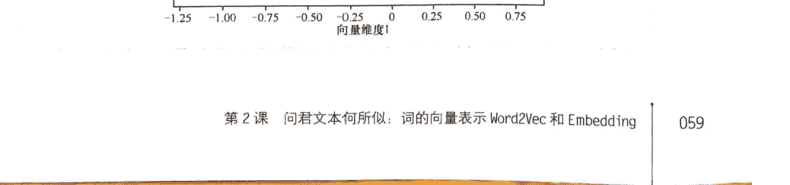

这段代码可视化了输入到隐藏层的权重矩阵，展示了每个词的低维词向量。这里我们之所以把向量维度设计成二维，就是为了直接在二维平面上画出每个词的向量，如果词嵌入向量的维度超过二维或三维，就要先进行降维才能够展示。

一般情况下，像 BERT、GPT 这样的模型需要学习几百（如 128、256、512 等）维的向量，才能够捕获更丰富的语义信息。

**总结一下吧**：我们使用 PyTorch 实现了一个简单的 Word2Vec（这里是 Skip-Gram）模型。模型包括输入层、隐藏层和输出层。输入层接收中心词（以 One-Hot 编码后的向量形式表示）。接下来，输入层到隐藏层的权重矩阵（记为 `input_to_hidden`）将这个转换为词嵌入，该词嵌入直接作为隐藏层的输出。隐藏层到输出层的权重矩阵（记为 `hidden_to_output`）将隐藏层的输出转换为一个概率分布，用于预测与中心词相关的周围词（以索引形式表示）。通过最小化预测词和实际目标词之间的分类交叉熵损失，可以学习词嵌入向量。下图展示了这个流程。

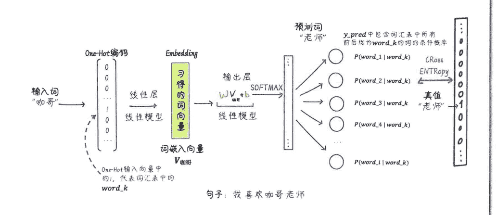

下面，我们来看看 CBOW 模型的具体实现和 Skip-Gram 模型有何不同。

##### 2.4 CBOW 模型的代码实现

CBOW 模型与 Skip-Gram 模型相反，其主要任务是根据给定的周围词来预测中心词。我们下面就来实现一个 CBOW 模型，不过这里不重复数据集的构建、网络的训练等代码块，只突出和 Skip-Gram 模型的区别。

第一个区别在于，CBOW 模型数据集的准备与 Skip-Gram 模型不同。在 Skip-Gram 中，输入是中心词，目标是周围词，形成一个个的二元组。当一个中心词有多个周围词时，会形成多个（中心词，周围词）形式的元组。而 CBOW 模型的数据集构建则略有不同，它将多个周围词对应到同一个中心词。需要构建出 `(周围词1, 周围词2, 周围词3...), 中心词` 这样的元组。这是因为对于每个中心词来讲，我们需要找到其在 `context_window` 范围内的周围词。将周围词和中心词的 ID 组合成训练数据，以便为每个目标单词提供其周围词的列表。

> # 生成 CBOW 训练数据
def create_cbow_dataset(sentences, window_size=2):
    data = [] # 初始化数据
    for sentence in sentences:
        sentence = sentence.split() # 将句子分割成单词列表
        for idx, word in enumerate(sentence): # 遍历单词及其索引
            # 获取上下文词汇，将当前单词前后各 window_size 个单词作为周围词
            context_words = sentence[max(idx-window_size, 0):idx] + sentence[idx+1:min(idx+window_size+1, len(sentence))]
            # 将当前单词与上下文词汇作为一组训练数据
            data.append((word, context_words))
    return data
###### 使用函数创建 CBOW 训练数据
cbow_data = create_cbow_dataset(sentences)
###### 打印未编码的 CBOW 数据样例（前三个）
print("CBOW 数据样例 (未编码):", cbow_data[:3])

CBOW 数据样例（未编码）:
["Kage", "is", "Teacher"], ["is", ["Kage", "Teacher"]], ["Teacher", ["Kage", "is"]]

我们从这个示例中可以看到多个周围词是如何对应到中心词的。因为 `window_size` 是 2，在第一个数据样例 `('Kage', ['is', 'Teacher'])` 中，有两个周围词 `['is', 'Teacher']` 和一个中心词 `'Kage'`，Teacher 和 Kage 虽然隔着一个词，但是仍然在 2 这个滑动窗口范围内；在第二个数据样例中，有两个周围词 `['Kage', 'Teacher']` 和一个中心词 `'is'`。

**第2课 问君文本何所似：词的向量表示 Word2Vec和Embedding**

第二个区别在于，在 CBOW 模型的构建中，几个周围词所有嵌入向量的平均值会成为隐藏层的输出。这是一个重要的步骤，因为它允许模型考虑到所有周围词的信息。为了在模型中添加这个步骤，我们可以稍微修改实现 CBOW 模型的代码。

```python

###### 定义 CBOW 模型

import torch.nn as nn # 导入 neuronal network

class CBOW(nn.Module):

    def __init__(self, voc_size, embedding_size):

        super(CBOW, self).__init__()

        # 从词汇表大小到嵌入大小的线性层（权重矩阵）

        self.input_to_hidden = nn.Linear(voc_size,

            embedding_size, bias=False)

        # 从嵌入大小到词汇表大小的线性层（权重矩阵）

        self.hidden_to_output = nn.Linear(embedding_size,

            voc_size, bias=False)

    def forward(self, X): # X: [num_context_words, voc_size]

        # 生成嵌入: [num_context_words, embedding_size]

        embeddings = self.input_to_hidden(X)

        # 计算隐藏层，求嵌入的均值：[embedding_size]

        hidden_layer = torch.mean(embeddings, dim=0)

        # 生成输出层：[1, voc_size]

        output_layer = self.hidden_to_output(hidden_layer.unsqueeze(0))

        return output_layer

数据准备的过程比较直接。对 cbow_data 中的每个样本，把上下文词逐一转成 One-Hot 编码后堆叠成张量，目标词则只保留其在词表中的索引作为监督信号。

```

embedding_size = 2 # 设定嵌入层的大小。这里选择 2 是为了方便展示
chow_model = CBOW(voc_size, embedding_size) # 实例化 CBOW 模型
print("CBOW 模型:", chow_model)

CBOW 模型: CBOW(
    (input_to_hidden): Linear(in_features=9, out_features=2, bias=False)
    (hidden_to_output): Linear(in_features=2, out_features=9, bias=False))

此处在前向传播部分添加一个名为 `embeddings` 的向量，并对其进行平均值处理。这样，我们就在 CBOW 模型中计算了周围词嵌入的平均值，并使用它来预测中心词。这使得模型能够更好地利用上下文信息来学习词嵌入。

此外，在模型的训练环节，也需要根据 `cbow_data` 数据的结构进行相应调整后，以正确的格式输入 CBOW 模型。

```python

for target, context_words in cbow_data:

    # 将上下文词转换为 One-Hot 编码后的向量并堆叠

    X = torch.stack([one_hot_encoding(word, word_to_idx) for word in context_words]).float()

    # 将目标词转换为索引值

    y_true = torch.tensor([word_to_idx[target]], dtype=torch.long)

```

经过上述调整，CBOW 模型就搭建好了。

小冰：咖哥啊，听你这么说，Skip-Gram 模型和 CBOW 模型看起来很相似，但是为何二者的名字却有这么大区别，你能解释解释吗？

咖哥：尽管 Skip-Gram 模型和 CBOW 模型看起来很相似，但它们的训练目标和结构有很大的区别。这些区别导致了它们在捕捉词语关系方面的性能有差异。它们的主要区别如表 2.1 所示。

**表 2.1 Skip-Gram 模型和 CBOW 模型的区别**

| 模型 | 训练目标 | 结构 | 性能 |
| --- | --- | --- | --- |
| Skip-Gram 模型 | 给定一个目标词，预测上下文词。因此，它的训练目标是在给定目标词的情况下，使上下文词出现的条件概率最大化 | 模型首先将目标词映射到嵌入向量空间，然后从嵌入向量空间映射回词汇表空间以预测上下文词的概率分布 | 由于其目标是预测多个上下文词，其在捕捉稀有的和更复杂的词语关系方面表现得更好 |
| CBOW 模型 | 给定上下文词，预测目标词。因此，它的训练目标是在给定上下文词的情况下，使目标词出现的条件概率最大化 | 模型首先将上下文词映射到嵌入向量空间，然后从嵌入向量空间映射回词汇表空间以预测目标词的概率分布 | 由于其目标是预测一个目标词，其在训练速度和捕捉高频词语关系方面表现得更好 |

尽管 Skip-Gram 模型和 CBOW 模型在实现和训练目标上有所不同，但它们都试图学习词汇的分布式表示（词向量），以捕捉词与词之间的语义和句法关系。在实际应用中，可以根据具体任务和数据集的特点选择使用哪种模型。

小冰：咖哥，目前我们实现的 W2V 模型，有没有什么可以进一步改进的地方？

咖哥：有。可以使用 PyTorch 的 `nn.Embedding`，即嵌入层，来替换 One-Hot 编码，这样可以节省计算资源。`nn.Embedding` 可以直接将索引映射到对应的嵌入向量。我可以借此机会给你介绍一下如何理解并使用 PyTorch 的 `nn.Embedding`。

## 2.5 通过 nn.Embedding来实现词嵌入

在上文中 W2V 模型的实现过程中，权重向量被存储在 PyTorch 的线性层（`nn.Linear`）中。线性层是神经网络的最基本组件，初学者很容易理解。然而，对于各种嵌入向量的学习的模型来说，用嵌入层（`nn.Embedding`）来捕获词向量才是更为标准的实现方式。

本质上来说，嵌入层和线性层一样，也是通过对层内参数的调整，来习得权重，获取知识。

> 在 PyTorch 中，`nn.Embedding` 是 `nn` 中的一个模块，它用于将离散的索引（通常是单词在词汇总表中的索引）映射到固定大小的向量空间。在自然语言处理任务中，词嵌入是将单词表示为高维向量的一种常见方法。词嵌入可以捕捉单词之间的相似性、语义关系等。在训练过程中，嵌入层会自动更新权重以最小化损失函数，从而学习到有意义的词向量。

嵌入层的构造函数接收以下两个参数。

*   **num_embeddings**: 词汇总表的大小，即唯一单词的数量。
*   **embedding_dim**: 词嵌入向量的维度。

使用嵌入层有以下优点。

*   **更简洁的代码**: 与线性层相比，嵌入层提供了更简洁、更直观的表示词嵌入的方式。这使得代码更容易理解和维护。
*   **更高的效率**: 嵌入层比线性层更高效，因为它不需要进行矩阵乘法操作。它直接从权重矩阵中查找对应的行（嵌入向量），这在计算上更高效。
*   **更容易训练**: 嵌入层不需要将输入转换为 One-Hot 编码后的向量。我们可以直接将单词索引作为输入，从而减少训练的计算复杂性。

接下来，让我们修改刚才创建好的 Skip-Gram 模型，用 `nn.Embedding` 代替 `nn.Linear`。

```python

###### Skip-Gram 模型搭建

import torch.nn as nn # 引入神经网络模块

class SkipGram(nn.Module):

# 5分钟上手语言模型数据预处理

```

> ### 在 PyTorch 中，`nn.Embedding` 是 `nn` 中的一个模块，它用于将离散的索引（通常是单词在词汇总表中的索引）映射到固定大小的向量空间。在自然语言处理任务中，词嵌入是将单词表示为高维向量的一种常见方法。词嵌入可以捕捉单词之间的相似性、语义关系等。在训练过程中，嵌入层会自动更新权重以最小化损失函数，从而学习到有意义的词向量。def __init__(self, voc_size, embedding_size):
    super(SkipGram, self).__init__()
    # 从词表大小到嵌入大小的嵌入层（权重矩阵）
    self.input_to_hidden = nn.Embedding(voc_size, embedding_size)
    # 从嵌入大小到词表大小的线性层（权重矩阵）
    self.hidden_to_output = nn.Linear(embedding_size, voc_size, bias=False)

    def forward(self, X):
        hidden_layer = self.input_to_hidden(X)  # 生成隐藏层：[batch_size, embedding_size]
        output_layer = self.hidden_to_output(hidden_layer)  # 生成输出层：[batch_size, vocab_size]
        return output_layer


Skip-Gram模型: SkipGram(
    (input_to_hidden): Embedding(9, 2)
    (hidden_to_output): Linear(in_features=2, out_features=9, bias=False))

现在，Skip-Gram 模型的 input_to_hidden 层的类型从线性层替换成了嵌入层。
还需要稍微修改数据生成和训练过程，直接使用单词索引，而不是 One-Hot 编码后的向量作为 Skip-Gram 模型的输入。

x = torch.tensor([word_to_idx[target]], dtype=torch.long)  # 输入是中心词
y_true = torch.tensor([word_to_idx[context]], dtype=torch.long)  # 目标词是周围词

此外，因为 nn.Embedding 是一个简单的查找表，所以 input_to_hidden.weight 的维度为 [voc_size, embedding_size]。因此，当打印和可视化权重时，需要使用 weight[idx] 来获取权重，而非之前代码中的 weight[:, idx]。

经过上面的几个调整，再次运行程序，也可以学习 Word2Vec 向量。这个向量蕴含在 PyTorch 的嵌入层中，可以通过 embedding_size 参数来调整它的维度。此处嵌入层的维度是 2，但刚才说过，处理真实语料库时，嵌入层的维度一般来说有几百个维度，这样才可以习得更多的语义知识。其实，几百维的词向量，对于动辄拥有上万，甚至十万、百万个词的词汇表（《辞海》的词条数，总条目数近 13 万）来说，已经算是很“低”维、很稠密了。

所以，词向量或者说词嵌入的学习过程就是，通过神经网络来习得包含词的语义信息的向量，这个向量通常是几维到几百维不等，然后可以降维进行展示，以显示词和词之间的相似程度。如下页图所示。

咖啡：最后，我想再次强调一点：尽管实现 Word2Vec 的两个算法，Skip-Gram 和 CBOW，都可以看作语言模型，因为它们能预测目标词；然而，在 Word2Vec 中预测目标词的能力实际上是一种手段，而不是最终目的。词嵌入算法的真正目标是为每个词生成一个稠密向量表示，而这个向量表示就是 Word2Vec 模型隐藏层中的权重矩阵。

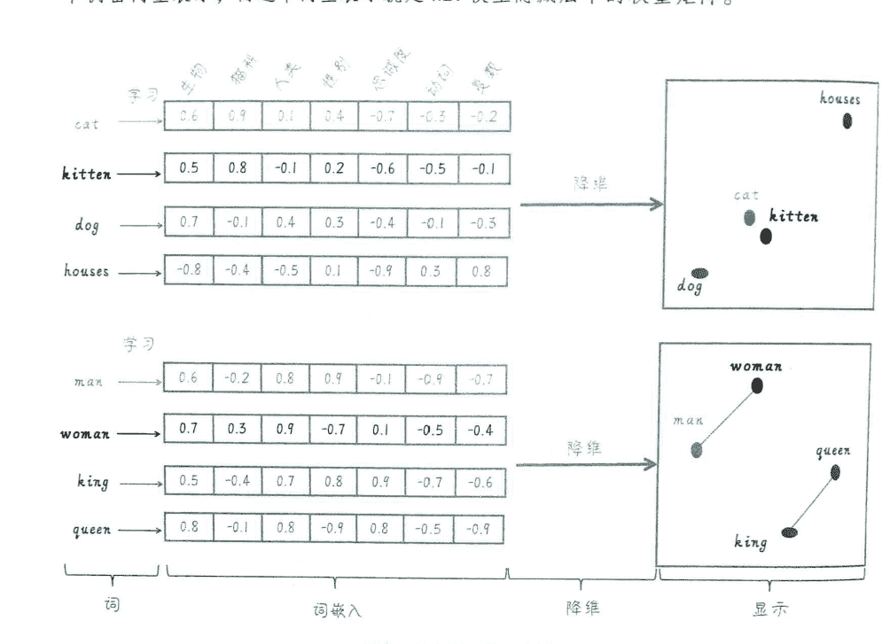
**词向量的学习过程示意图**

这些词向量捕捉了词与词之间的关系之后，具有相似含义或用法的词在向量空间中会靠得更近。我们可以使用这些词向量作为其他自然语言处理任务（如文本分类、文本相似度比较、命名实体识别等）的输入特征。

小冰：原来如此，如果我理解得没错的话，Skip-Gram 和 CBOW 这两个模型从预测词的角度上看，和 N-Gram 本质是相同的，都是语言模型；然而，因为我们只是提取 Word2Vec 神经网络中嵌入层的输出，而不需要模型最终的预测结果，从这个角度上，它和 Bag-of-Words 是同一类的应用，都是把词转换成为一种向量表示。

咖哥：非常正确。Word2Vec 之后的许多词嵌入方法，如 GloVe（Global Vectors for Word Representation）和 fastText，也都是这样使用的。我们可以拿到别人已经训练好的词向量（GloVe 和 fastText 都提供现成的词向量供我们下载）作为输入，来完成我们的下游 NLP 任务；也可以利用 PyTorch 的 nn.Embedding，来针对特定语料库从头开始学习词嵌入，然后再把学到的词向量（也就是经过 nn.Embedding 的参数处理后的序列信息）作为输入，完成下游 NLP 任务。

####### ## 小结

上节课中介绍的 Bag-of-Words（BoW）和本课介绍的 Word2Vec（W2V）都可以看作分布式表示的应用实例。这两种方法都试图将离散的符号（如单词）映射到连续的向量空间，让原本没有意义的词汇编码变成蕴含某些语言信息的表示——这也就是分布式表示的内涵。然而，它们在实现方式和表示能力上有很大的不同。

Bag-of-Words 是一种简单的分布式表示方法，它将文本表示为单词计数或权重的向量。这种表示方法捕获了文本中单词的频率信息，但忽略了单词的顺序和上下文关系。因此，Bag-of-Words 的表达能力较弱，特别是不太善于捕获单词之间的语义关系。

Word2Vec 是一种更先进的分布式表示方法，它通过学习单词在上下文中的共现关系来生成低维、密集的词向量。这种表示方法能够捕获单词之间的语义和语法关系，并在向量空间中体现这些关系。与 Bag-of-Words 相比，Word2Vec 的表达能力更强，计算效率更高。Bag-of-Words 与 Word2Vec 的对比如表 2.2 所示。

**表 2.2 Bag-of-Words 与 Word2Vec 的对比**

| 特点 | Bag-of-Words | Word2Vec |
| :--- | :--- | :--- |
| 稀疏性 vs 密集性 | 高维稀疏向量，计算效率低 | 低维密集向量，计算效率更高 |
| 上下文无关 vs 上下文敏感 | 忽略上下文信息 | 能够捕获单词之间的上下文关系 |
| 语义关系 | 无法捕捉单词之间的语义关系 | 能捕获单词之间的语义和语法关系 |
| 参数共享 | 每个单词的向量表示都是唯一的 | 参数共享，能够减少参数数量，提高泛化能力 |

我们可以将 Bag-of-Words 和 Word2Vec 看作分布式表示的演进过程中的两个重要阶段，其中 Word2Vec 技术更先进，表达能力更强。从词袋模型到词向量的发展，表明自然语言处理领域在表示单词和处理语义方面取得了重要进展。

限制了模型捕捉词义多样性的能力。在自然语言中，许多单词具有多种含义，但 Word2Vec 无法为这些不同的含义生成多个向量表示。

（2）无法处理未知词汇。Word2Vec 只能为训练过程中出现过的单词生成词向量。对于未知或低频词汇，Word2Vec 无法生成合适的向量表示。虽然可以通过拼接词根等方法来解决这个问题，但这并非 Word2Vec 本身的功能。

值得注意的是，Word2Vec 本身并不是一个完善的语言模型，因为语言模型的目标是根据上下文预测单词，而 Word2Vec 主要关注生成有意义的词向量。尽管 CBOW 和 Skip-Gram 模型在训练过程中学习了单词之间的关系，但它们并未直接对整个句子的概率分布进行建模。而后来的模型，如基于循环神经网络、长短期记忆网络和 Transformer 的模型，则通过对上下文进行建模，更好地捕捉到了语言结构，从而成为更为强大的语言模型。

####### **思考**

-   1. 简述词向量的内涵和使用方法。
-   2. 请完成实现 CBOW 模型的完整代码。
-   3. 请用嵌入层替代线性层，完成实现 Skip-Gram 模型的代码，并输出 Skip-Gram 模型习得的词嵌入。
-   4. 自主学习 GloVe 和 fastText，并尝试在你的 NLP 任务中使用 GloVe 和 fastText 词向量，例如比较两段文本的相似度。

# ## 第 3 课

# ### 山重水复疑无路：神经概率语言模型和循环神经网络

小冰打开微信，突然“啊！”了一声。

咖哥：什么事情弄得你一惊一乍的？

小冰：大新闻，我们厂的“雕龙一拍”真的按时发布了。朋友圈被它“刷爆”了！哎呀，不好不好，我们领导发布新品的同时，股价竟然同步下跌 8%！我这股票期权大幅缩水啊！我就说这“雕龙一拍”的“拍”字没有起好，拍什么拍，让人联想起拍马屁、拍砖头什么的。

咖哥：唉，小冰。这可就是你没学问了。这个“拍”字很适合中文 NLP 产品，很古典，很符合你们厂的审美。首先，“雕龙”来源于我国古代语言学巨著《文心雕龙》，把这个名字赋予一个中文大模型，内涵十分丰富；其次，“拍”出自明代冯梦龙几部白话话本集的统称“三言二拍”，所谓“拍”，指拍案惊奇，也就是读书读到妙处，拍案而起，大喊一声“写得好！”（见下图）。


> **咖哥拍案而起：'写得好！'**

也就是说，给“雕龙一拍”起名字的人对自己的产品很有信心，认为自己的聊天机器人回答得好，值得拍掌喝彩！所以你放心，明天股价没准还得涨回来。

小冰：嗯，你这么说我就放心了。

咖哥说：你看，如果只关注词本身，而不考虑上下文，就会陷入与 Word2Vec、GloVe 及 fastText 等词向量模型相似的局限性。因为这些词向量模型只关注多个词语的局部语义信息，无法捕捉到句子级别的语义信息。而且，它们无法解决一词多义问题。同一个词在不同的语境中可能有不同的含义，但 Word2Vec 只能为每个词分配一个固定的向量表示，无法捕捉这种多义性。比如说中文的“拍”字，其义可褒可贬；再比如英文中的 "Apple"，可以指水果，也可以指科技公司。每一个单词的具体语义，都和上下文息息相关，变化十分细微。因此，尽管有了词向量这种单词的表征，在很长的一段时间内，研究自然语言处理的学者们还是无法做出能够真正理解人类语言的模型。而另外一个问题是，Word2Vec 这类词向量模型是以已知词汇表为基础学习的，它们无法处理未见过的词（即词汇表外的词），不能为未知词生成合适的词向量。

正是由于这个局限，NLP 迟迟没有在具体下游任务的处理上实现突破。回忆一下人工智能这十几年来来的突破性进展，你会发现之前最吸引眼球的 ImageNet 图像分类、人脸识别的应用、下围棋的 AlphaGo、自动驾驶，再加上能生成以假乱真图片的 GAN，全和 NLP 无关。

因此，如何让 NLP 技术真正落地，真正解决实际问题，成了 NLP 学者们最头疼的问题。此时的 NLP，用“山重水复疑无路”来形容最恰当。

小冰：后来学者们一定想出了好办法，对吗？

咖哥看小冰有点紧张，说：那是当然！如果没有进展，你是怎么见到 Transformer 架构和 BERT 等预训练模型，以及今天的 ChatGPT 的呢？今天我要给你讲的神经概率语言模型，就是 NLP 在进入深度学习时代之后的又一个飞跃的成果。这些模型能够更好地理解人类语言，并捕捉到细微的语义差异。我们先来讲讲神经概率语言模型。

# ## 3.1 NPLM 的起源

神经概率语言模型（Neural Probabilistic Language Model，NPLM）的起源和发展可以追溯到 2003 年，当时约书亚·本希奥及其团队发表了一篇题为"A Neural Probabilistic Language Model"的论文。

- 图中的矩阵 C 用于将输入的词（Context，即之前的 N 个词，也被称为上下文词）映射到一个连续的向量空间。这个过程在论文中称为“table look-up"，因为我们可以将矩阵 C 视为一张查找表，通过查找表可以将输入词的索引（或 One-Hot 编码）转换为其对应的词向量表示。矩阵 C 的参数在所有词之间共享。这意味着，对于所有的输入词，都使用相同的矩阵 C 来获取它们的词向量表示。这有助于减少模型的参数数量，提高模型的泛化能力。

通过矩阵 C 会得到一组词向量，此时需要对输入向量进行线性变换（即矩阵乘法和偏置加法），然后将其输入神经网络（论文中称其为隐藏层），进行上下文语义信息的学习。因为论文发表时间较早，所以隐藏层使用双曲正切（tanh）函数作为非线性激活函数，而不是后来常见的 ReLU 函数。在这篇论文发表的 2003 年，算力还不是很强，所以论文特别注明：这一部分的计算量通常较大。

输出层通常是一个全连接层，用于计算给定上下文条件下每个词的概率。图中“第 i 个输出=P(W=i|context)"这句话描述了 NPLM 的输出目标。对于每个词 i，模型计算在给定上下文条件下，目标词汇 wi（也就是下一个词）是词汇表中第 i 个词的概率。此处应用 softmax 函数将输出层的值转换为概率分布，这也是后来神经网络的分类输出层的标准做法。

所以小冰你看，在词向量学习方面，NPLM 和 Word2Vec 十分相似，都是通过捕捉前几个词的语义信息，将输入词汇的离散表示转换为连续的词向量表示，但是 NPLM 进一步通过神经网络来学习词与词之间的相似性和关系，从而计算目标词在给定上下文条件下出现的概率。

小冰：明白了，前面讲的 BoW 和 W2V，都是词的表示学习技术，而 N-Gram 和 NPLM 则是语言模型，NPLM 的关键在于把神经网络引入了语言模型的结构。看起来神经概率语言模型的结构似乎也不是很复杂，不过，还是得通过代码来实现一下，我才能够完全理解。

# ## 3.2 NPLM 的实现

咖哥：当然了，我们还是用具体的实例来讲解如何实现一个简单的 NPLM，这样会比较清晰。

这个程序的结构如下。

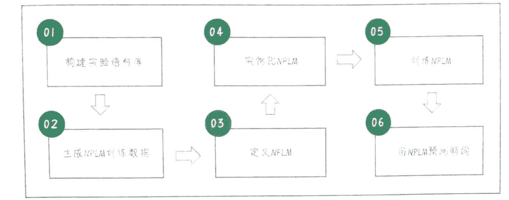

# **第 1 步** 构建实验语料库

定义一个非常简单的数据集，作为实验语料库，并整理出该语料库的词汇表。

```python
# 用极简语句集搭起实验语料
sentences=['我', '喜欢', '玩具', '', '我', '爱', '爸爸', ' ', '我', '讨厌', '挨打']
# 把所有句子拼接、切分并去重得到唯一词表
word_list=list(set(' '.join(sentences).split()))
# 为每个词分配一个唯一数字编号
word_to_idx={word:idx for idx, word in enumerate(word_list)}
# 构建编号到词的反向映射
idx_to_word={idx: word for idx, word in enumerate(word_list)}
voc_size=len(word_list) # 统计最终词表规模
print(' 词汇表:', word_to_idx) # 展示映射结果
print( '词汇表大小:', voc_size) # 打印词表长度

```

字典：{'讨厌': 0,'爱': 1,'挨打': 2,'我': 3,'玩具': 4,'喜欢':5, '爸爸':6}
词汇表大小:7

# **第 2 步** 生成 NPLM 训练数据

从语料库中生成批处理数据，作为 NPLM 的训练数据，后面会将数据一批一批地输入神经网络进行训练。

```python
import torch # 载入 PyTorch
import random # 载入随机工具
batch_size=2# 单次批处理样本数
def make_batch():
    input_batch=[]# 装输入序列的列表
    target_batch=[]# 装目标值的列表
    selected_sentences=random.sample(sentences, batch_size) # 从语料中随机抽样

```

```python
for sen in selected_sentences: # 对抽到的句子逐个处理
    word = sen.split() # 以空格切分为词
    # 前面所有词构成输入序列
    input = [word_to_idx[n] for n in word[:-1]] # 映射为索引
    # 最后一个词作为预测目标
    target = word_to_idx[word[-1]] # 取目标索引
    input_batch.append(input) # 累加到输入批次
    target_batch.append(target) # 累加到目标批次
    input_batch = torch.LongTensor(input_batch) # 转换成长整型张量
    target_batch = torch.LongTensor(target_batch) # 转换成长整型张量
    return input_batch, target_batch # 输出批次对

```

```python
input_batch, target_batch = make_batch() # 获取一次批数据
print("输入批处理数据:", input_batch) # 显示输入张量
###### 将索引还原为可读词形
input_words = []
for input_idx in input_batch:
    input_words.append([idx_to_word[idx.item()] for idx in input_idx])

# NPLM 最简实战：从校验到预测

先把数据管道跑通。把当前抽到的一批输入词序列和对应的目标张量先展示出来，确认形状和顺序没有错位；随后用 idx_to_word 把目标张量里的每一个 id 还原回可读词形，再把还原后的序列显示出来，形成索引到词形的来回核验。

```

> 
> 
输入批处理数据: tensor([[6, 2], [6, 3]])
输入批处理数据对应的原始词：['我', '', '喜欢', '', '我', ',', '讨厌', '']
目标批处理数据: tensor([1,5])
目标批处理数据对应的原始词：[,'玩具', ',挨打']

# **第 3 步** 定义 NPLM

定义一个神经概率语言模型，这个模型将被用于预测给定句子的下一个词。

> 
```python

import torch.nn as nn # 导入神经网络模块

##### 定义神经概率语言模型 (NPLM)

class NPLM(nn.Module):

    def __init__(self):

        super(NPLM, self).__init__()

        self.C = nn.Embedding(voc_size, embedding_size) # 定义一个词嵌入层

        # 第一个线性层，其输入大小为 n_step * embedding_size，输出大小为 n_hidden

        self.linear1 = nn.Linear(n_step * embedding_size, n_hidden)

        # 第二个线性层，其输入大小为 n_hidden，输出大小为 voc_size，即词汇表大小

        self.linear2 = nn.Linear(n_hidden, voc_size)

    def forward(self, X): # 定义前向传播过程

建模部分先引入 torch.nn，随后写一个紧凑的三段式网络：底部的 Embedding 把词 id 映射成稠密向量，第一个全连接把 n_step 个向量的拼接压到隐藏空间，第二个全连接把隐藏表示投射回词表维度得到 logits。

```# 输入数据 X 张量的形状为 [batch_size, n_step]
X = self.C(X) # 将 X 通过词嵌入层，形状变为 [batch_size, n_step, embedding_size]
X = X.view(-1, n_step * embedding_size) # 形状变为 [batch_size, n_step* embedding_size]
###### 通过第一个线性层并应用 tanh 函数
hidden = torch.tanh(self.linear1(X)) # hidden 张量形状为 [batch_size, n_hidden]
###### 通过第二个线性层得到输出
output = self.linear2(hidden) # output 形状为 [batch_size, voc_size]
return output # 返回输出结果

这里定义了一个名为"NPLM"的神经概率语言模型类，它继承自 PyTorch 的 nn.Module。在这个类中，我们定义了词嵌入层和线性层，如下所示。

- self.C：一个词嵌入层，用于将输入数据中的每个词转换为固定大小的向量表示。voc_size 表示词汇表大小，embedding_size 表示词嵌入的维度。

- self.linear1：第一个线性层，不考虑批次的情况下输入大小为 n_step * embedding_size，输出大小为 n_hidden。n_step 表示时间步数，即每个输入序列的长度；embedding_size 表示词嵌入的维度；n_hidden 表示隐藏层的大小。

- self.linear2：第二个线性层，不考虑批次的情况下输入大小为 n_hidden，输出大小为 voc_size。n_hidden 表示隐藏层的大小，voc_size 表示词汇表大小。

在 NPLM 类中，我们还定义了一个名为 forward 的方法，用于实现模型的前向传播过程。在这个方法中，首先将输入数据通过词嵌入层 self.C，然后 X.view(-1, n_step * embedding_size) 的目的是在词嵌入维度上展平张量，也就是把每个输入序列的词嵌入串联起来，形成一个大的向量。接着，将该张量传入第一个线性层 self.linear1 并应用 tanh 函数，得到隐藏层的输出。最后，将隐藏层的输出传入第二个线性层 self.linear2，得到最终的输出结果。

> 在神经网络的构建和调试过程中，张量的形状非常重要。因为如果输入的形状和神经网络层所要求的形状不相符，要么程序无法运行，要么会得到错误的结果。在这个程序中，我通过注释详细地说明了每一步中张量的形状，希望你阅读 PyTorch 文档中各种神经网络层的参数说明，并在代码调试过程中注意这些张量形状，反复检查每一步张量形状是否正确。

##### 第 4 步 实例化 NPLM

设定一些参数后初始化 NPLM，并打印出它的结构。

n_step = 2 # 时间步数，表示每个输入序列的长度，也就是上下文长度
n_hidden = 2 # 隐藏层大小
embedding_size = 2 # 词嵌入大小
model = NPLM() # 创建神经概率语言模型实例
print('NPLM 模型结构:', model) # 打印模型的结构

```text

NPLM 模型结构：NPLM(

	(C): Embedding(7, 2)

	(linear1): Linear(in_features=4, out_features=2, bias=True)

	(linear2): Linear(in_features=2, out_features=7, bias=True)

训练时选用交叉熵衡量拟合程度，优化器采用 Adam，学习率固定为 0.1。外层迭代 5000 次，每轮先清零梯度、调用 make_batch 获取新样本、模型前向得到预测、算出 loss；每 1000 次迭代把当前损失输出用于观察收敛曲线，之后执行反向求导并更新参数。

```

可以看到，模型包含一个词嵌入层和两个线性层。

##### 第 5 步 训练 NPLM

生成一批批的数据来训练这个模型。模型经过学习，将能够预测这个数据集中每一句话的最后一个词。

```python

import torch.optim as optim # 导入优化器模块

criterion = nn.CrossEntropyLoss() # 定义损失函数为交叉熵损失函数

optimizer = optim.Adam(model.parameters(), lr=0.1) # 定义优化器为 Adam，学习率为 0.1

########## 训练模型

for epoch in range(5000): # 设置训练迭代次数

    optimizer.zero_grad() # 清除优化器的梯度

    input_batch, target_batch = make_batch() # 创建输入和目标批处理数据

    output = model(input_batch) # 将输入数据传入模型，得到输出结果

    loss = criterion(output, target_batch) # 计算损失值

    if (epoch + 1) % 1000 == 0: # 每 1000 次迭代，打印 1 次损失值

        print('Epoch:', '%04d' % (epoch + 1), 'cost:', '{:.6f}'.format(loss))

    loss.backward() # 反向传播计算梯度

    optimizer.step() # 更新模型参数

收敛后做一次在线验证。准备样例 [['我', '讨厌', '我', '喜欢']]，先借助 word_to_idx 转成 id 形式，再打包为 LongTensor 送入网络；取输出概率最高的位置作为预测 id，最后用 idx_to_word 映射回自然词，展示输入序列到预测词的对应。

```

- Epoch: 1000 cost = 0.711473
- Epoch: 2000 cost = 0.517517
- Epoch: 3000 cost = 0.382639
- Epoch: 4000 cost = 0.326816
- Epoch: 5000 cost = 0.285422

在训练过程中，首先定义损失函数（交叉熵损失函数）和优化器（Adam）。接下来，进行 5000 次迭代训练，每次迭代中，首先清除优化器的梯度，然后生成输入和目标批处理数据，并将它们转换为张量。接着，将输入数据传入模型，模型进行推理，得到预测值。随后，我们将预测值和目标数据进行比较，计算损失值，执行反向传播和参数更新。每 1000 次迭代后，打印当前的损失值——可以看到损失值逐渐减少。

上面这个过程，是非常标准的 PyTorch 深度学习模型的训练过程。

##### 第 6 步 用 NPLM 预测新词

用模型预测下一个词，并显示预测结果。

```python

###### 进行预测

input_strs = [['我', '讨厌', '我', '喜欢']] # 需要预测的输入序列

###### 将输入序列转换为对应的索引

input_indices = [[word_to_idx[word] for word in seq] for seq in input_strs]

###### 将输入序列的索引转换为张量

input_batch = torch.LongTensor(input_indices)

###### 对输入序列进行预测，取输出中概率最大的类别

predict = model(input_batch).data.max(1)[1]

###### 将预测结果的索引转换为对应的词

predict_strs = [idx_to_word[n.item()] for n in predict.squeeze()]

for input_seq, pred in zip(input_strs, predict_strs):

    print(input_seq, '->', pred) # 打印输入序列和预测结果

NPLM 三模块速览

想快速验证 NPLM 的思路，不必搞复杂堆叠，查表、循环、映射三件套就能闭环。先把离散 id 向量化，再让循环单元在时间轴上滚动累积上下文，最后把尾部隐向量映射回词表空间得到未归一化分数。

搭建时准备三个部件：一个可训练的词向量表负责把 id 转成连续表示，一个 LSTM 负责在序列上更新记忆，一个输出映射负责把隐向量拉回到词表维度。运行时，一批序列 id 先查表变成三维表示送入循环，循环产生与输入等长的隐序列，仅取最终一步喂给输出映射，得到每条样本在全部候选词上的得分。

下面是可直接拷贝的最小实现，以及在迷你配置下的结构快照。

```

上面这段代码的核心语句是 `predict = model(input_batch).data.max(1)[1]`，它对输入批处理数据进行预测，并从输出中选择概率最大的类别，得到一个形状为 [batch_size, 1] 的张量，表示每个输入样本预测的概率最大的词的索引。这句代码细节比较多，这里做一下解释。

- `model(input_batch)`：将输入批处理数据传入训练好的模型，得到输出。输出张量的形状为 [batch_size, voc_size]，表示每个输入样本对应的词汇表中所有词的概率。
- `model(input_batch).data`：从模型输出中提取实际的张量数据。这是为了后续操作方便而进行的转换。
- `model(input_batch).data.max(1)`：沿词汇维度对张量数据求最大值。一个操作会返回两个值，一个是最大概率值，另一个是对应的索引。

> **model(input_batch).data.max(1)[1]**：在最大概率值和对应索引的元组中，仅保留索引。索引代表着概率最大的词在词汇表中的位置。

**所以，最终结果 predict 是形状为 `[batch_size, 1]` 的张量，表示每个输入样本预测的概率最大的词的索引**。这些索引可以进一步转换为实际的词，用于展示预测结果。

至此，一个完整的神经网络语言模型已经搭建完成。这个语言模型的输入是一个句子的前 N-1 个单词，输出是第 N 个单词。神经网络包括一个嵌入层，后面跟着一个使用 tanh 激活的线性层。程序使用交叉熵损失函数和 Adam 优化器进行训练。最后的线性输出层给出词汇表中所有单词作为下一个单词的概率分布，我们通常选择概率最高的那个单词作为预测的下一个单词。此处在计算交叉熵损失时使用了 softmax 函数。

小冰：咖哥，现在我们所拥有的这个 NPLM 语言模型有多强大？

咖哥：坦白地讲，目前这个模型不够强大。NPLM 是一种较为简单的神经网络语言模型，它的历史意义在于开创性地把网络技术引入了 NLP 领域。也就是说，NPLM 最大的贡献，就在于它提出了基于神经网络构建深度学习模型。从此开始，深度学习就登上了 NLP 的舞台。而深度学习在 NPLM 中的优势主要体现在以下几方面。

- 可以自动学习复杂的特征表示，减少了手工特征工程的需求。
- 可以对大量数据进行高效的处理，使得模型能通过大规模语料库更好地学习词与词之间的语义和语法关系。
- 具有强大的拟合能力，可以捕捉到语言数据中的复杂结构和模式。

具体到 NPLM 本身来说，它也存在一些明显的不足之处。

- 模型结构简单：NPLM 使用了线性层和激活函数进行前向传播，这使得模型的表达能力受到限制。对于复杂的语言模式和长距离依赖关系，NPLM 可能无法捕捉到足够的信息。
- 窗口大小固定：NPLM 使用窗口大小固定的输入序列，这限制了模型处理不同长度上下文的能力。在实际应用中，语言模型通常需要处理长度可变的文本数据。
- 缺乏长距离依赖捕捉：由于窗口大小固定，NPLM 无法捕捉长距离依赖。在许多 NLP 任务中，捕捉长距离依赖关系对于理解句子结构和语义具有重要意义。


### GPT 图解 大模型是怎样构建的

- **训练效率低**：NPLM 的训练过程中，全连接层的输出大小等于词汇表的大小。当词汇表非常大时，计算量会变得非常大，导致训练效率降低。
- **词汇表固定**：NPLM 在训练时使用固定词汇表，这意味着模型无法处理训练集中未出现的词汇（未登录词）。这限制了模型在现实应用中的泛化能力。
- **缺乏位置信息**：NPLM 不考虑输入序列中单词的顺序，这可能导致模型无法捕捉序列中单词之间的顺序关系。

为了解决这些问题，研究人员提出了一些更先进的神经网络语言模型，如循环神经网络、长短记忆网络、门控循环单元 (GRU) 和 Transformer 等。这些模型能够捕捉长距离依赖，处理变长序列，同时具有更强的表达能力和泛化能力。下面我们就继续讲解 NLP 发展史上的另外一个里程碑——循环神经网络的使用。这里多说一句，其实 LSTM 和 GRU 都是广义上的循环神经网络。

NPLM 在处理长序列时会面临一些挑战。首先，由于它仍然是基于词的模型，因此在处理稀有词汇或者词汇表外的词汇时效果不佳。其次，NPLM 不能很好地处理长距离依赖关系。而上面这两个局限，恰恰就是 RNN 的优势。

小冰：那么 RNN 是怎么解决这些问题的呢？

咖啡：RNN 的核心思想是利用“循环”的机制，将网络的输出反馈到输入，这使得它能够处理数据时保留前面的信息，从而捕获序列中的长距离依赖关系，在处理序列数据，如文本、语音和时间序列时具有明显的优势。

RNN 的起源可以追溯到 20 世纪 80 年代，当时学者在研究如何使用神经网络处理序列数据。1986 年，戴维·E. 鲁梅尔哈特 (David E. Rumelhart) 等人提出的通过时间反向传播 (Backpropagation Through Time, BPTT) 的训练算法，为 RNN 的发展奠定了基础。

20 世纪 90 年代，许多学者开始关注 RNN，并提出了许多改进方法，如长短期记忆网络和门控循环单元等。

当 NPLM 问世之后，尤其是深度学习于 2012 年前后在 ImageNet 竞赛中一炮打响后，深度学习神经网络逐渐成为 AI 模型的主流，循环神经网络和它的种种变体也就自然而然地被应用在 NLP 的各种任务中。

小冰：那 RNN 的原理和架构是怎样的？

咖哥：简单来说，RNN 可以看作一个具有“记忆”的神经网络。RNN 的基本原理是通过循环来传递隐藏状态信息，从而实现对序列数据的建模。一个简单的 RNN 包括输入层、隐藏层和输出层。在每个时间步（可理解为每次循环的过程），RNN 会读取当前输入，并结合前一个时间步的隐藏状态来更新当前的隐藏状态。然后，这个隐藏状态会被用于生成输出和更新下一个时间步的隐藏状态。通过这种方式，RNN 可以捕获序列中的依赖关系。最后，输出层根据隐藏层的信息产生预测。

通过在每个时间步共享权重（即在处理各个 token 时使用相同的 RNN），RNN 能够处理不同长度的输入序列。这种权重共享机制使得 RNN 具有很大的灵活性，因为它可以适应各种长度的序列，在处理自然语言和其他可变长度序列数据时更具优势，而不像 NPLM 那样受到窗口大小固定的限制。

我们先来看一个 RNN 的基本架构图，这将帮助你更好地理解 RNN 的工作原理。

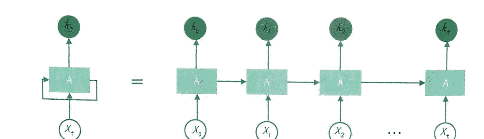

假设我们有一个序列数据，例如一段文本。我们可以将这段文本分成单词或字符，并将其作为 RNN 的输入。对于每一个时间步，RNN 会执行以下操作。

（1）接收当前时间步的输入 x_t（即上图中的 x_t）。

（2）结合前一时间步的隐藏层状态 h_(t-1)，计算当前时间步的隐藏层状态 h_t（即上图中的 h_t）。这通常通过一个激活函数（如 tanh 函数）实现。计算公式如下（其中，W_hh 是隐藏层到隐藏层的权重矩阵，W_xh 是输入到隐藏层的权重矩阵）：

$$ h_{t}=\operatorname{tanh}\left(W_{hh} * h_{(t-1)}+W_{xh} * x_{t}+b_{h}\right) $$

（3）基于当前时间步的隐藏层状态 h_t，计算输出层 y_t (RNN 在时间步 t 的输出)。这通常通过一个线性变换和激活函数（如 softmax 函数）实现。计算公式如下：

$$\text{y\_t = softmax(W\_hy * h\_t + b\_y)}$$

通过上述操作，RNN 可以处理整个序列数据，并在每个时间步生成一个输出。需要注意的是，RNN 具有参数共享的特性。这意味着在不同时间步，RNN 使用相同的权重矩阵（W_hh，W_xh 和 W_hy）和偏置（b_h 和 b_y）进行计算。

RNN 采用 BPTT 算法进行训练。与普通反向传播不同，BPTT 算法需要在时间维度上展开 RNN，以便在处理时序依赖性时计算损失梯度。因此，BPTT 算法可以看作一种针对具有时间结构的数据的反向传播算法。在 BPTT 算法中，我们首先用损失函数计算模型的损失（如交叉熵损失），然后使用梯度下降法（或其他优化算法）来更新模型参数。

BPTT 算法的关键在于，我们需要将梯度沿着时间步（对于自然语言处理问题来说，时间步就是文本序列的 token）反向传播，从输出层一直传播到输入层。具体步骤如下。

（1）根据模型的输出和实际标签计算损失。对每个时间步，都可以计算一个损失值，然后对所有时间步的损失值求和，得到总损失。

（2）计算损失函数关于模型参数（权重矩阵和偏置）的梯度。这需要应用链式求导法则，分别计算损失函数关于输出层、隐藏层和输入层的梯度。然后将这些梯度沿着时间步传播回去。

（3）使用优化算法（如梯度下降法、Adam 等）来更新模型参数。这包括更新权重矩阵（W_hh，W_xh 和 W_hy）和偏置（b_h 和 b_y）。

经过多轮迭代训练，RNN 模型的参数不断更新，从而使得模型在处理序列数据时的性能不断提高。

RNN 虽然在某些方面具有优势，但它的局限性也不容忽视。在训练过程中，RNN 可能会遇到梯度消失和梯度爆炸的问题，这会导致网络很难学习长距离依赖关系。为了缓解这些问题，研究人员提出了 LSTM 和 GRU 等改进型 RNN 结构。LSTM、GRU 广义上属于 RNN，不过这些结构引入了门控机制，使得模型能够更好地捕捉到序列中的长距离依赖关系，从而在许多 NLP 任务中表现更优。

小冰：咖哥，我感觉这循环神经网络里面需要深入理解的地方还挺多的，你能否给出一个具体的实战案例？

咖哥：当然，我们下面这个实战案例，就是基于循环神经网络的变体 LSTM 实现的。

#### 3.4 循环神经网络实战

在这个实战案例中，我们继续采用上一节中的数据集和程序结构，将一个词序列作为输入，预测序列中下一个词。训练过程和训练参数也保持不变，仅仅调整神经网络中隐藏层的类型，用 LSTM 层替换线性层，就可以把模型改造成 RNN 模型，并完成相同的词预测任务。

RNN 模型的实现过程如下。

```python

import torch.nn as nn # 导入神经网络模块

##### 定义神经概率语言模型 (NPLM)

class NPLM(nn.Module):

    def __init__(self):

        super(NPLM, self).__init__() # 调用父类的构造函数

        self.C = nn.Embedding(voc_size, embedding_size) # 定义一个词嵌入层

        # 用 LSTM 层替代第一个线性层，其输入大小为 embedding_size，隐藏层大小为 n_hidden

        self.lstm = nn.LSTM(embedding_size, n_hidden, batch_first=True)

        # 第二个线性层，其输入大小为 n_hidden，输出大小为 voc_size，即词汇表大小

        self.linear = nn.Linear(n_hidden, voc_size)

    def forward(self, X): # 定义前向传播过程

        # 输入数据 X 张量的形状为 [batch_size, n_step]

        X = self.C(X) # 将 X 通过词嵌入层，形状变为 [batch_size, n_step, embedding_size]

        # 通过 LSTM 层

        lstm_out, _ = self.lstm(X) # lstm_out 形状变为 [batch_size, n_step, n_hidden]

        # 只选择最后一个时间步的输出作为全连接层的输入，通过第二个线性层得到输出

        output = self.linear(lstm_out[:, -1, :]) # output 的形状为 [batch_size, voc_size]

        return output # 返回输出结果

```

```text

RNN 模型结构：

RNNLM(

	(embedding): Embedding(7, 2)

	(lstm): LSTM(2, 2, batch_first=True)

	(linear): Linear(in_features=2, out_features=7, bias=True))

```

咖啡：这里，我们使用了一个 LSTM 层替换了 NPLM 原有的线性层。之后，定义了一个基于 RNN 的语言模型，它包含一个嵌入层、一个 LSTM 层和一个线性层。该模型将输入的词序列转换为嵌入向量，将嵌入向量输入 LSTM 层中，并将 LSTM 层的输出传递到线性层中，以生成最终的输出。其中 LSTM 层的输入是词嵌入，输出是在每个时间步的隐藏状态。我们只选择最后一个时间步的隐藏状态作为全连接层的输入，以生成预测结果。

在 RNN 模型中，网络结构主要取决于以下几个参数。## (1) 词嵌入大小 embedding_size
决定了词嵌入层的输出维度。

##### (2) 隐藏层大小 n_hidden
决定了 LSTM（或其他 RNN 变体）层的隐藏状态大小。

这意味着，在 RNN 模型中，我们可以灵活地处理不同长度的输入序列，而不需要改变网络结构。这是 RNN 模型与 NPLM 的一个重要区别。这使得 RNN 模型在处理自然语言任务时更具优势，因为它可以很好地处理不同长度的文本序列。

<图片>img/0e4677844c777b2f38e3c271a9e6fbf0_94_0.png</图片>

> 
> 小冰：咖哥，刚才你讲的循环神经网络中的种种细节，比如隐藏层状态的计算 h_t = tanh(W_hh * h_(t-1) + W_xh * x_t + b_h)，又比如基于当前时间步的隐藏层状态 h_t，计算输出层 y_t 的线性变换和激活，为什么在你的代码中都没有体现？

咖哥：你提的这个问题很好，体现了你对模型原理的探求。其实，这是因为 RNN 实现的细节已经被封装在 PyTorch 的 LSTM 层了。这里的代码 `lstm_out, _ = self.lstm(X)` 虽然很简洁，但实际上它涵盖了 LSTM 处理输入序列的复杂计算过程。对于输入序列 X，LSTM 会逐时间步处理，每个时间步的输入不仅包括当前时间步的数据，还会接收上一个时间步的隐藏层状态。这样，信息就在时间步之间传递，形成一种循环。在每个时间步，通过 LSTM 内部的门控机制，网络计算并更新当前的状态，并生成对应的输出。

在处理输入序列时，LSTM 内部会进行以下操作。

对于每个时间步 t，LSTM 会接收当前时间步的输入 x_t 及上一个时间步的隐藏状态 h_(t-1) 和细胞状态 c_(t-1)。

接着，LSTM 会计算输入门、遗忘门和输出门的激活值。这些门控机制使得 LSTM 能够有选择地保留或遗忘之前的信息，从而更好地捕捉长距离依赖关系。

这些门的计算公式如下：

- 输入门: i_t = sigmoid(W_ii * x_t + b_ii + W_hi * h_(t-1) + b_hi)
- 遗忘门: f_t = sigmoid(W_if * x_t + b_if + W_hf * h_(t-1) + b_hf)
- 输出门: o_t = sigmoid(W_io * x_t + b_io + W_ho * h_(t-1) + b_ho)

其中，W_ii 是从当前输入 x_t 到输入门的权重矩阵，而 W_hi 是从前一时间步的隐藏状态 h_(t-1) 到输入门的权重矩阵。W_if 是从当前输入 x_t 到遗忘门的权重矩阵，W_hf 是从前一时间步的隐藏状态 h_(t-1) 到遗忘门的权重矩阵。W_io 是从当前输入 x_t 到输出门的权重矩阵，W_ho 是从前一时间步的隐藏状态 h_(t-1) 到输出门的权重矩阵。偏置项 b_ii、b_hi、b_if、b_hf、b_io 和 b_ho，即各自门控或单元的偏置。以上所有的权重矩阵和偏置项都是在模型的训练过程中通过反向传播和优化算法学习得到的。

LSTM 更新细胞状态 c_t。这是通过结合输入门、遗忘门和当前输入的信息来实现的。计算公式如下。

- 细胞候选状态: g_t = tanh(W_ig * x_t + b_ig + W_hg * h_(t-1) + b_hg)
- 细胞状态更新: c_t = f_t * c_(t-1) + i_t * g_t

最后，LSTM 会计算当前时间步的隐藏状态 h_t，这通常作为输出。计算公式如下。

- 隐藏状态: h_t = o_t * tanh(c_t)

在整个循环过程中，LSTM 会逐时间步处理输入序列，并产生对应的输出。这使得 LSTM 能够捕捉到输入序列中的长距离依赖关系，并在各种 NLP 任务中表现出优越的性能。

---

####### 咖哥发言
因为本书的重点是基于 Transformer 技术的 GPT 模型，而 RNN 及其各种变体的技术细节和 Transformer 技术的传承关系不紧密（Transformer 领域的核心论文"Attention is All You Need"中的主要思路就是摒弃 RNN 结构），所以，既然最新技术不是从 RNN 演进而来，那我们就没有必要将 RNN 和 LSTM 的实现细节一一写清楚了。

不过，你要注意到，在我们的循环神经网络中，n_step 这个参数将不再出现。理解这个差异有助于你了解原始的 NPLM 和 RNN 模型的本质区别。我这里详细说说。

- 在 NPLM 中，n_step 作为一个重要参数，直接影响模型的结构。具体来说，n_step 决定了模型中第一个线性层的输入大小 (n_step * m)。这是因为 NPLM 会将词嵌入层的输出展平，然后将其输入第一个线性层。因此，n_step 的值将直接影响线性层的输入大小，从而影响整个模型的结构。

- 在 RNN 模型中，因为 RNN 模型是专门为处理任意长度的序列数据设计的，我们会将词嵌入层的输出直接输入 LSTM（或其他 RNN 变体）层，而不需要将其展平。因此，输入序列的长度不会影响网络结构。

小冰：所以，这个模型的效率会比原来好吗？这个任务用 RNN 来处理，能够体现出它的优势吗？

咖哥：RNN 模型在处理序列数据时具有优势，因为它们可以捕捉序列中的长距离依赖关系。在本例中，我们构建了一个基于 LSTM 的 RNN 模型，能够更好地捕捉长距离依赖。虽然在这个简单的示例中，模型的改进可能不会显著提高效率，但在处理更复杂的自然语言任务时，LSTM 的性能通常会比简单的线性模型更好。

小冰：这个 RNN 模型，从本质上说，还是 NPLM 吗？

咖哥：虽然刚才我们对程序结构的改动不大，但从本质上说，这个 RNN 模型已经不是原始的 NPLM 模型了。虽然它们都是用于预测序列中下一个词的概率的语言模型，但它们的结构和处理序列的方式有很大的不同。

小冰：明白了，循环神经网络的一个重要优势是其“记忆”能力，即在处理序列时能够保留之前的信息。这使得 RNN 在许多 NPLM 任务中具有优势，尤其是那些需要上下文依赖关系的任务。

咖哥：的确如此，RNN 的这种特性使得它在很长一段时间内都是 NLP 任务的最佳解决方案（State of the Art，SOTA）。SOTA 这个词在科研场景中十分常见，代表该领域目前最强大的解决方案，LSTM 前几种经是各种 NLP 任务的 SOTA。

小冰：那也就是说，ChatGPT 中一定也用到了 RNN 架构喽？

咖哥：不对哦，RNN 并不是 NLP 任务的完美解决方案，它的局限性主要包括以下几点。

- 顺序计算：这些网络在处理序列时，需要按照时间步的顺序进行计算。这意味着在某个时间步的计算完成之前，无法进行下一个时间步的计算。这种顺序计算限制了这些网络的并行计算能力，从而降低了计算效率和速度。
- 长距离依赖问题：尽管 LSTM 和 GRU 等 RNN 变体拥有了更好的记忆功能，但在处理非常长的序列时，这些网络仍然可能无法完全捕捉到序列中的长距离依赖关系。
- 有限的可扩展性：RNN 及其变体在面对更大规模的数据集和更复杂的任务时，可能会遇到扩展性问题。随着序列长度的增加，它们的计算复杂性也会增加，这可能导致训练时间过长和资源需求过高。

在 RNN 时代，NLP 应用落地整体表现不佳的原因有以下几点。

- 模型表达能力不足：尽管 RNN 及其变体在某些任务中取得了不错的成果，但它们的表达能力可能不足以处理复杂的 NLP 任务。这是因为自然语言中的依赖关系和语义结构可能非常复杂，而这些网络可能无法捕捉到全部信息。
- 缺失大规模数据：在 RNN 时代，大规模的预训练数据集和计算资源相对较少。这使得模型难以从大量的无监督文本数据中学习到丰富的语言知识，从而影响了它们在实际应用中的表现。
- 优化算法发展不足：在 RNN 时代，优化算法仍处在相对初期的阶段，可能无法充分利用可用的数据和计算资源。这可能导致模型训练过程中的梯度消失、梯度爆炸等问题，从而影响模型的性能和稳定性。

当然了，随着 Transformer 架构的出现和大规模预训练技术的发展，NLP 领域已经取得了显著的进展。不过，在开启 Transformer 这扇未来之门之前，我们还有两个非常关键的技术要解锁。它们就是 Seq2Seq 架构和注意力机制。

#### 小结
NPLM 和上一课中讲过的 Word2Vec 都是自然语言处理领域的重要技术，它们：

- NPLM 是一种基于神经网络的语言模型，用于估计语言序列的概率分布。它通过学习上下文中的词来预测下一个词，其主要思想是将单词转换为向量形式，并使用这些向量来训练一个神经网络。NPLM 基于神经网络，因此它可以通过深度学习的技术，例如卷积神经网络和循环神经网络等来具体实现。
- Word2Vec 是一种将单词表示为向量的词向量学习算法。它有两种不同的实现方式：CBOW 模型和 Skip-Gram 模型。CBOW 模型的思想是基于上下文预测目标单词，而 Skip-Gram 模型则是基于目标单词预测上下文。早期的 Word2Vec 使用的是一种浅层神经网络模型，称为嵌入层，它将单词映射到向量空间中。
- NPLM 在语言模型领域产生了深远的影响。自此，深度学习就登上了 NLP 的舞台。后来的许多神经网络模型，如循环神经网络、长短期记忆网络、门控循环单元和双向长短期记忆网络（Bi-LSTM）等，都是以 NPLM 为基础发展而来的。如今，神经网络已成为自然语言处理领域的核心技术之一，NPLM 在其中起到了关键的推动作用。
- 随着深度学习模型的不断发展，在循环神经网络之后，人们又将自注意力机制运用到 Transformer 中，使得模型在捕捉长距离依赖和处理变长序列等问题上表现更出色。神经网络模型逐渐发展为更为复杂和强大的预训练语言模型，如 BERT、GPT 等，它们将在众多实际 NLP 任务上取得成果。

#### 思考

1. 原始的 NPLM 使用效果如何，有哪些局限性？
2. RNN 针对 NPLM 的局限性做了哪些改进？
3. 完成本课的 RNN 模型代码。

# 第 4 课

### 柳暗花明又一村：Seq2Seq 编码器 - 解码器架构

咖哥：1832 年，一个名叫塞缪尔·芬利·布里斯·莫尔斯（Samuel Finley Breese Morse）的美国画家乘坐一艘船从欧洲返回美国，船上与他同行的一位乘客谈到人类刚刚发现的电磁现象。莫尔斯立刻对这个话题产生了浓厚的兴趣，因为他意识到这种电磁现象也许有很大的应用价值，因为电信号传播得很快、很远，也许可以应用于远程通信。

自此，莫尔斯摇身一变，从艺术家变身科学家，开始了科研。不过，如何把电信号和人类的语言连接起来，是摆在莫尔斯面前的一大难题。他苦苦地思索了几年，终于，灵感降临了。当时，欣喜若狂的他在笔记本上记下这样一段话：“电流是神速的，如果它能够不停顿地走 10 英里，我就让它走遍全世界。电流只要停止片刻，就会出现火花，火花是一种符号，没有火花是另一种符号，没有火花的时间长又是一种符号（见右图）。这里有 3 种符号可以组合起来，代表数字和字母。它们可以构成数字或字母，文字就可以通过导线传送了。这样，能够把消息传到远处的崭新工具就可以实现了！”

- A ■■
- B ■■■
- C ■■●
- D ■■●
- E ■
- F ■■■■
- G ■■■■
- H ■■■■■
- I ■■■
- J ■---
- K ■■■
- L ■-■
- M ---
- N --
- O ----
- P ■■■■
- Q ■■■-■
- R ■■■
- S ■■■
- T ---
- U ■■■-
- V ■■ ■
- W ---
- X ■■■■ ■
- Y ■---■ ■■ ■
- Z ---■ ■

就这样，莫尔斯发明了一种特殊的编码系统，即莫尔斯电码（Morse Code）。莫尔斯电码把电流的“通”“断”和“长断”转换为简单的点（短信号）和划（长信号），将它们组合起来表示数字和字母，运用这种方式对人类的文字进行编码。这样一来，通过莫尔斯电报机发送的信号就能被接收者准确地解读，也就是解码。1837 年，第一台电报机问世。

#### 莫尔斯的灵感突然涌现，发明了莫尔斯电码

<图片>img/0e4677844c777b2f38e3c271a9e6fbf0_99_0.png</图片>

1843 年，莫尔斯获得了 3 万美元的资助，他用这笔钱修建了从华盛顿州到巴尔的摩的电报线路，该线路全长 64.4 千米。1844 年 5 月 24 日，在座无虚席的国会大厦里，莫尔斯用他那激动得有些颤抖的双手，操纵着他倾十余年心血研制成功的电报机，向巴尔的摩发出了人类历史上的第一份电报：

> > “What hath God wrought!" （上帝创造了何等奇迹！）

小冰：等一下，咖哥。这是要给我补一下历史课？

> 咖哥：其实，莫尔斯的科研工作和我们 NLP 的任务很相似！他是把文本编码成“莫尔斯电码”，通过电信号发送，然后解码；而我们则是把文本编码成“向量”，然后对这个向量进行解码。

在电报和电话系统中，文字和声音信号分别被编码成电信号，然后传输到另一端的接收器进行解码和还原，这个过程就是我们提到过的通信模型。而我们今天要讲的 NLP 中的重要技术——序列到序列（Sequence to Sequence, Seq2Seq）架构中的编码器 - 解码器架构，正可以类比为这个通信模型，如下图所示。

<图片>img/0e4677844c777b2f38e3c271a9e6fbf0_100_0.png</图片>

> > 编码器 - 解码器架构和通信模型十分相似

小冰点头：原来如此啊。

##### 4.1 Seq2Seq 架构

咖哥：没错，小冰。NLP 的很多任务，比如语言翻译，比如内容摘要，再比如对话系统，其实都是一个信息编码、再解码的过程。本质上，这些都是序列到序列的问题。语言的编码是一个序列，叫作输入序列；解码又是一个序列，叫作输出序列。

起初，人们尝试使用一个独立的 RNN 来解决这种序列到序列的 NLP 任务，但发现效果并不理想。这是因为 RNN 在同时处理输入和输出序列（既负责编码又负责解码）时，容易出现信息损失。而 Seq2Seq 架构通过编码器（Encoder）和解码器（Decoder）来分离对输入和输出序列的处理，即在编码器和解码器中，分别嵌入相互独立的 RNN（见下页图），这样就有效地解决了编解码过程中的信息损失问题。

<图片>img/0e4677844c777b2f38e3c271a9e6fbf0_101_0.png</图片>

Seq2Seq 架构：编码器 - 解码器架构

所以今天，我们讲述的重点只有一个，就是 Seq2Seq 编码器 - 解码器架构，这也是 Transformer 的基础架构。

1. Suksaver I, Vinyals O, Le Q V. Sequence to Sequence learning with neural networks [J]. Advances in Neural Information Processing Systems, 2014:27.
2. 咖啡：Seq2Seq 架构的全名是 "Sequence-to-Sequence"，简称 S2S，意为将一个序列映射到另一个序列。它的起源可以追溯到 2014 年，当时伊利亚·苏茨克维（他后来成为负责研发 ChatGPT 的首席科学家）等人发表了一篇题为 "Sequence to Sequence Learning with Neural Networks"（《神经网络序列到序列学习》）的论文①，首次提出了 Seq2Seq 架构。

Seq2Seq 架构是一个用于处理输入序列和生成输出序列的神经网络模型，由一个编码器和一个解码器组成。从直观上理解，这种架构就是将输入序列转换成一个固定大小的向量表示，然后将该向量表示转换成输出序列，如下图所示。

<图片>img/0e4677844c777b2f38e3c271a9e6fbf0_101_1.png</图片>

Seq2Seq 架构将输入序列转换成向量表示，然后将该向量表示转换成输出序列

图中，模型读取了一个输入的句子“咖哥很喜欢小冰”，并生成 "Kage very likes XiaoBing" 作为输出的句子。在输出句子的结束标记后，模型停止输出。编码器将输入序列编码成一个固定大小的向量表示，解码器再将这个向量表示解码成输出序列。在解码阶段，解码器在每个时间步生成一个输出符号，并将其作为下一个时间步的输入。这个过程实际上是自回归的，因为解码器在生成输出序列时依赖于先前生成的符号。

下面来看模型中的两个主要组件。

- **编码器（Encoder）：** 编码器负责将输入序列（例如源语言的文本）转换为固定大小的向量表示。编码器通常采用 RNN、LSTM 或 GRU 等模型。编码器会逐个处理输入序列中的元素（例如单词或字符），在每个时间步更新其隐藏状态。最后，编码器会生成一个上下文向量，它包含了整个输入序列的信息。

- **解码器（Decoder）：** 解码器负责将编码器生成的上下文向量转换为输出序列（例如目标语言的文本）。解码器通常也采用 RNN、LSTM 或 GRU 等模型。解码器使用来自编码器的上下文向量作为其初始隐藏状态，并逐个生成输出序列中的元素。在每个时间步，解码器根据当前隐藏状态、生成的上一个输出元素（如单词）及其他可能的信息（例如注意力机制），来生成下一个输出元素。

- 小冰：嗯，咖哥，我可不可以这样总结一下 Seq2Seq 架构的核心思想？它是将输入序列压缩成一个向量，再将该向量作为解码器的输入，生成输出序列。可以说，Seq2Seq 架构的本质是一种对输入序列的压缩和对输出序列的解压缩过程。而这个压缩和解压缩的过程，可以通过 RNN 等序列建模方法来实现。编码器使用 RNN 来处理输入序列，生成向量表示；解码器也使用 RNN 来处理向量表示，生成输出序列。

- 咖哥：总结得不错，你还要注意 Seq2Seq 架构的下面几个细节特点。

1. **编码器的输入序列和解码器的输出序列的长度可以是不同的，因此基于这种架构的模型很适合用来处理翻译、问答、文本摘要等生成类型的 NLP 问题。**
2. **编码器和解码器可以采用 RNN、LSTM 或其他循环神经网络变体，也可以采用任何其他形式的神经网络来处理输入序列和向量表示。**
3. **可以使用注意力机制增强模型性能，让解码器在生成输出时关注输入序列的不同部分。不过，这是后话了，是我们下一课要讲解的内容。**

---

第 4 课 柳暗花明又一村：Seq2Seq 编码器 - 解码器架构

> 让我们进一步对比电信号的传播和 NLP 任务。在电话通信中，编码后的电信号可以视为一种上下文向量，它包含了原始声音信号的信息。而在 Seq2Seq 架构中，编码器将输入序列编码为一个固定大小的上下文向量，这个向量携带了整个输入序列的信息。解码器接收到这个上下文向量后，就可以生成相应的输出序列。此外，在电话通信中，为了解决长距离传输导致的信息损失问题，会使用中继器和放大器等设备对信号进行放大和“整形”，确保信号质量。而在 Seq2Seq 架构中，为了解决长序列导致的信息损失问题，研究人员引入了注意力机制。通过注意力机制，解码器可以更加有效地获取编码器的上下文信息，从而提升模型在处理长序列时的性能。

接下来，我们来构建一个简单的 Seq2Seq 架构，实现语料库内中文到英文的翻译功能。

##### 4.2 构建简单 Seq2Seq 架构

> 我们会在一个小型语料库上训练 Seq2Seq 架构，学习如何将一个中文句子翻译成对应的英文句子。

> 这个翻译架构的程序结构如下。

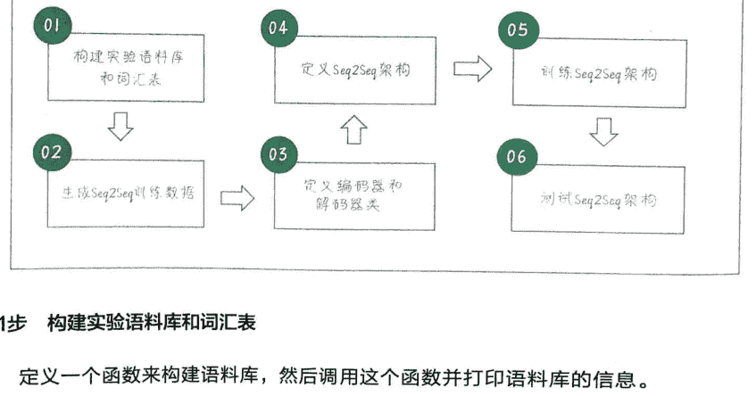

###### 第 1 步 构建实验语料库和词汇表

定义一个函数来构建语料库，然后调用这个函数并打印语料库的信息。

```python

# 5 句小样跑通 Seq2Seq 最小实现

想用最简配置感受编码器解码器如何串起来？这里仅保留 5 对中英示例，把从原始句子到词典、张量再到模型定义的完整路径压缩成一个可直接运行的演示，步骤精炼但覆盖了入门所需的关键环节。

####### 构建语料库，每行包含中文、英文 (解码器输入) 和翻译成英文后的目标输出 3 个句子

sentences = [

    ['咖哥 喜欢 小冰','<sos> KaGe likes XiaoBing', 'KaGe likes XiaoBing <eos>'],

    ['我爱学习人工智能','<sos> I love studying AI', 'I love studying AI <eos>'],

    ['深度学习改变世界','<sos> DL changed the world', 'DL changed the world <eos>'],

    ['自然语言处理很强大','<sos> NLP is so powerful', 'NLP is so powerful <eos>'],

    ['神经网络非常复杂','<sos> Neural-Nets are complex', 'Neural-Nets are complex <eos>']]

word_list_cn, word_list_en = [], [] # 初始化中英文词汇表

####### 遍历每一个句子并将单词添加到词汇表中

for s in sentences:

    word_list_cn.extend(s[0].split())

    word_list_en.extend(s[1].split())

    word_list_en.extend(s[2].split())

####### 去重，得到没有重复单词的词汇表

word_list_cn = list(set(word_list_cn))

word_list_en = list(set(word_list_en))

####### 构建单词到索引的映射

word2idx_cn = {w: i for i, w in enumerate(word_list_cn)}

word2idx_en = {w: i for i, w in enumerate(word_list_en)}

####### 构建索引到单词的映射

idx2word_cn = {i: w for i, w in enumerate(word_list_cn)}

idx2word_en = {i: w for i, w in enumerate(word_list_en)}

####### 计算词汇表的大小

voc_size_cn = len(word_list_cn)

voc_size_en = len(word_list_en)

print("句子数量:", len(sentences)) # 打印句子数量

print("中文词汇表大小:", voc_size_cn) # 打印中文词汇表大小

print("英文词汇表大小:", voc_size_en) # 打印英文词汇表大小

print("中文词汇到索引的字典:", word2idx_cn) # 打印中文词汇到索引的字典

print("英文词汇到索引的字典:", word2idx_en) # 打印英文词汇到索引的字典

这段先对 5 条例句做分词汇总，剔除重复后得到中英文各自的词集，随后建立词与下标的双向查找表并输出规模信息，便于后续检查索引是否对应。

```

> > 句子数量：5
> > 中文词汇表大小：18
> > 英文词汇表大小：20
> > 中文词汇到索引的字典：{'处理': 0, '小冰': 1, '深度学习': 2, '复杂': 3, '人工智能': 4, '我': 5, '喜欢': 6, '强大': 7, '非常': 8, '自然': 9, '学习': 10, '语言': 11, '改变': 12, '爱': 13, '神经网络': 14, '咖哥': 15, '很': 16, '世界': 17}
> > 英文词汇到索引的字典：{'world': 0, 'are': 1, 'is': 2, 'changed': 3, 'Neural-Nets': 4, 'DL': 5, 'KaGe': 6, 'likes': 7, 'XiaoBing': 8, 'AI': 9, 'complex': 10, 'the': 11, 'love': 12, 'powerful': 13, 'T': 14, 'NLP': 15, '<eos>': 16, '<sos>': 17, 'studying': 18, 'so': 19}

这个语料库是专门为学习 Seq2Seq 模型而创建的，每行包含 3 个句子。

+ - 第一句 (源语言): 中文句子，作为输入序列提供给编码器。
+ - 第二句 (<sos>+ 目标语言): 英文句子，作为解码器的输入序列。句子以特殊
  的开始符号<sos>开头，表示句子的开始。<sos> 符号有助于解码器学会在
  何时开始生成目标句子。
+ - 第三句 (目标语言 +<eos>): 也是英文句子，作为解码器的目标输出序列。句子以特殊的结束符<eos>结尾，表示句子的结束。<eos>符号有助于解码器学会在何时结束目标句子的生成。

这个语料库包含 5 组句子，涵盖人工智能、深度学习、自然语言处理、神经网络等不同主题。

###### 第 2 步 生成 Seq2Seq 训练数据

基于语料库中的句子结构，定义生成数据的函数，并生成示例数据。

```python

import numpy as np # 导入 numpy

import torch # 导入 torch

import random # 导入 random 库

####### 定义一个函数，随机选择一个句子和词汇表生成输入、输出和目标数据

def make_data(sentences):

    # 随机选择一个句子进行训练

    random_sentence = random.choice(sentences)

    # 将输入句子中的单词转换为对应的索引

    encoder_input = np.array([[word2idx_cn[n] for n in random_sentence[0].split()]])

    # 将输出句子中的单词转换为对应的索引

    decoder_input = np.array([[word2idx_en[n] for n in random_sentence[1].split()]])

    # 将目标句子中的单词转换为对应的索引

    target = np.array([[word2idx_en[n] for n in random_sentence[2].split()]])

    # 将输入、输出和目标批次转换为 LongTensor

    encoder_input = torch.LongTensor(encoder_input)

    decoder_input = torch.LongTensor(decoder_input)

    target = torch.LongTensor(target)

    return encoder_input, decoder_input, target

####### 使用 make_data 函数生成输入、输出和目标张量

encoder_input, decoder_input, target = make_data(sentences)

####### 获取原始句子

for s in sentences:

    if all([word2idx_cn[w] in set(encoder_input[0].tolist()) for w in s[0].split()]):

        original_sentence = s

    break

print("原始句子:", original_sentence) # 打印原始句子

print("编码器输入张量的形状:", encoder_input.shape) # 打印输入张量形状

print("解码器输入张量的形状:", decoder_input.shape) # 打印输出张量形状

print("目标张量的形状:", target.shape) # 打印目标张量形状

print("编码器输入张量:", encoder_input) # 打印输入张量

print("解码器输入张量:", decoder_input) # 打印输出张量

print("目标张量:", target) # 打印目标张量

这里通过一个小工具随机挑一条样本，把词转为下标并封装成 LongTensor，同时找回对应的原文，用来核对三路张量的形状与内容是否一致。

```

原始句子：`['咖哥喜欢小冰','<s0S> KaGe likes Xiaobing', 'KaGe likes Xiaobing<eos>']`

编码器输入张量的形状：torch.Size([1, 3])
解码器输入张量的形状：torch.Size([1, 4])
目标张量的形状：torch.Size([1, 4])
编码器输入张量：tensor([12, 15, 1])
解码器输入张量：tensor([[16, 8, 6, 15]])
目标张量：tensor([[8, 6, 15, 10]])

这个函数每次从语料库中随机抽取一句话，用于模型训练。

小冰：咖哥，编码器的输入张量和解码器输出的目标张量都不难理解——进，一出。不过，解码器的输入张量有什么作用？

咖哥：好问题！你观察得很仔细。这个 decoder_input 张量包含语料库中每一行的第二句 (<sos>+ 目标语言) 所对应的内容。在训练阶段，向解码器提供这个信息，模型就能够以正确单词为基础来生成下一个单词，以提高训练速度。否则，在解码器还没有足够的文本生成能力的时候，训练效果会很不好。在这个例子中，解码器的输入以特殊的起始符号 <sos> 开头，然后是目标句子的其他单词，直到目标句子<eos> 前的最后一个单词。这种做法有个专门的名称，叫作“教师强制”(Teacher Forcing)，等一会儿在训练的过程中，我们还会进一步解释它。

###### 第 3 步 定义编码器和解码器类

定义编码器和解码器类，下一步会把它们组合为 Seq2Seq 架构。

```python

import torch.nn as nn # 导入 torch.nn 库

####### 定义编码器类，继承自 nn.Module

class Encoder(nn.Module):

    def __init__(self, input_size, hidden_size):

        super(Encoder, self).__init__()

        self.hidden_size = hidden_size # 设置隐藏层大小

        self.embedding = nn.Embedding(input_size, hidden_size) # 创建词嵌入层

        self.rnn = nn.RNN(hidden_size, hidden_size, batch_first=True) # 创建 RNN 层

    def forward(self, inputs, hidden):

        # 前向传播函数

        embedded = self.embedding(inputs) # 将输入转换为嵌入向量

        output, hidden = self.rnn(embedded, hidden) # 将嵌入向量输入 RNN 层并获取输出

        return output, hidden

####### 定义解码器类，继承自 nn.Module

class Decoder(nn.Module):

    def __init__(self, hidden_size, output_size):

        super(Decoder, self).__init__()

        self.hidden_size = hidden_size # 设置隐藏层大小

        self.embedding = nn.Embedding(output_size, hidden_size) # 创建词嵌入层

        self.rnn = nn.RNN(hidden_size, hidden_size, batch_first=True) # 创建 RNN 层

        self.out = nn.Linear(hidden_size, output_size) # 创建线性输出层

    def forward(self, inputs, hidden): # 前向传播函数

        embedded = self.embedding(inputs) # 将输入转换为嵌入向量

        output, hidden = self.rnn(embedded, hidden) # 将嵌入向量输入 RNN 层并获取输出

        output = self.out(output) # 使用线性层生成最终输出

        return output, hidden

n_hidden = 128 # 设置隐藏层数量

####### 创建编码器和解码器

encoder = Encoder(voc_size_cn, n_hidden)

decoder = Decoder(n_hidden, voc_size_en)

print('编码器结构：', encoder) # 打印编码器的结构

print('解码器结构：', decoder) # 打印解码器的结构

网络骨架采用 Embedding 加单层 RNN 的轻量组合。编码侧把中文序列压缩成隐状态，解码侧以该状态为起点自回归生成英文，隐层宽度统一设为 128，保持两端对称。

```

**编码器结构：**
Encoder(
  (embedding): Embedding(18, 128)
  (rnn): RNN(128, 128, batch_first=True))

**解码器结构：**
Decoder(
  (embedding): Embedding(20, 128)
  (rnn): RNN(128, 128, batch_first=True)
  (out): Linear(in_features=128, out_features=20, bias=True))

在这里，编码器和解码器类的设计是相似的，它们都包含嵌入层（用于学习序列的向量表示）和 RNN 层，仅解码器中有线性输出层。尽管它们的结构类似，但它们在 Seq2Seq 架构中扮演的是不同的角色，并根据需要处理不同的输入输出维度。

我们选择将编码器和解码器拆分成独立的类，这样可以使代码更加模块化。你可以专注于编码器和解码器各自的功能，同时使代码更具可读性和可维护性。此外，替换不同的编码器和解码器也很方便，从而能够实现更多样化的模型结构。

小冰：那么，要实现不同的模型结构，可以调整哪些地方呢？

咖哥：可以调整的地方很多，比如通过调整 input_size 和 output_size 参数（即输入输出维度），可以使它们适应不同的源语言和目标语言的词汇表大小。又如 RNN 层的个数，当前我们只使用了一个 RNN 层，但根据需要，可以在 RNN 的构造函数中设置 num_layers 参数，堆叠多个 RNN 层，增加模型的复杂性和容量。还可以使用其他类型的 RNN 层，如 LSTM 层或 GRU 层，来替换 RNN 层，帮助模型更好地捕获长距离依赖关系。此外，也可以在 RNN 的构造函数中设置 bidirectional=True 参数，来使用双向 RNN 捕获输入序列中的前后信息。当然，使用双向 RNN 时需要调整隐藏状态的形状以适应双向结构。

这样，你就可以根据具体任务需求定制编码器和解码器类，为你的 NLP 任务找到最优解。

小冰：我的另一个疑问是，编码器和解码器为什么会有 output、hidden 两个输出呢？这两个输出的作用是什么？

咖哥：在 RNN 及其衍生模型（如 LSTM、GRU 等）中，模型在每个时间步都会输出两个值——output 和 hidden。

- **output**：每个时间步（每个输入的序列元素）的输出。对于一般的 RNN 来说，output 通常就是 hidden；但对于某些更复杂的模型，如 LSTM 来说，output 可能会与 hidden 有所不同。在你的代码中，output 可以被视为对输入序列中每个元素的编码。

- **hidden**：RNN 的隐藏状态，保存了至当前步骤的所有历史信息。在标准的 RNN 中，hidden 状态由前一个时间步的 hidden 状态和当前时间步的输入共同决定。这种机制使得 hidden 状态能够捕获和记住序列的时间依赖性。

在 Seq2Seq 架构中，编码器的作用是将源语言句子编码成一个向量，而解码器则以此向量为输入，生成目标语言的句子。在这个过程中，编码器的 hidden 状态被用作解码器的初始 hidden 状态，作为对整个源语言句子的总结，被解码器用来生成第一个目标语言单词。

编码器的 output 通常用于刚才我提到的注意力机制，这是一种在解码器生成每个单词时选择性地查看输入句子的不同部分的技术，可以帮助模型更好地处理长句子和复杂的语言结构。这个简单的 Seq2Seq 架构并没有真正意义上的使用到编码器的 output。后面讲注意力机制的时候，我们就要用到它了。

###### 第 4 步 定义 Seq2Seq 架构

组合编码器和解码器，形成 Seq2Seq 架构。

```python

class Seq2Seq(nn.Module):

    def __init__(self, encoder, decoder):

        super(Seq2Seq, self).__init__()

        # 初始化编码器和解码器

        self.encoder = encoder

        self.decoder = decoder

    def forward(self, enc_input, hidden, dec_input): # 定义前向传播函数

        # 使输入序列通过编码器并获取输出和隐藏状态

```

```python

encoder_output, encoder_hidden = self.encoder(enc_input, hidden)

####### 将编码器的隐藏状态传递给解码器作为初始隐藏状态

decoder_hidden = encoder_hidden

####### 使解码器输入（目标序列）通过解码器并获取输出

decoder_output, _ = self.decoder(dec_input, decoder_hidden)

return decoder_output

####### 创建 Seq2Seq 架构

最后把编码器和解码器封装进 Seq2Seq，前向时先让源序列通过编码器得到末态，再用该末态启动解码并返回 logits，构成一个可运行的端到端最小流程。

先把编码器和解码器组装成完整的 Seq2Seq 结构，并把整体架构输出查看。

model = Seq2Seq(encoder, decoder)

print('S2S 模型结构:', model)  # 展示模型完整结构

```

########## Out

S2S 模型结构：Seq2Seq(
    (encoder): Encoder(
        (embedding): Embedding(18, 128)
        (rnn): RNN(128, 128, batch_first=True)
    )
    (decoder): Decoder(
        (embedding): Embedding(20, 128)
        (rnn): RNN(128, 128, batch_first=True)
        (out): Linear(in_features=128, out_features=20, bias=True)
    )
)

这段代码定义了一个类，用于处理输入序列并生成输出序列。这个类继承自 PyTorch 的 nn.Module，使其成为一个自定义的深度学习模型。在这个类中，主要完成了以下操作：

- __init__ 方法：这是类的构造函数，用于初始化 Seq2Seq 架构。传入已经定义好的编码器和解码器对象。然后将这两个对象分别赋值给类的实例变量 self.encoder 和 self.decoder。这样，我们可以在类的其他方法中使用这两个子模型。
- forward 方法：forward 是类的前向传播函数，它定义了如何将输入序列 enc_input 传递给编码器和解码器以生成输出序列。这个函数接收 3 个参数：编码器输入序列 enc_input、初始隐藏状态 hidden 和解码器输入序列 dec_input，具体操作如下：
    - (1) 将输入序列传递给编码器，并获得编码器的输出和隐藏状态 (encoder_output, encoder_hidden)。
    - (2) 将编码器的隐藏状态作为解码器的初始隐藏状态 (decoder_hidden = encoder_hidden)。
    - (3) 将解码器输入序列（也就是目标序列）和解码器的初始隐藏状态传递给解码器，以获取解码器的输出 (decoder_output, _)。这里的下划线表示我们不关心解码器返回的隐藏状态，因为我们只需要输出序列。
    - (4) 返回解码器的输出 decoder_output。这个输出可以用来计算损失，优化模型，并生成翻译后的句子。

GPT 图解大模型是怎样构建的

[PAGE 110]

现在，我们通过 Seq2Seq 类将编码器和解码器组合成一个完整的 Seq2Seq 架构，用于处理输入序列并生成相应的输出序列。

小冰：咖哥，你提到在定义前向传播函数的代码 `def forward(self, enc_input, hidden, dec_input)` 中，参数 dec_input 接收的实际上是目标序列的信息。可是通常来说，我们是不会在前向传播部分把目标值输入网络的呀。只有在反向传播、计算损失的时候，才需要目标值嘛！这一定就是你刚才说的“教师强制”。

咖哥：问得好！小冰，看来神经网络的原理你已经了解得很透彻了，而且你观察得也很仔细。

教师强制是训练 Seq2Seq 架构的一种常用技术。使用该技术，要向解码器提供真实的目标序列中的词作为输入，而不是使用解码器自身生成的词。这样可以帮助模型更快地收敛，并在训练时获得更好的性能。

然而，教师强制也有一定的缺点。在训练时，解码器的输入是真实的目标序列中的词；而在实际使用（如测试）时，解码器只能依赖其自身生成的词。这可能导致所谓的曝光偏差（Exposure Bias）问题，即训练和测试阶段的数据分布不匹配，从而影响模型的泛化能力。

为了缓解这个问题，可以使用一种名为计划采样（Scheduled Sampling）的技术：在训练过程中以一定概率使用解码器自身生成的词作为输入。这样，模型可以在训练时逐渐适应自身生成的词，从而在测试中实现更好的泛化性能。

######## ## 第 5 步：训练 Seq2Seq 架构

首先定义一个训练函数，再调用它来训练 Seq2Seq 架构。

```python

####### 编写训练函数

def train_seq2seq(model, criterion, optimizer, epochs):

    for epoch in range(epochs):

        encoder_input, decoder_input, target = make_data(sentences) # 生成本次轮次的输入输出样本

        hidden = torch.zeros(1, encoder_input.size(0), n_hidden) # 将隐藏层状态清零初始化

        optimizer.zero_grad() # 梯度归零准备反传

        output = model(encoder_input, hidden, decoder_input) # 前向传播得到预测结果

        loss = criterion(output.view(-1, voc_size_en), target.view(-1)) # 计算预测与真实标签的损失值

        if (epoch + 1) % 40 == 0: # 每40轮输出一次损失
            print(f'Epoch: {epoch+1:02d} cost = {loss.item():.6f}')

```

第 4 课 柳暗花明又一村：Seq2Seq 编码器 - 解码器架构

[PAGE 111]

optimizer.step() # 更新参数

########## 训练模型
epochs = 400  # 训练轮次
criterion = nn.CrossEntropyLoss() # 损失函数
optimizer = torch.optim.Adam(model.parameters(), lr=0.001) # 优化器

train_seq2seq(model, criterion, optimizer, epochs) # 调用函数训练模型

> Epoch: 0100 cost = 0.053425  
> Epoch: 0200 cost = 0.019734  
> Epoch: 0300 cost = 0.012709  
> Epoch: 0400 cost = 0.006261

![img/0e4677844c777b2f38e3c271a9e6fbf0_111_0.png]

这是训练模型的标准过程，与你之前看到的大同小异。在 train_seq2seq 函数中，每个 epoch 都会随机选择一个句子进行训练。首先，为这个句子创建输入批次、输出批次和目标批次。然后初始化模型的隐藏状态，并将梯度清零。接着，将输入批次、隐藏状态和输出批次传递给模型，获取模型的输出。计算模型输出和目标批次之间的损失，并在每 100 个 epoch 后打印损失值。最后，执行反向传播及参数更新。

代码中的 `encoder_input` 是模型的输入数据，`hidden` 用于初始化 RNN，这两个张量我们已经十分了解。而 `decoder_input` 是专属于 Seq2Seq 架构的训练数据。刚才我已经说明了，这些数据用于进行教师强制，是在训练时故意暴露给解码器的内容。

在 `loss=criterion(output.view(-1, voc_size_en), target.view(-1))` 这句代码中，出现了两次 view 函数。在 PyTorch 中，view 函数用于改变张量的形状。参数 `-1` 表示该维的大小由其他维度的大小决定，使得重塑后的张量元素总数与之前相同。

在这里，`output.view(-1, voc_size_en)` 把输出张量 output 重塑为二维张量，第一个维度对应数据的批次大小 `batch_size`，第二个维度对应英文词汇表的大小。这样做是因为损失函数 `nn.CrossEntropyLoss()` 期望的输入是一个二维张量，其中每一行都是一个数据样本，每一列对应一个类别的分数。

`target.view(-1)` 则将 target 重塑为一维张量，这是因为损失函数 `nn.CrossEntropyLoss()` 期望的 target 输入是一个一维张量，每个元素代表一个类别标签。

> 咖哥发言

GPT 图解大模型是怎样构建的

[PAGE 112]

######## ## 第 6 步：测试 Seq2Seq 架构

定义一个测试函数，然后用两个例句来测试 Seq2Seq 架构。

```python

########## 编写推理函数

def test_seq2seq(model, source_sentence):

    # 把源句按词切分转成词表索引
    encoder_input = np.array([[word2idx_cn[n] for n in source_sentence.split()]])

    # 构造解码器输入序列，以起始符开头后续填充结束符
    decoder_input = np.array([word2idx_en['<sos>']] + [word2idx_en['<eos>']]*(len(encoder_input[0])-1))

    # 转为 PyTorch 长整型张量
    encoder_input = torch.LongTensor(encoder_input)

    decoder_input = torch.LongTensor(decoder_input).unsqueeze(0) # 补充批次维度

    hidden = torch.zeros(1, encoder_input.size(0), n_hidden) # 重新初始化编码器隐藏状态

    predict = model(encoder_input, hidden, decoder_input) # 调用模型进行一次前向推理

    predict = predict.data.max(2, keepdim=True)[1] # 取每步概率最高的词索引

    # 展示源句与模型预测结果
    print(source_sentence, '->', [idx2word_en[n.item()] for n in predict.squeeze()])

########## 执行推理测试

test_seq2seq(model, '咖啡 喜欢 小冰')

test_seq2seq(model, '自然 语言 处理 很强大')

```

########## Out

咖啡 喜欢 小冰 -> ['KaGe', 'likes', 'XiaoBing']  
自然语言处理很强大 -> ['NLP', 'is', 'so', 'powerful', '<eos>']

在 `test_seq2seq` 函数中，首先将输入的句子转换为索引，并构建输出的句子的索引，以 `<sos>` 开始，后面跟 `<eos>`，长度与输入句子相同。

小冰：咖哥，为什么在这里，你使用一个 `<sos>` 和一系列 `<eos>` 符号来构建 decoder_input 呢？之前你不是会通过真实的英文目标输出来进行教师强制吗？

咖哥：进行教师强制是因为要在训练的时候，使模型更快地跟“老师”学会要翻译的内容。现在已经进入测试阶段，我就是要看看模型能否脱离“老师”自己翻译，当然不能再“喂”它真实的目标输出了，那不就完全体现不出模型的翻译能力了吗？

[PAGE 113]

然后，我们将输入批次和输出批次转换为 LongTensor 类型。接着，初始化模型的隐藏状态，并将输入批次、隐藏状态和输出批次传递给模型，获取模型的输出。接下来，从模型输出中获取概率最大的索引，并将索引转换为对应的单词。最后，我们打印出输入的句子和预测的句子。

小冰：我认为 Seq2Seq 架构对序列的处理像是一个压缩和解压缩的过程，而且它能够处理不同长度的输入和输出序列，可以产生连续的输出结果，这样就适用于各种序列生成任务，如机器翻译、对话系统等。

咖哥：没错，所以 Seq2Seq 架构的核心就在于编码器和解码器的设计。编码器需要将输入序列压缩成一个向量，而解码器需要将该向量解压缩成输出序列。这个压缩和解压缩的过程，在原始的 Seq2Seq 架构中，是通过 RNN 等序列建模方法来实现的。编码器使用 RNN 来处理输入序列，生成向量表示，解码器也使用 RNN 来处理向量表示，生成输出序列。

######## ## 咖哥发言

本书聚焦于语言模型的学习，并不涉及如何评估模型的翻译效果。这里简单介绍一下机器翻译领域一个常用的质量评估指标——BLEU (Bilingual Evaluation Understudy)，其基本思想是通过比较机器翻译的结果和人工翻译的结果在词级别上的匹配度来评估翻译质量。BLEU 主要关注的是 N-Gram 精度，会计算不同长度 N-Gram 的精度，并结合这些精度得到一个综合评估。此外，BLEU 还引入了一个简短惩罚因子 (Brevity Penalty)，避免过短的翻译获得过高的评分。

######## ## 咖哥发言

请注意，这里我们一股脑地输出了与 `encoder_input` 长度完全相同的目标序列。因此，如果输入序列和目标序列长度不同，可能会出现输出的句子不完整或翻译错误的现象。在输出的第一个句子中，原目标序列末尾的 `<eos>` 符号就没有机会被输出。这是一种简化的做法。而对于生成式自回归模型来说，更靠谱的方式是一个 token 接一个 token 地向外输出数据，然后以之前解码器生成的 token 作为解码器后续输出的输入，直至模型输出一个 `<eos>` 符号，整个文本生成过程结束。这个过程我们会在后续讲解 GPT 模型时继续详细说明。

[PAGE 114]

当然，通过不断的探索和改进，Seq2Seq 架构也在不断地发展和完善，即将出现的编码器 - 解码器注意力机制，将进一步优化基于 Seq2Seq 架构的模型的性能。

#### 小结

从 NPLM 到 Seq2Seq，NLP 研究人员不断探索更有效的建模方法来捕捉自然语言的复杂性。

NPLM 使用神经网络来学习词嵌入表示，并预测给定上文的下一个词。NPLM 用连续向量表示词，捕捉到了单词之间的语义和语法关系。尽管 NPLM 性能有所提高，但仍然存在一些局限性，例如上下文窗口的大小是固定的。

为了解决上下文窗口大小固定的问题，研究人员开始使用 RNN 来处理可变长度的序列。RNN 可以在处理序列时保持内部状态，从而捕捉长距离依赖关系。然而，RNN 在训练中容易出现梯度消失和梯度爆炸问题。

为了解决梯度消失和梯度爆炸问题，LSTM 和 GRU 等门控循环单元被提出。它们引入了门控机制，可以学习长距离依赖关系，同时缓解梯度消失和梯度爆炸问题。

在此之后，又出现了 Seq2Seq 这种序列到序列的编码器 - 解码器架构，渐渐取代了单一的 RNN。编码器将输入序列编码成一个固定大小的向量，解码器则解码该向量，从而生成输出序列。Seq2Seq 架构可以处理不等长的输入和输出序列，因此在机器翻译、文本摘要等任务中表现出色。

基于 RNN 的 Seq2Seq 架构存在一些缺点，例如难以处理长序列（长输入序列可能导致信息损失）和复杂的上下文相关性等。具体来讲，在一个长序列中，一些重要的上下文信息可能会被编码成一个固定长度的向量，因此在解码过程中，模型难以正确地关注到所有重要信息。为了提高 Seq2Seq 架构的性能，研究人员发现向编码器 - 解码器架构间引入注意力机制，可以帮助 Seq2Seq 架构更好地处理长序列和上下文相关性。通过给予不同时间步（也就是 token）的输入不同的注意力权重，可以让模型更加关注与当前时间步（也就是当前 token）相关的信息。这就是我们下面即将介绍的内容。

#### 思考

1. 说明 Seq2Seq 架构为什么在 NLP 任务中具有优势，这种架构更适合处理哪种类型的 NLP 任务。
2. 在本章代码的基础上调整网络结构，用多层 RNN 构建 Seq2Seq 架构，也可以使用其他类型的 RNN 层，如 LSTM 或 GRU。

![img/0e4677844c777b2f38e3c271a9e6fbf0_114_0.png]

[PAGE 115]

# ## 第 5 课
见微知著开慧眼：引入注意力机制

> 才听了几分钟的课，小冰已经开始打瞌睡了。

> **咖哥**：小冰，你怎么回事，集中一下注意力！

> **小冰**连着打了两个哈欠：咖哥，昨天晚上我一直在看剧。《狂飙》，你知道吗？小雪非得说饰演安欣的演员演得好，一身正气。我倒是把全部的注意力都集中在高启强和大嫂身上了（见右下图）。

> **咖哥**：嗯嗯，巧了。今天我正准备和你好好说说 NLP 里的注意力机制。这和你看电视剧一样，谁演得出彩，你就会更关注谁一些。而注意力机制可以帮助神经网络更好地关注输入序列中的重要部分。

![img/0e4677844c777b2f38e3c271a9e6fbf0_115_0.png]

> **小冰**：对了，我想起来了，昨天我们曾经谈到通过 RNN 构建的 Seq2Seq 架构的局限性。Seq2Seq 架构通常使用编码器将输入序列编码为固定长度的向量，并使用解码器解码该向量，从而生成输出序列。这种方法的问题在于，如果编码器无法动态地捕捉到所输入的每个单词的上下文信息，就无法正确地与上下文相关的单词进行编码。

> **小冰**的全部注意力都集中在她的“偶像”身上

> **咖哥**：这也是 NPLM、RNN 等早期神经网络所共有的问题，所以我们才会引入注意力机制。

> 通过引入注意力机制，模型可以在每个时间步中为输入序列中不同位置的词分配不同的注意力权重。这使得模型能够更加灵活地有选择地关注输入序列中的重要部分（见下页图），从而更好地捕捉上下文相关性，模型的性能也会因此而提高。

> 
> **题图** 小冰的全部注意力都集中在她的“偶像”身上

[PAGE 116]

![img/0e4677844c777b2f38e3c271a9e6fbf0_116_0.png]

有选择地关注：“rabbit”最关注"hopped"

注意力有很多中实现方式（也称实现机制），最简单的注意力机制是点积注意力。

**小冰**：嗯，我已经迫不及待地想学习大名鼎鼎的注意力机制了！

# ## 5.1 点积注意力

**咖啡哥**：不急，注意力机制对于初学者来说有点难理解，我们一点一点地讲。现在你先暂时忘记编码器、解码器、隐藏层和序列到序列这些概念。想象我们有两个张量 $x_1$ 和 $x_2$，我们希望用注意力机制把它俩给衔接起来，让 $x_1$ 看一看，$x_2$ 有哪些特别值得关注的地方。

具体来说，要得到 $x_1$ 对 $x_2$ 的点积注意力，我们可以按照以下步骤进行操作：

(1) 创建两个形状分别为 `(batch_size, seq_len1, feature_dim)` 和 `(batch_size, seq_len2, feature_dim)` 的张量 $x_1$ 和 $x_2$。

> *注：原文此处 OCR 识别为 size，根据上下文张量形状逻辑应为 seq_len2*

(2) 将 $x_1$ 中的每个元素和 $x_2$ 中的每个元素进行点积，得到形状为 `(batch_size, seq_len1, seq_len2)` 的原始权重 `raw_weights`。

(3) 用 softmax 函数对原始权重进行归一化，得到归一化后的注意力权重 `attn_weights`（注意力权重的值在 0 和 1 之间，且每一行的和为 1），形状仍为 `(batch_size, seq_len1, seq_len2)`。

(4) 用注意力权重 `attn_weights` 对 $x_2$ 中的元素进行加权求和（与 $x_2$ 相乘），得到输出张量 $y$，形状为 `(batch_size, seq_len1, feature_dim)`。这就是 $x_1$ 对 $x_2$ 的点积注意力。
```

##### 点积注意力代码详解
###### 框架预览
点积注意力的结构图
完整代码展示如下

```python
import torch # 导入 torch
import torch.nn.functional as F # 导入 nn.functional

####### 1. 创建两个张量 x1 和 x2
x1 = torch.randn(2, 3, 4) # 形状 (batch_size, seq_len1, feature_dim)
x2 = torch.randn(2, 5, 4) # 形状 (batch_size, seq_len2, feature_dim)

###### 2. 计算原始权重
raw_weights = torch.bmm(x1, x2.transpose(1, 2)) # 形状 (batch_size, seq_len1, seq_len2)

####### 3. 用 softmax 函数对原始权重进行归一化
attn_weights = F.softmax(raw_weights, dim=2) # 形状 (batch_size, seq_len1, seq_len2)

####### 4. 将注意力权重与 x2 相乘，计算加权合
attn_output = torch.bmm(attn_weights, x2) # 形状 (batch_size, seq_len1, feature_dim)
```

代码行数不多，却把注意力机制的本质讲清楚了，下面我会拆开来带你过一遍。

#### 第一步：生成 x1、x2 两个输入
我们先实例化一对三维张量，维度规格分别是 `(batch_size, seq_len1, feature_dim)` 与 `(batch_size, seq_len2, feature_dim)`。

```python
######## 创建两个张量 x1 和 x2
x1 = torch.randn(2, 3, 4) # 形状 (batch_size, seq_len1, feature_dim)
x2 = torch.randn(2, 5, 4) # 形状 (batch_size, seq_len2, feature_dim)
print("x1:", x1)
```

```text
x1: tensor([[[- 0.0959, -0.0400, 0.7396, -1.3579],
 [ 0.9780, 1.6672, 0.6350, 0.1407],
 [ 1.4154, 0.3168, -0.5757, -1.0044]],

 [[-0.2816, 0.6128, 0.0883, -0.0892],
 [-0.0907,-0.3577, 0.2229, -1.3146],
 [-0.5021,-0.2462, 0.9709,-0.0679]]])

x2: tensor([[[- 0.5382, 1.3352, 0.7902, -0.9321],
 [-0.8871, 0.1063,-0.9686, 0.2838],
 [-1.6659, 2.0516,-1.6231,-0.0678],
 [-0.9627, 0.6609,-0.5794, 1.9176],
 [-2.3860, 0.9578,-0.7516, 1.0221]],

 [[ 0.2369, -0.9048, 0.5962, 1.0891],
 [-0.3971, 1.0913,-0.2264, 0.0941],
 [-0.1305, 0.7904, 1.6204, 0.2462],
 [-0.4776, 0.6102, 0.5057, 2.1041],
 [ 1.9578,-0.1152,-0.1534, 0.2531]]])
```

通常 `seq_len1` 与 `seq_len2` 不相等。`batch_size` 控制一次喂入网络的样本数，`feature_dim` 基本等同于词嵌入的大小。

**小冰：**x1 和 x2 的 feature_dim 必须相同吗？

**咖啡：**必须相同。本例里两者都是 4。因为点积注意力要把两个向量在特征空间里做内积，维度对不上就无法相乘。工程里若两侧维度不一致，一般先做一次线性映射把维度统一。

在实际使用里，x1 与 x2 可以看作编码器-解码器注意力的解码侧与编码侧序列，也可以是任意两组序列，甚至是同一个序列的自关注。先不用展开太多，避免信息过载。

## 第二步：用点积求相似，得到原始分数

先把 x2 的后两轴调换，再与 x1 做乘法，就能得到 x1 每个位置对 x2 每个位置的相似度分数，这是点积注意力的首要环节。

```python
########## 计算点积，得到原始权重，形状为 (batch_size, seq_len1, seq_len2)
raw_weights = torch.bmm(x1, x2.transpose(1, 2))
print("原始权重:", raw_weights)
```

```text
原始权重: tensor([[1.2474,-0.6254,1.4849,2.9333,-0.1787], 
 [-1.2531,-0.0700,0.1595,-0.6058,0.3247],[ 1.5650,-0.3034,1.0224,2.2497,-0.4448]],

[[- 1.1682,2.5071,-2.7740,-2.0610,3.4535], [0.6140,0.2978,1.7470,-0.6074,-1.3608],

[ 0.3685,-1.0757,4.9891,-0.4289,-2.4044]]])
```

示例选用 PyTorch 的 `torch.bmm` 来做批量点积。`torch.bmm` 即 Batch Matrix Multiplication，用于对一批矩阵做矩阵乘法。它接收两个三维张量，输入规格为 `(batch_size, M, N)` 和 `(batch_size, N, P)`，输出规格为 `(batch_size, M, P)`，内部按批次逐一计算。

为满足相乘的维度要求，需要把 x2 的最后两维转置，由 `(batch_size, seq_len2, feature_dim)` 变为 `(batch_size, feature_dim, seq_len2)`。随后把 x1 `(batch_size, seq_len1, feature_dim)` 与转置后的 x2 做批量乘法，得到原始权重矩阵 `raw_weights`，规格为 `(batch_size, seq_len1, seq_len2)`。

| 输入/输出描述 | 形状说明 |
| :--- | :--- |
| x1 | (batch_size, seq_len1, feature_dim) |
| x2<sup>T</sup> | (batch_size, feature_dim, seq_len2) |
| Weights | (batch_size, seq_len1, seq_len2) |

**张量点积过程示意图**

`raw_weights` 的规格是 `(batch_size, seq_len1, seq_len2)`，来自 x1 与 x2 的点积。其中 `batch_size` 是批次，`seq_len1`、`seq_len2` 分别是两条序列的长度。矩阵里每个元素都表示 x1 某位置与 x2 某位置的相似度得分。

比如，第一行输出 `[1.2474,-0.6254, 1.4849, 2.9333,-0.1787]` 表示当前批次第一个 x1 序列的第一个位置，与该批次 x2 的五个位置分别得到的分数，不难看出它与 x2 的第 4 个位置最接近，得分为 2.9333。基于相似度的打分正是注意力机制的核心思想。

| 术语 | 说明 |
| :--- | :--- |

# 相似度、得分与权重怎么分

相似度本质上是在衡量两个对象有多接近。在注意力机制里，我们会依据输入之间某种关联，比如点积、余弦这类度量，来推导出关注强度。过去已经用过余弦来比较向量，这里的点积同样是常用手段，它能反映方向上的契合：方向一致时数值最大，互相垂直时结果为零。以先前的例子来看，这个相似度反映的就是 x1 里每个位置和 x2 里每个位置的相关程度。

在不少论文或代码里，相似度分数会被叫做原始权重。原因是它只是算注意力权重之前的中间产物。严格讲，得分描述的是输入序列不同元素间的关联或像度，而权重是经过缩放、掩码、归一化等处理后得到的规范化数值。为了避免混淆，最好把两者分开称呼。习惯上，未加工的值叫得分，处理后才叫权重，这样注意力各环节就更清晰。

下面用更直观的例子来解释点积和相似度得分。图里出现了两个向量——电影特征 M 和用户偏好 U。

| 对象 | 含义 |
| :--- | :--- |
| 向量 U | 可能包含用户是否偏爱爱情片、动作片等倾向 |
| 向量 M | 刻画电影在动作、浪漫等属性上的强弱程度 |

把 U 和 M 做点积或算相似度得分，能得到一个表示 U 对 M 兴趣强弱的数值。举例说，若 U 在爱爱情、爱动作上的分量偏高，同时 M 在动作和浪漫上的分量也偏高，那么点积或相似度得分就会偏大，说明用户对这部电影的兴趣更强，系统就更可能推荐。

**小冰：**原来如此，谢谢咖哥。这样算的意义我懂了。那下一步呢？

## 第3步：把原始分数做归一化

**咖哥：**下一步要对原始分数做归一化，这是点积注意力里的第二步。归一化其实很直观。先得到 x1 序列里每个元素与 x2 序列里 5 个元素各自的相似度得分，再用 softmax 把这 5 个数拉到和为 1。

```python
import torch.nn.functional as F # 导入 torch.nn.functional
########## 应用 softmax 函数，使权重的值在 0 和 1 之间，且每一行的和为 1
attn_weights = F.softmax(raw_weights, dim=-1) # 归一化
print("归一化后的注意力权重：", attn_weights)
```

####### 咖哥点评

**向量相似度得分的直觉**

softmax 是一种常见的非线性激活，通常用于多分类。它把一批输入映射成概率分布，使所有输出之和为 1。其计算式如下：

$$softmax(x_i) = \exp(x_i) / \Sigma (\exp(x_j))$$

式中 $x_i$ 是输入向量第 $i$ 个分量，$x_j$ 为任意分量，$\Sigma$ 表示求和。可以看出，softmax 先对每个输入取指数，再用每个指数值除以所有指数之和。

归一化后，`attn_weights` 与 `raw_weights` 形状一致但数值不同，第一行的 5 个数加起来正好是 1。其中第 4 个数是 0.6697，说明在该批次第一行里，x2 的第 4 个位置与 x1 的第 1 个位置高度相关，值得关注。

**归一化后的注意力权重：**

```text
tensor([[0.1241,	 0.0191,	0.1573,	0.6697,	0.0298],
[0.0661,	0.2158,	0.2715,	 0.1263,	0.3203],
[0.2595,	 0.0401,	0.1509,	0.5147,	0.0348]],

[[0.0070,	 0.2765,	 0.0014,	0.0029,	0.7122],
[0.1898,	 0.1384,	 0.5895,	 0.0560,	0.0263],
[0.0097,	 0.0023,	 0.9831,	 0.0044,	 0.0006]])
```

这里以 seq_len2 方向即 `dim=2` 为归一化轴，对原始分数做 softmax，使得权重总和为 1。也就是把 x2 每个位置对应的相似度值分别归一化，于是能得到 x1 对 x2 各位置的关注程度，反过来也成立。

| softmax 函数特性 | 说明 |
| :--- | :--- |
| (1) 输出取值范围 | 0~1，对应概率 |
| (2) 所有输出之和 | 为 1，保证概率分布性质 |
| (3) 单调性 | 输入越大输出越高，概率随之上升 |

在示例中，softmax 的作用是把表示 x1 与 x2 各位置相似度得分的 `raw_weights` 矩阵转成注意力权重矩阵。归一化后得到一个概率分布。

**小冰：**这样就得到注意力权重矩阵了吧？它表征 x1 每个位置对 x2 各位置的关注度。

**咖哥：**没错，不过还没结束。得到权重矩阵后，还要把它作用到 x2 上，得到加权汇总的信息。

## 第4步：计算加权求和得到输出

把注意力权重与 x2 相乘，就得到注意力分布的加权和。也就是把 x2 每个位置的向量乘以其在对应 x1 位置的注意力权重，再把这些加权向量累加起来，这是点积注意力的最后一步。目的就是依据权重算出 x2 的加权汇总，这个汇总才是 x1 对 x2 的注意力输出。

```python
####### 将注意力权重与 x2 相乘，得到注意力分布的加权和，形状为 (batch_size, seq_len1, feature_dim)
attn_output = torch.bmm(attn_weights, x2)
print("注意力输出:", attn_output)
```

```text
注意力输出:
tensor([[[ 0.6648,1.2568,0.4476,-0.3009],
[-0.0073,0.5469,0.2996,0.0671],
[0.7699,0.9930,0.3085,-0.3186]],

[[ -0.3363,-0.0750,-0.9175, 1.2951],
[-0.5410,-0.8423,0.4578,-1.0932],
[-1.1110,-1.3986,0.9678,-1.5613]]])
```

我们再次调用 `torch.bmm`，把归一化后的权重与 x2 做批量矩阵乘法，得到 `attn_output`。对 x1 的每个位置，都把 x2 所有位置与其对应权重的乘积求和。结果张量的形状是 `(batch_size, seq_len1, feature_dim)`，与 x1 保持一致。


> 这次 bmm 的作用是求加权和，和之前用 bmm 求相似度不同

**小冰：**我还是不太明白，所谓“加权信息”或“加权和”到底是什么？

**咖哥：**为了理解“加权信息”，可以拆成“加权”和“信息”两部分。

（1）**加权**：权重是一个标量，表示某个元素在计算中的相对重要性。在注意力里，权重由相似度得分经 softmax 归一化得到。权重越高，说明模型越关注该位置，即 x1 的某位置对 x2 的某位置的关注程度越高。

（2）**信息**：这里指 x2 的位置向量。有了权重，还要把它作用到具体的值上。这些向量承载着 x2 序列的特征。注意力的目标就是依据 x1 各位置的关注程度，从 x2 中抽取关键信息。

综合来看，“加权信息”是指按注意力权重对 x2 的位置向量做加权求和后得到的新向量。这些新向量体现了 x1 各位置对 x2 各位置的加权关注。可以看作关注 x2 之后的新 x1，其形状与原 x1 完全一致。

**小冰：**那 `attn_output` 和 `attn_weights` 有什么区别？

**咖哥：**`attn_weights` 用于了解 x1 各位置与 x2 各位置的关系，来源是原始相似度得分经 softmax 归一化得到的概率分布，形状为 `(batch_size, seq_len1, seq_len2)`。而 `attn_output` 是基于该权重对 x2 各位置向量做加权求和得到的新向量，形状为 `(batch_size, seq_len1, feature_dim)`，第三维回到 x1 的特征空间，在新空间里反映了 x1 各位置对 x2 的加权关注。

两者在注意力里承担不同职责，共同帮助模型聚焦输入序列的关键部分，提升序列到序列任务的性能。

以之前的例子，若 x1 是用户特征向量，x2 是电影特征向量，经过上述计算得到 x1_attention，就会融合电影特征的加权信息，用户更偏好的电影信息含量更高。这样，每个词或元素的表示不再只代表自身，而是整合了整个序列的上下文。这正是引入注意力后词表示内涵被显著拓展的原因。

**小冰：**谢谢咖哥，我明白了！我迫不及待想把它用到 NLP 项目里！

**咖哥：**实际应用前还有几步。下一步讲点积注意力的改进版，缩放点积注意力。

##### 5.2 缩放点积注意力

缩放点积注意力与普通点积注意力的主要差异在于：在算注意力权重前，会先把点积结果即原始分数除以一个缩放因子，再做 softmax。通常这个因子是输入特征维度的平方根。

| 比较项 | 点积注意力 | 缩放点积注意力 |
| :--- | :--- | :--- |
| **计算流程** | 直接对原始分数做 softmax 归一化 | 先除以缩放因子，再做 softmax 归一化 |
| **缩放因子** | 无 | $\sqrt{d_k}$ |
| **主要区别** | - | 计算权重前对点积结果做缩放 |

为何需要缩放？深度学习中点积值可能很大，尤其特征维数高时。点积过大时 softmax 会落在极陡区域，导致梯度极小甚至消失。引入缩放因子可让 softmax 工作在更平缓区间，缓解梯度消失，提升训练稳定性。

###### 缩放点积注意力计算流程

小冰说：除了缩放因子这一步，其他流程和点积注意力一样。

咖哥：对。缩放点积注意力可视作点积注意力的改进，用来解决梯度问题。

```python
import torch # 导入 torch
import torch.nn.functional as F # 导入 nn.functional

###### 1.创建两个张量 x1 和 x2
x1 = torch.randn(2,3,4) #形状 (batch_size, seq_len1, feature_dim)
x2 = torch.randn(2,5,4) #形状 (batch_size, seq_len2, feature_dim)
####### 2.计算张量点积，得到原始权重
raw_weights = torch.bmm(x1, x2.transpose(1,2)) # 形状 (batch_size, seq_len1,seq_len2)
####### 3.将原始权重除以缩放因子
scaling_factor = x1.size(-1) **0.5
scaled_weights = raw_weights / scaling_factor # 形状(batch_size, seq_len1,seq_len2)
#4.对原始权重进行归一化
attn_weights = F.softmax(raw_weights, dim=2) # 形状 (batch_size, seq_len1,seq_len2)
#5.使用注意力权重对 x2 加权求和
attn_output = torch.bmm(attn_weights, x2) # 形状(batch_size, seq_len1,feature_dim)
```

[PAGE 127]

小冰忽然想到，注意力机制不是 Seq2Seq 的增强吗？怎么到现在还没联系起来？

咖哥：我就等你问。下面就说注意力如何引入 Seq2Seq。

##### 5.3 编码器 - 解码器注意力

前面为了聚焦注意力本身，没有明确 x1、x2 的实际含义。现在给它们赋义。

在 Seq2Seq 架构里，点积注意力通常把编码器隐状态与解码器隐状态关联起来。这时：

- x1：解码器各时间步的隐状态，形状为 `(batch_size, seq_len1, feature_dim)`，seq_len1 为解码器长度。
- x2：编码器各时间步的隐状态，形状为 `(batch_size, seq_len2, feature_dim)`，seq_len2 为编码器长度。

小冰：所以 x1 是解码器隐状态，x2 是编码器隐状态？

咖哥：正是。因为是解码器需要关注编码器，也有人称之为解码器-编码器注意力。

应用点积注意力时，解码器每个时间步会根据编码器隐状态算出注意力权重，再把权重作用到编码器隐状态上生成上下文向量。该向量包含编码器输入序列的有用信息，帮助解码器生成更准确的输出。


[PAGE 128]

现在重构之前的 Seq2Seq 模型，加入编码器-解码器注意力。数据集和训练流程不变。

修改步骤：

1. 定义 Attention 类，用来算权重和上下文向量。
2. 重构 Decoder 类，使其初始化和前向传播包含注意力层并在解码时使用权重。
3. 重构 Seq2Seq 类，前向传播把编码器输出传给解码器。
4. 可视化注意力权重。

###### 第 1 步 定义 Attention 类

第一个改动是新增 Attention 类。

```python
#定义Attention类
import torch.nn as nn#导入torch.nn库
class Attention(nn.Module):
    def __init__(self, hidden_size):
        super(Attention, self).__init__()
        self.hidden_size = hidden_size
        
    def forward(self, decoder_context, encoder_context):
        #计算decoder_context 和encoder_context的 点积，得到注意力分数 
        scores = torch.matmul(decoder_context, encoder_context.transpose(-2, -1))
        #归一化分数
        attn_weights = nn.functional.softmax(scores, dim=-1) #将注意力权重乘以 encoder_context，得到加权的上下文向量 
        context = torch.matmul(attn_weights, encoder_context)
        return context, attn_weights
```

Attention 继承自 nn.Module。`__init__` 接收 `hidden_size` 表示隐层大小。`forward` 接收 `decoder_context` 和 `encoder_context`，计算注意力权重并返回加权上下文 `context` 与权重 `attn_weights`。

###### 第 2 步 为 Decoder 挂载注意力

在 Decoder 的初始化阶段加入注意力层，前向传播时借助该层生成注意力上下文向量，让解码过程能够依据注意力权重选择性关注。

```python
####### 定义解码器类
class DecoderWithAttention(nn.Module):
    def __init__(self, hidden_size, output_size):
        super(DecoderWithAttention, self).__init__()
        self.hidden_size = hidden_size # 设置隐藏层大小
        self.embedding = nn.Embedding(output_size, hidden_size) # 创建词嵌入层
        self.rnn = nn.RNN(hidden_size, hidden_size, batch_first=True) # 创建 RNN 层
        self.attention = Attention() # 创建注意力层
        self.out = nn.Linear(2 * hidden_size, output_size) # 修改线性输出层，考虑隐藏状态和上下文向量
    def forward(self, dec_input, hidden, enc_output):
        embedded = self.embedding(dec_input) # 将输入转换为嵌入向量
        rnn_output, hidden = self.rnn(embedded, hidden) # 将嵌入向量输入 RNN 层并获取输出
        context, attn_weights = self.attention(rnn_output, enc_output) # 计算注意力上下文向量
        dec_output = torch.cat((rnn_output, context), dim=-1) # 将上下文向量与解码器的输出拼接
        dec_output = self.out(dec_output) # 使用线性层生成最终输出
        return dec_output, hidden, attn_weights
        
####### 创建解码器
decoder = DecoderWithAttention(n_hidden, voc_size_en)
print(' 解码器结构:', decoder) # 打印解码器的结构
```

```text
Out
解码器结构： DecoderWithAttention(
    (embedding): Embedding(19, 128)
    (rnn): RNN(128, 128, batch_first=True)
    (attention): Attention()
    (out): Linear(in_features=256, out_features=19, bias=True)
```

在 Decoder 的 __init__ 中新增 attention 参数，类型为 Attention 实例，并把它存成 self.attention 属性。

在前向方法里额外接收 enc_output 作为输入。先调用注意力实例得到上下文向量与注意力权重，再把上下文向量与词嵌入拼接送入 RNN，随后把 RNN 的输出送入线性层得到最终解码结果。

###### 第 3 步 改造 Seq2Seq 的前向流程

把编码器的输出传递给解码器，让两者衔接起来。

```python
####### 定义 Seq2Seq 类
class Seq2Seq(nn.Module):
    def __init__(self, encoder, decoder):
        super(Seq2Seq, self).__init__()
        # 初始化编码器和解码器
        self.encoder = encoder
        self.decoder = decoder

    def forward(self, encoder_input, hidden, decoder_input):
        # 将输入序列通过编码器并获取输出和隐藏状态
        encoder_output, encoder_hidden = self.encoder(encoder_input, hidden)
        # 将编码器的隐藏状态传递给解码器作为初始隐藏状态
        decoder_hidden = encoder_hidden
        # 将目标序列通过解码器并获取输出，此处更新解码器调用
        decoder_output, _, attn_weights = self.decoder(decoder_input, decoder_hidden, encoder_output)
        return decoder_output, attn_weights

####### 创建 Seq2Seq 模型
model = Seq2Seq(encoder, decoder)
print('S2S 模型结构:', model) # 打印模型的结构
```

```text
S2S 模型结构; Seq2Seq(
    (encoder): Encoder(
        (embedding): Embedding(18, 128)
        (rnn): RNN(128, 128, batch_first=True)
    )
    (decoder): DecoderWithAttention(
        (embedding): Embedding(19, 128)
        (rnn): RNN(128, 128, batch_first=True)
        (attention): Attention()
        (out): Linear(in_features=256, out_features=19, bias=True))
```

Seq2Seq 的 forward 先执行编码器前向，拿到编码输出和最终隐藏状态；随后用编码器的隐藏状态初始化解码器的隐藏状态，并把编码输出作为额外输入传给解码器前向；最后返回解码结果与注意力权重。

这么改的目的是让解码器在生成序列时能够动态聚焦输入序列的不同位置。借助注意力，模型可以捕捉长距离依赖，提升翻译或序列转换的质量。

###### 第 4 步 把注意力权重可视化出来

现在模型同时吐出解码输出和注意力权重，接收端也要做相应调整。

```python
####### 定义训练函数
def train_seq2seq(model, criterion, optimizer, epochs):
    ... ...
    output, _ = model(encoder_input, hidden, decoder_input)#获取模型输出
    ... ...
```

测试时可以把注意力权重绘制出来，观察解码隐藏状态到底在关注编码序列的哪一段。

定义一个专门用于展示注意力的函数。

```python
import matplotlib.pyplot as plt #导入 matplotlib
import seaborn as sns #导入 seaborn

plt.rcParams['font.family']='SimHei' #用来设定字体样式
plt.rcParams['font.sans-serif']='SimHei' #用来设定无衬线字体样式
plt.rcParams['axes.unicode_minus']=False#用来正常显示负号

def visualize_attention(source_sentence, predicted_sentence, attn_weights):

    plt.figure(figsize=(10, 10))#画布
    ax = sns.heatmap(attn_weights, annot=True, cbar=False,
        xticklabels=source_sentence.split(),
      yticklabels=predicted_sentence, cmap="Greens")#热力图
    plt.xlabel("源序列")
    plt.ylabel("目标序列")
    plt.show()#显示图片
```

在模型测试环节，调用该函数可视化注意力权重。

```python
def test_seq2seq(model, source_sentence):
    ... ...
    #获取模型输出和注意力权重
    predict, attn_weights = model(encoder_input, hidden, decoder_input)
    ... ...
    #可视化注意力权重
    attn_weights = attn_weights.squeeze().cpu().detach().numpy()
    visualize_attention(source_sentence, [idx2word_en[n.item()] for n in predict.squeeze()], attn_weights)
```


| | NLP | | | | |

|---|---|---|---|---|---|

| target sequence | is | 0.019 | 0.47 | 0.021 | 0.47 |

| very | | 0.00015 | 0.23 | 0.77 | 0.0011 |

| | powerful | | 0.00064 | 0.003 | 0.36 |

| | | 0.077 | 0.56 | | |

| | <eos> | 4.7e-05 | 0.22 | 0.77 | 2.4e-05 |

| source sequence | natural | language | processing | very | powerful |

从该注意力矩阵能看出，生成 NLP 时模型对“自然”一词赋予了很高的权重。示例训练数据量很小，注意效果有限。实际应用中需要更大规模数据训练 Seq2Seq，才能学习到更合理的注意力分布。

小冰：谢谢咖哥，循序渐进的讲解让我对编码器-解码器里的注意力来龙去脉清晰很多。但我还有个困惑一直想不明白。

咖哥：说来听听。

小冰：我看过一些 Transformer 的介绍，其中反复提到 Q、K、V 三个向量，感觉它们很关键，但你之前并没讲到。

咖哥：确实是核心要素，只是怕一次塞太多概念让人混乱。现在你已经明白注意力本质上是向量点积再加权求和，我们就可以介绍 Q、K、V 了。

第 5 课 见微知著开慧眼：引入注意力机制 121

Out

[PAGE 133]

##### 5.4 注意力机制中的 Q、K、V

注意力机制里包含查询、键、值三个角色。

- 查询 Query：代表当前需要处理的信号，模型据此在输入里寻找相关信息。
- 键 Key：来自输入序列的表示，用于和查询一起计算注意力权重，权重体现各位置与查询的相关程度。
- 值 Value：来自输入序列的表示，按照权重加权后汇总，得到与查询最相关的输出向量。

流程上，先用查询与各个键计算相似度得到权重，再用这些权重对值进行加权求和，输出形状与查询一致，供下一步计算使用。

小冰：咖哥，这样讲我还是有点糊涂。以最简单的点积注意力代码为例，里面 Q、K、V 分别对应哪部分？

```python
###### 1.创建两个张量 x1 和 x2
x1 = torch.randn( 2,3,4) #形状 (batch_size, seq_len1, feature_dim)
x2 = torch.randn(2,5,4) #形状 (batch_size, seq_len2, feature_dim)
###### 2. 计算原始权重
raw_weights = torch.bmm(x1, x2.transpose( 1,2)) #形状 (batch_size, seq_len1, seq_len2)
###### 3.对原始权重进行 softmax 归一化
attn_weights = F.softmax(raw_weights, dim=2) #形状 (batch_size, seq_len1, seq_len2)
###### 4.与 x2 相乘，计算加权和
attn_output = torch.bmm(attn_weights, x2) #形状 (batch_size, seq_len1, feature_dim)
```

咖哥：在这个简化示例里只用了 x1 和 x2 两个张量。x1 可以看作查询 Q，x2 同时充当键 K 和值 V。因为相似度直接用 x1 与 x2 的点积得到，权重又直接作用在 x2 上来聚合信息。所以这里 Q=x1，K=V=x2。

在 Transformer 里，Q、K、V 通常是通过不同线性变换从同一输入派生出的独立向量。

下面用三个独立张量分别表示 Q、K、V 并演示计算。# 1. 创建 Query、Key 和 Value 张量

```python
q = torch.randn(2, 3, 4) # 形状 (batch_size, seq_len1, feature_dim)
k = torch.randn(2, 4, 4) # 形状 (batch_size, seq_len2, feature_dim)
v = torch.randn(2, 4, 4) # 形状 (batch_size, seq_len2, feature_dim)
```

####### 2. 计算点积得到初始分数，形状为 (batch_size, seq_len1, seq_len2)

```python
raw_weights = torch.bmm(q, k.transpose(1, 2))
```

####### 3. 对分数做缩放处理，形状不变

```python
scaling_factor = q.size(-1)**0.5
scaled_weights = raw_weights / scaling_factor
```

####### 4. 经过 softmax 归一化，得到 0-1 之间且行和为 1 的权重

```python
attn_weights = F.softmax(scaled_weights, dim=-1) # 形状仍为 (batch_size, seq_len1, seq_len2)
```

####### 5. 用权重加权 Value，得到输出，形状为 (batch_size, seq_len1, feature_dim)

```python
attn_output = torch.bmm(attn_weights, v)
```

---

小冰：K 和 V 的维度必须完全相同吗？

咖啡哥：在缩放点积注意力里，K 与 V 的维度不必完全一致。K 与 V 的序列长度维度要相同，因为它们描述同一序列；特征维度可以不同。V 的特征维度决定了最终输出的特征维。

同时，K 的特征维度必须与 Q 的特征维度一致，才能做点积；而 Q 与 K 的序列长度维度可以不同，因为它们可能来自不同序列。

实际使用中 K 与 V 常来自同一输入并做不同线性变换，维度通常一致。

现在把缩放点积注意力的步骤重述如下：

- 1) 计算 Q 与 K 的点积。
- 2) 除以 Q 特征维度的平方根做缩放。
- 3) softmax 得到注意力权重。
- 4) 用权重对 V 加权求和。

示意图见下一页。

---

小冰：那在编码器-解码器的注意力里，Q、K、V 怎么理解？

咖哥：具体到编码器-解码器注意力，可以这样对应 Q、K、V。

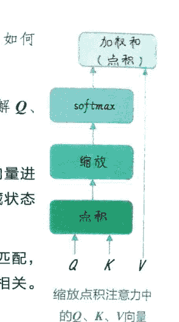

Q、K、V 在注意力里的分工

$Q$ 可以看作解码器在当前解码步的查询表示，它的任务是去和 $K$ 对齐，从而得到注意力权重。通常 $Q$ 是由解码器的隐藏状态经一次线性投影得到。

$K$ 则是编码器侧的键表示，用来衡量与当前查询的相关程度。它也是从编码器的隐藏状态通过线性变换生成，用来回答“谁值得被关注”。

$V$ 是编码器侧的数值表示，注意力权重最终会作用在 $V$ 上做加权求和，拼出上下文向量。$V$ 同样源自编码器隐藏状态，只不过走的是另一条线性变换。

在最基础的编码器-解码器注意力示例里，并没有把 $Q$、$K$、$V$ 单独写出来，而是直接用了隐藏状态：

■ 编码器隐藏状态同时承担了 $K$ 和 $V$ 的功能。
■ 解码器隐藏状态承担了 $Q$ 的功能。

流程就是先用 $Q$ 与 $K$ 做点积得到权重，再用这些权重对 $V$ 做加权求和，得到本次解码所需要的上下文。

咖哥：正是这个思路。

小冰：咖哥，你刚说在 Transformer 里 $Q$、$K$、$V$ 常常是对同一段输入做不同线性变换得到，这不就是大家常说的自注意力吗？

##### 5.5 自注意力

咖哥：没错。自注意力就是让序列自己关注自己，使得同一序列内部不同位置可以建立关联。用最朴素的注意力来类比，如果把原本的 $x2$ 换成 $x1$ 本身，就相当于每个位置都在对序列里所有位置做加权汇总。

下面这段就是最简自注意力的实现。

```python
import torch
import torch.nn.functional as F
###### 一个形状为 (batch_size, seq_len, feature_dim) 的张量 x
x = torch.randn(2, 3, 4)
###### 计算原始权重，形状为 (batch_size, seq_len, seq_len)
raw_weights = torch.bmm(x, x.transpose(1, 2))
###### 用 softmax 函数对原始权重进行归一化，形状为 (batch_size, seq_len, seq_len)
attn_weights = F.softmax(raw_weights, dim=2)
###### 计算加权和，形状为 (batch_size, seq_len, feature_dim)
attn_outputs = torch.bmm(attn_weights, x)
```

小冰：那如果显式带上 $Q$、$K$、$V$，自注意力要怎么实现？

咖哥：做法很直接，对输入序列做三次不同的线性投影得到 $Q$、$K$、$V$，然后套用缩放点积注意力即可。

修改后的示例：

```python
###### 一个形状为 (batch_size, seq_len, feature_dim) 的张量 x
x = torch.randn(2, 3, 4) # 形状 (batch_size, seq_len, feature_dim)
####### 定义线性层用于将 x 转换为 Q, K, V 向量
linear_q = torch.nn.Linear(4, 4)
linear_k = torch.nn.Linear(4, 4)
linear_v = torch.nn.Linear(4, 4)
####### 通过线性层计算 Q, K, V
Q = linear_q(x) # 形状 (batch_size, seq_len, feature_dim)
K = linear_k(x) # 形状 (batch_size, seq_len, feature_dim)
V = linear_v(x) # 形状 (batch_size, seq_len, feature_dim)
####### 计算 Q 和 K 的点积，作为相似度分数，也就是自注意力原始权重
raw_weights = torch.bmm(Q, K.transpose(1, 2)) # 形状 (batch_size, seq_len, seq_len)
#将注意力原始权重进行缩放
scale_factor = K.size(-1) ** 0.5 #这里就是4**0.5
scaled_weights = raw_weights / scale_factor #形状 (batch_size, seq_len, seq_len)
#用softmax函数对缩放后的权重进行归一化，得到注意力权重
attn_weights = F.softmax(scaled_weights, dim=2) #形状 (batch_size, seq_len, seq_len)
#将注意力权重应用于V向量，计算加权积，得到加权信息
attn_outputs = torch.bmm(attn_weights, V) #形状 (batch_size, seq_len, feature_dim)
print("加权信息:", attn_outputs)
```

输出结果：

```
tensor([[-0.1050, -0.0269, 0.2893, 0.3222],
        [-0.0476,-0.0560, 0.2607, 0.3253],
        [-0.0160,-0.0720, 0.2453, 0.3268]],

[[ -0.7248, 0.2341,-0.1126, 0.7494],
        [-0.9299, 0.3150,-0.1710, 0.8458],
        [-0.4370, 0.1295, -0.0738, 0.6225]], grad_fn=<BmmBackward0>)
```

小冰：懂了，能再讲讲多头自注意力吗？

咖哥：可以。下面把代码再扩展一下。

##### 5.6 多头自注意力

多头自注意力是对单头注意力的扩展，目的是让模型在多个表示子空间里并行捕捉不同类型的特征。具体做法是对 $Q$、$K$、$V$ 分别做多次线性变换得到若干个头，并行计算后再融合，如下图。

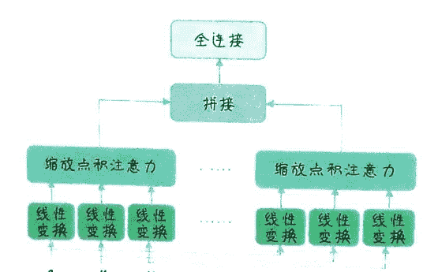

多头自注意力的计算流程大致如下。

- **(1) 初始化**：先确定头的数量，每个头负责一个子空间。
- **(2) 线性变换**：用不同权重对 $Q$、$K$、$V$ 进行多次线性投影，得到多组表示。
- **(3) 缩放点积注意力**：把每组 $Q$、$K$、$V$ 送入缩放点积注意力，每个头产出一份加权结果。
- **(4) 合并**：把各头的输出拼接，再做一次线性投影得到最终输出。

这样做的好处是可以同时学习多个子空间的特征，提升对长距离依赖和不同语义层面的建模能力。

下面是一个简易实现：

```python
import torch
import torch.nn.functional as F
###### 一个形状为 (batch_size, seq_len, feature_dim) 的张量 x
x = torch.randn(2, 3, 4) # 形状 (batch_size, seq_len, feature_dim)
###### 定义头数和每个头的维度
num_heads = 2
head_dim = 2
####### feature_dim 必须是 num_heads*head_dim 的整数倍
assert x.size(-1) == num_heads * head_dim
####### 定义线性层用于将 x 转换为 Q, K, V 向量
linear_q = torch.nn.Linear(4, 4)
linear_k = torch.nn.Linear(4, 4)
linear_v = torch.nn.Linear(4, 4)
####### 通过线性层计算 Q, K, V
Q = linear_q(x) # 形状 (batch_size, seq_len, feature_dim)
K = linear_k(x) # 形状 (batch_size, seq_len, feature_dim)
V = linear_v(x) # 形状 (batch_size, seq_len, feature_dim)
####### 将 Q, K, V 分割成 num_heads 个头
def split_heads(tensor, num_heads):
    batch_size, seq_len, feature_dim = tensor.size()
    head_dim = feature_dim // num_heads
    output = tensor.view(batch_size, seq_len, num_heads, head_dim).transpose(1, 2)
    return output # 形状 (batch_size, num_heads, seq_len, feature_dim)
Q = split_heads(Q, num_heads) # 形状 (batch_size, num_heads, seq_len, head_dim)
K = split_heads(K, num_heads) # 形状 (batch_size, num_heads, seq_len, head_dim)
V = split_heads(V, num_heads) # 形状 (batch_size, num_heads, seq_len, head_dim)
####### 计算 Q 和 K 的点积，作为相似度分数，也就是自注意力原始权重
raw_weights = torch.matmul(Q, K.transpose(-2, -1)) # 形状 (batch_size, num_heads, seq_len, seq_len)
####### 对自注意力原始权重进行缩放
scale_factor = K.size(-1) ** 0.5
scaled_weights = raw_weights / scale_factor # 形状 (batch_size, num_heads, seq_len, seq_len)
####### 用 softmax 函数对缩放后的权重进行归一化，得到注意力权重
attn_weights = F.softmax(scaled_weights, dim=-1) # 形状 (batch_size, num_heads, seq_len, seq_len)
####### 将注意力权重应用于 V 向量，计算加权值，得到加权信息
attn_outputs = torch.matmul(attn_weights, V) # 形状 (batch_size, num_heads, seq_len, head_dim)
####### 将所有头的结果拼接起来
def combine_heads(tensor):
    batch_size, num_heads, seq_len, head_dim = tensor.size()
    feature_dim = num_heads * head_dim
    output = tensor.transpose(1, 2).contiguous().view(batch_size, seq_len, feature_dim)
    return output # 形状 (batch_size, seq_len, feature_dim)
attn_outputs = combine_heads(attn_outputs, num_heads) # 形状 (batch_size, seq_len, feature_dim)
####### 对拼接后的结果进行线性变换
linear_out = torch.nn.Linear(4, 4)
attn_outputs = linear_out(attn_outputs) # 形状 (batch_size, seq_len, feature_dim)
print("加权信息：", attn_outputs)
```

输出结果：

```
tensor([[[0.7124, -0.2827, 0.5822, 0.3743],
         [0.7162,-0.2885, 0.5784, 0.3721],
         [0.7118,-0.2803, 0.5846, 0.3757]],

        [[0.3251,-0.1604, 0.3867, 0.3548],
         [0.4452,-0.2258, 0.4250, 0.4310],
         [0.3397，-0.1866, 0.3717, 0.3605]]]),grad_fn=<ViewBackward0)
```

这段代码先定义头数 num_heads 和每个头的维度 head_dim，把 $Q$、$K$、$V$ 切分成多个头分别做自注意力，最后把结果拼接并线性变换。值得说明的是这句：

`output = tensor.transpose(1, 2).contiguous().view(batch_size, seq_len, feature_dim)`

- **tensor.transpose(1, 2)**：把第二个和第三个维度互换。操作前形状是 batch_size, num_heads, seq_len, head_dim，操作后变成 batch_size, seq_len, num_heads, head_dim，以便把同一位置的各头结果聚到一起。
- **contiguous()**：保证张量在内存中是连续的，经过转置后做 view 才安全。
- **view(batch_size, seq_len, feature_dim)**：把形状重排为 batch_size, seq_len, feature_dim，其中 feature_dim = num_heads * head_dim，完成各头的拼接，使其可作为下一层输入。

小冰：我可以这样概括吗：把输入投影到多个子空间，在每个子空间里做点积注意力，再把各头结果连接起来。

咖哥：总结得很到位。在真实模型里，多头自注意力通常和前馈网络、层归一化等组件一起构成 Transformer，能进一步增强表达力和稳定性。

多头机制让模型在不同子空间里同时提取多种特征，对处理长依赖和复杂结构更有帮助，这也是它在自然语言处理和计算机视觉中效果不错的原因。

咖哥：注意力到这里基本讲完了，最后一个要说明的是注意力掩码。

小冰：对，我常听到“掩码多头自注意力”。BERT 里的掩码是把部分词藏起来做填空，那注意力掩码又是指什么？

##### 5.7 注意力掩码

这里的掩码和 BERT 训练时对文本做遮挡不是一回事。注意力掩码的目的是在计算注意力分数时屏蔽掉无关的位置，避免模型被噪声带偏。

先回顾填充。NLP 里不同长度的句子要批量处理，通常会把短句用 `<pad>` 补齐到同一长度。

比如这段损失计算代码：

```python
criterion = nn.CrossEntropyLoss(ignore_index=word2idx_en['<pad>']) #损失函数
```

其中 `ignore_index=word2idx_en['<pad>']` 就是告诉模型 `<pad>` 是冗余的，反向传播时不需要更新它，也不会出现把 `<pad>` 翻译出来的情况。

填充掩码 Padding Mask 的作用与之类似，都是在算注意力分数时把填充位置排除掉。因为这些位置没有真实语义，如果被计入会引入噪声，拖累性能。


给注意力加上掩码后，计算方式会先把原始的注意力权重矩阵和一个专门的掩码矩阵做逐元素相加。被我们希望忽略的位置，分数会被压到一个非常小的负值，接近负无穷。随后经过 softmax 归一化，这些位置的权重就会逼近于零，模型在实际计算时就相当于完全不看它们了。

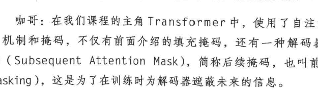

换句话说，掩码就是把不该关注的信息的权重主动打成接近 0。

**咖啡：** 我们这门课的主角 Transformer 里，自注意力、多头自注意力和各种掩码都是标配。除了前面讲过的填充掩码，解码器里还有一种专属的后续注意力掩码 Subsequent Attention Mask，业内也叫前瞻掩码 Look-ahead Masking。它的作用就是在训练时把解码器对未来内容的窥视给挡住。

**小冰：** 哇，未来的信息是指什么？

**咖啡：** 就是当前生成位置之后尚未出现的文本。这跟生成式模型的自回归特性直接相关。掩码的具体形式和代码我们下节课再展开讲。

##### 5.8 注意力机制的常见变种
缩放点积注意力、自注意力和多头自注意力之外，注意力家族里还有不少分支，常用的有如下几种。

- **加性注意力 Additive Attention：** 也叫 Bahdanau 注意力，最早在神经机器翻译里被提出。它用一个带激活函数如 tanh 的全连接层来衡量查询和键的相似度得分。和缩放点积相比，计算量会大一些，但在某些任务上表现更稳健。
- **全局注意力 Global Attention：** 计算权重时遍历输入序列的全部元素。典型的使用场景是 Seq2Seq 的 RNN 编码器-解码器，能捕捉整体上下文，但成本偏高。
- **局部注意力 Local Attention：** 只在输入的一个固定窗口内计算权重，聚焦局部结构从而降低开销。可细分为硬局部和软局部，主要区别在于窗口如何确定。
- **自适应注意力 Adaptive Attention：** 会根据输入动态调整关注范围，自动在全局和局部之间切换，让模型在不同上下文里做出更合适的行为，从而提升泛化。
- **分层注意力 Hierarchical Attention：** 在多个粒度上分别计算注意力。比如处理文本时先在词层做加权，再在句子层做加权，能够萃取不同层级的抽象特征。
- **因果注意力 Causal Attention：** 靠后续掩码实现防止模型提前看到未来信息。在文本生成、语音合成等生成任务里，它保证模型生成当前位置时只能用到当前位置及之前的历史，符合真实生成过程，也能提高鲁棒性。

**咖哥：** 到这里本课的内容就收尾了，注意力对你来说应该已经没那么抽象了。**小冰**，如果你把这一课吃透，再加上前面 5 节的积淀，我们就可以进入 GPT 实战的核心——Transformer 的讲解了。

**小冰：** 太想学了！

#### 小结
注意力本质上是 Seq2Seq 模型里的一种加权筛选手段，让模型在解码时根据当前解码状态，给输入序列的不同位置分配不同重要性，形成加权和向量再与当前状态融合，从而更有选择性地聚焦关键信息。

常见形态有全局、局部和自注意力。全局会覆盖整个序列，局部和自注意力则在限定范围或自身序列内运作，对长序列更友好。正是这种机制让模型能更好地处理长输入和复杂的上下文依赖，在机器翻译、文本摘要等任务中发挥了关键作用，也为 Transformer 时代铺平了道路。

#### 思考
1. 向量点积注意力里两次调用 `bmm`，一次被解释成点积，一次被解释成加权和，原因是什么？
2. `bmm` 与 `matmul` 在功能和用法上有什么区别和联系？
3. 试着完成编码器-解码器注意力的代码实现。
4. 查询 Query、键 Key、值 Value 分别代表什么？
5. 用 Q K V 的视角重新推导编码器-解码器注意力。

# Transformer：注意力即一切
**咖哥：** 嘿，小冰，今天的主角是 NLP 圈的超级巨星 Transformer。它的出现彻底改写了语言模型的版图，从早期的 BERT、初代 GPT，到现在的 ChatGPT、GPT-4，都建立在它之上。如今它的影响已经溢出 NLP，延伸到视觉、推荐、强化学习等多个方向。准备好了吗？

**小冰：** 当然！“雕龙一拍”都到 3.0 了，我还没学到 Transformer，早就等不及了！

**咖哥：** Transformer 之名听起来霸气，但它问世的那一年，真的拯救了整个 NLP。如果说 BERT 让做 NLP 的人敢在 CV 人面前抬头，那 ChatGPT 则把 AI 推向了新高度，AIGC 从梦想变成现实，AGI 也首次可感。Transformer 功不可没。

### 6.1 架构拆解与起源
Transformer 可追溯到 2017 年，Google Brain 的 Vaswani 等人发表的论文《Attention is All You Need》。这篇论文直指 Seq2Seq 在处理长距离依赖时的痛点。

① VASWANI A, SHAIZER N, PARMAR N. et al. Attention is all you need (J). Advances in Neural Information Processing Systems, 2017(30): 5998-6008.


在此之前 RNN、LSTM 占主导，但效率低、难以捕捉长距离依赖，且存在梯度消失爆炸的问题，让 NLP 落地一直比不上 CV。瓦斯瓦尼等人于是提出了一个全新的架构。

Transformer 的核心是自注意力，它为序列中每个元素赋予不同权重，从而更好捕捉内部依赖。同时它抛弃了循环结构，采用编码器-解码器并行设计，训练速度大幅提升。

自此之后，基于 Transformer 的 BERT、GPT 等预训练模型层出不穷，Transformer 成为 NLP 的代表技术，并在视觉、语音等领域取得显著成果。

先看整体结构吧！

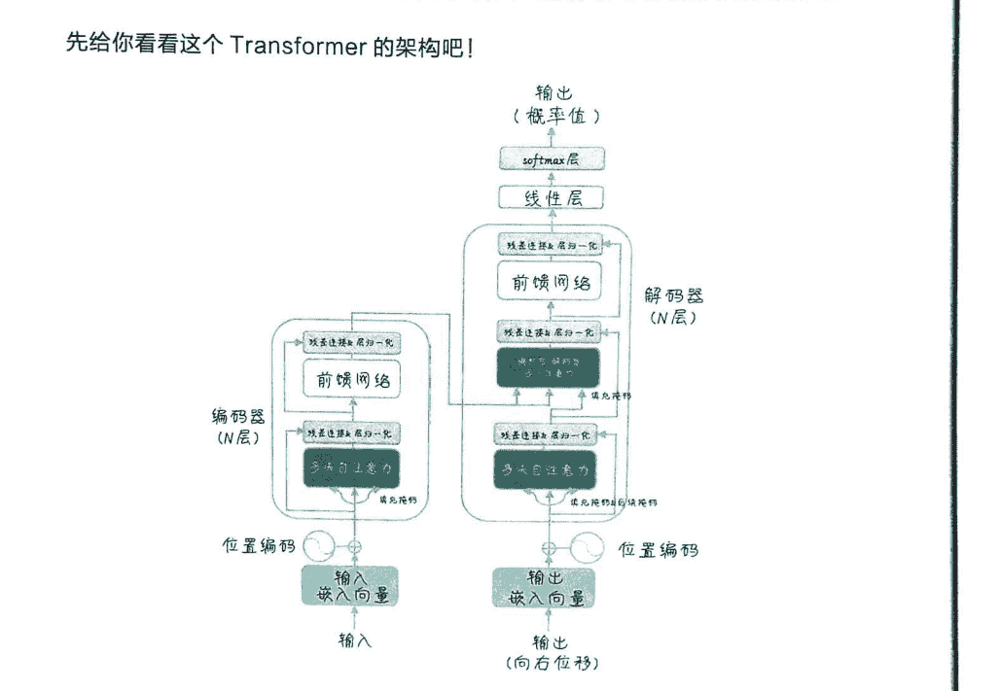

| 位置编码 | 位置编码 |

| --- | --- |

| 输入 | 输出 |

| 嵌入向量 | 嵌入向量 |

| (向右位移) | 


```python
# Transformer架构示意图说明
#### 位置编码 -> [输入嵌入向量] -> (向右位移) -> [输出嵌入向量]
# 编码器 (N层) | 解码器 (N层)
```

**小冰：** 这图看着有点懵。

**咖哥：** 别急，有了之前的铺垫，一点点拆就能看懂。

##### 6.1.1 编解码结构
原始 Transformer 由编码器和解码器组成。编码器把输入序列编码成一种中间表示，解码器据此生成输出序列。

**咖哥：** 这个思路你应该很熟。

**小冰：** 对，Seq2Seq 的经典做法。Transformer 框架仍是 Seq2Seq，但内部实现已经大变。

**咖哥：** 没错。论文抛出的第一个重磅观点就是：处理 Seq2Seq 不再需要任何循环神经网络。那时的 LSTM 如日中天，这个提法堪称炸弹。

**小冰：** 那 Transformer 用什么替代 RNN？

**咖哥：** Attention is All You Need！

##### 6.1.2 注意力在模型内部的用武之地
编码器和解码器内部大量使用自注意力、多头自注意力和编码器-解码器注意力。

**Transformer 中的自注意力**
自注意力让模型为输入每个元素分配不同权重，从而捕捉序列内部依赖。每层编码器和解码器都包含一个自注意力子层。


###### 小冰：我还记得自注意力的流程。
(1) 把输入每个元素映射到 Q、K、V 三个空间。
(2) 用 Q 和 K 做点积，除以缩放因子得到分数。
(3) softmax 归一化得到权重。
(4) 权重与 V 相乘求和得到输出。

**咖哥：** 对，把自注意力引入 Seq2Seq 是 Transformer 的最大亮点。它让编码器和解码器能同时处理序列全部元素，实现跨位置的互动，从而在多层次捕捉依赖。

**小冰：** 我注意到解码器的多头自注意力旁边标着“填充掩码&后续掩码”，编码器只有“填充掩码”，为什么？

**咖哥：** 好问题。解码器的自注意力只能看已经生成的部分，避免提前窥探未来。这对生成式模型是单向解码的硬性要求。

借助自注意力，Transformer 可以丢弃 RNN/LSTM，一个接一个的处理方式，完全利用现代硬件的并行能力，训练和推理速度大幅提升，表达能力也更强。

Transformer 里的自注意力具体是通过多头自注意力实现的。

#### 多头自注意力详解
多头自注意力是自注意力的扩展，让模型能同时从多个子空间观察输入，捕捉更丰富的模式。可以把它想成一个小团队，每人关注不同侧面。

通常复制 8 个或更多头，每个头用不同参数独立计算自注意力，最后把各头输出拼接并通过线性层整合。

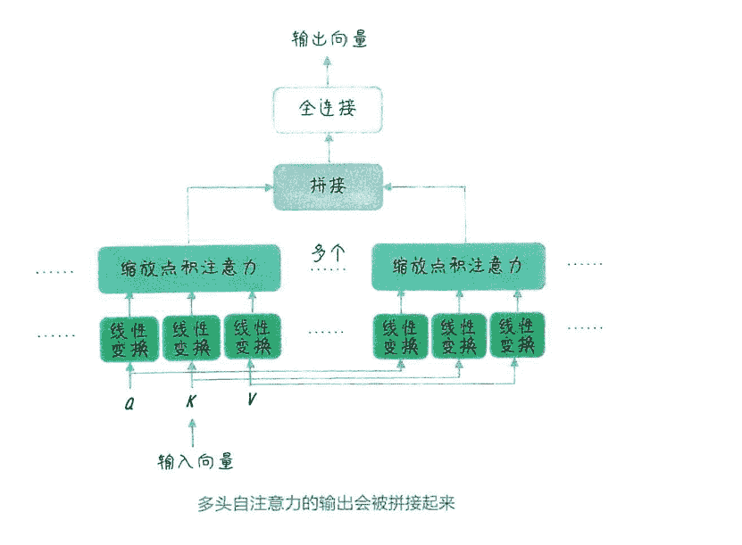

> 多头自注意力的输出会被拼接起来

计算步骤如下：
(1) 对每个头分别投影得到 Q、K、V。
(2) 用 Q、K、V 计算自注意力输出。
(3) 把各头输出沿最后一个维度拼接。
(4) 线性映射到最终输出空间。

多头自注意力既用于编码器、解码器的自注意力子层，也用于解码器的编码器-解码器注意力子层，从而兼顾局部和全局依赖。


> Q K V 缩放点积注意力 -> 线性层 -> 线性层 -> 缩放点积注意力 -> 缩放点积注意力 -> 缩放点积注意力 -> 缩放点积注意力 -> 缩放点积注意力 -> 缩放点积注意力 -> 多头自注意力的立体展示

**小冰：** 很清晰！

##### Transformer 中的编码器 - 解码器注意力
**咖啡哥：** 小冰，上一课用在 Seq2Seq 上的注意力是哪一种？

**小冰：** 编码器-解码器注意力。

**咖啡：** 对。Transformer 里解码器中还有一个额外的编码器-解码器注意力层。它的 Q 来自解码器上一层输出，K、V 来自编码器输出，用于让解码器关注编码器侧的相关信息，从而更好地生成目标序列。

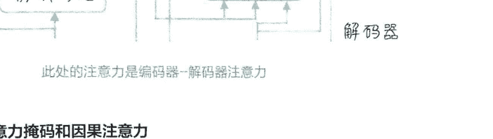

#### 注意力掩码与因果注意力
注意力掩码的作用就是告诉模型哪些信息该看、哪些不该看。

Transformer 主要用两种掩码：

+ **填充注意力掩码 Padding Attention Mask：** 处理变长序列时需要填充，填充位没有实际意义。掩码把填充位置的分数设为极小值，经过 softmax 后权重接近零，避免干扰。编码器里只需要这种掩码。
+ **后续注意力掩码 Subsequent Attention Mask，又称前瞻掩码 Look-ahead Attention Mask：** 在自回归生成任务里，生成当前位置的输出时不能用到未来信息。掩码把当前位置之后的所有位置分数设为极小值，保证模型只能看见历史。解码器同时使用填充掩码和后续掩码。


掩码作用于注意力分数计算之后，做逐元素遮挡。结合填充掩码和后续掩码，模型就被限制在真实输入和历史信息范围内，这对变长序列和自回归任务至关重要。带后续掩码的注意力也被称为因果注意力，其目标就是让生成时只能依赖当前位置及之前的内容。

以上就是 Transformer 注意力机制的细节，也是对上节内容的系统回顾。

注意力为何能大幅提升语言模型性能？主要有三点：
（1）能在不同层次和位置捕捉依赖关系。
（2）具备强大表达能力，有效处理各类序列到序列任务。
（3）计算高度并行，训练速度显著提升。

Transformer 的长文本突破，为什么传统模型一次次卡壳

Transformer 具备的特性，让它直接突破了 TextCNN、RNN、LSTM 等传统 NLP 模型在处理长文本序列时遇到的瓶颈，这次逆袭在 NLP 圈里堪称一次迟到的反超，和 CV 领域早年的高光时刻形成了鲜明对比。

在讲完注意力机制在 Transformer 里是如何发挥作用之后，我们现在把编码器和解码器的内部构造逐层拆开来看。

##### 6.1.3 编码器的词嵌入与位置信息注入

首先要做的，是把待处理的文本序列转成词嵌入向量，把词语映射到向量空间。然后再给这些向量加上位置编码，让模型知道每个词在序列中的顺序，就像图中展示的那样。

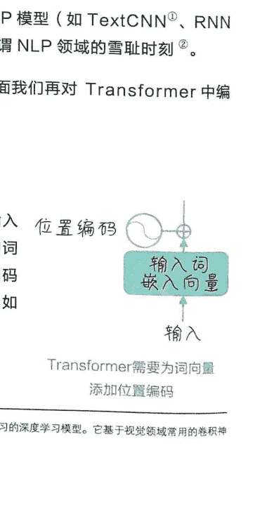
> ① TextCNN 也称文本卷积神经网络，源自计算机视觉里的卷积思想，用来做文本分类和文本表示。  
> ② 这和 CV 领域早早就出现的一系列里程碑式进展相比，明显晚了不少。

小冰：词嵌入我能理解，第二节课你就讲过 One-Hot 到低维向量的过程。位置编码我倒是第一次接触。

咖哥：对，这正是 Transformer 里独有的设计。因为模型完全去掉了循环结构，序列本身带来的顺序信息就学不到了。于是必须额外给每个词补上位置信息，让向量里同时包含语义和位置。

图里像太极图一样的符号就是正弦。原始论文采用的是正弦位置编码，用不同频率的正弦和余弦函数给每个位置生成编码。编码后得到的是一组固定的位置向量，和词向量相加或拼接后送入模型。这种方式平滑且能保留相对位置，因此被采纳。除了固定式的正弦编码，还有可学习的位置编码，把位置当作可训练参数来学习。

小冰：大概明白了，后面能看到代码实现就更好了。

##### 6.1.4 编码器的层级结构拆解

来看编码器到底是怎么搭的。编码器由多层结构完全相同的模块堆叠，每层都包含多头自注意力和前馈网络两个核心部件，我们一步步拆。

先说输入。文本经过词嵌入后得到一组词向量，再叠加位置编码，让模型区分不同位置的词。

融合后的表示进入编码器第一层。这一层先做多头自注意力。多个注意力头可以从不同视角审视同一序列，提取更全面的信息。每个头都会生成自己的注意力权重，用来对序列不同部分做加权汇总。

> “残差连接&层归一化”—— 多头自注意力之后会接残差连接和层归一化

自注意力层的输出会先和原始输入做相加，也就是残差连接，随后经过层归一化处理，如图所示。层归一化能稳定训练过程，加快收敛。英文论文里把这组操作简称为 Add & Norm。

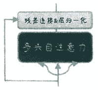
####### 咖哥补充说明

残差连接在深层网络里很常见，作用是让信息更快流通，提升训练效率和效果。传统层是对输入做非线性激活和线性变换再传下去，用了残差后，输入可以旁路直接加到输出上，减少信息丢失，也能缓解梯度消失或爆炸。

层归一化是常用的正则化手段，用来对抗内部协变量偏移，即层间输入分布的漂移。对每层输入做归一化，能加快训练、提升泛化，并允许更大的学习率。在 Transformer 里，层归一化一般放在残差连接之后，对输出进行规范化。

接着进入前馈网络 FFNN。它是一个非常简单的两层线性网络，中间夹一个 ReLU 之类的激活函数，用来对上一轮结果做非线性变换。

最后，前馈网络的输出再和多头自注意力的结果做一次相加，并过一遍层归一化，就完成了一层编码器的处理。编码器的每一层都会重复同样的流程①，最后一层的输出会传给解码器。正是这样层层提炼，编码器能够深度抽取出输入序列的语义，为后续生成提供支撑。

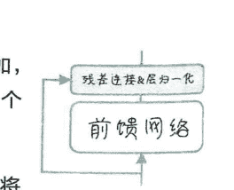

##### 6.1.5 编码器输出如何交接到解码器

小冰：刚才的内容我都消化了。那编码器提炼好特征后，是怎么交给解码器的？

咖哥：编码器的最终向量会送进解码器里的编码器-解码器注意力单元。

这么设计的好处是，解码器在生成目标序列时可以直接利用源序列的语义上下文，提升准确率。结合自注意力和跨注意力，解码器既能把握目标序列内部关联，也能捕捉源序列与目标序列之间的依赖，从而增强表达能力。

不过先别急，目前还不是使用编码器输出的时机。下面我先讲解码器自己的输入，以及编码器的输出会在解码器的哪个位置被接入。

##### 6.1.6 解码器的输入构造与位置编码

解码器的任务是基于编码器给出的上下文向量来生成目标序列。但它并不是直接只接收编码器的结果，而是先要接收自己的输入序列。这个输入通常是目标序列的一部分，英文里常被称为 Output，如图所示。

具体分两种情况：

+ 在训练时，我们会用目标序列的真实值作为解码器的输入，这就是教师强制。第 4 课做 Seq2Seq 时就用过这个技巧。当时我把这个序列叫 decoder_input，有些教程直接叫 Output，而解码器的预测值也叫 Output 也叫 Prediction。这命名方式确实容易混。

在推理时，解码器的输入就是模型自己已经生成出来的目标序列，所以叫 Output 也合理，它既是此刻的输入，也是上一步的输出。训练和推理的差别一定要搞清楚，代码实战时会更直观。

咖哥：我把这个所谓的“输出”也就是解码器的输入讲了这么多，不知道你理解了没？

小冰：明白了，主要是为了说明为什么解码器输入也被叫做 Output。之前在 Seq2Seq 里见过类似做法。不过我还有一个疑问，输出序列后面标注的“向右位移”是什么意思？

咖哥：在以 RNN 为主的 Seq2Seq 里，解码器生成序列时会做向右位移。因为解码器要依据源序列和已生成的部分来预测下一个 token。实现上通常在序列最前面塞一个起始符 <sos> 或 <start>，作为第一步的输入。有教师强制时，后续输入会自然比目标序列右移一位；没有教师强制时，每一步生成的 token 也会右移一位，和真实目标相比就是前面多了一个起始符。

比如机器翻译，解码器在生成目标语言时，会把上一步生成的词右移一位，并在开头补起始符，作为当前输入。

其实第 4 课做中英翻译数据集时就用过这个套路。'咖哥喜欢小冰' 对应 ' <sos> KaGe likes XiaoBing' 作为 decoder_input，也就是所谓的 Output，而 'KaGe likes XiaoBing <eos>' 才是 Target。

文本生成也能用同样思路。假设输入片段是 “今天天气真好，我们去”，准备数据时：

源序列（输入）: "<sos> 今天天气真好，我们去"
目标序列（输出）: "今天天气真好，我们去 <eos>"

开头加 <sos> 表示开始，结尾加 <eos> 表示结束。

所谓右移一位，就是“今”原本在输入里排第一，加了 <sos> 后变成第二位。

Transformer 虽然是并行处理，但仍然保留右移操作。因为它能让模型在预测当前位置时只依赖左侧信息，避免窥探未来。配合因果掩码，“今”这个位置只能看到 <sos>；“天”这个位置只能看到 <sos> 和“今”，以此类推。这样解码器就能学会根据上下文预测下一个词。

咖哥：希望这样解释你能彻底搞懂解码器输入的构造。

小冰：懂了。Transformer 虽然并行，但靠右移和掩码保证了只能用前面信息，和 RNN 的自左向右生成逻辑一致，同时摆脱了顺序计算的限制，效率更高。

接下来是解码器输入的处理流程，和编码器类似。输入先过词嵌入得到词向量，再加上位置编码，之后进入解码器第一层第一个单元，计算自注意力。

小冰：这时候编码器的上下文向量还没用上吧？

咖哥：对，现在还没。编码器的输出要到解码器每层的第二个单元才会被用到。我们先看解码器的整体结构。

##### 6.1.7 解码器的内部构造

解码器同样由多层相同结构堆叠而成，每层包含三个单元：多头自注意力、编码器-解码器注意力、前馈网络。

首先是多头自注意力。和编码器类似，但这里有个关键限制：只能关注已经生成的部分，不能看到未来的词。

小冰：清楚了。那编码器的序列信息什么时候进来？

咖哥：在多头自注意力之后，第二个单元会做编码器-解码器注意力。此时解码器既要参考自身生成的上下文，也要参考编码器提炼的源序列信息。编码器的输出作为 Key 和 Value，解码器自注意力输出作为 Query。

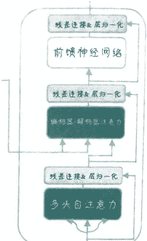
随后和编码器一样，先做残差连接和层归一化，再过前馈网络，最后再做一次残差连接和层归一化。这个流程在所有解码器层中重复，最后的输出用于预测目标序列。

也就是说，解码器先接收右移后的目标序列做自注意力，再融合编码器的上下文，最后生成预测值。

##### 6.1.8 解码器输出与 Transformer 输出头

解码器把所有层跑完后，会得到一个代表目标序列的隐藏向量。这就是 Transformer 学到的完整特征表示。拿到这个向量后，就可以在输出头上对接具体的下游任务。

为了把向量变成可用的输出，需要经过线性层和 softmax 层，如图所示。

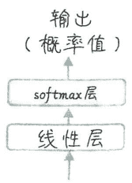
线性层先把解码器输出映射到词汇表大小的空间，对每个位置生成一个分数，表示生成每个词的可能性。然后用 softmax 把分数归一化成概率分布，和为 1，方便比较和选择。

到这里，Transformer 已经输出了目标序列的概率分布。下游任务会据此决策。比如机器翻译一般选概率最高的词；文本摘要或问答则可能根据分布采样或生成。

####### 咖哥补充说明

不同任务可以通过调整输出头和损失函数来适配 Transformer。下面举几个例子。

- 机器翻译：输出头是词汇表大小的概率分布，解码可用贪婪解码或集束搜索，损失通常用交叉熵。
- 文本摘要：和翻译类似，输出也是词汇表分布，解码策略可变，损失一般是交叉熵。
- 文本分类：把输出头换成全连接层，输出类别概率，损失可用交叉熵。
- 问答任务：通常需要预测答案起止位置，输出头换成两个全连接层分别预测开始和结束位置概率，损失是两份交叉熵。
- 命名实体识别：需要为每个词赋标签，输出头换成全连接层输出每位置标签分布，损失用逐位置交叉熵。

这些调整说明同一个 Transformer 主干，通过不同的输出头和损失就能覆盖多种 NLP 任务。

小冰：明白了，输出头和任务强相关，根据需求灵活调整就能让 Transformer 解决不同问题。

咖哥：下面开始实战，一边搭 Transformer 一边解决一个 NLP 任务。

### 6.2 Transformer 代码实现

回到总体架构图，我们从中心向外、从左到右逐个实现组件。先实现核心模块，再把编码器和解码器拼起来，最后组合成完整的 Transformer 类。

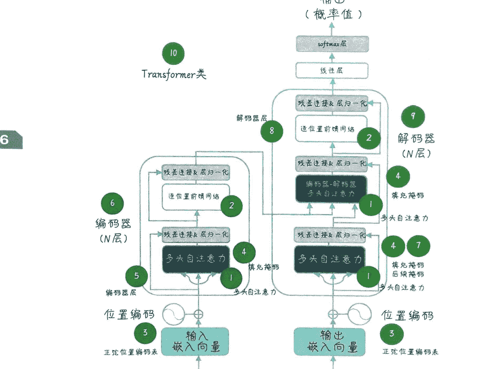
关键组件如下。

1. 多头自注意力：先用 ScaledDotProductAttention 实现缩放点积注意力，再用 MultiHeadAttention 封装多头机制。
2. 逐位置前馈网络：用 PoswiseFeedForwardNet 实现。
3. 正弦位置编码表：用 get_sin_code_table 函数生成。
4. 填充掩码：用 get_attn_pad_mask 函数为 <pad> 令牌生成掩码，避免注意力关注无效位置。
5. 编码器层：用 EncoderLayer 类定义单层。
6. 编码器：用 Encoder 类实现完整的编码器部分。
7. 后续掩码：用 get_attn_subsequent_mask 函数为解码器生成掩码，防止“偷看”未来目标信息。

**Transformer 骨架搭建速览**

8. **解码器层**：借助 DecoderLayer 类描述解码器内部单层结构。
9. **解码器**：借助 Decoder 类完成解码侧整体组装。
10. **Transformer 类**：负责把编码器与解码器合并为完整模型。

下面进入关键模块的实现。

#### 组件 1 多头注意力配合残差与 LayerNorm

先从核心的多头注意力开始，示意图如下：

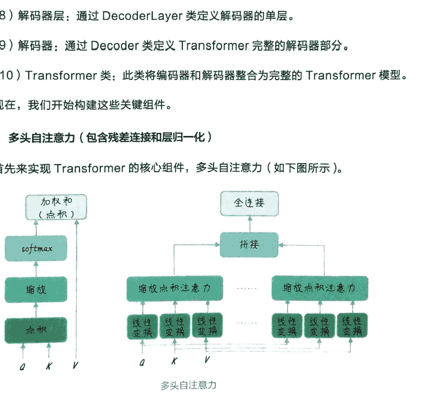

该环节由两部分构成：ScaledDotProductAttention 用于缩放点积注意力，MultiHeadAttention 用于多头注意力。ScaledDotProductAttention 是 MultiHeadAttention 的基础单元，多头里的各子头都调用它来计算。

```python
import numpy as np # 导入numpy库
import torch # 导入torch库
import torch.nn as nn # 导入torch.nn库

d_k = 64 # K(=Q)维度
d_v = 64 # V维度
##### 定义缩放点积注意力类
class ScaledDotProductAttention(nn.Module):
    def __init__(self):
        super(ScaledDotProductAttention, self).__init__()

    def forward(self, Q, K, V, attn_mask):
        # -----------------维度信息------------------
        # Q K V [batch_size, n_heads, len_q/k/v, dim_q=k/v] (dim_q=dim_k)
        # attn_mask [batch_size, n_heads, len_q, len_k]
        # ------------------

        # 计算注意力分数（原始权重）[batch_size, n_heads, len_q, len_k]
        scores = torch.matmul(Q, K.transpose(-1, -2)) / np.sqrt(d_k)
        # -------------------维度信息------------------
        # scores [batch_size, n_heads, len_q, len_k]
        # ---------------

        # 使用注意力掩码，将attn_mask中值为1的位置的权重替换为极小值
        # -----------------维度信息------------------
        # attn_mask [batch_size, n_heads, len_q, len_k],形状和scores相同
        # -------------------

        scores.masked_fill(attn_mask, -1e9)
        # 用softmax函数对注意力分数进行归一化
        weights = nn.Softmax(dim=-1)(scores)
        # ------------------维度信息------------------
        # weights [batch_size, n_heads, len_q, len_k],形状和scores相同
        # -------------------

        # 计算上下文向量（也就是注意力的输出）,是上下文信息的紧凑表示
        context = torch.matmul(weights, V)
        # --------------------维度信息--------------------
        # context [batch_size, n_heads, len_q, dim_v]
        # -------------------------------------

        return context, weights #返回上下文向量和注意力分数
```

实现先声明 Q、K、V 的形状约束，点积运算要求 K 与 Q 维度相同。

ScaledDotProductAttention 接收输入张量，输出各位置的权重分布。做法是对输入做三组线性投影得到 Q、K、V，并切分为若干子头。随后用缩放点积计算位置间相关性得分，即先前提到的 raw_weights 缩放后得到 scaled_weights。再经 softmax 归一化得到最终权重 weights。计算过程中会依据 attn_mask 调整分数，最后按权重合成注意力输出 attn_output，即上节反复提及的结果。

流程示意如下：

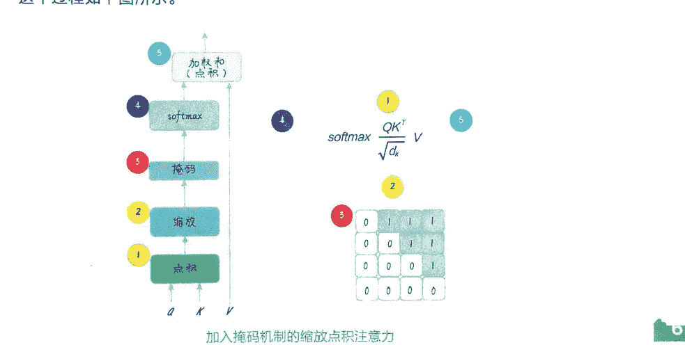

上段实现读者已较熟悉，新增点在于掩码处理。ScaledDotProductAttention.forward 会接收 attn_mask，该张量在编码器/解码器入口处生成，用以标记需忽略的位置。其形状与 scores 一致，可逐位对应。

代码使用 scores.masked_fill_(attn_mask, -1e9) 原地把对应 mask 为 1 的位置置为极小值 -1e9。softmax 后这些位置权重趋近 0，于是合成注意力输出时其贡献可忽略。

实践中，掩码用于屏蔽填充 token，或在自回归生成时禁止模型看到未来。如此模型能聚焦真实有效输入，保证解码不泄露未来信息。

接下来是带残差与 LayerNorm 的多头注意力实现：

> 第 6 课层峦叠翠上青天：搭建 GPT 核心组件 Transformer 151

##### `MultiHeadAttention` 类

```python
##### 定义多头自注意力类
d_embedding = 512 # Embedding 的维度
n_heads = 8 # Multi-Head Attention 中头的个数
batch_size = 3 # 每一批的数据大小

class MultiHeadAttention(nn.Module):
    def __init__(self):
        super(MultiHeadAttention, self).__init__()
        self.W_Q = nn.Linear(d_embedding, d_k * n_heads) # Q 的线性变换层
        self.W_K = nn.Linear(d_embedding, d_k * n_heads) # K 的线性变换层
        self.W_V = nn.Linear(d_embedding, d_v * n_heads) # V 的线性变换层
        self.linear = nn.Linear(n_heads * d_v, d_embedding)
        self.layer_norm = nn.LayerNorm(d_embedding)

    def forward(self, Q, K, V, attn_mask):
        # -----------------维度信息----------------
        # Q K V [batch_size, len_q/k/v, embedding_dim]
        # -----------------维度信息----------------

        residual, batch_size = Q, Q.size(0) # 保留残差连接
        # 将输入进行线性变换和重塑，以便后续处理
        q_s = self.W_Q(Q).view(batch_size, -1, n_heads, d_k).transpose(1,2)
        k_s = self.W_K(K).view(batch_size, -1, n_heads, d_k).transpose(1,2)
        v_s = self.W_V(V).view(batch_size, -1, n_heads, d_v).transpose(1,2)
        # -----------------维度信息----------------
        # q_s k_s v_s: [batch_size, n_heads, len_q/k/v, d_q=k/v]
        # -----------------维度信息----------------

        # 将注意力掩码复制到多头 attn_mask: [batch_size, n_heads, len_q, len_k]
        attn_mask = attn_mask.unsqueeze(1).repeat(1, n_heads, 1, 1)
        # -----------------维度信息----------------
        # attn_mask [batch_size, n_heads, len_q, len_k]
        # -----------------维度信息----------------

        # 使用缩放点积注意力计算上下文和注意力权重
        context, weights = ScaledDotProductAttention()(q_s, k_s, v_s, attn_mask)
        # -----------------维度信息----------------
        # context [batch_size, n_heads, len_q, dim_v]
        # weights [batch_size, n_heads, len_q, len_k]
        # -----------------维度信息----------------

        # 通过调整维度将多个头的上下文向量连接在一起
        context = context.transpose(1, 2).contiguous().view(batch_size, -1, n_heads * d_v)
        # -----------------维度信息----------------
        # context [batch_size, len_q, n_heads * dim_v]
        # -----------------维度信息----------------

        # 用一个线性层把连接后的多头自注意力结果转换，原始地嵌入维度
        output = self.linear(context)
        # -----------------维度信息----------------
        # output [batch_size, len_q, embedding_dim]
        # -----------------维度信息----------------

        # 与输入 (Q) 进行残差连接，并进行层归一化后输出
        output = self.layer_norm(output + residual)

        # output [batch_size, len_q, embedding_dim]
        return output, weights # 返回层归一化的输出和注意力权重
```


开头用全局变量设定嵌入维 d_embedding、头数 n_heads，并声明 batch_size。

MultiHeadAttention 把输入的 Q、K、V 投射到多个子空间，各子头独立执行缩放点积注意力，再将各头结果拼接，经过线性映射得到最终输出。训练稳定性靠 LayerNorm 提供。

编码器与解码器中的自注意力子层会实例化该类。

小冰：注释写“对输入做线性变换并重塑”，是不是就是为了得到多头结构？

咖哥：正是。下面展开。

- 线性投影：Query、Key、Value 各自经过三个独立的 nn.Linear。作用是把 d_model 维词向量映射到不同子空间，让模型从多视角捕捉关系。三个线性层的输出维分别为 d_k * n_heads、d_k * n_heads、d_v * n_heads，n_heads 为头数，d_k 为每个头的 Key/Query 维，d_v 为每个头的 Value 维。
- 重塑与转置：投影后需把张量拆分以区分各头。先用 view 把 (d_k/d_v * n_heads) 维变为 [n_heads, d_k] 或 [n_heads, d_v]，再用 transpose 交换 seq_len 与 n_heads 轴，最终形状为 [batch_size, n_heads, seq_len, d_k] 的 Q/K，以及 [batch_size, n_heads, seq_len, d_v] 的 V。这样可并行处理各头。

经过以上步骤，可在不同子空间并行计算注意力，有助于捕捉多维度关系，提升表现，示意图见后页。

下面对应图中公式的代码位置。

(1) $QW_i^Q K W_i^K V W_i^V$ 对应：

```python
##### (代码中省略了具体的 W_Q, W_K, W_V 乘法及 reshape/transpose 过程，见上方 forward 函数定义部分)
```

Q、K、V 分别乘以权重矩阵 W_Q、W_K、W_V，再经 view 与 transpose 调整形状以便后续计算。

(2) Attention() 对应：

```python
context, weights = ScaledDotProductAttention()(q_s, k_s, v_s, attn_mask)
```

缩放点积是注意力核心。

(3) Concat(head_i, ... head_n) 对应：

```python
context = context.transpose(1, 2).contiguous().view(batch_size, -1, n_heads * d_v)
```

context 的维度调整实现了各头输出的拼接。

(4) $W^0$ 对应：

```python
output = self.linear(context)
```

self.linear 为线性层，其权重即公式中的 W^0。

多头注意力还需把掩码广播到各头。为此先用 unsqueeze(1) 在 batch 与 head 之间插入维度，使 attn_mask 变为 batch_size × 1 × len_q × len_k。随后用 repeat 在 head 轴复制 n_heads 次，得到 batch_size × n_heads × len_q × len_k。如此各子头共享相同掩码，可统一屏蔽填充或因果位置。

小冰：明白了，多头注意力的构造清楚了。下一步组件是什么？

#### 组件 2：逐位置前馈网络（包含残差与 LayerNorm）

## 逐位置前馈网络是怎么回事

> Transformer 编码器和解码器的每一层里，注意力之后都会接上一个 PoswiseFeedForwardNet，负责对特征做进一步提炼和重塑。

小冰：前馈网络我们都熟悉，就是一串全连接层，数据从输入一路往前推到输出。

那这个 Position-wise 到底指什么？

咖哥：它指的是前馈网络对序列中每一个位置单独处理。注意力算完之后的结果不会被拉平成一个整体再送进去，而是每个 token 的向量独立走一遍同样的网络。同一套参数在所有位置复用，彼此之间不交叉，所以序列的顺序被完整保留。你看，自注意力层和前馈层都坚持“各自站好位置，不乱队形”，这正是 Transformer 能并行又保留顺序的核心思路。


接下来看看逐位置前馈网络的代码实现。

```python
##### 定义逐位置前馈网络类
class PoswiseFeedForwardNet(nn.Module): 
    def __init__(self, d_ff=2048):
        super(PoswiseFeedForwardNet, self).__init__()
        # 定义一维卷积层 1，用于将输入映射到更高维度
        self.conv1 = nn.Conv1d(in_channels=d_embedding, out_channels=d_ff, kernel_size=1)
        # 定义一维卷积层 2，用于将输入映射回原始维度
        self.conv2 = nn.Conv1d(in_channels=d_ff, out_channels=d_embedding, kernel_size=1)
        # 定义层归一化
        self.layer_norm = nn.LayerNorm(d_embedding)

    def forward(self, inputs): 
        # - - - - - - - - - - - - - - - 维度信息 - - - - - - - - - - - - - - - -
        # inputs [batch_size, len_q, embedding_dim]
        # - - - - - - - - - - - - - - - 维度信息 - - - - - - - - - - - - - - - -

        residual = inputs # 保留残差连接
        # 在卷积层 1 后使用 ReLU 函数
        output = nn.ReLU()(self.conv1(inputs.transpose(1,2)))
        # - - - - - - - - - - - - - - - 维度信息 - - - - - - - - - - - - - - - -
        # output[batch_size,d_ff,len_q]
        # - - - - - - - - - - - - - - - - - - - - - - - - - - - - - - - - -

        # 使用卷积层 2 进行降维
        output = self.conv2(output).transpose(1,2)
        # - - - - - - - - - - - - - - - 维度信息 - - - - - - - - - - - - - - - -
        # output[batch_size,len_q,embedding_dim]
        # - - - - - - - - - - - - - - - - - - - - - - - - - - - - - - - - -

        # 与输入进行残差连接，并进行层归一化
        output = self.layer_norm(output + residual)
        # - - - - - - - - - - - - - - - 维度信息 - - - - - - - - - - - - - - - -
        # output[batch_size,len_q,embedding_dim]
        # - - - - - - - - - - - - - - - - - - - - - - - - - - - - - - - - -

        return output # 返回加入残差连接后层归一化的结果
```

PoswiseFeedForwardNet 负责处理自注意力的输出，内部用两层一维卷积。第一层把维度扩到更高，第二层再压缩回原始维度，中间夹一层 ReLU。

小冰：这里的 nn.Conv1d 就是 PyTorch 的一维卷积吧？为什么它能等价于逐位置前馈？

咖哥：论文里写的是线性层，实现时常用一维卷积来替代。关键区别在于权重共享。全连接每条连接独立参数，卷积在不同位置复用同一组核，参数量大幅下降。一维卷积本质是把核沿序列滑动做点积。当核宽取 1 时，操作只作用在当前位置的特征上，正好实现逐点变换。

如下图所示，PoswiseFeedForwardNet 先用 conv1 的多个核把序列升维到 2048 左右，这个 2048 可以调。随后 ReLU 激活，再用 conv2 把维度降回原来大小。整个过程在每个位置各自完成，因为是逐点卷积，所以每个位置都套用同一套运算，从而提取位置特有的信息。

## 卷积视角看逐位置映射

##### 1. 提升表达能力
FFN 给模型带来更强的表达空间，能捕捉更复杂的模式。FFN 与自注意力的配合，让 Transformer 既能建模位置间的长距离关联，又能做非线性特征加工。

##### 2. 信息融合
注意力输出到 FFN 之后，每个位置都会得到新的表示。可以理解为原始信息经过非线性转换后的再编码。

##### 3. 层间衔接
编码器和解码器的每一层都会用 FFN。这样每一层的输出都被进一步处理，多层叠加就能层层提炼序列特征。

多头自注意力和逐位置前馈是编码器层的两大支柱。接下来要讲的第三个关键模块是正弦位置编码表。

我们之前提到，Transformer 的并行结构不按顺序逐个读入序列，所以必须显式注入位置信息来帮助模型感知顺序。原始论文采用正弦位置编码，公式如下：

$$PE(pos,2j)=\sin\left(\frac{pos}{10000^{2j/d}}\right)$$

$$PE(pos,2j+1)=\cos\left(\frac{pos}{10000^{2j/d}}\right)$$

该编码兼具周期性和连续性，有助于模型学习相对和全局的位置关系。公式用于计算位置嵌入向量中每个维度的角度。

* **pos**：token 在句子中的位置，范围 0 到 seq_len-1。
* **d**：嵌入向量的维度 embedding_dim。
* **i**：嵌入向量内部的维度索引，范围 0 到 d/2-1。

维度 d 是固定的，pos 和 i 会变化。若 d=1024，则 i 在 0 到 512 之间，因为 2i 和 2i+1 对应偶数和奇数位。

下面是生成正弦位置编码表的函数 get_sin_enc_table：

```python
###### 生成正弦位置编码表的函数，用于在 Transformer 中引入位置信息
def get_sin_enc_table(n_position, embedding_dim):
    # -------------------------- 维度信息 --------------------------
    
    # n_position: 输入序列的最大长度
    # embedding_dim: 词嵌入向量的维度
    #
    # 根据位置和维度信息，初始化正弦位置编码表
    sinusoid_table = np.zeros((n_position, embedding_dim))
    # 遍历所有位置和维度，计算角度值
    for pos_i in range(n_position):
        for hid_j in range(embedding_dim):
            angle = pos_i / np.power(10000, 2 * (hid_j // 2) / embedding_dim)
                sinusoid_table[pos_i, hid_j] = angle
    # 计算正弦和余弦值
    sinusoid_table[:, ::2] = np.sin(sinusoid_table[:, ::2]) # dim 2i 偶数维
    sinusoid_table[:, 1::2] = np.cos(sinusoid_table[:, 1::2]) # dim 2i+1 奇数维
    #
    # sinusoid_table 的维度是 [n_position, embedding_dim]
    #
    return torch.FloatTensor(sinusoid_table) # 返回正弦位置编码表
```

该函数接受最大序列长度 n_position 和嵌入维度 embedding_dim，返回对应的正弦位置编码表，用来为 Transformer 注入位置信息。

实现细节可拆解为：

1. **pos_i**：序列位置索引，0 到最大长度-1。
2. **hid_j**：嵌入维度索引，0 到 embedding_dim-1。
3. **`np.power(10000, 2 * (hid_j // 2) / embedding_dim)`**：缩放因子，10000 为基数，2*(hid_j // 2) 让偶奇维度缩放一致，不同维度产生指数级变化。
4. **`angle = pos_i / np.power(...)`**：位置索引除以缩放因子得到各维度的角度值。随着位置增长，不同维度的角度变化速率各不相同，形成唯一的位置签名。

随后把这些角度值送入正弦和余弦函数得到位置嵌入向量，再加到模型输入中。

小冰：咖哥，我有个疑问。每个维度给不同位置一个不一样的值不就行了吗？为什么要费劲用正弦，1、2、3、4 不能直接用？

咖哥：用自然数序列也能区分位置，但它是线性的，相邻位置的间隔在整个序列中恒定。很多任务里位置关系更复杂，需要能反映多尺度模式的编码。

正弦余弦生成的位置嵌入具有周期性和正交性，能在不同尺度上提供区分度，让模型更容易学到位置间的相对关系，尤其在长距离依赖上表现更好。自然数编码也能做区分，但在捕捉复杂位置模式上不如正弦余弦灵活。

> **咖哥发言**
>
> Transformer 里用正弦余弦做位置编码是一种固定编码方式，在很多 NLP 任务上效果稳定。当然也有可学习的动态位置嵌入，在训练中一起优化。选哪种取决于具体任务和数据。

在编码器和解码器的后续组件中，会调用这个函数生成位置嵌入，为每个位置加上位置信息，如下图所示。


下面介绍用于生成填充注意力掩码的函数。

#### 组件4：填充掩码

NLP 中序列长度不一，训练时需要把它们 pad 到同一长度，通常用 `<pad>` 标记，编码后值多为 0。填充符号没有语义，计算注意力时必须屏蔽掉。

编码器输入侧会使用填充掩码机制，让模型忽略这些无意义的位置，如下页图所示。

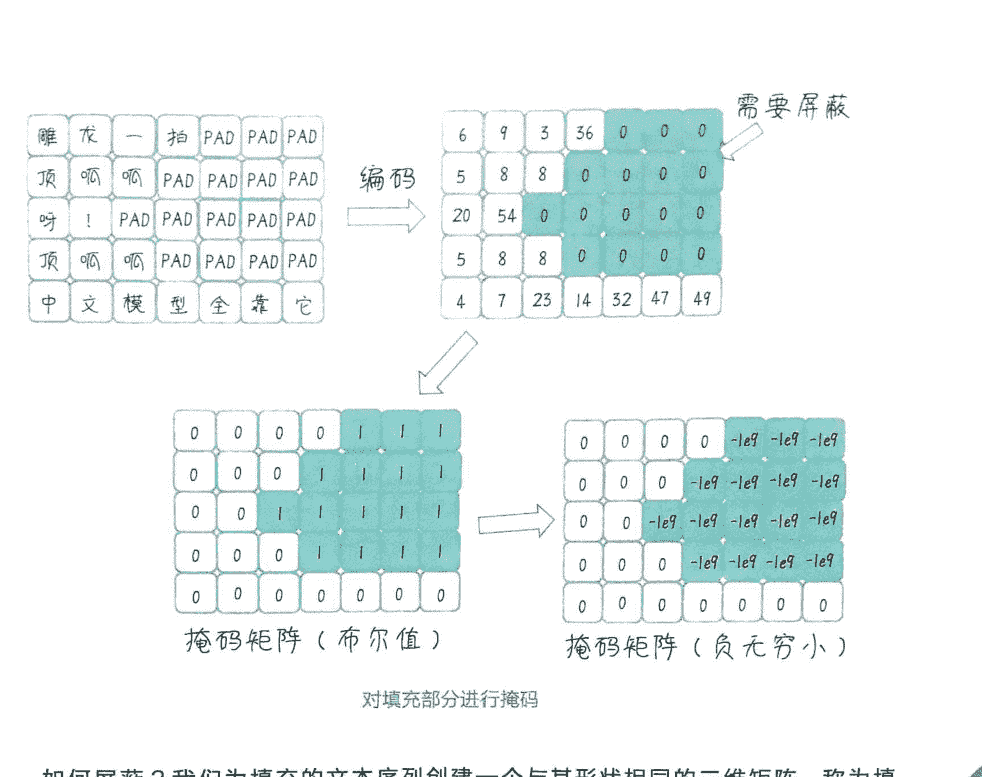

##### 对填充部分进行掩码

具体做法是：

1. **创建掩码矩阵**：和输入形状一致的二维矩阵。真实词的位置填 0，填充 `<pad>` 的位置填 1。
2. **作用到注意力分数**：把掩码矩阵加到注意力分数上。把 1 换成一个很大的负数如 -1e9，再与分数逐元素相加。真实 token 加 0 不变，填充位则被压到极低。
3. **Softmax 归一化**：经过 softmax 后，填充位的权重趋近于 0，模型只关注有效内容。

下面定义填充注意力掩码函数：

# 掩码与堆叠：Transformer 编码器是怎么搭起来的

```python
###### 定义填充注意力掩码函数
def get_attn_pad_mask(seq_q, seq_k):
    # --------------------- 维度信息 ------------------
    # seq_q的维度是[batch_size,len_q]
    # seq_k的维度是[batch_size, len_k]
    # --------------------- 维度信息 ------------------
    
    batch_size, len_q = seq_q.size()
    batch_size, len_k = seq_k.size()
    
    # 生成布尔类型张量
    pad_attn_mask = seq_k.data.eq(0).unsqueeze(1) # <PAD> token的编码值为0
    
    # --------------------- 维度信息------------------
    # pad_attn_mask的维度是[batch_size,1,len_k]
    # --------------------- 维度信息------------------
    
    #变形为与注意力分数相同形状的张量
    pad_attn_mask = pad_attn_mask.expand(batch_size, len_q, len_k)
    # --------------------- 维度信息--------------------
    # pad_attn_mask的维度是[batch_size,len_q,len_k]
    # ---------------------- 维度信息--------------------
    
    return pad_attn_mask #返回填充位置的注意力掩码
```
`get_attn_pad_mask(seq_q, seq_k)` 这段代码在干什么，先把角色理清：`seq_q` 是 Query 序列，`seq_k` 是 Key 序列。两个张量的形状里都包含 `batch_size`，分别对应 Query 的长度 `len_q` 和 Key 的长度 `len_k`。

做法是先用 `seq_k.data.eq(0)` 得到一个布尔矩阵，标记出 Key 里哪些位置是填充 `<pad>`。这里默认填充标记的词表索引是 0，所以只要是 0 就被判定为填充位。接着 `unsqueeze(1)` 给矩阵加一维，形状变成 `batch_size×1×len_k`。随后 `expand(batch_size, len_q, len_k)` 把它广播到 `batch_size × len_q × len_k`。注意 expand 只是复用已有数据，并不会产生新信息。

在多头自注意力算注意力权重时，这个填充掩码会被加到原始的分数上。被掩掉的位置分数被压到接近负无穷，softmax 归一化后基本趋近 0，模型也就自动忽略掉这些填充部分了。

#### 组件5：编码器层拆解

有了多头自注意力和逐位置前馈这两个核心算子，再加上正弦位置编码表和填充掩码这两个辅助工具，编码器层就可以搭建起来了。

```python
##### 定义编码器层类
class EncoderLayer(nn.Module):
    def __init__(self):
        super(EncoderLayer, self).__init__()
        self.enc_self_attn = MultiHeadAttention() #多头自注意力层
        self.pos_ffn = PoswiseFeedForwardNet() #逐位置前馈网络层

    def forward(self, enc_inputs, enc_self_attn_mask):
        #--------------------------维度信息------------------
        # enc_inputs的维度是 [batch_size, seq_len, embedding_dim]
        # enc_self_attn_mask的维度是 [batch_size, seq_len, seq_len]
        #-----------------------------------------------
        
        #将相同的Q,K,V输入多头自注意力层，返回的att_weights增加了头数
        enc_outputs, att_weights = self.enc_self_attn(enc_inputs, enc_inputs,
                enc_inputs, enc_self_attn_mask)
        #--------------------维度信息--------------------
        # enc_outputs的维度是 [batch_size, seq_len, embedding_dim]
        # att_weights的维度是[batch_size, n_heads, seq_len, seq_len]
        #----------------------------------------
        
        #将多头自注意力outputs输入逐位置前馈网络层
        enc_outputs = self.pos_ffn(enc_outputs) #维度与enc_inputs相同
        
        #-------------维度信息---------------
        # enc_outputs的维度是[batch_size, seq_len, embedding_dim]
        #---------------------
        return enc_outputs, att_weights #返回编码器输出和每层编码器的注意力权重
```
##### EncoderLayer 结构解析

`EncoderLayer` 的 `__init__` 里只做两件事的实例化。

1. **多头自注意力层**：创建 `MultiHeadAttention` 实例 `enc_self_attn`，负责序列内部的自注意力。
2. **逐位置前馈层**：创建 `PoswiseFeedForwardNet` 实例 `pos_ffn`，对自注意力后的表示做进一步的特征提炼。

`forward` 接收两个输入：

- `enc_inputs`，待编码的序列；
- `enc_self_attn_mask`，自注意力时使用的掩码，通常就是填充掩码。

内部执行顺序：

1. 把 `enc_inputs` 同时作为 Q、K、V 送入 `enc_self_attn`，并带上 `enc_self_attn_mask`，得到 `enc_outputs` 和注意力权重 `att_weights`。
2. 将 `enc_outputs` 再喂给 `pos_ffn`，更新后的结果继续命名为 `enc_outputs`。
3. 最后返回 `enc_outputs` 与 `attn_weights`。前者是本层的编码结果，后者可以用来做分析和可视化。

##### 维度拆解

在 `MultiHeadAttention` 输出里：

- **enc_outputs** 形状是 `[batch_size, seq_len, embedding_dim]`。内部先把输入映射成 Q、K、V，维度变为 `[batch_size, n_heads, seq_len, d_k]`。自注意力计算后形状不变，最后把头合并，把最后两维拼接起来，`n_heads × d_k` 正好等于 `embedding_dim`，于是得到 `[batch_size, seq_len, embedding_dim]`。
- **attn_weights** 形状保持 `[batch_size, n_heads, seq_len, seq_len]`。先算 Q、K 点积得到分数，经 softmax 归一化后，每个批次、每个头、每个位置都有一个长度 `seq_len` 的权重向量，描述该位置与序列其它位置的关系强度。注意这里不会像输出那样合并头，所以维度保留为 `[batch_size, n_heads, seq_len, seq_len]`。

如图所示，这一层完整复现了 Transformer 编码器单层的工作方式：自注意力加前馈。实际模型里会把多层这样堆叠，形成深度网络，捕捉更丰富的序列特征。

#### 组件6：编码器堆叠

编码器就是把多个编码器层叠起来，所以才有了“层峦叠翠上青天”这个说法。

##### 编码器类实现

`n_layers = 6` 定义编码器层数

```python
class Encoder(nn.Module):
```

`__init__` 里完成三项初始化：

1. 词嵌入 `src_emb = nn.Embedding(len(corpus.src_vocab), d_embedding)`，把源词映射成向量。
2. 位置嵌入 `pos_emb = nn.Embedding.from_pretrained(get_sin_enc_table(corpus.src_len+1, d_embedding), freeze=True)`，使用预先算好的正弦位置编码表，并冻结参数不更新。
3. 层列表 `self.layers = nn.ModuleList(EncoderLayer() for _ in range(n_layers))`，把 `n_layers` 个 `EncoderLayer` 按序存放。

`forward` 只接收 `enc_inputs`，形状 `[batch_size, source_len]`。

流程如下：

1. 生成位置索引 `pos_indices = torch.arange(1, enc_inputs.size(1) + 1).unsqueeze(0).to(enc_inputs.device)`，形状 `[1, source_len]`。
2. 词嵌入加位置嵌入：`enc_outputs = self.src_emb(enc_inputs) + self.pos_emb(pos_indices)`，得到 `[batch_size, source_len, embedding_dim]`。
3. 生成自注意力掩码：`enc_self_attn_mask = get_attn_pad_mask(enc_inputs, enc_inputs)`，形状 `[batch_size, len_q, len_k]`。
4. 初始化空列表 `enc_self_attn_weights` 用来收集各层的注意力权重。
5. 遍历 `self.layers`，每层输出更新 `enc_outputs` 并把本层的权重追加到列表里。
6. 最终返回 `enc_outputs` 与 `enc_self_attn_weights`。`enc_outputs` 形状仍是 `[batch_size, seq_len, embedding_dim]`，`enc_self_attn_weights` 是个列表，每个元素形状 `[batch_size, n_heads, seq_len, seq_len]`，可用于后续分析。

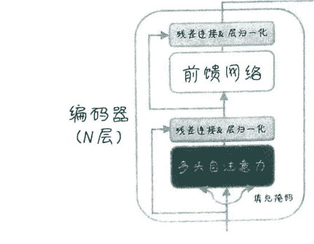
编码器类的构造逻辑很清晰：词嵌入负责语义映射，位置嵌入提供顺序信息，层叠的编码器层完成深度建模，填充掩码确保模型不被无用位置干扰。这一整套组合构成了 Transformer 编码侧的基础骨架。

编码器这一模块完整复刻了 Transformer 中负责提取特征的部分，涵盖词向量、位置向量以及若干个堆叠的编码器层。借助它，任意输入序列都能被编码成深层的语义表示，而这份表示可以直接接向下游任务，无论是机器翻译一类的序列生成，还是情感判别一类的分类工作，都能直接使用。

> **咖哥发言**

BERT 本质上只用了 Transformer 的编码端，所以它特别擅长为各类 NLP 任务提供通用的表征。

在标准架构里，编码器的结果会以上下文向量的形式送给另一个核心部件——解码器。解码器同样由多层堆叠构成，每层内部都包含多头自注意力、编码器-解码器跨注意力以及逐位置前馈网络。编码器与解码器配合，构成了 Transformer 强劲的语言处理能力。

至此编码器的说明结束，下面进入解码器部分。在搭建解码器层前，先介绍一个小工具，即用来生成后续遮蔽的函数。

#### 组件 7 后续掩码

你应该还记得为何解码器需要后续注意力掩码而编码器不需要。这与训练时常用的教师强制策略有关。教师强制会把真实的输出喂回模型作为下一时刻的输入。想要让模型在预测当前位置时看不到未来的信息，就必须在解码器端做后续遮蔽。因为在机器翻译、文本摘要这类生成任务里，目标序列需要一步步产出，不能提前窥探后续内容。

看似矛盾却无可避免：自然语言的 Seq2Seq 场景里，解码器既要看到已生成的正确片段来推断下一步，又必须在注意力计算中把当前位置之后的信息封住。以“咖哥 喜欢 小冰”为例，对“咖哥”做注意力时，“喜欢”“小冰”不可见；对“喜欢”做注意力时，只能看到“咖哥”，由此才能推测对象；到“小冰”时，前面的词全部解封。

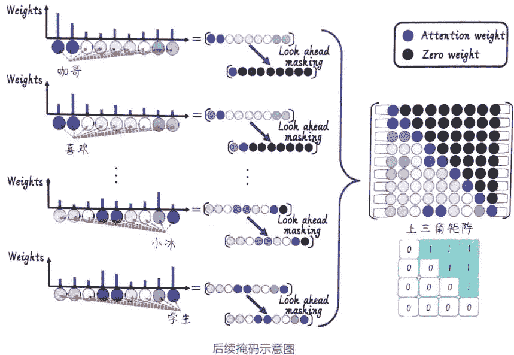

要达成上述效果，就需要构造一个上三角掩码矩阵。对角线及以下置0，对角线以上置1。在多头自注意力计算时把该矩阵加进去，让未来位置的权重趋于负无穷，经过 softmax 后权重接近于0，从而实现对未来的忽略。

下面给出后续注意力掩码的构造函数 `get_attn_subsequent_mask`，它接受解码器输入的形状信息来生成对应掩码。

```python
##### 生成后续注意力掩码的函数，用于在多头自注意力计算中忽略未来信息
def get_attn_subsequent_mask(seq):
    # 维度信息
    # seq 的维度是 [batch_size, seq_len(Q)=seq_len(K)]
    # 
    # 获取输入序列的形状
    attn_shape = [seq.size(0), seq.size(1), seq.size(1)]
    # 维度信息
    # attn_shape 是一个一维张量 [batch_size, seq_len(Q), seq_len(K)]
```

```python
###### 使用 numpy 创建一个上三角矩阵 (triu = triangle upper)
subsequent_mask = np.triu(np.ones(attn_shape), k=1)
####### ----------------- 维度信息 ----
####### subsequent_mask 的维度是 [batch_size, seq_len(Q), seq_len (K)]
####### ---------------------------------------------
# 将 numpy 数组转换为 PyTorch 张量, 并将数据类型设置为 byte (布尔值)
subsequent_mask = torch.from_numpy(subsequent_mask).byte()
####### ----------------- 维度信息 ----
####### 返回的 subsequent_mask 的维度是 [batch_size, seq_len(Q), seq_len (K)]
####### ---------------------------------------------
return subsequent_mask # 返回后续位置的注意力掩码
```

这里的 `attn_shape` 是一个三元列表，对应批次大小、序列长度和序列长度，正好与多头自注意力的权重矩阵形状一致。

随后调用 `np.triu()` 生成同形状的上三角矩阵作为掩码。对角线及下方设为0，上方设为1。具体来说，对任一元素 $(i, j)$，当 $i \le j$ 时填0，当 $i > j$ 时填1。这样下三角含对角线为0，表示当前位置可参考历史及自身，上三角为1，表示不可参考未来。

该矩阵的每一行对应一个时间步，每一列对应可被关注的其它位置。0 表示允许关注，1 表示禁止关注。

最后把上三角矩阵转成 PyTorch 张量并改为 byte 类型，得到 `subsequent_mask`，即后续注意力掩码。

由此得到一个与注意力权重同形的掩码，1 代表需要屏蔽的位置，0 代表可用的位置。该掩码只作用于解码器层的输入，即前面提到的右移后的输出序列。

#### 组件 8 解码器层

准备好后续遮蔽函数后，开始搭建解码器层。


```python
####### 定义解码器层类

class DecoderLayer(nn.Module):
    def __init__(self):
        super(DecoderLayer, self).__init__()
        self.dec_self_attn = MultiHeadAttention() # 多头自注意力层
        self.dec_enc_attn = MultiHeadAttention() # 多头自注意力层，连接编码器和解码器
        self.pos_ffn = PoswiseFeedForwardNet() # 逐位置前馈网络层

    def forward(self, dec_inputs, enc_outputs, dec_self_attn_mask, dec_enc_attn_mask):
        # -------------------维度信息------------------
        # dec_inputs 的维度是 [batch_size, target_len, embedding_dim]
        # enc_outputs 的维度是 [batch_size, source_len, embedding_dim]
        # dec_self_attn_mask 的维度是 [batch_size, target_len, target_len]
        # dec_enc_attn_mask 的维度是 [batch_size, target_len, source_len]
        # 具体内部代码略
        pass
```

在 `DecoderLayer` 的 `__init__` 中：

(1) 实例化解码器自注意力层 `dec_self_attn`，用于处理解码器自身的输入序列。

(2) 实例化编码器-解码器跨注意力层 `dec_enc_attn`，负责把编码器的输出融合进解码器。

(3) 实例化逐位置前馈网络 `pos_ffn`，对自注意力后的特征做进一步提炼。

`forward` 共接收四个输入：`dec_inputs` 为解码器输入，`enc_outputs` 为编码器输出，`dec_self_attn_mask` 为自注意力掩码，`dec_enc_attn_mask` 为跨注意力掩码。内部流程如下：

(1) 用 `dec_inputs` 同时作为 Q、K、V 送入 `dec_self_attn`，并带入 `dec_self_attn_mask`，得到中间结果 `dec_outputs` 与自注意力权重 `dec_self_attn`。

(2) 以 `dec_outputs` 为 Q，`enc_outputs` 为 K、V 送入 `dec_enc_attn`，并带入 `dec_enc_attn_mask`，得到更新后的 `dec_outputs` 与跨注意力权重 `dec_enc_attn`。

(3) 将 `dec_outputs` 输入 `pos_ffn`，得到最终输出。

(4) 返回 `dec_outputs`、`dec_self_attn` 和 `dec_enc_attn`。前者是本层输出，后两者分别是自注意力和编码器-解码器注意力的权重。

该类完整实现了 Transformer 解码器层的功能，包含自注意力、跨注意力和前馈网络。堆叠多层后，模型即可在编码器信息的指引下生成目标序列。

小冰：咖哥，我注意到解码器包含两类注意力，自注意力与编码器-解码器注意力，它们都是多头的吗？是否都使用填充掩码？是否都使用后续掩码？

咖哥：解码器确实有两类注意力，回答如下。

##### (1) 是否多头？

是的，自注意力和编码器-解码器注意力都采用多头自注意力机制。多头设计让模型能在不同子空间并行学习表示，提升效果。

##### (2) 填充掩码是否都用？

是的，自注意力和编码器-解码器注意力都会使用填充掩码。

##### (3) 是否都是后续掩码？

不是。后续掩码用来阻止解码器看到未来信息，保证每个位置只能依赖当前位置及之前内容。它只在解码器自注意力中使用。编码器-解码器注意力通常不加后续掩码，因为它需要让解码器完整地关注编码器整个输出序列。

咖哥：我整理了一张对照表，帮助更直观地理解 Transformer 的注意力机制（见表 6.1）。

| 注意力机制 | 编码器自注意力 | 解码器自注意力 | 编码器-解码器注意力 |
| --- | --- | --- | --- |
| 多头自注意力 | 是 | 是 | 是 |
| 填充掩码 | 是 | 是 | 是 |
| 后续掩码 | 否 | 是 | 否 |

接下来，用解码器层来构建完整的解码器。

#### 组件 9 解码器

先回顾解码器的整体结构。

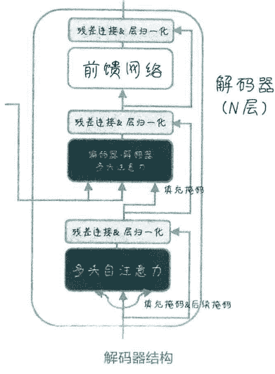

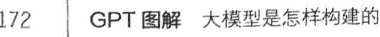

##### 解码器类的实现代码如下。

```python
#定义解码器类
n_layers=6#设置Decoder的层数

class Decoder(nn.Module):
    def __init__(self, corpus):
        super(Decoder, self).__init__()
        self.tgt_emb=nn.Embedding(len(corpus.tgt_vocab), d_embedding)#词嵌入层
        self.pos_emb=nn.Embedding.from_pretrained(get_sin_enc_table(corpus.tgt_len+1, d_embedding), freeze=True) # 位置嵌入层
        self.layers=nn.ModuleList([DecoderLayer() for _ in range(n_layers)])#叠加多层
```

```python
def forward(self, dec_inputs, enc_inputs, enc_outputs):
    #-------------------------------- 维度信息 -
    #dec_inputs的维度是[batch_size, target_len]
    # enc_inputs 的维度是 [batch_size, source_len] 
    # enc_outputs 的维度是 [batch_size, source_len, embedding_dim]
    #--------------------------------
    #创建一个从1到source len的位置索引序列
    pos_indices=torch.arange(1, dec_inputs.size(1)+1).unsqueeze(0).to(dec_inputs)
    #------------------------------------------------- 维度信息 -
    #pos_indices的维度是[1, target_len]
    #---------------------------------
    #对输入进行词嵌入和位置嵌入相加
    dec_outputs=self.tgt_emb(dec_inputs)+self.pos_emb(pos_indices)
    #-----------------------------------维度信息 -
    #dec_outputs 的维度是 [batch_size, target_len, embedding_dim]
    #---------------------------------
    #生成解码器自注意力掩码和解码器 - 编码器注意力掩码
    dec_self_attn_pad_mask=get_attn_pad_mask(dec_inputs, dec_inputs)#填充掩码
    dec_self_attn_subsequent_mask=get_attn_subsequent_mask(dec_inputs)#后续掩码
    dec_self_attn_mask=torch.gt(dec_self_attn_pad_mask+dec_self_attn_subsequent_mask, 0)
    
    dec_enc_attn_mask=get_attn_pad_mask(dec_inputs, enc_inputs) #解码器 - 编码器掩码
    
    #---------------------------------------
    #dec_self_attn_pad_mask的维度是 [batch_size, target_len, target_len]
    #dec_self_attn_subsequent_mask 的维度是 [batch_size, target_len, target_len]
    #dec_self_attn_mask的维度是 [batch_size, target_len, target_len]
    #dec_enc_attn_mask的维度是[batch_size, target_len, source_len]
    #------------------------------------------
    dec_self_attns, dec_enc_attns=[], [] #初始化 dec_self_attns, dec_enc_attns
    #通过解码器层 [batch_size, seq_len, embedding_dim]
    for layer in self.layers:
        dec_outputs, dec_self_attn, dec_enc_attn=layer(dec_outputs, enc_outputs,
        dec_self_attn_mask, dec_enc_attn_mask)
        dec_self_attns.append(dec_self_attn)
        dec_enc_attns.append(dec_enc_attn)
```

```python
    # ------------------------------------------------ 维度信息 -
    # dec_outputs 的维度是 [batch_size, target_len, embedding_dim]
    # dec_self_attns 是一个列表，每个元素的维度是 [batch_size, n_heads, target_len, target_len]
    # dec_enc_attns 是一个列表，每个元素的维度是 [batch_size, n_heads, target_len, source_len]
    # ------------------------------------------------
    # 返回解码器输出，解码器自注意力和解码器 - 编码器注意力权重
    return dec_outputs, dec_self_attns, dec_enc_attns
```

解码器就是负责把目标序列一点点生成的模块。它的构造方法里先把三大件准备好。

- 一个目标词嵌入层 `tgt_emb`，用来把目标句里的词转成向量表示。
- 一个位置嵌入层 `pos_emb`，依赖事先算好的正弦位置编码表给序列注入位置信息。
- 一个 `nn.ModuleList` 容器，按 `n_layers` 的数量通过列表推导式批量创建解码器层并保存起来。

进入前向传播时，`forward` 会同时拿到三类输入：解码器自身的输入 `dec_inputs`、编码器的输入 `enc_inputs` 以及编码器的输出 `enc_outputs`。

内部执行逻辑可以拆成以下几步。

- 先对解码器输入做词嵌入，再加上位置嵌入，得到初始的 `dec_outputs`。
- 构造两类注意力掩码：解码器自注意力掩码 `dec_self_attn_mask` 和解码器-编码器注意力掩码 `dec_enc_attn_mask`。
- `dec_self_attn_mask` 由后续位置掩码 `dec_self_attn_subsequent_mask` 与填充掩码 `dec_self_attn_pad_mask` 叠加而成，先相加再用 `torch.gt` 判断是否大于 0，得到布尔矩阵，用来同时屏蔽填充位置和未来可见信息。`gt` 即 greater than 的逐元素比较。
- `dec_enc_attn_mask` 只保留填充掩码 `dec_self_attn_pad_mask`，目的仅是遮挡编码器侧传来的上下文中的填充位。
- 预先开两个空列表 `dec_self_attns` 与 `dec_enc_attns`，分别用来收集每一层的自注意力权重和编码器-解码器注意力权重。
- 用循环依次遍历所有解码器层，把当前的 `dec_outputs`、`enc_outputs` 以及两组掩码送入层中，得到更新后的 `dec_outputs`，并取出本层的自注意力权重 `dec_self_attn` 和跨注意力权重 `dec_enc_attn`，分别追加到两个列表里。
- 最终返回三样东西：解码器的输出 `dec_outputs`、各层的自注意力权重集合 `dec_self_attns`、各层的编码器-解码器注意力权重集合 `dec_enc_attns`。其中输出后续会用于预测下一个目标词。

这样一来，解码器就完整复现了 Transformer 解码侧的功能：词嵌入加位置嵌入，再叠多层解码结构，能够捕捉目标序列的复杂语义与结构。输出会被送入下游预测下一个词。

到这里，搭建 Transformer 所需的全部零件都已就位，可以开始组装完整的模型了。

#### 组件 10：Transformer 整体

训练和推理时，编码器和解码器会协同工作。编码器先处理源语言序列并提炼语义，解码器则在编码器输出的基础上，结合自身已生成的目标序列逐步解码。解码器内部既用自注意力关注目标序列内部的依赖，也用编码器-解码器注意力关注编码器侧的上下文。经过所有解码层后得到的 `dec_outputs` 会先过一个线性投影层，再配合 softmax 产生预测分布。softmax 本身已融合到损失函数里，代码里只需显式定义线性层。

下面就是 Transformer 类的搭建思路。

```python
##### 定义 Transformer 模型

class Transformer(nn.Module):
    def __init__(self, corpus):
        super(Transformer, self).__init__()
        self.encoder = Encoder(corpus) # 初始化编码器实例
        self.decoder = Decoder(corpus) # 初始化解码器实例
        
        #定义线性投影层，将解码器输出转换为目标词汇表大小的概率分布
        self.projection = nn.Linear(d_embedding, len(corpus.tgt_vocab), bias=False)
```

```python
def forward (self, enc_inputs, dec_inputs):
    # -------------------------------------------------- 维度信息 -
    # -enc_inputs 的维度是 [batch_size, source_seq_len]
    # dec_inputs 的维度是 [batch_size, target_seq_len]
    #
    #将输入传递给编码器，并获取编码器输出和自注意力权重
    enc_outputs, enc_self_attns = self.encoder(enc_inputs)
    # -------------------------------------------------- 维度信息 -
    #-enc_outputs 的维度是 [batch_size, source_len, embedding_dim]
    # enc_self_attns 是一个列表，每个元素的维度是 [batch_size, n_heads, src_seq_len, src_seq_len]
    # 

    #将编码器输出、解码器输入和编码器输入传递给解码器
    #获取解码器输出、解码器自注意力权重和编码器 - 解码器注意力权重
    dec_outputs, dec_self_attns, dec_enc_attns = self.decoder(dec_inputs, enc_inputs, enc_outputs)
    # -------------------------------------------------- 维度信息 -
    #dec_outputs 的维度是 [batch_size, target_len, embedding_dim]
    #dec_self_attns 是一个列表，每个元素的维度是 [batch_size, n_heads, tgt_seq_len, src_seq_len]
    #dec_enc_attns 是一个列表，每个元素的维度是 [batch_size, n_heads, tgt_seq_len, src_seq_len]
    # 

    #将解码器输出传递给投影层，生成目标词表大小的概率分布
    dec_logits = self.projection(dec_outputs)
    #
    #返回预测值，编码器自注意力权重，解码器自注意力权重，解码器 - 编码器注意力权重
    return dec_logits, enc_self_attns, dec_self_attns, dec_enc_attns
```

有了前面各模块，整体代码变得十分简洁。初始化阶段创建编码器、解码器和投影层。`forward` 时先把源序列喂给编码器，拿到编码器输出和其自注意力权重；再把编码器输出、解码器输入、编码器输入一起交给解码器，得到解码器输出、解码器自注意力权重和跨注意力权重；最后用投影层把解码器输出映射到目标词表维度，形成概率分布，用来计算损失并评估效果。

接下来就用这个 Transformer 来完成具体任务。

##### 6.3 翻译实战

这里沿用 Seq2Seq 的迷你翻译任务数据。不同的是，这次把语料封装进一个 `TranslationCorpus` 类，类内部负责读取语料、整理词表并提供可用的批次数据。

###### 6.3.1 准备数据

先准备几条中英互译的示例句子。

```python
sentences = [
    ['咖哥喜欢小冰', 'KaGe likes XiaoBing'],
    ['我爱学习人工智能', 'I love studying AI'],
    ['深度学习改变世界','DL changed the world'],
    ['自然语言处理很强大','NLP is powerful'],
    ['神经网络非常复杂','Neural-networks are complex']]
```

随后定义 `TranslationCorpus` 类，用来读入中英平行语料，自动生成词表并产出模型可直接读取的数据批次。

```python
from collections import Counter #导入 Counter 类
#定义 TranslationCorpus 类
class TranslationCorpus:
    def __init__(self, sentences):
        self.sentences = sentences
        #计算源语言和目标语言的最大句子长度，并分别加1和2以容纳填充符和特殊符号
        self.src_len = max([len(sentence[0].split()) for sentence in sentences]) + 1
        self.tgt_len = max([len(sentence[1].split()) for sentence in sentences]) + 2
        #创建源语言和目标语言的词汇表
        self.src_vocab, self.tgt_vocab = self.create_vocables()
        #创建索引到单词的映射
        self.src_idx2word = {v: k for k, v in self.src_vocab.items()}
        self.tgt_idx2word = {v: k for k, v in self.tgt_vocab.items()}
            
#定义创建词汇表的函数
    def create_vocables(self):
        #统计源语言和目标语言的单词频率
        src_counter = Counter(word for sentence in self.sentences for word in sentence[0].split())
        tgt_counter = Counter(word for sentence in self.sentences for word in sentence[1].split())
        #创建源语言和目标语言的词汇表，并为每个单词分配一个唯一的索引
        src_vocab = {\'<pad>\': 0, **{word: i+1 for i, word in enumerate(src_counter)}}
        tgt_vocab = {\'<pad>\': 0, \'<sos>\': 1, \'<eos>\': 2,
                 **{word: i+3 for i, word in enumerate(tgt_counter)}}
        return src_vocab,tgt_vocab
            
#定义创建批次数据的函数
    def make_batch(self,batch_size,test_batch=False):
        input_batch,output_batch,target_batch=[],[],[]
        #随机选择句子索引
        sentence_indices=torch.randperm(len(self.sentences))[[:batch_size]]
        for index in sentence_indices:
            src_sentence,tgt_sentence=self.sentences[index]
```

####### 将源语言和目标语言的句子转换为索引序列

```python
src_seq = [self.src_vocab[word] for word in src_sentence.split()]
tgt_seq = [self.tgt_vocab['<sos>']] + [self.tgt_vocab[word]
              for word in tgt_sentence.split()] + [self.tgt_vocab['<eos>']]
######## 对源语言和目标语言的序列进行填充
src_seq += [self.src_vocab['<pad>']] * (self.src_len - len(src_seq))
tgt_seq += [self.tgt_vocab['<pad>']] * (self.tgt_len - len(tgt_seq))
######## 将处理好的序列添加到批次中
input_batch.append(src_seq)
output_batch.append([self.tgt_vocab['<sos>']] + ([self.tgt_vocab['<pad>']] * \
                 (self.tgt_len - 2)) if test_batch else tgt_seq[:-1])
target_batch.append(tgt_seq[1:])
######## 将批次转换为 LongTensor 类型
input_batch = torch.LongTensor(input_batch)
output_batch = torch.LongTensor(output_batch)
target_batch = torch.LongTensor(target_batch)
return input_batch, output_batch, target_batch
```

`TranslationCorpus` 初始化时接收一组源语-目标语的句子对。先算出整批数据里源语言与目标语言最长的句子长度，源侧额外预留 1 个位置、目标侧额外预留 2 个位置，用来容纳填充符 `<pad>` 以及目标端的起始符 `<sos>` 与结束符 `<eos>`。随后为源语言和目标语言分别建立词表，并形成词到索引的映射。

`create_vocabularies` 用来搭建词表。它先统计源侧和目标侧的词频，再为每个词分配唯一的索引号。源词表仅包含填充符 `<pad>`，目标词表则额外包含 `<pad>`、句子开始 `<sos>` 和句子结束 `<eos>`。

`make_batch(self, batch_size, test_batch=False)` 负责拼装一个大小为 `batch_size` 的小批次，包含输入批次、输出批次和目标批次。对每个句对，先把源句和目标句转成索引序列，再按最大长度做填充对齐。输入批次放源序列，输出批次放目标序列，测试时输出批次只保留开头的 `<sos>`；目标批次放目标序列，去掉开头的 `<sos>`。最后把三部分都转成 LongTensor。

下面用中文转英文的例子演示如何实例化一个语料库。

```python
######## 创建语料库类实例
corpus = TranslationCorpus(sentences)
```

###### 6.3.2 启动 Transformer 训练

把前面定义的网络实例化出来，用批量化的中译英数据不断喂入进行训练。

```python
import torch # 导入 torch
import torch.optim as optim # 导入优化器
model = Transformer(corpus) # 创建模型实例
criterion = nn.CrossEntropyLoss() # 损失函数
optimizer = optim.Adam(model.parameters(), lr=0.0001) # 优化器
EPOCHS = 5 # 训练轮次
for epoch in range(EPOCHS): # 训练 100 轮
    optimizer.zero_grad() # 梯度清零
    enc_inputs, dec_inputs, target_batch = corpus.make_batch(batch_size) # 创建训练数据
    outputs, _, _ = model(enc_inputs, dec_inputs) # 获取模型输出
    loss = criterion(outputs.view(-1, len(corpus.tgt_vocab)), target_batch.view(-1)) # 计算损失
    if (epoch + 1) % 1 == 0: # 打印损失
        print(f"Epoch: {epoch+1:04d} cost = {loss:.6f}")
    loss.backward() # 反向传播
    optimizer.step() # 更新参数
```

```text
Epoch:0020 cost= 0.019715
Epoch:0040 cost = 0.003158
Epoch: 0060 cost=0.001584
Epoch: 0080 cost = 0.001170
Epoch: 0100 cost=0.000925
```

这段训练流程与之前展示过的例子大同小异，这里就不展开。训练 100 轮之后，损失会明显下降到很低的水准。

###### 6.3.3 Transformer 效果检验

进入评测阶段，看看模型能否完成翻译。

```python
####### 创建一个大小为 1 的批次，目标语言序列 dec_inputs 在测试阶段，仅包含句子开始符号<sos>
enc_inputs, dec_inputs, target_batch = corpus.make_batch(batch_size=1, test_batch=True)
```

```python
predict, enc_self_attns, dec_self_attns, dec_enc_attns = model(enc_inputs, dec_inputs) # 用模型进行翻译
predict = predict.view(-1, len(corpus.tgt_vocab)) # 将预测结果维度重塑
predict = predict.data.max(1, keepdim=True)[1] # 找到每个位置概率最大的单词的索引
####### 解码预测的输出，将所预测的目标句子中的索引转换为单词
translated_sentence = [corpus.tgt_idx2word[idx.item()] for idx in predict.squeeze()]
####### 将输入的原语言句子中的索引转换为单词
input_sentence = ''.join([corpus.src_idx2word[idx.item()] for idx in enc_inputs[0]])
print(input_sentence, '->', translated_sentence) # 打印原始句子和翻译后的句子
```

代码从 `corpus` 里切出一个大小为 1 的测试批次。编码器输入 `enc_inputs` 承载源语言序列，解码器输入 `dec_inputs` 在测试模式下仅包含起始符号 `<sos>`，后面补满 `<pad>`，这样解码器就不会在推理时看到正确答案。目标批次 `target_batch` 则保存去掉 `<sos>` 的目标序列，并在末尾补上 `<eos>`。把 `enc_inputs` 与 `dec_inputs` 送入网络得到预测，再把结果重塑成 `(-1, len(corpus.tgt_vocab))` 的张量，用 `max` 在词汇表维度上取每个位置概率最高的词索引，最后把索引转回词并打印译文。

网络是可以训练、也可以跑起来，但效果很差，只成功输出了一个词 “KaGe” 之后就开始不断重复。

小冰：咖哥，我们忙活了大半天总算把这套结构搭起来了。训练完一看，效果居然还不如用 RNN 的 Seq2Seq，这是怎么回事！

咖哥：小冰，听过奥卡姆剃刀吗？其核心就是解释现象时尽量用假设最少、最简的方案。对这么简单的数据集，模型选择上应该优先简单，复杂如 Transformer 并非总更好。等我给你更复杂的数据和任务，你就能体会它的优势了。

不过这次效果不佳并不是因为模型太复杂，主要原因是没用到解码器的自回归生成机制。训练时我们是最大化正确词的概率；推理时则应该把解码器当前步的输出作为下一步的输入，每一步挑概率最高的词，比如贪心搜索，或用集束搜索等更复杂的策略。

这一课信息量已经很大，先看看 GPT 是如何借助自回归机制逐元素解码，得到比较理想的翻译。

#### 小结

Transformer 出现前，RNN 长期占据 NLP 榜首。RNN 包括 LSTM、GRU 在学习长距离依赖时容易出现梯度消失或爆炸。

2017 年 Vaswani 等人提出的自注意力让序列处理可以并行，不必像 RNN 那样逐时步计算。它在机器翻译、情感分析、问答等任务上取得显著突破。

该体系的成功源于自注意力能够捕捉序列各位置间的依赖，提升表达力同时保持效率。基于它的预训练体系如 BERT、GPT 通过大规模无监督预训练加有监督微调，进一步提升性能。ChatGPT 建立在 GPT-4 架构之上，也就是 Transformer 框架，在海量文本上预训练以实现更好的理解与生成。

总体来看，RNN 在某些场景仍有价值，但凭借强大性能与计算效率，Transformer 已成为当前 NLP 的主流。

新思路让 Transformer 成为 NLP 的新星，在多项任务上刷新纪录。BERT、RoBERTa、ALBERT 等模型在各下游任务上远超传统方案，并在语言生成上表现突出，ChatGPT 的出现让机器自动生成语言的梦想更近一步。

Transformer 的影响已超出 NLP。计算机视觉里，Vision Transformer 将图像切块后用 Transformer 处理，捕捉各部分关系，在图像分类上效果很好。它还在语音识别、推荐系统、强化学习等领域取得进展，一方面表达能力强，另一方面能利用预训练与微调充分使用无标签数据。

如今 Transformer 已是 AI 核心技术之一，各大机构仍在探索其潜力，随着技术演进，它有望继续引领人工智能发展。

####### ## 思考

+   1. Transformer 结构里有哪些基本模块？它们分别承担什么功能？
2. 相比传统的循环神经网络，Transformer 在什么地方更具优势？
3. Transformer 涉及几种注意力形式？各自用在哪个模块？
4. 逐位置前馈网络是什么？为何要逐位置前向？不同位置使用该网络时参数是否共享？
5. 解码器-编码器注意力的掩码仅遮挡编码器输出中填充位置的上下文向量。是否需要对解码器侧的向量也做遮挡？原因是什么？
6. 在测试阶段尝试用逐位置生成的方式进行中译英翻译，每一步采用贪心搜索，观察翻译效果是否提升？（答案在下一课）

### # 第 7 课 逐词生成：亲手炼一台迷你 GPT

咖哥：小冰，你知道竹子怎么长吗？

小冰：知道呀咖哥，竹子是节节往上长，每一节都建立在前一节的基础上。

咖哥：没错！这和自回归模型的生成规律很像，新目标值都基于前面已生成的若干值。


第一节新竹子都基于前一节长出来，恰似自回归模型

小冰：有点意思！那自回归模型有哪些实际用途？

咖哥：自回归模型在时间序列预测里很常见，比如预测股票价格、气温、销售额等。假设未来值与历史值有关，就可以用历史数据逐步推演。

小冰：也就是说预测后天股价，先用今天以前的价格推明天，再基于明天预测后天，对吧？

咖哥：正是。我们今天要训练的 GPT 也建立在自回归机制上。

在开始前，先对比一下 BERT 和 GPT 这两种基于 Transformer 的预训练体系，找找异同。

#### **7.1 BERT 与 GPT：两种预训练思路**

Transformer 提出后不久，基于它的预训练体系雨后春笋般出现。最具影响力的两类就是 GPT 和 BERT。在 ChatGPT 之前，BERT 是 NLP 领域的主流，很多研究都围绕它展开。

> **初代的 GPT 和 BERT 几乎**

初始的 GPT 和 BERT 几乎同期出现，GPT 稍早。BERT 论文中特意与 GPT 对比。下面用易懂的方式说明二者的差异。

做 BERT 无监督预训练时，设计了两个目标：掩码语言模型 MLM，把输入文本中约 k% 的词遮住让模型预测；下一句预测 NSP，判断一个句子是否紧跟另一个句子。数据来自现成语料，标签自带，属于无监督预训练，从参数优化角度看是有监督的。

> GPT 和 BERT 都基于 Transformer，但在结构和应用侧重点上不同。两篇代表论文都明确描述了如何使用 Transformer 体系。

DEVLIN J, CHANG M W, LEE K, et al. Bert: Pre-training of deep bidirectional transformers for language understanding [J]OL.(2019-05-24)[2023-05-18]. https://arxiv.org/pdf/1810.04805.pdf.

##### # GPT 图解 大模型是怎样构建的

184

小冰：明白了，就像把“一二三四五，上山打老虎”里的“二”和“打”抠掉，让模型猜，对吧？

咖哥：正是。预训练不缺数据，维基百科、知乎、微博等都有海量文本。基于 MLM 和 NSP 在大量数据上优化，就得到预训练好的体系，再下载结构与参数针对特定任务微调，就能解决下游问题。BERT 适合文本分类、命名实体识别、完形填空、关系抽取等理解推理任务。

小冰：那 GPT 呢？

咖哥：GPT 也是基于 Transformer 的模型，但与 BERT 有区别。

GPT 和 BERT 表面相似，本质分工完全不同

先说信息读取方式。GPT 是单向阅读，从左往右逐词推进；BERT 是双向扫描，前后文一起参与编码。正是这个差异，让 GPT 在保持语流连贯、持续生成上更顺手，但在需要全局理解的场景里，BERT 的判断通常更稳。

再看预训练目标。GPT 的主课是语言建模，给一段上下文就预测下一个词，任务路径很直，所以在生成类工作上更吃香。BERT 的训练则是掩码语言建模加上句子关系预测，先把部分词遮住再猜，同时判断两句话的关系。

落地时二者流程一致：先在海量文本上预训练，再针对下游任务微调。GPT 偏向生成、问答、续写等输出型需求，BERT 偏向分类、实体识别、理解型需求。概括起来，它们都站在 Transformer 上，但看待文本和学习目标的思路不一样：GPT 走单向语境加语言建模，BERT 走双向语境加掩码建模和句子预测。

小冰：我还是没太明白，双向和单向到底区别在哪？

咖哥：看原始论文的示意图最直观。宏观上两者都用 Transformer，但每个蓝色隐层里自注意力能看到的信息方向不同。

BERT 会把整段序列一次性处理，既看前面也看后面，所以是双向编码。训练时每个位置的表征都融合左右上下文，语义捕获能力更强。

GPT 的思路完全不同。它想最大化序列出现的概率，本质上是生成思路。你让我预测，我只能基于已经看到的往前推，不能先偷看答案。这就是生成式填空式的分界。

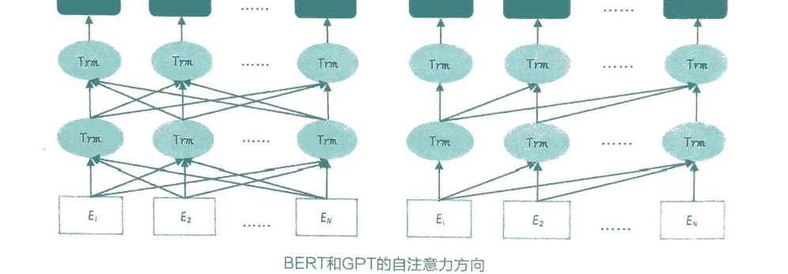

具体实现上，GPT 在解码器的每个自注意力子层都加了掩码，保证当前位置的注意力不泄漏到后续位置。于是位置 i 的预测只依赖 i 之前的已知输出。

换句话说，每一步只能看见已输入的部分和自己已经生成的部分，然后产出下一个词，看不到还没写的词。生成的词越来越多，可见信息也随之扩大，但这些信息里相当一部分是模型自己造出来的，这就是自回归。

总结一下两点核心差别。

第一，训练范式不同。BERT 属于掩码语言模型，课程一路讲过的 N-Gram、Word2Vec、NPLM、Seq2Seq 预测下一个词都属于生成式语言模型，这是语言建模的原始形态，而 BERT 的“猜被遮住的词”是创新。

第二，上下文方向不同。BERT 双向，每个位置的向量都由上下文共同塑造；GPT 单向，在解码器自注意力里加入掩码，防止注意力落在当前位置之后。

小冰灵光一闪：我记得你说过，Transformer 编码器每个位置都融合上下文学习表征，解码器则像 GPT 一样用后续掩码，只看当前位置之前的信息。对吧？

咖哥：完全正确，这正是我要说的第三个差异。这两个模型其实只用了 Transformer 的一半。BERT 只用编码器，GPT 只用解码器。

编码器的双向结构让 BERT 能充分利用上下文，特别适合理解类任务，比如文本分类、命名实体识别、问答，因为它能同时关注输入序列的所有词。

解码器结构的 GPT 是单向自回归，训练时靠后续掩码保证每个位置只能看到之前信息，非常适合生成类任务，比如文本生成、摘要。生成时它根据已有的上下文一步步产出下一个词。

这套架构差异决定了适用场景：BERT 在理解任务上更强，GPT 在生成任务上更强。

# 表 7.1 GPT 与 BERT 的关键对比

| | **BERT** | **GPT** |
| --- | --- | --- |
| 上下文视角 | 双向建模，同时关注前后文 | 单向建模，仅关注前文 |
| 架构选用 | 只用编码器 | 只用解码器 |
| 预训练目标 | 掩码语言模型，自编码 | 生成式语言模型，自回归 |
| 典型用途 | 理解类：文本分类、命名实体识别、问答 | 生成类：文本生成、摘要 |
| 输入处理 | 掩盖部分词让模型预测被遮盖词 | 用特殊符号开头，自回归生成后续 |
| 部署特性 | 通常需针对任务微调效果更佳 | 直接提示即可生成连贯文本 |

咖哥：敲黑板，小冰。讲完异同，下面重点拆解 GPT 的生成式自回归机制。

#### 7.2 GPT 的生成式自回归原理

自回归是一种基于已有序列预测下一个元素的训练方式。对 GPT 来说，就是根据上文生成下一个词。


GPT 的自回归生成机制

注意，训练和推理里“自回归”的含义并不一样。

##### 训练阶段自回归如何运作
训练时模型吃大量文本，输入一个词序列，目标是预测下一个词。损失衡量预测与真实词的差距，参数不断调整以减小损失，直到效果达标。训练中常使用教师强制来加速收敛。

##### 推理阶段自回归如何运作
推理时先给一个种子文本或指令，模型据此生成第一个词，把这个词接在后面再喂回去，继续生成下一个词，如此迭代，直到达到设定长度或出现结束符。

生成策略有多种：贪婪搜索每次挑概率最高的词，集束搜索同时维护多条候选序列，采样方法则按概率分布随机抽取。

小冰：为什么称它为生成式自回归模型？

咖哥：生成式模型关注数据如何产生，会对数据分布建模，能模拟新样本，比如高斯混合、隐马尔可夫、朴素贝叶斯。判别式模型只学输入到输出的映射和决策边界，不关心生成过程，比如逻辑回归、SVM。

自回归模型是生成式的一种特例，预测新值依赖前面已生成的若干值，在时序、语音、NLP 里很常见。机器翻译、文本生成、语音合成里的 Transformer 解码器、GPT 都走自回归路线。

小冰：可是 Transformer 和 GPT 都是神经网络，按定义该算判别式才对，这不是矛盾吗？

咖哥：形式上没错，它们是神经网络，属于判别式范式，直接学映射关系。但在执行生成任务时采用自回归的方式逐词产出，此时行为更像生成式，所以叫生成式自回归模型是合理的。

接下来补上上一课没完成的任务，用自回归机制逐词生成翻译结果。数据和模型不变，只加一个贪婪解码函数，并在测试时调用。

####### 贪婪解码器定义

```
###### 定义贪婪解码器函数

def greedy_decoder(model, enc_input, start_symbol):
    # 对输入数据进行编码，并获得编码器输出及自注意力权重
    enc_outputs, enc_self_attns = model.encoder(enc_input)
    # 初始化解码器输入为全零张量，大小为 (1, 5)，数据类型与 enc_input 一致
    dec_input = torch.zeros((1, 5), type_as=enc_input.data)
    # 设置下一个要解码的符号为开始符号
    next_symbol = start_symbol
    # 循环 5 次，为解码器输入中的每一个位置填充一个符号
    for i in range(0, 5):
        # 将下一个符号放入解码器输入的当前位置
        dec_input[0][i] = next_symbol
        # 运行解码器，获得解码器输出、解码器自注意力权重和编码器 - 解码器注意力权重
        dec_output, _, _ = model.decoder(dec_input, enc_input, enc_outputs)
        # 将解码器输出投影到目标词汇空间
        projected = model.projection(dec_output)
        # 找到具有最高概率的下一个单词
        prob = projected.squeeze(0).max(dim=-1, keepdim=False)[1]
        next_word = prob.data[i]
        # 将找到的下一个单词作为新的符号
        next_symbol = next_word.item()
    # 返回解码器输入，它包含了生成的符号序列
    dec_outputs = dec_input
    return dec_outputs
```
上述代码定义了贪婪解码器 `greedy_decoder`，输入模型、编码器输入和起始符号。解码器循环填充，每次取概率最高的词作为下一步输入，5 次循环后生成序列。

####### 用贪婪解码器进行测试生成翻译

```
####### 用贪婪解码器生成翻译文本
enc_inputs, dec_inputs, target_batch = corpus.make_batch(batch_size=1, test_batch=True)
####### 使用贪婪解码器生成解码器输入
greedy_dec_input = greedy_decoder(model, enc_inputs, start_symbol=corpus.tgt_vocab['<sos>'])
####### 将解码器输入转换为单词序列
greedy_dec_output_words = [corpus.tgt_idx2word[n.item()] for n in greedy_dec_input.squeeze()]
####### 打印编码器输入和贪婪解码器生成的文本
enc_inputs_words = [corpus.src_idx2word[code.item()] for code in enc_inputs[0]]
print(enc_inputs_words, '->', greedy_dec_output_words)
```
['咖哥', '喜欢', '小冰', '<pad>', '<pad>'] -> ['<sos>', 'KaGe', 'likes', 'XiaoBing', '<eos>']

小冰看到逐词推演结果惊讶道：天啊！只改一点点，效果就好这么多，真神奇。不过我还不知道你喜不喜欢我。

咖哥：我喜欢所有爱学习的小朋友。下面开始动手做真正的 GPT。你会发现只用解码器实现更简洁。

#### 7.3 构建 GPT 模型并完成文本生成任务

翻译任务告一段落，现在实现 GPT 并做简单文本生成。像 ChatGPT、GPT-4 这类对话模型之所以能聊得来，核心就是“见多识广”，语料训练让它们能根据看到的人说什么。

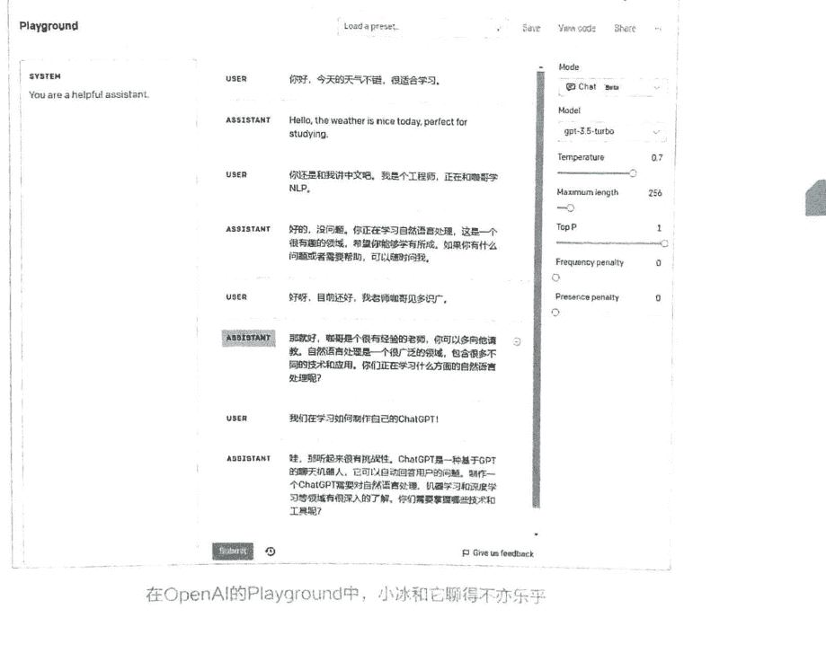

###### 7.3.1 搭建 GPT 解码器

GPT 只用 Transformer 解码器，关键部件如下。


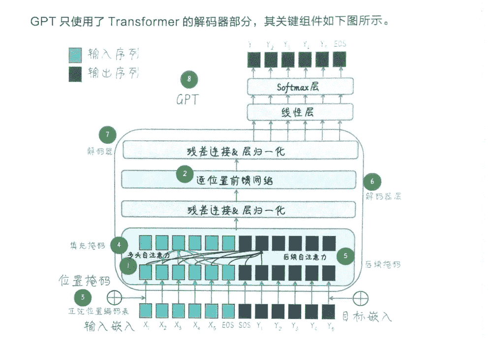

代码关键组件：

组件 1 多头自注意力：用 `ScaledDotProductAttention` 实现缩放点积注意力，再用 `MultiHeadAttention` 组成多头。

组件 2 逐位置前馈网络：用 `PoswiseFeedForwardNet` 实现。

组件 3 正弦位置编码表：用 `get_sin_code_table` 生成。

组件 4 填充掩码：用 `get_attn_pad_mask` 为 `<pad>` 生成掩码，避免关注无效位置。

组件 5 后续掩码：用 `get_attn_subsequent_mask` 屏蔽当前位置之后的信息，防止偷看未来目标。

组件 6 解码器层：用 `DecoderLayer` 定义单层。

组件 7 解码器：用 `Decoder` 拼成完整解码器。

组件 8 GPT：在解码器后加投影层，把特征映射为预测分布，实现文本生成。

组件 1 到 5 与上一课 Transformer 部件一致，不再重复。组件 6 开始说明。

组件 6 解码器层类

GPT 没有编码器，也不需要编码器输出，因此实现更简洁，还省去了编码器-解码器注意力，训练更快。Transformer 解码器与 GPT 解码器的差异如下。

表 7.2 Transformer 解码器和 GPT 解码器结构特点

| 结构特点 | Transformer 解码器 | GPT 解码器 |
| --- | --- | --- |
| 多头自注意力层数 | 两个，自注意力和编码器-解码器注意力 | 一个，自注意力 |
| 输入依赖 | 需要编码器输出作额外参数 | 无需编码器输出 |
| 注意力掩码使用 | 自注意力掩码和编码器-解码器注意力掩码 | 仅自注意力掩码 |
| 应用场景 | 编码器-解码器架构，如机器翻译 | 仅解码器，自回归文本生成 |

# GPT 解码器精简版与微型语料训练实战

```
####### 定义解码器层类
class DecoderLayer(nn.Module):
    def __init__(self):
        super(DecoderLayer, self).__init__()
        self.self_attn = MultiHeadAttention() #多头自注意力层
        self.feed_forward = PoswiseFeedForwardNet() #逐位置前馈网络层
        self.norm1=nn.LayerNorm(d_embedding) # 第一个层归一化
        self.norm2=nn.LayerNorm(d_embedding) #第二个层归一化

    def forward(self, dec_inputs, attn_mask=None):
        # 使用多头自注意力处理输入
        attn_output, _ = self.self_attn(dec_inputs, dec_inputs, dec_inputs, attn_mask)
        # 将注意力输出与输入相加并进行第一个层归一化
norm1_outputs = self.norm1(dec_inputs + attn_output)
        # 将归一化后的输出输入逐位置前馈神经网络
        ff_outputs = self.feed_forward(norm1_outputs)
        # 将前馈神经网络输出与第一次归一化后的输出相加并进行第二个层归一化
        dec_outputs=self.norm2(norm1_outputs + ff_outputs)
        return dec_outputs #返回解码器层输出
```
GPT 解码器层只接收 `dec_inputs` 与 `attn_mask` 作为输入，不会引入编码器的特征，计算结束时返回 `dec_outputs`。

和标准 Transformer 解码器相较，GPT 的解码器明显更轻量，仅由 `MultiHeadAttention` 多头自注意力模块和 `PosFeedForwardNet` 逐位置前馈模块构成，并在其后串联了两层 `nn.LayerNorm` 归一化。

在层内部，两次归一化的职责如下。

首次归一化 `norm1`：自注意力 `self_attn` 完成计算后，把注意力结果 `attn_output` 与原始 `dec_inputs` 做残差相加，这一步有助于梯度更顺畅地回传，便于深层网络训练，随后对相加后的张量做归一化。归一化会把分布拉到统一的均值方差区间，可缓解梯度消失或爆炸，提升训练稳定性。

二次归一化 `norm2`：前馈网络 `feed_forward` 处理完后，将其输出 `ff_outputs` 与前一次归一化的结果 `norm1_outputs` 做残差叠加，再次进行归一化。目的与第一次一致，即对流经特征做标准化，保持优化过程稳定。

正是这两处归一化的作用，使得自注意力和前馈之间能更平稳地传递信息，从而增强整体训练效果。

####### **组件7：解码器搭建**
接下来基于上述解码器层组装完整的解码器。

```
####### 定义解码器类
n_layers = 6 # 设置 Decoder 的层数
class Decoder(nn.Module):
    def __init__(self, vocab_size, max_seq_len):
        super(Decoder, self).__init__()
        # 词嵌入层 (参数为词典维度)
        self.src_emb = nn.Embedding(vocab_size, d_embedding)
        # 位置编码层 (参数为序列长度)
        self.pos_emb = nn.Embedding(max_seq_len, d_embedding)
        # 初始化 N 个解码器层
        self.layers = nn.ModuleList([DecoderLayer() for in range(n_layers)])

    def forward(self, dec_inputs):
        # 创建位置信息
        positions = torch.arange(len(dec_inputs), device=dec_inputs.device).unsqueeze(-1)
        # 将词嵌入与位置编码相加
        inputs_embedding = self.src_emb(dec_inputs) + self.pos_emb(positions)
```
####### 自注意力掩码的生成
```python
attn_mask = get_attn_subsequent_mask(inputs_embedding).to(device)
####### 初始化解码器输入，这是第一个解码器层的输入

dec_outputs = inputs_embedding
for layer in self.layers:
    # 将输入数据传递给解码器层，并返回解码器层的输出，作为下一层的输入
    dec_outputs = layer(dec_outputs, attn_mask)
return dec_outputs # 返回解码器输出
```
GPT 解码器比起 Transformer 解码器结构更简洁，因为 GPT 本身是单向生成模型，只关心文本的产生而非源文本的理解。它省去了编码器-解码器注意力，只对解码器输入做词嵌入和位置编码求和，然后构造因果自注意力掩码，保证每个位置只能看到自身及之前的信息，以维持自回归生成特性。随后将嵌入向量与掩码一起喂入解码器层并行计算，得到 `dec_outputs` 再交回 GPT 主体。

####### 组件8：GPT 整体模型
```python
#定义GPT模型
class GPT(nn.Module):
    def __init__(self, vocab_size, max_seq_len):
        super(GPT, self).__init__()
        self.decoder=Decoder(vocab_size, max_seq_len) #解码器，用于学习文本生成能力
        self.projection=nn.Linear(d_embedding,vocab_size) #全连接层，输出预测结果

def forward(self, dec_inputs):
    dec_outputs=self.decoder(dec_inputs) #将输入数据传递给解码器
    logits=self.projection(dec_outputs) #传递给全连接层以生成预测
    return logits #返回预测结果
```
在这一简化实现里，解码器类承担文本生成能力的学习；其后接一个全连接层，把解码器输出的隐藏向量映射为词汇表上的概率分布即 logits，用来预测下一个词。

整个模型仅有解码器，没有编码器，因此更适合无条件文本生成，而非机器翻译或问答这类需要编码-解码配合的任务。

接下来进入文本生成任务的数据准备。

###### 7.3.2 构建文本生成任务的数据集
本次选用与 GPT 最匹配的任务——文本生成。为此需要准备一个训练语料库，语料来源于真实文字，相较维基百科等大规模语料规模很小，可视为一个缩影。

**将语料保存在 `lang.txt` 文件中，供程序读取。**

**随后实现 `LanguageCorpus` 语料库类，完成读取、整理与批次构造。**

####### [In]
```python
####### 构建语料库
from collections import Counter
class LanguageCorpus:
    def __init__(self, sentences):
        self.sentences = sentences
    #计算语言的最大句子长度，并加 2 以容纳特殊符号<sos>和<eos>
    self.seq_len = max([len(sentence.split()) for sentence in sentences]) + 2
    self.vocab = self.create_vocabulary() #创建源语言和目标语言的词汇表
    self.idx2word={k:v for k,v in self.vocab.items()} #创建索引到单词的映射
    def create_vocabulary(self):
        vocab=['<pad>':0,'<sos>':1,'<eos>':2]
        counter=Counter()
    #统计语料库的单词频率
        for sentence in self.sentences:
            words=sentence.split()
            counter.update(words)
    #创建词汇表，并为每个单词分配一个唯一的索引
        for word in counter:
            if word not in vocab:
                vocab[word]=len(vocab)
        return vocab
    def make_batch(self,batch_size,test_batch=False):
        input_batch,output_batch=[],[] #初始化批次数据
```
####### [PAGE 208]
```python
sentence_indices = torch.randperm(len(self.sentences))[:batch_size] # 随机选择句子索引
for index in sentence_indices:
    sentence = self.sentences[index]
    # 将句子转换为索引序列
    seq = [self.vocab['<sos>']] + [self.vocab[word] for word in sentence.split()] + [self.vocab['<eos>']]
    seq += [self.vocab['<pad>']] * (self.seq_len - len(seq))#对序列进行填充
    #将处理好的序列添加到批次中
    input_batch.append(seq[:-1])
    output_batch.append(seq[1:])
return torch.LongTensor(input_batch),torch.LongTensor(output_batch)
```
该类的核心功能包括词汇表构建、句子到索引的转换以及批次生成，其中 `make_batch` 中的“右移”操作是训练生成式语言模型的关键。

1. `__init__` 里初始化句子列表、带 `<sos>` 与 `<eos>` 的最大长度、词汇表及反向映射。
2. `create_vocabulary` 先定义特殊符号，再统计词频，最后为每个词分配唯一索引。
3. `make_batch` 先随机抽取句子索引，将句子转成索引序列并填充，再通过右移得到输入与目标序列：`seq[:-1]` 作为输入，`seq[1:]` 作为目标。处理好的序列分别加入输入批次与输出批次。

以“<sos> 咖哥喜欢小冰 <eos>”为例：

> 输入序列 `input_batch`: `<sos>` 咖哥喜欢小冰

> 目标序列 `output_batch`: 咖哥喜欢小冰 `<eos>`

根据 `lang.txt` 实例化语料库并查看基本信息。

####### [In]
```python
with open("lang.txt","r") as file:#从文件中读入语料 
    sentences = [line.strip() for line in file.readlines()]
corpus =LanguageCorpus(sentences)#创建语料库
vocab_size=len(corpus.vocab)# 词汇表大小
max_seq_len=corpus.seq_len# 最大句子长度（用于设置位置编码）
print(f"语料库词汇表大小:{vocab_size}")#打印词汇表大小
print(f"最长句子长度:{max_seq_len}")#打印最大序列长度
```
####### [Out]

| 输出项 | 数值 |
| :--- | :--- |
| 语料库词汇表大小 | 133 |
| 最长句子长度 | 17 |

有了语料与批次，接下来即可训练 GPT。

###### 7.3.3 训练过程中的自回归
下方代码完成 GPT 的训练流程。

```python
import torch.optim as optim # 导入优化器
device = "cuda" if torch.cuda.is_available() else "cpu" # 设置设备
model = GPT(vocab_size, max_seq_len).to(device) # 创建 GPT 模型实例
criterion = nn.CrossEntropyLoss() # 损失函数
optimizer = optim.Adam(model.parameters(), lr=0.0001) # 优化器
epochs = 500 # 训练轮次
for epoch in range(epochs): # 训练 epochs 轮
    optimizer.zero_grad() # 梯度清零
    inputs, targets = corpus.make_batch(batch_size) # 创建训练数据
    inputs, targets = inputs.to(device), targets.to(device)
    outputs = model(inputs) # 获取模型输出
    loss = criterion(outputs.view(-1, vocab_size), targets.view(-1)) # 计算损失
    if (epoch + 1) % 100 == 0: # 打印损失
        print(f"Epoch: {epoch + 1:04d} cost = {loss:.6f}")
    loss.backward() # 反向传播
    optimizer.step() # 更新参数
```
####### [Out]

| Epoch | cost |
| :--- | :--- |
| 0100 | 1.840713 |
| 0200 | 0.881577 |
| 0300 | 0.411060 |
| 0400 | 0.308089 |
| 0500 | 0.249115 |

这段训练逻辑与之前的示例一致。训练样本被编码为词表索引，每个批次的输入是当前的前缀序列，目标是该序列的下一个词。模型输出整个词表的条件概率分布，使用交叉熵损失与真实目标对比进行优化。

####### 咖哥发言
从这里开始进入更接近真实场景的实战，资源需求也会上升，有 GPU 会更明显。无论使用 CPU 还是 GPU，都要保证模型与数据处于同一设备，`to(device)` 正是完成这一迁移的工具。

```python
device = "cuda" if torch.cuda.is_available() else "cpu"
```
先判断是否可用 GPU，有则设为 "cuda"，无则使用 "cpu"。

```python
model = GPT(vocab_size, max_seq_len).to(device)
```
实例化 GPT 模型后，通过 `to(device)` 将全部参数与缓存搬到指定设备。

```python
inputs, targets = inputs.to(device), targets.to(device)
```
输入与目标张量也需搬到相同设备。

总之 `to(device)` 能确保前后端统一，这是计算的前提条件。配备 GPU 时，训练速度可显著提升。

**小冰**：咖哥，在这次 GPT 训练里，自回归体现在什么地方？

**咖哥**：自回归体现在目标构造和损失计算上。模型以已生成的上下文为条件，逐词预测下一个词的概率，训练过程不断以“前文 -> 下一词”的方式学习条件分布，这正是自回归的本质。

*   **输入和目标的构造**：目标序列是通过把输入序列整体向右平移一位得到的。这样模型在学习时，上下文是已知的词，预测对象是紧随其后的词；配合后续的注意力遮挡，模型在计算注意力时无法窥探到未来的信息。

*   **损失的计算**：模型的预测输出会和目标序列逐位置对比来求损失。每个位置的输出都是对下一个词的概率分布，交叉熵用于衡量预测分布与真实分布之间的差距。

归根到底，Transformer 具备并行处理的特性，训练时并没有显式地一步步自回归，但靠因果掩码实现了自回归的效果。等到推理生成新文本时，模型会依据已经生成的词逐步推导出下一个词，自回归的特性在此体现出来。

###### 7.3.4 生成验证：贪婪搜索实战

现在用训练好的模型做一下生成测试，看看一次只取最优的贪婪策略会产生什么结果。

```python
####### 测试文本生成

def generate_text(model, input_str, max_len=50):
    model.eval() # 将模型设置为评估（测试）模式，关闭 dropout 和 batch normalization 等训练相关的层
    # 将输入字符串中的每个 token 转换为其在词汇表中的索引
    input_tokens = [corpus.vocab[token] for token in input_str]
    # 创建一个新列表，将输入的 tokens 复制到输出 tokens 中，目前只有输入的词
    output_tokens = input_tokens.copy()
    with torch.no_grad(): # 禁用梯度计算，以节省内存并加速测试过程
        for _ in range(max_len): # 生成最多 max_len 个 tokens
            # 将输出的 token 转换为 PyTorch 张量，并增加一个代表批次的维度 [1, len(output_tokens)]
            inputs = torch.LongTensor(output_tokens).unsqueeze(0).to(device)
            outputs = model(inputs) # 输出 logits 形状为 [1, len(output_tokens), vocab_size]
            # 在最后一个维度上获取 logits 中的最大值，并返回其索引（即下一个 token）
            _, next_token = torch.max(outputs[:, -1, :], dim=-1)
            next_token = next_token.item() # 将张量转换为 Python 整数
            if next_token == corpus.vocab["<eos>"]:
                break # 如果生成的 token 是 EOS（结束符），则停止生成过程
            output_tokens.append(next_token) # 将生成的 tokens 添加到 output_tokens 列表
    # 将输出 tokens 转换回文本字符串
    output_str = 
```

####### [Out]

生成的文本：Python libraries like Pandas and deep learning are important parts of data science.

**小冰**：效果挺可以的呀，咖哥，没想到我们自己训出来的 GPT 还能说出这种像样的句子。

**咖哥**：对，自回归正是生成式模型的关键属性，能让序列一步步往下延展。

`generate_text` 函数的核心思路是先把输入字符串转成词索引列表 `input_tokens`，再把它作为初始的 `output_tokens`。随后进入循环，直到达到 `max_len` 或者遇到结束符 `<eos>`。每轮把当前的 `output_tokens` 喂给模型，从输出里挑出概率最大的词作为下一步，并把该词追加到 `output_tokens` 中，用作下一轮的输入。

这个流程之所以属于自回归，是因为每一步的预测都完全依赖前面已经生成的词序列，从而保证生成的文本在语法和语义上保持连贯。

在解码策略上，该函数采用的是贪婪解码，即每一步只保留概率最高的候选。代码里用 `_, next_token = torch.max(outputs[:, -1, :], dim=-1)` 从最后时间步的词表分布中取出最大概率的索引，再把它拼接到已生成序列中。

贪婪解码实现简单、速度快，在本例中表现尚可。但它容易陷入局部最优，出现 `<eos>` 反复出现、无意义的词块循环等现象。更稳健的做法是集束搜索，它能在全局和局部之间做权衡。后面我们会在更大规模的语料上用集束搜索来做对比。

#### 7.4 真实语料上训练 Wiki-GPT

**咖哥**：学到这里，你应该对语言模型和生成方法有了整体的把握。

**小冰**：是的，咖哥，我已经比较清晰了。不过我总觉得之前用的数据集太简单、太“玩具”了。

**咖哥**：你猜对了。接下来我们换一个从互联网采集的真实语料 WikiText®。它是从维基百科精选文章中抽取的，规模超过一亿个词元。我们用它来观察真实世界的训练过程。此后重点不再是结构原理，而是工程落地。

> ① MERITY S, XIONG C, BRADBURY J, et al. Pointer sentinel mixture models [J]. (2016-09-26) [2023-06-08]. https://arxiv.org/pdf/1609.07843.pdf.

##### 第 7.4.1 基于 WikiText2 搭建数据管道

现在开始构建数据。从 PyTorch 的 Torchtext 入手，它提供了加载、清洗和处理的便利工具。若环境中未安装，可先执行 `pip install torchtext`。

###### 7.4.1 基于 WikiText2 搭建数据管道

###### 第一步：拉取语料并建立词表

直接从 Torchtext 导入 WikiText2 并构建词表的代码如下。

```python
from torchtext.datasets import WikiText2 # 导入 WikiText2
from torchtext.data.utils import get_tokenizer # 导入 Tokenizer 分词工具
from torchtext.vocab import build_vocab_from_iterator # 导入 Vocabulary 工具
```

WikiText2 是 WikiText 的精简版，约有 200 万个词元，适合在资源受限的情况下做快速实验和算法验证。

```python
from torch.utils.data import DataLoader

text_iter = iter(train_dataset) # 假设 train_dataset 已定义并转化为迭代器
def yield_tokens(data_iter):
    for item in data_iter:
        yield tokenizer(item) # 创建词汇表，包括特殊 tokens: "<pad>","<sos>","<eos>"
vocab = build_vocab_from_iterator(yield_tokens(train_iter),
    specials=["<pad>", "<sos>", "<eos>"])
vocab.set_default_index(vocab["<pad>"])

####### 打印词汇表信息
print("词汇表大小:", len(vocab))
print("词汇集例 (word to index): ", {word: vocab[word] for word in ["<pad>", "<sos>", "<eos>","the","apple"]})

########## Out
####### 词汇表大小:28785
####### 词汇集例 (word to index): {'<pad>':0,'<sos>':1,'<eos>':2, 'the':3,'apple': 11505}
```

这段流程和我们之前手工做的语料有所不同。首先指定分词器，这里选用 basic_english，它能把文本切成单词。然后只加载 WikiText2 的训练划分 `split='train'`。再定义一个生成器 `yield_tokens`，它遍历数据集并用分词器把每条文本转为词元序列。

随后调用 `build_vocab_from_iterator` 以 `yield_tokens` 为数据源创建词表，并额外加入特殊符号 <pad>、<sos>、<eos>，并把默认索引设为 <pad>。最后查看词表规模，约两万多个词，远大于之前的小示例。WikiText2 仍属于教学级语料，和 BERT/GPT 的预训练语料不可同日而语。

###### 第二步：封装 PyTorch 数据集

先说明 Dataset 抽象类。它为 DataLoader 提供统一接口，自定义时需实现 `__init__`、`__len__` 和 `__getitem__`。

- `__init__` 在实例化时运行，通常负责加载数据、清洗、分词、建表等初始化工作；
- `__len__` 返回样本总数；
- `__getitem__` 接收索引并返回对应样本。

下面是 WikiDataset 的实现。

```python
from torch.utils.data import Dataset # 导入 Dataset 类
max_seq_len = 256 # 设置序列的最大长度

####### 定义一个处理 WikiText2 数据集的自定义数据集类
class WikiDataset(Dataset):
    def __init__(self, data_iter, vocab, max_len=max_seq_len):
        self.data = []
        for sentence in data_iter: # 遍历数据集，将文本转换为 tokens
            # 对每个句子进行 Tokenization，截取长度为 max_len-2，为<sos>和<eos>留出空间
            tokens = tokenizer(sentence)[:max_len - 2]
            tokens = [vocab["<sos>"]] + vocab(tokens) + [vocab["<eos>"]] # 添加 <sos> 和 <eos>
            self.data.append(tokens) # 将处理好的 tokens 添加到数据集中

    def __len__(self): # 定义数据集的长度
        return len(self.data)

    def __getitem__(self, idx): # 定义数据集的索引方法（即抽取数据条目）
        source = self.data[idx][:-1] # 获取当前数据，并将<eos>移除，作为源(source)数据
        target = self.data[idx][1:] # 获取当前数据，并将<sos>移除，作为目标(target)数据（右移1位）
        return torch.tensor(source), torch.tensor(target) # 转换为 tensor 并返回
```

Dataset 数据条目数：36718  

输入序列张量样例：`tensor([ 1, 2659, 3478, 17569, 9098])`  

目标序列张量样例：`tensor([ 2659, 3478, 17569, 9098, 2])`  

输入序列样例文本：<sos> 96 ammunition packing boxes  

目标序列样例文本: 96 ammunition packing boxes<eos>

**WikiDataset 继承自 `torch.utils.data.Dataset`，专门处理 WikiText2。**

构造方法接收数据迭代器 `data_iter` 和词表 `vocab`。初始化时遍历句子，用分词器处理并截断为 `max_len-2` 长度，首尾分别加上 <sos> 和 <eos>，再存入集合。

`__len__` 返回句子数量；`__getitem__` 返回指定索引的源数据和目标数据。源数据取句首到倒数第二个词元，目标数据取第二个词元到句尾。这样模型就能在给定当前词的前提下学习下一个词，正是生成式训练的标准构造。从示例也能看出，借助 <sos> 和 <eos> 实现了目标序列相对源序列的右移一位。

###### 第三步：配置 DataLoader

DataLoader 负责把数据集切分为批次并整理成适合训练的形状。在此之前先定义 `collate_fn`，它会在把单条样本组合成批次时被调用，用来统一 padding 和张量形状。

具体实现如下。

```python
########## 定义 pad_sequence 函数，用于将一批序列补齐到相同长度
def pad_sequence(sequences, padding_value=0, length=None):
    # 计算最大序列长度，如果 length 参数未提供，则使用输入序列中的最大长度
    max_length = max(len(seq) for seq in sequences) if length is None else length
    # 创建一个具有适当形状的全零张量，用于存储补齐后的序列
    result = torch.full((len(sequences), max_length), padding_value, dtype=torch.long)
    # 遍历序列，将每个序列的内容复制到张量 result 中
    for i, seq in enumerate(sequences):
        end = len(seq)
        result[i,:end]=seq[:end]
    return result

def collate_fn(batch):
    # 从批次中分离源序列和目标序列
    sources, targets = zip(*batch)
    # 计算批次中的最大序列长度
    max_length = max(max(len(s) for s in sources), max(len(t) for t in targets))
    # 使用 pad_sequence 函数补齐源序列和目标序列
    sources = pad_sequence(sources, padding_value=vocab["<pad>"], length=max_length)
    targets = pad_sequence(targets, padding_value=vocab["<pad>"], length=max_length)
    # 返回补齐后的源序列和目标序列
    return sources, targets

####### 创建一个训练数据加载器，使用自定义的 collate_fn 函数
train_dataloader = DataLoader(train_dataset, batch_size=batch_size,
                             shuffle=True, collate_fn=collate_fn)
```

`pad_sequence` 这个函数需要三个输入：一个包含多个变长序列的列表 sequences、用于补齐的填充值 padding_value，以及一个可选的目标长度 length。它的核心工作就是在序列末尾补上填充值，让一批序列变得等长。若主动传入了 length，就以这个长度为准统一补齐；若没有指定，则自动补齐到当前批次中最长那个序列的长度。

`collate_fn` 的任务是把一批原始样本整理成模型可直接吃的张量。它先把批次里的源序列和目标序列拆开，分别调用 `pad_sequence` 做对齐处理，最后一起返回补齐后的源序列和目标序列。

`train_dataloader` 本质上就是一个 DataLoader 对象，负责从训练集里按批加载数据。具体加载细节会在接下来的训练代码里展开。

###### 7.4.2 DataLoader 驱动的批量训练实战

接下来就用 `train_dataloader` 来喂数据，一批一批地训练模型。

```python
import torch.optim as optim # 导入优化器
device = "cuda" if torch.cuda.is_available() else "cpu" # 设置设备
model = GPT(len(vocab), max_seq_len).to(device) # 创建 GPT 模型实例
criterion = nn.CrossEntropyLoss(ignore_index=vocab["<pad>"])
optimizer = optim.Adam(model.parameters(), lr=0.0001) # 优化器
epochs = 2 # 训练轮次

for epoch in range(epochs):
    epoch_loss = 0
    for batch_idx, (source, target) in enumerate(train_dataloader): # 用 dataloader 加载数据
        inputs, targets = source.to(device), target.to(device)
        optimizer.zero_grad() # 梯度清零
        
        outputs = model(inputs) # 获取模型输出
        loss = criterion(outputs.view(-1, len(vocab)), targets.view(-1)) #计算损失
        loss.backward() # 反向传播
        optimizer.step() # 更新参数
        epoch_loss += loss.item() # 积累每轮损失
        
        if (batch_idx + 1) % 1000 == 0: #每1000个批次打印一次损失
            print(f"Batch (batch_idx + 1)/(len(train_dataloader)], Loss: {loss.item()}")
```

Output:

```text
Batch 1000/12240, Loss:7.157247543334961
Batch 2000/12240, Loss:3.339968204498291
Batch 3000/12240, Loss:5.498887538909912
Batch 4000/12240, Loss:6.358556747436523
Batch 5000/12240, Loss:2.53767728805542
```

这里最值得说明的是这一行：`for batch_idx, (source, target) in enumerate(train_dataloader)`。这是 PyTorch 里遍历 DataLoader 的标准写法。`enumerate` 能同时给出迭代次数和当前元素，这样我们就能拿到批次序号和对应的 source、target。循环体内依然是常规套路：数据处理、前向计算、算损失、反向传播、更新参数。

###### 7.4.3 用验证集实时监控训练进度

咖哥：在真实项目里，我们不会把所有语料都拿去训练，通常会划分出一部分做验证和测试，就像下图那样，你应该很熟悉吧？

小冰：太熟了，咖哥。我一直好奇之前的课为什么一直没讲评估和测试。

咖哥：主要是因为之前的语料太小，分出来评估意义不大，而且重点在搭建结构。现在有了 WikiText2 这种规模更大的语料，就能演示完整的评估流程，并在训练中追踪分数，把表现最好的模型保存下来。

要把评估加进来，每个 epoch 结束时做一次验证并保留最优模型，具体分三步：

1. 构造验证集并配套一个验证用的 DataLoader。
2. 每个 epoch 结束时，用验证集算一次模型损失。
3. 记录历史最低验证损失，损失下降时就保存模型。

实现上先按同样方式创建验证数据集和加载器，再在训练循环里加入评估逻辑，把整个训练过程中验证损失最低的那版模型存下来。

```python
# ……之前的代码（加载WikiText2数据集）
valid_iter = WikiText2(split='valid') # 加载WikiText2 数据集的验证部分

####### ……之前的代码（创建数据集）
valid_dataset = WikiDataset(valid_iter, vocab) # 创建验证数据集

####### ……之前的代码（创建数据加载器）
# 创建一个验证数据加载器，使用自定义的collate_fn函数
valid_dataloader = DataLoader(valid_dataset, batch_size=batch_size,
    shuffle=False, collate_fn=collate_fn)
```

```python
####### ……之前的代码
import os # 导入os库
min_valid_loss = float("inf") # 初始化最低验证损失为无穷大
save_path = "best_model.pth" # 设置模型保存路径

for epoch in range(epochs):
    # ……训练代码
    
    # 评估模型
    model.eval() # 将模型设置为评估模式
    valid_loss = 0
    
    with torch.no_grad(): # 禁用梯度计算
        for source, target in valid_dataloader:
            inputs, targets = source.to(device), target.to(device)
```

####### in

python

outputs = model(inputs)

loss = criterion(outputs.view(-1, len(vocab)), targets.view(-1))

valid_loss += loss.item()

valid_loss /= len(valid_dataloader)

print(f"Epoch {epoch + 1}/{epochs}, Validation Loss: {valid_loss}")

####### 保存损失最小的模型

if valid_loss < min_valid_loss:

    min_valid_loss = valid_loss

    torch.save(model.state_dict(), save_path)

    print(f"New best model saved at epoch {epoch + 1} with Validation Loss: {valid_loss}")

model.train() #将模型设置为训练模式

每个轮次结束后，我们都会在验证集上算损失。若本次验证损失比之前记录的最小值更低，就把当前模型参数写进文件。

> **咖啡发言**

**pt** 和 **.pth** 只是 PyTorch 保存模型或张量的常见后缀，没有本质区别。保存时用 `torch.save()` 把状态写成二进制文件，加载时用 `torch.load()` 读回来即可。

我们就把这版最优模型叫做“Wiki-GPT”。训练结束就能直接加载它来做预测。下一课我们还会在此基础上继续微调，朝 ChatGPT 的方向推进。

##### 7.4.4 文本生成策略：集束搜索原理

之前提到，贪婪搜索和集束搜索是生成式模型推理时常用的两种解码策略，都在从概率分布里挑选最优词序列。

- 贪婪搜索的做法很直接，每一步都挑当前概率最大的词作为下一个输出，直到达到设定长度或出现结束符。优点是速度快，每步只做一次选择；缺点容易陷入局部最优，文本连贯性受损。
**集束搜索** 则属于启发式方法，它在每一步保留 K 条候选序列。具体来说，模型为所有候选分别预测下一个词的概率分布，取前 K 个高概率词扩展，然后按累积概率对所有扩展后的序列排序。重复这个过程，直到达到最大长度或所有序列都结束。

相比贪婪搜索，集束搜索通过同时探索多条路径，更能在全局上找到质量更高的输出。代价是计算量增大，每步都要处理 K 倍的候选。实际使用时可以根据任务需求和算力来权衡。

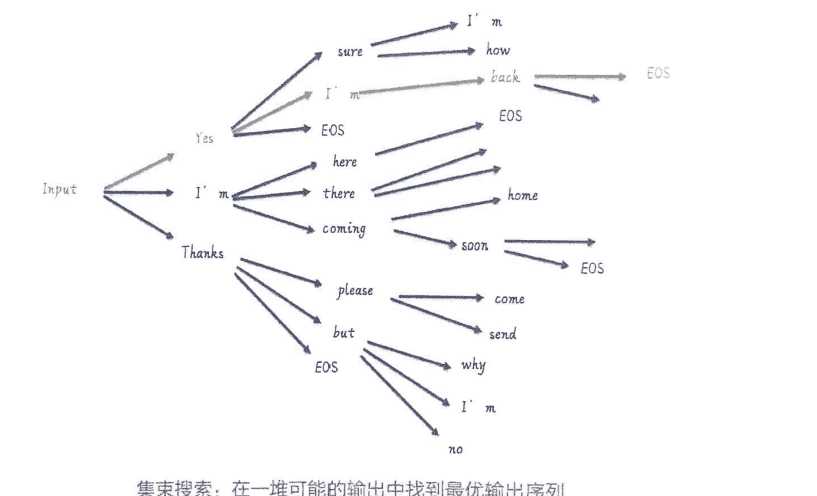

下面演示用集束搜索为 WikiText2 训练好的 GPT 模型生成文本。

```python
###### 定义集束搜索的函数
def generate_text_beam_search(model, input_str, max_len=50, beam_width=5):
    model.eval() # 将模型设置为评估模式，关闭 dropout 和 batch normalization 等与训练相关的层
###### 将输入字符串中的每个 token 转换为其在词汇表中的索引
input_tokens = [vocab[token] for token in input_str.split()]
###### 创建一个列表，用于存储候选序列
candidates = [[input_tokens, 0.0]]
with torch.no_grad(): # 禁用梯度计算，以节省内存并加速测试过程
    for _ in range(max_len): # 生成最多 max_len 个 token
        new_candidates = []
        for candidate, candidate_score in candidates:
```

```python
`inputs = torch.LongTensor(candidate).unsqueeze(0).to(device)`
`outputs = model(inputs) #输出logits形状为[1,len(output_tokens),vocab_size]`
`logits = outputs[:,-1,:]#只关心最后一个时间步（即最新生成的token）的logits`
`#找到具有最高分数的前beam_width个token`
`scores,next_tokens=torch.topk(logits,beam_width,dim=-1)`
`final_results=[]#初始化输出序列`
`for score,next_token in zip(scores.squeeze(),next_tokens.squeeze()):`
`    new_candidate=candidate+ [next_token.item()]`
`    new_score = candidate_score - score.item() #使用负数，因为我们需要降序排列`
`if next_token.item()==vocab["<eos>"]:`
`    #如果生成的token是EOS（结束符），将其添加到最终结果中`
`    final_results.append((new_candidate,new_score))`
`else:`
`    #将新生成的候选序列添加到新候选列表中`
`    new_candidates.append((new_candidate,new_score))`
`#从新候选列表中选择得分最高的beam_width个序列`
`candidates = sorted(new_candidates,key=lambda x: x[1][:beam_width])`
`#选择得分最高的候选序列`
`best_candidate,_= sorted(candidates, key=lambda x:x[1][0])`
`# 将输出的token转换回文本字符串`
`output_str=`
```

> > 生成的文本：my name was also used in 1897 by lucasfilm games in the common by lucasfilm games in the common by lucasfilm games ...

`generate_text_beam_search` 的执行流程可以拆成以下几步。

( 1 ) 先把模型切到评估模式，关闭 dropout、batch normalization 等训练相关行为。
( 2 ) 处理输入。把输入句子切分成 token 映射为词表索引，同时初始化一个候选序列列表来存放搜索过程中的备选。
(3 ) 进入生成循环，最多产出 max_len 个 token。每次把候选序列喂入模型取 logits，只关注最后一步的输出，挑出前 beam_width 个高分 token 为每个候选扩展出新序列。若扩展出的 token 是 EOS，就把该序列放到最终结果里。
（4）每轮迭代结束，从所有新序列里按得分挑出最好的 beam_width 条，留作下一轮的候选。
（5）循环结束时，选出总分最高的序列解码回文字返回。

实测时我加载了一个在 WikiText2 上训练 50 个 epoch 的模型，输入 “my name”，模型生成的开头就是 “my name was also used in

1897 by lucasfilm games in the common by lucasfilm games in the common

by lucasfilm games ..."。

**小冰**：这个输出效果不太理想，前面的几个字还能看，后面就开始乱编，而且老在原地打转。

**咖哥**：可以这么理解，我们现在玩的这个模型参数只有数万量级，训练过程在普通电脑的CPU上就能跑完。可WikiText的规模是上亿级别的文本。想把如此庞大的语言规律全部塞进数万个参数里是不现实的。要学到真正的语言规律，至少得上亿级的参数量，而今天的主流大模型比如GPT，已经到了千亿量级。我们能做到现在这个程度，已经很不错了。

**小冰**：那如果想做一个能进行基础对话的模型，应该怎么做？

**咖哥**：可以借用业界已在大型GPU集群上预训练好的基础模型，例如Meta开源的LLaMA、OPT，或者HuggingFace上基于海量语料训练好的GPT-2，在此基础上做针对性微调。具体做法下节课再展开。

###### # 小结

GPT基于Transformer架构，采用单向自回归的解码器进行预训练。预训练在大量未标注文本上进行，目标是依据已有上下文预测下一个词。

预训练模型的实现并不唯一。只保留编码器的有BERT，只保留解码器的有GPT，编码解码兼顾的有T5。

■ 训练阶段的自回归，是把一段固定长度的历史作为输入，比如一句的前半段，让模型预测紧随其后的词或token，再与真实标签对比，按预测误差反向更新参数，以提升整体准确率。随着训练步进，输入序列逐步延长，模型能捕捉更长的依赖。

■ 推理阶段的自回归，是用已训练好的模型给定一个起始提示，例如一个问题，先生成一个词或token并拼接到输入里，然后基于新序列继续预测，直到达到所需长度。这时不再依赖真实标签，完全依靠已生成的历史进行续写。

GPT的生成特性保留了语言模型的本质，即学习条件概率分布来预测下一词。通过从海量未标注文本中学习上下文与词汇间的关联，GPT实现了续写与内容生成。

预训练完成后，GPT可针对特定NLP任务做微调，效果显著。从初代GPT到GPT-2再到GPT-3，体量持续放大。GPT-3拥有1750亿参数，具备零样本或少样本学习能力，在不少场景下无需微调，仅靠提示即可完成任务。

ChatGPT承接了GPT系列的发展脉络，聚焦对话与聊天机器人，借助大规模预训练和强化学习，能产出更自然连贯的对话。

######## # 思考

1. BERT为何更偏向理解与推理，GPT为何更擅长生成？
2. 将上一章的Transformer改造成贪婪搜索的自回归生成机制。
3. 用束搜索来实现我们自建的文本生成数据集的代码任务。
4. 用贪婪搜索完成WikiText2数据集的任务代码，并引入测试集来评估最终损失值。

# # 第8课
## 人类反馈推动进化：ChatGPT的强化学习路径

**咖哥**：小冰，今天聊聊ChatGPT是怎样借助人类反馈的强化学习不断进化的。

**小冰**：两年前你给我上强化学习课时，用过OpenAI的Gym①。我记得强化学习是智能体在与环境互动中试错，寻找能获得最大累计奖励的最优策略。

**咖哥**：对！对ChatGPT而言，人类反馈就是奖励信号。每一次对话，它都能从人类评价里学习，表现慢慢变好。

**小冰**：具体是怎样操作的？

**咖哥**：大致分三步，先收集原始版ChatGPT与人类的对话，人工给回答打分作为奖励；再用这些数据训练一个奖励模型，用来预测人类偏好；最后用这个奖励模型对原始版ChatGPT做微调，让它更符合人类需求。


**小冰**：原来如此，通过人类反馈的强化学习，ChatGPT一次次打磨自己，对话质量逐步提升。就像水波，后一道承接前一道经验，力量愈发强大。

> > OpenAI Gym 是一个 Pythonic API，为强化学习代理提供模拟训练环境，以根据环境观察采取行动：每个动作都会带来积极或消极的奖励，这些奖励会在每个时间步中累积。

GPT图解 大模型是怎样构建的
推动前波，每一波都在积累前面的经验，力量就会变得更强大。

**咖哥**：没错！人类反馈强化学习让ChatGPT持续学习进化，更好地理解和满足人类需求，这正是构建智能对话系统的核心追求。

8.1 从GPT到ChatGPT的演进脉络
到这一课，可以先回顾NLP的发展。2010年前传统机器学习占主导。2013年后深度神经网络兴起，以循环神经网络为代表。2017年《Attention is all you need》提出Transformer，为大模型奠基。2018年BERT和GPT先后发布，预训练大模型初露锋芒。2020年后大模型迭代加速，应用范围快速扩大。

从初代GPT到GPT-3有几个关键节点。

**GPT**：2018年OpenAI发布，基于Transformer，参数约1.17亿。采用单向自回归生成，先在海量未标注文本上预训练，再在下游任务上微调，在多项NLP任务上取得进步。

**GPT-2**：2019年发布，参数提升到约15亿，训练数据和模型复杂度均提高。文本生成能力突出，但也引发了真实性与滥用方面的担忧。

**GPT-3**：2020年发布，参数达1750亿，当时最大的预训练语言模型。在生成、摘要、问答、翻译等多任务上表现强劲，并支持零样本或少样本学习，许多任务无需微调即可应对。

随着参数增长，可处理序列变长，生成质量明显提升。GPT-3输出流畅准确，质量接近人类写作。

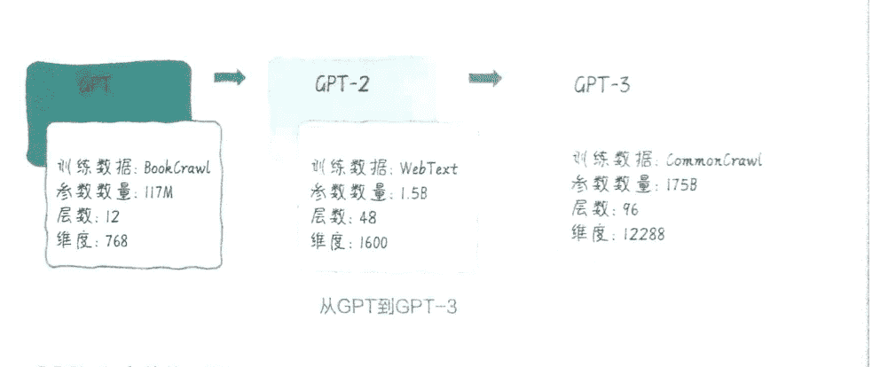

GPT-3参数增至1750亿后，对自然语言规律的捕捉更强，能理解更长的上下文，因此生成更连贯准确。同时对多语言及复杂任务如代码生成、自然语言问答的支持也更强。

> > **咖哥发言**
> 随着预训练语言模型在规模、性能和泛化能力上的持续进步，研究人员提出了伸缩定律理论。这一理论表明模型性能随模型规模的增长而提高。因此，研究人员一直在探索如何有效地扩大模型规模以提高其性能。当然，越来越大的模型也带来了一些挑战，如计算资源的消耗、模型的可解释性及潜在的滥用风险。

ChatGPT是在GPT-3.5基础上优化的聊天机器人应用，训练语料覆盖万亿级词汇。类似的InstructGPT也基于GPT-3.5。通过指令调优Instruction Tuning，模型在对话中的上下文、情感与逻辑处理得到增强。

ChatGPT还引入了基于人类反馈的强化学习，即RLHF，后面会详细讲解。同时它在InstructGPT基础上加入安全与合规考量，避免产生危害，这被称为对齐Alignment，即让AI目标与人类价值观一致。ChatGPT发布后不久，OpenAI又推出了推理能力更强的GPT-4。

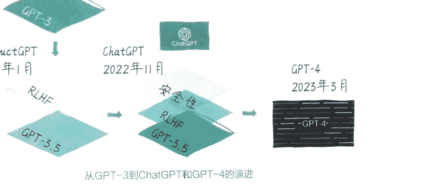

从Transformer到ChatGPT和GPT-4的演进，体现了模型规模、性能、泛化、友好性、安全性和道德责任等方面的持续进步，聊天机器人在多场景下更准确、可靠、灵活。

## 表8.1 从GPT到ChatGPT和GPT-4的关键技术说明

| 技术 | 说明 |

| :--- | :--- |

| 超大规模预训练模型 | ChatGPT以GPT-3为底座，参数规模庞大。研究显示参数对数增长时能力同步上升，尤其超过600亿参数后推理能力开始显现 |

| 提示/指令模式（Prompt/Instruction Learning） | ChatGPT把各类NLP任务统一成提示形式。借助提示工程可给出更精准的引导，提升特定场景的准确率与可靠性；指令学习则增强了零样本任务的处理能力 |

| 思维链（Chain of Thought） | 研究指出，用代码数据训练语言模型可获得推理能力。代码本身逻辑性强，注释也具备结构化特征，有助于模型学习问题解决的逻辑 |

| 基于人类反馈的强化学习（Reinforcement Learning from Human Feedback, RLHF） | 相较GPT-3，ChatGPT在对话友好度上提升明显。利用人类对答案的排序与标注，通过强化学习把人类偏好融入模型，使输出更友好、安全 |

| 控制性能（Controllability） | 相较GPT-3，ChatGPT在生成时能更好地控制文本长度、风格与内容，使其在聊天类任务中表现更为稳定 |

| 安全性和道德责任 | 从GPT-3到ChatGPT，OpenAI开始重视安全与伦理。为降低不当或偏见性回复，在微调阶段加入了专门的安全与道德约束 |

> - **GPT-4**-

从 Transformer到ChatGPT的发展，体现了自然语言处理技术在模型规模、性能、泛化能力、友好性、安全性和道德责任等方面的持续进步。这些进展使聊天机器人在各种应用场景中具有更高的准确性、可靠性和灵活性，在满足用户需求的同时，也更

#### 8.2 在 Wiki-GPT 基础上训练自己的简版 ChatGPT
下面用之前在WikiText-2上训练好的GPT，即Wiki-GPT，再继续训练我们自己的简版ChatGPT。这正是标准的“预训练 + 微调”流程，如图所示。

* **■ 预训练：** 用大型语料库训练一个GPT模型，语料来自不同领域与类型，让模型学会理解和生成自然语言。目标是捕捉语言的通用结构与模式。

* **■ 微调：** 加载预训练好的GPT模型，用特定的对话数据集对模型进行微调。数据集应包含各种类型的对话，以帮助模型学会如何生成对话式的回答。微调的目标是让模型更好地适应特定任务，即与用户进行自然的对话。

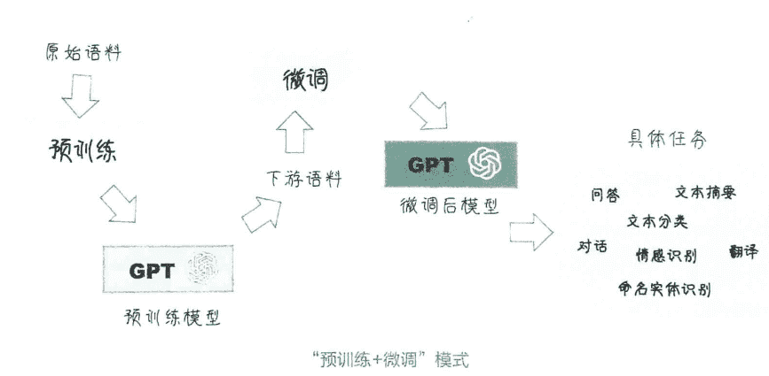

“预训练 + 微调”模式

下面载入Wiki-GPT，用聊天数据集微调它，得到具备对话能力的ChatGPT模型。

在训练前，先了解如何构建聊天任务的数据集。

### 第1步 聊天数据集的构建
下图是我们要使用的聊天语料，保存在文件 `chat.txt` 中。

**218 GPT 图解 大模型是怎样构建的**

> User: hi, how are you?

> AI: i am doing well, thank you. how about you?

> User: i am good, thanks for asking. what can you do?

> AI: i am an ai language model. i can help you answer questions.

> User: what is the weather like today?

> AI: please check a weather website or application for the current conditions.

> User: can you recommend a good book?

> AI: sure! to kill a mockingbird by harper lee is a classic and highly recommended novel.

> User: thank you! i will check it out.

> AI: you are welcome! let me know if you need help with anything else.


因为要以WikiText-2训练的GPT为基础，所以必须使用相同的分词器和词汇表，否则新语料的词索引与Wiki-GPT的索引不一致，知识推理就会失效。

###### 构建词汇表的代码和上节课中训练 Wiki-GPT 的代码相同。

```python
from torchtext.datasets import WikiText2 # 导入 WikiText-2
from torchtext.data.utils import get_tokenizer # 导入 Tokenizer 分词工具
from torchtext.vocab import build_vocab_from_iterator # 导入 Vocabulary 工具
tokenizer = get_tokenizer("basic_english") # 定义数据预处理所需的 tokenizer
train_iter = WikiText2(split='train') # 加载 WikiText-2 数据集的训练部分
####### 定义一个生成器函数，用于将数据集中的文本转换为 token
def yield_tokens(data_iter):
    for item in data_iter:
        yield tokenizer(item)
####### 创建词汇总表，包括特殊 token: "<pad>", "<sos>", "<eos>"
vocab = build_vocab_from_iterator(yield_tokens(train_iter),
            specials=["<pad>", "<sos>", "<eos>"])
vocab.set_default_index(vocab["<pad>"])
```

在词表统一后，可基于Tokenizer和词汇总表创建聊天数据集。

```python
import torch # 导入 torch
from torch.utils.data import Dataset # 导入 Dataset

class ChatDataset(Dataset):
    def __init__(self, file_path, tokenizer, vocab):
        self.tokenizer = tokenizer # 分词器
        self.vocab = vocab # 词汇表
        self.input_data, self.target_data = self.load_and_process_data(file_path)

def load_and_process_data(self, file_path):
    with open(file_path, "r") as f:
        lines = f.readlines() # 打开文件，读取每一行数据
        input_data, target_data = [], []
        for i, line in enumerate(lines):
            if line.startswith("User:"): # 移除 "User: " 前缀，构建输入序列
                tokens = self.tokenizer(line.strip())[6:]
                tokens = ["<sos>"] + tokens + ["<eos>"]
                indices = [self.vocab[token] for token in tokens]
                input_data.append(torch.tensor(indices, dtype=torch.long))
            elif line.startswith("AI:"): # 移除 "AI: " 前缀，构建目标序列
                tokens = self.tokenizer(line.strip())[4:]
                tokens = ["<sos>"] + tokens + ["<eos>"]
                indices = [self.vocab[token] for token in tokens]
                target_data.append(torch.tensor(indices, dtype=torch.long))
    return input_data, target_data

def __len__(self): # 数据集的长度
    return len(self.input_data)

def __getitem__(self, idx): # 根据索引获取数据样本
    return self.input_data[idx], self.target_data[idx]

file_path = "chat.txt" # 加载 chat.txt 语料库
chat_dataset = ChatDataset(file_path, tokenizer, vocab)

for i in range(3): # 打印几个样本数据
    input_sample, target_sample = chat_dataset[i]
    print(f"Sample {i + 1}:")
    print("Input Data: ", input_sample)
    print("Target Data: ", target_sample)
    print("-" * 50)

Sample 1:
Input Data: tensor([ 1, 9209, 4, 419, 37, 181, 860, 2])
Target Data: tensor([ 1, 67, 1734, 1633, 124, 4, 13818, 181, 5, 419, 76, 181, 860, 2])

**Sample 2**:
Input Data: `tensor([ 1, 67, 1734, 426, 4, 6733, 20, 4168, 5, 188, 115, 181, 289, 860, 2])`
Target Data: `tensor([ 1, 67, 1734, 33, 1976, 820, 1703, 5, 67, 115, 639, 181, 6108, 4280, 5, 2])`

**Sample 3**:
Input Data: `tensor([ 1, 188, 26, 3, 1508, 142, 805, 860, 2])`
Target Data: `tensor([ 1, 8943, 6421, 11, 1508, 1792, 50, 3627, 20, 3, 1092, 1406, 5, 2])`
```

我们自己实现的 ChatDataset 是在 PyTorch 原生 Dataset 基础上扩展出来的。类初始化时，`__init__` 会一并接收数据文件路径、分词器以及词表的配置信息。`load_and_process_data` 负责把文件内容读入内存，并把用户与 AI 的多轮对话统一转成模型可读的索引序列。`__len__` 用来返回整个对话集的样本总数，`__getitem__` 则根据传入的下标给出对应的输入序列和目标序列。准备好这个数据集后，就可以直接用它来搭建对话版的 DataLoader。

```python
from torch.utils.data import DataLoader # 导入 DataLoader
########## 定义 pad_sequence 函数，用于将一批序列补齐到相同长度
def pad_sequence(sequences, padding_value=0, length=None):
    # 计算最大序列长度，如果 length 参数未提供，则使用输入序列中的最大长度
    max_length = max(len(seq) for seq in sequences) if length is None else length
    # 创建一个具有适当形状的全零张量，用于存储补齐后的序列
    result = torch.full((len(sequences), max_length), padding_value, dtype=torch.long)
    # 遍历序列，将每个序列的内容复制到张量 result 中
    for i, seq in enumerate(sequences):
        end = len(seq)
        result[i, :end] = seq[:end]
    return result
####### 定义 collate_fn 函数，用于将一个批次的数据整理成适当的形状
def collate_fn(batch):
    # 从批次中分离源序列和目标序列
    sources, targets = zip(*batch)
    # 计算批次中的最大序列长度
    max_length = max(max(len(s) for s in sources), max(len(t) for t in targets))
    # 使用 pad_sequence 函数补齐源序列和目标序列
    sources = pad_sequence(sources, padding_value=vocab["<pad>"], length=max_length)
    targets = pad_sequence(targets, padding_value=vocab["<pad>"], length=max_length)
    # 返回补齐后的源序列和目标序列
    return sources, targets
```

```python
####### 创建 DataLoader
batch_size = 2
chat_dataloader = DataLoader(chat_dataset, batch_size=batch_size, shuffle=True, collate_fn=collate_fn)
```

### 第2步 微调 Wiki-GPT

* （1）先从 `GPT_Model.py` 中导入项目所依赖的库以及模型定义类。
* （2）实例化模型对象，务必与训练时保持完全一致的架构参数。
* （3）随后加载已保存的 `best_model.pt` 权重文件，完成模型恢复。

**1. 代码示例如下**

```python
from GPT_Model.py import GPT  # 导入 GPT 模型的类（这是我们自己制作的）
device = 'cuda' if torch.cuda.is_available() else 'cpu'  # 确定设备 (CPU 或 GPU)
model = GPT(28785, 256, n_layers=6).to(device)  # 创建模型实例
model.load_state_dict(torch.load('best_model.pt'))  # 加载模型
```

```text
python
GPT(
    (decoder): Decoder(
        (src_emb): Embedding(28785, 512)
        (pos_emb): Embedding(256, 512)
        (layers): ModuleList(
            (0): DecoderLayer(
                (self_attn): MultiHeadAttention(
                    (W_Q): Linear((in_features=512, out_features=512, bias=True)
                    (W_K): Linear((in_features=512, out_features=512, bias=True)
                    (W_V): Linear((in_features=512, out_features=512, bias=True)
                    (linear): Linear((in_features=512, out_features=512, bias=True)
                    (layer_norm): LayerNorm((512,), eps=1e-05, elementwise_affine=True)
                )
                (feed_forward): PoswiseFeedForwardNet(
                    (conv1): Conv1d((512, 2048), kernel_size=(1,), stride=(1,))
                    (conv2): Conv1d((2048, 512), kernel_size=(1,), stride=(1,))
                    (layer_norm): LayerNorm((512,), eps=1e-05, elementwise_affine=True)
                )
                (norm1): LayerNorm((512,), eps=1e-05, elementwise_affine=True)
                (norm2): LayerNorm((512,), eps=1e-05, elementwise_affine=True)
            )
```

(W_Q): Linear(in_features=512, out_features=512, bias=True)

(W_K): Linear(in_features=512, out_features=512, bias=True)

...

)) )

(projection): Linear(in_features=512, out_features=28785, bias=True))

<All keys matched successfully>

```


###### 加载了 Wiki-GPT 之后，就使用和训练模型相同的方法对模型进行微调。

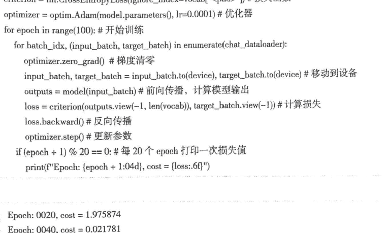


####### 这段代码你应该非常了解，代码本身不做过多的说明。不过，在此我要说明的是，在微调过程中，当微调数据集相对较小，或者与预训练模型使用的数据集非常相似时，可以选择冻结部分层次，以保留预训练模型在这些层次中学到的知识，并且防止过拟合。一个常见的做法是，可以仅微调顶层，即模型的头部层，以适应特定任务，既节省计算资源，又能保留预训练模型的底层已习得的通用特征。

####### 要冻结部分层次，可以在构建优化器时，指定需要更新的参数。

#### 第 8 课 流水后波推前波：ChatGPT 基于人类反馈的强化学习
223

def freeze_layers(model, n):
    params_to_update = []  # 获取模型的参数
    for name, param in model.named_parameters():
        if int(name.split(".")[1]) >= n:  # 冻结前 n 层
            params_to_update.append(param)
    return params_to_update
params_to_update = freeze_layers(GPT, n=2)  # 冻结前两层 (底层) 参数
optimizer = optim.Adam(params_to_update, lr=0.0001)  # 仅更新未冻结的参数

**第 3 步** 与简版 ChatGPT 对话

咖哥: 好的，现在模型调优结束了，看看这个经过聊天数据集微调的 ChatGPT 模型能否和我们进行简单的对话。

仍然用集束算法来生成对话结果 (这里就不再重复展示 `generate_text_beam_search` 函数的代码)。

```python

def generate_text_beam_search(model, input_str, max_len=50, beam_width=5):

    # 不再重复相同代码

       ...   

    input_str = "what is the weather like today ?"

    input_str = "hi , how are you ?"

    generated_text = generate_text_beam_search(model, input_str.split())

    print("Generated text:", generated_text)

```

```text

Generated text: hi , how are you ? thank you , depicting you , painted by relatively intact by ronald? questions containing need for ultimate ? by orchestral endangered . you , ai you , ai you ,

用 GPT-2 做轻量对话微调

让一个经典的 GPT-2 学会基础问答，可以把整体拆成环境准备、模型载入、结构预览、数据封装、批对齐、训练循环这六步走。

依赖先装好。
```

小冰：咖哥，我们的 ChatGPT 还真的能对话！只不过……能力有点弱。

咖哥：当然了！我们的训练数据集小，模型也小，模型的生成质量就会比较差。
因为模型可能无法理解复杂的句子结构，或者在特定主题上缺乏深入的理解。同时，也可能出现过拟合问题，因为模型可能会过度学习训练数据中的特定模式，而在实际对话中却难以泛化。

作为只有几万个参数的教学模型，我们今天只能走到这一步。

当然，这是一个良好的开始，是万里长征的第一步。现在你已经拥有了自己从头搭建起来的 ChatGPT 模型，下面需要做的可能是这几步。

(1) 增加模型的参数，扩展其结构，在更大规模的硬件中训练模型。
(2) 收集更多的自然语言或下载更大的语料库作为训练数据。
(3) 增加更多的训练技巧和文本生成技巧，让模型说出来的话更像人话。

小冰: 我明白了，咖哥。看起来要做的事情还不少，光收集语料库可不是一天两天能做到的。有没有更快捷的方法来训练出一个更好的聊天机器人啊？

咖哥: 当然有了，我们总是能站在巨人的肩膀上的。

##### 8.3 用 Hugging Face 预训练 GPT 微调 ChatGPT

前面主要讲解的是“预训练 + 微调”这种 NLP 模型应用范式。刚才，我们使用了自己从头开始训练的 Wiki-GPT，来微调我们自己的 ChatGPT。这种方式适合教学，让你能从头开始理解模型的搭建。

然而，在实战中，大多数情况下都不需要从 0 开始训练模型，而是使用“大厂”或者其他研究者开源的已经训练好的大模型。

在各种大模型开源库中，最具代表性的就是 Hugging Face。Hugging Face 是一家专注于 NLP 领域的 AI 公司，开发了一个名为 Transformers 的开源库，该开源库拥有许多预训练后的深度学习模型，如 BERT、GPT-2、T5 等。Hugging Face 的 Transformers 开源库使研究人员和开发人员能够更轻松地使用这些模型进行各种 NLP 任务，例如文本分类、问答、文本生成等。这个库也提供了简洁、高效的 API，有助于快速实现自然语言处理应用。

从 Hugging Face 下载一个 GPT-2 并微调成 ChatGPT，需要遵循的步骤如下。

###### 第 1 步 安装 Hugging Face Transformers 库

首先，通过运行以下命令安装 Transformers 库。

```bash

pip install transformers

脚本里接入 PyTorch，并从 transformers 引入 GPT-2 的分词器与语言建模头，默认 model_name 设为 gpt2，必要时可换成更大变体。
```

###### 第 2 步 载入预训练 GPT-2 模型和分词器

当我们使用 Hugging Face 提供的预训练 GPT-2 模型时，务必要同时使用与之匹配的分词器。这是因为预训练模型和分词器共享相同的语料库信息，如果分词器不匹配，可能会导致词汇表冲突和预测错误。因此，在提供预训练模型的同时，开发者通常也会提供相应的分词器、词汇表及其他相关配置信息，以确保模型能够正常工作。

使用如下代码导入模型和分词器。

```python

import torch  # 导入 torch

from transformers import GPT2Tokenizer  # 导入 GPT-2 分词器

from transformers import GPT2LMHeadModel  # 导入 GPT-2 语言模型

model_name = "gpt2"  # 也可以选择其他模型，如"gpt2-medium"

打印后能看到典型的 Transformer 块：LayerNorm 归一化、注意力子层、由 Conv1D 搭建的 MLP、NewGELU 激活与 Dropout 正则。
```

```text

(c_proj): Conv1D()

        (attn_dropout): Dropout(p=0.1, inplace=False)

        (resid_dropout): Dropout(p=0.1, inplace=False)

        )

        (ln_2): LayerNorm((768,), eps=1e-05, elementwise_affine=True)

        (mlp): GPT2MLP(

        (c_fc): Conv1D()

        (c_proj): Conv1D()

        (act): NewGELUActivation()

        (dropout): Dropout(p=0.1, inplace=False)

        )

        )

        (1): GPT2Block(

        (ln_1): LayerNorm((768,), eps=1e-05, elementwise_affine=True)

        (attn): GPT2Attention(

数据层需要自建。基于 PyTorch Dataset 派生 ChatDataset，构造时保存 tokenizer 与词表引用，并马上调用内部解析方法把对话文件拆成问题张量与答案张量两部分。
```

**分词器信息：** PreTrainedTokenizer(name_or_path='gpt2', vocab_size=50257, model_max_len=1024, is_fast=False, padding_side='right', truncation_side='right', special_tokens={'bos_token': AddedToken("<endoftext>", rstrip=False, lstrip=False, single_word=False, normalized=True), 'eos_token': AddedToken("<endoftxt>"), rstrip=False, lstrip=False, single_word=False, normalized=True), 'unk_token': AddedToken("<endoftext>")}, rstrip=False, lstrip=False, single_word=False, normalized=True), 'pad_token': '<endoftexl>')

**词汇总表大小：** 50257

**部分词汇示例:** ['parent', 'Art', 'pack', 'diplom', 'rets']

这里我们选择了最轻量级的模型“gpt2”，当然，也可以选择其他模型，如“gpt2-medium”“gpt2-large”等，这些模型对计算资源的需求更大。

###### **第 3 步 准备微调数据集**

下面我们准备和上一个示例相似的聊天数据集，并将数据集处理成 Transformers 库可以接受的格式，也就是对文本数据进行分词并将它们转换为模型可以理解的数字表示。

####### **创建和上一个示例非常类似的 ChatDataset 类。**

```python

from torch.utils.data import Dataset  # 导入 PyTorch 的 Dataset

######## 自定义 ChatDataset 类，继承自 PyTorch 的 Dataset 类

class ChatDataset(Dataset):

    def __init__(self, file_path, tokenizer, vocab):

        self.tokenizer = tokenizer  # 分词器

        self.vocab = vocab  # 词汇表

        # 加载数据并处理，将处理后的输入数据和目标数据赋值给 input_data 和 target_data

        self.input_data, self.target_data = self.load_and_process_data(file_path)

逐行判断前缀的逻辑是：User: 开头的行去掉前缀分词后补 EOS 作为输入，AI: 开头的行同理处理作为目标。类提供了长度查询与下标取样，最后用 chat.txt 实例化并解码前两条样本核对格式。
```

######## 定义加载和处理数据的方法

```python

def load_and_process_data(self, file_path):

    with open(file_path, "r") as f:  # 读取文件内容

        lines = f.readlines()

    input_data, target_data = [], []

    for i, line in enumerate(lines):  # 遍历文件的每一行

        if line.startswith("User:"):  # 如以"User:"开头，移除"User:"前缀，并将张量转换为列表

            tokens = self.tokenizer(line.strip()[6:], return_tensors="pt")["input_ids"].tolist()[0]

            tokens = tokens + [tokenizer.eos_token_id]  # 添加结束符

            input_data.append(torch.tensor(tokens, dtype=torch.long))  # 添加 input_data

        elif line.startswith("AI:"):  # 如以"AI:"开头，移除 "AI: " 前缀，并将张量转换为列表

            tokens = self.tokenizer(line.strip()[4:], return_tensors="pt")["input_ids"].tolist()[0]

            tokens = tokens + [tokenizer.eos_token_id]  # 添加结束符

            target_data.append(torch.tensor(tokens, dtype=torch.long))  # 添加 target_data

    return input_data, target_data

########## 定义数据集的长度，即 input_data 的长度

def __len__(self):

    return len(self.input_data)

########## 定义获取数据集中指定索引的数据的方法

def __getitem__(self, idx):

    return self.input_data[idx], self.target_data[idx]

file_path = "chat.txt"  # 加载 chat.txt 数据集

chat_dataset = ChatDataset(file_path, tokenizer, vocab)  # 创建 ChatDataset 对象，传入文件、分词器和词汇表

for i in range(2):  # 打印数据集中前 2 个数据示例

    input_example, target_example = chat_dataset[i]

    print(f"  示例{i + 1}:")

    print("输入:", tokenizer.decode(input_example))

    print("输出:", tokenizer.decode(target_example))

训练需要等长。先为 tokenizer 补充 <pad> 并记录 id，手写 pad_sequence 用全零底板把一批不等长序列右补齐，再写 collate_fn 在每个 batch 内按源与目标的最大长度统一填充。DataLoader 设 batch_size 2 并洗牌，跑一次打印形状与内容验证流水线。
```

> **示例 1:**
> 输入：hi, how are you?<endoftext>
> 输出：i am doing well, thank you. how about you?<endoftext>
> **示例 2:**
> 输入：i am good, thanks for asking. what can you do?<endoftext>
> 输出：i am an ai language model. i can help you answer questions.<endoftext>

这个 ChatDataset 类和之前我们自建的简版 ChatGPT 中的同名类很像，只有“结束符”的设置方法不同，这个区别也正是我们需要注意的地方。在我们自己的语料库中，有我们自定义的<sos>和<eos>标签。而此处预训练的 GPT-2 的语料库字典中，文本结束符、文本起始符和填充符的格式都是<|endoftxt|>。我们应该遵循 GPT-2 预训练时的设置，即在句子结尾加入 tokenizer.eos_token_id（这个 ID 值在此处是 50256）。

###### **第 4 步 准备微调数据加载器**

用 ChatDataset 创建数据加载器的具体代码如下。

```python

from torch.utils.data import DataLoader  # 导入 DataLoader

tokenizer.pad_token='<pad>'  # 为分词器添加 pad token

tokenizer.pad_token_id=tokenizer.convert_tokens_to_ids('<pad>')

########## 定义 pad_sequence 函数，用于将一批序列补齐到相同长度

def pad_sequence(sequences, padding_value=0, length=None):

    # 计算最大序列长度，如果 length 参数未提供，则使用输入序列中的最大长度

    max_length = max(len(seq) for seq in sequences) if length is None else length

    # 创建一个具有适当形状的全零张量，用于存储补齐后的序列

    result = torch.full((len(sequences), max_length), padding_value, dtype=torch.long)

    # 遍历序列，将每个序列的内容复制到张量 result 中

    for i, seq in enumerate(sequences):

        end = len(seq)

        result[i, :end] = seq[:end]

    return result

####### 定义 collate_fn 函数，用于将一个批次的数据整理成适当的形状

def collate_fn(batch):

    # 从批次中分离源序列和目标序列

    sources, targets = zip(*batch)

    # 计算批次中的最大序列长度

    max_length = max(max(len(s) for s in sources), max(len(t) for t in targets))

    # 使用 pad_sequence 函数补齐源序列和目标序列

    sources = pad_sequence(sources, padding_value=tokenizer.pad_token_id, length=max_length)

    targets = pad_sequence(targets, padding_value=tokenizer.pad_token_id, length=max_length)

    # 返回补齐后的源序列和目标序列

    return sources, targets

####### 创建 DataLoader

chat_dataloader = DataLoader(chat_dataset, batch_size=2, shuffle=True, collate_fn=collate_fn)

####### 检查 Dataloader 输出

for input_batch, target_batch in chat_dataloader:

    print('Input batch tensor size:', input_batch.size())

    print('Target batch tensor size:', target_batch.size())

    break

for input_batch, target_batch in chat_dataloader:

    print('Input batch tensor:')

    print(input_batch)

    print('Target batch tensor:')

    print(target_batch)

    break

######## Input batch tensor:

######## tensor([[ 72, 716, 922, 837, 5176, 329, 4737, 764, 644, 460, 345, 466, 5633, 50256, 50256, 50256]])

损失取 CrossEntropyLoss 并忽略 pad 位置，优化器用 Adam 学习率 0.0001。外层 500 个 epoch，内层遍历 DataLoader，每步先清零梯度再反向。
```这个数据加载器中的 collate_fn 函数，和刚才我们自建的简版 ChatGPT 中的同名函数相比，也只有填充符 pad token 的设置不同。GPT-2 没有内置的填充符，但我们的训练过程需要用到它，因此可以手工为其添加一个“填充符”。代码 tokenizer.pad_token = '<pad>' 设置 `<pad>` 为填充符，后续代码将其与对应的 ID 关联起来。然后，我们就可以在填充序列时使用 tokenizer.pad_token_id（这个 ID 值在此处也是 50256），以便模型能够正确处理填充的部分。

###### 第 5 步 对 GPT-2 进行微调

下面，我们使用 ChatDataset 数据集和数据加载器对模型进行微调。

```python

import torch.nn as nn

import torch.optim as optim

####### 定义损失函数，忽略 pad_token_id 对应的损失值

criterion = nn.CrossEntropyLoss(ignore_index=tokenizer.pad_token_id)

####### 定义优化器

optimizer = optim.Adam(model.parameters(), lr=0.0001)

####### 进行 100 个 epoch 的训练

for epoch in range(500):

    for batch_idx, (input_batch, target_batch) in enumerate(chat_dataloader): # 遍历数据加载器中的批次

        optimizer.zero_grad() # 梯度清零

GPT-2 RLHF 迷你实战

让模型更符合偏好，思路就是用带分值的问答对驱动训练，让高分回复在梯度上占更大比重。下面是一次迭代的精简流程，数据搬运、正向计算、损失计算、梯度回传和参数迭代都在这几行体现，轮数到百的倍数时输出一次 cost 便于监控。

        input_batch, target_batch = input_batch.to(device), target_batch.to(device) # 将输入和目标批次移至设备

        outputs = model(input_batch) # 前向传播

        logits = outputs.logits # 获取 logits

        loss = criterion(logits.view(-1, len(vocab)), target_batch.view(-1)) # 计算损失

        loss.backward() # 反向传播

        optimizer.step() # 更新参数

    if (epoch + 1) % 100 == 0: # 每 100 个 epoch 打印一次损失值

        print(f'Epoch: {epoch+1:04d}, cost={loss:.6f}')

环境准备、模型加载以及一份用于演示的打分对示例如下：
```

Epoch: 0100, cost=2.234567
Epoch: 0200, cost=1.678901
Epoch: 0300, cost=1.141592
Epoch: 0400, cost=0.987654
Epoch: 0500, cost=0.718281

这个对预训练 GPT-2 模型进行微调的训练过程和我们熟悉的训练过程大同小异。

唯一需要介绍的是模型返回的 outputs，它是一个 `CausalLMOutput` 对象，包含了 GPT-2 模型的输出信息。它具有以下属性。

- **logits**：形状为 (batch_size, sequence_length, vocab_size) 的张量。这是模型输出的原始分数，表示每个位置上每个单词的可能性。这些分数通常通过 softmax 函数转换为概率分布，用于生成文本或计算损失。
- **past_key_values**：这是一个包含注意力权重信息的元组，用于 GPT-2 模型的自注意力机制。这些权重可以在生成序列时重复使用，以提高性能。在训练过程中，通常不需要关注这个属性。
- **hidden_states**：这是一个包含所有层的隐藏状态的列表（可选）。默认情况下，它不会被返回，除非在实例化模型时设置 `output_hidden_states=True`。在某些情况下，这些隐藏状态可能用于特征提取或迁移学习。
- **attentions**：这是一个包含每个注意力头的权重的列表（可选）。默认情况下，它不会被返回，除非在实例化模型时设置 `output_attentions=True`。这些权重可能对于可视化模型的注意力分布或分析很有用。

在这段代码中，我们关心的主要是 **logits**，它用于计算损失以更新模型参数。我们从 outputs 对象中提取 logits，然后将它们传递给损失函数 criterion。

完成微调后，我们可以使用模型直接生成文本，也可以将模型保存到磁盘，以便以后使用。要生成文本，只需使用分词器对输入文本进行编码，并将其输入模型。

###### 第 6 步 用集束解码函数生成回答

**最后，我们使用集束解码函数来生成回答**，看看模型是否获取了训练语料库中的知识。


第 8 课 流水后波推前波：ChatGPT 基于人类反馈的强化学习 231

## GPT 图解

> Out

User: what is the weather like today?<|endoftext>

[PAGE 0](img/placeholder_for_page_jump)

AI: you need an current time for now app with app app app app
测试 2:
User: Can you recommend a good book?<lendoftexti>
AI: ockingbird Lee Harper Harper Taylor

模型的回答虽然称不上完美，但是，我们至少能够看出，微调数据集中的信息起到了一定的作用。第一个问题问及天气，模型敏锐地指向“app”（应用）这个存在于训练语料库中的信息，而查看“应用”确实是我们希望模型给出的答案。回答第二个问题时，模型给出了语料库中所推荐图书的作者的名字“Lee Harper”，而书名“Toko kill aMockingbird”中的 mockingbird 是一个未知 token，模型把它拆解成了三个 token。具体信息如下。

evaluator.encode('Mockingbird'): [44/76, 8629, 16944]
tokenizer.decode(44): 'M'
tokenizer.decode(8629): 'ocking'
tokenizer.decode(16944): 'bird'

因此，在解码时，出现了 ockingbird 这样的不完整信息，但是其中也的确包含了语料库内部的知识。
这样，我们就实现了一个完整的“预训练 + 微调”的流程。预训练模型可以捕获语言的通用表示，而微调则针对特定任务进行优化。这一模式的优势在于，微调过程通常需要较少的训练数据和计算资源，同时仍能获得良好的性能。

小小：谢谢咖哥，我想，今日所字，我在今后的研究工作中业务实践中会时常用到的，能否谈谈 RLHF，也就是基于人类反馈的强化学习。

####### ChatGPT 的 RLHF 实战

ChatGPT 之所以成为 ChatGPT，基于人类反馈的强化学习是其中重要的一环。而 ChatGPT 的训练工程称得上是复杂而又神秘的，迄今为止，OpenAI 也没有开源它的训练及调优的细节。

从 OpenAI 已经公开的一部分信息推知，ChatGPT 的训练主要由三个步骤组成，如下页图所示。

第 8 课 流水后波推前波：ChatGPT 基于人类反馈的强化学习 233

####### ChatGPT 主要训练步骤

第 1 步，先使用大量数据（从 Prompt 数据库中抽样）通过监督学习在预训练的 GPT-3.5 基础上微调模型，得到一个初始模型，就是监督学习微调模型（Supervised Fine-Tune Model, SFT）——暂且把它命名为“弱弱的 ChatGPT”。

第 2 步，请标注人员为初始模型“弱弱的 ChatGPT”对同一问题给出的不同答案排序，评估这些答案的质量，并为它们分配一个分数。然后使用这些数据训练出一个具有人类偏好的奖励模型（Reward Model，RM）——这个奖励模型能够代替人类评估 ChatGPT 的回答大概会得到多少奖励。

第 3 步，初始化“弱弱的 ChatGPT”模型，从 Prompt 数据库中抽样，与模型进行对话。然后使用奖励模型对“弱弱的 ChatGPT”模型的输出进行打分。再将结果反馈给“弱弱的 ChatGPT”模型，通过近端策略优化（Proximal Policy Optimization, PPO）算法进一步优化模型。

不过，这还没完，此时 ChatGPT 模型经过优化，能生成更高质量的回答，那么，再回到第 1 步用优化后的 ChatGPT 初始化模型，就得到更好的 SFT 模型；用更好的 SFT 在第 2 步中取样，又得到更好的回答；对更高质量的回答进行排序、评分后，就能训练出更好的奖励模型，于是获得更好的反馈……这样不断循环，ChatGPT 就一步一步，在接受人类的反馈的同时，不断自我优化，像周伯通一样左右手互搏，一波接着一波，越变越强，走上了“机器生”的巅峰，也震惊了世界。

####### 8.4.1 强化学习基础知识

在进一步演示 RLHF 实战之前，需要补充介绍强化学习的基础知识，方便读者对 RLHF 中的某些关键概念（比如策略、奖励以及 PPO 算法）建立起更好的理解。

强化学习，又称增强学习，是机器学习的范式和方法论之一，用于描述和解决智能体 (Agent) 在与环境的交互过程中通过学习策略以达成回报最大化或实现特定目标的问题 (如下图所示)。


在 ChatGPT 的训练中，强化学习的关键概念解释如下。

- **智能体**：聊天机器人，也就是我们正在训练的模型。它的任务是在给定的环境中生成回复。
- **环境**：机器人与人类的对话。机器人需要在这个环境中理解用户的问题并给出回应。
- **状态**：在聊天的场景下，可能包括当前的对话历史、用户的输入等。
- **行动**：机器人的回答。比如，用户可能问：“天气如何？”机器人的行动可能是回答：“天气很好。”
- **策略**：机器人用来决定下一步行动（即生成下一句回复）的算法。它通常基于机器人的内部模型，例如 GPT 模型。
- **奖励**：机器人根据它的行动（即回答）获得的反馈。在实际的训练过程中，奖励可能来源于多种渠道，例如用户的反馈。如果机器人的回答让用户满意，它可能获得积极的奖励；反之，如果用户对回答不满意，它可能得到惩罚（负奖励）。

在训练 ChatGPT 时，OpenAI 让一组人类评估者来评价模型的回答。这些评估者拿到了一组指导方针，告诉他们什么样的回答应该被高度评价，什么样的回答应该被低度评价。在评估者评价的过程中，通过不断的试错和学习，机器人试图找到一种策略，使得在与用户交谈过程中获取的总奖励最大。这就是通过基于人类反馈的强化学习调优 ChatGPT 的基本思想。

那么，问题的关键就是如何选择下一个行动。策略梯度优化算法通过神经网络来进行下一个行动的选择，机器人通过策略梯度方法来调整策略网络的参数，从而改善其策略，如下图所示。


机器人通过策略梯度方法来调整策略网络的参数从而改善其策略

而近端策略优化 (PPO) 则是一种增强学习算法。它是由 OpenAI 的约翰·舒尔曼 (John Schulman) 等人在 2017 年提出的一种策略梯度方法，其目标是优化一个策略，使其在某个任务中获得尽可能高的累积奖励。与其他策略梯度方法相比，PPO 的优势是它具有更好的稳定性和样本效率。

PPO 的核心思想是限制策略更新的幅度，以避免在训练过程中产生过大的策略改变，从而提高学习稳定性。为了实现这一目标，PPO 引入了一种名为“Clip”的策略更新方法，它限制了策略更新中的概率比率。这可以确保新策略与旧策略之间的相似性，从而避免过大的策略改变。

PPO 算法的工作流程如下所述。

- （1）从当前策略中收集一批经验 (状态、行动和奖励)。
- （2）通过计算梯度来优化策略，以使累积奖励最大化。在这个过程中，PPO 使用了“Clip”方法来限制策略更新的幅度。
- （3）更新策略并重复这个过程。

PPO 在许多应用场景中表现出色，尤其是在连续控制任务和游戏领域。由于稳定性强且效率高，PPO 已成为许多研究人员和从业者的首选算法。至此我们就了解了强化学习和 PPO 策略相关的基础知识。

####### 8.4.2 简单 RLHF 实战

咖哥：要实现 RLHF 的教学，需要继续学习和掌握的细节太多了，而且很多具体细节，我们也没有来自 OpenAI 的官方文档作支撑。所以，咖哥只能尝试简单地实现。

小冰：好的咖哥，我们尽力而为。复现 ChatGPT，“人人有责”。咖哥你也不必一个人扛下所有。

咖哥笑了：哈哈哈，我还差得太远。我们现在做的还只是理解它，远远谈不上复现它。还是那句话，万里长征的第一步嘛。迈到这一步，已经很不容易了。

不过，仅从教学的角度出发，我们可以尝试对代码进行以下几方面的修改，从而对模型进行调优。

- （1）构建人类反馈数据集。首先，需要获得用户对模型生成的回答的评价，可以让用户评价模型的回答，或者使用已有的评分数据集。评价可以是二值评分（好/坏）或更精细的评分（例如，1 到 5 分）。
- （2）设计奖励函数。根据收集到的用户反馈，设计一个奖励函数。该函数将为模型生成的每个回答分配一个分数，反映回答的质量。
- （3）实现策略梯度训练。将训练过程从监督学习修改为强化学习。这意味着我们需要使用策略梯度方法，如 REINFORCE 或 PPO，更新模型的权重。在每个训练步骤中，需要将模型的输出与奖励函数的输出结合起来，以优化模型的性能。下面的这个示例，读者可以参考，以理解 RLHF 的原理及流程。

######## 第 1 步 构建人类反馈数据集

下面，我们就从刚才训练好的 ChatGPT 中收集它的一部分回答，然后人工给出评分。当然，在构建数据集之前，还需要导入模型的分词器，构建词汇总表。

```python

import torch #导入torch

from transformers import GPT2Tokenizer #导入GPT2分词器

from transformers import GPT2LMHeadModel # 导入GPT2语言模型

model_name = "gpt2" #也可以选择其他模型，如"gpt2-medium" "gpt2-large"

tokenizer = GPT2Tokenizer.from_pretrained(model_name) #加载分词器

device = "cuda" if torch.cuda.is_available() else "cpu" #判断是否有可用GPU

model = GPT2LMHeadModel.from_pretrained(model_name).to(device) #将模型加载到设备上

vocab = tokenizer.get_vocab() #获取词汇总表

#示例RLHF数据

data = [

    {

        "User": "What is the capital of France?",

        # "AI": "The capital of France is Paris.",

        "AI": "Paris.",

        "score": 5

    },

    {

        "User": "What is the capital of France?",

        "AI": "Rome.",

        "score": 1

    },

    {

        "User": "How to cook pasta?",

        # "AI": "To cook pasta, first boil water and then add pasta.",

        "AI": "first boil water.",

        "score": 4

    },

    {

        "User": "How to cook pasta?",

        # "AI": "First, turn on the microwave and put the pasta inside.",

        "AI": "microwave.",

        "score": 2

    }

]

########## 更多带人工评分的回答数据....

将上述对话整理成可批量抽样的形式，封装方式参考下方：
```

```python

from torch.utils.data import Dataset # 导入 PyTorch 的 Dataset

class RLHFDataset(Dataset): # 创建一个数据集类，继承自 PyTorch 的 Dataset

    def __init__(self, data, tokenizer, vocab): # 类的初始化函数

        self.tokenizer = tokenizer # 分词器，用于将文本数据转换为模型可以理解的形式

        self.vocab = vocab # 词汇表，存储所有可能的词汇，以便模型能理解

        # 处理输入数据，将其分解为输入数据、目标数据和评分数据

        self.input_data, self.target_data, self.scores = self.process_data(data)

    def process_data(self, data): # 处理数据的函数

        input_data, target_data, scores = [], [], [] # 初始化输入、目标和评分列表

        for conversation in data: # 遍历数据集中的每一条对话

            user_question = conversation["User"] # 用户的问题

            model_answer = conversation["AI"] # 模型的回答

            score = conversation["score"] # 该对话的评分

            # 对用户的问题进行分词，并转换为模型可以理解的形式

            input_tokens = self.tokenizer(user_question, return_tensors="pt")["input_ids"].tolist()[0]

            input_tokens = input_tokens + [tokenizer.eos_token_id] # 在末尾加上 EOS 标志

            # 将处理后的问题添加到输入数据列表中

            input_data.append(torch.tensor(input_tokens, dtype=torch.long))

            # 对模型的回答进行分词，并转换为模型可以理解的形式

分数驱动的极简 RLHF 实战

把对话上下文、参考答案和人工打分三者打包进一个可迭代的容器，让训练时一次就能拿到输入、目标和偏好信号。下面围绕数据集封装、批次装配以及基于匹配率加权奖励的更新闭环展开说明。

            target_data.append(torch.tensor(target_tokens, dtype=torch.long))

            scores.append(score) # 将评分添加到评分列表中

        return input_data, target_data, scores # 返回处理好的数据

    def __len__(self): # 返回数据集的长度，即对话的数量

        return len(self.input_data)

    def __getitem__(self, idx): # 获取指定索引的数据

        # 返回指定索引的输入数据、目标数据和评分

        return self.input_data[idx], self.target_data[idx], self.scores[idx]

########## 创建 RLHFDataset 对象，传入文件、分词器和词汇表

rlhf_dataset = RLHFDataset(data, tokenizer, vocab)

########## 打印数据集中前 2 个数据示例

for i in range(2):

    input_example, target_example, _ = rlhf_dataset[i]

    print(f"Example {i + 1}:")

    print("Input:", tokenizer.decode(input_example))

    print("Target:", tokenizer.decode(target_example))

先实例化 RLHFDataset 并预览前两个样本，确认输入、目标和分数能够正常读取。

```

Example 1:

Input: What is the capital of France?<|endoftext|>

Target: Paris.

########### Example 2:
Input: What is the capital of France?
Target: Rome.

这个类处理数据的方式是将对话中的用户问题作为输入数据，模型回答作为目标数据，对话的评分作为评分数据。这样，我们就可以用这些数据训练模型，使其能够更好地回答问题，并通过评分来评估模型的表现。

按照和上一个示例类似的方式，构建 RLHF DataLoader。

```python

from torch.utils.data import DataLoader  # 导入 DataLoader

tokenizer.pad_token = '<pad>'  # 为分词器添加 pad token

tokenizer.pad_token_id = tokenizer.convert_tokens_to_ids('<pad>')

########## 定义 pad_sequence 函数，用于将一批序列补齐到相同长度

def pad_sequence(sequences, padding_value=0, length=None):

    # 不再重复相同代码

为分词器补上填充标记并准备序列对齐工具，pad_sequence 的具体实现此处省略。

```

```python

########## 定义 collate_fn 函数，用于将一个批次的的数据整理成适当的形状

def collate_fn(batch):

    # 不再重复相同代码

collate_fn 负责把一批长度不一的样本拼成模型可接受的张量形状，具体代码省略。

```

######## 第 2 步：设计奖励函数

下面，我们基于数据集中人工对每个回答的评分，设计出一个奖励函数。

```python

########## 设计奖励函数

def reward_function(predictions, targets, scores):

    correct = (predictions == targets).float() * scores.unsqueeze(1)

    reward = correct.sum(dim=-1) / (targets != tokenizer.pad_token_id).sum(dim=-1).float()

    return reward / scores.max()

奖励的思路是先定位预测与目标一致的位置，再用样本级评分加权，最后做归一化。

```

`reward_function` 函数接收 3 个参数：`predictions`（模型的预测输出）、`targets`（目标/正确答案）和 `scores`（每个样本的得分）。首先，将 `predictions` 和 `targets` 进行逐元素比较，得到一个布尔类型张量。然后通过调用 `.float()` 将布尔类型张量转换为浮点类型张量，这将把 `True` 变为 1.0，`False` 变为 0.0。接下来，将 `scores` 张量在第一个维度上进行扩展（通过调用 `.unsqueeze(1)`），以使其具有与 `correct` 张量相同的尺寸，然后将它们相乘。这将产生一个新的张量，其中正确预测的元素值等于原始得分，错误预测的元素值为 0。

计算每个样本的奖励值。首先，沿最后一个维度对 `correct` 张量求和，进而得到每个样本的正确预测数量（乘以对应的得分）。然后，计算目标张量中非填充标记的数量（通过检查元素是否不等于 `tokenizer.pad_token_id`）。接下来，将正确预测的得分之和除以非填充标记的数量，得到每个样本的奖励值。

最后，为了使奖励值位于 0 到 1 之间，我们将奖励值除以 `scores` 张量中的最大值。这样，在 0 和 1 之间的奖励值将反映模型在每个样本上的正确预测概率。函数返回这个归一化的奖励值张量。

######## 第 3 步：实现策略梯度训练

有了奖励函数，我们就可以把奖励值引入我们的训练过程，也就是把奖励值和损失函数结合起来，形成一个新的加权损失。

具体实现代码如下。

```python

import numpy as np  # 导入 numpy

import torch.nn as nn  # 导入 torch.nn

import torch.optim as optim  # 导入优化器

criterion = nn.CrossEntropyLoss(ignore_index=tokenizer.pad_token_id)  # 损失函数

optimizer = optim.Adam(model.parameters(), lr=0.0001)  # 优化器

num_epochs = 100  # 定义训练过程中的轮数

########## 开始训练循环

for epoch in range(num_epochs):

    epoch_rewards = []  # 初始化本轮的奖励记录

    # 对数据加载器中的每一批数据进行遍历

    for batch_idx, (input_batch, target_batch, score_batch) in enumerate(chat_dataloader):

        optimizer.zero_grad()  # 清空梯度

        # 将输入、目标及分数移至设备上（GPU 或 CPU）

        input_batch, target_batch = input_batch.to(device), target_batch.to(device)

        score_batch = score_batch.to(device)

        outputs = model(input_batch)  # 前向传播

        logits = outputs.logits  # 获取模型的输出 logits

        # 使用 torch.max 函数在最后一个维度上获取 logits 的最大值，得到模型的预测结果

        _, predicted_tokens = torch.max(logits, dim=-1)

        # 使用 reward_function 计算奖励

        rewards = reward_function(predicted_tokens, target_batch, score_batch)

        # 计算损失

        loss = criterion(logits.view(-1, logits.size(-1)), target_batch.view(-1))

        # 计算加权损失，根据奖励对损失进行加权

        weighted_loss = torch.sum(loss * (1 - rewards)) / rewards.numel()

        weighted_loss.backward()  # 对加权损失进行反向传播，计算每个参数的梯度

        optimizer.step()  # 使用优化器更新参数

        epoch_rewards.append(rewards.cpu().numpy())  # 将奖励记录到本轮的奖励列表中

    avg_reward = np.mean(np.concatenate(epoch_rewards))  # 计算本轮的平均奖励

    if (epoch + 1) % 20 == 0:

        print(f"Epoch: {epoch + 1:04d}, cost={weighted_loss:.6f}, avg_reward={avg_reward:.6f}")

########## Out

| Epoch | cost   | avg_reward |

|---     |---     |---         |

| 0020   | 0.907932 | 0.158333  |

| 0040   | 0.727185 | 0.420833  |

| 0060   | 0.340342 | 0.454167  |

| 0080   | 0.282583 | 0.591667  |

| 0100   | 0.196376 | 0.666667  |

训练日志显示成本逐步收敛，平均奖励则持续抬升，说明模型在贴近参考文本的同时，更倾向于复现人类评分更高的表达。仅用奖励加权的交叉熵就能把参数推向更受好评的方向，这一最简策略更新是可行的。

收尾阶段可复用之前的束搜索解码器生成回答，用来直观检验模型是否吸收了训练语料中的语言倾向。

**终端即用：一行 Python 撬动 GPT-4 对话**

想把大模型直接搬进命令行里用？借助 OpenAI 官方 Python SDK，几步就能搭出一个会记住上下文的轻量交互程序。先装好依赖并填入个人的访问凭证，然后用一个列表来累积整段会话。启动时先收集一段用于塑造语气与任务的引导信息存入历史，之后进入持续读入、调用模型、回显结果的闭环，只有在检测到约定的退出指令时才会停止。下面这份最小实现演示了如何把上下文传递、角色信息与退出逻辑串起来，配置完成后即可运行。

```python
########## 定义集束解码函数
def generate_text_beam_search(model, input_str, max_len=50, beam_width=5):
    # 不再重复相同代码
    ...
    return output_str

########## 测试模型
test_inputs = [
    "What is the capital of France?",
    "How to cook pasta?"
]
########## 输出测试结果
for i, input_str in enumerate(test_inputs, start=1):
    generated_text = generate_text_beam_search(model, input_str)
    print(f"Test {i}:")
    print(f"User: {input_str}")
    print(f"AI: {generated_text}")

########## Out
| Test 1 | User                          | What is the capital of France? |
|---     |---                            |---                              |
|        | AI: A.Rome                     | Romeo and Rome's water water   |
|        |                                | and a.comecomecomecomecomecomecomecomecomecomecomecome |
| Test 2 | User                          | How to cook pasta?              |
|        | AI: The water in               | water water water               |

可以看到，模型从数据集中奖励分数较高的回答中捕捉到了一些信息。当然，我们这个版本的 RLHF 模型是非常原始的，你可能需要进一步研究强化学习和策略梯度方法，大刀阔斧地调整和创新，以实现更强大的聊天机器人。

## **小结**

在这一课中，我们通过两种方法，创建出了属于自己的 ChatGPT 模型。

第一种方法基于已经训练好的 Wiki-GPT，这意味着模型已经有了一定的预训练基础，可以在此基础上进行微调以适应聊天场景。这种方法的优势在于可以利用已有的预训练成果，节省训练时间和计算资源。但缺点是模型可能不太适合处理非维基百科领域的问题，性能可能受限于预训练数据。

第二种方法是基于 Hugging Face 平台上的 GPT-2 进行微调。这种方法使用的预训练数据更丰富，适用于多种任务。它的优势在于具有更好的泛化能力，可以直接下载预训练模型，节省时间。缺点是需要更多的计算资源进行微调，同时需要了解 Hugging Face 平台的使用方法。

这两种方法的差异如表 8.2 所示。

| 方法 | 数据来源 | 基础模型 | 特征 | 优势 | 劣势 |
|---|---|---|---|---|---|
| 基于已训练的 Wiki-GPT 微调自己的 ChatGPT | 之前训练好的 Wiki-GPT | Wiki-GPT | - 专注于维基百科数据，已经有一定的预训练基础 | - 可以利用已有的预训练成果<br>- 节省训练时间和计算资源 | - 可能不太适合处理非维基百科领域的问题<br>- 模型性能可能受限于预训练数据 |
| 基于 Hugging Face 平台上的 GPT-2 微调自己的 ChatGPT | Hugging Face 平台 | GPT-2 | - 预训练数据更加丰富<br>- 适用于多种任务 | - 在不同任务上有更好的泛化能力<br>- 可以直接下载预训练模型，节省时间 | - 需要更多的计算资源进行微调<br>- 需要了解 Hugging Face 平台的使用方法 |

通过 RLHF 和其他关键技术，ChatGPT 正朝着成为一个更加智能、更具人性化和更可靠的 AI 迈进。这不仅有助于提高聊天机器人的回答质量，还将为人们在各种场景下的交流和协作提供有益的支持。

我们将见证这些创新带来的深刻变革，人工智能将以更加自然、紧密的方式融入日常生活。从教育、医疗、娱乐到金融、法律等行业，ChatGPT 等先进技术将不断拓展我们的知识边界，提高生产力，增进人类福祉。

未来，自然语言处理技术可能会继续朝着以下方向发展。

- **模型优化和压缩**：随着模型规模的扩大，计算资源和能耗也相应增加。研究人员将继续探索如何在保持性能的前提下，优化和压缩模型，以降低其对计算资源的需求。
- **可解释性和可审计性**：随着模型复杂性的提升，如何理解和解释模型的行为变得越来越重要。未来研究可能会关注模型可解释性和可审计性的提高，以便更好地理解模型的工作原理，避免潜在的偏见。
- **多模态和跨领域学习**：将自然语言处理技术与其他领域（如计算机视觉、语音识别等）相结合，实现多模态和跨领域的学习，以提升模型的理解能力和应用范围。
- **个性化和上下文感知**：研究人员可能会关注如何让聊天机器人更好地理解用户的个性化需求和上下文信息，从而生成更加贴近用户需求的回答。
- **数据安全和隐私保护**：在大规模预训练过程中，如何确保数据安全和保护用户隐私也是一个重要的研究方向。研究人员将继续探索技术和方法，以在保证模型性能的同时，兼顾数据安全和隐私保护。

我们有理由相信，通过不懈地研究和实践，这些振奋人心的技术将为全人类创造一个更加美好的未来。

#### 思考

1. 在微调 Wiki-GPT 时，搜集更多的对话语料，微调模型，让其拥有更强的对话能力。
2. Hugging Face 提供不同参数规模的 GPT-2 模型，在微调 ChatGPT 时，尝试使用更大型的 GPT-2 模型。
3. 构建出更大的人类反馈数据集，并优化 RLHF 算法，重构本课中的 RLHF 示例代码，目标是训练出更强大的 ChatGPT。

# 第 9 课

### **生生不息的循环：使用强大的 GPT-4 API**

咖啡：小冰同学，让我跟你分享一个重磅消息：微软昨晚发布了一款神奇的办公软件，名为 Microsoft 365 Copilot，它可用了目前前沿的 GPT-4 技术！这意味着，无论是 Word、PPT、Excel，还是 Outlook、Teams，等等，都将得到强大的 AI 加持！

想象一下，有了 Copilot，我们就可以用最简单的界面和自然语言来轻松操作这些办公软件了。这个“办公超人”，能帮助我们快速完成文本处理、表格制作、幻灯片演示等各种办公任务。比如在 Word 里，只要给 Copilot 一个简短的提示，它就能帮你写出一篇初稿，甚至还能从整个组织的知识库中调取信息！它不仅懂我们的需求，还能自动处理大量数据和文本，提高工作效率和准确性！

此外，微软宣布开源 Copilot Chat 应用，帮助用户快速开发类 ChatGPT 应用并将其集成在产品中。Copilot Chat 基于微软 Semantic Kernel 框架开发而成，除了自动生成文本之外，还具备个性化推荐、数据导入、可扩展、智能客服等功能，在商业场景应用非常广泛。

说老实话，从 GPT，到 GPT-2，再到 GPT-3、GPT-3.5、ChatGPT 和 GPT-4，进化速度真的太快了。此后，国内爆发“千模大战”，各种中文通用大模型和垂直领域的大模型纷纷涌现。而 Meta 也推出了迄今为止性能最强的开源语言模型 Llama2。这真让我不得不联想到生态系统中生生不息的循环。在生态系统中，各种生物不断繁衍生息，不断地进化，以适应环境。我有时候会思考，AI 是不是真的已经拥有自我进化的能力。

#### **9.1 强大的 OpenAI API**

其实，不仅微软推出的 Office Copilot 将让日常办公更加自动化和智能化，还有很多中小型公司和个人，通过 OpenAI 发布的一系列 GPT API，开发了许许多多的浏览器插件、ChatGPT 插件和桌面应用，如带有 PDF 检索功能的 ChatGPT 插件能加载需要分析的 PDF 文件，然后基于其中的内容进行对话；又如 WebChatGPT 和 ChatGPT for Google 能实现在网页搜索的同时和 ChatGPT 对话；再如 AutoGPT 能够把你交给它的任务分解成多个子目标，让 AI 完成任务自动化。这些工具，真的会给几十亿劳动者带来一场效能革命。

- **小冰**：我很期待，又有些惶恐。咖哥，我们如何跟上时代，在创新的时代潮流中贡献自己的力量呢？
- **咖哥**：其实，你我都已经身在其中了。AI 工具的出现，并不意味着人类就没用了，我们还有许多无可替代的能力，比如创造力、想象力、社交能力、技术能力，以及判断和决策能力等。AI 其实已经极大地激发了我们的想象力和创造力。我教给你的课程，也正是 AI 创新的一部分。
- **实际操作中**，我们可以通过编写代码来调用 GPT-4 API，将我们的需求以参数的形式传递给 API。API 会根据我们的需求，利用 GPT-4 的强大推理能力为我们提供相应的解决方案。这就像打开了一个智能的宝库，我们可以不断地从这个宝库中汲取知识，为各种应用提供强大的支持。
- **小冰**：原来如此，难怪有人说，一行 `import openai` 代码，就完全撑得起一个初创公司！通过调用 GPT-4 API，我们可以不断地优化自己的应用，提升服务质量。而 OpenAI 的 GPT 模型，也会通过我们的每次调用继续积累经验，变得更加强大。这个过程就像生生不息的生态系统，对吗？
- **咖哥**：正是如此！
- 在 OpenAI 的网站上（见下图），我们可以看到一系列与开发相关的信息。我们可以跟着示例（Examples）来学习，也可以注册一个账号，开始使用 GPT API，构建新的应用或者开发新的 ChatGPT 插件。

Welcome to the OpenAI platform!

OpenAI 的开发者页面

- **咖哥**：OpenAI 的每一个模型，都有属于自己的 API。OpenAI 发布 GPT-4 API 的时候，咖哥我第一时间就提交了申请，也很快就得到了回复（如下图所示），等了几天，就获得了 GPT-4 API 的开发权限。相信过不了多久，GPT-4 API 就会开放给所有的程序员。

不过，OpenAI 的 API 并不是完全免费的，在你刚刚注册账号的时候，你会得到价值 18 美元的使用配额。而且，因为模型能够同时处理的请求数量也受算力的限制，OpenAI 会对你可以向 API 发出的请求实施速率限制（见下页图）。每个模型都有每分钟请求数、每分钟 token 数的限额，如果是图像模型，每分钟生成的图像数也有限额。

> **Rate limits**
>
> OpenAI enforces rate limits on the requests you can make to the API. These are applied over requests-per-minute, tokens-per-minute, or in the case of image models, images-per-minute.
>
> Learn more in the [rate limits documentation](/docs/rate-limits), or reference the [default rate limits for our models](/docs/rate-limit-defaults). Your organization's rate limits are listed below.
>
> | MODEL | RPM | TPM |
> |---|---|---|
> | GPT CHAT | | |
> | gpt-3.5-turbo | 3,500 | 90,000 |
> | gpt-3.5-turbo-0301 | 3,500 | 90,000 |
> | gpt-4 | 200 | 40,000 |
> | gpt-4-8314 | 200 | 40,000 |
> | TEXT | | |
> | ada | 3,000 | 250,000 |
> | ada-code-search-code | 3,000 | 250,000 |

注册成功之后，你就可以在 OpenAI 网站上找到专属于你的 API 密钥，如下图所示。

> **API keys**
>
> Your secret API keys are listed below. Please note that we do not display your secret API keys again after you generate them.
>
> Do not share your API key with others, or expose it in the browser or other client-side code. In order to protect the security of your account, OpenAI may also automatically rotate any API key that we've found has leaked publicly.
>
> | NAME | KEY | CREATED | LAST USED |
> |---|---|---|---|
> | Secret key | sk-...2Jq8 | Mar 5, 2023 | Never |
> | Secret key | sk-...Ahht | Mar 5, 2023 | May 8, 2023 |
>
> + Create new secret key

> **注意**：这是专属于你的密钥，不要分享给别人或者发布在网上，否则 OpenAI 会封锁它。还有一点要提醒，就是你要在 OpenAI 分配给你 API 密钥的第一时间把它记录下来，保存在一个安全的位置。因为再次登录 OpenAI 网站的时候，这个密钥就会被打码。（当然，如果你丢失了 API 密钥，随时可以申请新的 API 密钥。）## 9.2 使用 GPT-4 API

小冰：咖哥啊，你说了这么半天，开发几个基于 GPT-4 API 的应用，让我们见识见识呗。

咖哥：说老实话，这可比我们开发自己的 GPT 和 ChatGPT 模型简单多了！只要完成下面几个步骤，我们就能创建出非常强大的聊天机器人了。

(1) 安装 openai 包。

```bash

pip install openai

```

(2) 导入 openai 库，设置 API Key。

```python

import openai

openai.api_key = "替换成你的 Key"

```

(3) 设置初始对话消息。

```python

messages = []

print("您好，我们终于见面了！！您希望接下来我为您提供什么服务？")

system_message = input("人类说：")

messages.append({"role": "system", "content": system_message}) # 设定角色为 system

print("好的，明白了！我会服务好您的。" + "\n" + "现在请和我聊天吧！" + "\n" + "记住，烦我的时候，请说“再见”。")

```

这一步中，我们设置初始消息，其中`"role": "system"`设置了我们希望 GPT 在这次对话中所扮演的角色。这个角色的设置，是下面我们要发送给 GPT-4 的第一条消息。它将引导 GPT-4 在后续的对话中，尽量按照这个身份来完成对话。比如说，你可以告诉它：你是一个知识渊博的老师，正在进行教学活动，我是你的学生。”

(4) 通过 openai.ChatCompletion API，接收 GPT-4 的回应信息从而展开对话。

```python

while True: # 循环对话过程直到人类说再见

    message = input("人类说：")# 收集人类输入

    messages.append({"role": "user", "content": message}) # 设定角色为 user

    response=openai.ChatCompletion.create(#调用 ChatCompletion API 进行聊天 

                                        model="gpt-4",#指定模型 

                                        messages=messages)#指定消息内容 

    reply=response["choices"][0]["message"]["content"]#返回的聊天内容 

    print("ChatGPT 说:",reply) 

    #Check if the user wants to exit the conversation

    if message.lower()=="再见":#结束对话循环 

        break

```


这个简版的 ChatBot 就完成了！代码循环调用 OpenAI API 以生成聊天机器人的**回复**。传入 `model` 参数以指定使用 GPT-4 模型 (如果用 ChatGPT 模型，则可以指**定 model="gpt-3.5-turbo" ), 同时传入 messages 参数，然后通过 response 接收模型回应的内容。

从和它对话的示例可以看出，它非常成功地扮演着自己的角色——一个 AI 教师。

小冰：哇……这真的很强……很强！

咖哥：当然很强，这可是 "GPT 本 T"。无论是文本生成、文本综述，还是图片生成，都是同样的套路，只要你把问题描述清楚，抛给远方的 GPT 或者 DALL-E (OpenAI 的图像生成 AI), 它们就会根据你的指令，给你所要的答案。对于图片，模型会提供所生成图片的 URL 链接。

当然，这个示例只是 OpenAI API 开发的冰山一角。在开发 OpenAI API 时，我们不仅有多种模型可供选择，还可以在通过 API 和模型对话时设置采样温度 [介于 0 和 1 之间，较高的值 (如 0.8) 将使输出更加随机，而较低的值（如 0.2）将使输出更加集中和确定]、最大 token 数 (返回文本不超过设定值)、已有惩罚项 (增加模型谈论新主题的可能性) 和频率惩罚项 (降低模型逐字重复同一行的可能性) 等参数。

如何更好地使用 OpenAI API (其实也就是如何实现更好的提示工程), 创作出更丰富多样的 AI 应用产品，不是咖哥这门课程的重点，但是未来，我们一定有机会在这个方面进行更深入的探讨。

小冰：好棒！

#### 小结

这里，我们利用较短的篇幅，聊聊如何利用 OpenAI GPT-4 API 这个强大的工具来创建聊天机器人。不难发现，GPT-4 API 确实是一个非常好用的接口，它可以帮助我们通过各种应用场景中充分发挥 GPT-4 的能力。

实际操作中，我们可以通过编写代码来调用 GPT-4 API，将需求以参数的形式传递给 API。API 会根据需求，利用 GPT-4 的强大推理能力为我们提供相应的解决方案。随着 GPT 的不断进化，我们的应用也就跟着不断进化，能力会越来越强，能够提供更多的可能性，实现更多的创新。这种不断进化的过程正是我们在构建智能应用时所追求的目标。

值得一提的是，现在还出现了 LangChain 和 LlamaIndex 等多种构建在大语言模型基础之上的应用程序开发框架。其中，LangChain 是一个用于开发由语言模型驱动的应用程序框架，它提供了模块化的抽象组件，通过链、代理、提示模板和各种模型接口让各种大模型 API 的调用变的更简单，你可以更轻松的使用特定用例，或开发出新的应用场景，甚至创造出你的智能代理。而 LlamaIndex 则是一个简单、灵活的数据框架，用于将自定义数据源连接到大型语言模型。它提供了数据摄取、数据索引和查询接口等关键工具，以增强大语言模型应用程序与数据之间的联系。

咖哥期待着在不久的将来和你共同学习这些新工具。

奇迹涌现，未来已来，你我一起加油！

#### 思考

- 注册你的 OpenAI 账号，得到 OpenAI API Key。
- 阅读 OpenAI API 文档，调用其他模型，实现聊天对话之外的各种其他功能，如图片生成、语音识别、词嵌入等。
- 在调用 OpenAI API 时尝试各种参数设置。
- 学习提示工程，设计出更好的提示词，让 OpenAI API 返回更精准的答案。


#### 后记
莫等闲，白了少年头

自然语言处理领域的发展历程如同部史诗。

- 早期的 N-Gram 语言模型和 Bag-of-Words 模型，让我们开始了对词频和局部词序列的探索。
- 词向量表示，如 Word2Vec 等技术的诞生，则揭开了词汇语义信息的神秘面纱。
- 随后，NPLM 中神经网络技术的引入，使得 RNN、TextCNN 等基于深度学习的模型逐渐应用于自然语言处理领域，语言模型序列处理能力大大增强。
- 伴随着 Seq2Seq 模型的出现，编码器 - 解码器架构为序列到序列的处理带来了新的突破。
- Attention 机制的诞生，赋予 Seq2Seq 模型全新的力量，使其能够更加聚焦输入序列的关键部分。
- Transformer 模型摒弃了传统的 RNN 结构，将自注意力机制发挥至极致，为整个自然语言处理领域带来了翻天覆地的变革。
- 在 Transformer 的基础上，BERT 和 GPT 强势登场，预训练语言模型的技术使迁移学习得以实现。BERT 以双向的方式捕捉上下文信息，而 GPT 则以生成式方法和单向结构取得了优异成绩，甚至又向前推进一步，让大模型从“自然语言处理应用”发展到了‘人工通用智能雏形’。它们的成功不仅推动了自然语言处理领域的进步，更激发了无数研究者和工程师的激情与创造力。

人类科技的突破，从未按照单调的线性增长模式前进，有时暂时沉寂，而有些时刻却如奇迹般涌现。ChatGPT 的出现就是这样一种状况，随着它的到来，一个属于 AI 的大时代降临，也为我们带来新的希望和无限可能。

人类第一次随着阿波罗号宇宙飞船登上月球，迈出探索宇宙这一壮阔旅程的重要一步，AI 技术则在地球上引领着一场信息革命。正如登月改变了人类的认知边界，AI 重新定义了我们的生活和工作方式。

通用型 AI 的落地，将使许多传统任务自动化和智能化，改变我们的学习习惯和方式，这将大大减轻我们的工作负担和压力，提高学习和工作的效率和质量。例如，以往耗时繁琐的文书工作、数据分析和报告制作，甚至程序设计等，都可以自动或者半自动地利用 AI 完成。这将带来一场工具革命，深刻影响人类的职业生涯。

未来，各类工作岗位和需求将发生重大变革。这场工具革命将触及数十亿劳动者，涵盖各行各业。然而，很多工作仍需依赖人类独特的能力和技能，包括但不限于以下几类。

- 创造力和想象力：人类在创造力和想象力方面的优势仍无可替代。文案创作、设计创意及方案制定等工作，仍需人类的思维和灵感。
- 社交和人际关系：在社交和人际关系方面，AI 无法取代人类。商务拓展、客户关系管理工作需要人类的沟通技巧，尤其是建立客户信任和了解客户需求等方面。
- 技术和编程能力：人类是 AI 的设计者和 AI 系统的架构师。AI 需要在人类的指导下进行训练，也需要人类的提示才能更好地工作，创造更大的价值。软件开发、网站维护和数据分析等工作，还不能由 AI 独立完成，仍需人类参与开发和设计。
- 判断和决策能力：AI 目前还不具备可以与人类相比的判断和决策能力。企业管理和决策等工作依然依赖人类的洞察力和决策力。

在这一变革的浪潮中，人们需要学会适应，掌握新的技能和能力。

正如登月使得人类意识到了自己在宇宙中的渺小，AI 也在提醒我们，还有很多未知领域等待我们去探索和挖掘。AI 不应让我们变得懒惰，坐享其成，我们应该在它的驱动下勇敢地拥抱时代变化，不断提升自己的知识储备和技能水平，以及创造力、社交、技术和判断方面的独特优势，它们在未来的职场中将依然具有不可替代的价值。

莫等闲，白了少年头。

时代的巨变是挑战，更是机遇。对每一个领域、每一种技术，我们都应该在 AI 的辅助下，进行更深入的学习、挖掘和理解，并结合实际情况深入思考。长此以往，我们不仅将成为更优秀的个体，同时还能和 AI 一道，为整个人类社会的进步和发展贡献力量。


《零基础学机器学习》通过 AI 新人小冰拜师程序员咖哥学习机器学习的对话展开，内容轻松，实战性强，主要介绍了机器学习相关基础知识及实战案例。书中案例均源自真实项目，方便读者动手操作和应用，无缝对接入门学习与业务实践，力求使读者快速领会机器学习内涵，从而拥有在人工智能领域进一步发展的能力。

《数据分析咖哥十话从思维到实践促进运营增长》以案例的形式，介绍从思维模型分析到场景实践的数据分析方法。全书围绕“数据分析”与“运营增长两大关键要素，在系统介绍数据分析基础知识的同时以问题为导向，从运营与增长各个核心环节展开数据分析实战。

《GPT 图解大模型是怎样构建的》是一本真正为时代而写的佳作，它为我们解码了 AI 复杂的技术背后的秘密，令人赞叹。生活在智能时代的我和公司全体同人，能够有幸第一时间通过这本书，深入了解生成式 AI 背后的原理与魅力。强烈推荐每一位想要进入 AI 世界的读者拥有此书。
——腾讯 云语音云前总经理，PlatoX AI 创始人、CEO 毛华

在今日的技术洪流中，《GPT 图解大模型是怎样构建的》如同明亮的灯塔，照清了 NLP 技术的“来龙”，也指引着大语言模型的“去脉”。它化繁为简，用一系列不到 200 行代码的案倒，复现多篇 NLP 领域经典论文。书中的图倒和生动的描述为初学者铺设了通往大模型世界的坦途，必将从 AI 领域的经典之作。
——清华大学长聘教授，教育部长江学者，国家 973 项目首席科学家李丹

黄佳是极客时间 App 的专栏作者，他的作品深入浅出，强调实战，很受用户好评。这本《GPT 图解大模型是怎样构建的》保持了黄佳一贯的风格，有生动的图倒，有故事式的课程编排，是一本为所有人对 AI 好奇的人准备的导读书。无论你是专家还是新手，这本书都会带给你不一样的启示。
——极客邦科技创始人、CEO 霍太稳

《GPT 图解大模型是怎样构建的》这本书用通俗易懂的语言介绍了 AI 领域前沿的理论知识，对于初学者 AI 和有经验的从业人员都很很有价值，在阅读的过程中，我可以感受到作者对 NLP 技术的热情，这是一一次非常棒的阅读体验。
——迪士尼流媒体技术总监程墨

这是一本深入探讨大型语言模型核心算法的著作，可以帮助读者全面而深入的理解大模型。书中提供了 BERT、GPT、Word2Vec、Transformer、ChatGPT 等 NLP 关键技术的实践指导和代码示例，帮助读者快速上手并实现自己的预训练模型和 ChatGPT 应用。无论你是学生、研究人员还是从业人员，本书都将成为你的指南。
——深蓝学院联合创始人赵松

说起 AI，相信很多人已经见识过各种大模型产生的惊人内容。这些模型是建立在机器学习和深度学习等技术基础之上的杰作，在这本书里，咖喱以其一贯幽默生动的语言，将它们的奥秘娓娓道来，不仅让我们得以一窥 AI 的巨大潜力，也让普通读者能够对其产生直观理解。强大的 AI 模型正在深刻改变我们的生活。如果你也想开启自己的 AI 之旅，这本书绝对是最好的入门读物，快来加入咖喱的 AI 世界，感受科技的魅力吧！
——电信数智研发中心主任、人工智能专家邵宏刚

封面设计：李   插图设计：周秦红

ISBN 978-7-115-62368-3
分类建议：计算机人工智能
定价：79.80 元
人民邮电出版社网址：www.ptpress.com.cn
```