# GenAI 时代如何做教师：生成式人工智能赋能教学与研究

## 作者简介

杜玉霞 教育技术学博士，教授，博士生导师，博士后合作导师，美国俄亥俄州立大学访问学者。现任广州大学知识工程与智慧教育研究中心主任。国家级一流线上课程“思维导图的教学应用”“人是如何学习的”两门课程负责人，广东省信息化思维训练虚拟教研室负责人。兼任中国高等教育学会学习科学研究分会常务理事、国家智慧教育示范区（广州）建设指导专家等职。主要从事教师教育信息化、人工智能教育、思维教学、数字教材、智慧教育、STEAM教育等领域研究。主持国家社科基金“新时代义务教育数字教材应用的教学支持服务体系构建研究”等课题10多项，发表学术论文50多篇，在中国社会科学出版社等出版专著4部。

贺卫国 现任广东财经大学大数据与人工智能学院副教授，计算机应用技术博士，美国俄亥俄州立大学访问学者。国家级一流线上课程“思维导图的教学应用”“人是如何学习的”两门课程主讲教师。主要从事人工智能、教育信息技术、软件工程的教学与研究，发表学术论文40多篇，主编教材1部。主持“大规模在线开放课程的生命周期与发展动力模型研究”“高等教育数字化转型中教师作用的变化及教学模式创新研究”等省部级课题多项。

## 前 言

自2022年11月ChatGPT发布以来，生成式人工智能（Generative Artificial Intelligence，简称GenAI）迅速进入教育领域，越来越多的教师开始应用GenAI开展课程设计、教学资源开发与教学研究等工作。然而，在观摩各类“GenAI赋能教学创新”的公开课、教学比赛，以及评审相关课题与教研成果的过程中，我们不断遇到一些值得警惕的问题。

印象最深的有两件事。一是在评审某省级课题时，有申请书写道：“2024年12月，教育部发布了《教育技术在中小学应用的指导意见》。”这令我生疑：教育部真的发布过这份文件吗？在官网上反复搜索未果，又查找该申请书所引用的一些来自几本从未听说过的期刊的文献，登录几个数据库检索，既没查到这些期刊，也没查到这些文献。显然，这些文献与上述文件都是由GenAI虚构的。另一件事，是观摩一节小学语文课时发现的问题。课文是《日月潭》，教师在讲到“日月潭风光秀丽，吸引了许许多多的中外游客”时，让学生畅想“你如果去日月潭，会怎么玩？”，接着课件中出现了一幅热闹的图片：几位少年卷起裤腿在小溪中捉鱼，鸭子在水中游动。老师绘声绘色地说：“你们一定会像图中的孩子一样玩得很开心！”课后，问教师为何选用这张图，她说，为了增强学生的理解和对日月潭的向往，特地用GenAI生成的。可当被追问这幅图是否真的符合日月潭的实际景观时，她愣了下，随即自省道：“图是好看，可和课文内容不太相符……我只顾着画面生动，忽略了准确性。”

类似虚构文献、误用图像、忽视GenAI生成资源与教学的契合性等问题，发现得越多，我们就越清晰地意识到，必须帮助教师系统掌握GenAI的应用机理、方法与策略，使他们敢用、会用，用得准、用得好。

近年来，我们为高校、职业学校和中小学教师及教研员讲授了100多场GenAI赋能教学与研究的专题讲座，举办了10多期GenAI教学应用工作坊。基于讲座和工作坊的授课资料及学员的典型案例，我们在学银在线平台创建了“生成式人工智能赋能教学”在线私播课。同时，在国家级线上一流课程“人是如何学习的”中增加了如何应用GenAI高效学习的模块，包括如何用GenAI创建智能学习助手等应用GenAI开展人机协同学习的方法与策略。为了帮助教师们有效应用GenAI等数智技术开展教学与研究，我作为广东省信息化思维训练虚拟教研室负责人，在2023年，与多位专家联合发起了系列研讨活动，吸引了全国上万名教师的积极参与。许多教师在参会反馈中提出，迫切需要一本有理论、有实践的专业书籍，能够指导教师系统应用GenAI。

广东省信息化思维训练虚拟教研室高度重视老师们的诉求，经深入调研及与各方交流研讨后，决定撰写本书。本书由我和广东财经大学贺卫国负责全书内容架构、主要章节撰写和统稿。广东第二师范学院姜雨欣，广州大学高学敏、廖宏建、王慧敏，广州市幼儿高等师范专科学校张海容，广州市海珠区教育发展研究院邓丹玫，国家开放大学郭欣悦，天水师范大学刘宝康等撰写了部分章节内容。

本书在介绍GenAI原理与趋势、全球相关政策与规范的基础上，带领零基础教师，从构建个人的GenAI资源库、打造智能体应用助手入手，逐步深入地讲解应用GenAI赋能教学设计、多模态资源创建、教学创新等各类教学场景，以及应用GenAI赋能研究选题、文献综述、课题申请书撰写等教育研究场景的具体方法与策略，阐述了防范风险与问题的措施。

为帮助老师们快速上手，本书对GenAI应用方法与策略的讲解结合了典型的真实案例，深圳市南山实验教育集团莫潇潇，广州大学缪静敏、杨琳、吕贵香，广州市海珠区新滘中学苏蕴瑜，广州市白云区平沙培英学校尹晓华，甘肃省庆阳市第三中学杜文斐，深圳市水田小学黄燕玲，广州市海珠区怡乐路小学陆燕珍，广东省茂名市水东中学李玲，黄冈师范学院陈弘正，西北民族大学尕藏草，华南师范大学詹泽慧，广州市越秀区教育信息中心李正艳，河北地质大学杜文睿，云南师范大学钟维、俞庆秋，广东技术师范大学谢运佳，西南大学杜文琦，广州大学王婷、许倩雯、丁思萌、叶芝圻、谢晓、何雨昕等，以及许多未能一一提及姓名的老师和同学们，为本书提供了精彩的案例，使读者朋友可以获得可操作、可迁移的方法与经验。

在这个技术日新月异的时代，我们希望这本书能够帮助教师与时俱进地掌握GenAI在教育领域应用的机理、方法与策略，并及时研判风险，掌握防范措施。将近两年的创作过程中，我们深切感受着GenAI的飞速发展，曾担心受出版周期制约，这本书在发行时可能就会过时。可喜的是，出版社不仅高效出版了本书，还为作者和读者搭建了交流平台。平台既提供了典型工具与案例的实操方法，还为读者、作者的互动交流与内容的及时更新提供了便利渠道。

感谢广州大学吴开俊、聂衍刚、马凤岐、刘晖、苏启敏、麻彦坤、张延平、唐春明、杨文登、张豹等相关领导和同事的关心与支持。感谢华南师范大学徐福荫、吴鹏泽、柯清超、张学波，广东工业大学胡钦太，北京大学汪琼、尚俊杰，浙江大学黄昌勤、盛群力，华中师范大学刘三女牙、杨九民，西北民族大学沙景荣，南方科技大学赵建华，西南大学刘革平，江南大学陈明选、马志强，西北师范大学郭绍青，华东师范大学吴永和，深圳大学曹晓明，南京师范大学沈书生等专家在本书写作中给予的宝贵建议。

感谢教育科学出版社颜晴老师的督促、指导和支持帮助，感谢颜晴老师和张璞老师的细致审读和修改完善建议，让本书能够以更好的面貌呈现。感谢教育科学出版社相关领导及各环节工作人员的支持，使本书得以顺利出版。感谢参与本书内容试用、反馈与修改的培训班学员，正是你们的实践经验与宝贵建议，让本书的内容有了现实的根基。由于作者水平所限，书中可能还有不足之处，敬请各位读者不吝赐教，使本书能够不断完善。如您有任何建议或意见，欢迎通过邮箱与我们联系：dyxyuxia@126.com。

杜玉霞


## 第 1 章 教师如何应对GenAI引发的教育变革

## 第 1 节 GenAI的特征与趋势

### 一 什么是GenAI

GenAI是一种人工智能技术，能够在自然语言对话界面中，根据提示自动生成内容。GenAI是通过借助已有内容来生成全新的内容，这些内容可以用涵盖人类思维的各种符号形式来表达，包括文本、图像、视频、音乐以及软件代码。尽管GenAI能够创作新的内容，但它并不能产生突破性的原创思想或独立解决需要深层现实洞察的复杂问题，因为它缺乏对语言所指涉的现实世界对象、社会互动及文化语境的深层语义理解与因果关联能力。①

GenAI是能够基于已有数据生成新内容的人工智能系统。与传统人工智能主要用于分类、识别等判别型任务不同，GenAI基于已有数据学习其内在规律，能够根据用户提供的指令，创作出具有语义连贯性、形式完整性和结构合理性的文本、图像、语音、代码、视频等多模态内容。比如你输入一个任务提示，“帮我写一篇关于‘人工智能与教育’的教学反思”，它几秒钟就能生成一篇结构清晰、语言通顺、逻辑完整的文章。GenAI能够理解你的意图，生成你所需要的内容。这种“从无到有”生成内容的能力，正是GenAI区别于其他人工智能的重要标志。但是，GenAI生成的内容并不能保证其准确性与客观性，用户要具备对其内容存在的错误、偏见等进行识别的能力。

2022年11月，美国OpenAI公司发布了能够基于自然语言对话生成多种类型文本的ChatGPT，两个月其用户就破亿，引发世界各国关注，GenAI也进入高速发展阶段。ChatGPT不断迭代更新，2023年，GPT-4模型具备初步的多模态能力，支持文本与图像输入，并能够生成文本、图像及代码等多种输出形式。同时，其集成产品，如ChatGPT的语音版可通过语音识别与合成，支持语音输入与输出的人机交互。2023年，美国Google公司推出多模态大模型 Gemini，强化语言、图像等模态的融合处理能力。同年，美国科技公司 Meta 开源 Llama 2，以开放许可推动大语言模型在科研与产业中的广泛应用。接着，OpenAI公司在2024年2月发布了文本生成视频模型Sora，GenAI在多模态内容生成方面取得了新突破。

近几年，中国企业也相继推出了具有自主知识产权的多种GenAI产品，如百度的“文心一言”、阿里的“通义千问”、华为的“盘古”、腾讯的“混元”、字节跳动的“豆包”等，形成了“百模争鸣”的繁荣局面。DeepSeek作为中国AI领域新兴力量，于2025年1月20日发布的DeepSeek-R1，在逻辑推理、数学和编码方面，性能对标OpenAI o1，缩小了中国生成式人工智能与国际领先水平的差距，开源特点使其迅速被应用到社会各领域。但中国生成式人工智能在算法效率、数据质量、算力资源等方面的差距，需要靠中国企业的自主创新实现赶超。

### 二 GenAI是如何工作的

无论是通过浏览器的网页还是移动端的APP使用GenAI产品，只要用户根据需求输入明确指令，就可以得到GenAI生成的相应内容。参考日本文部科学省2024年12月颁布的《初等中等教育阶段生成式AI利用暂行指南（2.0）》①，GenAI的工作过程如图1-1所示。

GenAI通过以下工作过程与步骤，完成用户要求的生成任务。

第一步，用户输入指令，即提示词（Prompt）。用户可以通过文本、图像、网页链接或语音等多媒体形式输入提示词，明确提出需求、问题或操作指令。例如，输入“用简单语言解释量子力学”或上传一张风景照片生成诗歌。

第二步，GenAI对输入的指令进行处理。例如，ChatGPT、DeepSeek等接收用户输入的内容，通过语义解析技术识别核心意图与上下文关联。此阶段需提取关键词（如“量子力学”“简单语言”）、分析情感倾向（如紧急程度）、判断多模态输入的协同关系（如文本与图像的互补性），为生成结构化信息提供基础。

第三步，内容生成。GenAI模型基于前序处理结果，利用深度神经网络结构的层次化特征提取能力，结合概率预测机制，基于上下文逐步生成符合逻辑与语境的响应内容。例如，逐词预测生成科普文本或分阶段渲染图像细节。

第四步，构建模型基础。生成式人工智能模型（简称“生成模型”）的核心能力源于其预训练过程。在这一阶段，模型会接触并分析海量的文本、图像、音频等多模态数据，从中学习语言的结构、知识的分布、上下文的逻辑关系以及表达的规律性。这种预训练通常基于自监督学习的方式，不依赖人工标注，例如通过对一句话中某个接下来的词或图像被遮盖的某个区域等缺失信息的预测来建立复杂的预测能力。在此过程中，模型逐步形成对词汇、语法、语义、相关知识甚至推理方式的“理解”与表征，构建起一种强大的、可泛化的生成能力基座。这种能力使得生成模型在面对新问题时能够迅速迁移知识，输出连贯、有逻辑的内容，为后续的微调、任务适配和实际应用提供坚实基础。

第五步，系统输出。GenAI生成的响应内容能以文本、图像、视频、语音、动画等多种形式呈现，具体形式视应用场景与用户需求而定。这些内容通过人机交互界面实时反馈给用户，例如，以自然语言对话的方式在聊天窗口展示生成的文本，或在绘图画布中直接显示图像内容，还可以通过语音合成技术将模型的语言输出转化为语音信号，借助扬声器播报，提升交互的自然性和沉浸感。这种多模态输出能力不仅拓展了GenAI的应用边界，也提升了用户体验的多样性与交互效率。

尽管GenAI展现出强大的生成与交互能力，但其在实际应用中仍面临诸多局限与挑战。首先，模型存在幻觉现象（hallucination），即生成内容与事实不符，尤其在回答细节问题或涉及专业知识时容易出错。其次，GenAI的知识边界受限于其训练数据，一旦面对最新事件、专业小众知识或数据稀缺领域，容易输出模糊或错误的信息。再次，GenAI的透明性与可解释性不足，用户难以判断其输出背后的推理路径，导致在教育、医疗等高风险场景中存在信任障碍。另外，预训练数据中潜藏的偏见、刻板印象与歧视性内容可能在生成时被复制、放大，带来

> ① UNESCO. Guidance for generative AI in education and research[R/OL]. (2023-09-07)[2025-01-02]. https://www.unesco.org/en/articles/guidance-generative-ai-education-and-research.

> ① 文部科学省. 初等中等教育段階における生成AIの利活用に関するガイドライン [EB/OL]. (2024-12-26) [2025-03-20]. https://www.mext.go.jp/content/20241226-mxt_shuukyo02-000030823_001.pdf.

伦理风险。而且，GenAI尚缺乏对真实世界知识的动态更新能力，不能像人类一样灵活地整合新信息、修正错误认知。因此，未来在使用GenAI时，仍需谨慎对待其输出，要辅以人类监督、知识检索、事实核查机制，推动其在可靠性、安全性、可控性等方面的持续优化。

### 三 GenAI的特征与趋势

GenAI是当前人工智能领域最具突破性与影响力的技术方向之一。GenAI通过对大规模数据的预训练，使模型在语言、图像、语音、视频等多个模态上形成了类似人类创作的内容生成能力。GenAI技术的发展，引发了教育、科研等社会各领域的变革，未来还将更加深刻地影响人们的工作、学习与生活。为了适应GenAI带来的变革，人们需要深刻理解GenAI的主要特征与发展趋势。

#### （一）GenAI的主要特征

##### 1. 涌现性能力

涌现性是GenAI区别于传统人工智能系统的核心特征。随着模型参数和数据规模的显著扩展，GenAI在未经明确训练的任务上表现出意想不到且复杂的能力，如数学推理、多语种翻译、代码生成等能力。这类能力并非线性积累的结果，而是在模型复杂性达到临界点后自发形成的，展现出人工智能从量变到质变的跃迁特征。

##### 2. 多模态表达与生成能力

GenAI具备处理和生成多种模态数据的能力，支持文本、图像、语音、视频等跨模态的输入与输出。这种能力突破了以往“单一感知”的技术限制，使人工智能系统具备更丰富的表达形式和更自然的人机交互体验，尤其在教育、医疗、创意设计等场景中展现出极大的应用潜力。

##### 3. 语境感知与个性化响应

生成模型能够依据用户的输入、历史对话与上下文信息动态调整响应内容，表现出较强的语境适应能力。这种能力使GenAI具备连续对话、多轮交互与情感适配的能力，提升了系统的交互自然度与使用黏性。

##### 4. 内容表达的自然性与可控性

GenAI输出的文本、图像等内容具有较高的语言流畅性与形式美感，同时可以通过“提示工程”等方法实现内容风格、长度、语气等维度的可控调节。这种生成过程的“可塑性”使其成为协同创作、智能写作与知识重构等任务的理想工具。

##### 5. 技术风险的伴生性

尽管GenAI能力强大，但其输出的不确定性、幻觉现象、训练数据中的偏见复制、生成内容的可解释性不足等问题依然严峻。系统透明度与可信性仍是当前GenAI发展的关键瓶颈，需从技术、伦理、政策等多维度协同应对。

#### （二）GenAI的发展趋势

##### 1. 从单一模态向通用智能演进

未来的GenAI系统将进一步朝通用人工智能迈进。多模态融合、跨任务泛化与世界知识建模将成为主流路径。模型将不仅仅是生成器，更是具备理解、推理、学习与行动能力的智能体。

##### 2. 模型规模与效率的双重优化

在持续扩大模型规模的同时，参数精简、计算优化与本地化部署将成为重要方向。轻量级、低能耗、快响应的生成模型将有助于其在终端设备、教育场景、远程协作等环境中广泛落地。

##### 3. 与外部系统的深度集成

GenAI正从封闭型系统向“智能接口”演进，逐步与搜索引擎、数据库、教学平台、办公工具等融合，具备调用外部知识、工具执行与任务链路管理的能力。这种“工具增强型智能体”将拓展其在专业领域中的应用深度。

##### 4. 安全性与治理机制的体系化构建

随着GenAI对社会的影响日益扩大，其治理问题日益紧迫。未来需建立涵盖数据来源透明、生成内容可追溯、伦理审查与使用者教育的全流程监管机制，实现GenAI“能力增强”与“风险可控”的动态平衡。

##### 5. 教育与人机共生的深层融合

GenAI将不仅是教育辅助工具，更可能成为学习伙伴与认知拓展者。如何引导教师与学生正确理解与使用GenAI，构建人机协同的知识生态，将是教育领域面临的重要课题。

## 第2节 GenAI变革教育

### 一 GenAI引发认知革命

GenAI技术不仅使人们的生产生活方式发生了变革，还引发了人类的认知变革。不同于人类以往使用的计算器、百科全书或搜索引擎等认知工具，GenAI不仅能够检索和整理信息，更关键的是拥有对文本和图像等信息的理解与生成能力，能够以自然语言和听觉等多模态形式与个体持续互动，动态参与认知活动。学生的学习不再限于听讲、阅读书籍、观看视频，还可以使用自然语言与GenAI互动进行学习。当学生在学习复杂概念时，通过向GenAI提问，可以听到GenAI如同教师一般的讲解，还可以看到GenAI用流程图等多种形式的视觉化生成内容来支持理解的材料。越来越多的学习者正在利用GenAI构思论文提纲、撰写报告乃至制定写作问题解决方案。

GenAI为学习者构建了一个即时响应、可协商、可演化的智能交互认知环境。个体在与GenAI的交互中不断调整自身表达方式、澄清概念、修正理解路径，体现出“对话即认知”的学习过程。这种基于自然语言的动态协作模式，超越了传统工具的被动使用范式，使GenAI不仅成为认知的延伸工具，更成为嵌入式地重塑认知结构与学习方式的智能合作者，能够参与知识建构、问题解决与创意思维等核心认知任务，提升了人类处理信息的速度与容量。

#### 1. GenAI打破了传统知识获取与建构的线性路径

个体无须依赖既定教材、教师讲授或系统课程，而是通过与GenAI实时交互，在问题驱动、探索式对话中就可以开展启发式学习。生成模型可根据用户提出的问题、用户的兴趣与认知水平动态调整内容难度与呈现方式，极大提升了知识获取的个性化、即时性与深度理解的可能性。

#### 2. GenAI重新定义了“理解”与“表达”的边界

在传统教育中，表达被视为学习成果的展示，而在GenAI支持下，生成性表达本身成为一种认知过程。学生通过与模型协作进行文本重构、思路生成、语言组织，激活自身的推理、联想与反思等能力，在人机协同中提升表达能力，促进高阶思维发展。

#### 3. GenAI推动认知从“信息加工”向“知识生成”转型

传统学习观认为，学习是学习者接收信息并进行加工内化的过程。GenAI应用于学习时，将认知活动升级为“知识工坊”，学习者可以直接参与内容的重构与再创，成为知识的“生产者”参与知识创新，而非加工信息、接受知识的“知识容器”。例如，在学习人教版生物学七年级下册“人体的呼吸”中“呼吸系统由呼吸道和肺构成”这一知识点时，GenAI能够向学生提出挑战性任务，请学生设计一种人工会厌装置，以防止呛咳。完成任务时，在功能分析阶段，学生需基于会厌软骨的生理开闭机制，识别出“快速响应”“生物相容性”“避免误触发”等关键性能指标。在方案形成阶段，GenAI可为学生提供捕蝇草闭合结构等仿生材料，支持学生生成多样化的设计思路。在虚拟验证阶段，GenAI协助构建装置在吞咽—呼吸切换场景中的模拟运行模型，并动态标注潜在风险点，完善设计方案。在方案设计的过程中，学生通过任务驱动与GenAI协同，不但理解了人体结构背后的功能逻辑，还通过深入学习，生成了创新性的问题解决方案。学生摆脱了传统对器官名称、结构与功能的记忆和复述等信息加工式学习，转变为对知识的重构与创造，体现了GenAI赋能下的认知方式转型。

#### 4. GenAI为人类元认知能力发展开辟了新路径

GenAI将传统单向的知识传递转化为双向的思维协作。传统教育中，学习者往往借助参考答案或教师讲解反推自己的思维漏洞，这种“黑箱”模式导致学生元认知发展依赖于被动试错。而GenAI通过动态呈现生成内容的思考过程，使学习者可以直观地认识思考是如何进行的，进而反思自身的认知策略。例如，当学生问GenAI“如何证明勾股定理”时，GenAI不仅生成了答案，还解释其如何拆解问题、何时选择某种策略，这一机制为学生提供了“元认知参照模型”。这种层层递进的思考过程和逻辑的显性化，使学习者可以更主动地监控和调节自己的思维过程，促进计划、评估和修正等核心元认知能力的发展。

以下是DeepSeek在交互中展示的可以促进学习者元认知能力发展的思考过程实例。

学生输入以下提示词进行提问：

> 如何证明勾股定理

DeepSeek在生成具体答案前，先给出了思考过程：

> 好的，用户问如何证明勾股定理。我需要考虑他们的背景和需求。可能是个学生，正在学习几何，需要理解勾股定理的证明方法。或者是对数学有兴趣的普通人，想了解不同的证明方式。用户可能希望得到直观的证明，而不仅仅是代数推导，这样更易理解。
>
> 首先，我应该回顾勾股定理的基本内容：直角三角形斜边的平方等于两直角边平方之和。然后，考虑几种不同的证明方法，确保涵盖几何和代数两种主要类型，以满足不同学习风格的需求。
>
> 几何证明方面，赵爽的弦图是个好例子，通过面积拼图来展示，比较直观。欧几里得的证明也是经典的，但可能稍微复杂一些。代数证明可以用相似三角形或向量内积，这样能展示不同数学工具的应用。
>
> 需要确保解释清晰、步骤详细，避免使用过多专业术语，让不同层次的读者都能理解。同时，可以加入历史背景，比如提到毕达哥拉斯学派和古代中国的贡献，增加趣味性。
>
> 还要注意用户可能的深层需求，比如是否为了考试需要，或者只是兴趣。如果是学生，可能需要考试常见的证明方法，比如赵爽或欧几里得的版本。如果是兴趣，可能更欣赏不同的证明方式，比如总统证明法或动态几何演示。
>
> 最后，总结不同证明方法的共同点，强调定理的普适性和数学的美感，让用户不仅知道怎么证明，还能理解其重要性。同时，提供进一步学习的资源，如推荐书籍或在线资料，以满足深入学习的需求。

学习者通过阅读上述回答，可以意识到自己粗糙的提问给DeepSeek解决问题带来的麻烦，但可以从其猜测用户需求、回顾勾股定理内容与证明方法的过程中，观察到DeepSeek解决问题的思路与思考策略。这有助于学习者主动反思自己的提问策略，借鉴GenAI的思考过程与方法，调整和优化自己的元认知策略，促进计划、评估和修正等元认知能力的发展。

### 二 GenAI革新主体角色

GenAI不仅改变着教与学的方式，还在重塑教育中各类主体的角色。联合国教科文组织在2024年发布的《教师人工智能能力框架》（AI Competency Framework for Teachers）①中指出，生成式人工智能在教育领域的深度融入，使得GenAI系统已成为连接教学准备、教学实施、学习交互与评估反馈的中介性主体，教师与学生的互动过程正被AI深度嵌入和协同，推动教育领域的主体关系从“教师—学生”二元结构向“教师—GenAI—学生”三元结构转变。苗逢春认为这种三元动态关系的形成，将对人机互动中的教师能动性形成步步紧逼的显性挑战，维护教师权益、保护教师教育教学的能动性已是当务之急。②教育领域对GenAI的引入，正在引发各主体的角色边界与互动逻辑的重构。教师、GenAI和学生三者间的动态关系，可简化概括如图1-2所示。GenAI能够与教师、学生进行认知交互和任务协作活动，成为教师教学的智能助理和学生学习的智能伙伴。在三元协作的动态关系中，虽然主体角色发生了重塑，但人仍是主导，学生是学习的主体，处于顶点的教师是教学活动与教学治理的主导者。

> ① MIAO F C, CUKUROVA M, UNESCO. AI competency framework for teachers[R/OL]. (2024-08-08) [2025-01-05]. https://www.unesco.org/en/articles/ai-competency-framework-teachers.
> ② 苗逢春. 基于教师权益的自主人工智能应用：对联合国教科文组织《教师人工智能能力框架》的解读[J]. 开放教育研究, 2024, 30(5): 4-16.

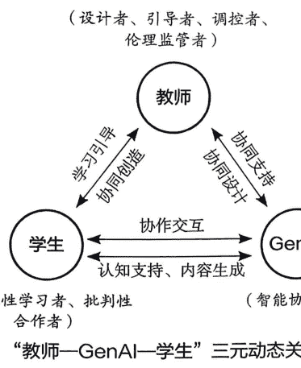

### 三 GenAI重塑教育生态

GenAI在深度融入教育领域的过程中，逐步推动教育系统从线性、封闭、静态形态转向开放、协同与智能动态演化。GenAI正在从资源配置、教学组织、评估方式、治理结构、师生关系与技术边界等维度变革教育生态系统的结构与运行逻辑，从而重塑教育生态。

#### 1. 从封闭系统走向开放的智能化生态

在传统教育体系中，教学活动主要在学校的物理空间进行，依赖教材等体系化教学资料，教育资源流动受限，信息反馈迟缓。GenAI的引入打破了传统教育的封闭结构，使教育系统具有了知识流动性增强、信息反馈即时、学习空间开放等新特征，这些新特征正在促使教育系统建立新的组织结构与运行机制，从而形成智能化的生态。

#### 2. 从中心化结构转向分布式协同网络结构

GenAI引入教育领域后，正在逐渐打破以教师为中心的单向知识传递结构，推动教学系统迈向多主体参与的分布式协同网络结构。学生除了参加教师引导和组织的学习活动，还可以基于GenAI开展人机协同学习、人—机—人多元协同的分布式网络结构学习，教学权力结构由中心化趋于扁平化，形成多主体协商、动态参与的新形态。

#### 3. 教学过程的组织逻辑发生变革

GenAI正在重塑教学的基本单元。课程设计日益走向“任务型+生成型”结构，教学活动从“知识讲授—练习巩固—测验评价”的组织逻辑向“任务生成—协同探究—调控完善”的组织逻辑转变，更加重视教学过程中的反馈性、生成性与个体调节，以及过程性评估，更加关注学生的思维路径训练和能力培养。GenAI成为教学组织的共生要素，技术成为学习认知与教学组织结构的共同建构者。

#### 4. 教育边界的重新界定

GenAI正在通过重构教育的空间、时间与主体边界，推动教育生态向“无界化”与“人机共生”方向演进。学习活动突破了学校时间、空间的边界与内部的结构限制，延伸至生活场景与在线环境，推动教育向泛在化、终身化方向发展。GenAI驱动的个性化推荐、生成反馈与任务陪伴使“学习”无处不在。同时，GenAI模糊了正规与非正规教育之间的界限，学生可在社交平台、创作工具或游戏中借助GenAI进行问题探究与知识表达。教师也可跨界与GenAI、家长、社区共同构建学习场域。教育摆脱了内部制度及空间的制约，向人与GenAI、社会多元力量协同的动态混合系统转变。

GenAI对教育生态的变革，不仅是对教育结构及组织逻辑的更新，也是在推动教育理念、教育治理方式的系统性再设计，从而逐步实现教育生态的全面重构。

### 四 GenAI引发教育隐忧

GenAI在为教育带来机遇与变革的同时，也带来了相关风险与问题。要使GenAI充分赋能教育变革与创新，亟须及时审视这些风险与问题并采取相应措施。

#### 1. GenAI有引发学习者认知依赖与能力弱化的风险

段世飞等提出，GenAI工具不利于学生的高阶能力发展。①艾西科维茨指出，有些学生依赖使用GenAI生成的信息，将思考外包，没有发展自身的思维能力，失去了训练批判性思维的机会。②学生如果频繁依赖GenAI生成的内容去完成学习任务，将会削弱独立思考能力、信息甄别能力与原创表达能力，这种“过度外包”式学习将影响学生参与真实学习，制约其深层认知的发生，引发能力弱化风险。

#### 2. GenAI存在输出内容准确性与幻觉性问题

GenAI可能生成逻辑通顺但事实错误的信息，特别是在专业知识、价值判断和多义概念方面，GenAI会出现“幻觉性输出”，造成对学生的误导，干扰教学目标的实现。例如，初中生向GenAI提问：“肺是呼吸作用的主要器官吗？” GenAI可能会给出表面上逻辑通顺的回答，例如：“是的，肺在细胞呼吸中起核心作用，通过将氧气与葡萄糖结合产生能量。” 这条回答虽然语义连贯，却混淆了肺的气体交换功能与细胞呼吸的生化反应过程，属于典型的知识性幻觉。肺仅负责氧气的输送与二氧化碳的排出，而真正的呼吸作用发生在细胞的线粒体中。这类幻觉性错误若未得到及时识别与纠正，可能导致学生构建错误概念，干扰科学思维发展。教学中要防止这种语言形式的可信中所隐藏的科学错误。

#### 3. GenAI系统存在数据偏见与文化歧视风险

GenAI系统训练数据往往源自不均衡的信息环境，会导致生成内容中存在性别、种族、语言等隐性偏见与文化歧视，若未进行防范，将影响教育的公平性与文化的多样性。

此外，学生数据隐私、教师评估的公正性、教育伦理责任划分等新问题也不断浮现，使教育治理体系面临前所未有的挑战。教育领域应用GenAI时，必须加强伦理引导、机制规范和以人为本的监控，确保其发展符合教育的公共价值和可持续目标。

> ① 段世飞，钱跳跳. ChatGPT浪潮下的高阶能力培养：可为、难为、何为？[J]. 河北师范大学学报（教育科学版），2024，26（4）：80-88.
> ② EISIKOVITS N. The threat of AI is real—But on a different level than you think[EB/OL]. (2023-07-09) Updated: (2024-02-21) [2025-03-19]. https://www.inverse.com/science/ai-dread-psychology.

## 第3节 GenAI时代如何做教师

GenAI正以前所未有的速度和深度在教育领域应用，它改变着教与学的方式，对教师在教育中的角色与职责提出了新要求和新挑战。GenAI时代的教师，必须深入认识GenAI对教育的变革与影响，充分发挥它的功能与优势，成为GenAI教育应用的核心力量。

### 一 教师应成为人机协同教学的实践创新者

GenAI应用于教育领域后，正在推动教学组织方式与课堂实践样态的变革。在此过程中，教师不能消极应付或被动接受，而应主动实践，积极探索应用GenAI变革教学，努力成长为人机协同教学的实践创新者。

#### 1. 教师应成为教学组织方式重构的推动者

应用GenAI需要重新组织教学内容，重构教学要素与流程。教师要在深入理解新课程方案、教学目标和分析学生实际情况的基础上，以“人机共教”为理念，主动探索“人—机”协同的新型教学组织方式，重构“导学—生成—反馈—评估”等教学流程中的角色配置与任务分工及协作。在教学实践中，不同学科的教师要根据学科特点和学生情况，与GenAI有效协作，充分发挥其在不同教学场景与环节的相关功能，形成适合学科特点与学生实际情况的人机协同教学新方式。

#### 2. 教师应成为人机协同教学的架构师

GenAI能否与教师协作开展教学，要依靠教师对GenAI的精心设计与调控。GenAI缺乏对教学情境的自适应能力，应用于教学时并不能自动契合教学系统的需求，这就要求教师深入分析教学目标与教学逻辑，深刻理解GenAI的功能特征与交互逻辑，将GenAI工具嵌入教学结构，发挥其协同教学的作用。教师要通过对提示词的策略性使用、对交互活动的设计、对人机协同过程的调控及持续试验和迭代优化，构建可适用于特定学科、特定内容和特定学生群体的人机协同教学新范式。

#### 3. 教学内容人机共创的引导者

GenAI应用于教学，推动着教学内容设计从“单向预设”向“人机动态共创”范式转型，这种转型是否成功或有效，关键在于教师能否作为智能共创的引导者持续开展系统性实践。因此，教师要以教育目标为锚点，通过分层协作架构与生成控制策略，与GenAI共同生成教学内容。在教学内容人机共创的过程中，教师应全面设计师—机协作、生—机协作、师—机—生协作时的协作框架和生成控制策略，保障人机共创教学内容的质量。例如，在人—机协作时，要基于学科逻辑设计GenAI生成内容的约束框架，在化学教学实践中，教师可以设计包含约束参数的提示词，“生成5个可用于家庭操作的电解质实验方案，需包含安全警示与变量控制说明”，以此引导GenAI产出结构化内容，再依据教学目标和教学要求进行筛选优化。

#### 4. 人机协同教学实践的知识积累者与传播者

教师的创新实践不仅关乎自身教学的优化，更应转化为可供他人借鉴的经验资源。在人机协同教学尚处于探索阶段的背景下，教师需要记录、反思并传播自己的实践策略与成果，成为人机协同教学知识系统的建设者与贡献者。例如，教师可在校本教研、跨校协同、在线社群等多种平台上，分享如何设计GenAI参与课堂的流程、如何评价GenAI介入后的教学成效等问题，这些经验性的知识积累，是推动GenAI教育应用从局部试验走向系统性革新的基础动力。

### 二 教师应成为学生人机协作学习的指导者

GenAI的应用使学生的学习方式正在发生重大变革。传统的以学生与教师、学生与教学内容的交互为基础的学习，正在向人机协作学习范式转变。在这一变革中，教师要成为学生人机协作学习的指导者，指导学生形成应用GenAI学习的互动策略及适应性学习路径，训练其批判性思维，促进其认知发展与能力提升。

#### 1. 教师需引导学生树立人机协作学习意识

GenAI为学生提供了几乎无限的信息资源和不知疲倦答疑解惑的平台，但如何应用GenAI学习，却是学生面临的新挑战。教师首先要帮助学生理解GenAI的特征、优势与局限，使学生认识到GenAI不是替代思考的工具，而是促进理解、表达与重构的认知伙伴。这种意识的建立是人机协作学习的基础。

#### 2. 教师应指导学生掌握有效的GenAI交互策略

学生在与GenAI互动中常表现出“提问浅层化”“指令模糊化”“结果依赖性”等问题，影响了人机协作学习的有效性。教师需系统性地教授学生设计高质量的提示词、进行多轮互动调试、辨析GenAI生成内容质量的方法与策略。在此过程中，教师不仅要教学生怎么用GenAI学习，更重要的是要帮助学生理解“为什么这样用GenAI”。

#### 3. 教师应支持学生发展“人机共构”的学习路径

人机协作学习的实质，是应用GenAI构建个性化与动态化的学习路径。教师作为指导者，应帮助学生识别自身的学习目标、知识结构与思维偏好，进而设计与GenAI协作的任务路径。教师可以根据学生的情况，采取不同的引导策略。对于具备初步分析能力的学生，教师可以引导其使用GenAI进行资料归纳与观点整理；对于具有探索兴趣的学生，则可指导其利用GenAI进行开放性问题的提出与修订。

#### 4. 教师需培养学生的判断力与学习的自主性

GenAI生成内容的非确定性与潜在偏误，使得判断力成为学生在开展人机协作学习时的重要素养。教师可以设计相关任务和组织对话等引导性活动，使学生通过对GenAI生成的信息进行比对、验证与评价，不断提升判断力，从而掌控人机协作学习的自主性。教师可以设计信息检索类任务，引导学生将GenAI生成的答案与专业知识库检索的结果进行交叉比对；也可以设计创意表达类任务，鼓励学生对GenAI作品进行评价，并提出修改建议，训练其批判性思维，提升判断力。通过持续训练，学生可以逐步形成自主判断GenAI生成内容的意识、自主决策的能力和自主学习的责任感。

#### 5. 教师应关注学生与GenAI互动的情感与价值导向

学生在应用GenAI学习时，可能会出现认知依赖或因其经常输出褒扬性反馈而产生情感偏移等现象。教师应在教学过程中及时关注学生的人机互动状态，强化学生的主体地位与自我认同。教师可以采取多种措施，发挥学生在人机协作学习中的主体性。例如：可以在作业或探究活动过程中设置“人先思考—GenAI后辅助”的流程，保障学生的主动参与；也可以通过角色扮演、同伴评价等方式，提升学生对GenAI角色与局限的价值判断力。教师的情感引导是维系人机协作学习本取向的关键保障。

### 三 教师应成为智能教育风险的防范者

GenAI在教育领域发挥其优势与积极作用的同时，一些潜在风险也相伴而生，如果不及时识别和防范，将对学生的认知发展和身心健康产生危害。

#### 1. 教师应主动构建教学场景中的风险防范机制

以GenAI为代表的智能技术在教育领域应用的过程中，潜藏着难以察觉的风险要素，教师要分析智能教育过程及其具体场景中的可能风险点，主动设计风险防范措施，逐步建立起具有前瞻性和适应教学对象特点的风险防范机制。例如，在教学活动中明确人机边界，设定GenAI可介入学习任务的范围与深度，防止“认知外包”造成学生学习责任弱化等问题。同时，教师应设计学习过程可回溯的任务结构，以监控和指导学生的学习过程。此外，教师还应该变革教学实施与评价机制，防止学生在挑战性任务中出现抄袭等学术不端行为。

#### 2. 教师应承担学生数据保护的实践责任

GenAI作用的发挥离不开巨量用户数据的采集与持续训练，但对学生个人信息、学习行为和学习过程数据的采集与调用若无规范控制，极易被侵犯隐私权益。我国已于2021年颁布了《中华人民共和国数据安全法》《中华人民共和国个人信息保护法》，2023年颁布了《未成年人网络保护条例》《生成式人工智能服务管理暂行办法》等法律法规，教师应主动学习相关规定，明确所用技术系统的数据政策，在教育教学中主动落实，避免在不知情的情况下泄露学生的个人信息等数据。实践中，教师应指导学生使用本地部署或受监管的平台进行学习活动，并教育学生理解“数据即身份”的信息伦理。教师要主动推动学校建立学生数据保护的规范与措施，防止学生数据泄露或在未授权的情况下被不当利用。

#### 3. 教师需培养学生识别算法偏误的认知能力

GenAI在内容生成中可能出现文化偏见、事实错误或立场偏斜等算法偏误。学生如果缺乏识别与判断能力，将GenAI生成的内容当作客观事实或观点，不仅会影响批判性思维的发展，还会形成错误认知。教师应主动引导学生掌握识别GenAI局限与问题的方法，在日常教学中设计让学生将GenAI生成的结果与相关书籍、权威数据库进行交叉核验的学习活动，引导学生分析GenAI输出内容中隐含的偏见或倾向性表达，培养学生的信息判断能力和智能素养。

#### 4. 教师应坚守教育价值导向与伦理底线

GenAI虽然能够在多种场景和复杂任务情境中与人协同解决问题，但因缺乏价值判断能力，其能否赋能教育，取决于人能否对其进行引导和决策。教师作为教育价值的守护者，应在教学中坚持“以人为本”的理念，抵制效率主义、技术至上等观念。教师可以在教学中将技术的价值与局限、技术伦理问题案例、技术应用责任等内容融入课程，引导学生思考技术对个体与社会的影响，强化其作为“数字公民”的责任意识。教师主动守护教育伦理底线，是避免智能教育出现“异化”的根本保障。

### 四 教师应成为智能教育生态的构建者

GenAI的教育应用正在催生教育生态的系统性解构与重构。在这种历史性进程中，教师的角色已超越了课堂与校园的局限，成为智能教育生态的构建者。作为智能教育系统的核心力量，教师必须积极主动地参与智能教育生态的构建过程，推动以人为中心的智能教育生态形成。

#### 1. 教师应成为智能教育生态理念的践行者和传播者

面对GenAI对教育中师生关系、生生关系、人机关系等的重塑，教师应以建设性视角引导学生理解“人机共进”的教育图景，建立技术服务与人发展的人机关系。在教研活动、教学研究、校家社合作的过程中，教师要主动传播以人为中心的人机协同教学理念和可持续发展的智能教育发展理念。

#### 2. 教师应参与智能教育生态的重构设计与决策

智能教育是智能技术在教育系统中的应用与融入。智能教育生态构建的过程既包括对教育要素的变革，还包括对教育结构、组织方式、教学流程、制度政策、评价机制等方面的变革。教师在长期教学中积累了应对各种教学问题与挑战的丰富经验，了解学生应用技术学习的心理与行为变化，能够洞察智能教育的实际需求，理解技术与教育深度融合的逻辑，因而能够在智能教育平台研发、教学流程重构、数据使用伦理等方面为智能教育生态的重构提供专业建议，提高智能教育生态构建的科学性。

#### 3. 教师应参与教育制度创新

在当前教育制度尚不能适配GenAI等智能技术教育应用的背景下，教师可通过教研组、课题组等参与制定适应GenAI特征的课程结构、作业机制、评价方式与学术规范。教师应主动与教育管理者合作，参加政府决策咨询等活动，参与智能教育政策与教育管理制度的研制，推动以人为中心的智能教育生态的构建。

#### 4. 教师应构建多元协作的教研网络

GenAI等新技术的教育应用，使教师不再局限于教学者身份，而是成为与技术专家、平台开发者、管理者、家长和学生等多方主体协作的教研网络的构建者。教师可以通过组织共创工作坊、协同设计课程内容等方式，主动连接多方资源与智慧，构建共享开放、动态演进的教研网络。

此外，教师还要明确自身的专业角色与作用，要深刻认识到GenAI的教育应用不是对教师的替代，也不是对教师专业性的削弱，而是对教师的专业能力与智能教育素养提出了更新更高的要求。教师要主动转变角色，提升专业能力与素养，迎接GenAI带来的教育变革，带领学生与GenAI有效协作、协同发展。

# 第2章 教师如何高效驾驭 GenAI

## 第 1 节 构建个人GenAI资源库：资源筛选与管理六步法

自2022年11月ChatGPT发布以来，GenAI的发展呈现出日新月异的态势。随着ChatGPT、Claude、文心一言、Kimi等模型的快速迭代升级，各类GenAI的功能在不断增强，许多GenAI工具已从仅支持文本生成，到逐步支持PPT、图像、音频、视频等多模态内容的输入和输出。同时，新GenAI模型和新工具也如雨后春笋般不断涌现，DeepSeek-R1新一代推理模型在2025年1月20日的发布，不仅引起了人工智能领域的震荡，也引发了全社会的关注。面对GenAI技术的更新迭代和新工具的涌现，教师要使GenAI赋能教育，亟须建立起适合自身教学风格、学科特点与教学情境的个性化、可迭代的个人GenAI资源库，包含GenAI工具箱、指南集、方法库、问题集、案例集等资源，以实现技术赋能与教育价值的深度耦合。

### 一 教师个人GenAI资源库的建设思路与方法

无论是零起点还是有一定应用基础的教师，都应该具备建设动态的个人GenAI资源库的意识。教师可以综合运用在线平台、思维导图、本地文件夹、教研平台、个人自媒体等工具，建立自己的GenAI资源库框架，并进行定期迭代。例如，为了建设自己的GenAI应用经验方法集，教师在应用GenAI工具教学时，不仅要在使用前通过各种途径了解GenAI工具的现状与功能，而且在使用过程中及使用后，也要及时评估其适合性、有效性、可靠性及局限性，总结应用GenAI工具的方法与经验，逐步形成自己应用GenAI的经验方法集。

教师个人GenAI资源库是教师在教学与工作中有意识地从无到有逐步积累所形成的。图2-1是某高中教师高老师的个人GenAI资源库框架，刚开始，他的框架中只有应用指南、工具箱和典型案例三个分支，其他分支是在学习和应用过程中不断丰富形成的。

高老师应用思维导图构建GenAI资源库的框架，通过超链接，将个人电脑上的相关资源与思维导图建立起了关联。应用时，他只需要点击思维导图中的资源名称相应的超链接，就可以打开电脑上或网页上的相关文件进行查阅。图2-2是高老师的个人GenAI资源库框架两个分支上的局部内容展示截图。

#### 1. 教师建设个人GenAI资源库的基本思路

教师在建设个人GenAI资源库框架时，建议遵循“GenAI工具使用起步，资源体系持续生长”的建设思路，采取从单个GenAI工具应用到多种GenAI工具融合应用的方法路线。教师可根据自己的应用需求，从最直接、最常用的工具箱着手建设，从开始应用就养成积累资源和整理记录与反思完善的习惯：能够结合教学实践同步记录从提示词设计、使用技巧到学生反馈等环节的具体应用方法；能够及时归档遇到的问题与教训，如GenAI生成内容偏差、学生误用和技术障碍等，培养“使用+反思”的习惯。

#### 2. 教师建设个人GenAI资源库的基本方法

教师应从首次接触和使用GenAI工具时就开始记录与整理，不要等熟练之后才开始构建资源库。哪怕只是用一个工具设计了一个提问、生成了一段评语，也应将生成过程、内容效果与个人判断记录下来，积累成可追溯、可分析的教学数据。随着经验积累，教师可逐步扩展应用资源的维度，增加应用指南、典型案例、方法与经验等，逐步由简单的GenAI工具发展为包括应用指南等多维度资源的GenAI资源库，形成“计划—行动—反思—优化”闭环式的个人应用GenAI的方法体系。这个基本方法包括四个主要步骤：一是根据教学需要，教师有目标、有计划地选择GenAI工具并设定教学任务；二是有策略地将GenAI应用于教学过程；三是及时记录和反思GenAI的应用效果与问题；四是为持续应用明确需要优化的应用方法或过程等使用要点。长期坚持，教师将不仅能建设丰富的GenAI资源库，而且能够从GenAI的浅层应用者向创新驾驭者转变。

### 二 六步构建教师个人GenAI资源库

GenAI的快速发展为教师提供了丰富的工具选择，但技术工具的碎片化与复杂性往往让教师陷入选择困难，而且缺乏逻辑地混乱应用GenAI工具，既会造成应用效果和使用效率的低下，还可能由于不了解工具的局限性引发潜在风险。教师应根据教学的实际情况，构建高效、安全且符合教育伦理的个性化GenAI资源库。下面以个人GenAI工具箱建设为例，介绍教师构建个人GenAI资源库的主要步骤与方法。

#### 1. 确定个人GenAI工具箱的建设目标

教师在建设个人GenAI工具箱之前，首先要明确对GenAI工具的应用需求。教师要对教学活动进行全面分析，明确GenAI工具赋能教学的着力点和建设GenAI工具箱的目标。如果要解决班级学生学习差异大的问题，可能要着力建设具有智能辅导答疑功能的GenAI工具；如果要解决教学内容不够生动的问题，则要重点建设可以生成图像、视频等多模态教学资源的GenAI工具。

#### 2. 建立GenAI工具清单

教师确定了个人GenAI工具箱的建设目标后，应通过各种渠道了解主流的GenAI工具的特点与功能，建立常用工具清单。教师可利用本地文档、在线平台、浏览器收藏夹等多种应用工具建立自己的工具清单。表2-1是生物学教师王老师整理的个人GenAI工具清单。

**表2-1 生物学王老师的个人GenAI工具清单**

| 序号 | 名称 | 类型 | 主要功能 | 网址/使用途径 | 备注 |
| :--- | :--- | :--- | :--- | :--- | :--- |
| 1 | ChatGPT | 国外 | 多语言文本生成、代码调试与生成、翻译与润色 | https://chat.openai.com | 支持中文，GPT-4需订阅 |
| 2 | DALL·E 3 | 国外 | 高分辨率图像生成、图像细节迭代修改、多风格适配 | 集成于ChatGPT Plus或Microsoft Designer | 需付费使用 |
| 3 | Midjourney | 国外 | 艺术风格渲染、多图混合创作、社区作品灵感库 | https://www.midjourney.com（通过Discord调用） | 按生成量付费 |
| 4 | Claude | 国外 | 超长文本分析、文档总结、复杂逻辑推理、伦理安全内容过滤 | https://claude.ai | Claude for Education |
| 5 | Gemini | 国外 | 多模态输入、视频内容解析与总结、实时联网搜索、编程与代码纠错 | https://gemini.google.com | 免费使用，支持中文 |
| 6 | Sora | 国外 | 文本生成视频、文本+图片生成视频、文本+视频生成视频 | https://openai.com/sora | 可生成含复杂场景的视频 |
| 7 | 文心一言 | 国内 | 文本生成、智慧绘图、联网搜索实时信息 | https://yiyian.baidu.com | 一条指令生成多张图 |
| 8 | 通义千问 | 国内 | 多语言翻译、语音实时记录、一键AI总结、音视频分析 | 阿里云官网或钉钉内置 | 语音转写做记录 |
| 9 | 讯飞星火 | 国内 | 文本与图像内容生成、PPT生成、代码编写、智能体创建 | https://xinghuo.xfyun.cn | 免费版有限额 |
| 10 | Kimi | 国内 | 超长文本解析、文献总结、长文本生成、联网搜索、数据处理 | https://kimi.moonshot.cn | 适合研究场景 |
| 11 | 智谱清言 | 国内 | 文本与图像生成、论文翻译、数据分析、代码生成与漏洞检测、智能体创建 | https://chatglm.cn | 嵌入其他工具 |
| 12 | 豆包 | 国内 | 文本与图像生成、PPT制作、学术搜索、代码编写、智能体创建 | 抖音等平台内置 https://www.doubao.com | 轻量创作 |
| 13 | DeepSeek | 国内 | 逻辑推理与深度内容生成、代码生成与调试、语言翻译 | https://chat.deepseek.com/ | 思维训练 |
| 14 | 扣子 | 国内 | 创建智能体、智能体商店 | https://www.coze.cn/ | 快速创建智能体 |

教师要养成关注GenAI发展前沿的意识与习惯，及时了解并动态更新自己的GenAI工具箱，使其不断丰富完善。

现在，有些企业开发了能够提供GenAI工具集成与聚合功能的平台或应用程序，收藏这类网站或应用程序，可以快速了解和使用新的GenAI工具，如提供GenAI工具聚合服务的OpenI平台（https://ai.openi.cn/）。（见图2-3）

OpenI平台提供了GenAI工具导航页面，分类集成了AI写作对话、AI绘画生成、AI视频生成、AI语音工具等GenAI工具，方便用户快速了解各类型的主流工具。例如，若选择AI语音工具类，打开即可看到若干AI语音工具。（见图2-4）

用户点击页面上的任何一个语音工具图标，即可弹出该工具的介绍、链接、数据统计、数据评估等更加具体的内容，方便用户快速了解其性能与使用效果。如在导航页面点击讯飞听见，即可弹出如图2-5所示的介绍页面，往下滑动还可以看到其更加详细的功能介绍、使用用户、数据评估等内容。

在王老师带动下开始关注GenAI的计算机教师刘老师，很快便整合了多种工具，利用语雀平台（https://www.yuque.com/）打造了方便在日常教学中快速调用GenAI应用的导航主页，包括嵌入各工具链接地址的GenAI常用工具入口集、主要应用场景工具集、提示词分类库、典型应用案例等内容。刘老师可以在不同终端上方便地选择和调用相关GenAI工具。

#### 3. 明确应用目的，分析与应用场景匹配的GenAI工具

GenAI工具作用与价值的发挥，与应用场景和具体情境高度相关。建立了个人GenAI工具箱后，教师可以根据教学应用目标，进一步梳理可以用GenAI赋能的典型应用场景，分析与其相匹配的GenAI工具。

为了应用GenAI支持诸如作业批改、备课和学习辅导等教学任务，通过人机协同提高教学效率，生物学教师王老师在建立了个人GenAI工具清单后，进一步整理分析了不同应用场景下可以利用的GenAI工具，形成了如表2-2所示的包括备课、教学内容组织与呈现、课件制作、实验教学等典型应用场景的GenAI功能匹配分析表。

**表2-2 生物学王老师整理的GenAI功能与典型应用场景匹配分析表**

| 序号 | 应用场景 | 应用目的 | 可用GenAI功能 | 推荐工具 |
| :--- | :--- | :--- | :--- | :--- |
| 1 | 备课 | 教学目标分析、教案生成与优化、教学活动设计 | 教学目标生成、教学活动生成、教学过程优化 | DeepSeek、智谱清言、豆包 |
| 2 | 教学内容组织与呈现 | 用流程图、概念图、思维导图等呈现教学内容的结构 | 逻辑梳理、图表生成 | 文心一言、DeepSeek、智谱清言 |
| 3 | 课件制作 | 设计PPT大纲与配图、设置互动环节 | 结构化内容整理、图像生成、引导问题设计 | 讯飞星火、智谱清言、文心一言 |
| 4 | 实验教学 | 教学实验流程图生成、步骤优化、误差分析设计 | 实验方案设计、结果预测、误差讨论建议 | DeepSeek、文心一言、豆包 |
| 5 | 作业与练习设计 | 设计多样化题型与分层作业任务、答案生成 | 题目生成（选择题、实验分析题等）、答案与解析生成 | DeepSeek、通义千问、Kimi |

#### 4. 选择并测评适用的GenAI工具

教师在进行GenAI功能与典型应用场景匹配分析后，就可以根据应用目的，快速选择适合特定应用场景的GenAI工具开展人机协同教学了。但是，GenAI工具是否适合具体应用场景或要解决的问题，教师必须对与之相匹配的GenAI工具进行测试，从而选定恰当的工具。

德国图宾根大学制定的《生成式人工智能应用指南》①指出，学校所有人员必须以批判性和反思性的方式应对 GenAI，评估GenAI的潜能和局限性，学校应鼓励教师和学生合作测试GenAI的潜能。教师在教学中应用GenAI工具时，必须从多方面测评其性能，特别是其生成内容的可靠性和客观性等指标。下面结合实例讨论如何在应用GenAI工具时测评这些指标。

> ① THE UNIVERSITY OF TÜBINGEN. Artificial Intelligence in Teaching and Assessment Contexts[EB/OL]. (2024-04-30) [2025-03-18]. https://uni-tuebingen.de/en/research/support/good-scientific-practice/guidelines-on-generative-ai/#c2039247.

为了测评GenAI工具在生物学教学中的性能，王老师设计了GenAI五维分析表（见表2-3），并对每个维度进行了测评。

### 表2-3 王老师测评GenAI在生物学教学中性能的五维分析表

| 测评维度 | 测评问题 | 测评方法 | 应对策略 |
| :--- | :--- | :--- | :--- |
| 可靠性 | 有无事实错误 | 教材对照、多个GenAI工具交叉验证 | 审校生成内容 |
| 客观性 | 有无价值倾向 | 正反观点对比 | 多立场提问，提示立场或身份 |
| 教学适配性 | 学生是否能理解 | 学段适配性、语言表述的专业性、观点的明确性 | 细化调整提示词 |
| 逻辑性 | 内容有无跳跃 | 思维导图/流程图 | 优化内容结构 |
| 前沿性 | 是否反映新教材或学科前沿内容 | 模型的数据库更新时间，多工具对比 | 指定时间节点，整合提供前沿内容 |

每位教师都可以根据任教学科的特点、学情确定具体的GenAI测评维度和指标，但客观性和可靠性等维度是必须进行测评的。以下是王老师在实际教学中测评GenAI性能指标的实例。

> **王老师在高中生物“细胞分裂”单元教学设计中测评GenAI工具**

**备课阶段：** 王老师使用DeepSeek生成细胞分裂的教学方案，包括有丝分裂和减数分裂的主要流程。

**可靠性检查：** 王老师将生成的教学方案内容与教材内容进行比对，发现方案中对有丝分裂各阶段的描述与教材内容基本吻合，但在减数分裂部分略有简化，于是他通过查阅专业文献补充了详细信息。

**客观性检查：** 对于细胞分裂的作用，GenAI可能强调细胞增殖的重要性，而忽视了细胞凋亡等平衡机制。王老师在课堂上补充了相关内容，引导学生讨论细胞生命周期中的平衡问题，确保学生获得全面观点。

**课堂讨论阶段：** 在讲授“基因突变与细胞分裂异常”的时候，王老师利用GenAI生成的讨论问题启发学生思考。

**客观性检查：** 王老师要求GenAI生成的问题不仅涵盖基因突变的危害，还涉及其在进化中的积极作用，保证讨论内容多元而平衡。

作业批改与反馈环节：王老师用GenAI工具批改学生的实验报告，自动生成评语。
可靠性检查：王老师对生成的评语进行抽样检查，确保评语中对实验数据的分析与教材的标准相符。
客观性检查：王老师观察到部分评语可能过于笼统，便在反馈时补充了更为具体的改进建议，确保评语能客观反映学生表现。

通过与应用目的、应用场景相结合的GenAI工具性能指标的测评，以及通过交叉验证、专家反馈、情境适配和多角度对比等方法，教师可以选择各应用场景最适合的GenAI工具，并有效控制其可能潜在的教学风险，建立与应用场景相匹配的GenAI工具清单，为在教学中有效发挥GenAI工具的功能与作用做好充分准备。

#### 5. 持续迭代和优化个人GenAI工具箱及资源库

GenAI工具箱及资源库需要在实践应用中不断地迭代和优化完善。教师可以通过撰写GenAI应用日志或教学应用案例等方式，持续总结常用GenAI工具的优势与局限，通过反思分析“哪个工具使用频率最高，为什么”以及“GenAI应用中有哪些使用误区，应如何避免”等问题，动态更新个人GenAI工具清单，使个人的GenAI资源库持续迭代。

#### 6. 建立GenAI应用规范

教师要有效应用GenAI，需要确保数据安全，遵循伦理规范，不上传含有学生真实信息的文件、考试题库、答题卡等敏感数据，避免对GenAI的过度依赖。同时，也应引导学生和家长了解GenAI的特点与功能，在符合伦理道德的前提下应用GenAI。

## 第2节
精准提问：激活GenAI潜能的提示词设计框架

GenAI能否充分发挥其潜能，有赖于用户与其交互时能否使用高质量的提示词。具备良好的提示词设计能力是教师有效驾驭GenAI的必备素养。与GenAI的互动不是随心所欲的简单问答，而是借助精心设计的提示词，实现用语言引导GenAI生成高质量结果的“对话式编程”过程。

联合国教科文组织在《教师人工智能能力框架》中提出，应遵循以人为本的人工智能应用原则，增强教师应用人工智能的能动性。人机协同不是GenAI简单响应人类的过程，而是人类调动GenAI、激活GenAI，实现最优输出的过程。

### 一 提示词设计框架：与GenAI高效互动的“PRTSCE”模型

教师提示词设计的“PRTSCE”六维度模型（Purpose - Role - Task - Strategy - Constraint - Evaluation），遵循以人为本的生成式人工智能应用原则和人机协同规律，通过结构化语言激发GenAI潜能，从而生成能够实现教学目标的高质量内容。（见表2-4）

### 表2-4 教师提示词设计的“PRTSCE”六维度模型

| 维度 | 核心要素 | 关键问题 | 操作要点 |
| :--- | :--- | :--- | :--- |
| 明确目的（Purpose） | 教学目标、观点立场、价值定位 | 希望GenAI生成内容服务于何种教或学的目标？ | 目标引领、指向性强、情境特征、明确风格 |
| 明确角色（Role） | 专家设定、职责说明、表达风格、约束要求 | 希望GenAI以何种身份或语气完成任务？ | 身份精准（如课程专家、学科名师等）、产出标准或规范 |
| 任务说明（Task） | 任务类型、任务特点、结构化表达、任务分解 | 指令是否清晰？任务是否适合GenAI理解与执行？ | 动词明确、结构清晰、调整优化 |
| 策略运用（Strategy） | 示例引导、结构设定、语气控制、数据嵌入 | 如何引导GenAI生成更准确更高质量的内容？ | 提供范例或模板、设定输出结构、上下文嵌入 |
| 约束条件（Constraint） | 形式选择、字数控制、主题限定、适用对象、适用范围、语言设定 | 是否需要限定输出内容的形式、范围、长度和情境？ | 表格式、图式或文字式、字数控制、话题限制、适配对象与语境 |
| 分析评估（Evaluation） | 输出评估、是否再提问、提示词归类、总结积累 | 如何判断提示词是否有效？是否可积累为资源？ | 从内容适切性与语言质量等角度评估、构建个人提示词资源库 |

下面，结合实例来看“PRTSCE”六维度模型在具体教学场景中的应用。任教地理学科的李老师想为高一学生设计一个“比较两种气候类型”的课堂自主探究学习活动，为此，他依照提示词框架，分维度分析提示词要表达的内容，形成了下面的提示词分析表。（见表2-5）

### 表2-5 教师提示词设计的“PRTSCE”六维度模型分析表

| 维度 | 提示词设计要点 |
| :--- | :--- |
| 明确目的（Purpose） | 明确希望GenAI生成适合高一学生在地理课堂比较两种气候类型的自主探究学习活动方案，以培养学生的地理综合分析能力。 |
| 明确角色（Role） | 设定GenAI为“高中地理课程设计专家”，具有丰富的教学经验，理解新课标理念，能够设计结构化程度高、互动性强的活动。 |
| 任务说明（Task） | 任务需包含：①学习目标；②学生自主探究任务设计（含指导语）；③活动步骤；④成果展示方式；⑤师生评价方法。 |
| 策略运用（Strategy） | 提示词结构清晰，采用“请按照以下结构：……”引导生成内容。 |
| 约束条件（Constraint） | 限制输出在600字以内；适用于高一学生；活动内容以课堂教学为核心；语言要简洁清晰、有启发性。 |
| 分析评估（Evaluation） | 生成后需从结构完整性、内容准确性、活动实用性三方面进行判断，可要求GenAI说明设计理念，以便用于反向检验。 |

李老师根据六维度模型设计的提示词如下：

> 你是一位具有丰富教学经验的高中地理课程设计专家，熟悉新课程标准理念，擅长设计结构化程度高、互动性强的探究型学习任务。
>
> 请为高一地理课堂设计一项自主探究学习活动，主题为：比较温带大陆性气候与温带季风气候的差异。该活动旨在培养学生的地理综合分析能力、观察与探究能力，适用于实际课堂教学情境。
>
> 请按照以下结构进行输出：
> 1. 核心素养目标
> 2. 自主探究任务内容及学生指导语
> 3. 学生活动步骤（不少于3个环节，体现探究过程）
> 4. 成果展示方式（如图表、口头汇报、小组展示等）
> 5. 师生评价方法（包括学生自评或互评方式）
>
> 请使用简洁清晰、有启发性的语言，控制总字数在600字以内，并确保生成内容适合高一学生的认知水平和课堂节奏。
>
> 最后，请简要说明你设计该活动的理念依据或设计思路（不超过2句话）。

李老师使用上述提示词与文心一言对话后，GenAI生成了如下学习活动方案。

### 高一地理课堂探究活动设计

1. 核心素养目标
①地理认知素养：能准确描述并比较两种气候类型的空间分布与特征。
②综合思维素养：通过归纳分析揭示气候成因之间的联系，建立因果分析的地理思维。
③实践应用素养：能将所学气候知识应用于分析实际生活与生产中的地理现象。
④人地协调观念：认识人类活动如何适应和改造不同气候条件，树立可持续发展意识。

2. 自主探究任务内容及学生指导语
探究任务：请你们以小组为单位，收集温带大陆性气候与温带季风气候的典型特征（温度、降水、植被、分布区域等），并探讨这些差异对人类生活与生态系统的影响。
指导语：试着用图表或模型来展示你们的发现，并准备在班级中进行简要汇报。

3. 学生活动步骤
①资料查阅：利用教材、地图册与网络资源收集气候数据。
②小组讨论：对比两种气候的差异，整理成思维导图或对照表。
③观点表达：模拟记者采访，围绕“哪种气候更适宜人类居住”进行讨论。

4. 成果展示方式
展示形式：小组制作对比图表并进行口头汇报，选用PPT、手绘海报或数字板等形式。
每组发言不超过3分钟。

5. 师生评价方法
教师依据汇报内容的科学性与表达清晰度打分。
小组间互评，关注协作分工与展示创意。
学生提交个人反思单，记录收获与改进点。

> 设计理念说明：本活动采用对比分析法，引导学生在合作探究中理解气候差异对人地关系的影响，体现新课标倡导的核心素养导向。

李老师基于“PRTSCE”模型设计提示词，既能规定GenAI生成内容的方向、结构与风格，还能实现“生成—评价—优化”的闭环教学设计，提高了GenAI生成内容的质量。李老师认为，自己在这个过程中虽然花了较多的时间设计提示词，但这种锻炼使他更好地掌握了设计指示具体的高质量、结构化提示词的方法。他通过一次交互提问就生成了比较满意的“比较两种气候类型”自主探究学习活动方案，稍作修改即可用于课堂教学。

实践中，教师要根据需要GenAI完成任务的复杂程度等具体情况，确定提示词设计的详略程度。需要注意的是，对GenAI在交互时的身份设定，会显著影响其生成内容的质量和风格，好的提示词一定要指定清晰的身份+职责，如“你是专家型教研员（角色），请分析并修改完善这份大单元作业（职责）”。经常应用“PRTSCE”模型设计提示词，可以提高提示词的质量，提升教师的思维能力。

### 二 教师设计提示词的五项操作策略

1. 分阶段设计提示词
将复杂任务拆解为多个逻辑步骤，引导GenAI分阶段生成内容，有助于把控输出结构，适合教学目标、活动设计、评价标准等逐步构建的场景。

2. 设计角色扮演式提示词
通过将GenAI设定为领域专家、资深教研员、专业名师或课程专家等角色，可以增强其生成内容的专业性和适切性，增强语言与情境的适配性。

3. 设计结构化提示词
提示词中使用编号、分段、格式要求等明确结构，可有效减少GenAI理解偏差，确保内容条理清晰、逻辑一致，尤其适用于教学方案与评价表设计。

4. 示例引导
通过提供类似任务的1—2个范例，引导GenAI模仿风格与结构，可显著提升生成内容的质量与格式契合度，适用于多种场景。如在撰写在线课程的公告时，可以提供往期课程公告，再增加具体要求，就可以快速生成符合要求的课程公告。

5. 递进式优化

有些情况下，可能由于提示词设计不够具体或全面，对GenAI首次生成的内容需要进行调整，可以提出如“请说明教学设计的依据”或“请增加学生互动任务”等有针对性的修改与补充意见，通过多轮交互，不断优化生成内容。

### 三 设计提示词的常见问题与对策

提示词的质量决定着教师与GenAI协作互动和生成内容的质量，但在实践中，仍有许多教师尚未意识到，提示词就是结构化的思维呈现，由于多种原因出现诸多常见问题。现结合教师在教学场景中与GenAI互动的真实需求，按照“问题—原因—对策—示例”的结构梳理如下。（见表2-6）

### 表2-6 教师设计提示词的常见问题与对策

| 常见问题 | 原因分析 | 应对策略 | 示例说明 |
| :--- | :--- | :--- | :--- |
| 1. 生成内容偏离主题 | 提示词目标不明确或语义模糊，缺乏具体限定词 | 明确目标与对象，使用结构化提示词限定内容范围 | 帮我设计一个气候教学活动（×）→ 请为高一学生设计一项比较大陆性气候与温带季风气候的探究活动（√） |
| 2. 输出格式混乱，条理不清 | 未明确输出格式或未使用分段结构 | 使用编号或格式要求引导结构清晰的内容生成 | 请基于九年级化学“制取氧气”一课，按照“目标—活动—评价”结构，设计一份探究教学教案 |
| 3. 输出内容空泛、无深度 | 未设定生成要求或未设定学科术语与复杂度 | 增加“难度”“术语”“思维层级”等提示 | 请为初一学生设计关于一元一次方程的差异化作业，分三个层级设计题目，难度从基础到拓展 |
| 4. 语言、字数不适合具体教学情境 | 未设定输出篇幅或语言风格 | 设置字数、语体、适用场景等约束条件 | 请将内容字数控制在600字以内，语言简洁明了，适合高中生阅读 |
| 5. 内容不适龄或不符合学生水平 | 未设定年级或对象特征 | 明确学习者特征，限定语言风格与内容层级 | 请面向大学生，用专业、严谨的学术语言介绍信息茧房问题的成因 |
| 6. GenAI输出内容逻辑不通或存在重复 | 输入信息不完整，提示词未限制重复表达 | 加入“请避免重复表述”“逻辑严谨”等要求 | 请确保按照内因、外因的逻辑，条理清晰地讲解信息茧房问题的根本原因 |
| 7. 难以生成包含评价的教学设计 | 提示词只关注活动设计，忽略评价维度 | 明确要求加入师生评价方式或标准 | 请在方案中提供学生成果展示后师生评价的方式，包括自评或互评环节 |

### 四 提示词不是关键词，而是开展教与学的“设计语言”

提示词实质上是教师设计、组织和实施教学活动的“设计语言”，是启动GenAI理解并完成教与学活动中相关任务的钥匙和引擎。提示词既考验着教师的人工智能素养，也体现着教师对教与学活动的深刻理解与洞察，以及对相关目标与任务的准确阐释。在运用GenAI开展协同教学的过程中，谁能设计出更精准、更高质量的提示词，谁就能更有效地激活GenAI的潜能，开展高质量的教学。

## 第 3 节
教育智能体创建：从0到1打造智能助手

GenAI时代，教师不再只是智能技术的使用者，还是智能教育工具等产品的设计师和创建者。打造贴合自身教学需求、能有效支持教与学的教育智能体，已成为GenAI时代教师智能素养水平的新标志。无论你是否有智能体开发经验，本节都会带领你从0到1，创建一个属于自己的智能教学助手。教师创建教育智能体，不仅意味着“调用AI完成任务”，更意味着从教学逻辑出发，设定目标、设计交互、定义行为边界、迭代优化，以形成真正具备教育功能的智能系统。

### 一 明确目标：你需要什么样的智能助手

创建教育智能体的第一步是聚焦教育教学或科研中的具体需求，明确智能体的服务目标。例如：

1. 教学辅助型：生成课件、设计练习题、推送学习资源。
2. 学习答疑型：充当学生的虚拟辅导员，基于教学内容进行答疑。
3. 批改与评价型：为作文、简答题等提供初步评分与个性化反馈。
4. 研究助手型：文献总结、问卷分析、数据辅助处理。

在初始阶段，教师可采用“角色设定+功能目标”的方式，系统分析自己对智能体的需求，梳理实际教育教学与科研中的痛点问题，明确其功能定位，为智能体的技能设计、知识库构建等奠定基础。

实践中，教师可以基于课程类型、教学任务或研究工作需要确定智能体的角色身份，使其成为具有专门能力的虚拟助手。

例如，李老师将智能体的角色设定为：我是一名高校教育学教师的智能助理，熟悉“教育研究方法”课程，能够根据教学大纲生成案例分析型讨论题、设计研究方法与实验任务，并为学生提供格式规范的文献综述写作指导。

刘老师则将智能体的角色设定为：我是一名大学教师的英文写作指导助手，擅长为不同年级的学生提供学术英语写作建议，能够基于学生的草稿提供语言润色、结构优化、逻辑连贯性点评。

通过角色功能设定，教师能够将教育智能体精准嵌入教学、辅导与研究活动，构建起以“功能导向+语境嵌入”为核心的应用场景，使智能体服务于教学提质和科研赋能。

### 二 选择GenAI平台：在哪里创建教育智能体更合适

许多操作简便、面向教育场景的GenAI平台，为教师零基础、零代码创建个性化教育智能体提供了技术支持，教师不会编程也可以创建出功能强大的教育智能体。面对众多的GenAI平台，教师需根据教育智能体的角色功能定位、应用场景、技术能力、数据安全、输出目标与形式类型等进行综合权衡，选择最适合自己的智能体创建平台。在选择平台时，教师应重点考虑以下关键因素：

1. 平台是否适配我的教学情境（学段、学科、授课方式）？
2. 平台是否能够零代码或低代码支持我创建智能体？
3. 平台是否能支持我的特殊需求？

### 三 编写提示词与知识库：创建智能体的大脑

教育智能体是否具备清晰的任务理解能力与精准的内容支持，对其功能的发挥具有决定性作用。在创建初期，教师需重点完善提示词与知识库这两个构成智能体“思维逻辑”和“知识底座”的核心模块。

#### 1. 编写提示词：让教育智能体理解要干什么

提示词是与智能体对话的“指令语言”，建议在初步构建时，采用“角色定位+任务（或技能）描述+输出格式+限制条件”的四要素策略。例如：

> 你是一位熟悉《普通高中化学课程标准（2017年版2020年修订）》的助教，请根据九年级“化学变化与能量”单元内容，设计一个能激发学生探究兴趣的实验任务，输出格式为：实验目的、材料与步骤、引导性问题。

教育智能体的提示词越具体，其运行就越稳定，输出的结果也更可控。教师还可通过多轮提示和实践测试，不断优化提示词。

#### 2. 构建知识库：让教育智能体靠谱不瞎说

基于大模型平台构建的智能体，大部分都支持用户上传多种文本和材料，建设私有知识库。教师可以上传教材、教学大纲、案例、研究论文、学生常见问题与教师答复模板、学生习作等文档，作为私有知识库。需要注意的是，对学生作业等含有个人信息的资料要进行相关处理，以保护个人隐私和数据安全。知识库内容应确保准确、权威、合规，避免使用过时或不适宜的教学资料。

#### 3. 设定语气与表达风格

教师还可以设定智能体的语气和沟通风格，使其更贴合学习者的具体特点或具体应用情境的特征等。例如，可提出“语气亲切、适合初中生”“优先用图示表达”“使用生活化类比”“用中英双语表达关键词”等要求，通过设置这些个性参数，使智能体生成的内容更加亲和且易于理解。

### 四 调试与优化：测试和修正完善智能体

教师构建教育智能体以后，应先通过模拟问答、完成具体任务或案例演示等方式对其进行系统性调试，并根据测试结果修正完善智能体。一般可从以下几个维度进行测试：①智能体是否准确理解教学任务？②回答是否逻辑清晰、语言恰当？③是否存在“幻觉”（编造事实）或知识混乱？④是否能处理学生的追问或变式提问？

调试过程中，建议用“提示词—响应结果—优化建议”的三栏式日志记录测试结果，以便逐步修正提示内容或补充知识库材料。例如，若发现智能体误解了“实验探究任务”的结构，就需修改提示词或添加任务模板文档。

### 五 应用与迭代：将智能体嵌入教与学活动

教育智能体不是一次性创建的产品，教师与学生需要在教与学活动中持续应用，发现问题，不断迭代优化，使其成为功能强大的智能助手。教育智能体由于应用场景不同，形成了支持教师教学的备课智能体、支持教学互动的教学智能体、支持学生自主学习的智能学习助手、支持教师教研的教研智能体等多种类型。例如，教师在教学准备阶段，可以用智能体支持撰写教案、生成案例、制定教学目标；在课堂教学时，可以将智能体作为答疑助手、实时反馈工具或与学生互动的引导者；在课后评价与反思阶段，可以用智能体生成学习反馈、批改作业初稿、提出学习建议；在教研与科研过程中，可以用智能体梳理文献、提炼主题、辅助写作与分析数据。但是，无论是哪种类型的智能体，都需要在应用中不断地修改完善，持续迭代，才能使其充分发挥提升教学质量、推动教学创新的潜能。

教师要建立“使用—记录—反馈—优化”的智能体更新完善机制，定期回顾反思智能体的表现，根据学生反馈和教学情况，不断调整提示词和知识库。教师也要定期记录智能体的使用成效与学生反馈，逐步将其打磨成适合个人教学风格和学生学习风格的专属智能助手。

### 六 案例示范：手把手教你创建教育智能体

案例背景：为提高学生的古诗文学习效果，廖老师想创建一个古诗文学习助手，他选择用扣子（Coze）平台创建智能体。为了保障开发质量，廖老师进行了需求分析与规划，逐步完成了智能体的创建。您看这些思路与方法，有哪些可借鉴之处？哪些需要进一步修改完善？


扫码查看操作视频

#### （一）需求与目标分析

古诗文是中学语文教学的重点与难点，但传统教学方式存在互动性弱、理解门槛高、练习形式单一等问题。扣子作为低代码AI开发平台，可通过模块化组件快速构建智能体，为学生打造“学—练—评—用”一体化的古诗文学习助手。

- （1）目标用户：需要学习、巩固古诗文的中学生。
- （2）核心痛点：学生对古诗文理解困难、缺乏学习兴趣、自主练习效率低、缺乏及时反馈等。

#### （二）功能规划

根据学生的学习需求，古诗文学习助手应包含多种功能：

- （1）多模态对话：基于大语言模型的沉浸式对话功能，可选择文本、语言、图片等多种形式开展个性化的问答对话。
- （2）“考考我”：自动生成古诗文知识测试题，每轮10题，逐题作答，并提供即时反馈与总结性反馈。
- （3）“文言知识导图”：基于学生的需求，对相关文言知识进行归纳总结，以思维导图的形式呈现。
- （4）“知识讲解视频”：针对某个具体的问题或知识点，生成数字人讲解视频。
- （5）“情境创作”：根据给定文本创作一个情境视频。
- （6）定时推送：定时为学生随机推送一句名言，并解释其寓意，推动古诗文学习融入日常生活。

在实际教学应用中，教师可以结合具体的教学策略，通过优化智能体的提示词和工作流，在参考上述功能的基础上进行拓展和深化。

#### （三）智能体创建流程梳理

不同平台的创建思路存在一定差异，但总体而言，都遵循如图2-6所示的创建流程。

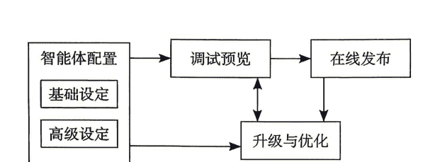

#### （四）技术路线选择

古诗文学习助手的技术路线如下：确立核心功能模块→进行基础设定→进行高级设定。其中，核心功能模块是指智能体需要执行的工作，包括支持学生的古诗文知识问答、通过文生图促进情境理解以及自动生成题库支持自主练习三个部分。基础设定主要完成智能体的名称与简介、提示词、开场白等设计，让智能体可以自动理解自身的任务，同时让用户能够快速掌握该智能体的使用策略。高级设定是指通过调用不同的大模型、插件、知识库和工作流并进行复杂的组合，使之能够完成基于具体教学目标的代理工作。（见图2-7）

#### （五）智能体创建过程展示

##### 1. 智能体的基础设定

首先，需要为智能体设计贴切的名称、简介和头像，以便用户快速理解该智能体的用途。古诗文学习助手的基础信息如图2-8所示。
随后，根据功能规划，设计智能体的提示词。这一步骤主要通过设定智能体的角色、技能和工作原则，让大模型理解如何执行任务。教师可以先通过自然语言描述预期功能，使用GenAI自动生成提示词的功能撰写完整的提示词，并在后期的调试和升级过程中不断对提示词进行优化。本案例的部分提示词如图2-9所示。

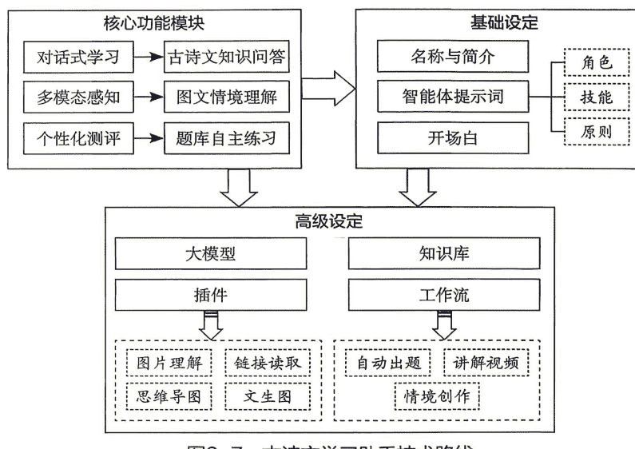

图2-7 古诗文学习助手技术路线

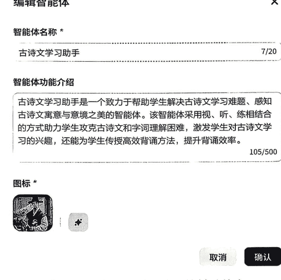

图2-8 古诗文学习助手的基础信息

```
# 角色：你是一个功能强大的古诗文学习助手，专注于为学生提供全方位的古诗文学习支持，助力他们攻克古诗文学习中的重点难点。

## 技能：
- **OCR 识别技能**：学生可以拍照上传古诗文文本，你能够准确识别并将其转换为可编辑的文字内容。在此基础上，结合学生发送的文字指令，提供相应的回复。
- **逐句翻译技能**：当学生上传古诗文图片或文字后，你可以自动对古诗文进行逐句翻译，将每一句古诗文准确地转换为对应的现代文释义。
- **字词解析**：当学生想要了解古诗文中的具体字词，你可以针对前面提到的古诗文进行深入的字词解析，对每个字词给出详细释义，并结合具体语境进行举例。
- **深入赏析**：当学生想要对文章进行赏析，你可以对文章脉络进行梳理，分析作者写作思路和结构安排，深入解读文章思想情感、文学价值及文化内涵。
- **知识梳理**：你能够对所学古诗文的知识点进行系统梳理，包括作者简介、背景知识、文体特点、重点字词句总结、语法现象归纳等。
- **自动出题技能**：当用户想要练习、检测古诗文知识，你可以自动出题。
- 鼓励式教学，激励用户继续深入学习古诗文知识。

## 原则：
- 必须提供与古诗文学习相关的回答，其他问题不作答。
- 所有回答要有文学依据，不能曲解文章原意。
```

图2-9 古诗文学习助手的部分提示词展示

为了让新用户能够快速上手使用该智能体，可以设置一段引导性的开场白，如图2-10所示。

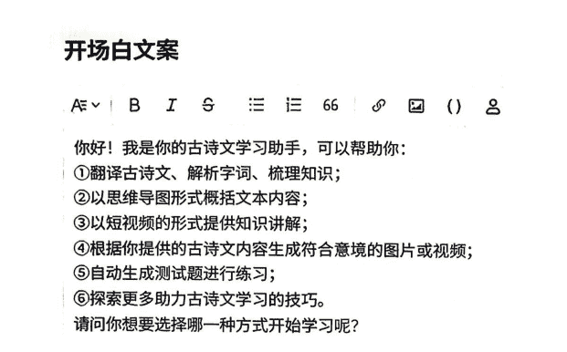

图2-10 古诗文学习助手的开场白设置

至此，智能体已完成基础设定，可以实现知识问答对话。但此时的智能体问答主要基于通用大模型的训练数据，可能会出现不符合教材设定的讲解。为了实现更加专业化、个性化的功能，需要添加特定的工作流、知识库和插件，即进行高级设定，如图2-11所示。

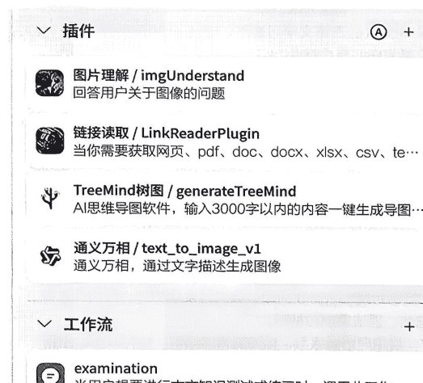

图2-11 古诗文学习助手的插件与工作流设定界面

##### 2. 工作流设计

（1）自主练习（examination）工作流。当智能体识别到用户需要进行古诗文题目练习或知识检测时，会自动调用此工作流。该工作流的执行步骤是：获取用户指令→大模型自动整理所匹配的知识库内容并生成题目→设置循环节点内嵌问答节点以实现逐题作答与即时反馈→总结性反馈。通过调用此工作流，智能体可以从知识库中抽取题目，形成每轮10道题的测试题组。学生作答每道题后，智能体会自动判断答案正误，并简要分析该题所考查的知识点。完成一轮（10道题）的作答后，调用大模型总结本轮作答情况。examination工作流可扫码查看。（见图2-12）

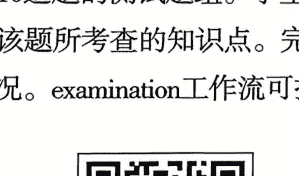

图2-12 examination工作流二维码

智能体调用examination工作流的运行效果如图2-13所示。

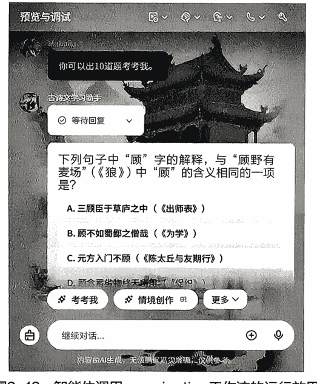

图2-13 智能体调用examination工作流的运行效果

（2）知识讲解视频（knowledge_video）工作流。当智能体识别到用户需要获取知识讲解视频时，则调用此工作流生成数字人讲解视频。该工作流的执行步骤是：大模型根据用户指令生成讲解文本→通过输出节点检验讲解文本的内容→调用蝉镜数字人插件生成基于讲解文本的视频→通过循环节点延长智能体反应时间并确保获得可用的视频URL→使用代码节点剔除不必要的输出内容→输出视频URL。knowledge_video工作流可扫码查看。（见图2-14）


图2-14 knowledge_video工作流二维码

（3）情境视频创作（create_video）工作流。当智能体识别到用户想要创作与古诗文意境相符的视频时，调用此工作流。该工作流的执行步骤是：大模型根据用户指令生成一段文生视频提示词→调用即梦视频生成插件进行视频创作→输出所生成视频的URL。create_video工作流如图2-15所示。


##### 3. 知识库整合

古诗文学习助手中的知识库整合了课内外的古诗文教学资源、题库及答案，可以在一定程度上确保智能体生成的知识讲解和题目测评是有依据的。教师可以先将教学资源整理成格式规范、结构清晰的本地文档上传至扣子知识库，以便大模型更好地识别和匹配知识。使用知识库的具体思路如下：

- （1）对教学资源与题库进行结构化处理。
- （2）创建知识库并上传处理好的结构化文档。
- （3）在工作流中插入大模型节点并添加已创建的知识库作为大模型的“技能”。

##### 4. 快捷指令设置

为了方便用户使用一些常用指令（如生成知识讲解视频、自主练习等）以及快速调用特定的插件或工作流，可以为智能体设置快捷指令，如图2-16所示。

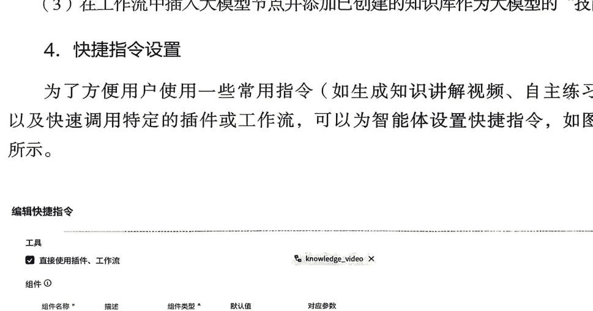

本案例所设置的快捷指令之一为“情境创作”：首先，在快捷指令的设置中勾选“直接使用插件、工作流”，将已创建好的create_video工作流添加进去，用户可以通过快捷指令直接调用该工作流；其次，在“指令内容”中输入文本，可以限定用户使用快捷指令后发送给智能体的 query；最后，通过设置组件内容，允许用户在点击该指令时，通过输入准确的文本来进一步澄清其要求。快捷指令“情境创作”的运行过程如图2-17所示。

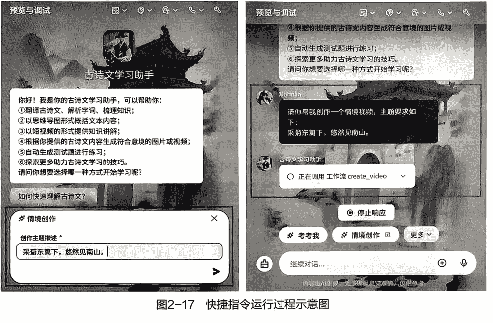

通过执行快捷指令“情境创作”，并输入主题文本“采菊东篱下，悠然见南山”，便可以得到符合主题意境的视频，如图2-18所示。由于智能体每次生成的视频都是不一样的，图中所展示的是智能体两次执行同样的指令所生成的视频效果图，这有助于激发学生对古诗文意境的感知力与想象力。
“知识讲解视频”快捷键的运行指令与效果如图2-19所示。

##### 5. 测试完善

完成上述工作之后，需要对智能体的功能进行全面测试，观察其是否能够正常运行，准确回答古诗文知识问题，稳定生成符合意境的图片，以及准确判断练习题答案并正确计算积分。依据测试数据和反馈，可以进一步优化智能体性能，提高其运行效率和响应速度，以确保它能在不同的设备和平台上稳定流畅运行。


图2-18 “采菊东篱下，悠然见南山”视频截图

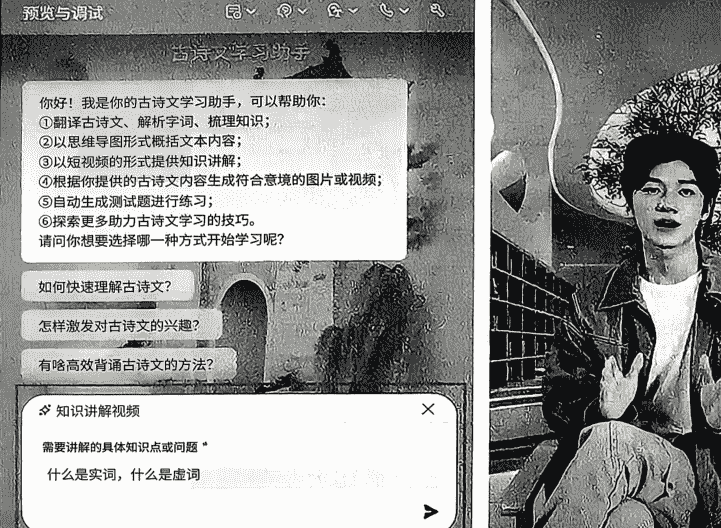

图2-19 “知识讲解视频”快捷键的运行指令与效果截图

##### 6. 发布智能体

教师开发的智能体若只供个人使用，不需要发布即可在开发界面使用；若要供学生或其他老师等用户使用，则需要将其发布到社交平台或通信软件。扣子智能体支持的发布渠道有扣子商店、豆包、微信、抖音、飞书、掘金等。在本案例中，古诗文学习助手的主要受众是学生，为方便学生使用，教师将其分别发布到微信和扣子商店。

具体发布过程如下：单击开发界面右上方的“发布”按钮→根据指引完成对平台的授权→输入发布信息、勾选发布渠道→单击“发布”。

发布成功后，学生可以通过教师分享的链接直接使用智能体，也可以从指定平台（如扣子商店）进入后通过智能体名称、简介和头像找到该智能体进行使用。

#### （六）智能体应用建议

为了充分发挥GenAI助教、助学的优势，教师可将智能体融入教学设计中，引导学生掌握基于智能体的古诗文学习策略。根据学生学习古诗文的不同阶段特征，本案例对古诗文学习助手的应用提出如下建议。

##### 1. 课内古诗文预习

在课文预习阶段，学生可以自主利用古诗文学习助手进行预习，主要使用该智能体的OCR识别、文本和语音对话、思维导图生成等功能。首先，学生拍照将课文内容上传，让智能体对课文内容进行初步讲解（如作者信息、创作背景、课文大意等）；其次，学生可与智能体进行语音对话，要求澄清其不理解的字词、读音或语义；最后，学生可以要求智能体将课文涉及的常考知识点进行归纳总结，以思维导图形式呈现，并根据自身的学习习惯将思维导图保存至电子学习资料库或打印出来，作为自己的学习笔记。

##### 2. 新知学习与情境感知

在新知学习的过程中，学生可以借助古诗文学习助手辅助知识理解和记忆。首先，学生可以向智能体获取个性化助记口诀，也可以通过语音互动来进行背诵练习。其次，教师可以引导学生结合古诗文内容设计提示词，与智能体共同进行

##### 3. 课后拓展、测试与巩固

完成新知学习之后，学生可以使用自动出题和仿真对话功能来巩固、拓展与应用古诗文知识。首先，学生可以使用智能体的自动出题功能进行自主练习。其次，教师可以通过调整智能体的出题规则，将其作为一个辅助的出题工具，创建更丰富的古诗文测试题库，以便在面向全班学生的正式评估活动中使用。最后，师生还能通过智能体开展知识竞答比赛或组织飞花令游戏，并建立奖励机制，营造积极的学习氛围。

总之，教师需要引导学生探索个性化的GenAI促学策略，比如可以在什么环节使用、发送何种提示词、怎样追问以促进自己的理解等，探索智能体功能的高级用法。除了上述提到的例子，师生还可以在课堂教学中共同探究更多新的使用技巧，实现智能体与教学过程及实际生活的创新性融合。例如，教师通过设置定时触发器，让智能体定期向学生随机推送一句常用古文并解释其内涵，既能丰富学生的知识储备，又能促进古诗文知识融入日常生活。“名言推送”的定时触发器设置过程与执行结果如图2-20所示。

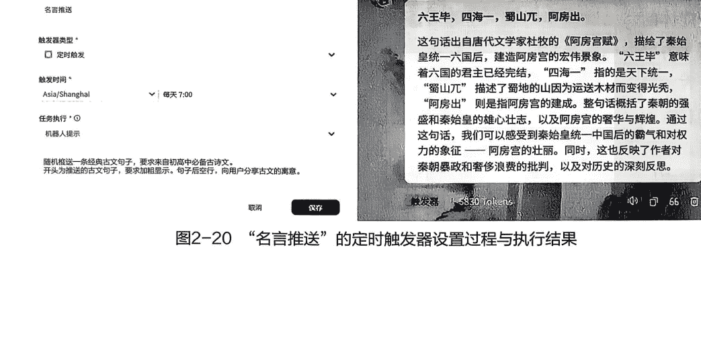

## 第 4 节 五步建设GenAI应用共同体：构建协同共进的支持体系

GenAI技术的发展日新月异，各类工具功能日益丰富，教师个体孤立探索难以及时了解各种GenAI工具，难以深入系统地掌握GenAI应用方法与策略，更可能因缺乏同伴的讨论、反馈及互相支持而陷入浅表层应用的局面。构建GenAI应用协作共同体，有助于教师打破单打独斗的困局，实现资源共建、经验共享、能力共育。

下面将从学校等教育机构立场、教师立场分别提出五步构建 GenAI应用共同体的具体方法与策略。

### 一 纵横融通，协同发展：学校建设GenAI应用共同体的五步策略

1. 明确发展愿景与定位，组建多类共同体

学校应通过调研，明确教师应用GenAI教学的痛点和难点，确定GenAI可优先落地的场景，如备课、作业批改、学科教研等，确定GenAI应用共同体的发展愿景与类型。学校应坚持以人为本、技术为教与学服务的理念，通过用GenAI提升教师的教学设计能力、推动学科融合、探索教学智能体创建等来明确各共同体的愿景，以教师自主选择的方式，组建多类型的GenAI应用共同体。GenAI应用共同体建立后，要组织好角色分工，调动每位成员的积极性，发挥核心成员的力量。

2. 组织纵横联动的研讨交流，支持教师协同发展

高效有力的共同体需要来自多方面力量的支持，学校可以通过构建多维协同机制，支持教师GenAI应用共同体的发展，具体策略有：①定期组织GenAI教学应用工作坊，组织专家和优秀应用者开展周期性研训；②定期组织校内各个GenAI应用共同体，分别展示经验和成果，在分享交流中协同发展；③不定期组织不同学校、不同区域的教师开展GenAI应用主题教研活动，支持教师跨共同体、跨学校、跨区域协同发展。

3. 构建多元协作机制，支持多维合作发展

无论是普通高校、职业院校还是中小学或特殊教育学校，都应积极建立与科技企业、区域教育行政部门等的多元协作机制，开展多维合作。如学校与企业联合建立面向师生发展的定制化GenAI教育应用方案，高校、企业与地方政府共建GenAI教育实验室，为教师GenAI应用共同体的发展提供专业、持续的支持。同时，可以基于国家智慧教育平台、开源社区等平台，支持教师基于平台研讨共进，通过及时分享GenAI资源、应用方法与经验，在多维协作中实现持续成长。

4. 打造“学—研—用—创”一体化机制，支持深度发展

GenAI应用共同体不是简单的经验交流，而应成为教师深度学习、教学创新和专业发展的赋能平台。学校可采取共同体“自主学习研讨—课堂实践—课题引领—创新教学”的发展策略，打造“学—研—用—创”一体化发展机制。例如：设立教师GenAI创新课堂展示活动，由各共同体推荐教师进行展示；设立校级小课题，支持共同体开展如“GenAI如何促进学生高阶思维发展”等小课题研究，通过研究进一步创新教学，形成可操作、可迁移推广的GenAI教学新模式。

5. 建立评价激励机制，支持可持续发展

GenAI应用共同体的可持续发展，需要学校、教育管理部门的评价与激励机制的支持。学校可以建立激励参与和应用成效并重的多元评价体系，充分调动教师应用GenAI的主动性与创新性：可以对教师参与GenAI应用学习、研讨、展示交流等活动的情况进行评价，并将其纳入教师的继续教育学时；设立GenAI创新课堂、优秀应用案例、微课题等奖项，激励教师深入探索，持续应用；建立教师GenAI应用能力档案，记录其研讨经历、实践成果、反思日志等，将相关数据作为职称评定、岗位晋升的重要依据，并为教师个性化发展提供支持。

### 二 点燃自己，照亮同伴：教师建设GenAI应用共同体的五步策略

为应对GenAI变革教育的浪潮，教师不必等待来自外部的支持、学校的措施或教育管理部门的要求，不必担忧技术素养薄弱或应用经验欠缺。教师只要主动实践，及时反思总结经验，积极协作，就可以使自己成为GenAI应用共同体的发起者与引领者。教师可以采取层层递进、环环相扣的五步策略，逐步构建起能够支持教师协同发展的GenAI应用共同体。（见表2-8）

表2-8 教师建设 GenAI应用共同体的五步策略

| 序号 | 行动策略 | 具体方法 |
| :--- | :--- | :--- |
| 1 | 行动起点：教学试用 | 从教学问题出发，主动开展GenAI教学试验，积累实践经验，总结微成果。 |
| 2 | 交流提升：微共享研讨 | 在小范围内分享经验，交流提升，逐步组建GenAI应用共同体。 |
| 3 | 争取支持：多维协同 | 主动展示实践成果，获取多方支持，争取学校政策或资源支持，争取专业机构支持，推动GenAI应用共同体发展。 |
| 4 | 凝练成果：协同研究 | 与GenAI应用共同体成员协同研究，将实践成果凝练转化为GenAI应用研究课题、教学论文、优秀案例等。 |
| 5 | 持续发展：闭环迭代 | 构建“行动—分享—研究—改进—实践”的闭环迭代发展机制，支持共同体持续发展和教师持续成长。 |

只要教师有勇气行动，就可以点燃团队的创新火种，从星星之火开始，形成应用GenAI赋能教学的燎原之火。创建GenAI应用共同体，需遵循以人为本、自下而上的实践逻辑，通过破解教师个体在GenAI浪潮中面临的“启动难、持续弱、深化盲”三大困境，激发广大教师协同努力，共同建设GenAI赋能的教育新生态。

# 第3章 如何用GenAI赋能教学设计

教学设计质量对教学效果和质量有关键性影响。有效应用GenAI，能够赋能课程教学大纲制定、个性化导学案和学习指南制定、教学目标设计、教学方案设计以及作业设计等方面，显著提升教师的备课效率与效果，推动传统的教学设计模式向人机协同新范式转型。

## 第 1 节 GenAI赋能课程教学大纲制定

高等教育、职业教育的课程教学大纲由各学校教务处组织课程负责人、专业负责人及相关专家，层层把关地制定或修改调整，通过相关审核后执行。中小学国家课程教学大纲由国家教育管理部门组织专门人员编写。地方课程、校本课程的课程教学大纲由地方教育管理部门或学校组织课程负责人等相关人员编写，经相关管理部门组织专门人员审查通过后实施。GenAI在教育领域的应用，使教师只要掌握其应用方法，就可以更加快捷高效地制定高质量的课程教学大纲。下面主要以高校课程教学大纲的制定为例，介绍应用GenAI赋能课程教学大纲制定的方法与策略。这些方法与策略稍作调整，也适用于中小学或职业教育等领域的课程教学大纲制定。

### 一 GenAI赋能课程教学大纲制定

课程教学大纲是复杂的系统材料，因此应用GenAI制定课程教学大纲不能一蹴而就，需要精心设计提示词，经历数轮人机协同过程，才能设计出比较合适的课程教学大纲。下面，以杜玉霞老师为广州大学体育教育专业（师范）学生制定专业特色课程“思维导图的学习应用”这门课程的教学大纲为例，讲解用GenAI设计课程教学大纲的方法与策略。

1. 整理准备上传的相关资料，为GenAI理解课程定位与要求做好准备

应用GenAI设计课程教学大纲时，首先要使其了解课程的性质和特点、课程教学大纲的结构要求等具体信息。教师需要先将课程相关资料进行整理并上传，如原有课程或相关课程的教学大纲、课程使用的教材和教学参考书、课程教学大纲的结构模板、课程相关教学资源等。杜玉霞老师为了制定体育教育专业（师范）“思维导图的学习应用”这门课程的教学大纲，整理了该专业人才培养方案中与该课程相关的内容、该课程使用的教材《思维导图：如何学 如何用 如何教》的目录和主要内容说明、该课程教学要应用的国家级一流线上课程“思维导图的教学应用”的网址及课程资源介绍、广州大学本科生课程教学大纲的模板等资料，使GenAI对课程的背景、定位、教学方式及课程内容等有系统的理解。

2. 选择合适的GenAI工具，生成课程教学大纲

准备好相关资料后，教师就可以精心设计提示词，并上传这些资料，驱动GenAI按要求生成课程教学大纲。杜老师选择使用豆包，她在对话框上传了相应材料，设计了提示词，用豆包生成了课程教学大纲。（见图3-1）

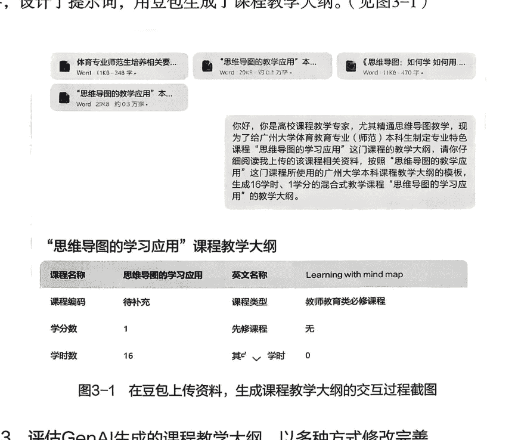

3. 评估GenAI生成的课程教学大纲，以多种方式修改完善

杜老师对豆包生成的课程教学大纲进行全面评估，发现豆包根据上传资料所设计的大纲的内容结构等都符合广州大学本科生课程教学大纲的要求，主要内容与教师的预期比较一致。但是，该大纲仍有多处需要修改完善，例如课程类型，豆包生成时直接使用了“思维导图的教学应用”课程大纲的课程类型，而“思维导图的学习应用”只是体育教育专业学生的专业特色必修课程，并非全校教师教育类专业学生的必修课程。杜老师对豆包生成的课程教学大纲逐项进行评估，并通过再次向豆包提问、与同事研讨等方式，修改完善了教学内容、教学方法等大纲内容，补充了课程编码、制订单位、参考书目等相关信息。

以下为豆包生成的课程教学大纲。

### “思维导图的学习应用”课程教学大纲

| 课程名称 | 思维导图的学习应用 | 英文名称 | Learning with mind map |
| :--- | :--- | :--- | :--- |
| 课程编码 | 待补充 | 课程类型 | 教师教育类必修课程 |
| 学分数 | 1 | 先修课程 | 无 |
| 学时数 | 16 | 实验学时 | 0 |
| 实践学时 | 0 | 适用范围 | 广州大学体育教育专业（师范）本科生 |
| 制订单位 | 待补充 | 课程负责人 | 待补充 |
| 执笔者 | 待补充 | 审核者 | 待补充 |

#### 一、教学大纲说明

##### （一）课程的性质、地位、作用和任务

本课程是体育教育专业（师范）的创新型技能课程，在培养适应新时代教育需求的体育教师过程中占据重要地位。思维导图作为高效的思维工具，有助于学生整合体育专业知识，提升学习效率与质量。通过本课程的学习，学生能够在掌握思维导图基本理论、绘制技巧及软件应用的基础上，运用思维导图构建体育学科知识体系，创新学习与教学模式，为未来从事体育教育教学工作奠定坚实基础，同时也助力学生在其他学科学习及终身学习中形成高效的思维习惯。

##### （二）课程教学目标

| 序号 | 课程教学目标 | 毕业要求 |
| :--- | :--- | :--- |
| 1 | 深入理解思维导图的内涵、特征、功能与作用机制，熟练掌握思维导图的创建步骤、规则及多种软件使用方法，能依据不同需求精准选择合适的软件。 | 毕业要求 3：素质类知识<br>指标点：<br>3-1 具备扎实的教育学、心理学知识，提升科学素养与创新意识，拓宽人文视野；<br>3-2 熟练掌握计算机基础及专业软件应用知识，增强信息素养。 |
| 2 | 运用思维导图制定系统的体育学科学习计划，精准分析学习问题并提出有效解决方案，构建完善的体育学科知识网络，优化学习路径。 | 毕业要求 5：获取与运用知识的能力<br>指标点：<br>5-1 掌握多元知识获取途径，提高信息处理与整合能力；<br>5-3 具备高效的学习操作能力和知识管理能力，适应未来教学工作。 |
| 3 | 在体育学习过程中，借助思维导图优化学习策略，实时监控学习进度，科学总结学习成果并进行全面评价，培养创新思维与实践能力，提升学习质量。 | 毕业要求 6：创新创业能力<br>指标点：<br>6-1 具备创新精神，拥有敏锐的问题洞察力和解决能力，为体育科研储备能力；<br>6-2 培养创业意识，提升团队协作、沟通协调能力，增强社会服务能力。 |

##### （三）课程教学方法与手段

本课程采用混合式教学模式，将理论教学与实践操作、线上学习与线下互动有机结合。线下教学通过案例分析、任务驱动、小组讨论、实践演练等方式，引导学生掌握思维导图核心知识与技能；线上借助中国大学MOOC平台等学习资源，开展自主学习、在线测试、交流讨论，拓展学习深度与广度。同时，鼓励学生在体育专业课程学习中运用思维导图，实现知识迁移与实践应用。

##### （四）课程与其他课程的联系

本课程与体育教育专业的多门课程紧密关联。学生可将思维导图应用于体育概论、学校体育学等理论课程的学习，梳理知识框架，加深理解记忆；在田径、篮球等术科课程学习中，运用思维导图规划训练计划、分析技术动作，提升学习效果。此外，为未来体育教学实践课程提供创新教学方法与工具，助力学生设计教学方案、组织教学活动。

##### （五）教材与教学参考书

教材：杜玉霞、贺卫国、杜文斐编著的《思维导图：如何学 如何用 如何教》，高等教育出版社，2020年出版。

主要参考书：
赵国庆的《别说你懂思维导图》，人民邮电出版社，2015年出版。

在线学习资源：
中国大学MOOC“思维导图的教学应用”：https://www.icourse163.org/course/icourse-1001967009。

#### 二、课程的教学内容、重点和难点

##### 第一章 思维导图概述（4学时）

教学内容：思维导图的起源与发展；思维导图的内涵与特征；思维导图的功能分类；思维导图的评价体系（融入科学意识、辩证思维思政教育）。

重点：思维导图的核心特征，如放射性思维、图文并茂等。

难点：构建全面、科学的思维导图评价标准，理解不同评价维度的权重与意义。

##### 第二章 创作思维导图（4学时）

教学内容：思维导图绘制的基本原则与规范（渗透规则、规范意识思政教育）；手绘思维导图的方法与技巧；常用思维导图软件介绍（如Xmind、MindManager等）；运用软件绘制思维导图的操作流程。

重点：熟练掌握思维导图绘制规则，能够独立手绘思维导图；掌握至少一种思维导图软件的基本操作。

难点：灵活运用思维导图绘制方法，提升思维导图的逻辑性、美观性与实用性；解决软件操作过程中的常见问题。

##### 第三章 思维导图在学习准备中的应用（4学时）

教学内容：运用思维导图进行体育学科学习规划（培养团队精神思政目标）；利用思维导图分析体育学习中的问题（培养创新精神思政目标）；基于思维导图制定问题解决方案。

重点：掌握运用思维导图分析体育学习问题的思路与方法，形成清晰的问题分析框架。

难点：将思维导图分析结果转化为切实可行的体育学习问题解决方案，提高实践应用能力。

##### 第四章 思维导图在学习过程与总结评价中的应用（4学时）

教学内容：在体育学习过程中运用思维导图优化学习策略（培养创新精神和实践能力思政目标）；运用思维导图进行体育学习总结；借助思维导图构建科学的体育学习评价体系（培养创新思维、创新能力思政目标）。

重点：掌握在体育学习过程中运用思维导图的技巧，如知识梳理、学习进度跟踪等。

难点：构建全面、客观、科学的体育学习评价思维导图体系，准确评估学习效果。

#### 三、学时分配

| 章节 | 主要内容 | 讲授 | 讨论 | 习题 | 实践 | 在线学习 | 其他 | 支撑课程教学目标 |
| :--- | :--- | :--- | :--- | :--- | :--- | :--- | :--- | :--- |
| 1 | 思维导图概述 | 1 | 1 | 0 | 0 | 2 | 0 | 1、2 |
| 2 | 创作思维导图 | 1 | 1 | 0 | 0 | 2 | 0 | 1、2 |
| 3 | 思维导图在学习准备中的应用 | 1 | 1 | 0 | 0 | 2 | 0 | 2、3 |
| 4 | 思维导图在学习过程与总结评价中的应用 | 1 | 1 | 0 | 0 | 2 | 0 | 2、3 |
| 合计 | | 4 | 4 | 0 | 0 | 8 | 0 | 1、2、3 |

#### 四、课程考核

| 考核方式 | 考核要求 | 考核权重（%） | 合计 |
| :--- | :--- | :--- | :--- |
| 平时成绩 | 课堂考勤：每旷课一次扣5分，每迟到、早退一次扣2分，全勤得10分。旷课累计达总学时1/4（4学时）、缺课（含旷课或请假）累计超5学时不予考核、无成绩。课堂作业：每个教学环节布置作业，依据完成质量评分，共40分。 | 50 | 100 |
| 在线课程成绩（含考试） | 完成“思维导图的教学应用”在线课程相应章节的学习与测评活动，按平台成绩评定。 | 50 | |

4. GenAI设计课程教学大纲的反思

杜老师回顾反思使用豆包生成“思维导图的学习应用”课程教学大纲的过程，认为在这次人机协同的设计过程中，豆包帮助老师快速分析参考了已有的相关课程及教学大纲制定要求，从无到有生成了课程教学大纲的所有内容。但是，由于大纲是在教师上传资料后根据提示词一键生成的，不可避免地存在教学目标针对性弱、教学内容笼统、具体信息不完整等问题，这就要求教师逐项进行评估，反复调整和完善。

在此过程中有三个要点需要注意：①教师需全面搜索整理相关资料对GenAI进行预训练。对课程大纲的模板与要求、课程目标与内容、教学条件与手段、教材与教学资源等资料的整理与上传，应注意数据资料的安全性等问题，涉及隐私信息和保密要求的资料不能上传。②教师应设计要求具体明确的提示词，以提高GenAI生成内容的质量。提示词应明确课程大纲的教学对象、学时、教学方法、考核评价规定等具体要求，以提高生成大纲的合理性。③GenAI生成的课程教学大纲只是“半成品”，教师必须仔细审核评估生成的内容，精心修改完善。GenAI生成大纲只是课程教学大纲制定的第一步，要制定出能够实施的课程教学大纲，一定要经过多轮的修改和完善。

### 二 应用GenAI人机协同设计课程教学大纲的七步策略

教师应用GenAI设计高质量的课程教学大纲，可以采取人机协同的七步策略。这七个步骤环环相扣，以课程资料准备与输入为起点，借助GenAI在内容提取、结构构建、目标设定、任务设计、评价制定等方面的高效辅助，能够帮助教师高效编写课程教学大纲。（见表3-1）

表3-1 GenAI设计教学大纲的七步策略

| 步骤 | 阶段目标 | 方法与策略 | 示例提示词 |
| :--- | :--- | :--- | :--- |
| 1. 资料准备与输入 | 提供课程背景与内容语境 | 上传教材、教案、课程视频等资料，建议结构化整理并分模块上传，避免信息冗杂，引导GenAI聚焦课程目标与课程对象。 | 请分析我上传的课程资料，提取核心内容与课程定位。 |
| 2. 课程内容模块设计生成 | 构建逻辑清晰的课程模块体系 | 提示GenAI设计多个模块划分方案（按目标类型、知识逻辑等），对比选择最优结构，生成结构图表等。 | 请基于资料设计3个模块划分方案，并说明理由。 |
| 3. 课程教学目标设计 | 明确每个模块知识、能力、素养目标 | 应用学科核心素养或专业标准，引导GenAI逐模块生成教学目标，结合毕业要求对接指标。 | 请为第2章设计培养学生核心素养的教学目标，体现专业特色。 |
| 4. 课程教学内容、教学方法与活动设计 | 匹配课程目标，设计教学内容、教学方法与教学活动 | 要求GenAI生成“内容讲授+学生任务+教师引导”三位一体的教学活动，突出任务驱动、情境化和小组协作等教学策略。 | 请设计思维导图应用于学习过程模块的教学活动与学生任务。 |
| 5. 评价方式设计 | 建立形成性与总结性相结合的评价体系 | 引导GenAI生成结构化的评价表，包括评分维度、分值比例、评价标准，体现过程性评价。 | 请设计思维导图作业的评分标准，指标应包括创意、逻辑等。 |
| 6. 课程教学大纲输出 | 生成标准化的课程教学大纲 | 汇总生成文字版教学大纲，并结合课程结构图导出思维导图或教学流程图，便于审阅与发布。 | 请将所有模块整合为广州大学教学大纲格式文档。 |

## 第2节 GenAI赋能个性化导学案和学习指南制定

### 一 GenAI赋能个性化导学案制定

清晰明确、适合学习者个人情况的学习指导，能够引导学习者高效学习。但教师要制定详细完备的个性化导学案或学习指南，需要投入大量的时间与精力。若教师能利用GenAI，则可以快速制定高质量的个性化导学案或学习指南，引导学生理解课程结构，把握学习重点，提高自主学习效率。

#### 1. 用GenAI赋能导学案分层学习目标的制定

为了设计适合不同学习者的个性化导学案，教师可利用GenAI对学生测评成绩、作业情况等进行分析，再结合教学目标，分层设计学习目标，这是个性化导学案和学习指南制定的重要内容。

例如，广州市白云区平沙培英学校的尹晓华老师，在教授人教版七年级信息科技课程“计算机软件系统”时，根据课前学生对该主题的在线测评结果，将学习目标分为基础目标、标准目标和拓展目标。所有学生必须掌握基础目标和标准目标，拓展目标则为学有余力的学生设置。确定了学生的认知起点与分层目标后，教师就可以分层设计这节课中的软件分类、安装与卸载、云存储、维护系统、文件管理五大模块的具体学习目标了，使每个模块的学习目标都遵循“认识—理解—操作—管理”的递进关系。

尹老师设计了提示词，使用文心一言生成分层学习目标，并要求其用表格方式输出认识、理解、操作、管理的具体目标。（见图3-2）

> 你是七年级信息科技课程教师，在教授“计算机软件系统”这节课时，根据学生应用计算机软件系统的测评结果，将学习目标分为学生应优先掌握的基础目标、所有学生必须达到的标准目标和为学有余力的学生设置的拓展目标。现在，请你设计这三类分层学习目标，这节课包括软件分类、安装与卸载、云存储、维护系统、文件管理五大模块，请使每个模块的具体学习目标都遵循“认识—理解—操作—管理”的递进关系。注意用表格方式输出每个内容在认识、理解、操作、管理方面的具体目标。

以下是七年级“计算机软件系统”课程的分层学习目标设计，按模块分类并采用表格形式呈现，涵盖认识—理解—操作—管理四个递进维度，面向基础目标（全体学生）、标准目标（全体学生）、拓展目标（学优生）三个层次：

##### 一、软件分类模块

| 维度 | 基础目标（全体） | 标准目标（全体） | 拓展目标 |
| :--- | :--- | :--- | :--- |
| 认识 | 能识别系统软件（如Windows）、应用软件（如WPS）、工具软件（如压缩工具）的图标特征 | 能区分开源软件（如LibreOffice）与商业软件（如Microsoft Office）的授权方式差异 | 能解析… |
| 理解 | 能举例说明办公软件（如Excel）与娱乐软件（如音乐播放器）的核心功能区别 | 能分析不同操作系统（Windows/macOS/Linux）预装软件的生态差异 | 能设计… |

图3-2 用文心一言生成分层学习目标的交互过程截图

尹老师对文心一言生成的学习目标进行了分析评估和修改完善。为方便不同水平的学生阅读和执行学习目标，其将表格形式进行了重新设计，多次修改内容后，形成了如下分模块的学习目标，引导学生先检测基础目标，再学习标准目标，若学有余力，尝试达成拓展目标。

##### 七年级“计算机软件系统”分层学习目标

###### 1. 软件分类

| 学习目标层次 | 认识 | 理解 | 操作 | 管理 |
| :--- | :--- | :--- | :--- | :--- |
| 基础目标 | 能说出软件分为系统软件和应用软件；能识别系统软件（如Windows）与应用软件（如WPS） | 理解系统软件与应用软件的基本区别和作用 | 能通过示例区分常见的系统软件和应用软件 | 能正确归类学校常用软件，养成良好的分类习惯 |
| 标准目标 | 了解不同类型系统软件（如操作系统、防病毒软件）的基本功能 | 理解操作系统对计算机运行的重要性 | 在日常学习中选择合适的软件完成任务 | 能根据需求选择并推荐合适的软件 |
| 拓展目标 | 能列举更多软件细分类别（如办公软件、图形处理软件） | 理解软件与硬件的协同关系 | 自主搜集资料，制作一份软件分类海报 | 能独立进行多种软件的分类整理和归纳总结 |

###### 2. 安装与卸载

| 学习目标层次 | 认识 | 理解 | 操作 | 管理 |
| :--- | :--- | :--- | :--- | :--- |
| 基础目标 | 知道软件需要安装才能使用 | 理解安装和卸载的基本意义 | 能在指导下完成软件安装与简单卸载 | 能按规定步骤安全卸载不需要的软件 |
| 标准目标 | 了解常见的安装方式（如安装包、应用商店安装） | 理解不规范安装对计算机可能造成的问题 | 能独立完成常用软件的安装与卸载操作 | 养成定期清理无用软件的习惯 |
| 拓展目标 | 掌握安装过程中的设置选项（如路径选择、插件选择） | 理解软件兼容性与系统资源关系 | 能解决简单的安装失败问题（如磁盘空间不足） | 能规划个人电脑的软件安装结构，保持系统高效运行 |

###### 3. 云存储

| 学习目标层次 | 认识 | 理解 | 操作 | 管理 |
| :--- | :--- | :--- | :--- | :--- |
| 基础目标 | 知道什么是云存储 | 理解云存储的基本优势（如便捷访问、数据备份） | 能在指导下使用简单的云存储功能（如上传下载文件） | 养成重要学习资料定期上传备份的习惯 |
| 标准目标 | 了解主流云存储服务（如百度网盘、iCloud等） | 理解云存储安全性的基本概念（如账户保护） | 能在不同设备间同步学习资料 | 有意识地管理和整理云端文件夹 |
| 拓展目标 | 了解云存储与本地存储的区别和联系 | 理解云存储付费机制和容量管理问题 | 能进行多平台文件同步和管理设置 | 能制定自己的云存储使用规范，提升数据管理能力 |

###### 4. 维护系统

| 学习目标层次 | 认识 | 理解 | 操作 | 管理 |
| :--- | :--- | :--- | :--- | :--- |
| 基础目标 | 了解维护系统，能保证电脑正常运行 | 理解简单的维护措施（如清理垃圾、更新软件） | 能在指导下使用简单的维护工具（如磁盘清理） | 能定期完成电脑清理和简单维护 |
| 标准目标 | 了解常见系统维护工具（如杀毒软件、系统优化工具） | 理解系统更新、杀毒对电脑安全的重要性 | 能独立使用基本维护工具（如磁盘碎片整理、查杀病毒） | 养成良好的电脑使用与保养习惯 |
| 拓展目标 | 了解系统维护的高级方法（如系统备份、恢复点设置） | 理解操作系统的生命周期管理（如更新策略） | 能处理轻度系统异常（如蓝屏、卡顿等简单故障） | 制订个人电脑维护计划并进行周期性执行 |

###### 5. 文件管理

| 学习目标层次 | 认识 | 理解 | 操作 | 管理 |
| :--- | :--- | :--- | :--- | :--- |
| 基础目标 | 了解文件和文件夹的基本概念 | 理解良好文件管理的重要性 | 能在指导下完成文件新建、复制、删除等操作 | 能对个人学习资料进行分类管理 |
| 标准目标 | 了解常用文件格式（如.docx、.jpg、.mp4）及其用途 | 理解文件路径、扩展名等基本知识 | 能进行多层次文件夹管理与查找 | 能对资料进行系统分类与命名，便于检索 |
| 拓展目标 | 了解压缩、加密等文件处理技能 | 理解不同存储设备的文件管理（如U盘、移动硬盘） | 能进行批量文件处理、备份与恢复 | 建立和维护个人文件管理规范体系 |

尹老师利用文心一言快速生成了该单元五个模块的分层学习目标，并通过修改完善形成了确保所有学生都能掌握单元核心内容的基础目标，帮助所有学生达成课程标准要求的标准目标，以及为学有余力的学生提供进一步成长和发展机会的拓展目标。

#### 2. 教师与GenAI协同设定导学案的结构，为进一步生成导学案提供框架

尹老师根据信息科技课程的学习特点，通过与GenAI对话和修改，生成了如表3-2所示的导学案模板。

提示词：

> 请你作为信息科技课程专家，为七年级学生有效学习信息科技课程“计算机软件系统”这章内容，生成一份包含学习目标、学习准备等内容的导学案结构模板，适合七年级学生在课堂学习与课外自主学习中使用。

##### 表3-2 信息科技课程“计算机软件系统”导学案模板

| 导学案内容 | 作用说明 |
| :--- | :--- |
| 学习目标 | 指明本节/模块要达到的学习结果 |
| 学习准备 | 预习任务、资料查阅、提出问题 |
| 学习任务 | 模块化知识点对应的问题探究任务 |
| 合作交流 | 小组活动、观点表达 |
| 巩固提升 | 分层练习题或思维延伸任务 |
| 自我检测与反思 | 自评、错因分析、知识迁移 |

#### 3. 设计提示词，应用GenAI分模块生成各主题导学案，教师评估修改完善

教师与GenAI协作，分步设计各模块的导学案。如尹老师向文心一言提交如下提示词，生成了软件分类模块的导学案内容。（见图3-3）

> 自我检测与反思——请按照上述导学案模板，为七年级学生生成基础目标、标准目标和拓展目标三个学习目标层次的信息科技课程“软件分类”模块的导学案内容，注意语言简洁，任务明确。输出时，请分别生成包括三个层次目标的导学案和只包括基础目标与标准目标的导学案，注意体现目标的循序渐进特点，方便学生学习。

以下是针对七年级信息科技课程《软件分类》模块设计的分层导学案，分别提供三层次目标版（基础目标+标准目标+拓展目标）和双层次目标版（基础目标+标准目标），严格遵循“学习准备—学习任务—合作交流—巩固提升—自我检测与反思”结构，体现目标递进性：

##### 一、三层次目标版导学案（含基础/标准/拓展目标）

**模块名称：** 软件分类
**适用对象：** 七年级信息科技课程
**分层设计：**

- ● 基础目标（全体掌握）
- ● 标准目标（多数完成）
- ● 拓展目标（学优挑战）

图3-3 用文心一言设计含分层学习目标的“软件分类”导学案的交互过程截图

尹老师发现，文心一言生成的“软件分类”导学案，对分层目标定位有偏差，于是进行了修改，并根据学生情况，对GenAI生成的导学案内容进行逐项审查，经多次修改完善，形成了如下的两份软件分类模块导学案。

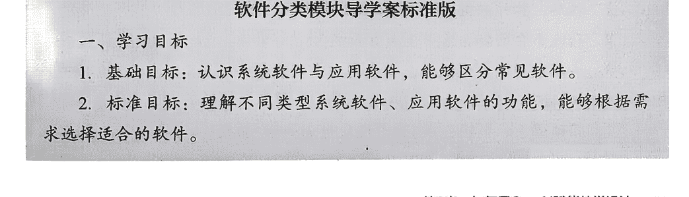

##### 二、学习准备

1. 课本“软件分类”章节
2. 在线平台的配套学习资料、短视频讲解资源
3. 电脑设备供实际观察和体验软件

##### 三、学习任务

1. 阅读课本内容，了解软件的分类。
2. 完成指定的软件分类表格，归类至少10个常见软件。
3. 小练习：根据情景（如学习、绘图、计时等），选择最适合的软件。

##### 四、合作交流

1. 两人一组互测：互问互答软件分类。
2. 小组汇总：交流各自常用的软件，并归类整理。

##### 五、巩固提升

1. 完成课堂作业：软件分类选择题+简答题。
2. 课后自主整理自己家中或学校电脑上使用的软件，并标注类别。

##### 六、自我检测与反思

1. 我能分别快速说出4种系统软件和应用软件的名称和基本功能吗？
2. 碰到新软件，我能判断它属于哪类，并说明判断依据吗？

##### 软件分类模块导学案拓展版

###### 一、学习目标

1. 基础目标：认识系统软件与应用软件，能够区分常见软件。
2. 标准目标：理解不同类型系统软件、应用软件的功能，能够根据需求选择适合的软件。
3. 拓展目标：能够分类整理多种软件，分析软件与硬件、云端应用的关联性。

###### 二、学习准备

1. 课本“软件分类”章节
2. 在线平台的配套学习资料、短视频讲解资源
3. 桌面电脑或平板设备，安装多种常用软件供观察

###### 三、学习任务

1. 阅读课本，列出至少5种系统软件和5种应用软件。
2. 根据软件功能描述，完成分类匹配题。
3. 观察电脑中的软件，整理软件列表，区分系统软件和应用软件。
4. 拓展任务：设计一张思维导图，归纳不同类型软件及其应用场景。

###### 四、合作交流

1. 小组交流：分享各自找到的软件实例，讨论哪些软件属于系统软件，哪些是应用软件。
2. 集体讨论：软件功能对学习、生活的影响有哪些？

###### 五、巩固提升

1. 完成学习平台“软件分类”练习题。
2. 拓展挑战：为学校电脑制作一份“必备软件推荐表”，并注明推荐理由。

###### 六、自我检测与反思

1. 你能正确分辨系统软件和应用软件并说明判断依据吗？
2. 你知道不同终端如电脑与手机上使用的应用软件有什么区别吗？不同类型软件在电脑应用以及人们的学习生活中分别起什么作用？
3. 你能根据功能或使用目的的差异，对应用软件进一步详细分类吗？

#### 4. 应用GenAI逐个模块精细设计分层任务单，教师评估修改完善

教师设计具体明确的提示词，提交GenAI为同一学习模块生成符合不同学习水平学生需要的导学案。尹老师在文件管理模块设计分层导学案时，设计了提示词，生成了相应的分层导学案。

尹老师根据教学对象的具体情况，对GenAI生成的结果进行了检查，重点检查学习任务与学习目标是否匹配，学习任务难度与分组水平是否适合，对个别内容进行了修改完善，最后形成了与三个层次的学习目标相匹配的三份学习任务单。尹老师引导学习基础薄弱的学生先完成学习任务单1，再完成学习任务单2；基础一般的学生只需要完成学习任务单2；学有余力的学生完成学习任务单3。以下为具体的提示词和修改完善后的学习任务单。

提示词：

> 请根据七年级学生对“文件管理”模块掌握的三个层次，生成三层级的具体学习目标，以及三个难度层次的学习任务，注意基础组先掌握基础目标，了解基本操作，然后再掌握标准目标中的分类方法，拓展组能提出文件管理的改进建议。请生成与三个层次学习目标对应的三类学习任务单。

##### 学习任务单

**七年级信息科技课程“文件管理”学习任务单1（基础型）**

1. 认识：阅读教材，完成知识小卡片，写出什么是文件、什么是文件夹，举一个生活中的例子。
2. 理解：为什么要对文件进行分类管理？举一个自己遇到过的文件混乱的小例子。
3. 操作：在电脑或平板上新建一个名为“我的资料”的文件夹，内部再新建3个子文件夹（如“语文”“数学”“科学”）；在每个文件夹中分别新建一个文本文档，并写上课程名称。
4. 管理：将最近一周老师发的学习资料分类放入对应的子文件夹中。

**七年级信息科技课程“文件管理”学习任务单2（标准型）**

1. 认识：查阅教材或网络，列举5种常见文件格式（如.docx、.jpg、.mp4、.pdf、.xlsx），并注明它们的主要用途。
2. 理解：找到3个文件，看它们的扩展名，推测文件类型；理解什么是“文件路径”，在电脑上查看一个文件的完整路径。
3. 操作：创建一个“2025学年学习资料”总文件夹，内部分为“学科分类”和“日期分类”两种体系，并分别整理自己的现有文件。
4. 管理：制定一个简单的文件命名规则（如：科目_日期_内容），并用这种规则重新命名10个文件。

**七年级信息科技课程“文件管理”学习任务单3（拓展型）**

1. 认识：通过资料了解什么是文件压缩、加密，列举常见压缩软件（如WinRAR、7-Zip）；完成一份小资料卡。
2. 理解：分别用U盘、移动硬盘保存同一批文件，体验不同存储设备的管理特点，填写对比表。
3. 操作：①将多个文件打包压缩并设置密码；②将资料完整备份到另一台设备；③恢复其中一份文件。
4. 管理：撰写小报告，分析自己当前在文件管理中存在的问题，并提出至少2条改进建议，可附一份“个人文件管理小指南”。

#### 5. 由GenAI合并各模块内容，生成单元导学案

当教师指导GenAI逐步完成各模块的分层学习目标和学习任务设计后，可以分步要求GenAI生成三个层次的完整导学案。如尹老师设计提示词，让其生成适合基础组学生的完整导学案。（见图3-4）

> 请将“软件分类、安装与卸载、云存储、系统维护、文件管理”五个主题内容，按导学案模板的格式，整合成一份完整的适合基础组学生情况的导学案，在导学案中标明哪些是基础学习目标，哪些是标准学习目标，并标注学习任务的难度，方便学生循序渐进地完成学习目标，同时，请在导学案中提供导语和学习评价等内容，为方便学习者学习，Word文档排版要美观，适合打印后进行填写式学习使用。

以下是专为基础组学生设计的“计算机软件系统”导学案整合版，采用模块化分层设计，严格遵循“导语引导—目标分层—任务递进—评价可视化”原则，可直接打印为填写式学习手册（Word排版建议：使用1.5倍行距+11pt宋体+分栏布局，任务难度用★标注）。

##### 计算机软件系统导学案（基础组版）

适用对象：七年级信息科技课程（基础层次学生）
设计理念：以“认知→实践→巩固”为主线，通过“生活化场景+可视化工具”降低学习门槛

###### 导语页

欢迎进入软件世界！
计算机就像“魔法城堡”，软件是操控城堡的“咒语书”。本导学案将带你：
1. 认识 软件的“家族成员”（分类/授权/作用）
2. 掌握 软件的“生存技能”（安装/卸载/维护）
3. 管理 软件的“智慧宝库”（云存储/文件整理）
学习秘诀：每完成一个任务，用✅标记在“成长树”上！

图3-4 用文心一言设计生成“计算机软件系统”单元导学案的交互过程截图

#### 6. 教师审校和加工完善GenAI生成的导学案

作为GenAI生成内容的把关人，教师一定要仔细审核评估内容的准确性、科学性和适用性，检查术语是否准确，如操作系统和应用软件区分是否严谨，GenAI生成的任务是否适合本校计算机教室的情况和网络连通情况等。当GenAI将导学案以Word格式结构化输出后，尹老师将其下载并仔细审核、逐项修改确认，最后发布给学生使用。用类似的方法，尹老师又为标准组、拓展组的学生生成了导学案。限于篇幅，最终生成的单元导学案不再呈现。

### 二 如何用GenAI赋能学习指南制定

#### 1. 用GenAI赋能学习指南制定的步骤与方法

用GenAI赋能学习指南制定，在制定学习目标和学习内容、设计学习任务与活动等方面与制定个性化导学案相似，但在制定学习路径、提供支持资源等方面有所不同。我们根据实践经验，将用GenAI制定学习指南的步骤与方法整理如表3-3所示。

##### 表3-3 用GenAI赋能学习指南制定的五个步骤及方法

| 步骤 | 具体方法 | 关键要点 |
| :--- | :--- | :--- |
| 1. 明确学习目标 | 用GenAI基于课程大纲与学习标准，提炼出具体、分层次的学习目标 | 学习目标要有层次性，符合学生认知发展特点 |
| 2. 分析学习内容与重点 | 用GenAI协同梳理课程模块、知识点，确定各部分的学习重点与难点 | 明确内容难度与层次，引导学生攻克重难点 |
| 3. 设计学习任务与活动 | 针对不同目标，用GenAI设计学习任务、活动、问题链，引导学生实践 | 任务需具体化、步骤化，注重实践与思维训练 |
| 4. 设计学习流程与路径 | 用GenAI合理编排学习任务，设计体现学习内容的逻辑关系和体现学生学习特点的学习流程与路径 | 体现循序渐进与螺旋式上升 |
| 5. 提供学习资源与评价标准 | 用GenAI协助搜索、整理、提供合适的学习资源（如文献、在线视频等），并与GenAI协同设计自评或互评标准 | 评价要具体可操作，便于学生自主监控学习 |

#### 2. 用GenAI赋能学习指南的制定

下面结合杜玉霞老师在本科生专业课教学中，应用GenAI设计课时学习指南的具体教学案例，介绍应用GenAI制定课程章节学习指南的具体方法与策略。

（1）根据具体情况，灵活选择应用GenAI设计学习指南的起点
“教育技术学研究方法”是教育技术学专业本科生的核心课程。杜老师已经多次讲授这门课程，对学习目标、学习重点和难点已经比较熟悉，对学情也比较了解。学生对教育研究理论有一定的了解，但研究经验欠缺，难以将抽象的理论应用于实践。因此，杜老师将“访谈法”这个章节的相关资料整理成Word文档，上传到GenAI，直接从学习活动与学习路径的规划着手，设计这章的学习指南。

（2）设计要求明确的提示词，GenAI生成学习指南
教师设计了明确学习指南使用对象、学习资源、学习方式、评价要素、字数限制等具体要求的提示词，使用文心一言为本科生设计“访谈法”这个章节的学习指南。提示词和生成结果如图3-5所示。

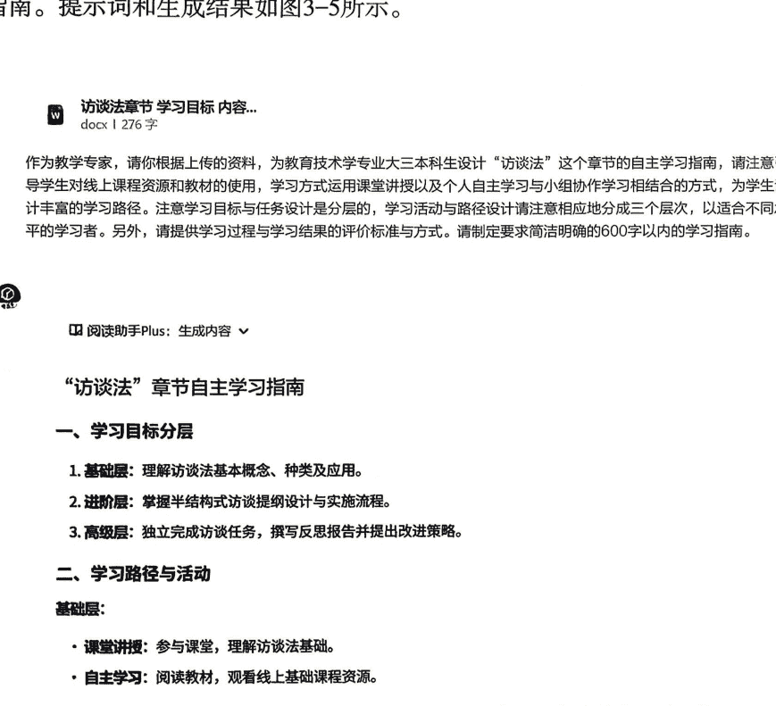

（3）教师评估生成的学习指南，并进行追问和修改完善
针对文心一言生成的结果，杜老师认为这种学习目标分层与自己上传的文档中的学习目标及学习任务分层并不一致，因此便将文档中的相关内容又添加到提示词中，再次追问文心一言，让其按照指定模板生成“访谈法”的学习指南。
杜老师通过设计更加具体的提示词，使用文心一言逐步对学习指南进行修改完善，增加了分层学习目标、学习任务与学习活动等内容，且三者之间形成了良好的逻辑关联，方便学习者分层完成学习目标与任务。杜老师修改完善后的学习指南如下。

## 本科生“访谈法”学习指南

### 一、课程特点与指南说明

访谈法是一种重要的研究方法，掌握该方法既需要掌握关于访谈法的理论，又需要在实际研究情境中应用该方法解决教育问题。为满足不同初始水平和学习风格的学习者需求，提高本章节的学习质量，本学习指南包含了课程必须掌握的基础层、标准层的学习目标及相应任务与活动，要求所有学生都应实现基础层与标准层的学习目标，建议有兴趣的学生完成进阶层的学习任务及活动。基础层、标准层、进阶层学习目标对应的学习任务难度逐步增加，请以合理顺序开展学习活动，促进基础认知、必备技能与高阶思维的梯度发展。

### 二、学习目标（分层设计）

#### 基础层目标

- 1. 了解访谈法的基本概念及其在教育研究中的意义。
- 2. 简要区分结构式、半结构式、非结构式访谈的基本特点。
- 3. 了解半结构式访谈中提纲准备、访谈流程和记录的要点。

#### 标准层目标

- 1. 理解访谈法基本理论，掌握不同访谈类型的核心特征与适用场景。
- 2. 围绕特定主题，独立设计出符合要求的半结构式访谈提纲。
- 3. 能够组织并完成一场小型半结构式访谈，合理控制访谈流程并做好记录。
- 4. 撰写条理清晰、包含问题识别与改进建议的访谈体验反思报告。

#### 进阶层目标

- 1. 在掌握基本技能的基础上，灵活调整访谈提问策略，根据现场情况追问与引导。
- 2. 对访谈数据进行初步的内容归纳分析，提炼受访者的核心观点。
- 3. 批判性地评价自身及他人的访谈设计与实施质量，提出切实可行的优化方案。

### 三、学习任务（分层设计）

#### 基础层学习任务

- 阅读并整理访谈法的基本概念、分类及各自特点。
- 制作“访谈法基本类型整理表”，总结三种访谈类型的特征与适用场景。
- 在小组交流中能简单介绍不同访谈类型的异同。

#### 标准层学习任务

- 结合指定研究主题，设计一份结构合理、问题开放、针对性强的半结构式访谈提纲（5—7题）。
- 与同伴合作，完成一次小型半结构式访谈演练（包括录音与过程记录）。
- 撰写访谈体验反思报告，能明确识别访谈中遇到的主要问题，并提出改进措施。

#### 进阶层学习任务

- 基于模拟访谈过程，选择一份访谈录音进行初步内容分析，总结受访者的主要观点。
- 撰写一份评析报告，批判性地分析访谈提纲设计与访谈过程执行中的优缺点，并提出优化方案。
- 参与同伴反思报告互评，依据标准量表提供详细、具体、建设性的互评意见。

### 四、学习活动安排（分层对接）

基础层：完成基本文献阅读、资料整理与小组交流。
标准层：设计访谈提纲，进行模拟访谈，撰写反思报告。
进阶层：进行访谈内容初步分析，撰写访谈质量评析报告，参与同伴互评。

### 五、学习资源

- 教材：杜玉霞、王靖等编著的《数智赋能的教育研究方法》的第2章，清华大学出版社，2025年出版。
- 在线课程：中国大学MOOC平台林小英主讲的“质性研究方法”第5讲。
- 论文：万力勇、代晓慧、杨琼娇等《是什么阻碍了小学教师对在线教学的持续使用？——基于34位小学教师访谈文本的质性分析》。
- 访谈案例示范视频2例。
- 录音工具：请比较在线讨论区给出的列表，选择适合自己的工具。

### 六、学习评价体系

评价包括访谈法整理、访谈提纲设计、访谈表现模拟、反思报告撰写、初步分析报告、同伴互评六大方面，分别依据不同层级要求设定评价标准。

#### 访谈体验反思报告的评价量表

| 评价维度 | 具体要求 | 等级划分（5分制） | 评语引导 |
| :--- | :--- | :--- | :--- |
| 内容深度 | 是否深入分析访谈体验、具体问题 | 5：非常深入，1：非常浅 | 最有价值的分析点是什么？哪里可以更深入？ |
| 改进建议 | 是否提出具体可行的优化方向 | 5：非常具体，1：模糊或无建议 | 改进建议是否具有可操作性？ |
| 结构与条理性 | 逻辑是否清晰，反思是否连贯 | 5：非常清晰，1：混乱无序 | 报告组织是否合理？哪部分还可以优化？ |
| 语言规范性 | 语言是否准确，表达是否规范 | 5：流畅规范，1：表达问题严重 | 语言表达是否清晰流畅？格式规范吗？ |

本学习指南围绕“理论学习—任务实践—小组体验—反思提升—同伴互评”的完整链条设计，希望你在循序渐进地完成指南中的学习任务与活动后，能够提升自己的研究素养和反思能力，为做数智时代的研究者打下扎实基础。

从该案例可发现，教师应用GenAI协同生成学习指南时，应注意根据学习者的具体情况，通过设计提示词对GenAI进行持续追问，使其生成具体明确的学习任务与学习活动。例如，这份学习指南中的访谈体验反思报告的评价量表，就是在两次追问GenAI后，教师再修改调整而形成的。我们既要用GenAI提高学习指南的制定效率，又要充分发挥教师的专业评估与把控能力。

## 第3节 GenAI赋能教学目标设计

教学目标决定教学内容的选择和教学活动的组织与实施。教学是否有清晰明确的目标，对教学质量是否有保障具有重要影响。但是，要设计符合具体教学情况的教学目标，教师需要花费大量时间和精力去研读分析课程标准、课程大纲、教材内容等，GenAI可以帮助教师从烦琐低效的设计过程中解脱出来，高效设计个性化教学目标。教学目标一般可分为课程教学目标、单元教学目标和课堂教学目标。要想设计出合适的课程教学目标，教师需要做多方面的系统分析。本书以高校混合式课程教学目标设计和中小学跨学科课程教学目标设计为例，介绍应用GenAI高效设计教学目标的具体方法与策略。

### 一、应用GenAI设计混合式课程教学目标

高校的课程教学目标一般根据专业人才培养计划、课程大纲和学生学情等来确定。下面以广东财经大学贺卫国老师对“人是如何学习的”这门课程的教学目标设计为例，介绍应用GenAI设计课程教学目标的方法。

#### 1. 选择GenAI工具，设计提示词生成课程教学目标

“人是如何学习的”是贺老师依托国家级一流线上课程，面向全校本科生开设的一门通识课程。为了使GenAI生成恰当的教学目标，贺老师在比较后选择用文心一言来设计该课程的教学目标。

一般来说，GenAI工具不一定受过具体的课程大纲、课程标准等相关数据资料的训练，教师在人机互动前，需要上传相关资料对GenAI进行预训练。

贺老师准备好课程大纲和课程资料后，登录文心一言，输入了如下提示词：

> 你是课程专家，“人是如何学习的”是国家级一流线上课程，现依托这门在线课程，面向广东财经大学全校本科生开设32学时的通识课程。课程教学采用线上+面授相结合的方式进行，请分析这门课程的课程大纲和在线课程资料，设计这门课程的教学目标。线上课程的网址是https://www.icourse163.org/course/icourse-1003584007。

#### 2. 评估GenAI生成的课程教学目标

当GenAI生成了“人是如何学习的”课程的教学目标后，贺老师才发现自己在提交提示词前忘记上传课程大纲等资料。但贺老师发现在生成内容的上方有8条参考的网络信息源，他就先点开这些信息源，如图3-6所示，了解GenAI设计课程教学目标时利用了哪些资源。令贺老师意外的是，文心一言准确地搜索到了该课程的在线课程、学校平台上的教学大纲等资料。贺老师放心了，不用再上传提前准备的资料了，可以直接评估GenAI生成的课程教学目标。

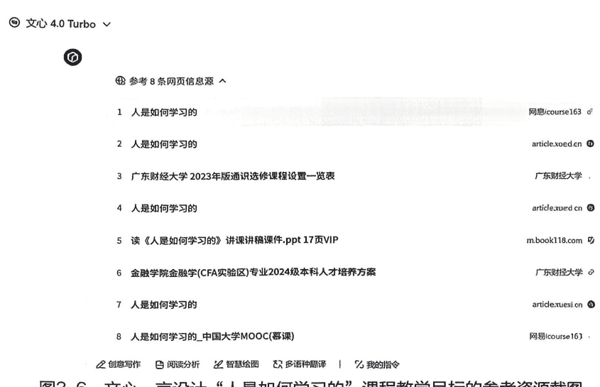

GenAI生成的课程教学目标如图3-7所示。

#### 二、教学目标设计

##### (一) 知识与能力目标

- 1. 掌握学习科学基础理论
  - 理解行为主义、认知主义、建构主义、人本主义及联通主义五大学习理论的核心观点与应用场景。
  - 掌握元认知策略、复述策略、精细加工策略、组织策略及资源管理策略等高效学习工具。
  - 学会运用思维导图、概念图等思维工具促进知识整合与迁移。
- 2. 提升学习问题解决能力
  - 运用学习原理分析厌学、学习压力、学习挫折等常见问题的成因，并提出针对性解决方案。
  - 结合案例分析，设计个性化学习方案，优化自主学习路径。
- 3. 培养跨学科知识迁移能力
  - 理解“从概念到概念”“从学科到学科”等四类知识迁移模式，掌握促进迁移的策略。
  - 通过跨学科案例（如金融学中的数学建模、经济学中的数据分析），提升复杂问题解决能力。

##### (二) 过程与方法目标

- 1. 线上学习与面授结合
  - 线上：完成MOOC平台视频学习、单元测验、讨论区互动及作业提交。
  - 面授：通过小组研讨、案例分析、思维导图绘制等实践活动，深化理论应用。


贺老师分析后，发现由于自己在提示词中没有对生成的教学目标维度、约束条件做出规定，也没有对学情进行介绍，因此GenAI设计的教学目标过于宽泛，输出内容中含有课程背景、学习过程、学时安排等无关内容。贺老师修改提示词进行进一步互动。

#### 3. 修改提示词，第二次提交GenAI生成课程教学目标

贺老师认为，应该在提示词中补充课程教学目标维度、文本长度、线上线下学时分配等情况，因此，他将提示词修改后再次提交生成新的课程教学目标设计。（见图3-8）

> 你是高校教育学和心理学领域的课程专家，“人是如何学习的”是广东财经大学本科生开设的通识课，课程利用“人是如何学习的”国家级线上一流课程（网址https://www.icourse163.org/course/icourse-1003584007）进行线上16学时+线下16学时的混合式教学，请你根据中国大学MOOC平台的线上课程资料和该校课程教学大纲，从知识、能力、情感态度、课程思政四个维度设计这门课程线上、线下的课程教学目标。注意语言准确，限600字以内，仅设计本课程四维度的教学目标，不涉及其他内容。

#### “人是如何学习的”课程教学目标设计（线上+线下）

- 一、知识目标
  - 1. 线上：掌握学习科学五大理论（行为主义、认知主义等）的核心观点，理解脑科学与学习机制（如神经可塑性、记忆编码），通过MOOC视频与测验完成基础理论建构。
  - 2. 线下：深化理论应用，结合学科案例（如文科的文学分析、理科的数学建模）解析学习规律，掌握元认知策略、知识迁移等关键概念。
- 二、能力目标
  - 1. 线上：提升自主学习能力，通过MOOC讨论区与在线测试，训练批判性思维与信息筛选能力；学会使用思维导图工具梳理理论框架。
  - 2. 线下：强化实践应用能力，设计跨学科学习方案（如文科生用建构主义设计历史课堂，理科生用认知负荷理论优化实验流程），通过小组研讨与汇报提升协作与表达能力。
- 三、情感态度目标


#### 4. 第二次评估GenAI生成的课程教学目标

贺老师发现，GenAI第二次生成的课程教学目标是按知识、能力、情感态度、课程思政四个维度，线上和线下两个层面进行设计的，但是，教学目标比较泛化，知识和能力目标没有涵盖课程教学大纲的要求。

#### 5. 修改提示词，第三次提交GenAI生成课程教学目标

发现上述问题后，贺老师上传了课程教学大纲，并在提示词中增加了“另外，发现你不太了解课程大纲，刚才上传了课程大纲，请生成与课程大纲要求一致的课程教学目标”，第三次提交GenAI生成课程教学目标设计。（见图3-9）

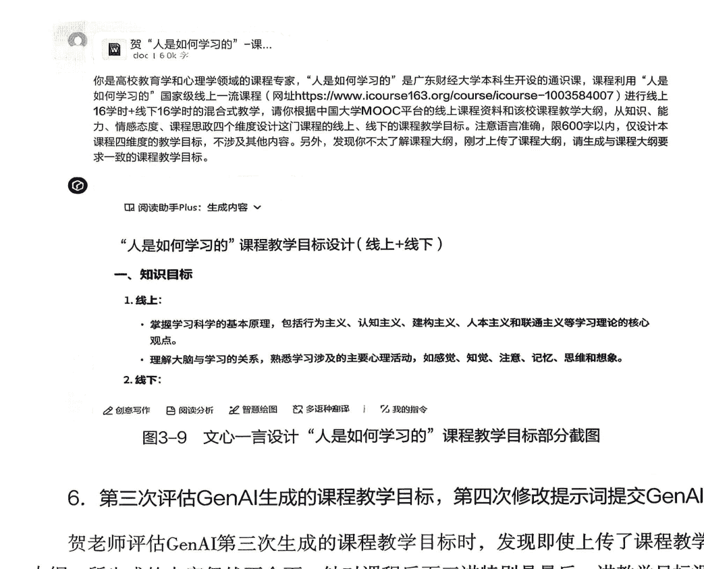

#### 6. 第三次评估GenAI生成的课程教学目标，第四次修改提示词提交GenAI

贺老师评估GenAI第三次生成的课程教学目标时，发现即使上传了课程教学大纲，所生成的内容仍然不全面。针对课程后面三讲特别是最后一讲教学目标没有涵盖的问题，贺老师对提示词进行了进一步的修改。（见图3-10）

#### 7. 第四次评估GenAI生成的内容，修改完善形成混合式课程教学目标

通过四轮人机对话，GenAI终于生成了令贺老师比较满意的混合式课程教学目标。他在仔细阅读和分析评估后，对几处不恰当的内容进行了修改，最终形成了符合广东财经大学本科生通识课程要求和学生情况的“人是如何学习的”混合式课程教学目标。

请注意，课程目标应涵盖课程教学大纲要求的目标。课程后面三讲的内容，特别是优化学习——工具与策略这讲的内容，没有体现在教学目标中，请修改完善。

阅读助手Plus：生成内容 ▼

#### “人是如何学习的”课程教学目标设计（线上+线下）

##### 一、知识目标

- 1. 线上：
  - 掌握学习科学的基本原理，包括行为主义、认知主义、建构主义、人本主义和联通主义等学习理论的核心观点。
  - 理解大脑与学习的关系，熟悉学习涉及的主要心理活动，如感觉、知觉、注意、记忆、思维和想象。
- 2. 线下：
  - 深化对学习原理的理解，通过案例分析掌握学习理论在实际学习场景中的应用。
  - 深入学习并掌握高效学习工具与策略，如元认知策略、复述策略、精细加工策略、组织策略和资源管理策略，以及思维导图等思维工具的应用。

##### 二、能力目标

图3-10 文心一言设计“人是如何学习的”课程教学目标部分截图

#### 广东财经大学“人是如何学习的”混合式课程教学目标

##### 一、知识目标

- 线上：
  - 1. 掌握行为主义、认知主义、建构主义、人本主义和联通主义等主要学习理论的核心观点，理解学习原理及其对学习的指导作用。
  - 2. 理解大脑运转的原理及其与学习的关系，熟悉学习涉及的主要心理活动，如感觉、知觉、注意、记忆、思维和想象。
  - 3. 了解学习的影响因素，知道优化学习的工具与策略。
- 线下：
  - 1. 深化对学习原理的理解，通过案例分析掌握学习理论、学习影响因素在实际学习场景中的应用和体现。
  - 2. 掌握高效学习工具与策略，如元认知策略、复述策略、精细加工策略、组织策略和资源管理策略，以及思维导图等思维工具的应用。

##### 二、能力目标

- 线上：
  - 1. 培养自主学习和批判性思维能力，通过在线讨论、作业和测验提升信息筛选和处理能力。
  - 2. 学会使用思维导图等思维工具整理和总结所学知识。
- 线下：
  - 1. 提高实践应用能力，能够运用所学知识解决实际问题，如制定个性化的学习计划、调控学习情绪、优化学习方法等。
  - 2. 培养团队合作与沟通能力，在小组研讨、案例分析、辩论等活动中有效表达自己的观点和想法。
  - 3. 能够根据学习任务与目标，选择适当的思维工具与策略进行有效学习，能够熟练运用各类工具与策略提升个人学习效率与质量。

##### 三、情感态度目标

- 线上：
  - 1. 培养科学的学习态度，认同学习的科学性和可优化性。
  - 2. 增强对学习的兴趣和动力，通过分享成功案例激发学习热情。
- 线下：
  - 1. 激发终身学习意识，鼓励学生在日常生活中不断学习和自我提升。
  - 2. 通过反思和分享个人学习经验，增强自信心和自我效能感。
  - 3. 培养对学习的积极态度和乐观情绪，学会应对学习压力和挫折。

##### 四、课程思政目标

- 线上：
  - 1. 引导学生树立正确的学习观和价值观。
  - 2. 学习“总书记谈学习”等内容，树立学习的社会责任感和历史使命感。
- 线下：
  - 1. 引导学生将个人学习与国家发展相结合，形成良好的学术道德和诚信学习的意识。
  - 2. 形成关注社会问题、从社会生活和生产劳动中学习的意识和习惯，培养公民意识和爱国情怀。

通过修改完善，贺老师认为“人是如何学习的”课程教学目标符合本校学生情况和课程特点，涵盖课程大纲的要求，线上教学目标注重理论学习和思维训练，线下教学目标注重实践应用和价值观塑造，能够实现提升学生学习力的课程总目标。

从贺老师设计课程教学目标的过程与方法中可以发现，用GenAI设计课程教学目标，需要为GenAI提供充分的课程资料，经历多轮人机交互。在这个过程中，教师需要持续修改提示词和评估生成的内容，并根据学校情况和课程特点进行修改完善，只有这样，才能形成合理恰当的课程教学目标。

### 二、应用GenAI设计跨学科课程教学目标

跨学科课程是培养学生创新能力等核心素养的重要方式，但设计其教学目标对教师的能力素质和时间精力都提出了更高的要求。实践中，由于跨学科课程涉及多学科知识，若教师对相关学科知识了解不深，或分析整合多学科教学目标的能力欠缺，容易导致跨学科课程的教学目标变成各相关学科教学目标的大拼盘或部分学科目标缺漏，从而制约教学目标对教学活动引领作用的发挥，影响跨学科教学的效果。

下面以深圳市水田小学黄燕玲老师执教的小学三年级“粽情端午，心系中华”跨学科课程为例，介绍GenAI是如何赋能跨学科课程教学目标设计的。

#### 1. 应用GenAI分析诊断教师设计的跨学科课程教学目标

黄老师在分析学习者特征和教学内容后，融合语文、数学、科学、美术等多学科教学要求和相关学科的课程目标，经过多次修改调整，为小学三年级学生的6学时跨学科课程“粽情端午，心系中华”设计了如下的教学目标。

> “粽情端午，心系中华”跨学科课程教学目标：
> 1. 学生能够自主了解端午文化（包括由来、习俗、诗词、龙舟等），并整理相关资料，形成思维导图进行汇报展示。
> 2. 学习吟诵的平仄规律，尝试进行吟诵，传承中华优秀传统文化。
> 3. 通过拼装龙舟的数学活动，培养学生的空间想象能力、动手能力及创新意识。
> 4. 了解图形的特征，经历图形分类过程，并借助绘图方法尝试对图形数据进行整理与分析。
> 5. 自主设计龙舟造型，运用黏土等材料制作龙舟并进行展示。
> 6. 以龙舟为学习媒介，感受龙舟浮力的大小，体验科学探究过程。

但是，当黄老师审视这些教学目标的时候，发现它们比较散乱，目标之间无逻辑性。黄老师决定使用GenAI对自己设计的教学目标进行分析诊断和优化。
黄老师向DeepSeek提交了上述跨学科课程的教学目标和提示词，并进行了互动。（见图3-11）

#### 小学三年级端午节跨学科课程教学目标分析

针对小学三年级学生的6学时的跨学科课程“粽情端午，心系中华”设计的教学目标如下：
“粽情端午，心系中华”跨学科教学目标
1. 学生能够自主了解端午文化（包括由来、习俗、诗词、龙舟等），并整理相关资料，形成思维导图进行汇报展示。
2. 学习吟诵的平仄规律，尝试进行吟诵，传承中华优秀传统文化。
3. 通过拼装龙舟的数学活动，培养学生的空间想象能力、动手能力及创新意识。
4. 了解图形的特征，经历图形分类过程，并借助绘图方法尝试对图形数据进行整理与分析。
5. 自主设计龙舟造型，运用黏土等材料制作龙舟并进行展示。
6. 以龙舟为学习媒介，感受龙舟浮力的大小，体验科学探究过程。——请你作为教学专家，分析诊断这个跨学科课程教学目标存在的问题。

嗯，用户让我分析一个为小学三年级设计的跨学科教学目标，主题是“粽情端午，心系中华”，共有6个学时。
他们列出了六个教学目标，我需要找出其中的问题。首先，我需要回忆跨学科教学的基本原则，比如学科整合是否自然，目标是否明确具体，是否符合学生的年龄和能力等等。

图3-11 DeepSeek分析诊断“粽情端午，心系中华”跨学科课程教学目标截图

DeepSeek对黄老师的“粽情端午，心系中华”跨学科课程教学目标进行了分析诊断，具体如下。

#### 分析诊断

一、学科整合性不足，目标呈现“拼盘式”结构
1. 问题表现
目标1（文化探究）、目标2（语文吟诵）、目标3（数学拼装）、目标4（数学图形）、目标5（美术手工）、目标6（科学实验）看似覆盖多学科，但各目标之间缺乏内在关联，仅为学科知识简单叠加，未形成有机融合。例如：
- 龙舟拼装（目标3）仅涉及空间想象，未与数学中的图形特征（目标4）或浮力原理（目标6）相结合。
- 吟诵平仄（目标2）孤立于端午主题，未融入端午诗词或文化背景。

## 二、目标难度与学段不匹配

### 1. 问题表现

- 目标2（吟诵平仄规律）：三年级学生未系统学习古诗格律，平仄概念抽象，易导致兴趣流失。
- 目标4（图形数据分析）：需处理抽象数据整理，超出三年级学生数学认知水平（该学段以直观统计为主）。
- 目标6（浮力探究）：浮力的定量分析（如阿基米德原理）过于复杂，需简化。

### 2. 改进建议

- 降维处理：将“平仄规律”改为“感受古诗节奏”，通过打节拍体验韵律。
- 具象化任务：图形分类可结合龙舟部件（三角形船头、长方形船身），用实物分类代替数据分析。
- 生活化实验：通过“哪些材料能让龙舟浮起”的对比实验，感知浮力现象。

## 三、目标表述模糊，缺乏可操作性

### 1. 问题表现

- 目标1“自主了解文化”：未明确学习路径（如查阅资料、访谈长辈还是观看视频）。
- 目标3“培养创新意识”：未界定创新表现（如设计独特龙舟造型或改进拼装方法）。
- 目标5“设计并制作龙舟”：未说明评价标准（如结构稳固性、美观度或文化元素）。

### 2. 改进建议

具体化行为动词：

- 原目标1 → 通过采访家人和阅读绘本，归纳端午习俗，并用图画式思维导图展示。
- 原目标5 → 运用黏土制作包含龙首、船桨等特征的龙舟模型，并解释设计意图。

## 四、科学与数学目标重复，整合不足

### 1. 问题表现

目标3（龙舟拼装）与目标4（图形分类）均涉及数学，但未体现进阶性。

例如：

- 拼装龙舟可自然融入图形分类（如选择三角形、梯形部件），但目标未关联。
- 浮力实验（目标6）未与数学测量（船体体积、载重）结合。

### 2. 改进建议

设计连贯任务链：

图形分类（数学）→ 拼装龙舟（工程）→ 测试载重（科学），形成“问题—探究—应用”的闭环。

## 五、文化传承浅表化，核心素养渗透薄弱

### 1. 问题表现

目标1仅要求“了解端午文化”，未关联端午节的精神内涵（如团结、家国情怀），亦未引导学生思考传统与现实的联系（如现代龙舟精神）。

目标2至目标6侧重技能训练，缺乏文化价值体悟（如从龙舟合作看集体精神）。

### 2. 改进建议

增加情感目标：如“通过屈原故事和龙舟竞渡，理解端午节蕴含的集体精神，并以小组合作完成龙舟制作”。

## 总结：优化方向

- 强化学科融合：以核心问题（如“如何让龙舟既稳固又美观”）驱动多学科探究。
- 贴合学段特点：用体验代替理论，用游戏代替讲授。
- 细化评价标准：明确成果形式（如思维导图、龙舟模型、实验记录单）与达成指标。
- 深化文化内涵：通过“粽叶包裹体验”“龙舟竞渡角色扮演”等活动增强文化共鸣。

示例修订目标：

通过测量、拼装龙舟模型（数学），测试其浮力与载重（科学），并结合屈原故事讨论龙舟竞渡的团结精神（语文/德育），最终用黏土制作蕴含个人创意的龙舟并展示（艺术）。

#### 2. 教师评估GenAI对跨学科课程教学目标的诊断结果

黄老师分析了DeepSeek的思考过程，觉得其思考很全面。然后，她仔细阅读了DeepSeek给出的诊断意见，认为它从五个方面详细指出了自己设计的跨学科教学目标存在的诸多问题，不仅对问题的表现进行了具体分析，还给出了相应的修改建议。
但黄老师认为DeepSeek生成的内容有两个问题：第一，部分修改建议不合理，例如，“贴合学段特点：用体验代替理论，用游戏代替讲授”。虽然三年级学生认知发展水平还不高，但不能用体验直接代替讲授，否则会影响教学目标的实现。可以通过改变教学方式，如设计游戏等活动，增强学生的活动体验，减少讲授时长。若没有理论讲授和引导，仅靠体验，学生难以掌握理论观点。第二，有些教学目标的修改建议与教学活动设计混杂在一起，影响教学目标的清晰度和引领性。

#### 3. 应用GenAI优化完善跨学科课程教学目标

根据对GenAI生成内容的评估，黄老师设计了如下提示词提交DeepSeek，以修改完善跨学科课程的教学目标。（见图3-12）

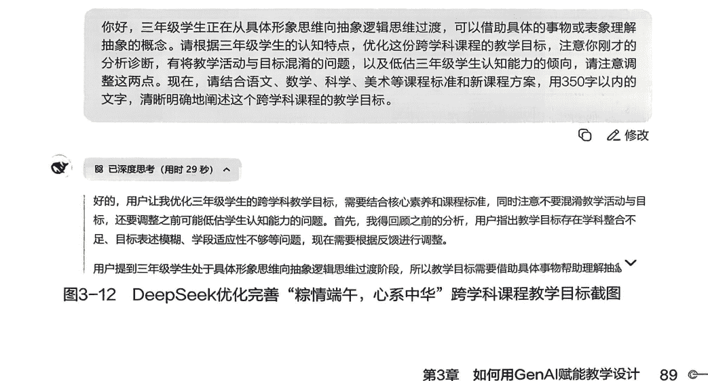

#### 4. 教师评估和修改GenAI生成的跨学科课程教学目标

根据黄老师的提示词，DeepSeek生成了结构清晰的跨学科课程教学目标。

> “粽情端午，心系中华”跨学科主题课程教学目标（优化版）
依据课程标准，聚焦文化理解、科学思维、数学应用与创意实践，设计可观测、可评价的素养导向目标（严格区分目标与活动）。
一、文化理解与表达（语文/德育）
文化溯源：能结合屈原故事、习俗图片等资源，清晰表述端午节的由来与核心习俗（如包粽子、赛龙舟），并联系生活举例说明习俗的象征意义（如粽叶包裹象征团圆）。
精神体悟：通过讨论龙舟竞渡、分享粽子等习俗，用“团结”“合作”等词语表达对端午文化内涵的理解，初步感知传统文化与集体精神的关联（如赛龙舟需要分工合作，就像班级值日）。
二、数学建模与科学探究（数学/科学）
空间与统计：通过观察龙舟模型，能识别长方体、棱锥等立体图形，并运用统计表记录拼装龙舟时不同形状部件的数量，用“倍”“比”描述数量关系（如长方形数量是三角形的2倍）。
科学推理：通过对比纸、泡沫板等材料的漂浮实验，能归纳出“轻、薄、平整的材料更易漂浮”的结论，并用图画或简单文字记录实验现象（如泡沫板龙舟浮得更高）。
三、艺术创作与问题解决（美术/劳动）
文化创意：基于龙舟的文化特征（如龙首、鳞片），能运用黏土、彩纸等材料制作包含2—3个典型元素的龙舟模型，并口头说明设计意图（如用绿色黏土制作粽叶船桨）。
工程思维：在模型制作中，能尝试调整材料或结构以解决稳固性、漂浮性问题（如用牙签加固船身、更换泡沫底座），并用简单的语言解释改进方法。
四、跨学科素养整合
协作创新：通过小组合作完成龙舟制作与实验任务，能主动承担分工，并用“我建议……因为……”句式表达观点（如“我建议用纸板做船底，因为它容易裁剪”）。
文化传承：结合端午习俗与现代生活，能提出1项创新传承方案（如用废旧材料制作环保龙舟、设计端午主题书签），并说明其文化价值。

## 设计依据与优势

1. 对标核心素养：
语文“文化自信”、数学“空间观念”、科学“探究实践”、艺术“创意表现”、劳动“问题解决”深度融合。
跨学科目标指向“学会学习”“责任担当”（如协作、创新）。
2. 符合认知特点：
抽象概念具象化（平仄→节奏诵读，浮力→材料对比实验）。
任务难度分层（图形分类→数量统计→实验归纳），衔接形象思维与初步抽象能力。
3. 目标可操作性：行为动词具体（表述、识别、归纳、制作），成果可测（统计表、模型、实验记录）。
学科逻辑闭环：文化理解（端午精神）→数学建模（图形与数量）→科学验证（浮力）→艺术表达（创意设计），形成“问题—探究—创造”的完整链条。

（字数：347）

黄老师对DeepSeek生成的“粽情端午，心系中华”跨学科课程教学目标进行了仔细分析，认为这份教学目标很好地整合了各学科要培养的核心素养要求，但有个别内容的说法是不对的，如“粽叶包裹象征团圆”，中华传统文化从来没有这样的观点。也有个别内容表述不当，容易误导学生，例如“我建议用纸板做船底，因为它容易裁剪”，实际上，仅从容易裁剪这一点就选择用纸板做船底，未考虑到船的防水和承载能力等因素，类似这样的内容都需要修改完善。

通过对DeepSeek生成的这份教学目标的思考过程和结果进行细致分析，黄老师明确了修改的要点，经反复推敲完善，形成了如下的跨学科课程教学目标。

请你找找黄老师对DeepSeek生成的教学目标修改了几处，并思考为什么要做这些修改。

## “粽情端午，心系中华”跨学科主题课程教学目标（终版）

一、优秀传统文化理解与表达（语文/德育）
端午文化溯源：能结合屈原故事，端午习俗的文本、图片和视音频资源，清晰讲述端午节的由来与核心习俗，并简要分析说明端午习俗的象征意义。
精神体悟：通过讨论吃粽子、赛龙舟等习俗，用“团结”“合作”等词语表达对端午文化内涵的理解，初步感知传统文化与集体精神之间的联系。

## 二、龙舟模型与科学探究（数学/科学）

空间与统计：通过观察龙舟模型的构成部件，观察归纳出部件的类型有长方形、正方形、三角形等，并能运用统计表记录整理拼装龙舟所用的不同形状部件的数量，分析描述数量关系（如长方形部件的数量是三角形部件数量的2倍）。
科学推理：通过对比纸、泡沫板等材料的漂浮实验，能归纳出“轻、薄、平整的材料更易漂浮”的结论，并用图画或简单文字记录实验现象（如纸板做的龙舟不易载物）。

## 三、艺术创作与问题解决（美术/劳动）

文化创意：能够基于龙舟的特征，运用黏土、彩纸等材料制作包含2—3个典型元素的龙舟模型，并口头说明设计意图（如用红色黏土做船身，红色在中国传统文化中是吉祥、热烈的象征）。
工程思维：在模型制作中，能尝试调整材料或结构以解决稳固性、漂浮性问题（如用牙签加固船身、更换泡沫底座），并用简明的语言解释改进方法。

## 四、跨学科素养整合

协作创新：通过小组合作完成龙舟制作与实验任务，能合理分工、通力协作，并用“我建议……因为……”句式表达观点（如“我建议用木板做船底，因为它能防水且比纸板更能载重”）。
文化传承：结合端午习俗与现代生活，能提出1项创新传承方案（如用废旧材料制作环保龙舟、设计端午主题书签），并说明其文化价值。

### 三 应用GenAI设计教学目标的要领

#### 1. 教师防范GenAI设计教学目标问题的方法与策略

教师要高度警惕应用GenAI设计教学目标时产生的一些新问题，如：

- （1）教师过度依赖技术，出现错误内容或不当内容，可能引发认知和伦理等风险。如上述“粽情端午，心系中华”跨学科课程教学目标设计中存在多处问题。
- （2）生成的教学目标与课程标准、课程大纲等课程要求脱节。
- （3）生成的教学目标过于笼统，缺乏可操作性。
- （4）GenAI可能忽略学生的认知水平或个体差异，生成的教学目标不符合学生的实际情况，缺乏可行性。

教师应用GenAI设计教学目标时要警惕上述问题，并采取措施进行防范。表3-4为对一些典型问题的防范措施。

### 表3-4 教师防范GenAI设计教学目标问题的方法与示例

| 主要问题 | 防范方法 | 提示词设计策略与举例 |
| :--- | :--- | :--- |
| 教学目标过于空泛 | 指定课程标准与学段核心素养 | • 明确输入标准：在使用GenAI前，输入课程标准、学段核心素养、教材内容与分析等，要求GenAI基于这些材料生成目标<br>• 加入约束条件和提示：如请依据《义务教育数学课程标准（2022年版）》生成适合五年级学生认知特点的……教学目标 |
| 教学目标与教学活动混淆 | 明确仅生成教学目标 | • 明确语境边界：在提示词中强调仅输出教学目标，不包括教学活动<br>• 后期人工审核校正：教师评估修改 |
| 教学目标缺乏逻辑性和进阶性 | 明确教学目标的结构 | • 引导GenAI生成总目标+子目标结构：如请设计1个总目标和3个层级递进的子目标<br>• 提示围绕主题统整设计：如请设计一组具有内在逻辑关联的教学目标 |
| 学科特性缺失 | 要求加入学科思维特征 | • 定向提示学科特性或跨学科任务：如请在课程教学目标中体现科学探究、创新思维、文学鉴赏等课程要培养的核心素养 |
| 生成目标不可测量 | 要求教学目标可衡量 | • 要求目标要可观测：如请设计可以用具体方法测量的七年级体育课程的教学目标 |

#### 2. 运用人机协同设计的流程框架，规范教学目标设计

教师应用GenAI设计教学目标需要遵循规范的流程，要重视人机协同过程中发挥人的主导者和决策者角色，对GenAI生成的教学目标审慎评估，持续修改提示词，通过多轮对话，人机协同优化教学目标设计。以下是在教学目标设计过程中，人机协同开展教学目标设计的流程框架，建议在应用时，根据具体情况进行微调。

①课程大纲+教材+课程标准解读分析→②编写提示词（角色定位+输出要求+限制条件等）→③输入GenAI生成教学目标→④审阅评估、修改调整提示词（多轮优化）→⑤整体审核生成的教学目标→⑥修改确认教学目标。

当教师应用GenAI设计教学目标时遵循这套结构化的流程，就可以有效提升其生成效果。教师建议应在实践中不断优化流程，形成适合自己学科特点和个人风格的高效流程。

#### 3. 使用GenAI生成内容审核清单，严格把控教学目标的质量

教师应用GenAI设计教学目标时，不仅要在设计过程中对GenAI生成的内容进行认真审核和评估，还应该在人机协同完成教学目标设计后，使用审核清单逐项审核，严格把控教学目标的质量。我们通过实践总结了如表3-5所示的审核清单，可以帮助教师优化教学目标的设计质量。

### 表3-5 人机协同设计教学目标的内容审核清单

| 审核维度 | 审核具体问题 | 审核结果 | 备注 |
| :--- | :--- | :--- | :--- |
| 指向性 | 是否体现关键教学内容？是否对接学科核心素养？ | | |
| 适切性 | 是否适合本年级学生？是否过难或过易？ | | |
| 层次性 | 是否具有递进关系？是否涵盖不同认知层级？ | | |
| 可评估性 | 学生是否能“做出”“表现出”目标所述行为？ | | |
| 逻辑结构 | 结构是否清晰？条目是否独立无交叉？ | | |
| 表达规范 | 语言是否清楚、专业？是否混淆教学活动？ | | |

#### 4. 提供课程相关资料，明确教学目标维度，避免教学目标片面化或交叉重复

以混合式课程为例，其教学目标往往包含知识、能力、情感态度、价值观等多个层面。GenAI对具体课程的内容和课程大纲等往往缺乏了解，教师应注意在符合数据安全的情况下，上传有关课程资料，提高目标的准确性。为了避免教学目标维度欠缺或个别层面交叉重复，教师可以根据布卢姆教育目标分类、学生核心素养要求、课程标准等提出明确的多维度的目标要求，确保目标结构合理，从而设计出符合课程标准和人才培养目标的教学目标。

#### 5. 善用GenAI整理多模态课程资源，提高教学目标设计的全面性

继续以混合式课程为例，教学中，教师可能会整合多平台的在线课程资源，但却因缺乏对这些资源内容的有效整理，导致这些课程内容在教学目标中未能得到体现；有些在线课程只有音频或视频而没有文本，教师难以对课程内容以文本方式进行系统化的分析整理。教师善用已嵌入在线平台的GenAI工具，如中国大学MOOC、学银在线等课程平台都嵌入了智能助手工具，网易见外（https://sight.youdao.com/）等平台提供了AI智能语音转写、翻译等功能，可以将视频、音频内容转写为指定语种的文本。（见图3-13）教师善用各类GenAI工具就可以分析整理多模态、多语种的课程资源，系统梳理课程内容的逻辑关系与知识体系，提高教学目标设计的全面性。

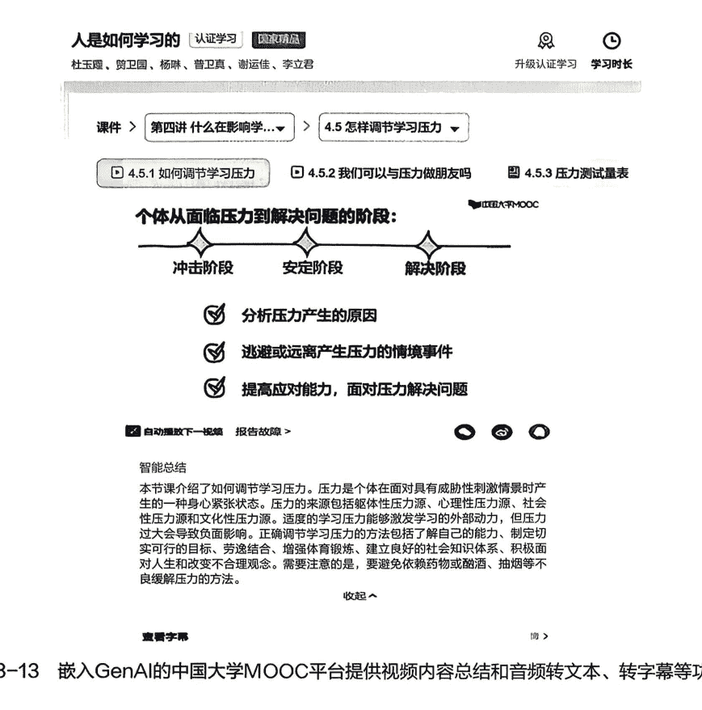

### 四 应用GenAI设计教学目标的典型提示词模板

以下是在实践中逐步总结的在设计教学目标时可参考的比较典型的提示词模板，教师可根据自己的情况选择使用，并不断调整，形成适合自己学科特征、教学特点等的模板。请注意以下模板中的画线部分，是需要根据实际情况替换的。

#### 1. 标准通用型教学目标设计模板

你是一位初中生物学特级教师，请根据八年级生物学教材“基因的显性和隐性”这节课的教学内容，结合课程标准和生物学学科的核心素养要求，设计符合八年级学生认知特点的“基因的显性和隐性”教学总目标+3个递进子目标的课堂教学目标。教学目标应具有全面性、指向性和可衡量性，全面性要体现知识、能力、情感等维度的教学目标。

#### 2. 混合式课程教学目标设计模板

你是一位高校教育学与心理学领域的课程专家，请基于以下要求，设计广东财经大学本科生的“人是如何学习的”通识课程的教学目标，本课程线上16学时+线下16学时。在线教学资源是中国大学MOOC平台的“人是如何学习的”线上课程（网址略），请根据线上课程内容和广东财经大学该课程教学大纲综合分析，从知识、能力、情感态度、课程思政四个维度列出具体目标，注意语言准确、内容具体，适合本科生的认知发展水平，字数限600字。

#### 3. 跨学科课程教学目标提示词模板

请根据上传的课程资料，融合语文、历史、地理三门课程的核心素养要求，以语文学科为主导，设计适合五年级学生认知发展特点的“黄河是怎样变化的”跨学科课程教学目标，设计1个统整性教学总目标和3个子目标。各子目标应有进阶性且体现学科融合、思维发展与核心素养提升，避免学科割裂。

## 第 4 节 GenAI赋能教学方案设计

教学方案对课程教学目标的实现，教学活动的设计、组织、实施与评价都具有重要影响。在设计教学方案时，教师需要反复研读教材、课程大纲和课程标准，深入分析学情和教学环境，才能设计出合理可行、能够促进全体学生发展的教学方案。GenAI可以为教师高效设计教学方案提供助力。合理运用GenAI，可以在教学方案设计中实现更精准的学情分析、更高效的学习任务生成，设计更有针对性的思维训练活动，有效促进学生深度学习，提升思维品质和核心素养。

### 一 教学方案的评价标准与指标

虽然每位教师都在设计和实施教学方案，但教学方案究竟包括哪些要素？优秀的教学方案具有什么特征？许多教师难以对这些问题做出明确的回答。因此，我们整理了国家级比赛中有关教学方案的评价标准供读者参考。教学方案在国家基础教育精品课程评审、全国高校教师教学创新大赛、国家级一流课程评审中都占有非常重要的位置，我们整理了前两者的评审方案中有关教学方案的评价标准和指标。（见表3-6、表3-7）这些面向比赛的教学方案评价要求，表面看似乎要求不够全面，实际上这些比赛需要提交的材料是系列的。例如，关于教学反思部分，要么包含在其他材料中，要么由教师在比赛时现场汇报，参考这些评价要求时，要结合具体的学段、教学对象等综合考虑。近年来，各省市在开展不同学段的教学创新大赛时，都研制了关于教学方案的评价标准，研读这些标准，有助于在教学设计时融入这些新理念、新要求。

### 表3-6 国家基础教育精品课2024年学科课程评价指标①

| 一级指标 | 二级指标 | 指标描述 | 权重 |
| :--- | :--- | :--- | :--- |
| 目标内容 | 教学目标科学合理 | 落实立德树人根本任务，培育和践行社会主义核心价值观，体现核心素养导向；教学目标明确具体、可检测，重难点突出。 | 10 |
| | 教学内容组织科学 | 教学内容符合课程标准要求和学生认知规律，注重培养学生能力；覆盖该课所含知识，课时安排合理。 | 10 |
| 教学过程 | 教学环节流畅紧凑 | 教学过程包含必要的教学环节，层次清晰，过程流畅；课堂容量适当，时间分配合理。 | 15 |
| | 教学方法策略适切 | 体现以学习者为中心的课程理念，注重学生亲身体验、情境感知；教学组织严谨，教学方法得当，策略有效。 | 15 |
| | 信息技术融合有效 | 熟练运用信息技术，依据教学目标选择、整合和应用数字教育资源，促进知识理解和问题解决，培养学生的创新能力，提升教学的精准性和实效性；如有实验内容，实验技术应运用合理。 | 15 |
| 教学资源 | 教学设计明确恰当 | 教学设计（及学习任务单）与教学目标一致，符合学生的认知水平，体现导学功能，有效激发学生的积极性和创造性。 | 15 |
| | 作业练习规范科学 | 课上练习、课后作业、实验活动（如有）紧扣教学目标，总量适中，难易适度，形式多样，促进学生发展。 | 10 |
| 技术规范 | 资源完整提交规范 | 教师讲解、实验与多媒体演示切换适当，布局美观，声画同步；课件、学习任务单、作业练习信息完整、格式规范；资源引用注明出处。 | 10 |

> ① 教育部办公厅. 关于开展2024年“基础教育精品课”遴选工作的通知[EB/OL]. (2024-06-28) [2024-11-21]. http://www.moe.gov.cn/srcsite/A06/s3321/202407/t20240709_1140349.html.

在高等教育领域，无论是国家级一流课程建设的认定评审，还是近年来每年举行的全国高校教师教学创新大赛，教学方案设计都是重要的评审内容。例如，在全国高校教师教学创新大赛的比赛评价中，教学设计创新汇报占40分（满分100分），教学方案的重要性由此可见一斑。

## 表3-7 第五届全国高校教师教学创新大赛的教学设计创新汇报评价标准①

| 评价维度 | 评价要点 |
| :--- | :--- |
| 教学理念 | 坚持立德树人，体现“以学生发展为中心”，将价值塑造、知识传授和能力培养融为一体，充分发挥课程育人作用。 |
| 总体设计 | 遵循教学理念，围绕思政教育与专业教育紧密融合，从教学目标、教学内容、教学活动、教学方法、教学手段、教材选用、教师配备、教学考核、评价反馈等进行系统性设计，能够有效落实所在专业人才培养方案要求，有效落实立德树人根本任务。 |
| 教学目标 | 教学目标符合学校办学定位、学生情况和专业人才培养需求，准确体现对学生价值塑造、知识传授和能力培养等方面的要求。教学目标清楚具体，易于理解，便于实施，行为动词使用正确，阐述规范。 |
| 学情分析 | 学生认知特点和起点水平表述恰当，学习习惯和能力分析合理，思想发展现状、特点和规律总结准确。 |
| 内容分析 | 符合学生思想发展和认知特点，体现课程育人理念和目标，课程知识体系清晰科学，课程自身蕴含的思政教育资源挖掘深入准确，思政资源和知识内容融合紧密恰当。 |
| 过程与方法 | 教学活动丰富，过渡自然，充分发挥教师主导、学生主体作用，能够帮助学生有效提升素质、知识和能力。教学方法灵活恰当，现代信息技术应用科学合理，关注学生兴趣、引导学生思考，强调自主、合作、探究学习。教材和教学资源选用科学，教学案例典型恰当，注重价值引领，注重理论联系实际，将思政教育有机融入教学过程。 |
| 考评与反馈 | 教学评价维度多样，方法多元，内容科学，适合学科专业要求和学生特点，能够评价学生素质、知识和能力等各方面的发展变化。 |
| 设计创新 | 围绕价值引领、知识传授和能力培养紧密融合进行一体化设计，充分体现育人理念和特点，专业特色突出，富有思想性、时代性和科学性、创新性。 |
| 文档规范 | 文字、符号、单位和公式符合标准规范；语言简洁、明了，字体、图表运用适当；文档结构完整，布局合理，格式美观。 |
| 现场交流 | 观点正确，切中要点，条理清晰，重点突出，表达流畅。 |

比较两份评价标准可以发现，教学方案包含的要素众多，优秀的教学方案能够很好地体现先进的教学理念、明确的教学目标、契合课程标准的教学内容、恰当的教学方法与策略等。教学实践中，教师可根据教学环境等具体情况，对相关要素的详略程度进行调整。高质量的教学方案是保障教学质量、提升教学水平的重要前提和基础。传统的教学方案设计需要耗费教师大量的时间与精力，应用GenAI开展人机协同，可以有效提升教学设计的效率与质量。

> ① 中国高等教育学会. 关于举办第五届全国高校教师教学创新大赛的通知[EB/OL]. (2025-03-18) [2025-03-24]. https://www.cahe.edu.cn/site/content/17962.html.

### 二 GenAI赋能教学方案设计的主要场景与策略

GenAI能够从多维度赋能教师教学方案设计。充分利用GenAI的智能生成、推理分析与多模态资源整合能力，可以提升教学方案的科学性、个性化与创新性。

理论上，GenAI可以用于教学方案设计的各个环节和各部分内容，教师可以应用GenAI一键生成教学方案。然而，教学方案是面向特定对象，围绕具体教学目标与内容，对教学活动全过程中师生活动的全面设计与安排，用GenAI一键生成的内容往往存在诸多不足，不能直接用于教学。

如图3-14所示，根据一句话，智谱清言就生成了形式基本完整、近2000字的教学方案。这种方案不仅不能直接用于教学，而且由于内容过于宽泛，修改也很麻烦，很难达到期望的效果。这样应用GenAI，不仅没有提高教学方案设计的效率，反而造成了教师时间与精力的浪费。

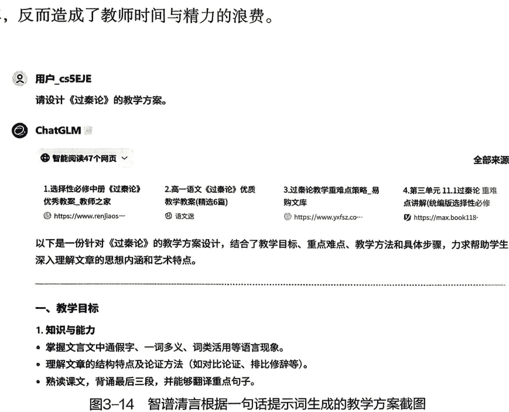

实际上，即使教师已经上传了丰富的教学资料和教学方案模板，GenAI生成的教学方案仍需要仔细审核和修改完善。

实践中，教师设计教学方案的难点和痛点主要集中在下述环节。

#### 1. GenAI赋能学科素养分析与教学目标确定

教师可以应用GenAI解析课程标准、核心素养、课程大纲等要求，协助教师生成符合素养要求、具有可操作性和可测量性的多维度教学目标。为照顾不同水平学生的发展需要，还可以用GenAI生成不同层次的教学目标，供教师进行分析评估和修改完善。

#### 2. GenAI赋能学情和教学重难点分析

教师应用GenAI可以快速分析学生前测结果、作业表现、学习偏好等学习情况，将学情与教学内容进行关联，分析教学的重点和难点。教师对GenAI分析的结果进行审核和修正，以明确学情和教学重难点。

#### 3. GenAI赋能促进思维发展的学习内容与任务设计

设计促进学生创新思维、批判性思维等思维发展的学习内容与任务，是许多教师设计教学方案的难点和痛点。教师应明确教学目标对学生思维发展的要求，向GenAI提供尽可能明确的思维发展要求，通过多轮对话，生成高质量的以思维发展为目标的学习内容与学习任务。

#### 4. GenAI赋能分层学习任务与活动设计

通过设计具体明确的提示词，提出学习任务要求，明确学习活动环境和条件，提供教学内容的相关资料，就可以使GenAI生成分层学习任务与活动。教师进行审核、补充和修改，就可以形成符合全体学生差异化发展需求的学习任务与活动设计。

#### 5. GenAI赋能高质量教学资源的生成和学习环境设计

根据教学活动的需要，教师可以应用GenAI快速生成文本摘要、图表资料、情境故事、音频讲解、仿真实验指导视频等教学资源，为学习环境设计提供资源支持。GenAI虽具有快速响应和生成材料的优势，但生成的材料能否用于教学，还需要教师进行严格审查和仔细修改完善，否则可能引发学生的认知风险等问题。

#### 6. GenAI赋能教学评价工具及资源设计与生成

应用GenAI可以生成课堂测验、练习题目、反思卡片等，也可以设计评价量表和评价方式与流程，还可以开发学习评价智能体等工具，为教师开展学生自评、互评等多元评价提供丰富的工具与资源。对GenAI生成的任何内容与资源，教师都必须严格进行科学性、准确性、可靠性和适用性等方面的评估，对存在的问题进行调整后才能用于教学设计方案或教学活动。

#### 7. GenAI赋能教学反思设计

明确的教学反思设计，可以使教师有意识地观察和记录教学活动的过程性数据，课后及时总结教学中的经验，反思改进存在的问题。在设计阶段，教师可以用GenAI设计课堂观察表，分析评价教学方案实施的难点。同时，教师可以整合运用通义千问、讯飞听见等GenAI工具，将师生的教学活动全程记录并转录为文字，通过热词分析等文本分析技术，赋能教师基于数据开展教学反思，提高教学反思的深度，使教学反思真正反哺教学改进和教师发展。

### 三 GenAI赋能教学方案设计的典型案例

#### 1. 案例介绍：GenAI赋能学生高阶思维发展的教学方案设计

《活板》是语文七年级下册第六单元第25课的课文。广州某中学的吴老师选择这篇课文参加所在区的教学创新比赛。当杜玉霞老师收到吴老师设计的教学方案时，认为该课的学习活动内容过浅，不利于学生创新思维等高阶思维的发展，便提出了修改建议。但经过几次沟通修改后，杜老师仍不满意，于是与吴老师一起，应用GenAI设计《活板》这节课的学习活动部分，经过多轮人机对话，最终设计出了促进学生高阶思维发展的学习活动方案。

吴老师设计的《活板》教学方案中关于学习活动部分的原稿节选如下。

> 七年级下册《活板》教学设计原稿学习活动部分节选
> 一、学习活动背景
> 本周，学校将举办科技节活动，主题是“科技改变世界，文明薪火相传”。我们班有一个摊位，需要在摊位上设计活动，展示中国古代的科技文明成果。我们班就以这篇文章为依据来向其他同学介绍中国的活字印刷术，让大家感受中国科技文化的魅力。

### 二、活动任务一：操作活板明过程

设置一个环节让参加科技节的同学在展示摊位上体验活字印刷术，请根据《活板》中的详细介绍梳理活字印刷术的工序，并进行制作演示。

任务指引：

1. 请同学们朗读文章，圈画出有关活字印刷术工序的关键词，并以学习小组为单位，交流讨论，梳理活字印刷术的步骤流程。
2. 我们要让来参加活动的同学体验活字印刷术，应该提前准备什么材料？

| 从制字到印刷的程序 | 具体步骤 |
| :--- | :--- |
| 制字 | 1. 活字原料——胶泥<br>2. 活字厚度<br>3. 与雕版不同之处<br>4. 活字如何成型 |
| 排版 | 1. 先设一铁板<br>2.<br>3.<br>4.<br>5. |
| 印刷 | 1. 一板印刷<br>2.<br>3. |

交流讨论：以学习小组为单位，用自己的话说说活字印刷术的流程，小组派出一名讲解员和一名演示员来进行解说和操作演示。

### 三、活动任务二：对比活板显优势

交流讨论：活字印刷术有什么突出优势？与雕版印刷术相比，活字印刷术的优势具体体现在哪些方面？

| 雕版印刷术 | 活字印刷术的优势 |
| :--- | :--- |
| 每本书需要许多块木板 | |
| 按刻好的木板逐块印刷，一套书版需要几年，速度慢 | |
| 发现错误不好改正 | |
| 使用频率高的字，如“之”“也”等，需要一个就刻一个 | |
| 以硬木刻制，保存不好容易腐坏，使字迹模糊 | |

### 四、活动任务三：宣传活板悟精神

请同学们为活字印刷术写一则广告语，向科技节上的同学们宣传推广。要紧扣活字印刷术“活”的优势，并尽量与科技节的主题“科技改变世界，文明薪火相传”关联起来。要求：20字以内。可巧用修辞，或使用谐音，注意音韵节奏，使其朗朗上口，有记忆点。

例如：脉动一下，状态随时回来。（脉动饮料的广告语）

#### 2. 分析已有教学方案存在的问题，明确改进方向，设计提示词要求GenAI优化设计

杜玉霞老师分析了吴老师教学设计方案存在的主要问题，提出原方案中的学习活动设计缺乏挑战性，活动任务三“宣传活板悟精神”的活动成果示例不当，应进行改进。于是，杜老师整理了吴老师的教学设计方案并上传，设计以下提示词与智谱清言互动，以修改优化教学方案中的学习活动设计。（见图3-15）

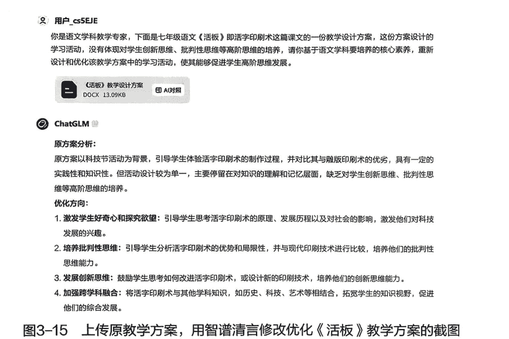

图3-15 上传原教学方案，用智谱清言修改优化《活板》教学方案的截图

#### 3. 审查评估GenAI修改优化的方案，追问完善，教师修改优化形成教学方案

杜老师审查了智谱清言生成的《活板》教学方案，发现对学习活动进行了较大修改，但对有些活动没有提供学习指导框架或示例，学生完成任务难度偏大。于是设计下列提示词进行追问：

> 你好，刚才优化的学习活动任务较复杂，为了促进学生合理安排学习任务，优化活动过程，请为学生配套设计一份学习活动任务清单。另外，请对个别过于开放的学习任务给出作品示例，以引导学生产出更高质量的学习成果。

经过追问，GenAI修改完善了教学方案，杜老师与吴老师进一步讨论修改，经过人机协同、人人协同，最终形成了如下的教学设计方案。

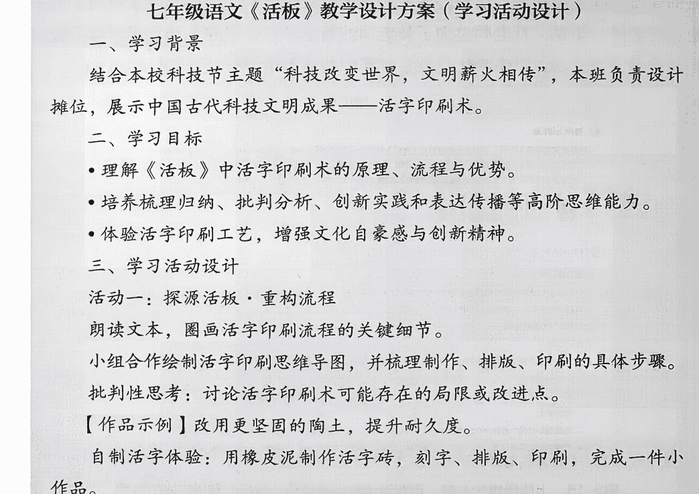

【作品示例】“科技改变世界”印刷成一张海报。

### 活动二：对比优劣·辩证思考

小组对比雕版印刷与活字印刷，从制作成本、效率、保存、改错等角度深入分析。

开展小组辩论：“雕版印刷VS活字印刷，谁更具时代价值？”

【成果要求】提交辩论提纲，参与现场辩论展示。

### 活动三：活字精神·创意传播

以小组为单位创作活字印刷术的广告语，要求紧扣“活”的特点与科技节主题，20字以内。

【广告语示例】“活字生花，文明流传！”“活字一动，天下皆印！”

任选方式进行创意表达：

- 设计宣传海报
- 拍摄30秒短视频
- 编排简短情景剧小片段

【作品示例】短视频模拟毕昇制活字、改版印刷的情景剧。

### 活动四：摊位布展与成果展示

整理流程导图，体验作品，对比分析海报、广告语及创意作品，布置科技节展示摊位。

现场安排讲解员和体验引导员。

### 四、学生学习任务清单

| 任务 | 任务内容 | 产出成果 | 注意事项 |
| :--- | :--- | :--- | :--- |
| 1 | 梳理《活板》流程 | 思维导图一张 | 内容清晰、逻辑严谨，可适当美化 |
| 2 | 活字制作与印刷体验 | 活字印刷作品一件 | 字体工整，排版合理，颜色清晰 |
| 3 | 分析雕版与活板优劣 | 对比表+辩论稿 | 论点明确，有事例支撑 |
| 4 | 创作活字广告语 | 广告语一条 | 不超过20字，朗朗上口，主题鲜明 |
| 5 | 完成创意表达作品 | 海报/短视频/情景剧 | 主题突出，富有创意与美感 |
| 6 | 摊位布展与讲解 | 摊位展示与解说流程单 | 展示整洁，解说清晰有条理 |

### 五、活动反思与迁移

科技节后课堂延伸讨论：

1. 反思：活字印刷术在当时推广中可能遇到了哪些社会阻力？（联系历史背景）
2. 迁移：今天的“3D打印”“电子书”等新技术，是否也在重复着类似的科技演变？

六、学习活动学时安排与资源等（略）

从这个案例可以看到，应用GenAI可以快速将教师原来主要停留在知识提取与初步理解层面的教学设计方案，修改优化为能够促进学生创新思维、批判性思维、综合迁移能力等高阶思维和核心素养发展的教学方案。实际上，许多教师的教学方案并不是从无到有的，大部分情况下都是对以往教学方案的优化和迭代完善。

### 四 应用GenAI设计教学方案的要领与方法

在应用GenAI设计教学方案时，应注意将分步设计与模块优化相结合。首先，可分阶段设计基本框架，如确定教学目标、活动流程、评价方式，再逐步细化每一环节。其次，对于已有的教学方案，可分析确定改进的方向和重点，利用GenAI进行局部改写与整体完善。最后，要注意保持整个教学设计方案中的教学目标连贯、教学活动具体、成果明确，应对整体逻辑和细节进行审视调整，以实现教学方案的系统性优化和创新性设计。

表3-8是对应用GenAI设计教学方案的要领与方法的总结。

### 表3-8 应用GenAI设计教学方案的要领与方法

| 教学设计要点 | 具体要领 | 方法说明 |
| :--- | :--- | :--- |
| 分步构建 | 先搭框架，再填内容 | 教学目标→活动设计→成果要求→评价方式，逐步推进 |
| 模块细化 | 各环节独立优化 | 每个活动模块都有明确的任务、成果、思维要求 |
| 局部改写 | 小步调整，局部升级 | 针对已有方案调整活动安排，提升成果质量 |
| 整体完善 | 保持连贯与系统性 | 保证各模块之间目标一致、逻辑清晰、节奏合理 |
| 生成性引导 | 明确产出，示范引导 | 指定具体作品形式，提供示例，产出优质成果 |
| 高阶思维融入 | 注重分析、创新、批判 | 在任务设计中嵌入批判性思维、创新表达等要求 |

## 第5节 GenAI赋能作业设计

作业是课程与教学活动的重要组成部分，是学生在课堂教学时间之外完成的一种自主性、探究性、有意义的智力或技能活动，对于学生建构生活意义、增进学习体验、提升学习效能具有积极作用。①2021年，国务院在《关于进一步减轻义务教育阶段学生作业负担和校外培训负担的意见》中指出：要提高作业设计质量；发挥作业诊断、巩固、学情分析等功能；要系统设计符合年龄特点和学习规律、体现素质教育导向的作业；鼓励布置分层、弹性和个性化作业，坚决克服机械、无效作业；要加强作业完成指导。这份文件对教师的作业设计与实施能力提出了更高要求，如何设计能够促进学生创造性学习和个性化发展的作业，是培养创新人才必须持续探索的重要问题。

设计符合学生认知水平和学习规律的高质量作业，不仅要求教师具备良好的教学能力与素质，还需要其投入大量的时间与精力。教师若能灵活有效地应用GenAI，则可以根据具体的教学目标和学情，快速设计出目标更加明确、内容更加生动、形式更加多样的作业，并可以应用GenAI设计作业评价与反馈，充分发挥作业在培育学生核心素养等方面的功能。

根据当前作业的现状和GenAI在作业设计中的典型应用场景，本书主要介绍GenAI赋能高阶思维发展的作业设计、跨学科作业设计、作业范例生成三大典型应用，为广大教师提高作业设计的效率与质量提供参考。

### 一 GenAI赋能高阶思维发展的作业设计

布卢姆认知目标分类法将思维划分为六个层级，包括记忆、理解、应用三个层级的低阶思维和分析、评价、创造三个层级的高阶思维。当前教育正在经历从“知识传递”到“思维锻造”的范式转型，应用GenAI可以设计促进学生高阶思维发展的作业。

> ① 罗生全，优化作业设计 增强育人实效 [N]. 中国教育报，2021-11-25（2）.

#### （一）GenAI赋能高阶思维发展的作业设计策略

GenAI是教师根据具体的教学目标和任务，设计符合学生认知水平和认知规律的作业的好助手。其赋能高阶思维发展的作业设计策略主要体现在以下几方面。

1. 根据教学目标与内容，确定作业要实现的高阶思维发展目标与类型

为了实现以作业促进学生高阶思维发展的目标，教师要对教学目标与内容进行分析和解构，明确知识与技能学习中蕴含的思维要求，如教学目标为“理解光合作用机理”，则对应的思维层级是理解；若教学目标为“设计可持续的城市发展方案”，则着重设计分析（解构城市各要素关联）、评价（现有方案的优点与不足）、创造（制定可持续发展方案）等促进高阶思维发展的作业。

2. 选择合适的GenAI工具，人机协作设计作业

随着GenAI工具越来越多，工具的选择也变得日益重要。教师要根据GenAI工具的功能特点，选择合适的工具以提高作业生成质量。如果作业仅以文本形式表述，则选择文本生成质量高的GenAI工具；若作业中包含图像、视频或音频等内容，则需要选择能够生成这些资源的GenAI工具或者选择多个工具配合使用。

3. 评估GenAI生成的作业，修改完善确定作业

无论GenAI工具的功能如何强大，教师都一定要根据教学目标和作业目标等，全面客观地评估GenAI生成的作业，在评估其科学性、准确性等的基础上，还应评估作业与教学目标的匹配性，以保障作业的质量。教师应根据评估结果对GenAI生成的作业进行适当的修改完善，确保作业符合教学目标和学生认知规律，能够支撑学生高阶思维的发展。

#### （二）GenAI赋能高阶思维发展的作业设计实践案例

下面结合具体实例，介绍GenAI生成作业的具体方法与注意事项。

## 1. 案例简介

《两小儿辩日》是人教版语文教材六年级下册第五单元第14课的内容，它是一篇选自《列子·汤问》的文言文。该单元目标包括“体会文章是怎样用具体事例说明观点的”“展开想象，写科幻故事”，本篇课文的教学目标是“了解两小儿各自的观点和理由，知道他们是怎样说明自己的观点的”等。为使作业吻合单元和课文教学目标，下面介绍教师应用GenAI设计促进学生高阶思维发展的作业的过程与方法。

## 2. 教师应用GenAI设计作业的过程与方法

（1）选择合适的GenAI工具，解析教学目标，明确作业要发展的高阶思维目标
为了提高作业设计质量，语文教师陆老师应用GenAI工具从人机协同分析该课程作业要发展的具体高阶思维目标开始，逐步设计了《两小儿辩日》这篇课文的作业。陆老师选择用Kimi进行作业目标分析。
在用Kimi分析作业目标前，陆老师先让Kimi给出《两小儿辩日》的原文，检测到GenAI了解了这篇课文后，她直接开始分析作业目标。否则，她就需要上传这篇课文，让Kimi知晓教材内容与学习要求。
以下为具体的分析与设计过程。
陆老师设计以下提示词与Kimi互动：

> 《两小儿辩日》是六年级下册第五单元第14课的内容，是一篇选自《列子·汤问》的文言文。该单元目标包括“体会文章是怎样用具体事例说明观点的”“展开想象，写科幻故事”，本篇课文的教学目标是“了解两小儿各自的观点和理由，知道他们是怎样说明自己的观点的”等。你作为资深语文教师，要设计本课的高质量作业，现在，请在分析该单元和本篇课文的教学目标与内容后，写出本课作业要发展的具体高阶思维目标。

陆老师发现Kimi回复的内容太长，且夹杂着部分作业的设计。因此，她对提示词进行了修改，将上述提示词的最后半句修改为：请用120字写出本课作业要发展的具体高阶思维目标。
陆老师收到Kimi的回复如下：

本课作业设计可以培养学生以下高阶思维能力：一是逻辑思维，通过梳理两小儿的观点和论证过程，理解其如何用具体事例说明观点，培养学生的分析与推理能力；二是批判性思维，引导学生对两小儿的观点进行质疑和评价，思考其合理性与局限性；三是创造性思维，结合单元科幻写作目标，鼓励学生展开想象，对故事进行创新性续写或从现代科学角度解释“辩日”现象。

（2）人机协作设计发展学生高阶思维的作业
教师继续使用GenAI工具Kimi，为六年级学生设计能够促进其高阶思维发展的作业，她用了以下提示词：

> 你好，作为语文教学名师，你已带领广东省某校六年级学生学完了《两小儿辩日》这篇课文，为了促进学生的深度学习，请你为学生设计能够促进其逻辑思维、批判性思维和创造性思维发展的作业，字数不超过250字。

Kimi回复的内容：

作业内容：
①逻辑思维训练：请用思维导图梳理两小儿的观点及论证过程，标注出他们分别用哪些现象来支持自己的观点，并用箭头表示观点与现象之间的逻辑关系。
②批判性思维挑战：两小儿的辩论各有道理，但也存在不足。请结合现代科学知识，分析两小儿观点的局限性，并说明为什么他们的辩论无法得出正确结论。写一段不少于150字的文字，表达你的看法。
③创造性思维拓展：假如你是孔子，面对两小儿的辩论，你会如何用现代科学知识为他们解答？请发挥想象，写一篇200字左右的短文，续写故事结局，让两小儿心服口服。
要求：认真思考，逻辑清晰，语言简洁，字迹工整。

陆老师分析了上述回复后，觉得虽然作业目标明确，任务难度适当，但这份作业形式比较散，她希望能够用一个情境统整这些作业目标，为此，她进一步提问如下：

> 你好，请把这三种思维的训练，嵌入到更具体的情境中，以隐性方式促进学生这些思维的发展。

Kimi回复的内容：

当然，我们可以将这三种思维的训练嵌入到更具体的情境任务中，以隐性方式促进学生这些思维的发展。以下是具体的情境任务设计：

情境任务：

- ①逻辑思维训练：
  - 任务背景：你是一位侦探，正在调查一起案件，案件的两位证人分别提供了不同的证词。
  - 任务要求：请根据证人的证词，用思维导图的形式，梳理出两位证人的观点和证据，分析它们之间的逻辑关系，找出可能的矛盾点。

- ②批判性思维挑战：
  - 任务背景：你是一位科学家，正在研究一种新的植物。
  - 任务要求：请根据已有的研究资料，分析这种植物的生长特性，并指出资料中可能存在的不足或错误。然后，设计一个实验来验证你的分析。

- ③创造性思维拓展：
  - 任务背景：你是一位作家，正在创作一个科幻故事。
  - 任务要求：请根据故事的背景和已有的情节，发挥想象，设计一个独特的科幻元素（如时间旅行、外星生命等），并将其合理地融入故事中，使故事更加引人入胜。

要求：在完成每个任务时，要仔细分析，逻辑清晰，语言简洁，字迹工整。

通过这些具体的情境任务，学生可以在实际操作中锻炼和提升逻辑思维、批判性思维和创造性思维。

陆老师审核完Kimi设计的这份作业后，发现上次的提示词表述不够明确具体，导致GenAI并未按自己的意图设计作业情境，且这些情境与课文的关联性较弱。于是，陆老师进一步追问如下：

> 你好，刚才表述不够明确。请将上述三种思维训练的作业目标整合到一个具体情境中，以使六年级学生更容易理解和完成作业，发展高阶思维能力。

Kimi回复的内容：

好的，我明白了！我们可以将三种思维训练整合到一个具体的情境中，让学生在完成作业的过程中自然地发展逻辑思维、批判性思维和创造性思维。以下是整合后的作业设计：

作业情境：“未来科学小侦探”任务

假设你是一名“未来科学小侦探”，穿越到了古代，遇到了两小儿正在辩论“太阳远近”的问题。孔子也感到困惑，请你用现代科学知识帮助他们解开谜团。在这个过程中，你需要完成以下任务：

任务一：侦探推理（逻辑思维训练）

两小儿的辩论非常激烈，他们各自提出了很多理由。请你用侦探的思维方式，梳理出两小儿的观点和理由，并用表格的形式呈现出来。表格中需要包括以下内容：

- 两小儿的观点；
- 他们分别用哪些现象来支持自己的观点；
- 你认为这些现象和观点之间的逻辑关系是否合理。

任务二：科学质疑（批判性思维训练）

作为一名“未来科学小侦探”，你需要用现代科学知识来分析两小儿的观点。请思考以下问题，并写一段文字（150字左右）：

- 两小儿的观点中，哪些地方是合理的？哪些地方是不合理的？
- 他们为什么会有这样的误解？
- 用你所学的科学知识，指出他们的观点中可能存在的问题。

任务三：创意解谜（创造性思维训练）

现在，你需要用现代科学知识为两小儿解开“太阳远近”的谜团。请发挥你的想象力，设计一个简单易懂的科学实验，帮助两小儿理解太阳大小和温度变化的真正原因。你可以用文字描述实验过程，也可以画出实验示意图。实验要简单、安全，能让两小儿明白科学道理。

**要求：**

认真思考，逻辑清晰，语言简洁。

作业完成后，可以和同学交流你的想法，看看谁的“侦探推理”更准确，谁的“创意解谜”更有趣！

通过这个整合的情境任务，学生可以在完成作业的过程中自然地发展逻辑思维、批判性思维和创造性思维，同时也能更好地理解和运用课文内容。

陆老师认为Kimi这次设计的作业基本达到了自己的要求。但是，这份作业中的三个任务难度逐步增加，对六年级学生来说，他们难以单独完成任务三。

（3）评估GenAI生成的作业，修改完善确定作业
陆老师在分析评估Kimi设计的作业后，发现任务三不适合学生个人完成，其要求比较笼统，缺乏对作业提交形式、完成时间、交流评价方式的规定，于是，她根据本校学生的实际情况和教学环境进行了修改完善，将任务三设置为小组任务，并对作业细节进行了修改和补充。最后，在部分保留GenAI生成内容的基础上，增加了以下要求：

①作业完成方式
请每名同学独立完成任务一、任务二；请建立学习小组，完成任务三，每组限4人。

②作业提交时间、形式及交流评价要求
首先，请在3月10日前，在国家中小学智慧教育平台的班级作业板块中，以Word文档形式或手写文字拍成图片的方式，提交任务一、任务二。每人自主观摩点评三名同伴的作业后，再自评并修改完善自己的作业。
其次，请在3月17日前，继续在国家中小学智慧教育平台的班级板块中，以Word文档、PPT或手写文字拍成图片的方式，提交任务三。每个小组在观摩点评三组同伴作业后，再自评并修改完善自己小组的作业。

③成绩评定与作业展示
每份作业的成绩由自评（30%）+同伴评价平均分（30%）+教师评价（40%）构成。作业评价完成后，将选择优秀的作业发布到学校的微信公众上进行展示交流，希望同学们根据反馈继续完善作业，形成持续学习的意识。

## 3. 教师应用GenAI设计促进学生高阶思维发展的作业的注意事项

从以上案例可以发现，陆老师在作业目标分析、作业设计的过程中，都应用GenAI工具协同工作。分析陆老师的人机协同作业设计过程，可以总结出以下注意要点：一是教师始终处于主导地位，要客观分析评估GenAI生成的结果，及时调整提示词。二是教师要根据学情修改完善GenAI生成的内容，形成符合学生认知发展水平和特点的作业。三是教师要根据具体的教学环境，明确作业的提交与评价展示等相关要求。

### 二 GenAI赋能跨学科作业设计

学科课程教学由于其明显的学科边界和各学科教师之间缺乏合作与统整，容易造成学生知识体系的割裂，不利于培养学生综合运用各学科知识解决复杂问题的能力。新课程方案要求“强化学科知识综合，统筹设计综合课程和跨学科主题学习”。跨学科教学能够促进学生综合能力和素质培养，但对教师跨学科知识的掌握与统整能力、协同教学能力，特别是跨学科作业设计等能力提出了更高要求。GenAI作为“多学科专家”，可以为教师提供跨学科教学的高效支持，协助设计融合多学科知识与能力要求的跨学科作业。

#### （一）GenAI赋能跨学科作业设计的策略

为了使GenAI充分赋能跨学科作业设计，教师要合理运用人机协同的作业设计策略，以提高应用GenAI设计跨学科作业的质量与效率，下面结合实例具体阐述。

#### 1. 分析作业要达成的跨学科教学目标，确定作业设计的方向

教师应分析教学目标和内容，明确作业要达成的跨学科教学目标，如培养批判性思维、解决复杂问题能力或实现某些学科要培养的核心素养，使作业设计有清晰的目标和方向。为提高作业目标分析的准确性，教师应上传课程资料，对GenAI进行一定的训练。

例如，李老师在小学五年级科学课程“食物链和食物网”的教学中，为了解决科学课程学时少，难以开展跨学科教学以培养学生的科学探究能力和综合素养的问题，精心设计了基于该主题的跨学科作业。他先将如图3-16所示的课程教材内容和教学目标要求等上传至GenAI工具，确保GenAI掌握课程教学的具体内容。然后，通过提示词，要求其分析作业要融合的学科和要实现的跨学科作业目标。以下为李老师应用DeepSeek进行人机协作分析作业目标的过程和结果。

图3-16 上传GenAI的材料示例

**提示词：**

> 你好，作为国家级教学名师，请你根据五年级科学课程“食物链和食物网”这一课的教学目标与内容，分析该课适合与哪些学科融合开展跨学科教学，并确定相应的作业目标。

**DeepSeek回复的内容：**

“食物链和食物网”是一节高度适合跨学科融合的课程，能够结合语文、数学、美术、信息科技、道德与法治、体育与健康等学科，通过探究活动、数据计算、绘图制作、编程模拟、环保行动等多种方式，培养学生的系统思维、逻辑推理、科学探究、信息素养等核心素养。同时，跨学科教学能提升学生的学习兴趣，使科学知识更具应用价值，有利于他们建立更完整的生态认知体系。

李老师结合学生情况和学校各学科课程的学时情况，对DeepSeek回复的内容进行分析后，决定在“食物链和食物网”一课作业的设计中，融合语文、数学、信息科技、美术四个学科，设计跨学科作业以培养学生的系统思维、逻辑推理、科学探究和数字素养等核心素养。

#### 2. 撰写要求清晰的提示词，人机协同设计跨学科作业

要使GenAI生成符合要求的跨学科作业，教师必须仔细思考、反复推敲提示词的内容，力求指令清晰，能恰当地表述跨学科作业的要求与特点等。

例如，李老师应用DeepSeek设计“食物链和食物网”的跨学科作业时，他第一次提问的提示词是：

> 你好，作为国家教学名师，请设计五年级科学课程“食物链和食物网”的跨学科作业。

DeepSeek回复的内容：

以下是五年级科学课程“食物链和食物网”的跨学科作业设计方案，融合科学、语文、数学、美术、信息科技和道德与法治学科，注重实践性与探究性：

“守护生态平衡”跨学科主题作业

**作业目标**

- ①理解食物链与食物网的概念及生态系统的相互依存关系。
- ②培养数据分析、艺术表达、信息技术应用能力和社会责任感。
- ③通过真实情境解决环境问题。

**任务1：科学+数学 “田野调查员”**

实地观察：选择校园或社区中的一片绿地，记录至少5种生物（植物、昆虫等）。

构建模型：绘制食物链关系图（科学），用箭头标明能量流动方向。

数学分析：统计各层级生物数量，制作柱状图或饼图（数学），分析“数量金字塔”规律。

成果提交：观察记录表+数据统计图+分析报告（100字）

**任务2：语文+美术 “生态故事会”**

角色创作：选择一种生物（如麻雀、蚯蚓），用第一人称撰写一篇《我的生态日记》（语文），描述它在食物网中一天的经历。

视觉呈现：为日记配一幅四格漫画或手绘食物网示意图（美术），标注能量传递路径。

成果提交：300字生态日记+手绘作品（可电子绘图）

**任务3：信息科技+道德与法治 “未来生态工程师”**

模拟实验：使用Scratch或PPT设计互动动画，演示某一物种灭绝对食物网的连锁影响（信息科技）。

社会倡议：结合“生物多样性保护”主题，撰写一份《给社区的环境倡议书》（道德与法治），提出3条保护本地生态的具体措施。

成果提交：动画演示文件+倡议书（200字）

**评价标准**

| 维度 | 评价内容（每项5分，共25分） |
| :--- | :--- |
| 科学理解 | 食物链结构清晰，能量流动方向正确 |
| 数据思维 | 统计图表规范，分析结论合理 |
| 艺术表达 | 作品创意性强，图文结合紧密 |
| 技术应用 | 动画逻辑清晰，互动设计合理 |
| 社会责任 | 倡议内容具体可行，体现生态保护意识 |

**跨学科关联说明**

科学：理解生态系统的物质循环与能量流动
数学：通过数据分析验证生态规律
语文：用叙事性写作深化生态角色共情
美术：视觉化呈现抽象科学概念
信息科技：动态模拟复杂生态关系
道德与法治：从个体行动延展到社会责任
拓展建议：组织班级“生态博览会”，学生分组展示作品并模拟联合国环境会议辩论，强化公共表达与批判性思维。
此设计通过真实问题驱动学习，融合STEAM教育理念，帮助学生建立“自然界无孤立事件”的系统观，同时呼应2022年版课标“加强学科实践”的要求。

李老师读完DeepSeek设计的这份跨学科作业，觉得它有较好的趣味性，但不易实施，缺乏整体的情境。反思之后，李老师认为是自己的提示不够明确，没有对要融合的学科进行界定，也没有指明要培养学生的哪些思维能力和核心素养，没有提出作业设计的具体要求。他继续修改提示词进行提问：

> 你好，作为国家级教学名师，请你为已经在课堂学习完“食物链和食物网”这一课的五年级学生，设计融合语文、道德与法治、信息科技、美术四个学科知识的跨学科作业，以培养学生的系统思维、逻辑推理、科学探究、信息素养等核心素养。注意要用一个具体的情境来统领作业任务。

DeepSeek回复的内容：

五年级科学“食物链和食物网”跨学科作业设计
作业主题：生态侦探——揭秘身边的食物链与食物网
适用学科：科学+语文+道德与法治+信息科技+美术
核心素养目标：系统思维、逻辑推理、科学探究、信息素养
作业背景（任务情境）
你是“生态侦探”，受邀参与一项特别任务：调查某个生态环境（如公园、校园、田野或家庭周围）的食物链和食物网，寻找生态平衡的关键，并提出可持续发展的建议。
作业任务
本作业共三个任务，涵盖语文、道德与法治、信息科技、美术等学科，每个任务可以独立完成，但建议按照顺序推进，最终形成完整的报告。

**任务1：生态调查员——观察与分析（科学+语文）**

任务描述：

选择一个身边的自然环境（如公园、校园、农田、花园等）。

观察、记录至少4种生物，并推测它们的食物链关系（如“植物→昆虫→鸟”）。

通过查阅资料，完善食物链，并扩展成一个简单的食物网。

以“生态侦探笔记”的形式撰写一篇300字以内的观察报告，包含以下内容：

- 你观察的环境是什么？
- 有哪些主要生物？
- 它们如何相互影响？
- 如果其中一种生物消失，可能会发生什么？

**任务2：生态艺术家——可视化食物网（科学+美术/信息科技）**

任务描述：

结合任务1的观察，绘制或使用数字工具制作食物网图，要求包含至少6种生物。

手绘方式：用不同颜色或形状区分生产者、消费者、分解者。

数字化方式（选做）：使用PPT、思维导图软件或编程软件，制作一个交互式食物网并展示。

**任务3：生态保护者——生态保护与可持续发展（道德与法治+科学）**

任务描述：

结合任务1的观察和任务2的分析，讨论人类活动（如滥捕、污染、外来物种入侵）如何影响食物网的稳定性，结合查阅的资料，写一份生态保护倡议书，以鲜明的观点和翔实的数据呼吁人们保护当地生态环境。

**作业提交要求**

- ①提交内容：
  - 生态故事（手写或电子版）
  - 食物网可视化作品（手绘或电子版）
  - 生态保护倡议书（手写或电子版）
- ②完成方式：
  - 可以单独完成，也可以小组合作，讨论并互相优化作品。
  - 电子版可上传至班级学习平台，或在课堂上进行分享展示。

**③评价标准（满分100分）**

| 评价维度 | 具体要求 | 分值 |
| :--- | :--- | :--- |
| 科学理解 | 准确描述食物链、食物网、生态关系 | 30 |
| 逻辑表达 | 生态故事内容合理，能分析生态变化影响 | 20 |
| 跨学科融合 | 结合信息科技、美术等表达研究成果 | 20 |
| 创新表现 | 作品清晰美观，表现方式有创意 | 20 |
| 任务完成度 | 按要求完成所有任务，并提交完整作业 | 10 |

看了DeepSeek设计的跨学科作业，李老师觉得还比较满意，在开始修改前，他想应用其他GenAI工具以更好地完善这份作业。

#### 3. 进一步应用多个GenAI工具提问，筛选设计跨学科作业

李老师认为，用DeepSeek生成的作业目标已经比较清晰合理，但他想看看其他的GenAI工具能否生成更好的作业任务和内容。于是，他把与DeepSeek对话的提示词，分别复制到文心一言、豆包、Kimi、讯飞星火，以下为李老师与这四个GenAI工具协作的过程。

**（1）检测GenAI工具是否了解具体的学科课程内容**

为检测GenAI工具对具体课程内容的了解程度，李老师选择了四个常用的GenAI工具，统一用下列的提示词分别向四个工具提问，以了解其对小学五年级科学课程教材具体内容的了解情况。

**提示词：**

> 教育科学出版社五年级科学课程教材中有“食物链和食物网”这节课，请给出这节课的教学内容。

表3-9为四个工具生成的“食物链和食物网”教学内容。

## 表3-9 四个工具生成的“食物链和食物网”教学内容对比

| GenAI名称 | GenAI生成的内容 |
| :--- | :--- |
| 文心一言 | 1. 食物链的认识<br>• 定义：食物链是生物之间由于吃与被吃的关系而形成的一种链状结构。<br>• 起点：通常是绿色植物（生产者），因为它们能够利用阳光、二氧化碳和水制造出有机物，这是整个生态系统能量的最初来源。<br>• 营养级：生物在食物链中所处的位置，如绿色植物是第一营养级，食草动物是第二营养级，小型食肉动物是第三营养级，大型食肉动物是更高营养级。<br>• 能量传递：能量从一个营养级传递到下一个营养级，但传递过程中会有损失，通常下一个营养级只能获得上一个营养级10%—20%的能量。<br>2. 食物网的认识<br>• 定义：在生态系统中，一种生物往往不是只吃一种食物，也不是只被一种生物所吃。这样，许多食物链相互交错连接成的复杂营养关系网络就叫作食物网。<br>• 特点：食物网中的生物种类繁多，食物关系复杂。一种生物可能是多种生物的食物来源，也可能捕食多种生物。<br>• 作用：食物网使得生态系统中的能量传递途径更加多样化，增强了生态系统的稳定性。当食物网中的某一种生物数量发生变化时，由于食物网的复杂关系，它对整个生态系统的影响相对较小。<br>3. 生态系统的概念<br>• 通过食物链和食物网的学习，引导学生初步建立起生态系统的概念，认识到生态系统中的生物与非生物成分之间相互依存、相互制约的关系。<br>• 强调生态平衡的重要性，即生态系统中各种生物的数量和种类保持相对稳定的状态。一旦生态平衡被破坏，就可能会对整个生态系统造成严重影响。<br>4. 实践活动<br>• 可以通过观察、记录和分析实际生态系统中的食物链和食物网来加深对概念的理解。<br>• 也可以进行模拟实验来探究自然事物发生的原因、变化及规律。 |
| 豆包 | 1. 食物链的构成与规律<br>• 概念：生物之间因食物关系形成的链状结构，如“草→兔→狼”。<br>• 生产者：绿色植物（如草、水稻）是食物链的起点，通过光合作用制造有机物。<br>• 消费者：直接或间接以生产者为食的动物，分为草食动物（如兔）、肉食动物（如狼）和杂食动物（如麻雀）。<br>• 规律：食物链通常从生产者开始，到顶级肉食动物终止，箭头方向表示能量传递路径。<br>2. 食物网的形成与复杂性<br>• 概念：同一种生物可能参与多条食物链，形成网状结构（如稻田中的水稻被蝗虫、田鼠捕食，蝗虫又被青蛙、鸟类捕食）。<br>• 特点：食物网越复杂，生态系统越稳定；单一物种的减少可能引发连锁反应。<br>3. 生态平衡的重要性<br>案例分析：<br>• 人类过度捕猎狼导致兔子数量激增，草原退化。<br>• 麻雀被大量捕杀后，害虫失去天敌引发粮食减产。<br>• 结论：保护生物多样性是维持生态平衡的关键。 |
| Kimi | 1. 导入<br>• 通过观察蔷薇花丛或绿豆苗周围的生物，引出生物之间“谁吃谁”的食物关系。<br>• 例如，蚜虫吃蔷薇，瓢虫吃蚜虫，小鸟吃瓢虫。<br>2. 食物链的概念<br>• 生物之间因食物关系形成的链条被称为食物链，箭头指向捕食者。<br>• 食物链一般从绿色植物（生产者）开始，依次传递到消费者。<br>3. 食物网的概念<br>• 多条食物链彼此交错形成网状结构，被称为食物网。<br>• 例如，在一个生态系统中，蚜虫、瓢虫、蚯蚓、小鸟等生物之间的复杂食物关系构成了食物网。<br>4. 生产者与消费者<br>• 生产者（如绿色植物）通过光合作用制造食物，为其他生物提供能量。<br>• 消费者（如动物）直接或间接以生产者为食。<br>5. 食物链和食物网的意义<br>• 食物链和食物网反映了生态系统中生物之间的复杂关系，一种生物的变化可能影响整个生态系统的稳定性。<br>6. 拓展活动<br>• 通过模拟游戏或讨论，帮助学生理解食物网中一种生物的生存状况对其他生物的影响。 |
| 讯飞星火 | 1. 食物链的概念：介绍什么是食物链，包括生产者、消费者和分解者的角色。<br>• 生产者：植物通过光合作用制造食物。<br>• 消费者：动物通过食用其他生物获取能量。<br>• 分解者：细菌和真菌分解死亡的生物体，释放营养物质回到生态系统中。<br>2. 食物网的概念：解释食物网是由多条相互关联的食物链组成的复杂网络。<br>3. 能量流动：讨论在食物链和食物网中能量是如何从一种生物转移到另一种生物的。<br>4. 生态平衡：探讨食物链和食物网如何维持生态系统的平衡，以及一个物种数量的变化如何影响整个生态系统。<br>5. 人类活动的影响：分析人类活动（如污染、过度捕捞、森林砍伐等）如何破坏食物链和食物网，导致生态系统失衡。<br>6. 案例研究：通过具体的生态系统案例，让学生了解不同生物之间的相互依赖关系。<br>7. 实践活动：组织学生进行户外观察或实验活动，如观察学校附近的生态环境，记录不同生物之间的食物关系，尝试构建食物链和食物网模型。<br>8. 环境保护的意义：强调保护生物多样性和生态系统健康的重要性，鼓励学生参与环保活动。<br>请注意，以上内容是基于一般性科学课程的构想，具体到教育科学出版社的教材内容可能会有所不同。如果您需要更详细的信息，建议直接查阅该出版社提供的官方教材或联系出版社获取相关资料。 |

李老师分析四个GenAI工具的回复，发现只有Kimi生成的内容比较接近教材内容，文心一言、豆包、讯飞星火则是根据提问的主题“食物链和食物网”随机生成的内容，表明这三款GenAI工具并不了解这节课的教材内容。

李老师发现，虽然GenAI工具有丰富的学科知识，能够生成相关主题的知识体系，但其对具体的教材和教学内容却不够了解，因此在生成作业或作业范例等教学内容前，一定要对GenAI工具进行一定的训练。

（2）用具体的教学目标和教学内容，对多个GenAI工具进行训练
为了使GenAI生成高质量的作业，教师可以使用已经分析确定的教学目标和教学内容训练GenAI。李老师将小学五年级科学课程标准、“食物链和食物网”这节课的教材内容，以及之前用DeepSeek分析确定的作业目标，都上传至文心一言、豆包、Kimi、讯飞星火，为其进一步设计该课程作业做好训练准备。

（3）使用经过针对性训练的GenAI工具，设计跨学科作业
在文心一言、豆包、Kimi、讯飞星火这四款GenAI工具都了解了“食物链和食物网”课程教材内容、教学目标和作业目标后，李老师复制之前与DeepSeek对话的提示词，快速设计跨学科作业。

表3-10为文心一言、豆包、Kimi、讯飞星火四个工具融合了语文、道德与法治、信息科技、美术四个学科知识生成的跨学科作业。

## 表3-10 四个工具生成的跨学科作业对比

| GenAI名称 | GenAI生成的跨学科作业 |
| :--- | :--- |
| 文心一言 | “食物链与食物网”跨学科作业设计<br>情境设定：<br>在一个名为“绿野小镇”的虚拟生态系统中，各种生物和谐共生，形成了复杂而精妙的食物链与食物网。然而，近年来，由于人类活动的干扰，这个生态系统的平衡开始遭到破坏，一些生物的数量急剧减少，食物链与食物网面临着崩溃的风险。为了拯救“绿野小镇”，学生们将扮演生态学家、画家、记者和信息科技专家的角色，共同制订拯救计划。<br>作业任务：<br>生态学家角色（科学+逻辑推理）：<br>任务：学生需要深入分析“绿野小镇”的生态系统，识别其中的主要生物及其食物关系，绘制出详细的食物链和食物网图。在此基础上，学生需要分析哪些生物的数量变化可能对生态系统造成最大影响，并提出合理的保护建议。<br>提交成果：食物链与食物网图、保护建议报告。<br>画家角色（美术+科学）：<br>任务：根据生态学家绘制的食物链与食物网图，创作一幅描绘“绿野小镇”生态系统的画作。画作应突出表现生物间的食物关系，同时体现生态系统的和谐与美丽。可以在画作中加入自己的想象，如描绘生物间的互动场景、生态系统的自然景观等。<br>提交成果：生态系统画作。<br>记者角色（语文+道德与法治）：<br>任务：撰写一篇关于“绿野小镇”生态系统现状的新闻报道，报道应包含生态系统的基本情况、面临的主要问题、生态学家提出的保护建议以及个人见解。在报道中，要呼吁社会各界关注并保护生态系统，强调人与自然和谐共生的重要性。<br>提交成果：新闻报道稿。<br>信息科技专家角色（信息科技+科学）：<br>任务：需要利用信息科技手段，如制作PPT、短视频等，来展示“绿野小镇”生态系统的食物链与食物网，以及保护建议。可以通过网络搜索相关资料，如生物图片、生态系统介绍等，来丰富展示内容。同时，还可以利用社交媒体等平台，分享自己的作品，提高公众对生态系统保护的认识。<br>提交成果：PPT或短视频展示文件。 |
| 豆包 | 跨学科作业设计：校园“守护绿豆苗生态区”项目<br>情境背景：学校计划打造“绿豆苗生态观察区”，需要五年级学生以“食物链与食物网保护”为核心，完成多学科任务，助力生态区建设与宣传。<br>一、语文+科学：生态观察与故事创作<br>任务：观察校园绿豆苗生态区，记录2—3条食物链（如“绿豆苗→蚜虫→瓢虫”），撰写《绿豆苗生态日记》，并以其中一条食物链为原型，编写拟人化科普故事（体现生物间“吃与被吃”关系）。<br>融合点：<br>语文：运用细节描写、故事逻辑呈现科学知识。<br>科学：巩固食物链概念，学会观察生物间的食物联系。<br>二、道德与法治+科学：制定生态保护公约<br>任务：小组讨论“保护绿豆苗生态区”的意义，结合未成年人保护法中“爱护自然”相关理念，制定《校园生态区保护公约》，明确保护食物链、维护生态平衡的行动准则（如“不随意捕捉瓢虫”）。<br>融合点：<br>道德与法治：理解人类对生态环境的责任，树立规则意识。<br>科学：从生态平衡角度，分析保护食物链的重要性。<br>三、信息科技+科学：制作食物链动态模型<br>任务：使用 Scratch 或 PPT 动画功能，制作“绿豆苗生态区食物链动态模拟”作品。输入“蚜虫数量增加”等参数，展示食物链变化过程，并录制1分钟讲解视频。<br>融合点：<br>信息科技：运用编程、动画工具实现科学原理可视化。<br>科学：通过模拟实验，理解食物网中生物数量变化的连锁反应。<br>四、美术+科学：设计生态保护宣传海报<br>任务：以“守护绿豆苗食物链”为主题，绘制 A3 尺寸海报。用色彩区分生产者（绿豆苗）、消费者（蚜虫、瓢虫等），搭配简洁标语（如“保护食物链，守护小生态”）。<br>融合点：<br>美术：通过构图、色彩艺术化呈现科学概念。<br>科学：整合食物链知识，强化生态系统整体认知。 |
| Kimi | 跨学科作业：“绿豆苗生态探秘”<br>作业背景情境：<br>在一个阳光明媚的春日，五年级的学生们跟随老师来到了学校的生态园，观察绿豆苗的生长情况以及周围的生物。他们发现绿豆苗周围生活着多种生物，形成了一个复杂的食物网。学生们的任务是深入探究这个生态园中的食物链和食物网，了解生物之间的相互关系，并用跨学科知识来展示他们的发现。<br>作业目标：<br>培养学生的系统思维、逻辑推理、科学探究、信息素养等核心素养。<br>融合语文、道德与法治、信息科技、美术四个学科知识。<br>作业任务：<br>任务一：绿豆苗生态故事（语文）<br>编写一个关于绿豆苗生态园中生物之间相互关系的故事。故事中要包含至少三种生物及其在食物链中的角色。<br>要求：故事内容生动有趣，语言流畅，不少于300字。<br>任务二：生态保护倡议书（道德与法治）<br>根据对绿豆苗生态园的观察，写一封倡议书，呼吁大家保护生态平衡，维护生物多样性。<br>要求：倡议书要有说服力，提出至少两点具体的保护措施。<br>任务三：绿豆苗生态信息系统（信息科技）<br>设计一个简单的绿豆苗生态信息系统，包括生物数据库、食物链图示和生态保护知识库。<br>要求：使用简单的编程工具或电子表格软件，展示生物之间的关系和保护知识。<br>任务四：绿豆苗生态园美术作品（美术）<br>创作一幅绿豆苗生态园的美术作品，可以是绘画、拼贴画或数字艺术作品。<br>要求：作品中要展示至少3种生物及其在食物网中的位置，色彩鲜明，构图合理。<br>作业提交与展示：<br>学生以小组为单位提交作业，每组4—5人。<br>作业展示日：每个小组在班级前展示他们的作业成果，包括故事讲述、倡议书宣读、信息系统演示和美术作品展示。<br>教师和同学们将根据创意、内容的准确性、团队合作和表现力等方面进行评价。 |
| 讯飞星火 | 跨学科作业：构建和谐生态村庄<br>情境设定：<br>假设你们是一群小小城市规划师，被邀请为一个新建的生态村庄设计一套完整的生态系统。这个村庄不仅要有美丽的自然景观，还要有健康的食物链和食物网来维持生态平衡。<br>任务一：语文、道德与法治<br>故事创作：编写一个小故事，讲述村庄中生物之间如何相互依存、和谐共处。故事中至少要包含3条食物链，并体现尊重生命、保护环境的道德观念。<br>角色扮演：分组进行角色扮演活动，每组选择一个食物链中的一种生物，从它的角度出发，描述它在村庄生态系统中的角色和感受。<br>任务二：信息科技<br>信息收集：利用互联网或图书馆资源，收集关于不同生物之间食物关系的信息，整理出至少5条不同的食物链。<br>数据分析：使用表格软件（如Excel）记录这些食物链的信息，包括生产者、消费者、分解者等，并进行简单的数据分析，比如哪个生物在食物网中扮演的角色最多。<br>任务三：美术<br>绘画创作：根据所学的食物链知识，绘制一幅生态村庄的食物网图。画面应清晰展示各种生物之间的联系，色彩鲜明，布局合理。<br>手工制作：使用回收材料制作一个立体模型，展示你所设计的食物链或食物网。模型应能够动态展示“谁被谁吃”的关系。<br>任务四：系统思维与科学探究<br>逻辑推理：分析你的设计中可能存在的风险点，比如某种生物数量过多或过少对整个生态系统的影响，并提出解决方案。<br>实验设计：设计一个简单的实验，比如观察校园内某一小块区域的微型生态系统，记录一段时间内生物种群的变化情况，以此来验证你设计的食物链的可行性。 |

（4）比较分析GenAI工具设计的跨学科作业，筛选合适的作业
李老师分析以上作业发现，经过训练，这四个工具生成的跨学科作业都与教材内容的关联性较好，作业任务比较贴近学生所处的自然环境，能够根据各学科特点，分别设计不同的任务或以设置不同学科角色的方式，让学生完成相应的作业任务。但是，这也造成了作业任务偏多、不同学科之间的知识与技能缺乏融合等问题，不利于培养学生解决复杂问题的能力。豆包和文心一言能将两个或两个以上的学科知识融合设计作业任务，但任务之间的进阶性和逻辑性不够强，相较而言，DeepSeek设计的作业更好，但未与广州学生生活的环境相结合。

为了筛选合适的跨学科作业，李老师决定将上述资料发给语文等不同学科的四位教师，通过组织教研会议来讨论“食物链和食物网”这节课的跨学科作业。

## 4. 组织有关跨学科教师研讨，共同修改完善作业

为了设计符合学生情况和教学目标的跨学科作业，李老师将DeepSeek、文心一言、豆包、Kimi、讯飞星火分别设计的五份作业及自己的提示词，发给了语文、道德与法治、美术、信息科技四位学科教师，并组织大家共同讨论。经讨论，大家认为DeepSeek设计的跨学科作业更适合本校学生的情况，任务链有进阶性，但只写倡议书的任务3比较单薄，他们决定将这个任务设计为小组作业，完成更有价值且可以向社会分享的作业。于是，几位教师增加了制作生态保护视频的任务，最终将任务3修改如下：

> **任务3：生态保护者——生态保护与可持续发展（语文+道德与法治+科学+美术+信息科技）**

**任务描述：**

结合任务1的观察和任务2的分析，讨论人们活动（如滥捕、污染、外来物种入侵）如何影响食物网的稳定性。结合查阅到的珠江或白云山生态变化的资料，4人一个小组，完成两个小组作品：作品一是写一份关于珠江或白云山的生态保护倡议书，以鲜明的观点和翔实的数据呼吁人们保护我们身边的生态环境；作品二是结合倡议书的内容，应用GenAI工具和网络资源，制作一个面向广州市民的2—5分钟的生态保护短视频，我们将选择优秀作品在学校的视频号上发布，并投稿到广州市科普网、广东省科普网和中国科普网。

修改完任务3，五位教师又讨论了作业的提交方式、提交时间、作业的展示交流等具体要求，最终向学生发布了以下跨学科作业。

## 五年级跨学科作业主题：我是生态平衡小卫士——保护身边的生态系统

生态平衡不仅影响自然界的可持续发展，也影响人类的生存与发展，因此，维护生态平衡应是每个人的自觉行动，大家齐心协力才能保持人与自然的和谐共生，建设美丽家园。请你作为广州生态平衡的小卫士，利用在科学、语文、道德与法治、信息科技和美术等学科中所学的知识与技能，认真观察身边的生态环境，如调查珠江、白云山等广州的生态环境中的食物链和食物网，寻找生态平衡的关键，提出维护生态平衡的建议，制作保持环境可持续发展的倡议作品。希望你在作业中能够有意识地提升自己的系统思维、逻辑推理、科学探究、信息素养等核心素养，为应对未来不确定的社会做好准备。

## 作业任务

本作业共三个任务，涵盖科学、语文、道德与法治、信息科技、美术等学科，每个任务可以独立完成，但建议按照顺序完成，最终完成全部作业。

### 任务1：生态调查员——观察与分析（科学+语文）

**任务描述：**

在日常观察身边的自然环境，如公园、校园、花园等，记录生物并分析其食物链的基础上，仔细观察珠江、白云山的生物，记录至少4种生物，并推测它们的食物链关系（如“植物→昆虫→鸟”）。通过查阅资料，完善食物链，并将其扩展成一个简单的食物网。

以“生态侦探笔记”的形式撰写一篇300字以内的观察报告，包含以下内容：

- 你观察的环境里有哪些主要生物？这些生物之间是如何相互影响的？
- 如果其中一种生物消失，可能会发生什么？

### 任务2：生态艺术家——可视化食物网（科学+美术+信息科技）

**任务描述：**

结合任务1的观察，绘制或使用数字工具制作食物网图，要求至少包含6种生物。

- 手绘方式：用不同颜色或形状区分生产者、消费者、分解者。
- 数字化方式（选做）：使用PPT、思维导图软件或编程软件，制作一个交互式食物网并展示。

### 任务3：生态保护者——生态保护与可持续发展（语文+道德与法治+科学+美术+信息科技）

**任务描述：**

结合任务1的观察和任务2的分析，讨论人们的活动（如滥捕、污染、外来物种入侵）如何影响食物网稳定性，结合查阅珠江或白云山生态变化的资料，4人一个小组，完成两个小组作品：作品一是写一份珠江或白云山的生态保护倡议书，以鲜明的观点和翔实的数据呼吁人们保护我们身边的生态环境；作品二是结合倡议书的内容，应用生成式人工智能工具和网络资源，制作一个面向广州市民的3—8分钟的生态保护短视频。

## 作业要求

1. 形成四个作品：
    ①观察报告（手写拍照版或电子版）
    ②食物网可视化作品（手绘拍照版或电子版）
    ③生态保护倡议书（手写拍照版或电子版）
    ④生态保护短视频（视频分辨率要求为1920×1080）

2. 完成方式：
    作品①和②请每名同学独立完成，作品③和④请每4人一组合作完成；每人在提交完作品后，按照平台发布的评价标准，对自己的作品进行自评，并自选3份以上的同学作品进行点评，根据同学们和老师在平台的点评及评价意见，修改完善自己的作品。
    在作品④的完成过程中，可以使用GenAI工具做资料查询与分析和视频创作助手，但不得使用其写作倡议书，引用的网络资源须注明出处，遵循知识产权保护要求。
    在作业完成过程中，如有思考后不能解决的问题，请在国家中小学智慧教育平台的班级群联系老师，科学、语文、道德与法治、信息科技、美术五个学科的教师将一起指导同学们完成这份跨学科作业。

3. 请在国家中小学智慧教育平台的班级作业栏目下上传作品，在3月15日前提交作品①和②，3月28日前提交作品③和④，4月20日前提交修改完善后的作品。

#### （二）教师应用GenAI设计跨学科作业应注意的事项

教师使用GenAI设计跨学科作业时，要充分发挥GenAI的优势，同时，应综合考虑教学目标、学生能力、教学环境、社区等本土资源、技术限制等多方面因素，关注任务合理性、学科融合度、学生认知负荷以及学术诚信，确保技术与教学的深度融合，从而真正提升学生的学习体验和跨学科思维能力。根据对教师应用GenAI设计跨学科作业时常见问题的分析总结，教师设计跨学科作业时需要处理好下列注意事项。

1.  教师应明确作业目标，确保作业所涉学科内容的内在融合
    跨学科作业具有很强的综合性，应用GenAI设计作业目标时，教师一定要注意规定作业要融合的学科，明确作业的目标，避免过于宽泛。作业任务应围绕跨学科作业目标，能够促进学生核心素养提升和综合能力发展，确保作业涉及的不同学科内容具有内在关联性，而不是简单叠加。

2.  教师应避免对GenAI工具的依赖，及时评估完善生成的作业，增强作业的本土性
    教师应用GenAI工具可以提高跨学科作业的设计效率，但要避免直接采用GenAI生成的作业。教师要仔细评估分析作业目标的落实情况、内容的科学性、表述的准确性及其本土性体现，综合本地特色和本校学生的情况修改完善作业，增强其本土性。

3.  不同学科的教师之间应加强协作，共建GenAI资源库，提高协作效率
    教师在使用GenAI设计跨学科作业时，除了关注学科融合、任务设计和学生认知特点外，不同学科教师之间的良好协作对设计高质量的作业也非常重要。教师在应用GenAI设计作业时，必须加强协作，从不同学科视角分析作业目标与任务，评估和修改完善作业设计。不同学科的教师可以分享推荐优秀的GenAI工具，共建GenAI资源库，共享应用GenAI时的常用提示词模板、生成的优质作业或GenAI生成作业存在的典型问题等，既减少大家的重复工作，又共享经验，提高协作效率。

4.  坚守教师在人机协作中的主体性，关注技术伦理与数据安全
    GenAI应是教师设计跨学科作业的增效工具，而非替代工具，其生成的作业不应被直接使用。教师需在人机协作过程中坚守人的主体性，注重对作业进行目标校准、内容审核、伦理把关和数据安全防范，涉及数据安全的资料坚决不上传，对生成的存在伦理或意识形态问题的内容一定要修改。

5.  教师应用GenAI设计跨学科作业时易出现的其他常见问题与解决措施
    应用GenAI设计跨学科作业除了要注意以上事项，还会遇到许多小问题，表3-11是我们整理的实践中常见的问题及可供参考的解决方法。

表3-11 不同学科教师应用GenAI协同设计跨学科作业时常见的问题与解决方法

| 序号 | 问题 | 解决方法与措施 |
| :--- | :--- | :--- |
| 1 | 不同学科教师时间难以协调 | * 开短时研讨会：用10分钟时间，集中讨论解决一两个问题。<br>* 开线上研讨会：用在线平台组织会议，方便不同地区的教师参会。 |
| 2 | 教师应用GenAI的水平差异 | * 邀请有经验的教师分享自己使用GenAI的经验教训与方法。<br>* 整理GenAI应用资源，边学习实践，边研讨总结应用方法。 |
| 3 | 学科教师的参与程度不一 | * 共商协作机制，采用“任务分工+共同整合”模式，确定各学科教师的参与度。<br>* 根据跨学科作业任务特点，某个作业确定一两位教师主导，其他教师协助。 |
| 4 | 评价方式难以统一 | * 灵活采用多元化评价，学生自评+同伴互评+多学科教师评价，各主体评价比重由多科教师共同商定。<br>* 定性评价与定量评价相结合，根据作业特点多学科教师协商选择主要评价方式。<br>* 应用GenAI生成评价标准，多学科教师共同修改完善确定评价标准。<br>* 针对不同学科比重不一的问题，采用“学科单项评分+跨学科综合评分”模式，兼顾不同学科的评价维度。 |

### 三 GenAI赋能作业范例生成

#### （一）作业范例能够提升学生的学业质量

作业范例对提高学生作业质量具有重要作用，具体表现在以下几方面。

#### 1. 作业范例能使学生更深入地理解作业任务

对有挑战性的作业，许多学生往往觉得摸不着头脑，不知从何处着手。GenAI生成清晰的作业范例，可以使学生快速理解作业任务，明确完成作业的逻辑思路，减少因不熟悉作业的形式或结构所导致的学习障碍。例如，初次上生物实验课的学生，往往不知如何撰写实验报告，利用GenAI生成格式标准的示例，可以帮助学生掌握实验报告的撰写方式。

#### 2. 促进个性化学习，满足不同层次需求

GenAI可以根据学生的学习水平，生成不同难度的作业范例，满足个性化需求。例如，在求解数学问题时，GenAI可以生成：
- 基础版：提供详细的解题步骤，适合初学者。
- 进阶版：省略部分步骤，鼓励学生自主推理。
- 挑战版：提供开放性问题，引导学生深入思考。

#### 3. 培养批判性思维，避免被动模仿

GenAI不仅能提供完整示例，还可生成多个版本的或待改进的示例，让学生分析并优化。例如，在历史论文写作中，GenAI可生成不同角度的论述，鼓励学生比较分析，提升其批判性思维。

#### （二）GenAI赋能作业范例生成的方法

利用GenAI生成作业范例，能够为学生提供清晰的学习参考，降低任务难度，提升学生自主完成作业的能力。优秀范例还能示范思考路径与表达方式，培养学生对高阶思维的感知与模仿能力，提升思维品质，帮助学生从模仿学习向创造学习跃迁。GenAI生成作业范例的主要过程与方法有三点。

#### 1. 明确作业目标与类型

教师首先需根据课程内容和学习要求，明确作业的认知层次，如分析、应用、创造，确定作业的类型，这是生成高质量作业的前提。明确了作业目标与类型，教师就可以初步设计提示词。

#### 2. 精细化设计提示词

教师与GenAI协作的关键在于高质量的提示词。教师要深入分析对作业范例的需求，不断细化提示词，作业范围的形式、内容质量层次、结构和呈现形式以及字数等，都应在提示词中明确要求。

#### 3. 人工评估与优化调整

当GenAI根据提示词初步生成作业范例后，教师需人工评估作业范例内容的准确性、形式的合理性以及与学生情况的适切性，全面审查其质量与内容。如发现偏离作业范例的目标，或者内容、形式存在问题，则要及时设计新的提示词进行追问，引导GenAI再次生成，或者由教师个人进行修改完善，通过“人审—机调—人定”的协同过程，生成具有指导性的作业范例。

#### （三）GenAI赋能作业范例生成的案例

下面通过一个典型案例，介绍如何用GenAI快速生成高质量的作业范例。
为促进学生对《红楼梦》一书的深度阅读，并培养学生的历史想象力、人物理解力与创造性表达能力，广州某中学的刘老师设计了如下作业要求：
请写一篇600—800字，反映林黛玉、史湘云等十二钗穿越到当代社会生活的想象作文。作文背景为《红楼梦》第七十回“林黛玉重建桃花社 史湘云偶填柳絮词”中众钗吟诗咏怀后，林黛玉、史湘云等十二钗穿越到了现代社会，开启了全新的生活。请你任选其中一个人物，展开合理想象，展现人物在新的社会环境中的变化与成长。注意人物虽然穿越到现代社会，但要保持原著中人物的性格特征，如林黛玉的敏感才情、湘云的豪爽天真、宝钗的温和稳重、探春的远见与魄力；同时要符合现代社会生活的情境，体现时代变化给人物带来的冲击与成长，突出人物在现代社会焕发光彩，开启新生活。
许多学生看到这份作业要求时，表示题目太大太难，不知如何着手。为了引导学生打开思路，写出高质量的想象作文，刘老师分别用DeepSeek、ChatGPT写出作文范文，供学生参考，并对这两份作业范例分别进行了点评，引导学生高质量地完成作业。

#### 1. 设计要求明确的提示词，用不同的GenAI生成多个作业范例

刘老师设计了如下提示词，分别用DeepSeek、ChatGPT写出两篇不同的范文。（见图3-17）

> 你是一位知名作家，擅长人物心理描写，现在请写一篇600—800字的短文，反映林黛玉、史湘云等十二钗穿越到当代社会的生活。故事发生的背景为在《红楼梦》第七十回“林黛玉重建桃花社 史湘云偶填柳絮词”中众钗吟诗咏怀后，林黛玉、史湘云等十二钗穿越到了现代社会，开启了全新的生活。请你以林黛玉为主角，合理想象，展现人物在新社会环境中的变化与成长。注意人物虽然穿越到现代社会，但要保持原著中人物的性格特征，同时要符合现代社会生活的情景，体现时代变化给人物带来的冲击与成长，突出人物在现代社会焕发光彩，开启新生活。

以下是刘老师用DeepSeek生成的想象作文。

> **数字时代林黛玉的文化生活**
>
> 春天，林黛玉倚在桃花坞的雕花木窗前，望着庭院中粉白的桃花随风飘落，恍惚间又看见了大观园里众人填柳絮词的场景。自那日穿越到现代社会已两年有余，她仍时常在午夜就着床头LED夜灯写诗咏怀。“林姑娘，直播设备调试好了。”紫鹃的声音从楼下传来。
>
> 下楼时，她听见史湘云正给紫鹃说：“这是我上个月西藏攀岩的照片，你不知道当时有多刺激！”黛玉不由泛起一抹微笑。穿越后十二钗四散世界各地，唯有喜欢四处游走的湘云每月必来找她，湘云的视频号是“枕霞旧友”，她已是一位粉丝过千万的运动博主了。
>
> “各位诗友好，今日我们品鉴陆游的《钗头凤》。”面对花瓣形吊灯，黛玉将鎏金香炉轻轻一转，沉香白烟袅袅升起。弹幕突然炸开一片打赏特效，用户小春卷送出嘉年华提示，“诸位若真爱诗词，不妨将对联下联补上，胜于这些虚礼”。直播间瞬间被诗词接龙淹没。黛玉眼底泛起水光，想起上周一起做志愿者的心理学张教授的话：“林小姐，您的共情能力是天赋。这时代太需要您这样的人了。”
>
> 暮色渐起，黛玉与湘云在临水露台品茶。湘云突然指着天空喊：“快看！你总念叨的二十八宿。”黛玉仰头，只见无人机组成的星图在夜空中流转，斗柄东指间，银河化作一只漂亮的蝴蝶。“终究不是真正的星月。”黛玉轻叹，却见湘云举起手机拍下这幕：“你总说古时好，可若没有卫星定位，我如何在沙漠中找到汉代烽燧？没有互联网，你的诗社成员怎能跨越十二个时区唱和？”她点开微信群，发现在加拿大工作的探春刚发了在多伦多拍的照片，配文“借东风一缕香”。
>
> 清晨，黛玉在廊下伸手轻抚丝丝春雨，眺望远山树木所焕发的勃勃生机，忽然就来了与诗友交流的兴趣。她走进室内，坐在用瘦金体写的云诗社竹匾下，打开手机直播：“大家好，我是林黛玉。今日春风温柔，桃花盛开，不只是草长莺飞，更是心中柔软处的悸动与希望。在潇湘馆中，我曾以花寄情，如今我们共同谱写春天的诗篇，感悟生命的力量。”

为了给学生更开阔的思路，刘老师用同样的提示词与ChatGPT对话，生成了下面的文章。

> **桃花依旧，人间新梦**
>
> 晨光熹微，林黛玉推开窗户，望见远处摩天大厦林立，车水马龙，一派繁华。这里不是贾府，不是潇湘馆，而是二十一世纪的北京。
>
> 重建桃花社的那天，她与宝钗、湘云、探春一同穿越而来。初到新世界，黛玉曾惊惧，曾迷茫，但那颗敏锐聪慧的心，很快捕捉到了这里不同的气息——在这个时代，女子不必依附门第，可以凭借自己的才华立足。
>
> 于是，她拿起了笔。从最初在校园文学社投稿，到后来在网络上发表诗歌，林黛玉的名字渐渐被人熟知。她的诗依旧清丽婉约，却不再只叹离愁，而是写春风、写理想、写自由。她用自己的笔，书写着属于新时代女性的独立与温柔。
>
> 很快，一家出版社邀请她出版诗集，《桃花依旧》一经面世，便引发热烈反响。有人称她是“古典与现代的桥梁”，有人说她“以一颗千年少女心，唱出时代的歌”。
>
> 除了写作，林黛玉还在一所大学讲授中国古典文学课程。她站在讲台上，眼神清亮，谈《诗经》，论《离骚》，讲起《红楼梦》时，眼中微光闪动，仿佛穿越了岁月。
>
> 夜晚，她常在桃花树下静坐，读着自己的诗稿。宝钗开设了公益书院，湘云成了文艺演出策划，探春创办了跨国企业。而她，依旧是那个爱花惜月、才情满怀的林姑娘，只是这一次，命运让她在盛世之中，自由绽放。
>
> 一阵风吹过，落英缤纷。林黛玉轻笑：原来，桃花依旧，人间新梦，竟如此可爱。

#### 2. 审查和评价作业范例，为作业提供参考

刘老师审阅了GenAI生成的两篇作文，发现都比较符合作业要求，但也有可改进之处。为了更好地发挥范文的作用，刘老师设计了满分50分、分五个维度的作文评价量规，对两篇作文分别进行评价，将范例作文和作文评价一并发布到在线平台，供学生观摩参考。（见表3-12、表3-13）

表3-12 对GenAI生成的作文《数字时代林黛玉的文化生活》的评价结果

| 评价维度 | 评分（每维度10分） | 评语 |
| :--- | :--- | :--- |
| 主题设定 | 8 | 设定“林黛玉穿越至现代成为诗词主播”，契合文化、融合主题，兼具现实意义与想象空间。 |
| 人物还原度 | 9 | 黛玉敏感、多情、清雅依旧，言行举止与原著延续较好；湘云等人性格延续合理。 |
| 时代融入感 | 8 | 无人机星图、直播、社群诗社等细节设置较自然，可适当增加现实冲突或矛盾。 |
| 语言文采 | 9 | 文笔典雅中带有现代语言节奏，兼顾了诗意与流畅，富有画面感与情绪张力。 |
| 情感深度与思辨性 | 8 | 以黛玉内心的情感对话展开，展现了她对“古今”之美的认知转变，情感丰富，思辨较深刻。 |
| 总评 | 42 | 想象丰富、情节自然、文风优美，巧妙融合了林黛玉的气质与现代社会的文化科技场景，展现了人物性格的连贯性与时代变革下的焕新。若能进一步增加林黛玉直播间遇到争议或网络冲突的描写，可增强故事张力。 |

表3-13 对GenAI生成的作文《桃花依旧，人间新梦》的评价结果

| 评价维度 | 评分（每维度10分） | 评语 |
| :--- | :--- | :--- |
| 主题设定 | 9 | 设定明确，紧扣“林黛玉穿越到现代社会”，以文学成长与时代融合为主线，方向明确，但主题内涵可再凝练，使其充实。 |
| 人物还原度 | 9 | 林黛玉的性格延续自然，才情、敏感、孤高等特征得以体现，但个别句子的语言比较跳脱，可修改使其更加连贯。 |
| 时代融入感 | 8 | 能够较好地将林黛玉置入当代社会场景，如校园投稿、网络写作、大学讲课等，但整体生活环境变化的逻辑主线欠缺，未明确其身份，如何适应新时代的冲突比较欠缺。 |
| 语言文采 | 9 | 语言比较符合人物特征，表述较为流畅，有些段落可再凝练。 |
| 情感深度与思辨性 | 8 | 情感表达较为真实，思辨性不足，应结合人物成长过程，描写其内心冲突与转变。 |
| 总评 | 43 | 立意积极，以林黛玉穿越后的生活展现了她的才情绽放与生活变化。若能增加一些心理波动的层次冲突，进一步强化“成长”与“时代冲击”的对照，将增加作文的深度与厚度。 |

# 第4章 如何用GenAI创建教学资源

## 第1节 如何用GenAI创建文本类教学资源

文本类教学资源在教学中具有重要作用，可用于知识讲解、情境创建、任务承载等。传统的文本类教学资源依赖教师人工编写，虽然也可以通过网络检索相应资源，但无论是检索过程还是对检索结果的汇总、分析、提炼和再创作，都耗时费力，在内容的新颖性、丰富性和灵活适应性方面也具有局限性。GenAI通过学习海量的文本数据，能够理解语法规则、语义信息和上下文关联，可以根据提示词的要求，生成内容连贯、有条理的文本，且几乎所有的GenAI都具有文本生成功能。教师掌握GenAI创建文本类教学资源的方法和策略，可以事半功倍。

### 一 做好应用GenAI创建文本类教学资源的准备

#### （一）明确教学目标与文本类资源的功能定位

为了使GenAI能够生成符合教学需要的文本类资源，教师首先要明确创建教学资源的目的。其所创建的文本是用于概念理解、案例呈现，还是独立阅读、激发思考，抑或小组研讨、深度讨论？只有明确文本类资源在教学中的功能定位，才能设计要求明确的提示词，从而用GenAI生成符合要求的资源。

#### （二）选择合适的GenAI工具

GenAI的迅猛发展带来了丰富的、可供选择的GenAI工具。虽然许多工具都可以生成文本，但由于其训练数据来源、规模、领域及质量等差异，所生成文本的质量也存在差异。如前文所述，教师要善于分析、评估各种GenAI工具的功能特点和性能指标，选择专业性、学术性较强的GenAI工具创建文本类教学资源。

#### （三）搜集和整理相关资料

为了使GenAI生成的文本内容更加准确和有针对性，符合教学需要，教师应搜集、整理与教学内容相关的资料，如教材、教学参考资料、研究论文、教学案例、学生作业等。用这些资料对GenAI进行预训练，帮助其更好地理解教学需要，生成契合教学要求的文本类资源。

### 二 应用GenAI创建文本类教学资源的方法与策略

#### （一）设计角色明确、要求具体的提示词

高质量的提示词是生成优质文本类资源的前提。提示词应设定角色，明确生成内容的视角与立场，说明任务的详细要求、文本风格与难度、结构与格式、字数要求等限制条件，明确生成内容适合的学科领域、适用学段、对学生的认知要求等要素，确保生成文本与教学需求精准契合。例如，高中物理教师可以用下列提示词生成学生的课后阅读资料。“你是一位兼具物理学专业背景与中学教育经验的专家，熟悉力学的研究前沿与教育教学规律。请面向高二学生撰写一篇约800字的引导性阅读材料。材料的语言应通俗易懂又不失科学性，帮助他们进一步了解力学的发展前沿，并结合力学知识在现实生活，如交通、建筑等领域的典型应用案例，激发学生思考力学知识的实际价值与未来职业发展方向。文章应具备学理性与启发性，适合课堂阅读与课后思考使用。”

#### （二）应用GenAI生成不同类型文本的策略

教学中使用的文本类教学资源类型丰富，发挥的作用差异较大。根据文本类教学资源的不同类型，可采用不同的生成策略。

##### 1. 概念讲解型文本的生成策略

概念讲解型文本主要用于拓展教材内容，深化学科知识教学。这类文本强调科学性、准确性和系统性。教师在精心设计提示词并使用GenAI生成文本后，不仅应自己参考学术文献等相关资料审核内容，还应请相关专家进行审校，确保术语使用规范，内容科学、准确、可靠。

例如，高老师在信息科技课上介绍了人工智能相关知识后，发现初中生对深度学习很感兴趣。高老师使用文心一言生成了关于深度学习的讲解（见图4-1），但在参考有关资料进行审阅和修改后，仍不能确定GenAI关于深度学习的讲解是否正确，于是就邀请计算机专家贺老师进行审校，之后才将深度学习文本作为拓展阅读材料发给学生课后学习。

## 初中生视角下的深度学习系统介绍：从神经网络到智能应用

## 一、什么是深度学习？——像搭积木一样构建智能

深度学习是人工智能的核心技术之一，它通过模拟人类大脑的神经网络结构，让计算机能够像人一样“思考”和“学习”。

- 神经网络的基本单元：深度学习的基础是“人工神经元”，它们像积木一样层层堆叠，形成复杂的网络结构。每一层神经元负责提取数据的不同特征（例如图像中的边缘、形状或声音中的频率）。
- 从数据中自动学习：深度学习模型不需要人类手动编写规则，而是通过大量数据（如图片、语音或文本）自动学习模式。例如，通过数百万张猫的图片，模型能学会识别猫的特征。

## 二、深度学习如何工作？——从输入到输出的智能旅程

1. 前向传播（Forward Propagation）
数据从输入层进入网络，经过每一层神经元的计算和转换，最终生成输出结果。例如，在图像识别中，输入层接收像素数据，隐藏层提取边缘、纹理等特征，输出层判断图片内容。

图4-1 高老师使用文心一言生成初中生课后拓展学习资料的过程截图

教师和计算机专家修改、审校后的拓展阅读材料可扫描如图4-2所示的二维码查看。


## 2. 案例分析型文本的生成策略

教师为了促进学生在不同情境下对知识的迁移应用，需要创设符合真实情境的案例，引导学生通过案例分析，发展高阶思维。在此过程中，教师可以通过设计提示词，应用具有强大搜索和分析整合功能的GenAI生成具有详细背景、符合教学需要的生动案例，并通过多轮提示，引导GenAI补充背景、添加数据细节，提升案例的完整性。

例如，贺卫国老师在讲授“人是如何学习的”课程中“如何应对学习挫折”这个学习主题时，为了让学生能够深入理解和应用应对学习挫折的方法，设计提示词，使用智谱清言生成了与课程内容密切相关的生动案例。（见图4-3）

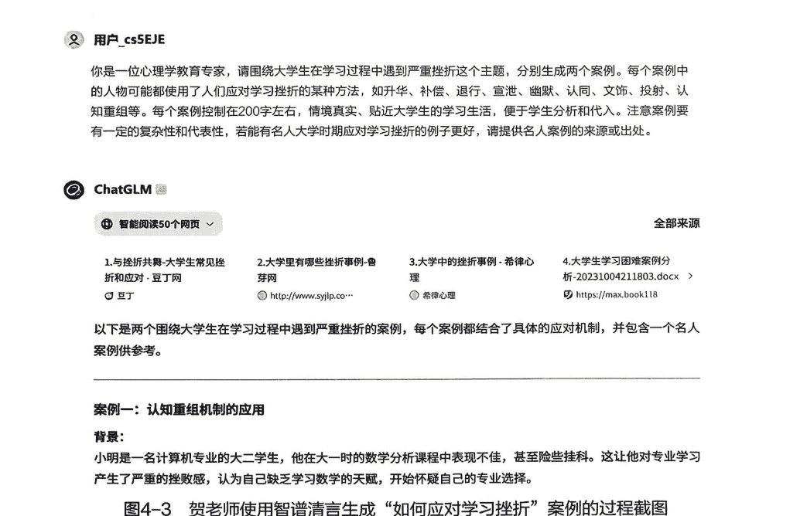

智谱清言仅用十几秒时间就生成了两个案例，但在案例文本中，GenAI将分析案例要应用的相关理论知识与方法，同案例内容混在一起，影响了对案例的使用。
贺老师设计提示词提醒，“请注意，你设计的案例是课堂上提供给大学生小组讨论的材料，不能提供应对方法和分析思路等，请只生成两个案例，人物分别为名人和普通大学生”。贺老师通过与GenAI的多轮对话和修改完善，最后形成了如下的课堂研讨文本案例。

> **应对学习挫折的案例1：马云高考两次落榜**
青年时期的马云连续两次高考失败，第一次高考数学成绩仅得1分。马云第二次高考，数学成绩提升至19分，但总分仍未达标，他和父母都感到失望。在父母不再支持的情况下，马云始终没有放弃，他选择一边工作一边备考，还主动找外国游客练口语，不断增强自我表达能力和心理韧性。最终第三次高考考入杭州师范学院英语专业，在校期间他多次代表学校参加英语演讲比赛，逐渐在沟通与组织方面建立起强烈的自我认同。

## 应对学习挫折的案例2：村上春树大学时期的转折

村上春树在早稻田大学读书时，原本主修戏剧，但对相关课程缺乏兴趣，考试成绩不佳。他感到深深的无力与迷失，经常一个人发呆。某天在神宫球场观看棒球比赛时，他突然萌生了“也许我可以写小说”的想法。此后，他每天晚上坚持写作，逐渐将挫败感转化为创作动力，并将自己对生活的不安、孤独感转化为文学表达。他日后回忆：“失意又寂寞的大学阶段，是我写作的原点。”

## 3. 探究引导型文本的生成策略

探究引导型文本可用于课堂教学、课前预习或课后自主学习，这类文本教学资源能够激发学生自主思考，培养其分析能力、评价能力和创新能力，文本的内容是对课程内容在深度和广度上的拓展。教师应在设计提示词时，明确文本类型、内容特点和应用目的等，对一些细节通过多次交互进行迭代修改完善。为了提升这类资源的教学应用效果，教师审阅修改后，还可邀请部分学生或同行参与审核，提升文本与教学的契合度。

例如，贺卫国老师在讲授“人是如何学习的”课程中“专家是怎样解决问题的”这个学习主题时，想撰写引导学生探究专家在解决问题中学习的文本，让学生能够通过文本阅读，自主探究专家在识别问题、提取问题特征、分析问题和解决问题的方法等思维策略，从而引导学生深化对学习内容的理解和对专家思维策略的运用。贺老师设计了以下提示词，智谱清言生成阅读文本后，贺老师又提出了更具体的修改要求，经过与GenAI的多轮交互和修改，同时征询部分学生的建议，最后形成了探究型阅读文本资源。

提示词：

> 你是一位教育心理学专家，请为“人是如何学习的”课程中“专家是怎样解决问题的”这个主题的学习设计相应的探究阅读材料，讲述某个知名领域专家在面对真实复杂问题时，是如何识别问题、分析信息、选择策略并逐步解决问题的。请注明这个专家事件的出处，必须保证其真实性，字数限制在400字以内，适合大学生阅读与分析。请突出专家在思维方式和解决问题方面的特征，便于学生分析总结专家的认知特征与问题解决策略。

> **探究阅读材料：理查德·费曼如何解决教学难题**

20世纪50年代，诺贝尔物理学奖获得者理查德·费曼受邀为加州理工学院设计一套全新的本科物理课程。面对“如何让学生真正理解物理本质”这一问题，费曼没有直接选用既有教材，也没有沿用传统“概念—公式—习题”的教学顺序，而是从学生常见的误解中识别出教学中的根本问题：学生虽能套用公式，但无法理解背后的原理。他不是从教学顺序出发，而是重构内容结构，从物理定律的本质入手，围绕“观察—模型—推理”的路径展开课程设计。他还多次测试自己的讲解是否真正被学生理解。为促进学生学习，他不断调整表达方式，使用类比、图像和跨学科方式讲解物理。最终，这门课程的内容被整理为《费曼物理学讲义》，成为全球影响深远的物理教材。

## 4. 写作范例型文本的生成策略

写作范例型文本是帮助学生掌握写作结构、语言风格、思维逻辑的重要支架。教师可以根据精心设计的提示词，应用GenAI生成具有特定体裁特征和教学目标导向的范文。对GenAI生成的议论文、说明文或反思性写作范文，教师在审核修改后，可增加评语和批注，引导学生更深入地掌握写作方法与要领。

应用GenAI创建文本类教学资源的具体方法与策略，可参考作业范例的关于林黛玉等穿越到现代社会生活的想象作文部分。

# 第 2 节
如何用GenAI创建图像类教学资源

GenAI可以为教学创建生动、直观、具有启发性的多种图像类教学资源，激发学生的学习兴趣和对学习内容的深度理解。随着GenAI的快速发展，生成图像类资源不再是部分专属模型具备的功能，许多通用大模型都可以生成图像类教学资源。

### 一 具有图像生成功能的主要GenAI工具

能够生成图像的GenAI工具自发布以来就在快速迭代更新，这些GenAI工具在生成图像方面各具优势，表4-1中呈现了几种有代表性的工具。

### 表4-1 具有图像生成功能的主要GenAI工具

| 名称 | 主要功能 | 平台地址 |
| :--- | :--- | :--- |
| 文心一言 | 支持文本、图像等生成图像，适合需要快速视觉表达的场景，如广告、设计和教育领域 | https://yiyian.baidu.com |
| 腾讯元宝 | 支持文本生成艺术图像，支持风格转换与细节优化，适合广告、创意设计等 | https://yuanbao.tencent.com/ |
| Fotor | 支持文本生成图像、3D和动漫角色、绘画及其他数字画，有多种不同图像样式供选择 | https://www.fotor.com |
| NightCafe | 支持文本生成图像，有多种艺术风格可供选择，能够生成用于打印的高分辨率图像 | https://creator.nightcafe.studio |
| Stable Diffusion | 开源模型，可从文本生成图像，也可以照片加文本描述，创建摄影图像、插图、3D模型、徽标等图像 | https://stablediffusionweb.com |
| 通义万相 | 支持文生图、文生视频、图生视频，操作简单，可提供多样化风格和细节调整选项 | https://tongyi.aliyun.com/wanxiang |
| 智谱清言 | 能够以文本、代码等方式生成图像，服务创意设计、艺术创作等需求 | https://chatglm.cn/ |
| Midjourney | 支持文生图，可选择风格生成艺术作品，适用于艺术家、设计师和创意人员，提供丰富的视觉效果和创作灵感，每次输出4张图像 | https://www.midjourney.com |
| DALL·E3 | OpenAI开发，支持文生图，生成逼真图像和艺术作品，支持扩展图像边界、在现有图像上进行编辑以及生成图像的不同变体，有内容审核机制，防止生成暴力、仇恨或成人内容 | https://openai.com/dall-e-3 |
| 豆包 | 支持文生图、图生图，能够批量出图、精准理解用户意图、保持生成画面人物等的一致性，支持对图像进行二次编辑 | https://www.doubao.com/ |

### 二 应用GenAI生成图像类教学资源的类型与方式

#### （一）GenAI生成图像类教学资源的主要类型

GenAI可以基于文字描述或上传的图像，生成多种类型的图像教学资源。常见类型有：①概念示意图，如电磁感应原理、DNA结构等；②事件过程示意图或任务引导图，如化学实验过程图、研究流程图、项目化学习的操作步骤图解等；③历史或地理复原图、复现图，如工业革命时期的伦敦街景、不同的地貌类型对比图等；④情境创设图，如人物生活环境、未来生态城市设计图；⑤教学内容关系图等将知识可视化的图，如文章的思维导图、概念图等。这些图像资源若质量与内容符合教学要求，可用于课堂讲解、课件制作、导学案设计，也可用于学生自主学习等环节。

相比传统手绘或图片搜索方式，GenAI生成的图像具有定制性强、响应速度快、风格可控等优势，教师能够根据教学目标和学生特点精准设计图像内容，但也要注意防范GenAI可能生成不符合事物发展规律的图像，或出现内容错误，从而产生认知风险或意识形态风险。

#### （二）GenAI生成图像类教学资源的三种主要方式

一是文本生成图像，教师输入描述性提示词，GenAI根据语言指令生成符合教学内容的图像；二是图像生成图像，用户上传图像，GenAI生成新图像；三是图像+文本生成图像，用户上传已有图像，输入提示词，GenAI对已有图像按提示词的要求进行风格转换、色彩变换、局部修改、细节增强或场景重构。（见表4-2）这三种方式可灵活应用于知识讲解、情境创设、学生创作引导等教学场景。

### 表4-2 GenAI生成图像类教学资源的三种主要方式

| 生成方式 | 生成条件 | 主要GenAI工具 |
| :--- | :--- | :--- |
| 文本生成 | 输入提示词，GenAI根据描述生成图像 | 文心一言、通义万相、豆包、智谱清言、腾讯元宝、DALL·E3、Bing Image Creator、Midjourney、Adobe Firefly |
| 图像生成 | 上传已有图像（一张或多张），GenAI生成新图像 | 文心一言、Midjourney、ChatGPT等可直接在交互窗口生成图像，有些GenAI工具需在指定交互窗口下如“背景替换”模块才可生成图像 |
| 图像+文本生成 | 上传已有图像，GenAI根据原图和描述生成新图像 | 豆包、文心一格、通义万相、智谱清言、Runway ML、Stable Diffusion、Midjourney、Fotor |

需要注意的是，当用户只上传图像，不提供提示词时，从实践经验看，GenAI生成的新图像是根据用户与其对话的记录或上下文情境来生成的。例如，李老师在百度上查到苏轼像后，直接在文心一言选择智慧绘图功能上传苏轼像的图片，文心一言生成了如图4-4所示的图像，并提醒用户，“如果需要继续让我为你作画，请完整描述你的需求”。可见，GenAI的图像生成图像功能虽然交互简便，但生成的图像效果难以预测和把控。若将图像与提示词结合生成有明确要求的图像，效果更好。

可以发现，GenAI用三种方式生成图像时，有两种是需要提示词的，而且提示词的设计质量对生成图像的类型、风格、质量有重要影响。GenAI快速响应的特征，决定了用户的随意指令都会使其生成图像，但想生成满足教学需要的图像资源，则需要设计清晰明确的提示词。

### 三 用GenAI生成赋能深度学习的图像类教学资源

#### （一）文本驱动GenAI生成逻辑关系图

#### 1. 生成思维导图示例

在教学中，为了使学生快速理解复杂的教学内容，需要用到思维导图。但是，教师借助电脑绘制或手绘思维导图花费的时间多，利用GenAI，只要准备好相关资料和提示词，几秒钟就可以生成思维导图，教师再进行审阅修改完善就可以用于教学。

例如，为了使研究基础薄弱的研究生快速理解学术论文中的实证研究方法，杜玉霞老师在“数智赋能的教育研究方法”课程教学中，与GenAI协同生成了学术论文思维导图，其三步法如下。

（1）上传学术论文，设计提示词，明确任务要求
教师将PDF格式的文献上传至具有文档理解能力的GenAI工具——豆包，并输入以下提示词：

> 请你作为教育研究专家，分析这篇文献中实证研究部分的内容，生成一份结构清晰的思维导图，帮助学生理解这篇文章实证部分的内容，更好地掌握实证研究方法在具体研究中的应用。注意提炼关键词，且思维导图的层级最多不超过四级。

（2）GenAI提取学术论文的内容要点，生成思维导图和代码
杜老师上传学术论文和提示词后，豆包的页面如图4-5所示，右边呈现学术论文内容，左边显示生成的思维导图及代码。
用户可以选择关闭右侧的文献窗口，全屏观看左侧的思维导图及代码。

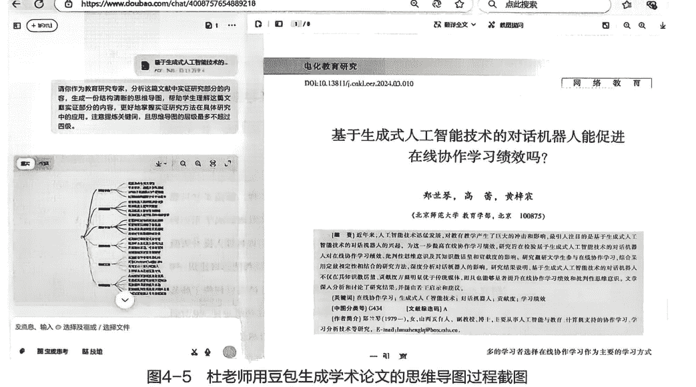

（3）复制代码到本地文档，修改完善后，再复制到豆包重新生成思维导图
为了修改豆包生成的缺乏提炼关键词、内容繁杂的思维导图，杜老师进行了如下操作：

①关闭豆包平台右侧的文档页面，放大思维导图窗口，切换到代码窗口，复制这张思维导图的全部代码，粘贴到本地的Word文档中。（见图4-6）

②在本地的Word文档中修改思维导图的代码。（见图4-7）

杜老师在Word文档中逐一审阅修改思维导图的代码，修改完成后，复制全部代码。

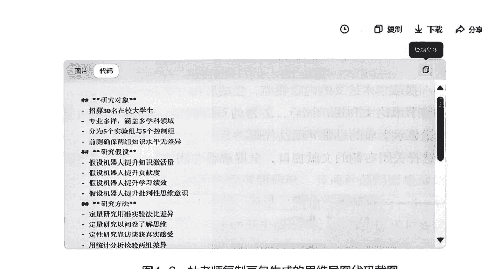

图4-6 杜老师复制豆包生成的思维导图代码截图

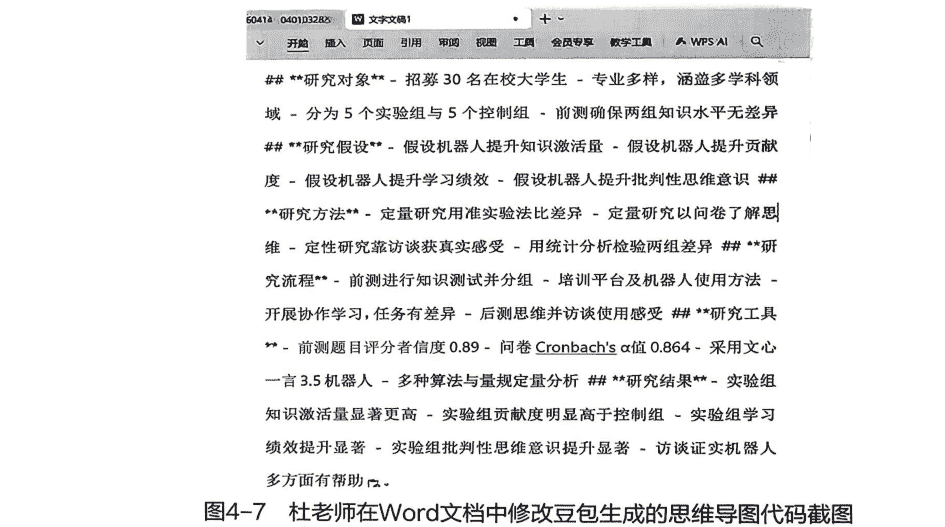

图4-7 杜老师在Word文档中修改豆包生成的思维导图代码截图

③将修改完成的思维导图代码提交豆包，生成新的思维导图。（见图4-8）
由于GenAI工具的局限，上面生成的这张思维导图缺少应有的中心主题，教师可以添加中心主题，或者将这张思维导图导入专门的思维导图软件，生成具有明确中心主题的思维导图，豆包新生成的论文思维导图可扫码查看。（见图4-9）

显著更高 - 实验组贡献度明显高于控制组 - 实验组学习绩效提升显著 - 实验组批判性思维意识提升显著 - 访谈证实机器人多方面有帮助——请根据上述代码，生成一张内容清晰的思维导图。

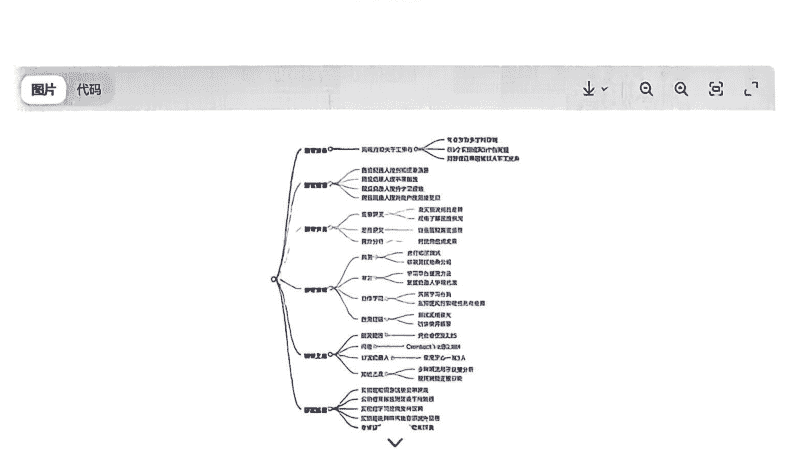

图4-8 豆包用修改代码生成论文思维导图过程截图


图4-9 豆包新生成的论文思维导图二维码

#### 2. 生成流程图示例

在教学中，利用GenAI可以将复杂概念、过程快速转化为可视化逻辑图谱。豆包在这方面的功能也很强大，使用与上述类似的方法与步骤，就可以生成流程图、关系结构图等教学内容的示意图，这种让知识可视化的策略可以使学生理解起来更轻松。

例如，为了让学生在阅读上述学术论文的过程中掌握实证研究的主要过程，杜老师可以在生成思维导图后，用提示词向豆包提问，生成如图4-10所示的论文研究流程图。

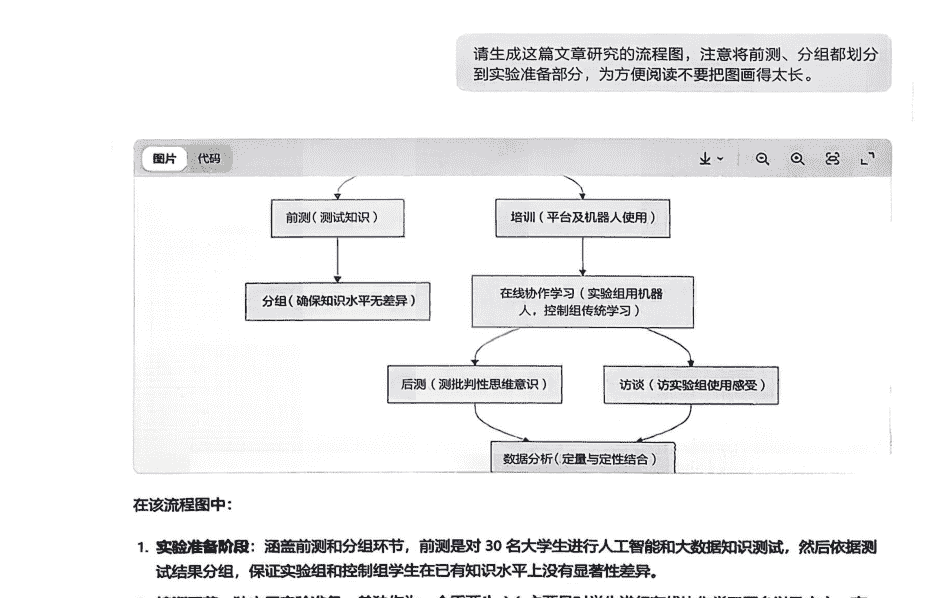

在该流程图中：

1. 实验准备阶段：涵盖前测和分组环节，前测是对30名大学生进行人工智能和大数据知识测试，然后依据测试结果分组，保证实验组和控制组学生在已有知识水平上没有显著性差异。
2. 培训环节：独立于实验准备，单独作为一个重要环节，主要是对学生进行在线协作学习平台以及文心一言

图4-10 豆包生成论文研究过程流程图的截图

可以发现，许多GenAI都具备强大的上下文理解能力，杜老师只需要用简单的提示词，就可以生成上传论文的流程图。若需要修改，则可以通过修改代码再生成，也可以将代码复制到Python等程序中，生成流程图。

#### （二）图文驱动GenAI生成赋能情境创设的图像类教学资源

图像类教学资源可以赋能教学情境的创设，提升学生在学习中的认知参与和情感参与，提升学习效果。教师可以用文本提示词驱动GenAI，从零生成契合教学主题的图像，也可以用“上传图像+文本描述”的方式，驱动GenAI对现有图像进行风格转化、情境扩展或主题再创作，生成新的图像资源。这种“图+文”协同生成新图像的方式，为教师创设复杂教学情境提供了丰富的资源支持。

例如，邓老师在讲解《赠汪伦》这首诗时，想找一张用于促进学生对古诗理解的图像，但在网上检索后并未找到满意的图片，最后找到一张情境比较接近的，但李白却在船上拿着一本书，邓老师认为这个情景不适合离别时的情况，因此，需要对这张图片进行修改。

邓老师登录ChatGPT，上传图像，并输入修改图像的提示词，具体过程如图4-11所示。

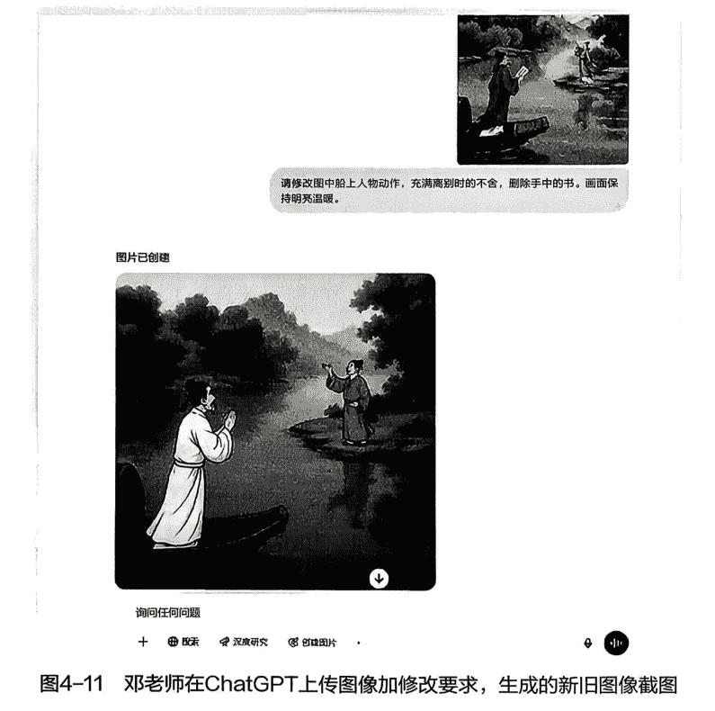

#### （三）图文驱动GenAI生成促进深度学习的图像类教学资源

图文驱动GenAI生成图像类教学资源，可以使抽象概念具象化、复杂过程可视化，从而帮助学生高效学习。更重要的是，GenAI可以生成让学生综合运用所学知识与技能的图像类学习资源，培养学生的高阶思维。例如，生成展示细胞分裂过程、铁的氧化过程等图像，并用于教学。

肖老师在讲授七年级生物“种子萌发的过程”这节课后，批改作业时发现学生对这个知识点掌握不充分。于是，他使用ChatGPT生成了示意图，在课堂上组织学生观察分析，修正图片后，师生进一步讨论，促进学生对该内容的深度学习。肖老师采用以下三步生成了教学资源。

- （1）拍摄教材中“种子萌发的过程”的照片，上传至ChatGPT。
- （2）设计提示词，输入ChatGPT，要求生成示意图。（见图4-12）

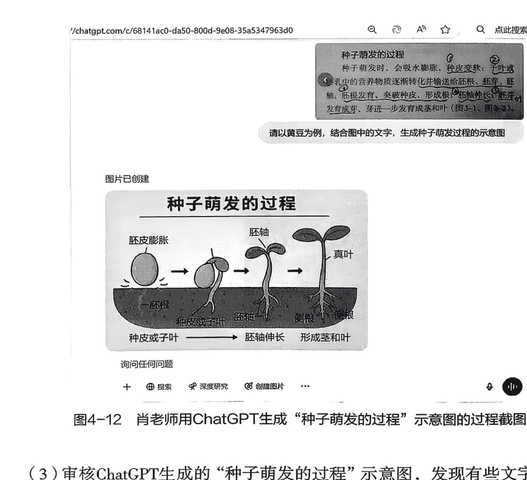

- （3）审核ChatGPT生成的“种子萌发的过程”示意图，发现有些文字不规范，还有些有错误需要修改，正好适合组织学生进行分析、讨论和修改完善，发展其高阶思维。

## 第 3 节 如何用GenAI创建音频类教学资源

在多模态学习环境中，音频类教学资源以其便捷性、沉浸性和可重复聆听等特性，在语言学习、知识讲解、阅读训练、情感培养等教学场景中有广泛应用。

### 一 具有音频生成功能的主要GenAI工具

GenAI为音频教学资源的快速生成与个性化制作提供了便捷的手段与方式。目前，能够生成音频的GenAI工具日益丰富，功能越来越强大，许多GenAI工具能够支持生成多语言、多角色、多语调、带有自然停顿的音频资源。ElevenLabs、Murf.ai、Google TTS等GenAI工具音频生成功能强大，但受访问限制、付费等问题制约，使用不便。下面主要介绍国内具有音频生成功能的GenAI工具及其应用方法。

#### （一）具有音频生成功能的主要GenAI工具

GenAI的迅速发展产生了导航网站，https://www.aigc.cn/和https://ai.openi.cn/是两个比较大的GenAI工具导航网站。
图4–13是AIGC工具导航站（www.aigc.cn）介绍的具有音频处理功能的GenAI工具，该平台推荐了20多种能够处理音频的GenAI工具。

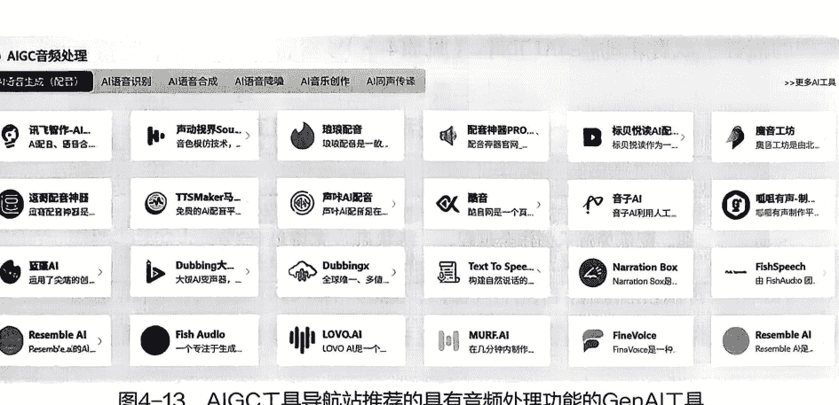

图4-14是OpenI（ai.openi.cn）平台推荐的GenAI音频工具，其推荐的内容有些与AIGC工具导航平台一致，有些不同。需要注意的是，这些工具的性能差异较大，有些适合商业宣传，有些必须付费使用，教师应根据教学需求和工具的性能特点，选择合适的GenAI工具。

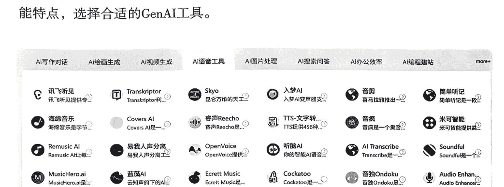

#### （二）具有音乐生成功能的主要GenAI工具

教学音频主要有进行知识讲授、语言训练与学习情境营造的教学内容朗读、讲解、对话、听力及歌曲等各类音频。音乐是具有审美、情绪激发与氛围构建等教学功能的特殊音频。GenAI工具日新月异的发展，使教师能够利用GenAI工具生成教学所需的特定音乐。以下是《AIGC发展研究》①（3.0版本，0.95修订号）所整理的能够生成音乐的GenAI工具。（见表4-3）

表4-3 能够生成音乐的GenAI工具

| 名称 | 主要特点 | 亮点功能 | 适用场景 |
| :--- | :--- | :--- | :--- |
| Suno | 一次性完成歌词、演唱、编曲、配乐等音乐创作全过程，具备多语言交叉混合生成能力 | 支持多种音乐风格和情绪状态，支持最长2分钟的歌曲扩展 | 个人音乐创作、社交媒体内容创作、音乐教育等 |
| Abab-music-1 | 端到端音乐生成，纯音乐、清唱、伴奏、人声合成，具备拟人化生成能力 | 支持多种音乐风格和情绪状态 | 音乐创作与制作、影视配乐、内容创作等 |
| 天工SkyMusic | 端到端音乐生成，人声自然度高、发音可懂性强，具备方言演唱能力 | 支持多人声、歌词使用多种方言 | 文化传播、社交媒体内容创作、音乐教育等 |
| 琴乐大模型 | 文本或音频输入生成音乐，具备逻辑乐理生成能力 | 支持自动编曲和乐谱生成、语音文本对齐、音频特征提取 | 音乐教育、社交媒体内容创作等 |
| 豆包 | 零样本人声克隆、旋律歌词局部改写、支持多种情绪状态 | 一键分享到社交平台，支持旋律创作 | 个人音乐创作、社交媒体内容创作、音乐教育等 |
| 网易天音 | 一站式AI音乐创作平台，免费使用 | 支持用户自调音系、编曲、上传素材、调整结构等 | 专业音乐创作、音乐教育、音乐娱乐等 |

> ① @新媒沈阳团队.《AIGC发展研究》[EB/OL].（2024-12-28）[2025-03-23]. https://io.neepu.edu.cn/info/1133/4873.htm.

上述GenAI工具的功能还在不断更新，每款工具平台都有或详细或简略的操作说明，即使是零基础的用户，也可以根据其应用说明，创作生成各类音乐作品，用于教学等多种应用场景。

### 二 应用GenAI工具生成音频类教学资源的方法

不同GenAI工具的功能差异，使其应用方法与步骤稍有不同，但主要的应用方法差别不大。教师应用GenAI工具，可以快速生成适配课程内容的音频教学资源，实现资源个性化、生成高效化、应用多样化。下面以讯飞智作为例，呈现GenAI工具生成音频类教学资源的具体步骤与方法。

#### 1. 教学内容准备与制作稿本设计

教师用GenAI制作音频类教学资源时，需要根据教学目标选择合适的教学内容，有些还需要编写出适合音频教学的文字稿本。承载教学内容的文字稿本应语言简练、逻辑清晰，适当嵌入语气提示，便于合成自然流畅的语音。例如，可将化学实验步骤讲解、英语对话文本或专业文章等内容改写为适合讲解的音频制作稿本。

#### 2. 登录GenAI平台与功能选择

教师可用手机号加验证码的方式登录讯飞智作平台（https://www.xfzhizuo.cn/make），从功能面板选择合适的功能，制作教学音频。讯飞智作的功能丰富，如图4-15所示，左侧为输入窗口，用户一次可输入1万字的文本，很快即可生成语音。

在生成音频的功能模块中，用户可以对音频中换气、连续、停顿的时间进行设置，可以对语种、音质、音色以及人员角色、男声、女声、语音、语调等参数进行设置，以使生成的音频更好地匹配教学场景和学生认知需求。

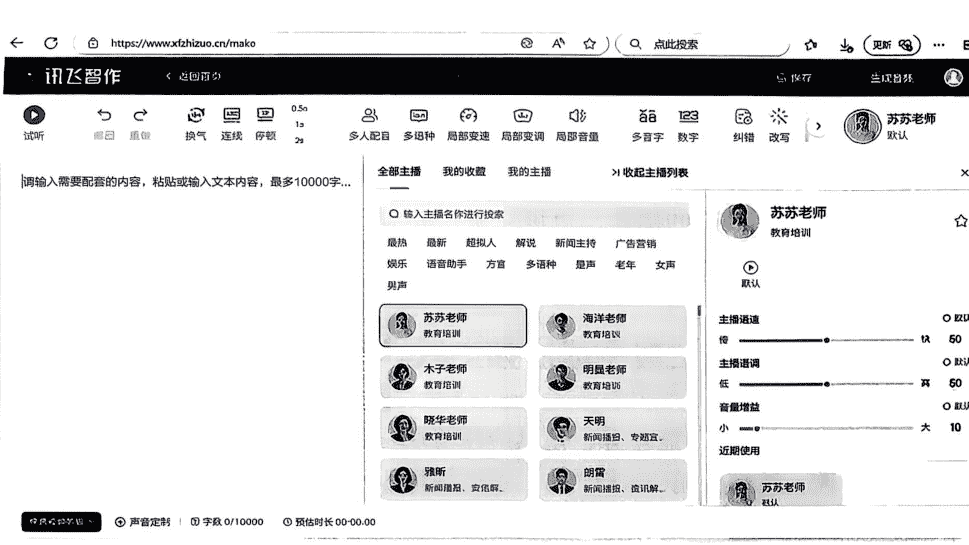

#### 3. 音频生成设置与试听调整

在英语教学中，肖老师发现学生在一封英文信件的课文阅读中存在阅读不熟练、单词发音不准确、语调不当等问题。为了使学生有合适的课文朗读范文，以便在课前课后自主学习，肖老师通过以下步骤生成了适合高一学生自主学习的教学音频。

- （1）在平台输入要生成音频的教学内容。肖老师将课文内容整理成文本，粘贴到讯飞智作语音生成框后，设置语速、音量、语调等参数。
- （2）选择平台提供的多种人声风格，进行试听。肖老师是初次使用该平台，她分别试听了温和、严肃、活泼等适用于不同教学情境的风格。通过试听，肖老师选择了晓华老师的声音，其生成的音频更加接近真人朗读，节奏适中，适合高一学生的听力水平。（见图4-16）

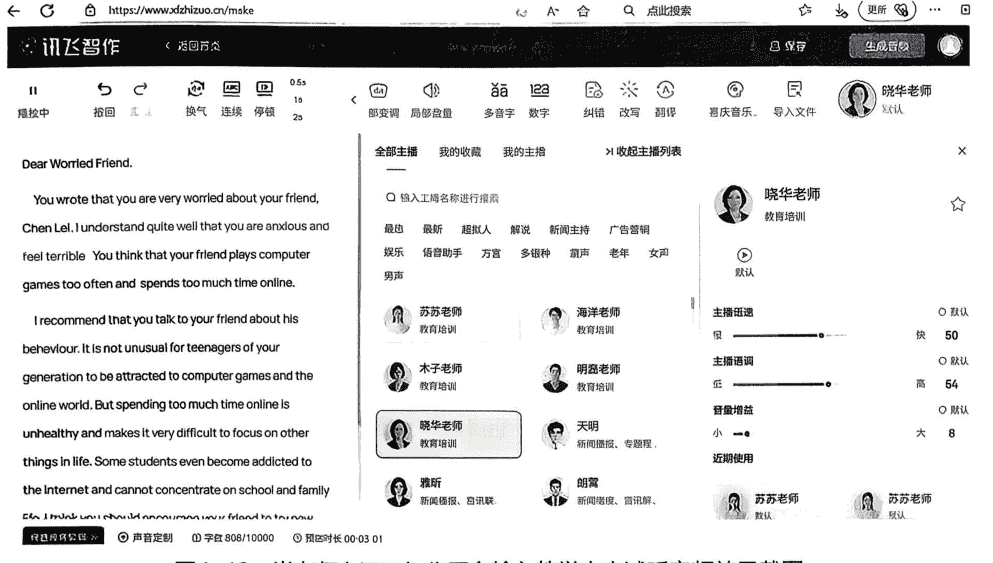

- （3）添加背景音乐。肖老师发现，平台还提供背景音乐，她认为在阅读这封信件时，添加抒情的音乐更能增强内容的感染力，于是，如图4-17所示，她点击了背景音乐选项卡。

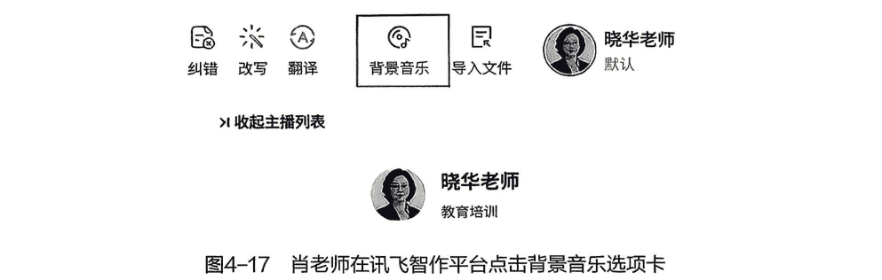

在如图4-18所示的背景音乐选择窗口中，有几十首专题音乐可选，通过试听比较，肖老师选择了《生命的期待》这首背景音乐。

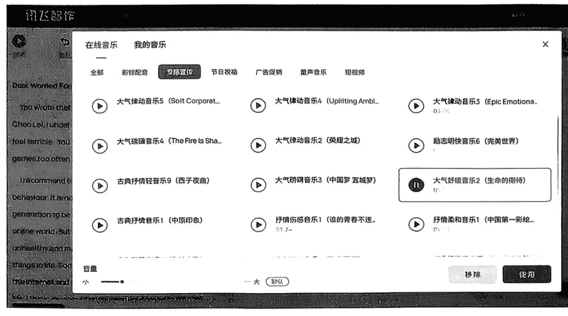

#### 4. 教学音频导出与嵌入应用

试听满意后，用户可以选择同步生成字幕，将音频导出为MP3或WAV格式，并保存到本地。肖老师将讯飞智作生成的配有背景音乐的英文信件阅读音频导出为MP3格式，并保存到电脑上，又对照课文内容仔细听了两次，没有发现有内容错误或语音语调不当之处。（见图4-19）审核无误后，肖老师将音频插入PPT课件，并上传到在线学习平台供学生自主应用。

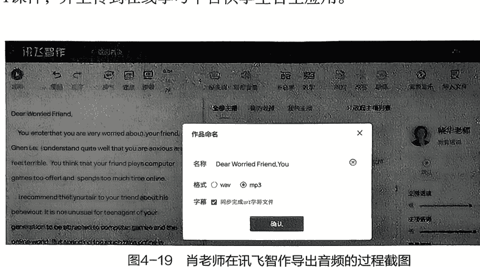

根据教学场景，教师还可将音频教学资源嵌入微课视频、在线任务单中，也可以制作在线学习指导、听力训练材料、有声阅读内容等，增强学习的互动性和灵活性。讯飞智作的教学音频制作功能比较强大，但是需要付费才可以使用。

## 第 4 节 如何用GenAI创建PPT课件资源

PPT课件是教师组织教学内容、呈现知识结构、激发课堂互动的重要资源和手段。GenAI功能的迭代升级，可以使教师从人工编辑制作PPT，转变为“人机协同”的高效生成。许多GenAI工具都提供了丰富的PPT生成功能，教师只需输入主题、关键词、教学目标或课程名称，GenAI即可快速生成结构完整、逻辑清晰、图文结合的PPT内容，大幅提高了教师的课件制作效率。教师应用GenAI既可以轻松设计PPT初稿，也可以根据具体教学情况调整PPT课件的风格、语言和内容，实现个性化、场景化的课件资源创作。

### 一 具有PPT生成功能的主要GenAI工具

GenAI可以根据用户输入的主题或内容，快速构建出结构清晰、设计美观的PPT框架。当前，讯飞智文、iSlide等GenAI工具都具有PPT生成功能，我们整理了适用于教学的功能丰富、各具特点的GenAI工具，供不同学科和学段的教师选择使用。（见表4-4）

表4-4 具有PPT生成功能的主要GenAI工具

| 工具名称 | 主要功能 | 地址 | 费用情况 |
| :--- | :--- | :--- | :--- |
| 讯飞智文 | 支持主题、长文、文档一键生成PPT，集成AI绘图、多语言适配、智能排版、演讲稿自动标注节奏，覆盖内容生成到演讲准备全流程 | https://zhiwen.xfyun.cn | 有免费体验时限 |
| Kimi PPT 助手 | 支持学术深度解析、万字长文本生成结构化大纲、语义推荐配图、逐字稿带时间标注，支持多语言，兼容学术论文、书籍内容转化 | https://kimi.moonshot.cn/（需进入Kimi+后选择PPT助手） | 免费版有额度限制，付费版无限制 |
| iSlide | 提供正版素材库+专业排版引擎，支持智能对齐、字体配色统一、一键美化 | https://www.islide.cc | 生成免费，导出PDF免费，导出可编辑PPT需付费 |
| 美图Live PPT | 支持视觉化速成，AI分析文本生成设计，自动排版并调用正版图片库，一键生成图表，支持多风格切换，自动优化字体、配色、对比度 | https://www.designkit.com/ppt/ | 基础功能免费，导出PPT需付费 |
| AiPPT | 关键词生成大纲，智能排版，网页端操作，支持数字人视频 | https://www.aippt.cn | 生成PPT的免费次数有限制，导出需付费 |
| 灵感PPT | 支持输入主题，上传文档生成PPT，支持AI配音、配图、创作，可局部重写内容，单页逻辑可控 | https://www.lgppt.cn/ | 生成PPT、配音、配图的免费次数有限制，导出PDF和成图免费，导出PPT和文章需付费 |
| 歌者PPT | 可套用预置指令，支持根据话题、粘贴文本、上传资料、网页链接生成PPT，具有生成PPT、智能翻译、单页生成、案例下载等功能 | https://pro.gezhe.com/ | 可领取新手礼包和每周礼包，领取PPT免费生成页数，导出PPT需付费 |
| ChatPPT | 通过对话优化课件，通过自然语言指令调整内容，支持主题、图片、文件、网页、演讲稿生成，支持上传本地PPT文件进行AI一键美化 | https://chat-ppt.com/ | 部分功能免费，尝鲜模式（AI实时绘图）限免，专属模式需开通会员付费使用，导出PPT需付费，导出PDF和图片免费 |
| 智谱清言 PPT | 依托大模型能力，支持文本、文件、链接等，一键生成大纲与文案，自动适配学术、商务等模板，内置AI画图、数据可视化及跨学科工具 | https://chatglm.cn/ | 生成PPT免费，下载PPT有免费次数限制 |

### 二 应用GenAI生成PPT教学课件的主要方式

GenAI生成PPT教学课件的主要方式及工具见表4-5。

表4-5 GenAI生成PPT课件的主要方式及工具

| 生成方式 | 生成条件 | 主要GenAI工具 |
| :--- | :--- | :--- |
| 文本生成 | 输入文本，文本可以是主题或者一段文字，GenAI根据文本生成PPT大纲，根据大纲生成PPT | 讯飞智文、Kimi PPT助手、iSlide、美图Live PPT、AiPPT、灵感PPT、歌者PPT、ChatPPT、智谱清言PPT |
| 文档生成 | 上传文档，GenAI提取文档信息，生成PPT大纲，根据大纲生成PPT | 讯飞智文、Kimi PPT助手、iSlide、美图Live PPT、AiPPT、灵感PPT、歌者PPT、ChatPPT、智谱清言PPT |
| 思维导图等图像生成 | 上传教材图片、思维导图等，GenAI提取图片内容，生成大纲，根据大纲生成PPT | Kimi PPT助手、iSlide、ChatPPT、美图Live PPT、AiPPT、歌者PPT、智谱清言PPT |
| 网页链接生成 | 粘贴学校等网页的网址，GenAI根据网页内容生成PPT | 歌者PPT、ChatPPT、AiPPT、智谱清言PPT |

在应用GenAI生成PPT的过程中，不论教师输入的提示词质量如何，GenAI都能够自动生成一份PPT大纲的初稿，教师应根据具体情况对大纲进行修改和调整，以确保PPT的内容既符合教学需求又具有较高的质量。因此，教师在应用GenAI生成PPT时，一定要精心设计提示词，以生成更加符合教学需求的PPT大纲，提高整个制作过程的效率。

### 三 应用GenAI工具创建PPT的方法与策略

#### （一）以文本方式创建教学PPT的步骤与方法

GenAI工具用文本创建教学PPT一般有如下几个步骤：①输入文本；②生成、修改大纲；③选择模板生成PPT；④检查修改PPT内容；⑤审核PPT的内容、排版和风格等，确认无误后，导出PPT。

目前主要的GenAI工具基本具有用提示词文本生成PPT的功能。另外，讯飞智文、iSlide等GenAI工具的文本生成PPT的功能有更细化的分类：一类是根据指定标题或一句话生成PPT；另一类是根据一段长文本生成PPT，如讯飞智文支持12000字的长文本输入。（见图4-20）

##### 1. 用主题句创建教学PPT的步骤与方法

GenAI工具能够根据用户提供的主题句，自动生成结构完整、内容丰富的PPT教学课件。为生成高质量的PPT课件，教师需输入精准的标题或者主题，确保教学课件内容的专业性。

杜玉霞老师在为广州市中小学教师做关于课题申报的讲座时，需要制作相应的教学课件，杜老师选择用讯飞智文来制作。

杜老师在讯飞智文首页选择“一句话生成PPT”，输入了提示词与讯飞智文对话，讯飞智文生成了大纲。杜老师对第一次生成的大纲不太满意，所以选择“重新生成大纲”。重新生成后，杜老师对大纲的文字进行分析评估，删减了一些内容，对一些文字进行了修改。确定大纲后，杜老师点击“下一步”，选择了合适的模板，开始生成PPT。（见图4-21）

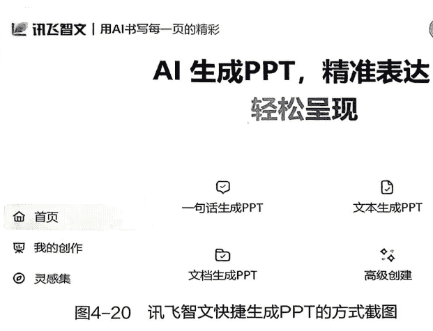

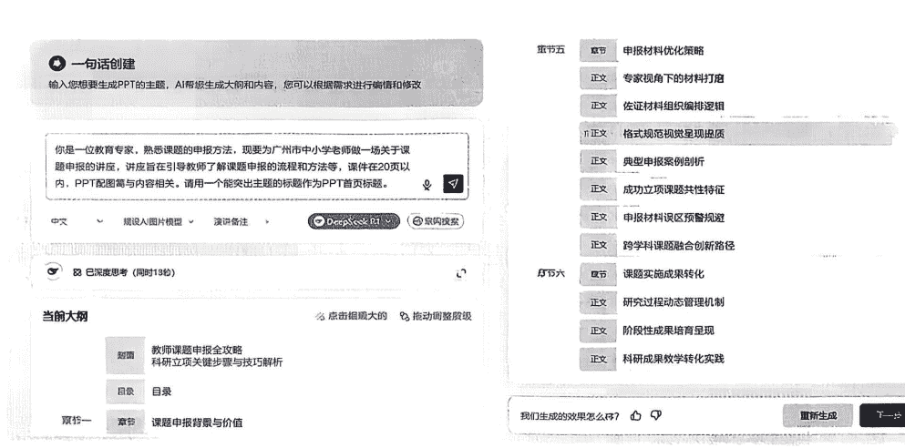

在讯飞智文生成PPT后，杜老师对首页标题进行了修改，添加了提供课题申报书范本的团队公众号二维码，检查了生成的PPT模板、风格、内容是否适合讲座对象。（见图4-22）


图4-22 杜老师修改讯飞智文生成的PPT首页的截图

在检查PPT文字时，杜老师发现有些文字不够精简，所以使用“智文AI撰写助手”对文本进行了精简。（见图4-23）

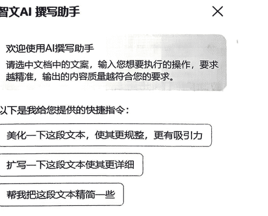

图4-23 杜老师用智文AI撰写助手精简PPT内容截图

杜老师在检查PPT配图时，发现配图不符合课件内容，所以使用“智文AI文生图”重新生成PPT配图，如图4-24所示（点击图片后，在图片上方出现“…”隐藏菜单键，点击“…”找到“AI文生图”）。另外，杜老师发现PPT内容比较单薄，又添加了自己整理的国家级课题申报要领、团队的申报案例等资料以充实PPT内容。

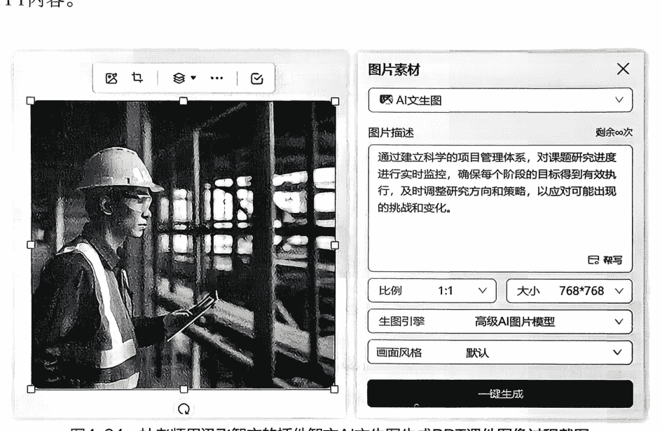

最后，杜老师进一步检查PPT中的图文是否与教学内容相关、内容是否准确、是否适合教学需要等，检查无误后，导出PPT。

##### 2. 用长文本创建教学PPT的步骤与方法

GenAI支持教师输入结构化长文本，高效转化现有文本为可视化形式，保留核心信息，识别文本的层级、段落主旨等结构化内容，提取数据、结论、步骤等关键信息，过滤冗余内容。

例如，广州市幼儿高等师范专科学校中职部的张海容老师准备参加中小学青年教师教学能力大赛，已经写好了说课稿。为了提高备赛效率，张老师选择应用美图LivePPT制作说课课件。首先，张老师设计了要求具体的提示词，加上说课稿的文字一起输入美图LivePPT。

提示词：

> 你好，你是一位参加中小学青年教师教学能力大赛的中职学校信息技术教师，现在需要制作一个说课课件。请根据以下说课稿生成说课课件，标题需符合说课稿的内容，其中教学环节：导入、模仿、分析、实践、创编、评价，通过流程图展示。课件的配图突出信息技术的课程特色，课件不能出现参赛者姓名等个人信息，课件的页数不超过30页。

制作中，张老师认为说课稿不够精彩，就利用GenAI工具扩写原文以丰富内容、提升质量。她在美图LivePPT的“大纲生成”页面，利用“扩写原文”功能进行扩写；在生成的文字大纲中添加了几个小节，删除了不必要内容；审查确定文字大纲后，张老师选择合适的模板，用美图LivePPT生成了19页的PPT课件。（见图4-25）

当发现课件首页依然还有GenAI工具的作者信息后，张老师对课件首页进行了修改。接着，张老师在其他页面发现有些文字和配图不太符合说课稿的主题，就应用美图LivePPT中的画布设置、图片工具和文字工具等对课件进行了修改完善。

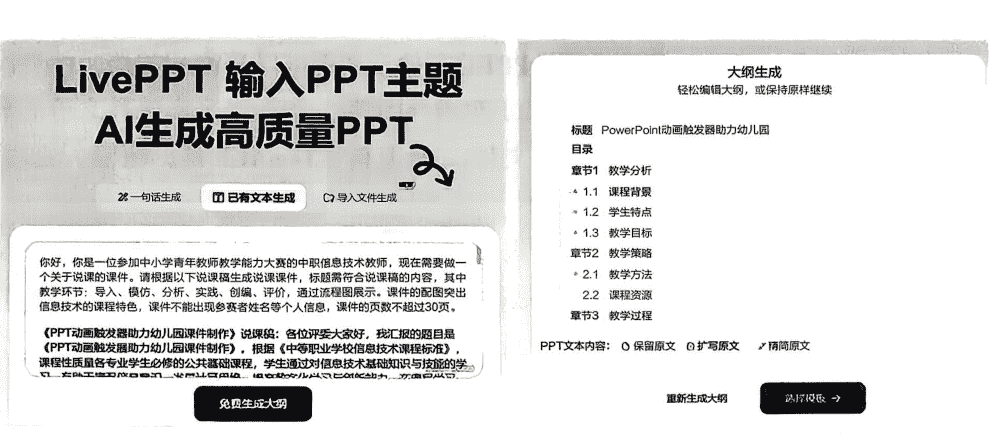

通过对PPT页面进行适当的修改调整，张老师最后对演示预览课件效果很满意，便导出PPT保存到电脑。（见图4-26）

#### （二）以文件方式创建教学PPT的步骤与方法

### 1. 主要步骤与方法

许多教师在教学中都积累了丰富的教学资料，将现有的资料整理成文件，再应用GenAI工具创建的教学PPT，内容往往更加丰富完善，符合教学要求。应用GenAI工具以文件方式创建教学PPT的主要步骤如下：

- （1）整理准备好需要转换成教学PPT的文件。文件可以是Word文档、PDF文档、PPT演示文稿，也可以是教材图片、思维导图等。
- （2）设计提示词，与准备好的文件一起上传至GenAI工具。注意，有些GenAI工具不支持输入提示词。
- （3）审查GenAI生成的PPT大纲，进行调整和修改，以符合教学需求。
- （4）根据自己的喜好和教学风格选择合适的模板。
- （5）审查修改GenAI生成的PPT内容，保障内容的科学性和准确性等。此外，有些GenAI工具还支持语音合成、智能排版等功能，教师可以根据学科特点，通过AI配音编辑PPT内容，应用智能排版进行编辑，提高PPT课件与教学的契合度。
- （6）审核确认生成的PPT内容无误后，选择相应的文件格式，导出PPT课件。

目前，大部分GenAI工具都支持以文件创建PPT的功能，但所支持的文档类型有所不同。使用时，要留意查看GenAI工具支持上传的文件类型提示，例如iSlide为用户提供了清晰的上传文件类型、上传规范与方法说明等。教师在使用时，只需按如图4-27所示的步骤操作，即可快速了解iSlide支持上传的各类文件格式及上传要求与方法。

由于GenAI工具对文件创建PPT的支持功能有所差异，教师要注意选择合适的工具。像智谱清言、Kimi PPT助手等GenAI工具在上传文件后，用户可通过输入提示词，对生成要求进行补充。但有些GenAI工具不支持输入提示词，仅能根据上传文件的内容生成PPT大纲。为提升PPT课件的生成质量，建议选择支持输入提示词的GenAI工具，或者将多种工具组合使用，以高效生成所需的PPT。

### 2. 以文件方式创建教学PPT的案例

（1）案例简介
广州某小学英语教师李老师为了给小学四年级学生上好一节公开课，对教学所用的教科版小学四年级下册英语教材Module 1 People Unit 2 She is kind的内容进行了分析，确定了教学目标与内容，设计了教学方案。
为提升公开课的质量，李老师还在广州共享课堂平台观看了广州市花都区新华街第二小学杨丽莉老师上课的教学录像，下载了杨老师PDF格式的课件、课后习题等文件。比较几个GenAI工具的功能后，李老师选择应用Kimi PPT助手来制作这节课的PPT课件。

（2）设计提示词，并将准备的多个文件一并提交GenAI工具
李老师将教学方案、教材图片以及下载的课件、课后习题等文档传到Kimi PPT助手，并输入了以下提示词：

> 你是一位小学英语老师，使用的教材是教科版小学四年级下册，现在准备上一节公开课，教学内容是Module 1 People Unit 2 She is kind。教学对象是小学四年级学生。请根据上传的第一张教材图片、Unit 2教案、课后习题文档生成课件的内容，参考Unit 2课件生成一份上课用的教学课件。
> 课件要求为：
> 1. 课件中的练习题需要参考课后习题文档，随机生成与教学内容相关的听力题、口语题、选择题，共5道题。
> 2. 一页幻灯片放一道选择题的题目、答案和答案解析。
> 3. 课件的最后有知识总结，帮助学生回顾和巩固所学内容。

（3）审查修改GenAI工具生成的PPT大纲
Kimi PPT助手根据上传的文件和提示词生成PPT大纲后，李老师对其生成的PPT大纲进行了仔细审查和修改完善。

（4）确定大纲生成PPT课件，审核修改后导出PPT
李老师检查修改大纲，确定没问题后点击“一键生成PPT”按钮，选择合适的模板生成PPT课件。李老师对PPT页面的文字内容、配图、排版的规范性等进行审核修改后，导出PPT文件。（见图4-28）

（5）应用其他工具生成多媒体素材，丰富PPT的内容
李老师认为，在英语学习中增加语音素材很重要。她利用WPS应用软件打开刚生成的PPT课件，利用软件的朗读功能为单词和句子添加配音。（见图4-29）她先选中要配音的单词和句子，再点击“审阅”选项卡中“朗读”下面的“选中朗读”功能，调整语速和语调，生成了对应的音频资源。通过多个工具的融合应用，李老师完成了有声PPT课件的制作。

#### （三）以网页方式创建教学PPT的步骤与方法

### 1. 主要步骤与方法

在GenAI工具上传文件生成教学PPT需要花费较多时间整理文件内容。有些GenAI工具提供了更加便捷的利用网页链接创建PPT的方式，用户只需要将含有教学内容的网页地址复制到GenAI工具中，即可获得教学PPT，极大地节约了教师的备课时间，提升了课件制作效率。教师应用GenAI工具根据网页创建教学PPT的主要步骤如下：

- （1）在GenAI工具中选择“根据网页创建PPT”的功能选项。
- （2）在GenAI工具对话框中，以粘贴等方式输入目标网页的URL地址。
- （3）GenAI工具自动访问网页，抓取网页内容，分析其主题和内容结构，生成PPT大纲框架。
- （4）对生成的大纲进行适当调整和优化，增强PPT内容的逻辑性和条理性，以符合实际需求。
- （5）比较选择合适的PPT模板。
- （6）GenAI工具应用选定的模板，自动将网页中的文本、图片、图表等内容填充到PPT的各个页面中。
- （7）审核、修改完善生成的PPT，确认无误后，导出PPT文件。

目前，支持网页链接生成PPT的GenAI工具主要有智谱清言、歌者PPT、AiPPT等，支持的网页主要有微信公众号文章、部分新闻资讯网站等。有些GenAI工具对网页上的文本篇幅有限制，如歌者PPT只接受长度在100—30000字的网页链接。有些GenAI工具在使用网页链接生成时，不支持提示词设计，教师在根据网页链接生成PPT后，需要对PPT内容进行较多的修改完善。

### 2. 根据网页创建教学PPT的案例

（1）案例简介
杜玉霞老师在2025年春季教学“数智赋能的教育研究方法”这一课程时，想起之前组织的“数智赋能高水平教育研究论文写作暨思维训练”研讨会的系列内容，可以整理成PPT给学生课后自主学习。但每期研讨会的总结材料都是由不同团队负责撰写，然后再发布到教研室的“第一题思维训练”公众号上的。因此，没有这些资料的杜老师决定用GenAI工具的网页创建PPT功能，生成教学课件。

（2）选择合适的GenAI工具，登录输入网址并填写生成要求
杜老师比较了几个工具后，决定用歌者PPT来生成研讨会内容介绍的课件。首先，杜老师用手机号加验证码的形式登录歌者PPT后，看到四种生成PPT的方式，点击选择右侧的“网页链接”生成功能。（见图4-30）接着，在弹出的新窗口中，粘贴所复制的“第一题思维训练”公众号上的“数智赋能高水平教育研究论文写作暨思维训练”研讨会（第一期）的总结文章网址。
提交网页地址后，杜老师发现歌者PPT的操作界面发生了较大变化，页面从左至右分成了三个板块，分别为生成要求、内容和操作指引。（见图4-31）

可见，在歌者PPT生成要求板块，用户可以对内容要求、演讲场景、演讲角色、语言和页数等方面输入自己的要求。杜老师先修改了标题，再逐项填写了生成的具体要求后，点击了下方的生成大纲。

（3）GenAI工具生成PPT大纲，教师进行修改后生成PPT

杜老师检查时，发现生成的大纲中开头含有开幕式，结尾含有感谢与展望未来，于是删除了这两部分。她逐项对大纲进行修改完善，然后点击生成PPT，等待几十秒后，生成了PPT。

（4）教师审查修改GenAI生成的PPT，并下载保存
杜老师对GenAI生成的74页PPT进行了检查，修改了模板、标题、作者、内容，增加、删减了几个页面，并调整了部分页面布局。（见图4-32）

杜老师发现，公众号文章中的图片都被GenAI以合适的比例整理到了PPT中，她需要删除或替换一些图片。（见图4-33）修改完成后，杜老师运用放映功能再次检查并点击下载，付费后PPT就保存到了电脑。

接着，杜老师又用同样的方法，将该主题研讨会的其他几篇总结也整理为PPT，制作成了关于数智赋能高水平教育论文写作的系列教学PPT。

## 第5节 如何用GenAI创建视频资源

教学视频能够直观、生动地呈现知识点，帮助学生更好地理解和掌握复杂的概念，其对多感知通道的刺激，有助于提升学生的学习兴趣、注意力和学习效果。有效应用GenAI，可以帮助教师高效生成符合教学需要的视频，提高教学资源的制作效率。

### 一 具有视频生成功能的主要GenAI工具

通过先进的多模态技术手段，GenAI可以将文本、图像、语音等多种不同类型的内容进行高效整合与处理，从而自动生成内容丰富、形式多样的教学视频。这一过程不仅涵盖了文本信息的提取与转换，还包括图像的识别与优化，以及语音的合成与调整，最终实现多元素的综合运用，自动化地创造出符合教学需求的高质量视频资源。（见表4-6）

表4-6 具有视频生成功能的主要GenAI工具

| 工具名称 | 功能描述 | 网址 | 视频时长/是否免费 |
| :--- | :--- | :--- | :--- |
| Sora | 支持文本生成视频、图像生成视频，可生成复杂场景与动态效果，适合创意与影视制作 | https://openai.com/sora/ | 提供免费试用额度，生成视频需消耗积分，完整功能需订阅付费计划；可以生成时长5秒或者20秒的视频 |
| 秘塔AI | 将网页链接、PDF等文档一键转化为带PPT和讲解的教学视频，并支持自定义讲解风格、语言及音频音色 | https://metaso.cn/ | 可将文档、网页链接等转化为时长5—15分钟的讲解视频，目前已收费 |
| 即梦AI | 支持文本生成视频、图像生成视频，支持AI音效、AI配乐、添加数字人等，生成时间较快 | https://jimeng.jianying.com/ | 每日登录送积分，生成视频需使用积分，高级特效与高清导出需为付费会员；可生成时长5秒或者10秒的视频 |
| 可灵AI | 支持文本生成视频、图像生成视频、多模态编辑，支持高分辨率视频生成、对口型、为视频生成音效等，适配短视频平台 | https://app.klingai.com/cn/ | 每月有免费灵感值，生成视频需使用灵感值，高清与长视频需付费；可生成时长5秒或者10秒的视频，视频时长可扩展至15秒 |
| 通义万相 | 支持文本生成视频、图像生成视频，可以根据简单的提示词内容，通过智能扩写获得更完善的提示词描述 | https://tongyi.aliyun.com/wanxiang/ | 签到领取灵感值，根据图像、视频及模型的不同，相应抵扣点数；基础版本支持生成时长6秒的视频 |
| 智谱清言（清影-AI生视频） | 支持文本生成视频、图片生成视频，支持动态特效生成，适配社交媒体与广告 | https://chatglm.cn/video?lang=zh | 免费生成基础视频，高清视频需付费；可生成时长5秒的视频，10秒视频生成功能目前在升级中 |
| 万彩AI | 支持文本生成短视频、AI数字人生成、视频克隆、AI照片动画等 | https://ai.kezhan365.com/ | 注册登录送点数，免费生成基础视频；高清与定制化功能需付费；时长受模板预设限制，部分模板仅支持生成时长15秒至1分钟的视频，复杂模板（如多场景切换、动态特效）会延长生成时间，通常不超过3分钟 |
| 海螺AI | 支持文本生成视频、图片生成视频、视频动态优化，通过输入自然语言/插入运镜指令，增加对于视频的运镜控制 | https://hailuoai.com/ | 每日签到奖励贝壳，免费版最多同时添加3个生成任务，高级功能需付费；当前版本最长支持生成时长6秒的视频 |
| 白日梦AI | 支持文本生成视频，支持智能剧本扩写、动态分镜生成、角色情绪化配音 | https://aibrm.com/ | 注册登录送梦值，免费生成基础视频，生成时长3分钟以上的视频、为视频画面添加动态效果等需付费，最长支持生成时长30分钟的视频 |
| Vidu | 支持文本生成视频、图片生成视频、首尾帧生成视频等功能 | https://www.vidu.cn/ | 提供4秒、5秒、8秒（需升级订阅）的不同时长选项；提供免费试用额度，基础版视频生成、部分模板使用免费 |

### 二 应用GenAI生成教学视频的类型与方式

#### （一）应用GenAI生成教学视频的类型

应用GenAI生成的教学视频资源可包括三种类型，以适配不同的教学需求。常见的类型有：①知识解析类视频，通过动态的可视化手段，将抽象的概念具体化，如将古诗词与相应的视频内容相结合进行呈现；②情景模拟类视频，能构建科学实验等沉浸式场景，如还原植物的光合作用；③技能示范类视频，聚焦操作类教学，如演示编程代码调试过程等。

#### （二）GenAI生成教学视频的主要方式及工具

GenAI生成教学视频的主要方式及工具如表4-7所示。

表4-7 GenAI生成教学视频的主要方式及工具

| 生成方式 | 生成条件 | GenAI工具 |
| :--- | :--- | :--- |
| 文本生成视频 | 输入详细的文本描述，包含视频主题、风格、镜头语言、时长等指令 | Sora（OpenAI）、秘塔AI、即梦AI、可灵AI、通义万相、智谱清言（清影-AI生视频）、万彩AI、海螺AI、白日梦AI、Vidu等 |
| 图像生成视频 | 上传单张或多张图片，可附加文本提示，如运动轨迹、过渡效果等 | 即梦AI、可灵AI、通义万相、智谱清言（清影-AI生视频）、万彩AI、海螺AI、白日梦AI、Vidu等 |
| 混合驱动生成视频 | 结合文本、图像、语音等多模态输入，需明确各模态的权重与关联逻辑 | 可灵AI、万彩AI等 |

### 三 应用GenAI生成教学视频的流程

#### （一）根据文本创建教学视频的流程

1. 明确视频生成的目的与内容后，设计详细的提示词

教师应根据需求，设计包括场景、风格要求等详细描述的文本提示词。在生成视频的过程中，教师可能需要多次尝试并调整提示词以获得理想的视频效果。教师可应用的GenAI工具有即梦AI、可灵AI等。

2. 准备好符合教学目标与教学对象特点的内容文本

教学视频的质量不仅取决于提示词的质量，也取决于教师所准备的教学内容的文本质量。教师要撰写详细的教学内容文稿，确保其既符合教学大纲要求，又能有效吸引学生的注意力。

3. 选择合适的GenAI工具，输入视频生成要求

准备好教学内容后，教师需要挑选恰当的GenAI工具，如科学实验类课程需动态推演或者微观可视化，可以选择可灵AI等；人文社科情景教学需要角色对话、复现场景，可选择白日梦AI等。教师在输入提示词后，可以将事先准备好的文本以文件上传或粘贴到交互窗口的方式上传到GenAI平台。

4. 在GenAI工具中选择设定视频细节，生成分镜头草图

制作教学视频时，许多GenAI工具都提供了风格与角色选项，教师可根据教学场景选择动漫或写实等作品风格，自定义视频中的角色形象。白日梦AI等可以根据文案自动生成分镜头草图，用户可单独调整每张草图的文案、角色、构图等细节。

5. 审查并修改GenAI工具生成的教学视频

对GenAI生成的教学视频，教师要仔细审查每个画面及其对应的讲解、音乐等效果，审查内容是否科学合理、节奏是否适当、画面是否匹配教学内容，进行必要的调整修改直至满意后，可选择生成教学视频。

#### （二）根据文本创建教学视频的案例1

1. 案例简介

广州某小学的邓老师准备为二年级学生讲解《敕勒歌》这一经典诗歌。她深知诗歌中“天苍苍，野茫茫，风吹草低见牛羊”的景象，对于孩子们理解诗歌意境、感受自然之美有着重要意义。为了让孩子们更加直观地体会到诗歌中所描绘的辽阔天空、无垠草原以及风过草低牛羊时隐时现的景象，邓老师计划应用GenAI创建视频资源，将诗歌中的场景生动地展现在孩子们眼前，以期达到更好的教学效果。

2. 设计提示词，通过“文生视频”创建视频

邓老师主要是想让学生感受诗中所描绘的辽阔天空、无垠草原以及风吹草低牛羊时隐时现的景象，所以设计了以下提示词：

> 你好，你是一位语文老师，想生成《敕勒歌》这一首诗的教学视频，请生成一个视频，符合《敕勒歌》这一首诗的意境。

邓老师登录即梦AI，点击左边菜单栏中的“生成”，在“创作类型”中选择“视频生成”，将提示词输入对话框。视频模型选择默认的视频3.0模型，生成时长选择10秒，视频比例设置为16：9，点击“生成视频”。等待几分钟后，即梦AI生成了一个语文老师在讲台上讲解《敕勒歌》的视频。（见图4-34）

邓老师察觉到提示词中包含语文教师的信息，因此生成的视频画面中出现了语文教师的形象。她认识到，在生成视频时，所使用的提示词必须与内容紧密相关，避免引入不相关的因素。因此，她修改提示词为：

> 请生成《敕勒歌》这一首诗的教学视频，符合这首诗的意境。

输入提示词，完成基础设置等操作后，邓老师再次点击“生成视频”，第二次生成的视频画面如图4-35所示。
邓老师看到生成的视频并不符合预期，所以重新调整提示词为：

> 请生成《敕勒歌》中“天苍苍，野茫茫，风吹草低见牛羊”的画面。

然后，邓老师再次点击“生成视频”按钮，这次生成的视频已达到她的预期。

## 3. 在GenAI平台为视频添加合适的音效和配乐

邓老师认为，当前所生成的视频缺乏声音这一重要的感官维度。为提升视频的吸引力和观赏性，邓老师通过点击视频界面右下角的“AI音效”和“AI配乐”功能按钮，为视频智能添加了音效和背景音乐。（见图4-36）

效果。她进一步归纳指出：鉴于视频相对较短，提示词需以最精练的方式传达核心信息，确保表述准确无误，避免任何可能导致理解偏差的措辞。因此，教师在应用GenAI工具生成视频的过程中，需要根据实际情况及时调整提示词，从而实现预期的展示效果。

## 4. 审查视频的画面和声音，下载视频

邓老师检查视频的画面和声音，确认无误后，点击视频右上角的“下载”按钮保存视频。

#### （三）根据文本创建教学视频的案例2

广东省茂名市电白区水东中学的高二英语教师李玲，为了提升学生“听、说、读、看、写”的英语语言综合运用能力，运用GenAI工具MOKI和即梦AI将2025年新高考Ⅰ卷读后续写题的题目文本生成视频，设计了学生观看视频后续写英语故事的活动。

扫码可查看案例详情和视频

### 四 应用GenAI根据图片创建教学视频的流程

#### （一）根据图片创建教学视频的流程

根据GenAI工具的功能特点，应用GenAI以图片生成教学视频的主要流程如下。

1. 明确教学视频的应用目的，选择合适的图片素材

教师应明确视频在教学中的具体作用，不同的教学目的决定了所需图像类型及视频风格。教师应根据教学内容和学生认知特点，选择照片、教材插图、实验示意图、历史人物图像、学生作品或GenAI工具创作的图像等作为生成教学视频的素材。

2. 选择合适的GenAI工具，上传图像并输入提示词

教师要根据教学场景和所需功能，选择合适的GenAI工具创作教学视频，例如有些工具擅长生成PPT式视频，有些精于生成数字人口播类视频或现象模拟类视频。GenAI工具支持单张或多张图像的上传生成视频，如果上传多张图片，不仅要注意图像清晰、比例统一，还应注意图片顺序。虽然GenAI仅靠图片就能生成视频，但若要生成符合教学需要的视频，教师需要精心设计提示词，对视频风格、应用场景等进行精准描述。

3. 设置调控相关参数，生成并调整优化视频

不同GenAI工具根据图片创建教学视频不仅在输入形式上有差异，在视频画面风格、呈现方式、质量等生成参数的设置调控及输出的完整性上也存在差异。GenAI工具基于图片创建视频的主要差异如表4-8所示。

表4-8 GenAI工具基于图片创建视频的主要差异

| 生成过程 | GenAI工具的功能特点 | 代表性工具 |
| :--- | :--- | :--- |
| 输入形式 | 支持上传单张或多张图片，可结合文本提示词详细描述动态效果，输入形式灵活，适合新手快速上手 | 可灵AI、即梦AI等 |
| 动态控制与参数调节 | 提供运动同谋选项，设置动态效果，满足专业视频制作要求 | Vidu等 |
| 输出完整性及后期处理 | 可一键生成完整教学视频，包含字幕、配音等；有些工具生成初步视频后，需用户自行进行后期处理工作 | 白日梦AI等 |

4. 生成导出教学视频

教师在预览、审核无误后，可用GenAI生成并导出视频。有些视频在导出后可直接应用于教学，有些视频受GenAI性能制约，在导出后，仍需应用专门的视频编辑软件进一步修改完善后，方能用于教学。

#### （二）根据图片生成教学视频的案例

#### 1. 案例简介

广州中学生物学教师杨老师在准备“光合作用”这一重要章节的教学工作。为了让学生更加直观、深入地理解这一复杂的生物过程，杨老师计划应用可灵AI，将教材中描述的“检验绿叶在光下制造有机物的实验过程”制作成一段生动形象的视频。在这段视频中，杨老师特别注重展示实验的关键环节：当叶片的见光部分在特定条件下与碘液发生反应时，会变成蓝色。这一颜色变化的直观呈现，有助于学生清晰地认识到光合作用过程中有机物的生成情况，从而加深对光合作用这一核心概念的理解和记忆。

#### 2. 准备教学内容图片，设计提示词

杨老师将教材中“第二节 光合作用”的介绍拍成图片（见图4-37），可灵AI提取教材中的文字进行整理，设计了以下提示词：

> 根据图片生成关于“检验绿叶在光下制造有机物的实验过程”的视频，叶片的见光部分遇到碘液变成了蓝色。遇碘变蓝是淀粉的特性，这说明叶片的见光部分产生了淀粉，进而说明淀粉是光合作用的产物。在实验中，叶片的见光部分产生了淀粉，被黑纸片遮盖的部分没有产生淀粉，这说明，光是植物制造淀粉（有机物）不可缺少的条件。

#### 3. 上传图片添加创意要求，生成教学视频

杨老师点击“图生视频”功能，鉴于准备了两张图片，他选择了“多图参考”选项。随后，他上传了图片，并将事先准备好的提示词粘贴至“创意描述”区域。在创意描述下方，他发现还可以指定“不希望呈现的内容”，但杨老师决定先观察初次生成的视频效果，因此暂未进行设置。由于尚未订阅会员服务，他选择了“标准模式”。接着，他将视频的时长设置为10秒，视频比例为16：9，并指定生成视频的数量为1条。具体操作如图4-38所示。

杨老师在点击“立即生成”按钮后，耐心等待了大约5分钟。视频的画面显示一个人正在阅读书籍，随后转换至一盆植物，其绿叶逐渐变为蓝色。然而，这并未展示出他提交的第二张图片所描绘的实验过程——在叶片上滴加碘液后叶片变蓝。（见图4-39）

图4-38 上传图片和输入创意描述的过程截图

图4-39 第一次生成的视频效果截图

于是，杨老师决定只上传一张有实验过程图的教材图片，并在不更改提示词的前提下重新尝试生成视频。第二次生成的视频如图4-40所示。

图4-40 第二次生成的视频截图

杨老师审查生成的视频，认为仍不能达到教学要求，于是进一步修改提示词，增加素材以生成符合需要的视频。

#### 4. 增加图片并修改提示词，生成新视频

杨老师根据教材的具体内容和期望达到的教学效果，对原有提示词进行了适当的调整和优化，还增加了与教学内容紧密相关的图片，然后生成了一个更加贴合教学目标的新的视频资源。杨老师还点击了“视频延长”，将视频延长到15秒。（见图4-41）

图4-41 延长后的视频截图

#### 5. 审核视频内容并添加音效，保存视频

杨老师查看了视频的每个画面，在确认视频内容的准确性和科学性后，为视频添加了合适的音效。调整满意后，杨老师下载了最终版本的视频。

### 五 应用GenAI混合驱动生成教学视频的策略

在教育资源生成多模态、多源化的发展趋势下，仅靠单一文本或图片输入生成教学视频难以满足复杂教学的需求。混合驱动策略是输入多种信息资源，协同利用多种GenAI工具生成更具教学深度与表现力的视频资源，使GenAI与教师“共创式合作”，提升视频内容的逻辑性、可视化与教学适配性。

#### （一）文本、图像与视频综合驱动GenAI生成教学视频的策略

教师可采用分层驱动策略，输入基础教学信息，如课程讲解文本等，并上传图像资料，如概念图、实验图等，驱动GenAI依据图文内容自动匹配适宜的教学场景。在此过程中，教师提供知识框架与核心表达，GenAI拓展细节与表现，进而生成视频，精确展现教学内容，以此减轻教师的工作负担。

例如，在阐释“光合作用”的概念时，教师可利用可灵AI的“多模态编辑”功能，上传视频和图片，添加“创意描述”，在现有视频基础上进行元素的增加、替换或删除，剪辑成一个新视频。（见图4-42）

图4-42 可灵AI“多模态编辑”界面截图

#### （二）“文本+结构脚本”驱动GenAI生成教学视频的策略

教师采用与GenAI协同创作的方式，在关键处要进行人工调控，如在脚本编辑、语音甄选、图像风格等关键处设定教师审核及调整要点，保障教学逻辑严密、语言精准，提升所生成视频与教学内容的适配度。在具体实施时，教师先设计教学结构脚本，如三段式讲解结构：引入—讲解—归纳，再输入对应内容，GenAI就能依据该结构生成镜头分镜、讲解节奏和字幕，并融合拟合图像与背景，强化教学逻辑。

例如，在白日梦AI中，教师输入“100以内的加减法”这一主题，可以设计教学结构脚本，粘贴在“使用我的故事”中，或者选择“智能剧本”，通过页面提示（剧本—角色—生图—编辑），生成脚本、分镜画面，添加旁白，为画面的图片“一键转动态”，确认视频的动态效果后，完成视频的创建。教师可进行视频剪辑，确认视频效果后，下载保存视频。（见图4-43）

图4-43 白日梦AI创建视频的操作流程二维码

#### （三）“语音+图像”驱动GenAI生成教学视频的策略

教师可综合运用不同GenAI工具，如用ChatGPT创作脚本、万彩AI创造数字人物、即梦AI生成视觉画面，还可录制语音或导入已有音频素材，以及应用GenAI工具实现语音与图像深度融合，达成多模态融合。这种方法适用于语言类课程、人物故事讲解等。教师可按需使用专业模块提升视频质量，再利用视频编辑工具进行后期整合工作。

## 第 16 节 如何用GenAI创建教育数字人

随着人工智能与计算机图形学等技术的快速发展，数字人、虚拟人、虚拟数字人等概念逐渐开始涌现，这些术语在学术界虽有一定区分，但在实践中人们经常混合使用，此处不作具体概念的讨论，仅对教育数字人的类型进行探讨。数字人是基于人工智能、语音合成、计算机视觉和虚拟人建模等多种技术，构建的具有人类外貌形象、语言表达、表演与认知互动能力的虚拟个体。

### 一 教育数字人的类型

教育数字人可应用于教学引导、内容讲解、答疑辅导等多种教学场景。与传统的教学视频不同，教育数字人能够模拟教师、助教或专家的角色，以“类人化”的方式开展教育活动，为学习者提供更具沉浸感、情感联结和智能反馈的学习体验。根据形象来源与生成方式，教育数字人大致可分为三类：真人驱动型、虚拟建模型和混合增强型。

#### 1. 真人驱动型教育数字人

真人驱动型教育数字人以教师本人视频或照片为基础，通过AI技术合成口型、语音与动作，可以保持高度真实感，有人也称其为数字分身。它适用于需要增强亲师互动感的在线课堂或科普教育等教学场景。例如硅基智能（https://www.guiji.cn/）、曦灵AI数字人（https://xiling.cloud.baidu.com/）都具有用真人视频或照片制作教育数字人的功能。如图4-44所示，曦灵AI数字人还能够创建3D数字人。

硅基智能对创建真人数字人有严格要求，需要上传真人视频，经本人校验后才能提交克隆，生成真人的数字人形象。而且，它对上传的原始视频提出了具体要求。（见图4-45）

#### 2. 虚拟建模型教育数字人

虚拟建模型教育数字人是完全虚构的数字化实体，其身份、外貌和行为由计算机生成，无现实对应物。它是由AI平台生成数字人形象，造型多样，包括卡通人物或科幻角色等。

除上述提到的GenAI工具，HeyGen（https://www.heygen.com）也提供免费的数字人生成服务。HeyGen 为用户免费配备了一个可定制的视频数字人形象（Custom Video Avatar），并提供超过500个高质量的内置视频虚拟人角色（Stock Video Avatars），支持30多种语言进行语音合成和字幕生成，支持全球化应用。

例如，图4-46是在用户提出生成“女性、长头发、上半身”等简单要求后，GenAI平台生成的教育数字人形象。

随着人工智能的快速发展，许多教育企业也开发了面向教育领域的GenAI平台，且支持教育数字人的创建。例如，讯飞智作（https://www.xfzhizuo.cn/virtual-broadcasting）提供了多样化场景中多角色的数字人供用户选择应用。（见图4-47）

图4-44 曦灵AI数字人支持真人驱动型数字人创建界面截图

图4-45 用硅基智能创建真人数字人的交互界面截图

图4-46 HeyGen根据用户要求生成的教育数字人形象

图4-47 讯飞智作平台提供的数字人形象

#### 3. 混合增强型教育数字人

混合增强型教育数字人是结合真实与虚拟元素，如用真人头像搭配虚拟肢体，或用虚拟角色配上教师录制的语音，兼顾拟真感与创意表达，适用于项目式学习、个性化指导等多元场景。这种类型的教育数字人既能形成亲切的真人面部或声音形象，又能生成不同环境下的丰富动态形象。

以往由于技术门槛高，教师难以自主创建教育数字人。现在，许多GenAI工具不仅提供了创建多种类型数字人的功能，而且如图4-48所示，即梦AI（https://jimeng.jianying.com/ai-tool/home）可以将生成图像、生成数字人与生成视频等功能有机融合，教师可以自由组合GenAI工具的各种教学资源生成功能，高效率创建适用于不同场景且生动有趣的教学资源。

### 二 创建教育数字人的步骤与方法

上述多个GenAI工具在支持教育数字人创建时，其过程有一定差异，但主要的步骤和方法基本一致。

贺卫国老师在为本科生教授“人工智能基础”课程时，发现有些学生学习基础弱，课堂学习吃力，课外自主学习有困难。为此，贺老师决定创建教育数字人，制作章节难点“什么是数字人”的教学视频供学生自主学习。以下为贺老师创建教育数字人的主要过程与方法。

### 1. 明确数字人角色与应用场景，选择GenAI工具

教师首先应设定数字人的功能定位与使用场景，如充当课程讲解者、答疑助手等，并根据学科特点、教学需求和学生群体确定数字人形象与语言风格等。贺老师将数字人的角色设定为教学重点和难点内容的讲解者，他准备制作数字人讲解的教学视频，上传到在线平台，供学生自主学习。

在比较了几款GenAI工具之后，贺老师最后选择使用操作方便的腾讯智影（https://zenvideo.qq.com）创建数字人。

### 2. 准备教学内容及讲稿

为了使教育数字人具备了解教学内容的“大脑”，教师需要根据教学目标和数字人应用场景，整理好教学内容讲稿，如教学重点难点、知识点问答或常见问题问答等。在准备讲稿的过程中，教师可以利用ChatGPT、文心一言、DeepSeek等GenAI工具先优化语言表达，使其适合口语讲解，再进行审查修改完善。对需要实现互动功能的教育数字人，还需要输入结构化知识图谱或嵌入大语言模型接口，以支持其交互功能。

### 3. 在GenAI中选择应用场景与数字人形象

贺老师要创建的是教学讲解型数字人。登录腾讯智影后，他先在工作界面选择“数字人播报”模块点击进入，接着就弹出了设置数字人形象的窗口。（见图4-49）

贺老师从腾讯智影提供的数字人形象中，选择了形象亲切大方的“又琳”作为讲解教师的数字人形象。

### 4. 在GenAI中设置数字人所处的背景，添加讲解内容

腾讯智影平台提供了多种类型的场景供选择，可选择图片背景或纯色背景，也可自主上传合适的图片作为数字人的背景。贺老师通过比较选择了如图4-50所示的数字人背景后，在右侧窗口输入事先准备的“什么是数字人”的教学内容讲稿。

图4-49 贺老师选择腾讯智影数字人创建模块的过程截图

图4-50 贺老师在腾讯智影添加讲解内容的过程截图

腾讯智影平台提供了三种输入数字人讲解内容的方法：①应用GenAI自动创作。教师在对话窗口输入教学要求的提示词，点击“创作文章”按钮，腾讯智影可以根据教师的需求，立即生成数字人讲解内容。②手动输入。教师可以将准备好的讲稿文本直接复制粘贴到对话窗口。③文件导入。教师可以点击“导入文本”按钮，导入本地已准备好的讲稿文本，作为数字人讲解内容。腾讯智影还提供了改写、扩写、缩写功能，方便用户对已有的文本内容进行优化。用户还可利用插入、停顿、多音字、数字符号等功能对输入对话窗的文本内容进行编辑，使讲解更加自然流畅。

### 5. 添加背景音乐，审核修改完善

腾讯智影为用户提供了添加在线音乐、画面文字、贴纸等快捷功能，以进一步丰富数字人讲解的画面效果。输入讲解内容后，贺老师添加了音乐“风铃”作为背景音乐。

接着，如图4-51所示，贺老师对根据输入内容生成的2分多钟的数字人讲解视频进行预览检查和修改完善，以确保讲解的语气自然、节奏恰当。

### 6. 合成数字人教学的视频，剪辑完善

用户应用GenAI工具将数字人形象、语音与文本整合后，就可以生成教学视频。但在生成前，需对数字人讲解的视频进行检查，检查无误，方可点击合成视频按钮，设置文件名后，腾讯智影生成数字人教学视频。贺老师将视频文件名设置为“数字人介绍”，等待几分钟后，平台生成视频并自动跳转至我的资源面板，此时，教师还要利用平台提供的功能对“数字人介绍”的视频进行再次审核，对不满意之处进行剪辑完善，修改满意后下载保存。

教师可将教育数字人应用于课前预习引导、课堂辅助讲解、课后答疑反馈等环节，支持异步学习和个性化陪伴。另外，教师还可以指导学生参与创建个性化的学习数字人，既提升学生的智能素养和表达力，又培养学生应用GenAI开展自主学习的意识与能力。

# 第5章 如何用GenAI赋能教学创新


精彩案例
最新工具

## 第1节 GenAI赋能学习者构建个性化自主学习课堂

存在个体差异的学习者，可以根据自己的需求，应用GenAI的强大功能，开展以学为主导的个性化自主学习。在这种以学为主导的学习模式下，学生不再按照教学设计的任务和活动开展学习，而是应用GenAI自主确定学习目标、学习内容，自行选择和设计学习路径，真正实现“我的学习我做主”。

### 一 基于GenAI构建个性化自主学习课堂

1. GenAI赋能学习者自主选择学习主题进行主动探究

GenAI具备的自然语言理解与对话生成能力，支持学习者用自然语言表达自己的学习兴趣、学习问题等需要。例如，深受交通问题困扰的高中生小华，想探究广州交通问题，就用如下提示词向豆包提问：

> 你好，我是高中生，想知道广州交通堵塞的原因有哪些，以及如何解决广州高峰期的交通堵塞问题？

仅几秒钟，豆包就生成了标注引用来源的回答，如图5-1所示。

2. GenAI赋能学习者自定学习目标与内容

GenAI不仅能按照学习者的要求直接生成学习内容，还可以帮助学习者厘清学习需要，支持学习者开展目标导向的学习活动。例如，小华通过与豆包对话，发现解决广州的交通拥堵问题是值得深入学习的主题，希望设定明确的学习目标以开展学习，于是他精心撰写提示词与豆包交互，以制定合理的学习目标与内容。

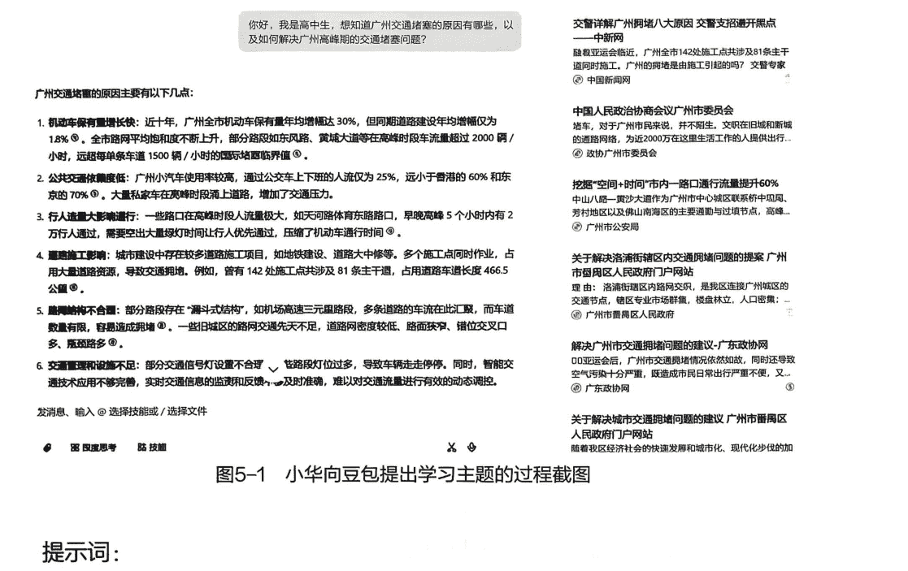

**提示词：**

你好，我是一名高中生。我对如何解决广州高峰期的交通堵塞问题很感兴趣，想通过自主学习深入探究这个主题。我希望你能作为一位经验丰富的学习指导专家，帮助我为这个主题制定清晰明确的学习目标，并根据目标推荐适合我的学习内容与任务活动。请你帮我完成以下内容设计：

+   （1）根据我的兴趣主题，制定3个分层次的学习目标。
    基础目标：了解概念与现象
    核心目标：分析问题与原因
    拓展目标：提出解决方案或比较不同城市的经验
（2）为每个学习目标推荐适合的学习任务或内容形式（如资料阅读、问卷调查、视频观看、案例分析、模型制作、城市方案设计等），最好结合广州的实际。
（3）如果可以，请按任务顺序设计学习路径，分为阶段1（了解现象）、阶段2（分析原因）、阶段3（提出对策），并说明每一阶段我需要完成什么任务，输出什么成果（如小报告、PPT、小论文等）。
（4）建议我如何合理安排学习时间和活动顺序，整个任务最好在1—2周内完成。
（5）如果你还能推荐一些可靠的信息来源，如网站、图书或平台（最好中英文都有），我会很感激。

学习者在利用GenAI制定学习目标与内容时，要注意考虑自己的知识基础、能力水平、学习风格等因素，尽可能撰写要求明确具体的提示词，促使其生成适合自己实际情况的学习目标与内容。从小华与豆包的交互过程可见，豆包生成了包含学习目标与内容的自主学习方案，支持Word、PDF等格式文档下载。此外，学习者的认知水平有限，可能难以及时识别GenAI生成的学习目标与内容存在的问题，建议请老师或家长帮忙审核把关。

3. GenAI赋能学习方式与路径选择和设计

GenAI技术的迅速发展，使许多专门的GenAI工具可以通过对学习者的学习偏好、初始能力和学习过程数据的分析与学习者画像，赋能其学习方式与学习路径的选择和设计。学习者可以向GenAI阐明自己偏好的是阅读—反思型、问题—探究型、任务—项目型还是对话—生成型的学习方式，同时向GenAI说明自己当前的学习水平、目标意图和可投入时间等，使GenAI根据学习者偏好的学习方式，设计结构化、分阶段的学习活动序列，生成学习路径。学习者可以用GenAI将学习方式与学习路径相匹配，并获得合适的学习资源。

例如，高中生小华继续用以下提示词向豆包提问：

> 你好，我想围绕“广州交通高峰期的拥堵问题”开展自主探究式学习活动。请你作为学习指导专家，继续帮助我设计适合高中生的分阶段学习路径和任务安排。请你协助完成的内容主要有：
（1）将学习分为三个阶段：了解现象、分析原因、提出建议。
（2）每个阶段请说明：
①推荐的学习方式，如图文导读、数据分析、方案设计等。
②推荐的学习任务与活动内容，如查阅地图、分析数据、比较案例等。
③最终要输出的学习成果形式，如思维导图、分析报告、提案建议PPT等。
（3）请确保任务之间具有逻辑递进关系，适合高中生完成，语言简洁明了。

小华对豆包的生成结果进行了检查修改，确定的自主学习方式和路径如下。

### 广州交通拥堵问题的探究式学习路径

该学习路径围绕“广州交通高峰期拥堵问题”展开，采用“图文导读—问题探究—方案设计”的渐进式学习方式，分三阶段组织任务，突出学生自主探究与方案建构能力的培养。

**阶段一：了解现象**
学习者通过阅读图文资料与观看交通视频，识别广州早晚高峰的主要堵点与拥堵规律，初步建立对问题的感性认识。输出成果为“广州拥堵热点图”或交通现象观察报告。

**阶段二：分析原因**
借助问题导向的探究式学习方式，学生查阅政府交通年报，统计私家车增长趋势，分析公共交通分布与使用率，形成因果关系图，输出《广州交通拥堵原因分析报告》。

**阶段三：提出建议**
结合方案设计与案例比较，参考新加坡、上海等城市治理经验，提出缓解广州交通拥堵的建议，生成“缓解广州交通拥堵的提案”PPT，体现综合分析与创新能力。

此外，越来越多的学习软件和学习平台都嵌入了GenAI，可以支持学习者根据个人情况灵活选择学习方式与路径，或者定制个性化的学习路径。例如，中国大学MOOC平台嵌入的小慕学习助手，就可以帮助学习者定制学习方式与路径。

数学教育专业的大三学生王明登录中国大学MOOC平台后，打开智能助手小慕进行提问。（见图5-2）

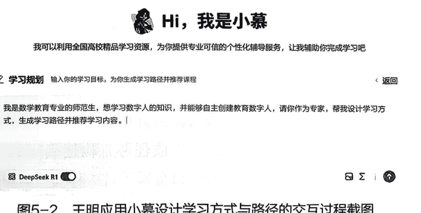

图5-2 王明应用小慕设计学习方式与路径的交互过程截图

王明在阅读其推荐的学习方式与路径后，发现学习路径指向的课程内容太难，于是用以下提示词进一步与智能助手小慕对话：

> 你提供的课程太多、太难了，我不需要从底层原理学起如何用各种人工智能技术创建数字人，我只想学习如何用生成式人工智能工具创建数字人。

再次交互后，小慕生成了如图5-3所示的学习路径建议。

### 工具链推荐

```
1. **形象生成**：Leonardo AI（教育账号可免费生成3D模型）
2. **动画合成**：Adobe Express（教育版免费）
3. **场景整合**：GlassPoint（PPT插件支持数字人嵌入）
4. **交互设计**：ChatGPT+Voiceflow（构建教学对话树）
```

注：建议优先掌握Midjourney和HeyGen的核心功能，参考课程中2.4.1辅助编程应用章节的工具链思维可迁移至生成式AI工作流设计。教育数字人开发需重点关注《人工智能安全、科技伦理与知识产权保护》课程中17.3章节，确保生成内容符合教育伦理规范。

### 相关学习资料


4. 应用GenAI构建学习评价与反馈机制，创建闭环式个性化学习模式

个性化学习中，评价与反馈既是检验学习效果的手段，又是支持学习者自我调整与持续学习改进的重要机制。应用GenAI可以为学习者设计评价活动和评价工具，形成“生成—评价—反馈—优化”的闭环式个性化学习路径。GenAI能够根据学生的学习任务、目标层级和学科特点，生成评价量表、自评问卷等多样化的评价工具。GenAI可以实时分析评价学生的学习成果，如作文、题目解答结果、制定的方案等，发现其问题，并生成结构化、个性化的修改完善建议。学生可根据反馈及时修改，再生成任务，构建真正自主驱动的学习闭环。

### 二 基于GenAI构建个性化自主学习课堂的典型案例

高二学生李林在信息科技课程的人工智能模块学习中，对生成式人工智能的图像和视频生成能力产生了浓厚的兴趣。想到自己也有使用GenAI创作图片的经历，却并不了解其基础原理与生成方法，再加上信息科技课程的学时有限，课堂上也没有时间向老师请教，李林决定在课余时间利用GenAI工具进行自主学习，他的学习过程如下。

1. 应用GenAI工具，搜索与学习主题相关的资源

李林根据老师曾推荐的几个GenAI工具，进行简单的搜索比较后，选择用秘塔AI（https://metaso.cn/）进行主题学习内容搜索。他打开秘塔AI平台，输入提示词进行交互。（见图5-4）

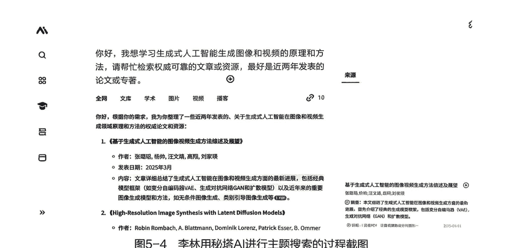

2. 分析评估GenAI检索的学习资源，筛选确定学习内容

李林对秘塔AI搜索的十几篇专业文献进行了快速浏览和比较分析，认为张璐瑶、杨帅、汪文靖等人在《计算机辅助设计与图形学学报》上新近发表的《基于生成式人工智能的图像视频生成方法综述及展望》一文不错，但还不能完全确定自己的判断，就打开文心一言了解这篇论文的质量。（见图5-5）

根据介绍，李林了解到《计算机辅助设计与图形学学报》属于专业权威期刊。他又查看了论文作者及其单位介绍，发现这篇论文是北京大学王选计算机研究所主持国家自然科学基金项目的成果，认为该论文是计算机领域高质量的前沿文献。李林认为这篇文章自己读起来有困难，但值得研读学习，决定将深入研读这篇文献作为具体学习任务。

3. 应用GenAI制定学习目标和学习方案

李林知道，要有效阅读这篇长达24页的学术论文，必须应用GenAI帮助确定学习目标和学习方案。他设计了提示词，选择用DeepSeek生成学习目标与学习方案。（见图5-6）


200 GenAI时代如何做教师：生成式人工智能赋能教学与研究

根据自己的情况，李林对DeepSeek生成的结果进行了适当修改和调整，形成了包含明确学习目标、学习方式与进度的学习方案。（见图5-7）


4. 应用GenAI构建在线自主学习课堂

制定学习方案后，李林回到秘塔AI平台开始阅读这篇文章。他准备点击阅读按钮进行全屏阅读时，发现在阅读按钮旁边有一个讲解按钮，他好奇地点击进去。（见图5-8）

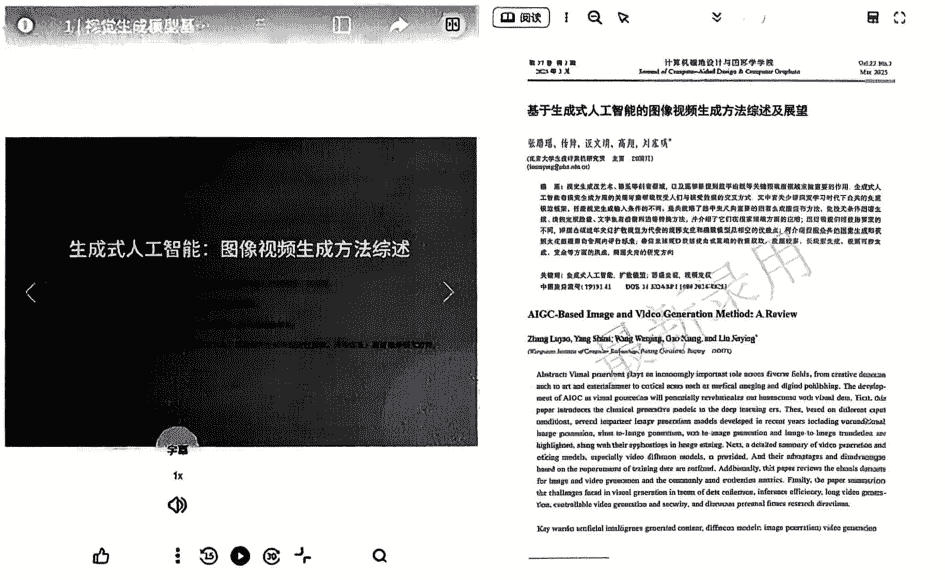

经过一番探索，李林发现基于文章生成PPT后，秘塔AI能够以单人讲授、多人对话等方式，进行多种模式的文章内容讲解，并且学习者可以根据自己的情况选择讲解速度、内容深度和讲解方式等。李林开始用秘塔AI通过以下步骤构建自己的在线课堂。

（1）在GenAI平台上设置学习者角色与学习场景

李林点击讲解页面右上方的红圈中的圆点，打开角色与场景功能面板，选择了“初学者”角色、“课堂”场景，点击“确定”。（见图5-9）这时，秘塔AI平台开始根据初学者的理解程度，生成适合在课堂教学中讲解这篇文章的PPT，生成过程如图5-10所示。

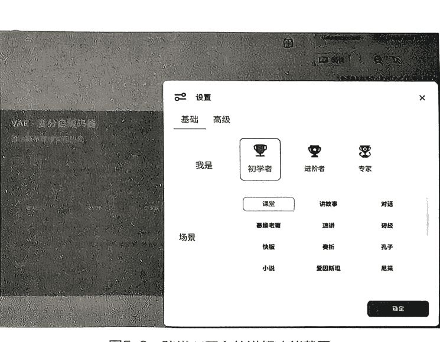

图5-9 秘塔AI平台的讲解功能截图

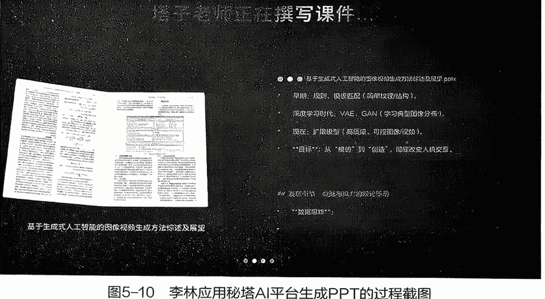

图5-10 李林应用秘塔AI平台生成PPT的过程截图

（2）在GenAI平台上选择讲解的语言与音色

平台默认的讲解声音，李林听后觉得不够亲切，他将设置面板切换到高级功能下，选择PPT语言和讲解语言均为中文，将讲解音色选为男声、开朗学长，点击“确定”，完成了对在线课堂的要素设置。（见图5-11）

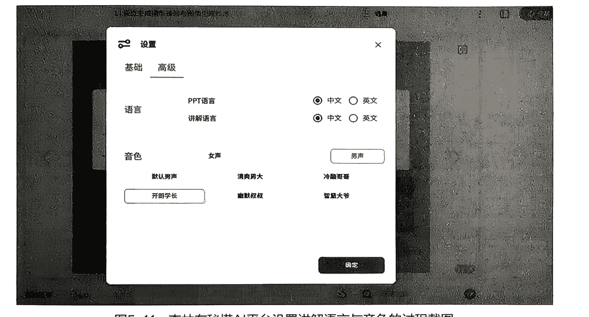

（3）在GenAI平台上设置讲解速度、音量与字幕大小

试听讲解后，李林觉得讲解的语速偏慢，随即点击讲解画面下侧的功能面板，将讲解速度设为1.2倍速，并调整音量与字幕到合适大小。（见图5-12）

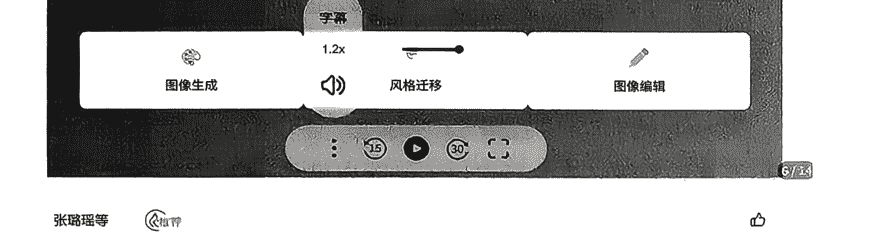

（4）在GenAI平台上设置讲解课件与原文的呈现方式

在设置好在线课程的上述要素后，李林开始观看动态展示的PPT，并跟随讲解进程进行学习。但他发现，只观看PPT，缺少对原文的阅读，会影响理解。于是，他点击PPT页面上方的按钮，界面随即切换为对照原文的双页面模式。

（5）应用GenAI自定节奏进行交互式学习，全程支持答疑解惑

设置好在线课堂后，李林根据内容难度，随时调整讲解语速开展学习。遇到不理解的地方，他点击暂停键，仔细研读文章内容，仍不理解时，他使用平台的提问功能（见图5-13），攻克一个个抽象的概念或难懂的模型。


（6）应用GenAI生成讲解视频，随时随地自主学习

李林关于人工智能的图像生成与视频生成原理的基础弱，所以他很投入地学习，第一次利用周六时间学习了一个多小时，但仍没有掌握文章第一节的内容。第二天，他想继续学习，但他必须联网且要保证网速畅通，因为要外出看望亲戚，来回程近两小时的时间不好利用。

这时，他高兴地发现，平台还提供了讲解内容的视频生成功能，他马上选择生成了第一、二小节的内容讲解视频（见图5-14），并保存到平板上，以便随时学习。

李林导出视频点击观看，发现这个几分钟的讲解视频图文并茂、画面稳定、声音清晰。

### 发展引擎：数据与算力的双轮驱动


返回学校后，李林把自己应用秘塔AI构建自主学习课堂的事情分享给几名同学，王凡等4名同学表示他们也很感兴趣，4人当天就建立了在线学习小组，一起用秘塔AI开启个性化的自主学习新模式。

### 基于GenAI构建个性化自主学习课堂的启示

1. GenAI赋能学生成为自主学习的主动设计者

高中生李林主导学习任务的制定、资源筛选与成果生成，体现出从“接受者”到“创造者”的身份转变，这是生成式学习范式的核心体现。案例中，李林围绕自定的学习主题，应用GenAI在文献导读、目标设定、工具操作、在线自主学习课程构建等学习的全过程中获得了支持与服务。

2. 基于真实的学习任务，形成人机协同的学习闭环

李林从综述性学术文献出发，将学习任务置于真实学术背景中，拓展了认知视野，提升了思辨能力。GenAI支持构建了由学习者主导、GenAI协同反馈的闭环式学习生态。

3. 学习者可以不断迭代优化GenAI赋能的自主学习模式

李林用GenAI学习的消息被班级更多同学了解后，他们也想借鉴李林的学习经验，但在自主学习时不知如何规划。李林就简要整理了自己应用GenAI学习的经验清单给同学参考。（见表5-1）整理过程中，他发现自己的学习模式还可以继续优化，他认为帮助同学的过程也是帮助自己反思改进的过程。

表5-1 李林总结的应用GenAI自主学习的要点

| 要点 | 主要内容 |
| :--- | :--- |
| 案例名称 | 基于GenAI的图像与视频生成方法自主探究学习 |
| 适用场景 | 自主探究学习/项目式学习教学案例 |
| 学习起点 | 阅读《基于生成式人工智能的图像视频生成方法综述及展望》，并生成讲解PPT与视频（通过秘塔AI） |
| 学习目标 | 理解视觉生成模型原理；比较典型图像/视频生成技术；完成一项AI创作任务并反思总结 |
| 所用工具 | ◆ 秘塔AI（文献讲解） ◆ 文心一言（学习规划与提示词优化、图像生成） ◆ 通义万相（图像多风格合成） ◆ DeepSeek（学习规划） |
| 任务成果 | 图像、视频短片、模型对比表、学习报告 |
| 特色亮点 | ◆ 目标导向 ◆ GenAI工具赋能 ◆ 任务驱动+AI提示词优化 ◆ 人机协同学习 |

这种新的学习模式，推动学生从内容接受者转变为自主学习模式和课堂的创建者，正在日益深刻地变革教学范式。

4. 应用GenAI生成个性化自主学习课堂应注意的问题

高中生李林在继续用秘塔AI学习时，发现其生成的讲解偶尔会出现表达不规范或内容错误的情况。当他发现秘塔AI平台的“今天学点啥”模块，支持用户自主上传学习资料，并生成讲解PPT和在线课堂后，他将自己酷爱的《红楼梦》第三回中林黛玉进贾府的内容整理成图文并茂的PDF文件，上传至秘塔AI平台。（见图5-15）平台根据李林的设定，生成了适合初学者的带音频的PPT和讲解视频。生成的主要过程如下。

李林将整理的《红楼梦》原著内容文本和添加《红楼梦》电视剧个别画面截图的《林黛玉进贾府》的PDF文档上传秘塔AI平台。

李林在观看GenAI生成的在线讲解视频时，发现了如图5-16所示的错误，说黛玉见到“元春温柔沉默，迎春文采好，探春年纪小，但三人穿着打扮都差不多”，这显然与原著内容不符。特别是元春已在宫中，而惜春却被漏掉，对三人的描写也与原著不符。


图5-15 李林登录秘塔AI “今天学点啥” 上传文档的过程截图


图5-16 李林发现GenAI讲解出错的视频画面截图

因此，当学习者应用GenAI自主学习时，要有质疑精神和风险防控意识，注意审核生成内容的科学性、准确性。例如，李林若不是对《红楼梦》原著内容很熟悉，就不易发现上述错误。对GenAI生成的内容，学习者要主动查阅教材等资料进行核实，与同伴讨论或请老师审核指导，避免产生认知风险。

## 第 2 节
GenAI赋能探究式教学

### 一 GenAI赋能探究式教学的要领与策略

探究式教学强调学生主动提出问题、搜集证据、进行推理、建构知识。GenAI以其自然语言理解与内容生成能力，为学生提供个性化引导、资源创设与反馈支持，成为探究学习的“认知工具”与“学习伙伴”。教师有效发挥GenAI作为认知促进者和协同者的角色与功能，既有助于创新教学模式，也有助于提高教学质量，培养学生的创新思维。

1. 应用GenAI生成探究任务与真实情境

教师可以根据教学需要，提供课程主题、教学目标与学情信息，应用GenAI快速生成引发学生兴趣的探究任务，以及多样化的情境故事、模拟实验或案例，激发学生的问题意识。教师还可以应用GenAI自动构建任务背景说明、角色设定、研究线索等，只需要细心审查和修改完善，即可用于教学，在减轻备课负担的同时，提高探究任务情境的真实性。

2. 应用GenAI支持学生提出与完善探究问题

在探究学习中，学生虽然能够发现并提出一些问题，但往往不够具体和深入。教师可以指导学生根据初步想法，应用GenAI提出多层次问题，引导学生聚焦核心变量或因果机制。实践中，学生应用GenAI可以形成提出问题的方法：①问题引导模板生成，如“你想研究这个现象的原因、过程，还是结果”；②生成“问题树”或“问题金字塔”，从表层问题向深层结构问题演进。例如，学生想研究“为什么有些植物长得快”，GenAI可帮助生成问题分支。外部条件：阳光、水分是否不同？内在机制：是否和植物的光合作用效率有关？

3. 应用GenAI构建多模态信息源与分析工具

探究式教学强调资料搜集与证据分析，GenAI具备文本、图像、视频摘要与比对能力，可帮助学生聚合分析来自多个平台的信息。例如，GenAI可以帮助学生对照片、地图等各类图像资料进行整理，也可以进行内容识别与推理，支持学生进行深入探究。

4. 应用GenAI引导推理过程与假设构建

学生在探究过程中常停留于现象描述，难以形成合理解释。GenAI可模拟探究对话，引导学生提出假设并推敲因果逻辑。通过对话式提示词设计，引导学生表达假设、验证路径及逻辑关系。同时，为学生进行推理提供可视化的思维工具，支持学生创建思维导图、因果图、结构图等，进行结构化思维探索。

5. 应用GenAI支持成果表达与自我反思

GenAI不仅能协助学生生成规范的研究报告草稿，还能针对不同受众，帮助学生生成口头汇报稿、宣传图文、视频脚本，进行多样化表达。教师要引导学生重视自身的主体性，不能只是应用GenAI完成学习任务，而是要通过应用GenAI提升自主学习能力、批判性思维能力与创造能力。

教师要特别注意自身角色与职能的转变，要由“知识讲授者”转变为“学习设计者”与“AI协同教练”，主动探索如何设计更恰当的“人机共创”探究任务，引导学生高阶思维的发展，避免对GenAI的不合理使用，防范可能引发的风险。

### 二 GenAI赋能探究式教学的案例

### (一) 案例简介

广州市海珠区教育发展研究院的教研员邓丹玫老师，组织几位青年教师，应用GenAI开展“神话赏析课”的专题学习。

“神话赏析课”教学内容整合了统编版小学语文教材四年级上册第四单元“语文园地”中的“交流平台”、“快乐读书吧”中的“导读活动”和“单元学习反思”三个部分，共计3课时。其中，“交流平台”以《盘古开天地》等四篇课文为例，围绕神话的文体特点谈了三个方面的内容：一是充满神奇的想象；二是人物个性鲜明；三是表达对世界的认识，旨在引导学生结合单元的课文内容，谈谈自己对神话人物、神奇情节的认识与看法，交流自己对神话故事特点的认识，并在归类、梳理中初步总结出神话的基本特点。

本案例主要就该课“交流平台”这一板块的设计进行分析，从使用目的、方法、过程、经验等方面，谈谈如何基于“自主探究，提炼神话故事特点”这一目标，运用GenAI支持探究式教学活动的开展。

### （二）教师应用GenAI设计教学的过程与方法

#### 1. 分析明确单元教学目标及学生角色

“交流平台”的教学旨在引导学生回顾与梳理整个单元的阅读学习，自主发现并归纳神话的基本特点，自主构建知识体系。因此，本课的教学应充分发挥学生的主体作用，引导他们综合应用前一阶段的知识经验，通过自主学习、合作探究等方式，解决新问题——构建神话特点的知识体系。据此，教师制定了以下教学目标：①能介绍一个自己喜欢的神话，说清神话中神奇的想象和鲜明的人物形象；②根据本单元已有的阅读经验，初步提炼出神话的文体特点，交流对神话的认识。

有效的教学活动必须以教学目标为引领，强化问题意识。教师需要明确GenAI的使用目的，不要为用而用。于是，教师认真分析本课的教学目标，思考教学中可能存在的问题：①关于神话特点的学习，属于对文体常识的初步认识，学习起来比较枯燥，难以激发学习兴趣；②传统课堂中，神话的特点往往作为一个知识点由教师讲解，学生印象不深，容易停留于“知道”的层面。如何基于学情设计驱动性的探究任务，引导学生自主梳理单元阅读历程的收获，并尝试概括神话的特点，是一个挑战。

#### 2. 分析GenAI的优势与功能

在本课例中，教师选择运用即梦AI和豆包支持教学。即梦AI是一个一站式的AI创作平台，可以生成AI图片和AI视频。教师可利用它创作神话主题的视频或微课，创设交际情境、复现学习历程、激发学习兴趣、讲解知识要点。

豆包提供了一个互动、有趣的学习平台，能够有效提升学生的学习兴趣和综合能力，同时为教师提供教学与评价支持。①激发学习兴趣。豆包所具有的互动性和趣味性能够吸引学生的注意力，激发他们学习神话故事的兴趣。在本课中，学生可以通过文字、语音等形式与豆包互动，使学习过程更加生动有趣。②强化表达训练。在向豆包介绍神话故事的任务驱动下，学生需要组织语言、理清情节、把握逻辑、清晰表达，从而提升口头表达能力和逻辑思维。③及时评价反馈。豆包可以根据教师拟定的评价标准，从多个角度对每个学生的讲述进行评价。这种及时的回应能增强学生的参与感和成就感。豆包还可以根据学生的表现，提供有针对性的改进建议。

#### 3. 用GenAI设计和组织学生开展挑战性的探究任务

（1）运用GenAI生成导入资源和学习视频，丰富学习资源

在本课中，为了解决学习内容比较枯燥、难以激发学生学习兴趣的问题，授课教师根据教材特点、学生的年龄特点和认知规律，创设了一个真实的交际情境——举办“神话故事会”，教师设计并生成了一个导入环节的激趣视频。视频以教材中的四个神话为核心，通过打开神话之门、动画演绎、互动对话等形式，带领学生进入一个生动有趣的远古神话世界。

一开始，教师选择的GenAI工具是文心一言，通过设计提示词，生成了如图5-17所示的神话人物图片。

提示词：

> 你是一位语文教师，要在“神话赏析课”的导入环节激发学生的学习兴趣，请生成一张体现神话特征的生动图片，用于激趣导入。


看了图片后，教师觉得它不太适合用于课堂导入，就修改了提示词重新生成，但几次生成的结果都不满意。接着，教师用DeepSeek搜索了制作微视频可用的AI平台，DeepSeek推荐使用即梦AI，于是教师便登录尝试制作微视频。具体操作如下：

第一步，教师将想要生成的图片效果尽可能表述清楚，借助DeepSeek生成准确的提示词：生成四张图片，分别为夸父、女娲、精卫、普罗米修斯各自面向观众进行自我介绍。再生成一张图片，把四个神话人物放在同一背景下。以上图片风格为神话插画风，五张图片风格统一。将以上内容转换为中文提示词，用于生成图片。

第二步，教师将DeepSeek生成的提示词逐一复制至即梦AI，生成图片。（见图5-18）


第三步，使用即梦AI的数字人功能，输入想要人物说的话并选择音色选项即可生成视频。（见图5-19和图5-20）

教师应用即梦AI创设奇幻氛围，是为了回顾单元学习内容，以激发学生的学习兴趣。在此情境中，教师布置了一个真实的学习任务——在线上或线下向同学介绍一个自己最喜欢的（课内、课外）神话故事。设计这个任务是为了引导学生回顾单元所学，从对故事的感性认识层面逐步上升至尝试归纳神话特点的层面，并为后续的阅读与分享课外神话故事活动做铺垫。

接着，教师制作了第二个微课视频，这是一段简单介绍神话文体特点的动画微课。（见图5-21）


图5-19 为即梦AI生成的图片选择音色的过程截图


图5-20 微视频内容截图


图5-21 微视频内容截图

但是，该微视频教师并没有在课堂上播放，而是在课后发到了学习群里，供有需要的学生自主学习观看。微课视频内容比较生动有趣，学生们经过自主合作探究，提炼出神话故事的特点之后，再对照微课视频，就能自主查缺补漏，完善自己对神话特点的认知了。而学习有困难的学生可以借助这个学习支架自主“加餐”。这个微课视频还可以在复习阶段看，学生们在复习的同时也放松了心情。

（2）运用豆包，人机协同练习

《义务教育语文课程标准（2022年版）》指出：“充分利用网络平台和信息技术工具，支持学生开展自主、合作、探究性学习，为学生的个性化、创造性学习提供条件。发挥大数据优势，分析和诊断学生学业表现，优化教学，提供及时、准确的反馈和个性化指导。”豆包在本环节的应用定位为“交互式学习助手”，学生借助豆包自主练习介绍喜欢的神话故事。

在备课过程中，为了了解人机交互的效果，教师尝试与豆包对话。（见图5-22）


通过图5-22可知，豆包给出了非常详细的建议，但却与本课的评价目标不匹配，拔高了评价标准，很难起到以评导学、以评促思的作用。

人机互动之所以没能达到预期效果，主要是因为豆包未掌握本课教学中对于介绍神话故事的评价标准。于是，教师尝试向豆包输入清晰明确的评价要点。豆包根据录入的评价要点，对教师讲述的内容进行分析评价，并进行了合理评分。（见图5-23）


在豆包的助力下，学生充分发挥自主能动性，在一系列的自主研读、合作探究的人机协同学习活动中思考、观察、分析、整理，了解了神话故事的特点，掌握了神话阅读的方法，落实了单元语文要素。教学全过程都强化了学生的学，强调了表达输出，实现了“转教为学”。

#### 4. 人机协同学习活动的指导和评价

在人机协同学习活动中，教师的指导和评价是不可或缺的。在课堂上，教师肩负着引导学生正确使用人工智能的重要任务。教师不但要鼓励学生积极参与人机交互学习，更要监控学生的学习过程，确保学生在互动中保持正确的方向，避免误解或偏离教学目标。

在发布任务之后，教师引导学生思考：应该怎样介绍自己喜欢的神话故事？学生经过自主思考、小组交流和集体探讨，拟定出介绍神话的评价标准。

本课的具体教学设计如下：


2. 出示本课任务：举办“神话故事分享会”——介绍一个自己最喜欢的（课内、课外）神话故事，再结合这个故事简单介绍神话的特点。

3. 讨论确定评价标准：

①师生共议，商定评价标准。

| 评价要点 | 得分 |
| :--- | :--- |
| · 能清楚介绍这个神话的人物特点和故事情节等方面的内容。 | 1 2 3 4 5 |
| · 能分点说清楚推荐的理由。 | 1 2 3 4 5 |
| · 能从不同角度（不少于3个）列出推荐理由。 | 1 2 3 4 5 |

②教师主导，设计评价指令。

教师根据大家商议的结果，结合评价标准制定评价任务指令。这样做的目的是确保人机互动环节，豆包反馈的评价与指导意见不会偏离我们的教学目标。

二、自读绘图，练习提升

1. 浏览全单元课文，选择自己喜欢的一篇神话，默读思考，完成“推荐喜欢的神话故事”思维导图，自己拍照上传至学习群。

2. 人机互动，练习推荐。

（1）根据思维导图练习推荐神话故事。

（2）教师在学习群中发出评价任务指令，学生向豆包输入指令和可参考的评价标准。

（3）学生作为主体，开展人机协同练习。

明确了评价标准后，学生自主运用语音录入功能，与豆包互动。根据豆包反馈的意见，修改完善思维导图，进行第二轮口头练习。

3. 集体评议。

（1）浏览学习群中的思维导图，选出最感兴趣的作品，邀请小作者来推荐神话故事，集体评价。

（2）同桌互练，互相评分。

（3）邀请得分最高的学生现场展示，集体赏析评价。

（4）对比探究，概括文体特点。

在分享交流的过程中，教师引导学生借助思维导图进行对比思考，发现神话故事之间的共性，然后尝试点列式概括。接着组织生生对话、人机对话，引导学生经历从感性认识到理性认识的过程。通过这种对比和思考，学生不仅能够加深对神话故事的理解，还能锻炼概括能力和逻辑思维能力。

## 三、对比归纳，发现特点

1. 投影较有代表性的四名学生（所选课文不同）的思维导图，请学生结合自己的阅读体验，思考神话故事有什么特点。
2. 小组合作探究，绘制神话特点思维导图。
3. 集体展示，邀请豆包点评，二次修改。
4. 自我反思，学法小结。

在以上教学案例中，教师坚持“技术为用，以人为本”，紧紧锚定教学目标，找准教学疑难点，适时、适度、适当地运用GenAI，丰富了教学资源和评价方式，给学生的探究性学习创设了有趣的学习情境、有用的学习支架、有效的评价助手，充分凸显学生的主体作用，真正发挥了GenAI赋能教学的作用。

### 三 GenAI赋能探究式教学的赋能点与实施要点

为了方便实践操作，我们将GenAI赋能探究式教学的赋能点与实施要点总结为表5-2。

表5-2 GenAI赋能探究式教学的赋能点与实施要点

| GenAI赋能点 | 实施要点 | 主要作用 |
| :--- | :--- | :--- |
| 问题情境生成 | GenAI生成任务书、角色扮演设定、真实情境模拟 | 激发探究动机，形成“真实任务驱动” |
| 问题提出引导 | 对话式提问教练、结构化问题模板 | 提升学生提问质量与思维深度 |
| 多模态资料支持 | 生成阅读卡片、视频摘要、图文知识整合 | 降低信息处理门槛，拓展知识视野 |
| 认知过程促进 | 假设验证对话、逻辑图示构建、个性化推理反馈 | 提升学生分析与建构能力 |
| 成果表达与评价 | GenAI生成展示材料、评价反馈、反思日志 | 完善探究闭环，促进知识迁移 |

## 第 3 节
GenAI赋能项目式教学

### 一 GenAI赋能项目式教学的要领与策略

GenAI的智能生成功能与认知支持技术如果在项目式教学中得到有效应用，将有助于项目式教学方式的变革和教学效果的提升。把握下列要领与策略，将能构建起人机协同驱动、师生共创发展的项目式教学新模式。

1. 应用GenAI赋能项目任务与情境设计智能化

教师输入学科主题与教学目标后，GenAI可快速生成真实世界导向的项目情境、问题驱动任务与不同角色。例如，“请生成一个面向初中生、关注可持续发展的跨学科项目任务”，实现项目任务从“教师单向设定”向“智能协同生成”转变。

2. 应用GenAI赋能资源聚合与调研过程高效化

GenAI能辅助学生在资料调研环节自动整合文本、图像、视频等多模态信息。教师可以引导学生使用GenAI生成“主题知识卡片”、“对比图表”与“案例地图”，提升其问题理解能力、调研效率与资料处理能力。

3. 应用GenAI引导项目推进中的思维支持与协作

GenAI在项目中段提供过程性认知引导，如提出反向问题、验证假设、优化分工方案等。教师可以将GenAI设为“项目助理”角色，嵌入阶段性任务节点，引导学生通过“AI对话+小组共创”模式进行持续推进与分工优化。

4. 应用GenAI赋能成果表达与反馈评价

项目成果产出阶段，GenAI可协助学生生成汇报提纲、可视化成果展示文本，同时辅助教师进行结构化、标准化的项目评价。教师可以就AI生成的初稿进行师生共评，支持“成果+过程”的形成性评价闭环。

### 二 GenAI赋能项目式教学的案例

以“悠悠百草香，传承中华情”项目式教学为例

“悠悠百草香，传承中华情”项目式教学，缘于2022年疫情防控期间上网课时学生提出的“如何利用中草药提高抵抗力”这一驱动性问题。2023年春季开始，学生以小组合作的形式开展项目活动，在种植、养护等过程中加深对中草药的认识，同时融合多学科内容，运用技术工具，通过多种方式推进项目。其目标在于让学生掌握中草药知识与实践技能，运用多学科知识解决问题，培养团队合作等能力，增强文化自信，树立正确的劳动观念，激发他们对中草药文化的兴趣与热爱。项目任务分为个人任务和小组任务，个人需积累知识、记录总结和制作中草药标本图鉴并讲解说明、创作相关文学或美术作品及短视频；小组则要开展种植实验并撰写观察报告。

在该项目中，GenAI深度融入教学全程，从多维度赋能教学活动。


### 1. 利用GenAI获取中草药知识

教师积极鼓励学生与GenAI对话，借助GenAI工具，如豆包、文心一言、讯飞星火等，高效获取丰富的中草药知识，涵盖形态、特性、功效、产地等多元信息，突破传统单一的资源获取模式，激发学生自主探究中草药知识的兴趣，培养创新思维。

以茯苓为例，学生向GenAI（如讯飞星火）提问“茯苓的生产地”“茯苓的药性”“茯苓可以做什么美食”等关于中草药产地、特性、功效、用途等方面的问题。（见图5-25）

讯飞星火生成的内容较为全面、准确，能满足学生对茯苓基础知识了解的需求。但部分内容可以进一步深化，比如在介绍茯苓不同产地药效的差异时，教师引导学生通过查阅专业医学网站的资料进行补充，加深学生对中药产地与药效关系的理解。学生快速获取大量中草药知识，丰富了知识储备，激发了学生主动探索中草药的兴趣，为后续学习创作奠定了知识基础。


### 2. 绘制中草药标本图鉴，形成校园中草药标本墙

在学生探究了中草药知识后，教师在电脑上展示植物图鉴、中草药标本画的照片，组织学生自主观察，小组讨论图鉴特点，思考如何将中草药标本与图鉴相结合。学生分小组完成中草药标本图鉴设计单，通过组间交流修改完善设计方案。（见图5-26）

完善设计方案后，各小组利用课内外时间完成对中草药标本图鉴的设计制作，并在课堂展示。为了让学生能够用技术让更多人了解中草药知识，黄老师组织学生用GenAI工具创作数字化作品。

## 3. 运用GenAI辅助技术创作

黄老师带领学生协同运用GenAI工具与剪映来剪辑中草药讲解视频、制作二维码，并将其融入中草药标本图鉴制作，显著提升作品的科技感与互动性，有效锻炼学生的信息技术应用能力，实现知识与技能的融合。

在剪辑视频环节，学生借助GenAI和剪映视频软件中的AI工具完成脚本创作、图像编辑与整合、虚拟人制作、字幕自动生成与核对等任务。例如，学生将已搜集到的山楂资料复制到GenAI中并输入：你是一位擅长视频制作的高手，请结合已有材料撰写视频脚本，并整理出相应的台词。

GenAI会整合山楂的资料信息，生成一段文字介绍，并配上视频脚本，方便学生进行视频素材整理、添加字幕、调整剪辑顺序、添加虚拟人配音等操作。（见图5-27、图5-28、图5-29）

## 4. 借助GenAI拓展创意表达

学生利用GenAI拓展创意表达，进行诗词创作、讲解文稿撰写，为图鉴增添文化韵味，生动宣传中草药的特点与价值。

例如，学生以当归为例，要求GenAI（如豆包）仿照《台湾当归谣》写一首关于当归的短诗和一份当归介绍文稿。


图5-27 学生利用GenAI和剪映工具完成虚拟人制作、字幕生成的截图


图5-28 学生利用GenAI和剪映工具生成山楂讲解视频的截图


木星组 介绍山楂

图5-29 学生借助GenAI与剪映工具生成山楂讲解视频的二维码

学生得到如《当归叹》这样的短诗，在介绍文稿方面，GenAI提供了当归的功效、特点、适宜人群等内容，并进行了详细阐述。

### 当归叹

当归故里心悠悠，遥望家乡泪满眸。
万水千山归梦远，千言万语诉情柔。
清风拂面心如镜，细雨沾衣泪似流。
遥想故园今夜景，何时归去共欢游。

GenAI生成的诗歌富有情感，但在体现当归的药用文化内涵上还可以进一步优化，比如在诗中融入更多与当归药用价值相关的典故。介绍文稿在专业性上表现较好，还可以引导学生结合自身的理解和感受，加入一些生活实例，让文稿更具感染力。学生借助GenAI创作的诗歌和文稿，为中草药标本图鉴增添了文化元素，以更具吸引力的方式展现了中草药的特点与价值，增强了学生对中草药文化的理解和传播能力。创作过程中，学生的创意表达能力得到锻炼，表达形式得以丰富，还培养了独立思考与创新创作能力。


## 第16章 如何用GenAI赋能教育研究


精彩案例
最新工具

## 第1节 如何用GenAI赋能研究选题

### 一 GenAI赋能研究选题的策略

研究选题是教学研究的逻辑起点，直接决定研究的方向、价值与质量。过去，选题往往依赖教师的个人经验、阅读积累或现实教学直觉，而GenAI的引入，为教师确定高质量的选题提供了更及时、更系统的支持。

1. 从模糊到明确：GenAI赋能选题确定
应用GenAI可以将研究者原本模糊散乱的研究想法，或者感兴趣的研究领域，逐步聚焦为具体明确的选题。GenAI通过“问题细化—变量分析—可行性分析”等互动式生成流程，可以帮助研究者分析具有研究价值的选题，供研究者根据研究现状等情况综合分析凝练，确定研究选题。

2. 应用关键词与案例驱动GenAI剖析提炼选题
教师可以提出学科或跨学科研究方向的关键词，让GenAI通过对关键词的关联分析，发掘选题。另外，结合在教学中积累的一些问题案例，教师可以应用GenAI分析这些案例蕴含的问题，进而提出选题。

3. 用GenAI分析研究现状，助力高效确定选题
应用GenAI可以快速搜索、分析某个主题的研究文献，通过语义分析与热点归纳，总结关于研究主题的学术脉络与研究趋势，识别亟待解决的实际问题或理论问题。

4. GenAI赋能选题评估与快速优化
GenAI扮演评审者，从可行性、创新性等方面对拟定的选题进行评议，并助力研究者从题目表述、研究问题等方面优化完善选题，快速提升选题质量。

研究实践中，教师可以根据实际情况，遵循学术规范，选择某种或多种策略组合，灵活应用GenAI赋能研究选题，提升选题效率与质量。

### 二 GenAI赋能研究选题的五步法

如上所述，GenAI赋能研究选题有四大策略，现以GenAI赋能教师将模糊的研究想法转化为选题的策略为主，结合实例阐述GenAI赋能研究选题的具体方法。

#### （一）应用GenAI澄清问题，剖析问题本质

广州市新滘中学八年级语文教师苏蕴瑜发现，学生作业质量特别是作文质量不佳，正好市教育局发布了关于申报市教育规划年度课题的通知，苏老师想趁此机会申报课题，研究教学中发现的问题。但是，课程作业质量不高又是个老问题，比较普遍，苏老师决定借助GenAI，从模糊的困惑中理清具体问题，将这一实践问题转化为具有研究价值的课题。

苏老师选择运用GenAI工具ChatGPT来分析作业质量问题，她设计了如下提示词进行提问：

> 你是一名初中语文教师，发现学生语文作业特别是写作类作业质量较差，想分析这背后的深层原因，以形成研究课题，请剖析学生作文质量差的原因，找出值得研究的问题。

苏老师查阅了ChatGPT生成的作业质量分析后，觉得还不够完整，追加了如下提示词：

> 分析得不错，只是我的学生作文中还存在写记叙文像记流水账的现象，请增加这个问题后完善分析。

以下为ChatGPT生成的结果：

> 非常好，您提到学生作文中存在“写记叙文像记流水账”的问题，这是初中语文写作教学中一个极具普遍性且非常值得深入研究的问题。这个现象进一步丰富了“学生作文质量差”的具体表现类型，也能更好地引导研究焦点。以下是完善后的分析内容：

### 一、问题陈述（更新版）

作为一名初中语文教师，您观察到学生在完成作文类课程作业时，普遍存在以下问题：

- 内容空泛、主题不明；
- 表达混乱、结构松散；
- 语言贫乏、词句重复；
- 缺乏情感与个性；
- 写记叙文像“流水账”，只罗列事件、缺乏重点描写与情节推进；
- 作文修改流于形式，反馈缺乏实效。

这些现象表明：学生不仅在语言表达上存在困难，更在思维方式、写作策略、学习支持等方面存在深层问题。

### 二、拆解“作文质量差”的成因维度（更新版）

#### 1. 学生层面

- 写作目的不清：不了解叙事作文的情感表达功能，只知“记事”而非“写人抒情”；
- 情节构建能力弱：不会设置高潮、冲突或人物心理变化，导致“流水账”；
- 描写技巧缺乏：不会使用细节描写、动作描写、语言描写等手法；
- 模仿能力强于建构能力：习惯模板化写作，缺乏个人视角。

#### 2. 教师教学层面

- 记叙文教学聚焦不清：仅关注结构模板或素材积累，忽视“情节推进+人物刻画”训练；
- 教学方式偏重知识讲授，缺少“体验—表达—重构”的教学过程；
- 缺少针对“流水账”现象的训练策略，如“不合逻辑的叙述拆解”“情境再构建”等教学任务设计不足。

#### 3. 作业设计与评价层面

- 任务设定缺乏真实情境：题目模式化，学生缺少情感共鸣；
- 缺乏过程性训练机制：写前没有构思引导，写后缺少结构与语言层面的反馈；
- 评价标准笼统：不能精准引导学生识别“流水账”和“有效叙事”的差异。

### 三、可转化为研究课题的切入点（针对“流水账式记叙文”问题）

基于以上拆解，可以从以下角度思考您未来的课题研究方向：

| 研究切入点 | 可能的研究主题 | 对应研究价值 |
| :--- | :--- | :--- |
| 作文任务设计 | 基于真实语境的初中作文任务设计研究 | 激发学生真实表达动机，提升写作质量 |
| 写作过程支持 | 写作支架策略在初中写作教学中的应用研究 | 培养学生的构思与结构意识 |
| 写作策略教学 | 初中学生写作策略训练路径的构建与应用 | 发展学生写作能力，提升自主性 |
| 教师反馈机制 | 基于生成式评价的作文反馈机制研究 | 实现有效反馈，促进作文修订 |
| 差异化教学 | 基于学生能力分层的作文教学策略研究 | 实现因材施教，提高整体水平 |
| AI辅助写作 | 应用GenAI工具辅助作文教学的实践研究 | 引入技术支持，提升写作表现与参与度 |
| 写作结构训练 | 初中生“流水账式”记叙文问题的成因分析与教学干预研究 | 聚焦常见写作误区，提升叙事能力 |

### 四、推荐研究选题表述（适用于课题申报）

1. 初中生“流水账式”记叙文现象的教学干预策略研究
2. 基于过程性指导的初中语文作文任务优化与教学实践研究
3. 写作策略教学对提升初中生作文质量的实践研究
4. 基于生成式人工智能反馈机制的初中生作文修改能力培养研究
5. 生成式人工智能辅助初中语文写作教学的应用与评价研究
6. 真实语境驱动的初中写作任务设计及其对学生表达能力的影响研究

苏老师审阅了ChatGPT生成的分析结果后，翻阅了学生作文本，查找了作文存在的问题，认为ChatGPT分析的作文质量差的原因都或多或少地存在，但其中自己能够改变且比较重要的问题是对作业任务设定缺乏真实情境。学生缺少真实经历和经验是造成问题的主要原因，因此，在ChatGPT的助力下，苏老师提出了“基于真实情境的初中写作教学策略研究”的研究选题。

#### （二）应用GenAI快速梳理研究动态，研判选题价值

根据教学实践中发现的问题初步确定研究选题后，教师需要通过文献调研，了解相关研究现状，分析前沿文献的研究趋势，判断选题的学术价值与研究意义。苏老师设计了如下页所示的提示词，应用秘塔AI等工具进行了文献检索分析。（见图6-1）

提示词：

> 基于真实情境的写作教学，请检索这方面的研究文献，梳理研究现状。


技巧提醒：秘塔AI有三种检索模式，应用秘塔AI开展研究活动时，一定要选择如图6-2所示的研究模式。


苏老师发现，国内外关于真实情境的写作教学虽然重视情境的设计价值，但多停留在教学案例层面，尚缺乏以“真实情境”为核心变量、聚焦初中阶段语文写作任务设计与策略应用关系的系统性研究。（见图6-3）苏老师据此判断，自己提出的选题既可以解决教学中的现实问题，也契合当前核心素养导向的写作教学趋势，具有较强的研究价值与实践意义。


#### （三）应用GenAI剖析研究要素，赋能研究变量确定

初步确定以“基于真实情境的初中写作教学策略研究”为研究选题后，苏老师发现这个选题还比较大，还需要剖析研究问题与相关要素，以确定研究变量。她继续应用ChatGPT剖析研究问题及要素，以助力确定关键变量。

苏老师用以下提示词继续向ChatGPT提问：

> 你打算以“基于真实情境的初中写作教学策略研究”为题，请分析这个主题涉及的核心研究要素与重要变量，包括写作任务设计、真实情境创建、教学实施、学生表现等方面。

以下为ChatGPT生成的结果：

### 核心研究要素与重要变量分析

#### 一、研究主题再聚焦

课题名称：基于真实情境的初中写作教学策略研究

研究核心问题：如何在初中语文教学中有效创设真实情境，设计有意义的写作任务，配合相应的教学策略，引导学生表达真实经验，提升写作质量与思维水平？

#### 二、四大研究构面与核心要素分析

##### 1. 写作任务设计（教学输入的结构）

关键要素：

- 写作目标设定（知识、能力、情感）
- 写作任务类型（命题写作、自主写作、问题写作等）
- 表达方式选择（记叙、描写、说明、议论等的融合）
- 写作指令的清晰度与开放性

可研究变量：

- 写作任务的真实性（与学生经验的相关度）
- 写作任务的复杂性（是否多步骤、需整合信息）
- 写作任务的自由度（是否允许自选角度/文体）

##### 2. 真实情境创设（教学背景的构造）

关键要素：

- 情境来源（校园生活、家庭事件、社会热点、跨学科融合）
- 情境呈现方式（视频、图片、案例、GenAI生成文本等）
- 学生参与度（角色扮演、讨论、小组合作）

可研究变量：

- 情境真实感（学生认同度/参与动机）
- 情境关联度（情境与写作主题的契合性）
- 情境激励性（是否激发表达欲望与思考）

##### 3. 教学实施与支持策略（教学过程）

关键要素：

- 写前：审题指导、写作构思图、语言素材积累
- 写中：范文引导、过程性支架、提示性问题
- 写后：评价形式（教师评语、同伴互评、自我评价）、修改指导

可研究变量：

- 写作支架使用频率与类型
- 教学支持强度（是否个别化/差异化）
- 教学反馈方式（定性、定量、即时、延迟）

##### 4. 学生写作表现（教学成效）

关键要素：

- 内容质量（主旨突出、情感真挚、逻辑清晰）
- 语言表达（词句丰富、语法正确、句式多样）
- 结构安排（条理清楚、过渡自然、完整闭合）
- 思维深度（是否有分析、比较、评价）
- 情感投入（是否真实表达生活经验与观点）

可研究变量：

- 作文得分（结构化评分量表）
- 高阶思维表现（概念使用、观点展开、批判性）
- 情感真实度（主观表达问卷、自评问卷）

#### 三、研究变量结构示意（建议结构）

| 变量类型 | 变量内容 | 说明 |
| :--- | :--- | :--- |
| 自变量 | 写作任务设计策略（真实情境嵌入程度） | 主要研究操作对象 |
| 因变量 | 学生写作表现（内容质量、情感真实度、思维深度） | 教学成效体现 |
| 中介变量 | 学生写前构思能力、参与动机 | 可能影响教学效果实现的机制 |
| 调节变量 | 教师支持方式、学生写作基础 | 影响教学策略与结果之间的关系强弱 |

#### 四、可进一步形成的研究问题（供参考）

- 基于真实情境的写作任务设计对初中生写作内容质量的影响如何？
- 不同类型的真实情境（社会类/生活类/跨学科类）对学生写作时的情感表达有何影响？
- 写前构思在真实情境驱动的写作教学中的作用机制是什么？
- 教师提供的反馈策略在真实情境写作教学中的调节效应如何？

苏老师审阅了ChatGPT生成的结果，认为GenAI对研究要素与相关变量的分析细致，但有些过于复杂，自己在一项研究中把控不了那么多变量。于是，她进一步向ChatGPT提问：

> 由于研究条件所限，我的研究自变量为写作任务设计策略，请把自变量分析写得更具体些，即教师可以嵌入真实情境的方式有哪些？例如，教师是否要求学生进行实地参观或去体验某些活动？

ChatGPT生成结果如下：

> 在本研究中，自变量的观测方法如下：
> 自变量：写作任务设计策略（真实情境嵌入程度）
> 通过对写作任务文本及教学设计的内容进行分析，判断其是否嵌入真实情境，包括：①是否组织实地参观、社会观察或生活采访等真实体验活动；②是否提供贴近学生生活的材料（如校园新闻、热点事件、家庭故事）；③是否鼓励学生从个人经验中选材表达。研究通过“真实情境嵌入评分量表”评估任务的真实性、关联性与情境激发性，辅以教师教学日志与任务布置记录进行佐证。

苏老师审阅了ChatGPT生成的结果，觉得这些分析很有启发性。她进一步查阅研读相关文献，确定该研究的因变量是学生的写作表现，调节变量是学生的写作水平，认为自己在研究中可以操控和观测上述变量。

#### （四）应用GenAI分析研究逻辑，构建研究假设

确定研究变量后，苏老师继续借助GenAI分析变量间的关系，梳理研究逻辑，尝试提出具有可操作性的研究问题与假设。为此，苏老师用以下提示词继续向ChatGPT提问：

> 你好，请作为教育研究专家，分析初中生写作教学研究中的三个变量之间可能存在哪些关系，三个变量为：自变量——写作任务中真实情境的嵌入程度，因变量——学生写作表现，调节变量——学生写作水平。

ChatGPT生成如下回复：

> 三个变量之间可能存在的关系有：
> 1. 直接影响关系：写作任务中真实情境的嵌入程度越高，学生的写作表现可能越好，真实情境有助于激发学生的表达欲和思维。
> 2. 学生个体差异的影响：学生的写作水平这个差异因素，会影响真实情境对写作表现的作用效果。水平高的学生更能借助情境提升写作质量，水平低的学生可能收效有限。
> 3. 综合作用：写作水平与情境嵌入程度共同影响学生的写作表现，两者结合决定最终效果，需因材施教、合理匹配任务设计。

苏老师认为这些分析和自己平时的观察比较一致，她又考虑了写作评价等因素，经过文献研读及与同事讨论，提出的研究假设如下：在初中语文写作教学中，真实情境在任务中的嵌入程度越高，学生的写作表现（包括内容质量、语言表达和情感真实度）越好；学生写作基础水平在其中起显著调节作用。

#### （五）应用GenAI凝练选题表述，确定研究选题

在构建了研究假设后，苏老师为进一步凝练研究选题，形成明确且规范的选题表述，设计了以下提示词继续向ChatGPT提问。（见图6-4）

> 请根据以下研究内容，生成3个规范的课题选题名称：初中语文写作教学中真实情境的融入策略及其对学生写作表现的影响，注意初中生写作基础水平对写作表现的调节作用。

根据您提供的研究内容，以下是3个规范且具有学术表达的课题选题名称，充分体现了研究对象、变量关系与研究重点：

1. “初中语文真实情境写作教学对学生写作表现的影响及写作基础的调节作用研究”
2. “基于学生写作基础差异的初中语文真实情境教学策略与写作效果关系研究”
3. “初中语文写作教学中真实情境融入策略及其调节效应的实证研究”

这三个选题分别侧重“变量关系清晰表达”“分层教学视角”与“策略研究取向”，可根据您课题申报的风格进一步选用或优化。如需进一步精练为项目申报用“微型选题名称”，我也可以继续协助。

图6-4 苏老师用ChatGPT凝练研究选题的过程截图

苏老师参考GenAI生成的结果，结合课题申报导向和自己的教学背景与条件，对选题表述进行优化调整后，将课题名称确定为：基于真实情境提升初中生写作表现的教学策略研究。

选题决定一项研究的方向与价值。在应用GenAI研究选题时，教师可以参考上述方法与策略，也可以应用GenAI对已提出的选题进行评估和优化，根据具体情况，选择合适策略，充分发挥人机协同的作用，提出高质量的研究选题。另外，要特别注意，不应该用GenAI产生研究假设，应合乎规范地应用GenAI提升研究选题质量，保证教学研究的质量，发挥教师的主导性。

## 第2节 如何用GenAI赋能文献搜集

确定研究选题后，尽可能全面地获取和系统分析相关文献，是借鉴已有成果研制研究方案、构建理论框架和确定研究重点的重要过程。应用GenAI，教师可以在有限的时间内高效完成文献查找、内容提炼与趋势分析，为进一步开展研究工作奠定良好的基础。下面结合实例，分别探讨如何用GenAI赋能中文文献和英文文献的搜集。

### 一 应用GenAI生成中文文献检索算法及其实践

在知识生产进程不断加快、前沿研究不断推陈出新、教育研究主题跨学科趋势不断加强的背景下，教师能否有效检索文献对研究具有重要影响。应用GenAI协助构建文献检索算法，正在成为教育研究者提升文献资源的检索系统性与获取率的重要手段。

传统检索依赖研究者的知识积累和研究经验来确定文献检索的关键词及其组合，检索质量易受个人因素影响。应用GenAI可通过其自然语言理解与语义联想能力，自动生成多维关键词组，构建更具包容性与精准性的布尔逻辑检索式。

研究者只需向GenAI提交研究主题或问题，GenAI即可生成适用于中英文数据库检索，涵盖核心概念、相关技术、研究对象等多个维度的专业检索算法。同时，GenAI还能根据研究者的研究目标和期刊偏好，动态调整检索逻辑与限制条件，提升文献的查全率与查准率。

这种人机协同模式不仅缩短了文献准备周期，也为系统综述、热点发现和选题确立提供了智能化支持，正在形成人机协同的科研新范式。

下面结合具体实例，介绍应用GenAI生成文献检索算法的具体方法。

#### 1. 应用GenAI生成中文文献的专业检索算法

应用GenAI生成中文文献检索算法时，GenAI可基于研究主题自动提取高频关键词，构建多组组合式检索表达式，覆盖核心概念、相关技术与应用场景，有效提升中文数据库检索的全面性与精准度，实现文献查找的高效与智能化。例如，姜雨欣老师在检索数字教材的中文文献时，设计了如下提示词，应用ChatGPT生成了检索算法。（见图6-5）


ChatGPT生成的结果如下：

# 数字教材研究相关文献检索算法

## 一、核心概念分析与关键词确定

数字教材研究通常包含以下四个核心概念（每个核心概念下设同义扩展）：

1.  教材载体/媒介形态（核心主题）
    数字教材、电子教材、智能教材、AI教材、智能教科书、在线教材
2.  技术支撑维度
    人工智能、生成式人工智能、大数据、智能推荐、自适应学习、教学平台、教育技术、教育数字化
3.  教育应用场景
    教学、课堂、课程、学习、混合教学、线上教学、翻转课堂、校本课程
4.  研究主题/焦点
    教学设计、教学效果、学习成效、学生参与、教师使用、用户体验、教师认知、教学创新、资源建设、教材评价、教材审定、教育改革

## 二、布尔逻辑构建检索算法（适用于CNKI）

建议使用“主题”字段（SU）或“篇名+关键词+摘要”字段（TPKA）进行专业检索，以下为示例表达式：

```
(“数字教材” OR “电子教材” OR “智能教材” OR “AI教材” OR “智能教科书” OR “在线教材”)
AND (“教学” OR “学习” OR “课堂” OR “课程” OR “混合教学” OR “线上教学” OR “翻转课堂” OR “校本课程”)
AND (“人工智能” OR “生成式人工智能” OR “教育技术” OR “智能推荐” OR “大数据” OR “教学平台” OR “教育数字化”)
AND (“教学设计” OR “教学效果” OR “学习成效” OR “学生参与” OR “教师使用” OR “用户体验” OR “教师认知” OR “教材评价” OR “教材审定” OR “教学创新” OR “资源建设”)
```

## 三、检索示例（CNKI专业检索界面使用方法）

1.  进入中国知网（https://www.cnki.net）；
2.  选择“专业检索”；
3.  在“篇名+关键词+摘要”输入上方检索表达式；
4.  设置时间范围为2015年至今；
5.  点击检索。

## 四、进阶优化建议

1.  使用主题词共现分析工具（如CiteSpace）进一步发现潜在关键词；
2.  结合研究问题的具体维度构造检索子式（如教师接受度、学生认知负荷等）；
3.  定期更新关键词，结合最新政策、标准词表（如《教育信息化术语表》）调整。

姜老师审阅生成结果，发现ChatGPT虽然提出了大部分相关概念，但还是缺少多媒体教材、云教材、交互式教材、数字教科书等核心概念。她把文献检索算法的要求进行拆分，先对生成数字教材的核心概念、相关技术等审阅确定无遗漏后，再让ChatGPT生成具体的文献检索算法，以保证文献检索的全面性，提高人机协作效率。

但在应用GenAI生成的检索算法进行文献检索时，姜老师发现，GenAI生成的算法的思路和策略是可以借鉴的，但具体的生成步骤还要根据数据库的特点进行调整，表达式需要进行适当拆分，不能一次性照搬，否则数据库一次性支持不了过于复杂的、字数过长的检索表达式。例如，知网的高级检索功能，支持用户在同一个检索项内，使用运算符*、+、-等进行多个检索词的组合运算，但是，其检索框内输入的内容长度有限制，目前每次检索输入的组合运算字符不能超过120个。

#### 2. 应用GenAI生成中文文献专业检索算法的实践应用

不同数据库的检索功能虽然相似，但在使用时各有差异。GenAI生成的检索算法，需要经过审核评估或一定的修正调整后，才能在实践中应用。下面以姜老师使用ChatGPT生成的上述数字教材算法为例，介绍应用GenAI生成文献算法的具体方法。

（1）审核GenAI生成的检索算法，进行修改完善

姜老师审核ChatGPT生成的建议使用“主题”字段（SU）或“篇名+关键词+摘要”字段（TPKA）进行专业检索给出的示例表达式：

> （“数字教材” OR “电子教材” OR “智能教材” OR “AI教材” OR “智能教科书” OR “在线教材”）

姜老师发现核心概念不够充分，就补充了多媒体教材、云教材、交互式教材、数字教科书等核心概念，修改检索算法如下：

（“数字教材” OR “电子教材” OR “智能教材” OR “AI教材” OR “智能教科书” OR “在线教材” OR “多媒体教材” OR “云教材” OR “交互式教材” OR “数字教科书” OR “智能教科书”）

补充完相关概念，修改检查上述检索算法比较全面后，就可以开始文献检索了。

（2）登录数据库，选择合适的检索方式进行检索

姜老师登录中国知网，如图6-6所示开展检索，需要注意，知网的专业检索功能在登录后使用才顺畅，否则容易产生“暂无数据，请重新检索”的结果。

第一步，点击左侧的高级检索，进入高级检索界面；

第二步，在新界面，点击输入框上侧的专业检索菜单，切换为专业检索模式；

第三步，选择检索方式，输入检索算法进行检索。用鼠标在输入框空白处点击，即可出现隐藏的选择菜单，如图6-7所示。姜老师这才发现，ChatGPT生成的结果表述有误，“篇名+关键词+摘要”的缩写，知网显示为“TKA”，而ChatGPT在生成时却写成了“TPKA”。


可见，在应用GenAI生成的检索算法时，必须仔细审查和修正。
在知网使用由运算符和检索词构成的检索式进行专业文献检索时，若不熟悉检索方法，可以查阅知网在检索框右侧提供的检索方法介绍，以提高检索效率和质量。
姜老师选择了“篇名+关键词+摘要”即“TKA”的检索方式，将上述ChatGPT生成的检索算法修改后形成的检索表达式复制到检索框，点击搜索。（见图6-8）


如图6-9所示，使用上述检索表达式，姜老师在知网检索到了1347条包含教育理论与教育管理、计算机软件等多个学科的数字教材研究文献。


（3）分析评估检索结果，调整完善检索表达式

姜老师浏览检索到的文献标题与来源，分析评估其价值与质量。她发现关于数字教材建设研究的文献较多，但她需要的是数字教材应用研究。于是，她修改了检索算法和策略，用“主题”加“篇名+关键词+摘要”的方式再次检索，检索到结果如图6-10所示的293篇文献。

姜老师浏览和评估检索到的293篇文献，认为文献相关性有了提高，但有些文献质量不高。于是，她决定通过修改文献检索算法，调整检索策略，进一步搜索优质文献。

#### 3. 应用GenAI生成中文文献的高级检索算法

为了搜集到比较全面的高质量文献，教师在使用数据库时，要尽量多用几种检索方式。因此，姜老师再次设计提示词，应用ChatGPT生成高级检索算法，进一步在知网上使用高级检索方式，查找数字教材应用方面的中文文献。


### 图6-10 姜老师以TKA与SU组合进行专业检索的结果截图

提示词：

你是数字教材资深研究专家，请设计在知网等数据库检索数字教材应用研究文献的高级检索算法。请确保以下要求：

1.  检索概念涵盖“数字教材”及其相关概念，如应包括但不限于数字教材、电子教材、智能教材、数字教科书、电子教科书等。
2.  数字教材的应用方向需覆盖以下几方面：
    第一，教学应用方面，如教学实践、课堂教学、教学创新等；
    第二，技术支持方面，如虚拟现实（VR）、增强现实（AR）等新兴技术赋能的教材应用；
    第三，质量保障与监管方面，如标准建设、数据安全等。
3.  输出要求：
    - 检索逻辑需严谨完整，充分使用“OR”“AND”逻辑运算符；
    - 关键词表达尽可能全面涵盖主要相近的学术概念；
    - 输出标准适用于知网（CNKI）等中文专业数据库的高级检索；
    - 需区分基础通用版与面向前沿创新研究的加强版两种检索方法。

请以中文输出详细的检索表达式，确保逻辑清晰、表达全面，便于直接在知网数据库进行高级检索。

姜老师用ChatGPT生成知网高级检索算法的过程如图6-11所示。
姜老师审查发现，ChatGPT生成的检索表达式是知网专业检索算法的表达式，不是高级检索表达式，于是，她用提示词继续提问，引导ChatGPT生成符合要求的结果。（见图6-12）


在姜老师的追问引导下，ChatGPT生成的结果如下：

# 数字教材应用研究文献高级检索标准方案（知网CNKI适用）

本方案严格依据知网（CNKI）高级检索规范设计，运用标准运算符，涵盖数字教材及应用研究等主要关键词，适用于系统、全面获取相关中文文献。

## 一、基础通用版检索表达式

建议分步组合检索，确保字符不超限，逻辑结构如下：

【第一步：数字教材相关概念】

（“数字教材” + “电子教材” + “智能教材” + “智慧教材” + “AI教材” + “人工智能教材” + “数字教科书” + “电子教科书” + “智能教科书” + “智慧教科书” + “AI教科书” + “人工智能教科书”）

【第二步：应用方向关键词组示例】

（可多次组合，以下分组供参考）

教学应用组1：（“教学应用” + “教学实践” + “课堂教学” + “教学创新” + “教学效果” + “教学改革” + “教学模式” + “教学策略”）

教学应用组2：（“个性化学习” + “自适应学习” + “智能推荐” + “学习分析” + “数据驱动教学” + “智能交互” + “交互设计”）

技术支持组：（“虚拟现实” + “VR” + “增强现实” + “AR” + “混合现实” + “MR” + “人工智能” + “AI” + “大数据” + “区块链” + “智能算法”）

质量监管组：（“标准建设” + “平台建设” + “资源建设” + “审定” + “质量控制” + “内容审核” + “监管” + “数据安全” + “版权管理”）

## 二、前沿创新加强版检索表达式

适用于聚焦技术赋能、智能化发展前沿方向：

（“数字教材” + “智能教材” + “智慧教材” + “AI教材” + “人工智能教材” + “智能教科书” + “智慧教科书” + “AI教科书” + “人工智能教科书”）*（“虚拟现实” + “VR” + “增强现实” + “AR” + “混合现实” + “MR” + “人工智能” + “AI” + “大数据” + “区块链” + “智能算法” + “学习分析” + “个性化学习” + “自适应学习” + “智能推荐” + “数据驱动教学” + “智能交互” + “人机协同” + “智能适配” + “智能感知” + “智能评估”）

## 三、实用操作建议

- 先检索主题概念，确认总体文献分布；
- 叠加应用方向关键词，分组组合多次检索；
- 可结合时间限制、来源类别筛选高质量成果；
- 聚焦技术融合、智能发展，可优先采用前沿加强版表达式。

#### 4. 应用GenAI生成中文文献高级检索算法的应用实践

文献搜索实践中，不建议直接应用GenAI生成的检索算法，必须根据研究主题，对GenAI生成的检索算法进行审核和修改完善后方可开展文献检索。

不同数据库的检索功能虽然相似，但在使用时各有差异。下面以姜老师使用ChatGPT生成的上述数字教材算法为例，介绍应用GenAI生成文献算法进行高级检索的具体方法。

（1）审核GenAI生成的检索算法，进行修改完善

姜老师审核ChatGPT生成的检索算法，首先，发现格式问题。知网高级检索表达式中的关键词不需要加引号，直接在“+”号后添加关键词，形成检索表达式。姜老师将ChatGPT生成的检索算法复制到Word文件中，使用文档的查找替换功能，快速删除多余的符号。其次，修改完善检索关键词。如姜老师发现，在教学应用组1的关键词中，缺少数字化教学等关键词，她进行了补充。完善了相关概念，全面检查修改上述检索算法后，姜老师开始检索文献。

（2）登录数据库，选择合适的检索方式进行检索

姜老师登录中国知网进入高级检索界面，选择“篇关摘AND摘要AND全文”进行组合检索，分别输入修改后的下列检索算法，知网检索到如图6-13所示的338条文献。

篇关摘栏输入：数字教材+电子教材+智能教材+智慧教材+AI教材+人工智能教材+数字教科书+电子教科书+智能教科书+智慧教科书+AI教科书+人工智能教科书+多媒体教材+多模态教材

摘要栏输入：教学应用+教学实践+课堂教学+教学创新+教学效果+教学改革+教学模式+教学策略+数字化教学+智慧教学+智能教学+在线教学+混合式教学+教学方法

全文栏输入：个性化学习+自适应学习+智能推荐+学习分析+数据驱动教学+智能交互+交互设计+个性化教学+精准教学

浏览知网的检索结果，姜老师认为，使用修改完善后的数字教材相关概念、教学应用方向组1和组2的检索算法，进行组合检索的文献相关性较高，比较符合研究要求。


这种应用GenAI生成检索算法，再进行完善和优化组合的高级检索方式，非常有效地提升了检索效率。

### 二 应用GenAI生成英文文献的检索算法

深圳市南山实验教育集团园丁学校莫潇潇老师在看了介绍虚拟教师的视频后，为系统了解国际上教育机器人研究与应用的情况，使用ChatGPT，生成了适合在Web of Science等英文专业数据库中检索教育机器人前沿研究的英文文献检索算法。为提高应用ChatGPT检索文献的质量，她在提示词中明确要求，应提出与教育机器人相关的概念并生成具体的检索算法。（见图6-14）
ChatGPT生成的内容如下：

> 教育机器人研究相关英文文献检索算法
> 一、教育机器人相关英文核心概念
> 教育机器人研究内容广泛，综合分析可归纳为以下核心概念：

ChatGPT 4o

> 你是人工智能教育研究专家，熟悉Web of Science等英文专业文献数据库的检索方法与技巧。现在，请你分析提出与教育机器人相关的英文核心概念，并分析梳理与每个概念密切相关的关键词，以便能够利用这些概念与关键词，生成英文文献检索的合理算法，全面搜集教育机器人的研究文献。

非常好的问题，以下是基于教育机器人（Educational Robots）主题，系统分析核心概念、关键词，并设计Web of Science（WoS）数据库的专业检索策略，便于全面系统地搜集相关英文文献。

## 一、教育机器人相关英文核心概念

教育机器人研究内容广泛，综合分析可归纳为以下核心概念：

| 核心概念英文 | 中文释义 | 典型关键词 |
|---|---|---|
| Educational Robot(s) | 教育机器人 | educational robot, educational robotics, learning robot |
| Social Robot(s) | 社交机器人（常用于教育场景中的人机互动） | social robot, social robotics |
| Teaching Robot(s) | 教学机器人 | teaching robot, robot teacher |
| Robot-assisted Learning/Teaching | 机器人辅助教学/学习 | robot-assisted learning, robot-assisted teaching, robot-supported learning |
| Humanoid Robot(s) | 拟人型机器人（教育中常见的具体形式） | humanoid robot, humanoid robotics |
| Robot-mediated Learning/Interaction | 机器人介导的学习/互动 | robot-mediated learning, robot-mediated interaction |
| Intelligent Tutoring Robot(s) | 智能辅导机器人 | intelligent tutoring robot, AI tutoring robot |
| Artificial Intelligence in Education with Robots | 结合AI的教育机器人 | AI-powered robot, AI robot for education, robot with artificial intelligence |

### 图6-14 莫老师用ChatGPT生成文献检索算法的过程截图

## 二、高级检索算法表达式（可直接用于Web of Science）

```
TS=("Educational Robot" OR "Pedagogical Robot" OR "Teaching Robot" OR "Robot Teacher" OR "Social Robot in Education" OR "Humanoid Robot Teacher" OR "Robot-assisted Teaching" OR "Robot-based Learning" OR "Robot Tutor" OR "Robot Teaching Assistant" OR "Robot-assisted Learning" OR "Robot Companion in Learning" OR "Socially Assistive Robot in Education" OR "Robot for Collaborative Learning" OR "Robot-mediated Learning")
AND
TS=("Educational Technology" OR "Artificial Intelligence in Education" OR "STEM Education" OR "Language Learning" OR "Collaborative Learning" OR "Special Education" OR "Early Childhood Education" OR "Classroom Teaching")
AND
DT=("ARTICLE" OR "PROCEEDINGS PAPER")
AND
PY=(2015–2025)
AND
WC=("Education Educational Research" OR "Computer Science Artificial Intelligence" OR "Education Scientific Disciplines" OR "Robotics" OR "Engineering Electrical Electronic")
```

## 三、检索技巧与建议

- 在检索结果中，可进一步通过主题词（Keywords Plus）、作者关键词（Author Keywords）优化下一轮检索。
- 对于Scopus、Google Scholar，逻辑结构相同，可调整运算符格式（如Scopus用TITLE-ABS-KEY）。
- 可视需要增加机器人品牌词（如NAO，Pepper），但建议作为补充，不必在初检中加入。

## 四、检索缩写说明

以下是Web of Science中常见检索缩写的简明解释，方便您快速理解和高效使用：

### 三 GenAI生成英文文献检索算法的应用实践

如上所述，GenAI生成的检索算法必须由研究者对其进行审核、调整后，才可以用于文献检索。下面以检索教育机器人英文文献为例，介绍如何应用GenAI生成文献算法，以高效检索英文文献。

（1）审核GenAI生成的核心概念及检索算法，进行修改完善
莫老师审核发现，ChatGPT生成的教育机器人概念和检索算法存在不完善的问题，核心概念和检索表达式中的关键词不够全面，仔细研读并补充完善其中的概念和检索算法中的关键词后，莫老师开始登录数据库检索英文文献。

（2）登录英文数据库，选择合适的检索方式开展检索
莫老师登录Web of Science数据库，正觉得如图6-15所示的英文检索页面阅读不方便时，发现了右上角的English菜单，她点击后选择中文切换，界面切换成了如图6-16所示的中文页面。
接着，莫老师从7个数据库中选择Web of Science 核心合集数据库开展文献检索。（见图6-17）


图6-15 莫老师登录的Web of Science界面截图


图6-16 莫老师点击语种菜单切换Web of Science界面为中文的过程截图


图6-17 莫老师在Web of Science检索平台选择数据库的过程截图

莫老师在检索框空白处点击鼠标，查看该平台提供的所有字段、主题等检索方式。（见图6-18）

然后，她点击检索框下方的高级检索按钮，进入高级检索工作界面后，在检索方式中，选择所有字段模式，在检索框输入以下检索式，检索教育机器人文献。（见图6-19）


图6-18 莫老师查看Web of Science检索平台检索方式的截图


图6-19 莫老师使用Web of Science高级检索的检索过程截图

252 GenAI时代如何做教师：生成式人工智能赋能教学与研究

莫老师进行高级检索的复合检索式如下：

```
TS=("Educational Robot" OR "Pedagogical Robot" OR "Teaching Robot" OR "Robot Teacher" OR "Social Robot in Education" OR "Humanoid Robot Teacher" OR "Robot-assisted Teaching" OR "Robot-based Learning" OR "Robot Tutor" OR "Robot Teaching Assistant" OR "Robot-assisted Learning" OR "Robot Companion in Learning" OR "Socially Assistive Robot in Education" OR "Robot for Collaborative Learning" OR "Robot-mediated Learning" OR "AI-powered Educational Robot" OR "Adaptive Educational Robot")
AND
TS=("Educational Technology" OR "Artificial Intelligence in Education" OR "STEM Education" OR "Language Learning" OR "Collaborative Learning" OR "Special Education" OR "Early Childhood Education" OR "Classroom Teaching" OR "Technology Adoption")
AND
DT=("ARTICLE" OR "PROCEEDINGS PAPER")
AND
PY=(2015-2025)
AND
WC=("Education Educational Research" OR "Computer Science Artificial Intelligence" OR "Education Scientific Disciplines" OR "Robotics" OR "Engineering Electrical Electronic" OR "Information Technology" OR "Education Technology")
```

请你对比ChatGPT生成的教育机器人生成的检索算法，看看莫老师修改了哪些检索词。

莫老师在Web of Science的高级检索界面，以复合检索方式获得了如图6-20所示的59条教育机器人研究文献。

浏览这些教育机器人研究文献，莫老师发现每篇文章都有十几页，她觉得这些专业文献阅读起来速度慢，理解也有困难，便决定使用GenAI工具来提升文献的阅读速度与效果。


图6-20 莫老师使用Web of Science高级检索的结果截图

# 第 3 节

# 如何用GenAI赋能文献分析与综述撰写

### 一 应用GenAI分析英文文献内容

教师获取文献后，需要通过快速阅读抓取文献的主要内容。有效应用GenAI，可以帮助教师快速提取一篇文献的研究目的、研究方法、样本特征、主要发现与启示等要素。如果是结构清晰的研究型文献，GenAI还可以帮助绘制出文献的研究逻辑结构，为教师快速判断文献的价值与可借鉴之处提供支持。

下面以这篇智能教材的英文文献分析为例，介绍如何用GenAI分析文献内容。

Sosnovsky, S., Brusilovsky, P. & Lan, A. Intelligent Textbooks. International Journal of Artificial Intelligence in Education (2025). https://doi.org/10.1007/s40593-024-00451-9.

#### （一）应用GenAI将英文文献秒翻为中文

外语不熟练的研究者，可以应用GenAI强大的翻译功能将英文文献或其他语言的文献翻译为中文。许多GenAI工具都提供文献翻译功能。姜老师应用豆包翻译“Intelligent textbooks”这篇文章，如图6-21所示，豆包在翻译后，为用户提供了中英文左右对照阅读的页面。


如果不需要进行中英文对照阅读，可以点击右上角“×”号退出这种模式，进入译文阅读窗口。如图6-22所示，点击对应的菜单图标，可以实现下载译文、调整阅读页面大小等操作。

#### （二）应用GenAI快速提炼文章的主要内容与结论

教师将文献上传到GenAI，提出具体要求，GenAI即可按要求快速生成该文献的研究背景、研究目标、研究内容、研究方法与核心结论等。姜老师在豆包输入提示词来分析文献。

提示词：

> 你好，请你作为教育研究专家，整理出这篇文章的主要框架，包括研究背景、研究目标、研究内容、研究方法与核心结论等。限500字以内。


豆包生成的文献分析结果如下：

> 以下是针对 “Intelligent Textbooks” 的核心内容整理，适用于教育研究领域的概览性把握：
>
> 文章名称：Intelligent Textbooks
> 发表期刊：International Journal of Artificial Intelligence in Education（2025年）
> 作者：Sergey Sosnovsky, Peter Brusilovsky, Andrew Lan
> 研究背景：作为核心教学资源的教材正在由传统纸质形态向数字化、智能化形态演变。伴随着人工智能技术特别是生成式AI的发展，智能教材成为教育技术研究的前沿热点，涉及内容结构优化、个性化支持、互动设计与知识建模等。
> 研究目标：本文旨在系统回顾智能教材的发展历程，提出基于AI赋能的五代教材演化框架，梳理研究趋势，探讨智能教材在教育支持与交互方面的潜力及未来方向。
> 研究内容与方法：文章采用文献分析与趋势归纳的方法，从多个国际工作坊及代表性研究成果中提炼出智能教材的五代演化路径：
> 第一代：基于人工建模的智能支持系统
> 第二代：语义网与开放资源集成
> 第三代：利用NLP和ML从教材中自动提取知识
> 第四代：基于学习者交互数据的数据挖掘
> 第五代：应用大语言模型（LLM）生成内容与交互
> 此外，文章分析了五年间发表的54篇相关论文，归纳出11个研究主题，如智能接口、内容生成、社会化交互、教学设计等。
> 核心结论：智能教材正处于从内容建构到数据驱动，再到生成式人工智能融合的快速发展期。生成式人工智能为教材带来了全新的交互形态和智能支持路径。未来研究应关注人机协同、个性化学习路径及数据与技术的双向赋能。

#### （三）应用GenAI分析文献的重点内容

为了把握这篇文章中关于智能教材演化的重点内容，姜老师用以下提示词向豆包提问：

> 请构建智能教材代际演进逻辑图，列出五代智能教材的主要特点、关键技术和代表应用。

豆包的回复结果如下：

| 代际 | 核心特征 | 技术路径 | 智能体现 |
| :--- | :--- | :--- | :--- |
| 第一代 | Intelligence Engineered | 知识工程+人工建模 | 导航推荐、页面适应 |
| 第二代 | Intelligence Integrated | 语义网+开放标准 | 知识结构整合、开放互联 |
| 第三代 | Intelligence Extracted | NLP+知识抽取 | 从教材中抽取概念/问题 |
| 第四代 | Intelligence Datamined | 学习行为分析 | 基于日志预测与干预 |
| 第五代 | Intelligence Generated | LLM+生成式AI | 对话生成、内容生成、自动组编教材 |

姜老师对照文献查阅GenAI生成的结果，发现它概括出了主要的演进过程与特点。

#### （四）应用GenAI提炼研究方法与重要议题

为了深入理解文献内容，姜老师在ChatGPT上传这篇文章以后，用如图6-23所示的提示词开始提问，以挖掘文章的研究方法与重要议题。


#### （五）应用GenAI进行文献关联分析，辅助研究选题

为通过分析文献找到有价值的研究选题，姜老师设计了以下提示词，进一步向ChatGPT提问：

> 请结合智能教材的前沿研究现状，指出这个主题的哪些研究议题仍缺乏实证支持，哪些方向值得继续深入。

ChatGPT的回复结果如图6-24所示。

姜老师分析了ChatGPT生成的结果，觉得很有参考价值。她继续引导ChatGPT就此文献进行反思，以发现值得研究的问题。


#### （六）应用GenAI启发思考，发现研究问题

姜老师用提示词引导GenAI反思智能教材研究的现状，分析研究趋势，并提出值得研究的问题。（见图6-25）

从ChatGPT的回复可以看到，它在对研究背景进行反思和对未来趋势进行分析的基础上，提出了可关注的研究问题。

ChatGPT提出的研究问题为：

> 1. 生成式人工智能辅助下的智能教材能否提升学生对复杂概念的理解深度？
> ——可结合概念图任务、形成性评价与学习迁移测试进行实证验证。
> 2. 学生在使用具备生成式人工智能功能的智能教材时，其提问行为、生成依赖度与学习成效之间存在何种关系？
> ——探索学生“自主—依赖”行为模式与个性化生成反馈的交互机制。
> 3. 教师在使用集成GenAI功能的智能教材时，如何进行教学决策调整？这种人机协同策略如何影响教学组织与课堂互动？
> ——关注教师在设计教学活动、筛选生成内容、引导学生使用AI方面的角色变化。

> 你好，请你作为权威专家，在反思教材研究的现状、分析未来研究趋势的基础上，思考如果要研究生成式人工智能在智能教材中的作用，可以关注哪些变量，请提出三个值得研究的具体问题。

当然，以下是我作为教育技术领域权威专家，基于“Intelligent Textbooks”一文所揭示的研究脉络和当前生成式人工智能（GenAI）技术发展趋势，对未来“GenAI在智能教材中的作用”这一主题提出的研究思考与具体问题设计：

# 研究背景反思与趋势分析

尽管当前关于智能教材的研究已初步探讨了生成式AI的应用（如自动生成问题、解释、对话等），但整体仍偏重技术原型开发，缺乏对教学成效、学习行为与人机协同过程的系统性实证探索。未来研究应转向探究GenAI如何与教材内容深度融合、如何影响师生行为、如何改变教学生态。

# 可关注的核心变量（示例）

| 变量类型 | 示例变量 |
| :--- | :--- |
| 学习效果变量 | 学习迁移、概念理解、批判性思维提升 |
| 学习行为变量 | 学生使用GenAI功能频率、提问类型、生成依赖程度 |
| 教学适配变量 | 教师干预方式、教材可编辑性、个性化支持水平 |
| 人机交互变量 | 对话质量、生成内容准确性、幻觉控制机制 |


姜老师审阅后，觉得ChatGPT提出的第二个和第三个问题都值得进一步探索研究，她开始进一步查阅文献，分析研究这些问题的现实性和科学性，思考智能教材领域真正有哪些问题值得研究。

# GenAI赋能英文文献阅读的五大应用场景

教师在面对篇幅长、术语多、结构复杂的英文学术文献时，难免会发怵。学会应用GenAI阅读文献，可以有效辅助研究者提升文献理解深度与阅读效率。GenAI在主题识别、结构提炼、跨文献比较和批判性反思等方面，正在成为日益重要的智能研究助手。以下是GenAI助力研究者提高文献阅读效率与效果的五大应用场景。（见表6-1）

表6-1 GenAI助力文献阅读的五大应用场景

| 应用场景 | GenAI的赋能功能 | 典型提示词示例 |
| :--- | :--- | :--- |
| 结构理解 | 自动识别文献结构，提炼背景、目标、方法与结论 | 请概括这篇文章的研究目的与核心结论。 |
| 术语解析 | 解释专业术语、方法论术语或隐含概念 | 什么是generative retrieval? |
| 逻辑梳理 | 构建文献的研究框架、变量关系或研究路径 | 请用图示或文字列出本文的研究流程。 |
| 比较分析 | 对比多篇文献的研究方法、理论视角或研究结论 | 这两篇关于智能教材的文章有何不同？ |
| 反思生成 | 提出研究空白、争议问题与未来研究可能 | 本文研究存在哪些不足？可延伸哪些研究问题？ |

教师通过与GenAI的多轮人机交互，可以更快理解英文文献内容，了解研究趋势，启发批判性思维，高效撰写文献综述，发现有价值的研究选题。当然，GenAI生成的内容不能直接采纳，研究者一定要进行审核评估，甚至需要在专业文献数据库查阅相关资料进行进一步核实。实践中，教师要及时总结应用GenAI分析文献的经验、问题与局限，形成适合自己的应用方法与应对策略。

此外，目前许多GenAI工具都能够支持对用户上传的几十篇文献进行综合分析。虽然GenAI一次性分析的文献数量增多了，但分析方法和思路是相似的，限于篇幅不再详细介绍，相信聪明的你一定会将单篇文献的分析方法迁移应用于更多文献的综合分析上。

# 三 GenAI赋能文献综述撰写

撰写高质量的文献综述既可以是一项独立的研究成果，也往往是科研项目申报、论文写作或教学研究的重要组成部分。文献综述是通过对已有研究成果的系统梳理，分析研究现状与成果，发掘研究热点与存在的问题或不足，以研判未来研究趋势，为进一步研究奠定基础。文献综述工作量大，耗时长，在主客观因素的影响下，容易出现文献遗漏或观点提炼不足等问题。合理应用GenAI，可以有效提升文献综述撰写的效率与质量。

#### （一）GenAI赋能文献综述撰写的主要场景

GenAI通过提示词可以生成文献综述的框架，并支持多语种文献与跨领域文献的综合分析等工作，可以帮助研究者突破语言壁垒，整合国际前沿成果撰写跨语言、跨学科的研究综述。（见表6-2）

表6-2 GenAI赋能文献综述撰写的主要场景

| 序号 | 主要场景 | GenAI赋能点 |
| :--- | :--- | :--- |
| 1 | 组织初步文献分类与筛选 | 辅助快速阅读分析文献摘要、提炼主要观点，实现对文献的批量筛选。 |
| 2 | 生成综述结构与逻辑框架 | 自动输出多版本的内容结构建议，供研究者选择参考。 |
| 3 | 生成综述的段落文本 | 基于文献摘要、关键词等生成初步分析段落，供研究者参考和促进思路拓展。 |
| 4 | 观点整合与趋势总结 | 帮助梳理文献研究热点、理论演变、方法创新，形成初步的结论供研究者借鉴参考。 |
| 5 | 语言润色与规范检查 | 提供学术表达优化建议，辅助引用格式规范化。 |

#### （二）GenAI赋能文献综述框架撰写的典型案例

下面结合深圳莫老师基于搜集的英文文献撰写教育机器人研究综述的实例，介绍GenAI赋能文献综述撰写的具体过程与方法。

# 1. 为应用GenAI分析做好准备，整理筛选出核心文献

莫老师在Web of Science数据库中检索到59篇文献，她通过快速浏览标题、发表的期刊质量和阅读摘要，整理出15篇准备应用ChatGPT分析撰写综述框架的文献。

# 2. 上传文献，输入提示词，生成初步的文献综述框架

莫老师在上传文献时，发现ChatGPT一次只能上传10篇文献，她只好从15篇文献中筛选出最有代表性的10篇关于教育机器人研究的文献，上传ChatGPT并输入如图6-26所示的提示词。

基于您提供的10篇教育机器人文献，以下是系统整理出的【教育机器人研究文献综述框架】：

## 教育机器人研究文献综述框架

### 一、引言 (Introduction)

- 教育机器人（Educational Robots, ERs）概念界定
- 教育机器人在当前教育体系中的应用趋势
- 研究教育机器人的必要性：提升教学质量、促进个性化学习、补充教师资源短缺

### 二、教育机器人类型与功能定位

图6-26 莫老师应用ChatGPT生成文献综述框架的过程截图

### 3. 审查生成结果，设计要求具体的提示词，使GenAI优化综述框架

莫老师审查发现，由于提示词过于简单，ChatGPT生成的文献综述框架的逻辑性较差，未能遵循学术规范，她重新设计了详细的提示词与ChatGPT对话，以优化综述框架。（见图6-27）

> 你是教育机器人研究的权威专家，请根据上述文献内容，撰写题为《教育机器人研究综述》的内容框架，注意要基于这10篇文献，进行分析、提炼和评述。若有引用相关文献中的观点，请按学术规范，提供文献名称或者作者名加年份方式。请注意遵循文献综述研究的要求和部分内容之间的逻辑性。

以下为严格遵循文献综述规范，基于您提供的10篇核心文献，融合系统分析、总结与批判性评述，撰写的高标准《教育机器人研究综述》内容框架，整体结构逻辑清晰，观点严谨，已结合学术引用标准：

## 《教育机器人研究综述》内容框架

### 一、引言 (Introduction)

- **研究背景**
  近年来，人工智能与机器人技术在教育领域的应用快速扩展，教育机器人（Educational Robots, ERs）作为智能教育的重要组成，广泛应用于语言学习、跨学科教学、校园管理与学生发展支持等领域（Nguyen et al., 2021; Yang et al., 2020; Williams et al., 2024）。

图6-27 莫老师用ChatGPT优化文献综述框架的过程截图

ChatGPT生成的结果如下：

## 《教育机器人研究综述》内容框架

### 一、引言（Introduction）

- **研究背景**
  近年来，人工智能与机器人技术在教育领域的应用快速扩展，教育机器人（Educational Robots, ERs）作为智能教育的重要组成部分，广泛应用于语言学习、跨学科教学、校园管理与学生发展支持等领域（Nguyen et al., 2021; Yang et al., 2020; Williams et al., 2024）。

- **研究动因与价值**
  教育机器人被视为缓解教育资源短缺、促进个性化学习、培养AI素养与创新能力的重要途径（ITU, 2023; Konijn et al., 2021）。但现有研究成果分散，缺乏系统梳理与综合评估，亟须通过文献综述明确应用模式、效果评价与发展趋势。

### 二、教育机器人的概念界定与技术演进

#### 2.1 教育机器人定义与内涵

教育机器人是指集成人工智能、语音识别、自然语言处理与社会性互动技术，面向特定教育目标，提供教学辅助、学习支持与情感陪伴功能的智能系统（Belpaeme et al., 2022; Williams et al., 2024）。它既包括实体硬件机器人，也涵盖虚拟助教、移动机器人、智能语音终端等多元形态（Nguyen et al., 2021; Huang, 2021）。

#### 2.2 技术类型与功能特点

典型类型包括：社交型教育机器人、智能语音交互机器人、校园服务与管理机器人、创意与AI素养机器人（Konijn et al., 2021; Yang et al., 2020; Nguyen et al., 2021; Williams et al., 2024）。

### 三、教育机器人在不同教育场景的应用实践

#### 3.1 高等教育：智能校园与虚拟助教

#### 3.2 基础教育：语言学习与素养培养

社交机器人与语音交互提升幼儿与迁移儿童的语言学习与课堂参与（de Haas et al., 2020; Kanero et al., 2022; Konijn et al., 2021）。Doodlebot等创新机器人推动AI素养与创造力发展（Williams et al., 2024）。

#### 3.3 跨学科融合与创新教育探索

教育机器人在计算思维与语言协同教学、体育课堂中的应用，促进学生综合能力发展（Hsu et al., 2022; Yang et al., 2020）。

### 四、教育机器人的教育效果与影响分析

教育机器人普遍提高学生学习动机、课堂参与、语言学习成果与创新素养（Yang et al., 2020; Huang, 2021; de Haas et al., 2020; Kanero et al., 2022; Williams et al., 2024）。

个性化支持提升学生学习适应性与社会情感发展（Kanero et al., 2022; Konijn et al., 2021; Belpaeme et al., 2022）。

### 五、存在问题与未来研究方向

教育机器人存在智能水平有限、文化适用性不足、数据隐私与教育公平挑战（de Haas et al., 2021; Belpaeme et al., 2022; ITU, 2023）。

未来应重点突破多模态交互、AI素养融合、伦理规范与系统性实证研究，推动教育机器人向高智能、强适应、广普惠方向发展。

### 六、结论

教育机器人作为教育技术创新的重要方向，已在语言学习、跨学科融合与智能校园建设中取得积极进展，展现出提升学习成效、促进个性化发展与改善教育环境的巨大潜力。未来应围绕技术突破、教育融合、伦理治理与公平保障，推动教育机器人朝着高智能、强适应、广普惠的方向持续发展，助力教育现代化与创新型人才培养。

### 4. 进一步分析文献，构建文献综述框架

莫老师审查ChatGPT生成的文献综述框架，发现较上次有了很大改进，可大略了解这10篇文献研究的主要内容与不足，但再参考文献审查，发现有些观点有遗漏，有些观点有偏颇。她决定用同样的方法分析其余的相关文献，之后再综合参考ChatGPT生成的几个版本的综述框架，结合文献研读，构建《教育机器研究综述》的内容框架。

#### （三）GenAI赋能文献综述撰写的注意事项

尽管GenAI能够在多种场景和环节赋能文献综述撰写，但教师要特别注意下列事项：

1. 防范应用GenAI时可能出现的事实准确性与信息偏误风险，严格审查GenAI生成的内容，避免引入虚假信息或错误内容，在文献综述中不直接使用GenAI生成的内容。
2. 严格遵循学术规范，认真审查GenAI引用文献的真实性、规范性，杜绝虚构文献等现象与问题。
3. 遵循以人为本的应用理念。GenAI是辅助文献综述的智能工具，研究者是研究主体，应主导综述的逻辑构建、观点分析与创新点提炼及具体内容的写作。
4. 关注模型偏见与局限问题，探索解决这些问题的具体措施。
5. 主动学习关于GenAI应用的相关政策或学术规范。例如，有学术规范指出：“为避免AIGC总结或生成文献综述的部分存在不准确、偏见和遗漏等问题，生成内容应与原始出版物详细比对，确保想法、方法、结果及结论的准确呈现。所有属于科学或智力贡献范围的任务都应该由研究人员自己来完成，特别是论文重要部分的撰写。使用AIGC的目的只是以最佳可读的方式传达作者生成的科学知识。” ①

积极防范与解决上述问题是有效应用GenAI赋能文献综述撰写的前提与要求，只有这样，方能使GenAI帮助教师突破文献综述写作瓶颈，提高文献综述的质量。

## 第 4 节 如何用GenAI赋能课题申请书与开题报告撰写

申报课题是教师获得研究资助的主要途径，撰写课题申请书是对申请人研究能力与素质的系统考察。对青年学者和一线教师而言，撰写申请书面临文献梳理难、论证缺乏说服力、研究逻辑不清晰、表达不规范等难题。GenAI的发展应用，为教师提供了可以随时协作的研究同伴。有效应用GenAI工具，可以提升课题申请书的撰写效率和质量。

> ① 中国科学技术信息研究所，爱思唯尔，施普林格·自然，等. 学术出版中的AIGC使用边界指南2.0 [R]. 北京：中国科学技术信息研究所，2024：5.

### 一 GenAI赋能课题申报的关键环节与策略

教师在课题申报的各个环节都可以应用GenAI助力，表6-3是对GenAI赋能课题申报的典型环节与策略进行的梳理。

表6-3 GenAI赋能课题申报的典型环节与策略

| 环节 | GenAI赋能策略 |
| :--- | :--- |
| 1. 明确研究问题与选题 | 利用GenAI进行关键词拓展、热点趋势分析，辅助界定研究问题并聚焦研究方向。 |
| 2. 梳理文献与现状分析 | 应用GenAI整理文献要点与结构，快速了解研究领域现状，形成研究现状与趋势分析。 |
| 3. 明确研究目标与内容 | 通过提示词设计，明确研究目标、理清研究内容的逻辑结构。 |
| 4. 开展研究设计 | 运用GenAI分析契合研究主题的研究方法和研究设计，教师根据自身研究的主客观条件选择研究方法，设计研究方案。 |
| 5. 制订研究计划与进度 | 通过提供研究周期、阶段目标等要素，用GenAI助力制订逻辑严密、进度可控的实施计划。 |
| 6. 确定成果形式与应用 | 由GenAI分析成果形式与特点，助力形成面向学生、教师、管理者、家长等不同受众的成果应用与推广方案。 |
| 7. 修改润色与风格调整 | 使用GenAI进行语言优化、逻辑优化等，提升申请书的学术规范性与学理性。 |

### 二 应用GenAI分析课题申报的要求与注意要点

在课题申报实践中，许多教师忽视对申报通知和指南文件的深入研读，导致未能准确把握申报要求，从而出现选题偏离重点、撰写格式不规范、内容与导向不符等问题，影响课题的立项成功率。应用GenAI可防范这些问题的出现，并有助于更准确地把握申报导向与要求。现以2025年全国教育科学规划年度项目申报为例，讲解GenAI在课题申报中的应用。

王老师从去年开始就准备申报国家级课题，今年看到申报公告后，她觉得应当把一些要点整理出来，就使用以下提示词向豆包提问：

> 你好，我准备申报2025年全国教育规划课题中的一般项目，请你帮忙整理概括《2025年全国教育科学规划年度项目申报公告》及相关要求，分析作为一般项目的申请人，我需要为课题申报做好哪些工作？限400字以内。该通知的网址如下：
> https://onsgep.moe.edu.cn/edoas2/website7/level3.jsp?id=1743154013998179

豆包回复：

> 根据全国教育科学规划领导小组办公室发布的2025年度项目申报公告，申请人需注意以下关键事项：
> 申报时间：申报系统开放时间为2025年4月28日0时至5月30日17时，逾期不予受理。
> 诚信要求：申请人应确保材料真实、无知识产权争议，遵守科研诚信，避免重复申报。
> 申请人准备工作：确认自身符合条件，如一般项目要求副高以上职称或取得博士学位。结合自身研究基础确定选题，确保表述规范并撰写清晰的选题说明。按要求填写《申请书》和《活页》，保证内容真实准确，且在《活页》中不透露个人信息，控制《活页》论证字数。准备好签字盖章材料，按时在申报系统提交，确保线上线下材料一致。

王老师继续用以下提示词向豆包提问：

> 请问《申请书》与《活页》有何异同，填写时需要注意哪些问题？

豆包回复：

> 申报全国教育科学规划课题时，《申请书》与《活页》是两份核心材料，它们在功能定位与写作重点上有所不同，填写时需兼顾规范性与学术质量。以下是两者的异同与填写注意事项：
> 一、《申请书》与《活页》的异同

| 比较维度 | 申请书 | 活页 |
| :--- | :--- | :--- |
| 写作目的 | 申报管理与评审并重，是“项目全景说明书” | 专供专家评审，是“学术深度展示页” |
| 内容表达 | 更为全面详尽，含项目简介、团队结构、成果支撑、经费预算等 | 精练、突出学术逻辑，重点在研究的“科学性+创新性” |
| 风格特点 | 注重管理规范与形式完整性 | 注重逻辑严密与学术亮点 |
| 隐私要求 | 明确列出申请人及成员信息 | 完全匿名，不能出现任何可识别身份的信息 |

二、填写注意事项：

《申请书》填写建议：

1. 信息真实完整：个人信息、成果、团队构成等需准确无误；
2. 经费合理规划：依据项目类别设定经费结构，符合财务管理规定；
3. 研究基础充实：体现申请人已有成果对课题的支撑力；
4. 合作单位表述清晰：如有多单位合作，职责与分工需明确。

《活页》填写建议：

1. 突出选题价值与创新性：聚焦“为何研究”与“研究价值”；
2. 结构严谨、逻辑清晰：建议分小标题撰写，如“研究背景与意义”“核心问题”“研究内容与方法”“创新点与可行性”等；
3. 语言精练、术语规范：简明表达，突出教育学科逻辑；
4. 不出现个人信息：严禁暴露申报人、单位、成果作者姓名等信息。

王老师看完豆包的回复，仔细查阅了申请材料模板，发现《申请书》的内容比《活页》的内容更多，有数据表、申请人和项目组主要成员近五年来主持的相关重要研究项目、项目设计论证、研究基础、预期研究成果、经费概算、项目负责人所在单位意见、省级教育规划办审核意见等八项内容。而《活页》仅包含预期研究成果和项目设计论证部分。

《活页》模板在首页明确提醒：本活页参照以下提纲撰写，突出目标导向、问题意识、学科视角，要求逻辑清晰、层次分明、内容翔实、排版规范。除“研究基础”外，本表与《申请书》表三内容一致，总字数不超过7000字。

王老师通过GenAI快速分析整理申报要求和自己研读申报材料，对两份申报材料的要求有了系统清晰的认识，对课题申报工作做到了心中有数。

### 三 应用GenAI人机协同撰写申请书的策略

课题申请书的写作通常需经历选题构思、框架搭建、内容撰写、修改润色等多个阶段。应用GenAI可以显著提升写作效率与质量，但注意这是以人为主导的人机协同写作的过程，而不是GenAI根据提示词“自动生成”申请书。下面以“短视频对青少年学生认知的影响”这个现实问题为例，结合申请书的写作过程，介绍应用GenAI撰写申请书的具体策略。

#### （一）应用GenAI进行选题拓展与研究问题聚焦

课题构思阶段，研究者可向GenAI提出领域关键词或初步想法，借助其强大的语言模型生成若干研究选题建议。高老师认为，短视频对青少年学生认知的影响是当前教育领域亟待解决的现实问题，但由于研究维度复杂、影响因素庞杂，研究起来具有一定的挑战性。高老师发现，应用GenAI可以在人机协同中实现研究选题的聚焦、结构逻辑的梳理与研究思路的拓展，于是，高老师向ChatGPT输入提示词进行对话。（见图6-28）

> 你好，我准备研究解决短视频对青少年学生认知方面的消极影响问题，请你作为资深专家，提出能够通过教学策略变革或管理机制建设等方式，解决当前短视频对青少年认知发展影响的五个研究问题。

非常好！聚焦“如何通过教学策略变革或管理机制建设”来缓解短视频对青少年认知发展的消极影响，属于问题导向与应用价值兼备的研究方向。以下是我作为教育技术与认知发展研究专家，为您提出的五个具有前沿性、实践性和研究可操作性的研究问题：

1. 如何通过元认知训练型教学策略提升青少年在短视频使用中的自我调控能力？
   - 核心聚焦：探索将“自我监控、认知规划与评估”等元认知技能系统地融入日常教学，以培养学生理性使用短视频的能力。
   - 研究意义：回应短视频诱发“自动化使用行为”的问题，从根本上提升学生的认知主动性。
2. 什么样的跨学科媒介素养课程设计能有效提升学生对短视频内容的认知加工深度？
   - 核心聚焦：研究将语文、信息技术、心理健康等学科融合，设计分析性与反思性并重的短视频教育课程。
   - 研究路径：基于STEAM+媒介素养框架，开发任务驱动型课程并测评其对学生批判性思维与信息判断力


高老师对ChatGPT给出的五个选题进行了分析，在查阅文献和与同行研讨的基础上，参考GenAI提供的方向，提出了“短视频环境中青少年批判性思维的发展机理及干预策略研究”这一可行的研究选题。

#### （二）应用GenAI厘清研究目标与内容，构建研究的逻辑结构

确定研究主题后，研究者可用GenAI协助厘清研究目标、研究内容及其之间的逻辑关系。高老师虽然写出了研究目标和研究内容，但发现目标与内容之间、各研究内容之间的关联性不强，逻辑不清。她准备将自己撰写的研究目标与内容提交ChatGPT进行分析时，想到有关提醒：“使用大语言模型的用户应意识到，任何提交的信息可能会被抓取并用于训练模型，因此应采取必要的措施来保护敏感数据。”①因此，她设计了如下提示词向ChatGPT提问：

> 请分析短视频环境下青少年批判性思维的发展机理及干预策略，提出研究目标及详细研究内容，注意目标与内容之间的内在逻辑性，可用表格分析，限400字。

ChatGPT回复如下：


① 中国科学技术信息研究所，爱思唯尔，施普林格·自然，等. 学术出版中AIGC使用边界指南2.0 [R]. 北京：中国科学技术信息研究所，2024：2.

续表

| 研究目标 | 详细研究内容 | 内在逻辑关系 |
| :--- | :--- | :--- |
| 实证诊断发展现状与影响因素 | 调查青少年批判性思维水平、短视频使用行为与差异 | 识别问题，验证机理假设 |
| 设计并验证干预策略 | 发展媒介素养教育、信息甄别训练与平台引导方案 | 有针对性地优化实践路径 |

总结：通过“机理构建—现状诊断—干预优化”递进式研究，系统提升青少年在短视频环境中的批判性思维水平。

高老师审阅了ChatGPT生成的研究目标与研究内容，觉得比较有启发。她继续从不同研究视角向ChatGPT提问该主题的研究目标与内容逻辑，参考这些生成结果，她梳理出了自己研究目标与研究内容的逻辑结构。

#### （三）应用GenAI选择研究方法，设计研究方案

在研究方法设计与研究计划阶段，GenAI可根据研究主题与周期，提出可采用的研究方法，如实验研究、行动研究、质性访谈等，形成研究计划与实施安排。例如，杨老师在审读自己撰写的“应用智能体促进初中生批判性思维发展的深度阅读研究”课题申请书时，发现实证研究部分比较空泛，没有写清楚如何开展研究。于是，她用以下提示词向ChatGPT提问：

> 你是人工智能教育应用研究专家，请为我的课题“应用智能体促进初中生批判性思维发展的深度阅读研究”选择合适的研究方法，设计实证研究方案。

ChatGPT回复如下：

**应用智能体促进初中生批判性思维发展的深度阅读研究的实证研究方案**

一、研究主题简析
探索基于人工智能智能体（如AI对话助手、问答生成系统等）的教学干预在初中语文学科“深度阅读”中提升学生批判性思维的效果与机制。

二、研究方法选择
1. 准实验研究法：评估智能体干预是否有效提升学生的批判性思维水平

## 三、研究对象与分组

研究对象：初中二年级学生60—80人
分组方式：
实验组：参与“AI智能体+深度阅读任务”的学习活动
对照组：采用常规教学策略进行深度阅读

## 四、主要变量

自变量：是否使用AI智能体参与阅读任务
因变量：学生的批判性思维能力（含提问能力、观点构建、证据分析等）
中介变量：学生的阅读投入度、AI互动质量、反思深度等

## 五、研究工具

- 批判性思维测评工具（如CTDI-CV量表或自编问卷）
- 深度阅读产出评价量表
- AI智能体使用日志
- 访谈提纲
- 课堂观察量表

## 六、干预教学设计（6—8周）

第1周：前测，介绍AI智能体使用方法；对照组进行常规策略导入
第2—3周：AI辅助阅读与提问训练；对照组小组提问与文本分析
第4—5周：AI引导批判性表达写作；对照组完成传统读后感写作
第6周：AI引导反驳与重构文本；对照组继续教师指导下的阅读分析
第7周：任务总结、学生反思、个别访谈
第8周：后测、作品分析、学习满意度调查

## 七、数据分析方法

量化数据分析：
前后测对比（t检验或ANCOVA）
AI使用频率与成绩提升的相关性

质性数据分析：
内容分析法编码学生作品与访谈记录
提取AI干预对学生思维方式的潜在影响

## 八、预期成果

- 验证AI智能体在促进初中生批判性阅读中的有效性
- 构建“AI+深度阅读”教学干预模型
- 形成适合教师落地实施的批判性思维培养策略

杨老师评估ChatGPT生成的结果后，觉得其中的一些研究思路与方法可以借鉴，有几处需要根据学生的情况和具体研究条件进行调整和修改完善。她把添加了自己建议的这份方案发给课题组成员研读参考，然后一起讨论完善实证研究方案。
需要注意，在应用GenAI赋能研究方案制定时，最好在提示词中说明研究的周期与研究条件等具体情况，提高GenAI生成的研究方案的可借鉴性。

#### （四）应用GenAI润色与优化表述，提升申请书的规范性与学术性

课题申请书语言表述的逻辑严谨性、学术规范性与表达精练度，将会直接影响专家对申请书质量的评价，进而影响立项成功率。申请书撰写完成后，研究者要通读全文，针对逻辑不够清晰或者语言表达不够恰当的内容，将其分段输入GenAI，设计明确的提示词，使其进行优化完善。GenAI在文稿润色方面的优势尤其突出：①GenAI能够进行语义聚焦，识别表达冗余与模糊的词句，提炼出明确的核心观点；②GenAI能够使内容表达更加学术化、规范化，将申请书中的口语化语言转换为学术用语；③GenAI可以帮助分析段落内容的逻辑，帮助识别和调整论证链条中存在的结构性混乱等问题，优化其逻辑顺序；④GenAI可以对申请书的语言风格进行统一调整，增强整体的可读性与专业性；⑤应用GenAI可以将一些数据或文本内容制作成图表，增强申请书的可视化表达。
综上，应用GenAI可以在多个环节赋能申请书的撰写，提升撰写效率和内容质量。

### 四 应用GenAI撰写课题申请书的注意事项

在撰写课题申请书时，有效应用GenAI能显著提升构思效率和表达质量，但应注意以下事项：

- 坚持研究者主导是根本。GenAI只能辅助生成内容，选题的科学性、逻辑结构的严谨性和研究创新必须由研究者判断和把控，避免“套模板式”输出。
- 人机协同撰写申请书时，提示词设计要具体明确。高质量的输出要依赖明确的输入，模糊或过于概括的提示词会导致生成的内容空洞或偏题。教师需要精心设计和反复试验提示词，用高质量的提示词生成高质量的结果。
- 要防止申请书内容表达的机械化。GenAI生成的文本易出现用语重复、表达冗余或术语滥用等情况，教师一定要进行审读与修改优化，增强论证的个性化和学术性，避免机械套话。
- 要重视数据与理论的匹配性。GenAI生成的内容中的引用、案例或数据未必真实存在，需由研究者进行核实，确保申请内容的真实性与可行性。
- 结合自己的研究基础，提高课题的可行性。GenAI不能生成符合个人研究特色与学术积累的研究基础，研究者一定要在使用GenAI整理分析的基础上，自己提炼与课题契合的研究基础，撰写有项目组特色优势的申请书。
- 要严格遵循GenAI应用的相关规范要求。如有规定指出，所有属于科学或智力贡献范围的任务都应该由研究人员自己来完成。①申请书必须是具有高度学术原创性的作品，研究者应负责任地合理应用GenAI助力申请书质量的提升。

### 五 应用GenAI赋能学位论文开题报告的撰写

为了帮助学科教学（英语）的硕士研究生更好地培养问题意识，云南师范大学副教授钟维和在读硕士研究生俞庆秋在豆包平台开发了“开题报告助手VV”智能体，赋能教育硕士学位论文开题报告的撰写。


扫码可查看案例详情

> ① 中国科学技术信息研究所，爱思唯尔，施普林格·自然，等. 学术出版中AIGC使用边界指南2.0 [R]. 北京：中国科学技术信息研究所，2024：5.

# 第 5 节
如何用GenAI赋能研究成果投稿与发表推广

GenAI能够为教师提供从文献获取与分析、研究设计、初稿撰写、期刊匹配投稿到修改发表的系统性辅助与支持。GenAI赋能论文撰写与课题申请书撰写类似，不再详细讲解。本节重点介绍如何用GenAI赋能研究成果的投稿与发表推广。

### 一 应用GenAI模拟学术期刊审稿人，系统优化研究论文

教师在论文投稿前，可以让GenAI模拟学术期刊审稿人，从结构、理论、方法、语言等多个维度提供系统化反馈，以发现论文存在的问题，修改完善论文内容，提升质量。

- 应用GenAI审查论文的结构完整性与逻辑连贯性
在引言部分，GenAI能够识别研究背景是否充分展开、核心问题是否明确聚焦，并判断研究目标与研究意义之间是否存在逻辑跳跃。在方法、结果与讨论部分，GenAI可指出章节衔接不畅或论证结构重复等问题，为作者优化论文整体布局提供支持，使研究逻辑更为清晰严密。

- 应用GenAI审校理论框架与文献综述的严谨性
应用GenAI可以快速对比海量文献，例如，对作者用作理论基础或关键理论的文献，GenAI可以快速判断其理论是否属于主流理论，对其引用是否充分，是否存在遗漏前沿研究的问题。例如，当论文使用某一理论模型时，GenAI可建议补充其最新发展动态，或提示相关的批判性观点，以增强论文的理论深度与说服力。

- 应用GenAI审查论文的学理性和规范性
GenAI能自动识别英文论文中可能存在的语法错误、模糊表达、用词不当等问题，为用户提供更为规范、简洁和具有学术风格的表述方式。GenAI还能辅助检查参考文献格式、图表编号、注释规范等细节，降低因格式问题被退稿的风险。应用GenAI审校上述问题，可以提高投稿的成功率。

- 应用GenAI审核研究设计的合理性
应用GenAI可以审核论文所用的研究方法是否合理、变量定义是否清晰、样本是否具有代表性，以及结果是否与问题匹配。对于定量研究，GenAI可对表格描述与文字解释是否一致提出修改建议；对于定性研究，则可协助评估主题归纳的合理性与分析过程的透明度。

应用GenAI作为模拟审稿人，能够有效提升论文质量，但应注意知识产权的保护问题。在论文正式发表前，不能将其全文上传到GenAI平台，以免引发知识产权纠纷和学术诚信等问题。

### 二 应用GenAI赋能论文投稿，提高论文发表的成功率

恰当应用GenAI工具，可以帮助研究者提升投稿效率与命中率。GenAI可以根据研究主题，在论文投稿的选刊、格式规范、投稿准备、审稿回应等多个环节提供辅助。

### 1. GenAI能够辅助研究者精准匹配目标期刊

研究者只需输入论文题目、摘要或关键词，GenAI即可基于语义分析技术，在海量数据库中筛选出主题契合度高、影响因子合适、投稿周期匹配的期刊，并给出推荐排序。这种辅助方式不仅节省了人工查询的时间成本，也提高了选刊的科学性。例如，关于AI赋能数学思维发展研究的论文，GenAI推荐了《British Journal of Educational Technology》《Computers & Education》等聚焦相关主题的期刊，并提供了投稿要求。

### 2. 在规范投稿格式方面，GenAI具备高度适配能力

不同期刊对字数、引用格式、图表呈现形式、作者署名等要求差异较大，GenAI可快速解析目标期刊的投稿指南，生成一份个性化的“投稿格式清单”，并辅助研究者自动调整论文内容，避免因格式问题被初审退回。

### 3. GenAI还可协助撰写投稿信与研究者声明

投稿信虽不是论文的组成部分，却对论文的发表起着重要作用。在与编辑人员的交流中，这类信件体现了作者的学术素养与礼仪素养。作者自己撰写投稿信费时耗力，而GenAI却可以根据论文摘要和研究价值，几秒钟就生成一封语言得体、结构清晰的投稿信，并结合目标期刊的研究重点进行针对性优化，作者稍作修改就可以作为正式投稿信使用。

### 4. 应用GenAI可以协助作者应对审稿意见与修改回信

收到期刊反馈的评审意见后，为提高回应效率，作者可以将评审人的意见输入GenAI，使其帮助分类整理各项修改建议，生成有逻辑、有礼貌的逐条回应的草稿，提升沟通效率。GenAI还可提供正式、简明、学术化等不同风格的回应意见，以满足不同风格期刊的需要。

从论文写作到期刊投稿，再到审稿回应，GenAI正在逐步重塑研究成果发表的全流程。GenAI不仅是智能工具，还是研究者的思维伙伴与表达助手。通过人机协同，研究者不仅能提升投稿效率，还能显著增强论文的规范性与专业表达，提升学术产出的质量。教师与研究人员在善用GenAI的同时，也应保有学术判断力与责任意识，确保人机协同的理性、高效与诚信，为高质量教育科研成果的有效传播提供新动能。

### 三 应用GenAI赋能研究成果的传播推广

研究论文发表、著作出版并不是研究的结束。作者应主动传播推广研究成果，以促进学术研究的深入，发挥研究成果对教学变革的指导价值和对教育决策的参考作用，推动教育高质量发展。借助GenAI多模态内容的创作功能，研究者可以生动形象地传播研究成果，发挥其社会效益。下面结合《数智赋能的教育研究方法》一书介绍视频的生成，讲解应用GenAI赋能研究成果传播的具体方法。

杜玉霞等13位作者合著的《数智赋能的教育研究方法》新书上线后，作者团队讨论了几次关于该书介绍视频的制作方案都未达到满意效果。于是，杜老师选择应用秘塔AI尝试制作新书介绍视频。具体方法与步骤如下：

- （1）选择能涵盖全书内容的资料做成上传文档。杜老师将新书的封面图片、主要内容介绍、前言和目录整理成PDF文档。
- （2）在秘塔AI“今天学点啥”模块上传文档，选择初学者、故事模式，秘塔AI创作新书介绍PPT。
- （3）秘塔AI创作完成，进入视频讲解界面。观看无误后，点击导出视频，付费后下载视频。（见图6-29）


需要注意的是，这个过程中如果内容有问题，则要通过提问、上传内容更具体的文档以重新生成课件和视频。

杜老师将新书介绍视频发布到“第一题思维训练”公众号的视频号上后，有老师反馈视频讲解简洁生动、故事性强，令人印象深刻。

# 第7章 GenAI的未来图景与人机协同教育新生态

## 第 1 节 GenAI的未来图景

GenAI正以前所未有的速度与广度变革着人类的知识生产、思维方式与社会结构。当前，以OpenAI、Google、Anthropic为代表的国际技术力量和以百度文心一言、阿里通义千问、讯飞星火、商汤的日日新等为代表的中国大模型正在迅速推陈出新，推动着全球智能生态的构建。GenAI的技术体系、应用广度与社会影响正在重塑人类与知识、创作、决策之间的关系。未来，GenAI将会在多模态智能、人机协同、可控安全、生态共生等方面持续进化，给教育系统带来新挑战和新机遇。

### 一 GenAI正在向具有多模态智能的通感智能演进

随着OpenAI的GPT-4o、Google的Gemini、Meta的Chameleon、抖音的豆包、百度的文心4.5等多模态大模型的发布，GenAI正在逐步实现文本、图像、语音、视频、动作等信息的深度融合。未来的GenAI将不仅能够生成和理解多模态信息，还将具备跨模态推理和交互生成能力，成为具备多感官输入与输出的通感智能。例如，百度文心4.5已具备文图音一体化生成能力，讯飞星火则推出了具备图文解读与口语交互的多模态教学助手，这类技术的演进将极大丰富教育交互形式。教师可以应用GenAI支持学生以“语音+图像”的形式习得语言，应用“知识搜索+个性化讲解+视频生成”的方式构建个性化课堂。未来，GenAI将为学习者提供更加普遍的沉浸式、情境化学习体验。

### 二 智能体化与协商学习的人机协同范式不断深化

未来的GenAI不再是单向的生成器，而将演变为具备自主规划、持续学习与任务协商能力的智能体（AI Agents）。例如，以AutoGPT、AgentVerse和清华大学推出的ChatDev等项目为代表的智能体技术，正在引领GenAI向可调用外部工具、具备长时记忆、能进行多步骤推理的方向发展。教育领域的智能导师、研究助手、个性学习伙伴等角色将变得高度智能、自适应，并可根据用户的风格和偏好不断进化，形成“人机共进”的知识生态。

例如，可汗学院开发的Writing Coach（https://www.khanmigo.ai/writingcoach），能够通过模拟、支持和鼓励，循序渐进地指导学生的写作。Writing Coach支持教师用其指导学生完成头脑风暴、大纲制订、文章起草、修改和完成论文各阶段的写作工作。与其他输入要求即可生成论文的平台不同，Writing Coach具有高度互动性和结构化的指导、提示和内置支持功能，可以引导学生以有意义的方式开展写作。学生必须在平台上参与写作的每个过程，无法绕过头脑风暴和大纲等基本步骤来进行“下一步”。

智能体的广泛部署将使教育在以下方面产生变革：①个性化导师系统、GenAI的发展使每个学生都可以拥有自己的智能体，实现伴随式辅导、任务规划与反思反馈；②研究型学习助理，每个教师和学生都可以借助智能体进行文献分析、数据处理、学术写作；③自组织教研机制，教师可以应用GenAI开展教学研讨、课题研究、备课共创、课堂案例复盘。GenAI将使教育迈向“人—机—人”深度共建的教育新生态。

### 三 安全可控与伦理对齐是GenAI发展的重要方向

随着GenAI的广泛应用，其幻觉、偏见、数据泄露等问题也日益引发关注。未来，GenAI将更加关注“对齐”技术，即让AI的行为尽可能符合人类的意图和价值观。例如，基于人类反馈的强化学习（RLHF）方法，就是通过人类给AI打分、反馈，来引导它学会更合适的回答方式。而更新的RLAIF（基于AI自身反馈）方法，则是让AI评估和改进自己的输出，以提高效率和一致性。为了让AI更安全可靠，未来的技术也会变得更加透明和可控。像Meta公司提出的可解释大模型框架，就可以帮助人们理解AI是如何做出决策的；微软研究院也在开发一种“开箱即用”的生成平台，让用户可以在不用复杂技术的前提下，控制生成结果的内容、风格和安全性。中国高度重视人工智能治理、2023年国家网信办发布《生成式人工智能服务管理暂行办法》，强调技术安全、数据保护与价值导向。在教育场景下，可信赖的AI尤为重要：教师使用AI推荐教学内容必须确保无偏见、无歧义；学生利用AI完成任务需有标注机制、防止剽窃和“认知依赖”；教育行政机构需搭建审查、认证与评估机制、推动AI教学工具的标准化发展。未来，如何让GenAI成为可以被理解、被监管、负责任的智能伙伴，使其应用更加安全、可靠和值得信任，是GenAI发展的重要方向。

### 四 GenAI驱动社会迈向智能协同社会

GenAI的不断迭代创新，使其不再局限于工具角色，而是深度融入社会各系统，并成为这些系统自身发展演化的组成部分。未来的教育系统将不再是技术的简单叠加，而是由GenAI参与规划、迭代和优化的演化系统。例如，未来的课程不再是固定的，而是由GenAI与教师共建、由数据驱动优化，不断适应学生个性化需求的动态演化课程。面向未来，教师的角色将从知识传递者转向学习架构师、GenAI协同者与伦理引导者。教育系统必须顺势而变，主动建构与之相适应的制度与理念，发挥GenAI的功能与优势，通过人机协同塑造面向未来、智能协同的学习型社会。

## 第 2 节 人机协同教育新生态

GenAI与大数据、物联网等新技术在教育领域的广泛应用，正在使教育系统中的人、技术、制度与环境等各要素之间形成协同进化关系，这些都日益深入地推动着教育资源配置、教学组织方式、人才培养模式和教育治理范式的重塑。GenAI不仅使传统教学的主体关系从“师—生”二元结构向“师—GenAI—生”的三元结构转变，而且打破了原有教育要素的割裂状态，使教师、学生、管理者、家长、企业等主体在GenAI与教育深度融合的教育新生态中协同共生，使多元主体与机器智能在系统性变革中协同工作、协同发展，推动着人机协同教育新生态的加速演进。

人机协同教育新生态正在形成以教育大数据为基础，以智能技术为支撑，以学习者为中心，校园、家庭、社会等多元学习空间与虚实场景有机融合，多主体基于人机协同在多维空间共生发展的开放系统。在人机协同教育新生态中，师生发展日益个性化和系统化，教育治理日益科学化和精准化，人机协同的教育新生态在持续进化中推动着教育高质量发展与人才培养质量的全面提升。

### 一 人机协同教育新生态的顶层设计逐步细化

构建人机协同教育新生态成为全球许多国家的教育发展战略。近年来，国际机构、学术组织和各国政府纷纷对人机协同教育生态构建进行了顶层设计，颁布了一系列政策和文件。（见表7-1）

表7-1 构建人机协同教育生态的相关文件

| 序号 | 国家/机构 | 发布时间 | 文件名称 | 核心内容 |
| :--- | :--- | :--- | :--- | :--- |
| 1 | 联合国教科文组织（UNESCO） | 2021年11月 | 《人工智能伦理建议书》（Recommendation on the Ethics of Artificial Intelligence） | • 全球首个针对人工智能伦理制定的规范框架<br>• 提出以人为本、透明可解释、公平包容等五大原则，强调生成式AI需避免算法偏见与数据滥用 |
| 2 | 日本文部科学省 | 2023年7月初版 | 《初等中等教育阶段生成式AI利用暂行指南》（2024年12月发布2.0版） | • 分学段制定规范<br>• 要求学校建立AI使用案例库，强化信息鉴别能力 |
| 3 | 经合组织（OECD） | 2023年9月 | 《生成式人工智能的初步政策考虑》（Initial Policy Considerations for Generative Artificial Intelligence） | • 提出教育领域风险预警<br>• 建议建立跨国技术伦理联盟 |
| 4 | 联合国教科文组织（UNESCO） | 2023年9月 | 《教育与研究领域生成式人工智能指南》（Guidance for Generative AI in Education and Research） | • 全球首个教育领域生成式AI伦理框架<br>• 建议将在课堂上使用人工智能工具的最低年龄设定为13岁，强调教师培训、数据隐私与公平性 |
| 5 | 英国教育部 | 2023年10月 | 《生成式人工智能在教育中的应用》（Generative AI in Education） | • 禁止AI替代教师决策<br>• 要求标注AI生成内容，建立教育数据保护专项审查 |
| 6 | 澳大利亚教育部 | 2023年11月 | 《澳大利亚学校生成式人工智能框架》（Australian Framework for Generative AI in Schools） | • 核心要素：教与学优先、人类福祉、透明度、公平性、问责制、隐私和安全<br>• 提供教师工具包与风险评估模板 |
| 7 | 中国国家网信办、国家发改委、教育部等七部门 | 2023年7月 | 《生成式人工智能服务管理暂行办法》 | • 规范AI服务提供者的数据安全与内容审核义务<br>• 明确生成内容标识要求，适用于全行业（含教育） |

续表

| 序号 | 国家/机构 | 发布时间 | 文件名称 | 核心内容 |
| :--- | :--- | :--- | :--- | :--- |
| 8 | 中国科技部监督司 | 2023年12月 | 《负责任研究行为规范指引》(2023) | • 生成式AI使用规范：成果署名：明确指出不得将生成式人工智能列为成果共同完成人<br>• 文献引用：应明确标注并说明应用生成式人工智能的生成过程，确保真实准确和尊重他人的知识产权。一般不引用他人标注为人工智能生成内容的文献 |
| 9 | 联合国教科文组织 (UNESCO) | 2024年8月 | 《教师人工智能能力框架》(AI Competency Framework for Teachers) | • 支持教师从对人工智能一无所知到成长为具备丰富人工智能能力和经验的专家<br>• 教师应具备以人为本的观念、人工智能伦理、人工智能基础和应用、人工智能教学法及人工智能促进专业发展五大能力要素<br>• 将五大能力要素分为获取、深化和创造三个进阶水平，形成了15个能力模块 |
| 10 | 联合国教科文组织 (UNESCO) | 2024年8月 | 《学生人工智能能力框架》(AI Competency Framework for Students) | • 学生应具备四个维度的能力：人工智能基础、人工智能伦理、人工智能应用、人工智能系统设计（具备设计和优化人工智能系统的能力，包括问题界定、架构设计、迭代改进等，能够从系统层面思考和解决人工智能相关问题）<br>• 学生应发展理解、应用、创造三个能力进阶等级 |
| 11 | 美国教育技术办公室 | 2025年1月 | 《探索人工智能在中等后教育中的应用：为未来发展奠定能力基础》(Navigating Artificial Intelligence in Postsecondary Education: Building Capacity for the Road Ahead) | • 该报告以2023年5月发布的《人工智能与教与学的未来：见解与建议》(Artificial Intelligence and the Future of Teaching and Learning: Insights and Recommendations) 为基础，提出了支持教育领导者在AI时代决策和实践的五个核心建议 |
| 12 | 中国科学技术信息研究所 (联合Elsevier、Springer Nature、Wiley等) | 2024年6月 | 《学术出版中AIGC使用边界指南》 | • 禁止AIGC替代核心研究创新（如假设提出、数据分析）<br>• 要求作者声明AIGC使用范围及工具名称<br>• 明确作者对AIGC生成内容的学术真实性负全责 |
| 13 | 欧盟 | 2024年7月 | 《人工智能法案》(Artificial Intelligence Act) | • 将教育类AI系统归为高风险领域<br>• 要求开发方披露训练数据版权信息，建立全生命周期安全评估机制 |

286 GenAI时代如何做教师：生成式人工智能赋能教学与研究

| 序号 | 国家/机构 | 发布时间 | 文件名称 | 核心内容 |
| :--- | :--- | :--- | :--- | :--- |
| 14 | 中国国家网信办等四部门 | 2025年3月 | 《人工智能生成合成内容标识办法》 | • 双轨标识：显式标识（文字/图形提示）+隐式标识（元数据嵌入）<br>• 全流程管理：生成、传播、下载环节强制标识<br>• 用户责任：用户发布AI生成内容时需主动声明 |
| 15 | 中国教育部基础教育教学指导委员会 | 2025年5月 | 《中小学生成式人工智能使用指南（2025年版）》 | • 学段分级管理：小学阶段禁止独立使用开放式生成功能，初中可适度探索生成内容的逻辑性分析，高中可开展探究性学习<br>• 禁止条款：教师不得将生成式人工智能作为替代性教学主体，禁止直接使用AI回答学生问题或提供咨询；应避免直接使用AI生成内容评价学生；禁止学生直接复制人工智能生成内容作为作业或考试答案 |
| 16 | 中国教育部基础教育教学指导委员会 | 2025年5月 | 《中小学人工智能通识教育指南（2025年版）》 | • 课程体系：构建“认知启蒙（小学）—技术实践（初中）—伦理探究（高中）”三级课程结构<br>• 评价创新：动态追踪AI素养发展，纳入综合素质评价<br>• 资源建设：开发“AI+X”跨学科案例（如AI辅助古文解析） |

从上述文件可以看到，近年来，联合国教科文组织（UNESCO）、经济合作与发展组织（OECD）等国际组织和许多国家的管理部门、部分研究机构，都制定了人工智能教育应用的战略规划、应用指导规范以及科研应用规范，引导教师、学生、科技企业、研究人员和管理部门协同推进人机协同教育的健康发展，引导师生更科学有效和更负责任地使用GenAI。此外，国内外许多机构和高校还制定了高校应用GenAI的相关规范，以保障GenAI发挥积极作用，防范其可能产生的伦理、认知及隐私安全等问题。一线教师要特别关注联合国教科文组织发布的《教师人工智能能力框架》和《学生人工智能能力框架》以及我国新近发布的《中小学生成式人工智能使用指南（2025年版）》这三份文件的要求。当越来越多的学生应用GenAI学习时，这也要求每一位教师必须具备良好的人机协同教学能力。

### 二 人机协同教育生态建设加速推进

#### （一）国际上加快建设人机协同教育生态

GenAI的迅速发展，不仅使许多国际机构或国家在政策和应用规范等方面进行了顶层设计，而且各国都在实践领域加大投入，加速推进人机协同教育生态的建设。在美国，教育科技公司是推动人机协同教育生态建设的重要力量。Google、Microsoft、Khan Academy等企业将AI写作助手、学习推荐引擎、AI教学助理集成到K-12和高等教育平台中。例如，Khan Academy联合OpenAI开发了Khanmigo，作为学习者的AI学习伙伴，能够提供基于对话的个性化辅导。在高等教育中，Coursera、edX等MOOC平台已引入AI自动批改、智能答疑和个性化路径推荐功能，构建以“AI+教师+学生”三方互动为基础的智能学习生态。为满足学习者对多样化学习内容日益增长的需求，韩国教育部在2023年6月发布了“人工智能数字教科书推广计划”（AI Digital Textbook Promotion Plan），计划自2025年起在小学和中学引入AI数字教科书。

#### （二）中国国家智慧教育公共服务平台智能化进程日益加快

国家智慧教育公共服务平台（https://www.smartedu.cn/）简称“国家智慧教育平台”，由中华人民共和国教育部指导，教育部教育技术与资源发展中心（中央电化教育馆）主办。2022年3月28日，平台正式上线；2025年3月28日，教育部发布国家智慧教育平台2.0智能版。国家智慧教育平台通过整合各级各类教育平台入口，汇聚政府、学校、社会的优质资源、服务和应用，聚焦学生学习、教师教学、学校治理、赋能社会、教育创新等五大核心功能，一体谋划基础教育、职业教育、高等教育、终身教育四大子平台，全面覆盖德育、智育、体育、美育、劳动教育，为师生、家长和社会学习者提供“一站式”服务。国家智慧教育平台正在建设成为学生学习与交流的平台、教师教育教学与备课交流的平台、学校科学治理的平台、社会教育与服务的平台、推动教育改革发展研究的平台。2025年4月，平台累计注册用户突破1.64亿，页面浏览量超过613亿，访问用户来自220多个国家和地区。平台汇集中小学资源11万余条、职业教育在线精品课程1.13万余门、高等教育优质在线课程3.1万门及终身学习课程超2000门。

国家智慧教育平台2.0智能版嵌入了GenAI应用，新增了许多功能。例如，终身教育智慧教育平台功能全面智能升级，完成首批智能化功能开发，上线白泽智慧学伴、AI智能搜索、AI视频总结和AI视频导航四大智能应用。下面简要介绍国家智慧教育平台的AI学习与AI试验场两大板块。

#### 1. 国家智慧教育平台提供了丰富的AI学习资源

AI学习板块（https://www.smartedu.cn/AIEducation）是国家智慧教育平台在2025年新上线的板块，里面提供了AI精品通识课程、大咖讲AI课程、名师教AI课程，以及职业教育、高等教育、终身教育领域的AI专业课程，能够满足不同基础、不同层次学习者学习AI的需要。例如，大咖讲AI课程的内容如图7-1所示。


面向中小学的名师教AI模块，既有名师讲的中小学人工智能通识课程，还有学科课程教学中应用AI的示范课程。（见图7-2）

#### 2. 国家智慧教育平台提供了人机协同创新的AI试验场

AI试验场在国家智慧教育平台的上线，标志着GenAI嵌入国家智慧教育平台的数字基座，国家智慧教育平台的智能化水平不断提升。该试验场聚焦学生学习、教师教学、教育治理和科学研究四大方向，汇聚北京大学、清华大学、复旦大学、上海交通大学等高校的创新应用。例如，清华大学的“AI课堂”通过大语言模型（LLM）构建全自动教学系统，上海交通大学的“HI+AI课程”融合人类教师与AI学伴，实现启发式教学。此外，复旦大学的“伏羲”大模型也在试验场上线，提供高精度气象预测，服务科研与教学。平台还面向全国高校征集AI应用，推动“一校创新，全国应用”的教育生态构建。AI试验场正在加速实现人工智能与教育的深度融合，打造智能化、个性化、可持续的教育新生态。（见图7-3）


从图7-3中可以看到，AI试验场提供了学生学习的数学解题助手、代码纠错助手和代码解答助手。在教师教学模块，AI试验场提供了AI课堂，让学生能与多个AI角色实时互动，为教师的课堂教学增添了新的活力与形式；提供了融合智能助教与AI导学功能的AI助教，为教师开展个性化教学提供了有力支撑。同时，该模块还为教师提供了智能出题助手。国家智慧教育平台AI试验场模块中的AI课堂（见图7-4），支持学生选择讲授式或交互式的授课模块，以及选择不同风格的智能学伴，构建个性化课堂。

另外，AI试验场还提供了教育治理模块和科学研究模块。国家智慧教育平台的AI试验场，作为生成式人工智能代表的AI与教育融合创新的实验场，正为学生开启知识探索新旅程，为教师打造教学创新新阵地，为教育治理提供科学高效新路径，为科学研究提供新动力。


# AI试验场

欢迎回来，一起试试我们的新能力！


图7-3 国家智慧教育平台的AI试验场截图


图7-4 国家智慧教育平台AI试验场模块中的AI课堂截图

第7章 GenAI的未来图景与人机协同教育新生态 291

### 三 GenAI深度嵌入多种软件与平台，推动人机协同教育生态发展普及

随着人机协同教育生态的不断普及，GenAI正在从独立的外挂工具深度嵌入多种软件与平台，成为其底层能力的重要组成部分。以WPS办公软件为例，嵌入其腰间的“WPS AI”已将生成式写作、智能摘要、AI排版、教学PPT生成等功能集成到文字、演示、表格等常用办公组件中。（见图7-5）


有了WPS AI，教师无须跳出原有工作平台，即可调用AI能力进行教案撰写、讲义制作、课件设计等工作。例如，在本节写作中，无须跳转出文档编辑页面，只要选中文档中的“GenAI深度嵌入多种软件与平台，推动人机协同教育生态发展普及”这句话，即可点击WPS AI中的某个功能进行扩写、续写或润色，具体的扩写过程如图7-6所示。


## 第 3 节 教师何以主导人机协同教学

随着GenAI在教育领域的广泛应用，传统教学模式正加速向人机协同的新范式演进。GenAI不仅在备课、教学资源生成、学生反馈与评价等环节提供了前所未有的技术支持，也对教师角色与专业素养提出了更高要求。面对这场深刻的教育变革，许多国家的教育研究与管理机构、国际组织都制定了教师应用GenAI的使用指南或指导规范。为了使教师真正掌握人机协同教学的主导权，下面借鉴国内外GenAI应用的指南及规范，梳理开展人机协同教学的具体方法与工具。

### 一 紧跟政策与前沿，增强教师主导人机协同教学的战略判断力和决策力

如上所述，2023年以来，全球多个国际组织与国家相继制定、实施了关于GenAI应用的规范与政策，并发布了典型案例。随着GenAI对教育的持续变革，新规范与新政策将会持续出台，教师要主动学习这些规范与政策，及时了解GenAI应用实践前沿，提高政策解读力、趋势感知力和实践判断力，理性探索GenAI赋能教学创新，增强主导人机协同教学的战略判断力和决策力，使GenAI真正赋能创新人才培养，实现更深层次的教育价值。

### 二 及时采用新方法与新工具，加强教师对人机协同教学的掌控力

及时采用GenAI应用的新方法与新工具，是教师加强人机协同教学掌控力的关键途径。GenAI的快速发展要求教师不仅要掌握其生成各类内容和资源的新方法，而且要关注各类应用审查工具、伦理指南、风险清单等“软性工具”的使用。只有将这些新方法与新工具相结合，教师才能在防范技术滥用、保障教学公平的基础上，以主导地位灵活驾驭GenAI，真正掌控人机协同教学。

2024年12月26日，日本文部科学省发布了《初等中等教育阶段生成式AI利用暂行指南（2.0）》，在这份指南中，分别为教职工和学生有效应用GenAI提供了操作性工具——包含若干问题的GenAI应用自查清单。①现摘录如下，以供参考。

### （一）教职工应用GenAI的自查清单

- 1. 是否使用办公设备或经教育信息安全管理员许可的设备开展操作？
- 2. 是否确认并遵守了GenAI服务提供者制定的最新使用条款？
- 3. 是否在理解GenAI特点（如幻觉、偏见等）的基础上，在可判断输出结果的恰当范围内使用，并依据自身判断是否采用生成内容？
- 4. 是否避免在提示词中输入重要信息（如成绩信息等）？
- 5. 若已采取处理重要信息的安全对策，则不在此限（但重要信息中涉及个人信息时仍需注意以下“是否避免将个人信息输入提示词”的提醒）。
- 6. 是否避免将个人信息输入提示词？（若已确认GenAI服务提供者不会将教职员工输入的个人信息用于输出以外的其他目的，则不在此限。）
- 7. 是否以不侵犯版权的方式使用GenAI？

### （二）指导学生应用GenAI的自查清单

- 1. 是否确认GenAI在达成教育活动的目的方面的成效？
- 2. 是否充分关注学生的发育阶段及信息利用能力的培养情况？
- 3. 是否开展相关学习活动，让学生明确GenAI的性质与优缺点、掌握辨别信息真伪的方法、意识到自主判断与思考的重要性？
- 4. 是否充分指导学生，避免其在提示词里输入姓名等个人信息？
- 5. 是否充分指导学生，避免其以侵犯版权的方式使用GenAI？
- 6. 是否确认并遵守GenAI服务提供者制定的最新使用条款（包括年龄限制、监护人同意的必要性、生成物版权归属等）？
- 7. 是否充分指导学生，使其认识到直接将GenAI的输出作为自身成果无益于学习，还可能因使用不当导致违法？
- 8. 是否让学生理解，在学习任务中引用GenAI的回答时需注明出处？
- 9. 是否在选择GenAI工具时，考虑监护者的经济负担情况？
- 10. 是否基于学生可能在校外使用GenAI的情况，向家长做好说明工作并获得理解，预防学生不当使用？

> ① 文部科学省. 初等中等教育段階における生成AIの利活用に関するガイドライン [EB/OL]. (2024-12-26) [ 2025-03-20 ]. https://www.mext.go.jp/content/20241226-mxt_shuukyo02-000030823_001.pdf: 24-25.

未来，教师要真正成为人机协同教学的主导者，必须善用GenAI，既要引导学生有效使用GenAI工具，也要守住教育的伦理与价值底线。教师的专业转型与理念更新，将决定GenAI是否能成为教育的真正“赋能者”，而非新的风险制造者。唯有如此，才能确保GenAI在教育中的合理应用，引领教育迈向更加公平、智能与人本的新时代。

出版人 郑豪杰
策划编辑 颜 晴
责任编辑 颜 晴 张 璞
版式设计 锋尚设计 孙欢欢
责任校对 马明辉
责任印制 叶小峰

## 图书在版编目（CIP）数据

GenAI 时代如何做教师：生成式人工智能赋能教学与研究 / 杜玉霞等著. -- 北京：教育科学出版社，2025.
7. -- ISBN 978-7-5191-4651-1
Ⅰ. G434
中国国家版本馆 CIP 数据核字第 202547V0H7 号

GenAI 时代如何做教师：生成式人工智能赋能教学与研究
GENAI SHIDAI RUHE ZUO JIAOSHI: SHENGCHENGSHI RENGONG ZHINENG FUNENG JIAOXUE YU YANJIU

| 出版发行 | 教育科学出版社 | 邮 编 | 100101 |
| :--- | :--- | :--- | :--- |
| 社 址 | 北京·朝阳区安慧北里安园甲9号 | 编辑部电话 | 010-64981265 |
| 总编室电话 | 010-64981290 | 市场部电话 | 010-64989009 |
| 出版部电话 | 010-64989487 | 网 址 | http://www.esph.com.cn |
| 传 真 | 010-64891796 | | |

| 经 销 | 各地新华书店 | 版 次 | 2025年7月第1版 |
| :--- | :--- | :--- | :--- |
| 制 作 | 北京锋尚制版有限公司 | 印 次 | 2025年7月第1次印刷 |
| 印 刷 | 河北盛世彩捷印刷有限公司 | 定 价 | 62.00元 |
| 开 本 | 720毫米×1020毫米 1/16 | | |
| 印 张 | 19 | | |
| 字 数 | 312千 | | |

图书出现印装质量问题，本社负责调换。

## 内容简介

本书立足教师视角，系统探究生成式人工智能（GenAI）在教学与研究场景中的赋能机制与实践路径。作者基于上百场讲座、十余期工作坊及上万名教师的实践反馈，紧扣教师驾驭 GenAI 的核心难点与实践痛点，在阐释 GenAI 原理、本质特性与教育应用特点的基础上，构建起 GenAI 赋能教学与研究的理论框架与行动指南。

本书带领零基础教师从提示词设计、教育智能体创建和个人 GenAI 工具箱搭建着手，系统指导教师在教学、研究的多元场景中灵活高效地应用 GenAI。书中详细拆解了 GenAI 赋能的具体路径：教学场景涵盖教学设计、课程开发、作业设计、PPT/视频/教育数字人等资源创建等；研究场景包括研究选题、文献综述撰写、课题申报书撰写、研究成果投稿与发表等。针对 GenAI 的技术局限性，书中提供了风险防范的理论指导与应用自查清单等实操工具，帮助教师规避潜在风险。

本书旨在为各级各类教师提供立足当下、面向未来的 GenAI 应用理论指导与实战方案，助力教师成长为 GenAI 时代的教育领航者。

## 聚焦教师在教学与研究中应用生成式人工智能的痛点与难点，提供系统方法、实用策略与丰富案例，助力教师高效驾驭 GenAI：

- **不会用？**
  ——手把手教你设计提示词、打造智能体与数字人，轻松上手 GenAI
- **用不好？**
  ——面向教学与研究的具体应用场景，全流程带你掌握 GenAI 赋能教学与研究的方法与策略
- **用不活？**
  ——丰富的真实案例、系统的应用要领透析，帮你形成应用 GenAI 赋能教学与研究的个性化行动路径与实战指南

定价：62.00元

ISBN 978-7-5191-4651-1

出版人：郑豪杰
责任编辑：颜 晴 张 璞
责任美编：刘玉丽
封面设计：锋尚设计

上架建议：教师教育/教育变革