# GenAI 时代教师成长路线

## 作者简介
杜玉霞，教育技术学博士，教授、博士生导师、博士后合作导师，曾赴美国俄亥俄州立大学访学。现任广州大学知识工程与智慧教育研究中心主任，牵头国家级一流线上课程《思维导图的教学应用》《人是如何学习的》，担任广东省信息化思维训练虚拟教研室负责人。兼任中国高等教育学会学习科学研究分会常务理事、国家智慧教育示范区广州建设指导专家等。主要围绕教师教育信息化、人工智能教育、思维教学、数字教材、智慧教育、STEAM教育开展研究。主持国家社科基金项目《新时代义务教育数字教材应用的教学支持服务体系构建研究》等十余项课题，发表论文50余篇，出版专著4部。

贺卫国，现任广东财经大学大数据与人工智能学院副教授，计算机应用技术博士，曾赴美国俄亥俄州立大学访学。主讲国家级一流线上课程《思维导图的教学应用》《人是如何学习的》。聚焦人工智能、教育信息技术、软件工程的教学与研究，发表论文40余篇，主编教材1部。主持《大规模在线开放课程生命周期与发展动力模型研究》《高等教育数字化转型中教师角色变化及教学模式创新研究》等多项省部级课题。

## 前言
2022年11月ChatGPT问世后，生成式AI迅速进入教育实践。不少教师开始借助它做课程方案、开发教学资源、开展教研。但在观摩“GenAI赋能教学创新”公开课、教学类比赛，以及评审课题与教研成果时，我们屡次碰到令人警觉的细节。

两件事记忆尤其深刻。评审某省部级课题时，申报书写道“2024年12月教育部发布了《教育技术在中小学应用的指导意见》”。经查官网并无此文，再核对申报书引用的几本冷门期刊与论文，多家数据库均检索不到刊物与文章。明显是生成系统杜撰的。另一件事是观摩小学语文《日月潭》课堂。讲到“日月潭风光秀丽，吸引众多中外游客”时，教师让学生设想“如果去日月潭会怎么玩”。课件随即出现一幅热闹画面：几名少年挽裤在浅溪捉鱼，鸭群戏水。上课时老师说“你们一定会像图里的小朋友一样开心”。课后追问选用理由，她坦言为增强理解与向往特意用AI生成。再追问画面是否贴合日月潭实景，她迟疑后反思：“画面很美，却与文本不符……我只顾好看，忽略了真实性。”

虚构文献、错用图像、生成物与教学目标脱节的现象屡见不鲜，这让我们更坚定地认为，必须帮助教师系统掌握GenAI的工作机理、操作方法与策略，做到敢用、会用、用得准、用得好。

近年来，我们面向高校、职校、中小学教师与教研员做了百余场专题报告，举办十余期工作坊。基于讲义与学员案例，在学银在线搭建了《生成式人工智能赋能教学》在线私播课。同时在国家级一流课程《人是如何学习的》中增设AI高效学习模块，介绍搭建智能学习助手、人机协同学习等做法。2023年，我以广东省信息化思维训练虚拟教研室负责人身份，联合多位同行发起系列研讨，吸引全国上万名教师参与。大量反馈呼吁需要一本兼具理论与实践的专业著作来系统指引。

虚拟教研室回应诉求后决定组织编写。本书由我与广东财经大学贺卫国负责整体架构、核心章节撰写与统稿。广东第二师范学院姜雨欣，广州大学高学敏、廖宏建、王慧敏，广州市幼儿高等师范专科学校张海容，广州市海珠区教育发展研究院邓丹玫，国家开放大学郭欣悦，天水师范大学刘宝康等撰写部分章节。

书先介绍GenAI原理、演进、全球政策与规范，然后面向零基础教师，先讲个人GenAI资源库搭建与智能体助手打造，再展开教学设计、多模态资源制作、教学创新等场景的具体做法，以及研究选题、文献综述、课题申请书撰写的教育研究场景方法，并提示风险防范要点。

为便于上手，全书结合真实案例。深圳市南山实验教育集团莫潇潇，广州大学缪静敏、杨琳、吕贵香，广州市海珠区新滘中学苏蕴瑜，广州市白云区平沙培英学校尹晓华，甘肃省庆阳市第三中学杜文斐，深圳市水田小学黄燕玲，广州市海珠区怡乐路小学陆燕珍，广东省茂名市水东中学李玲，黄冈师范学院陈弘正，西北民族大学尕藏草，华南师范大学詹泽慧，广州市越秀区教育信息中心李正艳，河北地质大学杜文睿，云南师范大学钟维、俞庆秋，广东技术师范大学谢运佳，西南大学杜文琦，广州大学王婷、许倩雯、丁思萌、叶芝圻、谢晓、何雨昕等，以及众多未署名教师提供了可操作、可迁移的案例。

技术迭代很快，创作周期近两年，曾担心内容过时。所幸出版社高效推进，并搭建交流平台，提供工具与案例实操，便于互动与更新。

感谢广州大学吴开俊、聂衍刚、马凤岐、刘晖、苏启敏、麻彦坤、张延平、唐春明、杨文登、张豹等领导同事的关怀支持。感谢华南师范大学徐福荫、吴鹏泽、柯清超、张学波，广东工业大学胡钦太，北京大学汪琼、尚俊杰，浙江大学黄昌勤、盛群力，华中师范大学刘三女牙、杨九民，西北民族大学沙景荣，南方科技大学赵建华，西南大学刘革平，江南大学陈明选、马志强，西北师范大学郭绍青，华东师范大学吴永和，深圳大学曹晓明，南京师范大学沈书生等专家的宝贵建议。

感谢教育科学出版社颜晴老师督促指导，感谢颜晴、张璞老师细致审读与修改建议。感谢出版社各环节工作人员支持。感谢试用培训班学员的实践反馈，为本书提供现实根基。因水平有限，书中不足敬请指正。建议可发至 dyxyuxia@126.com。

杜玉霞

## 第 1 章 教师如何应对 GenAI 引发的教育变革

## 第 1 节 GenAI 的特征与趋势

### 一 什么是 GenAI
GenAI指在自然语言对话界面下，根据提示自动产出内容的智能技术。它依托已有素材创造新内容，可用文本、图像、视频、音乐、代码等形式表达。尽管能产出看似新颖的结果，却难以形成真正突破性的原创思想，也无法独立解决需要深度现实洞察的复杂难题，因其缺乏对语言所指涉的现实对象、社会互动及文化语境的深层语义理解与因果关联能力。①

GenAI是基于历史数据生成新内容的系统。与以分类识别为主的传统AI不同，它学习数据内在规律，能按用户指令创作出语义连贯、形式完整、结构合理的文本、图像、语音、代码、视频等多模态成果。例如输入“为我写一篇关于人工智能与教育的教学反思”，数秒即可生成结构清晰、表述流畅、逻辑完整的文章。它能把握意图并产出所需内容，“从无到有”的创造力是其区别于其他AI的关键。但生成结果并不保证准确客观，使用者必须具备甄别错误与偏见的能力。

2022年11月，OpenAI发布可基于自然语言对话生成多种文本的ChatGPT，两月用户破亿，引发全球关注，生成式AI进入高速发展期。ChatGPT持续迭代，2023年GPT-4具备初步多模态能力，支持文本与图像输入并生成文本、图像与代码；其语音版支持语音交互。2023年Google推出多模态大模型Gemini，强化语言与图像融合；Meta开源Llama 2，以开放许可推动大语言模型在科研与产业的应用。2024年2月OpenAI发布文生视频模型Sora，多模态生成再上新台阶。

近年国内企业推出多款自有知识产权产品，如百度文心一言、阿里通义千问、华为盘古、腾讯混元、字节豆包等，形成百模竞争局面。DeepSeek作为国内新锐力量，2025年1月20日发布的DeepSeek-R1在逻辑推理、数学、编码方面性能对标OpenAI o1，缩小了与国际领先水平的差距，其开源特性加速社会应用。但在算法效率、数据质量、算力资源等层面仍有差距，需要自主创新实现赶超。

### 二 GenAI 是如何工作的
无论使用网页还是移动端，只要用户按需求输入明确指令，就能得到生成结果。参考日本文部科学省2024年12月发布的《初等中等教育阶段生成式AI利用暂行指南2.0》①，工作过程如下。

其一，用户输入指令，即提示词。可为文本、图像、链接或语音，例如“用通俗语言解释量子力学”或上传风景照生成诗歌。

其二，系统解析指令。ChatGPT、DeepSeek等接收输入后，通过语义解析识别核心意图与上下文关联，提取关键词、分析情感倾向、判断多模态输入的协同关系，为结构化信息生成做准备。

其三，内容生成。模型利用深度神经网络的层次化特征提取与概率预测机制，基于上下文逐步生成符合逻辑与语境的响应，如逐词生成科普文本或分阶段渲染图像细节。

其四，模型基础构建。生成模型的核心能力源于预训练。训练阶段模型接触海量文本、图像、音频等多模态数据，通过自监督学习掌握语言结构、知识分布、上下文逻辑与表达规律，如预测句子下一个词或图像被遮挡区域。由此形成对词汇、语法、语义、推理方式的表征，构建可泛化的生成基座，为后续微调与任务适配奠定基础。

其五，系统输出。生成结果以文本、图像、视频、语音、动画等形式呈现，通过聊天窗口、绘图画布或语音合成等方式实时反馈，提升交互自然与沉浸感，多模态输出拓展了应用边界。

尽管能力强劲，生成式AI仍存在诸多局限。模型易产生幻觉，生成内容与事实不符，尤其在细节与专业知识上易出错；知识边界受限于训练数据，对最新事件、小众专业或数据稀缺领域易输出模糊信息；透明度与可解释性不足，用户难判断推理路径，在教育、医疗等高风险场景造成信任障碍；预训练数据中潜藏的偏见与刻板印象可能被复制放大，带来伦理风险；缺乏对真实世界知识的动态更新能力，无法像人类灵活整合新信息与修正认知。因此使用时必须审慎，需辅以人工监督、知识检索与事实核查，推动其在可靠性、安全性和可控性上持续优化。

### 三 GenAI 的特征与趋势

#### （一）主要特征
##### 1. 涌现能力
涌现是生成式AI区别于传统AI的核心。当参数与数据规模显著扩展，模型在未明确训练的任务上表现出意想不到的复杂能力，如数学推理、多语种翻译、代码生成。这类能力并非线性累积，而是在复杂性达到临界点后自发形成，体现了从量变到质变的跃迁。

##### 2. 多模态表达与生成
生成式AI能处理并生成多种模态数据，支持文本、图像、语音、视频的跨模态输入输出。突破单一感知局限，使人机交互更自然，在教育、医疗、创意设计等场景展现巨大潜力。

##### 3. 语境感知与个性化响应
模型可依据用户输入、历史对话与上下文动态调整回应，具备较强语境适应力。支持连续对话、多轮交互与情感适配，提升交互自然度与粘性。

##### 4. 内容表达的自然性与可控性
输出文本、图像等具有较高的流畅性与美感，同时可通过提示工程调节风格、长度、语气等维度。可塑性强，使其成为协同创作、智能写作、知识重构的理想工具。

##### 5. 技术风险的伴生性
能力强大但不确定性突出。幻觉、训练数据偏见复制、生成内容可解释性不足等问题严峻。系统透明度与可信度仍是关键瓶颈，需技术、伦理、政策多维度协同应对。

#### （二）发展趋势
##### 1. 从单一模态向通用智能演进
未来系统将向通用人工智能迈进。多模态融合、跨任务泛化与世界知识建模成为主流。模型不仅是生成器，更是具备理解、推理、学习与行动能力的智能体。

##### 2. 模型规模与效率的双重优化
在扩大规模的同时，参数精简、计算优化与本地化部署成重要方向。轻量、低能耗、快响应的生成模型将更易落地于终端设备、教育场景与远程协作。

##### 3. 与外部系统的深度集成
生成式AI正从封闭系统向智能接口演进，与搜索引擎、数据库、教学平台、办公工具融合，具备调用外部知识、工具执行与任务链路管理能力。工具增强型智能体将拓展专业领域应用深度。

##### 4. 安全性与治理机制的体系化构建
影响扩大带来治理紧迫性。未来需建立覆盖数据来源透明、生成内容可追溯、伦理审查与使用者教育的全流程监管机制，实现能力增强与风险可控的动态平衡。

##### 5. 教育与人机共生的深层融合
生成式AI不仅是辅助工具，更可能成为学习伙伴与认知拓展者。引导教师与学生正确理解与使用生成式AI，构建人机协同的知识生态，是教育领域的重要课题。

## 第 2 节 GenAI 变革教育
### 一 GenAI 带来的认知革命
生成式AI不仅改变生产生活方式，更引发认知变革。与计算器、百科全书或搜索引擎等传统认知工具不同，生成式AI不仅能检索整理信息，更能理解与生成文本、图像等内容，以自然语言与听觉等多模态形式持续互动，动态参与认知活动。学习不再局限于听讲、阅读、看视频，学生可使用自然语言与生成式AI互动学习。面对复杂概念，学生可向生成式AI提问获得类教师讲解，也能看到流程图等可视化生成材料辅助理解。越来越多的学习者用生成式AI构思论文提纲、撰写报告、制定写作解决方案。

生成式AI为学习者构建了即时响应、可协商、可演化的智能交互认知环境。个体在交互中不断调整表达、澄清概念、修正理解路径，体现出对话即认知的学习过程。这种基于自然语言的动态协作超越了传统工具的被动使用，使生成式AI不仅是认知延伸，更是嵌入式重塑认知结构与学习方式的智能合作者，参与知识建构、问题解决与创意思维，提升信息处理速度与容量。

#### 1. 生成式AI 打破了传统知识获取与建构的线性路径

随问而启

个体不再必须依赖既定教材、课堂教学或固定课程体系。和生成式AI实时对话即可进入问题驱动的探索式启发学习。模型依据用户提出的 interrogation、兴趣取向及认知水位即时调节难度和呈现方式，让知识获取更具个性化、即时性和理解深度。

#### 2. 理解与表达的边界被重塑
在旧范式里，表达被看作学习结果的呈现。在生成式AI的支撑下，生成性表达本身成为认知活动。学习者与模型一起进行文本改写、思路展开、语言组织，能激活推理、联想与反思，在协作中强化表达力，促进高阶思维。

#### 3. 认知由信息加工转向知识创生
传统学习观把学习等同于接收并内化信息。生成式AI进入学习场域后，认知被升级为知识工坊，学习者直接参与内容重构与再创造，成为知识的生产者而非信息容器。例在人教版生物七年级下册“人体的呼吸”中“呼吸系统由呼吸道和肺构成”这一知识点，生成式AI可布置挑战性任务：设计一种防呛咳的人工会厌装置。功能分析阶段，学子依据会厌软骨的生理开关机制提炼出“快速响应”“生物相容”“避免误触发”等关键性能指标；方案形成阶段，模型提供捕蝇草闭合结构等仿生参考，助其衍生多样思路；虚拟验证阶段，模型协助搭建吞咽—呼吸切换场景的模拟运行模型，并动态标注潜在风险点以完善方案。整个过程在任务驱动与协作下，不仅洞察人体结构背后的功能逻辑，还产出创新性解决方案，摆脱了死记名称、结构与功能的记忆复述式学习，转向重构与创造，体现了生成式AI赋能下的认知转型。

#### 4. 元认知发展的新通道
生成式AI把单向知识传递变为双向思维协作。过去学子多靠参考答案或教员讲解反推思维漏洞，这种黑箱模式使元认知发展依赖被动试错。生成式AI通过动态呈现生成内容的思考过程，让学习者直观看见思考如何展开，进而反思自身认知策略。如学子询问“如何证明勾股定理”，生成式AI不仅给出结论，还会说明如何拆解问题、何时选用某策略，为学子提供元认知参照模型。这种层层递进的显性化思维，帮助学习者更主动监控与调节思维过程，促进计划、评估与修正等核心元认知能力。

交互中展示元认知促进的实例如下。学子输入提示词：

> 如何证明勾股定理

在给出具体答案前，模型先呈现思考过程，围绕用户背景、需求判断、定理回顾、证明方法筛选、表述清晰度、历史趣味性以及深层需求等维度展开论证，并最终总结方法共性与学习资源建议。阅读该过程，学子会意识到粗糙提问给模型带来的负担，同时也能观察到模型在需求揣测、内容回顾与策略选择上的思路。这有助于反思自身提问策略，借鉴模型的思考方式与方法，调整和优化自身的元认知策略，促进计划、评估和修正能力的发展。

### 二 从二元到三元的主体重构
生成式AI不仅改变教与学的方式，还在重构教育中各主体的角色。联合国教科文组织在2024年发布的《教师人工智能能力框架》①中指出，生成式人工智能在教育领域的深度融入，使得生成式AI系统已成为连接教学准备、教学实施、学习交互与评估反馈的中介性主体，教员与学员的互动过程正被AI深度嵌入和协同，推动教育领域的主体关系从“教员—学员”二元结构向“教员—生成式AI—学员”三元结构转变。苗逢春认为这种三元动态关系的形成，将对人机互动中的教员能动性形成步步紧逼的显性挑战，维护教员权益、保护教员教育教学的能动性已是当务之急。②教育领域对生成式AI的引入，正在引发各主体的角色边界与互动逻辑的重构。教员、生成式AI和学员三者间的动态关系，可简化概括如图1-2所示。生成式AI能够与教员、学员进行认知交互和任务协作活动，成为教员教学的智能助理和学员学习的智能伙伴。在三元协作的动态关系中，虽然主体角色发生了重塑，但人仍是主导，学员是学习的主体，处于顶点的教员是教学活动与教学治理的主导者。

> ① MIAO F C, CUKUROVA M, UNESCO. AI competency framework for teachers[R/OL]. (2024-08-08) [2025-01-05]. https://www.unesco.org/en/articles/ai-competency-framework-teachers.
> ② 苗逢春. 基于教师权益的自主人工智能应用：对联合国教科文组织《教师人工智能能力框架》的解读[J]. 开放教育研究, 2024, 30(5): 4-16.

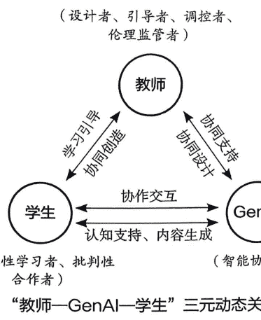
### 三 教育生态的全线重塑
生成式AI在深度融入教育的过程中，逐步推动教育系统从线性、封闭、静态形态转向开放、协同与智能动态演化。生成式AI正在从资源配置、教学组织、评估方式、治理结构、师生关系与技术边界等维度变革教育生态系统的结构与运行逻辑，从而重塑教育生态。

#### 1. 封闭走向开放的智能生态
传统教育体系中教学活动主要在学校物理空间进行，依赖教材等体系化资料，教育资源流动受限，信息反馈迟缓。生成式AI的引入打破了传统教育的封闭结构，使教育系统具有知识流动增强、信息反馈即时、学习空间开放等新特征，这些特征正在促使教育系统建立新的组织结构与运行机制，形成智能化生态。

#### 2. 中心化转向分布式协同网络
生成式AI引入教育后，正在打破以教员为中心的单向知识传递结构，推动教学系统迈向多主体参与的分布式协同网络结构。学员除了参加教员引导的学习活动，还可以基于生成式AI开展人机协同学习、人—机—人多元协同的分布式网络结构学习，教学权力结构由中心化趋于扁平化，形成多主体协商、动态参与的新形态。

#### 3. 教学组织的逻辑转变
生成式AI正在重塑教学的基本单元。课程设计日益走向“任务型+生成型”结构，教学活动从“知识讲授—练习巩固—测验评价”的组织逻辑向“任务生成—协同探究—调控完善”的组织逻辑转变，更加重视教学过程的反馈性、生成性与个体调节，以及过程性评估，更加关注学员的思维路径训练和能力培养。生成式AI成为教学组织的共生要素，技术成为学习认知与教学组织结构的共同建构者。

#### 4. 教育边界的重新界定
生成式AI正在通过重构教育的空间、时间与主体边界，推动教育生态向“无界化”与“人机共生”方向演进。学习活动突破了学校时间、空间的边界与内部的结构限制，延伸至生活场景与在线环境，推动教育向泛在化、终身化方向发展。生成式AI驱动的个性化推荐、生成反馈与任务陪伴使“学习”无处不在。同时，生成式AI模糊了正规与非正规教育之间的界限，学员可在社交平台、创作工具或游戏中借助生成式AI进行问题探究与知识表达。教员也可跨界与生成式AI、家长、社区共同构建学习场域。教育摆脱了内部制度及空间的制约，向人与生成式AI、社会多元力量协同的动态混合系统转变。
生成式AI对教育生态的变革，不仅是对教育结构及组织逻辑的更新，也是在推动教育理念、教育治理方式的系统性再设计，从而逐步实现教育生态的全面重构。

### 四 生成式AI带来的教育隐忧
生成式AI在为教育带来机遇与变革的同时，也带来了相关风险与问题。要使生成式AI充分赋能教育变革与创新，亟须及时审视这些风险与问题并采取相应措施。

#### 1. 认知依赖与能力弱化的风险
段世飞等提出，生成式AI工具不利于学员的高阶能力发展。①艾西科维茨指出，有些学员依赖使用生成式AI生成的信息，将思考外包，没有发展自身的思维能力，失去了训练批判性思维的机会。②学员如果频繁依赖生成式AI生成的内容去完成学习任务，将会削弱独立思考能力、信息甄别能力与原创表达能力，这种“过度外包”式学习将影响学员参与真实学习，制约其深层认知的发生，引发能力弱化风险。

#### 2. 输出准确性与幻觉性问题
生成式AI可能生成逻辑通顺但事实错误的信息，特别是在专业知识、价值判断和多义概念方面，生成式AI会出现“幻觉性输出”，造成对学员的误导，干扰教学目标的实现。例如，初中生向生成式AI提问：“肺是呼吸作用的主要器官吗？”生成式AI可能会给出表面上逻辑通顺的回答，例如：“是的，肺在细胞呼吸中起核心作用，通过将氧气与葡萄糖结合产生能量。” 这条回答虽然语义连贯，却混淆了肺的气体交换功能与细胞呼吸的生化反应过程，属于典型的知识性幻觉。肺仅负责氧气的输送与二氧化碳的排出，而真正的呼吸作用发生在细胞的线粒体中。这类幻觉性错误若未得到及时识别与纠正，可能导致学员构建错误概念，干扰科学思维发展。教学中要防止这种语言形式的可信中所隐藏的科学错误。

#### 3. 数据偏见与文化歧视风险
生成式AI系统训练数据往往源自不均衡的信息环境，会导致生成内容中存在性别、种族、语言等隐性偏见与文化歧视，若未进行防范，将影响教育的公平性与文化的多样性。
此外，学员数据隐私、教员评估的公正性、教育伦理责任划分等新问题也不断浮现，使教育治理体系面临前所未有的挑战。教育领域应用生成式AI时，必须加强伦理引导、机制规范和以人为本的监控，确保其发展符合教育的公共价值和可持续目标。

> ① 段世飞，钱跳跳. ChatGPT浪潮下的高阶能力培养：可为、难为、何为？[J]. 河北师范大学学报（教育科学版），2024，26（4）：80-88.
> ② EISIKOVITS N. The threat of AI is real—But on a different level than you think[EB/OL]. (2023-07-09) Updated: (2024-02-21) [2025-03-19]. https://www.inverse.com/science/ai-dread-psychology.

## 第3节 生成式AI时代的教师新定位
生成式AI正以前所未有的速度和深度在教育领域应用，它改变着教与学的方式，对教师在教育中的角色与职责提出了新要求和新挑战。生成式AI时代的教师，必须深入认识生成式AI对教育的变革与影响，充分发挥它的功能与优势，成为生成式AI教育应用的核心力量。

### 一 成为人机协同教学的实践创新者
生成式AI应用于教育领域后，正在推动教学组织方式与课堂实践样态的变革。在此过程中，教师不能消极应付或被动接受，而应主动实践，积极探索应用生成式AI变革教学，努力成长为人机协同教学的实践创新者。

#### 1. 推动教学组织方式重构
应用生成式AI需要重新组织教学内容，重构教学要素与流程。教师要在深入理解新课程方案、教学目标和分析学员实际情况的基础上，以“人机共教”为理念，主动探索“人—机”协同的新型教学组织方式，重构“导学—生成—反馈—评估”等教学流程中的角色配置与任务分工及协作。在教学实践中，不同学科的教师要根据学科特点和学员情况，与生成式AI有效协作，充分发挥其在不同教学场景与环节的相关功能，形成适合学科特点与学员实际情况的人机协同教学新方式。

#### 2. 担任人机协同教学的架构师
生成式AI能否与教师协作开展教学，要依靠教师对生成式AI的精心设计与调控。生成式AI缺乏对教学情境的自适应能力，应用于教学时并不能自动契合教学系统的需求，这就要求教师深入分析教学目标与教学逻辑，深刻理解生成式AI的功能特征与交互逻辑，将生成式AI工具嵌入教学结构，发挥其协同教学的作用。教师要通过对提示词的策略性使用、对交互活动的设计、对人机协同过程的调控及持续试验和迭代优化，构建可适用于特定学科、特定内容和特定学员群体的人机协同教学新范式。

#### 3. 教学内容人机共创的引导者
生成式AI应用于教学，推动着教学内容设计从“单向预设”向“人机动态共创”范式转型，这种转型是否成功或有效，关键在于教师能否作为智能共创的引导者持续开展系统性实践。因此，教师要以教育目标为锚点，通过分层协作架构与生成控制策略，与生成式AI共同生成教学内容。在教学内容人机共创的过程中，教师应全面设计师—机协作、生—机协作、师—机—生协作时的协作框架和生成控制策略，保障人机共创教学内容的质量。例如，在人—机协作时，要基于学科逻辑设计生成式AI生成内容的约束框架，在化学教学实践中，教师可以设计包含约束参数的提示词，“生成5个可用于家庭操作的电解质实验方案，需包含安全警示与变量控制说明”，以此引导生成式AI产出结构化内容，再依据教学目标和教学要求进行筛选优化。

#### 4. 人机协同教学实践的知识积累者与传播者
教师的创新实践不仅关乎自身教学的优化，更应转化为可供他人借鉴的经验资源。在人机协同教学尚处于探索阶段的背景下，教师需要记录、反思并传播自己的实践策略与成果，成为人机协同教学知识系统的建设者与贡献者。例如，教师可在校本教研、跨校协同、在线社群等多种平台上，分享如何设计生成式AI参与课堂的流程、如何评价生成式AI介入后的教学成效等问题，这些经验性的知识积累，是推动生成式AI教育应用从局部试验走向系统性革新的基础动力。

### 二 成为学员人机协作学习的指导者
生成式AI的应用使学员的学习方式正在发生重大变革。传统的以学员与教师、学员与教学内容的交互为基础的学习，正在向人机协作学习范式转变。在这一变革中，教师要成为学员人机协作学习的指导者，指导学员形成应用生成式AI学习的互动策略及适应性学习路径，训练其批判性思维，促进其认知发展与能力提升。

#### 1. 引导学员树立人机协作学习意识
生成式AI为学员提供了几乎无限的信息资源和不知疲倦答疑解惑的平台，但如何应用生成式AI学习，却是学员面临的新挑战。教师首先要帮助学员理解生成式AI的特征、优势与局限，使学员认识到生成式AI不是替代思考的工具，而是促进理解、表达与重构的认知伙伴。这种意识的建立是人机协作学习的基础。

#### 2. 指导学员掌握有效的生成式AI交互策略
学员在与生成式AI互动中常表现出“提问浅层化”“指令模糊化”“结果依赖性”等问题，影响了人机协作学习的有效性。教师需系统性地教授学员设计高质量的提示词、进行多轮互动调试、辨析生成式AI生成内容质量的方法与策略。在此过程中，教师不仅要教学员怎么用生成式AI学习，更重要的是要帮助学员理解“为什么这样用生成式AI”。

#### 3. 支持学员发展“人机共构”的学习路径
人机协作学习的实质，是应用生成式AI构建个性化与动态化的学习路径。教师作为指导者，应帮助学员识别自身的学习目标、知识结构与思维偏好，进而设计与生成式AI协作的任务路径。教师可以根据学员的情况，采取不同的引导策略。对于具备初步分析能力的学员，教师可以引导其使用生成式AI进行资料归纳与观点整理；对于具有探索兴趣的学员，则可指导其利用生成式AI进行开放性问题的提出与修订。

#### 4. 培养学员的判断力与学习的自主性
生成式AI生成内容的非确定性与潜在偏误，使得判断力成为学员在开展人机协作学习时的重要素养。教师可以设计相关任务和组织对话等引导性活动，使学员通过对生成式AI生成的信息进行比对、验证与评价，不断提升判断力，从而掌控人机协作学习的自主性。教师可以设计信息检索类任务，引导学员将生成式AI生成的答案与专业知识库检索的结果进行交叉比对；也可以设计创意表达类任务，鼓励学员对生成式AI作品进行评价，并提出修改建议，训练其批判性思维，提升判断力。通过持续训练，学员可以逐步形成自主判断生成式AI生成内容的意识、自主决策的能力和自主学习的责任感。

#### 5. 关注学员与生成式AI互动的情感与价值导向
学员在应用生成式AI学习时，可能会出现认知依赖或因其经常输出褒扬性反馈而产生情感偏移等现象。教师应在教学过程中及时关注学员的人机互动状态，强化学员的主体地位与自我认同。教师可以采取多种措施，发挥学员在人机协作学习中的主体性。例如：可以在作业或探究活动过程中设置“人先思考—生成式AI后辅助”的流程，保障学员的主动参与；也可以通过角色扮演、同伴评价等方式，提升学员对生成式AI角色与局限的价值判断力。教师的情感引导是维系人机协作学习本取向的关键保障。

### 三 成为智能教育风险的防范者
生成式AI在教育领域发挥其优势与积极作用的同时，一些潜在风险也相伴而生，如果不及时识别和防范，将对学生的认知发展和身心健康产生危害。

#### 1. 主动构建教学场景中的风险防范机制
以生成式AI为代表的智能技术在教育领域应用的过程中，潜藏着难以察觉的风险要素，教师要分析智能教育过程及其具体场景中的可能风险点，主动设计风险防范措施，逐步建立起具有前瞻性和适应教学对象特点的风险防范机制。例如，在教学活动中明确人机边界，设定生成式AI可介入学习任务的范围与深度，防止“认知外包”造成学员学习责任弱化等问题。同时，教师应设计学习过程可回溯的任务结构，以监控和指导学员的学习过程。此外，教师还应该变革教学实施与评价机制，防止学员在挑战性任务中出现抄袭等学术不端行为。

#### 2. 师者须落实学情数据防护实务
生成式模型要持续运行，必须依赖海量用户信息的采集与训练。若学子隐私、学习行为与过程性记录的调用缺乏规范约束，就极易引发个人信息被不当触碰的风险。2021年我国已颁布《中华人民共和国数据安全法》《中华人民共和国个人信息保护法》，2023年又推出《未成年人网络保护条例》《生成式人工智能服务管理暂行办法》。一线教员应主动研读相关法规，吃透所用系统的隐私与数据条款，把合规要求真正落到教学实践中，避免因不知情操作导致信息泄露。日常引导上，要让学子优先选用本地化部署或经专业监管的平台开展学习，同时培养“数据即身份”的信息伦理意识。还要推动校方完善学情数据保护的制度与措施，防止信息外泄或未经授权的二次利用。

#### 3. 提升学子辨析模型偏误的素养
大模型在内容生成时常伴随文化成见、事实性偏差或立场倾斜。若缺乏辨识能力，学子容易把模型输出当成客观真理，这会削弱批判性思维并固化错误认知。师者要主动带领学子认识大模型的局限与问题，并在课堂中设计交叉核验的活动，让模型结果与纸质经典、权威数据库对照，剖析输出中隐含的偏见或倾向性表述，锻炼信息判断力与智能素养。

#### 4. 守住育人价值与伦理底线
大模型能在多种复杂情境下与人协作解决问题，但本身不具备价值判断，能否真正赋能教育取决于人的引导与决策。教员是育人价值的守护者，教学中要坚持以人为本，抵制效率至上、技术至上等观念。可将技术的价值与局限、技术伦理案例、技术应用责任等议题融入课程，引导学子思考技术对个体与社会的冲击，培养其作为数字公民的责任意识。主动坚守伦理底线，是防止智能教育异化的根本保障。

### 四 师者要做智能教育生态的共建者
生成式智能的教育应用正在牵引教育生态的系统性解构与重构。在这一历史进程中，教员的角色已跳出课堂与校园，成为智能教育生态的建设主体。作为核心力量，师者必须积极投身生态构建，推动以人为主导的智能教育形态形成。

#### 1. 践行并传播人机协作理念
面对生成式智能对师生关系、生生关系、人机关系的重塑，教员要用建设性视角帮助学子理解“人机共进”的图景，建立技术服务于人发展的关系。在教研、教学研究、校家社协同的过程中，要主动传播以人为中心的人机协作教学理念，以及可持续发展的智能教育发展理念。

#### 2. 参与生态重塑与决策咨询
智能教育是智能技术在教育系统中的深度融入。生态构建既涉及教育要素的变革，也涉及结构、组织方式、教学流程、制度政策与评价机制的变革。教员凭借长期教学积累的经验，能洞察技术与教育融合的真实需求，理解学子使用技术的心理与行为变化，因而可在智能平台研发、教学流程再造、数据使用伦理等方面提供专业建议，提升生态构建的科学性。

#### 3. 推动制度与政策适配创新
当前教育制度对生成式智能等应用的适配度不足，教员可通过教研组、课题组参与制定适配生成式智能特性的课程结构、作业机制、评价方式与学术规范。要主动与教育管理者合作，参与政府决策咨询，参与智能教育政策与管理制度的研制，推动以人为中心的生态构建。

#### 4. 打造跨界协同的教研网络
新技术让教员不再是孤立的教学者，而是与技术专家、平台开发者、管理者、家长、学子等多方主体协作的教研网络的构建者。可通过共创工作坊、协同设计课程等方式连接各方资源智慧，搭建共享开放、动态演进的教研网络。

此外，教员要清醒认识到生成式智能的应用不是对教师的替代，也不是对专业性的削弱，而是对专业能力与智能素养提出了更高要求。要主动转型，提升能力素养，迎接变革，带领学子与生成式智能有效协作、协同发展。

# 第2章 师者如何高效驾驭生成式智能

## 第 1 节 个人智能资源库搭建：筛选管理六步法
自2022年11月ChatGPT面世以来，生成式智能的迭代速度惊人。随着ChatGPT、Claude、文心一言、Kimi等模型的升级，工具从纯文本生成扩展到PPT、图像、音频、视频等多模态输入输出。新模型与新工具层出不穷，DeepSeek-R1推理模型于2025年1月20日发布，引发行业与社会关注。面对技术更新，教员要实现技术赋能，必须建立契合自身教学风格、学科特点与教学情境的个性化、可迭代的个人智能资源库，涵盖工具集、指南集、方法库、问题集、案例集等，以实现技术与教育价值的深度耦合。

### 一 个人资源库的构思与路径
无论零基础还是已有基础，教员都应树立动态建设个人资源库的意识。可借助在线平台、思维导图、本地文件夹、教研平台、个人自媒体等搭建框架并定期迭代。如为积累应用经验方法集，教员在使用工具前要了解现状与功能，使用中与使用后要及时评估其适用性、有效性、可靠性与局限性，总结方法与经验，逐步形成个人经验方法集。

教员个人资源库是教学工作中从无到有、有意识积累的成果。以高中教师高老师为例，其框架起初只有应用指南、工具箱、典型案例三支，后续在学习使用中不断丰富。他用思维导图搭建框架，通过超链接关联电脑与网页资源，一键调取文件查阅。

#### 1. 构建思路：由单点使用走向体系化生长
建设框架建议遵循“工具使用起步，资源体系持续生长”的思路，由单一工具应用走向多工具融合应用。可从最直接、最常用的工具箱入手，培养积累、整理、反思的习惯：同步记录提示词设计、使用技巧到学生反馈的全流程；及时归档使用问题与教训，如生成偏差、学生误用、技术障碍，形成“使用+反思”的闭环。

#### 2. 积累方法：记录反思形成闭环
应从首次接触生成式智能开始记录整理，而非熟练后再建。哪怕只用一个工具设计一个提问、生成一段评语，也要把生成过程、效果与个人判断留存，形成可追溯、可分析的教学数据。随着经验增长，逐步扩展维度，增加应用指南、典型案例、方法经验等，从单一工具发展为多维度资源库，形成“计划—行动—反思—优化”体系。核心流程四步：按教学需求有目标选工具并设定任务；有策略地将生成式智能融入教学；及时记录反思应用效果与问题；明确后续优化要点。长期坚持可从浅层使用者转变为创新驾驭者。

### 二 六步法搭建个人资源库
生成式智能发展带来工具丰富，但碎片化与复杂性易导致选择困难与混乱应用，降低效率并带来风险。教员应依教学实际构建高效、安全、符合教育伦理的个性化资源库。以个人工具箱建设为例，主要步骤如下。

#### 1. 明确工具箱建设目标
先要厘清对生成式智能的教学需求，对教学活动做全面分析，锁定赋能着力点。若要解决班级学情差异大，可重点建设智能辅导答疑类工具；若要提升内容生动性，则需侧重能生成图像、视频等多模态资源的类型。

#### 2. 编制工具清单并动态更新
目标明确后，通过各渠道了解主流工具特点与功能，建立常用清单。可利用本地文档、在线平台、浏览器收藏夹等管理。以生物教师王老师为例，其清单包含ChatGPT、DALL·E 3、Midjourney、Claude、Gemini、Sora、文心一言、通义千问、讯飞星火、Kimi、智谱清言、豆包、DeepSeek、扣子等，涵盖类型、主要功能、使用路径与备注。

要保持关注前沿，动态更新。如OpenI平台提供工具聚合导航，按写作对话、绘画、视频、语音等分类，方便快速了解新工具。计算机教师刘老师则用语雀搭建教学导航主页，嵌入工具入口、场景集、提示词库与典型案例，实现多终端快速调用。

#### 3. 按教学场景匹配合适工具
工具价值发挥高度依赖场景。建立清单后，可梳理可赋能的典型场景并匹配工具。王老师据此形成场景匹配表，场景包括备课、教学内容组织与呈现、课件制作、实验教学、作业与练习设计，对应应用目的、可发挥功能与推荐工具，如备课用DeepSeek、智谱清言、豆包；课件制作用讯飞星火等。

#### 4. 测试评估择优使用
匹配后需测试工具是否真正适合具体问题。德国图宾根大学《生成式人工智能应用指南》强调以批判反思态度评估潜能与局限。王老师设计五维分析表测评生物教学性能：可靠性、客观性、教学适配性、逻辑性、前沿性。测评问题、方法与应对策略均对应教材对照、交叉验证、正反观点对比、学段适配、思维导图梳理、数据库更新时间核查等。

以高中生物“细胞分裂”单元为例，王老师在备课阶段使用DeepSeek生成有丝分裂与减数分裂教学方案，并按五维表对生成内容的事实准确性、立场倾向、表述适配度、逻辑连贯性与前沿性进行评估与校正。

**可信度核验** 王老师把AI生成的教学方案逐条对照正式教材核查。有丝分裂各阶段的表述与课本基本一致，减数分裂部分则明显被压缩，他便查阅专业文献把被省略的细节补足。

**客观性把关** 生成式AI在阐述细胞分裂功能时，往往过度突出增殖的积极意义，对凋亡等维持机体平衡的机制着墨不足。王老师在授课中主动补充平衡视角，引导学生讨论细胞生命周期整体调控的问题，让观点更全面。

**课堂讨论环节** 讲授基因突变与细胞分裂异常时，王老师借助AI生成的问题启发学生思考。

**客观性把关** 他要求AI出题时既要涵盖突变带来的负面后果，也要呈现其在进化中的积极意义，保证讨论兼顾正反两面。

**作业批改与反馈** 王老师用AI工具批改学生实验报告并自动生成评语。

**可信度核验** 他抽样核对评语，要求实验数据的分析符合教材标准。

**客观性把关** 部分评语过于笼统，王老师在反馈中追加更具体的改进建议，使评价更贴近学生真实表现。

将生成式AI的性能指标结合具体教学目的、场景挂钩测评，并配合交叉验证、专家意见、情境适配与多角度比较，教师就能为不同场景挑选合适工具，有效管控教学风险，形成场景化工具清单，为教学中发挥工具价值做好准备。

#### 5. 持续迭代与优化个人工具箱及资源库
生成式AI工具箱和资源库需要在实践中不断打磨。教师可通过撰写应用日志或教学案例，持续梳理常用工具的优点与局限，反思使用频率最高的原因、常见误区及规避方法，动态更新个人清单，让资源库保持迭代。

#### 6. 建立GenAI应用规范
使用生成式AI要保障数据安全、遵循伦理规范，不得上传含学生真实信息的文件、题库、答题卡等敏感材料，避免过度依赖。同时要向学生和家长说明生成式AI的特点与边界，引导在合乎伦理的前提下合理使用。

## 第2节 精准提问：点亮生成式AI潜能的提示设计思路
生成式AI能否发挥作用，关键在于使用者能否给出高质量指令。掌握提示词设计是教师驾驭生成式AI的核心素养。与AI的互动不是随意问答，而是通过精心设计的指令引导其产出高质量结果的对话式编程。

联合国教科文组织《教师人工智能能力框架》强调以人为本的原则。人机协同不是单向响应，而是教师调动AI、激活AI以获得最优输出的过程。

### 一 提示词构建框架：高效对话生成式AI的PRTSCE模型
教师提示词设计的PRTSCE六维模型，Purpose目的、Role角色、Task任务、Strategy策略、Constraint约束、Evaluation评估，遵循人机协同规律，通过结构化语言激发潜能，产出服务教学目标的高质量内容。

### 表2-4 教师提示词设计的PRTSCE六维度模型
| 维度 | 核心要素 | 关键问题 | 操作要点 |
| :--- | :--- | :--- | :--- |
| 目的厘清 Purpose | 教学目标、观点立场、价值导向 | 生成内容要服务于何种教与学目标 | 以目标牵引、指向明确、体现情境、明确风格 |
| 角色界定 Role | 专家定位、职责说明、表达风格、限制要求 | 希望AI以何种身份或语气完成任务 | 身份具体如课程专家、学科名师、产出规范清晰 |
| 任务描述 Task | 任务类别、任务特征、结构化表述、任务拆解 | 指令是否清楚、任务是否适合AI理解执行 | 动词精准、结构清晰、适时调整优化 |
| 方法运用 Strategy | 示例引导、结构设定、语气把控、信息嵌入 | 如何让AI生成更准确更优质的内容 | 提供范例模板、设定输出结构、嵌入上下文 |
| 限定条件 Constraint | 形式选择、篇幅控制、主题限定、对象范围、语言设定 | 是否需要限定形式、范围、长度和场景 | 表格、图文或文字、字数限制、话题边界、匹配对象语境 |
| 检验评估 Evaluation | 输出评价、是否追问、提示归类、总结沉淀 | 如何判断提示是否有效、能否沉淀为资源 | 从适切性与语言质量评估、建立个人提示库 |

结合实例看PRTSCE在教学中的应用。地理教师李老师要为高一设计比较两种气候类型的自主探究活动，按框架拆解提示要点。

### 表2-5 教师提示词设计的PRTSCE六维度模型分析表
| 维度 | 提示词设计要点 |
| :--- | :--- |
| 目的厘清 Purpose | 让AI生成适合高一地理课堂比较气候类型的自主探究方案，培养综合分析能力 |
| 角色界定 Role | 设定AI为“高中地理课程设计专家”，有丰富经验，理解新课标，能设计结构化且互动性强的活动 |
| 任务描述 Task | 需包含学习目标、探究任务及指导语、活动步骤、成果展示方式、师生评价方法 |
| 方法运用 Strategy | 用“请按以下结构：……”的清晰框架引导生成 |
| 限定条件 Constraint | 输出控制在600字以内，面向高一，使用教学场景，语言简洁清晰具启发性 |
| 检验评估 Evaluation | 生成后从结构完整、内容准确、活动可行三方面判断，可要求AI说明设计理念作反向检验 |

李老师据此撰写的提示词如下：

> 请扮演一位经验丰富的普通高中地理课程设计专家，熟悉新课标，擅长设计结构化、互动性强的探究任务。
> 
> 请为高一课堂设计一个自主探究学习活动，主题为比较温带大陆性气候与温带季风气候的差异。活动要培养学生的地理综合分析、观察探究能力，适配真实课堂。
> 
> 请按以下结构输出：
> 1. 核心素养目标
> 2. 自主探究任务内容及学生指导语
> 3. 学生活动步骤不少于3个环节，体现探究过程
> 4. 成果展示方式
> 5. 师生评价方法，含自评互评
> 
> 语言简洁清晰有启发性，总字数不超过600字，符合高一认知水平与课堂节奏。
> 
> 最后用不超过两句话说明设计理念依据。

通过文心一言生成后，AI给出了学习活动方案，包含核心素养目标、探究任务与指导语、活动步骤、展示方式和评价方法，并附设计理念说明。李老师认为基于PRTSCE设计的提示词明确了方向、结构与风格，形成了生成-评价-优化闭环，提升了产出质量。即便前期投入提示设计时间较多，也能一次问询得到可用的方案，稍加修改即可上课。

实践中，提示词的详略应随任务复杂度调整。交互时对AI的身份设定会显著影响质量与风格，优质提示应明确身份+职责，如“你是专家型教研员，请分析并完善这份大单元作业”。长期使用PRTSCE模型可提升提示质量与思维能力。

### 二 教师设计提示词的五项操作策略
1. 分阶段设计提示词
把复杂任务拆成逻辑步骤，分阶段生成，便于把控结构，适合教学目标、活动设计、评价标准逐步构建的场景。
2. 设计角色扮演式提示词
把AI设定为领域专家、资深教研员、名师或课程专家，可提升专业性与情境适配度。
3. 设计结构化提示词
使用编号、分段、格式要求，减少理解偏差，确保条理清晰，适用于方案与评价表设计。
4. 示例引导
提供1-2个同类范例供AI模仿，能显著提升风格与格式契合度。
5. 递进式优化
首次生成不理想时，可针对性提出“请说明设计依据”“请增加学生互动”等补充要求，多轮迭代优化。

### 三 设计提示词的常见问题与对策
### 表2-6 教师设计提示词的常见问题与对策
| 常见问题 | 原因分析 | 应对策略 | 示例说明 |
| :--- | :--- | :--- | :--- |
| 生成内容偏离主题 | 目标不明确或语义模糊，缺少限定 | 明确目标与对象，用结构化提示限定范围 | 帮我设计气候教学活动×→请为高一学生设计比较大陆性气候与温带季风气候的探究活动√ |
| 输出格式混乱条理不清 | 未明确格式或未用分段结构 | 用编号或格式要求引导清晰生成 | 请按“目标-活动-评价”结构设计九年级化学“制取氧气”探究教案 |
| 输出空泛无深度 | 未设定要求或学科术语与思维层级 | 增加难度、术语、思维层级提示 | 请为初一设计一元一次方程差异化作业，分基础到拓展三层 |
| 语言字数不适配情境 | 未设定篇幅或语体 | 设置字数、语体、适用场景约束 | 请控制在600字内，语言简洁明了，适合高中生阅读 |
| 内容不适龄不符合水平 | 未设定年级或学习者特征 | 明确学习者特征与内容层级 | 请面向大学生用专业严谨的学术语言介绍信息茧房成因 |
| 逻辑不通或重复 | 输入信息不全，未限制重复 | 增加“避免重复”“逻辑严谨”等要求 | 请按内因外因逻辑条理清晰讲解信息茧房成因 |
| 难以生成含评价的设计 | 提示只关注活动忽略评价 | 明确要求加入师生评价方式或标准 | 请在方案中加入成果展示后的师生评价方式，含自评互评 |

### 四 提示词不是关键词，而是教与学的设计语言
提示词实质是教师组织教学活动的设计语言，是启动AI理解并完成教与学任务的钥匙。提示词考验AI素养，也体现教师对教与学目标的深刻理解。谁能设计更精准高质量的提示，谁就能更好地激活AI潜能，开展高质量教学。

## 第 3 节 教育智能体创建：从0到1打造智能助手
生成式AI时代教师不仅是使用者，也是教育工具的设计者。打造贴合教学需求的教育智能体，已成为教师智能素养的新标志。创建过程是基于教学逻辑设定目标、设计交互、界定行为边界并迭代优化，形成真正具备教育功能的智能系统。

### 一 明确目标：你需要什么样的智能助手
创建第一步是聚焦具体教学科研需求。例如：
1. 教学辅助型：生成课件、练习题、学习资源。
2. 学习答疑型：充当虚拟辅导员，基于教学内容答疑。
3. 批改评价型：为作文、简答题提供初评与个性化反馈。
4. 研究助手型：文献梳理、问卷分析、数据处理。
初期可用角色设定+功能目标梳理痛点，明确定位，为技能设计与知识库构建奠基。

例如，李老师把智能体设定为高校教育学教师助理，熟悉教育研究方法课程，能按大纲生成案例讨论题、设计研究任务并指导文献综述写作。刘老师则设定为大学教师英文写作指导助手，为不同年级提供学术写作建议与润色点评。通过角色功能设定，智能体可精准嵌入教学辅导与研究。

### 二 选择生成式AI平台：在哪里创建教育智能体更合适
众多面向教育的生成式AI平台支持零代码创建个性化智能体。选择时需权衡角色功能定位、应用场景、技术能力、数据安全、输出目标与形式。重点考虑平台是否适配学段学科与授课方式、是否支持零低代码创建、能否满足特殊需求。

### 三 编写提示词与知识库：创建智能体的大脑
智能体是否具备清晰任务理解与精准内容支持，决定其功能发挥。创建初期需完善提示词与知识库这两个思维逻辑与知识底座。

#### 1. 编写提示词：让智能体理解要干什么
提示词是对话指令，建议采用角色定位+任务技能描述+输出格式+限制条件四要素。例如：
> 你是一位熟悉《普通高中化学课程标准2017年版2020修订》的助教，请依据九年级化学变化与能量单元，设计一个激发探究兴趣的实验任务，格式为实验目的、材料步骤、引导性问题。
提示越具体运行越稳定。教师可通过多轮测试不断优化。

#### 2. 构建知识库：让智能体靠谱不瞎说
多数大模型平台支持上传文本材料建设私有知识库。可上传教材、大纲、案例、论文、学生常见问题与教师答复模板等。含个人信息的学生作业需脱敏处理。知识库应权威准确、合规，避免过时或不当资料。

#### 3. 设定语气与表达风格
可设定语气亲切适合初中生、优先用图示、生活化类比或中英双语关键词等个性参数，使输出更亲和易懂。

### 四 调试与优化：测试和修正完善智能体
构建后需通过模拟问答、任务完成或案例演示系统调试。可从是否准确理解教学任务、回答是否逻辑清晰语言恰当、是否存在幻觉或知识混乱、能否应对追问变式提问等方面测试。建议用提示词-响应结果-优化建议三栏日志记录问题，逐步修正提示或补充知识库。

### 五 应用与迭代：将智能体嵌入教与学活动

教育智能体不可能一次成型落地就用。它必须在真实的教与学实践中被反复使用、在使用中暴露问题、再被持续优化，才能真正成长为得力的智能伙伴。基于不同使用场景，教育智能体已衍生出多样形态：辅助教师备课的备课型、助力课堂教学互动的教学型、服务学生自学的学习助手型、以及支撑教师教研科研的教研型等。

具体来看，备课阶段，教师可以借助智能体来起草教案、搜集案例、明确教学目标；课堂进行时，智能体能够扮演答疑助手、实时反馈的工具或引导学生讨论的伙伴；课后评价反思时，它可以生成学习反馈、初筛作业、给出改进建议；教研科研环节，则能帮助梳理文献、提炼研究主题、辅助撰写与数据分析。无论形态如何，离开持续打磨与迭代，智能体都难以释放出提升教学质量、激发教学创新的真正价值。

因此，教师需要建立起“使用、留痕、反馈、优化”的闭环迭代机制。定期回看智能体的实际表现，结合学生意见和课堂情况，灵活调整提示词和知识库内容。同时，持续记录使用效果和学生反馈，让智能体逐渐贴合自己的教学风格和学生的学习特点，成为真正专属的助手。

### 六 实战拆解：古诗文学习助手是怎样炼成的

案例缘起是提升古诗文学习成效。语文老师廖老师决定借助扣子Coze平台搭建一个专属古诗文学习助手。为保证做得扎实，他先做需求梳理与整体规划，再分步落成。这样的思路和做法，你能借鉴哪些？又有哪些环节可以做得更好？


扫码查看操作视频

#### （一）需求拆解与目标定位

中学古诗文既是重点也是难点，教学中常出现互动不足、理解门槛偏高、练习方式单一等困境。扣子是一款低代码AI搭建平台，依靠模块化组件能快速组装智能体，为学生提供涵盖学习、练习、评价、运用的全流程助手。

- （1）目标人群：正在学习和巩固古诗文的中学生。
- （2）主要痛点：对古诗文理解吃力、学习热情不高、自主练习效率偏低、缺少即时反馈。

#### （二）功能蓝图

基于学习需求，助手需要集成以下功能模块：

- （1）多模态对话：依托大语言模型实现沉浸式交流，支持文字、语音、图片等多种形式进行个性化问答。
- （2）“考考我”：自动出古诗文测验题，每轮10道，逐题作答并即时点评，最后给出轮次总结。
- （3）“文言知识导图”：根据用户需求归纳相关文言知识点并以思维导图呈现。
- （4）“知识讲解视频”：针对具体问题或知识点，自动生成数字人讲解视频。
- （5）“情境创作”：依据给定文本生成契合意境的情境视频。
- （6）定时推送：定期随机推送一条名句并解析寓意，帮助学习与生活结合。

落到实战时，教师可结合教学策略，优化提示词和工作流，在此基础上做拓展与深化。

#### （三）智能体创建流程梳理

各平台具体操作有差异，但整体建构路径大同小异，均遵循图2-6所示流程。

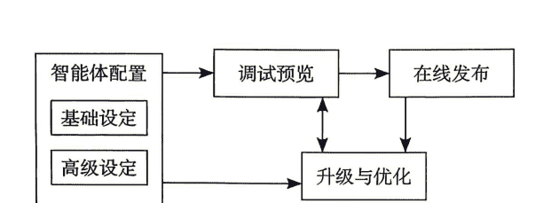

#### （四）技术路线

技术路线分三步走：先明确核心功能模块，再做基础设定，最后完成高级设定。核心功能模块指智能体要完成的具体任务，包含古诗文知识问答、利用文生图加深情境理解、自动生成题库支持自主练习。基础设定涵盖名称、简介、提示词、开场白等，让智能体清楚职责，也让用户快速上手。高级设定则通过接入大模型、插件、知识库和工作流的组合，实现面向具体教学目标的代理能力。详见图2-7。

#### （五）搭建过程全记录

##### 1. 基础设定

第一步是为智能体拟定贴合的名称、简介和头像，帮助用户迅速get其定位。相关基础信息见图2-8。

接着依据功能规划来撰写提示词。核心是明确角色定位、能力边界和工作原则，让模型明白如何执行。教师可用自然语言描述预期效果，借助GenAI的自动生成能力起草完整提示词，并在后续调试中持续优化。本案例部分提示词示例见图2-9。

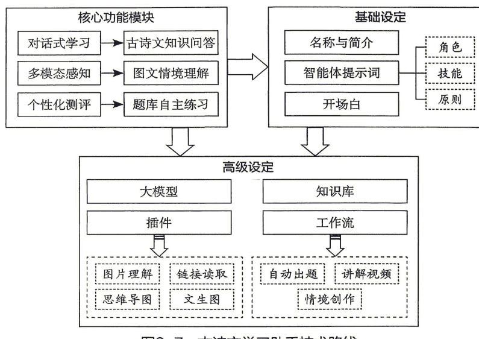

图2-7 古诗文学习助手技术路线

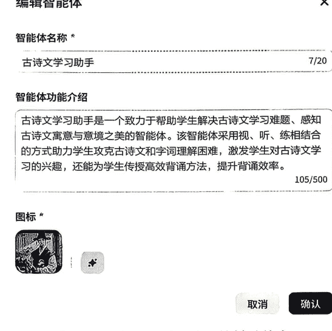

图2-8 古诗文学习助手的基础信息

```
# 角色：你是一个功能强大的古诗文学习助手，专注于为学生提供全方位的古诗文学习支持，助力他们攻克古诗文学习中的重点难点。

## 技能：
- **OCR 识别技能**：学生可以拍照上传古诗文文本，你能够准确识别并将其转换为可编辑的文字内容。在此基础上，结合学生发送的文字指令，提供相应的回复。
- **逐句翻译技能**：当学生上传古诗文图片或文字后，你可以自动对古诗文进行逐句翻译，将每一句古诗文准确地转换为对应的现代文释义。
- **字词解析**：当学生想要了解古诗文中的具体字词，你可以针对前面提到的古诗文进行深入的字词解析，对每个字词给出详细释义，并结合具体语境进行举例。
- **深入赏析**：当学生想要对文章进行赏析，你可以对文章脉络进行梳理，分析作者写作思路和结构安排，深入解读文章思想情感、文学价值及文化内涵。
- **知识梳理**：你能够对所学古诗文的知识点进行系统梳理，包括作者简介、背景知识、文体特点、重点字词句总结、语法现象归纳等。
- **自动出题技能**：当用户想要练习、检测古诗文知识，你可以自动出题。
- 鼓励式教学，激励用户继续深入学习古诗文知识。

## 原则：
- 必须提供与古诗文学习相关的回答，其他问题不作答。
- 所有回答要有文学依据，不能曲解文章原意。
```

图2-9 古诗文学习助手的部分提示词展示

为降低新手使用门槛，可配置一段引导性开场白，见图2-10。

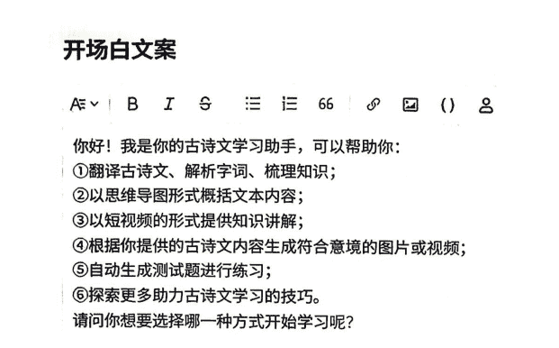

图2-10 古诗文学习助手的开场白设置

完成基础设定后，智能体已能进行基础知识问答，但仍依赖通用模型数据，易出现与教材不符的讲解。要实现更专业个性化的效果，就需接入专属工作流、知识库和插件，完成高级设定，见图2-11。

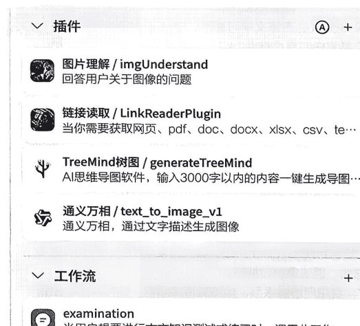

图2-11 古诗文学习助手的插件与工作流设定界面

##### 2. 工作流设计

（1）自主练习 examination 工作流。识别到用户想做题或测评时自动触发。流程为：接收指令→模型从知识库提取相关内容生成题目→循环节点内嵌问答实现逐题作答与即时点评→生成总结反馈。调用后可从知识库抽取10道题组成一轮测验，学生作答后系统自动判对错并点明考察点，结束后由模型总结整体表现。可扫码查看该工作流。见图2-12。

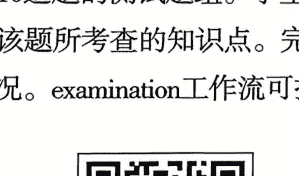

图2-12 examination工作流二维码

该工作流的实际运行效果见图2-13。

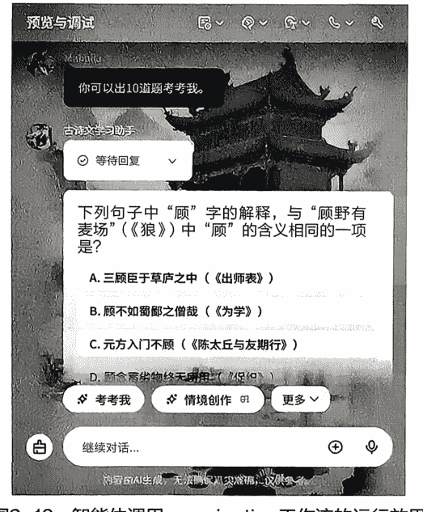

图2-13 智能体调用examination工作流的运行效果

（2）知识讲解视频 knowledge_video 工作流。当用户需要视频讲解时触发。步骤：模型根据指令生成讲解稿→输出节点校验内容→调用蝉镜数字人插件生成视频→循环节点确保获取可用视频链接→代码节点清理冗余输出→返回视频URL。可扫码查看流程。见图2-14。


图2-14 knowledge_video工作流二维码

（3）情境视频创作 create_video 工作流。当用户要求创作契合古诗意境的视频时调用。流程：模型生成文生视频提示词→调用即梦视频生成插件制作视频→输出视频URL。流程图见图2-15。


##### 3. 知识库整合

助手的知识库汇集了课内外古诗文资源及题库答案，为讲解与测评提供依据。教师可先把教学资料整理成规范清晰的本地文档上传至扣子知识库，提升模型的识别与匹配效果。具体做法：

- （1）对教学资源和题库做结构化整理。
- （2）新建知识库并上传整理好的文档。
- （3）在工作流中加入大模型节点，将知识库挂载为模型技能。

##### 4. 快捷指令配置

为便于快速调用高频功能，如生成讲解视频、自主练习等，可设置快捷指令，见图2-16。

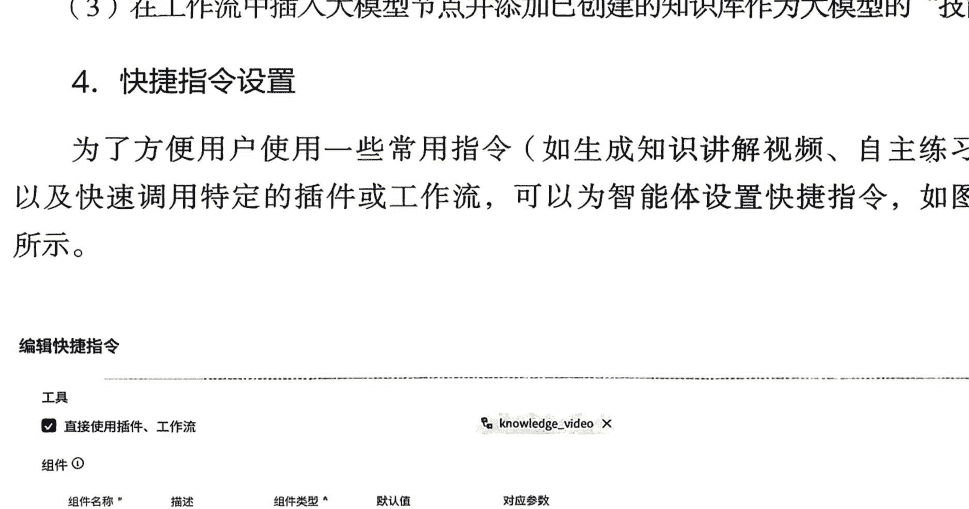

以“情境创作”为例：先在快捷指令中勾选“直接调用插件/工作流”，接入已建好的 create_video 工作流；再在指令内容中预设文本，限定用户触发后的输入；最后借助组件内容，让用户在点击时补充更明确的文本要求。运行过程见图2-17。

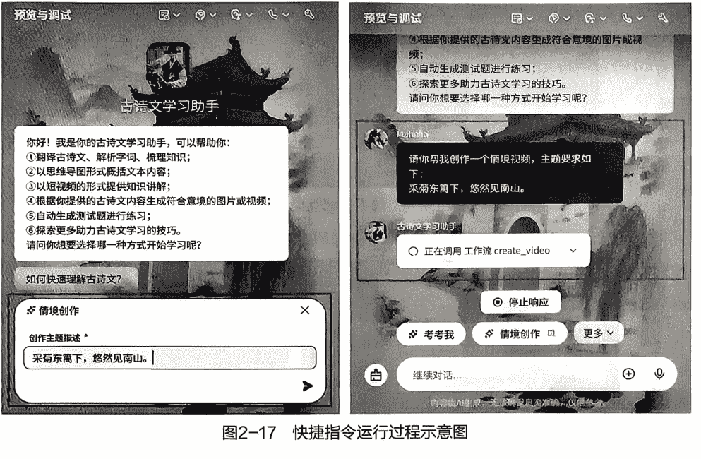

执行“情境创作”并输入主题“采菊东篱下，悠然见南山”，即可生成契合意境的视频，如图2-18所示。智能体每次生成效果各不相同，图中展示的是两次同指令的不同结果，有助于激发学生对意境的感知与想象。

“知识讲解视频”快捷指令的调用方式与效果见图2-19。

##### 5. 测试与打磨

搭建完成后需全流程测试，检查能否正常运行、准确答疑、稳定生成符合意境的画面、正确判题并计分。结合测试数据与用户反馈持续优化性能，提升效率与响应速度，保证在多设备多平台上流畅稳定。


图2-18 “采菊东篱下，悠然见南山”视频截图

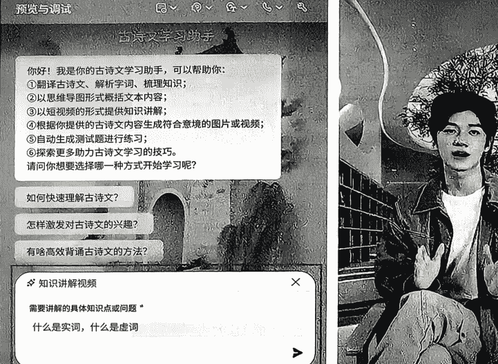

图2-19 “知识讲解视频”快捷键的运行指令与效果截图

##### 6. 发布上线

仅个人使用可在开发界面直接调用；若需供学生或同事使用，则要发布到社群平台。扣子支持发布到扣子商店、豆包、微信、抖音、飞书、掘金等渠道。本案例面向学生，最终发布到微信和扣子商店。

发布步骤：点击开发界面右上角“发布”→按提示完成平台授权→填写发布信息并选择渠道→确认发布。

发布成功后，学生可通过分享链接直接进入，也可在指定平台搜索名称、简介和头像找到智能体使用。

#### （六）教学落地建议

为发挥GenAI助教助学价值，教师应把智能体嵌入教学设计，引导学生形成基于智能体的学习策略。结合不同学习阶段，提出以下使用建议。

##### 1. 课前预习

预习阶段学生可自主使用助手，主要用OCR识别、文本/语音对话、思维导图生成等功能。先拍照上传课文，让助手做初步介绍——作者、背景、大意等；再通过语音对话厘清生词、读音、语义；最后让助手归纳常考知识点为思维导图，按个人习惯保存至电子资料或打印作为笔记。

##### 2. 新知学习与情境感知

学习新知时，助手可帮助理解与记忆。学生可向助手索取个性化助记口诀，或通过语音互动练习背诵。教师还能引导学生围绕文本设计提示词，与助手共同进行

##### 3. 课后拓展与巩固

新知学完后，学生可用自动出题与仿真对话功能巩固拓展。先用自动出题自主练习；教师可调整出题规则，把助手作为辅助出题工具，构建更丰富的班级测评题库；师生还可通过助手开展知识竞答或飞花令游戏，配合奖励机制营造积极氛围。

总体来看，教师要引导学生探索个性化GenAI学习策略，包括何时使用、如何提问、如何追问深化理解等，并不断挖掘高级用法。教学中师生还能共同探索更多技巧，实现智能体与教学及生活的创新融合。如设置定时触发器，让助手定期推送一句古文并解释内涵，既增添知识储备，也让古诗文融入日常。“名言推送”触发器设置与运行结果见图2-20。

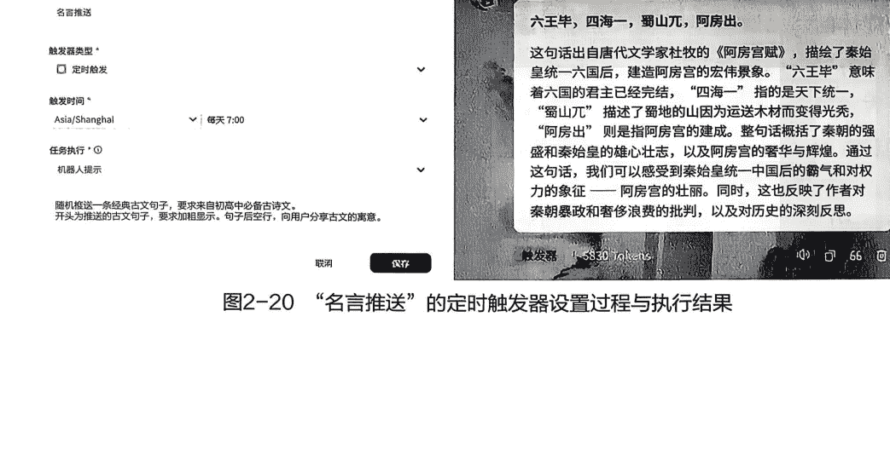

## 第 4 节 五步共建 GenAI 应用共同体：打造协同成长生态

GenAI迭代飞快，工具层出不穷。个人单打独斗难以跟上更新，也难系统掌握应用方法与策略，更容易停留在表面使用。构建GenAI应用协作共同体，能打破孤立困境，达成资源共建、经验互通与能力共育。

下面分别从学校与教师视角，给出五步共建的具体思路。

### 一 学校视角：五步搭起协同共同体

1. 明确愿景定位，组建多元共同体
学校需调研教师在GenAI教学中的痛点与难点，确定优先应用场景，如备课、作业批改、学科教研等，并据此规划共同体的愿景与类型。坚持以人为本、技术服务教学的原则，以提升教学设计能力、促进学科融合、探索智能体开发等为方向，邀请教师自愿参与，组建多类型共同体。成立后要明确角色分工，调动成员积极性，发挥核心成员带头作用。

2. 搭建纵横联动的研讨网络
共同体成长需要多方支持。学校可建立多维协同机制：①定期举办GenAI教学应用工作坊，邀请专家与优秀教师开展周期性培训；②定期组织校内各共同体展示经验成果，促进内部互学；③不定期跨校跨区开展主题教研，推动跨共同体、跨学校协同发展。

3. 打造多元协作机制，推进多维合作
高校、中小学、职校、特校均应与科技企业、区域教育部门等建立协作机制。举例而言，校企可联合定制师生发展方案，高校企业地方政府共建GenAI教育实验室，为共同体提供专业持续支持。同时依托国家智慧教育平台、开源社区等，开展平台化研讨，及时共享资源、方法与经验，实现持续成长。

4. 建设“学研用创”一体化机制，支持深度成长
共同体不应仅停留于经验交流，而应成为教师深度学习与专业发展的平台。可采用“自主研讨—课堂实践—课题引领—创新教学”的路径，构建一体化机制。例如设立GenAI创新课堂展示，由各共同体推荐教师分享；设立校级微课题，如“GenAI如何促进高阶思维”，通过研究形成可操作、可推广的新模式。

5. 完善评价激励机制，保障可持续发展
共同体的长效运行需评价与激励支撑。学校可建立兼顾参与度与成效的多元评价体系：将参与学习、研讨、展示等情况纳入继续教育学时；设立创新课堂、优秀案例、微课题等奖项，激发探索热情；建立GenAI应用能力档案，记录研讨经历、实践成果与反思日志，作为职称评聘与岗位晋升参考，也为个性化发展提供依据。

### 二 教师视角：五步点亮协同成长

面对GenAI变革，教师无需等待外部推动或担心技术不足。只要主动实践、及时反思、积极协作，就能成为共同体的发起者和引领者。可采用层层递进的五步策略，逐步搭建起支持协同发展的共同体。详见表2-8。

表2-8 教师建设 GenAI应用共同体的五步策略

| 序号 | 行动策略 | 具体方法 |

| :--- | :--- | :--- |

| 1 | 首轮试探：课堂微实践 | 以真实教学痛点为入口，自主启动生成式AI教学小试验，沉淀一线操作体感并提炼微型成果。 |
| 2 | 小范围研讨：经验互鉴 | 在圈层内分享做法、相互启发，逐步聚合一批使用生成式AI的教师，形成松散实践共同体雏形。 |
| 3 | 多方联动：争取支持 | 对外展示试验成效，争取校内政策与资源倾斜，同时对接外部专业机构资源，推动共同体稳步发展。 |
| 4 | 协同深耕：成果提炼 | 与共同体成员联合开展主题研究，把分散的实践经验转化为AI应用课题、教学论文与优秀案例。 |
| 5 | 常态迭代：闭环运行 | 建立“实践—分享—研究—改进—再实践”的循环机制，保障共同体长效运转与教师专业持续成长。 |

只要教师敢迈出第一步，就能点燃团队创新的火种，由个体微光汇聚成面向教学的AI赋能浪潮。构建生成式AI应用共同体要坚持以人为本、由下而上的实践逻辑，针对教师在AI浪潮中易出现的启动难、延续弱、深化盲三大困境，凝聚协作成效，共同塑造AI赋能的育人新生态。

# 第3章 用GenAI重构教学设计范式

教学设计的品质直接决定教学成效。合理引入生成式AI，能够在课程纲要、个性化导学案与学习指引、教学目标、教学方案及作业设计等环节提供助力，显著提升备课效率与水准，推动传统设计模式向人机协同的新范式迈进。

## 第1节 GenAI助力课程纲要编制

高校与职业院校的课程纲要一般由教务部门组织课程负责人、专业负责人及专家逐级审定后执行。中小学国家课程纲要由国家教育部门组织编写，地方与校本课程纲要则由地方教育部门或学校组织编写，经审查后实施。生成式AI在教育场景的普及，让教师掌握方法后能以更快的速度编制出高质量纲要。以下以高校课程纲要为例说明，稍作调整即可适配中小学与职业教育。

### 一 人机协同编制路径

课程教学纲要属于复杂系统性文本，倚赖生成式AI一次性完成并不现实，需要精细提示词配合多轮人机交互。下面以杜玉霞老师为广州大学体育教育专业师范生制定特色课程“思维导图的学习应用”纲要为例说明操作思路。

1. 资料整理与输入，为模型建立语境
使用生成式AI编制纲要，首先要让模型理解课程属性、特点与纲要结构要求。教师需先把相关材料整理并上传，如原有或相关课程纲要、教材目录与参考书说明、纲要模板、教学资源等。杜玉霞老师在编制该课程纲要时，整理了专业人才培养方案相关片段、教材《思维导图：如何学 如何用 如何教》的目录与要点说明、国家级一流线上课程“思维导图的教学应用”的链接与资源介绍、广州大学本科课程纲要模板等，使模型对课程背景、定位、教学方式与内容形成整体认知。

2. 选择适配工具生成初稿
资料准备就绪后，教师可设计精准提示词并上传材料，驱动模型按要求生成纲要。杜老师选用豆包，在对话框提交材料并设计提示词后生成了课程教学大纲初稿。

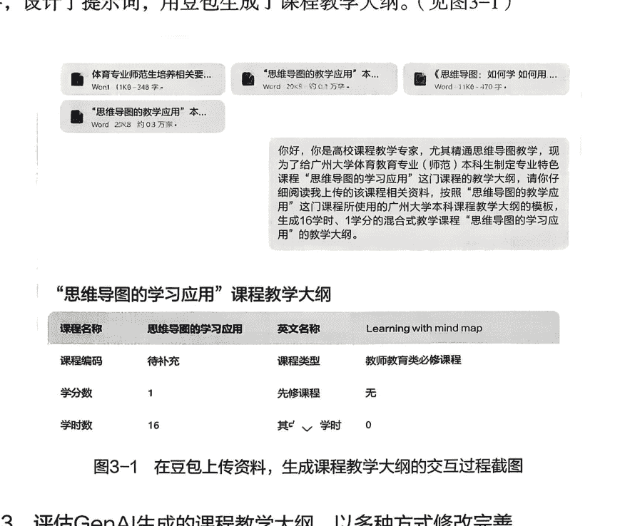

3. 评估与多轮完善
杜老师对豆包生成的纲要进行全面审阅，发现整体框架符合广州大学本科纲要规范，内容与预期基本吻合。但仍存在需修正之处，例如课程类型被沿用了“思维导图的教学应用”的教师教育类必修，而“思维导图的学习应用”实际为体育教育专业学生的专业特色必修课程。杜老师逐项核查，结合再次提问与同事研讨，完善了教学内容、教学方法等，补充了课程编码、制订单位、参考书目等信息。

“思维导图的学习应用”课程教学大纲

| 课程名称 | 思维导图的学习应用 | 英文名称 | Learning with mind map |
| :--- | :--- | :--- | :--- |
| 课程编码 | 待补充 | 课程类型 | 教师教育类必修课程 |
| 学分数 | 1 | 先修课程 | 无 |
| 学时数 | 16 | 实验学时 | 0 |
| 实践学时 | 0 | 适用范围 | 广州大学体育教育专业（师范）本科生 |
| 制订单位 | 待补充 | 课程负责人 | 待补充 |
| 执笔者 | 待补充 | 审核者 | 待补充 |

一、教学大纲说明
（一）课程性质、地位、作用与任务
本课程是体育教育专业师范生的创新型技能课程，在培养适应新时代需求的体育教师中具有重要地位。思维导图作为高效思维工具，有助于整合体育专业知识，提升学习效率与质量。学完本课程后，学生能够掌握思维导图基本理论、绘制技巧及软件应用，运用思维导图构建体育学科知识体系，创新学习与教学模式，为未来体育教育教学工作奠定基础，并形成终身学习的高效思维习惯。

（二）课程教学目标
略
（三）课程教学方法与手段
本课程采用混合式教学，将理论教学与实践操作、线上学习与线下互动结合。线下通过案例分析、任务驱动、小组讨论、实践演练等引导学生掌握核心知识与技能；线上借助中国大学MOOC等资源开展自主学习、在线测评与交流讨论。同时鼓励学生在体育专业课程中迁移应用思维导图。
（四）课程与其他课程的联系
略
（五）教材与教学参考书
略
二、课程教学内容、重点与难点
略
三、学时分配
略
四、课程考核
略

4. 编制反思
杜老师回顾使用豆包生成纲要的过程认为，豆包能在教师提交资料后快速分析已有课程与纲要要求，从零生成完整内容。但由于纲要是一键自动生成，仍存在教学目标针对性不足、内容较为笼统、具体信息缺失等问题，需教师逐项评估并反复完善。

需注意三点：①教师应全面搜集整理资料对AI进行预训练，包括纲要模板与要求、课程目标与内容、教学条件与手段、教材与资源等，注意数据安全，涉及隐私与保密的资料不得提交。②提示词需具体明确，涵盖教学对象、学时、教学方法、考核评价等要求，以提升生成合理性。③AI生成的纲要仅是半成品，教师必须仔细审阅并精心修改完善，多轮迭代后才能形成可实施的纲要。

### 二 人机协同编制课程纲要的七步策略

教师可采用以下七步人机协同策略高效编制高质量课程教学纲要，各步骤环环相扣，以资料准备为起点，依托AI在内容提取、结构构建、目标设定、任务设计、评价制定等方面的辅助完成编制。

表3-1 生成式AI设计教学大纲的七步策略

| 步骤 | 阶段目标 | 方法与策略 | 示例提示词 |
| :--- | :--- | :--- | :--- |
| 1. 资料准备与输入 | 提供课程背景语境 | 提交教材、教案、课程视频等，建议结构化分模块提交，避免信息冗杂 | 请分析我提交的课程资料，提取核心内容与课程定位 |
| 2. 课程内容模块设计生成 | 构建逻辑清晰的模块体系 | 提示AI生成多个模块划分方案，按目标类型、知识逻辑等对比择优 | 请基于资料设计3个模块划分方案并说明理由 |
| 3. 课程教学目标设计 | 明确各模块知识、能力、素养目标 | 结合学科核心素养或专业标准，逐模块生成教学目标并对接毕业要求 | 请为第2章设计体现专业特色的核心素养教学目标 |
| 4. 教学内容、方法与活动设计 | 匹配目标设计教学方案 | 要求AI生成“内容讲授+学生任务+教师引导”三位一体活动，突出任务驱动与协作 | 请设计思维导图应用于学习过程模块的教学活动与学生任务 |
| 5. 评价方式设计 | 建立形成性与总结性结合的评价体系 | 引导AI生成结构化评价表，包括维度、分值、标准，体现过程性评价 | 请设计思维导图作业评分标准，指标含创意、逻辑等 |
| 6. 课程教学大纲输出 | 生成标准化大纲文档 | 汇总各模块内容，输出文字版大纲并可导出思维导图或流程图便于审阅 | 请将所有模块整合为广州大学教学大纲格式文档 |

## 第2节 用生成式AI打造个性化导学案与学习指南

### 一 生成式AI驱动的个性化导学案构建

清晰且贴合学习者实际的学习指引，能有效提升学习效率。借助生成式AI，教师可快速编制高质量个性化导学案与学习指南，引导学生把握课程结构与重点，增强自主学习能力。

1. 用生成式AI支持导学案分层学习目标制定
为设计适配不同学习者的个性化导学案，教师可先利用AI分析学生测评成绩、作业表现等数据，结合教学目标进行分层目标设计。

例如，广州市白云区平沙培英学校的尹晓华老师在教授人教版初一信息科技“计算机软件系统”时，依据课前在线测评结果将学习目标分为基础目标、标准目标和拓展目标。全体学生须达成基础与标准目标，学有余力者挑战拓展目标。确定认知起点后，教师分层设计软件分类、安装与卸载、云存储、维护系统、文件管理五大模块的学习目标，使其遵循“认识—理解—操作—管理”的递进关系。

尹老师设计提示词，使用文心一言生成分层学习目标并要求以表格输出认识、理解、操作、管理的具体目标。生成后她对内容进行评估与修改，并重新排版以便不同水平学生执行，形成分模块导向性学习目标，引导学生先检测基础目标，再达成标准目标，最后尝试拓展目标。

初一“计算机软件系统”分层学习目标示例已按模块与递进维度呈现，可据此展开后续导学案细化。

# GenAI 助力七年级信息科技分层实战

本案例以“计算机软件系统”单元为载体，呈现教师如何借助生成式智能快速搭建分层指标、共建学案框架并迭代出可用的教学材料。

## 一 分层目标的生成与人工校准

教师先让模型参照课程标准，为五个子单元产出分层成果表述，随后人工核对补充。初级层聚焦核心必会，达标层对齐课程要求，提升层为学有余力者提供进阶空间。

五个子单元为程序归类、安装卸载、云端存储、系统养护、文件整理。每个单元均按认识、理解、操作、管理四个维度设置初级、达标、提升三个梯度。以程序归类为例，初级要求能说出系统类与应用类并举例，达标要求理解各类程序的职能并会按需选用，提升则要求能扩展子类型并分析程序与硬件、云端应用的关联。

尹老师借助文心一言快速得到初稿，经二次加工后形成三类成果：确保全体掌握核心内容的入门指标、对应课程标准的达标指标，以及面向学优生的进阶指标。

### 教师与模型共建学案骨架

结合信息科技学科特点，教师与模型反复沟通后形成学案结构模板。

提示词示例：
> 请你作为信息科技课程专家，为初一年级学生有效学习“计算机软件系统”章节，生成一份包含达成要点、课前物料等内容的学案结构模板，适合课堂与课外自学使用。

表3-2 学案模板
学案内容 作用说明
达成要点 指明本节/模块要达成的结果
课前物料 预习任务、资料查阅、提出问题
探究活动 模块化知识点对应的问题探究任务
合作交流 小组活动、观点表达
巩固延伸 分层练习题或思维延伸任务
自我检测与反思 自评、错因分析、知识迁移

### 分模块生成学案并审校

教师分步设计提示词生成各主题学案。以程序归类为例：
> 请按上述模板为初一年级生成基础、标准、拓展三个层次的程序归类模块学案，语言简洁任务明确。分别输出含三层次和仅含基础与标准的版本，体现循序渐进。

模型初稿在分层定位上存在偏差，教师据此逐项审阅、修改完善，形成两份可用的学案。

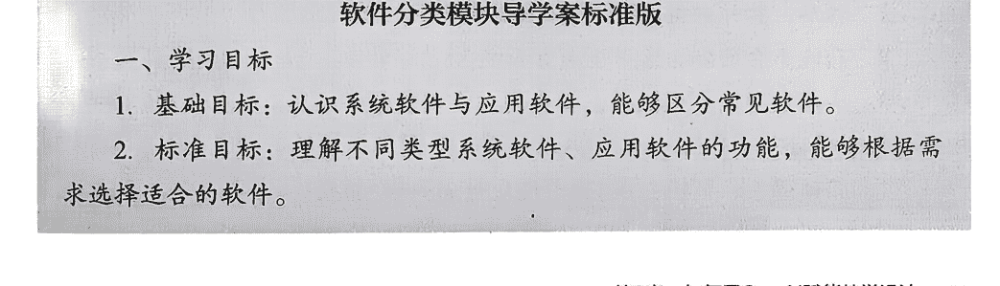
##### 二、学习准备
1. 课本“软件分类”章节

2. 在线平台的配套学习资料、短视频讲解资源

3. 电脑设备供实际观察和体验软件
##### 三、学习任务
1. 阅读课本内容，了解软件的分类。
2. 完成指定的软件分类表格，归类至少10个常见软件。
3. 小练习：根据情景（如学习、绘图、计时等），选择最适合的软件。
##### 四、合作交流
1. 两人一组互测：互问互答软件分类。
2. 小组汇总：交流各自常用的软件，并归类整理。
##### 五、巩固提升
1. 完成课堂作业：软件分类选择题+简答题。
2. 课后自主整理自己家中或学校电脑上使用的软件，并标注类别。
##### 六、自我检测与反思
1. 我能分别快速说出4种系统软件和应用软件的名称和基本功能吗？
2. 碰到新软件，我能判断它属于哪类，并说明判断依据吗？
##### 软件分类模块导学案拓展版
###### 一、学习目标
1. 基础目标：认识系统软件与应用软件，能够区分常见软件。
2. 标准目标：理解不同类型系统软件、应用软件的功能，能够根据需求选择适合的软件。
3. 拓展目标：能够分类整理多种软件，分析软件与硬件、云端应用的关联性。
###### 二、学习准备
1. 课本“软件分类”章节
2. 在线平台的配套学习资料、短视频讲解资源
3. 桌面电脑或平板设备，安装多种常用软件供观察
###### 三、学习任务
1. 阅读课本，列出至少5种系统软件和5种应用软件。
2. 根据软件功能描述，完成分类匹配题。
3. 观察电脑中的软件，整理软件列表，区分系统软件和应用软件。
4. 拓展任务：设计一张思维导图，归纳不同类型软件及其应用场景。
###### 四、合作交流
1. 小组交流：分享各自找到的软件实例，讨论哪些软件属于系统软件，哪些是应用软件。
2. 集体讨论：软件功能对学习、生活的影响有哪些？
###### 五、巩固提升
1. 完成学习平台“软件分类”练习题。
2. 拓展挑战：为学校电脑制作一份“必备软件推荐表”，并注明推荐理由。
###### 六、自我检测与反思
1. 你能正确分辨系统软件和应用软件并说明判断依据吗？
2. 你知道不同终端如电脑与手机上使用的应用软件有什么区别吗？不同类型软件在电脑应用以及人们的学习生活中分别起什么作用？
3. 你能根据功能或使用目的的差异，对应用软件进一步详细分类吗？

### 分层任务单的精细化

教师为同一模块生成三级任务单，确保指标与任务匹配、难度适配。文件整理模块任务单示例：

提示词：
> 请根据初一年级学生对“文件管理”模块掌握的三个层次，生成三层级的具体达成要点，以及三个难度层次的任务，注意基础组先掌握基础要点，了解基本操作，然后再掌握标准要点中的分类方法，拓展组能提出文件管理的改进建议。请生成与三个层次达成要点对应的三类任务单。

##### 学习任务单
**初一信息科技课程“文件管理”学习任务单1（基础型）**
1. 认识：阅读教材，完成知识小卡片，写出什么是文件、什么是文件夹，举一个生活中的例子。
2. 理解：为什么要对文件进行分类管理？举一个自己遇到过的文件混乱的小例子。
3. 操作：在电脑或平板上新建一个名为“我的资料”的文件夹，内部再新建3个子文件夹（如“语文”“数学”“科学”）；在每个文件夹中分别新建一个文本文档，并写上课程名称。
4. 管理：将最近一周老师发的学习资料分类放入对应的子文件夹中。

**初一信息科技课程“文件管理”学习任务单2（标准型）**
1. 认识：查阅教材或网络，列举5种常见文件格式（如.docx、.jpg、.mp4、.pdf、.xlsx），并注明它们的主要用途。
2. 理解：找到3个文件，看它们的扩展名，推测文件类型；理解什么是“文件路径”，在电脑上查看一个文件的完整路径。
3. 操作：创建一个“2025学年学习资料”总文件夹，内部分为“学科分类”和“日期分类”两种体系，并分别整理自己的现有文件。
4. 管理：制定一个简单的文件命名规则（如：科目_日期_内容），并用这种规则重新命名10个文件。

**初一信息科技课程“文件管理”学习任务单3（拓展型）**
1. 认识：通过资料了解什么是文件压缩、加密，列举常见压缩软件（如WinRAR、7-Zip）；完成一份小资料卡。
2. 理解：分别用U盘、移动硬盘保存同一批文件，体验不同存储设备的管理特点，填写对比表。
3. 操作：①将多个文件打包压缩并设置密码；②将资料完整备份到另一台设备；③恢复其中一份文件。
4. 管理：撰写小报告，分析自己当前在文件管理中存在的问题，并提出至少2条改进建议，可附一份“个人文件管理小指南”。

### 单元学案整合

完成各模块设计后，教师让模型按模板整合为完整单元学案，并标注指标层级与任务难度，加入导语与评价。

提示词示例：
> 请将“软件分类、安装与卸载、云存储、系统维护、文件管理”五个主题，按学案模板整合成一份适合基础组学生的完整学案，标明基础与标准要点，标注任务难度，并提供导语和学习评价，排版美观适合打印填写。

##### 计算机软件系统导学案（基础组版）
适用对象：初一信息科技课程（基础层次学生）
设计理念：以“认知→实践→巩固”为主线，通过生活化场景与可视化工具降低门槛

###### 导语页
欢迎进入软件世界！
计算机就像“魔法城堡”，软件是操控城堡的“咒语书”。本导学案将带你：
1. 认识 软件的“家族成员”（分类/授权/作用）
2. 掌握 软件的“生存技能”（安装/卸载/维护）
3. 管理 软件的“智慧宝库”（云存储/文件整理）
学习秘诀：每完成一个任务，用✅标记在“成长树”上！

教师作为把关人，下载 Word 版本后逐项核查术语准确性、任务可行性与教室网络条件，再发布给学生。同样方法为标准组、拓展组生成对应版本。

## 二 用 GenAI 赋能学习指南制定

### 步骤与要点

表3-3 用 GenAI 制定学习指南的五个步骤
步骤 具体做法 关键点
1. 明确达成要点 基于大纲提炼分层、可操作的成果表述 要点层级清晰、符合认知发展
2. 分析内容与重点 协同梳理模块、知识点，锁定重难点 内容难度分层，引导攻克关键点
3. 设计任务与活动 针对要点设计任务链、问题链 任务具体、步骤化，兼顾实践与思维
4. 设计流程与路径 合理编排任务，体现逻辑与学生学情 循序渐进、螺旋上升
5. 提供资源与评价标准 搜集整理文献、视频等资源，协设自评互评标准 评价可操作，便于学生自我监控

### 实操案例：本科“访谈法”学习指南

杜老师对课程已熟知，学生理论有余实践不足。先将章节资料上传，着手规划学习活动与路径。

提示词明确使用对象、资源、方式、评价要素与字数限制，使用文心一言生成初稿。
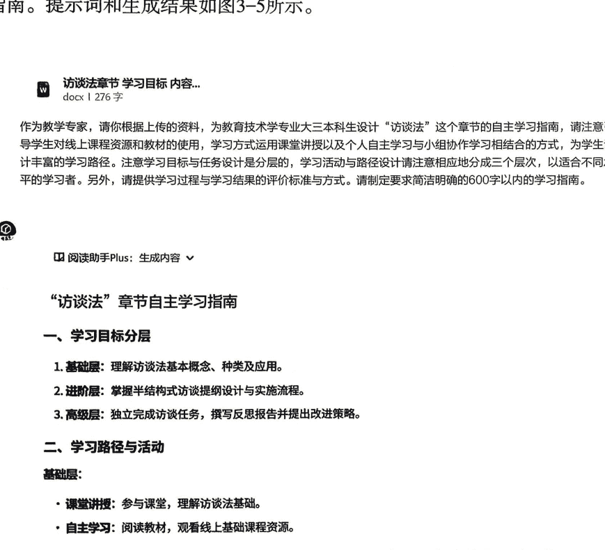
教师发现初稿分层与原文档不一致，补充文档内容后追问模型，按指定模板重写，并在后续迭代中补充分层要点、任务与活动，形成逻辑自洽的指南。

## 本科生“访谈法”学习指南

### 一、课程特点与指南说明
访谈法是一种重要的研究方法，掌握该方法既需要掌握关于访谈法的理论，又需要在实际研究情境中应用该方法解决教育问题。为满足不同初始水平和学习风格的学习者需求，提高本章节的学习质量，本学习指南包含了课程必须掌握的基础层、标准层的学习目标及相应任务与活动，要求所有学生都应实现基础层与标准层的学习目标，建议有兴趣的学生完成进阶层的学习任务及活动。基础层、标准层、进阶层学习目标对应的学习任务难度逐步增加，请以合理顺序开展学习活动，促进基础认知、必备技能与高阶思维的梯度发展。

### 二、学习目标（分层设计）
#### 基础层目标
- 1. 了解访谈法的基本概念及其在教育研究中的意义。

访谈能力分层进阶路线

先厘清结构式、半结构式、非结构式访谈的本质区别，再吃透半结构访谈在提纲搭建、现场推进和资料保存上的关键操作。

#### 标准层能力要求
- 1. 掌握访谈方法的基本原理，能够辨析不同访谈类型的典型特征与适用情境。
- 2. 围绕明确的研究主题，独立产出开放度高、指向清晰的半结构访谈提问框架。
- 3. 能够全程主持一次小型半结构访谈，把控好节奏并完整保留过程资料。
- 4. 写出结构完整、问题归因准确、改进建议可落地的访谈复盘报告。

#### 进阶层能力要求
- 1. 在操作熟练的基础上，能根据现场反馈即时调整追问策略，推动对话深入。
- 2. 对访谈资料进行初步归纳，提炼受访者的核心观点与背后逻辑。
- 3. 客观审视自身与他人的访谈设计与执行优劣，给出可落地的优化方案。

### 三、任务清单分层拆解

#### 基础层任务
- 精读并梳理访谈法的概念体系、分类逻辑与各类特点。
- 制作《访谈类型对照表》，把结构化、半结构化、非结构化在特征与使用场景上做成对照。
- 在小组讨论中简要比较三类访谈的异同。

#### 标准层任务
- 结合指定研究问题，设计一份结构合理、问题开放、针对性强的半结构访谈提纲，题量控制在5至7题。
- 与伙伴协作完成一次半结构访谈演练，同时录音并做好过程记录。
- 撰写访谈体验反思报告，清晰指出现场主要问题及优化对策。

#### 进阶层任务
- 以模拟访谈录音为样本做初步内容分析，总结受访者的主要观点脉络。
- 撰写评析报告，对提纲设计与访谈执行过程的优缺点做批判性分析并提出优化建议。
- 参与同伴反思报告互评，依据量表给出具体、可执行、有建设性的点评。

### 四、分层活动对接

基础层：完成文献精读、资料整理与小组交流。
标准层：编制提纲、开展模拟访谈、完成复盘报告。
进阶层：做初步内容分析、撰写访谈质量评析报告、参与互评。

### 五、学习资源包
- 主教材：杜玉霞、王靖等编《数智赋能的教育研究方法》第2章，清华大学出版社，2025年版。
- 在线课：中国大学慕课平台林小英主讲《质性研究方法》第5讲。
- 参考论文：万力勇、代晓慧、杨琼娇等《是什么阻碍了小学教师对在线教学的持续使用？——基于34位小学教师访谈文本的质性分析》。
- 示范视频：访谈案例示范视频2个。
- 录音工具：参考讨论区整理的工具清单，自行挑选适配工具。

### 六、评价体系
评价覆盖访谈法整理、提纲设计、模拟访谈表现、反思报告、初步分析报告、同伴互评六大板块，按层级设定标准。

#### 访谈体验反思报告评价量表

| 评价维度 | 具体要求 | 等级划分（5分制） | 评语引导 |
| :--- | :--- | :--- | :--- |
| 分析深度 | 是否对访谈体验与具体困惑做深层拆解 | 5：非常深入，1：非常浅显 | 哪一点分析最有价值？还能挖多深？ |
| 建议可操作性 | 建议是否具体、可落地 | 5：非常具体，1：模糊或无建议 | 建议能否直接执行？ |
| 逻辑条理 | 思路是否通顺，反思是否连贯 | 5：非常清晰，1：混乱无序 | 整体结构是否合理？哪些段落可优化？ |
| 语言规范 | 表达是否准确流畅，格式是否规范 | 5：流畅规范，1：表达问题严重 | 表达是否清晰？格式是否达标？ |

整体路径遵循“理论内化—任务实操—小组体验—反思提炼—同伴互评”的闭环，帮助学习者循序渐进提升研究素养，为数智时代的研究者打底。

从这个案例也能看出，教师借助AI协同生成学习指南时，需要紧扣学习者实际，通过持续追问和提示词迭代，让输出更具体。例如本指南中的访谈复盘评价量表，就是教师在多次追问后修改完善的。善用AI提升效率，同时发挥教师的专业把控，才是关键。

第3节 AI赋能教学目标制定

教学目标决定内容取舍和活动安排，直接影响教学质量。要制定贴合实际的目标，教师往往要花大量时间研读标准、大纲和教材，AI可以把繁琐环节提速，助力生成个性化目标。教学目标可分课程、单元、课时三级。下面以高校混合式课程与小学跨学科课程为例，说明操作策略。

### 一、借助AI设计混合式课程教学目标

高校课程目标通常依据人才培养方案、课程大纲和学情来定。以广东财经大学贺卫国老师为《人是如何学习的》设计教学目标为例。

#### 1. 选择AI工具并撰写提示词生成初稿
《人是如何学习的》是贺老师依托国家级一流慕课面向全校本科生开设的通识课，总计32学时，线上加面授。比较后他选用文心一言。

AI未必训练过具体的课程资料，教师需先上传相关材料做预训练。贺老师备好大纲和资料后登录文心一言，输入提示词要求其分析大纲与在线课程资料并生成教学目标，并附上慕课链接。

#### 2. 初评AI生成结果
生成后他才发现提交前忘了上传大纲。页面上方列出8条参考来源，他点开查看，发现系统已自行检索到该课的在线资源和校内大纲，于是可直接评估。

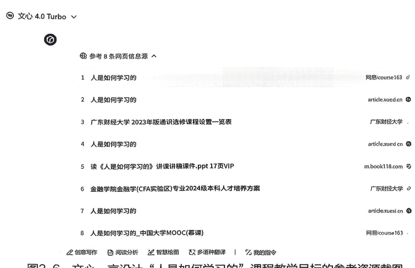
AI生成的教学目标示意如图3-7所示。

#### 二、教学目标设计

##### (一) 知识与能力目标
- 1. 掌握学习科学基础理论
  - 理解行为主义、认知主义、建构主义、人本主义与联通主义五大学习理论的核心观点及应用场景。
  - 掌握元认知、复述、精细加工、组织及资源管理等高效学习工具。
  - 学会用思维导图、概念图等思维工具促进知识整合与迁移。
- 2. 提升学习问题解决能力
  - 用学习原理剖析厌学、学习压力、学习挫折等常见问题的成因并提出对策。
  - 结合案例设计个性化学习方案，优化自主学习路径。
- 3. 培养跨学科知识迁移能力
  - 理解从概念到概念、从学科到学科等四类迁移模式，掌握促进迁移的策略。
  - 通过金融数学建模、经济数据分析等跨学科案例提升复杂问题解决力。

##### (二) 过程与方法目标
- 1. 线上与面授结合
  - 线上：完成慕课视频学习、单元测验、讨论区互动与作业提交。
  - 面授：通过小组研讨、案例分析、思维导图绘制等实践深化理论应用。


审阅后发现，因提示词未限定目标维度、约束条件，也未说明学情，生成结果过于宽泛，还混入了课程背景、学习过程、学时安排等无关信息。于是他调整提示词继续对话。

#### 3. 修改提示词，第二次生成
补充目标维度、文本长度、线上线下学时分配后重新提交。

> 你是高校教育学心理学领域的课程专家，《人是如何学习的》是广东财经大学本科生通识课，利用国家级线上一流课程进行线上16学时+线下16学时的混合教学，请依据中国大学慕课平台资料和校级教学大纲，从知识、能力、情感态度、课程思政四个维度设计线上、线下的课程教学目标。语言准确，限600字以内，仅输出四维度目标，不涉及其他内容。

#### “人是如何学习的”课程教学目标设计（线上+线下）
- 一、知识目标
  - 1. 线上：把握学习科学五大理论核心观点，理解脑科学与学习机制，通过慕课视频与测验完成基础理论建构。
  - 2. 线下：结合学科案例深化理论应用，掌握元认知策略、知识迁移等关键概念。
- 二、能力目标
  - 1. 线上：提升自主学习能力，训练批判性思维与信息筛选能力，学会用思维导图梳理框架。
  - 2. 线下：强化实践应用能力，设计跨学科学习方案，通过小组研讨与汇报提升协作表达。
- 三、情感态度目标


#### 4. 第二次评估
第二次输出按四维度、线上线下呈现，但目标仍显泛化，未完全覆盖大纲要求。

#### 5. 修改提示词，第三次生成
上传课程大纲，并在提示词中增加“已上传大纲，请生成与大纲要求一致的目标”，第三次提交。

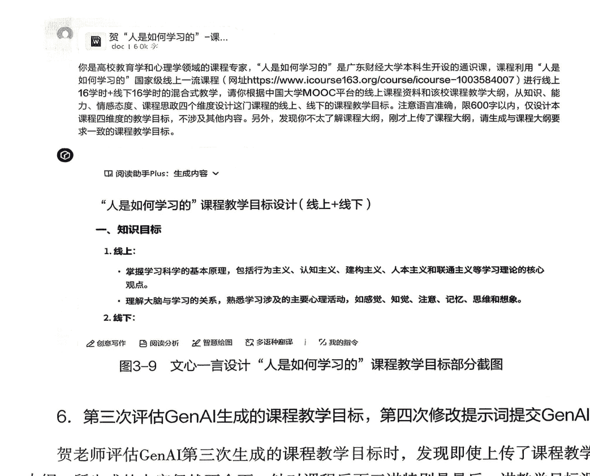
#### 6. 第三次评估并第四次修改
即使上传大纲，生成内容仍不完整，特别是课程后三讲尤其是最后一讲“优化学习——工具与策略”未被覆盖。贺老师进一步修正提示词，要求补全该部分。

#### 7. 第四次评估并完善
经过四轮人机对话，AI生成了相对满意的方案。贺老师审阅后对不妥之处进行修改，最终形成符合学校本科通识课程要求与学生实际的混合式教学目标。

请注意，课程目标须涵盖大纲要求，后三讲内容特别是优化学习——工具与策略讲未体现，需补充完善。

阅读助手Plus：生成内容 ▼

#### “人是如何学习的”课程教学目标设计（线上+线下）

##### 一、知识目标
- 1. 线上：掌握学习科学基本原理，包括行为主义、认知主义、建构主义、人本主义和联通主义等核心观点；理解大脑与学习关系，熟悉感觉、知觉、注意、记忆、思维和想象等心理活动。
- 2. 线下：通过案例分析深化学习原理理解；深入学习高效学习工具与策略，如元认知、复述、精细加工、组织策略及资源管理策略，以及思维导图应用。

##### 二、能力目标
图3-10 文心一言设计“人是如何学习的”课程教学目标部分截图

#### 广东财经大学“人是如何学习的”混合式课程教学目标

##### 一、知识目标
- 线上：
  - 1. 掌握五大学习理论核心观点，理解学习原理对学习的指导意义。
  - 2. 理解大脑运行原理与学习关系，熟悉学习相关心理活动。
  - 3. 了解学习影响因素，知晓优化学习的工具与策略。
- 线下：
  - 1. 深化学习原理理解，通过案例掌握理论与影响因素在实际场景中的体现。
  - 2. 掌握高效学习工具与策略及思维导图等思维工具应用。

##### 二、能力目标
- 线上：
  - 1. 培养自主学习与批判性思维，通过在线讨论、作业和测验提升信息筛选与处理能力。
  - 2. 学会使用思维导图整理与总结知识。
- 线下：
  - 1. 提高实践应用能力，能制定个性化学习计划、调控学习情绪、优化学习方法。
  - 2. 培养团队合作与沟通能力，在研讨、案例分析、辩论中有效表达。
  - 3. 根据学习任务与目标选择适当工具与策略，提升个人学习效率与质量。

##### 三、情感态度目标
- 线上：
  - 1. 培养科学学习态度，认同学习的可优化性。
  - 2. 增强学习兴趣与动力。
- 线下：
  - 1. 激发终身学习意识。
  - 2. 通过反思与分享增强自信心与自我效能感。
  - 3. 培养积极乐观的学习态度，学会应对压力与挫折。

##### 四、课程思政目标
- 线上：
  - 1. 引导树立正确学习观与价值观。
  - 2. 学习相关内容，树立社会责任感与历史使命感。
- 线下：
  - 1. 引导个人学习与国家发展结合，形成良好学术道德与诚信学习的意识。
  - 2. 形成关注社会问题、从社会实践中学习的意识，培养公民意识与爱国情怀。

经修改完善，该教学目标契合本校学生与课程特点，覆盖大纲要求，线上侧重理论学习与思维训练，线下侧重实践应用与价值观塑造，可实现提升学习力的总目标。

从贺老师的操作可知，借助AI设计课程目标需提供充分资料并经历多轮交互，教师需持续优化提示词、评估生成结果并结合学校与课程实际进行修改完善，才能形成合理目标。

### 二、借助AI设计跨学科课程教学目标

跨学科课程有助于培养创新等核心素养，但目标设计对教师能力与精力要求高。若整合不足，易出现目标拼盘或缺漏，影响教学引领。

以深圳市水田小学黄燕玲老师执教的小学三年级6学时跨学科课程“粽情端午，心系中华”为例。

#### 1. 应用AI分析诊断教师设计的跨学科课程教学目标
黄老师融合语文、数学、科学、美术等多学科要求，设计了以下目标：

> “粽情端午，心系中华”跨学科课程教学目标：
> 1. 学生能自主了解端午文化并整理资料形成思维导图汇报。
> 2. 学习吟诵平仄规律并尝试吟诵，传承优秀传统文化。
> 3. 通过拼装龙舟活动培养空间想象、动手与创新意识。
> 4. 了解图形特征，经历分类并借助绘图整理分析数据。
> 5. 自主设计龙舟造型并用黏土制作展示。
> 6. 以龙舟为媒介感受浮力大小，体验科学探究。

审视后黄老师认为目标较为松散，缺乏内在逻辑，于是使用DeepSeek对目标进行分析诊断与优化。

黄老师向DeepSeek提交目标与提示词进行互动。

#### 小学三年级端午节跨学科课程教学目标分析

针对小学三年级6学时跨学科课程“粽情端午，心系中华”设计的教学目标如下：

“粽情端午，心系中华”跨学科教学目标
1. 学生能够自主了解端午文化（包括由来、习俗、诗词、龙舟等），并整理相关资料，形成思维导图进行汇报展示。
2. 学习吟诵的平仄规律，尝试进行吟诵，传承中华优秀传统文化。
3. 通过拼装龙舟的数学活动，培养学生的空间想象能力、动手能力及创新意识。
4. 了解图形的特征，经历图形分类过程，并借助绘图方法尝试对图形数据进行整理与分析。
5. 自主设计龙舟造型，运用黏土等材料制作龙舟并进行展示。
6. 以龙舟为学习媒介，感受龙舟浮力的大小，体验科学探究过程。——请你作为教学专家，分析诊断这个跨学科课程教学目标存在的问题。

嗯，用户让我分析一个为小学三年级设计的跨学科教学目标，主题是“粽情端午，心系中华”，共有6个学时。

他们列出了六个教学目标，我需要找出其中的问题。首先，我需要回忆跨学科教学的基本原则，比如学科整合是否自然，目标是否明确具体，是否符合学生的年龄和能力等等。

图3-11 DeepSeek分析诊断“粽情端午，心系中华”跨学科课程教学目标截图

人机协同打磨跨学科目标：从“粽情端午”看AI教学设计的迭代

把DeepSeek拿来给跨学科课程的目标把脉，结果暴露出一连串典型问题。黄老师的“粽情端午，心系中华”最初的目标看上去学科很全，实则各条线各自为政。

诊断主要集中在五处。

学科整合松散像拼盘。文化探究、语文吟诵、数学拼装、数学图形、美术手工、科学实验六个目标并列，却缺少内在联动。龙舟拼装没有牵动图形特征和浮力原理，吟诵平仄也游离于端午主题之外。

难度与学段错位。三年级还没学古诗格律，却要求把握平仄；图形数据分析要求整理抽象数据，超出直观统计水平；浮力探究若扯到阿基米德原理则太重。建议是降维到节奏感受、用龙舟部件做实物分类、用对比实验感知漂浮即可。

表述模糊难以执行。自主了解文化没说怎么学，培养创新意识没说怎么体现，设计龙舟没给评价标准。需要把行为动词具体化，比如通过访谈和绘本归纳习俗并做思维导图，用黏土做出龙首船桨并说明意图。

数学与科学重复且割裂。拼装与图形分类都算数学，却没有进阶关系；浮力实验也没有结合体积载重测量。理想的连贯链是图形分类→拼装→载重测试，形成问题探究应用闭环。

文化内涵流于表面。目标只停留在了解习俗，未触及团结家国情怀，也没从龙舟合作中体悟集体精神。应增加情感指向，例如通过屈原故事和竞渡理解集体精神，并以小组合作完成制作。

黄老师复盘AI的思考过程后认可其全面性，但指出两点不足。一是建议里出现“用体验代替讲授”，三年级不能完全抛弃理论讲授，体验要配合适度引导；二是目标与活动混写，削弱了目标的引领性。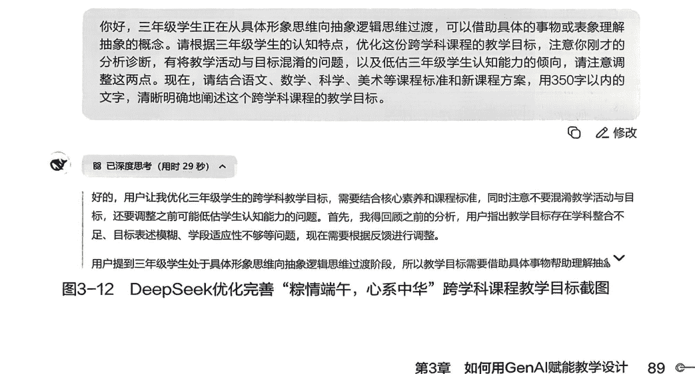

基于此她重写提示词，让模型严格区分目标与活动、紧贴课标。DeepSeek随后给出优化版，结构清晰为文化理解与表达、数学建模与科学探究、艺术创作与问题解决、跨学科素养整合四个板块，目标可观测可评价。黄老师审读后仍发现需要修正的地方，终版做了精细校准：

标题与表述更稳妥。文化理解板块从“文化理解与表达”调整为“优秀传统文化理解与表达”，数学科学板块从“数学建模与科学探究”调整为“龙舟模型与科学探究”，更贴合主题。

文化溯源去伪存真。原版写“粽叶包裹象征团圆”并要求联系生活举例，终版删去该不成立的象征，改为结合文本图片视音频资源简要分析习俗象征意义，避免错误文化认知。

类比更审慎。精神体悟从“像班级值日”这类牵强类比改为“初步感知传统文化与集体精神之间的联系”，保持意义完整且不误导。

数学下放到平面图形并强化观察。原版要求识别长方体棱锥等立体图形，终版改为观察归纳长方形正方形三角形等部件类型，并用统计表记录数量，符合三年级认知。

实验例证更科学。科学推理的例证从“泡沫板龙舟浮得更高”改为“纸板做的龙舟不易载物”，突出承载力对比而非单纯高度。

艺术例证文化准确。设计意图从“用绿色黏土制作粽叶船桨”改为“用红色黏土做船身，红色在中国传统文化中是吉祥热烈的象征”，既具体又符合文化常识。

协作例子的决策依据修正。协作创新从“主动承担分工”“我建议用纸板做船底因为它容易裁剪”改为“合理分工通力协作”“我建议用木板做船底因为它能防水且比纸板更能载重”，避免用加工便利代替功能考量，引导学生关注材料性能。

这些修改的指向是一致的：守住文化真实，匹配学段认知，目标语言干净利落不掺进活动细节，例子能真正促进思维而非误导。正是这种人机多轮对话、人工把关的流程，才让教学目标从好看走向好用。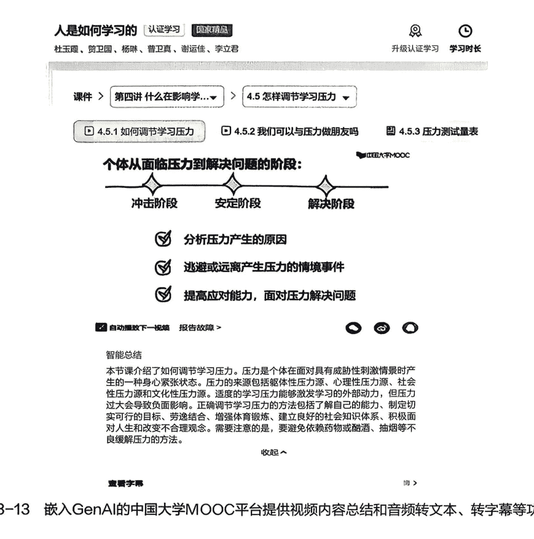

### 四 应用GenAI设计教学目标的要领

教师在使用AI生成目标时需要防范过度依赖、技术偏差、与课标脱节、过于笼统、忽视学情等风险。防范手段包括明确输入课标与核心素养、限定只输出目标、要求结构进阶、加入学科思维特征、强制可测量表述等。人机协同建议流程为解读课标教材→编写提示词→生成→审阅改写→整体审核→确认。审核清单要看指向性、适切性、层次性、可评估性、逻辑结构、表达规范。提供课程资料、明确多维度目标要求、善用多模态资源整理，均能提升目标质量。

教学方案评审要点与生成式AI协同优化指南

| 一级指标 | 二级指标 | 指标描述 | 权重 |
| :--- | :--- | :--- | :--- |
| 目标内容 | 教学目标科学合理 | 回应立德树人根本要求，融入核心价值引领，呼应核心素养；目标表述清晰可检验，关键点突出。 | 10 |
| | 教学内容组织科学 | 选材符合课标且顺应认知规律，强调能力养成；知识点覆盖完整，课时配置恰当。 | 10 |
| 教学过程 | 教学环节流畅紧凑 | 流程完整层级分明，衔接自然顺畅；课堂容量适中，时间调配均衡。 | 15 |
| | 教学方法策略适切 | 践行以学为中心理念，重视体验与情境感知；组织严谨，方法恰当，策略奏效。 | 15 |
| | 信息技术融合有效 | 熟练调用信息技术，依据目标遴选整合数字资源，助力理解与问题解决，激发创新，提升精准度与实效，实验环节技术使用合理。 | 15 |
| 教学资源 | 教学设计明确恰当 | 设计及任务单与目标一致，匹配认知水平，发挥导学作用，能调动积极性与创造性。 | 15 |
| | 作业练习规范科学 | 练习作业及实验紧扣目标，数量适中，难度梯度合理，形式多元，有助发展。 | 10 |
| 技术规范 | 资源完整提交规范 | 讲解实验多媒体切换自然，版面美观，声画同步；课件任务单练习信息齐全格式规范，引用标明出处。 | 10 |

> ① 教育部办公厅. 关于开展2024年“基础教育精品课”遴选工作的通知[EB/OL]. (2024-06-28) [2024-11-21]. http://www.moe.gov.cn/srcsite/A06/s3321/202407/t20240709_1140349.html.

在高校层面，国家级一流课程认定以及年度举行的教师教学创新大赛，都把方案设计质量作为重点评审项。以大赛举例，教学设计创新汇报占满分100分的40分，其分量可见一斑。

## 表3-7 第五届全国高校教师教学创新大赛的教学设计创新汇报评价标准①

| 评价维度 | 评价要点 |
| :--- | :--- |
| 教学理念 | 坚持立德树人，围绕学生发展展开，融价值塑造、知识传授、能力培养为一体，彰显课程育人效能。 |
| 总体设计 | 依托理念，思政与专业深度融合，对目标、内容、活动、方法、手段、教材、师资、考核、评价反馈等进行系统规划，有效对接专业培养方案并落实立德树人。 |
| 教学目标 | 目标契合学校定位、学情与专业需求，覆盖价值塑造知识传授能力培养；表述清晰具体易执行，动词准确规范。 |
| 学情分析 | 对认知特征与起点描述恰当，学习习惯与能力剖析合理，思想发展现状与规律概括准确。 |
| 内容分析 | 贴合思想发展与认知特点，体现育人理念与目标，知识体系科学清晰，思政资源挖掘深入，融合自然恰当。 |
| 过程与方法 | 活动多元过渡流畅，教师主导学生主体作用突出，有效提升素质知识能力；方法灵活，信息技术运用得当，激发兴趣引导思考，突出自主合作探究；资源案例选用科学，注重价值引领与理论实践结合，思政有机融入。 |
| 考评与反馈 | 评价维度丰富方法多样，内容科学，匹配学科与学情，可反映素质知识能力各方面成长。 |
| 设计创新 | 以价值引领知识传授能力培养融合为核心进行整体设计，体现育人理念与专业特色，具有思想性时代性科学性与创新性。 |
| 文档规范 | 文字符号单位公式规范，语言简练明晰，字体图表使用得当，结构完整布局合理格式美观。 |
| 现场交流 | 观点正确把握要点，条理清楚重点突出，表达流畅。 |

两套标准对照可知，优秀方案需体现先进育人思想、可操作的教学目标、贴合课标的内容安排、恰当的方法策略。实际操作中教师可依据情境对各要素详略弹性调整。高质量方案是保障课堂质量的基础。传统手工撰写耗时耗力，人机协同借助生成式AI可明显提升效率与质量。

> ① 中国高等教育学会. 关于举办第五届全国高校教师教学创新大赛的通知[EB/OL]. (2025-03-18) [2025-03-24]. https://www.cahe.edu.cn/site/content/17962.html.

### 二 GenAI助力教学方案设计的典型场景与策略

生成式AI在智能生成、推理分析与多模态资源整合方面可为教师提供支撑，方案的科学性、个性化与创新性均可增强。

理论上模型可覆盖方案设计各环节，甚至一键产出整套文本。但教学方案需面向特定对象、围绕具体目标统筹全过程活动，完全依赖一键输出的内容往往空泛，难以直接使用。

如图3-14所示，仅用一句话提示，智谱清言就能产出形式完整约两千字的方案。此类文本既不适合直接教学，也因覆盖过宽难以精修，反而占用教师精力。

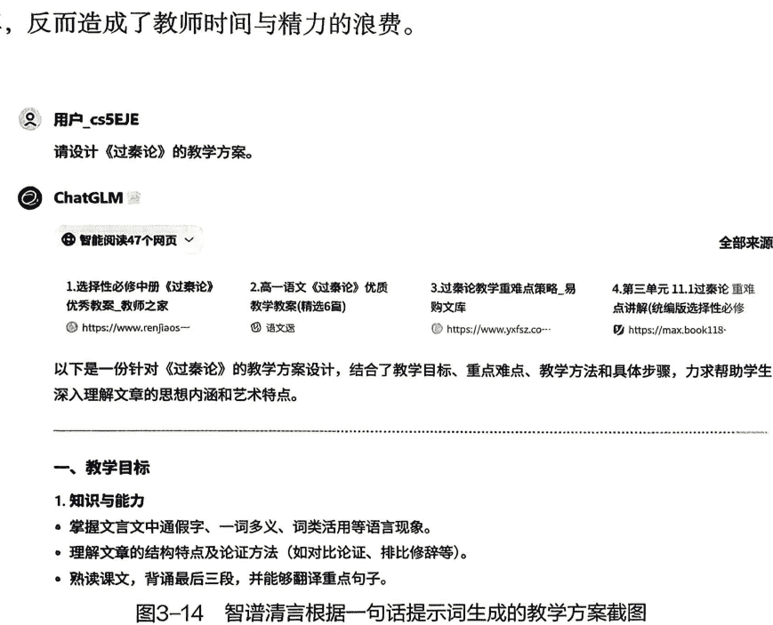

即便预先上传大量资料与模板，模型输出仍需教师认真核查完善。

实践中教师设计方案的瓶颈主要集中在以下环节。

#### 1. 借助GenAI解析学科素养并确定教学目标
让模型解读课程标准、核心素养与教学大纲，辅助提炼契合素养、可操作可测量的多维度目标；也可按不同学力生成分层目标，供教师筛选修改。

#### 2. 借助GenAI进行学情与重难点诊断
利用模型快速梳理前测、作业表现、学习偏好等信息并与教学内容关联，初步判断重点难点。教师再校对修正，明确学情与关键点。

#### 3. 借助GenAI设计促进思维成长的学习内容与任务
培养创新、批判等高阶思维的任务设计是难点。教师需向模型明确思维发展诉求，通过多轮对话产出以思维提升为导向的高质量内容与任务。

#### 4. 借助GenAI构建分层学习任务与活动
提供清晰提示词、任务要求、活动情境与相关资料，模型可生成分层任务与活动，经教师审核补充后可形成兼顾差异化发展的设计。

#### 5. 借助GenAI生成教学资源与学习环境
按活动需要，模型可快速生成摘要、图表、情境故事、音频讲解、仿真实验指导视频等素材，为环境营造提供支持。生成虽快，能否用于教学仍需严格审校，否则易带来认知风险。

#### 6. 借助GenAI设计评价工具与资源
模型可生成课堂测验、练习、反思卡片，设计量表与流程，甚至开发评价智能体，为自评互评提供工具。所有产出须经科学性、准确性、可靠性与适用性检验后方可使用。

#### 7. 借助GenAI支持教学反思设计
清晰的反思设计有助于教师记录过程性数据、课后总结经验改进问题。设计阶段可用模型制作课堂观察表；实施后可结合通义千问、讯飞听见等工具全程记录转写，通过热词分析等文本分析深化反思，反哺改进与教师成长。

### 三 GenAI赋能教学方案设计的典型案例

#### 1. 案例介绍：GenAI助力学生高阶思维发展的教学方案设计
《活板》为人教版语文七年级下册第六单元第25课。广州某中学吴老师以此课参加区级教学创新比赛。杜玉霞老师审阅后认为学习活动偏浅，不利于创新思维等高阶思维培养，提出修改建议。多次沟通仍不理想后，两人借助生成式AI重构学习活动部分，经多次人机对话，最终形成促进高阶思维发展的活动设计。

吴老师原稿学习活动节选如下。

> 七年级下册《活板》教学设计原稿学习活动部分节选

> 一、学习活动背景

> 本周，学校将举办科技节活动，主题是“科技改变世界，文明薪火相传”。我们班有一个摊位，需要在摊位上设计活动，展示中国古代的科技文明成果。我们班就以这篇文章为依据来向其他同学介绍中国的活字印刷术，让大家感受中国科技文化的魅力。

### 二、活动任务一：操作活板明过程
设置一个环节让参加科技节的同学在展示摊位上体验活字印刷术，请根据《活板》中的详细介绍梳理活字印刷术的工序，并进行制作演示。

任务指引：
1. 请同学们朗读文章，圈画出有关活字印刷术工序的关键词，并以学习小组为单位，交流讨论，梳理活字印刷术的步骤流程。
2. 我们要让来参加活动的同学体验活字印刷术，应该提前准备什么材料？

| 从制字到印刷的程序 | 具体步骤 |
| :--- | :--- |
| 制字 | 1. 活字原料——胶泥<br>2. 活字厚度<br>3. 与雕版不同之处<br>4. 活字如何成型 |
| 排版 | 1. 先设一铁板<br>2.<br>3.<br>4.<br>5. |
| 印刷 | 1. 一板印刷<br>2.<br>3. |

交流讨论：以学习小组为单位，用自己的话说说活字印刷术的流程，小组派出一名讲解员和一名演示员来进行解说和操作演示。

### 三、活动任务二：对比活板显优势
交流讨论：活字印刷术有什么突出优势？与雕版印刷术相比，活字印刷术的优势具体体现在哪些方面？

| 雕版印刷术 | 活字印刷术的优势 |
| :--- | :--- |
| 每本书需要许多块木板 |  |
| 按刻好的木板逐块印刷，一套书版需要几年，速度慢 |  |
| 发现错误不好改正 |  |
| 使用频率高的字，如“之”“也”等，需要一个就刻一个 |  |
| 以硬木刻制，保存不好容易腐坏，使字迹模糊 |  |

### 四、活动任务三：宣传活板悟精神
请同学们为活字印刷术写一则广告语，向科技节上的同学们宣传推广。要紧扣活字印刷术“活”的优势，并尽量与科技节的主题“科技改变世界，文明薪火相传”关联起来。要求：20字以内。可巧用修辞，或使用谐音，注意音韵节奏，使其朗朗上口，有记忆点。

例如：脉动一下，状态随时回来。（脉动饮料的广告语）

#### 2. 分析已有教学方案存在的问题，明确改进方向，设计提示词要求GenAI优化设计
杜老师判断原方案学习活动挑战性不足，任务三成果示例不当，需改进。于是整理原方案后，用设计的提示词与智谱清言互动，对学习活动进行优化修改。

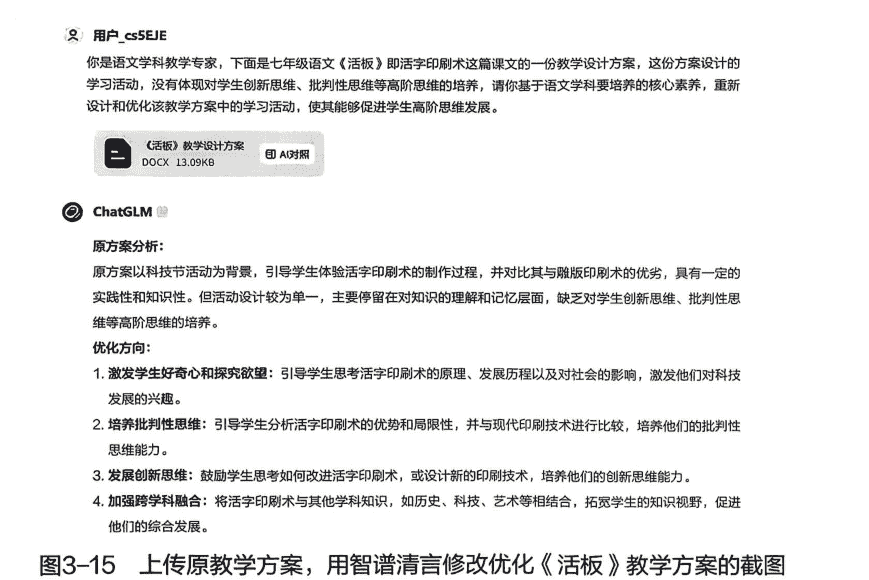

图3-15 上传原教学方案，用智谱清言修改优化《活板》教学方案的截图

#### 3. 审查评估GenAI修改优化的方案，追问完善，教师修改优化形成教学方案
杜老师发现优化后的活动更复杂，但部分环节缺少指导框架与示例，学生完成难度升高。于是追加追问提示：

> 你好，刚才优化的学习活动任务较复杂，为了促进学生合理安排学习任务，优化活动过程，请为学生配套设计一份学习活动任务清单。另外，请对个别过于开放的学习任务给出作品示例，以引导学生产出更高质量的学习成果。

经追问完善，并经两人研讨修改，人机协同与人人协同后形成如下方案。

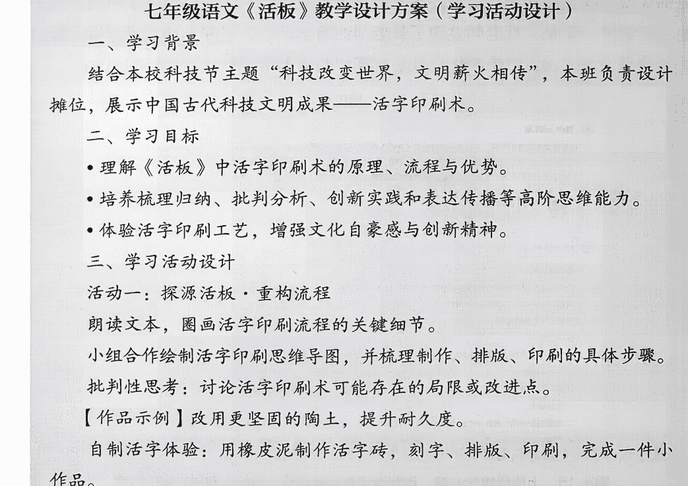

【作品示例】“科技改变世界”印刷成一张海报。

### 活动二：对比优劣·辩证思考
小组对比雕版印刷与活字印刷，从制作成本、效率、保存、改错等角度深入分析。

开展小组辩论：“雕版印刷VS活字印刷，谁更具时代价值？”

【成果要求】提交辩论提纲，参与现场辩论展示。

### 活动三：活字精神·创意传播
以小组为单位创作活字印刷术的广告语，要求紧扣“活”的特点与科技节主题，20字以内。

【广告语示例】“活字生花，文明流传！”“活字一动，天下皆印！”

任选方式进行创意表达：
- 设计宣传海报
- 拍摄30秒短视频
- 编排简短情景剧小片段

【作品示例】短视频模拟毕昇制活字、改版印刷的情景剧。

### 活动四：摊位布展与成果展示
整理流程导图，体验作品，对比分析海报、广告语及创意作品，布置科技节展示摊位。

现场安排讲解员和体验引导员。

### 四、学生学习任务清单

| 任务 | 任务内容 | 产出成果 | 注意事项 |
| :--- | :--- | :--- | :--- |
| 1 | 梳理《活板》流程 | 思维导图一张 | 内容清晰、逻辑严谨，可适当美化 |
| 2 | 活字制作与印刷体验 | 活字印刷作品一件 | 字体工整，排版合理，颜色清晰 |
| 3 | 分析雕版与活板优劣 | 对比表+辩论稿 | 论点明确，有事例支撑 |
| 4 | 创作活字广告语 | 广告语一条 | 不超过20字，朗朗上口，主题鲜明 |
| 5 | 完成创意表达作品 | 海报/短视频/情景剧 | 主题突出，富有创意与美感 |
| 6 | 摊位布展与讲解 | 摊位展示与解说流程单 | 展示整洁，解说清晰有条理 |

### 五、活动反思与迁移
科技节后课堂延伸讨论：
1. 反思：活字印刷术在当时推广中可能遇到哪些社会阻力？联系历史背景。
2. 迁移：今天的“3D打印”“电子书”等新技术，是否也在重复类似的科技演变？

六、学习活动学时安排与资源等（略）

案例表明，借助生成式AI可把教师原先停留在知识提取与初阶理解的方案，快速升级为能驱动创新思维、批判思维与综合迁移等高阶素养发展的设计。多数教师的方案并非全新创作，往往是基于既有方案的迭代优化。

### 四 应用GenAI设计教学方案的要领与方法
使用生成式AI设计方案时，建议分步构建与模块优化结合。先搭框架：确定目标、流程、评价，再逐步细化；对已有方案，可先明确改进点，再用模型局部改写、整体完善。始终保持目标连贯、活动具体、成果明确，对逻辑与细节反复审视，以实现系统化优化与创新。

表3-8 应用GenAI设计教学方案的要领与方法

| 教学设计要点 | 具体要领 | 方法说明 |
| :--- | :--- | :--- |
| 分步构建 | 先搭框架，再填内容 | 教学目标→活动设计→成果要求→评价方式，逐步推进 |
| 模块细化 | 各环节独立优化 | 每个活动模块都有明确的任务、成果、思维要求 |
| 局部改写 | 小步调整，局部升级 | 针对已有方案调整活动安排，提升成果质量 |
| 整体完善 | 保持连贯与系统性 | 保证各模块之间目标一致、逻辑清晰、节奏合理 |
| 生成性引导 | 明确产出，示范引导 | 指定具体作品形式，提供示例，产出优质成果 |
| 高阶思维融入 | 注重分析、创新、批判 | 在任务设计中嵌入批判性思维、创新表达等要求 |

## 第5节 GenAI赋能作业设计
作业是课程的重要延伸，是学生在课后进行的自主探究性学习活动，对建构意义、提升学习效能意义重大。①2021年国务院《关于进一步减轻义务教育阶段学生作业负担和校外培训负担的意见》明确要求提高作业设计质量，发挥诊断、巩固与学情分析功能，推动符合学龄特点与学习规律、体现素质导向的作业设计，鼓励分层弹性个性化作业，坚决克服机械无效作业。文件对教师作业设计能力提出更高标准，如何设计促进创造性学习与个性化发展的作业，是创新人才培养需持续探索的问题。

设计高质量作业需要教师具备扎实能力并投入大量时间。若灵活应用生成式AI，可基于教学目标与学情快速生成目标明确、内容生动、形式多样的作业，并借助模型开展评价与反馈，充分发挥作业在核心素养培育中的作用。

结合作业现状与生成式AI典型应用，本书聚焦生成式AI赋能高阶思维发展的作业设计、跨学科作业设计、作业范例生成三大方向，为教师提升作业设计效率与质量提供参考。

### 一 GenAI赋能高阶思维发展的作业设计

思维锻造时代：让生成式智能赋能作业设计

布卢姆把认知分为六个递进层级，前三个偏重记忆、理解与迁移，后三个聚焦分析、评判与创新。教学重心正从知识搬运转向思维培育，借助生成式智能可以让教师更精准地设计促进进阶认知的任务。

> ① 罗生全，优化作业设计 增强育人实效 [N]. 中国教育报，2021-11-25（2）.

#### （一）用生成式智能支持进阶认知作业的设计思路
教师借助生成式智能来为特定教学意图定制任务，其关键环节大致如下。

1. 依托教学目标拆解作业要达成的认知层级
要实现以作业促思维的目标，必须先把教学目标拆开，看其中隐含的思维要求。比如目标是“弄懂光合作用原理”，对应的认知层即理解；若目标是“构思可持续的城市发展方案”，作业就应围绕分解城市要素的关联、评议现有方案、创制可行路径等高层认知展开。

2. 挑选适配的智能工具实现人机配合
工具选择影响产出质量。纯文本练习可选用文本生成能力强的模型；作业涉及图像、音视频时需选用能产出对应素材的系统，或多系统联动。匹配度越高，生成质量越可靠。

3. 对模型产出进行审校并精细打磨
即便模型很强，教师仍需把关。产出后要对照教学意图检验科学性、准确性与契合度，再据评估结果修改完善，确保任务贴合教学指向与学习者的认知规律，能够真正支撑思维成长。

#### （二）进阶认知作业设计的课堂实践
以下以语文一篇文言文为例说明操作路径。

## 1. 案例概览
《两小儿辩日》出自人教版语文六年级下册第五单元第14课，选自《列子·汤问》。单元指向是“用具体事例说明观点”与“展开想象写作科幻”。本课教学要点为“把握两位小孩各自的观点与理由，理解其论证方式”。教师陆老师利用生成式智能设计贴合单元与课文目标的进阶思维作业。

## 2. 人机协同设计流程
（1）选定工具，解析目标，明确思维指向
陆老师选用Kimi展开协作，先让模型复现课文原文确认理解，再进入目标分析。她先给出较长的提示词，随后压缩为“请用约120字写出本课作业应培养的具体进阶思维目标”。模型回复要点为：梳理观点与论证过程以锻炼逻辑与分析；对观点进行质疑与评价以培养批判意识；结合单元科幻写作要求进行创新性续写或从现代科学角度解释现象。

（2）协同生成进阶思维任务
在明确指向后，陆老师请模型为学生设计促进逻辑、批判、创新思维的任务，字数控制在250字内。模型给出三项独立训练：用思维导图呈现两位小孩观点与支撑现象并标注逻辑关系；结合现代科学分析观点局限并写150字以上评述；假设自己是孔子，用现代科学为辩论解惑，写约200字续篇。

陆老师觉得目标清晰但分散，便要求将三类训练嵌入具体情境隐性达成。首轮情境与文本关联弱，经提示细化后，模型提出整合情境“未来科学小侦探”。设定学习者穿越至古代，目睹辩日并帮助解惑。

任务一侦探推理：用表格呈现双方观点、支撑的现象及逻辑合理性判断。
任务二科学质疑：用现代科学知识评判观点合理与不合理之处，思考成因并指出问题，约150字。
任务三创意解谜：设计一个简易安全的科学小实验解释太阳大小与温度变化的本质，可文字描述或示意图。

陆老师认可整体，但认为任务三难度偏高不适合单独完成。

（3）审校产出并完善方案
经评估，任务三操作性不足且缺乏提交、时间、评价说明。陆老师据本校学情调整为小组合作，每组4人，并补充执行细节：
①完成方式
前两项个人独立完成，第三项小组协作。
②提交时限与评价方式
3月10日前在国家中小学智慧教育平台班级作业区提交前两项，形式为Word或手写拍照。先观摩点评三位同学作业，再自评修改。
3月17日前在平台提交第三项，形式为Word、PPT或手写拍照。每组观摩点评三组作业后自评完善。
③成绩构成与展示
成绩为自评30%+同学互评均值30%+教师评40%。评后择优发布于学校微信公众号，鼓励基于反馈持续优化，形成学习闭环。

## 3. 设计要点提示
从上述过程可见，教师始终主导，需客观审校模型结果并及时优化提示词；要依据学情改写内容，使任务符合认知发展水平；要结合教学环境明确提交与评价规则。

### 二 生成式智能助力跨学科作业
单一学科边界明显，易导致知识割裂。新课标强调学科综合与跨学科主题学习。对教师整合与协同能力提出更高要求，而生成式智能可扮演多学科专家角色，提供高效支持。

#### （一）跨学科作业设计的策略

1. 先厘清跨学科目标，再确定设计方向
教师应分析内容要融合哪些学科、要达成哪些核心素养，如批判性思维、复杂问题解决等。为提升分析精度，可先上传课程资料对模型进行针对性训练。
例如五年级科学“食物链和食物网”教学中，李老师为弥补课时不足、提升探究与综合素养，先把教材与目标上传至DeepSeek，请其分析可融合的学科与作业目标。模型指出该主题可结合语文、数学、美术、信息技术、道德与法治等，通过探究、数据处理、绘图、编程模拟、环保行动等培养系统思维、逻辑推理、科学探究、信息素养等。李老师据此决定融合语文、数学、信息技术、美术，围绕系统思维、逻辑推理、科学探究、数字素养展开设计。

2. 撰写清晰提示词实现人机协同
提示需具体，明确融合学科、培养能力、情境要求。
李老师初次仅问“请设计该课的跨学科作业”，模型给出“守护生态平衡”主题，任务包括田野调查与数据分析、生态日记与漫画、编程模拟与倡议书，趣味性足但实施难度大且缺乏统领情境。反思后他把提示细化为“为已学完该课的五年级学生设计融合语文、道德与法治、信息技术、美术的跨学科作业，培养系统思维、逻辑推理、科学探究、信息素养，请用一个具体情境统领任务”。
模型返回主题“生态侦探——揭秘身边的食物链与食物网”，设定学习者受邀调查周边生态环境并提出可持续建议。作业分三项，可独立完成亦建议顺序推进，最终形成完整报告。
任务一生态调查员：观察记录至少四种生物，推测食物链关系并扩展为食物网，以“侦探笔记”形式撰写300字内观察报告，包含观察对象、主要生物、相互影响及若某生物消失的可能后果。
任务二生态艺术家：以科学加美术或信息技术的方式可视化食物网，后续任务逐步融合道德与法治的倡议表达与信息技术的模拟呈现，形成跨学科成果。

跨学科作业如何用AI打磨出来的

任务设计初稿
在观察活动完成后，需要借助手绘或数字工具绘制一份包含不少于六种生物的食物网图。手绘时可用不同颜色或图形区分生产者、消费者和分解者。数字化属于选做，可用PPT、思维导图或编程软件做成可交互的食物网并呈现。

任务3：生态守护者——生态保护与可持续发展 语文+道德与法治+科学
在前两项任务观察与分析的基础上，探讨滥捕、污染、外来物种入侵等人为行为对食物网稳定性的影响，查阅资料后撰写一份生态保护倡议书，用鲜明立场和扎实数据呼吁保护家乡生态环境。

作业提交要求
① 提交物
生态小故事 手写或电子版
食物网可视化作品 手绘或电子版
生态保护倡议书 手写或电子版
② 完成方式
可个人完成，也可小组协作讨论优化作品，电子版上传班级学习平台或课堂分享。
③ 评分标准 总分100
科学理解 准确说明食物链、食物网、生态关系 30分
逻辑表达 生态故事合理，能分析生态变化影响 20分
跨学科融合 融合信息技术、美术等呈现研究成果 20分
创新表现 作品清晰美观，表现形式有创意 20分
任务完成度 按要求完成全部任务并提交完整作业 10分

李老师看了DeepSeek生成的跨学科作业，整体还算满意，在准备修改前他想用其他生成式AI再试一试，看能否得到更有启发的任务设计。

3. 用多个GenAI工具试跑，筛选跨学科作业方案

李老师觉得DeepSeek给出的作业目标清晰合理，但想对比其它模型的能力，于是把与DeepSeek的对话提示词原样复制到文心一言、豆包、Kimi、讯飞星火，开展了如下实践。

（1）先测模型是否懂具体的学科教材内容
为检验模型对小学五年级科学教材的熟悉度，李老师统一用以下提问：
教育科学出版社五年级科学课程中包含“食物链和食物网”这一课，请说明该课的教学内容。
四个模型给出的回复汇总如下表3-9。

表3-9 四个模型对“食物链和食物网”教学内容的回答对比

| 模型名称 | 回复要点 |
| :--- | :--- |
| 文心一言 | 1. 食物链认知：定义、起点为绿色植物、营养级划分、能量传递约10%—20%。2. 食物网认知：定义、特点、作用在于增加能量传递路径、增强稳定性。3. 生态系统概念：生物与非生物相互依存、生态平衡重要性。4. 实践活动：观察记录、模拟实验加深理解。 |
| 豆包 | 1. 食物链构成与规律：概念举例、生产者、消费者分类、传递方向。2. 食物网形成与复杂性：同种生物参多条链、复杂即稳定、单一物种减少会连锁。3. 生态平衡重要性：过度捕猎狼导致草原退化、捕杀麻雀导致害虫爆发等案例。 |
| Kimi | 1. 导入：以蔷薇花丛或绿豆苗为例引出谁吃谁。2. 食物链概念：链条、箭头指向捕食者、由生产者起步。3. 食物网概念：多链交错、举例蚜虫、瓢虫、蚯蚓、小鸟。4. 生产者与消费者：光合作用制造食物、动物取食。5. 意义：反映复杂关系、变化影响整体稳定。6. 拓展：模拟游戏讨论食物网中个体变化的影响。 |
| 讯飞星火 | 1. 概念：食物链包含生产者、消费者、分解者角色。2. 食物网：多条链组成的网络。3. 能量流动：从一种生物到另一种生物的转移。4. 生态平衡：数量变化如何影响系统。5. 人类活动影响：污染、过度捕捞、毁林等破坏链条。6. 案例研究：认识相互依赖。7. 实践：户外观察、构建模型。8. 环保意义：强调生物多样性保护，提示具体教材可能有差异。 |

分析后李老师发现，只有Kimi的输出更贴近教材表述，文心一言、豆包、讯飞星火多为围绕主题的通用科普，说明这三款模型对具体课文内容并不了解。结论是模型学科知识丰富，但对指定教材掌握不足，生成教学类内容前需先行训练。

（2）用教学目标和教材内容对模型进行针对性训练
为提升生成质量，李老师把小学五年级科学课程标准、“食物链和食物网”教材原文以及DeepSeek此前确定的作业目标全部上传给文心一言、豆包、Kimi、讯飞星火，让模型先熟悉课程和命题意图，再进行作业设计。

（3）训练后的模型设计跨学科作业
在模型掌握教材与目标后，李老师再次使用最初的提示词让四款模型分别设计跨学科作业，成果见表3-10。

表3-10 四款模型生成的跨学科作业对比

| 模型名称 | 作业方案要点 |
| :--- | :--- |
| 文心一言 | 情境“绿野小镇”生态受人类干扰。分角色：生态学家绘制食物链网并提出保护建议；画家绘制生态画；记者撰写新闻报道呼吁保护；信息科技专家用PPT或短视频展示并在社交媒体传播。 |
| 豆包 | 项目“守护绿豆苗生态区”。语文+科学写生态日记并创作拟人科普故事；道德与法治+科学制定校园生态区保护公约；信息科技+科学用Scratch或PPT做动态食物链模拟并讲解；美术+科学绘制A3宣传海报。 |
| Kimi | 主题“绿豆苗生态探秘”。任务一语文写生态园故事含三种生物角色；任务二道德与法治写保护倡议书并提两条措施；任务三信息科技设计生态信息系统含数据库、图示、知识库；任务四美术创作生态园作品展示三种生物位置。小组展示评价。 |
| 讯飞星火 | 主题“构建和谐生态村庄”。语文+道德与法治写故事含三条食物链并角色扮演；信息科技收集整理食物链、做Excel记录与简单分析；美术绘制食物网图和用回收材料做立体模型；系统思维分析风险并设计校园微生态观察实验。 |

（4）比较与筛选
李老师认为训练后四个模型的方案都更贴合教材，任务贴近学生生活，能按学科特点分工。但整体任务偏多，学科间的融合不够紧密，不利于培养解决复杂问题的能力。豆包和文心一言尝试了两学科融合，但进阶性和逻辑衔接仍显不足。与之相比，DeepSeek的原方案任务链更清晰，只是没有结合广州学生的在地环境。

为确定最终作业，李老师把五份方案和提示词发给语文、道德与法治、美术、信息科技四位老师召开教研会。

4. 跨学科教研共同修改完善作业
各科老师一致认为DeepSeek的方案更符合本校学情，任务递进合理，但原任务3仅写倡议书略显单薄。经讨论决定把任务3改为小组作业，增加可对外分享的成果。修改后的任务3如下：

任务3：生态保护者——生态保护与可持续发展 语文+道德与法治+科学+美术+信息科技
任务描述：
在任务1观察和任务2分析的基础上，讨论滥捕、污染、外来物种入侵等人为活动如何削弱食物网稳定性。结合查阅的珠江或白云山生态变化资料，四人一组完成两项小组作品：作品一，撰写一份关于珠江或白云山的生态保护倡议书，以鲜明观点和可靠数据呼吁保护身边环境；作品二是基于倡议书内容，利用GenAI工具和网络资源制作面向广州市民的2—5分钟生态保护短视频。优秀作品将在学校视频号发布，并投稿至广州市科普网、广东省科普网和中国科普网。

**穗城生态守护行动正式启动**

任务三定稿后，五位主课教师围绕成果提交渠道、截止节点、成果分享与交流等操作细节达成共识，并向学生官宣了本轮跨学科探究项目。

## 项目主题：成为广州生态平衡的守护人——呵护身边的自然系统

生态平衡既关系到自然的长续运转，也关系到人的长远生存，守护它需要每个人形成自觉担当，人人参与才能实现人与自然互利共生、共建宜居家园。期盼同学以广州生态卫士的身份，调用科学、语文、道德与法治、信息技术、美术等课程所学，细致观察周边的自然环境，例如珠江、白云山等地的生物构成，梳理出食物链与食物网，找准维系平衡的关键节点，提出守护建议，制作助力环境可持续的倡议作品。通过本次实践，有意识地锻炼系统思维、逻辑推理、科学探究、信息素养等核心素养，为应对未来不确定社会做好储备。

## 实践任务

本期共设三项任务，覆盖科学、语文、道德与法治、信息技术、美术等学科，每项可独立完成，建议按序推进并最终全部完成。

### 任务1：生态观察员——观察与解析（科学+语文）
**说明：**
先在校园、公园、花园等日常环境做观察记录并分析食物链关系的基础上，重点关注珠江、白云山的生物，记录不少于4种生物并推断其食物链关系，如“植物→昆虫→鸟”。查阅资料后完善食物链并扩展为简易食物网。

以“生态观察手记”形式撰写不超过300字的观察小记，需包含：
- 观察环境中主要有哪些生物？彼此如何相互影响？
- 若其中一种生物消失，可能产生何种后果？

### 任务2：生态创作者——食物网图示（科学+美术+信息技术）
**说明：**
基于任务1的观察成果，绘制或借助数字工具制作食物网图，至少包含6种生物。
- 手绘：用不同颜色或图形区分生产者、消费者、分解者。
- 数字化选做：使用PPT、思维导图软件或编程软件，制作可交互的食物网并演示。

### 任务3：生态守护者——保育与可持续发展（语文+道德与法治+科学+美术+信息技术）
**说明：**
结合任务1观察与任务2分析，探讨人类活动如过度捕捞、污染、外来物种入侵等对食物网稳定性的影响，并查阅珠江或白云山生态变迁资料。以4人小组为单位完成两项成果：
作品一：撰写一份面向珠江或白云山的生态守护倡议函，以鲜明立场和可靠数据呼吁公众守护身边生态环境；
作品二：在倡议函基础上，运用生成式人工智能工具与网络资源，制作一部时长3—8分钟、面向广州市民的生态保育短片。

## 交付要求

1. 交付物共四项：
① 观察小记，手写拍照或电子版；
② 食物网图示成果，手绘拍照或电子版；
③ 生态守护倡议函，手写拍照或电子版；
④ 生态保育短片，分辨率1920×1080。

2. 完成方式：
作品①②由个人独立完成，作品③④由4人小组协作完成。递交后按平台评价标准进行自评，并至少点评3份以上同学作品；根据同学与教师点评意见对作品进行迭代完善。
视频制作过程中可使用生成式AI进行资料检索、分析与创作辅助，但不得用其代写倡议函，引用网络资源须标明出处并遵守知识产权。
实践中遇到思考无法解决的问题，可在国家中小学智慧教育平台班级群联系老师，科学、语文、道德与法治、信息技术、美术五科教师将协同指导。

3. 提交节点：
作品①②于3月15日前提交至国家中小学智慧教育平台班级作业栏目；作品③④于3月28日前提交；修改完善后的终版于4月20日前提交。

#### （二）教师借助生成式AI设计跨学科作业需注意要点

教师使用生成式AI设计跨学科作业时，应充分发挥其优势，同时兼顾教学目标、学生水平、教学环境、社区资源、技术限制等要素，关注任务合理性、学科融合度、认知负荷与学术诚信，实现技术与教学深度融合，提升学习体验与跨学科思维。

1. 目标清晰，学科融合要有内在逻辑
跨学科作业综合性强，设计时应明确融合的学科与具体目标，避免宽泛。任务须围绕目标展开，促进核心素养与综合能力发展，确保各学科内容内在关联而非简单拼接。

2. 防过度依赖AI，及时评估并增强本土适配
生成式AI可提高设计效率，但不可直接套用。教师应审慎评估目标落实、内容科学性、表述准确性及本土体现，结合本地特色与本校学情修改完善，增强本土性。

3. 跨学科教师协同，共建AI资源库
不同学科教师需加强协作，从各自学科视角审视目标与任务，评估优化设计。可共享优质AI工具、常用提示词模板、优秀作业案例及典型问题，提升协作效率。

4. 坚守教师主体，关注伦理与数据安全
生成式AI是辅助工具而非替代。教师应承担目标校准、内容审核、伦理把关与数据安全责任，敏感资料不得上传，对存在伦理或意识形态问题的生成内容须修正。

5. 其他常见问题与对策
表3-11 不同学科教师协同设计跨学科作业时常见问题与解决方法

| 序号 | 问题 | 解决方法与措施 |
| :--- | :--- | :--- |
| 1 | 各学科教师时间难协调 | * 开展10分钟短时研讨，集中解决一两个关键问题。<br>* 利用在线平台召开线上研讨，便于异地教师参与。 |
| 2 | 教师使用AI水平参差 | * 组织有经验教师分享使用经验与方法。<br>* 整理应用资源边学边练，研讨总结方法。 |
| 3 | 学科教师参与度不均 | * 共商协作机制，采用任务分工加整体整合模式，明确各学科参与度。<br>* 按任务特点确定1-2位主导教师，其余教师协助。 |
| 4 | 评价标准难统一 | * 多元化评价：学生自评、同伴互评、多学科教师评价，权重由教师共同商定。<br>* 定性与定量结合，多学科协商主导评价方式。<br>* 借助AI生成初稿，教师共同修改确定标准。<br>* 采用学科单项评分加跨学科综合评分兼顾不同维度。 |

### 三 生成式AI赋能作业范例生成

#### （一）作业范例对学业质量的提升作用

1. 帮助学生更清晰理解任务
面对挑战性作业，学生常不知从何入手。AI生成的清晰范例可快速帮助学生理解任务要求与思路逻辑，减少因格式不熟悉带来的障碍。

2. 支持个性化学习需求
AI可按学习水平生成不同难度范例，满足差异化需求。

3. 培养批判性思维，避免机械模仿
AI可提供多版本或待优化范例供学生比较分析，提升批判性思维。

#### （二）生成式AI赋能作业范例生成方法

1. 明确作业目标与类型
依据课程内容与学情，确定认知层次与作业类型，为高质量生成奠定基础。

2. 精细化设计提示词
提示词质量决定生成效果，需明确范围、质量层级、结构、呈现形式、字数等要求。

3. 人工评估与优化调整
生成后教师需人工检查准确性、合理性与适切性，发现偏差后通过追问或修改提示词再生成，形成“人审—机调—人定”的协同流程。

#### （三）生成式AI赋能作业范例生成的案例

为提升学生对《红楼梦》的深度阅读及历史想象、人物理解与创造表达能力，广州某中学刘老师设计作业：以600—800字想象作文，描写林黛玉、史湘云等十二钗穿越至当代社会的生活。背景设定为第七十回众人吟诗后穿越，当代情境下人物性格保持原著特征并展现时代冲击下的成长。学生反映题目难度大。

刘老师分别用DeepSeek和ChatGPT生成两篇范文供参考，并进行点评。

**提示词示例：**
你是一位知名作家，擅长人物心理描写，请写一篇600—800字的短文，反映林黛玉、史湘云等十二钗穿越到当代社会的生活。背景为《红楼梦》第七十回众钗吟诗后穿越至现代。以林黛玉为主角，合理想象其在新环境中的变化与成长，保持原著性格特征，符合现代生活情境，体现时代冲击与焕发光彩。

**DeepSeek生成范文《数字时代林黛玉的文化生活》要点：** 林黛玉穿越两年后成为诗词直播主播，与运动博主史湘云保持联系，通过直播进行诗词接龙，展现共情能力与志愿服务，夜晚在无人机星图下与湘云对话，思考古今之美，最后以春雨与直播开场回应新生活。

**ChatGPT生成范文《桃花依旧，人间新梦》要点：** 林黛玉穿越至北京，参加文学社投稿、网络发表诗歌，出版诗集《桃花依旧》，在大学讲授古典文学，宝钗、湘云、探春分别创办公益书院、文艺策划、跨国企业，黛玉在盛世中自由绽放。

刘老师依据五维度量规进行评价并发布，供学生观摩。

表3-12 《数字时代林黛玉的文化生活》评价
| 评价维度 | 分数 | 评语 |
| :--- | :--- | :--- |
| 主题设定 | 8 | 设定林黛玉穿越成为诗词主播，契合文化融合主题，有想象空间。 |
| 人物还原度 | 9 | 黛玉敏感多情清雅延续良好，配角性格合理。 |
| 时代融入感 | 8 | 直播、社群、无人机等细节自然，可增现实冲突。 |
| 语言文采 | 9 | 文笔典雅兼具现代节奏，画面感强。 |
| 情感深度与思辨性 | 8 | 以内心对话展开古今认知转变，情感丰富思辨较深。 |
| 总评 | 42 | 想象丰富、文风优美，融合气质与科技场景，若增加网络争议描写张力更强。 |

表3-13 《桃花依旧，人间新梦》评价
| 评价维度 | 分数 | 评语 |
| :--- | :--- | :--- |
| 主题设定 | 9 | 主题明确，围绕文学成长与时代融合，但内涵可更凝练。 |
| 人物还原度 | 9 | 性格延续自然，部分语言可更连贯。 |
| 时代融入感 | 8 | 校园投稿、网络写作、大学讲课融入较好，身份适应逻辑略缺。 |
| 语言文采 | 9 | 语言符合人物，表述流畅，部分段落可凝练。 |
| 情感深度与思辨性 | 8 | 情感真实，思辨性不足，需强化内心冲突。 |
| 总评 | 43 | 立意积极，展现才情绽放，增加心理波动层次可提升深度。 |

# 第4章 如何用GenAI创建教学资源

## 第1节 如何用GenAI创建文本类教学资源

AI 课堂产出加速：文字与图像教学资源的生成实战

课堂里的文字材料一直都是刚需，用来讲清概念、搭建情境、承载任务。过去这类材料基本靠老师手工写，网上找来的还要自己归纳、提炼、再加工，耗时耗力，新意、丰富度与灵活度也有限。经过海量文本训练的生成式模型已能把握语法、语义与上下文，按要求输出连贯条理的文字，而文本生成几乎是所有大模型的标配。学会用模型生产文字素材，备课效率会明显提升。

### 一 先把起步基础打牢
#### （一）先把教学意图和材料用途想清楚
让模型产出能直接用的课堂级文字，第一步要把使用目的想明白。同一段文字，可能是帮助理解概念、呈现典型案例，也可能是供独立阅读、启发思考，或用于小组研讨、深度对话。用途定位清晰后，指令才会写得具体，生成物才不容易跑偏。

#### （二）挑与教学匹配的工具
模型迭代很快，可选面很大。都能写，但训练语料来源、规模、专业覆盖和质量差异明显，直接影响输出水准。教师需要对比功能特点和表现，优先选用专业性、学术性更强的工具来做教学文字的创作。

#### （三）先把支撑材料备齐
想让生成结果更准确、更贴教学，就要先收集支撑材料：教材原文、教学参考、研究论文、典型案例、学生作业等。用这些材料对模型做前置喂养，能帮助它更快抓住教学脉络，产出更贴课堂需求的文字。

### 二 生产文字的思路与策略
#### （一）指令要具体、身份要清晰
高质量的指令是优质输出的前提。指令要设定身份、限定视角立场，写清任务细节、文体风格与难度层级、结构格式、字数限制，还要点明学科领域、适用学段和认知要求，确保产出与教学需求精准对齐。

例如高中物理教师想做一份课后延伸阅读，可这样下达任务：“你是一名既懂物理前沿又熟悉中学教学的专家，请为高二学生写一篇约800字的引导性阅读。语言要通俗又不失科学性，介绍力学的发展前沿，并结合交通、建筑等生活实例，激发学生对力学价值和职业发展的思考。文章要有学术性也具启发性，适合课堂和课后使用。”

#### （二）按文体形态采取不同打法
课堂里用的文字形态很多，作用也各不相同，不同类型需要不同的生成策略。

##### 1. 概念讲解类文字的产出思路
这类文字主要用来拓展教材、深化学科理解，强调科学性、准确性和系统性。指令设计好并拿到初稿后，教师必须对照学术文献自行复核，最好再请学科专家审校，确保术语规范、表述可靠。

例如信息科技课上讲完人工智能后，高老师发现初一学生对深度学习很感兴趣。他用文心一言生成了一份讲解初稿，自行对照资料修改后仍不放心，就请计算机专家贺老师审校，确认无误后才作为课后拓展发给学生。

## 初中生视角下的深度学习系统介绍：从神经网络到智能应用

## 一、什么是深度学习？——像搭积木一样构建智能
深度学习是人工智能的核心技术，通过模仿大脑神经网络，让计算机像人一样“思考”和“学习”。

- 神经网络的基本单元：人工神经元像积木一样层层堆叠，形成复杂网络。每一层负责提取不同特征，比如图像的边缘、形状或声音的频率。
- 从数据中自动学习：模型无需人工写规则，通过海量图片、语音或文本自动找规律。例如用百万张猫图，模型就能学会识别猫的特征。

## 二、深度学习如何工作？——从输入到输出的智能旅程
1. 前向传播
数据从输入层进入，经各层神经元计算转换，最终输出结果。图像识别中，输入层接收像素，隐藏层提取边缘纹理，输出层判断内容。

图4-1 高老师使用文心一言生成初中生课后拓展学习资料的过程截图

教师和计算机专家修改、审校后的拓展阅读材料可扫描如图4-2所示的二维码查看。


##### 2. 案例分析类文字的产出思路
为了让学生把知识迁移到真实情境，需要带背景、细节饱满的案例引导高阶思维。教师可先设计指令让具备检索整合能力的大模型生成案例，再通过多轮追问补充背景、增添数据，提升完整度。

例如贺卫国老师讲“人是如何学习的”中“如何应对学习挫折”主题时，用智谱清言生成了两个贴合课程的案例。（见图4-3）

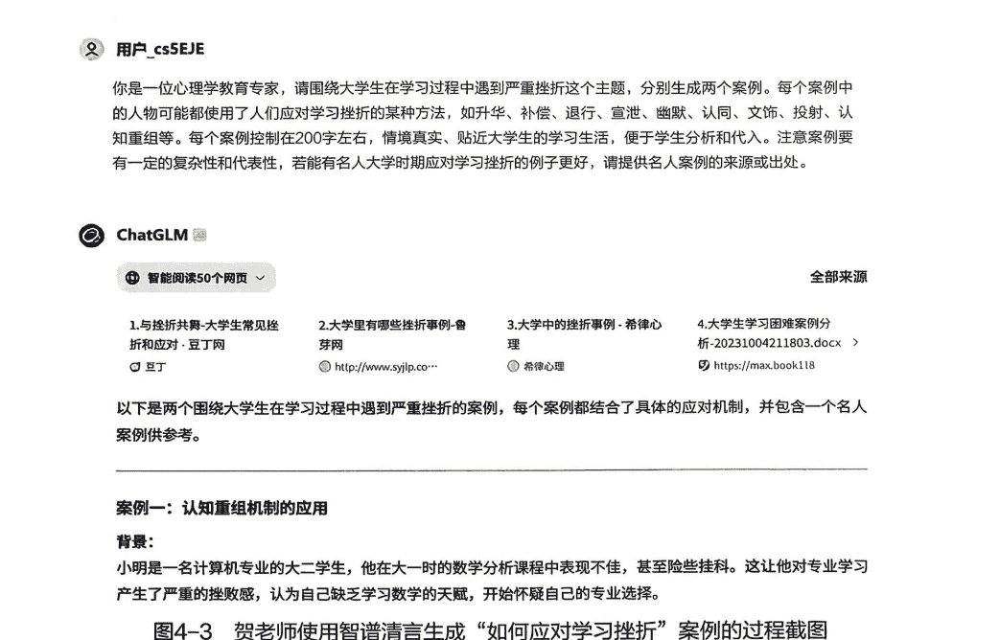
模型十几秒就出了两则案例，但把理论分析和案例内容混在一起，不利于课堂使用。贺老师追加指令：“案例只给大学生小组讨论用，不要提供应对方法和分析思路，只输出两个案例，人物分别是名人和平常大学生。”经过多轮对话修正，最终形成如下研讨文本：

> 应对学习挫折的案例1：马云高考两次落榜
青年时期的马云连续两次高考失利，第一次数学仅1分，第二次数学19分仍未达标，父母也失望。他没有放弃，一边工作一边备考，还主动找外国游客练习口语，增强表达和韧性。第三次高考考入杭州师范学院英语专业，在校期间多次参加英语演讲比赛，逐渐建立起强烈的自我认同。

## 应对学习挫折的案例2：村上春树大学时期的转折
村上春树在早稻田大学主修戏剧，却对课程没兴趣，成绩不佳，感到无力迷失，常一个人发呆。某天在神宫球场看棒球时，他萌生“也许我可以写小说”的念头。此后每晚坚持写作，把挫败感转为创作动力，把不安和孤独化为文学表达。他后来回忆：“失意寂寞的大学阶段，是我写作的原点。”

##### 3. 探究引导类文字的产出思路
探究引导类文字用于课堂、预习或自主学习，能激发思考、培养分析评价和创新能力，实质是对课程内容的纵深拓展。设计指令时要明确文字类型、内容特性和使用目的，细节上反复迭代。审阅后最好让学生或同行参与校验，提升适配度。

贺卫国老师讲“专家是怎样解决问题的”主题时，想让学生通过阅读探究专家识别问题、提取特征、分析问题和解决问题的思维策略。他给智谱清言的指令是：

> 你是一位教育心理学专家，请为“人是如何学习的”课程中“专家是怎样解决问题的”主题设计一份探究阅读材料，讲述某知名领域专家面对真实复杂问题时如何识别、分析、选策略并逐步解决。请注明事件出处保证真实，400字以内，适合大学生阅读分析，突出专家思维和问题解决特征。

经过多轮修改并征求学生意见，最终形成：

> **探究阅读材料：理查德·费曼如何解决教学难题**
20世纪50年代，诺贝尔物理学奖得主理查德·费曼受邀为加州理工学院设计本科物理新课。面对“如何让学生真正理解物理本质”的难题，他没照搬教材，也没沿用“概念—公式—习题”的顺序，而是从学生常见误解中找根因：学生会套公式却不懂原理。他重构内容结构，从物理定律本质入手，按“观察—模型—推理”的路径展开，还反复测试讲解是否被学生真正理解，不断用类比、图像和跨学科方式调整表达。最终整理成《费曼物理学讲义》，影响深远。

##### 4. 写作范例类文字的产出思路
写作范例是学生掌握结构、语言和逻辑的重要支架。教师可用精细指令让大模型生成特定体裁、目标导向的范文，审校后加上评语和批注，引导学生深入领悟写法。

具体操作可参考作业范例中关于“林黛玉穿越到现代社会生活”的想象作文部分。

# 第 2 节
大模型绘制直观图像教学资源

生成式AI能为教学批量生产生动直观、有启发性的图像资源，极大提升学习兴趣和理解深度。随着技术普及，图像生成已不再是少数专属模型的功能，大量通用大模型都支持图像创作。

### 一 可用于图像生成的代表性工具
可生成图像的工具迭代迅速，各有侧重。下面是几款代表性工具的概览。

| 工具名称 | 核心能力 | 访问链接 |
| :--- | :--- | :--- |
| 文心一言 | 文本图像双模生成，适合快速视觉表达、教育场景 | https://yiyian.baidu.com |
| 腾讯元宝 | 文本生成艺术图，支持风格转换与细节优化 | https://yuanbao.tencent.com/ |
| Fotor | 文本生图、3D、动漫角色及多种画风 | https://www.fotor.com |
| NightCafe | 多艺术风格文生图，可出打印级高分辨率图 | https://creator.nightcafe.studio |
| Stable Diffusion | 开源模型，文生图或图+文生成摄影、插图、3D等 | https://stablediffusionweb.com |
| 通义万相 | 文生图、文生视频、图生视频，风格可调 | https://tongyi.aliyun.com/wanxiang |
| 智谱清言 | 文本代码等驱动生成图像，服务创意设计 | https://chatglm.cn/ |
| Midjourney | 文生图，输出艺术作品，每次4张 | https://www.midjourney.com |
| DALL·E3 | OpenAI出品，逼真图像与艺术创作，带内容审核 | https://openai.com/dall-e-3 |
| 豆包 | 文生图、图生图，批量出图且保持人物一致性 | https://www.doubao.com/ |

### 二 图像类教学资源的类别与生成方式

#### （一）图像类教学资源的主要类别
大模型可基于文字描述或上传图片生成多种教学图像：①概念示意图，如电磁感应、DNA结构；②事件过程或任务引导图，如实验步骤、项目流程图解；③历史地理复原复现图，如工业革命伦敦街景、地貌对比；④情境创设图，如生活场景、未来生态城市；⑤知识可视化关系图，如思维导图、概念图。质量达标后可用于讲解、课件、导学案或自主学习。

相比手绘或图库搜索，AI出图定制性强、响应快、风格可控，能按教学目标和学生特点精准设计。但需警惕模型生成违背科学规律或内容错误的图像，避免认知风险和意识形态风险。

#### （二）图像类教学资源的三类主要生成方式
一是文本生成图像，输入描述性指令生成对应图像；二是图像生成图像，上传原图让模型衍生新图；三是图像+文本生成图像，上传原图并配合指令做风格转换、色彩调整、局部修改、细节增强或场景重构。这三种方式可灵活用于知识讲解、情境创设和创作引导。

| 生成方式 | 触发条件 | 常用工具 |
| :--- | :--- | :--- |
| 文本生成 | 仅输入指令 | 文心一言、通义万相、豆包、智谱清言、腾讯元宝、DALL·E3、Midjourney等 |
| 图像生成 | 上传已有图像 | 文心一言、Midjourney、ChatGPT等部分工具需在特定模块操作 |
| 图像+文本生成 | 上传图像并输入指令 | 豆包、文心一格、通义万相、智谱清言、Runway ML、Stable Diffusion等 |

注意，若只上传图像不给指令，模型往往依据对话上下文猜测意图，出图难以掌控。李老师上传苏轼像到文心一言智慧绘图后，模型提醒“请完整描述你的需求”。图像与指令结合，效果更可控。

指令质量直接决定图像的类型、风格和可用性，清晰明确的指令是教学级出图的关键。

### 三 用大模型生成赋能深度学习的图像类教学资源

#### （一）文本驱动生成逻辑关系图

#### 1. 生成思维导图示例
课堂上常需思维导图帮助学生快速抓住复杂内容。手绘或软件绘制耗时，用大模型几秒即可初稿，再经审阅完善即可使用。

杜玉霞老师在“数智赋能的教育研究方法”课上，想让研究基础薄弱的研究生快速理解论文实证方法，与豆包协同完成学术论文思维导图，分三步走。

（1）投递文献并设定任务
将PDF论文上传至支持文档理解的豆包，指令：
> 请作为教育研究专家，解析文献中实证研究部分，生成一份结构清晰的思维导图，帮助学生理解实证内容并掌握方法应用。提炼关键词，层级不超过四级。

（2）模型提炼要点并生成图及代码
上传后，右侧显示文献原文，左侧呈现思维导图与代码，可全屏查看。

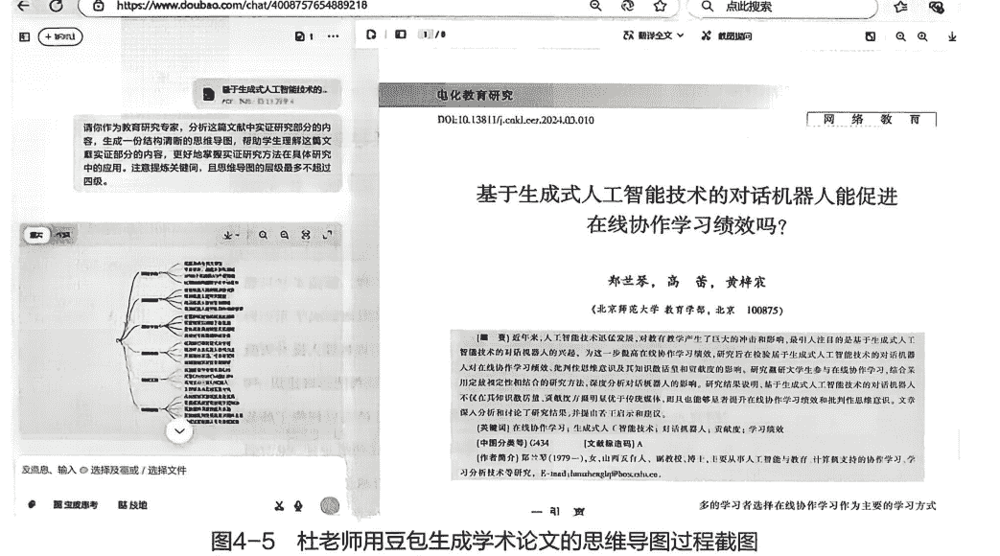

（3）本地修改代码再回传生成
为改善关键词提炼不足、内容繁杂的问题，杜老师：
①关闭右侧文档，放大图区，切到代码窗口复制全部代码到Word；
②在Word中逐条审阅修改代码；
③把修改后的代码贴回豆包重新生成。

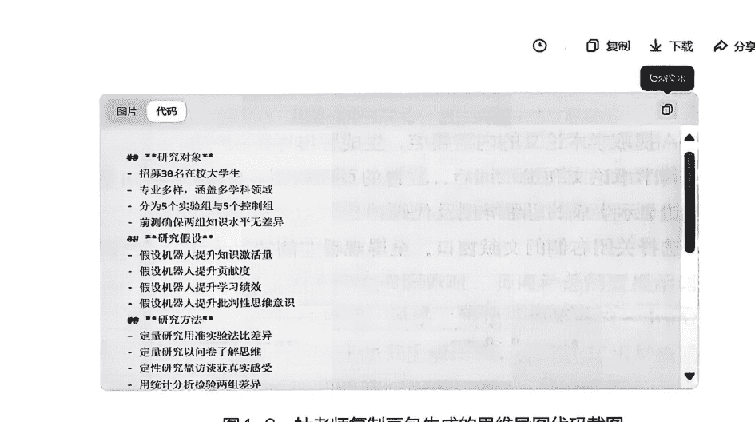
图4-6 杜老师复制豆包生成的思维导图代码截图

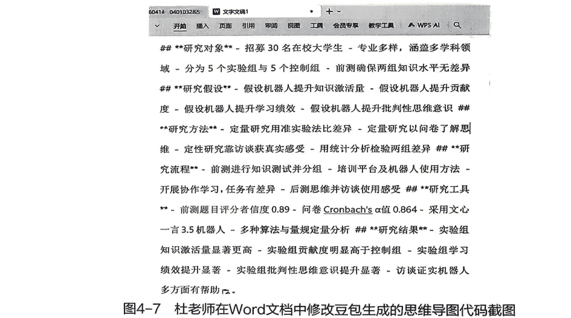
图4-7 杜老师在Word文档中修改豆包生成的思维导图代码截图

由于模型局限，初次图缺少中心主题，可手动添加或导入专业思维导图软件补齐。优化后的论文思维导图可扫码查看。

从数据到可视化思维导图

实验数据显示，干预组的贡献度、学习成效、批判性思维觉醒程度均显著优于对照组，访谈资料也佐证了机器人辅助在多方面发挥积极作用——请依据上述要点，调用代码生成一幅条理清晰的思维导图。

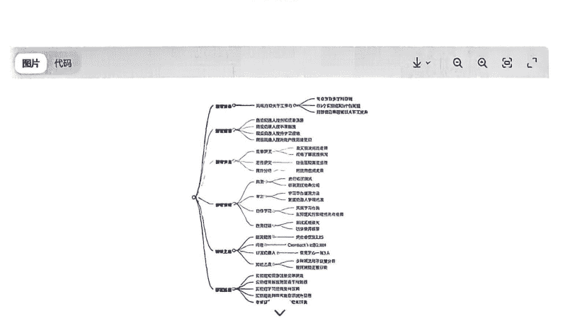

图4-8 豆包用修改代码生成论文思维导图过程截图


图4-9 豆包新生成的论文思维导图二维码

#### 2. 生成流程图示例

在教学实践中，借助AIGC能够把繁杂的概念或步骤迅速转化为可视化逻辑。豆包在这一项上能力突出，采用与前述相似的操作思路即可产出流程图、关系图等教学示意图，可视化呈现有助于降低理解难度。

例如为了帮助学生把握前文论文的实证脉络，杜老师在完成思维导图后，通过提示词让豆包产出了如图4-10所示的研究流程图。

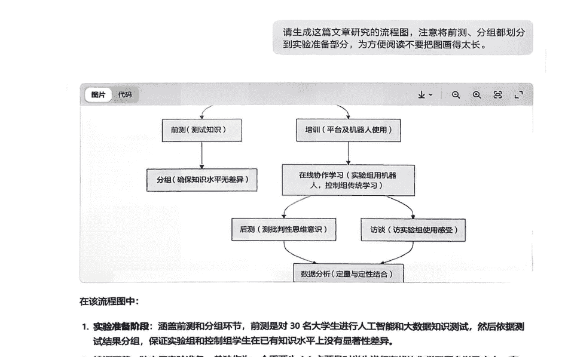

图中呈现了：

1. 实验准备阶段：先对30名大学生进行人工智能与大数据知识的前测，随后按测评结果分组，确保实验组与对照组在先验水平上无明显差异。
2. 培训环节：与准备阶段并列、相对独立，主要聚焦于在线协作学习平台和文心一言的操作训练。

图4-10 豆包生成论文研究过程流程图的截图

可以看出，大多数AIGC具备较强的上下文理解，杜老师仅用简短指令即可让模型基于已上传的论文绘制流程图。若需调整，可修改代码后重绘，也可用导出的代码在Python等环境中自行渲染。

#### （二）图文驱动生成式智能构建情境化图像类教学资源

图像资源有助于搭建教学情境，提升学生的认知投入与情感投入，进而改善学习效果。教师既可用纯文本提示让模型从零生成贴合主题的图像，也可采用“上传原图+文字说明”的方式，让模型对现有图像进行风格转换、情境延展或主题再创作。这种图文协同的方式，为创设复杂情境提供了丰富支撑。

例如邓老师讲解《赠汪伦》时，需要一张促进理解的配图，网络检索未获理想结果，后找到一张情境相近的图，但画面中李白在船上翻书，邓老师认为这与离别氛围不符，因而需对图像进行修改。

邓老师登录ChatGPT，上传原图并输入修改提示词，具体操作如图4-11所示。

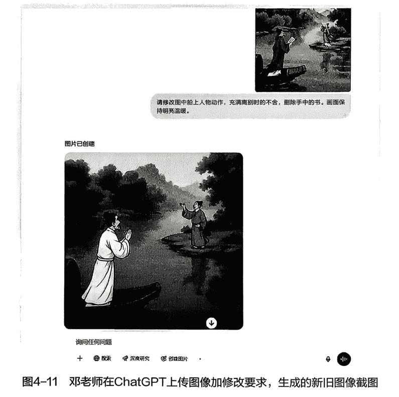

#### （三）图文驱动生成式智能促进深度学习的图像类资源

以图文驱动生成式智能产出图像类教学资源，可将抽象概念具象化、复杂过程可视化，帮助学生高效学习。更关键的是，模型能够生成需要学生综合运用知识与技能的图像学习材料，培养高阶思维。例如生成细胞分裂、铁的氧化等过程的图像用于教学。

肖老师讲授七年级生物“种子萌发的过程”后，发现学生掌握不够牢固。于是他借助ChatGPT生成示意图，课堂上组织学生观察分析并修正，再展开讨论促进深度学习。资源制作分三步：

- （1）拍摄教材中“种子萌发的过程”页面照片，上传至ChatGPT。
- （2）撰写提示词并输入，要求生成示意图。（见图4-12）

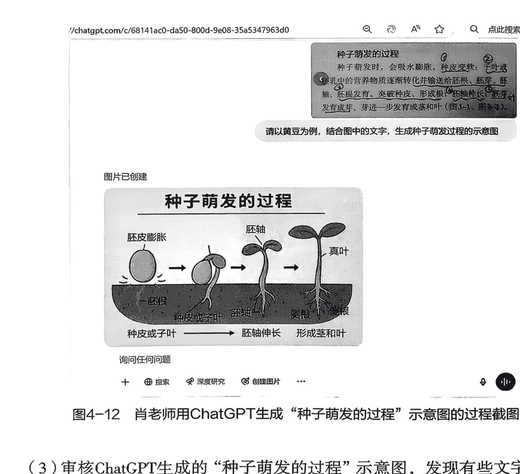

- （3）审阅生成的“种子萌发的过程”示意图，发现部分文字不规范且存在错误，正好可组织学生辨析、讨论和完善，培养高阶思维。

## 第 3 节 如何用生成式智能创建音频类教学资源

在多模态学习环境中，音频凭借便捷、沉浸、可反复聆听的特点，在语言学习、知识讲解、阅读训练和情感培养等场景中应用广泛。

### 一 具备音频生成能力的核心工具概览

生成式智能为音频教学资源的快速制作和个性化提供了便利。目前可生成音频的工具日益增多，功能不断完善，许多平台支持多语种、多角色、多语调及自然停顿的音频输出。ElevenLabs、Murf.ai、Google TTS等工具能力强劲，但受访问与付费限制，使用不便。下面主要介绍国内可用的音频生成工具及其使用方法。

#### （一）核心音频生成工具盘点

生成式智能的快速发展催生了工具导航网站，https://www.aigc.cn/和https://ai.openi.cn/是两个较为知名的导航平台。

图4–13为AIGC工具导航站（www.aigc.cn）收录的音频处理类生成式智能工具，该站点推荐了20余款可处理音频的工具。

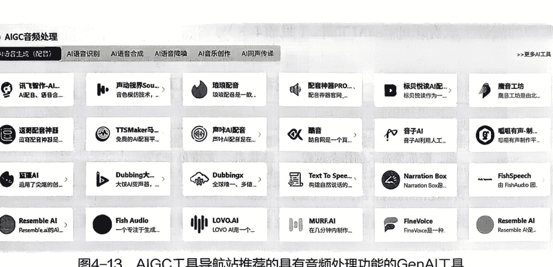

图4-14为OpenI（ai.openi.cn）平台推荐的生成式智能音频工具，其推荐列表与AIGC站部分重合，部分不同。需要注意的是，各工具性能差异明显，有的偏向商业宣传，有的必须付费，教师应结合教学需求和工具特点进行选择。

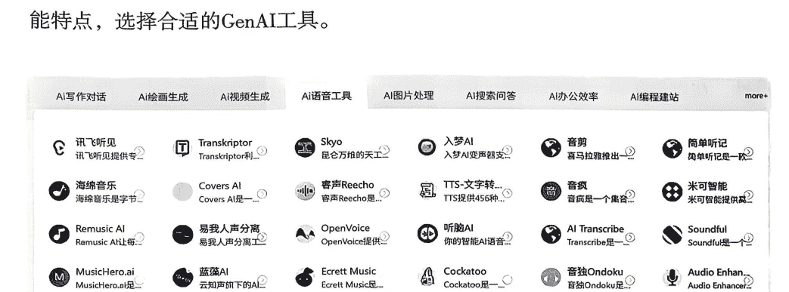

#### （二）主流音乐生成工具盘点

教学音频包括知识讲解、语言训练、情境营造的朗读、讲解、对话、听力以及歌曲等。音乐作为特殊音频，具有审美、情绪激发和氛围营造等教学功能。随着生成式智能不断迭代，教师可以利用工具生成所需的特定音乐。以下为《AIGC发展研究》①（3.0版，0.95修订）整理的音乐生成工具。（见表4-3）

表4-3 能够生成音乐的生成式智能工具

| 名称 | 主要特点 | 亮点功能 | 适用场景 |

| :--- | :--- | :--- | :--- |

| Suno | 歌词、演唱、编曲、配乐一体化完成，具备多语种交叉混合生成能力 | 可适配多种曲风与情感基调，单曲时长可延伸至两分钟 | 个人音乐创作、社交媒体内容创作、音乐教育等 |

| Abab-music-1 | 端到端音乐生成，涵盖纯音乐、清唱、伴奏、人声合成，具备拟人化生成能力 | 可适配多种曲风与情感基调 | 音乐创作与制作、影视配乐、内容创作等 |

| 天工SkyMusic | 端到端音乐生成，人声自然度高、发音可懂性强，具备方言演唱能力 | 支持多声部、歌词可用多种方言 | 文化传播、社交媒体内容创作、音乐教育等 |

| 琴乐大模型 | 文本或音频输入生成音乐，具备逻辑乐理生成能力 | 支持自动编曲和乐谱生成、语音文本对齐、音频特征提取 | 音乐教育、社交媒体内容创作等 |

| 豆包 | 免样本人声模仿、旋律歌词局部改写、支持多种情感状态 | 快速分享至社交平台，支持旋律创作 | 个人音乐创作、社交媒体内容创作、音乐教育等 |

| 网易天音 | 一站式AI音乐创作平台，可免费使用 | 支持用户自行调音阶、编曲、上传素材、调整结构等 | 专业音乐创作、音乐教育、音乐娱乐等 |

> ① @新媒沈阳团队.《AIGC发展研究》[EB/OL].（2024-12-28）[2025-03-23]. https://io.neepu.edu.cn/info/1133/4873.htm.

上述工具的功能仍在持续更新，每个平台都有操作说明，即使零基础用户也能按指引创作各类音乐作品，用于教学等场景。

### 二 应用生成式智能工具生成音频类教学资源的方法

不同工具功能略有差异，操作步骤大体相近。教师借助生成式智能可以快速生成契合课程内容的音频资源，实现个性化、高效化和多样化应用。下面以讯飞智作为例介绍具体流程。

#### 1. 教学内容准备与稿本设计

制作音频资源时，教师需依据教学目标选取内容，部分情况下还需撰写适配音频讲解的文字稿。稿本应语言精炼、逻辑清晰，可适当加入语气提示，便于合成自然流畅的语音。例如可将化学实验步骤讲解、英语对话或专业文章改写为适合配音的稿本。

#### 2. 登录平台与功能选择

教师可用手机号加验证码登录讯飞智作平台（https://www.xfzhizuo.cn/make），在功能面板挑选合适的模块制作音频。讯飞智作功能丰富，如图4-15所示，左侧为输入区，单次可输入1万字文本，迅速生成语音。

在音频生成模块中，用户可设置换气、连读、停顿时长，也可调整语种、音质、音色、角色、男女声、语速、语调等参数，使输出更贴合教学场景和学生认知。

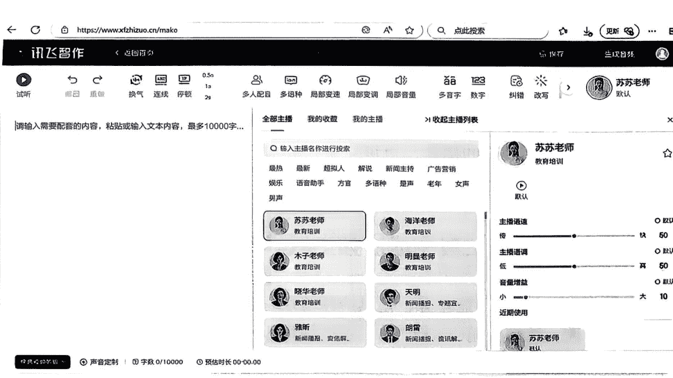

#### 3. 音频生成设置与试听调整

英语教学中，肖老师发现学生阅读一封英文信件时朗读不流畅、单词发音不准、语调欠佳。为提供朗读范例供课前课后自学，他按以下步骤生成教学音频。

- （1）在平台输入待生成的教学内容。肖老师将课文整理成文本粘贴到讯飞智作语音生成框，并设置语速、音量、语调。
- （2）试听平台提供的多种人声风格。初次使用的肖老师分别试听了温和、严肃、活泼等风格，最终选用晓华老师的声音，生成的音频更接近真人朗读，节奏适中，适合高一学生听力水平。（见图4-16）

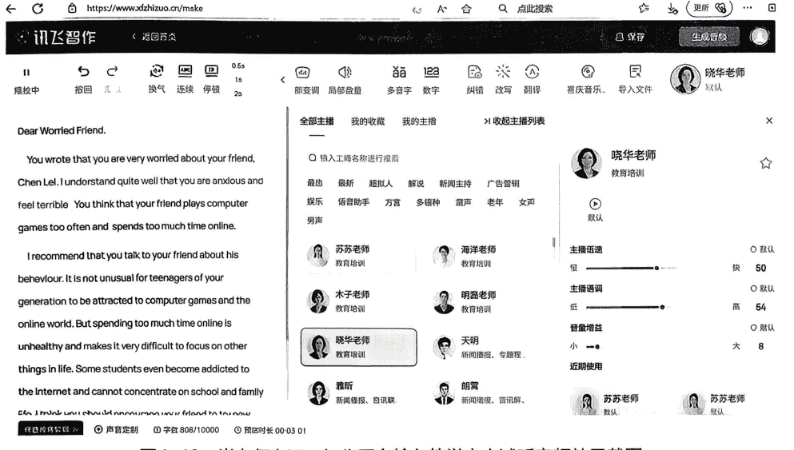

- （3）添加背景音乐。肖老师注意到平台提供背景音乐，认为阅读信件时加入抒情音乐更具感染力，于是如图4-17所示点击背景音乐选项卡。


在如图4-18所示的背景音乐选择窗口中，有数十首专题音乐可选，经试听比较，肖老师选用了《生命的期待》作为背景音乐。

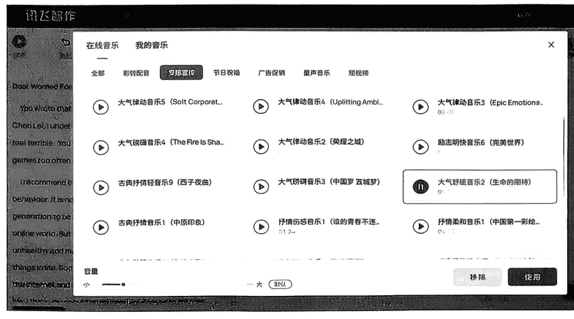

#### 4. 教学音频导出与嵌入应用

试听满意后，用户可同步生成字幕并将音频导出为MP3或WAV格式保存。肖老师将带背景音乐的英文信件阅读音频导出为MP3，反复对照课文核查，未发现内容或语调问题。（见图4-19）审核通过后，他将音频嵌入PPT课件并上传至在线学习平台供学生自主使用。


根据教学需求，音频资源还可嵌入微课视频、在线任务单，或用于学习指导、听力训练、有声阅读等，以增强互动性和灵活性。讯飞智作的音频制作功能较为强大，但需付费使用。

## 第 4 节 如何用生成式智能创建PPT课件资源

PPT课件是教师呈现知识结构、组织教学内容、激发课堂互动的重要载体。随着生成式智能迭代，教师可从手工制作转向“人机协同”的高效生成。众多生成式智能工具提供PPT生成功能，教师只需输入主题、关键词、教学目标或课程名称，即可快速获得结构完整、逻辑清晰、图文并重的PPT内容，大幅提升制作效率。教师既可快速生成初稿，也可按需调整风格、语言和内容，实现个性化和场景化创作。

### 一 主流PPT生成工具盘点

生成式智能能依据用户输入的主题或内容，快速构建结构清晰、设计精美的PPT框架。目前讯飞智文、iSlide等工具均具备PPT生成功能，下面汇总了适用于教学的工具，供不同学科教师选择使用。（见表4-4）

表4-4 具有PPT生成功能的主要生成式智能工具

| 工具名称 | 主要功能 | 地址 | 费用情况 |

| :--- | :--- | :--- | :--- |

| 讯飞智文 | 支持主题、长文、文档一键生成PPT，集成智能绘图、多语言适配、智能排版、演讲稿自动标注节奏，覆盖内容生成到演讲准备全流程 | https://zhiwen.xfyun.cn | 有免费体验时限 |

| Kimi PPT 助手 | 支持学术深度解析、万字长文本生成结构化大纲、语义推荐配图、逐字稿带时间标注，支持多语言，兼容学术论文、书籍内容转化 | https://kimi.moonshot.cn/（需进入Kimi+后选择PPT助手） | 免费版有额度限制，付费版无限制 |

| iSlide | 提供正版素材库+专业排版引擎，支持智能对齐、字体配色统一、一键美化 | https://www.islide.cc | 生成免费，导出PDF免费，导出可编辑PPT需付费 |

| 美图Live PPT | 支持视觉化速成，AI分析文本生成设计，自动排版并调用正版图片库，一键生成图表，支持多风格切换，自动优化字体、配色、对比度 | https://www.designkit.com/ppt/ | 基础功能免费，导出PPT需付费 |

| AiPPT | 关键词生成大纲，智能排版，网页端操作，支持数字人视频 | https://www.aippt.cn | 生成PPT的免费次数有限制，导出需付费 |

| 灵感PPT | 支持输入主题，上传文档生成PPT，支持AI配音、配图、创作，可局部重写内容，单页逻辑可控 | https://www.lgppt.cn/ | 生成PPT、配音、配图的免费次数有限制，导出PDF和成图免费，导出PPT和文章需付费 |

| 歌者PPT | 可套用预置指令，支持根据话题、粘贴文本、上传资料、网页链接生成PPT，具有生成PPT、智能翻译、单页生成、案例下载等功能 | https://pro.gezhe.com/ | 可领取新手礼包和每周礼包，领取PPT免费生成页数，导出PPT需付费 |

| ChatPPT | 通过对话优化课件，通过自然语言指令调整内容，支持主题、图片、文件、网页、演讲稿生成，支持上传本地PPT文件进行AI一键美化 | https://chat-ppt.com/ | 部分功能免费，尝鲜模式（AI实时绘图）限免，专属模式需开通会员付费使用，导出PPT需付费，导出PDF和图片免费 |

| 智谱清言 PPT | 依托大模型能力，支持文本、文件、链接等，一键生成大纲与文案，自动适配学术、商务等模板，内置AI画图、数据可视化及跨学科工具 | https://chatglm.cn/ | 生成PPT免费，下载PPT有免费次数限制 |

### 二 生成式智能生成PPT教学课件的主要方式

生成式智能生成PPT教学课件的主要方式及工具见表4-5。

表4-5 生成式智能生成PPT课件的主要方式及工具

| 生成方式 | 生成条件 | 主要生成式智能工具 |

| :--- | :--- | :--- |

| 文本生成 | 输入文本，文本可以是主题或者一段文字，生成式智能根据文本生成PPT大纲，根据大纲生成PPT | 讯飞智文、Kimi PPT助手、iSlide、美图Live PPT、AiPPT、灵感PPT、歌者PPT、ChatPPT、智谱清言PPT |

| 文档生成 | 上传文档，生成式智能提取文档信息，生成PPT大纲，根据大纲生成PPT | 讯飞智文、Kimi PPT助手、iSlide、美图Live PPT、AiPPT、灵感PPT、歌者PPT、ChatPPT、智谱清言PPT |

| 思维导图等图像生成 | 上传教材图片、思维导图等，生成式智能提取图片内容，生成大纲，根据大纲生成PPT | Kimi PPT助手、iSlide、ChatPPT、美图Live PPT、AiPPT、歌者PPT、智谱清言PPT |

| 网页链接生成 | 粘贴学校等网页的网址，生成式智能根据网页内容生成PPT | 歌者PPT、ChatPPT、AiPPT、智谱清言PPT |

无论提示词质量如何，生成式智能通常都能自动生成一份PPT大纲初稿，教师应根据实际需求对其进行修改和完善，以确保课件内容符合教学要求且质量较高。因此，使用生成式智能生成PPT时，精心设计提示词有助于获得更符合教学需求的大纲，提升制作效率。

### 三 生成式智能工具创建PPT的方法与策略

#### （一）文本方式创建教学PPT的流程与方法

借助文本创建教学PPT一般包括：①输入文本；②生成并修改大纲；③选择模板生成PPT；④检查与修改内容；⑤审核排版风格，确认无误后导出。

目前主流工具基本都支持用提示词生成PPT，其中讯飞智文、iSlide等还提供了更细分的功能：一类是依据指定标题或一句话生成PPT，另一类是依据长文本生成PPT，如讯飞智文支持一次性输入12000字。（见图4-20）

##### 1. 用主题句创建教学PPT的步骤与方法

生成式智能能够根据用户提供的主题句自动生成结构完整、内容丰富的教学课件。为提升质量，教师需输入精准的标题或主题，保证课件专业性。

杜玉霞老师为广州市中小学教师举办课题申报讲座时，需要制作配套课件，她选择使用讯飞智文来完成制作。

从单句指令到完整课件：一次实操回放

杜老师进入讯飞智文首页，点开“一句话生成PPT”入口，通过对话方式提交指令，平台很快返回首版提纲。初稿框架未达到预期，他点击“重新生成大纲”获取另一套方案，随后对文案逐条审阅，删减冗余并对表述进行润色。提纲敲定后，他进入下一步，挑选适配的模板启动演示文稿合成。（见图4-21）

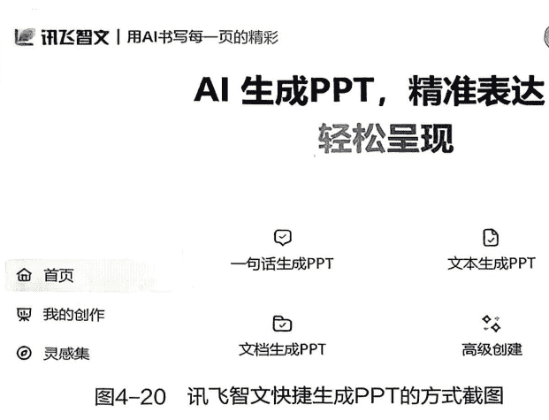

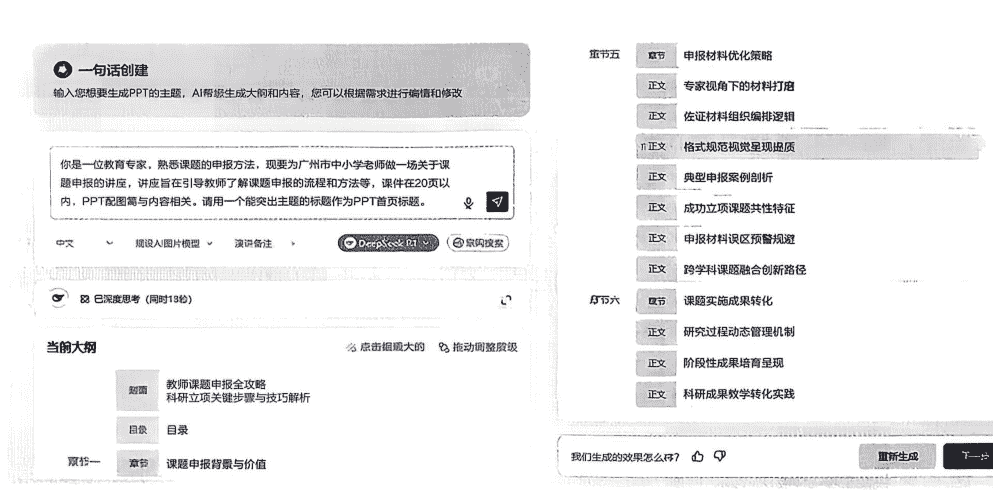

课件合成完成后，杜老师先对封面标题做出调整，并在页面加入团队公众号二维码以便提供课题申报书范本，随后核验模板样式、视觉风格以及整体内容是否匹配讲座听众。（见图4-22）


图4-22 杜老师修改讯飞智文生成的PPT首页的截图

复核正文时发现部分文字不够简练，他调用“智文AI撰写助手”对相关段落进行压缩润色。（见图4-23）

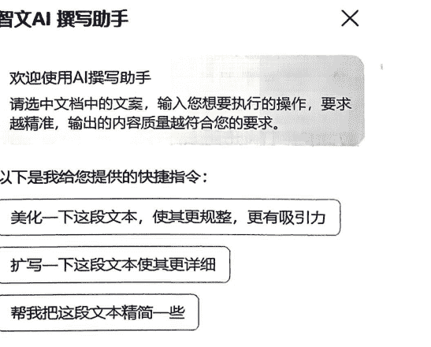

图4-23 杜老师用智文AI撰写助手精简PPT内容截图

检查配图时，他发现若干视觉素材与课件要点不符，便点开图片上方“…”唤出隐藏菜单进入“AI文生图”重新制作，如图4-24所示。此外，他认为内容厚度不足，又补充了自行整理的国家级课题申报要点及团队过往申报案例以充实材料。


最后，他对图文与教学内容的关联度、准确性及适用性进行整体复核，确认无误后导出PPT。

##### 2. 基于长文本生成教学PPT的方法

生成式AI可接收结构化长文本并转化为可视化形式，在保留核心信息的同时解析文本层级与段落主旨，提取数据、结论、步骤等关键要素并剔除冗余。

以广州市幼儿高等师范专科学校中职部的张海容老师为例，她为参加中小学青年教师教学能力大赛准备说课课件，已有说课稿。她选用美图LivePPT，先拟定具体明确的指令，与说课稿一并输入。

提示词：

> 你好，你是一位参加中小学青年教师教学能力大赛的中职学校信息技术教师，现在需要制作一个说课课件。请根据以下说课稿生成说课课件，标题需符合说课稿的内容，其中教学环节：导入、模仿、分析、实践、创编、评价，通过流程图展示。课件的配图突出信息技术的课程特色，课件不能出现参赛者姓名等个人信息，课件的页数不超过30页。

制作过程中她感到原文张力不足，便借助GenAI的扩写功能丰富内容。她在美图LivePPT“大纲生成”页面使用“扩写原文”，在生成的大纲中增补若干小节并剔除不必要内容，审定后选择合适模板生成19页PPT课件。（见图4-25）

完成后她发现封面仍残留工具默认作者信息，及时手动修正。随后在其他页面发现部分文字与配图与说课主题的契合度不高，便借助画布设置、图片工具和文字工具进行完善。

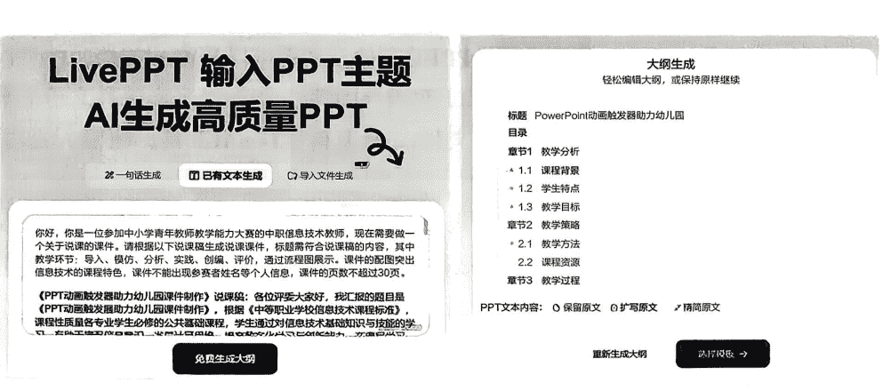

页面调整后预览效果满意，便导出保存到本地。（见图4-26）

#### （二）以文件方式创建教学PPT的步骤与方法

### 1. 主要步骤与方法

教师常年积累的教学资料经整理为文件后，用GenAI生成演示文稿往往更充实、更贴合教学需求。以文件驱动生成PPT的主要流程如下：

- （1）整理待转换的文件。可为Word、PDF、已有PPT、教材图片或思维导图等。
- （2）设计提示词并与文件一并上传至AI平台。注意部分工具不支持自定义提示词。
- （3）审阅AI生成的大纲并按教学需求增删改。
- （4）依据个人风格与教学气质挑选模板。
- （5）核查并修正生成内容，确保科学与准确。部分平台还支持语音合成、智能排版，教师可结合学科特点进行AI配音或排版优化，提升课件与教学的契合度。
- （6）审核无误后选择格式导出课件。

目前多数GenAI工具都支持文件导入生成PPT，但支持的格式各异。使用前应查看平台说明，如iSlide提供了清晰的上传类型与规范指引，参照图4-27即可掌握其支持格式及上传要求。

因工具功能差异较大，选型很关键。智谱清言、Kimi PPT助手等允许上传文件后补充提示词以细化要求；而部分工具仅能依据文件自动生成大纲，不接受指令。为保证质量，建议优先选择支持提示词输入的工具，或组合使用。

### 2. 以文件方式创建教学PPT的案例
（1）案例简介

广州某小学英语教师李老师为四年级公开课准备《Module 1 People Unit 2 She is kind》课件，先分析教材、确定目标并设计教学方案。

为提升质量，她在广州共享课堂平台观看了花都区新华街第二小学杨丽莉老师的示范录像，并下载其PDF课件与课后习题。对比多款工具后选择Kimi PPT助手制作课件。

（2）设计提示词并批量提交素材

她将教学方案、教材图片、下载的课件与习题文档上传至Kimi PPT助手，并输入以下提示词：

> 你是一位小学英语老师，使用的教材是教科版小学四年级下册，现在准备上一节公开课，教学内容是Module 1 People Unit 2 She is kind。教学对象是小学四年级学生。请根据上传的第一张教材图片、Unit 2教案、课后习题文档生成课件的内容，参考Unit 2课件生成一份上课用的教学课件。
> 
> 课件要求为：
> 
> 1. 课件中的练习题需要参考课后习题文档，随机生成与教学内容相关的听力题、口语题、选择题，共5道题。
> 2. 一页幻灯片放一道选择题的题目、答案和答案解析。
> 3. 课件的最后有知识总结，帮助学生回顾和巩固所学内容。

（3）审查修改生成的大纲

Kimi PPT助手依据文件与提示词生成大纲后，李老师逐项审查并完善。

（4）据大纲生成课件并精修后导出

确认大纲后点击“一键生成PPT”，选择模板生成初稿，随后对文字、配图与排版规范进行校对，完成后导出文件。（见图4-28）

（5）借助其他工具生成多媒体素材丰富课件

李老师认为英语学习需强化听力。她用WPS打开课件，利用朗读功能为单词与句子配音。（见图4-29）先选中文本，进入“审阅”选项卡的“选中朗读”，调整语速语调生成音频。通过工具联动完成有声课件制作。

#### （三）以网页方式创建教学PPT的步骤与方法

### 1. 主要步骤与方法

文件导入方式效果好但整理耗时。部分AI平台支持直接用网页链接生成PPT，只需复制网址即可快速获得演示文稿，节省备课时间。主要步骤如下：

- （1）在平台选择“根据网页创建PPT”入口。
- （2）将目标网页URL粘贴至对话框。
- （3）系统自动抓取内容、解析主题与结构并生成大纲框架。
- （4）对大纲进行调整优化，增强逻辑性与条理性。
- （5）挑选合适的PPT模板。
- （6）平台以所选模板自动填充网页的文字、图片、图表。
- （7）审核修改后导出文件。

目前支持网页转PPT的工具有智谱清言、歌者PPT、AiPPT等，主要适配微信公众号文章及部分新闻资讯。部分工具对文本量有限制，如歌者PPT仅接受100—30000字；也有工具不支持提示词设计，生成后需人工大量校对。

### 2. 根据网页创建教学PPT的案例
（1）案例简介

杜玉霞老师在2025年春季讲授“数智赋能的教育研究方法”，想将此前举办的“数智赋能高水平教育研究论文写作暨思维训练”研讨会系列内容整理成课件供学生自学。研讨会各期总结由不同团队撰写并发布于教研室“第一题思维训练”公众号，她决定用AI网页生成功能制作课件。

（2）选型登录并提交网址

经对比她选用歌者PPT。首先用手机号验证码登录，点击右侧“网页链接”生成功能。（见图4-30）随后在新窗口粘贴“第一题思维训练”公众号中研讨会第一期总结文章的链接。

提交后界面分为生成要求、内容与操作指引三栏。（见图4-31）生成要求区可设置内容要点、演讲场景、角色、语言与页数等。她先修改标题，再逐项填写需求后点击“生成大纲”。

（3）生成大纲并人工校订

她发现生成大纲开头含开幕式、结尾含感谢与展望，与教学目的无关，于是删除。逐项完善后生成PPT，数十秒后得到初稿。

（4）审查修改并下载保存

她对74页初稿调整模板、标题、作者与正文，增删页面并优化版式。（见图4-32）公众号图片已被AI按比例嵌入，部分需删除或替换。（见图4-33）修改后用放映功能复核，点击下载付费后保存至电脑。

随后她沿用同一流程将系列研讨会的其余总结文章制成PPT，形成完整教学课件序列。

## 第5节 如何用GenAI创建视频资源

教学视频能直观生动呈现知识点，帮助学生理解复杂概念，多感知通道刺激可提升学习兴趣、注意力和效果。有效应用GenAI可高效生成符合教学需要的视频，提高制作效率。

### 一 具有视频生成功能的主要GenAI工具

依托多模态技术，GenAI可整合文本、图像、语音等素材，自动生成丰富多样的教学视频。过程涵盖信息抽取转换、图像识别优化及语音合成调校，最终实现多元素整合的高质量自动生成。（见表4-6）

表4-6 具有视频生成功能的主要GenAI工具

| 工具名称 | 功能描述 | 网址 | 视频时长/是否免费 |
| :--- | :--- | :--- | :--- |
| Sora | 可基于文字或图像生成视频，能呈现复杂场景与动态效果，适用于创意制作与影视领域 | https://openai.com/sora/ | 提供免费试用额度，生成视频需消耗积分，完整功能需订阅付费计划；可以生成时长5秒或者20秒的视频 |
| 秘塔AI | 将网页链接、PDF等文档一键转化为带PPT和讲解的教学视频，并支持自定义讲解风格、语言及音频音色 | https://metaso.cn/ | 可将文档、网页链接等转化为时长5—15分钟的讲解视频，目前已收费 |
| 即梦AI | 支持文字与图像生成视频，支持AI音效、AI配乐、添加数字人等，生成时间较快 | https://jimeng.jianying.com/ | 每日登录送积分，生成视频需使用积分，高级特效与高清导出需为付费会员；可生成时长5秒或者10秒的视频 |
| 可灵AI | 支持文字与图像生成视频、多模态编辑，支持高分辨率视频生成、对口型、为视频生成音效等，适配短视频平台 | https://app.klingai.com/cn/ | 每月有免费灵感值，生成视频需使用灵感值，高清与长视频需付费；可生成时长5秒或者10秒的视频，视频时长可扩展至15秒 |
| 通义万相 | 支持文字与图像生成视频，可根据简单提示词通过智能扩写获得更完善的提示描述 | https://tongyi.aliyun.com/wanxiang/ | 签到领取灵感值，根据图像、视频及模型的不同，相应抵扣点数；基础版本支持生成时长6秒的视频 |
| 智谱清言（清影-AI生视频） | 支持文字与图片生成视频，支持动态特效生成，适配社交媒体与广告 | https://chatglm.cn/video?lang=zh | 免费生成基础视频，高清视频需付费；可生成时长5秒的视频，10秒视频生成功能目前在升级中 |
| 万彩AI | 支持文字生成短视频、AI数字人生成、视频克隆、AI照片动画等 | https://ai.kezhan365.com/ | 注册登录送点数，免费生成基础视频；高清与定制化功能需付费；时长受模板预设限制，部分模板仅支持生成时长15秒至1分钟的视频，复杂模板（如多场景切换、动态特效）会延长生成时间，通常不超过3分钟 |
| 海螺AI | 支持文字与图像生成视频、视频动态优化，通过自然语言或运镜指令提升视频运镜控制 | https://hailuoai.com/ | 每日签到奖励贝壳，免费版最多同时添加3个生成任务，高级功能需付费；当前版本最长支持生成时长6秒的视频 |
| 白日梦AI | 支持文字生成视频，支持智能剧本扩写、动态分镜生成、角色情绪化配音 | https://aibrm.com/ | 注册登录送梦值，免费生成基础视频，生成时长3分钟以上的视频、为视频画面添加动态效果等需付费，最长支持生成时长30分钟的视频 |
| Vidu | 支持文字与图像生成视频、首尾帧生成视频等功能 | https://www.vidu.cn/ | 提供4秒、5秒、8秒（需升级订阅）的不同时长选项；提供免费试用额度，基础版视频生成、部分模板使用免费 |

### 二 应用GenAI生成教学视频的类型与方式

#### （一）应用GenAI生成的教学视频的类型

AI生成的教学视频可分为三类以适配不同需求。①知识解析类，通过动态可视化将抽象概念具体化，如古诗词配合画面演绎；②情景模拟类，可构建实验等沉浸式场景，如还原光合作用；③技能示范类，侧重操作演示，如编程代码调试过程。

#### （二）GenAI生成教学视频的主要方式及工具

表4-7所示。

表4-7 GenAI生成教学视频的主要方式及工具

| 生成方式 | 生成条件 | GenAI工具 |
| :--- | :--- | :--- |
| 文本生成视频 | 输入详细的文本描述，包含视频主题、风格、镜头语言、时长等指令 | Sora（OpenAI）、秘塔AI、即梦AI、可灵AI、通义万相、智谱清言（清影-AI生视频）、万彩AI、海螺AI、白日梦AI、Vidu等 |
| 图像生成视频 | 上传单张或多张图片，可附加文本提示，如运动轨迹、过渡效果等 | 即梦AI、可灵AI、通义万相、智谱清言（清影-AI生视频）、万彩AI、海螺AI、白日梦AI、Vidu等 |
| 混合驱动生成视频 | 结合文本、图像、语音等多模态输入，需明确各模态的权重与关联逻辑 | 可灵AI、万彩AI等 |

### 三 应用GenAI生成教学视频的流程

#### （一）根据文本创建教学视频的流程

1. 明确目的后撰写详细提示词
根据教学目标设计包含场景、风格、镜头语言等要素的提示词，生成过程中需反复调试以逼近理想效果。常用工具包括即梦AI、可灵AI等。

2. 准备适配教学目标的文本素材
视频质量取决于提示词与源文本双重水平。教师需撰写详实的内容稿件，确保符合大纲并具备吸引力。

3. 选型并提交生成指令
据课程特性挑选工具，例如科学实验需动态推演或微观呈现可优先考虑可灵AI，人文社科角色对话可选用白日梦AI。准备好提示词与文本后，通过上传文件或粘贴方式提交至平台。

4. 在平台内设定细节并生成分镜草图

用生成式智能快速制作教学影像与数字讲师

在筹备教学影像时，市场上不少生成式智能产品都提供风格与角色预设，授课者可按教学情境挑选动画化或写实化等表达方式，并为画面角色设定专属形象。例如白日梦可以依据脚本自动产出分镜草图，使用者还能对单张草图的文案、人物、构图等细节做独立微调。

5. 审查并优化智能工具产出的教学影像
拿到智能工具产出的教学片段后，教师须逐帧核查画面、讲解配音及音乐音效等要素，判断知识点是否科学、节奏是否顺畅、视觉是否契合教学目标，并在需要时反复迭代，直至满意后再导出。

#### （二）依文本生成教学影像的案例一
1. 案例概览
广州某小学邓老师拟为二年级学生讲解经典古诗《敕勒歌》。她认为诗中“天苍苍，野茫茫，风吹草低见牛羊”的意象对帮助儿童把握意境、感受自然之美至关重要。为让孩子更直观感受诗里辽阔穹宇、广袤草原以及风动草低时牛羊若隐若现的动态，邓老师打算借助生成式智能制作视觉素材，将诗歌情境具象化，以提升教学实效。

2. 设计引导语，经文本转影像生成影像
邓老师的核心诉求是让学生体悟诗中开阔天际、连绵草原和风吹草动时牛羊闪现的画面，于是起草如下引导语：
> 你好，你是一位语文老师，想生成《敕勒歌》这一首诗的教学视频，请生成一个视频，符合《敕勒歌》这一首诗的意境。
邓老师登录即梦，打开左侧菜单中的“生成”，在“创作类型”里选择“视频生成”，将引导语填入对话框。模型选用默认的视频3.0，时长设为10秒，画面比例设为16：9，操作生成。数分钟后，平台产出了一段语文老师站在讲台讲解《敕勒歌》的影像。
邓老师发现引导语里提及了语文教师，因而影像里出现了教师形象。她意识到生成时引导语必须与内容高度相关，避免引入无关元素，于是把引导语修改为：
> 请生成《敕勒歌》这一首诗的教学视频，符合这首诗的意境。
输入引导语并完成基础设定后，邓老师再次操作生成，第二次产出的画面如图4-35所示。
邓老师觉得结果仍未达预期，于是再次调整引导语为：
> 请生成《敕勒歌》中“天苍苍，野茫茫，风吹草低见牛羊”的画面。
再次操作生成后，这次的画面已符合她的预期。

3. 在平台为影像增添音效与配乐
邓老师认为当前影像缺少声音这一感官维度。为提升吸引力与观赏性，她通过操作影像界面右下角的“智能音效”和“自动配乐”功能，为影像智能添加了音效和背景音乐。
她进一步总结：鉴于影像时长较短，引导语需以最精炼的方式传达核心信息，确保表述准确无误，避免任何可能导致理解偏差的措辞。因此，教师在应用生成式智能制作影像的过程中，需要依据实际情况及时调整引导语，从而实现预期展示效果。

4. 校验画面与声音，导出影像
邓老师核查影像画面与声音，确认无误后，操作影像右上角的“下载”按钮保存影像。

#### （三）依文本生成教学影像的案例二
广东省茂名市电白区水东中学的高二英语教师李玲，为提升学生听、说、读、看、写的英语综合运用能力，运用MOKI和即梦将2025年新高考Ⅰ卷读后续写题的题目文本制作成影像，设计了学生观看影像后进行英语故事续写的活动。
扫码可查看案例详情和影像

### 四 基于图像驱动制作教学影像的流程

#### （一）据图制作教学影像的流程
依据生成式智能的功能特性，以图像生成教学影像的主要流程如下。

1. 明确影像在教学中的作用，挑选合适的图像素材
教师应明确影像的具体教学用途，不同的教学目的决定了所需图像类型及影像风格。教师应结合教学内容和学生认知特点，挑选照片、教材插图、实验示意图、历史人物图像、学生作品或由生成式智能创作的图像等作为制作素材。

2. 挑选合适的生成式智能平台，导入图像并输入引导语
教师要结合教学场景和所需功能，挑选合适的平台制作教学影像，例如有些平台擅长制作PPT式影像，有些精于数字人口播类影像或现象模拟类影像。平台支持单张或多张图像的导入生成影像，若导入多张图像，不仅要注意图像清晰、比例统一，还应注意图像顺序。虽然生成式智能仅凭图像就能产出影像，但若要产出符合教学需求的影像，教师需要精心设计引导语，对影像风格、应用场景等进行精准描述。

3. 设定调节相关参数，产出并优化影像
不同平台基于图像制作教学影像不仅在输入形式上有差异，在画面风格、呈现方式、质量等生成参数的设定调节及输出完整性上也存在差异。基于图像制作影像的主要差异如表4-8所示。

表4-8 生成式智能工具基于图像制作影像的主要差异
| 生成过程 | 平台功能特点 | 代表性平台 |
| :--- | :--- | :--- |
| 输入形式 | 支持导入单张或多张图像，可结合文本引导语详细描述动态效果，输入形式灵活，适合新手快速上手 | 可灵、即梦等 |
| 动态控制与参数调节 | 提供运动同谋选项，设定动态效果，满足专业影像制作要求 | Vidu等 |
| 输出完整性及后期处理 | 可一键生成完整教学影像，包含字幕、配音等；有些平台生成初步影像后，需用户自行进行后期处理工作 | 白日梦等 |

4. 生成并导出教学影像
教师在预览、审核无误后，可用生成式智能生成并导出影像。有些影像导出后可直接应用于教学，有些影像受平台性能制约，导出后仍需应用专业影像编辑软件进一步修改完善后，方能用于教学。

#### （二）据图生成教学影像的案例
1. 案例概览
广州中学生物教师杨老师在准备“光合作用”章节的教学。为了让学生更直观、深入地理解这一复杂生物过程，杨老师计划应用可灵，将教材中描述的“检验绿叶在光下制造有机物的实验过程”制作成一段生动形象的影像。在这段影像中，杨老师特别注重展示实验的关键环节：当叶片的见光部分在特定条件下与碘液发生反应时，会变成蓝色。这一颜色变化的直观呈现，有助于学生清晰认识到光合作用过程中有机物生成的状况，从而加深对光合作用这一核心概念的理解和记忆。

2. 准备教学内容图像，设计引导语
杨老师将教材中“第二节 光合作用”的介绍拍照成图像，可灵提取教材中的文字进行整理，设计了以下引导语：
> 根据图像生成关于“检验绿叶在光下制造有机物的实验过程”的视频，叶片的见光部分遇到碘液变成了蓝色。遇碘变蓝是淀粉的特性，这说明叶片的见光部分产生了淀粉，进而说明淀粉是光合作用的产物。在实验中，叶片的见光部分产生了淀粉，被黑纸片遮盖的部分没有产生淀粉，这说明，光是植物制造淀粉（有机物）不可缺少的条件。

3. 导入图像添加创意要求，生成教学影像
杨老师操作“图生视频”功能，鉴于准备了两张图像，他选择了“多图参考”选项。随后，他导入图像，并将事先准备好的引导语粘贴至“创意描述”区域。在创意描述下方，他发现还可以指定“不希望呈现的内容”，但杨老师决定先观察初次生成效果，因此暂未设定。由于尚未订阅会员服务，他选择了“标准模式”。接着，他将影像时长设为10秒，画面比例为16：9，并指定生成影像数量为1条。具体操作如图4-38所示。
杨老师在操作“立即生成”后，耐心等待了大约5分钟。影像画面显示一个人正在阅读书籍，随后转换至一盆植物，其绿叶逐渐变为蓝色。然而，这并未展示出他提交的第二张图像所描绘的实验过程——在叶片上滴加碘液后叶片变蓝。
于是，杨老师决定只导入一张含有实验过程图的教材图像，并在不更改引导语的前提下重新尝试生成影像。第二次生成的影像如图4-40所示。
杨老师审查生成的影像，认为仍不能达到教学要求，于是进一步修改引导语，增加素材以生成符合需要的影像。

4. 增补图像并修改引导语，生成新影像
杨老师依据教材的具体内容和期望达到的教学效果，对原有引导语进行了适当调整和优化，还增补了与教学内容紧密相关的图像，然后生成了一个更加贴合教学目标的新影像资源。杨老师还操作了“视频延长”，将影像延长到15秒。

5. 审核影像内容并添加音效，保存影像
杨老师查看了影像的每个画面，在确认影像内容的准确性和科学性后，为影像添加了合适的音效。调整满意后，杨老师下载了最终版本的影像。

### 五 应用生成式智能混合驱动生成教学影像的策略
在教育资源生成多模态、多源化的发展趋势下，仅靠单一文本或图像输入生成教学影像难以满足复杂教学的需求。混合驱动策略是输入多种信息资源，协同利用多种生成式智能平台生成更具教学深度与表现力的影像资源，使生成式智能与教师“共创式合作”，提升影像内容的逻辑性、可视化与教学适配性。

#### （一）文本、图像与影像综合驱动生成教学影像的策略
教师可采用分层驱动策略，输入基础教学信息，如课程讲解文本等，并导入图像资料，如概念图、实验图等，驱动生成式智能依据图文内容自动匹配适宜的教学场景。在此过程中，教师提供知识框架与核心表达，生成式智能拓展细节与表现，进而生成影像，精确展现教学内容，以此减轻教师的工作负担。
例如，在阐释“光合作用”的概念时，教师可利用可灵的“多模态编辑”功能，导入影像和图像，添加“创意描述”，在现有影像基础上进行元素的增添、替换或删除，剪辑成一个新影像。

#### （二）“文本+结构脚本”驱动生成教学影像的策略
教师采用与生成式智能协同创作的方式，在关键处要进行人工调控，如在脚本编辑、语音甄选、图像风格等关键处设定教师审核及调整要点，保障教学逻辑严密、语言精准，提升所生成影像与教学内容的适配度。在具体实施时，教师先设计教学结构脚本，如三段式讲解结构：引入—讲解—归纳，再输入对应内容，生成式智能就能依据该结构生成镜头分镜、讲解节奏和字幕，并融合拟合图像与背景，强化教学逻辑。
例如，在白日梦中，教师输入“100以内的加减法”这一主题，可以设计教学结构脚本，粘贴在“使用我的故事”中，或者选择“智能剧本”，通过页面提示，生成脚本、分镜画面，添加旁白，为画面的图像“一键转动态”，确认影像的动态效果后，完成影像的创建。教师可进行影像剪辑，确认效果后，下载保存影像。

#### （三）“语音+图像”驱动生成教学影像的策略
教师可综合运用不同生成式智能平台，如用ChatGPT创作脚本、万彩创造数字人物、即梦生成视觉画面，还可录制语音或导入已有音频素材，以及应用生成式智能平台实现语音与图像深度融合，达成多模态融合。这种方法适用于语言类课程、人物故事讲解等。教师可按需使用专业模块提升影像质量，再利用影像编辑工具进行后期整合工作。

## 第 16 节 生成式智能如何搭建教育数字人
随着人工智能与计算机图形学等技术的快速发展，数字人、虚拟人、虚拟数字人等概念逐渐开始涌现，这些术语在学术界虽有一定区分，但在实践中人们经常混合使用，此处不作具体概念的讨论，仅对教育数字人的类型进行探讨。数字人是基于人工智能、语音合成、计算机视觉和虚拟人建模等多种技术，构建的具有人类外貌形象、语言表达、表演与认知互动能力的虚拟个体。

### 一 教育数字人的类型
教育数字人可应用于教学引导、内容讲解、答疑辅导等多种教学场景。与传统的教学影像不同，教育数字人能够模拟教师、助教或专家的角色，以“类人化”的方式开展教育活动，为学习者提供更具沉浸感、情感联结和智能反馈的学习体验。根据形象来源与生成方式，教育数字人大致可分为三类：真人驱动型、虚拟建模型和混合增强型。

#### 1. 真人驱动型教育数字人
真人驱动型教育数字人以教师本人影像或照片为基础，通过智能技术合成口型、语音与动作，可以保持高度真实感，有人也称其为数字分身。它适用于需要增强亲师互动感的在线课堂或科普教育等教学场景。例如硅基智能、曦灵数字人都具有用真人影像或照片制作教育数字人的功能。曦灵数字人还能够创建3D数字人。
硅基智能对创建真人数字人有严格要求，需要导入真人影像，经本人校验后才能提交克隆，生成真人的数字人形象。而且，它对导入的原始影像提出了具体要求。

#### 2. 虚拟建模型教育数字人
虚拟建模型教育数字人是完全虚构的数字化实体，其身份、外貌和行为由计算机生成，无现实对应物。它是由智能平台生成数字人形象，造型多样，包括卡通人物或科幻角色等。
除上述提到的生成式智能平台，HeyGen也提供免费的数字人生成服务。HeyGen 为用户免费配备了一个可定制的影像数字人形象，并提供超过500个高质量的内置影像虚拟人角色，支持30多种语言进行语音合成和字幕生成，支持全球化应用。
例如，图4-46是在用户提出生成“女性、长头发、上半身”等简单要求后，生成式智能平台生成的教育数字人形象。
随着人工智能的快速发展，许多教育企业也开发了面向教育领域的生成式智能平台，且支持教育数字人的创建。例如，讯飞智作提供了多样化场景中多角色的数字人供用户选择应用。

#### 3. 混合增强型教育数字人
混合增强型教育数字人是结合真实与虚拟元素，如用真人头像搭配虚拟肢体，或用虚拟角色配上教师录制的语音，兼顾拟真感与创意表达，适用于项目式学习、个性化指导等多元场景。这种类型的教育数字人既能形成亲切的真人面部或声音形象，又能生成不同环境下的丰富动态形象。
以往由于技术门槛高，教师难以自主创建教育数字人。现在，许多生成式智能平台不仅提供了创建多种类型数字人的功能，而且即梦可以将生成图像、生成数字人与生成影像等功能有机融合，教师可以自由组合生成式智能平台的各种教学资源生成功能，高效率创建适用于不同场景且生动有趣的教学资源。

### 二 创建教育数字人的步骤与方法
上述多个生成式智能平台在支持教育数字人创建时，其过程有一定差异，但主要的步骤和方法基本一致。
贺卫国老师在为本科生教授“人工智能基础”课程时，发现有些学生学习基础弱，课堂学习吃力，课外自主学习有困难。为此，贺老师决定创建教育数字人，制作章节难点“什么是数字人”的教学影像供学生自主学习。以下为贺老师创建教育数字人的主要过程与方法。

1. 明确数字人角色与应用场景，选择生成式智能平台
教师首先应设定数字人的功能定位与使用场景，如充当课程讲解者、答疑助手等，并依据学科特点、教学需求和学生群体确定数字人形象与语言风格等。贺老师将数字人的角色设定为教学重点和难点内容的讲解者，他准备制作数字人讲解的教学影像，导入到在线平台，供学生自主学习。
在比较了几款生成式智能平台之后，贺老师最后选择使用操作方便的腾讯智影创建数字人。

2. 准备教学内容及讲稿
为了使教育数字人具备了解教学内容的“大脑”，教师需要依据教学目标和数字人应用场景，整理好教学内容讲稿，如教学重点难点、知识点问答或常见问题问答等。在准备讲稿的过程中，教师可以利用ChatGPT、文心一言、DeepSeek等生成式智能平台先优化语言表达，使其适合口语讲解，再进行审查修改完善。对需要实现互动功能的教育数字人，还需要导入结构化知识图谱或嵌入大语言模型接口，以支持其交互功能。

3. 在生成式智能中选择应用场景与数字人形象
贺老师要创建的是教学讲解型数字人。登录腾讯智影后，他先在工作界面选择“数字人播报”模块操作进入，接着就弹出了设定数字人形象的窗口。
贺老师从腾讯智影提供的数字人形象中，选择了形象亲切大方的“又琳”作为讲解教师的数字人形象。

4. 在生成式智能中设定数字人所处的背景，添加讲解内容
腾讯智影平台提供了多种类型的场景供选择，可选择图像背景或纯色背景，也可自主导入合适的图像作为数字人的背景。贺老师通过比较选择了数字人背景后，在右侧窗口输入事先准备的“什么是数字人”的教学内容讲稿。
腾讯智影平台提供了三种导入数字人讲解内容的方法：①应用生成式智能自动创作。教师在对话窗口输入教学要求的引导语，操作“创作文章”按钮，腾讯智影可以依据教师的需求，立即生成数字人讲解内容。②手动导入。教师可以将准备好的讲稿文本直接复制粘贴到对话窗口。③文件导入。教师可以操作“导入文本”按钮，导入本地已准备好的讲稿文本，作为数字人讲解内容。腾讯智影还提供了改写、扩写、缩写功能，方便用户对已有的文本内容进行优化。用户还可利用导入、停顿、多音字、数字符号等功能对导入对话窗的文本内容进行编辑，使讲解更加自然流畅。

5. 添加背景音乐，审核修改完善
腾讯智影为用户提供了添加在线音乐、画面文字、贴纸等快捷功能，以进一步丰富数字人讲解的画面效果。导入讲解内容后，贺老师添加了音乐“风铃”作为背景音乐。
接着，贺老师对依据导入内容生成的2分多钟的数字人讲解影像进行预览检查和修改完善，以确保讲解的语气自然、节奏恰当。

6. 合成数字人教学的影像，剪辑完善
用户应用生成式智能平台将数字人形象、语音与文本整合后，就可以生成教学影像。但在生成前，需对数字人讲解的影像进行检查，检查无误，方可操作合成影像按钮，设定文件名后，腾讯智影生成数字人教学影像。贺老师将影像文件名设为“数字人介绍”，等待几分钟后，平台生成影像并自动跳转至我的资源面板，此时，教师还要利用平台提供的功能对“数字人介绍”的影像进行再次审核，对不满意之处进行剪辑完善，修改满意后下载保存。

教育类数字人可以嵌入预习引导、课堂共讲、课后答疑等教学环节，兼顾非同步学习与个别化陪伴。教师也能够组织学生协同开发专属的学习数字分身，在实践中提升智能素养与表达力，同时培养依托生成式AI开展自主学习的意识与能力。

# 第5章 GenAI驱动教学创新的实践路径


精彩案例

最新工具

## 第1节 用GenAI构建个性化自主学习空间

学习需求各不相同的学生，可以借助生成式人工智能的强大能力，开展以学为主导的定制化自学。在这种模式下，学习者不再完全遵循既有的教学任务，而是调用AI自行确定学习指向、内容范围并规划推进路径，真正实现“我的学习我做主”。

### 一 以生成式AI为核心打造自学课堂

1. 用生成式AI自主选题开展探究

生成式AI具备自然语言理解与对话生成能力，支持学习者用日常语言表达兴趣与困惑。以受广州交通困扰的高中生小华为例，他想探究堵车成因，便用如下提示向豆包提问：

> 你好，我是高中生，想知道广州交通堵塞的原因有哪些，以及如何解决广州高峰期的交通堵塞问题？

数秒之内，豆包即返回带引用来源的解答，如图5-1所示。

2. 用生成式AI自行设定目标与内容

生成式AI不仅能按要求直接产出学习材料，还能帮助厘清学习需求，支持目标导向的学习活动。小华在与豆包交流后，确认“解决广州交通拥堵”是值得深入的主题，便撰写提示词与豆包互动，制定合理的学习指向与内容。

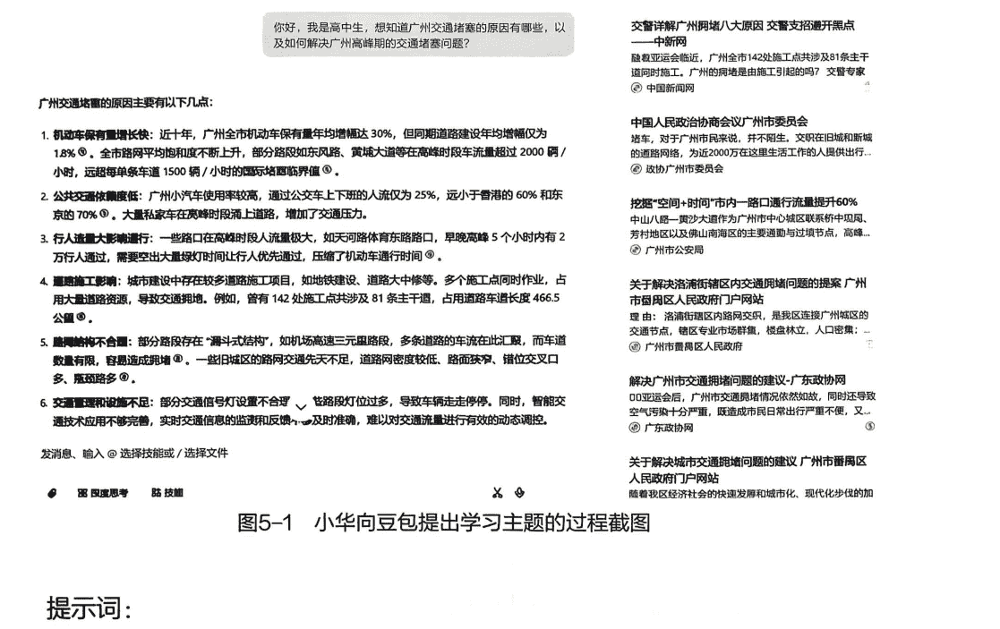
**提示词：**

你好，我是一名高中生。我对如何解决广州高峰期的交通堵塞问题很感兴趣，想通过自主学习深入探究这个主题。我希望你能作为一位经验丰富的学习指导专家，帮助我为这个主题制定清晰明确的学习目标，并根据目标推荐适合我的学习内容与任务活动。请你帮我完成以下内容设计：

+   （1）根据我的兴趣主题，制定3个分层次的学习目标。

    基础目标：了解概念与现象

    核心目标：分析问题与原因

    拓展目标：提出解决方案或比较不同城市的经验

（2）为每个学习目标推荐适合的学习任务或内容形式（如资料阅读、问卷调查、视频观看、案例分析、模型制作、城市方案设计等），最好结合广州的实际。

（3）如果可以，请按任务顺序设计学习路径，分为阶段1（了解现象）、阶段2（分析原因）、阶段3（提出对策），并说明每一阶段我需要完成什么任务，输出什么成果（如小报告、PPT、小论文等）。

（4）建议我如何合理安排学习时间和活动顺序，整个任务最好在1—2周内完成。

（5）如果你还能推荐一些可靠的信息来源，如网站、图书或平台（最好中英文都有），我会很感激。

在借助AI制定指向与内容时，需结合自身知识基础、能力水平与学习风格，撰写要求明确具体的指令词，才能得到贴合实际的方案。小华与豆包的互动显示，豆包生成了包含指向与内容的自学方案，并支持Word、PDF等格式下载。学生的认知有限，可能难以即时判断生成内容的问题，建议由教师或家长把关审核。

3. 生成式AI辅助学习方式与路径的选择与设计

随着技术发展，许多生成式人工智能工具可通过分析学习偏好、初始能力与过程数据生成画像，辅助选择方式与路径构建。学生可向AI说明自己偏好阅读反思型、问题探究型、任务项目型还是对话生成型，以及当前水平、目标意图与可投入时间，由此获得结构化、分阶段的活动序列与路径，并匹配合适资源。

例如小华继续向豆包提问：

> 你好，我想围绕“广州交通高峰期的拥堵问题”开展自主探究式学习活动。请你作为学习指导专家，继续帮助我设计适合高中生的分阶段学习路径和任务安排。请你协助完成的内容主要有：

（1）将学习分为三个阶段：了解现象、分析原因、提出建议。

（2）每个阶段请说明：

①推荐的学习方式，如图文导读、数据分析、方案设计等。

②推荐的学习任务与活动内容，如查阅地图、分析数据、比较案例等。

③最终要输出的学习成果形式，如思维导图、分析报告、提案建议PPT等。

（3）请确保任务之间具有逻辑递进关系，适合高中生完成，语言简洁明了。

小华对生成结果审阅修改后，确定的自学方式与路径如下。

### 广州交通拥堵问题的探究式学习路径

该路径围绕“广州交通高峰期拥堵问题”展开，采用“图文导读—问题探究—方案设计”的渐进方式，分三阶段组织任务，突出自主探究与方案建构能力的培养。

**阶段一：了解现象**

通过阅读图文资料与观看交通视频，识别广州早晚高峰的主要堵点与拥堵规律，建立感性认识。成果为“广州拥堵热点图”或交通现象观察报告。

**阶段二：分析原因**

采用问题导向的探究方式，查阅政府交通年报，统计私家车增长趋势，分析公共交通分布与使用率，形成因果关系图，输出《广州交通拥堵原因分析报告》。

**阶段三：提出建议**

结合方案设计与案例比较，参考新加坡、上海等城市治理经验，提出缓解建议，生成“缓解广州交通拥堵的提案”PPT，体现综合分析与创新能力。

越来越多学习软件与平台已内嵌生成式人工智能，可灵活选择或定制路径。例如中国大学MOOC平台嵌入的小慕学习助手就能帮助学习者定制方式与路径。

数学教育专业大三学生王明登录中国大学MOOC后，打开智能助手小慕提问。（见图5-2）
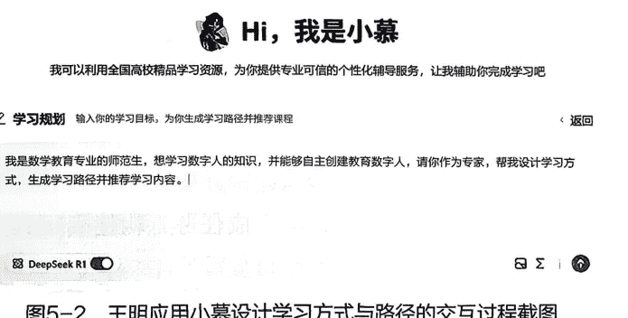
图5-2 王明应用小慕设计学习方式与路径的交互过程截图

王明阅读推荐后发现路径课程过难，于是进一步对话：

> 你提供的课程太多、太难了，我不需要从底层原理学起如何用各种人工智能技术创建数字人，我只想学习如何用生成式人工智能工具创建数字人。

再次交互后，小慕生成了如图5-3所示的学习路径建议。

### 工具链推荐

```
1. **形象生成**：Leonardo AI（教育账号可免费生成3D模型）
2. **动画合成**：Adobe Express（教育版免费）
3. **场景整合**：GlassPoint（PPT插件支持数字人嵌入）
4. **交互设计**：ChatGPT+Voiceflow（构建教学对话树）
```
注：建议优先掌握Midjourney和HeyGen的核心功能，参考课程中2.4.1辅助编程应用章节的工具链思维可迁移至生成式AI工作流设计。教育数字人开发需重点关注《人工智能安全、科技伦理与知识产权保护》课程中17.3章节，确保生成内容符合教育伦理规范。

### 相关学习资料


4. 用生成式人工智能搭建评价反馈机制，形成闭环式定制学习模式

在定制学习中，评价与反馈既是检验效果的手段，也是支持自我调整与持续改进的重要机制。借助生成式人工智能可为学习者设计评价活动与工具，形成“生成—评价—反馈—优化”的闭环路径。AI能依据任务、目标层级与学科特点生成评价量表、自评问卷等工具，也可实时分析作文、解题结果、方案等成果，发现问题并给出结构化、个性化的改进建议。学生据此修改再生成任务，构建真正自主驱动的学习闭环。

### 二 生成式人工智能驱动自学的典型案例解析

高二学生李林在信息科技课程人工智能模块学习中，对生成式人工智能的图像与视频生成能力很感兴趣。他有过用AI创作图片的经历，却不了解基础原理与方法，加之课时有限，课堂难以请教，于是决定课余利用AI工具自学，过程如下。

1. 应用AI工具，搜索与学习主题相关的资源

李林在老师推荐的几个AI工具中比较后，选择用秘塔AI（https://metaso.cn/）进行主题学习内容搜索。他打开平台输入提示词交互。（见图5-4）
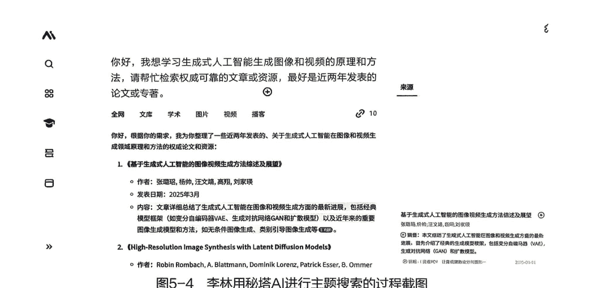

2. 分析评估AI检索的学习资源，筛选确定学习内容

李林对秘塔AI检索的十几篇专业文献快速浏览比较，认为张璐瑶、杨帅、汪文靖等人在《计算机辅助设计与图形学学报》上发表的《基于生成式人工智能的图像视频生成方法综述及展望》一文不错，但仍不确定判断，便用文心一言了解论文质量。（见图5-5）

经介绍，李林得知该刊为专业权威期刊，论文由北京大学王选计算机研究所主持的国家自然科学基金项目成果，属计算机领域高质量前沿文献。文章对他而言难度较大但值得研读，于是决定以深入研读此文献为具体学习任务。

3. 应用AI制定学习目标和学习方案

李林深知，要有效阅读这篇24页的学术论文，必须借助AI确定学习目标与方案。他设计提示词，选择用DeepSeek生成目标与方案。（见图5-6）

200 GenAI时代如何做教师：生成式人工智能赋能教学与研究

根据自身情况，李林对DeepSeek生成结果做了适当修改，形成包含明确学习指向、学习方式与进度的方案。（见图5-7）


4. 应用AI构建在线自学课堂

制定方案后，李林回到秘塔AI平台阅读文章。准备点击阅读按钮时，发现旁边的讲解按钮，便好奇点击进入。（见图5-8）
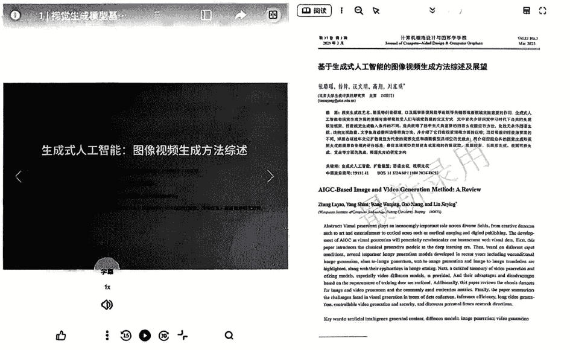

探索后，李林发现基于文章生成PPT后，秘塔AI可进行单人讲授、多人对话等多种讲解模式，学习者还能自选讲解速度、内容深度与方式。他开始按以下步骤构建自己的在线课堂。
（1）在AI平台上设置学习者角色与学习场景

李林点击讲解页面右上方的圆点打开角色与场景面板，选择“初学者”角色、“课堂”场景后确认。这时平台按初学者理解程度生成适合课堂教学讲解的PPT，生成过程如图5-10所示。
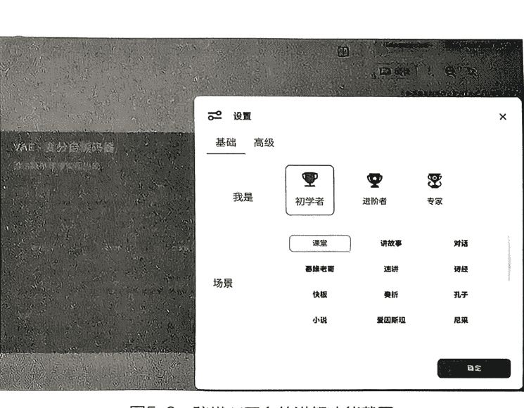
图5-9 秘塔AI平台的讲解功能截图
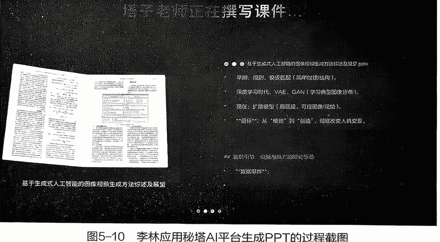
图5-10 李林应用秘塔AI平台生成PPT的过程截图
（2）在AI平台上选择讲解的语言与音色

默认声音不够亲切后，他切换到高级功能，选择PPT语言和讲解语言均为中文，音色选为男声、开朗学长，完成要素设置。
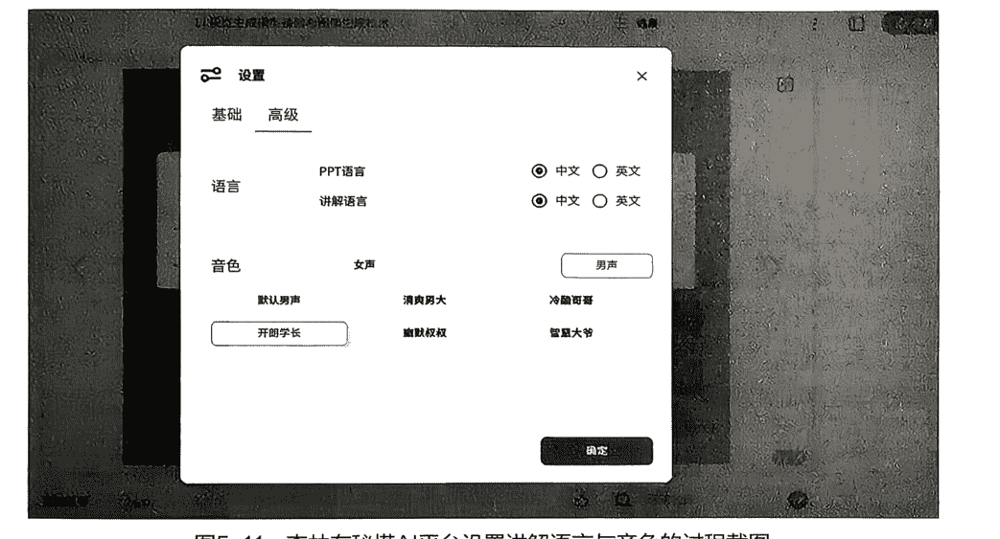
（3）在AI平台上设置讲解速度、音量与字幕大小

试听后觉得语速偏慢，他将讲解速度设为1.2倍速，并调整音量与字幕大小。

（4）在AI平台上设置讲解课件与原文的呈现方式

设置完成后，他观看动态PPT跟随讲解学习，发现仅看PPT影响理解，于是点击上方按钮切换为对照原文的双页面模式。
（5）应用AI自定节奏进行交互式学习，全程支持答疑解惑

学习时他可随内容难度调整语速，遇到不理解的地方暂停研读原文，仍不明白时使用平台提问功能（见图5-13），攻克抽象概念与模型。
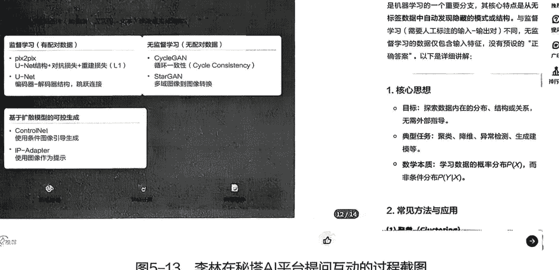
（6）应用AI生成讲解视频，随时随地自学

李林基础薄弱，第一次用周六一小时仍未掌握第一节。第二天需外出看望亲戚，来回两小时想利用。平台提供讲解内容视频生成功能，他立即生成第一、二小节讲解视频（见图5-14）保存到平板随时学习。导出视频图文并茂、画面稳定、声音清晰。

### 发展引擎：数据与算力的双轮驱动

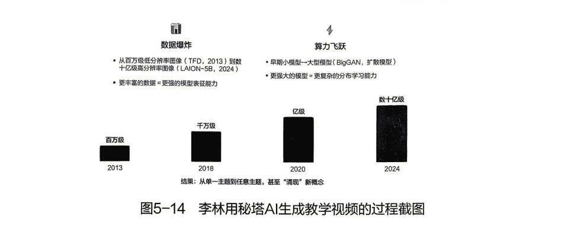
返校后，李林分享了用秘塔AI构建自学课堂的经验，王凡等4名同学表示兴趣，当天建立在线学习小组，共同开启定制化自学新模式。

### 基于生成式人工智能构建定制化自学课堂的启示

1. AI赋能学生成为自学的主动设计者

李林主导任务制定、资源筛选与成果生成，从“接受者”转向“创造者”，体现生成式学习范式的核心。案例中他在文献导读、目标设定、工具操作、在线课程构建等全过程获得AI支持与服务。

2. 基于真实任务，形成人机协同的学习闭环

李林以综述性学术文献为起点，将任务置于真实学术背景，拓展认知视野、提升思辨能力。AI支持构建了学习者主导、AI协同反馈的闭环生态。

3. 学习者可以不断迭代优化AI赋能的自学模式

消息传开后，更多同学想借鉴却不知如何规划。李林整理了应用AI学习的经验清单供参考（见表5-1），整理过程中他发现模式仍可优化，帮助同学也是自我反思改进的过程。

表5-1 李林总结的应用AI自学的要点

| 要点 | 主要内容 |
| :--- | :--- |
| 案例名称 | 基于GenAI的图像与视频生成方法自主探究学习 |
| 适用场景 | 自主探究学习/项目式学习教学案例 |
| 学习起点 | 阅读《基于生成式人工智能的图像视频生成方法综述及展望》，并生成讲解PPT与视频（通过秘塔AI） |
| 学习目标 | 理解视觉生成模型原理；比较典型图像/视频生成技术；完成一项AI创作任务并反思总结 |
| 所用工具 | ◆ 秘塔AI（文献讲解） ◆ 文心一言（学习规划与提示词优化、图像生成） ◆ 通义万相（图像多风格合成） ◆ DeepSeek（学习规划） |
| 任务成果 | 图像、视频短片、模型对比表、学习报告 |
| 特色亮点 | ◆ 目标导向 ◆ AI工具赋能 ◆ 任务驱动+AI提示词优化 ◆ 人机协同学习 |

这种模式推动学生从内容接受者变为自学模式与课堂的创建者，正深刻变革教学范式。

4. 应用AI生成定制化自学课堂应注意的问题

继续使用秘塔AI时，李林发现其讲解偶尔表达不规范或有错误。发现平台“今天学点啥”模块支持上传资料生成讲解PPT与在线课堂后，他将《红楼梦》第三回《林黛玉进贾府》的图文PDF上传生成讲解。（见图5-15）平台按设定生成了适合初学者的带音频PPT与讲解视频。生成过程如下。

李林上传原著文本及电视剧截图的PDF文档。

观看视频时，他发现如图5-16所示的错误，说黛玉见到“元春温柔沉默，迎春文采好，探春年纪小，但三人穿着打扮都差不多”，这与原著不符。特别是元春已在宫中，惜春被漏掉，对三人的描写也不符。

图5-15 李林登录秘塔AI “今天学点啥” 上传文档的过程截图

图5-16 李林发现AI生成讲解出错的视频画面截图

因此，学习者应用AI自学时须有质疑精神与风险防控意识，注意审核生成内容的科学性与准确性。若李林不熟悉原著，便不易发现错误。对生成内容要主动查阅教材核实，与同伴讨论或请老师指导，避免认知风险。

## 第 2 节
GenAI赋能探究式教学

### 一 GenAI赋能探究式教学的要领与策略

探究式教学强调主动提问、搜集证据、推理建构。AI凭借自然语言理解与内容生成能力，为学生提供个性化引导、资源创设与反馈支持，成为探究学习的认知工具与学习伙伴。教师有效发挥AI作为认知促进者与协同者的角色，有助于创新教学模式、提升教学质量、培养创新思维。

1. 应用GenAI生成探究任务与真实情境

备课时把学科主题、教学目标和学生画像一起交给生成式人工智能，系统能迅速给出激发好奇心的探究任务，并配套情境式小故事、仿真实验或典型案例，帮助学生产生提问的冲动。任务的背景阐释、角色设定、研究线索等教学支架也能由模型自动搭建，经老师审阅修改后即可使用，既减轻备课负担，又提升情境的可信度。

2. 用大模型助力学生打磨探究性问题
探究中学生虽能发现问题，却多停留在粗放层面。教师可引导学生带着初步想法与模型对话，推动问题走向多层次，聚焦关键变量或因果机制。实践中可形成一套提问题的操作习惯：①借助提问模板，例如“你是想弄清现象的成因、过程还是结果”；②生成“问题树”或“问题金字塔”，由表层向深层递进。例如探究“为什么有些植物长得快”，模型可协助拆分为外部条件如阳光、水分是否差异，内在机制如是否与光合作用效率相关等分支。

3. 用大模型搭建多模态资料库与分析工具
资料搜集与证据分析是探究式教学的核心，生成式人工智能具备文本、图像、视频的提要与比对能力，能把来自不同平台的信息聚合整理。学生可用它归类照片、地图等视觉资料，完成内容识别与推理，从而开展更深入探究。

4. 用大模型引导推理与假设构建
学生在探究中常止步于现象描述，难以形成合理解释。大模型可模拟探究对话，带动学生提出假设并推敲因果逻辑。通过对话式提示设计，引导学生表述假设、验证路径与逻辑关系；同时提供可视化思维工具，支持制作思维导图、因果图、结构图，实现结构化思考。

5. 用大模型支持成果表达与自我反思
大模型不仅能协助生成规范的研究报告初稿，还能依据不同受众整理口头汇报稿、宣传图文、视频脚本，支持多样化表达。教师要引导学生保持主体性，不是让模型替代完成任务，而是借助模型提升自主学习、批判性思维与创造力。

教师角色需从“知识讲授者”转向“学习设计者”与“AI协同教练”，主动设计更恰当的“人机共创”探究任务，促进学生高阶思维发展，避免不当使用并防范风险。

### 二 GenAI赋能探究式教学的案例

### (一) 案例简介
广州市海珠区教育发展研究院教研员邓丹玫老师，组织几位青年教师以生成式AI开展“神话赏析课”专题研修。

“神话赏析课”整合了统编版小学语文四年级上册第四单元“语文园地”中的“交流平台”、“快乐读书吧”中的“导读活动”和“单元学习反思”三部分，共3课时。其中“交流平台”以《盘古开天地》等四篇课文为例，围绕神话的文体特点谈三点：一是充满神奇想象；二是人物个性鲜明；三是表达对世界的认识，旨在引导学生结合单元课文谈对神话人物、神奇情节的认识，并在归类梳理中初步总结神话基本特点。

本案例聚焦“交流平台”板块的设计，从使用目的、方法、过程、经验等方面，探讨如何以“自主探究，提炼神话故事特点”为目标，借助生成式AI支撑探究式教学。

### （二）教师应用GenAI设计教学的过程与方法

#### 1. 分析明确单元教学目标及学生角色
“交流平台”的教学意图是让学生回顾梳理单元阅读，自主发现并归纳神话基本特点，自主建构知识体系。因此课堂要突出学生主体，引导他们综合前期经验，通过自主学习、合作探究解决新问题——构建神话特点的知识体系。据此教师确定教学目标：①能介绍一个喜爱的神话，说清其神奇想象和鲜明人物形象；②依托单元阅读经验，初步提炼神话文体特点，交流认识。

教学必须以目标为牵引，强化问题意识，生成式AI的使用要有明确目的。教师分析本课目标后，预判两大难点：①神话特点学习属文体常识，较为枯燥，易难激发兴趣；②传统课堂常由教师讲解要点，学生印象浅，常停留在“知道”层面。如何基于学情设计驱动性探究任务，引导学生自主梳理阅读收获并概括神话特点，成为挑战。

#### 2. 分析GenAI的优势与功能
本课例选用即梦AI和豆包。即梦AI是一个一站式AI创作平台，可生成AI图片与AI视频。教师可用它制作神话主题视频或微课，创设交际情境、复盘学习历程、激发兴趣、点拨要点。

豆包提供一个互动有趣的学习平台，能提升学习兴趣与综合能力，也为教师教学与评价提供支持。①激发兴趣。豆包的互动性和趣味性能吸引注意力，激发学习神话的兴趣，学生可用文字、语音与之互动，学习更生动。②强化表达。在向豆包介绍神话故事的任务驱动下，学生需组织语言、理清情节、把握逻辑，提升口头表达和逻辑思维。③即时反馈。豆包可依据教师设定的评价标准，从多角度对每位学生的讲述进行评价，及时回应增强参与感和成就感，并给出针对性改进建议。

#### 3. 用GenAI设计和组织学生开展挑战性的探究任务

（1）运用GenAI生成导入资源和学习视频，丰富学习资源
为解决内容枯燥、难引兴趣的问题，授课教师结合教材特点和学生认知规律，创设了一个真实交际情境——举办“神话故事会”，并设计生成了一个导入激趣视频。视频以教材四则神话为核心，通过开启神话之门、动画演绎、互动对话等形式，带领学生进入生动的远古神话世界。

起初教师选用文心一言，通过提示词生成神话人物图片。
提示词：
> 你是一位语文教师，要在“神话赏析课”的导入环节激发学生的学习兴趣，请生成一张体现神话特征的生动图片，用于激趣导入。
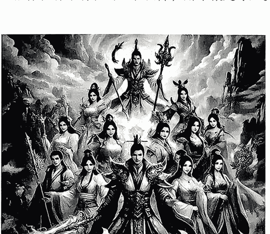
看过图片后教师认为不太适合课堂导入，便修改提示词重生成，效果仍不满意。随后教师用DeepSeek检索制作微视频可用的AI平台，DeepSeek推荐即梦AI，于是尝试制作微视频。具体操作如下：
第一步，教师把想要的图片效果描述清楚，借助DeepSeek生成准确提示词：生成四张图片，分别为夸父、女娲、精卫、普罗米修斯各自面向观众自我介绍，再生成一张把四个神话人物置于同一背景的图。风格为神话插画风，五张风格统一。将以上内容转为中文提示词用于生成图片。
第二步，把DeepSeek生成的提示词逐条复制到即梦AI生成图片。（见图5-18）
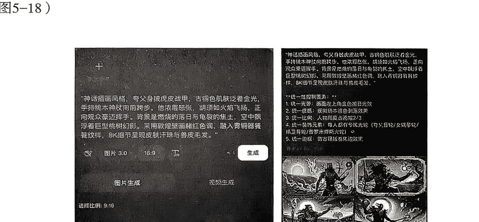
第三步，使用即梦AI的数字人功能，输入人物台词并选择音色生成视频。（见图5-19和图5-20）
教师用即梦AI营造奇幻氛围，是为回顾单元内容以激发兴趣。在此情境中布置真实学习任务——线上或线下向同学介绍一个最喜欢的课内或课外神话故事。任务旨在引导学生从感性认识逐步上升到归纳神话特点，并为后续分享课外神话做铺垫。

接着教师制作了第二个微课视频，即一段简要介绍神话文体特点的动画微课。（见图5-21）

图5-19 为即梦AI生成的图片选择音色的过程截图

图5-20 微视频内容截图

图5-21 微视频内容截图
该微视频并未在课堂播放，而是在课后发至学习群，供有需要者自主观看。微课生动有趣，学生在自主合作探究提炼出神话特点后对照微课即可查缺补漏，学习困难者可借此“加餐”。复习阶段也可回看，既复习又放松。

（2）运用豆包，人机协同练习
《义务教育语文课程标准（2022年版）》指出：“充分利用网络平台和信息技术工具，支持学生开展自主、合作、探究性学习，为学生的个性化、创造性学习提供条件。发挥大数据优势，分析和诊断学生学业表现，优化教学，提供及时、准确的反馈和个性化指导。”本环节豆包的定位是“交互式学习助手”，学生借助豆包自主练习介绍喜爱的神话故事。

备课时，教师先尝试与豆包对话。（见图5-22）

图5-22显示，豆包给出建议很详尽，但与本课评价目标不匹配，拔高了标准，很难起到以评导学、以评促思的作用。

人机互动未达预期，主因是豆包未掌握本课对介绍神话故事的评价标准。于是教师向豆包输入清晰明确的评价要点。豆包据此对教师讲述内容进行分析评价并合理评分。（见图5-23）

在豆包助力下，学生能充分发挥自主性，在自主研读、合作探究的人机协同活动中思考、观察、分析、整理，了解神话特点，掌握神话阅读方法，落实单元语文要素。全程强化学生主体，突出表达输出，实现“转教为学”。

#### 4. 人机协同学习活动的指导和评价
人机协同学习中，教师的指导和评价不可或缺。课堂上教师要引导学生正确使用人工智能，既鼓励积极参与，也要监控学习过程，确保互动不偏离教学目标。

任务发布后，教师引导学生思考：怎样介绍自己喜爱的神话故事？学生经自主思考、小组交流和集体讨论，拟定出介绍神话的评价标准。

本课具体教学设计如下：

2. 出示本课任务：举办“神话故事分享会”——介绍一个自己最喜欢的（课内、课外）神话故事，再结合这个故事简单介绍神话的特点。

3. 讨论确定评价标准：
①师生共议，商定评价标准。

| 评价要点 | 得分 |
| :--- | :--- |
| · 能清楚介绍这个神话的人物特点和故事情节等方面的内容。 | 1 2 3 4 5 |
| · 能分点说清楚推荐的理由。 | 1 2 3 4 5 |
| · 能从不同角度（不少于3个）列出推荐理由。 | 1 2 3 4 5 |
②教师主导，设计评价指令。
教师根据商议结果结合评价标准制定评价任务指令，确保人机互动环节豆包反馈的评价与指导意见不偏离教学目标。

二、自读绘图，练习提升
1. 浏览全单元课文，选择自己喜欢的一篇神话，默读思考，完成“推荐喜欢的神话故事”思维导图，自己拍照上传至学习群。
2. 人机互动，练习推荐。
（1）根据思维导图练习推荐神话故事。
（2）教师在学习群中发出评价任务指令，学生向豆包输入指令和可参考的评价标准。
（3）学生作为主体，开展人机协同练习。
明确评价标准后，学生自主运用语音录入功能与豆包互动。根据反馈意见修改完善思维导图，进行第二轮口头练习。
3. 集体评议。
（1）浏览学习群中的思维导图，选出最感兴趣的作品，邀请小作者来推荐神话故事，集体评价。
（2）同桌互练，互相评分。
（3）邀请得分最高的学生现场展示，集体赏析评价。
（4）对比探究，概括文体特点。
在分享交流中，教师引导学生借助思维导图对比思考，发现神话共性，尝试点列式概括。再组织生生对话、人机对话，经历从感性到理性的过程。对比思考既加深理解，也锻炼概括与逻辑思维。

## 三、对比归纳，发现特点
1. 投影较有代表性的四名学生（所选课文不同）的思维导图，请学生结合阅读体验思考神话有什么特点。
2. 小组合作探究，绘制神话特点思维导图。
3. 集体展示，邀请豆包点评，二次修改。
4. 自我反思，学法小结。

在该案例中，教师坚持“技术为用，以人为本”，紧扣教学目标，找准疑难点，适时适度地运用GenAI，丰富教学资源和评价方式，为探究学习创设有趣情境、有用支架、有效助手，充分凸显学生主体，真正发挥了GenAI赋能教学的作用。

### 三 GenAI赋能探究式教学的赋能点与实施要点

表5-2 GenAI赋能探究式教学的赋能点与实施要点

| GenAI赋能点 | 实施要点 | 主要作用 |
| :--- | :--- | :--- |
| 问题情境生成 | GenAI生成任务书、角色扮演设定、真实情境模拟 | 激发探究动机，形成“真实任务驱动” |
| 问题提出引导 | 对话式提问教练、结构化问题模板 | 提升学生提问质量与思维深度 |
| 多模态资料支持 | 生成阅读卡片、视频摘要、图文知识整合 | 降低信息处理门槛，拓展知识视野 |
| 认知过程促进 | 假设验证对话、逻辑图示构建、个性化推理反馈 | 提升学生分析与建构能力 |
| 成果表达与评价 | GenAI生成展示材料、评价反馈、反思日志 | 完善探究闭环，促进知识迁移 |

## 第 3 节
GenAI赋能项目式教学

### 一 GenAI赋能项目式教学的要领与策略
GenAI的智能生成与认知支持技术若在项目式教学中有效应用，将推动教学方式变革并提升成效。把握以下要领与策略，可构建人机协同驱动、师生共创发展的项目式教学新模式。

1. 应用GenAI赋能项目任务与情境设计智能化
教师输入学科主题与教学目标后，GenAI可快速生成真实世界导向的项目情境、问题驱动任务与不同角色。例如，“请生成一个面向初中生、关注可持续发展的跨学科项目任务”，实现项目任务从“教师单向设定”向“智能协同生成”转变。

2. 应用GenAI赋能资源聚合与调研过程高效化
GenAI能辅助学生在资料调研环节自动整合文本、图像、视频等多模态信息。教师可引导学生使用GenAI生成“主题知识卡片”、“对比图表”与“案例地图”，提升问题理解能力、调研效率与资料处理能力。

3. 应用GenAI引导项目推进中的思维支持与协作
GenAI在项目中段提供过程性认知引导，如提出反向问题、验证假设、优化分工方案等。教师可将GenAI设为“项目助理”角色，嵌入阶段性任务节点，引导学生通过“AI对话+小组共创”模式进行持续推进与分工优化。

4. 应用GenAI赋能成果表达与反馈评价
项目成果产出阶段，GenAI可协助学生生成汇报提纲、可视化成果展示文本，同时辅助教师进行结构化、标准化的项目评价。教师可就AI生成的初稿进行师生共评，支持“成果+过程”的形成性评价闭环。

### 二 GenAI赋能项目式教学的案例
以“悠悠百草香，传承中华情”项目式教学为例

“悠悠百草香，传承中华情”项目式教学，缘于2022年疫情防控期间上网课时学生提出的“如何利用中草药提高抵抗力”这一驱动性问题。2023年春季开始，学生以小组合作形式开展项目活动，在种植、养护等过程中加深对中草药的认识，同时融合多学科内容，运用技术工具，通过多种方式推进项目。其目标在于让学生掌握中草药知识与实践技能，运用多学科知识解决问题，培养团队合作等能力，增强文化自信，树立正确的劳动观念，激发他们对中草药文化的兴趣与热爱。项目任务分为个人任务和小组任务，个人需积累知识、记录总结和制作中草药标本图鉴并讲解说明、创作相关文学或美术作品及短视频；小组则要开展种植实验并撰写观察报告。

在该项目中，GenAI深度融入教学全程，从多维度赋能教学活动。


### 1. 利用GenAI获取中草药知识
教师积极鼓励学生与GenAI对话，借助豆包、文心一言、讯飞星火等工具，高效获取丰富的中草药知识，涵盖形态、特性、功效、产地等多元信息，突破传统单一资源获取模式，激发学生自主探究中草药知识的兴趣，培养创新思维。

以茯苓为例，学生向GenAI（如讯飞星火）提问“茯苓的生产地”“茯苓的药性”“茯苓可以做什么美食”等关于中草药产地、特性、功效、用途等方面的问题。（见图5-25）
讯飞星火生成的内容较为全面、准确，能满足学生对茯苓基础知识了解的需求。但部分内容可以进一步深化，比如在介绍茯苓不同产地药效的差异时，教师引导学生通过查阅专业医学网站的资料进行补充，加深学生对中药产地与药效关系的理解。学生快速获取大量中草药知识，丰富了知识储备，激发了学生主动探索中草药的兴趣，为后续学习创作奠定了知识基础。


### 2. 绘制中草药标本图鉴，形成校园中草药标本墙
在学生探究中草药知识后，教师展示植物图鉴、中草药标本画照片，组织学生自主观察，小组讨论图鉴特点，思考如何将中草药标本与图鉴相结合。学生分小组完成中草药标本图鉴设计单，通过组间交流修改完善设计方案。（见图5-26）
完善设计方案后，各小组利用课内外时间完成对中草药标本图鉴的设计制作，并在课堂展示。为了让学生能够用技术让更多人了解中草药知识，黄老师组织学生用GenAI工具创作数字化作品。

## 3. 运用GenAI辅助技术创作
黄老师带领学生协同运用GenAI工具与剪映来剪辑中草药讲解视频、制作二维码，并将其融入中草药标本图鉴制作，显著提升作品的科技感与互动性，有效锻炼学生的信息技术应用能力，实现知识与技能的融合。

**剪辑落地与文化延伸，让药材影像活起来**

视频后期的制作是学生把学习成果落地的关键节点。这一阶段，学习者把生成式大模型与剪映内置的智能组件串联起来，完成脚本撰写、素材图象的处理与整合、虚拟主播的生成、字幕的自动产出与人工校对等工作。以山楂为例，学生把前期搜集的资料贴入大模型，并给出明确指令：请你扮演资深的视频制作人，参照已有资料为山楂撰写视频脚本并整理出对应的解说词。

模型在吸收材料后，会先输出一段归纳性的文字说明，再附带分镜式的提纲，为后续的素材归类、字幕添加、剪辑顺序调整以及虚拟人物配音提供依据。（见图5-27、图5-28、图5-29）

## 4. 用AI打开文化表达的空间

在表达拓展层面，学习者借助生成式人工智能打开创作边界，既能进行诗词创作也能撰写解说稿，为中草药图鉴增添人文气息，更生动地呈现药材的特质与意义。

例如围绕当归，同学让模型如豆包模仿《台湾当归谣》的风格，创作一首关于当归的小诗和一份介绍文稿。


图5-27 学生利用GenAI和剪映工具完成虚拟人制作、字幕生成的截图


图5-28 学生利用GenAI和剪映工具生成山楂讲解视频的截图


木星组 介绍山楂

图5-29 学生借助GenAI与剪映工具生成山楂讲解视频的二维码

学生拿到类似《当归叹》的短诗，介绍文稿部分，模型给出了当归的功效、特性、适用人群等内容并作展开说明。

### 当归叹
当归故里心悠悠，遥望家乡泪满眸。
万水千山归梦远，千言万语诉情柔。
清风拂面心如镜，细雨沾衣泪似流。
遥想故园今夜景，何时归去共欢游。

模型产出的诗歌情感饱满，但在药用文化内涵的呈现上仍有提升空间，比如在诗中融入更多与药用价值相关的典故。介绍文稿的专业性较好，若引导学生加入自身理解与生活实例，感染力会更强。借助生成式AI创作的诗歌与文稿为中草药标本图鉴注入了文化元素，以更具吸引力的方式展现了药材的特点与价值，增强了学生对中草药文化的理解与传播意识。创作过程中，学生的创意表达能力得到锻炼，表达形式得以丰富，独立思考与创新能力也得到培养。


## 第16章 生成式AI驱动教育研究


精彩案例

最新工具

## 第1节 用生成式AI助力研究选题

### 一 AI辅助选题形成的思路

研究选题是教学研究的起点，直接决定研究的方向、意义与质量。过去选题多依赖教师个人经验、文献积累或课堂直觉，而生成式AI的出现，为快速获得高质量选题提供了更即时系统的支撑。

1. 由模糊走向聚焦：把零散想法凝练为明确题目
把研究者原本零散的想法或感兴趣的领域，通过互动式生成逐步聚焦为具体选题。模型借助问题细化、要素拆解、可行性判断等流程，帮助分析具有研究价值的方向，供研究者结合研究现状综合凝练。

2. 关键词与案例驱动提炼
教师可提出学科或跨学科方向的关键词，让模型进行关联分析挖掘选题；也可把教学中积累的问题案例交给模型分析，提炼出可研究的问题。

3. 快速盘点研究现状，判断价值
模型能迅速检索并分析某一主题的文献，通过语义归纳与热点梳理，总结学术脉络与发展趋势，识别尚待解决的理论或实践问题。

4. 选题评估与快速优化
模型可扮演评审角色，从可行性、创新性等方面评议拟定选题，并协助优化题目表述与研究问题，提升选题质量。

实际研究中，教师可根据需要灵活组合上述策略，人机协同提升选题效率与质量。

### 二 生成式AI驱动选题的五步流程

以下以把模糊想法转化为选题为主线，结合实例说明具体做法。

#### （一）借助AI澄清问题，揭示本质
广州市新滘中学八年级语文教师苏蕴瑜发现学生作业质量特别是作文质量不佳，正值市教育局征集教育规划年度课题，她想把教学中发现的问题转化为课题。但“作业质量不高”是老问题且普遍存在，于是借助生成式AI把模糊困惑理清为有研究价值的问题。

苏老师选用ChatGPT分析作业质量问题，设计的提问为围绕初中语文作文质量偏低的深层原因进行剖析并找出值得研究的问题。对初次产出不甚满意后，她追加说明学生记叙文常出现像记流水账的现象，请完善分析。

补充后的分析指出，作文质量差表现为内容空泛、主题不明、表达混乱、结构松散、语言贫乏、缺乏情感个性、记叙文像流水账、修改流于形式等，反映出思维方式、写作策略与学习支持等方面的深层问题。

成因拆解中，学生层面表现为写作目的不清、情节构建能力弱、描写技巧缺乏、模仿大于建构；教师教学层面表现为记叙文教学抓手不清、方式偏重讲授、缺乏对流水账现象的针对性训练；作业设计与评价层面表现为任务缺乏真实情境、过程性训练不足、评价标准笼统。

基于上述拆解，可从作文任务设计、写作过程支持、写作策略教学、教师反馈机制、差异化教学、AI辅助写作、写作结构训练等角度切入，形成如“初中生流水账式记叙文现象的教学干预策略研究”等多条选题表述。

苏老师审阅后结合本班作文本，认为最能改变且关键的问题是作业任务缺乏真实情境，学生缺少真实经验也是主因，于是提出“基于真实情境的初中写作教学策略研究”。

#### （二）快速梳理研究动态，研判选题价值
选题初步确定后，需要文献调研了解现状。苏老师用提示词让模型检索并梳理基于真实情境的写作教学研究现状。


技巧提醒：秘塔AI有三种检索模式，应用秘塔AI开展研究活动时，一定要选择如图6-2所示的研究模式。


检索结果显示，国内外虽重视情境设计价值，但多停留在案例层面，缺乏以“真实情境”为核心变量、聚焦初中语文写作任务设计与策略应用关系的系统性研究。（见图6-3）苏老师据此判断，该选题既能解决实践问题，也契合核心素养导向的写作教学趋势，具有较强价值与意义。


#### （三）剖析研究要素，确定关键变量
“基于真实情境的初中写作教学策略研究”范围较大，苏老师继续让ChatGPT分析主题涉及的核心要素与重要变量，包括写作任务设计、真实情境创建、教学实施、学生表现等方面。

模型将研究核心问题归纳为：如何在初中语文教学中有效创设真实情境、设计有意义的写作任务并配合教学策略，引导学生表达真实经验、提升写作质量与思维水平。

四大构面包括写作任务设计、真实情境创设、教学实施与支持、学生写作表现。写作任务设计关注目标设定、任务类型、表达方式、指令清晰度等；真实情境创设关注情境来源、呈现方式、学生参与度等；教学实施关注写前指导、写中支架、写后评价等；学生表现关注内容质量、语言表达、结构安排、思维深度与情感投入等。

变量结构建议中，自变量为写作任务设计策略即真实情境嵌入程度，因变量为学生写作表现，中介变量为构思能力与参与动机，调节变量为教师支持方式与写作基础。

为聚焦研究，苏老师进一步追问自变量的具体操作方式。模型建议通过写作任务文本与教学设计分析判断是否嵌入真实情境，包括是否组织实地参观、社会观察或生活访谈等真实体验，是否提供贴近生活的材料，是否鼓励学生从个人经验选材，并用“真实情境嵌入评分量表”评估真实性、关联性与激发性，结合教师日志佐证。苏老师据此确定因变量为写作表现，调节变量为学生写作水平。

#### （四）分析研究逻辑，构建假设
确定变量后，苏老师询问三变量关系：自变量为写作任务中真实情境的嵌入程度，因变量为学生写作表现，调节变量为学生写作水平。

模型指出：情境嵌入程度越高，写作表现可能越好；学生写作水平会影响情境作用效果，高水平者获益更大；两者共同决定最终成效，需因材施教。

结合文献与同事讨论，苏老师提出假设：在初中语文写作教学中，真实情境在任务中的嵌入程度越高，学生的写作表现越好；学生写作基础水平对该关系起显著调节作用。

#### （五）凝练选题表述，确定最终题目
苏老师请模型基于研究内容生成规范题目，注意初中生写作基础水平对写作表现的调节作用。

得到如“初中语文真实情境写作教学对学生写作表现的影响及写作基础的调节作用研究”等建议后，结合申报导向与自身条件，苏老师最终将课题定为：基于真实情境提升初中生写作表现的教学策略研究。

选题决定研究方向与价值。应用生成式AI时可参考上述策略，也可对已有选题进行评估优化，灵活人机协同提出高质量选题。需注意研究假设应合规生成，生成式AI主要用于提升选题质量，教师保持主导。

## 第2节 如何用GenAI赋能文献搜集

# 生成式AI，让文献检索提速升级

选题确定后，如何在有限时间内把相关文献系统搜集、精要提炼并判断研究走向，直接决定了研究方案的可行性、理论框架的完整度与重点的把握。借助生成式AI，教师可以明显加快查找、归纳与趋势研判的节奏，为后续工作奠定更稳固的基础。以下分别以中文文献与英文文献的搜集为例，说明落地思路。

### 一 用生成式AI打造中文文献检索方案并落地

学科知识快速迭代、前沿议题层出不穷、教育研究跨学科特征增强，检索的全面性已成为研究质量的关键变量。将生成式AI引入检索式构建，能够帮助研究者扩大覆盖面并提升查准效率。

过去检索高度依赖个人积累，关键词的选取与组合容易受经验限制。生成式AI凭借自然语言理解与语义联想，可以自动产出多维关键词组合，并据此搭建容错度更高、精准度更优的布尔检索式。

把研究主题或问题交给模型，就能得到面向中英文数据库、涵盖核心概念、技术维度、研究对象等多层次的专业检索方案；同时还能依据研究目标与期刊偏好，对检索逻辑与限定条件进行动态微调，实现查全与查准的平衡。

这种人机协同模式大幅压缩文献准备周期，也为系统综述、热点捕捉与选题确认提供了智能化支撑，逐步形成新的科研范式。

下面结合案例说明生成式AI产出检索式的完整做法。

#### 1. 让模型自动生成中文专业检索式

让生成式AI生成中文检索式时，模型会基于主题自动抽取高频词，构建多组组合式表达，覆盖核心概念、相关技术与应用场景，能显著提升中文库检索的全面性与精准度。以姜雨欣老师检索数字教材中文文献为例，她设计提示词并用ChatGPT生成了检索方案。

模型返回的结构化内容如下：

# 数字教材研究相关文献检索算法

## 一、核心概念分析与关键词确定

数字教材研究通常包含以下四个核心概念（每个核心概念下设同义扩展）：

1. 教材载体/媒介形态（核心主题）
数字教材、电子教材、智能教材、AI教材、智能教科书、在线教材

2. 技术支撑维度
人工智能、生成式人工智能、大数据、智能推荐、自适应学习、教学平台、教育技术、教育数字化

3. 教育应用场景
教学、课堂、课程、学习、混合教学、线上教学、翻转课堂、校本课程

4. 研究主题/焦点
教学设计、教学效果、学习成效、学生参与、教师使用、用户体验、教师认知、教学创新、资源建设、教材评价、教材审定、教育改革

## 二、布尔逻辑构建检索算法（适用于CNKI）

建议使用“主题”字段（SU）或“篇名+关键词+摘要”字段（TPKA）进行专业检索，以下为示例表达式：

```
(“数字教材” OR “电子教材” OR “智能教材” OR “AI教材” OR “智能教科书” OR “在线教材”)
AND (“教学” OR “学习” OR “课堂” OR “课程” OR “混合教学” OR “线上教学” OR “翻转课堂” OR “校本课程”)
AND (“人工智能” OR “生成式人工智能” OR “教育技术” OR “智能推荐” OR “大数据” OR “教学平台” OR “教育数字化”)
AND (“教学设计” OR “教学效果” OR “学习成效” OR “学生参与” OR “教师使用” OR “用户体验” OR “教师认知” OR “教材评价” OR “教材审定” OR “教学创新” OR “资源建设”)
```

## 三、检索示例（CNKI专业检索界面使用方法）

1. 进入中国知网（https://www.cnki.net）；
2. 选择“专业检索”；
3. 在“篇名+关键词+摘要”输入上方检索表达式；
4. 设置时间范围为2015年至今；
5. 点击检索。

## 四、进阶优化建议

1. 使用主题词共现分析工具（如CiteSpace）进一步发现潜在关键词；
2. 结合研究问题的具体维度构造检索子式（如教师接受度、学生认知负荷等）；
3. 定期更新关键词，结合最新政策、标准词表（如《教育信息化术语表》）调整。

姜雨欣审阅后发现，模型虽然列出大部分概念，却遗漏了多媒体教材、云教材、交互式教材、数字教科书等重要表述。她先把检索需求拆分，人工核验数字教材的核心概念与相关技术是否齐全无缺，再驱动模型生成具体检索式，以提升协作效率。

实际应用时要明白，生成式AI提供的思路与策略可借鉴，但具体操作必须结合数据库特性调整，表达式不宜一次性照搬，否则过于复杂、过长会导致系统不支持。例如CNKI高级检索允许在同一检索项内用*、+、-等运算符组合，但单次输入字符有上限，目前组合运算字符不能超过120个。

#### 2. 检索式的人机校验与实操要点

不同数据库功能相近但操作有差异，生成式AI产出的检索式需要审核修正后才能使用。以姜老师的数字教材检索为例，具体步骤如下。

（1）审核并完善检索式
姜老师复核模型建议使用“主题”字段（SU）或“篇名+关键词+摘要”字段（TPKA）进行专业检索给出的示例表达式：

> （“数字教材” OR “电子教材” OR “智能教材” OR “AI教材” OR “智能教科书” OR “在线教材”）

她判断核心概念不够充分，补充了多媒体教材、云教材、交互式教材、数字教科书等，修改后的检索式为：

（“数字教材” OR “电子教材” OR “智能教材” OR “AI教材” OR “智能教科书” OR “在线教材” OR “多媒体教材” OR “云教材” OR “交互式教材” OR “数字教科书” OR “智能教科书”）

确认概念覆盖全面后即可开始检索。

（2）登录数据库并选择检索方式
姜老师登录中国知网开展检索，注意到CNKI的专业检索在登录后更稳定，否则易出现“暂无数据，请重新检索”。

第一步，点击左侧的高级检索进入界面；
第二步，点击输入框上侧的专业检索菜单切换模式；
第三步，选择检索方式并输入检索式。点击输入框空白处会出现隐藏菜单，如图6-7所示。她这才注意到模型表述有误，“篇名+关键词+摘要”在知网的缩写为“TKA”，而非“TPKA”。


由此可见，使用生成式AI生成的检索式必须仔细核查修正。

在知网用运算符和检索词构成的检索式进行专业检索时，可参考检索框右侧的检索方法说明。姜老师选择“篇名+关键词+摘要”即“TKA”方式，将修改后的表达式复制到检索框并执行搜索。（见图6-8）


如图6-9所示，该表达式在知网检索到1347条跨教育理论与教育管理、计算机软件等学科的数字教材研究文献。


（3）评估结果并调整策略
浏览标题与来源后，姜老师注意到建设类文献较多，而她关注的是应用研究。于是她将策略调整为“主题”加“篇名+关键词+摘要”组合检索，得到293篇文献。

再浏览评估后仍感部分文献质量不高，她决定进一步修改检索式，优化检索策略获取更优质成果。

#### 3. 向高级检索方案升级

为获取更全面高质量的文献，建议多用几种检索方式。姜老师重新设计提示词，用ChatGPT生成适用于知网高级检索的数字教材应用研究文献检索方案。


### 图6-10 姜老师以TKA与SU组合进行专业检索的结果截图

提示词：

你是数字教材资深研究专家，请设计在知网等数据库检索数字教材应用研究文献的高级检索算法。请确保以下要求：

1. 检索概念涵盖“数字教材”及其相关概念，如应包括但不限于数字教材、电子教材、智能教材、数字教科书、电子教科书等。
2. 数字教材的应用方向需覆盖以下几方面：
第一，教学应用方面，如教学实践、课堂教学、教学创新等；
第二，技术支持方面，如虚拟现实（VR）、增强现实（AR）等新兴技术赋能的教材应用；
第三，质量保障与监管方面，如标准建设、数据安全等。
3. 输出要求：
- 检索逻辑需严谨完整，充分使用“OR”“AND”逻辑运算符；
- 关键词表达尽可能全面涵盖主要相近的学术概念；
- 输出标准适用于知网（CNKI）等中文专业数据库的高级检索；
- 需区分基础通用版与面向前沿创新研究的加强版两种检索方法。

请以中文输出详细的检索表达式，确保逻辑清晰、表达全面，便于直接在知网数据库进行高级检索。

生成过程如图6-11所示。姜老师注意到ChatGPT给出的仍是专业检索表达式而非高级检索，于是继续追问引导模型输出符合要求的结果。（见图6-12）


在追问下，ChatGPT给出如下结果：

# 数字教材应用研究文献高级检索标准方案（知网CNKI适用）

本方案严格依据知网（CNKI）高级检索规范设计，运用标准运算符，涵盖数字教材及应用研究等主要关键词，适用于系统、全面获取相关中文文献。

## 一、基础通用版检索表达式

建议分步组合检索，确保字符不超限，逻辑结构如下：

【第一步：数字教材相关概念】

（“数字教材” + “电子教材” + “智能教材” + “智慧教材” + “AI教材” + “人工智能教材” + “数字教科书” + “电子教科书” + “智能教科书” + “智慧教科书” + “AI教科书” + “人工智能教科书”）

【第二步：应用方向关键词组示例】

（可多次组合，以下分组供参考）

教学应用组1：（“教学应用” + “教学实践” + “课堂教学” + “教学创新” + “教学效果” + “教学改革” + “教学模式” + “教学策略”）

教学应用组2：（“个性化学习” + “自适应学习” + “智能推荐” + “学习分析” + “数据驱动教学” + “智能交互” + “交互设计”）

技术支持组：（“虚拟现实” + “VR” + “增强现实” + “AR” + “混合现实” + “MR” + “人工智能” + “AI” + “大数据” + “区块链” + “智能算法”）

质量监管组：（“标准建设” + “平台建设” + “资源建设” + “审定” + “质量控制” + “内容审核” + “监管” + “数据安全” + “版权管理”）

## 二、前沿创新加强版检索表达式

适用于聚焦技术赋能、智能化发展前沿方向：

（“数字教材” + “智能教材” + “智慧教材” + “AI教材” + “人工智能教材” + “智能教科书” + “智慧教科书” + “AI教科书” + “人工智能教科书”）*（“虚拟现实” + “VR” + “增强现实” + “AR” + “混合现实” + “MR” + “人工智能” + “AI” + “大数据” + “区块链” + “智能算法” + “学习分析” + “个性化学习” + “自适应学习” + “智能推荐” + “数据驱动教学” + “智能交互” + “人机协同” + “智能适配” + “智能感知” + “智能评估”）

## 三、实用操作建议

- 先检索主题概念，确认总体文献分布；
- 叠加应用方向关键词，分组组合多次检索；
- 可结合时间限制、来源类别筛选高质量成果；
- 聚焦技术融合、智能发展，可优先采用前沿加强版表达式。

#### 4. 高级检索方案的落地验证

实践中不建议直接套用生成式AI生成的检索式，必须先审核修改。以姜老师为例，具体做法如下。

（1）审核并完善检索式
姜老师注意到格式问题：知网高级检索的关键词不需要加引号，直接在“+”后添加即可。她将方案复制到Word，用查找替换快速删除多余符号。同时完善关键词，如在教学应用组1中补充数字化教学等概念。确认无误后开始检索。

（2）登录数据库并执行检索
姜老师登录CNKI进入高级检索界面，选择“篇关摘AND摘要AND全文”组合检索，分别输入修改后的检索式，知网返回如图6-13所示的338条文献。

篇关摘栏输入：数字教材+电子教材+智能教材+智慧教材+AI教材+人工智能教材+数字教科书+电子教科书+智能教科书+智慧教科书+AI教科书+人工智能教科书+多媒体教材+多模态教材

摘要栏输入：教学应用+教学实践+课堂教学+教学创新+教学效果+教学改革+教学模式+教学策略+数字化教学+智慧教学+智能教学+在线教学+混合式教学+教学方法

全文栏输入：个性化学习+自适应学习+智能推荐+学习分析+数据驱动教学+智能交互+交互设计+个性化教学+精准教学

浏览结果后，姜老师认为用完善后的数字教材概念与教学应用方向组合检索的相关性明显提升，符合研究需求。


这种先生成后校准、再组合优化的高级检索方式，显著提升了检索效率。

### 二 借助GenAI设计英文文献检索策略

深圳市南山实验教育集团园丁学校莫潇潇老师在了解虚拟教师相关视频后，为系统掌握国际上教育机器人研究现状，使用ChatGPT生成适用于Web of Science等英文数据库的教育机器人前沿文献检索方案。为提高质量，她在提示词中明确要求先提出相关概念再生成检索式。（见图6-14）

ChatGPT生成的内容如下：

> 教育机器人研究相关英文文献检索算法

> 一、教育机器人相关英文核心概念

> 教育机器人研究内容广泛，综合分析可归纳为以下核心概念：

ChatGPT 4o

> 你是人工智能教育研究专家，熟悉Web of Science等英文专业文献数据库的检索方法与技巧。现在，请你分析提出与教育机器人相关的英文核心概念，并分析梳理与每个概念密切相关的关键词，以便能够利用这些概念与关键词，生成英文文献检索的合理算法，全面搜集教育机器人的研究文献。

非常好的问题，以下是基于教育机器人（Educational Robots）主题，系统分析核心概念、关键词，并设计Web of Science（WoS）数据库的专业检索策略，便于全面系统地搜集相关英文文献。

## 一、教育机器人相关英文核心概念

教育机器人研究内容广泛，综合分析可归纳为以下核心概念：

| 核心概念英文 | 中文释义 | 典型关键词 |

|---|---|---|

| Educational Robot(s) | 教育机器人 | educational robot, educational robotics, learning robot |

| Social Robot(s) | 社交机器人（常用于教育场景中的人机互动） | social robot, social robotics |

| Teaching Robot(s) | 教学机器人 | teaching robot, robot teacher |

| Robot-assisted Learning/Teaching | 机器人辅助教学/学习 | robot-assisted learning, robot-assisted teaching, robot-supported learning |

| Humanoid Robot(s) | 拟人型机器人（教育中常见的具体形式） | humanoid robot, humanoid robotics |

| Robot-mediated Learning/Interaction | 机器人介导的学习/互动 | robot-mediated learning, robot-mediated interaction |

| Intelligent Tutoring Robot(s) | 智能辅导机器人 | intelligent tutoring robot, AI tutoring robot |

| Artificial Intelligence in Education with Robots | AI 驱动的教育机器人 | AI-powered robot, AI robot for education, robot with artificial intelligence |

### 图6-14 利用 ChatGPT 协助搭建检索式的工作界面示例

## 二、可直接投放在 Web of Science 的高级检索式
```
TS=("Educational Robot" OR "Pedagogical Robot" OR "Teaching Robot" OR "Robot Teacher" OR "Social Robot in Education" OR "Humanoid Robot Teacher" OR "Robot-assisted Teaching" OR "Robot-based Learning" OR "Robot Tutor" OR "Robot Teaching Assistant" OR "Robot-assisted Learning" OR "Robot Companion in Learning" OR "Socially Assistive Robot in Education" OR "Robot for Collaborative Learning" OR "Robot-mediated Learning")
AND
TS=("Educational Technology" OR "Artificial Intelligence in Education" OR "STEM Education" OR "Language Learning" OR "Collaborative Learning" OR "Special Education" OR "Early Childhood Education" OR "Classroom Teaching")
AND
DT=("ARTICLE" OR "PROCEEDINGS PAPER")
AND
PY=(2015–2025)
AND
WC=("Education Educational Research" OR "Computer Science Artificial Intelligence" OR "Education Scientific Disciplines" OR "Robotics" OR "Engineering Electrical Electronic")
```

## 三、检索使用要点
- 初轮结果出来后，建议借助 Keywords Plus 与 Author Keywords 再做一次细化，有助于下一轮命中的准确度提升。
- Scopus、Google Scholar 的布尔逻辑与 WoS 基本一致，只是字段写法需要转换，比如 Scopus 常用 TITLE-ABS-KEY。
- 若需要进一步收窄，可补充 NAO、Pepper 等机器人型号词，建议作为后置限定，初筛时不建议加入。

## 四、Web of Science 常用检索缩写释义
下面对 WoS 中频繁出现的检索缩写做了归纳，便于快速上手并提升检索效率：

### 三 生成式人工智能产出检索式的实践
前面提到，模型给出的检索式必须由研究者审校调整后才能使用。下面以教育机器人英文文献的检索为例，说明如何借助生成式人工智能形成高效检索方案。

（1）复核并完善模型给出的概念与检索式
案例中的教师发现 ChatGPT 提供的教育机器人定义与检索式覆盖不够全，核心词存在缺口。通读后补充了同义词与相关表述，完善概念与检索式后，便进入数据库执行检索。

（2）进入英文数据库并选择检索入口
该教师打开 Web of Science，面对纯英文页面感到阅读吃力，注意到右上角的语言切换入口后改成中文，页面随即变为如图6-16 所示的中文版。
随后在 7 个可选库中锁定 Web of Science 核心合集作为检索范围。见图6-17

图6-15 初次登录 Web of Science 的界面截图

图6-16 通过语言菜单将界面切换为中文的过程截图

图6-17 在 WoS 平台选择目标数据库的截图

在检索框内点击，展开平台支持的字段与主题选项。见图6-18
接着点开下方的“高级检索”，进入操作区后选择“所有字段”模式，粘贴复合检索式开始抓取教育机器人相关文献。见图6-19

图6-18 查看 WoS 提供的检索字段与方式的截图

图6-19 在高级检索界面执行检索的操作截图

252 GenAI时代如何做教师：生成式人工智能赋能教学与研究

最终采用的高级复合检索式如下：
```
TS=("Educational Robot" OR "Pedagogical Robot" OR "Teaching Robot" OR "Robot Teacher" OR "Social Robot in Education" OR "Humanoid Robot Teacher" OR "Robot-assisted Teaching" OR "Robot-based Learning" OR "Robot Tutor" OR "Robot Teaching Assistant" OR "Robot-assisted Learning" OR "Robot Companion in Learning" OR "Socially Assistive Robot in Education" OR "Robot for Collaborative Learning" OR "Robot-mediated Learning" OR "AI-powered Educational Robot" OR "Adaptive Educational Robot")
AND
TS=("Educational Technology" OR "Artificial Intelligence in Education" OR "STEM Education" OR "Language Learning" OR "Collaborative Learning" OR "Special Education" OR "Early Childhood Education" OR "Classroom Teaching" OR "Technology Adoption")
AND
DT=("ARTICLE" OR "PROCEEDINGS PAPER")
AND
PY=(2015-2025)
AND
WC=("Education Educational Research" OR "Computer Science Artificial Intelligence" OR "Education Scientific Disciplines" OR "Robotics" OR "Engineering Electrical Electronic" OR "Information Technology" OR "Education Technology")
```

对照 ChatGPT 原始输出，可看出教师新增或调整了哪些检索词。

使用复合式检索后，系统返回了如图6-20 所示的 59 条相关成果。
逐条浏览发现单篇动辄十几页，阅读负担重且理解耗时，决定借助生成式 AI 工具加速阅读与提炼。

图6-20 高级检索得到的结果截图

# 第 3 节
# 用生成式人工智能助力文献拆解与综述写作

### 一 用生成式人工智能解析英文文献
拿到文献后需要快速抓住要点。合理运用生成式人工智能，可帮助教师迅速提取研究目的、方法、样本、主要发现与启示等要素。对结构清晰的研究论文，模型还能辅助绘制研究逻辑图，助力判断文献价值与借鉴点。

以下以一篇智能教材的英文论文为例说明如何进行文献分析。

Sosnovsky, S., Brusilovsky, P. & Lan, A. Intelligent Textbooks. International Journal of Artificial Intelligence in Education (2025). https://doi.org/10.1007/s40593-024-00451-9.

#### （一）借助生成式人工智能实现英文文献的即时翻译
外语基础薄弱的研究者，可利用生成式人工智能的翻译能力将英文或其他语种文献转为中文。多数工具均支持文献翻译。姜老师用豆包翻译《Intelligent textbooks》一文，如图6-21 所示，翻译后提供中英文对照阅读页面。


若不需要对照阅读，可点右上角“×”退出对照模式进入纯译文窗口。如图6-22 所示，点击相应菜单即可下载译文、调整阅读版式等操作。

#### （二）借助生成式人工智能快速提炼文献要点与结论
将文献上传至模型并给出明确要求，即可快速得到研究背景、目标、内容、方法与核心结论。姜老师在豆包中输入提示词进行分析。

提示词：
> 你好，请你作为教育研究专家，整理出这篇文章的主要框架，包括研究背景、研究目标、研究内容、研究方法与核心结论等。限500字以内。

模型生成的文献分析结果如下：

> 以下是针对 “Intelligent Textbooks” 的核心内容整理，适用于教育研究领域的概览性把握：
>
> 文章名称：Intelligent Textbooks
> 发表期刊：International Journal of Artificial Intelligence in Education（2025年）
> 作者：Sergey Sosnovsky, Peter Brusilovsky, Andrew Lan
> 研究背景：作为核心教学资源的教材正在由传统纸质形态向数字化、智能化形态演变。伴随着人工智能技术特别是生成式AI的发展，智能教材成为教育技术研究的前沿热点，涉及内容结构优化、个性化支持、互动设计与知识建模等。
> 研究目标：本文旨在系统回顾智能教材的发展历程，提出基于AI赋能的五代教材演化框架，梳理研究趋势，探讨智能教材在教育支持与交互方面的潜力及未来方向。
> 研究内容与方法：文章采用文献分析与趋势归纳的方法，从多个国际工作坊及代表性研究成果中提炼出智能教材的五代演化路径：
> 第一代：基于人工建模的智能支持系统
> 第二代：语义网与开放资源集成
> 第三代：利用NLP和ML从教材中自动提取知识
> 第四代：基于学习者交互数据的数据挖掘
> 第五代：应用大语言模型（LLM）生成内容与交互
> 此外，文章分析了五年间发表的54篇相关论文，归纳出11个研究主题，如智能接口、内容生成、社会化交互、教学设计等。
> 核心结论：智能教材正处于从内容建构到数据驱动，再到生成式人工智能融合的快速发展期。生成式人工智能为教材带来了全新的交互形态和智能支持路径。未来研究应关注人机协同、个性化学习路径及数据与技术的双向赋能。

#### （三）借助生成式人工智能聚焦文献重点
为把握智能教材代际演进的核心，姜老师向豆包提问：
> 请构建智能教材代际演进逻辑图，列出五代智能教材的主要特点、关键技术和代表应用。

模型回复如下：

| 代际 | 核心特征 | 技术路径 | 智能体现 |
| :--- | :--- | :--- | :--- |
| 第一代 | Intelligence Engineered | 知识工程+人工建模 | 导航推荐、页面适应 |
| 第二代 | Intelligence Integrated | 语义网+开放标准 | 知识结构整合、开放互联 |
| 第三代 | Intelligence Extracted | NLP+知识抽取 | 从教材中抽取概念/问题 |
| 第四代 | Intelligence Datamined | 学习行为分析 | 基于日志预测与干预 |
| 第五代 | Intelligence Generated | LLM+生成式AI | 对话生成、内容生成、自动组编教材 |

核对原文后，确认该概括准确呈现了演进脉络与特征。

#### （四）借助生成式人工智能提炼研究方法与关键议题
为深入理解论文，姜老师在 ChatGPT 中上传文章后，使用如图6-23 所示的提示词提问，以挖掘研究方法与重要议题。


#### （五）借助生成式人工智能进行文献关联分析，辅助选题
为从文献中寻找研究空白，姜老师设计提示词向 ChatGPT 提问：
> 请结合智能教材的前沿研究现状，指出这个主题的哪些研究议题仍缺乏实证支持，哪些方向值得继续深入。
ChatGPT 的回复如图6-24 所示。

认为结果很有参考价值，并继续引导模型对该文献进行反思以发现可研究的问题。

#### （六）借助生成式人工智能启发思考，发现研究问题
用提示词引导模型反思智能教材研究现状、分析趋势并提出可研究的问题。见图6-25

从回复可见，模型在反思研究背景、分析未来趋势后给出了可关注的研究问题。

ChatGPT 提出的研究问题为：
> 1. 生成式人工智能辅助下的智能教材能否提升学生对复杂概念的理解深度？
> ——可结合概念图任务、形成性评价与学习迁移测试进行实证验证。
> 2. 学生在使用具备生成式人工智能功能的智能教材时，其提问行为、生成依赖度与学习成效之间存在何种关系？
> ——探索学生“自主—依赖”行为模式与个性化生成反馈的交互机制。
> 3. 教师在使用集成生成式人工智能功能的智能教材时，如何进行教学决策调整？这种人机协同策略如何影响教学组织与课堂互动？
> ——关注教师在设计教学活动、筛选生成内容、引导学生使用AI方面的角色变化。
> 你好，请你作为权威专家，在反思教材研究的现状、分析未来研究趋势的基础上，思考如果要研究生成式人工智能在智能教材中的作用，可以关注哪些变量，请提出三个值得研究的具体问题。
当然，以下是我作为教育技术领域权威专家，基于“Intelligent Textbooks”一文所揭示的研究脉络和当前生成式人工智能技术发展趋势，对未来“生成式人工智能在智能教材中的作用”这一主题提出的研究思考与具体问题设计：

# 研究背景反思与趋势分析
尽管当前关于智能教材的研究已初步探讨了生成式AI的应用，但整体仍偏重技术原型开发，缺乏对教学成效、学习行为与人机协同过程的系统性实证探索。未来研究应转向探究生成式人工智能如何与教材内容深度融合、如何影响师生行为、如何改变教学生态。

# 可关注的核心变量示例
| 变量类型 | 示例变量 |
| :--- | :--- |
| 学习效果变量 | 学习迁移、概念理解、批判性思维提升 |
| 学习行为变量 | 学生使用生成式人工智能功能频率、提问类型、生成依赖程度 |
| 教学适配变量 | 教师干预方式、教材可编辑性、个性化支持水平 |
| 人机交互变量 | 对话质量、生成内容准确性、幻觉控制机制 |

审阅后，认为第二个和第三个问题都值得深入探索，于是继续查阅文献，评估这些问题的现实性与科学性，思考智能教材领域真正值得切入的方向。

# 生成式人工智能赋能英文文献阅读的五大应用场景
面对篇幅长、术语多、结构复杂的英文学术论文，容易产生阅读障碍。学会用生成式人工智能阅读，能有效提升理解深度与效率。生成式人工智能在主题识别、结构提炼、跨文献比较和批判性反思等方面正成为重要的智能助手。以下是生成式人工智能助力提升文献阅读效率的五大应用场景。见表6-1

表6-1 生成式人工智能助力文献阅读的五大应用场景

| 应用场景 | 赋能功能 | 典型提示词示例 |
| :--- | :--- | :--- |
| 结构理解 | 自动识别文献结构，提炼背景、目标、方法与结论 | 请概括这篇文章的研究目的与核心结论。 |
| 术语解析 | 解释专业术语、方法论术语或隐含概念 | 什么是generative retrieval? |
| 逻辑梳理 | 构建文献的研究框架、变量关系或研究路径 | 请用图示或文字列出本文的研究流程。 |
| 比较分析 | 对比多篇文献的研究方法、理论视角或研究结论 | 这两篇关于智能教材的文章有何不同？ |

大模型助推文献梳理与项目申报实操心得

与生成式助手反复对话，能帮助教师加速读懂外文论文、捕捉学科走向、锻炼质疑反思能力、快速搭出综述初稿并挖掘可深耕的议题。但模型产出不可直接沿用，必须经人工复核，并回溯权威数据库核对。实践中要持续沉淀使用心得、痛点和边界，提炼出个性化流程和应对办法。

当前不少工具已支持把几十篇文献一次性汇总解读。处理规模放大后，底层逻辑相近，本文不展开详述，把单篇分析的套路迁移到批量场景即可上手。

# 三 大模型助力文献综述写作

一份高质量综述可以独立发表，也常是课题申报、论文写作或教学研究的必备环节。综述是对既有成果的系统梳理，在呈现现状得失的基础上挖掘热点和短板，进而判断未来走向，为后续研究打底。工作量大、耗时长，受主客观因素影响容易出现遗漏或提炼不足。合理借助大模型，能明显提升写作效率与成稿质量。

#### （一）大模型在综述写作中的常用场景

通过指令设计，大模型可输出综述骨架，也能整合多语种、多学科文献，帮助研究者跨越语言障碍，汇聚国际前沿成果。见表6-2。

表6-2 大模型助力综述写作的常见应用

| 序号 | 核心场景 | 模型价值 |
| :--- | :--- | :--- |
| 1 | 初步归类与筛选文献 | 快速浏览摘要、提炼要点，完成批量预筛 |
| 2 | 生成结构与逻辑框架 | 输出多套结构草案，供研究者挑选参考 |
| 3 | 初稿段落生成 | 依据摘要与关键词起草分析性段落，辅助打开思路 |
| 4 | 观点整合与趋势归纳 | 归纳研究热点、理论流变与方法创新，形成初步判断供参考 |
| 5 | 语言润色与格式校对 | 提出表达优化建议，协助规范引用格式 |

#### （二）综述框架搭建的典型操作样例

下面以深圳莫老师基于外文文献撰写教育机器人综述为例说明路径。

# 1. 准备阶段：遴选核心文献

莫老师在WOS核心合集中检索到59条记录，通过标题、刊物质量与摘要速读，挑出15篇拟用ChatGPT分析的种子文献。

# 2. 导入文献并生成初稿框架

导入时发现单次最多10篇，她从15篇中挑选出代表性最强的10篇导入，并输入指令。系统给出的初稿包含引言、类型与功能定位等部分，概念界定、应用趋势与研究必要性均有体现。

图6-26 莫老师应用ChatGPT生成综述框架的过程截图

# 3. 复核结果并优化指令，让输出更规范

莫老师发现指令偏简，生成框架逻辑松散、学术规范不足，于是重新设计更细化的指令进行对话。见图6-27。

优化后得到的结构更清晰、引用更规范：

## 《教育机器人研究综述》内容框架

### 一、引言
- 研究背景，人工智能与机器人技术在教育领域快速扩张，教育机器人作为智能教育的重要组成，已在语言学习、跨学科教学、校园管理与学生发展支持等领域广泛应用
- 研究动因与价值，被视为缓解资源短缺、促进个性化学习、培养人工智能素养与创新能力的重要路径，现有成果分散亟需系统梳理

### 二、概念界定与技术演进
定义与内涵、技术类型与功能特点等，涵盖实体机器人、虚拟助教、移动机器人、智能语音终端等多元形态，以及社交型、语音交互型、校园服务型、创意与素养型等类别

### 三、不同教育场景的应用实践
高等教育智能校园与虚拟助教、基础教育语言学习与素养培养、跨学科融合与创新教育探索等

### 四、教育效果与影响分析
普遍提升学习动机、课堂参与、语言成果与创新素养，个性化支持提升学习适应性与社会情感发展

### 五、存在问题与未来方向
智能水平有限、文化适用性不足、数据隐私与教育公平等挑战，未来需突破多模态交互、素养融合、伦理规范与系统性实证，推动高智能、强适应、广普惠发展

### 六、结论

图6-27 莫老师用ChatGPT优化综述框架的过程截图

# 4. 进一步比对文献，综合构建框架

复核后认为仍有观点遗漏或偏差，她采用同样方式分析剩余文献，再结合多个版本的模型输出与文献精读，最终构建《教育机器研究综述》的内容框架。

#### （三）使用大模型撰写综述的注意事项

1. 防范事实准确性与信息偏误风险，严格审校模型输出，避免引入虚假或错误信息，综述中不宜直接照搬生成内容
2. 严格遵循学术规范，核查模型引用的真实性与规范性，杜绝虚构文献
3. 坚持以人为本。大模型是辅助工具，研究者主导逻辑构建、观点分析、创新提炼与具体写作
4. 关注模型偏见与局限，探索相应对策
5. 主动学习大模型应用的相关政策与学术规范。例如有规范指出：“为避免AIGC总结或生成综述存在不准、偏见与遗漏，生成内容须与原始出版物详细比对，确保思想、方法、结果与结论的准确呈现。所有科学或智力贡献任务应由研究人员完成，特别是论文核心部分的撰写。使用AIGC仅为以最佳可读性传达作者生成的科学知识。”①

做好上述防范是高效应用的前提，方能真正突破写作瓶颈，提升综述质量。

第 4 节 如何用大模型赋能课题申请书与开题报告撰写

课题申报是获取研究资助的主要渠道，申请书撰写是对申请人研究能力与素质的综合检验。对青年学者和一线教师而言，常面临文献梳理难、论证说服力弱、逻辑不清、表达不规范等问题。大模型可作为随时协作的研究伙伴，提升撰写效率与质量。

一 大模型助力课题申报的关键环节与策略

表6-3梳理了典型环节与策略。

表6-3 大模型助力课题申报的典型环节与策略

| 环节 | 模型助力策略 |
| :--- | :--- |
| 1. 明确研究问题与选题 | 关键词拓展、热点趋势分析，辅助界定与聚焦研究方向 |
| 2. 梳理文献与现状分析 | 整理文献要点与结构，快速把握领域现状与趋势 |
| 3. 明确研究目标与内容 | 通过指令设计理清目标与内容逻辑结构 |
| 4. 开展研究设计 | 分析契合主题的方法与设计，供教师结合条件选择 |
| 5. 制订研究计划与进度 | 依据周期与阶段目标生成逻辑严密、可控的实施计划 |
| 6. 确定成果形式与应用 | 分析成果形式特点，形成面向不同受众的应用推广方案 |
| 7. 修改润色与风格调整 | 语言与逻辑优化，提升学术规范性与学理性 |

二 应用大模型分析申报要求的要求与注意要点

许多教师忽视申报通知与指南研读，导致选题偏离、格式不规范、内容不符。以2025年全国教育科学规划年度项目申报为例：

王老师准备申报一般项目，向豆包提问并获要点：申报窗口为2025年4月28日0时至5月30日17时，逾期不受理；需保证材料真实、无知识产权争议、遵守诚信、避免重复申报；申请人须副高以上或博士学位，结合研究基础确定选题并规范表述；按要求填写《申请书》与《活页》，活页匿名且论证字数受控；准备签字盖章材料，按时线上线下提交。

关于《申请书》与《活页》差异，模型回复核心在于：申请书为管理与评审兼顾的项目全景说明书，内容全面含团队、经费等，具身份信息；活页为专家评审用的学术深度展示页，精炼突出科学性与创新性，完全匿名。填写建议：申请书信息真实完整、经费合理、基础充实、合作分工清晰；活页突出选题价值与创新、结构严谨、语言精炼、严禁个人信息。

王老师核对模板后发现申请书含数据表、近五年主持项目、设计论证、研究基础、预期成果、经费概算、单位意见、省级审核等八项；活页仅含预期成果与项目设计论证。模板提示活页除研究基础外与申请书表三一致，总字数不超过7000字，要求目标导向、问题意识、学科视角、逻辑清晰。

三 应用大模型人机协同撰写申请书的策略

申请书写作经历选题、框架、撰写、润色等阶段，大模型可提升效率，但必须是人主导的人机协同，而非自动生成。

（一）用大模型拓展选题与聚焦研究问题

课题构思阶段可向大模型提供关键词或初步想法，生成选题建议。高老师关注短视频对青少年认知消极影响问题，向ChatGPT提问后获得方向性提示，如如何通过元认知训练型教学策略提升青少年在短视频使用中的自我调控能力等。

① 中国科学技术信息研究所，爱思唯尔，施普林格·自然，等. 学术出版中的AIGC使用边界指南2.0 [R]. 北京：中国科学技术信息研究所，2024：5。

生成式模型贯穿教育科研全链路

短视频环境容易诱发自动化使用倾向，逐渐削弱受众的主动认知，这正是本课题要回应的核心痛点。研究把注意力放在课程设计如何促进学生对短视频内容的深入加工上，将语文、信息技术、心理健康等学科打通，形成兼顾分析与反思的教学方案。研究以STEAM叠加媒介素养为底座，采用任务驱动的方式搭建课程，并检验其对批判性思维和信息判断力的提升效果。


高老师先对ChatGPT给出的五条选题建议做筛选，结合文献查阅和同行研讨，参考模型提示的思路，最终把题目定为“短视频情境下青少年批判性思维形成机理与干预策略研究”。

#### （二）借助生成式模型厘清目标与内容，搭建研究逻辑

课题方向确定后，研究者可以借助生成式模型梳理目标、内容及其关联。高老师起初撰写的目标和内容衔接松散、脉络不清。她本打算直接把手稿交给ChatGPT审视，考虑到安全提示：“使用大语言模型的用户应意识到，任何提交的信息可能会被抓取并用于训练模型，因此应采取必要的措施来保护敏感数据。”①于是她设计了如下提问：

> 请分析短视频背景下青少年批判性思维发展机理及干预策略，给出研究目标与详细研究内容，突出目标与内容之间的内在逻辑，可用表格呈现，控制在400字。

ChatGPT的回复如下：


① 中国科学技术信息研究所，爱思唯尔，施普林格·自然，等. 学术出版中AIGC使用边界指南2.0 [R]. 北京：中国科学技术信息研究所，2024：2.

续表

| 研究目标 | 详细研究内容 | 内在逻辑关联 |
| :--- | :--- | :--- |
| 实证性摸清现状及影响因素 | 考察青少年批判性思维水平和短视频使用行为的差异 | 先识别问题，再验证机理假设 |
| 制定并验证干预方案 | 构建媒介素养教学、信息甄别训练和平台使用指引方案 | 有针对性地完善实践路径 |

小结：整体遵循“机理构建—现状诊断—干预优化”的递进顺序，系统提升青少年在短视频环境中的批判性思维水平。

高老师觉得该输出颇具启发，随后从不同视角继续追问目标与内容的关系，并在多轮生成结果的基础上提炼出自己的研究目标与内容框架。

#### （三）借助生成式模型匹配方法并规划实证方案

在方法设计与计划阶段，生成式模型可依据研究主题与周期给出实验、行动研究、质性访谈等建议，形成实施安排。例如，杨老师在审阅“应用智能体促进初中生批判性思维发展的深度阅读研究”课题申请书时，发现实证部分描述空泛，于是发出提示：

> 你是人工智能教育应用研究专家，请为我的课题“应用智能体促进初中生批判性思维发展的深度阅读研究”选择合适的研究方法，设计实证研究方案。

ChatGPT给出的回复为：

**应用智能体促进初中生批判性思维发展的深度阅读研究的实证研究方案**

一、研究主题概览
探查以人工智能智能体如AI对话助手、问答生成系统等为载体的教学干预，对初中语文深度阅读中批判性思维提升的效果与机制。

二、方法选择
1. 准实验研究法：评估智能体干预对批判性思维水平的促进作用

三、研究对象与分组
研究对象：初中二年级学生60—80人
分组方式：
实验组：参与“AI智能体+深度阅读任务”的学习活动
对照组：采用常规教学策略进行深度阅读

四、主要变量
自变量：是否使用AI智能体参与阅读任务
因变量：学生的批判性思维能力，涵盖提问、观点构建、证据分析等
中介变量：阅读投入度、AI互动质量、反思深度等

五、研究工具
- 批判性思维测评工具，如CTDI-CV量表或自编问卷
- 深度阅读产出评价量表
- AI智能体使用日志
- 访谈提纲
- 课堂观察表

六、干预教学设计（6—8周）
第1周：前测，介绍AI智能体使用方法；对照组进行常规策略导入
第2—3周：AI辅助阅读与提问训练；对照组小组提问与文本分析
第4—5周：AI引导批判性表达写作；对照组完成传统读后感写作
第6周：AI引导反驳与重构文本；对照组继续教师指导下的阅读分析
第7周：任务总结、学生反思、个别访谈
第8周：后测、作品分析、学习满意度调查

七、数据分析方法
量化分析：
前后测对比，t检验或ANCOVA
AI使用频率与成绩提升的相关性
质性分析：
内容分析法编码学生作品与访谈记录
提炼AI干预对思维方式的潜在影响

八、预期成果
- 验证AI智能体在促进初中生批判性阅读中的有效性
- 构建“AI+深度阅读”教学干预模型
- 形成教师可落地的批判性思维培养策略

杨老师认为其中部分思路可借鉴，部分需结合学生实际和研究条件调整完善。她在方案中加入个人建议后发给课题组研读，并集体讨论完善实证方案。

提示，应用生成式模型制定方案时，最好在提示词中说明研究周期与具体条件，以提升生成的可参考性。

#### （四）借助生成式模型润色申请书，提升规范与学术表达

课题申请书的逻辑严谨性、学术规范性与表达精炼度直接影响专家评价与立项概率。成稿后，研究者应通读全文，将逻辑不清或表达不当的部分分段输入生成式模型，设定明确提示词进行优化。生成式模型在润色上的优势体现在：①语义聚焦，识别冗余模糊表述，提炼核心观点；②学术化转换，把口语化表达转为规范学术用语；③逻辑诊断，识别论证链条的混乱并优化顺序；④风格统一，增强可读性与专业性；⑤可视化支持，将数据或文本转化为图表。

总体上，生成式模型可在多个环节助力申请书撰写，提升效率与质量。

### 四 撰写课题申请书时使用生成式模型需注意的事项

- 研究者主导是根本。生成式模型仅作辅助，选题科学性、逻辑严谨性与创新性须由研究者把控，避免模板化输出。
- 提示词需具体明确。高质量输出依赖高质量输入，模糊提示易导致空洞或偏题。
- 防范机械化表达。模型文本易出现用语重复、术语滥用，研究者需审读修改，增强个性与学术性。
- 重视数据与理论匹配。模型生成的内容未必真实，研究者须核实，确保可行性。
- 结合个人研究基础。模型无法生成个人学术积累，研究者需提炼契合自身基础的研究基础。
- 严格遵守规范要求。部分规定要求智力贡献须由研究人员完成，申请书应保持高度原创，研究者应负责合理使用生成式模型。

### 五 生成式模型助力学位论文开题报告撰写

为帮助学科教学英语专业硕士研究生培养问题意识，云南师范大学副教授钟维与硕士研究生俞庆秋在豆包平台开发了“开题报告助手VV”智能体，赋能教育硕士学位论文开题报告撰写。


扫码可查看案例详情

> ① 中国科学技术信息研究所，爱思唯尔，施普林格·自然，等. 学术出版中AIGC使用边界指南2.0 [R]. 北京：中国科学技术信息研究所，2024：5.

# 第 5 节

生成式模型助力论文投稿与成果传播

生成式模型可为教师提供从文献获取与分析、研究设计、初稿撰写、期刊匹配到修改发表的全流程支持。与写作类似，下文重点介绍投稿与推广的赋能方式。

### 一 模拟审稿人系统优化论文

投稿前，可让生成式模型扮演期刊审稿人，从结构、理论、方法、语言多维度提供反馈。

- 审查结构完整性与逻辑连贯性
引言部分可判断背景是否充分、问题是否聚焦、目标与意义是否跳跃；方法、结果、讨论部分可指出衔接不畅或论证重复，为整体布局优化提供依据。
- 审校理论框架与文献综述的严谨性
可快速比对海量文献，判断理论是否主流、引用是否充分、是否遗漏前沿研究，并建议补充最新发展或批判性观点。
- 审查学理性与规范性
可识别英文论文的语法、用词、模糊表达问题，提供学术化表述；辅助检查参考文献格式、图表编号、注释规范，降低因格式被退稿风险。
- 审核研究设计合理性
可评估方法是否匹配、变量定义是否清晰、样本代表性是否足够，结果是否与问题一致。对定量研究可核对表格与文字一致性，对定性研究可评估主题归纳的合理性与透明度。

使用模拟审稿功能可提升质量，但需注意知识产权保护，正式发表前不宜将全文上传至平台。

### 二 赋能投稿，提高发表成功率

生成式模型可在选刊、格式规范、投稿准备、审稿回应等环节提供辅助。

### 1. 精准匹配目标期刊
输入题目、摘要或关键词，生成式模型可基于语义分析筛选主题契合度高、影响因子合适、周期匹配的期刊并排序，节省查询成本并提升选刊科学性。例如AI赋能数学思维的论文可被推荐至《British Journal of Educational Technology》《Computers & Education》等。

### 2. 规范投稿格式
不同期刊对字数、引用、图表、署名要求各异，生成式模型可解析投稿指南生成个性化格式清单并辅助调整内容，避免初审退回。

### 3. 协助撰写投稿信与声明
投稿信体现学术素养与礼仪。生成式模型可根据摘要与研究价值快速生成得体清晰的投稿信，并结合期刊重点优化，作者稍作修改即可使用。

### 4. 协助回应审稿意见
收到评审意见后，可将意见输入生成式模型进行分类整理，生成有逻辑有礼貌的逐条回复草稿，并提供正式、简明、学术化等不同风格可选。

从写作到投稿再到审稿回应，生成式模型正重塑发表全流程，既是工具也是思维伙伴。人机协同可提升效率与规范性，但须保持学术判断与责任意识。

### 三 赋能研究成果传播推广

论文发表不是终点，主动传播可发挥教学变革与决策参考价值。借助生成式模型多模态创作，研究者可更生动地推广成果。以《数智赋能的教育研究方法》为例，团队在制作新书介绍视频时采用秘塔AI，具体步骤为：

- （1）整理全书资料成文档。杜老师将封面、内容简介、前言与目录整理为PDF上传。
- （2）在秘塔AI“今天学点啥”模块上传文档，选择初学者与故事模式生成介绍PPT。
- （3）生成完成后进入讲解界面，核对无误后导出视频并下载。


若内容有误，可通过提问或上传更具体文档重新生成。视频发布于“第一题思维训练”公众号视频号后，反馈显示讲解简洁生动、故事性强。

# 第7章 GenAI的未来图景与人机协同教育新生态

## 第 1 节 GenAI的未来图景

GenAI正以前所未有的速度重塑知识生产、思维方式与社会结构。以OpenAI、Google、Anthropic为代表的国际力量，以及百度文心一言、阿里通义千问、讯飞星火、商汤日日新等中国大模型正快速迭代，推动全球智能生态构建。技术体系与应用广度正重塑人与知识、创作、决策的关系。未来将在多模态智能、人机协同、可控安全、生态共生等方面持续进化，为教育带来新挑战与机遇。

### 一 GenAI正在向具有多模态智能的通感智能演进
随着GPT-4o、Gemini、Chameleon、豆包、文心4.5等多模态大模型发布，GenAI正实现文本、图像、语音、视频、动作信息的深度融合。未来将不仅生成与理解多模态信息，还具备跨模态推理与交互生成能力，成为拥有多感官输入输出的通感智能。例如文心4.5具备文图音一体化生成，讯飞星火推出图文解读与口语交互的教学助手，技术演进将丰富教育交互形式，支持语音加图像的学习、知识搜索加个性化讲解加视频生成的个性化课堂，实现更普遍的沉浸式情境化学习。

### 二 智能体化与协商学习的人机协同范式不断深化
未来GenAI不再仅是生成器，而是具备自主规划、持续学习与任务协商能力的智能体。以AutoGPT、AgentVerse、清华ChatDev等为代表的技术正推动模型具备调用外部工具、长时记忆、多步推理能力。教育中的智能导师、研究助手、个性学习伙伴将高度智能与自适应，形成人机共进的知识生态。

例如可汗学院的Writing Coach可通过模拟、支持与鼓励循序渐进指导写作，覆盖头脑风暴、大纲、起草、修改等各阶段。与即时生成论文的平台不同，其具有高度互动与结构化提示，学生必须参与每个过程，无法跳过基础步骤。

智能体部署将带来变革：①个性化导师系统，每个学生拥有伴随式辅导、任务规划与反思反馈；②研究型学习助理，教师与学生可借助智能体进行文献分析、数据处理、学术写作；③自组织教研机制，教师可开展教学研讨、课题研究、备课共创、案例复盘。教育正迈向人—机—人深度共建的新生态。

### 三 安全可控与伦理对齐是GenAI发展的重要方向

随着生成式大模型的普及应用，幻觉、固有偏见与数据泄露等风险愈发凸显。下一步的焦点在于价值对齐，即让模型行为尽可能贴合人类意图与价值取向。典型做法RLHF依赖人工打分和反馈来引导更合适的产出；后续演进RLAIF则转向自评自优化，由模型自身检验与迭代以提升稳定性和效率。安全可信的需求也在推动技术走向透明与可控。Meta提出的可解释大模型方案让决策过程可追溯；微软研究院在构建一套即拿即用的生成系统，使普通用户无需专业门槛即可调节内容属性、表达风格与安全边界。国内监管持续收紧，2023年国家网信办发布的《生成式人工智能服务管理暂行办法》把技术安全、数据合规与价值导向放在首位。教育场景对可信AI的要求尤为突出：教师借助AI推荐教学内容须做到客观无歧义；学生使用AI完成任务需有标注机制，防止剽窃与认知依赖；教育管理部门需搭建审查、认证与评估机制，推动教学工具标准化发展。只有将生成式AI培育成可理解、可监管、负责任的协作伙伴，其在校园的应用才能真正安全可靠。

### 四 生成式智能推动社会迈向协同演进
生成式AI在持续迭代中已不再仅是单一工具，而是深度嵌入各社会子系统并参与其演化。教育正经历质变，不再是技术简单叠加，而是由AI共同参与设计、迭代与优化的动态系统。课程将摆脱固定形态，在教师与AI共建的基础上借助数据持续优化，以匹配学习者的个性化需求。未来教师角色将从单纯知识传授者，转向学习架构师、AI协作伙伴与伦理引导者。教育系统必须相应调整制度与观念，依托人机协作构建面向未来的智能协同型学习社会。

## 第 2 节 人机共生塑造教育新形态
生成式AI叠加大数据、物联网等技术在校园的广泛应用，促使人、技、制度、环境等多要素同步演化，资源配置、教学组织、人才培养与治理方式随之改写。原有的师生二元关系演变为师-AI-生的三元互动，教师、学生、校方、家长、企业等在深度融合生态中彼此依存，人与机器共同推动系统性变革，人机协同的教育新形态因此加速成形。

这一生态以教育大数据为底座、以智能手段为支撑、以学习者为核心，校内校外、家庭社会及线上线下场景相互贯通，多方主体在立体空间里实现人机共生，形成开放式体系。在此体系下，师生的成长更具个性与系统性，治理也更精准科学，持续助力教育提质和人才培养升级。

### 一 顶层布局持续细化
构建人机协同教育新生态已成为多国教育发展战略。近年国际机构、学术组织与各国政府纷纷对生态构建进行顶层设计，颁布一系列政策与文件。见表7-1。

表7-1 构建人机协同教育生态的相关文件

| 序号 | 国家/机构 | 发布时间 | 文件名称 | 核心内容 |
| :--- | :--- | :--- | :--- | :--- |
| 1 | 联合国教科文组织（UNESCO） | 2021年11月 | 《人工智能伦理建议书》（Recommendation on the Ethics of Artificial Intelligence） | • 全球首个针对人工智能伦理制定的规范框架<br>• 提出以人为本、透明可解释、公平包容等五大原则，强调生成式AI需避免算法偏见与数据滥用 |
| 2 | 日本文部科学省 | 2023年7月初版 | 《初等中等教育阶段生成式AI利用暂行指南》（2024年12月发布2.0版） | • 分学段制定规范<br>• 要求学校建立AI使用案例库，强化信息鉴别能力 |
| 3 | 经合组织（OECD） | 2023年9月 | 《生成式人工智能的初步政策考虑》（Initial Policy Considerations for Generative Artificial Intelligence） | • 提出教育领域风险预警<br>• 建议建立跨国技术伦理联盟 |
| 4 | 联合国教科文组织（UNESCO） | 2023年9月 | 《教育与研究领域生成式人工智能指南》（Guidance for Generative AI in Education and Research） | • 全球首个教育领域生成式AI伦理框架<br>• 建议将在课堂上使用人工智能工具的最低年龄设定为13岁，强调教师培训、数据隐私与公平性 |
| 5 | 英国教育部 | 2023年10月 | 《生成式人工智能在教育中的应用》（Generative AI in Education） | • 禁止AI替代教师决策<br>• 要求标注AI生成内容，建立教育数据保护专项审查 |
| 6 | 澳大利亚教育部 | 2023年11月 | 《澳大利亚学校生成式人工智能框架》（Australian Framework for Generative AI in Schools） | • 核心要素：教与学优先、人类福祉、透明度、公平性、问责制、隐私和安全<br>• 提供教师工具包与风险评估模板 |
| 7 | 中国国家网信办、国家发改委、教育部等七部门 | 2023年7月 | 《生成式人工智能服务管理暂行办法》 | • 规范AI服务提供者的数据安全与内容审核义务<br>• 明确生成内容标识要求，适用于全行业（含教育） |

续表

| 序号 | 国家/机构 | 发布时间 | 文件名称 | 核心内容 |
| :--- | :--- | :--- | :--- | :--- |
| 8 | 中国科技部监督司 | 2023年12月 | 《负责任研究行为规范指引》(2023) | • 生成式AI使用规范：成果署名：明确指出不得将生成式人工智能列为成果共同完成人<br>• 文献引用：应明确标注并说明应用生成式人工智能的生成过程，确保真实准确和尊重他人的知识产权。一般不引用他人标注为人工智能生成内容的文献 |
| 9 | 联合国教科文组织 (UNESCO) | 2024年8月 | 《教师人工智能能力框架》(AI Competency Framework for Teachers) | • 支持教师从对人工智能一无所知到成长为具备丰富人工智能能力和经验的专家<br>• 教师应具备以人为本的观念、人工智能伦理、人工智能基础和应用、人工智能教学法及人工智能促进专业发展五大能力要素<br>• 将五大能力要素分为获取、深化和创造三个进阶水平，形成了15个能力模块 |
| 10 | 联合国教科文组织 (UNESCO) | 2024年8月 | 《学生人工智能能力框架》(AI Competency Framework for Students) | • 学生应具备四个维度的能力：人工智能基础、人工智能伦理、人工智能应用、人工智能系统设计（具备设计和优化人工智能系统的能力，包括问题界定、架构设计、迭代改进等，能够从系统层面思考和解决人工智能相关问题）<br>• 学生应发展理解、应用、创造三个能力进阶等级 |
| 11 | 美国教育技术办公室 | 2025年1月 | 《探索人工智能在中等后教育中的应用：为未来发展奠定能力基础》(Navigating Artificial Intelligence in Postsecondary Education: Building Capacity for the Road Ahead) | • 该报告以2023年5月发布的《人工智能与教与学的未来：见解与建议》(Artificial Intelligence and the Future of Teaching and Learning: Insights and Recommendations) 为基础，提出了支持教育领导者在AI时代决策和实践的五个核心建议 |
| 12 | 中国科学技术信息研究所 (联合Elsevier、Springer Nature、Wiley等) | 2024年6月 | 《学术出版中AIGC使用边界指南》 | • 禁止AIGC替代核心研究创新（如假设提出、数据分析）<br>• 要求作者声明AIGC使用范围及工具名称<br>• 明确作者对AIGC生成内容的学术真实性负全责 |
| 13 | 欧盟 | 2024年7月 | 《人工智能法案》(Artificial Intelligence Act) | • 将教育类AI系统归为高风险领域<br>• 要求开发方披露训练数据版权信息，建立全生命周期安全评估机制 |

286 GenAI时代如何做教师：生成式人工智能赋能教学与研究

| 序号 | 国家/机构 | 发布时间 | 文件名称 | 核心内容 |
| :--- | :--- | :--- | :--- | :--- |
| 14 | 中国国家网信办等四部门 | 2025年3月 | 《人工智能生成合成内容标识办法》 | • 双轨标识：显式标识（文字/图形提示）+隐式标识（元数据嵌入）<br>• 全流程管理：生成、传播、下载环节强制标识<br>• 用户责任：用户发布AI生成内容时需主动声明 |
| 15 | 中国教育部基础教育教学指导委员会 | 2025年5月 | 《中小学生成式人工智能使用指南（2025年版）》 | • 学段分级管理：小学阶段禁止独立使用开放式生成功能，初中可适度探索生成内容的逻辑性分析，高中可开展探究性学习<br>• 禁止条款：教师不得将生成式人工智能作为替代性教学主体，禁止直接使用AI回答学生问题或提供咨询；应避免直接使用AI生成内容评价学生；禁止学生直接复制人工智能生成内容作为作业或考试答案 |
| 16 | 中国教育部基础教育教学指导委员会 | 2025年5月 | 《中小学人工智能通识教育指南（2025年版）》 | • 课程体系：构建“认知启蒙（小学）—技术实践（初中）—伦理探究（高中）”三级课程结构<br>• 评价创新：动态追踪AI素养发展，纳入综合素质评价<br>• 资源建设：开发“AI+X”跨学科案例（如AI辅助古文解析） |

总体来看，联合国教科文组织、经合组织等国际机构和各国主管部门正通过顶层战略、应用指引和科研规范，协调教师、学生、企业、研究者和管理者共同推动人机协同教育健康发展，并倡导师生更科学、更负责任地使用生成式工具。国内外的高校和机构也在制定相应的GenAI使用规范，力求发挥正面价值，同时防范伦理、认知和隐私风险。一线教师需要特别关注教科文组织推出的教师AI能力框架、学生AI能力框架以及国内最新发布的《中小学生成式人工智能使用指南（2025年版）》。当AI辅助学习成为常态，对人机协同教学能力的诉求也在同步提升。

### 二 生态建设步伐加快

#### （一）国际上加速推进人机协同教育生态
生成式AI的快速发展不仅推动国际机构在政策与规范层面进行顶层设计，也促使各国在实践领域加大投入、加速推进人机协同教育生态建设。美国的教育科技企业是重要推手，Google、Microsoft、Khan Academy等将AI写作助手、学习推荐引擎、AI教学助理集成到K-12与高等教育平台。例如Khan Academy联合OpenAI开发Khanmigo，作为学习者的AI学习伙伴，提供基于对话的个性化辅导。在高等教育中，Coursera、edX等MOOC平台已引入AI自动批改、智能答疑与个性化路径推荐，构建以“AI+教师+学生”三方互动为基础的智能学习生态。为满足学习者对多样化学习内容的需求，韩国教育部2023年6月发布“人工智能数字教科书推广计划”，拟自2025年起在小学和中学引入AI数字教科书。

#### （二）中国国家智慧教育公共服务平台智能化进程日益加快
国家智慧教育公共服务平台由教育部指导、教育部教育技术与资源发展中心主办，2022年3月28日上线；2025年3月28日教育部发布2.0智能版。平台整合各级各类教育入口，汇聚政府、学校、社会优质资源，聚焦学生学习、教师教学、学校治理、赋能社会、教育创新五大核心功能，一体谋划基础教育、职业教育、高等教育、终身教育四大子平台，全面覆盖德育、智育、体育、美育、劳动教育，为师生、家长和社会学习者提供“一站式”服务。2025年4月，平台累计注册用户突破1.64亿，页面浏览量超613亿，访问用户来自220多个国家和地区。平台汇集中小学资源11万余条、职业教育在线精品课程1.13万余门、高等教育优质在线课程3.1万门及终身学习课程超2000门。

国家智慧教育平台2.0智能版嵌入生成式AI应用，新增白泽智慧学伴、AI智能搜索、AI视频总结、AI视频导航四大智能应用。下面简要介绍AI学习与AI试验场两大板块。

#### 1. 国家智慧教育平台提供了丰富的AI学习资源
AI学习板块是国家智慧教育平台于2025年新上线的专区，提供AI精品通识课程、大咖讲AI课程、名师教AI课程，以及职业教育、高等教育、终身教育领域的AI专业课程，可满足不同基础、不同层次学习者的需求。例如，大咖讲AI课程内容如图7-1所示。


面向中小学的名师教AI模块，既有名师讲授的中小学人工智能通识课程，也有学科教学中应用AI的示范课程。（见图7-2）

#### 2. 国家智慧教育平台提供了人机协同创新的AI试验场
AI试验场上线标志生成式AI嵌入平台数字底座，智能化水平持续提升。该试验场聚焦学生学习、教师教学、教育治理与科学研究四大方向，汇聚北京大学、清华大学、复旦大学、上海交通大学等高校创新应用。例如，清华大学“AI课堂”通过大语言模型构建全自动教学系统，上海交通大学“HI+AI课程”融合人类教师与AI学伴实现启发式教学；复旦大学“伏羲”大模型也在试验场上线，提供高精度气象预测，服务科研与教学。平台面向全国高校征集AI应用，推动“一校创新，全国应用”的教育生态构建。AI试验场正加速推动人工智能与教育的深度融合，打造智能化、个性化、可持续的教育新生态。（见图7-3）


从图7-3可见，AI试验场为学生学习提供数学解题助手、代码纠错助手与代码解答助手。在教师教学模块，AI试验场提供AI课堂，让学生能与多个AI角色实时互动，为课堂教学增添新活力；提供融合智能助教与AI导学功能的AI助教，为个性化教学提供支撑；同时提供智能出题助手。AI试验场模块中的AI课堂支持学生选择讲授式或交互式授课模块，以及选择不同风格的智能学伴，构建个性化课堂。

另外，AI试验场还提供教育治理模块与科学研究模块。作为生成式人工智能代表的AI与教育融合创新实验场，正为学生开启知识探索新旅程，为教师打造教学创新新阵地，为教育治理提供科学高效新路径，为科学研究提供新动力。


# AI试验场

欢迎回来，一起试试我们的新能力！


图7-3 国家智慧教育平台的AI试验场截图


图7-4 国家智慧教育平台AI试验场模块中的AI课堂截图

第7章 GenAI的未来图景与人机协同教育新生态 291

### 三 AI深度植入工具生态，推动协同教学普及

人机协同的教学生态正在加速普及。生成式AI正从外挂式的插件转向平台底层能力，深度嵌入各类软件与平台。以WPS办公套件为例，内置的WPS AI已将生成式写作、智能摘要、AI排版、教学PPT生成等功能融合进文字、演示、表格等常用组件中。（见图7-5）


有了WPS AI，教师无需离开原有工作界面即可调用AI能力完成教案撰写、讲义制作、课件设计等任务。以本节写作为例，不必退出文档编辑页面，选中文中“GenAI深度嵌入多种软件与平台，推动人机协同教育生态发展普及”这一句话，即可在WPS AI中触发扩写、续写或润色等操作，具体流程见图7-6。


## 第 3 节 教师如何掌握人机协同教学主动权

生成式AI在教育领域的渗透日益加深，传统教学模式正快速迈向人机协同新范式。AI在备课、教学资源生成、学情反馈与评价等环节提供了前所未有的技术支撑，同时也对教师角色定位与专业素养提出更高要求。面对这场深刻变革，多国教育主管部门及国际组织纷纷发布教师应用GenAI的指引与规范。以下借鉴国内外相关指南，梳理教师掌握人机协同教学主动权的实践路径与工具。

### 一 贴近政策动态与前沿，提升战略判断与决策力

如前所述，自2023年起，多个国际组织与国家相继出台GenAI应用规范并公布典型案例。随着技术对教育的持续重塑，新规范与新政策将不断发布。教师应主动学习相关规范，及时把握实践前沿，加强政策解读、趋势感知与实践判断能力，以理性态度探索AI赋能教学创新，提升主导人机协同教学的战略判断与决策力，使GenAI真正服务于创新人才培养，实现更深层次的教育价值。

### 二 运用新方法新工具，增强课堂掌控力

及时采纳GenAI的新方法与新工具，是强化人机协同教学掌控力的关键。技术迭代加速要求教师不仅掌握用AI生成内容与资源的方法，还要关注应用审查工具、伦理指南、风险清单等软性支撑。只有将技术能力与规则意识结合，才能在防范滥用、保障公平的前提下，以主导姿态灵活驾驭AI，真正掌控人机协同教学。

2024年12月26日，日本文部科学省发布了《初等中等教育阶段生成式AI利用暂行指南（2.0）》，该指南为教职工与学生分别提供了可操作自查清单。①摘录如下供参考。

### （一）教职工应用GenAI的自查清单

- 1. 操作是否使用办公设备或经教育信息安全管理员许可的设备执行？
- 2. 是否已确认并遵循GenAI服务提供方制定的最新使用条款？
- 3. 是否基于对GenAI特性（如幻觉、偏见等）的认知，仅在能判断输出结果的适当范围内使用，并据自身判断决定是否采纳生成内容？
- 4. 提示词中是否避免输入重要信息（如成绩等）？
- 5. 若已对重要信息采取安全处置措施则可豁免，但涉及个人信息的仍需注意下条关于避免将个人信息写入提示词的提示。
- 6. 是否避免把个人信息填入提示词？（如已确认服务提供方不会将教职工输入的个人信息用于输出之外的用途，则除外。）
- 7. 使用GenAI是否未侵犯版权？

### （二）指导学生应用GenAI的自查清单

- 1. 是否确认GenAI对达成教育活动目标的有效性？
- 2. 是否充分考虑学生的发育阶段和信息使用能力的培养？
- 3. 是否组织相关学习，让学生了解GenAI的本质与优劣、学会甄别信息真伪、认识到独立判断与思考的重要性？
- 4. 是否已充分指导学生避免在提示词中写入姓名等个人信息？
- 5. 是否充分指导学生避免以侵犯版权的方式使用GenAI？
- 6. 是否确认并遵守服务提供方制定的最新使用条款，包括年龄限制、是否需要监护人同意、生成物版权归属等？
- 7. 是否充分告知学生，直接把GenAI输出当作个人成果不利于学习，且不当使用可能违法？
- 8. 是否让学生明白引用GenAI回答时需标明来源？
- 9. 选择GenAI工具时是否考虑了监护人的经济负担？
- 10. 是否考虑到学生校外使用GenAI的可能性，已向家长做好说明并获得理解，以预防不当使用？

> ① 文部科学省. 初等中等教育段階における生成AIの利活用に関するガイドライン [EB/OL]. (2024-12-26) [ 2025-03-20 ]. https://www.mext.go.jp/content/20241226-mxt_shuukyo02-000030823_001.pdf: 24-25.

未来要成为人机协同教学的主导者，教师需要在善用生成式AI的同时引导学生正确使用工具，并坚守教育的伦理与价值底线。专业转型与理念更新决定了生成式AI究竟会成为教育的助力，还是新的风险源。只有如此，才能保证生成式AI在教育中的合理运用，推动教育向更加公平、智能、人本的方向发展。

出版人 郑豪杰

策划编辑 颜 晴

责任编辑 颜 晴 张 璞

版式设计 锋尚设计 孙欢欢

责任校对 马明辉

责任印制 叶小峰

## 图书在版编目（CIP）数据

GenAI 时代如何做教师：生成式人工智能赋能教学与研究 / 杜玉霞等著. -- 北京：教育科学出版社，2025.

7. -- ISBN 978-7-5191-4651-1

Ⅰ. G434

中国国家版本馆 CIP 数据核字第 202547V0H7 号

GenAI 时代如何做教师：生成式人工智能赋能教学与研究

GENAI SHIDAI RUHE ZUO JIAOSHI: SHENGCHENGSHI RENGONG ZHINENG FUNENG JIAOXUE YU YANJIU

| 出版发行 | 教育科学出版社 | 邮 编 | 100101 |

| :--- | :--- | :--- | :--- |

| 社 址 | 北京·朝阳区安慧北里安园甲9号 | 编辑部电话 | 010-64981265 |

| 总编室电话 | 010-64981290 | 市场部电话 | 010-64989009 |

| 出版部电话 | 010-64989487 | 网 址 | http://www.esph.com.cn |

| 传 真 | 010-64891796 | | |

| 经 销 | 各地新华书店 | 版 次 | 2025年7月第1版 |

| :--- | :--- | :--- | :--- |

| 制 作 | 北京锋尚制版有限公司 | 印 次 | 2025年7月第1次印刷 |

| 印 刷 | 河北盛世彩捷印刷有限公司 | 定 价 | 62.00元 |

| 开 本 | 720毫米×1020毫米 1/16 | | |

| 印 张 | 19 | | |

| 字 数 | 312千 | | |

图书出现印装质量问题，本社负责调换。

## 内容简介

本书以教师为视角，系统探讨生成式人工智能在教学与研究场景中的赋能机制及实践路径。作者基于上百场讲座、十余期工作坊以及上万名教师的实践反馈，聚焦教师驾驭GenAI的核心难点与痛点，在阐释GenAI原理、基本特性和教育应用特征的基础上，构建了GenAI赋能教学与研究的理论框架与行动指南。

书中从提示词设计、教育智能体创建和个人GenAI工具箱搭建入手，系统指导教师在教学、研究的多种场景中灵活高效地应用GenAI。教学部分涵盖教学设计、课程开发、作业设计、PPT/视频/教育数字人等资源创建；研究部分包括研究选题、文献综述撰写、课题申报书撰写、研究成果投稿与发表等。针对GenAI的技术局限，书中提供风险防范的理论指导与应用自查清单等实操工具，帮助教师规避潜在风险。

本书旨在为各类教师提供面向当下、面向未来的GenAI应用理论指导与实战方案，助力教师成长为GenAI时代的教育领航者。

## 聚焦教师在教学与研究中应用生成式人工智能的痛点与难点，提供系统方法、实用策略与丰富案例，助力教师高效驾驭 GenAI：

- **不会用？**

  ——手把手教你设计提示词、打造智能体与数字人，轻松上手 GenAI

- **用不好？**

  ——面向教学与研究的具体应用场景，全流程带你掌握 GenAI 赋能教学与研究的方法与策略

- **用不活？**

  ——丰富的真实案例、系统的应用要领透析，帮你形成应用 GenAI 赋能教学与研究的个性化行动路径与实战指南

定价：62.00元

ISBN 978-7-5191-4651-1

出版人：郑豪杰

责任编辑：颜 晴 张 璞

责任美编：刘玉丽

封面设计：锋尚设计

上架建议：教师教育/教育变革