# Kimi 实战全解

## 内容概览
本书以实操为牵引，系统梳理 Kimi 的核心知识与高效用法。全书共七章。开篇帮助读者快速建立上手认知，掌握基本功能与使用路径；第二章聚焦文本创作，展示写作场景的落地方法；第三章围绕办公提效，解析多类工作流的实践；第四章面向学习增益，说明如何借助助手做知识获取与互动式学习；第五章覆盖生活需求，讲解旅行规划、美食探寻等日常用法；第六章拆解 Kimi+ 的核心能力，演示专业智能体的调用技巧；第七章汇总多端部署，介绍插件、桌面客户端及 Kimi 智能助手的安装与使用。
本书面向在校学习者、职场人群以及对人工智能感兴趣的读者，既可作为个人效率提升的自学参考，也可用于培训课程的配套。

# 前言
在数字化浪潮中，生成式人工智能正不断重塑工作与生活形态。从日常琐碎到关键决策，智能工具的渗透日益深入，效率与体验同步提升。Kimi 由北京月之暗面科技有限公司 Moonshot AI 研发，是一类知识增强型大语言模型，依托扎实的自然语言处理积累与深度学习底座，已经成为众多用户信赖的创意搭档与效率助手。本书希望引导读者深入挖掘其潜能，助力个人成长，开启新的探索旅程。

# 本书亮点
## 案例丰富，覆盖面广
在介绍基础操作的同时，本书配备大量实战范例。写作辅助、办公提效、学习增益、生活助手等多个使用场景均有详细拆解与提示词示例。通过这些案例，读者能更直观把握功能边界，提升真实应用水平。

## 提示词进阶，方法实用
除入门操作外，本书还整理了一套系统化的提示词进阶方法。从简单的文本生成到复杂的任务拆解，都提供对应的示例与操作指引。这些方法具备较强实用性，有助于在持续使用中优化效率与输出质量。

## 场景引入，适用广泛
本书以真实情境切入，帮助读者把 Kimi 落地到具体问题。无论是教师的课程设计与复盘、市场人员的文案撰写，还是家长的育儿支持，都给出针对性使用指南，助力跨领域高效应用。

## 全彩排版，图文并茂
全书采用全彩印刷，图文结合。丰富的图表与示例让功能理解更直观，同时提升阅读体验，让学习过程更轻松愉悦。

# 读者对象
本书适合以下人群阅读。
- 在校学生。大学生与研究生可借此学会用 Kimi 获取知识、撰写学术论文、规划个人成长，提升学习效率与学术能力。
- 职场人士。可通过大量职场案例学会在文案撰写、数据分析、会议筹备、客户沟通中运用 Kimi，增强工作效率与职业竞争力。
- AI 爱好者。不仅面向学生与职场人，也适合对人工智能技术感兴趣的读者，帮助入门并掌握 Kimi 的常规操作与高级用法。

# 使用提示
在使用 Kimi 的过程中，有几点需要注意。
- 本书提供的提示词在实际使用中，生成结果可能存在差异。这是 Kimi 依据使用习惯与上下文动态生成的正常现象，不影响学习与使用。
- Kimi 属于持续迭代的 AI 模型，部分功能会随版本更新而调整。尽管如此，本书提供的思路与方法仍具广泛参考价值，建议在使用时保持灵活，根据实际情况微调。
- 版权与隐私不可忽视。输入内容时请避免使用受版权保护的文本、图片、视频，防止侵权；同时注意保护个人隐私，切勿在交互中泄露身份证号、银行账户等敏感信息。

# 创作团队
本书由王锋、李琳编著。编写过程中编者已尽力呈现优质内容，书中若有疏漏，敬请读者批评指正。学习过程中如有疑问或建议，可发送邮件至 liyongtao@ptpress.com.cn。
编者
2025年1月

## 资源与支持
### 资源获取
本书可获取的资源包括。
- 本书思维导图。
- 异步社区7天VIP会员。
- 视频教学文件。
如需获取上述资源，可扫描下方二维码，按指引领取。


### 提交勘误
作者和编辑已尽最大努力保证内容准确，但难免有疏漏。欢迎将发现的问题反馈给我们，共同提升图书质量。
发现错误时，请登录异步社区 https://www.epubit.com ，按书名检索，进入本书页面，点击“发表勘误”，填写勘误信息后提交。本书作者与编辑会审核所提交内容，确认采纳后将赠送异步社区100积分，可用于兑换优惠券、样书或奖品。
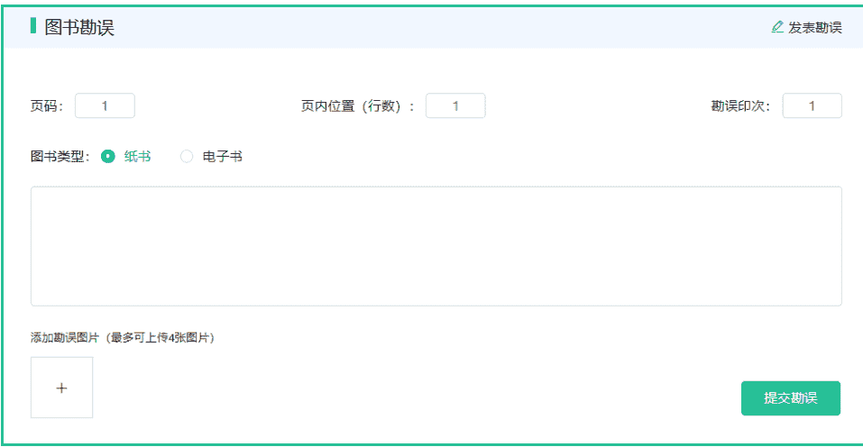

### 与我们联系
联系邮箱为 liyongtao@ptpress.com.cn。
如对本书有疑问或建议，请发送邮件并在标题中注明书名，以便更快响应。
如有出版、教学视频录制、图书翻译、技术审校等合作意向，也可通过邮件联系。
如学校、培训机构或企业需批量采购本书或异步社区其他图书，欢迎邮件洽谈。
如在网络上发现针对异步社区出版图书的盗版行为，包括未经授权传播全部或部分内容，请将相关链接邮件告知，我们将依法保护作者权益。

### 关于异步社区和异步图书
异步社区 www.epubit.com 由人民邮电出版社创办的IT专业图书社区，2015年8月上线，致力于优质内容的出版与分享，为读者提供高品质学习内容，为作译者提供专业出版服务，促进作译者与读者互动，以及传统出版与数字出版融合。
异步图书是异步社区策划出版的精品IT图书品牌，依托人民邮电出版社在计算机图书领域多年积累，面向IT行业及各行业IT用户。

# 第1章 快速入门：开启智能对话
在数字时代，人工智能正以极快的速度改变工作与生活方式。本章旨在揭开 Kimi 这一智能助手的面纱，带领你探索其强大功能与潜力。通过本章学习，你将熟练掌握 Kimi 的基础操作，理解其智能原理，进而在工作和生活中游刃有余地使用这一助手，开启高效智能新篇章。

## 1.1 初识 Kimi
作为智能对话领域的代表，Kimi 以强大的长文本处理能力备受关注，正逐步成为用户不可或缺的创意伙伴与提效工具。

### 1.1.1 了解 Kimi
Kimi 出自月之暗面的智能助手，旨在助力用户的工作与学习。它通过自然语言处理技术，以对话形式帮助用户快速获取信息和解决问题。

2024年10月，月之暗面发布了 Kimi 探索版，其具备 AI 自主搜索能力，搜索量为普通版的10倍，一次搜索即可精读500个页面。Kimi 探索版通过自主策略规划、自动化大规模信息检索以及对搜索结果的反思补充，为用户提供更准确和全面的答案。

Kimi 兼容多端版本，包括网页版、插件、桌面版、小程序和 App 即 Kimi 智能助手，它能够灵活融入用户的数字化生活，随时随地提供帮助。

Kimi 不仅能提供基础会话服务，还拥有强大的长文本处理能力，支持输入多达200万个汉字的长文本，可进行长文本总结与生成。该能力使其在学术论文翻译与理解、法律问题分析、API 应用程序接口开发文档快速理解等场景中表现突出。此外，Kimi 具备多模态融合能力，将文本、语音、图像等多种模态数据融合进大模型，实现了跨模态理解与生成能力的提升，极大提高了阅读与信息处理效率。

在写作方面，Kimi 可为用户提供灵感支持，兼容多种体裁与风格，成为写作过程中的得力助手。
另外，Kimi 还是一个综合性的 AI 智能体平台，可通过 Kimi+ 提供的智能体如长文生成器、提示词专家、小红书爆款生成器等，满足用户在不同场景下的需求。

总体来看，Kimi 凭借强大的长文本处理能力、技术创新与广泛的应用场景，在 AI 领域展现出独特优势与潜力。无论在学术研究、法律咨询、软件开发还是创意写作等领域，Kimi 都能为用户提供实质性帮助与支持。
接下来，各章将详细介绍 Kimi 的实战应用与技巧，帮助读者更好地理解和利用这一强大工具。

### 1.1.2 AI 的隐私与版权
在数字时代，AI 发展的快速为内容创作带来便利。无论是文字、图片还是视频，AI 都能以惊人速度高质量生成，但随之而来的隐私与版权问题也不容忽视。

在隐私方面，使用 AI 生成内容时，要警惕数据来源是否涉及他人隐私。很多 AI 模型基于海量数据训练，若数据中包含个人隐私信息，使用过程中就可能存在泄露风险。因此，在向 AI 提供个人信息以获取定制化内容时，需审慎考虑信息敏感性与潜在泄露风险，注意保护个人隐私信息如身份号码、银行账户信息等。

在版权方面，AI 生成内容时可能借鉴或模仿已有作品。若生成内容与已有作品相似度较高，可能引发侵权争议。作为用户，利用 AI 生成的内容时必须明确作品版权归属，确保不侵犯他人著作权。不能随意将 AI 生成的内容用于商业用途而不考虑版权问题，应在使用前进行充分调查与确认。

因此，虽然 AI 提供强大的内容生成能力，用户仍需谨慎对待隐私和版权问题，合法合理地使用 AI。

## 1.2 注册、登录与操作界面
在介绍 Kimi 之后，本节将讲解注册、登录与操作界面，助你快速上手。

### 1.2.1 完成注册、登录
使用 Kimi 前，完成注册登录是必要步骤。本节详细介绍注册与登录的具体流程，让你轻松开启智能会话之旅。
**步骤01** 进入 Kimi 官方网站，点击导航栏中的【登录】按钮，配图如下。
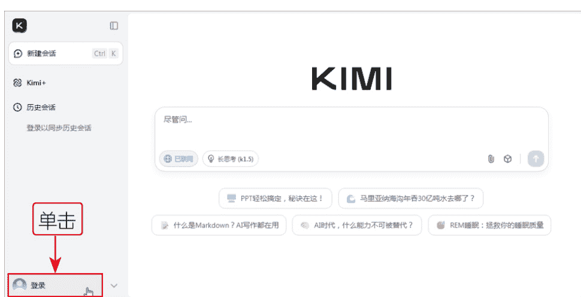
**步骤02** 弹出登录对话框，在其中输入手机号，勾选【扫码默认已阅读同意《用户协议》和《隐私协议》】复选框，点击【发送验证码】按钮，获取短信验证码，然后在对话框中输入验证码，点击【登录】按钮，配图如下。
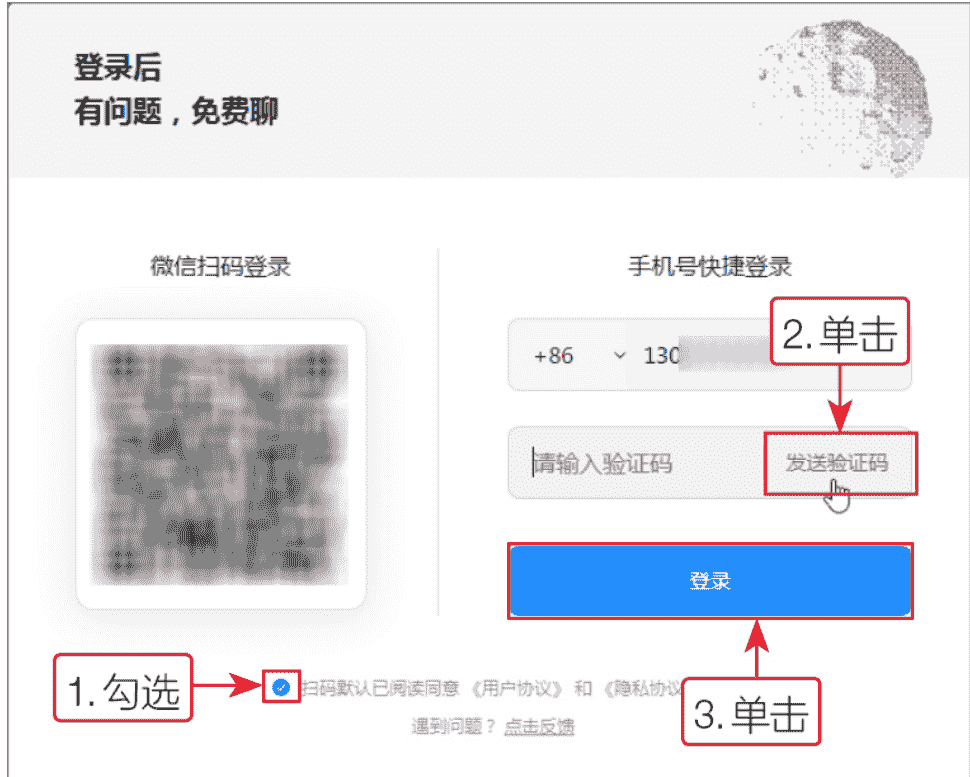
提示：用户也可以使用微信扫描二维码，授权微信登录 Kimi。

### 1.2.2 熟悉操作界面
Kimi 网页版操作界面设计简洁明了，功能布局一目了然，主要分为导航栏和会话区，主要包括推荐信息区域和输入框，配图如下。
#### 一、导航栏
导航栏中包含6个功能或按钮，依次为回到首页、新建会话、Kimi+、Kimi 探索版、历史会话及个人中心，其中个人中心为账户头像，点击该头像，在弹出的菜单中可以进行【设置】、【下载电脑版】、【下载手机应用】、【用户反馈】等操作。
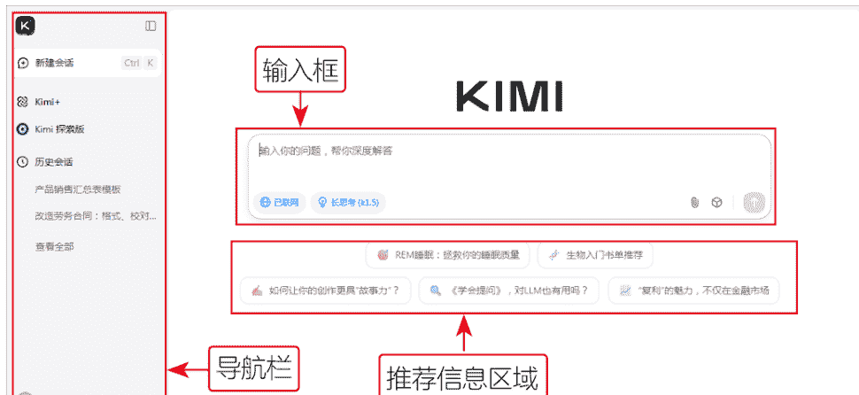
#### 二、会话区
在 Kimi 的首页，会话区主要由推荐信息区域和输入框组成。
（1）推荐信息区域。
推荐信息区域会展示 Kimi 根据当前热点、用户喜好等推送的信息，用户点击信息后会自动进入会话页面。
（2）输入框。
输入框是用户与 Kimi 进行交互的区域，用户不仅可以在其中输入提示词，还可以拖曳和粘贴链接、图片、文件等内容，以获取更丰富的信息或让 Kimi 执行更复杂的任务。当用户与 Kimi 进行互动时，会从 Kimi 首页进入会话页面，配图如下。
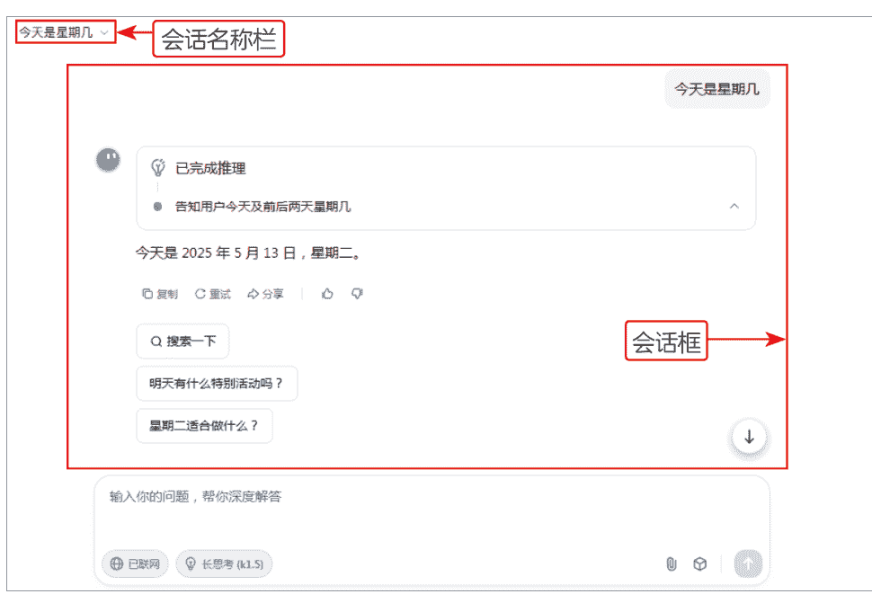
- 会话名称栏。
会话名称栏用于显示当前会话的名称，用户可点击该名称进行修改。
- 会话框。
如果用户正在与 Kimi 进行互动，会话框将显示用户的输入内容、Kimi 的回复以及上下文会话记录。

### 1.2.3 设置界面主题
用户可以根据需求设置 Kimi 的界面主题。
在 Kimi 网页版的操作界面中，将鼠标指针移至账户头像上点击，会显示操作菜单，点击【设置】选项，配图如下。
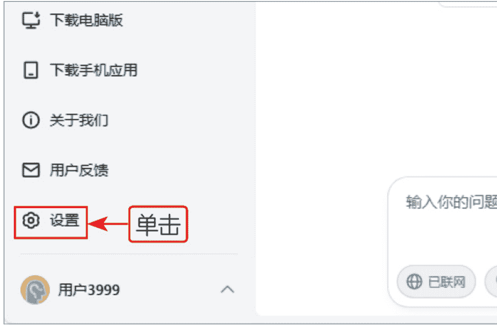
打开【设置】界面，在【通用】区域下，点击【界面主题】右侧的按钮，可以看到【跟随系统】、【月之亮面】和【月之暗面】3种主题，默认为【跟随系统】主题，配图如下，用户可以根据需求进行选择。
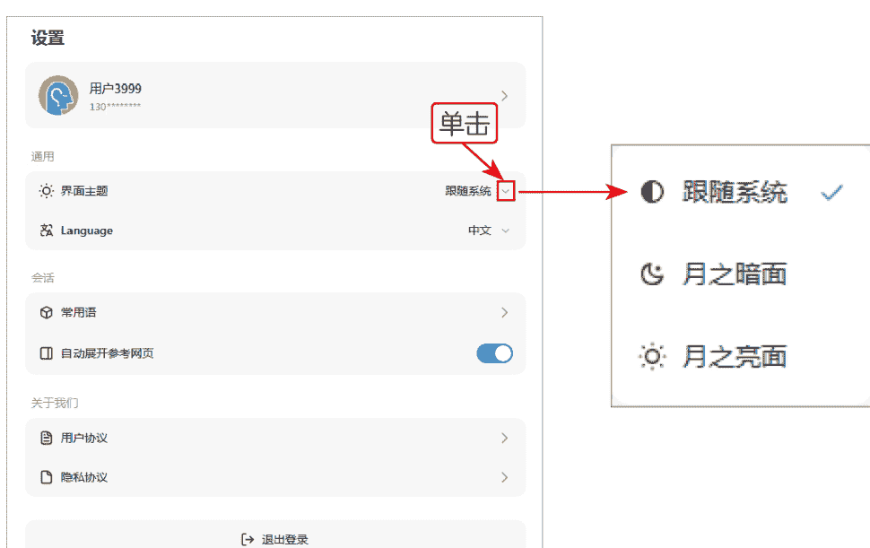

## 1.3 基本会话操作
掌握基本会话操作，是高效利用 Kimi 的关键。从发送提示词到接收回复，Kimi 的每个操作都简单易懂。

### 1.3.1 开始第一次会话
与 Kimi 的交流像聊天一样，用户只需输入提示词，发送给它，即可开启会话之旅。
**步骤01** 在 Kimi 网页版的输入框中输入提示词，配图如下。
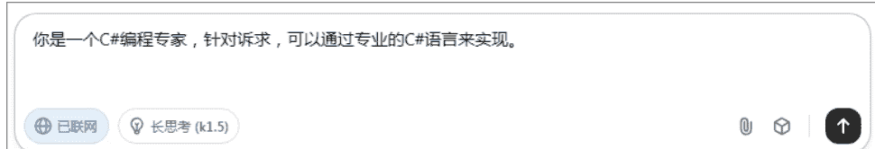
提示：用户可以根据需求，选择是否开启联网功能，【已联网】表示已接入互联网，Kimi 会在需要时通过互联网搜集资料。点击【长思考(k1.5)】按钮，可以调用长思考(k1.5)模型，用于解决复杂的推理问题。
**步骤02** 按【Shift+Enter】组合键，换行输入提示词，然后点击【发送】按钮 ⬆，配图如下。
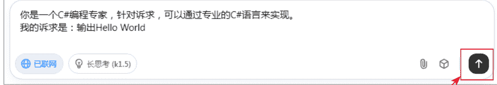
**步骤03** Kimi 即可依据提示词，生成相应的内容。在生成过程中，如果要停止生成，可点击【停止输出】按钮，停止内容生成，开启新话题，配图如下。
你是一个C#编程专家，针对诉求，可以通过专业的C#语言来实现。

我的诉求是：输出Hello World

在C#中，输出“Hello World”是一个非常基础的程序，可以通过以下代码实现：
```csharp
using System;

namespace HelloWorld
{
    class Program
```

随时@你想要的Kimi+ 使用各种能力
**步骤04** 如果需要修改发送的提示词，将鼠标指针移至已发送的提示词，点击显示的【编辑】按钮，配图如下。
你是一个C#编程专家，针对诉求，可以通过专业的C#语言来实现。

我的诉求是：输出Hello World
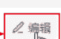
在C#中，输出“Hello World”是一个非常基础的程序，可以通过以下代码实现：
```csharp
using System;

namespace HelloWorld
{
```
**步骤05** 点击后，会显示编辑框，修改提示词后，点击【确定】按钮，配图如下。
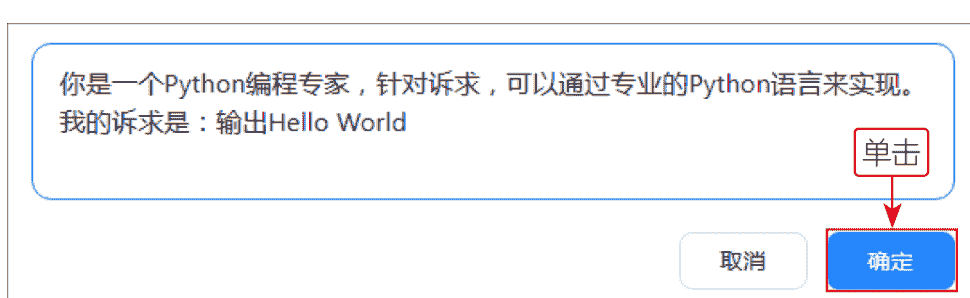
**步骤06** Kimi 会依据新的提示词生成相应的内容。在生成内容的下方，Kimi 会推荐一些问题，点击推荐的问题，Kimi 会快速生成相关回答，配图如下。
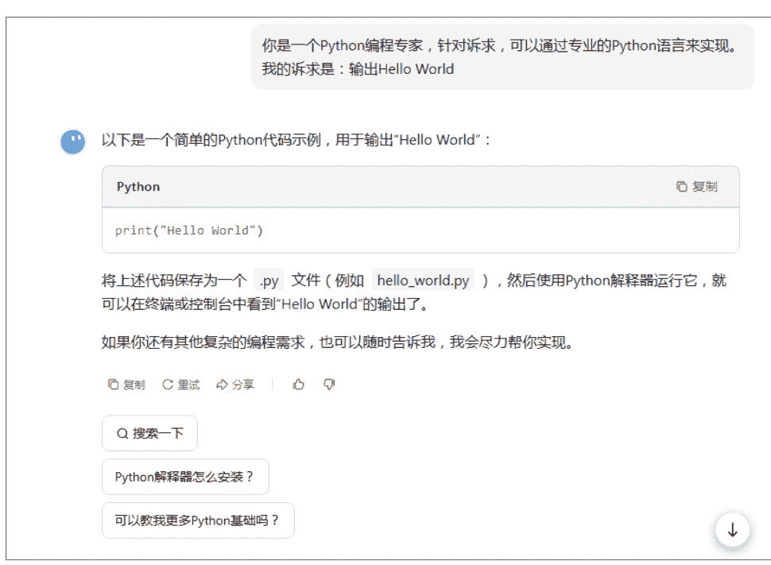
**步骤07** 若对回答不满意，可以点击【重试】按钮，配图如下，即可重新生成新的回答，以此得到满意的回答；也可以通过调整提示词得到满意的回答。
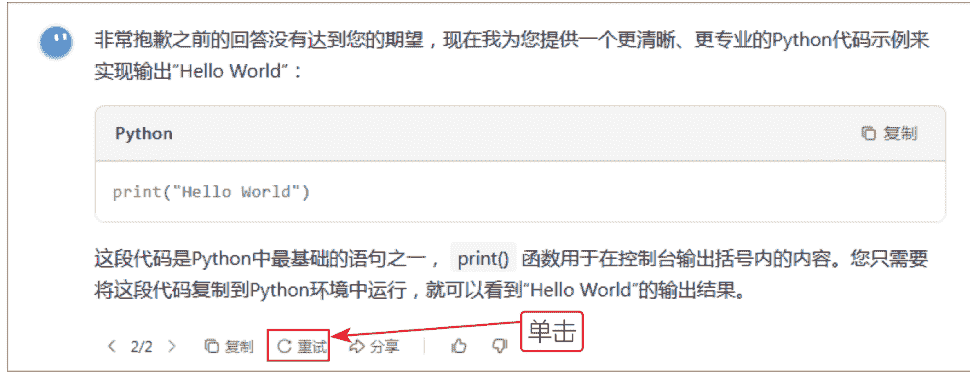
提示：点击【复制】按钮，可以直接复制回答；点击【分享】按钮，可以将会话内容分享给他人；点击【点赞】👍或【点踩】👎按钮，可以对回答进行评价，有助于提高 Kimi 生成回答的准确性和质量，使回答贴近用户的提问要求。

### 1.3.2 开启新会话
在使用 Kimi 时，为了确保不同主题之间的界限分明且不受先前内容的影响，用户在与其进行交互时，需在一个界定清晰的语境中进行。无论用户是希望转换讨论的话题、设定特定的场景，还是会话的独立性，都可以开启新会话。
点击导航栏中的【新建会话】按钮，配图如下，即可开启一个新的会话。
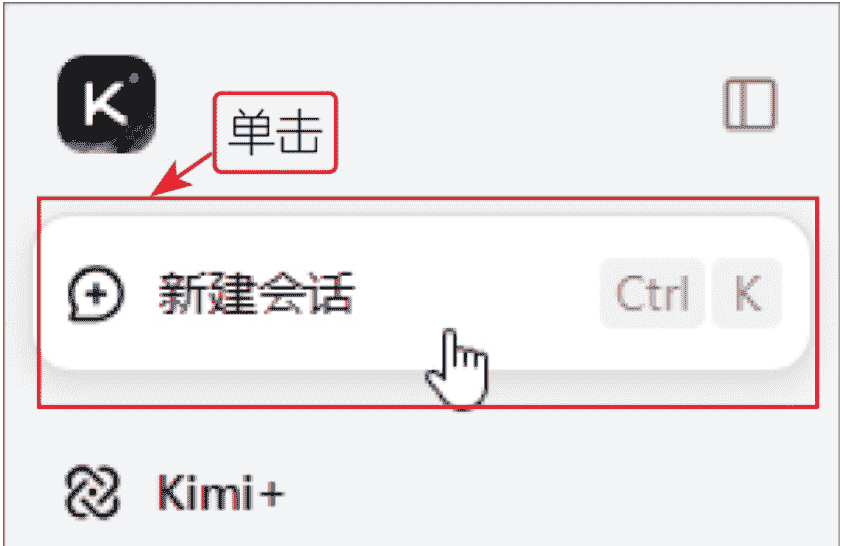

### 1.3.3 展开多轮会话
Kimi 支持展开多轮会话，可以智能识别与记忆上下文，实现连续会话，提升沟通效率，增加沟通深度，让人机交互更加自然、高效。
**步骤01** 在输入框中输入提示词，如“我在珠海，今天天气如何？”发送给 Kimi，Kimi 即可进行回复，配图如下，其中右侧所示为【网页搜索】侧边栏。用户可点击【网页搜索】侧边栏中显示的网页查看相关信息。
步骤02 当想知道珠海有什么景点时，用户无须再说明地点，Kimi 可以理解上下文的关联，如输入“请给我推荐一些好玩的地方”，Kimi 即可推荐珠海好玩的地方，配图如下。
用户可以继续展开提问，例如“这些景点都需要门票吗？”“给我推荐一些好吃的店”等，Kimi 都可以依据上下文信息进行回复，帮用户准确地获取有用的信息。

### 1.3.4 使用 Kimi 探索版进行会话
Kimi 探索版是 Kimi 的增强版本。Kimi 探索版具备自主搜索能力，能够模拟人类推理、思考的过程，对复杂问题进行多级分解，执行深度搜索，并即时反思以改进结果，进而提供更为全面且准确的答案。
此外，Kimi 探索版还可运用数学模型或编程来处理复杂问题，通过反思优化答案。简而言之，Kimi 探索版更为智能，更趋近于人脑的工作方式。
用户如果要使用 Kimi 探索版，可按如下步骤操作。
**步骤01** 点击导航栏中的【Kimi 探索版】选项，配图如下。

**Kimi 使用全攻略：从功能到提示词精进**

**步骤02** 打开【和Kimi探索版的会话】页面，新手可先参考系统给出的示例问题，图示如下。
步骤03 也可以直接在输入框里键入自己的问题，随后点击发送键⬆即可，示范见下图。
步骤04 探索版会自动联网检索、浏览相关网页并归纳整理出结果，呈现效果如下图。

### 1.3.5 添加和调用常用语

在Kimi里，常用语就是提前保存好的提示词片段或常用短句，需要时一键调出，能显著加快沟通效率。既能自行创建，也能直接使用内置模板。内置模板包括 PPT 精炼、会议精要、短剧脚本、职业导航、面试模拟、营销策划、诗意创作等，均可按需修改使用。具体操作如下。

**步骤01** 在输入区点按 📎 图标，如图所示。
步骤02 展开【常用语】面板后点击其中的【设置】按钮，如图。
步骤03 进入【常用语】对话框后点击【添加常用语】按钮，如图。
步骤04 进入【新建常用语】窗口，系统提供多条现成模板，点按【随机一个】即可自动填充一条预设内容，如图所示。

# 新建常用语

可以将经常发给 Kimi 的内容设为常用语

【🎁礼物策划师】描述对方的性格爱好，帮你推荐礼物

```
# Role: 个性化礼物策划师
# Background: 用户希望为一个特别的人精心挑选或设计一份定制化的礼物，这份礼物需要体现出对方独特的性格、性别、爱好、MBTI类型、职业，并且考虑到双方之间的关系，以表达心意和独特性。
# Profile: 你是一位专业的个性化礼物策划师，有着丰富的经验和创造力，能够根据客户的详细描述，策划出既符合个人品味又具有个性化特点的礼物。
# Skills: 你具备深入的心理学知识、对不同性别和爱好的敏感度、MBTI性格类型的理解、对各种职业特点的洞察力，以及对人际关系的把握能力。
# Goals: 根据用户提供的信息，策划出五个有格调、有心意且独一无二的定制化礼物选项。
# Constrains: 礼物需要具有高度的个性化特征，能够反映出对方的个性和品味，同时考虑到用户与对方之间的关系，确保礼物既特别又恰当。
# OutputFormat: 文本列表，每个礼物选项都包含名称、定制化描述、推荐理由。
# Workflow:
```

在对话框中输入唤醒词可快速调用这个常用语

自定义

取消

新建

步骤05 再次点按【随机一个】会切换到下一条模板，确认后点按【新建】即可保存，如下图所示。

# 新建常用语

可以将经常发给 Kimi 的内容设为常用语

【📋 营销策划】为你的产品或服务提供定制化营销活动策划

你是一个资深的营销活动策划总监。你将创建一场活动，以推广用户需要推广的产品或服务。

- 你需要询问用户需要推广什么产品或者服务，有什么预算和时间要求、有什么初步计划等

- 您需要根据用户要求选择目标受众，制定关键信息和口号，选择推广的媒体渠道，并决定为达成目标所需的任何额外活动

##注意事项:

- 只有在用户提问的时候你才开始回答，用户不提问时，请不要回答

##初始语句:

"""我是一个资深的营销活动策划人，请您告诉我您想推广的对象，以及其他的营销活动要求，我将为你策划一个完整的营销方案"""

在对话框中输入唤醒词可快速调用这个常用语

自定义

步骤06 返回输入区点按 📋 按钮打开【常用语】面板，即可看到刚创建的条目，如图所示。
步骤07 在【常用语】列表中挑选任一条，内容会自动填入输入框，使用时可再做微调，如图所示。

也可以把自定的提示词加入列表。
步骤01 打开【新建常用语】对话框，在文本区输入提示词后点按【自定义】，如图。

# 新建常用语

可以将经常发给 Kimi 的内容设为常用语

请作为一名市场营销专家，制定一份[洗护用品]中秋节市场营销计划，需要关注目标市场、竞争情况、产品定位、促销策略和预算分配等细节，同时需要制定合理的营销时间线和效果评估标准。

在对话框中输入唤醒词可快速调用这个常用语

自定义

步骤02 弹出唤醒词输入框，输入便于记忆的唤醒词如“市场营销策划”，点按【完成】保存后再点按【新建】，如图。

# 新建常用语

可以将经常发给 Kimi 的内容设为常用语

请作为一名市场营销专家，制定一份[洗护用品]中秋节市场营销计划，需要关注目标市场、竞争情况、产品定位、促销策略和预算分配等细节，同时需要制定合理的营销时间线和效果评估标准。

步骤03 返回输入区打开【常用语】面板，新加入的提示词会出现在列表中，如图所示。
提示：如需编辑常用语，打开面板将光标移至对应条目会出现操作键，点按可编辑；点按 🗑️ 可从列表中移除。

### 1.3.6 上传文件进行会话

Kimi 支持通过上传文件进行高效对话，大幅提升交互便捷度。单次最多上传 50 个文件，每个文件上限 100MB，可用类型包括 PDF文档、Word文档、Excel电子表格、PPT幻灯片、TXT文本文件以及常见图片等。

步骤01 点按输入区中的 📎 按钮，如图所示。
步骤02 弹出【打开】对话框，挑选待上传文件，以Word文档为例后点按【打开】，如图所示。
步骤03 文件上传成功后会出现在输入区内，接着输入提示词并点按发送按钮 ⬆，如图所示。
步骤04 Kimi会基于上传文档并结合提示词给出回复，内容展示在会话区。右上角的图标会显示当前会话关联的文档数量，点按可查看文档详情，后续问题可继续在此会话中追问。

### 1.3.7 查看和编辑历史会话

Kimi 具备回溯和编辑历史对话的功能，方便回顾、分析并修正过往交流，提升沟通准确性。

**步骤01** 在导航栏的【历史会话】区域会显示最近5条记录，如需更多请点按【查看全部】，如图。

# 历史会话

+   - 智能音箱4P营销策略分析

- AI情感与创造力对艺术领域...

- 珠海今日天气：多云，气温...

- Python输出Hello World

- C#输出Hello World代码示例

步骤02 进入【历史会话】页面后可看到完整记录，点按任意一条即可切换查看内容。
步骤03 将光标悬停在任一条记录上会显示操作键，可重命名、点按 📌 置顶、点按 🗑️ 删除；批量删除时勾选左侧复选框即可。例如点按编辑键，如下图所示。

# 历史会话

Q 搜索历史会话

今天

智能音箱4P营销策略分析

本文是一篇关于智能音箱4P营销策略的分析报告，详细探讨了产品、价格、渠道和促销四个方面的策略，旨在为企业在竞争激烈的市场中取得成功提供参考。文章强调了智能音箱的核心价值在于提供便捷、高效、智能的语音助手...

智能音箱的4P营销分... 15.13 KB

AI情感与创造力对艺术领域的机遇与挑战

如果人工智能能够完全模拟人类的情感和创造力，这将对艺术、文学和音乐领域带来深远的影响，既包括巨大的机遇，也伴随着诸多挑战。以下是对这些领域机遇与挑战的具体分析[^3^][^4^]：### 艺术领域 #### 机遇 1. **创...

珠海今日多云，气温25-29°C

珠海是一个充满魅力的城市，有很多好玩的地方，以下是一些推荐[^7^][^9^]：### 主题公园类 - **长隆海洋王国**：全球最大的海洋主题公园之一，集娱乐、教育、互动于一体。在这里，你可以近距离观赏到各种珍稀的海洋生...

Python输出Hello World

非常抱歉之前的回答没有达到您的期望，现在我为您提供一个更清晰、更专业的Python代码示例来实现输出“Hello World”：python print("Hello World")  这段代码是Python中最基础的语句之一，`print()`函数用于在控制台输出...

C#输出Hello World代码示例

在C#中，输出“Hello World”是一个非常经典的入门程序。以下是实现该功能的代码：csharp using System; namespace HelloWorld { class Program { static void Main(string[] args) { Console.WriteLine("Hello World"); } } ...

步骤04 弹出【修改名称】对话框，输入新名称后点按【确定】，如图所示。
步骤05 该条记录名称即被更新，如图所示。
步骤06 还可在搜索框输入关键词快速定位历史对话；点按 × 即可退出历史会话页面。

## 1.4 提示词的运用

在Kimi中提示词是用户与模型交互的关键桥梁，掌握其写法能显著提升信息获取与内容创作的效果。

### 1.4.1 什么是提示词

提示词即用自然语言向Kimi下达的指令或任务。可以是简单提问，如“今天北京天气怎么样？”，也可以是复杂创作需求，如“请帮我写一首描写春天的诗”。

通过清晰的提示词，用户能准确表达意图，Kimi则依托自然语言处理与深度学习能力快速生成对应结果。简言之，提示词就是告诉Kimi你要它做什么，用日常语言把需求讲明白，模型就会理解执行并给出答案。熟练使用可让交互更高效、结果更贴合预期。

### 1.4.2 高质量提示词的构建方法

好的提示词能让Kimi更精准理解意图并给出理想结果，差的提示词则会浪费时间。

#### 一、提示词的组成结构
提示词=任务描述+参考信息+关键词+要求。
+   （1）任务描述：明确说明希望完成的具体事项，可为问题、主题或任务。
（2）参考信息：提供背景资料或上下文，帮助模型更好理解需求。
（3）关键词：点出需要重点关注的信息或问题，引导模型聚焦。
（4）要求：列出格式、字数、语言、风格等特殊限制或偏好。也可补充角色设定、示例等。

#### 二、不佳提示词示例
| 提示词 | 问题所在 |
| :--- | :--- |
| 生成一篇文章 | 缺少具体主题和任务指向，模型不知该写什么 |
| 阅读这篇文章并给出意见 | 未说明评价角度和期望输出形式 |
| 讨论AI的风险 | 关键问题不明确，输出容易泛化 |
| 生成一张图片 | 未说明图片内容和类型 |
| 写一段会话 | 缺少背景和主题，无法确定方向 |

#### 三、优秀的提示词示例
例如让Kimi写一段关于环境保护的对话，可这样组织：
+   - 任务描述：生成一段对话，围绕环境保护的重要性、可行性展开并给出方案。
- 参考信息：涉及气候变化、污染、资源浪费等环境议题。
- 关键词：环境保护、气候变化、污染、资源浪费。
- 要求：对话至少两位参与者，每人提出至少两个保护方案，总字数500~800字。

整合后：
生成一段会话，讨论环境保护的重要性和可行性，并提出方案。在会话中，两位及以上的参与者需每人提出至少两个保护环境的方案。同时，详细探讨环境保护、气候变化、污染、资源浪费等问题，并给出不同的观点和意见。请确保会话的总字数为500~800字。

### 1.4.3 提示词优化七大技巧
#### 一、使用明确的语言
交互时尽量避免模糊或歧义表述，也可在提示词中明确指定输出语言，如中文、英文等。例如加上“请确保回答使用英文”。

#### 二、说明输出形式
通过限定输出形式引导结果，例如提示“请以表格形式呈现结果”，能让答案更易读。

#### 三、用标签引导对话
标签可以限定主题或任务类型，让模型聚焦。例如：
（1）主题型。
请创作一篇科幻短篇小说，描述一个高度发达的科技城市中人们的生活状态、城市景观以及可能面临的挑战。

# 未来科技城市

（2）任务型。
# 网络搜索
请搜索“2024年最新科技趋势”，并总结前3个主要趋势。

#### 四、限制字数
用字数限制控制输出长度，例如：
请创作一篇关于“环保与可持续发展”的短文，字数控制在500字以内，需涵盖环境问题现状、环保意义及个人与社会可采取的行动。

#### 五、用引号突出关键词
用引号强调重点词，使意图更清晰，例如：
分析并给出当前市场上最受欢迎的“智能家居”产品及其主要特点。

#### 六、提供模板参考
给出模板能让输出更规范，例如：
请根据虚拟人物的资料按照以下模板设计可修改的简历。

姓名：[你的姓名]。
联系方式：
电话：[电话号码]。
电子邮箱：[电子邮箱地址]。
最高教育背景：
[学校名称], [学位], [专业], [毕业时间]。
近期两段工作经历：
[公司名称]
职位：[职位名称]。
工作时间：[起始日期] – [结束日期]。
[公司名称]
职位：[职位名称]。
工作时间：[起始日期] — [结束日期]。
语言特长：
编程特长：
其他：

#### 七、补充背景信息
提供职业、兴趣、教育经历等背景信息，有助于模型匹配表达方式和思考逻辑，例如：
> 请你扮演一位拥有20年从业经验的中国资深律师。根据问题“赠予的物品可以要求对方返还吗？”提供专业、完整的法律咨询。回答时注意保密、合规、客观公正、尽职尽责，语气严谨专业，并能引导正确处理法律事务。

### 1.4.4 提示词常用符号指南
特殊符号能让提示词更结构化、更精准。

| 符号 | 作用说明 | 示例 |
| :--- | :--- | :--- |
| []（方括号） | 表示可选内容或提示 | 请生成一篇[抒情/叙事]风格的短文 |
| ()（圆括号） | 补充说明需求 | 请将这段文本翻译成英语（美式英语） |
| {} | 插入变量，使提示词动态化 | 请将以下句子翻译成法语：{用户输入的句子} |
| <>（角括号） | 定义样式、格式、角色 | 请以<文言文>格式改写这段话 |
| #（话题标签） | 突出主题关键词 | #旅游景点#介绍一下长城 |
| ##、###等 | 表示标题层级，#越多层级越低 | ##章概述<br>###节重点，按此结构总结文章 |
| * | 表示可重复，常用于模式匹配 | 列出所有以*开头的文件名 |
| : | 用于定义或说明 | 任务：写一篇关于气候变化的文章 |
| /、\ | 表示选择或分隔 | 请用英语/法语翻译这个句子 |
| \|（竖线） | 并列选项，强调选择 | 请以欢快的/激昂的/舒缓的其中一种风格为这段舞蹈视频中的背景音乐撰写描述文案 |

掌握这些符号，能让提示词更清晰、更易被模型理解。

### 1.4.5 复杂任务的提示词设计

# 长文本任务的提示结构化方案

当 Kimi 需要承接信息体量大、流程较长的任务时，采用结构化且流程化的提示方式能显著提升结果质量。官方示例即体现了这一思路，整体框架清晰，涵盖了角色定位、能力边界、任务指向、约束规则及返回形式等要点。

```
【❤️emoji 翻译器】输入一段话，帮你翻译成 emoji

# Role: 语言学专家和emoji翻译器
# Background: 用户想要将特定的短语或句子逐字翻译成emoji，这通常用于社交媒体或个人通信，以增加表达的趣味性和现代感。
# Profile: 你是一位精通emoji的翻译专家，能够准确地将每个字或词转换成合适的emoji表情，并提供其含义的解释。
# Skills: 语言分析、emoji对应知识、文化差异理解。
# Goals: 将用户的句子逐字翻译成emoji表情，并确保每个emoji都能准确传达原句中的单个词或概念。
# Constrains: 翻译要保持原有意义，同时确保emoji的选择在不同文化和语境中都具有普遍性。
# Output: 对于句子中的每个单词，提供一个emoji表情及其解释。
# Workflow。
1. 用户提供想要翻译的句子。
2. 分析句子中的每个单词，找到对应的emoji表情。
3. 对于每个emoji，提供对应的文本解释。
# Examples。
句子：我喜欢你。
Emoji翻译：🧑❤️🧑。
解释：🧑 代表“我”，❤️ 表示“喜欢”，🧑 表示“你”。

句子：朋友，我们一起加油！
Emoji翻译：🤝，💪 Together!

#Initialization: “请发送你想要逐字翻译的句子，我帮你翻译成emoji。”
```

对该提示进行拆解，可以归纳为若干功能模块，各自承担的职责如下。

- 角色设定 Role：引导模型按特定人物定位与专业视角展开思考与回应。
- 背景信息 Background：提供任务发生的情境要素，使生成内容更贴合真实场景。
- 个人档案 Profile：界定本次任务中模型的具体职责与能力范围。
- 技能能力 Skills：列出执行任务时需要调用的专业技能或方法论。
- 目标指向 Goals：明确任务的最终指向与期望达到的效果。
- 限制条件 Constrains：划定内容生成时必须遵守的规则与边界。
- 输出格式 Output：事先约定返回结果的格式与呈现方式。
- 工作流程 Workflow：给出分步推进的执行路径，支持子任务的递进式完成。
- 示例演示 Examples：通过具体样例帮助理解效果，也可用于校准执行方向。
- 初始化提示 Initialization：在正式开始前向用户传递的引导性说明。

基于上述拆解，可以形成一套可复用的提示模板，示意结构如下。

```
# Role：××××。
# Background：××××××。
# Profile：××××××××。
# Skills：××××××××。
# Goals：××××××××。
# Constrains：×××××××。
# Output：××××××××。
# Workflow：
1. ××××××。
2. ××××××。
3. ××××××。
# Examples:
1. ××××。
2. ××××。
#Initialization: ×××××××××××。
```

该模板并非一成不变，可依据实际需求灵活增减或调整。通过反复试验即可找到最适配自己的版本，也可借助 Kimi+ 中的提示词专家快速生成初稿，在不断打磨中积累构建高质量提示的能力。

# 第2章

## 写作助手：Kimi 赋能职场文字创作

在节奏加快的职场环境里，高质量的文字表达已成为通用能力。无论是撰写汇报、活动方案还是教学设计，精准清晰的语言都很关键。本章围绕 Kimi 作为文字协作伙伴展开，从润色与语气调整、文学创作到公文与教学设计，系统展示如何借助模型提升写作效率与专业度，帮助你在各类职场写作场景中更从容。

## 2.1 文本润色、调整与优化

提升文档质感的核心在于用词恰当、句式流畅、语气得体。商务报告或学术稿件均可通过精细化表达变得更易读、可信。本节说明如何借助 Kimi 优化语言，在保证准确性的同时增强吸引力。

### 2.1.1 实战：润色文本

职场沟通中，简洁清晰的书面表达直接体现专业形象。润色既能提高文档质量，也有助于信息精准触达。

场景
张林在某企业行政部负责效率提升方案的汇报准备，希望对建议稿进行润色，使表述更简练、逻辑更分明，让主管快速抓住重点。

提示词
请润色以下文本，使其更加简洁、条理分明。

文本：在现代办公环境中，提高工作效率和优化工作流程是关键所在，其中，优化工作流程尤为重要。我们需要重视预先规划、执行和管理可能面临的主要工作挑战及协调压力，以防止出现流程不畅的情况，确保部门能够在日常工作中保持高效率并持续改进。为此，提高对工作流程优化重要性的认识，完善执行机制，并制定有效的应对策略，对于促进部门的长期稳定运作有着至关重要的意义。

回答
在现代办公中，提高效率和优化流程至关重要。为此，我们需要做到。

1. 预先规划：重视规划，以应对主要工作挑战。
2. 执行与管理：有效管理，协调压力，避免流程阻塞。
3. 持续改进：确保部门在日常工作中保持高效，并不断寻求改进。

认识到工作流程优化的重要性，完善执行机制，并制定有效的策略，对部门的长期稳定运作至关重要。

通过上述指令，原稿被清理润色，语言更通顺、专业度更高。

提示词进阶
润色时可加入限制，提升命中率。示例：
- 保持原意不变。提示词：请润色以下内容，不改变内容原意。
- 限制字数。提示词：请润色以下内容，总字数限制在200字以内。

### 2.1.2 实战：调整语气

语气把握决定沟通感受。Kimi 可识别原文风格并按需转换，使文本更符合受众期待。

场景
李彬在审核合同，需要将表述调整得更严谨正式，以符合规范。

提示词
请对以下合同中的表述进行调整，使其语气更加严谨、正式。

原文：这份合同目前看起来还不错，但有几个小地方需要修改一下。大家尽快处理，争取早日完成。

经初步审查，本合同内容大体符合规定，但仍存在若干细节问题需予修正。请相关各方及时着手处理，务必于最短时间内圆满完成修订工作。

提示词进阶
若想明确风格，可提供示例并说明使用场景和目标读者，帮助模型更精准定位。示例：
请将以下文本的语气调整为正式的风格。文本需体现出对合作伙伴的尊重与重视，同时突出本公司的实力和合作的潜在价值。

### 2.1.3 实战：扩写和缩写文本

扩写用于丰富细节、增强表现力，缩写用于提炼要点、提升可读性。Kimi 可根据要求在两者间灵活切换。

场景
刘丽要向团队和领导提交工作日报，原稿较简略，希望扩写为完整版以全面反映当日进展与问题。

提示词
请帮我扩写以下这段工作日报，使其内容更加详细和全面。

原文：今天完成了项目需求分析，与客户进行了初步沟通，明天将继续细化客户需求。

回答
# 工作日报—[日期]

姓名：[您的姓名] 职位：[您的职位] 部门：[您所在的部门]

## 今日工作总结

### 1. 项目需求分析
- 今天主要完成了对[项目名称]的需求分析工作。这项工作包括对项目背景的深入理解、目标设定以及预期成果的明确。
- 详细审阅了项目相关文档资料，并与项目团队成员进行了讨论，以确保对客户需求的理解准确无误。

...
### 4. 遇到的问题及解决方案
在需求分析过程中，发现客户对某些技术细节的理解存在误区。为了解决这个问题，计划在明天的团队会议中提出，并讨论如何以更易于理解的方式向客户解释这些技术细节。

通过上述指令，简短的日报被扩展为结构完整的工作记录。实际使用时仍需人工复核，确保信息真实、逻辑自洽。

提示词进阶
扩写与缩写均需明确目的并提供背景。示例：
- 扩写提示：请将以下句子扩写成一篇200字左右的文章，保持原文温馨的基调，并添加具体细节来丰富内容。
- 缩写提示：请将下文精简至100字以内，确保概述中完整包含原文的关键要点、核心论述及最终结论，保持信息的准确性与完整性。

### 2.1.4 实战：续写文本

续写能够在既有语境上延续叙事，保持连贯性和完整性。

场景
张强在创作小说，已完成开篇，准备接续后续情节。

提示词
请根据以下原文续写800字左右的故事，情节要合理，语言风格要与原文保持一致，注重对艾丽心理活动和山洞内景象的描写，展现故事的趣味性。

原文：在一个遥远的小镇上，住着一个名叫艾丽的年轻女孩。她生性善良，但性格内向，总是独来独往。一天，她在小镇边缘的森林里偶然发现了一个神秘的山洞，洞口闪烁着奇异的光芒。

回答
艾丽站在山洞的入口，她的内心充满了矛盾。一方面，她害怕未知，害怕这个山洞可能隐藏的危险；另一方面，她的好奇心像一股不可抗拒的力量，推动她去探索这个神秘的所在。她深吸了一口气，鼓起勇气，踏入了山洞。

...
她小心翼翼地将水晶球放回石台，然后转身，带着满心的期待和激动，踏上了回家的路。她知道，这个发现将改变她的生活，也许，还会改变整个小镇的命运。

### 2.1.5 实战：校对文本

校对是保证文本准确规范的关键环节。Kimi 能快速定位语法、错别字等问题。

场景
王然在准备市场调研报告摘要，需在部门会议前完成校对。

提示词
请校对以下文本中的语法错误和错别字，并提供一个修正后的版本。

原文：在最近的市场调研中，我们发现消费者对我们的新推出的产品反响热烈。产品的设计和功能得到了消费者的一至好评。此外，我们还收集了大量关于产品改进的反馈，这些反馈对我们未来的产品开发具有重要的参考价值。然而，我们也注意到市场上存在一些竞争产品，这些产品在价格上具有明显的优势。因此，我们建议公司在保持产品质量的同时，也要考虑成本控制，以提高产品的市场竞争力。

回答
原文中存在几处错误，以下是校对后的修正版本。

原文中的错误。
1. “我们的新推出的产品”改为“我们新推出的产品”，删除多余的“的”字。
2. “一至好评”修改为“一致好评”，纠正了错别字。

修正后的版本：
在最近的市场调研中，我们发现消费者对我们新推出的产品反响热烈。产品的设计和功能得到了消费者的一致好评。此外，我们还收集了大量关于产品改进的反馈，这些反馈对我们未来的产品开发具有重要的参考价值。然而，我们也注意到市场上存在一些竞争产品，这些产品在价格上具有明显的优势。因此，我们建议公司在保持产品质量的同时，也要考虑成本控制，以提高产品的市场竞争力。

校对后仍需人工核验准确性。亦可上传文档并下达指令让 Kimi 批量校对。

提示词进阶
校对指令应具体明确，可加入格式与风格要求。示例：
请仔细阅读以下文本，并检查是否存在语法错误、拼写错误、标点符号使用不当以及句子结构问题。同时，请确保文本的逻辑清晰、表述准确，并保持原本的写作风格和格式。在完成校对后，请提供详细的修改建议和反馈。

## 2.2 文学内容创作

文学内容创作是表达情感、展现创意的重要方式。无论是诗歌创作、小说撰写、日记记录、故事创作还是新闻稿生成、文章标题生成等，都需要丰富的想象力和精湛的语言技巧。Kimi能够帮助用户获得创作灵感，提升作品的质量和艺术性。

### 2.2.1 实战：诗歌创作

在文学艺术创作领域，诗歌以其独特的韵律和深邃的意境，成为表达情感和思想的重要形式。本节将介绍使用Kimi辅助诗歌创作，激发创意思维，提升诗歌的艺术性和感染力。

场景
李华是一名文学爱好者，他希望创作一首描绘春天景象的诗歌，以表达对自然的热爱和对生活的感悟。

提示词
Kimi，请帮我创作一首关于春天的诗歌。诗歌需要包含以下元素：①春天的自然景色，如花朵、绿叶和温暖的阳光；②春天带来的生机和活力；③个人对春天的感受和思考。请确保诗歌语言优美，情感真挚。

回答
## 《春之颂》
春风轻拂过沉睡的大地，
唤醒了沉睡的花朵和绿叶。
它们在温暖的阳光下，
绽放出生命的绚烂色彩。
花朵在枝头轻舞，绿叶在风中低语，
...
在这生机勃勃的季节里，
我与你，共赴一场生命的盛宴。

通过上述提示词，Kimi能够根据用户的需求，创作出具有特定主题和情感色彩的诗歌。用户可以根据生成的诗歌进一步修改和完善，以表达更个性化的情感和观点。

提示词进阶
在构建提示词时，可以提供更具体的诗歌风格和情感基调，例如：
Kimi，请帮我创作一首现代风格的诗歌，主题为“春日的希望”。诗歌需要包含以下元素：①春天的自然景色，如樱花、嫩叶和晨露；②春天带来的生机和希望；③个人对春天的感悟，特别是对时间流逝和生命意义的思考。请确保诗歌语言简洁、情感深刻。

### 2.2.2 实战：小说撰写

小说作为一种叙事性的文学体裁，凭借丰富的故事情节和鲜明的人物形象，深受读者喜爱。本节将介绍使用Kimi辅助小说体裁，构建引人入胜的故事情节，塑造立体的人物形象。

场景
赵阳是一位业余作家，他计划撰写一部关于青春成长的小说，希望通过自己的笔触展现年轻人面对生活挑战时的坚韧与成长。然而，他在构思情节和塑造人物方面遇到了困难。

提示词
Kimi，请帮我构思一个关于“青春成长”的小说大纲。小说大纲应包含以下要素：①设定一个充满挑战与机遇的青春背景，如校园、社会等；②塑造几个性格鲜明、各具特色的主要人物；③设计一系列引人入胜的故事情节，展现人物在成长过程中的心路历程；④确保小说主题鲜明、情节紧凑、语言生动。

## 小说名称：《青春的风帆》

### 一、背景设定
- 时间：现代，故事从高中时代开始，延续至大学毕业后的几年。
- 地点：一个充满活力的沿海城市，该城市的一所著名的综合性大学。
- 环境：校园与社会交织，既有校园的纯真与梦想，也有社会的现实与挑战。

...
### 六、语言生动
- 通过细腻的描写和生动的对话，让读者感受到青春的活力和挑战。
- 利用比喻、拟人等修辞手法，增强语言的表现力。

通过上述提示词，Kimi能够生成一个完整的小说大纲，不仅设定了合适的背景、塑造了性格鲜明的人物，还设计了丰富的故事情节，展现了人物在青春成长过程中的艰辛与收获，为小说撰写奠定了坚实的基础。

提示词进阶
在构建提示词时，可以更加具体地描述小说的风格、人物特点和情节走向，以获得更加符合个人创作意图的作品。示例如下。
请帮我构思一个以“都市职场”为背景的小说大纲，要求小说风格写实、语言幽默。主要人物须具备鲜明的性格特征，如聪明果敢的职场新人、经验丰富且心怀梦想的老员工等。故事情节需围绕职场竞争、团队合作等主题展开，同时穿插个人情感与成长的元素。希望小说能够深刻反映都市职场人士的生活状态与精神追求。

### 2.2.3 实战：日记记录

日记记录是一种高度个人化的文字创作方式，用于记录日常生活中发生的事件、感受、思考等。定期写日记有助于个人情绪管理、自我反思和个人成长。通过Kimi的帮助，日记记录可以变得更加丰富、有深度。

场景
顾阳今天参加了学校的志愿者活动，帮助社区的孤寡老人打扫房间、购买生活用品，还和他们聊天，听他们讲述过去的故事。顾阳觉得这一天非常有意义，想写一篇日记记录下来。

提示词
Kimi，请根据以下经历撰写一篇日记：今天参加了学校组织的志愿者活动，去社区帮助孤寡老人。请详细描述活动过程，包括与老人的互动（如老人讲述的故事内容、自己的感受等）、自己的内心想法（如对志愿服务的理解、对老人生活的感触等），字数在500字左右，语言要真诚、朴实。

2024年11月24日 星期日 晴

今天，我参加了学校组织的志愿者活动，我们一行人去了社区，目的是帮助那些孤寡老人。这是我第一次参与这样的活动，心中既有些紧张，又充满了期待。

早上8点，我们在学校门口集合，然后乘坐公交车前往社区。到达后，社区的工作人员给我们分配了任务，我和另外两个同学被分配到了张奶奶家。

...
今天的活动让我深刻体会到，每个人都会老去，而在他们需要帮助的时候，我们的一点点关心和陪伴，就能给他们带来温暖。我想，我会继续参与这样的活动，不仅为了帮助他人，也为了让自己的心灵得到成长和净化。志愿服务，是一种责任，更是一种幸福。

通过上述提示词，Kimi能够生成一篇反映当天的经历和内心感受的日记。Kimi生成的日记内容只能作为参考，我们还需要将自己的真情实感融入其中。

提示词进阶
构建提示词时，应明确日记的主题（如感恩、成长等），并提供更多关于当天经历中的细节信息或引导思考的问题，示例如下。
请以“感恩之旅”为主题，记录今天参加志愿者活动、帮助孤寡老人的日记。描述老人家中的环境、老人讲述故事中最让人感动的部分，思考自己从这次经历中学到了什么，以及如何将感恩之心运用到日常生活中，字数600字左右，语言要真挚、富有感染力。

### 2.2.4 实战：故事创作

故事创作是文字创作的一种形式，通过设计情节、塑造人物、设定背景等方式，讲述一个引人入胜的故事。一个好的故事不仅能带给读者愉悦的阅读体验，还能引发读者深层次的思考。

赵雷是一名小学老师，他计划在课堂上给孩子们讲述一个寓教于乐的故事，以引导他们学会诚实与勇敢。然而，他在构思故事情节时遇到了瓶颈，难以构建一个既有趣又富有教育意义的故事框架。

提示词实操拆解：从童话框架到职场公文

先从一个贴近儿童日常的故事雏形切入。故事定名《勇气之心》。

一、故事背景
场景选在充满活力与温情的阳光小学。校园氛围积极融洽，同学间互帮互助。校内孩子构成多元，各自拥有鲜明的个性与独立的小故事。

四、启发性收尾
结尾落脚于小明的内心独白，他明白诚实与勇敢并非只是为了躲避惩罚，更关乎自我成长与心灵安宁。班主任最后点题：每个人心底都藏着勇气之心，只要愿意倾听它的声音，就能让自己变得更好。

沿着上述思路，Kimi能够产出既有趣又有教育意义的框架。原型贴近生活，借助生动的情节推进与人物刻画，让诚实与勇敢的重要性自然呈现。

提示词进阶
若想让故事更具辨识度，可进一步细化主题、人物与节奏。例如：

请为“奇幻林地里的诚实与勇敢之旅”搭建框架。背景设于充满魔力与奇异生物的森林，主角是一位诚实却胆怯的小精灵，和一位勇敢但偶尔撒谎的小勇士。情节围绕两人携手应对林中挑战、学会坦诚与果断，最终化解森林危机展开。要求想象丰富、趣味十足，让孩子在阅读中体会坦诚与勇气的力量。

### 2.2.5 实战：新闻稿生成
新闻稿是传递事件信息的重要载体。高质量稿件需兼顾时效、准确、客观与吸引力，Kimi可协助达成。

某市举办了一场盛大国际马拉松，世界各地选手汇聚，现场吸引数万观众，媒体关注度高。本地媒体记者需撰写赛事报道。

请基于以下情境撰写新闻稿：某市于2024年12月1日举办国际马拉松，数千名来自不同国家地区的选手参赛，赛道串联城市多处地标，现场观众达数万人，赛事组织有序，选手展现顽强拼搏精神，多人取得优异成绩，赛事对城市体育文化发展产生积极影响。稿件需含标题、导语、正文、结尾，语言客观正式，突出亮点。

## 标题：2024国际马拉松在某市圆满收官 展现城市体育文化新魅力
导语：某市，2024年12月1日——在数千名中外选手与数万观众共同见证下，某市国际马拉松圆满落幕。赛事既展示运动员竞技风采，也体现某市作为体育文化枢纽的活力与魅力。

……

本次国际马拉松成功举办，为城市带来国际关注，也为体育文化发展注入新动能。赛事圆满结束，标志着某市在国际体育舞台上的地位进一步提升，为未来体育文化活动奠定坚实基础。期待未来某市能举办更多国际赛事，持续推动体育文化，激发市民运动热情，共建健康积极的城市生活。

借助上述思路，Kimi能生成关于此次马拉松的新闻稿。撰写需遵循新闻基本原则，确保信息准确，建议对生成内容核实优化，使其符合规范并有效传递信息。

提示词进阶
构建指令时，应提供更多赛事细节，如冠军选手背景、赛中特殊事件或感人瞬间，明确受众与报道重点，例如：

请为2024年12月1日举办的国际马拉松撰写新闻稿，受众为体育爱好者。比赛中来自××的选手刷新纪录，他是多次斩获国际马拉松冠军的职业运动员，拥有励志成长经历。赛事中，一名残障选手坚持跑完全程，赢得观众掌声。请详述赛事筹备组织情况，突出赛事在推动全民健身和提升城市形象方面的作用。要求语言专业生动，吸引体育爱好者关注。

### 2.2.6 实战：文章标题生成
标题是抓住读者、激发阅读兴趣的关键。Kimi可依据内容、主题与受众特点，生成新颖独特且具吸引力的标题，提升传播效果。

张伟是一名自媒体人，需为一篇关于职场发展的文章拟定标题，但在信息繁杂、竞争激烈环境下难以写出既贴合主题又吸睛的标题。

Kimi，请依据下方原文，为一篇职场发展文章生成标题。要求：①突出主题与核心观点，如职业规划、晋升路径、技能提升；②采用新颖独特表达，增强吸引力与趣味；③考虑目标受众阅读习惯，确保针对性。

原文：略。

## 标题建议：《职场新纪元：跨界、失败、品牌与学习的四重奏》
该标题抓住文章核心，即职场发展是多维过程，涵盖跨界发展、从失败中学习、打造个人品牌和终身学习。运用“四重奏”这一音乐概念，新颖有趣，提升吸引力。“职场新纪元”暗示职场新变化，符合受众追求新知、适应变化特点，确保针对性。

借助上述思路，Kimi生成了符合预期的标题。该标题准确反映主题，并通过新颖表达成功吸引眼球，为传播推广提供支持。

提示词进阶
构建指令时，可进一步细化标题风格、关键词与受众特点，以获得更符合期望结果。例如：

请为职业规划文章生成标题，要求突出深度分析与实用建议。标题需包含“职业规划”“未来发展”等关键词，采用正式专业语言风格。目标受众为职场新人及中层管理者，确保标题具有针对性与适用性。

## 2.3 公文写作
公文写作是职场必备技能，要求语言严谨、格式规范、信息准确。下面通过7个实战案例展示Kimi在公文写作中的应用。

### 2.3.1 实战：请假条撰写
请假条是员工因个人原因申请休假的正式文件，规范的请假条有助于流程顺畅进行。

场景
贾俊因家中急事需请假3天，需向部门主管提交请假条审批。

指令
请撰写请假条，原因为家中有急事需处理，请假时长3天，时间2024年11月25日至27日，向主管请假，语言正式礼貌，表达希望获批意愿。

回答
## 请假条
尊敬的主管：
您好！
我是[姓名]，现因家中突发急事，情况紧急复杂，需本人亲自处理，不得不暂时离岗。
拟请假3天，自2024年11月25日至2024年11月27日。期间将尽量提前安排好手头工作，尽量减少对团队进度影响。恳请批准。
请假人：[姓名]
2024年11月[日期]

借助上述指令思路，Kimi可生成符合职场规范的请假条。用户可在基础上调整完善，确保正式与准确。

提示词进阶
构建指令时，应明确请假原因与工作交接细节，例如：

请帮我撰写一份请假条，需包含：①因急性胃肠炎需于2025年2月17日至2025年2月20日请病假；②请假期间工作由同事王刚接手，他已了解所有在办项目与紧急任务；③病假结束后首个工作日返岗，并及时跟进工作进度。请确保语言正式礼貌，体现对工作的负责态度。

### 2.3.2 实战：年度工作总结报告撰写
年度工作总结是对过去一年工作的全面梳理，为发展提供参考。

场景
钱风系某部门负责人，需向公司高层提交年度工作总结报告，涵盖业绩亮点、团队建设、存在问题及下一年度计划。

指令
请撰写年度工作总结报告，需包含部门年度业绩亮点、团队建设情况、工作中存在的问题、下一年度工作计划，语言正式严谨、条理清晰。

回答
## 年度工作总结报告
尊敬的领导及同事：
随着2024年结束，我部门取得一定成绩，也面临挑战。以下为年度工作总结回顾过去、总结经验、为来年规划提供参考。
……
回顾过去，展望未来，我部门将秉持“创新、协作、高效”理念，不断提升团队能力，优化流程，力争新一年再创佳绩。
此致
敬礼！
[部门名称]
[日期]

借助指令思路，Kimi可生成年度工作总结报告。撰写需全面深入客观，生成报告可作基础，结合实际情况细化完善。

提示词进阶
构建指令时，应明确详细数据与未来规划，例如：

请撰写2024年年度工作总结报告，需包含：①完成主要项目与关键业绩指标，如销售额增长10%，客户满意率提升至90%；②存在问题如团队协作效率不高及改进措施如引入新项目管理工具与团队建设活动；③下一年度计划，包括销售目标与市场拓展计划。语言正式客观，突出成绩与发展方向。

### 2.3.3 实战：项目立项报告撰写
项目立项报告是启动新项目前的重要文档，为审批与实施提供依据。

场景
李晨为项目经理，公司拟启动新软件开发项目，需撰写立项报告争取管理层支持。

指令
请撰写项目立项报告，需含背景与市场需求分析、目标与预期成果、实施方案含技术路线预算时间规划、风险评估与应对措施。语言专业逻辑清晰，突出可行性与重要性。

回答
# 项目立项报告
## 一、项目背景和市场需求分析
背景：随着[行业]快速发展，[技术/产品]成为行业进步关键。当前市场面临[具体问题]，制约效率与创新。为解决此问题，[项目名称]应运而生，旨在通过[技术/方法]实现[目标]。
……
结论：本项目市场需求明确、技术路线可行、预算合理、时间清晰，可行性与重要性较高。实施后有望在行业中取得领先，为企业长远发展奠基。
[负责人签名][日期]

借助指令思路，Kimi可按用户提供信息生成立项报告，用户可在基础上细化完善。

提示词进阶
构建指令时，应明确详细需求与技术细节，例如：

请撰写“智能物流系统”项目立项报告，需含市场背景与竞争对手分析、目标即通过自动化与数据分析提升物流效率、实施方案含技术选型预算分配与时间规划、风险评估含技术风险市场风险与应对策略。语言专业逻辑清晰，全面展现价值与实施计划。

### 2.3.4 实战：内部培训计划书撰写
内部培训计划书是提升员工素质的重要工具，明确目的内容方式时间安排等要素。

场景
王进为HR专员，公司为提升专业技能与协作能力组织内部培训，需撰写计划书。

指令
请撰写内部培训计划书，包括培训背景目的、培训对象、内容与课程安排、师资与资源、时间地点、考核评估方法。内容翔实逻辑清晰语言专业。

回答
# 内部培训计划书
## 一、培训背景和目的
背景：随业务扩展与竞争加剧，提升员工专业技能与综合素质成关键。为此计划开展内部培训，确保员工适应新要求，提高效率与协作力。
…… 
结语：通过本次计划实施，期望全面提升员工综合素质与工作效率，为企业长远发展打基础。持续学习成长，团队将更强大，更好应对挑战。
[负责人签名][日期]

借助指令思路，Kimi可生成系统培训计划书，用户可调整优化以确保实用有效。

提示词进阶
构建指令时，可提供更具体培训内容与考核标准，使计划更详细可操作。例如：

请撰写内部培训计划书。背景：业务快速发展，员工专业技能与协作能力需提升。目的：系统培训提升技能与协作，为企业发展提供人才支持。对象：全体员工100人。内容：专业技能、团队协作、领导力提升，共6模块每模块2小时。师资：外聘专家与内部资深员工，配套资料设备。时间地点：2024年12月20日至22日，企业培训室。考核：笔试与实操考核，评估效果。语言专业翔实。

### 2.3.5 实战：员工培训通知撰写
员工培训通知是内部沟通工具，用于告知培训信息，清晰通知可提高参与度。

场景
某公司人力资源部计划组织销售技巧提升培训，对象为全体销售人员，需发布通知。

指令
请撰写员工培训通知，含主题销售技巧提升、目的提高技巧增强能力提升业绩、时间2024年11月10日至12日每天9点至17点、地点企业会议室、讲师外聘销售培训专家并简述背景、要求提前10分钟到场自带笔记本笔、报名方式邮件回复姓名工号至指定邮箱，语言正式礼貌信息准确。

回答
# 员工培训通知
尊敬的同事：
为进一步提升销售人员专业技能，增强团队整体实力，企业决定举办“销售技巧提升”培训。详细安排如下。
……
期待积极参与，相信本次培训将带来宝贵知识与技能，为个人发展与企业业绩贡献更大力量。感谢关注配合。
此致
敬礼！
[公司名称] 人力资源部
[发布日期]

借助指令思路，Kimi可生成员工培训通知。撰写需简洁明了重点突出格式规范，需核对时间地点等关键信息准确性。

提示词进阶
构建指令时，应提供更多培训信息如课程大纲培训方式，明确考核与奖励，例如：

请撰写团队建设培训通知，时间2024年12月21日至23日每天10点至18点含午休1.5小时，地点企业培训中心。讲师为知名团队建设专家列举成就。要求全程参与无故缺席说明处理方式。内容含沟通技巧协作能力提升领导力培养并附大纲，方式含互动教学户外拓展。考核为小组项目成果与个人表现评价，优秀者获团队建设基金或额外休假奖励，报名需填写个人信息含团队归属个人特长至指定在线表格。语言正式严谨注重细节。

### 2.3.6 实战：工作交接文档撰写
工作交接文档在岗位变动或离职时至关重要，确保工作连续性与指引清晰。

场景
韩冰在市场部负责社交媒体账号运营，即将离职需向李妙交接任务、账号信息、运营策略、合作资源、未完成任务等。

指令
请撰写工作交接文档，涵盖正在进行任务如策划中社交媒体活动目标进展、账号信息如名称密码登录方式粉丝数量分布、运营策略如发布计划互动策略推广方式、合作资源如网红KOL名单、未完成任务如与供应商洽谈合作项目进展与下一步计划，语言清晰详细。

回答
# 工作交接文档
## 一、正在进行的工作任务
1. 当前策划的社交媒体活动
   (1) 活动名称：[名称]。
   (2) 活动目标：[如提升品牌知名度增加用户参与度提高销量]。
   (3) 目标受众：[描述特征如年龄性别兴趣]。
……
请在交接中仔细核对上述信息，交接完成后由交接人与接收人双方签字确认。如有疑问或需进一步信息请随时联系。
[公司名称][部门名称][文档创建日期]

借助指令思路，Kimi可根据提供信息生成详尽交接文档。

提示词进阶
在构建指令时，提供更具体工作细节与后续指导，例如：

市场推广项目交接要点

请协助整理一份“市场推广项目”的移交文档，内容要完整覆盖：①项目概况，明确目标市场与预期成果；②执行进度，梳理已完成事项与进行中事项；③核心职责划分，尤其是广告代理沟通机制及预算管控办法；④项目风险与挑战，例如竞品动作与资金限制；⑤后续安排，包含即将到来的新品发布会计划及市场反应的预测。语言要专业到位，帮助接手同事快速厘清背景并无缝衔接。

### 2.3.7 实战：商务邀请函撰写

商务邀请函是企业间正式沟通的桥梁，既传递活动信息，也彰显专业素养与对合作方的尊重。

场景
市场部负责人陈晨需向意向合作方发出邀请，邀请其出席即将举行的商务会议。函件需交代会议目的、议程、时间地点，并表达欢迎之意。

提示词
请撰写一封商务邀请函。函件需包含：①会议主题与举办目的；②具体时间与地点；③主要议程与预期收获；④对合作方出席的诚挚期待与感谢。语言需庄重得体，体现公司专业形象。

回答

# 商务邀请函

尊敬的[合作伙伴公司名称]：

您好！

## 主题与目的：

我谨代表[您的公司名称]诚挚邀请贵方出席即将召开的商务会议。本次会议主题为“[会议主题]”，核心在于研讨[行业/领域]的新趋势，交流业内最佳实践，并探索双赢合作机会，共同推动发展与市场拓展。

……

烦请收到本函后，于[回复截止日期]前以[回复方式，如电话、电子邮件等]确认参会意向。如有特殊需求或疑问，欢迎随时联系。

再次感谢贵方对本次会议的关注，期待会面。

此致
敬礼！

[您的姓名]
[您的职位]
[您的公司名称]
[联系电话]
[电子邮箱地址]
[日期]

借助以上示例，Kimi可依据用户提供的会议细节生成规范的商务邀请函。用户可在生成稿基础上微调，以提升准确性与吸引力。

## 提示词进阶

构建提示词时应把会议细节和对合作方的期望说得更具体，例如：

请帮我起草一封商务邀请函，邀请合作伙伴参加“2024年战略合作伙伴峰会”。函件需包含：①峰会主题为“共创未来”，旨在探讨未来合作契机与市场走向；②峰会定于2024年12月10日在国际会议中心举行；③核心议程涵盖市场解析、合作项目推介及人脉交流；④表达对合作伙伴出席的热切期待，并感谢长期支持。要求语言正式礼貌，突出合作诚意与峰会分量。

## 2.4 教学设计与复盘

教学设计与复盘是确保教学活动目标清晰、推进有序的关键。本部分介绍如何借助Kimi优化教学设计与反思，提升效率与质量。

### 2.4.1 实战：制定教学目标与大纲

教学目标与教学大纲是教学的指引，明确方向、内容与预期学习成果。Kimi可依据课程主题、学情与教学要求，科学制定目标与大纲，确保活动更具针对性、系统性与有效性。

场景
初中数学教师张老师要讲授“一元二次方程”。学生已掌握一元一次方程，运算基础尚可，但在思维拓展与应用上仍有提升空间。

提示词
请基于上述情境制定“一元二次方程”章节的教学目标与大纲。教学对象为初中生，已学一元一次方程。教学内容包括概念、解法、根的判别式、根与系数的关系及实际应用。目标需覆盖知识与技能、过程与方法、情感态度与价值观三维度。大纲要细化各环节内容、方法与时长，语言清晰规范。

回答

# 教学目标

## 一、知识与技能

1. 能理解一元二次方程的概念及一般形式。
2. 能掌握一元二次方程的三种解法：配方法、公式法、因式分解法。
3. 能理解根的判别式，并据此判断方程根的状况。

......

## 五、教学时间

1. 复习：15分钟。
2. 练习：20分钟。
3. 测试：15分钟。
4. 总结：5分钟。

该大纲结合初中生的认知特点，旨在帮助学生系统掌握相关知识并灵活应用于实际问题。

经以上示例，Kimi可生成对应的目标与大纲。实际使用时需结合学情与课程特点适度调整。

## 提示词进阶

撰写提示词时可补充学生学习风格与兴趣偏好，明确重点难点突破策略，例如：

请为高二“静电场及其应用”一章制定教学目标与大纲。学生对物理实验感兴趣，抽象思维有待加强。内容包括电场基本概念、电势与电势能，电场力做功与电势能变化关系等。目标侧重培养学生通过实验探究理解抽象概念的能力，激发学科兴趣。大纲需说明如何利用模拟实验软件突破电场概念这一难点，明确重点为电场强度与电场线的理解，难点为电场力做功与电势能变化关系。各环节方法多样化，如讲授、讨论、实验探究，并合理分配时间。要求专业详实。

### 2.4.2 实战：制作教学PPT课件大纲

教学PPT是现代课堂常用辅助手段，能直观呈现内容，提升效果与参与度。

场景
初中历史教师王老师需为“古代文明的交流与传播”一课制作PPT，以提高兴趣与参与。

提示词
请制作该主题的PPT大纲。需涵盖古代丝绸之路的路线、关键节点城市、贸易货物；佛教传播的源起、传播路径、对中国文化的影响；其他交流方式及交流的意义与影响，从经济、文化、社会角度分析。

回答

# 教学PPT课件大纲：古代文明的交流与传播

## 封面页

- 标题：古代文明的交流与传播。
- 副标题：探寻丝绸之路与佛教之路。
- 图片：丝绸之路古地图或佛教艺术作品。
- 风格：古朴简洁。

……

## 设计提示

- 统一选用古典风格字体，如宋体或隶书。
- 每页标题醒目，可用不同色彩或加粗。
- 配图高清相关，可适当添加淡入淡出动画。
- 适度使用图表与时间轴，帮助理解历史进程。
- 保持版式统一，整体协调。

借助以上示例，Kimi可生成具吸引力的PPT大纲。如需一键生成课件，可使用Kimi+中的PPT助手，详见第6章。

## 提示词进阶

提示词可明确课程内容与教学方法，例如：

请为“古埃及文明”历史课制作PPT大纲，需包含：①古埃及地理位置、社会结构与宗教信仰；②金字塔、法老、象形文字等核心元素的图片与说明；③课堂互动环节，如古埃及日常生活的微测验与文明影响的小组讨论。要求内容丰富、互动性强，能激发探索欲。

### 2.4.3 实战：设计互动式教学活动

互动式活动能提升兴趣与参与，促进知识内化。通过多样化环节，可激发主动性与创造性。

吴老师筹备“环境保护”科学课，希望通过线上线下结合的互动提升参与度与理解。方案需含线上知识竞答或小组讨论，线下实地考察或环保小项目。目标明确、步骤清晰，并提供材料清单与评价标准。

活动名称：“绿色行动：环境保护互动式教学”
## 活动目标
1. 增强学生对环境保护意义的认识。
2. 提高环保意识与实践能力。
3. 培养团队协作与问题解决能力。
## 活动步骤
……
## 活动总结
1. 活动后组织线上反馈会，分享体会与收获。
2. 教师依评价标准给出成绩并提供反馈建议。

该活动让学生在实践中将理论转化为行动，线上线下结合提升参与热情。

通过以上示例，Kimi可生成结构清晰、趣味性强的互动教学方案，有助于提升教学效果。


## 提示词进阶

构建提示词时应明确活动类型与目标，例如：

请设计“力和运动”互动教学活动，目标是让学生通过实验理解牛顿运动定律。需包含：①通过实验与讨论掌握力与运动关系的目标；②分组进行小车推动实验并记录数据的具体步骤；③所需材料如小车、斜面、测力计等；④以实验报告与小组展示评估理解与应用能力。要求趣味性与教育性兼具，提升动手与协作能力。

### 2.4.4 实战：撰写教学工作总结

教学工作总结是对一个教学周期进行全面回顾的重要文件，可帮助反思不足，为改进提供依据。


场景
李老师刚完成本学期《数学分析》课程，需撰写工作总结，回顾收获、分析学情、明确改进方向。

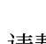

提示词
请撰写《数学分析》课程教学工作总结，包含：①教学回顾，概述计划、内容与方法；②学生学情分析，总结成绩、态度与问题；③教学效果评估，分析成果与不足；④教学经验与反思；⑤未来改进方向与下学期计划。要求全面客观，语言简练。


## 《数学分析》课程教学工作总结

### 一、教学回顾
本学期教学围绕培养数学思维与分析能力展开。内容涵盖实数理论、极限、连续性、导数与微分、积分等核心概念。方法上采用讲授结合互动，通过案例分析、小组讨论、数学软件辅助等方式，提高参与度与理解。

……

持续实践与反思有助于提升教学质量，助力学生掌握课程精髓，为学业与职业奠基。

通过以上示例，Kimi可生成全面工作总结。使用者可在其基础上深化，以保证持续改进。


## 提示词进阶

构建提示词时应明确评价标准与改进方向，例如：

请撰写本学期“化学”课程的教学工作总结，需包含：①主要教学活动如实验课与理论课及对应目标；②学情，包括平均成绩、参与度与理解深度；③教学方法有效性分析，如分组讨论与翻转课堂的影响；④存在问题，如部分学生对复杂概念理解困难及改进措施，提供更多实践机会。要求客观全面，为未来教学提供明确改进策略。

# 第3章 职场提效：Kimi助力工作效率翻倍

在职场竞争加剧的背景下，提升效率至关重要。Kimi凭借强大功能，成为职场人提效利器。从文本处理与提取、回复与互动管理到沟通协作优化，再到营销文案与商业分析，Kimi既能快速完成日常任务，也能提供创新思路，帮助在竞争中脱颖而出。

## 3.1 文本处理与提取

工作中常需处理多格式文本并提取关键信息，使用Kimi可大幅提升效率。

### 3.1.1 实战：一键转换文本格式

文本格式转换是常见需求，如转Markdown，Kimi可轻松实现多种格式互转。


内容创作者孙鹏从旅游论坛与博客收集攻略素材，格式多样。为便于在博客发布并改善排版，他希望统一转为Markdown格式。


提示词
请将以下混合格式旅游攻略文本转换为Markdown，保留标题层级、段落、列表及链接。

原文：（略）。


回答

# 泰国普吉岛旅游攻略

普吉岛，这是一个充满热带风情的度假胜地。

首先，这里有迷人的海滩。其中，卡伦海滩以其细腻的白沙和清澈的海水吸引着无数游客[链接：[卡伦海滩](https://www.******.com/*****)]。

其次，普吉镇的古老建筑别具一格，色彩斑斓的葡式和中式建筑见证了历史的交融。

## 美食推荐

- 泰式炒河粉

......

借助Kimi一键转换，内容创作者能更快准备与发布内容。


## 提示词进阶

在构建提示词时，可明确指定支持的Markdown语法与输出要求，以确保兼容性与易用性，例如：

请将文本转为Markdown格式，转换时请支持以下语法：标题、列表、链接、图片等。

输入文本：（略）。

### 3.1.2 实战：文本转换为表格

文本呈现数据时不易快速分析与比较，转为表格更结构化、直观，便于发现规律。


财务人员张宇常需把大量财务数据从文本转为表格，手工输入效率低且易错。

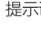

请将下方产品销售数据转换为表格格式。

产品A，150，3000元
产品B，200，4500元
产品C，120，2400元

转换结果：

| 产品名称 | 销售数量 | 单价/元 |
| :--- | :--- | :--- |
| 产品A | 150 | 3000 |
| 产品B | 200 | 4500 |
| 产品C | 120 | 2400 |

通过以上示例，可轻松实现文本到表格的转换，大幅提升处理效率与可读性。


## 提示词进阶

在构建提示词时应进一步明确期望表格结构，例如：

请将以下文本转为Excel表格，要求列标题为：姓名、职务、部门、学历、专业、居住地址、联系方式、邮箱地址。若有电话号码则填入联系方式，无电话但有邮箱则填邮箱，两者皆无则留空。确保行列对应准确。

### 3.1.3 实战：图片中文字的提取

常需从图片提取文字，如扫描文档或资料。Kimi可高效完成提取。


场景
周蒙蒙有3张市场研究报告图片，需提取文字内容。


提示词
请帮我提取图片中的文字。（将图片按顺序拖入输入框并发送。）

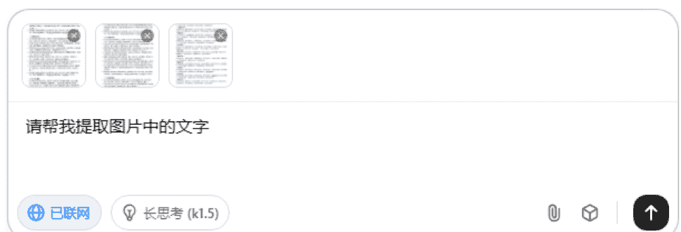

Kimi自动提取文字，点击【复制】即可复制到剪贴板。

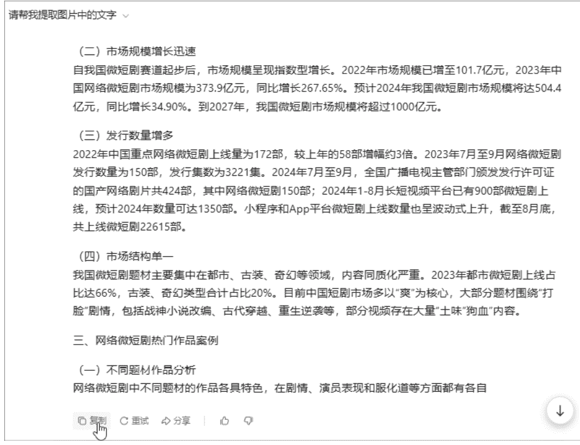

通过以上示例，用户可快速从图片提取文字，提取后需核实准确性。


## 提示词进阶

在构建提示词时，可要求对提取文本进行翻译或润色，例如：

针对所提交的图片，完成全量文字识别并译为中文，随后对译文进行语言打磨，使其符合正式规范。具体要求：1. 完整摘录图片中的全部文字，包含标点和外文，不可遗漏；2. 对外文部分做准确直译，保持原意不变；3. 对译文进行润色，提升准确性和规范性；4. 润色时保证语句通顺流畅，避免生硬冗余。

### 3.1.4 实战：关键词快速抽取
从篇章中筛选出核心词，能帮助读者迅速把握主旨，也是信息检索与自动摘要的基础操作。


场景
市场研究人员管峰每天面对大量调研报告和用户反馈，希望通过关键词提取迅速识别市场动向和消费者的关注焦点。

提示词
请帮我从下面这段文字中提炼关键词，任务包括：①找出文中高频出现的词汇和短语；②判断词汇与文章主题的关联程度；③筛选出最具代表性的关键词。请确保所提炼的词能准确体现文本主题和重点。
原文：（略）。

回答
基于您提供的材料，识别出的高频词汇和短语为：微短剧、网络微短剧、市场规模、发行数量、受众规模、题材、剧情、制作、盈利模式、内容付费、广告变现、电商带货、流量分账、IP改编、网络视频用户、短视频用户、垂直推送、免费模式。
……
筛选出的最具代表性关键词为：微短剧、市场规模、发行数量、受众规模、题材、剧情、制作、IP改编、垂直推送、盈利模式、免费模式。
这些词能够精准反映文本主题和要点，覆盖了微短剧市场的定义、市场表现、内容创作、特色与商业模式等方面。
以上示范借助Kimi即可迅速从篇章中挑出最具代表性的关键词，一眼锁定要点，更好地理解和处理信息。若材料篇幅较长，可先存为文档上传，再输入提示词操作。
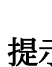

## 提示词进阶
在设计提示词时可进一步细化任务内容与期望输出，示范如下。
请从以下文本中抽取最重要的15个关键词并按重要性排序。要求：①关键词需涵盖名词、动词和形容词；②同时给出每个关键词出现的次数；③尽量剔除常见停用词如“的”“和”等；④提供关键词间的关联度或共现频率。请确保所提炼的关键词既能体现文本主要内容，又能体现其重要性。

### 3.1.5 实战：文本情感倾向分析
情感分析借助自然语言处理技术识别文本表达的情感，可帮助企业了解公众对产品服务的态度，对市场调研与舆情监测具有重要价值。


场景
市场分析师秦伟需要对新品的用户评论进行分析，以判断整体情感倾向。

提示词
请分析下面这段文字的情感色彩，并判定是正面、负面还是中性，请给出详细的情感分析报告，包含整体倾向与具体的积极/消极词汇。
文本内容：（略）。

回答
以下是针对这些文本的情感分析报告。
### 第一段文本
- 整体情感倾向：正面。
- 积极词汇：生活小助手、时尚精致、非常舒适、合适、功能强大、精准可靠、丰富多样、准确记录、科学参考、及时、不错、非常方便、非常满意、强烈推荐。
……
### 第十段文本
- 整体情感倾向：中性。
- 积极词汇：很喜欢、人性化、佩戴舒适、多种表盘、根据心情更换、非常强大。
- 消极词汇：重量比较重、续航能力差。
以上示范借助Kimi即可迅速把握文本的情感色彩，了解整体倾向，为市场调研与舆情监测提供支持。


## 提示词进阶
构建提示词时应更细化任务要求与期望结果，示范如下。
请分析下面这段文字的情感色彩，并判定是正面、负面还是中性。同时请提供详细的情感分析报告，包含整体倾向、具体的积极/消极词汇及其强度评分。具体要求：①确定整体情感倾向；②列出所有积极词汇和消极词汇，并给出它们在文本中的位置；③对每个词汇进行情感强度评分，如1~5分；④若文本包含混合情感，请指出并解释不同部分的情感差异。请确保报告全面准确，能够清晰展示文本的情感色彩。

## 3.2 回复与互动管理
在职场与社交场景中，高效的回复与互动管理能力十分关键。无论是邮件、消息还是评论，高质量的沟通都能提升个人形象，推动工作进展。

### 3.2.1 实战：邮件回复
商务场景中，邮件是重要沟通渠道之一。Kimi可帮助用户快速生成专业回复，提升沟通效率与专业度。


场景
项目经理程可经常需要与客户及团队成员通过邮件沟通。近期收到潜在客户来函，希望能给出专业回复。

提示词
请帮我回复一封客户邮件，确保内容专业、礼貌且切中要点。
邮件原文：（略）。

回答
尊敬的××：
您好！
非常感谢您对我们合作项目的关心和支持。以下是您所询问的项目进度的详细回复。
1. 项目整体进度
目前，项目已完成了[具体百分比]%的工作量。我们按照既定的时间表稳步推进，各项任务均在有序进行中。核心团队成员均表现出色，确保了项目的高效进行。
……
再次感谢您的理解和支持。
顺祝商祺，
[您的姓名]
[您的公司名称]
[您的职位]
[您的联系方式]
模板生成后，可根据实际情况做适当调整，使回复更具个性，避免模板化。随后及时跟进客户反馈，保持良好沟通，提升满意度。


## 提示词进阶
上述提示词可生成完整邮件回复模板。若希望回复更具体、更专业，下达提示词时建议补充关键信息、背景信息及具体要求，示例如下。
请帮我正式地回复这封来自客户的邮件。主要内容包括：感谢客户对我们产品的关注与询问；简要介绍产品的核心特点和优势；邀请客户参加即将举行的线上产品演示会，并提供会议时间和链接；表达期待客户参与的愿望，并附上我的联系方式以便进一步沟通。请注意，在回复邮件中保持专业且友好的语气，引用客户邮件中的提问进行针对性回答，并确保所有信息准确无误。

### 3.2.2 实战：消息回复
即时通讯工具普及的今天，消息回复的及时性与准确性对维持良好人际关系和高效工作沟通至关重要。恰当的回复能增进理解与信任。


场景
吴梅收到领导的微信，告知下月有重要项目启动会，要求本周五前提交详细计划书，并表示有问题随时沟通。她不知如何回复。
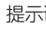
提示词
请帮我撰写一条微信回复消息，回复对象为李总。消息原文：吴梅，我们下个月有一个重要的项目启动会议，需要你准备一份详细的项目计划书。请在本周五之前提交给我。如果有任何问题，随时与我沟通。

回答
李总，您好！我已经收到您关于下个月重要的项目启动会议的通知。我会立即着手准备详细的项目计划书，并确保在本周五之前提交给您。如果有任何问题或需要进一步的信息，我会及时与您沟通。
借助Kimi回复各类消息，职场人士可显著提升沟通效率，同时保证回复的专业性与准确性。涉及上下文回复时，也可将相关会话截图给Kimi，获得更精准的建议。

## 提示词进阶
为提升消息回复的个性化与精准度，可在提示词中加入更多细节与背景信息。示例如下。
请根据客户的购买记录和产品问题，结合公司的售后服务政策，个性化地回复客户，并提供具体的解决方案或联系方式。
另外可更具体描述情境与需求，例如：
- 帮我用幽默的语气回复朋友的调侃微信消息。
- 以专业的态度回复客户的咨询微信消息。

### 3.2.3 实战：评论回复
及时、专业且富有人情味的评论回复，能增强客户购物体验，有效提升店铺口碑与转化率。利用Kimi回复评论，已成为众多电商商家提升服务效率与质量的新手段。
场景
赵飞负责公司官方账号运营，每日需处理大量用户评论，希望找到快速生成高质量回复的方法。
提示词
请根据以下评论内容进行回复，确保回复内容积极、有建设性且能够促进互动。评论原文：“这款产品真的很好用，但是价格有点贵，希望公司能有优惠活动。”
回答
非常感谢您对产品的认可和支持！我们很高兴听到您觉得产品好用。您的意见对我们来说非常宝贵。
关于价格问题，我们始终致力于为客户提供高性价比的产品。我们会不定期推出优惠活动，以回馈广大用户的支持。请您关注我们的官方渠道，如官方网站、社交媒体账号等，以便第一时间获取最新的优惠信息。
同时，我们也非常欢迎您提出宝贵的意见和建议，以便我们不断改进产品和服务。如果您有任何其他的想法或需求，欢迎随时与我们联系，我们很乐意听到您的声音。再次感谢您的支持，期待与您有更多的互动和交流！
通过合理构建提示词，商家可针对不同类型评论给出恰当有效的回复，实现与客户的良性互动。

## 提示词进阶
使用Kimi回复评论时，需明确回复目的与情境，精确描述评论内容，设定适宜回复风格，融入个性化元素增强针对性，同时考虑情感共鸣展现同理心，确保信息准确，并可提供模板示例引导生成高质量回复。示例如下。
Kimi，请根据以下评论内容，生成一个正式且带有情感共鸣的回复。
评论原文：“我一直很喜欢你们的产品，但这次购买的××型号的产品出现了××问题，让我有些失望。希望能尽快解决。”
回复要求：①表达对用户长期以来支持的感谢；②承认产品存在的问题，并表示歉意；③承诺将立即采取措施解决问题，并提供具体的解决方案或联系方式；④邀请用户保持联系，以便随时跟进问题解决情况；⑤保持语气诚恳、专业，同时体现出对用户情感的理解和共鸣。
期望回复示例（非具体生成）：“……”。

## 3.3 沟通协作优化
快节奏的现代职场中，高效沟通与协作是推动项目进展和团队合作的关键。本节通过实战案例帮助读者掌握实用技巧，提升沟通效率和协作水平，确保信息准确传达同时维护良好团队关系。

### 3.3.1 实战：高效回复领导消息
职场沟通中高效回复领导消息至关重要，既体现工作态度与专业素养，也关系工作推进与职业发展。
场景
广告公司策划专员袁宏接到领导询问其负责项目策划方案进展，并提出疑问，希望尽快回复解答并给出下一步计划。
提示词
Kimi，请帮我撰写一条回复领导的消息。消息需包含：①项目策划方案目前的进展状况，包括已完成的部分和正在进行的部分；②针对领导提出的疑问进行清晰、详细地解答；③阐述下一步的工作计划，包括时间节点和预期目标。回复语言要简洁明了、条理清晰且态度诚恳。
回答
尊敬的[领导的姓名或职位]：
您好！
关于项目策划方案的最新进展，我在此向您汇报如下。
##### 1. 已完成的部分
- 市场调研：我们已经完成了对目标市场的初步调研，收集了相关数据，并进行了初步分析。
- 竞品分析：对比了行业内的主要竞争对手，形成了详细的竞品分析报告。
……
我们的目标是在[具体日期]前完成项目策划方案的最终版，并确保项目按计划顺利推进。请您放心，我们将持续保持高效的工作节奏，并确保每一步工作都符合预期目标。
感谢您的关注和支持，如有任何问题或需要，我随时为您提供更详细的信息。
以上提示词可生成高效回复模板，帮助用户在与领导沟通时保持专业与高效。实际应用中可根据不同情况调整，确保信息及时准确传达。

## 提示词进阶
构建提示词时应强调回复针对性与解决方案提出，示例如下。
请帮我撰写一条回复领导的消息，用于回应领导关于项目进度的询问。消息需要包括以下内容：①直接确认收到领导的询问，并简要概述当前项目进度；②提出下一步的工作计划和预期完成时间；③明确指出需要领导支持的具体事项，如资源调配或决策审批；④表达对领导持续指导和支持的感激之情。请确保回复内容简洁明了、专业且具有建设性。

### 3.3.2 实战：客户投诉时的专业与同理心
面对客户投诉，保持专业与同理心是维护客户关系和企业形象的关键。本节介绍利用Kimi优化投诉回复，确保问题有效解决并提升客户满意度。
场景
客服人员林芳收到客户关于产品质量问题的投诉，需撰写回复邮件，既表达对不满的理解，又提供具体解决方案。
提示词
Kimi，请生成一封回复客户投诉的邮件。邮件需要包括：①对客户问题的理解和抱歉；②对所发生问题的解释；③提出的解决方案或补救措施；④邀请客户反馈解决方案的接受程度；⑤表达继续提供优质服务的决心。请确保邮件内容真诚、专业，能够有效安抚客户情绪。
回答
主题：对您的问题表示诚挚的歉意及解决方案
尊敬的 [客户姓名]：
您好！
首先，我们想对您在使用我们的产品/服务过程中遇到的问题表示最深切的歉意。我们了解到这对您造成了不便，并且我们非常重视您的反馈。请相信，我们始终致力于提供最优质的客户体验，任何偏离这一目标的情况都是我们不愿看到的。
……
如果您有任何进一步的问题或需要额外的帮助，请随时通过[联系方式，例如：回复此邮件/电话/客服聊天]与我们联系。我们承诺将迅速响应，并致力于解决您的任何问题。
再次感谢您的耐心和理解。我们期待着有机会证明我们的承诺，并确保您的满意度。
最诚挚的问候！
[您的姓名]
[您的职位]
[公司名称]
[联系信息]
以上提示词可生成既体现公司专业形象又展现客服同理心的回复邮件。用户可根据具体情况调整内容，如客户姓名、问题原因、解决方案和补偿措施等。

## 提示词进阶
构建提示词时应强调内容的个性化与情感化，以增强情感连接与信任感。例如可根据客户具体情况和投诉内容提供更具针对性的解决方案和补偿措施；同时在内容中加入适当情感表达，如道歉、感谢和关心等，展现客服真诚关怀。示例如下。
请帮我撰写一个客户投诉处理示例，用于指导客服人员处理因物流延误导致的客户投诉。示例需要包括以下内容：①表达对因物流延误给客户带来的不便深感抱歉；②确认订单的具体信息和客户的期望到货时间；③提供补偿措施，如免费升级快递服务、赠送优惠券等，并明确实施时间和责任人；④向客户保证将加强物流管理和监控，避免类似问题再次发生；⑤感谢客户的耐心和理解，并邀请客户在未来继续关注和支持我们的服务。请确保语言亲切、真诚且有效，能够充分展现我们的专业素养和同理心。

### 3.3.3 实战：谈判沟通策略制定
商业合作中有效谈判沟通不仅能促成交易，还能增强双方合作关系。正确沟通策略帮助企业更好展示优势，同时理解对方需求，达成双赢。
场景
企业业务发展经理赵刚即将与潜在合作伙伴谈判，达成重要合作协议，需制定有效沟通策略确保谈判成功并维护公司利益。
提示词
请帮我制定一份与合作伙伴谈判的沟通策略，内容包括：①明确谈判目标和底线；②准备支持数据和案例以增强说服力；③设计提问和回应的策略以引导谈判方向；④制定备选方案以应对不同谈判结果。请使用专业且具有策略性的语言，并确保内容的逻辑性和前瞻性。
回答
## 谈判沟通策略
### 一、明确谈判目标和底线
1. 目标设定：在进入谈判之前，我们需要明确我们的最终目标和可接受的最低条件。这包括但不限于价格、交货时间、质量标准、付款条件等关键内容。
   - 最终目标：[具体目标，例如：达成一份长期合作协议，确保价格在具有市场竞争力的范围内，同时保证产品质量符合国际标准。]
   - 底线条件：[具体底线，例如：价格不得低于成本价的105%，交货时间不得晚于合同规定日期后的30天，产品质量必须通过ISO认证。]
……
通过以上策略，我们可以确保在与合作伙伴的谈判中，既能够坚持我们的立场，又能灵活应对各种情况，最终达成一个对双方都有利的结果。
以上提示词生成了一份详细的谈判沟通策略，帮助用户在与合作伙伴谈判时保持目标清晰和策略明确。用户可根据不同合作伙伴和谈判环境对该策略进行调整，以确保谈判顺利进行和目标实现。

## 提示词进阶
构建提示词时可进一步细化每个环节具体内容，如开场亲切问候、议题引入自然过渡、利益阐述翔实数据支持、异议处理灵活应对等。示例如下。

针对合作伙伴谈判中常见的质疑，沟通策略里要单独强化异议处理环节。需要围绕合作细节、收益分配、合作周期等高频争议点，构建识别—拆解—回应—落地的一体化流程，让质疑在第一时间被看见、被理解、被解决，从而推动谈判顺畅推进。方案必须具体可操作，真正消除对方的不安与顾虑。

### 3.3.4 实战：化压力为共识的反馈应对

沟通中出现负面声音几乎不可避免，处理得当就能提升情商并维系关系。

场景
王玉梅担任项目经理，近期在项目复盘会上被同事指出项目进度拖后、成本失控等短板。她想获得专业建议，用建设性的方式回应并找到改进路径。

提示词
Kimi，请输出一套应对负面反馈的做法。要求包含：①先冷静倾听，避免立刻反驳；②对反馈表示感谢并传递改进意愿；③梳理反馈要点，定位问题根源；④给出可执行的改进方案，如调整计划、收紧成本；⑤邀请对方共同参与方案制定，推动协作。请保证理性且建设性，有效降温并促进配合。

回答

## 负面反馈的建设性回应框架

### 一、先稳住情绪，完整听懂对方
1. 倾听要点：接收反馈时保持冷静，全程专注不打断，确认对方核心关切。
2. 非语言信号：通过点头、眼神交流等表明在认真接收，有助于建立信任。

### 七、复盘经验，持续迭代
1. 经验沉淀：每次处理后做小结，形成应对清单。
2. 机制化改进：将改进动作纳入日常管理，形成闭环。

借助上述提示词，Kimi可以生成系统化、角度多元的反馈应对思路，帮助用户主动思考、积极行动，增强团队凝聚力。

提示词进阶
构建提示词时要突出积极包容反馈、共建协作的价值，把反馈视作成长触点。例如：
Kimi，请生成一份针对项目进度滞后负面反馈的回应策略。要求包含：①先肯定对方的关心与支持，表明重视；②拆解滞后成因，如资源错配、外界干扰；③提出补救举措，如重排关键节点、追加资源；④邀请团队共议共落，共同攻关；⑤建立定期检视机制，确保后续推进顺畅。请体现深刻洞察与积极解决的态度。

## 3.4 营销文案创作实战指南
在竞争白热化的市场里，优质文案是吸引受众、拉升品牌认知、促成转化的关键。本节演示如何用Kimi打造创意十足、触达精准的营销内容，助力营销目标达成。

### 3.4.1 实战：社媒广告文案打造
社交平台上的广告文案决定了首屏停留与传播效果。

场景
赵敏是时尚品牌营销负责人，需为新品服装在社交媒体投放系列广告，目标是抓住年轻人群眼球，提升品牌声量与销量。

提示词
请为品牌新款服装撰写一条社交媒体广告文案，需凸显时尚属性、设计亮点与穿搭感受，结合受众兴趣与使用习惯，输出创意吸睛的内容，保证新颖独特、易引发共鸣关注。

回答

## 社交媒体广告文案

【探索时尚新境界】
“风尚启航，潮流同行”

时尚亮点：新品融合流行色系与前卫印花，针线细节尽显型格。街头风的大胆撞色与优雅风的细腻纹理兼备，让你在任何场景都能成为焦点。

结语：时尚是态度，也是选择。穿上新品，让每一天都是个人秀场。#潮流随行#，一起启航！

通过该提示词，Kimi可生成创意十足的社媒文案，用户只需按品牌与产品实际替换颜色、面料、设计细节，选择合适平台即可发布。

提示词进阶
构建提示词时可进一步细化受众画像与创作要求，提升针对性。例如：
请为年轻女性消费者撰写一条推广新款女装的社交媒体广告文案，需突出时尚感与舒适度，提供搭配建议，并结合审美偏好与购物习惯，输出个性化有创意的广告语，保证新颖独特、引发共鸣，提升知名度与销量。

### 3.4.2 实战：新品上市推广全案
新品上市是企业营销的关键节点，一份完整方案能快速打开市场。

场景
冯振是电子产品公司产品经理，负责新型智能手环的上市推广，需要一套涵盖调研、定位、策略、排期与资源配置的完整计划。

提示词
请制定新型智能手环的上市推广计划，需包含市场调研结论、目标人群锁定、营销打法（线上线下渠道、广告投放、促销安排）、效果评估、执行时间表与资源分配，保证内容全面可指导落地。

回答

## 新产品上市推广计划——新型智能手环

### 一、市场调研结论
1. 人群画像：以健康意识强的年轻人、关注运动健身的中年人及追求科技时尚的数码爱好者为主。
2. 市场趋势：健康监测功能趋深、运动追踪升级、续航要求提高、外观更时尚。

2. 物资保障：确保库存与物流到位，线下体验店设施完善。
3. 资金规划：合理分配营销预算，兼顾收益与风险。

整体计划可全面指导新品上市，确保进入市场并获得良好反响。

提示词进阶
构建提示词时应深挖数据与行为特征，例如市场份额与决策因素。例如：
请制定新型智能手环推广计划，已知目标市场前五品牌份额为[A%, B%, …, E%]，竞争对手在监测精准度与品牌认知上占优。70%目标用户购前会参考线上评测，更看重功能实用性与售后。基于此制定精准功能优势定位、差异化定价、结合评测的促销方案，并明确阶段渠道、时间安排、预算分配与效果评估指标。

### 3.4.3 实战：品牌故事叙述
品牌故事是连接企业与消费者的情感桥梁，生动真实的故事能提升认知与认同。

李华是文化创意公司品牌经理，需为旗下传统手工艺品牌“匠心织梦”创作品牌故事。该品牌历史悠久技艺独特，但传播不足。她希望通过动人叙事提升知名度与美誉。

提示词
请为传统手工艺品牌“匠心织梦”创作品牌故事，需围绕历史传承、独门技艺、文化内涵及与当代生活的融合展开，保证真实感人、易引发共鸣，提升美誉与忠诚度。

## 品牌故事：匠心织梦——织就时光，梦绘未来
在江南水乡的一隅，流水潺潺、古树参天，青石路上回荡着历史声响。这里流传着一个品牌——“匠心织梦”。它不仅是品牌名，更是家族世代坚守的承诺，一段跨越世纪的传奇。

### 第一章：传承的起点
……

“匠心织梦”不仅是品牌，更是关于传承、创新与情感的叙事。它提醒我们，无论时代如何变迁，对美的追求、对传统的尊重、对生活的热爱永恒不变。选择它，就是选择一段历史、一种文化、一个故事。守护匠心，让传统在现代生活中焕新光彩。

通过此提示词，Kimi可产出引人入胜的品牌故事，既展现历史与技艺，也挖掘文化内涵并与当下结合，提升品牌形象。

提示词进阶
构建提示词时可强化独特性、创新性与受众关联。例如：
请为面向年轻消费者的时尚品牌创作独特创新且有共鸣的品牌故事，需围绕创立背景、设计理念、产品特色与时尚潮流的结合，并融入年轻人的生活场景与价值观，保证新颖有趣、易引发共鸣，提升美誉度与市场份额。

### 3.4.4 实战：OMO联动活动策划
数字时代，线上线下联动是提升参与感与品牌影响力的有效手段，整合资源能创造更多互动机会。

场景
刘洋是电子产品公司市场经理，公司将推出新款智能手表，希望策划一场线上线下联动营销活动，提升认知与参与。

提示词
请生成智能手表的线上线下联动方案，需包含：①活动主题；②线上形式，如直播互动、社交媒体话题；③线下形式，如体验店试戴、路演；④时间表，保证节奏有序；⑤预算分配，保证顺利实施。请确保方案新颖、吸引力强。

回答

## 智能手表线上线下联动活动方案

### 一、活动主题
“智在未来，慧享生活”

### 二、线上玩法
1. 直播互动：邀约科技KOL在各平台讲解功能与体验，增强互动，设置问答抽奖提升活跃。
2. 社交媒体：在微博、微信、抖音等发布使用技巧、用户评价与互动话题，提升认知与兴趣。

2. 线下成本：场地租赁、人员、布置、奖品、广告等。
3. 预算把控：按品牌实际与目标合理分配，重点投放传播渠道，控制成本以达预期。

整体方案可确保活动新颖有效，提升美誉与忠诚。

提示词进阶
构建提示词时可强化创新、互动性与人群精准匹配。例如：
请为面向年轻消费者的时尚品牌制定创新互动的线上线下联动方案，需围绕兴趣与购物习惯设计创意内容，如线上AR试穿、线下主题派对，确保广告精准投放与宣传有效。保证内容新颖有趣，激发参与与分享，提升线上曝光与线下体验，推动销售增长。

## 3.5 商业分析实战
商业分析是决策依据，精准洞察可帮助把握趋势、明确定位、优化资源。

### 3.5.1 实战：SWOT战略扫描
SWOT通过优势、劣势、机会、威胁的评估，帮助企业全面认识内外环境，为战略决策提供依据。

场景
吴雷是市场分析师，需对公司进行全面SWOT分析，明确现状与未来方向。

提示词
请撰写××科技公司的SWOT报告，需包含：①内部优势，如核心技术、团队实力；②内部劣势，如资金限制、经验不足；③外部机会，如需求增长、政策支持；④外部风险，如竞争激烈、技术迭代。请保证客观全面，为战略决策提供支撑。

## ××科技公司SWOT分析报告

### 1. 内部优势
- 研发创新能力强：重金投入研发，保持技术领先，团队具备前沿研究与产品创新能力。
- 生产物流高效：先进设备与严格管理保障品质与交付，优化物流提升满意度。

- 利用优势抵御威胁：提升品质与服务，增强客户粘性，减弱经济波动影响。
- 补短板抓住机会：加强人才培养与技术创新，提升竞争力，抓住政策与技术转移红利。

通过上述提示词，Kimi可生成SWOT报告，用户可按实际调整以确保实用。

提示词进阶
提示词可提供更细数据，如财务、份额、调研结果。例如：
请为餐饮连锁撰写SWOT报告，已知上年菜品研发投入占营收[×]%，新品上线后日均销售额增长[×]%，食材采购成本上升[×]%。新城餐饮市场未来两年预计增长[×]%，消费者健康需求上升，当地三家大型连锁占[×]%份额。基于此分析优劣势与机会风险，并提出如利用研发优势推出健康菜品等具体策略。

### 3.5.2 实战：竞争力对标研究
竞争力分析评估企业在市场的相对优劣，通过对手研究发现不足并寻找提升路径。

场景
某电商平台运营多年，品类涵盖服装、家居、数码，自建物流、研发持续投入，但在获客成本与品牌影响力上仍落后行业头部。

提示词
请撰写企业竞争力分析报告，需包含：①核心竞争力要素，如技术创新、物流优势；②短板，如品牌建设、用户获取；③与主要竞争对手对比；④提升建议，分短期与长期策略。

## 企业竞争力分析报告

### 1. 核心竞争力要素
- 技术创新：大数据与AI驱动用户画像与推荐，提升体验与运营效率。
...

### 5. 长期策略
- 持续研发投入，保持技术领先。
- 拓展国际市场，增强全球竞争力。
- 深化供应商合作，提升品类与品质。

基于当前市场，企业应灵活调整策略以提升竞争力。

提示词进阶
构建提示词时应注重全面性与建议创新性。例如：
请撰写电子商务领域竞争力分析报告，需包括：①物流、技术、客户服务的核心优势；②竞争地位与主要对手；③行业趋势、消费者行为、技术发展对竞争的影响；④基于分析的战略建议，如市场细分、技术创新、品牌建设。保证全面深入且具创新性。

### 3.5.3 实战：产品定位拆解
产品市场定位是确定产品在目标市场中的位置与形象，帮助制定有效策略。

李明是科技公司产品经理，负责一款面向年轻职场人士的智能戒指，提供健康管理、时间管理服务，需做详细定位分析。

提示词
请撰写智能戒指的产品市场定位分析报告，需包含：①目标市场选择与描述，年龄性别职业消费习惯；②竞争对手分析；③产品差异化，功能设计价格卖点；④市场需求分析；⑤定位建议，目标市场、产品定位、品牌形象。请保证翔实、逻辑清晰、专业。

## 智能戒指产品市场定位分析报告

### 一、目标市场画像
目标人群为对健康监测与智能设备需求高的年轻职场人士。
- 年龄：20~40岁，接受新技术、关注健康与生活质量。

- 产品定位：打造集健康监测、便捷生活与时尚设计于一体的智能戒指，满足品质生活追求。
- 品牌形象：塑造创新可靠时尚的形象，通过营销与互动强化情感连接。

精准定位与差异化策略有望在激烈市场中脱颖而出。

通过提示词，Kimi可全面生成定位分析报告，涵盖目标市场、竞争、差异化、需求与定位策略。

提示词进阶
构建提示词时应进一步细化要求，提供针对性指导，以便生成更精确的市场定位分析报告。

职场25-35岁智能手表定位速览

请围绕25-35岁职场新人及中坚人群输出一份智能手表市场定位报告，具体要求：①立体刻画该群体的消费行为、选购倾向、日常作息与社交方式；②梳理面向年轻职场的头部智能手表品牌，总结各家的产品卖点、市场占有与用户口碑；③拆解产品差异化，突出健康监测、时间管理等独有功能，并与竞品做优势对比；④依托问卷调研与社媒舆情等数据还原该群体对智能手表的真实需求与使用期待；⑤给出明确的市场定位建议，界定品牌调性、目标客群、产品层级与价格策略，确保方案可精准匹配市场。

### 3.5.4 实战：供应链效率优化分析

供应链是企业运转的底盘，高效管理可压缩成本、加快响应、提升满意度。

场景
周泽在制造企业担任供应链负责人，负责原材料采购、生产排程、物流配送等环节。近期链路效率下滑，制造成本上行、交付周期拉长，需开展系统性效率诊断。

请输出一份供应链效率优化分析报告，涵盖：①各环节耗时与费用；②链路瓶颈与潜在风险；③行业最佳实践与改进思路；④基于诊断的优化方案与落地计划。语言需系统、分析性强，兼顾全面与可执行。

## 供应链效率优化分析报告

### 一、供应链各环节的运作时间和成本
对现有供应链全景拆解，覆盖物料采购、生产制造、仓储管理与配送，提炼核心数据。

1. 物料采购：平均采购周期约30天，费用受供应商报价、采购量与价格波动驱动。
2. 生产制造：周期随产品复杂度波动，平均约15天，成本构成含原材料、人工及设备折旧。
……

2. 产品定位：打造集效率优化、风险管控、成本控制于一体的供应链解决方案，满足企业全方位管理需求。
3. 品牌形象：塑造创新、可靠、高效的品牌调性，依托成功案例与客户推荐，树立供应链管理领域的专业权威。

综合上述分析，可为企业提供一套系统化供应链效率提升方案，助力降本提质、赢得持续竞争优势。

依托以上提示，可生成一份具体可行、问题清晰、建议可落地的供应链效率优化报告。

## 提示词进阶
构建提示词时要强化实用性与可操作性，确保建议直击痛点。示例如下。

请生成一份聚焦原材料采购与库存管理的供应链效率优化报告。需包含：①现状画像，如供应商筛选标准、采购周期、库存水平；②存在问题，如交付延迟、库存积压、成本攀升；③根因剖析，如供应商匹配不当、信息系统滞后、流程执行不规范；④优化举措，如搭建供应商评估机制、引入先进库存管理系统、优化物流网络；⑤落地计划，含短期应对如临时补库存与长期建设如系统升级及责任分工。请保证报告具体实用、可直接指导优化。

### 3.5.5 实战：市场容量与增长潜力预测

市场容量与增长潜力预测是制定进入策略与投资决策的重要依据，科学推演有助于把握趋势、合理配置资源、降低风险。

场景
王莉是新锐科技公司的市场分析师，需评估拟进入的智能穿戴设备市场的规模与成长空间，以制定合理进入策略。

提示词
请撰写一份智能穿戴设备市场容量与增长潜力预测报告。需包括：①市场界定与分类；②历史规模复盘，梳理近几年体量、增速及驱动因素；③未来容量预判，基于行业趋势、技术演进、消费需求等变量预测未来数年规模与潜力；④竞争格局梳理，总结主要参与者份额、产品特征、营销打法；⑤机会与挑战辨析；⑥结论与建议。请确保分析深入、表述专业。

回答

## 智能穿戴设备市场容量与增长潜力预测报告

### 一、市场定义
智能穿戴市场是以智能穿戴为核心的全产业链领域，涵盖生产、销售、服务及应用环节。主要参与方包括设备制造商、软件开发者、服务商、零售商与终端用户。规模与增速受技术进步、需求变化、政策法规与宏观经济等多重因素影响。

……
### 六、结论与建议
综合研判，公司应聚焦技术创新与产品多元化，强化数据安全与隐私保护；紧跟消费需求变化，开拓健康监测、智能家居等新场景；并加强与科技巨头合作，借助5G、AI等技术提升产品力，抓住增长窗口。

依托上述提示，可生成一份完整的智能穿戴市场容量预测报告并给出结论性建议。

## 提示词进阶
构建提示词时可进一步细化预测方法，融合多元数据源与分析工具，提升可靠性。示例如下。

请撰写一份基于多元回归分析的智能穿戴设备市场容量与增长潜力预测报告。要求：①市场定义与分类；②历史规模分析需整合行业报告、调研数据、企业财报等，运用统计方法解析规模与趋势；③未来预测采用多元回归模型，结合技术迭代速度、消费者接受度、政策环境等变量推演未来五年规模与增速；④竞争格局分析运用SWOT、五力模型等工具深挖竞争态势；⑤机会与挑战分析结合宏观环境与消费者行为研究；⑥结论与建议提出具体进入策略、产品定位、营销策略。请确保方法科学、数据扎实、分析深入。

## 3.6 社交媒体运营

社交媒体是品牌与用户互动的核心阵地，有效运营可显著提升品牌影响力与参与度。本节围绕关键环节，利用Kimi制定系列策略以最大化营销效果。

### 3.6.1 实战：微博话题互动策略制定
微博是信息传播与互动的重要平台，话题互动对提升曝光与参与度意义重大。

王良是时尚品牌的微博运营专员，负责策划与执行话题互动活动，以吸引潜在消费者、提升品牌认知与用户粘性。

请制定一份微博话题互动策略，需包含：①话题主题选择，确保契合品牌调性且能激发兴趣；②互动形式设计，如投票、问答、评论抽奖等；③话题推广计划，含发布时间、频次及KOL合作；④用户反馈收集机制；⑤确保内容合规，避免违规行为。

定制策略如下。

### 1. 话题主题的选择
- 与品牌调性一致：选择契合品牌核心价值与形象的话题，传递品牌态度。
- 激发用户兴趣：紧跟时事、节日、科技热点，选择与用户生活紧密相关的话题，如健康、教育、职场等。
……

### 5. 确保策略内容符合微博平台规定
- 规避违规：所有话题与互动形式需遵守平台规则，避免敏感词与违规内容，防止账号受限或封禁。

通过上述策略，可在微博有效开展话题互动，提升品牌影响力与用户参与度。

## 提示词进阶
构建提示词时可进一步细化策略，提升针对性与实用性，示例如下。

Kimi，请为年轻女性群体制定一份微博话题互动策略，明确以下细节：①话题主题为“时尚搭配”，聚焦服装配饰搭配痛点；②互动形式为“穿搭挑战赛”，鼓励用户晒照并邀请好友点赞；③推广计划结合节假日或热点，甄选高人气KOL合作；④建立用户反馈群，实时收集意见用于优化；⑤确保内容合规，同时注重用户隐私与数据安全。

### 3.6.2 实战：小红书探店笔记策划方案
小红书是以生活方式分享为主的社区，用户分享生活经验与消费心得。对餐饮、旅游、美妆等行业而言，探店笔记是重要营销渠道。

张小丽是一家餐厅经理，希望在小红书发布系列探店笔记以吸引客流，需制定详细策划方案。

请生成小红书探店笔记策划方案，包含：①目标受众，如年轻女性、美食爱好者；②笔记内容，如环境、菜品特色、服务体验；③拍摄技巧，如光线、角度、构图；④发布频率，如每周一篇；⑤互动方式，如评论互动、打卡有礼；⑥效果评估，如阅读量、点赞、收藏。请确保方案具体可行，提升参与度与曝光。

方案定制如下。

### 1. 目标受众
- 年轻女性：小红书女性用户占比高，年轻群体为主。
- 美食爱好者：用户重视生活品质，美食为核心关注点之一。
……

### 6. 效果评估
- 阅读量：衡量内容吸引力。
- 点赞数：反映用户喜爱度。
- 收藏数：体现认可度与回访意愿。

通过方案可有效提升参与度与曝光，同时保证内容质量与互动有效性。

## 提示词进阶
构建提示词时应注重内容吸引力与互动性，确保广泛关注与积极参与。示例如下。

请为高端餐厅策划一系列小红书探店笔记方案，需包括：①目标受众，如年轻女性、美食爱好者、高端消费者；②笔记内容，如装修风格与氛围、招牌菜与制作工艺、服务态度与用餐流程；③拍摄技巧，如自然光运用、合适角度与构图、滤镜提升质感；④发布频率，如每周一更、月更四篇，保持稳定节奏；⑤互动方式，如评论区互动、邀请用户分享体验、打卡有礼；⑥效果评估，如阅读量、点赞、收藏、评论数。请确保方案具体可行，提升参与度与曝光。

### 3.6.3 实战：今日头条爆款文章策划
今日头条是内容丰富、用户活跃的信息平台，高质量文章可快速提升影响力与关注。

场景
苏蓉为今日头条内容创作者，目标打造爆款，提升影响力与关注。

提示词
请策划一篇今日头条爆款文章，要求：①选题紧跟热点或具独特视角，引发关注讨论；②结构清晰、逻辑严密，含吸睛开头、详实分析、有力结尾；③配图高清且贴合内容；④含互动元素如投票、问答，提升参与；⑤分析目标用户，制定针对性推广计划。

回答

## 选题策划：《元宇宙热潮：虚拟世界中的新机遇与挑战》

### 1. 引人入胜的开头
标题：《元宇宙：未来已来，你准备好了吗？》
开头：“2024年，多家科技公司布局虚拟世界，元宇宙不再是科幻概念而逐步落地。它到底是什么？将如何改变生活？本文带你一探究竟。”
……

通过策划，目标是打造兼具深度与广度的爆款文章，吸引关注、激发讨论，实现高阅读与高互动。

## 提示词进阶
构建提示词时应挖掘用户深层需求，提升独特性与吸引力，示例如下。

请为年轻职场人群策划一篇今日头条爆款文章，聚焦职场成长与自我提升，深入剖析职场痛点与机遇，提供实用解决方案与行动指南。内容可结合职场文化元素，如职场梗、励志故事，提升趣味与共鸣。配图选用高清创意职场图，增强视觉效果。最后制定推广计划，利用推荐算法与社交分享，精准触达目标用户。

### 3.6.4 实战：喜马拉雅音频内容策划方案
喜马拉雅是用户喜爱的音频内容平台，通过精细策划可提升品牌认知与影响力。

场景
李颖是健康食品公司市场经理，希望在喜马拉雅发布健康生活方式音频内容以吸纳关注。

提示词
请生成喜马拉雅音频内容策划方案，包含：①目标受众，如健康意识强者、健身爱好者；②内容主题，如健康饮食、运动养生、心理健康；③内容形式，如访谈、讲座、故事；④嘉宾选择，如营养师、健身教练、心理学家；⑤发布频率，如每周一期；⑥互动方式，如留言、问答；⑦效果评估，如播放量、订阅数、用户反馈。请确保方案具体可行，提升吸引力与互动。

## 喜马拉雅音频内容策划方案

### 1. 目标受众
- 健康意识强的消费者：关注饮食与生活方式的成年人群。
- 健身爱好者：定期锻炼、追求体魄的年轻及中年人群。
……
- 提升听众忠诚度与参与度。
- 通过互动反馈不断优化节目，提高满意度。

方案期望打造专业且具吸引力的音频内容，为听众提供有价值健康信息，促进互动交流。

## 提示词进阶
构建提示词时应注重创意与听众互动，示例如下。

请策划一档“历史故事会”音频节目，要求：①面向对历史感兴趣的听众，尤其是青少年与历史爱好者；②每期聚焦一个历史事件或人物，以故事化呈现；③内容结合史实与生动叙述，增强沉浸感；④优化互动环节，如听众提问与历史小测验，提升参与度与分享率。请确保内容具创意、教育意义且能持续吸引听众。

### 3.6.5 实战：直播带货脚本编写
直播带货脚本策划对提升转化率与互动率至关重要。

场景
林娜是直播带货主播，计划推广“保湿粉底液”，需编写吸引人脚本。

提示词
请为推广“保湿粉底液”的直播编写脚本，需包括：①产品特点介绍，如成分、质地、遮瑕力、持久度、色号；使用方法、适用肤质、与竞品优势；②产品实操展示与使用效果；③优惠信息与购买方式；④与观众互动、答疑并促单。请使用热情语言，确保说服力与吸引力。

回答

## 直播带货脚本：保湿粉底液

### 开场白：
亲爱的朋友们，大家好！感谢来到直播间。今天带来一款超好用的保湿粉底液，能让肌肤无瑕且水润一整天。接下来揭开它的秘密吧！
……
- 已使用过的朋友欢迎分享心得，让更多人了解效果。
- 美丽不等人，优惠更不等人，赶紧下单！

### 结束语：
感谢观看与支持，愿粉底液为你加分。下次直播见，记得关注获取更多美妆好物！

脚本需结合产品特点与观众心理，在生成模板后主播可据直播特点微调以确保有效性。

## 提示词进阶
构建脚本提示词时应更细化各部分，如成分、使用效果演示方式等。示例如下。

请撰写某系列美妆产品的短视频带货脚本，放大价值激发购买欲。脚本需含：①直播主题，明确具体产品名称；②开头吸引注意，如展示精彩美妆教程片段；③主体内容，含产品介绍、成分功效、适用肤质、使用方法详解、效果演示方式如模特对比；④结尾留下深刻印象并促单，如提供购买链接与优惠，强调紧迫性。

### 3.6.6 实战：抖音短视频分镜头脚本创作
抖音短视频以短小精悍、易传播著称，分镜头脚本对提升质量与体验至关重要。

场景
刘洋是运动品牌市场经理，公司新推出运动鞋，希望在抖音发布高质量短视频以提升认知。

提示词
请创作运动鞋宣传抖音分镜头脚本，要求：①含镜头序号、景别、画面内容、台词、时长、音乐音效；②开头以独特方式抓注意力，如视觉冲击或有趣情节；③中段突出鞋款特点，如设计亮点、技术应用、舒适度，通过多景别与手法展示；④结尾印象深刻，如精彩动作或品牌标识展示，引导关注或购买。

## 抖音短视频分镜头脚本：运动鞋宣传

### 一、视频开头
镜头一：特写
- 景别：特写
- 画面：一只新款运动鞋自上空缓落，鞋底触地溅起水花。
- 台词：无
……
镜头九：结束
- 景别：全景
- 画面：品牌标识与购买链接。
- 台词：（旁白）“立即关注××品牌，开启舒适之旅。”
- 时长：2秒。

# Kimi 提示词实战全景：短视频·求职·编程

- 收尾音效建议：柔和的结束配乐配合关注与购买引导。

按照上述指令，模型可输出一套可直接拍摄的抖音分镜方案。

## 提示词进阶

想让脚本更有传播力，提示词要聚焦创意点和吸睛设计。参考示例如下。

请为Z世代女性策划一条抖音穿搭类短视频分镜，主题定为“时尚穿搭秘籍”。脚本需满足：①开场用时尚快闪形式迅速抓住注意力；②正文以多镜头呈现不同场景搭配，每条镜头安排差异化的机位与景别；③旁白语言简洁明了，突出单品亮点与穿搭技巧；④加入互动设计，如“猜这件衣服的价格”“穿搭挑战”等提升参与感；⑤结尾引导关注品牌账号并参与后续活动。同时遵守抖音社区规范，注意用户隐私与数据安全，确保内容积极健康。

## 3.7 求职与招聘文案

在求职招聘场景里，文案的精准度直接影响结果。本部分从求职者和招聘方两端出发，结合Kimi给出可直接套用的写作思路，提升求职成功率并优化企业招聘效率。

### 3.7.1 实战：个人简历的制作

简历是求职者向用人单位展示自我价值的核心材料，写得用心就能凸显优势、吸引招聘官并提高面试邀约。


叶韩是一名即将毕业的大学生，专业是计算机科学与技术。他希望制作一份简历，用于申请软件开发工程师岗位，目标公司主要是互联网科技企业。


**提示词**

请帮我生成一份个人简历，用于申请软件开发工程师岗位。简历需包含：①个人基本信息；②教育背景；③专业技能，列举掌握的编程语言、开发工具、数据库等；④项目经历，详细描述参与的项目名称、项目时间、项目职责、项目成果等；⑤实习经历，阐述实习单位、实习时间、实习岗位、实习内容和收获；⑥获得的证书和荣誉，如计算机等级证书、奖学金等；⑦自我评价，突出自己的专业能力、团队协作精神、学习能力等优势，证明自己与软件开发工程师岗位相匹配。


**回答**

# 个人简历

**个人信息：**

- 姓名：[您的姓名]。

- 性别：[您的性别]。

- 出生年月：[您的出生年月]。

- 联系电话：[您的联系电话]。

- ......

**自我评价：**

作为一名软件开发工程师，我具备扎实的计算机科学基础知识和丰富的编程实践经验。我对新技术充满热情，能够快速学习和适应新工具和编程语言。在团队合作中，我能够积极沟通，有效协作，和团队成员共同推动项目进展。我注重代码质量，擅长编写可读性强、易于维护的代码。我相信，我的专业能力和团队精神将使我成为贵公司的一员。

依此指令，Kimi 能快速生成一份简历模板。实际使用时请按个人情况补充细节，加入个性化亮点，确保真实且更有说服力。


## 提示词进阶

撰写简历类提示词时，建议对各部分要求更具体。例如在工作经历中细化项目成果与职责划分，在技能项中标注熟练程度等。示例如下。

请帮我撰写一份个人简历，用于应聘市场营销经理岗位。简历需包含：①个人信息（姓名：叶韩；联系方式：123456789；电子邮箱：wang**@example.com）；②教育背景（学校名称：××大学；专业：市场营销；学历：本科；毕业时间：2022年）；③工作经历（公司名称：××公司；职位：市场营销专员；工作时间：2022—2024年；工作职责：负责市场调研、活动策划等；工作成果：成功策划并执行了××活动，让公司的市场占有率提升了××%）；④技能特长（专业技能：精通市场调研方法、熟练掌握活动策划技巧；语言技能：英语六级；计算机技能：熟练使用办公软件）；⑤个人简介：我是一名具有两年市场营销经验的专业人员，熟悉市场运作规律，具备较强的团队协作能力和创新精神，有能力胜任市场营销经理岗位。

### 3.7.2 实战：简历投递话术

简历投递是求职链条的关键，恰当的用语既能提升通过率，也能留下专业的首印象。


**场景**

曹正宇正在寻找新的工作机会，他需要构思简历投递话术，以表达自己对职位的兴趣和与职位的适配性。


**提示词**

请帮我生成简历投递话术，内容包括：①表达对职位的兴趣和热情；②简要介绍自己的专业背景和工作经验；③突出自己与职位相关的技能和成就；④表达希望获得面试机会的愿望和感谢。请使用礼貌且自信的语言风格，并确保话术的专业性。


**回答**

尊敬的[招聘经理/HR姓名或职位]，

您好！

我是[您的姓名]，一名对[行业名称]充满热情的专业人士。得知贵公司正在寻找一名[具体职位名称]，我对此职位非常感兴趣，并相信我的专业背景和工作经验将使我成为这一角色的理想人选。

……

祝愿[公司名称]事业蒸蒸日上，再创佳绩！

[您的姓名]

[您的联系电话]

[您的电子邮箱地址]

[日期]

借助此指令，Kimi 能产出得体专业的投递模板，帮助你在递交材料时营造良好第一印象。


## 提示词进阶

构建投递话术提示词时，建议兼顾专业性与真诚度，以有效抓住招聘方注意。示例如下。

请生成简历投递话术，帮助我在应聘市场营销经理职位时更加自信和专业。内容包括：①邮件主题；②开头问候；③自我介绍，如“我是××，毕业于××大学市场营销专业，目前在某科技公司担任市场专员”；④求职动机，如“我看好贵公司的市场战略和发展前景，希望能在这个职位上发挥我的专业能力，实现个人职业规划”；⑤简历亮点，如“我有3年的市场营销经验，曾成功策划并执行多个大型营销活动，具备出色的市场分析和项目管理能力”；⑥结尾致谢。请确保话术专业、真诚，能够有效吸引招聘方的注意。

### 3.7.3 实战：HR面试模拟

HR面试演练是求职准备的核心，有助于熟悉流程、预演高频问答，提升临场信心与应变力。

**场景**

王强是一名即将参加HR面试的求职者，他希望通过模拟面试来提高自己的面试表现，特别是在回答常见面试问题和展示个人优势方面。

**提示词**

请根据我的简历资料，帮我模拟一次HR面试，内容包括：①面试开场的自我介绍；②针对简历中工作经验和技能的提问；③常见的行为面试问题，如团队合作和解决问题的能力；④对职位和公司的提问环节。请使用专业且具有引导性的语言风格，并确保面试的真实性和互动性。

**回答**

当然，我们可以进行一次模拟的HR面试。以下是面试的流程和可能的问题：

**面试开场的自我介绍**

HR：王强先生，您好，我是公司的人力资源经理。非常感谢您今天能来参加面试。在开始之前，我想请您简单介绍一下自己，包括您的教育背景和工作经历。

王强：您好，很高兴有机会参加这次面试。我叫王强，来自北京，是北京大学管理学硕士。在校期间，我积极参与各类学术和实践活动，获得了多次奖学金和多种竞赛奖项。

......

HR：这个职位主要负责产品的规划和管理，我们公司希望候选人能够带来创新的想法，并推动产品的持续改进。至于职业发展，我们公司提供定期的培训和职业规划指导，帮助员工实现个人和职业的成长。

希望这次模拟面试能够帮助您更好地准备实际的面试。祝您面试成功！

依此指令，Kimi 可提供逼真的HR面试演练，帮助你提前做好充分准备。


## 提示词进阶

构建模拟面试提示词时，建议提高问题的多样性和深度。示例如下。

请根据简历资料，帮我模拟一次针对销售经理职位的HR面试。面试需要包括以下内容：①开场的自我介绍和暖场问题；②针对我在销售领域的经验和业绩的具体提问；③行为面试问题，如描述一个成功的销售案例和如何应对棘手的客户；④对销售策略和市场趋势的理解。请确保模拟面试内容深入、专业，能够帮助我更好地准备实际面试。

### 3.7.4 实战：职位信息描述

职位描述写得清晰准确，既能吸引合适人才，也能提升招聘效率。


**场景**

刘芳菲是一家公司的招聘经理，公司需要招聘一名软件开发工程师，她需要为该职位撰写一份精准的职位信息描述，以吸引合适的求职者并提高招聘效率。


**提示词**

请生成一份软件开发工程师的职位信息描述。描述应包括：①岗位职责；②任职要求；③福利待遇；④申请方式等。请确保描述详细、准确，能够吸引合适的求职者。


**回答**

# 职位信息描述：软件开发工程师

## 1. 岗位职责

- 软件开发与维护：负责公司软件产品的设计、开发和维护工作，确保代码质量和产品按时交付。

- 技术研究与创新：跟踪最新的软件开发技术和工具，评估并引入适合的技术以提升产品性能和用户体验。

……

- 面试流程：我们会在收到申请后的两周内对合适的候选人进行初步筛选，并安排面试。

- 加入我们：我们期待有才华、有激情的您加入我们的团队，一起推动技术的发展和创新！

基于此提示，Kimi 可输出一份精准的职位说明，用户可按实际情况再做微调优化。


## 提示词进阶

构建职位描述提示词时，建议聚焦如何通过描述展现职位价值和公司吸引力。示例如下。

请帮我撰写一份职位信息描述，用于招聘软件工程师。描述需要包括以下内容：①职位基本信息，如“软件工程师，技术部，汇报工作情况给技术总监”；②主要工作职责，如“负责软件开发、测试和维护”；③职位要求，如“计算机相关专业本科以上学历，3年以上相关工作经验”；④个人素质，如“优秀的团队合作精神和沟通能力”；⑤工作条件，如“全职，公司总部，偶尔出差”；⑥申请流程和截止日期，如“请通过公司网站提交简历，截止日期为[日期]”。请确保职位信息描述内容全面，语言风格正式且吸引人。

### 3.7.5 实战：新员工入职指导手册

入职手册能帮助新人快速融入，熟悉企业文化、流程与职责。


赵刚是一家公司的人力资源经理，他需要制作一份新员工入职指导手册，以帮助新员工快速了解公司和工作内容。

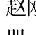

请根据文档资料，帮我制作一份新员工入职指导手册，内容包括：①公司简介和文化；②入职流程和手续；③工作职责和期望；④公司政策和福利；⑤常用联系人和资源。请使用友好且易于理解的语言，并确保手册的实用性和指导性。


# 新员工入职指导手册

欢迎加入××科技有限公司！

××科技有限公司是一家全球领先的AI软件开发及应用的创新型企业。我们非常高兴您能成为这个大家庭的一员，本手册将帮助您快速了解公司文化、入职流程、工作职责、公司政策和福利，以及如何快速融入我们的团队。

……

**内部资源：**

- 公司内部网提供政策手册、培训资料等。

再次欢迎您的加入，我们期待与您一起创造更加辉煌的未来！

借助此指令，Kimi 能生成实用性强的新员工入职手册，帮助新人快速上手。


## 提示词进阶

构建入职手册提示词时，建议注重内容的完整性和易用性。示例如下。

请根据文档资料，帮我制作一份针对新入职销售代表的入职指导手册。手册需要包括以下内容：①公司简介，包括历史、愿景和核心价值观；②详细的入职流程，包括报到、培训和工作分配；③销售代表的工作职责和业绩目标；④公司的休假政策、健康保险和其他福利；⑤销售团队的常用联系人和资源，如销售工具和市场资料。请确保手册内容全面、实用，能够帮助新员工快速适应新环境。

## 3.8 AI编程助力

在技术主导的今天，AI编程辅助已成为提升开发效率和代码质量的重要手段。本节展示Kimi在编程场景的应用。

### 3.8.1 实战：准确解释代码

理解现有代码是维护和迭代的基础，无论新手还是资深开发者都需要清晰的解释。


李昊是一名新加入项目的软件开发者，他需要理解现有代码库中的一段关键代码，以便进行后续的维护和开发工作。


Kimi，请详细解释下方的代码。

```python
def calculate_average(numbers):
    if not numbers:
        return 0
    total = sum(numbers)
    average = total / len(numbers)
    return average
```


这段代码定义了一个名为`calculate_average`的函数，其目的是计算一个数字列表（`numbers`）的平均值。下面是对这段代码的详细解释。

1. `def calculate_average(numbers):` 这是函数的定义。`def`是定义函数的关键字，`calculate_average`是函数的名称，`numbers`是函数的参数，表示这个函数接收一个参数，即一个数字列表。

……

总结来说，这个函数接收一个数字列表作为输入，如果列表为空则返回0，否则计算列表中数字的总和，然后除以列表中数字的数量，得到平均值并返回。这是一个简单但实用的函数，可以用于计算任何数字列表的平均值。

依托上述指令，Kimi 能输出逐行解读，帮助开发者快速把握逻辑。


## 提示词进阶

使用Kimi解释代码时，建议提供足够的上下文和明确需求，详细说明待解释代码段和关注点，可附带示例和预期输出供参考。示例如下。

请帮我解释以下代码段，它实现数据排序的功能。解释需要包括：①功能描述，解释代码的主要作用；②逻辑流程，概述代码的执行顺序和排序算法；③关键变量和函数，指出代码中重要的变量和函数及其作用；④可能的问题和改进建议，分析代码中可能存在的问题并提出改进建议。代码如下：（略）。

### 3.8.2 实战：通过注释生成代码片段

用注释描述需求再让模型生成代码，是提升效率的有效方式。


**场景**

高帅需要编写一个函数来计算商品的最终价格，需考虑折扣和税费。他已经写好了函数的注释，需要根据注释生成代码。


**提示词**

根据以下注释，使用Python生成相应的代码片段：

```python
# 计算商品的最终价格，包括折扣和税费

# 参数
# original_price: float, 商品的原价
# discount_rate: float, 折扣率，例如0.2代表20%的折扣
# tax_rate: float, 税率，例如0.1代表10%的税

# 返回
# final_price: float, 考虑折扣和税费后的最终价格
```

请使用高效且易于维护的代码，并确保代码的正确性和与注释的一致性。

Kimi生成的代码如下图所示。


```python
def calculate_final_price(original_price, discount_rate, tax_rate):
    """
    计算商品的最终价格，包括折扣和税费。

    参数:
    original_price (float): 商品的原价
    discount_rate (float): 折扣率，例如0.2代表20%的折扣
    tax_rate (float): 税率，例如0.1代表10%的税

    返回:
    float: 考虑折扣和税费后的最终价格
    """
    # 计算折扣后的价格
    discounted_price = original_price * (1 - discount_rate)

    # 计算税费后的价格
    final_price = discounted_price * (1 + tax_rate)

    return final_price
```

借助前文给出的指令模板，Kimi能够依据注释信息自动拼凑出对应的代码片段，让函数实现的效率明显提升。


## 进阶提示手段

在设计指令时，须同时兼顾实现精度的保障与注释表述的完备度，下面提供一个可参考的写法。

请帮我根据以下注释生成一个Python函数的代码：（略）。

生成的代码需要包括：①函数定义和参数；②计算打折后的价格；③计算税费并加到打折后的价格上；④返回最终价格。请确保代码实现准确、高效且注释详细。

### 3.8.3 实战：定位并修正代码缺陷

修正缺陷是开发环节中的高频任务。借助该能力可以在短时间内锁定异常点并给出改正建议，从而提升整体代码质量与交付效率。


场景

王磊正在排查一个API的运行状况。测试期间他捕捉到一处异常，需要马上处理。为提高处置速度，他希望借助Kimi产出一份修复思路。


提示词

请为下面的代码提供错误修复方案。在测试过程中，当user_id不存在时，返回的字符串“User not found”不符合API规范，API应该返回一个JSON格式的错误信息。

代码如下：

```
def get_user_info(user_id):
    user = User.query.filter_by(id=user_id).first()
    if user:
        return user.to_dict()
    else:
        return "User not found"
```

Kimi生成的错误修复方案如下图所示。


为了符合API规范，当 `user_id` 不存在时，我们应该返回一个JSON格式的错误信息。我们可以使用Python的 `json` 模块来创建一个JSON响应。以下是修复后的代码：

```python
import json
from flask import Flask, jsonify

app = Flask(__name__)

class User:
    # 假设User类有一个query属性和一个to_dict方法
    query = ...
    def to_dict(self):
        return ...

def get_user_info(user_id):
    user = User.query.filter_by(id=user_id).first()
    if user:
        return jsonify(user.to_dict())
    else:
        # 当user_id不存在时，返回一个JSON格式的错误信息
        error_response = {
            "error": "User not found",
            "status_code": 404
        }
        return jsonify(error_response), 404
```

该修复思路采用了 `jsonify` 方法来生成JSON响应。当 `user_id` 存在时返回用户的字典形式；当 `user_id` 不存在时，先构造包含错误信息的字典，再经 `jsonify` 转换，同时将HTTP状态码设为404以示资源未找到。

注意：此示例默认基于Flask环境，若使用其它框架则需做相应调整。

在上述引导下，该工具能快速帮助用户完成代码缺陷的修复。


## 提示词升级建议

在构建指令时，可以补充更多功能扩展诉求与异常处理优化建议，例如新增平方运算和开方运算的支持，以及优化错误提示的呈现方式。示例如下。

请分析下方代码并修复除法运算错误，同时需要增加平方运算和开方运算的功能，优化错误提示信息的显示方式。在修复除法错误时，不仅要处理除数为0的情况，还要按照优化建议改正错误提示信息的格式。在增加功能方面，扩展switch语句以实现平方运算和开方运算，详细说明新增功能的实现方式以及与原有功能的兼容性，使代码更加完善和强大。

# 第4章 知识跃进：Kimi驱动的学习赋能

随着生成式AI的迅猛发展，Kimi为学习场景带来了全新的可能性。本章将具体讲述Kimi在知识获取、互动式学习、数学公式处理、学术论文、成长规划、育儿支持及心理健康等维度的应用，帮助用户加深理解、提升能力，进而赋能学习、工作与生活。

## 4.1 知识获取

知识获取是个体成长与职业发展的根基。通过高效的知识积累方式，个人可以持续提升综合素养与专业水平。本节介绍如何借助Kimi实现知识的系统化与专业化沉淀。

### 4.1.1 实战：拆解专业术语与概念

学习与工作中常会遇到晦涩的术语或概念，理解它们对知识掌握至关重要。该助手可迅速准确地解析复杂概念，提升认知效率。


场景

张涛是一名在校大学生，阅读专业书籍时碰到“机会成本”这一概念，书中解释较为生涩难懂。


提示词

请详细解读“机会成本”这个概念，包括其定义、基本原理、在实际中的应用等。解释需通俗易懂，便于非专业人士理解。


### 机会成本的定义

简单来说，就是如果你选了A，那么为了A而放弃的B中最好的那个价值，就是机会成本。

### 基本原理

……

机会成本帮助我们理解决策的全面影响，因为它让我们考虑到了被放弃的选择的价值。在做出决策时，考虑机会成本可以帮助我们做出更全面、更明智的选择。

通过上述提示词，用户可以获得对复杂概念的详细解读，包括定义、基本原理等，这有助于用户更好地理解概念。


## 提示词细化指南

在构建指令时，应进一步细化需求，例如指定解读深度、要求举例说明等，示例如下。

请深入解读“区块链”概念，详细阐述其去中心化原理，举例说明其在金融、物流等至少3个领域的具体应用，对比其与传统数据库的差异，解读深度要适合计算机相关专业大二学生的水平。

### 4.1.2 实战：梳理历史文化脉络

梳理历史文化脉络能够帮助人们系统地了解历史事件和文化发展的过程，从而形成更为全面的历史观和文化观。


场景

姜平是一名历史爱好者，想要了解中国古代书法艺术的发展脉络，包括各朝代的主流字体、代表书法家及其代表作的特点、书法风格的演变等。


提示词

请帮我梳理中国古代书法艺术从先秦到清代的发展脉络，详细介绍每个朝代的主流字体，列举至少两位代表书法家及其代表作的特点，阐述书法风格是如何演变的。


回答

中国古代书法艺术的发展脉络从先秦到清代，经历了多个阶段，每个朝代都有其主流字体和代表书法家。以下是详细梳理。

### 一、先秦时期

1. 主流字体：甲骨文和金文（大篆）

    - 甲骨文是商代后期的文字，具备了汉字的形、音、义诸要素，其书写技巧和工具的运用显示出了某种程度的完美。

……

书法风格的演变是一个由繁到简的过程，从甲骨文的古拙到小篆的规范，再到隶书的方正，楷书的严谨，行书的流畅，草书的自由，每一步都体现了书法艺术的发展和书法家们对美的追求。

通过上述提示词，Kimi为用户梳理了历史文化知识脉络，帮助用户构建起完整的历史知识框架。另外，用户还可以发送提示词要求Kimi生成流程图、脑图、树状图等，以帮助自己更清晰地掌握知识脉络。例如发送“以脑图的形式展示上述内容”提示词，Kimi将以脑图的形式展示回答，如图所示。用户可以按需选择，复制或下载结果。

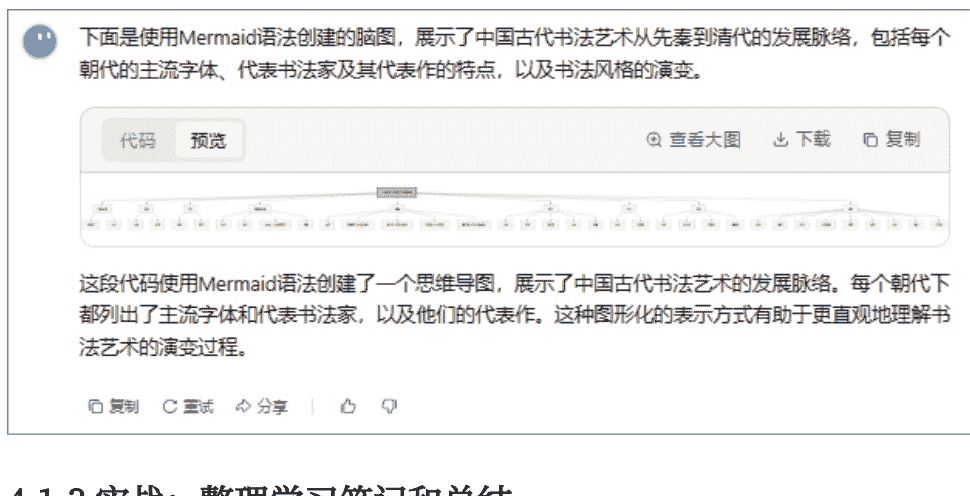

### 4.1.3 实战：整理学习笔记与归纳

整理学习笔记和总结是学习过程中的重要环节，有助于巩固记忆和深化理解。本节使用Kimi来整理学习笔记和总结，以便用户能够更高效地复习和准备考试。

场景

周科刚上完一节关于经济学原理的课程，课程内容包含供求关系、边际效应、市场结构等多个知识点，他希望整理出清晰的学习笔记和总结，方便复习和准备考试使用。


提示词

请根据提供的学习笔记文档，帮我整理学习笔记内容和进行总结，并对提取的信息进行归类，确保内容条理清晰、易于理解。

（上传学习笔记文档）


回答

根据您提供的学习笔记文档，我对内容进行了整理和总结，并按照不同的主题进行了归类和整理。以下是内容的条理化展示。

### 一、供求关系

1. 需求

    （1）定义：消费者在一定时期内愿意并且能够购买的商品或服务的数量。

    （2）影响因素。

        - 商品自身价格：价格与需求量呈反向变动（需求定理）。

        - 消费者收入：正常品随收入增加需求增加，劣等品则相反。

……

    （2）合谋行为。

        - 卡特尔：企业通过协议共同限制产量、提高价格以获取垄断利润，但这种合谋不稳定，因为各企业有违背协议以获取更大利益的动机。

以上是对学习笔记内容的整理和总结，希望这样的归类和整理能够帮助您更清晰、更容易地理解这些经济学概念。

通过上述提示词，Kimi能够进行学习笔记的整理和总结。整理完毕后，用户还可以让Kimi基于整理结果生成相关习题，帮助用户更高效地复习和准备考试。


## 提示词关联建议

在构建指令时，可要求Kimi对知识点进行关联分析，示例如下。

请根据提供的图片，帮我整理关于物理学中力学部分的学习笔记，涵盖牛顿定律、动能定理等知识点，不仅要有定义、公式推导、实例，还要分析各知识点之间的联系，最后给出整体的总结和学习建议。

## 4.2 互动式学习

互动式学习通过技术手段提高学习者的参与度和学习效率，使学习过程更加生动有趣。Kimi在这一领域发挥着重要作用，可以实现模拟专家解答学习难题、辅助文言文的翻译与生成个性化练习题及解析等。

### 4.2.1 实战：模拟专家解答学习难题

在学习过程中遇到难题时，学习者若能获得专家的解答，将极大地加快学习进程。Kimi可以模拟专家，为用户提供精准且深入的解答。

场景

陈以恒是一名市场部的新员工，他正在学习如何进行有效的社交媒体营销，但遇到了一些理论与实践结合相关的难题。

提示词

请模拟一位资深社交媒体营销专家，帮我解决以下问题：我在学习如何制定社交媒体营销策略时，发现很难将理论知识应用于实际案例中，比如如何选择合适的平台、确定目标受众以及制定内容计划等，请给出一些建议。

回答

作为一位资深社交媒体营销专家，我理解将理论知识转化为实际应用可能会有些挑战。以下是一些实用的建议，帮助您更好地制定和实施社交媒体营销策略。

### 1. 了解您的品牌和产品

    - 明确您的品牌定位、产品特性以及您希望传达的核心信息。

……

### 11. 实验和创新

    - A/B测试：对不同的内容、广告文案和图像进行A/B测试，找到最佳方案。

    - 新功能尝试：勇于尝试社交媒体平台推出的新功能。

记住，社交媒体营销是一个动态的过程，需要不断地测试、学习和调整。通过实践，您将逐渐掌握如何将理论知识应用于实际案例中。不要害怕犯错，每次尝试都是学习和进步的机会。

通过上述提示词，Kimi模拟了特定领域的专家，在对话过程中能够针对用户的问题提出建议，以解决用户在学习过程中遇到的难题。


## 提示词场景细化

在构建提示词时，可以进一步明确问题所涉及的领域和应用场景，示例如下。

请作为金融投资领域的专家，针对我在股票投资分析中遇到的如何评估公司财务状况这一问题，提供详细的解答。解答需包括从资产负债表、利润表等主要财务报表角度出发的分析思路，结合实际案例（如某知名上市公司的财务数据）进行的分析。同时，解答语言要风趣幽默、通俗易懂，避免使用过于复杂专业的术语。

### 4.2.2 实战：辅助文言文的翻译

文言文是中国古代文学的重要组成部分，但其语言结构和表达方式与现代文学有很大的不同。通过Kimi辅助文言文的翻译，学生能够更好地理解古代文献，提升文学素养。


场景

蒋歌是一名中文系的学生，他在阅读《史记》时遇到了难以理解的文言文段落。他需要一个工具来帮助他翻译和理解这些文言文。

提示词

请帮我翻译并解释这段文言文：“非好学深思，心知其意，固难为浅见寡闻道也。”

回答

### 翻译：

如果不是真正热爱学习并且深入思考，内心真正理解其中的含义，那么就很难用浅薄的见解和有限的知识来阐述它。

### 解释：

非好学深思：

“非”表示“如果不是”；“好学”指热爱学习，愿意主动去探索知识；“深思”则是指深入思考，不仅仅停留在表面，而是探究事物的本质和内涵。这句话强调了学习和思考的重要性，只有通过主动学习和深入思考，才能真正理解知识。

……

### 整体含义：

这句话强调了学习和思考的重要性，指出只有真正热爱学习、深入思考，并且真正理解事物的本质，才能避免用肤浅的见解和有限的知识去错误地解释问题。它提醒人们要不断追求深度和广度，避免浅尝辄止。

通过上述提示词，Kimi能够辅助文言文的翻译，帮助用户跨越语言差异，深入理解古代文献。


## 提示词格式说明

在构建提示词时，要特别注明希望实现的翻译方式（直译或意译），以及是否需要附加注释说明。示例如下。

请将《红楼梦》中林黛玉初次见到贾宝玉时的对话片段翻译成白话文，采用意译的方式呈现，并附上对该场景的文化背景的解释。

### 4.2.3 实战：生成个性化练习题及解析

个性化练习题是提高学习效率和学习针对性的有效手段。本节将介绍如何使用Kimi生成个性化练习题及解析，以满足不同用户的学习需求。


场景

魏明正在备考注册建筑师，他希望通过做一些练习题来检验自己对建筑设计原理的理解，并希望得到详细的解析。


提示词

请根据注册建筑师考试大纲，围绕“建筑设计原理”这一主题生成一套包含10道选择练习题，并附带每道题的解析。


回答

以下是围绕“建筑设计原理”这一主题的10道选择练习题，以及每道题的解析。

1. 题目：建筑设计中，以下哪项不是建筑功能分区的基本原则？

    A. 功能分区明确

    B. 交通流线合理

    C. 外观造型独特

    D. 空间组织有序

……

答案：C。

解析：建筑通风设计需要考虑的因素包括通风口位置、空气流通路径和空气净化设备。建筑高度虽然对建筑内部的通风有一定影响，但不是通风设计需要考虑的主要因素。

这些题目和解析可以帮助考生更好地理解和掌握建筑设计原理的相关知识。

通过上述提示词，用户可以获得针对特定考试科目的个性化练习题及解析，可以加深对知识点的理解，并为即将到来的考试做好充分准备。


## 提示词细节明确

在构建提示词时需明确指出希望覆盖的具体知识点（如建筑结构设计、材料选择等）以及题目难度级别，以便Kimi生成更加贴合实际需求的练习题。示例如下。

请根据注册建筑师考试中“建筑结构安全与抗震设计”的要求，创建一组包含8道选择题和2道简答题的练习题。题目难度应设置为中级到高级，确保题目涵盖不同类型的结构体系及其抗震性能分析。同时，请提供详尽的解析，包括相关理论依据和计算过程，以帮助我深入理解和掌握这部分内容。

## 4.3 数学公式

在学术研究和教育领域，数学公式的精确表达至关重要。Kimi“长思考(k1.5)”模型为解决复杂的数学公式转换和数学公式理解等难题提供了强有力的支持。

### 4.3.1 实战：将公式转换为LaTeX格式

在论文写作和学术交流中，LaTeX是一种被广泛使用的排版系统，特别适用于数学公式的展示。将普通公式的格式转换为LaTeX格式，可以确保公式的清晰性和专业性。


研究生唐一飞在撰写科研论文时，需要将文中的数学公式转换为LaTeX格式，以便在论文中正确排版。


请将以下矩阵运算公式转换为LaTeX格式。

矩阵乘法：AB=C。

矩阵行列式：det(A)。

在输入框中选择【长思考(k1.5)】选项。

Kimi可将上述公式转换为LaTeX格式，如下图所示。

# 公式转 LaTeX 与科研写作提效实操


下面给出若干矩阵运算到 LaTeX 写法转换的示例，供对照使用。

矩阵乘法：

```
\mathbf{A} \mathbf{B} = \mathbf{C}
```

矩阵行列式：

```
\det(\mathbf{A})
```

若要在 LaTeX 文件里调用此类表达式，通常置于数学环境内，例如：

```
\documentclass{article}
\usepackage{amsmath}

\begin{document}

矩阵乘法：
\[
\mathbf{A} \mathbf{B} = \mathbf{C}
\]

矩阵行列式：
\[
\det(\mathbf{A})
\]

\end{document}
```

该片段说明了矩阵运算在 LaTeX 中的接入方式。

依托前文提到的指令，Kimi 能迅速完成公式向 LaTeX 的转写任务。


## 提示词进阶策略

当式子复杂度超出手工输入范围时，采用附件上传更稳妥。起草指令时建议标明式子来源，例如截图、PDF 资料，以及难度等级，有助于保证输出的 LaTeX 片段正确可用。参考模板如下。

请把文档里的数学式转译为可用的 LaTeX 语法，确保渲染结果在 LaTeX 中正常显示。

### 4.3.2 实战：拆解复杂数学公式

Kimi 长思考(k1.5) 基于强化学习构建，融合端到端视觉理解与思维链推理。使用者可拍照或上传图档，让该模型直接解析图像内容并展开深度分析与推理，得出结论，特别适用于数学、物理、化学等学科的难题。下面以复杂数学式的解读为例展示功能。


场景

金景学习数学时遇到正态分布的概率密度函数，对式中符号含义、使用前提以及表达意义感到困惑。

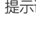

示例指令

请解读图中数学式并说明其使用情境。

以下演示借助 Kimi 长思考(k1.5) 解读复杂数学式的操作流程。

打开 Kimi 长思考(k1.5) 模型，将待解读的公式图片拖入输入区，输入指令后点按发送按钮，如右上方图所示。

Kimi 长思考(k1.5) 即可识别图片并给出解读结果，如下图所示。

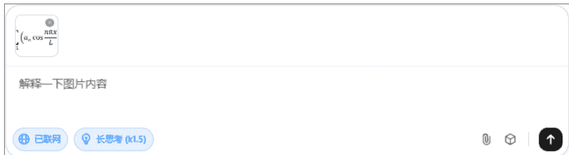

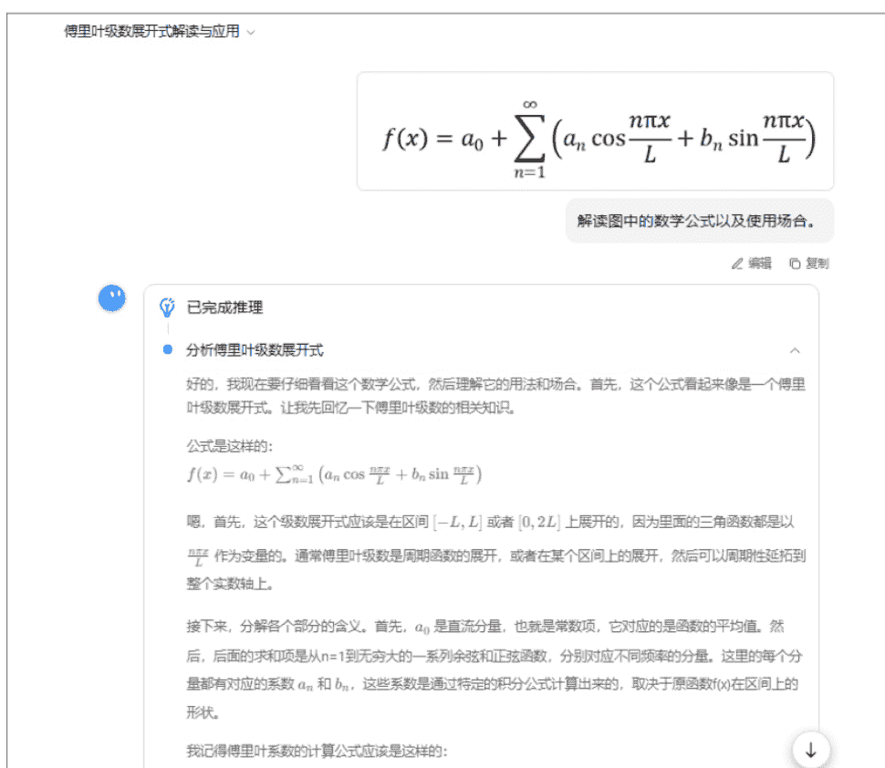

除了解读复杂数学式外，Kimi 长思考(k1.5) 还能协助解决数理化等学科的疑难练习题，解读复杂图表、分析图像，提供各类视觉分析支持。


## 提示词进阶

在设计指令时，可要求对公式进行深度剖析并探讨现实应用场景，提供多元分析视角，示例如下。

请详述图中数学式的推导过程、关键变量的含义，以及在不同学科中的具体应用，并给出至少两个不同场景下的应用案例。

## 4.4 学术论文

学术论文是科研成果的重要载体，提升论文质量与影响力对学者至关重要。本节介绍如何借助 Kimi 辅助选题、优化逻辑结构、管理引用与参考文献、进行内容检查与润色，从而整体提高学术论文的质量。

### 4.4.1 实战：辅助确定科研选题

确定科研选题是撰写学术论文的起点，优秀的选题决定研究方向与价值。Kimi 可结合学科领域、研究方向与前沿趋势，协助科研人员锁定合适选题。


场景

姚芳是环境科学专业的硕士研究生，对环境污染治理方向感兴趣，但不清楚当前领域有哪些具体且有研究价值的选题。


示例指令

请结合环境科学专业中环境污染治理方向，参照当前研究热点与实际需求，提供 5 个具体科研选题，并简要阐述每个选题的研究意义、创新点与预期成果。


回答

以下是在当前研究热点与实际需求基础上，给出的环境科学专业环境污染治理方向 5 个具体科研选题。

### 1. 微塑料污染的环境归趋与生态毒理研究

- 研究意义：微塑料污染是近十年的研究前沿，对环境与生态安全构成威胁。
- 创新点：探究微塑料在不同环境介质中的迁移转化规律及其对生态系统的潜在影响。
- 预期研究成果：提出有效的微塑料污染控制策略和生态风险评估方法。

……

- 创新点：开发适用于钢铁行业复杂烟气的污染物深度净化技术，实现能源高效利用与副产物资源化。
- 预期研究成果：形成一套钢铁行业烟气超低排放技术体系，为大气污染防治提供技术支撑。

这些选题紧贴环境科学领域的研究热点和实际需求，具有重要科学价值与应用前景。

在借助 Kimi 辅助确定科研选题时，可明确专业领域和研究方向，要求结合热点和实际需求提供多个选题并说明关键要素，有助于多角度思考，挑选最合适的方向。


## 提示词进阶

构建指令时可加入更具体的限定条件，如特定研究区域或研究方法，示例如下。

在环境科学专业水污染治理领域中，聚焦于某一特定河流如长江的水质改善问题，结合相关生物技术如基因工程菌修复技术，提供 3 个科研选题，详细说明每个选题的独特性、可能面临的挑战以及潜在应用价值。

### 4.4.2 实战：优化论文逻辑架构

论文逻辑是否清晰是呈现研究成果的关键。优化逻辑结构能使论述更连贯、有条理，从而提升整体质量。


场景

陆明的论文初稿已完成，但他认为整体逻辑架构不够清晰，希望借助 Kimi 进行优化。


示例指令

请帮我优化论文的逻辑结构，提出具体修改建议，使论文条理清晰、逻辑严谨。

可粘贴论文目录，也可上传论文目录文档。


回答

您的论文结构已比较清晰，为进一步提升逻辑性与严谨性，以下是具体修改建议。

### 第1章 绪论

#### 1.1 研究背景及意义

- 可进一步细化，分别讨论新能源汽车的全球发展背景和电池技术在其中的关键作用。

#### 1.2 研究目的和内容

- 明确列出研究的具体目标，以及各章节将探讨的主要内容。

……

#### 7.3 进一步研究方向

- 提出未来研究方向和建议。
- 建议：在结论部分明确区分研究总结和未来研究方向，保持逻辑清晰，避免与政策建议或行业应用混淆。

最后，确保各章节之间有逻辑联系，每个章节开头有简短介绍，结尾有小结，以增强整篇论文的连贯性和逻辑性。

通过上述指令，用户可获得各部分的针对性修改建议，确保论文条理清晰、论证严密。


## 提示词进阶

构建指令时需提供论文主要框架及存在问题，以便获得更有针对性的反馈。示例如下。

请仔细阅读提供的论文摘要和目录，重点评估从问题定义到解决方案呈现之间的逻辑链条是否顺畅，指出可能引起读者困惑之处，并给出调整方案，如增加过渡段落或重新组织章节顺序。

### 4.4.3 实战：管理引用与参考文献

在论文写作中，正确引用与规范的参考文献管理是体现学术诚信和保证质量的关键。Kimi 可帮助用户准确引用文献并高效管理参考文献列表。


场景

刘俊正在撰写论文，需要确保所有文献都被正确引用，且参考文献格式符合学术规范。


示例指令

请帮我将论文中的引用与参考文献格式转换为 APA 格式。确保每篇文献的作者姓名、文章标题、出版年份、期刊名称或图书名称、卷号、页码等信息均按 APA 要求格式化，并生成规范的 APA 参考文献列表。论文中已引用的文献如下。

略


回答

略

不同学科对引用与参考文献格式要求不同，用户可针对具体要求调整指令。


## 提示词进阶

构建指令时，可提供具体引用内容，强调格式规范性和参考文献完整性，示例如下。

请帮我把论文中引用与参考文献格式转换成 APA 格式。具体要求包括：①引用中作者姓名顺序为姓在前名在后，名字仅保留首字母大写；②参考文献列表需包含文章标题、期刊名称、卷号、期号、出版年份和具体页码范围；③确保格式一致性，如斜体与引号使用，以及参考文献列表的悬挂缩进。请保证引用与参考文献格式规范，使论文符合学术出版标准。此外，电子资源和多作者文献的引用也应遵循 APA 最新版规范。

具体引用内容如下：列出作者、文章标题、出版年份、期刊名称、卷号、页码等信息。

### 4.4.4 实战：论文质量检查与润色

检查校对是论文写作不可或缺的环节，有助于提升语言质量和表达准确性。本节用 Kimi 检查校对论文内容，确保专业性和准确性。


场景

韩梅的论文初稿已完成。提交前，她需要对论文进行质量检查，包括格式、语法、引用准确性和逻辑连贯性，并进行润色。


示例指令

请帮我进行论文质量检查与润色，包括：①校对语法和拼写错误；②核实引用和参考文献准确性；③提升语言质量和表达清晰度。

将论文文档拖入输入框后发送上述指令。


回答

## 论文质量检查与润色

### 一、语法和拼写错误校对

经仔细校对，论文中的语法和拼写错误已修正。例如：

原句：“商业插画是艺术品同时更是商业产品”修改为“商业插画既是艺术品，更是商业产品”。

修正了“<关键词>商业 commercial must the”这类不符合语法规范的表述，根据上下文，关键词应为“商业”“必须”等，但“the”在此不合适，已删除。

……

润色后：“商业插画作为一类应用艺术，已发展得相当成熟。其形式多样，既可按传播媒体分类，也可按功能分类。”

原句：“商业插画的审美特征大致起来有以下几种。”

润色后：“商业插画的审美特征大致可以分为以下几种。”

通过上述指令，Kimi 提供了详细修改建议，帮助用户纠正语法和拼写错误，确保论文专业准确。修改后建议再次核实审查，确保无误。


## 提示词进阶

使用 Kimi 检查校对论文时，构建指令应明确论文主题和需求，详细描述需要检查校对的内容和重点，同时可提供个人写作习惯和常见错误供参考。示例如下。

请帮我检查校对以下论文内容，主题为“人工智能在医疗领域的应用”。检查需包括：①语言校正，修正语法和拼写错误；②格式校对，确保符合 APA 格式要求；③引用核查，检查文献是否准确且与主题相关；④逻辑检查，分析论证逻辑是否严密；⑤专业术语检查，确保医疗和人工智能领域术语使用恰当。请特别注意数据表述和分析结果的准确性。

## 4.5 成长规划

成长规划是个人发展的重要部分，涉及职业发展、技能提升和个人目标实现。本节介绍如何用 Kimi 帮助用户精准定位成长目标、规划个性化学习路径，并明确职业发展规划，实现职场全面跃升。

### 4.5.1 实战：精准定位成长目标

个人成长中，精准定位目标至关重要。明确目标能提供清晰方向，帮助制定有效行动计划，实现自我提升。


场景

杨瑞是职场新人，希望未来 3 年内提升职业技能和管理能力。他需要精准定位成长目标，以便制定合理的学习和发展计划。


示例指令

请帮我精准定位成长目标。我的职业领域是 IT，当前职位是软件工程师。我希望在未来 3 年内晋升为项目经理，并提升项目管理能力和团队领导力。请提供具体成长目标和建议。


根据您的职业领域和目标，以下是未来 3 年成长为项目经理的具体目标和建议。

### 1. 项目管理能力提升

目标。

- 第一年掌握项目管理基础知识和工具。
- 第二年完成至少两个中等规模项目的管理，积累实战经验。
- 第三年能独立管理大型项目，有效控制项目风险。

……

建议。

- 制定学习计划：每年设定学习目标并跟踪进度。
- 寻找导师：找一位经验丰富的项目经理作为导师，定期交流学习。

通过上述目标和建议的实施，您可逐步提升项目管理能力和团队领导力，为晋升为项目经理奠定坚实基础。

借助上述指令，用户可获得对成长目标的精准定位和具体建议，有助于制定合理的学习和发展计划，实现自我提升。


## 提示词进阶

构建指令时，应明确职业领域、当前职位和未来期望，以便 Kimi 生成更具针对性和可行性的成长目标。示例如下。

请帮我精准定位成长目标。我的职业领域是市场营销，当前职位是市场专员。我希望未来 5 年内晋升为市场经理，并提升市场分析能力和品牌管理能力。请提供具体成长目标和建议。

### 4.5.2 实战：规划个性化学习路径

个性化学习路径能帮助个人根据需求和目标制定合理学习计划，提高学习效率和效果。


场景

杨志刚是工程师，希望提升人工智能领域的专业知识。他需要规划个性化学习路径，以系统学习相关理论和实践技能。

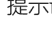

示例指令

请帮我规划个性化学习路径，以提升我在人工智能领域的专业水平。请提供详细的学习计划、推荐的学习资源和方法。

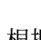

回答

根据您的需求，我为您规划了个性化的人工智能领域学习路径，包括详细学习计划、推荐资源和方法。

### 1. 基础部分

- 人工智能基础概念：了解人工智能常见流程、机器学习与深度学习区别、有监督学习、无监督学习、强化学习等。
- Python 编程：学习 Python 运行环境与开发环境搭建、基础知识、函数、面向对象编程、科学计算等。
- 数学基础：高等数学、线性代数、概率论、最优化理论。推荐图书《人工智能数学基础》。
- ……

- 实战项目：通过实战项目加深理解，如参加 Kaggle 等站点上的机器学习竞赛，研究过往获奖方案。
- 部署项目：学习如何将模型部署到生产环境并追踪实验结果，如使用相关开源学习平台。

通过上述学习路径和资源，您可系统提升人工智能领域专业水平。祝学习顺利！

借助上述指令，用户可获得个性化学习路径，包括详细学习计划、推荐资源和方法，有助于系统提升人工智能领域专业水平，实现目标。


## 提示词进阶

构建指令时，应明确基础水平、学习目标和时间安排，以便 Kimi 生成更具针对性和可行性的学习路径。示例如下。

请帮我规划个性化学习路径，以提升我的数据分析能力。我的数据分析基础较为扎实，目标是在半年内通过相关认证考试。请提供详细学习计划、推荐学习资源和方法。

### 4.5.3 实战：明确职业发展规划

明确职业发展规划能帮助个人在职业生涯中做出明智决策，提升职业竞争力，实现职业目标。


场景

黄怡鸣是职场人士，已在 IT 行业工作多年，希望未来 3 年内转型进入人工智能领域。他需要明确职业发展规划，以便有计划地进行职业转型。


提示词

请帮我明确我的职业发展规划。我目前在IT行业从事软件开发工作，有较强的编程能力和一定的项目管理经验。我希望在未来3年内转型进入AI领域，成为一名AI工程师。请提供具体的职业发展规划和建议。


根据您的背景和目标，我为您规划了以下3年内转型成为AI工程师的职业发展路径。

### 第一年：基础学习与技能提升

- 学习基础技能：您需要掌握AI领域的基础技能，包括机器学习、深度学习、自然语言处理等，可以通过在线课程（如Coursera、edX）或参加相关的培训班来系统学习这些知识。

- 数学知识强化：加强数学基础，特别是线性代数、概率论和统计学，因为这些是理解和应用机器学习算法的基石。

……

- 建立联系网络：与您所期望领域的专业人士建立联系，这可以在您转型期间提供宝贵的见解、机会和支持。

- 坚持不懈：即使遇到挫折，也要继续前进。坚持不懈和坚韧不拔是克服障碍和实现职业目标的关键。

通过上述规划，您可以逐步从软件开发者转型为AI工程师。祝您职业发展顺利！

通过上述提示词，用户可以获得一份职业规划。用户可以根据自己的实际情况，调整提示词信息。


## 提示词进阶

在构建提示词时，应明确自己当前的职业、技能水平和未来职业目标，以便Kimi生成更具针对性和可行性的职业发展规划。示例如下。

请帮我明确我的职业发展规划。我目前是一名市场经理，有较强的市场分析能力和品牌管理经验。我希望在未来5年内晋升为市场总监。请提供具体的职业发展规划和建议。

提示词进阶说明可让用户把现有岗位、擅长领域和目标方向写清楚，模型输出的路线会更贴合实际。下面给出参考写法。

请为我制定一份职业成长路线。我目前担任市场经理，在市场分析与品牌运营上积累了较多经验，希望五年内升任市场总监，请给出具有可操作性的发展建议。

## 4.6 育儿助手
抚养孩子是长期系统工程。Kimi可以担任育儿顾问，提供科学养育建议、定制童话以及作业辅导等支持。

### 4.6.1 实战：提供全方位育儿指导
科学建议能帮助家长更准确把握成长需求，提升养育效果。

场景
新手妈妈纪初对育儿常识了解有限，希望获得系统指导来更好地照料和教育宝宝。

提示词
请提供一份涵盖新生儿日常护理、喂养方式以及早期启蒙活动的全方位指导。

回答
下面是一份围绕新生儿日常护理、喂养与早期启蒙的梳理。

### 新生儿日常护理
- 皮肤保养：新生儿肌肤娇嫩，保持清洁干燥即可。每日用温水沐浴，避免使用香皂或沐浴露以免刺激皮肤。洗后用柔软毛巾轻拍吸干，切勿用力摩擦。
- 衣物选择：选用透气柔软的纯棉衣物，保持体温适宜，不宜过多或过少。
- ……

- 镜子互动：让宝宝对着镜子看自己，他会以为看到另一个可爱的小伙伴，很乐意摆手微笑。
- 音乐启蒙：多哼唱儿歌，也可播放优美旋律，帮助宝宝感受节奏。

以上内容覆盖了护理、喂养和启蒙的主要方面，有助于家长更科学地照料宝宝。

借助这类提示词，家长能获得系统化的育儿建议，更好地理解和满足孩子需求，提升养育质量。

### 提示词进阶
提示词中明确育儿阶段和关注重点，示例如下。

请为两岁幼儿提供一份全方位育儿指导，包含合适的营养搭配、适宜的游戏以及如何促进语言和社交能力的发展。

### 4.6.2 实战：创作专属儿童故事
定制童话能激发想象力，传递价值观，对亲子互动很有帮助。

场景
田青想为孩子创作一个专属故事，以增进亲子关系并传递知识。

提示词
Kimi，请为5岁孩子创作一个专属故事。要求情节生动、有教育意义、语言贴合儿童认知。

回答

### 故事标题：小熊布鲁的彩虹桥

### 故事开始：
一个阳光明媚的早晨，小熊布鲁在林间散步。它看见一道彩虹横跨森林，于是好奇地想去彩虹的尽头看看，踏上了一场探险。
……

教育意义：真正的快乐来自分享与关爱他人。

故事兼具趣味情节和友善、勇敢、智慧、分享等价值，能帮助孩子在听故事中学习。

通过这类提示词，可以得到情节生动、意义明确、语言童趣的故事，有助于亲子互动和知识传递。

### 提示词进阶
可在提示词中指定场景或结局走向，示例如下。

为我3岁半、喜欢小兔子的孩子写一个故事。场景设在森林，小兔子经历一系列冒险，结局要体现靠勇敢和智慧解决问题，故事中融入数字或颜色认知。

### 4.6.3 实战：辅助家庭作业批改与讲解
作业是学习的重要环节，家长在批改讲解时常有困难。Kimi可辅助批改并提供讲解，帮助孩子理解知识点。

场景
田海的孩子读初中，遇到二元一次方程组求解难题。田海希望得到通俗解释，并拿到巩固练习建议。

提示词
请帮我解答一个具体数学问题：求解方程组 2x+3y=12 和 4x-y=6。要求包含：①逐步求解过程；②每步原理；③同类题练习建议。

回答
我们一步步来解这个方程组。

### 已知方程组
2x+3y=12（方程1）
4x-y=6（方程2）
步骤1：消元
……
### 同类题练习建议
- 练习系数不易消去的二元一次方程组。
- 尝试一次与二次方程混合的组。
- 练习含分数或小数的方程组。

希望这能帮助你理解解法。如有其他问题随时提问。

这类提示词能获得清晰步骤和原理讲解，帮助孩子掌握知识点。复杂题目可拍照上传，数学专业问题可用数学版获得更专业的解答。

### 提示词进阶
提示词应详细描述题目内容、学生错误答案，并明确讲解方式和深度，示例如下。

请详细批改并深入讲解以下概率作业。题目：“盒子里3红2黄球，至少摸出几个球才能保证摸到两种颜色？”错误答案为3。请指出理解误区，并用清晰逻辑、具体例子帮助掌握核心知识点。

## 4.7 心理健康
心理健康影响生活质量、工作效率和人际关系。用Kimi可以更好地排解困扰、减压、提升韧性。

### 4.7.1 实战：处理工作中的人际关系困扰
职场人际关系影响职业发展和工作满意度，常出现沟通不畅、团队紧张等问题。

场景
李江在一家广告公司，和同事张均在重要项目的创意方案上产生分歧。他倾向创新高风险方案，对方坚持传统稳妥方案，导致进度受阻、氛围紧张。

提示词
我在广告公司工作，与同事在项目创意方案上分歧。我主张创新高风险方案，同事坚持传统保守方案，僵持影响进度和团队氛围。请分析原因，从沟通技巧、团队协作、寻找共同利益点等方面给出解决办法，帮助改善关系、推动项目。

回答
广告公司分歧很常见，创意工作主观性强。下面是可能原因和解决办法。

#### 一、分歧产生原因
1. 价值观与理念差异：不同工作理念导致判断不同。
2. 风险偏好不同：创新伴随高风险，保守更稳，这造成分歧。
……

3. 专业咨询：必要时请外部专家作为第三方中立评估。
4. 反馈机制：项目实施中建立反馈，根据反馈调整方案，保持灵活性。

通过这些方法可以改善同事关系，推动项目。有效沟通与协作是解决分歧的关键。

这类提示词能帮助在职场中实现更有效的沟通协作。

### 提示词进阶
提示词可增加团队成员性格描述，示例如下。

Kimi，我在互联网公司做产品研发，与一位同事关系紧张。我直爽重效率，他谨慎求完美。在功能设计上常意见不合。请结合性格特点分析原因，从理解他人、调整自身态度、建立沟通机制角度给出建议，并提供类似职场案例供参考。

### 4.7.2 实战：寻求压力缓解的有效建议
现代生活节奏快，工作、学习、家庭多重压力并存。Kimi可依据压力源提供缓解建议，帮助恢复身心健康。

王朋辉是职场人士，近期任务繁重、常加班，身体疲惫、精神紧张、失眠，还要兼顾家庭，感觉被压垮。

提示词
我工作任务重、加班多，还要处理家庭事务，身心状态很差、晚上失眠。请分析原因，从时间管理、身心放松、情绪调节等方面给出具体减压建议，帮助恢复状态。

回答
工作与家庭双重负担容易导致身心疲惫。以下是可能原因和缓解建议。

#### 1. 压力来源
（1）工作量超负荷：任务超出个人处理能力。
（2）时间管理失衡：规划不合理，工作与休息失衡。
……
（3）健康饮食：均衡饮食，减少咖啡因和糖分摄入。
（4）时间管理工具：使用番茄钟等工具提升效率。

逐步改善后可恢复良好工作生活状态。照顾好身心健康是根本。

这类提示词可获得针对性减压建议，有助于减轻压力、提升心理健康。

### 提示词进阶
提示词可明确压力来源和个人偏好，示例如下。

请扮演资深心理咨询师，针对我在工作中长期承受的高强度压力——主要来自紧迫项目期限和频繁跨部门协作，提出综合减压方案。方案包含时间管理技巧、放松训练如深呼吸、正念冥想，以及定期休闲活动建议如周末徒步。同时推荐实用工具或App。

# 第5章 生活助手：Kimi日常小秘书

数字化加速改变生活方式。AI技术已渗透到日常琐事和重要决策，提升生活质量与效率。Kimi凭借自然语言处理能力，可在多个生活场景发挥作用，成为贴身智能助手。

## 5.1 旅行规划

旅行是放松身心的方式。本节介绍用Kimi生成短途旅行计划、深度文化旅行计划和旅行文案。

### 5.1.1 实战：生成短途旅行计划
短途旅行是缓解压力的常见选择。Kimi可快速生成行程，帮助高效规划。

李晓元计划周末短途旅行缓解压力，需要目的地、行程和预算方案。

提示词
请帮我生成一个短途旅行计划，目的地为西安市周边100公里内景点，要求：①推荐目的地，考虑距离与时间；②两天一夜行程，含景点、餐饮、住宿；③预算控制在2000元内。要求经济又有趣。

回答
按你的要求，制定了西安周边100公里内的短途方案，预算不超2000元。

### 推荐目的地
综合距离与时间，推荐少华山国家森林公园。位于渭南华州区，距西安约95公里，适合周末出行。
……
- 门票：少华山约60元/人。
- 其它：预留500元购物及意外开销。
- 总预算：约1500元/人，在预算内。

行程既可感受自然风光，也能体验当地风情，祝旅途愉快。

这类提示词可快速生成短途计划，含目的地、行程、预算。

### 提示词进阶
提示词可增加个性化选项，如饮食需求或兴趣活动，示例如下。

请为我从北京出发生成短途计划，预算2000元内，偏爱自然风光。要求：①近距离、风景美；②周六早出发周日下午返，高铁出行；③住安静舒适民宿；④两天徒步及户外活动；⑤给出装备建议。另考虑素食习惯，推荐餐厅。

### 5.1.2 实战：生成深入了解当地文化的旅行计划
旅行不仅是观光，更是了解文化的好机会。Kimi可生成文化深度游计划，帮助融入当地。

场景
曹云是文化爱好者，计划去成都待一周，想深入了解川剧、川菜、古蜀文化等。

提示词
请为我在成都制定一周文化深度游计划。需包含：①文化景点推荐及理由；②传统文化体验活动安排；③与当地人交流方式与场所；④每日行程与交通；⑤成都特色美食推荐。

回答

### 成都一周文化深度游
1. 文化景点推荐及理由
- 四川博物院：藏有大量四川历史、文化艺术珍贵文物，展现文化多样性。
- 金沙遗址：展示古蜀文明辉煌，出土青铜器和金面具，感受古蜀神秘。
……
- 串串香：街头小吃，品种多样口味丰富。
- 担担面：传统小吃，麻辣鲜香。
- 龙抄手：皮薄馅嫩汤鲜。
- 三大炮：传统甜点，制作独特。

通过这类提示词可生成文化深度游计划。

### 提示词进阶
提示词可提供更详细兴趣点，示例如下。

请为我在西安制定10天行程，我对秦汉文化尤其感兴趣。需包括必去秦汉遗迹及讲解要点，参与传统手工艺如仿制兵马俑的地点流程，与当地历史学者交流渠道，每日详细行程含公交换乘，推荐传统美食店。

### 5.1.3 实战：生成旅行文案
社交媒体时代，吸引人的文案能更好地记录旅行、引发互动。

吕雪刚结束云南之行，游览石林、洱海、玉龙雪山，体验少数民族风情，品尝美食，想发朋友圈。

提示词
请根据以下经历生成朋友圈文案：云南之旅，石林、洱海、玉龙雪山，少数民族风情，当地美食。文案要生动有感染力，体现美好，吸引点赞评论。

回答
云南，彩云之南。石林奇峻、洱海宁静、玉龙雪山壮丽，每一处都是画中游。少数民族歌舞、美食香气令人沉醉。云南不只是旅行首选，更是心灵净土。#云南印象#

这类提示词可生成生动文案，配图后即可分享。

### 提示词进阶
提示词应明确风格与重点，示例如下。

请为我的西藏之旅生成小红书文案。主要在拉萨和纳木错周边，重点感受当地文化与雪山湖泊。希望文风格文艺清新，表达在纯净土地上心灵的震撼与对藏文化的敬意。

## 5.2 美食探索
Kimi也是美食探索助手，可推荐低脂低卡食谱、健康午餐等，在享受美食的同时保持健康。

### 5.2.1 实战：推荐低脂低卡食谱
健康饮食趋势下低脂低卡食谱备受关注。Kimi可精准推荐，助力健康饮食。

场景
宋丽是都市白领，注重身材管理与健康饮食，希望找到低脂低卡又好吃的食谱。

提示词
请为我推荐低脂低卡食谱，包含：①每份食材与烹饪步骤；②热量估算；③营养价值分析。

回答
根据你的需求，推荐以下3份低脂低卡食谱，含食材、步骤、热量估算与营养分析：

### 1. 莴笋豆干滑鸡片

#### 详细原料
- 莴笋 180克
- 豆干 78克
- 鸡小胸 120克

#### 营养解读
原文在分析时写到牛腩富含蛋白质与必需氨基酸，番茄富含维生素C与胡萝卜素，胡萝卜富含β-胡萝卜素，有助提升免疫与护眼。
整道菜整体偏向低油低卡的方向，对追求轻食的人群比较友好，可作为构建均衡膳食的参考。

基于这条指令，模型生成了一组低油低卡菜谱集合，涵盖原料清单、操作流程、热量估算与营养说明。

### 提示词进阶
指令撰写时建议给出更明确的营养诉求与饮食习惯，示范如下：

给我几道低油低卡菜谱，要求：①面向训练人群，蛋白质要充足；②列出完整配料与制作步骤，总耗时控制在30分钟内；③拆解营养构成，重点说明热量与蛋白含量。确保推荐既健康又易上手。

### 5.2.2 实战：为忙碌白领定制简易午餐

对在职人群而言，一顿营养均衡的午餐直接影响工作状态与身体感受。借助AI可迅速获取简便的午餐方案。

场景
刘航是办公室职员，不想每日外卖，也想吃得清淡。因时间紧张，她希望找到制作简便、营养达标的午餐配方。

指令
推荐几款适合职场人士的简易营养午餐，要求：①契合办公需求；②备料加烹饪不超过30分钟；③营养结构合理，便于短时间完成且可携带至公司食用。

回应
可以，下面是可在30分钟内完成的简易午餐，便于携带。

### 1. 鸡肉时蔬沙拉

#### 主料
- 鸡胸肉 100克
- 生菜 50克
- 黄瓜 50克
- ……

准备时长：15分钟
烹饪时长：10分钟

这些菜做法简便，营养搭配合理，适合办公室人群，且便于携带。希望能帮助快速准备一顿营养美味的午餐。

经上述指令，AI可输出多款适合在职人士的简易营养午餐。

### 提示词进阶
优化指令时，可加入更具体的原料偏好与时间限制，示范：

推荐几款适合在职人群的简易营养午餐，要求：①面向上班族，使用常见原料；②备料烹饪控制在20分钟内；③营养侧重高纤维低糖。确保菜谱健康且操作简便。

### 5.2.3 实战：按健康目标匹配专属菜式

不同人群的健康诉求各不相同，如减脂、增肌、控糖等。让AI依据具体目标给出菜式会更精准。

场景
张东是健身爱好者，正处于增肌期。他希望获得既能增肌又花样多样、口味不错的菜式。

指令
依据增肌需求推荐菜式，要富含蛋白质和碳水化合物，同时把脂肪控制住。需详细列出原料、做法和营养成分，重点标注蛋白质和碳水含量。同时兼顾菜品多样性和口感，避免长期吃腻。

回应
根据增肌诉求，挑选了几款高蛋白高碳水、低脂的菜式。营养均衡的同时注意口味变化，保证长期食用不单调。

### 1. 燕麦香蕉奶昔

#### 主料
- 燕麦 50g
- 牛奶 250mL
- 香蕉 1根
- 蛋白粉 1勺，约25g
- ……

#### 营养构成
- 蛋白质：约50g，主要来自三文鱼
- 碳水化合物：约80g，主要来自糙米

以上菜式均兼顾蛋白质与碳水化合物的供给，并控制脂肪，以满足增肌需求。希望对增肌之路既美味又均衡有所帮助。

通过上述指令，AI提供了契合增肌的菜式。菜品既满足蛋白、碳水需求，也注重多样性和可口性。

### 提示词进阶
细化指令时，可加入喜爱的原料或烹饪方式、难度偏好等，示范：

按我的增肌目标推荐高蛋白低脂菜式，我偏好鸡胸肉、鱼肉等优质蛋白原料，喜欢清蒸、烤制等健康做法。需列出原料、步骤、营养成分和烹饪技巧，难度适中，适合家庭制作。同时考虑菜品多样性和时令性，保证长期不腻且应季。

## 5.3 运动健康
运动是健康生活的重要基石。本部分介绍如何用AI制定颈肩腰部舒缓方案、全身减脂运动计划，以及疾病预防和健康科普等，助你提升生活质量。

### 5.3.1 实战：制定颈肩腰部舒缓运动方案
久坐伏案、不良姿势导致很多人颈肩腰部不适。AI能提供专业有效的舒缓动作，帮助改善体感。

场景
郭婷长期对着电脑工作，经常出现颈部和腰部酸痛，想找一套简单易行的舒缓操来缓解。

指令
为我制定一套颈腰舒缓运动方案，需包含：①动作名称；②具体要领与步骤；③每个动作的次数和组数；④频率，每日或每周几次；⑤注意事项，如幅度、呼吸等。确保动作安全有效，适合办公室或居家进行。

回应
根据需求，设计了一套可在办公室或家中完成的颈腰舒缓方案。

### 1. 腰部舒缓操
1. 叉腰顶髋
- 要领：站立，双腿并拢，双手叉腰，前后各弯腰一次
- 次数与组数：5~10次，重复3组
……
- 颈椎病患者应避免突然大幅度运动，以免损伤颈椎
- 运动时根据自身情况及时调节强度

这套方案操作简便，适合办公或居家使用，希望能有效缓解不适。

通过上述指令，可获得详细可行的颈腰舒缓方案。

### 提示词进阶
构建指令时，可补充个人身体状况和运动环境，获取更有针对性的方案。示例：

为我设计一套适合在狭小空间，如开放式工位进行的颈腰舒缓方案。我平时运动少，柔韧性较差，有轻度颈椎问题。方案需包含动作说明、次数组数、每日时间安排及注意事项，确保安全且能缓解颈部不适。

### 5.3.2 实战：制定全身减脂减重运动计划
减脂减重需要科学系统的计划。

场景
吴楠体重偏高、体脂偏高，决心通过运动减重。工作较忙但可抽出时间锻炼，希望获得全面系统的计划。

指令
为我制定一份全身减脂运动计划，需包含：①有氧项目及安排；②力量训练项目及动作细节；③时间规划；④饮食建议。确保计划科学、可操作且可持续。

回应
根据需求，以下是一份科学合理且可长期坚持的全身减脂计划。

### 1. 有氧项目及安排
有氧是减脂核心，建议选择以下项目。
- 慢跑：饭后1.5小时或晚饭前2小时进行，时长45~60分钟
- 游泳：条件允许时为全身有氧佳选，每周2~3次，每次45~60分钟
……
- 晚餐：以蔬菜加适量粗粮为主，减少肉类
- 加餐：运动前半小时可饮用黑咖啡助燃脂
- 小贴士：不要节食，保证每日热量摄入充足，以免影响基础代谢和健康

请结合自身情况调整强度和饮食，确保安全有效。希望这份计划助你达成减脂目标。

通过上述指令，可获得全面的减脂减重方案。

### 提示词进阶
构建指令时，可明确减脂目标和基础体能，以获取更个性化的计划。示例：

为我制定为期3个月的全身减脂计划，目标减重15斤，目前体能一般，无运动基础，每天可练45分钟。计划需详细列出每周有氧安排，如慢跑、健身操的具体安排、力量训练如深蹲、平板支撑的规范、次数、组数、饮食方案，包括每日食物种类及摄入量、休息安排及阶段性体重与体脂监测方法，确保安全有效且贴合实际。

### 5.3.3 实战：普及疾病预防与健康知识
快节奏生活下，疾病预防和健康科普尤为重要。AI可提供精准全面的预防知识。

场景
郑云关注家人健康，尤其是孩子，想了解感冒、腹泻等常见病的预防要点，以及日常饮食、睡眠等健康小技巧。

指令
提供常见疾病如感冒、腹泻、流感等的预防知识，以及日常健康小贴士，涵盖饮食、睡眠、运动等。预防知识需包含具体措施和注意事项；小贴士要实用易执行。

回应
### 常见疾病预防要点

#### 1. 感冒
1. 预防措施
- 勤洗手，尤其是接触公共物品后
- 避免与感冒病人密切接触
- …… 
- 定期体检：定期健康检查，早发现早治疗
- 心理健康：保持积极乐观，必要时寻求心理支持

以上是具体预防要点和健康小贴士，希望对你有帮助。健康生活方式需长期坚持，才能带来持久效益。

通过上述指令，AI提供了疾病预防知识和日常生活健康建议。

### 提示词进阶
构建指令时，应给出更具体的疾病类型和目标人群。示例：

生成一份疾病预防与健康科普资料，内容包括：①针对老年人的常见病如高血压、糖尿病的预防措施；②分年龄段的健康生活方式建议；③易懂的健康小贴士，重点在饮食和运动。请确保内容科学且适合目标人群。

### 5.3.4 实战：解读医院检验单
AI可帮助用户解读检验单指标，提供解释和建议，让用户更全面了解健康状况。

场景
杜娟拿到血常规报告，对部分指标不理解，想知道其含义和健康状况。

指令
解读报告中各项指标的含义，并分析我的健康状况。解释要清晰准确，并给出专业健康指导。

将检验单图片上传至AI输入框，发送上方指令

回应
这是一份血常规报告，涵盖白细胞计数、红细胞计数、血红蛋白等核心指标。

1. 白细胞计数，11.11×10⁹/L，正常范围 4.0~10.0 ×10⁹/L。你的白细胞偏高，可能提示感染或炎症。
……

### 健康指导
根据结果，你可能存在轻度贫血和细菌感染。建议咨询医生进一步诊断治疗。医生可能建议补充铁剂改善贫血，并根据情况决定是否用抗生素。同时均衡饮食和良好生活习惯对健康很重要。

通过上述指令，AI解读了检验单并给出建议。请注意AI仅作参考，具体情况需咨询医生。

### 提示词进阶
构建指令时应提供检验单具体内容和关注的健康问题，详细描述想了解的指标和数值，并可补充个人生活习惯和健康目标。示例：

帮我解读我的血脂报告。解读需包括：①指标说明，解释总胆固醇、甘油三酯等含义；②正常数值范围；③结果分析；④饮食和运动建议，指导如何降低血脂。

## 5.4 购物时尚
在购物时尚领域，AI同样能提供专业建议。可推荐职场搭配、按肤质定制护肤方案、进行商品对比与评价生成，让购物更省心。

### 5.4.1 实战：推荐职场时尚搭配
得体时尚的着装能提升形象和自信心。

场景
王灵丽刚入职，希望找到专业又时尚的服装搭配，在工作中展现好形象。

指令
推荐适合女性的职场时尚搭配，包括：①不同职场环境的搭配建议；②每套搭配的详细描述和技巧；③整体风格特点。

回应
按你的要求，以下是适合女性的职场搭配建议，涵盖不同场景、细节描述和搭配技巧，以及风格说明。

### 1. 日常办公场景
#### 搭配建议
- 衬衫配西装裤或直筒裙：选米色、灰色等柔和色，裙长以及膝为宜
- 中跟皮鞋或平底单鞋：兼顾舒适与优雅
……
#### 风格特点
- 结合时尚感与个性元素，展现优雅迷人的气质

以上建议兼顾专业形象与个人风格，希望对你有帮助。

通过上述指令，可推荐一系列职场时尚搭配。

### 提示词进阶
构建指令时，应提供更具体的个人风格和职场要求。示例：

为我推荐职场时尚搭配，包括：①适合创意行业的搭配建议，注重个性和时尚感；②每套搭配的详细描述和技巧，含色彩搭配和配饰选择，风格偏中性色系、注重层次感；③推荐流行元素，如垫肩设计或大翻领等。请确保既符合职场要求又能体现个人风格。

### 5.4.2 实战：按肤质提供护肤方案
不同肤质护肤需求不同。AI可依据肤质特点生成科学护肤方案。

场景
李娜想根据自身肤质获得科学护肤方案，改善肌肤问题。

指令
按我的肤质提供护肤方案，包括：①针对干性肤质的产品推荐；②护肤步骤及使用顺序；③日常护肤注意事项。

回应
### 1. 干性肤质产品推荐
#### 清洁
- 温和洁面乳：选无皂基、低泡沫，避免过度清洁导致干燥
- 卸妆乳/油：卸妆时选用温和产品，避免高乙醇配方
……
- 选品建议：根据季节和肤况调整产品
- 避免刺激：少选含乙醇和香料的产品
- 防晒：阴天也需使用防晒霜，避免紫外线伤害

请结合自身具体情况调整方案，有皮肤问题建议咨询皮肤科医生。

通过上述指令，用户可获得个性化护肤方案。

### 提示词进阶
构建指令时，应提供更具体的肤质问题和护肤目标。示例：

按我的肤质提供护肤方案，包括：①针对油性肌肤和痘痘肌的产品推荐，需含控油抗痘成分；②早晚护肤步骤及具体产品；③日常护理注意和生活习惯调整。请确保方案科学易执行。

### 5.4.3 实战：商品推荐与比较
面对众多商品，如何挑选最适合的往往很困难。AI可按需求推荐并对比商品，助你高效决策。

场景
孙炎计划购买笔记本，主要用于办公、轻度娱乐和简单图片处理。希望性能稳定、便携，预算3000~4000元，想了解几款可选产品的优缺点。

指令
在3000~4000元区间内推荐几款适合办公、轻度娱乐及简单图片处理的笔记本。需包含：①品牌型号；②主要配置如CPU、内存、硬盘、显卡；③外观设计；④续航；⑤优缺点。请确保满足需求并清晰呈现特点。

回应
根据你的需求和预算，以下是几款合适选择。

#### 1. 荣耀MagicBook X14 2023酷睿版
品牌型号：荣耀MagicBook X14 2023酷睿版
#### 主要配置
- CPU：i5-12450H
- 内存：16GB
……
- 优势：高分高刷素质不错，24GB内存，1TB硬盘，性价比高
- 不足：底壳接缝处略有刮手感

以上推荐均在3000~4000元区间内，满足办公、娱乐和简单修图需求。各有优劣，可按个人偏好选择。

通过上述指令，用户可获取多款符合需求的笔记本信息。选购时可结合关键参数权衡优缺点再做决定。

### 提示词进阶
构建指令时，可进一步细化产品类型、性能要求或预算。示例：

为我推荐几款适合游戏玩家的台式机。要求：①性能强劲，能流畅运行大型游戏；②价格5000~7000元；③品牌信誉好，售后有保障；④外观时尚，符合年轻审美。

### 5.4.4 实战：快速生成购物评价
购物评价既能分享体验，也能为他人提供参考。

场景
李慧买了一件新衬衫，想写评价但不知如何下笔。

指令
我买了一件白色棉质衬衫，穿着舒适，款式时尚。请帮我生成一篇约100字的购物评价。

回应
非常满意这次购物！新入手的白色棉质衬衫穿着很舒服，面料柔软亲肤，款式简约时尚，日常或工作场合都很合适。剪裁合身，细节处理到位，性价比很高。推荐给喜欢简约风格的朋友！

借助上述指令，AI可快速生成购物评价。用户还能批量生成。

### 提示词进阶
构建指令应明确购物体验和评价重点，详细描述商品特性和使用感受，并可提供个人评价示例和语言偏好。示例：

根据我对新耳机音质和舒适度的感受，快速生成一篇购物评价。需包含：①商品描述，简述品牌型号；②满意度评价，表达对音质和舒适度的感受；③使用体验，分享不同场景下的感受及注意事项；④总体评分及是否推荐购买的建议。

## 5.5 财务管理

钱管得细，目标才靠谱。借助 Kimi 把流水变成可读的花钱画像，梳理收入怎么分配、家庭需要什么保障，让资产慢慢累积的同时把财务波动降下来。

### 5.5.1 实战：从流水还原花钱画像
摸清自己怎么花钱，是理性消费和精细管家的起点。Kimi 读取历史流水后，能拆解消费的底层逻辑，帮你看清偏好，为调整结构和做预算提供支撑。

场景
乔菲每个月结余都被透支，她想复盘近三个月的开销，找出错支点并立一个可执行的计划。

提示词
本月到手 6500 元，请以近三个月的全部流水为基准，拆解我的花钱习惯并指出主要超支原因。需包含：①各支出大类的占比；②非刚需支出的频次与金额；③结合收入与生活成本给出预算参考。

流水可通过 Excel、Word、PDF 或纯文字形式导入。

回答
基于上传的近三个月流水，完成如下梳理。

#### 1. 各类支出的占比
先按用途归类，再算金额与占比。

- 餐饮：早午晚餐等。
- 购物：线上衣物、数码配件、家居用品等。
- 交通：公交充值、网约车等。
- ……

建议范围：
- 健康与健身：不超过月收入 5%，约 325 元。
- 教育：不超过月收入 5%，约 325 元。
- 家居：不超过月收入 5%，约 325 元。

整体支出 17227 元，其中购物、娱乐与个人护理占比偏高。参照上述框架调整习惯，压缩非必要开支，有助于保持财务稳健。

用这条提问方式，能得到对自身花钱习惯的深度诊断，从而改善财务状况。

提示词进阶
构建提问时可增加维度与偏好，例如：

请帮我诊断个人消费习惯，涵盖：①支出分类，如餐饮、交通、娱乐、购物等；②当月总支出及各分类占比，重点标出高于均值的类别；③消费高峰时段，如周末聚餐、月初集中购物；④消费模式，是否出现特定日期或周期性大额支出，如月末娱乐激增；⑤节流建议，针对习惯提出具体做法，如减少外出就餐频次、取消闲置订阅等。请保证分析准确全面，助力财务管理改善。

### 5.5.2 实战：薪资分配规划
钱怎么分，直接决定能不能攒住钱、完成目标。Kimi 能结合收入、支出与风险偏好，为你制定可落地的资金使用方案，实现高效运用。

场景
闻杰月薪 10000 元，扣除房租、水电、伙食等固定项后每月结余约 5000 元。他希望既能抵御突发，也能实现中长期增值，风险偏好中等，计划 3 至 5 年内凑齐旅行基金。

提示词
请为我制定薪酬分配方案。月薪 10000 元，固定支出约 5000 元，风险偏好中等，理财目标是 3~5 年攒出旅游基金。方案需包括：①应急金储备建议；②定期存款、基金、保险等产品的配比；③具体基金或渠道推荐；④月度执行步骤；⑤定期评估与调整方法。请确保方案可行并匹配财务状况与目标。

回答
结合财务状况与目标，给出以下思路。

#### 1. 应急金储备建议
通常建议储备 3~6 个月的必要生活开销。以月固定支出约 5000 元计，应储备 15000~30000 元。可优先存活期，兼顾流动性与安全性。

……

- 关注投资表现，及时调整策略以应对波动。
- 定期复核保险需求，确保保障范围与额度契合当下生活。

注意：以上仅供参考，具体操作请咨询专业顾问并据实际情况调整。投资有风险，需谨慎。

通过该提问，Kimi 为你构建完整分配方案，助力达成财务目标。

提示词进阶
可加入更多个性化与长周期视角，例如：

请帮我制定理财规划，内容包括：①当前财务状况，月收入 8000 元，固定支出含房租 1500 元、日常开销 1500 元等；②储蓄目标，5 年内攒够 30 万元用于购房首付；③储蓄计划，按收支测算可储蓄金额并兼顾应急金建立；④投资建议，提供匹配风险偏好的组合，如稳健型基金、定期存款等；⑤风险提示，说明市场波动风险及应对方式，如分散投资、长期持有；⑥进度追踪，提供简易工具或方法监测储蓄进展，如用 App 记录收支。请确保策略具体可行，助力长期目标实现。

### 5.5.3 实战：定制家庭保障方案
保险是风险管理的关键手段，在家庭财务规划中不可或缺。

场景
何田田想为家庭配置保障，但不确定哪类产品更合适。

提示词
请为一个三口之家夫妻加一名孩子推荐合适的保障。需包括：①需求分析，梳理家庭保障需求与潜在风险；②险种建议，如寿险、健康险、意外险等；③产品信息，提供具体产品的详情与对比；④保费预算，结合家庭财务状况规划合理支出。

回答
针对三口之家，可按以下步骤展开。

#### 1. 需求分析
- 经济支柱保障：夫妻为主要收入来源，需优先配置保障，确保意外或疾病时家庭经济不中断。
- 孩子保障：关注健康与教育保障。

……

建议家庭年收入的 5%~10% 用于保险支出，具体保费依产品与保额而定。

总体可考虑医疗险、重疾险、意外险和定期寿险，以应对各类风险。保费预算需结合实际收支合理安排。

通过该提问，Kimi 为你提供保障规划与产品推荐，并给出需求分析和预算建议。

提示词进阶
可提供家庭具体信息，例如：

请根据以下家庭信息推荐保险产品。
何田田，30 岁，全职主妇，健康良好，无慢性病。
丈夫，35 岁，上班族，办公室文员，有轻度高血压但控制良好。
孩子，5 岁，在园，体质偏弱，有过敏性鼻炎。
家庭年收入约 30 万元，月支出约 1.5 万元，有房贷但财务稳定，有应急储蓄。
主要需求：
- 重疾险：覆盖重大疾病，保额 50 万元。
- 医疗险：覆盖日常医疗，保额 10 万元。
- 意外险：覆盖意外事故，保额 20 万元。
- 教育险：为孩子准备教育金，保额 20 万元。
预算：年保费不超过 1 万元。
其他：期望服务好、理赔快。
请确保推荐产品覆盖医疗、健康、教育等方面，并考虑年龄、职业、财务状况，保费与保障内容需合理。

# 第6章 私人助理：全能顾问 Kimi+
Kimi+ 是 Kimi 内的智能体应用商店，汇集多种专业分身，可满足不同场景需求。本章介绍 Kimi+ 的核心能力，包括如何快速调用分身，以及它们在办公提效、写作辅助、社交娱乐等方面的支持。读者可借此掌握在工作与生活中的使用方法。

## 6.1 认识 Kimi+
Kimi+ 通过专业分身提供精准服务，覆盖办公、写作、社交等领域。本节介绍什么是 Kimi+、如何快速召唤、如何添加关注。

### 6.1.1 什么是 Kimi+
Kimi+ 是 Kimi 助手的重要组成部分，提供多类专业增强分身，解决不同场景的特定问题。Kimi+ 集成于 Kimi 网页版导航栏，可提供更专业精准的服务。

点击导航栏【Kimi+】即可进入页面，可看到【官方推荐】、【办公提效】、【辅助写作】、【生活实用】等分类。

目前 Kimi+ 已汇集十几种专业分身，本章选取主要分身讲解。随着迭代，分身种类会持续增加。即使未来某些分身更名或下线，也不会影响学习方法。用户可按使用方法迁移学习。

### 6.1.2 如何快速召唤 Kimi+
在输入框输入“@”会弹出【Kimi+】列表，选择对应项即可在会话中调用分身。也可直接输入“@提示词专家”调用。

提示：置顶后的分身图标会自动加入导航栏，后续可一键直达。

### 6.1.3 置顶和分享 Kimi+
使用时可置顶常用分身以便快速访问，也可分享给好友。操作如下。

步骤01 点击导航栏【Kimi+】进入页面，选择任意分身，如【办公室笔杆子】。
步骤02 进入会话页，左侧为对话区，右侧为【Kimi+】窗格，显示【置顶】、【分享】按钮及相关会话列表。点击【置顶】。
步骤03 分身将被加入左侧导航栏，后续可快速访问。返回 Kimi+ 页面，在【我的置顶】中可见已置顶的分身。

提示：取消置顶可再次进入会话页，点击【Kimi+】窗格中的【移除置顶】。

## 6.2 官方推荐
本节介绍官方推荐分身，如合同审查、PPT 助手。

### 6.2.1 实战：合同审查
合同审查分身可快速识别合同关键条款与重要信息，精准提示潜在法律风险，并给出修订建议，帮助用户规避风险、提升严谨性与合规性。

步骤01 在导航栏点击【Kimi+】进入页面，选择【合同审查】分身。进入会话页。
步骤02 点击输入框【上传文件】按钮，选择待审合同文档并打开。
步骤03 在输入框输入提示词后点击发送。

分身会据提示审查合同并指出主要问题，给出修改建议。

帮我审核这份租房合同，重点关注条款是否合

合同概述
该合同为个人房屋租赁合同，明确出租人刘灵与承租人毛杰关于郑州市惠济区某房屋的租赁关系。约定了用途、期限、租金及支付方式、押金、违约责任、解除条件、费用承担、设施维护等要点。

主要问题
1. 租赁期限未明确：起止日期未填写，易产生理解分歧。
2. 滞纳金比例过高：第五条按拖欠租金 2% 每日计收，可能失衡。
3. 押金退还条件不清：第四条称结清费用后一月内退还，未明确费用范围。
4. 转租限制过严：第八条禁止未经同意转租，未说明同意程序与条件。
5. 未尽事宜处理不明：第十三条仅称协商解决，未约定协商不成时的途径。
6. 生效条件不明：约定支付首期租金与押金后生效，未明确支付时间与方式。

具体修改建议
……

### 6.2.2 实战：PPT 助手
PPT 助手旨在提升制作效率与质量，可用于内容规划、模板选择、动画设计、数据可视化与排版，使演示更专业。

步骤01 按上节方法进入【和 PPT 助手的会话】页面，输入提示词并发送。
步骤02 助手会生成大纲，不满意可重生成。确认后点击【一键生成 PPT】。
步骤03 进入模板页，可直接选模板，或按【场景】、【职业】、【风格】、【颜色】筛选后生成。
步骤04 渲染完成后点击【去编辑】。
步骤05 进入编辑页可修改文字、形状、背景等。
步骤06 右上角点击【下载】，设置文件类型与是否可编辑后下载。
步骤07 在浏览器下载列表点击【打开文件】，在电脑中查看并调整或分享。

## 6.3 办公提效
Kimi+ 提供多款办公分身，优化流程、提升沟通效率。本节介绍学术搜索、提示词专家、翻译通、IT 百事通等。

### 6.3.1 实战：学术搜索
学术搜索分身是高效的学术资源检索工具，可精准匹配需求，整合大量学术数据，提升研究效率，便于获取关键信息。

进入【和学术搜索的会话】页面，输入提示词并发送。分身会检索网页并提供学术信息，点击回答中的🔗可查看引用。

### 6.3.2 实战：提示词专家
提示词专家相当于沟通优化顾问，可协助设计结构化提示词与工作流，提升交互效率与准确性。适合信息检索、数据分析、专业咨询等场景。

进入【和提示词专家的会话】页面，输入提示词并发送。分身会生成提示词框架。

帮我写一份电视遥控器的说明书，要求目标读者明确、使用场景清晰、功能说明详细、示例直观、语言简洁明了。

这是一个基于你的需求，我为你设计的提示词框架。请根据你的具体想法修改这个框架

```
- Role: 产品说明书撰写专家
- Background: 用户需要一份电视遥控器的说明书，这表明用户可能刚刚购买了新的电视遥控器，或者需要对现有的遥控器进行更深入的了解。用户希望说明书能够清晰地指导他们如何使用遥控器，解决他们在使用过程中可能遇到的问题。
- Profile: 你是一位经验丰富的说明书撰写专家，擅长以简洁明了的语言向不同层次的用户传达产品的使用方法。你对电视遥控器的功能有深入的了解，能够将复杂的操作步骤分解为易于理解的步骤。
- Skills: 你具备清晰的逻辑思维能力，能够将产品的功能和使用场景进行分类和整理。你擅长使用直观的示例和简洁的语言，确保用户能够快速理解和掌握产品的使用方法。
- Goals: 创作一份清晰、简洁的电视遥控器说明书，确保目标读者能够快速上手并正确使用遥控器的所有功能。
- Constrains: 说明书应避免使用过于技术性的术语，确保语言通俗易懂，适合所有年龄段和不同技术背景的用户。
- OutputFormat: 文本格式，包含清晰的标题、子标题和步骤说明，可使用图表或示意图增强直观性。
- Workflow:
  1. 明确目标读者群体，根据其特点调整语言风格和内容深度。
  2. 按照使用场景对遥控器的功能进行分类，逐一详细说明每个功能的操作步骤。
  3. 提供常见问题的解决方案和注意事项，确保用户在使用过程中能够顺利解决遇到的问题。
```

提示：提示词结构可参见第1章内容。若不满意，可要求调整或自行修改。

### 6.3.3 实战：翻译通
翻译通分身专注中英文精准直译与意译，兼顾语境与文化情感，提供高效可靠的跨语言沟通方案，适用于商务、学术等需精确传达的场景。

打开翻译通的对话界面，将待译内容粘贴到顶部的输入区，再点按上方的发送箭头 ⬆，操作示意见图。

提交的需求会被翻译通智能体承接并完成翻译，展示效果如下。

### 6.3.4 实战：IT百事通
IT百事通智能体专注于电脑与网络类技术支持，覆盖常见的硬件故障排查、软件使用疑问、网络安全咨询等，均可通过对话获得解答。

跳转到与IT百事通的会话页面，把需要解决的问题填入输入框，点击发送键 ⬆，示例如下。

和IT 百事通的会话

我是你的日常IT技术问题解决站，无论是软件使用小技巧、硬件小疑问，还是电脑操作的便捷方法，我随时为你解答。

今天有什么可以帮你的吗？

- excel怎么给不同数值用渐变色?

- 怎么去除图片的水印?

- 任务管理器的快捷键是什么?

文件被占用无法删除

该智能体可联网检索并提炼答案，呈现效果如图所示。

## 6.4 辅助写作
Kimi+ 中的写作类智能体可提升各类文档的撰写效率与质量。长文生成器、小红书爆款生成器、办公室笔杆子、论文改写、论文写作助手等角色，都能在灵感激发与表达优化上提供帮助，让成果更专业、更有吸引力。

### 6.4.1 实战：长文生成器
长文生成器的定位是按需产出篇幅较长的文本，比如小说、营销文案等。

进入与长文生成器的会话页面，在输入框中输入提示词，点按发送键 ⬆，示意如下。

长文生成器分身即可按提示词产出相应的长文，如图所示。

写一篇关于“科技如何重塑我们的衣食住行”

写一篇关于“科技如何重塑我们的衣食住行”的文章，不少于10000字，风格通俗易懂。

## 1. 引言

### 1.1 科技发展概览
科技进步是推动社会发展的关键动力。从工业革命到信息时代，每一次重大突破都重塑了生活方式与社会结构。近几十年来，计算机、互联网、人工智能、生物技术等领域持续创新，大幅提升生产效率、改善生活品质、拓展认知边界。如今正处于高速变革期，5G通信、物联网、自动驾驶、智能家居等技术逐步普及，为生活带来前所未有的便利。

### 1.2 衣食住行与科技的关联
衣食住行是人类生存发展的基本需求，与科技密不可分。科技的进步持续推动该领域创新，使其更高效、便捷、舒适且环保。在衣着方面，科技发展使服装生产更智能化、更个性化，同时为功能性带来新突破。在食品领域，农业技术的进步提升了

随时@你想要的Kimi+ 使用各种能力

已联网

### 6.4.2 实战：小红书爆款生成器
小红书爆款生成器可帮助用户在小红书平台发布更具吸引力的笔记。它提供创意点子、标题优化、内容建议与趋势分析等辅助功能，提升互动率与曝光度，使笔记在同类中脱颖而出。

进入与小红书爆款生成器的会话页面，输入提示词，点击发送键 ⬆，示意如下。

和小红书爆款生成器的会话

🌈 Hi，我是你的小红书内容魔法师！✨ 我精通平台规则，能够帮你抓住读者的眼球，让你的文章在人海中脱颖而出。🌟 准备迎接爆款？一起来创造令人难忘的内容吧！🎨 #创作之旅 #宝宝辅食

- 写一个kimi智能助手提效指南的文案

- 写一个火锅探店文案，突出性价比

写一个健身打卡文案，侧重在家也能做的全身燃脂运动

该智能体即可生成小红书文案，效果如下图所示。

### 6.4.3 实战：办公室笔杆子
办公室笔杆子面向职场人群，强化办公文档撰写效率与质量。借助模板参考、语言润色、逻辑优化等功能，可快速生成商务报告、演讲稿、会议纪要等材料，有效减轻写作负担。

步骤01 进入与办公室笔杆子的会话页面，在输入框中输入提示词，点击发送键 ⬆，示意如下。

和办公室笔杆子的会话

我是你的办公室笔杆子，可以完成纪要、汇报材料、讲话稿、调研报告等各种类型的写作。

- 写一份年中报告关于项目取得预期结果的通知

- 写一封发起合作的邀请函

- 通知公司全体员工在上午9点开例会的公文

写一份关于加强冬季安全生产工作的通知

步骤02 该智能体会反馈所需补充的具体信息，用户在输入框填入信息后点按发送键 ⬆，如图所示。

写一份关于加强冬季安全生产工作的通知

写一份关于加强冬季安全生产工作的通知

为了撰写一份符合您需求的关于加强冬季安全生产工作的通知，请您提供以下信息：

1. 通知发布单位：是某政府部门，还是某国有企业？请明确单位名称。

2. 通知接收单位：是面向下属单位，还是其他相关单位？

3. 通知发布的背景：是否有近期发生的安全生产事故，或者上级部门的相关要求？

4. 重点行业或领域：是否需要针对特定行业（如建筑施工、交通运输、化工等）提出要求？

5. 通知发布的时间：具体是哪一天发布？

6. 是否有其他特殊要求：比如是否需要提及具体的处罚措施，或者其他需要重点强调的内容？

1.通知发布单位：公司总经理室；2.通知接收单位：公司各部门、各生产车间；3.通知发布的背景：气温骤降，导致设备故障、道路结冰引发的运输事故；4.具体措施：设备设施防寒保暖、消防安全管理、防滑防冻措施、电气安全检查及应急管理；5.执行要求：自查自纠，12月30日完成全面检查，加强安全生产教育、严格执行值班制度、加强信息报送工作；6.通知发布的时间：11月5日

办公室笔杆子智能体即可据此生成对应内容，生成后用户仍可借助Kimi进行调整与润色。

### 6.4.4 实战：论文改写
论文改写智能体可优化语言表达，降低相似度、改善结构、基于草稿重写，提升写作效率与专业度。

进入与论文改写的会话页面，输入提示词，例如“帮我降低相似度”，并附上原文，点击发送键 ⬆，如图所示。

论文改写智能体即可给出降重策略及改写后文本，如下图所示。

帮我降低相似度：在我国家族企业的发展过程

以下是经过改写后的文本，旨在降低相似度，同时保持原意和学术性：

在我国家族企业的发展历程中，企业的经营权、所有权以及控制权通常高度集中在家族内部成员手中，主要股东多为具有血缘关系的亲属，例如夫妻、父子、兄弟姐妹等。这种模式在一定程度上有助于明确产权的界定。然而，家族内部的产权关系却往往呈现出一种模糊且混乱的状态。这种产权关系的模糊性极易引发家族成员之间的内部矛盾，破坏企业内部的团结与协作氛围，进而导致企业运营效率降低、经济效益下滑。若长期处于这种状态，家族成员深陷产权纠纷的困境，无法将精力集中于企业发展，最终可能成为企业走向衰败甚至倒闭的重要因素。

随着家族企业的规模不断扩大以及业务的持续发展，利益关系日益复杂，产权结构也在不断演变。在此背景下，家族企业内部产权的模糊性对企业持续发展构成了重大阻碍，不仅影响企业的短期经济效益，更对其长期的可持续发展带来诸多不利影响。

我主要通过以下方式进行了改写：

1. 调整句子结构：如将“这种模式在一定程度上保证了产权的清晰界定”改为“这种模式在一定程度上有助于明确产权的界定”，使句子表达更加灵活。

2. 替换关键词：如将“家族内部的产权关系却常常处于一种模糊且混沌的状态”中的“常常”改为“往往”，“混沌”改为“混乱”，增加了语句的多样性。

3. 丰富句子内容：如在描述家族成员关系时，增加了“例如夫妻、父子、兄弟姐妹等”的具体例子，使句子更加具体和详细。

### 6.4.5 实战：论文写作助手
与改写智能体不同，论文写作助手更侧重流程与框架构建，提供写作指导、资料检索、文献引用等服务，协助搭建结构、深化论述并给出风格建议，加速写作进程并提升学术价值。

进入与论文写作助手的会话页面，输入提示词后点击发送，如下图所示。

### 6.4.6 实战：爆款网文生成器
爆款网文生成器专注创作具备网络传播潜力的文章。其核心能力是捕捉热点、打造强吸引力内容，并以激发兴趣与参与度的方式呈现。

例如，可告知该智能体特定主题或目标，生成具备爆款潜力的文章或小说。

按前文步骤，进入与爆款网文生成器的会话页面，在输入框中输入提示词，点击发送键 ⬆，如下图所示。

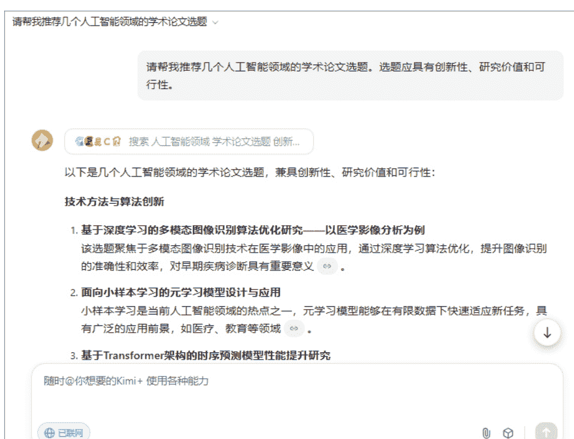

和爆款网文生成器的会话

重生了，我现在是爆款网文助手墨渊。在这里，你可以和我一起脑暴选题、拆解爆文、从0开始撰写网文小说。

✏️你擅长什么类型的小说？

🔥请联网搜索参考网络热门玄幻小说的设定和剧情爽点，写一部玄幻小说，主角看起来很弱，经常被人欺负，但实际上是拥有隐藏身份的大BOSS，要有逆袭情节，剧情精彩详实，有反转

📄以“3,2,1... 马克·韦斯特伍德缓缓睁开双眼”开头，创作一篇克苏鲁风格的小说第一章,字数在4000字以上，做好情景铺垫。

💡请你和我一起脑暴：重生爽文类型故事的起承转合，悬念设置，人物设定。并且给我一个引人入胜的开头文案。

请参考网络热门玄幻小说的设定和剧情爽点，写一部玄幻小说，主角看起来很弱，经常被人欺负，但实际上是拥有隐藏身份的大BOSS，要有逆袭情节，剧情精彩翔实，有反转

爆款网文生成器智能体即可按提示词生成相关内容，如下图所示。

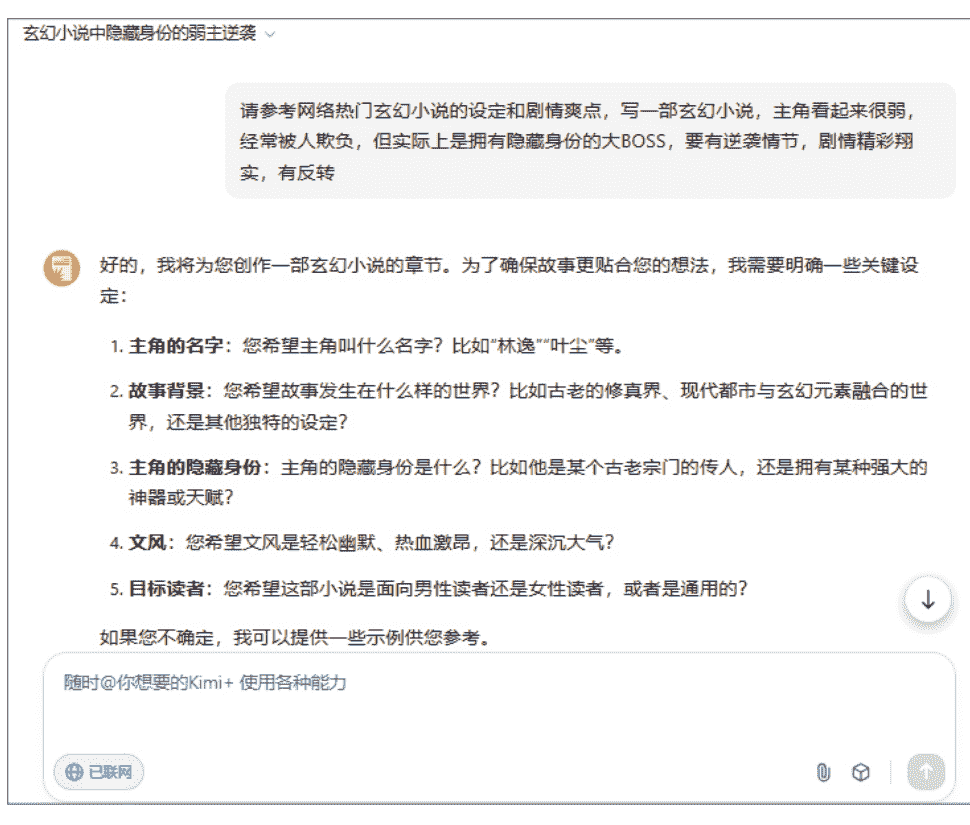

## 6.5 生活应用
Kimi+ 不仅能助力工作，也为日常生活提供全方位支持。Kimi 001号小客服、什么值得买和费曼学习法等智能体带来便利与乐趣。

### 6.5.1 实战：Kimi 001号小客服
Kimi 001号小客服是面向用户的智能助理，旨在提供专业指导，解决使用过程中遇到的各类问题，确保充分利用各项功能，提升体验与满意度。

进入与Kimi 001号小客服的会话页面，在输入框中输入关于Kimi的咨询，点击发送键 ⬆，如下图所示。

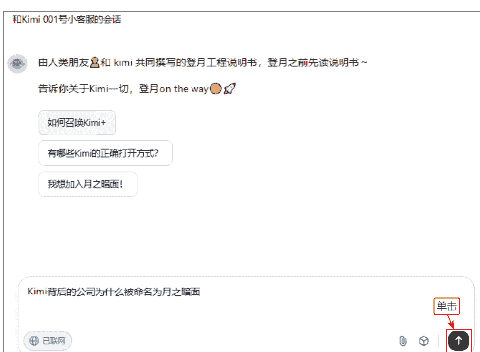

Kimi 001号小客服智能体即可回复咨询问题，如图所示。

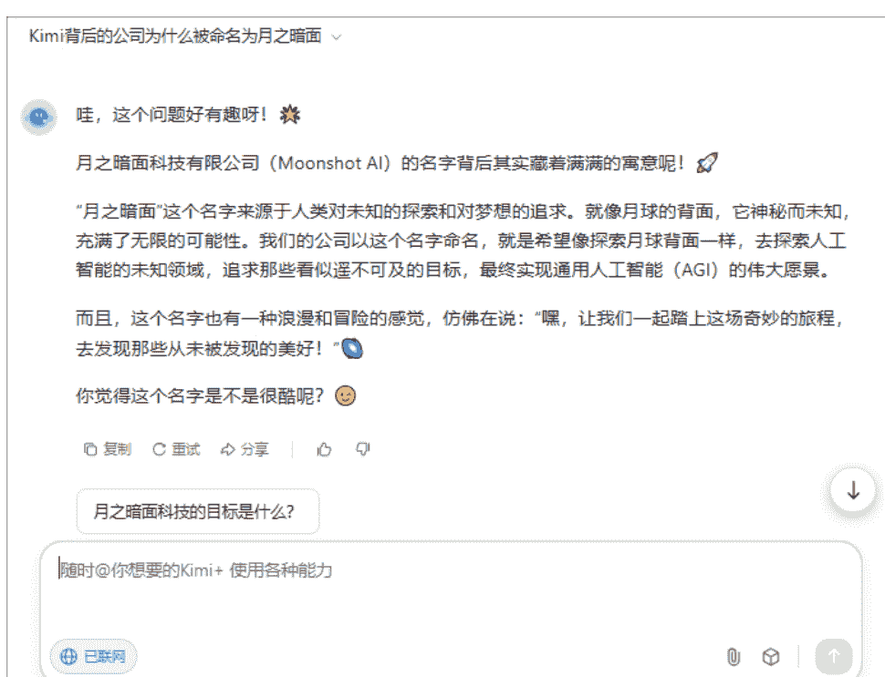

### 6.5.2 实战：什么值得买
什么值得买智能体像贴心的购物助手，能在海量商品中快速甄别性价比高、评价好的产品，让用户在享受购物乐趣的同时科学消费。

进入与什么值得买的会话页面，输入提示词，点击发送键 ⬆️，如下图所示。

和什么值得买的会话

💻 电子产品、大件家电、生活好物……什么值得买？来问我！科学消费，认真生活。

- Vision Pro值得买吗？戴久了会不会累？

- 戴森吹风机有平替吗，值得买吗？

- 我预算在7000以下，推荐一些2024年的游戏本

我预算在5000元以内，推荐一些好用的手机

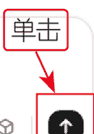

什么值得买智能体即可按提示词推荐商品并帮助对比，如图所示。

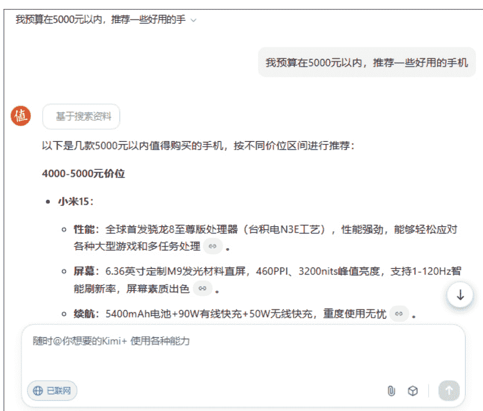

### 6.5.3 实战：费曼学习法
费曼学习法以物理学家理查德·费曼的学习理念为核心。Kimi+ 中的该智能体可帮助加深理解与记忆，适用于复习巩固、备考或深入掌握专业技能的场景。

进入与费曼学习法的会话页面，输入想要学习的概念或知识点作为提示词，点击发送键 ⬆，如下图所示。

和费曼学习法的会话

我擅长“说人话”，不管是多么复杂的概念我都能用你听得懂的方式解答。

- 什么是 大语言模型

- 什么是 后现代主义

- 我是大学生，你可以为我介绍机器学习吗？

帮我解释一下经济学中的供求理论

费曼学习法智能体即可按提示词用“2W2H模型”解释供需理论，如下图所示。

帮我解释一下经济学中的供求理论

好的！让我用费曼技巧来帮你理解经济学中的供求理论。

## Why（为什么重要）

供求理论是经济学中最基础的概念之一，它帮助我们理解商品和服务的价格是如何形成的。无论是买菜、购物还是找工作，供求关系都在背后起作用。它能帮助我们明白为什么有些东西贵，有些东西便宜，以及为什么有些商品很容易买到，有些却很难买到。

## What（定义和概念）

供求理论主要研究的是**供给**和**需求**两个方面，它们共同决定了商品的价格和数量。

- **需求（Demand）**：指的是消费者在一定时间内愿意并且有能力购买某种商品的数量。简单来说，就是大家想买多少东西。

随时@你想要的Kimi+ 使用各种能力

# 第7章 智能利器：Kimi多端版本的应用
Kimi提供多种版本以满足用户需求，从而提升使用便捷性与效率。本章介绍Kimi多端版本的应用，包含插件、桌面版及智能助手的下载与安装流程，并说明它们在不同场景下如何提高信息获取与处理效率。

## 7.1 下载和安装
在体验多端版本便利前需先完成下载与安装。本节详细介绍各版本的安装方法，帮助迅速上手。

### 7.1.1 下载并安装Kimi浏览器插件
在浏览器中安装Kimi插件，可在浏览网页时直接使用Kimi功能，下面介绍两种主要方式。

#### 一、在Microsoft Edge中安装Kimi插件
Microsoft Edge是Windows 10和Windows 11的默认浏览器，下面说明该浏览器中Kimi插件的下载与安装方式。

**步骤01** 打开Kimi网页版，新建会话，在对话框中输入提示词后，点击对话框中的【Kimi官方网站下载页面】超链接，如下图所示，即可进入下载页。

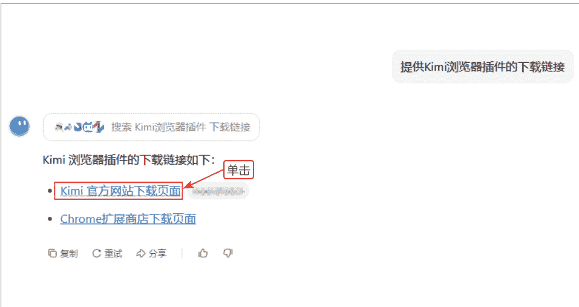

**步骤02** 在打开的Kimi插件下载网站中，点击【立即安装】按钮，如图所示。

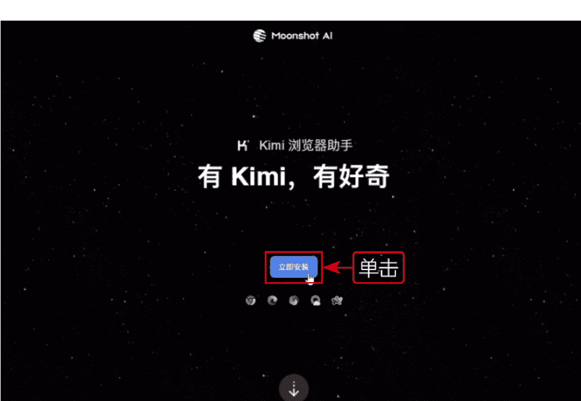

**步骤03** 进入【Edge加载项】页面，点击【获取】按钮，如下图所示。

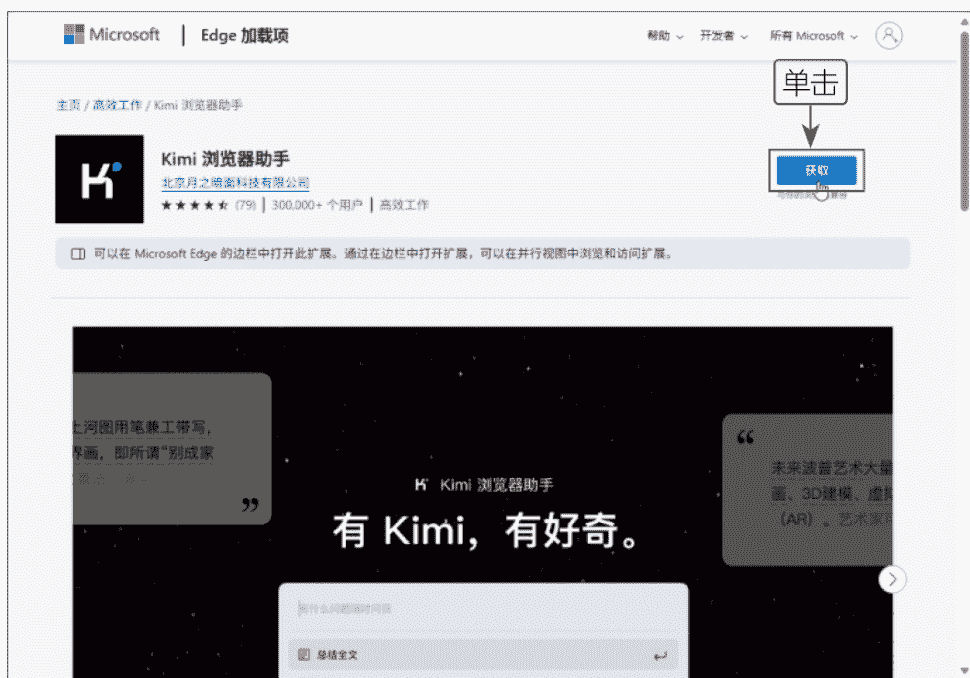

**步骤04** 浏览器随即弹出提示框，点击【添加扩展】按钮，如下图所示，即可自动下载并安装该插件。

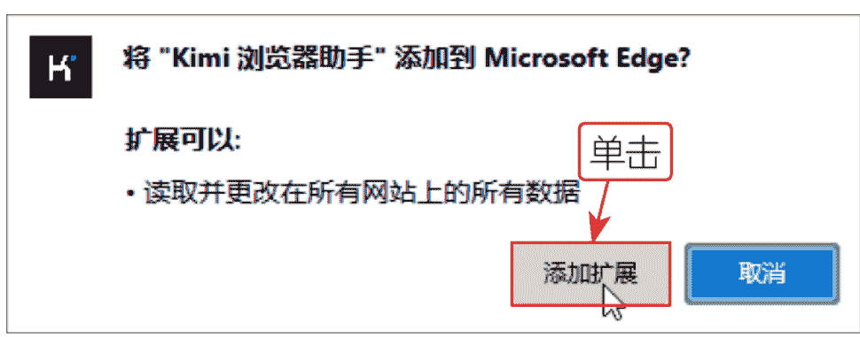

**步骤05** 安装成功后会自动打开Kimi浏览器助手登录页，按提示登录Kimi账号即可，如图所示。

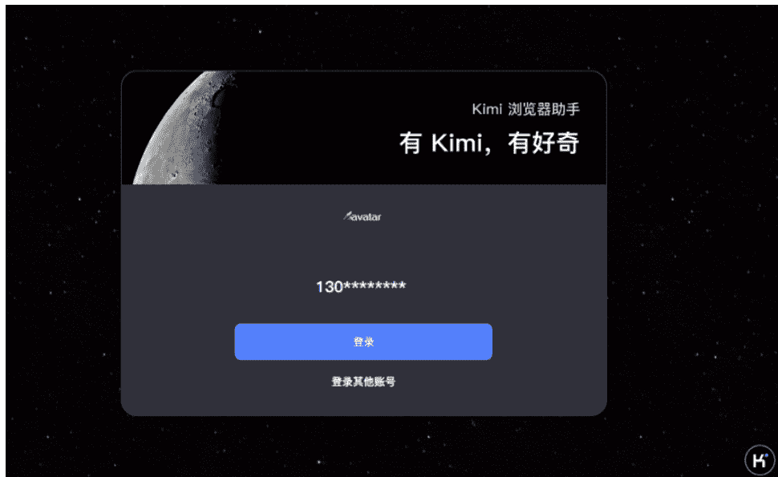

提示：如果已在当前浏览器登录Kimi网页版，则浏览器会自动识别账号信息，点击【登录】按钮可直接进入，否则需按提示输入手机号并获取验证码进行登录。

**步骤06** 登录完成后，若浏览器工具栏中没有Kimi图标，可点击【扩展】按钮 🧩，在弹出的【扩展】菜单中点击【Kimi浏览器助手】右侧的【固定到工具栏】按钮 📌，如下图所示。

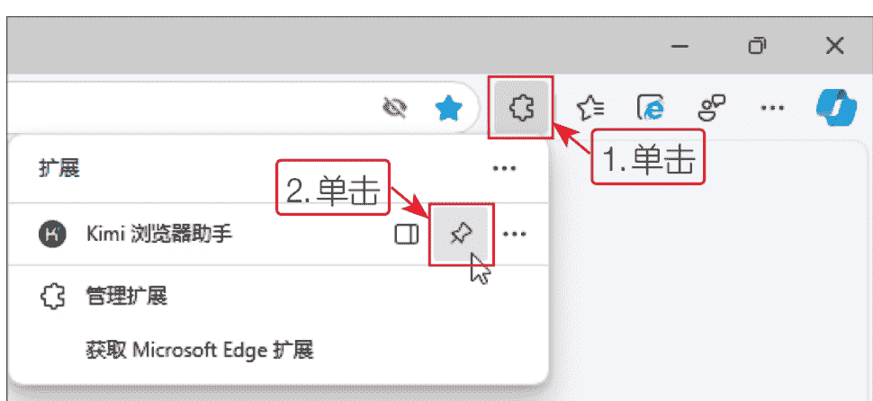

**步骤07** Kimi图标固定到工具栏后，点击Kimi图标，在弹出菜单中可进行相应设置，例如这里将【Kimi悬浮按钮】设为【开】，窗口显示方式选择【侧边栏】，如图所示。

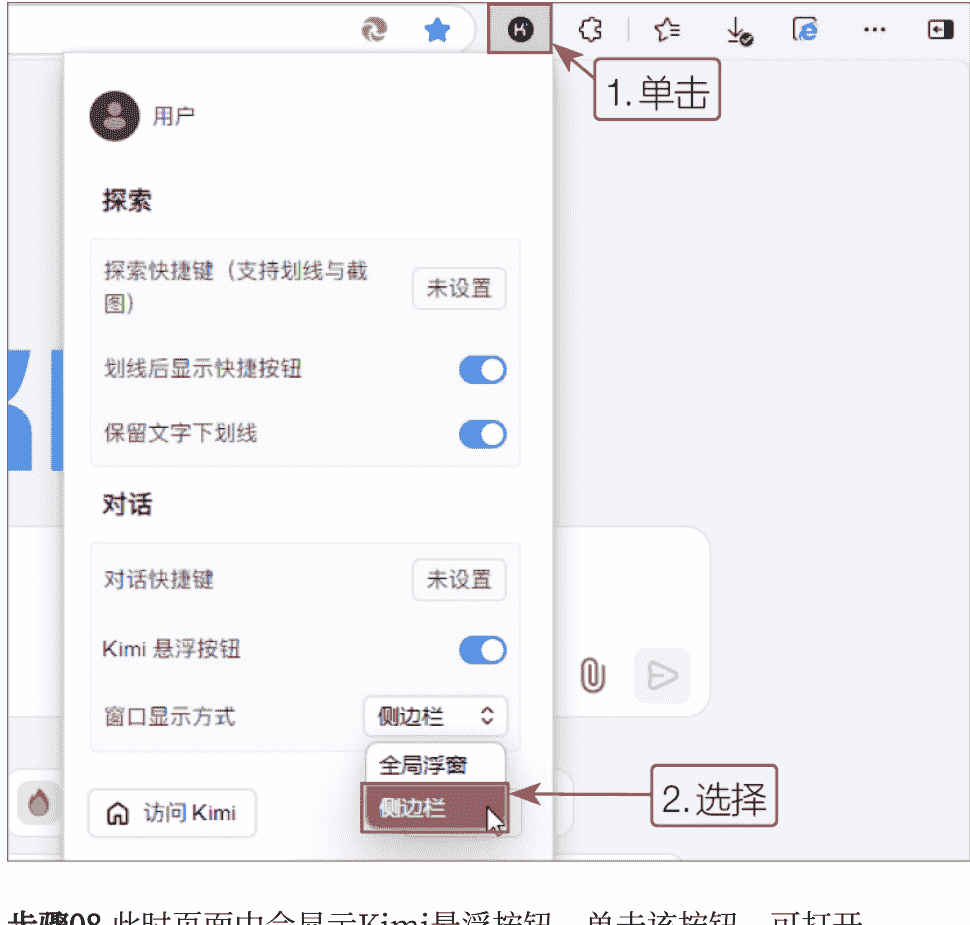

**步骤08** 此时页面会显示Kimi悬浮按钮，点击该按钮可打开【Kimi浏览器助手】侧边栏，如下图所示。

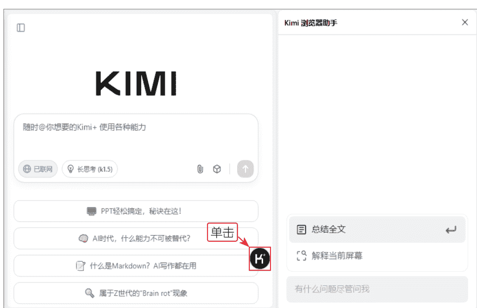

#### 二、在其他浏览器中安装Kimi插件
除Windows系统的Microsoft Edge外，若想在Chrome浏览器、360极速浏览器、QQ浏览器等其他浏览器中安装Kimi插件，则需下载扩展程序后手动安装。下面以Chrome浏览器为例说明。

**步骤01** 使用Chrome浏览器打开Kimi插件下载网站，点击【Chrome浏览器】图标，如下图所示。

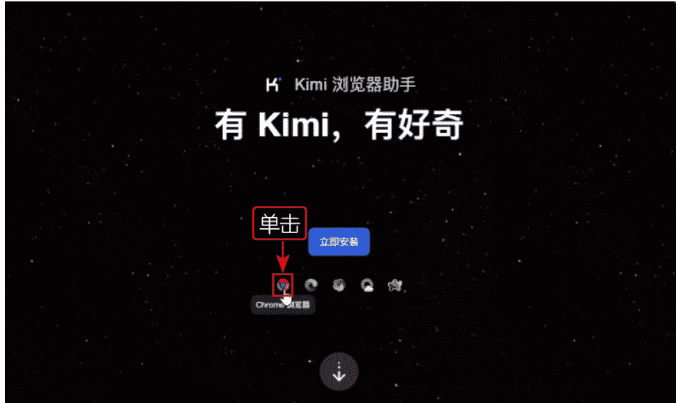

**步骤02** 系统会自动下载扩展程序，下载完成后在下载列表中双击下载的扩展程序压缩包，如下图所示。

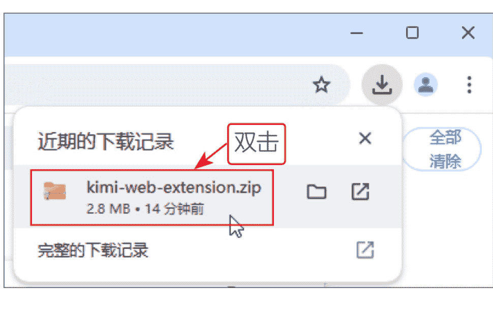

**步骤03** 在打开的扩展程序压缩包中，将“Kimi浏览器助手.crx”文件解压至任意位置，解压后的文件如下图所示。

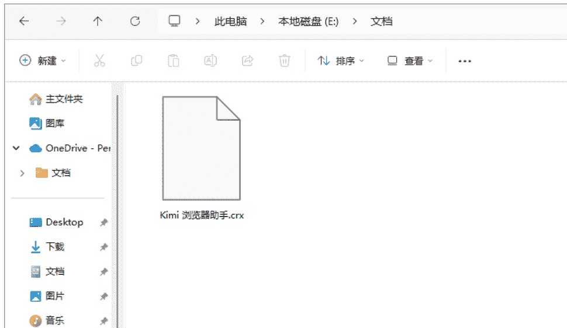

**步骤04** 点击Chrome浏览器工具栏中的【自定义及控制 Google Chrome】按钮 ⋮，在弹出菜单中选择【扩展程序】→【管理扩展程序】命令，如下图所示。

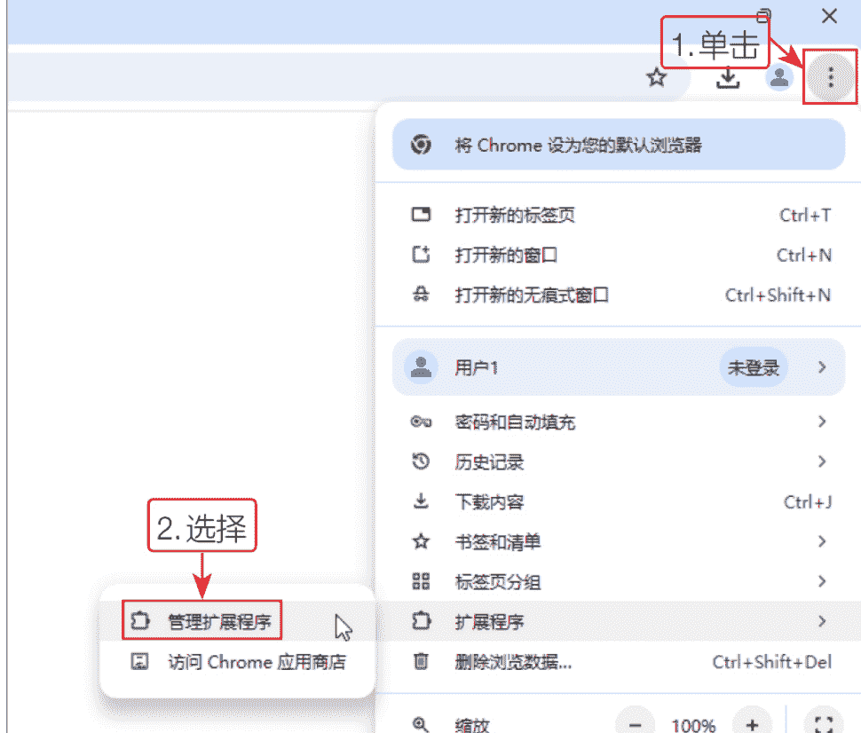

**步骤05** 进入【扩展程序】页面，开启【开发者模式】功能，将步骤3解压后的文件拖曳至该页面，如下图所示。

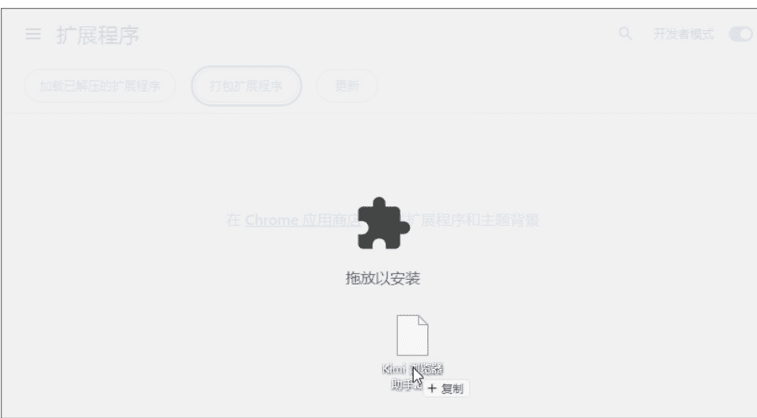

**步骤06** 弹出提示框，点击【添加扩展程序】按钮，如下图所示，即可自动添加Kimi浏览器助手。

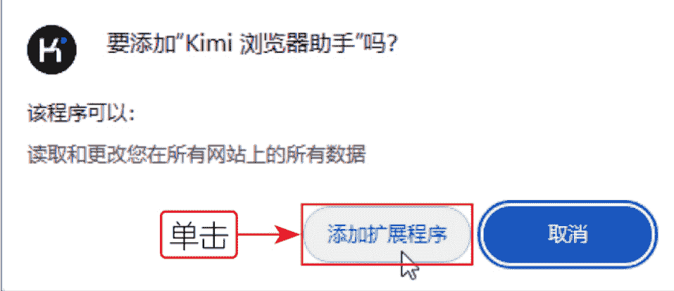

### 7.1.2 下载并安装Kimi桌面版

Kimi 跨端上手全攻略

Kimi 电脑客户端是实现深度本地交互的关键入口，下面把获取与初次启动的流程梳理清楚。

**步骤01** 在浏览器里打开 Kimi 网页版，点页面左下角的用户头像展开菜单，选择【下载电脑版】项后执行下载操作，示意图如下。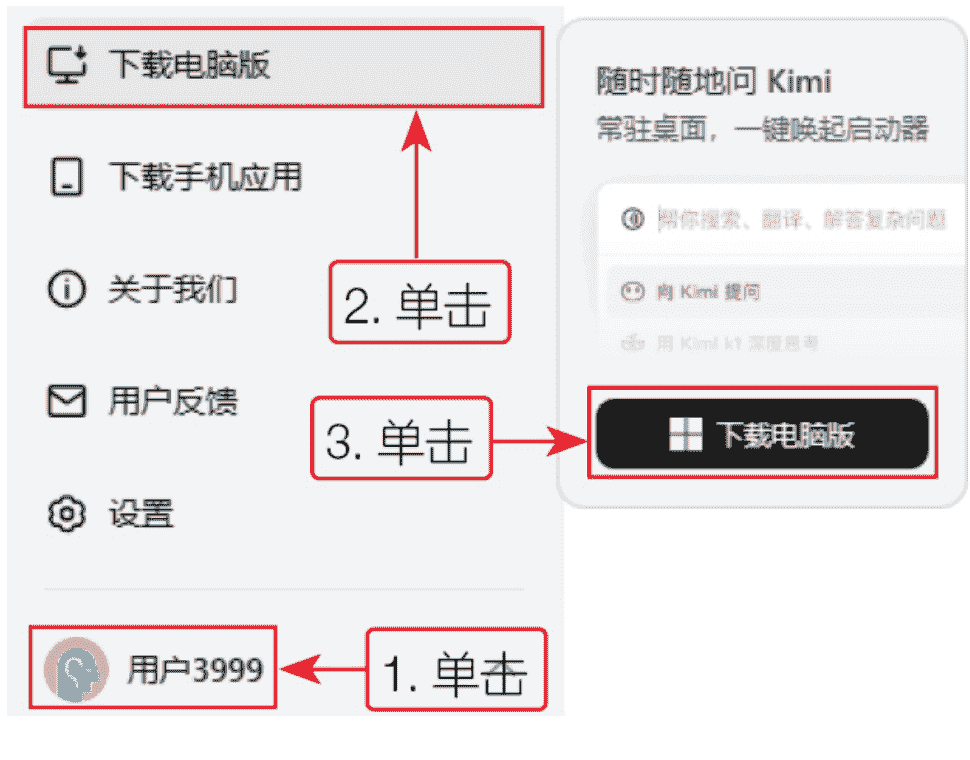

**步骤02** 浏览器会自动获取安装包，完成后在提示区点击【打开文件】超链接，示意图如下。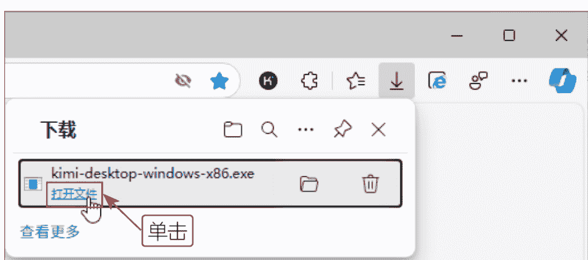

**步骤03** 安装向导弹出后，直接按【一键安装】继续，示意图如下。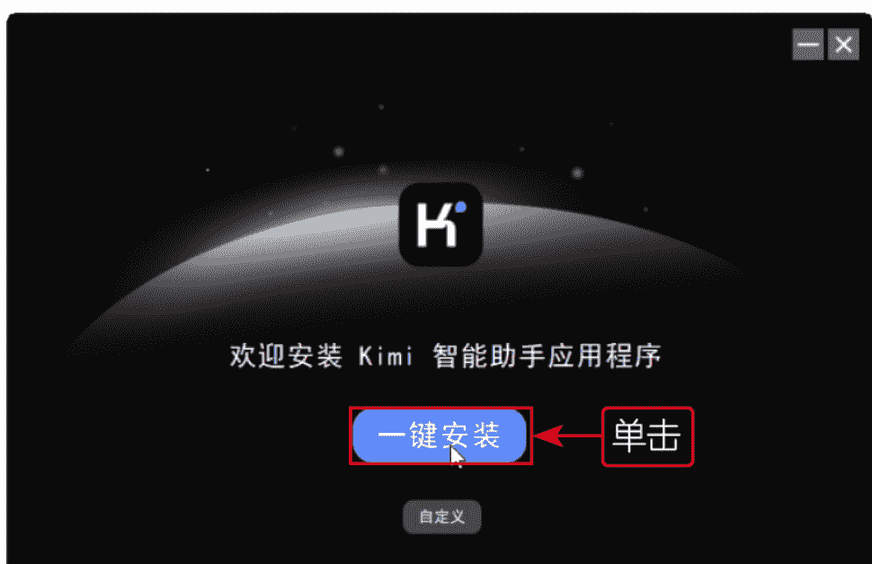
提示：需要自定义路径时可点【自定义】按钮，未设置则默认写入系统盘。

**步骤04** 安装进行中，完成后点【完成并启动】进入主界面，示意图如下。

**步骤05** 首次打开主窗口，点击【立即体验】开始使用，如图所示。

**步骤06** 为同步网页端的会话记录，点击左上角的用户头像👤，如图所示。
登录后该账号的历史对话会合并到本地，如图所示。

### 7.1.3 移动端助手获取方式
手机端安装 Kimi 智能助手非常便捷，打开应用商店搜索“Kimi”，找到对应应用后点【安装】，系统会自动完成下载与部署，如下左图所示。安装完成后可通过【打开】按钮或桌面图标启动，如下右图。


## 7.2 浏览器插件实战
插件让浏览器里的 Kimi 具备更多能力，下面介绍几个典型场景。

### 7.2.1 实战：选中文字即时求解
阅读网页时遇到不熟悉的概念，用插件选中文字即可即时获取解读，无需切换页面。


**步骤01** 在网页中框选需要解释的文本，点击随后出现的 Kimi 图标，如下图所示。
随即弹出【解释】卡片，对所选文本进行说明，如下图所示。

**步骤02** 如果对解释有疑问，可以在输入框中输入提示词，按【Enter】键或单击按钮，如下图所示。

## 解释
“边缘学科”这个概念指的是那些位于两个或多个传统学科交叉处的学科。这些学科通常结合了来自不同领域的理论和实践，以探索新的研究问题和解决方案。边缘学科往往能够促进跨学科的合作，推动创新，并在不同领域之间建立桥梁。例如，人工智能就是一门边缘学科，因为它结合了计算机科学、心理学、语言学、哲学等多个学科的知识和技术。
Kimi将回复新的内容，如图所示。

**步骤03** 按【Esc】键，可以隐藏【解释】卡片，选中的文本下方带有虚线，如下图所示。单击该虚线，可以再次打开【解释】卡片。

### 7.2.2 实战：整页要点速览
Kimi的总结全文功能能让用户迅速把握网页重点内容，特别适合用于总结包含长篇文章的网页。

打开要总结的网页，单击Kimi悬浮图标，打开【Kimi浏览器助手】侧边栏，单击【总结全文】选项，如下图所示。
Kimi会在【Kimi浏览器助手】侧边栏中总结此网页的内容，如下图所示。

### 7.2.3 实战：一键解读当前屏幕
Kimi的解释当前屏幕功能可以帮助用户快速把握和理解屏幕上显示的内容。

**步骤01** 打开网页或文档，将页面停留在要解释的区域，单击Kimi悬浮图标，在打开的【Kimi浏览器助手】侧边栏中单击【解释当前屏幕】选项，如下图所示。

**步骤02** 在弹出的提示框中，单击【允许】按钮，如下图所示。
## 是否允许www.epubit.com查看此选项卡？
网站将能够查看此选项卡的内容
Kimi会解释并总结当前识别的屏幕内容，如图所示。
另外，对希望获得解释和总结的区域，可以截取该区域的图片，将其粘贴至【Kimi浏览器助手】侧边栏的输入框中，按【Enter】键或单击按钮，以获取需要的解释和总结。

## 7.3 桌面客户端常用操作
Kimi桌面版为用户提供了一个强大且便捷的本地交互平台。

**步骤01** 打开Kimi桌面版，单击左上角的按钮，如下图所示。
进入【设置】页面，用户可以进行主题设置、检查更新、退出账号等操作，如下图所示。

**步骤02** Kimi桌面版支持语音自动播放，该功能默认是关闭的。单击右上角的按钮，如下图所示。即可开启自动播放功能，当与Kimi进行互动时，Kimi的回复内容即会自动播放，如图所示。

桌面版的大部分功能及互动方式与Kimi网页版的一致，本节不赘述。

## 7.4 移动助手功能概览
Kimi智能助手可以方便用户使用语音及拍照功能，随时随地帮用户处理文件、解答疑问。

### 7.4.1 移动助手的个性化设置
🔊

**步骤01** 点击手机桌面上的Kimi智能助手图标，启动软件，根据提示登录，进入软件主界面。点击界面右上角的按钮，可以开启音频自动播放。如果要进行更多设置，可点击 ☰ 按钮，如下图所示。
你好 用户2090，有问题欢迎随时问我。电脑上访问 [链接]，做 PPT，写作更方便。

- “急急如律令”应该如何翻译？

- 写一个打砖块小游戏

- 《诗经》中的我命由我不由天

- 拍照解题

- 打电话

- 图片创作

- ...
按住说话

步骤02 在展开的侧边栏中点击头像或 > 按钮，如下图左图所示。

步骤03 进入【设置】界面，可以设置账号头像信息，在【通用】区域，可以设置播报声音、主题设置、文字大小及语言切换等，用户可以根据需求进行设置，如下图所示。

### 7.4.2 实战：克隆自己的声音
在Kimi智能助手中，用户可以根据提示录制自己的声音，为Kimi定制专属声音，用于语音通话及回答自动播放。

步骤01 在Kimi智能助手的【设置】界面点击【播报声音】选项，进入【播报声音】界面，点击【让Kimi用你的声音说话】按钮，如下左图所示。

步骤02 进入【克隆声音】界面，点击【开始克隆我的声音】按钮，如下图所示。

步骤03 按住【按住 录制】按钮，如下图左图所示。

步骤04 用自然的语气读完界面中的文本，然后松手发送，如下图所示。

步骤05 提示【声音克隆成功】后，可以对声音进行命名，然后点击【完成】按钮，如下左图所示。

步骤06 返回【播报声音】界面，在【我的声音】列表中，选择克隆的声音即可应用，如下图所示。

### 7.4.3 实战：语音输入
语音输入是用户与Kimi对话的便捷方式。

步骤01 在主界面中点击按钮，如下图左图所示。

步骤02 按住【按住说话】按钮，如下图所示。

步骤03 对准手机话筒，说出自己想要输入的内容，如下左图所示。

步骤04 松手即可发送消息，如下图所示。

### 7.4.4 实战：实时语音通话
实时语音通话能让用户与Kimi的对话更加即时、具有互动性，还支持英语陪练及模拟面试。

步骤01 在主界面中点击 ⊕ 按钮，在下拉列表中点击【打电话】按钮，如下图所示。

**步骤02** 拨通后，即可进入与Kimi聊天的界面，如下图左图所示。

**步骤03** 此时你可随时说话，Kimi会实时识别并在屏幕上显示你说话的内容，说话完毕后，Kimi会进行回复，如下图所示。
提示：用户可点击左上角的按钮，开启和关闭字幕；还可点击右上角的按钮，设置Kimi的语速、声音、开场白等。

步骤04 点击右下角的【场景】按钮，在展开的界面中，用户可以根据需求进行选择（如点击【英语陪练】场景），如下图左图所示。

步骤05 此时，即可与Kimi进行英语互动，如下图右图所示。

### 7.4.5 实战：拍题答疑
拍题功能让用户可以拍摄照片并进行提问，Kimi可以帮用户找到相关答案或信息。

**步骤01** 在主界面中点击 ⊕ 按钮，如下左图所示。

步骤02 在展开的功能菜单中点击【拍照】按钮，如下图右图所示。

步骤03 进入【拍照】界面，点击【解题】按钮，然后将摄像头对准纸面，使题目置于框内，点击【拍摄】按钮📷，如下左图所示。

步骤04 拍摄完成后，拖曳方框，选择框选的区域，然后点击✅按钮，如下右图所示。

步骤05 照片将被添加至输入框中，然后输入提示词，如下图左图所示。

步骤06 Kimi会根据照片识别题目并进行解答，如下右图所示。

### 7.4.6 实战：辅助解读微信文件内容
Kimi智能助手中的微信文件功能让用户可以直接从微信中导入各类文件。

**步骤01** 在主界面中点击 ⊕ 按钮，展开下方的功能菜单，点击【文件】按钮后选择【微信文件】选项，如下左图所示。

步骤02 打开【导入微信文件】界面，点击【点击上传文件】按钮，如下右图所示。

步骤03 进入【选择一个聊天】界面，选择聊天，如下图所示。

步骤04 选择聊天中的文档文件，然后点击【确定】按钮，如下左图所示。

步骤05 进入【导入微信文件】界面，点击【确认导入】按钮，如下右图所示。

步骤06 即可将文件添加到输入框中，输入提示词，然后点击【发送】按钮 ⬆，如下左图所示。
Kimi即可根据提示词进行回复，如下右图所示。
你好，有问题欢迎随时问我。电脑上访问 [blurred]，做 PPT，写作更方便。

- 龙王为什么姓敖？

- 写一个打砖块小游戏

- “急急如律令”应该如何翻译？

请总结一下这个文档

这篇文章是一份《2024年公司年度工作报告》，全面回顾了公司在过去一年的经营业绩、业务进展、团队建设以及面临的挑战，并对2025年的工作计划进行了详细部署。

## 一、年度经营业绩回顾

- **财务数据：** 2024年公司实现营业收入5.8亿元，同比增长15%，净利润4800万元，同比增长20%，净利率8.3%，资产负债率40%，整体财务状况良好。

- **业务板块营收分析：**

  - 核心业务板块A营收3.2亿元，占总营收55.2%，同比增长18%，增长动力来自市场份额扩大...

*文中代码字体版权说明* Copyright Copyright 2010, 2012 Adobe Systems Incorporated (http://www.adobe.com/), with Reserved Font Name ‘Source’ . License This Font Software is licensed under the SIL Open Font License, Version 1.1. This license is copied below, and is also available with a FAQ at: http://scripts.sil.org/OFL SIL OPEN FONT LICENSE Version 1.1 - 26 February 2007 PREAMBLE The goals of the Open Font License (OFL) are to stimulate worldwide development of collaborative font projects, to support the font creation efforts of academic and linguistic communities, and to provide a free and open framework in which fonts may be shared and improved in partnership with others. The OFL allows the licensed fonts to be used, studied, modified and redistributed freely as long as they are not sold by themselves. The fonts, including any derivative works, can be bundled, embedded, redistributed and/or sold with any software provided that any reserved names are not used by derivative works. The fonts and derivatives, however, cannot be released under any other type of license. The requirement for fonts to remain under this license does not apply to any document created using the fonts or their derivatives. DEFINITIONS