# Llama大模型实践指南


## 内容简介

本书共包括7章，涵盖了从基础理论到实际应用的全方位内容。第1章深入探讨了大模型的基础理论。第2章和第3章专注于Llama 2大模型的部署和微调，提供了一系列实用的代码示例、案例分析和最佳实践。第4章介绍了多轮对话难题，这是许多大模型开发者和研究人员面临的一大挑战。第5章探讨了如何基于Llama 2定制行业大模型，以满足特定业务需求。第6章介绍了如何利用Llama 2和LangChain构建高效的文档问答模型。第7章展示了多语言大模型的技术细节和应用场景。

本书既适合刚入门的学生和研究人员阅读，也适合有多年研究经验的专家和工程师阅读。通过阅读本书，读者不仅能掌握Llama 2大模型的核心概念和技术，还能学会如何将这些知识应用于实际问题，从而在这一快速发展的领域中取得优势。


## 序 言

目前，人工智能和自然语言处理领域的发展正处于一个前所未有的黄金时代。预训练大模型，如 GPT - 4 和 Llama 2，不仅在学术界引起了广泛关注，还在工业界得到了广泛应用。作为一支拥有多年研究和实践经验的学者团队，我们深感有责任和义务将这一领域的最新进展和实践经验整合到一本全面、实用的指南中，而 Llama 2 又是如今备受欢迎、影响广泛的开源预训练大模型，这就是《Llama 大模型实践指南》诞生的初衷。

本书内容围绕 Llama 2 大模型展开，涵盖了从基础理论到实际应用的全方位内容。我们力求使每章都具有很高的实用性，同时不忽视理论的深度。本书中包含大量的代码示例、案例分析的最佳实践，可以帮助读者更好地理解和应用 Llama 2 大模型。

本书的一个显著特点是跨学科性。本书不仅讨论了计算机科学和机器学习的基础概念，还引入了语言学、信息检索和人机交互等多个学科的知识。这样做的目的是让读者能够全面地理解大模型，以及它们在不同应用场景中的潜力和局限性。

在适用范围方面，本书既适合刚入门的学生和研究人员阅读，也适合有多年研究经验的专家和工程师阅读。本书尽量以浅显易懂的语言解释复杂的概念和算法，同时展示了技术细节并提供了拓展阅读，以满足不同读者的需求。

在写作分工方面，我们的团队成员各自负责不同的章节，以确保每一部分都能得到专家级的处理。例如，拥有多年自然语言处理研究经验的成员主要负责第 1 章和第 7 章，这两章涉及大量的基础理论和多语言大模型技术；在工业界有丰富实践经验的成员主要负责其他章节，这些章节更侧重于实际应用和行业大模型定制。

总体而言，我们希望本书能成为读者探索 Llama 2 大模型世界的可靠指南和实用参考书。无论你是希望深入了解这一领域的最新研究，还是希望将预训练大模型应用于实际问题，本书都将为你提供详细的知识和灵感。

在这个快速发展和不断变革的时代，让我们一起探索人工智能和自然语言处理的无限可能，开启一个全新的学术和应用之旅！


# 第 1 章 大模型的基础理论

自从 OpenAI 推出 GPT-3 以来，AI 领域的发展进入一个崭新的阶段，即大模型时代。大规模语言模型又称大语言模型（Large Language Model，LLM），简称大模型，具备强大的理解和推理能力，使其能够出色地完成各种不同的任务。通过对话这种经典的人机交互方式为用户提供服务，就是大模型的一项重要应用。大模型已经成为 AI 领域最热门的话题之一，并被视为实现通用人工智能（Artificial General Intelligence，AGI）的可能途径。
本章主要介绍大模型的发展历史、核心框架、数据收集和数据处理、预训练及微调、评测。

## 1.1 大模型的发展历史

大模型是自然语言处理（Natural Language Processing，NLP）领域的一个重要概念，代表了一种基于大规模语料库训练的语言模型。虽然大模型可以完成多种多样的任务，但其本质上仍然是一种语言模型，即对一个句子（由多个单词组成的序列）出现概率的建模。

### 1.1.1 从语言模型到预训练大模型

#### 1. 语言模型

语言模型是 NLP 领域的一个核心概念，是对语言的规律和分布的统计建模，用于推断给定序列中一个词的分布概率。语言模型的形式化定义如下，对于由 l 个词（词元，即语言的最小处理单位，也可以是字或短语）组成的句子 s，w_i 表示第 i 个词，其概率公式可以表示为
p(s) = p(w₁)p(w₂|w₁)p(w₃|w₁w₂)…p(w_l|w₁w₂…w_{l−1})=∏_{i=0}^l p(w_i|w_{i−1}) （1.1）

虽然由于语言的复杂性，无法列举出所有可能出现的句子，但语言模型在统计层面对语言的规律进行了建模，从而能够进行语言的分布统计和推断。语言模型的实现方法有很多，其中最经典的是N元（N-gram）模型。

#### 2. 统计语言模型

对于预测一个词wᵢ的分布概率的情况，随着历史长度的增加，可能的历史数目是按指数级增长的，这样无法高效地进行统计学学习。N-gram模型假设当前词的分布概率只与前N-1个词有关。以2-gram模型为例，当前词的分布概率只与前1个词有关，其概率公式可以表示为

p(wᵢ|wᵢ₋₁)=c(wᵢ₋₁wᵢ)/c(wᵢ₋₁)
(1.2)

式中，c(wᵢ₋₁wᵢ)表示2-gram词在给定文本中共现的次数。共现次数的比例近似体现了单词出现的概率。统计语言模型是基于构造统计语言模型的训练数据得到的，通过式（1.2），就能够利用训练数据进行统计语言模型的学习。

#### 3. 神经网络语言模型

N-gram模型存在一个问题，即对于没有在语料库中出现的N-gram词，无法对其进行概率估计。尽管平滑技术能够改善这个问题，使N-gram模型正常工作，但是N-gram模型在大规模语料库上训练建模的能力仍然有限。因此，研究人员提出使用神经网络在一个连续空间中构建语言模型。前馈神经网络语言模型学习词的分布式表示，使一个词能够使用一个向量表示，取得了优于N-gram模型的性能。之后被提出的循环神经网络（Recurrent Neural Network，RNN）语言模型能够对变长的输入建模，捕获更长的上下文信息。神经网络语言模型已经是目前语言模型的标准实现方法。

#### 4. 预训练大模型

预训练大模型在大量无标注的开放数据进行预训练，学到了更好的语言表示，并对下游任务的性能提升有显著的效果。Word2Vec¹⁰是最早的预训练大模型，之后研究人员提出了基于循环神经网络的预训练大模型ELMO²。随着Transformer³结构的提出，后续的预训练大模型基本都采用了以Transformer为基本结构的模型架构。

① 本书中标注的[1]、[2]……对应的参考文献，请下载本书配套电子文档查看。

## 1.2 大模型的核心框架

随着 Transformer[1]在各类 NLP 任务中的应用取得突破性进展，现在主流的大模型研究都倾向于采用这一结构。本节将介绍大模型的核心框架 Transformer 及其主要

### 1.2.1 Transformer

Transformer 是一种用于 NLP 任务和其他序列到序列任务的深度学习模型。由 Google 的研究人员在 2017 年提出，被认为是迄今为止最具影响力的模型之一。Transformer 的设计革命性地改变了序列建模领域，取代了传统的循环神经网络结构，能够取得更好的性能和更强大的并行化能力。

[PAGE 14]

## Llama 大模型实践指南

关注不同的语义表示。在多头自注意力机制中，首先将输入序列通过线性变换映射到多个子空间中，其次在每个子空间中进行独立的注意力权重计算，最后通过将所有子空间中的结果合并得到最终的注意力表示。

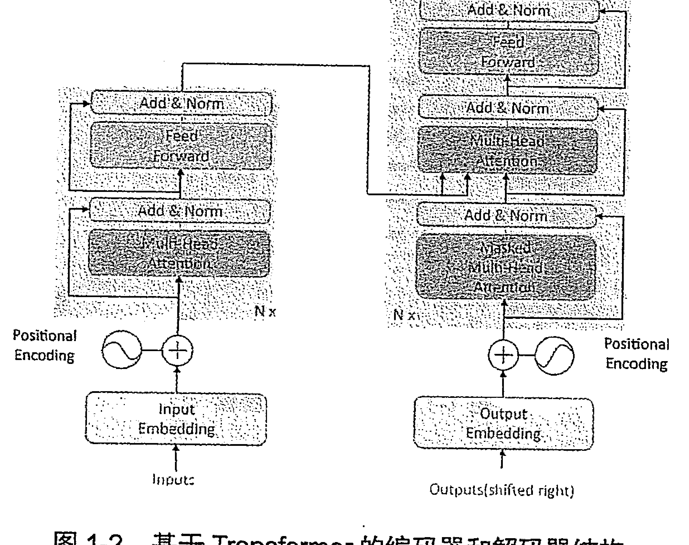

图 1-2 基于Transformer的编码器和解码器结构

在编码器之后，Transformer使用解码器来生成目标序列。解码器的结构与编码器类似，但在多头自注意力机制之外，还引入了另一个自注意力机制，用于对已生成的目标序列进行注意力权重计算。这样做的目的是让解码器能够在生成每个位置的输出时，同时关注输入序列和已生成的目标序列，从而更好地捕捉输入和输出之间的对应关系。为了加速模型的训练，解码器中还引入了一种掩蔽自注意力（Masked Self-Attention）的技术，该技术在每个位置的注意力权重计算中屏蔽了该位置之后的信息，以确保模型只能依赖已生成的内容进行预测。

为了帮助模型更好地进行训练，Transformer还引入了残差连接和层归一化机制。残差连接允许模型在堆叠多个层时保留之前层的信息，并通过跳跃连接将其添加到当前层的输出中。层归一化机制则对每个子层的输出进行归一化操作，以加速模型的训练和收敛。

Transformer没有像循环神经网络一样的隐含状态，需要通过某种方式将序列中的位置信息引入模型。为此，Transformer使用了位置编码，将位置信息嵌入输入序列。位置编码向输入的每个位置添加一个固定的向量，这样模型就能够感知不同位置之间的相对距离和顺序关系。

### 1.2.2 位置编码

在传统的 Transformer 中，位置编码是用固定的正弦函数和余弦函数的组合来表示不同位置的顺序关系的。这种方式虽然可以为模型提供位置信息，但存在一些限制。首先，传统位置编码无法适应不同长度的输入序列，因其编码模式是固定的，无法动态调整。其次，传统位置编码无法处理具有周期性模式的序列。为了解决这些问题，旋转式位置编码[10]（Rotary Position Embedding, RoPE）提供了一种动态的位置编码方式，通过旋转操作，位置编码可以随着模型的训练动态调整。具体来说，RoPE 通过旋转正弦函数和余弦函数的相位来调整位置编码的模式。RoPE 引入了一个可学习的参数，即旋转角度（Rotation Angle），该角度控制位置编码函数的旋转程度。通过调整旋转角度，RoPE 可以在不同的训练阶段改变位置编码的模式，使其更具动态性和适应性。RoPE 的旋转操作使位置编码能够在较大范围内形成周期性模式，更好地捕捉序列中的位置信息，这有助于提高模型在处理长序列时的性能和泛化能力。RoPE 提供了一种灵活且自适应的方式来编码位置信息，对于提升模型在 NLP、语音识别和其他序列建模任务中的表现非常有帮助。

### 1.2.3 多头自注意力机制

Transformer的成功源于多头自注意力机制，多头自注意力机制允许模型在处理序列时通过计算注意力权重的方式为输入序列的不同位置赋予不同的重要性。注意力权重的计算公式为

Attention(Q,K,V)=softmax( (QK^T)/√d_k )V （1.3）

式中，Q、K、V 分别表示由输入序列不同位置的查询（Query）、键（Key）、值（Value）向量拼接组成的矩阵；√d_k 为放缩因子。计算得到的注意

## Llama 大模型实践指南

力权重表示输入序列的每个位置对其他位置的关注程度，用于在生成输出时引导模型做出决策。此外，Transformer能够同时考虑输入序列的所有位置信息，而无须像循环神经网络那样依次处理每个位置。这种并行化的特性使 Transformer 能够更好地捕捉长距离的依赖关系，从而提高了模型的表示能力。

多头自注意力机制是 Transformer 的一项关键技术，用于提高模型对输入序列的表示能力。模型通过并行地应用多头自注意力机制来捕捉输入序列不同位置之间的多种关系。在传统的自注意力机制中，输入序列每个位置的查询、键和值都是通过线性变换得到的。而多头自注意力机制则引入了多组线性变换，每组线性变换被称为一个头，每个头都可以学习不同的查询、键和值的表示，从而捕捉输入序列中的不同位置信息。多头自注意力机制计算过程的描述如下。

+   * 将输入序列分别通过多组线性变换得到多组查询、键和值的表示。
* 对每个头，将对应的查询、键和值输入到单独的自注意力机制中，计算出注意力权重。
* 将每个头对应的注意力权重乘以对应的值，得到加权值向量。
* 将所有头对应的加权值向量拼接在一起，通过另一个线性变换得到最终的注意力表示。

这种多头并行计算的方式允许模型同时关注输入序列中的不同相关性，从而更好地捕捉长距离的依赖关系。相较于普通的单头自注意力机制，在多头自注意力机制中，每个头都可以专注于不同的特征子空间，可以提高模型的表示能力。

## 1.3 数据收集和数据处理

大模型的训练需要大量的无监督训练数据，通常需要混合不同来源的数据进行预训练。本节介绍大模型训练数据的收集和处理。

### 1.3.1 数据收集

文献[11]将训练语料分为通用数据和专业数据。通用数据，如网页数据、对话数据、图书数据等，由于具有种类多样、可访问的属性，因此被大多数大模型使用，能够用于训练大模型的基础建模能力。另外，为了提高大模型的泛化能力，也有研究将训练语料扩展到专业数据，如多语言数据、科学数据、代码数据、垂直领域数据等，以赋予大模型特定领域的任务解决能力。

#### 1）网页数据

随着信息技术的发展，在如今这个数据呈爆炸式增长的时代，大模型可以获取多种多样的网络数据来增强其泛化能力，比较典型的是网页数据。在已有的研究工作中，研究人员已经从网页中爬取了大量文本数据，如 Common Crawl[1]，这种数据的特点是数据量大、分布散乱且格式繁杂。爬取到的文本数据中往往包含高质量的文本（如维基百科中的文本）和低质量的文本（如垃圾邮件中的文本），因此对网页数据进行过滤和处理以提高数据质量非常重要。

#### 2）对话数据

对话数据作为语音交互的原始载体，对于提升大模型的对话能力具有不可替代的作用。研究人员主要从公共对话料库和在线社交媒体中收集对话数据。其中，公共对话料库中的数据虽然较为丰富，但部分数据可能存在过时或不适应最新应用场景的问题。在线社交媒体，如 PushShift.io[2]语料库等，则为研究人员提供了一个获取实时更新的对话数据的平台。相较于网页数据，对话数据的收集和处理难度较大，而且高质量对话数据的数量相对较少。

#### 3）图书数据

与其他语料库相比，图书作为长文本书面语的数据来源，具有极高的价值。它为大模型提供了丰富的学习资源，并且有助于大模型深入理解复杂的语言现象，如语言知识、长距离的依赖关系和长文本生成等。然而，由于版权等因素的限制，可获取的开源图书数据资源相对较少。目前，研究界通常把 Pile 语料库中的数据集作为开源图书数据的主要来源。

# 2. 专业数据

专业数据对于提升大模型在特定下游任务中的具体表现很有帮助。

# 1）多语言数据

将不同语言的数据整合到大模型中可以显著提高其在多语言的理解和生成方面的能力。例如，BLOOM[4]和 PaLM[5]是两个使用了多语言数据的大模型，BLOOM 整合了涵盖 46 种语言的数据，而 PaLM 整合了涵盖 122 种语言的数据。这种模型在多语言任务（如翻译、多语言摘要和多语言问答等）中表现出令人印…

## Llama 大模型实践指南

象深刻的性能，并且在目标语言的单语言任务中也能达到或超过其他单语言模型的性能水平。通过整合多语言数据，大模型能够更好地理解和生成不同语言的文本，从而提高其跨语言的应用能力。这样的整合能够为大模型提供更广泛的语言知识和语境，进一步提升其在多语言环境下的表现。

# 2）科学数据

随着科学出版物的增加，人们对科学的研究和探索也在不断深入。为了提高大模型对科学知识的理解能力，将科学数据纳入大模型的预训练过程是非常必要的。通过在大量科学数据上进行预训练，大模型可以在科学和推理任务中展现出良好的性能。为了构建科学语料库，目前的研究主要集中在收集来自 arXiv 论文[6]、科学教科书、科学网页等的数据。考虑到科学数据的复杂性，如数学符号和蛋白质序列等的复杂性，通常需要采用特定的词元切分和预处理技术，将不同格式的数据转换为大模型可以一致处理的形式。科学数据的整合使大模型能够更好地理解科学领域的文本，并且具备解决科学问题和完成推理任务的能力。通过在科学数据上进行预训练，大模型能够获得与科学相关的知识和语境，从而提高其在科学领域的性能和适用性。

# 3）代码数据

近年来，程序生成领域的研究受到人们的广泛关注。最新的研究表明，在大规模代码数据上对大模型进行预训练，可以显著提高生成程序的质量。这种大模型在设计单元测试用例或解决竞技编程问题方面表现出色。用于预训练大模型的代码数据通常有两个主要来源，即编程问答社区（如 Stack Exchange[7]）和公共软件库（如 GitHub[8]）。相较于自然语言文本数据，代码数据具有编程语言的格式，其中包含长距离的依赖关系和准确的执行逻辑。预训练大模型使用代码数据能够使大模型对程序生成任务有更好的理解，并且能够生成具有准确逻辑和语法的代码，这对于提升程序生成模型的能力和性能具有重要意义。

下面以现有的研究为例说明大模型训练语料的构成。GPT-3[9]（参数量为1750亿个）使用了3000亿个混合数据集，包括 Common Crawl、WebText2、Books1、Books2 和维基百科；PaLM[5]（参数量为5400亿个）使用了7800亿个混合数据集，包括社交媒体对话、过滤后的网页、书籍、GitHub、多语言维基百科和新闻；Llama[10]（参数量为650亿个）使用了14000亿个混合数据集，包括Cmmon Crawl、C4、GitHub、维基百科、书籍、arXiv和 Stack Exchange。

### 1.3.2 数据处理

在收集到大量数据之后，对数据进行处理以构建训练语料库非常重要，特别是要删除噪声、冗余、不相关和潜在有害的数据，这些数据可能会影响大模型的容量和性能。

#### 1. 数据过滤

目前，过滤收集到的数据中的低质量数据有两种主要方法[11]：基于分类器的过滤方法和启发式过滤方法。基于分类器的过滤方法需要先使用高质量数据进行分类器训练，然后将分类器应用于识别和过滤低质量数据。该方法利用分类器对数据进行判别，将被分类为低质量的数据过滤掉。启发式过滤方法通过设计一组合理的规则来过滤低质量数据。这些规则可以基于语言特征、指标、统计信息及关键字等进行设计。启发式过滤方法的例子包括 BLOOM[4]和 Gopher[12]等。通过采用这些数据过滤方法，可以有效地识别和过滤低质量数据，从而提高语料库的质量。

#### 2. 去重

为了提高大模型的训练效率，确保大模型训练的多样性和稳定性，对训练语料库进行去重是必要的。去重过程可以在不同的粒度级别上进行，包括句子级别、文档级别和数据集级别。在句子级别上，应该删除低质量的句子，包括重复的单词和短语，因为它们可能会引入重复模式，降低大模型训练的多样性。在文档级别上，可以使用统计特征之间的重叠比例（如单词和 N - gram 词重叠）来检测和删除具有相似内容的重复文档。通过删除重复文档，可以确保预训练数据的丰富性和多样性。在数据集级别上，为了避免发生数据集污染问题，还应从训练集中删除可能的重复文本，以防止训练集和评估集之间存在重叠。这样可以确保大模型在用于评估时能够处理未见过的数据，并提高其泛化能力。

#### 3. 隐私重构

预训练数据主要来源于互联网，其中包含用户生成的内容，可能涉及敏感信息或个人信息，使用这些数据有泄露用户隐私的风险。因此，有必要对预训练数据进行处理，以删除其中的个人可识别信息（Personally Identifiable Information，PII）。一种直接而有效的处理方法是，采用基于规则的技术（如关键字检测）识别和删除包含姓名、地址、电话号码等 PII 的内容。采用这样的处理方法有助于保护用户隐私，确保敏感信息不会被不当使用。

#### 4. 词元切分

词元切分也是数据处理的一个关键步骤。词元切分的目的是将原始文本分割成单个词元的序列，作为大模型的输入内容。在基于 Transformer 的大模型中广泛使用的词元切分技术通常包括字节对编码（Byte Pair Encoding，BPE）算法[13]、WordPiece[14]和 Unigram[15]。BPE 算法是 1994 年提出的一种通用数据压缩算法[16]，之后被改编为用于 NLP 的词元切分算法，使用此算法的代表性大模型包括 GPT - 2[17]、BART[18]和 Llama[10]。WordPiece 最初被用于语音搜索系统，在 2016 年被用于神经机器翻译系统[19]，在 2018 年被用于 BERT[20]的词元切分。T5[21] 和 mBART[22] 采用 Unigram 技术构建词元切分器。

## 1.4 大模型的预训练及微调

大模型通常需要先通过在大规模数据上进行无监督预训练学习通用知识，然后通过指令微调获取理解自然语言指令的能力，最后通过人类反馈微调使输出符合人类偏好。

### 1.4.1 无监督预训练

大模型，如 GPT - 3，是在大规模数据进行训练的，以给定的前缀来进行 NTP。通过将 NTP 的训练目标、大规模数据集及超高参数量的模型相结合，能够产生性能极强的基座模型，该基座模型可以“理解”任何文本输入，并且可以在此基础上进行“创作”。

#### 1. 规模定律

规模定律[1]（Scaling Law）指的是模型性能与模型规模之间的渐进关系。简单来说就是随着模型规模、数据集的增大和用于训练的计算浮点数的增多，模型性能会提高。为了得到最佳模型性能，这三个因素必须同时放大。当不受其他两个因素的制约时，模型性能与每个单独的因素都有幂律关系。

#### 2. 语境学习

GPT - 3[2]的研究论文指出，大规模的训练数据催发一种新的学习范式，称为语境学习（In - Context Learning，ICL）。ICL 并不需要更新模型参数，仅用几条下游任务的示例就可以取得较好的性能。

### 1.4.2 指令微调

经过预训练的大模型，已经被证明能很好地进行小样本学习。但是它们在零样本学习方面表现较差。

FLAN[3]提供了一种指令微调的方法，用来提高大模型的零样本学习能力。NLP任务可以通过自然语言指令来描述，如“这篇电影评论中蕴含的情绪是积极的还是消极的？”“把‘你好’翻译成中文”。指令微调是指通过自然语言指令描述的NLP数据集上，对预训练大模型进行指令调优。图1-3所示为Alpaca[4]指令微调数据集中的中文翻译样例。

```
{
  "instruction": "给出三个保持健康的秘诀。", 
  "input": "", 
  "output": "1.均衡饮食，多吃水果和蔬菜。\n2.定期锻炼，保持身体活跃和强壮。\n3.充足的睡眠，保持规律的作息时间。" 
},
```

```
{
  "instruction": "什么是三原色？", 
  "input": "", 
  "output": "三原色是红、蓝、黄。" 
}
```

```
{
  "instruction": "描述原子的结构。", 
  "input": "", 
  "output": "原子由原子核组成，原子核包含质子和中子，周围环绕着围绕原子核运行的电子。质子和中子带正电荷，而电子带负电荷，从而形成整体中性原子。每种粒子的数量决定了原子序数和原子类型。" 
}
```

```
{
  "instruction": "我们怎样才能减少空气污染？", 
  "input": "", 
  "output": "减少空气污染的方法有很多，如转向可再生能源、鼓励使用公共交通工具、禁止燃烧化石燃料、实施工业源减排政策及实施机动车排放标准。此外，个人可以通过减少汽车使用、避免燃烧木材等材料及改用节能电器来为减少空气污染做出自己的贡献。" 
}
```

```
{
  "instruction": "描述一次你不得不做出艰难决定的经历。", 
  "input": "", 
  "output": "当我在一家建筑公司担任项目经理时，我不得不做出一个艰难的决定。我负责一个需要在特定日期前完成的项目，以满足客户的期望。然而，由于意外的延误，我们无法在截止日期前完成，所以我不得不做出一个艰难的决定。我决定延后截止日期，但我不得不进一步扩展团队的资源并增加预算。尽管这是一个冒险的决定，但我最终决定继续进行，以确保项目按时完成并满足客户的期望。该项目最终成功完成，这被视为对我的领导能力和决策能力的考验。" 
}
```

# 图1-3 Alpaca指令微调数据集中的中文翻译样例

### 1.4.3 基于人类反馈微调

研究表明，持续增大模型规模并不能使模型的输出更符合人类偏好。例如，大模型可能会生成不真实、有害或对用户无益的输出，即不符合人类偏好的输出。

InstructGPT[5]提供了一种基于人类反馈微调（Reinforcement Learning from Human Feedback, RLHF）的方法，该方法能够在广泛的任务中使模型的输出符合人类偏好。在人工评估中，InstructGPT（参数量为 13 亿个）的生成结果要优于 GPT-3（参数量为 1750 亿个）的

# 第 1 章 大模型的基础理论

# 续表

| 评测任务       | 评测数据集                     |
|----------------|----------------------------------|
| 代码编写任务   | HumanEval[27]                   |
|                | MBPP[28]                        |
| 多轮对话任务   | MT-Bench[13]                    |
|                | Chatbot Arena[12]               |
| 医学相关任务   | MultiMedQA[20]                  |
| 人类考试任务    | M3Exam                          |
|                | GAOKAO-Bench[22]                |
| 中文任务       | C-Eval[21]                      |

# 1. 通用语言任务数据集

通用语言任务数据集包含多种 NLP 任务数据集、稳定性评估数据集及多任务数据集等，倾向于探究大模型的综合能力。Chatbot Arena[12]和 MT-Bench[13]是评测大模型的多轮对话能力的两个重要基准。Chatbot Arena 提供了一个开放平台，用户可在该平台上对两个随机分配的匿名大模型的回复进行投票。MT-Bench 提供了 80 个高质量的多轮问题，旨在评测大模型的多轮对话和指令执行能力。GLUE[14]与 SuperGLUE[15]是对大模型的自然语言理解任务，包括推理任务、相似性任务等进行评测的基准。BIG-Bench[16]和 MMLU[17]用于对大模型的知识理解和记忆能力进行评测。BIG-Bench 由 204 项任务组成，任务主题涉及语言学、儿童发展、数学、常识推理、生物学、物理学、社会偏见、软件开发等领域。MMLU 覆盖了各个级别 57 个学科的知识。HELM[18]综合了模型的 7 个评测指标，包括准确性、校准、鲁棒性、公平性、偏差、有毒性和效率。

# 2. 特定的下游任务数据集

特定的下游任务数据集与基准涉及数学、特定语言、特定领域等方面的评测。MATH[19]包含 12 500 道具有挑战性的竞赛数学题。MultiMedQA[20]由 7 个与医学 QA 相关的数据集组成，专注于医学检查、医学研究和消费者保健问题，可用于医学知识评测。C-Eval[21]是一个中文任务数据集，其题目覆盖人文、社科、理工、其他专业四大方向，用于评测大模型的中文知识和推理能力。GAOKAO-Bench[22]以中国高考题目作为数据集，用于评测大模型的语言理解能力和逻辑推理能力。

## Llama 大模型实践指南

## 1.5.3 评测方法

大模型的评测方法主要可分为自动评测和人工评测。与人工评测相比，自动评测通常耗费较少的时间和人力，具有效率高、迭代快的特点。但人工评测能提供更全面、更准确的真实反馈。在传统 NLP 任务中，通常使用 BLEU[29]、ROUGE[30]等自动评测指标。近年来也有研究使用大模型辅助进行自动评测。PandaLM[31]是一个专门用于评测大模型性能的裁判大模型，PandaLM可作为裁判大模型实现可重复和自动化的大模型评测。文献[13]采用 GPT - 4 和 GPT - 3.5 作为裁判大模型，分析了裁判大模型在位置偏见、文本长度偏见等问题上的缺陷。

## 1.5.4 评测中的挑战

+   1. 评测数据集泄露

由于大模型的训练数据规模十分庞大，数据集细节并不具象，并且通常不开源，因此评测数据集有可能已经包含在大模型的训练数据集中，从而导致评测的结果不准确。

+   2. 评测数据集覆盖不全面

大模型多方面的性能均需要进行评测，但目前的评测数据集和基准难以覆盖全面的评测任务及各种不同的评测方法，这可能导致评测的结果不准确及不鲁棒的问题。

文献[1]中也提到了目前大模型评测面临的一些挑战，包括如何设计更鲁棒的评测、如何设计更可靠的评测，以及如何设计一个统一的、支持所有大模型的评测框架等。

# 第2章 部署Llama 2大模型

为什么需要部署大模型？

大模型正在各行各业中应用，以提高人们的生产力和获取信息的能力。在医疗保健行业中，大模型能协助医生进行诊断和制订护理计划，同时为患者提供个性化的康复评估和诊疗咨询。在金融行业中，大模型结合本地的文档库或知识库，能完成自然、灵活的信息检索和数据搜索。大模型通过类似于人类对话的自然交互方式，使专业知识和复杂信息能被轻易获取。出于数据隐私、垂直定制、成本控制等各种原因，用户可能不会满足于仅通过付费接口来调用“黑盒”式的大模型服务，开源的大模型给我们提供了灵活微调与本地部署的便利。本章将探讨如何部署开源的Llama 2大模型。

## 2.1 部署前的准备

部署大模型前应确保有足够的下载模型权重的硬盘空间，合适的CPU、内存大小，以及NVIDIA（英伟达）GPU型号。

### 2.1.1 硬件准备

部署不同参数的Llama 2大模型对GPU的要求如表2-1所示。

#### 表2-1 部署不同参数的Llama 2大模型对GPU的要求

| 模型名称                     | 模型加载名称                     | 基础模型版本                       | 模型权重大小 |
|------------------------------|----------------------------------|------------------------------------|---------------|
| Llama2-Chinese-7b-Chat       | FlagAlpha/Llama2-Chinese-7b-Chat  | meta-llama/Llama-2-7b-chat-hf      | 13.50GB       |
| Llama2-Chinese-13b-Chat      | FlagAlpha/Llama2-Chinese-13b-Chat | meta-llama/Llama-2-13b-chat-hf     | 26.03GB       |

本次我们要部署Llama2-Chinese-7b-Chat模型，其对显卡的要求如表2-2所示。

## Llama 大模型实践指南

# 表 2-2 Llama2-Chinese-7b-Chat 模型对显卡的要求

| 模型名称       | 显存需求 | 显卡型号                              |
| -------------- | -------- | ------------------------------------- |
| Llama2-Chinese-7b-Chat | >12GB    | RTX 2060 12GB, 3060 12GB, 3080, A2000及以上 |

### 2.1.2 环境准备

Python 版本：3.9.6 及以上。

可以通过在命令行中运行以下命令来检查 Python 版本：

如果 Python 版本低于 3.9.6，那么需要更新 Python。如果系统中没有安装 Python，或者想在一个独立的环境中安装新的 Python 版本，那么可以考虑使用像 Anaconda 或 pyenv 这样的 Python 版本管理工具。

Anaconda 是一个流行的 Python 和 R 的发行版，包含 Conda（一个包和环境管理器），以及大量的科学计算库。使用 Anaconda 可以轻松地在同一个系统中管理和切换多个 Python 版本与环境，Anaconda 非常适用于科学计算和数据分析。

下面是使用 Anaconda 安装 Python 的步骤。

+   (1) 访问 Anaconda 的官方网站①下载 Anaconda。
(2) 根据操作系统 (Windows、macOS 或 Linux) 和系统类型 (32 位或 64 位)，选择合适的 Anaconda 版本进行下载。Anaconda 默认包含最新版本的 Python，因此不需要另外选择 Python 版本。
(3) 下载完成后，打开安装包并按照安装向导的提示进行安装。

+   * Windows 用户：双击下载的 exe 文件开始安装。
* macOS 用户：双击下载的 pkg 文件开始安装。
* Linux 用户：在终端中，进入下载文件的目录，运行 bash Anaconda3-xxx.sh (其中 xxx 是下载的 Anaconda 的版本号)。

(4) 在安装过程中，记得勾选或同意将 Anaconda 添加到 PATH 环境变量中。

(5) 安装完成后，打开命令行或终端，运行 python--version 命令，如果显示 Python 版本号，那么说明 Python 已经成功安装。可以运行 conda list 命令来查看已经安装的 Python 包和库。

一旦安装了 Anaconda，就可以使用 conda 命令来创建和管理 Python 环境，以

> ① 橙色文字对应的网址，请下载本书配套电子文档查看。

# 第2章 部署Llama 2大模型

及安装和更新Python包。例如，可以使用以下命令创建一个新的Python环境：

```
conda create --name myenv python=3.9
```

在这个命令中，myenv是新环境的名称；python=3.9指定了想在这个环境中安装的Python版本。用户可以根据实际需要修改这些参数。

创建环境后，可以先使用conda activate myenv命令来激活这个环境，然后在这个环境中安装和运行Python程序。如果想退出环境，那么可以使用conda deactivate命令。

## 2.2 模型的导入与加载

本节将详细介绍如何导入并加载训练好的大模型。模型文件中储存着大模型的网络结构，以及在上游预训练任务中训练好的节点权重，所以加载完成后即可进行使用。本节还将介绍如何通过不同方式加载模型并进行推理或执行其他任务。

### 2.2.1 下载代码

导入并加载训练好的Llama 2大模型通常需要使用Python的PyTorch库。首先需要安装PyTorch库和Transformers库，这可以通过pip命令来完成。

Llama - 2大模型，也就是预训练模型，权重文件格式有多种，其中最常见的包括以下几种。

+   (1) PyTorch的“.pth”或“.pt”格式：这种格式由PyTorch提供，可以直接被PyTorch库读取。它用于存储模型权重，并且支持在GPU和CPU之间进行无缝切换。

+   (2) TensorFlow的“.ckpt”格式：这种格式由TensorFlow提供，可以直接被TensorFlow库读取。它同样用于存储模型权重，但不支持在GPU和CPU之间进行无缝切换。

+   (3) Hugging Face的“.bin”格式：这种格式由Hugging Face的Transformers库提供，可以被Transformers库读取。它用于存储模型的所有权重，并且支持在GPU和CPU之间进行无缝切换。

此外，预训练模型权重文件通常需要与模型的配置文件（通常是一个“.json”文件）一起使用，该配置文件描述了模型的结构和超参数。在加载模型

# 第2章 部署Llama 2大模型

时，首先读取配置文件来构建模型的结构，其次从预训练模型权重文件中读取权重来初始化模型。

运行下面的命令从GitHub中拉取Llama2-Chinese仓库中的代码：

Plaintext
git clone https://github.com/FlagAlpha/Llama2-Chinese.git

过程截图如图2-1所示。

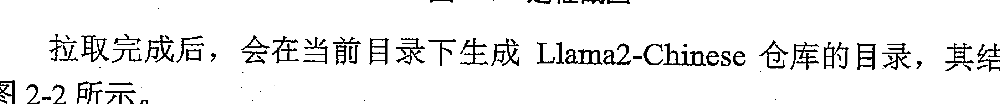

拉取完成后，会在当前目录下生成Llama2-Chinese仓库的目录，其结构如图2-2所示。


### 2.2.2 下载模型

通过访问Llama中文社区获取Llama 2大模型，可以手动根据文件链接直接下载对应的模型，也可以通过Hugging Face加载托管在其平台的模型权重。请注意，由于模型文件通常较大，因此请确保网络连接顺畅并耐心等待。可以根据表2-3中的模型信息选择并加载对应的模型。

#### 表2-3. 模型信息

| 模型名称 | 模型加载名称 | 基础模型版本 |
| --- | --- | --- |
| Llama2-Chinese-7b-Chat | FlagAlpha/Llama2-Chinese-7b-Chat | meta-llama/Llama-2-7b-chat-hf |
| Llama2-Chinese-13b-Chat | FlagAlpha/Llama2-Chinese-13b-Chat | meta-llama/Llama-2-13b-chat-hf |
| Llama2-Chinese-7b-Chat-LoRA | FlagAlpha/Llama2-Chinese-7b-Chat-LoRA | meta-llama/Llama-2-7b-chat-hf |
| Llama2-Chinese-13b-Chat-LoRA | FlagAlpha/Llama2-Chinese-13b-Chat-LoRA | meta-llama/Llama-2-13b-chat-hf |

# 第2章 部署Llama 2大模型

# 通过Hugging Face调用托管模型的示例代码如下：

```
import torch
from transformers import AutoTokenizer, AutoModelForCausalLM
model = AutoModelForCausalLM.from_pretrained('FlagAlpha/Atom-7B',device_map='auto',torch_dtype=torch.float16,load_in_8bit=True)
model=model.eval()
tokenizer = AutoTokenizer.from_pretrained('FlagAlpha/Atom-7B',use_fast=False)
tokenizer.pad_token = tokenizer.eos_token
input_ids = tokenizer(["<s>Human: 如何向一个六岁的孩子解释什么是机器学习?
</s><s>Assistant:", return_tensors="pt",add_special_tokens=False).input_ids.to('cuda')
generate_input = {
    "input_ids":input_ids,
    "max_new_tokens":512,
    "do_sample":True,
    "top_k":50,
    "top_p":0.95,
    "temperature":0.3,
    "repetition_penalty":1.3,
    "eos_token_id":tokenizer.eos_token_id,
    "bos_token_id":tokenizer.bos_token_id,
    "pad_token_id":tokenizer.pad_token_id
}
generate_ids = model.generate(**generate_input)
text = tokenizer.decode(generate_ids[0])
print(text)
```

上述代码中通过向大模型提问“如何向一个六岁的孩子解释什么是机器学习？”，测试大模型针对该问题的推理能力。下面我们查看对应的推理效果：

```
Python
(Llama2) [root@localhost Llama2-Chinese]# python demo.py
CUDA SETUP: Loading binary
/root/miniconda3/envs/Llama2/lib/python3.10/site-packages/bitsandbytes/libbitsandbytes_cuda11_nocublaslt.so...
Loading checkpoint shards:
100%|██████████| 3/3 [00:15<00:00,
```

5.28s/it]

<s><unk> ：如何向一个六岁的孩子解释什么是机器学习？

</s><s>Assistant: 向一个六岁的孩子解释什么是机器学习可能需要用简单的语言和例子来说明。你可以这样解释:

"你知道电脑吗？它们就像是很聪明的机器，可以帮助我们做很多事情。机器学习就是让电脑变得更聪明的一种方法。就像我们学习新东西一样，电脑也可以通过机器学习来学习新东西。

想象一下，如果你给电脑看一堆图片，有一些是猫的图片，还有一些是狗的图片。一开始，电脑不知道怎么区分猫和狗，但是通过机器学习，它可以学会看到一些特别的东西，比如猫的耳朵形状或者狗的尾巴形状。然后，当你给电脑看一个新的图片时，它可以用之前学到的知识来猜测这是一只猫还是一只狗。

这就像是你学习认识新朋友一样。一开始你可能不知道他们的名字，但是通过和他们交谈，你会了解到一些特别的东西，比如他们的笑容或者他们的声音。然后，当你再见到他们时，你可以通过这些特征来认出他们是谁。

所以，机器学习就是让电脑通过观察和学习，变得更聪明和有能力做一些事情，就像我们通过观察和学习来认识新朋友一样。

希望这个解释能帮助你向一个六岁的孩子解释什么是机器学习！

若读者运行 demo 程序也能看到大模型针对问题的推理效果，则表明读者的环境已经可以正常运行大模型项目。至此，Llama 2 大模型的部署与测试完成，下面介绍 Llama 2 大模型的其他部署方式。

## 2.3 模型部署

由于大模型推理时需要采用简单的交互界面进行对话，因此本节介绍两种模型部署方式，即 API 部署和 text-generation-webui 部署，这两种模型部署方式都适用于大模型的本地部署，读者可根据自己的设备与喜好进行选择。

### 2.3.1 API 部署

API 部署是一种常见的模型部署方式，它允许我们通过网络请求与模型进行交互。本节将使用 FastAPI 和 Uvicorn 这两个库来部署模型。

为了完成 API 部署，需要安装 FastAPI 库和 Uvicorn 库。这两个库都可以通过 pip 命令进行安装：

Plaintext

pip install fastapi uvicorn
[/content]## 第2章 部署Llama 2大模型

安装完这两个库后，可以运行仓库中的`accelerate_server.py`脚本启动API服务器：

```
python accelerate_server.py 
--model_path /path/Llama2-Chinese-13B 
--gpus "0" 
--infer_dtype "int8" 
--model_source "llama2_chinese"
```

在这个命令中，使用了以下几个参数。

+   * `model_path`: 这个参数指定了模型的本地路径。需要将其替换为 Llama 2 大模型文件所在的路径。

+   * `gpus`: 这个参数指定了需要使用的显卡编号。如果希望使用编号为0的显卡，那么可以将此参数设置为“0”；如果希望同时使用编号为 0 和 1 的显卡，那么可将此参数设置为“0,1”。

+   * `infer_dtype`: 这个参数指定了模型加载后的参数数据类型。可以选择的数据类型包括 int4、int8 和 float16。这个参数的设置会影响模型的运行效率和精度。

+   * `model_source`: 这个参数指定了模型的源。可以选择的源包括 llama2_chinese 和 llama2_meta。应该根据下载的模型的类型来选择合适的源。例如，下载的是 FlagAlpha 的模型，则应该将此参数设置为 “llama2_chinese”。

运行这个命令后，API 服务器默认部署在本地的8001端口，并通过 POST 方法进行调用。可以使用 `accelerate_client.py` 脚本向 API 服务器发送请求：

```
python accelerate_client.py
```

这个脚本会向 API 服务器发送一个请求，并打印 API 服务器的响应。用户可以修改这个脚本，使其发送自己的请求。

### 2.3.2 text-generation-webui 部署

text-generation-webui 是基于 Gradio 开发的可视化工具包，主要用于运行大模型的会话交互。以下是 text-generation-webui 的一些简单特性。

+   * 支持 3 种交互模式：分列模式、Notebook 模式和聊天模式。

## Llama 大模型实践指南

+   * 支持多种模型后端：Transformers、llama.cpp、ExLlama、AutoGPTQ、GPTQ-for-LLaMa、CTransformers 等。

+   * 快速切换不同模型的下拉菜单。

+   * LoRA：即时加载和卸载 LoRA，使用 QLoRA 训练新的 LoRA。

+   * 精确的聊天模式指令模板：Llama2-Chat、Alpaca、Vicuna、WizardLM、StableLM 等。

+   * 支持 Transformers 库进行 4 位、8 位及 CPU 推理。

+   * 支持 Transformers 采样器的 llama.cpp 模型（llamacpp_HF 加载器）。

+   * 多模态管道：LLaVA 和 MiniGPT-4。

+   * 支持 LaTeX 渲染的 Markdown 输出，如可以与 Galactica 一起使用。

+   * 自定义聊天角色。

+   * 高效的文本流式处理。

## 1. 直接安装 text-generation-webui

text-generation-webui 对计算机配置要求很低，CPU 和 6GB 显存的显卡均可安装，安装方法也非常简单。

(1) 打开 text-generation-webui 的项目页面，如图 2-3 所示。

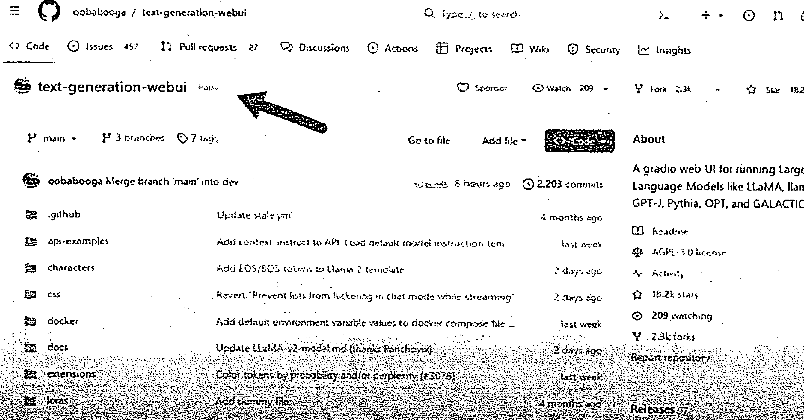

图 2-3 text-generation-webui 的项目页面

### 2.3.3 使用 text-generation-webui

1. 准备模型权重

首先，将下载后的 LoRA 权重及 Hugging Face 格式的 llama-7B 模型权重分别放到 loras、models 文件夹下，目录文件如下：

```
ls loras/Llama2-7b
```

```
adapter_config.json adapter_model.bin special_tokens_map.json
```

```
tokenizer_ config.json tokenizer.model
```

```
ls models/llama-7b-hf
```

```
pytorch_model-00001-of-00002.bin pytorch_model-00002-of-00002.bin
```

```
config.json
```

```
pytorch_model.bin.index.json generation_config.json
```

其次，复制 LoRA 权重的 tokenizer.model 到 models/llama-7b-hf 下，并修改 `/modules/LoRA.py` 文件（text-generation-webui 默认从 models 下加载 tokenizer.model，因此需要使用扩展中文词表后的 tokenizer.model 并修改原始 llama-7b-hf 的 embed_size）：

```
cp loras/Llama2-7b/tokenizer.model models/llama-7b-hf/
```


### 2.3.3 使用 text-generation-webui

2. 加载模型并启动 text-generation-webui

运行以下命令即可与Llama 2大模型对话:

```
python server.py --model llama-7b-hf --lora Llama2-7b --cpu
```

对话截图如图 2-6 所示。

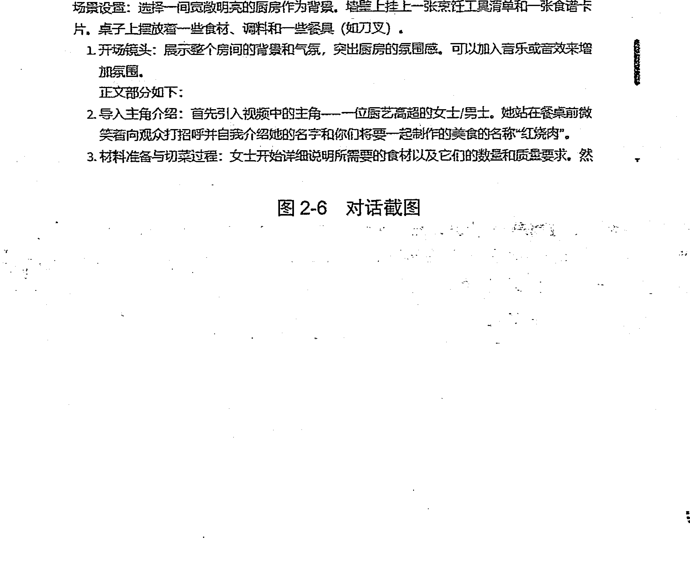

图 2-6 对话截图

## 第 3 章 微调 Llama 2 大模型

在经过预训练后，大模型可以获得完成各种任务的通用能力。然而，越来越多的研究表明，大模型的能力可以通过进行针对特定目标的微调进一步提高。微调可以使大模型适应特定任务，从而提高其性能和效率。通过微调，大模型可以更好地理解特定领域的语言和术语，并且更准确地预测结果。此外，微调还可以帮助大模型更好地适应不同的数据集和任务，从而提高其泛化能力和鲁棒性。因此，微调技术已经成为大模型应用中不可或缺的一部分。

微调技术是一种对大模型进行调整，以使其适应特定任务的技术。目前，微调技术主要有以下两种。

+   (1) 指令微调：目标是提高大模型的能力。

+   (2) 对齐微调：目标是将大模型的行为与人类的价值观或偏好对齐。

OpenAI 发布的 ChatGPT 就应用了微调技术，从而获得了非常好的效果。本章主要针对指令微调进行详细的介绍。

指令微调是一种在自然语言格式的实例集合上微调预训练后的大模型的技术。这种技术与有监督微调和多任务 Prompt 训练密切相关。为了进行指令微调，首先需要收集或构造指令格式的数据。这些数据有各种来源，如人工标注的数据集、自动生成的数据集或从现有数据集中提取的样本。其次需要使用这些格式化的实例以有监督的方式微调大模型，如使用序列到序列的损失对大模型进行训练。

目前开源的大模型，如 Llama 2，经过指令微调后，展现出了极高的泛化能力，即使在多语言场景下也有不错的表现。这种泛化能力使大模型可以适应各种任务和数据集，从而提高其性能和效率。此外，指令微调还可以帮助大模型更好地理解特定领域的语言和术语，从而提高其预测准确性和可靠性。因此，指令微调已经成为大模型应用中不可或缺的一部分。

## 3.1 微调的数据集准备和标注

在如今的 AI 领域，开源的大模型，如 Llama 2，已经在各种 NLP 任务中取得了显著的成果。为了充分发挥这些大模型的潜力，往往需要对它们进行微调，以使其适应特定的应用场景。在微调过程中，数据集的准备和标注是至关重要的环节。本节以Llama2大模型为例，详细介绍微调的数据集准备和标注的步骤。

### 3.1.1 数据集准备

通常情况下，一个指令格式的实例数据包括一个任务描述（被称为指令）、一个输入和一个输出。指令描述大模型需要完成的任务，输入是大模型需要处理的原始数据，输出是大模型对输入数据的预测结果。这种指令格式的实例数据可以帮助大模型更好地理解特定任务的需求和目标，从而提高其性能和效率。

数据集一般可通过以下三种途径构建。

+   (1) 格式化已有数据集。将传统的 NLP 数据集按照特定的格式进行调整，用于指令微调。为降低格式化成本，可以通过 ChatGPT 生成指令。一般 Prompt: 请你为这段内容生成一个合理的问题。用户可以根据这个 Prompt 与 ChatGPT 进行交互，生成符合要求的数据。

+   (2) 人工标注数据集。采用这种方法构建的数据集更加符合人类的语言习惯，可以获得更好地与人类的价值观或偏好对齐的效果。为降低人工标注成本，目前很多数据集由 ChatGPT 生成，包括用户分享的 ChatGPT 对话历史（如 ShareGPT 数据集）和使用 ChatGPT 蒸馏生成的数据集。

+   (3) 复用开源数据集。复用开源数据集，从而增加微调任务的多样性，提高大模型的性能。

数据集可分为通用数据集和专用数据集。前者目前有大量开源数据集可供使用。通过使用通用数据集，我们可以训练大模型以使其具备通用任务场景的处理能力。后者是针对某个领域的数据集，可以根据具体需求和任务场景自行构建（如法律数据集、医疗数据集等），以满足特定领域任务场景的理解和处理需求。通过使用专用数据集，我们可以提供更加精准和定制化的指令，从而提高大模型在特定领域的性能。

除了使用常规的数据集，引入多样性的数据集也可以有效提高大模型的性能，如 CoT 等。这些数据集可以帮助大模型更好地理解和处理复杂的语言结构和推理任务，从而提高大模型的性能和泛化能力。

因此，通过使用通用数据集、专用数据集，以及引入多样性的数据集，可以有效提高大模型的性能。这种综合使用不同类型数据集的方法已经得到了广泛的应用，并取得了显著的成果。

一般来说，我们采用上述方法得到数据集后，还需要进行以下处理，才能得到高质量的数据。

### 3.1.2 数据集标注

通过上述方法，我们得到了一批高质量的数据，如果要将这些数据用于大模型的微调，还需要将其转换成大模型特定的输入格式（这一步根据不同大模型的情况来处理）。以 Llama 2 大模型为例，一般将数据处理成 json 格式或 csv 格式的文件，典型的数据格式如下：

```
{
  "instruction": "",
  "input": "",
  "output": ""
}
```

## Llama 2大模型的指令微调格式示例如下：

```
{
  "instruction": "提供器材，建议一套锻炼计划。",
  "input": "引体向上杠，运动垫",
  "output": "运动计划:\n\n1. 热身: 开始进行5分钟的动态拉伸，如手臂环绕、腿摆动或跳跃杠。\n\n2. 上半身循环: 在引体向上杠和运动垫上做以下几个动作，每个动作做3轮，每轮10次: 引体向上、俯卧撑、三头肌二头肌撑、平板支撑和侧板支撑。\n\n3. 下半身循环: 在运动垫上做以下几个动作，每个动作做3轮，每轮10次: 桥式、深蹲、侧腿弓步和后蹲步。\n\n4. 核心循环: 在运动垫上做以下几个动作，每个动作做3轮，每轮10次: 仰卧起坐、腿部抬高、斜方肌扭转和背部伸展。\n\n5. 冷却: 最后进行5分钟的静态伸展运动，如眼镜蛇式、猫/牛式或前屈。"
}
```

```
{
  "instruction": "列举两种人类减小对环境的影响的方法",
  "input": "",
  "output": "人们可以通过减少能源消耗和减少废物产生来减小对环境的影响。通过使用节能家电、节能灯泡和节油车辆，以及回收、堆肥和再利用等方式，人们可以做出更可持续的选择，对环境产生积极的影响。"
}
```

其中，“instruction”（指令）通常是指对大模型的任务描述或指导。它可以是一个问题、一个命令、一个任务描述等，用于告诉大模型需要完成什么样的任务或目标。

"input"（输入）是指输入大模型的数据。对于 NLP 任务，输入可以是一个文本、一句话、一个图像等。大模型会根据输入的数据进行分析。

"output"（输出）是指大模型根据输入数据生成的结果。对于 NLP 任务，输出可以是一个回答、一个分类标签、一个生成的文本等，取决于具体的任务和模型设计。

此外，还有一种对话微调（Conversation Tuning）格式。对话微调是一种特殊的指令微调，其目的是让大模型在“补全”能力的基础上，解锁“对话”能力。

## 典型的对话微调格式如下：

```
{
  "instruction": "请根据以下对话内容生成回复。",
  "input": "用户1: 你好，我想了解一些关于人工智能的信息。",
  "output": "用户2: 你好！人工智能是一个广泛的领域，包括机器学习、深度学习、自然语言处理等。你对哪个方面感兴趣？"
}
```

# Llama大模型实践指南

"<s>Human: "+问题+" 
</s><s>Assistant: "+答案"

Plaintext

<s>Human: 用一句话描述地球为什么是独一无二的。</s><s>Assistant: 因为地球是目前为止唯一已知存在生命的行星。</s>

其中，"<s>Human: "+问题表示用户输入的问题；\n</s><s>Assistant: "+答案表示对话系统返回的答案。这段代码的意思是，将用户输入的问题和对话系统返回的答案以特定的格式输出。

## 3.2 Llama 2大模型加载

Llama2是一个基于PyTorch的预训练大模型，可以用于各种NLP任务，如文本分类、命名实体识别、情感分析和对话聊天等。本节将介绍如何加载Llama2大模型。

+   1. 安装PyTorch库和Transformers库

在使用Llama 2大模型之前，需要安装PyTorch库和Transformers库，可以在命令行中使用以下命令对其进行安装：

Plaintext

```
pip install torch
```

```
pip install transformers
```

+   2. 下载Llama 2大模型

可以从Llama 2的GitHub页面中下载预训练大模型。在本示例中，我们将使用Llama2-base模型。

+   (1) Llama2-base模型。

Llama2-base模型有7B、13B和70B三种大小，如表3-1所示。

## 表3-1 Llama2-base模型

| 模型名称 | 模型加载名称 |
| --- | --- |
| Llama2-7B | meta-llama/Llama-2-7b-hf |
| Llama2-13B | meta-llama/Llama-2-13b-hf |
| Llama2-70B | meta-llama/Llama-2-70b-hf |

+   (2) Llama2-Chat模型。

Llama2-Chat模型基于Llama2-base模型进行了监督微调，具有更强的对话能力。Llama2-Chat模型也有7B、13B和70B三种大小，如表3-2所示。

## 表3-2 Llama2-Chat模型

| 模型名称       | 模型加载名称                     |
|----------------|----------------------------------|
| Llama2-7B-Chat | meta-llama/Llama-2-7b-chat-hf     |
| Llama2-13B-Chat| meta-llama/Llama-2-13b-chat-hf   |
| Llama2-70B-Chat| meta-llama/Llama-2-70b-chat-hf   |

以Llama2-7B模型为例，可以使用以下命令对其进行下载：

```
Plaintext
git lfs install
git clone https://huggingface.co/meta-llama/Llama2-7b-hf
```

## 3. 加载Llama 2大模型

在Python中加载Llama2大模型，需要使用Transformers库中的AutoModelForCausalLM类和AutoTokenizer类加载Llama2大模型及词表相关配置文件。可以使用以下命令加载Llama2大模型：

```
Plaintext
from transformers import AutoTokenizer, AutoModelForCausalLM
model_path = "meta-llama/Llama2-7b-chat-hf"
model = AutoModelForCausalLM.from_pretrained(model_path,device_map='auto',
torch_dtype=torch.float16,load_in_8bit=True)
tokenizer = AutoTokenizer.from_pretrained(model_path,
use_fast=False)
```

在这里，我们先指定了大模型的名称和路径，然后使用AutoTokenizer.from_pretrained()方法加载预训练的tokenizer，并使用AutoModelForCausalLM.from_pretrained()方法加载预训练大模型。

至此，Llama2大模型加载完成。

## 3.3 微调策略设计及模型重新训练

微调策略设计及模型重新训练是深度学习领域中的重要内容，对于提高模型性能、使模型适应新任务或数据分布变化至关重要。本节以Llama2大模型为例，探讨如何在上下文中进行微调策略设计及模型重新训练。

### 3.3.1 微调策略设计

微调是指在预训练模型的基础上，使用少量的标注数据对模型进行进一步训练，以使其适应特定任务。在微调过程中，需要设计合适的微调策略，以达到更好的微调效果。

+   1．全参数微调

全参数微调的优点是可以使模型更好地适应特定领域或任务，提高模型的泛化能力。由于微调了所有的参数，模型可以更好地适应新的数据分布，因此提高了模型的性能。此外，全参数微调还可以避免欠拟合问题，因为在微调过程中，所有的参数都会被更新，而不是只更新部分参数。

然而，全参数微调需要大量的计算资源和时间，因为需要更新所有的参数，这对于计算资源有限的研究人员来说是一个很大的问题。此外，全参数微调还可能导致模型过拟合，因为在微调过程中，模型可能会过度拟合数据集，从而降低模型的泛化能力。因此，在实际应用中，需要根据具体情况选择微调方法，权衡微调的效果与计算资源和时间成本。

+   2．参数高效微调

随着模型参数量的不断增加，进行全参数微调的成本不断升高。这种高成本主要表现在对硬件资源的要求高、显存占用量大、训练速度慢、耗时长及存储成本高等方面。为了解决这些问题，参数高效微调（Parameter-Efficient Fine Tuning，PEFT）方法应运而生。与全参数微调不同，参数高效微调只训练模型的一小部分参数，而不是所有的参数。参数高效微调有以下几个优点：对硬件资源的要求低，因为只训练模型的一小部分参数，所以显存占用量小；训练速度快，耗时短；存储成本低，不同任务可以共享大部分权重参数；可能会有更高的模型性能，可以避免过拟合问题。

下面对几种比较常见的参数高效微调方法进行介绍。

+   (1) Prefix-Tuning

Prefix-Tuning是一种用于自然语言生成任务的参数高效微调方法，它可以通过微调预训练模型来生成具有特定前缀的文本。在Prefix-Tuning中，模型的输入由两部分组成：前缀和待生成的文本。前缀是指输入文本的前几个词或字符，而待生成的文本则是指在前缀的基础上，模型需要生成的文本。

[PAGE 43]

# 第3章 微调Llama 2大模型

Prefix-Tuning （论文“ Prefix-Tuning: Optimizing Continuous Prompts for Generation”）的主要思想是通过微调预训练模型使其适应特定任务。在微调过程中，模型会学习如何根据给定的前缀生成合适的文本。在输入 token 之前构造一段与任务相关的 virtual tokens 作为 Prefix。此外，在训练时只更新 Prefix 部分的参数，而模型中其他部分的参数固定。

与其他的参数高效微调方法不同，Prefix-Tuning 不需要大量标注数据，因为它可以通过少量的前缀和待生成的文本来进行微调。微调（顶部）更新所有 Transformer 参数（粉红色 Transformer 框），并且需要为每个任务存储完整的模型副本。我们建议进行前缀调优（底部），它冻结 Transformer 参数，并且仅优化前缀（粉红色 Prefix 块），如图 3-1 所示。

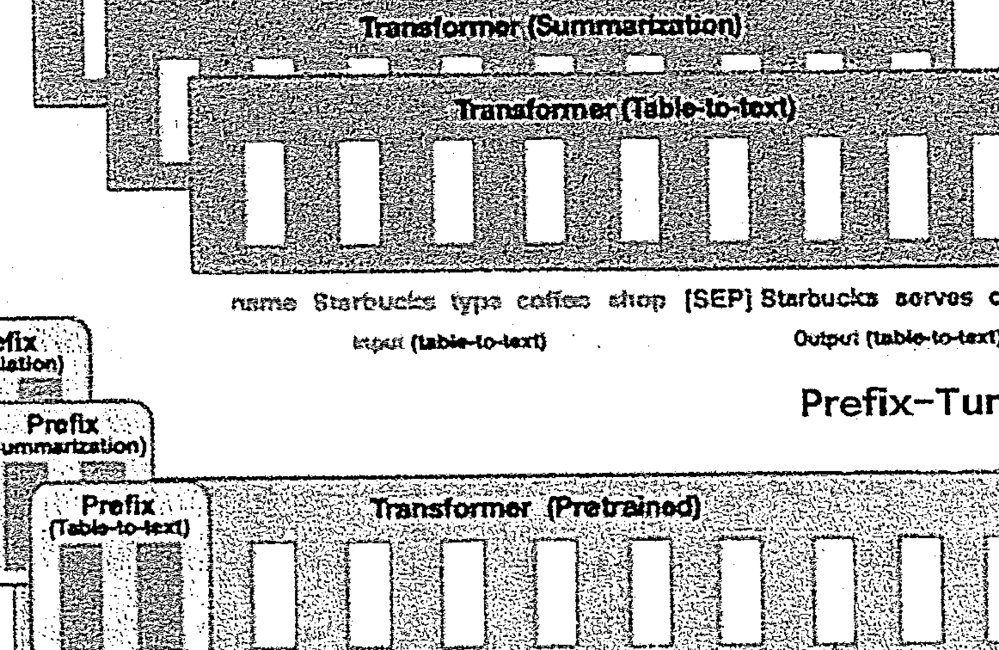

# 图3-1 Prefix-Tuning

从图 3-1 中可以看到，Transformer 参数完全固定，我们只需要对 Prefix 部分进行训练，对于不同的任务训练不同的 Prefix，在实际使用时，挑选与任务相关的 Prefix 和 Transformer 进行组合。

+   (2) Adapter-Tuning。

Adapter-Tuning 是一种用于 NLP 任务的参数高效微调方法，它可以不在改变预训练模型结构的情况下，通过微调适配器来适应特定任务。适配器是一种轻量级的神经网络模块，从图 3-2 中可以看到，它可以在预训练模型的中间层添加，用于处理特定任务的输入和输出。

[PAGE 46]

## Llama 大模型实践指南

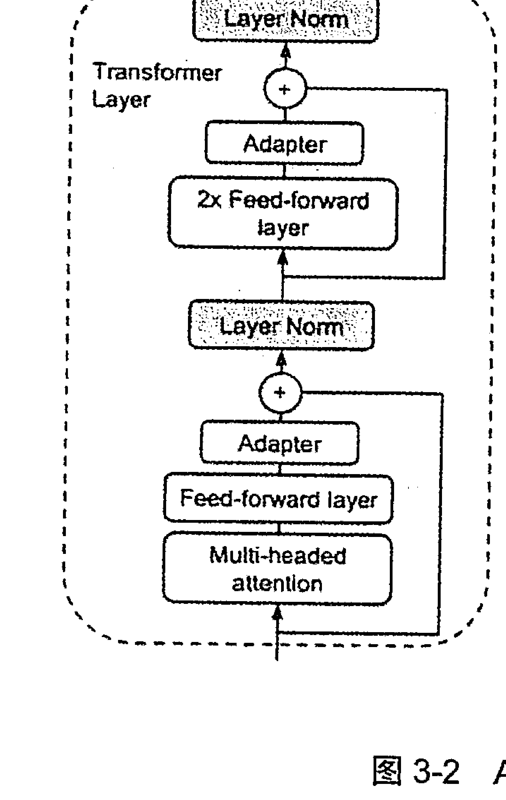

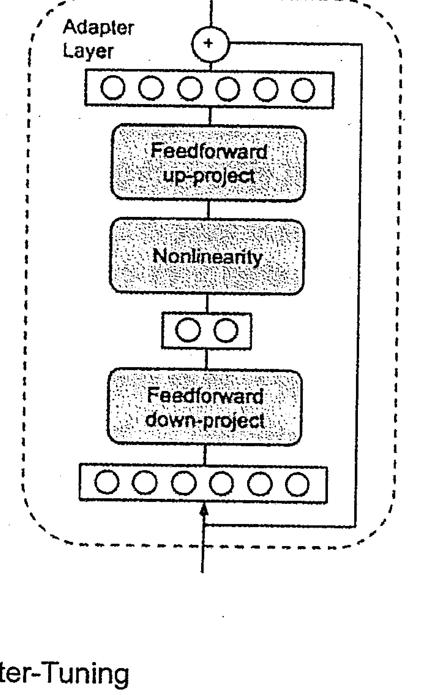

# 图3-2 Adapter-Tuning

在 Adapter-Tuning 中，适配器被添加到预训练模型的中间层，用于处理特定任务的输入和输出。适配器的参数可以通过微调来进行优化，以适应新的数据分布。与传统的微调方法不同，Adapter-Tuning 只微调适配器的参数，而非整个模型的参数。这种方法可以大大降低微调的计算成本、减少微调时间，同时可以保留预训练模型的大部分参数，从而提高模型的泛化能力。

Adapter-Tuning 的优点是可以不在改变预训练模型结构的情况下，快速适应特定任务。由于适配器是轻量级的模块，因此可以在不占用太多计算资源的情况下进行微调。此外，适配器还可以在不同的任务之间实现共享，从而降低微调的计算成本、减少微调时间。

然而，Adapter-Tuning 也存在一些限制。首先，适配器的性能取决于预训练模型的质量和适配器的设计。其次，适配器只能处理特定任务的输入和输出，因此对于一些需要处理多个任务的场景，可能需要添加多个适配器。最后，适配器的性能可能会受到预训练模型的限制，因此在一些复杂的任务中，可能需要使用更加复杂的微调方法。

+   (3) Prompt-Tuning

大模型的全参数微调需要为每个任务训练一个模型，这样的开销和部署成本都比较高。同时，离散的 Prompt 方法（人工设计 Prompt，并将其添加到模型中）成本也比较高，并且效果不太好。

为了解决这些问题，Prompt-Tuning 通过反向传播更新参数来学习 Prompt，

[PAGE 47]

# 第3章 微调Llama 2大模型

而非人工设计 Prompt。同时，该方法冻结模型原始权重，只训练 Prompt 参数。训练完成后，同一个模型就可以用于多个任务的推理，从而降低了成本和部署的复杂性。

Prompt-Tuning 可以看作 Prefix-Tuning 的简化版本，它给每个任务定义了自己的 Prompt，并将其拼接到数据上作为输入。与 Prefix-Tuning 不同的是，Prompt-Tuning 只在输入层加入 prompt tokens，旨在通过添加模板的方法避免引入额外的参数，从而使模型可以在小样本或零样本场景下达到理想的效果。

同时，Prompt-Tuning 还提出了 Prompt Ensembling，即在一个批次（Batch）里同时训练同一个任务的不同 Prompt（采用多种方式询问同一个问题）。

+   (4) P-Tuning v1

对于某些任务而言，人工设计模板并不是一件容易的事情。不同的模板在不同的模型、数据和任务上的效果差别可能很大。在这种情况下，P-Tuning v1 重新审视了关于模板的定义，放弃了“模板由自然语言构成”这一常规要求，从而将模板的构建问题转换为连续参数优化问题。这种方法虽然很简单，但非常有效。

P-Tuning v1 将 Prompt 转换为可以学习的 Embedding 层，并用 MLP+LSTM 的方式对 Prompt Embedding 进行处理。与 Prefix-Tuning 相比，P-Tuning v1 加入了可微的 virtual tokens，但仅限于在输入层加入，并没有在每一层都加入。另外，virtual tokens 插入的位置也不一定是前缀，其插入的位置是可选的。这里的出发点实际上是把传统人工设计的模板中的真实 token 替换成可微的 virtual tokens。

+   (5) P-Tuning v2

P-Tuning v1 存在一定的局限性。研究表明，当模型规模超过 100 亿个参数时，P-Tuning v1 的表现可以与全参数微调相媲美，但对于规模较小的模型，P-Tuning v1 的表现较差。P-Tuning v1 缺乏跨任务的通用性，其在序列标注任务中的有效性尚未得到验证。序列标注任务需要预测一系列无实际意义的标签，这对于 P-Tuning v1 来说具有挑战性。当模型层数较多时，P-Tuning v1 微调过程中模型的稳定性难以保证。此外，模型层数越多，第一层输入的 Prompt 对后续层的影响越难预估。

P-Tuning v2 是 P-Tuning v1 的改进版本，同时借鉴了 Prefix-Tuning。与 P-Tuning v1 相比，P-Tuning v2 将 P-Tuning v1 中原本只加在输入层的、可微的 virtual tokens 以前缀的形式添加到每一层 Transformer 的输入中，层与层之间相互独立；在 Prefix 部分，每一层 Transformer 的输入都需要被微调，每一层 Transformer 的输入不是上一层的输出，而是随机初始化的 Embedding。

在这种情况下，可以将原本 P-Tuning v1 中的语义标签（只能用于文本分类

[PAGE 48]

## Llama 大模型实践指南

任务和问答任务）替换为传统微调方法使用的下游分类器，以便在机器阅读理解、命名实体识别和语义角色标注等更具有挑战性的序列标注任务上达到更好的效果。

+   (6) LoRA.

随着规模的增大，模型会展现出各种能力。特别是对于大模型而言，随着规模的增大，其在零样本学习、常识推理等方面的能力会大幅提高。然而，与规模较小的模型相比，大模型的微调和部署成本都非常高。此外，如果需要针对不同的下游任务微调多个模型，就需要为每个下游任务保存一份模型权重，成本非常高。

在这个背景下，LoRA（论文 “LoRA: Low-Rank Adaptation of Large Language Models”）的核心思想是通过低秩分解来模拟参数的改变量，从而以极小的参数量来实现大模型的间接训练。

LoRA 的思想很简单，即在原始预训练模型旁边增加一个旁路，执行一个降维再升维的操作，来模拟所谓的 intrinsic rank；训练时固定原始预训练模型的参数，只训练降维矩阵 A 与升维矩阵 B，而模型的输入、输出维度不变，输出时将 BA 与预训练模型的参数叠加；用随机高斯分布初始化 A，用 0 矩阵初始化 B，保证训练开始时此旁路矩阵依然是 0 矩阵，如图 3-3 所示。其中，h 通常表示“隐藏层”或“隐藏状态”，常出现在深度学习模型中；x 通常表示输入数据或特征向量；d 表示向量或矩阵的维度；r 表示 LoRA 层参数。

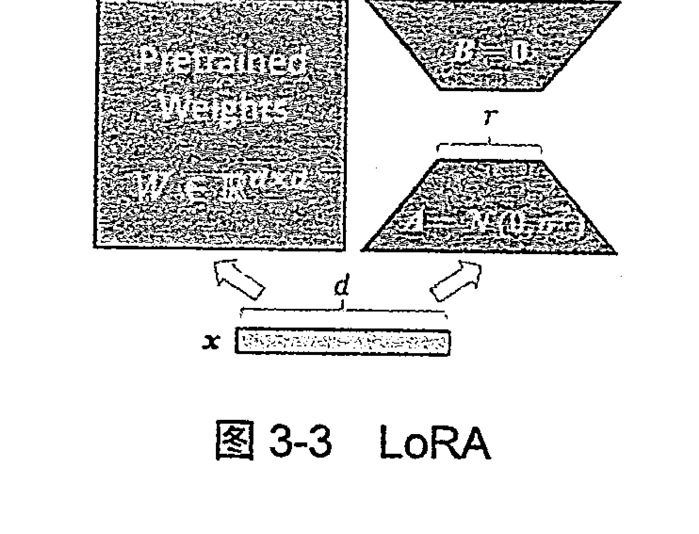

### 3.3.2 模型参数高效微调

目前，针对大模型，主流的微调方法是 P-Tuning 和 LoRA，故本节只对 P-Tuning v1、P-Tuning v2 和 LoRA 的模型进行详细的介绍。

+   1. P-Tuning v1

可以参考以下 P-Tuning v1 的核心代码进行微调：

[PAGE 49]

# 第3章 微调Llama2大模型

```
from peft import (
    get_peft_config,
    get_peft_model,
    get_peft_model_state_dict,
    set_peft_model_state_dict,
    PeftType,
    TaskType,
    PromptEncoderConfig,
)
```

# 创建一个PromptEncoderConfig对象，指定任务类型为CAUSAL_LM，虚拟令牌数量为
20，编码器隐层数量为128。

```
peft_config = PromptEncoderConfig(task_type=TaskType.CAUSAL_LM,
num_virtual_tokens=20, encoder_hidden_size=128)
```

这一步实现了导入相关环境和创建P-Tuning v1对应的配置。

Plaintext

```
# 从预训练模型路径加载CausallM模型
model = AutoModelForCausalLM.from_pretrained(model_name_or_path)
# 将加载的模型转换为PEFT模型，使用指定的PromptEncoderConfig
model = get_peft_model(model, peft_config)
# 打印PEFT模型中可训练参数的数量和名称
model.print_trainable_parameters()
```

这一步实现了加载模型和通过调用get_peft_model()包装加载的模型。

+   2. P-Tuning v2

可以参考以下P-Tuning v2的核心代码进行微调：

Plaintext

```
from peft import get_peft_config, get_peft_model,
 PrefixTuningConfig, TaskType, PeftType
# 创建一个PrefixTuningConfig对象，指定任务类型为CAUSAL_LM，虚拟令牌数量
为30
peft_config = PrefixTuningConfig(task_type=TaskType.CAUSAL_LM,
num_virtual_tokens=30)
```

这一步实现了导入相关环境和创建P-Tuning v2对应的配置。其中，
PrefixTuningConfig中 prefix_projection 参数默认值为 false，表示使用 P-Tuning 
v2，如果该参数值为 true，则表示使用 Prefix-Tuning。

Plaintext

[PAGE 50]

## Llama 大模型实践指南

```
#加载模型，通过调用 get_peft_model() 包装加载的模型
model = AutoModelForCausalLM.from_pretrained(model_name_or_path)
model = get_peft_model(model, peft_config)
model.print_trainable_parameters()
```

# 3. LoRA

可以参考以下 LoRA 的核心代码进行微调：

```
Plaintext
from peft import get_peft_config, get_peft_model,
get_peft_model_state_dict, LoraConfig, TaskType
peft_config = LoraConfig(
    task_type=TaskType.CAUSAL_LM,
    inference_mode=False,
    lora_r=8,
    lora_alpha=32,
    lora_dropout=0.1
    target_modules=[q_proj,k_proj,v_proj,o_proj]
)
```

上述代码表示导入相关的库和创建 LoRA 对应的配置。其中相关参数的说明如下。

+   (1) task_type:

# 第3章 微调Llama 2大模型

当预训练模型的参数很少时，P-Tuning v1的效果很差，只有当参数达到100亿个时，它才勉强达到Fine-Tuning的效果。而P-Tuning v2虽然在一些任务上可以达到与Fine-Tuning一样甚至更好的效果，但灾难性遗忘的情况比较严重。

## 3.4 模型评估、测试和模型优化

模型评估、测试和模型优化是深度学习中至关重要的步骤，可以帮助我们了解模型的性能、发现问题并不断提高模型的质量。本节以Llama 2大模型为例，深入探讨这两个关键步骤。

### 3.4.1 模型评估、测试

模型评估、测试是开发大模型的关键步骤，用于评估大模型的性能并确保其在特定任务中的有效性和准确性。

在模型评估、测试过程中，我们通过将大模型的输出与参考标准或基准数据集进行比较，来评估其质量和准确性。模型评估、测试的具体指标取决于模型设计的特定任务。

模型评估、测试的目的是确保大模型在实际应用中的有效性。通过评估、测试模型的性能，我们可以识别和解决模型中的问题，并进行必要的调整和改进，以提高模型的性能和泛化能力。总之，模型评估、测试是开发大模型不可或缺的步骤，通过比较模型的输出与参考标准来评估模型的质量，并使用适当的指标来衡量模型的性能。这些步骤可以帮助我们改进和优化模型，以确保其在特定任务中的有效性和准确性。

对于语言建模任务，困惑度是常用的评估模型质量的指标。此外，我们还可以从不同任务场景的角度来评估微调后模型的性能，以下角度可以作为参考。

-   (1) 基础能力：如给定一个话题、一个写作任务，要求据此创作一段文字，根据模型生成的结果（内容是否丰富、用词是否恰当、语句是否通顺等）来评估微调后模型的性能。
-   (2) 语义理解与抽取：如让模型从一篇文章、一段话中抽取出指定的知识（出现的人物、地点和事件等）。
-   (3) 逻辑推理：如向模型提一个比较简单的逻辑推理问题，观察模型是否能给出正确的答案。
-   (4) 代码生成：如让模型写一个快速排序等简单算法的代码。
-   (5) 数学计算：如加、减、乘、除的计算测试。

模型评估、测试是验证大模型在未参与训练或验证的新独立数据集上的表现的过程。通过模型测试，我们可以评估模型的性能，并确定其在实际应用场景中解决目标任务的有效性和准确性。

为了确保模型能够处理各种输入变化并在未知数据上表现良好，使用多样性和有代表性的测试集非常重要。测试集应该包含各种不同类型的样本，涵盖模型可能会遇到的各种情况和场景（可以参考开源的 BLUB 项目中的测试集，包含通用知识、语言理解、创作能力、逻辑推理、代码编程、工作技能、使用工具、人格特征这八个大类别，其中每个大类别下又分别包含很多小类别）。这样可以更全面地评估模型的性能，并发现模型在特定领域或特定类型的输入上的潜在问题。

为了有效评估、测试模型，可以采取以下评估、测试策略，以便进行准确和全面的模型评估、测试。

-   (1) 数据集划分：将数据集划分为训练集、验证集和测试集。训练集用于进行模型训练，验证集用于调整模型的参数和结构，测试集用于最终评估模型的性能。要确保数据集的划分是随机且有代表性的，以避免样本偏差对评估结果产生影响。
-   (2) 评估指标：选择适当的评估指标来评估模型的性能。根据任务的特点，可以使用准确率、精确率、召回率、F1 值等指标来评估模型的性能。此外，还可以考虑其他领域特定的指标，以便更好地评估模型在实际应用中的效果。
-   (3) 多次测试：进行多次测试以获取更可靠的结果。在每次测试时，可以随机选择不同的样本或使用交叉验证方法来获得更全面的评估结果。进行多次测试可以减小随机性对评估结果的影响，并获得更稳定的评估指标。
-   (4) 模型调整：根据测试结果调整模型的参数和结构。通过分析测试结果，可以发现模型的弱点和改进空间，并进行相应的调整和优化。可以尝试采用不同的超参数设置、模型结构变化或正则化技术，以提高模型的性能和泛化能力。

### 3.4.2 模型优化

针对模型评估、测试中出现的问题，可以采取一些有针对性的方法。例如，当模型生成的文本不遵循原文（Faithfulness）或不符合事实（Factualness）时，我们可以认为模型出现了幻觉。模型出现幻觉的原因可能是多方面的。

在训练数据层面上，在训练数据收集过程中可能会收集到虚假信息，从而导致模型记忆了错误的知识，过多的重复信息也可能导致模型的知识记忆出现bias，从而出现幻觉。即使有高质量的训练数据，模型仍然可能出现幻觉。

在模型层面上，有研究表明，解码算法如果使用不确定性较高的采样算法（如 top-p），则会诱导模型出现严重的幻觉。甚至可以故意在解码算法中加入一些随机性，进一步让模型“胡编乱造”。参数知识的问题也会导致模型在预训练阶段记忆错误的知识，从而出现严重的幻觉。

为了减轻模型的幻觉，可以从以下几个方面入手。在训练数据层面上，可以人工标注一批高质量的训练数据，并剔除可能导致出现幻觉的训练数据。在评估、测试数据上，可以构建细粒度的幻觉评估 Benchmark，用于分析幻觉的严重程度和原因。在模型层面上，可以进行强化学习（如 RLHF），将减轻幻觉的指标作为强化学习的 Reward 函数，从而减轻模型的幻觉。可以在解码时减小模型的生成随机性，进行多任务学习，通过设计合适的额外任务，达到减轻模型幻觉的效果。在后处理方面，可以设计一个小模型专门用于修复幻觉错误。

## 3.5 模型保存、模型部署和推理加速

模型保存、模型部署和推理加速是将深度学习模型（如 Llama 2）投入实际应用的关键步骤。在这个主题下，本节将探讨如何有效地保存微调后的 Llama 2 大模型并将其部署到实际应用中，以及推理加速的相关内容。

### 3.5.1 模型保存

对于用 LoRA 微调训练后的模型，可以参考下面的代码保存：

```
Plaintext
peft_model_id =
 f"{model_name_or_path}_{peft_config.peft_type}_{peft_config.task_type}"
model.save_pretrained(peft_model_id)
```

调用 save_pretrained()函数保存模型，保存后的结果如下：

```
Plaintext
├── [ 451] adapter_config.json
├── [ 81K] adapter_model.bin
└── [ 129] README.md
```

这里只保存经过训练的增量模型权重。其中，adapter_config.json 为 LoRA 配置文件；adapter_model.bin 为 LoRA 权重文件。

如果想要得到完整的模型文件，则需要将用 LoRA 微调训练后的增量模型权重和 Llama2-base 模型进行合并。

### 3.5.2 模型部署

# 1. 命令行原生 Transformers 推理接口

本节提供了命令行的方式，使用原生 Transformers 推理接口进行推理。下面以加载 Llama2-7B-Chat 模型为例说明启动方式：

```
Plaintext
import torch
from transformers import AutoTokenizer, AutoModelForCausalLM
# 从预训练模型路径加载 CausalLM 模型，并设置设备映射、张量数据类型和使用 8 位加载模型
model = AutoModelForCausalLM.from_pretrained('meta-llama/Llama2-7b-chat-hf',device_map='auto',torch_dtype=torch.float16,load_in_8bit=True)
# 将模型设置为评估模式
model = model.eval()
# 从预训练模型路径加载分词器，并禁用快速分词模式
tokenizer = AutoTokenizer.from_pretrained('meta-llama/Llama2-7b-chat-hf',use_fast=False)
# 将分词器的 pad_token 设置为 eos_token
tokenizer.pad_token = tokenizer.eos_token
input_text = '介绍一下中国'
# 将输入文本转换为模型输入张量，并添加特殊令牌，将张量移动到 GPU 上
input_ids = tokenizer(['<s>Human: input_text\n</s><s>Assistant: '], return_tensors=
```

```
"bos_token_id":tokenizer.bos_token_id,
"pad_token_id":tokenizer.pad_token_id
}
# 使用模型生成文本
generate_ids = model.generate(**generate_input)
# 将生成的文本张量解码为文本字符串
text = tokenizer.decode(generate_ids[0])
print(text)
```

首先，导入PyTorch库和Transformers库，使用AutoModelForCausalLM.from_pretrained()方法加载预训练的Llama2大模型，使用model.eval()方法将模型设置为评估模式，使用AutoTokenizer.from_pretrained()方法加载预训练的tokenizer，并将分词器的pad_token设置为eos_token。

其次，指定输入文本input_text，使用tokenizer()方法将输入文本编码为input_ids，使用“Human:”“Assistant:”将输入文本包装在Human和Assistant的对话中。

再次，使用model.generate()方法生成聊天回复，将input_ids作为输入，并指定一些生成参数，如max_new_tokens、do_sample、top_k、top_p、temperature、repetition_penalty、eos_token_id、bos_token_id和pad_token_id。

最后，使用tokenizer.decode()方法将生成的文本张量解码为文本字符串，并将其打印到控制台。

这段代码使用了Llama2大模型进行聊天，可以根据需要进行修改和扩展。

# 2. 基于Gradio搭建问答平台

Gradio是一个开源的Python库，用于构建交互式的机器学习界面，使用户可以轻松地与训练好的机器学习模型进行交互。Gradio的目标是让机器学习模型更容易部署和共享，而不需要进行深度编程。

Gradio的主要特点和用途如下。

-   (1) 交互式界面构建：Gradio允许用户使用简单的Python代码构建具有用户界面的机器学习模型，可以创建文本框、图像上传框、滑块等元素，让用户与机器学习模型进行交互。
-   (2) 快速部署：使用Gradio可以快速将机器学习模型部署为Web应用，而不需要深度的Web开发知识。这使得机器学习模型的展示和共享变得非常容易。
-   (3) 多种输入、输出类型支持：Gradio支持多种输入数据类型，包括文本、图像、音频等，还可以输出不同类型的结果，如文本、图像等。
-   (4) 支持多种机器学习框架：Gradio可以与多种常见的机器学习框架（如TensorFlow、PyTorch、scikit-learn等）无缝集成，因此用户可以使用自己最熟悉的...

[PAGE 56]

## Llama 大模型实践指南

的框架来构建模型。

-   (5) 适用于教育和研究：Gradio 不仅适用于将模型部署为应用程序，还适用于教育和研究。用户可以使用 Gradio 构建交互式的演示，以帮助学生或同事理解机器学习模型的工作原理。

总之，Gradio 是一个强大的工具，用于构建交互式的机器学习界面，使用户更容易与机器学习模型进行交互。基于 Gradio 搭建的问答平台实现了流式的输出，将下面的代码复制到控制台运行（以下代码以 Llama2-7B-Chat 模型为例，不同模型只需修改一下代码里的模型名称）：

```
Plaintext
python examples/chat_gradio.py --model_name_or_path meta-llama/Llama2-7b-chat
```

```
Plaintext
import gradio as gr
import time
from transformers import AutoTokenizer, AutoModelForCausalLM,TextIteratorStreamer
from threading import Thread
import torch,sys,os
import json
import pandas
import argparse
```

```
with gr.Blocks() as demo:
    gr.Markdown('''<h1><center>智能助手</center></h1>''')
    chatbot = gr.Chatbot()
    msg = gr.Textbox()
    state = gr.State()
    with gr.Row():
        clear = gr.Button("新话题")
        re_generate = gr.Button("重新回答")
        sent_bt = gr.Button("发送")
    with gr.Accordion("生成参数", open=False):
        slider_temp = gr.Slider(minimum=0, maximum=1,
        label="temperature", value=0.3)
        slider_top_p = gr.Slider(minimum=0.5, maximum=1,
        label="top_p", value=0.95)
```

```
slider_context_times = gr.Slider(minimum=0, maximum=5, label="上文轮次", value=0,step=2.0)
```

# 定义用户输入的回调函数

```
def user(user_message, history):return '
```

# 如果上一条历史记录的回答不为空，则将其设置为空

```
def bot(history,temperature,top_p,slider_context_times):if pandas.isnull(history[-1][1])==False:
	history[-1][1] = Noneyield history
	slider_context_times = int(slider_context_times)
	history_true = history[1:-1]
	prompt = '' # 构造生成文本的prompt
	if slider_context_times>0:
		prompt += '\n'.join(("<s>Human: 
```

# 定义生成文本的参数

```
generate_input = {
	"input_ids":input_ids,
	"max_new_tokens":512,
	"do_sample":True,
	"top_k":50,
	"top_p":top_p,
	"temperature":temperature,
	"repetition_penalty":1.3,
	"streamer":streamer,
	"eos_token_id":tokenizer.eos_token_id,
	"bos_token_id":tokenizer.bos_token_id,
	"pad_token_id":tokenizer.pad_token_id
```

# 创建线程，使用模型生成文本

```
thread = Thread(target=model.generate, kwargs=generate_input)
thread.start()
start_time = time.time()
bot_message = ''
print('Human:',history[-1][0])
print('Assistant: ',end='', flush=True)
```

# 以文本流的形式生成文本

```
for new_text in streamer:
    print(new_text
```

# 清除按钮点击事件

```
clear.click(lambda: [], None, chatbot, queue=False)
```

# 启动Gradio应用程序

```
if __name__ == "__main__":
```

```
parser = argparse.ArgumentParser()
```

```
parser.add_argument("--model_name_or_path", type=str, help='mode name or path')
```

```
parser.add_argument("--is_4bit", action='store_true', help='use 4bit model')
```

```
args = parser.parse_args()
```

# 从预训练模型路径加载分词器，并禁用快速分词模式，将pad_token设置为eos_token

```
tokenizer = AutoTokenizer.from_pretrained(args.model_name_or_path, use_fast=False)
```

```
tokenizer.pad_token = tokenizer.eos_token
```

# 如果不使用4位模型，则从预训练模型路径加载AutoGPTQForCausalLM模型，并设置设备映射、张量数据类型和使用8位加载模型。如果使用4位模型，则从预训练模型路径加载AutoGPTQForCausalLM模型

```
if args.is_4bit==False:
```

```
model = AutoModelForCausalLM.from_pretrained(args.model_name_or_path, device_map='auto', torch_dtype=torch.float16, load_in_8bit=True)
```

```
model.eval()
```

```
else:
```

```
from auto_gptq import AutoGPTQForCausalLM
```

```
model = AutoGPTQForCausalLM.from_quantized(args.model_name_or_path
```

```
, low_cpu_mem_usage=True, device="cuda:0", use_triton=False,inject_fused_attention=False,inject_fused_mlp=False)
```

# 创建文本流

```
streamer = TextIteratorStreamer(tokenizer,skip_prompt=True)
```

```
if torch.__version__ >= "2" and sys.platform != "win32":
```

```
model = torch.compile(model)
```

# 启动Gradio应用程序

## Llama 大模型实践指南

```
demo.queue().launch(share=False,
debug=True,server_name="0.0.0")
```

# 3. 基于Docker部署问答接口

部署问答接口只需在Docker环境中执行 chat_gradio.py 程序，系统需要准备的环境为 docker:24.0.2。

第一步，准备 Docker 镜像：

```
git clone https://github.com/FlagAlpha/Llama2-Chinese.git
cd Llama2-Chinese
sudo docker build -f docker/Dockerfile -t FlagAlpha/llama2-chinese-7b:gradio .
```

第二步，通过 docker-compose 启动 chat_gradio：

```
cd Llama2-Chinese/docker
docker-compose up -d --build
```

### 3.5.3 推理加速

我们在讨论推理加速时，实际上是在讨论如何让计算机更快地理解和处理自然语言（如文本）。这对于很多应用都非常重要，如智能助手、自动翻译、搜索引擎等。

推理是一个计算机模型根据已有的知识和数据做出决策或回答问题的过程。有时这个过程非常耗时，如在处理大量的文本或复杂的模型时。

推理加速的目的就是尽量减少计算机进行推理所需的时间，使其更快地做出决策或回答问题。这对于提升用户体验和快速处理大量数据非常重要。

前文提到的一些方法和工具可以帮助计算机实现推理加速。通过使用一些技巧，如使用更快的计算方式、更高效地存储数据、并行处理等，可提高推理速度。

简而言之，就像把一本厚重的书变成电子书，让你可以更快地查找信息，或者让你的智能手机更快地回答你的问题。总之，推理加速就是为了让计算机更聪明，从而更快地理解和处理人们的需求。


# 第3章 微调Llama 2大模型

vllm 同样是 GPU 推理的方案。相较于 FasterTransformer，vllm 更加简单易用。vllm 的特点如下。

+   (1) 简单易用：与其他推理框架（如 FasterTransformer）相比，vllm 更加简单易用，不需要额外的模型转换，使模型部署和使用变得非常方便。这对于模型开发人员和研究人员来说，节省了宝贵的时间和资源。

+   (2) 支持fp16推理：vllm支持fp16（半精度浮点数）推理，这可以显著地提高推理速度，同时减少GPU内存的使用。这对于大模型和大型数据集的处理非常有益。

+   (3) 推理速度快：vllm的推理速度非常快，这得益于其高效的实现和优化。这意味着在实际应用中，vllm可以在短时间内处理大量的NLP任务，从而提高系统的响应速度。

+   (4) 高效的kv缓存机制：vllm使用了高效的kv（键值）缓存机制，可以加速模型的推理。这种缓存机制有效地减少了计算时间，特别是对于需要多次查询相同的kv的任务而言非常高效。

+   (5) 连续的批处理请求推理：vllm支持连续的批处理请求推理。这意味着可以一次性处理多个输入，进一步提高了系统的吞吐量。这在实时应用（如聊天机器人或在线翻译系统）中尤其有用。

+   (6) 优化的cuda算子：vllm使用了优化的cuda算子，以充分利用GPU的性能。这些算子经过精心设计，可以确保推理过程的高效性和稳定性。

+   (7) 支持分布式推理：vllm支持分布式推理。这意味着可以在多个GPU或多台机器上同时进行推理，以应对大规模任务和高并发需求。这种可扩展性使得vllm成为处理大型数据集和复杂应用的理想选择。

第一步，安装vllm。

```
git clone https://github.com/vllm-project/vllm
cd vllm && python setup.py install
```

第二步，启动测试server。

+   (1) 单卡推理。

```
CUDA_VISIBLE_DEVICES=0 python api_server.py \
--model "/mnt/data_online/models/llama/models--meta-llama--Llama2--" \
--port 8090
```

(2) 多卡推理。

# multi_gpus_api_server.sh 里面的 CUDA_VISIBLE_DEVICES 指定了要使用的 GPU 卡

# tensor-parallel-size 指定了GPU卡的个数

bash multi_gpus_api_server.sh

multi_gpus_api_server.sh 如下:

```
CUDA_VISIBLE_DEVICES=0 python api_server.py \
--model "/mnt/data_online/models/llama/models--meta-llama--Llama2-7b-chat-hf" \
--port 8090
```

其中，启动模型 API 服务的接口参考代码 api_server.py 如下:

```
import argparse
import json
from typing import AsyncGenerator
from fastapi import BackgroundTasks, FastAPI, Request
from fastapi.responses import JSONResponse, Response,
StreamingResponse
import uvicorn

from vllm.engine.arg_utils import AsyncEngineArgs
from vllm.engine.async_llm_engine import AsyncLLMEngine
from vllm.sampling_params import SamplingParams
from vllm.utils import random_uuid

# 导入所需的库和类，并创建FastAPI
TIMEOUT_KEEP_ALIVE = 5 # seconds.
 TIMEOUT_TO_PREVENT_DEADLOCK = 1 # seconds.
app = FastAPI()

# 定义生成文本的接口，使用装饰器@app.post将其绑定到HTTP POST请求上
# 接口接收一个JSON对象作为请求体，包含以下字段
# prompt: 生成文本的提示
```

# 第3章 微调Llama 2大模型

```
# stream: 是否流式传输结果
# 从请求体中获取这些字段，并使用它们调用engine.generate()方法生成文本
@app.post("/generate")
async def generate(request: Request) -> Response:
    """Generate completion for the request."

    The request should be a JSON object with the following fields:
    - prompt: the prompt to use for the generation.
    - stream: whether to stream the results or not.
    - other fields: the sampling parameters (See SamplingParams for details)."
    
    request_dict = await request.json()
    prompt = request_dict.pop("prompt")
    stream = request_dict.pop("stream", False)
    sampling_params = SamplingParams(**request_dict)
    request_id = random_uuid()
    results_generator = engine.generate(prompt, sampling_params, request_id)

    # Streaming case
    # 如果stream为True，则使用异步生成器stream_results()流式传输结果。在每次生成文本时，先将生成的文本添加到text_outputs列表中，并将其作为JSON对象返回。然后使用yield将JSON对象编码为字节流，并在每个JSON对象之间添加空字符'\0'。如果客户端断开连接，则调用abort_request()方法中止请求
    async def stream_results() -> AsyncGenerator[bytes, None]:
        async for request_output in results_generator:
            prompt = request_output.prompt
            text_outputs = [
                prompt + output.text for output in request_output.outputs
            ]
            ret = {"text": text_outputs}
            yield (json.dumps(ret) + '\0').encode('utf-8')

    async def abort_request() -> None:
        await engine.abort(request_id)
```

## Llama 大模型实践指南

```
if stream:
    background_tasks = BackgroundTasks()
    # Abort the request if the client disconnects.
    background_tasks.add_task(abort_request)
    return StreamingResponse(stream_results(),
                            background=background_tasks)
```

```
# Non-streaming case
# 如果 stream 为 False，则使用 for 循环遍历生成的文本，并将其添加到 text_
outputs 列表中。如果客户端断开连接，则调用 abort_request() 方法中止请求。最后将
final_output = None
async for request_output in results_generator:
    if await request.is_disconnected():
        # Abort the request if the client disconnects.
        await engine.abort(request_id)
        return Response(status_code=499)
    final_output = request_output
```

```
assert final_output is not None
prompt = final_output.prompt
text_outputs = [prompt + output.text for output in 
final_output.outputs]
ret = {"text": text_outputs}
return JSONResponse(ret)
```

```
if __name__ == "__main__":
    # 解析命令行参数，创建 AsyncLLMEngine 对象，并使用 uvicorn 启动 FastAPI
    parser = argparse.ArgumentParser()
    parser.add_argument("--host", type=str, default="0.0.0.0")
    parser.add_argument("--port", type=int, default=8090)
    parser = AsyncEngineArgs.add_cli_args(parser)
    args = parser.parse_args()
    engine_args = AsyncEngineArgs.from_cli_args(args)
    engine = AsyncLLMEngine.from_engine_args(engine_args)
```

# 第3章 微调Llama 2大模型

```
uvicorn.run(app,
    host=args.host,
    port=args.port,
    log_level="debug", 
    timeout_keep_alive=TIMEOUT_KEEP_ALIVE)
```

等待API服务启动之后，就可以进行推理测试，推理参考脚本如下:

```
# coding=utf-8
import json
import time
import urllib.request
import sys

# 定义一个函数gen_prompt()，用于生成输入文本的提示。将输入文本包装在"<s>Human:"和"\n</s><s>Assistant: "之间
def gen_prompt(input_text):
    prompt = "<s>Human: "+input_text+"\n</s><s>Assistant: "
    return prompt

# 定义一个函数test_api_server()，用于向API服务器发送请求并获取生成的文本
def test_api_server(input_text):
    # 首先设置请求头的Content-Type为application/json。其次使用gen_prompt()函数生成输入文本的提示
    header = {'Content-Type': 'application/json'}
    prompt = gen_prompt(input_text.strip())
    # 构造请求的数据，包括prompt和其他采样参数
    data = {
        "prompt": prompt,
        "stream" : False,
        "n" : 1,
        "best_of": 1,
        "presence_penalty": 0.0,
        "frequency_penalty": 0.2,
        "temperature": 0.3,
        "top_p": 0.95,
        "top_k": 50,
```

## Llama 大模型实践指南

```
"use_beam_search": False,
"stop": [],
"ignore_eos":False,
"max_tokens": 2048,
"logprobs": None
```

# 创建一个urllib.request.Request对象，指定请求的URL、请求头和请求数据。尝试发送请求并获取响应，将响应解码为json格式，并打印请求数据和生成结果

```
request = urllib.request.Request(
  url='http://127.0.0.1:8090/generate',
  headers=header,
  data=json.dumps(data).encode('utf-8')
)

result = urllib.request.urlopen(request, timeout=300)
res = result.read().decode('utf-8')
print(json.dumps(data, ensure_ascii=False, indent=2))
print(json.dumps(result, ensure_ascii=False, indent=2))
```

```
except Exception as e:
  print(e)
```

```
return result
```

```
if __name__ == '__main__':
  test_api_server('如何去北京?')
  test_api_server('肚子疼怎么办?')
  test_api_server('帮我写一个请假条')
```

# 第4章 解决Llama 2大模型多轮对话难题

Llama 2 大模型在多轮对话中面临多个难题，包括但不限于上下文管理与信息流失、保持一致性与逻辑连贯性、实现用户个性化与上下文敏感性、提供高效率和低延迟的响应，以及确保输出的安全性和可解释性。这些难题涉及模型架构、数据策略、运行时优化，是制约大模型在复杂对话场景下应用的关键因素。

本章将深入探讨 Llama 2 大模型在多轮对话场景下面临的一系列难题及其解决方案。从面向对话的多轮数据标注方法，到多轮历史存储的策略，再到利用先进对话技术提高模型的应对能力，以及如何进行模型评估和持续改进，本章旨在提供一个全面的指导框架，以帮助读者更有效地提高 Llama 2 大模型在复杂的多轮对话场景中的性能。

## 4.1 定制多轮对话数据集和构造方法

本节提供了一套用于定制多轮对话数据集的全面指导，包括明确对话场景和目标，选择合适的数据源，以及进行必要的数据标注。数据结构通常包括用户输入、系统响应和上下文信息。在数据收集方面，可选用人工模拟、用户研究和实际用户日志等方法。构造方法涵盖模板生成、数据增强和负采样等，数据预处理包括文本清洗、分词、词性标注和向量化。此外，还要适当地将数据分为训练集、验证集和测试集，以进行模型训练和性能评估。这个过程是可迭代的，需要根据模型性能和用户反馈进行持续优化。

### 4.1.1 准备微调训练数据的7个原则

进行模型微调，首先要准备微调训练数据，通常要根据业务场景和目标来进行相关的数据准备（一般由场景需求方和模型训练团队共同准备）。根据经验，准备微调训练数据通常有以下7个原则。

# Llama大模型实践指南

#### 1. 数据质量
原则：确保数据是准确的、清洗过的，并且没有垃圾数据产生噪声。
目的：高质量的数据是模型性能提高的基础，数据质量对于模型的微调至关重要。因此，应该在准备微调训练数据时仔细检查并清洗数据，确保数据集中不包含无用的文本及其他噪声。数据集中的每个数据样本都应具有明确的实际意义，以便模型能够较好地理解其含义。

#### 2. 数据集规模
原则：数据集规模的大小也很重要，应该确保数据样本充足，数据集中的文本数量应该在几千到几十万之间。
目的：数据集规模大对于确保模型能够准确地学习特定任务的格式和规律有很重要的意义。

#### 3. 数据多样性
原则：数据应覆盖多种场景、领域和用户群体。
目的：提高模型的泛化能力，一个具有高泛化能力的模型不仅在训练数据上表现良好，而且能够很好地适应新的、未见过的数据。泛化能力高的模型能够捕捉到数据的底层结构或规律，而不是简单地记忆训练数据的特定样本。数据多样性对于提高模型的泛化能力有很大的帮助。在实操中，大量原始基础数据要比蒸馏数据具有更强的多样性。很多模型训练团队为了节省成本，采用 OpenAI 的 GPT-4 蒸馏数据作为训练数据，其训练的模型的泛化能力不如使用大量原始基础数据作为训练数据的场景需求方训练的模型的泛化能力高。

#### 4. 数据平衡
原则：避免数据集中存在严重的类别不平衡或偏见。
目的：确保模型能够平衡地处理不同类型的输入。在实操中，如果基础数据存在这种严重不平衡的情况，那么通过上采样或下采样、权重调整、数据合成等方法来避免数据集中存在严重的类别不平衡或偏见对于提高模型的泛化能力和可靠性很重要。

#### 5. 时间和空间分布
原则：确保数据能准确地反映真实世界的时间和空间分布，重要的步骤包括跨多个时间段和地理位置收集数据、定期更新数据集、考虑特殊或突发事件的影响，以及使用多种数据源和权重调整策略。

# 第4章 解决Llama 2大模型多轮对话难题
目的：使模型能够适应实际应用场景、提高泛化能力。

#### 6. 数据安全性和合规性
原则：遵循数据安全性和合规性原则，遵守所在国家的法律。在中国，遵循数据安全性和合规性原则具有特别的重要性，因为国内有一套详细的法律框架，如《中华人民共和国网络安全法》和《中华人民共和国个人信息保护法》，这些法律强调了只收集必要的个人信息、获得用户明确同意、安全加密存储，以及在跨境数据传输和用户信息查询或删除方面的严格规定，不遵守这些规定可能会导致严重违法。
目的：确保数据收集、使用符合法律和伦理规范，严格遵守这些法律不仅是数据安全性和合规性的要求，还是赢得用户信任的关键。

#### 7. 相似性
原则：在准备微调训练数据时，应注意确保数据之间是具有相互关联的，并且是易于泛化的。
目的：数据应该在特定的微调任务上具有代表性，但又不是简单的重复。尽管有研究表明重复数据并不降低模型的质量，但是重复数据会增加额外的微调成本。

遵循这7个原则不仅能提高模型的性能和泛化能力，还能确保数据处理过程的合规性和可靠性。微调是一种非常实用的技术，但是准备微调训练数据却不是一件轻松的事情。

### 4.1.2 定制微调训练数据集
定制微调训练数据集通常是一个涉及多个步骤和考量因素的复杂过程，本节将从数据收集、微调训练数据集格式、微调训练数据集的基本处理，以及微调训练数据集构造方法的探索这几个角度出发，分析相关研究成果，旨在帮助读者了解定制微调训练数据集相关技术的进展。

#### 1. 数据收集
选择合适的数据来源非常关键，可以通过从相关领域中抓取或收集适当领域的数据来进行数据收集。如果要微调模型以处理特定任务，那么微调训练数据集中必须包括与该任务相关的文本。如果要构造常见的、具有情感反馈的微调训练数据集，那么微调训练数据集中应包含正面和负面评价的文本。通常数据来源分为以下几类。

### 公开数据集
使用现有的公开数据集中的数据。

### 自建数据集
通过爬虫、问卷调查、自由数据库等方式收集原始数据。

### 合成数据
使用模拟或合成方法生成数据。

### 蒸馏数据
使用 GPT - 4 等大模型自动生成数据。

#### 2. 微调训练数据集格式
目前常见的微调训练数据集格式包括以下几种：指令跟随格式、多轮对话格式和其他辅助格式。

#### (1) 指令跟随格式
指令跟随格式是指用户输入指令，模型按照指令的要求输出结果的格式。这种格式的微调训练数据集通常采用 json 格式存储，如 Alpaca - 52k 数据集。Alpaca - 52k 数据集是一个开源的、遵循指令的、最初用来微调 Llama 2 大模型以得到 Alpaca - 7B 大模型的数据集，包含 52 000 条指令数据。这里的 52k 代表共有 52000 个指令对与输出对。

Alpaca - 7B 大模型的格式有两类，一类是 instruction/output 格式，举例如下。

```
#instruction: 什么是三原色？
#output: 三原色是红、蓝、黄。
这些颜色被称为原色，因为它们不能通过混合其他颜色得到，而所有其他颜色都可以通过以不同比例组合原色来合成。在用于实现光的合成的色彩系统中，原色是红、绿、蓝（RGB）。
```

另一类是 instruction/input/output 格式，举例如下。

```
#instruction: 检查这个句子的拼写和语法错误。
#input: 他离开了吃完饭餐厅。
#output: 这句话中有两个拼写错误。正确的句子应该是：他吃完饭离开了餐厅。
```

然而，由于利用生成 Alpaca 数据集的 Self - Instruct 技术得到的数据集本身存在一些瑕疵，因此数据集需要进一步清洗和改进。例如，Alpaca - cleaned 和 Alpaca - gpt4 等数据集通常包含几万个指令对，文件大小约为 40MB，采用 json 格式存储。

补充说明：在相关研究中，数据集长度通常采用 token 个数或指令对个数进行计算。由于 token 个数与 tokenizer 相关，而指令对个数会因文本长度的不同而有不同的影响，因此为直观起见，在本书的数据集规模评估中选择文件存储大小作为评估指标。

#### (2) 多轮对话格式
多轮对话格式是指用户和模型之间以对话的形式进行交互，模型将通过与用户进行多轮交互最终满足用户的需求。例如，训练Vicuna模型所使用的ShareGPT数据集，其本身是一个与ChatGPT（GPT-4）模型进行交互的聊天记录分享平台，它托管了大量由用户挑选的对话数据集，这些聊天记录通常展示的是聊天机器人自然流畅、具有创意的回答。Vicuna模型通过收集该平台的数据（数据规模为673MB）训练出来的模型具有较好的多轮对话能力，具体格式如下：

```
Plaintext
```

#### (3) 其他辅助格式
除了上述提到的微调训练数据集格式，还有一些不易转换为对话形式的微调训练数据集格式，如纯文本文档。另外，还有一些针对特定用途的微调训练数据集，如文本总结数据集，以及根据纯文本生成对话的数据集，如RefGPT提到的方案。根据文本的不同功能，方案还包括调用API的格式和调用数据库语言的格式等。当然，除非以纯文本的形式存在，否则这些格式都可以转换为指令跟随格式或多轮对话格式。需要注意的是，这里所提到的微调训练数据集格式并不包括强化学习训练所使用的RLHF数据集格式。

#### 3. 微调训练数据集的基本处理
微调训练数据集需要进行一系列的处理，包括数据收集、数据清洗和数据增强等。数据收集是文本处理的基础，可通过公共数据集、自定义数据集和行业数据集等收集数据。在收集完数据后，需要进行数据清洗，以去除噪声及重复和低质量的数据，将其统一转换为可训练的格式。另外，为了提高数据的质量和丰富性，可以采用数据增强技术，如翻译、摘要、同义词替换、随机插入等，进行数据增强处理。当然，由于大模型本身已经具有很强的文本处理能力，因此数据增强处理可以使用大模型来辅助完成。

通常，微调训练数据集的规模比预训练数据集小得多。预训练数据集的规模通常为几太比特，而微调训练数据集的规模通常仅为几兆比特到1GB。在收集和整理完数据后，可以将自定义数据集与其他开源数据集混合进行训练。此外，微调训练数据集通常还包含一个用于自身认知的数据集，如训练 Vicuna 模型时用到的 Dummy 数据集[6]。将自定义数据集与其他开源数据集混合进行训练有助于提高模型的泛化能力。

由于数据整理过程往往涉及许多方面，因此一个好用的 GUI 工具将有助于加速上述处理过程。常见的开源数据标注工具（如 Label-Studio）正在向这方面进行拓展，近期还出现了一套新开源数据标注工具，即 H2O LLM Data Studio。

当然，大模型的标准化步骤仍在不断变化和发展，研究人员也在不断探索更加便捷和高效的微调训练数据集处理方案。

#### 4. 微调训练数据集构造方法的探索
微调训练数据集的构造非常重要，可以说是定制自有模型最核心的环节。微调的目的是以一个预训练模型为基础，利用一个小数据集，以打磨细节的方法微调出一个更为定制化的模型。

在构造微调训练数据集时，有一些值得注意的事项和方法，如可以基于现有的模型进行 Self-Instruct，以及利用一些基本原则通过结合 Self-Instruct 方法来构造微调训练数据集。虽然基于现有的模型构造微调训练数据集是一种简便的方法，但并不一定能得到高质量的数据集。加之数据量大小不是数据集质量唯一的评判标准，一定数量的微调数据就可以激活模型的预训练数据，关键在于数据的质量和对模型的启发。例如，近期出现了一个有意思的模型 based，该模型的指导思想是，模型本身已经拥有对各种事物的看法了，只需教会它如何说话即可。有意思的地方在于，微调数据量仅为 72.8KB 就可以让模型流畅地表达它的观点。

构造微调训练数据集的目的一方面是告知模型一些新的知识，另一方面是调整模型使其以我们期待的方式回复我们。如果需要告诉模型一种新的知识，那么可能需要用高质量教导式的方式进行数据扩充。对此，已有的文章提供了许多启示。例如，“Textbook is all you need”文章中提出（尽管这篇文章讨论的并非微调过程），可以构造更加具有教育意义的知识，如教科书级别的数据集，这样能使模型在编程领域达到更高的水平。当然，也可以基于模型根据已有的数据通过演化的方法来生成更加复杂的微调数据。

另外，微调训练数据集的构造和 tokenizer 也有关系。其中最大的影响是，tokenizer会影响模型的学习，如不恰当的 tokenizer 会影响模型在两位数加法上的正确性。当然，如果不想更改已经训练好的 tokenizer，那么在构造微调训练数据集时，最好使用 tokenizer 中已有的词汇。当然，tokenizer 本身会影响 token 的长度，如带有更多中文词汇的 tokenizer 可以使中文文本经过 tokenizer 之后更短。同时在数据集处理过程加入 start token、pad token、end token 等标记，也可以帮助模型更好地理解数据，或者帮助下游应用进行编码。例如，Vicuna 模型在版本更新后，在微调训练数据集中加入了新的对话结束标识符</s>

## 4.2 实操构造多轮对话微调训练数据集
结合上下文理解多项约束条件，每次应答都与上下文有强关联关系。

+   * 连续性：对话需要具备连续性，一旦捕捉到用户意图、确定了任务，就以完成此任务为目标，进行持续性的对话。
+   * 封闭域：“某类特定问题”表明对话是受限的，即这是一个封闭域的问题。对话系统仅负责完成某个领域内已知的一系列任务，如订机票、订外卖或查天气等。

假设我们手头有已经收集好的包含多次交流的对话数据（这里拿出一轮对话来进行微调训练数据集构造说明），在第 n 次交流中，User 和 Assistant 的输入分别标记为(n)User、(n)Assistant。

+   (1) User: 你好。
+   (2) Assistant: 您好，需要我做什么？
+   (3) User: 今天天气如何？
+   (4) Assistant: 今天北京的天空晴朗，温度在 35℃左右，紫外线强度高，请注意防晒。
+   (5) User: 多谢。
+   (6) Assistant: 不用谢。

在模型微调的指令调整阶段，通常只有(n)Assistant 部分的 loss 值会被用于梯度传递以更新模型权重，而(n)User 部分的 loss 值通常不会被用于模型权重更新。如何利用上面这段多次交流的数据来训练大模型呢？当前主要有三种方法，其中第一种、第二种是主流的方法，第三种是 Firefly 团队提出的方法。

方法一：多轮对话中的最后一个 Assistant 部分的 loss 值参与模型权重更新，不产生重复计算。

(1)User、(2)Assistant、(3)User、(4)Assistant、(5)User 作为模型的输入部分，(6)Assistant 作为模型的 Predict 部分，只有(6)Assistant 部分的 loss 值参与模型权重更新，如图 4-1 所示。这种方法的弊端在于，未充分利用多轮对话的训练数据，(2)Assistant 和(4)Assistant 两部分未参与模型训练，被浪费了。

在实操中，对于多轮对话训练数据而言，中间的 Assistant 部分的信息也很重要，最后一个 Assistant 部分往往是“谢谢”“不客气”等结束文本。如果只使用这部分文本训练模型，则会严重影响模型的训练效果。

采用 Alpaca 模型或 Vicuna 模型的数据组织风格，可以将多轮对话组织成如下格式（训练时需要在每个 Assistant 部分的回复后面都添加</s>


## 4.3 通过多轮对话存储解决信息流失问题
在大模型（如GPT、BERT、Llama2等）的微调、推理过程中，经常会遇到多轮对话存储问题，大模型在处理多轮对话时如何对其进行存储以解决信息流失问题是一个难题，处理不好会面临信息流失的问题从而影响大模型的表现，本节将介绍几种通过多轮对话存储解决信息流失问题的方法。

### 4.3.1 拼接历史与当前输入
在微调多轮对话数据集时，如何有效地管理和利用多轮对话历史是一个重要的问题。有一种广泛使用的方法是拼接历史与当前输入，即将之前几轮的对话内容拼接到当前轮的输入中。在实操中，LangChain 的框架里有对应 memory 的模块，方便构建具有上下文记忆的多轮对话。这种方法在某些方面表现得相当出色，但也存在一些明显的局限性。

拼接历史与当前输入的方法相对直接和简单。当用户与系统进行交互时，每一轮的对话内容都会被存储。在下一轮对话开始时，系统将之前的历史信息与当前的输入信息拼接在一起，形成一个更长的输入序列，类似于4.2 节中的方法二。拼接历史与当前输入方法的实施步骤如下。

+   (1) 历史记录：保存每一轮的对话。
+   (2) 信息拼接：在新一轮对话开始时，将保存的历史信息与当前输入信息拼接在一起。
+   (3) 模型输入：将拼接后的信息输入模型。

+   * 完整性：通过这种方法，模型可以看到完整的对话历史，从而更好地理解上下文。
+   * 准确性: 模型更可能生成与之前对话内容一致或相关的输出。
+   * 灵活性: 适用于多种类型的对话模型和应用场景。

# 局限性
+   *

# 第4章 解决Llama 2大模型多轮对话难题

上下文向量的生成：在对话模型中，隐藏层通常包含丰富的上下文信息。可以从模型的隐藏层中提取一个固定长度的向量，这个向量可以作为上下文信息在多轮对话之间传递。上下文向量方法的实施步骤如下。

- 模型训练：训练一个能够处理对话输入的模型。
- 隐藏层提取：在每轮对话结束时，从模型的隐藏层中提取上下文向量。
- 向量传递：将上下文向量作为额外的输入传递给下一轮对话。

# 优点

- 信息丰富：由于隐藏层能够捕获多维度的信息，因此上下文向量信息通常很丰富。
- 持久性：一旦生成，上下文向量可以多次用于后续的对话，保持上下文信息的连贯性。
- 模型泛化：通过传递上下文向量，模型在处理未见过的对话情境时也能表现得很好。

# 局限性

- 实现复杂性：与简单的拼接历史与当前输入的方法相比，使用上下文向量需要更复杂的模型架构和算法。
- 存储需求：每轮对话都需要保存其上下文向量，这会提高存储成本。
- 计算开销：生成和传递上下文向量需要额外的计算资源。

# 应对策略

- 向量压缩：使用降维技术来压缩上下文向量，从而降低存储和计算成本。
- 优化算法：采用更高效的算法和进行硬件加速来减少计算开销。
- 分布式存储：利用分布式数据库来存储大量的上下文向量。

# 应用场景

- 个性化推荐系统：可以捕获用户的长期和短期兴趣。
- 高级客服系统：可以使模型理解复杂问题和历史互动，从而提供更准确的解决方案。

上下文向量是一种强大而灵活的方法，它能有效地捕获和传递对话历史信息。虽然实现这一方法需要更复杂的技术手段和额外的存储空间，但通过进行适当的优化和应用选择，其潜力和价值是巨大的。这种方法的推广和应用不仅能改进现有的多轮对话系统应用，还能为未来的对话模型和应用开发提供新的方向与思路。总体而言，上下文向量代表了对话状态管理领域中一个值得深入研究的方向。

# 对话状态追踪

在复杂的多轮对话系统中，对话状态追踪是一种关键技术。通过在每轮对话后用模型预测出的槽（Slots）和意图（Intents）来更新对话状态，系统能够更准确地满足用户需求。在实操中，构建 Agent 会引入对话状态管理，如 AutoGPT、MetaGPT 等都有相关的对话状态管理模块。

对话状态及其组成：对话状态是一个数据结构，通常包含多个字段，如用户意图、关键信息描述等，每当用户与系统进行交互时，这些字段就会根据模型预测进行更新。对话状态追踪方法的实施步骤如下。

- 模型预测：在每轮对话结束时，模型预测当前输入的用户意图和关键信息描述。
- 状态更新：根据预测结果，更新对话状态。
- 响应生成：基于当前的对话状态，生成系统的下一步响应。

# 优点

- 明确性：对话状态以明确的方式保存了用户意图和关键信息描述，易于解释和理解。
- 高效性：通过快速地更新对话状态，系统能够即时做出响应。
- 模块化：因为对话状态通常分为多个字段的关鍵信息描述，所以容易进行模块化设计和开发。

# 局限性

- 复杂性捕获：由于对话状态通常是预定义的，因此可能无法捕获所有复杂的上下文信息。
- 硬编码风险：如果用户意图和关键信息描述是硬编码的，那么系统的灵活性和适应性可能会受限。
- 数据稀疏：在某些情况下，由于数据稀疏或模型不准确，因此对话状态更新可能不够准确。

# 应对策略

- 混合模型：基于预设的对话状态和大模型基于用户的提问推理预测的对话状态（意图、关键信息描述等）相结合，以提高对话状态追踪的准确性。
- 动态添加或修改用户意图和关键信息描述：允许动态添加或修改用户意图和关键信息描述，以增加系统的灵活性。
- 上下文融合：使用其他方法（如上下文向量）来补充状态信息。

# 应用场景

- 电子商务：如购物助手，能根据对话状态为用户推荐合适的产品。
- 智能家居：能准确理解用户的多轮命令，如“调高温度”或“关闭灯”。
- 健康咨询：能根据用户的问题和症状，提供个性化的健康建议。

对话状态追踪是一种在多轮对话系统中广泛使用的方法，具有明确性和高效性，但也存在无法捕获所有复杂上下文信息的局限性。通过综合使用其他技术和策略，这些局限性可以得到一定程度的缓解。

总体而言，对话状态追踪提供了一种结构化的方式来管理复杂的多轮对话，是多轮对话系统设计中不可或缺的一环。它既可以应用于简单的任务导向对话场景，也可以应用于更复杂、更个性化的对话场景。这种方法的继续研究和优化有助于实现更高效、更准确的对话状态管理。

# 状态压缩

在复杂的多轮对话系统中，因为单次吞吐的数据规模有限，所以针对对话状态的管理和存储成为一个挑战。一种可行的解决方案是使用状态压缩技术（高效但有损的对话状态管理），如主成分分析（PCA）或自动编码器，以减小存储需求和计算负担。

压缩机制：状态压缩是一个将对话状态从高维空间映射到低维空间的过程，通常通过降维技术或神经网络模型（如自动编码器）来实现。状态压缩方法的实施步骤如下。

- 数据准备：收集并整理需要压缩的对话状态数据。
- 模型选择：选择合适的降维技术或神经网络模型。
- 压缩执行：应用选定的技术或模型进行状态压缩。
- 状态更新：使用压缩后的状态进行对话状态管理。

# 优点

- 存储优化：压缩后的状态占用更少的存储空间，降低了存储成本。
- 计算效率：由于状态的维度降低，因此相关的计算任务会更快完成。
- 可扩展性：状态压缩使系统更易于处理大量的并发对话。

# 局限性

- 信息损失：降维过程可能会导致一些重要信息丢失。
- 复杂性增加：引入压缩和解压缩步骤会增加系统的复杂性。
- 可解释性下降：压缩后的状态可能不如原始状态容易解释和理解。

# 应对策略

- 信息保留：通过优化神经网络模型，最大限度地保留重要信息。
- 压缩校验：在应用压缩状态前，先进行效果评估和验证。
- 动态调整：根据需要，动态选择是否使用状态压缩技术。

# 应用场景

- 大规模对话系统：在需要管理大量对话状态的系统中，状态压缩几乎是必须进行的。
- 移动设备：由于移动设备的存储和计算资源有限，因此状态压缩对移动设备特别有用。
- IoT 设备：在资源受限的 IoT 设备中，状态压缩可以提高效率。

状态压缩是一种高效但有损的对话状态管理策略，它通过减小对话状态的存储和计算需求，提高了多轮对话系统的可扩展性和效率。然而，这种方法也有其局限性，特别是在信息损失和系统复杂性方面。尽管存在这些挑战，状态压缩依然值得进一步研究和应用。通过进行合理的设计和优化，可以在较大程度上发挥其优点，同时尽量减小其局限性带来的影响。总体而言，状态压缩为多轮对话系统提供了一种既高效又灵活的管理方案。

# 增量学习和在线学习

在多轮对话系统和其他 AI 应用中，模型通常先在初始阶段进行预训练生成预训练模型，之后再用于实际场景。然而，这种“一次训练，多次使用”的方法有时不能很好地适应用户行为的多样性和变化性。增量学习和在线学习（动态适应的智能对话状态管理）提供了一种解决方案：模型在与用户交互的过程中不断进行微调。增量学习是一种让模型在使用过程中不断更新自己的学习方法。与之类似，在线学习是一种更为实时的学习模式，模型在每次与用户交互后都可能进行更新。增量学习和在线学习的实施步骤如下。

- 预训练：模型进行初始预训练以处理通用任务。
- 数据收集：模型在与用户交互的过程中，收集相关数据。
- 模型微调：使用新收集的数据对模型进行微调。
- 性能评估：定期或实时评估模型性能。

# 优点

- 动态适应：模型可以更好地适应用户行为和偏好，提供个性化的服务。
- 长期优化：模型性能会随着时间和数据积累逐渐提高。
- 实时反馈：在线学习允许模型即时从每次与用户的交互中学习，从而使模型更加敏捷和高效。

# 局限性

- 实现复杂性：与传统的“训练-应用”模式相比，增量学习和在线学习需要更复杂的模型架构与算法。
- 计算开销：模型微调可能需要额外的计算资源。
- 数据安全和隐私：持续地收集、使用用户数据可能引发数据安全和隐私问题。

# 应对策略

- 模型简化：使用轻量级的模型来减小计算负担。
- 批量更新：不在每次与用户交互后都进行更新，可以选择在数据积累到一定程度后进行批量更新。
- 数据脱敏：在收集和使用数据时，应用必要的数据脱敏和加密技术。

# 应用场景

- 推荐系统：通过持续学习用户行为，为用户提供更精准的推荐。
- 客服机器人：能够根据用户反馈和问题类型进行自我优化。
- 个人助手：能够更准确地理解和执行用户的命令。

增量学习和在线学习为多轮对话系统提供了一种动态、自适应的管理方式。虽然这种方法在实现和运算方面有一定的挑战，但其能力在逐渐适应用户行为和偏好方面是无可比拟的。通过进行合理的设计和优化，模型的长期性能和用户满意度将大大提高。总体而言，增量学习和在线学习具有很大的发展潜力，值得进一步研究和应用。

在微调大模型时，可能需要权衡模型复杂性、存储需求和准确性，以选择最适合应用场景的方法。这些方法可以单独使用，也可以组合使用，以实现最优的多轮对话性能。

# 提高大模型多轮对话应对能力

本节将介绍 6 种提高大模型多轮对话应对能力的方法，分别为针对性的数据集与微调、实时反馈与自适应、强化学习优化、上下文感知与个性化、多模态与多任务学习、错误处理与恢复策略。

# 针对性的数据集与微调

在构建多轮对话系统时，一个常见的挑战是如何让大模型适应特定类型的对话和用户需求。通用模型虽然能处理各种类型的对话，但可能缺乏某个特定场景下的优化。本节将讨论一种有效的解决方案：使用与目标任务或场景高度相关的对话数据集进行模型微调。微调是一种常用的迁移学习策略，它允许一个已经训练好的模型在一个特定的数据集上进行额外训练，以便更好地适应新的任务或场景。

关键在于选择一个与目标任务或场景高度相关的对话数据集。这种数据集中应包括典型的用户输入和系统响应，以及可能的用户意图和上下文信息。针对性的数据集与微调方法的实施步骤如下。

- 数据集准备：搜集或创建一个与目标任务或场景高度相关的对话数据集。
- 预处理：对数据集进行必要的预处理，如数据清洗、标注等。
- 初步训练：如果没有预训练模型，则先在一个大规模的通用对话数据集上进行训练。
- 模型微调：使用目标数据集对模型进行微调。
- 性能评估：通过专门针对目标任务或场景的评估指标，检验微调后模型的性能。

# 优点

- 高度适应性：微调使模型能够更精确地适应特定类型的对话和用户需求。
- 效率提高：由于模型更加了解目标任务或场景的特点，因此能更快地生成准确和相关的响应。
- 提升用户体验：对于用户而言，一个能够理解和满足其特定需求的模型会大大提升用户体验。

# 局限性

- 数据质量：微调的效果在很大程度上依赖于目标数据集的质量和代表性。
- 计算成本：微调过程可能需要额外的计算资源和时间。
- 过拟合风险：如果目标数据集过小或不够多样，那么模型可能会过拟合。

# 应对策略

- 数据增强：通过各种技术手段增强数据集的多样性。
- 正则化：应用正则化技术降低模型过拟合的风险。
- 持续评估：定期使用新数据来评估和调整模型。

# 应用场景

- 医疗咨询机器人：能够准确地理解和回答与医疗健康相关的问题。通过使用专门针对医疗领域的对话数据集进行微调，医疗咨询机器人可以更准确地解释症状、疾病和给出治疗方法。
- 金融助手：金融机构的客户常常有特定的、与金融产品和服务相关的问题。使用与金融相关的对话数据集进行微调，可以使金融助手更有效地处理贷款、投资和账户管理等问题。
- 技术支持中心：针对某个特定产品或软件的技术支持往往需要专业的知识。微调技术支持对话数据集可以使技术支持中心更准确地理解问题并提供解决方案。
- 旅行和酒店预订助手：能够满足希望获取关于目的地、酒店和行程建议的旅行者的需求。

通过使用与目标任务或场景高度相关的对话数据集进行微调，多轮对话系统可以更准确地满足特定类型的对话和用户需求。这不仅能提高模型的效率，还能显著提升用户体验。然而，成功实施这种方法需要高质量的数据、精心的实施和持续的评估。总体而言，这是一种具有较高价值和潜力的对话模型优化方法，具体可参考4.1 节和 4.2 节的相关介绍。

# 实时反馈与自适应

在多轮对话系统中，模型的长期性能是一个关键因素，特别是在高度动态和多样性的用户环境中。传统的对话模型优化方法通常侧重于预训练，而忽视了模型在实际应用中可能面临的变化和挑战。本节将讨论一种高效的解决方案：引入实时反馈机制（持续优化的对话模型管理），以允许模型根据用户反馈或系统指标进行自我调整。

实时反馈机制是一种在模型与用户或系统交互过程中实时收集和分析数据，并用这些数据来调整模型参数或行为的方法。根据实时反馈，模型可以自动调整其参数，或者调整与用户交互的策略，从而更好地适应环境和用户需求。实时反馈与自适应方法的实施步骤如下。

- 反馈收集：设置合适的反馈收集机制，以收集用户反馈或系统指标。
- 数据分析：对收集到的数据进行实时或近实时分析。
- 模型调整：基于分析结果，自动或半自动地调整模型参数或行为。
- 性能评估：持续监控模型性能，以确保其在各种条件下都能维持良好的表现。

# 优点

- 持续学习：通过实时反馈，模型可以不断地学习和改进，从而提高其长期性能。
- 动态适应：模型能够更快地适应用户行为的变化或新出现的情境。
- 提升用户体验：一个能够自我调整和优化的模型通常能提供更好的用户体验。

# 局限性

- 实时计算

## Llama 大模型实践指南

## 模型简化与优化
通过算法和架构优化来降低实现复杂性。

## 数据清洗与校验
确保所使用的用户数据是准确和可靠的。

## 应用场景
- 电子商务平台购物推荐：基于用户的购买历史和偏好为用户生成个性化的购物推荐。
- 智能新闻聚合：根据用户的阅读历史和兴趣为其推荐相关新闻。
- 社交网络服务：根据用户的社交行为和关系网为其推荐可能感兴趣的人或活动。

上下文感知与个性化是提高多轮对话系统性能的有效途径。通过集成用户历史行为和偏好信息，模型能够生成个性和更为精准的响应，从而提高用户满意度和商业价值。然而，这个过程也带来了数据隐私和实现复杂性等局限性。因此，需要在设计和实施上下文感知与个性化策略时充分考虑这些因素，并实施适当的应对策略。总体而言，上下文感知与个性化具有巨大的潜力和应用价值，值得在多轮对话系统中得到广泛的研究和应用。

## 4.4.5 多模态与多任务学习
传统的多轮对话系统通常仅限于处理文本输入和输出，但在现实世界中，用户与系统的交互远不止于此。多模态与多任务学习提供了一种扩展模型能力的方法，使其能处理多种类型的输入（如文本、图像、语音）和输出，或者同时处理多个任务。这种方法不仅能提供更丰富的用户体验，还能使模型的适用范围扩大、商业价值提高。

多模态学习关注如何整合来自不同源（模态）的信息。例如，一个多模态的多轮对话系统或许能理解用户的文本输入、听取语音命令，甚至解析图像或视频内容。多任务学习关注如何让单一模型在多个任务上表现良好，包括但不限于文本生成、情感分析、对象识别等。多模态与多任务学习方法的实施步骤如下。

- 数据集准备：收集包含多模态和多任务的数据。
- 模型架构设计：设计能处理多模态输入和输出的模型架构。
- 联合训练：使用多任务损失函数进行模型训练。
- 模型融合：整合多模态与多任务的输出，以生成最终响应。

## 优点
- 丰富的用户体验：多模态与多任务学习使模型能提供更丰富的用户体验。
- 提高模型泛化能力：处理多种类型的输入和任务可以提高模型的泛化能力。
- 提高效率和价值：单一模型能完成多个任务，节省了部署多个单一任务模型的成本，降低了其复杂性。

## 局限性
- 计算复杂性：多模态与多任务学习通常需要更复杂的模型和更多的计算资源。
- 数据不平衡与噪声：不同模态和任务的数据可能存在不平衡情况或噪声，从而影响模型性能。
- 任务干扰：在多任务学习中，不同任务之间可能存在干扰，导致模型在某些任务上的性能下降。

## 应对策略
- 模型简化与优化：通过模型架构优化和算法改进减小计算负担。
- 数据增强与清洗：通过数据预处理和增强解决数据不平衡与噪声问题。
- 任务权重调整：通过动态调整各任务的权重减少任务之间的干扰。

## 应用场景
- 多媒体客服：能同时处理用户的文本、图像和语音输入。
- 智能助手：除了基础的查询响应，还能执行图片识别、翻译等多种任务。
- 健康监护：能分析用户的文本描述，同时解读相关的医学图像。

多模态与多任务学习为多轮对话系统提供了一种高度灵活和多功能的解决方案。通过整合多种类型的输入和输出，以及同时处理多个任务，这种方法能显著提升用户体验和提高模型的商业价值。尽管实施这种方法面临多个挑战，如计算复杂性和数据不平衡与噪声等，但通过进行适当的设计和优化，这些问题是可以克服的。总体而言，多模态与多任务学习在构建下一代大模型多轮对话系统中具有巨大的潜力和应用价值。

## 4.4.6 错误处理与恢复策略
在多轮对话系统中，错误处理与恢复是不可或缺的组成部分。用户输入的多样性和不可预测性使系统必然会遇到未知或错误的输入。因此，设计专门的错误处理与恢复策略不仅能优雅地应对这些问题，还能显著提高系统的鲁棒性和可靠性。

错误处理策略是一套用于识别、处理错误输入或系统行为的规则和程序，通常包括输入验证、异常捕获和错误日志记录等。恢复策略是在错误发生后，如何将对话流程引导回正常轨道的一系列动作或指导原则。错误处理与恢复策略方法的实施步骤如下。

- 错误识别：使用模型或规则来识别潜在的错误或异常情况。
- 错误分类：将识别到的错误按类型或严重性进行分类。
- 处理与响应：根据错误类型采取相应的处理措施，包括给出修正指导、提供备选方案或重新启动对话等。
- 日志记录与分析：记录错误事件并进行分析，以便未来改进。

## 优点
- 提高鲁棒性：有效的错误处理与恢复策略可以使系统更加健壮，即使在面对未知或错误输入时也能保持稳定运行。
- 增强可靠性：通过减少系统崩溃或错误响应的频率，可以提高用户对系统的信任度。
- 提升用户体验：一个能够优雅地处理错误并正确引导用户的系统通常能提供更好的用户体验。

## 局限性
- 实现复杂性：设计全面且有效的错误处理与恢复策略可能相当复杂。
- 性能开销：错误检测和处理可能会消耗额外的计算资源。
- 准确性和敏感性：过于敏感的错误检测可能会产生误报，而不够准确的错误检测则可能会漏掉一些真正的错误。

## 应对策略
- 模块化设计：通过模块化设计降低实现复杂性。
- 优化算法：使用高效的算法减少计算开销。

# 第4章 解决Llama 2大模型多轮对话难题
### 动态调整
允许系统根据实际情况动态调整错误检测的敏感度。

## 应用场景
- 自动客服系统：在处理用户查询和问题时，能够自动识别和处理错误输入或指令。
- 智能家居控制：当用户提供模糊或错误的控制指令时，系统能给出合适的修正建议。
- 教育和培训软件：在教学过程中，能识别学生的错误答案并提供相应的纠正和指导。

错误处理与恢复策略是高质量大模型多轮对话系统的关键组成部分。通过专门的设计和实施，错误处理与恢复策略不仅能优雅地处理各种未知或错误的用户输入，还能显著提高系统的鲁棒性和可靠性。尽管这带来了一定的实现复杂性和性能开销，但这些问题通常可以通过精心设计和优化来解决。总体而言，投资于有效的错误处理与恢复策略会带来长期的效益，包括更高的用户满意度和更强的商业竞争力。

通过采用这些方法，大模型在微调后不仅能够更精准地理解用户意图和上下文，还能更有效地应对各种对话场景和挑战。这些方法可提高大模型多轮对话应对能力，使其满足更加多样和复杂的应用需求。

## 4.5 模型评估与持续改进
本节主要解析模型评估与持续改进阶段的关键要点和实践方法，从选择合适的评估指标到实验设计，再到模型优化和用户反馈，涵盖模型优化的核心环节。

### 4.5.1 微调Llama 2大模型评估
当下，大模型主流评测大都使用公开数据集。使用公开数据集的好处是有统一标准，坏处是很多大模型专门针对公开数据集训练作弊，从而使公开数据集评测的标准失真，无法检测大模型的真实能力。为此，AIGCLINK 提出了针对特定场景的大模型评估框架（从两个维度评估：推理能力和知识能力）。

#### 推理能力评估
推理能力评估的实施步骤如下。

1. 场景使用者准备100个业务场景的任务类问题。
2. 将上述问题集作为输入提交给候选的1个或多个大模型，得到响应答案集。
3. 让GPT - 4 针对各个候选大模型的答案进行评分（满分为10分），计算总分。
4. 人工抽样一部分问题，针对各个候选大模型的答案进行评分（满分为10分），计算总分。
5. 将GPT - 4 和人工抽样两部分的总分加起来得到一个大模型的总分，将大模型按照总分从高到低进行排序。
6. 基于排序，可得到各个大模型在特定业务场景下的表现。

评级推理大模型推理能力结构图（AIGCLINK 绘制）如图4 - 7所示。

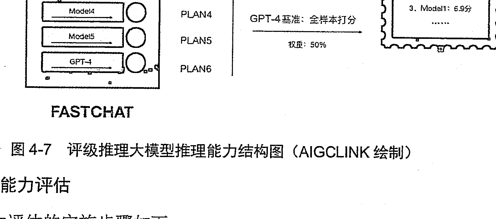

图4 - 7 评级推理大模型推理能力结构图（AIGCLINK 绘制）

#### 知识能力评估
知识能力评估的实施步骤如下。

1. 场景使用者准备100个业务场景的知识类问题。
2. 将上述问题集作为输入提交给候选的1个或多个大模型，得到响应答案集。
3. 让GPT - 4 针对各个候选大模型的答案进行评分（满分为10分），计算总分。
4. 人工抽样一部分问题，针对各个候选大模型的答案进行评分（满分为10分），计算总分。
5. 将GPT - 4 和人工抽样两部分的总分加起来得到一个大模型的总分，将大模型按照总分从高到低进行排序。
6. 基于排序，可得到各个大模型在特定业务场景下的表现。

评级推理大模型知识能力结构图（AIGCLINK绘制）如图4-8所示。

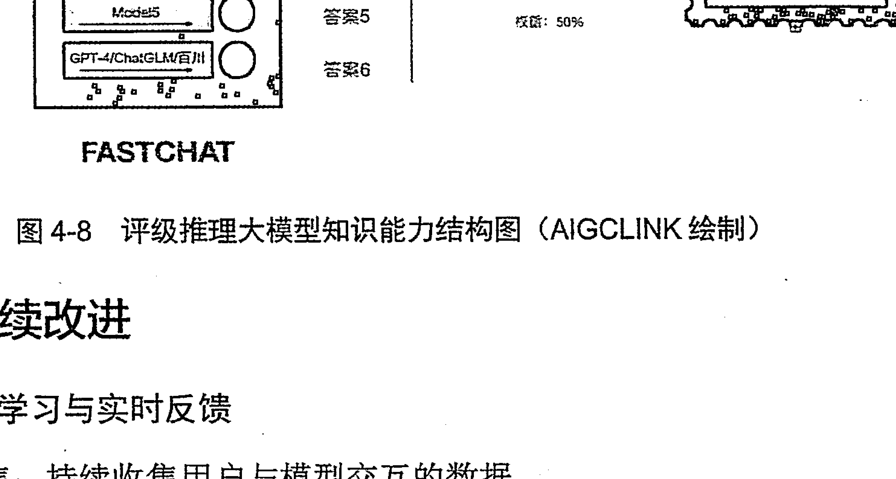

### 4.5.2 持续改进
1. 在线学习与实时反馈
   - 数据收集：持续收集用户与模型交互的数据。
   - 实时微调：模型根据新收集的数据进行实时或定期微调。

2. 错误分析与改进
   - 错误分析：对模型错误进行分类和分析。
   - 改进计划：根据错误分析结果制订改进计划，并在下一次微调中实施改进计划。

3. 模型更新与版本控制
   - 版本管理：每次微调或改进后，都应保存模型的新版本。
   - A/B测试：通过A/B测试来评估不同版本模型的性能。

4. 社群与开源贡献
   - 跟进最新研究：持续关注相关领域的最新研究和开源项目。
   - 社群参与：通过社群参与获取更多的反馈和改进意见。

通过模型评估与持续改进，可以确保Llama2大模型在多轮对话任务中的性能不断提高，同时能更好地适应不断变化和发展的实际应用需求。

## 4.6 适合 Llama 2 大模型多轮对话的 prompt 构建
Meta 开源的 Llama 2 大模型受到了广泛的关注和好评，然而在 Meta 官方给出的使用说明中，并没有针对 Llama 2 大模型多轮对话使用方法的特别说明，很多人在实际使用 Llama 2 大模型进行推理以实现多轮对话时通常不能获得很好的效果。本节将重点介绍适合 Llama 2 大模型多轮对话的 prompt 构建。

该构建方法源于 ChatGLM，在执行 ChatGLM 多轮对话时，需要将历史信息拼接到输入中，以供模型在生成文本时计算历史 token 与当前 query 之间的交互：

```
Plaintext
# ChatGLM 中对话 prompt 的产生
prompt = "" for i, (old_query, response) in enumerate(history_input):
prompt += "[Round {}]
问:{}
答:{}".format(i, old_query, response)
prompt += "[Round {}]
问:{}
答: ".format(len(history_input), query_input)
```

如果使用 Llama 2 大模型进行对话，则也应该有这样一套模板，与训练过程中的对话形式相匹配，以下介绍围绕此内容展开。

#### 1. prompt 的正确形式
根据 Meta 官方给出的使用说明，在对话时，用户所提供的 prompt 应当具有以下形式：

```
Plaintext
<s>
[INST]
<<SYS>>
{{ system_prompt }}
<<</SYS>>
{{ user_message }}
[/INST]
</s>
```

# 第 5 章 基于 Llama 2 定制行业大模型

在过去的几年里，以 GPT-3、BERT 和 Transformer 为代表的大模型取得了巨大的突破，在 NLP、图像识别、推荐系统等领域展现出了强大的性能。然而，要充分利用这些大模型，将其应用于解决特定行业的问题，需要对其进行定制化。下面举例说明为什么定制行业大模型如此重要。

+   1. 医疗诊断

在医疗领域，医生需要根据患者的症状、病历和检查报告进行诊断。一个通用的大模型可能会在一些常见疾病的诊断中表现出色，但当涉及特定疾病、罕见病例或不同人群时，其性能可能会下降。通过利用医疗领域的数据定制大模型，可以提高其对特定疾病诊断的准确性。例如，研究人员可以基于大量的放射影像数据和临床报告，训练一个定制化的肺部肿瘤诊断模型，以帮助医生更准确地检测和诊断肺癌。

+   2. 零售推荐系统

线上零售商正在不断努力提升用户体验，其中零售推荐系统起到了关键作用。然而，不同行业的用户，其购买行为和兴趣可能存在巨大差异，一个通用的推荐模型可能无法捕捉到这些差异，导致推荐效果不佳。通过分析用户浏览历史、购买记录及行业特定商品的关联，可以定制零售推荐系统，为用户提供更符合其兴趣和需求的产品推荐。例如，运动鞋领域的零售推荐系统可以根据用户过去的运动类型、品牌偏好和颜色喜好，为用户推荐最合适的运动鞋款式。

+   3. 金融风控

金融机构在进行风险评估时需要用准确的模型来预测违约、欺诈等情况。然而，不同类型的金融产品（如信用卡、个人贷款、商业贷款）具有不同的风险特点，一个通用的金融风控模型可能无法很好地适应这些差异。通过分析历史交易数据、申请信息和欺诈案例，可以定制金融风控模型，使其能够更准确地判断不同类型的风险。例如，在个人贷款领域，可以训练一个定制化的模型，综合考察每个申请人的收入、债务情况和工作稳定性，以便更好地预测其违约概率。

以上例子凸显了定制行业大模型的重要性。不同行业的数据特点和问题需求决定了没有适用于所有行业的通用模型。通过将模型与行业数据深度融合，我们可以创造出更精确、更可靠的问题解决方案，以更好地实现业务目标。

本章将深入探讨如何在不同阶段实现定制行业大模型的目标，包括业务数据分析指导行业大模型定制、行业数据的获取与预处理、Llama 2 大模型导入初始化、微调获得行业特定大模型、模型评估和优化等。通过这些步骤，能够将大模型的作用发挥到极致，为行业创造出更高的价值。

## 5.1 业务数据分析指导行业大模型定制

前文中强调了定制行业大模型在不同应用领域中的重要性。本节将深入研究如何基于已有的业务数据分析定制行业大模型，通过丰富的实际案例来加深理解。

### 5.1.1 行业大模型的定制策略

+   1. 确定核心业务目标

确定核心业务目标是制定行业大模型的基础。核心业务目标可能是提高用户满意度、降低成本、增加收入等。

+   2. 深入了解业务流程和用户需求

在选择应用场景时，需要深入了解业务流程和用户需求。从业务流程中找到可以应用大模型的环节，考虑大模型如何帮助人们解决实际问题。例如，对于2B市场，供应链需求预测是应用大模型的重要环节。通过定制行业大模型，企业可以更准确地预测用户需求，避免发生库存过剩和缺货情况。

+   3. 确定适用人群的特点和需求

确定适用人群的特点和需求是定制行业大模型的关键。在2C市场中，确定适用人群的特点和需求要考虑用户的个人偏好、行为习惯、年龄、性别等因素。例如，社交媒体平台可以定制情感分析模型，以便用户更好地了解自己在社交媒体平台上的情感表达方式。

+   4. 利用先进技术实现模型能力

选择适当的模型能力是精准定制行业大模型的关键，可以考虑利用已有的先进技术，如 NLP、计算机视觉、强化学习等实现模型能力。例如，2B 市场中的客户服务，可以使用 NLP 模型为客户提供快速且准确的问题解答。

### 5.1.2 模型性能的评估

定制行业大模型的性能目标与评价指标是确保模型在实际应用中取得良好效果的关键。

+   1. 设定明确的性能目标

在设定性能目标时，需要明确模型应该在实际应用中取得的效果。性能目标应与业务需求紧密匹配，如准确预测糖尿病患者的血糖水平或精准推荐用户感兴趣的商品。

+   2. 选择合适的评价指标

选择合适的评价指标是衡量模型性能的关键。评价指标应反映出模型在实际应用中的表现。不同领域可能需要不同的评价指标，如分类问题可能关注准确率、召回率等，生成任务可能关注 BLEU、ROUGE 等。

+   3. 使用实际数据集进行评估

在性能目标和评价指标确定以后，应使用实际数据集对模型性能进行评估。这样可以更真实地反映模型在实际应用中的性能，避免产生过于理想化的结果。

+   4. 采用交叉验证、留出法等评估方法

采用交叉验证、留出法等评估方法可以更全面地评估模型性能。这些方法可用于评估模型在不同数据子集上的稳定性和泛化能力。

## 5.2 行业数据的获取与预处理

数据的质量和数量对于训练行业大模型至关重要。然而，行业数据的获取与预处理可能会面临数据数量不足、数据异构性、数据质量良莠不齐等挑战。读者可以参考以下方法获取并预处理行业数据，以支持行业大模型的训练。

### 5.2.1 数据获取

(1) 内部数据整合。

整合内部数据，包括历史记录、用户行为、交易数据等。这些数据可能存储在不同的部门或系统中，需要进行清洗和整合。

+   - 结构化数据：获取数据库、数据仓库中存储的结构化数据。

+   - 半结构化数据：获取企业内部系统与工作流产生的半结构化日志、文档等。

+   - 非结构化数据：获取邮件、合同、记录等非结构化文本数据。

+   - 多源异构数据整合：对不同系统、不同格式的数据进行清洗、映射、融合。

(2) 外部数据采集。

从公开数据源、第三方数据提供商等处获取外部数据，如社交媒体数据、市场趋势数据等，丰富模型的数据源。

+   - 公开信息：通过公开网站、公告等渠道获取数据。

+   - 社交媒体数据：获取相关社交媒体平台的公开数据、分析观点。

+   - 第三方数据平台：购买独家的数据集或API访问数据。

+   - 爬虫采集数据：使用网络爬虫定向采集相关文本、评论、评价数据。

(3) 众包数据收集。

借助众包平台，如 Amazon Mechanical Turk，收集人工标注的数据，用于模型训练和性能评估。

+   - 人工标注数据：在众包平台发布数据标注任务。

+   - 现场调研数据：线下进行专业领域的调研、访谈、录音等。

+   - 竞赛获取数据：举办数据标注竞赛以获取高质量数据。

(4) 由 GPT 等更高级的大模型生成相关领域的问答数据。

### 5.2.2 数据预处理

数据预处理是指在训练模型之前对原始数据进行清洗、标准化和规范化等处理，让数据变得干净、统一、可用。这一步非常重要，会直接影响模型效果。

+   1. 数据清洗

进行数据清洗是为了解决数据重复、缺失、错误等问题，确保数据质量。在使用文本数据时，可能需要去除噪声、特殊字符等。

+   - 识别并删除重复数据、空数据等无效记录，减少训练噪声数据。

+   - 对缺失值进行插值或直接删除，缺失数据也可能带来隐含信息。

+   - 检测并纠正数据格式错误，如日期、货币等数据格式不统一的问题。

+   - 清除文本中的无信息停用词，以及无关内容，如广告等噪声数据。

+   2. 数据标准化和规范化

对数据进行标准化和规范化，使不同特征之间具有可比性，以便于模型学习。

+   - 将文本数据统一转换为小写或 ASCII 格式，将数字和日期等格式化。

+   - 对地址、姓名等字段进行规范化，映射为标准形式。

+   - 对文本进行清洗和规范化，以提高其质量。

+   - 对数字特征进行归一化，映射到相同范围，以便于模型学习。

+   3. 特征工程

根据领域知识，构建适用于模型的特征。例如，对于 NLP 任务，可以提取词频、句法结构等特征。

+   - 根据任务提取有效特征，文本数据可以构建词向量、词性、TF-IDF 等特征。

+   - 利用领域知识进行特征构造，捕捉关键信息。

+   - 进行特征选择，移除冗余和不相关特征。

+   4. 数据采样和平衡

对于不平衡的数据集，可以采用欠采样、过采样等方法使不同类别的样本数平衡，避免模型偏向于数量较多的类别。

+   - 对类别不平衡的数据进行欠采样、过采样，以使其达到平衡。

+   * 批次内动态平衡样本，防止模型过度拟合某个类别。

需要特别注意的是，在获取和使用数据的过程中，务必牢记数据安全、隐私安全及知识产权的重要性。

合法、合规地获取数据是保护个人隐私和企业利益的基本原则，必须遵守相应的数据保护法律法规、尊重用户的隐私权、明确数据使用的目的，并获得必要的授权。同时，要避免通过不正当手段及渠道获取和使用数据，以免触碰法律红线，导致法律风险和声誉损害。保护数据的合法性、安全性和隐私性，将为模型的构建与应用提供可持续的支持，使模型更加稳健和可靠。

以下是一些具体参考案例。

(1) 金融领域的风险评估模型。

数据获取：内部整合历史贷款记录、还款情况、客户信息，外部采集经济指标、市场数据。

数据预处理：清洗数据以去除缺失值，标准化贷款金额、收入等特征，构建特征表示客户信用历史。

(2) 医疗影像诊断模型。

数据获取：结合公开的医疗影像数据集，采集医院内部的 X 射线图像、MRI 图像数据。

数据预处理：对图像进行裁剪、大小归一化，可采用数据增强技术增加样本，如旋转、翻转。

(3) 社交媒体情感分析模型。

数据获取：从社交媒体平台中采集用户帖子、评论等文本数据。

数据预处理：清洗文本数据，去除特殊字符、表情符号等，将文本转换为词向量表示形式。

(4) 零售推荐系统。

数据获取：收集用户的购买记录、点击行为、浏览历史等数据。

数据预处理：对购买记录和点击行为进行标准化，构建用户-商品矩阵。

(5) 制造业质量控制模型。

数据获取：收集不同批次产品的质量测试数据，包括尺寸、质量等。

数据预处理：对数据进行归一化，可使用数据采样平衡正负样本，构建特征表示产品质量。

(6) 文本类生成模型。

数据获取：收集中英文的文本数据，包括新闻文章、社交媒体帖子等。

数据预处理：清洗文本数据，分词，去停用词，构建词向量。

通过以上方法论和实际案例，我们详细论述了如何获取与预处理行业数据，为行业大模型的训练做好了数据准备。5.3 节将讨论模型的构建与训练，以及模型性能的优化。

## 5.3 Llama 2 大模型导入初始化

在定制行业大模型时，选择适合的预训练大模型是至关重要的。下面将详细介绍如何在预训练大模型选择过程中充分考虑语言能力、最大文本长度处理、多语言解码效率、硬件配置、训练时间及推理速度等因素，以确保最终的行业大模型能够满足行业需求。

(1) 语言能力：深入考虑模型在语言方面的表现。

在选择预训练大模型时，首先要考虑的是模型在语言处理方面的能力。确保模型具备丰富的词汇知识及语法理解和语义推理能力，对于行业大模型的性能至关重要。在评估语言能力时，可以参考模型在标准 NLP 任务（如问答、文本分类和生成任务）中的表现。

(2) 最大文本长度处理：满足行业需求的文本长度。

行业大模型通常需要处理较长的文本，因此最大文本长度处理能力是重要的考虑因素。选择支持的文本长度更大的预训练大模型，有助于满足行业特定任务的需求。考虑到文本长度，还需要确保训练和推理阶段的硬件配置足够强大，以提高模型效率。

(3) 多语言解码效率：考虑行业的国际化需求。

对于需要处理多种语言的行业大模型，多语言解码效率至关重要。选择能够高效解码不同语言的预训练大模型，可以提高国际化应用的效能。预训练大模型应具备多语言训练数据，以便更好地理解和生成不同语言的文本。

(4) 硬件配置：保障训练和推理性能。

硬件配置对于模型训练至关重要，要确保计算机或云服务器具备足够的内存、处理器性能和显卡资源，以支持模型的训练和推理。考虑通过分布式训练和加速计算硬件来提高模型效率。

(5) 训练时间：平衡资源与进度。

训练模型可能需要较长的时间，因此需要权衡可接受的训练时间与模型性能之间的关系，根据项目进度和资源限制，选择合适的预训练大模型，还可以考虑迁移学习等方法，以减少训练时间。

(6) 推理速度：提供实时性能。

此外，还要考虑模型的推理速度。如果行业大模型需要快速响应用户请求或进行实时推理，那么在选择预训练大模型时应关注其推理速度。可以通过优化模型结构、使用硬件加速和缓存技术来提高推理速度。

综合考虑以上因素，选择合适的预训练大模型是定制行业大模型的关键步骤。仔细考虑每个因素，确保行业大模型能够满足行业需求，同时保持训练和推理的高效性能，将为定制行业大模型项目奠定坚实的基础，提高行业大模型在实际应用中成功的概率。

在中文方面，我们本次选择 Llama 中文社区提供的基于 Llama 2 继续预训练、研发的 Atom-7B 模型，其在未来会持续更新迭代。

进入 Llama 中文社区页面，如图 5-1 所示，单击左侧的“资源下载”即可获取 Atom-7B 模型。

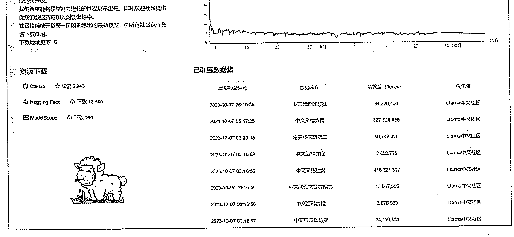

图 5-1 Llama 中文社区页面

下载好模型后，按照第 2 章介绍的模型部署方法进行部署即可。

## 5.4 微调获得行业特定大模型

微调是一种常用的技术，用于根据特定任务或行业需求调整预训练大模型。这样做的优势在于，预训练大模型通常已经在大量数据上进行了训练，因此具有较好的基础能力。通过微调，可以针对特定任务进行优化，提高模型的性能。

### 5.4.1 微调步骤

+   1. 选择合适的预训练大模型

根据行业需求和任务特点，选择合适的预训练大模型作为基础模型。例如，对于 NLP 任务，可以选择 GPT-3、BERT 等模型。

+   2. 准备微调数据集

收集与行业相关的数据，用于微调模型。数据集应包含行业特定的文本、图像、音频等数据。

+   3. 微调模型

使用微调数据集对预训练大模型进行微调。在微调过程中，可以调整模型参数，优化模型性能。

+   4. 评估模型性能

在微调完成后，使用测试数据集评估模型性能。评估指标应根据任务特点选择，如准确率、召回率、F1 分数等。

### 5.4.2 微调技巧

+   1. 调整学习率

学习率是微调过程中重要的参数之一。合适的学习率可以加快模型收敛速度，提高模型性能。

+   2. 使用正则化技术

正则化技术可以防止模型过拟合，提高模型的泛化能力。

+   3. 使用数据增强技术

数据增强技术可以增加训练数据量，提高模型的鲁棒性。

通过以上步骤和技巧，可以有效地微调预训练大模型，获得行业特定的大模型。微调后的模型可以更好地满足行业需求，提高模型的性能和实用性。

## 5.5 模型评估和优化

模型评估和优化是定制行业大模型的重要环节。通过评估和优化，可以确保模型在实际应用中取得良好的效果。

### 5.5.1 模型评估

## Llama 大模型实践指南

很好的泛化能力。通过微调，预训练大模型可以更精确地适应特定的应用场景。

# 5.4.1 领域预训练

为了使 Llama 2 大模型在某个行业/领域（如心理学领域）取得更好的表现，我们可以先对 Llama 2 大模型进行领域预训练。具体做法是，将心理学相关的语料库（如心理学论文、心理咨询对话等）作为训练数据，对 Llama 2 大模型进行预训练。这样，Llama 2 大模型就能学习到心理学领域的专有知识和术语，为后续的微调打下基础。

如果没有相关的预训练资源，那么我们可以直接选择 Llama 中文社区中的中文预训练版 Llama2-7B 模型，下载并进行后续的微调，如图 5-2 所示。

| Models 7 | Sort: Recently Updated |
| :--- | --- |
| FlagAlpha/Atom-78 | FlagAlpha/Atom-7B-Chat |
| FlagAlpha/llama2-Chinese-13b-Chat-4bit | FlagAlpha/llama2-Chinese-13b-Chat |
| FlagAlpha/llama2-Chinese-13b-Chat-LoRA | FlagAlpha/llama2-Chinese-7b-Chat |
| FlagAlpha/llama2-Chinese-7b-Chat-LoRA |  |
| (省略部分内容) | (省略部分内容) |

# 图 5-2 中文预训练版 Llama2-7B 模型获取

Llama 中文社区提供了 Llama 2 大模型的预训练代码，以及中文测试语料，更多数据可以参考中文测试语料。

# 5.4.2 微调策略

以心理咨询行业为例，为了实现 Llama 2 大模型在心理学任务上的微调，可以采用以下几种策略。

+   (1) 知识蒸馏。将预训练大模型知识迁移到微调任务中，通过训练一个较小的模型来继承大模型的知识。
(2) 数据增强。通过对原始数据进行改造，生成新的训练样本，从而提高大模型的泛化能力。
(3) 多任务学习。同时进行多个相关任务的训练，使大模型在各个任务上都取得较好的表现。

# 第5章 基于Llama 2定制行业大模型

本节的心理咨询大模型通过知识蒸馏和LoRA微调实现。

# 1. 知识蒸馏

知识蒸馏是一种将复杂模型的知识迁移到简化模型中的技术。在生成心理咨询问答方面的应用中，可以利用知识蒸馏来提高模型效率，同时保持咨询问答的质量和准确性。

这种方法的基本思想是，先使用一个较大、较复杂的模型（如GPT-4）生成高质量的问答对，然后将这些问答对作为训练数据，对一个简化模型（如GPT-3.5）进行知识蒸馏。简化模型学习到复杂模型的知识和模式后，具有更快的推理速度和更小的存储空间。

知识蒸馏可以帮助简化模型更好地理解心理咨询问题，并生成更具针对性和更合适的回答。这样即使在资源受限或需要快速响应的情况下，模型也能够提供高质量的心理咨询支持。

下面基于GPT-3.5生成心理咨询问答对。

Prompt: 你充当一位资深心理咨询师，请生成20个常见的心理咨询问题和回答，用于大模型的微调。问答对以<s>Human: {问题}
<s><s>Assistant: {回答}
<s>形式呈现，如图5-3所示。


图5-3 知识蒸馏生成行业相关数据

# 5.4.3 人工标注

针对非心理相关问题，我们对数据进行人工标注。

首先，人工标注可以确保数据的准确性和可信度。标注人员可以根据特定问题的背景和要求准确地标注数据，避免模型学习到错误或误导性信息。

其次，人工标注可以保证数据的一致性。通过给出针对特定问题的标准答案、制定标注规则、明确边界情况等，可以指导标注人员正确理解和标注数据。在标注过程中建立明确的标准和规则，可以确保不同标注人员的标注结果一致，从而提高数据的质量和可靠性。

在进行人工标注时，通常需要培训标注人员，使其理解标注的目的、标准和规则。在标注过程中还可以采用多人标注、交叉验证等方法，以确保数据的质量和可靠性。

针对非心理问题，人工标签示例如下：

Python

<s>System: 你是一个优秀的心理咨询助手，根据用户的提问进行回答，回答要内容丰富，能与用户产生共情，并解答用户的烦恼，可以适当地提问一些问题给用户，非心理情感问题，委婉的拒绝回复\n</s><s>Human: {问题}\n</s><s>Assistant: {回答}\n</s>

# 2. LoRA微调

LoRA微调相关源代码可以在GitHub社区获取，可获取的内容包括：

+   * LoRA微调脚本。
* LoRA微调的具体实现代码。

微调后的模型可通过基于Gradio搭建的问答平台（见3.5.2节）调用。

## 5.5 模型测试、评估和优化

至此，我们已经完成了初始的微调并对模型进行了初步的测试。接下来要通过持续的测试、评估和优化，确保模型的性能达到预期，并不断地对模型进行改进。

在进行持续测试时，首先需要设计一个详尽的测试计划。这个测试计划应该覆盖模型的不同方面，包括但不限于输入数据多样性、边缘情况处理、模型输出合理性等。此外，还应该考虑到针对具体行业特点设计的测试用例，确保模型能够适应该行业的典型场景。

# 第5章 基于Llama 2定制行业大模型

# 1. 设计详尽的测试计划

设计一个详尽的测试计划至关重要。在设计测试计划时，需要考虑以下两方面。

+   * 测试用例设计：覆盖不同场景，要特别关注模型应用于特定行业的典型案例。例如，对于医疗行业的大模型，可以设计病历记录、疾病诊断、药物处方等方面的测试用例。

+   * 性能测试：评估模型的响应时间、内存使用、吞吐量等指标，以确保模型能够在生产环境下稳定、高效地运行。

# 2. 持续监测模型性能

建立一个监测系统，定期收集模型性能数据，并分析这些数据的变化趋势。对模型性能进行持续监测可以采用各种工具和方法，如监控模型的输出日志、分析模型的响应时间、观察内存使用情况等。

# 3. 定期评估模型性能

定期对模型性能进行评估是持续优化模型的关键，评估方法包括定量评估和定性评估。

+   * 定量评估：使用预先设定的评估指标（如准确率、召回率、F1分数）对模型进行量化评估。例如，在医疗行业中，可以评估模型辅助诊断的准确率，或者评估模型给出的药物处方的正确性。

+   * 定性评估：邀请领域专家或实际用户参与，评估模型的输出是否符合实际需求、是否满足行业专业标准。例如，医疗行业的专家可以评估模型对病历的解释是否准确。

# 4. 针对特定场景进行模型优化

根据评估的结果和反馈，针对特定场景进行模型优化。例如，对于医疗行业的大模型，可以优化模型对临床试验数据的处理，以提高模型在医学研究领域的适用性。

# 5. 引入用户反馈

引入用户反馈是非常重要的。用户可以提供宝贵的信息，帮助研究人员识别模型的不足之处和潜在问题。例如，在金融行业中，用户可以反馈模型在预测市场走势方面的准确性，以及模型对市场事件的应对能力。

# 6. 迭代优化过程

以上步骤应该是一个不断迭代的过程，即收集用户反馈，分析评估结果，进行模型调整，再次进行测试，形成一个闭环。随着模型应用场景的扩展和深化，这个迭代优化过程应该不断地进行，以不断提高模型的性能和适用性。

通过迭代优化过程，我们可以确保模型能够在特定行业场景下保持优异的性能，满足特定行业的需求。持续不断地进行监测、评估和优化是确保模型在实践中持续优化的关键。这个过程包括构建测试集、采用上次训练最优的模型进行测试、对测试结果进行评价、采用满意的结果丰富训练集、重新进行模型的微调，如图5-4 所示。

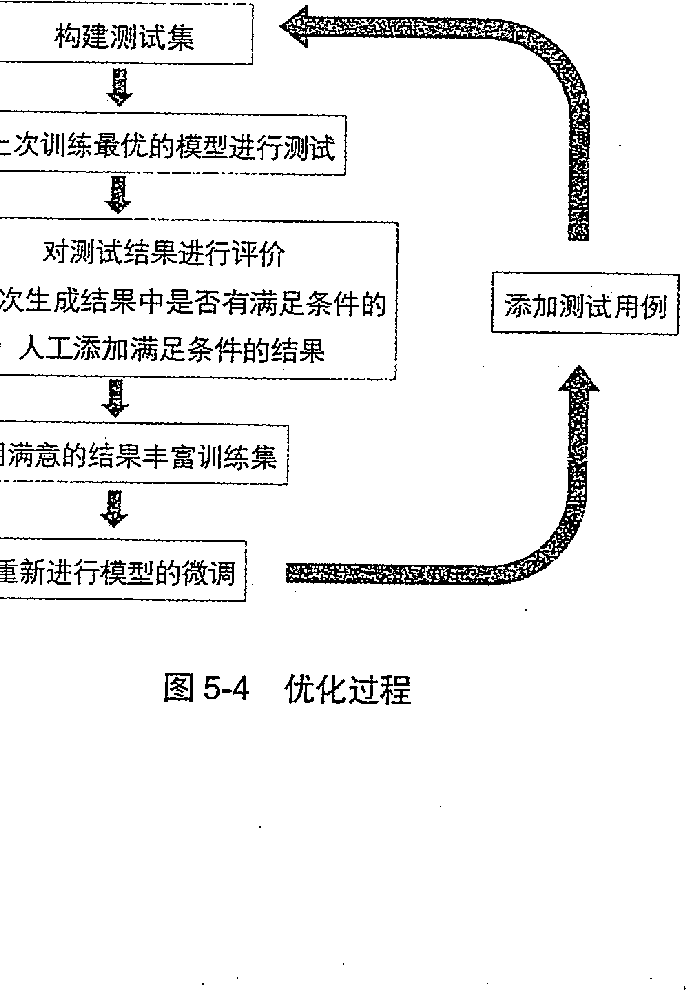

### 图5-4 优化过程

# 第6章 Llama 2 + LangChain 文档

# 问答模型构建

本章将从理论入手，从零开始利用 Llama 2 和 LangChain 构建一个面向文档的问答模型。整个过程可分为以下几个步骤。

+   (1) 理解 Llama 2 和 LangChain 的基本原理与功能。(2) 介绍 LangChain 及其如何与 Llama 2 协同工作。(3) 配置 LangChain 在各个平台（如 Windows、macOS、Linux）上的运行环境。(4) 使用 Llama 2 创建模型，随后加载这个模型。(5) 借助 LangChain 处理输入的问题和文档内容。我们可以通过设定提示来设置并调整自定义提示。(6) 运行问答模型，对于每个问题，它将为我们提供详细的答案。

通过以上步骤，我们可以逐步构建并优化问答模型，使其能够更有效地回答与文档内容相关的问题。

## 6.1 LangChain 介绍

大模型（如 GPT 系列模型）在 AI 领域引发了技术革命。应用开发者利用这些大模型进行各种尝试，虽然已经开发出了许多有趣的应用，但单独使用这些大模型往往难以开发出功能强大的实用应用。

LangChain 通过将大模型与其他知识库、计算逻辑相结合，实现了更强大的 AI 应用。可以将 LangChain 视为开源版的 GPT 插件，它提供了丰富的大模型工具，可以在开源大模型的基础上快速增强大模型的能力。

我们对 LangChain 进行了研究，并总结了一些重要内容。LangChain 的出现使语言技术的应用更加活跃多元，LangChain 有望在 AI 领域发挥重要作用，推动人们工作效率的变革。我们正处在 AI 应用爆发的前夜，积极拥抱新技术将为人们带来全新的体验。

## 6.2 LangChain 的主要概念与示例

LangChain 提供了一系列工具，可以帮助我们更好地使用大模型。总体而言，这些工具可以分为以下6种类型。

+   * 模型（Models）：LangChain 支持的各种模型类型和模型集成。

+   * 提示（Prompts）：包括提示管理、提示优化和提示序列化。

+   * 索引（Indexes）：当索引与自己的文本数据结合使用时，大模型往往更加强大。

+   * 内存（Memory）：内存是在链和代理调用之间保持状态的概念。LangChain 提供了一个标准的内存接口、一组内存实现及使用内存的链/代理示例。

+   * 链（Chains）：链不仅包括单个大模型调用，还包括一系列调用（如调用大模型和调用不同的实用工具）。LangChain 提供了一个标准的链接口、许多与其他工具的集成，还提供了用于常见应用程序的端到端的链调用。

+   * 代理（Agents）：代理涉及大模型做出行动决策、执行该行动、查看一个观察结果，并重复该过程直到用户提出的任务完成为止。LangChain 提供了一个标准的代理接口、一系列可供选择的代理及端到端代理的示例。

LangChain 模块图如图 6-1 所示。

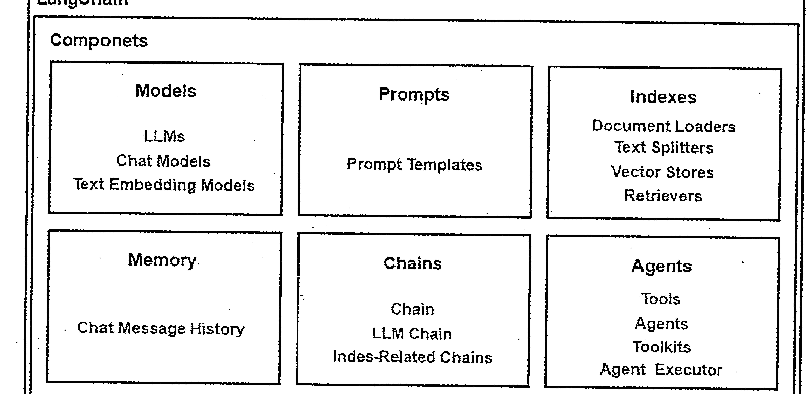

图 6-1 LangChain 模块图

### 6.2.1 模型

LangChain 的核心价值在于提供了标准的模型接口。我们可以自由地切换不同的模型，目前主要有两种类型的模型可供选择。然而，考虑到一般用户的使用场景，我们以文本生成模型作为默认选择。提到模型，大家通常会想到 ChatGPT。简单来说，模型的作用就是生成文本内容。

#### 1. 语言模型

实现文本生成的语言模型主要有两种。

+   - 通用语言模型：接收一个文本字符串作为输入，并返回一个文本字符串作为输出。

+   - 聊天模型：接收一条聊天消息作为输入，并返回一条聊天消息作为输出。

```
以下是使用 Python 编写的代码示例：
```

```
Plain Text
from langchain.llms import Openai
from langchain.chat_models import ChatOpenai
ChatOpenai = Openai()
chat_model = ChatOpenai()
print(llm("say hi!"))
print(chat_model.predict("say hi!"))
```

#### 2. 文本嵌入模型

文本嵌入模型（Text Embedding Model）可以把文本转换为浮点数形式的描述。

文本嵌入模型接收文本作为输入，并返回一组浮点数作为输出。这些浮点数通常用于表示文本的语义信息，可用于完成文本相似性计算、聚类分析等任务。通过使用文本嵌入模型，应用开发者可以构建更丰富的文本关联性，并提高基于大模型的应用性能。

以下是使用 Python 编写的代码示例：

```
Python
from langchain.embeddings import OpenaiEmbeddings
embeddings = OpenaiEmbeddings()
text = "This is a test document."
query_result = embeddings.embed_query(text)
doc_result = embeddings.embed_documents([text])
print(doc_result)
```

# 第6章 Llama 2 + LangChain 文档问答模型构建

Cream']解析为以逗号分隔的字符串。

(4) StructuredOutputParser：生成结构化的内容，无须定义对象。该输出解析器类似于 PydanticOutputParser，但不需要定义对象。

(5) PydanticOutputParser：定义一个对象模型，使模型按照该对象模型返回数据。可以定义一个 Pydantic 对象模型，并使用该输出解析器将输出解析为该对象模型的实例。

### 6.2.4 索引

索引是一种将文档结构化的工具，使模型能够直接与文档更好地进行交互，如用于答疑、知识库等场景。模型可以从文档中获取答案。

LangChain 在索引方面提供了许多有用的函数和工具，以便人们加载和检索不同的文档数据，主要工具如下。

+   (1) Document Loaders（文档加载工具）：从不同的数据源加载文档。当使用文档加载工具读取数据源后，需要将数据源转换为 Document 对象，以便后续使用。

+   (2) Text Splitter（文本分割工具）：实现文本分割。无论是将文本作为提示发送给 OpenAI API，还是使用 OpenAI API 的嵌入功能，都有字符限制。因此，需要使用文本分割工具来分割文档加载工具加载的文档。

+   (3) Vector Store（向量存储工具）：将文档存储为向量结构。因为数据的相关性搜索实际上是向量运算，所以无论是使用 OpenAI API 的嵌入功能，还是直接通过向量数据库进行查询，都需要将加载的文档转换为向量，以进行向量运算。将加载的文档转换为向量非常简单，只需将数据存储到相应的向量数据库中即可，如图 6-2 所示。

图 6-2 向量存储的服务图

+   (4) Retriever（检索工具）：用于检索文档数据。

## Llama 大模型实践指南

下面通过一个案例来了解不同工具的用法。

(1) 加载文档数据：可以使用文档加载工具来完成。文档加载工具可以从文件、数据库或网络中获取文档数据，并将其准备好以供后续处理。

(2) 将文本分割为不同的块：可以使用文本分割工具来完成。文本分割工具可以将长文本分割成更小的部分，以便于后续处理和检索。

(3) 将分割后的文本块转换为向量存储：可以使用向量存储工具来完成。向量存储工具可以将文本数据转换为向量的表示形式，以便于计算和比较。

(4) 检索文档数据并将其提供给 LangChain 以进行问答处理：可以使用检索工具来完成。检索工具可以根据用户的查询，从向量存储工具中检索出最相关的文本块，并将其提供给 LangChain 以进行问答处理。

### 6.2.5 内存

在默认情况下，代理和链都是无状态的，这意味着它们在处理完每次查询后不会记住上一次对话的内容，每次查询都是独立的。

然而，在某些场景（如聊天场景）下，记住上一次对话的内容是非常重要的。为了满足这种需求，LangChain 提供了一些相关的工具类。

这些工具类可以用于在代理和链之间传递上下文信息，以便于在连续的对话中保持对话状态。例如，可以使用上下文工具类来存储和提取上一次对话的内容，这样在下一次查询时，便可以使用这些信息来提供更准确的回答。

通过使用 LangChain 提供的工具类，可以在需要记住上一次对话内容的应用中实现更强大的对话功能。这样就能够更好地满足用户的需求，为用户提供个性化、连贯的对话体验。

### 6.2.6 链

链的设计使我们可以将多个组件组合成一个应用。例如，我们可以创建一个链，它可以接收用户输入，先使用提示模板格式化用户输入为提示，然后将这些提示输入语言模型。

此外，我们还可以将多个链组合在一起，以构建更复杂的链。这样，每个链负责特定的功能或任务，而整个应用则可以通过这些链的组合实现更加复杂和完整的功能。

通过将多个链组合在一起，可以实现更高级的对话流程和逻辑。每个链负责特定的功能或任务，如输入处理、语义解析、上下文管理等等。这种组合的方式使我们能够更灵活地构建应用，并根据需求进行定制和扩展。链是一个简单的工具，它接收一个提示模板，在用户提供输入后对其进行格式化处理，并将格式化后的内容传递给语言模型，从而获得相应的响应，如图6-3所示。


### 6.2.7 代理

代理使用语言模型作为思考工具来决定当前要执行的操作。我们会为代理提供一系列的工具，代理会根据用户输入判断采用哪些工具可以实现目标，并持续地运行这些工具以实现目标。

代理可以视为增强版的链，它不仅绑定了提示模板和语言模型，还可以添加其他工具。

代理是一个智能代理，其职责是根据用户输入和应用场景，在一系列可用的工具中选择合适的工具来执行操作。代理可以根据任务的复杂性采用不同的策略来决定如何执行操作。这意味着代理可以根据具体情况来选择最佳的工具，以实现高效和准确地执行操作。

总之，代理是一个使用语言模型作为思考工具的智能代理，它可以根据用户输入和应用场景选择合适的工具来执行操作，并根据任务的复杂性采用不同的策略来决定如何执行操作。这使代理能够更加灵活和智能地完成各种任务。

目前主要有两种类型的代理。

(1) 动作代理（Action Agent）：这种代理一次执行一个动作，根据执行结果决定下一步的操作。

(2) 计划执行代理（Plan-and-Execute Agent）：这种代理先确定一系列要执行的操作，然后按照事先确定的顺序逐个执行操作。

对于简单的任务来说，动作代理更为常见且易于实现。对于复杂或长期运行的任务来说，计划执行代理的初始规划步骤有助于维持长期目标并保持关注。然而，计划执行代理的使用可能会增加调用次数并引入较高的延迟。这两种代理并不是互斥的，可以让动作代理负责执行计划执行代理所制订的计划。

## Llama 大模型实践指南

代理内部涉及的核心概念如下。

+   (1) 代理：代理是应用程序的主要逻辑。它提供一个接口，接收用户输入和代理已执行的操作列表，并返回 AgentAction 或 AgentFinish。

+   (2) 工具：工具是代理可以采取的动作，如发起 HTTP 请求、发送邮件、执行命令等。

+   (3) 工具包：工具包是为特定用例设计的一组工具。例如，为了使代理能够以最佳方式与 SQL 数据库交互，可能需要一个执行查询操作的工具和一个查看表格的工具。工具包可以看作工具的集合。

+   (4) 代理执行器：代理执行器将代理与一系列工具包装在一起，负责迭代运行代理，直到满足停止条件为止。

#### 1. 代理的执行流程

LangChain 在接收到用户的问题后，会将问题拆解成各个子任务。Llama 2 根据任务的不同会调用相应的工具，并通过这些工具与外部环境进行交互。交互结果会传递给 Llama 2 进行处理，最后代理将处理后的最终结果返回给用户。代理的执行流程如图 6-4 所示。

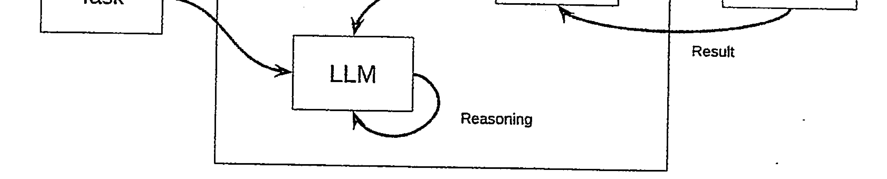

#### 2. 代理类型

在下面的代码中，关于代理的初始化阶段，有一个代理类型的设定，如 agent=AgentType.ZERO_SHOT_REACT_DESCRIPTION。代理类型决定了代理如何使用工具、处理输入及与用户进行交互，从而为用户提供有针对性的服务。

```
Python
initialize_agent(tools, llm,
agent=AgentType.ZERO_SHOT_REACT_DESCRIPTION, verbose=True)
```

### 6.2.8 工具

LangChain 官方默认提供了一系列工具箱，包括发 Gmail 邮件、数据库查询、JSON 处理等。此外，还有一些单个工具的列表，可以在文档中查看。

为了更好地介绍工具的使用方法，下面通过一个自定义工具来进行说明。因为在使用 LangChain 时，我们的主要任务是不断地自定义工具。在编写工具时，需要准备以下内容。

+   - (1) 名称：给工具起一个合适的名称。
-   (2) 工具描述：清楚地说明工具的功能和用途。
-   (3) 参数结构：明确当前工具所需的输入参数的结构。

在下面的例子中，我们使用 Tool 数据类来创建一个名为“搜索”的新工具，该工具使用 SerpAPI 包装器来回答有关当前事件的问题。

```
Python
class CustomSearchTool(BaseTool):
 name = "搜索"
description = "当你需要回答有关当前事件的问题时有用" 
def __run__(self, query: str) -> str:
```

## Llama 大模型实践指南

```
"""使用工具。 ""
return search.run(query)
async def _arun(self, query: str) -> str:
"""异步使用工具。 ""
raise NotImplementedError("BingSearchRun 不支持异步")
class CustomCalculatorTool(BaseTool):
name = "计算器"
description = "用于进行数学计算"
def _run(self, query: str, calculator=None) -> str:
"""使用工具。 ""
return calculator.run(query)
async def _arun(self, query: str) -> str:
"""异步使用工具。 ""
raise NotImplementedError("CustomCalculatorTool 不支持异步")
```

## 6.3 LangChain 环境配置

本节将介绍 Python 在各个平台（如 Windows、macOS、Linux）上的安装示例，以及 LangChain 的配置方法，以帮助用户更轻松地使用 LangChain。安装和配置完成后，用户便可以愉快地使用 LangChain 了。

### 6.3.1 Python 环境搭建

1. Python 下载

Python 最新源代码、二进制文档、新闻资讯等可以在 Python 的官方网站查看。

2. Python 安装

在 Windows 平台上安装 Python 的步骤如下。

(1) 下载 Python 安装包。

打开 Python 的官方网站：https://www.python.org/。

单击 “Downloads”（下载）选项卡，选择适用于 Windows 平台的 Python 版本。建议下载最新版。

(2) 运行 Python 安装程序。

双击下载的 Python 安装程序。在打开的窗口中可以看到几个安装选项。建议


# 6章 Llama 2 + LangChain 文档问答模型构建

勾选“Add Python to PATH”（将Python添加到PATH环境变量中）复选框，这样就可以使用命令提示符直接运行Python安装程序。

单击“Install Now”（现在安装）按钮进行安装。

(3) 安装进程。

安装程序时会显示一个进度条，告知用户安装过程的状态。

安装完成后将看到一个“Setup was successful”（安装成功）的提示。

(4) 验证安装。

打开命令提示符窗口。

输入“python --version”，按回车键。如果Python已成功安装，那么系统将显示Python的版本信息。

### 6.3.2 LangChain 主要模块

LangChain 主要模块是一个集成了许多模块和工具的库。但是在开始开发之前，可能还需要安装一些额外的包，可以使用pip命令来安装这些包：

```
python3 -m pip install --upgrade langchain deeplake pinecone-client Openai tiktoken python-dotenv
```

下面对在这里所做的工作进行详细的介绍。

首先，使用 python3 -m pip 命令确保我们使用的是 Python3 解释器的正确版本的 pip 模块。

其次，使用 install 命令安装所需的 Python 包。这些包的名称分别是 langchain、deeplake、pinecone-client、Openai、tiktoken 和 python-dotenv。通过运行 install 命令，可以安装这些包的最新版本。

下面是每个包的简要说明。

+   (1) langchain: langchain 是主要的 Python 包，它提供文档加载工具、文本分割工具和其他实用工具。

+   (2) deeplake: deeplake 是一个向量数据库提供者。我们需要将处理过的数据存储为向量形式，因此需要一个向量数据库。deeplake 允许用户轻松地在本地或云上创建索引，因此我们通常会选择安装它。

## Llama 大模型实践指南

强大的 AI 模型。我们将使用它来进行嵌入模型、对话模型等操作。

(5) tiktoken：tiktoken 是 OpenAI 的一个库，它允许用户计算文本字符串中的标记数，而无须进行 API 调用。

(6) python-dotenv：python-dotenv 允许用户在 env 文件中指定环境变量，这对于管理密钥和其他配置值非常有用。

至此，已经搭建好了 Python 环境，可以使用 LangChain 和语言模型应用程序了。

## 6.4 Llama 2+LangChain 文档问答模型评估

本节将详细介绍如何从零开始创建自己的文档问答模型，使用 Llama 2 和 LangChain 这两个开源库来实现无缝集成，详细步骤如下。

+   (1) 设置虚拟环境和创建文件结构

+   (2) 在本地计算机上使用 Llama 2。

+   (3) 将 Llama 2 与 LangChain 集成，并自定义提示模板。

+   (4) 文档检索和答案生成。

### 6.4.1 设置虚拟环境和创建文件结构

设置虚拟环境可以为应用程序提供一个受控且隔离的环境，确保其依赖项与系统范围内的其他软件包分离。这种方法简化了依赖项管理，并且有助于在不同环境之间保持一致性。

为了给应用程序设置虚拟环境，我们将在存储库中提供一个 pip 文件。要按照如图 6-5 所示的文件结构来创建必要的文件。如果你不想手动创建文件结构，那么也可以直接复制存储库以获取所需的文件。

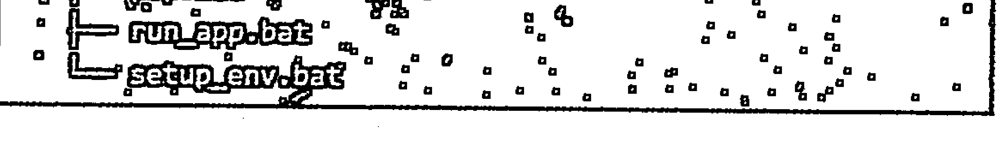

图 6-5 文件结构

在 models 文件夹中存储下载的 LLM，而 pip 文件将位于根目录中。

为了在虚拟环境中创建并安装所有依赖项，可以在相同目录中使用 pipenv install 命令，或者直接运行 setup_env.bat 批处理文件。这将从 pipfile 中安装所有依赖项。这样做可以确保在虚拟环境中安装所有必要的包和库。一旦成功安装依赖项，我们就可以进行下一步——下载所需的模型。

## Llama 大模型实践指南

## 文本嵌入

在完成文本切分之后，我们需要对其进行向量化表示，即将其映射为低维稠密向量，并将这些向量存储到向量数据库中。此处选用的向量数据库是无须注册的 FAISS。

```python
Python
from langchain.embeddings.huggingface import HuggingFaceEmbeddings
from langchain.vectorstores import FAISS
```

```python
import os
embeddings = HuggingFaceEmbeddings(
model_name = "{你的地址}/text2vec-large-chinese", 
model_kwargs = {'device': 'cuda'})
```

```python
if os.path.exists("{你的地址}/my_faiss_store.faiss") == False:
vector_store = FAISS.from_documents(docs, embeddings)
vector_store.save_local("{你的地址}/my_faiss_store.faiss")
```

## 加载模型

在加载模型时，通过 LangChain 来加载 Llama 2 并进行实例化。

```python
Python
import torch
from transformers import AutoTokenizer, AutoModelForCausalLM
```

```python
#### 加载 tokenizer
tokenizer = AutoTokenizer.from_pretrained('/opt/Llama-2-7b-chat-hf', trust_remote_code=True)
```

```python
#### 加载 Llama 2
base_model = AutoModelForCausalLM.from_pretrained('/opt/Llama-2-7b-chat-hf', torch_dtype=torch.float16,
device_map='auto',
trust_remote_code=True)
)
llm = base_model.eval()
```

## 语义检索

(1) 向量化召回。

FAISS默认采用L2（欧氏距离）作为度量，根据相似度对召回的文档进行降序排序。

```python
Python
query = "根据文档内容，回答项目信息？"
# 计算相似度，结果中相似度较高的文本块排在前面
docs = vector_store.similarity_search(query)
context = [doc.page_content for doc in docs] # 提取文本块中的文本内容
print(context)
```

(2) 设置提示模板。

以下是Llama 2默认的提示模板。

```python
Python
#qa_template = """Use the following pieces of information to answer the user's question.
#If you don't know the answer, just say that you don't know, don't try to make up an answer.
#Context: {context}
#Question: {question}
#Only return the helpful answer below and nothing else.
#Helpful answer: """
```

我们可以参考上面的提示模板，根据实际场景定制自己的提示模板，用于拼接查询内容和召回结果。

```python
Python
context = "\n".join(context)
prompt = f"基于以上内容：\n{context} \n请回答：{query} \n字数限制在30字以内"
```

## 推理示例

为Llama 2设置参数，包括最大令牌（max_new_tokens）、最高k值（top_k）、温度（temperature）及重复惩罚（repetition_penalty）等，并将提示输入模型。

```python
Python
inputs = tokenizer([f"Human:{prompt}\nAssistant:"],
return_tensors="pt")
input_ids = inputs["input_ids"].to('cuda')
# llm 参数设置
param_config = {
"input_ids":input_ids,
"max_new_tokens":1024,
"do_sample":True,
"top_k":5,
"top_p":0.95,
"temperature":0.1,
"repetition_penalty":1.3
}
result = llm.generate(**param_config)
answer = tokenizer.decode(result[0], skip_special_tokens=True)
print(answer)
```

## 具体案例

假如我们想要使用 Llama 2 对一个 PDF 文件进行问答，通常先通过 Python 代码读取 PDF 文件的内容，然后将读取到的内容和问题发送给 Llama 2 进行总结。

如果文本超过了 API 最大的 token 限制，则会报错。此时，我们可以先对要发送的内容进行分段处理，如通过 tiktoken 计算并分割，然后将各段发送给 Llama 2 进行问答，最后对各段的回答内容进行汇总概括。

如果使用的是 LangChain，那么它会很好地帮助你处理这个过程，使编写代码变得非常简单。这些代码将包括以下内容。

+   (1) 导入文档：create_vector_db。
+   (2) 提示选择：set_custom_prompt。
+   (3) 导入模型：load_llm。
+   (4) 问题设置：qa_bot。
+   (5) 问答结果：final_result。

## 初始化问答流程，发送问题

首先创建一个问答机器人，其次发送一条消息以启动机器人，最后更新消息内容并将问题链对象存储在用户会话中。

```python
async def start():
    chain = qa_bot()
msg = cl.Message(content="Starting the bot...")
await msg.send()
msg.content = "Hi, Welcome to Medical Bot. What is your query?"
await msg.update()
cl.user_session.set("chain", chain)
```

## 主函数，处理消息并返回答案

这是程序的异步主函数。首先从用户会话中获取问题链对象，其次使用异步回调处理器处理消息，最后获取答案和相关来源并将其发送给用户。

```python
async def main(message):
    chain = cl.user_session.get("chain")
    cb = cl.AsyncLangchainCallbackHandler(
        stream_final_answer=True, answer_prefix_tokens=["FINAL", 
        "ANSWER"]
    )
    cb.answer_reached = True
    res = await chain.acall(message, callbacks=[cb])
    answer = res["result"]
    sources = res["source_documents"]
    if sources:
        answer += f"\nSources: {str(sources)}"
    else:
        answer += "\nNo sources found"
    await cl.Message(content=answer).send()
```

## 多语言大模型技术介绍及其工业应用

随着 Llama 2 大模型的出现，围绕多语言大模型的研究在国内外社区火热展开。本章将从多语言大模型的研究现状和技术方向出发，系统地总结多语言大模型的训练资源和预处理、优化方向，以及多语言大模型现阶段典型的工业应用。

## 多语言大模型的研究现状和技术方向

目前全世界人口使用的语言有上千种，是否有必要进行多语言研究和保护，以及让每种语言的使用者公平地享受大模型技术发展带来的红利，将是本节讨论的重点。同时我们也会帮助大家简略了解多语言大模型的发展趋势和技术方向。

## 为什么进行多语言研究

随着互联网的发展，世界各地的人都可以通过各种应用进行沟通和交流。现阶段互联网上主要使用的 10 种语言如图 7-1 所示，其中汉语和英语作为 2 种主要语言，其用户占互联网用户的 45.3%，这 2 种语言也是现阶段 NLP 技术和大模型技术的主要研究语言。但值得注意的是，世界上共有 7000 多种语言[1]，除去上述 2 种语言，还有 54.7% 的用户并没有完全享受到大模型技术发展带来的红利，下面将从 4 个方面阐述多语言研究的必要性[2]。

+   1. 社会层面

人们使用的语言决定了其能接受到的教育、获得的知识及人脉关系。尽管互联网是开放的，但是数字语言鸿沟（Digital Language Divide）还是存在于主流语言（汉语、英语和其他主流西方语言）和其他语言之间的。如图 7-1 所示，只有少数的语言会大量出现在互联网中，这就极大地提高了小语种使用者获取信息的门槛。

#### 数字语言鸿沟

数字语言鸿沟的存在会在各个层面影响 NLP 技术的发展。例如，现阶段社交 App（如微信）中使用的大多数语言都有常见的非正式输入形式（如缩写或俚语）。但是数字语言鸿沟的存在会让非主流语言使用者无法得到很好的键盘输入支持和拼写纠错服务[4]，同时会让 NLP 算法对非主流语言使用者存在偏见和歧视[5]，这也许不是语种导致的，而是不同的口音影响了算法结果[6]。

这种对非主流语言的忽视现象不仅会扩大数字语言鸿沟，还会使一些非主流语言使用者放弃使用他们的语言，转而使用技术支持好的、资源丰富的语言，从而影响语言的多样性。因此，为了让非主流语言使用者更好地享受技术发展带来的便利，降低算法对不同语言的效果差异，以及消除语言屏障，需要让大模型覆盖除英语和汉语外的更多语言。

#### 语言层面

我们在训练大模型时，都希望训练出一个与语言无关的、更通用的大模型，但是大多数时候受限于语料资源，我们训练的大模型只擅长单语言任务，如汉语或英语任务。图 7-2[7]列举了针对不同语言和语系的单语言 BERT 模型。单语言预训练大模型中的汉语、英语及一些高资源（High-Resource）语言并不能代表世界上的其他语言。以汉语为例，它属于汉藏语系（Sino-Tibetan），是一种弱词形变化（Morphologically Poor）语言，更注重在句法上表示语义，即注重词语的顺序（如注重主谓宾顺序），需要利用不同的词而不是只通过词语的变化来表示时态、单/复数和性别[8]。例如，曼尼普尔语（Meitei）中使用置于句末的 te/de 表示否定，thak-ke 翻译成“我喝了”，而 thak-de 翻译成“我没有喝”[9]。

## 第 7 章 多语言大模型技术介绍及其工业应用

| Language | ISO | Language Family | Pretrained BERT Model |
| --- | --- | --- | --- |
| Arabic | AR | Afroasiatic | AraBERT (Antoun et al., 2020) |
| English | EN | Indo-European | BERT (Devlin et al., 2019) |
| Finnish | FI | Uralic | FinBERT (Virtanen et al., 2019) |
| Indonesian | ID | Austronesian | IndoBERT (Wilie et al., 2020) |
| Japanese | JA | Japonic | Japanese-char BERT⁵ |
| Korean | KO | Koreanic | KR-BERT (Lee et al., 2020) |
| Russian | RU | Indo-European | RuBERT (Kuratov and Arkhipov, 2019) |
| Turkish | TR | Turkic | BERTurk (Schweter, 2020) |
| Chinese | ZH | Sino-Tibetan | Chinese BERT (Devlin et al., 2019) |

## 图 7-2 单语言预训练模型

除了以上词法和句法的区别，我们还可以从一个更全面的视角观察不同语言的不同特征。《世界语言结构地图集》（World Atlas of Language Structure）[10]归类了 192 种特征，如主谓宾（SVO）顺序就是其中之一。其中，每种特征都包含多种类别，如主谓宾顺序这个特征就可以有 SOV、SVO、VSO 等不同的类别。研究发现，48% 的特征只出现在低资源（Low-Resource）语言中[11]。我们在训练或微调大模型时如果没有使用这些特征，就很可能错过一些对大模型泛化有价值的信息。

以训练更好的多语言大模型为目标，可以帮助我们更好地了解世界上各种语言的关系[12]，反过来它也能帮助大模型更好地利用语言学上的特征。你可以利用你在非母语语言方面的知识，探索其他语言与你的母语在不同方面的区别，如复合（Compounding）、派生（Derivation）、重叠（Reduplication）现象的使用。

## 3. 文化和道德规范层面

我们用来训练大模型的数据并不仅仅反映对应语言的特点，从模型的回答中也会流露出文化认同和常识。但是不同的文化有不同的常识，如酒文化不会出现在阿拉伯国家。一些较小的大模型，如 13B 或 7B 的大模型，如果只在一种语言，如汉语上进行对话微调，那么其会在汉语的对话上给出合理的回答，但是对于其他语言则会出现大模型常见的幻觉现象，给出不符合事实或违反道德规范的答案。

现在大模型会被用于各种不同的复杂生成任务，而不是简单的分类任务，所以如何利用多语言资源，训练符合世界所有语言使用者文化和道德规范的大模型，促进 Responsible AI（RAI）在不同语言上的发展，已经成为一个重要的课题。

## 4. 模型层面

当我们训练大模型时，大模型会对训练语料中占比较大的语言产生归纳偏置（Inductive Bias），即使我们没有利用神经网络显式的编码语言信息，仅利用 N-gram 组构建大模型。研究表明，模型效果在具有丰富词形变化的语言上也是显著的下降的[13]。

Transformer-based 模型还会忽略具有丰富词形变化的语言的复杂性[14]：子词分词器（Subword Tokenization）在具有叠词的语言上表现不佳[15]；BPE 算法无法很好地对齐词形信息[16]；大模型虽然在单语言和跨语言任务上已经显示出了零样本学习能力，但是在低资源语言或与主流训练语言类别距离较远的语言上，文本生成和分类性能均有下降[17]；与进行过任务微调的大模型相比，其性能还有很大的差距[18]。

以上问题对如何利用词语、句子信息构建多语言大模型提出了挑战。近年来，许多学者也开始关注多语言大模型在低资源语言上的跨语言学习能力，以及多语言组合提示在大模型上的 ICL 能力等。

### 7.1.2 多语言在 NLP 社区的发展

讨论完研究多语言的必要性，本节我们来看一下现阶段多语言在 NLP 社区的发展。

#### 1. 多语言发展趋势

现在有很多研究机构致力于多语言的研究，既包括像汉语、日语、土耳其语和印度语这样覆盖庞大人口的语言，也包括像爱尔兰语等只覆盖少量人口的语言。近些年也出现了一些 NLP 社区专门研究关注度不足（Under-Represented）的语言或语系，更多 NLP 社区专注于区域性语言研究。例如，研究非洲地区语言的 Masakhane，研究原始美洲语言的 AmericasNLP，以及研究印尼地区语言的 IndoNLP。同时还有专门为非英语语言研究举办的长期研讨会及活动，如中国中文信息学会每年组织的定期会议（如 CCL、ACL）为语言类型学设立的兴趣小组（如 SIGTYP、AfricaNLP、ArabicNLP 和 ComputeEL）。

与此同时，有一些社区会关注更广泛的语种和工作，如 ML Collective 和 Big Science。Big Science 是致力于服务多语言 AI 的社区，其发布了 BLOOM[19]，并且在 BLOOM 和 mT5[20]这两个多语言大模型上进行多任务提示微调，构建了跨语言能力强的 BLOOMZ 和 mT0[18]。

- 将 ACL 选集（ACL Anthology）翻译成 60 种语言。
- 将全体会议用 10 种语言配音并且增加字幕。
- 将一个全面且标准的 NLP 术语集翻译成 60 种语言。

#### 2. 多语言发展挑战

下面介绍 2 个典型的多语言发展挑战。

- (1) 多语言诅咒。

为什么现在的多语言大模型最多只能覆盖 100 多种语言？除了资源原因，还有一个原因是多语言诅咒（Curse of Multilinguality）[21]。和在多个任务上训练大模型一样，使用越多的语言训练大模型，由于受限于模型的容量（几百兆比特），大模型会越难学到每种语言的表征信息。多语言大模型的出现打破了这个瓶颈，动辄 10B 以上的参数规模可以让大模型更好地学习每种语言的表征信息[22]。

- (2) 低资源问题。

多语言大模型发展的一个首要问题就是可使用的语料资源呈现长尾分布，我们常说的高资源语料极大地偏向于以英语为代表的印欧语系和汉语、日语、韩语等，这些头部语言无论是在标注数据（Labeled Data）中，还是在无标注数据（Unlabeled Data）中，数量都是巨大的。我们按照标注数据和无标注数据 2 个维度，将全球语言分成了 0～5 的 6 个类别[11]，分别表示大模型可以利用语言的难度，0 表示最难。如图 7-3 所示，其中虚线包围的不同颜色区域的面积代表包含语言的多少，其中颜色由深到浅分别代表使用这种语言的人数从多到少。

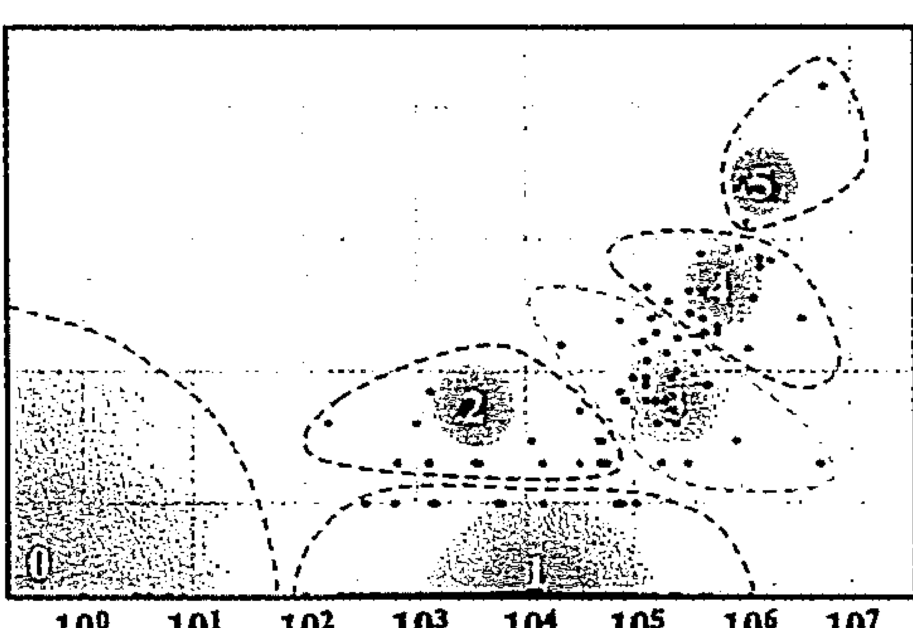

## 图 7 - 3 NLP 系统中语言资源分类

- • 类别 0（The Left - Behinds）。

NLP 技术一直以来都忽视了类别 0 的语言（见表 7 - 1 中的类别 0）。因为语料资源极少，所以这类语言将逐渐成为历史，很难将它们与数智化挂钩。就算是利用无监督学习（Unsupervised Learning）的方法，也只会让它们越来越差，因为它们基本上没有可以使用的无标注数据。

## 表 7-1 不同类别语言示例及其使用者和占比表

| 类别 | 5 种示例语言 | 语言数量/种 | 使用人数/亿个 | 语言数量占比 |
| :---: | :----------: | :---------: | :-----------: | :-----------: |
| 0 | Dahalo, Warlpiri, Popoloca, Wallisian, Bora | 2291 | 12 | 88.38% |
| 1 | Cherokee, Fijiain, Greenlandic, Bhojpuri, Navajo | 222 | 0.3 | 5.49% |
| 2 | Zulu, Konkani, Lao, Maltese, Irish | 19 | 0.057 | 0.36% |
| 3 | Indonesian, Ukranian, Cebuano, Afrikaans, Hebrew | 28 | 18 | 4.42% |
| 4 | Russian, Hungarian, Vietnamese, Dutch, Korean | 18 | 22 | 1.07% |
| 5 | English, Spanish, German, Japanese, French | 7 | 25 | 0.28% |

- * 类别 1（The Scraping-Bys）。

类别 1 的语言（如格陵兰语）中有一些具备一定数量级的无标注数据，使它们有可能在数年后在多语言研究中受到更多研究人员的关注。但是这需要研究人员有组织、持续地推动涉及这类语言的的任务，让更多的人关注它们，并且愿意为它们收集更多的标注数据。这类语言现阶段标注数据的数量几乎为 0。

- * 类别 2（The Hopefuls）。

类别 2 的语言（如爱尔兰语）在 NLP 领域正经历黎明前的黑暗，努力前进。这类语言积累了一些标注数据（数量较少），这意味着有一批研究人员正在努力对这类语言进行数智化转型，预计他们在未来几年会制作出一些很有前景的 NLP 工具服务于这类语言。

- * 类别 3（The Rising Stars）。

从类别 3 往后基本就是我们日常所说的高资源语言了。无监督学习方法极大地扩大了这类语言（如印尼语）在 NLP 领域的影响。因为这类语言在互联网上有更多的使用者，所以很多 NLP 社区研究人员致力于这类语言的研究，但是他们的研究也会因标注数据不足而受到影响。这些研究人员应该借助大模型的预训练和参数高效微调技术[23]来弥补标注数据不足的影响。

- * 类别 4（The Underdogs）。

类别 4 的语言（如越南语）在 NLP 领域就像火种一样，发展潜力巨大。它们积累了大量的无标注数据，在标注数据方面，与类别 5 相比只少了一个数量级。很多经验丰富的社区研究人员致力于这类语言的研究。这类语言很有潜力变成类别 5 的语言，并且是能体验到数智化优越性的一类语言。

- * 类别 5（The Winners）。

类别 5 的语言（如汉语、英语）在 NLP 领域的发展是非常迅猛的，并且一直处于领先地位，其研究的时间也比前几个类别的语言要长。因为这类语言在网络上有着主导地位，有大量的企业及政府机构对这类语言在 NLP 领域的资源和技术发展进行投资，它们是绝对的 高资源语言。这类语言的使用者享受着 NLP 领域最先进的成果及技术发展带来的红利。

值得一提的是，我国是一个统一的多民族国家，具有民族多、语言多、文字多的特色。除汉族外，我国有占全国总人口 8% 的 55 个少数民族[24]。这些少数民族，除回族大多换用汉语言文字外，其他少数民族（如蒙古族、藏族、维吾尔族、哈萨克族、朝鲜族等）不同程度地使用本民族文字。国家也决定在“两会”等重大会议上提供蒙古族、藏族、维吾尔族、哈萨克族、朝鲜族、彝族、壮族 7 种少数民族语言文字文件和同声传译服务，充分体现了各民族平等的民族政策。同时中国中文信息学会组织的 CCL 作为国内最大的中文社区，鼓励中国少数民族语言相关的计算语言学方面的原创研究和应用论文发表[25]。另外，根据国际化计算机处理技术发展要求，我国对藏文、蒙文、满文、傣文、佉卢字、西夏文、八思巴字、傈僳文等古文字创建了编码系统，进而为少数民族古文字及其文化信息交流提供了更为广阔的学术空间。我国为女真字、契丹小字、契丹大字、突厥文、水书、东巴文、傈僳文等设定的字符方案获得了国际标准化组织的高度评价和认同，抢占了该领域的学术话语权。

### 7.1.3 多语言模型技术方向

7.1.2 节中提到语言的分类决定了不同语言的研究方向，如类别 3 和类别 4 的语言，由于缺乏足够的标注数据，因此可以利用无监督学习方法来弥补。近年来，随着大模型的发展，相关研究主要通过预训练技术学习无标注数据中的语言特征，实现目标语言的零样本或小样本学习。目前学术界也有相关研究成果的发表，主要集中在东南亚的印尼语[26]、越南语[27]和泰语[28]。

当然仅借助无标注数据来提升类别 3 和类别 4 的语言任务的性能是不够的，一个很自然的想法是借助高资源语言中的语言特征向低资源语言迁移，即跨语言迁移学习（Cross Lingual Transfer Learning）和多语言学习（Multilingual Learning），前者是指从 1 个源语言迁移到 1 个目标语言（one - to - one），后者是指从多个源语言迁移到 1 个目标语言，在 BLOOM/Llama 类开源大模型出现以后，后者逐渐成为研究的主流。但是，在跨语言迁移学习的过程中，语言间的相似性极大地制约了迁移的性能。以英语和西班牙语在机器翻译上的迁移为例，因为两种语言很接近，在单词上有近 50% 的重叠度，所以小样本迁移效果和翻译效果很好。但是汉语和英语由于 token 上的差异及其他特征差异较大，因此迁移效果不佳，甚至可能带来负向迁移（Negative Transfer）和灾难性遗忘（Catastrophic Forgetting）的问题。如何选择有效的高资源语言作为源语言，可以参考文献[8]、[29]的相关研究。

2023 年以来，随着大模型的发展，提示工程成为一个火热的研究课题，其大致分为两个技术方向。

(1) 构造 Prompt，进行 ICL。这个技术方向利用 Prompt 作为输入，但是不对模型参数进行微调，在多语言侧大致分为跨语言提示（Cross Lingual Prompt）和跨语言思维链提示（Cross Lingual Chain-of-Thought Prompt）。两者都利用英语作为提示的主要语言，但是测试样本使用目标语言，这类方法已被证明可以取得更好的效果，并且和将测试样本翻译成英文的效果相似[30]。

(2) 利用机器翻译的多语言提示（Multilingual Prompt）任务进行模型的参数微调。实验效果证明，使用英语作为提示的主要语言，在多语言任务下进行微调，能在英语或非英语任务集的零样本学习任务上获得 State - of - the - Art （SOTA）效果，同时使用机器翻译的多语言提示进行微调，在一些语言上也比人工翻译的提示微调结果好[18]。

## 7.2 多语言大模型的预训练资源和评测任务

数据资源在如今这个大模型时代与石油和煤炭在工业时代一样重要。本节将总结多语言大模型训练所使用的主流语料，以及如何对这些语料进行加工、提炼，以便更好地帮助研究人员提升多语言大模型的效果。

### 7.2.1 多语言大模型的预训练资源介绍

1．预训练资源

大模型需要海量的训练语料才可以学习到更全面的知识和内容，所以现在越来越多的开源训练语料被用来训练大模型。本节按照训练语料的内容类型，简要地将目前被广泛使用的语料资源归类为书籍资源（Books）、网页资源（CommonCrawl）、Reddit 资源（Reddit Links）、维基百科（Wikipedia）、代码（Codes）和其他（Other）[31]，如表 7-2 所示。

#### 表7-2 主流语料资源汇总表

| 语料资源       | 数据大小   | 数据源头         | 更新时间   |
|----------------|------------|---------------|--------------|
| BookCorpus    | 5GB        | Books         | 2015-12      |
| Project Gutenberg | —         | Books         | 2021-12      |
| C4            | 800GB      | CommonCrawl   | 2019-04      |
| CC-Stories-R  | 31GB       | CommonCrawl   | 2019-09      |
| CC-NEWS       | 78GB       | CommonCrawl   | 2019-02      |
| REALNEws      | 120GB      | CommonCrawl   | 2019-04      |
| OpenWebText   | 38GB       | Reddit Links  | 2023-03      |
| PushShift.io  | 2TB        | Reddit Links  | 2023-03      |
| Wikipedia     | 21GB       | Wikipedia     | 2023-03      |
| BigQuery      | —          | Codes         | 2023-03      |
| The Pile      | 800GB      | Other         | 2020-12      |
| ROOTS         | 1.6TB      | Other         | 2022-06      |

(1) 书籍资源。
BookCorpus[32]是以前的预训练模型（如 GPT/GPT-2）经常使用的一个数据集，包括超过 1.1 万本书籍，覆盖广泛的类别（如小说和传记）。现阶段规模较大的一个书籍

## Llama 大模型实践指南

## 1. 语料资源

(1) 书籍。书籍是语料资源的重要组成部分，Llama、GPT-3 使用过多种语言的书籍，如英语、中文、法语等。

(2) 新闻。新闻数据集如 CommonCrawl 数据集，包含了大量新闻文本，是预训练语言模型的重要语料来源。

(3) 维基百科。维基百科具有不同领域的海量高质量文章，多数文章都是百科类的，并且涵盖多种语言。Llama、GPT-3 使用过英语版本的维基百科，mBERT 和 XLM-100 使用过多语言版本的维基百科。但是因为多语言版本的维基百科中的文档数量比 CommonCrawl 数据集少很多，因此并没有被多语言大模型广泛使用。WikiMatrix 是一个从维基百科数据中抽取的平行语料，共有 1.35 亿条平行语料，覆盖 1620 个语对和 85 种语言，主要用于机器翻译。

(4) 代码。对于代码数据集，现有的工作主要集中在从网络上爬取具有开源协议的代码。代码主要有两个爬取源：第一个是公开的代码库，如 GitHub；第二个是与代码相关的问答平台，如 Stackflow、CSDN。Google 已经开源了 BigQuery，其包含一定数量、不同编程语言的开源代码。作为代码大模型，CodeGen 就使用了 BigQuery 进行训练，而 BigQuery 的多语言版本也被用来训练 CodeGen-Multi。

(5) 其他。其他语料资源中最有特点的是 The Pile 数据集和 ROOTS 数据集。The Pile 数据集包括从上述多个数据源中抽取的 800GB 的数据集，涵盖 22 个高质量数据源的子集合。The Pile 数据集被各种规模的大模型使用，如 GPT-J（6B）和 OpenLLaMA（7B/13B）。ROOTS 数据集是一个多语言数据集，由很多更小的数据集组成，涵盖 59 种语言。多语言大模型 BLOOM 就采用了 ROOTS 数据集进行训练。此外，还有一个数据集 Paracrawl 利用 Bitextor 工具从网页中挖掘与英语平行的句对，其主要覆盖欧洲的语言且包括 9 种低资源语言。

## 2. 预训练资源质量

保证数据质量是训练出性能出色的多语言大模型的关键，鲁棒性高的多语言大模型能在跨语言的下游任务中表现得更好。上文介绍的多语言预训练数据集大多来源于网络的自动挖掘，其数据质量无法得到很好的保证，因此从不同维度对这些从网络中挖掘的语料进行评估很有必要。

在 ACL 2023 关于多语言大模型的 Tutorial 中，微软的研究人员提出对多语言预训练数据集从多语言分布、数据质量、来源和监管 4 个方面进行质量评价。在多语言分布方面，研究人员以 CommonCrawl 数据集为例，指出虽然其包含 100 多种语言，但是其中 57 种语言的数量小于 0.001%，所以在利用其构造多语言数据时要考虑是否自己生成与下游任务语言一致的数据。

## 3. 多语言大模型技术介绍及其工业应用

### 3.1 数据质量

在数据质量方面，建议构造数据集的研究人员不要只关注那些低资源语料，也要注意那些语言被错误分类的样本，它们有可能是因与其他语言相似及质量太差而被划分到一些高资源语言类别中的。同时要注意那些机器生成的语料和因为识别工具效果有限而包含色情或不良信息的语料。研究人员建议从数据的数量、质量、领域数量、可持续性、共享性等维度评估多语言预训练数据集的质量。

### 3.2 评测任务介绍

7.2.1 节介绍的数据集主要集中在无监督数据集上，本节将介绍在多语言有监督数据集上评测多语言大模型的 Benchmark。Benchmark 中的任务主要包括文本分类任务（单句或句对）、QA 任务、序列标注任务和文本生成任务，如图 7-4 所示。

### 3.3 评测数据集

构造鲁棒性高并且全面的评测任务可以帮助我们更好地理解大模型的效果，这类评测在英语中是十分活跃的研究领域，如 GLUE 及难度上升的 SuperGLUE 评测数据集 Benchmark，以及近期在其基础上建立的多语言评测数据集 XTREME、XTREME-R 和 XGLUE 等。多语言评测数据集的目标是覆盖更多样的任务和语言，这样我们就可以更好地评估多语言大模型的泛化性能。与此同时，也有一些研究人员致力于构建针对特定语言的评测数据集，如针对印度语的 IndicXTREME 等。

### 3.4 评测方法

传统模型的评测方法利用有监督训练语料在预训练模型上进行微调，链路为预训练 + 微调。多语言大模型具备天生的零样本和小样本学习能力，其评测方法可以分成两大类：一类是使用原有的评测方法进行任务相关的微调；另一类是基于提示的 ICL，链路变为预训练 + 提示 + 预测。任务相关的微调需要利用训练语料对模型参数进行更新，而 ICL 不需要更新模型参数，只需设计不同的提示模型就会返回对应的结果。

### 3.5 多语言大模型的优化方向

介绍完多语言大模型的预训练资源和评测任务，本节将介绍数据预处理流程和 Tokenizer，以及各类多语言大模型的结构和效果。

### 3.5.1 数据预处理流程

多语言大模型的预训练数据清洗和单语言大模型并没有显著的不同，都要经历数据的收集、初次数据清洗（语言检测）、文档去重及质量过滤（隐私过滤）等步骤，唯一的区别是，在初次数据清洗过程中，需要设置合理的阈值，识别出我们需要的语言并保留一定比例的多语言文档用于模型训练。

### 3.5.2 Tokenizer

经历过数据处理的语料，需要经过 Tokenizer 的处理后才可以变成多语言大模型直接可用的数据格式，下面我们介绍一下常用的 Tokenizer 及其在多语言上的潜在问题。

### 3.5.3 训练数据格式和采样策略

在结束对训练语料的分词处理以后，将它们送入多语言大模型之前，多语言大模型还需要考虑如何组织多语言的样本，以及对不同语言样本的采样策略。一般情况下，使用多语言平行句对训练的大模型，在多语言的下游任务中的效果会优于仅使用单语言样本或以英语为中心的平行句对训练的大模型。

# 第7章 多语言大模型技术介绍及其工业应用

采样，是为了更好地平衡模型规模和语言规模对多语言大模型效果的影响，避免出现7.1节提到的多语言诅咒现象。

## 1. 单语言样本

单语言样本是指训练过程中将每种语言的语料独立作为预训练任务的采样样本，通过不同的采样策略从文档池中对不同语言进行采样，形成一个“Batch”进行迭代训练。GPT-3、Llama系列、BLOOM使用的就是这种训练数据格式。之所以对语言进行采样，是因为多语言采样策略有三种：第一种是不做任何限制，直接根据语言样本数量形成的经验分布pᵢ进行采样。其中，pᵢ代表的是第l种语言的样本数量。

pᵢ = \frac{nᵢ}{\sum_{l'\in L}n_{l'}} (7 - 1)

第二种是基于温度的采样策略[20-21]，一般用于少于10亿个参数的模型。这种采样策略会先使用一个采样函数qᵢ和一个温度参数τ正则化原来的pᵢ分布，通过设置不同的温度确保采样时可以对低资源语言进行上采样，对高资源语言进行下采样，从而平衡训练语料中不同语言之间的比例。

qᵢ = \frac{pᵢ^{1/τ}}{\sum_{l'\in L}p_{l'}^{1/τ}} (7 - 2)

第三种是2023年ICLR提出的Unimax方法[57]，它希望能根据每种语言的语料中的字符数量更平均地分配训练预算（Budget），从而不用人为决定τ的值，为实验带来随机性。这种方法会先以低资源语言来进行训练预算的分配，也就组成了Batch，然后进行模型训练。实验证明，这种方法的效果要优于基于温度的采样策略。

## 2. 以英语为主的平行句对

以英语为主的平行句对的训练数据格式及模型对照如图7-11所示，以英语作为中间语言，采样与该样本对齐的目标语言语料组成平行句对，将其输入模型进行Masked LM任务预训练。这种方法借助了机器翻译的思想，希望Masked不同语言的token信息，使模型学习到不同语言与英语之间的关系。如果需要应用上文提到的采样策略，则需要以句对（如中英句对）为最小统计单元进行采样。

## Llama 大模型实践指南

## Monolingual Corpora

## Bitext Corpora

## X-Y Directions

- mBERT, XLM-Roberta
- mT5, AlexaTM, byte-mT5
- XLM, XLM-E, DeBERTa v3, Info-XLM
- mBART
- PaLM-2
- M2M 100*
- XY-LENT

## 图 7-11 以英语为主的平行句对的训练数据格式及模型对照

## 3. 多语言平行句对

与以英语为主的平行句对方法相比，多语言平行句对不再以英语作为中间语言，以保证模型在训练过程中可以学习到不同语言之间的直接关系。因为英语的弱词形变化特征决定了它并不一定是一种好的桥梁语言[58]。2022 年 10 月，使用这种方法训练的模型 T-ULRv6[59]，在之前提到的多语言 Benchmark XTREME 和单语言 GLUE 上纷纷取得了 SOTA 水平，证明多语言大模型可以同时在英语及多语言评测任务上取得最佳效果。

## 7.3.4 多语言大模型的训练任务

多语言大模型的训练任务分为预训练任务和微调任务。本节将介绍多语言大模型的预训练任务，主要关注两个方面：多语言大模型的训练目标构造和多语言大模型结构。

#### 1. 多语言大模型的训练目标构造

在介绍多语言大模型结构之前，先简单介绍三种训练目标构造方法。不同语言大模型的训练目标如图 7-12 所示，不同的训练目标通过覆盖输入的不同部分形成 loss 值，随后利用 loss 值更新模型的参数。

(1) Regular-Denoising (R-Denoising)：一般用于 MLM 的掩码策略，训练目标通常是先将一定范围内的 token 替换为独立的 Mask，然后训练模型去预测它，如 BERT。

(2) Specific-Denoising (S-Denoising)：这个方法会把给定的句子分成前缀和后缀两部分，前缀部分作为 context，后缀部分作为训练目标，最常用于文本生成和机器翻译任务。

(3) Extreme-Denoising（X-Denoising）：这种方法[60]可以看作在 Regular-Denoising 方法基础上，将掩码的窗口由 token 变成句子，最后的训练目标要预测每一段被覆盖的句子。这种方法在训练多语言大模型时通常为多轮对话任务所采用。在实际应用中，Llama 2 只使用了第二种方法，Llama2-Chat[61]使用了第二种方法和第三种方法，Google 的 PaLM 2 使用了三种方法，通过在每个输入前加入 R-S-E 标志来确定不同的训练目标[62]。

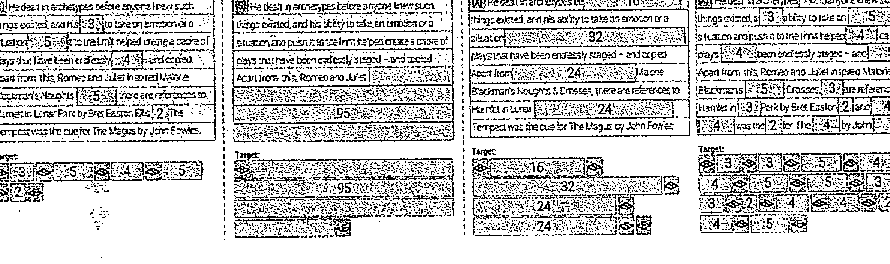

#### 图7-12 不同语言大模型的训练目标

#### 2. 多语言大模型结构

Transformer[63]是目前最常使用的多语言大模型结构[64]，主要由编码器和解码器两个结构组成。从两者的组合方式来看，可以分为编码器、编码器-解码器和解码器。现阶段多语言大模型主要使用的是解码器、编码器-解码器及前缀语言模型（Prefix LM）三种结构。早期BERT使用的是编码器结构，现在编码器已经很少被独立使用了。

- 解码器结构。

解码器结构如图 7-13 所示，这种结构是现在主流的多语言大模型所使用的结构，这种结构让模型可以像传统的自回归语言模型一样被训练，即利用单向注意力机制进行 NTP。Llama 2、GPT 系列、BLOOM、XGLM 使用的就是这种结构。最近有研究提出，在解码器结构的模型上进行去解码器的训练[65]或利用指令微调[66]，也能提升模型效果。但是这些方法都是基于以英语为主的模型的，在多语言大模型上的效果并不清楚。PaLM 2 在其报告中使用类似的方法在多语言大模型任务中取得了出色的成绩，所以我们可以将其作为多语言大模型优化的一个方案。


- 编码器-解码器结构。

传统的编码器-解码器结构如图 7-14 所示，这种结构使用的是 Transformer 的编码器及解码器。先将 token 的序列输入编码器，得到与输入相同长度的序列向量，然后将其作为解码器的输入。解码器使用交叉的注意力机制，针对输入使用双向注意力机制，可以关注输入的所有上下文信息。双向注意力机制是一个能高效利用数据的策略，因为它在预测 token 时可以利用这个 token 前后的信息。但是这种方法更善于执行自然语言理解任务而不是现在大模型所执行的自然语言生成任务，所以在大模型中较少独立使用。针对输出序列，使用单向注意力机制，以防止模型关注预测 token 之后的信息。在多语言大模型中，mT5 还在继续使用这种结构。

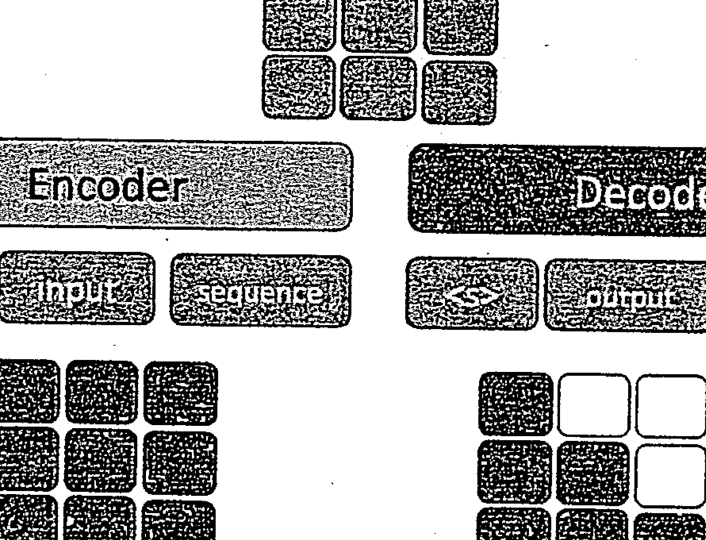

- 前缀语言模型结构。

前缀语言模型结构本质上还是解码器结构，但是更改了解码器结构中的注意力机制，如图 7-15 所示，针对输入序列前缀的 token 使用双向注意力机制（如


- 前缀语言模型结构。

前缀语言模型结构本质上还是解码器结构，但是更改了解码器结构中的注意力机制，如图 7-15 所示，针对输入序列前缀的 token 使用双向注意力机制（如

[PAGE 160]

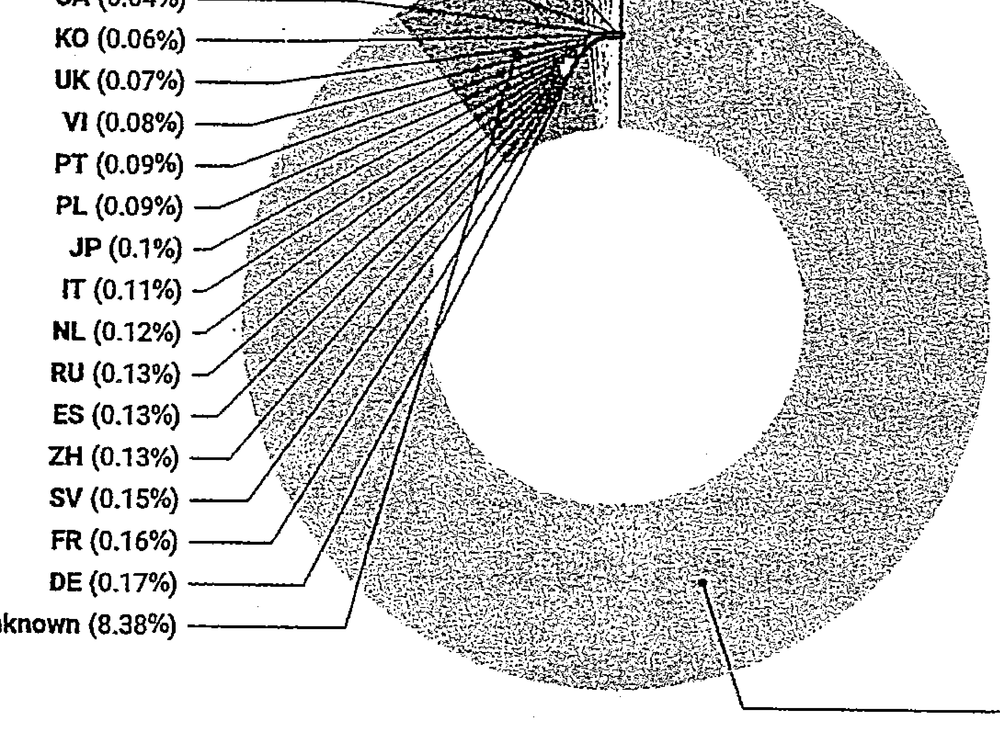

- 前缀语言模型结构。

前缀语言模型结构本质上还是解码器结构，但是更改了解码器结构中的注意力机制，如图 7-15 所示，针对输入序列前缀的 token 使用双向注意力机制（如

[PAGE 161]

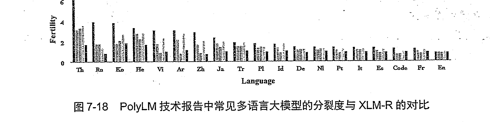

- 前缀语言模型结构。

前缀语言模型结构本质上还是解码器结构，但是更改了解码器结构中的注意力机制，如图 7-15 所示，针对输入序列前缀的 token 使用双向注意力机制（如

[PAGE 162]


- 前缀语言模型结构。

前缀语言模型结构本质上还是解码器结构，但是更改了解码器结构中的注意力机制，如图 7-15 所示，针对输入序列前缀的 token 使用双向注意力机制（如

[PAGE 163]

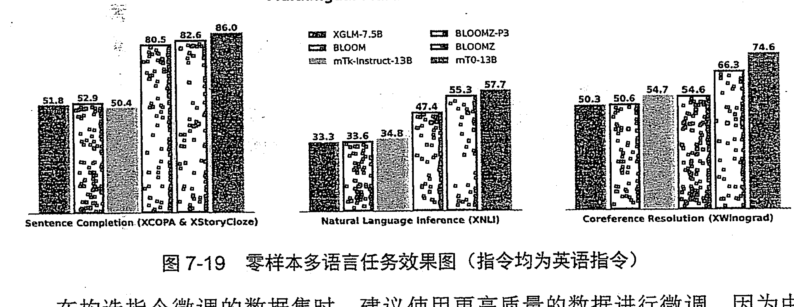

- 前缀语言模型结构。

前缀语言模型结构本质上还是解码器结构，但是更改了解码器结构中的注意力机制，如图 7-15 所示，针对输入序列前缀的 token 使用双向注意力机制（如

[PAGE 164]

# Llama大模型实践指南

## 7.4 多语言大模型的工业应用

大模型，即生成式 AI 的出现，让人们能以自然语言为指令与机器进行交互，同时借助各类 API 和操作获得想要的答案，它的出现正在重塑很多产业和工业应用。本节将重点介绍几个需要利用多语言大模型进行交互的典型工业应用，这些工业应用借助多语言大模型来提升相关领域的用户体验，以及提高运营效率。

### 7.4.1 智能客服

多语言大模型最为典型的一个工业应用就是智能客服。智能客服具有多轮对话能力，可以更自然地对用户提出的售前与售后问题进行回答，提高企业服务效率。同时，智能客服还可以识别用户的感情，针对不同用户进行安抚或情况上报，提升用户满意度并降低各类公关风险。

针对售前问题，智能客服更类似于导购机器人，会根据用户的诉求进行各种反问以收集信息，最后为用户推荐其可能感兴趣的产品以提高用户转化率。近期东南亚的电子商务平台Lazada与Shopify分别基于OpenAI的ChatGPT推出了自己的LazzieChat机器人和Shopify机器人，如图7-20所示，它们可以根据用户的需求进行产品推荐，LazzieChat 机器人主要支持英语和印尼语，而 Shopify 机器人支持汉语及更多的欧洲语言。


#### 图7-20 LazzieChat机器人和Shopify机器人示意图

针对售后常见问题的解答，因为涉及专业领域知识，如不同平台的政策不一致，并且知识的实效性较高，所以一般会采用检索增强（RAG）[73]的方法，既能利用外部的新知识，又能在一定程度上解决大模型的幻觉问题，具体流程如图7-21所示。一般会先针对领域知识构建向量数据库，再根据用户的问题从向量数据库中检索出相关的文档，然后将问题和文档及对应的提示交给大模型

[content]
[PAGE 165]

# 第7章 多语言大模型技术介绍及其工业应用

### 7.4.2 多语言机器翻译

多语言机器翻译是另一个重要的工业应用，它可以将一种语言翻译成另一种语言，从而打破语言障碍，促进全球交流。随着多语言大模型的发展，机器翻译的准确性和流畅性得到了显著提升。例如，Google 翻译和 Microsoft 翻译等翻译工具都采用了多语言大模型技术。

### 7.4.3 多语言问答系统

多语言问答系统可以帮助用户在多个语言之间进行查询和回答，提高跨语言信息获取的效率。这类系统通常使用多语言大模型作为后端，以便更好地理解和生成不同语言的回答。

### 7.4.4 多语言语音识别

多语言语音识别技术可以将不同语言的语音转换为文本，从而实现跨语言语音交互。这项技术在智能客服、多语言翻译等领域有着广泛的应用。

### 7.4.5 多语言文本摘要

多语言文本摘要技术可以从不同语言的文本中提取关键信息，生成简洁、准确的摘要。这对于信息检索、新闻摘要等领域具有重要意义。

### 7.4.6 多语言情感分析

多语言情感分析技术可以分析不同语言的文本情感，帮助企业和组织了解用户对产品、服务或品牌的看法。这对于市场调研、客户服务等领域具有重要作用。

### 7.4.7 多语言对话系统

多语言对话系统可以实现跨语言的自然语言交互，为用户提供便捷的跨语言服务。这类系统通常使用多语言大模型作为核心技术，以实现不同语言之间的理解和生成。

随着多语言大模型技术的不断发展，其在工业应用领域的应用将越来越广泛，为各行各业带来更多创新和机遇。

# 第7章 多语言大模型技术介绍及其工业应用

型，让大模型完成答案的生成，并回复用户，整个过程和之前的阅读理解和文档问答任务非常相似。

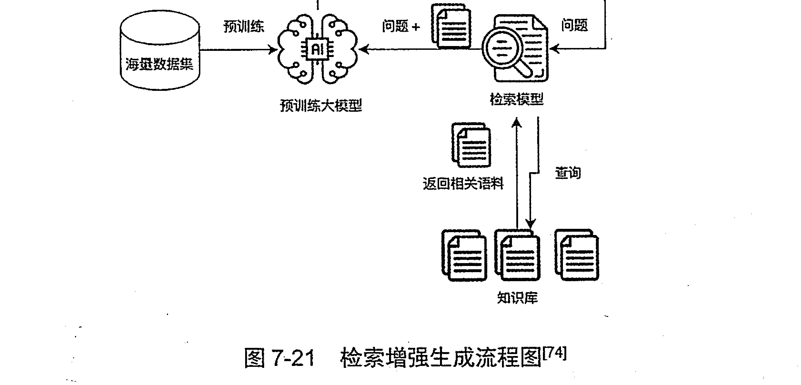

除了简单的文档问答，有时智能客服还需要进行多轮任务型对话，也就是Taskbot。在这类任务中，大模型不仅需要具有多轮对话能力，还需要具有工具使用（如API调用）能力，以查询任务所需的槽位信息，而答案也会根据查询到的槽位信息而动态变化。例如，用户询问他的订单什么时候可以到，如果此时他的订单状态是已经退货，那么我们需要和用户解释他的订单处于退货状态无法再收到，而不是回复一个通用的答案。现阶段这方面的研究主要集中在利用大模型将用户的指令转换为机器可以理解的动作或代码，随后在特定的环境中执行，即LLM-AgENT[75]。读者如果有兴趣可以看一下AutoGPT或XLANG项目[76]，这些项目开发的LLM-AgENT充当着自然语言与特定指令（API调用或动作序列，如配置好的对话流程）之间的桥梁，通过与环境及人类的一轮轮交流，大模型可以收集足够的上下文信息，从而精准、有效地完成任务，延伸并拓展用户意图[77]。

# 7.4.2 搜索引擎

除智能客服外，Google和微软的Bing等厂商也在利用RAG技术及多语言大模型提供网页搜索服务。使用了大模型的搜索引擎可以为用户提供更简洁的回复，当然代价就是可能会出现不准确答案。图7-22所示为Bing Chat系统演示图，由此可以看出，为了防止不准确的信息误导用户，它还标注了不同回复的出处，以帮助用户更好地寻找答案。

## Llama 大模型实践指南

√ 正在搜索: A100 colab pro

√ 正在为你生成答案...

According to the web search results, you can use A100 GPU if you are a pro member of Colab, but only if it is available and you have enough compute units. The A100 GPU is a premium accelerator that is subject to availability and quota restrictions¹. Colab Pro users get 100 compute units per month, while Colab Pro+ users get 500 compute units per month². You can check your GPU settings and availability in the Runtime > Change runtime type menu in Colab³. You can also purchase more compute units via Pay As You Go if you encounter usage limits⁴. I hope this helps.

了解详细信息: 1. colab.research.google.com 2. currypunnin.com 3. reddit.com 4. 更多 2共30 @

#### 图7-22 Bing Chat系统演示图

# 7.4.3 机器翻译

机器翻译是一个天然的需要使用多语言大模型的场景，现阶段多语言大模型的翻译效果和原有的机器翻译模型在高资源语言下已经基本一致[78]，虽然多语言大模型和 Google 的翻译效果在低资源语言上还有着不小的差距，但是已经可以基本满足对常见语句的翻译需求。同时，因为多语言大模型可以更好地理解上下文，所以其对一些会议和商业文件的翻译可能会有更好的效果。现阶段比较成熟的应用有 Meta AI 的 SeamlessM4T[79]（见图 7-23），以及中国科学院自动化研究所以 Llama 为基础训练的多语言大模型 BigTranslate。

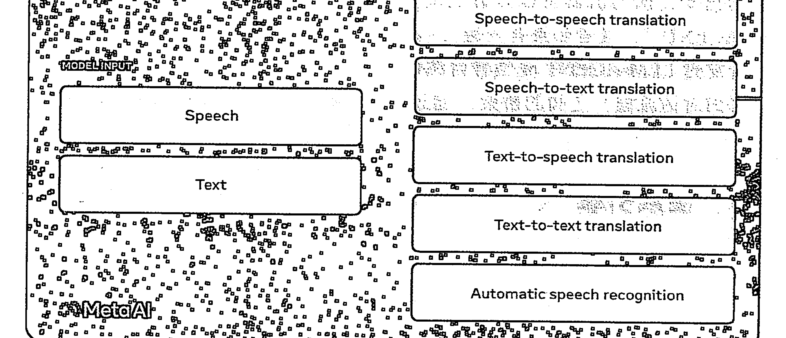

#### 图7-23 Meta AI 的 SeamlessM4T

## 反侵权盗版声明

电子工业出版社依法对本作品享有专有出版权。任何未经权利人书面许可，复制、销售或通过信息网络传播本作品的行为；歪曲、篡改、剽窃本作品的行为，均违反《中华人民共和国著作权法》，其行为人应承担相应的民事责任和行政责任，构成犯罪的，将被依法追究刑事责任。

为了维护市场秩序，保护权利人的合法权益，我社将依法查处和打击侵权盗版的单位和个人。欢迎社会各界人士积极举报侵权盗版行为，本社将奖励举报有功人员，并保证举报人的信息不被泄露。

举报电话：（010）88254396；（010）88258888

传 真：（010）88254397

E - m a i l: dbqq@phei.com.cn

通信地址：北京市万寿路173信箱

电子工业出版社总编办公室

邮 编：100036