# Llama 大模型实战手册

## 内容概览
整本书划分为七章，系统梳理了从理论认知到工程落地的完整路径。首章聚焦大模型的基础原理。第二、三章集中讲解 Llama 2 的部署流程与微调方法，并配有可操作的代码示例、典型案例拆解与实践建议。第四章剖析多轮对话中的常见难题，是开发者与研究者普遍关心的痛点。第五章说明如何基于 Llama 2 构建面向行业的定制化模型，满足差异化业务需求。第六章演示借助 Llama 2 与 LangChain 搭建高效文档问答系统的思路。第七章则聚焦多语言大模型的技术实现与应用场景。

无论是初入领域的学生与研究者，还是具备多年经验的专家与工程师，都能从中获益。阅读后，读者既能理解 Llama 2 的核心思想与技术要点，也能学会将其迁移到真实问题上，在快速迭代的赛道中建立竞争优势。

## 前言
当前人工智能与自然语言处理正迎来前所未有的繁荣期。预训练大模型如 GPT-4、Llama 2 等，不仅在学术界引发热议，也在工业界加速落地。作为拥有多年研究与工程实践的团队，我们希望将这一领域的最新进展与实战经验汇集成一本兼顾广度与深度的参考书，而 Llama 2 正是当下最受关注的开源预训练模型之一，这正是本书诞生的原因。

全书围绕 Llama 2 展开，覆盖从基础概念到具体应用的各个环节。我们力求每章都具备强实践性，同时保持理论深度。书中提供了大量代码片段、案例剖析与最佳实践，帮助读者更快掌握并运用 Llama 2。

本书具备明显的跨学科视角。除了计算机科学与机器学习的核心概念外，还引入了语言学、信息检索、人机交互等领域的知识，旨在帮助读者全面认识大模型在不同场景下的能力边界与局限。

适用人群覆盖面广，既可作为入门读者的引导教材，也能为资深专家提供技术细节与拓展参考。语言上力求通俗易懂，同时保留必要的技术深度并提供延伸阅读。

写作分工上，团队成员按专长负责不同章节。例如，长期从事自然语言处理研究的成员主笔第1章与第7章，涉及基础理论与多语言技术；具备丰富工业界经验的成员负责其余章节，侧重落地应用与行业定制。

总体来看，本书期望成为探索 Llama 2 的可靠指南。无论是追踪前沿研究，还是将预训练大模型应用于实际业务，都能在此获得系统知识与灵感。

在日新月异的环境中，愿我们共同探索人工智能与自然语言处理的更多可能，开启新的学术与应用之旅。

# 第 1 章 大模型的基础理论
自 OpenAI 发布 GPT-3 以来，AI 发展进入大模型时代。大规模语言模型，即大语言模型 LLM，拥有强大的理解与推理能力，能够胜任多样化任务。以对话形式为用户提供服务是其典型应用。大模型已成为 AI 领域的核心热点，也被视作迈向通用人工智能的重要路径。

本章将介绍大模型的发展脉络、核心架构、数据采集与处理、预训练与微调、评测方法。

## 1.1 大模型的发展历史
大模型是 NLP 领域的重要概念，代表基于海量语料训练的语言模型。虽然能完成多种任务，本质上仍是对句子中词序列出现概率的建模。

### 1.1.1 从语言模型到预训练大模型
#### 1. 语言模型
语言模型是 NLP 的核心，用来统计建模语言规律与分布，用以推断序列中词的概率分布。对由 l 个词元组成的句子 s，w_i 表示第 i 个词，其概率可表示为

p(s) = p(w₁)p(w₂|w₁)p(w₃|w₁w₂)…p(w_l|w₁w₂…w_{l−1})=∏_{i=0}^l p(w_i|w_{i−1}) （1.1）

尽管无法枚举所有可能的句子，语言模型在统计层面捕捉了语言规律，从而实现分布估计与推断。经典实现方式之一是 N 元模型。

#### 2. 统计语言模型
预测词 wᵢ 的分布时，随着历史长度增加，可能的历史数量指数级膨胀，难以高效学习。N-gram 模型假设当前词的概率仅依赖前 N-1 个词。以 2-gram 为例，概率公式为

p(wᵢ|wᵢ₋₁)=c(wᵢ₋₁wᵢ)/c(wᵢ₋₁)

(1.2)

其中 c(wᵢ₋₁wᵢ) 表示该二元组在语料中的共现次数。共现比例近似反映词出现的概率。统计语言模型基于构建好的训练语料，通过式 1.2 学习参数。

#### 3. 神经网络语言模型
N-gram 的缺陷在于对语料中未出现的 N-gram 无法估计概率。平滑技术虽可缓解，但在大规模语料上的建模能力仍有限。研究者转而用神经网络在连续空间构建语言模型。前馈神经网络语言模型学习词的分布式表示，用向量表征词义，性能优于 N-gram。随后出现的循环神经网络语言模型可处理变长输入，捕捉更长的上下文。神经网络语言模型已成为主流实现范式。

#### 4. 预训练大模型
预训练大模型在大量无标注开放数据上进行预训练，获得更优的语言表征，并在下游任务上带来显著提升。Word2Vec 是最早的预训练模型之一，其后出现基于循环神经网络的 ELMO。Transformer 结构提出后，后续预训练模型大多以 Transformer 为基础架构。

① 本书中标注的[1]、[2]……对应的参考文献，请下载本书配套电子文档查看。

## 1.2 大模型的核心框架
得益于 Transformer 在各 NLP 任务上的突破，主流大模型研究均倾向采用该结构。本节介绍 Transformer 及其关键组件。

### 1.2.1 Transformer
Transformer 是一种适用于 NLP 与序列到序列任务的深度学习模型，由 Google 于 2017 年提出，具有重要影响力。其设计革新了序列建模范式，取代了传统循环结构，在性能与并行化能力上均有提升。

[PAGE 14]

## Llama 大模型实践指南

关注不同语义表征。多头自注意力机制先将输入映射到多个子空间，分别计算注意力权重，再融合结果得到最终表示。

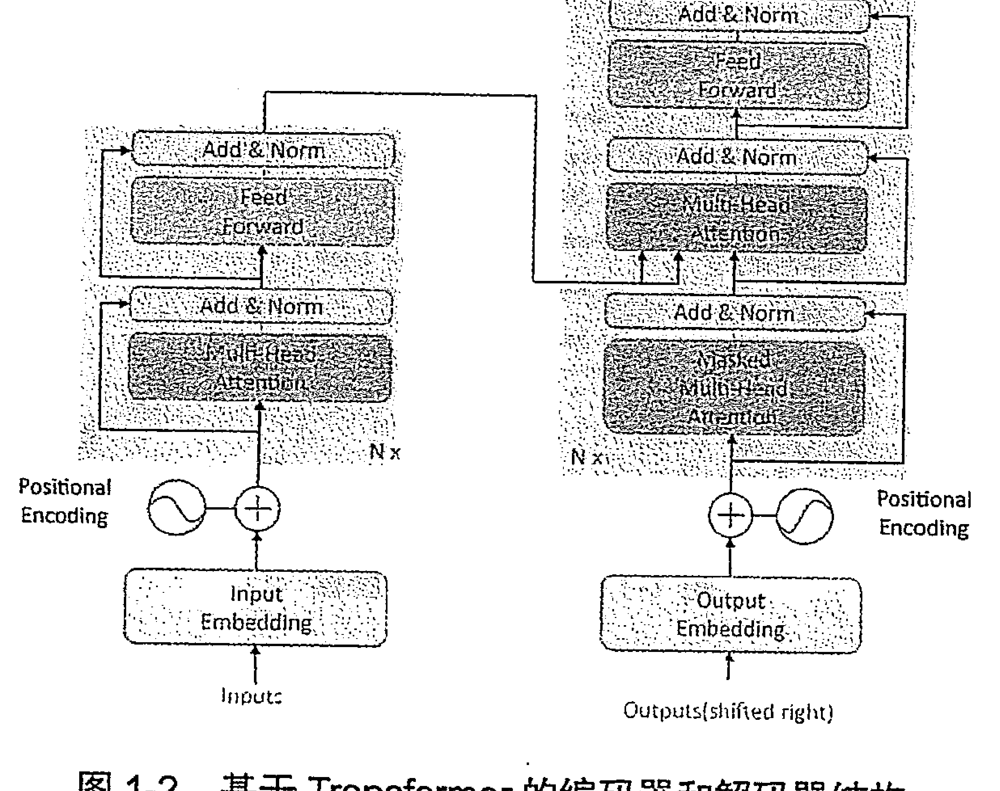

图 1-2 基于Transformer的编码器和解码器结构

编码器之后，解码器负责生成目标序列。其结构与编码器相似，除多头自注意力外，还引入自回归注意力，对已生成的目标序列进行权重计算，使模型在生成每个位置时兼顾输入序列与已生成内容，更好捕捉输入输出对应关系。为保证训练效率，解码器采用掩蔽自注意力，屏蔽当前位置之后的信息，确保预测仅依赖已生成部分。

为提升训练效果，Transformer 引入残差连接与层归一化。残差连接通过跳跃连接保留前层信息并叠加到当前输出；层归一化对子层输出进行标准化，加速收敛。

Transformer 缺乏循环网络的隐状态，需显式注入位置信息。采用位置编码将位置向量加到输入，使模型感知相对距离与顺序。

### 1.2.2 位置编码
传统 Transformer 使用正弦与余弦函数组合生成固定位置编码。该方式虽能提供位置信号，但难以适应不同长度序列，且对周期性模式处理受限。为此，旋转式位置编码 RoPE 通过旋转操作实现动态位置编码。随着训练进行，位置编码模式可自适应调整。具体而言，RoPE 通过旋转正弦余弦相位引入可学习旋转角度，控制编码模式的变化。旋转机制使位置编码在更大范围内呈现周期性，更好捕捉长序列位置信息，提升长文本处理性能与泛化能力。RoPE 为位置信息的建模提供了灵活自适应的方案，有助于 NLP、语音识别等序列建模任务。

### 1.2.3 多头自注意力机制
Transformer 的核心在于多头自注意力。该机制通过计算注意力权重，为序列不同位置赋予差异化重要性。注意力计算公式为

Attention(Q,K,V)=softmax( (QK^T)/√d_k )V （1.3）

式中 Q、K、V 分别为查询、键、值向量拼接而成的矩阵，√d_k 为缩放因子。得到的权重反映各位置间的关注程度，指导生成决策。Transformer 可并行处理序列所有位置，无需逐位置递进，从而更好地捕捉长距离依赖，提升表示能力。

多头自注意力通过并行多组线性变换捕捉不同关系。每组变换即一个头，学习不同的查询、键、值表示。计算流程为：输入经多组线性变换得到多组 QKV；每个头独立计算自注意力权重；权重乘以对应值得到加权向量；各头结果拼接后经线性变换得到最终表示。多头并行使模型能同时关注输入的多种相关性，相比单头机制更具表达力。

## 1.3 数据收集和数据处理
大模型训练依赖海量无监督数据，通常需融合多源数据预训练。本节介绍数据的获取与处理。

### 1.3.1 数据收集
文献[11]将训练语料分为通用数据与专业数据。通用数据如网页、对话、图书等，来源广泛、类别多样，是大多数大模型的基础，用于构建基础建模能力。为提升泛化，训练语料常扩展至专业数据，如多语言、科学、代码、垂直领域数据，以赋予模型特定领域能力。

#### 1）网页数据
在数据爆炸的背景下，网页数据是增强泛化能力的典型来源。已有工作从网页大规模爬取文本，如 Common Crawl，其特点是规模庞大、分布杂乱、格式多样。爬取内容包含高质量文本如维基百科，也包含大量低质量文本如垃圾邮件，因此过滤与清洗至关重要。

#### 2）对话数据
对话数据是提升模型对话能力的关键来源。主要采集自公开对话库与在线社交媒体。公开库数据丰富但可能过时；在线社交媒体如 PushShift.io 等可提供实时更新的对话。与网页数据相比，对话数据采集与清洗难度更高，高质量样本相对稀缺。

#### 3）图书数据
图书作为长文本书面语来源，价值突出，可帮助模型学习语言知识、长距离依赖与长文本生成。然而受版权限制，开源图书资源有限，研究界常以 Pile 语料库中的图书集作为主要来源。

# 2. 专业数据
专业数据有助于提升大模型在特定下游任务上的表现。

# 1）多语言数据
融合多语言数据可显著增强模型的跨语言理解与生成能力。例如 BLOOM 与 PaLM 均使用多语言语料，BLOOM 覆盖 46 种语言，PaLM 覆盖 122 种语言。这类模型在翻译、多语言摘要、多语言问答等任务上表现突出，并在目标语言单语任务上可超越部分单语模型。多语言融合为模型提供更广语言知识与语境，提升跨语言应用能力。

# 2）科学数据
随着科研出版物增长，将科学数据纳入预训练对提升科学知识理解至关重要。大量科学数据预训练后，模型在科学推理类任务上表现改善。科学语料库建设主要依赖 arXiv 论文、科学教科书、科学网页等。由于科学数据包含数学符号、蛋白质序列等复杂形式，通常需要专门的分词与预处理，将异构数据统一化。科学数据的引入使模型更好地理解科学文本并完成推理。

# 3）代码数据
程序生成研究日益受到关注。大规模代码预训练可显著提升代码生成质量，在单元测试生成、竞技编程等任务上表现良好。代码预训练数据主要来自编程问答社区如 Stack Exchange 与公开代码库如 GitHub。相较自然语言，代码具有严格格式、长距离依赖与执行逻辑。利用代码数据预训练可增强模型对程序生成任务的理解，生成逻辑与语法更准确的代码。

以现有研究为例说明语料构成。GPT-3 参数 1750 亿，使用 3000 亿 token 混合数据，包含 Common Crawl、WebText2、Books1、Books2 与维基百科；PaLM 参数 5400 亿，使用 7800 亿 token 混合数据，包含社交媒体对话、过滤网页、书籍、GitHub、多语言维基百科与新闻；Llama 参数 650 亿，使用 14000 亿 token 混合数据，包含 Common Crawl、C4、GitHub、维基百科、书籍、arXiv 与 Stack Exchange。

### 1.3.2 数据处理
数据采集后需进行处理构建训练语料，清除噪声、冗余、不相关及有害内容，避免影响模型容量与性能。

#### 1. 数据过滤
目前主流过滤方式有两类：基于分类器的过滤与启发式过滤。基于分类器的方法先用高质量数据训练分类器，再用其识别并剔除低质量样本。启发式方法则通过语言特征、指标、统计信息与关键词等设计规则进行过滤，如 BLOOM 与 Gopher 所采用的做法。两者结合可有效提升语料质量。

#### 2. 去重

要让大模型的训练既高效又稳健，语料的去重清理是不可绕过的环节。去重可以按粒度拆开做，常见的是句子级、文档级和数据集级。句子级主要是筛掉质量低的片段，比如出现大量重复词、重复短语的内容，这类片段容易在模型里形成固定模式，削弱训练的多样性。文档级则借助统计上的重叠度，比如词表重叠、N-gram 重叠，来揪出内容高度相似的重复文档并剔除，从而保持预训练语料的丰富度。数据集级更关注污染问题，要把训练集中可能与评测集重合的文本也清理掉，避免模型在测试时遇到“旧题”，确保其对未见数据的泛化能力。

#### 3. 隐私信息清洗
预训练语料大多抓取自互联网，其中混杂着大量用户自发产生的内容，难免夹带敏感或个人隐私信息，直接使用存在泄露风险。所以必须对语料做脱敏处理，剔除个人可识别信息 PII。一种简单直接的做法是基于规则的识别，比如用关键词匹配的方式找出姓名、住址、电话号码等字段并删除。如此处理能在保留语料价值的同时，降低隐私被不当利用的可能。

#### 4. 分词编码
分词编码是数据预处理的核心动作，任务是将原始文本切成词元序列供模型输入。在 Transformer 家族里，主流方案有字节对编码 BPE、WordPiece 和 Unigram。BPE 最早是 1994 年提出的数据压缩方法，后被改造用于 NLP，GPT-2、BART、Llama 等模型都采用它。WordPiece 起源于语音搜索系统，2016 年用在神经机器翻译，2018 年成为 BERT 的分词方式。T5 与 mBART 则选用 Unigram 构建词汇表。

## 1.4 预训练与微调全流程
大模型通常先在大规模语料上做无监督预训练来习得通用知识，再通过指令微调获得理解自然语言指令的能力，最后借助人类反馈微调把输出风格对齐人类偏好。

### 1.4.1 无监督预训练
以 GPT-3 为代表的基座模型，都是在海量数据上以前缀预测为目标进行自回归训练。把自回归目标、超大规模语料和超高参数量结合，就能得到一个能“读懂”任意文本并在此基础上“续写”的基础模型。

#### 1. 规模规律
规模规律描述的是模型表现随规模增长的递进关系。直观讲，模型参数、训练数据和计算量一起放大时，能力才会同步提升。当其他两项固定时，单项提升与性能之间呈现幂律关系。

#### 2. 上下文学习
GPT-3 的研究揭示了大规模训练催生的新范式——上下文学习 ICL。它无需改动参数，只靠提供少数下游任务示例，就能在提示中完成新的任务。

### 1.4.2 指令微调
预训练后的模型在少样本学习上表现不错，但在零样本场景下仍偏弱。FLAN 提出用自然语言指令描述的任务集对基座模型进行指令调优，以增强零样本能力。NLP 任务可以用指令表达，例如“判断这条影评的情感是正面还是负面？”“把‘你好’译成中文”。指令微调即在指令化数据上继续训练。图 1-3 所示为 Alpaca 指令微调集中中文翻译的一个样例。

```
{
  "instruction": "给出三个保持健康的秘诀。", 
  "input": "", 
  "output": "1.均衡饮食，多吃水果和蔬菜。\n2.定期锻炼，保持身体活跃和强壮。\n3.充足的睡眠，保持规律的作息时间。" 
},
```

```
{
  "instruction": "什么是三原色？", 
  "input": "", 
  "output": "三原色是红、蓝、黄。" 
}
```

```
{
  "instruction": "描述原子的结构。", 
  "input": "", 
  "output": "原子由原子核组成，原子核包含质子和中子，周围环绕着围绕原子核运行的电子。质子和中子带正电荷，而电子带负电荷，从而形成整体中性原子。每种粒子的数量决定了原子序数和原子类型。" 
}
```

```
{
  "instruction": "我们怎样才能减少空气污染？", 
  "input": "", 
  "output": "减少空气污染的方法有很多，如转向可再生能源、鼓励使用公共交通工具、禁止燃烧化石燃料、实施工业源减排政策及实施机动车排放标准。此外，个人可以通过减少汽车使用、避免燃烧木材等材料及改用节能电器来为减少空气污染做出自己的贡献。" 
}
```

```
{
  "instruction": "描述一次你不得不做出艰难决定的经历。", 
  "input": "", 
  "output": "当我在一家建筑公司担任项目经理时，我不得不做出一个艰难的决定。我负责一个需要在特定日期前完成的项目，以满足客户的期望。然而，由于意外的延误，我们无法在截止日期前完成，所以我不得不做出一个艰难的决定。我决定延后截止日期，但我不得不进一步扩展团队的资源并增加预算。尽管这是一个冒险的决定，但我最终决定继续进行，以确保项目按时完成并满足客户的期望。该项目最终成功完成，这被视为对我的领导能力和决策能力的考验。" 
}
```

# 图1-3 Alpaca指令微调数据集中的中文翻译样例

### 1.4.3 基于人类反馈微调
单纯扩大规模并不能保证输出符合人类偏好，模型仍可能产生不实、有害或无用的内容。InstructGPT 提出基于人类反馈的强化学习 RLHF，能在多任务上让模型输出更贴合人类偏好。人机评估显示，13 亿参数的 InstructGPT 生成质量超过了 1750 亿参数的 GPT-3。

# 第 1 章 大模型理论概览
# 续表

| 评测任务       | 评测数据集                     |

|----------------|----------------------------------|

| 代码编写任务   | HumanEval[27]                   |

|                | MBPP[28]                        |

| 多轮对话任务   | MT-Bench[13]                    |

|                | Chatbot Arena[12]               |

| 医学相关任务   | MultiMedQA[20]                  |

| 人类考试任务    | M3Exam                          |

|                | GAOKAO-Bench[22]                |

| 中文任务       | C-Eval[21]                      |

# 1. 综合语言能力测评集
综合型语言评测集涵盖多种 NLP 任务、稳定性测试和多任务集合，用来考察模型的整体能力。Chatbot Arena 与 MT-Bench 是衡量多轮对话能力的两大基准，前者提供匿名双模型在线投票平台，后者提供 80 道高质量多轮问答。GLUE 与 SuperGLUE 聚焦自然语言理解，包括推理、相似度等。BIG-Bench 与 MMLU 用来测试知识记忆与理解，BIG-Bench 含 204 项任务，涉及语言学、数学、常识、生物、物理、社会偏见、软件开发等；MMLU 覆盖 57 个学科。HELM 则综合了准确性、校准度、鲁棒性、公平性、偏差、有害性和效率七项指标。

# 2. 垂直下游任务集
垂直任务集面向数学、特定语言、特定领域等场景。MATH 包含 12 500 道竞赛级难题。MultiMedQA 由 7 个医学问答集合成，覆盖医学检验、研究和消费保健。C-Eval 是中文评测集，题目分人文、社科、理工等方向。GAOKAO-Bench 以中国高考真题为来源，测试语言理解和逻辑推理。

## Llama 大模型实践指南

## 1.5.3 评测方式
大模型评测分自动评测与人工评测。自动评测成本低、迭代快，人工评测反馈更真实全面。传统 NLP 常使用 BLEU[29]、ROUGE[30] 等指标。近年也有用大模型作裁判的趋势。PandaLM 是专门的裁判模型，可实现可重复的自动评测。文献[13] 用 GPT-4 与 GPT-3.5 作裁判，并指出其在位置偏见、长度偏见等方面的缺陷。

## 1.5.4 评测难点
+   1. 评测集泄露
训练语料体量巨大且通常不开源，评测集很可能已被纳入训练，导致结果失真。
+   2. 评测覆盖不足
模型能力维度众多，现有基准难以全面覆盖任务类型与评测方法，易造成结论不稳健。
文献[1] 也提到如何设计更鲁棒、更可靠的评测，以及构建统一评测框架的挑战。

# 第2章 Llama 2 本地部署实战
为何要部署大模型？
大模型已渗透医疗、金融等多个行业，提升生产力与信息获取效率。医疗场景可辅助诊断、制定护理方案并提供个性化康复建议；金融场景结合本地知识库可实现自然的信息检索。本地部署能满足数据隐私、垂直定制与成本控制需求，开源模型提供了灵活微调与本地运行的可能。本章介绍如何部署开源 Llama 2。

## 2.1 部署前准备
部署前需确认硬盘空间、CPU、内存以及 NVIDIA GPU 的配置。

### 2.1.1 硬件准备
不同参数量的 Llama 2 对 GPU 的需求见表 2-1。

#### 表2-1 部署不同参数的Llama 2大模型对GPU的要求

| 模型名称                     | 模型加载名称                     | 基础模型版本                       | 模型权重大小 |

|------------------------------|----------------------------------|------------------------------------|---------------|

| Llama2-Chinese-7b-Chat       | FlagAlpha/Llama2-Chinese-7b-Chat  | meta-llama/Llama-2-7b-chat-hf      | 13.50GB       |

| Llama2-Chinese-13b-Chat      | FlagAlpha/Llama2-Chinese-13b-Chat | meta-llama/Llama-2-13b-chat-hf     | 26.03GB       |

本次部署 Llama2-Chinese-7b-Chat，其显卡要求见表 2-2。

## Llama 大模型实践指南

# 表 2-2 Llama2-Chinese-7b-Chat 模型对显卡的要求

| 模型名称       | 显存需求 | 显卡型号                              |

| -------------- | -------- | ------------------------------------- |

| Llama2-Chinese-7b-Chat | >12GB    | RTX 2060 12GB, 3060 12GB, 3080, A2000及以上 |

### 2.1.2 环境准备
Python 版本需 3.9.6 及以上。可通过命令行运行相关命令核查版本。若版本不足，可使用 Anaconda 或 pyenv 等版本管理器更新。

Anaconda 集成 Conda 环境管理器与大量科学计算库，便于多版本切换。安装步骤如下：

+   (1) 访问 Anaconda 官网①下载安装包。

(2) 按系统选择对应版本下载，Anaconda 默认自带最新 Python。

(3) 运行安装包并按向导完成安装。

+   * Windows 双击 exe 安装。
* macOS 双击 pkg 安装。
* Linux 在终端执行 bash Anaconda3-xxx.sh。

(4) 安装时勾选加入 PATH，安装后运行 python--version 验证，conda list 查看包。

使用 conda 可创建独立环境，例如：

```
conda create --name myenv python=3.9
```

该命令创建名为 myenv 的环境并指定 Python 3.9。激活环境用 conda activate myenv，退出用 conda deactivate。

> ① 橙色文字对应的网址，请下载本书配套电子文档查看。

# 第2章 部署Llama 2大模型

## 2.2 模型导入与加载
导入训练好的 Llama 2 通常依赖 PyTorch 与 Transformers，先安装这两个库。预训练权重常见格式有：

+   (1) PyTorch 的“.pth”或“.pt”格式，可直接被 PyTorch 读取，支持 CPU GPU 切换。
+   (2) TensorFlow 的“.ckpt”格式，由 TensorFlow 读取，权重存储但不支持无缝切换。
+   (3) Hugging Face 的“.bin”格式，由 Transformers 库读取，支持 CPU GPU 切换。

权重文件需配合配置文件“.json”使用，该文件描述结构与超参。加载时先读配置构建结构，再用权重初始化。

从 GitHub 拉取 Llama2-Chinese 代码：

Plaintext

git clone https://github.com/FlagAlpha/Llama2-Chinese.git

过程截图如图 2-1 所示。

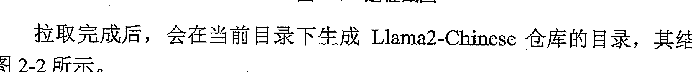

完成克隆后，工作目录里会出现 Llama2-Chinese 的项目文件夹，其目录结构可参考图 2-2。


### 2.2.2 模型获取

中文版 Llama 2 主要在 Llama 中文社区获取，下载主要有两种做法：依据社区提供的直链手动拉取，或通过 Hugging Face 在线仓库直接加载权重。因为文件体积很大，建议保证网络通畅并耐心等待。选型时可对照表 2-3。

#### 表2-3. 模型信息

| 模型名称 | 模型加载名称 | 基础模型版本 |
| --- | --- | --- |
| Llama2-Chinese-7b-Chat | FlagAlpha/Llama2-Chinese-7b-Chat | meta-llama/Llama-2-7b-chat-hf |
| Llama2-Chinese-13b-Chat | FlagAlpha/Llama2-Chinese-13b-Chat | meta-llama/Llama-2-13b-chat-hf |
| Llama2-Chinese-7b-Chat-LoRA | FlagAlpha/Llama2-Chinese-7b-Chat-LoRA | meta-llama/Llama-2-7b-chat-hf |
| Llama2-Chinese-13b-Chat-LoRA | FlagAlpha/Llama2-Chinese-13b-Chat-LoRA | meta-llama/Llama-2-13b-chat-hf |

# 第2章 Llama 2 本地部署实践

# Hugging Face 托管模型调用示例

```
import torch
from transformers import AutoTokenizer, AutoModelForCausalLM
model = AutoModelForCausalLM.from_pretrained('FlagAlpha/Atom-7B',device_map='auto',torch_dtype=torch.float16,load_in_8bit=True)
model=model.eval()
tokenizer = AutoTokenizer.from_pretrained('FlagAlpha/Atom-7B',use_fast=False)
tokenizer.pad_token = tokenizer.eos_token
input_ids = tokenizer(["<s>Human: 如何向一个六岁的孩子解释什么是机器学习?
</s><s>Assistant:", return_tensors="pt",add_special_tokens=False).input_ids.to('cuda')
generate_input = {
    "input_ids":input_ids,
    "max_new_tokens":512,
    "do_sample":True,
    "top_k":50,
    "top_p":0.95,
    "temperature":0.3,
    "repetition_penalty":1.3,
    "eos_token_id":tokenizer.eos_token_id,
    "bos_token_id":tokenizer.bos_token_id,
    "pad_token_id":tokenizer.pad_token_id
}
generate_ids = model.generate(**generate_input)
text = tokenizer.decode(generate_ids[0])
print(text)
```

该片段以向模型提问机器学习概念的儿童化解释为例，用来检查推理质量。随后展示模型返回的内容：

```
Python
(Llama2) [root@localhost Llama2-Chinese]# python demo.py
CUDA SETUP: Loading binary
/root/miniconda3/envs/Llama2/lib/python3.10/site-packages/bitsandbytes/libbitsandbytes_cuda11_nocublaslt.so...
Loading checkpoint shards:
100%|██████████| 3/3 [00:15<00:00,
```

本地运行演示程序若能复现相近输出，就说明运行环境已就绪。至此基础部署与校验完成，接下来介绍其余本地部署方案。

## 2.3 模型部署

推理时通常需要一个简易的交互入口。本节介绍两种可在本地落地的方案：API 服务部署与 text-generation-webui 可视化部署，均支持本地运行，可按设备条件与使用习惯挑选。

### 2.3.1 API 部署

API 部署允许外部程序通过网络请求与模型交互，是常见做法。本节借助 FastAPI 与 Uvicorn 搭建服务。

先安装依赖，两包均可通过 pip 安装：

Plaintext

pip install fastapi uvicorn

安装完毕后，可执行仓库中的 `accelerate_server.py` 启动服务：

```
python accelerate_server.py 
--model_path /path/Llama2-Chinese-13B 
--gpus "0" 
--infer_dtype "int8" 
--model_source "llama2_chinese"
```

命令涉及的参数说明如下：

+ `model_path`：指定权重在本地的绝对路径，需替换为实际位置。
+ `gpus`：指定要使用的显卡编号，单卡写 “0”，双卡写 “0,1”。
+ `infer_dtype`：指定加载后的参数精度，可选 int4、int8、float16，会影响速度与精度。
+ `model_source`：指定模型来源，可选 llama2_chinese 和 llama2_meta，需与下载来源对应，例如 FlagAlpha 系列应设为 “llama2_chinese”。

启动后服务默认监听本地 8001 端口，采用 POST 调用。可使用 `accelerate_client.py` 向服务发送请求：

```
python accelerate_client.py
```

脚本会发出请求并打印返回结果，可自行修改以发送自定义内容。

### 2.3.2 text-generation-webui 部署

text-generation-webui 基于 Gradio 构建，是运行大模型会话交互的可视化工具。主要特性如下：

+ 提供三种交互形态：分列式、Notebook 式、聊天式。
+ 兼容多种后端：Transformers、llama.cpp、ExLlama、AutoGPTQ、GPTQ-for-LLaMa、CTransformers 等。
+ 支持下拉菜单快速切换模型。
+ LoRA 可即时加载卸载，并可使用 QLoRA 训练新 LoRA。
+ 内置精细聊天模板：Llama2-Chat、Alpaca、Vicuna、WizardLM、StableLM 等。
+ 支持 Transformers 的 4 位、8 位及 CPU 推理。
+ 支持 llama.cpp 模型接入 Transformers 采样器，加载器为 llamacpp_HF。
+ 支持多模态管道：LLaVA 与 MiniGPT-4。
+ 支持带 LaTeX 渲染的 Markdown 输出，可配合 Galactica 使用。
+ 支持自定义聊天角色。
+ 提供高效文本流式输出。

## Llama 大模型实践指南

1. 快速安装 text-generation-webui

该工具对配置要求不高，CPU 或 6GB 显存显卡即可，安装流程简便。

(1) 打开项目主页，如图 2-3 所示。

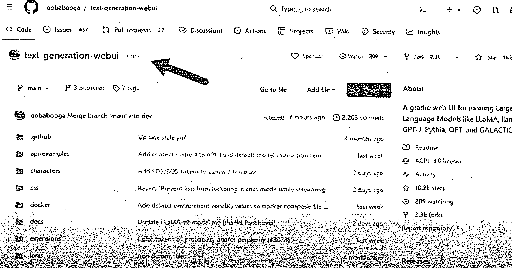

图 2-3 text-generation-webui 的项目页面

### 2.3.3 使用 text-generation-webui

1. 准备模型权重

先把下载好的 LoRA 权重和 Hugging Face 格式的 llama-7B 权重分别放入 loras、models 文件夹，目录示例如下：

```
ls loras/Llama2-7b
```

```
adapter_config.json adapter_model.bin special_tokens_map.json
```

```
tokenizer_ config.json tokenizer.model
```

```
ls models/llama-7b-hf
```

```
pytorch_model-00001-of-00002.bin pytorch_model-00002-of-00002.bin
```

```
config.json
```

```
pytorch_model.bin.index.json generation_config.json
```

随后把 LoRA 权重的 tokenizer.model 复制到 models/llama-7b-hf 目录，并修改 `/modules/LoRA.py` 文件。text-generation-webui 默认从 models 目录加载 tokenizer.model，因此需要使用扩充中文词表的 tokenizer.model 并调整原 llama-7b-hf 的 embed_size：

```
cp loras/Llama2-7b/tokenizer.model models/llama-7b-hf/
```


### 2.3.3 使用 text-generation-webui

2. 加载模型并启动 text-generation-webui

执行以下命令即可开始对话：

```
python server.py --model llama-7b-hf --lora Llama2-7b --cpu
```

对话界面截图如图 2-6 所示。

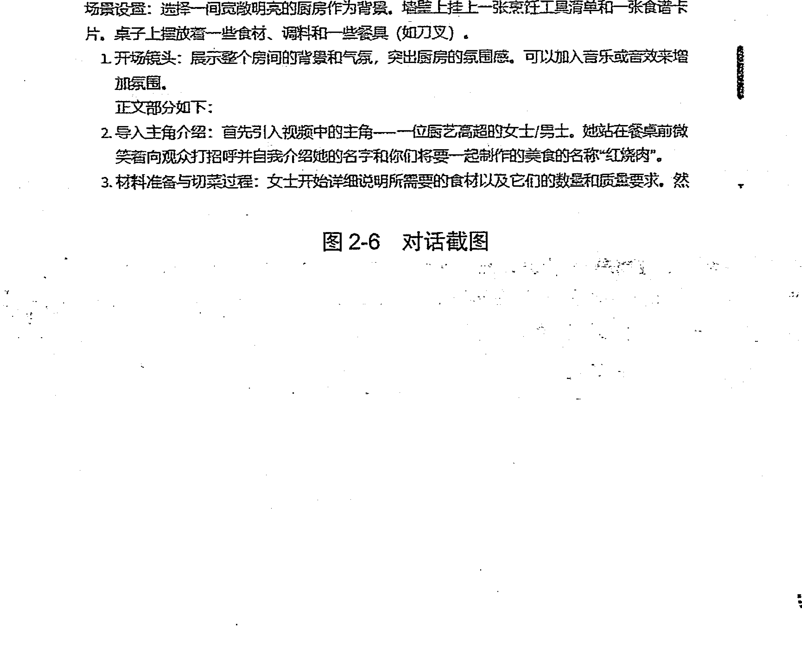

图 2-6 对话截图

## 第 3 章 微调 Llama 2 大模型

预训练后大模型具备通用任务能力。研究表明，针对特定目标的微调能进一步提升效果。微调可使模型适配特定任务，提升效率与性能，让其更懂领域语言术语，预测更准确，同时增强对不同数据与任务的适应性、泛化与鲁棒性。因此微调已成为大模型应用的关键环节。

主流微调技术分为：

+ 指令微调：提升模型能力。
+ 对齐微调：让模型行为更贴合人类价值观或偏好。

ChatGPT 即应用了微调取得优异效果。本章聚焦指令微调。

指令微调是在自然语言格式的实例集合上对预训练模型进行微调，与有监督微调和多任务 Prompt 训练密切相关。实施流程首先收集或构建指令格式数据，来源包括人工标注、自动生成或从已有数据抽取；随后以有监督方式用格式化实例训练模型，如采用序列到序列损失训练。

以 Llama 2 为代表的开源模型经指令微调后泛化能力很强，多语言场景下表现亦佳。强泛化使其可适配多种任务与数据集，提升效率，同时帮助模型更好地理解领域语言与术语，提高预测准确性与可靠性。因此指令微调已成为落地的必备环节。

## 3.1 微调的数据集准备和标注

在 AI 领域，开源大模型如 Llama 2 已在多种 NLP 任务中取得成果。为发挥潜力，往往需要微调以适配特定场景，其中数据集准备与标注至关重要。本节以 Llama 2 为例说明流程。

### 3.1.1 数据集准备

一个指令实例通常包含任务描述即指令、输入与输出。指令说明需完成的工作，输入为待处理数据，输出为预测结果。此类格式有助于模型理解任务需求并提升表现。

构建方式主要有三种：

+ 格式化已有数据集。将传统 NLP 数据集按特定格式调整用于指令微调。为降低成本，可用 ChatGPT 生成指令，常用提示为“请为这段内容生成一个合理的问题”，据此交互生成符合要求的数据。
+ 人工标注数据集。更贴近人类语言习惯，对齐效果更好。为降低成本，多数数据集由 ChatGPT 生成，包括用户分享的对话历史如 ShareGPT 数据集，以及用 ChatGPT 蒸馏生成的数据集。
+ 复用开源数据集。复用开源数据以增加任务多样性，提升模型性能。

数据集可分为通用与专用。通用数据集开源资源丰富，可训练模型获得通用任务处理能力；专用数据集针对特定领域如法律、医疗等，需按需求自行构建，以满足领域任务的理解与处理需求。通过专用数据可提供更精准定制化的指令，提升领域性能。

除常规数据外，引入多样性数据如 CoT 也能有效提升性能，帮助模型更好地理解复杂语言结构与推理任务，从而增强泛化与性能。

综合使用通用、专用及多样性数据集已被广泛采用并取得良好效果。

通常获取数据集后还需做后续处理以获得高质量数据。

### 3.1.2 数据集标注

通过上述方法获得数据后，还需将其转换为大模型特定的输入格式，处理方式依模型而异。以 Llama 2 为例，通常处理为 json 或 csv 格式文件，典型格式如下：

```
{
  "instruction": "",
  "input": "",
  "output": ""
}
```

## Llama 2大模型的指令微调格式示例如下：

```
{
  "instruction": "提供器材，建议一套锻炼计划。",
  "input": "引体向上杠，运动垫",
  "output": "运动计划:\n\n1. 热身: 开始进行5分钟的动态拉伸，如手臂环绕、腿摆动或跳跃杠。\n\n2. 上半身循环: 在引体向上杠和运动垫上做以下几个动作，每个动作做3轮，每轮10次: 引体向上、俯卧撑、三头肌二头肌撑、平板支撑和侧板支撑。\n\n3. 下半身循环: 在运动垫上做以下几个动作，每个动作做3轮，每轮10次: 桥式、深蹲、侧腿弓步和后蹲步。\n\n4. 核心循环: 在运动垫上做以下几个动作，每个动作做3轮，每轮10次: 仰卧起坐、腿部抬高、斜方肌扭转和背部伸展。\n\n5. 冷却: 最后进行5分钟的静态伸展运动，如眼镜蛇式、猫/牛式或前屈。"
}
```

```
{
  "instruction": "列举两种人类减小对环境的影响的方法",
  "input": "",
  "output": "人们可以通过减少能源消耗和减少废物产生来减小对环境的影响。通过使用节能家电、节能灯泡和节油车辆，以及回收、堆肥和再利用等方式，人们可以做出更可持续的选择，对环境产生积极的影响。"
}
```

在模型使用场景里，instruction 扮演的就是任务说明的角色。它可以是一道提问、一则指令或者一段任务描述，核心作用是告诉大模型要达成什么目标。

input 指的是喂给模型的具体素材。在自然语言处理里，这个素材往往是一段文字、一句话甚至是一张图片，模型据此展开理解与推理。

output 则是模型在拿到输入后给出的结果。不同任务下体现形式各不相同，可能是完整答案、分类标签或者一段生成的文本，取决于任务定义和模型设计。

除此之外，Conversation Tuning 对话微调也是一种常见范式。它的目的是在模型已具备补全能力的基础上，进一步激活多轮对话能力。

## 对话微调通用写法

```
{
  "instruction": "请根据以下对话内容生成回复。",
  "input": "用户1: 你好，我想了解一些关于人工智能的信息。",
  "output": "用户2: 你好！人工智能是一个广泛的领域，包括机器学习、深度学习、自然语言处理等。你对哪个方面感兴趣？"
}
```

# Llama 2 实战手册

常用表达为 “<s>Human: ”+问题+“</s><s>Assistant: ”+答案。Plaintext

<s>Human: 用一句话说清地球为何独一无二。</s><s>Assistant: 因为迄今为止地球是唯一确认存在生命的行星。</s>

其中 “<s>Human: ”+问题 表示用户侧的提问；\n</s><s>Assistant: ”+答案 表示系统侧的回复。该片段的含义是把问答双方的内容按固定模板拼接输出。

## 3.2 Llama 2 模型加载实操

Llama 2 是基于 PyTorch 构建的预训练大模型，可支撑文本分类、命名实体识别、情感分析以及对话聊天等多种 NLP 任务。下面介绍部署加载的流程。

+ 1. 准备 PyTorch 与 Transformers

在调用 Llama 2 之前，先装好 PyTorch 和 Transformers，命令行里运行：

Plaintext

```
pip install torch
```

```
pip install transformers
```

+ 2. 获取预训练权重

权重可从 Llama 2 官方 GitHub 页面下载。本例采用 Llama2-base 系列。

+ (1) Llama2-base 系列。

Llama2-base 提供 7B、13B、70B 三个规模，如表3-1。

## 表3-1 Llama2-base模型

| 模型名称 | 模型加载名称 |

| --- | --- |

| Llama2-7B | meta-llama/Llama-2-7b-hf |

| Llama2-13B | meta-llama/Llama-2-13b-hf |

| Llama2-70B | meta-llama/Llama-2-70b-hf |

+ (2) Llama2-Chat 系列。

Llama2-Chat 在 base 版本上做了监督微调，对话能力更强。同样有 7B、13B、70B 三个规模，如表3-2。

## 表3-2 Llama2-Chat模型

| 模型名称 | 模型加载名称 |

|----------------|----------------------------------|

| Llama2-7B-Chat | meta-llama/Llama-2-7b-chat-hf |

| Llama2-13B-Chat| meta-llama/Llama-2-13b-chat-hf |

| Llama2-70B-Chat| meta-llama/Llama-2-70b-chat-hf |

以 Llama2-7B 为例，下载命令如下：

```
Plaintext
git lfs install
git clone https://huggingface.co/meta-llama/Llama2-7b-hf
```

## 3. 加载 Llama 2 模型

在 Python 环境中，利用 Transformers 里的 AutoModelForCausalLM 与 AutoTokenizer 即可完成模型与词表的载入。典型代码如下：

```
Plaintext
from transformers import AutoTokenizer, AutoModelForCausalLM
model_path = "meta-llama/Llama2-7b-chat-hf"
model = AutoModelForCausalLM.from_pretrained(model_path,device_map='auto',
torch_dtype=torch.float16,load_in_8bit=True)
tokenizer = AutoTokenizer.from_pretrained(model_path,
use_fast=False)
```

先指定模型标识与路径，再通过 AutoTokenizer.from_pretrained() 载入分词器，通过 AutoModelForCausalLM.from_pretrained() 载入预训练主体。

至此，Llama 2 的加载工作完成。

## 3.3 微调思路设计与再训练

微调策略与再训练是大模型落地关键，直接影响性能和对新任务的适应性。下面以 Llama 2 为例说明在上下文环境下的设计思路。

### 3.3.1 微调策略总览

微调是在预训练基础上，用少量标注数据继续训练，使模型贴合特定任务。策略选择决定效果与成本的平衡。

+ 1．全量参数微调

全量微调会更新所有参数，能让模型更紧密贴合目标领域，提升泛化。全部参数可调也避免了欠拟合风险。

缺点是算力与时间开销巨大，对硬件要求高；同时容易出现过拟合，导致在新数据上表现下降。实际选用时需权衡收益与成本。

+ 2．参数高效微调 PEFT

随着模型体量膨胀，全量微调成本急剧上升，体现在显存占用、训练时长、存储开销等方面。参数高效微调只更新一小部分参数，优势明显：硬件需求低、显存友好、训练更快、存储成本更低，且多任务可共享底座权重，还能降低过拟合风险。

常见 PEFT 方法如下。

+ (1) Prefix-Tuning

Prefix-Tuning 专用于生成类任务，通过微调虚拟前缀让模型输出符合特定风格的文本。输入由前缀和待生成内容两部分构成，前缀相当于任务相关的引导词。

[PAGE 43]

# 第3章 玩转 Llama2 微调

Prefix-Tuning 的核心是在预训练模型前注入一段可学习虚拟 token，仅优化这段前缀，其余 Transformer 参数保持冻结。与全量微调相比，它不需要为每个任务保存完整模型副本。我们建议采用前缀调优方案：冻结主干，仅优化前缀块，如图 3-1 所示。

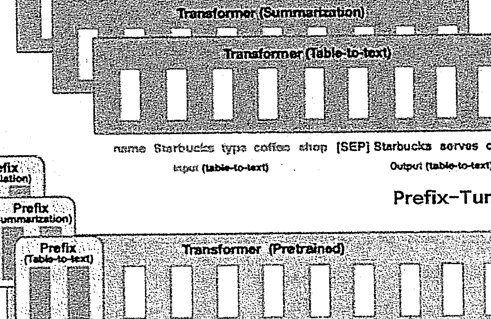

# 图3-1 Prefix-Tuning

图示表明 Transformer 主体完全冻结，只训练前缀部分。不同任务训练不同前缀，使用时组合对应前缀与冻结主干即可。

+ (2) Adapter-Tuning。

Adapter-Tuning 在不改动预训练结构的前提下，通过插入轻量适配器模块实现任务适配。适配器置于主干中间层，负责特定任务的输入输出转换。

[PAGE 46]

## Llama 大模型实践指南

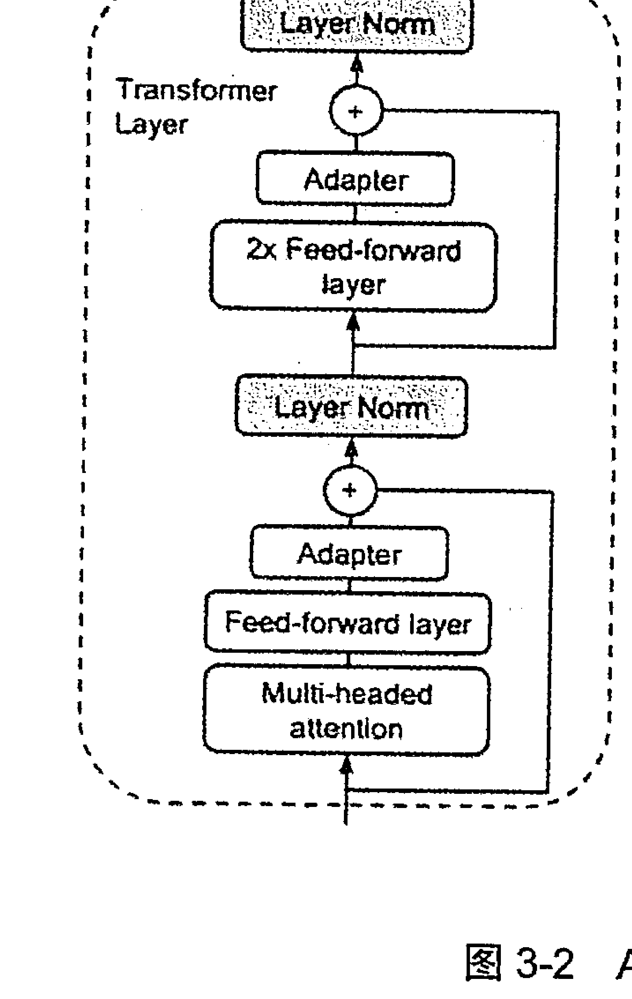

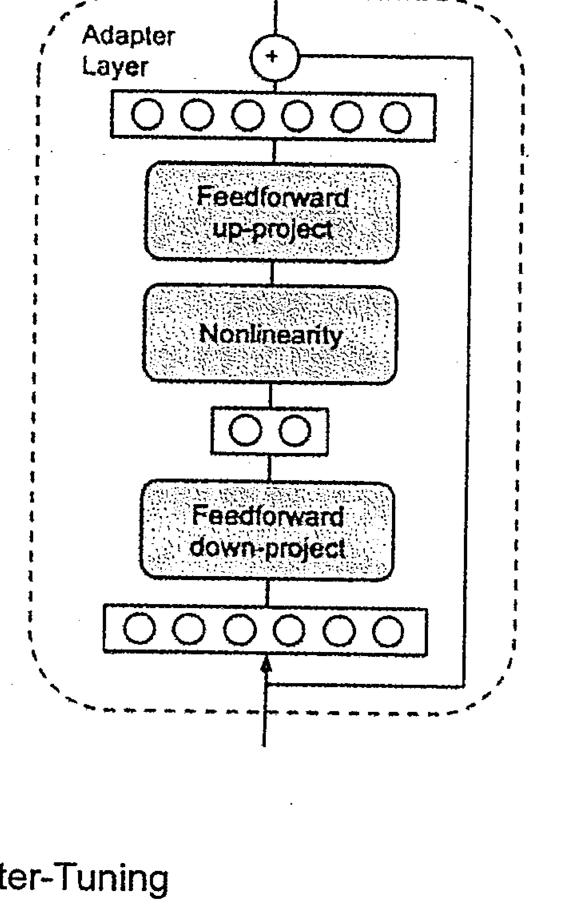

# 图3-2 Adapter-Tuning

Adapter-Tuning 只微调适配器参数，保留主干权重，从而大幅降低计算量与训练时间，同时保持较好的泛化能力。

优势在于快速适配新任务且资源占用少，适配器之间还能共享。局限在于效果依赖主干质量与适配器设计，且多任务场景下可能需要叠加多个适配器，复杂任务仍需更强方案。

+ (3) Prompt-Tuning

全量微调为每个任务训练独立模型，部署成本高。人工设计的离散 Prompt 效果有限。Prompt-Tuning 通过反向传播学习可训练 Prompt，冻结原始权重，仅训练 Prompt 参数，同一底座可服务多任务。

Prompt-Tuning 可视为 Prefix-Tuning 的简化版，为每个任务生成专属 Prompt 并拼接到输入。它只在输入层加入可学习 token，通过模板式注入避免引入额外结构，在小样本或零样本下表现尚可。同时还提出 Prompt Ensembling，在一个批次里并行训练同一任务的多种提问方式。

+ (4) P-Tuning v1

人工模板设计难度高且效果波动大。P-Tuning v1 把模板构建转化为连续参数优化问题，将 Prompt 转为可学习 Embedding，并用 MLP+LSTM 处理。与 Prefix-Tuning 相比，virtual tokens 仅加在输入层，可放置于前缀位置或其他位置，实质是把人工模板的真实 token 替换为可微 token。

+ (5) P-Tuning v2

P-Tuning v1 在小模型上效果一般，且对序列标注任务支持不足，层数增多时稳定性下降。P-Tuning v2 借鉴 Prefix-Tuning，把可微 virtual tokens 以前缀形式注入 Transformer 的每一层，每层独立微调。由此可将原本只适用于分类和问答的语义标签替换为下游分类器，在阅读理解、命名实体识别、语义角色标注等序列标注任务上获得更好表现。

+ (6) LoRA.

大模型能力随规模提升而显著增强，但微调与部署成本也水涨船高。LoRA 的思路是用低秩分解模拟参数变化，在原模型旁增加旁路完成降维再升维，仅训练两个小矩阵 A 与 B，主干参数冻结。初始化时 A 用随机高斯、B 用零矩阵，保证训练起点旁路输出为零，推理时将 BA 与原参数叠加。其中 h 为隐藏状态，x 为输入，d 为维度，r 为秩。

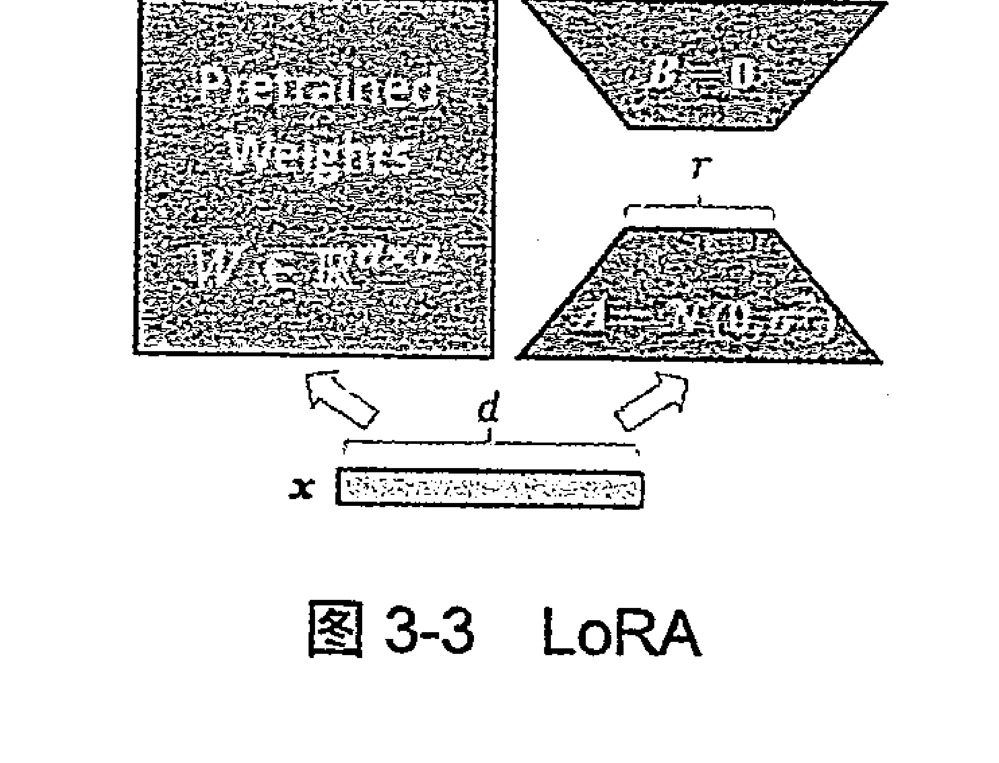

### 3.3.2 参数高效微调的主流实现

当前针对大模型的主流方案为 P-Tuning 与 LoRA，下面重点展开 P-Tuning v1、P-Tuning v2 与 LoRA 的实现细节。

+ 1. P-Tuning v1

可参考以下 P-Tuning v1 的核心代码进行微调：

[PAGE 49]

# 第3章 微调 Llama2 大模型

```
from peft import (
    get_peft_config,
    get_peft_model,
    get_peft_model_state_dict,
    set_peft_model_state_dict,
    PeftType,
    TaskType,
    PromptEncoderConfig,
)
```

# PromptEncoderConfig 初始化示例

```
peft_config = PromptEncoderConfig(task_type=TaskType.CAUSAL_LM,
num_virtual_tokens=20, encoder_hidden_size=128)
```

当前环节主要完成依赖环境的导入，并实例化 P-Tuning v1 对应的配置对象。

Plaintext

```
# 从预训练模型路径加载CausallM模型
model = AutoModelForCausalLM.from_pretrained(model_name_or_path)
# 将加载的模型转换为PEFT模型，使用指定的PromptEncoderConfig
model = get_peft_model(model, peft_config)
# 打印PEFT模型中可训练参数的数量和名称
model.print_trainable_parameters()
```

这里负责加载预训练模型，并通过 get_peft_model() 对其进行 PEFT 包装，以便后续高效微调。

2. P-Tuning v2 微调参考

以下给出 P-Tuning v2 的核心实现片段，可据此进行调整：

Plaintext

```
from peft import get_peft_config, get_peft_model,
 PrefixTuningConfig, TaskType, PeftType
# 创建一个PrefixTuningConfig对象，指定任务类型为CAUSAL_LM，虚拟令牌数量
为30
peft_config = PrefixTuningConfig(task_type=TaskType.CAUSAL_LM,
num_virtual_tokens=30)
```

本步完成相关环境的导入和 P-Tuning v2 配置的创建。需要留意，PrefixTuningConfig 中的 prefix_projection 默认取值为 false，对应 P-Tuning v2 模式；若该参数被设为 true，则实际使用的是 Prefix-Tuning。

Plaintext

[PAGE 50]

## Llama 大模型实战指南

```
#加载模型，通过调用 get_peft_model() 包装加载的模型
model = AutoModelForCausalLM.from_pretrained(model_name_or_path)
model = get_peft_model(model, peft_config)
model.print_trainable_parameters()
```

# 3. LoRA 微调示例

下面展示 LoRA 微调的核心代码片段，可据此进行微调：

```
Plaintext
from peft import get_peft_config, get_peft_model,
get_peft_model_state_dict, LoraConfig, TaskType
peft_config = LoraConfig(
    task_type=TaskType.CAUSAL_LM,
    inference_mode=False,
    lora_r=8,
    lora_alpha=32,
    lora_dropout=0.1
    target_modules=[q_proj,k_proj,v_proj,o_proj]
)
```

上述示例主要完成相关库的导入及 LoRA 配置的创建，后续会对关键参数进行说明。

+   (1) task_type:

# 第3章 Llama 2 微调全流程

当底座参数规模偏小时，P-Tuning v1 的表现会比较吃力，只有当参数量提升到百亿级别时才勉强能追上全量微调的效果。P-Tuning v2 在部分任务上甚至可达到与全量微调相当或更优的结果，但灾难性遗忘的问题依然较为严重。

## 3.4 评估、测试与优化实战

评估、测试与优化是深度学习落地不可或缺的环节，能帮助我们读懂模型表现、发现短板并持续提升质量。本节以 Llama 2 为例，深入拆解这两个关键步骤。

### 3.4.1 评估与测试

评估与测试是构建大模型的核心环节，用以衡量其在特定任务上的有效性与准确性。

评估过程中，我们会把模型输出与参考标准或基准数据集进行对照，从而判断质量与正确性。具体采用的指标会依任务设计而定。

评估测试的根本目的是确保模型在真实场景中可用。通过观察性能表现，可以定位问题并进行针对性调整，从而提升泛化能力。总体而言，评估测试是通过输出与标准的对比来衡量质量，并借助合适指标量化性能，为后续改进提供依据。

在语言建模任务中，困惑度是衡量模型质量的常用指标。此外，还可从以下任务视角来检验微调后模型的表现：

-   (1) 基础创作能力：给定主题或写作任务，要求模型据此产出一段文字，通过内容丰富度、用词恰当性、语句通顺度等来判断效果。
-   (2) 语义理解与抽取：让模型从文章或段落中抽取出指定知识，如人物、地点、事件等。
-   (3) 逻辑推理：提出较为简单的逻辑推理问题，观察模型能否给出正确答案。
-   (4) 代码生成：要求模型编写快速排序等简单算法的代码。
-   (5) 数学计算：对加减乘除等基础运算进行测试。

模型评估测试的本质是验证其在未参与训练或验证的新独立数据上的表现。通过测试可评估实际应用中的有效性与准确性。

为保证模型在不同输入变化和未知数据上表现稳定，测试集需要具备多样性和代表性。测试样本应覆盖模型可能遇到的各类情况与场景，可参考开源项目 BLUB 的测试集，其包含通用知识、语言理解、创作能力、逻辑推理、代码编程、工作技能、使用工具、人格特征等八大类，每类下又细分多个子类。这种方式能更全面地暴露模型在特定领域或输入类型上的潜在问题。

为实现准确全面的评估，可采用以下策略：

-   (1) 数据集划分：将数据划分为训练集、验证集和测试集。训练集用于训练，验证集用于调参与结构优化，测试集用于最终性能衡量。划分需随机且具有代表性，避免样本偏差影响结果。
-   (2) 评估指标：依据任务特点选择合适的指标，如准确率、精确率、召回率、F1 值等，并可结合领域特定指标以更贴近实际效果。
-   (3) 多次测试：通过多次测试或交叉验证获取更稳健的结果，降低随机性干扰，获得更稳定的评估数值。
-   (4) 模型调优：根据测试结果分析模型弱点并进行优化。可尝试不同的超参数、结构改动或正则化手段，以提升性能与泛化能力。

### 3.4.2 模型优化

针对评估测试中暴露的问题，可采取针对性措施。例如，模型生成的文本与原文不符或与事实矛盾时，可视为出现幻觉。其成因较为复杂。

在数据层面，收集过程中若混入虚假信息，模型会记忆错误知识；信息重复过多也会导致知识偏置，进而引发幻觉。即便使用高质量数据，幻觉仍可能出现。

在模型层面，研究表明解码算法若采用不确定性较高的采样方式如 top-p，会诱导更严重的幻觉。刻意在解码中加入随机性也会让模型“胡编乱造”。预训练阶段记忆的错误参数知识也会导致严重幻觉。

为缓解幻觉，可从以下方向入手。在数据层面，人工标注高质量训练样本并剔除易引发幻觉的数据。在评估层面，构建细粒度的幻觉评估基准，以分析严重程度与成因。在模型层面，可采用强化学习如 RLHF，将降低幻觉的指标作为奖励函数；解码时降低生成随机性；开展多任务学习，通过设计额外任务来抑制幻觉。后期处理上，可训练一个小型模型专门修复幻觉错误。

## 3.5 保存部署与推理加速

模型保存、部署和推理加速是把如 Llama 2 这类深度学习模型推向实用的关键环节。本节将讲解如何有效保存微调后的模型、将其部署到生产环境，以及相关的推理加速思路。

### 3.5.1 模型保存

对于使用 LoRA 微调后的模型，可参考以下代码进行保存：

```
Plaintext
peft_model_id =
 f"{model_name_or_path}_{peft_config.peft_type}_{peft_config.task_type}"
model.save_pretrained(peft_model_id)
```

调用 save_pretrained() 保存模型，保存结果如下：

```
Plaintext
├── [ 451] adapter_config.json
├── [ 81K] adapter_model.bin
└── [ 129] README.md
```

此时仅保存训练产生的增量权重。其中 adapter_config.json 为 LoRA 配置文件，adapter_model.bin 为 LoRA 权重文件。

若需要完整模型文件，则需将 LoRA 增量权重与 Llama2-base 模型合并。

### 3.5.2 模型部署

# 1. 命令行原生 Transformers 推理接口

本节以命令行方式演示原生 Transformers 推理接口的使用，下面以加载 Llama2-7B-Chat 为例说明启动流程：

```
Plaintext
import torch
from transformers import AutoTokenizer, AutoModelForCausalLM
# 从预训练模型路径加载 CausalLM 模型，并设置设备映射、张量数据类型和使用 8 位加载模型
model = AutoModelForCausalLM.from_pretrained('meta-llama/Llama2-7b-chat-hf',device_map='auto',torch_dtype=torch.float16,load_in_8bit=True)
# 将模型设置为评估模式
model = model.eval()
# 从预训练模型路径加载分词器，并禁用快速分词模式
tokenizer = AutoTokenizer.from_pretrained('meta-llama/Llama2-7b-chat-hf',use_fast=False)
# 将分词器的 pad_token 设置为 eos_token
tokenizer.pad_token = tokenizer.eos_token
input_text = '介绍一下中国'
# 将输入文本转换为模型输入张量，并添加特殊令牌，将张量移动到 GPU 上
input_ids = tokenizer(['<s>Human: input_text\n</s><s>Assistant: '], return_tensors=
```

```
"bos_token_id":tokenizer.bos_token_id,
"pad_token_id":tokenizer.pad_token_id
}
# 使用模型生成文本
generate_ids = model.generate(**generate_input)
# 将生成的文本张量解码为文本字符串
text = tokenizer.decode(generate_ids[0])
print(text)
```

首先导入 PyTorch 与 Transformers，使用 AutoModelForCausalLM.from_pretrained() 加载预训练的 Llama2 大模型，通过 model.eval() 切换为评估模式，并用 AutoTokenizer.from_pretrained() 加载分词器，同时将 pad_token 设为 eos_token。

其次指定输入文本 input_text，用 tokenizer() 将其编码为 input_ids，并以“Human:”“Assistant:”对输入进行对话包装。

再次调用 model.generate() 生成回复，以 input_ids 为输入并指定生成参数，如 max_new_tokens、do_sample、top_k、top_p、temperature、repetition_penalty、eos_token_id、bos_token_id、pad_token_id 等。

最后使用 tokenizer.decode() 将生成的张量解码为文本并输出到控制台。

该代码可基于 Llama2 大模型实现对话交互，可按需修改与扩展。

# 2. 基于 Gradio 搭建问答平台

Gradio 是一个开源 Python 库，用于快速构建交互式机器学习界面，让用户无需深度编程即可与训练好的模型交互。其目标是降低模型部署与分享门槛。

Gradio 的主要特点如下：

-   (1) 交互式界面构建：用少量 Python 代码即可创建文本框、文件上传、滑块等元素，实现与模型的交互。
-   (2) 快速部署：可迅速将模型部署为 Web 应用，无需复杂的 Web 开发知识，便于展示与分享。
-   (3) 多类型输入输出支持：支持文本、图像、音频等多类型输入，并可输出文本、图像等多种结果。
-   (4) 支持多种机器学习框架：可与 TensorFlow、PyTorch、scikit-learn 等框架无缝集成，使用者可用熟悉的框架构建模型。

[PAGE 56]

## Llama 大模型实战手册

-   (5) 适用于教育与研究：除部署应用外，还可用于构建交互式演示，帮助学生或同事理解模型原理。

总之，Gradio 是构建交互式机器学习界面的强力工具。基于 Gradio 搭建的问答平台支持流式输出，将下方代码复制到控制台运行即可，以下示例以 Llama2-7B-Chat 为例，其他模型只需修改模型名称：

```
Plaintext
python examples/chat_gradio.py --model_name_or_path meta-llama/Llama2-7b-chat
```

```
Plaintext
import gradio as gr
import time
from transformers import AutoTokenizer, AutoModelForCausalLM,TextIteratorStreamer
from threading import Thread
import torch,sys,os
import json
import pandas
import argparse
```

```
with gr.Blocks() as demo:
    gr.Markdown('''<h1><center>智能助手</center></h1>''')
    chatbot = gr.Chatbot()
    msg = gr.Textbox()
    state = gr.State()
    with gr.Row():
        clear = gr.Button("新话题")
        re_generate = gr.Button("重新回答")
        sent_bt = gr.Button("发送")
    with gr.Accordion("生成参数", open=False):
        slider_temp = gr.Slider(minimum=0, maximum=1,
        label="temperature", value=0.3)
        slider_top_p = gr.Slider(minimum=0.5, maximum=1,
        label="top_p", value=0.95)
```

```
slider_context_times = gr.Slider(minimum=0, maximum=5, label="上文轮次", value=0,step=2.0)
```

# 用户输入回调定义

```
def user(user_message, history):return '
```

# 清空历史回复

```
def bot(history,temperature,top_p,slider_context_times):if pandas.isnull(history[-1][1])==False:
	history[-1][1] = Noneyield history
	slider_context_times = int(slider_context_times)
	history_true = history[1:-1]
	prompt = '' # 构造生成文本的prompt
	if slider_context_times>0:
		prompt += '\n'.join(("<s>Human: 
```

# 配置生成参数

```
generate_input = {
	"input_ids":input_ids,
	"max_new_tokens":512,
	"do_sample":True,
	"top_k":50,
	"top_p":top_p,
	"temperature":temperature,
	"repetition_penalty":1.3,
	"streamer":streamer,
	"eos_token_id":tokenizer.eos_token_id,
	"bos_token_id":tokenizer.bos_token_id,
	"pad_token_id":tokenizer.pad_token_id
```

# 开启线程调用模型生成

```
thread = Thread(target=model.generate, kwargs=generate_input)
thread.start()
start_time = time.time()
bot_message = ''
print('Human:',history[-1][0])
print('Assistant: ',end='', flush=True)
```

# 流式返回生成结果

```
for new_text in streamer:
    print(new_text
```

# 处理清除按钮事件

```
clear.click(lambda: [], None, chatbot, queue=False)
```

# 启动 Gradio 服务

```
if __name__ == "__main__":
```

```
parser = argparse.ArgumentParser()
```

```
parser.add_argument("--model_name_or_path", type=str, help='mode name or path')
```

```
parser.add_argument("--is_4bit", action='store_true', help='use 4bit model')
```

```
args = parser.parse_args()
```

# 加载分词器并设置 pad_token

```
tokenizer = AutoTokenizer.from_pretrained(args.model_name_or_path, use_fast=False)
```

```
tokenizer.pad_token = tokenizer.eos_token
```

# 根据量化位加载 AutoGPTQ 模型

```
if args.is_4bit==False:
```

```
model = AutoModelForCausalLM.from_pretrained(args.model_name_or_path, device_map='auto', torch_dtype=torch.float16, load_in_8bit=True)
```

```
model.eval()
```

```
else:
```

```
from auto_gptq import AutoGPTQForCausalLM
```

```
model = AutoGPTQForCausalLM.from_quantized(args.model_name_or_path
```

```
, low_cpu_mem_usage=True, device="cuda:0", use_triton=False,inject_fused_attention=False,inject_fused_mlp=False)
```

# 构建文本流对象

```
streamer = TextIteratorStreamer(tokenizer,skip_prompt=True)
```

```
if torch.__version__ >= "2" and sys.platform != "win32":
```

```
model = torch.compile(model)
```

# 启动 Gradio 应用

## Llama 大模型实战指南

```
demo.queue().launch(share=False,
debug=True,server_name="0.0.0")
```

# 3. Docker 环境部署问答接口

部署问答服务只需在 Docker 中运行 chat_gradio.py，基础环境要求 docker:24.0.2。

第一步，准备 Docker 镜像：

```
git clone https://github.com/FlagAlpha/Llama2-Chinese.git
cd Llama2-Chinese
sudo docker build -f docker/Dockerfile -t FlagAlpha/llama2-chinese-7b:gradio .
```

第二步，借助 docker-compose 启动 chat_gradio：

```
cd Llama2-Chinese/docker
docker-compose up -d --build
```

### 3.5.3 推理加速

谈到推理加速，本质上是在探讨如何让机器更快地理解并处理自然语言文本。这项能力对智能助手、机器翻译、搜索引擎等场景至关重要。

推理是指模型基于已有知识和数据进行判断或作答的过程。当面对海量文本或复杂模型时，该过程往往耗时较长。

推理加速的核心目标是压缩模型推理所需的时间，使其能够迅速做出判断或给出答案，这直接关系到用户体验和大数据处理的效率。

前面介绍的多种方法和工具都能帮助提升推理效率。通过采用更快的计算方式、更合理的存储策略以及并行处理等手段，推理速度得以明显提升。

简单来说，就像把纸质厚书转为电子书，信息检索更快；或者让手机即时响应你的提问。总体而言，推理加速就是让计算机更高效地理解人类需求并快速响应。


# 第3章 微调Llama 2大模型

vllm 也是面向 GPU 的推理方案，和 FasterTransformer 相比，vllm 的使用门槛更低。vllm 的主要特性如下。

+   (1) 上手简单：对比 FasterTransformer 等框架，vllm 无需额外转换模型，部署和调用都更便捷，能为开发和研究人员节省大量时间和成本。

+   (2) 支持fp16推理：vllm 可使用半精度浮点数进行推理，在提升速度的同时降低显存占用，对大模型处理十分友好。

+   (3) 推理响应快：得益于高效实现与优化，vllm 处理 NLP 任务的耗时很短，系统整体响应更为敏捷。

+   (4) 高效的kv缓存机制：vllm 采用高效的键值缓存机制，减少重复计算，尤其是多次查询相同 KV 时优势明显。

+   (5) 连续的批处理请求推理：vllm 支持连续批量请求，可一次性处理多个输入，提升吞吐量，在聊天机器人、在线翻译等实时场景表现突出。

+   (6) 优化的cuda算子：vllm 使用经过优化的 CUDA 算子，充分发挥 GPU 性能，保证推理稳定高效。

+   (7) 支持分布式推理：vllm 支持跨多 GPU 或多机推理，可应对大规模任务和高并发需求，扩展性强，适合大模型和复杂应用。

第一步，安装 vllm。

```
git clone https://github.com/vllm-project/vllm
cd vllm && python setup.py install
```

第二步，启动测试服务。

+   (1) 单卡推理。

```
CUDA_VISIBLE_DEVICES=0 python api_server.py \
--model "/mnt/data_online/models/llama/models--meta-llama--Llama2--" \
--port 8090
```

(2) 多卡推理。

# multi_gpus_api_server.sh 中 CUDA_VISIBLE_DEVICES 指定可用 GPU

# tensor-parallel-size 用来定义参与推理的 GPU 数量

bash multi_gpus_api_server.sh

multi_gpus_api_server.sh 如下:

```
CUDA_VISIBLE_DEVICES=0 python api_server.py \
--model "/mnt/data_online/models/llama/models--meta-llama--Llama2-7b-chat-hf" \
--port 8090
```

其中，启动模型 API 服务的参考代码 api_server.py 如下:

```
import argparse
import json
from typing import AsyncGenerator
from fastapi import BackgroundTasks, FastAPI, Request
from fastapi.responses import JSONResponse, Response,
StreamingResponse
import uvicorn

from vllm.engine.arg_utils import AsyncEngineArgs
from vllm.engine.async_llm_engine import AsyncLLMEngine
from vllm.sampling_params import SamplingParams
from vllm.utils import random_uuid

# 导入所需的库和类，并创建FastAPI
TIMEOUT_KEEP_ALIVE = 5 # seconds.
 TIMEOUT_TO_PREVENT_DEADLOCK = 1 # seconds.
app = FastAPI()

# 定义生成文本的接口，使用装饰器@app.post将其绑定到HTTP POST请求上
# 接口接收一个JSON对象作为请求体，包含以下字段
# prompt: 生成文本的提示
```

# 第3章 微调Llama 2大模型

```
# stream: 是否流式传输结果
# 从请求体中获取这些字段，并使用它们调用engine.generate()方法生成文本
@app.post("/generate")
async def generate(request: Request) -> Response:
    """Generate completion for the request."

    The request should be a JSON object with the following fields:
    - prompt: the prompt to use for the generation.
    - stream: whether to stream the results or not.
    - other fields: the sampling parameters (See SamplingParams for details)."
    
    request_dict = await request.json()
    prompt = request_dict.pop("prompt")
    stream = request_dict.pop("stream", False)
    sampling_params = SamplingParams(**request_dict)
    request_id = random_uuid()
    results_generator = engine.generate(prompt, sampling_params, request_id)

    # Streaming case
    # 如果stream为True，则使用异步生成器stream_results()流式传输结果。在每次生成文本时，先将生成的文本添加到text_outputs列表中，并将其作为JSON对象返回。然后使用yield将JSON对象编码为字节流，并在每个JSON对象之间添加空字符'\0'。如果客户端断开连接，则调用abort_request()方法中止请求
    async def stream_results() -> AsyncGenerator[bytes, None]:
        async for request_output in results_generator:
            prompt = request_output.prompt
            text_outputs = [
                prompt + output.text for output in request_output.outputs
            ]
            ret = {"text": text_outputs}
            yield (json.dumps(ret) + '\0').encode('utf-8')

    async def abort_request() -> None:
        await engine.abort(request_id)
```

## Llama 大模型实战指南

```
if stream:
    background_tasks = BackgroundTasks()
    # Abort the request if the client disconnects.
    background_tasks.add_task(abort_request)
    return StreamingResponse(stream_results(),
                            background=background_tasks)
```

```
# Non-streaming case
# 如果 stream 为 False，则使用 for 循环遍历生成的文本，并将其添加到 text_
outputs 列表中。如果客户端断开连接，则调用 abort_request() 方法中止请求。最后将
final_output = None
async for request_output in results_generator:
    if await request.is_disconnected():
        # Abort the request if the client disconnects.
        await engine.abort(request_id)
        return Response(status_code=499)
    final_output = request_output
```

```
assert final_output is not None
prompt = final_output.prompt
text_outputs = [prompt + output.text for output in 
final_output.outputs]
ret = {"text": text_outputs}
return JSONResponse(ret)
```

```
if __name__ == "__main__":
    # 解析命令行参数，创建 AsyncLLMEngine 对象，并使用 uvicorn 启动 FastAPI
    parser = argparse.ArgumentParser()
    parser.add_argument("--host", type=str, default="0.0.0.0")
    parser.add_argument("--port", type=int, default=8090)
    parser = AsyncEngineArgs.add_cli_args(parser)
    args = parser.parse_args()
    engine_args = AsyncEngineArgs.from_cli_args(args)
    engine = AsyncLLMEngine.from_engine_args(engine_args)
```

# 第3章 微调Llama 2大模型

```
uvicorn.run(app,
    host=args.host,
    port=args.port,
    log_level="debug", 
    timeout_keep_alive=TIMEOUT_KEEP_ALIVE)
```

API 服务启动完成后就能进行推理校验，参考脚本如下：

```
# coding=utf-8
import json
import time
import urllib.request
import sys

# 定义一个函数gen_prompt()，用于生成输入文本的提示。将输入文本包装在"<s>Human:"和"\n</s><s>Assistant: "之间
def gen_prompt(input_text):
    prompt = "<s>Human: "+input_text+"\n</s><s>Assistant: "
    return prompt

# 定义一个函数test_api_server()，用于向API服务器发送请求并获取生成的文本
def test_api_server(input_text):
    # 首先设置请求头的Content-Type为application/json。其次使用gen_prompt()函数生成输入文本的提示
    header = {'Content-Type': 'application/json'}
    prompt = gen_prompt(input_text.strip())
    # 构造请求的数据，包括prompt和其他采样参数
    data = {
        "prompt": prompt,
        "stream" : False,
        "n" : 1,
        "best_of": 1,
        "presence_penalty": 0.0,
        "frequency_penalty": 0.2,
        "temperature": 0.3,
        "top_p": 0.95,
        "top_k": 50,
```

## Llama 大模型实操手册

```
"use_beam_search": False,
"stop": [],
"ignore_eos":False,
"max_tokens": 2048,
"logprobs": None
```

# 用 urllib 发起推理请求

```
request = urllib.request.Request(
  url='http://127.0.0.1:8090/generate',
  headers=header,
  data=json.dumps(data).encode('utf-8')
)

result = urllib.request.urlopen(request, timeout=300)
res = result.read().decode('utf-8')
print(json.dumps(data, ensure_ascii=False, indent=2))
print(json.dumps(result, ensure_ascii=False, indent=2))
```

```
except Exception as e:
  print(e)
```

```
return result
```

```
if __name__ == '__main__':
  test_api_server('如何去北京?')
  test_api_server('肚子疼怎么办?')
  test_api_server('帮我写一个请假条')
```

# 第4章 攻克 Llama 2 多轮对话痛点

Llama 2 在多轮对话里会碰到一系列难题，典型包括上下文维护与信息衰减、一致性与逻辑连贯难以保持、个性化与上下文敏感度不足、响应效率低且时延偏高，以及生成结果的安全性与可解释性欠缺。这些挑战涉及模型架构、数据策略和运行期优化，是制约大模型在复杂对话场景落地的关键。

本章围绕 Llama 2 在多轮对话场景中的具体困境展开，从面向对话的多轮标注方法，到历史存储策略，再到借助前沿对话技术提升应对能力，以及评估与持续改进，形成一套可操作的指导框架，帮助提升模型在复杂多轮对话中的表现。

## 4.1 多轮对话数据的定制与构建

本节提供定制多轮对话数据集的系统化思路，涵盖场景与目标的界定、数据源的选择与标注。数据结构通常由用户输入、系统回复和上下文信息构成。采集手段可采用人工模拟、用户研究以及真实用户日志。构建方式包括模板生成、数据增强与负采样。预处理环节涉及文本清洗、分词、词性标注和向量化。数据需划分为训练集、验证集和测试集，并依据模型表现和用户反馈进行迭代优化。

### 4.1.1 微调数据准备的七条准则

开展微调前需先准备训练数据，一般由场景需求方与训练团队协同完成。实践中总结出七条准备原则。

# Llama 大模型实践指南

#### 1. 数据质量
原则：数据必须准确、已清洗，且不含产生噪声的垃圾样本。
目的：高质量数据是性能提升的基础。微调阶段需仔细核查并清洗，确保样本无用信息与噪声。每个样本都应具有明确的实际意义，便于模型理解。

#### 2. 数据集规模
原则：样本量要充足，通常在数千到数十万条文本之间。
目的：足够规模有助于模型准确学习特定任务的格式与规律。

#### 3. 数据多样性
原则：覆盖多场景、多领域、多用户群体。
目的：提升泛化能力。泛化强的模型不仅在训练集上表现好，也能适应未见数据。多样性有助于模型捕捉底层规律而非记忆样本。实操中，源自大量原始基础数据的多样性强于蒸馏数据。部分团队为省成本使用 OpenAI GPT-4 蒸馏数据训练，泛化能力往往不及使用大量原始基础数据训练的方案。

#### 4. 数据平衡
原则：避免类别严重不平衡或偏见。
目的：保证模型对不同输入的均衡处理。若基础数据不平衡，可通过上采样、下采样、权重调整或数据合成等方式缓解，以提升泛化与可靠性。

#### 5. 时间和空间分布
原则：数据要真实反映世界的时间与空间分布。包括跨时段与地理位置采集、定期更新、考虑特殊或突发事件影响、使用多种数据源和权重调整。
目的：使模型更贴合实际应用、提升泛化。

#### 6. 数据安全性和合规性
原则：遵循数据安全与合规要求，遵守所在国法律。在中国需特别注意《网络安全法》和《个人信息保护法》，强调最小必要收集、用户明确同意、安全加密存储，以及跨境传输与查询删除的严格规定，违者将面临严重法律后果。
目的：确保收集使用符合法律伦理，赢得用户信任。

#### 7. 相似性
原则：微调数据间应有关联且易于泛化。
目的：数据须在特定任务上具代表性，但避免简单重复。重复不一定降低质量，却会增加微调成本。

遵循七条准则可同时提升性能、泛化、合规与可靠性。微调技术实用，但数据准备并不轻松。

### 4.1.2 定制微调训练数据集

定制过程复杂，涉及数据收集、格式定义、基础处理和构造方法探索。

#### 1. 数据收集
数据源选择至关重要。可从相关领域抓取或收集。若微调特定任务，则数据必须包含该任务文本；若需情感反馈，则需正负评价。常见来源分为四类。
### 公开数据集
使用已有公开数据集。
### 自建数据集
通过爬虫、问卷、自由数据库等采集原始数据。
### 合成数据
采用模拟或合成方法生成数据。
### 蒸馏数据
利用 GPT-4 等大模型自动生成数据。

#### 2. 微调训练数据集格式
常见格式有指令跟随、多轮对话和其他辅助格式。

#### (1) 指令跟随格式
用户输入指令，模型按指令输出。常以 json 存储，如 Alpaca-52k。Alpaca-52k 是开源指令遵循数据集，用于微调 Llama 2 得到 Alpaca-7B，含 52 000 条指令对。
Alpaca-7B 常见两种写法。
```
#instruction: 什么是三原色？
#output: 三原色是红、蓝、黄。
这些颜色被称为原色，因为它们不能通过混合其他颜色得到，而所有其他颜色都可以通过以不同比例组合原色来合成。在用于实现光的合成的色彩系统中，原色是红、绿、蓝（RGB）。
```
另一类是 instruction/input/output 格式，举例如下。
```
#instruction: 检查这个句子的拼写和语法错误。
#input: 他离开了吃完饭餐厅。
#output: 这句话中有两个拼写错误。正确的句子应该是：他吃完饭离开了餐厅。
```
由于 Self-Instruct 生成的 Alpaca 数据存在瑕疵，需清洗改进，如 Alpaca-cleaned 和 Alpaca-gpt4 等，通常含数万条指令对，文件约 40MB，json 格式。
补充说明：研究中数据集长度常用 token 数或指令对数衡量。为直观，本书以文件存储大小作为规模评估指标。

#### (2) 多轮对话格式
用户与模型以对话形式交互，通过多轮完成需求。如训练 Vicuna 用到的 ShareGPT 数据集，是用户分享与 ChatGPT/GPT-4 的对话记录平台，收录大量自然流畅、创意性强的聊天记录。Vicuna 基于该平台 673MB 数据训练，多轮能力较好，具体格式如下：
```
Plaintext
```

#### (3) 其他辅助格式
除上述外，还有不易转为对话的纯文本文档，以及文本摘要等特定用途数据集，或将纯文本转为对话的方案如 RefGPT 所述。按功能还包括调用 API 格式和调用数据库语言格式等。除纯文本外，均可转为指令跟随或多轮对话格式。注意不包括强化学习 RLHF 格式。

#### 3. 微调训练数据集的基本处理
需经收集、清洗、增强等处理。收集是基础，可用公共、自定义、行业数据集。清洗去除噪声、重复、低质样本并统一为可训练格式。增强手段包括翻译、摘要、同义词替换、随机插入等，可借助大模型完成。
微调集远小于预训练集，预训练常为数太比特，微调为数兆比特到 1GB。收集后可将自建数据与开源数据混合训练以提升泛化，常附带自我认知数据如训练 Vicuna 时的 Dummy 数据集。
数据整理涉及多环节，好用的 GUI 工具能加速流程，主流开源工具如 Label-Studio 正在拓展，近期出现 H2O LLM Data Studio。

#### 4. 微调训练数据集构造方法的探索
构造是定制自有模型的核心。微调是在预训练模型基础上用小规模数据精调。
构造时可基于现有模型进行 Self-Instruct，并结合基本原则。基于现有模型构建简便但未必高质量。数据量不是唯一标准，少量高质量数据即可激活预训练知识，关键在质量与启发性。例如一种基于模型的思路认为模型已有观点，只需教会表达方式，72.8KB 微调数据即可让模型流畅表达。
构造目的一是注入新知识，二是调整回复风格。若需新知识，需高质量教导式扩充。例如“Textbook is all you need”提出构建教科书级别的教育数据，可在编程领域取得更高水平。也可基于已有数据演化出更复杂微调数据。
构造还受 tokenizer 影响。不当 tokenizer 会影响算术等任务表现。若不改动已训练 tokenizer，构造时宜使用其中已有词表。不同的 tokenizer 会改变 token 长度，如含更多中文词表的 tokenizer 使中文更短。加入 start token、pad token、end token 等标记有助于模型理解数据和下游编码。如 Vicuna 更新后在微调集中加入了对话结束标识 </s>。

## 4.2 实操构建多轮对话微调训练数据集

多轮对话需满足上下文约束，每次应答与历史强相关。

+ 连续性：对话须连贯，捕捉用户意图并锁定任务后持续推进直至完成。
+ 封闭域：特定问题意味着对话受限，系统仅完成领域内已知任务，如订机票、外卖、查天气等。

假设已有多轮对话数据，取一轮说明。第 n 次交流中 User 与 Assistant 记为 (n)User、(n)Assistant。

+ (1) User: 你好。
+ (2) Assistant: 您好，需要我做什么？
+ (3) User: 今天天气如何？
+ (4) Assistant: 今天北京天空晴朗，气温约 35℃，紫外线强，请注意防晒。
+ (5) User: 多谢。
+ (6) Assistant: 不用谢。

在指令微调阶段，通常仅 (n)Assistant 部分的 loss 用于梯度更新，(n)User 部分的 loss 一般不参与权重更新。如何利用此类多轮数据训练？目前主要有三种做法，前两种为主流，第三种为 Firefly 团队提出。
方法一：多轮对话中仅最后一个 Assistant 的 loss 参与权重更新，不产生重复计算。

多轮对话的训练拆分里，常见的做法是把第(1)轮 User、第(2)轮 Assistant、第(3)轮 User、第(4)轮 Assistant、第(5)轮 User 都当成上下文输入，只有第(6)轮 Assistant 被当作模型要预测的目标。权重更新时只计算第(6)轮 Assistant 的损失，如图4-1所示。这种做法的代价很明显，多轮对话的数据没有被充分利用，第(2)轮 Assistant 和第(4)轮 Assistant 的表达从未参与学习，等于白白丢弃。

落地来看，多轮对话里中间的 Assistant 回复往往承载关键信息，而最后一轮 Assistant 很多时候只是“谢谢”“不客气”之类的收尾语。如果仅拿这部分收尾文本去训练，模型学习到的内容严重偏离真实对话规律，训练效果会大打折扣。

借鉴 Alpaca 或 Vicuna 的数据组织思路，多轮对话可以重构为连续的发言序列，训练时在每个 Assistant 的回复末尾都补上</s>。

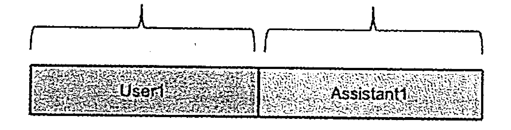


## 4.3 多轮对话里的信息流失难题与应对思路

在 GPT、BERT、Llama2 这类大模型的微调和推理阶段，多轮对话的记忆保持始终是个痛点。模型怎么把之前的来回对话留住，避免关键信息在轮转中丢失，直接决定了表现上限。下面梳理几种主流的存储与记忆方案。

### 4.3.1 用历史拼接当前输入

微调多轮对话数据时，最直观的做法是把前几轮的问答硬拼到当下输入里。LangChain 的 memory 模块就是围绕这个思路构建上下文记忆的。这种做法上手快，效果在不少场景也够用，但天生带局限。

具体怎么操作：

+   历史留存：把每一轮的问答都存下来。
+   信息合并：在新一轮开始时，把存好的历史和当前用户输入连成一段。
+   整体进模型：拼接后的长序列直接作为输入送入模型。

好处很清晰：

+   完整性：模型能看到比较完整的对话轨迹，上下文理解更稳。
+   准确性：回应的相关性和一致性更容易被保证。
+   灵活性：适配性强，基本能套在各种对话模型上。

# 短板在哪

拼接法对序列长度非常敏感，随着轮数增加输入会迅速膨胀，计算成本和截断风险同步上升。长对话里早期信息很容易被冲掉，也没有真正的“记忆压缩”。

# 第4章 突破Llama 2多轮对话的瓶颈

上下文向量的传递：在对话模型里，隐藏层保存着丰富的对话语义。可以从隐藏层里截取一段固定长度的向量，把它当成对话状态在轮次间搬运。

实现流程如下：

- 模型训练：先训练一个能处理对话输入的基础模型。
- 隐藏层抽取：在每轮对话结束时，从隐藏层提取上下文向量。
- 向量搬运：把这个向量作为额外输入带进下一轮。

# 核心优势

- 信息密度高：隐藏层能捕捉多维语义，向量承载的信息比较丰富。
- 保持连贯：向量一旦生成就能复用，多轮下来上下文不轻易断裂。
- 泛化更好：对未见过的对话情境，带上状态向量的模型更稳。

# 主要限制

- 工程门槛高：比起简单拼接，向量法需要更复杂的架构和算法。
- 存储开销：每轮都要保存一个向量，长期对话存储压力增大。
- 计算额外：生成和传递向量都要付出额外算力。

# 应对手段

- 向量压缩：用降维技术把向量压小，降低存储和计算负担。
- 算法优化：选用高效实现并配合硬件加速。
- 分布式存储：把海量向量放到分布式数据库里管理。

# 典型用途

- 个性化推荐：捕捉用户的长期兴趣和短期偏好。
- 高级客服：让模型记住历史互动，处理复杂问题时更准确。

上下文向量是一种强而灵活的记忆载体，能较好地保存和搬运对话历史。虽然技术门槛和存储成本比拼接法高，但经过压缩和优化后，其价值非常突出，也为下一代对话状态管理提供了重要思路。

# 对话状态追踪

在复杂的多轮任务型对话里，状态追踪是关键。通过在每轮结束后让模型预测槽位 Slots 和意图 Intents，再据此更新对话状态，系统能更精准地满足需求。AutoGPT、MetaGPT 等 Agent 框架都内置了类似的状态管理模块。

对话状态本质上是一个结构化数据，包含用户意图、关键信息等字段，每次交互后都会被更新。

操作步骤：

- 模型预测：轮末预测当前意图和关键信息。
- 状态更新：依据预测结果刷新状态。
- 响应生成：基于最新状态产出下一步回复。

# 亮点

- 表达明确：意图和关键信息被结构化保存，便于解释。
- 响应迅速：状态更新快，系统能即时反应。
- 易于模块化：字段化设计让开发和维护更清晰。

# 约束

- 难以覆盖复杂上下文：状态是预定义的，复杂语义容易遗漏。
- 硬编码风险：意图和槽位一旦写死，灵活性受限。
- 数据稀疏影响准确：数据不足或模型不准会导致更新偏差。

# 缓解策略

- 混合建模：预设状态与大模型推理的状态相结合。
- 动态扩充：允许在线增改意图和槽位，提升适应性。
- 上下文融合：用上下文向量补充状态信息。

# 适用场景

- 电商购物助手：依据状态推荐合适的商品。
- 智能家居控制：理解多轮指令如调温、开关灯。
- 健康咨询：结合症状和历史提问给出个性化建议。

对话状态追踪提供了结构化的对话管理方式，明确高效但对复杂上下文覆盖有限。配合其他技术后，局限可以得到有效缓解，是多轮系统设计中不可或缺的一环。

# 状态压缩

多轮对话的吞吐受限，状态存储和管理成为瓶颈。状态压缩技术提供了一种有损但高效的解决方案，例如 PCA 或自动编码器，能把高维状态映射到低维，减少存储和计算压力。

压缩流程：

- 数据准备：整理要压缩的状态数据。
- 模型选择：挑选降维或自编码方法。
- 执行压缩：应用技术完成降维。
- 状态更新：用压缩后的状态继续管理对话。

# 优势

- 存储节省：压缩后体积更小，成本下降。
- 计算更快：维度降低后相关运算加速。
- 更易扩展：支撑大量并发对话。

# 代价

- 信息损失：降维不可避免丢弃部分细节。
- 复杂度上升：压缩与解压增加系统复杂度。
- 可解释性下降：压缩态不如原始态直观。

# 优化做法

- 保留关键信息：优化模型以最大化信息保留。
- 效果校验：在使用前评估压缩带来的影响。
- 动态切换：按需决定是否启用压缩。

# 常见应用

- 大规模对话平台：状态量巨大时压缩几乎是刚需。
- 移动端：存储算力受限，压缩尤为重要。
- IoT 设备：资源受限场景提升效率。

状态压缩在效率和可扩展性上很有价值，但要接受一定的信息损失和复杂度提升。合理设计后，它能为多轮系统提供兼顾效率与灵活的管理方案。

# 增量学习和在线学习

预训练后一次性部署的模式很难跟上用户行为变化。增量学习和在线学习让模型在真实交互中持续微调，实现动态自适应。

步骤：

- 预训练：先做通用任务的初始训练。
- 数据收集：在交互中持续采集数据。
- 模型微调：用新数据对模型进行小范围更新。
- 性能评估：定期或实时检验效果。

# 优点

- 动态适应：更贴合用户行为和偏好。
- 长期提升：随数据积累性能逐步增强。
- 即时反馈：在线学习让模型反应更敏捷。

# 难点

- 实现复杂：比传统训练-部署流程更复杂。
- 算力消耗：持续微调需要额外资源。
- 隐私安全：长期采集用户数据带来风险。

# 应对

- 模型轻量化：用小模型降低计算负担。
- 批量更新：积累到一定量再统一更新。
- 数据脱敏：加密和匿名化处理用户数据。

# 典型场景

- 推荐系统：持续学习行为提供更精准推荐。
- 客服机器人：根据反馈自我优化。
- 个人助手：更好理解和执行个性化指令。

增量与在线学习为多轮对话提供了持续进化的能力，实现门槛虽高，但长期收益显著，值得深入研究。

在微调大模型时，需要在复杂度、存储和准确性之间做权衡，多种方法也可以组合使用以达到最佳多轮效果。

# 提升大模型多轮对话能力的方向

本节聚焦六类提升手段：针对性数据微调、实时反馈自适应、强化学习优化、上下文感知个性化、多模态多任务学习、错误处理与恢复。

# 针对性的数据集与微调

通用模型在特定场景下往往不够细。迁移学习中的微调可以用高度相关的对话数据让模型更懂目标任务。

流程：

- 数据集准备：收集或构建贴合目标场景的对话集。
- 预处理：清洗、标注等。
- 初步训练：必要时先在通用数据上预热。
- 模型微调：用目标数据继续训练。
- 性能评估：用场景专属指标检验。

# 收益

- 高度适配：更精准理解特定对话需求。
- 效率提升：生成响应更快更相关。
- 体验改善：用户感受到更懂自己的服务。

# 风险

- 数据质量依赖强：数据差则效果差。
- 计算成本增加：微调耗时耗资源。
- 过拟合风险：数据少或单一容易过拟合。

# 对策

- 数据增强：提升多样性。
- 正则化：抑制过拟合。
- 持续评估：用新数据定期校准。

# 应用示例

- 医疗咨询机器人：用医疗对话数据微调后能更准确解释症状和治疗。
- 金融助手：处理贷款、投资、账户等专业问答。
- 技术支持中心：更懂特定产品问题并给出解决方案。
- 旅行酒店助手：满足目的地、行程、预订等需求。

通过场景化微调，多轮对话系统能更贴合专属需求，提升效率和用户体验，关键在于数据质量和持续评估。

# 实时反馈与自适应

长期性能受用户环境变化影响大。实时反馈机制让模型在交互中收集数据并自我调整，实现持续优化。

步骤：

- 反馈收集：搭建用户反馈或系统指标采集通道。
- 数据分析：实时或近实时解析。
- 模型调整：基于分析结果自动或半自动调参。
- 性能监控：持续跟踪表现确保稳定。

# 价值

- 持续学习：越用越好。
- 动态适应：快速跟上行为变化和新场景。
- 更好体验：自我优化的模型更贴心。

# 局限

实时计算压力大，需要低延迟的数据处理和模型更新能力。

## Llama 大模型实践指南

## 模型简化与优化

通过算法和架构优化降低实现复杂度，减少资源占用，提升推理效率。

## 数据清洗与校验

保证输入用户数据的准确性和可靠性，避免噪声污染模型。

# 应用场景

- 电商购物推荐：基于购买历史和偏好生成个性化推荐。
- 智能新闻聚合：按阅读历史推送相关资讯。
- 社交网络服务：基于关系网推荐人或活动。

上下文感知与个性化能显著提升多轮对话的精准度和商业价值，但需兼顾隐私和实现成本，合理设计后潜力巨大。

## 4.4.5 多模态与多任务学习

传统系统仅处理文本，现实交互往往包含文本、图像、语音等多种模态。多模态与多任务学习让单一模型同时处理多种输入输出，并在多个任务上协同工作，提供更丰富的体验。

流程：

- 数据集准备：收集多模态多任务数据。
- 架构设计：设计能处理多源输入输出的模型。
- 联合训练：用多任务损失共同训练。
- 模型融合：整合各模态任务输出生成最终响应。

# 优点

- 体验更丰富：支持多源交互。
- 泛化增强：多任务训练提升鲁棒性。
- 效率与价值提升：单一模型多用，降低部署成本。

# 局限

- 计算复杂：模型和资源需求更高。
- 数据不平衡与噪声：不同模态数据质量参差，影响性能。

- 任务冲突：多任务并行训练时，各任务之间容易互相牵制，导致模型在部分任务上的表现滑落。

## 应对方案
- 架构精简与提效：通过优化网络结构和改进算法来降低计算开销。
- 数据清洗与扩充：借助预处理与增强手段缓解数据不均衡和噪声干扰。
- 任务权重动态调整：实时调节各任务的权重以削弱任务间的负向影响。

## 典型场景
- 多媒体客服：可同步接收并理解用户的文字、图片与语音请求。
- 智能助手：除基础问答外，还能完成图像识别、翻译等多元化任务。
- 健康监护：既能解析用户的主观描述，也能解读相关医学影像。

多模态结合多任务学习，为多轮对话系统带来了更强的灵活性和功能性。把不同模态的输入输出融合起来并同时处理多个任务，能够明显改善体验并提升商业回报。落地时确实会碰到算力繁重、数据失衡和噪声等问题，但只要设计得当、优化到位，这些难点都能被解决。总体来看，多模态与多任务学习在下一代大模型多轮对话的构建上具备巨大潜力和价值。

## 4.4.6 错误应对与对话恢复机制

在多轮对话系统中，容错和恢复是基建级的基础能力。用户表达具有多样性和不确定性，系统必然会遭遇异常或错误输入。专门设计错误处理与恢复机制，不仅能优雅化解尴尬，还能大幅提升鲁棒性和可信度。

错误处理机制是一套识别、处置错误输入或异常行为的规则流程，常见做法包括输入校验、异常捕获和错误日志记录。恢复机制则是在问题发生后把对话拉回正轨的一系列动作和原则。其落地流程大致如下。

- 错误甄别：借助模型或规则捕捉潜在的异常情况。
- 错误归类：按类型或严重程度对已识别问题进行分级。
- 处置与回应：依据错误类别给出修正提示、备选方案或重启对话。
- 日志记录与复盘：保存错误事件并进行分析，用于后续优化。

## 优势
- 鲁棒性提升：完善的容错体系让系统即使面对未知输入也能稳定运行。
- 可靠性增强：减少崩溃和答非所问的次数，提升用户信任感。
- 体验优化：错误被体面处理并予以引导，使用户感知更友好。

## 存在短板
- 建设复杂度高：覆盖全面的容错恢复设计本身投入较大。
- 资源开销：检测与处理会额外消耗计算资源。
- 敏感度权衡：检测过灵可能误报，检测不足则会漏报。

## 应对思路
- 模块化设计：拆分职责降低实现难度。
- 算法优化：选用高效方法减少算力损耗。

# 第4章 打通 Llama 2 多轮对话的关键卡点

### 敏感度自适应
允许系统依据实际情境动态调节错误检测的敏感阈值。

## 应用场景
- 智能客服：在解答用户问题时可自动识别异常指令并妥善处置。
- 智能家居控制：面对模糊或错误的指令时，能给出修正建议。
- 教育培训软件：在学习过程中识别错误答案并提供针对性纠正。

错误应对与恢复机制是高质量大模型多轮对话的必要组成。通过刻意设计和落地实施，不仅能体面应对各种异常输入，还能显著提升系统的稳定性与可靠性。虽然会带来一定的复杂度与性能成本，但以精细设计和优化手段完全可以控制。总体看，投入于有效的容错恢复体系能带来长期收益，包括用户满意度提升和商业竞争力增强。

借助这些方法，微调后的大模型不仅能更精准把握意图与上下文，还能更有韧性地应对复杂对话场景，进而满足多样化的应用需求。

## 4.5 评估机制与持续迭代
本部分聚焦模型评估与持续改进的核心要点与实践，从指标选择、实验设计到模型优化和用户反馈，覆盖优化闭环的关键环节。

### 4.5.1 微调后 Llama 2 的评估方法
目前主流评测多依赖公开数据集。公开集的优点是标准统一，缺点是模型容易针对性训练，导致评测失真，难以反映真实能力。为此 AIGCLINK 提出面向特定场景的评估框架，从推理能力和知识能力两个维度进行衡量。

#### 推理能力测评
实施步骤如下。
1. 由场景使用者提供 100 道业务相关的推理类题目。
2. 将题库输入给一个或多个候选大模型，收集响应结果。
3. 借助 GPT-4 对各模型答案进行 10 分制打分并汇总。
4. 人工抽样部分题目，按 10 分制独立打分并汇总。
5. 将 GPT-4 分与人工分相加得到总分，按总分排序。
6. 根据排序判断各模型在该业务场景下的推理表现。

评级推理大模型推理能力结构图（AIGCLINK 绘制）如图4 - 7所示。

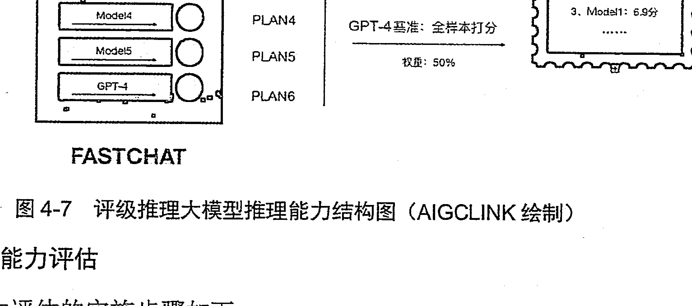

图4 - 7 评级推理大模型推理能力结构图（AIGCLINK 绘制）

#### 知识能力测评
实施步骤如下。
1. 由场景使用者提供 100 道业务相关的知识类题目。
2. 将题库输入给候选大模型，获取答案集。
3. 使用 GPT-4 对答案进行 10 分制评分并累加。
4. 人工抽样评分，按 10 分制累加。
5. 合并两部分得分得到总分，按总分排序。
6. 据此得到各模型在特定场景下的知识表现。

评级推理大模型知识能力结构图（AIGCLINK绘制）如图4-8所示。

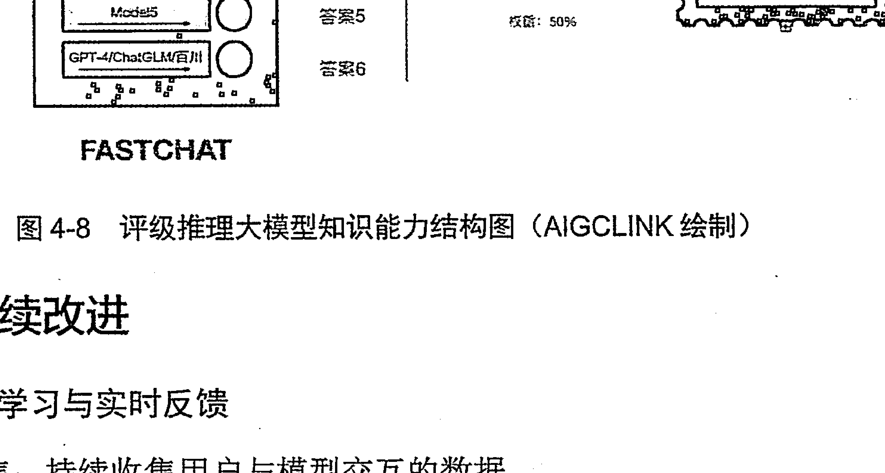

### 4.5.2 持续迭代优化
1. 在线学习与实时反馈
   - 数据沉淀：持续收集用户与模型的交互数据。
   - 实时微调：基于新数据进行即时或周期性微调。
2. 错误分析与改进
   - 错误拆解：对模型失误进行分类与根因分析。
   - 改进计划：据此制定优化方案并在下轮微调中落地。
3. 模型更新与版本管理
   - 版本归档：每次微调后保存新版本模型。
   - A/B 测试：通过对比实验评估不同版本的表现。
4. 社群与开源协同
   - 跟踪前沿：关注领域最新研究与开源进展。
   - 社群互动：借助社区反馈获取改进点。

通过系统化的评估与持续改进，可确保 Llama 2 在多轮对话任务中的性能不断攀升，并更好适应变化的应用需求。

## 4.6 为 Llama 2 设计多轮对话 Prompt
Meta 开源的 Llama 2 备受关注，但官方说明并未给出多轮对话的专门用法，实践中很多人效果不佳。本节重点介绍适配 Llama 2 多轮对话的 Prompt 构造方法。

该思路源自 ChatGLM，多轮对话时需把历史信息拼接进输入，以便模型计算历史 token 与当前 query 的交互关系：

```
Plaintext
# ChatGLM 中对话 prompt 的产生
prompt = "" for i, (old_query, response) in enumerate(history_input):
prompt += "[Round {}]
问:{}
答:{}".format(i, old_query, response)
prompt += "[Round {}]
问:{}
答: ".format(len(history_input), query_input)
```

若使用 Llama 2 进行对话，也应采用匹配训练格式的模板，下文围绕此展开。

#### 1. Prompt 的规范形式
按照 Meta 官方说明，对话时用户提供的 Prompt 应符合以下格式：

```
Plaintext
<s>
[INST]
<<SYS>>
{{ system_prompt }}
<<</SYS>>
{{ user_message }}
[/INST]
</s>
```

# 第5章 用 Llama 2 定制专属行业模型

过去几年以 GPT-3、BERT、Transformer 为代表的大模型在 NLP、图像识别、推荐等领域取得突破。但要把大模型真正用在行业问题上，必须做定制化。以下举例说明定制的重要性。

+ 1. 医疗诊断
医疗场景下医生需综合症状、病历与检查报告进行判断。通用模型在常见病上表现尚可，但在罕见病、特定人群上会掉点。基于影像数据与临床报告定制模型，能显著提升特定疾病的诊断准确性，例如训练专用的肺部肿瘤筛查模型辅助肺癌检测。
+ 2. 零售推荐系统
电商追求体验，推荐系统是核心。不同行业用户行为差异大，通用推荐模型难以捕捉。结合浏览历史、购买记录与行业商品关联定制推荐，能提供更贴合兴趣的商品，例如运动鞋类推荐可依据运动类型、品牌偏好和颜色喜好精准推介。
+ 3. 金融风控
风控需准确预测违约与欺诈。信用卡、消费贷、企业贷的风险特征各异，通用模型适应性不足。利用历史交易、申请信息与欺诈案例定制模型，可更精准识别不同风险，例如个人贷款模型可综合收入、负债与工作稳定性预测违约概率。

案例凸显定制价值。行业数据特性与问题需求各不相同，不存在普适模型。把模型与行业数据深度融合，才能得到更精准可靠的解决方案。

本章将探讨从业务分析、数据获取与预处理、模型导入初始化、微调到评估优化的全流程，帮助把大模型价值发挥到极致。

## 5.1 用业务数据驱动行业模型定制
前文已强调定制的重要性，本节深入论述如何基于业务数据分析来定制行业大模型。

### 5.1.1 行业模型定制策略
+ 1. 明确核心业务目标
确定核心目标是定制基础，可能是提升满意度、降本增效或增收。
+ 2. 深入业务流程与用户需求
选场景时要吃透业务链路与用户痛点，找到可落地的环节。例如 2B 领域，供应链需求预测是典型场景，定制模型可更准预测需求，避免积压与缺货。
+ 3. 刻画目标人群特征与需求
人群画像是定制的关键，2C 场景需考虑偏好、行为、年龄性别等。例如社交平台可定制情感分析模型，帮助用户理解自身表达方式。
+ 4. 依托先进技术构建能力
选择合适的技术栈实现能力，如 NLP、计算机视觉、强化学习等。2B 客服可借助 NLP 实现快速准确问答。

### 5.1.2 模型效果评估
定制模型的性能目标与评价指标是落地成功的保障。
+ 1. 设定清晰性能目标
目标需与业务紧密挂钩，如准确预测血糖水平或精准推荐商品。
+ 2. 选择合适的评估指标
指标应反映真实表现，分类任务关注准确率召回率，生成任务关注 BLEU、ROUGE 等。
+ 3. 基于真实数据评估
使用实际业务数据验证，避免理想化偏差。
+ 4. 采用交叉验证等方法
交叉验证、留出法等可更全面衡量稳定性和泛化能力。

## 5.2 行业数据采集与预处理
数据质量与规模决定模型上限。但获取与预处理常面临量不足、异构、质量参差等问题。以下为可参考的做法。

### 5.2.1 如何获取数据
(1) 内部数据整合
整合历史记录、用户行为、交易等内部数据，往往分散在不同系统，需清洗与融合。
+ 结构化数据：数据库、数据仓库中的表格数据。
+ 半结构化数据：系统日志、文档等。
+ 非结构化数据：邮件、合同、记录等文本。
+ 多源异构融合：对不同系统、格式的数据清洗、映射、融合。
(2) 外部数据采集
从公开源、第三方供应商获取社交媒体、市场趋势等数据以丰富训练集。
+ 公开信息：官网、公告等渠道。
+ 社交媒体数据：公开帖子与观点分析。
+ 第三方平台：购买独家数据集或 API。
+ 爬虫定向采集：抓取相关文本、评论与评价。
(3) 众包数据收集
借助众包平台如 Amazon Mechanical Turk 获取人工标注数据。
+ 人工标注任务：在众包平台发布标注需求。
+ 现场调研：线下访谈、录音等专业调研。
+ 竞赛获取数据：举办标注竞赛提升数据质量。
(4) 由 GPT 等更强模型生成领域问答数据

### 5.2.2 数据清洗规范化
预处理是训练前对原始数据进行清洗、标准化和规范化的过程，直接影响模型效果。
+ 1. 数据清洗
解决重复、缺失、错误等问题，保证可用性。文本场景需去噪、去特殊字符。
+ 去重去空：剔除无效记录降低噪声。
+ 缺失值处理：插值或删除，必要时保留缺失信息。
+ 格式纠正：统一日期、货币等格式。
+ 噪声去除：剔除停用词、广告等无信息内容。
+ 2. 标准化与规范化
让不同特征可比，便于模型学习。
+ 文本统一小写或 ASCII，数字日期格式化。
+ 地址姓名等字段映射为标准形式。
+ 文本清洗规范化提升质量。
+ 数字特征归一化到相同范围。
+ 3. 特征工程
基于领域知识构建有效特征。NLP 可提取词频、句法、词向量、TF-IDF 等。
+ 任务导向特征提取。
+ 领域知识驱动构造。
+ 特征选择剔除冗余。
+ 4. 数据采样与平衡
对不平衡数据采用欠采样、过采样，使类别均衡，避免偏向多类。
+ 类别平衡采样。
+ 批次内动态平衡防止过拟合。

特别提醒：数据获取与使用必须遵守安全、隐私与知识产权规范。合法合规采集、明确使用目的并获得授权，避免不正当渠道导致法律风险。保护数据的合规性与隐私，才能为模型构建提供可持续支撑。

参考案例：
(1) 金融风控模型
数据获取：内部整合贷款记录、还款情况、客户信息；外部采集经济指标与市场数据。
数据预处理：清洗缺失值，标准化金额收入特征，构建信用历史表征。
(2) 医疗影像诊断模型
数据获取：结合公开影像集与医院内部 X 线、MRI 数据。
数据预处理：裁剪归一化，采用旋转翻转等增强扩充样本。
(3) 社交媒体情感分析模型
数据获取：采集平台帖子评论文本。
数据预处理：清洗特殊字符表情，转换为词向量表示。
(4) 零售推荐系统
数据获取：收集购买记录、点击行为与浏览历史。

行业数据从采集到清洗的实操路径
把用户的购买流水和点击行为先统一口径，再整理成用户-商品关联表。

(5) 制造业质检实战
采集端：汇总多批次产品的检测结果，涵盖尺寸、重量等维度。
清洗端：执行数值归一化，必要时用采样手段调平正负样本分布，提炼能够表征成品质量的特征。

(6) 文本生成类模型
采集端：聚合中英文语料，包含新闻稿件与社交媒体动态。
清洗端：对文本做去噪、分词、去除停用词，最终映射为词向量。

上述思路结合案例，完整呈现了行业数据的获取与预处理方法，为后续专属大模型的训练夯实数据基础。第5.3节将转入模型搭建、训练与性能调优。

## 5.3 Llama 2 基础模型导入与初始化
在构建行业定制模型时，底座预训练模型的挑选至关重要。下方从语言表现、上下文长度、多语解码效率、算力配置、训练周期与推理耗时等维度展开说明，以确保最终模型契合业务需求。

(1) 语言表现：重点考察语言能力
选型首要看模型处理语言的水平。要具备充足词表、扎实的语法理解与语义推断，方能支撑行业模型的落地。评估时可参考其在问答、文本分类、生成等基准任务上的成绩。

(2) 上下文长度：匹配业务文本规模
行业场景常涉及长文本，最大可处理长度是重要考量。选择支持更长窗口的底座，有助于覆盖特定任务，同时需保证训练与推理环节的算力足够。

(3) 多语解码效率：兼顾全球化需求
面向多语言的业务，多语解码效率直接影响体验。优先选择解码效率高的底座，且最好基于多语语料训练，以提升跨语言理解与生成质量。

(4) 算力配置：支撑训练与推理
算力决定可行性，服务器或云端需配备充足内存、CPU 与 GPU。分布式训练与加速硬件可进一步提升效率。

(5) 训练周期：平衡资源与进度
训练耗时可观，需在可接受时长与模型效果间取舍。结合项目排期与资源，选择合适的底座，也可借助迁移学习缩短周期。

(6) 推理耗时：满足实时性
若需快速响应用户或实时推理，推理速度是选型要点。可通过结构优化、硬件加速与缓存手段提升速度。

综合以上维度，选对底座是定制行业模型的關鍵步骤，逐项把关既能满足业务诉求，又能保持训练推理的高效，为项目落地奠定基础。

中文场景下，本次采用 Llama 中文社区基于 Llama 2 继续训练的 Atom-7B，其后续会持续迭代。

进入社区页面，如图 5-1 所示，点击左侧“资源下载”即可获取 Atom-7B。

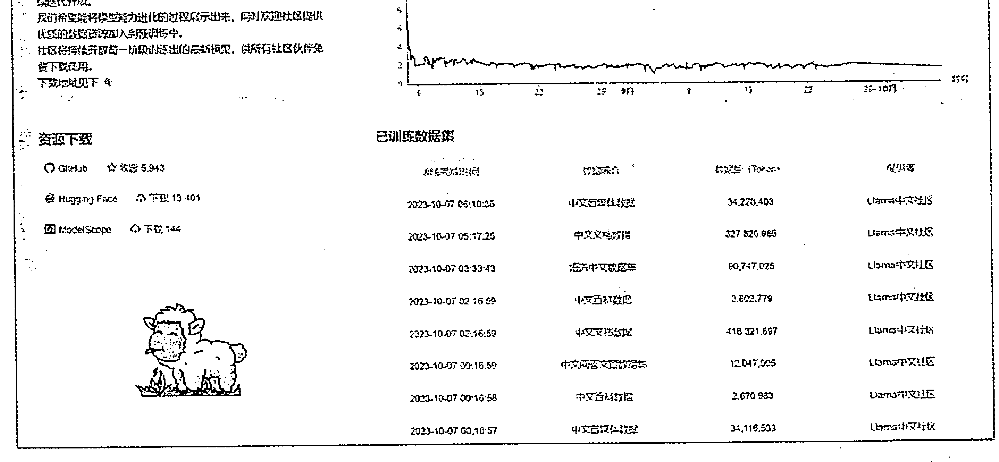

图 5-1 Llama 中文社区页面

模型下载完成后，按第 2 章介绍的部署方式即可上线。

## 5.4 微调获取行业专属大模型
微调是依据具体任务或行业需求对通用预训练模型进行再训练的常用手段。预训练模型已在海量数据上形成良好底座，微调可聚焦任务提升效果。

### 5.4.1 微调流程
+ 1. 选定合适的预训练基座
依据业务需求与任务特性挑选底座，如 NLP 场景可选用 GPT-3、BERT 等。
+ 2. 准备微调语料
收集行业相关的文本、图像、音频等数据。
+ 3. 执行微调
用上述语料对基座进行训练并调整参数。
+ 4. 测评效果
微调完成后用测试集评估，指标依任务而定，如准确率、召回率、F1。

### 5.4.2 微调技巧
+ 1. 学习率调优
学习率直接影响收敛速度与最终效果，需合理设定。
+ 2. 正则化
借助正则化抑制过拟合，提升泛化能力。
+ 3. 数据增强
通过扩充与改造训练样本，提升鲁棒性。

按照上述流程与技巧，可将通用预训练模型转化为贴合行业的专属模型，提升实用性。

## 5.5 模型评估与优化
评估与优化是定制闭环的重要环节，能确保模型在实战中稳定发挥。

### 5.5.1 模型评估
## Llama 大模型实践指南
微调后泛化能力显著提升，模型能更精准适配特定应用场景。

# 5.4.1 领域预训练
为让 Llama 2 在特定领域如心理学表现更佳，可先进行领域预训练。以心理学论文、咨询对话等专业语料为训练集进行预训练，使模型吸收领域术语与知识，为后续微调打基础。

若缺少专业预训练资源，可直接使用 Llama 中文社区提供的中文预训练版 Llama2-7B 下载后微调，如图 5-2 所示。

| Models 7 | Sort: Recently Updated |
| :--- | --- |
| FlagAlpha/Atom-78 | FlagAlpha/Atom-7B-Chat |
| FlagAlpha/llama2-Chinese-13b-Chat-4bit | FlagAlpha/llama2-Chinese-13b-Chat |
| FlagAlpha/llama2-Chinese-13b-Chat-LoRA | FlagAlpha/llama2-Chinese-7b-Chat |
| FlagAlpha/llama2-Chinese-7b-Chat-LoRA |  |
| (省略部分内容) | (省略部分内容) |

# 图 5-2 中文预训练版 Llama2-7B 模型获取

社区同时提供 Llama 2 的预训练代码与中文测试语料，更多数据可参考测试语料。

# 5.4.2 微调策略
以心理咨询为例，可采用以下策略提升 Llama 2 在心理学任务上的表现。

+ (1) 知识蒸馏。将大模型知识迁移至更小模型，通过训练轻量模型继承能力。
(2) 数据增强。对原始数据进行变换生成新样本，提升泛化。
(3) 多任务学习。同时训练多个相关任务，使模型在各任务上均有较好表现。

# 第5章 基于Llama 2定制行业大模型
本节心理咨询大模型通过知识蒸馏与 LoRA 微调实现。

# 1. 知识蒸馏
知识蒸馏是将复杂模型能力迁移到简化模型的技术。在心理咨询问答生成中，可用其提升效率同时保持质量。

思路为先用大型复杂模型如 GPT-4 生成高质量问答对，再以此为训练数据对简化模型如 GPT-3.5 进行蒸馏。蒸馏后模型推理更快、存储更小。

该方法帮助轻量模型更好理解咨询问题，生成更具针对性的回答，即使在资源受限场景也能提供高质量支持。

以下基于 GPT-3.5 生成咨询问答对。

Prompt: 你充当一位资深心理咨询师，请生成20个常见的心理咨询问题和回答，用于大模型的微调。问答对以<s>Human: {问题}

<s><s>Assistant: {回答}

<s>形式呈现，如图5-3所示。


图5-3 知识蒸馏生成行业相关数据

# 5.4.3 人工标注
针对非心理相关问题，进行人工标注。

人工标注可保证数据准确可信，标注员据问题背景与要求精准标记，避免模型学到错误信息。统一标准与规范还能保证一致性，提升数据质量。

标注前需对人员进行培训，过程中可采用多人标注、交叉验证等方法确保可靠性。

非心理问题的手工标注示例如下：

Python

<s>System: 你是一个优秀的心理咨询助手，根据用户的提问进行回答，回答要内容丰富，能与用户产生共情，并解答用户的烦恼，可以适当地提问一些问题给用户，非心理情感问题，委婉的拒绝回复\n</s><s>Human: {问题}\n</s><s>Assistant: {回答}\n</s>

# 2. LoRA微调
LoRA 微调相关源码可在 GitHub 社区获取，包含：
+ * LoRA 微调脚本。
* LoRA 具体实现代码。

微调后的模型可通过基于 Gradio 搭建的问答平台调用，详见 3.5.2 节。

## 5.5 模型测试、评估和优化
至此已完成初次微调与初步测试。后续需通过持续测试、评估与优化确保性能达标并迭代改进。

持续测试首先要制定详尽的方案，覆盖输入多样性、边界处理、输出合理性等，并结合行业特点设计典型用例。

# 第5章 基于Llama 2定制行业大模型
# 1. 设计详尽的测试计划
测试计划设计至关重要，需关注两点。
+ * 用例设计：覆盖多场景，重点考察行业典型案例。如医疗行业可设计病历、诊断、处方类用例。
+ * 性能测试：评估响应时长、内存占用、吞吐量等，确保生产环境稳定高效。

# 2. 持续监测模型性能
建立监测体系，定期采集性能数据并分析趋势。手段包括日志监控、响应时间分析、内存使用观察等。

# 3. 定期评估模型性能
定期评估是优化关键，包含定量与定性两种方式。
+ * 定量评估：使用准确率、召回率、F1 等指标量化。如医疗领域可评估辅助诊断准确率或处方正确性。
+ * 定性评估：邀请领域专家或真实用户参与，判断输出是否符合实际需求与专业标准。

# 4. 针对特定场景进行模型优化
据评估结果与反馈对特定场景优化。如医疗大模型可优化对临床试验数据的处理，提升医学研究适用性。

# 5. 引入用户反馈
用户反馈能帮助识别不足与潜在问题。如金融用户可反馈市场走势预测准确性及对事件的应对能力。

# 6. 迭代优化过程
上述步骤应形成闭环：收集反馈→分析评估→调整模型→再次测试。随着场景扩展，迭代应持续进行，以不断提升性能与适用性。

通过迭代优化，可确保模型在特定行业保持优异表现。持续监测、评估与优化是实践中保持进化的关键。该过程包括构建测试集、用上次最优模型测试、评价结果并将满意样本扩充训练集、重新微调，如图5-4所示。

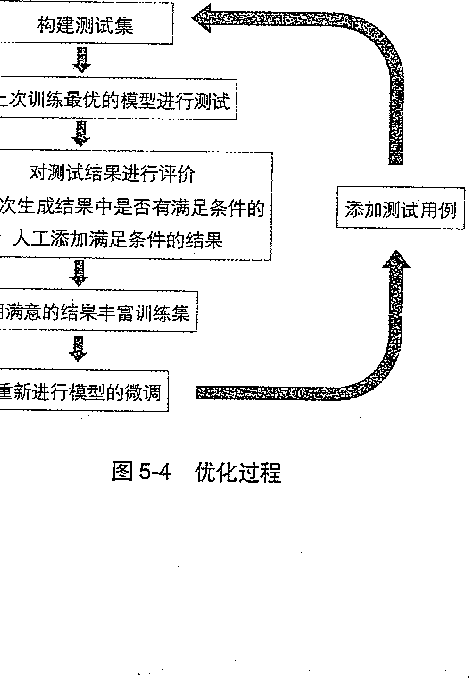

### 图5-4 优化过程

# 第6章 Llama 2 + LangChain 文档
# 问答模型构建
本章从理论出发，利用 Llama 2 与 LangChain 从零构建面向文档的问答模型。流程可分为以下步骤。
+ (1) 了解 Llama 2 与 LangChain 的原理与功能。(2) 介绍 LangChain 及其与 Llama 2 的协同方式。(3) 在 Windows、macOS、Linux 等平台配置运行环境。(4) 用 Llama 2 创建并加载模型。(5) 借助 LangChain 处理问题与文档内容，可通过提示设定自定义指令。(6) 运行问答模型，为每个问题提供详细答案。

按此步骤可逐步构建并优化问答模型，使其更有效地回答文档相关问题。

## 6.1 LangChain 介绍
大模型如 GPT 系列在 AI 领域引发技术革命。开发者基于其进行诸多尝试，虽诞生不少有趣应用，但单独使用大模型难以构建强大的实用系统。

LangChain 通过把大模型与知识库、计算逻辑结合，实现更强 AI 应用。可视作开源版 GPT 插件，提供丰富工具，在开源大模型基础上快速增强能力。

研究总结表明，LangChain 使语言技术应用更活跃多元，有望推动工作效率变革。我们正处于 AI 应用爆发的临界点，积极拥抱新技术将带来全新体验。

## 6.2 LangChain 的主要概念与示例
LangChain 提供一系列工具帮助更好地使用大模型。总体可分为六类。
+ * 模型：支持的各类模型及集成方式。
+ * 提示：提示管理、优化与序列化。
+ * 索引：索引与自有文本结合时大模型更强。
+ * 内存：在链与代理调用间保持状态的概念，提供标准接口与实现。
+ * 链：不仅包含单次模型调用，还包含模型与工具的多步调用，提供标准接口与端到端示例。
+ * 代理：涉及大模型做决策、执行行动、观察结果并重复直至任务完成，提供标准接口与示例。

LangChain 模块图如图 6-1 所示。

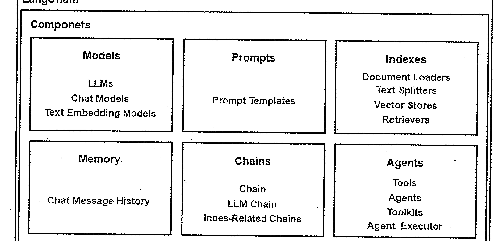

图 6-1 LangChain 模块图

### 6.2.1 模型
LangChain 核心价值在于提供标准模型接口，可自由切换不同模型，目前主要有两种类型，一般以文本生成模型为默认。提到模型常让人想到 ChatGPT，简单说模型用于生成文本。

#### 1. 语言模型
实现文本生成的语言模型主要有两种。
+ - 通用语言模型：接收文本字符串输入，返回文本字符串输出。
+ - 聊天模型：接收聊天消息输入，返回聊天消息输出。

```
以下是使用 Python 编写的代码示例：
```

```
Plain Text
from langchain.llms import Openai
from langchain.chat_models import ChatOpenai
ChatOpenai = Openai()
chat_model = ChatOpenai()
print(llm("say hi!"))
print(chat_model.predict("say hi!"))
```

#### 2. 文本嵌入模型
文本嵌入模型可把文本转为浮点数表征。

该模型接收文本输入，返回一组浮点数，用于表示语义信息，可用于相似度计算、聚类分析等。借助其开发者能构建更丰富的文本关联并提升应用性能。

以下为 Python 编写的代码示例：

```
Python
from langchain.embeddings import OpenaiEmbeddings
embeddings = OpenaiEmbeddings()
text = "This is a test document."
query_result = embeddings.embed_query(text)
doc_result = embeddings.embed_documents([text])
print(doc_result)
```

# 第6章 Llama 2 + LangChain 文档问答模型构建
Cream']解析为以逗号分隔的字符串。

(4) StructuredOutputParser：直接产出结构化结果，无需提前搭建数据模型。该解析器与 PydanticOutputParser 功能相近，区别在于省去了模型定义这一步骤。

(5) PydanticOutputParser：先制定 Pydantic 模型规范，强制模型按该结构返回内容，随后解析器再把文本转成对应模型实例。

### 6.2.4 索引

索引的本质是对文档做结构化整理，让模型能更顺滑地与文档交互，典型用途包括问答、知识库构建等，答案可以直接从原始材料中抽取。

LangChain 在这块提供了常用的一套组件，用来导入和检索各类文档资源，主要包含：

+   (1) Document Loaders（文档加载工具）：负责从不同来源把文档读进来。读完后需要把内容封装成 Document 对象，供后续流程使用。

+   (2) Text Splitter（文本分割工具）：实现对长文本的切分。无论是把文本作为提示喂给 OpenAI API，还是借助其嵌入功能，都存在字符上限，所以必须先把加载进来的文档拆开。

+   (3) Vector Store（向量存储工具）：把文档以向量形态保存。相关性搜索的底层其实是向量运算，不管调用 OpenAI 嵌入接口还是直接在向量库查询，都要先把文档转成向量。操作上只需把数据写入对应的向量库即可，如图 6-2 所示。

图 6-2 向量存储的服务图

+   (4) Retriever（检索工具）：承担从文档集合中挑选数据的职责。

## Llama 大模型实践指南

下面用一个案例来说明各工具的用法。

(1) 加载文档数据：可使用文档加载工具完成。它能从文件、数据库或网络获取原始文档，并做初步准备以便后续处理。

(2) 把文本切成不同块：可使用文本分割工具完成。它能把长文本拆成更细的单元，便于后续处理和检索。

(3) 把切分后的文本块向量化入库：可使用向量存储工具完成。它能将文本映射成向量表示，便于计算和比较。

(4) 检索文档数据并交给 LangChain 做问答：可使用检索工具完成。它会依据用户查询，从向量库中挑出最相关的文本块，再交给 LangChain 进行问答。

### 6.2.5 内存

默认情况下，代理和链都是无状态的，处理完一次查询后不会记住上轮对话，每次请求都是独立的。

不过在聊天等需要保持上下文的场景，保留历史对话就很重要。LangChain 为此提供了一批相关工具类。

这些工具类能够在代理与链之间传递上下文，保证连续对话的状态不丢失。例如借助上下文工具类保存并提取上一次的对话内容，下一次查询时就能结合这些信息给出更贴切的回复。

使用 LangChain 提供的工具类，可以让需要记忆历史对话的应用实现更连贯的对话能力，为用户带来更个性化、更流畅的体验。

### 6.2.6 链

链的设计思路是把多个组件组合成完整应用。比如可以搭建一条链，先用提示模板把用户输入格式化成提示，再把提示送入语言模型。

同时也可以把多条链串联，构建更复杂的流程。每条链负责特定的功能或任务，整体应用通过链的组合实现更完整的能力。

组合链后可以实现更高级的对话流程与逻辑。各链分别承担输入处理、语义解析、上下文管理等职责，这种方式让应用构建更灵活，也便于按需定制与扩展。简单说，链接收一个提示模板，在用户提供输入后进行格式化，再把结果传递给语言模型以获取响应，如图6-3所示。


### 6.2.7 代理

代理把语言模型当作推理引擎来决定下一步操作。我们会为代理配置一系列工具，代理根据用户输入判断哪些工具能达成目标，并持续调用工具直至目标完成。

从某种角度看，代理是链的增强版：它不仅绑定提示模板和语言模型，还可以挂载外部工具。

代理是一个智能主体，其职责是在用户输入和应用场景的约束下，从可用工具池中挑选合适的工具执行操作。面对不同复杂度的任务，代理会采取不同的策略，即可根据实际情况选择最合适的工具，实现高效准确的执行。

总体而言，代理是以语言模型做推理的智能主体，可依据输入和场景选择工具，并按任务复杂度采取不同策略，从而更灵活智能地完成各类任务。

目前主要有两类代理。

(1) 动作代理（Action Agent）：每次只执行一个动作，根据执行结果再决定下一步。

(2) 计划执行代理（Plan-and-Execute Agent）：先制定一系列待执行操作，再按预定顺序逐个执行。

对于简单任务，动作代理更常见也更易实现。对于复杂或长期运行的任务，计划执行代理的初始规划有助于保持长期目标的聚焦。不过计划执行代理会增加调用次数并带来更高延迟。这两类代理并不互斥，可让动作代理执行计划执行代理所制定的计划。

## Llama 大模型实践指南

代理内部涉及的核心概念如下。

+   (1) 代理：应用程序的主要逻辑单元，接收用户输入和已执行的操作列表，返回 AgentAction 或 AgentFinish。

+   (2) 工具：代理可以调用的动作，如发起 HTTP 请求、发送邮件、执行命令等。

+   (3) 工具包：为特定用途设计的一组工具集合。例如让代理与 SQL 数据库交互时，可能需要查询工具和查看表结构的工具。工具包可以看作工具的组合。

+   (4) 代理执行器：把代理和一系列工具封装在一起，负责循环运行代理直至满足停止条件。

#### 1. 代理的执行流程

LangChain 在接收到用户的问题后，会先把问题拆解成若干子任务。Llama 2 会依据任务类型调用相应工具，并通过工具与外部环境交互。交互结果会传回 Llama 2 处理，最后代理把处理后的最终结果返回给用户。代理的执行流程如图 6-4 所示。

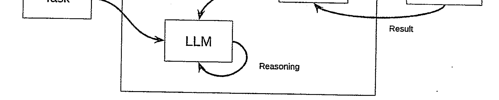

#### 2. 代理类型

在下面的代码中，代理初始化阶段会设定代理类型，例如 agent=AgentType.ZERO_SHOT_REACT_DESCRIPTION。代理类型的选择决定了工具使用方式、输入处理方式以及与用户的交互方式，从而为用户提供有针对性的服务。

```
Python
initialize_agent(tools, llm,
agent=AgentType.ZERO_SHOT_REACT_DESCRIPTION, verbose=True)
```

### 6.2.8 工具

LangChain 官方默认提供了一批工具箱，涵盖发送 Gmail 邮件、数据库查询、JSON 处理等，还有一批单个工具可查阅文档获取。

为了更直观说明工具用法，下面以一个自定义工具为例。在 LangChain 中，我们的主要工作就是不断自定义工具。编写工具时需要准备：

+   - (1) 名称：为工具取一个恰当的名字。

-   (2) 工具描述：清晰说明工具的功能与用途。

-   (3) 参数结构：明确工具所需的输入参数格式。

示例中，使用 Tool 数据类创建了一个名为“搜索”的新工具，该工具借助 SerpAPI 包装器来回答关于时事的问题。

```
Python
class CustomSearchTool(BaseTool):
 name = "搜索"
description = "当你需要回答有关当前事件的问题时有用" 
def __run__(self, query: str) -> str:
```

## Llama 大模型实践指南

```
"""使用工具。 ""
return search.run(query)
async def _arun(self, query: str) -> str:
"""异步使用工具。 ""
raise NotImplementedError("BingSearchRun 不支持异步")
class CustomCalculatorTool(BaseTool):
name = "计算器"
description = "用于进行数学计算"
def _run(self, query: str, calculator=None) -> str:
"""使用工具。 ""
return calculator.run(query)
async def _arun(self, query: str) -> str:
"""异步使用工具。 ""
raise NotImplementedError("CustomCalculatorTool 不支持异步")
```

## 6.3 LangChain 环境配置

本节介绍 Python 在 Windows、macOS、Linux 等平台的安装示例，以及 LangChain 的配置方法，帮助用户更轻松地上手。安装配置完成后即可愉快使用 LangChain。

### 6.3.1 Python 环境搭建

1. Python 下载

Python 的最新源码、二进制、文档和资讯都可以在官方网站查看。

2. Python 安装

Windows 平台安装步骤如下。

(1) 下载 Python 安装包。

打开官方网站：https://www.python.org/。

点击 “Downloads” 选项卡，选择适配 Windows 的 Python 版本，建议下载最新版。

(2) 运行安装程序。

双击下载的安装包。打开窗口后会出现安装选项，建议


勾选“Add Python to PATH”，这样命令行就能直接运行 Python。

点击“Install Now”开始安装。

(3) 安装进程。

安装程序会显示进度条，提示当前安装状态。

完成后会看到“Setup was successful”的提示。

(4) 验证安装。

打开命令提示符。

输入“python --version”回车，若安装成功，系统会输出 Python 版本信息。

### 6.3.2 LangChain 主要模块

LangChain 是一个集成众多模块与工具的库。开始开发前，可能还需要通过 pip 安装一些额外包：

```
python3 -m pip install --upgrade langchain deeplake pinecone-client Openai tiktoken python-dotenv
```

下面对相关工作做详细说明。

首先，使用 python3 -m pip 来确保调用的是 Python3 解释器的正确 pip 版本。

其次，使用 install 命令安装需要的 Python 包，名称包括 langchain、deeplake、pinecone-client、Openai、tiktoken 和 python-dotenv。执行 install 后可获取这些包的最新版本。

各包简要说明如下。

+   (1) langchain：核心 Python 包，提供文档加载、文本分割等实用工具。

+   (2) deeplake：一种向量数据库提供者。需要把处理后的数据以向量形式保存，deeplake 可让用户在本地或云端轻松创建索引，因此常被选用。

## Llama 大模型实践指南

强大的 AI 模型。我们将使用它来做嵌入模型、对话模型等任务。

(5) tiktoken：OpenAI 的一个库，可在不调用 API 的情况下计算文本字符串的 token 数。

(6) python-dotenv：可在 env 文件中配置环境变量，对管理密钥等配置项很有帮助。

至此，Python 环境已搭建完成，可以使用 LangChain 与语言模型应用了。

## 6.4 Llama 2+LangChain 文档问答模型评估

本节详细介绍如何从零搭建自己的文档问答模型，利用 Llama 2 与 LangChain 这两个开源库实现无缝集成，具体步骤如下。

+   (1) 设置虚拟环境和创建文件结构

+   (2) 在本地计算机上使用 Llama 2。

+   (3) 将 Llama 2 与 LangChain 集成，并自定义提示模板。

+   (4) 文档检索和答案生成。

### 6.4.1 设置虚拟环境和创建文件结构

设置虚拟环境能为应用提供受控且隔离的运行空间，保证依赖不会与系统范围的其他包冲突。这种方式简化了依赖管理，也有助于在不同环境间保持一致。

为应用创建虚拟环境时，可在仓库中提供一个 pip 文件。按如图 6-5 所示的文件结构创建必要文件。若不想手动创建，也可直接复制仓库获取所需文件。

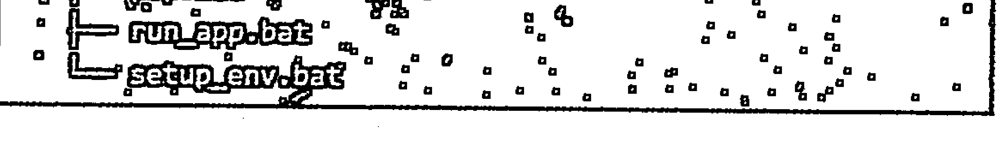

图 6-5 文件结构

models 文件夹用于存放下载的 LLM，pip 文件则放在根目录。

要在虚拟环境中创建并安装所有依赖，可在同一目录执行 pipenv install 命令，或直接运行 setup_env.bat 批处理文件。这会从 pipfile 安装全部依赖，确保虚拟环境中具备所有必要的包与库。依赖安装成功后，即可进入下一步——下载所需模型。

## Llama 大模型实践指南

## 文本嵌入

完成文本切分后，需要对文本进行向量化，即映射为低维稠密向量并存入向量数据库。此处选用无需注册的 FAISS。

```python
Python
from langchain.embeddings.huggingface import HuggingFaceEmbeddings
from langchain.vectorstores import FAISS
```

```python
import os
embeddings = HuggingFaceEmbeddings(
model_name = "{你的地址}/text2vec-large-chinese", 
model_kwargs = {'device': 'cuda'})
```

```python
if os.path.exists("{你的地址}/my_faiss_store.faiss") == False:
vector_store = FAISS.from_documents(docs, embeddings)
vector_store.save_local("{你的地址}/my_faiss_store.faiss")
```

## 加载模型

加载模型时，通过 LangChain 加载 Llama 2 并实例化。

```python
Python
import torch
from transformers import AutoTokenizer, AutoModelForCausalLM
```

```python
#### 加载 tokenizer
tokenizer = AutoTokenizer.from_pretrained('/opt/Llama-2-7b-chat-hf', trust_remote_code=True)
```

```python
#### 加载 Llama 2
base_model = AutoModelForCausalLM.from_pretrained('/opt/Llama-2-7b-chat-hf', torch_dtype=torch.float16,
device_map='auto',
trust_remote_code=True)
)
llm = base_model.eval()
```

## 语义检索

(1) 向量化召回。

FAISS 默认采用 L2 即欧氏距离作为度量，按相似度对召回文档做降序排列。

```python
Python
query = "根据文档内容，回答项目信息？"
# 计算相似度，结果中相似度较高的文本块排在前面
docs = vector_store.similarity_search(query)
context = [doc.page_content for doc in docs] # 提取文本块中的文本内容
print(context)
```

(2) 设置提示模板。

以下是 Llama 2 默认的提示模板。

```python
Python
#qa_template = """Use the following pieces of information to answer the user's question.
#If you don't know the answer, just say that you don't know, don't try to make up an answer.
#Context: {context}
#Question: {question}
#Only return the helpful answer below and nothing else.
#Helpful answer: """
```

可以借鉴前文给出的提示范例，结合具体业务场景，打造属于自己的提示模板，用来把用户的查询和召回到的上下文拼接起来送入模型。

```python
Python
context = "\n".join(context)
prompt = f"基于以上内容：\n{context} \n请回答：{query} \n字数限制在30字以内"
```

## 参数设定示例

以 Llama 2 为例，需要配置 max_new_tokens、top_k、temperature、repetition_penalty 等生成参数，并在参数准备就绪后把构建好的提示文本输入模型运行。

```python
Python
inputs = tokenizer([f"Human:{prompt}\nAssistant:"],
return_tensors="pt")
input_ids = inputs["input_ids"].to('cuda')
# llm 参数设置
param_config = {
"input_ids":input_ids,
"max_new_tokens":1024,
"do_sample":True,
"top_k":5,
"top_p":0.95,
"temperature":0.1,
"repetition_penalty":1.3
}
result = llm.generate(**param_config)
answer = tokenizer.decode(result[0], skip_special_tokens=True)
print(answer)
```

## PDF 问答实操案例

如果想用 Llama 2 实现对 PDF 文件的问答，通常先用 Python 把 PDF 内容读出来，再把读取到的文本与用户问题一并交给 Llama 2 进行归纳总结。

当待发送文本超出 API 的 token 上限时就会报错。此时可以先进行分段处理，例如借助 tiktoken 计算长度并切分，把每一小段分别送入 Llama 2 做问答，最后再把各段的回答合并概括。

若使用 LangChain，整个流程会被高度封装，编码会变得非常简洁。典型代码包括以下几步。

+   (1) 文档导入：create_vector_db。
+   (2) 提示定制：set_custom_prompt。
+   (3) 模型加载：load_llm。
+   (4) 问题接入：qa_bot。
+   (5) 结果输出：final_result。

```python
async def start():
    chain = qa_bot()
msg = cl.Message(content="Starting the bot...")
await msg.send()
msg.content = "Hi, Welcome to Medical Bot. What is your query?"
await msg.update()
cl.user_session.set("chain", chain)
```

## 问答机器人初始化与提问

先实例化一个问答机器人，随后发送一条启动消息激活机器人，最后刷新消息内容并把问题链对象保存在用户会话里。

```python
async def main(message):
    chain = cl.user_session.get("chain")
    cb = cl.AsyncLangchainCallbackHandler(
        stream_final_answer=True, answer_prefix_tokens=["FINAL", 
        "ANSWER"]
    )
    cb.answer_reached = True
    res = await chain.acall(message, callbacks=[cb])
    answer = res["result"]
    sources = res["source_documents"]
    if sources:
        answer += f"\nSources: {str(sources)}"
    else:
        answer += "\nNo sources found"
    await cl.Message(content=answer).send()
```

## 异步主函数：消息处理与应答

该函数为程序的异步入口。首先从会话中取出已保存的问题链对象，其次通过异步回调处理器对收到的消息进行处理，最后提取答案及来源信息并回传给用户。

## 多语言大模型概览与工业落地

随着 Llama 2 的发布，多语言大模型的研究在海内外迅速升温。本节将从研究现状与技术脉络出发，系统梳理多语言大模型的训练资源、预处理策略、优化方向，以及当下典型的工业化应用场景。

## 多语言研究现状与技术走向

全球通用的语言超过千种，是否要推进多语言研究与保护，让每位使用者都能公平享受到大模型技术红利，将是本节的核心讨论议题。我们也会简要梳理多语言大模型的发展趋势与技术取向。

## 多语言研究的驱动理由

互联网普及后，全球沟通变得便捷。当前网络上使用最广泛的 10 种语言如图 7-1 所示，其中汉语与英语占据 45.3% 的用户，两者也是现阶段 NLP 与大模型的主流研究对象。需要指出的是，世界约有 7000 多种语言[1]，剔除汉语英语后仍有 54.7% 的用户未能充分受益。以下从四个层面说明多语言研究的必要性[2]。

+   1. 社会层面

语言决定了个体可获取的教育、知识与人脉。尽管互联网开放，但数字语言鸿沟仍横亘在汉语、英语等主流西方语言与其它语言之间。如图 7-1 所示，只有少数语言在互联网上高频出现，这极大提高了小语种使用者的信息获取门槛。

#### 数字语言鸿沟

鸿沟的存在会多维度制约 NLP 发展。例如社交 App 如微信中，大多数主流语言拥有常见的非正式输入形式，如缩写或俚语，而非主流语言使用者往往缺乏良好的键盘输入支持与拼写纠错服务[4]，同时 NLP 算法也易对其产生偏见与歧视[5]，这未必是语种本身导致，口音差异也会影响结果[6]。

长期忽视非主流语言会加剧数字鸿沟，甚至促使使用者放弃母语，转而使用技术支持完善的资源型语言，从而削弱语言多样性。为此，大模型需要覆盖英语与汉语之外的更多语言，降低效果差异，消除语言壁垒。

#### 语言层面

理想情况下希望训练出与语言无关的通用模型，但受限于语料，多数模型仅擅长单语言任务，如汉语或英语。图 7-2[7]汇总了面向不同语系的单语言 BERT 模型。汉语、英语及高资源语言的模型无法代表世界其他语言。以汉语为例，它属于汉藏语系，形态变化较弱，更依赖句法顺序表达语义，如主谓宾顺序，需要借助不同词汇而非词形变化来体现时态、数和性别[8]。例如曼尼普尔语用句末 te/de 表示否定，thak-ke 意为“我喝了”，thak-de 意为“我没有喝”[9]。

除词法句法差异外，《世界语言结构地图集》[10]归纳了 192 项特征，主谓宾顺序即其一，可分为 SOV、SVO、VSO 等类别。研究显示 48% 的特征仅见于低资源语言[11]，训练或微调时若未覆盖这些特征，很可能错失对泛化有益的信息。

以提升多语言模型为目标，有助于更清晰地认识各语言关系，反之语言学特征也能帮助模型更好地利用跨语言知识。可以利用对非母语的了解，去探索复合、派生、重叠等现象在不同语言中的差异。

## 第 7 章 多语言大模型技术介绍及其工业应用

| Language | ISO | Language Family | Pretrained BERT Model |
| --- | --- | --- | --- |
| Arabic | AR | Afroasiatic | AraBERT (Antoun et al., 2020) |
| English | EN | Indo-European | BERT (Devlin et al., 2019) |
| Finnish | FI | Uralic | FinBERT (Virtanen et al., 2019) |
| Indonesian | ID | Austronesian | IndoBERT (Wilie et al., 2020) |
| Japanese | JA | Japonic | Japanese-char BERT⁵ |
| Korean | KO | Koreanic | KR-BERT (Lee et al., 2020) |
| Russian | RU | Indo-European | RuBERT (Kuratov and Arkhipov, 2019) |
| Turkish | TR | Turkic | BERTurk (Schweter, 2020) |
| Chinese | ZH | Sino-Tibetan | Chinese BERT (Devlin et al., 2019) |

## 图 7-2 单语言预训练模型

## 3. 文化和道德规范层面

训练数据不仅反映语言特点，也烙印文化认同与常识，不同文化常识存在差异，例如酒文化在阿拉伯国家并不适用。像 13B 或 7B 这类规模较小的大模型，若仅在汉语上做对话微调，对汉语对话可给出合理回复，但在其他语言上则容易出现幻觉，输出不符合事实或违背道德规范的内容。

当前大模型已从简单分类扩展到复杂生成任务，如何利用多语言资源训练出符合全球使用者文化与道德规范的模型，推动 Responsible AI 在多语言环境下的发展，已成为重要课题。

## 4. 模型层面

训练时模型会对占比大的语言产生归纳偏置，即使不显式编码语言信息，仅用 N-gram 构建也如此。研究表明，模型在词形变化丰富的语言上表现明显下降[13]。

Transformer 模型还会弱化形态丰富的语言的复杂性[14]：子词分词器在叠词语言上表现不佳[15]；BPE 算法难以很好对齐词形信息[16]；模型虽展现零样本能力，但在低资源语言或与主流训练语言距离较远的语言上，生成与分类性能均下滑[17]，与微调后模型差距较大[18]。

以上问题对如何利用词、句信息构建多语言模型提出挑战。近年来，学界开始关注低资源语言的跨语言学习能力，以及多语言组合提示在 ICL 上的表现。

### 7.1.2 多语言在 NLP 社区的发展

在讨论完必要性后，来看当前 NLP 社区对多语言的实践。

#### 1. 多语言发展趋势

众多研究机构投身多语言研究，涵盖汉语、日语、土耳其语、印地语等人口大国语言，也关注爱尔兰语等小众语言。近年出现专门聚焦欠代表语言或语系的社区，如研究非洲语言的 Masakhane、美洲原住民语言的 AmericasNLP、印尼区域语言的 IndoNLP。还有长期为非英语语言服务的研讨会，如中国中文信息学会组织的会议，以及设立 SIGTYP、AfricaNLP、ArabicNLP、ComputeEL 等兴趣小组。

同时，部分社区关注更广泛的语种与工程协作，如 ML Collective 与 Big Science。Big Science 致力于服务多语言 AI，发布了 BLOOM[19]，并在 BLOOM 与 mT5[20] 上进行多任务提示微调，构建出跨语言能力更强的 BLOOMZ 与 mT0[18]。

- 将 ACL 选集翻译成 60 种语言。
- 将全体会议用 10 种语言配音并加字幕。
- 将一套标准 NLP 术语表翻译成 60 种语言。

#### 2. 多语言发展挑战

下面介绍两个典型挑战。

- (1) 多语言诅咒。

为何当前多语言大模型最多覆盖百余种语言？除资源外，多语言诅咒[21]是关键。如同多任务训练，使用语言越多，在模型容量受限时，模型越难学好每种语言的表征。多语言大模型的出现缓解了瓶颈，十亿级参数规模可更好地学习每种语言表征[22]。

- (2) 低资源问题。

多语言发展的核心难题是语料呈长尾分布，高资源语料高度集中于印欧语系的英语以及汉语、日语、韩语等。按标注与非标注数据两个维度，全球语言被划为 0～5 共六类[11]，0 为最难。如图 7-3 所示，虚线包围的不同色块面积代表语言数量，颜色深浅代表使用者人数。

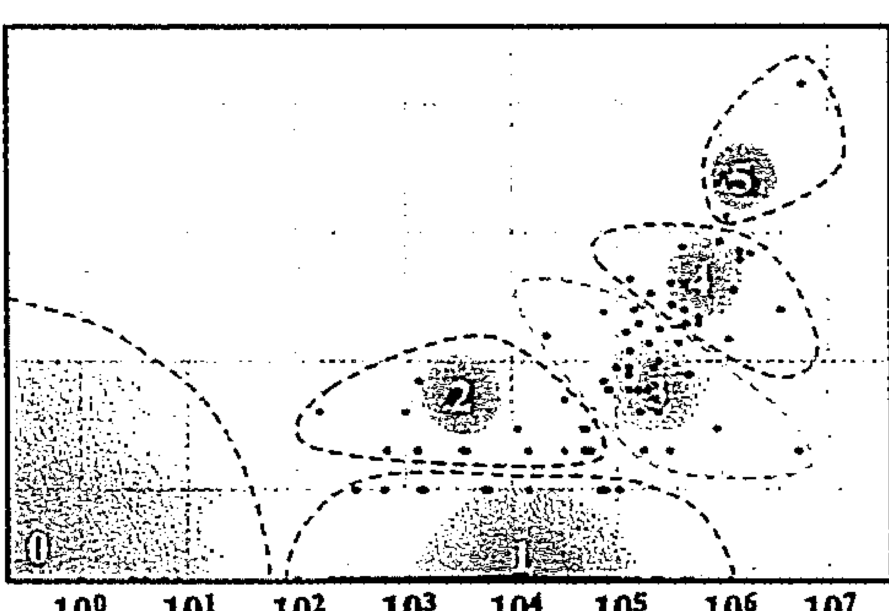

## 图 7 - 3 NLP 系统中语言资源分类

- • 类别 0（The Left - Behinds）。

NLP 技术长期忽视类别 0 的语言，如表 7 - 1 所示。由于语料极稀少，这类语言正逐渐被历史化，难以与数智化挂钩。即便采用无监督学习，也难以改善，因其几乎没有可用非标注数据。

## 表 7-1 不同类别语言示例及其使用者和占比表

| 类别 | 5 种示例语言 | 语言数量/种 | 使用人数/亿个 | 语言数量占比 |
| :---: | :----------: | :---------: | :-----------: | :-----------: |
| 0 | Dahalo, Warlpiri, Popoloca, Wallisian, Bora | 2291 | 12 | 88.38% |
| 1 | Cherokee, Fijiain, Greenlandic, Bhojpuri, Navajo | 222 | 0.3 | 5.49% |
| 2 | Zulu, Konkani, Lao, Maltese, Irish | 19 | 0.057 | 0.36% |
| 3 | Indonesian, Ukranian, Cebuano, Afrikaans, Hebrew | 28 | 18 | 4.42% |
| 4 | Russian, Hungarian, Vietnamese, Dutch, Korean | 18 | 22 | 1.07% |
| 5 | English, Spanish, German, Japanese, French | 7 | 25 | 0.28% |

- * 类别 1（The Scraping-Bys）。

类别 1 如格陵兰语，拥有一定规模的非标注数据，未来数年可能获得更多关注。但需研究者持续推动相关任务并收集标注数据，目前标注数据几乎为零。

- * 类别 2（The Hopefuls）。

类别 2 如爱尔兰语，正处于数智化黎明前夜，已积累少量标注数据，意味着有团队在推动其数智转型，预计几年内会产出实用 NLP 工具。

- * 类别 3（The Rising Stars）。

从第三类开始基本就进入了业内俗称的高资源区间。自监督学习让像印尼语这类语言在自然语言处理中的影响力被极大放大。因为上网使用者规模可观，社区研究者持续关注，但标注语料的短缺始终是瓶颈。利用大模型预训练叠加参数高效微调技术[23]是缓解标注不足的常用做法。

- * 第四类 The Underdogs
这类语言以越南语为代表，在NLP里更像一颗火种，潜力很大。未标注语料已经积累到相当规模，与第五类相比标注数据仅少一个数量级。不少经验丰富的社区团队正在投入。整体看，这类语种具备跃升为第五类的条件，也更容易率先感受到数智化带来的优势。

- * 第五类 The Winners
汉语、英语等属于这一层，发展速度一直领先，研究积淀也最久。因在网络上占据主导，企业与政府持续投入资源与技术，堪称绝对的高资源语种。使用者因此能享受到最前沿的模型成果与技术红利。

需要强调的是，中国是一个统一的多民族国家，民族、语言、文字并存。除汉族外，还有占全国人口约8%的55个少数民族[24]。回族多已转用汉文，其他如蒙古、藏、维吾尔、哈萨克、朝鲜等民族在不同程度保留使用本民族文字。国家在两会等重大场合为蒙古、藏、维吾尔、哈萨克、朝鲜、彝、壮7种少数民族提供文件与同声传译，充分体现民族平等。由中国中文信息学会主办的CCL是国内最大中文社区，积极鼓励少数民族语言计算语言学原创研究发表[25]。为适应国际化计算机处理要求，我国有藏文、蒙文、满文、傣文、佉卢字、西夏文、八思巴字、傈僳文等古文字的编码方案，为古文字文化信息交流提供学术空间。女真字、契丹小字、契丹大字、突厥文、水书、东巴文、傈僳文等字符方案获得国际标准化组织高度认可，掌握了该领域的话语权。

### 7.1.3 多语言模型技术方向
7.1.2 节已提到语言分层决定研究取向。第三、四类语种因标注数据稀缺，适合用无监督方法补位。近几年大模型发展带来从无标注数据中学习语言特征的能力，实现零样本或小样本迁移。学界成果集中在东南亚的印尼语[26]、越南语[27]、泰语[28]。

仅靠无标注数据仍不足，自然思路是把高资源语种特征迁移到低资源语种，即跨语言迁移学习与多语言学习。前者是一对一迁移，后者是多对一迁移。BLOOM、Llama 等开源大模型出现后，后者成为主流。但迁移效果受语言相似性制约。以英西机器翻译为例，两者词项重叠近50%，小样本迁移效果很好；而汉英在分词和特征上差异较大，迁移不佳，甚至出现负迁移与灾难性遗忘。如何挑选合适的源语种可参考[8]、[29]。

2023 年起提示工程成为热点，大致两条路径。
(1) 构造 Prompt 做 ICL。Prompt 作为输入不改动参数。多语言场景分为跨语言提示与跨语言思维链提示，两者都以英语为主提示，测试用目标语。研究表明效果与把测试样本先译成英文相当[30]。
(2) 基于机器翻译的多语言提示进行参数微调。实验显示以英语为主提示在多语言任务上微调，能在英语或非英语零样本任务上达到 SOTA；用机器翻译得到的多语言提示微调，在部分语言上优于人工翻译提示[18]。

## 7.2 多语言大模型的预训练资源和评测任务
数据资源在大模型时代的价值堪比工业时代的石油煤炭。本节梳理多语言大模型训练的主流语料及加工方式。

### 7.2.1 多语言大模型的预训练资源介绍
大模型需要海量语料才能学到全面知识。目前被广泛使用的资源按内容分为书籍、CommonCrawl 网页、Reddit 链接、维基百科、代码及其他[31]，见表 7-2。

#### 表7-2 主流语料资源汇总表

| 语料资源 | 数据大小 | 数据源头 | 更新时间 |
|---|---|---|---|
| BookCorpus | 5GB | Books | 2015-12 |
| Project Gutenberg | — | Books | 2021-12 |
| C4 | 800GB | CommonCrawl | 2019-04 |
| CC-Stories-R | 31GB | CommonCrawl | 2019-09 |
| CC-NEWS | 78GB | CommonCrawl | 2019-02 |
| REALNEws | 120GB | CommonCrawl | 2019-04 |
| OpenWebText | 38GB | Reddit Links | 2023-03 |
| PushShift.io | 2TB | Reddit Links | 2023-03 |
| Wikipedia | 21GB | Wikipedia | 2023-03 |
| BigQuery | — | Codes | 2023-03 |
| The Pile | 800GB | Other | 2020-12 |
| ROOTS | 1.6TB | Other | 2022-06 |

(1) 书籍资源。BookCorpus[32]曾被 GPT/GPT-2 等使用，含超1.1万本，覆盖小说、传记等。现阶段仍有较大规模书籍语料在用。

## Llama 大模型实践指南

## 1. 语料资源
(1) 书籍。书籍是重要来源，Llama、GPT-3 使用过英、中、法等多语种书籍。
(2) 新闻。如 CommonCrawl 包含大量新闻文本，是预训练的重要来源。
(3) 维基百科。提供多领域高质量文章且多语覆盖。Llama、GPT-3 用过英文版，mBERT 和 XLM-100 用过多语版。但多语维基文档数远少于 CommonCrawl，故应用有限。WikiMatrix 从维基抽取的平行语料达1.35亿条，覆盖1620个语对、85种语言，多用于机器翻译。
(4) 代码。现有工作多从网络爬取开源协议代码。来源一是公开代码库如 GitHub，二是问答平台如 Stackflow、CSDN。Google 开源的 BigQuery 含多语言开源代码，CodeGen 基于其训练，多语版用于 CodeGen-Multi。
(5) 其他。The Pile 和 ROOTS 最具代表性。The Pile 整合多源800GB，含22个高质量子集，被 GPT-J、OpenLLaMA 等使用。ROOTS 是59种语言的多语集，BLOOM 即基于此训练。Paracrawl 利用 Bitextor 从网页挖掘英译句对，主要覆盖欧洲语言并含9种低资源语种。

## 2. 预训练资源质量
数据质量决定模型性能。网络自动挖掘的数据质量不稳定，需多维度评估。ACL2023 多语言大模型教程中微软研究者提出从多语言分布、数据质量、来源与监管四方面评价。以 CommonCrawl 为例，其含100多种语言，但57种语言占比低于0.001%，构建多语数据时需考虑是否自建与下游任务一致的数据。

## 3. 多语言大模型技术介绍及其工业应用

### 3.1 数据质量
建议构建者不只关注低资源语料，还需留意被错误分类的样本，它们可能因与高资源语种相似或质量差而被误归。同时需关注机器生成语料和因识别工具局限带来的色情或不良信息。评估维度包括数量、质量、领域数、可持续性、共享性等。

### 3.2 评测任务介绍
7.2.1 节侧重无监督数据，本节介绍有监督评测基准。Benchmark 包含单句或句对文本分类、QA、序列标注、文本生成等，如图7-4。

### 3.3 评测数据集
鲁棒全面的评测有助于理解模型效果。英语有 GLUE 与 SuperGLUE，多语言有 XTREME、XTREME-R、XGLUE 等，目标是覆盖更多任务与语言以评估泛化。也有针对特定语言的集，如面向印度语的 IndicXTREME。

### 3.4 评测方法
传统路径为预训练+微调。多语言大模型具备零样本与小样本能力，评测分两类：一类沿用微调，另一类基于提示的 ICL，路径变为预训练+提示+预测。微调用训练语料更新参数，ICL 不改参数，仅靠提示得到结果。

### 3.5 多语言大模型的优化方向

### 3.5.1 数据预处理流程
多语言预训练清洗与单语大体相似，需收集、初次清洗语言检测、去重与质量过滤隐私过滤等。区别在初次清洗需设合理阈值，识别所需语言并保留一定比例多语文档。

### 3.5.2 Tokenizer
清洗后语料经 Tokenizer 处理才能成为模型可用格式。多语言 Tokenizer 存在潜在问题需注意。

### 3.5.3 训练数据格式和采样策略
分词后需考虑多语言样本组织及采样策略。一般而言，用多语言平行句对训练的大模型在下游效果优于仅用单语或以英语为中心的平行句对。

# 第7章 多语言大模型技术介绍及其工业应用
采样旨在平衡模型规模与语言规模对效果的影响，避免7.1节提到的多语言诅咒。

## 1. 单语言样本
单语言样本指训练时把每种语言语料独立作为预训练采样样本，通过策略从文档池抽样形成 Batch 迭代。GPT-3、Llama 系、BLOOM 采用此格式。采样策略有三种：无限制按经验分布 pᵢ 采样，其中 pᵢ 为第 l 种语言样本占比；
pᵢ = \frac{nᵢ}{\sum_{l'\in L}n_{l'}} (7 - 1)
第二种是温度采样[20-21]，用于参数小于10亿的模型。用采样函数 qᵢ 和温度 τ 正则化 pᵢ，可对低资源上采样、高资源下采样；
qᵢ = \frac{pᵢ^{1/τ}}{\sum_{l'\in L}p_{l'}^{1/τ}} (7 - 2)
第三种是2023年ICLR提出的Unimax方法[57]，按各语言字符数更均匀分配训练预算，无需人工定 τ，先用低资源语言分配预算组成 Batch 再训练，效果优于温度采样。

## 2. 以英语为主的平行句对
该格式以英语为中介，采样对齐的目标语言语料组成平行对，做 Masked LM 预训练。借助机器翻译思想学习语言与英语关系。需以句对为最小单元采样。

## 3. 多语言平行句对
与英语中心法不同，多语言平行句对不以英语为桥梁，使模型学习语言间直接关系。英语弱词形变化并不一定是好桥梁[58]。2022年10月模型 T-ULRv6[59]用此方法在 XTREME 和 GLUE 上均达 SOTA，证明多语言大模型可在英语与多语言评测上同时最优。

## Llama 大模型实践指南

## Monolingual Corpora

## Bitext Corpora

## X-Y Directions

- mBERT, XLM-Roberta
- mT5, AlexaTM, byte-mT5
- XLM, XLM-E, DeBERTa v3, Info-XLM
- mBART
- PaLM-2
- M2M 100*
- XY-LENT

## 图 7-11 以英语为主的平行句对的训练数据格式及模型对照

## 7.3.4 多语言大模型的训练任务
训练任务分预训练和微调。本节聚焦预训练，包括训练目标构造和模型结构。

#### 1. 多语言大模型的训练目标构造
不同语言大模型的训练目标如图7-12所示，覆盖输入不同部分形成 loss 后更新参数。

(1) Regular-Denoising (R-Denoising)：用于MLM掩码策略，先把一定范围 token 替换为 Mask 再预测，如 BERT。
(2) Specific-Denoising (S-Denoising)：把句子分为前缀和后缀，前缀作 context，后缀作目标，常用于文本生成和机器翻译。

多语大模型训练与架构要点

第三种去噪思路被称为极端去噪 X-Denoising[60]，本质上是把常规去噪的遮罩粒度从单个 token 放大到完整句子，要求模型把被遮蔽的整段话还原出来。此类句级恢复策略在多语大模型的对话式预训练里很常见。实际落地方面，Llama 2 仅沿用第二种策略，Llama2-Chat[61]则融合第二种与第三种，而 PaLM 2 三种策略全采纳，并以在每个输入前添加 R-S-E 标记来区分目标[62]。

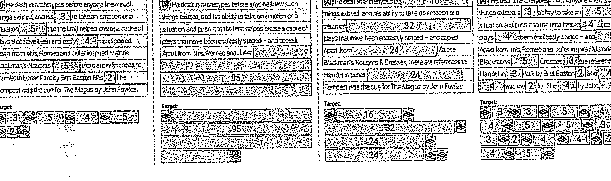

#### 图7-12 不同语言大模型的训练目标

#### 2. 多语言大模型结构

Transformer[63]仍是构建多语大模型的主流骨架[64]，由编码器与解码器构成。按组合方式可归为编码器、编码器-解码器、解码器三类。现阶段工业以解码器、编码器-解码器和前缀语言模型 Prefix LM 为主。BERT 早期使用编码器架构，如今独立使用编码器已很少见。

- 解码器结构
如图 7-13 所示的解码器方案是当前多语大模型的主流，训练方式类似传统自回归语言模型，依赖单向注意完成下一个词预测 NTP。Llama 2、GPT 系列、BLOOM、XGLM 均采用此方案。近期研究尝试在解码器上做去解码器预训练[65]或指令微调[66]，在以英语为主的模型上有提升，多语效果仍待验证。PaLM 2 报告中采用了类似思路并在多语任务上表现突出，可作为多语模型优化的参考方向。


- 编码器-解码器结构
经典的编码器-解码器如图 7-14 所示，输入 token 序列先经编码器得到等长向量，再送入解码器。解码器使用交叉注意，编码侧可同时参考前后信息。能够同时利用前后文是一种高效的数据利用方式，适合理解型任务，对当前大模型侧重的生成任务适配性相对不足，故在大模型中较少单独使用。输出侧采用单向注意以避免泄露未来信息。多语场景中 mT5 仍在使用此结构。

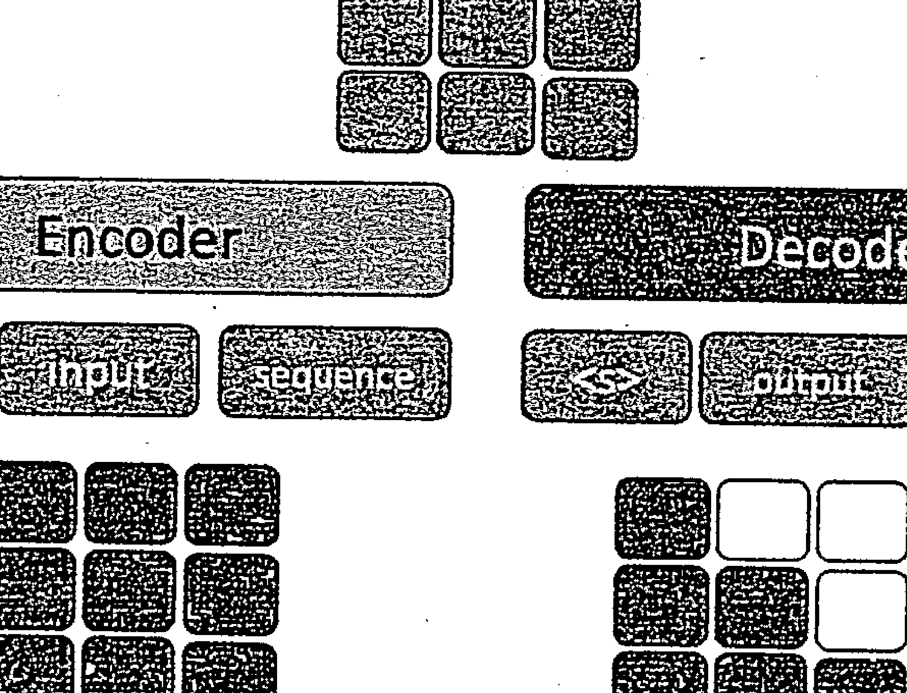

- 前缀语言模型结构
前缀语言模型本质上是解码器变体，注意力规则被调整，如图 7-15 所示，针对输入前缀的 token 采用可同时看前后文的注意形式（如


- 前缀语言模型结构
前缀语言模型可视为解码器的改进，注意力模式被重新定义，如图 7-15 所示，对输入前缀 token 采用可同时看前后文的注意形式（如

[PAGE 160]
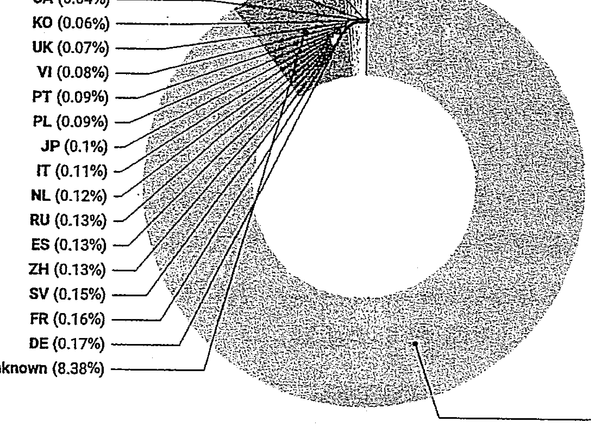
- 前缀语言模型结构
前缀语言模型在解码器基础上改变注意计算，如图 7-15 所示，输入前缀的 token 以可同时看前后文的方式处理（如

[PAGE 161]
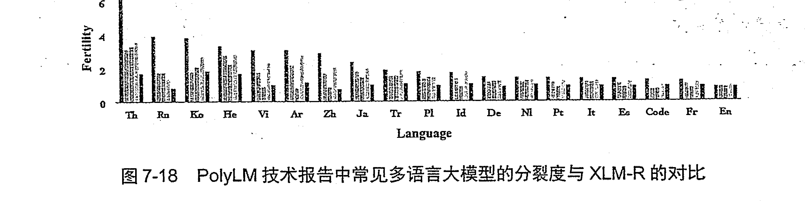
- 前缀语言模型结构
前缀语言模型仍以解码器为基础，注意力机制被重新设计，如图 7-15 所示，输入前缀 token 会以可同时看前后文的方式处理（如

[PAGE 162]

- 前缀语言模型结构
前缀语言模型结构本质上是解码器，注意力规则有所不同，如图 7-15 所示，对输入前缀 token 应用可同时看前后文的注意形式（如

[PAGE 163]
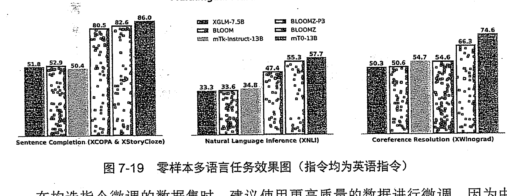
- 前缀语言模型结构
前缀语言模型可看作解码器的改良，注意力机制被调整，如图 7-15 所示，针对输入前缀 token 使用可同时看前后文的注意形式（如

[PAGE 164]
# Llama大模型实践指南

## 7.4 多语言大模型的工业应用

生成式大模型的出现让自然语言成为人与机器交互的指令，也借助各类 API 完成任务，正在改写众多行业与工业场景。本节介绍若干必须借助多语大模型交互的典型工业场景，说明它们如何提升体验与运营效率。

### 7.4.1 智能客服
工业落地中最典型的是智能客服。多轮对话能力使客服机器人能更自然地处理售前售后问题，提升服务效率。模型还能感知用户情绪，对不同用户进行安抚或升级上报，降低公关风险并提高满意度。

售前场景下，智能客服更像导购机器人，会通过反问收集诉求，再推荐可能感兴趣的产品以提升转化。近期东南亚电商 Lazada 与 Shopify 分别基于 OpenAI 的 ChatGPT 发布了 LazzieChat 机器人和 Shopify 机器人，如图7-20所示，均可按需推荐商品，LazzieChat 主要覆盖英语和印尼语，Shopify 机器人覆盖汉语及更多欧洲语言。


#### 图7-20 LazzieChat机器人与Shopify机器人示意

售后常见问题的解答涉及专业领域知识与平台政策差异，知识时效性强，通常采用检索增强 RAG[73]，既能引入外部新知识，又可在一定程度上缓解幻觉问题，具体流程如图7-21所示。一般先为领域知识构建向量库，再根据用户问题检索相关文档，随后把问题、文档与提示一并交给大模型

[content]

[PAGE 165]
# 第7章 多语言大模型技术介绍及其工业应用

### 7.4.2 多语言机器翻译
多语机器翻译是另一项关键工业用途，可实现跨语言传译，打破语言壁垒。随多语大模型发展，翻译准确性与流畅度显著提升，例如 Google 翻译、Microsoft 翻译等均已采用多语大模型技术。

### 7.4.3 多语言问答系统
多语问答系统可在多语间进行查询与应答，提升跨语信息获取效率。这类系统通常以多语大模型为后端，以更好理解并生成不同语言的回答。

### 7.4.4 多语言语音识别
多语语音识别可把不同语言的语音转为文本，实现跨语语音交互。该技术在智能客服、多语翻译等领域应用广泛。

### 7.4.5 多语言文本摘要
多语文本摘要可从不同语言文本中提取关键信息，生成简洁准确的摘要，对信息检索、新闻摘要等领域意义重大。

### 7.4.6 多语言情感分析
多语情感分析可解析不同语言文本的情感倾向，帮助企业了解用户对产品、服务或品牌的看法，对市场调研、客户服务等领域具有重要价值。

### 7.4.7 多语言对话系统
多语对话系统可实现跨语自然语言交互，为用户提供便捷的跨语服务。这类系统通常以多语大模型为核心，以实现不同语言间的理解与生成。

随多语大模型技术演进，其在工业应用中的渗透将更广，为各行各业带来更多创新与机遇。

# 第7章 多语言大模型技术介绍及其工业应用

型，让大模型完成答案生成并回复用户，整体过程与阅读理解和文档问答任务相似。

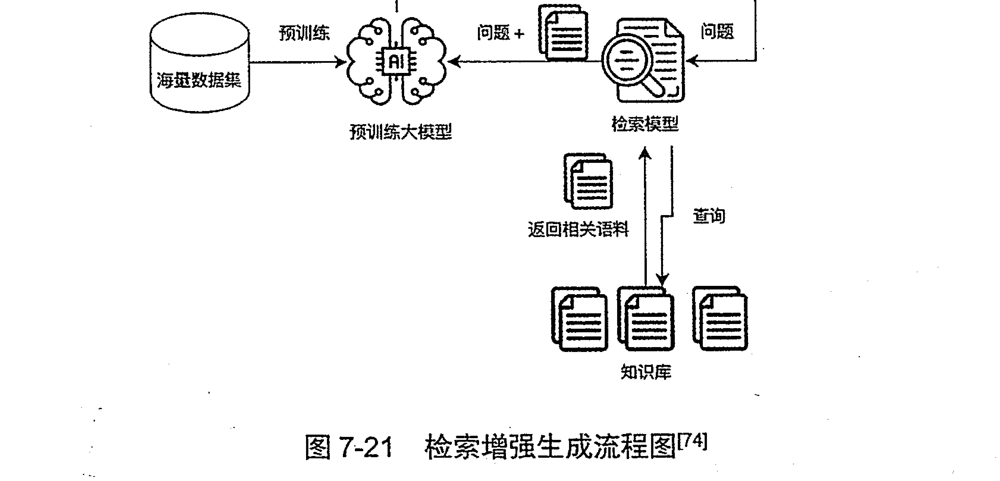

除简单文档问答外，智能客服有时还需要多轮任务型对话，即 Taskbot。这类任务要求大模型不仅具备多轮对话能力，还需具备工具使用能力如 API 调用，以查询槽位信息，答案会随查询结果动态变化。例如用户询问订单何时到达，若订单状态为已退货，则需解释订单处于退货状态无法再收到，而非给出通用回复。当前研究主要集中于利用大模型把用户指令转化为机器可执行的动作或代码，再在特定环境中执行，即 LLM-Agent[75]。读者可参考 AutoGPT 或 XLANG 项目[76]，这些项目开发的 LLM-Agent 充当自然语言与特定指令之间的桥梁，通过与环境及人类的轮次交互，大模型可收集足够上下文，精准高效地完成任务，延伸并拓展用户意图[77]。

# 7.4.2 搜索引擎

除智能客服外，Google 与微软 Bing 等厂商也在利用 RAG 技术及多语大模型提供网页搜索服务。加入大模型的搜索引擎可为用户提供更简洁的回复，代价是可能出现失准答案。图7-22 所示为 Bing Chat 系统演示图，可见为防止不实信息误导用户，系统对不同回复标注了出处，以帮助用户更好核查。

## Llama 大模型实践指南

√ 正在搜索: A100 colab pro

√ 正在为你生成答案...

According to the web search results, you can use A100 GPU if you are a pro member of Colab, but only if it is available and you have enough compute units. The A100 GPU is a premium accelerator that is subject to availability and quota restrictions¹. Colab Pro users get 100 compute units per month, while Colab Pro+ users get 500 compute units per month². You can check your GPU settings and availability in the Runtime > Change runtime type menu in Colab³. You can also purchase more compute units via Pay As You Go if you encounter usage limits⁴. I hope this helps.

了解详细信息: 1. colab.research.google.com 2. currypunnin.com 3. reddit.com 4. 更多 2共30 @

#### 图7-22 Bing Chat系统演示图

# 7.4.3 机器翻译

机器翻译是天然需要多语大模型的场景。当前多语大模型在高资源语言上的翻译效果已与传统机器翻译模型基本一致[78]，在低资源语言上虽仍有差距，但已基本满足常见语句的翻译需求。同时，因多语大模型对上下文理解更好，对会议和商业文件的翻译可能更有效。现阶段较为成熟的应用有 Meta AI 的 SeamlessM4T[79]（见图 7-23），及中国科学院自动化研究所以 Llama 为基础训练的多语大模型 BigTranslate。

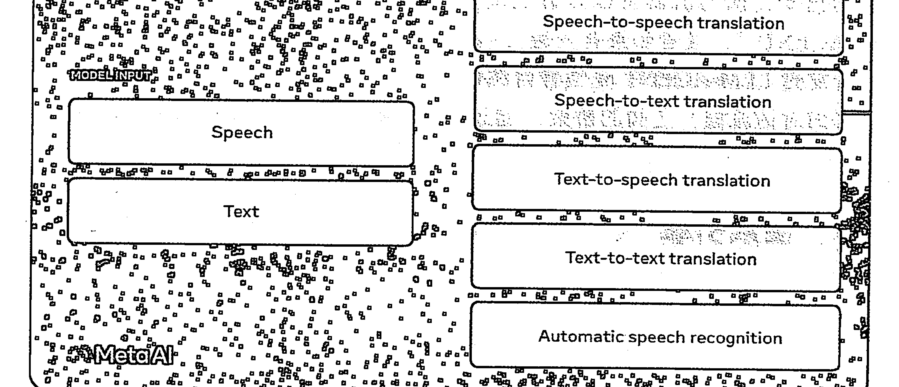

#### 图7-23 Meta AI 的 SeamlessM4T

## 反侵权盗版声明

电子工业出版社依法对本作品享有专有出版权。任何未经权利人书面许可，复制、销售或通过信息网络传播本作品的行为；歪曲、篡改、剽窃本作品的行为，均违反《中华人民共和国著作权法》，其行为人应承担相应的民事责任和行政责任，构成犯罪的，将被依法追究刑事责任。

为了维护市场秩序，保护权利人的合法权益，我社将依法查处和打击侵权盗版的单位和个人。欢迎社会各界人士积极举报侵权盗版行为，本社将奖励举报有功人员，并保证举报人的信息不被泄露。

举报电话：（010）88254396；（010）88258888

传 真：（010）88254397

E - m a i l: dbqq@phei.com.cn

通信地址：北京市万寿路173信箱

电子工业出版社总编办公室

邮 编：100036