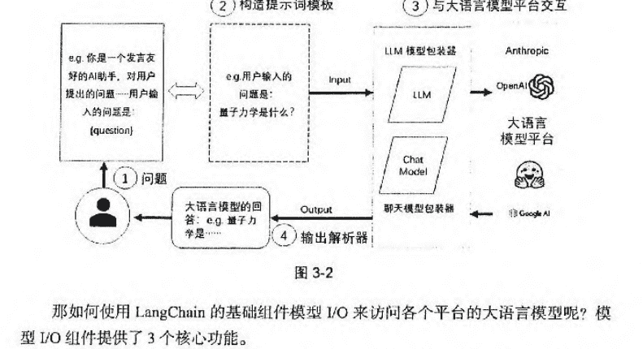
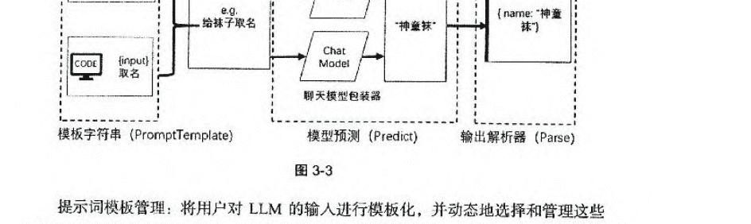
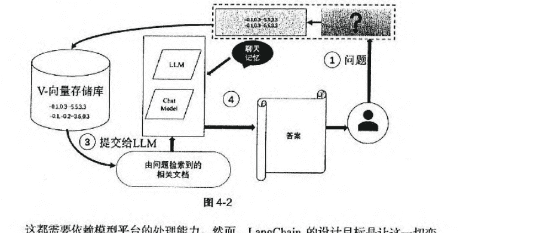
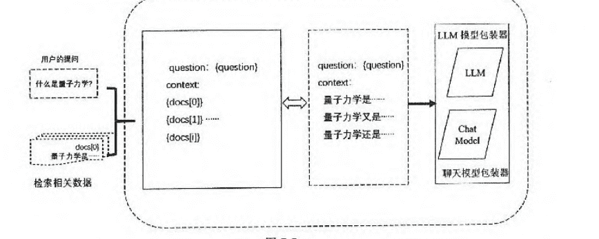
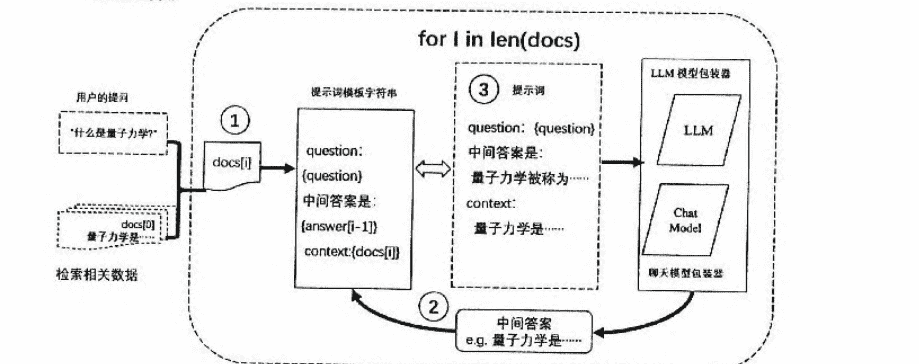
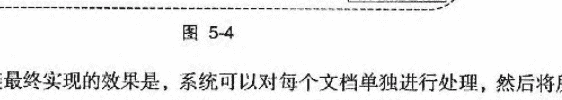
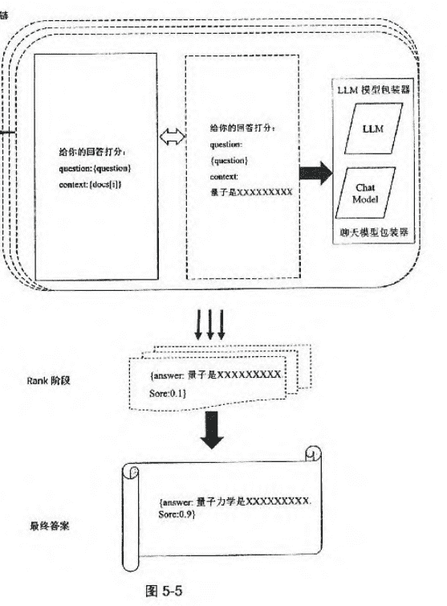
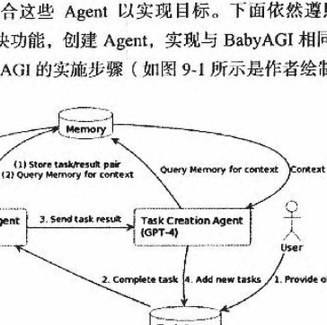

# LangChain 实操手册：用统一框架搭建可迭代的 LLM 产品

## 内容简介
本书面向希望深入自然语言处理并动手构建大模型应用的读者，呈现了一套从基础到实战的完整学习路线。全书共十一章，以开源项目 LangChain 为主线贯穿开发全过程。开篇两章先梳理大模型兴起的背景以及 LangChain 的设计逻辑。第三章开始，逐一拆解框架的六大核心板块，包括模型交互、检索增强、链式调用、记忆机制等，并通过丰富实例代码阐释原理。第九章以 PDF 问答系统的搭建作为综合演练，第十章探讨如何对接外部工具与生态，第十一章则通俗解析 Transformer、语义检索等底层概念，以及 NLP 与机器学习的基础。

以 LangChain 为牵引，本书循序渐进帮助读者掌握大模型应用的构建思路，适合对大型语言模型感兴趣的工程人员与 AI 产品开发者阅读。

## 前言
2023 年大模型进入爆发期，GPT-4 的面世引发了行业级震荡，令众多工程人员不得不投身大模型应用的构建浪潮。围绕大模型而生的 LangChain 在此背景下出现，明显加速了创新节奏。它既能驱动对话类机器人，也能支撑检索式问答等多样化场景，因而迅速吸引技术社群关注。与传统工具库相比，LangChain 交付了一个较为完整的开发生态，内置诸多组件与工具，显著简化开发门槛。同时其社区规模正持续扩大，越来越多团队以该框架为基础启动项目，活跃度不断提升。

需求的增长让学习如何有效利用先进技术变得愈发迫切。本书正是在此需求下成形，目标是给出一份兼顾广度与深度的开发参考，重点落在 LangChain 的实战运用上。十一章内容横跨初阶概念到进阶手法。

第一章先勾勒大模型开发的全景，并阐释 LangChain 在此领域的差异化定位与核心作用。
第二章探入框架底层，讲解诞生动机、关键概念及常见使用情境。
第三至第八章构成主体，依次剖析框架六大模块：模型输入输出、检索增强、链式编排、记忆管理、Agent 设计与使用，以及回调处理器的工作方式，并给出大量实践指引。
第九章通过 PDF 问答系统的搭建演示理论转化。
第十章介绍与第三方工具及生态的联动方式，扩展使用范畴。
第十一章用通俗语言梳理大模型底层原理，包括 Transformer 架构、语义检索等，以及 NLP 与机器学习的基础知识。

本书主要服务于对大模型应用开发抱有热情的人群，特别适合刚踏入此方向的初级开发者以及对 LangChain 抱有好奇的技术爱好者。阅读前最好具备一定的 Python 编程基础。若基础薄弱，可借助 GPT-4 在学习过程中即时练习编码。

框架同时提供 Python 与 JavaScript 实现，便于前端工程师上手。本书示例全部基于 Python 实现。所有演示均调用 OpenAI 平台的模型，未涉及模型训练，因此普通电脑足以运行。代码已托管在 GitHub，读者可直接获取执行。建议使用 VSCode 等编辑器，并确保本地配置好 Python 环境；偏好交互式操作的读者亦可选用 Jupyter Notebook。

技术演进从来不是一蹴而就，而是日积月累。好比滴水汇流，本书只是大模型开发图景中的一角，却承载着对该领域的热情与对知识的追求。

LangChain 目前正由 0.300+ 系列向 1.0 版本渐进。7000 余个 Issue 既反映出尚不完美，也印证了生态的活跃与持续进化。这棵幼苗正逐步成长。

祝愿本书能帮助你在大模型应用学习的旅程中更稳健地前行。

# 第 1 章

## LangChain：进入大模型时代的引路工具

### 1.1 大语言模型概述
2023 年常被视作大模型落地爆发的起点，此后人工智能与 IT 行业或将进入新周期。若将 2000 至 2010 年看作 PC 互联网年代，2011 至 2020 年看作移动互联网年代，那么从 2023 年算起的十年预计将由大型语言模型主导。本节将围绕四个维度展开：模型定义、演进路径、典型用途、基础概念。

#### 1.1.1 什么是大型语言模型
语言作为文明根基，从岩画到数字内容，始终推动人类进步。语言不仅是记录媒介，更承载历史、技术、文化与思想的变迁。人类是否能借助语言本身，创造出一种永不止步、以语言为核心的智能系统？设想这样一种系统，拥有海量知识，能自然对话、理解意图并给出精准回应，这将极大推动文明发展。


##### 大语言模型的起源
人类交流不限于文字，隐喻、讽刺、象征以及社会文化历史知识交织，使语言理解极其复杂。随着计算能力提升，科学家尝试模拟人脑神经元结构，让机器从海量文本中自主学习语言规律与模式。90 年代后，网络普及与存储技术进步提供了大规模文本语料，为机器学习训练奠定土壤。

在机器学习范式中，神经网络在图像与语音识别等模式识别任务上表现突出，研究者开始将其用于语言理解，进而催生大语言模型。

大语言模型是基于 Transformer 架构的大规模神经网络程序，擅长理解与处理各类语言文本。其优势在于通用学习能力，无需为特定任务大量定制，是目前人类的首个通用人工智能模型。讨论大语言模型，核心在于如何让计算机理解与生成人类语言。简言之，它是一种学习语言规则与结构并据此生成有意义文本的算法，如同让计算机学会文字表达。

该过程依赖海量数据与算力。模型先“阅读”大量文本，通过复杂算法学习词汇含义、语法规则、风格与情感等。训练完成后，可据此生成新文本。

训练前后差异巨大。训练前模型如新生儿，仅有基础结构，参数随机初始化，无任何语言知识，输入任意句子也无法有意义处理。

##### 大语言模型的训练方式
训练过程类似单字接龙游戏。给定前文，需猜测下一个字。比如“今天去公园看到了一只…”，可能接“狗”或“鸟”。大语言模型做的正是这项“游戏”，只是处理更长更复杂的句子且准确度更高。图 1-1 为单字接龙示意。

**单字接龙**

*   根据前文，猜下一个字

*   今 → 今天

*   今天 → 今天星

*   今天星 → 今天星期

*   今天星期 → 今天星期一

**图 1-1**

> 持续的接龙练习使模型对文字的把握逐步增强，犹如婴儿成长一样，通过吞吐海量语料逐步掌握词汇、语法与语义。相关知识被压缩进数百亿个神经网络参数中，系统逐渐具备理解与生成能力。起初如同婴儿学说话，可能并不理解含义，但经过反复训练后，网络内部积累了语言知识的公式与算法，能够执行复杂的语言计算与推断。由零到一，模型获得了语言智能，类似婴儿成长为孩童时的质变。

> 研究者会让模型大量阅读书籍与文章作为学习素材。通过阅读，模型学会词汇和句子的组合规律。回到接龙游戏中，模型便能基于前文做出更准确的预测。当接龙水平远超人类时，模型也会衍生出翻译、问答、写作等能力。模型阅读过海量文本，扮演知识库的角色，用户提问即可得到回应，甚至实现类人对话，展现出接近人类的理解与应答水平。

#### 1.1.2 大语言模型的发展
OpenAI 在 2022 年 11 月 30 日推出基于 GPT 的对话机器人 ChatGPT，标志着大模型开始面向大众。短短两个月，用户规模便突破两亿。随后发布的 GPT-4 拥有万亿量级参数规模，适用范围广泛，从文本创作到复杂问题求解、诗歌写作、数学运算等多个维度均显著超越普通人。

国际主流阵营中，除 GPT-4 外，还包括 Anthropic 的 Claude 2、Meta 开源的 LLaMA 2 以及 Google 的 PaLM 2 等。

InfoQ 研究中心 2023 年 5 月发布的《大语言模型综合能力测评报告 2023》中，对 ChatGPT、文心一言、Claude、讯飞星火、Sage、天工 3.5、通义千问、MOSS、ChatGLM、Vicuna-13B 进行综合评测，结果如下。

| 排名 | 大语言模型产品 | 综合得分率 |
| :---: | :---: | :---: |
| 1 | ChatGPT | 77.13% |
| 2 | 文心一言 | 74.98% |
| 3 | Claude | 68.29% |
| 4 | 讯飞星火 | 68.24% |
| 5 | Sage | 66.82% |
| 6 | 天工 3.5 | 62.03% |
| 7 | 通义千问 | 53.74% |
| 8 | MOSS | 51.52% |
| 9 | ChatGLM | 50.09% |
| 10 | Vicuna-13B | 43.08% |

表 1-1 大语言模型各产品综合评测结果

国内在人脸识别、语音识别及自然语言处理等细分赛道已积累深厚技术实力。

百度凭借成熟的人工智能技术积淀，于 2023 年 3 月 16 日率先发布大模型“文心一言”。初次亮相时能力略显生涩，但随后迅速嵌入百度产品体系，呈现出多模态演进趋势，成为国内代表性项目之一。

阿里巴巴在 2023 年 4 月 7 日推出“通义千问”，名称体现文化特色，也引领了国内模型的命名风格。目前正与淘宝、支付宝、钉钉等业务融合，钉钉总裁叶军在 2023 年春季钉峰会上指出新钉钉将实现全面智能化。

华为于 2023 年 4 月推出“盘古”大模型 1.0，7 月升级至 3.0 版本，针对金融、政务、制造、矿山、气象、铁路等行业进行专项预训练，直接输出行业级大模型。

科大讯飞、360、昆仑万维、百川智能等亦相继发布自家模型，效果各异，但中国大模型行业蓬勃发展势头明显。中文主流模型发布时间如下。

| 公司 | 模型 | 发布时间 |
| --- | --- | --- |
| 百度 | 文心一言 | 2023年3月16日 |
| 阿里巴巴 | 通义千问 | 2023年4月7日 |
| 科大讯飞 | 星火 | 2023年5月6日 |
| 华为 | 盘古3.0 | 2023年7月7日 |
| 腾讯 | 混元 | 2023年9月7日 |

## 1.1.3 大语言模型的应用场景
在信息技术快速演进的背景下，大模型的应用边界不断扩张。与其询问它能实现哪些功能，不如思考你的需求是什么，这正体现了其高度灵活性和广阔潜力。大模型已不只是工具，更成为一种颠覆性的思考方式。

以下对典型场景做概括，涵盖对话、社交媒体、在线教育、电商、医疗等领域。

### 表1-3 大语言模型的应用场景及描述

| 应用场景 | 描述 |
| --- | --- |
| 智能对话 | 在银行业提供客服支持，如帮助客户理解理财产品细节 |
| 文本生成 | 用于新闻、故事创作，可按关键词生成相关文章 |
| 知识问答 | 为学生提供基于知识库的详细解答以解释复杂科技理论 |
| 文本总结 | 用于学术领域，快速提取论文核心内容 |
| 文本翻译 | 在开源项目中帮助非英语母语开发者理解英文文档 |
| 情感分析 | 用于政治事件和民意调查中的舆情分析 |
| 数据分析 | 在商业运营领域提供数据洞察与策略建议 |
| 编程辅助 | 为程序员提供代码编写与故障排查帮助 |
| 文档格式转换 | 将 Markdown 文档转换为 HTML 文档 |
| 信息抽取 | 从大段文本如合同中提取关键信息 |

## 1.1.4 大语言模型的基础知识
在了解典型应用后，动手实践前需先厘清核心概念。即便已使用过文心一言或 ChatGPT，仍应掌握以下要点。

##### GPT是模型，ChatGPT是产品
GPT 代表预训练的生成式模型，其核心目标是学习生成人类文本的能力。ChatGPT 则是在此基础上构建的应用，通过优化交互体验实现更自然的对话。因此两者共享同一基础，但应用目标有所区别。GPT 属于通用文本生成系统，可产出各类文本；ChatGPT 则专攻对话效率的提升。

##### 提示词：驱动大语言模型运行的命令
在研究 GPT-4 或 ChatGPT 的运行原理时，提示词是关键要素。表面上它是输入给模型的文字，实质上是驱动模型行为的指令。正因如此，提示词工程师的角色才迅速兴起。

提示词的取舍会显著影响输出结果。开放式指令如“介绍太阳系的组成”，模型会给出详细说明；指向明确的指令如“火星在太阳系中的排名”，则会得到具体回答。

需要注意的是，尽管模型通过海量语料学习获得强大的生成能力，其本质仍是基于模式匹配的算法，并非真正的思考过程。它只是从训练数据中检索与提示词相近的表述并加以生成。因此提示词应尽量清晰具体，以引导期望的输出，同时要明白模型的局限——它并不真正理解指令含义。

通用提示词框架为：角色定义 + 背景信息 + 任务目标 + 输出规范。举例：假设你担任某公司 HR 主管，需要邮件通知全员 AI 培训安排，提示词可如下设计。

###### 表 1-4 提示词模板

| 模板 | 提示词 |
| --- | --- |
| 定义角色 | 我是某公司的HR主管 |
| 背景信息 | 现在AI发展这么快，很多公司都面临着巨大的挑战，我们公司也一样 |
| 任务目标 | 我要给所有同事发一封邮件，通知大家5月31日18:00来参加培训，名额仅限20人 |
| 输出要求 | 用邮件格式输出，200字左右，段落清晰，语气要有亲和力，重点突出“名额有限” |

提示词模板能让大语言模型的回答更好，这是大家都有体会的。可别因此以为输入就能精确控制输出。无论提示写得多好，模型都会给出回应，这一点和编程语言完全不同。代码语法错了会报错，报错信息能指引修复方向；而大模型不会提示出错，回答质量好坏难以量化评估。真正落地时，往往要反复试探、不断调优提示词，才能找到稳定靠谱的答案。这要求开发者熟悉模型特性，尝试多种组合，进行持续试验。唯有长期实践，才能掌握引导模型产生预期结果的方法。

##### Token：模型运算的最小单元
Token 是自然语言处理里的基础概念，也是大模型理解和处理文本的最小单位。英文中一个 Token 可能是单词、标点或数字，中文里通常对应一个字。处理文本时，先把原始内容切成 Token 序列，模型再基于这些单元进行理解与预测。

在 GPT-4 这类模型中，Token 远不止计数作用。切分后有助于模型捕捉句子结构，比如主题、动作、对象等。训练时模型通过预测当前 Token 序列后的下一个 Token 来学习语言规律，这个过程依赖海量语料的积累。

编程语言里最小单位是字符，比如 C++ 或 Java 中的 char 代表 ASCII 或 Unicode 中的一个单元。与之相比，大模型 Token 更复杂，定义、功能和作用与编程字符差异很大。

Token 同时是商业计费标准。例如 GPT-4 约每 1000 个 Token 收取 6 美分，折合人民币约 0.45 元；GPT-3.5 的价格仅为 GPT-4 的约 1/30。

###### 上下文窗口的差异
GPT-4 的报价表里能看到 8K 版和 32K 版。两者核心差别在可接受的上下文长度以及价格，32K 版的价格大约是 8K 版的近一倍。8K 和 32K 就是衡量模型上下文能力的主要指标。

上下文长度可理解为模型的“脑容量”，即生成新内容或理解输入时能同时参考的最大 Token 数。8K 版能处理约 8000 Token 的短篇，32K 版可处理约 32000 Token 的长文。面对长篇小说、研究报告这类连贯文本时，放大窗口尤为关键。若对话久了模型开始跑题或重复，就是“记不住”了。

窗口变大意味着更高的算力与存储成本，这也是 32K 版更贵的原因。不同长度决定了模型在不同体量语料上的适应性。OpenAI 在 2023 年 11 月 6 日发布了支持 128K 上下文的 GPT-4 Turbo，适合处理长文本的场景，价格也更高；如果仅处理短文本，8K 版更经济。选择时应结合需求与预算权衡。

### **大语言模型的“幻觉”问题**
使用中常会出现一种“幻觉”：模型给出看似合理实则偏离事实的预测。根源在于模型并不真正理解语言和知识，只是模仿训练数据中的模式。缺乏真正的逻辑推理和事实检验能力，尤其在算术或复杂推理链上容易出错。

当问题超出训练覆盖范围时，模型会凭模式猜测答案，容易编造信息。这种误导在需要高精度和专业性的场景中最危险。

代码生成时也会出现类似情况。模型没有真实编程经验，也无法访问真实代码库，可能给出库中并不存在的 API，导致代码无法运行。网址链接也会被“编造”，用户被引导至虚假地址。

需强调的是模型没有真实记忆。它不会记住之前的输入输出，无法处理需要长期记忆或上下文连贯的任务。所有回答都基于当前输入和训练知识，输入一变，历史内容就丢失了。

“幻觉”源于模型的本质：它是基于数据模式的预测器，而非理解语言的知识主体。尽管性能突出，该问题仍需深入研究。

### **大语言模型的“微调”思路**
用个形象的比喻。想象你教孩子打乒乓球，先教握拍、看球、击球等基础，这是预训练阶段，学会规则和技巧。准备参赛时，还需要专项训练，如发球、接球技巧提升，这是微调阶段，帮助更好地适应比赛。教练观察训练效果并调整方法，类似评估与调参。微调就像赛前的专项训练，能把会打球的小孩变成能在比赛中获胜的选手。

微调门槛并不高，可通过 API 完成。对 GPT 模型进行微调，只需准备训练数据，比如问答对，按要求整理成 JSONL 文件后提交给微调 API，等待一段时间即可获得专属模型。

```json
{"text": "Q:中国的首都是哪里？\nA:北京。"}
{"text": "Q：鲁迅是哪国的著名作家？ \nA: 中国。"} 
{"text": "Q：《红楼梦》的作者是谁？ \nA: 曹雪芹。"}
```
这种方式让微调更便捷，更多人能受益。API 方式也提供灵活性，可按需自定义，以获得更好性能。要注意使用高质量数据并合理调整参数，才能提升效果。

### **1.2 LangChain 与大语言模型**
2022 年 10 月，Harrison Chase 在 Robust Intelligence 创立了 LangChain 的雏形并开源到 GitHub。火种迅速点燃，社区大量开发者参与，Twitter 讨论热烈，Discord 每日技术碰撞，线下聚会也自发开展。

到 2023 年 4 月，LangChain 已从开源项目发展为一家初创公司。获得 Benchmark 1000 万美元种子轮融资一周后，再获 Sequoia Capital 超过 2000 万美元融资，估值达 2 亿美元。这波浪潮推动了人工智能应用开发。

LangChain 是大语言模型的编程框架，能把模型与工具、数据结合，弥补模型短板，实现更强应用。下面进入第二章正式学习。

## 第 2 章 LangChain 入门指南

### 2.1 初识 LangChain
2023 年是人工智能爆发年，开发者都在寻找高效构建应用的工具。对于不熟悉大模型的开发者，一个合适的框架尤为重要。LangChain 的关注度持续上升。

##### 2.1.1 为何需要 LangChain
构建 LLM 应用时，开发者常要面对大量 API、数据格式和工具。对非 AI 背景者而言，逐一研究负担很重。比如做智能聊天机器人，是要自己从头研究模型训练、数据处理和兼容性吗？

LangChain 的价值在于集成。它提供一系列工具和组件，让模型与 Google Analytics、Stripe、SQL、PDF、CSV 等数据连接，以及模型应用与优化变得直接。像一把“瑞士军刀”，不再为每个任务寻找新工具，提供一站式方案。正如有了完整工具箱，修电器时打钉、拧螺丝、剪线都能快速解决。

LangChain 提供基础工具，也支持个性化自定义组件。随着社区热度攀升，使用者激增。2023 年 8 月，LangChain 已收获约 5.82 万星标、557 位核心开发者和 7800 位分支开发者。这些数字体现了开发者对其实用性和潜力的认可。正因 LangChain 连接了开发者与复杂 LLM 应用，开发更简单高效。

## 第 2 章 LangChain 入门指南
LangChain 为开发者提供工具箱，覆盖基础和自定义需求。

### 2.1.2 LLM 应用开发的“最后一公里”
对编程新手而言，与模型交互的门槛可能从一次 GET/POST 请求开始。LangChain 正好跨过这道门槛，让开发触手可及。

LangChain 简洁易用，几行代码即可运行大型 LLM 程序，快速搭建响应式机器人。无论新手老手，都能更快进入开发。

内置链组件避免重复造轮子。摘要、问答等常见任务已有现成链，简化流程。Agent 的引入把工具与数据库整合，提升效率。

借助 LangChain，可实现检索增强生成 RAG，在私有环境部署模型，或针对特定任务选择更精准的模型平台，甚至随时切换新模型。

不使用 LangChain 的开发者，常会被各平台接口选择、提示词编写、输出格式处理等细节困住，导致“从入门到放弃”。

提示词编写是常被忽略的关键。LangChain 提供多种经过验证的模板，与应用工具紧密集成。开发者无需从零编写，只需在模板中找到匹配部分并微调即可。

以 SQL 查询为例，新手可在 LangChain 找到 SQL 组件的提示词模板，涵盖如何写出正确 PostgreSQL 查询、查看结果、返回答案等，还包含最佳实践：限制结果、正确使用列名、注意当前日期函数等。

例如 LangChain 提供的 SQL 提示词模板翻译如下：

1. 你是 PostgreSQL 专家。给定输入问题，先创建语法正确的 PostgreSQL 查询运行，再查看结果并返回答案。

2. 除非用户指定数量，否则使用 LIMIT 子句限制结果，最多返回 top_k 条，可排序。

3. 不要查询所有列，只查询必要列。每列名用双引号包裹。

4. 只用表中可见的列名，注意列所属表。

5. 问题涉及“今天”时，使用 CURRENT_DATE 函数。

6. 使用以下格式：

   ```text
   问题：这里的问题
   SQL 查询：要运行的 SQL 查询
   SQL 结果：SQL 查询的结果
   答案：这里的最终答案
   ```

7. 只使用以下表：

   ```text
   {table_info}
   ```

8. 问题：{input}

没有这些模板，写 SQL 提示词会走很多弯路。LLM 应用开发的最后一公里，就是让开发者不为细节多绕路，每个环节都能及时准确处理。

### 2.1.3 LangChain 的两大关键词
软件工程强调将复杂系统拆分为更小模块。LangChain 以“组件”和“链”为核心概念，提供便利。

组件是具有明确功能和用途的单元，包括 LLM 包装器、对话模型包装器及数据增强相关工具接口。它们像数据流水线上的工作站，各自负责输入输出处理和格式转换。

组件单独使用仍显不足，“链”起连接作用。它把多种组件串联，确保无缝集成和高效调用。LLMChain 是常见例子，整合 LLM 包装器与记忆组件，让聊天机器人拥有记忆。

LangChain 不止提供基础组件和链，还为其提供标准接口并与数据处理平台和实际工具集成，强化连接，形成开放友好的开发环境。

以聊天机器人为例，为实现自然流畅对话，需支持日常交流、天气查询、实时搜索等任务。组件可设计为日常交流模块、天气模块、搜索模块，各自处理特定任务。

当用户提问涉及多个模块，如“今天天气怎样，同时解释量子力学”，链能确保搜索工具组件与维基查询组件协同工作，给出完整回答。

当用户抛出一个问题，LangChain 的接口会让机器人按一套清晰的流程运转：

先让大模型解读用户的原始提问，并据此生成一个或多个具体的查询指令；接着根据生成的指令调用对应的组件去拉取所需的数据或信息；最后再由大模型把各组件返回的内容整合并用自然语言组织成用户能读懂的回答。

开发者不需要把每个处理细节都拆开来写，只需把用户问题丢给 LangChain 的 API，拿到结果直接呈现就行。这样既能让聊天机器人提供更丰富的信息服务，也能让 LLM 应用更自然地融入日常使用。

### 2.1.4 LangChain 的三大典型场景
LangChain 正在改变 LLM 应用的开发方式，特别是在问答系统、数据处理与管理、自动问答与客服机器人这三个方向上体现得最明显。下面分别拆解其作用。

第一个场景是问答系统。问答已经成为大量 LLM 应用的基础能力，从简单搜索到专业知识库检索都有涉及。LangChain 在这块很强，当开发者需要从长文本或特定数据源里抽取信息时，它可以方便地对接外部数据源，快速抓取要点并完成生成，最终给出准确答复。

第二个场景是数据处理与管理，以 RAG 为代表。在数据驱动的当下，RAG 成为落地最火的方向之一，它把检索和生成结合，能给出更精准深入的答案。LangChain 用 LEDVR 工作流实现了 RAG 能力。

LEDVR 把数据处理的每一步都标准化，保证从输入到输出的完整性和准确性。起步是用文档加载器，比如 WebBaseLoader，把外部数据拉进来，确保来源完整。随后数据送入嵌入包装器，例如 OpenAIEmbeddings，把每份文档转成机器学习可用的向量，从而保留主要特征。面对海量资料，LangChain 加入分块转换环节，用 RecursiveCharacterTextSplitter 这类工具把文档切成更小块，提升处理速度和精度。所有切片处理完后会存入向量存储系统，例如 FAISS，保证安全同时提供高效查询。最后由检索器，例如 ConversationalRetrievalChain，从向量库中找相关文档，结合用户查询给出最相关的结果。

第三个场景是自动问答与客服机器人。很多在线平台的客服机器人已成为用户与企业的主要入口。借助 LangChain，开发者能搭建实时响应的客服机器人，背后是 Agent 功能，大模型负责决策并根据反馈不断优化交互。这样机器人既能及时回应，也能提供更准确的信息或解决方案。

总体看，LangChain 在这三个关键场景里展现出很强的实用价值，为开发者提供了高效实现各类需求的工具。

#### 2.1.5 LangChain 的六大核心模块
面向 LLM 应用开发者的需求，LangChain 提供了六大核心模块。如图 2-1 所示，它们覆盖了模型 I/O、数据增强、链、记忆、Agent 到回调处理器的全链路。借助模块里的包装器和组件，搭建 LLM 应用会更省事。

##### 1. 模型 I/O (Model IO)
任何大语言模型应用的核心都是模型本身。LangChain 提供适配各家大模型的模型包装器，分为 LLM 包装器和聊天模型包装器。包装器的提示词模板功能支持模板化、动态选择和管理输入。LangChain 并不自带大模型，而是提供统一接口，让开发者能与不同平台的底层 API 交互，降低调用门槛。配套的输出解析器还能从模型输出中提取所需内容。

##### 2. 数据增强 (Data Connection)
很多 LLM 应用需要模型训练集之外的数据。LangChain 提供加载、转换、存储和查询数据的构建块。开发者可用文档加载器从多源拉取文档，用文档转换器做切割、转换等操作。向量存储和数据检索工具则负责嵌入数据的存储与查询。

##### 3. 链 (Chain)
对简单应用直接用 LLM 就够了，但复杂场景往往需要把多个模型包装器或其他组件串起来。LangChain 为这种链式调用提供了接口。

##### 4. 记忆 (Memory)
大部分 LLM 应用都有对话界面，能引用历史信息很重要。LangChain 提供多种工具为系统添加记忆能力，可单独使用也可集成到链中。记忆模块需支持读取和写入两项基本操作。每次运行，链先从记忆读取上下文，执行完核心逻辑后再把本次输入输出写回记忆，供后续调用。

##### 5. Agent
核心思路是让大模型来选择操作序列。链里的操作序列是写死的，而在 Agent 里，大模型充当推理引擎，决定执行哪些操作以及顺序。

##### 6. 回调处理器 (Callback)
LangChain 提供回调系统，让开发者在应用不同阶段介入状态。这对日志、监控、流式处理很有用。通过 API 的 callbacks 参数订阅事件即可。

### 2.2 LangChain 的开发流程
```python
llm = ChatOpenAI( # LLM initialization parameters
    model_name="gpt-3.5-turbo-0613", openai_api_key="你的密钥 ",
    temperature=0.9)
_prompt = """ 你是一个发言友好的 AI 助理。请现在回答用户的提问：{question}。"""
@app.post("/chat") # Chatbot controller URL endpoint
async def chat (request):
    prompt = PromptTemplate.from_template(_prompt)
    chat_chain = LLMChain(llm=llm,prompt=prompt)
    response = chat_chain(request.input) # 终端用户的提问字符串
return {"response": response["text"]}
```
要达成上述功能，需要在 LangChain 中引入回调系统。回调处理器将负责承接并处理所有回调事件。

#### 2.2.1 开发密钥指南
LangChain 本身是集成框架，不需要注册登录也不需要设置密钥。但在实际开发中，若要使用第三方平台的模型或工具，就必须遵守对方的开发者协议，且几乎所有付费平台都用密钥做 API 计费。这意味着没有对应平台的密钥就无法使用服务，尤其是依赖 OpenAI 等第三方时，密钥安全尤为关键。

本书示例使用了三种密钥策略，下面以 OpenAI 为例说明。虽然各平台细节略有差异，但获取与使用思路相近，可参考官方文档。

##### 获取开发密钥
使用 OpenAI API 前，需要先注册账号并获取 API 密钥。具体步骤：访问 OpenAI 官网，没有账号就点注册并完成流程；登录后进入“我的 - API Keys”页面，可查看已有密钥或点 “+” 生成新密钥；复制密钥保存到安全位置，不要分享或公开。

###### 3 种使用密钥的方法
**方法 1: 直接将密钥硬编码在代码中。**
这是最直观但最不安全的做法。示例如下：
```python
####### 硬编码传参方式
openai_api_key="填入你的密钥"
from langchain.llms import OpenAI
llm = OpenAI(openai_api_key = openai_api_key)
```
或在引入 os 模块后硬编码设置环境变量，再用简写初始化类：
```python
import os
os.environ['OPENAI_API_KEY'] = "填入你的密钥"
llm = OpenAI()
```
风险在于代码一旦泄露，密钥也会暴露。本书示例为演示方便采用此种写法，但生产环境不推荐。方法 1 仅用于教程展示，真实项目请用方法 2 或方法 3。

**方法 2：使用环境变量。**
更安全的做法是把密钥设为本地或服务器的环境变量，代码中自动读取。例如在 Linux 或 macOS 终端执行：
```bash
export OPENAI_API_KEY="填入你的密钥"
```
此时在 Python 中初始化 OpenAI 类无需传参，LangChain 会自动从环境中读取密钥：
```python
from langchain.llms import OpenAI
llm = OpenAI()
```
即使代码公开，密钥也不会写入其中。

**方法 3：使用 getpass 模块。**
这是交互式做法，运行代码时由用户输入密钥。示例如下：
```python
import os
import getpass

os.environ['OPENAI_API_KEY'] = getpass.getpass('OpenAI API Key:')
from langchain.llms import OpenAI
llm = OpenAI()
```
###### LangChain 入门指南
## 构建高可用、可扩展的 LLM 应用程序
```python
l1m = OpenAI() 
```
运行这段代码时会提示输入 OpenAI API 密钥。优点是密钥既不写在代码里，也不留在环境变量中，而是即时从用户处获取。
密钥管理和使用是重要工作，上述三种方式各有取舍，可按需求和安全要求选择。无论哪种，都请勿公开或分享密钥。

#### 2.2.2 编写一个取名程序
在 LLM 应用开发领域，LangChain 提供了全新可能性。通过做一个取名小工具，可以快速上手框架。

### 安装和基础配置
开发前确认已安装所需 Python 包，可用命令快速完成：
```bash
pip install openai langchain
```
所有需要调用 API 的应用都需要密钥。最佳实践是注册账号获取密钥后设为环境变量：
```bash
export OPENAI_API_KEY="你的 API 密钥"
```
如果不熟悉环境变量设置，也可在初始化模型包装器 OpenAI 时直接传入密钥：
```python
from langchain.llms import OpenAI
llm = OpenAI(openai_api_key="你的 API 密钥")
```

#### 编写取名程序
基础就绪后就能用 LLM 做实际编程。设想一个程序，根据用户描述为公司、产品或项目提供创意名字。比如输入“为一家生产多彩袜子的公司起一个好名字”时：
```python
llm.predict("What Would be a good company name for a company that makes " "colorful socks?")
###### Feetful of Fun这个名字听起来不错。如此，一个简洁的、能提供创意取名建议的程序就诞生了。
```
**输出：** feetful of Fun

---

## 第 2 章 LangChain 入门指南

### 2.2.3 创建你的第一个聊天机器人
前面我们已用 LangChain 模型包装器模块搭出了取名程序。现在将范围扩大，创建第一个聊天机器人，完整体验 LangChain 的六大核心模块。

聊天机器人能在不同场景提供自然流畅的对话体验。举个典型例子：用户早上打开界面先打招呼“早上好”，随后问“今天天气怎么样？”，结束前又问“最近有什么热门新闻吗？”。这要求机器人既能日常闲聊，又能即时查询天气并搜索实时新闻。

> 面对从简单对话到复杂信息查询的多重需求，需要一个强大灵活的工具链。LangChain 的组件和链就能胜任。

以这个场景为例，用户询问天气或新闻时，LangChain 的 API 能让机器人轻松处理：
1. 先请 LLM 理解用户输入，例如“今天天气怎么样？”，并据此生成辅助查询请求。这里可用聊天模型包装器、LLMChain 或 Agent；
2. 根据查询请求从天气服务拉取数据，或从新闻库检索内容。LangChain 内置搜索工具即可完成天气和新闻获取；
3. 最后让 LLM 基于获取的数据生成自然语言回答，比如“今天晴天，温度约 35℃。最近国际新闻主要关注的是……”

开发者无需为每一步写繁琐后台代码，只需把用户问题交给 LangChain，返回结果直接给用户即可。这样既简化流程，也保证机器人能提供自然丰富的信息。

#### 环境配置和密钥设置
首先安装 Python 包：
```bash
pip install openai LangChain
```

---

###### LangChain 入门指南
###### 构建高可复用、可扩展的 LLM 应用程序
调用 API 需要密钥，可通过创建账号获取。拿到后设为环境变量：
```bash
export openai_api_key=""
```
LangChain 的 schema 定义了 `AIMessage`、`HumanMessage` 和 `SystemMessage` 三种角色的数据模式，可像调用函数一样传参。

例如想与机器人对话，只需用 `HumanMessage` 封装内容，如 `HumanMessage(content="你好!")`，再放入列表传给 `ChatOpenAI` 即可开始交互。若想让机器人把一段英文翻译成法文，可这样写：
```python
from langchain.chat_models import ChatOpenAI 
from langchain.schema import ( 
    AIMessage,
    HumanMessage,
    SystemMessage
)
chat = ChatOpenAI(temperature=0) 
chat.predict_messages([ 
    HumanMessage(
        content="Translate this sentence from English to French.\nI love programming." 
    )
])
```
代码先导入模块，创建温度设为 0 的 `ChatOpenAI` 对象以降低随机性，然后调用 `chat.predict_messages` 并传入包含 `HumanMessage` 的列表。模型会返回 `AIMessage`，其中包含法文翻译。“I love programming” 的法文是 “J'aime programmer”。

**输出示例：**

```text
AI Message (content="J'aime programmer.", additional_kwargs={})
HumanMessage(content="I love programming.")
```

#### 提示词模板拆解

提示词模板本质上是一段为特定任务定制的补充说明。在 LLM 应用里，用户原话并不会直接喂给模型，而是先被包裹进一个更大的指令框架。这一层额外上下文能让模型更清晰地理解当前要做什么，从而产出更符合预期的结果。

在 LangChain 里，可以用 `MessagePromptTemplate` 来搭建这样的模板。把一个或多个 `MessagePromptTemplate` 组合起来，就能得到一个 `ChatPromptTemplate`。示意代码如下：

```python
from langchain.prompts.chat import (
    ChatPromptTemplate,
    SystemMessagePromptTemplate,
    HumanMessagePromptTemplate,
)

template = "You are a helpful assistant that translates {input_language} to {output_language}."
system_message_prompt = SystemMessagePromptTemplate.from_template(template)

human_template = "{text}"
human_message_prompt = HumanMessagePromptTemplate.from_template(human_template)

chat_prompt = ChatPromptTemplate.from_messages([
    system_message_prompt,
    human_message_prompt
])

chat_prompt.format_messages(
    input_language="English",
    output_language="French",
    text="I love programming."
)
```

上面先定义了两类模板：系统消息模板用来描述角色和任务，比如一个负责英译法的翻译助手；人类消息模板则承载用户的实际输入。随后通过 `ChatPromptTemplate.from_messages` 把两者拼接，形成可直接使用的聊天提示模板。

想确认最终发给模型的内容是否正确，可以调用 `format_messages` 预览效果：

> **SystemMessage**
> content: "You are a helpful assistant that translates English to French."
**HumanMessage**: "I love programming."

这样既能保证模型收到预期格式的输入，开发者也不用手动处理消息列表结构，只需专注描述任务本身。

##### 拼装你的第一条链

把前面几步串起来，就能得到一条可运行的链。LangChain 提供的 `LLMChain` 能把提示模板和模型包装器封装在一起，使用方式更直观。导入 `LLMChain`，传入模板和模型，链就 ready 了。调用方式支持函数式调用，也可以用 `run` 直接执行。相关代码：

```python
from langchain import LLMChain
from langchain.chat_models import ChatOpenAI
from langchain.prompts.chat import (
    ChatPromptTemplate,
    SystemMessagePromptTemplate,
    HumanMessagePromptTemplate,
)

###### 初始化 ChatOpenAI 聊天模型，温度设置为 0
chat = ChatOpenAI(temperature=0)

###### 定义系统消息模板
template = "You are a helpful assistant that translates {input_language} to {output_language}."
system_message_prompt = SystemMessagePromptTemplate.from_template(template)

###### 定义人类消息模板
human_template = "{text}"
human_message_prompt = HumanMessagePromptTemplate.from_template(human_template)

####### 将这两个模板组合到聊天提示词模板中
chat_prompt = ChatPromptTemplate.from_messages([
    system_message_prompt,
    human_message_prompt
])

####### 使用 LLMChain 组合聊天模型组件和提示词模板
chain = LLMChain(llm=chat, prompt=chat_prompt)
```

---

## Agent 智能体实战

随着信息需求增加，去郊游前查天气、看路况，或让机器人帮你规划行程，已经成为常见场景。这类任务需要 LangChain 的进阶模块 `Agent` 来完成。

目前 `Agent` 是 LangChain 体系里最灵活的执行单元。它会根据输入动态决定下一步做什么、执行顺序怎样。Agent 会被分配若干工具，每个工具负责一类具体操作。Agent 反复挑选工具、执行、观察结果，直到给出最终答案。可以把它理解为决策者，我们只关心它归纳出的结论。

搭建一个 Agent 需要确定三件事：

1. **聊天模型包装器**：驱动 Agent 的大模型。
2. **工具**：执行特定操作的函数，例如谷歌搜索、数据库查询、Python REPL，甚至另一条 LLM 链。
3. **代理名称**：用于选择具体的 Agent 类。类内部自带一组预设提示模板，帮助模型在不同场景下判断该如何行动。比如专门用于网页爬取的 Agent，其模板里就会包含大量爬取相关的指令指引。

下面以 SerpAPI 搜索引擎为例演示构建过程。

安装依赖：

```bash
pip install openai
pip install LangChain
```

**设置密钥：**

##### 配置 OpenAI 密钥
`os.environ["OPENAI_API_KEY"] = "填上你的密钥"`

##### 配置 SerpAPI 密钥
`os.environ["SERPAPI_API_KEY"] = ""`

```python
from langchain.agents import load_tools
from langchain.agents import initialize_agent
from langchain.agents import AgentType
from langchain.chat_models import ChatOpenAI

##### 加载控制 Agent 的大语言模型:
chat = ChatOpenAI(temperature=0)

##### 加载一些工具：
llm = chat # 假设 chat 对象即为使用的 llm
tools = load_tools(["serpapi","llm-math"], llm=llm)

###### 注意这里的 llm-math 工具使用了一个 LLM，因此需要将其传入。

####### 用工具、大语言模型，以及想要使用的 Agent 类型初始化一个 Agent:
agent = initialize_agent(tools, chat,
                         agent=AgentType.CHAT_ZERO_SHOT_REACT_DESCRIPTION, verbose=True)

####### 测试 Agent:
agent.run("What will be the weather in Shanghai three days from now?")
```

完成以上配置后，一个能够从网络抓取信息并做简单数学计算的 Agent 就能正常运行。无论是查天气、路况还是规划出行，都可以通过它快速得到答案。

### 对话记忆组件

前面的机器人虽然可以用工具搜索和计算，但它是无状态的，记不住对话历史，也无法引用之前的消息来理解新输入，这显然不够自然。

LangChain 提供了记忆组件来维护应用状态。它支持根据最新的输入输出更新状态，也能利用已保存的会话状态来修正即将进入的内容，为更复杂的对话管理提供基础。

记忆主要有两个动作：读取和写入。执行核心逻辑前，系统会从记忆中读取上下文来丰富用户输入；完成计算后、返回答案前，会把本次的输入输出写回记忆，供后续调用。

这种机制让对话状态管理变得灵活易扩展。内置最简的是缓冲记忆，它只是把最近几轮的输入输出追加到当前输入。下面看具体流程。

先从 `langchain.prompts` 导入所需类，再实例化一个 `ChatOpenAI`：

```python
from langchain.prompts import ( 
    ChatPromptTemplate, 
    MessagesPlaceholder, 
    SystemMessagePromptTemplate, 
    HumanMessagePromptTemplate 
) 

from langchain.chains import ConversationChain
from langchain.chat_models import ChatOpenAI 
from langchain.memory import ConversationBufferMemory 

llm = ChatOpenAI(temperature=0)

prompt = ChatPromptTemplate.from_messages([
    SystemMessagePromptTemplate.from_template(
        """
The following is a friendly conversation between a human and an AI.
The AI is talkative and provides lots of specific details from its
context. If the AI does not know the answer to a question,
it truthfully says it does not know.
"""
    ),
    MessagesPlaceholder(variable_name="history"),
    HumanMessagePromptTemplate.from_template("{input}")
])
```

随后创建 `ConversationBufferMemory`，这是 LangChain 自带的记忆实现之一：

```python
memory = ConversationBufferMemory(return_messages=True)
```

最后组合成 `ConversationChain`，它会把上面创建的模型和记忆绑定，形成可交互的会话链：

```python
conversation = ConversationChain(memory=memory, prompt=prompt, llm=llm)
```

###### LangChain 快速入门
构建高可复用、可扩展的 LLM 应用程序

创建会话链后即可交互：
conversation.predict(input=...)

后续对话中，机器人会记住之前提到的名字。你也可以为它设定专属称呼，有了记忆它就会一直记得。

总体来看，加上记忆组件后，聊天机器人不仅能搜索、计算，还能关联历史语境、理解递进式提问，实用性和智能度大幅提升。

恭喜，这里你的第一个聊天机器人已经完成。

##### 2.3 LangChain 表达式

LangChain 坚持的核心原则是“做一件事并把它做好”。每个组件只解决一个明确问题，同时保持与其他组件的良好集成。组件之间独立且模块化，例如借助管道符 `|` 就能像写自然语言一样把多个环节串起来，这正是 LangChain 表达式追求的“直接、简洁”。

> “做一件事并把它做好”

基于这一理念，开发者可以方便地用 `PromptTemplate`、`ChatOpenAI`、`OutputParser` 等组件搭建自定义处理链。比如借助 `StrOutputParser`，就能把模型原始输出转为易处理的字符串。示例：

```python
from langchain.prompts import ChatPromptTemplate
from langchain.chat_models import ChatOpenAI
from langchain.schema.output_parser import StrOutputParser

###### 实例化提示词模板和聊天模型包装器
prompt = ChatPromptTemplate.from_template("tell me a joke about {topic}")
model = ChatOpenAI(openai_api_key="你的 API 密钥")

###### 定义处理链
chain = prompt | model | StrOutputParser()
```

```python
###### 调用处理链
response = chain.invoke({"foo": "bears"})
print(response)
####### 输出: "Why don't bears wear shoes?

Because they have bear feet!"
```

LangChain 的另一个关键是流水线处理。把多步处理串成一条链，前一步输出即后一步输入，能简化开发流程并提升输出的稳定性和效率。

利用组件化设计，LangChain 的应用既保持灵活性，也具备良好的可扩展性，这对现代 LLM 应用至关重要。

注意，使用 `prompt | model | StrOutputParser()` 这种管道调用需要较新版本的 LangChain，请提前升级仓库。

为了更好上手，接下来会详细介绍 LangChain 中常用的表达式形式。

### 模板与模型的基础组合

提示词模板配合模型包装器是最基础的链式结构，也是构建复杂链的基石。几乎所有复杂链都离不开这两者，它们是与大模型交互的必要入口。示例：

```python
from langchain.prompts import ChatPromptTemplate
from langchain.chat_models import ChatOpenAI
from langchain.schema.output_parser import StrOutputParser

prompt = ChatPromptTemplate.from_template("tell me a joke about {topic}")
model = ChatOpenAI(openai_api_key="你的 API 密钥")
chain = prompt | model | StrOutputParser()
```

想让模型输出更精准、可控，实践中经常会给模型包装器额外传入 additional_kwargs 来约束行为。下面的代码片段演示了这种做法：

```python
chain = prompt | model.bind(stop=['\n'])
#### 这行代码表示，当 LLM 生成文本并遇到换行符 
 时，应该停止进一步的文本生成：
##### 输出 response: AIMessage(content="Why don't bears use cell phones?", additional_kwargs={}, example=False)
```

bind 方法同样可以对接 OpenAI 的函数调用能力，把函数描述列表挂载到包装器上，实现结构化输出：

```python
functions = {
    'name': 'joke',
    'description': 'A joke',
    'parameters': {
        'type': 'object',
        'properties': {
            'setup': {
                'type': 'string',
                'description': 'The setup for the joke'
            },
            'punchline': {
                'type': 'string',
                'description': 'The punchline for the joke'
            }
        },
        'required': ['setup', 'punchline']
    }
}
chain = prompt | model.bind(function_call={'name': 'joke'}, functions=functions)
response = chain.invoke({'foo': 'bears'})

##### 输出 response: AIMessage(content='', additional_kwargs={'function_call': {'name': 'joke', 'arguments': '{
 "setup": "Why don\'t bears wear shoes?"}'} } )
```

#### 模板 + 包装器 + 解析器 三件套

提示词模板和模型包装器配合使用时，还可以再串联一个输出解析器，让结果直接可用。示意如下：

```python
from langchain.schema.output_parser import StrOutputParser

chain = prompt | model | StrOutputParser()
response = chain.invoke({"foo": "bears"}, config={})
##### 输出 response: "Why don't bears wear shoes?

Because they have bear feet!"
```

When the aim is to return a function definition without extra post-processing and just parse it directly, LangChain provides a dedicated OpenAI callback parser named jsonoutputfunctionsparser for this scenario. In other words, all parsers under LangChain.output_parsers are accessible, and you can also plug in custom output parsers according to your own needs.

```python
from langchain.output_parsers.openai_functions import JsonOutputFunctionsParser

chain = (
    prompt
    | model.bind(
        function_call={"name": "joke"},
        functions=functions
    )
    | JsonOutputFunctionsParser()
)

response = chain.invoke({"foo": "bears"})
##### 输出 response: {'setup': 'Why don't bears wear shoes?', 
'punchline': 'Because they have bear feet!'}
```

### 多链串联实战

先准备两个提示模板 prompt1 和 prompt2，分别用来询问同一个人的出生城市，以及该城市所在国家。

- chain1 由 prompt1、模型和 StrOutputParser 组成，负责给出关于此人的城市答案。
- chain2 则更复杂一些，它会先拿 chain1 的输出 city，再结合 itemgetter 和 language 字段的值拼出 prompt2 的完整问题，最后送入模型并用 StrOutputParser 解析：

```python
from operator import itemgetter

prompt1 = ChatPromptTemplate.from_template("What is the city {person} is from?")

prompt2 = ChatPromptTemplate.from_template(
    "what country is the city {city} in? respond in {language}"
)

chain1 = prompt1 | model | StrOutputParser()

chain2 = (
    {
        "city": chain1, 
        "language": itemgetter("language")
    } \
    | prompt2 \
    | model \
    | StrOutputParser() 
)

chain2.invoke({"person": "obama", "language": "spanish"})
```

把 {"person": "obama", "language": "spanish"} 传入 chain2 后，流程会按顺序执行，最终得到：

'El pais en el que nació la ciudad de Honolulu, Hawái, donde nació Barack Obama, el 44º presidente de los Estados Unidos, es Estados Unidos.'

难度升级，再造一个更复杂的组合链。这次定义 4 个提示模板，分别涉及随机颜色、对应颜色的水果、带有该颜色的国家国旗，以及颜色与水果、国旗的关联。

- chain1 很简单，只根据 prompt1 生成一个随机颜色。
- chain2 则先借助 RunnableMap 调用 chain1 拿到颜色，再把这个颜色同时喂给两条并行子链，一条问什么水果有这种颜色，另一条问哪个国家的国旗包含这种颜色。代码示例：

```python
from langchain.schema.runnable import RunnableMap

prompt1 = ChatPromptTemplate.from_template("generate a random color")

prompt2 = ChatPromptTemplate.from_template("what is a fruit of color: {color}")

prompt3 = ChatPromptTemplate.from_template("what is countries flag that has the color: {color}")

prompt4 = ChatPromptTemplate.from_template("What is the color of {fruit} and (country)")

chain1 = prompt1 | model | StrOutputParser()

chain2 = RunnableMap(steps={"color": chain1}) | [
    "fruit": prompt2 | model | StrOutputParser(),
    "country": prompt3 | model | StrOutputParser(),
] | prompt4

最后，这两个并行链的返回结果（一个水果和一个国家）被用作 prompt4 的输入，询问这个水果和这个国家的国旗是什么颜色的。

```python

chain2.invoke()

#### ChatPromptValue(messages=[HumanMessage (content="What is the color of A fruit that has a color similar to #7E7DE6 is the Peruvian Apple Cactus (Cereus repandus). It is a tropical fruit with a vibrant purple or violet exterior. and The country's flag that has the color #7E7DE6 is North Macedonia.")])

```

## 第 3 章
### 模型 I/O

在所有 LLM 应用中，核心元素无疑都是模型本身。与模型进行有效的交互是实现高效、灵活和可扩展应用的关键。LangChain提供了一系列基础构建块，使你能够与主流语言模型进行对接。

#### 3.1 什么是模型 I/O

LangChain可以说是大语言模型应用开发的“最后 1 公里”。

2023年以来，大语言模型如同雨后春笋般一根接一根地冒出来。其中，知名度较高的几个模型包括 OpenAI的GPT系列、Anthropic的Claude系列、谷歌的PaLM系列，以及Meta公司发布的LLama系列。这些模型都由各自的模型平台发布，并配备了接口供开发者使用。

对于开发者来说，要想充分利用这些模型的能力，首先需要了解并掌握每个模型平台的API调用接口。有了这些知识，开发者就可以发起调用，向模型输入数据，并获取模型的输出结果。

问题是，初学者面对众多的大语言模型平台和各自不同的API 调用协议，可能会感到困惑甚至望而却步。毕竟，每个模型平台都有其特定的调用方式和规范，初学者需要投入大量的时间和精力去学习和理解。例如，OpenAI就发布了十几种不同的大语言模型，其中2023年发布的GPT-4模型需要使用Chat类型的API进行调用。这意味着，每当想要使用一个新的模型时，就需要重新学习和理解这个模型特定的API调用方式，这无疑增加了开发者的工作负担。这就像每当遇到一个新的语言环境就需要重新学习一门新的语言一样，既费时又费力。

对于那些想要利用大语言模型构建应用的开发者来说，同样如此。以应用程序为例，一个复杂的应用可能包含各种不同的功能需求，这就意味着可能需要调用不同类型的模型来满足这些需求。比如，在处理文本分类任务时，可能只需要一个参数较少、规模较小的模型就能够实现。但在处理聊天场景任务时，则需要一个能够理解用户输入并能让对话具有“说人话”感觉的模型，比如 GPT-4。这就需要掌握和管理更多的模型调用方式，无疑增加了开发的复杂度。

为了解决这些问题，LangChain推出了模型 I/O，这是一种与大语言模型交互的基础组件。模型 I/O的设计目标是使开发者无须深入理解各个模型平台的 API 调用协议就可以方便地与各种大语言模型平台进行交互。本质上来说，模型I/O组件是对各个模型平台API的封装，这个组件封装了50多个模型接口。

这就好比 LangChain 提供了通用包装器，无论你要和哪种模型进行交互，都可以通过这个包装器来实现。开发者可以很方便地与最新、最强大的模型（如2023年7月的GPT-4）进行交互，也可以与本地私有化部署的语言模型，甚至在 HuggingFace上找到的开源模型进行交互。只需要几行代码，开发者就可以与这些模型对话，无须关心模型平台的底层 API调用方式。

###### LangChain 入门指南
构建高可复用、可扩展的 LLM 应用程序



那如何使用 LangChain 的基础组件模型 I/O 来访问各个平台的大语言模型呢？模型 I/O 组件提供了 3 个核心功能。

模型包装器：通过接口调用大语言模型，见图 3-3 中的模型预测（Predict）部分。



提示词模板管理：将用户对 LLM 的输入进行模板化，并动态地选择和管理这些模板，即模型输入 (Model I)，见图 3-3 中的模板字符串（PromptTemplate）部分。

输出解析器：从模型输出中提取信息，即模型输出（Model O），见图 3-3 中的输出解析器（Parse）部分。

####### 3.2 模型 I/O 功能之模型包装器

截至 2023 年 7 月，LangChain 支持的大语言模型已经超过了 50 种，这其中包括了来自 OpenAI、Meta、Google 等顶尖科技公司的大语言模型，以及各类优秀的开源大语言模型。对于这些大语言模型，LangChain 都提供了模型包装器以实现交互。

随着大语言模型的发展，LangChain 的模型包装器组件也在不断升级，以适应各个大模型平台的 API 变化。2023 年，OpenAI 发布了 GPT-3.5-Turbo 模型，并且在他们（them）的平台上增加了一个全新类型的 API，即 Chat 类型 API。这种 API 更适合用于聊天场景和复杂的应用场景，例如多轮对话。截至 2023 年 8 月，最新的 GPT-4 模型和 Anthropic 的 Claude 2 模型都采用了 Chat 类型 API。这种 API 也正在成为模型平台 API 的发展趋势。如果不使用这种 API，将无法利用最强大的 GPT-4 模型，也无法生成接近“人类标准”的自然语言对话文本。因此，选择适合自己应用需求的 API，以及配套的 LangChain 模型包装器组件，是在使用大语言模型进行开发时必须考虑的重要因素。

######## 3.2.1 模型包装器分类

LangChain 的模型包装器组件是基于各个模型平台的 API 协议进行开发的，主要提供了两种类型的包装器。一种是通用的 LLM 模型包装器，另一种是专门针对 Chat 类型 API 的 Chat Model（聊天模型包装器）。

如图 3-4 所示，以 OpenAI 平台的两种类型 API 为例，如果使用 text-davinci-003 模型，则导入的是 OpenAI 的 LLM 模型包装器（图 3-4 第①步），而使用 GPT-4 模型则需要导入 ChatOpenAI 的聊天模型包装器（图 3-4 第②步）。选择的模型包装器不同，获得的模型响应也不同。选择 LLM 模型包装器获得的响应是字符串（图 3-4 第③步），选择聊天模型包装器，它接收一系列的消息作为输入，并返回一个消息类型作为输出，获得的响应是 AIMessage 消息数据（图 3-4 第④步）。

LangChain 的模型包装器组件提供了一种方便的方式来使用各种类型的大语言模型，无论是通用的 LLM 模型包装器，还是专门针对聊天场景的聊天模型包装器，都能让开发者更高效地利用大语言模型的能力。

**LLM 模型包装器**

LLM 模型包装器是一种专门用于与大语言模型文本补全类型 API 交互的组件。这种类型的大语言模型主要用于接收一个字符串作为输入，然后返回一个补全的字符串作为输出。比如，你可以输入一个英文句子的一部分，然后让模型生成句子的剩余部分。这种类型的模型非常适合用于自动写作、编写代码、生成创意内容等任务。

例如你想使用 OpenAI 的 text-davinci-003 模型，你可以选择使用 OpenAI 模型包装器，示例如下：

```python

from langchain.llms import OpenAI

openai = OpenAI(model_name="text-davinci-003")

# LangChain 接 OpenAI：从安装到对话的完整上手

想快速把 OpenAI 的文本能力接入到自己的 Python 项目里，LangChain 就是一个省心的桥梁。下面把从环境准备、密钥配置到基础调用和聊天交互的完整流程拆开来看，照着跑就能立刻跑通。

先看一个最简的 Chat 模型初始化写法，温度设为 0，模型选 gpt-4，适合需要稳定输出的场景。
```

代码中的 `openai` 是 OpenAI 类的一个实例，它继承了 OpenAI 类的所有属性和方法，你可以使用这个 `openai` 对象来调用 OpenAI 的 text-davinci-003 模型，导入的 OpenAI 类即 LangChain 的模型包装器，专门用于处理 OpenAI 公司的 Completion 类型 API。

2023 年，LangChain 已经实现了 50 种不同大语言模型的 Completion 类型 API 的包装器，包括 OpenAI、Llama.cpp、Cohere、Anthropic 等。也就是说，开发者无须关注这 50 个模型平台的底层 API 是如何调用的，LangChain 已经包装好了调用方式，开发者可以“即插即用”。

通过 `LangChain.llms` 获取的所有对象都是大语言模型的包装器，这些对象称为 LLM 模型包装器。所有的 LLM 模型包装器都是 `BaseLLM` 的子类，它们继承了 `BaseLLM` 的所有属性和方法，并根据需要添加或覆盖一些自己的方法。这些包装器封装了各平台上的大语言模型的功能，使得开发者可以以面向对象的方式使用这些大语言模型的功能，而无需直接与各个模型平台的底层 API 进行交互。

需要注意的是，OpenAI 的 Text Completion 类型 API 在 2023 年 7 月进行了最后一次更新，该 API 现在只能用于访问较旧的历史遗留模型，如 2020-2022 年的模型 text-davinci-003、text-davinci-002、Davinci、Curie、Babbage、Ada 等。

OpenAI 的 Text Completion 类型 API 与新的 Chat Completion 类型 API（以下简称"Chat 类型 API"）不同。TextCompletion 类型 API 使得开发者可以直接提供一段具有特定上下文的文本，然后让模型在这个上下文的基础上生成相应的输出。尽管这种方式在某些场景下可能会更方便，比如翻译和写文案的场景，但在需要模拟对话或者复杂交互的情况下，OpenAI 平台建议使用 Chat 类型 API。

相比之下，如果要使用 OpenAI 的最新模型，如 2023 年以后的模型 GPT-4 和 GPT-3.5-Turbo，那么你需要通过 Chat 类型 API 进行访问。这意味着，如果你想充分利用 OpenAI 最新的技术，就需要将应用程序或服务从使用 TextCompletion 类型 API 迁移到使用 Chat 类型 API 上。

LangChain 创建了聊天模型包装器组件，适配了模型平台的 Chat 类型 API。

通过 `LangChain.chat_models` 获取的所有对象都是聊天模型包装器。聊天模型包装器是一种专门用于与大语言模型的 Chat 类型 API 交互的包装器组件。设计这类包装器主要是为了适配 GPT-4 等先进的聊天模型，这类模型非常适合用于构建能与人进行自然语言交流的多轮对话应用，比如客服机器人、语音助手等。它接收一系列的消息作为输入，并返回一个消息作为输出。

2023 年 7 月，LangChain 已经实现了 6 个针对不同模型平台的聊天模型包装器：

1. ChatOpenAI: 用于包装 OpenAI Chat 大语言模型（如 GPT-4 和 GPT-3.5-Turbo）；
2. AzureChatOpenAI: 用于包装 Azure 平台上的 OpenAI 模型；
3. PromptLayerChatOpenAI: 用于包装 PromptLayer 平台上的 OpenAI 模型；
4. ChatAnthropic: 用于包装 Anthropic 平台上的大语言模型；
5. ChatGooglePalm: 用于包装 Google Palm 平台上的大语言模型；
6. ChatVertexAI：用于包装 Vertex AI 平台上的大语言模型，Vertex AI 的 PaLM API 中包含了 Google 的 Pathways Language Model 2(PaLM 2)的发布端点。

聊天模型包装器都是 `BaseChatModel` 的子类，继承了 `BaseChatModel` 的所有属性和方法，并根据需要添加或覆盖一些自己的方法。

例如，如果你想使用最先进的 GPT-4 模型，那么可以选择使用 ChatOpenAI 模型包装器，示例如下：

```python

from langchain.chat_models import ChatOpenAI

llm = ChatOpenAI(temperature=0, model_name="gpt-4")

依赖要先装好，一行命令把 openai 和 langchain 都拉下来。
```

在上述代码中，`llm` 是 ChatOpenAI 类的一个实例，你可以使用这个 `llm`对象来调用 GPT-4 模型的功能。

LLM 模型包装器和聊天模型包装器，都是 LangChain 对各个大语言模型底层 API 的封装，开发者无须关注各个模型平台底层 API 的实现方式，只需要关注模型输入什么，以及输出什么。

在 LangChain 的官网文档中，凡是涉及模型输入、输出的链 (Chain) 和代理 (Agent) 的示例代码，都会提供两份。一份是使用 LLM 模型包装器的，一份是使用聊天模型包装器的，这是因为两者之间存在着细微但是很重要的区别。

######## 输入的区别

对于 LLM 模型包装器，其输入通常是单一的字符串提示词 (prompt)。例如，你可以输入"Translate the following English text to French: '{text}'"，然后模型会生成对应的法文翻译。另外，LLM 模型包装器主要用于文本任务，例如给定一个提示“今天的天气如何？”模型会生成一个相应的答案“今天的天气很好。”

######## 聊天的区别

聊天模型包装器，其输入则是一系列的聊天消息。通常这些消息都带有发言人的标签（比如系统、AI 和人类）。每条消息都有一个 role（角色）和 content（内容）。例如，你可以输入 `[{"role": "user", "content": "Translate the following English text to French: '{text}'"}]`，模型会返回对应的法文翻译，但是返回内容包含在 `AIMessage(...)` 内。

######## 输出的区别

对于 LLM 模型包装器，其输出是一个字符串，这个字符串是模型对提示词的补全。而聊天模型包装器的输出是一则聊天消息，是模型对输入消息的响应。

虽然 LLM 模型包装器和聊天模型包装器在处理输入和输出的方式上有所不同，但是为了使它们可以混合使用，它们都实现了基础模型接口。这个接口公开了两个常见的方法：`predict`(接收一个字符串并返回一个字符串) 和 `predict_messages`(接收一则消息并返回一则消息)。这样，无论你是使用特定的模型，还是创建一个应该匹配其他类型模型的应用，都可以通过这个共享接口来进行操作。

之所以要区分这两种类型，主要是因为它们处理输入和输出的方式不同，且各自适用的场景不同。通过这种方式，开发者可以更好地利用不同类型的大语言模型，提高模型的适用性和灵活性。

在 LangChain 的发展迭代过程中，每个模块调用模型 I/O 功能都提供了 LLM 模型包装器和聊天模型包装器两种代码编写方式。因为 OpenAI 平台的底层 API 发生了迭代，LangChain 为了不增加开发者的代码修改量，更好地适配新的大语言模型发展要求，做了类型划分。这种划分已经形成了技术趋势，同时也为学习 LangChain 提供了线索。

如果你使用的是 LangChain 的 `llms` 模块导出的对象，则这些对象是 LLM 模型包装器，主要用于处理自由形式的文本。输入的是一段或多段自由形式文本，输出的则是模型生成的新文本。这些输出文本可能是对输入文本的回答、延续或其他形式的响应。

相比之下，如果你使用的是 LangChain 的 `chat_models` 模块导出的对象，则这些对象是专门用来处理对话消息的。输入的是一个对话消息列表，每条消息都由角色和内容组成。这样的输入给了大语言模型一定的上下文环境，可以提高输出的质量。输出的也是一个消息类型，这些消息是对连续对话内容的响应。

当看到一个类的名字内包含"Chat"时，比如 `ChatAgent `，那么就表示要给模型输入的是消息类型的信息，也可以预测 `ChatAgent` 输出的是消息类型。

######## 3.2.2 LLM 模型包装器

LLM 模型包装器是 LangChain 的核心组件之一。LangChain 不提供自己的大语言模型，而是提供与许多不同的模型平台进行交互的标准接口。

下面通过示例演示如何使用 LLM 模型包装器。示例代码使用的 LLM 模型包装器是 OpenAI 提供的模型包装器，封装了 OpenAI 平台的接口，导入方式和实例化方法对于所有 LLM 模型包装器都是通用的。

首先，安装 OpenAI Python 包：

```bash

pip install openai langchain

老版本 LLM 包装器的密钥有一种直接赋值的写法，先导入 OpenAI 再把 key 挂上去。
```

然后导入 OpenAI 模型包装器并设置好密钥：

```python

from langchain.llms import OpenAI

OpenAI.openai_api_key = "填入你的密钥"

下面这段演示的是最基础的 LLM 包装器用法，由 OpenAI 平台提供生成能力，中间留了调用位置的占位。
```

使用 LLM 模型包装器最简单的方法是，输入一个字符串，输出一个字符串：

```python

######### 运行一个最基本的 LLM 模型包装器，由模型平台 OpenAI 提供文本生成能力

llm = OpenAI()

######### 此处为占位符，实际内容应为具体的 Python 调用语句。

把占位换成真实调用，喂一个英文小请求就能拿到返回，直接打印出来验证连通性。
```

或者运行如下代码：

```python

llm = OpenAI()

response = llm("Tell me a joke")

print(response) 

安装命令在这里再强调一次，确保开发环境和部署环境一致。
```

运行结果如下：

`'Why did the chicken cross the road? To get to the other side.'`

说明：这里的运行结果是随机的，不是固定的。

######## 3.2.3 聊天模型包装器

当前最大的应用场景便是"Chat"(聊天)，比如模型平台 OpenAI 最热门的应用是 ChatGPT。为了紧跟用户需求，LangChain 推出了专门用于聊天场景的聊天模型包装器 (ChatModel)，以便能与各种模型平台的 Chat 类型 API 进行交互。

聊天模型包装器以聊天消息作为输入和输出的接口，输入不是单个字符串，而是聊天消息列表。

下面通过示例演示输入聊天消息列表的聊天模型包装器如何运行，以及与 3.2.2 节介绍的 LLM 模型包装器在使用上有什么区别。

首先安装 OpenAI Python 包：

```bash

pip install openai langchain

更通用的密钥设置方式是走环境变量，适合生产环境，避免硬编码。
```

然后设置密钥：

```python

import os

os.environ['OPENAI_API_KEY'] = '填入你的密钥'

进入对话模型部分，先导入 ChatOpenAI。
```

为了使用聊天模型包装器，这里将导入 3 个数据模式 (schema)：一个由 AI 生成的消息数据模式 (`AIMessage `)、一个人（用户）输入的消息数据模式 (`HumanMessage `)、一个系统消息数据模式 (`SystemMessage`)。这些数据模式通常用于设置聊天环境或提供上下文信息。

然后导入聊天模型包装器 ChatOpenAI，这个模型包装器封装了 OpenAI 平台 Chat 类型的 API，无须关注 OpenAI 平台的接口如何调用，只需要关注向这个 ChatOpenAI 中输入的内容：

```python

from langchain.chat_models import ChatOpenAI

完整对话示例：用 gpt-3.5-turbo，温度调到 0.3 让输出更有变化，给系统一个取名大师的人设，再由用户提出带 AI 的公司名需求，最后打印内容。
```

向 `ChatOpenAI` 聊天模型包装器输入的内容必须是一个消息列表。消息列表的数据模式需要符合 `AIMessage`、`HumanMessage` 和 `SystemMessage` 这 3 种数据模式的要求。这样设计的目的是提供一种标准和一致的方式来表示和序列化输入消息。序列化是将数据结构转换为可以存储或传输的数据模式的过程。在 `ChatOpenAI` 中，序列化是指将消息对象转换为可以通过 API 发送的数据。这样，接收消息的一方（OpenAI 平台的服务器）就能知道如何正确地解析和处理每则消息了。

在本示例中，`SystemMessage` 是指在使用大语言模型时用于配置系统的系统消息，`HumanMessage` 是指用户消息。下面将`SystemMessage` 和 `HumanMessage` 组合成一个聊天消息列表，输入模型。这里使用的模型是 GPT-3.5-Turbo。如果你有 GPT-4，也可以使用 GPT-4。

```python

chat = ChatOpenAI(model_name="gpt-3.5-turbo", temperature=0.3)

messages = [

    SystemMessage(content="你是个取名大师，你擅长为创业公司取名字"),

    HumanMessage(content="帮我给新公司取个名字，要包含 AI")

]

response = chat(messages)

print(response.content, end='\n')

LangChain 里提示词的组织方式其实很直观，先拿现成的再自己拼，核心就是把变量占位符填进去。下面这几个片段把常见的用法串起来了。

先从内置的 API 相关提示开始，导入就能直接用。
```

创建一个消息列表 `messages`，这个列表中包含了一系列`SystemMessage`和`HumanMessage` 对象。每个消息对象都有一个 `content` 属性，用于存储实际的消息内容。例如，在上面的示例代码中，系统消息的内容是“你是个取名大师，你擅长为创业公司取名字”，用户消息的内容是“帮我给新公司取个名字，要包含 AI"。

当你调用 `chat(messages)` 时，`ChatOpenAI`对象会接收这个消息列表，然后按照`AIMessage `、`HumanMessage` 和 `SystemMessage` 这 3 种数据模式将其序列化并发送到 OpenAI 平台的服务器上。服务器会处理这些消息，生成 AI 的回应，然后将这个回应发送回 `ChatOpenAI` 聊天模型包装器。聊天模型包装器接收回应，回应是一个`AIMessage` 对象，你可以通过 `response.content` 方法获取它的内容。

包含"AI"的创业公司名称的建议：1. AIgenius 2. Altech 3. Ali vision 4. AIpros 5. Ailink 6. AIsense 7. AI Solutions 8. AIwave 9. AInova 10. AIboost

希望这些名称能够给你一些启发！

###### LangChain 入门指南

###### 构建高可复用、可扩展的 LLM 应用程序

相比于 LLM 模型包装器，聊天模型包装器在使用过程中确实更显复杂一些。主要是因为，聊天模型包装器需要先导入 3 种数据模式，并且需要组合一个消息列表 messages，最后从响应对象中解析出需要的结果。而 LLM 模型包装器则简单许多，只需要输入一个字符串就能直接得到一个字符串结果。

为什么聊天模型包装器会设计得如此复杂呢？这其实是因为各个模型平台的 Chat 类型 API 接收的数据模式不统一。为了能够正确地与这些 API 进行交互，必须定义各种消息的数据模式，满足各个模型平台 Chat 类型 API 的所需，以获取期望的聊天消息结果。如果不使用统一的数据模式，每次向不同的模型平台提交输入时，都需要对输入进行单独的处理，这无疑会增加开发工作量。而且，如果不进行类型检查，那么一旦出现类型错误，可能会在代码运行时才发现，进而导致程序崩溃，或者产生不符合预期的结果。

尽管聊天模型包装器在使用过程中中的复杂性较高，但这种复杂性是有价值的。通过前置对数据模式的处理，可以简化和统一数据处理流程，减小出错的可能性。这样，开发者在使用大语言模型时，可以将更多的注意力放在业务逻辑的开发上，而不必被各种复杂的数据处理和错误处理所困扰。这种设计理念也可以让开发者不必为各模型平台的 API 调用方式不同而烦恼，可以更快速地集成和使用这些强大的大语言模型。

聊天模型包装器的设计目标是处理复杂的对话场景，它需要处理的输入是一个聊天消息列表，支持多轮对话。这个列表中的每一则消息都包含了消息角色（AI 或用户）和消息内容，它们合在一起构成了一个完整的对话上下文。这种输入方式非常适合处理那些需要引入历史对话内容以便生成带有对话上下文的响应的任务。

LLM 模型包装器的设计目标是处理那些只需要单一输入就可以完成的任务，如文本翻译、文本分类等。因此，它只需要一个字符串作为输入，不需要复杂的消息列表和对话上下文。这种简洁的输入方式使得 LLM 模型包装器在处理一些简单的任务时更加便捷。

#### 3.3 模型 I/O 功能之提示词模板

在 LangChain 框架中，提示词不是简单的字符串，而是一个更复杂的结构，是一个“提示词工程”。这个结构中包含一个或多个提示词模板（PromptTemplate 类的实例），每个提示词模板可以接收一些输入变量，并根据这些变量生成对应的提示词，这样就可以根据具体的需求和情境动态地创建各种各样的提示词。这就是提示词模板的核心思想和工作方式。

例如，可能有一个提示词模板用于生成写邮件时的提示词，这个模板需要接收如收件人、主题、邮件内容等输入变量，然后根据这些变量生成如“写一封给{收件人}的邮件，主题是{主题},内容是{邮件内容}”这样的提示词模板字符串。

这种工程化的提示词构造方式，可以产出适用于各种应用程序的内容，而不仅仅是简单的聊天内容。复杂的提示词可以用于生成文章、编写邮件、回答问题、执行任务等各种场景，大大提高了大语言模型的实用性和可用性。

##### 3.3.1 什么是提示词模板

提示词可以被视为向大语言模型提出的请求，它们表明了使用者希望模型给出何种反应。提示词的质量直接影响模型的作答质量，决定了模型能否成功完成更复杂的任务。

在 LangChain 框架中，提示词是由“提示词模板”（PromptTemplate）这个包装器对象生成的。每一个 PromptTemplate 类的实例都定义了一种特定类型的提示词格式和生成规则。在 LangChain 中，要想构造提示词，就必须学会使用这个包装器对象。

你可以将提示词模板视为一个幕后工作者，它在幕后默默地工作，用户只看到他们自己输入的简单关键词，却得到了模型给出的出色响应。这是因为开发者将用户的输入嵌入了预先设计好的提示词模板中，这个模板就是一个包装器，用户的输入经过包装器的包装后，最终变成一个高效的提示词被输出。这个包装器还能组合不同的提示词，提供各种格式化、参数检验工具，帮助开发者构造复杂的提示词。

提示词模板是一种可复制、可重用的生成提示词的工具，是用于生成提示词的模板字符串，其中包含占位符，这些占位符可以在运行时被动态替换成实际终端用户输入的值，其中可以插入变量、表达式或函数的结果。

提示词模板中可能包含（不是必须包含）以下 3 个元素。

- **明确的指令**：这些指令可以指导大语言模型理解用户的需求，并按照特定的方式进行回应。
- **少量示例**：这些示例可以帮助大语言模型更好地理解任务，并生成更准确的响应。
- **用户输入**：用户的输入可以直接引导大语言模型生成特定的答案。

> 模型 I/O

###### LangChain 入门指南
构建高可复用、可扩展的 LLM 应用程序

提示词模板可批量生成提示词，它可以接收开发者对任务的描述文本，也可以接收用户输入的一系列参数。比如，要给公司的产品取一个好听的名字，用户输入的是产品的品类名，如“袜子”“毛巾”，然而我们并不需要为每一个品类都编写一个提示词，使用提示词模板，根据用户输入的不同品类名生成对应的提示词即可：“请给公司的 {品类名}，取一个简单且容易传播的产品名字”。

提示词模板的职责就是根据大语言模型平台的 API 类型，包装并生成适合的提示词。为了满足不同类型模型平台底层 API 的需求，提示词模板提供了 format 方法和 format_prompt 方法，输出可以是字符串、消息列表，以及 ChatPromptValue 形式。比如对于需要输入字符串的 LLM 模型包装器，提示词模板会使用 to_string 方法将提示词转化为一个字符串。而对于需要输入消息列表的聊天模型包装器，提示词模板则会使用 to_messages 方法将提示词转化为一个消息列表。

总的来说，提示词模板就是一种能够产生动态提示词的包装器，开发者将数据输入包装器，经过包装后，输出的是适配各个模型平台的提示词。

####### 3.3.2 提示词模板的输入和输出

如前所述，提示词模板是一个输入数据并输出提示词的包装器，那么开发者可以向它输入什么样的数据呢？具体的输出又是怎样的呢？本节将重点介绍。

开发者向提示词模板输入的数据可以有很多来源，根据来源不同，可分为内部数据和外部数据。

**内部数据**是指那些已经被 LangChain 框架封装好的数据，以及开发者写的示例和需求描述文本（例如“明确的指令”和“少量示例”）。比如，LangChain 的许多 Agent 和 Chain 实例对象都内置了自己的提示词。这些提示词都被预先定义在源码 prompt.py 文件中，使用时直接导入即可，例如可以导入预制的 API_RESPONSE_PROMPT，它是引导模型根据 API 响应回答用户问题的提示词，导入方式如下：

```python

from langchain.chains.api.prompt import API_RESPONSE_PROMPT

如果想看模板是怎么搭起来的，可以追溯到它的拼接定义。API 的 URL 部分会先由之前的模板给出，再加上对返回内容的总结指令。
```

API_RESPONSE_PROMPT 在源码中的定义如下：

```python

API_RESPONSE_PROMPT_TEMPLATE = (

    API_URL_PROMPT_TEMPLATE

    + """ {api_url}"

    Here is the response from the API:

{api_response}

Summarize this response to answer the original question.

Summary:"

调用时只需要把四个占位符一次性填空，得到一个可用的 Prompt 对象。
```

导入 API_RESPONSE_PROMPT 后，格式化外部输入变量，将提示词提交给模型平台的 API：

```python

from langchain.chains.api.prompt import API_RESPONSE_PROMPT 

prompt = API_RESPONSE_PROMPT.format(api_docs="", question="", api_url="", api_response="")

除了字符串模板，LangChain 也支持以消息列表的方式描述多轮角色。SystemMessage 定义能力，HumanMessage 放用户输入，结构清晰。
```

**外部数据**则是开发者自由添加的数据，这些数据可以来自各种渠道。最主要的外部数据有用户的输入、用户和模型的历史聊天记录，以及开发者为模型增加的外部知识库数据、程序运行的上下文管理信息。例如，开发者可以收集并使用历史聊天记录，这些历史记录可以帮助模型理解之前的对话上下文，从而生成更加连贯和有用的回答。开发者也可以使用用户的输入，这些输入被填充到模板占位字符串中，可以帮助模型理解用户的需求，从而生成更加符合用户期望的回答。此外，开发者还可以编写自己的示例文本，或者导入外部的文档片段，这些示例文本和文档片段可以帮助大语言模型理解任务需求，增加大语言模型的“脑容量”和“记忆时长”，从而生成更加高质量的回答。

图 3-6 是一个典型的加入外部数据的提示词模板，它服务于 RAG 任务。RAG 主要采用外部的知识库文档，将其插入提示词模板字符串中，让模型学习可能包含答案的上下文内容，模型学习了这些知识库文档后，生成答案的精确度将提升。2023 年，AI 创新领域常见的落地应用就是通过 RAG 提升机器人的回答质量。在 LangChain 框架中，通常用 context 代表检索到的相关文档内容，比如图 3-6 中的节点①{docs[i]}，另外节点②是跟模型包装器交互过一次后生成的答案，也作为提示词的“中间答案”，最终形成节点③的提示词。

在图 3-6 中，节点①和节点②注入提示词模板的数据即外部数据。更加复杂的 RAG 场景中还会加入历史聊天记录，聊天记录也是一种外部数据。

总的来说，无论是内部数据还是外部数据，都是供提示词模板包装器生成更好提示词的，从而可以开发出更加强大的大语言模型应用。构造提示词的过程就是一项“提示词工程”。

######## 提示词模板的输出

在 LangChain 中，提示词模板输出的是适用于各种模型平台 API 类型的提示词。例如，LLM 类型 API 接收的输入是一个字符串，而 Chat 类型 API 接收的是一个消息列表。如果你使用 GPT-4 模型，那么你就需要准备一个消息列表提示词，而 ChatPromptTemplate 包装器输出的就是符合 GPT-4 模型要求的提示词。同模型包装器的分类一样，提示词模板包装器也分为 PromptTemplate 包装器和 ChatPromptTemplate 包装器两类。

PromptTemplate 包装器可以输出一个字符串类型的提示词。这个字符串可能包含一些特定的任务描述、用户问题，或者其他的上下文信息，它们都被整合在一起，构成了一个完整的、用于引导模型生成预期输出的提示词。字符串类型提示词如下：

> 'You are a helpful assistant that translates English to French'

ChatPromptTemplate 包装器可以生成一个消息列表格式的提示词。模型平台的 Chat 类型 API 通常需要一个消息列表作为输入，在这种情况下，这种包装器将构造出一个包含多个消息对象的提示词。每个消息对象都代表一条消息，它可能是一个用户问题、一个 AI 回答，或者一条系统指令。这些消息被组织在一起，形成了一个清晰的对话流程，用于引导模型完成复杂的对话任务。消息列表格式的提示词如下：

```python

[SystemMessage(

    content={

        'You are a helpful assistant that translates English '

        'to French.',

    },

    additional_kwargs={}

),

HumanMessage(

    content='I love programming.',

    additional_kwargs={}

)]

最常用的还是 PromptTemplate。先写好带 {concept} 占位符的文本，再实例化模板并声明输入变量。
```

无论使用哪种类型的 API，只要选择对应的提示词模板包装器，就可以轻松生成符合 API 要求的提示词，这极大地简化了构造提示词的过程，使得开发者可以将更多的精力放在优化业务逻辑上，而无需手动处理复杂的数据转换和格式化工作。

######### 3.3.3 使用提示词模板构造提示词

LangChain 提供了一套内置的提示词模板，这些模板可以用来生成各种任务提示词。在一些基础和通用的场景中，使用内置模板可能就足够了，但在一些特定和复杂的场景中，可能需要创建自定义模板。这里介绍最常见的使用 LangChain 内置模板来构造提示词的方法。

########## PromptTemplate 包装器

PromptTemplate 是 LangChain 提示词组件中最核心的一个类，构造提示词的步骤本质上是实例化这个类的过程。这个类被实例化为对象，在 LangChain 的各个链组件中被调用。

在实例化 PromptTemplate 类时，两个关键参数是 template 和 input_variables。只需要准备好这两个参数就可以实例化一个基础的 PromptTemplate 类，生成结果就是一个 PromptTemplate 对象，即一个 PromptTemplate 包装器。

```python

from langchain import PromptTemplate

template = """

You are an expert data scientist with an expertise in building deep learning models.

Explain the concept of {concept} in a couple of lines

"""

########### 实例化 PromptTemplate:

prompt = PromptTemplate(template=template, input_variables=["concept"])

下面是一个更完整的演示，包含两种创建方式和最终渲染效果。第一种是显式传 template 和 input_variables，第二种是借助 from_template 简化。随后用 format 把用户提供的概念填入，得到最终的提示文本。
```

值得注意的是，PromptTemplate 包装器接收内部数据（实例化时定义的 template 和 input_variables）和外部数据（运行链时传递的数据），在使用链组件调用时，外部数据（用户输入）是通过链组件传递的，而不是直接传递给提示词模板包装器的。

如果不需要通过链组件进行调用，PromptTemplate 包装器还提供了一些其他方法。例如，format 方法可以将 PromptTemplate 包装器的用户输入和模板字符串的变量进行绑定，形成一个完整的提示词，方便查看完整的提示词内容，示例如下：

```python

from langchain import PromptTemplate

template = """

You are an expert data scientist with an expertise in building deep

Learning models. Explain the concept of {concept} in a couple of lines

"""

########### 实例化模板的第一种方式:

prompt = PromptTemplate(template=template, input_variables=["concept"])

########### 实例化模板的第二种方式:

########### prompt = PromptTemplate.from_template(template)

########### 将用户的输入通过 format 方法嵌入提示词模板，并且做格式化后处理

final_prompt = prompt.format(concept="NLP")

########### 打印 final_prompt 提示词，结果如下：

########### '''

########### You are an expert data scientist with an expertise in building deep learning models. 

########### Explain the concept of NLP in a couple of lines

########### '''

LangChain 提示词模板组合实战笔记

先把项目里常用的模板类一次性导进来，之后就能快速拼装对话式的 Prompt。

```

创建提示词模板主要涉及两个要求：

1. **需要有一个 input_variables 属性**，这个属性指定了提示词模板期望的输入变量。这些输入变量生成提示词需要的数据，比如在以上示例中，输入变量就是 {concept}。
2. **如果不想显式指定输入变量**，还可以使用 from_template 方法，见上述代码中的第二种方式。这个方法接收与预期的 input_variables 对应的关键字参数，并返回格式化的提示词。在上面的示例中，from_template 方法实例化模板，format 方法接收 concept="NLP"作为输入，并返回格式化后的提示词。

PromptTemplate 包装器可以被链组件调用，也可以调用其他方法（结合外部用户输入和内部定义的关键参数），最终的结果是实现内部数据和外部数据的整合，形成一个完整的提示词。

######## ChatPromptTemplate 包装器

ChatPromptTemplate 包装器与 PromptTemplate 包装器不同，ChatPromptTemplate 包装器构造的提示词是消息列表，支持输出 Message 对象。LangChain 提供了内置的聊天提示词模板（ChatPromptTemplate）和角色消息提示词模板。角色消息提示词模板包括 AIMessagePromptTemplate、SystemMessagePromptTemplate 和 HumanMessagePromptTemplate 这 3 种。

无论看起来多么复杂，构造提示词的步骤都是通用的，将内置的模板类实例化为包装器对象，用包装器来格式化外部的用户输入，调用类方法输出提示词。

下面我们将上一个示例改造为使用 ChatPromptTemplate 包装器构造提示词的示例。先导入内置的聊天提示词模板和角色消息提示词模板：

```python

from langchain.prompts import (

    ChatPromptTemplate,

    PromptTemplate,

    SystemMessagePromptTemplate,

    AIMessagePromptTemplate,

    HumanMessagePromptTemplate,

)

接下来演示如何用系统消息设定角色，再用人类消息传入可变内容。

```

改造思路是生成人类消息和系统消息类型的提示词对象，将 SystemMessagePromptTemplate 类和 HumanMessagePromptTemplate 类实例化为包装器，再实例化 ChatPromptTemplate 类，将前面两个对象作为参数传递给 ChatPromptTemplate 类实例。

###### LangChain 入门指南
构建高可复用、可扩展的 LLM 应用程序

####### 3.3.3 包装器与实例化方法

化后的包装器，调用其 `from_messages` 方法生成消息列表提示词包装器实例。

先使用 `from_template` 方法实例化 `SystemMessagePromptTemplate` 类和 `HumanMessagePromptTemplate` 类，传入定义的 `template` 模板字符串，得到人类消息模板对象和系统消息模板对象：

```python

from langchain import PromptTemplate

template = """

You are an expert data scientist

with an expertise in building deep learning models.

"""

system_message_prompt = SystemMessagePromptTemplate.from_template(template)

human_template="Explain the concept of {concept} in a couple of lines"

human_message_prompt = HumanMessagePromptTemplate.from_template(human_template)

把前面创建好的系统模板和人类模板一起交给 ChatPromptTemplate.from_messages 即可完成组装，示例代码如下：

chat_prompt=ChatPromptTemplate.from_messages(

    [system_message_prompt,

    human_message_prompt])

执行后可以看到一个包含 input_variables 的 ChatPromptTemplate 对象，messages 列表里依次是 SystemMessagePromptTemplate 和 HumanMessagePromptTemplate，前者保存了角色设定文本且没有输入变量，后者携带了 concept 变量。

更简洁的写法也可以直接用列表传给 from_messages：

```

最后使用包装器的 `format` 方法将用户输入传入包装器，组合为完整的提示词：
`chat_prompt.format_prompt(concept="NLP")`

> Call the `format_prompt` method, and you get a `ChatPromptValue` object:

> `ChatPromptValue{messages=[SystemMessage(content='\nYou are an expert data scientist with an expertise in building deep learning models.\n'.additional_kargs={}), HumanMessage(content='Explain the concept of NLP in a couple of lines', additional_kargs={}, example=False)]}}`

######## ### 方法：

chat_prompt.format_prompt(concept="NLP").to_messages()

结果如下:

> `ChatPromptValue{messages=[SystemMessage(content='\nYou are an expert data scientist with an expertise in building deep learning models.\n'.additional_kargs={}), HumanMessage(content='Explain the concept of NLP in a couple of lines', additional_kargs={}, example=False)]}}`

> 'System: \nYou are an expert data scientist with an expertise in building deep learning models. \n\nHuman: Explain the concept of NLP in a couple of lines'

值得一提的是，`PromptTemplate` 包装器和 `ChatPromptTemplate` 包装器在实现方式上存在差异，包括它们所使用的内置模板及实例化方法都有所不同。

######## ### 调用 `to_string` 方法，结果如下：

> 'System: \nYou are an expert data scientist with an expertise in building deep learning models. \n\nHuman: Explain the concept of NLP in a couple of lines'

`PromptTemplate` 包装器的内置模板是 `PromptTemplate` 类，而 `ChatPromptTemplate` 包装器的内置模板是 `ChatPromptTemplate` 类。

`PromptTemplate` 的实例化方法相对简单，只需要传递 `input_variables` 和 `template` 参数后直接进行函数式调用或 `from_template` 的类方法进行调用即可，比如：
`PROMPT = PromptTemplate.from_template(template=template)`,

相比之下，`ChatPromptTemplate` 的实例化方法就复杂多了。它接收的参数是已经实例化的多个对象列表（如 `system_message_prompt` 和 `human_message_prompt`）。如果把这些实例化的对象视为“大包”，那么传入的包装器就是“小包”，形成了一种“大包装小包”的情况。此外，这个“大包”的实例化类方法也与 `PromptTemplate` 不同，它使用的是 `from_messages` 方法，这个方法只接收消息列表形式的参数，比如下面代码中的变量 messages：

```python

messages = [

    SystemMessagePromptTemplate.from_template(system_template),

    HumanMessagePromptTemplate.from_template("question"),

]

CHAT_PROMPT = ChatPromptTemplate.from_messages(messages)

少样本场景下，先定义单个示例的格式：

```

尽管存在差异，但 `PromptTemplate` 包装器和 `ChatPromptTemplate` 包装器的实例化仍有一定的通用规律，这些规律方便记忆和使用。

1. 以 `format` 为前缀的类方法主要用于在实例化模板对象后将外部用户输入格式化并传入对象内。如果是实例化 LLM 模型包装器的内置模板对象，需要使用 `format` 方法，而实例化聊天模型包装器的内置模板对象则使用 `format_prompt` 方法。
2. 以 `from_` 为前缀的类方法主要用于实例化内置模板对象。`PromptTemplate` 类只能使用 `from_template` 方法，而 `ChatPromptTemplate` 类则使用 `from_messages` 方法。
3. 聊天模型包装器使用 `format_prompt` 方法实例化模板对象，生成的对象符合 `PromptValue` 数据模式。所有返回该数据模式的对象都包含以 `to_` 为前缀的方法名，包括 `to_string` 方法和 `to_messages` 方法，分别用于导出字符串和包含角色的消息列表。

###### LangChain 入门指南
构建高可复用、可扩展的 LLM 应用程序

##### 3.3.4 少样本提示词模板

少样本提示是一种基于机器学习的技术，利用少量的样本（即提示词的示例部分）来引导模型对特定任务进行学习和执行。这些示例能让模型理解开发者期望它完成的任务的类型和风格。在给定的任务中，这些提示通常包含问题（或任务描述）及相应的答案或解决方案。

例如，如果希望一个大语言模型能够以某种特定的风格来回答用户的问题，那么可以给模型提供几个已经按照这种风格编写好的问题和答案对。这样，模型就能通过这些示例来理解期望的回答风格，并在处理新的用户问题时尽可能地模仿这种风格。

OpenAI 的文档中也强调了这种技术的重要性。文档指出，尽管通常情况下，为所有示例提供适用的一般性指令比示例化所有任务更为高效，但在某些情况下，提供示例可能更为简单，尤其是当你想让模型复制一种难以明确描述的特定响应风格时。

在这种情况下，“少样本提示”能够通过少量的示例，帮助模型理解并复制这种特定的响应风格，从而大大提高模型的使用效率和效果。

###### FewShotPromptTemplate 类与 PromptTemplate 类

`FewShotPromptTemplate` 是 LangChain 内置的一个少样本提示词模板类，其独特之处在于支持动态添加示例和选择示例。这样，示例在提示词中就不再是固定的，而是可以动态变化的，能够适应不同的需求。这符合 OpenAI 文档中的建议，LangChain 也认为这个内置模板是必须有的，它可以为开发者节约大量的时间。另外，LangChain 还封装了示例选择器，以支持这种模板的动态化。

通过观察 `FewShotPromptTemplate` 类的源码，可以看到它如何实现这种动态化。这个类继承自 `PromptTemplate` 类，它的实例化方法和 `PromptTemplate` 类完全一样。然而，`FewShotPromptTemplate` 类在参数上多了一些内容，例如 `examples`（示例）和 `example_selector`（示例选择器），这些参数可以在实例化模板对象时添加示例，或者在运行时动态选择示例。

即使这个类中添加了一些新的特性，但它的使用方式仍然和 `PromptTemplate` 类一样。如果你想要在链组件上使用它，那么只需要像使用 `PromptTemplate` 类一样使用即可。实际上，`FewShotPromptTemplate` 类只是给实例化模板对象添加了更多的外部数据，即示例，并没有改变使用方式。

如果你想引导模型得到更好的结果，可以更多地使用 `FewShotPromptTemplate` 类，因为它在 `PromptTemplate` 类的基础上添加了示例功能。正如前面所说的，添加示例的提示词会引导模型生成更准确的回答。

`PromptTemplate` 类和 `FewShotPromptTemplate` 类都是 LangChain 的内置提示词模板类，但它们有一些重要的区别。

`PromptTemplate` 类是一种基本的提示词模板，它接收一个包含变量的模板字符串和一个列表，示例如下：
```python

example_prompt=PromptTemplate(input_variables=["input","output"],

template="词语： {input}\n反义词：{output}\n")

基于示例模板再构建 FewShotPromptTemplate，指定前缀、后缀、分隔符和输入变量：

```
`template` 是一个包含两个变量 `{input}` 和 `{output}` 的模板字符串，而 `input_variables` 是一个包含这两个变量名的列表。`PromptTemplate` 对象可以用来生成提示词，例如通过调用 `example_prompt.format(input="好", output="坏")` 可以生成提示词 "\n 词语：好\n反义词：坏"。

`FewShotPromptTemplate` 类提供了更高级的功能，不仅继承了 `PromptTemplate` 类的所有属性和方法，还添加了一些新的参数来支持少样本示例：
```python

few_shot_prompt = FewShotPromptTemplate(

    examples=examples,

    example_prompt=example_prompt,

    example_separator="\n",

    prefix="来玩个反义词接龙游戏，我说词语，你说它的反义词\n",

    suffix="词语:{input}\n反义词：",

    input_variables=["input"],

)

用 Few-Shot 让大模型秒懂反义词接龙

想让模型立刻学会一个小游戏，最省事的办法就是先给它看几个示范。LangChain 的 Few-Shot 工具链就是干这个的，下面用一个“反义词接龙”演示从写示例到动态挑示例的完整思路。

先准备一组问答对作为教学样例。

```
在这个示例中，`examples` 是示例列表，`example_prompt` 是用于格式化列表中示例的 `PromptTemplate` 对象。而 `prefix` 和 `suffix` 则构成了用于生成最终提示词的模板，其中 `suffix` 还接收用户的输入。这种设计使得 `FewShotPromptTemplate` 类可以在给出指导和接收用户输入的同时，还能展示一系列的示例。

可以看到，`FewShotPromptTemplate` 类的 `prefix` 和 `suffix` 参数的组合实际上等价于 `PromptTemplate` 类的 `template` 参数，因此它们的目的和作用是一样的。然而，`FewShotPromptTemplate` 类提供了更高的灵活性，因为它允许在提示词中添加示例。这些示例可以是硬编码在模板中的，也可以是动态选择的，具体取决于是否提供了 `ExampleSelector` 对象。

总的来说，`FewShotPromptTemplate` 类是 `PromptTemplate` 类的扩展，它在保留了 `PromptTemplate` 类所有功能的同时，还提供了对少样本示例的支持，可以更方便地使用少样本提示技术，而这种技术已经被证明能够改善模型的性能。

####### 少样本提示词模板的使用

要想使用少样本提示词模板，首先需要了解新参数。在 `FewShotPromptTemplate` 类中，参数 `example_selector`、`example_prompt`、`prefix` 和 `suffix` 具有以下含义和使用方式。

- **`example_selector`**：是一个 `ExampleSelector` 对象，用于选择要被格式化的示例（这些示例被嵌入提示词）。如果你想让模型基于一组示例来生成响应，那么你可以提供一个 `ExampleSelector` 对象，该对象会根据某种策略（例如随机选择、基于某种标准选择等）从一组示例中选择一部分。如果没有提供 `ExampleSelector` 对象，那么你应该直接提供一个示例列表（通过 `examples` 参数）。`example_selector` 是必填参数。
- **`example_prompt`**：是一个 `PromptTemplate` 对象，用于格式化单个示例。当你提供了一组示例（无论是直接提供示例列表，还是提供 `ExampleSelector` 对象）后，`FewShotPromptTemplate` 类会通过 `example_prompt` 来格式化这些示例，生成最终的提示词。`example_prompt` 是必填参数。
- **`prefix`** 和 **`suffix`**：参数的组合实际上等价于 `PromptTemplate` 类的 `template` 参数，因此它们的目的和作用是一样的。其中 `suffix` 参数是必填的。

下面我们编写一个包含反义词的示例列表，少样本提示词模板需要传入的 `examples` 参数的格式如下：
```python

examples = [

{

    "input": "高",

    "output": "矮"},

{

    "input": "胖",

    "output": "瘦"},

{

    "input": "精力充沛",

    "output": "萎靡不振"},

{

    "input": "快乐",

    "output": "伤心"},

{

    "input": "黑",

    "output": "白"

}

]
这几条就是模型要模仿的格式，后续所有提示都会基于它生成。

再把单条示例固化成模板，方便批量渲染。

```

假设现在的任务是让模型进行反义词接龙游戏。在这个任务中，给模型一个词，然后期望模型返回这个词的反义词。我们需要提供一些示例，例如“高”的反义词是“矮”，“胖”的反义词是“瘦”，以此类推。像构造提示词模板对象一样，构造一个简单的 `PromptTemplate` 对象，用于格式化单个示例：
```python

example_prompt=PromptTemplate(input_variables=["input","output"],

template="词语：{input}\n反义词:{output}\n")
先用第一条数据跑一下，确认渲染效果是否符合预期。

```

调用 `format` 方法，填入 `input` 和 `output` 参数：
```python

example_prompt.format(**examples[0])

#打印的结果:'\n词语：高\n\n反义词：矮\n\n'
输出对了，说明模板可用。

把示例、模板、分隔符和前后缀装进 FewShotPromptTemplate，就能得到一个完整的 Few-Shot 提示。

```

当你写 `example_prompt.format(**examples[0])` 时，`**examples[0]` 会将第一个字典的键值对解开，作为关键字参数传递给 `format` 方法，等价于 `example_prompt.format(input="高",output="矮")`，然后通过实例化 `FewShotPromptTemplate` 类来设置提示词模板：
```python

few_shot_prompt = FewShotPromptTemplate(

    examples=examples,

    example_prompt=example_prompt,

    example_separator="\n",

    prefix="来玩个反义词接龙游戏。我说词语。你说它的反义词\n",

    suffix="现在轮到你了，词语：{input}\n反义词: ",

    input_variables=["input"],

)
前缀定规则，后缀留位置，模型一看就知道要做什么。

接上大模型和链，直接跑一个新词。

```

可以看到，上述示例仍然使用 `FewShotPromptTemplate` 类的函数式调用方法来实例化对象。运行代码，看看模型能否正确地生成期望的结果。例如，如果输入“冷”，模型就应该返回“热”，这就是我们期望看到的结果。

```python

from langchain.llms import OpenAI

from langchain.chains import LLMChain

chain =LLMChain(llm=OpenAI(openai_api_key="这里填入 OpenAI 的密钥"),

prompt=few_shot_prompt)

chain.run("冷")
这样就能得到模型生成的反义词。

示例多了会拖慢推理，这时候用示例选择器动态裁剪。先导入长度筛选器。

```

这段代码中首先实例化了一个 `LLMChain` 对象。这个对象是 LangChain 库中的一个核心组件，可以理解为一个执行链，它将各个步骤连接在一起，形成一个完整的运行流程。`LLMChain` 对象在实例化时需要两个关键参数：一个是 `llm`，这里使用了 OpenAI 提供的大语言模型；另一个是 `prompt`，这里传入的是刚刚创建的 `few_shot_prompt` 对象。

然后通过调用 `LLMChain` 对象的 `run` 方法来运行执行链。这个方法中传入了一个字符串“冷”，这个字符串将作为输入传递给 `few_shot_prompt` 对象。最后，模型返回生成的结果。

需要为模型设置一些标准的示例（`examples`），以帮助模型理解任务需求。接下来，实例化一个 `FewShotPromptTemplate` 类，然后传入示例。`example_prompt` 是一个 `PromptTemplate` 对象，用于格式化单个示例。还要设置一个前缀（`prefix="来玩个反义词游戏，我说词语，你说它的反义词\n"`）和一个后缀（`suffix="词语：{input}\n反义词: "`），这样可以帮组构造一个结构清晰的提示词文本：
'来玩个反义词接龙游戏，我说词语，你说它的反义词
词语：高
反义词：矮

词语：胖
反义词：瘦

词语：精力充沛
反义词：萎靡不振

词语：快乐
反义词：伤心

词语：黑
反义词：白'


可以看到，上述示例仍然使用 `FewShotPromptTemplate` 类的函数式调用方法来实例化对象。运行代码，看看模型能否正确地生成期望的结果。例如，如果输入“冷”，模型就应该返回“热”，这就是我们期望看到的结果。## 示例选择器

实际应用开发中面临的情况常常很复杂，例如，可能需要将一篇新闻摘要作为示例加入提示词。更具挑战性的是，还可能需要在提示词中加入大量的历史聊天记录或从外部知识库获取的数据。然而，大型语言模型可以处理的字数是有限的。如果提供的每个示例都是一篇新闻摘要，那么很可能会超过模型能够处理的字数上限。

为了解决这个问题，LangChain 在 FewShotPromptTemplate 类上设计了示例选择器（Example Selector）参数。示例选择器的作用是在传递给模型的示例中进行选择，以确保示例的数量和内容长度不会超过模型的处理能力。这样，即使有大量的示例，模型也能够有效地处理提示词，而不会因为示例过多或内容过长而无法处理。而且，尝试适应所有示例可能会非常昂贵，尤其是在计算资源和时间上。

这就是示例选择器能发挥作用的地方，它帮助选择最适合的示例来提示模型。示例选择器提供了一套工具，这些工具能基于策略选择合适的示例，如根据示例长度、输入与示例之间的 n-gram 重叠度来评估其相似度并打分，找到与输入具有最大余弦相似度的示例，或者通过多样性等因素来选择示例，从而保持提示成本的相对稳定。

根据长度选择示例是很普遍和现实的需求，下面我们介绍具体方法。3.3.4 节关于少样本提示词模板的示例代码里没有提供示例选择器对象，而是通过 examples 参数直接提供了一个示例列表。本节示例提供 ExampleSelector 参数，使用示例选择器，选择根据长度选择示例的 LengthBasedExampleSelector 类，其他几种策略工具类 LangChain 都设计好了，开发者可以直接导入使用。

本节示例首先导入 LangChain 的 LengthBasedExampleSelector 类，其他均重复 3.3.4 节少样本提示词模板的代码。LengthBasedExampleSelector 类是一个示例选择器，用于根据指定的长度选择示例。

```python

from langchain.prompts.example_selector import LengthBasedExampleSelector

然后实例化一个 LengthBasedExampleSelector 对象，传入之前定义的示例列表 (examples) 和示例提示词模板（example_prompt），并设置最大长度（max_length）为 25。这意味着示例选择器将选择那些长度不超过 25 的示例。

python

example_selector = LengthBasedExampleSelector(

    examples=examples,

    example_prompt=example_prompt,

    max_length=25,
长度受限的策略能保证提示始终在可控 token 范围内。

把选择器换到 Few-Shot 模板里，使用时只会带上符合长度条件的示例。

```

> **构建高可复用、可扩展的 LLM 应用程序**
> LangChain 入门指南

接着创建一个 FewShotPromptTemplate 对象，传入新创建的示例选择器参数（example_selector）及其他参数，根据选择器所选择的示例来生成提示词:

```python

example_selector_prompt = FewShotPromptTemplate(

    example_selector=example_selector,

    example_prompt=example_prompt,

    example_separator="\n",

    prefix="来玩个反义词接龙游戏，我说词语，你说它的反义词\n",

    suffix="现在轮到你了，词语：{input}\n 反义词：",

    input_variables=["input"])

example_selector_prompt.format(input="好")
同样的套路，换成长度限制的版本就行。

需要放宽限制时，只改一个参数即可。

```

当调用 `example_selector_prompt.format(input="好")`后，程序将根据 input 值和示例选择器来生成一个提示词:

'来玩个反义词接龙游戏，我说词语，你说它的反义词\n\n 词语：高\n\n反义词：矮\n\n\n\n词语：胖\n\n 词语：瘦\n\n\n\n现在轮到你了，词语：好\n反义词：坏'

在结果中，我们发现并不是所有的示例都出现在了生成的提示词中，这是因为设置的最大长度为"25"，一些过长的示例被选择器过滤掉了。此时将最大长度参数改为"100"（max_length=100）:

```python

example_selector = LengthBasedExampleSelector(

    examples=examples,

    example_prompt=example_prompt,

    max_length=100, # 将最大长度由 25 修改为 100 )
把阈值调到 100，就能让更长的示例也进入候选。

如果要收紧，又调回去。

```

所有的示例都将被选择，因为所有示例的长度都不超过"100"，结果如下:

[{'input': '高', 'output': '矮'}, {'input': '胖', 'output': '瘦'}, {'input': '精力充沛', 'output': '萎靡不振'}, {'input': '快乐', 'output': '伤心'}, {'input': '黑', 'output': '白'}]

这段代码展示了如何使用基于长度的示例选择器（LengthBasedExampleSelector）和少样本提示词模板（FewShotPromptTemplate）来创建复杂的提示词。这种方法可以有效地管理复杂的示例集，确保生成的提示词不会因过长而被截断。

示例选择器是一种用于选择需要在提示词中包含什么示例的工具。LangChain 中提供了多种示例选择器，分别实现了不同的选择策略。

+   - 基于长度的示例选择器（LengthBasedExampleSelector）：根据示例的长度来选择示例。这在担心提示词长度可能超过模型处理窗口长度时非常有用。对于较长的输入，它会选择较少的示例，而对于较短的输入，它会选择更多的示例。
- 最大边际相关性选择器（MaxMarginalRelevanceExampleSelector）：根据示例与输入的余弦相似度来选择和排序示例，确保选出的示例对输入信息贡献最大且彼此之间差异较大。
+   - 基于 n-gram 重叠度的选择器（NGramOverlapExampleSelector）：根据示例与输入的 n-gram 重叠度来选择和排序示例。n-gram 重叠度是一个介于 0.0 和 1.0 之间的浮点数。该选择器还允许设置一个阈值，重叠度低于或等于阈值的示例将被剔除。
+   - 基于相似度的选择器（SemanticSimilarityExampleSelector）：根据示例与输入的相似度来选择示例，通过找到与输入最相似（即嵌入向量的余弦相似度最大）的示例来实现。

LangChain 设计示例选择器的目的是帮助开发者在面对大量示例时能够有效地选择最适合当前输入的示例，以提升模型的性能和效率。对于上述示例选择器，它们实例化参数的方式的确有所不同，但都需要向其中传入基础的参数，如 examples 和 example_prompt。根据示例选择器的不同，还有一些额外的参数需要设置。

对于 LengthBasedExampleSelector，除了 examples 和 example_prompt，还需要传入 max_length 参数来设置示例的最大长度：

```python

example_selector = LengthBasedExampleSelector(

    examples=examples,

    example_prompt=example_prompt,

    max_length=25,

)
不同的场景配不同的阈值，灵活性很高。

除了长度，还可以用语义相关性来挑。最大边际相关选择器结合嵌入和 FAISS 检索最相关的 k 条。

```

对于 MaxMarginalRelevanceExampleSelector，除了 examples，还需要传入一个用于生成语义相似性测量的嵌入类（OpenAIEmbeddings()），一个用于存储嵌入类和执行相似性搜索的 VectorStore 类（FAISS），并设置需要生成的示例数量 (k=2)：

```python

example_selector = MaxMarginalRelevanceExampleSelector.from_examples(

    examples,

    OpenAIEmbeddings(),

    FAISS,

    k=2,

)
这样模型看到的示范既相关又多样，避免重复。

最后一种思路是基于 n-gram 重叠度做匹配，阈值可控。

```

对于 NGramOverlapExampleSelector，除了 examples 和 example_prompt，还要传入一个 threshold 参数用于设定示例选择器的停止阈值：

```python

example_selector = NGramOverlapExampleSelector(

    examples=examples,

    example_prompt=example_prompt,

    threshold=-1.0,

)
从固定示例到智能筛选，Few-Shot 的核心就是把“示范”做成可配置、可检索的组件，让大模型在反义词接龙这类任务上快速上手且保持稳定。

LangChain 结构化输出实战

想要让大模型输出稳定、可直接使用的结构化结果，关键在于提示设计和输出解析配合。下面用几个典型场景拆解流程，代码即为可直接参考的实现片段。

少样本提示的组装思路
先把示例抽离到外部文件，模板里只保留可变的后缀。examples 指向 examples.json，suffix 用 Input 和 Output 的占位符收尾，调用时把具体形容词填进去即可生成完整的 few-shot 提示。
```

对于 SemanticSimilarityExampleSelector，除了 examples，还需要传入一个用于生成语义相似性测量的嵌入类 (OpenAIEmbeddings())，一个用于存储嵌入类和执行相似性搜索的 VectorStore 类（Chroma 或其他 VectorStore 类均可），并设置需要生成的示例数量（k=1）。

python
example_selector = SemanticSimilarityExampleSelector.from_examples(
    examples,
    OpenAIEmbeddings(),
    Chroma,
    k=1
)

每种示例选择器都有其独特的参数设置方案，以满足不同的示例选择需求。参数设置虽然不一样，但是使用方式基本一致：实例化后，通过 example_selector 参数传递给 FewShotPromptTemplate 类。

应该注意的是，每一种示例选择器都可以通过函数方式来实例化，或者使用类方法 from_examples 来实例化。比如 MaxMarginalRelevanceExampleSelector 类使用类方法 from_examples 来实例化，而 LengthBasedExampleSelector 类则使用函数方式实例化。

### 3.3.5 多功能提示词模板

LangChain 提供了极其灵活的提示词模板方法和组合提示词的方式，能满足各种开发需求。在所有的方法中，基础模板和少样本提示词模板是最基础的，其他所有的都在此基础上进行扩展。

LangChain 提供了一套默认的提示词模板，可以生成适用于各种任务的提示词，但是可能会出现默认提示词模板无法满足需求的情况。例如，你可能需要创建一个带有特定动态指令的提示词模板。在这种情况下，LangChain 提供了很多不同功能的提示词模板，支持创建复杂结构的提示词模板。多功能提示词模板包括 Partial 提示词模板、PipelinePrompt 组合模板、序列化模板、组合特征库和验证模板。

#### (1) Partial 提示词模板功能

有时你可能会面临一个复杂的配置或构建过程，其中某些参数在早期已知，而其他参数在后续步骤中才会知道。使用 Partial 提示词模板可以帮助你逐步构建最终的提示词模板，Partial 会先传递当前的时间戳，最后剩余的是用户的输入填充。Partial 提示词模板适用于已经创建了提示词模板对象，但是还没有明确的用户输入变量的场景。
LangChain 以两种方式支持 Partial 提示词模板：实例化对象的时候指定属性值（partial_variables="foo": "foo"）；或者得到一个实例化对象后调用 partial 方法。

这里使用 Partial 提前传递了变量 foo 的值，模拟用户输入变量 bar 的值，最终的提示词如下:

##### PromptTemplate

```python

"examples": "examples.json",

"suffix": "Input: {adjective}\\nOutput:"

加载模板并实例化也很直接，读取 few_shot_prompt.json 后用 format 注入参数就能得到最终提示文本。
```

例如你有一个 JSON 文件，里面定义了实例化提示词模板类的参数：

```python

prompt = load_prompt("few_shot_prompt.json")

print(prompt.format(adjective="funny"))

一个更直观的反义词例子，模型看到 happy→sad、tall→short 这样的演示后，会沿用同样的 Input/Output 格式补全 funny 的答案。
```

使用 `load_prompt` 方法可以很便利地利用外部文件，构造自己的少样本提示词模板，如下:

```python

Write antonyms for the following words.

Input: happy

Output: sad

Input: tall

Output: short

Input: funny

Output:

让输出保持可解析的列表格式
当需求是返回逗号分隔的值，提前把格式要求写进提示比事后清洗更可靠。解析器会给出对应的说明文本，直接嵌入提示即可。
```

#### (4) 组合特征库功能

为了个性化大语言模型应用，你可能需要将模型应用与特定用户的最新信息进行组合。特征库可以很好地保持这些数据的新鲜度，而 LangChain 提供了一种方便的方式，可以将这些数据的语与人大语言模型应用进行组合，做法是从提示词模板内部调用特征库，检索值，然后将这些值格式化为提示词。

#### (5) 验证模板功能

最后，PromptTemplate 类会验证模板字符串，检查 input_variables 是否与模板中定义的变量匹配。可以通过将 validate_template 设为 False 来禁用这种方式。这意味着，如果你确信模板字符串和输入变量是正确匹配的，你可以选择关闭这个验证功能，以节省一些额外的计算时间。PromptTemplate 类默认使用 Python f-string 作为模板格式，也支持其他模板格式，如 jinja2，可以通过 template_format 参数来指定。这意味着，除了 Python 的 f-string 格式，你还可以选择使用像 jinja2 这样的更强大、更灵活的模板引擎，以适应更复杂的模板格式需求。

#### 3.4 模型 I/O 功能之输出解析器

在使用 GPT-4 或类似的大语言模型时，一个常见的挑战是如何将模型生成的输出格式转化为可以在代码中直接使用的格式。对于这个问题，通常使用 LangChain 的输出解析器 (OutputParsers) 工具来解决。

虽然大语言模型输出的文本信息可能非常有用，但应用与真实的软件数据世界连接的时候，希望得到的不仅仅是文本，而是更加结构化的数据。为了在应用程序中展示这些结构化的信息，需要将输出转换为某种常见的数据格式。可以编写一个函数来提取输出，但这并不理想。比如在模型指导提示词中加上“请输出 JSON 格式的答案”，模型会返回字符串形式的 JSON，还需要通过函数将其转化为 JSON 对象。但是在实践中常常会遇到异常问题，例如返回的字符串 JSON 无法被正确解析。

处理生产环境中的数据时，可能会遇到千奇百怪的输入，导致模型的响应无法解析，因此需要增加额外的补丁来进行异常处理。这使得整个处理流程变得更为复杂。

另外，大语言模型目前确实存在一些问题，例如机器幻觉，这是指模型在理解或生成文本时会产生错误或误解。另一个问题是为了显得自己“聪明”而加入不必要的、冗长华丽的语句，这可能会导致模型输出过度详细，显得“话痨”。这时你可以在提示词的结尾加上“你的答案是：”，模型就不会“话痨”了。

在真实的开发环境中，开发者不仅希望获取模型的输出结果，还希望能够对输出结果进行后续处理，比如解析模型的输出数据。

这就是为什么在大语言模型的开发中，结构化数据，如数组或 JSON 对象，显得尤为重要。结构化数据在软件开发中起着至关重要的作用，它提高了数据处理的效率，简化了数据的存储和检索，支持数据分析，并且有助于提高数据质量。

结构化数据可以帮助开发者更好地理解和处理模型的输出结果，比如通过解析输出的 JSON 对象，可以得到模型的预测结果，而不仅仅是一个长文本字符串。也可以根据需要对这此结果进行进一步的处理，例如提取关键信息、进行数据分析等，这样不仅可以得到模型的“直接回答”，还可以根据自己的需求进行定制化的后续处理，比如递给下一个任务函数，从而更好地利用大语言模型。

##### 3.4.1 输出解析器的功能

输出解析器具有两大功能：添加提示词模板的输出指令和解析输出格式。看到这里你也许会感到很奇怪，解析输出格式很好理解，但是输出解析器跟提示词模板有什么关系呢？

确实，从名字上看，输出解析器（OutputParser）似乎与提示词模板没有关系，因为它听起来更像用于处理和解析输出的工具。然而实际上，输出解析器是通过改变提示词模板，即增加输出指令，来指导模型按照特定格式输出内容的。换句话说，原本...# LangChain 入门指南

构建高可复用、可扩展的 LLM 应用程序

提示词模板中不包含输出指令。如果你想得到某种特定格式的输出结果，就得使用输出解析器。这样做的目的是分离提示词模板的输入和输出。输出解析器会把增加“输出指令”这件事做好。如果不要求模型按照特定的格式输出结果，则保持原提示词模板即可。

举例来说，下面这个输出指令要求模型输出一系列用逗号分隔的值 (CSV)，即：

> 模型的答案中应该含有多个值，这些值之间用逗号分隔。
>
> ```

> "Your response should be a list of comma separated values,"

LangChain 提供了专门的解析器基类，CommaSeparatedListOutputParser 就是用来提取这类列表的封装。
```

> eg: `foo, bar, baz`

大语言模型接收到这条指令并且进行意图识别后，响应的结果是使用逗号分隔的值 (CSV)。你可以直接将这个指令写入提示词模板，也可以构造好提示词模板后使用输出解析器的预设指令。两者的效果是等价的，区别在于亲自写还是使用预设指令，以及一起写还是分开写。

这些区别决定了 LangChain 输出解析器的意义。输出解析器的便利性体现在，你想要某种输出格式时不需要手动写入输出指令，而是导入预设的输出解析器即可。除了预设大量的输出指令，输出解析器的 parse 方法还支持将模型的输出解析为对应的数据格式。总的来说，输出解析器已经写好了输出指令（注入提示词模板的字符串），也写好了输出数据的格式处理函数，开发者不需要“重复造轮子”。

LangChain 提供了一系列预设的输出解析器，这些输出解析器能够针对不同的数据类型给出合适的输出指令，并将输出解析为不同的数据格式。这些输出解析器包括：

1. BooleanOutputParser：用于解析布尔值类型的输出。
2. CommaSeparatedListOutputParser：用于解析以逗号分隔的列表类型的输出。
3. DateTimeOutputParser：用于解析日期时间类型的输出。
4. EnumOutputParser：用于解析枚举类型的输出。
5. ListOutputParser：用于解析列表类型的输出。
6. PydanticOutputParser：用于解析符合 Pydantic 大语言模型需求的输出。
7. StructuredOutputParser：用于解析具有特定结构的输出。

还是拿刚才的以逗号分隔的列表类型的输出指令举例，我们来看看 LangChain 是如何编写输出指令的。CommaSeparatedListOutputParser 类的源码如下：

```python

class CommaSeparatedListOutputParser(ListOutputParser):

    """Parse out comma separated lists,

    """

把解析器生成的 format_instructions 作为固定部分注入 PromptTemplate，subject 保持动态输入。这样每次提问都会自动携带格式约束。
```

从以上代码中可以很直观地看到预设的输出指令：

> "Your response should be a list of comma separated values,"
> "eg: 'foo, bar, baz'"

实例化 CommaSeparatedListOutputParser 类之后，调用 get_format_instructions() 方法返回上述字符串。其实这个字符串就是前面示例中用逗号分隔的输出指令。同 CommaSeparatedListOutputParser 输出解析器一样，其他几种输出解析器也按照不同的数据类型预设了相应的输出指令，parse 方法内处理了不同类型的数据，这些都是 LangChain 造好的“轮子”。

####### 3.4.2 输出解析器的使用

输出解析器的使用主要依靠提示词模板对象的 partial 方法注入输出指令的字符串。主要的实现方式是利用 PromptTemplate 对象的 partial 方法或在实例化 PromptTemplate 对象时传递 partial_variables 参数。这样做可以提高代码的灵活性，使得提示词的占位符变量可以根据需要动态增加或减少。使用这种方式可为提示词模板添加输出指令，指导模型输出。

具体操作是，首先使用 output_parser.get_format_instructions() 获取预设的输出指令，然后在实例化 PromptTemplate 类时将 format_instructions 作为 partial_variables 的一部分传入，如此便在原有的提示词模板中追加了 format_instructions 变量。这个变量是输出指令字符串。

以下是相关的示例代码：

```python

format_instructions = output_parser.get_format_instructions()

prompt = PromptTemplate(

    template="List five {subject}.\n(format_instructions)",

    input_variables=["subject"],

    partial_variables={"format_instructions": format_instructions}

)

完整的前置导入与实例化步骤如下，先创建解析器再准备模板。
```

在这段代码中，PromptTemplate 的模板字符串 template 中包含两个占位符变量 {subject} 和 {format_instructions}。在实例化 PromptTemplate 对象时，除了要传入 input_variables=["subject"] 参数，现在通过下面的示例完成输出解析器的两大功能：添加输出指令和解析输出格式，同时展示如何将输出解析器运用到链组件上。

首先，采用 CommaSeparatedListOutputParser 输出解析器：

```python

from langchain.output_parsers import CommaSeparatedListOutputParser

from langchain.prompts import PromptTemplate

from langchain.llms import OpenAI

output_parser = CommaSeparatedListOutputParser()

更常见的写法是把占位符命名为 {format_instructions}，保持模板可读性。
```

然后，使用 output_parser.get_format_instructions() 方法获取预设的格式化输出指令。这个字符串输出指令会指导模型如何将输出格式化为以逗号分隔的消息列表。接下来，创建一个 PromptTemplate 提示词模板对象：

```python

format_instructions = output_parser.get_format_instructions()

prompt = PromptTemplate(

    template="List five {subject}.\n{format_instructions}",

    input_variables=["subject"],

    partial_variables={"format_instructions": format_instructions}

)

把 LLM 与提示组装成链路
有了提示后，用 LLMChain 串联模型和提示，密钥部分自行替换即可运行。
```

这个提示词模板中定义了一个字符串模板，其中包含两个占位符变量 {subject} 和 {format_instructions}。{subject} 是希望模型产生的列表主题，例如 "ice cream flavors"，而 {format_instructions} 是从输出解析器中获取的预设的输出指令。这里引入 OpenAI 的 LLM 模型包装器。

打印 format_instructions 的结果，内容是 “Your response should be a list of comma separated values, eg: `foo, bar, baz`”。

```python

from langchain.chains import LLMChain

chain = LLMChain(

    llm=OpenAI(

        openai_api_key="填入 OpenAI 的密钥"

    ),

    prompt=prompt

)

用 Pydantic 做强校验的结构化输出
如果需要对象级别的约束，PydanticOutputParser 更适合。先定义数据模型，再让解析器把校验规则注入提示词，模型输出就能直接映射为结构化对象。
```

将 subject 的值设为 ice cream flavors，然后调用 prompt.format(subject="ice cream flavors") 方法，返回一个完整的提示词字符串，包含指导模型产生 5 种冰淇淋口味的指令。

######## 3.4.2 Pydantic 输出解析器

PydanticOutputParser 输出解析器可以指定 JSON 数据格式，并指导 LLM 输出符合开发者需求的 JSON 格式数据。

可以使用 Pydantic 来声明数据模式。Pydantic 的 BaseModel 就像一个 Python 数据类型，但它具有实际的类型检查和强制转换功能。

下面是最简单的 Pydantic JSON 输出解析器示例代码，导入 OpenAI 模型包装器和提示词模板包装器：

```python

from langchain.prompts import PromptTemplate

from langchain.llms import OpenAI

######### 导入 PydanticOutputParser 类；

from langchain.output_parsers import PydanticOutputParser

from pydantic import BaseModel, Field, validator

from typing import List

######### 这里使用 LLM 模型包装器，实现与机器人的对话：

model = OpenAI(openai_api_key="填入你的密钥")

######### 定义数据结构 Joke，实例化 PydanticOutputParser 输出解析器，将该输出解析器预设的输出指令注入提示词模板：

######### 定义所需的数据结构

class Joke(BaseModel):

    setup: str = Field(description="question to set up a joke")

    punchline: str = Field(description="answer to resolve the joke")

    # 使用 Pydantic 轻松添加自定义的验证逻辑

    @validator("setup")

    def question_ends_with_question_mark(cls, field):

        if field[-1] != "?":

从 few-shot 示例到逗号分隔列表，再到 Pydantic 约束的三段演进，覆盖了提示设计和结果解析的主流做法。按需组合，就能让大模型的输出既符合业务意图，又便于程序直接消费。

raise ValueError("Badly formed question!")

        return field

```

导入 LLMChain 链组件，为 OpenAI 模型类设置密钥，将 PromptTemplate 类实例化后的对象传入 LLMChain 链：

```python

output = chain("ice cream flavors")

```

运行这个链得到的是一个 JSON 对象，output['text'] 是模型回答的字符串，然后调用输出解析器的 parse() 方法将这个字符串解析为一个列表。由于输出解析器是 CommaSeparatedListOutputParser，所以它会将模型输出的以逗号分隔的文本解析为列表。

```python

output_parser.parse(output['text'])

```

最后得到的结果是一个包含 5 种冰淇淋口味的列表，代表口味的值用逗号隔开：

```python

[

    'Vanilla', 

    'Chocolate', 

    'Strawberry', 

    'Mint Chocolate Chip', 

    'Cookies and Cream']

```

######## 3.4.3 PydanticJSON 输出解析器

> setup: str = Field(description="question to set up a joke")
> punchline: str = Field(description="answer to resolve the joke")
>
> # 使用 Pydantic 轻松添加自定义的验证逻辑
> @validator("setup")
> def question_ends_with_question_mark(cls, field):
>     if field[-1] != "?":
>         raise ValueError("Badly formed question!")
>     return field
>
> # 创建一个用于提示 LLM 生成数据结构的查询
> joke_query = "Tell me a joke."
>
> # 设置一个输出解析器，并将指令注入提示词模板
> parser = PydanticOutputParser(pydantic_object=Joke)
> prompt = PromptTemplate(
>     template="Answer the user query.\n{format_instructions}\n{query}\n",
>     input_variables=["query"],
>     partial_variables={"format_instructions":
>         parser.get_format_instructions()}
> )
> _input = prompt.format_prompt(query=joke_query)
> output = model(_input.to_string())
> parser.parse(output)
```

把用户输入的 "ice cream flavors" 填进提示模板的 query 占位符里，通过 LLM 包装器向模型发起请求。同时把解析器生成的格式说明注入模板的 format_instructions 占位符：

```python
_input = prompt.format(subject="ice cream flavors")  # 注：此处应改为 format(query="...")
output = model(_input)
```

接下来调用解析器的 parse 方法，把模型返回的内容转成 Pydantic JSON 结构：

```python
output_parser.parse(output)
```

处理完后得到的数据完全遵循 Joke 模型的定义：

```python
Joke(setup='Why did the chicken cross the road?', punchline='To get to the other side!')
```

######## 3.4.4 结构化输出解析

OutputParsers 是一套用于处理和规范化模型返回内容的工具集合。整体功能比较多，但落到工程实践里最核心的就是结构化输出解析器 StructuredOutputParser。它能把模型原本以纯文本返回的结果，映射成代码里可以直接操作的数据结构。关键做法是先给出期望的数据结构定义，把这个定义转成提示词中的输出指引，让模型按照该指引生成结构化结果。通俗说，就是不再接受一段随意文字，而是让模型按指定结构返回抽象数据。

在实际使用时，第一步是明确想要的输出格式。解析器会依据这个格式自动生成提示内容，从而引导模型产出符合预期的结果，比如一次返回多个字段。需要注意的是，虽然 Pydantic/JSON 解析器功能更强，但在早期试验阶段我们只用了包含纯文本字段的简易结构。

第一步是先从 LangChain 引入所需的基础类与函数：

```python
from langchain.output_parsers import {
    StructuredOutputParser, ResponseSchema
}
from langchain.prompts import (
    PromptTemplate, ChatPromptTemplate,
    HumanMessagePromptTemplate
)
from langchain.llms import OpenAI
from langchain.chat_models import ChatOpenAI
```

随后描述期望的响应结构：

```python
response_schemas = [
    ResponseSchema(
        name="answer",
        description="answer to the user's question"
    ),
    ResponseSchema(
        name="source",
        description=(
            "source used to answer the user's question, "
            "should be a website."
        )
    )
]

output_parser = \
    StructuredOutputParser.from_response_schemas(response_schemas)
```

再调用方法生成 format_instructions，里面包含了格式化的具体指示，把它填入提示模板对应位置：

```python
format_instructions = output_parser.get_format_instructions()
```


把 "ice cream flavors" 这个用户输入赋给模板里的 query 变量，借助 LLM 包装器完成与模型平台的对话；同时把解析器提供的格式指令赋给 format_instructions 变量：

```python
_input = prompt.format(subject="ice cream flavors")  # 注：参数名需与模板中的变量一致
output = model(_input)
```

之后执行解析器的 parse 方法，把原始输出转换成 Pydantic JSON 形式：

```python
output_parser.parse(output)
```

最终得到的结果严格符合 Joke 模型的字段定义：

```python
Joke(setup='Why did the chicken cross the road?', punchline='To get to the other side!')
```

**OutputParsers** 属于一类专门用来清洗和格式化模型输出的工具。功能模块很多，但在真实开发场景里，最常用的是结构化输出解析器。

###### LangChain 入门指南

打造高复用、高扩展性的 LLM 应用体系

```python
prompt = PromptTemplate(
    template=
        "answer the users question as best as possible.\n"
        "{format_instructions}\n{question}",
    input_variables=["question"],
    partial_variables={
        "format_instructions": format_instructions
    }
)


python
model = OpenAI(openai_api_key = "填入你的密钥")
_input = prompt.format_prompt(question="what's the capital of france?")
output = model(_input.to_string())
output_parser.parse(output)


返回结果如下：

json
{'answer': 'Paris', 'source': '请参考本书代码仓库 URL 映射表，找到对应资源://www.worldatlas.com/articles/what-is-the-capital-of-france.html'}


接下来是一个在聊天模型包装器中使用这个方法的示例：

python
chat_model = ChatOpenAI(openai_api_key = "填入你的密钥")
prompt = ChatPromptTemplate(
    messages=[
        HumanMessagePromptTemplate.from_template(
            "answer the users question as best as possible.\n"
            "{format_instructions}\n{question}"
        )
    ],
    input_variables=["question"],
    partial_variables={
        "format_instructions": format_instructions
    }
)


python
_input = prompt.format_prompt(question="what's the capital of france?")
output = chat_model(_input.to_messages())
output_parser.parse(output.content) # 多包一层 content


返回结果如下：

json
{'answer': 'Paris', 'source': '请参考本书代码仓库 URL 映射表，找到对应资源://en.wikipedia.org/wiki/Paris'}


这就是使用 PromptTemplate 和 StructuredOutputParser来格式化和解析模型输入及输出的完整过程。

# 第 4 章

## 数据增强模块

在这一章，将主要探讨如何在 LangChain 框架中连接外部的数据，即数据增强模块（Data Connection）。我们的生活周围充斥着各种各样的数据，例如本地的文档、网页上的知识、企业内部的知识库、各类研究报告、软件数据库以及聊天的历史记录等。这些数据，无论是广泛的互联网数据，还是具有特定价值的企业内部数据，都是构建和优化大语言模型的重要资源。

### 4.1 数据增强模块的相关概念

但是你可能会问，既然已经有了强大的大语言模型，例如 OpenAI 的 GPT-4，为什么还需要连接外部的数据呢？原因其实很简单，那就是大语言模型的“知识”是有限的。以 OpenAI 的 GPT-4 为例，它的数据集只训练到 2023 年 4 月份，也就是说，这个时间之后的数据并没有被模型学习和理解。所以，到 2023 年下半年，仍会看到 ChatGPT 在其界面上提示：ChatGPT 可能会产生关于人、地点或事件的不准确信息。这是因为模型在训练数据集之外的知识领域中，其预测能力是受限的。

除此之外，还需要个性化的知识，比如企业的内部知识。想象一下，如果你有一个企业，你可能希望你的聊天机器人能够理解和回答一些关于你的产品或服务的具体问题，这些问题的答案往往需要依赖于你的企业内部的知识。大语言模型无法直接访问这些知识，因此需要将这些知识以某种方式连接到大语言模型。

连接外部数据不仅可以填补大语言模型的“知识”缺失，而且还能让开发的应用程序更加“可靠”。当模型需要回答一个问题时，它可以根据真实的外部数据进行回

答，而不是仅仅依赖于它在训练时学习的知识。例如，当询问模型"2023 年的新冠病毒疫苗有哪些副作用？”时，模型可以根据最新的医学研究报告来提供答案，而不是依赖于它在两年前学习的可能已经过时的知识进行回答。

这些大语言模型不仅需要连接外部的数据，填补缺失的“知识”，同时还受到了提示词的限制。正如我们在讲述模型 I/O 的提示词模板数据来源时提到的，构建好的提示词模板需要依靠外部数据。然而，这种提示词的字符数量是有限的，这就是我们所说的 Max Tokens 概念。

为了解决大语言模型的这些限制问题，LangChain 设计了数据增强模块。设计这个模块的目的是检索与用户输入的问题相关的外部数据，包括筛选相关问题和相关的文档。然后，这些相关数据会形成提示词模板，提交给 LLM 或 Chat Model 类型的模型包装器。这些模型包装器封装了各个大语言模型平台的底层 API,使得我们可以方便地与这些平台进行交互，获取大语言模型平台的输出。

然而，加载了这些外部的文档数据后，我们经常希望对它们进行转换以更好地适应应用程序。最简单的例子是将一个长文档切割成多个较小的文档，避免文档长度超过 GPT-4 模型的 Max Tokens.为了实现这一目标，LangChain 框架提供了一系列内置的文档转换器，这些文档转换器可以对文档进行切割、组合、过滤等操作。例如，可以使用这些转换器将一个长篇的研究报告切割成一系列的小段落，每个小段落都可以作为一个独立的输入提交给模型。

#### 4.1.1 LEDVR 工作流

数据增强模块是一个多功能的数据增强集成工具，我们可以方便地称作 LEDVR（图 4-1），其中，L 代表加载器（Loader),E 代表嵌入模型包装器（Text Embedding Model),D 代表文档转换器（Document Transformers),V 代表向量存储库 (VectorStore），R 代表检索器（Retriever)。

**数据增强模块**
*   **数据源**
    *   PDF
    *   JSON
    *   DOC
*   **L**-加载器
*   **E**-嵌入模型包装器
    *   小型
    *   大型
*   **V**-向量存储库
*   **R**-检索器
*   **D**-文档转换器

图 4-1

**D**-文档转换器

文档转换器主要用来对文档进行切割、组合、过滤等各种转换。数据增强模块提供了一系列内置的文档转换器。最常见的文档转换是切割文档，例如，将大型文档切割为小片段文档。文本切割器（RecursiveCharacterTextSplitter）是最常见的文档转换工具。文档转换器的目的是将加载的文档转换为可被嵌入模型包装器操作的文档数据格式。

**向量存储库**

向量存储库是用于存储和检索嵌入向量的工具，处理的数据是通过模型平台的文本质嵌入模型 (Text Embedding Model) 转换的向量数据，这是处理非结构化数据的一种常见方法。向量存储库负责存储嵌入数据并执行向量检索。在检索时，可以嵌入非结构化查询，以检索与嵌入数据“最相似”的 embedt 向量。

**检索器**

检索器是一个接口，返回非结构化查询的文档。它比向量存储库更通用。检索器无须存储文档，只需要返回（或检索）文档。

下面以一个具体的代码示例来解析 LangChain 数据处理流程中的各个步骤。首先，使用加载器，创建一个 WebBaseLoader 实例，用于从网络加载数据。在这个例子中，加载的是一篇博客文章。文档加载器读取该网址的内容，并将其转换为一份文档数据。

```python

from langchain.document_loaders import WebBaseLoader

loader = WebBaseLoader("http://developers.minil.cn/wiki/lawa.html")

data = loader.load()

```

随后，使用嵌入模型包装器，将这些切割后的文本数据转换为向量数据。创建一个 OpenAIEmbeddings 实例，用于将文本转换为向量。

```python

from langchain.embeddings.openai import OpenAIEmbeddings

embedding = OpenAIEmbeddings(openai_api_key="填入你的 openai 密钥")

```

接下来，使用文档转换器，将数据切割为小块，然后转换为文档格式的数据。
这是为了让数据更好地适应数据增强模块的工作流程。创建一个 RecursiveCharacterTextSplitter 实例作为切割工具，并指定每个片段的大小为 500 个字符。
使用这个切割工具按照每个片段 500 个字符将数据切割成多个片段。

```python

LangChain 建库检索全流程

想用 LangChain 把自己的资料变成可问答的知识库，核心就三步：先读入、再切块建索引、最后用增强检索提问。下面的流程可以直接套用，加载器部分也汇总了常用格式的写法。

先把原始文档切成模型能处理的片段，RecursiveCharacterTextSplitter 是最常用的递归切分器，这里把块大小设为 500，片段之间不重叠。

from langchain.text_splitter import RecursiveCharacterTextSplitter

text_splitter = RecursiveCharacterTextSplitter(chunk_size=500, chunk_overlap=0)

splits = text_splitter.split_documents(data)

切好后直接用 FAISS 构建本地向量库，把切分结果和 embedding 一起塞进去即可。

```

然后，进入工作流的向量存储库环节，创建一个向量存储库：FAISS 实例，用于存储这些向量数据。

```python

from langchain.vectorstores import FAISS

vectordb = FAISS.from_documents(documents=splits, embedding=embedding)

建库完成就可以检索了。如果你想让一次提问触发多个改写查询提升召回，可以用 MultiQueryRetriever 配合大模型。

```

最后，实例化一个检索器，在这些数据中进行检索。创建一个 ChatOpenAI 实例和一个 MultiQueryRetriever 实例，用于执行检索问答。在这个例子中，使用相似度查询方法 get_relevant_documents，检索"LUA 的宿主语言是什么?”。

```python

from langchain.chat_models import ChatOpenAI

from langchain.retrievers.multi_query import MultiQueryRetriever

question = "LUA 的宿主语言是什么?"

llm = ChatOpenAI(openai_api_key="填入你的密钥")

retriever_from_llm = MultiQueryRetriever.from_llm(

    retriever=vectordb.as_retriever(),

    llm=llm

)

docs = retriever_from_llm.get_relevant_documents(question)

拿到的文档列表直接打印第一条看看效果。

```

通过这个例子，最后获得了 4 个与检索问题相关的源文档片段。第一个源文档片段即为"LUA 的宿主语言是什么?”这个问题的答案，“Lua 提供了非常易于使用的扩展接口和机制：由宿主语言 (通常是 C 或 C++)提供这些功能”。

```python

print(docs[0])

读入是整个链路的起点，下面是 LangChain 常见的加载器用法，基本都支持指定编码。

文本文件加载，中文文件记得声明 utf-8。

```

$<LangChain.vectorstores.faiss.FAISS at 0x228dfa4b050>$
Document(page contents='Lua 提供了非常易于使用的扩展接口和机制：由宿主语言 (通常是 C 或 C++)提供这些功能，Lua可以使用它们，就像内置的功能一样。其他特性:', metadata={'source': 'http://developers.minil.cn/wiki/luawh.html', 'title': '什么是 Lua 编程 | 开发者脚本帮助文档', 'description': '迷你世界开发者接口文档', 'language': 'zh-CN'})

由以上示例我们可以看到，LangChain 如何将加载器、嵌入模型包装器、文档转换器、向量存储库和检索器有机地组合在一起，形成一个从加载、转换、嵌入、存储到检索的完整流程。

#### 4.1.2 数据类型

在数据增强模块中，主要操作两种数据的数据：文档数据和向量数据。这两种数据类型在 LangChain 数据增强模块的处理流程中可以自由流通和转换。

文档数据主要通过加载器从各种不同的源被加载进数据增强模块。无论是简单的文本文件，还是网页内容，甚至是 YouTube 视频的转播，都可以被加载为文档数据。在这个过程中，每一个文档都被视为一个包含文本和相关元数据的单元。

一旦文档数据被加载进来，就可以将它们传递给文档转换器进行处理。最常见的处理就是切割文档，另外还有压缩文档，过滤文档。做这些转换主要是为了使文档数据更好地适应应用需求。

经过处理的文档数据会被传递给嵌入模型包装器，在这里，它们会被转换为向量数据，完成文本文向量化。文本向量化是将原始文本数据转换为向量的过程。向量是用于机器学习模型处理的数值表示形式。这些向量数据会被存储在向量存储库中，在需要时会对它们进行检索。检索过程由检索器完成，它根据用户的查询返回相应的数据。

总的来说，数据在 LangChain 的数据增强模块中，通过加载器、嵌入模型包装器、文档转换器、向量存储库和检索器的处理后，被规范化为文档数据和向量数据两种类型，这两种数据能够自由地在各个组件之间流通和转换。

### 4.2 加载器

在 LangChain 的数据处理后，加载数据并将其转换为文档的格式。

加载者有暴露的 load 方法，用于从指定的数据源读取数据，并将其转换成一个或多个文档。这使得 LangChain 能够处理各种形式的输入数据，不仅仅限于文本数据，还可以是网页、视频字幕等。

值得注意的是，加载器还可以选择性地实现一个 lazy_load 方法，该方法是实现数据的懒加载，即在需要时才将数据加载到内存中。这样可以有效地减少内存占用，并处理效率。

下面是简单的加载器的代码示例，它可以加载简单.txt 文件:

```python

from langchain.document_loaders import TextLoader

# 代码仓库中有这个文件，也可以加入自己的测试文件。如果文件中包含中文，请指定

encoding="utf-8"

```

```python

loader = TextLoader(file_path='./index.md', encoding='utf-8')

loader.load()

CSV 直接加载成 Document。

```

文件中的所有内容都被加载到了文档数据中。

[Document(page_content='在语言模型中，一个 Token 并不是指一个字符，而是指一个词或者一个词的一部分。对于英文，一个 Token 可能是一个完整的单词，也可能是一个单词的一部分。对于中文，通常一个汉字就是一个 Token。这是由语言模型的编码方式决定的。\n\n以英文为例。在许多 NLP 任务和一些语言模型中，英文通常会被切割为子词或者字符。例如，“apple"可能被切割为一个 Token，即["apple"] ,而'apples'可能被切割为两个 Token，即["apple", "s"] 。这是因为模型在训练时学习到，"s“常常用于表示复数。所以,"apples"被切割为两个 Token。\n\n对于中文，由于其语言特性，通常每个字符就是一个 Token，即每个汉字就是一个 Token。但是在某些特殊情况下，如一些复杂的或者不常见的汉字，可能会被编码为两个或者更多的 Token。这通常发生在使用子词编码方法的模型中，如 Byte Pair Encoding (BPE) 或 Unigram Language Model (ULM )。\n\n至于每个英文单词对应 0.75 个 Token 的例子，这是一个假设的平均值，用于说明如果一个英文单词被切割为多个 Token，那么模型能处理的单词数量可能会比 Token 数量多。在实际情况下，这个比值可能会根据具体的文本和模型的编码方式有所不同。\n\n这里需要明确的是，无论英文还是中文，一个 Token 并不一定等同于一个字符或一个单词，而是取决于具体的编码方式。在理解和使用语言模型时，需要考虑到这一点。, ', metadata={'source': './index.md'})]

#### 不同文档数据格式的加载方法

LangChain 有很强的数据加载能力，而且它可以处理各种常见的数据格式，例如 CSV、文件目录、HTML、JSON、Markdown 及 PDF 等。下面，分别介绍这些不同的文档格式数据的加载方法。

##### CSV

逗号分隔值 (Comma-Separated Values,CSV)文件是一种使用逗号来分隔值的文本文件。文件的每一行都是一条数据记录，每条记录包含一个或多个用逗号分隔的字段。LangChain 将 CSV 文件的每一行都视为一个独立的文档。

CSVLoader 是 BaseLoader 的子类，主要用于从 CSV 文件加载数据，并将其转换为一系列 Document 对象。每个 Document 对象代表 CSV 文件的一行，CSV 文件的每一行都被转换为键值对，并输出到 Document 对象的 page_content 中。对于从 CSV 文件加载的每个文档，在默认情况下源都被设置为 file_path 参数的值。如果设置 source_column 参数的值为 CSV 文件中的列名，那么每个文档的源将被设置为指定 source_column 的列的值。

可以设置的主要参数包括：

*   file_path:CSV 文件的路径。
*   source_column:可选参数，用于指定作为文档源的列的名称。
*   encoding:可选参数，用于指定打开文件的编码方式。

###### csv_args：可选参数，传递给 csv.DictReader 的参数。
CSVLoader 的典型用法是创建一个 CSVLoader 实例，然后调用其 load 方法来加载文件，如下面的示例：

```python

loader = CSVLoader(file_path='data.csv', encoding='utf-8')

documents = loader.load()

整个目录批量加载。

```

在这个例子中，documents 是从 data.csv 文件中加载的 Document 对象的列表。每个 Document 对象代表文件中的一行。

####### 文件目录

对于文件目录，LangChain 提供了一种方法来加载目录中的所有文件。在底层，它默认使用 UnstructuredLoader 来实现这个功能。这意味着，只要将文件存放在同一个目录下，无论文件数量是多少，LangChain 都能够将它们全部加载进来。

DirectoryLoader 是 BaseLoader 的子类，主要用于从一个指定的目录加载文件。每个从目录中加载的文件都被处理为一个 Document 对象。

可以设置的主要参数包括：

- loader_cls: 用于加载文件的加载器类，是 BaseLoader 的子类。
- loader_kwargs: 传递给加载器类的参数。
- recursive: 是否递归加载子目录中的文件。
- show_progress: 是否显示加载进度。

DirectoryLoader 的典型用法是创建一个 DirectoryLoader 实例，并给出一个文件目录的路径。然后调用其 load 方法来加载目录中的文件。例如：

```python

loader = DirectoryLoader(path='data_directory')

documents = loader.load()

HTML 用 BSHTMLLoader。

```

在这个例子中，documents 是从 data_directory 目录中加载的 Document 对象列表。每个 Document 对象代表目录中的一个文件。

######## HTML

HTML 是用于在 Web 浏览器中显示文档的标准标记语言。LangChain 可以将 HTML 文档加载为它可以使用的文档。这就意味着，它可以直接从网页上提取并处理数据。

HTMLLoader 的典型用法是创建一个 UnstructuredHTMLLoader 或者 BSHTMLLoader 实例。然后调用其 load 方法来加载 HTML 文档。这两个实例都可以将 HTML 文档加载为可以在后续过程中使用的文档。同时，它们还会提取网页标题，并将其作为 title 存储在元数据 metadata 中。

这种方法的优点在于它可以从 HTML 文档中提取结构化的信息，比如段落、标题等，这些信息在后续的处理中可能会很有用。使用 BSHTMLLoader 加载 HTML 文档的例子如下：

```python

from langchain.document_loaders import BSHTMLLoader 

loader = BSHTMLLoader(file_path='example.html')

documents = loader.load()

JSON 需要配合 jq_schema 指定提取路径。

```

在这个例子中，documents 是从 example.html 文档中加载的 Document 对象的列表，其中每个 Document 对象都代表 HTML 文档中的一部分内容。

######## JSON

JSON 是一种使用人类可读的文本来存储和传输数据对象的开放标准文件格式和数据交换格式，这些对象由属性 - 值对和数组（或其他可序列化值）组成。LangChain 的 JSONLoader 使用指定的 jq 模式来解析 JSON 文件。jq 一种适用于 Python 的软件包。JSON 文件的每一行都被视为一个独立的文档。

JSONLoader 的典型用法是创建一个 JSONLoader 实例。然后调用其 load 方法来加载文件。JSONLoader 可以通过引用一个 jq schema（一种用于处理 JSON 数据的查询语言）来提取文本并加载到文档中。

可以设置的主要参数包括：

- **file_path**：JSON 文件的路径。
- **jq_schema**: 用于从 JSON 中提取数据或文本的 jq schema。
- **content_key**: 如果 jq schema 的结果是对象（字典）的列表，则使用此键从 JSON 中提取内容。
- **metadata_func**: 一个函数，接受由 jq schema 提取的 JSON 对象和默认的元数据，返回更新后的元数据的字典。

下面是一个使用 JSONLoader 加载 JSON 文件的例子：

```python

from langchain.document_loaders import JSONLoader 

loader = JSONLoader(file_path='example.json', jq_schema='.[]')

documents = loader.load()

```

在这个例子中，documents 是从 example.json 文件加载的 Document 对象的列表，其中每个 Document 对象都代表 JSON 文件中的一部分内容。

下面的列表提供了一些可能的 jq_schema 参考值，用户可以根据 JSON 数据的结构使用这些值来提取内容。在上面的例子中，指定了 `jq_schema='.[]'`，对应的 JSON 格式是 `['...', '...', '...']`。如果你预期的 JSON 格式是 `[{'text': ...}, {'text': ...}, {'text': ...}]`，则可以配置 `jq_schema='.[].text'`。

```python

######### JSON -> [{'text':...},{'text': ...}, {'text':...}]

######### jq_schema -> '.[].text'

######### JSON -> {'key': [{'text':...}, {'text':...}, {'text':...}]}

######### jq_schema -> '.key[].text'

######### JSON -> ['...', '...', '...']

######### jq_schema -> '.[]'

Markdown 推荐 UnstructuredMarkdownLoader，mode 用 elements 能保留结构。

```

####### Markdown

Markdown 是一种使用纯文本编辑器创建格式化文本的轻量级标记语言。LangChain 可以将 Markdown 文档加载为在后续过程中能够使用的文档。设置 `mode="elements"` 后，Markdown 文档会被解析成其各个基本组成元素，例如标题、段落、列表和代码块等。

MarkdownLoader 的典型用法是创建一个 UnstructuredMarkdownLoader 实例。然后调用其 load 方法来加载文档。

下面是一个使用 UnstructuredMarkdownLoader 加载 Markdown 文档的例子：

```python

markdown_path = "../../../../../README.md"

loader = UnstructuredMarkdownLoader(markdown_path, mode="elements")

documents = loader.load()

PDF 有多种方案。Mathpix 能更好地保留版面，UnstructuredPDFLoader 也是常见选择。

```

####### PDF

PDF 是 Adobe 在 1992 年开发的一种文件格式，这种格式的文档在各种不同的环境下都能以一种标准和一致的方式呈现，无论是文本还是图像。LangChain 可以将 PDF 文档加载为能够在后续过程中使用的文档。

LangChain 的数据增强模块中有多种文档加载器可以加载 PDF 文档。下面将介绍一些主要的 PDF 文档加载器及其用法。

1. PyPDF 文档加载器：它可以 PDF 文档加载为文档数组，数组中的每个文档包含页面内容和页码的元数据。示例如下：

```python

from langchain.document_loaders import MathpixPDFLoader

loader = MathpixPDFLoader("example_data/layout-parser-paper.pdf")

或者可以使用 UnstructuredPDFLoader 加载：

在线 PDF 通过 OnlinePDFLoader，按书中代码仓库的 URL 映射表填入地址。

```

2. 在线 PDF 文档加载器：它可以加载在线 PDF 文档，并将其转换为可以在下游使用的文档格式，示例如下：

```python

from langchain.document_loaders import OnlinePDFLoader

loader = OnlinePDFLoader("请参考本书代码仓库 URL 映射表，找到对应资源://arxiv.org/pdf/2302.03803.pdf")

轻量方案可以用 PyPDFium2Loader。

```

3. PyPDFium2 文档加载器：使用 PyPDFium2 文档加载器加载 PDF 文档的示例如下：

```python

from langchain.document_loaders import PyPDFium2Loader

loader = PyPDFium2Loader('example_data/layout-parser-paper.pdf')

data=loader.load()

把合适的加载器、切分参数、向量库和检索器组合起来，就能快速搭建一个自己的文档问答系统。

从加载到切分：LangChain RAG 三件套

想快速把论文、代码、Markdown 等非结构化素材变成可检索的知识库，核心就是先把文件读进来、转成向量、再切成合适的片段。下面是一组可以直接跑通的典型写法，按需改参数就能接入自己的检索 pipeline。

```

4. PDFMiner 文档加载器：使用 PDFMiner 文档加载器加载 PDF 文档的示例如下：

```python

from langchain.document_loaders import PDFMinerLoader

loader = PDFMinerLoader('example_data/layout-parser-paper.pdf')

版面敏感的 PDF 更适合用 PDFMiner 方案，能在一定程度上保留原文的排版信息。

```

5. 使用 PDFMiner 文档加载器可生成 HTML 文档。这对于将文本按照语义划分为各个部分非常有帮助，生成的 HTML 内容可以通过使用 Python 的 BeautifulSoup 库进行解析和处理，以获取关于字体大小、页码、PDF 文件头/页脚等更多结构化的信息。

6. PyMuPDF 文档加载器：这是最快的一种 PDF 文档加载器，它输出的文档包含关于 PDF 及其页面的详细元数据，且为每页返回一个文档。

```python

from langchain.document_loaders import PyMuPDFLoader

单文件读取时 PyMuPDF 的加载器响应更快，日常调试很省时间。

```

7. PyPDFDirectoryLoader 文档加载器可从目录加载 PDF 文档，示例如下：

```python

from langchain.document_loaders import PyPDFDirectoryLoader

需要一次性收敛目录下所有 PDF 时，使用目录加载器遍历即可。

```

8. PDFPlumberLoader 文档加载器：与 PyMuPDF 文档加载器类似，其输出的文档包含关于 PDF 及其页面的详细元数据，且为每页返回一个文档。

以上是 LangChain 支持的 PDF 文档加载器及其使用示例。

##### 4.3 嵌入模型包装器

在深度学习和自然语言处理领域，嵌入 (Embedding) 是一种将文本数据转换为浮点数值表示形式的技术，它能够分析两段文本之间的相关性。嵌入的一个典型例子是词嵌入，这种嵌入将每个词映射到多维空间中的一个点，使得语义上相似的词在空间中的距离更近。词嵌入是将词语映射到向量空间中的一种技术，它通过对大量文本数据的训练，为每个词语生成一个高维向量。通过这个向量能够捕获词语的语义信息，例如，相似的词语（如“男”和“国王”，“女”和“女王”）在向量空间中的位置会非常接近。这是因为嵌入模型在训练过程中学习到了词语之间的语义关系。

例如，可以使用预训练的 Word2Vec 或 GloVe 等模型得到每个词的向量表示。假设“国王”的向量表示为 [1.2, 0.7, -0.3]，“男”的向量表示为 [1.1, 0.6, -0.2]，“女王”的向量表示为 [-0.9, -0.8, 0.2]，“女”的向量表示为 [-0.8, -0.7, 0.3]。我们就会发现，相同性别的词语（如“国王”和“男”）在向量空间中的距离更近，这就反映了它们之间的语义关系。这种关系可以通过计算向量之间的余弦相似度来量化。

词嵌入的一个重要应用就是自然语言处理，例如文本分类、命名实体识别、情感分析等。词嵌入通过将词语转换为向量，然后利用深度学习模型来处理文本数据，实现对语言的理解。

LangChain 框架提供了一个名为 Embeddings 的类，它为多种文本嵌入模型（如 OpenAI、Cohere、Hugging Face 等）提供了统一的接口。通过该类实例化的嵌入模型包装器，可以将文档转换为向量数据，同时将搜索的问题也转换为向量数据，这使得可通过计算搜索问题和文档在向量空间中的距离，来寻找在向量空间中最相似的文本。实例化的 Embeddings 类被称为嵌入模型包装器，与 Model I/O 模块的 LLM 模型包装器和聊天模型包装器（Chat Model）并称为三大模型包装器。OpenAI 平台的嵌入模型，使用大量的文本数据进行训练，以尽可能地捕捉和理解人类语言的复杂性。这使得 OpenAI 的嵌入模型可以生成高质量的向量表示，并有效地捕捉文本中的语义关系和模式。在 LangChain 框架中，当你创建一个 OpenAIEmbeddings 类的实例时，该实例将使用 text-embedding-ada-002 这个型号模型来进行文本嵌入操作。这种嵌入模型对于搜索、聚类、推荐、异常检测和分类任务等都有很好的效果。

###### 4.3.1 嵌入模型包装器的使用

嵌入模型包装器与其他两个模型包装器的使用方法一样，在使用时需要导入 Embeddings 类，设置密钥。嵌入模型包装器提供了两个主要的方法，分别是 embed_documents 和 embed_query。前者接受一组文本作为输入并返回它们的嵌入向量，而后者接受一个文本并返回其嵌入向量。之所以分开这两个方法，是因为模型平台的嵌入模型对于待搜索的文档和搜索查询本身有不同的嵌入方法。

例如，在使用 OpenAI 的嵌入模型时，可以通过以下代码来嵌入一组文档和一个查询：

```python

from langchain.embeddings import OpenAIEmbeddings

embeddings_model = OpenAIEmbeddings(openai_api_key="填入你的密钥")

可以使用 embed_documents 方法将一系列文本嵌入为向量。例如，下面的例子将 5 句话嵌入为向量：

embeddings = embeddings_model.embed_documents(

    [

        "Hi there!",

        "Oh, hello!",

        "What's your name?",

        "My friends call me World",

        "Hello World!"

    ]

)

len(embeddings), len(embeddings[0])

####### 该例子会返回一个嵌入向量列表，其中每个嵌入向量由 1536 个浮点数构成。

用 OpenAI 的嵌入模型先对文本集合做批量转换，得到 1536 维的向量表示；随后同一模型也能处理检索时的查询。

```

可以使用 embed_query 方法将单个查询嵌入为向量。这在你想要将一个查询和其他已嵌入的文本进行比较时非常有用，如下面的示例：

```python

embedded_query = embeddings_model.embed_query("What was the name mentioned in the conversation?")

####### embedded_query[:5]

####### 该例子将返回查询的嵌入向量，下面只展示了向量的前 5 个元素。

####### [0.0053587136790156364, -0.0004999046213924885, 0.038883671164512634, 
####### -0.003001077566295862, -0.00900818221271038]

查询编码的演示只展示前几位数值，方便确认模型是否正常输出。

```

##### 4.3.2 嵌入模型包装器的类型

LangChain 为各种大语言模型平台提供了嵌入模型接口的封装。其中，为 OpenAI 平台提供的接口封装为"OpenAIEmbeddings"。这种嵌入方式的特点是能够充分利用大规模预训练模型的语义理解能力，其中包括 OpenAI、Hugging Face 等提供的自然语言处理模型。以下是一些具体的嵌入类型：

1. **自然语言模型嵌入**：这类嵌入包括 OpenAIEmbeddings、HuggingFace Embeddings、HuggingFaceHubEmbeddings、HuggingFaceInstructEmbeddings、SelfHosted HuggingFaceEmbeddings 和 SelfHostedHuggingFaceInstructEmbeddings 等。这类嵌入主要利用诸如 OpenAI、Hugging Face 等自然语言处理模型进行文本嵌入。

2. **AI 平台或云服务嵌入**：这类嵌入主要依托 AI 平台或云服务的能力进行文本嵌入，这类嵌入主要包括 Elasticsearch、SagemakerEndpoint 和 DeepInfra 等。这类嵌入的主要特点是能够利用云计算的优势，处理大规模的文本数据。

3. **专门的嵌入模型**：这类嵌入专门用于处理特定结构的文本，主要包括 AlephAlpha 的 AsymmetricSemanticEmbedding 和 SymmetricSemanticEmbedding 等，这类嵌入适用于处理结构不同或相似的文本。

4. **自托管嵌入**：这类嵌入一般适用于用户自行部署和管理的场景，如 SelfHostedEmbeddings，给予用户更大的灵活性和控制权。

5. **仿真或测试用嵌入**：例如，FakeEmbeddings 一般用于测试或模拟场景，不涉及实际的嵌入计算。

6. **其他类型**：此外，LangChain 还支持一些其他类型的嵌入方式，如 Cohere、LlamaCpp、ModelScope、TensorflowHub、MosaicMLInstructor、MiniMax、Bedrock、DashScope 和 Embaas 等。这些嵌入方式各有特点，能够满足不同的文本处理需求。

用户可以根据自己的具体需求，选择最合适的文本嵌入类型。同时，LangChain 将持续引入更多的嵌入类型，以进一步提升其处理文本的能力。

### 4.4 文档转换器

在大语言模型开发时代，处理海量文档成了一个常见且重要的任务。LangChain 框架的数据增强模块为此提供了一系列强大的包装器，其中文档转换器就是解决这个问题的关键工具之一。

文档转换器处理任务分为两个步骤：第一步是对文档进行切割，主要由切割器完成；第二步是将切割后的文档转换为 Document 数据格式。尽管从名称上看，文档转换器主要进行的是转换操作，但实际上，这是从结果出发来定义的。在数据增强模块中，数据以 Document 对象和向量形式在各个包装器中流通。向量形式的数据由向量存储库管理，而被转换为向量之前，数据以 Document 对象的形式存在。

文档转换器将文档数据切割并转换为 Document 对象后，这些 Document 对象会被传递给嵌入模型包装器，嵌入模型包装器再将它们转换为嵌入向量，被存储在向量...## 文本切割

文本切割器的工作原理是：将文本切割成小的、在语义上有意义的文本块（通常是句子）。由这些小文本块开始，再组合成大的文本块，直到达到某个大小（通过某种函数进行测量）。一旦达到该大小，就将该块作为一个文本片段。然后开始创建新的文本块，新的文本块和前一个文本块会有一些重叠（以保持块与块之间的上下文）。这意味着，可以沿着两个不同的轴来定制文本切割器：文本如何被切割以及如何测量块的大小。

这里推荐的文本切割器是 `RecursiveCharacterTextSplitter`。这个文本切割器接受一个字符列表作为输入，它尝试基于第一个字符进行切割，但如果文本块太大，它就会移动到下一个字符，以此类推。在默认情况下，它尝试切割的字符是 `['\n', '\n', ' ', '']`。

除了可以控制切割的字符，还可以控制以下几个方面：

- **长度函数**：如何计算文本块的长度。默认只计算字符数量，但是通常会给其传入一个标记计数器。
- **chunk_size**：文本块的最大大小（由长度函数测量）。
- **chunk_overlap**：文本块之间的最大重叠。有一些重叠可以在文本块之间保持连续性（例如采用滑动窗口的方式）。
- **add_start_index**：是否在元数据中包含每个文本块在原始文档中的起始位置。

在处理大规模文本数据方面，LangChain 提供了多种文本切割器，以满足各种类型的应用需求。下面通过示例代码，了解如何使用不同的文本切割器。

#### 1. 按字符切割

这是最简单的切割方法。它基于字符（默认为“`\n\n`"）进行切割，并通过字符数量来测量文本块的大小。使用 `chunk_size` 属性可设置文本块的大小，使用 `chunk_overlap` 属性设置文本块之间的最大重叠。

```python

###### This is a long document we can split up.

with open('../../../../state_of_the_union.txt') as f:

    state_of_the_union = f.read()

from langchain.text_splitter import CharacterTextSplitter

text_splitter = CharacterTextSplitter(

    chunk_size=1000,

    chunk_overlap=200,

)

texts = text_splitter.create_documents([state_of_the_union])

print(texts[0])

长文本先读入内存，再用字符级切分器按约 1000 字符为窗、200 字符重叠的方式分块，保持上下文连续性。

```

#### 2. 代码切割

`RecursiveCharacterTextSplitter` 切割器，通过递归的方式分析代码的结构，允许你对特定的编程语言（通过 `Language` 枚举类型指定）的代码进行切割。在这个例子中，处理的是 JavaScript 代码。首先定义了一段 JavaScript 代码，然后使用 `RecursiveCharacterTextSplitter` 的 `from_language` 类方法创建一个适用于 JavaScript 语言的切割器。这个方法接受一个 `language` 参数，它的类型是枚举类型 `Language`，其可以表示多种编程语言。除了支持 JavaScript，该切割器目前还支持 'cpp'、'go'、'java'、'js'、'php'、'proto'、'python'、'rst'、'ruby'、'rust'、'scala'、'swift'、'markdown'、'latex'、'html'、'sol' 等多种编程语言。

```python

from langchain.text_splitter import (

    RecursiveCharacterTextSplitter,

    Language,

)

JS_CODE = """

function helloWorld() {

    console.log("Hello, World!");

}

// Call the function

helloWorld();

"""

js_splitter = RecursiveCharacterTextSplitter.from_language(

    language=Language.JS, chunk_size=60, chunk_overlap=0

)

js_docs = js_splitter.create_documents([JS_CODE])

js_docs

针对代码片段可以用语言感知的递归切分器，以 JS 语法为依据、窗口设在 60 字符左右，提升检索相关性。

```

#### 3. Markdown 标题文本切割器

在聊天机器人、在线客服系统或自动问答回复系统等应用中，文本切割是一个关键步骤，常常需要在嵌入和存储向量之前将输入文档进行切割。这是因为当嵌入整个段落或文档时，在嵌入过程中会考虑文本内部的整体上下文和句子、短语之间的关系。这样可以得到一个更全面的向量表示，从而捕捉到文本的广义主题和主旨。

在这些场景中，切割的目标通常是将具有共同上下文的文本保持在一起。因此，我们可能希望保留文档本身的结构。例如，一个 Markdown 文档是按照标题进行组织的，那么在特定的标题组内创建块是一种直观的想法。可以使用 `MarkdownHeaderTextSplitter` 切割器。这个切割器可以根据指定的一组标题来切割一个 Markdown 文档。例如，下面的示例：

```python

##### Markdown 的一级标题

##### Markdown 的二级标题

Markdown 的段落。Markdown 的段落 Markdown 的段落 Markdown 的段落。

Markdown 的段落。

Markdown 的段落。

Markdown 的段落。

Markdown 的段落。

可以这样来设置切割的标题：

python

headers_to_split_on = [

    # ... (content continues)

]

Markdown 文件先依据标题层级做结构拆分，标题映射的配置示例即在上文。

```

136

然后，使用 `MarkdownHeaderTextSplitter` 切割器来进行切割。实例化切割器后，调用实例的 `split_text` 方法，该方法接受 Markdown 文档的内容作为输入，并返回 Document 格式的数据。一旦转换为这种数据格式，就可以使用其他切割器的 `split_documents` 方法进行再切割：

```python

markdown_splitter = MarkdownHeaderTextSplitter(headers_to_split_on=headers_to_split_on)

md_header_splits = markdown_splitter.split_text(markdown_document)

###### Char-level splits

from langchain.text_splitter import RecursiveCharacterTextSplitter

chunk_size = 250

chunk_overlap = 30

text_splitter = RecursiveCharacterTextSplitter(

    chunk_size=chunk_size, chunk_overlap=chunk_overlap

)

###### Split

splits = text_splitter.split_documents(md_header_splits)

结构化后的块再进行字符级精细化切分，250 字符窗口配合 30 字符重叠，得到适合入库的最小单元。

把读取、向量化、切分串联起来，就能在较短时间内搭出一套可检索的知识服务雏形。

LangChain 长文档分块与向量检索实战

想把一篇很长的演讲稿变成可检索的语义知识库，核心就两件事：按模型 token 合理切块，再用向量库做相似度匹配。下面用 state_of_the_union.txt 做演示，手感很直接。

先用 tiktoken 的编码规则来切分，保持分块长度稳定在 100 个 token，不做重叠。

```

这样，就得到了按标题切割的文档。然而，这可能还不够，如果某个标题下的内容非常长，可能还需要进一步切割，这时，可以使用 `RecursiveCharacterTextSplitter` 切割器来进行字符级别的切割：

这样，就可以得到更小的、便于处理的文本块了。

#### 4. 按字符递归切割

这是为通用文本推荐的文本切割器。这种方法由一组特定的字符或字符串（如换行符、空格等）来控制切割，递归地将文本切割成越来越小的部分，通常，预定义的字符列表是 `['\n\n', '\n', ' ', '']`。这样切割是尽可能地将所有段落（然后是句子，再然后是单词）保持在一起，因为它们通常看起来是语义相关性最强的文本部分。

##### 5. 按标记 (Token) 切割

在处理自然语言时，经常需要将长文本切割成大文本块以便于模型处理，这时就需要使用标记切割器。标记切割器的主要任务是按照一定的规则将文本切割成小块，这些小文本块的长度通常由模型的输入限制决定。以下是一些常用的标记切割器。

- **Tiktoken 标记切割器**：它是由 OpenAI 创建的一种快速的字节对编码 (BPE) 标记器。可以使用它来估计使用的标记数量。对于 OpenAI 的模型来说，它的准确度是比较高的。该切割器的文本切割方式是按照传入的字符进行切割，文本块大小也由它计算。该标记切割器的使用方式有些复杂，下面是通过代码展示它的使用方式。首先要安装 `tiktoken` python 包。然后导入 `CharacterTextSplitter` 类，再使用类方法 `from_tiktoken_encoder` 实例化这个类。与 `SpacyTextSplitter` 等其他内置的切割器不一样的是，Tiktoken 标记切割器是由 `CharacterTextSplitter` 类的类方法实例化而来的。

```python

###### pip install tiktoken

python

###### This is a long document we can split up.

with open("state_of_the_union.txt") as f:

    state_of_the_union = f.read()

from langchain.text_splitter import CharacterTextSplitter

text_splitter = CharacterTextSplitter.from_tiktoken_encoder(

    chunk_size=100, chunk_overlap=0

)

texts = text_splitter.split_text(state_of_the_union)

同理，如果你更习惯 Hugging Face 生态，也可以把 GPT-2 的 tokenizer 注入进去，让切分逻辑跟模型一致。路径换成相对路径，流程完全一样。

```

- **SpaCyTextSplitter 标记切割器**：SpaCy 是一种用于高级自然语言处理的开源软件库，是用 Python 和 Cython 编写的。SpaCyTextSplitter 标记切割器的文本切割方式是通过 SpaCy 标记器进行切割，文本块大小通过字符数量计算。它是 NLTKTextSplitter 标记切割器的替代方案。

- **SentenceTransformersTokenTextSplitter 标记切割器**：它是专门用于处理句子转换模型的专用文本切割器。该切割器的默认行为是将文本切割成适合所要使用的句子转换器模型的标记窗口的文本块。

- **NLTKTextSplitter 标记切割器**：NLTK (Natural Language Toolkit) 是一套支持符号方法和统计方法的自然语言处理 Python 库。与仅仅在“`\n\n`"处切割不同，NLTKTextSplitter 标记切割器的文本切割方式是通过 NLTK 标记器进行切割，文本块大小通过字符数量进行计算。

- **Hugging Face 标记切割器**：它提供了许多标记器。可使用 Hugging Face 标记切割器的标记器 `GPT2TokenizerFast` 来计算文本长度（以标记为单位）。该切割器的文本切割方式是按照传入的字符进行切割。文本块大小的计算方式是，使用 Hugging Face 标记器计算出标记数量。这个标记切割器的使用方式更复杂一些，下面通过代码展示它的使用方式。

首先，从 `transformers` 库导入 `GPT2TokenizerFast` 类，该类负责使用预训练的 GPT-2 模型来初始化分词器，其实例名为 `tokenizer`。

接着，从 `langchain.text_splitter` 模块导入 `CharacterTextSplitter` 类，这个类用于切割文本。

然后，调用 `CharacterTextSplitter` 的 `from_huggingface_tokenizer` 类方法，以实例化一个名为 `text_splitter` 的 Hugging Face 标记切割器。在这个过程中，我们设置该切割器的分词器为 `tokenizer`，并且规定每个文本块的最大标记数为 100（`chunk_size=100`），同时确保文本块之间没有重叠（`chunk_overlap=0`）。

最后，通过调用 `text_splitter` 的 `split_text` 方法，将 `state_of_the_union` 文档切割成多个小文本块，并将这些切割后的文本块存储在变量 `texts` 中。

```python

from transformers import GPT2TokenizerFast

tokenizer = GPT2TokenizerFast.from_pretrained("gpt2")

###### This is a long document we can split up.

with open("../../.../state_of_the_union.txt") as f:

    state_of_the_union = f.read()

from langchain.text_splitter import CharacterTextSplitter

text_splitter = CharacterTextSplitter.from_huggingface_tokenizer(

    tokenizer, chunk_size=100, chunk_overlap=0

)

texts = text_splitter.split_text(state_of_the_union)

切块完成后就要建检索库。先装本地向量加速包，FAISS 在 CPU 上就够用。

```

以上这些标记切割器是框架内置的标记切割器。选择使用哪种标记切割器主要取决于任务需求和所使用的模型。在选择标记切割器时，需要考虑模型的输入限制、希望保留的上下文信息以及希望如何切割文本等因素。

### 4.5 向量存储库

我们在学习嵌入模型包装器时，了解到嵌入模型包装器提供了两个主要的方法，分别是 `embed_documents` 和 `embed_query`。前者接受一组文本作为输入并返回它们的嵌入向量，而后者接受一个文本作为输入并返回其嵌入向量。也展示了如何利用这个嵌入模型包装器将查询语句转换为浮点数列表，也就是向量。但是，当得到这个向量后，我们应该如何使用它呢？

这就是向量存储库要解决的问题。

向量存储库可以被看作一个大的包装器，它负责处理数据增强模块中 LEDVR 工作流的 LED 环节的输出结果。对于开发者来说，使用向量存储库可以极大地简化工作。开发者不需要关心如何与各个模型平台进行交互，也不需要将数据处理成其他形式。比如，LEDVR 工作流一直都在处理 Document 对象格式的数据，开发者只需要专注于这个格式，然后将数据交给向量存储库就可以了。向量存储库会在底层处理数据的格式转换、解析模型包装器的返回数据等各种复杂的工作。

举个简单的例子，如果单独将查询语句转换为向量，做法是实例化嵌入模型包装器后，调用 `embed_documents` 方法，但这个方法接受的是字符串列表输入。如果不使用向量存储库，则这个包装器需要先把文本切割器处理过的文档数据，转换为字符串列表，最终得到嵌入模型包装器的字符串结果后，还要考虑如何将其转换为向量存储库需要的格式，否则使用不了向量存储库的查询功能。

相比之下，如果使用向量存储库这个包装器，则只需要将原始的 Document 对象格式的数据交给向量存储库，向量存储库会负责将文档转换成字符串，然后将字符串转换成向量，最后将向量存储起来。当需要查询时，只需要提供查询语句，向量存储库会自动将查询语句转换成向量，然后进行查询。这样一来，就可以把所有复杂的数据处理工作都交给向量存储库。也就是可以忘掉 `embed_documents` 方法了。因为向量存储库帮助做了这些工作，这也正是 LangChain 的设计理念，让 LangChain 为开发者做更多的事情。

#### 4.5.1 向量存储库的使用

在数据增强模块中，数据以 Document 对象和向量的形式在各个包装器中流通。向量形式的数据由向量存储库管理，那么为什么要使用向量这种数据格式？这是因为传统的数据库的数据是结构化的，而如今很多数据都是非结构化的。

非结构化的数据是指在日常操作中并不遵循固定格式或者不容易被数据库系统识别的数据。例如，电子邮件、博客、社交媒体帖子、音频和视频等。这些数据无法通过预定义的数据模式进行分类，或者不适合通过常规的关系数据库进行处理。

对非结构化的数据的需求主要是存储和搜索。存储是为了保留这些数据以供日后分析和使用，而搜索则是为了从海量数据中找到所需要的信息。例如，当在互联网上搜索关键词时，搜索引擎会从非结构化的网页数据中找到与关键词相关的信息。而在大数据和人工智能领域，非结构化的数据也被广泛用于情感分析、文本分类、语义理解等任务。

处理非结构化的数据的一种常见方法是将其嵌入并存储为嵌入向量，然后在查询时嵌入非结构化查询，再检索与嵌入查询“最相似”的嵌入向量。这种方法将复杂的非结构化数据转换为了结构化的向量，大大简化了数据的处理和分析。向量存储库就是实现这个功能的工具，它负责存储嵌入的数据并执行向量搜索。

向量存储库的工作流程可以通过以下的代码示例来说明。首先，需要安装 `faiss-cpu`。

![图片占位：此处应有安装 faiss-cpu 的代码或说明]

[PAGE 102] (页码参考)

##### Python 包

这是一个用于高效相似性搜索和聚类的库。

```shell

pip install faiss-cpu

接下来的完整链路是：用 TextLoader 读取原始文件 → CharacterTextSplitter 拆成 1000 token 的文档块 → OpenAIEmbeddings 生成向量 → FAISS 建立索引。检索时直接 similarity_search，返回最相关的那段原文。下面这段代码把每个环节都串起来了，也标注了 LEDVR 映射关系，方便你对照 L、E、D、V。

```

向量存储库是通过实例化 VectorStore 类而来的，这个类主要提供了一些实例化的类方法。通过理解这些类方法的功能，你可根据自己的需求进行向量存储库的定制。其中，`from_documents` 是一个常用的方法，它接受一个文档列表和一个嵌入模型包装器作为输入，返回一个初始化后的向量存储库。这个方法首先从每个文档中提取文本和元数据，然后调用 `from_texts` 方法，将文本、嵌入模型以及元数据作为输入，来生成向量存储库。这个方法的异步版本 `afrom_documents` 提供了同样的功能，但是它以异步的方式运行。除此之外，`from_texts` 方法是一个更基础的方法，它直接接受一组文本和一个嵌入模型包装器，以及可选的元数据作为输入，来生成向量存储库。这个方法的异步版本 `afrom_texts` 也提供了相同的功能。最后，`as_retriever` 方法返回一个 VectorStoreRetriever 对象，这个对象包装了向量存储库，并提供了一些用于查询的方法。例如，它可以执行相似性搜索，也可以执行最大边缘相关性搜索。

所以实例化一个 FAISS（Facebook AI Similarity Search）向量存储库（LangChain 封装了几十个向量数据库平台的服务，这里选择的是 FAISS 库，你可以选择其他库），并将文档块 `documents` 和 OpenAI 的嵌入模型包装器 `OpenAIEmbeddings` 一起传递给这个向量存储库，并使用 `from_documents` 方法实例化向量存储库。此时，向量存储库会自动调用嵌入模型包装器将每个文档块转换成为一个向量，并将这些向量存储起来。至此，已经完成了向量存储库的准备工作。接下来就可以通过这个向量存储库来对文档进行高效的相似性搜索了，如下所示：

```python

from langchain.document_loaders import TextLoader

from langchain.embeddings.openai import OpenAIEmbeddings

from langchain.text_splitter import CharacterTextSplitter

from langchain.vectorstores import FAISS

##### LEDVR: raw_documents 是 L,OpenAIEmbeddings() 是 E，documents 是 D，db 是 V

raw_documents = TextLoader('../state_of_the_union.txt').load()

text_splitter = CharacterTextSplitter(chunk_size=1000, chunk_overlap=0)

documents = text_splitter.split_documents(raw_documents)

db = FAISS.from_documents(documents, OpenAIEmbeddings())

##### 使用 similarity_search 方法嵌入一个查询: “What did the president say about Ketanj Brown Jackson”。

query = "What did the president say about Ketanji Brown Jackson"

docs = db.similarity_search(query)

print(docs[0].page_content)

##### 通过比较查询向量与存储库中向量的相似度，就可以找到与查询最相关的文本。

整个思路就是 先切后嵌再搜。切分策略决定召回粒度，向量库决定检索速度，配合起来就能快速定位长文档里的关键表述。

# 四步搭建文档问答

想让大语言模型基于自己的资料给出精准回答，核心就是先把文档变成可检索的向量库，再把检索结果交给模型生成答案。下面这个最小流程展示了完整的 RAG 搭建思路，从加载原文到生成问答对象，每一步都很清晰。

第一步是把本地文本文件读进来，得到 LangChain 能处理的文档对象。

```

> > Tonight. I call on the Senate to: Pass the Freedom to Vote Act. Pass the John Lewis Voting Rights Act. And while you're at it, pass the Disclose Act so Americans can know who is funding our elections.
>
> Tonight, I'd like to honor someone who has dedicated his life to serve this country: Justice Stephen Breyer— an Army veteran, Constitutional scholar, and retiring Justice of the United States Supreme Court. Justice Breyer, thank you for your service.
>
> One of the most serious constitutional responsibilities a President has is nominating someone to serve on the United States Supreme Court.
>
> And I did that 4 days ago, when I nominated Circuit Court of Appeals Judge Ketanji Brown Jackson. One of our nation's top legal minds, who will continue Justice Breyer's legacy of excellence.

向量存储库是处理非结构化的数据的一个强大工具。它可以将复杂的非结构化的数据转换为向量格式。一旦数据被嵌入为向量，便可以使用各种相似度计算方法来评估向量之间的相似性。通过这两个步骤，向量存储库不仅简化了非结构化数据的存储，还提供了高效的搜索功能。

#### 4.5.2 向量存储库的搜索方法

下面通过实例代码了解如何使用向量存储库。向量存储库主要提供以下几种搜索方法。

1. `similarity_search(query: str, k: int = 4) -> List[Document]`。这个方法接受一个字符串查询和一个整数 k 作为参数，返回与查询最相似的 k 个文档的列表。query 是要搜索的字符串，k 是要返回的文档数量，默认为 4。

2. `similarity_search_by_vector(embedding: List[float], k: int = 4) -> List[Document]`。这个方法接受一个嵌入向量和一个整数 k 作为参数，返回与嵌入向量最相似的 k 个文档的列表。嵌入向量是由文本嵌入模型生成的查询的向量表示。

3. `max_marginal_relevance_search(query: str, k: int = 4, fetch_k: int = 20, lambda_mult: float = 0.5) -> List[Document]`。这个方法使用最大边际相关性算法返回选择的文档。最大边际相关性算法优化了查询的相似性和所选择文档之间的多样性。query 是要搜索的字符串，k 是要返回的文档数量，默认为 4。fetch_k 是要传递给最大边际相关性算法的文档数量。lambda_mult 是一个 0~1 之间的数字，它决定了结果之间的多样性程度，0 对应最大的多样性，1 对应最小的多样性，默认为 0.5。

4. `max_marginal_relevance_search_by_vector(embedding: List[float], k: int = 4, fetch_k: int = 20, lambda_mult: float = 0.5) -> List[Document]`。这个方法与上面的 `max_marginal_relevance_search` 方法类似，但接受的是嵌入向量而不是查询字符串作为输入。

以上所有的方法都有对应的异步版本，异步版本方法名前有字符 a，比如 `asimilarity_search`、`asimilarity_search_by_vector` 等。这些异步方法可以在协程中使用，使程序在等待结果的同时可以执行其他任务，这提高了程序的效率。

这些方法返回的结果都是 `List[Document]` 数据格式。这也是数据增强模块中最主要的数据格式。无论是加载器加载的文档，还是实例化向量存储库时，都使用的是 Document 数据类型。而浮点列表的向量数据类型，通常都在嵌入模型包装器的内部流通使用，我们甚至可以不知道它到底被转成了什么浮点数字，对于大部分人来说，浮点数列只是一堆数字。

### 4.6 检索器

在 LEDVR 数据处理流程中，有一个环节可能让你感到疑惑，那就是最后的“检索器”环节。你可能会问，既然已经通过 LEDV 流程把外部数据转换为了向量形式并保存在向量存储库中，而且还可以对这个库进行查询并获取相关文档，为什么还需要一个检索器呢？实际上，这正是本节想要讨论的重点，检索器的最大功能是什么？此外，之前还强调了向量存储库实例的 `as_retriever` 方法，这个方法返回一个 VectorStoreRetriever 对象。这个对象甚至还“包装”了向量存储库。为什么需要一个检索器？为什么一定是 LEDVR？

向量存储库种类繁多，比如 Chroma、FAISS、Pinecone、Zilliz 等。若直接和这些向量存储库进行交互，则可能需要具备深入的数据库操作知识，如了解查询语法，管理数据库连接，处理错误和异常等。这样的操作可能较为复杂，并带来不便。

如果有一种方法，能将各种向量存储库统一到一个接口上，那就非常方便了。LangChain 为我们做了这个事情，它封装了 VectorStoreRetriever 类，提供了一个标准接口。开发者可以通过在向量存储库的实例上调用 `as_retriever` 方法得到一个基于向量存储库的检索器，即 VectorStoreRetriever 类的实例。

我们从原理上来理解检索器，那就是从向量存储库到检索器，中间只需一个 `as_retriever` 方法。向量存储库调用它，便创建了一个检索器。这就组成了 LEDVR 工作流，`as_retriever` 方法粘合了 V 和 R，整个 LEDVR 工作流到此结束。



那么，检索器是什么呢？可以把检索器看作一个向量存储库的包装器，它包装了一套统一的接口，无论底层的向量存储库是什么，都可以使用同样的方式对其进行查询，而这个包装器的核心就是包装了向量存储库的实例。这使得可以轻松地切换不同的向量存储库，而无须修改查询代码。

那么谁来使用检索器？检索器的作用是什么？其实，在 LangChain 框架中，所有的基础模块都是为了链（Chain）模块的基建工作而设计的。这就像一座大厦的建设，每一块砖，每一捆钢筋，都在为整个建筑的最终成型做准备。从“谁使用了检索器”这个视角来看，可以如下这样来理解这个过程。

在处理用户查询时（如图 4-2 第①步），首先需要通过检索器获取相关的文档（如图 4-2 第③步），这些文档能够帮助回答用户的问题。然后，需要将这写文档提交给模型平台，依靠大语言模型的能力生成回答（如图 4-2 第④步）。

这都需要依赖模型平台的处理能力。然而，LangChain 的设计目标是让这一切变得简单和直观。在内置的链组件中，LangChain 将所有这些步骤都整合在一起。只需要指定模型包装器和检索器，链组件就能完成所有的功能。

比如，当在 LangChain 中配置好模型包装器和检索器之后，链组件首先会利用检索器把用户的问题转换为向量（如图 4-2 第②步），在向量存储库中找到相关的文档，然后将这些文档送入模型包装器，最后返回模型生成的答案。在这个过程中，只需要关心如何配置模型包装器和检索器，而不需要关心这些基础模块之间的交互细节，因为所有这些工作都由链组件自动完成了。

#### 4.6.1 检索器的使用

下面使用代码示例来展示如何在 LangChain 中配置模型包装器和检索器，然后使用链组件来实现信息检索并返回问题答案。首先，使用 `TextLoader` 加载文本文件 `state_of_the_union.txt`，该文件包含了一系列的文档：

```python

loader = TextLoader("../state_of_the_union.txt")

documents = loader.load()

读取完成后，原文通常太长需要切块。CharacterTextSplitter 按字符切分，设定每块 1000 字符且不重叠，保证语义相对完整的同时方便后续向量化。

```

加载文件后，使用 `CharacterTextSplitter` 对文档进行切割，将每篇文档都切割成一系列的文本块。每个文本块的大小为 1000 个字符，相邻的文本块之间有重叠部分：

```python

text_splitter = CharacterTextSplitter(chunk_size=1000, chunk_overlap=0)

texts = text_splitter.split_documents(documents)

切分好的片段接下来要变成向量。用 OpenAI 的嵌入模型生成向量表示，再用 Chroma 在内存中建立检索库，方便后续快速匹配。

```

然后，使用 `OpenAIEmbeddings` 为文本块生成嵌入向量，并使用 Chroma 将这些文本块和对应的嵌入向量存储起来。此过程创建了一个向量存储库的实例 `docsearch`：

```python

embeddings = OpenAIEmbeddings()

docsearch = Chroma.from_documents(texts, embeddings)

最后把向量库和大模型串联起来。RetrievalQA 负责先检索相关片段再让模型综合回答，这里选用 stuff 策略把检索到的内容一次性 stuffed 进提示词。

```

最后，使用 `RetrievalQA` 创建一个检索式问答系统。这个系统使用了之前创建的 `docsearch` 作为检索器，将 OpenAI 大语言模型作为回答生成器。这个系统可以根据用户的问题，找到相关的文本块，然后生成回答：

```python

qa = RetrievalQA.from_chain_type(llm=OpenAI(),

  chain_type="stuff", retriever=docsearch.as_retriever())

到这里，加载、分块、建库、问答四个环节就完成了，可以直接调用 qa.run 问题进行基于文档的问答。

# LangChain LLMChain 速上手指南

想把大模型变成可复用的链路，LLMChain 是最直接的切入口。下面用两个最小例子说明从装包、建模型、写模板到调用的完整流程，以及 run、__call__、return_only_outputs 的不同用法。

先准备环境并实例化一个基础 LLM，温度调高一点让输出更有变化：
```

在这个过程中，只需要关心如何配置模型包装器和检索器，而不需要关心这些组件之间的交互细节，因为链组件已经帮我们自动处理了所有的事情。

#### 4.6.2 检索器的类型

在实际的信息检索中，你可能会遇到各种各样的问题和需求，比如需要精确匹配关键词，需要理解语义，需要根据时间排序，需要从网络上获取最新的数据，等等。而每种类型的检索器都是为了解决这些特定需求而设计的。

以下是每种类型的检索器所解决的问题和适用的场景。

1. 自查询检索器。这种检索器适用于需要通过自然语言查询来检索具有一定结构或元数据的文档的场景。比如，在一个电子商务网站中，用户可能会输入“最新的 iPhone 手机”，自查询检索器则可以将这个查询转换为一个结构化的查询，比如：`{"category":"手机","brand":"iphone","order":"newest"}`，从而更精确地获取用户想要的结果。

2. 时间加权向量存储检索器。这种检索器适用于信息的新旧程度对查询结果影响较大的场景。比如，在新闻检索中，用户通常更关心最新的新闻，因此检索器需要根据新闻的发布时间来对结果进行排序。

3. 向量存储支持的检索器。这种检索器适用于需要基于语义相似度进行查询的场景。比如，在问答系统中，用户的问题可能会有很多种表达方式，只有理解了问题的语义，才能找到正确的答案。

4. 网络研究检索器。这种检索器适用于需要从网络上获取最新数据的场景。比如，用户可能想要获取关于一个热点事件的最新信息，此时检索器可以直接从网络上进行检索，以便获取到最新的信息。


## 第 5 章

### 链

#### 5.1 为什么叫链

- 许多人在第一次接触 LangChain 时，可能会因为其名字误以为它是区块链相关的东西。然而实际上，LangChain 的名字源自其框架的核心设计思路：用最简单的链（Chain），将为大语言模型开发的各个组件链接起来，以构建复杂的应用程序。

- 我们在了解了模型 I/O 模块后，可以使用模型包装器与大语言模型进行对话。在掌握了数据增强模块后，可以连接外部的数据和文档，并使用 LEDVR 工作流来实现对与用户输入问题最相关的文档的检索。当知道如何让大语言模型增加记忆后，又可以提升其智能处理能力。然而，每一个模块在完成自身的功能并获得结果后，面临的都是同样的问题——下一步做什么？仅仅一步无法完全回答用户的问题，那么应如何安排下一步的行动？LEDVR 工作流的终点在哪里？

- 这个问题的答案就在链模块和一系列的链组件中。链的主要功能是管理应用程序中的数据流动，它将不同的组件（或其他链组件）链接在一起，形成一个完整的数据处理流程。每个组件都是链中的一个环节，它们按照预设的顺序，接力完成各自的任务。在这个过程中，链自动管理各个环节之间的数据传递和格式转换，从而保证了整个流程的顺畅运行。

- 因此，链实质上是在处理复杂问题且需要多步骤配合解决时的“接力棒”。它将多个功能模块串联起来，使得可以将复杂问题分解为一系列的小问题，然后依次解决这些小问题，最终实现对用户问题的全面解答。所以，无论走到哪一步，链都是帮助迈向下一步的关键工具。

人们对人工智能的期望是它能像真实的人类助理一样，提供实质性的帮助。举例来说，如果你问你的智能助理，“2023 年的中国农历生肖是什么？”我们期望它能够犹如真人助理一般，迅速给出“兔年”的答案。然而，实际情况却是，尽管大语言模型在语言理解方面已经非常出色，但在获取实时信息、进行实质性的查询等方面，仍然存在着一定的局限。

为了解决这一问题，需要在后台增加一个查询的步骤，让应用程序能够“自己去查找”相关信息，然后再通过大语言模型的语言生成能力，将查询结果告诉用户。这个查询的过程，虽然对于用户来说是看不见的，但对于开发者来说，却是必须要去处理的。只有这样，开发的智能助理才能真正做到像人类助理一样，不仅能够“说话”，更能够“做事”。构建复杂应用程序需要将多个大语言模型或者其他模块的能力链接在一起。

在 LangChain 框架中，链模块扮演了类似于“助理”的角色。就像我们在生活中遇到各种琐碎的事情，需要一位贴心的助理帮忙理顺，提供有效的解决方案。同样，当在开发复杂的应用程序时，也需要这样一个助理，它可以帮助我们有序地组织和管理数据流动，帮助处理数据增强、模型输入输出等环节中的各种事情。

可以想象，这位“助理”就像一位负责运营的经理，它处理的不是公司的人力问题，而是数据和模型包装器。也可以将各个模型包装器和内置的链组件看作公司的员工，它们有各自的职责和专长，这位助理将它们有序地组织在一起，连接在一起，让它们在各自的岗位上发挥最大的效能，形成一个井然有序的工作流程。

这就是链模块的作用，它以极其简单的方式，实现了强大的功能。它将复杂的任务简化，将庞大的应用模块化，让我们 在开发复杂应用程序时，能更专注于解决问题，而非陷人琐碎的数据流动和格式转换中。

对于开发者来说，链模块的设计正好满足了他们对开发大语言模型的期望。链模块的强大功能及其简洁的设计让我们可以更容易地实现复杂应用程序的开发和维护。

这也是链模块设计的初衷。

链模块很好地体现了其解决问题的理念。每一个链都是由一系列组件构成的（如图 5-1 所示)，这些链组件可以是 大语言模型、数据查询模块或者文档处理链，它们都是为了解决某一特定问题而设计的。这样的设计，使得我们可以灵活地组合使用各种链组件，形成一个完整的数据处理流程，从而解决更复杂的问题。


###### LangChain 入门指南
###### 构建高可复用、可扩展的LLM 应用程序

理解了链的概念，掌握了链的基本使用方法后，我们再来了解一下各种各样的内置链组件。这些链组件都是为了解决一些常见问题而设计的，包括数据查询、记忆处理、模型调用等。只有了解了这些链组件解决的问题，才能更好地选择和使用它们，进一步提升开发效率。这就是我们选择使用 LangChain 框架，选择使用链模块的原因。

在本书中，我们将整个链及其内容称为“链模块”，而将具体的链称为“链组件”，比如常见的模型链、会话链、QA 链等都是链组件。通过对组件的称呼可以理解链的内容。

####### 5.1.1 链的定义

相信你也留意到 LangChain 的 Logo——一只鹦鹉和链条。鹦鹉，象征大语言模型的“学舌”能力，提示这类模型对人类文本的强大预测能力。而链条，则由无数链环组成，象征链模块中各种链组件的有序连接。

由链模块组织和管理的数据流动，正如哲学家赫拉克利特所言，“万物皆流”。链模块的设计理念，也契合了古印度哲学家龙树的观点：“没有任何本身就独立于其他事物的存在”，每个组件的存在和运行都依赖于其他组件，与其他组件息息相关。链模块通过“包装器”的形式，将相互依存和关联的链组件具象化，通过这个“包装器”把链组件都“包”在一起，将复杂的程序设计流程变得可视化。

通过链模块对数据的组织和管理，我们看到了一个完整的数据处理流程，从输入数据的接收，到数据的处理，再到最终的模型预测。每一个过程，就像链条上的每一个链环，都是为了解决特定问题而存在的，它们相互依赖，相互关联。通过这些组件连接起来，就形成了一个有序、高效的数据处理链条。这就是链模块的强大之处，它将分散的组件连接在一起，使得整个应用程序的流程更加清晰、有序，从而更易于理解和管理。
所以链到底是什么？链是连接组件、管理组件数据流的“包装器”。
那如果没有链，对于大语言模型的开发会有什么影响？其实，简单的应用程序是可以没有链的存在的。链也不是“万金油”，到哪里都好 用，如果是简单的应用程序，并不需要链。但是对于复杂的应用程序，则需要将多个大语言模型或组件进行“链”连接和组合，这样才能构建出更强大、更具协同性的应用程序。
这种链的价值在创新应用中已经得到了验证。2023年，Johei Nakajima在Twitter上分享了一篇名为"Task-driven Autonomous Agent Utilizing GPT-4, Pinecone, and LangChain for Diverse Applications"的论文，其中他介绍了最新的 Baby AGI。虽然 Baby AGI 现在还只是在概念代码阶段，但是通过这个概念可以看出，链式结构是实现创新应用的非常有价值的工具。
我们再通过代码示例，观看链模块的工作流程：从输入数据的接收，到数据的处理，再到最终的大语言模型预测。整个流程是通过使用链模块将各个链组件连接在一起形成的。
首先，需要安装所需的库。安装 OpenAI 和 LangChain 这两个 Python 库。然后，设置环境变量 OPENAI_API_KEY 用于认证和调用 OpenAI 的 API。

```python

pip -q install openai langchain

from langchain.llms import OpenAI

from langchain.prompts import PromptTemplate

llm = OpenAI(temperature=0.9)

定义一个带占位符的 PromptTemplate，变量名要和后续输入对应：
```

在下面这段代码中，定义了一个输入模板 PromptTemplate。这个模板接受一个名为 product 的输入变量，并使用这个变量来生成一个关于为制作该公司的公司取名的问题。

```python

prompt = PromptTemplate(

    input_variables=["product"],

    template="What is a good name for a company that makes {product}?",

)

把模型和模板组装成链：
```

下面代码中的 `chain = LLMChain(llm=llm, prompt=prompt)` 就是实际使用的链。在这里构建了一个 LLMChain 包装器，这是使用的第一个内置链组件。该包装器将 llm 和 prompt 这两个组件连接在一起。

```python

from langchain.chains import LLMChain

chain = LLMChain(llm=llm, prompt=prompt)

最简调用就是 run，传入产品名即可得到名称建议：
```

最后，调用 `chain.run("colorful socks")` 方法来运行这个链。该链首先将输入的文本 "colorful socks" 插入之前定义的 PromptTemplate 中，生成一个完整的提示词。然后，它将这个提示词传递给 LLM 模型包装器，并输出模型的预测结果。

```python

chain.run("colorful socks")

如果你更习惯像函数一样传参，链其实实现了 __call__，参数结构如下：
```

这就是链模块的使用示例，它将输入数据的接收、处理和模型预测等步骤连接在一起，形成一个完整的应用程序工作流程。这样做的好处是，使得整个应用程序的数据流程更加清晰、有序，从而更易于组织和管理。

####### 5.1.2 链的使用

Chain 是一个 Python 类，表示一种操作流程。这是一种可以接受一些输入，并通过特定的逻辑处理这些输入，然后产生一些输出的对象。本节我们分三步来介绍链的使用。

**1. 准备输入**

首先，需要准备一些输入，输入是一个字典，其键是由 prompt 对象的 `input_variables` 属性决定的。我们需要根据实际的 prompt 对象来确定需要哪些输入。

**2. 实例化链类**

接着，需要实例化 Chain 类。需要提供一个 BasePromptTemplate 对象和一个 BaseLanguageModel 对象。

**3. 运行链**

使用函数式调用是最方便的方法，传递参数来运行链。还可以使用 `run()`、`arun()`或 `apply()` 方法来运行链。这些方法都接受输入并提供一些可选的参数：

- `inputs`：字典类型，包含了需要的输入变量。
- `return_only_outputs`(可选)：布尔值，表示是否只返回输出。如果为 True，则只返回这个链生成的新键。如果为 False，则返回输入键和由这个链生成的新键。默认为 False。
- `callbacks`（可选）：用于设置 Chain 运行时所需要调用的回调函数集合。
- `include_run_info`（可选）：布尔值，表示是否在响应中包含运行信息。默认为 False。

`run()` 和 `arun()` 方法都是直接运行链并获取字符串的方法。这两个方法的区别在于，后者支持异步调用。

`apply()` 方法是一个可以由子类自定义的方法。例如，在 LLMChain 中，`apply()` 方法接受一个字典列表作为输入，每个字典都包含一组输入。

这是使用链的基本步骤。根据具体的 Chain 类和你的需求，可以适当调整这些步骤。

######## 异步支持

LangChain 通过使用 asyncio 库为链提供异步支持。

目前 LLMChain（通过使用 `arun`、`apredict`和 `acall` 方法）、LLMMathChain（通过使用 `arun` 和 `acall` 方法）、ChatVectorDBChain及 QA 链支持异步操作。其他链的异步支持正在规划中。

######## 使用方法解析

所有的链都可以像函数一样被调用。当链对象只有一个输出键（也就是说，它的 output_keys 中只有一个元素）时，预期的结果是一个字符串，此时可以使用 `run` 方法。

在 LangChain 中，所有继承自 Chain 类的对象，都提供了一些用于执行链逻辑的方式，其中一种比较直接的方式就是使用 `__call__` 方法。`__call__`方法是 Chain 类的一个方法，它让 Chain 类的实例可以像函数一样被调用，比如 `result = chain(inputs, return_only_outputs=True)`就完成了链调用。

```python

def __call__(

    self,

    inputs: Union[Dict[str, Any], Any],

    return_only_outputs: bool = False,

    callbacks: Callbacks = None,

    *,

    tags: Optional[List[str]] = None,

    include_run_info: bool = False,

) -> Dict[str, Any]:

开启 return_only_outputs 只返回输出部分：
```

`__call__` 方法的参数中最有用的是以下 3 个：

- `inputs`: 这个参数的值是要传递给链的输入，它的类型是 Any，这意味着它可以接受任何类型的输入。
- `return_only_outputs`: 这个参数是一个布尔值，如果设为 True，则方法只返回输出结果。如果设为 False，则可能返回其他额外的信息。
- `callbacks`: 这个参数的值是回调函数的列表，它们将在链执行过程中的某些时刻被调用。

`__call__` 方法返回一个字典，这个字典包含了链执行的结果和可能的其他信息。

```python

result = chain(inputs, return_only_outputs=True)

下面换成对话模型演示更完整的输入输出形态。温度设为 0 让结果稳定：
```

在这个调用中，inputs 是要传递给链的输入，`return_only_outputs=True`表示只返回输出结果。返回的 result 是一个字典，包含了链执行的结果。

最重要的参数是 inputs，如以下示例：

```python

chat = ChatOpenAI(temperature=0)

prompt_template = "Tell me a (adjective) joke"

llm_chain = LLMChain(llm=chat,

    prompt=PromptTemplate.from_template(prompt_template))

llm_chain(inputs={"adjective": "corny"})

默认返回包含输入和输出的字典：
```

以上代码返回的结果是：

```json

{'adjective': 'corny',

  'text': 'Why did the tomato turn red? Because it saw the salad dressing!'}

只想要纯结果时，加上 return_only_outputs：
```

可以通过设置 `return_only_outputs` 为 True 来配置方法只返回输出键值。

```python

llm_chain("corny", return_only_outputs=True)

这时只剩下 text 字段：
```

下面返回的结果就不包含 `'adjective': 'corny'`：

```json

{'text': 'Why did the tomato turn red? Because it saw the salad dressing!'}

当链只有一个输出键时，可以直接用 run，省去字典封装：
```

然而，当链对象只有一个输出键（也就是说，它的 output_keys 中只有一个元素）时，则可以使用 `run` 方法运行链。

```python

######### llm_chain only has one output key, so we can use run

llm_chain.output_keys['text']

同上效果，用 run 传字典：
```

output_keys 中只有一个元素 [text]，可以通过 run 方法：

```python

llm_chain.run({"adjective": "corny"})

掌握这几步，就能快速把提示词和模型封装成可复用的链，并在 run 与 __call__ 之间按需切换。

LangChain 极简上手合集

集合了对话、记忆、SQL 问答、环境准备、内容抽取与路由等典型用法，代码可直接复制试验。

基础对话链
```

如果输入的键值只有一个，则预期的输出也是一个字符串，那么输入可以是字符串也可以是对象，在这种情况下可以使用 `run` 方法也可以使用`__call__`方法运行链。

`run` 方法将整个链的输入键值（input key values）进行处理，并返回处理后的结果。

需要注意的是，与`__call__`方法可能返回字典形式的结果不同，`run` 方法总是返回一个字符串。这也是为什么当链对象只有一个输出键时，倾向于使用`run` 方法，因为这个时候处理结果只有一个，返回字符串更直观也更便于处理。

例如，假设有一个链对象，它的任务是根据输入的文本生成摘要，那么在调用 `run` 方法时，可以直接将待摘要的文本作为参数输入，然后得到摘要文本。在这种情况下，可以直接输入字符串，而无须指定输入映射。

另外，可以很容易地将一个 Chain 对象作为一个工具，通过它的 `run` 方法集成到 Agent 中，这样可以将链的处理能力直接应用于 Agent 逻辑中。

######### 支持自定义链

可以通过子类化 Chain 来自定义链。在其输出中仅仅测试链对象可能比较困难，因为大多数链对象涉及相当多的输入提示预处理和 LLM 输出后处理。

######### 链的调试

将 `verbose` 参数设置为 True 可以在运行链对象时打印出一些链对象的内部状态。

```python

conversation = ConversationChain(

    llm=chat,

    memory=ConversationBufferMemory(),

    verbose=True

)

conversation.run("What is ChatGPT?")

会话记忆示例
```

######### 加记忆的链

链可以使用 Memory 对象进行初始化，这使得在调用链时可以持久化数据，从而使链具有状态，如下所示：

```python

from langchain.chains import ConversationChain

from langchain.memory import ConversationBufferMemory

conversation = ConversationChain(

    llm=chat,

    memory=ConversationBufferMemory()

)

conversation.run("Answer briefly. What are the first 3 colors of a rainbow? ") 

########## -> The first three colors of a rainbow are red, orange, and yellow.

conversation.run("And the next 4?") 

########## -> The next four colors of a rainbow are green, blue, indigo, and violet.

SQL 问答链
```

########### 链序列化

链使用的序列化格式是 json 或 yaml。目前，只有一些链支持这种类型的序列化。随着时间的推移会有更多的链支持序列化。首先，我们看看如何将链保存到磁盘。这可以通过 `save` 方法完成，同时需指定一个带有 json 或 yaml 扩展名的文件路径。可以使用 `load_chain` 方法从磁盘加载链。

####### 5.1.3 基础链类型

基础链的类型分为 4 种：LLM 链 (LLM Chain)、路由器链 (RouterChain)、顺序链 (Sequential Chain) 和转换链 (Transformation Chain)。

1. **LLM 链**是一种简单的链，它在 LangChain 中被广泛应用，包括在其他链和代理中。LLM 链由提示词模板和模型包装器（可以是 LLM 或 Chat Model 模型包装器）组成。它使用提供的输入键值格式化提示词模板，然后将格式化的字符串传递给 LLM 模型包装器，并返回 LLM 模型包装器的输出。上一节中的示例代码便使用了LLM 链。

2. **路由器链**是一种使用路由器创建的链，它可以动态地选择给定输入的下一条链。路由器链由两部分组成：路由器链本身 (负责选择要调用的下一条链）和目标链（路由器链可以路由到的链）。

3. **顺序链**在调用语言模型后的下一步使用，它特别适合将一次调用的输出作为另一次调用的输入的场景。顺序链允许我们连接多个链并将它们组成在特定场景下执行的流水线。顺序链有两种类型：SimpleSequentialChain（最简单形式的顺序链，其中每一步都有一个单一的输入/输出，一个步骤的输出是下一个步骤的输入）和 Sequential Chain(一种更通用的顺序链，允许多个输入/输出)。

4. **转换链**是一个用于数据转换的链，开发者可以自定义 transform 函数来执行任何数据转换逻辑。这个函数接受一个字典 (其键由 input_variables 指定）作为参数并返回另一个字典 (其键由 output_varibles 指定）。

####### 5.1.4 工具链类型

在 LangChain 中，链其实就是由一系列工具链构成的，每一个工具都可以被视为整个链中的一个环节。这些环节执行的操作可能非常简单，例如将一个提示词模板和 一个大语言模型链接起来，形成一个大语言模型链。然而，也可能比较复杂，例如在整个流程中，通过多个环节进行多个步骤的连接。这可能还涉及多个大语言模型及种不同的实用工具等。在工具链中，一个链的输出将成为下一个链的输入，这就形成了一个输入/输出的链式流程。例如，从大语言模型的输出中提取某些内容，作为 Wolfram Alpha 查询的输入，然后返回查询结果，并再次通过大语言模型生成返回给人的响应。这就是一个典型的工具链的示例。

######## 常见工具链的功能与应用

在实际的应用中，一些常见的工具链如 APIChain、ConversationalRetrievalQA等已经被封装好了。

- **APIChain**使得大语言模型可以与 API 进行交互，以获取相关的信息。构建该链时，需要提供一个与指定 API 文档相关的问题。
- **ConversationalRetrievalQA 链**在问答链的基础上提供了一个聊天历史组件。它首先将聊天历史 (要么明确传入，要么从提供的内存中检索)和问题合并成一个独立的问题，然后从检索器中查找相关的文档，最后将这些文档和问题传递给一个问答链，用以返回响应。
- 对于需要将多个文档进行合并的任务，可以使用文档合并链，如 MapReduceDocumentsChain 或 StuffDocumentsChain 等。
- 对于需要从同—段落中提取多个实体及其属性的任务，则可以使用提取链。
- 还有一些专门设计用来满足特定需求的链，如 ConstitutionalChain，这是一个保证大语言模型输出遵循一定原则的链，通过设定特定的原则和指导方针，使得大语言模型生成的内容符合这些原则，从而提供更受控、符合伦理和上下文的回应内容。

######## 工具链的使用方法

工具链的使用方法通常是先使用类方法实例化，然后通过 `run` 方法调用，输出结果是一个字符串，然后将这个字符串传递给下一个链。类方法通常以“from"和下画线开始，比较常见的有 `from_llm()` 和 `from_chain_type()`，它们都接受外部的数据来源作为参数。

######### from_llm()方法与SQLDatabaseChain

`from_llm()`方法的名称意味着实例化时，传递的 LLM模型包装器在内部已被包装为LLMChain。而只有在需要设置 `combine_documents_chain`属性的子类时才使用`from-chain-type()`方法构造链。目前只有文档问答链使用这个类方法，比如`load_qa_with_sources_chain`和`load_qa_chain`。也只有这些文档问答链才需要对文档进行合并处理。

下面以SQLDatabaseChain为例，介绍如何使用工具链。SQLDatabaseChain就是一个通过`from_llm()`方法实例化的链，用于回答SQL数据库上的问题。

```python

from langchain import OpenAI, SQLDatabase, SQLDatabaseChain

db = SQLDatabase.from_uri("sqlite:////../../../../../notebooks/Chinook.db")

llm = OpenAI(temperature=0, verbose=True)

db_chain = SQLDatabaseChain.from_llm(llm, db, verbose=True)

db_chain.run("How many employees are there?")

完整执行日志
```

运行的结果是：

```text

> Entering new SQLDatabaseChain chain...

How many employees are there?

SQLQuery:

/workspace/LangChain/LangChain/sql_database.py:191: SAWarning: Dialect sqlite+pysqlite does *not* support Decimal objects natively, and SQLAlchemy must convert from floating point- rounding errors and other issues may occur. Please consider storing Decimal numbers as strings or integers on this platform for lossless storage.

sample_rows = connection.execute(command)

SELECT COUNT(*) FROM "Employee"

SQLResult: [(8,)]

Answer: There are 8 employees.

> Finished chain.

'There are 8 employees.'

依赖安装
```

#### 5.2 细说基础链

基础链是整个运行链的基础。这一节详细说明最常使用的基础链：LLM链、路由器链和顺序链。

##### 5.2.1 LLM 链

LLM 链是一个非常简单的链组件。这是我们最常见到的链组件。它的作用只是将一个语言模型包装器与提示词模板连接在一起。使用提示词模板来接收用户输入，并使用模型包装器发出聊天机器人的响应。

以下是在文章的事实提取场景下，使用LLM链的示例代码。

首先安装库：
```bash

pip install openai LangChain huggingface_hub

密钥配置
```

还需要设置密钥：
```python

import os

os.environ['OPENAI_API_KEY'] = '填入你的 OPENAI 平台的密钥'

要点抽取链
```

```python

from langchain.llms import OpenAI

from langchain.chains import LLMChain

from langchain.prompts import PromptTemplate

###### 设置 OpenAI text-davinci-003 模型，将温度设置为 0。

llm = OpenAI(model_name='text-davinci-003',

            temperature=0,

            max_tokens=256)

###### 下面对一篇关于 Coinbase 的文章进行事实提取：

article = "..." # 原文占位

###### 提示词模板的大意是，从文本中提取关键事实，不包括观点，给每个事实编号，并保持它们的句子简短。

fact_extraction_prompt = PromptTemplate(

    input_variables=['text_input'],

    template=(

        'Extract the key facts out of this text. Don’t include opinions. '

        'Give each fact a number and keep them short sentences. ;\n\n'

        '{{text_input}}'

    )

)

###### 制作链组件实际上非常简单，只需为 LLMChain 类设置 llm 和 prompt 参数。

fact_extraction_chain = LLMChain(llm=llm, prompt=fact_extraction_prompt)

###### 进行函数式调用，这样就实例化了一个 LLMChain 组件。

###### 将需要处理的文本字符串传递给这个链组件。使用 run 方法可以运行这个链组件。

facts = fact_extraction_chain.run(article)

print(facts)

路由编排
```

可以看到，在运行该链组件之后，提取了 10 个关键事实。

1. Coinbase released its Q4 2022 earnings on Tuesday.
2. Coinbase generated $605 million in total revenue in Q4 2022.
3. Coinbase lost $557 million in the three-month period on a GAAP basis.
4. Coinbase's stock had risen 86% year-to-date before its Q4 earnings were released.
5. Consumer trading volumes fell from $26 billion in Q3 2022 to $20 billion in Q4 2022.
6. Institutional volumes across the same timeframe fell from $133 billion to $125 billion.
7. The overall crypto market capitalization fell about 64%, or $1.5 trillion during 2022.
8. Trading revenue at Coinbase fell from $365.9 million in Q3 2022 to $322 million in Q4 2022.
9. Coinbase's 'subscription and services revenue' rose from $210.5 million in Q3 2022 to $282.8 million in Q4 2022.
10. Monthly active developers in crypto have more than doubled since 2020 to over 20,000.

该链组件从这篇文章中提取了 10 个事实。这对于用户来说，原本要看 3500 字的原文，现在压缩为了 10 个关键事实，极大地节约了用户的阅读时间。

##### 5.2.2 路由器链

路由器链是一种编程范式，用于动态选择下一个要使用的链来处理给定的输入。在 LangChain 中，路由器链主要由两部分构成：一是路由器链自身，它的任务是负责选择下一个要调用的链；二是所有目标链的字典集合。

LLMRouterChain 是路由器链的一种具体实现，其负责根据某种逻辑或算法来选择下一个要调用的链。路由器链是利用提示词指导模型的能力，让模型按照某种评估或匹配机制选择下一个链。路由器链使用 LLM 模型包装器来决定如何路由，如下例所示:

```python

from langchain.chains.router.llm_router import LLMRouterChain

###### 创建LLM Router Chain

router_chain = LLMRouterChain.from_llm(llm, router_prompt)

destination_chains = {}

for p_info in prompt_infos:

    name = p_info['name']

    prompt_template = p_info['prompt_template']

    prompt = PromptTemplate(template=prompt_template, input_variables=['input'])

    chain = LLMChain(llm=llm, prompt=prompt)

    destination_chains[name] = chain

空代码占位
```

`destination_chains`是一个字典，其中的键通常是目标链的名称或标识符，值则是这些目标链的实例。

值得注意的是，因为 `destination_chains`是一个字典结构，所以可以在运行时动态地添加或删除目标链，而无须修改代码。

##### 5.2.3 顺序链

顺序链是多个链组件的组合，并且按照某种预期的顺序执行其中的链组件。

我们在 5.2.1节中制作了一个可以提取10个文章事实的LLM链，这里为了说明顺序链是如何工作的，增加一个新的链。下面制作一个新的链，然后把其中一些链组合在一起，所以我们新构建一个LLM链。

本节采用 5.2.1节提取10个文章事实的示例，把它们改写成投资者报告的形式。提示词可写为：“你是高盛的分析师，接受以下事实列表，并用它们为投资者撰写一个简短的段落，不要遗漏关键信息。也可以放一些东西在这里，不要杜撰信息，应该是要传入的事实。”其中，`{facts}`是模板字符串的占位符，也就是提示词模板的`input_variables`的一个值：`input_variables=['facts']`。

```python

# 用 LangChain 拼出投资者简报一条龙

先把提示词模板定下来。PromptTemplate 只接受一个输入变量 facts，模板里要求模型扮演高盛分析师的角色，把给定的事实清单浓缩成一段面向投资者的简短说明，并且明确不允许丢弃关键信息，模板占位符就是 {facts}。

基于这个模板再包一层 LLMChain，底层模型还是最开始声明的那个 llm 实例。链跑起来以后直接用 facts 调用，拿到生成的段落后打印出来，同时顺手打印一下长度，方便快速评估输出规模。

再提醒一次，这一步仍然是一个标准的 LLM 链，只是把前面自定义的提示词塞进了 LLMChain，模型本身没有换。

当单步调用不够用时，就把事实抽取和投资者更新两条链串起来。用 SimpleSequentialChain 把 fact_extraction_chain 放在前面，investor_update_chain 放在后面，打开 verbose 方便观察中间结果，最后对整篇文章 article 一次性执行，得到完整响应。

investor_update_prompt = PromptTemplate(

    input_variables=['facts'],

    template="You are a Goldman Sachs analyst. Take the following list of facts and use them to write a short paragraph for investors. Don't leave out key info:\n\n{facts}"

)

###### 再次强调，这是一个LLM链，传入LLMChain，仍然使用上面定义的原始模型。

investor_update_chain = LLMChain(llm=llm, prompt=investor_update_prompt)

investor_update = investor_update_chain.run(facts)

print(investor_update)

print(len(investor_update))

```

输出结果如下。可以看到，文章内容和文章的字符串长度值都打印出来了。

> Coinbase released its Q4 2022 earnings on Tuesday, revealing total revenue of $605 million and a GAAP loss of $557 million. Despite the losses, Coinbase's stock had risen 86% year-to-date before its Q4 earnings were released. Consumer trading volumes fell from $26 billion in Q3 2022 to $20 billion in Q4 2022, while institutional volumes fell from $133 billion to $125 billion. The overall crypto market capitalization fell about 64%, or $1.5 trillion during 2022. Trading revenue at Coinbase fell from $365.9 million in Q3 2022 to $322.1 million in Q4 2022, while its "subscription and services revenue" rose from $210.5 million in Q3 2022 to $282.8 million in Q4 2022. Despite the market downturn, monthly active developers in crypto have more than doubled since 2020 to over 20,000.

> 788

该示例写了一篇相当连贯的好文章，字符长度为 788。比之前的文章要短得多。

下面使用简单的顺序链（SimpleSequentialChain）来完成提炼 10 个文章事实和写摘要的两个任务。简单的顺序链就像 PyTorch 中的标准顺序模型一样，它只是从 A 到 B 到 C，没有做任何复杂的操作。顺序链的便利性在于，它接收包含多个链组件的数组，并合并多个链组件。比如提炼 10 个文章事实和写摘要的两个任务链，使用顺序链将它们合并之后，运行得到的响应是两个任务的答案。本来需要运行两次链组件，而使用顺序链后只需运行一次。

```python

from langchain.chains import SimpleSequentialChain, SequentialChain

full_chain = SimpleSequentialChain(

    chains=[fact_extraction_chain, investor_update_chain],

    verbose=True

)

response = full_chain.run(article)

要做一个能追溯来源的问答能力，整体思路是先定骨架，再把外部网页抓进来、切分、向量化，最后建成检索库。下面是一套可以直接落地的最小流程。

先确认我们要继承的问答链基类，它定义了“基于文档并带来源”的问答定位。

```

> 通过使用顺序链，成功地将原本需要手动执行的两步操作简化为了一步。在这个顺序链组件内部，数据的流动和管理都被自动处理了，开发者并不需要关心这些细节。需要做的只是指定任务以及任务的执行顺序，顺序链会按照要求，将任务有序地组织起来并执行，最后返回预期的结果。

> 第 5 章
> 链

#### 5.3 四大合并文档链

四大合并文档链是LangChain专用于处理文档的链，也是较为复杂的链，因为文档链由2个以上的基础链构成。最常使用的基础链是LLM 链。文档链主要用于处理文档问答，它通过优化算法和调整参数，使得文档回答更加稳定和准确。不同于基础链和工具链是为解决业务需求，文档链是通过对算法的优化，来匹配不同的文档问答的需求。文档链让开发者使用参数来配置选择不同的算法类型，以满足不同的文档问答的开发需求。

在许多应用场景中，需要与文档进行交互，如阅读说明书、浏览产品手册等。近来，基于这些场景开发的应用，如 ChatDOC和ChatPDF，都受到了广大用户的欢迎。为了满足对特定文档进行问题回答、提取摘要等需求，LangChain 设计了四大合并文档链。

不同类型的文档链组件给初学者造成了很大的困扰。主要是因为通过设置参数配置不同的文档链后，初学者并不清楚其中的算法是什么、中间的处理流程发生了什么变化。如果从各个类型的文档链具体步骤来理解，就会发现，这些类型的文档链主要区别在于，它们处理输入文档的方式，使用的算法，以及在中间过程中与模型的交互次数和答案来源于哪些阶段。理解了这些，就可以更清楚地知道各种类型文档链的优缺点，从而在生产环境中做出更好的决策。

换句话说，我们理解了每个类型文档链的具体步骤，提交了什么提示词模板，就可以明确地知道使用哪种类型的文档链更符合我们的需求。后面会对每个类型的文档链经历的具体步骤进行拆解。在这里先做个概述，后面会详细讲解每个类型的文档链。

1. Stuff 链是处理方式最直接的一个文档链。它接收一组文档，将它们全部插入一个提示中，然后将该提示传递给LLM链。这种链适合于文档较小且大部分调用只传入少量文档的应用程序。
2. Refine 链通过遍历输入文档并迭代更新其答案来构建响应。对于每个文档，它将所有非文档输入、当前文档和最新的中间答案传递给 LLM 链，以获得新的答案。由于Refine 链一次只向LLM链传递一个文档，因此它非常适合需要分析模型上下文容纳不下的文档的任务。但显然，这种链会比Stuff 这样的链调用更多的LLM 链。此外，还有一些任务很难通过迭代来完成。例如，当文档经常相互交叉引用或任务需要许多文档的详细信息时，Refine 链的表现可能较差。
3. MapReduce 链首先将LLM 链单独应用于每个文档 (Map 步骤)，并将链输出视为新的文档。然后，它将所有新文档传递给一个单独的文档链，以获得单一的输出 (Reduce 步骤)。如果需要，这个压缩步骤将递归地执行。
4. 重排链 (MapRerank) 与 MapReduce 链一样，对每个文档运行一个初始提示的指令微调。这个初始提示不仅试图完成一个特定任务（比如回答一个问题或执行一个动作），也为其答案提供了一个置信度得分。然后，这个得分被用来重新排序所有的文档或条目。最终，得分最高的响应被返回。这种机制有助于在多个可能的答案或解决方案中，找到最合适、最准确或最相关的一个。重排链通过添加一个重排序或重打分步骤，进一步提高系统的性能和准确性。

##### 5.3.1 Stuff 链

Stuff 文档链的处理方式较为直接。它接收一组文档，并将所有文档插入一个提示中，然后将该提示传递给 LLM 链，如图 5-2 所示。



在插入文档阶段，系统接收一组文档，并将它们全部插入一个提示中。在如图 5-2 所示的提示词模板中，`context`对应的数据是全部文档内容 `{docs}`，`{docs}` 是一个文档数据类型的列表 (`docs[0]-docs[i]`) 。这种文档链适用于文档较小且大部分调用只传入少量文档的应用程序。它可以简单地将所有文档拼接在一起，形成一个大的提示，然后将这个提示传递给模型包装器。

在生成答案阶段，系统将包含所有文档的提示传递给模型包装器（图 5-2 的最右）。

###### LangChain 入门指南
###### 构建高可复用、可扩展的 LLM 应用程序

侧。模型包装器根据该提示生成答案。由于所有的文档都被包含在同一个提示中，所以模型包装器生成的答案考虑到了所有的文档。
Stuff 链最终实现的效果是，系统可以对包含多个文档的问题生成一个全面的答案。这种处理方式可以提高文档搜索的质量，特别是在处理小文档和少量文档的情况下。
那么如果需要处理大量文档或者文档尺寸较大，则可能需要使用其他类型的文档链，如 Refine 或 MapReduce。

##### 5.3.2 Refine 链
Refine 文档链通过遍历输入文档并迭代更新其答案来构建响应。对于每个文档，它将所有非文档输入（例如用户的问题或其他与当前文档相关的信息）、当前文档和最新的中间答案传递给 LLM 链，以获得新的答案。包含中间答案的提示词是这个类型文档链的重要特征，如图 5-3 所示。



> 在遍历文档阶段（图 5-3 的 for i in len（docs）），系统会遍历输入的所有文档。对于每个文档，一起作为提示词被传递给模型包装器的内容有：一些上下文信息，例如用户的问题，或者其他与当前文档相关的信息。

**最新的中间答案。** 中间答案是系统在处理之前的文档时产生的。一开始，中间答案可能是空的，但随着系统处理更多的文档，中间答案会不断更新。

---

- Refine 链与 MapReduce 链和重排链不同的是，它不产生新文档，只是不断更新提示词模板，迭代出更全面的答案。而且文档之间的影响是传递性的，由上一个文档形成的答案会影响从下一个文档得到的答案。

- 在更新答案阶段，系统将提示传递给 LLM 链，然后将 LLM 链生成的答案作为新的中间答案。这个过程会迭代进行，直到所有的文档都被处理。

- Refine 链最终实现的效果是，系统可以对包含多个文档的问题生成一个全面的答案，而且对每个文档的处理结果都会影响对后续文档的处理。这种处理方式可以提高文档搜索的质量，特别是在处理大量文档的情况下。

- Refine 链适用于处理大量文档，特别是当这些文档不能全部放入模型的上下文中时。然而，这种处理方式可能会使用更多的计算资源，并且在处理某些复杂任务（如文档之间频繁地交叉引用，或者需要从许多文档中获取详细信息）时可能表现不佳。

##### 5.3.3 MapReduce 链
MapReduce 链的整体流程主要由两部分组成：映射阶段（图 5-4 Map 阶段）和归约阶段（图 5-4 Reduce 阶段）。在映射阶段，系统对每个文档单独应用一个 LLM 链（图 5-4 的 LLM 模型包装器），并将链输出视为新的文档。在归约阶段，系统将所有新文档传递给一个单独的文档链，以获得单一的输出。如果需要，系统会首先压缩或合并映射的文档，以确保它们适合相应的文档链。

在映射阶段，系统使用 LLM 链，对每个输入的文档进行处理。处理的方式是，将当前文档作为输入传递给 LLM 链，然后将 LLM 链的输出视为新的文档。这样，每个文档都会被转换为一个新的文档（图 5-4 中间虚线框代表多个新文档），这个新文档包含了原始文档的处理结果。新文档是 MapReduce 链的主要特征。

对于每个文档，作为提示词模板的一部分传递给 LLM 链的内容是原始文档。

MapReduce 链比起 Stuff 链多了预处理步骤，也就是说对每个文档的处理都产生了一个新的文档，这个新文档是运行 LLM 链的结果。

每个原始文档都经过 LLM 链处理，处理结果被写入一个新文档，这就是映射的过程。比如原文档有 2 000 字，经过 LLM 链处理后，结果是 200 字。将这 200 字的结果存储为一个新文档，但是新文档与 2 000 字原文档存在着映射关系。

在归约阶段，系统使用合并文档链将映射阶段得到的所有新文档合并成一个文档。如果新文档的总长度超过了合并文档链的容量，那么系统会运行一个压缩过程将新文档的数量减少到合适的数量。这个压缩过程会递归运行，直到新文档的总长度满足要求。



MapReduce 链最终实现的效果是，系统可以对每个文档单独进行处理，然后将所有文档的处理结果合并在一起。这种处理方式可以提高文档搜索的质量，特别是在处理大量文档的情况下。

MapReduce 链适用的场景是需要处理大量文档时，特别是当这些文档不能全部放入模型的上下文中时。通过并行处理每个文档并合并处理结果，这种处理方式可以在有限的资源下处理大量的文档。然而，由于每个文档都需要跟 LLM 链交互，产生新的文档，因此这样的处理方式会使用大量的 API 调用，不适合大量交叉引用文档的情况，或者需要从大量文档中获取详细信息的情况（由于该链有递归压缩的步骤）。

##### 5.3.4 重排链
重排链的整体流程是，对每个文档运行一个初始提示的指令微调，这个提示不仅试图完成任务，还对其答案的确定程度给出评分。最后，得分最高的响应将被返回，如图 5-5 所示。



- LLM 模型封装器
- 聊天模型封装器
- Chat
- Model
- LLM
- XXX
- XXXX
- XXXXXX
- docslil
- Map Rerank 文档链
- Rank 阶段
- {ansver: 量子是 XXXXXXXXX
- Score: 0.1}
- {ansver: 量子力学是 XXXXXXXXX
- Score: 0.9}
- 最终答案


在映射（图 5-5 Map 阶段）和评分阶段（图 5-5 Map 阶段的提示词模板“给你的回答打分”），系统对每个文档运行一个初始提示的指令微调。每个文档都会被独立地处理。处理的方式是，系统不仅试图完成任务，还对其答案的确定程度给出评分。

这样，每个文档都会被转换为一个新的文档，这个新文档包含了原始文档的处理结果和评分。

对于每个文档，作为提示词的一部分传递给 LLM 链接的内容是原始文档，但是提示词模板增加了评分规则。得到 LLM 链给出的答案后，将其存储为一个新文档，而且新文档与原文档有映射关系。

在重排阶段，系统根据每个新文档的评分进行重排（图 5-5 Rank 阶段）。重排的意思是，之前在 Map 阶段文档已经被打分排序过，到这一步再给文档打分排序一次，而且是重复排序。具体来说，系统最终会选择得分最高的新文档（图 5-5 最终答案），并将其作为最终的输出。只有这个类型的文档链有自动重排的机制，因为只有这个类型的文档链，在对原始文档进行处理时，添加了评分规则的提示。

重排链最终实现的效果是，系统可以对每个文档独立地进行处理和评分，然后选择得分最高的文档作为最终输出。这种处理方式可以提高文档搜索的质量，特别是在处理大量文档的情况下。

重排链的适用场景是在处理大量文档时，特别是当需要从多个可能的答案中选择最优答案时。通过对每个文档的处理结果进行评分和重排，这种处理方式可以在有限的资源下找到最优的答案。然而，这种处理方式可能会使用更多的计算资源，并且可能处理某些复杂任务（如文档之间频繁地交叉引用，或者需要从许多文档中获取详细信息）时表现不佳。

#### 5.4 揭秘链的复杂性
在本章的前面，我们了解了基础链、工具链和合并文档链。这些链都是为了适应基础的业务场景而设计的。例如，如果只是希望简单地与大语言模型进行交互，那么可以使用基础链，如 LLM 链。工具链则是为了帮助完成应用程序中的特定任务，如 API 链就是专门用来解析 API 的。而合并文档链则承载了数据增强模块的 LEDVR 工作流，当通过检索获取了相关的文档后，需要考虑如何让这些文档正确地回答用户输入的问题。

然而，这些链都是为了适应比较简单的业务场景而设计的，使用这些链的方法也并不复杂。而与这些链相比，LangChain 的链模块却是最难以理解的。为什么这样说呢？

这主要是因为，链需要承担的责任越多，链的内部就越复杂。如果说基础链和工具链只是把几个包装器包裹在链组件里，那么更复杂的链其实是“套娃”，即一个链套着另一个链。

##### 5.4.1 复杂链的“套娃”式设计
以 LLM 链作为基础链的代表，它之所以简单，是因为它把模型 I/O 的 3 个核心部分：模型包装器、提示词模板包装器和输出解析器都包裹在了 LLM 链内部。也存在一些更复杂的链，比如 A 链是 LLM 链，B 链是一个合并文档链，而 B 链又包含了 A 链，C 链则可能包含了 A 链和 B 链。再比如我们在 5.3 节了解的不同类型的合并文档链，可是好像并没有地方可以使用这些链。原因在于，在实际业务中，使用最多的是 QA 问答链和摘要链，而这些内置的链组件包含了合并文档链，链包链，甚至包了三四个链，嵌套了几层链。

随着对链的使用需求变得越来越复杂，链的设计和组织也会变得越来越复杂。下面我们一起来探索这些更复杂的链，了解它们的工作原理和使用方法。

先通过 BaseQAWithSourcesChain 类的源码，一起探秘这种“套娃”式设计。BaseQAWithSourcesChain 就是一个复杂的链，它的内部包含了多个其他的链。实际上，BaseQAWithSourcesChain 链还仅仅是开始，如果要构建 QA 问答链和摘要链，还要继承这个类，也就是继承“套娃”。

首先，我们看 combine_documents_chain 链，这是一个 BaseCombineDocumentsChain 链，它本身就可能是一个复杂的链，由多个子链组成。

然后，在 from_llm 方法中，首先创建了两个 LLM 链（即 A 链），接着创建了一个 StuffDocumentsChain 链和一个 MapReduceDocumentsChain 链（即 B 链）。StuffDocumentsChain 链的内部包含了一个 LLM 链，MapReduceDocumentsChain 链则包含了一个 LLM 链和一个 StuffDocumentsChain 链。这就是以上提到的“套娃”式设计。

最后，这些链被包裹在 BaseQAWithSourcesChain 链中，形成了 C 链。这样的设计使 BaseQAWithSourcesChain 链可以处理复杂的问题回答任务，同时还可以处理源文档，如下例所示：

```python

class BaseQAWithSourcesChain(Chain, ABC):

    """Question answering with sources over documents."""

接下来准备数据。先设定 OpenAI 的密钥，然后用 WebBaseLoader 把目标wiki页面拉下来，得到原始文档对象。

```

BaseQAWithSourcesChain 类的源码很好地说明了我们在前面讨论的观点：随着链需要承担处理复杂的问题回答任务的责任，同时还要处理源文档，所以链的内部结构也会变得越来越复杂。

了解了这种“套娃”式设计，当面对一个复杂的链时，就可以追溯到它的源码，看看内部包含了哪些基础链，哪些工具链，有哪些是合并文档链。

由这种设计的链组件实现的典型链是 QA 问答链和摘要链。一旦适应了这两种链的复杂性，其他的链看起来就都简单了。

在第 4 章中，已经详细介绍了 LEDVR 工作流的各个阶段，包括文档加载、文档切割、嵌入模型包装器及向量存储库的创建和使用。在第 4 章中，我们不仅了解了整个 LEDVR 工作流是如何处理文档的，还给出了示例代码，这些示例代码也展示了如何把与答案相关的文档内容检索出来。但在第 4 章没有介绍怎么使用检索到的相关文档内容，这些数据是如何在 LangChain 框架中流动的？LEDVR 工作流的终点是什么？现在可以回答这个问题——LEDVR 工作流的终点是“上链”。

下面探究如何把 LEDVR 工作流的“胜利成果”加入链组件中完成“上链”，然后第一次运行会话检索链 ConversationalRetrievalChain。也就是说，导入 ConversationalRetrievalChain 链之前的代码都是 LEDVR 工作流的代码。

首先，需要从网络加载文档。这可以通过使用 WebBaseLoader 来完成：

```python

from langchain.document_loaders import WebBaseLoader

openai_api_key = "填入你的密钥"

loader = WebBaseLoader("http://developers.minil.cn/wiki/luawh.html")

data = loader.load()

有了文本就得做向量化，先实例化 OpenAI 的嵌入模型。

```

也可以选择其他的加载器和其他的文档资源。接下来，需要创建一个嵌入模型实例的包装器，这可以使用 OpenAIEmbeddings 来完成：

```python

from langchain.embeddings.openai import OpenAIEmbeddings

embedding = OpenAIEmbeddings(openai_api_key=openai_api_key)

整页内容太长直接嵌入会超限，需要先切块。RecursiveCharacterTextSplitter 按字符切，每块 500，块间不重叠。

```

然后，需要将文档切割成一系列文本块，这可以通过使用 RecursiveCharacterTextSplitter 来完成：

```python

from langchain.text_splitter import RecursiveCharacterTextSplitter

text_splitter = RecursiveCharacterTextSplitter(chunk_size=500, chunk_overlap=0)

splits = text_splitter.split_documents(data)

最后把切好的片段送入 FAISS 构建本地向量库，后续问答就能基于这个库检索并回溯来源。

```

接着，需要创建一个向量存储库，这里选择使用 FAISS：

```python

from langchain.vectorstores import FAISS

vectordb = FAISS.from_documents(documents=splits, embedding=embedding)

LangChain 检索+记忆：让大模型更靠谱

落地时大模型经常出现知识不够新鲜、对话容易断片的情况。LangChain 通过检索链把外部向量库接入生成环节，再用记忆组件保留会话状态，两者结合可以让系统既能查资料也能延续上下文。

### 检索增强对话
先把已构建好的向量数据库包装成可用的检索接口，调用内置方法就能得到一个检索器实例。
```

现在有了一个向量存储库，可以使用它来创建一个检索器 retriever。至此，LEDVR 工作流就建立起来了。检索器便是 LEDVR 工作流的“胜利果实”：

```python

retriever = vectordb.as_retriever()

得到检索器后，和语言模型一起实例化对话检索链，整体会先去库里找相关片段再交给模型生成答案。
```

从这里开始，可以将检索器加入链中。首先，需要创建一个 LLM 模型包装器，并通过 ConversationalRetrievalChain.from_llm 方法创建一个 ConversationalRetrievalChain 链组件的实例：

```python

from langchain.llms import OpenAI

from langchain.chains import ConversationalRetrievalChain

llm = OpenAI(openai_api_key=openai_api_key)

qa = ConversationalRetrievalChain.from_llm(llm, retriever)

使用时只传自然语言问题，返回的字典中 answer 字段就是最终的生成结果。
```

至此，已经构建了一个相当复杂的链 `ConversationalRetrievalChain`。这个链是目前我们见到的最复杂的链，它承担了会话和检索文档两个重要职责。通过这个链，可以使用如下的方式来查询问题：

```python

query = "LUA 的宿主语言是什么？"

result = qa({"question": query})

result["answer"]

### 多轮记忆保持
要保持多轮连贯性，可以选用基于 token 限长的缓冲区记忆，按上限自动丢弃较早记录以控制体积。
```

如此就可以获取到问题的答案。这个链的复杂性和功能性都非常高，它可以有效地处理各种复杂的信息检索任务。

## 第 6 章
### 记忆模块

本书将 LangChain 框架内所有与记忆功能有关的组件统一称为“记忆模块”。简而言之，记忆模块是一个集合体，由多个不同的记忆组件构成。每个记忆组件都负责某一特定方面的记忆功能。在记忆模块（langchain.memory）下，有多种不同的类，每一个类都可以看作一个“记忆组件”。记忆组件是记忆模块的子元素，用于执行更具体的记忆任务。例如，如果你从记忆模块中导入 ConversationBufferMemory 类并对其进行实例化，你将得到一个名为 ConversationBufferMemory 的记忆组件。

#### 6.1 记忆模块概述

想一想，为什么需要记忆模块？

大语言模型本质上是无记忆的。当与其交互时，它仅根据提供的提示生成相应的输出，而无法存储或记住过去的交互内容。因为是无记忆的，意味着它不能“学习”或“记住”用户的偏好、以前的错误或其他个性化信息，难以满足人们的期望。

人们期待聊天机器人具有人的品质和回应能力。在现实的聊天环境中，人们的对话中充满了缩写和含蓄表达，他们会引用过去的对话内容，并期待对方能够理解和回应。例如，如果在聊天一开始时提到了某人的名字，随后仅用代词指代，那么人们就期望聊天机器人能够理解和记住这个指代关系。

对聊天机器人的期待并不仅仅是它需要具备基础的回答功能，人们更希望聊天机器人能够在整个对话过程中，理解对话，记住交流内容，甚至理解情绪和需求。为了实现这个目标，需要赋予大语言模型一种“记忆”能力。

记忆是一种基础的人类特性，是理解世界和与世界交流的基础。这是需要记忆模块的原因，将这种记忆能力赋予机器人，使机器人具备人类般的记忆能力。

最后，需要强调，为什么在实际的大语言模型应用开发中，需要记忆能力。简单来说，同样作为提示词模板的外部数据，通过“记忆”能力形成的外部数据，与检索到的外部文档内容起到一样的作用。同样地，它可以确保大语言模型在处理信息时始终能够获取到最新、最准确的上下文数据。通过提供聊天信息，可以让大语言模型的输出更有据可查，多了一份“证据”，这也是一种低成本应用大语言模型的策略，不需要做参数训练等额外工作。

下面重点探讨不同类型的记忆组件如何影响模型响应。

##### 6.1.1 记忆组件的定义

###### 记忆组件是什么？

记忆组件，实际上是一个聊天备忘录对象，像苹果手机备忘录程序一样，可以用它记录与大语言模型的聊天对话内容。那么，备忘录的作用是什么呢？试想在一个会议上，你有一位秘书在边上为你做备忘录。当你发言时，你可能会忘记先前的发言者都说过什么，这时你可以让秘书展示备忘录，通过查阅这些信息，你就能够清楚地整理自己的发言，从而赢得全场的赞许。而当你发言结束后，秘书又要做什么呢？他需要把你刚刚的精彩发言记录下来。

这就是记忆组件的两大功能：读取和写入。因此，记忆组件的基本操作包括读取和写入。在链组件的每次运行中，都会有两次与记忆组件的交互：在链组件运行之前，记忆组件首先会从其存储空间中读取相关信息。这些信息可能包括先前的对话历史、用户设置或其他与即将执行的任务相关的数据。完成运行后，生成的输出或其他重要信息会被写入记忆组件中。这样，这些信息就可以在以后的运行或会话中被重新读取和使用。

记忆组件的设计，旨在解决两个核心问题：一是如何写入，也就是存储状态；二是如何读取，即查询状态。存储状态一般通过程序的运行内存存储历史聊天记录实现。查询状态则依赖于在聊天记录上构建的数据结构和算法，它们提供了对历史信息的高效检索和解析。类似于一个聊天备忘录，记忆组件既可以帮助记录下聊天的每一条信息，也可以依据需求，搜索出相关的历史聊天记录。

最难理解的是，如何在聊天记录上构建数据结构和算法？简单来说，数据结构和算法就是用来整理和检索聊天记录的。记忆组件会将处理过的聊天信息数据注入提示词模板中，最终通过模型平台的 API 接口获取大语言模型的响应，这样可以使响应更加准确。因为要决定哪些聊天记录需要保留，哪些聊天记录需要进一步处理，所以需要在聊天记录上构建数据结构和算法。

主要采取以下两种方法整理和检索聊天记录。第一种方法是将聊天记录全部放入提示词模板中，这是一种比较简单的方法。具体是将聊天窗口中的上下文信息直接放在提示词中，作为外部数据注入提示词模板中，再提供给大语言模型。这种方法简单易行，但是因为结合信息的方式较为粗糙，所以可能无法达到精准控制的目的。而且由于模型平台的 Max Tokens 限制，这种方法要考虑如何截取聊天记录，如何压缩聊天记录，以适应模型平台底层的 API 要求。

第二种方法是先压缩聊天记录，然后放入提示词模板中。这种方法的思路是利用 LLM 的总结和提取实体信息的能力压缩聊天记录，或者从数据库中提取相关的聊天记录、实体知识等，然后将这些文本拼接在提示词中，再提供给大语言模型，进行下一轮对话。在这个过程中，可以使用类似于图像压缩算法的方式对聊天记录进行压缩。比如，可以参考 JPEG 图像压缩算法的原理，将原始的聊天记录（类比为图像的原始数据）进行压缩。JPEG 图像压缩算法在压缩过程中会舍弃一些人眼难以察觉的高频细节信息，从而达到压缩的效果，同时大部分重要信息被保留。这样，就可以将压缩后的聊天记录（类比为压缩后的图像）放入提示词模板中，用于生成下一轮对话。虽然这种压缩方式可能会丢失一些细节信息，但是由于这些信息对于聊天记录的总体含义影响较小，因此可以接受。

通过这种方式，不仅可以在保证聊天记录的总体含义的同时，缩短提示词的长度，而且还可以提高大语言模型的运行效率和响应速度。

##### 6.1.2 记忆组件、链组件和 Agent 组件的关系

首先探讨记忆组件和链组件的关系。LangChain 的记忆模块提供了各种类型的记忆组件，这些记忆组件可以独立使用，也可以集成到链组件中。换句话说，记忆组件可以作为链组件的一部分，是一个内部组件，用于保存状态和历史信息，以便链组件在处理输入和生成输出时使用。所以记忆组件和链组件的关系是，链组件是与大语言模型交互的主体，而记忆组件则是在这个过程中提供支持的角色。通过引入记忆组件，

##### 6.1.3 设置第一个记忆组件

下面使用代码演示如何实例化一个记忆组件，以及如何使用记忆组件的保存和加载方法来管理聊天记录。这是记忆组件通常的使用方式，但是在具体的实现细节上可能组件与组件之间会有所不同。

首先，要引入 ConversationTokenBufferMemory 类，并创建一个 OpenAI 类的实例作为其参数。ConversationTokenBufferMemory 是一个记忆组件，它将最近的交互信息保存在内存中，并使用最大标记（Token）数量来决定何时清除交互信息。使用一个 OpenAI 实例和一个 max_token_limit 参数来创建 ConversationTokenBufferMemory 的实例 memory。max_token_limit=1000 指定了记忆组件中可以存储的最大标记数量为 1000。这是一个上限数字，如果数字设置得过于小的话，可能最后打印的对象是空字符串，可以手动设置为 10，再设置为 100 查看效果。memory_key 参数用于设置记忆组件存储对象的键名，默认是 history，这里设置为 session_chat。

```python

from langchain.memory import ConversationTokenBufferMemory

from langchain.llms import OpenAI

openai_api_key = "填入你的 OpenAI 密钥"

llm=OpenAI(openai_api_key=penai_api_key)

ConversationTokenBufferMemory(llm=llm,max_token_limit=1000,

每轮交互结束后用 save_context 把用户输入和模型输出写入缓冲区，历史就这样累积起来。
```

接下来，可以使用 `save_context` 方法将聊天记录保存到记忆组件中。每次调用 `save_context` 方法，都会将一次交互（包括用户输入和聊天机器人的回答）记录添加到记忆组件的缓冲区中。

需要先后保存两次交互记录。在第一次交互中，用户输入的是“你好！我是李特丽，这是人类的第一个消息”；在第二次交互中，用户输入的是“今天心情怎么样”，大语言模型的输出是：“我很开心认识你”。

```python

memory.save_context({'input': "你好! 我是李特丽，这是人类的第一个消息"}, {'output': '你好！我是 AI 助理的第一个消息'})

memory.save_context({'input': "今天心情怎么样"}, {'output': '我很开心认识你'})

需要把历史带入提示时，调用 load_memory_variables 即可拿到整理好的会话文本。
```

最后，可以使用 `load_memory_variables` 方法来加载记忆组件中的聊天记录。这个方法会返回一个字典，其中包含了记忆组件当前保存的所有聊天记录。

```python

memory.load_memory_variables({})

###### 输出示例：

####### {'session_chat': 'Human: 你好! 我是李特丽，这是人类的第一个消息

AI：你好！我是 AI 助理的第一个消息

Human：今天心情怎么样

AI：我很开心认识你'}

### 只记实体的自定义记忆
若只想保留关键实体而非整段对话，可以继承 BaseMemory 自行实现，结合命名实体识别工具只回填已知的实体信息。
```

以上就是如何使用 `ConversationTokenBufferMemory` 记忆组件的示例。

##### 6.1.4 内置记忆组件

LangChain 的记忆模块提供了多种内置的记忆组件类，这些类的使用方法和 ConversationTokenBufferMemory 类基本一致，都提供了保存（save_context）和加载（load_memory_variables）聊天记录的方法，只是在具体的实现和应用场景上有所不同。

例如，ConversationBufferMemory、ConversationBufferWindowMemory、ConversationTokenBufferMemory 等类都是用于保存和加载聊天记录的内存组件，但它们在保存聊天记录时所使用的数据结构和算法有所不同。ConversationBufferMemory 类使用一个缓冲区来保存最近的聊天记录，而 ConversationTokenBufferMemory 类则使用 Max Tokens 长度来决定何时清除聊天记录。

此外，有些记忆组件类还提供了额外的功能，如 ConversationEntityMemory 和 ConversationKGMemory 类可以用于保存和查询实体信息，CombinedMemory 类可以用于组合多个记忆组件，而 ReadOnlySharedMemory 类则提供了一种只读的共享记忆模式。

对于需要将聊天记录持久化保存的应用场景，LangChain 的记忆模块还提供了多种与数据库集成的记忆组件类，如 SQLChatMessageHistory、MongoDBChatMessageHistory、DynamoDBChatMessageHistory 等。这些类在保存和加载聊天记录时，会将聊天记录保存在对应的数据库中。

在选择记忆组件时，需要根据自己的应用需求来选择合适的记忆组件。例如，如果你需要处理大量的聊天记录，或者需要在多个会话中共享聊天记录，那么你需要选择一个与数据库集成的记忆组件。而如果你主要处理实体信息，那么你需要选择 ConversationEntityMemory 或 ConversationKGMemory 这样的记忆组件。无论选择哪种记忆组件，都需要理解其工作原理和使用方法，以便正确地使用它来管理你的聊天记录。

##### 6.1.5 自定义记忆组件

在上一节中，我们了解了 LangChain 的内置记忆组件。尽管这些记忆组件能够满足许多通用的需求，但每个具体的应用场景都有其独特的要求和复杂性。例如，某些应用可能需要使用特定的数据结构来优化查询性能，或者需要使用特别的存储方式来满足数据安全或隐私要求。在这些情况下，内置的记忆组件可能无法完全满足需求。LangChain 通过允许开发者添加自定义的记忆类型，来提供更高的灵活性和扩展性，这使得开发者能够根据自己的需求定制和优化记忆组件。这对于高级的使用场景，如大规模的生产环境或特定的业务需求尤为重要。

内置组件往往是框架开发者根据通用需求预先设计和封装好的，我们可以直接拿来使用，无须关心其内部实现细节。这无疑大大降低了使用组件的门槛，提高了开发效率。然而，这也意味着用户很可能对这些组件的内部构造和工作原理一无所知。

而当你试图创建自定义组件时，需要深入理解和分析自己的特定需求，然后在此基础上设计和实现符合需求的组件。这个过程迫使你深入了解内置组件的构造和工作原理，从而可以更好地理解框架的设计逻辑和工作方式。因此，尽管创建自定义组件的过程可能会有些复杂，但这无疑是深入理解和掌握框架的有效方式。

下面向 ConversationChain 添加一个自定义的记忆组件。请注意，这个自定义的记忆组件相当简单且脆弱，可能在生产环境中并不实用。这里的目的是展示如何添加自定义记忆组件。

```python

from langchain import OpenAI, ConversationChain

from langchain.schema import BaseMemory

from pydantic import BaseModel

from typing import List, Dict, Any

下面以 spaCy 为例，先完成环境安装和模型加载，再给出一个仅回填已知实体的记忆类骨架。
```

然后编写一个 SpacyEntityMemory 类，它使用 spacy 方法来提取实体信息，并将提取到的信息保存在一个简单的哈希表中。然后，在对话中，检查用户输入，并提取实体信息，且将实体信息放入提示词的上下文中。

```python

!pip install spacy

!python -m spacy download en_core_web_lg

import spacy

nlp = spacy.load("en_core_web_lg")

class SpacyEntityMemory(BaseMemory, BaseModel):

    """Memory class for storing information about entities."""

    # Define dictionary to store information about entities.

    entities: dict = {}

    # Define key to pass information about entities into prompt.

    memory_key: str = "entities"

    def clear(self):

        self.entities = {}

    @property

    def memory_variables(self) -> List[str]:

        """Define the variables we are providing to the prompt. """

        return [self.memory_key]

    def load_memory_variables(self, inputs: Dict[str, Any]) -> Dict[str, str]:

        """Load the memory variables, in this case the entity key."""

        # Get the input text and run through spacy

        doc = nlp(inputs[list(inputs.keys())[0]])

        # Extract known Information about entities, if they exist.

        entities = [

            self.entities[str(ent)] for ent in doc.ents if str(ent) in self.entities

        ]

        # Return combined information about entities to put into context.

        return {self.memory_key: "\n".join(entities)}

    def save_context(self, inputs: Dict[str, Any], outputs: Dict[str, str]) -> None:

        """Save context from this conversation to buffer."""

        # Get the input text and run through spacy

# LangChain 记忆与检索结合实战

把多轮对话的实体记忆和基于文档的检索增强串起来，就能得到既会记住人称事物、又会查资料作答的助手。下面按可运行的步骤拆解实现思路，代码保持原样可直接复现。

### 自定义实体记忆
先用 spaCy 抽取名实体，把每条用户输入与对应的实体关联起来，重复出现时把原文累加到同一条记录中。

        text = inputs[list(inputs.keys())[0]]

        doc = nlp(text)

        # For each entity that was mentioned, save this information to the

        # dictionary.

        for ent in doc.ents:

            ent_str = str(ent)

            if ent_str in self.entities:

                self.entities[ent_str] += f"\n{text}"

            else:

                self.entities[ent_str] = text

把抽取到的实体信息喂进模型需要一个专门的提示。

```

下面定义一个提示词模板，它接受实体信息以及用户输入的信息。

```python
from langchain.prompts.prompt import PromptTemplate

template = """

The following is a friendly conversation between a human and an AI.

The AI is talkative and provides lots of specific details from its context. If the AI does not know the answer to a question, it truthfully says it does not know. You are provided with information about entities the Human mentions, if relevant.

Relevant entity information:

{entities}

Conversation:

Human: {input}

AI:

"""

prompt = PromptTemplate(input_variables=["entities","input"],
template=template)

提示、模型与自定义记忆组合成对话链。

```

然后把记忆组件和链组件组合在一起，放在 ConversationChain 链上运行，与模型交互。

```python
llm = OpenAI(temperature=0)

conversation = ConversationChain(
    llm=llm, prompt=prompt, verbose=True, memory=SpacyEntityMemory()
)

示意一次调用。

```

第一次用户的输入是“Harrison likes machine learning”。由于对话中没有关于 Harrison 的先验知识，所以提示词模板中“Relevant entity information”（相关实体信息）部分是空的。

```python
conversation.predict(input="Harrison likes machine learning")

格式化后的提示片段演示。

```

运行的结果是：

```text
>>> Entering new ConversationChain chain...

> Prompt after formatting:

The following is a friendly conversation between a human and an AI. The AI is talkative and provides lots of specific details from its context. If the AI does not know the answer to a question, it truthfully says it does not know.

You are provided with information about entities the Human mentions, if relevant.

Relevant entity information:

### 搭建检索库
检索侧先抓取网页、向量化、切分、写入 FAISS。

```

###### 6.2 记忆增强检索能力的实践

本节将深入探讨如何通过集成记忆组件，增强数据增强模块 LEDVR 工作流的数据检索能力，从而提升 QA 问答应用的回答质量。

####### 6.2.1 获取外部数据

首先，使用 `WebBaseLoader` 从网络加载文档：

```python
from langchain.document_loaders import WebBaseLoader

openai_api_key="填入你的密钥"
loader = WebBaseLoader("http://developers.minil.cn/wiki/luahw.html")
data = loader.load()

```

也可以选择其他的加载器和其他的文档资源。接下来，使用 `OpenAIEmbeddings`创建一个嵌入模型包装器：

```python
from langchain.embeddings.openai import OpenAIEmbeddings

embedding = OpenAIEmbeddings(openai_api_key=openai_api_key)

```

使用 `RecursiveCharacterTextSplitter` 将文档切割成一系列的文本块：

```python
from langchain.text_splitter import RecursiveCharacterTextSplitter

text_splitter = RecursiveCharacterTextSplitter(chunk_size=500, chunk_overlap=0)
splits=text_splitter.split_documents(data)

```

然后，创建一个向量存储库。这里使用 FAISS 创建向量存储库：

```python
from langchain.text_splitter import RecursiveCharacterTextSplitter

text_splitter = RecursiveCharacterTextSplitter(chunk_size=500, chunk_overlap=0)
splits=text_splitter.split_documents(data)

from langchain.vectorstores import FAISS

vectorDb = FAISS.from_documents(documents=splits, embedding=embedding)

### 缓冲记忆基本操作
ConversationBufferMemory 用来保留多轮历史，方便回溯。

```

####### 6.2.2 加入记忆组件

首先导入 `ConversationBufferMemory` 类，这是最常见的记忆组件，其工作原理非常简单：仅将所有聊天记录保存起来，而不使用任何算法进行截取或提炼压缩。在提示词模板中，可以看到所有的聊天记录：

```python
from langchain.memory import ConversationBufferMemory

memory = ConversationBufferMemory(memory_key="chat_history", return_messages=True)

```

初始化记忆组件后，可以看到其内部的存储情况。由于刚刚进行了初始化，所以存储的聊天记录为空。然后，通过 `add_user_message` 方法添加一条"HumanMessage"信息，向程序介绍“名字”。此时，再次查看记忆组件，就可以看到添加了一条信息。

######## 打印 memory.chat_memory.messages
```python
memory.chat_memory.messages

```
[1]

在推送一条自我介绍后，可以看到程序里添加了一条"HumnMessage"信息：

```python
memory.chat_memory.add_user_message("我是李特丽")

```

第一次打印 `memory.chat_memory.messages` 时，输出的结果为 `[1]`。在推送一条自我介绍后，可以看到程序里添加了一条"HumanMessage"信息。

输出结果如下：
[HumanMessage(content='我是李特丽', additional_kwargs={}, example=False)]

使用 memory 组件的 `load_memory_variables` 方法，可以查看保存在程序运行内存中的 memory 对象。该对象的主键是 `chat_history`，正如初始化 `ConversationBufferMemory` 时设置的：`memory_key="chat_history"`。

######## 打印 memory.load_memory_variables({})
```python
print(memory.load_memory_variables({}))

```
输出结果为：
```python
{'chat_history': [HumanMessage(content='我是李特丽', additional_kwargs={}, example=False)]}

### 组装问答链
切换到 Chat 模型，提示要求同时参考文档与对话历史，找不到就说不知道。

```

下面使用最直接的方式来演示记忆组件是如何与链组件协同工作的。从提示词模板开始，然后逐步增加组件。这一次使用的链组件是 `load_qa_chain`。这个链组件专门用于 QA 问答，这里不必掌握链的使用方法，只要在链上指定类型即可。导入 `load_qa_chain`、`ChatOpenAI` 和 `PromptTemplate`。当提示词模板用于初始化 `load_qa_chain` 时，需要个性化配置提示词。

```python
from langchain.chat_models import ChatOpenAI
from langchain.chains.question_answering import load_qa_chain
from langchain.prompts import PromptTemplate

######### 这里需要使用聊天模型包装器，并且使用新型号的模型
llm = ChatOpenAI(openai_api_key=openai_api_key, temperature=0, model="gpt-3.5-turbo-0613")

先检查向量检索是否命中。

```

使用向量存储库实例的 `similarity_search` 方法，测试是否可以检索到与问题相关的文档。可以打印 `len(docs)`，看看关于这个问题，搜索到了几个文档片段。检索到的相关文档，要输入提示词模板包装器中。这一步先测试向量存储库是否正常工作。

```python
query = "LUA 的宿主语言是什么？”
docs = vectordb.similarity_search(query)
print(len(docs)) 
######### 输出结果示例：4
print(docs)

中文问答的提示模板。

```

创建提示词是最重要的环节。在创建的过程中你可以理解为什么加入记忆组件后，“聊天备忘录”有了内容，让链组件有了“记忆”。使用提示词模板包装器，自定义一个提示词模板字符串。

提示词内容分为四部分：一是对模型的指导词：“请你回答问题的时候，依据文档内容和聊天记录回答，如果在其中找不到相关信息或者答案，请回答不知道。”；二是使用问题检索到的相关文档内容：“文档内容是:{context}”；三是记忆组件输出的记忆内容：“聊天记录是:{chat_history}”；四是用户的输入:

```python
template = """你是说中文的 chatbot。

请你回答问题的时候，依据文档内容和聊天记录回答，如果在其中找不到相关信息或者答案，请回答不知道。”

文档内容是：`{context}`

聊天记录是：`{chat_history}`

Human: `human_input` 

Chatbot:`

"""

记忆与链的绑定。

```

```python
memory=ConversationBufferMemory(
    memory_key="chat_history", input_key="human_input"
)
chain = load_qa_chain(
    llm=llm, chain_type="stuff", memory=memory, prompt=prompt
)

### 运行效果
基于知识库提问，模型给出资料中的结论。

```

上面代码把记忆组件加入 `load_qa_chain` 链组件中，于是这个链组件就有了记忆能力。向这个链组件发出第一个问题：“LUA 的宿主语言是什么？”

```python
query = "LUA 的宿主语言是什么？"
docs = vectordb.similarity_search(query)
chain.run({"input_documents":docs, "human_input": query}, return_only_outputs=True)

```

不出意外，运行链组件后，得到了正确的答案。这个答案正是来源于之前检索到的四个文档片段。

输出结果：
```python
[{'output_text': 'LUA 的宿主语言通常是 C 或 C++.'}]

记忆不被检索干扰的例子。

```

接着可以相互之间来个自我介绍。

```python
query = "我的名字是李特丽。你叫什么？”
docs = vectordb.similarity_search(query)
chain.run({"input_documents":docs, "human_input": query}, return_only_outputs=True)

```

大语言模型的回答是：“我是一个中文的 chatbot。”

输出结果：
```python
[{'output_text': '我是一个中文的 chatbot.'}]

从文档抽取知识点。

```

继续模拟正常的聊天，问一些别的问题。目的是测试一下，问过几个问题后，它是否还能记得名字，如果它能记得，则证明它有了记忆能力。

```python
query = "LUA 的循环语句是什么？”
docs = vectordb.similarity_search(query)
chain.run({"input_documents":docs, "human_input": query}, return_only_outputs=True)

```

回答依然是正确的。

输出结果：
```python
{'output_text': 'LUA 的循环语句有 while 循环、for 循环和 repeat...until 循环。'}

历史记忆回溯。

```

现在可以测试它是不是记住名字了。

```python
query = "我的名字是什么？”
docs = vectordb.similarity_search(query)
chain.run({"input_documents":docs, "human_input": query}, return_only_outputs=True)

```

可以看到，它记住名字了。

输出结果：
```python
{'output_text': '你的名字是李特丽。'}

查看缓冲区的完整内容。

```

打印看看它记住的是什么内容。

```python
print(chain.memory.buffer)

让 Agent 会用工具，也会记前情

单靠大语言模型只能产生文字。要让它具备检索、计算并在多轮里正确理解代词，需要把模型、工具、记忆拼成一条可执行的 Agent 链。下面用最小可跑的样例演示搭建流程，以及记忆对指代的影响。

先准备模型参数和外部密钥，给 ChatOpenAI 喂入零温度的配置，同时引入链式组件。
```

显然，这个记忆组件将多轮对话的用户输入和模型响应都记录了下来。

**对话记录示例：**
Human: LUA 的宿主语言是什么？
AI: LUA 的宿主语言通常是 C 或 C++。
Human: 我的名字是李特丽。你叫什么？
AI: 我是一个中文的 chatbot。
Human: LUA 的循环语句是什么？
AI: LUA 的循环语句有 while 循环、for 循环和 repeat...until 循环。
Human: 我的名字是什么？
AI: 你的名字是李特丽。

在这个代码示例中，同时使用了记忆组件与 `load_qa_chain` 链组件，从而让链组件具有了记忆能力。通过问一系列问题，观察链组件的回答，从而验证其记忆能力。

例如，当问了几个关于 LUA 语言的问题之后，再问聊天机器人“我的名字是什么”，它还能正确回答，这就证明它具有记忆能力了。

需要注意的是，这些聊天记录并不会一直被保存着，它们只保留在运行程序的内存中，一旦程序停止运行，这些记录就会消失。这个示例的目的是演示如何让一个 QA 问答链具备“记忆”的能力，增强检索能力。如果没有记忆的能力，对于用户来说，这个程序就会看起来很木讷，因为凡是“关于人”的问题，它的回答都是“不知道”。

通过以上的代码实践，我们了解了如何使用 `ConversationBufferMemory` 这个最基本的记忆组件，包括如何实例化记忆组件，如何使用其存储和读取聊天记录，以及如何将其与其他组件（例如 `load_qa_chain` 链组件）组合使用，来增强程序的功能。

# **LangChain 入门指南**
构建高可复用、可扩展的 LLM 应用程序

---

#### 6.3 记忆增强 Agent 能力的实践

Agent 通常被赋予执行特定任务的能力，比如回答问题、进行对话，或者进行搜索等。然而，许多 Agent 在执行任务时可能会遇到问题：它们无法“记住”先前的交互信息。这就是需要通过记忆模块来增强 Agent 能力的原因。记忆模块可以让 Agent 存储和回顾先前的交互、信息或状态，从而使得 Agent 更加智能和上下文敏感。这不仅能提高 Agent 在执行特定任务时的准确性和效率，还能使它更加理解和适应复杂、多步骤或时间跨度长的任务。

下面介绍如何向 Agent 添加记忆组件。执行以下步骤：创建一个带有记忆的 LLM 链；使用该 LLM 链创建一个自定义的 Agent。这里我们创建一个简单的自定义 Agent，它具有访问搜索工具的权限，并给这个 Agent 添加 `ConversationBufferMemory` 记忆组件。

首先，导入所需的模块和类，包括 `ZeroShotAgent`、`Tool`、`AgentExecutor`、`ConversationBufferMemory`、`ChatOpenAI` 和 `LLMChain`。

```python

from langchain.agents import ZeroShotAgent, Tool, AgentExecutor

from langchain.memory import ConversationBufferMemory

# 使用 OpenAI 设置 openai_api_key 密钥。最好使用 Chat Model 类的模型包装器 ChatOpenAI。

from langchain.chat_models import ChatOpenAI

openai_api_key="填入你的 OPENAI_API_KEY 密钥"

llm = ChatOpenAI(openai_api_key=openai_api_key, temperature=0, model="gpt-3.5-turbo-0613")

from langchain.chains import LLMChain
检索能力依赖 SERPAPI，先把对应环境变量写好。
```

使用 Google 作为搜索工具，设置 `SERPAPI_API_KEY` 密钥。

```python

import os

os.environ["SERPAPI_API_KEY"] = "填入你的 SERPAPI_API_KEY 密钥"
最快的上手方式是 initialize_agent，把工具集和模型一次性装上，这里接入 serpapi 搜索与 llm-math 计算，并选用 ZERO_SHOT_REACT_DESCRIPTION 作为反应策略。
```

设置代理类型为 `ZERO_SHOT_REACT_DESCRIPTION`，并加载所有的工具。初始化这个代理。运行代理，询问“请告诉我 OPENAI 的 CEO 是谁？”

```python

from langchain.agents import initialize_agent, load_tools

from langchain.agents import AgentType

tools = load_tools(["serpapi", "llm-math"], llm=llm)

agent = initialize_agent(

    tools,

    llm,

    agent=AgentType.ZERO_SHOT_REACT_DESCRIPTION,
先做一个基础问答，验证工具是否能被调用。
```


运行代码：
```python

agent.run("请告诉我 OPENAI 的 CEO 是谁？")
若要中文交互并保留历史，需要手写提示并把 ConversationBufferMemory 接进来。
```

下面加入记忆组件。`Tools` 对象将作为 Agent 的一个工具，用于回答有关当前事件的问题。

接着，创建一个 `LLMChain` 实例，并使用它来初始化 `ZeroShotAgent`。在 `LLMChain` 的初始化过程中，指定 `ChatOpenAI` 作为大语言模型，并设置 `prompt` 作为提示词模板。`ZeroShotAgent` 的初始化过程中，指定 `LLMChain` 作为链，并设置 `tools` 作为工具。然后，将 `ZeroShotAgent` 和 `tools` 一起传入 `AgentExecutor.from_agent_and_tools` 方法，从而创建一个 `AgentExecutor` 实例。在这个过程中，还指定 `memory` 作为记忆组件。最后，使用 `AgentExecutor` 实例的 `run` 方法，运行 Agent，并向其提出问题：“上海的人口是多少？”

```python

prefix = """你是一个说中文的 chatbot，你可以使用 tools 帮你获得答案： """
suffix = """你的中文回答是："
chat_history = {}
question = {}
agent_scratchpad = {}
llm_chain = LLMChain(llm=llm, prompt=prompt)

agent = ZeroShotAgent(llm_chain=llm_chain, tools=tools, verbose=True)

agent_chain = AgentExecutor.from_agent_and_tools(

    agent=agent, tools=tools, verbose=True, memory=memory)

agent_chain.run("上海的人口是多少？")
加入记忆后，链路会先思考、调用搜索再归纳。首次询问沪上人口时，Agent 会去搜数据并给出总结。
```

**输出示例：**
```text

Entering new AgentExecutor chain... 

Thought: 我需要搜索一下上海的人口数据。

Action: Search 

Action Input: “上海人口数据”Observation：26.32 million (2019) 

Thought：我现在知道了上海的人口是 2632 万 (2019 年)。

Final Answer：上海的人口是 2632 万 (2019 年)。
执行结束后的中文结果如下。
```

###### LangChain 入门指南
构建高可复用、可扩展的 LLM 应用程序

```

> Finished chain.

"上海的人口是 2632 万 (2019 年) 。"
紧接着用代词追问，借助历史记录 Agent 能把“它”回指到上一次提到的城市。
```

为了测试加入记忆组件的 Agent 是否更加智能，我们在第二个问题中使用代词“它”来迷惑大语言模型，就像我们跟朋友聊天时，谈论一个人，可能只会提及一次姓名，后面的聊天都会使用人称代词或者缩写，而不用每次都使用全名。

```

agent_chain.run("它的地标建筑是什么？")
思考会基于对话上下文展开，检索词自然锁定在上海相关内容。
```

```

Entering new AgentExecutor chain...

Thought：我需要搜索上海的地标建筑。

Action: Search

Action Input: 上海地标建筑

Observation: 请参考本书代码仓库 URL 映射表，找到对应资源://cn.tripadvisor.com/Attractions-g308272-Activities-c47-Shanghai.html

Thought: 我现在知道上海的地标建筑了。

Final Answer: 上海的地标建筑包括东方明珠广播电视塔、外滩、上海博物馆等。
最终返回的是合理且符合上下文的答案。
```

```

> Finished chain.

"上海的地标建筑包括东方明珠广播电视塔、外滩、上海博物馆等。"
上述效果来自提示模板与记忆的配合。
```

下面再创建一个 Agent 组件，但是不加入记忆组件。使用相同的问题，测试 Agent 是否知道“它的地标建筑是什么？”中的“它”指代的是“上海”。可以看到，虽然大部分代码都和之前一样，但是在创建 AgentExecutor 时，并没有指定 memory 参数。

```

prefix = """你是一个说中文的 chatbot，你可以使用 tools 帮你获得答案："""

suffix = """Begin!

Question: {input}

(agent_scratchpad)"""
```

```

prompt = ZeroShotAgent.create_prompt(

	ools,

	prefix=prefix,

	suffix=suffix,

	input_variables=["input", "agent_scratchpad"],

)

memory = ConversationBufferMemory(memory_key="chat_history")
把提示、代理、执行器重新组装。
```

```

llm_chain = LLMChain(llm=llm, prompt=prompt)

agent = ZeroShotAgent(llm_chain=llm_chain, tools=tools, verbose=True)

agent_chain = AgentExecutor.from_agent_and_tools(

	agent=agent, tools=tools, verbose=True

)
同样的沪上人口提问，第一次仍能查到。
```

```

agent_chain.run("上海的人口是多少？")

> Entering new AgentExecutor chain...

Thought: I need to find the current population of Shanghai.
如果执行器里没有传入 memory，上下文就会丢失。再用“它”问地标时，代理无法回溯前文。
```

## 第 6 章  
记忆模块

Action: Search

Action Input: " 上海的人口是多少?"

Observation: 26.32 million (2019)

Thought:

I now know the current population of Shanghai.

Final Answer: The population of Shanghail is 26.32 million (2019).

> Finished chain.

当提问 " * 它的地标建筑是什么？" * 时，它给出的答案是 "*The landmark building of 
it" is the Empire State Building in New York City'"*。由此可以看出，没有记忆组件的 Agent 对" * 它"这样的指示代词无能为力，给出了一个莫名其妙的答案。它并不能关联上下文，推理出 "* 它" 指的是 "* 上海"。

```

agent_chain.run("它的地标建筑是什么？")
日志显示它把 it 当成全新实体去检索。
```

运行的结果是:

```

> Entering new AgentExecutor chain...

Thought: I need to find out the landmark building of "it".

Action: Search

Action Input: "it landmark building"

Observation: Landmark Builds, Joplin, Missouri. 186 likes * 1 talking about

this. Engaging teens in local history and STEM education by tapping the creative

power of ...
第一次检索跑偏后会尝试改写查询。
```

```

Thought: This search result is not relevant to the question. I need to refine

my search query.

Action: Search

Action Input: "it city landmark building"

Observation: Landmark buildings are icons of a place. They create a statement

about the citys legacy and influence how we think of that place. Landmark buildings

stand out ...
仍未命中，再次调整。
```

```

Thought: This search result is still not relevant to the question. I need to

refine my search query further.

Action: Search

Action Input: "it city famous landmark building"

Observation: Empire State Building, Manhattan, New York City, USA, the Art

Deco skyscraper is New York's most popular landmark and a symbol for the American

way of life, ...
结论很明确：缺少 ConversationBufferMemory，代词指代会失效，工具调用只能在无关结果里反复试错。加上记忆后，工具使用与上下文配合才真正可用。

# LangChain 对话记忆选型实战

让大模型在多轮交互中保持连贯，关键在于把 ConversationChain 与不同的 Memory 搭配起来。同一组用户输入，换一种记忆方式，喂给模型的前文会完全不一样。下面用一串固定的四轮试探，实操对比几种主流记忆的呈现效果，并给出本地可直接跑的最小配置。

先搭一个最简链路，暂时不接记忆。

```

Thought:

This search result is relevant to the question. The landmark building of "it"
is the Empire State Building in New York City.

Thought: I now know the final answer.

Final Answer: The landmark building of "it" is the Empire State Building in
New York City.

> Finished chain.

#### 6.4 内置记忆组件的对比

在进行长期对话时，由于大语言模型可接受的标记数量有限，因此其可能无法将所有的对话信息都包含进去。为了解决这个问题，LangChain 提供了多种记忆组件。

下面介绍这些记忆组件的区别。

首先，需要了解的是，LangChain 提供了包括聊天窗口缓冲记忆类、总结记忆类、知识图谱和实体记忆类等在内的多种记忆组件。这些组件的不同主要体现在参数配置和实现效果上。选择哪一种记忆组件，需要根据实际生产环境的需求来决定。

例如，如果你与聊天机器人的互动次数较少，那么可以选择使用 ConversationBufferMemory 组件。而 ConversationSummaryMemory 组件不会保存对话消息的格式，而是利用模型的摘要能力来得到摘要内容，因此它返回的都是摘要，而不是分角色的消息。

ConversationBufferWindowMemory 组件通过参数 k 来指定保留的交互次数。例如，如果设置 $k=2$ ，那么只会保留最后两次的交互记录。

此外，ConversationSummaryBufferMemory 组件可以设置缓冲区的标记数 max_token_limit ，这样在做摘要的同时可以记录最近的对话。

ConversationSummaryBufferWindowMemory 组件既可以做摘要，也可以记录聊天信息。

实体记忆类是专门用于提取对话中出现的特定实体和它们的关系信息的。知识图谱记忆类则试图通过对话内容来提取信息，并以知识图谱的形式呈现这些信息。

值得注意的是，摘要类、实体记忆类、知识图谱类这些类别的记忆组件在实现上相对复杂一些。例如，实现总结记忆时，需要先调用大语言模型得到结果，然后再将该结果作为总结记忆的内容。

在实体记忆和知识图谱这些类别的记忆组件中，返回的不是消息列表类型，而是可以格式化为三元组的信息。

在使用这些记忆组件时，最为困难的就是编写提示词模板。所以，如果你想要更深入地理解和学习这两种记忆组件，那么就需要特别关注它们的输出类型和提示词模板。

##### 6.4.1 总结记忆组件

LangChain 提供了两种总结记忆组件：会话缓冲区总结记忆（ConversationSummaryBufferMemory）组件和会话总结记忆（ConversationSummary Memory）组件。这两者的区别是什么呢？

会话总结记忆组件不会逐字逐句地存储对话，而是对对话内容进行摘要，并将这些摘要存储起来。这种摘要通常是整个对话的摘要，因此每次需要生成新的摘要时，都需要对大语言模型进行多次调用，以获取响应。

而会话缓冲区总结记忆组件则结合了会话总结记忆组件的特性和缓冲区的概念。它会保存最近的交互记录，并将旧的交互记录编译成摘要，同时保留两者。但与会话总结记忆组件不同的是，会话缓冲区总结记忆组件是使用标记数量而非交互次数来决定何时清除交互记录的。这个记忆组件设定缓冲区的标记数量限制 max_token_limit，超过此限制的对话记录将被消除。

###### 两种总结记忆组件的公共代码

先安装库：

pip -q install openai LangChain

设置密钥：

import os
os.environ['OPENAI_API_KEY'] = ''

引入各组件，实例化一个会话链（ConversationChain）。这里使用的链组件只是一个简单的对话链（ConversationChain），其可能与 OpenAI 模型交互，并传递想要说的内容:

```
from langchain import OpenAI

lim = OpenAI(model_name='text-davinci-003',
temperature=0,
max_tokens = 256)

from langchain.chains import ConversationChain
这一步只是把模型和对话链连通，并没有记忆能力，上下文不会累积，信息很容易被冲掉。接下来看第一种会做压缩的记忆。

```

###### 会话总结记忆组件的代码

导入且实例化会话总结记忆组件:

```
from langchain.chains.conversation.memory import ConversationSummaryMemory
memory = ConversationSummaryMemory()
ConversationSummaryMemory 会把整段历史不断归纳成一段摘要，适合长会话，代价是细节会变得模糊。接上记忆后，用同一组四轮输入去测试。

```

开始和聊天机器人对话。每次输入信息后，等待聊天机器人返回信息后，再输入下一条信息。

请依次运行以下代码，不要一次性运行。

```
conversation.predict(input="你好，我叫李特丽")
conversation.predict(input="今天心情怎么样？")
conversation.predict(input="我想找客户服务中心")
conversation.predict(input="我的洗衣机坏了")
四句话分别完成自我介绍、闲聊、意图表达和具体问题。把打印出来的 prompt 看一下，就能明白历史被怎么处理。

```

完成最后一次对话后，观察会话链运行的结果。

```
> Entering new chain...
Prompt after formatting:
The following is a friendly conversation between a human and an AI. The AI is talkative and provides lots of specific details from its context. If the AI does not know the answer to a question, it truthfully says it does not know.
Current conversation:
The human introduces themselves as "李特丽", to which the AI responds with a friendly greeting and informs them that they are an AI who can both answer questions and converse. The AI then asks the human what they would like to ask, to which the human responds by asking the AI what their mood is. The AI responds that they are feeling good and are excited to be learning new things, and then asks the human what their mood is. The human then requests to find the customer service center, to which the AI responds that they can help them find it and asks where they want to find the customer service center.
Human: 我的洗衣机坏了
AI:
可以看到，前三轮已经被压缩成一段叙述，最新的提问单独保留。

如果想兼顾近期细节的清晰度与 token 成本，可以换成带缓冲的摘要记忆。

```

> Finished chain.

由以上输出可知，会话总结记忆组件不会逐字逐句地存储对话，而是对对话内容进行摘要，并将这些摘要存储起来。这种摘要通常是整个对话的摘要。

###### 会话缓冲区总结记忆组件的代码

导入且实例化会话缓冲区总结记忆组件。设置缓冲区的标记数限制 max_token_limit 为 40。

```
from langchain.chains.conversation.memory import ConversationSummaryBufferMemory
memory = ConversationSummaryBufferMemory(llm=OpenAI(), max_token_limit=40)
conversation = ConversationChain(
	llm=1lm,
	verbose=True,
	memory=memory
)
ConversationSummaryBufferMemory 会保留最近若干条原始记录，超出阈值后旧内容才被摘要。max_token_limit 用来控制何时触发压缩。

```

开始和聊天机器人对话。每次输入信息后，等待聊天机器人返回信息后，再输出一条信息。

请依次运行以下代码，不要一次性运行。

```
conversation.predict(input="你好，我叫李特丽")
conversation.predict(input="今天心情怎么样？")
conversation.predict(input="我想找客户服务中心")
conversation.predict(input="我的洗衣机坏了")
再次跑同一组输入，留意 Current conversation 部分的写法变化。

```

完成最后一次对话后，观察会话链运行的结果。

```
> Entering new chain...
Prompt after formatting:
The following is a friendly conversation between a human and an AI. The AI is talkative and provides lots of specific details from its context. If the AI does not know the answer to a question, it truthfully says it does not know.
Current conversation:
System:
The AI is introduced and greets the human, telling the human that it is an AI and can answer questions or have a conversation. The AI then asks the human what they would like to ask, to which the human replied asking how the AI is feeling. The AI replied that it was feeling good and was excited for the conversation. The human then asked to find the customer service center, to which the AI replied that it could help the human find the customer service center, and asked if the human wanted to know the location.
> 'Human: 我的洗衣机坏了
AI:
摘要风格与上一版不同，近期问题仍保持原样，旧对话被简化为更短的系统描述。

本地复现前先装依赖并配置密钥。

```

> Finished chain。
'很抱歉听到你的洗衣机坏了。我可以帮助你找到客户服务中心，你可以联系他们来解决你的问题。你知道客户服务中心的位置吗？'

可以看到，会话缓冲区总结记忆组件丢掉了前面的对话内容，但做了摘要，将对
话以摘要的形式保存下来，比如丢掉了打招呼的对话。最后给出了 40 个以内的标记
的对话记录，即保留了"Human: 我的洗衣机坏了”对话内容。

这里对所有的对话进行了摘要，作为提示词模板的 Current conversation 内容。观察 Current conversation 内容，你会发现使用自然语言描述一段对话历史，比对本身要冗长。

> System:
The AI is introduced and greets the human, telling the human that it is an AI and can answer questions or have a conversation. The AI then asks the human what they would like to ask, to which the human replied asking how the AI is feeling. The AI replied that it was feeling good and was excited for the conversation. The human then asked to find the customer service center, to which the AI replied that it could help the human find the customer service center, and asked if the human wanted to know the location.

###### 更新摘要

接着与聊天机器人对话，抛出更多的问题。之前说洗衣机坏了，现在抛出一些干# ## LangChain 入门指南
构建高可复用、可扩展的 LLM 应用程序

**扰性的问题，比如说手机也坏了。看看它的摘要是否会更新。**

`conversation.predict(input=`

The AI is introduced and greets the human, telling the human that it is an AI and can answer questions or have a conversation. The AI then asks the human what they would like to ask, to which the human replied asking how the AI is feeling. The AI replied that it was *feeling* good and was excited for the conversation. The human then asked to find the customer service center, to which the AI replied that it could help the human find the customer service center and asked if the human wanted to know the location. The human then stated that their washing machine and phone were broken, to which the AI apologized and offered to help the human find the customer service center so they can contact them to solve their problem, asking if the human wanted to know the address of the customer service center. The AI then offered to provide the address of the customer service center for the human, asking if they wanted to know it and offering to help the human find other contact methods such as email or social media accounts.

可以看到，记忆组件存储的是"*The human then stated that their washing machine and phone were broken*"，这是多次对话的摘要，说明摘要更新了。很早之前时说洗衣机坏了，但是对话结束时说手机坏了。这个组件做总结记忆时，将两件相同的事情合并了。

####### ## 两种总结记忆组件的优点

可以看到，会话总结记忆组件和会话缓冲区总结记忆组件在实现方式上有着显著的差异。由于会话总结记忆是基于整个对话生成的，所以每次进行新的摘要调用时，需要**对大语言模型进行多次调用，以获取对话的摘要。**

这两种总结记忆组件在对话管理中起着重要的作用，特别是在对话的**Token 数目超过模型能够处理的数目时**，这种摘要能力就显得尤为重要。

无论是对话长度较长的情况，还是需要进行精细管理的情况，会话总结记忆组件和会话缓冲区总结记忆组件都能够提供有效的帮助。

# ## 6.4.2 会话记忆组件和会话窗口记忆组件的对比

为了比较会话记忆组件（ConversationBufferMemory）和会话窗口记忆组件（ConversationBufferWindowMemory）之间的区别，我们先导入公共的代码。

**公共代码**

安装库:

```python
pip -q install openai LangChain
```

设置密钥:

```python
import os
os.environ['OPENAI_API_KEY'] = '填入你的密钥'
```

引入各组件，实例化一个会话链（ConversationChain）。这里使用的链只是一个简单的会话链（ConversationChain），其可以与 OpenAI 模型交互，并传递想要说的内容。

```python
from langchain import OpenAI
llm = OpenAI(model_name='text-davinci-003',
            temperature=0,
            max_tokens=256)
from langchain.chains import ConversationChain
```

##### 会话记忆组件的代码

先看会话记忆组件的代码。这里先导入且实例化 ConversationBufferMemory 组件。

```python
from langchain.chains.conversation.memory import ConversationBufferMemory
除了摘要类，ConversationBufferMemory 会完整保存所有轮次，适合短会话，缺点是长度增长会带来更高的 token 开销。选型本质上是细节保留度与成本之间的权衡。

# LangChain 对话记忆四种手感实测

想让多轮对话不跑偏，关键看记忆层如何把历史压缩进 prompt。下面用同一组人机问答，串起四种常用记忆方案，感受它们在保留、裁剪和结构化上的不同表现。

全量缓存型
把从第一轮开始的全部记录原封不动拼进下一轮提示，是最直接的实现方式。优点是上下文不丢，缺点是随着轮次增长 token 很快吃紧。
memory = ConversationBufferMemory()

```

开始和聊天机器人对话，每次输入一条信息后，等待聊天机器人返回信息后，再输入下一条信息。

```python

########### 请依次运行以下代码，不要一次性运行。

conversation.predict(input="你好，我叫李特丽")

conversation.predict(input="今天心情怎么样？")

conversation.predict(input="我想找客户服务中心")

conversation.predict(input="我的洗衣机坏了")

```

完成最后一次对话后，会话链的输出结果如下:

```python

'> Entering new chain...'

Prompt after formatting:

The following is a friendly conversation between a human and an AI. The AI

is talkative and provides lots of specific details from its context. If the AI

does not know the answer to a question, it truthfully says it does not know.

窗口裁剪型
当提示长度成为瓶颈，可以只保留最近几轮对话。窗口大小由 k 控制，历史滑动更新，适合成本敏感的场景。
```

> Finished chain.

可以看到，会话链在内部把所有人类和聊天机器人的对话记录都保存了。这样做我们可以看到之前对话的确切内容，这是 LangChain 中最简单的记忆方式，但是却是非常有用的记忆方式，特别是在我们知道人与聊天机器人的互动次数有限，或者我们要在 5 次互动后关闭聊天机器人等情况下。

##### ## 会话窗口记忆组件的代码

导入且实例化 ConversationBufferWindowMemory 类。

```python

from langchain.chains.conversation.memory import ConversationBufferWindowMemory

memory = ConversationBufferWindowMemory(k=2)

conversation = ConversationChain(

    llm=llm,

    verbose=True,

    memory=memory

)

```

开始和聊天机器人对话，每次输入一条信息后，等待机器人返回信息后，再输入下一条信息。

########### 请依次运行以下代码，不要一次性运行。
```python

conversation.predict(input="你好，我叫李特丽")

conversation.predict(input="今天心情怎么样？")

conversation.predict(input="我想找客户服务中心")

conversation.predict(input="我的洗衣机坏了")

```

完成最后一次对话后，会话链的输出结果如下：

```text

'> Entering new chain...

Prompt after formatting:

The following is a friendly conversation between a human and an AI. The AI

is talkative and provides lots of specific details from its context. If the AI

does not know the answer to a question, it truthfully says it does not know.

> Current conversation:

Human：你好，我叫李特丽

AI：你好，李特丽！很高兴认识你！我是一个 AI，我可以回答你的问题，也可以与你聊天。你想问我什么？

Human：今天心情怎么样？

AI：今天我的心情很好！我很开心能够和你聊天!

Human：我想找客户服务中心

AI：好的，我可以帮助你找到客户服务中心。你知道客户服务中心在哪里吗？

Human：我的洗衣机坏了.

AI: 哦，很抱歉听到你的洗衣机坏了。你可以联系客户服务中心来获得帮助。你知道客户服务中心的联系方式吗？

Human：我的洗衣机坏了

AI:

结构化记忆前的准备
进入知识型记忆前先装好依赖并初始化模型。
```

> Current conversation:
Human: 今天心情怎么样？
AI: 今天我的心情很好！我很开心能够和你聊天!
Human：我想找客户服务中心
AI: 好的，我可以帮助你找到客户服务中心。你知道客户服务中心在哪里吗？
Human: 我的洗衣机坏了
AI:
'>finished chain.

###### ## 会话记忆组件和会话窗口记忆组件的主要区别

在前面的代码示例中，为了对比两种类型的记忆组件的区别，采用的对话内容是一样的。但是这里设置 k=2，但实际上可以将其设置得更高一些，可以获取最后 5 次或 10 次的互动内容。这两种记忆组件最大的区别就在于，记忆多少次互动内容，k 值越大，记忆的次数越多。

从最后打印的 Current conversation 内容，可以看到，最初打招呼、介绍用户信息以及聊天机器人的回应并没有被记忆下来（这轮对话较早）。它丢掉了“你好，我叫李特丽”这句话，只将最后两次的互动内容记忆了下来。

如果你发现 k=2 的限制影响了 Agent 的性能或用户体验，可以设置 k=5 或者 k=10。大多数对话可能不会有很大变化。会话窗口记忆组件比会话记忆组件多一些限制，它不会记录所有人都和聊天机器人的会话，而是根据 k 值来决定记忆的对话记录条目数，从而控制提示的长度。

####### ### 6.4.3 知识图谱记忆组件和实体记忆组件的比较

在处理复杂对话时，常常需要提取对话中的关键信息。这种需求促使开发出了知识图谱和实体记忆这两种记忆组件。

知识图谱记忆组件是一种特殊类型的记忆组件，它能够根据对话内容构建出一个信息网络。每当它识别到相关的信息时，都会接收这些信息并逐步构建出一个小型的知识图谱。与此同时，这种类型的记忆组件也会产生一种特殊的数据类型——知识图谱数据类型。

另一方面，实体记忆组件则专注于在对话中提取特定实体的信息。它使用大语言模型提取实体信息，并随着时间的推移，通过同样的方式积累关于这个实体的知识。

因此，实体记忆组件给出的结果通常是关于特定事物的关键信息。

实体记忆和知识图谱这两种记忆组件都试图根据对话内容来诠释对话，并提取其
中的信息。

######## ## 公共代码

先安装库:

```python

pip -q install openai LangChain

```

设置密钥:

```python

import os

os.environ['OPENAI_API_KEY'] = ''

```

引入各组件，实例化一个会话链。这里使用的链只是一个简单的会话链，其可以与 OpenAI 模型交互。

```python

from langchain import OpenAI

llm = OpenAI(model_name='text-davinci-003',

            temperature=0,

            max_tokens=256)

from langchain.chains import ConversationChain

from langchain.prompts.prompt import PromptTemplate

知识图谱型记忆
对话会被抽取成三元组，存入图谱后再作为“相关信息”注入 prompt，实现显式结构化、减少幻觉。
```

######## ## 知识图谱记忆组件的代码

先导入且实例化 ConversationKGGMemory 类。

```python

from langchain.chains.conversation.memory import ConversationKGGMemory

```

构建一个简单的提示词模板，目的是让聊天机器人仅使用相关信息部分中包含的信息，并且不会产生幻觉。通过这种方式，可以确保聊天机器人在处理对话时始终保持清晰地准确。

```python

template = """

The following is a friendly conversation between a human and an

AI. The AI is talkative and provides lots of specific details from its

context. If the AI does not know the answer to a question, it truthfully

says it does not know. The AI ONLY uses information contained in the

"Relevant Information" section and does not hallucinate.

Relevant Information:

{history}

Conversation:

Human: {input}

AI:"""

prompt = PromptTemplate(

    input_variables=["history", "input"], template=template)

conversation = ConversationChain(

    llm=llm,

    verbose=True,

    prompt=prompt,

    memory=ConversationKGMemory(llm=llm)

)

```

> 开始和聊天机器人对话，每次输入一条信息后，等待聊天机器人返回信息后，再输入下一条信息。

```python

########### 请依次运行以下代码，不要一次性运行。

conversation.predict(input="你好，我叫李特丽")

conversation.predict(input="今天心情怎么样？")

conversation.predict(input="我想找客户服务中心")

conversation.predict(input="我的洗衣机坏了，操作面板出现 ERROR 字样")

conversation.predict(input="我的保修卡编号是 A512423")

```

完成最后一次对话后，输出结果。

```python

print(conversation.memory.kg)

print(conversation.memory.kg.get_triples())

实体抽取型记忆
专门缓存人名、编号等关键要素，后续轮次可直接召回，提升一致性。
```

可以看到，知识图谱记忆组件的内存里保存了对话中的关键信息，并且以知识图谱的数据格式进行保存。

> <LangChain.graphs.networkx_graph.NetworkxEntityGraph object at 0x000001C953D48CD0>

[
    {'AI', 'good mood', 'has a'},
    {'AI', 'new skills', 'is learning'},
    {'AI', 'talking to Human', 'enjoys'},
    {'Customer Service Center', 'city center', 'is located in'},
    {'Customer Service Center', '24 hour service', 'provides'},
    {'Customer Service Center', 'website', 'can be found on'},
    {'Customer Service Center', 'phone', 'can be contactedby'},
    {'Washing machine', 'ERROR on the control panel', 'has'},
    {'Human', 'A512423', 'has a warranty card number'}
]

########### ### 实体记忆组件的代码

先导入且实例化 ConversationEntityMemory 类。

```python

from langchain.chains.conversation.memory import ConversationEntityMemory

from langchain.chains.conversation.prompt import ENTITY_MEMORY_CONVERSATION_TEMPLATE

```

引入 LangChain 封装好的实体记忆组件的提示词模板 ENTITY_MEMORY_CONVERSATION_TEMPLATE。

```python

conversation = ConversationChain(

    llm=llm,

    verbose=True,

    prompt=ENTITY_MEMORY_CONVERSATION_TEMPLATE,

    memory=ConversationEntityMemory(llm=llm)

)

```

开始和聊天机器人对话，每次输入一条信息后，等待聊天机器人返回信息后，再输入下一条信息。

########### 请依次运行以下代码，不要一次性运行。

```python

conversation.predict(input="你好，我叫李特丽")

conversation.predict(input="今天心情怎么样？")

conversation.predict(input="我想找客户服务中心")

conversation.predict(input="我的洗衣机坏了，操作面板出现 ERROR 字样")

conversation.predict(input="我的保修卡编号是 A512423")

```

完成最后一次对话后，打印实体记忆组件保存的知识图谱数据。

```python

print(conversation.memory.entity_cache)

海盗口吻 Agent 快速搭建

想让模型在调用工具时保持一套固定的角色语气？思路很简单：给 ZeroShotAgent 的提示词前后注入角色设定，约束最终输出的风格，同时保留工具调用的入口。下面的步骤展示如何定义前后缀、准备运行环境、配置密钥并初始化语言模型。

先给出任务框架和角色基调，让模型明确目标并保持说话方式。
```

可以看到，实体记忆组件的内存里保存了对话中的关键信息。

`['A512423', 'ERROR']`

# 第 7 章
## Agent 模块

本书中将 LangChain 框架内所有与代理（Agent）功能有关的内容统一称为“Agent 模块”。简而言之，Agent 模块是一个集合体，由多个不同的 Agent 组件构成。每个 Agent 组件都负责某一特定方面的代理功能。

在 Agent 模块（langchain.agents）下，有多种不同的类，每一个类都可以被看作一个"Agent 组件”。Agent 组件是 Agent 模块的子元素，用于执行更具体的代理任务。例如，如果你从 Agent 模块中导入 ZeroShotAgent 类并对其进行实例化，则你将得到一个名为 ZeroShotAgent 的 Agent 组件。

从 LangChain 框架层面来说，Agent 是一种高级组件，它将 LangChain 的工具和链整合到一起。

从 LLM 应用实践来说，LangChain 的 Agent 都属于 Action Agent。Action Agent 的控制流程是发送用户的输入后，Agent 可能会寻找一个工具，运行该工具，然后检查该工具有的输出。具体来说，LangChain 的 Agent 具有访问多种工具的权限，并根据用户的输入来决定使用哪些工具。一个 Agent 可以串联多个工具，将一个工具的输出用作另一个工具的输入，从而实现复杂和特定的任务。

除了 Action Agent，还有其他前沿的 Agent 概念（位于 LangChain 仓库的实验文件夹中）：Plan and Execute Agent、Autonomous Agent 和 Generative Agent。其中一个重点的概念是 Plan and Execute Agent，它把 Agent 分离为两个部分：一个规划器和一个执行器。规划器具有一个语言模型，用作推理和提前计划多个步骤。执行器会分析输入，根据初始化时选定的工具为特定的机器人选择最适合的处理方式。Plan and Execute Agent 可以完成更复杂的任务，并且可以满足企业应用在稳定性方面的需求。Autonomous Agent 的典型代表是 Baby AGI，它是最早的几个 Autonomous Agent 之一，它开始是一个半认真半娱乐的实验项目，用当前可用的工具来描述 AGI（人工通用智能）架构可能是什么样的。Generative Agent 的雏形作品是创建了一个模拟斯坦福小镇，指定了角色和计划，并在模拟小镇上度过了各种角色设定的生活，互相交往，建立关系，甚至一起庆祝生日。

本章中讨论的 Agent 是 Langchain 框架中早已成熟的 Action Agent，对于实验性质的 Plan and Execute Agent、Autonomous Agent 和 Generative Agent，读者可以在 LangChain 仓库的实验文件夹（langchain.experimental）中查看。

#### 7.1 Agent 模块概述

想象一下，如果人工智能技术能像人一样，具有推理能力，能够自主提出计划，并且批判性地评估这些想法，甚至将其付诸实践，那么会是怎样的景象？就像电影《HER》中的人工智能机器人萨曼莎，她不仅能与人进行深入的对话，还能够帮助西奥多规划日常生活、安排行程等。这样的设想一度只存在于科幻作品中，但现在通过 Agent 技术，它似乎已经触手可及。

2023 年 3 月 28 日，Yohei Nakajima 的研究论文“Task-driven Autonomous Agent Utilizing GPT-4, Pinecone, and LangChain for Diverse Applications”中展示了 Agent 的突破创造性。在该研究中，作者提出了一个利用 OpenAI 的 GPT-4 大语言模型、Pinecone 向量搜索和 LangChain 框架的任务驱动的自主 Agent。该 Agent 可以在多样化的领域中完成各种任务，基于完成结果生成新任务，并实时优先处理任务，如图 7-1 所示。

该论文的摘要中写道：“在这项研究中，提出了一种新颖的任务驱动型自主代理，它利用 OpenAI 的 GPT-4 语言模型、Pinecone 向量搜索和 LangChain 框架在多个领域执行广泛的任务。该 Agent 不仅能够完成任务，还可以基于已完成的结果生成新任务，并实时优先处理任务。这项研究还讨论了其潜在的改进方向，包括整合安全/防护代理、扩展功能、生成中间里程碑及实时更新优先级。这项研究的重要性在于其展示了 AI 驱动的语言模型在各种约束和背景下自主执行任务的潜力。”

那么，LangChain 框架中的 Agent 模块是什么？为什么要使用 Agent 组件？

##### 7.1.1 Agent 组件的定义

尽管大语言模型，如 GPT-4，已经展现出了强大的文本理解和生成能力，但它们通常无法独立地完成具体的任务。LangChain 设计的 Agent 是可以根据不同的查询需求来动态选择最合适的工具的高级组件，它整合了 LangChain 的链组件和工具组件。

Agent 组件的核心是用大语言模型作为推理引擎，并根据这些推理来决定如何与外部工具交互及采取何种行动。因此，Agent 组件与工具是密不可分的。在 LangChain 框架的 Agent 模块下，Agent 组件是围绕几个核心组件（如不同类型的内置 Agent 组件、Tools 组件、Toolkits 组件和 AgentExecutor 组件）进行构建的。这些组件之间的关系是理解整个 Agent 模块的关键。

Agent 组件的设计主要依赖于大语言模型的推理能力。在 LangChain 中，所有内置的 Agent 组件都预设了这样的前提。因此，Agent 组件的效能和状态很大程度上都依赖于使用的提示词策略。这些内置的 Agent 组件大多采用了 ReAct 框架的提示词策略。

如果你希望定制一个 Agent 组件，那么设置合适的提示词模板就是第一步，也是最关键的一步。各种内置的 Agent 组件的工作流程大致相同，它们之间的区别主要在于使用不同的提示词模板、输出解析器和工具集。

这样，Agent 组件不仅能够根据业务需求进行个性化定制，还能通过灵活地结合不同工具和大语言模型，来执行更为复杂和特定的任务。


```python

prefix = """

Answer the following questions as best you can.

"""

suffix = """

but speaking as a pirate might speak. You have access to the following tools:

"""

这段负责划定对话的开头与结尾，prefix 提出通用任务，suffix 为后续工具说明和角色语气埋下伏笔。

接着完善结尾部分，加入开始指令、角色提醒以及占位符。
```

```python

suffix = """

Begin! Remember to speak as a pirate when giving your final answer.

Use lots of“Args”

Question: {input}

{agent_scratchpad}

"""

prompt = ZeroShotAgent.create_prompt(

    tools,

    prefix=prefix,

    suffix=suffix,

    input_variables=["input", "agent_scratchpad"]

)

这里把最终回答的口吻要求写进后缀，并通过 create_prompt 把工具、上下文本和输入变量串起来。

运行前先把依赖装好。
```

可以使用 `print(prompt.template)` 查看最终的提示词模板，看一看当其全部组合在一起时是什么样子的。将其翻译后可以看到:

> 请尽你所能回答以下问题，但要像海盗那样说话。你可以使用以下工具：
search: 当你需要回答关于当前事件的问题时很有用。

请使用以下格式:

-   问题：你必须回答的输入问题
-   思考：你应该总是思考要做什么
-   行动：要采取的行动，应该是 [search] 之一
-   行动输入：行动的输入
-   观察：行动的结果……（这个思考/行动/行动输入/观察可以重复 N 次）
-   思考：我现在知道最后的答案了
-   最终答案：对于原始输入问题的最终答案

> 开始吧！记住，当给出你的最终答案时要像海盗那样说话。使用很多“Args”。

Question: {input}
{agent_scratchpad}

此处构造了一个完整的 ZeroShotAgent 提示词模板。个性化的 Agent 组件由这份提示词模板构造而来。这个 Agent 组件是一个像海盗那样说话的 Agent，这个 Agent 可以使用的工具是搜索工具，Agent 组件遵循的是 ReAct 框架的策略（思考/行动/行动输入/观察可以重复 N 次）。

AgentExecutor 组件是 Agent 组件在运行时的环境，负责调用和管理 Agent 组件，执行由 Agent 组件选定的行动，并处理各种复杂情况。此外，它还负责日志记录和可观察性处理。AgentExecutor 组件在整个过程中扮演着“项目经理”的角色，确保一切都按照 Agent 组件的计划顺利进行。

###### Tools 组件与 Toolkits 组件

Tools 组件中包含 Agent 组件可以调用的各种工具类，这些工具类实例化后可以实现搜索、分析或其他特定操作。Agent 组件通过选择和调用合适的 Tools 组件来完成其任务。LangChain 提供了一组预定义的 Tools 组件，同时也允许用户自定义这些组件以满足特定的需求。这些工具类在大语言模型的开发中具有关键作用。在 LangChain 的设计理念中，有 Tools 组件的地方就有 Agent 组件，这是因为设计者期望 Agent 组件具备“人”的特质——使用工具是人与动物之间的显著区别。通过 Tools 组件，Agent 组件可以与外部数据源或计算资源（例如搜索 API 或数据库）连接，从而突破大语言模型的某些局限性。

在实际应用场景中，不同的用户可能有不同的需求：有人可能想要让聊天机器人解决数学问题，而有人可能只是想要查询天气。这种多样性正是 Agent 组件和 Tools 组件设计的一大优点。通过提供统一但灵活的接口，这两种组件能够满足多样的终端用户需求。

虽然工具的使用并不仅限于 Agent 组件，你也可以直接利用 Tools 组件，将大语言模型连接到搜索引擎等资源，但使用 Agent 组件有其优势。这些优势包括具有更高的灵活性、更强的处理能力，以及更好的错误恢复机制。

Toolkits 组件是一个特殊的组件集合，它包括了多个用于实现特定目标的 Tools 组件。一般来说，一个任务可能需要多个 Tools 组件协同工作，Toolkits 组件通过组合这些相关的 Tools 组件，为 Agent 组件提供了一套完整的解决方案。LangChain 也提供了预定义的 Toolkits 组件，同时用户也可以根据自己的需求创建自定义的 Toolkits 组件。

###### ReAct 是 Agent 组件的实现方式

目前，LangChain 框架中通用的一种 Agent 组件实现方式是 ReAct 组件，这是"Reasoning and Acting（推理与行动）”的缩写。这一策略最初由普林斯顿大学在他们的论文中提出，并已被广泛应用于 Agent 组件的实现。

在多种应用场景中，ReAct 策略组件已证明其效用。虽然最基本的处理策略是将问题交给大语言模型，但 ReAct 策略组件为 Agent 组件提供了更大的灵活性和能力。Agent 组件不仅可以利用大语言模型，还可以连接到其他工具组件、数据源或计算环境，如搜索 API 和数据库。这有助于克服大语言模型的某些局限性，如对特定数据的不了解或数学运算能力有限。因此，即使在需要多次查询或其他复杂场景下，Agent 组件依然能灵活应对，成为一种更强大的问题解决工具。

重申一下，Agent 组件的核心思想是利用大语言模型作为推理引擎。ReAct 策略组件则是将推理和行动融合在一起。Agent 组件在接收用户的请求后，使用大语言模型来选择合适的工具组件。然后，Agent 组件执行选定的工具组件的操作，并观察结果。这些结果会再次被反馈给大语言模型进行进一步的分析和决策。这个过程将持续进行，直到达到某个停止条件。这些停止条件多种多样，最常见的是大语言模型认为任务已完成并将需要将结果返回给用户。这种结合推理和行动的方式赋予了 Agent 组件更高的灵活性和更强大的解决问题的能力，这正是 ReAct 策略的核心优势。

##### 7.1.2 Agent 组件的运行机制

在 LangChain 框架的 Agent 模块中，Agent 组件负责做计划决策，制定执行计划表；而 AgentExecutor 负责执行。在 Agent 模块中将计划和执行做了分离。如果要问 Agent 组件是如何运行的，本质上就是在问 AgentExecutor 做了什么。

AgentExecutor 类是一个复杂的实现，它包括了很多重要的功能。

1.  **继承自 Chain**: AgentExecutor 是 Chain 的子类，这意味着它继承了 Chain 类的所有方法和属性，并且还可能添加或覆写一些特定的行为。
2.  **成员变量 agent**: AgentExecutor 类有一个名为 agent 的成员变量，这个变量可以是 `BaseSingleActionAgent`或`BaseMultiActionAgent`的实例。这个 agent 负责生成计划或者动作。
3.  **agent 的调用**: `take_next_step` 是 AgentExecutor 类的核心方法，负责每一步的执行。在 `take_next_step` 内部 agent 的 plan 方法被调用，工具被找到并执行。
4.  **工具 (Tools) 验证和管理**: AgentExecutor 负责验证提供给 agent 的工具是否兼容，以及管理 agent 的执行，包括最大迭代次数和最大执行时限。每一个 agent 动作对应一个工具，这些工具在 `name_to_tool_map`字典中进行查找和执行。

AgentExecutor 提供了一种机制，可以将 Agent 组件（成员变量 agent，通常是 7.1.4 节所示的 LangChain 内建或自定义的 Agent 组件）的决策能力和执行环境进行分离。整个流程是：AgentExecutor 运行时，先是询问 Agent 的计划是什么，然后再使用工具执行完成这个计划。Agent 类实例化后，仍然负责的是计划，而计划的实施、工具的调用，要在 AgentExecutor 中实现。这样实现了计划和执行的分离。

AgentExecutor 充当了 Agent 组件的运行环境，负责调用和管理 Agent 组件，执行由 Agent 组件决定的动作，处理各种复杂情况，并进行日志记录和可观察性处理。它可以被视作一个项目经理，负责管理工作进程，处理各种问题，并确保所有任务都按照计划进行。

在这个过程中，AgentExecutor 首先会调用 Agent 的 plan 方法，以决定下一步的行动。plan 方法的输出是一个 AgentAction 对象，包含了行动的详细信息，例如要使用的工具名称、工具的输入等。这个过程就像 Agent 组件在进行下一步的决策。

然后，AgentExecutor 会执行这个 AgentAction，通常是通过调用相应工具的方法来执行。在这个过程中，可能会遇到各种复杂的情况，例如工具执行错误、输出解析错误等，这些都需要由 AgentExecutor 来处理。这就像项目经理要确保每项任务都按照计划执行。

执行完行动后，AgentExecutor 会记录这个行动和执行结果。这些信息会被用于下一步的决策，并被记录在日志中，以便可以观察和跟踪整个执行过程。这就像项目经理需要跟踪项目进度，并确保所有信息都被正确记录。

因此，可以将 AgentExecutor 视为一个项目经理。正如项目经理需要根据项目计划分配任务、管理资源、跟踪进度，并处理各种问题，同样，AgentExecutor 需要根据 Agent 的行动计划来调用相应的 Tools，执行行动，处理可能出现的复杂情况（例如工具执行错误，输出解析错误等），并对整个过程进行日志记录和可观察性处理。

在实际使用中，通常首先创建一个 Agent 组件，然后将其传递给 AgentExecutor。AgentExecutor 将使用这个 Agent 组件来生成行动计划，然后执行这些行动。这个过程可以通过调用 AgentExecutor 的 run 方法来启动。

通过这种方式，AgentExecutor 提供了一种机制，可以将 Agent 组件的决策能力和执行环境进行分离。这使得代码更易于管理和扩展，同时也使 Agent 组件的执行过程能够更好处理和控制。

##### 7.1.3 Agent 组件入门示例

安装 openai 和 LangChain 库。

安装 openai 和 LangChain 库：

```bash

pip install -q openai

pip install LangChain

两个库是后续调用模型和代理所需的基础环境。

把凭证放到环境变量里，避免直接写在代码中。
```

设置谷歌搜索的 API 密钥，以及设置 OpenAI 的密钥。

```python

os.environ["OPENAI_API_KEY"] = "填入你的密钥"

os.environ["SERPAPI_API_KEY"] = "填入你的谷歌搜索的 API 密钥"

这样程序启动时就能读取到访问权限。

最后导入工具加载和代理初始化相关函数，创建参数为零的模型实例以确保输出稳定。注意代码里对模块路径的笔误已做修正。
```

首先，加载大语言模型。

```python

from langchain.agents import load_tools

from langchain.agents import initialize_agent

###### 在 langchain.agents 导入 Agent 类型

###### 在 langchain.llms 导入 OpenAI (注：原文为 lims，已修正)

from langchain.llms import OpenAI

llm = OpenAI(temperature=0)

到此提示模板、环境和模型都已就绪，可在后续扩展中接入具体的工具与执行逻辑。
```

接下来，加载一些要使用的工具。请注意，`llm-math` 工具使用了一个大语言模型接口，所以需要传递 `llm=llm` 进去。

```python

LangChain 零样本 ReAct：检索加计算一体化实战

想要模型既能去网上找最新情报又能做精确的数学运算，零样本 ReAct 代理是常见的做法。下面给出从环境到验证的一套可直接运行的骨架，思路是先把检索和计算能力接入同一个大模型，再让代理自行决定思考与行动的顺序。

先把两类工具装载到模型里，搜索负责时效性信息，数学工具负责数值推导。接下来用初始化器把工具集合、语言模型和代理类型绑定起来，并打开详细日志方便观察中间推理。

```

最后，初始化一个 Agent 组件。

```python

agent = initialize_agent(tools, llm, agent=AgentType.ZERO_SHOT_REACT_DESCRIPTION, verbose=True)

绑定完成后就可以喂入需要多步处理的复合问题，代理会先检索再计算，最后汇总结果。

```

现在，来测试一下吧！

```python

agent.run("Who is Leo DiCaprio's girlfriend? What is her current age raised to the 0.43 power?")

如果在代码里显式使用枚举，代理类型的字符串值就是下面这种写法。

```

看一看 AgentExecutor 链组件运行的结果，重点是观察 Observation、Action、Answer 及 Thought 的变化。这就是 Agent 在回答雷纳尔多 (Leo DiCaprio) 所经历的中间步骤。这个中间步骤执行的便是 ReAct 框架的策略。

> Enter ing new AgentExecutor chain... I need to find out who Leo DiCaprio's girlfriend is and then calculate her age raised to the 0.43 power.
> Action: Search
> Action Input: Leo DiCaprio girlfriend
> Observation: Camila Morrone
> Thought: I need to find out Camila Morrone's age
> Action: Search
> Action Input: Camila Morrone age
> Observation: 25 years
> Thought: I need to calculate 25 raised to the 0.43 power
> Action: Calculator
> Action Input: 25^0.43 (注：原文为 *，结合语境通常为幂运算，此处保留原文逻辑但修正描述) -> 观察原文输入为 "25*0.43"，此处按原文输出展示
> Observation: [Calculation Result implied]
> Answer: 3.991298452658078
> Thought: I now know the final answer
> Final Answer: Camila Morrone is Leo DiCaprio's girlfriend and her current age raised to the 0.43 power is 3.99142298452658078.
> Finished chain."Camila Morrone is Leo DiCaprio's girlfriend and her current age raised to the 0.43 power is 3.99194452658078."

##### 7.1.4 Agent 组件的类型

-   在深入了解各种具体的 Agent 组件之前，先看一下源代码中定义的 Agent 类型枚举类。这个枚举类列出了 LangChain 框架中所有可用的 Agent 组件。知道了这个概念，我们就可以更好地理解以下要介绍的各种 Agent 组件及它们的使用场景。

```python

class AgentType(str, Enum):

    ZERO_SHOT_REACT_DESCRIPTION = "zero-shot-react-description"

更偏向手动组装的等价方案是自行创建 LLMChain 与 ZeroShotAgent，再交由 AgentExecutor 执行。

```## 第7章 Agent模块

这些 Agent 组件是根据不同的理论依据和实践需求创建的，并已在源代码中实现，可直接使用。内置的 Agent 组件提供了丰富的工具组件集，满足了大多数使用场景。接下来，将其按原理进行分类，并介绍它们的应用场景。

1. **Zero-shot ReAct 组件 (zero-shot-react-description)**：该 Agent 组件采用 ReAct 框架组件，并仅根据工具组件的描述来选择工具组件。
2. **结构化输入反应组件 (structured-chat-zero-shot-react-description)**：该 Agent 组件可以处理多输入工具组件。它可以利用工具组件的参数模式来创建结构化的行动输入，非常适用于复杂的工具组件应用，如精确导航。
3. **OpenAI 函数组件 (openai-functions)**：该 Agent 组件与特定的 OpenAI 模型（如 GPT-3.5-Turbo-0613 和 GPT-4-0613）共同工作，以便检测何时应调用函数组件。
4. **对话 ReAct 组件 (conversational-react-description)**：该 Agent 组件专为对话环境设计。它使用 ReAct 框架组件来选择工具组件，并能记住之前的对话交互。
5. **自问与搜索组件 (self-ask-with-search)**：该 Agent 组件使用名为“Intermediate Answer”的工具组件来寻找问题的事实答案。
6. **ReAct 文档存储组件 (react-docstore)**：该 Agent 组件使用 ReAct 框架组件与文档存储交互，它需要两个具体的工具组件：一个是搜索工具组件，另一个是查找工具组件。

了解这些分类和内置的 Agent 组件不仅能帮助你选择最适用于特定场景的组件，还可以作为你自定义 Agent 组件时的参考。在开始创建自定义 Agent 组件时，先确定其需要承担的任务类型，然后选择最适合完成该任务的 Agent 组件类型。

内置的 Agent 组件类型，如 Zero-shot ReAct 组件、结构化输入反应组件、OpenAI 函数组件等，都有各自的特点和应用场景。通过理解和学习这些类型，可以更有效地在 LangChain 框架内创建和使用 Agent 组件。

在 LangChain 框架中，Agent 模块实现了多种类型的 Agent 组件，比如 ZeroShotAgent 组件和 OpenAIFunctionsAgent 组件。另外，LangChain 框架鼓励开发者创建自己的 Agent 组件。理解这些 Agent 组件的使用步骤，以及如何自定义 Agent 组件都至关重要。

首先，需要明白创建和运行 Agent 是两个分离的步骤。创建 Agent 是通过实例化 Agent 类来完成的。在创建 Agent 的过程中，Tools 也会被用于提示词模板，所以，无论是 Agent 组件还是 AgentExecutor 组件的初始化过程中，都需要设置 tools 属性。

在创建好 Agent 组件后，需要将其放入 AgentExecutor 组件中进行运行。AgentExecutor 是 Agent 组件的运行环境，它是一个链组件。实际上运行的是这个链组件，而不是 Agent 组件本身。在整个 LangChain 框架中，所有模块的终点都是被组合到链组件上的。Agent 不能脱离 AgentExecutor 环境，就像鱼离不开水。在运行过程中，AgentExecutor 会调用 Tools 的方法来执行具体的任务。

以下是一个使用 ZeroShotAgent 组件的示例：

```python

from langchain.agents import ZeroShotAgent, Tool, AgentExecutor

llm_chain = LLMChain(llm=OpenAI(temperature=0), prompt=prompt)

tool_names = [tool.name for tool in tools]

agent = ZeroShotAgent(llm_chain=llm_chain, allowed_tools=tool_names)

agent_executor = AgentExecutor.from_agent_and_tools(

    agent=agent, tools=tools, verbose=True

)

agent_executor.run("How many people live in canada as of 2023?")

初始化语句过长时可以换行，保持可读性。

```

在这个示例中，首先创建了一个 ZeroShotAgent 实例，并将其放入了 AgentExecutor 中。然后，调用了 AgentExecutor 的 run 方法来运行这个 Agent，并获取了其运行结果。

这是目前最通用的 Agent 组件的实现方法。无论是自定义还是内置的 Agent 组件，都遵循这个使用步骤。对于内置的 Agent 组件类型，还有一个简化方法 `initialize_agent`，简化之后，把原本的两个步骤合并为一个步骤，而不需要创建 Agent 组件实例，也不需要显式创建 AgentExecutor。

```python

agent = initialize_agent(tools, llm, \
                        agent=AgentType.ZERO_SHOT_REACT_DESCRIPTION, verbose=True)

动手前先把运行依赖装好，一条命令即可。

```

`initialize_agent` 方法被广泛用于内置的 Agent 组件中。比如上面使用的 `agent=AgentType.ZERO_SHOT_REACT_DESCRIPTION`，实际上它对应的是 ZeroShotAgent。值得注意的是，如果此方法并不在这个清单内，则这个方法并不适用。以下类型均可使用这个方法：

| Agent Type                                      | Agent Class                |
|-------------------------------------------------|----------------------------|
| AgentType.ZERO_SHOT_REACT_DESCRIPTION          | ZeroShotAgent              |
| AgentType.REACT_DOCSTORE                       | ReActDocstoreAgent         |
| AgentType.SELF_ASK_WITH_SEARCH                 | SelfAskWithSearchAgent     |
| AgentType.CONVERSATIONAL_REACT_DESCRIPTION     | ConversationalAgent        |
| AgentType.CHAT_ZERO_SHOT_REACT_DESCRIPTION    | ChatAgent                  |
| AgentType.CHAT_CONVERSATIONAL_REACT_DESCRIPTION| ConversationalChatAgent    |
| AgentType.STRUCTURED_CHAT_ZERO_SHOT_REACT_DESC| StructuredChatAgent        |
| AgentType.OPENAI_FUNCTIONS                     | OpenAIFunctionsAgent       |

下面通过一个实际的应用案例代码，展示一个完整的 Agent 组件使用步骤。

##### 7.2.1 Agent 组件的多功能性

Agent 组件不仅能够完成单一任务，还能够动态选择并利用多种工具组件来应对和解决不同类型的问题和任务，这种特点被称为 Agent 组件的多功能性。下面通过代码示例，实现一个多功能性的 Agent 组件。

先安装要用到的库。

```bash

pip -q install LangChain huggingface_hub openai google-search-results tiktoken wikipedia

密钥建议通过环境变量注入，避免硬编码在源码中。

```

设置所需工具的密钥和 LLM 模型的密钥。

```python

import os

os.environ["OPENAI_API_KEY"] = "填入你的密钥"

os.environ["SERPAPI_API_KEY"] = "填入你的密钥"

最简的导入与创建模板如下，温度设为 0 有助于推理更稳定。

```

设置 Agent 组件的过程包含两个主要步骤：加载 Agent 组件将使用的工具，然后用这些工具初始化 Agent 组件。首先初始化一些基础设置，然后加载两个工具：一个使用搜索 API 进行搜索的工具，以及一个可以进行数学运算的计算器工具。然后加载工具和初始化 Agent 组件。

```python

from langchain.agents import load_tools

from langchain.agents import initialize_agent

from langchain.llms import OpenAI

llm = OpenAI(temperature=0)

tools = load_tools(["serpapi", "llm-math"], llm=llm)

agent = initialize_agent(tools, llm, agent="zero-shot-react-description", verbose=True)

零样本 ReAct 的提示词结构很直观，先说明可用的 Search 与 Calculator，再规定 Question、Thought、Action、Observation 的循环，最后输出 Final Answer。

```

初始化 Agent 组件的重要步骤之一是设置提示词模板。这些提示词会在 Agent 组件开始运行时告诉大语言模型它应该做什么。

```python

'Answer the following questions as best you can. You have access to the following tools:\n\nSearch: A search engine. Useful for when you need to answer questions about current events. Input should be a search query.\nCalculator: Useful for when you need to answer questions about math.\n\n\nUse the following format:\n\n\nQuestion: the input question you must answer\nThought: you should always think about what to do\nAction: the action to take, should be one of [Search, Calculator]\nAction Input: the input to the action\nObservation: the result of the action\n... (this Thought/Action/Action Input/Observation can repeat N times)\nThought: I now know the final answer\nFinal Answer: the final answer to the original input question\n\n\nBegin!\n\n\nQuestion: {input}\nThought:{agent_scratchpad}'

日常对话也能直接丢给代理，它会自行判断是否需要调用工具。

```

最后，运行 Agent 组件。需要注意的是，Agent 组件并不总是需要使用工具的。例如问 Agent 组件：“你今天好吗？”对于这样的问题，Agent 组件并不需要进行搜索或计算，而是可以直接生成回答。

```python

agent.run("Hi How are you today?")

典型的多步验证是先定位地址再做算术，能直观看出检索与计算的联动效果。

```

这些是 Agent 组件的基础功能。

###### Agent 组件的数学能力

下面继续探讨如何在实际中应用 Agent 组件的数学能力。

在之前的示例中，尚未使用到 math 模块，下面介绍一下它的作用。让 Agent 组件查找 DeepMind 的街道地址中的数字，然后进行平方运算。

```python

agent.run("Where is DeepMind's office?")

agent.run("If I square the number for the street address of DeepMind what answer do I get?")

```

Agent 组件首先通过搜索获取地址，然后找到数字 5（假设为地址的一部分），最后进行平方运算，得出结果 25。然而，如果地址中包含多个数字，则 Agent 组件可能会对哪个数字进行平方运算产生混淆，这就是我们可能需要考虑和解决的问题。

> Entering new AgentExecutor chain...\nI need to find the street address of DeepMind first.\nAction: Search\nAction Input: "DeepMind street address"\nObservation: DeepMind Technologies Limited, is a company organised under the laws of England and Wales, with registered office at 5 New Street Square, London, EC4A 3TW ("DeepMind", "us", "we", or "our"). DeepMind is a wholly owned subsidiary of Alphabet Inc. and operates 请参考本书代码仓库URL映射表，找到对应资源://deepmind.com(the "Site").\nThought: I now need to calculate the square of the street address.\nAction: Calculator\nAction Input: 5^2\nObservation: Answer: 25\nThought: I now know the final answer.\nFinal Answer: 25\n> Finished chain.

###### Agent 组件的使用终端工具能力

在工具库中，还有一个尚未使用的工具，那就是终端工具。例如，可以问 Agent 组件当前目录中有哪些文件。下面继续探讨如何在实际中应用 Agent 组件的使用终端工具能力。

Agent 组件将运行一个 LS 命令来查看文件夹，并返回一个文件列表。

> Entering new AgentExecutor chain...\nI need to find out what files are in my current directory.\nAction: Terminal\nAction Input: ls\nObservation: sample_data\nThought: I need to find out more information about this file.\nAction: Terminal\nAction Input: Is -1 sample_data\nObservation: total 55504

```bash

-rwxr-xr-x l root root        1697 Jan  1 2000 anscombe.json

-rw-r--r-- l root root     301141 Mar 10 20:51 california_housing_test.csv

-rw-r--r-- l root root    1706430 Mar 10 20:51 california_housing_train.csv

-rw-r--r-- l root root   18289443 Mar 10 20:51 mnist_test.csv

-rw-r--r-- l root root   36523880 Mar 10 20:51 mnist_train_small.csv

-rwxr-xr-x l root root          930 Jan  1 2000 README.md

```

Thought: I now know the final answer.

Final Answer: The files in my current directory are anscombe.json, california_housing_test.csv, california_housing_train.csv, mnist_test.csv, mnist_train_small.csv, and README.md.

> Finished chain.

'The files in my current directory are anscombe.json, california_housing_test.csv, california_housing_train.csv, mnist_test.csv, mnist_train_small.csv, and README.md.'

甚至可以问它特定的文件是否存在，比如询问当前目录中是否有一个关于“California”的文件。

```python

agent.run("Does my current directory have a file about California?")

```

Agent 组件会使用 grep 命令进行检索，并报告结果。然而，这个过程可能需要多次调用语言模型，从而产生一定的运行成本。

> Entering new AgentExecutor chain...

I need to find out what files are in my current directory.

Action: Terminal
Action Input: ls
Observation: sample_data

Thought: I need to find out if there is a file about California in this directory.

Action: Terminal
Action Input: grep California sample_data
Observation: Command 'grep California sample_data' returned non-zero exit status 2.

Thought: I need to look for a different way to search for the file.

```bash

Action: Search

Action Input: "California file in current directory"

Observation: The pwd command displays the full, absolute path of the current, or working, directory. It's not something you'll use all the time, but it can ...

```

Thought: I need to use the pwd command to find the file.

Action: Terminal
Action Input: pwd
Observation: /content

Thought: I need to use the ls command to find the file.

Action: Terminal
Action Input: ls
```

## 第 7 章 Agent 模块详解

Observation: sample_data

Thought: I need to use the grep command to find the file.

Action: Terminal

Action Input: grep California sample_data

Observation: Command 'grep California sample_data' returned non-zero exit status 2.

thought: I need to look for a different way to search for the file.

Action: Search

Action Input: "California file in current directory"

Observation: The pwd command displays the full, absolute path of the current, or working, directory. It's not something you'll use all the time, but it can ...

Thought: I need to use the find command to find the file.

Action: Terminal

Action Input: find . -name "*California*"

Observation: Command 'find . -name "*California*' returned non-zero exit status 2.

Thought: I need to use the grep command to find the file.

Action: Terminal

Action Input: grep -R California *

Observation: sample_data/README.md:* 'california_housing_data*.csv' is California housing data from the 1990 US

Thought: I now know the final answer.

Final Answer: Yes, there is a file about California in the current directory.

> Finished chain.

'Yes, there is a file about California in the current directory.'

调用终端工具一定要提高警惕。假如你不想让最终用户能直接通过命令操作文件系统，那么在接入这类能力时务必做好必要的安全隔离。尽管存在风险，但在特定场景下终端工具仍有价值，比如完成环境初始化之类的任务。

以上演示了 Agent 组件的运行样例以及使用时需要注意的安全点。

#### 7.2.2 自定义 Agent 组件

下面聊聊如何从零搭建一个专属的 Agent 组件。

本质上，一个 Agent 由两类要素构成：可供调用的工具集合 tools，以及负责决策执行的 AgentExecutor。

接下来详细说明搭建步骤。用于构建自定义 Agent 的 Tool、AgentExecutor、BaseSingleActionAgent 都在 `langchain.agents` 中，而 OpenAI 与 SerpAPIWrapper 则来自 LangChain 核心包，前者连通大模型能力，后者提供搜索服务。先完成依赖安装。

```python
pip-q install openai
pip install LangChain
然后设置密钥。 
#设置 OpenAI 的 API 密钥
os.environ["OPENAI_API_KEY"]="填入你的密钥"
#设置谷歌搜索的 API 密钥
os.environ["SERPAI_API_KEY"]="填入你的密钥"
```

```python
from langchain.agents import Tool, AgentExecutor, BaseSingleActionAgent
from langchain import OpenAI, SerpAPIWrapper 
```

先实例化一个 `SerpAPIWrapper`，随后把它的 `run` 方法包进一个 `Tool` 对象里。

```python
search = SerpAPIWrapper()
tools=[
Tool(
    name="Search",
    func=search.run,
    description="useful for when you need to answer questions about current events",
    return_direct=True,
)
]
```

这里定义了一个名为 `FakeAgent` 的类，继承自 `BaseSingleActionAgent`。它实现了 `plan` 与 `aplan` 两个方法，这两个方法负责基于当前输入和历史步骤判断下一步行动。

```python
from typing import List, Tuple, Any, Union
from langchain.schema import AgentAction, AgentFinish 
class FakeAgent(BaseSingleActionAgent):
    """Fake Custom Agent."""
    @property
    def input_keys(self):
        return ["input"] 
    def plan(
        self, intermediate_steps: List[Tuple[AgentAction, str]], kwargs: Any
    ) -> Union[AgentAction, AgentFinish]:
        """Given input, decided what to do.

```

```python
        Args:
            intermediate_steps: Steps the LLM has taken to date,
                                along with observations
            kwargs: User inputs.
        Returns:
            Action specifying what tool to use.
        ""
        return AgentAction(tool="Search", tool_input=kwargs["input"]
```

```python
    async def aplan(
        self, intermediate_steps: List[Tuple[AgentAction, str]], kwargs: Any
    ) -> Union[AgentAction, AgentFinish]:
        """Given input, decided what to do.
        
        Args:
            intermediate_steps: Steps the LLM has taken to date,
                                along with observations
            kwargs: User inputs.
        Returns:
            Action specifying what tool to use.
        ""
        return AgentAction(tool="Search", tool_input=kwargs["input"],
                           log="")
```

随后实例化 `FakeAgent`，再借助 `from_agent_and_tools` 方法基于该 Agent 与工具集合生成一个 `AgentExecutor`，它将负责实际任务调度。

```python
agent_executor = AgentExecutor.from_agent_and_tools(
    agent=agent, tools=tools, verbose=True
)
```

接着调用 `AgentExecutor.run`，提出的问题是“2023 年加拿大的总人口数是多少”。

```python
agent_executor.run("How many people live in canada as of 2023?")
```

最后输出查询结果。

```text
> > > Entering new AgentExecutor chain...
> The current population of Canada is 38,669,152 as of Monday, April 24,
> 2023, based on Worldometer elaboration of the latest United Nations data.
> Finished chain.
```

`The current population of Canada is 38,669,152 as of Monday, April 24, 2023, based on Worldometer elaboration of the latest United Nations data.'`

#### 7.2.3 ReAct Agent 的实践

得益于其推理与行动一体化的设计，ReAct 已成为当前最主流的 Agent 实现范式。核心思想是把大语言模型当作推理大脑，ReAct 在思考的同时直接触发动作。一旦收到用户指令，模型会先挑选合适的工具。

工具执行完毕后，Agent 会捕捉执行结果并原样回传给模型用于下一步推理。

接下来演示 ReAct 的落地流程。第一步是导入 `openai` 与 LangChain 相关模块。

```shell
pip -q install openai langchain
```

然后配置 API 密钥。

```python
##### 设置 OpenAI 的 API 密钥
os.environ["OPENAI_API_KEY"] = "填入你的密钥"
##### 设置谷歌搜索的 API 密钥
os.environ["SERPAPI_API_KEY"] = "填入你的密钥"
from langchain.agents import load_tools
from langchain.agents import initialize_agent
from langchain.agents import AgentType
from langchain.llms import OpenAI
llm = OpenAI(temperature=0)
```

接着，需要加载一些工具。

```python
tools = load_tools(["serpapi", "llm-math"], llm=llm)
```

请注意，`llm-math` 工具使用了 `llm`，因此需要设置 `llm=llm`。最后，需要使用 `tools`、`llm` 和想要使用的内置 Agent 组件 `ZERO_SHOT_REACT_DESCRIPTION` 来初始化一个 Agent 组件。

```python
agent = initialize_agent(tools, llm, agent=AgentType.ZERO_SHOT_REACT_DESCRIPTION, verbose=True)
```

现在测试一下！

```python
agent.run("Who is Leo DiCaprio's girlfriend? What is her current age raised to the 0.43 power?")
```

运行结果如下：

```text
> Entering new AgentExecutor chain...

* I need to find out who Leo DiCaprio's girlfriend is and then calculate her age raised to the 0.43 power.
Action: Search
Action Input: "Leo DiCaprio girlfriend"
Observation: Camila Morrone
Thought: I need to find out Camila Morrone's age
Action: Search
Action Input: "Camila Morrone age"
Observation: 25 years
Thought: I need to calculate 25 raised to the 0.43 power
Action: Calculator
Action Input: 25^0.43
Observation: Answer: 3.991298452658078
Thought: I now know the final answer
Final Answer: Camila Morrone is Leo DiCaprio's girlfriend and her current age raised to the 0.43 power is 3.991298452658078.
> Finished chain.
```

#### 7.3 工具组件和工具包组件

Agent 组件可以使用的。除实际被调用的函数外 (`func=search.run`)，工具组件中还包括一些组成部分：`name`(必需的，并且其在提供给 Agent 组件的工具组件集合中必须是唯一的)；`description`(可选的，但建议提供，因为 Agent 组件会用它来判断工具组件的使用情况)。

```python
from langchain.agents import ZeroShotAgent, Tool, AgentExecutor
from langchain import OpenAI, SerpAPIWrapper, LLMChain

search = SerpAPIWrapper()
tools = [Tool(name="Search", func=search.run,
description="useful for when you need to answer questions about current
events.",)]
```

LangChain 框架中封装了许多类型的工具组件和工具包组件，用户可以随时调用这些工具组件，完成各种复杂的任务。除使用 LangChain 框架中提供的工具组件外，用户也可以自定义工具组件，形成自己的工具组件包，以完成特殊的任务。

##### 7.3.1 工具组件的类型

LangChain 内置了相当丰富的工具部件，能力都被封装好可直接使用。覆盖面从数据处理、网络调用，到文件读写、数据库检索，再到搜索引擎以及大模型应用，范围很广且仍在持续扩充。目前可用的代表工具如下：

- **APIPluginTool**：插件类工具，可把第三方 AI 模型或服务接入系统
- **APIOperation**：负责向外部 API 发起调用
- **AskVivoQueryRun**：可在 AskVivo 平台上执行查询
- **AzureCogsFormRecognizerTool**：调用 Azure 认知服务的表单识别能力
- **AzureCogsImageAnalysisTool**：调用 Azure 认知服务的图像分析能力
- **AzureCogsSpeech2TextTool**：基于 Azure 认知服务的语音转文字
- **AzureCogsText2SpeechTool**：基于 Azure 认知服务的文本转语音
- **BaseGraphQLTool**：发送 GraphQL 查询的基础实现
- **BaseRequestsTool**：发出 HTTP 请求的基础工具
- **BaseSQLDatabaseTool**：与 SQL 数据库交互的基础部件
- **BaseSparkSQLTool**：执行 Spark SQL 查询的基础工具
- **BingSearchResults**：获取 Bing 搜索结果
- **BingSearchRun**：执行 Bing 搜索
- **BraveSearch**：执行 Brave 搜索
- **ClickTool**：模拟页面点击行为
- **CopyFileTool**：复制文件
- **CurrentWebPageTool**：读取当前网页信息
- **DeleteFileTool**：删除指定文件
- **DuckDuckGoSearchResults**：获取 DuckDuckGo 搜索结果
- **DuckDuckGoSearchRun**：执行 DuckDuckGo 搜索
- **ExtractHyperlinksTool**：从文本或网页中抽取超链接
- **ExtractTextTool**：从各类来源抽取纯文本
- **FileSearchTool**：在本地搜索文件
- **GetElementsTool**：从网页等来源抓取元素
- **GmailCreateDraft**：创建 Gmail 草稿
- **GmailGetMessage**：读取 Gmail 单条消息
- **GmailGetThread**：获取 Gmail 邮件线程
- **GmailSearch**：在 Gmail 中搜索
- **GmailSendMessage**：发送 Gmail 邮件
- **GooglePlacesTool**：查询 Google Places
- **GoogleSearchResults**：获取 Google 搜索结果
- **GoogleSearchRun**：执行 Google 搜索
- **GoogleSerperResults**：获取 Google SERP 页面数据
- **GoogleSerperRun**：执行 Google SERP 查询
- **HumanInputRun**：模拟人工输入
- **IFTTWebhook**：触发 IFTTT 工作流
- **InfoPowerBITool**：获取 Power BI 相关信息

第 175 页

###### 7.3.2 工具包组件的类型

LangChain 提供了大量可直接与不同 Agent 协同的工具包和内置 Agent，帮助快速搭建解决特定问题的代理。举例来说，如果希望 Agent 能接收用户通过 REST API 推送的 JSON、完成转换后返回结果，可以直接调用 `create_json_agent`，它会返回一个专用于 JSON 处理的 Agent 实例。

这种以 `create_` 开头的工厂函数设计，让开发者不必深究 Agent 内部细节，就能快速生成面向具体任务的代理。相关工厂函数和工具包如下：

- create_json_agent: 处理 JSON 数据的代理
- create_sql_agent: 与 SQL 数据库交互的代理
- create_openapi_agent: 与 OpenAPI 交互的代理
- create_pbi_agent: 与 Power BI 交互的代理
- create_vectorstore_router_agent: 与 Vector Store 路由交互的代理
- create_pandas_dataframe_agent: 与 Pandas 数据帧交互的代理
- create_spark_dataframe_agent: 与 Spark 数据框交互的代理

[PAGE 187]

- create_spark_sql_agent: 与 Spark SQL 交互的代理
- create_csv_agent: 与 CSV 文件交互的代理
- create_pbi_chat_agent: 与 Power BI 聊天交互的代理
- create_python_agent: 与 Python 交互的代理
- create_vectorstore_agent: 与 Vector Store 交互的代理

####### JsonToolkit

- 提供处理 JSON 数据的一组工具

####### SQLDatabaseToolkit

- 提供处理 SQL 数据库的一组工具

####### SparkSQLToolkit

- 提供处理 Spark SQL 的一组工具

####### NLAToolkit

- 提供自然语言应用相关工具

####### PowerB1Toolkit

- 提供 Power BI 应用相关工具

####### OpenAPIToolkit

- 提供 OpenAPI 交互相关工具

####### VectorStoreToolkit

- 提供 Vector Store 交互相关工具

####### VectorStoreInfo

- 获取 Vector Store 信息的工具

####### VectorStoreRouterToolkit

- 提供 Vector Store 路由相关工具

####### ZapierToolkit

- 提供 Zapier 应用相关工具

####### Gmai1Toolkit

- 提供 Gmail 应用相关工具

####### JiraToolkit

- 提供 Jira 应用相关工具

####### FileManagementToolkit

- 提供文件管理相关工具

####### PlayWrightBrowserToolkit

- 提供 PlayWright 浏览器相关工具

####### AzureCognitiveServicesToolkit

- 提供 Azure 认知服务相关工具

这些工具包的具体实现会随需求和运行环境而调整。

#### 7.4 Agent 组件的功能增强

随着技术演进，Agent 的能力正在不断完善。下面聚焦几个增强方向。

##### 记忆功能增强

为 OpenAI Functions Agent 引入记忆是一次重要突破。不仅能保留前期对话内容，还能在连续任务中表现更稳定。例如从工具中取 3 个质数并相乘，同时可校验中间结果是否仍为质数。

##### 与向量存储库的融合

为提升与向量库的协作效率，建议引入 RetrievalQA 并纳入整体 Agent 的工具集。Agent 还可同时连接多个 vectordbs 并实现路由，使数据访问与处理能力明显扩展。

###### 7.4.1 Agent 组件的记忆功能增强

本节说明如何为 OpenAI Functions Agent 增加记忆。OpenAI Functions Agent 能调用函数并处理输入，但在默认配置下不保留历史对话。许多实际场景却需要它记住过往对话以提供更好服务。

这里设计了一个实验，检验大模型能否记住历史对话并在后续正确使用。先从问题设计与步骤展开，再介绍添加记忆的方法并验证效果。

为检测记忆与对话连贯性，设计了如下流程。

1. 先执行 `agent.run("hi")` 启动会话，相当于对话开场。
2. 再执行 `agent.run("my name is bob")` 提供姓名，用以测试是否能记住。
3. 最后执行 `agent.run("whats my name")` 询问姓名，检验是否保留了先前信息。

该设计的思路聚焦记忆与连贯性，可判断模型在一次会话中能否记住前期信息并后续正确调用。

下面是为 OpenAI Functions Agent 添加记忆的代码示例。

首先从 LangChain 模块导入所需类与函数。

- LLMMathChain: 构建具备数学计算能力的 LLM 链，把工具与大模型串联以执行复杂任务
- OpenAI：创建 OpenAI 大模型，可实例化后在后续代码中使用
- SerpAPIWrapper: 创建 SerpAPI 包装器，用于搜索引擎结果页查询
- SQLDatabase 和 SQLDatabaseChain: 创建与管理 SQL 数据库，前者表示数据库对象，后者可将数据库与大模型连接以执行复杂查询
- initialize_agent 和 Tool: 初始化 Agent 与工具，前者创建 Agent，后者创建工具
- AgentType: 枚举类，定义多种 Agent 类型，用于指定创建的类型
- ChatOpenAI: 创建可聊天的 OpenAI 模型，实例化后可用于对话

```python
from langchain import (
    LLMMathChain,
    OpenAI,
    SerpAPIWrapper,
    SQLDatabase,
    SQLDatabaseChain,
)

from langchain.agents import initialize_agent, Tool
from langchain.agents import AgentType
from langchain.chat_models import ChatOpenAI
```

先准备一个工具清单，里面每个条目都是标准的 Tool 对象，核心字段只有三项：工具名 name、执行函数 func、功能说明 description。

```python
llm = ChatOpenAI(temperature=0, model="gpt-3.5-turbo-0613")
search = SerpAPIWrapper()
llm_math_chain = LLMMathChain.from_llm(llm=llm, verbose=True)
db = SQLDatabase.from_uri("sqlite://.../../notebooks/Chinook.db")
db_chain = SQLDatabaseChain.from_llm(llm, db, verbose=True)
tools = [
    Tool(
        name="Search",
        func=search.run,
        description="useful for when you need to answer questions about current events. You should ask targeted questions.",
    ),
    Tool(
        name="Calculator",
        func=llm_math_chain.run,
        description="useful for when you need to answer questions about math",
    ),
    Tool(
        name="FooBar-DB",
        func=db_chain.run,
        description="useful for when you need to answer questions about FooBar. Input should be in the form of a question containing full context",
    )
]
```

给 Agent 注入记忆能力。LangChain 框架里记忆通常由 ConversationBufferMemory 来承载，按需也可以换成其他记忆组件。extra_prompt_messages 是一个提示消息列表，会被拼接到 Agent 的提示模板中。示例里放了一个 MessagesPlaceholder，它本质是个占位符，运行时会被真实的对话记忆内容替换，同时也包含返回的消息。

```python
from langchain.prompts import MessagesPlaceholder
from langchain.memory import ConversationBufferMemory

agent_kwargs = {
    "extra_prompt_messages": [MessagesPlaceholder(variable_name="memory")]
}
memory = ConversationBufferMemory(memory_key="memory", return_messages=True)
```

这里调用 initialize_agent 来组装 Agent 实例，并为其配置工具、大模型、类型、记忆等。tools 是一个 Tool 对象的列表，用来完成搜索、计算等具体任务。llm 是前面封装好的大语言模型包装器，负责生成回复并判断下一步行动。AgentType.OPENAI_FUNCTIONS 表示采用为 OpenAI 函数调用定制的 Agent 模式。verbose=True 意味着运行期间会打印详细日志，便于调试和理解行为。agent_kwargs 是向 Agent 类透传的额外参数，此处传入了 extra_prompt_messages。memory 则是前面创建的 ConversationBufferMemory，负责存储和读取对话记忆。通过以上配置，一个带记忆的 Agent 就搭建完成，后续即可开展多轮对话，它会依据历史记录做决策。

```python
agent = initialize_agent(
    tools,
    llm,
    agent=AgentType.OPENAI_FUNCTIONS,
    verbose=True,
    agent_kwargs=agent_kwargs,
    memory=memory,
)
```

开启一次会话。先做一个简单的问候，像人类对话开场那样执行 `agent.run("hi")`，让 Agent 给出回应。

```text
> Entering new chain... 
Hello! How can I assist you today?
> Finished chain.
```

`'Hello! How can I assist you today?'`

通过 `agent.run("my name is bob")` 告诉模型名字是 Bob。这是为了观察模型是否能记住这条信息。`agent.run("my name is bob")`

```text
> Entering new chain... 
Nice to meet you, Bob! How can I help you today? 
> Finished chain.
```

`'Nice to meet you, Bob! How can I help you today?'`

接下来询问模型的名字，用来测试它是否记住了刚才介绍的信息。`agent.run("whats my name")` 可以看到模型确实识别出了之前说过的名字 Bob。

```text
> Entering new chain... 
Your name is Bob.
> Finished chain.
```

`'Your name is Bob.'`

###### 7.4.2 Agent 组件的检索能力增强

接下来介绍一个具备检索能力的进阶 Agent，它可以回答关于 `state_of_union` 和 `ruff` 两个不同文档的问题。

该 Agent 内部使用两条独立的 RetrievalQA 链，每条链配备自己的向量库和检索器。以此为基础，整个 Agent 作为统一接口，通过不同工具即两条 RetrievalQA 链来完成问答。

先从 LangChain 导入所需类和函数。

```python
from langchain.embeddings.openai import OpenAIEmbeddings
from langchain.vectorstores import Chroma
from langchain.text_splitter import CharacterTextSplitter
from langchain.llms import OpenAI
from langchain.chains import RetrievalQA
```

```python
llm = OpenAI(temperature=0)
```

搭建一个向量存储库作为知识底座。

```python
from pathlib import Path
relevant_parts = []
for p in Path(".").absolute().parts:
    relevant_parts.append(p)
if relevant_parts[-3:] == ["LangChain", "docs", "modules"]:
    break
doc_path = str(Path(*relevant_parts) / "state_of_the_union.txt")
```

```python
from langchain.document_loaders import TextLoader
```

```python
loader = TextLoader(doc_path)
documents = loader.load()
text_splitter = CharacterTextSplitter(
    chunk_size=1000, chunk_overlap=0)
texts = text_splitter.split_documents(documents)
```

```python
embeddings = OpenAIEmbeddings()
docsearch = Chroma.from_documents(texts, embeddings, collection_name="state-of-union")
```

实例化 RetrievalQA 链并运行一次查询。

```python
state_of_union = RetrievalQA.from_chain_type(
    llm=llm, chain_type="stuff", retriever=docsearch.as_retriever()
)
```

再构建另一条链，这次是从线上网站加载文档。

###### LangChain 入门指南

打造高复用、可扩展的 LLM 应用

```python
from langchain.document_loaders import WebBaseLoader
loader = WebBaseLoader("请参考本书代码仓库 URL 映射表，找到对应资源://beta.ruff.rs/docs/faq/")

docs = loader.load()
ruff_texts = text_splitter.split_documents(docs)
ruff_db = Chroma.from_documents(ruff_texts, embeddings,
collection_name="ruff")
ruff = RetrievalQA.from_chain_type(
llm=llm, chain_type="stuff", retriever=ruff_db.as_retriever()
)

正式开始创建 Agent 组件，并导入创建 Agent 组件所需要的所有类。

from langchain.agents import initialize_agent, Tool
from langchain.agents import AgentType
from langchain.tools import BaseTool
from langchain.llms import OpenAI
from langchain import LLMmathChain, SerpAPIWrapper

定义可用的工具。

tools = [
    Tool(
        name="State of Union QA System",
        func=state_of_union.run,
        description="useful for when you need to answer questions about the\nmost recent state of the union address. Input should be a fully formed\nquestion.",
    ),
    Tool(
        name="Ruff QA System",
        func=ruff.run,
        description="useful for when you need to answer questions about ruff\n(a python linter). Input should be a fully formed question.",
    ),
]

初始化一个 Agent 组件。

agent = initialize_agent(
    tools, llm, agent=AgentType.ZERO_SHOT_REACT_DESCRIPTION, verbose=True
)

开始提问。测试 State of Union QA System 文档的检索。

agent.run(
"What did biden say about ketanji brown jackson\nin the state of the union address?"
)`
```
> Entering new AgentExecutor chain...

I need to find out what Biden said about Ketanji Brown Jackson in the State of the Union address.

Action: State of Union QA System

Action Input: What did Biden say about Ketanji Brown Jackson in the State of the Union address?

Observation: Biden said that Jackson is one of the nation's top legal minds and that she will continue Justice Breyer's legacy of excellence.

Thought: I now know the final answer

Final Answer: Biden said that Jackson is one of the nation's top legal minds and that she will continue Justice Breyer's legacy of excellence.

> Finished chain.

"Biden said that Jackson is one of the nation's top legal minds and that she will continue Justice Breyer's legacy of excellence."

再次提问，用来测试 ruff 文档的检索效果。

agent.run("Why use ruff over flake8?")

运行结果如下展示。

```text
> Entering new AgentExecutor chain...
I need to find out the advantages of using ruff over flake8
Action: Ruff QA System
Action Input: What are the advantages of using ruff over flake8?
Observation: Ruff can be used as a drop-in replacement for Flake8 when used (1) without or with a small number of plugins, (2) alongside Black, and (3) on Python 3 code. It also re-implements some of the most popular Flake8 plugins and related code quality tools natively, including isort, yesqa, eradicate, and most of the rules implemented in pyupgrade. Ruff also supports automatically fixing its own lint violations, which Flake8 does not.
Thought: I now know the final answer
Final Answer: Ruff can be used as a drop-in replacement for Flake8 when used (1) without or with a small number of plugins, (2) alongside Black, and (3) on Python 3 code. It also re-implements some of the most popular Flake8 plugins and related code quality tools natively, including isort, yesqa, eradicate, and most of the rules implemented in pyupgrade. Ruff also supports automatically fixing its own lint violations, which Flake8 does not.
> Finished chain.
```

'Ruff can be used as a drop-in replacement for Flake8 when used (1) without or with a small number of plugins, (2) alongside Black, and (3) on Python 3 code. It also re-implements some of the most popular Flake8 plugins and related code quality tools natively, including isort, yesqa, eradicate, and most of the rules implemented in pyupgrade. Ruff also supports automatically fixing its own lint violations, which Flake8 does not.'

## 第 8 章 LangChain 回调机制

### 回调处理器入门指南

在开发里，回调是常见的基础模式。通俗来讲，回调就是把一个函数或方法作为参数交给另一个函数，让它在合适的时机被调用。

随着业务越来越复杂，无论是给用户推送实时数据，还是给开发者输出即时日志，LangChain 都需要一个能在关键节点推送信息的机制。回调处理器就是为此准备的工具。它允许你在特定事件发生时注入自定义逻辑，典型场景包括日志记录、性能监控、流式输出等。

#### 8.1 回调处理器是什么

在 LangChain 里，回调处理器本质上是一种事件响应封装。它让你可以为链组件和 Agent 组件定义一组方法，对应不同的生命周期事件，一旦事件触发，相关方法就会被执行。

它的设计初衷是提供统一、模块化、可复用的扩展点。好处主要体现在：

- (1) **模块化与可复用**：一次定义回调逻辑，就能在多个 LangChain 实例或应用中复用。比如多个项目都需要把流式结果推到 WebSocket，用统一的 WebSocketStreamingHandler 就能避免重复造轮子。
- (2) **灵活性高**：不仅限于流式输出，可以针对链开始、链结束、出错等多种事件分别写入处理逻辑。
- (3) **深度集成框架**：回调处理器是为 LangChain 量身打造，保证与内部运行机制兼容且高效。
- (4) **代码更清晰好维护**：回调逻辑被集中管理，其他开发者能快速定位并理解相关行为。

是否使用它取决于具体需求。若直接在业务代码里实现更简洁，也完全可以。回调处理器只是提供了一个方便统一的方案。

##### 8.1.1 内部运行机制

LangChain 回调的核心要素只有两个：`callbacks=[]` 和 `run_manager`。

- `run_manager` 负责统筹和管理回调事件的触发时机。
- `callbacks=[]` 则向 `run_manager` 提供具体的处理器清单。换句话说，在调用链组件时传入 `callbacks`，相当于告诉 `run_manager`：“当这些事件发生时，请按此列表调用对应的处理器”。整个过程都在组件内部完成。

整个流程大致可分为四个阶段，请参见图 8-1。

- **链组件启动准备阶段**：系统开始准备执行链组件并读取输入，若检测到 `callbacks` 参数，就用其初始化 `run_manager`，把所有处理器装载进去。
- **链组件执行阶段**：组件开始处理数据、调用模型等，在每个关键节点检查 `run_manager` 是否需要派发回调。
- **回调触发阶段**：当 `run_manager` 判断到可触发的事件，就按照 `callbacks` 中的顺序依次调用处理器。
- **收尾完成阶段**：所有任务结束、必要回调全部执行完毕后，链组件退出。

##### 8.1.2 如何接入使用

最常见的做法是在实例化链组件或 Agent 组件时，通过 `callbacks` 参数传入处理器，执行过程会自动完成回调派发。

调用方式主要有两种：

1. **构造时注入**：在创建组件时就把处理器传给 `callbacks`，这样该实例在其整个生命周期内都会响应事件。
2. **请求时注入**：在调用 `run()` 或 `apply()` 方法时传入 `callbacks`，仅对本次请求生效。

当组件运行到定义的事件点，框架会自动调用处理器内部的方法。例如处理器实现了 `on_task_start`，链组件开始新任务时，`CallbackManager` 就会自动触发它。

如图 8-2，当处理器被传给 Agent 组件时，会实时响应运行过程中的事件。

1. LLM 启动时，① 若实现了 `on_llm_start`，方法会在 LLM 开始运行时被调用。
2. 工具启动时，② 若实现了 `on_tool_start`，方法会在工具如计算器、搜索工具启动时被调用。
3. Agent 执行动作时，③ 若实现了 `on_agent_action`，每次 Agent 采取动作时都会触发。

本质上 Agent 就是一种复合链组件，回调机制对所有链组件都适用。只要核心方法被设计为接收 `run_manager`，就能在执行中触发回调。

以下是一个链组件通过 `callbacks` 传入自定义处理器的例子。

```python
###### 自定义的回调处理器

class MyCustomHandler(BaseCallbackHandler):  # 修正了原文中的 EaseCallbackHandler
    def on_llm_start(self, *args, **kwargs):  # 修正了原文中的 kwargs
        print("LLM 开始运行")

my_handler = MyCustomHandler()
###### 运行链组件，传递 callbacks 参数的列表
result = my_chain.run("some input", callbacks=[my_handler])
```

示例中链开始执行并触发 `on_llm_start` 时，`MyCustomHandler` 的对应方法被调用，打印出 "LLM 开始运行"。

##### 8.1.3 自定义链里的回调接入

链组件或 Agent 的核心执行方法如 `_call`、`_generate`、`_run` 现在都接受一个 `run_manager` 参数。`run_manager` 让组件在执行过程中能与回调系统交互，若传入了 `callbacks`，它会携带这些处理器并在合适时机触发。

简单说，`run_manager` 管调度，`callbacks` 给它提供具体要调的处理器。你给组件提供 `callbacks` 列表，就等于告诉 `run_manager` 在哪些事件点触发哪些处理器。

`run_manager` 绑定到具体的执行上下文，并提供日志接口，让代码在任意时刻都能触发回调，如生成提示词、完成执行等。

因此，只要组件的核心方法接受 `run_manager`，就天然支持 `callbacks` 参数。

分析下面这个自定义链：

```python
class MyCustomChain(Chain):
    # ... [代码简化]
    def _call(self,
              inputs: Dict[str, Any],
              run_manager: Optional[CallbackManagerForChainRun] = None,
    ) -> Dict[str, str]:
        # ...[代码简化]
        # 当调用语言模型或其他链时，应传递一个回调管理器。
        response = self.llm.generate_prompt(
            [prompt_value], callbacks=run_manager.get_child() if run_manager else None)
        # 如果需要记录此运行的信息，则可以通过调用 'run_manager'中的方法来完成。
        if run_manager:
            run_manager.on_log("记录此次运行的相关信息") # 修正了原文中可能存在的 on_text 用法，通常用于日志
        return (self.output_key, response.generations[0][0].text)
```

代码中 `_call` 方法接收 `run_manager`，开发者可在链执行过程中获取实时反馈并做日志记录。给 `MyCustomChain` 传入 `callbacks` 列表，就完成了一整套回调流程。

```python
handler = MyCallbackHandler()
chain = MyCustomChain(llm=llm, prompt=prompt, callbacks=[handler])
chain.run(...)
```

#### 8.2 系统自带的回调工具

LangChain 提供了多套内置处理器来降低使用门槛。比如运行 Agent 时底层就会用到 `StdOutCallbackHandler`。设置 `verbose=True`，事件发生时 Agent 的关键信息会直接打印到标准输出。

即时反馈对定位问题和理解运行状态非常重要。`StdOutCallbackHandler` 正是为此而生。

```python
import os
os.environ["OPENAI_API_KEY"] = "填入你的密钥"
from langchain.agents import load_tools
from langchain.agents import initialize_agent
from langchain.agents import AgentType
from langchain.llms import OpenAI
llm = OpenAI()
tools = load_tools(["llm-math"], llm=llm)
agent = initialize_agent(
    tools, llm, agent=AgentType.ZERO_SHOT_REACT_DESCRIPTION, verbose=True
)
agent.run("9+7")
```

在命令行里可以看到从 `Entering new AgentExecutor chain…` 开始，到 `Finished chain` 结束的完整输出。这是因为 `verbose=True` 会自动激活 `StdOutCallbackHandler`，把 Agent 的活动实时输出到控制台。

```text
> Entering new AgentExecutor chain...
I need to add two numbers together
Action: Calculator
Action Input: 9+7
Observation: Answer: 16
Thought: I now know the final answer
Final Answer: 9+7 = 16

> Finished chain.
'9+7=16'
```

这些输出不仅标记了 Agent 的开始与结束，还详细展示了中间的每一个操作和决策。

例如可以清楚看到任务是“把两个数字加起来”，Agent 选择使用“计算器”，输入为 `9+7`，观察结果为“答案：16”，最终给出“9+7=16”。

这种即时信息帮助开发者快速理解决策路径，在结果异常时迅速定位，无需深入源码调试，同时也便于在不同场景下观察 Agent 行为并优化。

如果只关心最终结果，不想看过程，可以把 `verbose=False`。此时命令行只会显示大模型最终答案，如 `'9+7=16'`，输出更简洁，适合集成到只展示关键信息的产品里：

```text
'9+7=16'
```

链组件和 Agent 组件都可以挂载内置或自行实现的回调处理器。以最基础的 LLMChain 为例，就能直接接入内置的 StdOutCallbackHandler。先实例化一个链，初始化阶段它既没有绑定任何回调，也未开启 verbose 模式。

```python
from langchain.prompts import PromptTemplate
from langchain.chains import LLMChain
from langchain.llms import OpenAI
llm_chain = LLMChain(llm=OpenAI(),
 prompt=PromptTemplate.from_template("{input}"))
llm_chain.run('上海的旅游景点有哪些？')
```

执行这个 LLMChain 之后，大模型返回的上海旅游景点示例是：

上海的旅游景点有：

1. 上海迪士尼乐园

2. 东方明珠塔

3. 南京路步行街

4. 上海外滩

5. 上海野生动物园

6. 外白渡桥

7. 南京路商业街

8. 上海科技馆

9. 上海老城隍庙

10. 上海博物馆

11. 上海浦江夜游

12. 上海水上乐园

13. 上海徐汇森林公园

14. 上海金茂大厦

...

若想对该链的运行过程进行监控，就可以在链上补充回调逻辑。比如希望在命令行实时看到链的运行信息，就为它添加一个回调处理器。此处引入内置的 StdOutCallbackHandler 并创建其实例 `handler_1`。

```python
from langchain.callbacks import StdOutCallbackHandler
handler_1 = StdOutCallbackHandler()
```

使用回调处理器很直接，把 `handler_1` 传入 `callbacks=[handler_1]` 参数即可完成挂载，从而实现对链运行状态的跟踪与控制台输出。这样一次可以挂载多个处理器，让它们分别承担不同的任务。

```python
llm_chain = LLMChain(llm=OpenAI(), callbacks=[handler_1],
prompt=PromptTemplate.from_template("{input}"))
llm_chain.run('上海的旅游景点有哪些？')
```

至此，LLMChain 就绑定了一个回调处理器。内置的 StdOutCallbackHandler 负责输出链的标准日志。再次运行链时，命令行会从 `Entering new AgentExecutor chain...` 开始，到 `Finished chain` 结束，完整呈现执行轨迹。

```text
> Entering new LLMChain chain...
Prompt after formatting:
上海的旅游景点有哪些？

> Finished chain.
'
\n
上海的旅游景点有：\n\n1.东方明珠广播电视塔\n2.豫园\n3.外滩\n4.南京路步行街
\n5.上话野...'
```


#### 8.3 自定义回调处理器

在实际开发中常会遇到内置处理器难以满足的特殊需求，比如为每个用户请求单独生成日志文件，或在关键事件触发时即时推送通知。这类场景就需要自己实现回调处理器。想要充分发挥回调机制的价值，核心在于设计并落地属于自己的处理器。

一条链从创建到销毁会经历若干关键阶段，生命周期中的每个阶段都可能产生事件。要在恰当时机介入并执行对应操作，必须对各阶段有清晰的认知并实现精细化控制。这样链处于特定阶段时，相应的回调方法就能按预期运行。

有时我们并不希望在整条链的生命周期中都执行某段代码，而只在某个具体请求中生效。这时可以使用请求级回调。请求回调提供了按需执行的灵活性。例如仅对某一次请求做日志记录，而不对其他请求产生影响，通过请求回调就能轻松实现。

总的来说，无论如何设计回调，最关键的是先理清业务目标。明确想要达成什么效果，才能在正确的回调方法中写入合适的代码，确保在合适的时机做正确的事情。自定义回调处理器提供了一个强力的框架，能否用好它取决于对业务需求的理解和技术上的落地。

##### 1. LLM 事件

- **on_llm_start**: LLM 启动并开始处理请求时触发，可用于资源初始化或记录开始时间。
- **on_llm_new_token**: LLM 生成新 token 时触发，在流式场景下可实时捕获并处理每个 token。
- **on_llm_end**: LLM 完成任务并输出完整结果时触发，可做清理或记录耗时。
- **on_llm_error**: LLM 处理过程中出现错误时触发，可写入错误日志或执行兜底处理。

##### 2. 聊天模型事件

- **on_chat_model_start**: Chat Model 包装器开始工作时触发，可进行初始化或其他准备。

##### 3. 链事件

- **on_chain_start**: 链开始执行时触发，适合做初始化操作。
- **on_chain_end**：链完成全部任务后触发，可做清理或汇总结果。
- **on_chain_error**: 链执行中报错时触发，用于错误处理或日志记录。

##### 4. 工具事件

- **on_tool_start**: 工具开始执行任务时触发。
- **on_tool_end**: 工具成功完成任务后触发。
- **on_tool_error**：工具执行出错时触发。

##### 5. 其他事件

- **on_text**: 处理任意文本时触发，可对文本进行处理或分析。
- **on_agent_action**: 代理执行特定操作时触发。
- **on_agent_finish**: 代理完成全部操作后触发。

BaseCallbackHandler 是一个功能完备的基础类，帮助开发者方便地定义和响应各类事件。吃透这个基类是编写自定义回调处理器的关键。

要自建回调处理器，可以继承 `BaseCallbackHandler` 并重写所需方法。例如想在模型开始输出时打印一条提示信息，就可以这样实现：

```python
class MyCallbackHandler(BaseCallbackHandler):
    def on_llm_start(self, serialized, prompts, kwargs):
        print("LLM has started!")
```

自定义好处理器后，只需把它传给 LLMChain，就能在对应事件发生时自动执行你的逻辑。例如：

```python
handler = MyCallbackHandler()
chain = LLMChain(llm=llm, prompt=prompt, callbacks=[handler])
```

## 第 9 章 使用 LangChain 构建应用程序


学习新技术时，掌握理论是基础，但通过真实案例拆解和动手实践才能获得更直观的认知和更深的理解。

本章以案例代码解析为主。通过具体操作，能更清楚地认识 LangChain 的本质，明白各模块如何协作，以及在实际应用中如何发挥价值。

本章挑选了 3 个案例：可与本地电脑 PDF 文档对话的 PDF 问答程序、高效的对话式表单程序，以及目前很火的 Agent 项目 BabyAGI。这三个案例不仅展现了 LangChain 在 LLM 应用中的潜力，也一步步演示如何把 LangChain 的核心模块——模型 I/O、Chain 链、记忆、数据增强及 Agent 融合到真实场景。

需要说明的是，这些案例主要用于教学演示，未必适合直接上线生产。实际运行中也可能出现差异，比如打印文本切分的块数。本书案例是 446 块，你的环境可能是 448 块。差异可能来自：

1. 文档存在细微差别，如额外空白或换行；
2. 各环境依赖库版本不一致；
3. `chunk_overlap` 等参数导致的边界效应；
4. Python 或相关库版本不同。

同样，执行相同查询时，大模型也可能给出略有不同的答案。这源于大语言模型的概率本质。模型如 GPT 系列是基于训练数据的统计规律预测下一个词，生成过程是逐步做概率决策，所以每次运行的结果会有细微差别。

### 9.1 PDF 问答程序

PDF 问答程序的核心是引入外部数据集，让大模型基于最新资料给出更准确的回答。假设你是一名航天飞机设计师，需要了解最新的航空材料技术。你可以将数百页的技术文档喂给模型，它就能基于最新资料回答专业问题。你无需通读整套资料，只需基于经验提问，就能获取所需技术知识。

在界面上看是人机对话，实质上仍是与大语言模型交流，只是模型被赋予了接入外部数据的能力。就像与一位熟悉公司内部文档的同事聊天，他未必参与撰写，却能准确回答你的问题。

大模型出现前，人与文档的交互只能靠搜索。你必须先知道关键词，再在海量信息中筛选。现在通过聊天，即使不知道精确关键词，也能让模型根据问题给出答案，相当于向专业图书管理员提问，哪些资料对报告有帮助。

引入外部文档的另一个原因是解决“机器幻觉”。大模型训练数据截止 2021 年 9 月，之后的知识并不包含。模型像生活在过去的时间旅行者，只能回答离开时刻之前的信息。引入最新数据能让模型更准确，避免因信息过时产生误导。

目前常见的文档格式有 PDF、JSON、Word、Excel 等，都是获取实时知识的通道。这类程序很受欢迎，比如 Chat PDF、ChatDOC，以及面向法律等特定领域的垂直方案。不同程序如同不同格式的书籍，为你提供多样化知识。

这也是本章选择 PDF 问答程序作为案例的原因。

#### 9.1.1 程序流程

该程序利用 LangChain 已有的向量存储与嵌入能力，结合查询检索相关的链，先获取外部数据并处理文档，经过相关性检索与合并后注入到 LLM 的提示模板，实现与 PDF 文件的对话。

所选文档是 Reid Hoffman 撰写的关于 GPT-4 与人工智能的书籍，先下载 PDF 并将其转化为可查询形式。

数据连接采用 LEDVR 工作流，最终使用内置的 RetrievalQA 问答链配合 `load_qa_chain` 构建文档链，并通过 Stuff 与 Map re-rank 两种合并方式对比答案质量。

##### LEDVR工作流

L: 加载器。首先选用 Reid Hoffman 的 GPT-4 相关书籍。让用户能与 PDF 问答程序互动，需要先通过加载器从本地获取数据。加载器提供从多种来源读取数据的通道，为后续步骤做准备。

E: 嵌入模型包装器。接着处理 PDF 内容。通过嵌入模型包装器，把文档的每一段文字转为高维向量。此步的目的是实例化嵌入模型包装器对象，便于后续把向量送入向量存储。

D: 文档转换器。主要负责文本切分与文档对象格式转换。若文档过长，转换器可将其拆分为更小的段落。

V: 向量存储库。将 L、E、D 的结果交给向量存储库。实例化嵌入模型包装器后，切分后的文档被转为向量列表。处理好的向量存入向量存储库，这是一个专为高维向量设计的检索系统，可快速查找，为后续查询提供便利。

R: 检索器。当用户提出具体查询时，检索器开始工作。它把用户问题转为嵌入向量，并在向量存储库中寻找最匹配的文档向量，找到最相关文档后返回内容，满足查询需求。

##### 创建链

借助 RetrievalQA 内置问答链结合 `load_qa_chain` 方法可以创建文档链组件，再对比 Stuff 与 Map re-rank 两种不同的文档合并链，评估答案优劣。

#### 9.1.2 处理 PDF 文档

先安装必要的 Python 库，为后续操作打基础。

```bash
pip -q install langchain openai tiktoken PyPDF2 faiss-cpu
```

这里安装了 LangChain、openai、tiktoken、PyPDF2 和 faiss-cpu 共 5 个库。其中 openai 是 OpenAI 官方库，可与 API 交互；tiktoken 用于计算字符串 token 数；PyPDF2 用于处理 PDF 文件；faiss-cpu 是一个高效的相似性搜索库。并为 OpenAI 设置了 API 密钥：

```python
import os
os.environ["OPENAI_API_KEY"]="填入你的密钥"
```

首先从本书代码仓库下载名为 impromptu-rh.pdf 的文件，后续代码会用到它，例如做文本分析。

要从 PDF 中提取内容，需要一个 PDF 阅读器。此处选用基础版阅读器，实际应用中可根据需求选择更专业的处理库。PDF 处理常会遇到格式问题，选择合适的工具和方法很重要，不同项目或数据源可能需要不同的方案，有时需借助 AWS、Google Cloud 等高级服务。

为处理 PDF 及后续操作，导入以下库和工具：

```python
from PyPDF2 import PdfReader
from langchain.embeddings.openai import OpenAIEmbeddings
from langchain.text_splitter import CharacterTextSplitter
from langchain.vectorstores import FAISS
```

PdfReader 来自 PyPDF2，用于读取 PDF 文档内容。OpenAIEmbeddings 用于文本嵌入或转换。CharacterTextSplitter 用于文本处理或切分。FAISS 是高效相似性搜索库，后续可用于文本或数据的搜索匹配。

###### LangChain 入门指南

###### 构建高可复用、可扩展的 LLM 应用程序

加载已下载的 PDF 文档：

```python
doc_reader = PdfReader('/content/impromptu-rh.pdf')
```

使用 `PdfReader` 将 PDF 内容加载到 `doc_reader` 变量中。此步目的是读取文档并为后续文本提取做准备。

为验证加载是否成功，可打印 `doc_reader`，输出类似 `<PyPDF2_reader.PdfReader at 0x7f119f57f640>`，说明对象已创建并包含文档内容。

接着从 PDF 中提取文本，代码会遍历每一页，使用 `extract_text()` 方法提取每页文本并累加到 `raw_text` 变量。

```python
raw_text = ''
for i, page in enumerate(doc_reader.pages):
    text = page.extract_text()
    if text:
        raw_text += text
```

为验证文本是否提取成功，打印 `raw_text` 的长度，结果为 356710。注意这里的拆分方式很简单，即按字符数切分长字符串。例如可设定每 1000 个字符为一个块，即 `chunk_size=1000`。

```python
####### Splitting up the text into smaller chunks for indexing

text_splitter = CharacterTextSplitter(
    separator = "\n",
    chunk_size = 1000,
    chunk_overlap = 200, #striding over the text
    length_function = len,
)

texts = text_splitter.split_text(raw_text)

总共切了 448 个块：
```
这里的 `chunk_overlap` 用来定义分块时的重叠区间，决定相邻两段文本共享多少字符。简单说，它控制着切分后每块之间重复的那部分长度。比如 chunkA 和 chunkB 之间，就有 200 个字符是相同的。

分块采用滑动窗口的方式，所以前后片段会保留一定交集。以 1000 个字符为一个窗口为例，可以让相邻两块保留 200 字符的重叠。

可以随机抽取一段内容预览：

```
[PAGE 206]
... million registered users. In late January 2023, Microsoft- which had
invested $1 billion in OpenAI in 2019-announced that it would be investing $10
nbillion more in the company. It soon unveiled a new version of its search
engine Bing, with a variation of ChatGPT built into it.1 I sit on Microsoft's
Board of Directors. 10Impromptu: Amplifying Our Humanity Through AI By the start
of February 2023, OpenAI said ChatGPT had none hundred million monthly active
users, making it the fast-nest-growing consumer internet app ever. Along with
that torrent of user interest, there were news stories of the new Bing nchatbot
functioning in sporadically unusual ways that were very different from how
ChatGPT had generally been engaging nwith users-including showing"anger,"
hurling insults, boastning on its hacking abilities and capacity for revenge,
and basicacting as if it were auditioning for a future episode ofReal
Housewives: Black Mirror Edition.

## 第 9 章 使用 LangChain 构建应用程序
texts [20]
```

输出是：

```
[PAGE 211]
...
```

接下来说明如何把抽取出的文字转化为模型可读的表达，并基于此实现检索。文本需要先映射成向量序列，本例使用 OpenAI 的嵌入模型来生成对应向量表。

```python
# Download embeddings from OpenAI
embeddings = OpenAIEmbeddings()
```

为了让向量检索更高效，这里引入 FAISS。把原始文本 `texts` 和封装好的 `OpenAI Embeddings` 一起传入，即可构建一个支持快速搜索的向量存储。

```python
docsearch = FAISS.from_texts(texts, embeddings)
```

经过上述处理，原文本被转成了机器可理解的向量形式，程序因此具备了高效检索与匹配能力。

相似度检索是常见做法。下面以“GPT-4 如何改变了社交媒体？”作为示例问题。

```python
query = "GPT-4 如何改变了社交媒体？"
docs = docsearch.similarity_search(query)
```

查询会送入 `similarity_search` 方法，通过 `docsearch` 在向量库中查找最匹配的文档，依据是向量间的相似度。返回结果是一个包含最相关文档的列表。

```python
len (docs)
```

运行后得到 4 条结果，说明有 4 处内容与问题相关。为了验证准确性，可以查看第一条匹配文档。

```python
docs[0]
```

第一条匹配内容中多次出现“社交媒体”，原文为 Social media，这表明基于 PDF 的问答检索效果良好，嵌入加相似度搜索的方案是有效的。

> >Document(page_content='rected ways that tools like GPT-4 and DALL-E 2 enable.\nThis is a theme I've touched on throughout this travelog, but \nit's especially relevant in this chapter. From its inception, social \nmedia worked to recast broadcast media's monolithic and \npassive audiences as interactive, democratic communities, in \nwhich newly empowered participants could connect directly \nwith each other. They could project their own voices broadly, \nwith no editorial "gatekeeping" beyond a given platform's terms \nof service.\nEven with the rise of recommendation algorithms, social media \nremains a medium where users have more chance to deter -\nmind their own pathways and experiences than they do in the \nworld of traditional media. It's a medium where they've come\nto expect a certain level of autonomy, and typically they look for \nnew ways to expand it.\nSocial media content creators also wear a lot of hats, especially\nwhen starting out. A new YouTube creator is probably not only', metadata={})

目前只处理了单一 PDF，借助 LangChain 的 LEDVR 工作流实现起来很快。下一步要面对多文档问答，现实中获取可靠信息往往需要跨文件整合，比如金融研报、新闻合集等。

#### 9.1.3 创建问答链

9.1.2 小节已完成 PDF 的加载、格式转换、字符切分和向量检索。拥有处理好的文档后，就可以组装一个简单的问答链。下面演示 LangChain 中的问答链构建方式。

本例选用内置链型 `stuff`。该模式会把所有相关文档一次性提交给大语言模型，默认总 token 需要小于 4000。除了 Stuff，还有 Refine、MapReduce、重排等链型，重排链后面会介绍。

```python
from langchain.chains.question_answering import load_qa_chain
from langchain.llms import OpenAI
chain = load_qa_chain(OpenAI(), chain_type="stuff")
```

构建查询时，先用向量库返回的片段作为上下文，再把问题连同上下文传给 LLM 生成答案。以“这本书是哪些人创作的？”为例，先由向量库通过相似性搜索返回 4 个最相关的片段 `doc`，随后 `chain.run` 调用模型给出回答。

```python
query = "这本书是哪些人创作的？"
docs = docsearch.similarity_search(query)
chain.run(input_documents=docs, question=query)
```

看看模型给出的结果：

'不知道'

默认返回 4 条相关文档，这个数量可以调整，例如改为 6 条或更多。

```python
query = "这本书是哪些人创作的？"
docs = docsearch.similarity_search(query, k=6)
chain.run(input_documents=docs, question=query)
```

需要注意上下文上限。若把返回数设得太大，比如 `k=20`，累计 token 可能超过模型支持的最大长度而报错。以 4096 上下文的模型为例，请求超过约 5000 token 就会出错。

把返回数改为 6 后得到的结果是：

```python
'这本书的作者是 Reid Hoffman 和 Sam Altman。'
```

相关片段越多，答案通常越准确。返回条数越少，可用信息越有限。先前问题“这本书是哪些人创作的？”只拿到 4 条结果，模型回答“不知道”。改为 6 条后，模型识别出作者 Reid Hoffman，也提及了 Sam Altman，实际上 Sam Altman 并非作者。这种错误可能源于模型能力限制，默认包装器使用 `text-davinci-003`，远不如 GPT-4。

##### 重排链

Stuff 链的思路是把全部文档内容直接放入提示词，不做细分。重排链则通过优化的排序算法提升检索质量。

下面给出更复杂的查询，例如“OpenAI 的创始人是谁？”并取前 10 条相关结果。这时会返回多个候选答案，每个都附带评分。

```python
from langchain.chains.question_answering import load_qa_chain

chain = load_qa_chain(OpenAI(), chain_type="map_rerank", return_intermediate_steps=True)

query = "OpenAI 的创始人是谁？"
docs = docsearch.similarity_search(query, k=10)
results = chain.run(input_documents=docs, question=query)
```

`return_intermediate_steps=True` 是关键参数，打开后可以看到 `map_rerank` 如何为检索到的文档打分。

对返回的每个结果进行评分。以本例看，**OpenAI** 在书中多次出现，部分答案得分可达 80、90 甚至 100。`intermediate_steps` 中出现了两条得分为 100 的答案。

```python
{
    'intermediate_steps': [
        {
            'answer': 'This document does not answer the question.',
            'score': 0
        },
        {
            'answer': 'OpenAI的创始人是 Elon Musk, Sam Altman, Greg Brockman 和 Ilia Sutskever.',
            'score': 100
        }
    ]
}
```

评分完成后，模型输出最终答案，选择 `score` 为 100 的那条：

```python
results['output_text']
```

> OpenAI 的创始人是 Elon Musk, Sam Altman, Greg Brockman 和 Ilia Sutskever。

要了解评分依据，可以打印提示词模板。

```python
chain.llm_chain.prompt.template
```

从模板可见，LangChain 为模型设计了详细的指令，确保其基于给定背景给出准确答案并进行打分。模板首先强调总体目标：根据背景回答问题并打分。若不知答案则直接承认未知，禁止编造。

随后明确答案与评分的格式：答案需简洁明确，分数为 0~100，表示完整性和准确性。通过三个示例帮助模型理解如何依据相关性和准确性打分，强调完整性与准确性是核心。

最后提供实际使用的占位模板，模型据此对具体问题给出答案和评分。整理后的模板要点如下：

+   **1.** 面对背景信息时回答最后问题是关键。若不知道答案，直接说不知道，不要编造。

+   **2.** 除答案外，还需给出分数，表示对用户问题的覆盖程度。格式如下：

3. 问题：[question]

4. 有帮助的答案：[answer]

5. 分数：[0~100]

6. 评分原则：

    - 分数越高答案越好
    - 好答案需充分回应问题并提供细节
    - 若上下文无答案，分数为 0
    - 不要过度自信

+   **7.** 示例 #1

8. 背景：

    - 苹果是红色的

9. 问题：苹果是什么颜色？

10. 有帮助的答案：红色

11. 分数：100

+   **12.** 示例#2

13. 背景：

    - 那是夜晚，证人忘了带眼镜。他不确定是跑车还是 SUV

14. 问题：那辆车是什么类型？

15. 有帮助的答案：跑车或 SUV

16. 分数：60

+   **17.** 示例#3

18. 背景：

    - 梨要么是红色的，要么是橙色的

19. 问题：苹果是什么颜色？

20. 有帮助的答案：这个文档没有回答这个问题

21. 分数：0

+   **22.** 开始！

23. 背景：

    - {context}

24. 问题：{question}

25. 有帮助的答案：

###### RetrievalQA 链

RetrievalQA 链是 LangChain 封装好的检索式问答链，实例化后即可直接提问，流程更简洁，结果更稳定。

创建该链需要一个检索器，这里复用之前的 `docsearch`，并可设置返回文档数 `k` 为 4。

```python
docsearch = FAISS.from_texts(texts, embeddings)
from langchain.chains import RetrievalQA

retriever = docsearch.as_retriever(search_type="similarity", search_kwargs={"k":4})
```

将 `RetrievalQA` 的 `chain_type` 设为 `stuff`，它会把检索到的 4 个相似片段全部交给 LLM 处理。

```python
####### create the chain to answer questions
rqa = RetrievalQA.from_chain_type(llm=OpenAI(),
                                 chain_type="stuff",
                                 retriever=retriever)
```

## 第 9 章 用 LangChain 实战构建应用

将 `return_source_documents` 打开为 True 后，抛出 “OpenAI 是什么” 这样的问题，模型除了给出回答，还会一并返回 `source_documents` 源文档。

```python
return_source_documents=True

query = "OpenAI 是什么？"
rqa(query)['result']
```

查询返回的内容如下：

* OpenAI 专注于技术研发，其研究方向集中在人工智能的安全性、可控性与效率上，核心愿景是推动智能技术广泛落地，提升人类生活品质。

若仅需要最终结论，不想看到中间步骤与原始资料，直接让接口只输出答案即可。

把 `return_source_documents` 调整为 `False`。

```python
例如问"GPT-4 对创新力有什么影响?"

query = "GPT-4 对创新力有什么影响？"

rqa(query)['result']
```

此时响应会直接给出结论，不再附带源文档。

* GPT-4 能明显增强创作者的创作能力与生产效率，进而促进创新。它可以辅助头脑风暴、修改、点评、翻译、营销等工作，加速任务完成，提升整体生产力，同时帮助用户进行更深度、更富创意的思考！

### 9.2 对话式表单

本节要拆解的是一种由大模型驱动的问答机制。不同于传统 AI 由人提问模型作答，这里角色被颠倒：模型负责发问，人类负责作答。

#### 9.2.1 对话式表单

这类问答程序在现实场景中已非常常见。譬如招聘环节，面试全程由程序承担，以面试官身份按岗位向候选人连环提问；又如日常加好友，系统可自动与新好友对话、根据回复自动打标签并保存名片；再如报名流程，程序会依据前面回答逐步引导完成表单填写。

这些案例都体现了其实用价值。

实现这类程序主要围绕两点展开。其一，让大模型只负责提问，禁止它作答，并限定提问范围。以招聘为例，模型只能就岗位认知发问，候选人作答。其二，根据用户回复更新记录并决定下一问。比如用户说“我叫李特丽”，系统能识别名字并写入数据库，随后检查是否还有缺失项，如居住城市或邮箱，若缺失则发出相应提问，如“你住在哪？”直至信息齐全，对话结束。

#### 9.2.2 OpenAI 函数的标记链

本小节介绍如何搭建对话式表单，让用户以自然语言完成信息填写。

网页表单处理起来很直接，因为结构化信息易于解析。若把表单搬进聊天机器人，希望用户自由对话作答，该怎么做？这时可以用 OpenAI 函数调用的标记链对用户输入做“标注”。标记链借助 OpenAI 函数的参数定义一个标注文档的 Schema，能保证模型输出符合预期的精确标签及类型。

举例来说，批量分析文本情绪时，需要判断每段是积极还是消极。用标记链就能实现，关键不在于模型说了什么，而在于输出必须是符合情绪类型标签的规范结果。

标记链适用于需要给文本打上特定属性的场景。比如问“这条信息的情绪是什么？”，“情绪”就是目标属性，标记链即可实现自动标注。

借助它，不仅能标注情绪，还能标注主题、作者立场等属性，相当于给文本贴上标签，帮助系统更快更准地理解和分析。

#### 9.2.3 标记链的使用

开工前先装好依赖。LangChain 最新版已支持标记链功能，可从 GitHub 获取后用 `pip` 安装：

```bash
pip install openai tiktoken langchain
```

随后配置 OpenAI API Key，让程序能与 OpenAI 服务通信：

```python
import os
os.environ["OPENAI_API_KEY"] = "填入你的密钥"
```

接着从对应库导入所需类和方法：

```python
from langchain.chat_models import ChatOpenAI
from langchain.chains import LLMChain
from langchain.prompts import ChatPromptTemplate
from pydantic import BaseModel, Field
from enum import Enum
from langchain.chains.openai_functions import (
    create_tagging_chain,
    create_tagging_chain_pydantic,
)
```

然后定义一个 Pydantic 数据模型 `PersonalDetails`，其中包含 `name`、`city`、`email` 三个字段的类型说明。

```python
class PersonalDetails(BaseModel):
    # 定义数据的类型
    name: str = Field(
        
        description = "这是用户输入的名字"
    )
    city: str = Field(
        
        description = "这是用户输入的居住城市"
    )
    email: str = Field(
        
        description = "这是用户输入的邮箱地址"
    )
```

之后实例化 `ChatOpenAI`，这是一个聊天模型封装器，这里选用型号 `gpt-3.5-turbo-0613`，该版本专用于聊天封装。

```python
llm = ChatOpenAI(temperature=0, model="gpt-3.5-turbo-0613")
```

为了把用户对话自动标注并归入对应字段，创建一条标记链：

```python
chain = create_tagging_chain_pydantic(PersonDetails, llm)
```

下面示例展示标记链处理用户输入的过程：

```python
test_str1 = "你好，我是李特丽，我住在上海浦东，我的邮箱是：liteli1987@XX.com"
test_res1 = chain.run(test_str1)
```

运行成功后，用户输入被准确映射到 `PersonalDetails` 模型中：

```python
PersonalDetails(name='李特丽', city='上海浦东', email='liteli1987@XX.com')
```

再检验鲁棒性。即便信息不完整，标记链仍能捕获已提供的部分：

```python
test_str2 = "我的电子邮箱地址是 : liteli1987@XX.com"
test_res2 = chain.run(test_str2)
test_res2
```

即使姓名与城市均未提供，标记链依然能抓到用户的邮箱地址：

```python
PersonalDetails(name='', city='', email='liteli1987@XX.com')
```

还可以加入干扰项，例如告知作者的邮箱，同时顺带提及作者弟弟的邮箱。

```python
test_str3 = "我叫李特丽，我弟弟的电子邮箱是地址：1106968391@xx.com"
test_res3 = chain.run(test_str3)
test_res3
```

#### 9.2.4 创建提示词模板

回顾一下，程序的核心任务之一是让大模型只提问、不作答，并限定范围。可通过提示词模板配合 LLM 链实现。为此定义函数 `ask_for_info`，它接收一个列表参数 `ask_for`，列表元素即希望模型向用户询问的信息项，如姓名、城市、邮箱。

函数内部构建提示词模板 `first_prompt`，它指导模型如何交互，具体原则有：

1. 模型应扮演前台角色，询问用户个人信息。
2. 模型不得与用户寒暄，只需说明所需信息。
3. 模型的全部输出必须是问题。
4. 模型需从 `ask_for` 列表中随机抽取一项提问。

```python
def ask_for_info(ask_for=["name","city", "email"]):
    #定义一个提示词模板
    first_prompt = ChatPromptTemplate.from_template(
        
```

> `ask_for_info(ask_for=['name','city','email'])`

调用该函数并传入信息列表后，模型会按模板生成对应项的问题。

比如让模型询问姓名、城市、邮箱，运行后它先问：“请问你的名字是？”这正是期望的行为，说明设计生效。

“请问你的名字是？”

#### 9.2.5 数据更新和检查

本节处理数据的校验与更新。先定义 `check_what_is_empty`，用于检查个人资料中哪些字段为空。它遍历详情字典，把空字段收集进 `ask_for` 列表返回。

```python
def check_what_is_empty(user_personal_details):
    ask_for = []
    #检查项目是否为空
    for field, value in user_personal_details.dict().items():
        if value in [None, "", 0]:
            print(f"Field '{field}'为空")
            ask_for.append(f"{field}")
    return ask_for
```

为验证效果，创建示例用户 `user_007_personal_details`，所有字段初始为空。调用检查函数后，可知姓名、城市、邮箱均未填写。

```python
user_007_personal_details = PersonalDetails(name="", city="", email="")
```

执行 `check_what_is_empty` 查看缺失项：

```python
ask_for = check_what_is_empty(user_007_personal_details)
ask_for
```

结果显示 007 的姓名、城市和邮箱均未提供。

* 字段 'name' 未填写
* 字段 'city' 未填写
* 字段 'email' 未填写

```python
['name', 'city', 'email']
```

接下来定义 `add_non_empty_details` 负责刷新用户信息。
###### LangChain 入门指南
###### 打造可复用、可扩展的 LLM 应用
在与用户交互并收到回复时，该函数依据回答更新内存中的资料，保证信息始终是最新的。

```python
def add_non_empty_details(current_details: PersonalDetails,
                         new_details: PersonalDetails):
    # 这是已经填好的用户信息
    non_empty_details = {k: v for k, v in new_details.dict().items() if v not
                         in [None, "", 0]}
    update_details = current_details.copy(update=non_empty_details)
    return update_details
```

测试时让程序向 user_007 发问，用户回复名字为 007。调用更新函数后，名字被成功写入，其他字段仍为空。

```python
res = chain.run("我的名字 007")
user_007_personal_details = \
    add_non_empty_details(user_007_personal_details, res)
user_007_personal_details
####### 运行标记链后，更新一条数据。
####### PersonalDetails(name='007', city='', email='')
```

再次用 `check_what_is_empty` 确认仍需补充的信息，显示城市和邮箱仍待询问。

```python
ask_for = check_what_is_empty(user_007_personal_details)
ask_for
####### ["city", "email"]
```

为实现自动化，定义 `decide_ask`。它判断是否还需继续提问，若需要则自动调用 `ask_for_info`；若全部填完则输出“全部填写完整”。

```python
def decide_ask(ask_for=["name", "city", "email"]):
    if ask_for:
        ai_res = ask_for_info(ask_for=ask_for)
        print(ai_res)
    else:
        print("全部填写完整")
    # decide_ask(ask_for) 调用示例（此处为占位符）
```

以 user_999 为例做完整交互。程序先问名字，用户回答后确认并继续问下一项，直至所有信息收集完毕，提问停止。

```python
user_999_personal_details = PersonalDetails(name="", city="", email="")

####### 程序开始向 999 用户提问。

####### 程序停止提问。

print("**全部填写完整**")
```

整个流程确保能系统化收集必要信息，并在用户提供数据后即时更新。

### 9.3 使用 LangChain 实现 BabyAGI

本节演示如何借助 LangChain 复现 BabyAGI。读者可直观看到每一步运行，也能在本地自行实验。

#### 9.3.1 BabyAGI 介绍

BabyAGI 是 Yohei Nakajima 于 2023 年 5 月开源的自律型 AI 代理代码。它基于给定目标自动生成并执行任务，底层融合 OpenAI、Pinecone、LangChain 与 Chroma，实现任务自动化与目标达成。

在 Agent 体系中，AgentExecutor 类似项目经理，BabyAGI 亦可视作项目经理。它通过创建、排序和执行任务清单来实现目标，并能根据变化动态调整，具备从过往经验学习并做决策的能力。

也可以把 BabyAGI 看作计算机里的 AI 驱动个人助理。它解析目标、生成任务清单并逐项执行，完成任务后评估结果并调整策略。其特点在于能从试错中学习、做出类人认知决策，甚至编写并运行代码来达成目标。

使用 BabyAGI 的价值在于释放时间，让人更专注于决策和创意等高价值工作。

原版 BabyAGI 采用一套固定的工作流来组建多个 Agent，各司其职并协同完成自动化任务。接下来我们沿用相同思路，利用 LangChain 内置的模块搭建出功能相当的 Agent。先回顾经典 BabyAGI 的运行脉络，图 9-1 是作者绘制的流程示意。



> （1）明确最终目标：第一步由用户为 BabyAGI 指定需要达成的具体目标。

> （2）拆解任务（Agent）：随后借助 GPT-4 等大模型把总目标拆分为若干可执行的子任务，这些任务会写入长期记忆的向量数据库以便后续调用。

> （3）排序任务（Agent）：任务清单形成后，系统会基于推理判断各任务的重要性与依赖关系，给出优先级排序以逼近最终结果。

> （4）执行任务（Agent）：接着按优先级逐项执行，执行产出和收集到的信息都会落回长期记忆供日后使用。

> （5）复盘并新增任务：完成一批任务后，依据执行结果和剩余工作进行评估，并据此生成新的待办以推进目标。

> （6）循环迭代：上述流程会持续重复，直至目标达成或用户手动干预，期间任务清单和优先级会动态调整以实现预期效果。

##### 启动程序。

```python
decide_ask(ask_for)
```

系统检测到邮箱字段为空，于是向用户提示：“请问你的电子邮件地址是多少？”

```text
Field 'email' 为空
```

##### 询问你的电子邮件地址是多少？

```python
str999 = "我的名字是 999"
user_999_personal_details, ask_for_999 = \
    filter_response(str999, user_999_personal_details)
decide_ask(ask_for_999)
```

##### 999 用户回答后，程序更新了该用户的信息。

##### 999 用户回答自己的电子邮箱地址。

```python
str999 = "XX@XX.com"
user_999_personal_details, ask_for_999 = \
    filter_response(str999, user_999_personal_details)
decide_ask(ask_for_999)
```

##### 999 用户回答自己的电子邮箱地址。

#### 9.3.2 环境与工具

本次实验依赖两大工具：OpenAI 服务和一个搜索引擎 API，二者协同完成 BabyAGI 的搭建。

```bash
!pip -q install langchain huggingface_hub openai google-search-results tiktoken faiss-cpu
```

```python
import os

os.environ['OPENAI_API_KEY'] = "填入你的 OPENAI 密钥"
os.environ['SERPAPI_API_KEY'] = "填入你的 SERPAPI 密钥"
```

**导入工具：**

```python
from collections import deque
from typing import Dict, List, Optional, Any

from langchain import LLMChain, OpenAI, PromptTemplate
from langchain.embeddings import OpenAiEmbeddings
from langchain.llms import BaseLLM
from langchain.vectorstores.base import VectorStore
from pydantic import BaseModel, Field
from langchain.chains.base import Chain
```

#### 9.3.3 向量存储

示例选用 FAISS 作为向量存储，属于纯内存方案，无需像 Pinecone 那样做外部调用，必要时也可以改接 Pinecone。存储底层仍基于 OpenAI 的嵌入模型。

先加载 FAISS 向量库：

```python
from langchain.vectorstores import FAISS
from langchain.docstore import InMemoryDocstore
import faiss
```

构建嵌入模型、生成向量索引并保存向量时，可按以下步骤操作。

首先挑选合适的嵌入模型。常见的有词级模型如 Word2Vec、GloVe，以及句级模型如 BERT、Doc2Vec，它们都把词或句子映射到高维向量空间来捕捉语义。具体选用取决于任务性质和数据特点。

本例采用 OpenAI 的文本嵌入模型，能够对长文本做精细编码，输出 1536 维的向量列表。

```python
##### Define your embedding model
embeddings_model = OpenAiEmbeddings()
```

其次对文本数据做处理得到嵌入向量，随后构建索引以便高效查询和对比。

```python
##### Initialize the vectorstore as empty
embedding_size = 1536
index = faiss.IndexFlatL2(embedding_size)
```

最后把生成的向量和索引一起持久化保存。

```python
vectorstore = FAISS(embeddings_model.embed_query, index, InMemoryDocstore({}), {})
```

#### 9.3.4 构建任务链

LangChain 的优势在于能清晰展示链组件的执行行为和提示词。本例包含三类核心链：任务创建链、任务优先级链和执行链，它们共同为整体目标服务并持续生成任务。

##### 创建任务链

通过定义 TaskCreationChain 类来实现任务创建功能。该类继承自 LLMChain，职责是基于已有任务结果和总目标自动生成新任务。

类提供 from_llm 工厂方法，接收 BaseLLM 实例和可选的 verbose 布尔参数。方法内部定义了 task_creation_template 模板，用来描述如何从已完成任务的结果与描述、以及未完成任务列表中推导出新任务。

```python
class TaskCreationChain(llmchain):
    """Chain to generates tasks."""

    @classmethod
    def from_llm(cls, llm: BaseLLM, verbose: bool = True) -> LLMChain:
        """Get the response parser."""
        task_creation_template = """
        You are an task creation AI that uses the result of an execution agent
         to create new tasks with the following objective: {objective},
         The last completed task has the result: {result}.
         This result was based on this task description: {task_description}.
          These are incomplete tasks: {incomplete_tasks}.
          Based on the result, create new tasks to be completed
            by the AI system that do not overlap with incomplete tasks. 
           Return the tasks as an array.
        """
        prompt = PromptTemplate(
            template=task_creation_template,
            input_variables=["result", "task_description", "incomplete_tasks", "objective"],
        )
        return cls(prompt=prompt, llm=llm, verbose=verbose)
```

流程看似简洁，正是此处可以调整提示和参数，让模型行为更贴合实际需求。

##### 任务优先级链

该链负责对传入任务做清洗并重新排定优先级，使执行顺序服务于最终目标。它不会删除任务，而是以编号列表形式返回排序后结果。

```python
class TaskPrioritizationChain(llmchain):
    """Chain to prioritize tasks."""

    @classmethod
    def from_llm(cls, llm: BaseLLM, verbose: bool = True) -> LLMChain:
        """Get the response parser."""
        task_prioritization_template = """
        You are an task prioritization AI tasked with cleaning the formatting of and reprioritizing
         the following tasks: {task_names}.",
        Consider the ultimate objective of your team: {objective}.
        Do not remove any tasks. Return the result as a numbered list,
         #. First task
         #. Second task
         Start the task list with number {next_task_id}.
        """
        prompt = PromptTemplate(
            template=task_prioritization_template,
            input_variables=["task_names", "next_task_id", "objective"],
        )
        return cls(prompt=prompt, llm=llm, verbose=verbose)
```

##### 执行链

这里定义了一个执行代理并为其注入工具。该代理本质是一个规划者，能为给定目标列出待办清单。提供搜索工具和待办工具，方便它在需要时检索信息或生成清单。

```python
from langchain.agents import ZeroShotAgent, Tool, AgentExecutor
from langchain import OpenAI, SerpAPIWrapper, LLMChain

todo_prompt = PromptTemplate.from_template("You are a planner who is an expert at coming up with a todo list for a given objective. Come up with a todo list for this objective: {objective}")
todo_chain = LLMChain(llm=OpenAI(temperature=0), prompt=todo_prompt)

search = SerpAPIWrapper()

tools = [
    Tool(
        name="Search",
        func=search.run,
        description="useful for when you need to answer questions about current events"
    ),
    Tool(
        name="TODO",
        func=todo_chain.run,
        description="useful for when you need to come up with todo lists. Input: an objective to create a todo list for. Output: a todo list for that objective. Please be very clear what the objective is!"
    )
]

prefix = """You are an AI who performs one task based on the following objective: {objective}. Take into account these previously completed tasks: {context}.
"""
```## 9.3.5 创建 BabyAGI

##### 创建 BabyAGI 类

为便于管理，封装一个 BabyAGI 类，内部提供添加任务、打印任务列表、下一个任务、任务结果等方法，便于与大语言模型协同运行。

实际运行在一组 While 循环中控制，根据每次获取的结果决定下一步。过程中可看到任务创建、优先级重排等各类操作。

```python
@classmethod
def from_llm(
    cls,
    llm: BaseLLM,
    vectorstore: VectorStore,
    verbose: bool = False,
    **kwargs
) -> "BabyAGI":
    """Initialize the BabyAGI Controller."""
    task_creation_chain = TaskCreationChain.from_llm(llm, verbose=verbose)
    task_prioritization_chain = TaskPrioritizationChain.from_llm(
        llm, verbose=verbose
    )
    llm_chain = LLMChain(llm=llm, prompt=prompt)
    tool_names = [tool.name for tool in tools]
    agent = ZeroShotAgent(llm_chain=llm_chain, allowed_tools=tool_names)
    agent_executor = AgentExecutor.from_agent_and_tools(
        agent=agent, tools=tools, verbose=True
    )
    return cls(
        task_creation_chain=task_creation_chain,
        task_prioritization_chain=task_prioritization_chain,
        execution_chain=agent_executor,
        vectorstore=vectorstore,
        **kwargs
    )
```

本实现未使用 Pinecone，而是选择本地存储，以便直观看清每一步的变化。

由于过程完全可见，也便于进一步优化。例如增加一个用于生成摘要或最终报告的链组件。为保证输出稳定，本例将温度设为 0，即最低随机性，以提升一致性和准确性。

```python
llm = OpenAI(temperature=0)
```

举例来说，可以设定目标为“在网上找到购买 Yubikey 5C 的最低价格及对应网站”，用以演示如何达成具体目标。

```python
OBJECTIVE = "Find the cheapest price and site to buy a Yubikey 5c online and give me the URL"
```

最后实例化 BabyAGI 类并启动运行。

```python
llm = OpenAI(temperature=0)
```
第一步是把大语言模型和向量数据库接进来，随后为循环设定一个上限。这个改进让本版与旧版拉开差距，之前实现会一直跑下去，现在可以通过 `max_iterations: Optional[int]=7` 来控制最多迭代的轮数。

```python
###### Logging of LLMChains
verbose=False
###### If None, will keep on going forever
max_iterations: Optional[int] = 7
####### 实例化 BabyAGI
baby_agi = BabyAGI.from_llm(
    llm=llm,
    vectorstore=vectorstore,
    verbose=verbose,
    max_iterations=max_iterations
)
```
把最终目标喂给程序后，它会自动列出待办清单并进入执行。以“找一个能以最优价格买到 YubiKey 5C 的网站并拿到链接”为例，系统会生成的工作项包括：排查线上零售渠道、横向对比不同渠道的报价、搜寻折扣或促销信息，以及阅读各零售商的用户评价。

```python
baby_agi(**{"objective": OBJECTIVE})
```
#### 9.3.6 BabyAGI 实战运行
依据生成的待办清单，程序逐项开展工作。每处理一项任务时，它会进行搜索、比对各家电商的 YubiKey 5C 报价、核查折扣促销情况等操作。

整个流程中会产生观察记录，例如在哪些渠道看到过该商品、目前找到的最低价是多少。若执行时出现异常或需要决策，程序会把相关任务反馈回来，并据此调整后续的待办列表。

最终会返回一个网址，说明在哪家网站可以用最低价买到 YubiKey 5C，不过这个链接很可能无法打开。返回的地址经常失效，比如报 404，或页面显示的价格与程序给出的不一致。出现这种情况，多半是因为程序运行的视角与真实环境有偏差，也因为它本身不具备验证链接是否可用的能力。

##### *TASK LIST*

3: 将其他在线零售商的 Yubikey 5c 价格与 Yubico.com/store 进行对比。
4: 查看 [Retailer Name] 上 Yubikey 5c 的客户评价。
5: 核查 [Retailer Name] 是否为 Yubikey 5c 提供折扣或促销。
6: 调研 [Retailer Name] 对 Yubikey 5c 的退货政策。
7: 明确从 [Retailer Name] 购买 Yubikey 5c 的运费。
8: 查看其他在线零售商的 Yubikey 5c 客户评价。
9: 了解其他在线零售商是否对 Yubikey 5c 有折扣或促销。
10: 调研其他在线零售商对 Yubikey 5c 的退货政策。
11: 确认从其他在线零售商购买 Yubikey 5c 的运费。

##### *NEXT TASK*

3: 将其他在线零售商的 Yubikey 5c 价格与 Yubico.com/store 进行对比。

```text
> Entering new AgentExecutor chain...
Thought: I should compare the prices of Yubikey 5c at other online retailers.
Action: Search
Action Input: Prices of Yubikey 5c at other online retailers
Observation: [{"position": 1, "block_position": "top", "title": "YubiKey 5C - OEM Official", "price": "$55.00", "extracted_price": 55.0, "link": "请参考本书代码仓库 URL 映射表，找到对应资源://www.yubico.com/product/yubikey-5c", "source":"yubico.com/store", "thumbnail": "请参考本书代码仓库URL映射表，找到对应资源://serpapi.com/searches/64ba2ffc49ecdb86973e7b26/images/ebce3fc64f92f22d58e2ea0dae58f9a2419c119482504cffef43e39a06787765.webp", "extensions": ["45-day returns (most items)"}}, {"position": 2, "block_position": "top", "title": "Yubico YubiKey 5C - USB security key", "price": "$3,256.99", "extracted_price": 3256.99, "link": "请参考本书代码仓库URL映射表，找到对应资源://www.cdw.com/product/yubico-yubikey-5c-usb-security-key/7493450?cm_ven=acquirgy&cm_cat=google&cm_p la=NA-YA-Yubico NY&cm_itc=7493450", "source": "CDW", "shipping":"Get it by 7/26", "thumbnail":"请参考本书代码仓库URL映射表，找到对应资源://serpapi.com/searches/64ba2ffc49ecdb86973e7b26/images/ebce3fc64f92f22d58e2ea0dae58f9a2b4a2cbdc8de9b340a34c7f35661e9f75.webp"}, {"position": 3, "block_position": "top", "title": "YubiKey 5C NFC - OEM Official", "price": "$55.00", "extracted_price": 55.0, "link": "请参考本书代码仓库URL映射表，找到对应资源://www.yubico.com/product/yubikey-5c-nfc", "source":"yubico.com/store", "thumbnail":"请参考本书代码仓库URL映射表，找到对应资源://serpapi.com/searches/64ba2ffc49ecdb86973e7b26/images/ebce3fc64f92f22d58e2ea0dae58f9a2f0f2eed4b19c6081b5000768a9cc1878.webp", "extensions": ["45-day returns (most items)"}]
Thought: 
```
系统并不完美，但它提供了一套基于链式组件的自动化闭环，用来收集信息、生成待办并落地执行。这个例子说明了如何用简洁的链式组件模型拆解复杂问题。整个过程是持续学习和反思的循环，我们可以按需优化提示词、增添新的链式组件或改进已有组件。

###### 第 10 章 集成

### 10.1 集成的背景与 LLM 集成
掌握任何新技术框架，都离不开对其来龙去脉的了解，这样才能用对方法。聊到为什么要学 LangChain 的集成实践，先回头看看 Apache Camel 与 Spring Cloud Data Flow 在集成领域的历史与现状。Apache Camel 和 Spring Cloud Data Flow 都是集成的标杆，各自拥有成熟的生态和社区。它们已经解决了大量常见集成难题并沉淀了最佳实践。LangChain 作为较新的集成方案，其设计思路和技术选型，可以通过这两个前辈得到很多启发，有助于更深刻地理解 LangChain 的设计哲学。

谈到集成，核心问题始终是跨系统、跨协议、跨数据格式的信息处理。Apache Camel 之所以成为佼佼者，正是因为它为不同协议和数据类型提供了专门的 API 实现。集成真正的难点在于打通异构系统，Camel 支持 80 多种协议和数据类型，涵盖 RESTful 服务、消息队列、数据库等，凭借模块化、可扩展的架构为开发者带来便利与灵活性。

进入云原生时代，数据整合与流动变得更加关键。Spring Cloud Data Flow 应运而生，成为云环境下数据流处理的利器。它不仅是数据流工具，更是一个完整的微服务集成平台。开发者能够便捷地创建、部署和监控数据流管道，并且可以与多种云平台对接，为云原生应用提供高度灵活性。

面对大语言模型开发的复杂性，LLM 应用的开发、部署和管理需要一套量身定制的集成框架。LangChain 结合 LLM 的特点，提供了一整套工具和技术，简化了 LLM 应用的全生命周期。LangChain 的 Integrations 库就建立在处理异构信息这一核心思想之上，其主要分类如下。

- Callbacks：特定事件触发时需要与其他系统交互，Callbacks 为开发者搭建了类似 Apache Camel 的桥梁。
- 聊天模型包装器：覆盖多样对话场景，LangChain 提供了 10 种聊天模型，从基础问答到高级交互均可覆盖。
- Document loaders：文档加载是集成的基础，LangChain 提供了 127 种加载工具，满足各类场景。
- Document transformers：文档处理与转换方面提供 7 种转换器，延伸了对多种数据格式的支持。
- LLM 模型包装器：为 LLM 应用开发准备了 57 种模型，方便与不同协议和格式交互。
- Memory：提供 12 种记忆存储方案，满足不同持久化需求。
- Retrievers：信息检索是集成关键，提供 22 种检索工具，覆盖本地文档和网络信息。
- 嵌入模型包装器：文本向量化是跨协议交互的核心，提供 31 种嵌入模型包装器。
- Agent toolkit：共 21 种集成工具套件，帮助构建智能代理并实现与各系统流畅交互。
- Tools：提供 37 种集成工具，满足开发、测试和优化需求。
- Vector store：机器学习与深度学习所需的向量存储，提供 45 种方案。
Grouped by provider 展示了 LangChain 与各大厂商和平台的对接能力，体现了其在异构信息处理上的广泛适应性。

集成库丰富也带来挑战：

1. 选择困难：工具种类繁多，容易犹豫不决。
2. 学习成本：每种工具用法各异，需要投入时间学习。
3. 维护压力：技术迭代快，部分工具可能过时，需定期更新。
4. 性能与兼容：不同工具组合可能出现瓶颈或兼容问题，影响 LLM 应用的稳定与效率。

### 10.2 LLM 集成指南
LLM 集成指对各模型平台的 LLM 模型包装器，本节重点介绍 Hugging Face 与 Azure OpenAI。Hugging Face 的平台能及时追踪热门新模型，为 BERT、XLNet、GPT 等提供统一高效的编码实践。其模型库收录大量预训练模型及微调模型，下载便捷，还支持本地部署。平台提供免费模型，例如搜索 google/flan-t5-x1 即可获取。

Azure OpenAI 是 LangChain 与 Azure 的集成方案，让开发者在 LangChain 框架中通过模型包装器调用 Azure 上的 OpenAI GPT 系列模型。它依托 Azure 云平台的权威性和稳定性，为 LLM 应用提供强力支撑。

#### 10.2.1 Azure OpenAI 集成
Azure OpenAI 是在 Azure 平台调用 OpenAI 能力的 LLM 模型包装器。若想在 Azure 上使用 OpenAI 的 GPT 系列模型，可直接采用此集成。其来源是云计算领域的权威平台，保证了稳定高效的运行。

在终端中设置以下参数：

```bash
##### 将此设置为 azure
export OPENAI_API_TYPE=azure
##### 想要使用的 API 版本：对于已发布的版本，将此设置为 2023-05-15
export OPENAI_API_VERSION=2023-05-15
##### Azure OpenAI 资源的基础 URL.可以在 Azure 门户网站中，通过查找你的 Azure OpenAI 资源来找到这个信息
export OPENAI_API_BASE=https://<your-resource-name>.openai.azure.com
##### Azure OpenAI 资源的 API 密钥。你可以在 Azure 门户网站中，通过查找你的 Azure OpenAI 资源来找到这个信息
export OPENAI_API_KEY=<your Azure OpenAI API key>
```

**效果展示**

运行 Azure OpenAI LLM 应用后返回的响应如下：

> "Why couldn't the bicycle stand up by itself? Because it was… two tired!"

另外，通过调用 print 方法可以查看应用的自定义输出：

```python
print(llm)
##### 打印结果
Params: {'deployment_name': 'text-davinci-002', 'model_name': 'text-davinci-002', 'temperature': 0.7, 'max_tokens': 256, 'top_p': 1, 'frequency_penalty': 0, 'presence_penalty': 0, 'n': 1, 'best_of': 1}
```

#### 10.2.2 Hugging Face Hub 集成
Hugging Face Hub 是一个提升机器学习与深度学习模型可及性和协作性的平台。它为开发者和研究者提供中心化位置来分享、发布和协作开发 NLP 模型，除存储预训练模型外，还支持多种框架和库，便于模型集成与部署，API 与工具的衔接也让 LLM 应用与其他平台的交互更顺畅。

**集成步骤**

从 LangChain 导入相关类：

```python
from langchain import HuggingFaceHub, PromptTemplate, LLMChain
```

安装 huggingface_hub 的 Python 包：

```bash
pip install huggingface_hub
```

随后获取 API TOKEN 并设为环境变量：

```python
from getpass import getpass
HUGGINGFACEHUB_API_TOKEN = getpass()
os.environ['HUGGINGFACEHUB_API_TOKEN'] = HUGGINGFACEHUB_API_TOKEN
```

用 PromptTemplate 快速组装提示

```python
question = "Who won the FIFA World Cup in the year 1994?"
template = """Question: {question} Answer: Let's think step by step."""
prompt = PromptTemplate(template=template, input_variables=["question"])
```
基于不同模型库并搭配 repo_id 来初始化 HuggingFaceHub，再接入 LLMChain 即可运行。<specific_repo_id> 可以替换为 Flan、Dolly 等具体的模型标识。

```python
repo_id = "<specific_repo_id>"
llm = HuggingFaceHub(
```

**实测对比**

Flan 模型：

```python
"""
repo_id = "google/flan-t5-xxl"
llm = HuggingFaceHub(
    repo_id=repo_id, model_kwargs={"temperature": 0.5, "max_length": 64}
)
llm_chain = LLMChain(prompt=prompt, llm=llm)
print(llm_chain.run(question))
"""
```

Flan 模型返回的回答是：

The FIFA World Cup was held in the year 1994. West Germany won the FIFA World Cup in 1994.

Dolly 模型：

```python
"""
repo_id = "databricks/dolly-v2-3b"
llm = HuggingFaceHub(
    repo_id=repo_id, model_kwargs={"temperature": 0.5, "max_length": 64}
)
llm_chain = LLMChain(prompt=prompt, llm=llm)
print(llm_chain.run(question))
"""
```

Dolly 模型返回的回答是：

First of all, the world cup was won by the Germany. Then the Argentina won the world cup in 2022. So, the Argentina won the world cup in 1994.

选用 Camel、XGen、Falcon 等模型时，结果也会随模型本身和参数配置产生差异。

### 10.3 聊天模型接入实战

在 GPT-4 等大模型愈发成熟后，聊天机器人早已超出简单问答范畴，已深度渗透客服、企服咨询、电商互动等多个场景，对响应速度和准确度要求更高。开发者迫切需要一套可以平滑切换、统一接入多平台的方案。为此，针对 Anthropic、PaLM 2、OpenAI 的 API 封装被推出，既保证了与三大平台的稳定通信，也让跨平台迁移在开发与部署阶段保持高效快捷，显著降低了时间和学习成本。

#### 10.3.1 Anthropic 模型接入

langchain.chat_models 为各类聊天模型提供了平台封装。VSCode 编码时输入点号即可看到全部可用选项，类名通常以 Chat 开头后接平台名，例如 ChatAnthropic。若要接入 Anthropic，只需按如下方式导入 ChatAnthropic 类。

```python
from langchain.chat_models import ChatAnthropic
```
同时从 langchain.schema 引入三种消息类型，用于规范化处理聊天输入。聊天包装器期望接收的是消息列表，而非单一字符串，交互时需按结构化方式组织数据。

```python
from langchain.prompts.chat import (
    ChatPromptTemplate,
    SystemMessagePromptTemplate,
    AIMessagePromptTemplate,
    HumanMessagePromptTemplate,
)

from langchain.schema import AIMessage, HumanMessage, SystemMessage
```
Anthropic 集成大致分为两步：

先创建 ChatAnthropic 实例，再用它处理消息列表。

```python
chat = ChatAnthropic()
messages = [HumanMessage(content="Translate this sentence from English to French. I love programming.")] 
chat(messages)
```
此时得到的输出为：

```
AIMessage (content="J'aime la programmation.", additional_kwargs={}, example=False)
```
Anthropic 包不仅支持基础对话，还原生支持异步调用和流式输出，提供更灵活高效的交互体验。

代码中可从 langchain.callbacks.manager 引入 CallbackManager，从 langchain.callbacks.streaming_stdout 引入 StreamingStdOutCallbackHandler。前者负责统一管理各类回调，保证异步任务可靠执行；后者专门处理流式输出，把模型响应实时推送到标准输出。两者配合能让流式体验更顺滑。

```python
from langchain.callbacks.manager import CallbackManager
from langchain.callbacks.streaming_stdout import StreamingStdOutCallbackHandler

await chat.agenerate([messages])
##### 返回以下输出:
LLMResult(generations=[[ChatGeneration(text="J'aime programmer.", generation_info=None, message=AIMessage(content=" J'aime programmer.", additional_kwargs={}, example=False))], llm_output={}), run=[RunInfo(run_id=UUID('8cc8fb68-1c35-439c-96a0-695036a93652'))]]
```
通过开启 streaming 并指定 callback_manager 即可激活流功能。

```python
chat = ChatAnthropic(
    streaming=True,
    verbose=True,
    callback_manager=CallbackManager([StreamingStdOutCallbackHandler()])
)
chat(messages)
##### 得到输出:
J'aime la programmation.
AIMessage(content="J'aime la programmation.", additional_kwargs={}, example=False)
```
模型会根据人类消息作出相应。示例中，英文“I love programming”被成功译为法文“J'aime la programmation”。借助异步和流式能力，实时交互场景的适配性也大幅提升。

#### 10.3.2 PaLM 2 模型接入

构建高质量 LLM 应用离不开合适的工具和模型。Vertex AI 作为 Google Cloud 的组件，集成了多款生成式模型，其中就包括 PaLM 2，并提供聊天能力以便直观交互。借助 HumanMessage、SystemMessage 等不同消息类型可以更精准地引导模型行为；再配合 MessagePromptTemplate，就能为特定任务定制模板，避免重复手写完整消息。

###### LangChain 快速上手

打造高复用、可扩展的 LLM 应用

PaLM 2 不止是大语言模型，其多语言、推理和编码能力都有明显增强。运行在 Vertex AI 上，开发者能方便地调用其强大能力。

###### PaLM 2 API 主要能力

PaLM 2 API 包含两个核心部分。

**PaLM API for text**：擅长分类、摘要、实体抽取等文本任务，适合需要分析处理文本的应用。

**PaLM API for chat**：面向多轮对话，模型会记忆历史消息作为上下文生成新回复，适用于智能客服等场景。

###### 接入流程

使用 Vertex AI 聊天模型前，先安装 google-cloud-aiplatform。

```shell
pip install google-cloud-aiplatform
```
随后从 langchain.chat_models、langchain.prompts.chat、langchain.schema 导入所需类和方法以支持交互、提示和消息结构。

```python
from langchain.chat_models import ChatVertexAI
from langchain.prompts.chat import (
    ChatPromptTemplate,
    SystemMessagePromptTemplate,
    HumanMessagePromptTemplate,
)
from langchain.schema import HumanMessage, SystemMessage
```
创建 ChatVertexAI 实例即可处理消息。例如，先发送系统消息设定角色为英译法助手，再发送人类消息请求翻译。

```python
chat = ChatVertexAI()
messages = [
    SystemMessage(
        content="You are a helpful assistant that translates English to" +
                "French."
    ),
    HumanMessage(
        content="Translate this sentence from English to French. I love" +
                "programming."
    ),
]
```
chat(messages)

返回结果如下：

`AIMessage(content='Sure, here is the translation of the sentence "I love programming" from English to French: J\'aime programmer.', additional_kwargs={}, example=False)`

接下来参照下方方式配置提示模板。首先定义一个表达助手功能的模板，说明要从 `{input_language}` 翻译到 `{output_language}`。随后用 SystemMessagePromptTemplate.from_template 创建系统消息模板。

```python
template = {
    "You are a helpful assistant that translates {input_language} to" +
           "{output_language}."
}
system_message_prompt = SystemMessagePromptTemplate.from_template(template)
human_template = "{{text}}"
human_message_prompt=HumanMessagePromptTemplate.from_template(human_template)
```
同理为用户输入准备简洁模板，并通过 HumanMessagePromptTemplate.from_template 实例化人类消息模板。

要把多角色模板合并，可使用 ChatPromptTemplate.from_messages，该方法会把一系列模板对象整合成完整的聊天提示模板。

最后调用 format_prompt 方法，把输入语言、输出语言和原文填入预设模板。格式化后的提示既包含助手角色“英译法”，也包含用户原始输入“I love programming”，形成可直接喂给模型的完整指令。

```python
chat_prompt = ChatPromptTemplate.from_messages([
    system_message_prompt, human_message_prompt
])
####### get a chat completion from the formatted messages
chat(
    chat_prompt.format_prompt(
        input_language="English", output_language="French", text="I love" +
        "programming."
    ).to_messages()
)
```
返回结果如下：

```python
AIMessage(content='Sure, here is the translation of "I love programming" in French: J\'aime programmer.', additional_kwargs={}, example=False)
```
Vertex AI 还提供 Codey API，将模型改为 “codechat-bison” 后可获得代码辅助。例如询问如何写一个识别质数的 Python 函数，即可得到代码建议。

```python
chat = ChatVertexAI (model_name="codechat-bison")
messages = [
    HumanMessage(
        content="How do I create a python function to identify all prime numbers?"
    )
]
chat(messages)
```
返回结果如下：

```python
AIMessage(content='The following Python function can be used to identify all prime numbers up to a given integer: ...', additional_kwargs={}, example=False)
```

#### 10.3.3 OpenAI 模型接入

导入必要的类和方法，若要调用部署在 Azure 上的 OpenAI 端点，需从 langchain.chat_models 和 langchain.schema 引入相关组件以支持模型交互及消息结构。

```python
from langchain.chat_models import AzureChatOpenAI
from langchain.schema import HumanMessage
```
与 Azure 托管的 OpenAI 端点交互的核心配置包括：Azure OpenAI API 的基础 URL BASE_URL、用于鉴权的 API_KEY，以及代表部署实例的 DEPLOYMENT_NAME。

```python
BASE_URL = “请参考本书代码仓库URL映射表,找到对应资源://${TODO}.openai.azure.com"
API_KEY = "..."
DEPLOYMENT_NAME = “chat”
model = AzureChatOpenAI(
    openai_api_base=BASE_URL,
    openai_api_version="2023-05-15",
    deployment_name=DEPLOYMENT_NAME,
    openai_api_key=API_KEY,
    openai_api_type="azure",
)
```

> LangChain 快速入门

打造可复用、可扩展的 LLM 应用

在使用 Azure 托管的 OpenAI 服务时，务必将 ${TODO} 占位符替换为你在 Azure 上对应的真实端点地址。完成替换后即可实例化 AzureChatOpenAI，设置 openai_api_type 为 "azure"，请求便会路由到 Azure 上的 OpenAI 服务。调用方式与普通聊天模型保持一致，发送 HumanMessage 后即可拿到模型的回复。

```python
model(
    HumanMessage(
        content="Translate this sentence from English to French. I love" +
                "programming."
    )
)
```

返回结果如下：

`AIMessage(content="J'aime programmer.", additional_kwargs={})`

这是一种简洁直接的连接方式。只要在 Azure 上完成 OpenAI 服务的配置并获取好密钥与 URL，整体流程就很顺畅。

Azure 提供了稳定安全的基础设施来部署运行 OpenAI 模型，让企业和开发者能快速在云端上线并横向扩展 AI 方案。

安全提示：每次与 Azure 服务交互时，都要妥善保管 API 密钥，避免未授权访问或滥用风险。

### 10.4 向量库集成指南

向量库负责对向量嵌入进行索引和存储，以支持高效管理与快速检索。相比单纯的向量索引，Pinecone 这类向量数据库还提供索引管理、数据管理、元数据存储与过滤、水平扩容等能力。

在大规模数据与复杂查询场景下，向量库价值凸显。语义文本搜索是典型用途，通过 NLP 工具和句子嵌入模型把文本转为向量，再借助 Pinecone 做索引与检索。基于此还能搭建生成式问答：先从 Pinecone 检索与问题相关的上下文，再交给 OpenAI 等生成模型，结合真实数据生成答案。

应用还延伸到图像与电商。例如把图像转为向量嵌入后用 Pinecone 建立索引，可实现图像相似检索；电商平台则可利用代表用户兴趣和行为的向量，通过向量库生成个性化商品推荐。

下面分别介绍 Chroma、Pinecone、Milvus 三种向量库的接入方式。

#### 10.4.1 Chroma集成

整体思路是先加载一份文档，切分为多段，用开源嵌入模型生成向量并写入 Chroma，随后执行查询。

安装向量库 chromadb：

```shell
pip install chromadb
```

从 langchain.embeddings.sentence_transformer、langchain.text_splitter、langchain.vectorstores 和 langchain.document_loaders 导入所需类和方法，以支持文档加载、文本切分、嵌入与向量存储。

```python
##### import
from langchain.embeddings.sentence_transformer import SentenceTransformerEmbeddings
from langchain.text_splitter import CharacterTextSplitter
from langchain.vectorstores import Chroma
from langchain.document_loaders import TextLoader
```

文档处理先用 TextLoader 读取原文，读取后利用 CharacterTextSplitter 将内容切成约 1000 字符的片段，片段间重叠设为 0。准备就绪后，使用 SentenceTransformerEmbeddings 构建 all-MiniLM-L6-v2 嵌入模型。

随后调用 Chroma.from_documents 方法把嵌入后的文档导入 Chroma。数据写入完成后，可通过 db.similarity_search 检索，迅速定位与查询最相关的文档片段。

```python
##### 加载文档并将其切割成块
loader = TextLoader("../../../../../state_of_the_union.txt")
documents = loader.load()
```

```python
##### 将文档切割成块
text_splitter = CharacterTextSplitter(chunk_size=1000, chunk_overlap=0)
docs = text_splitter.split_documents(documents)
```

```python
##### 创建开源嵌入函数
embedding_function = SentenceTransformerEmbeddings(model_name="all-MiniLM-L6-v2")

##### 将文档加载到 Chroma 
db = Chroma.from_documents(docs, embedding_function)

##### 查询
query = "What did the president say about Ketanji Brown Jackson"
docs = db.similarity_search(query)

##### 打印结果
print(docs[0].page_content)
```

运行后得到的结果为：

`Tonight. I call on the Senate to: Pass the Freedom to Vote Act. Pass the John Lewis Voting Rights Act. And while you're at it, pass the Disclose Act so Americans can know who is funding our elections.`

该示例展示了用 LangChain 处理、嵌入和检索文档的完整流程。

这类检索可用于新闻分析、法务文档查询、学术研究等多种场景。结合开源嵌入模型与 Chroma 这类向量存储，能高效搜索海量文档并快速命中相关片段。

实践中可根据需求调整切分大小和嵌入模型选择，以适配不同数据集特性。

#### 10.4.2 Pinecone集成

Pinecone 是一款面向大数据量的向量检索服务，具备高性能优势，即使在数十亿条记录的规模下也能保持极低查询延迟，实现即时反馈。

服务支持实时更新，增删改数据后索引会即时刷新，保证数据时效与准确性，适合动态环境。

Pinecone 同时支持向量相似检索与元数据过滤，可在相似度基础上进一步筛选，得到更精准结果。作为全托管服务，用户无需操心底层运维与安全，专注业务实现。下面步骤演示如何与 Pinecone 交互。

**1. 初始化和设置。**首先通过 pip 安装 pinecone-client、openai、tiktoken 和 langchain。tiktoken 属于文档计数工具，可在不真正模型转换的情况下统计词数或 token 数，方便评估模型所需 token 数量和调用成本，帮助判断文档规模与复杂度。

```shell
python
pip install pinecone-client openai tiktoken langchain
```

与 Pinecone 交互需要提供 Pinecone API Key 和环境信息；若使用 OpenAIEmbeddings，则还需提供 OpenAI 的 API Key。

```shell
python
import os
import getpass

os.environ["PINECONE_API_KEY"] = getpass.getpass("Pinecone API Key:")

os.environ["OPENAI_API_KEY"] = getpass.getpass("OpenAI API Key:")

from langchain.embeddings.openapi import OpenAIEmbeddings
from langchain.text_splitter import CharacterTextSplitter
from langchain.vectorstores import Pinecone
from langchain.document_loaders import TextLoader
```

**2. 加载和切割文档。**与 Chroma 示例类似，这里同样用 TextLoader 读取文档，并用 CharacterTextSplitter 进行切分。

```shell
python
from langchain.document_loaders import TextLoader

loader = TextLoader("../state_of_the_union.txt")
documents = loader.load()
text_splitter = CharacterTextSplitter(chunk_size=1000, chunk_overlap=0)
docs = text_splitter.split_documents(documents)
```

**3. 嵌入文档。**采用 OpenAIEmbeddings 包装器对文档进行向量化。

```shell
python
embeddings = OpenAIEmbeddings()
```

**4. 与 Pinecone 互动。**使用 Pinecone API 初始化客户端，先检查目标索引是否存在，不存在则新建。OpenAI 的 text-embedding-ada-002 模型输出 1536 维向量，因此索引维度需设为 "1536"。

1536 维指的是 text-embedding-ada-002 为每条文本生成的嵌入向量包含 1536 个数值坐标。这些数值编码了文本的语义信息，使语义相近的文本在向量空间中位置接近。创建索引时必须匹配该维度，才能完整保存每维信息。

```python
import pinecone

####### 初始化 Pinecone
pinecone.init(
    api_key=os.getenv("PINECONE_API_KEY"),  # find at app.pinecone.io
    environment=os.getenv("PINECONE_ENV"),  # next to api key in console
)

index_name = "LangChain-demo"

####### 首先，检查索引是否已经存在。如果不存在，则创建一个新的索引
if index_name not in pinecone.list_indexes():
    # 创建一个新的索引
    pinecone.create_index(
        name=index_name,
        metric='cosine',
        dimension=1536
    )

####### OpenAI 嵌入模型 text-embedding-ada-002 的维度为 1536
docsearch = Pinecone.from_documents(docs, embeddings, index_name=index_name)

####### 如果已经存在索引，则可以加载它
####### docsearch = Pinecone.from_existing_index(index_name, embeddings)

query = "What did the president say about Ketangji Brown Jackson"
docs = docsearch.similarity_search(query)

####### 5. 文档搜索。使用 similarity_search 方法查询文档，并输出查询结果。当使用 similarity_search方法查询文档时，首先通过嵌入模型将每个文档和查询都转换为向量。然后，计算查询向量与文档向量间的相似度，通常基于余弦相似度。最后，根据相似度排序并返回与查询最相关的文档。
print(docs[0].page_content)

####### 6. 向现有索引添加更多文本。使用 add_texts 函数将更多的文本嵌入到现有的 Pinecone索引中。首先，初始化一个代表该索引的对象。然后，创建一个 Pinecone 向量存储实例，该实例将使用指定的嵌入函数将文本转化为向量。最后，使用 add_texts 函数，将字符串 More text! 的向量表示形式加入这个索引中，以便于后续的相似度查询。
```

241

```python
index = pinecone.Index("LangChain-demo")
vectorstore = Pinecone(index, embeddings.embed_query, "text")
vectorstore.add_texts("More text!")
```

####### 7. 最大边际相关性搜索。除了 similarity_search，还可使用 mmr 作为检索器。这提供了一种更具相关性、多样性的查询方式。通过 as_retriever 将检索类型设为 "mmr"，输入查询后获取相关文档，再遍历并打印其内容，可获得更相关的搜索结果。

```python
retriever = docsearch.as_retriever(search_type="mmr")
matched_docs = retriever.get_relevant_documents(query)
for i, doc in enumerate(matched_docs):
    print(f"\n## Document {i}\n")
    print(doc.page_content)
```

#### 10.4.3 Milvus 集成

##### Milvus 是一个专用向量数据库，用来存储、索引和管理由深度神经网络等机器学习模型产生的大规模嵌入向量，能够轻松支撑万亿级别的向量索引。

传统关系型数据库擅长结构化数据存储与查询，而 Milvus 从设计之初就面向由非结构化数据生成的嵌入向量。当前互联网中电子邮件、论文、物联网传感器数据、社交媒体图片等非结构化数据日益增多。

为让机器理解这些数据，通常借助嵌入技术将其转为数值向量，保留关键特征与信息。Milvus 的核心职责就是存储这些向量并提供高效查询。

此外 Milvus 能衡量向量间相似度，通过计算距离评估亲近程度。若两向量相近，则其对应的原始非结构化数据也相似。该特性使其在推荐系统、图像搜索、自然语言处理等领域具有强大能力。

###### 1. 准备工作。先确保本地运行一个 Milvus 实例，并通过 pip 安装 pymilvus。

```bash
pip install pymilvus
```

###### 2. 设置 OpenAI API 密钥。由于后续使用 OpenAIEmbeddings，需要先获取 OpenAI 的 API Key，可通过设置环境变量完成。

```python
import os
```

###### 3. 加载和切割文档

Text Loader 用于从指定路径读取文档。随后使用 CharacterTextSplitter 将大文档切分为更小的块，方便后续嵌入与检索。

```python
from langchain.embeddings.openai import OpenAIEmbeddings
from langchain.text.splitter import CharacterTextSplitter
from langchain.vectorstores import Milvus
from langchain.document_loaders import TextLoader
```

###### 4. 文本向量化

```python
from langchain.document_loaders import TextLoader

loader = TextLoader("../data/state_of_the_union.txt")
documents = loader.load()
text_splitter = CharacterTextSplitter(chunk_size=1000, chunk_overlap=0)
docs = text_splitter.split_documents(documents)

embeddings = OpenAIEmbeddings()
```

###### 5. Milvus 连通与写入

本阶段先依据主机地址、端口等连接参数把客户端与目标 Milvus 服务建立通道。通道就绪后，可把前面已完成向量化的材料整体导入 Milvus，为后续检索与分析预留数据基础。

```python
vector_db = Milvus.from_documents(
    docs,
    embeddings,
    connection_args={"host": "127.0.0.1", "port": 19530},
)
```

###### 6. 相似文档检索

检索逻辑与此前 Pinecone 的示范保持一致，都通过 similarity_search 找到与查询最相近的文本。本次以 “What did the president say about Ketanji Brown Jackson” 作为输入，系统返回了多段相关内容。

```python
query = "What did the president say about Ketanji Brown Jackson"
docs = vector_db.similarity_search(query)
```


docs[0].page_content: 'Tonight, I call on the Senate to: Pass the Freedom to Vote Act. Pass the John Lewis Voting Rights Act. And while you're at it, pass the Disclose Act so Americans can know who is funding our elections.

Today, I'd like to honor someone who has dedicated his life to serve this country: Justice Stephen Breyer—an Army veteran, Constitutional scholar, and retiring Justice of the United States Supreme Court. Justice Breyer, thank you for your service.

One of the most serious constitutional responsibilities a President has is nominating someone to serve on the United States Supreme Court. And I did that 4 days ago, when I nominated Circuit Court of Appeals Judge Ketanji Brown Jackson. One of our nation's top legal minds, who will continue Justice Breyer's legacy of excellence.'
借助 OpenAI 与 LangChain，Milvus 能提供快速的向量检索与查询体验。

### 10.5 嵌入模型接入总览

Cohere Embeddings 让与 Cohere 平台的协作变得顺滑，向量化在速度与精度之间取得平衡。HuggingFaceEmbeddings 和 LlamaCppEmbeddings 则构成另外两条接入路径，均已通过充分验证，可在 Hugging Face Hub 与 Llama.cpp 环境下稳定运行，帮助开发者把前沿嵌入能力更便捷地落地到 LLM 项目中。

#### 10.5.1 HuggingFace 嵌入对接

SentenceTransformersEmbeddings 提供了一种简洁高效的文本向量化方案，其底层多为深度模型，擅长捕捉文本间的细腻语义关联，从而提升匹配精度与语义洞察，进而优化 LLM 应用效果。

实际上 SentenceTransformersEmbeddings 是通过 HuggingFaceEmbeddings 调用的。针对习惯 sentence-transformers 的用户，LangChain 额外提供了 SentenceTransformerEmbeddings 的别名，方便沿用既有命名习惯。

使用前请先检查开发环境。sentence-transformers 包需要提前安装，才能保证向量化流程正常。若未安装，可按提示执行安装命令完成部署。

```bash
pip install sentence-transformers > /dev/null

```
注意，为了保证环境的稳定性，请及时更新 pip 到其最新版本。

```bash
[notice] A new release of pip is available: 23.0.1 -> 23.1.1
[notice] To update, run: pip install --upgrade pip
```
开发者需要从 langchain.embeddings 模块导入 HuggingFaceEmbeddings 和 SentenceTransformerEmbeddings。

```python
from langchain.embeddings \
    import (HuggingFaceEmbeddings, SentenceTransformerEmbeddings)
```
**上手实践**。第一步是创建嵌入实例。借助 HuggingFaceEmbeddings 指定模型名 all-MiniLM-L6-v2 来生成对应的包装器，为后续文本转换做好准备。

```python
embeddings = HuggingFaceEmbeddings(model_name="all-MiniLM-L6-v2")
```
对 SentenceTransformer 比较熟悉的开发者会发现，上面的创建方式等价于：

```python
embeddings = SentenceTransformerEmbeddings(model_name="all-MiniLM-L6-v2")
```

在 LLM 应用中遇到文本时，可直接调用已初始化的嵌入实例，把内容转为向量，供后续分析使用。

```python
text = "This is a test document."
query_result = embeddings.embed_query(text)
```
若要同时处理多段文本，例如 “This is a test document.” 与 “This is not a test document.”，可把它们组成列表传入 embeddings.embed_documents，一次性得到对应向量并存放到 doc_result。

```python
doc_result = embeddings.embed_documents([{text: "This is not a test document."}])
```

#### 10.5.2 LlamaCpp 嵌入对接

Llama.cpp 的主旨是让 LLaMA 模型在 MacBook 上以 4 位量化运行。项目以纯 C/C++ 实现，无外部依赖。虽以 Apple 芯片为重点，借助 ARM NEON、Accelerate、Metal 优化，也为 x86 提供 AVX、AVX2、AVX512 支持。精度层面兼容混合 F16/F32，并支持 4/5/8 位整数量化。BLAS 部分兼容 OpenBLAS、Apple BLAS、ARM Performance Lib、ATLAS、BLIS、Intel MKL 等，亦支持 cuBLAS 与 CLBlast。

```bash
pip install llama-cpp-python
```
在实际使用中，要用 llama-cpp 做文本嵌入，首先需要初始化模型。可通过 LlamaCppEmbeddings 类传入特定模型路径如 `/path/to/model/ggml-model-q4_0.bin` 来实例化，为后续操作准备就绪。

```python
llama = LlamaCppEmbeddings(model_path="/path/to/model/ggml-model-q4_0.bin")
```
生成嵌入时，只需把目标文本交给已初始化的 LlamaCppEmbeddings 实例。例如对 “This is a test document.” 调用嵌入方法，即可得到对应的向量表示。

```python
text = "This is a test document."
query_result = llama.embed_query(text)
```
批量处理时，可把文档列表传给 llama.embed_documents 方法。例如将文本列表 [text] 传入后，会返回各文档的向量并保存到 doc_result 变量，批量嵌入因此变得简单高效。

```python
doc_result = llama.embed_documents([text])
```
成功把 llama-cpp 接入 LangChain 后，开发者即可利用其高效的嵌入能力，为 LLM 应用带来更高准确率与更低延迟。通过持续测试与调优，可确保在各类场景下稳定发挥潜能。

#### 10.5.3 Cohere 嵌入对接

随着嵌入技术多元化，Cohere 已成为 LLM 场景的常见选择，以其稳定与高效获得认可。下面介绍在 LangChain 中使用 Cohere 嵌入的做法。

相较其他方案，Cohere 在特定任务上往往呈现更高准确率。其基于 BERT、GPT 等 Transformer 深度模型生成向量，不仅保留表面结构，更能捕捉深层语义，使得表述不同但含义相近的文本得到相近向量。

为简化使用，LangChain 内置了 Cohere 相关嵌入模块。只需从 langchain.embeddings 导入 CohereEmbeddings，即可在项目中启用相关功能。

from langchain.embeddings import CohereEmbeddings

实际调用前需准备有效的 Cohere API 密钥以保障通信。获取后，用 CohereEmbeddings 并传入 `cohere_api_key` 参数初始化，即可开始生成文本向量。

在 LLM 场景里，若要为诸如 “This is a test document.” 的文本生成向量，可直接调用 Cohere 的嵌入方法。该方法把文本映射为数值向量，保留语义信息，为后续分析提供基础。

若要批量生成多份文档的向量，可采用以下方式：

接入 Cohere 嵌入后，能充分发挥其向量化优势，为 LLM 应用提供更精准的语义表征，并在复杂语言任务中展现更佳性能与稳定性。

### 10.6 Agent 工具包接入指南

Agent toolkits 的集成旨在提升 LLM 应用的数据处理与分析效率。CSV Agent 专注 CSV 数据操作，PandasAgent 融合 Pandas 框架实现高效数据处理，PowerBI Agent 则与 Microsoft PowerBI 深度结合，提供直观的可视化能力。整体让数据处理、分析与可视化更简便高效。

##### 10.6.1 CSV Agent 接入

LangChain 提供了多种 CSV 交互方案，尤其适用于问答场景。以下将详细介绍 CSVAgent 的使用方式，并提示相关安全要点。

CSVAgent 主要用于 CSV 文件的查询与检索。其内部会调用 Pandas DataFrame Agent 与 Python Agent，若 LLM 生成的代码存在缺陷，执行时可能带来非预期风险，故使用时需保持谨慎。

实现 CSV Agent 需要调用若干关键 API。`create_csv_agent` 位于 `langchain.agents`，用于创建与管理代理；`OpenAI` 来自 `langchain.llms`，负责模型管理与平台交互；`ChatOpenAI` 从 `langchain.chat_models` 引入聊天模型封装；`AgentType` 则定义了可用代理类型，明确各自角色。组合使用这些接口，即可在 LLM 应用中便捷地创建 CSV Agent。

```python
from langchain.agents import create_csv_agent
from langchain.llms import OpenAI
from langchain.chat_models import ChatOpenAI
from langchain.agents.agent_types import AgentType
```
在初始化环节，`create_csv_agent` 用来搭建一个新的 CSV Agent。该代理采用 `ZERO_SHOT_REACT_DESCRIPTION` 类型，意味着无需预训练即可对数据进行描述或反应。示例中代理被配置为处理 `titanic.csv`，使用 OpenAI 模型并把温度设为 0，以获得更确定的输出。同时通过 `verbose=True` 参数，运行期间会输出更多细节。

```python
agent = create_csv_agent(
    OpenAI(temperature=0),
    "titanic.csv",
    verbose=True,
    agent_type=AgentType.ZERO_SHOT_REACT_DESCRIPTION,
)
```
另外也可以使用 `OPENAI_FUNCTIONS` 类型进行初始化。这是与 `ZERO_SHOT_REACT_DESCRIPTION` 不同的构建方式，代理基于特定的 OpenAI 功能运行，尤其是与 ChatOpenAI 模型相关功能。例如示例中使用模型 gpt-3.5-turbo-0613 创建代理，温度设为 0 以获确定性输出，专门处理 `titanic.csv`，并通过 `verbose=True` 提供运行时详细信息。

`OPENAI_FUNCTIONS` 是一种面向高级 OpenAI 模型的初始化选项，适用于如 gpt-3.5-turbo-0613 这类 2023 年 6 月 13 日后发布的模型。更早的型号不支持该类型初始化。

```python
agent = create_csv_agent(
    ChatOpenAI(temperature=0, model="gpt-3.5-turbo-0613"),
    "titanic.csv",
    verbose=True,
    agent_type=AgentType.OPENAI_FUNCTIONS,
)
```

想直接和 CSV 文件对话，CSV Agent 就是一个很顺手的入口。它初始化之后会在幕后把已加载的表格读完并建立理解。开发者只需要调用 `agent.run()`，丢进一句自然语言比如“这个表共有几行”，代理就会去检索文件并把行数直接吐出来。整个过程不用写繁琐的查询逻辑，交互非常直观。

```python
agent.run("how many rows are there?")
```

也可以换成更具体的提问，例如统计兄弟姐妹超过 3 人的记录有多少条：

```python
agent.run("how many people have more than 3 siblings")
```

CSV Agent 的能力不止于单表。 它能同时承接多个 CSV，并在这几个表之间做交互式对比。比如把 `titanic.csv` 和 `titanic_age_fillna.csv` 一起交过去，就能问两个 DataFrame 在年龄列上哪里不一样。这种多源联动的特性让工具更灵活，也更实用，适合需要横向比对不同数据源的场景。

```python
agent = create_csv_agent(
    ChatOpenAI(temperature=0, model="gpt-3.5-turbo-0613"),
    ["titanic.csv", "titanic_age_fillna.csv"],
    verbose=True,
    agent_type=AgentType.OPENAI_FUNCTIONS,
)
agent.run("how many rows in the age column are different between the two dfs?")
```

#### 10.6.2 Pandas Dataframe Agent 的集成

LangChain 除了对 CSV 文件提供支持，还把交互能力延伸到了 pandas 数据帧，特别适合问答类任务。

Pandas Dataframe Agent 的主要作用就是和 pandas 数据帧打交道，方便查询和取数。需要注意的是，它在内部会调用 Python 代理并执行由大模型生成的 Python 代码，如果生成的代码存在风险，执行时可能带来意外后果，所以使用时要谨慎。

要搭建一个可复用、可扩展的 LLM 应用，通常先用 `create_pandas_dataframe_agent` 生成一个能操作数据帧的代理，`ChatOpenAI` 与 `OpenAI` 则负责接入大模型，让代理能读懂自然语言并给出自然语言回答，`AgentType` 用来声明代理的种类。随后用 pandas 库把 `titanic.csv` 读成数据帧 `df`，之后就能借助 LangChain 的工具和代理与它互动。

```python
from langchain.agents import create_pandas_dataframe_agent
from langchain.chat_models import ChatOpenAI
from langchain.agents.agent_types import AgentType
from langchain.llms import OpenAI
import pandas as pd

df = pd.read_csv("titanic.csv")
```

常见做法是选用 `ZERO_SHOT_REACT_DESCRIPTION` 作为代理类型，下面是一个初始化的示例：

```python
agent = create_pandas_dataframe_agent(OpenAI(temperature=0), df, verbose=True)
```

另一种可选方案是用 `OPENAI_FUNCTIONS` 类型初始化。这种方式的构建逻辑不同，它依赖于与 ChatOpenAI 相关的特定 OpenAI 功能来驱动代理。

使用 `OPENAI_FUNCTIONS` 的初始化示例：

```python
agent = create_pandas_dataframe_agent(
    ChatOpenAI(temperature=0, model="gpt-3.5-turbo-0613"),
    df,
    verbose=True,
    agent_type=AgentType.OPENAI_FUNCTIONS,
)
```

和 CSV Agent 一样，初始化完成后 Pandas Dataframe Agent 就可以直接跑查询，取出数据帧里的信息。它同样支持多表场景，比如把多个数据帧传进去，询问两个表在年龄列上差异的行数。

```python
df1 = df.copy()
df["Age"] = df["Age"].fillna(df1["Age"].mean())
agent = create_pandas_dataframe_agent(OpenAI(temperature=0), [df, df1], verbose=True)
agent.run("how many rows in the age column are different?")
```

执行结果：

> Entering new AgentExecutor chain...

Thought: I need to compare the age columns in both dataframes

Action: python_repl_ast

Action Input: len(df1[df1['Age'] != df2['Age']])

Observation: 177

Thought: I now know the final answer

Final Answer: 177 rows in the age column are different.

> Finished chain.

'177 rows in the age column are different.'

##### 10.6.3 PowerBI Dataset Agent 的集成

Power BI 本身擅长可视化和报表，但在需要编程方式查询分析数据集时，LangChain 的 PowerBI Dataset Agent 能让提问更自然，不必再写 DAX 表达式。

PowerBI Dataset Agent 可以直接与 Power BI 数据集交互，例如描述数据表、统计记录数或做多维度分析。

初始化所用到的类有：

- `create_pbi_agent` 和 `PowerBIToolkit` 来自 `langchain.agents.agent_toolkits`。
- `PowerBIDataset` 来自 `langchain.utilities.powerbi`。
- `ChatOpenAI` 来自 `langchain.chat_models`。
- `AgentExecutor` 来自 `langchain.agents`。

为支持 Azure 身份验证，需要执行 `pip install azure-identity` 安装 `azure.identity` 包。代理访问 Power BI 数据集时依赖 Azure 认证，这里使用 `DefaultAzureCredential()` 来获取合适的凭据。

```python
from langchain.agents.agent_toolkits import create_pbi_agent
from langchain.agents.agent_toolkits import PowerBIToolkit
from langchain.utilities.powerbi import PowerBIDataset
from langchain.chat_models import ChatOpenAI
from langchain.agents import AgentExecutor
from azure.identity import DefaultAzureCredential
```

在查询层面，支持的操作比较丰富。

先通过 `agent_executor.run("Describe table1")` 让代理给出数据表的描述信息；再比如统计记录数，可以调用 `agent_executor.run("How many records are in table1?")`。

```python
fast_llm = ChatOpenAI(
    temperature=0.5, max_tokens=1000, model_name="gpt-3.5-turbo",
    verbose=True
)
smart_llm = ChatOpenAI(temperature=0, max_tokens=100, model_name="gpt-4",
verbose=True)


toolkit = PowerBIToolkit(
    powerbi=PowerBIDataset(
        dataset_id="<dataset_id>",
        table_names=["table1", "table2"],
        credential=DefaultAzureCredential(),
    ),
    llm=smart_llm,
)

agent_executor = create_pbi_agent(
    llm=fast_llm,
    toolkit=toolkit,
    verbose=True,
)
```

代理可以完成记录数的计算：

```python
agent_executor.run("How many records are in table1?")
```

为了让模型更好地理解 Power BI 相关问题，还可以加入少量自定义的 few-shot 提示模板，帮助模型生成更准确的 DAX 查询。交互时务必确保拥有正确的权限和凭证。

目前 LangChain 的 PowerBI Dataset Agent 仍在持续完善中，生产环境使用前建议充分测试。

```python
###### 虚构的例子
few_shots = """
Question: How many rows are in the table revenue?
DAX: EVALUATE ROW("Number of rows", COUNTROWS(revenue_details))
-----
Question: How many rows are in the table revenue where year is not empty?
DAX: EVALUATE ROW("Number of rows", COUNTROWS(FILTER(revenue_details, 
revenue_details[year] <> "")))
-----
Question: What was the average of value in revenue in dollars?
"""
```

## 第 10 章

集成

借助 LangChain 的 PowerBI Dataset Agent 与 Power BI 数据集交互，为开发者提供了一种更自然的数据查询和分析方式。无需深入掌握 DAX 语法，就能更灵活、更直观地与数据对话。

### 10.7 Retrievers 集成指南

Retriever 集成聚焦于为开发者提供高效便捷的信息检索手段。首先是 Arxiv API Wrapper，专为检索学术文献而设，能从 arXiv 数据库获取研究资料；其次是 Azure Cognitive Search Wrapper，实现与 Azure 平台的深度联动，高效精准地检索各类信息；最后是 Wikipedia API Wrapper，简化了从维基百科提取内容的流程，无需了解底层技术细节即可获取公开信息。

#### 10.7.1 WikipediaRetriever 集成

Wikipedia 作为庞大的在线知识库，LangChain 的 WikipediaRetriever 能从中获取相关文档并进行查询。首先安装 Python 包 `wikipedia`。

```
pip install wikipedia
```

###### LangChain 入门指南

下面是 WikipediaRetriever 的常用参数。默认 `lang` 为 `"en"`，可在指定语言的维基百科中搜索。`load_max_docs` 默认为 `"100"`，用于限制下载文档数量，实验阶段建议取更小值，目前上限为 `"300"`。`load_all_available_meta` 默认为 `"False"`，仅下载核心字段如发布日期、标题和摘要；设为 `"True"` 时会额外下载其他字段。

调用非常简单，使用 `get_relevant_documents()` 并传入查询文本即可。例如查询 “HUNTER X HUNTER” 相关文档：

```
from langchain.retrievers import WikipediaRetriever
t= WikipediaRetriever()
docs = retriever.get_relevant_documents(query="HUNTER X HUNTER")
```

查看文档的元数据或内容：

```
print(docs[0].metadata)
print(docs[0].page_content[:400])
```

若要做问答，需要先准备 OpenAI API Key，随后可把 ConversationalRetrievalChain 与 ChatOpenAI 和 WikipediaRetriever 结合，实现交互式问答。例如：

```
from getpass import getpass
import os
from langchain.chat_models import ChatOpenAI
from langchain.chains import ConversationalRetrievalChain
OPENAI_API_KEY = getpass()
os.environ["OPENAI_API_KEY"] = OPENAI_API_KEY
model = ChatOpenAI(model_name="gpt-3.5-turbo")
qa = ConversationalRetrievalChain.from_llm(model, retriever=retriever)
questions = ["What is Apify?", ...]
```

对每个问题都能通过代码获取并打印答案。注意两点：使用 API Key 时不要将其暴露在公开代码中；与 Wikipedia 交互可能受频率限制，请合理控制请求频率。

LangChain 的 WikipediaRetriever 让开发者能轻松与维基百科互动，获取相关文档并用于问答，大幅降低了从维基百科获取知识并应用到自有系统的门槛。

#### 10.7.2 ArxivRetriever 集成

arXiv 是一个免费的分发与开放获取的学术档案馆，收录了物理、数学、计算机科学、定量生物学、定量金融、统计学、电气工程与系统科学以及经济学等领域的论文。ArxivRetriever 是 LangChain 与 arXiv 的集成组件，可用于检索相关学术文档。

首先安装 Python 包 `arxiv`。

```
pip install arxiv
```

LangChain 提供了 ArxivRetriever 类，专门用来对接 arXiv 获取论文。类里有几个可配置的参数，其中 load_max_docs 用来控制单次最多下载多少篇，默认上限写的是 100。考虑到拉取量过大可能导致超时或资源占用，建议在调试阶段把数值调得很小。另一个参数是 load_all_available_meta，默认值是 False。关闭时只会取回核心元数据：发表时间、标题、作者和摘要；把它打开后，剩余的元字段也会一起下载。

示例代码里先实例化一个 ArxivRetriever，并把 load_max_docs 设为 2 来限定返回量。随后调用 get_relevant_documents，把查询关键词传入，就能从 arXiv 拉到相关文献。

```
from langchain.retrievers import ArxivRetriever
retriever = ArxivRetriever(load_max_docs=2)
docs = retriever.get_relevant_documents(query="1605.08386")
```
这段代码演示了如何依据 query 从 Arxiv.org 检索相关文档。

把检索器嵌入到 LLM 流程时，常见的衔接问题是：ArxivRetriever 查到的内容怎样送到 OpenAIEmbeddings 做向量化。思路很直接，先用 ArxivRetriever 完成检索，再把检索结果交给 OpenAI Embeddings 生成向量，两步串联就能跑通。

#### 10.7.3 Azure Cognitive Search 集成

Azure Cognitive Search 是一项云搜索服务，可以帮助开发者快速搭建丰富的检索体验。接下来会介绍它在 LangChain 中的接入方式和具体用法。

Azure Cognitive Search，旧称 Azure Search，为开发者提供了构建高质量搜索场景的基础设施、API 与工具。无论是文档检索、线上零售应用，还是对私有内容的内部探索，搜索都是把文本信息呈现给用户的关键基础。

### 第 11 章
LLM 应用开发必备基础

本章会对搭建 LLM 应用时必须掌握的基础概念做一个整体概览。

NLP 即自然语言处理，研究的是让计算机理解、解释并生成人类语言的方法。通俗地说，它的目标是让机器既能读懂人类表达，也能产出人类可读的语言，从而实现更自然的交互。近年来，聊天机器人、搜索优化、情感分析、自动摘要、机器翻译等领域都广泛应用 NLP。

LLM 即大语言模型，是 NLP 中的一类模型。它是在海量文本上进行预训练的模型体系，因为体量足够大，能够捕捉语言的细微差异与复杂关联，所以在众多任务上表现突出。

例如 OpenAI 的 GPT-4 就是典型的 LLM，在上百种语言任务上展现出很强的能力，在部分任务上已逼近甚至超过人类水平。

在开发 LLM 应用时，掌握核心概念至关重要，就像建筑的稳定依赖地基一样，应用的成功也建立在对 LLM 基础原理的理解之上。

#### 11.1 LLM 的核心知识

本节会围绕文本嵌入、点积与余弦相似性、注意力机制展开。

#### 11.1.1 文本嵌入

文本嵌入涵盖词嵌入和句嵌入，是语言模型的核心手段。比如科幻片《HER》里的人工智能助理就能流畅对话并理解人类表达。2023 年以前，让计算机理解并生成语言被视作难题，而如今的 LLM 如 GPT-4 已能做到这一点，让人难以分辨对话对象是人还是机器。

NLP 的基本任务是理解人类语言，而人类用词和句子交流，计算机只能处理数字。词嵌入正是把词和句子以连贯方式映射为数字的桥梁。

做一个直观实验，标出 12 个词：
Basketball、Bicycle、Building、Car、Castle、Cherry、House、Soccer、Grapes、Tennis、Motorcycle、Watermelon。
在平面上，apple 这个词最合适的位置是 C 点，因为它与 Cherry、Watermelon、Grapes 语义相近，而与 House、Car、Tennis 距离较远。这就是词嵌入的本质：给每个词分配数值坐标。于是 Apple 可能被映射到 [5,5]，Motorcycle 可能被映射到 [5,1]，如图 11-1 所示。

一个好的词嵌入应具备两点：相似的词对应接近的点或相似的分数，不同的词对应相隔较远的点或明显不同的分数。

看图 11-2 的测试，puppy 与 dog 较近。问题是 cow 这个词放在 A、B、C 哪个点更合适？
图中 A 点靠近 calf，表示语义相近；B 点靠近 dog，表示与 dog 相似度高；C 点与 A 距离很近，语义上也接近 calf。因此 cow 与 calf 语义紧密，放在 A 或 C 都合理，最优是 A 点，因为它直接邻近 calf。

词嵌入有助于理解文本，但人类语言包含结构和句子等复杂信息。如何表示句子呢？

假设词嵌入给出如下分数：
```
No: [1,0,0,0]
I: [0,2,0,0]
Am: [-1,0,1,0]
Good: [0,0,1,3]
```
那么句子 “No, I am good!” 的向量是 [0,2,2,3]。而 “I am no good” 得到的向量也是 [0,2,2,3]。两句话含义相差很大，却被映射成相同表示，这显然不合理。因此需要考虑词序、语义和真实含义的嵌入方法。

句子嵌入与词嵌入类似，只是把整句话映射为一个数字向量。相似的句子得到相近的向量，不同的句子得到不同的向量，每个坐标都体现句子的某种属性。

文本嵌入的实用性体现在以下短语：
我喜欢狗狗
I love my dog
I adore my dog
Hello, how are you?
Hey, how's it going?
你好，最近怎么样
I love watching soccer
我喜欢看世界杯
I like watching soccer matches
模型返回的嵌入显示，含义相近的语句在向量空间中距离很近。

##### 多语言句子嵌入

大多数嵌入依赖模型训练的语言，但在全球化背景下，多语言能力尤为重要。OpenAI 训练的多语言模型支持超过 100 种语言。下面是中文、阿拉伯语和英语的示例，表 11-1 左侧为表达，右侧为图 11-3 中的位置：

**表 11-1**

| 句子内容 (中文/阿语/英语) | 位置 |
| :--- | :---: |
| 苹果是一种水果 | A |
| **التفاح هو فاكهة** | A |
| An apple is a fruit | A |
| 天空是蓝色的 | B |
| **السماء زرقاء** | B |
| The sky is blue | B |
| 世界杯在卡塔尔 | C |
| **كأس العالم في قطر** | C |
| The world cup is in Qatar | C |
| 大熊猫住在森林里 | D |
| **الباندا العملاق يعيش في الغابة** | D |
| The giant panda lives in the woods | D |

嵌入结果表明，模型能够识别关于大熊猫、足球、苹果和天空的句子，即使语言不同。

#### 11.1.2 点积相似性和余弦相似性

对于每个 LLM，判断两个词或两句话是否相似都非常重要。词嵌入把词映射为一组数字，语义属性转化为数学属性；句嵌入更进一步，把句子映射为携带检索属性的数字组。

拿到嵌入后就可以计算相似度。点积相似性和余弦相似性都是常用的判断方法。

##### 点积相似性

为简化问题，假设有 4 个句子的数据集，每个句子分配两个数值。例如电影标题 “Rush Hour” 与 “Rush Hour 2” 被赋予相似的数值，因为它们在一定程度上相似。

```
You've Got Mail: [0, 5]
Rush Hour: [6, 5]
Rush Hour 2: [7, 4]
Taken: [7, 0]
```
点积是一种计算相似分数的方式。两部电影的行动分数相乘，再加上喜剧分数相乘，结果越高表示越相似。例如 “Rush Hour: [6, 5]” 中 6 代表行动分，5 代表喜剧分。计算过程为：

```
{You've got mail, Taken} = 0*7 + 5*0 = 0
[Rush Hour, Rush Hour 2] = 6*7 + 5*4 = 62
```
“Rush Hour” 与 “Rush Hour 2” 的点积结果是 62，而 “You've got mail” 与 “Taken” 的结果是 0。这个例子直观反映了向量间的相似性：相似句子的嵌入点积较大，不相似则较小。

##### 余弦相似性

在 LLM 应用开发中，量化句子或词语间的相似度很常见。余弦相似性基于向量夹角衡量相似程度，尤其适合高维空间中的文本嵌入比较。

## 11.1.3 注意力机制

在 LLM 应用开发中，如何准确处理多义词是一个核心挑战，注意力机制正是为此引入的技术。

前面已了解词嵌入和句嵌入，以及衡量相似性的方法。词嵌入把词与数字列表关联，相似词的数字接近，不同词的数字相距较远。

但词嵌入存在局限：同一个词可能有多重定义。例如“天”可以指天空或时间单位。脱离上下文，传统词嵌入会为“天”分配同一个向量。为解决这个问题，需要注意力机制，它能根据上下文为词提供特定向量，从而注入上下文信息。

看两个句子：
句子1：“他在天上飞翔。”
句子2：“这个问题让我想了好几天。”
这里的“天”含义完全不同。第一个句子指天空，第二个句子指时间单位。关键在于邻近词的提示：第一个句子有“飞翔”，第二个句子有“想”和“问题”。因此理解“天”的上下文需要参考其他词。

注意力机制正是这样工作的：它考察句子中的全部词，为目标词如“天”提供上下文信息，从而为每个词生成与上下文相关的向量，使 LLM 更准确地理解词义。

在数学上，可以通过调整词嵌入向量让一个词“移动”得更靠近另一个词。例如让“天”更接近“飞翔”，就可将其向量与“飞翔”向量的加权平均混合。权重通常基于两词间的相似度决定。

假设词向量如下：
飞翔：[0, 5]
想：[8, 0]
天：[6, 6]
再生成两个上下文嵌入：
天1（更靠近“飞翔”）：[5.4, 5.9]
天2（更靠近“想”）：[6.4, 4.8]
可见天1更接近飞翔，天2更接近想。将方括号里的两个数字看作平面坐标，第一个是横坐标，第二个是纵坐标。天1的纵坐标 5.9 更接近飞翔的 5，天2的横坐标 6.4 更接近想的 8。通过这种上下文嵌入，能更精确地捕捉词在不同语境下的含义。

该方法为多义词创建多个上下文相关的嵌入，为 LLM 应用提供更准确的表示。

## 11.2 Transformer模型

Transformer 在机器学习领域迅速崛起，尤其在处理文本上下文方面表现突出。下面会详细讨论其架构与工作原理。

Transformer 能写故事、随笔、诗歌、回答问题、翻译语言、与人交流，甚至通过对人类来说困难的考试。它的架构并不复杂，只是若干有用组件的组合，各司其职。

当输入“Hello, how are”时，Transformer 能预测最可能的下一个词“you”，因为它能够跟踪已写文本的上下文，使生成内容通顺。

Transformer 的核心知识点如下：

- **标记化**。文本处理的第一步，把每个单词、标点转为已知令牌。例如“Write a story.”会被转为四个令牌：<Write>、<a>、<story>和<>。
- **嵌入**。标记化后，把令牌转为数字向量。相似的文本片段对应相似的向量。
- **位置编码**。为保持词在句子中的原始位置信息，会在词嵌入上加上预定义的位置向量。
- **Transformer block**。核心由多个 Transformer block 组成，每个 block 包含注意力组件和前馈组件。
- **注意力机制**。关键技术，能为每个词提供上下文信息。例如“The bank of the river”与“Money in the bank”中“bank”的含义不同，注意力机制通过分析“river”和“money”等其他词来确保含义正确。多头注意力使用多个嵌入来修改向量并加入上下文。

其他重要知识：

1. **Softmax层**。Transformer 由多层 block 堆叠形成大型神经网络，用于预测下一个词。它为所有词输出分数，最高分对应最可能的下一个词。Softmax 把分数转为概率。例如对词“Once”给出 0.5 概率，“Somewhere”和“There”分别为 0.3 和 0.2，通过采样选择概率最高的词作为输出。
2. **后训练**。理解基本原理后，还需针对具体任务进行微调。例如问“阿尔及利亚的首都在哪里？”，理想答案是“阿尔及尔”。由于基座模型基于整个互联网训练，可能给出不同答案。通过后训练，即在整体训练后对特定任务再训练，就像对人进行专项培训一样，可以让 Transformer 在问答、对话或代码编写等任务上表现更好。

## 11.3 语义搜索

在 LLM 应用开发中，语义搜索已成为核心技术。相较于传统关键词搜索，语义搜索提供更高的准确性和灵活性，能为用户呈现更丰富、更精准的结果。

语义搜索依赖文本嵌入和相似度构建查询模型，而传统关键词搜索只看查询与响应共有的词数量，往往无法捕捉真实语义。

例如考虑以下查询和一组响应：

|  |
| :--- |
| **查询**：世界杯在哪里？ |

语义搜索：为什么懂意思比数单词更重要

| **响应**：<br>1. 世界杯在卡塔尔。<br>2. 天空是蓝色的。<br>3. 熊住在森林里。<br>4. 苹果是一种水果。 |

过去的关键词检索习惯挑共同词最多的候选，结果经常跑偏。语义检索则直接判断表意是否一致，优先返回意思相近的答案。

把文字变成数字向量是实现这种理解的基础。无论是单个词还是整篇文档，都能映射成一组数值。向量通常由诸如 OpenAI 嵌入这类模型生成，再经降维处理变得更易运算。向量可以投射到平面上，直观看到查询与候选之间的远近。

欧几里得距离能算距离，但实践中相似度更可靠。通过对比两个嵌入向量的相似度，就能筛出与给定查询最匹配的响应。

在当下的 LLM 工程里，语义检索已成标配。文本嵌入与相似度计算构成了它的核心能力，为开发者提供提升搜索体验的工具。

#### 11.3.1 语义搜索的工作原理

**语义搜索不是什么？** 先看它之前的方案。最常见的仍是关键词搜索。假设有一堆句子作为候选，提问时关键词搜索会数出与问题共享的词数最多的那条。

**查询**：世界杯在哪里？

**响应**：

1. 世界杯在卡塔尔。
2. 熊住在森林里。

关键词统计显示，第一条共有 4 个重叠词，第二条共有 2 个，这次恰好选对。但并非总是如此。比如出现：

我杯中的咖啡在世界的哪个地方？

这条与查询有 5 个共同词，若在列表中就会被选中，却完全不是正确答案。因为语言存在歧义、同义词、表达差异，关键词匹配很容易失效，于是需要语义搜索。

概括来说，语义搜索的流程是：

1. 用文本嵌入把词或句子转成向量，即数字列表。
2. 用相似度找出响应中与查询向量最接近的向量。
3. 返回该向量对应的响应。

执行时先算查询与每条句子的相似度，再挑分值最高的。对于 LLM 开发者而言，这提供了快速定位最相关答案的简单机制。

常用的实现是最近邻算法，原理直观且常用到分类场景。它在集合中寻找与给定点最近的点。缺点是大数据集下效率不足，可用近似最近邻、倒排文件索引、层次化可导航小世界等策略优化。

需要留意的是，语义检索的效果很大程度上取决于嵌入的质量。新的多语言嵌入模型可覆盖上百种语言，支持用任意语言提问、在多语言库中检索。

嵌入与相似度虽关键，却也不完美。例如查询“世界杯在哪里？”正确答案是“世界杯在卡塔尔”，模型却可能给出语义上更近的“上届世界杯在俄罗斯”。做相似性搜索的本质是捕捉语义，而不是表面词匹配，这要求对语言有深度理解，正是 NLP 的核心诉求。

---

搭建 LLM 应用时，处理用户提问的方式很关键。面对“还有没有减震效果好的跑步鞋推荐？”这类需求，RAG 流程显得尤为实用。

RAG 包含两步：

**第一步是分块，也叫建索引。** 先收集应用所需的所有文档，然后切分成模型可处理的块，为每块生成嵌入并存入向量数据库，为后续检索做准备。

**第二步是服务查询。** 用户发出“还有没有减震效果好的跑步鞋推荐”时，系统先把问题转成嵌入，即 QUERY_EMBEDDING。向量库据此检索最匹配的文档块，并把当前对话历史与检索结果一起作为上下文输入模型，最终生成答案，例如给出某品牌的减震跑鞋型号与商品信息。

## 11.4 NLP与机器学习基础

做相似性搜索时我们追求的是深层含义而非字面对应，这需要对语言进行深入理解与处理。

### 11.4.1 LLM应用开发中的传统机器学习方法

深度学习普及前，研究者已用多种传统方法构建 NLP 模型，这些方法在特定任务上仍有价值。

- **N-Gram 模型**：基于训练语料的概率模型，用来估计词语序列出现的概率分布。
- **Logistic 回归**：文本分类里常用的一种算法，通过概率函数把数值输入映射到 0 到 1 之间。
- **贝叶斯方法**：监督式概率分类，利用贝叶斯定理进行类别预测，并假设特征间相互独立。
- **Markov 模型**：擅长处理序列数据，可预测随机变量序列的概率。

对初学者而言，了解这些传统方法有助于把握 NLP 的发展脉络。即便技术快速迭代，它们在某些场景下依然适用。

### 11.4.2 NLP文本预处理

构建 LLM 应用时，数据清洗往往决定模型上限。在 NLP 里这一步叫文本预处理，目标是把 tệ杂文本整理成模型可读的形式，提升数据质量与模型表现。

开发者通常从数据库、博客、社交媒体、电商网站、论坛等渠道抽取非结构化文本。这些来源格式不一、噪声较多，若不处理会影响模型。有效的预处理是必需的。

#### 文本数据清理

常见清理手段包括：

- **Tokenization 标记化**：把文本切分为词、短语、符号等有意义单元。
- **Normalization 规范化**：将表达相同含义的多词形式统一为标准形式。
- **Stop Word Removal 停用词移除**：剔除高频但信息量低的词。
- **Stemming 词干提取**：去掉词缀，得到词根。
- **Lemmatization 词形还原**：把词的各种屈折形式还原为词典基本形式。

#### 从文本到向量的转换

LLM 开发中必须把文本转为数值，这一步叫文本向量化，为机器学习算法提供输入。

常用方法有：

- **One Hot Encoding 一热编码**：为每个唯一词生成稀疏向量。
- **Count Vectorizers 计数向量化**：在稀疏向量基础上记录词频。
- **Bag of Words 词袋模型**：统计词出现情况，不考虑顺序。
- **N-Gram N 元模型**：捕捉相邻若干词的组合模式。
- **TF-IDF 词频-逆文档频率**：衡量词在文档中的重要性。

这些技术能把原始文本转为模型可处理的格式，从而提升性能与准确度。

### 11.4.3 构建分类器

分类器的任务是为输入分配类别。可采用监督或非监督方法，这里演示一个简单的监督分类流程。

##### 数据加载与清洗

第一步是采集与清洗。数据可能来自数据库、文件或网页，按来源加载。

清洗步骤通常为：
1. 分词，把句子拆成单词。
2. 用停用词表去掉停用词、数字与标点。
3. 对剩余词进行词干提取，统一到词根。

##### 文本向量化

让算法可处理数据需把文档转为数字表示，常用词袋法遍历全部文档。以词频作为向量评分，同时把目标标签转为数字。

##### 模型训练

确定算法，这里选用贝叶斯。每篇文档此时都有向量表示和目标变量。

训练前把数据划分为训练集与测试集，建议 7:3。利用训练集训练贝叶斯模型，向量作自变量，标签作因变量，得到可用的模型。

##### 分类器评估

评估是 LLM 应用开发的关键环节。以垃圾邮件判断为例，常用指标有：

- **准确度 Accuracy**：整体预测正确比例，类别均衡时才具参考性。
- **精确度 Precision**：预测为正的样本中真正为正的比例。
- **召回率 Recall**：实际为正的样本中被正确识别的比例。
- **F1 得分 F1-Score**：精确度与召回率的调和平均，兼顾两者。

混淆矩阵能同时呈现真实值与预测值，四类结果即真阳性、假阳性、真阴性、假阴性，对不平衡数据尤为有用。

不同场景下精确度与召回率需要权衡，阈值选择会影响概率到类别的映射。通常提升一方会牺牲另一方。掌握评估方法有助于跟踪、调优与优化模型。

# 第 11 章

## LLM 应用开发必学知识

# LangChain 框架中的主要类

**BasePromptTemplate 类**

在 LangChain 中，`BasePromptTemplate` 为所有提示模板提供基座，核心职责是生成合适提示。其属性与方法如下：

| 方法或属性名 | 介绍 |
| --- | --- |
| input_variables | 保存模板期望的变量名列表 |
| output_parser | 可选，用于解析 LLM 输出 |
| partial_variables | 默认字典，存放部分变量映射 |
| le_serializable | 判断对象是否可序列化 |
| format_prompt | 抽象方法，按输入参数创建聊天消息 |
| validate_variable_names | 校验变量名是否合法 |
| partial | 返回模板的部分实例 |
| _merge_partial_and_user_variables | 合并部分变量与用户变量 |
| format | 抽象方法，格式化提示并返回字符串 |

**BaseLLM 类**

`BaseLLM` 为大语言模型提供核心接口，定义基础交互方式：

| 方法或属性名 | 介绍 |
|---|---|
| cache | 控制是否缓存结果 |
| verbose | 控制是否打印响应文本 |
| callbacks | 运行期间的回调定义 |
| tags | 用于追踪的标签 |
| _generate | 在提示上运行 LLM |
| _agenerate | 异步运行 LLM |
| generate_prompt | 把提示转字符串后运行 |
| agenerate_prompt | 异步版本 |
| generate | 在提示上运行 LLM |
| agenerate | 异步版本 |
| call | 运行并返回字符串 |
| _call_async | 异步调用并返回字符串 |
| predict | 基于文本预测 |
| predict_messages | 基于消息列表预测 |
| apredict | 异步文本预测 |
| apredict_messages | 异步消息预测 |
| _identifying_params | 获取标识参数 |
| _llm_type | 返回模型类型 |
| dict | 返回字典表示 |
| save | 保存模型 |

**BaseChatModel 类**

`BaseChatModel` 是基础聊天模型接口：

| 方法或属性名 | 介绍 |
|---|---|
| verbose | 是否打印响应 |
| callbacks | 回调列表 |
| callback_manager | 可选回调管理器 |
| tags | 追踪标签 |
| raise_deprecation | 对 callback_manager 使用发出弃用警告 |
| _combine_llm_outputs | 合并模型输出 |
| generate | 顶层调用 |
| agenerate | 异步顶层调用 |
| generate_prompt | 生成提示 |
| agenerate_promp | 异步生成提示 |
| _generate | 抽象顶层调用 |
| _agenerate | 抽象异步顶层调用 |
| call | 调用模型 |
| call_async | 异步调用 |
| call_as_llm | 作为 LLM 调用 |
| predict | 文本预测 |
| predict_messages | 消息预测 |
| apredict | 异步文本预测 |
| apredict_messages | 异步消息预测 |
| _identifying_params | 获取识别参数 |
| llm_type | 返回聊天模型类型 |
| dict | 返回字典表示 |

**BaseCallbackManager类**

`BaseCallbackManager` 为回调提供统一管理：

| 方法或属性名 | 介绍 |
|---|---|
| handlers | BaseCallbackHandler 列表 |
| inheritable_handlers | 可继承处理器列表 |
| parent_run_id | 父运行的 UUID |
| tags | 关联标签列表 |
| inheritable_tags | 可继承标签列表 |
| is_async | 是否为异步管理器 |
| add_handler | 添加处理器 |
| remove_handler | 移除处理器 |
| set_handlers | 设置唯一处理器列表 |
| set handler | 设置唯一处理器 |
| add_tags | 添加标签 |
| remove_tags | 移除标签 |

### **Embeddings 类**

LangChain 框架核心类速览与 OpenAI 应用实战

**嵌入模型接口**
在 LangChain 里，Embeddings 类是所有嵌入模型统一接入的门面。其暴露的能力如下：
embed_documents：面向文档检索的向量化入口，接收字符串列表形式的待检索文本，产出对应浮点向量列表。
embed_query：面向查询的向量化入口，同样接受字符串列表输入，返回浮点向量列表。

**Agent 类**
Agent 负责调用大语言模型并做行动决策，其行为由一个 LLMChain 驱动，该 LLMChain 的提示必须包含名为 agent_scratchpad 的变量，用来暂存中间思考。核心成员包括：
llm_chain：描述代理与语言模型交互方式的 LLMChain 实例
output_parser：解析模型输出的 AgentOutputParser 实例
allowed_tools：可选的工具白名单
dict：返回代理的字典表示
get_allowed_tools：获取当前允许使用的工具列表
return_values：保存输出值列表的属性
_fix_text：文本修复方法
_stop：定义停止词列表的属性
_construct_scratchpad：为后续思考构建草稿板的方法
plan：根据输入决定下一步行动的方法
aplan：异步版的行动决策方法
get_full_inputs：从中间步骤拼装 LLMChain 完整输入的方法
input_keys：返回输入键列表的属性
validate_prompt：校验提示词是否符合格式的方法
observation_prefix：提示词中 observation 字段的前缀
llm_prefix：LLM 调用前缀
create_prompt：为该类生成提示的方法
_validate_tools：工具校验方法
_get_default_output_parser：获取默认解析器的方法
from_llm_and_tools：基于 LLM 与工具构造代理的工厂方法
return_stopped_response：因达最大迭代次数而停止时返回响应的处理方法
tool_run_logging_kwargs：返回工具运行日志相关关键字参数的方法

**AgentExecutor 类**
AgentExecutor 封装了可使用工具的代理，负责在工具集上驱动代理并执行其建议的行动。主要成员：
agent：可为单行动或多行动代理
tools：代理可调用的工具序列
return_intermediate_steps：是否返回中间步骤的布尔开关
max_iterations：最大迭代次数
max_execution_time：最大执行时长
early_stopping_method：早期停止策略，如迭代或时间超限
handle_parsing_errors：解析错误的处理方式
from_agent_and_tools：创建执行者的类方法
validate_tools：工具校验方法
validate_return_direct_tool：校验工具与代理是否兼容的方法
save：保存执行者的方法，当前会抛出异常不支持保存
save_agent：保存底层代理的方法
input_keys：返回输入键的属性
output_keys：返回输出键的属性

**附录A**
LangChain 框架中的主要类

#### Chain 类
Chain 是所有链式调用必须遵循的基础接口。常用成员：
prep_inputs：校验并准备输入的方法
apply：对输入列表批量调用链的方法
_run_output_key：仅在单输出键时支持运行的属性
run：以文本输入文本输出或多变量文本输出运行链的方法
arun：上述功能的异步版本
dict：返回链的字典表示方法
save：保存链的方法

### **BaseLoader 类**
BaseLoader 用于统一文档加载。核心能力：
load：抽象方法，加载数据到文档对象，子类需实现返回列表，其实现通常基于 self.lazy_load()，返回内存化列表
load_and_split：加载文档并切块，若未提供文本分割器则默认使用 RecursiveCharacterTextSplitter
lazy_load：提供文档内容的懒加载能力，未来将在所有子类中升级为抽象方法

### **BaseChatMemory 类**
BaseChatMemory 继承自 BaseMemory，是基础聊天记忆抽象基类。主要成员：
chat_memory：存储对话历史的属性，默认 ChatMessageHistory 实例
output_key：决定哪个输出写入历史的键，默认 None
input_key：决定哪个输入写入历史的键，默认 None
return_messages：是否返回消息的布尔开关，默认 False
_get_input_output：私有方法，从输入输出中提取字符串
save_context：把本次对话上下文写入缓冲区的方法
clear：清空内存内容的方法

# **附录A**
LangChain 框架中的主要类

### **StructuredOutputParser 类**
继承自 BaseOutputParser 的结构化输出解析器。主要成员：
response_schemas：存储响应模式的列表
from_response_schemas：基于响应模式列表创建实例的类方法
get_format_instructions：生成格式说明字符串的方法
parse：从文本解析结构化输出的方法
_type：返回字符串 "structured" 的属性

### **ArxivRetriever 类**
ArxivRetriever 融合 BaseRetriever 与 ArxivAPIWrapper，用于 Arxiv 检索。它将 load() 包装为 get_relevant_documents()，并原样沿用 ArxivAPIWrapper 的全部参数。主要成员：
get_relevant_documents：获取与查询相关的文档方法
aget_relevant_documents：异步版本，当前未实现

### **BaseTool 类**
为所有 LangChain 工具提供基础接口，定义运行、输入解析与错误处理方式。主要成员：
_parse_input：将工具输入转为 Pydantic 模型
_run：同步使用工具
_arun：异步使用工具
run：运行工具的入口
arun：异步运行工具的入口
_call：使工具可调用
name：工具的唯一名称
description：工具使用说明
args_schema：用于校验与解析输入参数的 Pydantic 模型类
return_direct：是否直接返回工具输出的开关
verbose：是否记录工具执行进度的开关
callbacks：工具执行期间需调用的回调
callback_manager：已废弃，请改用 callbacks
handle_tool_error：处理抛出的 ToolException 的内容

**GoogleSerperAPIWrapper 类**
该类是 Serper.dev Google 搜索 API 的封装，为其提供统一接口。API 密钥可通过环境变量 SERPER_API_KEY 或构造函数的 serper_api_key 参数传入。主要成员：
results：通过 GoogleSearch 执行查询
run：执行查询并解析结果
aresults：异步执行查询
arun：异步执行查询并解析结果
_parse_snippets：从搜索结果解析摘要
_parse_results：解析搜索结果
_google_serper_api_results：获取 GoogleSerperAPI 原始结果
_async_google_serper_search_results：异步获取搜索结果
k：返回结果的最大数量
gl：地理位置代码
hl：语言代码
type：搜索类型，可选 news、search、places、images
result_key_for_type：用于定位搜索结果的键
tbs：时间范围限制

#### VectorStore 类
VectorStore 是向量存储的接口。主要成员：
serper_api_key：API 密钥
aiohttp 的 ClientSession 对象
aiosession：异步版本的 add_texts，功能与参数一致
add_documents：对文本做嵌入后写入向量库，接收可迭代文本、可选元数据及存储特定参数，返回写入的 ID 列表
search：按指定搜索类型返回最相似文档
asearch：异步搜索
similarity_search_with_relevance_scores：返回文档与 [0,1] 相关性分数，0 表示不相似，1 表示最相似
similarity_search：返回最相似文档
asimilarity_search：异步相似搜索
asimilarity_search_with_relevance_scores：异步带分数相似搜索
asimilarity_search_by_vector：按向量异步相似搜索
asimilarity_search_by_vector：重复声明的异步向量搜索

##### 附录 A
LangChain 框架中的主要类

##### 附录 B

## OpenAI 平台和模型介绍
对新手或专业开发者而言，掌握 OpenAI API 的能力及如何构建 LLM 应用至关重要。OpenAI API 提供直观方式处理自然语言、代码、图像与语音转文本等任务，无需深究底层实现。
应用面很广：除了自然语言，还可生成与编辑图像、语音转文本，覆盖语义搜索、内容生成到分类等场景。
模型丰富：种类多样，功能与价格各异，便于按需挑选。
支持微调：除预训练模型外，还可基于自身数据微调定制模型。
借助 OpenAI API，可从简单文本生成到复杂语义搜索都更省力。

#### OpenAI 的主要应用场景
1. **内容生成**。自动产出高质量文本，从短句到完整文章，适用于内容自动化与特定格式生成。
2. **摘要**。从海量文本提炼要点，适用于新闻摘要、论文要旨提取等。
3. **分类、归类和情感分析**。对文本归类并判定情感，适用于社交媒体分析、评论系统等。
4. **数据提取**。从非结构化文本抽取关键信息，适用于票据扫描、合同审查等。
5. **翻译**。理解并将文本译为其他语言，支撑多语言应用与快速翻译需求。

##### # OpenAI 核心概念解析
1. **GPT 模型**。GPT 模型可理解自然语言与代码，按输入提示生成文本输出。通过设计提示即可“编程”模型，适用于生成、摘要、对话、创意写作等。
2. **嵌入向量**。嵌入是文本等数据的向量表示，保留语义特性。相似内容向量相近，不相关则相远。OpenAI 的文本嵌入模型输入字符串，输出向量，用于搜索、聚类、推荐、异常检测、分类等。
3. **标记**。GPT 与嵌入模型以标记为单位处理文本，标记是常见字符序列。如 “tokenization” 分为 “token”“ization”，常见词如 “the” 为一个标记。经验上英文 1 个标记约等于 4 个字符或 0.75 个词，句首标记通常带空格。

##### # OpenAI 工作流程探究
1. **应用构建准备**。先搭建应用骨架，如使用 Python Flask 需准备环境，环境就绪后可下载官方示例代码：
```git clone https://github.com/openai/openai-quickstart-node.git
或者直接官方的链接下载压缩包。```
2. **API 密钥配置**。为与 OpenAI API 通讯，需在官网注册获取 API 密钥，并将其配置到应用中以保证交互安全。
3. **运行应用**。配置完成后，通过以下命令安装依赖并启动：
```npm install
npm run dev```

跑通应用后就可以在浏览器里直接打开进行功能验证。

4. **代码拆解**。要真正吃透一个应用，得先看懂它底层的实现。以 generate.js 为例，里面封装了一个负责组装提示词的函数，这个函数是与 GPT 模型交互的枢纽，它会根据用户选择的动物种类动态拼装出对应的提示。

```function generatePrompt (animal) {
    const capitalizedAnimal = animal[0].toUpperCase() +
    animal.slice(1).toLowerCase();
    return 'Suggest three names for an animal that is a superhero';
}
Animal Cat
Names Captain Sharpclaw, Agent Fluffball, The Incredible Feline
Animal Dog
Names Ruff the Protector, Wonder Canine, Sir Barks-a-Lot
Animal {capitalizedAnimal}
Names`;
```

代码里还有一段专门对接 OpenAI API 的逻辑，负责把请求发出去并拿到返回结果。这段实现调用了 completions 接口，并手动设定了一些参数，比如温度值定在 0.6。

```const completion = await openai.createCompletion({
    model
```

把这些核心片段吃透后，开发者就能更清晰地掌握如何为自己的 LLM 应用定制 OpenAI 的能力。

###### # LangChain 入门实战
打造高复用、高扩展的 LLM 应用

####### OpenAI 模型全景
决定把 OpenAI 引入 LLM 应用时，先弄清它提供的不同模型各自擅长什么就很重要。下面是主流模型的简要盘点。

1. **GPT-4**：在自然语言理解与生成、代码产出上相比 GPT-3.5 有明显提升，适合对文本或代码质量要求高的场景。
2. **GPT-3.5**：在 GPT-3 基础上迭代的系列，仍在自然语言处理和代码生成上保持强劲表现。
3. **DALL-E**：可根据自然语言描述生成和编辑图像，为需要图像能力的 LLM 应用提供工具。
4. **Whisper**：专注于音频转文字，是语音识别需求下的常用选择。
5. **Embeddings**：把文本映射为数值向量，为后续检索和分析提供支撑。
6. **Moderation**：经过调优的审核模型，可检测文本是否含有敏感或不安全内容，保障应用安全。

####### OpenAI 模型迭代策略
在 LLM 应用中采用 OpenAI 技术时，了解其版本更新机制对保持领先很关键。

1. **持续滚动更新**。GPT-3.5-Turbo 发布后，OpenAI 采用滚动更新策略。GPT-3.5-Turbo、GPT-4、GPT-4-32k 这类名字会始终指向最新版本。要确认实际版本，可查看 ChatCompletion 请求返回的对象，例如 GPT-3.5-Turbo-0613。
2. **静态版本保留**。即使推出新版，OpenAI 也提供可长期使用的静态版本，至少保留三个月。
3. **社区共建改进**。模型更新加速的同时，OpenAI 鼓励社区为不同场景提供评估，感兴趣的开发者可前往 OpenAI Evals 仓库参与。
4. **临时快照**。部分带日期的版本是临时快照，更新后会公布停用时间。如想始终用最新版，直接使用 GPT-4 或 GPT-3.5-Turbo 即可。GPT-3.5-Turbo-0301 预计停用日为 2024 年 6 月 13 日，继任版本为 GPT-3.5-Turbo-0613。

跟上模型的更新节奏，才能让应用在自然语言处理领域保持竞争力。

## Claude 2 模型深度解析
Claude 2 是 Anthropic 推出的升级模型，在编码、数学和推理等方面进步明显。Bar 考试选择题得分达 76.5%，高于 Claude 1.3 的 73.0%；GRE 阅读写作部分超过 90% 的考生。

##### Claude 2 核心亮点
1. **超大上下文承载**。单次提示可输入多达 100K token，能处理技术文档到整本书的长文本。
2. **编码能力跃升**。模型在代码任务上大幅优化，Sourcegraph 的代码助手 Cody 借助 Claude 2 的推理提升给出更准确的解答，并支持 100K 上下文窗口。此外训练数据更新，覆盖更多新框架和库。
3. **安全强化**。内部红队评估表现是 Claude 1.3 的两倍，对有害提示更易产生无害回应。Anthropic 还采用多重安全技术并进行广泛红队测试。

##### Claude 2 典型应用场景
处理海量文本。面对文档、邮件、FAQ、聊天记录等，Claude 2 可编辑、改写、总结、分类、抽取结构化数据并进行问答，是文本分析的强力助手。

自然对话交流。提供角色设定和常见问答后，Claude 2 能进行连贯、相关的双向对话，为应用提供流畅交互。

获取答案。模型基于庞大语料掌握技术、科学、文化等通用知识，同时能理解和生成多种编程语言，便于集成知识库或编程助手。

自动化工作流。支持格式化输出、if-then 逻辑、单次提示内多步逻辑评估等，助力构建复杂自动化任务。

###### # LangChain 入门进阶
构建高可复用、可扩展的 LLM 应用程序

####### 开发者高频问答
Claude 2 上线后，围绕它产生的疑问不少，下面汇总常见问题。

**Claude 有哪些可选版本？**
目前提供两个。
* **Claude**：擅长复杂对话、创意生成到详细指导等多元任务。
* **Claude Instant**：可处理闲聊、文本分析、总结、文档问答等任务。

**Claude 支持哪些语言？**
主要以英语训练，但在常见语种上表现良好，对主流编程语言也有深入理解。

> 基于宪法训练，使其更具帮助性、诚实性和无害性。

######## 5. "HHH"是什么意思？
HHH 代表 Helpful 有帮助、Honest 诚实、Harmless 无害，是构建与人类利益一致的 AI 系统的核心原则。

######## 6. 如何进一步自定义 Claude 的行为？
主要通过提示词调整。可在提示中说明期望角色、任务、背景知识以及若干示例响应。

######## 7. Claude 模型可以进行微调吗？
多数情况下，精细设计的提示就能在不付微调成本和延迟的情况下满足需求。部分大型企业用户可能受益于微调。

######## 8. Claude 的上下文窗口有多长？
输入加输出合计约 100,000 token，约等于 70,000 字，具体取决于内容类型。

######## 9. Claude 可以进行嵌入吗？
目前不支持。

## 附录 C
Claude 2 模型介绍

# 附录 D
Cohere 模型介绍
随着 LLM 应用普及，开发者对高效语言模型的需求上升。Cohere 为此提供先进语言处理 API。

**Cohere 核心能力**
Cohere 既训练大型语言模型并通过简洁 API 交付，也允许用户按需训练定制模型。开发者无需自行收集文本、设计神经架构、做分布式训练或部署，Cohere 均已处理。

**Cohere 模型类型**
* **生成模型**：通过 generate 端点访问，代表有 GPT2、GPT3 等。
* **表示模型**：通过 embed 端点访问，可获取输入文本的嵌入向量，BERT 为典型代表。

对初学者而言，Cohere 提供了一站式生成与理解语言的方案。

## 三大 LLM 应用案例
1. 文本摘要与改写。大型语言模型已能产出接近人类水平的文本。借助 Cohere 可为输入生成有意义的摘要或改写，只需在提示中描述任务。Cohere 还提供 `/v1/summarize` 端点简化摘要流程。
2. 文本分类。语言处理常见用途。利用 Cohere 的模型可构建高效分类器自动化语言任务。既有简单的 Classify 端点，也可在 Embed 端点上构建更高级分类器。
3. 语义相似性判断。客服场景中重复问题众多。Cohere 可判断文本相似度，确定新问题是否与 FAQ 已有问题相似。通过计算两个嵌入向量的余弦相似度得到得分，据此决定展示相似问题的答案等操作。

---
## 附录 D：Cohere 模型介绍

> ### 附录 E
PaLM 2 模型介绍
PaLM 2 是 Google 在机器学习与负责任 AI 领域的又一次创新，是 PaLM 之后的下一代大语言模型。理解其构造与优势对充分利用至关重要。

##### PaLM 2 模型特点
- **高级推理任务**：在编码、数学、分类与问答、翻译与多语言、自然语言生成方面表现突出。
- **超越前代**：相比 PaLM 等先前模型，在各类任务上均有更好表现。
- **构建方法**：得益于计算最优缩放、改进的数据集混合与架构优化。
- **负责任 AI**：遵循 Google 负责任构建与部署 AI 的方法，经过危害、偏见、能力及下游用途评估。

##### 以 PaLM 2 为基础的产品
除了独立模型，PaLM 2 还支撑 Med-PaLM 2、Sec-PaLM 等前沿模型，并驱动 Bard、PaLM API 等生成式 AI 功能，为开发者提供更广应用场景。

---
###### 三大核心功能
1. **推理**。PaLM 2 在任务拆解和对人类语言细微处的理解上优于 PaLM，能精准解读谜语和习语，需要把握词语的隐喻意义而非字面。
2. **多语言翻译**。相比 PaLM，PaLM 2 在更大规模多语文本上预训练，在多语言任务上优势明显。
3. **编码**。在网页、源代码等大量数据上预训练，不仅精通 Python、JavaScript，也能生成 Prolog、Fortran、Verilog 等专用语言代码，助力跨语言协作。

---
#### Pinecone 向量数据库速览

对 LLM 应用开发新手而言，选择高性能向量搜索工具是关键起点。Pinecone 提供理想方案。

Pinecone 是云原生的向量数据库，专为高性能向量搜索设计。通过托管服务和简洁 API 集成，无需过多关注底层基础设施。

- **高速查询性能**。即使在数十亿条目中也能保持超低延迟，满足实时需求。
- **实时索引更新**。数据增删改时索引即时更新，保证时效与准确。
- **过滤功能**。支持结合元数据过滤器进行向量搜索，获得更相关、更快的结果。
- **无缝托管服务**。全托管模式让开发者专注应用开发与优化。

##### Pinecone 主要应用场景
- **语义文本搜索**。用 NLP 转换器和句子嵌入模型将文本转为向量，交由 Pinecone 索引与检索，实现高效语义搜索。
- **生成问答系统**。用户查询时从 Pinecone 检索相关上下文，再传给 OpenAI 等生成模型产出与真实数据一致的答案。
- **混合搜索**。同时执行语义与关键词搜索，得到更相关的结果。
- **图像相似度搜索**。将图像转为向量嵌入并索引，查询图像同样转向量后检索相似图像。
- **产品推荐系统**。在电商中基于用户向量生成个性化商品推荐。

###### Pinecone 核心概念解析
- **向量搜索**。传统搜索依赖关键词，向量数据库聚焦 ML 生成的数据表示——向量嵌入，目标是找到与查询最相似的项目。
- **向量嵌入**。表示对象的数字集合，能捕捉语义相似性，由训练模型生成。Pinecone 涉及密集嵌入和稀疏嵌入。
- **向量数据库**。专注于索引与存储向量嵌入以实现高效管理与快速检索，相比单纯索引还提供索引管理、数据管理、元数据存储、过滤与水平扩展等能力。

###### Pinecone 工作流程探究
1. **索引的设置**
   - **创建索引**：为数据创建存储与检索向量的关键结构。
   - **连接索引**：建立与已创建索引的连接。
   - **数据插入**：将数据及其对应向量写入索引。
2. **索引的使用**
   - **查询数据**：在索引中检索特定数据或向量。

### 基础操作与运维能力

- **结果筛选**：在检索完成后，开发者能按预设条件对结果做二次过滤，保证拿到的内容更贴合需求。
- **按需取数**：可以根据实际需要，从已建索引中抽取特定的原始记录或对应的向量。
- **动态更新**：为维持数据的新鲜度和准确性，支持追加新向量，也支持对已有的向量做覆盖式更新。

3. **索引与数据管理**
- **索引运维**：涵盖索引的调优、备份以及恢复等工作。
- **数据运维**：包括数据的删除、修改以及备份等日常维护任务。

---

## Milvus：面向大模型的向量引擎

说到海量嵌入向量的存储、索引和管控，Milvus 早已成为该赛道的代表产品。自 2019 年诞生以来，它的初心就是承接深度神经网络及各类机器学习模型所产生的海量嵌入。

传统关系型数据库擅长处理符合固定模式的结构化数据，而 Milvus 的设计目标是承接非结构化数据转化的向量。正是这种定位，让 Milvus 能够支撑万亿级规模的向量索引。

为什么这很重要？在互联网、物联网和社交平台的推动下，邮件、论文、传感器读数、社交图片等非结构化信息已占据主流。要让机器读懂这些内容，就必须借助嵌入技术把它们映射成向量，Milvus 正是做这件事的高手。通过存储和索引这些向量，Milvus 可以计算向量间的相似距离，进而判断源数据的相似程度。

对于想在 LLM 应用里善用非结构化数据的开发者来说，掌握 Milvus 的能力，能显著提升数据分析效率并挖掘更有价值的洞察。

### Milvus 典型应用场景

在搭建和优化 LLM 应用时，处理海量数据的检索是最常见的痛点，以下是 Milvus 的常见落地方向：

- **图像相似检索**。从大规模图库中实时召回最相近的图像，实现快速的视觉搜索。
- **视频相似检索**。把视频关键帧转成向量后，利用 Milvus 接近实时的完成视频搜索与推荐。
- **音频相似检索**。语音、音乐、音效等各类声学信号，都能在短时间内完成大规模检索。
- **分子相似检索**。在生物技术和化学领域，可对特定分子执行相似性、子结构或超结构检索。
- **推荐系统**。结合用户行为与偏好，为 LLM 应用提供信息或商品的精准推送。
- **问答系统**。构建交互式数字问答机器人，实现对用户问题的自动、准确应答。
- **DNA 序列分类**。基因研究中，通过与 Milvus 的相似序列比对，可在毫秒级完成基因分类。
- **文本搜索引擎**。面对海量文本时，可借助向量比对，快速定位数据库中与关键词最相关的信息。

#### 核心概念速览

数据体量持续膨胀，开发者在构建 LLM 应用时必须面对非结构化数据的理解难题。Milvus 提供了一套处理思路，下面拆解几个关键概念：

- **非结构化数据**。指不遵循固定模型的数据形态，涵盖图像、视频、音频、自然语言等。现实中约 80% 的全球数据属于此类。想要让机器理解，就要把它转成可计算的向量形式。
- **嵌入向量**。它是把邮件、物联网传感数据、社交照片、蛋白质结构等非结构化信息提炼出的特征表示。数学上通常是一串浮点或二进制数组。借助现代嵌入方法，开发者可把原始内容转成向量，为 LLM 应用打下基础。
- **向量相似度检索**。核心是把查询向量与库内向量逐一比较，找出最接近的那一批。为提速，通常会采用近似最近邻搜索。两个嵌入向量越近，其背后的源数据也越相似。

##### 索引与距离度量

索引决定了数据的存储与检索方式。Milvus 大多数索引都基于近似最近邻搜索技术，常见类型有：

- **FLAT**：适用于小规模数据，能给出精确结果。
- **IVF_FLAT**：量化类索引，兼顾检索速度与精度。
- **IVF_SQ8**：资源受限时，可明显降低存储与计算开销。
- **IVF_PQ**：为换取更高查询速度，可能在精度上有所妥协。
- **HNSW**：基于图结构的索引，追求检索效率。
- **ANNOY**：基于树结构的索引，偏重高召回。

在 LLM 场景里，度量方式的选择直接影响分类与聚类效果。Milvus 通过相似度量来判断向量关系。

浮点嵌入常用：

- **欧氏距离 L2**：计算机视觉里较为常见。
- **内积 IP**：自然语言处理里较为常见。

二进制嵌入常用：

- **汉明距离**：在 NLP 场景中广泛使用。
- **杰卡德距离与塔尼莫托距离**：多用于分子相似性检索。
- **超结构距离与亚结构距离**：用于查找分子特定结构的相似性。

要在 LLM 应用中实现高效检索与管理，深入理解并合理匹配索引类型与度量方式是关键。