# LangChain 大模型应用实战

## 前言

当下，人工智能与自然语言处理正以惊人速度演进，大语言模型横空出世，标志着机器理解与生成自然语言的能力迎来质变。LLM让计算机的表达愈发接近人类，为构建更智能、更个性化的系统打开了新空间。但要把LLM的能力真正用起来，并与各类数据源、知识库和外部工具对接，打造可落地、易部署的智能应用，仍是摆在开发者面前的难题。

LangChain 正是为了回应这一需求而诞生的开源项目。它提供了一套灵活可组合的开发工具，让开发者能迅速搭建与扩展基于 LLM 的程序。借助 LangChain，一方面可以把模型接入外部数据实现知识增强，另一方面能通过 Agents 编排模型与工具的协同，完成复杂推理任务；再借助 Callbacks 机制打通各组件间的数据与交互，形成端到端的智能系统。

本书致力于做一份系统化的 LangChain 入门与进阶指南。全书共 7 章，层层递进。第 1 章梳理人工智能与 LLM 的演进脉络及应用场景，并阐释 LangChain 的设计思路与价值。第 2 章手把手搭建开发环境，完成第一个程序。第 3、4 章深入拆解核心组件与领域特定语言 LCEL，掌握构建 LLM 应用的关键方法。第 5 至 7 章通过实战项目，演示如何用 LangChain 搭建智能问答系统、智能文档助手与知识图谱应用，把理论落到实践。

适合具备 Python 编程基础、对 AI 与 NLP 感兴趣的读者阅读。学完后可以形成用 LangChain 开发 LLM 应用的整体思路，独立设计与实现各类智能系统。同时本书会持续跟踪 LangChain 与 LLM 的最新动向，提供相对前沿的视角。

在编写本书的过程中，我深感开源社区的强大。LangChain 的进步离不开全球开发者的贡献与洞见。衷心感谢为项目添砖加瓦的每一位个人和组织，你们的成果为 LLM 应用开发铺路，也为本书提供了重要参考。感谢清华大学出版社的大力支持，也感谢家人写作期间的理解与陪伴，是你们的关爱成为持续动力的源泉。

LangChain 仍在快速演进，新想法、新实现层出不穷。受篇幅限制，本书不可能面面俱到。建议读者在学习的同时，查阅官方文档与代码仓库，保持同步。希望本书能激发灵感，拓展视野，助力大家把 LangChain 与 LLM 技术应用到更多领域，创造出令人惊叹的智能产品。让我们携手，用创新点亮 AI 的未来！

限于个人水平，书中难免有疏漏，恳请指正。可通过电子邮件 404905510@qq.com、GitHub Issues 等方式交流，您的反馈将帮助后续版本更完善。

祝愿各位学有所获，在 LangChain 与 LLM 应用开发的道路上不断前行。在 AI 快速变革的时代，保持开放心态与持续学习，才能把握变化、创造可能。一起乘风破浪，拥抱 AI 的美好明天！

姜春茂

2025年春于福州

## 第1章 LangChain基础知识

本章先鸟瞰 AI 如何重塑工作与生活，重点落在大语言模型带来的颠覆效应上。LLM 在语义理解与内容生成上已逼近人类水准，是通向通用人工智能的重要一步。但把 LLM 嵌入真实应用、挖掘其全部潜能，需要技术也需要工程创新。LangChain 这个专为 LLM 应用而生的开源框架，通过降低模型与其他模块的集成门槛，提供即用型工具与组件，已成为该领域的主流开发范式。本章将从概念、发展历程、架构到典型场景展开，为后续深入学习打下基础。

### 1.1 人工智能和LLM概述

人工智能是研究如何让机器模拟、延伸并拓展人类智能的学科。1956 年达特茅斯会议确立该概念后，AI 经历了符号主义、专家系统、机器学习再到大语言模型的多轮演进。

#### 1.1.1 人工智能的发展历程

大致可划分为四个阶段。

1. 符号主义阶段 1956 年至 20 世纪 80 年代。研究聚焦于用符号推理求解智力问题。代表作有第一个用启发式方法自动证明数学定理的“逻辑理论家”，以及试图寻找通用解题策略的“通用问题求解器”。这类系统在现实复杂问题面前很快显露出局限。

2. 专家系统阶段 20 世纪 80 年代至 90 年代。研究者开始把专家知识沉淀为领域知识库并构建推理机制。MYCIN 能依患者症状与化验结果推断致病菌并给出抗生素建议，在医疗诊断、化学分析、工程设计等场景取得成效。但知识获取、表达与推理的难度限制了其扩展性。

3. 机器学习阶段 20 世纪 90 年代至 21 世纪初。互联网带来海量数据，统计学习方法崭露头角。通过从数据中自动抽取规律，无需显式编码即可完成分类、回归、聚类等任务。垃圾邮件过滤就是典型例子，算法通过特征学习自动识别垃圾邮件，比手工规则更精准。深度学习在视觉、语音等领域取得突破，部分任务已达或超人水平。

4. 大语言模型阶段 21 世纪初至今。算力提升与训练数据激增推动了以 Transformer 为核心的 LLM 革命。模型通过海量文本的自监督学习获得强大的语言能力。以 OpenAI 的 GPT-3 为例，其参数规模达 1750 亿，可在少量示例或零示例设定下完成文本分类、问答、对话、写作等任务，展现出类人语言智能。

#### 1.1.2 LLM的兴起

LLM 是近几年 NLP 最受关注的突破。主流模型多基于 Transformer 架构，在数十亿到万亿参数规模上训练，训练数据从 TB 级到 PB 级。相较传统语言模型，LLM 参数更大、数据更丰富、理解生成能力更强。

GPT 系列由 OpenAI 推出，在理解、对话生成、知识问答等任务上表现突出。GPT-3 曾是参数最多的模型之一，采用 few-shot 学习范式：只需给出少量示例即可迁移到新任务。例如情感分析任务，给出三个标注样本后，模型能对“Just tried the new restaurant, the food was amazing！”正确判断为 Positive。

除 GPT 外，还有：
1. BERT，由 Google 提出，采用双向编码器预训练，在文本分类、命名实体识别、问答等任务上刷新纪录。
2. PaLM，由 Google 发布，参数规模达 5400 亿，展现出推理、常识问答与编程能力。
3. OPT，由 Meta 开源，参数 1750 亿，性能接近 GPT-3，且可在常规 GPU 上推理。

LLM 的出现让 NLP 进入新阶段，重塑人机交互，也为智能问答、检索、翻译、文本生成等注入新活力。同时在伦理、安全、公平性等方面带来新挑战，需要学界与产业持续关注。

#### 1.1.3 LLM的能力和局限性

LLM 能力显著，但也有短板。

能力方面：
1. 自然语言理解。能把握语法、语义与上下文。例如“John went to the store. He bought some milk.”，模型能正确回答“Who bought the milk?”，体现指代消解与事件关联能力。
2. 文本生成。可根据提示或上下文生成流畅、连贯、富于创意的文本。例如给出童话开头，模型能自动续写完整故事。
3. 知识问答。能从预训练语料中学习并复用知识。例如询问《傲慢与偏见》作者，模型能回答 Jane Austen。
4. 少样本学习。具备泛化与迁移能力，少量提示即可适应新任务。

局限方面：
1. 缺乏实时知识。依赖预训练语料，难以获知训练截止后的动态信息。例如问“2022 年世界杯冠军是谁”，老版本模型会表示信息截止于 2021 年，无法作答。
2. 常识推理有限。部分需要深度常识的任务易出错。例如“把奶酪放到热锅里会怎样”，模型可能给出合理答案“会融化”，也可能出现违背常识的描述。
3. 幻觉现象。模型有时会生成看似合理实则错误的内容。例如常能正确说出美国首都，但偶尔会给出“纽约”等错误答案，源于其生成倾向。
4. 偏见与安全风险。模型会继承训练数据中的偏见，如询问“历史上最伟大的科学家”时倾向男性列表。强大的生成能力若被滥用，可能产生谣言、仇恨言论等安全隐患。

总体看，LLM 是 AI 的重大进步，但要在实际场景中发挥优势，需结合人机协作、知识库增强等机制弥补不足，并持续提升可解释性、可控性与安全性。

### 1.2 LLM应用及其挑战

#### 1.2.1 LLM应用的定义和特点

LLM 应用是指基于大语言模型的理解与生成能力，面向特定任务或场景开发的智能程序。与传统软件相比，具有鲜明特征：

1. 语言驱动。交互以自然语言为主，用户可用文本或语音输入问题或指令，系统以自然语言回应，如智能客服。
2. 知识密集。依托海量语料学习到的知识，特定领域可接近专家水平，如医疗诊断助手。
3. 开放领域。能应对多样、开放的语言交互，不仅限于结构化任务，如智能写作助手可按题材、风格生成文章。
4. 个性化。可通过学习用户输入、反馈与行为，不断优化策略，提供更贴合个人的服务，如新闻推荐。
5. 赋能型。更像增强人的认知与决策的伙伴，而非直接给出标准答案，如智能教育助手引导思考而非灌输结论。

这些特征推动教育、医疗、金融、零售等行业智能化，也对技术、伦理、安全提出更高要求。

#### 1.2.2 LLM应用的常见类型

1. 智能问答。利用阅读理解与知识问答能力构建问答系统。例如基于 GPT-4 的 Bing Chat 可就多领域话题进行深入对话；Anthropic 的 Claude 支持多轮连贯对话，能记住上下文并作出一致回应，拓展了传统问答边界。

2. 内容生成和总结。LLM 在创作与概括上接近人类。例如 Copy.ai 基于 GPT-3 的写作助手，可按关键词、主题、风格、受众生成社交媒体文案、产品描述、广告文案。Primer 的文本摘要工具则能提取长文章、报告的核心信息，提供长度、关键词等定制选项，帮助用户快速把握要点。

3. 代码生成和分析。LLM 的语言能力延伸到编程语言。例如 GitHub Copilot 基于 OpenAI Codex，可根据上下文与注释自动补全代码片段，支持数十种语言与跨语言 API 调用。GPT-3 Codex 还能对现有代码进行解释、文档化、重构，并指出错误与修复建议，大幅提升开发效率与代码质量。

（4）搜索推荐迈向语义理解

过去的检索主要依靠关键词匹配，很容易偏离用户的真实意图，返回内容冗余且相关度低。具备语义理解与意图延展能力的大模型正在改写搜索逻辑。以 Neeva 为例，这款由前 Google 工程师发起的 AI 搜索引擎，用大模型解析查询意图并做语义拓展，结合上下文返回最贴合的结果。用户输入“如何做提拉米苏”，系统除了给出做法步骤，还会自动补充甜点制作诀窍、热门食谱等相关信息。

个性化推荐也在发生变化。Spotify 的音乐推荐利用大模型解读歌词、曲风等文本，再结合个人播放记录与喜好，为每位用户生成专属“私人 FM”。Amazon 的商品推荐则分析浏览和购买记录中的文字描述，通过大模型挖掘隐含偏好与关联，以“猜你喜欢”的形式呈现相似或互补商品。

以上只是开端。随着模型不断完善与各行业数字化转型深入，基于大模型的应用形态将更丰富多样，为工作生活带来更多便利与惊喜。

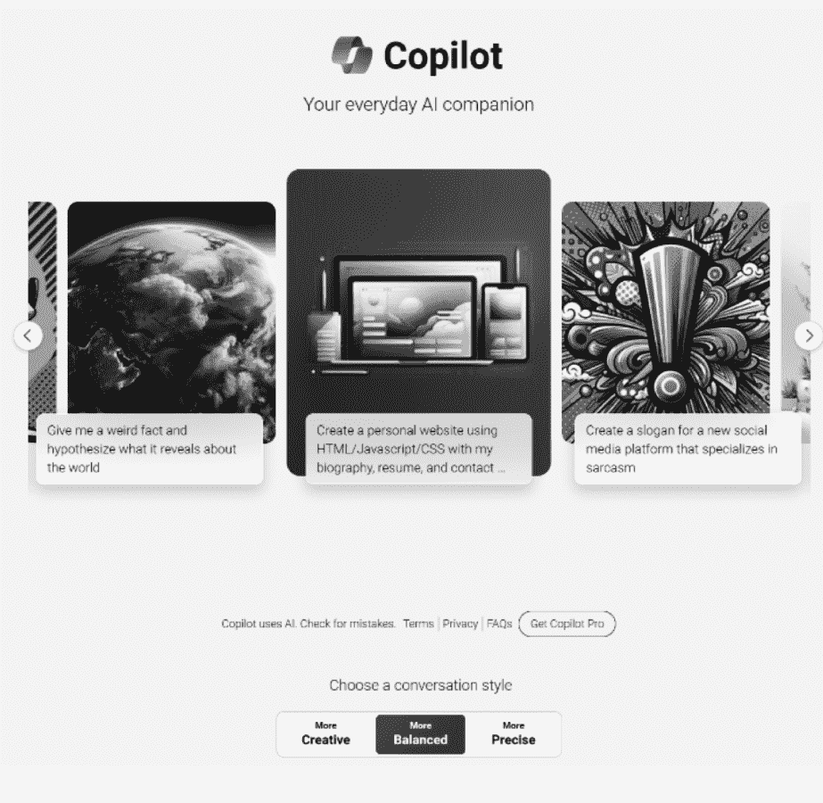

图1-1 代码生成和分析辅助AI工具Copilot

#### 1.2.3 构建LLM应用面临的挑战

大模型为智能应用开辟了新方向，但要实现高质量、可靠、安全的落地仍存在诸多障碍。

（1）知识获取和更新。LLM 的知识来源于预训练数据，受训练规模、质量和时效性制约。对于金融分析、热点新闻等依赖实时数据的场景，模型常难以给出最新准确信息。为大模型持续高效补充新知识是关键课题。一种思路是增量学习，在原有知识基础上对新数据进行微调适应，无需从头重训。例如 ERNIE 3.0 采用持续学习策略，通过不断学习新文本，在保留原有知识的同时扩充更新。另一种思路是检索增强学习，将模型与外部知识库结合，通过实时检索匹配动态供给所需知识。例如 Fusion-in-Decoder 引入检索模块，可从海量文档中抽取与输入相关的片段作为生成补充。

（2）推理能力提升。尽管 LLM 在语言理解与生成上表现突出，但在逻辑推理、常识判断方面仍显不足，容易产出看似合理却违背常识的内容，限制其在医疗、法律等关键领域的应用。完成需要多步推理的复杂任务，如解数学题、执行代码，也较为困难。针对此，研究者提出多类增强方法。一类是将因果推理、常识知识显式集成到语言模型中，例如 COMET 模型从文本中挖掘常识知识，用于增强下游任务推理能力。另一类是通过引入外部工具与程序，将复杂任务拆解为模型可处理的子任务，例如 PAL 模型提供可编程工具接口，使模型能够调用外部 API、数据库、计算程序，实现多步推理与数值计算。

（3）安全和伦理风险。强大的生成能力伴随显著风险。首先，模型可能被恶意用于制造谣言、散布仇恨言论、操纵舆论，威胁社会稳定与信息生态。其次，生成内容可能含有偏见、歧视等有悖伦理道德的表述，对部分群体造成伤害。再者，模型难以避免将训练数据中的隐私信息泄露到生成内容中。应对上，学界与业界展开广泛探索。一方面在算法与数据层面通过对抗训练、隐私保护技术等提升鲁棒性与安全性，例如 Anthropic 提出的“宪法式人工智能”旨在通过设计适当价值函数，使模型在追求目标的同时符合人类道德伦理与法律规范。另一方面建立使用规范与评估机制，明确不同场景下的边界与责任，并对输出进行持续检测管控，例如 OpenAI 提供的内容过滤 API 可检测并过滤生成内容中的有害攻击性言论。

（4）资源消耗与效率。训练与部署 LLM 需要大量算力、存储与能源，对中小企业和开发者构成挑战。以 GPT-3 为例，训练耗费数千万美元算力成本，存储参数需数百 GB 内存，推理一次需数十秒，导致部署门槛高，难以满足低成本、低延迟、实时响应需求。提升资源利用效率的重要方向是模型压缩与加速。例如知识蒸馏可将庞大教师模型的知识迁移到小型学生模型，在保持性能的同时大幅减少参数量与推理时间。例如 DistilGPT-2 经蒸馏后参数量仅为 GPT-2 的 60%，下游任务性能却与 GPT-2 相当。另一方向是利用云计算与分布式技术实现弹性部署与按需调用，例如微软推出的 DeepSpeed Cloud 服务允许用户在云端调用 GPT-3 等大模型，按实际使用量计费，大幅降低开发者使用门槛。

### 1.3 LangChain框架简介

LangChain 是一个面向语言模型驱动应用程序的开源框架。它提供工具与组件，帮助开发者把语言模型连接到上下文来源，如提示指令、少量示例、外部内容等，以使其响应更准确、更贴合上下文。它可以依靠语言模型进行推理，例如，根据提供的上下文如何回答、采取哪些行动等。LangChain 的目标是让开发者更易创建和部署基于语言模型的应用程序，如聊天机器人、问答系统、文本摘要工具等。如图1-2 所示为 LangChain 的生态系统，从图中可见，LangChain 库为开发者提供一套丰富的 Python 与 JavaScript 工具集，通过提供各种组件接口与集成，使得将这些组件组合成链和代理变得简单，同时也提供现成的链和代理实现。该库还包括 LangChain 模板，这是一系列易于部署的参考架构，专门设计来适应多样化任务需求。此外，LangServe 库支持将 LangChain 链部署为 REST API，而 LangSmith 平台则专为开发者设计，能够在任意 LLM 框架上调试、测试、评估和监控链，实现与 LangChain 的无缝集成。这一系列工具的主要优势在于能够简化应用程序的整个生命周期，包括开发、生产化和部署过程，从而使开发者能够快速上手，高效检查、测试和监控链，并自信地进行部署。

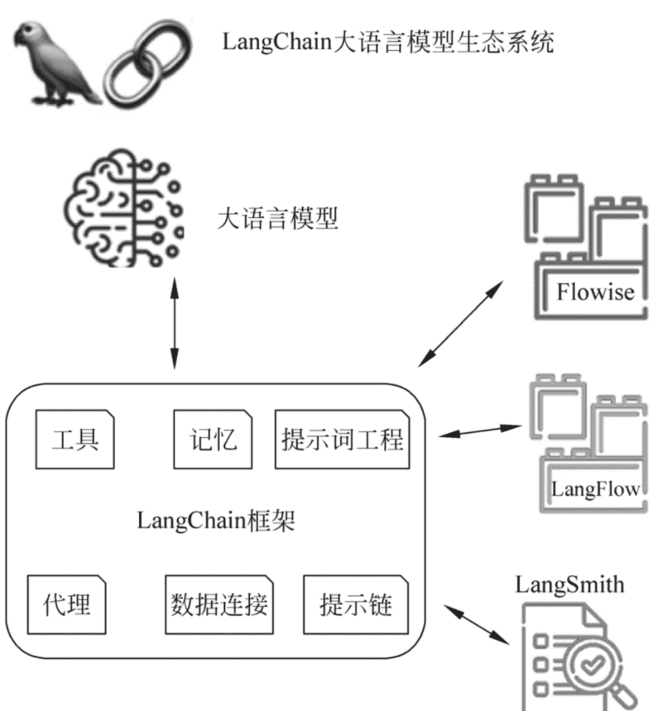

图1-2 LangChain生态系统

该体系的核心在于可组合的语言模型工具与集成，以及用于完成高级任务的内置组件组合即“链”。体系还引入了 LangChain 表达语言 LCEL，这是一种声明式方法，用于组合链，支持快速从原型转向生产，无须更改代码。LangChain 覆盖的应用场景很广，包括文档问答、聊天机器人、结构化数据分析、代码生成、机器翻译、文本摘要与创意写作，为构建复杂的语言处理系统提供便利与灵活性。

#### 1.3.1 LangChain的设计理念和目标

LangChain 的核心理念是把语言模型视作应用开发中的一个部件，而不是孤立的黑盒。虽然模型在自然语言理解生成上能力惊人，但在知识获取、逻辑推理、环境交互等方面仍存在局限。因此体系旨在提供工具与机制帮助开发者弥补这些短板，充分发挥模型潜力。具体目标可归纳为：

- (1) 模块化和灵活性。采用模块化架构，把语言模型与外部知识库、API 服务等解耦，开发者可按需挑选与组合不同模块，搭建适配特定需求的系统。
- (2) 可扩展性。兼容多种主流模型如 GPT-3、BLOOM 等，以及文档、数据库等多种数据源，开发者可方便地扩展与定制组件以满足不同场景。
- (3) 开发效率。提供一系列预置组件与流程，如常见提示模板、检索策略、记忆管理等，帮助开发者快速搭建原型、减少重复工作。
- (4) 应用性能。引入向量索引、数据流水线等优化手段，以提升模型在实际应用中的推理效率与响应速度。
- (5) 可操作性。提供清晰的文档与 API，便于集成到自有系统中，同时提供日志记录、调试工具等辅助开发维护。图1-3 展示了 LangChain 的整体设计思路，即通过组装与增强语言模型构建端到端的智能系统。用户与服务器交互，服务器可能处理输入并利用数据库索引获取必要信息。接收到输入后，服务器通过 Prompt 把任务传达给模型。模型可能访问 Memory 获取过往交互信息以保持对话连贯性。随后服务器可根据模型输出调用多个 Agent，这些 Agent 执行具体任务并可能通过 Callbacks 影响模型后续行为。该结构支持构建灵活、可模块化的系统，处理各种复杂任务与交互。

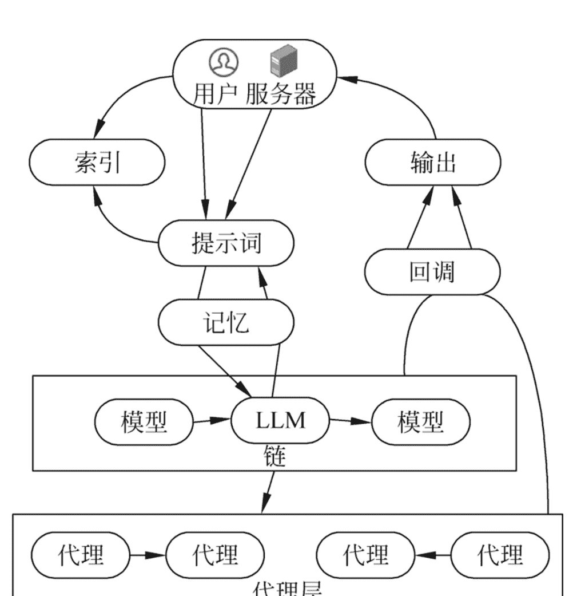

图1-3 LangChain总体设计理念

#### 1.3.2 LangChain的核心组件

LangChain 由多类核心组件构成，可灵活组合形成复杂的语言模型工作流，如图1-4 所示。

- (1) 模型 Models。支持集成各类语言模型如 GPT-3、BLOOM、T5 等，也支持文本嵌入模型、摘要模型等专业模型，开发者可根据需求选用。
- (2) 提示模板 Prompts。提示是输入模型的文本序列，可引导模型生成期望输出。框架提供问答模板、摘要模板、对话模板等预定义模板，也支持自定义。

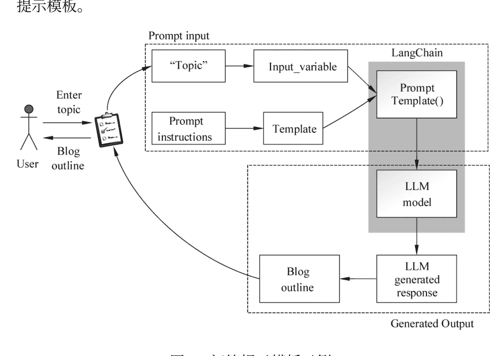

图1-4 问答提示模板示例

- (3) 索引 Indexes。许多应用需要从大规模文本中检索与用户查询相关的信息。框架提供向量索引机制，可把文本转为向量表示存储于向量数据库，支持快速相关检索。
- (4) 记忆 Memory。多轮对话等场景需要保存过往对话历史，以便基于上下文生成连贯回复。框架提供对话记忆、实体记忆等多种记忆管理机制，用于存储与管理对话状态。
- (5) 链 Chains。链是指把多个组件组合成复杂工作流。如图1-5 所示，LangChain 链式推理的核心流程为：用户查询或任务作为输入进入系统；路由链根据输入涉及的主题如数学、历史，将任务分发给对应的目标链处理；若与已有主题无关则进入默认链。每个目标链内置特定领域的专业知识与处理逻辑，可针对性处理并给出结果。默认链提供通用处理能力，应对未知领域或常规查询。该架构具有模块化、可扩展优点，过程解耦为独立链，易于设计维护，路由机制提升分发效率与针对性，新能力可通过添加目标链灵活扩展，默认链作为补充提供全面处理能力。框架提供常见链模板，也支持自定义。

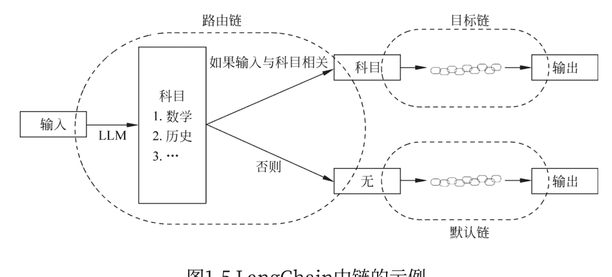

图1-5 LangChain中链的示例

- (6) 代理 Agents。代理是一种可自主完成多步任务的语言模型应用，可按用户指令自动分解任务、调用相应工具或服务并汇总结果。框架提供对话代理、问答代理等常见模板。
- (7) 工具 Tools。工具是指模型可调用的外部接口或服务，如搜索引擎、数据库、API 等。与外部工具结合可大幅拓展能力边界。框架支持定义与集成各类工具。

上述组件可灵活组合构建适配不同需求的应用。例如检索链与摘要链组合可构建智能文献助手，自动检索相关文献并生成摘要；对话代理与外部订票系统组合可构建智能客服助手引导用户完成订票流程。

#### 1.3.3 LangChain的优势

相比其他自然语言处理框架，LangChain 在以下方面具有独特优势。

- (1) 模块化设计。采用模块化架构，各组件松耦合，可灵活组合替换，便于定制扩展以适应不同需求。
- (2) 多模态支持。不仅支持文本，还支持图像、语音等多种模态，可构建图像问答、语音对话等多模态语言模型应用。
- (3) 知识增强。提供多种机制把语言模型与外部知识源如文档库、知识图谱结合，增强知识与推理能力。
- (4) 策略灵活。提供顺序执行、并行执行、条件执行等多种执行策略，可根据任务复杂度与资源约束选择合适策略。
- (5) 工具集成。支持集成搜索引擎、数据库、API 等外部工具服务，大幅拓展应用边界，使其能执行更复杂实用任务。
- (6) 社区活跃。LangChain 为开源项目，拥有活跃社区与贡献者，框架持续改进扩展，开发者可获得支持帮助。

总体而言，LangChain 是功能强大、灵活易用的语言模型应用开发框架，通过模块化设计、知识增强机制、灵活执行策略，帮助开发者轻松构建智能实用的自然语言处理应用。随着语言模型发展与应用需求增长，LangChain 有望成为该领域的重要工具与生态。

### 1.4 LangChain的应用场景

LangChain 是一个灵活强大的框架，可支持各类创新性 LLM 应用开发，如图1-6 所示。本节重点介绍几个典型场景，充分展示其功能与优势。

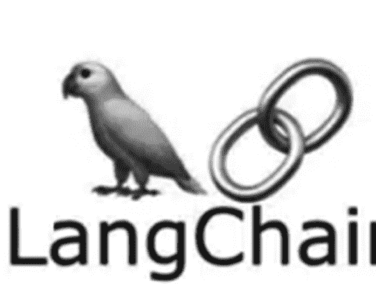

图1-6 LangChain的应用场景

- 问答系统
- 聊天机器人
- 智能代理
- 信息提取
- 总结
- 与API交互
- 评估
- 查询表格数据
- 代码理解

#### 1.4.1 构建支持知识增强的LLM应用

大模型在许多任务上展现惊人能力，但主要基于预训练阶段学习到的知识，对特定领域或实时更新的知识可能难以给出准确详尽回答。LangChain 提供一系列工具，可把大模型与外部知识库无缝集成，构建支持知识增强的大模型应用，主要包括用户查询接口、知识检索模块、大模型模块与外部知识库等组件。

以智能医疗问答系统为例。传统系统通常基于预定义问答对与规则，难以处理复杂多样患者查询。使用 LangChain 可把医学教科书、指南、案例等文档加载到向量数据库构建医学知识库。患者提问时，系统首先利用检索组件从知识库中找到最相关的文档片段，再把问题与检索片段一并输入大模型生成回答。如此模型既能利用全局知识，也能借助特定领域知识给出更准确可信答案。框架还支持知识库实时更新，如把新研究发现或指南加入库中，使系统能基于最新知识作答。除医疗领域，知识增强型大模型应用还可用于客户服务、教育培训、金融分析等，助力构建更智能专业的问答与决策支持系统。

图1-7 给出知识增强的大模型应用流程。以智能医疗问答为例，患者提交查询后，系统通过嵌入式组件把查询转为向量，并在向量数据库中检索相关信息，对应图中的“Retrieve”检索过程，从医学知识库中找到最相关片段。接着系统把原始查询与检索到的上下文一同送入大模型，对应“Augment”增强过程，通过此步骤查询被扩充以包含相关上下文。最终大模型根据增强后输入生成回答，对应“Generate”生成过程。该方法使模型不仅能利用广泛全局知识，还能利用医学领域知识，提供更精准可靠回答。

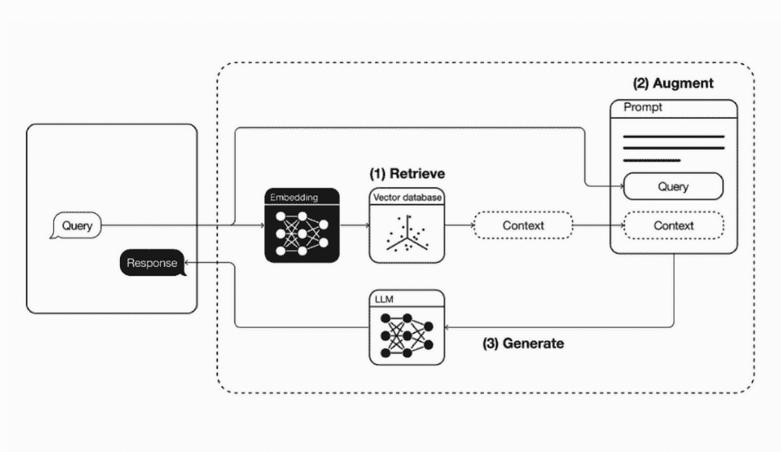

图1-7 知识增强的LLM应用

#### 1.4.2 实现基于多轮对话的聊天机器人

传统聊天机器人通常基于预定义对话流程与模板，难以进行灵活自然的多轮对话。LangChain 提供强大的多轮对话管理与状态追踪机制，可实现更智能、上下文相关的聊天机器人。图1-8 展示多轮对话系统如何追踪处理对话上下文。第一轮中用户说“hi”，系统以“hello”回复。为保持上下文，系统把整个对话标记：用“BOS”表示句子开始，用“SP1”与“SP2”区分不同说话者，分别代表用户与系统。进入第二轮，用户问“how are you”，系统记住了之前的交流并据此回答“am fine”。通过保留所有先前交流历史，系统能理解并参与持续连贯对话，确保每次回应都在前文上下文中生成。多轮对话要求模型在多个话语中保持上下文与连贯性。不像单轮对话可专注理解单个句子含义，多轮对话中模型需跟踪整个对话...

#### 1.4.3 开发面向特定领域的智能助手

大模型强大的语言理解生成能力使其在通用领域表现惊艳，但在医疗、法律、金融等专业领域仍难以达到专家水平，原因在于缺乏深入系统的领域知识，难以理解解决领域特定问题。LangChain 提供一系列工具，可把大模型与领域知识库、领域工具相结合，构建功能强大的领域智能助手。

以智能法律助手来开场，就能直观感受到LangChain的价值。传统法务咨询高度依赖人工，费用昂贵、响应慢，很难覆盖大众需求。通过LangChain，法条、判例、司法解释等资料可以被导入向量库，形成结构化的法律知识池。用户提问时，LLM先做理解和归类，锁定涉及的法域和核心要素，再从知识池里检索最相关的条文和案例，喂给模型做分析与推演。最终输出的是带有专业说服力的解答，并附上法源依据和参考案例，可信度大幅提升。

在知识库之上，智能法律助手还能对接各类法务工具，功能边界被不断拉宽。比如合同审查场景，可调用合同分析API自动核查条款合规性、揪出潜在风险；案件检索场景，可调用案例库API寻找相似裁判，拆解判决逻辑。LangChain还支持持续的领域进化，通过收集用户反馈、人工标注正确答案，知识库能够被不断优化扩充。基于同样思路的领域智能助手，可迁移到医疗辅助诊断、投资决策分析、个性化教育辅导等专业场景，帮助用户提效、提升决策质量。

### 1.4.4 让大模型借助工具完成复杂任务
LLM在理解与生成文本上表现突出，但在真实世界任务里仅靠语言已不够。很多场景需要调取外部信息、执行复杂运算或操作实体对象。LangChain提供一套灵活的工具接入机制，能把大模型与各类外部服务无缝串联，显著扩展应用范围。

图1-9 演示了以电子邮件为入口、以LangChain为底座的日程管理代理。用户通过邮件发送的指令先被聊天模型接收，比如基于OpenAI的模型。模型输出随后交给工具解析器处理，解析器利用LangChain能力对内容进行理解与结构化。解析器会与记事本交互，记事本作为代理的记忆区，负责留存对话上下文和关键信息。代理内置多类工具，如创建、删除、查询空闲、拉取预约、发送预约链接、更新预约等。当需要落地上预约时，代理会调用createBooking等指定工具与Cal.com API交互，API返回结果后完成闭环。整个流程融合Cal.ai、OpenAI与LangChain，大幅提升邮件预约处理的效率与准确度。

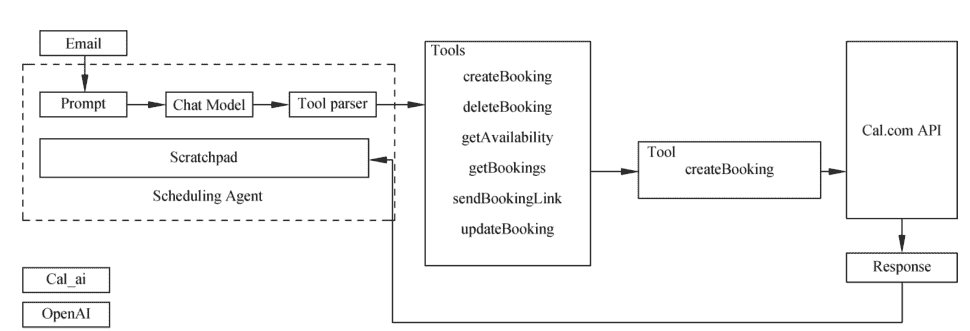

### 图1-9 外部工具接入示意
再看一个智能数据分析助手。用户可用自然语言描述分析需求，例如“分析2025年一季度销售数据，找出销量前五的产品并画出趋势图”。单纯的LLM往往只能给出空泛描述，缺乏执行力。接入外部工具后，任务会被拆解并逐项落地：

- 数据获取：调用数据库API取出2025年第一季度的销售记录。
- 数据处理：调用分析库如Pandas，对数据做分组、排序，筛选出销量最高的五款产品。
- 图表绘制：调用绘图库如Matplotlib，为五款产品生成销量趋势图。
- 报告输出：把分析结果和图表喂回LLM，生成通俗自然的分析报告。

在此过程中，LangChain的Agent模块充当任务指挥官，负责解析用户意图、拆解为子任务、依次调用工具并汇总产出；工具管理模块则统一管理各类外部工具与服务，提供一致调用接口，方便Agent调度。

有了工具接入，LLM从纯语言模型升级为可执行的任务引擎。除数据分析外，还能对接搜索引擎、知识图谱、代码执行环境等，支撑信息检索、知识推理、代码生成等复杂场景，应用面被显著拓宽。

### 1.5 LLM应用开发的其它框架一览
除了LangChain，市场上还有若干主流的LLM开发框架。本节简要对比它们的侧重点、局限，并说明为何本书以LangChain为主线。

#### 1.5.1 常见框架盘点
- (1) LlamaIndex。该框架专注数据索引与检索，目标是让大模型更高效地利用私有数据。它在对话式AI、聊天机器人等场景下摄取、结构化、访问领域数据的能力很强，但在对话状态维护和工具集成上相对薄弱。
- (2) AutoGPT。这是基于GPT的自主代理方案，提出“思考-执行-观察”的循环，让代理能自我拆解任务、执行动作并根据反馈调整策略。但目前仍处早期，架构和组件生态不够成熟。
- (3) DeepSpeed Chat。微软推出的聊天系统框架，借助DeepSpeed在模型并行与数据并行上的优化，可支撑万亿参数级对话模型的训练与推理。它在性能优化上出色，但对知识管理、工具对接的支持有限。

#### 1.5.2 各自特点与不足
总体来看，各框架各有长短。
- (1) LlamaIndex擅长构建知识增强应用的数据检索，但在对话管理和工具协作上需额外集成。
- (2) AutoGPT在自主代理思路上创新，但系统稳定性和组件完备度待提升。
- (3) DeepSpeed Chat在大规模对话性能上领先，但在知识治理和工具生态上覆盖不足。

相比之下，LangChain覆盖知识管理、对话状态、工具集成等全链路，更适合构建多形态LLM应用。

#### 1.5.3 选用LangChain的理由
选择LangChain作为核心框架，主要基于以下考量。
- (1) 能力完备。提示管理、知识检索、会话状态保持、工具调用等核心环节一应俱全，是全栈式解决方案。
- (2) 高度灵活。模块化架构允许组件自由组合与定制，可按需扩展以适配不同场景。
- (3) 工具丰富。内置大量模型接口、数据连接器、执行工具，开发者可直接使用；同时接口清晰，便于接入自有工具。
- (4) 文档完善。提供详尽文档与示例，加速上手与深度理解。
- (5) 社区活跃。作为开源项目，社区持续迭代，支持响应及时。

综合判断，LangChain在完备性、易用性、生态支持上具备明显优势，代表了LLM应用开发的主流方向。当然其他框架仍有其独特价值，开发者应依据具体需求抉择。本书聚焦LangChain，主要是其更适合作为学习与实践的起点。

## 小结
本章回顾了人工智能与大语言模型的发展脉络，梳理了它们在知识表征、语言理解与文本生成方面的优势，也指出了知识获取、逻辑推理、环境交互等短板。随后阐明了LLM应用的定义、特征与典型案例，并分析了构建过程中的挑战，为引入LangChain做铺垫。LangChain以模块化架构与丰富组件，帮助开发者应对构建难题，通过实战案例展示其在不同场景下的用法。最后通过横向对比，说明了选择LangChain作为主线的依据，它在全面性与发展趋势上更具代表性。

## 思考题

### 一、简答题
- 1. 概括人工智能演进历程，说明大语言模型在其发展中的位置与作用。
- 2. 描述LLM的核心能力，并举例2~3个典型应用。
- 3. 剖析LLM在知识获取、逻辑推理、安全伦理等方面的主要挑战。
- 4. 简述LangChain框架的设计目标与核心理念。
- 5. LangChain模块化设计的优势是什么？列出2~3点。
- 6. 将LangChain与另1~2个LLM开发框架做对比，分析异同。

### 二、实践题
请基于LangChain搭建一个简易的知识增强问答系统，要求：
- 1. 选定一个具体领域，收集相关文章、书籍等资料，组建知识库。
- 2. 使用LangChain的文档加载与向量存储组件，将文本转为向量表示。
- 3. 结合提示模板与LLM组件，实现对知识库的问答能力。
- 4. 测试系统，用5个领域问题检验回答质量。

## 第2章 配置LangChain开发环境
LangChain作为一款灵活强劲的NLP应用开发框架，正获得越来越多开发者的青睐。它通过简洁易用的API与组件，帮助开发者快速搭建基于语言模型的智能应用，降低门槛。本章将系统介绍环境搭建流程，为后续开发奠定基础。

首先讨论编程语言与IDE的选择，再说明Python环境的安装与依赖管理，随后安装LangChain并通过一个简单问答示例帮助读者快速建立直觉。

### 2.1 开发语言与工具选型
在启动LangChain开发前，先确定合适的语言与工具。LangChain基于Python构建，而Python在AI领域生态成熟，本书以Python为主。

#### 2.1.1 Python及其在AI领域的应用
Python是一种高级通用语言，语法简洁、易读易学，自1991年发布以来在Web、数据分析、人工智能等领域广泛应用。特别是在AI领域，Python已成为事实标准，得益于NumPy、Pandas、Scikit-learn、TensorFlow、PyTorch等生态。图2-1所示的库为AI开发提供了数值计算、数据处理与建模能力，加速模型试验。

活跃的社区与海量教程也让Python成为AI学习的理想选择。LangChain作为简化LLM应用开发的Python框架，继承了这一优势，并能与Python生态无缝结合，大幅提升开发效率。

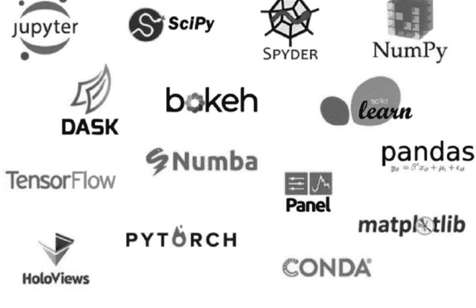

图2-1 LangChain常用工具与库概览

#### 2.1.2 常用Python集成开发环境
合适的IDE能显著提升开发体验。常见选择包括：
- (1) PyCharm：JetBrains出品，提供智能补全、代码检查、调试、测试等功能，是Python开发者的热门之选，有社区版与专业版。
- (2) Visual Studio Code：微软推出的轻量编辑器，跨平台性能优秀，插件生态丰富。安装Python扩展后可获得接近PyCharm的体验。
- (3) Jupyter Notebook：基于Web的交互式环境，适合数据分析与机器学习实验，可在同一文档中混排代码、文本、公式与图表。

此外还有Sublime Text、Atom、Spyder等，具体选择取决于个人习惯，熟练使用IDE功能对提效至关重要。

#### 2.1.3 本书采用的语言与工具
综合考量后，本书选用：
- 开发语言：Python 3.12
- 集成开发环境：PyCharm Professional
- 包管理工具：pip

Python 3.12成熟稳定且兼容主流AI库。PyCharm功能全面，pip与conda是Python生态常用依赖管理工具。读者也可按自身喜好调整版本与工具，只要满足LangChain运行需求即可。

### 2.2 安装LangChain及其依赖
假定读者已具备基础Python安装与编程能力，下面介绍安装流程及常见依赖。

#### 2.2.1 通过pip安装LangChain
安装非常直接，如图2-2所示，在命令行执行：

```
pip install langchain
```

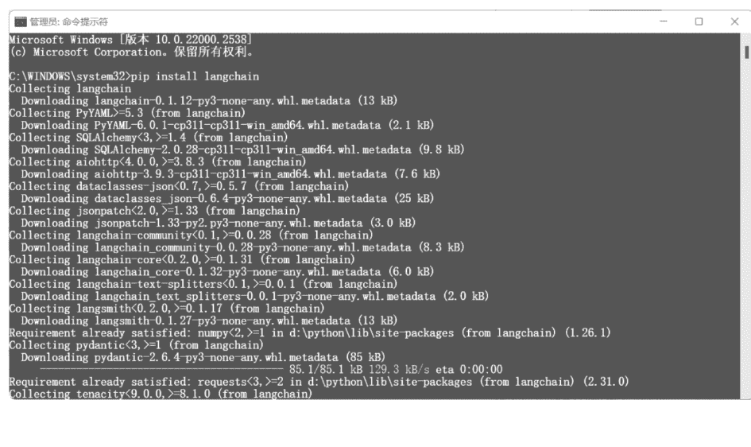

▲图2-2 命令行pip安装LangChain

命令会自动下载最新版LangChain及其依赖，耗时取决于网络与机器性能。

安装后可在Python解释器或Jupyter中导入验证：

```
import langchain
print(langchain.__version__)
```

若一切正常，会输出当前版本号，例如“0.0.123”，版本号会随发布而变化。需注意部分功能依赖特定库或外部服务，如使用OpenAI接口需安装openai库并配置有效API Key。

#### 2.2.2 LangChain核心依赖库
LangChain功能丰富，依赖众多常用科学计算与AI库，主要包括：
- (1) NumPy：基础科学计算库，提供多维数组与矩阵运算，LangChain中用于向量计算与数据处理。
- (2) Pandas：数据分析处理库，提供高效数据结构，LangChain中用于加载、转换结构化数据如CSV、Excel。
- (3) PyTorch/TensorFlow：主流深度学习框架，支持GPU加速与自动微分，LangChain中用于加载与推理Transformer等模型。
- (4) Hugging Face Transformers：基于PyTorch/TensorFlow的NLP库，提供大量预训练模型，LangChain中用于调用BERT、GPT等。
- (5) FAISS：Facebook开源的相似性搜索库，提供高效索引与检索，LangChain中用于构建向量数据库。
- (6) SQLAlchemy：Python SQL工具包与ORM，提供数据库访问与管理，LangChain中用于连接SQLite、MySQL、PostgreSQL等。

LangChain 底层还调用了不少 Python 生态的通用组件，比如 pydantic、tenacity、openapi-schema-pydantic 等。它们分别负责数据校验、请求重试、API 规范描述等工作，共同支撑起 LangChain 的完整能力。

Pip 安装 LangChain 时，上述依赖会一并自动拉取，无需单独操作，安装完成即可直接导入使用。若想进一步了解这些组件的原理，建议去看官方文档，它们在数据科学和 AI 领域都有广泛应用。

#### 2.2.3 安装问题排查
用 pip 装 LangChain 大多数情况都很顺滑，但偶尔也会碰到阻碍。下面汇总了高频问题及对应的处理思路。

- (1) 网络连通异常：若出现超时、SSL 校验失败之类的网络错误，可按以下方式排查。

  ① 先确认本地网络是否通畅，能否正常打开 PyPI、GitHub 等站点。

  ② 换成国内镜像源尝试，例如豆瓣、阿里云、清华等，pip 命令加上 -i 参数指定镜像地址。

  ③ 若在代理环境下，需确认 pip 的代理配置是否正确，可通过 --proxy 参数或设置 HTTP_PROXY、HTTPS_PROXY 环境变量来生效。

- (2) 依赖版本打架：安装时若提示某依赖版本不匹配，可尝试以下办法。

  ① 用 pip list 查看当前环境已装包及版本，确认是否存在重复或多版本共存。

  ② 先尝试 pip install --upgrade 将依赖升到最新，或明确指定与 LangChain 兼容的版本进行安装。

  ③ 若仍冲突，推荐新建一个干净的虚拟环境单独安装 LangChain，隔离开其他项目的依赖。

- (3) 编译工具缺失：部分依赖需要 C++ 编译，环境缺失会导致安装失败。此时可按系统补充工具。

  ① Windows 用户可安装 Visual Studio Build Tools 或 MinGW 等编译套件，官网下载即可。

  ② macOS 需装 Xcode 命令行工具，终端执行 xcode-select --install 即可完成。

  ③ Linux 系统建议通过 apt、yum 等包管理器安装 GCC 及相关编译依赖。

- (4) 权限问题：在某些系统上使用 pip 安装全局包需要管理员权限，遇到权限不足时可这样处理。

  ① 使用 pip install --user 命令，将包装到当前用户目录而非系统目录。

  ② 用虚拟环境安装 LangChain，避免全局安装的权限限制。

  ③ 若必须全局安装，请以管理员权限运行 pip 命令，例如 sudo。

其它问题先看报错信息和 traceback，再去 LangChain GitHub 搜索相关 Issue，社区里往往已有答案。若仍未解决，可在 GitHub 新建 Issue 或去官方论坛求助。

### 2.3 搭建高效的 LangChain 开发环境
LangChain 与依赖装好后，下一步就是把开发环境搭起来。环境搭得好，效率提升、冲突减少、代码也更好维护。下面会讲虚拟环境的创建、IDE 项目配置，以及配置文件和环境变量的管理方法。

#### 2.3.1 虚拟环境创建与激活
新建 Python 项目时，业界通用做法是给它一个独立的虚拟环境。这样不同项目的依赖和解释器互不干扰，避免版本冲突和污染全局。用虚拟环境，每个项目都能自由选定 Python 版本和依赖列表。

如图2-3所示，PyCharm 也支持建项目时顺带建虚拟环境。更通用的做法是使用内置的 venv 模块，按以下步骤操作。

- (1) 打开终端，切换到项目根目录。

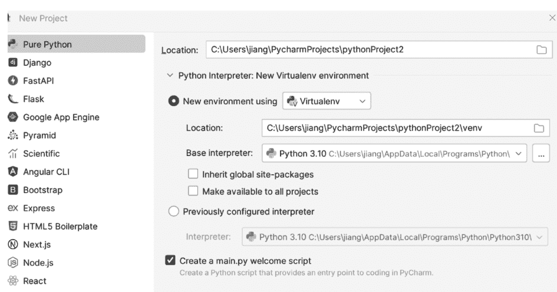

图2-3 PyCharm中建立项目的同时建立虚拟环境

- (2) 执行命令创建虚拟环境，把 myenv 换成你喜欢的名字。

```
python -m venv myenv
```

- (3) 创建完成后激活环境，Windows 下执行：

```
myenv\Scripts\activate
```

- (4) 激活成功后终端会显示环境名，如 (myenv)。这时就可以在该环境里安装 LangChain 了。

```
pip install langchain
```

除 venv 外，conda、virtualenv 等工具也很常见，它们提供更多定制能力。无论选哪种，为每个项目单独建环境都是好习惯，能让开发更干净、可控。

#### 2.3.2 IDE 项目配置实操
环境准备好后，就可以在 IDE 里建项目并配置了。不同 IDE 操作细节有差异，但核心流程相近：新建项目、指定解释器、管理依赖、设置代码风格与检查等。下面以常见 IDE 为例说明。

在PyCharm中配置LangChain项目：

- (1) 启动 PyCharm，选择 File → New Project。

- (2) 指定项目路径，并勾选 New environment using Virtualenv。

- (3) 选择 Python 解释器版本，并可勾选 Inherit global site-packages。

- (4) 点击 Create，等待项目初始化完成。

- (5) 在 PyCharm 终端激活环境，执行 pip install langchain 安装框架。

- (6) 新建 Python 文件，导入 LangChain 做一次简单测试。

无论用哪款 IDE，都建议坚持好习惯：使用虚拟环境、锁定依赖版本、遵循 PEP 8 规范。代码会更规范、可读、可维护，也更少出错。

#### 2.3.3 配置文件与环境变量管理
除了 IDE 配置，LangChain 本身也支持配置文件和环境变量来定制行为。合理使用能让应用更灵活高效。

LangChain 的核心配置文件是项目根目录下的 .env，用于存放 API Key、数据库连接串等敏感信息。把密钥放在 .env 而非代码里，可避免误提交到版本控制，提升安全性。

以下是一个示例的.env文件。

```
OPENAI_API_KEY = sk-xxxxxxxxxxxxxxxxxxxxxxxxxxxxxxxx
SERPAPI_API_KEY = xxxxxxxxxxxxxxxxxxxxxxxxxxxxxxxx
REDIS_URL = redis://localhost:6379
```

代码里可用 python-dotenv 加载 .env，再通过 os.getenv 获取对应值。

```python
from dotenv import load_dotenv
import os

# 加载.env文件
load_dotenv()

# 获取 API 密钥
openai_api_key = os.getenv("OPENAI_API_KEY")
serpapi_api_key = os.getenv("SERPAPI_API_KEY")

# 获取 Redis 连接 URL
redis_url = os.getenv("REDIS_URL", "redis://localhost:6379")
```

除 .env 外，也可直接用环境变量配置，例如设置 OPENAI_API_KEY 来指定 OpenAI 密钥，无需改动代码即可切换配置。

要设置环境变量，可以在终端中使用 export 命令（macOS/Linux）或 set 命令（Windows）。

- (1) 在macOS/Linux上：

```bash
export OPENAI_API_KEY=sk-xxxxxxxxxxxxxxxxxxxxxxxxxxxxxxxx
```

- (2) 在Windows上：

```cmd
set OPENAI_API_KEY=sk-xxxxxxxxxxxxxxxxxxxxxxxxxxxxxxxx
```

配置完成后 LangChain 会自动读取，无需手动加载。

此外框架还提供全局配置对象如 langchain.llm_cache 和 langchain.embeddings_cache，用来调节 LLM 与 Embedding 的缓存策略，可设置最大缓存数、过期时间等。

```python
import langchain

# 配置 LLM 缓存
langchain.llm_cache = langchain.cache.SQLiteCache(database_path=".langchain/cache.db")
langchain.llm_cache.set_max_size(100000)

# 配置 Embedding 缓存
langchain.embeddings_cache = langchain.cache.RedisCache(redis_url="redis://localhost:6379")
langchain.embeddings_cache.set_max_size(1000000)
```

综合使用配置文件、环境变量和全局对象，能让项目更灵活、部署更便捷。实际开发中按需选择合适的方案即可。

搭建合格的开发环境涉及虚拟环境、IDE、依赖管理以及框架特有的配置。虽然前期步骤看似繁琐，但对效率、质量和可维护性至关重要。掌握以上要点，就能为后续项目打下坚实基础。

### 2.4 跑通你的第一个 LangChain 程序
环境就绪后，我们来写第一个 LangChain 程序。通过一个基于本地 PDF 的问答 Demo，能直观感受框架的用法与开发流程。示例会用 Ollama 模型和嵌入处理文档问答，并用 Streamlit 提供交互式网页，问题输入、答案展示以及对话历史都会实时呈现。

#### 2.4.1 实现流程拆解
整体实现可拆解为以下几个步骤。

- (1) 安装依赖：langchain 核心库、langchain_community 社区扩展、Streamlit 网页框架、PyPDF2 文档解析库。

- (2) 加载并处理数据。

  - 使用 PyPDFLoader 读取指定的本地 PDF 文档。

  - 使用 RecursiveCharacterTextSplitter 将文档内容分割成多个文本块。

- (3) 创建 Embeddings 和向量存储。

  - 使用 OllamaEmbeddings 计算每个文本块的向量表示。

  - 使用 Chroma 将向量存储起来，构建向量索引。

- (4) 创建问答链。

  - 使用 RetrievalQA.from_chain_type 创建一个基于 stuff 策略的检索式问答链。

  - 使用 OllamaLLM 加载本地的 GEMMA 模型作为 LLM。

  - 使用 Chroma 向量存储作为知识检索器。

- (5) 创建 Streamlit 应用。

  - 使用 Streamlit 创建一个 Web 应用，包含问答界面和对话历史。

  - 用户可以在文本框中输入问题。

  - 程序使用问答链生成答案，并将问答记录添加到对话历史中显示。

- (6) 运行 Streamlit 应用。

  - 使用 streamlit run 命令运行 Streamlit 应用。

  - 在浏览器中访问应用的 URL，进行交互式问答。

#### 2.4.2 运行效果与解读
具体程序代码如下。

【例2-1】 第一个LangChain程序（参见代码文件2.1.py）。

```python
import os
from langchain.chains import RetrievalQA
from langchain.document_loaders import PyPDFLoader
from langchain.indexes import VectorstoreIndexCreator
from langchain.text_splitter import RecursiveCharacterTextSplitter
from langchain.vectorstores import Chroma
from langchain_community.embeddings import OllamaEmbeddings
from langchain_community.llms import Ollama as OllamaLLM
import streamlit as st

# 加载本地 PDF 文档
loader = PyPDFLoader("linux.pdf")
documents = loader.load()

text_splitter = RecursiveCharacterTextSplitter(chunk_size=500, chunk_overlap=50)
texts = text_splitter.split_documents(documents)

# 创建 OllamaEmbeddings 和向量存储
embeddings = OllamaEmbeddings()
docsearch = Chroma.from_documents(texts, embeddings)

# 创建问答链
qa_chain = RetrievalQA.from_chain_type(
    llm=OllamaLLM(model="gemma:2b"),
    chain_type="stuff",
    retriever=docsearch.as_retriever()
)

# Streamlit 应用程序
def main():
    st.title("Local PDF Document QA")
    # 对话历史记录
    if "chat_history" not in st.session_state:
        st.session_state.chat_history = []
    # 用户输入查询
    query = st.text_input("Enter your question about the document:")
    if query:
        # 执行问答
        result = qa_chain.run(query)
        # 将查询和答案添加到对话历史记录中
        st.session_state.chat_history.append({"query": query, "answer": result})
    # 显示对话历史记录
    for chat in st.session_state.chat_history:
        st.write(f"Question: {chat['query']}")
        st.write(f"Answer: {chat['answer']}")
        st.write("---")

if __name__ == "__main__":
    main()
```

执行结果如图2-4所示。该应用基于本地 PDF 实现问答，结合 LangChain 与 Ollama。首先用 PyPDFLoader 读取 linux.pdf，再用 RecursiveCharacterTextSplitter 切分为小块，随后通过 OllamaEmbeddings 生成向量并存入 Chroma 构建检索索引。最后用 RetrievalQA 结合基于 gemma:2b 的 OllamaLLM 和 Chroma 检索器生成答案。

界面由 Streamlit 构建，支持输入问题、展示答案并保留对话历史。问题提交后经问答链处理，结果实时呈现，历史记录保存在 Streamlit 会话状态中，刷新页面后仍可保留。

#### 2.4.3 关键代码要点
为更好理解，下面拆解核心代码片段。

(1) 导入所需的库。

os: 用于与操作系统交互。

langchain.chains.RetrievalQA: 用于创建检索问答链。

langchain.document_loaders.PyPDFLoader: 用于加载PDF文档。

VectorstoreIndexCreator 在 LangChain 中承担生成向量索引的职责。

RecursiveCharacterTextSplitter 负责把长文本按字符切分成若干片段。

Chroma 是用来搭建本地向量数据库的关键组件。

OllamaEmbeddings 基于 Ollama 生成文本向量表示。

Ollama 则是调用 Ollama 本地大语言模型的封装。

Streamlit 用来快速搭建可交互的网页界面。

(2) 本地PDF文档导入
采用 PyPDFLoader 读取名为 linux.pdf 的本地文档。
借助 RecursiveCharacterTextSplitter 对读取后的内容进行分块，设定单块大约 500 个字符，相邻块保留 50 个字符的重叠以保证语义连贯。

(3) Ollama 嵌入与向量库构建
先实例化一个 OllamaEmbeddings 对象来负责向量化。
随后调用 Chroma.from_documents 把文本块转成向量集合，并以 Ollama 嵌入作为向量化函数。

(4) 问答链的组装
通过 RetrievalQA.from_chain_type 创建检索式问答链。
指定底层大模型为 Ollama 的 gemma:2b，并选用 stuff 合并方式。
把前面构建的 Chroma 向量库作为检索器注入问答链。

(5) Streamlit 应用主流程定义
页面标题设为“Local PDF Document QA”。
对话历史初始化为空列表，若已有则沿用。
提供一个文本输入框让用户提交关于文档的问题。
收到查询后交由问答链处理，并把问题与答案一起追加到历史记录。
最终在页面上展示完整的问答历史，问答对之间用分隔线区分。

(6) 启动 Streamlit 服务
使用 if __name__ == "__main__" 限定 main() 仅在脚本被直接执行时运行，避免被导入时误触发。

#### 2.4.4 开发环境搭建说明
本书示例多基于本地大模型运行，核心是 Ollama，可平滑切换至其他模型，如图2-5所示。Ollama 是一款用 Go 语言实现的轻量本地模型运行框架，可在本地部署并运行多种大语言模型，如表2-1所示。其核心能力涵盖模型下载与管理、推理、评测和部署。借助 Ollama，研究者与开发者能够在本地完成模型测试与评估，加快迭代节奏，提升研究质量。

# Get up and running with large language models, locally.

Run [Llama 2](https://ollama.com/library/llama2), [Code Llama](https://ollama.com/library/codellama), and other models.

Customize and create your own.

Download ↓

Available for macOS, Linux,

and Windows (preview)

## ▲图2-5 Ollama示意图

## ▼表2-1 Ollama支持的模型（截至2025年6月30日）

| 模型 | 参数 | 大小 | 下载命令 |
|---|---|---|---|
| Gemma 3 | 27B | 17GB | ollama run gemma3:27b |
| QwQ | 32B | 20GB | ollama run qwq |
| DeepSeek-R1 | 7B | 4.7GB | ollama run deepseek-r1 |
| Phi-2 | 2.7B | 1.7GB | ollama run phi |
| Neural Chat | 7B | 4.1GB | ollama run neural-chat |
| Starling | 7B | 4.1GB | ollama run starling-lm |
| Code Llama | 7B | 3.8GB | ollama run codellama |
| Llama 2 Uncensored | 7B | 3.8GB | ollama run llama2-uncensored |
| Llama 2 13B | 13B | 7.3GB | ollama run llama2:13b |
| Llama 2 70B | 70B | 39GB | ollama run llama2:70b |
| Orca Mini | 3B | 1.9GB | ollama run orca-mini |
| Vicuna | 7B | 3.8GB | ollama run vicuna |
| LLaVA | 7B | 4.5GB | ollama run llava |
| Gemma | 2B | 1.4GB | ollama run gemma:2b |
| Gemma | 7B | 4.8GB | ollama run gemma:7b |

Ollama 兼容 Linux、macOS 与 Windows，可从官网 https://ollama.com/ 获取最新版本。命令行交互十分简洁，可完成下载、管理、推理、评测和部署等任务。常用指令如下。

(1) 模型下载。使用 ollama pull 拉取模型，例如：

```
ollama pull gemma:2b
```

(2) 模型管理。使用 ollama list 查看已拉取的模型，例如：

```
ollama list
```

(3) 模型推理。使用 ollama run 启动推理，例如：

```
ollama run wudao2.0 -- text "你好,世界!"
```

(4) 模型评测。使用 ollama eval 评估性能，例如：

```
ollama eval wudao2.0 -- dataset GLUE
```

(5) 模型部署。使用 ollama deploy 将模型发布为 Web 服务，例如：

```
ollama deploy wudao2.0 -- port 8000
```

与本地模型交互主要有三种常用方式。

(1) 终端直连。所有模型默认在 localhost:11434 上提供服务，执行 ollama run <name-of-model> 即可在命令行内对话。

(2) API 调用。向 Ollama 的 API 端点发送 application/json 请求即可交互。借助 curl 可发送 POST 请求，请求体包含模型名与提示，例如：

```
curl http://localhost: 11434/api/generate -d '{
  "model": "llama2",
  "prompt": "Why is the sky blue?"
}'
```

具体端点可参考 Ollama 官方 API 文档。

(3) LangChain 集成。在 LangChain 项目中可通过 langchain_community.llms 提供的 Ollama 类接入本地聊天模型。

示例代码如下。

```
from langchain_community.llms import Ollama
llm = Ollama(model = "llama2")
llm.invoke("Tell me a joke")
```

实例化 Ollama 并指定模型名称，调用 invoke() 传入提示即可完成交互。

除此之外，还能借助 Gradio 等工具快速搭建可视化 Web UI，在 Jupyter Notebook 中直接调用 API，或将模型封装成 HTTP 服务供其他语言与框架通过 HTTP 请求访问。

需要说明的是，本章示例采用 Streamlit 作为前端展示。Streamlit 是开源的 Python 库，能让数据科学家和开发者迅速创建并分享精美交互式 Web 应用。其优势在于极简高效，只用 Python 即可构建数据应用，无需复杂的 Web 开发知识。安装方式如下。

```
pip install streamlit
```

构建好脚本后，用以下命令启动。

```
streamlit run your_script.py
```

需要注意的是，Streamlit 在生产环境并不理想，本书仅作示例展示。若追求更完善的本地对话体验，Ollama 官方的 Open WebUI 是更合适的选择，二次开发也较容易。

#### 2.4.5 典型报错与处理思路
运行 LangChain 程序时常会碰到一些常见问题，下面给出典型表现与解决办法。

(1) ModuleNotFoundError。
①报错信息：

```
ModuleNotFoundError: No module named 'langchain'
```

②原因：langchain 相关库未安装或版本不匹配。
③解决：

```
pip install langchain
```

请确认 pip 与当前 Python 环境一致。

(2) ValueError。
①报错信息：

```
ValueError: Did not find openai_api_key, please add an environment variable `OPENAI_API_KEY` which contains it, or pass `openai_api_key` as a named parameter.
```

②原因：未配置 OpenAI API Key 或密钥无效。
③解决：在 .env 中正确设置 OPENAI_API_KEY，或在创建 OpenAI() 时传入 openai_api_key 参数。

(3) InvalidRequestError。
①报错信息：

```
InvalidRequestError: This model's maximum context length is 4097 tokens. However, your messages resulted in 5924 tokens. Please reduce the length of the messages.
```

②原因：输入文本超出模型最大 token 限制，例如 4097 token。
③解决：调小 RecursiveCharacterTextSplitter 的 chunk_size，或更换更大上下文窗口的模型。

(4) wikipedia.exceptions.PageError。
①报错信息：

```
wikipedia.exceptions.PageError: Page id "Python (programming language)" does not match any pages. Try another id!
```

②原因：指定维基页面不存在或名称写错。
③解决：核对 WikipediaLoader 的 query，必要时更换为相关存在的页面。

(5) chromadb.errors.NoIndexException。
①报错信息：

```
chromadb.errors.NoIndexException: Index does not exist
```

②原因：Chroma 向量库未建立索引或索引文件丢失。
③解决：确保在问答前已成功创建向量库与索引，若丢失则重新运行程序或手动重建。

若出现其他未知错误，建议先阅读完整报错与 traceback，定位出错行与函数，再查阅 LangChain 及相关库官方文档，搜索相似案例。仍无法解决时，可在 GitHub 或 StackOverflow 提问，或向 LangChain 社区求助。

总体而言，错误调试是编程学习中不可或缺的环节。学会冷静阅读错误信息、逐步排查，能显著提升构建稳定 LangChain 应用的能力。

### 2.5 LangChain 学习资源汇总
除了本书示例，还可借助多种资源深化 LangChain 能力。

- (1) 官方文档。https://docs.langchain.com/ 是权威入口，涵盖组件介绍、API 参考与最佳实践。
- (2) GitHub 仓库。https://github.com/hwchase17/langchain 包含源码与大量示例，阅读源码可加深对内部机制的理解。
- (3) 社区讨论区。https://github.com/hwchase17/langchain/discussions 是活跃的开发者社区，可提问、分享经验。
- (4) 技术博客。众多博主分享实践心得与教程。
- (5) 学习笔记。早期用户整理的笔记与代码示例有助于快速上手。

最有效的学习方式仍是动手实践。先跟随官方教程实现基础应用，再在此基础上修改扩展，最后尝试从零构建自己的项目。实践中遇到问题时，结合官方文档与社区求助；同时也建议输出自己的学习心得，形成闭环。

## 小结
本章围绕 LangChain 开发环境展开，从语言与 IDE 选择，到 LangChain 及依赖的安装，再到首个问答示例的拆解，阐释了 Chroma 等核心组件的工作方式，并总结了常见错误与排错方法，最后梳理了后续自学资源。

## 思考题

### 一、简答题
- 1. 简述 Python 在人工智能和自然语言处理领域的优势和地位。
- 2. 比较 pip 和 conda 的区别和适用场景。
- 3. 简述 LangChain 的主要依赖库及其作用。
- 4. 在安装和使用 LangChain 的过程中，可能会遇到哪些常见错误？请列举 2~3 个，并简要说明解决方法。
- 5. 请列举 3~5 个学习 LangChain 的优质资源，并简要说明它们的特点和用途。

### 二、实践题
- 1. 在计算机上安装 Python 和 pip，并创建一个新的虚拟环境。

## 第3章

## LangChain 核心组件概览
随着大语言模型快速演进，如何高效构建 LLM 应用成为焦点。LangChain 为 LLM 应用开发提供了一整套工具与组件，简化并加速开发流程，如图3-1所示。本章将深入剖析 LangChain 的核心理念与基础构件，包括模型、提示模板、索引、文档加载器、输出解析器等，并通过实例演示如何组合这些构件构建应用。掌握本章内容后，读者将具备使用 LangChain 开发 LLM 应用的基础技能，为后续进阶打下坚实基础。

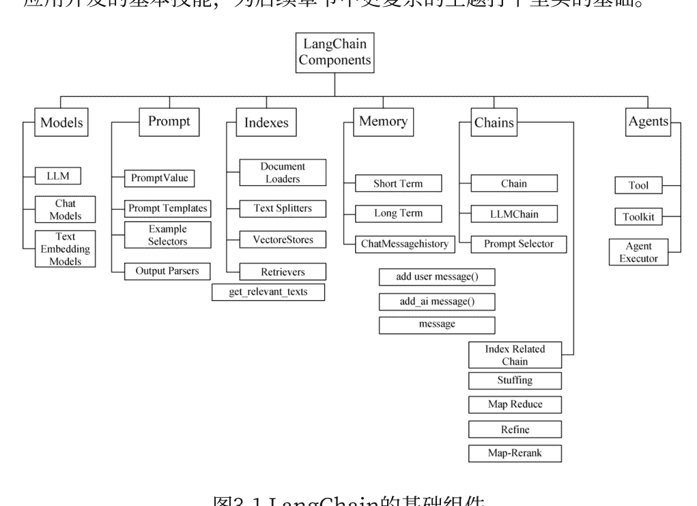

图3-1 LangChain的基础组件

### 3.1 快速入门案例

【例3-1】LangChain 四大基础链路实战拆解

借鉴官方示例，本节从一个接近 Hello World 的最小案例开始，只用提示模板里的信息就能触发回复。随后搭建检索链，把独立数据源里查到的内容喂给提示模板；再叠加入聊天气历史，形成可记忆上下文的对话检索链，实现多轮聊天。最后演示代理，让 LLM 自己判断是否需要查数。整个流程覆盖了基础组件的核心用法，参考代码见程序3.1.py。

#### 3.1.1 LLM链

假设你已装好 Gemma 本地模型，并且 Ollama 服务正在运行。若未启动，可执行 `ollama run gemma: 2b` 启动。

```python
from langchain_community.llms import Ollama
llm = Ollama(model = "gemma:2b")
```

先直接调用体验一下回应的质量。

```python
llm.invoke("how can langsmith help with testing?")
```

想让回答更靠谱，就需要提示模板来引导。提示模板的作用就是把原始用户输入整理成 LLM 更容易理解的格式。下面示范如何用 ChatPromptTemplate 搭建模板。

```python
from langchain_core.prompts import ChatPromptTemplate
prompt = ChatPromptTemplate.from_messages([
    ("system", "You are world class technical documentation writer."),
    ("user", "{input}")
])
```

有了模板后，就能把它和 LLM 组合成一个最简的 LLM 链。

```python
chain = prompt | llm
```

用这个链再问一遍同样的问题。虽然准确性未必提升，但语气会更像技术写作。

```python
chain.invoke({"input": "how can langsmith help with testing?"})
```

要注意，ChatModel 及其构成的链返回的其实是一条消息。为了后续处理更方便，可以加一个输出解析器，把聊天消息转成字符串。

```python
from langchain_core.output_parsers import StrOutputParser
output_parser = StrOutputParser()
```

把解析器接在之前的链上：

```python
chain = prompt | llm | output_parser
```

调用时返回的就是字符串，而不是 ChatMessage 对象：

```python
chain.invoke({"input": "how can langsmith help with testing?"})
```

至此，一个基础的 LLM 链就搭好了。

#### 3.1.2 检索链

要准确回答“how can langsmith help with testing?”这类问题，必须给模型补充外部上下文，这正是检索要做的事。当数据量太大无法一次性塞进模型时，检索就显得关键。用检索器挑出最相关的片段再交给模型即可。

具体做法是先从检索器里取出相关文档，再一并带入提示模板。检索器可以基于任何数据源，比如 SQL 表、网络等。本例采用向量库作为检索源。

第一步是加载待索引的数据，这里选用 WebBaseLoader。需要先装 BeautifulSoup。

```bash
pip install beautifulsoup4
```

装好后导入并使用 WebBaseLoader。

```python
from langchain_community.document_loaders import WebBaseLoader
loader = WebBaseLoader("https://docs.smith.langchain.com/user_guide")
docs = loader.load()
```

接下来把数据写入向量库，需要嵌入模型和向量存储两件套。

嵌入模型可选 API 方式如 OpenAI，也可以本地跑如 Ollama。下面以 Ollama 嵌入为例。

```python
from langchain_community.embeddings import OllamaEmbeddings
embeddings = OllamaEmbeddings()
```

有了嵌入模型，就可以用它把文档写入向量库。为求简便选用本地的 FAISS。

先安装 FAISS 依赖：

```bash
pip install faiss-cpu
```

再构建索引：

```python
from langchain_community.vectorstores import FAISS
from langchain_text_splitters import RecursiveCharacterTextSplitter
text_splitter = RecursiveCharacterTextSplitter()
documents = text_splitter.split_documents(docs)
vector = FAISS.from_documents(documents, embeddings)
```

索引建立后就可以组装检索链。该链接收问题，自动查找相关文档，再把文档和原问题一起交给 LLM 生成答案。

定义一个同时接受问题和检索文档并产出答案的链：

```python
from langchain.chains.combine_documents import create_stuff_documents_chain
prompt = ChatPromptTemplate.from_template("""根据提供的上下文回答以下问题：
<context>
{context}
</context>
问题：{input}""")
document_chain = create_stuff_documents_chain(llm, prompt)
```

也可以手动传入文档直接跑链：

```python
from langchain_core.documents import Document
document_chain.invoke({
    "input": "how can langsmith help with testing?",
    "context": [Document(page_content = "langsmith can let you visualize test results")]
})
```

不过我们希望文档由前面搭建的检索器动态提供，这样能根据具体问题实时挑出最相关的资料。

```python
from langchain.chains import create_retrieval_chain
retriever = vector.as_retriever()
retrieval_chain = create_retrieval_chain(retriever, document_chain)
```

调用检索链后会得到一个字典，LLM 的回复放在 answer 字段里。

```python
response = retrieval_chain.invoke({"input": "how can langsmith help with testing?"})
print(response["answer"])
```

借助检索提供的上下文，答案的准确度明显提升。基础检索链就此完成。

#### 3.1.3 对话检索链

到目前为止的链只能处理单轮提问。实际聊天机器人需要多轮记忆。那该如何把检索链升级为对话检索链呢？

仍然用 create_retrieval_chain，但需做两点调整：

- (1) 检索不能只看最新输入，要把整段对话历史纳入考虑。
- (2) 最终的 LLM 链也要兼顾整段对话历史。

为改造检索器，新增一个链，让它同时接收最新输入 input 和对话历史 chat_history，并用 LLM 合成搜索查询。

```python
from langchain.chains import create_history_aware_retriever
from langchain_core.prompts import MessagesPlaceholder
prompt = ChatPromptTemplate.from_messages([
    MessagesPlaceholder(variable_name="chat_history"),
    ("user", "{input}"),
    ("user", "Given the above conversation, generate a search query to look up in order to get information relevant to the conversation")
])
retriever_chain = create_history_aware_retriever(llm, retriever, prompt)
```

可以传入一段包含追问的对话历史来验证效果。

```python
from langchain_core.messages import HumanMessage, AIMessage
chat_history = [
    HumanMessage(content = "Can LangSmith help test my LLM applications?"),
    AIMessage(content = "Yes!")
]
retriever_chain.invoke({
    "chat_history": chat_history,
    "input": "Tell me how"
})
```

可以看到返回的是 LangSmith 测试相关的资料。因为 LLM 把历史对话和追问融合生成了新的查询。有了这个检索器，就能再建一条链，在对话推进的同时参考检索结果。

```python
prompt = ChatPromptTemplate.from_messages([
    ("system", "Answer the user's questions based on the below context:\n\n{context}"),
    MessagesPlaceholder(variable_name = "chat_history"),
    ("user", "{input}"),
])
document_chain = create_stuff_documents_chain(llm, prompt)
retrieval_chain = create_retrieval_chain(retriever_chain, document_chain)
```

现在可以端到端测试整条链。

```python
chat_history = [
    HumanMessage(content = "Can LangSmith help test my LLM applications?"),
    AIMessage(content = "Yes!")
]
retrieval_chain.invoke({
    "chat_history": chat_history,
    "input": "Tell me how"
})
```

输出保持连贯，说明检索链已成功升级为对话检索链。结合历史记忆和检索上下文，就能实现真正可聊的多轮机器人。

#### 3.1.4 代理

之前做的链每一步都是预先写死的。现在来做一个代理，让 LLM 动态决定下一步该做什么。

提示一下，本例使用 OpenAI 模型搭建代理，因为本地模型的稳定性尚不足，学习时可自行小改代码。构建代理时先确定它能用的工具，本例提供两件：

- （1）刚建好的检索器，用来回答 LangSmith 相关问题。
- （2）搜索工具，用来满足需要最新信息的提问。

先把检索器包装成工具：

```python
from langchain.tools.retriever import create_retriever_tool
retriever_tool = create_retriever_tool(
    retriever,
    "langsmith_search",
    "Search for information about LangSmith. For any questions about LangSmith, you must use this tool!",
)
```

搜索工具选用 Tavily，需要一个 API Key，平台提供免费额度。创建后设为环境变量。

```bash
export TAVILY_API_KEY = ...
```

不想配 Key 的话可以跳过这个工具。

```python
from langchain_community.tools.tavily_search import TavilySearchResults
search = TavilySearchResults()
```

把可用工具汇总成列表，供代理调用：

```python
tools = [retriever_tool, search]
```

有了工具清单就能创建代理。下面是简要流程。

先安装 langchain hub：

```bash
pip install langchainhub
```

再用 langchain hub 获取预设的提示模板。

```python
from langchain_openai import ChatOpenAI
from langchain import hub
from langchain.agents import create_openai_functions_agent
from langchain.agents import AgentExecutor
prompt = hub.pull("hwchase17/openai-functions-agent")
llm = ChatOpenAI(model="gpt-3.5-turbo", temperature=0)  # 如果基于本地模型,修改之
agent = create_openai_functions_agent(llm, tools, prompt)  # 如果基于本地模型,修改之
agent_executor = AgentExecutor(agent=agent, tools=tools, verbose=True)
```

调用代理看效果，比如问 LangSmith 的问题：

```python
agent_executor.invoke({"input": "how can langsmith help with testing?"})
```

再问一个天气类问题：

```python
agent_executor.invoke({"input": "what is the weather in SF?"})
```

通过代理，可以搭建一个会根据问题类型自行选工具、并利用工具产出最终答案的智能系统。

### 3.2 模型（Model I/O）

在任何语言模型应用里，模型本身是核心。LangChain 提供了一套工具和抽象，让模型交互更简单高效。本节聚焦 LangChain 中的模型类型、交互最佳实践，以及构建输入和处理输出的辅助手段。

#### 3.2.1 简介

LangChain 整合了两类主要模型：大语言模型和聊天模型。区别在于输入输出格式。LLM 以字符串提示为输入，输出字符串补全，例如 OpenAI 的 GPT-3；聊天模型以消息列表为输入，返回 AI 消息，例如 GPT-4 和 Anthropic 的 Claude-3。聊天模型多基于 LLM 构建，但针对对话做了专门调优。

选型时要权衡特点与场景。LangChain 虽提供统一接口，但模型并非完全可互换。不同模型需要不同的提示策略。例如 Anthropic 更适配 XML 格式提示，OpenAI 更适配 JSON 格式。此外，LangChain 默认提示模板未必适合所有模型，开发者需根据实际模型做针对性调整和优化。

在对话式大模型里，消息是整个交互的基础单元。模型以一条消息列表作为输入，输出一条由 AI 生成的消息。每条消息至少包含两部分：角色标识，比如用户、助手或系统，以及承载具体内容的字段。内容形式并不局限于纯文本，多模态场景下会以字典列表等结构出现。除了这两项基本信息，消息还能通过 additional_kwargs 携带额外的元信息，例如上下文线索或面向特定厂商的专属参数。

把用户的自然表达变成模型能读懂的输入，靠的就是提示模板。它负责把原始问题与必要的指令、背景资料拼接成最终的提示。LangChain 在这块提供了多套抽象能力，比如 ChatPromptTemplate 和 HumanMessagePromptTemplate，帮助开发者快速搭建可复用的提示构造逻辑。

模型吐出来的结果往往是原始的文本或消息，其中混杂着列表、JSON 等结构化信息。这时需要输出解析器来做归一化处理，把非结构化输出提炼成程序好用的格式。LangChain 自带了几类常用解析器，例如用于纯文本的 StrOutputParser、处理 OpenAI 函数调用的 OpenAI Functions Parsers，以及把原始输出转成代理可执行动作的 Agent Output Parsers。

LangChain 表达式语言 LCEL 则提供了声明式的组装方式。用管道符 | 就能把提示模板、模型、解析器串成一条完整的处理链。声明式写法让整体结构更清晰、模块化，也更利于维护。其底层统一由 Runnable 接口规范输入输出格式，保证各组件可以无缝衔接。

```
template = "Generate a list of 5 {text}.\n\n{format_instructions}"
chat_prompt = ChatPromptTemplate.from_template(template)
chat_prompt = chat_prompt.partial(format_instructions=output_parser.get_format_instructions())
chain = chat_prompt | chat_model | output_parser
chain.invoke({"text": "colors"})
```
在这一套流程里，先搭好提示模板并用 ChatPromptTemplate 生成聊天格式的提示，随后借助 partial 方法把解析器需要的格式化指令注入进去，最后通过 | 把提示、聊天模型与解析器连成一条链，调用 invoke 即可执行。

#### 3.2.2 提示模板
提示模板本质上是生成模型提示的标准化方案，里面可以放入说明、少量示例、任务相关的背景以及待解决的问题。LangChain 的设计目标是让模板尽可能模型无关，方便在不同模型间迁移复用。通常模型接受的提示要么是字符串，要么是聊天消息列表。

### PromptTemplate
PromptTemplate 用来搭建基于字符串的提示。默认它使用 Python 的 str.format 语法做变量替换。例如：

```
from langchain.prompts import PromptTemplate
prompt_template = PromptTemplate.from_template(
    "Tell me a {adjective} joke about {content}."
)
prompt_template.format(adjective="funny", content="chickens")
```
相当于得到 “Tell me a funny joke about chickens”。模板可以接受任意数量的占位符，也可以完全不带变量。例如：

```
from langchain.prompts import PromptTemplate
prompt_template = PromptTemplate.from_template("Tell me a joke")
prompt_template.format()
```
开发者也可以按需定制任意格式的字符串模板。

### ChatPromptTemplate
聊天模型的输入是一组消息列表，每条消息都绑定内容和角色属性。以 OpenAI Chat Completions API 为例，角色可以是助手、人类或系统。创建聊天提示模板的方式如下：

```
from langchain_core.prompts import ChatPromptTemplate
chat_template = ChatPromptTemplate.from_messages(
    [
        ("system", "You are a helpful AI bot. Your name is {name}."),
        ("human", "Hello, how are you doing?"),
        ("ai", "I'm doing well, thanks!"),
        ("human", "{user_input}"),
    ]
)
messages = chat_template.format_messages(name="Bob", user_input="What is your name?")
```
ChatPromptTemplate.from_messages 能兼容多种消息表达形式。除了前面提到的 type 与 content 二元组，也支持传入 MessagePromptTemplate 或 BaseMessage 的实例。

```
from langchain.prompts import HumanMessagePromptTemplate
from langchain_core.messages import SystemMessage
from langchain_openai import ChatOpenAI
chat_template = ChatPromptTemplate.from_messages(
    [
        SystemMessage(
            content=(
                "You are a helpful assistant that re-writes the user's text to "
                "sound more upbeat."
            )
        ),
        HumanMessagePromptTemplate.from_template("{text}"),
    ]
)
messages = chat_template.format_messages(text="I don't like eating tasty things")
print(messages)
[SystemMessage(content="You are a helpful assistant that re-writes the user's text to sound more upbeat."), HumanMessage(content="I don't like eating tasty things")]
```
LangChain 还提供了友好的组合接口，既能拼接字符串提示，也能拼接聊天提示，方便把零散的组件复用起来。

（1）字符串提示的组合。多个字符串模板会被按序合并使用，直接使用提示或字符串即可，注意列表首位必须是提示。

### 【例3-2】字符串提示组合（参考代码3.2.py）。
```
from langchain.prompts import PromptTemplate
prompt = (
    PromptTemplate.from_template("Tell me a joke about {topic}")
    + ", make it funny"
    + "\n\n and in {language}"
)
PromptTemplate(input_variables = ['language', 'topic'], output_parser = None, partial_variables = {}, template = 'Tell me a joke about {topic}, make it funny\n\nand in {language}', template_format = 'f-string', validate_template = True)
prompt.format(topic = "sports", language = "spanish")
```

（2）聊天提示的组合。聊天提示本质上是消息列表。为了开发体验更佳，新增了一种简便的构造方式：管道里的每一个新元素都会变成最终提示中的一条消息。例如：

```
from langchain_core.messages import AIMessage, HumanMessage, SystemMessage
First, let's initialize the base ChatPromptTemplate with a system message. It doesn't have
to start with a system, but it's often good practice
prompt = SystemMessage(content = "You are a nice pirate")
```
随后可以把这条管道与其他消息或消息模板继续拼接使用。没有变量时用 Message，有变量时用 MessageTemplate。也可以直接传一个字符串，系统会自动推断为 HumanMessagePromptTemplate。

```
new_prompt = (
    prompt + HumanMessage(content = "hi") + AIMessage(content = "what?") + "{input}"
)
```
下面这段代码演示了如何实例化一个 ChatPromptTemplate。

```
new_prompt.format_messages(input = "I said hi")
[SystemMessage(content = 'You are a nice pirate', additional_kwargs = {}),
HumanMessage(content = 'hi', additional_kwargs = {}, example = False),
AIMessage(content = 'what?', additional_kwargs = {}, example = False),
HumanMessage(content = 'i said hi', additional_kwargs = {}, example = False)]
```

（3）少样本提示模板通过少量示范来动态指导模型完成任务，有助于模型更快把握任务意图和输出风格。演示里选用本地模型 Gemma 来展示构建过程。其核心思路是提供若干输入输出对作为示范，让模型根据这些示范推断新输入的格式和风格。

搭建少样本模板大致分为四步。
- ① 准备一组具有代表性的示例，每个示例包含输入和对应的输出。
- ② 编写示例格式化函数，把示例转成字符串。
- ③ 用 FewShotPromptTemplate 传入示例集合和格式化函数。
- ④ 调用 format 方法传入新输入，生成最终提示。

### 【例3-3】少样本提示模板（参考代码3.3.py）。
```
from langchain.prompts.few_shot import FewShotPromptTemplate
from langchain.prompts.prompt import PromptTemplate
from langchain_community.llms import Ollama as OllamaLLM
examples = [
    {
        "sentence": "今天天气真不错,我想出去走走。",
        "keywords": "天气, 出去走走"
    },
    {
        "sentence": "我正在学习编程,希望能尽快找到一份相关的工作。",
        "keywords": "学习编程, 找工作"
    },
    {
        "sentence": "医生建议我每天坚持锻炼,并且要保证充足的睡眠。",
        "keywords": "坚持锻炼, 充足睡眠"
    }
]
example_prompt = PromptTemplate(
    input_variables=["sentence", "keywords"],
    template="句子: {sentence}\n 关键词: {keywords}"
)
prompt = FewShotPromptTemplate(
    examples=examples,
    example_prompt=example_prompt,
    suffix="句子: {input}\n 关键词:",
    input_variables=["input"],
)
model = OllamaLLM(model="gemma:2b")
input_sentence = "我打算周末去海边旅行,好好放松一下。"
final_prompt = prompt.format(input=input_sentence)
print(final_prompt)
output = model.invoke(final_prompt)
print(output)
```
程序先构造多个示例，每个示例由一句句子及其关键词构成，目的是让模型学会从句子中抽取核心信息。接着初始化 example_prompt 这个 PromptTemplate，规定示例的展示格式为“句子：”后接原文，换行后“关键词：”后接结果。再用 FewShotPromptTemplate 组合示例集合、格式模板以及用于引入新输入的 suffix 部分。随后创建 Gemma 模型实例，定义待处理的 input_sentence，调用 prompt.format 生成包含全部示范和新句子的完整提示，喂给模型后得到关键词输出，最后展示结果。

（4）PipelinePrompt 适用于构建复杂的分层提示。它由最终提示和一系列中间管道提示构成。最终提示是整个流程的输出，管道提示则是一连串中间步骤，每个步骤由名称和对应的提示模板组成。执行时，每个管道提示先被格式化，其结果以相同名称的变量形式传递给下一级模板，直至产出最终提示。

### 【例3-4】PipelinePrompt演示（参考代码3.4.py）。

```
from langchain.prompts.pipeline import PipelinePromptTemplate
from langchain.prompts.prompt import PromptTemplate
from langchain_community.llms import Ollama as OllamaLLM
# 定义最终提示模板
final_template = """{greeting}
{body}
{signature}"""
final_prompt = PromptTemplate.from_template(final_template)
# 定义管道提示模板
greeting_template = "尊敬的{name}女士/先生:"
greeting_prompt = PromptTemplate.from_template(greeting_template)
body_template = """我们诚挚地邀请您参加将于{date}在{location}举办的{event}。作为{industry}领域的佼佼者,您的到来将为本次活动增光添彩。
本次活动的主题是"{theme}",我们相信这个主题一定能引起您的兴趣。我们准备了精彩的议程和演讲嘉宾阵容,期待与您和业界同仁共同探讨{industry}的未来发展方向。
如果您需要任何进一步的信息或协助,请随时与我们联系。我们非常期待您的参与!"""
body_prompt = PromptTemplate.from_template(body_template)
signature_template = """此致
敬礼
{sender}
{title}, {company}"""
signature_prompt = PromptTemplate.from_template(signature_template)
# 组合管道提示
pipeline_prompts = [
    ("greeting", greeting_prompt),
    ("body", body_prompt),
    ("signature", signature_prompt),
]
# 创建 PipelinePromptTemplate
pipeline_prompt = PipelinePromptTemplate(
    final_prompt=final_prompt, pipeline_prompts=pipeline_prompts
)
print(pipeline_prompt.input_variables)
# 格式化 PipelinePromptTemplate
input_data = {
    "name": "张",
    "date": "2023年9月1日",
    "location": "北京",
    "event": "全球人工智能峰会",
    "industry": "人工智能",
    "theme": "AI赋能,智创未来",
    "sender": "李明",
    "title": "市场部经理",
    "company": "ABC科技有限公司"
}
final_prompt_str = pipeline_prompt.format(**input_data)
print(final_prompt_str)
# 使用 Gemma 模型生成个性化邮件
model = OllamaLLM(model="gemma:2b")
result = model.invoke(final_prompt_str)
print(result)
```
这个案例把构建复杂提示模板的过程拆成了清晰的步骤，很有参考价值。

先是定义了一个综合模板 final_prompt，内部由问候语、邮件正文、签名三部分构成，先把整体骨架定下来。随后为这三块分别设计管道模板，greeting_prompt 负责问候，body_prompt 负责正文，signature_prompt 负责签名，每个子模板都声明自己需要的输入变量，这样各部分就能独立运行又表达准确。

三块子模板被按顺序收进 pipeline_prompts 列表，作为后续生成的蓝图。接着用 PipelinePromptTemplate 把 final_prompt 和这个列表组合起来，就实现了按序拼接、一步到位生成完整邮件的流程。调用 pipeline_prompt.input_variables 可以一次性列出所有必需的输入，避免遗漏。准备好包含全部变量与值的 input_data 字典后执行 format，所有占位被填满，得到一段完整的提示文本，最后交给 Gemma 模型处理，输出一封带个性化的邮件。

从这个例子能看出 PipelinePrompt 的价值：把复杂提示拆成若干小组件，各自格式化后再组装。模块化让搭建和维护都更简单，同时管道结构可按需定制，灵活性很高。

往中文语言模型落地时，提示词模板的设计尤为关键。下面几类常用模板能帮助模型更准地理解和回应。

## （1）简单的问答模板
用明确的问答对来训练模型给出精准答案。比如先给出若干问题与标准答案的配对，再放一个待解问题。既能应对静态知识查询，也能强化模型对上下文的理解与迁移能力。

```
from langchain.prompts import PromptTemplate
template = """
根据以下问题和答案，回答最后的问题。

问题：中国的首都是哪里？
答案：中国的首都是北京。

问题：上海有哪些著名的旅游景点？
答案：上海有东方明珠电视塔、外滩、豫园、南京路步行街等著名景点。

问题：中国台湾的最高山峰是哪座山？
答案：中国台湾的最高山峰是玉山，海拔3952米。

问题：{input}
答案：" "
"""
prompt = PromptTemplate(input_variables=["input"], template=template)
final_prompt = prompt.format(input="长江三峡都包括哪些景点?")
```
## （2）角色扮演模板
通过设定角色来模拟特定风格和知识体系，做对话体验更自然。具体做法是营造场景，例如让用户扮演学生，模型扮演中国历史老师，用通俗的语言讲历史，效果会更专业亲切。

```
from langchain.prompts import ChatPromptTemplate, HumanMessagePromptTemplate, SystemMessagePromptTemplate
chat_prompt = ChatPromptTemplate.from_messages([
    SystemMessagePromptTemplate.from_template("你是一位中国历史老师,要用通俗易懂的语言向学生讲解历史知识。"),
    HumanMessagePromptTemplate.from_template("{input}")
])
output = chat_prompt.format_prompt(input="请讲讲秦始皇统一中国的过程。").to_messages()
print(output)
```
## （3）动态选择示例的少样本提示
少样本学习里，示例的挑选质量直接影响效果。这里用语义相似度选择器配合向量存储，从预置的问答库中挑出与当前输入最贴近的样例，让模型参考最相关的上下文。比如在典籍、人物、故事组成的示例库里，自动匹配出最适合回答“《三国演义》中刘备的结拜兄弟是谁？”的例子。

【例3-5】动态选择示例的少样本提示（参考代码3.5.py）。
```
from langchain.prompts import FewShotPromptTemplate, PromptTemplate, SemanticSimilarityExampleSelector
from langchain_community.vectorstores import Chroma
from langchain_community.embeddings import OllamaEmbeddings

# 示例集合
examples = [
    {"input": "红楼梦的作者是谁?", "output": "曹雪芹"},
    {"input": "《西游记》中唐僧的徒弟都有谁?", "output": "孙悟空、猪八戒、沙僧,以及白龙马。"},
    # 假设在这里添加更多的示例 ...
]

# 初始化示例选择器
example_selector = SemanticSimilarityExampleSelector.from_examples(
    examples,
    OllamaEmbeddings(model="gemma:2b"),
    Chroma,
    k=1
)

# 构建少样本提示模板
few_shot_prompt = FewShotPromptTemplate(
    example_selector=example_selector,
    example_prompt=PromptTemplate(input_variables=["input", "output"], template="问题: {input}\n 答案:{output}"),
    prefix="根据以下示例问题和答案,回答最后的问题:\n",
    suffix="\n 问题:{input}\n 答案:",
    input_variables=["input"],
)

# 定义一个新的问题
new_question = "三国演义中,刘备的结拜兄弟是谁?"

# 格式化新问题以生成完整的提示
formatted_prompt = few_shot_prompt.format(input=new_question)
print(formatted_prompt)
```
这段代码生成的 formatted_prompt 是一段完整的提示，由少量示例加新问题组成，用来指导语言模型产出答案。代码假设已有处理 OpenAIEmbeddings 和 Chroma 的工作流，通常需要对应 API 和服务支持。它属于概念性演示，展示了 LangChain 如何搭建少样本应用，但并未包含真实模型交互环节。实际使用时，需要把生成的提示传给一个兼容的大语言模型才能拿到结果。

做好提示模板是做语言模型应用的核心，输出质量很大程度上取决于此。模板要简洁，同时提供足够上下文，输入变量要定义清晰，结构要合理，变量也要能被有效嵌入。聊天类场景下，选择合适的消息类型 HumanMessage、SystemMessage、AIMessage 对任务达成至关重要。

示例的选择对少样本效果影响明显。做法可以是人工挑选、基于语义相似度的自动挑选，或借助向量存储。LangChain 提供了 ChatPromptTemplate、FewShotPromptTemplate、PipelinePromptTemplate 等工具，让复杂灵活的模型应用更容易实现。

提示模板不是一次写成，而是持续迭代的过程。要根据模型实际输出效果优化，可能需要人工评估、做对比实验，不断提升表现。总体来看，高质量模板需要兼顾任务需求、模型特性与示例质量，而 LangChain 的组件能显著降低这部分成本。

#### 3.2.3 聊天模型
在 LangChain 框架中，聊天模型是重要一环。它与传统纯文本模型不同，输入输出都以聊天消息的形式进行，交互更自然。框架集成了 OpenAI、Cohere、Hugging Face 等多家提供商，提供统一接口。此外还支持同步、异步、批处理、流式等多种模式，并提供缓存等机制来提升效率和成本控制。

聊天模型的接口以消息为单位。LangChain 支持 AIMessage、HumanMessage、SystemMessage、FunctionMessage、ChatMessage，其中 ChatMessage 可自定义角色，日常开发里主要用到前三种。

随着模型能力演进，越来越多的聊天模型提供函数调用能力，模型可以基于函数描述返回结构化输出，进而与外部工具系统联动，完成更复杂任务。

为此 LangChain 提供了几类实用能力：把函数绑定到模型、把不同对象转为标准函数模式、从 API 响应解析函数调用、以及建立在函数调用之上的结构化输出链。下面以前两种展开。

第一种是函数绑定。很多模型提供辅助方法来格式化并绑定函数。下面以 Pydantic 函数模式为例，演示如何与本地大模型 Gemma 绑定，示例中调用了 OpenAI 的 API。

```
from langchain_core.pydantic_v1 import BaseModel, Field

# 请注意,这里的 docstrings 至关重要,因为它们将与类名一起传递给模型
class Multiply(BaseModel):
    """将两个整数相乘。"""
    a: int = Field(..., description="第一个整数")
    b: int = Field(..., description="第二个整数")
```
可以用 ChatOpenAI.bind_tools() 将 Multiply 转成 OpenAI 格式的函数并绑定到模型，即每次调用都会一并传递。

```
from langchain_openai import ChatOpenAI
llm = ChatOpenAI(model="gpt-3.5-turbo-0125", temperature=0)
llm_with_tools = llm.bind_tools([Multiply])
llm_with_tools.invoke("3 * 12 是多少?")
```
再进一步，可以加一个工具解析器，把消息中的工具调用抽取为 JSON。

```
from langchain_core.output_parsers.openai_tools import JsonOutputToolsParser
tool_chain = llm_with_tools | JsonOutputToolsParser()
tool_chain.invoke("3 * 12 是多少?")
```
也可以直接返回原始的 Pydantic 类对象：

```
from langchain_core.output_parsers.openai_tools import PydanticToolsParser
tool_chain = llm_with_tools | PydanticToolsParser(tools=[Multiply])
tool_chain.invoke("3 * 12 是多少?")
```
若想强制模型使用某个工具且只用一次，可设置 tool_choice 参数。

```
llm_with_multiply = llm.bind_tools([Multiply], tool_choice="Multiply")
llm_with_multiply.invoke("如果你想的话,可以编造一些数字,但我不强迫你")
```
如果需要直接操作函数模式，LangChain 内置转换器能把 Python 函数、Pydantic 类、LangChain 工具转为 OpenAI 兼容的 JSON 模式，具体方法可查文档。

聊天模型还提供可选缓存层，如内存缓存和 SQL 缓存。主要好处是减少重复请求的 API 调用，既省费用又提升速度。下面代码片段展示了效果，建议在 Jupyter 环境中运行。

LangChain 聊天模型与 LLM 集成指南

```
from langchain.globals import set_llm_cache
from langchain_openai import ChatOpenAI
llm = ChatOpenAI()

# 内存缓存
% % time
from langchain.cache import InMemoryCache
set_llm_cache(InMemoryCache())

# 第一次,它还不在缓存中,所以应该需要更长时间
llm.predict("讲个笑话")

% % time
# 第二次,它在缓存中,所以速度更快
llm.predict("讲个笑话")
```
LangChain 提供了开发者友好的对话模型搭建基座，兼顾强大功能与高度可定制性。借助 SystemMessage、HumanMessage、AIMessage 等多种消息类型，聊天过程中的不同角色与内容得以清晰区分，整个对话流更易组织与管理。配合函数调用能力，模型可在对话中动态调起外部函数或工具，极大拓展了与外部系统的交互边界，能够完成更复杂的任务链。

框架还统一了 ChatModel 与 BaseChatModel 等标准接口，让自研聊天模型无缝接入 LangChain 生态并复用其丰富能力。原生支持流式输出与异步编程，使其在实时对话、低延迟、高交互场景下表现突出。内置缓存机制可加速响应、减少 API 调用、降低成本。与此同时，模型实现细节完全开放，灵活性足以应对各类特定需求。

以客服机器人为例，SystemMessage 可固化客服行为规范，HumanMessage 与 AIMessage 用来还原客户和客服的问答流，函数调用则接入客户资料库与订单系统实现业务闭环。在写作助手类应用中，流式传输让用户边生成边阅读，缓存机制则结合用户的写作历史与偏好动态调整 LLM 输出，实现个性化陪写。

整体来看，LangChain 交付了一整套构建可扩展、功能完备聊天系统的工具链。开发者可在其之上发挥创造力，打造贴合真实场景的智能对话体验，随着持续迭代，聊天应用的质量与表现也会不断提升。

#### 3.2.4 大语言模型

LLM 是 LangChain 的核心驱动。LangChain 本身并不内置语言模型，而是提供一个统一交互标准，接收字符串输入并返回字符串输出。面对 OpenAI、Cohere、Hugging Face 等众多厂商，LLM 类提供一致的调用面，方便切换与横向对比。

若选用 OpenAI，需要先安装官方 Python 包：pip install openai。调用 API 必须持有密钥，可在 OpenAI 官网注册后获取。最常见做法是写入环境变量：export OPENAI_API_KEY="你的API密钥"。不希望配置环境变量时，也可在初始化 OpenAI LLM 实例时直接传入参数 openai_api_key：

```
from langchain_openai import OpenAI
llm = OpenAI(openai_api_key="你的 API 密钥")
```

否则，可以直接初始化，不需要任何参数。

```
from langchain_openai import OpenAI
llm = OpenAI()
```

使用本地 Gemma 模型时，先从官方仓库下载最新权重文件，解压后放置到工作目录，再初始化对应的 Gemma LLM。

```
from langchain_community.llms import Ollama as OllamaLLM
llm = OllamaLLM(model_path="path/to/gemma/weights")
```

这里的 model_path 用来指定 Gemma 权重所在的路径。

初始化完成后即可像其他 LLM 一样使用：llm.invoke("请写一段励志的话")。返回结果会是一段励志文字，内容由模型决定。

如需接入自研模型或 LangChain 尚未封装的包装器，可通过自定义 LLM 实现。自定义实现至少包含两个必要项和一个可选项：

- _call：必要方法，接收输入字符串、可选停止词，返回字符串
- _llm_type：必要属性，返回字符串标识，仅用于日志
- _identifying_params：可选属性，返回字典用于打印类属性

【例3-6】 自定义大语言模型（代码参见3.6.py）。

```python
from typing import Any, List, Mapping, Optional
from langchain_core.callbacks.manager import CallbackManagerForLLMRun
from langchain_core.language_models.llms import LLM

class CustomLLM(LLM):
    """一个简单的自定义 LLM,返回输入的前 n 个字符。"""
    n: int  # 定义一个属性 n,用来指定返回字符的数量

    @property
    def _llm_type(self) -> str:
        """返回 LLM 的类型,用于日志记录和调试。"""
        return "自定义 LLM"

    def _call(
        self,
        prompt: str,
        stop: Optional[List[str]] = None,
        run_manager: Optional[CallbackManagerForLLMRun] = None,
        **kwargs: Any,
    ) -> str:
        """处理输入,返回前 n 个字符。"""
        if stop is not None:
            raise ValueError("停止词参数不被允许。")  # 如果提供了停止词参数,则
        # 抛出异常
        return prompt[: self.n]  # 返回输入字符串的前 n 个字符

    @property
    def _identifying_params(self) -> Mapping[str, Any]:
        """返回用于识别 LLM 的参数,有助于日志记录和调试。"""
        return {"n": self.n}

# 使用自定义 LLM
llm = CustomLLM(n=10)
response = llm.invoke("这是一个测试输入")
print(response)  # 输出: 这是一个测试
# 打印 LLM 的详细信息
print(llm)
```

以上示例展示了自定义 LLM 的典型骨架，继承 LangChain 的 LLM 基类并重写 _call 方法实现核心逻辑，通过 _llm_type 与 _identifying_params 暴露类型与配置信息，便于调试与日志追踪。该实现仅截取输入前 n 个字符，常用于测试或演示如何在框架内创建自己的 LLM。

随后可构建更复杂的 CustomGemma，用来模拟 Gemma 的调用并支持动态调整生成参数，例如 temperature 与 max_length，增强使用的可控性。

```python
class CustomGemma(LLM):
    """一个自定义的 Gemma LLM, 允许动态设置生成参数。"""
    model_path: str          # Gemma 模型权重文件的路径
    temperature: float = 0.7 # 控制生成结果的多样性
    max_length: int = 512    # 限制生成文本的最大长度

    @property
    def _llm_type(self) -> str:
        return "自定义 Gemma"

    def _call(
        self,
        prompt: str,
        stop: Optional[List[str]] = None,
        run_manager: Optional[CallbackManagerForLLMRun] = None,
        ** kwargs: Any,
    ) -> str:
        from gemma import generate # 从 Gemma 库导入 generate 函数
        # 如果模型不同, 请注意使用不同的导入形式
        # 调用 Gemma 的 generate() 函数, 传入相应的参数
        return generate(
            prompt,
            model_path = self.model_path,
            temperature = self.temperature,
            max_length = self.max_length,
            stop_words = stop,
        )

    @property
    def _identifying_params(self) -> Mapping[str, Any]:
        """返回用于识别 LLM 的参数, 有助于日志记录和调试。"""
        return {
            "model_path": self.model_path,
            "temperature": self.temperature,
            "max_length": self.max_length,
        }

# 使用自定义 Gemma LLM
custom_llm = CustomGemma(model_path = "path/to/gemma/weights", temperature = 0.5, max_length = 256) # 此处需要修改
response = custom_llm.invoke("写一首关于春天的诗")
print(response)
```

输出通常是一首关于春天的诗，具体结果取决于 Gemma 的生成能力与所设置的超参数。该类演示了如何面向特定模型封装自定义 LLM：在 _call 中调用假设的 generate 接口，按 prompt 与参数生成文本，并通过 temperature 与 max_length 控制多样性与长度。类中保留 _identifying_params，可快速记录使用的配置，利于日志与排查。

需要留意的是，示例代码并非开箱即用。实际运行前要根据生成函数的真实签名调整调用方式，并确认模型权重路径正确。若追求简便，可用 Transformer 等基础模型替代上述实现。

#### 3.2.5 输出解析器

输出解析器是 LangChain 中结构化响应的关键环节，职责是将模型生成的原始文本转化为更易处理的结构化格式。框架内置了多类解析器，覆盖不同场景。

OpenAITools 与 OpenAIFunctions 专注于 OpenAI 函数调用输出的解析；JSON、XML、CSV 等标准格式解析器可把文本转为对应数据结构；OutputFixing 与 RetryWithError 能在解析失败时自动触发重试或修复；Pydantic 与 YAML 解析器支持将输出映射到用户自定义数据模型；Pandas DataFrame、Enum、Datetime、Structured 等则面向特定领域需求。

多数解析器支持流式处理，可在生成过程中边读边解析，减少等待。解析器通常提供格式说明，帮助模型按预期格式输出。尽管偶尔需要重新调用 LLM 修复错误，整体上解析器显著提升了应用的实用性与效率。

当任务需要结构化信息而非自然语言时，选择合适的解析器尤为重要。开发者可根据需求灵活组合，以最大化模型潜力。

每个解析器一般实现以下方法：

- 获取格式说明：返回指导模型如何格式化的说明字符串
- 解析：接收模型响应字符串并解析为结构化数据
- 可选的带提示解析：同时接收响应与原始提示，用于在重试或修复时利用上下文信息

【例3-7】 输出解析器类型PydanticOutputParser（参考代码3.7.py，3.7.1.py）。

```python
from langchain_community.llms import Ollama as OllamaLLM
from langchain.output_parsers import PydanticOutputParser
from langchain.prompts import PromptTemplate
from langchain_core.pydantic_v1 import BaseModel, Field, validator
import json

model = OllamaLLM(model = "gemma:2b")

class Joke(BaseModel):
    setup: str = Field(description="笑话的问题部分")
    punchline: str = Field(description="笑话的答案部分")

    @validator("setup")
    def question_ends_with_question_mark(cls, field):
        if field[-1] != "?":
            raise ValueError("问题格式错误,必须以问号结尾!")
        return field

parser = PydanticOutputParser(pydantic_object = Joke)

prompt = PromptTemplate(
    template = "请创作一个笑话,并严格按照以下 JSON 格式返回:\n{format_instructions}\n\n只需给出 setup 和 punchline 的具体内容,不要有额外的解释或说明。",
    input_variables = ["query"],
    partial_variables = {"format_instructions": parser.get_format_instructions()},
)

prompt_and_model = prompt | model
output = prompt_and_model.invoke(input = {"query": ""})

# 检查输出是否为有效的 JSON 格式
try:
    json_output = json.loads(output)
except (json.JSONDecodeError, TypeError):
    print("模型生成的输出无法解析为有效的 JSON 格式:")
    print(output)
else:
    parser.invoke(json_output)
```

示例先创建使用 gemma:2b 的 OllamaLLM 实例，然后定义 Pydantic 模型 Joke，包含 setup 与 punchline 两个字段，并用校验器确保 setup 以问号结尾。接着用 PydanticOutputParser 构建解析器，将文本转为 Joke 实例。PromptTemplate 要求模型严格输出 JSON，并把解析器提供的格式说明嵌入提示。模板与模型串联后，以空查询触发生成，随后尝试 JSON 解析，成功后再交由 PydanticOutputParser 完成最终校验，失败则输出错误信息。

当模型输出需要被整理成特定结构时，自定义解析器就派上用场了。实现上主要有两条路线：大多数场景直接在 LCEL 链路里使用 RunnableLambda 或 RunnableGenerator 即可，这是更推荐的做法；另一种是继承输出解析相关的基类自行实现，难度明显更高。两者在能力上差别不大，主要区别体现在回调触发点不同，比如 on_chain_start 和 on_parser_start 的时机差异，以及在 LangSmith 等追踪平台里，runnable lambda 与解析器的展示方式会被区分。

### 3.3 RAG 检索全流程
大量 LLM 应用需要调用训练集之外、属于用户私有的知识，检索增强生成是目前的主流解法。基本思路是先从外部拉取相关资料，再把资料和问题一起输入模型进行生成。

#### 3.3.1 六大核心组件
LangChain 覆盖了 RAG 从基础到进阶的全部构件。本节聚焦检索前的数据准备，看似直接，实操涉及的步骤不少，如图3-2 所示，可归纳为以下环节。

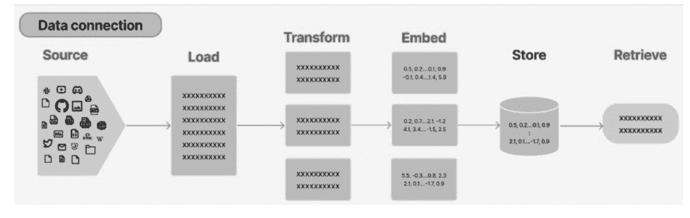

图3-2 Retrieval环节的关键模块

（1）文档加载器。负责把来源各异的原始文件读入系统。LangChain 自带上百种加载器，并与 AirByte、Unstructured 等生态互通，可从私有 S3 桶或公开网页读取 HTML、PDF、代码等多种格式。

（2）文本分割器。检索只能作用于文档的局部片段，因此需要把长文档切块。LangChain 提供多种切分算法，并针对代码、Markdown 等类型做了专门优化。

（3）文本嵌入模型。检索依赖向量表示来捕捉语义。LangChain 集成了 25 余家嵌入提供方，涵盖开源与商业 API，并提供统一接口以便切换。

（4）向量存储。生成嵌入后需要高效存取。LangChain 可接入 50 多种向量库，从本地开源到云托管均可，并通过标准接口实现迁移。

（5）检索器。数据入库后仍需取出。LangChain 在此环节提供较多增益，基础是语义搜索，之上还包括：

- ①父文档检索器。对同一父文档生成多个子块嵌入，检索时基于小块匹配，返回时提供完整上下文。
- ②自查询检索器。用户提问常隐含元数据过滤意图，自查询可将自然语言拆分为语义部分与元数据条件。
- ③集成检索器。可同时组合多个数据源或多种算法进行检索。

（6）索引。LangChain 的索引 API 负责把各类来源的数据同步到向量库，避免重复写入、避免对未变更内容重算嵌入，并在分块后保持与源文档的对应关系。

以下逐个展开。

#### 3.3.2 文档加载器
文档加载器是数据处理入口，职责是从多源抽取文本及其元数据并转为统一的文档对象。文档通常由正文与元数据如作者、发布时间等组成，统一结构有助于后续分析稳定可靠。

它可处理文本文件、网页内容、YouTube 字幕等多种来源。核心方法 load 会把指定来源转为文档列表。多数加载器还支持懒加载，按需载入内存，对大数据更友好。

以 CSV 加载器为例，演示如何把表格转为文档对象。

```python
from langchain_community.document_loaders import CSVLoader

# 实例化CSVLoader，指定数据文件路径
loader = CSVLoader('example_data.csv')

# 使用load()方法加载数据，转换为文档对象集合
documents = loader.load()

# 此时，'documents'包含从example_data.csv文件中加载的数据
# 每一行数据被转换成一个独立的文档对象，便于后续处理和分析
```

上述方式一次性完成 CSV 读取与对象化，每个条目拥有统一接口，便于后续分析、抽取或挖掘，无论源格式如何，加载器都提供了清晰的起点。

#### 3.3.3 文本分割器
加载后通常需做转换以适配模型。典型需求是将长文本切成小块以满足上下文窗口限制。LangChain 内置多套文档转换工具，支持切分、合并、过滤等，极大简化预处理。

切分长文本看似简单，实则细节不少。理想策略是保持语义连贯的片段不被拆散，具体定义会随文本类型变化。基本做法是先拆成句子等小单元，再组合成目标大小的块，并在相邻块间保留少量重叠以维持连贯。

LangChain 提供多类分割器供定制，可在 langchain-text-splitters 中找到，用户能根据需求调节切分方式与块大小度量，如表3-1所示。可借助 Chunkviz 观察分割效果，便于调参。

## 表3-1 分割器的特征

| 名称 | 分割依据 | 添加元数据 | 描述 |

| --- | --- | --- | --- |

| Recursive | 用户定义的字符列表 | | 递归地分割文本。递归分割文本的目的是试图将相关的文本片段保持在一起。这是开始分割文本的推荐方法 |

| HTML | HTML 特定字符 | 是 | 根据 HTML 特定字符分割文本。值得注意的是，这会添加关于该块来自何处的相关信息（基于 HTML） |

| Markdown | Markdown 特定字符 | 是 | 根据 Markdown 特定字符分割文本。值得注意的是，这会添加关于该块来自何处的相关信息（基于 Markdown） |

| Code | 代码（Python、JS）特定字符 | | 根据编码语言特定的字符分割文本。可以选择 15 种不同的语言 |

| Token | Tokens | | 根据 tokens 分割文本。有几种不同的方法来测量 tokens |

| Character | 用户定义的字符 | | 根据用户定义的字符分割文本。这是较简单的方法之一 |

#### 3.3.4 文本嵌入模型
Embeddings 类是对接各类嵌入模型的统一工具，支持 OpenAI、Cohere、Hugging Face 等厂商。经由它可将文本映射为向量，便于在向量空间执行语义检索。

LangChain 基础 Embeddings 区分 embed_documents 用于批量文本，embed_query 用于单条查询，部分厂商对两者采用不同策略。以下以 Gemma 模型创建嵌入为例。

```
from langchain_community.embeddings import OllamaEmbeddings
embeddings_model = OllamaEmbeddings(model = "gemma:2b")
```

调用 embed_documents 可批量生成向量，返回与输入一一对应的列表。

如图3-3所示，典型流程为加载源数据、查询向量库、返回最相似结果。随后通过安装依赖、加载文档、生成嵌入并写入 Chroma 的示例演示完整链路。首先安装向量数据库，存储与检索嵌入是检索系统的核心。

```
pip install chromadb  # 安装向量数据库
```

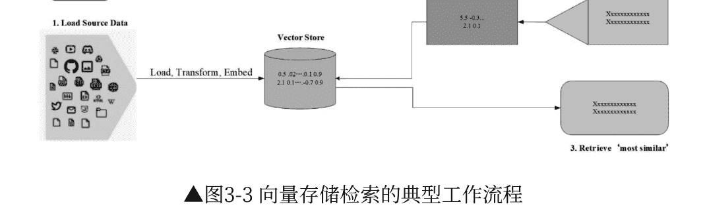

▲图3-3 向量存储检索的典型工作流程

经分割、嵌入并写入 Chroma 后形成可检索的向量库。可通过 similarity_search 按文本查询，也可通过 similarity_search_by_vector 用预计算向量查询。这体现了 LangChain 构建灵活对话应用的能力。

【例3-8】 构建一个能够响应查询并找出最相关文档的系统（代码：new3.5textembeded）。

```
from langchain_community.embeddings import OllamaEmbeddings
# 初始化嵌入模型
embeddings_model = OllamaEmbeddings(model = "gemma:2b")
# 需要被嵌入的文本列表
texts = [
    "你好!",
    "哦,你好!",
    "你叫什么名字?",
    "我的朋友都叫我小明",
    "你好小明!"
]
# 为文本列表创建嵌入
embeddings = embeddings_model.embed_documents(texts)
from langchain_community.vectorstores import Chroma
from langchain_community.document_loaders import TextLoader
from langchain_text_splitters import CharacterTextSplitter
# 假设有一些原始文档需要加载和分割
raw_documents = TextLoader('doc.txt').load()
text_splitter = CharacterTextSplitter(chunk_size=1000, chunk_overlap=0)
documents = text_splitter.split_documents(raw_documents)
# 创建并填充 Chroma 向量存储
db = Chroma.from_documents(documents, embeddings_model)
# 用户查询文本
query = "小明喜欢什么运动?"
# 使用 Chroma 向量存储检索最相似的文档
docs = db.similarity_search(query)
# 打印最相似文档的内容
print(docs[0].page_content)
```

#### 3.3.5 检索器
检索器是对非结构化查询返回文档的抽象，不必负责存储，只需负责取出。底层可用向量库，也可为其他形态。输入为字符串查询，输出为文档列表。LangChain 提供多种高级检索方式，如表3-2所示。

## 表3-2 检索类型列表

| 名称 | 索引类型 | 使用 LLM | 何时使用 | 描述 |

| :--- | :--- | :--- | :--- | :--- |

| Vectorstore | Vectorstore | 否 | 当有大量文本数据需要快速、高效检索，且对语义理解要求不是特别高时 | 将文本转换为向量表示，通过计算向量相似度来检索相关文档。适合处理大规模数据，检索速度快，但可能忽略上下文语义 |

| ParentDocument | Vectorstore + Documentstore | 否 | 当文档结构复杂，包含多个小的信息片段，但需要保持整体上下文时 | 将文档分割成小块进行索引，但在检索时返回完整的父文档。这种方法平衡了精确检索和保持上下文的需求 |

| Multi Vector | Vectorstore + Documentstore | 有时在索引期间使用 | 当单一向量表示不足以捕捉文档的全部重要特征时 | 为每个文档创建多个向量表示，可能包括文本摘要、假设问题等。这种方法提高了检索的多样性和准确性，但增加了索引复杂度 |

| Self Query | Vectorstore | 是 | 当用户查询需要复杂的解释和转换，或者检索需要考虑元数据时 | 使用 LLM 将用户输入转换为语义查询和元数据过滤器。这种方法能更好地理解用户意图，提高检索精度 |

| Contextual Compression | 任何 | 有时 | 当检索结果包含大量冗余或不相关信息时 | 在检索后进行额外的处理，从检索到的文档中提取最相关的信息。这种方法可以大大提高返回信息的质量和相关性 |

| Time-Weighted Vectorstore | Vectorstore | 否 | 当文档的时效性很重要，需要考虑内容的新近程度时 | 结合语义相似性和时间因素进行检索。这种方法适合新闻、社交媒体等时效性强的内容检索 |

| Multi-Query Retriever | 任何 | 是 | 当面对复杂、多方面的查询，单一查询可能无法全面捕捉用户意图时 | 使用 LLM 从原始查询生成多个相关查询，然后综合这些查询的结果。这种方法可以提高检索的全面性和深度 |

| Ensemble | 任何 | 否 | 当单一检索方法无法满足复杂需求，需要结合多种方法的优势时 | 组合多个检索器的结果。这种方法可以平衡不同检索策略的优缺点，提高整体检索性能 |

| Long-Context Reorder | 任何 | 否 | 当使用能处理长文本的大语言模型，需要优化输入顺序以提高模型性能时 | 重新排序检索到的文档，使最相关的内容位于开头和结尾。这种方法利用了大语言模型对文本开头和结尾部分的特殊关注，以提高处理效果 |

#### 3.3.6 索引
LangChain 索引 API 可把任意来源文档同步到向量存储，核心目标是避免重复写入、避免对未改动内容重算嵌入，从而节省成本并提升效果。索引过程保持文档经多次转换后仍可溯源。

其机制依赖记录管理器追踪写入状态。每个文档计算哈希并保存哈希、写入时间、源 ID 等信息，便于判断是否变更或删除。如表3-3所示，API 支持 None、Incremental、Full 三种清理模式，适应不同场景。

## 表3-3 索引API删除模式

| 清理模式 | 去重内容 | 可并行化 | 清理已删除的源文档 | 清理源文档和/或派生文档的变体 | 清理时间 |

| :--- | :---: | :---: | :---: | :---: | :---: |

| None | ✅ | ✅ | ❌ | ❌ | — |

| Incremental | ✅ | ✅ | ❌ | ✅ | 连续 |

| Full | ✅ | ❌ | ✅ | ✅ | 索引结束时 |

下面以本地 Gemma 模型演示索引流程。首先创建向量存储与嵌入模型，配置记录管理器并选择清理模式，再加载原始文档、分块、生成嵌入并写入 Chroma。合理选择清理模式可避免冗余版本，保持库内数据准确高效，体现 LangChain 在索引任务上的灵活性。

## 【例3-9】 LangChain索引API的基本工作流程（参考代码new3.6index）。

向量检索焕新与智能 Agent 构建要点

```
from langchain.indexes import SQLRecordManager, index
from langchain_core.documents import Document
from langchain_community.vectorstores import Chroma
from langchain_community.embeddings import OllamaEmbeddings
# 初始化向量存储和嵌入模型
collection_name = "test_index"
embedding = OllamaEmbeddings(model_path="path/to/gemma/model")    # 依据自己的实际设置
vectorstore = Chroma(collection_name=collection_name, embedding_function=embedding)
# 初始化记录管理器
namespace = f"chroma/{collection_name}"
record_manager = SQLRecordManager(namespace, db_url="sqlite:///record_manager_cache.sql")
record_manager.create_schema()
# 示例文档
doc1 = Document(page_content="小明喜欢踢足球", metadata={"source": "xiaoming.txt"})
doc2 = Document(page_content="小红喜欢打篮球", metadata={"source": "xiaohong.txt"})
# 使用不同的删除模式将文档索引到向量存储中
index([doc1, doc2], record_manager, vectorstore, cleanup="incremental", source_id_key="source")
```

走完前述流程后，你能把向量库的内容整理得更利落，也能依业务现状挑选合适的清理策略，保持资料新鲜度、让检索更贴题。此演示把 LangChain 针对索引治理时的灵活与强劲凸显出来，给向量搜索类应用打下扎实根基。

索引 API 在源头资料和向量库之间搭起智能联动。它会追踪文档变动，自动完成去重、更新与删除，让库内内容始终跟源头保持一致，从而把召回质量和响应效率都拉上去。

落地时可按任务自由拼装检索组件。比如借助 Gemma 这类开源模型生成高质量向量；利用 Chroma 与 FAISS 等高性能存储扛住大规模数据的实时查询；再搭配自查询检索器、上下文压缩检索器等进阶算法应对复杂提问。

### 3.4 代理

Agent 设计思路是把大语言模型当成决策中枢，运行期动态挑选并排序操作。与 Chain 结构里步骤写死在代码的做法不同，Agent 依靠模型推理判断该执行哪些动作以及先后顺序。设计时需厘清几个关键角色：Agent 本体作为执行主体，AgentExecutor 负责落地决策，Tools 是可调用的操作单元，Toolkits 是一组协作工具的集合。这几部分共同组成 Agent 的基础架构，帮助其在复杂环境中做出智能判断并完成任务。

#### 3.4.1 核心思想

在 LangChain 体系内，Agent 与 Chain 相互补充，二者根本差异在于：Chain 的步骤在代码里预先固定，而 Agent 让语言模型担任推理引擎，依据情境动态决定下一步做什么、怎么做。这种机制让行为更具弹性与智能。

实现涉及下面核心要素。

- (1) AgentAction：数据类，用来描述 Agent 计划执行的动作。包含 tool 指明调用的工具名称，tool_input 提供该工具的输入参数。
- (2) AgentFinish：表示 Agent 结束运行，准备把结果返回给用户。通常包含 return_values 映射，其中一般有 output 键，对应返回给用户的响应文本。
- (3) 中间过程：记录 Agent 先前已执行的动作及其产出，以便在后续迭代中保持记忆。其类型为 List[Tuple[AgentAction, Any]]，observation 目前保持为 Any 以保证灵活性，实操里多为字符串。

Agent 类负责判定下一步动作，通常依赖语言模型、提示模板和输出解析器。不同场景可能需要不同的提示风格、输入编码方式和输出解析策略，LangChain 既支持定制 Agent，也交付多种内置类型供扩展。

Agent 的输入是一个键值映射，其中必需的键是 intermediate_steps，对应上述中间过程。一般由 PromptTemplate 把键值对转成适合传递给 LLM 的格式。输出则是下一个待执行的动作，或最终发给用户的响应，即 AgentAction 或 AgentFinish。

AgentExecutor 是 Agent 的运行环境，负责调用 Agent、执行其选择的动作、把结果回传给 Agent 并进入下一轮迭代。表面看流程简单，但它替开发人员处理了大量细节，比如工具缺失、工具运行失败、输出无法解析为工具调用等，同时在决策和调用各层级提供日志与可观测。

#### 3.4.1 Agent 运行流程

图3-4展示了 Agent 的典型流程。观察环节，Agent 通过输入接口接收外部触发，如用户提问或系统请求，并解析提取核心信息作为后续依据。随后进入思考环节，利用预设规则、知识库或机器学习模型分析观察到的信息，判断如何响应，可能包括理解用户意图、推断所需工具及提取运行参数等子步骤。最后是行动环节，基于思考结果执行具体动作，涵盖参数填充、工具调用、生成响应并输出给用户或系统。LangChain 将整套流程高效实现，让 Agent 能以高度智能的方式处理各类情况。

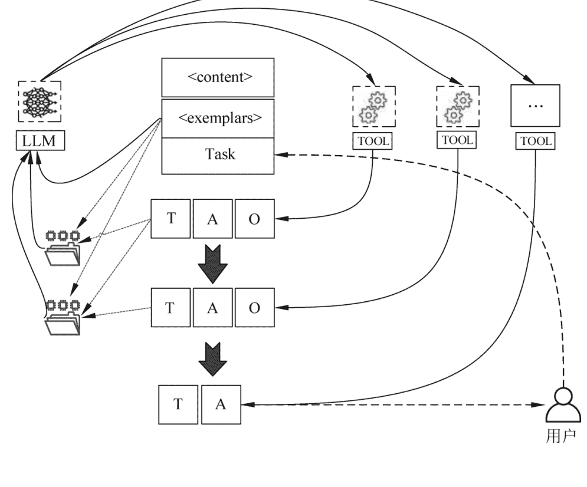

下面给出一个基于 Agent 与 AgentExecutor 的代码示例，用来演示搭建与运行方式。

```
# 初始化代理和 AgentExecutor
agent = Agent(...)  # 假设 Agent 已经被正确初始化
agent_executor = AgentExecutor(agent=agent, tools=[...])  # 传入代理和工具列表
# 执行代理，获取动作或最终结果
result = agent_executor.execute(input_data)
# 根据结果进行处理
if isinstance(result, AgentAction):
    # 执行动作
    ...
elif isinstance(result, AgentFinish):
    # 处理最终结果
    ...
```

借助动态决策与执行，Agent 提供了一种更灵活、更智能的处理复杂交互的方式。应用可依据情境和之前的交互实时调整行为，让构建复杂的对话系统和互动式应用成为可能。这种能力在实时互动、自动化流程和智能决策辅助等场景中尤为关键。

为提升实现与运行效率，LangChain 交付了日志追踪、可观测增强等手段，帮助开发人员更清晰地追踪和调试行为。AgentExecutor 的设计也充分考虑了错误处理与异常管理，确保在决策和工具调用过程中保持稳定可靠。

实操里构建高效 Agent，需要深入理解目标应用的具体要求，包括用户的交互习惯、所需的自动化程度，以及如何最优地利用可用工具与资源。借助 LangChain 交付的框架和 API，可设计出能智能响应输入、自动执行任务并给出有用反馈的 Agent。通过迭代开发和测试持续优化推理逻辑与动作序列，性能会逐步提升，更好地服务于应用与用户。

#### 3.4.2 代理类型

按 LangChain 的划分，Agent 可依据预期模型类型、是否兼容聊天历史、是否兼容多参数工具、是否兼容并行调用等特征来挑选。比如 OpenAI Tools Agent 兼容聊天模型，能处理聊天历史、多参数工具及并行调用，适合使用最新 OpenAI 模型的场景；而 XML Agent 则更适合擅长 XML 格式的 Anthropic 等模型。选型取决于应用需求、模型能力与任务复杂程度等多重因素。

选型时应综合考虑模型能力、任务复杂度、效率要求、可用工具和个性化需求。若任务需要支持聊天历史的多轮对话，OpenAI Tools 这类 Agent 更合适；若效率至关重要，可优先考虑兼容并行调用的 Agent 以加快处理；也需依输出格式需求挑选兼容 XML 或 JSON 的 Agent，或按工具特性挑选兼容多参数的 Agent。充分了解各类 Agent 的特性与适用场景，有助于做出更明智的选择。

例如搭建客服聊天机器人时，目标是理解用户查询并给出有用反馈。此时代理需要保留聊天历史以把握语境，OpenAI Tools Agent 就很匹配，它不仅兼容聊天历史，还能使用多参数工具并行调用，提升效率。配合最新的 OpenAI 模型，机器人可以理解复杂提问，并借助外部工具如数据仓库查询给出准确答案。

再如内容创作工具，比如自动撰写新闻稿或代码注释，可能倾向于使用擅长特定格式的 Agent。若需要生成结构化 XML 数据，XML Agent 更合适，因为 Anthropic 等模型能直接以 XML 呈现理解和生成内容，从而提升精准度和效率。

在数据分析和报告场景里，可能需要 Agent 整理、汇总数据后生成报告。此时 Structured Chat Agent 是不错的选择，它兼容多参数工具，可同时调用数据查询与数据处理工具，再把结果整合为易读的报告。并行调用特性还能加快数据处理与报告生成的速度。

#### 3.4.3 工具

在 LangChain 体系里，Tool 是构建智能 Agent 必不可少的部分，它让 Agent 能够与外部环境交互。Tool 的设计理念是交付清晰的接口，使 Agent 可以执行特定操作或访问特定服务。每个 Tool 通常包含以下要素。

- 1. 工具名：唯一标识，便于在 Agent 中引用。
- 2. 工具说明：简要说明功能与用途，帮助理解其作用。
- 3. 工具输入的 JSON 描述：定义期望的输入结构，确保参数结构符合预期。
- 4. 调用的函数：指定被触发时应执行的函数或操作。
- 5. 结果处理方式：标明执行结果是否直接返回给用户。

这些要素构成 Tool 的基础架构，使 Agent 在决策时能精确指定并执行动作。简洁的输入有助于大模型更高效地使用 Tool，而清晰的名、说明和 JSON 描述则确保模型准确理解和调用。

下面以本地大模型 Llama2 为例演示自定义 Tool 的构建。目标是创建一个 Tool，能依用户提问调用 Llama2 生成相关文本信息，可用于自动问答、内容创作等场景。选用本地模型主要是为了说明切换是自由的。

### 【例3-10】工具的使用（代码参见3.8llama2.py）。

```
from langchain.tools import BaseTool
from pydantic import BaseModel, Field
from langchain_community.llms import Ollama as OllamaLLM
class Llama2QAInput(BaseModel):
    query: str = Field(description="向 LLAMA2 模型提问的问题字符串。")
    class Config:
        json_schema_extra = {
            "example": {
                "query": "LangChain 是什么?"
            }
        }
class Llama2QATool(BaseTool):
    name = "llama2_qa"
    description = "一个使用 LLAMA2 模型回答问题的工具。输入应该是一个问题字符串。"
    llm: OllamaLLM = Field(..., description="用于回答问题的 LLAMA2 模型实例。")
    def _run(self, query: str) -> str:
        return self.llm(query)
    async def _arun(self, query: str) -> str:
        return self.llm(query)
    def run(self, tool_input: Llama2QAInput) -> str:
        query = tool_input.query
        return self._run(query)
llm = OllamaLLM(model = "llama2")
tool = Llama2QATool(llm = llm)
input_data = Llama2QAInput(query = "什么是 Python?")
result = tool.run(input_data)
print(result)
```

该案例中程序定义了一个名为“llama2_qa”的 Tool 作为唯一标识，并提供说明：“一个使用 LLAMA2 模型回答问题的工具。输入应为问题字符串。”，以便理解其功能。程序用 Pydantic 模型 Llama2QAInput 指定输入结构，包含一个名为 query 的字符串字段，表示向 LLAMA2 提问的问题。Llama2QATool 类实现了 _run() 与 _arun() 方法，分别用于同步和异步调用 LLAMA2 生成回答。run() 方法负责把 Llama2QAInput 实例转换为 _run() 所需的参数。Tool 直接返回 LLAMA2 生成的答案字符串，无需额外后续处理。

通过这种方式，可把复杂的模型调用封装成 LangChain Tool，再在 Agent 中使用，从而构建更智能、更灵活的应用。该案例展示了如何基于本地大模型 Llama2 创建并使用自定义 Tool，让开发人员充分利用现有模型资源，为用户交付高质量的智能服务。

Tool 在 LangChain 中应用广泛，不只限于内置 Tool。开发人员可依需定义自定义 Tool 来扩展 Agent 能力。Toolkits 提供了一组协作运行的 Tool 集合，便于解决特定问题。将 Tool 与 OpenAI 函数结合还能进一步提升通用性和灵活性，从简单查询到复杂数据处理都能覆盖。Tool 在 LangChain 中担任着连接 Agent 与外部环境的桥梁，合理设计与应用可显著提升智能程度与实用性。

#### 3.4.4 案例分析

本案例将探讨如何构建一个集成两种不同 Tool 的智能 Agent，以实现信息检索功能：一是基于 Gemma 大模型的本地检索器，二是网络检索 Tool。目标是让 Agent 能够依用户查询，在本地索引和在线资源中查找相关信息。

(1) 本地检索器。首先需要搭建一个本地检索器，它会借助 Gemma 大模型创建索引并执行检索。从自有数据仓库或文档集合等原始资料出发，使用 Gemma 模型为文档生成向量嵌入，再借助 FAISS 这一高效相似度检索库建立向量索引，以便迅速检索出与查询最相关的文档。

```
# 引入必要的库
from langchain.llms import Ollama as OllamaLLM
from langchain.document_loaders import TextLoader
from langchain.vectorstores import FAISS
from langchain.text_splitters import RecursiveCharacterTextSplitter
# 初始化 Gemma 模型和 FAISS 向量存储
gemma_model = OllamaLLM(model = "gemma:2b")
faiss_vector_store = FAISS()
# 加载并嵌入文档
loader = TextLoader("path/to/your/data")
docs = loader.load()
splitter = RecursiveCharacterTextSplitter(chunk_size = 1000, chunk_overlap = 200)
split_docs = splitter.split_documents(docs)
vectors = gemma_model.embed_documents([doc.page_content for doc in split_docs])
# 将嵌入向量存储到 FAISS 中
faiss_vector_store.add_documents(vectors)
```

(2) 在线搜索工具。做在线检索最省事的方式是接入现有的搜索引擎 API。准备好对应的密钥后，就能简单封装一个工具，实现把查询语句发出并把返回结果收回。

```
# 假设已有在线搜索工具 API 封装
from your_search_tool_api_wrapper import OnlineSearchAPIWrapper

online_search_tool = OnlineSearchAPIWrapper(api_key = "your_api_key")
```

(3) 创建代理。本地检索器与在线搜索工具都已准备就绪，下一步是让一个智能代理来做调度，根据具体情况决定使用哪一套检索能力。

```
# 使用 Gemma 模型和定义的工具创建代理
from langchain.agents import BasicAgent
# 定义代理决策逻辑
def agent_decision(input_text):
    if "本地" in input_text:
        # 如果查询包含"本地",则使用本地检索器
        return faiss_vector_store.search(input_text.replace("本地", ""))
    else:
        # 否则,默认使用在线搜索工具
        return online_search_tool.search(input_text)
# 创建代理实例
agent = BasicAgent(decision_logic=agent_decision)
```

(4) 运行代理并分析结果。代理搭建完成后，可以用多种不同的提问去测试，它会依据查询特征自动选择调用本地检索器还是在线搜索工具来作答。

```
# 示例查询
queries = ["本地如何上传数据集", "San Francisco 的天气如何"]
for query in queries:
    result = agent.invoke({"input": query})
    print(f"查询: {query}\n结果: {result}\n")
```

这个例子清楚地演示了如何把不同检索工具和决策逻辑组合起来，打造出具备自主判断能力的智能代理。输入到来时，代理会自动匹配最合适的检索来源，既能在本地知识库里查找，也能联网获取最新信息。这种做法明显提升了检索的灵活度和准确度，也体现了 LangChain 框架结合大模型实现复杂系统的思路。

### 3.5 链

在 LangChain 里，链是把多个功能模块串联起来的核心机制，借助 LCEL 表达式语言就能灵活组装出符合业务需求的工作流，支撑复杂的数据处理和决策。

(1) 问答链（QA Chain）。要做一个从海量文档里找相关信息并给出答案的问答系统，可以用问答链来搭建。

```
from langchain.chains import create_retrieval_chain
from langchain.llms import Ollama as OllamaLLM
from langchain.vectorstores import FAISS
# 初始化检索器和语言模型
retriever = FAISS.load_local("path/to/faiss_index")
llm = OllamaLLM(model="gemma:2b")
# 构建问答链
qa_chain = create_retrieval_chain(retriever, llm)
# 执行问答链
query = "如何提高编程能力?"
result = qa_chain.invoke(query)
print(result)
```

(2) 对话式文档问答链（Conversational Retrieval Chain）。当需要让系统记住对话上下文并在作答时加以考虑，就要用到对话式的文档问答链：

```
from langchain.chains import ConversationalRetrievalChain
from langchain.llms import Ollama as OllamaLLM
from langchain.vectorstores import FAISS
# 初始化检索器和语言模型
retriever = FAISS.load_local("path/to/faiss_index")
llm = OllamaLLM(model="gemma:2b")
# 构建对话式问答链
conv_qa_chain = ConversationalRetrievalChain(retriever=retriever, llm=llm)
# 模拟对话
chat_history = []
while True:
    query = input("用户: ")
    result = conv_qa_chain.invoke({"question": query, "chat_history": chat_history})
    chat_history.append((query, result["answer"]))
    print(f"助手: {result['answer']}")
```

(3) 多功能智能助手链。LangChain 的可组合性也支持构建更复杂的链条，比如把信息检索、数据分析、实时计算等多种能力整合到同一个智能助手链中。

```
from langchain.chains import MultiFunctionChain
from langchain.llms import Ollama as OllamaLLM
from langchain.vectorstores import FAISS
from langchain.tools import MathCalculator
# 初始化组件
retriever = FAISS.load_local("path/to/faiss_index")
llm = OllamaLLM(model = "gemma:2b")
math_calculator = MathCalculator()
# 构建多功能智能助手链
multi_func_chain = MultiFunctionChain(retriever=retriever, llm=llm, tools=[math_calculator])
# 运行链以处理不同类型的查询
queries = ["北京的历史", "2 加 2 等于多少", "如何学习 Python"]
for query in queries:
    result = multi_func_chain.invoke(query)
    print(f"查询: {query}\n 结果: {result}\n")
```

随着 LangChain 生态日益成熟，开发者既能使用更多开箱即用的链模板和组件，也能基于 LCEL 自行定制链，从而打造响应更灵活、功能更丰富的智能应用。链的可组合与可扩展特性，让未来应用的想象空间变得很大。

### 3.6 记忆

记忆在语言模型应用中非常重要，尤其在对话场景里。借助记忆，对话系统能回溯历史信息，让交互更自然。LangChain 提供了从简单历史记录到复杂世界建模的多元记忆方案。

（1）聊天记忆与聊天历史。

如图3-5所示，记忆系统本质上要完成读写两类操作。一般来说，每个链都有固定的执行逻辑，所需输入一部分来自用户，另一部分可能来自记忆。在一次运行中...

落地记忆时，关键是如何高效保存和查询对话历史。LangChain 提供了 ConversationBufferMemory 等工具，方便记录用户与 AI 的交互。此外配合本地大模型如 Gemma，能构建更智能的记忆系统，不仅能回想历史内容，还能抽取出实体、属性和关系等关键点。下面给出一个示例程序。

```python
from langchain.memory import ConversationBufferMemory
from langchain.llms import Ollama as OllamaLLM
# 初始化记忆存储和语言模型
memory = ConversationBufferMemory()
llm = OllamaLLM(model = "gemma:2b")
# 向记忆中添加对话信息
memory.chat_memory.add_user_message("你好!")
memory.chat_memory.add_ai_message("有什么可以帮到你的吗?")
# 演示如何加载记忆变量
print(memory.load_memory_variables({}))
```

## (2) 定制记忆系统。

对于更进阶的需求，LangChain 允许用户自定义记忆。例如，可以基于 NLP 技术从对话中抽取实体，并建立实体间的关联模型。下面演示了如何用 Gemma 模型配合 spacy 构建一个能够理解并记忆实体信息的系统。

### 【例3-11】 定制记忆系统（参考代码3.9.py）。

```python
from langchain.schema import BaseMemory
from langchain.llms import Ollama as OllamaLLM
import spacy
nlp = spacy.load("zh_core_web_sm")
class EntityMemory(BaseMemory):
    def __init__(self, * args, ** kwargs):
        super().__init__(* args, ** kwargs)
        self.entity_map = {}
    def extract_entities(self, text):
        doc = nlp(text)
        return [ent.text for ent in doc.ents]
    def update_memory(self, question, answer):
        entities = self.extract_entities(question)
        for entity in entities:
            if entity not in self.entity_map:
                self.entity_map[entity] = []
            self.entity_map[entity].append(answer)
#示例：使用实体记忆系统
memory = EntityMemory()
llm = OllamaLLM(model = "gemma:2b")
```

该记忆系统先用 spacy 从问题里抽取实体，再把答案关联到对应实体的列表中保存。这样就能追踪每个实体的相关回答，并在需要时调取。随后实例化 EntityMemory 作为 memory，并用基于 Gemma:2b 的 OllamaLLM 作为 llm，为实体记忆系统提供运行基础。

注意运行前请确认依赖已安装，特别是 spacy 与 zh_core_web_sm 模型。若未安装，可执行以下命令。

```
pip install spacy
python -m spacy download zh_core_web_sm
```

## (3) 链与记忆的整合。

LangChain 支持把记忆接入链中，构建更复杂的对话流程。下面的示例展示了如何把 EntityMemory 融入对话链，让 AI 结合过往对话和提取出的实体信息给出更精准的回答。

```python
from langchain.chains import LLMChain
from langchain.prompts import PromptTemplate
# 初始化提示模板
template = PromptTemplate(template="根据之前的对话和实体信息,回答问题: {question}")
llm_chain = LLMChain(llm=llm, prompt=template, memory=memory)
# 使用链和记忆进行对话
result = llm_chain.invoke(question="张三最喜欢的运动是什么?")
print(result)
```

借助提示模板、链条等组件的灵活组合，LangChain 为聊天机器人等对话类应用提供了丰富的记忆能力，实现了更自然连贯的多轮对话。记忆降低了加入该能力的门槛，让开发者更专注业务逻辑。同时框架也开放接口，支持定制专属的记忆实现，进一步提升灵活性。

在 LangChain 中，记忆指的是链或代理在多次执行间得以保留的状态，对对话类应用意义重大。把聊天历史上下文保存在记忆里，能随时间提升 LLM 回答的连贯性和相关性，也能减少重复调用，降低 API 成本，并为链或代理提供必要的上下文。

框架提供的记忆选项包括 ConversationBufferMemory、ConversationBufferWindowMemory、ConversationKGMemory 等，可保存全部或仅最近的消息。持久化方面，还集成了多种数据库：SQL 阵营的 Postgres、SQLite，NoSQL 阵营的 MongoDB、Cassandra，内存数据库 Redis，以及托管云服务 AWS DynamoDB。Remembrall 和 Motörhead 等专为记忆服务器设计的工具进一步优化了对话上下文。选择哪种方案取决于持久化需求、数据关系、规模和资源，但在对话和交互式应用中，保持稳健的状态至关重要。

### 3.7 回调

构建语言模型应用时，常需要在模型运行的不同阶段加入额外操作，比如日志记录、进度监控或流式输出。LangChain 提供了强大的回调系统，可在 LLM、链、工具、代理等组件的各阶段注入自定义处理逻辑。下面介绍其机制及用法。

### （1）回调处理器。

使用回调功能的第一步是定义一个或多个回调处理器。处理器是一个实现特定接口的类，内部包含在事件触发时被调用的方法。常见回调事件有：

- on_llm_start：语言模型开始运行时触发。
- on_llm_end：语言模型运行结束时触发。
- on_llm_error：语言模型运行出错时触发。
- on_chain_start：链开始运行时触发。
- on_chain_end：链运行结束时触发。
- on_tool_start：工具开始运行时触发。
- on_tool_end：工具运行结束时触发。
- on_agent_action：代理执行动作时触发。

下面是一个简易示例，演示如何在模型生成新 token 时将其打印出来。

```python
from langchain.callbacks.base import BaseCallbackHandler
class MyHandler(BaseCallbackHandler):
    def on_llm_new_token(self, token: str, **kwargs) -> None:
        print(f"New token generated: {token}")
```

### （2）使用回调处理器。

定义完处理器后，有两种常用方式将其挂载到应用组件上。

①构造时回调（Construct callbacks）：在组件初始化时通过 callbacks 参数传入处理器列表。这种方式下，回调会在该组件整个生命周期内生效。

```python
from langchain_community.llms import Ollama as OllamaLLM
from langchain.chains import LLMChain
from langchain.prompts import PromptTemplate
handler = MyHandler()
llm = Gemma(callback=[handler])
prompt = PromptTemplate()
chain = LLMChain(llm=llm, prompt=prompt, callbacks=[handler])
```

② 单次请求钩子。调用组件的 run、call 或 apply 等入口时，可把回调处理器列表传给 callbacks 参数，这类注册只在本次调用期间起作用。

```python
chain.run("问题", callbacks = [handler])
```

### (3) 异步回调。

若模型或链以异步方式执行，就需要配套的异步处理类，常规做法是让实现继承 AsyncCallbackHandler。

```python
import asyncio
from langchain.callbacks.base import AsyncCallbackHandler
class MyAsyncHandler(AsyncCallbackHandler):
    async def on_llm_start(self, serialized: Dict[str, Any], prompts: List[str], **kwargs: Any) -> None:
        await asyncio.sleep(1)
        print("异步回调，LLM 开始运行")
```

借助异步处理器，能够防止非阻塞流程中事件循环被卡住。

### (4) 流式传输。

回调的典型用法之一是让大模型边生成边输出，即在 responses 产生过程中把中间结果即时返回。做法是提供一个自定义处理器，并在 on_llm_new_token 方法里对每个新 token 做处理。

下面示例说明如何结合 Gemma 模型与自定处理器实现逐 token 输出。

```python
from langchain_community.llms import Ollama as OllamaLLM
from langchain.callbacks.streaming_stdout import StreamingStdOutCallbackHandler
llm = Gemma(streaming = True, callbacks = [StreamingStdOutCallbackHandler()])
prompt = """
对爱好长跑的孩子说些鼓励的话,让他能坚持下去训练。以富有诗意的语言书写一段话,不少于150字。
"""
llm(prompt)
```

执行前文代码后，输出会逐词显现，而不是等整段落完成后再一次性交出。

### （5）记录日志。

日志记录也是常用的回调场景。除内置的 StdOutCallbackHandler 能把信息打到控制台外，还可选用 FileCallbackHandler 把日志写入文件，或自行设计格式与存储位置。

下面演示把模型与链的运行轨迹写入文件的思路。

```python
from langchain_community.llms import Ollama as OllamaLLM
from langchain.chains import LLMChain
from langchain.prompts import PromptTemplate
from langchain.callbacks.file import FileCallbackHandler
handler = FileCallbackHandler("gemma.log")
llm = Gemma(callbacks=[handler])
prompt = PromptTemplate(
    input_variables=["question"],
    template="启动我的{question}需要哪些步骤?"
)
chain = LLMChain(llm=llm, prompt=prompt, callbacks=[handler])
chain.run("航天火箭")
```

运行完毕后打开 gemma.log，就能看到包含 prompt、生成过程、最终结果等在内的详细记录。

### （6）多个回调处理器。

工程中往往同时需要多种处理器，比如一个负责流式输出、一个负责日志。LangChain 允许一次性传入一个处理器列表，框架会依次触发列表里的每个实现。

```python
from langchain.agents import initialize_agent
from langchain.callbacks.base import BaseCallbackHandler
class CallbackOne(BaseCallbackHandler):
    def on_chain_start(self, serialized, inputs, ** kwargs):
        print("CallbackOne - Chain 开始运行")
class CallbackTwo(BaseCallbackHandler):
    def on_tool_end(self, output, ** kwargs):
        print("CallbackTwo - 工具执行结束")
agent = initialize_agent(
    ..., # 其他初始化参数
    callbacks=[CallbackOne(), CallbackTwo()]
)
agent.run("帮我订一张从北京到上海的机票")
```

借助回调机制，无需改动核心流程就能为 LLM 应用扩展日志、流式输出、进度监控等附加功能。实际使用时既可选用框架内置的 StdOutCallbackHandler、FileCallbackHandler 等，也可通过继承 BaseCallbackHandler 或 AsyncCallbackHandler 来打造自己的处理器。合理运用回调，能让应用更稳健、更易维护。

### 【例3-12】 回调函数综合演示（代码参见3.10huidiao.py）。

```python
import asyncio
from typing import Any, Dict, List
from langchain_community.llms import Ollama as OllamaLLM
from langchain.chains import LLMChain
from langchain.prompts import PromptTemplate
from langchain.callbacks.base import BaseCallbackHandler
from langchain.callbacks.streaming_stdout import StreamingStdOutCallbackHandler
from langchain.callbacks.file import FileCallbackHandler
from langchain.schema import LLMResult
# 定义同步回调处理器
class SyncHandler(BaseCallbackHandler):
    def on_llm_start(self, serialized: Dict[str, Any], prompts: List[str], **kwargs: Any) -> None:
        """
        当 LLM 开始运行时触发
        :param serialized: 序列化后的 LLM 参数
        :param prompts: 输入的提示信息列表
        :param kwargs: 其他参数
        """
        print(f"LLM 开始运行, Prompts: {prompts}")
    def on_llm_end(self, response: LLMResult, **kwargs: Any) -> None:
        """
        当 LLM 运行结束时触发
        :param response: LLM 的响应结果
        :param kwargs: 其他参数
        """
        print(f"LLM 运行结束, Response: {response}")
    def on_llm_new_token(self, token: str, **kwargs: Any) -> None:
        """
        当 LLM 生成新的 token 时触发
        :param token: 新生成的 token
        :param kwargs: 其他参数
        """
        print(f"New token generated: {token}", end="", flush=True)
    def on_llm_error(self, error: Exception, **kwargs: Any) -> None:
        """
        当 LLM 运行出错时触发
        :param error: 异常对象
        :param kwargs: 其他参数
        """
        print(f"LLM 运行出错: {error}")
# 初始化 Gemma 模型
llm = OllamaLLM(
    model="gemma:2b",
    callbacks=[SyncHandler(), StreamingStdOutCallbackHandler()],
    verbose=True,
)
# 定义提示模板
prompt = PromptTemplate(
    input_variables=["product"],
    template="请帮我撰写一段关于{product}的产品介绍, 不少于 100 字。",
)
# 创建 LLMChain
chain = LLMChain(
    llm=llm,
    prompt=prompt,
    callbacks=[SyncHandler(), FileCallbackHandler("gemma.log")],
)
# 运行 LLMChain
chain.run("智能手表")
```

该示例演示了如何用回调与本地大模型 Gemma 协作，覆盖多个关键环节。首先定义同步处理器 SyncHandler，实现 on_llm_start 与 on_llm_end，用以在模型启动与结束时执行操作。随后引入异步处理器 AsyncHandler，实现 on_llm_new_token 与 on_llm_error，可在新 token 产生或出现错误时即时响应。接着实例化 Gemma 模型，并通过 callbacks 参数同时传入 SyncHandler、AsyncHandler 以及 StreamingStdOutCallbackHandler，从而开启流式输出与详细打印，提升交互的即时性与可视性。之后组建 LLMChain，把模型、提示模板与回调组合起来，其中 FileCallbackHandler 负责把运行日志写进文件，便于追踪状态与输出。最后运行链并传入 product 参数，触发各回调，实现对运行全过程的精细管控。

运行后可在控制台实时看到逐个生成的 token，同时也能看到模型开始与结束的提示。若出现异常，错误信息会立即被打印出来。此外，所有生成结果会被保存到 gemma.log，方便后续查阅与分析。

透过此例可更深入体会 LangChain 回调与本地模型 Gemma 的配合，能够实现日志、流式、异步等多种能力。回调提供了很强的定制空间，可按实际需求调整处理器，以满足不同场景。

## 小结

本章对 LangChain 基础构件进行了系统梳理，并展示了构建 LLM 应用的常用方法。先以快速入门案例介绍了 LLM 链、检索链、对话检索链与代理的基本用法；随后详细讲解了模型与提示模板、文档加载与文本切分、向量嵌入与存储、检索器与索引等核心部件；并说明了代理、链与记忆系统的搭建方式，以支撑更智能复杂的任务。最后重点讨论了回调在开发中的作用。通过学习本章，读者应能掌握用 LangChain 进行 LLM 应用开发的基本思路与技能。

## 思考题

### 一、简答题

- 1. 在LangChain中什么是链？

- 2. 什么是代理？

- 3. 什么是记忆？为什么需要它？

- 4. LangChain中有哪些类型的工具？

- 5. LangChain是如何工作的？

- 6. Gemma等本地大模型与OpenAI等API模型相比，在应用开发中有哪些优势？

- 7. 在构建检索增强的问答系统时，应如何选择和优化文档切分策略？

- 8. 你认为未来工具（Tool）将在LLM应用开发中扮演怎样的角色？

### 二、实践题
使用Gemma本地LLM和维基百科的数据，构建一个能够回答关于中国历史人物的问题的智能助手。要求：

- 1. 使用维基百科的中文数据源，通过文档加载器和文本分割器，构建向量索引。

- 2. 使用Gemma的embedding接口生成文本嵌入向量。

- 3. 使用问答链实现检索增强的问答功能，并基于上下文完成多轮对话。

- 4. 使用回调实现聊天记录，并允许将聊天记录导出为Markdown文件。

## 第4章 LangChain表达式语言
随着大语言模型快速演进，如何高效搭建 LLM 应用成为焦点。LangChain 为此类开发提供了完整工具集，其中 LCEL 是一种声明式组合方式，可把多个链条流畅衔接。LCEL 自诞生起就面向原型到生产，无需改动代码即可从“提示+LLM”这种基础组合扩展到极其复杂的流程。

本章将深入介绍 LCEL 的设计思想与使用技巧。先通过快速入门案例演示如何用 LCEL 搭建基础应用，再系统阐述流式处理、异步执行、并行优化等关键特性，并配合代码示例说明实践要点。此外，还将覆盖检索增强生成、对话交互、SQL 查询、代码生成等常见场景，帮助读者掌握用 LCEL 构建复杂系统的能力。

### 4.1 快速入门案例
本节介绍 LangChain 的声明式表达式语言 LCEL，用于便捷地组合链条。LCEL 从设计之初就支持原型直接上线，无需修改代码，从最简单的提示加模型组合到上百步的复杂链条均可胜任，已有开发者在生产环境部署了包含上百步的 LCEL 流程。

LCEL 提供流式输出、异步运行、并行优化、重试回退、中间结果访问等能力，显著提升开发效率与可靠性。链条还自带输入输出模式，便于在 LangServe 部署时做校验，保证数据正确。

为更好地体会 LCEL 的灵活性和表达力，下面通过两个示例演示构建链条的思路。

#### 1. 基本示例：提示＋本地模型＋输出解析器
最典型的用法是把提示模板、本地模型与输出解析器串起来。例如，生成围绕特定主题的笑话。

【例4-1】 简单的链条（参考代码4.1.py）。
```python
from langchain_community.llms import Ollama as OllamaLLM
from langchain_core.output_parsers import StrOutputParser
from langchain_core.prompts import ChatPromptTemplate
prompt = ChatPromptTemplate.from_template("给我讲一个关于{topic}的短笑话")
# model = ChatGemma(model_path="/path/to/gemma/model")
# 如果需要更换模型，只需要修改下列 model 的参数即可
model = OllamaLLM(model = "gemma:2b")
output_parser = StrOutputParser()
chain = prompt | model | output_parser
chain.invoke({"topic": "冰淇淋"})
```
此段代码借助 LCEL 的 “|” 符号，像 Unix 管道一样把组件串接，使前一个组件的输出直接成为后一个组件的输入。

如图4-1所示，输入为关于某个主题的查询，如{"topic": "冰淇淋"}。提示组件据此生成 PromptValue，模型组件接收该值并交由 LLM 评估。LLM 的输出是一个 ChatMessage 对象，最后 output_parser 组件将其转为 Python 字符串返回。

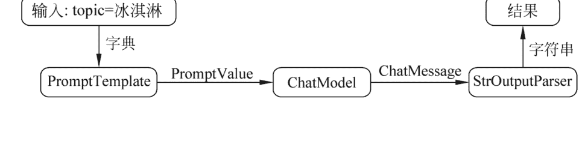
字典→PromptValue→ChatMessage→字符串

输入示例：topic = 冰淇淋
PromptTemplate → ChatModel → StrOutputParser → 结果

小提示，想看某个中间环节的输出，直接把链拆成更小的片段来测，比如只跑 prompt 或 prompt|model 就能看到中间结果。

```python
input = {"topic": "冰淇淋"}
prompt.invoke(input)
#> ChatPromptValue(messages = [HumanMessage(content = '给我讲一个关于冰淇淋的短笑话')])
(prompt | model).invoke(input)
#> AIMessage(content = "为什么冰淇淋去了心理治疗?\n 因为它有太多的浇头, 无法自控!")
```

#### 2. RAG检索增强实战

接下来演示一个带检索增强的生成链，让回答自带上下文支撑。

【例4-2】 检索增强生成链条（参考代码4.2.py）。

```python
from langchain_community.llms import Ollama as OllamaLLM
from langchain_community.embeddings import OllamaEmbeddings
from langchain_community.vectorstores import DocArrayInMemorySearch
from langchain_core.output_parsers import StrOutputParser
from langchain_core.prompts import ChatPromptTemplate
from langchain_core.runnables import RunnableParallel, RunnablePassthrough
# 初始化嵌入模型
embedding_model = OllamaEmbeddings(model = "gemma:2b")
# 需要被嵌入的文本列表
texts = ["哈里森在肯肖工作", "熊喜欢吃蜂蜜"]
vectorstore = DocArrayInMemorySearch.from_texts(
    texts,
    embedding = embedding_model
)
retriever = vectorstore.as_retriever()
template = """根据以下上下文回答问题: {context} 问题: {question} """
prompt = ChatPromptTemplate.from_template(template)
model = OllamaLLM(model = "gemma:2b")
output_parser = StrOutputParser()
setup_and_retrieval = RunnableParallel(
    {"context": retriever, "question": RunnablePassthrough()}
)
chain = setup_and_retrieval | prompt | model | output_parser
result = chain.invoke("哈里森在哪里工作?")
print(result)
```

图4-2展示的这条链写法是 chain = setup_and_retrieval | prompt | model | output_parser。先说说它是怎么拼起来的。提示模板需要两份输入，上下文 context 和问题 question，用来组装最终的提示。在组装提示之前，先去检索与问题相关的文档作为上下文。准备阶段用内存库搭了一个检索器，它可以根据查询拉取文档，这个检索器本身就是一个可运行单元，既能单独链式调用，也能独立试跑：retriever.invoke("哈里森在哪里工作？")。随后借助 RunnableParallel 来凑齐提示所需的材料，一边用检索器把文档找出来作为 context，一边用 RunnablePassthrough 把原始用户问题原样透传过去作为 question。

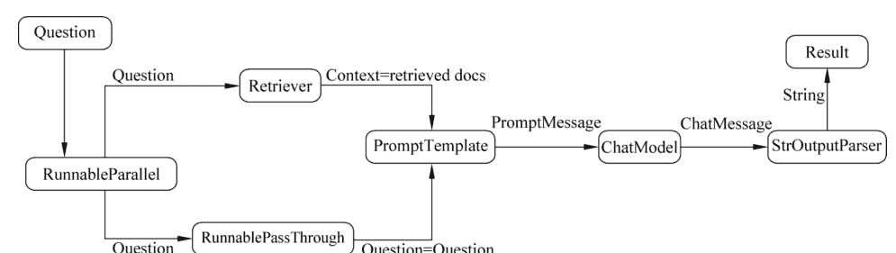

```python
setup_and_retrieval = RunnableParallel(
    {"context": retriever, "question": RunnablePassthrough()}
)
```
整体链路长这样。

```python
setup_and_retrieval = RunnableParallel(
    {"context": retriever, "question": RunnablePassthrough()}
)
chain = setup_and_retrieval | prompt | model | output_parser
```

运行逻辑分几步走。先实例化一个 RunnableParallel，里面放两项：context 来自检索器返回的文档，question 来自用户的原始提问，复制问题这件事由 RunnablePassthrough 完成。把这个字典喂给提示组件后，它会结合问题和检索到的上下文生成一个 PromptValue。模型组件拿到这个 PromptValue 交给大语言模型评测，模型吐出的是一个 ChatMessage。最后 output_parser 把 ChatMessage 转成 Python 字符串，通过 invoke() 返回给调用方。好奇中间产物时，同样可以只测 prompt 或 prompt|model 这样的子链。

```python
input = {"topic": "冰淇淋"}
prompt.invoke(input)
# > ChatPromptValue(messages = [HumanMessage(content = '给我讲一个关于冰淇淋的短笑话')])
(prompt | model).invoke(input)
# > AIMessage(content = "为什么冰淇淋从不被邀请到派对上?\n因为事情一热就会融化!")
```

从前面两个例子能看出，LCEL 把复杂链路的搭建变得轻松，同时保留很高的定制与组合自由度。用 LCEL 能快速把原型推向生产，并在性能与可靠性上保持在线，这对智能对话与各类语言处理应用都很关键。

### 4.2 LCEL简化LLM的开发

LCEL 是专为 LLM 应用开发打造的声明式语法。它提供统一的调用口径和丰富的组合原语，让开发者用简洁灵活的方式拼出复杂的 Chain。相较传统命令式写法，LCEL 的收益主要体现在：

- (1) 统一的 Runnable 接口。LCEL 里所有对象都遵循 Runnable 规范，内置 invoke()、ainvoke()、stream() 等通用方法。于是由多个 LCEL 单元组成的链本身也自动具备这些能力。
- (2) 强大的组合能力。LCEL 内置并行化、fallback、动态配置组件等原语，让链路的弹性与适配度大幅提升。

下面以本地大模型 Gemma 为例，对比传统写法与 LCEL 的差异，集中展现它的优势。

示例1：输入一个话题，产出相关笑话。

【例4-3】 不使用 LCEL 的实现方式，参考代码4.3.py。
```python
from langchain_community.llms import Ollama as OllamaLLM
prompt_template = "给我讲一个关于{topic}的笑话。"
model = OllamaLLM(model = "gemma:2b")
def call_llm(prompt: str) -> str:
    response = model(prompt)
    return response
def invoke_chain(topic: str) -> str:
    prompt_value = prompt_template.format(topic=topic)
    return call_llm(prompt_value)
# 调用示例
result = invoke_chain("机器学习")
print(result)
```
【例4-4】 使用 LCEL 的实现方式，参考代码4.4.py。
```python
prompt = PromptTemplate.from_template("给我讲一个关于{topic}的笑话。")
output_parser = StrOutputParser()
model = OllamaLLM(model = "gemma:2b")
chain = (
    {"topic": RunnablePassthrough()}
    | prompt
    | model
    | output_parser
)
# 调用示例
chain.invoke("机器学习")
```

可以看到，LCEL 下用 “|” 把 prompt、model、output_parser 等模块串起来，形成一个链对象。声明式的写法清晰易读，结构一目了然。再看在更多场景下能省多少事。

#### (1) 流式调用。
想让模型边生成边返回，传统方案需要改动调用代码。

```python
def stream_llm(prompt: str) -> Iterator[str]:
    for token in model.stream(prompt):
        yield token
def stream_chain(topic: str) -> Iterator[str]:
    prompt_value = prompt_template.format(topic=topic)
    yield from stream_llm(prompt_value)
# 流式调用示例
for chunk in stream_chain("机器学习"):
    print(chunk, end="", flush=True)
```
在 LCEL 里，只要把 invoke 换成 stream 就行了。

```python
# 流式调用示例
for chunk in chain.stream("机器学习"):
    print(chunk, end="", flush=True)
```

#### (2) 批量调用。
要一次性处理一批输入，传统做法常要引入线程池等工具。

```python
from concurrent.futures import ThreadPoolExecutor
def batch_chain(topics: List[str]) -> List[str]:
    with ThreadPoolExecutor() as executor:
        return list(executor.map(invoke_chain, topics))
# 批量调用示例
batch_chain(["机器学习", "深度学习", "强化学习"])
```
LCEL 只需要一行代码即可完成并行批量处理。

```python
# 批量调用示例
chain.batch(["机器学习", "深度学习", "强化学习"])
```

#### (3) 异步调用。
若要异步触发链，传统写法通常需要较大程度的重构。

## (4) 模型配置与热插拔。
运行期想动态切换不同的 LLM，传统思路往往是一堆 if…else。

```python
def invoke_configurable_chain(
    topic: str,
    *,
    model_name: str = "gemma2b"
) -> str:
    if model_name == "gemma2b":
        model = OllamaLLM(model="gemma:2b")
    elif model_name == "gemma7b":
        model = OllamaLLM(model="gemma:7b")
    else:
        raise ValueError(f"不支持的模型:{model_name}")
    prompt_value = prompt_template.format(topic=topic)
    return model(prompt_value)
# 调用示例
invoke_configurable_chain("机器学习", model_name="gemma7b")
```
LCEL 通过 ConfigurableField 能优雅地做到模型热插拔。

```python
from langchain_core.runnables import ConfigurableField
gemma2b = OllamaLLM(model = "gemma:2b")
gemma7b = OllamaLLM(model = "gemma:7b")
configurable_model = gemma2b.configurable_alternatives(
    ConfigurableField(id = "model"),
    default_key = "gemma2b",
    gemma7b = gemma7b,
)
configurable_chain = (
    {"topic": RunnablePassthrough()}
    | prompt
    | configurable_model
    | output_parser
)
# 调用示例
configurable_chain.invoke(
    "机器学习",
    config = {"model": "gemma7b"}
)
```

## (5) 日志记录。
若想保留链执行时的中间产物，传统做法要在代码里手动埋日志。

```python
def invoke_chain_with_logging(topic: str) -> str:
    print(f"输入: {topic}")
    prompt_value = prompt_template.format(topic = topic)
    print(f"Prompt: {prompt_value}")
    output = call_llm(prompt_value)
    print(f"输出: {output}")
    return output
# 调用示例
invoke_chain_with_logging("机器学习")
```
LCEL 组件自带 LangSmith 集成，配置两个环境变量后，整条链的执行轨迹会自动记录。

```python
import os
os.environ["LANGCHAIN_API_KEY"] = "..."
os.environ["LANGCHAIN_TRACING_V2"] = "true"
# 调用示例
chain.invoke("机器学习")
```

## (6) 添加fallback。
希望主模型出错时自动切到备选模型，传统做法要写 try…except。

```python
def invoke_chain_with_fallback(topic: str) -> str:
    try:
        return invoke_chain(topic)
    except Exception:
        return invoke_chain_v2(topic)
# 调用示例
invoke_chain_with_fallback("机器学习")
```
用 LCEL，加 fallback 就像搭积木一样直观。

```python
fallback_chain = chain.with_fallbacks([chain_v2])
# 调用示例
fallback_chain.invoke("机器学习")
```

通过以上对比可以总结，LCEL 在统一接口、灵活组合、流式与批量调用、动态模型配置、自动日志、优雅 fallback 等方面都大幅降低开发成本，提升效率。

整体来看，用 LCEL 搭链就像拼积木，每个组件接口统一、可以自由组合。按需求挑选合适的模块，用 “|” 声明式地串联，就能快速得到复杂而稳健的应用。

随着大模型技术演进，应用形态愈发多样。LCEL 的灵活与可扩展正好适配这种变化。今天拼的是笑话链，明天可能是对话链、问答链、知识图谱链……LCEL 为 LLM 开发提供了一条清晰的积木式路径。

当然 LCEL 也有边界，比如调试时需要关注整条数据流，某些场景下声明式写法不如命令式直观。但瑕不掩瑜，它为 LLM 应用开发树立了新的范式，未来在生态中的作用只会更重。

### 4.3 Runnable接口

#### 4.3.1 简介
LangChain 引入 Runnable 协议，就是为了让自定义链更易构建。绝大多数组件都实现了 Runnable 接口，这一标准接口既方便定义自定义链，也保证了统一的调用方式。它为各类组件提供了稳定的一致调用口径，让不同模块灵活组合成复杂链路。遵循 Runnable 接口的自定义组件可以与内置组件无缝协作，实现统一管理。

# Runnable 接口：从同步到异步的一体化调用

Runnable 给链式编排提供了一套统一的调用契约，让响应式和事件驱动的开发更顺手。同步侧的核心动作有三件：stream 把结果切成片段逐段推送，特别适合海量数据或实时流；invoke 拿一条明确输入跑完整条链并给出最终答案；batch 则接受输入清单一次性跑完并汇总。它们一起构成同步编排的基础，让处理链的搭建更直观。

随着非阻塞模型成为主流，异步能力被补齐。astream 实现逐块异步推送，ainvoke 负责单条输入的异步执行，abatch 负责清单的异步执行，主线程不会被卡住。astream_log 能在运行过程中实时抓取日志并流式输出，astream_events 则把链路上的事件实时广播，调试和监控都很友好。异步家族的加入让整体响应更快，也让现代流式系统的设计更灵活。

工程里不同节点对数据的期待并不相同，见表4-1。Prompt 接受字典配置，产出 PromptValue，用来生成提示。ChatModel 比较宽松，可接受纯文本、消息列表或 PromptValue，输出 ChatMessage，常用于对话与自然语言任务。LLM 的输入形式与 ChatModel 保持一致，输出是纯文本，负责生成与文本转换。OutputParser 专门处理 LLM 或 ChatModel 的结果，输出形态随解析器而定。Retriever 以单条字符串检索，返回文档列表。Tool 的输入可能是字符串或字典，取决于具体工具实现，输出也随之变化。

### 表4-1 不同组件的输入输出类型

| 组件 | 输入类型 | 输出类型 |

|---|---|---|

| Prompt | 字典 | PromptValue |

| ChatModel | 单个字符串,聊天消息列表或 PromptValue | ChatMessage |

| LLM | 单个字符串,聊天消息列表或 PromptValue | 字符串 |

| OutputParser | LLM 或 ChatModel 的输出 | 取决于解析器 |

| Retriever | 单个字符串 | 文档列表 |

| Tool | 单个字符串或字典,取决于工具 | 取决于工具 |

为了校验连通性，所有 Runnable 节点都对外暴露 input_schema 与 output_schema。两者都是依据节点结构动态生成的 Pydantic 模型，能保证数据在流转时保持预期形状与类型。调用 schema 方法即可得到 JSON Schema 表示。以 PromptTemplate 串 ChatModel 的简单链为例：

```python
model = OllamaLLM(model = "gemma:2b")
prompt = ChatPromptTemplate.from_template("给我讲一个关于{topic}的笑话")
chain = prompt | model
```

查看链的入口描述，输出为 JSON 字符串，内容略：

```python
chain.input_schema.schema()
```

出口描述说明节点会产生什么结构，同样是动态生成的 Pydantic 模型，通过 output_schema.schema() 获取 JSON Schema。示例中链的最终结果由末尾的 OllamaLLM 决定，该模型会输出 ChatMessage 对象：

```python
chain.output_schema.schema() # 输出略
```

#### 4.3.2 输入输出模式

入口描述是对 Runnable 节点可接受输入的规范化说明，会依据节点本身结构自动生成 Pydantic 模型。Pydantic 是 Python 的数据校验库，能保证运行时保持预期形状与类型。调用 input_schema.schema() 可得到 JSON Schema 表达。接下来是一个由 PromptTemplate 与 ChatModel 组成的链示例：

```python
model = OllamaLLM(model = "gemma:2b")
prompt = ChatPromptTemplate.from_template("给我讲一个关于{topic}的笑话")
chain = prompt | model
```

可按此查看链的入口描述，输出为 JSON 格式字符串，略。

```python
chain.input_schema.schema()
```

出口描述是对 Runnable 节点产生的输出的说明，同样是依据节点结构动态生成的 Pydantic 模型。可通过 output_schema.schema() 方法获取 JSONSchema 表示。

示例中链的输出取决于最后一环，即 OllamaLLM。OllamaLLM 输出 ChatMessage 对象。

```python
chain.output_schema.schema() # 输出略
```

#### 4.3.3 Runnable接口的方法

(1) 流式调用 Stream。stream() 会把结果拆成小块逐个发出。例如：

```python
for s in chain.stream({"topic": "熊猫"}):
    print(s.content, end="", flush=True)
```

(2) 单次调用 Invoke。invoke() 在一条输入上执行整条链并返回结果。例如：

```python
chain.invoke({"topic": "熊猫"})
```

(3) 批量调用 Batch。batch() 对输入清单执行链，返回结果清单。例如：

```python
chain.batch([{"topic": "熊猫"}, {"topic": "企鹅"}])
```

还可通过 max_concurrency 参数限制并发请求数。

```python
chain.batch([{"topic": "熊猫"}, {"topic": "企鹅"}], config={"max_concurrency": 5})
```

(4) 异步流式调用 Async Stream。astream() 以异步方式分块返回结果。例如：

```python
async for s in chain.astream({"topic": "熊猫"}):
    print(s.content, end="", flush=True)
```

(5) 异步单次调用 Async Invoke。ainvoke() 在一条输入上异步执行链并返回结果。例如：

```python
await chain.ainvoke({"topic": "熊猫"})
```

(6) 异步批量调用 Async Batch。abatch() 对输入清单异步执行链，返回结果清单。例如：

```python
await chain.abatch([{"topic": "熊猫"}])
```

#### 4.3.4 异步事件流

异步事件流 Async Stream Events 于 langchain-core 0.2.0 引入，属于测试版 API，后续可能调整。为正确使用 astream_events API，需注意：整个代码尽量保持异步，包括异步工具；若定义自定义函数 Runnable，必须传播回调；若不借助 LCEL 直接调用 Runnable，确保在 LLM 上调用 .astream() 而非 .ainvoke()，以强制 LLM 流式传输 token。

在复杂系统里，各类 Runnable 在执行时会触发多项事件，为监控与交互提供信息。例如聊天模型启动、流式处理或结束时，分别触发 on_chat_model_start、on_chat_model_stream 与 on_chat_model_end，携带模型名称、消息块、输入数据，以及结束时生成的输出数据。LLM 也有启动、流式、结束三类事件，分别是 on_llm_start、on_llm_stream 与 on_llm_end，提供模型名称、输入文本、流式文本内容及最终输出文本的细节。

除聊天模型与 LLM 外，其它类型 Runnable 也会触发事件。例如 on_chain_start、on_chain_stream 与 on_chain_end 分别在文档处理链开始、处理中与结束时触发，关注点包括文档格式与内容。工具类 Runnable 如 some_tool，以及检索器类 Runnable 也类似地触发开始、流式、结束事件，携带工具执行状态、输入参数、处理中数据块及最终输出结果的信息。模板启动与结束事件 on_prompt_start 与 on_prompt_end 提供模板名称、问题输入及最终产生的提示值细节。这些事件共同构成系统交互与执行监控的基础，帮助开发者更好理解与调试系统行为。更详细内容可参考 LangChain 官方文档。

【例4-5】 使用 astream_events 获取检索器与 LLM 事件的示例，参考代码 4.5 astream_events.py。

```python
from langchain_community.vectorstores import FAISS
from langchain_core.output_parsers import StrOutputParser
from langchain_core.runnables import RunnablePassthrough
from langchain_core.prompts import ChatPromptTemplate
from langchain_community.llms import Ollama as OllamaLLM
from langchain_community.embeddings import OllamaEmbeddings
template = """请根据以下上下文回答问题:
{context}
问题: {question}
"""
prompt = ChatPromptTemplate.from_template(template)
vectorstore = FAISS.from_texts(
    ["哈里森在 kenshow 工作过"], embedding=OllamaEmbeddings()
)
retriever = vectorstore.as_retriever()
model = OllamaLLM(model = "gemma:2b")
retrieval_chain = (
    {
        "context": retriever.with_config(run_name="检索器"),
        "question": RunnablePassthrough(),
    }
    | prompt
    | model.with_config(run_name = "gemma")
    | StrOutputParser()
)
async def main():
    async for event in retrieval_chain.astream_events(
        "哈里森在哪里工作过?", version="v1", include_names=["检索器", "gemma"]
    ):
        kind = event["event"]
        if kind == "on_chat_model_stream":
            print(event["data"]["chunk"].content, end="|")
        elif kind in {"on_chat_model_start"}:
            print()
            print("LLM 开始流式输出:")
        elif kind in {"on_chat_model_end"}:
            print()
            print("LLM 完成流式输出。")
        elif kind == "on_retriever_end":
            print("-- ")
            print("检索到以下文档:")
            print(event["data"]["output"]["documents"])
        elif kind == "on_tool_end":
            print(f"工具执行结束: {event['name']}")
        else:
            pass
import asyncio
```

asyncio.run(main()) 该示例展示了借助 LangChain 的 Runnable 接口，结合向量存储 FAISS 与本地大模型 Gemma 进行异步事件流处理。借助此方式，可实现高效实时的 LLM 应用，同时规避隐私与成本问题。

#### 4.3.5 异步中间步骤流

所有 Runnable 均提供 astream_log() 方法，用于在发生时流式传输链或序列的全部或部分中间步骤。这对向用户展示进度、使用中间结果或调试链非常有用。可传输全部步骤，默认即为全部，也可按名称、标签或元数据包含或排除步骤。该方法产生 JSONPatch 操作，按接收顺序应用，构建 RunState。

（1）运行状态数据结构。

运行状态由两部分构成：LogEntry 与 RunState。

LogEntry 表示单个子运行的日志条目。

```
class LogEntry(TypedDict):
    id: str                    # 子运行的 ID
    name: str                  # 正在运行的对象名称
    type: str                  # 正在运行的对象类型，如 prompt, chain, llm 等
    tags: List[str]            # 运行的标签列表
    metadata: Dict[str, Any]   # 运行的元数据键值对
    start_time: str            # 运行开始的 ISO-8601 时间戳
    streamed_output_str: List[str] # 此运行流式传输的 LLM tokens 列表（如果适用）
    final_output: Optional[Any]    # 此运行的最终输出，仅在运行成功完成后可用
    end_time: Optional[str]        # 运行结束的 ISO-8601 时间戳，仅在运行结束后可用
```

RunState 表示整个运行过程的状态。

```
class RunState(TypedDict):
    id: str  # 运行的 ID
    streamed_output: List[Any]  # Runnable.stream()流式传输的输出块列表
    final_output: Optional[Any]  # 运行的最终输出,通常是聚合(`+`)streamed_output的结果。仅在运行成功完成后可用
    logs: Dict[str, LogEntry]  # 运行名称到子运行的映射。如果提供了过滤器,此列表将仅包含与过滤器匹配的运行
```

（2）流式传输 JSONPatch 块。

这在 HTTP 服务器里流式传输 JSONPatch 并在客户端重建运行状态时很有用。LangServe 提供了工具，可更轻松地从任意 Runnable 构建 Web 服务器。

接下来的示例展示了流式传输 JSONPatch 块，输出略。

```
async for chunk in retrieval_chain.astream_log(
    "哈里森在哪里工作过?", include_names = ["检索器"]
):
    print("-" * 40)
    print(chunk)
```

（3）流式传输增量运行状态。

传递 diff=False 可获取 RunState 的增量值，会产生更多重复的详细输出。

```
async for chunk in retrieval_chain.astream_log(
    "哈里森在哪里工作过?", include_names = ["检索器"], diff = False
):
    print("-" * 70)
    print(chunk)
```

#### 4.3.6 并行执行

LangChain 表达式语言支持并行请求。例如使用 RunnableParallel，通常写成字典形态，会并行执行每个元素。

### 【例4-6】 LangChain 并行执行：熊猫主题的笑话与诗歌生成。

```
from langchain_core.runnables import RunnableParallel
chain1 = ChatPromptTemplate.from_template("给我讲一个关于{topic}的笑话") | model
chain2 = ChatPromptTemplate.from_template("写一首关于{topic}的诗,2行") | model
combined = RunnableParallel(joke=chain1, poem=chain2)
% % time
chain1.invoke({"topic": "熊猫"})
% % time
chain2.invoke({"topic": "熊猫"})
% % time
combined.invoke({"topic": "熊猫"})
```

注意：请参考代码 4.6.py。上述代码为方便解释，使用了 IPython 魔法命令。提供的代码中使用了 time 包。

输出结果类似如下。

```
CPU times: user 18 ms, sys: 1.27 ms, total: 19.3 ms
Wall time: 692 ms
ChatMessage(content = "怎么样,这个关于熊猫的笑话还不错吧?虽然有点冷,但还算幽默。熊猫可是我们...")
...
```

实践表明，借助RunnableParallel，总耗时往往会被明显压缩。

Runnable接口是一套强力的能力集合，能帮助优化流程、简化开发，不过要真正发挥威力，还得靠反复实战来加深认识。先挑对组件很关键，LangChain自带Prompt、ChatModel、LLM、OutputParser、Retriever等多种开箱即用的模块，方便按需拼装最合适的组合。特定场景下也可能需要自行开发定制组件来满足特殊业务逻辑。

在用Runnable接口组合组件时，一定要确保相邻环节的输入输出类型能对上号，这样数据才能顺畅流动，链路才算完整。流式调用和异步调用配合得好，对大批量或耗时任务的用户体验和系统效率提升很明显。流式能让用户边等边看到部分结果，异步则能让系统并发处理多个任务，充分利用资源。

再往深一层，善用中间步骤流和事件流，对调试和优化执行链特别有帮助。这两类机制能把每个组件的输入、输出和运行状态摊开来看，定位问题更快。遇到可并行的环节，用RunnableParallel来并行跑，总耗时会大幅下降，只是并发度要控制好，避免资源过载。

把向量数据库和本地模型一起用，既能增强能力，也有助于保护隐私、降低成本。积极参与LangChain社区，关注更新，向同行学习，对个人和整个社区的发展都很重要。把Runnable接口用到真实项目里不断试错，才是理解原理、积累手感最快的方式。

### 4.4 LangChain流式处理精要
想让基于大模型的工具更快、更顺手，流式处理几乎是必备手段。LangChain就是为这类应用而生的框架，内置了成熟的流式能力。下面会系统梳理其用法，并用具体例子展开说明。

#### 4.4.1 Runnable接口与流式调用方式
LangChain里LLM、解析器、提示词模板、检索器、代理等核心部件都遵循Runnable接口。该接口统一提供了两种典型流式手段：同步的stream和异步的astream，用于实时推送链的最终输出；另外还有异步事件流astream_events和异步日志流astream_log，能把中间步骤和最终结果一起流式透传。

### 【例4-7】使用stream()方法（参考代码4.7.py）。
```
from langchain_core.prompts import ChatPromptTemplate
from langchain_community.llms import Ollama as OllamaLLM
# 定义模型,这里假设已经有了一个命名为 model 的 LLM
model = OllamaLLM(model = "gemma:2b")
prompt = ChatPromptTemplate.from_template("关于{topic}写一个笑话")
chain = prompt | model
for chunk in chain.stream({"topic": "编程"}):
    print(chunk, end = "", flush = True)
```

#### 4.4.2 LLM与聊天模型的流式输出
在基于大模型的应用里，LLM和聊天模型通常是最耗时的环节。完整生成一次回复往往需要数秒，远超过用户可感知的即时响应阈值，通常在200~300毫秒左右。因此把它们的输出做成流式显得尤为重要。

下面给出一个基于Gemma模型实现流式聊天的示例。
```
from langchain_gemma import GemmaChat
model = GemmaChat()
async for chunk in model.astream("你好,请介绍一下你自己"):
    print(chunk.content, end = "", flush = True)
```

#### 4.4.3 如何让整条链支持流式
除了大模型本身，实际任务常常需要把多个组件串成一条链。为了让整条链具备流式能力，需要保证每一步都能正确处理输入流。关键在于选用合适的解析器。

### 【例4-8】 使用JsonOutputParser来流式解析JSON输出（参考代码4.8.py）。
```
from langchain_community.llms import Ollama as OllamaLLM
from langchain_core.output_parsers import JsonOutputParser
import asyncio
# 定义模型
model = OllamaLLM(model = "gemma:2b")
# 定义异步函数
async def get_fruits_info():
    chain = (
        model | JsonOutputParser()
    )
    async for json_chunk in chain.astream(
        "请以JSON格式输出苹果、香蕉、橙子三种水果的名称和价格,并将它们包装在 fruits 键下"
    ):
        print(json_chunk, flush=True)
# 运行异步函数
asyncio.run(get_fruits_info())
```

#### 4.4.4 兼容不原生支持流式的组件
部分内置组件比如检索器，并不原生支持流式。当尝试对它们做流式调用时，它们会直接返回最终结果，而非流。为此可以借助astream_events API来获取链中其他支持流式的组件的中间结果。以下是一个演示。

### 【例4-9】 LangChain流式追踪案例（使用astream_events实现，参考代码4.9.py）。
```
from langchain_community.vectorstores import FAISS
from langchain_core.output_parsers import StrOutputParser
from langchain_core.prompts import ChatPromptTemplate
from langchain_core.runnables import RunnablePassthrough
from langchain_community.llms import Ollama as OllamaLLM
from langchain_community.embeddings import OllamaEmbeddings
import asyncio
model = OllamaLLM(model = "gemma:2b")
template = """基于以下上下文回答问题:
{context}
问题: {question}
"""
prompt = ChatPromptTemplate.from_template(template)
vectorstore = FAISS.from_texts(
    ["哈里森在 Gemma 公司工作"], embedding=OllamaEmbeddings()
)
retriever = vectorstore.as_retriever()
retrieval_chain = (
    {
        "context": retriever.with_config(run_name = "Retriever"),
        "question": RunnablePassthrough(),
    }
    | prompt
    | model.with_config(run_name = "Gemma")
    | StrOutputParser()
)
async def process_events():
    async for event in retrieval_chain.astream_events(
        "哈里森在哪里工作?", version = "v1", include_names = ["Retriever", "Gemma"]
    ):
        kind = event["event"]
        if kind == "on_chat_model_stream":
            print(event["data"]["chunk"].content, end = "|")
        elif kind in {"on_chat_model_start", "on_retriever_start"}:
            print(f"\n{kind}")
        elif kind in {"on_chat_model_end", "on_retriever_end"}:
            print(f"\n{kind}")
        else:
            pass
# 运行异步函数
asyncio.run(process_events())
```
可以看到，尽管检索器本身不支持流式，但仍可通过astream_events API拿到其他支持流式的组件例如LLM的事件流。

#### 4.4.5 精准过滤事件
使用astream_events API时，产生的事件数量可能很大。为了便于处理和分析，LangChain提供了事件过滤机制，支持按组件名称、标签或类型进行筛选。

### 【例4-10】 一个按组件类型过滤事件的示例（完整的代码参见4.10.py）。
```
max_events = 0
async for event in retrieval_chain.astream_events(
    "哈里森在哪里工作?", version="v1", include_types = ["chat_model"]
):
    print(event)
    max_events += 1
    if max_events > 10:
        print("...")
        break
```
通过include_types参数，就只保留了名为“Gemma”的聊天模型组件产生的事件。

#### 4.4.6 自定义工具里的回调传播
构建智能体系统时，自定义工具的设计至关重要。自定义工具的实现可以基于异步事件流，也可以基于异步回调机制；前者更适合模块化、可组合的工具链场景（参考代码4.11.py），后者更适合轻量级事件追踪与逻辑封装（参考例4-11）。

### 【例4-11】 基于异步回调机制的自定义工具示例（参考代码4.12.py）。
```
# 自定义的异步工具函数, 支持回调传播
async def reverse_text_with_callback(text: str, callback = None):
    # 初始化回调处理器
    handler = CallbackHandler(callback)
    # 生成开始事件
    await handler.process_event({'event': 'start', 'text': text})
    # 模拟处理过程并生成结果事件
    reversed_text = text[::-1]
    await handler.process_event({'event': 'result', 'text': reversed_text})
    # 生成结束事件
    await handler.process_event({'event': 'end'})
# 定义异步回调函数
async def my_callback(event):
    print(f"Received event: {event}")
# 主异步函数, 运行自定义工具并处理事件流
async def main():
    await reverse_text_with_callback("hello", callback = my_callback)
# 运行主函数
asyncio.run(main())
```
如代码所示，reverse_text_with_callback函数接收一段文本和一个可选的回调函数。函数内部先发出操作开始的事件，随后计算文本逆序并生成包含结果的事件，最后发出操作结束的事件。每个事件都经由回调函数交给外部处理器，这里是CallbackHandler的实例。CallbackHandler负责接收事件，并在process_event方法中以异步方式调用回调来处理。自定义工具不仅能产出数据处理结果，还能通过回调异步地生成和传播事件流，从而支持流式处理。

#### 4.4.7 用RunnableParallel整合输入输出
搭建复杂链路时，常需要把一个Runnable的输出整理成下一个Runnable可用的输入格式。RunnableParallel可以很方便地完成这件事。以下示例展示如何用它拿到检索结果，并与用户输入一起传入提示模板。

### 【例4-12】使用RunnableParallel（完整代码参考代码4.13.py）。
## 模型
```python
model = OllamaLLM(model = "gemma:2b")
vectorstore = FAISS.from_texts(
    ["哈里森在 DELL 公司工作"], embedding = OllamaEmbeddings()
)
retriever = vectorstore.as_retriever()
template = """基于以下上下文回答问题：
{context}
问题: {question}
请用{language}回答
"""
prompt = ChatPromptTemplate.from_template(template)
# 使用 RunnableParallel 处理输入,并将结果传递给下一个 Runnable
chain = RunnableParallel(
    context = itemgetter("question") | retriever,
    question = RunnablePassthrough(),
    language = RunnablePassthrough()
) | prompt | model | StrOutputParser()
result = chain.invoke({"question": "哈里森在哪里工作", "language": "英语"})
print(result)
```
该示例构造了一个RunnableParallel实例，同时处理多路输入：从输入字典里提取“question”和“language”字段，并基于“question”字段用检索器retriever检索相关上下文。随后这些信息被合并送入prompt，按模板生成完整的提示文本，最后把提示文本传给model处理，并用StrOutputParser解析输出。

示例中结合itemgetter与RunnableParallel，从输入字典取出所需键值并传给提示模板，让链的搭建与调用更简洁清晰。

#### 4.4.8 并行跑链提速
RunnableParallel除了整合输入输出，还能实现多个Runnable的并行执行，这对提升链的执行效率很有帮助。

【例4-13】 一个使用RunnableParallel并行执行笑话链和诗歌链的示例（完整代码请参考代码4.14.py）。
```python
# 定义笑话链和诗歌链
joke_chain = ChatPromptTemplate.from_template("关于{topic}讲一个笑话") | model
poem_chain = ChatPromptTemplate.from_template("写一首关于{topic}的诗,4行") | model
# 并行执行
parallel_chain = RunnableParallel(joke = joke_chain, poem = poem_chain)
# 测量执行时间的函数
def measure_time(chain, input):
    start = time.time()
    result = chain.invoke(input)
    end = time.time()
    print(f"执行时间: {end - start} 秒")
    return result
# 分别测量执行时间
print("笑话链执行时间:")
measure_time(joke_chain, {"topic": "春天"})
print("\n诗歌链执行时间:")
measure_time(poem_chain, {"topic": "春天"})
print("\n并行链执行时间:")
measure_time(parallel_chain, {"topic": "春天"})
```
示例中使用time.time()函数获取当前时间，以此衡量一段代码的执行耗时。这是一种简单且通用的做法。如果在Jupyter Notebook中运行，也可直接用%%timeit魔法命令替代measure_time的调用。

### 4.5 用LCEL实现典型LLM任务
本节通过一系列示例展示如何借助LCEL实现常见的LLM应用功能。内容从基础的提示加模型，到复杂的代理与代码生成等多个主题都有覆盖。

#### 4.5.1 Prompt+LLM

大模型链路搭建实战拆解

提示词模板、大模型和输出解析器是搭建大模型应用的三大支柱。把 PromptTemplate、LLM 与 OutputParser 组合起来，就能拼出多种不同的处理链。本节以 4.15.py 为参考，梳理五种常用做法。

（1）提示与模型的最简串联
先搭一条最短链路：把用户原始输入填进提示模板，得到加工后的提示交给大模型，再把模型未处理的回复原样返回。

```python
from langchain_core.prompts import PromptTemplate
from langchain_community.llms import Ollama as OllamaLLM
prompt = PromptTemplate.from_template("写一首关于{topic}的诗。")
# 初始化模型
model = OllamaLLM(model = "gemma:2b")
chain = prompt | model
print(chain.invoke({"topic": "春天"}))
```

（2）为模型挂载运行参数
在链路组装阶段可以给 LLM 附加额外配置，比如停止符、函数调用等，用来更精细地控制生成行为和输出格式。

```python
# 绑定停止序列参数示例
chain = prompt | model.bind(stop=[","])
print(chain.invoke({"topic": "夏日"}))
```

（3）引入解析器获取结构化结果
大模型直接返回的自由文本很难直接使用。加上 OutputParser 之后，就能把非结构化内容拆解并提炼成可用结构。

```python
from langchain.output_parsers.regex import RegexParser
# 假设的 LLM 调用输出
llm_output = "今天天气晴朗,28 摄氏度,东南风 3 - 4 级。"
# 初始化 RegexParser
# 注意,这里的 regex 需要根据实际的输出格式来定制
regex = r"天气:(?P<weather>.*?), 气温:(?P<temperature>.*?), 风力:(?P<wind>.*?)"
output_keys = ["weather", "temperature", "wind"]
parser = RegexParser(regex = regex, output_keys = output_keys)
# 使用 RegexParser 解析 LLM 输出
parsed_output = parser.parse(llm_output)
# 打印解析后的输出
print(parsed_output)
```

（4）处理指定函数签名的 JSON 输出
当需要模型严格按某个函数签名返回结果时，常选用 JsonOutputParser 或 SimpleJsonOutputParser，其它可选项可参考 https://github.com/langchain-ai/langchain/blob/master/libs/core/langchain_core/output_parsers/__init__.py。

```python
from langchain_core.output_parsers import JsonOutputParser
prompt = PromptTemplate.from_template("写一首关于{topic}的诗。")
model = OllamaLLM(model = "gemma:2b")
chain = prompt | model | JsonOutputParser()
prompt_str = "春天"
print(chain.invoke({"topic": prompt_str}))
prompt_str = "What's the weather like in New York today? Give the temperature in Fahrenheit."
print(chain.invoke({"topic": prompt_str}))
```

（5）让调用更省心
借助 RunnableParallel，可以自动拼装提示所需要的输入字典，避免手动组装参数的繁琐。

```python
# 示例 1: 使用 JsonOutputParser
prompt1 = PromptTemplate.from_template("写一首关于{topic}的诗。")
model1 = OllamaLLM(model = "gemma:2b")
chain1 = prompt1 | model1 | JsonOutputParser()
prompt_str1 = "春天"
print(chain1.invoke({"topic": prompt_str1}))
prompt_str2 = "What's the weather like in New York today? Give the temperature in Fahrenheit."
print(chain1.invoke({"topic": prompt_str2}))
# 示例 2: 使用 RunnableParallel 简化链的调用
prompt2 = PromptTemplate.from_template("关于{topic}的内容:")
model2 = OllamaLLM(model = "gemma:2b")
output_parser2 = SimpleJsonOutputParser()
parallel_map = RunnableParallel(topic=RunnablePassthrough())
chain2 = parallel_map | prompt2 | model2 | output_parser2
# 调用链, 这里的输入需要是字典形式以匹配 RunnableParallel 的期望
print(chain2.invoke({"topic": "Write a poem about the ocean."}))
```

#### 4.5.2 RAG
检索增强生成 Retrieval-Augmented Generation 的思路，是在提示与模型之间插入外部知识检索，让模型依托检索到的相关资料给出更准确、信息更饱满的回应。

【例4-14】检索增强生成（RAG）（参考代码4.16.py）。

```python
from operator import itemgetter
from langchain_community.vectorstores import FAISS
from langchain_core.output_parsers import StrOutputParser
from langchain_core.prompts import ChatPromptTemplate
from langchain_core.runnables import RunnablePassthrough
from langchain_community.embeddings import OllamaEmbeddings
from langchain_community.llms import Ollama as OllamaLLM
vectorstore = FAISS.from_texts(
    ["LangChain 是一个用于开发 LLM 应用的开源框架。"], embedding = OllamaEmbeddings(model = "gemma:2b")
)
retriever = vectorstore.as_retriever()
template = """基于以下背景信息回答问题：
{context}

问题：{question}
"""
prompt = ChatPromptTemplate.from_template(template)
model = OllamaLLM(model="gemma:2b")
chain = (
    {"context": retriever, "question": RunnablePassthrough()}
    | prompt
    | model
    | StrOutputParser()
)
print(chain.invoke("Langchain 是什么?"))
```

该脚本展示了用 LangChain 配合 Ollama 搭建一个依托向量存储的问答助手。先用 Ollama 的嵌入模型把一段关于 LangChain 的说明文本向量化并写入 FAISS，随后定义一个包含背景信息和问题的提示模板，并用 Ollama 的语言模型组装问答链。最后把一个关于 LangChain 的提问送入链中并打印返回的答案，体现了快速落地智能问答的可行路径。

#### 4.5.3 对话式检索链
在多轮对话里，检索不能只看当前提问，还要兼顾历史上下文。对话式检索链正是为此设计，它会把当前问题和过往对话记录一并作为检索依据。

【例4-15】 对话式检索链（下列为部分代码，完整代码请参考4.17.py）。

```python
_template = """给定以下对话历史和一个后续问题,请将后续问题转述为一个独立的问题,使用原始语言。
对话历史:
{chat_history}
后续问题: {question}
独立问题:"""
CONDENSE_QUESTION_PROMPT = ChatPromptTemplate.from_template(_template)
template = """基于以下背景信息回答问题:
{context}
问题: {question}
"""
prompt = ChatPromptTemplate.from_template(template)
model = OllamaLLM(model = "gemma:2b")
vectorstore = FAISS.from_texts(
    ["LangChain 是一个用于开发 LLM应用的开源框架。它提供了许多有用的工具和组件,如提示模板、记忆体系、索引等,帮助开发者更轻松地构建 LLM应用。"],
    embedding = OllamaEmbeddings(model = "gemma:2b")
)
retriever = vectorstore.as_retriever()
_inputs = RunnableParallel(
    chat_history = RunnablePassthrough(),
    question = (
        {"question": RunnablePassthrough(), "chat_history": lambda x: get_buffer_string(x["chat_history"])}
        | CONDENSE_QUESTION_PROMPT
        | model
        | StrOutputParser()
    ),
)
_context = {
    "context": itemgetter("question") | retriever | (lambda docs: format_document(Document(page_content = "\n".join(doc.page_content for doc in docs), metadata = {"context": "\n".join(doc.page_content for doc in docs), "question": None}), prompt)),
    "question": lambda x: x["question"],
}
conversational_qa_chain = _inputs | _context | prompt | model
chat_history = [
    HumanMessage(content = "LangChain 是什么?"),
    AIMessage(content = "LangChain 是一个用于开发 LLM应用的开源框架。"),
    HumanMessage(content = "那么 LangChain 有哪些主要功能?"),
]
print(conversational_qa_chain.invoke({"question": "LangChain 有哪些特点?", "chat_history": chat_history}))
```

示例说明了如何基于本地模型 Gemma 与向量库 FAISS 搭建会话式问答。程序先用 OllamaEmbeddings 把背景知识嵌入向量空间并存入 FAISS；随后准备两类提示模板，一类用于把对话历史里的追问改写为独立问题，另一类用于依据检索到的背景作答。执行时先并行处理历史与用户提问，用 CONDENSE_QUESTION_PROMPT 模板配合 Gemma 将后续问题改写为自足形式，再从 FAISS 检索相关背景并封装为 Document，最后把格式化后的背景、独立问题与 Gemma 组合成问答链生成最终答案。

#### 4.5.4 多链组合
Runnables 让多条链的串联变得顺畅。通过管道操作符 “|” 把不同链拼接，就能组成复杂的工作流。

【例4-16】 多链组合（参考代码4.18.py）。

from langchain_community.llms import Ollama as OllamaLLM

from langchain_core.prompts import ChatPromptTemplate

from langchain_core.output_parsers import StrOutputParser

from langchain_core.runnables import RunnablePassthrough, RunnableParallel

prompt1 = ChatPromptTemplate.from_template("{product}的优点有哪些?")

prompt2 = ChatPromptTemplate.from_template("基于以下优点, 创作一条{product}的广告语:\n{advantages}")

model = OllamaLLM(model="gemma:2b")

chain1 = prompt1 | model | StrOutputParser()

chain2 = {"advantages": chain1, "product": RunnablePassthrough()} | prompt2 | model | StrOutputParser()

print(chain2.invoke({"product": "iPhone"}))

prompt1 = ChatPromptTemplate.from_template("以下是一家餐厅的基本信息:\n{basic_info}\n 请根据这些信息, 生成一段营销文案, 突出餐厅的特色和优势, 吸引顾客光临.")

prompt2 = ChatPromptTemplate.from_template("以下是一家餐厅的基本信息:\n{basic_info}\n 请根据这些信息, 提出3条经营建议, 帮助餐厅改进服务, 提高竞争力.")

prompt3 = ChatPromptTemplate.from_template("以下是一家餐厅的营销文案和经营建议:\n 营销文案:{marketing}\n 经营建议:{advice}\n 请对这两方面工作提出评价和指导意见, 帮助餐厅更好地开展营销和经营活动.")

model_parser = model | StrOutputParser()

chain1 = prompt1 | model_parser

chain2 = prompt2 | model_parser

chain = (

    {"basic_info": RunnablePassthrough()}

    | {

        "marketing": chain1,

        "advice": chain2,

    }

    | prompt3

    | model

)

basic_info = """

本餐厅是一家主打健康养生的中式餐厅。主要特色:

1. 食材新鲜, 有机蔬菜直接从农场采购。

2. 烹饪注重养生, 少油少盐, 保留食材原汁原味。

3. 环境雅致, 设有包厢, 适合家庭聚餐和商务宴请。

4. 服务友善专业, 定期举办针对老年人的健康饮食讲座。

5. 交通便利, 地铁二号线旁, 商圈附近, 车位充足。

"""

print(chain.invoke({"basic_info": basic_info}))

以上代码体现了借助 LangChain 与 Ollama 模型，结合管道符和 Runnables 组件搭建多阶段自然语言处理流程的做法。

第一个演示是串行的两阶段流程：先让模型列出指定产品的优点，再以这些优点为依据创作广告语。chain1 负责产出优点，chain2 在接收优点并透传产品名后生成文案，RunnablePassthrough 完成额外输入的传递。第二份演示更为复杂，先并行生成餐厅的营销文案与经营建议，分别对应 prompt1 与 prompt2，随后把两份产出合并作为 prompt3 的输入，由模型给出综合评价与改进建议。并行产出与后续合并通过管道中的字典嵌套实现。

这段实现恰好体现了 LangChain 的设计思想——把提示模板、语言模型、解析器等各类 LLM 部件封装成标准化的可复用单元，再用管道操作符和 Runnables 自由拼接，就能在很短时间内搭起复杂的自然语言处理应用。模块化与可组合带来了很高的开发效率，让人能聚焦在业务逻辑的规划上，而不必深陷底层实现的细节。

#### 4.5.5 用自然语言查SQL
大语言模型可以把用户的日常提问自动翻译成对应的 SQL。只要把数据库的表结构信息一起交给模型，它就能更准确地理解数据关系，从而生成更可靠的查询语句。

【例4-17】查询SQL数据库（参考代码4.19.py）。

```python
from langchain_core.prompts import ChatPromptTemplate
from langchain_community.llms import Ollama as OllamaLLM
from langchain_community.utilities import SQLDatabase
from langchain_core.runnables import RunnableLambda, RunnablePassthrough
from langchain_core.output_parsers import StrOutputParser
template = """以下是一个餐厅订单数据库的模式:
{schema}
根据这个模式,编写一条 SQL 查询语句来回答用户的问题。
问题: {question}
SQL 查询语句:"""
prompt = ChatPromptTemplate.from_template(template)

# Assuming SQLDatabase and db.get_table_info() are correctly implemented
db = SQLDatabase.from_uri("sqlite:///./restaurant.db")
def get_schema(_):
    schema_info = db.get_table_info()
    return {"schema": schema_info if schema_info else "无法获取模式信息。"}
model = OllamaLLM(model="gemma:2b")
query_chain = (
    {"schema": RunnableLambda(get_schema), "question": RunnablePassthrough()}
    | prompt
    | model.bind(stop=["\nSQLResult:"])
    | StrOutputParser()
    | RunnableLambda(lambda x: {"query": x} if x.strip() else {"query": "无法生成有效的 SQL 查询语句。"})
)
result = query_chain.invoke({"question": "2022 年销售总额最高的是哪个菜品?"})
print(result)
template = """以下是一个餐厅订单数据库的模式:
{schema}
问题: {question}
SQL 查询语句: {query}
SQL 查询结果: {result}
根据以上信息,用自然语言回答最初的问题。"""
prompt = ChatPromptTemplate.from_template(template)
def get_result(input_dict):
    query = input_dict.get("query")
    if not query or query == "无法生成有效的 SQL 查询语句。":
        return {"result": "无法执行查询因为没有生成有效的 SQL 查询语句。"}
    try:
        result = db.run(query)
        return {"result": result if result else "查询未返回结果。"}
    except Exception as e:
        return {"result": f"查询执行错误: {str(e)}"}
result_chain = (
    {"schema": RunnableLambda(get_schema), "question": RunnablePassthrough(), "query": lambda _: result.get("query"), "result": RunnableLambda(get_result)}
    | prompt
    | model
    | StrOutputParser()
)
final_result = result_chain.invoke({"question": "2022 年销售总额最高的是哪个菜品?"})
print(final_result)
```

该示例演示了借助 LangChain 框架配合 Ollama 模型，实现从自然语言问题到 SQL 执行再到自然语言答案的闭环。首先准备了一个含有数据库模式的提示模板，用来生成 SQL；随后实例化 SQLDatabase 连接 SQLite，并提供 get_schema 函数来读取表结构。接着组装 query_chain，把模式与用户问题送入模板，由 Ollama 产出 SQL 语句。为了把执行结果再口语化，另建一个提示模板，输入包含模式、原问题、生成的 SQL 以及查询结果。最后用 result_chain 接住 query_chain 的输出，再次经过模板和模型，形成最终的自然语言回复。

如此一来，NL → SQL → NL 的端到端流程就跑通了，也再次说明了 LangChain 组件化、灵活组合的价值。提醒一点，运行前需要先准备好对应的数据库，可参考 createSqlite3.py。

#### 4.5.6 构建自主代理
代理是一种能基于既定工具自主做决策并采取行动的系统。把 Runnable 喂给代理，代理就能学会调用工具来解决问题。基于 Runnable 的代理通常包含以下环节：

1. 罗列可用的工具清单。
2. 选择代理使用的提示模板。
3. 编写中间步骤的数据处理与格式化逻辑。
4. 指定代理调用的模型。
5. 实现代理输出的解析逻辑。

【例4-18】 代理（Agents）。

```python
from langchain import hub
from langchain.agents import AgentExecutor, tool
from langchain.agents.output_parsers import XMLAgentOutputParser
from langchain_core.runnables import RunnableLambda, RunnablePassthrough
from langchain_community.llms import Ollama as OllamaLLM
model = OllamaLLM(model = "gemma:2b")
@tool
def get_order_status(order_id: str) -> str:
    """获取订单状态"""
    # 模拟查询订单状态
    return f"订单{order_id}的状态是:已发货"
@tool
def get_delivery_time(order_id: str) -> str:
    """获取订单预计送达时间"""
    # 模拟查询订单送达时间
    return f"订单{order_id}预计在 3 天内送达"
tools = [get_order_status, get_delivery_time]
template = hub.pull("kwc3388/zh-agent-template")
def process_steps(steps):
    return "\n".join([f"{step[0]}: {step[1]}" for step in steps])
agent = (
    {"input": RunnablePassthrough(), "intermediate_steps": process_steps}
    | template.partial(tools = "\n".join([f"{tool.name}: {tool.description}" for tool in tools]))
    | model
    | XMLAgentOutputParser()
)
executor = AgentExecutor(agent = agent, tools = tools)
print(executor.invoke({"input": "我的订单号是 DS1234,能帮我查下状态吗?大概什么时候能收到?"}))
```

示例搭建了一个基于 Runnable 的代理系统，整合了预定义的工具集、从 hub 拉取的代理提示模板、中间步骤处理函数、模型配置以及输出解析器，使代理能够自主决策。该系统专门处理订单状态与预计送达时间的查询，验证了自动化问答的能力。工具函数 get_order_status 与 get_delivery_time 通过 @tool 装饰器定义，模拟了订单查询行为；提示模板则通过 hub.pull() 从 LangChain 仓库获取。

为保证执行流顺畅，代码实现了 process_steps 来规范化中间步骤的输出；模型的选型与参数调优直接影响代理的表现；考虑到输出可能为特定格式，这里采用 XMLAgentOutputParser 进行解析，确保结果可用。

总体看，通过工具定义、模板选择、数据处理与输出解析的配合，就能得到一个可自主行动的代理系统。它不仅能应答，还能触发具体操作，展现出 Runnable 代理在自动化任务上的灵活性和扩展性。运行此例需要访问以下地址：

https://api.hub.langchain.com/commits/kwc3388/zh-agent-template/?limit=100&offset=0

#### 4.5.7 工具调用扩展能力
Runnable 可以很方便地挂载各种外部工具，进一步拓展 LLM 的能力边界。比如用 SerpAPISearch 做网络搜索，需要有效的 API Key 与网络环境支持。

【例4-19】使用工具（参考代码4.21.py）。

```python
from langchain_community.llms import Ollama as OllamaLLM
from langchain_core.output_parsers import StrOutputParser
# 假设或模拟的 SerpAPISearch 实现
class SerpAPISearch:
    def run(self, query):
        # 模拟网络搜索操作
        return f"模拟搜索结果 for query: {query}"
from langchain_core.runnables import RunnableLambda, RunnablePassthrough
search = SerpAPISearch()
model = OllamaLLM(model = "gemma:2b")
prompt = "请将以下查询转换为适合搜索引擎的搜索关键词:\n{query}\n 搜索关键词:"
# 搜索链的构建
chain = (
    {"query": RunnablePassthrough()}
    | RunnableLambda(lambda x: prompt.format(**x))
    | RunnableLambda(model)
    | StrOutputParser()
    | RunnableLambda(search.run)
)
# 测试搜索链
print(chain.invoke({"query": "Python 编程"}))
```

代码展示了如何用 langchain_core 的 Runnables 概念，结合模拟工具与模拟模型，搭建一个搜索问答的流水线。通过自建的 SerpAPISearch 类与 GemmaModel 类，能够把简单查询转成搜索关键词并执行一次模拟搜索。SerpAPISearch 负责接收关键词返回模拟结果，GemmaModel 的 __call__ 则模拟根据提示生成关键词的行为。

搭建链路时先导入 RunnableLambda 与 RunnablePassthrough，实例化搜索类与模型后，使用字符串模板作为提示，通过多层 RunnableLambda 串联：把用户查询转成模型可读的提示 → 生成关键词 → 调用模拟搜索获取结果。整个流程模拟了从查询到结果的闭环，体现了 Runnable 在构建复杂数据处理与模型交互链路上的灵活性与可扩展性，为基于 LLM 的自动化工具开发提供了通用范式。

#### 4.5.8 让LLM写代码并运行
除了对话，LLM 也能按需求编写代码。借助类似 PythonREPL 的执行环境，模型生成的 Python 代码可以直接被运行。

```python
from langchain_core.runnables import RunnableLambda, RunnablePassthrough
from langchain_community.llms import Ollama as OllamaLLM
from langchain_core.output_parsers import StrOutputParser
model = OllamaLLM(model="gemma:2b")
# 模拟 PythonREPL 实现
class PythonREPL:
    def run(self, code):
        # 简单的模拟执行代码逻辑，这里仅返回传入的代码
        return f"执行代码: {code}"
def extract_code(code):
    # 从 Markdown 格式中提取代码
    return code.strip("python").strip("").strip()
# 假设的模型响应，生成 Python 代码
model_response = "python\nfib = lambda n: n if n <= 1 else fib(n-1) + fib(n-2)\nprint(fib(5))\n"
prompt = "请编写一段 Python 代码来解决以下问题:\n{problem}\n 只返回代码，不要有其他解释。请用 Markdown 格式封装代码，例如："
# 代码执行链的构建
chain = (
    {"problem": RunnablePassthrough()}
    | RunnableLambda(lambda x: prompt.format(**x))
    | RunnableLambda(lambda _: model_response)
    | StrOutputParser()
    | RunnableLambda(extract_code)
    | PythonREPL().run
)
# 测试代码执行链
problem = "实现一个函数，用于计算斐波那契数列的第 n 项。"
print(chain.invoke({"problem": problem}))
```

示例用一个简化链路演示 LLM 生成代码并即时执行的过程。整体以 OllamaLLM 作为核心，假定它能根据自然语言问题输出 Python 代码；再用模拟的 PythonREPL 类来模拟代码的实际运行并捕获输出，构成一个可运行的闭环。

链路由多个 Runnables 串成：RunnablePassthrough 原样传递问题，RunnableLambda 把问题格式化为模型输入；模型返回一段固定示例代码，随后另一个 RunnableLambda 从 Markdown 包装中抽取纯代码；最后把抽取出的代码交给模拟 REPL 执行并返回结果。

该思路展示了在理想化条件下，用 LLM 实现从自然语言到代码执行的端到端自动化，也突出了 LangChain 在编排复杂流程上的灵活价值。虽然示例对生成与执行做了简化，但已足够说明 LLM 辅助编程与自动化任务的潜在空间。

思考题：在运行 4.22.py 时是否会发现结果并非真实计算，比如 5 的阶乘并不是 120。请参考 4.23.py 的部分实现，调整代码，使其真正得到计算结果。

## 小结

本章围绕 LangChain 表达式语言 LCEL 的设计思想、核心能力与落地方式展开讲解。通过多个可运行的示例，演示如何借助 LCEL 快速搭建 LLM 应用，从最简单的提示加模型组合，到检索增强、对话交互、SQL 问答、代码生成等复杂场景都有覆盖。

开篇先用几个上手快的样例把 LCEL 的使用手感带出来，让读者形成直观认知。随后对关键能力做系统性拆解，重点讲清流式输出、异步调用与并行加速等特性，并配合代码说明在真实项目中如何用这些特性提升效率和响应速度。

同时对 Runnable 接口的设计逻辑与使用姿势做了专门介绍。该接口是 LCEL 的骨架，为不同类型的 LLM 组件提供统一的调用规范，大幅增强了复用性与组合灵活性。只要实现该接口，自定义模块就能平滑接入 LCEL，扩展系统功能。

最后还整理了一批常见应用范式，包括检索增强生成、会话式交互、结构化查询和代码编写等。这些案例既体现了 LCEL 的应用广度，也为实践提供了可直接参考的模板。

## 思考题

### 一、简答题

- 1. 概括 LCEL 在 LLM 应用开发中的主要价值点。
- 2. RunnableParallel 在 LCEL 中的定位是什么？给出一个具体使用场景。
- 3. 列出 LCEL 支持的三种异步方式，并说明各自适合的场景。

### 二、实践题

请基于 LCEL 与 Gemma 模型实现一个文档问答助手，实现从问题输入到答案输出的完整链路，要求如下：

- 1. 用 python-docx 读取一批 .docx 文件，抽取文本并封装为文档对象。
- 2. 通过 Gemma 模型结合 FAISS 对文档做向量化并建立检索索引。
- 3. 设计提示模板，使其能够接收用户问题与检索到的上下文并生成回答。
- 4. 将问题解析、段落检索、答案合成等步骤分别封装为 Runnable 组件。
- 5. 用 LCEL 把各组件串联成完整问答链，并提供支持流式返回的问答接口。

## 第5章 LangChain 实战：打造智能问答系统

智能问答系统要做的，是把用户用自然语言表达的需求理解清楚，并从自有知识库中给出准确、相关的回复，从而实现自然的人机交互。LangChain 作为面向 LLM 应用的开发框架，提供了丰富的构建块。本章先拆解智能问答的核心任务与难点，再演示如何用 LangChain 实现端到端的流程，涵盖问题分析、知识检索、答案生成与多轮对话等环节，并讨论持续优化与扩展的方向，如反馈学习、知识增强和多模态交互。通过本章的学习，可以更牢固掌握 LangChain 的使用，并体会 LLM 在问答场景中的潜力。

### 5.1 智能问答系统概述

#### 5.1.1 什么是智能问答系统

智能问答系统 IQAS 能够自动理解自然语言提问并返回相关答案。与传统关键词匹配的问答不同，它借助自然语言处理、知识表示与机器推理，能够把握问题的语义、意图与上下文，从海量非结构化数据中抽取并推导出最合适的答案，实现更自然的交互。

其核心流程可归纳为理解问题、检索知识、生成答案三步。首先准确解析用户的自然语言表达，识别语义重点与意图；然后在结构化或非结构化的知识库中寻找相关片段；最后基于检索结果生成连贯、自然且准确的回答并呈现给用户。

构建此类系统涉及 NLP、信息检索、知识表示与机器学习等多个子领域，传统方式依赖大量人工特征与模板，效率低且难以迁移。LangChain 的出现为构建问答系统提供了新思路。

LangChain 通过封装主流 LLM 与知识增强手段，提供开箱即用的问答链与智能体，让开发者能快速搭建端到端系统。其组件化结构与统一接口也方便定制与扩展。典型架构如图5-1 所示。

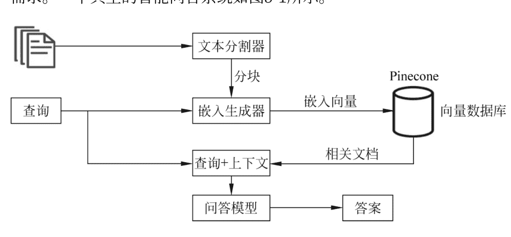

#### 5.1.2 智能问答系统的应用场景和价值

智能问答在各行业均有广泛需求，能提升信息获取效率与服务体验，同时降低人力成本。典型场景包括：

- 1. **智能客服**：自动解答高频问题，提供 7×24 小时服务，减少人工压力，复杂问题可无缝转人工，实现人机协同。
- 2. **企业知识库**：帮助员工快速检索产品手册、操作指南、案例分析等，提升效率与决策质量。
- 3. **医疗助手**：为医生与患者提供医学知识查询与辅助诊断支持，助力方案制定与科普。
- 4. **教育助手**：依据学习进度与薄弱点提供个性化辅导与答疑，并推荐学习资料与练习。
- 5. **金融顾问**：提供投资理财、风险评估、政策解读等个性化咨询，辅助财务决策。
- 6. **法律助手**：支持法律知识查询、案例分析与文书起草等日常法律需求。

除效率与成本优势外，实时响应、个性化与海量知识支撑显著改善用户满意度，增强企业竞争力。随着 NLP 技术发展，智能问答将成为数字化转型的重要支柱，而 LangChain 等易用框架将加速其普及。

#### 5.1.3 构建智能问答系统的关键技术和挑战

构建问答系统需要融合多项技术，主要包括：

- (1) 问题理解。需完成分词、词性标注、命名实体识别、句法与语义角色标注等基础任务，并做意图识别与实体链接。理解准确度直接影响后续检索与生成。
- (2) 知识表示。从异构数据源中抽取知识并形成结构化或向量化的知识库，涉及实体对齐、关系抽取与知识融合。覆盖面与准确性决定系统竞争力。
- (3) 语义检索。对海量知识做快速召回与精排，常用倒排索引结合 BM25 初筛，再用语义向量模型与深度匹配模型精排。效率与准确率是关键指标。
- (4) 机器阅读理解。对复杂非事实问题进行深度阅读与推理，需处理指代消解与多跳推理。预训练 LLM 在此任务上表现出色。
- (5) 自然语言生成。基于推理结果生成自然流畅的答案。传统模板方法灵活性不足，基于大规模预训练模型的生成方法可产出高质量文本，但需控制准确性、相关性与逻辑一致性。

同时面临诸多挑战：从非结构化数据中自动化抽取并维护高质量知识库；多轮对话中保持上下文与交互自然度的平衡；实现个性化答案与用户画像；提升可解释性以降低黑盒风险；保障数据安全与隐私。LangChain 在检索、阅读理解与生成环节提供丰富工具，降低门槛，但在个性化、多轮对话与安全可解释性方面仍需结合隐私计算与可解释 AI 技术协同优化。

### 5.2 基于 LangChain 的问答系统架构

在 LangChain 下构建问答系统，需基于其链式编程模型与现成组件，设计出灵活可扩展的架构。下面介绍整体结构、核心组件与数据流。

#### 5.2.1 问答系统的整体架构和流程

智能问答通常包含问题理解、知识检索与答案生成。LangChain 将这些环节封装为独立组件，开发者可自由组合定制，搭建端到端流程。

图5-2 展示了一个基于 LangChain 的典型架构。

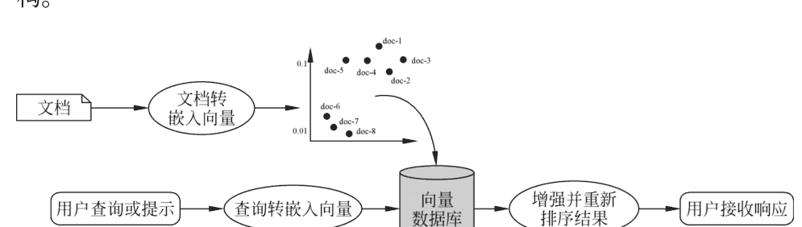

图5-2 基于 LangChain 的智能问答系统架构图

各模块职责如下：

- （1）问题理解。该模块解析用户自然语言，抽取意图、实体与关系。可使用 LangChain Agent 结合 LLM 做 Few-Shot 学习。
- （2）知识检索。根据理解结果在知识库中查找相关片段。知识库可为本地向量库如 Chroma、FAISS，也可为云服务如 Pinecone、Weaviate。检索通常分召回与排序，可用 LangChain 的 Retriever 接口封装不同算法。
- (3) 答案生成。基于检索片段生成自然连贯的完整答案。可使用 LLMChain 接入 GPT-3、ChatGLM 等模型，并用 Prompt 模板优化可控生成。
- (4) 多轮对话管理。负责维护对话上下文，记录历史关键信息，支持追问与闲聊。可结合 ConversationChain 与 ConversationBufferMemory 等 Memory 组件实现。
- (5) 数据连接器。连接外部数据源，实现知识的自动抽取与更新。可使用 Document Loader 加载 PDF、Word、CSV 等格式。
- (6) 应用接口。封装问答系统提供易用 API，供外部调用。可基于 Chain 与 Agent 构建，或用 FastAPI、Flask 封装为 RESTful 服务。
- (7) 前端界面。实现用户交互，如 Web 页面、移动 App、智能音箱，通过调用应用接口完成输入输出。

组件间通过清晰接口与数据规范松耦合协作，数据层层处理后形成最终答案。该架构具有模块化、可扩展、高性能、可定制、易集成等优点，实际落地时还需兼顾安全、可用性与用户体验。

#### 5.2.2 LangChain 在问答系统中的角色和优势

LangChain 专为 LLM 应用而生，在问答构建中发挥关键作用：

- （1）大语言模型集成。原生支持 OpenAI、Anthropic、Hugging Face、Cohere、AI21 等主流提供商的 API，可在一个应用中组合多个模型取长补短。
- (2) 丰富即用组件。提供 Agent、Retriever、VectorStore、PromptTemplate、ConversationChain 等覆盖全流程的组件，开箱即用且可定制。
- (3) 知识库连接。支持多种向量数据库与文档加载器，将非结构化数据转为可检索的向量表示，并可对接企业内部知识库。
- (4) 语义搜索。基于 Embedding 与向量相似度实现语义检索，打破关键词限制，支持点积、余弦、欧氏距离等算法。
- (5) 链式调用。核心特性是 Chain，可按顺序、分支、循环、映射等方式组合组件，统一输入输出接口，灵活实现复杂逻辑，减少手工 Prompt 编排成本。
- （6）内存管理。Memory 组件在链式调用中传递与存储中间状态，对多轮对话尤为重要，支持多种记忆策略。
- （7）可观察性。支持 Callback 嵌入链路，实现监控、日志与分析，便于调试与优化。

这些能力让开发者能够快速构建高质量问答应用，成为该领域的标准工具与生态。

#### 5.2.3 问答系统的核心组件和功能

下面以问题理解组件为例，剖析其原理与实现。问题理解是问答的第一步，目标是从用户输入中抽取关键信息。

LangChain 并未提供现成的理解组件，但可利用 Agent 工具结合 LLM 的 Few-Shot 能力快速搭建理解代理。代理通过将问题拆解为步骤并调用合适工具，最终生成结果。

【例5-1】 问题理解组件（代码5.1.1.py）。

```python
from langchain.agents import Tool, initialize_agent
from langchain_community.llms import Ollama
import logging
# 定义问题分类工具
def classify_question(input_text: str) -> str:
    """将问题分类为事实型、观点型、程序型等"""
    logging.info("问题分类工具被调用")
    return "事实型"
# 定义实体识别工具
def extract_entities(input_text: str) -> list:
    """从问题中提取关键实体，如人名、地名、时间等"""
    logging.info("实体识别工具被调用")
    return ["美国", "总统"]
# 定义意图识别工具
def recognize_intent(input_text: str) -> str:
    """识别问题的意图，如查询、比较、判断等"""
    logging.info("意图识别工具被调用")
    return "查询"
# 定义问题理解 Agent 并为每个工具添加描述
tools = [
    Tool(name="Classify Question", func=classify_question, description="将问题分类为事实型、观点型、程序型等"),
    Tool(name="Extract Entities", func=extract_entities, description="从问题中提取关键实体，如人名、地名、时间等"),
    Tool(name="Recognize Intent", func=recognize_intent, description="识别问题的意图，如查询、比较、判断等"),
]
llm = Ollama(model="gemma:2b")
# 初始化 Agent
agent = initialize_agent(tools, llm, agent="zero-shot-react-description", verbose=True, handle_parsing_errors=True)
# 使用 Agent 进行问题理解
question = "Who is the president of the United States?"
result = agent(question)
# 打印结果
print(result)
```

示例首先搭建了三件可复用的工具：classify_question 用来把问题归类为事实类、观点类、程序类等；extract_entities 负责从提问里挑出人名、地名、时间等关键要素；recognize_intent 则判断用户到底是想查询、比较还是做判断。随后把这三件工具装进 Tool 对象，并给出名称和说明。接着调用 initialize_agent 来组装代理，传入的要素有 tools 工具列表、llm 这里用 Ollama 启动的 gemma:2b 模型、agent 类型选用 zero-shot-react-description、verbose 控制是否打印详细过程、handle_parsing_errors 控制解析出错时是否处理。执行 agent(question) 时，流程大致如下：代理先把问题喂给大模型，让它产出初步行动方案，方案里包含要调用哪些工具、各工具的输入以及中间的思考；按方案依次调用工具，把返回结果作为观察值；结合观察更新思考，决定下一步是再调工具、直接给出最终答案还是继续细化计划；循环进行直到满足停止条件。最后把生成的答案返回。在本例里，行动方案先用 Extract Entities 提取问题里的关键实体，再基于实体直接生成答案。

（2）知识检索组件。

知识检索是问答系统的中枢任务，核心是从海量知识库里快速精准地找出与问题最相关的片段。LangChain 为此提供了 Retriever 接口来封装各类语义检索算法，以及 VectorStore 接口来对接向量数据库。

【例5-2】利用LangChain实现知识检索（代码5.2.py）。

```python
from langchain_community.vectorstores import Chroma
from langchain.text_splitter import CharacterTextSplitter
from langchain_community.document_loaders import TextLoader
from langchain.chains import RetrievalQA
from langchain_community.llms import Ollama as OllamaLLM
from langchain_community.embeddings import OllamaEmbeddings
# 加载知识库文档
loader = TextLoader("doc.txt")
documents = loader.load()
# 利用 CharacterTextSplitter 将文档分割成更小的文本块
text_splitter = CharacterTextSplitter(chunk_size=1000, chunk_overlap=0)
texts = text_splitter.split_documents(documents)
# 将文档向量化
embeddings = OllamaEmbeddings(model="gemma:2b")
docsearch = Chroma.from_texts([text.page_content for text in texts], embeddings)
# 初始化检索器
retriever = docsearch.as_retriever(search_type="similarity", search_kwargs={"k": 2})
# 初始化问答 Chain
llm = OllamaLLM(model="gemma:2b")
qa = RetrievalQA.from_chain_type(
    llm=llm,
    chain_type="stuff",
    retriever=retriever,
    return_source_documents=True
)
# 进行问答检索
query = "What did the president say about Ketanji Brown Jackson"
result = qa({"query": query})
print(result['result'])
print(result['source_documents'])
```

代码的功能可以拆成几步来看。第一步是准备所需模块：引入 Chroma 用来建向量库、Ollama 生成嵌入、CharacterTextSplitter 做文档切块、TextLoader 读取纯文本、RetrievalQA 搭建问答链，以及重命名后的 OllamaLLM 用来创建语言模型。第二步加载知识：用 TextLoader 读入 docs.txt，用 CharacterTextSplitter 切成每块 1000 字符且不重叠的文本块。第三步向量化：用 Ollama 嵌入模型 gemma:2b 生成向量，通过 Chroma.from_documents 把文本块转成向量并写入 Chroma 库。第四步创建检索器：调用 docsearch.as_retriever，检索方式设为 similarity，参数 k=2 代表返回最相似的前两条。第五步初始化问答链：新建一个基于 gemma:2b 的 OllamaLLM，用 RetrievalQA.from_chain_type 构造链，指定 llm、链类型 stuff、检索器 retriever，并打开 return_source_documents 以便返回来源。最后执行检索：定义查询 query 为“What did the president say about Ketanji Brown Jackson”，把 query 送入 qa 链运行，结果存进 result。

(3) 答案生成组件。

答案生成是问答链的收口环节，目标是基于检索到的材料给出自然、连贯且准确的回复。LangChain 借助 LLMChain、PromptTemplate 等组件提供了灵活的生成能力，能充分发挥大模型的自然语言产出优势。

【例5-3】答案生成组件（参见代码5.3.py）。

```python
from langchain_community.llms import Ollama as OllamaLLM
from langchain.chains import LLMChain
from langchain.prompts import PromptTemplate
# 初始化语言模型
llm = OllamaLLM(model = "gemma:2b")
# 定义答案生成的 Prompt 模板
template = """基于以下已知信息,用中文回答问题。如果无法从中得到答案,就说 "根据已知信息无法回答该问题"。
已知信息：
{context}
问题：
{question}
答案:"""
prompt = PromptTemplate(
    input_variables = ["context", "question"],
    template = template
)
# 初始化答案生成链
chain = LLMChain(llm = llm, prompt = prompt)
# 设置上下文信息和问题
context = "清华大学是中国著名高等学府,成立于 1911 年,位于北京市海淀区。清华大学的校训是 '自强不息,厚德载物'."
question = "清华大学位于哪个城市?"
# 生成答案
result = chain.invoke({"context": context, "question": question})
answer = result['text']
print(answer)
```

示例先定制了一个 PromptTemplate，输入变量为 context 与 question，分别对应已知信息和待答问题。模板要求模型依据上下文用中文作答，若无法作答则输出统一提示。该提示本质上是一种 Few-Shot 引导，告诉模型如何利用上下文完成任务。随后用 OpenAI 初始化 LLM，并以该 PromptTemplate 初始化 LLMChain。LLMChain 把提示和模型串联起来，便于推理。最后用一个关于清华大学的问题验证生成效果。工程上可以把前面的知识检索与答案生成串起来形成完整 Chain，还能对生成提示做精细化，加入来源标注、多源综合等约束来提升质量。LangChain 的模型套件让这类优化比较直观。

（4）多轮对话管理组件。

真实场景里用户常会连续追问相关问题，单轮问答难以覆盖完整需求。系统必须具备上下文感知与历史记忆能力，LangChain 提供了 ConversationChain 与 Memory 来解决这个问题。

【例5-4】多轮对话管理组件（代码5.4.py）。

```python
from langchain_community.llms import Ollama as OllamaLLM
from langchain.chains import ConversationChain
from langchain.memory import ConversationSummaryMemory
# 初始化 LLM
llm = OllamaLLM(model = "gemma:2b")
# 初始化 Conversation Memory
memory = ConversationSummaryMemory(llm=OllamaLLM(model = "gemma:2b"))
memory.save_context({"input": "你好,我是小明。"}, {"output": "你好小明,很高兴认识你。"})
memory.save_context({"input": "我想了解一下清华大学。"}, {"output": "好的,清华大学是中国著名高等学府,成立于 1911 年,坐落于北京。你想了解什么方面的信息呢?"})
# 初始化 ConversationChain
conversation = ConversationChain(
    llm = llm,
    memory = memory,
    verbose = True
)
# 进行多轮对话
output = conversation.predict(input = "清华大学的校训是什么?")
print(output)
output = conversation.predict(input = "那你知道北京大学的校训吗?")
print(output)
```

本例先用 OllamaLLM 创建本地的 Gemma 模型 llm，再初始化 ConversationSummaryMemory 作为 memory 来保存对话上下文，并通过 save_context 预存两轮对话的输入输出。之后用 llm 与 memory 构造 ConversationChain，设置 verbose=True 以观察详细交互。随后调用 conversation.predict 进行多轮对话。第一轮问清华大学校训，第二轮问北京大学校训。得益于 ConversationSummaryMemory，对话历史得以保留，模型能基于先前内容给出更准确的相关回复。该示例演示了如何结合 LangChain 的 ConversationChain 与 ConversationSummaryMemory，并搭配本地 Gemma 模型实现多轮管理。

本节梳理了基于 LangChain 的智能问答系统的关键组成与实现思路。可以看出 LangChain 的链式组件组合性很强，只需明确各环节的输入输出、挑选合适的模块，再像搭积木一样拼装，就能快速得到 SmartQA 原型。当然，工业级系统还需要考虑鲁棒性、可解释性、伦理安全等更多维度，需要在 LangChain 基础上针对业务做定制化优化与持续迭代。总体来说，LangChain 提供了一个高效的起点。

### 5.3 数据准备和预处理

要让大模型回答特定领域的问题，就必须先把“知识”灌进去。在 LangChain 里，知识库通常以向量数据库的形式存在，需要把原始非结构化数据转成模型可理解、可检索的向量表示。这一过程涵盖数据采集、清洗、格式转换等准备工作。

#### 5.3.1 构建知识库的数据来源和格式

问答系统的知识可以来自企业内部文档、手册、知识库，也可以来自公开网页、百科、论文等。这些材料格式多样：PDF、Word、TXT、Markdown 等本地文件，CSV、JSON、Excel 等结构化文件；Google Docs、Notion、Confluence 等在线协作文档；百科页面、新闻、博客、论坛等网页；MySQL、MongoDB、Elasticsearch 等数据库；以及提供结构化或非结构化数据的 RESTful API 或 GraphQL 接口。

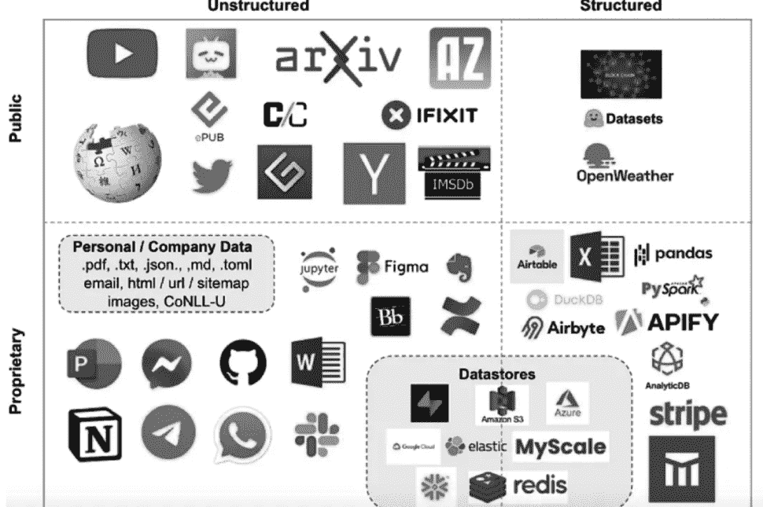

具体包括：本地文件，如PDF、Word、TXT、Markdown等文档文件，CSV、JSON、Excel等结构化数据文件；在线文档，如Google Docs、Notion、Confluence等在线协作文档平台；网页，如百科页面、新闻文章、博客文章、论坛讨论等公开网页；数据库，如MySQL、MongoDB、Elasticsearch等结构化或半结构化数据库；API，如提供结构化数据或非结构化数据的RESTful API或GraphQL接口。

收集时要兼顾质量与权威性。内部数据需保证时效与准确，公开数据需甄别来源可信度，避免引入错误、过时或偏见内容。同时注意版权与隐私合规。知识库并非一次性建设，还需建立版本控制、增量更新等机制以持续维护。

#### 5.3.2 使用LangChain的Document Loader加载数据

搭建问答或知识库应用时，往往要处理来自不同渠道的大量非结构化数据。LangChain 提供了系列 Document Loader，能把 PDF、网页等异构数据统一加载为 Document 对象，为后续语义分析和向量化做准备。

让 LangChain 接住各种数据源，第一步就是 Document Loader。下面用几个实操片段，看看它是怎么把不同格式稳稳变成统一的 Document 对象的。

案例1：加载本地文本文件。
```python
from langchain.document_loaders import TextLoader
loader = TextLoader('example.txt')
documents = loader.load()
print(documents[0].page_content)
```
这里演示用 TextLoader 读取本地纯文本 example.txt，调用 loader.load() 后得到一个 Document 列表，随后取出列表里第一份文档的正文打印出来。

## 案例2：加载 PDF 文档。
```python
from langchain.document_loaders import PDFMinerLoader
loader = PDFMinerLoader("example.pdf")
documents = loader.load()
print(len(documents))
print(documents[0].metadata)
```
这一步用 PDFMinerLoader 打开 example.pdf，先用 len(documents) 看看一共解析出多少个 Document，再把第一个文档的元数据拿出来，例如文件名、页码等信息。

## 案例3：递归加载目录下所有文本文件。
```python
from langchain.document_loaders import DirectoryLoader
loader = DirectoryLoader('data/', glob="**/*.txt")
documents = loader.load()
for doc in documents:
    print(doc.metadata['source'])
```
例子里用 DirectoryLoader 遍历 data/ 目录下的所有内容，设置 glob 为 “**/*.txt” 就能把子目录里的 txt 全部捞出来。加载完成后挨个遍历 Document，并输出每个文档对应的源文件路径。

## 案例4：加载 Notion 数据库。
```python
from langchain.document_loaders import NotionDirectoryLoader
loader = NotionDirectoryLoader("Notion_DB")
documents = loader.load()
print(documents[0].page_content[:100])
```
这里借助 NotionDirectoryLoader 接入 Notion 数据库，只要提供数据库的 ID 或 URL，就能把整库内容转成 Document。最后截取第一个文档的前 100 个字符做快速预览。

这几组演示说明 Document Loader 在处理异构数据源时上手很快、扩展性强。无论是本地文件、网络资源还是笔记类应用，都能用同一套方式归一成 Document，为后续的语义检索、问答、对话等环节打底。它本质上是原始数据通向智能应用的桥梁，把非结构化材料统一表征后，就能复用 LangChain 里的检索、问答、机器人等能力。生态也在持续扩充，支持的来源和格式越来越多。

#### 5.3.3 文本切分：把长文档适配大模型输入

实际使用里，Document Loader 拿到的文档长度不一。很多材料远超主流 LLM 的单次输入上限，常见模型在 2048~4096 token 左右，1 个英文单词约占 1~2 token。若不先切分，直接向量化就会超限。因此在建索引前，需要先把长文本拆成符合模型限制的片段。

LangChain 提供了 Text Splitter 接口，内置多种切分策略，可按场景挑选。常用类型包括：

- (1) CharacterTextSplitter：按字符数切块，可设定块大小 chunk_size 和重叠 chunk_overlap。
- (2) RecursiveCharacterTextSplitter：按字符数递归切分，通过 separators 指定分隔符优先级，逐步细化到目标长度。
- (3) MarkdownTextSplitter：按 Markdown 语法切分，保留标题、列表等结构。
- (4) LatexTextSplitter：针对 LaTeX 语法切分，适合科研论文。
- (5) PythonCodeTextSplitter：按 Python 代码结构切分，适合代码文档。
- (6) TokenTextSplitter：按 token 数切分，可指定 tokenizer，实现更精确的长度控制。

下面用四个例子说明不同 Splitter 的用法。

### 案例1：使用 CharacterTextSplitter 分割文本。
```python
from langchain.text_splitter import CharacterTextSplitter
text_splitter = CharacterTextSplitter(
    separator = "\n",
    chunk_size = 1000,
    chunk_overlap = 200,
    length_function = len,
)
texts = text_splitter.split_text(documents[0].page_content)
```
本例采用 CharacterTextSplitter 进行切分，通过 separator、chunk_size、chunk_overlap 等参数调节粒度与重叠度，length_function 则用于自定义长度计算方式。

### 案例2：使用 RecursiveCharacterTextSplitter 递归分割文本。
```python
from langchain.text_splitter import RecursiveCharacterTextSplitter
text_splitter = RecursiveCharacterTextSplitter(
    chunk_size = 1000,
    chunk_overlap = 200,
    length_function = len,
    separators = ["\n\n", "\n", " ", ""]
)
texts = text_splitter.split_text(documents[0].page_content)
```
RecursiveCharacterTextSplitter 会先用优先级高的分隔符尝试切分，若块仍超出 chunk_size，就用优先级更低的分隔符继续细分，直到所有块都满足长度要求。

### 案例3：使用 MarkdownTextSplitter 处理 Markdown 文本。
```python
from langchain.text_splitter import MarkdownTextSplitter
text_splitter = MarkdownTextSplitter(chunk_size = 1000, chunk_overlap = 0)
texts = text_splitter.split_text(documents[0].page_content)
```
MarkdownTextSplitter 专门识别 Markdown 元素，在标题、段落等合适位置切分，确保切分后的片段仍保持完整的 Markdown 格式。

### 案例4：使用 TokenTextSplitter 按 token 数分割文本。
```python
from langchain.text_splitter import TokenTextSplitter
from transformers import GPT2TokenizerFast
tokenizer = GPT2TokenizerFast.from_pretrained("gpt2")
text_splitter = TokenTextSplitter(chunk_size = 1024, chunk_overlap = 256, tokenizer = tokenizer)
texts = text_splitter.split_text(documents[0].page_content)
```
与按字符切分不同，TokenTextSplitter 直接按 token 数控制长度，例如传入 GPT2TokenizerFast，就能让每个片段的 token 数稳定在模型允许范围内。

落地时要结合数据特点、模型限制和任务目标来选择 Splitter 与参数。合理的切分能在保留信息完整度的同时提升处理效率与生成质量，通常需要实验调参找到最优方案。

总体看，LangChain 的 Text Splitter 提供了灵活多样的切分手段，能把长文档拆成 LLM 可用的小块，为向量化与语义分析做好准备。

### 5.4 知识库索引构建实战

搭建可扩展问答系统，索引构建是关键。把文档转成语义向量，借助相似度检索实现快速召回，这个过程就是索引。

#### 5.4.1 向量数据库与嵌入原理

传统数据库多依赖关键词匹配，例如查询“如何学好 Python”只能命中带关键词的记录，容易漏掉“Python 学习路线”“编程入门指南”等语义相关内容。

向量数据库专为高维向量设计，以距离或相似度建立索引，支持近似最近邻搜索。文本经嵌入后，用户查询与库中文档的相似度可被量化，查全率明显提升。

嵌入技术把离散文本映射到连续低维空间，保留语义。空间中距离相近的文本语义也更接近。早期有 Word2Vec、GloVe、FastText 等基于分布式假设的静态词向量。近年来 BERT、RoBERTa、T5 等 Transformer 在预训练中学习了丰富语义，其隐藏层可作为高质量的上下文相关动态嵌入，比静态向量更能捕捉细微差别。

关键词搜索只关心是否包含查询词，不考虑语义，容易产生噪音。如图5-4，查询“raining cats and dogs”本意是“大雨”，系统却只检索包含 raining、cats、and、dogs 的文档，相关性差且排序混乱。语义搜索则把查询与文档都映射到同一潜在空间，按最近点检索，真正依据上下文含义匹配。

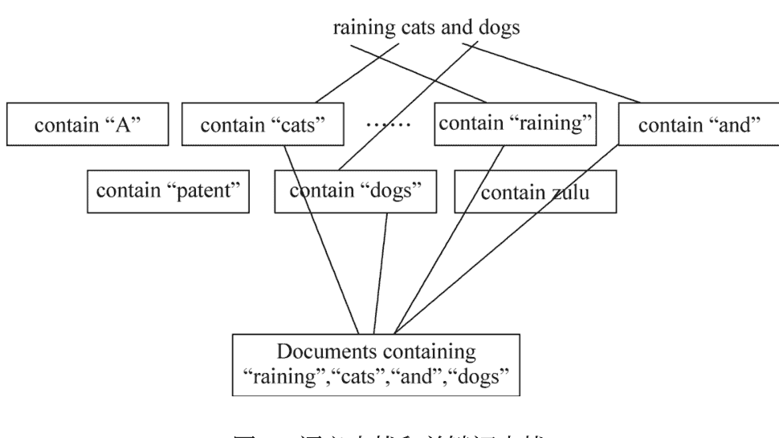
LangChain 兼容主流嵌入模型，提供统一调用接口，开发者可灵活切换以构建知识库索引。

#### 5.4.2 LangChain Embedding 一键生成向量

LangChain 的 Embedding 类封装了多种常用嵌入器：

- OpenAIEmbeddings：调用 OpenAI Ada 模型，输出维度 1536。
- HuggingFaceEmbeddings：基于 Hugging Face 预训练模型，支持 BERT、RoBERTa、XLM 等。
- TensorflowHubEmbeddings：使用 TensorFlow Hub 的 Universal Sentence Encoder。
- SentenceTransformerEmbeddings：基于 SBERT 模型，支持多语言句子级嵌入。
- CohereEmbeddings：调用 Cohere 预训练模型。
- JinaEmbeddings：支持文本与跨模态检索的 Jina 模型。
- LlamaCppEmbeddings：基于 Facebook LLaMA 的 C++ 版本。
- SagemakerEndpointEmbeddings：接入 Amazon SageMaker 上的自定义模型。
- SelfHostedEmbeddings：使用自托管本地模型。
- HuggingFaceLocalEmbeddings：本地部署的 Hugging Face 模型。

下面是基于 LangChain Embedding 类创建文本嵌入的示例。

```python
# 使用 OpenAI 生成嵌入
from langchain.embeddings import OpenAIEmbeddings
embeddings = OpenAIEmbeddings()
text_embedding = embeddings.embed_query("This is a test document.")
doc_embeddings = embeddings.embed_documents(["This is a test document.", "This is another test document."])
# 使用 Hugging Face 生成嵌入
from langchain.embeddings import HuggingFaceEmbeddings
model_name = "sentence-transformers/all-mpnet-base-v2"
embeddings = HuggingFaceEmbeddings(model_name=model_name)
text_embedding = embeddings.embed_query("This is a test document.")
# 使用 SentenceTransformer 生成多语言嵌入
from langchain.embeddings import HuggingFaceEmbeddings
model_name = "sentence-transformers/paraphrase-multilingual-mpnet-base-v2"
embeddings = HuggingFaceEmbeddings(model_name=model_name)
text_embedding = embeddings.embed_query("Das ist ein Testdokument.")
# 使用 Cohere 生成嵌入
from langchain.embeddings import CohereEmbeddings
embeddings = CohereEmbeddings()
text_embedding = embeddings.embed_query("This is a test document.")
# 使用自托管模型生成嵌入
from langchain.embeddings import SelfHostedEmbeddings
embeddings = SelfHostedEmbeddings(model_load_fn=model_load_fn, model_callable=model_callable)
text_embedding = embeddings.embed_query("This is a test document.")
```

LangChain 嵌入与向量检索实战拆解

切换嵌入实现并不难，选定目标 Embedding 实现后构造实例就能上手。单条输入走 embed_query，批量输入走 embed_documents，最终都拿到一组向量。OpenAI 家族的编码器依赖密钥，可从环境变量读取，也能直接作为参数传入。Hugging Face Embedding 与 SentenceTransformer 系列都支持通过 model_name 指定预训练权重，以匹配不同任务需求。SelfHostedEmbeddings 为自研或本地部署的模型提供了接入通道，让数据隐私与推理开销完全自控。

【例5-5】使用LangChain的Embedding类将文本转换为语义向量（参见代码5.5.py）。

```python
from langchain_community.llms import Ollama
from langchain_community import embeddings
embedding = embeddings.ollama.OllamaEmbeddings(model = 'gemma:2b')
text = "这是一个测试文本"
embeddings = embedding.embed_query(text)
print(embeddings)
```

输出形态与图5-5一致，以下仅截取片段。

```
[0.6497934460639954, -0.5090503692626953, 0.511724054813385,
1.2926768064498901, 2.87579345703125, -0.03546291962265968, -
2.276413917541504, 0.33846062421798706, -1.4877406358718872, -
1.1834737062454224, 0.5764615535736084, 0.3717312216758728,
1.513338327407837, 0.1926816999912262, -0.6409558057785034,
0.9302074313163757, 0.1848432570695877, 0.9277995228767395,
0.052784163504838943, 0.5990618467330933, 2.6112427711486816,
0.5143425464630127, 0.0637299120426178, -0.012116292491555214,
0.5415661931037903, -1.3472988605499268, -0.047638073563575745,
```

图5-5 嵌入式生成

挑选编码器没有标准答案，需要在质量、耗时和费用间取舍。参数量越大、见过的语料越广，向量表达通常越稳，但延迟与成本也会上升。最可靠的做法是在自己的数据上做横向评测。也可借助 SAL，即 Semantic Alignment Leakage（https://arxiv.org/abs/2305.18208）这类指标，检查当前嵌入形成的语义空间是否与下游任务对齐，再决定是否重训或微调。不同批次生成的向量可能落在不一致的空间。若要向已有向量库追加新文档，建议把全部文档统一重新编码，以保持空间一致；底层编码器一旦升级，历史向量也应同步刷新。

#### 5.4.3 使用LangChain的Vector Store类创建向量数据库

把文本转成向量只是第一步，要做高效相似检索必须把向量写入专业索引。LangChain 的 Vector Store 层统一了众多后端实现：

- Chroma：开源方案，支持本地文件或对象存储，相似度策略丰富。
- Pinecone：全托管服务，提供高可用与弹性扩缩。
- Weaviate：开源向量搜索引擎，采用 GraphQL，支持跨模态查询。
- FAISS：由 Meta 发起的稠密向量快速检索库，查询速度突出。
- Milvus：开源可扩展向量库，并发吞吐能力强。
- Qdrant：开源检索引擎，内置高级过滤与完整 CRUD。
- Pandas DataFrame：内存表暂存向量，适合调试与小数据。
- Annoy：基于随机投影树的近似最近邻 C++ 库。
- Elasticsearch：基于 Apache Lucene 的搜索引擎，已支持向量相似检索。

下面以 Chroma、Pinecone、FAISS 演示建库流程。

```python
# 使用 Chroma 创建向量数据库
from langchain.embeddings import OpenAIEmbeddings
from langchain.vectorstores import Chroma
texts = ["This is a test document.", "This is another test document."]
embeddings = OpenAIEmbeddings()
docsearch = Chroma.from_texts(texts, embeddings)

# 使用 Pinecone 创建向量数据库
from langchain.embeddings import OpenAIEmbeddings
from langchain.vectorstores import Pinecone
pinecone.init(api_key=os.getenv("PINECONE_API_KEY"), environment=os.getenv("PINECONE_ENV"))
embeddings = OpenAIEmbeddings()
Pinecone.from_texts(texts, embeddings, index_name="langchain-demo")

# 使用 FAISS 创建向量数据库
from langchain.embeddings import OpenAIEmbeddings
from langchain.vectorstores import FAISS
embeddings = OpenAIEmbeddings()
db = FAISS.from_texts(texts, embeddings)
```

三者均提供 from_texts 入口，传入文本列表与编码器后内部自动完成转向量并入库。若向量已提前算好，也可用 from_embeddings 直接导入。

### 【例5-6】 向量数据库的建立。

不同向量库在功能、性能与适用范围上各有侧重，如表5-1所示。

```python
from langchain_community import embeddings
from langchain.vectorstores import Chroma
texts = ["This is a test document.", "This is another test document."]
embedding = embeddings.ollama.OllamaEmbeddings(model='gemma:2b')
# 查询某个嵌入向量
docsearch = Chroma.from_texts(texts, embeddings)
query = "test4"
docs = docsearch.similarity_search(query)
print(docs)
```

### ▼表5-1 不同向量数据库比较

| 特性/数据库 | Chroma | Pinecone | FAISS | Weaviate | Milvus | Elasticsearch |

| :--- | :--- | :--- | :--- | :--- | :--- | :--- |

| 数据规模 | 数百万 | 数十亿 | 适中 | 适中到大 | 数十亿到千亿 | 适中到大 |

| 查询性能 | 高 | 高 | 非常高 | 高 | 高 | 中等 |

| 部署方式 | 单机/云存储 | 完全托管云服务 | 主要是单机 | 单机/集群 | 单机/集群 | 单机/集群 |

| 适用场景 | 个人知识库、文档检索 | 企业级语义搜索、推荐系统 | 实时问答、人脸识别 | 知识图谱、多媒体检索 | 日志分析、欺诈检测 | 现有 ES 集群扩展 |

| 特点 | 支持本地文件或 S3 云存储，方便的数据管理 | 提供动态扩缩容、数据备份与恢复等云服务 | 多种索引类型，优化查询性能和内存使用 | 结合向量和结构化数据查询，支持跨模态搜索 | 先进的向量压缩和分布式索引，高效存储和查询 | 近期支持向量搜索，低迁移成本 |

| 易用性和维护 | 较高 | 高 | 中等 | 高 | 中等到高 | 高 |

| 数据安全 | 取决于存储选择 | 完全托管提供高安全性 | 高，需自行管理 | 高，需自行管理 | 高，需自行管理 | 高，依赖 ES 安全特性 |

落地选型除了功能与性能，还要考量易用、可维护与数据安全等非功能因素。隐私要求严格时更倾向自托管的 Chroma 或 Milvus，追求交付速度的团队适合 Pinecone 的托管形态。评估时建议做对照实验或 PoC。

LangChain 的 Vector Store 提供了统一接口规范，迁移成本低，能灵活应对数据量、性能与部署环境的变化。Embedding 与 Vector Store 配合，可把非结构化文本转为语义表征并实现可扩展检索，是构建智能问答知识库的基石。

### 5.5 实现问答流程

知识库索引完成后即可串联端到端问答链路。LangChain 提供了多条 Question Answering Chain，把问题理解、检索与生成串起来，显著降低开发复杂度。

#### 5.5.1 问题理解和分析

问题理解是入口，目标是从用户自然语言中精准抽取查询意图与关键信息，为检索提供依据。主要围绕问题分类、实体识别与问题扩展展开。

（1）问题分类和意图识别。

分类任务是判断输入属于何种提问类型，常见划分有事实型、定义型、观点型、过程型、比较型等。不同类型对应不同的生成策略，例如事实型适合直接检索，观点型需要带论据的主观生成。还需识别具体的提问意图，常见有查询、请求服务、寒暄、闲聊等，不同意图会触发知识问答、任务协助、关系维护等不同对话能力。

LangChain 中可用 HumanChatMessage 与 SystemChatMessage 组成的对话记录，配合 few-shot 示例，实现小样本的问题分类与意图识别。

### 【例5-7】 问题分类和意图识别（代码5.6.py）。

```python
from langchain import PromptTemplate
from langchain.schema import HumanMessage
from langchain_community.llms import Ollama

# 创建 PromptTemplate
human_template = """
As an intelligent assistant, your task is to determine the category and intent of a user's query.
Here are some common query categories and intents:
Categories:
- Factual: Asking for objective facts or information.
- Opinion: Seeking subjective views or recommendations.
- Procedural: Asking how to complete a task or achieve a goal.
- Banter: Non-purposeful conversation for entertainment or socializing.
Intents:
- Information Request: Seeking specific facts, data, or knowledge.
- Recommendation Request: Seeking advice on products, services, or decisions.
- Action Request: Seeking guidance or help to complete a task.
- Entertainment Request: Seeking fun, humorous, or engaging interaction.
Now, please determine the category and intent of the following user query:
Query: {query}
Please respond using the following format:
Category: [query category]
Intent: [query intent]
Do not generate any other text, simply fill in the category and intent.
"""
human_prompt = PromptTemplate(
    input_variables=["query"],
    template=human_template
)

# 创建 Ollama 实例
gemma = Ollama(model="gemma:2b")

def classify_query(query):
    # 创建 HumanMessage 对象
    human_message = HumanMessage(content=human_prompt.format(query=query))
    # 提取内容作为字符串
    data_to_serialize = human_message.content
    # 使用 gemma.generate 生成响应
    response = gemma.generate([data_to_serialize])
    # 从 LLMResult 对象中提取生成的文本
    generated_text = response.generations[0][0].text.strip()
    print(f"Model's raw response:\n{generated_text}\n")
    # 解析类别和意图
    lines = generated_text.split('\n')
    category = "Unknown"
    intent = "Unknown"
    for line in lines:
        if line.startswith("Category:"):
            category = line.split(':')[1].strip()
        elif line.startswith("Intent:"):
            intent = line.split(':')[1].strip()
    return category, intent

# 测试函数
queries = [
    "What's the weather like today?",
    "How do I bake a chocolate cake from scratch?",
    "Which is better for gaming, PlayStation or Xbox?",
    "Tell me a funny joke.",
    "Who was the first president of the United States?",
    "What are the best restaurants in New York City?",
    "How can I improve my public speaking skills?",
    "What's the meaning of life?",
    "How tall is the Eiffel Tower?",
    "Can you recommend a good book to read?"
]
for query in queries:
    category, intent = classify_query(query)
    print(f"Query: {query}")
    print(f"Category: {category}, Intent: {intent}\n")
```

# 用 Gemma-2B + LangChain 快速搭一个查询分类器

借助 LangChain 和 Gemma-2B，完全可以做一个轻量级的自然语言查询分类器。它能读懂用户的口语化提问，自动给出查询类型和背后的意图。整个方案的核心就在于一套设计精细的提示模板。

该模板先给模型一个清晰的角色定位：你是一个智能助手，任务是判断查询类别和意图。其次提供判断依据：列出常见的类别定义和意图定义作为参考。类别一共四类，分别是事实类、观点类、操作指南类、闲聊类；意图一共四类，分别是信息查询、推荐查询、执行请求、娱乐请求。

模板里用 `{query}` 作为占位符，真正提问时会把用户输入动态填进去。输出层面要求模型严格按固定格式作答：

```
Category: [query category]
Intent: [query intent]
```

其中 `[query category]` 与 `[query intent]` 分别对应模型判定的类别与意图，并且明确禁止输出任何其他多余文字。

这么设计的考量有四点。任务描述越明确，模型越不容易跑偏，降低歧义。给出类别和意图的定义相当于提供上下文锚点，让判断更稳定、更一致，也暗合了少样本学习的思路。占位符让提示可复用，实现动态拼接。输出格式限定则是为了解析做准备，减少无效内容，提升可自动化读取的准确率。

落地时，先用 LangChain 的 PromptTemplate 把模板封装成可复用对象，再用 HumanMessage 把真实问题填进去合成完整提示。随后调用 Ollama 里的 Gemma-2B 生成结果，最后把返回文本解析出类别和意图。

评估也很直接，准备一批覆盖各类类别和各种意图的测试问题，逐条跑通并打印原始输出与解析结果。这种系统化测试能快速看出模型的盲区，为迭代提供依据。

总体来看，LangChain 结合 LLM 搭建查询分类器门槛很低，关键在提示模板对任务、上下文、格式的把控。配合测试集，就能把品控做到位，对后续做高质量对话应用很有帮助。

(2) 实体识别与链接实战

从问题里抽出人名、地名、机构名、时间、数字等关键术语，就是命名实体识别，这些实体是检索知识库的抓手。实体链接则是在此基础上，把问题里的表述映射到知识库里的规范实体，消除指代歧义。

在 LangChain 里，这一过程可以用 SystemChatMessage 设定规则、HumanChatMessage 承载问题，再配合 RegexParser 做结构化抽取来实现。

### 【例5-8】实体抽取与链接演示（代码5.7.py）

```python
from langchain.schema import (
    HumanMessage,
    SystemMessage
)
from langchain.output_parsers import RegexParser
from langchain_community.llms import Ollama
from langchain import PromptTemplate

output_parser = RegexParser(
    regex=r"Entities:\n* ((?:. * \n* ) *)",
    output_keys=["entities"]
)

system_template = """
You are an entity recognition model. Your task is to extract key entities from the user's
question and represent them as a list.
Entities mainly include person names, place names, organization names, times, dates, numbers,
etc. If there are pronouns, please replace them with the actual entities they refer to.
Different entity types are identified by prefixes, as shown below:
Person (PER): John Smith
Location (LOC): New York
Organization (ORG): Stanford University
Time (TIME): 12 o'clock
Date (DATE): May 18, 2023
Number (NUM): 42
Please use the format "EntityType: Prefix EntityName" for each entity, and put each entity on a
separate line. The output should start with "Entities:" followed by a newline, and then list the
entities, each on its own line.
"""

human_template = """
Here is a question from the user. Please extract the key entities from it:
Question: {query}
"""

system_message_prompt = PromptTemplate(
    input_variables=[],
    template=system_template
)
human_message_prompt = PromptTemplate(
    input_variables=["query"],
    template=human_template
)

# Create an Ollama instance
gemma = Ollama(model = "gemma:2b")

def extract_entities(query):
    system_message = SystemMessage(content = system_message_prompt.format())
    human_message = HumanMessage(content = human_message_prompt.format(query = query))
    response = gemma.generate([system_message.content, human_message.content])
    generated_text = response.generations[0][0].text.strip()
    parsed_response = output_parser.parse(generated_text)
    entities = parsed_response['entities'].split('\n')
    return [entity.strip() for entity in entities if entity.strip()]

# Test the function
query = "Yesterday, I went to Peking University to attend a lecture by the famous history professor Wu Xiaobo."
print(extract_entities(query))
```

这段实现基于 Gemma-2B 完成实体识别，调用了 PromptTemplate、HumanMessage、SystemMessage 和 RegexParser 等组件。

做法分两步。先定义系统提示模板和用户提示模板。系统模板详细说明任务目标、实体类型以及前缀标记和输出格式，给模型明确指引。用户模板只放待问问题。两者都基于 PromptTemplate，方便动态注入实际问题。然后实例化 Ollama 加载 Gemma-2B。

再定义 `extract_entities` 函数接收查询字符串，先用上述模板生成系统消息和用户消息送入模型推理，拿到生成文本后用 RegexParser 提取实体列表，并做清洗过滤，最后返回实体集合。配一个示例查询即可验证效果。

整体展示了如何用 LangChain 搭一条实体识别流水线。靠精心设计的提示和解析逻辑，模型能按预期格式输出，再提取出结构化实体，为后续分析打下基础。

(3) 查询扩展与改写提升召回

为了让检索更全，常常需要对原始问题做扩展，比如加入同义词、上位词、相关词，提升表达多样性，也能借助词典或知识图谱实现。口语化、简略的提问也需要改写补全语义，例如把“老美国总统”改写成“美国前总统”。在 LangChain 中，这类需求可以用 SystemMessage 指导改写、HumanMessage 承载原问题，再配合 `related_words` 词表完成。

【例5-9】提问改写与扩展演示（代码5.8.py）

```python
from langchain.schema import (
    HumanMessage,
    SystemMessage
)
from langchain_community.llms import Ollama
from langchain import PromptTemplate
related_words = {
    'China': ['People\'s Republic of China', 'Mainland China', 'Shenzhou', 'Huaxia'],
    'Beijing': ['Beiping', 'Jingcheng', 'Capital'],
    'University': ['Academy', 'College'],
    'Professor': ['Prof', 'Professor'],
    'Historian': ['History scholar']
}
system_template = """
You are a query expansion model. Your task is to generate synonymous rephrases for the user's question.
Keep the core semantics of the original question unchanged, but replace the keywords with some synonyms to generate queries that are similar in meaning but slightly different in expression.
Each query should start with "Q:" on a new line.
In the new queries, annotate the replaced words and synonyms in parentheses, in the format of (original word -> synonym).
"""
human_template = """
Here is the original question from the user:
{query}
Generate synonymous rephrases:
"""
system_message_prompt = PromptTemplate(
    input_variables=[],
    template=system_template
)
human_message_prompt = PromptTemplate(
    input_variables=["query"],
    template=human_template
)
# Create an Ollama instance
gemma = Ollama(model="gemma:2b")
def extract_entities(query):
    # 假设已经有了一个命名实体识别函数,它返回查询中的实体列表
    # 为了简单起见,这里只是进行了一个模拟
    entities = []
    for word in related_words.keys():
        if word in query:
            entities.append(word)
    return entities
def expand_query(query, related_words):
    system_message = SystemMessage(content=system_message_prompt.format())
    human_message = HumanMessage(content=human_message_prompt.format(query=query))
    response = gemma.generate([system_message.content, human_message.content])
    generated_text = response.generations[0][0].text.strip()
    rephrased_queries = generated_text.split('\n')
    rephrased_queries = [q[3:] for q in rephrased_queries if q.startswith("Q:")]
    ner_query = extract_entities(query)
    for old in ner_query:
        if old in related_words:
            new = related_words[old]
            query = query.replace(old, f"{old}({'/'.join(new)})")
    expanded_queries = [query] + rephrased_queries
    return expanded_queries
# Test the function
query = "Yesterday, I went to Peking University to attend a lecture by the famous historian Professor Wu Xiaobo."
print(expand_query(query, related_words))
```

代码先准备系统提示模板和用户提示模板，分别负责改写指令和承载原文，还准备了一个 `related_words` 词表，收录关键实体及其近义词。`extract_entities` 这里作为占位，先在词表中做简单匹配找实体，真实场景应换成真正的 NER 工具。

`expand_query` 的流程是：先抽实体，再遍历实体表，若词表中有对应近义词，就把原问题中的实体标注为带近义词标记的形式。随后用 Ollama 调用本地 Gemma-2B，基于模板生成改写句，通常取以“Q：”开头的行作为改写结果。同时对原问题做实体扩展，用“（实体→近义词）”的格式在原文中标注。最后把标注后的原文和改写句组成扩展查询列表返回。

进阶用法还可以让模型生成反问、否定等更极端的改写形式，覆盖更多提问风格。对长问题也可以做压缩归纳，提炼关键点缩小检索范围。

系统化地分析和扩展用户问题，能更精准把握意图，为下游检索提供更丰富的线索。LangChain 让问题理解环节开发更高效，少量样例加提示就能实现复杂的 NLP 处理。

#### 5.5.2 知识检索和答案生成

在理解用户意图之后，下一步就是从知识库里检索相关片段并生成答案。LangChain 提供了开箱即用的问答链，可将检索与生成无缝衔接。

### (1) RetrievalQA

RetrievalQA 在 LangChain 里是检索式问答的最基础形态，它把找资料和写答案拆开来做：先由 Retriever 从向量库里挑出与问题最相关的 K 份文档，再把这 K 份文档和原始问题一起丢给 LLM 生成最终回答。

【例5-10】 RetrievalQA（代码5.9.py）。

```python
from langchain_community.embeddings import OllamaEmbeddings
from langchain.vectorstores import Chroma
from langchain.document_loaders import TextLoader
from langchain.text_splitter import CharacterTextSplitter
from langchain_community.llms import Ollama as OllamaLLM
# 加载文档并创建向量索引
loader = TextLoader("doc.txt")
documents = loader.load()
text_splitter = CharacterTextSplitter(chunk_size=1000, chunk_overlap=0)
texts = text_splitter.split_documents(documents)
# 初始化 embeddings 对象
embeddings = OllamaEmbeddings(model="gemma:2b")
# 直接传递 embeddings 对象给 Chroma 的 from_documents()方法
docsearch = Chroma.from_texts([text.page_content for text in texts], embeddings)
from langchain.chains import RetrievalQA
# 初始化 Retrieval QA 管道
# 初始化问答 Chain
# stuff 和 map-reduce 的区别
llm = OllamaLLM(model="gemma:2b")
qa = RetrievalQA.from_chain_type(
    llm=llm,
    chain_type="map_reduce",
    retriever=docsearch.as_retriever(search_kwargs={"k": 2})
)
# 提问
query = "What is the capital of France?"
result = qa({"query": query})
print(result['result'])
```

实践中先把文档读入、切块并建好向量索引 docsearch，随后实例化一个 RetrievalQA 链，选用 map_reduce 作为问答策略，用 docsearch 作为检索器并把检索数量 K 设为 2。提问后，链会自动从 docsearch 里拉出最相关的两块内容，和问题一起喂给大模型。大模型会先对每块内容各自生成一个小答案，再把这些小答案合并成最终结果，这就是 map 再 reduce 的思路，适合答案分散在多篇材料里的情况。RetrievalQA 除此之外还支持其他策略。

- stuff：把所有检索到的文档拼接成长文本一次性输入模型生成答案，适合答案比较集中、上下文能容纳的情况。
- refine：对检索结果做逐步生成与优化，适合答案具备递进式结构的问题。
- map_rerank：先为每份文档生成候选答案，再对候选答案重排取优，适合多份文档都含有有效信息时。

策略的选择要结合知识库特性和问题类型来定。综合来看 map_reduce 最均衡，也能根据意图自行设计 prompt 实现更精细的自定义策略。

### (2) ConversationalRetrievalChain。

ConversationalRetrievalChain 是 RetrievalQA 的多轮对话版，会记录对话历史并连同当前提问一起输入模型，让回答更连贯、更具上下文感知。它的使用接口与 RetrievalQA 基本一致，只是多了一个 memory 参数来决定历史如何保存。

【例5-11】使用ConversationalRetrievalChain与记忆机制实现多轮对话（参考代码5.10.py）。

```python
from langchain.chains import ConversationalRetrievalChain
from langchain.memory import ConversationBufferMemory
# 初始化 Conversational RetrievalQA 管道
qa = ConversationalRetrievalChain.from_llm(
    llm,
    docsearch.as_retriever(search_kwargs = {"k": 2}),
    memory = ConversationBufferMemory(memory_key = "chat_history", return_messages = True)
)
# 多轮对话
chat_history = []
while True:
    query = input("Human: ")
    if query == "exit":
        break
    result = qa({"question": query, "chat_history": chat_history})
    chat_history.append((query, result['answer']))
    print(f"Assistant: {result['answer']}")
```

这里使用 ConversationBufferMemory 来保存历史记录。在对话循环里，每来一轮新的问答就把内容追加到 chat_history 并传给 qa 链，于是链始终基于完整上下文作答，不会出现信息丢失或语境错位。

除了缓冲区记忆，还可以选用 ConversationBufferWindowMemory 只保留最近 N 轮、ConversationSummaryMemory 用另一个 LLM 把历史做摘要压缩、ConversationKGMemory 把历史解析成知识图谱等。不同记忆方案会在对话流畅度和计算开销之间做权衡。

### (3) QA-With-Sources Chain。

当需要同时给出答案和支撑该答案的原文片段时，就要用带来源的问答链，这在医疗、法律等对可解释性和可信度要求高的场景尤为重要。QA-With-Sources Chain 在 RetrievalQA 的基础上增加了来源追踪能力。

```python
from langchain.chains import load_qa_with_sources_chain
from langchain.docstore.document import Document
# 初始化 QA with Sources Chain
chain = load_qa_with_sources_chain(llm, chain_type = "map_reduce")
# 提问
docs = [
    Document(page_content = "Harrison Chase is the founder of LangChain."),
    Document(page_content = "Langchain is a framework for developing applications powered by language models.")
]
query = "Who founded LangChain?"
result = chain({"input_documents": docs, "question": query}, return_only_outputs = True)
print(result['answer'])
print(result['sources'])
```

load_qa_with_sources_chain 会自动挑选合适的 prompt 来产出带来源的回答。最终结果里除了 answer 字段，还会多出 sources 字段，里面是支撑答案的原始片段。若把 chain 的 return_source_documents 设为开启，还能直接拿到完整的源文档对象，方便取出更多元数据。

### (4) 其他问答链。

LangChain 还提供了一批面向特定任务的问答链。

- VectorDBQAWithSourcesChain：在向量库中检索并给出来源，同时支持追问并引用既往对话。
- ChatVectorDBChain：端到端的聊天问答，内置向量索引构建、检索、生成等环节，并针对聊天场景做了 prompt 优化。
- GraphQAChain：基于知识图谱，先检索相关实体，再依据实体属性生成答案。
- RetrievalQAWithSourcesChain：把原始文档切块检索，并按块生成带来源的答案。
- ReverseChatGPT：模拟 ChatGPT 问答流程，但可使用自有数据训练部署。

社区还在持续贡献新链路，比如融合图像、视频等多模态信息的 MMQA 链、对接 Wolfram Alpha 做数学科学计算的 WolframAlphaQAChain 等。开发者也可以继承 BaseChain 来实现自己的问答逻辑。

#### 5.5.3 答案过滤和排序

LLM 直接生成的答案常存在重复、矛盾、常识或伦理偏差。需要在生成之后做一轮清洗和排序来提升质量。

（1）答案去重和过滤。

知识库里常有重复或高度相似的内容，模型也容易复读，导致答案冗余。可以做简单的文本去重合并完全相同的句子，也可以用语义相似度过滤掉意思相同的内容。

同时要剔除与问题无关或信息量极低的回答，例如“我不知道”“没有标准答案”。最粗的方式是关键词匹配，更可靠的做法是让 LLM 判断相关性并丢弃低于阈值的答案。

还要筛掉相关但可能误导、事实错误或违规的答案，这需要借助外部知识图谱或规则引擎做事实核查和合规检查。比如答案提到的人物关系在图谱中不存在，或出现暴力、色情、政治敏感内容，就应过滤。

（2）答案排序和优选。

清洗后的候选答案仍可能较多，需要优选。简单做法是用答案长度、关键词覆盖等启发式规则打分，取前 N 个。更优的做法是用 LLM 从流畅度、信息量、可读性等多维度打分，还可以让多个模型分别打分后加权平均，降低单一模型的偏差。

针对列表类问题，如“列举五大名校”，还要兼顾多样性和代表性，避免答案过于集中。借助主题模型或聚类可以发现答案的主题结构，从不同主题中分别选取最相关的结果。

【例5-12】使用LLM和集成进行答案评分和优选（参考代码5.11.py）。

```python
import re
from langchain.chains import LLMChain
from langchain_community.llms import Ollama as OllamaLLM
from langchain.prompts import PromptTemplate
# 定义答案评分的 Prompt
score_prompt = PromptTemplate(
    input_variables=["question", "answer"],
    template="""
    请对以下答案进行评分,评分范围为 0 到 5 分,5 分为最佳。
    评分时请考虑答案的相关性、完整性、流畅性和专业性等因素。
    问题: {question}
    答案: {answer}
    评分:"""
)
# 定义答案评分的 Chain
llm = OllamaLLM(model="gemma:2b")
score_chain = LLMChain(
    llm=llm,
    prompt=score_prompt,
    output_key="score"
)
# 定义 Ensemble 评分函数
def ensemble_score(question, answer, chains):
    scores = []
    for chain in chains:
        result = chain.run(question=question, answer=answer)
        match = re.search(r'(\d+(\.\d+)?)', result)
        if match:
            score = float(match.group())
            scores.append(score)
        else:
            print(f"Warning: Could not extract score from: {result}")
    return sum(scores) / len(scores) if scores else 0
# 优选答案
def select_best_answers(question, answers, top_k=1):
    scored_answers = [(answer, ensemble_score(question, answer, [score_chain])) for answer in answers]
    return sorted(scored_answers, key=lambda x: x[1], reverse=True)[:top_k]
# 测试
question = "What is the capital of France?"
candidate_answers = [
    "The capital of France is Paris.",
    "Paris is the capital and most populous city of France.",
    "France is a country in Europe."
]
best_answers = select_best_answers(question, candidate_answers, top_k=2)
for answer, score in best_answers:
    print(f"Answer: {answer}")
    print(f"Score: {score}")
```

该程序实现了一个基于 LLM 的答案评分与选择系统，目标是从候选答案中挑出最优解，按相关性、完整性、流畅性和专业性打分排序。组成如下。

答案评分 Prompt 模板：用 PromptTemplate 定义评分模板，接收问题和答案为输入，要求模型给出 0 到 5 分的评分并兼顾各方面。

答案评分 LLMChain：基于本地 Ollama 环境加载的 Gemma 模型与上述评分模板构建 LLMChain，输入问题和答案，输出评分。

Ensemble 评分函数：ensemble_score 会综合多条评分链的结果，用正则提取数字分并求平均，若无法提取则返回 0。

优选函数：select_best_answers 会对每个候选答案调用 ensemble_score 打分，按分从高到低排序，返回 top_k 个答案及其得分。

测试部分给出一个问题和三个候选答案，调用 select_best_answers 选择得分最高的两个并打印内容与分数。

它展示了如何用 LangChain 和本地 LLM 搭建定量评估与排序能力，通过合适的模板和评分逻辑让模型参与答案优劣判断。

这只是基础流程的示例，实际落地还要考虑多轮对话、个性化、知识更新等。LangChain 的组件化设计允许按需组合和定制，比如增加 Prompt 模板和 Chain 类型、对接外部工具、优化向量索引与查询性能等。

#### 5.6 优化和改进问答系统

构建智能问答不是一次性工作，而是持续迭代的过程。需要基于真实用户反馈对能力做针对性提升。

#### 5.6.1 引入反馈机制和交互设计

没有反馈的优化就是盲调。必须建立用户反馈的收集与分析机制，才能发现系统在真实使用中的痛点。常见的反馈形式有...

## 三种典型回馈形态

用户对答案质量的表征可以从三个角度来获取。

- 直接点评。用户自行对回答的贴合度、完整度、可读性等维度给出星级或文字评价，也会举报存在明显问题的输出。
- 行为信号。不依赖显式评分，而是观察后续操作来推断满意度，比如是否继续追问、是否迅速结束会话等。
- 专家复核。由客服或审核人员对照对话记录进行专业判断，形成质量意见和改进建议。

被动等用户响应效率有限，更好的做法是把评价入口主动推送。常见做法是：在答案末尾加上邀请语句，例“该回答是否帮到您？请给出星级”；在多轮对话中逐步埋点，先给出初步结论，再询问是否还有延伸需求，或推送知识卡片、补充资料等，推动对话延续。

【例5-13】利用LangChain生成反馈引导语（代码5.12.py）。

```python
from langchain.prompts import PromptTemplate
from langchain_community.llms import Ollama as OllamaLLM
feedback_prompt = PromptTemplate(
    input_variables=["answer"],
    template="""给定以下答案,请生成一个反馈引导,要求用户对答案进行评分:
答案: {answer}
反馈引导:"""
)
# 初始化本地 LLM
llm = OllamaLLM(model = "gemma:2b")
# 生成反馈引导
answer = "巴黎是法国的首都和最大城市,据统计,2019 年巴黎市区面积超过 105 平方公里,常住人口约为 2,165,423 人。"
feedback_guidance = llm(feedback_prompt.format(answer = answer))
print(feedback_guidance)
```
部分运行结果如图5-6所示。

**反馈引导:**

- 1. 您认为该答案对巴黎城市信息的多少方面进行了描述呢？

   a. Very good

   b. Good

   c. Fair

   d. Poor

- 2. 您认为该答案对巴黎市区面积和人口的多少方面进行了描述呢？

   a. Very good

   b. Good

   c. Fair

   d. Poor

- 3. 您认为该答案对巴黎城市信息的内容丰富程度如何？

   a. Very good

   b. Good

   c. Fair

   d. Poor

图5-6 反馈引导语示例

把提示文案的生产逻辑封装成自定义 Chain 并置于问答链尾端，即可实现回馈的自动采集。数据积累到一定量后可做统计分析，厘清系统在相关性、完整性、可读性等维度的强弱并针对性修复。

除了被动采集，也能借助 LangChain 搭建主动的交互式问答。思路如下。

```python
from langchain.chains import ConversationChain
from langchain.prompts import PromptTemplate
from langchain_community.llms import Ollama as OllamaLLM

interactive_prompt = PromptTemplate(
    input_variables=["history", "input"],
    template="""以下是一个人类与 AI 助手之间的对话。助手对人类的问题给出有帮助的、详细的和友好的回答,并提出相关的后续问题,以更好地理解人类的需求。
对话历史:
{history}
{input}
AI 助手:"""
)

llm = OllamaLLM(model="gemma:2b")
interactive_chain = ConversationChain(
    llm=llm,
    prompt=interactive_prompt,
    verbose=True
)

# 开始对话
output = interactive_chain.run("法国的首都是哪里?")
print(f"AI 助手: {output}")
while True:
    human_input = input("人类: ")
    if human_input == "exit":
        break
    output = interactive_chain.predict(input=human_input)
    print(f"AI 助手: {output}")
```
上述示例定义了一个交互式对话 Prompt，让模型在作答的同时主动抛出后续问题，引导多轮往返。通过 ConversationChain 封装交互逻辑，实现持续的人机对话。引入回馈与交互环节，有助于更贴近真实需求，优化问答策略与知识底座，提升个性化与人性化体验。LangChain 提供了灵活接口支撑这类人机交互，增强系统的可用性与持续学习能力。

#### 5.6.2 知识库的持续进化
知识会随时间推移而过时，问答系统要保持鲜活就必须建立可延续的更新机制。

一种做法是定期全量更新。从权威百科、学术库等可信源抓取最新文档，清洗过滤后重新生成嵌入向量与索引。全量刷新能彻底更新底座，但成本高、周期长，适合版本化管理。

另一种做法是增量更新。持续监测新闻、社交媒体等外部源的变化，实时抓取增量内容，动态新增或覆盖知识库中相关文档。增量方式响应快、成本低，保持新鲜度，但对数据质量与索引维护要求更高。

除被动吸纳外，系统也可主动自学。一方面，从历史问答中挖掘新片段，如新概念、新观点、新事实，借助命名实体识别、关系抽取等手段把对话中的隐性知识结构化后入库；另一方面，发挥 LLM 的生成能力，按指定主题与领域生成权威的知识文本再写入库。此类生成需精心设计 Prompt 以保证质量与可靠性。

下面是一个用 LangChain 实现简易知识生成的示范。

```python
from langchain.prompts import PromptTemplate
from langchain_community.llms import Ollama as OllamaLLM
knowledge_generation_prompt = PromptTemplate(
    input_variables=["topic"],
    template="""你是{topic}领域的专家。请就该主题生成一份全面权威的知识文档，内容涵盖其定义、历史、关键概念、最新进展和未来趋势。文档应结构清晰、逻辑连贯、易于理解。请同时引用可靠的信息源以支持你的陈述。
知识文档:"""
)
# 初始化本地大模型
llm = OllamaLLM(model="gemma:2b")
# 生成新知识
topic = "虚拟现实"
new_knowledge = knowledge_generation_prompt.format(topic=topic)
new_knowledge = llm(new_knowledge)
print(new_knowledge)
```
示例定义了一个知识生成 Prompt 模板，让语言模型以主题专家的身份生成关于该主题的全面权威文档。通过调整主题与 Prompt 细节，可控制生成内容的领域、范围与风格。将该逻辑封装为 Chain，即可实现知识库的自动扩充。需注意模型生成内容可能存在错误、偏见或编造，应作为待审核候选，经人工筛选校验后再正式入库。除知识库更新外，还需持续优化问答模型。知识库规模变大后需重训嵌入模型以适应新语料分布；同时利用新的问答样本微调模型参数，提升检索与生成效果。对大模型可采用增量学习，在保留原有知识的基础上小批量学习新样本，兼顾效率与效果。

总体看，持续学习与更新能让问答系统与时俱进，保持知识储备与应答能力的鲜活。LangChain 在抓取、清洗、嵌入等环节提供丰富工具，助力知识库自动化更新。配合定制化 Prompt，语言模型还能担任“知识生成器”，以更灵活方式扩充内容。持续学习能力是系统保持活力与竞争力的关键。

#### 5.6.3 从单一问答到复合型助手
单纯的知识问答只是对话系统的一种形态。随着需求多样化，可把问答能力扩展为多场景多任务的智能助手。LangChain 的组件化设计为此提供良好扩展性，常见方向有：

- 多语言服务：为全球用户提供多语支持，可先将非英语问题译成英语再调用 LLM，也能用多语言模型端到端生成目标语言答案。
- 跨域检索：集成多个领域知识库，实现跨学科跨场景检索，不同领域的检索结果可互相引用增强，答案更丰富多元。
- 多模态对话：引入语音、图像、视频等非文本模态，支持语音问答、视觉问答等高级交互。LangChain 可与语音识别、语音合成、图像理解等模型无缝对接。
- 任务型对话：从知识型问答扩展到任务型对话，如订餐、安排行程、网购等，需引入任务管理、API 调用、多轮状态跟踪等能力。
- 个性化服务：基于用户画像如年龄、职业、兴趣等，定制答案的语言风格与知识偏好，实现千人千面。
- 情感支持：在问答中体现同理心、幽默感，甚至提供心理疏导，需精细设计 Prompt，让模型学会换位思考与情绪识别。

总体而言，智能问答不应孤立存在，而应嵌入更大的智能对话生态。借助 LangChain 的扩展性，问答能力可与其他 AI 技术结合，为用户提供更全面、便捷的服务。未来问答将不再局限于查资料，而是成为人机交互的总入口，以多种方式满足信息与任务需求。

## 小结
本章系统阐述了如何依靠 LangChain 搭建智能问答系统。首先拆解了系统的关键构成与技术难点，介绍了问答链、检索器、向量存储等核心组件；随后以端到端流程演示了问题理解、知识检索、答案生成的完整链路；还讨论了如何通过反馈机制、增量学习等手段持续优化系统；最后展望了语音问答、个性化、任务型对话等未来方向。

学完本章，应已掌握用 LangChain 构建问答原型的思路与方法。真实场景往往还要考虑多语言、知识图谱、对话管理等更复杂问题，需要在 LangChain 基础上融合更多 NLP 技术与工程实践。但 LangChain 仍是很好的起点，能以更低成本、更快速度验证想法并迭代。

## 思考题

### 一、简答题
- 1. 请简要描述智能问答系统的工作原理与运行流程。
- 2. LangChain 在构建智能问答系统中扮演何种角色？其主要优势有哪些？
- 3. 请列举并简要说明实现问答流程的关键步骤。
- 4. 对比 RetrievalQA 与 ConversationalRetrievalChain 的差异与适用场景。
- 5. 如何借助 LLM 实现问题的扩展与改写？请给出一个简单示例。

### 二、实践题
使用 LangChain 实现一个基于 Wikipedia 的智能问答系统，要求：
- 1. 以 Wikipedia API 作为知识来源。
- 2. 借助 embedding 与向量数据库实现语义检索。
- 3. 对 query 做必要的预处理与扩展。
- 4. 借助 LLM 生成自然语言答案。
- 5. 对答案做必要的过滤与排序。

## 第6章 LangChain 实战：构建智能文档助手
随着企业数字化转型推进，非结构化数据如文档、报告、合同等呈爆发式增长。如何快速从海量文档中抽取有效信息，用文档知识支撑业务决策成为紧迫痛点。智能文档助手由此出现。本章将介绍如何用 LangChain 构建智能文档助手，实现文档检索、问答、写作辅助等能力，提升文档驱动工作的效率。

### 6.1 智能文档助手概览

#### 6.1.1 何为智能文档助手
智能文档助手是一类基于自然语言处理与机器学习技术，能自动理解、分析非结构化文档并基于文档内容提供智能服务的系统。它可以快速检索文档内容、定位关键信息，用自然语言回答相关问题，自动生成摘要，对文档进行分类、聚类与语义关联。借此赋能文档全生命周期管理，让非结构化数据真正释放价值，成为企业知识管理与业务运营的得力助手。

传统文档管理系统仅提供存储、检索等基础功能，难以深度利用内容。而智能文档助手融合知识图谱、语义检索、智能问答、文本生成等技术，实现了从“管文档”到“激活知识”的跨越。

成熟的助手应具备以下核心能力。
- 文档理解。处理多种文件格式，自动抽取结构如章节、段落、列表等和元数据如标题、作者、关键词等，并进行语义理解。
- 信息抽取。从文档中识别关键实体如人名、地名、机构名等、关系如企业的 CEO、产品的价格等和事件如收购、发布会等，形成结构化知识要素。
- 文档检索。为文档语料库建立语义索引，支持自然语言查询和相似度检索，快速准确返回所需片段。
- 智能问答。理解用户用自然语言表述的问题，结合意图和上下文，从海量文档中抽取并生成最相关的答案。
- 知识关联。将文档内容组织为知识库或知识图谱，实现概念、实体、关系的图谱化表示，支持知识推理与智能发现。
- 摘要生成。自动归纳文档核心要点，生成简明摘要或关键词，方便快速把握主旨。
- 分类聚类。按主题、类别、情感等多维度自动分类，发现文档间的关联，形成主题聚类。

#### 6.1.2 应用场景与价值
企业每天需处理大量文档，蕴含宝贵业务知识却常被闲置。智能文档助手在多个场景能发挥作用，为知识管理、运营优化与智能决策带来价值。
- 企业知识库构建。自动分析工作文档与档案，抽取关键信息，以知识库、知识图谱形式组织，促进内部知识积累与再利用。
- 法律合同审核。自动分析合同条款，识别要素、提取关键信息，大幅提升审核效率，降低法律风险。
- 投资研究分析。快速梳理行业报告、年报、新闻要点，自动生成投资摘要，追踪关键指标变化，提升研究质量。
- 医疗病历分析。分析病历文本，标准化医学术语，提取症状、检查、用药等信息，辅助诊断与科研。
- 专利文献检索。对专利文本做语义分析与检索，快速发现相关专利、推荐聚类、监控舆情。
- 学术论文助手。快速检索文献，自动生成文献综述，推荐引用片段，提供写作素材。
- 档案历史研究。识别手稿、数字化纸质档案，提取人名、地名等关键信息，构建档案知识库，方便检索利用。

#### 6.1.3 构建过程中的关键技术与挑战
智能文档助手的实现涉及自然语言处理、知识表示、机器学习等多领域前沿技术，同时面临诸多挑战。
- 文档解析。文档格式多样如 Word、PDF、HTML，结构复杂如表格、公式、图表。需解析文本、结构与版式，进行清洗去噪，转化为标准化表示。
- 自然语言理解。文档是非结构化数据，需做词法、句法、语义、篇章等多层次分析，实现词性标注、命名实体识别、句法解析、指代消解、语义角色标注等。预训练模型如 BERT、GPT 在此取得突破。
- 知识抽取。从文本中识别概念、实体、属性、关系等，构建领域知识库或本体。常用方法有基于规则的模板抽取、基于统计的序列标注、基于深度学习的端到端抽取等。知识图谱在融合表示中发挥重要作用。
- 语义检索。为文档建立语义索引，实现基于相似度的快速匹配。常见做法是将文档映射到低维稠密向量空间，通过向量运算计算相似度。主流方法包括词袋、主题模型、词嵌入、句嵌入、文档嵌入等。
- 信息问答。系统需理解自然语言问题，从文档语料检索相关段落，并生成简洁连贯的答案。技术可分为基于信息检索的问答与基于机器阅读理解的问答。大语言模型在开放域问答上表现突出。

让文件自己会思考：从被动阅读到主动推理

摘要生成关乎协作单元能否快速抓住要点。传统路线大致两类，一类靠统计特征从原文挑选句子拼接，一类借助语言模型重新组织表达。近来预训练的 LLM 配合 Prompt 设计，让少样本条件下的生成式摘要能力明显提升。

文件智能的边界很宽，覆盖解析、抽取、推理决策到人机协同的完整链路。若要让系统既好用又可信，必须把知识图谱、规则推理、因果推断等符号化手段，与深度学习等数值化手段融合，形成可解释、可干预、可扩展的体系。

即便进展快速，距离真正好用的协作体仍有距离，主要卡点如下：

- (1) 多渠道异构资料的统一建模与融合。
- (2) 专业垂直场景下的精准理解与产出。
- (3) 知识库、规则引擎与神经网络的深度耦合。
- (4) 输出结果的可解释与可审计。
- (5) 人机混合智能，对人类经验的吸收与内化。
- (6) 推理效率与资源消耗的权衡。
- (7) 知识的自我更新与主动学习能力。
- (8) 数据隐私与模型安全保障。

随着 LLM、隐私计算、持续学习等前沿突破，以及人机协同与 AI 伦理的推进，研发门槛在下降，落地场景在扩散。开源框架 LangChain 的出现，让个人开发者和中小企业也能低成本参与，推动智能文件应用的普及。

### 6.2 借助 LangChain 构建文件协作架构

#### 6.2.1 架构和运行流程

图6-1 所示的工作流以 PDF 为起点，先把材料拆成若干文本块，再把每个块转成嵌入向量，即可用于机器学习与意义相关查找的数值表征。当用户提出“什么是神经网络？”这类问题时，问题本身也完成向量化，随后在向量库中进行意义匹配，最后由 LLM，例如书中采用的 Gemma，来组织有序结果。一个典型的协作体包含以下组件。

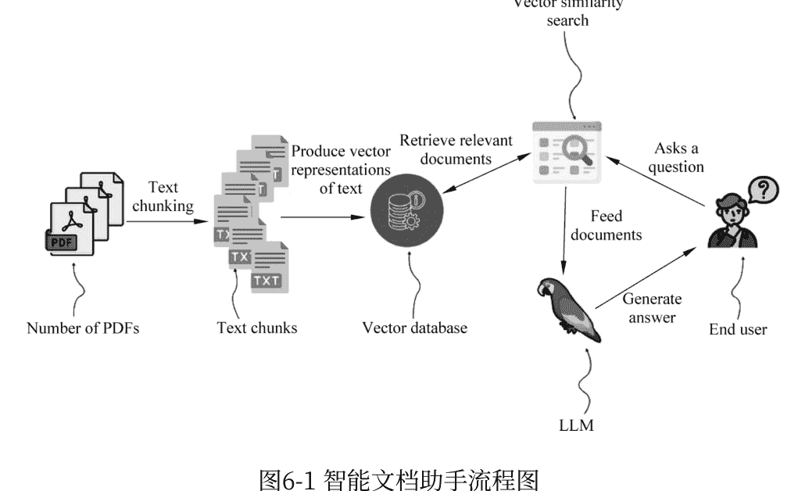

- (1) 文件读取器。负责从不同来源读取原始素材并规范为统一对象。框架自带十余种导入器，覆盖.txt、.pdf、.docx、.html 等常见类型。
- (2) 文件处理器。对原始素材做解析、切分、清洗等预处理，提取文本与结构信息。常用工具包括 Tika、Textract、PyPDF 等。
- (3) 文本编码器。把处理后的文本映射为意义向量，常用模型有 Word2vec、GloVe、BERT 等。该框架封装了主流的嵌入服务与开源模型。
- (4) 向量仓库。把数值表征及元数据写入向量数据库以支持高效相似查找。可接入 Chroma、FAISS、Milvus、Pinecone 等方案。
- (5) LLM 网关。统一对接各家 LLM 的 API。兼容 OpenAI、Cohere、Anthropic、Azure 等厂商。
- (6) 检索引擎。依据用户自然语言查询快速召回最相关片段。实现了 TF-IDF、BM25、意义匹配等多种算法。
- (7) 问答单元。串联检索引擎与 LLM，为用户问题生成自然语言答案。可采用检索增强问答或多轮会话问答。
- (8) 信息抽取单元。利用 LLM 或机器学习从文本中抽取实体、关系等结构化信息，写入图谱。
- (9) 应用入口。封装底层能力，提供对话界面、REST API 等，供上层业务集成。

这些模块在统一接口与数据格式下协同，支持端到端处理。典型问答流程是：原始文件经读取器载入后交处理器解析分段，输出统一的 Document 结构；随后经编码器转为向量并写入向量仓库构建索引；用户通过聊天界面或 API 输入问题，问题同样完成向量化。

检索引擎利用向量相似度从库中召回 Top-K 相关片段，问答单元把召回片段与问题一起送入 LLM 生成答案。LLM 可选用 GPT-3、ChatGPT 等，结合背景知识给出连贯答案。答案经应用层返回用户，完成一次智能问答。过程中抽取单元可持续从文件提取关键信息写入知识库，支撑更复杂的推理与对话。

框架提供一系列即用 Chain，用于灵活编排模块，快速搭建端到端应用。例如 RetrievalQA Chain 封装检索与生成流程，ConversationChain 支持多轮对话，MapReduceChain 用于多文件总结。用户还能通过 Agent 接口定义定制化任务执行逻辑。

#### 6.2.2 LangChain 在协作体中的优势

在构建智能文件系统方面，该框架具备明显优势。

- (1) 多源接入能力强。自带十余种导入器，覆盖本地文件、云存储、网页、Notion 等，可灵活扩展。
- (2) 解析粒度灵活。提供按字符、句子、段落、结构等多种切分工具，适配不同任务。
- (3) 意义查找与缓存。集成主流向量库，支持文本到向量的实时转换与高效查找，采用缓存与懒加载平衡实时性与成本。
- (4) LLM 即插即用。可接入 OpenAI、Cohere、Anthropic、Hugging Face 等，一键切换底层模型，并封装分词、截断等细节。
- (5) 本地化部署友好。提供本地化工具链，可用 Llama 系列、StableLM 等开源模型实现低成本、可控、数据不出域的私有化方案。
- (6) 意义查找与问答开箱。即内置意义检索引擎，融合 dense passage retrieval 等算法，串联检索链与 LLM 即可实现检索增强问答。
- (7) 信息抽取与知识库构建。支持少样本调用 LLM 抽取实体、关系、事件等，封装三元组对象，可对接图数据库构建领域知识库。
- (8) 多模态扩展。通过 docarray 等库集成，支持图像、视频等非结构化数据的意义查找与跨模态问答。
- (9) 链式编程与组合。采用链式范式，支持组件自由组合，低代码定义复杂流程，提供 MapReduce、Sequential 等编排模式。
- (10) Agent 与全流程开发。可像开发智能体一样构建端到端协作助理，涵盖任务分解、工具调用、步骤推理，实现复杂任务自动执行。
- (11) 生态协同。集成 Python 优秀的 NLP 与 LLM 生态，如 spaCy 预处理、Hugging Face 加载模型、Streamlit 搭建演示等。

在自然语言处理、知识表示、意义查找、LLM 应用等方面做了系统化设计与工程优化，为开发者提供一站式智能文件开发套件，通过灵活组合即可快速构建适配不同行业、场景的协作体。

#### 6.2.3 协作体的核心功能模块

下面基于核心组件逐步搭建全栈智能文件协作体，具备意义检索、自然语言问答、信息抽取、摘要生成等关键能力。

**(1) 多源文件接入与解析。**

首先把原始素材载入系统。该框架兼容各类非结构化数据源。

```python
from langchain.document_loaders import TextLoader, PyPDFLoader, UnstructuredURLLoader
# 加载 TEXT 文件
loader = TextLoader('example.txt')
# 加载 PDF 文件
loader = PyPDFLoader("example.pdf")
# 加载 URL
loader = UnstructuredURLLoader("https://example.com")
# 加载整个目录的文档
loaders = [TextLoader(os.path.join("data", fn)) for fn in os.listdir("data")]
documents = loader.load()
```

载入后得到统一的 Document 列表，每个元素包含 page_content 与 metadata。

对较长文件需做意义切分以适配 LLM 输入限制。

```python
from langchain.text_splitter import CharacterTextSplitter
text_splitter = CharacterTextSplitter(
    separator = "\n",                # 以\n 为分隔符
    chunk_size = 2000,               # 每段最大字符数
    chunk_overlap = 0,               # 相邻段落重叠字符数
)
split_docs = text_splitter.split_documents(documents)
```

此处采用基于字符计数的简易切分，也可按标点、Markdown、LaTeX 等意义分隔符切分。

**(2) 意义索引与文件查找。**

得到大量片段后，为其构建向量索引实现意义查找。向量索引把文本映射到高维空间，通过距离度量相似度。

```python
from langchain.embeddings import OpenAIEmbeddings
from langchain.vectorstores import Chroma
embeddings = OpenAIEmbeddings()
vectordb = Chroma.from_documents(split_docs, embeddings)
```

选用 OpenAI embeddings 做向量化，用 Chroma 数据库存储文件向量。

基于索引可轻松实现意义查找，给定自然语言查询即可召回最相关的 Top-K 文件。

```python
query = "What did the author say about black holes?"
matched_docs = vectordb.similarity_search(query, k=3)
```

除精确匹配外，还可引入 MMR 等算法，在相关性与多样性间取得平衡，获得更丰富的背景。

**(3) 基于知识的自然语言问答。**

拿到与问题最相关的一组背景文件后交由 LLM 作答。该框架提供一系列问答 Chain。

```python
from langchain.chains import RetrievalQA
from langchain.chat_models import ChatOpenAI
qa_chain = RetrievalQA.from_chain_type(
    llm=ChatOpenAI(),  # 选择问答模型
    chain_type="stuff",  # 选择问答策略
    retriever=vectordb.as_retriever()  # 配置检索器
)
```

此处选用 ChatOpenAI 作为问答模型，采用 stuff 策略生成答案。直接调用链即可获得结果。

```python
query = "What are the key points about Einstein's theory of relativity?"
answer = qa_chain.run(query)
```

除单轮问答外，还可采用会话链实现多轮对话，保持上下文感知。

```python
from langchain.chains import ConversationalRetrievalChain
from langchain.memory import ConversationBufferMemory
qa_chain = ConversationalRetrievalChain.from_llm(ChatOpenAI(), vectordb.as_retriever())
chat_history = []
while True:
    query = input("Human: ")
    result = qa_chain({"question": query, "chat_history": chat_history})
    chat_history.append((query, result["answer"]))
    print(f"Assistant: {result['answer']}")
```

通过 chat_history 传入对话历史，让模型基于上下文作答。内置的对话缓冲记忆可自动管理会话状态。

## (4) 基于 LLM 的知识抽取

除了问答，还希望从海量文件自动抽取结构化知识形成知识库或图谱。框架支持用 LLM 做少样本信息抽取。定义抽取任务的提示模板：

```python
from langchain import PromptTemplate
from langchain.chains import LLMChain
template = """
从以下段落中提取关系三元组,格式为
<主体> | <关系> | <客体>
段落：
{text}
三元组：
"""
prompt = PromptTemplate(
    input_variables = ["text"],
    template = template
)
```

定义一个 LLMChain，接收指定提示模板与 LLM 模型。

```python
llm = OpenAI(model_name = "text-davinci-003")
chain = LLMChain(llm = llm, prompt = prompt)
```

传入文本即可进行关系抽取。

```python
text = "本草纲目是明代医药学家李时珍编纂的一部药学巨著,被誉为中国古代药物学成就的代表作。"
print(chain.run(text))
```

输出：

```
...
本草纲目 | 作者 | 李时珍
本草纲目 | 成就 | 中国古代药物学代表作
本草纲目 | 成书年代 | 明代
李时珍 | 身份 | 医药学家
...
```

LLM 仅凭少量示例就能以三元组形式抽取文本中的关键信息。将结果写入图数据库如 Neo4j，即可构建基础知识图谱。在训练数据不足时，基于 LLM 的信息抽取具备很强泛化性，但输出不可控、易产生幻觉。生产环境建议优先采用监督学习方法。

## (5) LLM 驱动的文件生成

除检索与抽取外，还可利用知识库结合 LLM 的生成能力主动创作，如自动撰写大纲、生成报告摘要、分类文件、自动回复邮件等。框架的 PromptTemplate、Example Selector 等组件可以帮助通过提示工程充分发挥 LLM 的少样本学习能力，基于少量范例适配新写作任务。

```python
from langchain import FewShotPromptTemplate, PromptTemplate
examples = [
    {
        "query": "<分析报告的简介段落>",
        "summary": "<分析报告的核心要点总结>"
    }
]
example_template = """
报告原文：
{query}
报告要点：
{summary}
"""
example_prompt = PromptTemplate(
    input_variables=["query", "summary"],
    template=example_template
)
few_shot_prompt_template = """
请根据以下两篇报告的内容,为新的报告自动生成要点总结。
{examples}
报告原文：
{query}
报告要点：
"""
prompt = FewShotPromptTemplate(
    examples=examples,
    example_prompt=example_prompt,
    prefix="",
    suffix="",
    input_variables=["examples", "query"],
    example_separator="\n\n",
    template=few_shot_prompt_template
)
print(prompt.format(examples=examples, query="<新的分析报告段落>"))
```

示范式要点抽取的思路是，先搭建单个样例的 example_prompt，再用 few_shot_prompt_template 描绘整体任务，再把两者组装成最终可用的提示。把待处理的报告原文喂入，就能自动提炼出结构化要点。LangChain 官方生态里还内置了基于向量相似度的 Example Selector，可以从海量范例池中挑出与当前任务最匹配的少量样例，动态拼成最优提示，进而提升生成效果。按同样逻辑，结合知识库与提示词，也能引导大模型做主题创作、观点评论、对话续写等开放式写作，让文档助手的创造力与连贯性明显提升。

### 6.3 文档数据的处理与分析

#### 6.3.1 支持的文档格式和数据源

搭建文档智能助手的第一步，是把各种异构的原始材料统一汇入系统。LangChain 提供了覆盖本地文件系统、云存储、数据库、API 等多种入口的 Document Loader 集合，兼容目前主流的结构化与非结构化格式，详见表6-1。

表6-1 LangChain支持的文档格式列表

| 数据源 | 支持的格式 | Document Loader |

| :--- | :--- | :--- |

| 本地文件 | TXT、CSV、PDF、DOCX、PPTX、MD、HTML、EPUB等 | TextLoader、CSVLoader、PDFMinerLoader、UnstructuredWordDocumentLoader、UnstructuredPowerPointLoader、UnstructuredMarkdownLoader、UnstructuredHTMLLoader、UnstructuredEPubLoader等 |

| 云存储 | TXT、PDF等文件，存储在S3、GCS、Azure Blob等对象中 | S3FileLoader、GCSFileLoader、AzureBlobStorageFileLoader等 |

| 数据库 | 关系数据库（MySQL、Postgres），NoSQL数据库（如MongoDB） | SQLDatabaseLoader、MongoDBLoader等 |

| API | 通用的HTTP接口、特定网站如Notion、Obsidian等的API | UnstructuredAPILoader、NotionDirectoryLoader、ObsidianLoader等 |

| 网页 | 在线网页，包括纯文本、HTML等格式 | UnstructuredURLLoader、SeleniumURLLoader、PlaywrightURLLoader等 |

| 即时通信 | Slack、Discord、Telegram等常见即时通信工具 | SlackDirectoryLoader、DiscordChatLoader、TelegramChatLoader等 |

| 电子邮件 | IMAP的邮箱服务 | OutlookMessageLoader、IMAPLoader等 |

| 其他 | Markdown笔记、EPUB电子书、JSON、XML、图片、音频等 | ObsidianLoader、UnstructuredEPubLoader、JSONLoader、ImageCaptionLoader等 |

#### 6.3.2 使用LangChain的Document Loader加载文档

借助 LangChain 的加载组件，可以很方便地从各渠道把原始材料拉进来。例如：
```python
# 从本地文件系统加载文本文件
from langchain.document_loaders import TextLoader
loader = TextLoader('../data/state_of_the_union.txt')
# 从 S3 云存储加载 CSV 文件
from langchain.document_loaders import S3FileLoader
loader = S3FileLoader("s3://bucket/data/info.csv")
# 从 Notion 数据库加载页面
from langchain.document_loaders import NotionDirectoryLoader
loader = NotionDirectoryLoader("Notion_DB_Name")
# 加载在线网页
from langchain.document_loaders import UnstructuredURLLoader
urls = [
    "https://www.eff.org/about",
    "https://www.eff.org/issues/privacy"
]
loader = UnstructuredURLLoader(urls=urls)
```
加载器在后台会处理认证、分页、速率限制等细节，把来源数据转成统一的 Document 形态。需要定制时，也可以自行实现加载器。
```python
from langchain.document_loaders.base import BaseLoader
class MyElasticsearchLoader(BaseLoader):
    """从 Elasticsearch 加载文档的自定义 Loader"""
    def __init__(self, host: str, index: str, query: str):
        self.host = host
        self.index = index
        self.query = query

    def load(self) -> List[Document]:
        # 使用 elasticsearch 库查询 ES,将命中结果转换为 Document 对象
        pass
```
只需继承 BaseLoader 基类并实现 load 方法，就能按指定数据源参数返回标准的 Document 列表。面对多文件或目录的批量导入，可搭配 DirectoryLoader、GlobLoader 等工具。
```python
from langchain.document_loaders import DirectoryLoader, TextLoader
loader = DirectoryLoader('data/', glob='**/*.txt', loader_cls=TextLoader)
docs = loader.load()
```
这里用通配符匹配 data 目录下的所有 txt 文件，再用 TextLoader 把每个文件解析为 Document 对象。

#### 6.3.3 文档结构分析和元数据提取

文本内容只是文档信息的一部分，标题、作者、章节、目录、图表等结构要素，以及创建时间、修改时间、文件类型等元数据同样蕴含重要语义。把非结构化材料转化为结构化属性是文档智能化的关键。

对于 Word、PPT 等 Office 文档，可借助 python-docx、python-pptx 等库解析内部组件。例如解析 DOCX 的大纲结构：
```python
import docx
def extract_docx_outline(file_path):
    doc = docx.Document(file_path)
    outline = []
    for paragraph in doc.paragraphs:
        if paragraph.style.name.startswith('Heading'):
            outline.append({
                'text': paragraph.text,
                'level': int(paragraph.style.name[-1])
            })
    return outline
```
通过 Paragraph 的 style 属性即可识别出 Heading 1/2/3 等层级。表格、图片等内容也可通过解析 XML 实现定位与提取。对于 PDF 等结构更松散的文档，则需结合文本解析、版面分析、视觉分割等手段来识别逻辑结构。例如用 PyPDF 读取 PDF 元数据：
```python
from PyPDF2 import PdfReader
def extract_pdf_metadata(file_path):
    reader = PdfReader(file_path)
    metadata = reader.metadata
    info = reader.getDocumentInfo()
    meta_dict = {
        'Title': info.title,
        'Author': info.author,
        'Creator': info.creator,
        'CreationDate': metadata.creation_date,
        'ModDate': metadata.modification_date,
        'Pages': len(reader.pages)
    }
    return meta_dict
```
PyPDF2 能直接取出文档信息字典里的 Title、Author 等，以及 XMP 元数据里的 CreateDate、ModDate 等。配合页面内容解析，就能实现对 PDF 的全面结构化。超长文档直接输入 LLM 成本较高，需要先做语义切分。LangChain 提供了多种 TextSplitter：
```python
from langchain.text_splitter import CharacterTextSplitter
text_splitter = CharacterTextSplitter(
    separator="\n",
    chunk_size=2000,
    chunk_overlap=0,
)
split_docs = text_splitter.split_documents(docs)
```
分割器可把原始长文档切分为有序的 chunks。除基于字符数的简单切分外，还支持基于 Markdown、LaTeX、代码等特定结构进行的语义化切分。

从原文中提取的结构化信息通常以 Document Metadata 的形式与内容一同流转，可用于语义检索、问答、摘要等下游任务，也便于访问管理：
```python
doc.metadata["source"] = f"{index}-{file_path}"
doc.metadata["outline"] = extract_docx_outline(file_path)
doc.metadata["create_date"] = extract_pdf_metadata(file_path)["CreationDate"]
```
借助元数据，可在语料库中构建 virtual documents，把多个物理文档拼装成一个逻辑虚拟文档作为 LLM 输入。这种灵活的组织方式可在不同粒度上进行语义计算，提升效率。

#### 6.3.4 文档内容的清洗和预处理

原始文档往往夹杂冗余信息、格式错误、编码问题等噪声，必须清洗预处理以提升文本质量，这是文档智能管道的重要一环。TextSplitter 输出的片段在进入下一步前，通常需要过滤掉过短或过长的异常片段；删除 \x01、\u001 等特殊字符；清理多余空格、换行、停用词；还原 HTML 转义符如 &；清除 URL、邮箱、电话、社交账号等；解码 UTF-8、Latin-1 等不同编码；修复标点、拼写错误；统一大小写、时态、单复数；再切分为句子、词语等基本单元。

常用的清洗库包括 ftfy、unidecode、textacy、clean-text。例如用 clean-text 去除文本中的 HTML、URL：
```python
from cleantext import clean
text = "This is a link http://example.com"
cleaned_text = clean(text, no_urls = True)
print(cleaned_text)
# This is a link
```
clean-text 内置了常见的清理规则，也支持自定义正则、过滤函数等，是一个功能全面的清理工具。对于分词、词形归一化等自然语言处理任务，可利用 NLTK、spaCy 等成熟库。

import spacy

nlp = spacy.load('en_core_web_sm')

doc = nlp("I have many books, some are fictions and some are nonfictions.")

tokens = [token.lemma_ for token in doc]

# ['I', 'have', 'many', 'book', ',', 'some', 'be', 'fiction', 'and', 'some', 'be', 'nonfiction', '.']

sentences = [str(sent) for sent in doc.sents]

# ['I have many books, some are fictions and some are nonfictions.']

spaCy 可以对文本进行分词、词形还原、句子分割等多种处理，为语义理解奠定基础。LangChain 可与这些处理库灵活集成，例如实现一个内置 spaCy 句子分割器的自定义 TextSplitter。
```python
from langchain.text_splitter import TextSplitter
class SpacySentenceSplitter(TextSplitter):
    def __init__(self, separator: str = "\n\n", **kwargs):
        super().__init__(separator=separator, **kwargs)
        self.nlp = spacy.load('en_core_web_sm')
    def split_text(self, text: str) -> List[str]:
        doc = self.nlp(text)
        return [str(sent).strip() for sent in doc.sents]
```
该自定义的 SpacySentenceSplitter 会把文档切分为语义完整的句子，作为后续任务的基本单元。更进一步，还能利用 Prompt 模板和 LLM 实现更智能的数据清洗。例如扫描件 OCR 后的文本常包含大量错误、残缺和噪声，可定义一个数据修复的 Prompt：
```python
from langchain import PromptTemplate, FewShotPromptTemplate
examples = [
    {
        "error": "He gratuated from Havard University in 2015.",
        "repaired": "He graduated from Harvard University in 2015."
    },
    {
        "error": "She recieved a prize for her outstanding \xc2 in the art competiton.",
        "repaired": "She received a prize for her outstanding work in the art competition."
    }
]

example_template = """
Error text:
{error}

Repaired text:
{repaired}
"""
example_prompt = PromptTemplate(
    input_variables=["error", "repaired"],
    template=example_template,
)
repair_prompt = FewShotPromptTemplate(
    examples=examples,
    example_prompt=example_prompt,
    prefix="Please repair the following error text: ",
    suffix="Error text: \n{error_text}\n\nRepaired text: ",
    input_variables=["error_text"],
    example_separator="\n\n"
)
# 模拟 OCR 结果中的错误文本
error_text = "He woked at Google compny for 5 years, from 2013 to\xa02018."
print(repair_prompt.format(error_text=error_text))
```

把这个Prompt放到ChatGPT里跑一遍，得到的就是一句干净的句子：“He worked at Google company for 5 years, from 2013 to 2018。” 从这条结果能看出，拼写问题、奇怪的字符、标点缺失都被一次性纠正了。这种靠Prompt做数据清洗的方式非常灵活。只要给模型几组修复示例，它就能自行归纳出校正规律并推广到新样本上，根本不需要写一堆规则和逻辑。更进一步，还可以在Prompt里加上额外约束，比如统一时间写法、脱敏敏感信息等，让纠错变得更定制化、更复杂。

### 6.4 文档理解与信息抽取

#### 6.4.1 主题与关键词抽取

要真正搞懂一篇文档在讲什么，最直接的办法就是先抓住它的主题和关键词。主题是对整篇内容的核心概括，通常由词和短语组成；关键词则是承载主旨的核心词，在检索、分类、聚类、摘要等任务里作用很大。

过去做这件事主要靠TF-IDF这类统计方法，给每个词算重要性，然后挑Top-N。举例来说，用sklearn的TfidfVectorizer就能完成：

```python
from sklearn.feature_extraction.text import TfidfVectorizer
vectorizer = TfidfVectorizer(max_features = 20, stop_words = 'english')
tfidf = vectorizer.fit_transform(docs)
feature_names = vectorizer.get_feature_names_out()
for i, doc in enumerate(docs):
    print(f"Document {i+1} topics: ")
    print(", ".join([feature_names[index] for index in tfidf[i, :].nonzero()[1]]))
```

做法就是把文档集合转成TF-IDF矩阵，再取每个文档权重最高的词当主题词。但纯词频统计看不到语义，容易被低频却关键的词带偏。随着预训练模型普及，我们可以用语义表示来做更精准的抽取。比如用sentence-transformers得到文档的sentence embedding，再和候选关键词的embedding算相似度匹配。

```python
from sentence_transformers import SentenceTransformer
# 加载预训练模型
model = SentenceTransformer('all-MiniLM-L6-v2')
# 候选关键词
candidate_keywords = ["deep learning", "neural network", "machine learning", "computer vision", "natural language processing"]
# 待提取文档
doc = "Deep learning is a subfield of machine learning, which uses artificial neural networks inspired by the structure and function of the brain. It has achieved great success in computer vision, natural language processing and other areas."
# 计算句子和关键词的嵌入向量
doc_embedding = model.encode(doc)
keyword_embeddings = model.encode(candidate_keywords)
# 计算相似度并排序
from sklearn.metrics.pairwise import cosine_similarity
similarities = cosine_similarity([doc_embedding], keyword_embeddings)[0]
sorted_indices = similarities.argsort()[::-1]
# 输出 Top-3 关键词
for i in sorted_indices[:3]:
    print(f"{candidate_keywords[i]}: {similarities[i]:.4f}")
```

# 输出结果：

```
deep learning: 0.6802
machine learning: 0.6078
natural language processing: 0.5235
```

可以看出，基于嵌入的方法把最相关的三个关键词找得很准。候选词的产生方式也可以多样化，比如从知识图谱里取领域核心概念，或用n-gram从原文里切短语。除了嵌入匹配，直接让LLM抽关键词也很有效。模型能从原文里自行归纳出最重要的词，还能通过Prompt微调来定向抽取，比如只抽产品特性、人名地名、医学术语等。相比规则或词典匹配，LLM对语义的理解更深，能挖出隐含的关键点。

主题模型是一类无监督方法，能从文档集合里自动发现潜在的主题结构。最典型的LDA就靠词共现，把每篇文档表示成若干主题的概率分布。我们可以用LDA来提炼文档的主要主题。

```python
from sklearn.decomposition import LatentDirichletAllocation
lda = LatentDirichletAllocation(n_components=5)
lda.fit(tfidf)
feature_names = vectorizer.get_feature_names_out()
for topic_idx, topic in enumerate(lda.components_):
    print(f"Topic {topic_idx + 1}: ")
    print(" ".join([feature_names[i] for i in topic.argsort()[:- 10 - 1: -1]]))
```

LDA在多篇文档中挖出了5个主题，每个主题都由一组权重最高的关键词构成。

这类模型在处理长文本和大语料时很擅长，能揭示词与词之间的潜在联系。但效果受语料质量影响比较大，对领域知识的利用不足。近年的研究开始把主题模型和预训练语言模型结合，用LLM的语义表征来增强主题-词分布矩阵，让主题更一致、更易解释。

#### 6.4.2 命名实体识别与关系抽取

读懂文档的深层含义，本质是把里面的事实性知识结构化，也就是实体及其属性和关系。命名实体识别和关系抽取正是做这件事。

LangChain很容易对接现有的NLP库做NER。比如用spacy的预训练NER模型：

```python
import spacy
nlp = spacy.load("en_core_web_sm")
doc = nlp("Jack works at Google in New York since 2018.")
for ent in doc.ents:
    print(ent.text, ent.label_)
```

输出：

```
Jack PERSON
Google ORG
New York GPE
2018 DATE
```

spacy内置了固定的实体类型，如人名PERSON、机构ORG、地理位置GPE、时间DATE等。这种有监督的方法依赖大量标注数据，泛化能力有限。

也可以用Few-shot Prompt让LLM来做NER。定义一个Prompt：

```python
from langchain import PromptTemplate, FewShotPromptTemplate
examples = [
    {
        "text": "Andrew went to Stanford University for his undergraduate degree in Computer Science.",
        "entities": "Andrew - PERSON\nStanford University - ORG\nComputer Science - TOPIC"
    },
    {
        "text": "The movie Inception won many awards including the Academy Award for Best Cinematography.",
        "entities": "Inception - WORK\nAcademy Award - AWARD\nBest Cinematography - AWARD"
    }
]
example_template = """
Text:
{text}
Extracted Entities:
{entities}
"""
example_prompt = PromptTemplate(
    input_variables=["text", "entities"],
    template=example_template,
)
ner_prompt = FewShotPromptTemplate(
    examples=examples,
    example_prompt=example_prompt,
    prefix="Extract the key entities mentioned in the text below. For each entity, identify its type from the following categories: PERSON, ORG, TOPIC, WORK, AWARD. Format your answer as [entity] - [type], one per line.",
    suffix="Text: {text}\n\nExtracted Entities: ",
    input_variables=["text"],
    example_separator="\n\n"
)
text = "Yann LeCun is a professor at New York University and a recipient of the Turing Award for his work on deep learning."
print(ner_prompt.format(text=text))
```

这里的ner_prompt由任务描述prefix、输入占位符suffix和两条标注样例examples组成。喂给ChatGPT后会输出：

```
Yann LeCun - PERSON
New York University - ORG
Turing Award - AWARD
deep learning - TOPIC
```

从两条样例里，模型自行总结出识别模式，能准确挑出新句里的4个实体。实体类型体系也能自定义，比如产品实体、事件实体等。只要Prompt设计得好，零样本或小样本的NER就能跑起来。

识别完实体后，LLM还能抽实体间的关系。例如：

```python
template = """
从下面的文本中提取三元组关系,每行一个,格式为
[Subject 实体] | [关系] | [Object 实体]
如果文本中没有明确的关系,则可根据上下文合理推断。
文本：
{text}
三元组：
"""
prompt = PromptTemplate(template=template, input_variables=["text"])
text = "Demis Hassabis is the co-founder and CEO of Google DeepMind. He founded the company in 2010, which was later acquired by Google in 2014 for over $500 million."
print(prompt.format(text=text))
llm = OpenAI(temperature=0)
llm_result = llm(prompt.format(text=text))
print(llm_result)
```

LLM从文本中识别出三个三元组关系：

```
Demis Hassabis | is the co-founder of | Google DeepMind
Demis Hassabis | is the CEO of | Google DeepMind
Google | acquired | Google DeepMind
```

这里既包含了原文明确提到的“co-founder”“CEO”，也做了合理的隐式推断“acquired”。还可以要求模型按主语-谓语-宾语的SPO形式输出，方便入库。

> (Demis Hassabis, co-founder, Google DeepMind)

> (Demis Hassabis, CEO, Google DeepMind)

> (Google, acquire, Google DeepMind)

基于LLM的关系抽取泛化强、适应领域快。它能从案例学到抽取逻辑，不依赖预定义关系模式，也能适应不同语言风格。通过Prompt配置，还能限定抽取特定类型、特定格式的关系知识。

实体和关系三元组是构建知识图谱的基础。用Neo4j这类图数据库存储抽取结果，就能形成文档的结构化知识表征。知识图谱可以作为外部知识库，提升语义检索、问答、推荐等下游任务。LangChain的GraphDatabase接口让LLM与图数据库的融合非常顺畅。

#### 6.4.3 文档摘要与重点句提炼

文档摘要就是把冗长的文本压缩成简明扼要的要点，帮助快速把握主旨，在信息检索和内容推荐里很关键。

传统摘要分提取式和生成式两类。提取式是从原文挑重要句子，保留原话；生成式则是基于语义理解，用全新表述重写摘要。

在LangChain里可以用预训练语言模型做高质量的生成式摘要。比如用PromptTemplate定义摘要任务：

```python
from langchain import PromptTemplate
template = """
请为下面这段文本生成一个简明扼要的摘要。摘要应该准确传达文章的核心观点，但使用全新的表述方式，不超过原文长度的四分之一。
文本：
{text}
摘要：
"""
prompt = PromptTemplate(template=template, input_variables=["text"])
llm = OpenAI(temperature=0.5)
text = "自然语言处理是人工智能的一个重要分支，旨在赋予计算机理解、生成和处理人类语言的能力。自然语言处理技术在诸如机器翻译、信息检索、舆情分析、智能客服等领域有广泛应用。近年来，以Transformer为代表的大规模预训练语言模型在多项自然语言处理任务上取得了突破性进展，使得自然语言处理进入了新的发展阶段。未来，自然语言处理技术将进一步向知识化、情感化、个性化、多模态化等方向发展，为人机交互带来更自然、更高效的体验。"
print(prompt.format(text=text))
llm_result = llm(prompt.format(text=text))
print(llm_result)
```

模型给出的摘要如下。

> 自然语言处理是人工智能的重要分支，旨在让计算机理解和处理人类语言。近年来，预训练语言模型的突破推动了自然语言处理的发展。未来，该技术将朝着知识化、情感化、个性化和多模态化方向发展，革新人机交互体验。

这段摘要精准抓住了原文主题和脉络，用简洁流畅的语言重新组织，可读性很高。调节temperature参数可以控制创造性。生成式摘要在流畅性和连贯性上占优，但容易出现事实性错误。提取式摘要因为直接取原文句子，在事实准确性上更有保障。

提取式摘要可以用TextRank等无监督算法实现。TextRank先构建句子相似度图，用PageRank算重要性得分，再取Top-K句子作为摘要。例如：

```python
import numpy as np
import spacy
from spacy.lang.en.stop_words import STOP_WORDS
def vectorize_sents(doc):
    return [sent.vector for sent in doc.sents]
def similarity_matrix(vectors):
    return np.dot(vectors, vectors.T)
def pagerank(M, d=0.85, max_iter=50):
    n = M.shape[0]
    r = np.ones(n) / n
    for _ in range(max_iter):
        r_new = d * np.dot(M, r) + (1 - d) / n
        if np.allclose(r, r_new):
            break
        r = r_new
    return r
def textrank_summarize(text, ratio=0.2):
    nlp = spacy.load('en_core_web_sm')
    nlp.Defaults.stop_words |= STOP_WORDS
    doc = nlp(text)
    vectors = vectorize_sents(doc)
    M = similarity_matrix(vectors)
    scores = pagerank(M)
    ranked_sents = sorted([(scores[i], s) for i, s in enumerate(doc.sents)], reverse=True)
    n_sents = int(len(ranked_sents) * ratio)
    top_sents = [sent.text.capitalize() for _, sent in ranked_sents[:n_sents]]
    summary = ' '.join(top_sents)
    return summary
print(textrank_summarize(text))
```

输出：

> 自然语言处理是人工智能的一个重要分支，旨在赋予计算机理解、生成和处理人类语言的能力。近年来，以Transformer为代表的大规模预训练语言模型在多项自然语言处理任务上取得了突破性进展，使得自然语言处理进入了新的发展阶段。

先把整料拆成独立小句并滤掉常用功能词，接着借助 spaCy 为每条小句生成向量表征，计算两两间的相似度表，随后套用 PageRank 思路给各小句打权重分，取前两成合并成概要。

TextRank 产出的概要信息基本忠实原文，可靠性强，但各句衔接生硬，通读不够顺滑。可以让大语言模型对抽取结果做一次语言润色，提升可读度：

```python
template = """
以下是一篇文章的摘要，但是句子之间衔接不流畅，请重新组织语言，使摘要读起来更加通顺连贯，但不要改变原有的意思。
原始摘要：
{summary}
优化后的摘要：
"""
prompt = PromptTemplate(template=template, input_variables=["summary"])
print(prompt.format(summary=textrank_summarize(text)))
llm_result = llm(prompt.format(summary=textrank_summarize(text)))
print(llm_result)
```

输出：

> 自然语言处理作为人工智能的一个重要分支，旨在赋予计算机理解、生成和处理人类语言的能力。近年来，以Transformer为代表的大规模预训练语言模型在多项自然语言处理任务上取得了突破性进展，标志着自然语言处理进入了崭新的发展阶段。

大模型在不改动原意的前提下梳理衔接，让概要读起来更顺。抽取式负责保真，生成式负责润色，两者配合兼顾准确与流畅。除了整篇概括，还能从材料里挑出最能点出核心的单句，用作亮点或 Golden Passage。最直白的做法是复用 TextRank 的权重分数，直接取排名靠前的一两条。

另一种思路是借用模型的归纳能力。只需给出一个用于挑选亮点的提示词：

```python
template = """
从下面这段文本中，选取一个最能概括全文主旨的句子作为亮点句。亮点句应该是原文中的原句，不要自己生成和改写。
文本：
{text}
亮点句：
"""
prompt = PromptTemplate(template=template, input_variables=["text"])
print(prompt.format(text=text))
llm_result = llm(prompt.format(text=text))
print(llm_result)
```

输出：

> 近年来，以Transformer为代表的大规模预训练语言模型在多项自然语言处理任务上取得了突破性进展，使得自然语言处理进入了新的发展阶段。

模型挑出的亮句抓住了整篇要义。对不同段落分别做提取，就能拼出一张全局速写。亮句还能当作材料的精简说明，适配检索、相关性排序等场景。若把亮句当作 passage 质量的代理指标，还能用来指引 passage retrieval，减小黑盒检索带来的语义偏差。

#### 6.4.4 使用LangChain的LLM类实现语义理解

LangChain 把 GPT-3、ChatGPT 等主流模型的接口统一封装，为理解与生成任务提供一套通用调用方式。通过它能很方便地完成实体识别、关系抽取、摘要等操作。

比如设计一个用于实体识别的 few-shot 提示模板：

```python
from langchain import PromptTemplate, FewShotPromptTemplate
examples = [
    {
        "text": "Apple CEO Tim Cook unveiled the new iPhone 14 at the company's annual event in Cupertino, California.",
        "entities": "Apple - ORG\nTim Cook - PERSON\niPhone 14 - PRODUCT\nCupertino - CITY\nCalifornia - STATE"
    },
    {
        "text": "The Nobel Prize in Literature 2022 was awarded to French author Annie Ernaux for her influential works depicting the lives of women.",
        "entities": "Nobel Prize in Literature - AWARD\n2022 - DATE\nFrench - NORP\nAnnie Ernaux - PERSON"
    }
]
example_template = """
Text:
{text}

Extracted Entities:
{entities}
"""
example_prompt = PromptTemplate(
    input_variables=["text", "entities"],
    template=example_template,
)
ner_prompt = FewShotPromptTemplate(
    examples=examples,
    example_prompt=example_prompt,
    prefix="Extract entities and their types from the following text. Types include: PERSON, NORP (nationality or religious group), ORG, STATE, CITY, PRODUCT, AWARD, DATE, MONEY, etc. Use '- ' to separate entity and type.",
    suffix="Text: {text}\n\nExtracted Entities: ",
    input_variables=["text"],
    example_separator="\n\n"
)
text = "Mark Zuckerberg announced that Meta will lay off 10,000 employees amid economic downturn and shift focus towards building the metaverse."
print(ner_prompt.format(text=text))
# 定义 LLM 实例
from langchain.llms import OpenAI
llm = OpenAI(temperature=0)
print(llm(ner_prompt.format(text=text)))
```

输出：

> Mark Zuckerberg - PERSON

> Meta - ORG

> 10,000 - MONEY

仅给两个示范，模型就能在新输入中正确标出三类实体并给出类别。关系抽取同理，可设计对应的提示模板：

```python
relation_examples = [
    {
        "text": "Elon Musk is the CEO of Tesla, which he co-founded in 2003.",
        "relations": "(Elon Musk, CEO of, Tesla)\n(Elon Musk, co-founded, Tesla)"
    },
    {
        "text": "Sergey Brin and Larry Page founded Google in 1998, which later reorganized under Alphabet Inc. in 2015.",
        "relations": "(Sergey Brin, founded, Google)\n(Larry Page, founded, Google)\n(Google, reorganized under, Alphabet Inc.)"
    }
]
relation_prompt = FewShotPromptTemplate(
    examples=relation_examples,
    example_prompt=example_prompt,
    prefix="Extract the relations between entities from the following text. Each relation should be in the format of '(Subject, Relation, Object)'.",
    suffix="Text: {text}\n\nRelations: ",
    input_variables=["text"],
    example_separator="\n\n"
)
text = "Jeff Bezos founded Amazon in 1994. He stepped down as CEO in 2021 and was succeeded by Andy Jassy."
print(relation_prompt.format(text=text))
print(llm(relation_prompt.format(text=text)))
```

输出：

> (Jeff Bezos, founded, Amazon)

> (Jeff Bezos, stepped down as CEO of, Amazon)

> (Andy Jassy, succeeded, Jeff Bezos)

模型从输入中提炼出三组关系三元组。进一步解析这些三元组即可搭建实体关系网络。随后是摘要提示的示例。

```python
summarization_examples = [
    {
        "text": "Deep learning has achieved state-of-the-art results in computer vision, speech recognition, natural language processing and other fields. At the core of deep learning are neural networks, which are inspired by the structure and function of the human brain. Deep neural networks are composed of multiple layers that learn increasingly abstract representations of the input data, allowing them to automatically learn hierarchical features.",
        "summary": "Deep learning uses multi-layered neural networks to achieve breakthroughs in AI fields like computer vision and NLP. These networks are inspired by the human brain and can automatically learn hierarchical features from raw data."
    },
    {
        "text": "Quantum computing is a rapidly emerging technology that harnesses the laws of quantum mechanics to solve problems too complex for classical computers. Quantum computers use qubits, which can be in multiple states at once, to perform vast numbers of calculations simultaneously. This allows them to solve certain problems, such as simulating complex chemical reactions and optimizing large systems, much faster than classical computers.",
        "summary": "Quantum computing leverages principles of quantum mechanics like superposition to perform complex computations beyond the reach of classical computers. Quantum computers can simulate chemical reactions and optimize large systems far more efficiently."
    }
]
summarization_prompt = FewShotPromptTemplate(
    examples=summarization_examples,
    example_prompt=example_prompt,
    prefix="Summarize the following text in 2-3 sentences. The summary should capture the key points and use concise language.",
    suffix="Text: {text}\n\nSummary: ",
    input_variables=["text"],
    example_separator="\n\n"
)
text = "Natural language processing (NLP) is a subfield of linguistics, computer science, and artificial intelligence concerned with the interactions between computers and human language, in particular how to program computers to process and analyze large amounts of natural language data. Challenges in natural language processing frequently involve speech recognition, natural language understanding, and natural language generation. Recent advances in deep learning have achieved very high performance across many different NLP tasks."
print(summarization_prompt.format(text=text))
print(llm(summarization_prompt.format(text=text)))
```

输出：

大模型重塑语义理解：从少样本学习到文档问答

自然语言处理是一个跨学科的研究方向，核心目标是让机器能够理解并生成人类语言，相关技术覆盖语音识别、语义理解和文本生成。深度学习在近几年推动了诸多NLP任务的显著进展。

以LLM为例，它仅凭少量示例就能提炼出全面、精炼且专业的摘要，精准抓住原文要点。可以看到，结合LangChain的LLM接口与Prompt模板，文档语义理解任务几乎可以即插即用。LLM强大的少样本学习能力大幅拉低了开发门槛，只要精心设计Prompt模板和示范样本，就能引导模型完成特定领域、特定风格的语义分析。相较于传统特征工程加机器学习的路径，基于大模型的语义理解方式具备明显优势。

- 1) 省去繁琐的特征提取和大规模人工标注，少量示例即可启动。
- 2) 能灵活切换领域和任务，通过修改Prompt快速适配。
- 3) 支持开放域、无界面的文本输入，应用场景更广。
- 4) 融合常识知识，可挖掘隐含语义，弥补标注不足。
- 5) 输出可控，可在理解基础上做推理、归纳和总结。

当然，大模型语义理解并非万能，仍存在不少挑战。

- 1) 容易产生幻觉，事实准确性和逻辑一致性仍需提升。
- 2) 缺乏个性化私有知识，对特定企业或行业的术语规则理解有限。
- 3) 对图像、视频、音频等多模态内容的理解能力不足。
- 4) 推理能力和常识推理与人类相比差距明显。
- 5) 模型属于黑盒，可解释性差，难以精确定位和修正错误。
- 6) 训练与推理成本较高，效率和性能仍有优化空间。

破解这些问题需要算法、数据、工程层面持续创新，同时在安全、伦理、治理上保持规范。随着学界与业界的共同投入，基于大模型的语义理解与知识挖掘必将不断突破，为企业和个人创造更大价值。

### 6.5 文档问答与对话实践

#### 6.5.1 知识片段切分策略

大规模语料是LLM的原材料。要让非结构化原文被模型“吃得下”，必须先做文档分块和知识切分。知识片段通常控制在模型最大上下文窗口以内，可独立抽取主题和关键词，保留文档内在结构，兼具完整性和独立性。切分长文档能够缓解编码长序列时的注意力衰减和计算瓶颈，提升理解准确度与生成流畅度。

LangChain内置了丰富的分割器，支持按字符数、标点、Markdown语法等策略切分。例如用RecursiveCharacterTextSplitter做递归字符分割：

```python
from langchain.text_splitter import RecursiveCharacterTextSplitter
text_splitter = RecursiveCharacterTextSplitter(
    chunk_size = 500,
    chunk_overlap = 50,
    length_function = len,
)
texts = text_splitter.create_documents([text])
```

该示例以500字符为单位切分，相邻片段保留50字符重叠，确保跨段信息连贯，可通过length_function指定长度计算方式。也可以利用文档结构做语义切分，例如用MarkdownTextSplitter依据Markdown标记切分：

```python
from langchain.text_splitter import MarkdownTextSplitter
markdown_text = """
# Chapter 1
## Section 1
Content of section 1.
## Section 2
Content of section 2.
# Chapter 2
## Section 1
Content of section 1.
"""
markdown_splitter = MarkdownTextSplitter(chunk_size=500, chunk_overlap=50)
docs = markdown_splitter.create_documents([markdown_text])
for i, doc in enumerate(docs):
    print(f"Document {i+1}: ")
    print(doc.page_content)
    print("=" * 50)
```

MarkdownTextSplitter能识别章节、小节等层级，以此为边界切分，在满足目标块长的同时保持语义完整。类似地还有HTMLTextSplitter、LatexTextSplitter，可按不同格式的语法切分。对代码、公式等结构化内容，希望保持完整单元，LangChain自带的PythonCodeTextSplitter就能按Python语法切分：

```python
from langchain.text_splitter import PythonCodeTextSplitter
python_code = """
def hello_world():
    print("Hello, World!")
def greet(name):
    print(f"Hello, {name}!")
if __name__ == "__main__":
    hello_world()
    greet("Alice")
"""
python_splitter = PythonCodeTextSplitter(chunk_size=50, chunk_overlap=0)
docs = python_splitter.create_documents([python_code])
for i, doc in enumerate(docs):
    print(f"Document {i+1}: ")
    print(doc.page_content)
    print("=" * 50)
```

该分割器识别函数、类、条件语句等结构块，在块边界切分，避免函数体被截断，也可自定义分割器支持更多语言。

此外，还可基于主题结构切分，利用主题模型、TextTiling等方法依主题连贯性和转折点切分，使每段聚焦单一主题，独立性更强。理想片段需要在信息完整、主题独立和目标长度间取得平衡，通常需要分层递进切分。一个简易流水线示例如下。

```python
from langchain.text_splitter import CharacterTextSplitter
from langchain.text_splitter import RecursiveCharacterTextSplitter
# 先粗粒度分割为 2000 字符左右的大块
text_splitter1 = RecursiveCharacterTextSplitter(chunk_size=2000, chunk_overlap=100)
docs1 = text_splitter1.create_documents([text])
# 再将每个大块切分为 500 字符左右的小块
text_splitter2 = CharacterTextSplitter(chunk_size=500, chunk_overlap=50)
docs2 = text_splitter2.split_documents(docs1)
```

采用两级策略：第一级用RecursiveCharacterTextSplitter粗切为约2000字符的大块，第二级再用CharacterTextSplitter细分为500字符小块。通过调节chunk_overlap可在独立性与连贯性间权衡。切分后的片段可直接用于构建向量索引、知识库。也可在切分时提取元信息如原文位置，写入文档元数据，方便后续追溯定位。例如：

```python
from langchain.schema import Document
def create_metadata(doc: Document, chunk_idx: int, num_chunks: int):
    return {
        "source": doc.metadata["source"],
        "chunk_idx": chunk_idx,
        "num_chunks": num_chunks,
        "format": doc.metadata.get("format", "text"),
    }
split_docs = []
for doc in docs:
    splits = text_splitter.split_text(doc.page_content)
    num_chunks = len(splits)
    split_docs.extend([
        Document(
            page_content = split,
            metadata = create_metadata(doc, chunk_idx, num_chunks)
        )
        for chunk_idx, split in enumerate(splits)
    ])
```

自定义create_metadata函数为每个小片段生成元数据，包含来源文档、片段编号、总数及原始格式等，用于过滤、排序和追踪。

【拓展思考】如何权衡片段目标长度与上下文重叠度等超参数？

#### 6.5.2 LangChain 检索器的语义召回

有了知识片段后，下一步是建立索引以便查询时快速召回。传统关键词检索对字面差异敏感，而语义检索利用向量空间计算查询与候选片段的语义相似度，返回Top-K结果。

LangChain提供了一系列Retriever类，封装Chroma、FAISS、Weaviate、Pinecone等向量搜索引擎，只需将文档转为向量并调用相关方法即可实现高效语义检索。

以Chroma构建向量索引并检索为例。

```python
from langchain.indexes import VectorstoreIndexCreator
from langchain.vectorstores import Chroma
from langchain.embeddings import OpenAIEmbeddings
# 使用 OpenAIEmbeddings 将文档转换为向量
embeddings = OpenAIEmbeddings()
vectordb = Chroma.from_documents(split_docs, embeddings)
# 检索与查询最相关的三个知识片段
query = "What are the key components of a search engine?"
retriever = vectordb.as_retriever(search_kwargs={"k": 3})
retrieved_docs = retriever.get_relevant_documents(query)
for i, doc in enumerate(retrieved_docs):
    print(f"Document {i+1}: ")
    print(doc.page_content)
    print("=" * 50)
```

先用OpenAIEmbeddings将文档向量化并存入Chroma，再通过vectordb.as_retriever()获取Retriever对象并指定Top-K，最后调用retriever.get_relevant_documents()传入自然语言查询，得到最相关的三个片段。

检索时也可加入控制参数，如相关性阈值、过滤条件，只检索特定主题或来源：

```python
topic_filter = {"topic": "neural networks"}
source_filter = {"source": "https://en.wikipedia.org/wiki/Deep_learning"}
filtered_retriever = FilterRetriever(
    vectordb.as_retriever(search_kwargs={"k": 5}),
    filter_kwargs={**topic_filter, **source_filter}
)
```

这里使用FilterRetriever在相似度检索基础上叠加主题和来源过滤，提升精准度。还可自定义评分函数引入文档质量、时效性等特征进行重排。

检索效果高度依赖文本向量化质量。LangChain支持FastText、GloVe、SentenceBERT、InstructorEmbedding等主流嵌入模型，可按任务选择并微调。一般上下文感知的嵌入比静态词嵌入更能捕捉语义。

Retriever返回的片段可能冗余。为进一步提纯，可在Retriever后加入Ranker对初步结果重新打分排序。示例：

```python
from langchain.chains import RetrievalQA
from langchain.llms import OpenAI
# 定义一个问答链,使用 Retriever 检索,使用 OpenAI LLM 生成答案
qa_chain = RetrievalQA.from_chain_type(
    llm=OpenAI(),
    chain_type="stuff",
    retriever=vectordb.as_retriever()
)
query = "What are the key components of a search engine?"
result = qa_chain({"query": query})
print(result['result'])
```

该RetrievalQA链先用Retriever召回相关片段，再拼接为上下文喂给OpenAI LLM生成答案。chain_type指定问答策略，这里采用stuff策略一次性喂入所有片段，也可选用refine策略迭代融合中间答案。

【思考】Retriever+Ranker架构与Retriever+Reader架构的优劣？

#### 6.5.3 LLM驱动的答案生成

获得相关片段后，需基于其生成自然语言答案。不同于规则或模板方法，模型能真正理解片段语义并灵活生成连贯答案。LangChain提供多种LLM类，封装GPT-3、ChatGPT、InstructGPT等主流模型，便于调用。

最简方式是直接将相关片段拼接成Prompt喂给LLM生成答案：

```python
from langchain.prompts import PromptTemplate
# 定义 Prompt 模板
template = """基于以下已知信息,用中文回答问题。如果无法从中得到答案,就说 "根据已知信息无法回答该问题"。除非必要,否则不要逐字重复原始句子,而是要总结知识要点,并适当延伸、补充相关细节,生成自然、连贯、完整的答案。
已知信息：
{context}
问题：
{question}
答案：
"""
prompt = PromptTemplate(
    input_variables=["context", "question"],
    template=template
)
# 获取相关知识片段
question = "请介绍一下梯度下降算法的原理。"
context = retriever.get_relevant_documents(question)
# 调用 LLM 生成答案
llm = OpenAI(model_name="text-davinci-003")
llm_result = llm(prompt.format(context="\n".join([doc.page_content for doc in context]),
                                question=question))
print(llm_result)
```

Prompt 模板的核心作用，就是告诉大语言模型在收到 context 和 question 后该怎么作答。context 是检索器拼凑出来的相关知识片段，question 则是用户用自然语言提出的问题。把两者按格式填进模板后丢给 OpenAI 的 LLM，就能得到一份生成式的回答。

这种模板的价值在于可控性。开发者可以明确要求模型用什么结构呈现结果、提炼要点、补充背景、写出更自然的表达，也可以通过 few-shot 的示例向模型示范想要的风格。

【例6-1】Prompt示例（代码6.1.py）。

```python
from langchain.prompts import PromptTemplate
from langchain.prompts.few_shot import FewShotPromptTemplate
from langchain_community.llms import Ollama as OllamaLLM
# 定义 few-shot 的例子
examples = [
    {
        "question": "求一元二次方程 ax^2 + bx + c = 0 的根的公式。",
        "answer": "对于一元二次方程 ax^2 + bx + c = 0, 其中 a ≠ 0, 根的公式为: x = [-b ± √(b^2 - 4ac)]/(2a)。其中, √(b^2 - 4ac) 称为判别式, 记为 Δ。当 Δ > 0 时, 方程有两个不相等的实数根; 当 Δ = 0 时, 方程有两个相等的实数根; 当 Δ < 0 时, 方程没有实数根。"
    },
    {
        "question": "什么是傅里叶变换? 请简要说明其应用。",
        "answer": "傅里叶变换是一种将信号从时域转换到频域的数学变换。它将一个时域信号分解成不同频率的正弦波之和, 得到信号的频谱。傅里叶变换在信号处理、图像处理、通信等领域有广泛应用。例如, 利用傅里叶变换可以对音频信号进行滤波、降噪; 对图像进行增强、压缩; 分析通信信号的频率特性等。此外, 在雷达、医学成像、地震分析等领域也有重要应用。傅里叶变换揭示了时域和频域的内在联系, 是信号处理的重要数学工具。"
    }
]
# 定义 example prompt 单个示例的 Prompt 模板
example_prompt = PromptTemplate(
    input_variables=["question", "answer"],
    template="""
问题:
{question}
答案:
{answer}
"""
)
# 定义 few-shot Prompt
few_shot_prompt = FewShotPromptTemplate(
    examples=examples,
    example_prompt=example_prompt,
    # prefix: 在示例之前添加的前缀文本
    # suffix: 在示例之后添加的后缀文本, 包含实际问题的占位符{input}
    # input_variables: 输入变量列表, 这里只有一个变量"input"
    # example_separator: 分隔不同示例的字符串
    prefix="请根据提供的上下文回答问题。如果找不到相关信息, 就说"我不知道"。",
    suffix="问题: {input}\n答案: ",
    input_variables=["input"],
    example_separator="\n\n"
)
# 初始化本地的 Gemma 模型
llm = OllamaLLM(model="gemma:2b")
# 获取相关知识片段
# 设置上下文信息
context = "机器学习和深度学习都是人工智能的重要分支。机器学习是一种通过数据和算法让计算机系统自动学习和改进性能的方法, 而无须显式编程。深度学习则是机器学习的一个子集, 它使用多层神经网络来学习数据的层次化表示。与传统的机器学习方法相比, 深度学习能够处理更加复杂和高维度的数据, 在语音识别、图像分类、自然语言处理等领域取得了突破性进展。总的来说, 深度学习是机器学习的一种更强大和专门化的方法。"
# 获取问题
question = "机器学习和深度学习有什么区别和联系?"
# 调用 Gemma 模型生成答案
llm_result = llm(few_shot_prompt.format(
    input=question,
    context=context
))
print(llm_result)
```

这里放了两组问答范例，用来展示理想的输出模式：先做要点概括，再适度延伸说明。模板里还规定模型必须严格依据给定的 context 回答，若检索内容里找不到对应信息，就直接回复 “I don't know”。模型会结合这些示范和检索到的 knowledge 来生成答案。换一组示例、改动指令的措辞，就能影响最终答案的质量和语气。除去直接生成答案，还能用基于知识的问答思路，先让结构化知识库给出候选答案，再交由 LLM 去润色。例如：

```python
from langchain.chains import GraphQAChain
from langchain.indexes.knowledge_graph import KnowledgeGraph
# 从知识库中检索相关实体
kg = KnowledgeGraph(vectorstore, "my_graph")
question_entities = kg.get_entities(question)
# 根据相关实体生成候选答案
candidate_answers = kg.get_triplets(question_entities)
# 喂给 LLM 过滤、优化候选答案
qa_chain = GraphQAChain.from_llm(OpenAI(), kg)
result = qa_chain.run(question, candidate_answers)
print(result)
```

GraphQAChain 会先用知识图谱做推理，根据问题定位相关实体并产出结构化的候选答案，随后把候选答案喂给 LLM 进行自然语言转换和细节补全。这种做法把知识图谱的符号推理能力和 LLM 的语言生成能力叠加起来，在准确性和可解释性上通常比端到端方案更稳健。代价是高度依赖人工搭建的高质量知识图谱，建设和维护成本不低。

把检索到的信息写成自然语言，本质上是智能问答的“最后一公里”。有了 LLM，手工写模板、定规则的负担大幅减轻，用户能得到更灵活、更智能的回应。但模型的输出并不总稳定，容易出现事实偏差、逻辑冲突或过度臆测，需要谨慎使用。未来如何更好地约束和引导生成行为，在创造力和忠实度之间找到平衡，是让问答真正落地的关键。

【思考】除了依赖检索到的知识，还能怎样引入常识、因果推理和逻辑泛化能力，来提升模型的回答质量？

#### 6.5.4 支持多轮对话和上下文理解

真实场景里用户很少一次说清需求，往往是靠多轮对话逐步澄清。单轮问答满足不了这种渐进式表达，所以系统要具备多轮交互能力，记住对话历史，并据此调整检索和回复。传统做法靠对话状态跟踪、槽位填充等显式建模历史，而 LLM 可以把历史隐式编码进上下文，工程实现被简化很多。

LangChain 的 ConversationChain 就是一套开箱即用的多轮对话方案。它内部用 ConversationBufferMemory 做历史缓存，会把前面的对话动态拼进当前输入。

```python
from langchain.chains import ConversationChain
from langchain.memory import ConversationBufferMemory

# 初始化 LLM
llm = OpenAI(temperature=0)
# 初始化对话历史缓存
memory = ConversationBufferMemory()
# 初始化对话链
conversation = ConversationChain(
    llm=llm,
    memory=memory,
    verbose=True
)
# 进行对话
answer = conversation.predict(input="请介绍一下深度学习的发展历史。")
print(answer)
answer = conversation.predict(input="深度学习有哪些常见的网络结构？")
print(answer)
answer = conversation.predict(input="卷积神经网络在计算机视觉领域有什么应用？")
print(answer)
```

每轮问答都会被写入 ConversationBufferMemory，新的提问进来时，历史会自动拼接进上下文。模型因此能带着完整背景理解问题并给出连贯回复。比如第三轮里提到的“卷积神经网络”，正是承接了第二轮回答点到的内容。

内存的参数也能调。窗口大小、插入格式都可以自定义。下面是一个更精细的配置。

```python
from langchain.memory import ConversationBufferWindowMemory
# 初始化有限窗口的对话历史缓存
memory = ConversationBufferWindowMemory(
    memory_key = "chat_history",
    k = 3,
    return_messages = True
)
memory.save_context({"input": "你好,我是 Bob!"}, {"output": "很高兴认识你 Bob,我是 AI 助手,有什么可以帮你的吗?"})
memory.save_context({"input": "我想了解一下人工智能的历史。"}, {"output": "好的,人工智能的发展大致可以分为三个阶段：第一阶段是 20 世纪 50～70 年代的符号主义和专家系统时期;第二阶段是 20 世纪 80～90 年代的连接主义和机器学习时期;第三阶段是 2000 年以来的深度学习和大数据时期。这些阶段分别代表了人工智能从基于规则、基于统计到基于海量数据端到端学习的范式演进。人工智能在不同阶段取得了图像识别、语音识别、自然语言处理、策略搜索等领域的重要进展。"})
conversation = ConversationChain(
    llm = llm,
    memory = memory,
    verbose = True
)
answer = conversation.predict(input = "那么深度学习和机器学习有什么区别和联系呢?")
print(answer)
```

这里选用了 ConversationBufferWindowMemory，只保留最近 K 轮，对话中 K 取 3，避免历史无限膨胀。开启 return_messages=True 后，人类和助手的发言会被明确区分，帮助模型稳住角色。也可以用 memory.save_context() 在对话开始前预埋引导信息。最后一轮的提问自然延续了前面关于人工智能发展阶段的叙述，充分体现了上下文理解。

如果不想保存完整历史，还可以用 ConversationSummaryMemory。借助 LLM 动态把历史压缩成摘要，新一轮进来时只保留浓缩版本。例如：

```python
from langchain.memory import ConversationSummaryMemory
memory = ConversationSummaryMemory(llm=llm)
memory.save_context({"input": "你好,我是 Bob!"}, {"output": "你好 Bob,我是 AI 助手,有什么可以帮到你的吗?"})
memory.save_context({"input": "我想了解一下人工智能技术。"}, {"output": "人工智能技术大致经历了三个发展阶段:第一阶段是符号主义和专家系统时期,第二阶段是连接主义和机器学习时期,第三阶段是深度学习和大数据时期。不同阶段在图像、语音、自然语言等领域取得了重要进展。"})
memory.save_context({"input": "能详细讲一下深度学习吗?"}, {"output": "深度学习是机器学习的一个分支,它模仿人脑的神经元连接,使用多层的人工神经网络从大量数据中学习多级特征表示。与传统机器学习相比,深度学习能够端到端地学习更加抽象、复杂的特征模式,在图像分类、语音识别、自然语言理解等任务上取得了突破性进展。常见的深度学习网络包括卷积神经网络,循环神经网络、注意力机制等。深度学习需要海量的训练数据和算力,是当前人工智能的核心驱动力。"})
print(memory.load_memory_variables({}))
```

输出：

```json
{
    'history': 'System: 你好 Bob,我是 AI 助手,有什么可以帮到你的吗?\nHuman: 我想了解一下人工智能技术。\nAssistant: 人工智能技术大致经历了三个发展阶段:第一阶段是符号主义和专家系统时期,第二阶段是连接主义和机器学习时期,第三阶段是深度学习和大数据时期。不同阶段在图像、语音、自然语言等领域取得了重要进展。\nHuman: 能详细讲一下深度学习吗?\nAssistant: 深度学习是机器学习的一个分支,它模仿人脑的神经元连接,使用多层的人工神经网络从大量数据中学习多级特征表示。与传统机器学习相比,深度学习能够端到端地学习更加抽象、复杂的特征模式,在图像分类、语音识别、自然语言理解等任务上取得了突破性进展。常见的深度学习网络包括卷积神经网络、循环神经网络、注意力机制等。深度学习需要海量的训练数据和算力,是当前人工智能的核心驱动力。',
    'summary': 'Bob 向 AI 助手询问了人工智能技术,AI 助手介绍了人工智能的三个主要发展阶段。Bob 又让 AI 助手详细讲解深度学习,AI 助手解释了深度学习的原理、常见网络结构、优势以及对人工智能发展的重要意义。对话主要涉及人工智能的发展历程和深度学习技术。'
}
```

调用 memory.load_memory_variables() 能拿到 ConversationSummaryMemory 里保存的原始历史 history 和摘要 summary。可以看到围绕“人工智能”和“深度学习”的多轮交流被提炼成一段简短总结，保留了主题和关键点。自动摘要能显著压缩上下文长度，降低长对话的计算开销。另外，还能加入知识增强机制，在对话过程中实时检索外部知识，让内容更丰富。例如：

```python
from langchain.chains import ConversationalRetrievalChain
# 初始化知识检索器
knowledge_retriever = vectordb.as_retriever()
# 初始化对话历史检索器
history_retriever = vectordb.as_retriever()
# 初始化对话链
conversation = ConversationalRetrievalChain(
    llm=llm,
    condense_question_prompt=condense_question_prompt,
    combine_docs_chain=combine_docs_chain,
    question_generator=question_generator,
    retriever=history_retriever,
    return_source_documents=True
)
chat_history = []
while True:
    user_input = input("Human: ")
    result = conversation({"question": user_input, "chat_history": chat_history})
    chat_history.append((user_input, result["answer"]))
    print(f"Assistant: {result['answer']}")

    # 根据当前问题检索外部知识
    knowledge_docs = knowledge_retriever.get_relevant_documents(user_input)
    print(f"Knowledge: {knowledge_docs}")
```

ConversationalRetrievalChain 同时挂载两个检索器，一个负责对话历史，一个负责外部知识库。每轮对话既从历史里找相关片段，也从知识库里找当前问题的背景资料。这些资料可以直给用户，也可以作为补充喂给 LLM 生成更具知识性的答案。知识增强是对话式问答的重要演进方向，能让回答更专业、更有深度。

多轮对话为交互打开了更大空间。用户可以逐步表达、获得更个性化的结果；系统也可以通过澄清、反问等方式主动引导信息搜寻。LLM 提供了简洁灵活的多轮实现框架。持续优化对话策略、知识选择和语言生成，就能做出更智能、更自然、更有用的对话问答产品。

> 【思考】如何引入用户意图识别、话题发现、对话策略学习等技术，实现主动、个性化的多轮问答？

### 6.6 文档助手的智能服务

#### 6.6.1 文档智能检索和推荐

文档助手升级：从关键词到语义理解

面对成千上万的资料时，能否让用户迅速抓住要点，直接决定了工具的实用性。传统靠关键词匹配的方式很难把握真实意图，返回的结果经常混杂、冗余。近两年预训练大模型与向量库的成熟，让语义检索成为文档查找的新主流。

LangChain 把 LLM 与向量索引串联，提供了一套完整的构建思路。嵌入模型可以挑选 OpenAI 的 Ada 或 Instructor Embedding 之类，向量库可以接入 Chroma、Pinecone 等，实现从分词到检索的端到端搭建。

```python
from langchain.document_loaders import TextLoader
from langchain.text_splitter import RecursiveCharacterTextSplitter
from langchain.embeddings import OpenAIEmbeddings
from langchain.vectorstores import Chroma
# 加载文档
loader = TextLoader('docs.txt')
documents = loader.load()
# 分割文档
text_splitter = RecursiveCharacterTextSplitter(chunk_size=1000, chunk_overlap=0)
split_docs = text_splitter.split_documents(documents)
# 文档编码
embeddings = OpenAIEmbeddings()
vectordb = Chroma.from_documents(split_docs, embeddings)
# 用户查询
query = "以太坊和比特币有什么区别?"
result = vectordb.similarity_search(query, k=3)
print(f"Query: {query}")
print("=" * 50)
for doc in result:
    print(doc.page_content)
    print("-" * 50)
```

通常的做法是先用 TextLoader 把原始文件读进来，再借助 RecursiveCharacterTextSplitter 把长文本切成合适长度的知识块。随后用 OpenAIEmbeddings 把这些块转成向量并写入 Chroma。用户提问时，系统按向量距离从库里挑出最相关的若干片段作为候选。拿到候选后，还能调用 LLM 的阅读理解能力，把分散信息整合为连贯精炼的最终回答。

```python
from langchain.chains import VectorDBQAWithSourcesChain
# 初始化问答链
chain = VectorDBQAWithSourcesChain.from_llm(
    llm=OpenAI(temperature=0),
    vectorstore=vectordb,
    return_source_documents=True
)
result = chain({"question": query})
print(f"Answer: {result['answer']}")
print(f"Sources: {result['sources']}")
```

VectorDBQAWithSourcesChain 就是检索-阅读-生成的封装实现。它先从向量库召回若干相关片段，再把问题与片段一起交给 LLM 做机器阅读，输出简洁自然的回答并附带原文出处以便核查追溯。这种先检索后生成的组合，既发挥了语义检索的效率，也利用了大模型的推理能力，是大规模问答的常用路径。

除了被动应答，文档助手更需要主动推送。个性化推荐能帮助用户发现“不知道自己不知道”的内容，拓宽视野并提升留存。传统协同过滤难以刻画文档语义，而基于 LLM 的语义推荐更擅长捕捉内容与兴趣的匹配。

用 LangChain 搭建基于内容的推荐并不复杂：先依据用户的浏览、点击、收藏等行为合成一个画像向量，再与候选文档的嵌入向量做相似度匹配，挑出最贴合的若干文档作为推荐。

```python
from langchain.vectorstores import Chroma
from langchain.embeddings import OpenAIEmbeddings
# 加载候选文档
doc_db = Chroma(embedding_function=OpenAIEmbeddings(), persist_directory=persist_directory)
# 获取用户浏览历史
user_history_docs = [
    "An Introduction to Deep Learning",
    "Ethereum vs Bitcoin: What's the Difference?",
    "OpenAI's GPT-3 Language Model: A Technical Overview"
]
# 构建用户画像
user_embedding = OpenAIEmbeddings().embed_query(" ".join(user_history_docs))
# 生成个性化推荐
recommended_docs = doc_db.similarity_search_by_vector(user_embedding, k=5)
print("Recommended Documents: ")
for doc in recommended_docs:
    print(doc.metadata['source'])
```

示例流程先把备选集合 doc_db 载入，同时收集用户近期浏览的记录 user_history_docs。借助 OpenAIEmbeddings 把浏览历史综合编码成画像向量 user_embedding，之后调用 doc_db.similarity_search_by_vector() 找到与画像最接近的前 5 篇文档作为个性化输出。

这只是一个最小实现，工程化时还要考虑时效性、多样性、显式反馈等维度，设计更复杂的排序策略，并定期刷新画像以跟随兴趣变化。

更进一步，可借助 LLM 的 few-shot 能力定制推荐风格。对用户 A 生成专业且新颖的清单，对用户 B 生成通俗且偏实操的清单，只需用 Prompt 让模型学习不同偏好即可。典型模板如下。

```
template = """
你是一个文档推荐助手。你的任务是根据用户的兴趣和偏好，从候选文档中选出最合适的文档推荐给他。
用户画像：
{user_profile}
用户偏好：
{user_preference}
从以下候选文档中，选择三篇最符合用户口味的进行推荐。给出推荐文档的标题，并解释推荐理由。
候选文档：
{candidate_docs}
推荐结果：
"""
prompt = PromptTemplate(template = template, input_variables = ["user_profile", "user_preference", "candidate_docs"])
user_profile = "用户小明，男，35岁，程序员，对人工智能和区块链技术感兴趣。最近浏览的文章包括：'深度学习导论'，'以太坊与比特币的区别'，'GPT-3语言模型原理'"
user_preference = "希望获得技术深度高、前沿性强的文章推荐，篇幅适中，最好有应用实例。"
candidate_docs = [doc.page_content for doc in recommended_docs]
print(prompt.format(user_profile = user_profile, user_preference = user_preference, candidate_docs = "\n".join(candidate_docs)))
```

该模板要求模型结合用户小明的背景资料 user_profile 与个性化偏好 user_preference，从候选集合中选出三篇最契合的内容并说明理由。模型会参考小明对前沿 AI 话题感兴趣、偏好技术深度结合案例的特点，有针对性地筛选，实现真正个性化的服务。

总体来看，智能检索与推荐显著提升了知识获取的效率与准确度，大模型的语义理解与推理为文档助手注入了更多智能，未来将在各类知识产品中扮演核心角色。同时也要持续关注算法公平性、推荐透明度，以保证知识获取的包容与可解释。

【思考】除了基于内容的推荐，如何利用 LLM 实现协同过滤、多任务学习等更高阶的推荐范式？

#### 6.6.2 文档自动分类和聚类

企业和个人每天要处理海量文档，需要从多个维度归类以便利用。传统分类主要有规则式和机器学习式。前者需要专家手工总结显式规则，成本高泛化差；后者依赖大量标注数据，类别通常预先固定，灵活性不足。

随着预训练模型尤其是 Instruction Tuning 范式的普及，用 LLM 做少样本分类逐渐成为主流。核心思路是设计分类任务的 Prompt 模板，内嵌少量带标签的示例，让模型快速掌握任务规则，对新文本作出判断。

例如把文档分为政治、经济、文化、科技、体育五类，先准备五个带标签的示例，再定义 Prompt。

```
from langchain import PromptTemplate, FewShotPromptTemplate
examples = [
    {
        "doc": "国家主席习近平访问沙特阿拉伯,推动中沙全面战略伙伴关系迈上新台阶。",
        "label": "政治"
    },
    {
        "doc": "2022年中国经济总量突破120万亿元,继续保持世界第二大经济体地位。",
        "label": "经济"
    },
    {
        "doc": "第33届中国电影金鸡奖揭晓,《隐入尘烟》斩获最佳影片。",
        "label": "文化"
    },
    {
        "doc": "我国自主研发的“天河三号”E级超级计算机原型机成功交付。",
        "label": "科技"
    },
    {
        "doc": "2022年卡塔尔世界杯闭幕,阿根廷点球战胜法国,时隔36年再次举起大力神杯。",
        "label": "体育"
    }
]
example_template = """
文档:
{doc}
类别:
{label}
"""

example_prompt = PromptTemplate(
    input_variables=["doc", "label"],
    template=example_template,
)

classify_prompt = FewShotPromptTemplate(
    examples=examples,
    example_prompt=example_prompt,
    prefix="请根据以下示例,判断新文档属于哪个类别。",
    suffix="文档: {doc}\n类别: ",
    input_variables=["doc"],
    example_separator="\n\n"
)
doc = "国务院总理李强主持召开国务院常务会议,部署进一步提振消费的措施。"
print(classify_prompt.format(doc=doc))
llm = OpenAI(temperature=0)
print(llm(classify_prompt.format(doc=doc)))
```

这里构建了一个 few-shot 分类模板，prefix 说明任务要求，examples 提供五个带标签的示例，suffix 规定新文档的输入格式。把新文档交给 LLM 后，可直接得到“经济”之类的预测标签。可看到模型仅凭极少示例就能理解任务，通过更精细的 Prompt 设计还能提升分类的可解释性。

当分类体系更复杂时，标签往往呈层次结构，比如新闻标签可写成 /政治/外交/中美关系、/政治/外交/中欧关系、/经济/宏观经济/GDP 等。利用 LLM 的少样本能力，可以自动推断完整的标签路径。示例 Prompt 如下。

```
examples = [
    {
        "doc": "美国国会参议院通过了《2023年芯片与科学法案》，为芯片产业提供520亿美元补贴。",
        "label": "/政治/外交/中美关系"
    },
    {
        "doc": "欧盟委员会发布《欧洲芯片法案》，计划到2030年将欧盟芯片产能在全球占比提升至20%。",
        "label": "/政治/外交/中欧关系"
    },
    {
        "doc": "2022年中国GDP同比增长3%，总量达到121万亿元人民币。",
        "label": "/经济/宏观经济/GDP"
    }
]
prefix = """
请根据以下示例，判断新文档属于哪个完整的标签路径。
如果示例中没有恰当的标签路径，请根据文档内容推断合理的新标签路径。
"""
doc1 = "国家统计局报告显示，2023年一季度中国城镇调查失业率为5.3%，31个大城市城镇调查失业率为5.7%。"
doc2 = "国务院发布《关于推动外贸保稳提质的意见》，提出支持加工贸易梯度转移、优化跨境电商零售进口商品清单等20条具体举措。"
doc3 = "中央政治局召开会议，分析研究当前经济形势，部署下一阶段经济工作。"
for doc in [doc1, doc2, doc3]:
    print(f"文档: {doc}\n推断标签路径: ")
    print(llm(classify_prompt.format(doc=doc)))
    print("=" * 50)
```

该 Prompt 先给出三个示例示范标签路径写法，并要求模型为新文档推断合理路径，若示例中没有合适路径则自行创建。输入三篇新文档后，模型输出如下：

文档：国家统计局报告显示，2023年一季度中国城镇调查失业率为5.3%，31个大城市城镇调查失业率为5.7%。
推断标签路径：/经济/就业/失业率

文档：国务院发布《关于推动外贸保稳提质的意见》，提出支持加工贸易梯度转移、优化跨境电商零售进口商品清单等20条具体举措。
推断标签路径：/经济/贸易/外贸政策

文档：中央政治局召开会议，分析研究当前经济形势，部署下一阶段经济工作。
推断标签路径：/政治/宏观调控/经济工作部署

模型能依据文本归纳出合理的多级路径，对示例未覆盖的“就业”“贸易”“宏观调控”等新分支也能举一反三拓展。这种归纳泛化能力是传统规则或监督学习难以企及的。若再引入行业分类法、本体等外部知识增强，标签体系会更规范细致。

除有监督分类外，还希望助手能自主无监督聚类，发现隐藏的主题结构。传统方法如 K-means、LDA 通常需预设聚类数，解释性有限。LLM 则可依据内容自动判断合适的聚类数量并生成主题描述，使结果更自适应、更易读。

比如对一批财经新闻，可让模型自动聚成若干主题并为每个主题写一段简要说明。

【例6-2】Prompt示例（6.2.py）。
```
from langchain_community.llms import Ollama as OllamaLLM
from langchain.prompts import PromptTemplate
template = """
你是一个文档聚类专家,你的任务是把下列文档自动分成几个主题类,每个主题类包含一组内容相似、主旨相关的文档。完成聚类后,请说明你将文档分成了几类,每类的主题是什么,并对每个主题简要描述一下。
待聚类文档:
{docs}
"""
prompt = PromptTemplate(template = template, input_variables = ["docs"])
economic_news = [
"国家统计局报告显示,2023年一季度中国GDP同比增长4.5%,经济运行总体平稳、稳中有进。",
"财政部、国家税务总局联合发布公告,明确阶段性减征部分行业增值税,减税力度空前。",
"4月份,中国制造业采购经理指数(PMI)为49.2%,比上月回落2.7个百分点。非制造业商务活动指数为56.4%,比上月回落4.5个百分点。",
"国务院常务会议指出,要加大对中小微企业的金融支持力度,推动降低综合融资成本。",
"2023年一季度,全国居民人均可支配收入10871元,比上年同期名义增长5.1%,扣除价格因素,实际增长3.2%。",
"商务部报告显示,1~4月,我国实际使用外资金额4181.8亿元人民币,同比增长8.8%。其中,高技术产业实际使用外资增长28%。",
]
print(prompt.format(docs = "\n".join(economic_news)))
# 初始化本地的 Gemma 模型
llm = OllamaLLM(model = "gemma: 2b")
llm_result = llm(prompt.format(docs = "\n".join(economic_news)))
print("聚类结果:\n" + llm_result)
```

> 【思考】跳出分类聚类的边界，LLM 还能怎样做更深层的文档语义分析，比如关联、情感、因果等？

#### 6.6.3 文档知识图谱构建与可视化

知识图谱是用图结构来表征知识体系的手段，实体、属性、关系被映射为节点与连线。它既能呈现领域的全貌，也能揭示微观语义的关联，帮助使用者快速抓住要点并产生新颖见解。过去的构建方式主要依靠专家制定规则、人工标注数据，成本高、覆盖窄。依托大语言模型在语义理解与信息抽取方面的强能力，就能从大量文档里自动发掘知识要素，并动态生成领域图谱。

本节以药物为案例演示 LangChain 的图谱搭建流程，先准备一批药物相关的文本语料。

### 【例6-3】 文本语料代码段（6.3.py）。

```
from langchain_community.llms import Ollama as OllamaLLM
from langchain.prompts import PromptTemplate, FewShotPromptTemplate
drug_texts = [
    "阿司匹林是一种水杨酸类非甾体抗炎药，常用于治疗关节炎、风湿热等。其作用机制是通过抑制环氧合酶，减少前列腺素的合成。临床上也常用于抗血小板聚集，预防心肌梗死和脑卒中。常见不良反应包括胃部刺激、胃溃疡等。剂型有片剂、肠溶片等。",
    "布洛芬是一种苯丙酸类非甾体抗炎药，具有解热镇痛、抗炎等作用。其作用机制是通过抑制环氧合酶，减少前列腺素的合成。常用于治疗感冒引起的发热、头痛、关节痛、牙痛、痛经等。常见不良反应包括恶心、胃部不适等。剂型有缓释胶囊、片剂等。",
    "对乙酰氨基酚也叫扑热息痛，是一种常用的解热镇痛药。其作用机制是通过抑制中枢神经系统前列腺素合成，升高体温调定点。常用于普通感冒引起的发热、头痛等。常见不良反应包括皮疹、肝功能损害等。剂型有片剂、胶囊剂等。",
    "酮洛芬是一种苯乙酸类非甾体抗炎药，兼有解热镇痛和抗炎作用。其作用机制是通过抑制环氧合酶和5-脂氧合酶，减少前列腺素和白细胞三烯的合成。常用于中重度疼痛如术后疼痛、癌性疼痛等。常见不良反应包括胃肠道反应、肝肾功能异常等。剂型有片剂、胶囊剂、凝胶剂等。"
]
# 初始化本地的 Gemma 模型
llm = OllamaLLM(model = "gemma: 2b")
# 定义 Prompt 模板
template = """
根据以下药物信息，提取关键实体及其关系，构建知识图谱：
药物信息：
{drug_text}
知识图谱：
"""
prompt = PromptTemplate(template = template, input_variables = ["drug_text"])
# 对每个药物文本生成知识图谱
for text in drug_texts:
    print(f"药物信息：\n{text}\n")
    result = llm(prompt.format(drug_text = text))
    print(f"知识图谱：\n{result}\n")
    print("- " * 50)
```

将图谱进行可视化后，医药从业者可以更直观地横向比较成分、作用机理、适应症、不良反应等维度，进而启发新的研发思路。

通过本节的学习，读者可以体会到 LangChain 在文档知识图谱自动构建上的价值。它利用 LLM 在理解语义、提取关键信息方面的优势，大幅降低知识获取成本，同时在覆盖范围与深度上远超传统方法。未来 LangChain 有望成为图谱构建的重要工具，为各行各业知识的沉淀、传承与创新提供有力支持。

#### 6.6.4 文档智能问答

智能问答是文档智能服务的关键场景，它基于事先构建的领域知识图谱，快速、准确地回答用户问题，大大减少人工查阅的负担。以药物图谱为例，系统能够应对如下提问。

- (1) 阿司匹林的作用机制是什么？
- (2) 布洛芬有哪些常见不良反应？
- (3) 酮洛芬常用于治疗哪些疾病？

使用 LangChain 搭建智能问答系统的好处有：

- (1) 图谱对领域知识做了系统梳理，便于迅速定位相关信息。
- (2) 通过语义向量比对，可以筛选出与问题最相关的知识片段，聚焦回答。
- (3) 依靠大语言模型在阅读理解和文本生成上的能力，能够根据场景生成自然流畅的答案。
- (4) 支持多轮对话交互，可逐步细化、延展用户意图，提供个性化服务。
- (5) 整个流程高度自动化，无需人工干预，实现实时响应。

下面以 LangChain 结合本地 Gemma 模型实现一个简易的药物知识图谱问答演示。

```
from langchain.indexes import VectorstoreIndexCreator
from langchain_community.retrievers import GEMMARetriever
from langchain.chains import RetrievalQA
from langchain_community.llms import Ollama as OllamaLLM
# 从文本数据构建向量索引
index = VectorstoreIndexCreator().from_documents(texts)
# 初始化本地的 Gemma 模型
llm = OllamaLLM(model = "gemma: 2b")
# 初始化 Gemma 检索器
retriever = GEMMARetriever(vectorstore = index.vectorstore, llm = llm)
# 创建问答管道
qa = RetrievalQA.from_chain_type(
    llm = llm,
    chain_type = "stuff",
    retriever = retriever,
    return_source_documents = True
)
# 提问
query = "阿司匹林的作用机制是什么?"
result = qa({"query": query})
# 打印答案及来源
print("答案: ", result['result'])
print("来源: ", result['source_documents'])
```

该程序先用 VectorstoreIndexCreator 为文本数据创建向量索引，随后加载本地 Gemma 语言模型与检索器。构建问答管道时指定了模型与检索器，并要求返回答案的来源文档。

当询问阿司匹林作用机制时，管道会在知识库中检索最相关的知识块，并借助 Gemma 的阅读理解能力生成准确、简洁、通顺的答案，同时附带来源文档以增强可信度。

## 小结

本章全面呈现了利用 LangChain 构建智能文档助手的全过程，涵盖数据准备、文档加载与分析，到知识抽取、组织与智能服务，再到持续的人机交互优化。贯穿其中的工具链均由 LangChain 提供。

## 第7章 LangChain实战：构建知识图谱应用

知识图谱是人工智能的重要分支，通过对大规模异构数据的语义抽取、融合与推理，构建概念、实体及其关系的网络，为检索、问答、推荐、决策等应用提供基础支撑。LangChain 作为灵活强大的语言模型应用开发框架，在图谱构建的各个环节都能发挥作用。本章系统介绍图谱技术，并重点演示如何结合 LangChain 的文档加载、语义抽取、向量存储等能力，与 Gemma 等本地大模型配合，完成抽取、融合、推理、服务等关键步骤，带领读者实战开发一个金融领域的知识图谱应用，感受 LangChain 在知识工程领域的独特魅力。

### 7.1 知识图谱技术概述

在信息爆炸的时代，如何把海量非结构化数据转化为结构化、语义化的知识，促进关联、聚合与挖掘，成为人工智能发展的重要驱动力。知识图谱正是解决这一难题的核心技术。

#### 7.1.1 什么是知识图谱

知识图谱概念最早由 Google 提出，本质上是结构化语义网络。它由节点与边构成，节点对应实体或概念，边对应实体间的关联。通过图结构可以直观、灵活地表达复杂现实，便于机器理解与处理。形式化地，知识图谱可表示为三元组 G=（E，R，S），其中 E 为实体集合，R 为关系集合，S 为 E×R×E 的子集，代表一组事实。自诞生以来，知识图谱已在智能搜索、智能问答、个性化推荐等领域广泛应用，成为新一代认知智能系统的基石。

图7-1 展示了与名画《蒙娜丽莎》、艺术家达·芬奇、卢浮宫博物馆、巴黎和埃菲尔铁塔等相关的实体及其关系。蒙娜丽莎被描述为“人”，达·芬奇创造了蒙娜丽莎，并且对“丽丽”感兴趣，丽丽是“詹姆斯”的朋友。同时，蒙娜丽莎与卢浮宫博物馆相关，博物馆位于“巴黎”，这是一个地点，巴黎也与埃菲尔铁塔有关联，而詹姆斯出生于1984年1月1日，住在巴黎。该图谱通过连接实体与语义关系，形成了关于人物、地点与艺术作品之间联系的网络。

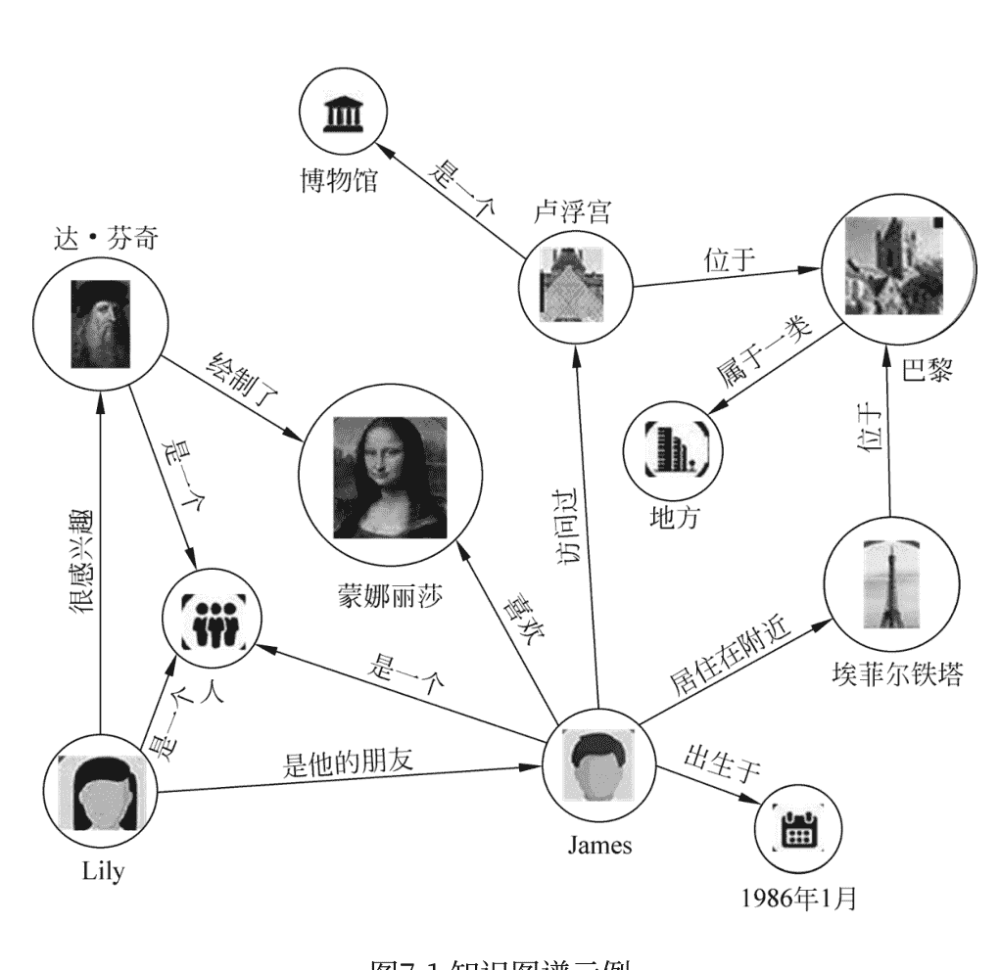

图7-1 知识图谱示例

#### 7.1.2 构建知识图谱的关键技术

搭建高质量、大规模的知识图谱需要多学科技术支撑，涉及自然语言处理、机器学习、知识表示等。核心环节如下。

（1）知识抽取。从非结构化文本中识别实体、关系、属性等要素，形成结构化三元组。传统做法有基于规则、词典的抽取，以及基于机器学习的序列标注。近年来，大语言模型的出现为知识抽取带来新突破，能更好地理解复杂语境，通过少样本学习方式适应新任务。

（2）知识融合。对多源异构知识进行消歧、匹配、对齐，构建一致连贯的知识库。需要解决指代消解、实体链接、知识冲突等问题。传统方法多采用基于规则、概率图的确定性融合，大语言模型则能更好地处理语义、常识层面的融合。

（3）知识存储。选择合适的图数据库来存储、管理海量图谱数据，兼顾扩展性与查询性能。同时引入向量数据库对知识进行语义表示与检索。LangChain 提供了丰富的向量数据库和图库连接器。

（4）知识推理。基于知识图谱进行推理、问答、生成等智能应用。传统方法多采用基于逻辑规则、路径匹配的符号推理，或将图谱嵌入表示学习。大语言模型则能更好地理解自然语言问题，生成连贯、可解释的答案。LangChain 的检索问答链为此提供了完备的工具。

可见，大语言模型正深刻影响和重塑知识图谱技术。以 LangChain 为代表的语言模型应用框架，更是为图谱的构建、存储、应用等环节带来了便利与效率提升。

### 7.2 基于LangChain的知识图谱构建流程

#### 7.2.1 知识图谱构建的整体流程

利用 LangChain 构建知识图谱的一般流程可总结为以下步骤。

（1）数据准备。收集并清洗目标领域的原始数据，包括结构化数据如 CSV、JSON、数据库表，和非结构化数据如网页、文档、图片。

（2）知识抽取。运用 LangChain 的命名实体识别、关系抽取等模块，从原始数据中抽取实体、属性、关系等要素，形成结构化三元组。

（3）知识融合。利用 LangChain 的代理功能，编排多个大语言模型和提示模板，实现实体消歧、知识对齐、冲突消解等，构建一致性的知识库。

（4）本体构建。设计知识图谱的本体模式，定义概念层次、属性类型、关系约束等，赋予知识清晰的语义。可使用本体构建工具如 Protégé。

（5）知识存储。选择合适的图数据库或资源描述框架数据库，使用 LangChain 的图数据库模块与数据库交互，将三元组、本体等知识载入数据库。

（6）知识应用。基于构建好的知识图谱，集成 LangChain 的各种链和代理，如检索问答、向量数据库问答等，实现智能搜索、问答、推荐等应用。

（7）人机交互。设计友好的用户界面和交互方式，融入 LangChain 的对话代理能力，让用户可以自然地与图谱应用进行对话、提问。

（8）持续优化。根据应用反馈不断迭代优化知识图谱，使用 LangChain 的评估模块评估图谱质量，使用精炼模块更新图谱知识。

该流程并非严格线性，而是螺旋上升、循环迭代的。LangChain 灵活的组件化设计可以很好地适应这种敏捷开发模式。下面通过一个简单例子演示 LangChain 在构建知识图谱中的作用。假设要为某动漫网站构建动漫人物知识图谱，已经爬取了一批动漫人物百科页面，存储为一组 TXT 文件，目标是从这些非结构化文本中抽取知识，构建人物实体间的关系网络。

**1. 准备数据**

```python
from langchain.document_loaders import TextLoader
loader = TextLoader('../data/AnimateCharacter/*.txt')
docs = loader.load()
```

**2. 抽取三元组**

```python
from langchain.text_splitter import CharacterTextSplitter
from langchain.prompts import PromptTemplate
from langchain.llms import OpenAI
from langchain.chains import LLMChain
text_splitter = CharacterTextSplitter(chunk_size=1000, chunk_overlap=0)
texts = text_splitter.split_documents(docs)
extract_template = """从以下文本中抽取动漫人物相关的三元组知识,以(head_entity, relation, tail_entity)的格式输出,如:
(路飞, 职业, 海盗)
(路飞, 能力, 橡胶果实)
(路飞, 同伴, 索隆)
文本: {text}
三元组:
"""
prompt = PromptTemplate(template=extract_template, input_variables=["text"])
llm = OpenAI(temperature=0)
extract_chain = LLMChain(llm=llm, prompt=prompt)
triplets = []
for text in texts:
    result = extract_chain.run(text)
    triplets.extend(eval(f"[{result}]"))
```

这里先用 TextSplitter 将长文档切分为小段落，然后设计一个提示模板，让大语言模型从每个段落中抽取三元组形式的知识。通过 LLMChain 运行，得到一批结构化的知识。

**3. 加载知识**

```python
import redis
from langchain.vectorstores.redis import Redis
from langchain.embeddings import OpenAIEmbeddings
rds = redis.Redis()
embeddings = OpenAIEmbeddings()
vectorstore = Redis(redis_client=rds, embedding_function=embeddings)
for triplet in triplets:
    text = f"{triplet[0]}的{triplet[1]}是{triplet[2]}"
    vectorstore.add_text(text)
```

这一步将抽取的三元组载入向量数据库，这里选用了 Redis，也可以换成 Pinecone、Milvus 等。通过 Redis 的 add_text 方法，可以将文本和它的向量表示一起存入数据库，为后续查询做准备。

**4. 知识应用**

```python
from langchain.chains import RetrievalQA
qa = RetrievalQA.from_chain_type(
    llm=llm,
    retriever=vectorstore.as_retriever(),
    chain_type="stuff"
)
questions = [
    "路飞的职业是什么?",
    "路飞有什么能力?",
    "路飞有哪些同伴?"
]
for question in questions:
    result = qa(question)
    print(f"问题:{question}")
    print(f"答案:{result}")
    print("----------")
```

最后，用 RetrievalQA 初始化一个问答链，它会根据问题从向量数据库中检索最相关的知识，然后由大语言模型整合成最终答案。可以看到，基于我们构建的动漫人物小知识图谱，LangChain 可以回答一些简单的问题。

输出（略）。

这个简单实例展示了 LangChain 在数据加载、知识抽取、知识存储、知识应用等关键环节的作用。尤其是基于提示的知识抽取方式，让我们可以非常灵活地定制抽取逻辑，不拘泥于特定领域和模式。

#### 7.2.2 LangChain在知识图谱构建中的作用

通过上面的例子，可以概括 LangChain 在知识图谱构建流程中的重要作用如下。

（1）多格式数据加载。LangChain 内置多种 Document Loader，可以方便地加载 JSON、CSV、TXT、PDF、Web 等各种结构化和非结构化数据源。

LangChain 让知识图谱构建更轻盈

过去搭建图谱往往卡在数据清洗和模型调参上。LangChain 把整条链路拆成可复用、可拼接的模块，从抽取到融合、存储再到应用，流程更顺畅。

（2）抽取规则可按需定制。借助模板化提示配合大语言模型，能为特定业务设计任意复杂的提取策略，不再局限于人名、地名等固定标签。GPT 等模型凭借扎实的语义理解与常识补全，通常能从非结构化文本里提炼出更完整、更准确的结构化信息。

（3）融合与推演。LLM 与 Agent 协同，能对来自不同渠道的事实进行比对、关联与清洗，形成一致性高的知识库。基于此还能开展逻辑推演，把隐含联系显式化。

（4）向量持久化。框架兼容 Redis、Pinecone、Chroma 等主流向量库，可把原文与对应的语义向量同存，检索速度与语义匹配质量明显提升。

（5）现成应用链路。Retriever、ChatVectorDBChain、RetrievalQAChain 等开箱即用链，使得基于图谱的智能对话、问答、推荐等场景可直接组装上线。

（6）主流模型直连。抽取、推理等环节高度依赖语言理解与生成，LangChain 原生接入 GPT-3、LLaMA 等常用模型，让前沿 LLM 的能力完整进入图谱流程，打造更聪明的图谱应用。

总体看，LangChain 为图谱提供了从采集到落地的全流程配套，特别是指令式 Prompt 让抽取与推理这类复杂任务变得简洁可控。开发者可把精力放在业务逻辑上，而不必陷入底层数据处理和模型训练。

#### 7.2.3 知识图谱构建的核心步骤和组件

在 LangChain 辅助下，图谱搭建大致可拆为数据准备、知识抽取、知识融合、本体构建、知识存储、知识应用六个环节，如图7-2所示。

（1）数据准备。
- DocumentLoader：自带 CSVLoader、JSONLoader 等加载器，可便捷地从各式数据源拉取原始材料。例如用 JSONLoader 读取 .json 文件。
- TextSplitter：面对长文本时可调用 CharacterTextSplitter 等，将内容拆分为易管理的小块。例如把一篇长文章按句切分。
- Embeddings：借助 HuggingFaceEmbeddings 等把文本映射为语义向量，提升后续语义分析效率。例如把一段描述转成向量供后续使用。

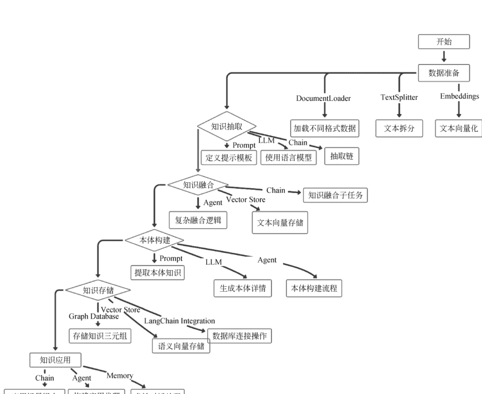
图7-2 知识图谱构建的核心步骤

（2）知识抽取。
- Prompt：可自定义提示模板，指引模型提取哪些关键信息。例如设计一个提示让模型抓取文本中的地名与人名。
- LLM：调用 OpenAI 等模型执行上述提示，实现结构化抽取。例如使用 GPT 模型抽取事件描述。
- Chain：把提示与模型串联成可复用链路。例如用 SequentialChain 依次执行多步抽取任务。

（3）知识融合。
- Agent：通过拆分子任务与调度调用，实现复杂融合逻辑。例如让 Agent 评估两段文本的相似程度。
- Vector Store：存放文本及其向量，加速相似内容检索。例如用 Pinecone 保存向量以便快速查找。
- Chain：通过组合组件实现融合子任务。例如构建一个用于文本摘要的 Chain。

（4）本体构建。
- Prompt：可用来提取本体构建所需知识。例如设计提示抽取出特定领域概念。
- LLM：调用后可生成本体相关细节。例如借助语言模型定义概念属性。
- Agent：整合多个子任务，完成本体构建流程。例如由 Agent 串联概念提取与属性定义。

（5）知识存储。
- Graph Database：用图数据库存储三元组，构建图谱。例如使用 Neo4j 保存实体关系。
- Vector Store：保存语义向量，辅助检索与相似度计算。例如在 Redis 中存放实体向量。
- LangChain Integration：为图数据库提供连接与操作支持。例如借助 WeaviateVectorStore 实现语义搜索。

（6）知识应用。
- Chain：根据场景组合 LLM 与图数据库，形成应用链。例如搭建 ChatVectorDBChain 实现智能对话。
- Agent：编排多个 Chain，构建复杂代理。例如用 RetrievalQA Agent 融合问答与检索。
- Memory：赋予 Chain 多轮对话能力，实现上下文感知。例如利用 ConversationBufferMemory 保持对话连贯。

LangChain 的组件覆盖了从数据到应用的完整链路，尤其 Prompt、Chain、Agent 的组合，为个性化需求提供了灵活且强大的实现手段。

### 7.3 知识抽取和实体识别

知识抽取是图谱构建的起点，目标是从非结构化或半结构化数据中提取结构化的知识要素，主要包括实体、关系、属性。实体识别是其中的核心任务，即在文本中定位实体并判定类别。在 LangChain 中，既可调用现成的 NER 工具如 spacy、Stanza，也能基于 Prompt 与 LLM 灵活定义新的抽取方式。

#### 7.3.1 使用LangChain的命名实体识别组件

LangChain 接入了多个主流 NLP 工具包，可方便调用其命名实体识别功能，快速搭建抽取流水线。例如用 spacy 识别文本中的人名、地名、机构名等。下面是一个完整示例。

## 【例7-1】 命名实体（参考代码7.1.py）。

```python
import spacy
from langchain.text_splitter import CharacterTextSplitter
from langchain.llms import Ollama
# 加载本地大模型 Gemma
llm = Ollama(model = "gemma:2B")
raw_text = """甘道夫将魔戒交给了霍比特人佛罗多·巴金斯,让他将魔戒带到末日山脉的烈焰山口销毁。佛罗多与好友山姆怀斯和皮平、梅里组成护戒小队,与甘道夫等人一起前往末日山脉。途中他们经历了古老矮人城镇莫瑞亚矿坑、精灵王国罗斯洛立安等地的冒险。"""
# 将文档切分为多个段落
text_splitter = CharacterTextSplitter(chunk_size=100, chunk_overlap=0)
docs = text_splitter.split_text(raw_text)
# 加载 spacy 的英文 NER 模型
nlp = spacy.load("en_core_web_sm")
# 提取文档中的命名实体
entities = []
for doc in docs:
    spacy_doc = nlp(doc) # Here doc is a string of text
    for ent in spacy_doc.ents:
        entities.append((ent.text, ent.label_))
print("提取出的命名实体:")
print(entities)
# 使用 Gemma 根据提取的实体生成知识图谱说明
prompt = f"""我从文本中提取出了以下命名实体:
{entities}
请根据这些命名实体,用通俗易懂的语言生成一段对这篇文章内容的概括,并指出各实体在文章中的作用。
"""
result = llm.generate([prompt]).generations[0][0].text
print("Gemma 生成的知识图谱说明:")
print(result)
```

## 运行结果：

提取出的命名实体：

[('甘道夫', 'PERSON'), ('霍比特人佛罗多·巴金斯', 'PERSON'), ('末日山脉', 'FAC'), ('佛罗多', 'PERSON'), ('山姆怀斯', 'PERSON'), ('皮平', 'PERSON'), ('梅里', 'PERSON'), ('甘道夫', 'PERSON'), ('末日山脉', 'FAC'), ('莫瑞亚矿坑', 'FAC'), ('罗斯洛立安', 'GPE')]

Gemma 生成的知识图谱说明：

这篇文章讲述了霍比特人佛罗多·巴金斯在巫师甘道夫的委托下,与好友山姆怀斯、皮平、梅里组成护戒小队,从夏尔出发,要将黑暗魔君索隆的魔戒带到末日山脉的烈焰山口销毁的故事。途中他们经过了古老的矮人城镇莫瑞亚矿坑和精灵王国罗斯洛立安等地,经历了许多冒险……（略）

该例演示了先用 spacy 抽取命名实体，再由 Gemma 基于实体生成简要图谱说明。Gemma 不仅概括了主线，还对各实体的身份与作用做了分析，让内容理解更清晰。

spacy 只是众多 NER 工具之一，Flair、StanfordNLP 等同样可用，支持更多语言与实体类型。思路基本一致：先抽实体，再借助大模型生成图谱说明。LangChain 将工具与 LLM 很好地整合，使过程更顺畅。

#### 7.3.2 使用LangChain的关系抽取组件

识别实体后，下一步是挖掘实体间的语义联系，这对构建图谱至关重要。关系抽取旨在从文本中找出实体对之间的关联，如亲属、社会、从属、时空等。

LangChain 也接入了多个开源 RE 工具，如 OpenNRE、TensorFlow-REDN 等。下面以 OpenNRE 为例展示抽取关系。

### 【例7-2】关系抽取组件（参考代码7.2.py）。

```python
from langchain.document_loaders import TextLoader
from langchain.llms import Ollama
from opennre import SentenceRE
# 加载本地大模型 Gemma
llm = Ollama(model = "gemma:2B")
# 定义关系抽取的模式 schema
schema = {
    "夫妻关系": ({"丈夫":""}, {"妻子":""}),
    "亲子关系": ({"父母":""}, {"子女":""}),
    "所属地区": ({"人物":""}, {"地区":""})
}
content = """
美国前总统奥巴马出生于夏威夷州。他的父亲老奥巴马是肯尼亚人,母亲斯坦利·安妮·邓汉是美国人。奥巴马8岁那年,母亲与第二任丈夫印尼人洛洛再婚,一家人搬到了印尼首都雅加达。奥巴马与妻子米歇尔·奥巴马育有两个女儿:玛利亚和萨沙。
"""
# 将文本加载为 Document 对象
loader = TextLoader(content)
document = loader.load()[0]
# 初始化 OpenNRE 模型
model = SentenceRE(schema)
# 抽取关系三元组
relations = model.extract(document.page_content)
print("提取出的关系三元组:")
print(relations)
# 使用 Gemma 总结关系图谱
prompt = f"""以下是从一段文本中提取出的人物关系三元组:
{relations}
请用简单通俗的语言,对这些关系进行总结,并以此为基础生成一个小的人物关系知识图谱。
"""
result = llm.generate([prompt]).generations[0][0].text
print("Gemma 生成的知识图谱总结:")
print(result)
```

## 运行结果：

提取出的关系三元组：

```json
[
    {'亲子关系': [{'父母': '老奥巴马', '子女': '奥巴马'}]},
    {'亲子关系': [{'父母': '斯坦利·安妮·邓汉', '子女': '奥巴马'}]},
    {'所属地区': [{'人物': '奥巴马', '地区': '夏威夷州'}]},
    {'所属地区': [{'人物': '老奥巴马', '地区': '肯尼亚'}]},
    ... (略)
]
```

Gemma 生成的知识图谱总结：

根据提取出的关系三元组，我们可以总结出以下奥巴马家族的人物关系知识图谱：

奥巴马的父母分别是肯尼亚人老奥巴马和美国人斯坦利·安妮·邓汉，他出生在美国夏威夷州。这说明奥巴马有着多元文化的背景。

... (略)

该例展示了用 OpenNRE 抽取人物关系三元组，再输入 Gemma 生成家族关系小结。Gemma 不仅列出亲子、夫妻、地域归属等关系，还对多元文化背景与成长经历做了概括，形成小型人物传记图谱，体现了大模型在总结与推理上的能力。

OpenNRE 的 schema 是预定义的，难以覆盖全部关系类型。对于开放域抽取，更优做法是借助预训练大模型的少样本能力，先手工标注少量种子数据，再用 Prompt 让 LLM 学习生成关系模板并迭代抽取。LangChain 在此方向提供了良好支持。

#### 7.3.3 基于规则和few-shot的知识抽取

前述 NER 与 RE 工具多适用于通用领域和常见模式。实际业务图谱往往需要定制化实体与关系，如医疗领域的疾病、药品、副作用，或电商领域的商品、品牌、优惠券等，这时需要更灵活的抽取方法。

一种做法是总结领域抽取规则与模式，用 Prompt 引导 LLM 按规则提取；另一种做法是提供少量样例，让 LLM 自动学习并扩展。LangChain 在 Prompt 工程与 few-shot 学习上提供了相应能力。

### 【例7-3】 用Gemma和few-shot Prompt从文本中提取疾病-药品关系（参考代码7.3.py）。

```python
from langchain import PromptTemplate
from langchain.llms import Ollama
from langchain.chains import LLMChain
# 加载本地大模型 Gemma
llm = Ollama(model = "gemma:7B")
# 准备种子样例
examples = [
    {"疾病": "糖尿病", "药品": ["胰岛素", "二甲双胍"]},
    {"疾病": "高血压", "药品": ["氨氯地平", "硝苯地平"]},
]
# 构建 few-shot Prompt
prompt_template = """
从下面的文本中,找出其中提到的疾病,及其相应的治疗药品,输出为 JSON 格式。
[文本]
{text}
[样例]
{examples}
[提取结果]
"""
prompt = PromptTemplate(input_variables = ["text", "examples"], template = prompt_template,)
# 构建 LLMChain
chain = LLMChain(llm = llm, prompt = prompt)
# 待分析的文本
article = """ 类风湿关节炎是一种慢性自身免疫性疾病。常用的治疗药物包括：
- 非甾体抗炎药,如布洛芬、萘普生等
- 糖皮质激素,如泼尼松、地塞米松等
- 抗风湿药,如甲氨蝶呤、柳氮磺吡啶等
- 生物制剂,如英夫利西单抗、阿达木单抗等
癫痫是一种慢性脑部疾病。常用药物包括：
- 苯妥英钠、丙戊酸钠等传统抗癫痫药
- 拉莫三嗪、奥卡西平等新一代抗癫痫药
偏头痛是一种常见的原发性头痛疾病。急性发作时可使用以下药物：
- 非甾体抗炎药,如布洛芬、萘普生等
- 麦角胺类,如麦角胺、艾力替尼等
- 曲普坦类,如利扎曲普坦、艾来曲普坦等 """
# 提取疾病 - 药品关系
result = chain.run(text = article, examples = str(examples))
print(result)
```

## 运行结果：

```json
[
  {
    "疾病": "类风湿关节炎",
    "药品": [
      "布洛芬",
      "萘普生",
      "泼尼松",
      "地塞米松",
      "甲氨蝶呤",
      "柳氮磺吡啶",
      "英夫利西单抗",
      "阿达木单抗"
    ]
  },
  ...(略)
]
```

该例演示了如何用 few-shot Prompt 引导 Gemma 从医学文本抽取疾病-药品关系。先准备两个种子样例展示期望输入输出格式，再基于样例构建 few-shot 提示模板并插入待分析文本。这种样例加新输入的形式可帮助 LLM 理解任务目标并自动学习抽取规则。随后用提示模板与 Gemma 构建 LLMChain，输入医学文本后成功抽取出“类风湿性关节炎”“癫痫”“偏头痛”等疾病及其对应治疗药物，结果以 JSON 格式返回。

大模型强大的理解与生成能力，让 few-shot 知识抽取变得很高效。给它几条领域示例，就能迅速适配特定抽取任务。这种方式不靠预先写好的规则和模板，灵活度高，很适合用来快速验证思路或搭建轻量级的行业图谱原型。它的短板也很明显：效果高度依赖 Prompt 的设计与调试，且本质上是启发式的，抽取的稳定性和完整性通常不及监督式方法。工业化落地时，一般会把规则、few-shot 和监督学习混用，取长补短。

#### 7.3.4 基于机器学习的知识抽取方法

从应用现状看，机器学习仍是知识抽取的主流范式。核心思路是把抽取任务转化为分类或序列标注问题，用带标签数据训练模型，使其习得可泛化的抽取能力。早期代表是 CRF、SVM 等经典方法，近几年则以神经网络为主，尤其以预训练语言模型为核心。在 LangChain 生态里，有不少值得关注的开源机器学习抽取项目。

比较典型的是 DeepKE。它是一款模块化、可扩展的知识抽取工具包，覆盖命名实体识别、关系抽取、属性抽取、事件抽取等多种任务，同时兼容 PyTorch 和 TensorFlow，提供了从数据处理、训练、评估到部署的完整链路。DeepKE 的差异化在于引入了 Prompt 编程范式，用户可以用声明式的方式定义抽取任务，而不必改动底层模型结构。

下面以 DeepKE 的命名实体识别来演示 Prompt 驱动的流程：先明确实体类型并准备训练样本，再用 PromptTemplate 声明 Prompt 格式，初始化 PromptBertNer 模型，随后完成训练与预测。

### 【例7-4】 DeepKE的命名实体识别（代码7.4.py）。

```python
from langchain.llms import Ollama
from deepke.name_entity_re.standard import *
from deepke.name_entity_re.standard.models import *
from deepke.name_entity_re.standard.utils import *
# 加载本地大模型 Gemma
llm = Ollama(model = "gemma:13B")
# 定义实体类型
schema = ["疾病", "药物", "治疗方法"]
# 加载训练数据
train_dataset = NerDataset("train.txt", schema = schema)
# 定义 few-shot Prompt
promptTemplate = PromptTemplate(
    template = """
从以下文本中抽取{schema}类型的实体，并用 XML 标签标注。
    <疾病>疾病</疾病>
    <药物>药物</药物>
    <治疗方法>治疗方法</治疗方法>
    文本：
    {{text}}
    """,
    inputVariables = ["text", "schema"],
)
# 训练模型
model = PromptBertNer(len(schema), promptTemplate)
train(model, train_dataset, epoch=10, batch_size=32)
# 加载测试数据
article = "2 型糖尿病患者需要注意控制饮食,定期检查血糖,必要时需要注射胰岛素。"
# 提取实体
ner_results = model.predict(article)
print(ner_results)
# 用 Gemma 总结知识图谱
prompt = f"""
以下是从一段医学文本中抽取出的疾病、药物、治疗方法实体：
{ner_results}
请对这些实体进行归纳总结,提炼出这段文本的核心知识要点,并以简洁的自然语言呈现。
"""
summary = llm(prompt)
print("Gemma 生成的知识总结:")
print(summary)
```

## 运行结果：

```json
[
    ("2型糖尿病", "疾病"),
    ("胰岛素", "药物"),
    ("控制饮食", "治疗方法"),
    ("定期检查血糖", "治疗方法")
]
... (略)
```

借助 Prompt 编程，只需少量代码就能完成命名实体抽取。DeepKE 负责底层训练与推理，设计者只需聚焦 Prompt 的构建。这里采用的是“文本+标签示例”的 few-shot Prompt，帮助模型学会期望的抽取模式。此外还能把 DeepKE 与 Gemma 等大模型串联，让抽取结果经由强语言模型进行知识归纳与自然语言总结，使图谱表达更连贯简洁。

DeepKE 的关系抽取、事件抽取等任务也都能用类似的 Prompt 方式完成。总体来看，机器学习抽取的主要优势有：

- (1) 对比规则方案，机器学习能自动学习复杂特征，鲁棒性与覆盖面更好。
- (2) 依托大规模标注数据，模型可迭代优化，性能持续提升。
- (3) 开源工具与预训练模型丰富，搭建抽取流水线较为便捷。

相应的局限也需注意：

- (1) 高质量标注数据需求大，人工成本高。
- (2) 训练与调参过程复杂，对算力依赖明显。
- (3) 面对新领域通常要重新标注训练，灵活性弱于 Prompt 方案。
- (4) 对低资源语言的支持不够充分。

综合来看，监督式机器学习与 Prompt 抽取互为补充。前者适合成熟 Schema 的大规模抽取，后者更轻快灵活，适合快速定制。在实践中两者结合往往能构建更智能高效的抽取系统。

### 7.4 知识融合和本体构建

抽取到实体与关系后，还不能直接形成可用知识图谱。一方面，多源数据会带来冗余、错误与矛盾；另一方面，三元组缺乏统一的语义类型与本体约束，难以规范检索与推理。因此需要对原始抽取结果进行融合提炼，并在此基础上构建领域本体，形成高质量、可计算的知识库，这正是知识融合与本体构建要解决的问题。

#### 7.4.1 实体链接和消歧

来自不同来源的实体容易出现指代混乱。比如 Michael Jordan 可能指代篮球明星，也可能指代伯克利的机器学习教授，前者知识集中在体育新闻与球员百科，后者则散落在论文与实验室页面。要把碎片化信息关联起来，先要判断哪些提及指向同一事物，哪些属于不同对象，这就是实体链接。

实体链接通常借助 WikiData、DBpedia 等外部知识库，通过比对文本表述、属性、关系等线索来判定同一性。以“Michael Jordan”为例，可以分别统计不同页面中职业、所属机构、出

#### 7.4.2 知识去重和冲突消解

即使完成实体对齐，融合后的库仍可能存在重复与矛盾。例如多个体育站点重复记载科比的生日与荣誉，需要去重；不同财经媒体对苹果市值、营收的报道可能不一致，需要甄别与裁决。

去重常见做法是基于文本相似度匹配。可在实体、关系、属性值等粒度设定阈值，超过阈值视为重复。LangChain 的 SemanticSimilarity 模块集成 TF-IDF、BM25、SentenceTransformer 等算法，便于实现去重。也能借助 LLM 动态生成去重规则，适应不同场景。

```python
from langchain.prompts import PromptTemplate
from langchain.llms import OpenAI
from langchain.chains import LLMChain

deduplicate_template = """
以下是不同数据源抽取的关于{entity}的属性值,请帮忙鉴别其中的重复值,只保留一个:
{attributes}
去重结果:
"""

llm = OpenAI(temperature=0)
prompt = PromptTemplate(
    input_variables=["entity", "attributes"],
    template=deduplicate_template,
)
deduplicate_chain = LLMChain(llm=llm, prompt=prompt)

attributes = [
    "生日: 1978年8月23日",
    "出生日期: 1978-8-23",
    "身高: 6英尺6英寸",
    "身高: 1.98米"
]
result = deduplicate_chain.run(entity="科比", attributes="\n".join(attributes))
print(result)
```

运行结果：

生日: 1978年8月23日

身高: 1.98米

面对冲突，传统做法多用多数投票、权威度、时效性等启发式规则裁决。例如多数来源一致、权威机构发布、最新时间的数据往往优先。但规则较为粗糙，难以应对复杂情况。近年也有尝试用 LLM 在 Prompt 引导下对比不同说法、评估可信度并给出综合判断，不过推理能力、常识补充与因果分析仍是挑战，也是 LangChain 可进一步深耕的方向。

#### 7.4.3 本体构建与知识组织

消歧与去重后，得到的实体-属性-关系三元组仍比较松散，缺乏语义结构，不利于检索与推理。因此需要在上层构建本体，以领域概念为中心组织知识，厘清概念间的关联。本体构建通常需要领域专家提炼关键概念、属性与关系，形成层次清晰、逻辑自洽的概念体系；同时也在探索自动学习本体的方法，尤其是借助大语言模型。

LangChain 在本体构建上也有实践。例如设计 Prompt 模板引导 LLM 从知识库中归纳核心概念。

```python
from langchain.prompts import PromptTemplate
from langchain.llms import OpenAI
from langchain.chains import LLMChain

ontology_template = """
以下是关于{domain}领域的一些实体、属性、关系知识,请帮忙总结归纳其中的核心概念,并用OWL格式表示它们的上下位关系和属性关联。
知识:
{knowledge}
本体:
"""
llm = OpenAI(temperature=0)
prompt = PromptTemplate(
    input_variables=["domain", "knowledge"],
    template=ontology_template,
)
ontology_chain = LLMChain(llm=llm, prompt=prompt)

knowledge = """
- 苹果是一家科技公司,成立于1976年
- 苹果的创始人是史蒂夫·乔布斯和斯蒂夫·沃兹尼亚克
- 苹果公司总部位于美国加州库比提诺
- 苹果公司的主要产品包括iPhone手机、iPad平板电脑、Mac电脑等
- iPhone采用iOS操作系统,由苹果自主研发
- 苹果市值超过2万亿美元,是世界上市值最高的公司之一
"""
result = ontology_chain.run(domain="苹果公司", knowledge=knowledge)
print(result)
```

运行结果：

```xml
<?xml version="1.0"?>
<rdf:RDF
    xmlns:rdf="http://www.w3.org/1999/02/22-rdf-syntax-ns#"
    xmlns:owl="http://www.w3.org/2002/07/owl#"
    xmlns:rdfs="http://www.w3.org/2000/01/rdf-schema#"
    xmlns="http://www.example.com/ontology#">
    <owl:Class rdf:ID="Company">
        <rdfs:subClassOf rdf:resource="http://www.w3.org/2002/07/owl#Thing"/>
    </owl:Class>
    ... (略)
</rdf:RDF>
```

可以看到，LLM 能从描述中提炼出“公司”“产品”“操作系统”“人”等核心概念，并推断上下位关系，如 Product 为 Company 的下位，iOS 为 Product 的下位，同时给出创始人、成立时间、市值等属性。该本体框架较为粗糙，但展示了 LLM 构建本体的可行性。后续可通过迭代 Prompt、引入背景知识与人工反馈来精细化。

目前自动本体构建仍是开放问题，LLM 生成的概念可能存在偏差或遗漏，难以完全满足专业要求。因此现阶段更适合作为智能辅助，由本体专家审核、修正与扩充。随着技术进步，自动化程度有望进一步提升。

#### 7.4.4 使用LangChain的Agents实现知识融合

知识融合涉及实体链接、冲突检测、本体匹配等多环节协同，流程较为复杂。LangChain 提供的 Agents 与 Tools 机制能很好地应对这类需求。将实体链接、知识冲突检测、本体匹配等能力封装为独立 Tool，再由 Agent 编排调用，即可实现端到端的知识融合流程。

例如可定义 EntityLinkingTool、KGConflictDetectionTool、KGMergingTool 三个工具，分别承担实体链接、冲突检测、知识合并任务，再通过一个 KGFusionAgent 将它们串联起来。

```python
from langchain.agents import Tool, AgentExecutor, LLMSingleActionAgent, AgentOutputParser
from langchain.prompts import StringPromptTemplate
from langchain.llms import OpenAI
from typing import List, Union
from langchain.schema import AgentAction, AgentFinish

# 实体链接工具
class EntityLinkingTool(BaseTool):
    name = "Entity Linking"
    description = "A tool for linking entities from different sources to a unified identifier."
    def _run(self, tool_input: str) -> str:
        # 调用实体链接算法,返回统一 ID
        linked_entities = entity_linking(tool_input)
        return str(linked_entities)

# 知识冲突检测工具
class KGConflictDetectionTool(BaseTool):
    name = "KG Conflict Detection"
    description = "A tool for detecting conflicts in the knowledge graph."
    def _run(self, tool_input: str) -> str:
        # 调用知识冲突检测算法
        conflicts = detect_kg_conflicts(tool_input)
        return str(conflicts)

# 知识融合工具
class KGMergingTool(BaseTool):
    name = "KG Merging"
    description = "A tool for merging knowledge graphs."
    def _run(self, tool_input: str) -> str:
        # 调用知识融合算法
        merged_kg = merge_kg(tool_input)
        return str(merged_kg)

# 知识融合 Agent
class KGFusionAgent(LLMSingleActionAgent):
    @classmethod
    def create_prompt(cls,tools:List[BaseTool]) -> StringPromptTemplate:
        tool_strings = "\n".join([f"{tool.name}: {tool.description}" for tool in tools])
        prefix = f"""Answer the question as best you can using the following tools:
{tool_strings}

Use the following format:
Question: the question to answer
Thought: break down the problem and use the tools to answer the question
Action: the action to take, should be one of [{{tool_names}}]
Action Input: the input to the action
Observation: the result of the action
... (this Thought/Action/Action Input/Observation can repeat N times)
Thought: I now know the final answer
Final Answer: Your final answer to the question
Begin!
Question: {input}
{agent_scratchpad}"""
        suffix = """"Thought: I now have the knowledge to answer the question.
Final Answer: """
        return StringPromptTemplate(template = prefix + "\n" + suffix, input_variables = ["input","agent_scratchpad"])

    def _extract_tool_and_input(self,text:str) -> Optional[Tuple[str,str]]:
        if "Action:" in text:
            action_str = text.split("Action:")[1].strip()
            action_str = action_str.split("\n")[0]
            if "Action Input:" in text:
                action_input_str = text.split("Action Input:")[1].strip()
                action_input_str = action_input_str.split("\n")[0]
                return action_str,action_input_str
        return None

    def _extract_final_answer(self,text:str) -> str:
        return text.split("Final Answer:")[-1].strip()

tools = [EntityLinkingTool(),KGConflictDetectionTool(),KGMergingTool()]
llm = OpenAI(temperature=0)
kg_fusion_agent = KGFusionAgent.from_llm_and_tools(llm,tools)

raw_kgs = """
KG1:
- (Apple Inc, type, Company)
- (Apple Inc, founded, 1976)
- (Apple Inc, founder, Steve Jobs)
- (Apple Inc, headquarters, Cupertino California)
KG2:
- (Apple, isPrimaryTopicOf, Apple Inc.)
- (Steve Jobs, type, Person)
- (Steve Wozniak, type, Person)
- (Apple, foundedBy, Steve Jobs)
- (Apple, foundedBy, Steve Wozniak)
"""
result = kg_fusion_agent.run(raw_kgs)
print(result)
```

运行结果：

Thought: I need to perform entity linking first to unify the entities from the two knowledge graphs.

Action: Entity Linking

Action Input: KG1:

- (Apple Inc, type, Company)

- (Apple Inc, founded, 1976)

- (Apple Inc, founder, Steve Jobs)

- (Apple Inc, headquarters, Cupertino California)

KG2:

- (Apple, isPrimaryTopicOf, Apple Inc.)

- (Steve Jobs, type, Person)

- (Steve Wozniak, type, Person)

- (Apple, foundedBy, Steve Jobs)

- (Apple, foundedBy, Steve Wozniak)

Observation: {'Apple Inc': 'Apple_Inc', 'Apple': 'Apple_Inc', 'Steve Jobs': 'Steve_Jobs', 'Steve Wozniak': 'Steve_Wozniak'}

Thought: Now I will check for any conflicts between the linked entities in the two knowledge graphs.

Action: KG Conflict Detection

Action Input: KG1:

- (Apple_Inc, type, Company)

- (Apple_Inc, founded, 1976)

- (Apple_Inc, founder, Steve_Jobs)

- (Apple_Inc, headquarters, Cupertino California)

KG2:

- (Apple_Inc, isPrimaryTopicOf, Apple Inc.)

- (Steve_Jobs, type, Person)

- (Steve_Wozniak, type, Person)

- (Apple_Inc, foundedBy, Steve_Jobs)

- (Apple_Inc, foundedBy, Steve_Wozniak)

... (略)

这个案例把 LangChain Agent 用来串联知识融合的多个组件，实现了一条完整可跑的图谱构建链路。整体思路是先把实体链接、冲突检测、知识融合分别封装成三个 Tool，每个 Tool 里面装的是具体的算法实现。随后搭建 KGFusionAgent，它继承自 LLMSingleActionAgent，负责和大模型对话，并基于当前状态和已有信息，按“思考-行动-观察”的节奏进行推理与执行。对话模板则在 create_prompt 方法里专门定制，以匹配知识融合的流程。

运行时 Agent 会先对问题做内在思考，再决定调用哪一个工具，拿到观察结果后进入下一轮，直至收敛到最终答案。用 Apple 相关的两个小图谱做验证，可以明显看到它在模仿专家的工作流：先完成实体对齐把不同命名统一，再做冲突排查，最后输出融合后的结果，效果相当到位。

要说局限，这个演示还比较理想化。落地到真实场景，知识融合的复杂度会成倍上升，往往需要按业务需求补充更多 Tool 和更精细的 Prompt。但方法论是通的：把复杂任务拆成若干可调用的工具单元，让 Agent 根据问题动态编排、逐步推进。正是这种编排能力，让复杂认知任务的开发成本被大幅拉低。

### 7.5 知识存储和查询

图谱融合结束之后，我们手上就有了质量更高、结构更清晰的知识库。下一步就是把它落到图数据库里，便于后续的存储、管理与检索。和传统关系库不同，图数据库以节点和边的形式存储数据，更贴合实体关系网络的表达，且原生支持 Cypher、Gremlin 等图查询语言，可以很方便地做模式匹配、路径追踪等分析。目前主流的有 Neo4j、JanusGraph、Dgraph 等，LangChain 也都提供了接入能力。下面以 Neo4j 为例说明怎么存和怎么查。

#### 7.5.1 知识图谱的存储方式和数据库选择

沿用 7.4 节的 Apple 知识图谱，融合后得到以下三元组。

- (Apple_Inc, type, Company)

- (Apple_Inc, founded, 1976)

- (Apple_Inc, foundedBy, Steve_Jobs)

- (Apple_Inc, foundedBy, Steve_Wozniak)

- (Apple_Inc, headquarters, Cupertino California)

- (Apple_Inc, isPrimaryTopicOf, Apple Inc.)

- (Steve_Jobs, type, Person)

- (Steve_Wozniak, type, Person)

要把这些数据写入 Neo4j。首先需要知道 Neo4j 的查询语言 Cypher，它提供 Create、Match、Where 等声明式语法，和 SQL 的使用感相近。

在 LangChain 侧，可以通过 GraphDatabase 类连上 Neo4j，然后执行 Cypher 语句。

```python
from langchain.graphs import Neo4jGraph
# 连接 Neo4j 数据库
graph = Neo4jGraph(url = "bolt://localhost:7687", username = "neo4j", password = "password")
# 定义 Cypher 语句
create_query = """
UNWIND $ triples as triple
MERGE (s:Concept {name: triple[0]})
MERGE (o:Concept {name: triple[2]})
MERGE (s) -[:RELATION {type: triple[1]}]->(o)
"""
# 将三元组列表传入
triples = [
    ["Apple_Inc", "type", "Company"],
    ["Apple_Inc", "founded", 1976],
    ["Apple_Inc", "foundedBy", "Steve_Jobs"],
    ["Apple_Inc", "foundedBy", "Steve_Wozniak"],
    ["Apple_Inc", "headquarters", "Cupertino California"],
    ["Apple_Inc", "isPrimaryTopicOf", "Apple Inc."],
    ["Steve_Jobs", "type", "Person"],
    ["Steve_Wozniak", "type", "Person"]
]
# 执行 Cypher
graph.query(create_query, parameters = {"triples": triples})
```

这段代码先用 Neo4jGraph 建立连接，随后写了一个 Cypher 语句。语句借助 UNWIND 把三元组列表拆开，遍历每个三元组时，先以 MERGE 的方式保证主语节点 s 和宾语节点 o 存在，节点标签设为 Concept，属性为 name；接着再用 MERGE 创建它们之间的关系边，关系类型即谓语 p，内部以 type 属性保存。最后把待写入的三元组传给 parameters 参数，通过 query 方法执行，就完成了导入。打开 Neo4j Browser 就能看到生成的图结构。

#### 7.5.2 知识图谱的查询语言和接口

数据入库后就可以做各类图分析了。Cypher 的声明式写法很适合表达图模式、最短路径、聚类等需求。仍以 Apple 图谱为例，如果想查 Apple 公司的创始人，可以写下面这条语句。

```cypher
MATCH (c:Concept {name: "Apple_Inc"}) - [:RELATION {type: "foundedBy"}] -> (p:Concept)
RETURN p.name
```

该语句先定位 name 为 Apple_Inc 的 Concept 节点 c，再沿着 type 为 foundedBy 的 RELATION 边找到关联的节点 p，最终返回 p 的 name。

在 LangChain 中，同样调用 GraphDatabase 的 query 方法执行 Cypher。

```python
founder_query = """
MATCH (c:Concept {name: "Apple_Inc"}) - [:RELATION {type: "foundedBy"}] -> (p:Concept)
RETURN p.name
"""
result = graph.query(founder_query)
print(result)
```

输出：

```
[['Steve_Jobs'], ['Steve_Wozniak']]
```

可以看到，LangChain 会把查询结果封装成嵌套列表返回，内部列表对应 Cypher 的 RETURN 字段。

#### 7.5.3 使用LangChain的GraphQL接口查询知识图谱

除了 Cypher，LangChain 还支持通过 GraphQL 来访问图谱。GraphQL 是一种面向 API 的查询语言，客户端可以精确描述想要的数据形状。和 Cypher 的命令式风格相比，GraphQL 更偏向声明式的数据描述，用起来更直观简洁。

LangChain 提供的 GraphQLDatabase 类可以连到 GraphQL 端点。假设 Apple 知识图谱已经部署在某个 GraphQL 服务上，并且定义了 Concept、RELATION 等类型，就可以通过以下方式发起查询。

```python
from langchain.graphs import GraphQLDatabase
# 连接 GraphQL 服务
graph = GraphQLDatabase(url="https://api.example.com/graphql")
# 定义 GraphQL 查询
query = """
query {
  Concept(name: "Apple_Inc") {
    name
    RELATION(type: "foundedBy") {
      name
    }
  }
}
"""
# 执行 GraphQL 查询
result = graph.query(query)
print(result)
```

输出：

```
{'data': {'Concept': [{'name': 'Apple_Inc', 'RELATION': [{'name': 'Steve_Jobs'}, {'name': 'Steve_Wozniak'}]}]}}
```
这条 GraphQL 查询的执行思路是先锁定名为 Apple_Inc 的 Concept 节点，接着读取该节点的 name 字段，再把所有类型为 foundedBy 的出向关系 RELATION 取出来，最后返回被这些关系指向的目标节点的 name。

跟 Cypher 相比，GraphQL 的写法更规整，依靠层层嵌套的 Selection Set 就能清晰描述想要的数据结构，天然避免了冗余字段的返回。强类型体系也带来了实际的开发体验提升，编写时能获得自动补全提示和即时语法校验。

具体选 Cypher 还是 GraphQL，最终取决于技术栈和团队偏好。Neo4j 属于原生 Cypher 的代表，Dgraph 则自带 GraphQL 接口。LangChain 同时为这两种查询提供了适配，开发者可以根据场景灵活切换。

#### 7.5.4 用自然语言直接问图谱
前面讲的 Cypher 和 GraphQL 都是面向程序的标准化语言，集成到系统或界面里很顺手。但对普通用户来说，直接用日常口语提问更自然，例如：

- 苹果公司的创始人是谁？
- 苹果公司总部在哪里？
- 苹果公司属于哪类企业？

把自然语言落到图谱查询上目前主要有两条路。一条是做自然语言到结构化查询的转换。需要先用自然语言理解和语义解析技术从问题里抽取出核心实体、关系和约束条件，再对照图数据库的 schema 生成对应的 Cypher 或 GraphQL 语句。OpenCypher、Athena 等开源尝试都在探索这条路径，但受自然语言理解能力限制，面对复杂语义时鲁棒性仍不足。

另一条路是直接让大语言模型来答。把知识图谱的模式以及部分实例数据作为上下文喂给像 GPT-3 这样的大模型，让它先建立领域的基础认知，之后就能用自然语言与其交互。省去了专门的转换器，依赖模型的语义理解和常识推理，搭建起来更简洁。在 LangChain 里，这类基于 LLM 的图谱问答也很容易实现。

```python
from langchain.llms import OpenAI
from langchain.prompts import PromptTemplate
from langchain.chains import LLMChain
kg_template = """
你是一名知识图谱助理,掌握关于 Apple 公司的如下知识:
{knowledge}
请根据以上知识,尽可能回答用户的问题。如果无法从中得出答案,就说“知识图谱中没有足够信息回答该问题”。
问题:{question}
"""
kg_prompt = PromptTemplate(input_variables = ["knowledge", "question"], template = kg_template)
llm = OpenAI(temperature = 0)
kg_chain = LLMChain(llm = llm, prompt = kg_prompt)
knowledge = """
- Apple_Inc 是一家公司
- Apple_Inc 成立于 1976 年
- Apple_Inc 的创始人是 Steve_Jobs 和 Steve_Wozniak
- Apple_Inc 的总部在 Cupertino California
- Apple Inc. 是 Apple_Inc 的主要话题
- Steve_Jobs 是人
- Steve_Wozniak 是人
"""
questions = [
    "苹果公司的创始人有哪些?",
    "苹果公司位于哪里?",
    "苹果公司有哪些主要产品?"
]
for question in questions:
    result = kg_chain.run(knowledge = knowledge, question = question)
    print(f"问题:{question}")
    print(f"答案:{result}")
    print()
```

输出：

```
问题: 苹果公司的创始人有哪些?
答案: 根据知识图谱,Apple_Inc 的创始人是 Steve_Jobs 和 Steve_Wozniak。
问题:苹果公司位于哪里?
答案: 根据知识图谱,Apple_Inc 的总部在 Cupertino California。
问题: 苹果公司有哪些主要产品?
答案: 知识图谱中没有足够信息回答该问题.
```
实现上通常先写一个 Prompt 模板，说明助手所掌握的图谱范围，并要求它严格基于这些信息作答。随后把整理好的三元组列表和待解决的问题一起输入，模型就能在已知事实内进行推理并给出答案；如果问题超出图谱覆盖范围，模型会明确表示无法回答。

这种 LLM 驱动的问答方式上手快，但对知识的呈现有要求。原始图谱需要先归纳筛选，提炼出关键事实并用通俗的自然语言表述，才能让模型有效利用。当前的做法多停留在信息复述层面，如何挖掘图谱内部的联结并做更深层的推理，还需要继续探索。总体看，LLM 与 KG 的结合为图谱应用打开了新空间，随着指令微调等新范式的成熟，这一方向值得持续跟踪。

## 小结
本章梳理了知识图谱落地的关键环节与技术选型，以及 LangChain 如何提升开发效率。成功的起点是明确需求，随后是结构化与非结构化数据的整合预处理。本体构建既可借助 Protege 等工具，也能利用 LangChain Agent 实现半自动化。知识抽取从传统规则模板转向 Prompt 与 LLM 方案，灵活性与效率都明显提升，少样本学习让任务快速适配成为可能。融合与存储环节要处理来源冲突并选型合适的图数据库，LangChain 的连接器丰富了选择。应用阶段 LangChain 有助于快速原型，从小范围场景逐步扩展到企业级。

总体来看，LangChain 在数据统一、抽取融合简化、应用形态扩展等方面对知识图谱建设提供了有效支撑，特别是在复杂逻辑定义、语义歧义处理以及智能问答与推荐的构建上。然而该方向仍处早期，LLM 的可解释性与可控性、逻辑能力边界、用户交互设计等挑战依然存在。即便如此，LangChain 作为工程化知识图谱的切入点，以语言模型视角推动认知智能的发展，已迈出关键一步。

## 思考题

### 一、简答题

1. 请说明知识图谱的概念及其主要构成部分。
2. 知识图谱在哪些典型场景被广泛使用？各自的价值体现在哪里？
3. 传统知识抽取方式存在哪些不足？LangChain 的 Prompt 与大模型模块如何克服这些问题？
4. 知识融合环节，LangChain 借助哪些组件提升自动化？背后的原理是什么？
5. LangChain 兼容哪些主流图谱查询语言？各适合怎样的使用场景？
6. 在图谱驱动的智能问答里，LangChain 一般承担什么职能？核心技术有哪些？

### 二、实践题
请基于 LangChain 搭建一个简易的故障诊断知识图谱问答系统。要求：
1. 从设备说明书、维修手册等文档中抽取故障、原因、解决方案等知识。

## 参考文献

- [1] LangChain官方文档[EB/OL]. https://docs.langchain.com/.

- [2] GitHub-LangChain[EB/OL]. https://github.com/hwchase17/langchain.

- [3] Makridakis S, Petropoulos F, Yanfei K. Large Language Models: Their Success and Impact[J/OL]. Forecasting (2023) . https://doi.org/10.3390/forecast5030030.

- [4] Wayne Xin Z, Kun Z, Junyi L, et al. A Survey of Large Language Models[EB/OL]. ArXiv, abs/2303.18223 (2023) . https://doi.org/10.48550/arXiv.2303.18223.

- [5] Yu-Chu C, Xu W, Jindong W, et al. A Survey on Evaluation of Large Language Models[EB/OL]. ArXiv, abs/2307.03109 (2023) . https://doi.org/10.48550/arXiv.2307.03109.

- [6] 肖仰华, 白硕. 知识图谱技术原理与应用[M]. 北京: 电子工业出版社, 2019.

- [7] 周志华. 机器学习[M]. 北京: 清华大学出版社, 2016.

- [8] Golovanov S, Kurbanov R, Nikolenko S, et al. Large-Scale Transfer Learning for Natural Language Generation (2019) [EB/OL]. https://doi.org/10.18653/v1/P19-1608.6053-6058.