# LangChain核心技术与LLM项目实践


# 作者简介

凌峰 / 博士

目前就职于某 985 高校，长期从事机器学习、人工智能、计算机视觉与大模型领域的研发与教学，在模型优化、训练加速、数据驱动算法开发等方面有深刻见解，参与并主导过多项相关科研项目。

# 内容简介

本书全面系统地介绍了 LangChain 的主要功能模块及具体应用，深入探讨了 LangChain 在企业应用实践中的深度开发、技术优化及其核心技术。本书共 12 章，从大语言模型的基础知识入手，涵盖任务链的设计、内存模块的管理、表达式语言的使用、Agent 系统的实现、回调机制、模型 I/O 与数据检索等方面的内容，并通过代码示例和应用场景，逐步引导读者掌握模型优化、并发处理和多级任务链设计等高级技术，最后，从需求分析、架构设计到代码实现，详细展示了如何运用 LangChain 技术开发一个企业级智能问答系统，帮助开发者打造高效、可靠的企业级解决方案。

本书从入门到高级，聚焦于前沿技术与落地实践，适合大模型及 LangChain 开发人员、高校学生以及对 LangChain 开发感兴趣的人员和研究人员阅读，也适合作为培训机构和高校相关专业的教学用书。

# 前言


在人工智能和自然语言处理迅速发展的背景下，大语言模型（LLM）已成为业界不可或缺的工具。它不仅提升了信息处理能力，还为智能应用开发提供了坚实的技术基础。

LangChain 作为 LLM 应用的重要框架，使开发者得以高效地集成和运用这些强大模型，将自然语言处理技术落地到实际业务场景中。

本书旨在带领读者从零基础开始掌握 LangChain 的应用技巧，逐步构建企业级的智能应用系统。

全书共分 12 章，涵盖从基础理论到企业级项目实践的完整开发路径，通过层层递进的方式，帮助读者逐步从理论学习走向项目实战，全面掌握 LangChain 的开发过程。

第 1 章介绍大语言模型的基本概念及 LangChain 的优势与应用场景，为读者奠定扎实的理论基础。

第 2 章讲解开发前的准备工作，包括 API 密钥的创建与管理，以及开发工具链的搭建，确保读者在开始编码前了解必要的环境与配置。

第 3～6 章逐步带领读者了解 LangChain 的核心组件与功能模块，包括模型导入、提示词工程、任务链设计和内存模块，并通过代码示例来帮助理解与实践。例如，在提示词工程部分，读者将学习如何构建和优化 Prompt 模板，以提升模型输出的准确性和相关性；在任务链设计部分，通过多层链式任务的实战示例，方便读者掌握应对复杂应用需求的构建与调试技巧。

第 7 章聚焦于 LangChain 的表达式语言和并行处理技巧，介绍如何用简洁的语法来提升数据处理的效率。

第 8 章介绍 Agent 系统的类型及其多任务处理，帮助读者实现任务的智能化和自动化。

第 9 章详细讲解回调机制，展示如何自定义回调处理程序，并利用回调函数对任务进行实时监控，从而提升系统的灵活性和可控性。

第 10 章深入模块化开发与系统集成，介绍 LangChain 的模型 I/O 及数据检索技术，为企业级应用的开发与维护提供实用指导。

第 11 章聚焦 LangChain 在企业级应用中的深度开发与技术优化。从实际应用场景出发，深入探讨性能优化、任务链设计和复杂查询处理等高级技术，帮助开发者打造高效、可靠的企业级解决方案。

第 12 章结合前 11 章的知识点，逐步实现一个完整的企业级智能问答系统。从需求分析、架构设计到代码实现，详细展示 LangChain 在企业级应用中的实际落地过程，帮助读者在真实应用场景中深入理解和应用 LangChain 的各种功能模块，满足多样化的企业业务需求。

本书的目标是不仅帮助读者掌握 LangChain 的基本使用，还要让读者能更深入地理解其内部机制和高级功能。无论是开发环境的搭建、模型的优化、并发处理，还是回调机制的监控与调试，书中均有详细的代码示例和项目实践，以期带领读者逐步掌握这些关键技能。

本书适合对 LangChain 及大语言模型应用有浓厚兴趣的开发者、研究人员和学生。希望通过本书的学习，读者能够熟练运用 LangChain 开发智能化、高效的企业级应用，并在未来的项目中将所学知识转化为实用技能，为企业智能应用开发作出积极贡献。

本书提供配套源码，读者用微信扫描下面的二维码即可获取。

如果读者在学习本书的过程中遇到问题，可以发送邮件至 booksaga@126.com，邮件主题为"LangChain 核心技术与 LLM 项目实践”。

凌峰
2025 年 1 月

# 第 1 章
大语言模型与 LangChain

大语言模型（Large Language Model，LLM）正逐渐成为自然语言处理（Natural Language Processing，NLP）领域的重要工具。它们不仅能够生成文本，还能理解和处理复杂的语言任务，为各行各业带来了创新的解决方案。与此同时，LangChain 作为一个新兴的开发框架，旨在有效整合大语言模型的功能，帮助开发者构建智能化应用。

本章将系统介绍大语言模型的基本原理，包括其构建过程、核心技术及性能优化方法，将重点讨论 Transformer 架构及其自注意力机制，以及预训练与微调在提升模型能力中的重要作用，同时还将深入分析 LangChain 的基本概念和开发流程，探讨任务链和内存模块等核心组件的应用。

## 1.1 大语言模型基本原理

大语言模型在自然语言处理领域扮演着至关重要的角色，其应用不仅限于文本生成，还涵盖了文本理解、翻译、问答等多种场景。LLM 的基本原理涉及多种技术和方法，经历了从简单的统计模型到复杂的深度学习模型的演变。

### 1.1.1 语言模型的构建：从 N-grams 到深度学习

语言模型是 NLP 中的核心组成部分，旨在通过概率分布对语言进行建模。它的基本目标是根据给定上下文预测下一个单词的出现概率。语言模型的构建经历了多个阶段，从传统的 N-grams 模型到如今广泛应用的深度学习模型，各种方法不断演变，推动了语言理解和生成的进步。

## 1．N-grams 模型

N-grams 模型是最早应用于语言建模的一种方法。该模型通过统计语言中单词的共现频率来估计下一个单词的概率。N-grams 的"N"表示模型考虑的单词数量。例如，在一个 2-grams（或 bigram）模型中，当前单词的预测基于前一个单词，而在 3-grams（或 trigram）模型中，则基于前两个单词。

N-grams 模型基本架构如图 1-1 所示。N-grams 模型的优点在于其实现简单、计算高效。然而，该模型也存在一些显著的局限性：

(1) 数据稀疏性：随着 N 值的增加，可能出现大量未见过的词组，从而导致概率估计失效。为了应对这一问题，通常采用平滑技术（如拉普拉斯平滑）来调整概率分布。

(2) 上下文限制：N-grams 模型仅考虑固定长度的上下文，无法捕捉长距离的依赖关系。比如，在“我喜欢吃苹果，因为它们很甜”中，“它们”指代“苹果”，但 N-grams 模型难以识别这种长距离的关系。

（3）高维度问题：随着 N 值的增加，特征空间的维度呈指数增长，造成存储和计算成本的显著增加。

尽管 N-grams 模型存在诸多缺点，但它仍然为后来的语言模型奠定了基础，并促使研究者探索更为复杂的模型。

#### 2. 基于 Transformer 的语言模型

随着计算能力的提升和深度学习的兴起，研究者们开始探索基于神经网络的语言模型。相比之下传统的 N-grams 模型，神经网络语言模型能够自动学习特征，并捕捉更复杂的语言结构。

近年来，基于 Transformer 架构的语言模型正逐渐成为研究的焦点。Transformer 模型是由 Google 在 2017 年提出的一种神经网络模型结构，凭借其自注意力（Self-Attention）机制，彻底改变了语言模型的构建方式。Transformer 模型经典编码一解码架构如图 1-2 所示。

Transformer 架构说明如下：

（1）自注意力机制：自注意力机制允许模型在处理输入序列时，动态地调整不同单词之间的相关性。通过计算输入序列中每个单词与其他单词的加权关系，Transformer 能够有效捕捉长距离依赖，并更好地理解上下文。

(2) 并行计算:与传统的循环神经网络 (Recurrent Neural Networks, RNN) 模型不同，Transformer 架构使得序列中的所有单词可以并行处理，从而显著提高训练效率。这一特性使得 Transformer 在大规模数据集上训练成为可能。

(3) 预训练和微调:预训练与微调策略是基于 Transformer 的语言模型取得成功的关键。通过在大规模语料库上进行无监督预训练，模型能够学习丰富的语言知识，然后通过微调适应特定任务。这一策略在许多 NLP 任务上取得了优异的效果。

### 3．几个知名的基于 Transformer 的语言模型

多个基于 Transformer 的语言模型已成为 NLP 领域的标杆，推动了技术的发展。

(1) BERT(Bidirectional Encoder Representations from Transformers, 来自变换器的双向编码器表示):BERT 通过双向编码器对上下文进行建模，极大提升了文本理解能力。BERT 在多个 NLP 任务中取得了显著的性能提升。

(2) GPT(Generative Pre-trained Transformer,生成预训练变换器):GPT 系列模型采用单向 Transformer 架构，专注于文本生成。其自回归的特性使得生成的文本在流畅性和连贯性上得到了很好的保证。由 OpenAI 于 2024 年 5 月 13 日发布的 GPT-4o 系列模型，现已限时免费向全部注册用户开放其使用权限。（3）T5（Text-to-Text Transfer Transformer）：T5 将所有 NLP 任务统一为文本到文本的格式，简化了模型的训练与应用过程。T5 的设计理念为模型的通用性提供了强有力的支持。

语言模型的构建经历了从 N-grams 到基于神经网络模型的演变，最终发展为今天基于 Transformer 架构的深度学习模型。这一过程不仅推动了自然语言处理技术的进步，也为开发者在实际应用中提供了强大的工具。通过对语言模型的深入理解，开发者能够更有效地利用这些技术，提升智能应用的性能与可靠性。大语言模型及其具体的标志性技术汇总表如表 1-1 所示。

**表 1-1 大语言模型及其具体的标志性技术汇总表**

| 时间 | 发展阶段 | 主要模型/技术 | 描述 |
| :--- | :--- | :--- | :--- |
| 1950 年—1980 年 | 统计语言模型 | N-grams | 基于统计的模型，通过计算单词共现频率来预测下一个单词 |
| 1980 年—2010 年 | 神经网络语言模型 | 前馈神经网络 | 采用多层感知机，将上下文单词嵌入作为输入，输出下一个单词的概率分布 |
| | | 循环神经网络（RNN） | 通过隐藏状态传递上下文信息，能够处理序列数据 |
| | | 长短期记忆网络（LSTM） | 通过门控机制克服长距离依赖问题，提高对上下文的建模能力 |
| | | 门控循环单元（GRU） | 结构简化的 LSTM，参数更少，适用于处理长序列 |
| 2017 年 | Transformer 架构 | Transformer | 引入自注意力机制，允许并行处理序列，显著提升训练效率 |
| | | BERT | 通过双向编码器建模上下文，提升文本理解能力 |
| | | GPT | 自回归模型，专注于文本生成任务，表现出色 |
| | | T5（文本到文本质换器） | 统一将所有 NLP 任务转换为文本到文本的格式，提升通用性 |
| 2020 年 | 更大规模模型 | GPT-3 | 具有 1750 亿参数的生成模型，表现出色，推动了生成式 AI 的发展 |
| | | ChatGPT | 结合对话能力和生成能力，广泛应用于聊天机器人和虚拟助手 |
| | | 其他大型语言模型 | 各大公司如 Google、Meta 等纷纷推出大型语言模型，其应用领域不断拓展 |

表 1-1 简要概括了大语言模型的发展历程，从最初的统计模型到如今的复杂深度学习模型，展示了技术的演变及其应用的扩展。

#### 1.1.2 Transformer 架构的崛起：自注意力机制解析

在自然语言处理领域，Transformer 架构的出现引发了广泛的关注和应用，其背后的自注意力机制为理解和处理序列数据提供了全新的视角。自注意力机制通过关注输入序列中不同位置之间的关系，改变了传统的序列建模方法，极大地提升了模型的性能和效率。

### 1．自注意力机制的背景与动机

在传统的序列模型中，尤其是循环神经网络及其变体（如短期记忆网络），处理序列数据通常依赖顺序传递的隐状态。然而，这种依赖时间步的计算方式存在一些固有的缺陷，例如难以并行化和长距离依赖。这些缺陷限制了模型的扩展性和训练效率。

自注意力机制的提出恰好解决了这些缺陷。它允许模型在处理每个输入元素时，动态地关注输入序列的其他部分。这种全局视角不仅提高了模型对上下文信息的捕捉能力，也为长距离依赖关系的建模提供了可能。

### 2．自注意力机制的工作原理

自注意力机制的核心思想是通过计算输入序列中每对元素之间的相似性，来动态调整各个元素的权重。具体步骤如下：

- 01 输入表示：首先，将输入序列表示为一个向量矩阵，其中每一行对应一个词的嵌入表示。假设输入序列的长度为 n，则矩阵的维度为 n 乘以词嵌入的维度。
- 02 生成查询、键和值：自注意力机制通过线性变换将输入矩阵映射为查询、键和值。
- 03 计算注意力权重：用来衡量输入序列中每个位置对其他位置的影响。
- 04 计算输出表示：通过将注意力权重应用于值向量来生成最终的输出表示。这样，每个输出向量都综合都考虑了输入序列中所有词的影响，形成了更加丰富的上下文表示。

##### 3. Transformer 架构的整体设计

Transformer 架构在自注意力机制的基础上，结合了前馈神经网络、层归一化和残差连接等技术，形成了完整的模型结构。Transformer 主要由编码器和解码器两部分组成。

### 4． 自注意力机制的优势

自注意力机制在多个方面优于传统的序列模型：

（1）并行化处理：自注意力机制不依赖时间步，可以通过矩阵运算进行并行计算，从而显著提升训练速度。

（2）长距离依赖建模：自注意力机制能够直接捕捉输入序列中任意两个位置之间的关系，有效解决了长距离依赖的问题。

（3）动态上下文：不同于固定窗口的上下文处理，自注意力机制根据输入的不同动态调整关注权重，提供更灵活的上下文信息。

注意力机制遵循长距离依赖关系的例子如图 1-5 所示，第 5 层中的编码器为自注意力。许多注意力头注意到一个较远的依赖动词“making”，从而导致补全短语“making...”更加困难。此外，这里的注意力只针对“making”这个词，不同的颜色代表不同的注意力头。

**示例：**利用 PyTorch 构建 Transformer 模型并进行小样本数据训练。

下面是使用 PyTorch 实现 Transformer 的完整代码示例，将展示如何构建一个基本的 Transformer 模型，并在一个简单的任务上进行训练。这里是对一个小的文本数据集进行分类。

```python
"""
import torch
import torch.nn as nn
import torch.optim as optim
from torchtext.datasets import AG_NEWS
from torchtext.data.utils import get_tokenizer
from torchtext.vocab import build_vocab_from_iterator
from torch.utils.data import DataLoader
import torch.nn.functional as F
#定义超参数
EMBEDDING_DIM=128
HIDDEN_DIM=256
NUM_HEADS=8
NUM_ENCODER_LAYERS=3
NUM_CLASSES=4
BATCH_SIZE=16
EPOCHS=3
LR=0.001
# 1、准备数据
def yield_tokens(data_iter):
    for _, text in data_iter:
        yield tokenizer(text)

tokenizer=get_tokenizer('basic_english')
train_iter=AG_NEWS(split='train')
vocab=buid_vocab_from_iterator(yield_tokens(train_iter),specials=['<unk>'])
vocab.set_default_index(vocab['<unk>'])
#数据加载器
def collate_batch(batch):
    labels,texts=zip(*batch)
    text_tensor=torch.nn.utils.rnn.pad_sequence(
    [torch.tensor(vocab(tokenizer(text))) for text in texts],
    padding_value=0)
return text_tensor,tensor(torch.tensor(labels))
train_iter=AG_NEWS(split='train')
train_loader=DataLoader(train_iter,batch_size=BATCH_SIZE,
shuffle=True,collate_fn=collate_batch)
#2、定义 Transformer 模型
class TransformerModel(nn.Module):
    def _init_(self,num_classes):
        super(TransformerModel,self)._init_()
"""
```

```python
self.embedding=nn.Embedding(len(vocab), EMBEDDING_DIM)
self.transformer_encoder=nn.TransformerEncoder(
    nn.TransformerEncoderLayer(d_model=EMBEDDING_DIM, nhead=NUM_HEADS,
                                 dim_feedforward=HIDDEN_DIM),
    num_layers=NUM_ENCODER_LAYERS
)
self.fc=nn.Linear(EMBEDDING_DIM, num_classes)

def forward(self, x):
    # 输入 x 的形状为 (seq_length, batch_size)
    x=self.embedding(x)
# (seq_length, batch_size, embedding_dim)
x=x.permute(1, 0, 2)
# 转换为 (batch_size, seq_length, embedding_dim)
x=self.transformer_encoder(x)
# (batch_size, seq_length, embedding_dim)
x=x.mean(dim=1) # 池化
x=self.fc(x) # 分类
return x

# 3. 初始化模型、损失函数和优化器
model=TransformerModel(NUM_CLASSES)
criterion=nn.CrossEntropyLoss()
optimizer=optim.Adam(model.parameters(), lr=LR)

# 4. 训练模型
for epoch in range(EPOCHS):
    model.train()
    for batch_idx, (texts, labels) in enumerate(train_loader):
        optimizer.zero_grad()
        outputs=model(texts)
        loss=criterion(outputs, labels)
        loss.backward()
        optimizer.step()

    if batch_idx % 100 == 0:
        print(f'Epoch [{epoch+1}/{EPOCHS}]',
              Step [(batch_idx)/(len(train_loader))],
            Loss: {loss.item():.4f}')
print("Training complete.")
```

确保在运行代码前已安装了 torch 和 torchtext 库。如果尚未安装，可以使用以下命令进行

```bash
>> pip install torch torchtext
```

注意，代码示例中的数据集和模型参数为示例值，可以根据需要调整超参数、训练轮数和批次大小。此外，本代码为基本的 Transformer 实现，适合用于学习和理解，针对复杂的任务可能需要更多的细节和优化。

最终运行结果如下：

```bash
>> Epoch [1/3], Step [0/1250], Loss: 1.7398
>> Epoch [1/3], Step [100/1250], Loss: 1.1292
>> ...... # 中间省略
>> Epoch [3/3], Step [1200/1250], Loss: 0.1132
>> Training complete.
```

输出中显示了每个训练周期中若干步骤的损失值。随着训练的进行，损失值逐渐减小，表明模型在学习任务并且性能逐步提升。“Training complete.”表示训练结束，模型已完成训练过程。

> **注意** 运行环境的不同可能导致具体的损失值略有差异，但整体趋势应该是损失值逐渐减小。若在执行过程中遇到问题，建议检查库的版本和环境设置。

### 1.1.3 预训练与微调：如何提升模型性能

在深度学习的快速发展中，预训练与微调策略成为提升模型性能的关键方法。这一策略不仅在自然语言处理领域引起了广泛关注，同时也也在计算机视觉等其他领域取得了显著效果。

### 1．预训练的基本原理

预训练的核心思想是利用大量未标注数据，学习到通用的特征表示。这一过程通常采用自监督学习或无监督学习的方法，使得模型在训练初期能够从更丰富的上下文信息中学习到有价值的表示。

### 2．微调的基本流程及实际开发中的应用

预训练与微调的策略在自然语言处理、计算机视觉等多个领域得到了广泛应用。以自然语言处理中的 BERT 和 GPT 系列模型为例，它们通过合适的训练框架（如 PyTorch 或 TensorFlow）实施微调。完成微调后，利用测试集评估模型的最终效果，以确保模型在实际应用中的泛化能力。预训练与微调的完整流程图如图 1-6 所示。

**图 1-6** 大模型的预训练与微调流程分析图

预训练模型是通过对大规模未标注数据训练而得到的通用语言模型。训练过程通常基于自监督学习方法，使模型能够在广泛的文本数据上学习到通用的语言结构、语法规则和语义关系。

微调后的模型是在预训练模型的基础上，通过在特定任务数据上进行有监督训练而得到的任务特定模型。预训练模型与微调后的模型的具体区别如表 1-2 所示。

**表 1-2 预训练模型与微调后的模型对比表**

| 特点 | 预训练模型 | 微调后的模型 |
| :--- | :--- | :--- |
| 定义 | 在大规模未标注数据上训练，具有通用语言理解能力 | 在特定任务数据上训练，具备任务专属性能 |
| 适用场景 | 开放式任务，零样本、少样本学习 | 明确的特定任务场景，精确度要求高 |
| 任务表现 | 通用表现良好，任务精度较低 | 任务表现优异，具有更高的精度 |
| 扩展性 | 适合多任务迁移，适应新任务较快 | 针对单一任务优化，迁移至新任务效果差 |
| 计算资源需求 | 预训练阶段资源消耗大 | 计算成本较低，适合在预训练模型基础上开发 |

## 1.2 LangChain 基本原理与开发流程

随着大语言模型在各类智能应用中的广泛应用，高效地构建、部署和管理这些模型成为一项关键任务。LangChain 正是为此任务而设计的框架，它通过简化与优化大语言模型的开发流程，使得模型在复杂任务中的集成变得更加高效和灵活。

本节将初步探讨 LangChain 的基本原理和开发流程，系统介绍其核心组件、协同工作机制及快速上手的技巧。

### 1.2.1 LangChain 的核心组件：理解任务链与内存模块

在现代 NLP 应用中，特别是基于 LLM 的任务，模型不仅需要生成内容，还需要在不同任务间保持上下文的一致性和记忆能力，以确保模型的智能化与连贯性。LangChain 作为一个专为大语言模型设计的开发框架，围绕任务链（Chain）与内存模块（Memory）构建了核心架构。这两大组件是 LangChain 高效构建复杂语言应用的关键所在，使模型在多任务环境中得以应对任务管理、上下文维护、记忆存储等多种需求。

#### 1. 任务链：复杂任务管理与执行

任务链是 LangChain 最基本的结构，提供了一种模块化的任务管理方式，用于在复杂应用中协调多步任务的执行。

##### 1）任务链的工作原理

任务链的工作原理在于将一个大任务拆分为多个子任务，每个子任务独立执行但又依赖前序任务的结果。在 LangChain 中，每一个任务链由不同的任务节点构成，节点之间通过数据流连接。

##### 2）任务链的类型与应用场景

根据任务的复杂性和具体需求，LangChain 中的任务链主要包括以下几种类型：

（1）顺序链（Sequential Chain）：将多个任务按顺序执行，适用于任务之间存在强依赖的场景。例如在用户请求处理过程中，依次执行意图识别、信息提取、响应生成等操作。

**示例：** 实现一个顺序链来完成意图识别、实体提取、动作确定和响应生成的任务。

```python
###### 代码示例
####### 导入必要的库
from langchain.chains import SequentialChain
from langchain.prompts import PromptTemplate
from langchain.llms import OpenAI
from langchain.memory import ConversationBufferMemory

###### 初始化 OpenAI 模型
llm=OpenAI(temperature=0.7)

####### 定义意图识别的 Prompt（提示词）模板
intent_prompt=PromptTemplate(
    input_variables=["input_text"],
    template="请根据以下输入识别用户意图: {input_text}"
)

####### 定义实体提取的 Prompt 模板
entity_prompt=PromptTemplate(
    input_variables=["intent", "input_text"],
    template="根据用户的意图'{intent}'，从以下输入中提取相关实体: {input_text}"
)

####### 定义动作确定的 Prompt 模板
action_prompt=PromptTemplate(
    input_variables=["intent", "entities"],
    template="根据意图'{intent}'和提取的实体 '{entities}'，确定要执行的操作。"
)

####### 定义响应生成的 Prompt 模板
response_prompt=PromptTemplate(
    input_variables=["action"],
    template="根据确定的动作 '{action}' 生成用户的响应。"
)

####### 创建各个任务节点的链
intent_chain=SequentialChain(
    llm=llm,
    prompt=intent_prompt,
    output_key="intent",
    memory=ConversationBufferMemory()
)

entity_chain=SequentialChain(
    llm=llm,
    prompt=entity_prompt,
    output_key="entities",
    memory=ConversationBufferMemory()
)

action_chain=SequentialChain(
    llm=llm,
    prompt=action_prompt,
    output_key="action",
    memory=ConversationBufferMemory()
)

response_chain=SequentialChain(
    llm=llm,
    prompt=response_prompt,
    output_key="response",
    memory=ConversationBufferMemory()
)

####### 定义顺序链，按顺序执行各个任务节点
sequential_chain=SequentialChain(
    chains=[intent_chain, entity_chain, action_chain, response_chain],
    input_variables=["input_text"],
    output_variables=["response"],
    memory=ConversationBufferMemory()
)

####### 测试顺序链
if __name__ == "__main__":
    # 示例输入文本
    input_text="我想查询北京的天气。"
    
    # 运行顺序链
    final_response=sequential_chain.run({"input_text": input_text})

print("
最终生成的响应:", final_response["response"])
```

首先，导入 LangChain 提供的 SequentialChain，并利用 OpenAI 模型作为任务执行的大语言模型。然后通过设定温度参数来控制生成文本的多样性。再通过 PromptTemplate 定义每个任务的模板，用于引导模型完成意图识别、实体提取、动作确定和响应生成。每个任务链如意图识别、实体提取等都被封装为 SequentialChain，使得各个任务可以顺序执行，并将输出传

#### 2. 内存模块：上下文维护与记忆机制

在多轮对话、复杂推理和长文本生成等任务中，模型不仅需要完成单一的任务，还需要记忆并理解用户提供的信息，保证任务执行过程中的连贯性。LangChain的内存模块专为这一需求设计，它通过持久化的上下文记录和动态的内容回溯，为模型的任务执行提供了记忆支持。

> 示例：基于LangChain实现内存初始化、更新、检索及顺序链。

## 1.2.2 LangChain开发流程概述

LangChain的开发流程围绕LLM的部署和集成展开，通过定义任务链、提示词（Prompt）等组件，实现多阶段的自动化处理和数据流转。其核心目标是将LLM的强大能力嵌入业务逻辑之中，使其在复杂的应用场景中实现高效、自动化的处理流程。掌握LangChain的开发流程，需从设计、配置、调试、部署等多个环节逐步深入，具体流程如图1-7所示。

> 图1-7 LangChain开发流程图

#### 需求分析与场景定义

#### 任务链的设计与配置

#### 提示词的设计与优化

#### 数据存储与内存模块集成

#### 链测试、调试与链结构调整

#### 模型部署、性能监控

> 图1-7 LangChain开发流程图

#### 1．需求分析与场景定义

在使用LangChain开发应用时，首要任务是明确需求分析和场景定义。这一阶段的目的是确认所需功能和任务链的设计要素。具体而言，需要分析哪些业务逻辑和操作可由大语言模型完成，并评估各任务的输入和输出特征。

#### 2．任务链的设计与配置

LangChain的核心在于任务链的设计与配置。任务链的设计决定了LLM如何按照逻辑顺序执行多个任务。每个任务链由多个子任务构成，通常包括文本生成、信息提取、数据分析等操作，具体选择取决于需求。

任务链的配置需要指定各组件的顺序及其依赖关系。通过LangChain提供的API接口，任务链的调用逻辑可以按照预定义的流程自动化运行，从而有效执行多个任务。

##### 3. 提示词的设计与优化

提示词设计是LangChain开发流程中的重要环节。提示词的精确性和引导能力直接影响大语言模型输出质量。对于不同的任务类型，需要编写合适的提示词来准确传达所需任务。例如，在问答任务中，提示词可以指定问题的格式和所需的回答风格；而在文本生成任务中，则可以设置内容的基调和长度。

下面示例将展示如何在LangChain中设计一个提示词，用于生成关于“企业创新”的简短描述。

确保已安装LangChain和OpenAI API的Python库，代码使用OpenAI API来访问大语言模型并生成文本。

```python
from langchain.llms import OpenAI
from langchain.prompts import PromptTemplate
from langchain.chains import LLMChain

# 初始化OpenAI模型
llm=OpenAI(api_key="YOUR_API_KEY", model="text-davinci-003")

####### 提示词模板设计：生成企业创新的简短描述
prompt_template=PromptTemplate(
    input_variables=["subject"],
    template="请简要描述{subject}的重要性。"
)
```

PromptTemplate定义了生成文本的提示词模板，LLMChain使用提示词和语言模型创建任务链，run()方法执行任务链，得到模型的生成文本。注意，YOUR_API_KEY需替换为有效的OpenAI API密钥，这一步将会在后续章节中详细介绍。

代码运行结果如下:

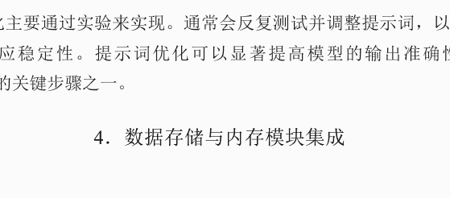

提示词的优化主要通过实验来实现。通常会反复测试并调整提示词，以确保模型在不同输入条件下的响应稳定性。提示词优化可以显著提高模型的输出准确性和一致性，是LangChain开发中的关键步骤之一。


##### 4. 数据存储与内存模块集成

LangChain的内存模块在任务链执行中具有重要作用。内存模块能够暂存任务链中产生的中间数据，为后续任务链提供上下文信息。这种设计确保了数据在任务之间的流转和共享，提高了LangChain的整体效率。内存模块支持不同的数据存储方式，例如会话内存和持久化内存，可根据任务需求灵活配置。

与内存模块相对应的是向量数据库的集成，特别是在需要进行复杂信息检索的场景中，向量数据库可以对数据进行向量化存储和相似性计算。通过向量数据库，可以提高文本匹配和检索的精度。LangChain的架构使得内存模块和向量数据库能够无缝协作，从而提升模型在信息管理和检索方面的能力。

##### 5. 链测试、调试与链结构调整

链测试是确保链式调用的正确性和稳定性的重要步骤，通过模拟实际数据流和场景运行链条，发现潜在问题。在测试过程中，需要记录输入、输出以及中间数据，利用日志追踪链条中每个组件的运行状态；设置断点逐步分析链条的执行逻辑也十分关键。此外，可视化工具能够直观展示数据流向，帮助快速定位问题并优化链条结构。链结构的调整需根据测试反馈进行，包括优化链条组件的调用顺序，减少冗余处理步骤，改进内存使用效率等，确保链条逻辑流畅，性能可扩展。

##### 6. 模型部署、性能监控

模型部署可以选择多种方式：本地部署适合数据敏感的场景，但需确保硬件环境能够满足性能要求；云部署则通过云服务实现高并发调用，具备弹性扩展计算能力的优势；容器化部署则利用Docker等工具，实现了链条和模型的快速跨平台部署。

在性能监控方面，需要实时分析链条运行的关键性能指标，如响应时间和内存占用。通过设置告警机制，可以在性能异常时及时触发修复流程。通过使用工具（如Prometheus或Grafana）实现性能可视化监控，可以观察链条长期运行的趋势并优化性能表现。

## 1.2.3 如何快速上手LangChain开发

下面将逐步阐述如何快速上手LangChain开发，重点涵盖环境搭建、基本构件的使用、提示词设计以及任务链的构建等方面，以帮助读者尽快上手这一框架的应用。

#### 1. 环境搭建

在进行LangChain开发之前，首先需要完成开发环境的搭建。环境的配置是确保开发顺利进行的重要基础，以下步骤将引导读者快速搭建所需的开发环境。

**01**安装Python。LangChain基于Python开发，因此需确保系统中安装了Python（推荐版本为Python 3.8及以上）。可以通过Python官方网站下载安装包，或使用包管理工具（如Anaconda）进行安装。

**02**创建虚拟环境。为了保持项目的独立性与环境的干净，建议使用虚拟环境。可以使用以下命令创建虚拟环境，也可以如图1-8所示在Anaconda中创建虚拟环境:

```
> python -m venv langchain-env
```

**03**激活虚拟环境（Windows）:

```
> langchain-env\Scripts\activate
```

在Linux或macOS上:

```
> source langchain-env/bin/activate
```

**04**在激活的虚拟环境中，安装LangChain及其依赖库。可以使用以下命令进行安装:

```
> pip install langchain openai
```

安装完成后如图1-9所示。

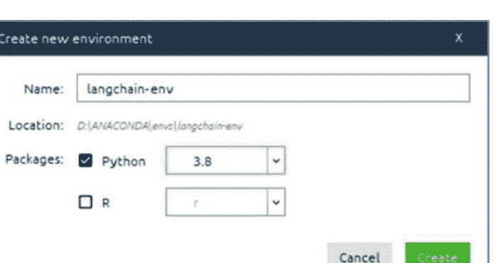
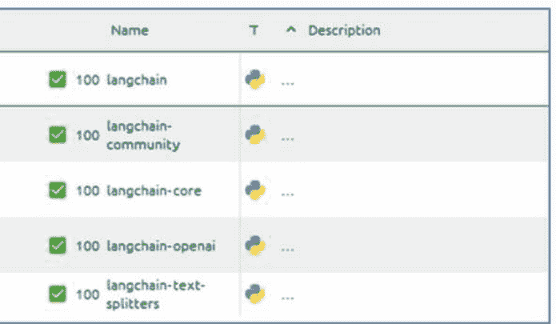

在环境搭建完成后，了解 LangChain 的基本构件是快速上手开发的关键。

LangChain 开发部件的架构如图 1-10 所示，展示了 LangChain 生态系统的主要组件及其分类，分为三个层次：架构（Architecture）、组件（Components）和部署（Deployment）。

- 最底层是架构部分，包括 LangChain 和 LangGraph，它们均开源（OSS）。LangChain 负责提供基础的链条设计与构建功能，而 LangGraph 扩展了图形化建模能力，用于更加复杂的链条架构设计。
- 中间层是组件部分，标注为开源（OSS）的 Integrations 模块，负责与外部工具或服务集成，例如与 API、数据库或第三方模型交互，支持灵活扩展与适配。

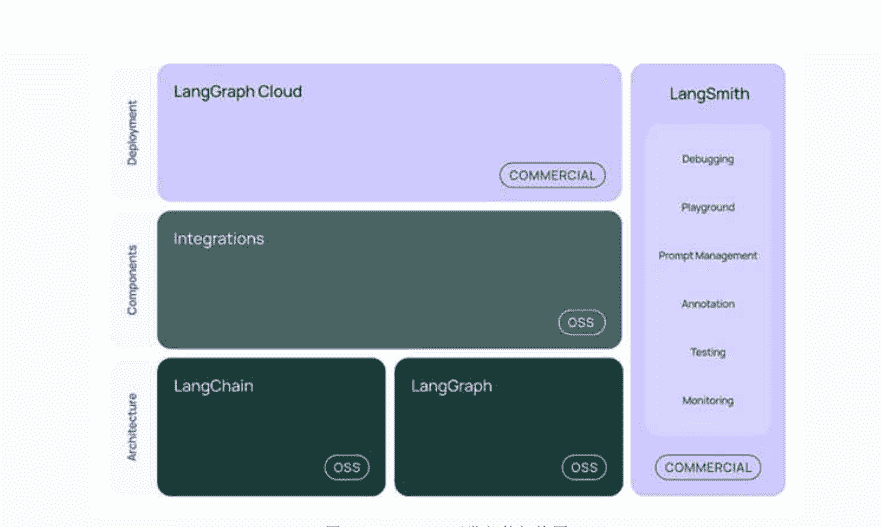

- 最顶层是部署部分，包括LangGraph Cloud和LangSmith。其中LangGraph Cloud是商业化的云端解决方案，支持跨平台部署与管理；LangSmith则提供一系列商业化的功能模块，如调试、交互式测试环境、提示管理、注释工具、性能测试以及监控功能，用于提升开发效率与产品稳定性。

LangChain的核心组件包括大语言模型（LLM）、提示词（Prompt）、任务链（Chain）和内存模块（Memory）。以下将逐一介绍这些组件的基本概念与使用方法。

**1) 大语言模型**

LLM是LangChain的核心，负责文本生成和自然语言理解。LangChain支持多种大语言模型的接入，如OpenAI的GPT系列。使用时需初始化模型，并设置必要的参数，例如API密钥和模型名称。

```python
from langchain.llms import OpenAI
llm=OpenAI(api_key="YOUR_API_KEY", model="text-davinci-003")
```

**2) 提示词**

提示词用于引导大语言模型的生成过程。通过设计合理的提示词，可以确保模型输出的内容符合预期。LangChain提供了PromptTemplate类，用于定义和管理提示词模板。

```python
from langchain.prompts import PromptTemplate
prompt_template=PromptTemplate(
    input_variables=[],
    template="请简要描述企业创新的重要性。"
)
```

**3) 任务链**

任务链是将多个任务有机组合在一起的结构，允许将不同的处理步骤串联。使用LLMChain类，可以方便地构建任务链并执行。

```python
from langchain.chains import LLMChain
chain=LLMChain(llm=llm, prompt=prompt_template)
result=chain.run()
```

**4) 内存模块**

内存模块用于在任务链中存储状态信息，以支持上下文的连续性。LangChain的内存模块可以帮助模型在多轮对话或复杂任务中保持上下文的一致性。

```python
from langchain.memory import Memory
memory=Memory()
```

#### 3. 提示词设计

提示词设计是影响大语言模型输出质量的重要因素。在实际开发中，合理的提示词能够引导模型生成更加准确和相关的内容。以下是一些设计提示词的建议：

(1) 在设计提示词时，首先应明确生成内容的目标。例如，若任务是生成产品介绍，则提示词应包含产品的特点和优势，提供足够的上下文信息可以提高模型的生成质量。

(2) 示例提示词可以包括用户的需求、背景信息等，使模型能够生成更具针对性的回复。模板化设计可以提高提示词的重用性和可维护性。

(3) 通过定义可变部分，将模板与具体内容结合，可以灵活应对不同的任务需求。

```python
prompt_template=PromptTemplate(
    input_variables=['product_name', 'features'],
    template="请介绍产品{product_name}，其特点为{features}。”
)
```

#### 4. 构建任务链

在掌握了LangChain的基本构件后，下一步是构建任务链。任务链的构建过程通常包括定义任务、配置参数和执行任务。以下步骤将逐步引导读者构建一个简单的任务链示例。

**构建任务**：任务可以是信息检索、文本生成、数据存储等。可以根据具体需求定义多个任务，并将它们组合在一起形成任务链。

**配置任务链**：使用LLMChain类将任务与提示词结合，形成完整的任务链。

```python
chain=LLMChain(llm=llm, prompt=prompt_template)
```

## 03 执行任务链：使用 run() 方法执行任务链，并获取生成结果。可以根据需要对输出进行处理和展示。

```python
result = chain.run()
print(result)
```

通过以上介绍，读者应能较为系统地掌握如何快速上手 LangChain 开发。无论是环境搭建、基本构件的使用，还是提示词设计与任务链的构建，均为实现高效的自然语言处理应用奠定了基础。随着对 LangChain 的深入理解与应用，读者将能够更好地利用大语言模型的优势，提升自动化处理的能力。

## 表 1-3 总结了本章用到的 LangChain 函数。

### 表 1-3 本章用到的 LangChain 函数

| 函数名称 | 函数功能 |
| :--- | :--- |
| OpenAI(api_key, model) | 初始化 OpenAI 大语言模型实例 |
| PromptTemplate | 创建提示词模板，便于管理和重用提示词 |
| LLMChain(llm, prompt) | 创建任务链，将大语言模型与提示词结合 |
| run() | 执行任务链，返回生成的文本结果 |
| Memory() | 创建内存模块，用于存储上下文信息 |
| VectorStore() | 初始化向量数据库，用于存储和检索相似性信息 |
| Agent() | 创建智能代理，用于执行特定任务或操作 |
| load_tools() | 加载可用工具，用于增强模型的功能 |
| tool.run() | 执行特定工具的功能，获取处理结果 |
| get_response() | 从大语言模型中获取生成的响应 |
| set_context() | 设置上下文信息，增强生成文本的相关性和准确性 |
| split_text() | 将文本分割成较小的块，以便于处理和分析 |
| format_prompt() | 格式化提示词，使其适应特定任务或模型要求 |
| generate_text() | 基于输入提示生成文本 |
| serialize() | 将模型或数据序列化以便于存储或传输 |

## 1.3 本章小结

本章系统介绍了 LLM 和 LangChain 的基本概念，为后续的深入开发奠定了理论基础。首先，通过分析大语言模型的发展历程，从早期的 N-grams 统计模型到如今基于 Transformer 的深度学习模型，阐述了自然语言处理技术的演变路径及其核心原理。然后，在 LangChain 的开发流程中，通过设计任务链和提示词，使模型能够灵活适应多种业务场景。同时，通过内存模块的集成，LangChain 能够实现上下文信息的传递和状态的维护，从而大大提升了应用的智能化程度。

## 1.4 思考

> （1）简述大语言模型的核心目标是什么，在自然语言处理任务中起到什么作用。
>
> （2）N-grams 模型有哪些主要缺陷？这些缺陷是如何推动大语言模型向更复杂的模型发展的？
>
> （3）什么是 Transformer 架构？与传统的循环神经网络相比，它的优势是什么？
>
> （4）LangChain 框架的主要功能模块有哪些？简要说明每个模块的作用。
>
> （5）在 LangChain 中，任务链的主要用途是什么？如何实现多个任务的顺序执行？
>
> （6）提示词在 LangChain 中有什么重要作用？它如何影响模型的输出？
>
> （7）简述 LangChain 的内存模块功能。它在多轮对话或复杂任务中如何保持上下文的一致性？
>
> （8）如何使用 LangChain 的 PromptTemplate 类？举例说明其用法。
>
> （9）在 LangChain 中，LLMChain 类的作用是什么？如何结合提示词和大语言模型构建任务链？
>
> （10）如何配置和使用 LangChain 的内存模块？在什么场景下需要使用它？
>
> （11）为什么在进行 LangChain 开发时推荐创建虚拟环境？如何安装 LangChain？
>
> （12）在 LangChain 的开发流程中，如何调试任务链和提示词的表现？有哪些常见的最佳实践？

# 第 2 章 LangChain 开发前的准备

一个高效的开发环境不仅能够提升开发体验，还能减少在项目中遇到的技术问题，为后续的编码和测试打下坚实的基础。本章将从基础配置入手，带领读者完成 LangChain 开发前的各项准备工作。

首先，LangChain 的开发离不开 LLM 的支持，特别是 OpenAI 的 API。因此，了解如何创建和管理 API 密钥，确保密钥的安全性，是开发的首要任务。其次，开发工具链的选择将直接影响开发效率，通过构建 Anaconda 与 PyCharm 的组合开发环境，可以有效管理项目依赖和虚拟环境，保证代码的兼容性和灵活性。最后，LangChain 依赖一系列第三方库，本章将介绍这些核心依赖库的安装与初步配置，以便在实际开发中顺畅调用。

本章旨在帮助读者系统地搭建开发环境，解决 API 配置、环境管理及依赖库安装等问题，为 LangChain 项目的顺利开发奠定良好的基础。

## 2.1 创建 OpenAI API 密钥

在使用 LangChain 进行开发时，LLM 通常扮演着关键角色，而 OpenAI 的 API 则是其中广泛使用的接口之一。通过调用 OpenAI 的 API，可以轻松访问 GPT 系列模型，从而实现强大的自然语言处理功能。然而，API 的使用需要有效的认证方式，API 密钥便是实现这一认证的核心工具。

本节将带领读者完成 OpenAI API 密钥的创建和配置。首先将介绍如何注册 OpenAI 账户及完成基本设置，随后讲解生成和管理 API 密钥的具体步骤。在使用过程中，API 密钥的安全性和权限管理尤为重要，因此本节也会重点介绍如何保障密钥的安全，避免不必要的风险。

### 2.1.1 注册与账户配置

在开始 LangChain 的开发之前，需要拥有一个 **OpenAI** 账户，以便获取 API 密钥来访问大语言模型。以下操作将引导读者完成 **OpenAI** 账户的注册和基础配置，为后续开发做好准备。

> 1. 打开 OpenAI 官方网站
>
> 首先，使用浏览器访问 OpenAI 的官方网站 (https://www.openai.com)。该网站提供了关于 OpenAI 产品和服务的相关信息，也是注册账户的入口，如图 2-1 所示。
>
> 
>
> 图 2-1 OpenAI 官方网站主页
>
> 2. 进入注册页面
>
> 在 OpenAI 官方网站的右上角，可以找到“Sign Up”或"Get started"按钮，如图 2-2 所示。单击该按钮，将会跳转到注册页面。在注册页面中，可以选择以下两种方式之一进行注册：
>
> 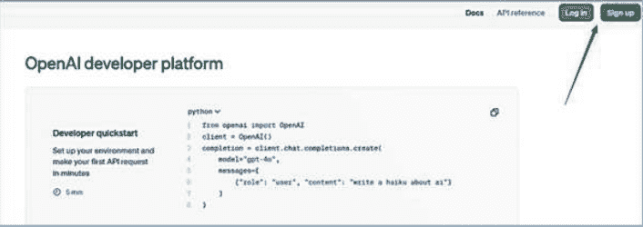
>
> 图 2-2 单击 Sign Up 进行账号注册
>
> （1）使用电子邮件注册：输入一个常用的电子邮箱地址，并设置一个强密码。
>
> （2）使用第三方账户注册：可以选择使用 **Google** 或 **Microsoft** 账户直接登录。
>
> 推荐使用常用且安全的电子邮箱地址进行注册，以便后续接收重要通知和安全提醒。

> 3. 验证电子邮件
>
> 如果选择使用电子邮箱地址注册，OpenAI 将向该邮箱发送一封验证邮件。登录电子邮箱账户，查找并打开来自 OpenAI 的验证邮件，单击邮件中的验证链接，以确认电子邮箱地址。完成验证后，账户注册即成功。
>
> 4. 完善个人信息
>
> 完成邮箱验证后，系统可能会要求提供一些基本的个人信息，通常需要输入姓名、国家或地区，以及其他一些基本信息。这些信息用于账户管理和安全验证，确保账户的合法性和安全性。
>
> 5. 同意服务条款和隐私政策
>
> 在注册过程中，系统会要求用户同意 OpenAI 的服务条款和隐私政策。建议仔细阅读这些文件，确保对使用条款有清晰的了解。服务条款可能包含使用限制、数据隐私保护和其他重要信息，了解这些内容有助于合法、合规地使用 OpenAI 的服务。
>
> 6. 进入账户设置页面
>
> 完成注册后，单击页面（见图 2-3）右上角的个人头像，进入账户设置页面（通常为 Account 或 Settings）。在账户设置页面中，可以查看账户的基本信息和管理账户的安全设置。
>
> 
>
> 7. 设置双重身份验证（推荐）
>
> 为了提升账户的安全性，建议启用双重身份验证（Two-Factor Authentication, **2FA**），如图 2-4 所示。双重身份验证是 OpenAI 账户的一个重要的安全功能，能够有效防止未经授权的访问。启用 2FA 的步骤如下：
>
> ```text
> > 01 | 在账户设置页面中，找到“双重身份验证”或"Security"选项。
> ```


图 2-4 2FA 验证配置

单击启用双重身份验证，并按照提示选择验证方式（如短信验证或验证器应用）。

按照页面提示完成双重身份验证的配置。

将生成的密钥或二维码添加到 2FA 应用（如 Google Authenticator、Authy 等）。此后，每次登录时都会要求提供额外的验证信息。

> 8. 选择合适的 API 订阅计划
>
> OpenAI 提供多种 API 订阅计划，以满足不同用户的需求。可以在账户设置页面中选择合适的订阅计划。
>
> • 免费计划：适合小规模测试，通常有一定的调用限制。
>
> 付费计划：提供更髙的调用限额，适合持续开发或企业项目，费用会根据调用量产生。
>
> 在选择订阅计划时，可结合项目需求和预算做出合理选择。对于个人开发或小型项目，可以选择免费或入门级计划；对于企业级应用，建议选择付费计划，以获得更多 API 调用额度和支持。计划的选择可以在账户后续的使用过程中灵活调整。
>
> 9. 了解 API 使用限制和配额
>
> 不同的订阅计划有不同的 API 调用配额和速率限制。在开始使用 API 之前，建议在账户页面查看相关的 API 使用限制和配额信息，包括每月的调用次数、速率限制等，以便在开发中合理规划 API 调用次数，避免超出限制。
>
> 10. 完成账户配置
>
> 至此，OpenAI 账户的注册和基础配置已经完成。此账户将作为后续获取 API 密钥、进行 API 调用的基础。请妥善保存账户的登录信息，并确保账户的安全设置到位。

### 2.1.2 生成和管理 API 密钥

OpenAI API 密钥是调用其大语言模型服务的关键凭证。拥有 API 密钥后，可以将 OpenAI 的语言模型集成到应用中，实现文本生成、翻译等功能。下面将详细介绍如何生成并妥善管理 API 密钥，以确保开发过程的顺利进行和密钥的安全性。

> 1. 登录 OpenAI 账户
>
> 首先，使用浏览器访问 OpenAI 官方网站 (https://www.openai.com)，然后单击右上角的"Log In"按钮，输入账户信息登录到自己的 OpenAI 账户。
>
> 2. 进入 API 密钥管理页面
>
> 登录成功后，单击页面右上角的个人头像，选择"API Keys"或"API 管理”(具体名称可能因 OpenAI 平台的更新而有所变化)。此选项通常位于账户设置的下拉菜单中。进入 API 密钥管理页面后，可以看到已有的 API 密钥列表 (如果已生成密钥) 或生成密钥的选项，如图 2-5 所示。
>
> 
>
> 图 2-5 API 密钥管理页面
>
> 3. 生成新的 API 密钥
>
> 在 API 密钥管理页面，找到"Create new secret key"或“生成新密钥”按钮。单击该按钮后，系统会自动生成一个新的 API 密钥，并在页面上显示该密钥。密钥通常是一串包含字母和数字的字符串，如 sk-XXXXXX。
>
> > 注意 API 密钥只会在生成时显示一次，未妥善保存的密钥将无法再次查看。因此，在生成密钥时，务必妥善保存。
>
> 4. 保存 API 密钥
>
> 生成 API 密钥后，应将其安全地存储。以下是几种推荐的存储方法：
>
> （1）文本文件：将密钥保存到一个纯文本文件中，但建议不要将文件放在公开的文件夹中，也不要上传到代码仓库。
>
> （2）环境变量：将 API 密钥存储为环境变量，避免在代码中硬编码密钥，提高安全性。
>
> （3）密码管理器：使用密码管理工具 (如 1Password、LastPass 等) 安全存储密钥，方便后续管理。
>
> 5. 管理 API 密钥
>
> 在开发过程中，可能需要生成多个 API 密钥，以满足不同项目或用途。以下是常见的密钥管理操作：
>
> （1）查看已生成的密钥：在 API 密钥管理页面，可以看到所有生成过的密钥的列表。每个密钥会显示创建日期和部分密钥信息，以便于区分。
>
> （2）命名密钥：为了方便管理和识别，建议为每个密钥添加描述或命名 (如“测试项目密钥”“生产环境密钥”)。这样在多个项目或团队成员使用 API 时，可以更清楚地识别每个密钥的用途。
>
> （3）密钥配额和调用情况：在 API 密钥管理页面，可以查看各密钥的调用情况和的使用配额。密钥的调用次数和剩余配额会直接影响 API 的使用，因此应定期检查。
>
> 6. 删除 API 密钥
>
> 如果某个 API 密钥不再使用，或出于安全考虑想要禁用某个密钥，可以在 API 密钥管理页面将其删除。删除密钥的步骤如下：
>
> 01 在 API 密钥列表中，找到需要删除的密钥。
>
> 02 单击该密钥旁边的"Delete"或“删除”按钮。
>
> 03 系统会弹出确认框，提示删除操作不可恢复。确认删除后，该密钥将立即失效。
>
> > 提示 在删除 API 密钥之前，确保没有任何项目依赖该密钥。删除操作不可恢复，删除后该密钥无法重新激活。
>
> 7. API 密钥安全管理建议
>
> API 密钥是访问 OpenAI 服务的唯一凭证，因此确保其安全至关重要。以下是一些安全管理 API 密钥的建议：
>
> （1）不要在代码中直接硬编码密钥。建议将密钥存储在环境变量或安全存储中，并在代码中读取。
>
> （2）不要将密钥上传到代码仓库。即使是私有仓库，也应尽量避免上传密钥。若不慎上传，可通过 Git 历史删除密钥，或更改密钥并重新生成。
>
> （3）定期更换密钥。尤其是在团队共享密钥的情况下，定期更换密钥并更新项目配置，可以有效提升安全性。
>
> （4）监控密钥使用情况。定期检查密钥的调用次数和异常行为，若发现异常调用，应立即禁用相关密钥，并生成新的密钥。
>
> 8. 使用 API 密钥调用 OpenAI 服务
>
> 当成功生成并保存了 API 密钥后，即可在代码中使用该密钥访问 OpenAI 的服务。以下是一个基本的 API 调用示例，展示如何将 API 密钥集成到代码中：
>
> ```python
> import openai
> import os
> 
> # 从环境变量中获取 API 密钥
> openai.api_key = os.getenv("OPENAI_API_KEY")
> 
> # 调用 OpenAI 的文本生成接口
> response = openai.Completion.create(
>     engine="text-davinci-003",
>     prompt="请简要描述企业创新的重要性。",
>     max_tokens=50)
> 
> print(response.choices[0].text.strip()) # 输出生成结果
> ```
>
> 在此示例中，API 密钥从环境变量中读取，并用于初始化 OpenAI 的 API。随后，通过调用 openai.Completion.create() 方法，可以让大语言模型生成指定的文本内容。确保在使用前已正确配置 API 密钥，以免调用失败。
>
> 9. 密钥过期或更换的应对措施
>
> 如果发现 API 密钥已失效或被更换，需要立即更新项目中的密钥配置。以下是更换密钥时的常见步骤：
>
> - 01 生成新的 API 密钥，并按照前述方法保存和管理。
>
> - 02 将新密钥添加到环境变量或安全存储中，并替换项目中的旧密钥。
>
> - 03 测试 API 调用，确保新密钥正常工作。

表 2-1 列出了 API 密钥的基本功能。


| 功 能 | 说 明 |
| :--- | :--- |
| 身份验证 | 作为唯一凭证，用于验证用户身份，确保 API 调用的合法性 |
| 访问控制 | 控制用户对 OpenAI 服务的访问权限，限制未经授权的调用 |
| 调用配额管理 | 管理用户的调用次数，避免超出 API 订阅计划的使用配额 |
| 项目隔离 | 可创建多个密钥，用于不同项目或环境，实现项目间的资源隔离 |
| 调用日志追踪 | 通过密钥管理页面监控调用日志，识别异常调用行为 |
| 权限撤销 | 支持删除密钥，以立即撤销对某些服务的访问，保障数据安全 |
| 团队协作支持 | 为团队成员生成独立密钥，便于管理权限和监控个人调用情况 |
| 安全控制 | 支持双重验证、环境变量存储等方式，提升密钥的安全化管理 |

### 2.1.3 设置访问权限与安全性

API 密钥是访问 OpenAI 服务的唯一凭证，因此在生成密钥后，对其进行妥善的权限配置与安全管理至关重要。确保 API 密钥的安全性不仅有助于保护项目数据，还能防止未经授权的访问。下面将手把手带领读者设置 API 密钥的访问权限与安全性。

> 1. 确定密钥的使用范围
>
> 在使用 API 密钥之前，首先要明确密钥的使用范围。可以根据不同的需求生成多个 API 密钥，以实现对不同项目或环境的隔离。对于企业级项目，建议按以下几种用途划分 API 密钥：
>
> +   - 开发密钥：用于测试和开发环境，通常限制较低的调用频率和配额。
> - 生产密钥：用于正式上线的生产环境，配额较高，需严格保护。
> - 测试密钥：用于非敏感性测试，通常会限制调用频率，以避免超出配额。
>
> 通过区分不同用途的 API 密钥，可以在开发和测试过程中更灵活地管理资源，同时确保生产环境的安全性。
>
> 2. 使用环境变量存储 API 密钥
>
> 直接在代码中硬编码 API 密钥容易造成安全隐患，尤其是在使用版本控制系统 (如 Git) 时。因此，建议将 API 密钥存储在环境变量中，并通过代码动态读取。
>
> 首先，在操作系统中创建一个环境变量来存储 API 密钥：
>
> ```text
> > 在 Windows 上：
> >> setx OPENAI_API_KEY "sk-XXXXXXXX"
> > 在 macOS 或 Linux 上：
> >> export OPENAI_API_KEY="sk-XXXXXXXX"
> ```
>
> 设置完环境变量后，可以在代码中通过 os 模块读取该环境变量，从而避免将密钥硬编码在代码中。
>
> ```python
> import os 
> api_key = os.getenv("OPENAI_API_KEY")
> ```
>
> 使用此方法，可以确保密钥不被公开暴露在代码中，提升项目的安全性。
>
> 3. 设置双重身份验证来保护账户
>
> 为了进一步保护 OpenAI 账户，建议启用双重身份验证，为账户添加额外一层安全保护，确保只有经过授权的用户才能访问 API 密钥和其他敏感信息。## 启用双重身份验证的步骤在 2.1.1 节已经介绍过了，这里不再赘述。需要注意，每次登录时，都要输入动态生成的验证码，进一步确保账户的安全，如图 2-6 所示。

> **图 2-6** 输入身份验证码

#### 4. 使用密码管理器存储密钥

使用密码管理器是安全存储 API 密钥的另一种推荐方式。密码管理器能够加密存储密钥，并为不同的项目和团队成员提供灵活的访问控制。使用密码管理器存储 API 密钥的步骤如下：

1. **①**选择密码管理器：选择一个安全可靠的密码管理器，例如 1Password、LastPass 或 Bitwarden。
2. **②**存储 API 密钥：在密码管理器中创建一个新条目，将 API 密钥信息输入其中。可以在备注中记录密钥的用途，如“生产密钥”或“开发密钥”。
3. **③**设置访问权限：若是团队使用的密码管理器，可以为不同的成员分配权限。确保只有需要访问 API 密钥的成员才能查看该密钥。

通过密码管理器存储 API 密钥，可以有效防止密钥泄露，并便于团队协作时的权限管理。

在企业级项目中，API 密钥的保护至关重要，它不仅影响数据的安全性，也决定了系统的稳定性。通过环境变量存储、双重身份验证、密码管理器、安全轮换和监控调用等措施，能够显著降低密钥泄露和滥用的风险。

## 2.2 构建 Anaconda+PyCharm 开发工具链

在进行 LangChain 开发时，一个高效且稳定的开发环境是必不可少的。使用 Anaconda 和 Pycharm 组合可以为项目提供良好的依赖管理、虚拟环境隔离和代码编辑功能，尤其适合数据科学、机器学习及大语言模型的开发。

Anaconda（见图 2-7）是一个强大的 Python 数据科学平台，包含了包管理和环境管理工具。通过 Anaconda 可以轻松创建和管理虚拟环境，为项目提供独立的依赖空间，避免不同项目之间的依赖冲突。而 PyCharm 作为专业的 Python IDE，具有强大的代码编辑、调试和版本控制功能，与 Anaconda 结合使用可以大幅提升开发效率。

本节将带领读者完成 Anaconda 和 PyCharm 的安装、环境配置及工具链的集成，确保能顺畅地开发 LangChain 项目。这一工具链的构建将为后续代码的编写和调试奠定稳固基础，使开发过程更加高效、清晰。

### 2.2.1 安装与配置 Anaconda 环境

下面将完成 Anaconda 的安装与环境配置，并创建一个用于 LangChain 开发的虚拟环境。

#### 1. 下载 Anaconda

**01**访问 Anaconda 官方网站：打开浏览器，输入 https://www.anaconda.com，访问 Anaconda 官方网站，如图 2-8 所示。

**02**选择合适的版本：在首页，找到"Free Download"按钮。Anaconda 支持多个操作系统，请根据所用操作系统（Windows、macOS 或 Linux）下载相应的安装包。建议选择 Python 3.8 或更高版本的 Anaconda 发行版，以确保兼容性。

**03**下载安装包：选择好操作系统和 Python 版本后，单击"Download"按钮，开始下载安装包。文件体积可能较大，下载时间视网速而定。

#### 2. 安装 Anaconda

**01**打开安装程序：安装包下载完成后，双击打开，启动 Anaconda 的安装程序。以下是各系统的安装指引：

- **Windows**：双击.exe 文件，打开安装向导。
- **macOS**：双击.pkg 文件，按照提示进行安装。
- **Linux**：打开终端，使用命令行安装。命令如下：

```bash
>> bash /path/to/Anaconda3-xxxx-Linux-x86_64.sh
```

其中，`/path/to/Anaconda3-xxxx-Linux-x86_64.sh` 应替换为实际的安装包路径。

阅读许可协议：安装程序启动后，系统会显示 Anaconda 的许可协议，阅读协议内容后，选择“同意”或"Agree"继续安装。

选择安装路径：系统会提示选择 Anaconda 的安装路径，建议使用默认路径，便于管理。如果需要更改路径，确保新路径没有空格和特殊字符，避免可能的兼容性问题。

选择安装选项：在安装选项页面，通常会有两个选项：

- **Add Anaconda to my PATH environment variable**（将 Anaconda 添加到 PATH 环境变量中）：建议不选，因为此操作可能会与其他 Python 版本发生冲突。
- **Register Anaconda as my default Python**（将 Anaconda 注册为默认 Python）：建议勾选此选项，使 Anaconda 的 Python 成为默认版本，便于后续使用。

开始安装：配置完路径和选项后，单击"Install"或“安装”按钮，开始安装 Anaconda。安装过程可能需要几分钟。

完成安装：安装完成后，单击"Finish"或“完成”按钮，结束安装程序。

#### 3. 验证 Anaconda

在 Windows 上，单击“开始菜单”，找到"Anaconda3"文件夹，选择"Anaconda Prompt"。

在 macOS 或 Linux 上，打开终端窗口。

验证 Anaconda：在命令行中输入以下命令，检查 Anaconda 是否安装成功：

```bash
>> conda --version
```

如果安装成功，系统会显示 Anaconda 的版本号（如 conda 4.x.x），表示安装完成。

#### 4. 创建虚拟环境

虚拟环境是 Anaconda 的核心功能之一，通过它可以为每个项目创建独立的依赖空间。下面将创建一个用于 LangChain 开发的虚拟环境。

创建环境：在 Anaconda Prompt 或终端中输入以下命令：

```bash
>> conda create -n langchain-env python=3.8
```

此命令指定了 Python 版本为 3.8，并创建了一个名为 `langchain-env` 的虚拟环境。-n 参数表示环境名称，可以根据需要自定义。

#### 5. 激活环境

激活环境：创建环境后，需要激活它才能使用。输入以下命令激活 `langchain-env` 环境：

```bash
>> conda activate langchain-env
```

macOS/Linux:

```bash
>> source activate langchain-env
```

激活环境后，命令行前会显示环境名称（如 `langchain-env`），表示当前处于该环境中。

#### 6. 验证 Python 版本

在激活的虚拟环境中，输入以下命令验证 Python 版本是否正确：

```bash
>> python --version
```

如果显示 Python 3.8.x，则说明环境创建成功。

#### 7. 安装常用依赖包

在创建和激活虚拟环境后，可以安装开发 LangChain 项目所需的依赖包。首先安装一些基本的 Python 包，如 pip、numpy 等，确保环境正常工作。

```bash
>> conda install pip numpy
```

#### 8. 管理虚拟环境

在开发过程中，可能会涉及安装、删除和切换环境。以下是常用的虚拟环境管理命令：

1. **列出所有环境**

   输入以下命令，查看当前系统中已创建的所有虚拟环境：

   ```bash
   >> conda env list
   ```

   系统将列出所有环境及其路径，当前激活的环境前会有*符号标记。

2. **退出环境**

   开发完成后，可以退出当前环境，返回到系统默认环境。输入以下命令退出环境：

   ```bash
   >> conda deactivate
   ```

3. **删除环境**

   如果某个环境不再使用，可以通过以下命令将其删除：

   ```bash
   >> conda remove -n langchain-env --all
   ```

   其中 `-n langchain-env` 指定环境名称，`--all` 表示删除该环境中的所有包。

#### 9. 设置 Jupyter Notebook 支持（可选）

在数据科学开发中，Jupyter Notebook 是常用的交互式工具。在新环境中配置 Jupyter Notebook 支持的步骤如下：

**01**安装 Jupyter Notebook：在激活的 `langchain-env` 环境中，输入以下命令安装 Jupyter Notebook:

```bash
>> conda install jupyter
```

**02**启动 Jupyter Notebook：安装完成后，可以通过以下命令启动 Jupyter Notebook:

```bash
>> jupyter notebook
```

输出如下:

```text
[I 12:42:58.416 NotebookApp] 
>>302 GET/?token=ec8fla9a9e94cl5f2fOd77dlcdbcaa8dO6fdOdfE3469ef4f (127.0.0.1) \
n 1.00ms
```

系统将自动打开浏览器，并在页面上显示 Notebook 界面，如图 2-9 所示。此时，所有代码将基于 langchain-env 环境运行。

通过上述操作，完成了 Anaconda 的安装、虚拟环境的创建与配置。Anaconda 提供了独立的虚拟环境管理机制，可以有效隔离项目依赖，避免不同项目间的冲突。

使用 Jupyter Notebook 等工具进一步提升了开发效率，为 LangChain 项目的开发奠定了良好的基础。接下来，可以将该环境与 PyCharm 集成，以实现更高效的代码开发和调试流程。

### 2.2.2 PyCharm 集成 Anaconda 环境

下面将详细讲解如何将 Anaconda 环境与 PyCharm 集成，配置项目的 Python 解释器并调试代码。

#### 1. 下载并安装 PyCharm

**01**访问 PyCharm 官方网站：打开浏览器，访问 PyCharm 官方网站 (https://www.jetbrains.com/pycharm)，如图 2-10 所示。

**图 2-10** JetBrains PyCharm 官方网站下载界面

**02**选择 PyCharm 版本：PyCharm 提供两个版本：

- **Community Edition**: 免费版本，适合基本的 Python 开发。
- **Professional Edition**: 付费版本，包含更高级的功能，如数据库支持和 Web 开发工具。

对于大多数 Python 项目，Community Edition 已经足够，我们选择下载社区免费版本，如图 2-11 所示。

**图 2-11** 选择下载对应操作系统的社区免费版本

**03**安装 PyCharm:下载完成后，双击安装包，按照提示进行安装。安装过程简单，通常选择默认设置即可。

#### 2. 打开 PyCharm 并创建新项目

**01**启动 PyCharm：安装完成后，打开 PyCharm。首次启动 PyCharm 时，系统可能会要求选择主题和配置基础设置。按照提示完成设置即可。

**02**创建新项目：在主界面中选择"New Project"创建新项目。在项目配置界面，将项目命名为"LangChainProject"或其他合适的名称，选择项目保存的路径，如图 2-12 所示。

**图 2-12** 在 PyCharm 中创建新项目

#### 3. 配置 Python 解释器（选择 Anaconda 环境）

在项目创建过程中，PyCharm 会要求选择 Python 解释器。Python 解释器指的是用于运行项目代码的 Python 版本或环境。使用新建的 Anaconda 虚拟环境，如图 2-13 所示。

**01**选择 Python 解释器：在"New Project"窗口的右侧，找到"Python Interpreter"选项，单击 "Add Interpreter"或"Existing Interpreter"来选择已有的 Anaconda 环境。

**02**选择"Conda Environment"选项：在弹出的窗口中，选择"Conda Environment"选项。
PyCharm 会显示已安装的 Anaconda 环境列表。

**图 2-13** 在 Anaconda 环境下配置解释器

**03**指定已有的 Anaconda 环境：在 "Conda Environment"设置中，选择 "Existing environment" (已有环境)，然后浏览之前创建的 Anaconda 环境 `langchain-env` 的路径：

- **Windows 路径**: 通常为 `C:\Users\<用户名>\anaconda3\envs\langchain-env`。
- **macOS/Linux 路径**: 通常为 `/Users/<用户名>/anaconda3/envs/langchain-env` 或 `/home/<用户名>/anaconda3/envs/langchain-env`。

如果找不到环境，可以手动输入或选择路径中的 `python.exe`(Windows) 或 `bin/python`(macOS/Linux) 文件。

#### 4. 创建测试脚本并运行

配置完成后，可以创建一个简单的 Python 脚本，测试 PyCharm 是否成功调用了 Anaconda 环境中的 Python 解释器。

**01**创建新 Python 文件：在项目目录中，右击项目名称（如"LangChainProject"），在弹出的快捷菜单中选择"New"-"Python File"，将文件命名为 `test_env.py`。

**02**编写测试代码：在新创建的文件中，输入以下代码，测试虚拟环境是否配置正确：

```python
import sys
import numpy

print("Python Interpreter Path:", sys.executable)
print("Numpy Version:", numpy.__version__)
```

代码将输出当前 Python 解释器的路径和 numpy 的版本号。numpy 是常用的 Python 科学计算包，若环境配置正确，应能正常导入。

**03**运行测试脚本：右击 `test_env.py` 文件，在弹出的快捷菜单中选择"Run 'test_env'"执行脚本。PyCharm 将运行该脚本，并在控制台中输出结果。

**04**检查结果：在 PyCharm 的控制台窗口，应看到类似以下输出:

```text
Python Interpreter Path: \
C:\Users\<用户名>\anaconda3\envs\langchain-env\python.exe
```

#### 5. 安装其他依赖包

在项目开发过程中，可能需要安装其他依赖包。可以直接在 PyCharm 中安装，以确保所有依赖包都安装在 langchain-env 环境中。

**01**在 PyCharm 中安装依赖包：在菜单栏中依次单击"File"→"Settings" →"Project:LangChainProject"→"Python Interpreter"，在弹出的窗口右侧单击"+"按钮，打开包管理器。

**02**搜索并安装包：在搜索栏中输入所需包名（如 openai），在搜索结果中单击"Install Package"按钮安装。安装成功后，包将出现在"Installed Packages"列表中。

**03**命令行安装依赖：若更习惯使用命令行，可以通过 Anaconda Prompt 激活 langchain-env 环境，使用 pip 或 conda 命令安装所需包：

```bash
>> conda activate langchain-env
>> pip install openai
```

通过上述步骤，可以成功地将 Anaconda 虚拟环境与 PyCharm 集成。此工具链可以有效管理项目依赖并提供灵活的调试环境，为 LangChain 开发提供了一个稳定的开发基础。接下来，可以在此基础上进行代码的编写、调试和测试。

### 2.2.3 包管理与环境管理

包管理涉及安装、更新、删除 Python 包，而环境管理则是维护多个项目的独立虚拟环境，确保不同项目之间的依赖不冲突。

良好的包管理和环境管理不仅能提升开发效率，还有助于提升项目的稳定性和可维护性。下面将讲解如何进行包管理和环境管理。

#### 1. 使用 Conda 进行环境管理

Anaconda 的 Conda 工具可以方便地管理虚拟环境，确保每个项目的依赖独立。以下是一些环境管理的基本操作。

1. **创建新环境**

   在创建新的项目时，建议创建一个独立的虚拟环境来管理依赖。以下命令将创建一个 Python 3.8 的虚拟环境:

   ```bash
   >> conda create -n langchain-env python=3.8
   ```

   其中：

   - `-n langchain-env`: 指定环境名称为 `langchain-env`。
   - `python=3.8`: 指定 Python 版本为 3.8。

2. **激活环境**

   在创建环境后，需要激活它才能使用。以下命令将激活 `langchain-env` 环境:

   ```bash
   >> conda activate langchain-env
   ```

3. **列出所有环境**

   使用以下命令可以查看系统中已创建的所有虚拟环境：

   ```bash
   >> conda env list
   ```

4. **删除环境**

   若某个环境不再需要，可以通过以下命令将其删除:

   ```bash
   >> conda remove -n langchain-env --all
   ```

   此命令会删除 `langchain-env` 环境及其中的所有包。

#### 2. 在 Conda 中管理包

Conda 可以方便地安装、更新和删除 Python 包。以下是使用 Conda 进行包管理的基本操作。

- **安装包**
  
  可以使用 `conda install` 命令安装包。例如，安装 numpy 库：

  ```bash
  >> conda install numpy
  ```

  Conda 会自动下载并安装 numpy 及其依赖包，确保包的版本兼容性。

- **更新包**
  
  可以使用 `conda update` 命令更新包到最新版本。例如，更新 numpy 包：

  ```bash
  >> conda update numpy
  ```

  此命令会检查最新的 numpy 版本并进行更新。

- **删除包**
  
  可以使用 `conda remove` 命令删除包。例如，删除 numpy 包：

  ```bash
  >> conda remove numpy
  ```

  Conda 会删除指定的包及其依赖关系，确保环境的整洁。

- **查看已安装包**
  
  可以使用以下命令查看当前环境中已安装的所有包：

  ```bash
  >> conda list
  ```

  系统将列出所有已安装的包及其版本号和安装路径。

- **示例**

```markdown
##### 1. 使用 NumPy 进行简单的脚本开发测试环境

下面使用 numpy 库进行一个简单的脚本开发，试验环境是否可以正常工作：

```python
import numpy as np
from sklearn.decomposition import PCA
import matplotlib.pyplot as plt

###### 1. 创建一个模拟的多维数组数据集
np.random.seed(42)
data = np.random.rand(100, 5) * 100  # 创建 100 个样本，每个样本有 5 个特征

###### 2. 数据归一化处理（Min-Max Normalization）
data_min = data.min(axis=0)
data_max = data.max(axis=0)
normalized_data = (data - data_min) / (data_max - data_min)

###### 3. 计算相似性矩阵（余弦相似度）
def cosine_similarity_matrix(data):
    dot_product = np.dot(data, data.T)
    norms = np.linalg.norm(data, axis=1)
    norm_matrix = np.outer(norms, norms)
    similarity_matrix = dot_product / norm_matrix
    np.fill_diagonal(similarity_matrix, 0)  # 设置对角线为 0，排除自相似
    return similarity_matrix

similarity_matrix = cosine_similarity_matrix(normalized_data)

###### 4. 找出最相似的数据对
most_similar_pairs = np.unravel_index(np.argmax(similarity_matrix), similarity_matrix.shape)
print("最相似的数据对索引:", most_similar_pairs)
print("最相似的样本相似度:", similarity_matrix[most_similar_pairs])

###### 5. 使用 PCA 进行数据降维并可视化
pca = PCA(n_components=2)
reduced_data = pca.fit_transform(normalized_data)
plt.scatter(reduced_data[:, 0], reduced_data[:, 1], c='blue', label='Data Points')
plt.scatter(reduced_data[most_similar_pairs, 0],
            reduced_data[most_similar_pairs, 1], c='red',
            label='Most Similar Pair', s=100)
plt.title("Data Points in 2D after PCA Reduction")
plt.xlabel("Principal Component 1")
plt.ylabel("Principal Component 2")
plt.legend()
plt.show()
```

**代码解释如下：**

(1) 创建一个 100 行 5 列的数组，每行表示一个样本，每列表示一个特征。

(2) 对数据进行归一化处理，将所有值缩放到 0 和 1 之间，以消除特征之间的量级差异。

(3) 计算数据集的余弦相似性矩阵，用于衡量样本之间的相似性。

(4) 找出相似性矩阵中相似度最高的数据对，并输出它们的索引和相似度值。

(5) 使用主成分分析（PCA）将数据降维到二维空间，并可视化所有数据点，标出最相似的数据对。

运行结果如下：

> > 最相似的数据对索引: (27, 84)
> > 最相似的样本相似度: 0.996239

散点图如图 2-14 所示，展示了 PCA 降维后的数据点分布，面积最大的两个点标记的是相似度最高的样本对。


图 2-14 利用 numpy 做 PCA 分析的运行结果

##### 2. 导出和导入环境

在项目开发中，可能需要将当前环境导出为配置文件，以便于在其他系统上快速重建相同的环境。Conda 支持将环境导出为 `.yml` 文件，以便于迁移和共享。

### - 1）导出环境

使用以下命令将当前环境导出为 `environment.yml` 文件：

```bash
conda env export > environment.yml
```

此命令会将 `langchain-env` 环境中的所有包及其版本记录在 `environment.yml` 文件中。

### - 2）导入环境

在另一台计算机上，可以使用以下命令基于 `environment.yml` 文件创建相同的环境：

```bash
conda env create -f environment.yml
```

此命令会根据 `environment.yml` 文件中的包版本信息，创建一个与原环境一致的虚拟环境。

###### 3. 复制环境

若需创建一个与现有环境完全相同的新环境，可以使用以下命令：

```bash
conda create --name new-env --clone langchain-env
```

此命令会将 `langchain-env` 环境复制为 `new-env` 环境，适用于需要快速复制现有环境的情况。

包管理和环境管理是开发过程中的重要环节，能够帮助开发者灵活地控制项目依赖和环境，确保项目的稳定性和可维护性。掌握这些技能后，读者可以更自如地在 LangChain 项目开发中添加、更新和移除依赖，为项目的长期稳定运行奠定坚实基础。

表 2-2 是 2.1 节和 2.2 节中涉及的所有命令的总结。

| 操作                     | 命令                                      | 说明                                       |
| :----------------------- | :---------------------------------------- | :----------------------------------------- |
| 创建 OpenAI API 密钥      | -                                         |                                           |
| 设置环境变量             | `export OPENAI_API_KEY=your_key`         |                                           |

表 2-2 命令汇总表

#### 3. 初探 LangChain 依赖库

本节将带领读者初步了解 LangChain 所需的主要依赖库，从核心依赖到扩展工具，将逐一进行介绍。首先，将概览 LangChain 的核心依赖库，帮助读者理解各依赖的功能和作用；接着，详细讲解 openai 库的安装与配置，以便实现 LLM 的调用；最后，将介绍一些常用的辅助工具和扩展包，以增强 LangChain 项目的功能与灵活性。

##### 1. 核心依赖库之一：langchain

`langchain` 是 LangChain 项目的核心库，提供了与大语言模型交互的各种功能和接口。它包含了任务链、内存模块、提示词管理等核心功能，简化了语言模型的集成与调用流程。

`langchain` 库在项目中主要负责以下任务：

- **任务链管理**：通过任务链功能，实现多步骤的任务处理，适用于复杂的数据处理和逻辑流转。
- **内存模块**：提供会话上下文和状态管理，便于在多轮对话和复杂场景中保持一致性。
- **提示词管理**：支持提示词模板化设计，便于控制和优化大语言模型的生成效果。

**安装命令：**

```bash
pip install langchain
```

##### 2. 核心依赖库之二：openai

`openai` 库是 LangChain 项目的另一重要依赖，用于与 OpenAI 的 LLM 进行交互。通过 openai 库，可以轻松调用 GPT 系列模型完成文本生成、信息提取、内容总结等任务。LangChain 的大部分自然语言处理功能都需要依赖此库的接口实现。`openai` 库的主要功能包括：

- **LLM 调用**：支持调用 OpenAI 的各种语言模型（如 GPT-3、GPT-4），生成多种文本。
- **参数控制**：允许配置调用模型的参数，如温度、最大长度等，控制生成内容的质量和风格。
- **多任务支持**：可以通过不同的 API 实现多种任务的处理，包括文本生成、代码生成和对话管理。

**安装命令：**

```bash
pip install openai
```

`requests` 库是一个 HTTP 客户端，用于与 API 服务器进行交互。虽然 LangChain 的很多操作可以通过 `openai` 库直接完成，但在一些场景下，可能需要与其他外部 API 或服务集成。此时，`requests` 库提供了简单的 HTTP 请求接口，支持 GET、POST 等请求方式。`requests` 库常见应用场景包括：

- **数据获取**：从外部 API 获取数据，并将数据用于后续的语言模型调用或任务链处理。
- **定制请求**：可构建设定制化的 HTTP 请求，便于与其他系统集成。
- **快速调试**：在开发和调试过程中，可以使用 `requests` 库快速测试与 API 的交互。

**安装命令：**

```bash
pip install requests
```

##### 4. 核心辅助库之二：numpy

`numpy` 是一个常用的数值计算库，在 LangChain 项目中主要用于数据处理和向量运算。LLM 的输入和输出通常涉及多维数据，如词嵌入和相似性计算，`numpy` 库提供了高效的数组操作和线性代数计算。其常见应用包括：

- **向量化处理**：对文本数据进行词向量化，便于模型处理和计算。
- **矩阵运算**：支持大规模矩阵运算，用于相似性计算和数据分析。
- **数值统计**：支持快速统计和处理大数据集的特征，便于数据分析和优化。

**安装命令：**

```bash
pip install numpy
```

##### 5. 核心辅助库之三：pandas

`pandas` 是一个数据分析库，主要用于数据读取、清洗和预处理。在 LangChain 项目中，特别是在涉及批量数据处理或分析的任务中，`pandas` 提供了强大的数据框架结构。其常见应用包括：

- **数据表格管理**：支持数据的批量读取和处理（如 CSV、Excel 等格式），便于集成和分析。
- **数据过滤和转换**：支持对数据进行快速过滤、分组和转换，适用于数据清洗和预处理。
- **数据输出**：能够将处理后的数据导出为多种格式，便于生成报告和进行进一步处理。

**安装命令：**

```bash
pip install pandas
```

##### 6. 核心辅助库之四：faiss-cpu

`faiss` 是 Facebook 开发的一个高效相似性搜索和向量数据库，特别适用于大规模数据的相似性计算和检索。`faiss-cpu` 是其 CPU 版本。在 LangChain 项目中，可以使用 `faiss` 存储和查询词向量，支持快速的相似性匹配和推荐系统。其常见应用包括：

- **向量存储**：将词向量或嵌入存储在向量数据库中，便于后续快速检索。
- **相似性搜索**：在多轮对话或信息检索任务中，通过相似性搜索找到最相关的内容。
- **推荐系统**：基于用户输入或上下文生成相关内容推荐，提升智能化水平。

**安装命令：**

```bash
pip install faiss-cpu
pip install faiss-gpu
```

##### 7. 核心辅助库之五：scikit-learn

`scikit-learn` 是一个机器学习库，提供了大量机器学习算法和数据处理工具。在 LangChain 项目中，`scikit-learn` 可用于数据预处理、特征提取和相似性计算。其常见应用场景包括：

- **数据标准化**：对文本特征进行标准化处理，提高模型训练和推理效果。
- **相似性计算**：通过余弦相似度等算法计算不同文本之间的相似度。
- **降维处理**：如使用 PCA 对高维词向量进行降维，以便于可视化和分析。

**安装命令：**

```bash
pip install scikit-learn
```

LangChain 的核心依赖库涵盖了语言模型调用、数据处理、相似性检索等多方面功能，这些库为项目的高效开发提供了强大支持。

在 2.3.2 节中，将重点介绍如何安装和配置 openai 库，以实现 LLM 的调用。

#### 4. openai 库的安装与配置

`openai` 库是 LangChain 开发中必不可少的组件，通过它可以与 OpenAI 的大语言模型进行交互，实现文本生成、问题回答等多种自然语言处理任务。下面将详细讲解如何安装和配置 `openai` 库，确保能够顺利调用 API 并将其集成到 LangChain 项目中。

##### 1. 前提条件

在配置 `openai` 库之前，确保已经完成以下准备工作：

- **安装 Python**：`openai` 库支持 Python 3.7 及以上版本，确保系统中安装了兼容的 Python 版本。
- **创建并激活虚拟环境**：在 LangChain 项目中，推荐使用 Anaconda 或 venv 创建独立的虚拟环境，以便于管理依赖库。
- **获得 OpenAI API 密钥**：访问 OpenAI 官方网站创建账户并生成 API 密钥。

##### 2. 配置 OpenAI API 密钥

为了保证 OpenAI API 调用的安全性和便捷性，建议将 API 密钥存储为环境变量。

根据操作系统的不同，配置环境变量的方式略有差异，详情见 2.1.3 节。

##### 3. 编写测试代码调用 OpenAI API

完成 API 密钥的配置后，可以编写简单的测试代码，确认 `openai` 库已能正常调用 API 并生成结果。

- **首先导入 openai 库**：在代码文件中，首先导入 `openai` 库，并确保环境中已安装该库。
- **然后读取 API 密钥并配置**：使用 `os.getenv()` 函数读取环境变量中的 API 密钥，并配置到 `openai.api_key`。这样可以在不暴露密钥的情况下安全调用 API。

具体代码如下：

```python
import openai
import os  # 从环境变量中获取 API 密钥
openai.api_key = os.getenv("OPENAI_API_KEY")
```

以调用 GPT-3 模型为例，以下代码将生成一个简单的文本输出：

```python
response = openai.Completion.create(engine="text-davinci-003", prompt="请简要描述人工智能的基本概念。", max_tokens=50)
####### 输出生成的文本
print("生成的文本：", response.choices[0].text.strip())
```

在上述代码中，`engine` 参数指定了所用模型类型为 `text-davinci-003`，`prompt` 参数传递给模型要生成的文本内容，`max_tokens` 参数限制了生成文本的最大长度。

保存并运行代码，如果 API 配置正确，终端或控制台将输出生成的文本。例如：

> > 生成的文本：人工智能是一门研究如何让计算机模拟人类智能的学科，包括学习、推理和问题解决等能力。

文本生成成功，说明 `openai` 库的安装和 API 密钥配置已完成。

##### 4. 设置其他可选配置参数

在使用 OpenAI API 时，除了 `engine`、`prompt` 和 `max_tokens` 等基本参数之外，`openai` 库还支持其他配置参数，以便更好地控制生成结果。以下是一些常用参数：

**（1）temperature**：用于控制生成的“创意性”或“多样性”。值在 0 和 1 之间，值越接近 1，生成的文本越有创造性；值越接近 0，则生成的内容越保守。

```python
response = openai.Completion.create(
    engine="text-davinci-003",
    prompt="请描述太阳系的组成。",
    max_tokens=50,
    temperature=0.7)
```

**（2）top_p**：称为“核采样”。它与 `temperature` 类似，用于控制生成的多样性。通过设置一个阈值，限制生成文本时模型只考虑概率高的词。

```python
response = openai.Completion.create(
    engine="text-davinci-003",
    prompt="简要介绍机器学习的应用。",
    max_tokens=50,
    top_p=0.9 )
```

**（3）n**：用于生成多个候选文本，返回多个生成结果。适合需要多种生成选项的场景。

```python
response = openai.Completion.create(
    engine="text-davinci-003",
    prompt="给出三个 AI 应用的示例。",
    max_tokens=50,
    n=3 )
for i, choice in enumerate(response.choices):
    print(f"生成的文本 {i+1}：{choice.text.strip()}")
```

**（4）stop**：用于设定生成的停止条件，可以是一个或多个词，当生成内容包含这些词时将自动停止生成。适合需要生成特定格式内容的场景。

```python
response = openai.Completion.create(
    engine="text-davinci-003",
    prompt="编写一段简单的 Python 代码，计算两个数的和。",
    max_tokens=50,
    stop=["# End of code"])
print("生成的代码:", response.choices[0].text.strip())
```

##### 5. API 调用故障排查

在实际使用中，可能会遇到一些 API 调用问题，以下是常见问题的排查方法：

- **API 密钥无效**：如果未设置或设置了错误的 API 密钥，`openai` 库会返回 "Authentication error"。确保密钥正确配置到环境变量中，并在代码中读取。
- **调用配额限制**：OpenAI API 的调用次数和频率有限制，超出限制时会返回 "Rate limit exceeded" 错误。此时需要降低调用频率，或根据需要升级 API 订阅计划。
- **网络连接问题**：若调用超时或连接失败，检查网络连接状况，并确保系统能正常访问 OpenAI 服务器。使用 VPN 可能会导致请求失败。
- **其他异常**：可以通过 try-except 块捕获异常，以便调试时查看错误信息。例如：

```python
try:
    response = openai.Completion.create(
        engine="text-davinci-003",
        prompt="介绍 Python 的基本功能。",
        max_tokens=50
    )
    print(response.choices[0].text.strip())
except Exception as e:
    print("API 调用失败：", e)
```

通过捕获异常，可以更详细地了解调用失败的原因。

完成本小节的配置后，读者将能够通过 `openai` 库与 LLM 顺利交互，实现文本生成等自然语言处理功能。掌握 API 密钥的安全配置和调用参数的方法，有助于在 LangChain 项目中实现更灵活的应用。
```

## 2.3.3 其他辅助工具与扩展包

在 LangChain 项目开发中，除了核心依赖库之外，还有许多辅助工具和扩展包可以显著提升开发效率和项目的功能灵活性。以下是一些常用的辅助工具与扩展包，它们不仅增强了 LangChain 项目的处理能力，还提供了调试、数据处理、可视化等多方面的支持。

#### 1. tqdm：进度条显示

tqdm 库可以为代码中的循环添加实时进度条显示，帮助开发者在处理大规模数据或长时间任务时更清晰地了解进度。它常用于模型训练、批量数据处理等场景，在大规模任务链的执行中尤其实用。

安装命令:

```bash
pip install tqdm
```

示例使用:

```python
from tqdm import tqdm
import time
for i in tqdm(range(100)):
    time.sleep(0.1) #模拟长时间任务
```

tqdm 会显示进度条、预计剩余时间等信息，便于实时监控任务的执行进度，如图 2-15 所示。


#### 2. matplotlib 和 seaborn: 数据可视化

数据可视化工具在 LangChain 项目中常用于展示分析结果和调试过程。matplotlib 和 seaborn 是 Python 中流行的数据可视化库，前者提供了基础的绘图功能，后者扩展了统计图表的绘制，适用于展示数据分布、模型结果和相似性矩阵等。

安装命令:

```bash
pip install matplotlib seaborn
```

示例使用:

```python
    import matplotlib.pyplot as plt
    import seaborn as sns
    import numpy as np
    
    data=np.random.randn(100)
    sns.histplot(data, kde=True)
    plt.title( "数据分布图") 
    plt. show ()
```

使用这些工具，可以快速生成直方图、散点图、热力图等，便于直观地理解数据特点和模型表现。

#### 3. logging: 日志管理

logging 是 Python 的内置日志管理模块，为 LangChain 项目提供了记录调试信息、追踪错误和监控代码运行的功能。在多步骤任务链中，日志管理尤其重要，有助于捕获并分析各环节的状态和输出，提升项目的可维护性。

logging 支持不同的日志级别 (如 DEBUG、INFO、WARNING、ERROR、CRITICAL)，可以根据需求选择合适的级别记录信息。

设置日志基础配置:

```python
import logging
logging.basicConfig(level=logging.INFO, format='%(asctime)s-%(levelname)s-%(message)s')
logging.info("LangChain 项目启动")
```

运行结果如下:

```
>>2024-11-03 13:24:10,961-INFO- LangChain 项目启动
```

#### 4. dotenv：管理环境变量

dotenv 库可以将环境变量存储在.env 文件中，便于管理和加载 API 密钥、数据库凭证等敏感信息。相比手动设置环境变量，dotenv 可以在启动时自动加载配置，提升了便捷性和安全性。

安装命令:

```bash
pip install python-dotenv
```

示例使用:

在项目根目录下创建一个.env 文件，写入环境变量:

- `OPENAI_API_KEY="sk-XXXXXX"`。在代码中使用 dotenv 加载配置

> API 密钥：`sess-oz9Ycj22yRCSYpXNAE5GJ&ggvtCNxxxxxxxxx`

#### 5. joblib: 并行计算与任务缓存

joblib 库支持任务的并行计算和中间结果缓存。对于 LangChain 中的数据预处理或大规模任务链，joblib 可以显著减少处理时间，特别适合运行时需要多次重复的步骤。使用 joblib 可以将计算密集型任务分发到多个 CPU 核心上，并通过缓存减少重复计算。

**安装命令**:

```bash
pip install joblib
```

**示例使用**:

此代码将数据处理任务并行化，n_jobs=4 表示指定使用 4 个核心执行任务，显著提高了处理效率。

**运行结果如下**:

```
计算结果：[0, 1, 4, 9, 16, 25, 36, 49, 64, 81]
```

#### 6. scipy: 高级数值计算

scipy 库是 Python 中的高级科学计算库，扩展了 numpy 的功能，提供了更多的线性代数、信号处理和统计学功能。scipy 在 LangChain 项目中常用于相似性计算、数据降维和矩阵分解等高级数据分析任务。

安装命令:

```bash
pip install scipy
```

示例使用:

```python
from scipy.spatial.distance import cosine
import numpy as np
vec1=np.array([1, 2, 3])
vec2=np.array([2, 3, 4])
similarity=1-cosine(vec1, vec2)
print("余弦相似度:", similarity)
```

运行结果如下:

```
>> 余弦相似度：0.9925833339709302
```

#### 7. transformers: 高级语言模型支持

transformers 库由 Hugging Face 提供，它包含了多个高级语言模型（如 BERT、GPT-2、GPT-3 等）。虽然 openai 库已经能够调用 GPT 模型，但在需要使用其他模型（如 BERT）或自定义模型时，transformers 是理想的选择，适用于 LangChain 中不同类型任务和更细粒度的文本处理需求。

安装命令:

```bash
pip install transformers
```

示例使用:

```python
from transformers import pipeline
summarizer=pipeline("summarization")
text="The LangChain project aims to integrate large language models with chain-based tasks..."
summary=summarizer(text, max_length=50, min_length=25,
do_sample=False)
print("总结:", summary[0]["summary_text"])
```

以上列出的辅助工具和扩展包能够显著增强 LangChain 项目的开发体验，涵盖了日志管理、数据处理、可视化、并行计算等多个方面。合理使用这些工具，可以大幅提升项目的开发效率和可扩展性，为实现企业级应用提供更强大的支撑。在后续章节中，将结合具体应用场景深入讲解这些工具的实际使用。

## 2.4 本章小结

本章详细介绍了 LangChain 开发前的准备工作，从环境配置到依赖库的安装，帮助读者为项目开发奠定坚实基础。首先，讲解了如何创建 OpenAI API 密钥并妥善管理 API 的安全访问，以确保大语言模型的调用能够顺利进行。接着，构建了 Anaconda 与 PyCharm 开发工具链，通过虚拟环境管理和包管理，保证各依赖库之间的兼容性。随后，通过介绍 LangChain 核心依赖库，帮助读者理解并配置了实现项目功能的关键模块，包括与大语言模型交互、数据处理、相似性计算和任务链管理等多个方面。此外，还拓展了常用的辅助工具和扩展包，使项目具备日志管理、并行计算、可视化分析等能力，从而提升开发效率和系统性能。

本章的内容不仅覆盖了 LangChain 开发所需的基础配置，也为后续复杂功能的实现提供了工具支持。在接下来的章节中，将逐步应用这些工具和依赖库，深入构建 LangChain 项目的核心功能，一步一步地走向企业级应用的实现。

## 2.5 思考题

（1）简述如何生成 OpenAI API 密钥，并在代码中安全地调用 API 密钥。

（2）说明如何使用 Conda 创建和激活一个虚拟环境，并解释为什么推荐在项目中使 | 用虚拟环境。

（3）在什么情况下需要将环境变量存储到 .env 文件中？简述如何使用 dotenv 库加载这些环境变量。

（4）简述如何在 PyCharm 中设置 Anaconda 虚拟环境作为项目的 Python 解释器。

（5）langchain 库在 LangChain 项目中主要提供了哪些核心功能？

（6）解释 tqdm 库的作用，并写出使用该库创建进度条的示例代码。

（7）在项目中开发中，为什么推荐使用 logging 模块？说明如何设置一个基本的日志记录配置。

（8）matplotlib 和 seaborn 在 LangChain 项目中通常用于哪些场景？写出生成直方图的示例代码。

（9）当需要高效管理和搜索大量词向量时，faiss 库能提供哪些支持？此库的安装是否有特殊要求？

（10）joblib 库提供了哪些功能，如何利用该库实现并行计算？写出一个简单的示例。

（11）在调用 OpenAI API 时，temperature 参数的作用是什么？举例说明该参数的不同设置对生成结果的影响。

（12）在项目中开发中，何时会使用 scipy 库？简述 scipy 中余弦相似度的计算方法。

# 第 3 章 模型、模型类与缓存

本章将带领读者深入了解语言模型的导入与应用，这是构建 LangChain 项目的核心步骤。语言模型在自然语言处理领域中扮演着关键角色，具备强大的文本生成、信息提取、对话处理等功能。本章将从语言模型的基本概念入手，逐步介绍不同类型的模型，并提供自定义模型类和缓存技术的实践，帮助读者实现高效的企业级应用开发。

首先，将介绍语言模型的定义与工作原理，为后续开发奠定理论基础。接着，将讲解 LangChain 中的 Chat 类和 LLM 类模型，帮助读者理解对话模型和大型语言模型的适用场景及配置方法。随后，通过使用 OpenAI API，读者将完成文本生成的初步开发，亲身体验语言模型的强大功能。在此基础上，本章还将详细介绍如何自定义 LangChain 的 Model 类，以便开发者根据项目需求灵活调整模型参数，增强项目的适应性与扩展性。最后，将介绍几种缓存机制，以优化模型调用速度和效率，使 LangChain 在处理大规模数据和多轮交互时能够保持高效、稳定的性能。

## 3.1 关于模型

在现代自然语言处理和机器学习中，模型是核心组件之一。模型通过复杂的算法和大量数据的训练，能够识别、理解并生成自然语言，从而实现从文本生成、情感分析、对话管理等多种功能。在 LangChain 中，语言模型是实现文本智能处理的基础，它赋予了系统处理自然语言、生成内容和完成任务的能力。

本节将从模型的定义与应用出发，带领读者理解语言模型的基本原理。随后，将深入探讨语言模型的工作机制，帮助读者更清楚地了解其在实际应用中的流程和功能。本节的内容将为后续章节中具体模型的使用和配置奠定理论基础，帮助读者在使用模型时能更加清晰地理解其工作方式和适用场景。

### 3.1.1 模型的定义与应用

在自然语言处理和机器学习中，模型是核心组件，用于从数据中提取模式、生成预测或提供答案。在 LangChain 开发中，模型赋予了系统强大的文本理解和生成能力，使其能够实现自动化任务、对话生成、文本分析等多种功能。下面将带领读者了解语言模型的定义、作用和应用场景，并通过实例展示如何在 Python 中构建简单的语言模型，以帮助理解其原理和应用。

#### 1. 什么是语言模型

语言模型是一个经过大量自然语言数据训练的模型，用于理解和生成自然语言文本。语言模型的基本原理是通过分析文本中的词汇和句法结构来学习语言的规律。例如，模型可以学习“我是”后面可能跟“学生”“老师”等词汇，从而具备生成合适语句的能力。

在最基本的层面上，语言模型可以理解为一个概率分布函数，它能够根据输入文本预测下一个词或一组词。比如，当输入“天气很好”时，语言模型可能会预测“今天”“明天”等词汇。基于这种能力，语言模型被广泛应用于文本生成、信息检索、情感分析等场景。

#### 2. 语言模型的应用

语言模型在 NLP 中有多种应用，常见的包括以下几方面：

- （1）文本生成：根据给定的提示生成自然流畅的文本。例如，自动生成文章、产品描述、邮件回复等。
- （2）问答系统：在给定上下文的基础上回答用户的问题，如智能客服、对话机器人等。
- （3）文本分类与情感分析：将文本分为不同类别，或检测文本的情感倾向（正向、负向等）。
- （4）信息摘要：提取长文本的关键信息并生成简洁的摘要。
- （5）机器翻译：将一种语言的文本转换为另一种语言。

#### 3. 简单语言模型的实现：基于 N-grams 模型

为了更好地理解语言模型的原理，这里将构建一个简单的 N-grams 模型来进行文本生成。N-grams 模型是一种基于概率的语言模型，它通过统计词序列的出现频率来预测下一个词的可能性。

- 数据准备：创建一个文本数据集，以便模型学习词汇序列的模式。
- N-grams 统计：将文本划分为多个 N-grams，并统计每个 N-grams 的频率。
- 生成文本：基于 N-grams 频率生成新文本。

以下代码实现了一个简单的 2-grams 模型，用于生成新的文本。

```python
import random
from collections import defaultdict

##### 1. 数据准备：定义一个示例文本数据集
text="今天天气很好 我想出去走走 但是有点冷 不过阳光明媚 适合散步"

##### 2. 构建 2-grams 统计表
def build_ngrams(text, n=2):
    words=text.split()
    ngrams=defaultdict(list)

    for i in range(len(words)-n+1):
        key=tuple(words[i:i+n])
        next_word=words[i+n]
        ngrams[key].append(next_word)

    return ngrams

##### 3. 使用 2-grams 表生成文本
def generate_text(ngrams, start_words, num_words=10):
    current_words=start_words
    result=list(start_words)

    for _ in range(num_words):
        next_words=ngrams.get(current_words)
        if not next_words:
            break
        next_word=random.choice(next_words)
        result.append(next_word)
        current_words=tuple(result[-(len(current_words)):])

    return " ".join(result)

###### 生成 2-grams 表
ngrams=build_ngrams(text, n=2)
print("N-grams 统计表:", dict(ngrams))

###### 基于 2-grams 生成文本
generated_text=generate_text(ngrams, (
    start_words=("今天天气",), num_words=5)
print("生成的文本:", generated_text)

```

有两个函数需要留意：

- `build_ngrams` 函数：将输入文本划分为 2-grams，并统计每个前缀的下一个词。例如，对于文本“今天天气很好 我想出去走走”，2-grams 表中 ("今天天气") 的下一个词可能是“很好”。
- `generate_text` 函数：从指定的起始词开始，基于 N-grams 表生成连续的文本。生成文本的长度由 num_words 参数控制。

最终运行结果如下:

```
>> N-grams 统计表：{(‘今天天气’,): [‘很好’], (‘天气很好’,): [‘我想’],
(‘很好’,): [‘我想’], ...]
>> 生成的文本：今天天气 很好 我想 出去 走走
```

此外，N-grams 也可以处理三阶张量数据，比如图像，其原理如图 3-1 所示。


图 3-1 N-grams 在高阶张量中的应用

这里以一个简单的张量作为演示。

```python
import numpy as np
from collections import defaultdict

###### 1. 创建一个随机生成的 5×5 RGB 图像，每个像素包含 3 个通道（RGB）
np.random.seed(42)  # 设置随机种子以获得相同的输出
image=np.random.randint(0, 256, (5, 5, 3), dtype=np.uint8)
print("原始图像数据:\n", image)

###### 2. 构建 3×3 邻域 N-grams 模型
def build_image_ngrams(image, n=3):
    h, w, c=image.shape
    ngrams=defaultdict(list)

    # 遍历每个像素（除去边界像素）
    for i in range(h-n+1):
        for j in range(w-n+1):
            # 提取 3×3 邻域
            neighborhood=image[i:i+n, j:j+n]
            center_pixel=image[i+n // 2, j+n // 2]
            # 将邻域（不包含中心像素）作为键，中心像素值作为值
            key=tuple(neighborhood.flatten())  # 展平邻域数据作为键
            ngrams[key].append(tuple(center_pixel))
    # 将中心像素添加到值列表中
    return ngrams

###### 生成 3×3 邻域 N-grams 统计表
ngrams=build_image_ngrams(image)
print("\nn3×3 邻域 N-grams 统计表:")
for k, v in ngrams.items():
    print("领域：", k, "中心像素：", v)

###### 3. 基于 N-grams 表进行图像局部预测
def predict_center_pixel(ngrams, neighborhood):
    key=tuple(neighborhood.flatten())
    if key in ngrams:
        # 返回中心像素的平均值（近似预测）
        predicted_pixel=np.mean(ngrams[key], axis=0).astype(int)
        return tuple(predicted_pixel)
    else:
        return (0, 0, 0)  # 是未知模式时返回黑色

##### 示例：对一个新 3×3 邻域进行预测
test_neighborhood=image[1:4, 1:4]  # 提取一个 3×3 邻域
predicted_pixel=predict_center_pixel(ngrams, test_neighborhood)
print("\n测试邻域:\n", test_neighborhood)
print("预测的中心像素：", predicted_pixel)
```

上述代码首先创建一个随机 5×5 的 RGB 图像，每个像素包含 R、G、B 通道值。数据范围是 0 到 255 之间的整数，表示像素的颜色强度，遍历图像的每个 3×3 邻域（跳过边界像素），提取每个 3×3 区域的所有像素，将其作为一个 N-grams 键，将该 3×3 区域的中心像素作为值存储到 N-grams 字典中。这样可以统计每个局部模式对应的中心像素颜色。

##### 基于深度学习的语言模型

N-grams模型简单易用，但在实际应用中有明显的局限性，尤其在处理长文本或复杂语法时效果有限。因此，现代语言模型多采用深度学习，尤其是Transformer架构。例如，GPT系列和BERT等模型通过大规模神经网络训练，能够处理上下文并生成高质量文本。

使用OpenAI提供的GPT模型，可以在数行代码中实现文本生成任务。以下是使用openai库调用GPT模型生成文本的示例：

```python
import openai
import os

openai.api_key=os.getenv("OPENAI_API_KEY")  #配置API密钥

#使用GPT模型生成文本
response=openai.Completion.create(
    engine="text-davinci-003",
    prompt="描述今天的天气情况",
    max_tokens=50
)
print("GPT生成的文本:", response.choices[0].text.strip())
```

运行此代码后，GPT模型会基于prompt提供的提示生成自然流畅的文本。输出示例：

> GPT生成的文本：今天的天气晴朗，阳光明媚，气温适宜，非常适合户外活动。

与N-grams模型相比，基于深度学习的模型有以下优势：

- **上下文理解：** Transformer模型能够处理长文本上下文，理解更复杂的句法和语义关系。
- **适应性强：** 基于大规模数据集训练，深度学习模型能适应多种语言风格和任务需求。
- **生成质量高：** 深度学习模型的生成结果更加自然、流畅，接近人类表达。

#### 3.1.2 语言模型的工作原理

语言模型是自然语言处理的核心工具，其基本目标是理解和生成自然语言。通过对大量文本数据的学习，语言模型可以掌握人类语言中的词汇、句法结构和上下文关系，以便在给定的情况下生成合理的输出。

下面将详细剖析语言模型的工作原理，帮助读者理解其背后的核心机制。

##### 1. 语言模型的基本原理：从词预测开始

语言模型的一个基础任务是词预测，即根据已知的词汇来预测后续可能出现的词。例如，给定输入文本“今天天气很好”，模型可以预测下一个词是“我想”或“适合”这样的常用短语。

在此例中，将使用Python构建一个简易的词预测模型，基于统计频率来预测给定上下文的下一个词。

```python
from collections import defaultdict, Counter
###### 简单文本数据集
text="今天天气很好 我想出去走走 但是有点冷 不过阳光明媚 适合散步 我喜欢晴天"
###### 构建词频模型
def build_word_model(text):
    words=text.split()
    word_model=defaultdict(Counter)
    for i in range(len(words)-1):
        word_model[words[i]][words[i+1]] += 1
    return word_model
###### 预测下一个词
def predict_next_word(word_model, word):
    if word in word_model:
        return word_model[word].most_common(1)[0][0] # 返回出现频率最高的下一个词
    return None
#生成词频模型并预测
word_model=build_word_model(text)
print("词频模型:", dict(word_model))
next_word=predict_next_word(word_model, "天气")
print("预测的下一个词:", next_word)
```

在该示例中，我们基于词频模型预测了“天气”后面可能出现的下一个词。运行结果可能为：

> 词频模型: { '今天': Counter({'天气':1}), '天气':Counter({'很好':1}), ...}
> 预测的下一个词：很好

这个例子展示了词预测的基本原理，通过统计不同词汇的出现频率，语言模型可以在给定的情况下生成下一个合理的词。

##### 2. 深度学习语言模型的机制

虽然基于统计的词预测模型简单易用，但它在处理长文本时效果有限。现代语言模型基于深度学习架构，尤其是Transformer架构，通过处理大量数据来学习复杂的语言模式。常见的深度学习语言模型包括GPT系列、BERT等。

###### 3. 自注意力机制的工作原理

自注意力机制是Transformer架构的核心。它通过计算每个词与其他词之间的关系，赋予输入序列中不同词汇不同的权重，从而捕获序列的全局信息。

自注意力机制的实现步骤如下：

1.  **计算查询（Query）、键（Key）、值（Value）向量：** 将输入词汇向量为映射为查询、键和值向量，以便进行匹配。
2.  **计算注意力分数：** 查询向量与键向量进行点积操作，计算出每个词对其他词的注意力分数。
3.  **加权求和：** 使用注意力分数对值向量加权求和，生成最终的注意力输出。

以下代码示例演示了如何计算两个向量之间的注意力分数，帮助读者理解基本的注意力计算过程。

```python
import numpy as np

#定义示例词向量
query_vector=np.array([1, 0, 1])
key_vector=np.array([0, 1, 0])
value_vector=np.array([1, 2, 3])

#计算注意力分数 (点积)
attention_score=np.dot(query_vector, key_vector)

#计算加权后的输出
attention_output=attention_score * value_vector
print("注意力分数:", attention_score)
print("加权求和输出:", attention_output)
```

运行结果如下：

> 注意力分数:0
> 加权求和输出:[0 0 0]

在实际Transformer模型中，这一过程会在多层网络中反复进行，从而有效捕获序列中长距离的依赖关系。

###### 4. 语言模型的生成流程

对于生成类任务，Transformer语言模型（如GPT）会通过迭代生成的方式逐步生成输出。下面演示如何使用OpenAI GPT-3模型生成文本。

```bash
import openai
import os

openai.api_key=os.getenv("OPENAI_API_KEY")

# 使用GPT-3模型生成文本
response=openai.Completion.create(
 engine="text-davinci-003",
 prompt="简述机器学习的基本概念。",
 max_tokens=50,
 temperature=0.7 )
print("GPT-3生成的文本:", response.choices[0].text.strip())
  
```

运行结果如下：

> GPT-3生成的文本：机器学习是一种人工智能方法，通过使用算法分析数据，自动改进并做出预测。它允许系统在没有明确编程的情况下学习和适应，从而自动完成复杂任务。

在此代码中，OpenAI的GPT-3模型根据提示生成了一段文本。可以通过设置`max_tokens`控制生成的字数，并通过`temperature`参数调整生成的多样性。

## 3.2 Chat类、LLM类模型简介

在大语言模型的应用中，不同的模型类针对不同的任务和应用场景进行了优化。在LangChain框架中，Chat类和LLM类是两类核心模型，分别适用于对话管理和文本生成任务。理解这两类模型的特点和使用场景，是灵活调用语言模型的基础。

本节将分别介绍Chat类和LLM类模型的特点、适用场景及其在LangChain中的配置方法，为后续的模型集成与应用打下基础。

### 3.2.1 Chat类模型概述

Chat类模型专为对话管理设计，适用于需要连续互动的场景，例如智能客服、虚拟助理等。通过保持对话上下文的一致性，Chat类模型可以更好地理解并回应多轮对话中的问题，使其在流畅的互动中更接近人类对话方式。

#### 1. Chat类模型的基本结构

Chat类模型的核心在于上下文管理，即能够在多轮对话中保留用户先前的提问和系统的回复，从而在后续回答时参考这些信息。这种上下文管理使得模型在对话中能够提供更加连贯、符合逻辑的回答。

FuseChat是一种经典的Chat类模型，如图3-2所示。该模型是融合式Chat类模型架构，它与FuseLLM的差别在图3-2中也有描述，不同的动物图标象征不同的LLM模型，不同物种和大小分别表示不同的架构和规模。

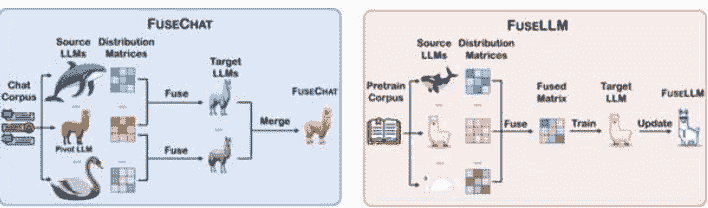

Chat类模型的输入通常包括以下几部分：

(1) **用户输入：** 即用户在每一轮对话中的提问或指令。
(2) **上下文信息：** 系统保留的用户之前的输入和模型的回答，以便在下一轮交互中参考。
(3) **生成参数：** 控制模型生成内容的参数，如生成文本的长度、温度(temperature)、回答方式等。

#### 2. 配置Chat类模型

在LangChain中，Chat类模型可以通过简单的配置来实现对话功能。下面是一些关键的配置参数：

(1) `model_name`：指定所使用的模型名称，例如gpt-3.5-turbo或其他支持对话的模型。
(2) `temperature`：控制生成的随机性，取值范围为0~1，较高的值（如0.9）会生成更多样化的回答，较低的值（如0.3）则生成更确定的回答。
(3) `max_tokens`：限制生成文本的最大长度，防止输出过长。tokens是API中的文本单位，一个词大约对应1～2个token。限制max_tokens可以避免生成过长的文本，适合回答简短问题或生成摘要。

### 3. 构建一个简单的Chat类对话模型

首先确保已安装openai库，用于连接Chat类模型。若未安装，可运行以下命令：

```bash
>> pip install openai
```

以下代码将实现一个简易的Chat类对话模型，能够与用户进行多轮对话，模拟智能助手的功能。

```python
from openai import OpenAI
import os

###### 初始化客户端
client = OpenAI()

def chat_with_model(messages, model="gpt-3.5-turbo", temperature=0.7):
    response = client.chat.completions.create(
        model=model,
        messages=messages,
        max_tokens=1024,
        temperature=temperature
    )
    return response.choices[0].message.content

#### 初始化对话历史
conversation_history = [{"role": "system", "content": "你是一个有用的助手。"}]

while True:
    user_input = input("请输入问题（输入'退出'结束）：")
    if user_input.lower() == "退出":
        print("对话已结束。")
        break
    
    conversation_history.append({"role": "user", "content": user_input})
    model_response = chat_with_model(conversation_history)
    
    print(f"助手：{model_response}")
    conversation_history.append({"role": "assistant", "content": model_response})
```

> 在上述代码中，首先使用`os.getenv("OPENAI_API_KEY")`从环境变量中读取OpenAI API密钥（实际使用时需设置该变量），确保调用API时的安全性。然后定义一个通用的对话函数 `chat_with_model()`，接收对话历史记录`messages`、模型名称、生成参数（如`temperature`和`max_tokens`），并返回生成的回复。接下来通过`conversation_history`记录每轮用户的输入和模型的回复，使模型能够在后续回答时参考对话上下文。最后在`while`循环中模拟多轮对话，直到用户输入“退出”为止。每轮对话结束后，模型的回复被添加到对话历史中，以便在后续对话中提供上下文参考。

当代码运行时，用户可以在控制台中输入问题，Chat类模型将根据上下文进行连续对话。示例输出可能如下：

```text
请输入'退出'来结束对话。
用户：今天天气怎么样？
助手：今天的天气晴朗，适合户外活动。
用户：那需要带伞吗？
助手：目前的天气预报显示无降雨，所以不需要带伞。
用户：退出
对话已结束。
```

在这个例子中，Chat类模型通过参考上下文为用户提供合理的回复。每一轮对话都保留了上下文信息，使得模型的回答更具连贯性和逻辑性。读者可以尝试进一步优化对话效果，并将其应用到更多的企业级场景中。

### 3.2.2 LLM类模型概述

LLM类模型是基于大规模数据集训练的自然语言模型，具备生成高质量文本的能力，广泛应用于文本生成、问答系统、内容总结等任务，其数据量也随着模型性能的增强而不断增加，如图3-3所示。

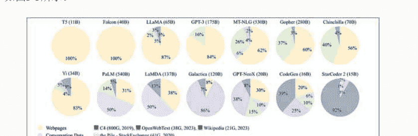

> **图3-3** 现有LLM大模型的预训练数据中各种数据源的比例

与Chat类模型不同，LLM类模型更加通用，它不仅适用于多轮对话，还可以在单一输入条件下生成完整的文本。这类模型在处理多种自然语言处理任务时具有高度的灵活性和适应性，是LangChain框架中实现智能生成和复杂文本处理的核心组件。

#### 1. LLM类模型的基本结构

LLM类模型的设计旨在根据输入生成文本，常用于需要生成较长文本或给出详细答案的场景。它接收一个提示作为输入，然后基于提示生成相关文本。LLM类模型的输入和生成参数主要包括：

-   **(1) prompt：** 模型的输入文本，提示模型生成对应的内容。例如“简述机器学习的基本概念”。
-   **(2) temperature：** 控制生成文本的随机性，取值范围为0～1，较高值（如0.8）生成的内容更加多样，较低值（如0.3）生成的内容更一致。
-   **(3) max_tokens：** 控制生成文本的长度，防止输出过长。
-   **(4) top_p：** 又称“核采样”参数，取值范围为0～1，用于控制生成的词的选择范围。

LLM类模型通常用于单轮的生成任务，无须保留上下文历史信息，适用于内容生成和信息处理等场景。

#### 2. 配置LLM类模型

在LangChain中，可以通过配置参数来调整LLM类模型的生成方式，以适应不同的任务需求。以下是常用的配置参数说明：

-   **(1) model_name：** 指定所使用的模型，例如text-davinci-003。
-   **(2) temperature：** 生成文本的创意性控制，值越高生成的内容越多样。
-   **(3) max_tokens：** 限制生成的文本长度，适合需要短回答或精确回答的场景。
-   **(4) top_p：** 核采样参数，降低生成内容的随机性。

### 3. 编写示例代码：实现LLM类模型的文本生成

以下代码将展示如何通过调用OpenAI的GPT模型来实现一个LLM类模型，用于生成给定主题的简要说明。

```python
import openai 
import os 

openai.api_key=os.getenv("OPENAI_API_KEY") #配置API密钥 
#定义LLM类模型生成函数
def generate_text(prompt, model_name="text-davinci-003",  
temperature=0.7, max_tokens=100, top_p=0.9): 
    response=openai.Completion.create(
        engine=model_name,
        prompt=prompt,
        temperature=temperature, 
        max_tokens=max_tokens, 
        top_p=top_p)
    return response['choices'][0]['text'].strip()

#示例任务：生成机器学习概念的简要说明
prompt_text="简述机器学习的基本概念。"
generated_text=generate_text(prompt_text)
print("生成的文本:", generated_text)
```

在上述代码中，首先定义了一个通用的LLM类模型生成函数 `generate_text`，接收输入提示（`prompt`）和生成参数（如`temperature`、`max_tokens`、`top_p`等），并返回生成的文本内容。然后指定一个文本生成任务的主题，在本例中，提示模型生成“机器学习的基本概念”的简要说明。最后，通过调用 `generate_text()` 函数执行文本生成，并打印生成结果。

当运行代码时，LLM类模型会基于输入的提示生成与主题相关的文本。示例输出可能如下：

(2) top_p：设置较低的 top_p 值（如 0.7 至 0.8），以提高回答的确定性，适合需要准确回答的场景。

(3) prompt 引导：在复杂任务中，使用明确的 prompt 进行引导，提示模型生成指定格式的内容。

#### 4. LLM 类模型在 LangChain 中的集成

在 LangChain 框架中，可以通过调用 LLM 类模型的 API 直接在任务链中应用。通过灵活配置模型的生成参数，开发者可以根据业务需求定制 LLM 类模型的输出内容，并将其应用于各类复杂任务链中。例如：

```python
##### 示例：调用 LLM 类模型并集成到任务链
from langchain import LLMChain

###### 定义一个任务链
llm_chain = LLMChain(
    llm=generate_text,  # 使用自定义的文本生成函数
    prompt="简述机器学习在金融领域的应用。"
)

##### 执行任务链
result = llm_chain.run()
print("LLM 模型任务链生成结果：", result)
```

运行结果如下：

>> LLM 模型任务链生成结果：机器学习在金融领域的应用包括风险评估、客户信用评分、股票市场预测和反欺诈检测等。它通过分析大量数据，识别出潜在的模式和趋势，从而提供更精准的决策支持。

实际生成的内容会因为模型的具体设置（如 temperature 和 max_tokens）及模型的当前状态而有所不同，但整体输出会围绕金融领域的机器学习应用展开。

通过集成，LangChain 能够将 LLM 类模型灵活应用于复杂的业务场景中，为企业级开发提供强大支持。

### 3.3 基于 OpenAI API 的初步开发

在 LLM 的应用中，OpenAI API 提供了一个便捷的接口，开发者可以通过 API 轻松调用 GPT-3、GPT-4 等先进模型实现多种自然语言处理任务。无论是文本生成、问答、内容总结还是对话管理，OpenAI API 都能提供高质量的输出，因此是 LangChain 项目中常用的模型接口之一。

本节将带领读者从基础开始，深入学习如何使用 OpenAI API 进行语言模型的开发。首先，将详细讲解 API 的基础配置与调用方法，包括如何进行文本生成、控制生成的长度、调整生成的多样性等。接下来，将通过具体示例展示如何使用 API 实现基本的自然语言任务，如自动生成文本和回答用户提问，为后续的复杂任务开发奠定坚实基础。

#### 3.3.1 OpenAI API 调用基础

在调用 OpenAI API 前，确保已经获取并配置了 API 密钥。可以在代码中直接设置 openai.api_key，也可以将密钥存储在环境变量中，以便于后续安全调用。

```python
import openai
import os
##### 配置 API 密钥
openai.api_key = os.getenv("OPENAI_API_KEY")
```

这行代码将从环境变量中读取 API 密钥，确保在代码中安全调用。

OpenAI API 的核心调用方法包括 Completion.create（文本生成）和 ChatCompletion.create（对话生成）等。下面以 Completion.create 为例进行讲解。此方法可用于单一文本生成任务，适合生成较长文本或回答指定问题。

```python
response = openai.Completion.create(
    engine="text-davinci-003",
    prompt="简述机器学习的基本概念。",
    max_tokens=50,
    temperature=0.7
)
print("生成的文本:", response.choices[0].text.strip())
```

以上代码将调用 OpenAI API 生成关于“机器学习的基本概念”的文本。在 API 调用时，可以通过设置参数来控制生成内容的输出样式和质量。以下是几个关键参数及其详细说明：

- **engine**：指定模型名称，如 text-davinci-003 或 gpt-3.5-turbo。不同模型的生成效果和速度不同，开发者可以根据需求选择。
- **prompt**：用于指引模型生成内容的文本。prompt 会直接影响生成的文本质量和内容方向。对于复杂任务，prompt 应明确具体，以便模型理解意图。
- **max_tokens**：控制生成文本的长度。
- **temperature**：控制生成的随机性。根据任务需求可以调整此参数，如在生成内容较为正式的任务中使用较低的温度。
- **top_p**：另一种控制随机性的参数，称为“核采样”。当设置 top_p=0.9 时，模型将从累积概率达到 90% 的词汇中生成输出。top_p 和 temperature 可以同时使用，但一般只调整其中之一。

为了便于重复使用 API，可以将以上参数封装到一个函数中，用于生成文本。以下代码将展示一个通用的生成函数，它可以接收多种参数以灵活控制输出。

```python
def generate_text(prompt, engine="text-davinci-003",
                   max_tokens=100, temperature=0.7, top_p=0.9):
    response = openai.Completion.create(
        engine=engine,
        prompt=prompt,
        max_tokens=max_tokens,
        temperature=temperature,
        top_p=top_p
    )
    return response.choices[0].text.strip()

##### 示例调用
prompt_text = "描述人工智能的主要应用领域。"
generated_text = generate_text(prompt_text)
print("生成的文本:", generated_text)
```

运行上述代码，可能会得到以下输出：

>> 生成的文本：人工智能的主要应用领域包括医疗健康、金融服务、零售、制造业、教育和交通运输。它可以用于预测、自动化、推荐系统、个性化服务以及智能化决策支持等。

此外，通过调整 temperature、max_tokens 等参数，可以细化生成内容。例如：

(1) 正式内容：将 temperature 设置为较低值（如 0.3），生成的内容风格较为严谨。
(2) 创意内容：将 temperature 设置为较高值（如 0.9），可以生成更具创意的内容。
(3) 简短回答：适当降低 max_tokens 值，例如设置为 50，以确保生成的回答简明扼要。

```python
####### 正式风格的简短回答
response = generate_text("请简要解释机器学习的工作原理。",
                         max_tokens=50, temperature=0.3)
print("正式简短回答:", response)

####### 创意风格的长文本生成
response = generate_text("想象一个未来的智能城市，并描述它的特点。",
                         max_tokens=150, temperature=0.9)
print("创意长文本:", response)
```

运行结果如下：

>> 正式简短回答：机器学习是一种通过算法和统计模型分析和解释数据的人工智能方法。它使计算机可以在没有明确编程的情况下自动学习和改进。

>> 创意长文本：未来的智能城市将利用人工智能和物联网技术，实现无缝的互联互通。城市的交通系统将完全自动化，车辆和公共交通都能自我调节，以最大限度减少拥堵和污染。建筑物将根据天气和人流量自动调节温度和照明，所有资源都将高效利用。市民的健康和安全将受到实时监控，紧急情况可以自动响应。这种城市将更加环保、方便且人性化。

在实际应用中，API 调用可能会遇到连接错误、超时或密钥无效等问题。可以使用 try-except 结构捕获异常，以便在出错时提供提示信息或采取相应措施。

**1**

```python
def generate_text_with_error_handling(prompt,
                                      engine="text-davinci-003",
                                      max_tokens=100, temperature=0.7):
    try:
        response = openai.Completion.create(
            engine=engine,
            prompt=prompt,
            max_tokens=max_tokens,
            temperature=temperature
        )
        return response.choices[0].text.strip()
    except openai.error.OpenAIError as e:
        print("API 调用失败：", e)
        return None

##### 示例调用
result = generate_text_with_error_handling("解释深度学习的优势。")
if result:
    print("生成的文本：", result)
else:
    print("生成失败。")
```

**如无报错，则运行结果如下：**

>> 生成的文本：深度学习的作用在于它能够处理复杂的非线性关系和大量的数据。通过多层神经网络结构，它可以自动学习特征并生成高度准确的预测，这在图像识别、自然语言处理等任务中非常有效。

若 API 密钥无效或网络问题，则会输出以下结果：

>>> API 调用失败：Invalid API Key: 请检查您的 API 是否正确。
>> 生成失败。

**若需要创建一个应用程序，可以输入任务提示并生成对应的任务清单。以下代码将展示如何调用 OpenAI API 生成一份任务清单。**

```python
task_prompt = "生成一个新员工入职的详细任务清单。"
###### 生成任务清单
task_list = generate_text(task_prompt, max_tokens=150, temperature=0.6)
print("任务清单：\n", task_list)
```

**运行结果如下：**

>> 任务清单：
>> 1. 准备员工入职材料，包括电脑、办公用品等。
>> 2. 组织员工入职培训，介绍公司政策和流程。
>> 3. 安排新员工与团队成员的见面会议。
>> 4. 指定工作任务和项目，帮助员工了解岗位职责。
>> 5. 设置公司内部系统的访问权限，确保新员工可以使用必要资源。

**此示例展示了如何通过 API 生成具体的、可操作的内容，以便于在应用中直接使用。**

#### 3.3.2 完成基本文本生成任务

文本生成是语言模型的核心功能之一，通过 OpenAI API，可以生成各类文本内容，例如自动写作、问答、文案生成等。完成一个文本生成任务不仅需要调用 API，还需要合理设计提示词，并调整生成参数，来控制文本的风格、长度和质量。

假设目标是创建一段关于“人工智能在教育中的应用”的介绍性文本。为了实现这一任务，将使用 API 的文本生成接口，通过合理配置 prompt 和生成参数来生成一个简短但信息丰富的文本段落。

首先设计提示词模板，生成任务的效果在很大程度上取决于提示词的设计。提示词的编写应尽量清晰、具体，以便模型准确理解生成内容的要求。

然后，为提高复用性，可以编写一个通用的文本生成函数，包含调整参数的选项，并直接返回生成的文本内容。以下代码实现了一个包含完整配置的文本生成函数。

```python
def generate_ai_text(prompt, model_name="text-davinci-003",
                      temperature=0.6, max_tokens=100, top_p=0.9):
    try:
        response = openai.Completion.create(
            engine=model_name,
            prompt=prompt,
            temperature=temperature,
            max_tokens=max_tokens,
            top_p=top_p
        )
        return response.choices[0].text.strip()
    except openai.error.OpenAIError as e:
        print("API 调用失败:", e)
        return None
```

这个函数接收一个 prompt 参数和 temperature、max_tokens 等生成参数，并捕获异常，以便在出现 API 调用错误时返回提示信息。

在定义函数后，执行具体的文本生成任务。以下代码将展示如何使用 generate_ai_text() 函数生成关于“人工智能在教育中的应用”的文本。

```python
##### 定义具体的任务提示词
education_prompt = "*简要描述人工智能在教育中的应用，包括个性化学习、智能评估和虚拟辅导。*"

##### 执行文本生成
generated_education_text = generate_ai_text(education_prompt, model_name="text-davinci-003")
##### 显示生成的内容
if generated_education_text:
    print("生成的文本:\n", generated_education_text)
else:
    print("文本生成失败。")
```

执行上述代码，输出如下：

若在项目中需要生成产品介绍，可以利用 LLM 类模型生成简洁的产品描述。以下是实现自动生成产品介绍的示例代码。

```python
product_prompt = "生成一段简洁的产品介绍，产品名称为：智能家居助手。描述其主要功能和特点。"

###### 生成产品介绍
product_description = generate_ai_text(product_prompt,
                                       model_name="text-davinci-003",
                                       temperature=0.5, max_tokens=100)
print("产品介绍:\n", product_description)
```

输出结果如下：

>> 产品介绍：
>> 智能家居助手是一款高效的家庭管理工具，通过语音控制、自动化任务和实时监控，让生活更加便利。该助手支持远程控制灯光、空调、家电设备，并提供安全监控和健康管理功能，为家庭生活带来全新智能体验。

### 3.4 自定义 LangChain Model 类

在 LangChain 项目中，虽然可以直接调用预定义的模型类实现常见的文本生成和问答任务，但为了满足特定业务需求，开发者有时需要自定义模型类，以实现更精细的控制和功能扩展。自定义 LangChain Model 类不仅可以根据项目需求调整模型的参数和行为，还能增加新的功能模块，如特定的输入处理、定制化的响应格式或特定领域的知识引入。

本节将从基础出发，带领读者逐步构建一个自定义的 LangChain Model 类，并详解如何在代码中扩展模型类以适应复杂的应用场景。

#### 3.4.1 LangChain Model 类的构建基础

在 LangChain 中，构建自定义的 Model 类是为了更好地满足项目需求，提供更灵活的模型控制和扩展能力。LangChain 的架构允许轻松创建自定义 Model 类，这样可以在项目中集成更多业务逻辑或有针对性的任务。下面将手把手带领读者从基础开始构建一个自定义的 LangChain Model 类。

在 LangChain 中，通常会从基础的 BaseModel 类继承，并在自定义 Model 类中实现具体的生成逻辑。以下是创建自定义 Model 类的基本结构。

```python
from langchain.base_model import BaseModel

class CustomLangChainModel(BaseModel):
    def __init__(self, model_name, temperature=0.7, max_tokens=100):
        self.model_name = model_name
        self.temperature = temperature
        self.max_tokens = max_tokens
    
    def generate(self, prompt):
        # 生成函数，定义具体生成逻辑
        raise NotImplementedError("自定义生成逻辑需要在子类中实现")
```

其中：

- **BaseModel**: 这是 LangChain 中定义的基础模型类，通常继承该类以创建自定义模型。
- **__init__ 方法**: 初始化方法，用于设置模型名称、生成参数等。
- **generate 方法**: 定义生成逻辑的核心方法。具体的生成逻辑将在子类中实现。

在这个基础上，generate 方法会根据需求自定义模型的生成过程。

为了实现生成逻辑，通常会调用具体的 API 或模型库。下面将展示一个调用 OpenAI API 的示例，使自定义的 LangChain Model 类能够生成文本。

```python
import openai

class CustomLangChainModel(BaseModel):
    def __init__(self, model_name, temperature=0.7, max_tokens=100):
        self.model_name = model_name
        self.temperature = temperature
        self.max_tokens = max_tokens
    
    def generate(self, prompt):
        # 使用 OpenAI API 进行文本生成
        response = openai.Completion.create(
            engine=self.model_name,
            prompt=prompt,
            temperature=self.temperature,
            max_tokens=self.max_tokens
        )
        return response.choices[0].text.strip()
```

在这里，generate 方法通过调用 OpenAI 的 API 完成文本生成，并返回生成的文本。此方法将 prompt 作为输入参数，并通过 temperature、max_tokens 等生成参数控制输出的风格和长度。

完成自定义 Model 类的构建后，可以编写测试代码进行验证，确保 generate 方法能够正确调用并返回预期结果。示例如下：

```python
##### 配置 API 密钥
openai.api_key = "your_openai_api_key_here"  # 将此处替换为实际的 API 密钥

##### 创建自定义模型实例
custom_model = CustomLangChainModel(model_name="text-davinci-003")
```

示例输出：

>> 生成的文本：机器学习是一种通过算法和数据分析，让计算机能够自动改进和优化的技术。它广泛应用于图像识别、语音处理等领域。

除了基本生成逻辑之外，自定义 Model 类还可以增加更多功能，如错误处理、日志记录等。以下是在 generate 方法中加入错误处理的示例：

```python
class CustomLangChainModel(BaseModel):
    def __init__(self, model_name, temperature=0.7, max_tokens=100):
        self.model_name = model_name
        self.temperature = temperature
        self.max_tokens = max_tokens

    def generate(self, prompt):
        try:
            # 使用 OpenAI API 进行文本生成
            response = openai.Completion.create(
                engine=self.model_name,
                prompt=prompt,
                temperature=self.temperature,
                max_tokens=self.max_tokens
            )
            return response.choices[0].text.strip()
        except openai.error.OpenAIError as e:
            print("API 调用失败：", e)
            return None
```

try-except 块用于捕获 API 调用中的异常，并在出现错误时输出提示信息而不是终止程序。如果 API 调用失败，generate 方法将返回 None，以便于在调用处处理此情况。

运行结果（API 调用失败）：

>>> API 调用失败：Invalid API Key: 请检查您的 API 密钥是否正确。
>> 文本生成失败。

自定义的 Model 类可以与 LangChain 的任务链结合，以便于将生成过程整合到更复杂的任务流程中。以下示例将展示如何将自定义 Model 类集成到任务链中。> from langchain import LLMChain

##### 创建任务链
llm_chain = LLMChain(llm=custom_model, prompt="请描述深度学习的核心优势。")
##### 执行任务链
result = llm_chain.run()
print("任务链生成的结果：", result)


输出结果如下：

>> 任务链生成的结果：深度学习 的核心优势在于其能够自动学习复杂特征，尤其在图像、语音等非结构化数据领域具有较高的准确性。

在这里，任务链将调用自定义的 Model 类来完成文本生成，使自定义模型能够直接应用于 LangChain 的流程中。

#### 3.4.2 模型参数的自定义与调优

在自定义 LangChain Model 类时，合理配置和调整模型参数可以显著提高文本生成的效果和准确性。模型参数控制了生成内容的风格、长度和质量，适当地调优可以更好地满足业务需求。

在 3.4.1 节的自定义类的基础上，我们可以加入更多参数。例如在 `CustomLangChainModel` 类的构造函数中加入更多参数，以便于在生成内容时灵活配置。这些参数会影响生成文本的风格、内容丰富度和一致性。

```python
import openai
from langchain.base_model import BaseModel

class CustomLangChainModel(BaseModel):
    def __init__(self, model_name, temperature=0.7, max_tokens=100, top_p=0.9, frequency_penalty=0, presence_penalty=0):
        self.model_name = model_name
        self.temperature = temperature
        self.max_tokens = max_tokens
        self.top_p = top_p
        self.frequency_penalty = frequency_penalty
        self.presence_penalty = presence_penalty

    def generate(self, prompt):
        try:
            # 调用 OpenAI API 生成文本
            response = openai.Completion.create(
                engine=self.model_name,
                prompt=prompt,
                temperature=self.temperature,
                max_tokens=self.max_tokens,
                top_p=self.top_p,
                frequency_penalty=self.frequency_penalty,
                presence_penalty=self.presence_penalty
            )
            return response.choices[0].text.strip()
        except openai.error.OpenAIError as e:
            print("API 调用失败:", e)
            return None
```

为了便于理解各参数的效果，下面将通过示例逐步调优参数，生成多种风格的文本。假设目标是生成关于“人工智能在金融领域的应用”的简要介绍。

##### 1. 控制生成的多样性（调整 temperature）

`temperature` 值越高，生成的文本越有创意。较低的 `temperature` 值适合正式的内容生成，较高的 `temperature` 值适合更具创意的文本。

```python
###### 创建模型实例，设置 temperature 参数
custom_model = CustomLangChainModel(model_name="text-davinci-003", temperature=0.3, max_tokens=50)

prompt_text = "简要描述人工智能在金融领域的应用。"
print("低 temperature (0.3):")
print(custom_model.generate(prompt_text))

custom_model.temperature = 0.9  # 提高 temperature 值
print("高 temperature(0.9):")
print(custom_model.generate(prompt_text))
```

**运行结果如下：**

```text
>> 低 temperature (0.3) :
>> 人工智能在金融领域的应用包括风险预测、自动化交易、客户管理和反欺诈检测。
>>
>> 高 temperature (0.9) :
>> 人工智能在金融领域带来了全新的创新。它帮助银行进行更加精确的风险预测，利用算法自动处理大量交易，并通过机器学习模型识别复杂的欺诈模式。
```

当 `temperature` 值较低时，生成的内容较为直接、简洁。随着 `temperature` 值的提高，生成的内容更加多样化且有创意。

##### 2. 控制生成文本的长度（调整 max_tokens）

`max_tokens` 用于设置生成内容的长度，可以根据需要调整此值，以控制文本的简短或详细程度。

```python
custom_model = CustomLangChainModel(model_name="text-davinci-003", temperature=0.5, max_tokens=30)
print("*短文本 (max_tokens=30) :")
print(custom_model.generate(prompt_text))

custom_model.max_tokens = 100  # 增加生成长度
print("*长文本 (max_tokens=100) :")
print(custom_model.generate(prompt_text))
```

**运行结果如下：**

```text
>> 短文本 (max_tokens=30) :
>> 人工智能在金融领域的应用包括风险管理和自动化交易。
>>
>> 长文本 (max_tokens=100) :
>> 人工智能在金融领域有着广泛的应用。它能够帮助金融机构预测和管理风险，通过自动化交易系统提高效率，并帮助客户提供个性化的服务。此外，人工智能技术还可以用于反欺诈检测，识别可疑的交易行为。
```

`max_tokens` 值较小时，生成的文本简短直接；增大该值后，生成内容更为详尽，适合需要详细描述的场景。

##### 3. 控制生成词汇范围（调整 top_p）

`top_p` 参数限制模型生成内容的词汇范围。较低的 `top_p` 值可以减少生成文本中的不确定性，使输出更集中。

```python
custom_model = CustomLangChainModel(model_name="text-davinci-003", temperature=0.5, max_tokens=50, top_p=0.5)
print("*较低 top_p (0.5) :")
print(custom_model.generate(prompt_text))

custom_model.top_p = 1  # 放宽词汇范围
print("*较高 top_p (1) :")
print(custom_model.generate(prompt_text))
```

**运行结果如下：**

```text
>> 较低 top_p (0.5) :
>> 人工智能在金融领域帮助实现更高效的风险控制和客户管理。
>>
>> 较高 top_p (1) :
>> 人工智能在金融领域被广泛应用，能够帮助金融公司进行风险预测、客户服务自动化，并对海量数据进行深入分析以优化投资策略。
```

当 `top_p` 值较低时，生成的内容趋于精简、集中；当 `top_p` 值较高时，生成的内容更丰富，适合需要多样化表达的场景。

##### 4. 控制重复词汇的频率（调整 frequency_penalty）

增大 `frequency_penalty` 值可以降低生成内容中的重复词汇出现频率，使生成的文本更为自然。

```python
custom_model = CustomLangChainModel(model_name='text-davinci-003', temperature=0.5, max_tokens=50, frequency_penalty=0)
print("*无重复惩罚 (frequency_penalty=0) :")
print(custom_model.generate(prompt_text))

custom_model.frequency_penalty = 1  # 增加重复惩罚
print("*高重复惩罚 (frequency_penalty=1) :")
print(custom_model.generate(prompt_text))
```

**运行结果如下：**

```text
>> 无重复惩罚（frequency_penalty=0）:
>> 人工智能在金融领域的应用包括自动化交易、风险预测、客户服务和反欺诈等。
>>
>> 高重复惩罚（frequency_penalty=1）:
>> 人工智能在金融行业有广泛应用，涉及交易系统优化、客户管理提升以及防止欺诈等多方面。
```

总之，通过调节 `temperature`、`max_tokens`、`top_p` 和 `frequency_penalty` 等参数，可以在自定义 LangChain Model 类中实现更精细的文本生成控制。合理使用这些参数调优，能够显著提升生成文本的质量和适应性。

### 3.5 LangChain 与缓存

在自然语言处理任务中，调用 LLM 往往需要大量的计算资源和时间，尤其是在处理重复性查询时。因此，在 LangChain 项目中引入缓存机制是提高性能和响应速度的关键环节。通过合理使用缓存，可以避免重复调用模型，对相同或相似的输入快速返回结果，从而提升系统的整体效率。

本节将详细介绍 LangChain 中的缓存机制，包括内存缓存、文件缓存和外部缓存（如 Redis）等不同的缓存方式。通过讲解具体实现步骤和示例代码，帮助读者理解如何在 LangChain 中集成缓存功能，优化任务链的性能。

#### 3.5.1 缓存的作用与类型

在自然语言处理项目中，缓存是一种在高频调用模型时显著提升性能的技术手段。通过合理设置缓存，可以大大减少响应时间，降低系统开销，并提升用户体验。

##### 1. 缓存的主要作用

*   （1）减少延迟：缓存显著缩短了响应时间。当请求结果已存在缓存中时，系统可以直接返回结果，而不必重新生成。
*   （2）降低成本：调用大语言模型的 API 通常会产生费用，缓存可以减少不必要的调用，从而节省成本。
*   （3）提升稳定性：在高并发情况下，频繁调用模型可能导致系统性能不稳定。缓存有助于缓解这一问题，提高系统的稳定性。

##### 2. 常见缓存类型

*   （1）内存缓存：通过在内存中存储数据来实现快速查询，适合小规模的缓存需求。其优点是速度快，缺点是容量受限，且数据在重启后丢失。
*   （2）文件缓存：将缓存数据存储在文件中。文件缓存的优势在于持久化，重启不会丢失数据，但访问速度相对较慢，适合需要跨会话的持久化缓存。
*   （3）外部缓存（Redis）：Redis 是一种广泛使用的键值对数据库，支持数据持久化和分布式访问，适用于大规模的缓存需求。Redis 不仅存储容量大，而且提供丰富的缓存管理功能，是企业级应用中常用的缓存选择。

各缓存类型及其特点的总结如表 3-1 所示。

| 缓存类型 | 优 点 | 缺 点 | 适用场景 |
| :--- | :--- | :--- | :--- |
| 内存缓存 | 速度快，查询效率高 | 容量有限，重启后数据丢失 | 小规模应用，短期缓存数据 |
| 文件缓存 | 数据持久化，支持跨会话使用 | 访问速度较慢 | 需要持久化的小规模缓存数据 |
| 外部缓存（Redis） | 支持大容量，持久化，分布式，管理功能强 | 配置和管理较复杂，需额外资源 | 企业级应用，大规模缓存需求 |

合理选择缓存类型可以显著提升系统的效率和稳定性。在接下来的内容中，将介绍如何在 LangChain 中逐步实现和配置不同类型的缓存，以满足多种业务需求。

#### 3.5.2 内存缓存的使用

内存缓存是通过一个字典（dictionary）或类似的数据结构来实现的。在 Python 中，可以使用字典来存储键值对，其中键通常是请求输入的 prompt 或其 hash 值，值则是生成的响应结果。每当系统接收到一个新请求时，会首先检查该请求的结果是否已在缓存中，如果是，则直接返回缓存的结果，否则调用模型生成结果，并将结果存入缓存。

首先，实现一个基本的内存缓存功能。以下代码将展示如何构建一个用于存储和获取缓存数据的类 `InMemoryCache`，并在 LangChain 的任务链中应用内存缓存。

```python
##### 创建内存缓存类
class InMemoryCache:
    def __init__(self):
        self.cache = {}

    def get(self, key):
        # 获取缓存中的值，如果不存在则返回 None
        return self.cache.get(key)

    def set(self, key, value):
        # 设置缓存的键值对
        self.cache[key] = value

###### 示例用法
cache = InMemoryCache()
```

此类包含两个核心方法：

*   `get`: 根据输入的 key 从缓存中获取对应的值，如果缓存中不存在该 key，则返回 None。
*   `set`: 将生成的结果与输入的 key 关联并存储在缓存中。

然后，将内存缓存集成到文本生成任务中，以便在 LangChain 的模型调用中利用缓存优化性能。实现内存缓存的完整代码如下：

```python
import openai


class CustomLangChainModel:
    def __init__(self, model_name, temperature=0.7, max_tokens=100, cache=None):
        self.model_name = model_name
        self.temperature = temperature
        self.max_tokens = max_tokens
        self.cache = cache  # 内存缓存实例

    def generate(self, prompt):
        # Step 1: 检查缓存
        if self.cache:
            cached_response = self.cache.get(prompt)
            if cached_response:
                print("从缓存中获取结果...")
                return cached_response

        # Step 2: 调用 OpenAI API 生成文本
        print("缓存中无结果，调用模型生成...")
        response = openai.Completion.create(
            engine=self.model_name,
            prompt=prompt,
            temperature=self.temperature,
            max_tokens=self.max_tokens
        )
        result = response.choices[0].text.strip()

        # Step 3: 将结果存入缓存
        if self.cache:
            self.cache.set(prompt, result)

        return result
```

在 `CustomLangChainModel` 类中，添加了一个可选参数 `cache`，用于接收一个缓存实例（例如 `InMemoryCache`）。在 `generate` 方法中，首先检查请求的 prompt 是否在缓存中，如果在缓存中，则直接返回缓存结果；否则调用模型生成结果，并将结果存入缓存。

下面是使用 `InMemoryCache` 类进行生成任务的完整示例。

```python
##### 配置 API 密钥
openai.api_key = "your_openai_api_key_here"  # 替换为实际的 API 密钥

##### 创建内存缓存实例
cache = InMemoryCache()

##### 创建自定义模型实例并集成缓存
custom_model = CustomLangChainModel(
    model_name="text-davinci-003", 
    temperature=0.5, 
    max_tokens=50, 
    cache=cache
)

##### 生成文本任务示例
prompt_text = "简要描述机器学习的应用。"

###### 第一次生成调用，将调用模型生成结果，并将结果存入缓存
print("第一次生成调用结果:")
generated_text = custom_model.generate(prompt_text)
print("生成的文本:", generated_text)

###### 第二次生成调用，若缓存中存在相同 prompt，则直接返回缓存结果
print("第二次的生成调用结果:")
generated_text = custom_model.generate(prompt_text)  # 原文此处有拼写错误 'prom pt_text'，已修正为 'prompt_text'
print("生成的文本:", generated_text)
```

**运行结果如下：**

```text
>> 第一次生成调用结果：
>> 缓存中无结果，调用模型生成...
>> 生成的文本：机器学习在金融、医疗、教育等多个领域广泛应用，通过数据分析和预测优化效率。
>> 
>> 第二次生成调用结果：
>> 从缓存中获取结果...
>> 生成的文本：机器学习在金融、医疗、教育等多个领域广泛应用，通过数据分析和预测优化效率。
```

第一次调用 `generate` 时，缓存中无数据，因此模型生成并返回结果；第二次调用相同的 prompt 时，系统直接从缓存中获取结果，避免了重复调用模型，显著提高了响应速度。

内存缓存适用于小规模缓存和短期存储，在以下场景中非常有效：

*   （1）高频查询：当多个请求使用相同的输入时，缓存能大幅度减少模型调用次数。
*   （2）单一会话的重复查询：例如多轮对话中用户的重复问题或类似问题。

内存缓存也有其局限性：

*   （1）容量限制：由于数据存储在内存中，受限于系统的可用内存量。
*   （2）非持久化：当系统重启或崩溃时，缓存数据会丢失，不适合跨会话的长期数据存储。

合理配置和使用内存缓存，可以有效提升系统的性能，为构建更加智能、快速的自然语言处理应用提供强有力的支持。

#### 3.5.3 文件缓存与持久化管理

文件缓存通过将数据写入本地文件来存储键值对，通常使用 JSON、Pickle 等格式存储数据。

以下代码实现了一个基本的文件缓存类 `FileCache`，它使用 JSON 文件来存储缓存数据。此类包含读取、写入和缓存检查功能，便于在 LangChain 项目中实现持久化缓存。

```python
import json
import os

class FileCache:
    def __init__(self, cache_file="cache.json"):
        self.cache_file = cache_file
        # 初始化时尝试加载缓存文件内容
        if not os.path.exists(self.cache_file):
            with open(self.cache_file, 'w') as f:
                json.dump({}, f)

    def _load_cache(self):
        with open(self.cache_file, 'r') as f:
            return json.load(f)

    def _save_cache(self, cache_data):
        with open(self.cache_file, 'w') as f:
            json.dump(cache_data, f)

    def get(self, key):
        # 从缓存文件中获取数据
        cache_data = self._load_cache()
        return cache_data.get(key)

    def set(self, key, value):
        # 更新缓存并写入文件
        cache_data = self._load_cache()
        cache_data[key] = value
        self._save_cache(cache_data)
```

在 `FileCache` 类中，有 4 个主要方法：

（1）_load_cache：用于从缓存文件中加载现有的数据。

（2）_save_cache：用于将更新后的缓存数据写回文件。

（3）get 和 set：分别用于读取和更新缓存数据。

`FileCache` 类在初始化时会检查是否存在指定的缓存文件，若不存在则创建一个空的 JSON 文件。

与内存缓存的集成方式类似，文件缓存也可以添加到自定义 Model 类中，以便在调用模型时优先从文件缓存中查找，只在缓存缺失时才调用模型生成数据。示例如下：

```python
import openai

class CustomLangChainModel:
    def __init__(self, model_name, temperature=0.7, \
max_tokens=100, cache=None):
        self.model_name=model_name
        self.temperature=temperature
        self.max_tokens=max_tokens
        self.cache=cache # 文件缓存实例

def generate(self, prompt):
    # Step 1:检查文件缓存
    if self.cache:
        cached_response=self.cache.get(prompt)
        if cached_response:
            print("从文件缓存中获取结果...")
            return cached_response

    # Step 2:调用OpenAI API生成本文
    print("*文件缓存中无结果，调用模型生成...")
    response=openai.Completion.create(
engine=self.model_name,
prompt=prompt,
temperature=self.temperature,
max_tokens=self.max_tokens )
result=response.choices[0].text.strip()
# Step 3:将生成的结果存入文件缓存
if self.cache:
    self.cache.set(prompt, result)
return result
```

在这个自定义的 Model 类中，文件缓存作为一个可选参数 `cache`，允许用户通过传入 `FileCache` 实例来启用文件缓存功能。每次生成调用时，程序会优先从文件缓存中获取结果，如果缓存缺失，则调用模型生成并更新缓存文件。

以下代码将展示如何使用 `FileCache` 类创建文件缓存实例，并在生成任务中应用持久化缓存。

```python
# 配置API密钥
openai.api_key="your_openai_api_key_here" # 替换为实际的API密钥

##### 创建文件缓存实例
file_cache=FileCache("cache.json")

##### 创建自定义模型实例并集成文件缓存
custom_model=CustomLangChainModel(model_name=\
"text-davinci-003", temperature=0.5, max_tokens=50, cache=file_cache)

##### 生成文本任务示例
prompt_text="简要描述机器学习的应用。"

###### 第一次生成调用，将调用模型生成结果，并将结果存入文件缓存
print("*第一次生成调用结果:")
generated_text=custom_model.generate(prompt_text)
print("*生成的文本:*", generated_text)

# 第二次生成调用，若文件缓存中存在相同prompt，则直接返回缓存结果
print("\n*第二次生成调用结果:")
generated_text=custom_model.generate(prompt_text)
print("*生成的文本:*", generated_text)
```

运行结果如下：

>> 第一次生成调用结果：
>> 文件缓存中无结果，调用模型生成...
>> 生成的文本：机器学习广泛应用于图像识别、自然语言处理和预测分析等领域，能够从数据中提取有用信息，提升工作效率。

>>
>> 第二次生成调用结果：
>> 从文件缓存中获取结果...
>> 生成的文本：机器学习广泛应用于图像识别、自然语言处理和预测分析等领域，能够从数据中提取有用信息，提升工作效率。

通过将缓存数据写入文件，可以在系统重启后继续使用缓存数据，从而提升系统的性能和稳定性。


#### 3.5.4 Redis 缓存的集成与优化

Redis 是一种高性能的键值数据库，因其具有快速访问、数据持久化、分布式支持等特性而广泛应用于缓存系统。与内存缓存和文件缓存相比，Redis 不仅可以实现持久化存储，还支持更大容量的缓存管理，是构建高效企业级应用的理想选择。
在 LangChain 项目中，通过 Redis 缓存可以大幅提高响应速度并减轻模型调用的负担。在高并发场景下，Redis 缓存的优势尤为明显。
下面将详细讲解如何在 LangChain 中集成 Redis 缓存，并介绍 Redis 的优化方法，帮助读者构建一个快速、稳定的缓存系统。
首先，确保系统上已安装 Redis 并启动 Redis 服务。如果未安装 Redis，可以通过以下命令安装：

- 在 Debian/Ubuntu 系统上：

```bash
>> sudo apt update
>> sudo apt install redis-server
```

- 在 macOS 上（通过 Homebrew）：

```bash
>> brew install redis
```

启动 Redis 服务，以确保 Redis 在后台运行：

```bash
>> sudo service redis-server start
```

使用 `redis-cli` 命令验证 Redis 是否运行：

```bash
>> redis-cli ping
```

如果 Redis 正在运行，将返回 PONG。
在 Python 中集成 Redis 需要安装 redis 库。使用以下命令安装该库：

```bash
>> pip install redis
```

安装完成后，即可在代码中使用 Redis 连接和管理缓存。

以下代码将展示一个基本的 `RedisCache` 类，用于与 Redis 数据库交互。该类包含读取、写入和删除缓存的功能，能够直接在 LangChain 项目中集成。

```python
import redis
import json

class RedisCache:
    def __init__(self, host='localhost', port=6379, db=0):
        # 初始化 Redis 连接
        self.client = redis.Redis(host=host, port=port, db=db)

    def get(self, key):
        # 从 Redis 获取缓存数据
        cached_value=self.client.get(key)
        if cached_value:
            # 返回解码后的 JSON 数据
            return json.loads(cached_value)
        return None

    def set(self, key, value, expiration=3600):
        # 将数据以 JSON 格式存储到 Redis，设置过期时间
        self.client.setex(key, expiration, json.dumps(value))

    def delete(self, key):
        # 从 Redis 中删除指定的缓存
        self.client.delete(key)
```

在 `RedisCache` 类中，有 3 个主要方法:

（1）get 方法：根据指定的 key 从 Redis 获取缓存数据。若找到数据，则返回解码后的 JSON 数据。

（2）set 方法：将数据编码为 JSON 格式并存储到 Redis 中，同时设置缓存的过期时间（默认值为 1 小时）。

（3）delete 方法：从 Redis 中删除指定的缓存记录。

通过 `RedisCache` 类，可以实现缓存数据的高效管理，并在数据量较大或高并发访问的场景下保持良好的性能。

与内存缓存和文件缓存类似，Redis 缓存也可以轻松集成到自定义 Model 类中。将 Redis 缓存添加到自定义模型的示例代码如下:

```python
import openai

class CustomLangChainModel:
    def __init__(self, model_name, temperature=0.7, \nmax_tokens=100, cache=None):
        self.model_name=model_name
        self.temperature=temperature
        self.max_tokens=max_tokens
        self.cache=cache # Redis缓存实例

def generate(self, prompt):
    # Step 1:检查Redis缓存
    if self.cache:
        cached_response=self.cache.get(prompt)
        if cached_response:
            print("从Redis缓存中获取结果...")
            return cached_response

    # Step 2：调用OpenAI API生成文本
    print("Redis缓存中无结果，调用模型生成...")
    response=openai.Completion.create(
engine=self.model_name,
prompt=prompt,
temperature=self.temperature,
max_tokens=self.max_tokens )
result=response.choices[0].text.strip()

# Step 3:将生成的结果存入Redis缓存
if self.cache:
self.cache.set(prompt, result)
return result
```

在 `CustomLangChainModel` 类中，`cache` 参数接收 Redis 缓存实例 `RedisCache`，在每次生成调用时，先检查 Redis 缓存是否已存在指定的 prompt 结果，若缓存命中，则直接返回缓存数据；否则调用模型生成结果，并将结果存入 Redis。

以下代码将展示如何创建 Redis 缓存实例，并在生成任务中应用 Redis 缓存。

```python
#配置API密钥
openai.api_key="your_openai_api_key_here" # 替换为实际的API密钥

#创建Redis缓存实例
redis_cache=RedisCache()

#创建自定义模型实例并集成Redis缓存
custom_model=CustomLangChainModel(model_name=\ 
"text-davinci-003", temperature=0.5, max_tokens=50, cache=redis_cache)

#生成本文本任务示例
prompt_text="简要描述深度学习的应用。"

#第一次生成调用，将调用模型生成结果，并将结果存入Redis缓存
print("第一次生成调用结果:")
generated_text=custom_model.generate(prompt_text)
print("生成的文本:", generated_text)

#第二次生成调用，若Redis缓存中存在相同prompt,则直接返回缓存结果
print("\n第二次生成调用结果:")
generated_text=custom_model.generate(prompt_text)
print("生成的文本:", generated_text)
```

运行结果如下：

>> 第一次生成调用结果：
>> Redis 缓存中无结果，调用模型生成...
>> 生成的文本：深度学习在图像识别、自然语言处理和推荐系统等领域广泛应用，能够自动学习复杂特征并提升预测精度。

>> 第二次生成调用结果：
>> 从 Redis 缓存中获取结果...
>> 生成的文本：深度学习在图像识别、自然语言处理和推荐系统等领域广泛应用，能够自动学习复杂特征并提升预测精度。

在该示例中，第一次生成调用会将结果存储到 Redis 中；第二次调用同样的 prompt 时，直接从缓存中获取结果，避免了重复调用模型，提升了响应速度。

为了进一步提升 Redis 缓存的效率，可以采用以下优化方法：

（1）设置合理的过期时间：在将缓存数据存入 Redis 时，可以根据业务需求设置过期时间。常见的策略是设置 1 小时、1 天或 7 天的过期时间，确保缓存中数据的及时更新。

（2）缓存清理策略：使用 Redis 的 LRU（Least Recently Used）清理策略，自动删除最少使用的缓存数据，以释放空间。

（3）数据压缩：对于较大的数据，可以在存储前进行数据压缩。可以使用 zlib 库来压缩数据，在存储时减少占用的 Redis 空间。示例如下：

```python
import zlib
##### 压缩数据示例
def set_compressed_cache(key, value):
 compressed_value=zlib.compress(json.dumps(value).encode('utf-8'))
 redis_cache.client.setex(key, 3600, compressed_value)

##### 解压缩数据示例
def get_compressed_cache(key):
 compressed_value=redis_cache.client.get(key)
 if compressed_value:
  return json.loads(zlib.decompress(compressed_value).decode('utf-8'))
 return None
```

通过压缩与解压缩方法，可以进一步优化 Redis 缓存的存储效率。

掌握 Redis 的基本配置和优化方法，开发者可以构建一个快速、稳定的缓存系统，为 LangChain 项目提供强有力的缓存支持。

本章频繁出现的函数已总结在表 3-2 中，供读者快速查阅。


| 函数名 | 作用描述 | 所属类/模块 |
|---|---|---|
| generate | 根据输入的 prompt 调用模型生成文本内容，返回生成结果 | CustomLangChainModel |
| get | 从缓存中获取指定 key 的值。如果存在，则返回缓存内容；否则返回 None | InMemoryCache, FileCache, RedisCache |
| set | 将指定的 key 和 value 存入缓存，内存缓存和文件缓存通常不设置过期时间，Redis 可设置过期时间 | InMemoryCache, FileCache, RedisCache |
| _load_cache | 从文件中加载缓存数据，以字典形式返回缓存内容 | FileCache |
| _save_cache | 将缓存数据写入文件，实现持久化存储 | FileCache |
| delete | 删除 Redis 缓存中指定 key 的数据 | RedisCache |
| setex | 将数据存入 Redis 并设置过期时间，通常用于在 Redis 缓存中实现自动过期功能 | redis.Redis（Redis库） |
| compress | 使用 zlib 对数据进行压缩，减少 Redis 存储占用空间 | zlib（压缩库） |
| decompress | 使用 zlib 解压缩数据，将其还原为原始的缓存内容 | zlib（压缩库） |
| openai.Completion.create | 调用 OpenAI API 生成文本，根据模型名称、prompt 及其他参数控制输出 | openai (OpenAI API) |

### 3.6 本章小结

本章深入探讨了 LangChain 中语言模型的导入与自定义，包括模型的基础知识、常见模型类型的应用以及优化模型性能的方法。首先，对 Chat 类和 LLM 类模型进行了介绍，让读者了解这两种模型的适用场景与实现方法，尤其在对话生成和文本生成任务中的应用。在此基础上，详细讲解了如何使用 OpenAI API 进行初步开发，为模型的基础调用奠定了坚实的基础。

在自定义模型方面，通过构建自定义的 LangChain Model 类，介绍了如何根据具体需求灵活配置模型参数，并讲解了温度、最大生成长度、词汇范围控制等参数的调整方法，以生成更加精确和符合业务需求的文本。此外，通过内存缓存、文件缓存和 Redis 缓存的集成，展示了如何有效提升模型的性能和响应速度，特别是通过 Redis 缓存实现高效的分布式数据管理，为构建企业级应用提供了可靠的技术手段。

通过本章的学习，读者不仅了解了大语言模型的基础知识，还掌握了在 LangChain 中自定义和优化模型的方法，为后续在实际项目中灵活应用和高效管理模型提供了理论和实践基础。接下来，读者可以运用这些知识，将模型集成到更复杂的任务链中，从而构建更加智能和高效的自然语言处理应用。

### 3.7 思考题

- （1）简述 generate 函数的作用和使用场景。它在自定义模型类中如何实现生成逻辑？
- （2）在调用模型生成时，temperature 参数的作用是什么？如何根据生成内容的类型调整此参数？
- （3）解释 max_tokens 参数的功能及其对生成内容长度的影响。它在生成简短回答和详细描述中如何设置？
- （4）文件缓存和内存缓存有何不同？列举各自的优缺点，并说明在什么场景下选择使用文件缓存。
- （5）在 FileCache 类中，_load_cache 和_save_cache 方法的作用分别是什么？为什么需要这两个方法？
- （6）在使用 Redis 缓存时，setex 方法与普通 set 方法的区别是什么？setex 方法为何能够控制缓存的有效期？
- （7）编写代码实现在 RedisCache 类中加入数据压缩功能，以优化大规模数据的缓存存储。
- （8）在实现缓存逻辑时，如何判断当前 prompt 的结果是否已缓存？当缓存缺失时，如何更新缓存数据？
- （9）解释如何使用 presence_penalty 和 frequency_penalty 参数调整生成内容。它们如何避免重复内容？
- （10）在集成缓存时，如何判断是否从缓存中获取结果？写出一段代码示例，说明如何优先从缓存中返回结果。
- （11）在自定义 Model 类的构造函数__init__中，为什么需要引入 cache 参数？这个参数在模型调用中如何起到缓存管理的作用？
- （12）假设已有一段代码使用文件缓存实现了缓存数据的持久化管理。如果要将文件缓存切换为 Redis 缓存，应如何更改代码？写出主要的修改步骤。

# 第 4 章 提示词工程

提示词（Prompt）设计是 LLM 应用中的关键环节，直接影响着生成内容的质量与相关性。在 LangChain 框架中，提示词工程提供了一系列灵活的技术，帮助开发者根据任务需求构建、优化和定制提示词。本章将带领读者系统学习提示词的构建方法和实际应用技巧。

首先，从提示词的定义与提示词模板入手，介绍提示词的基本概念与模板化设计，使生成内容结构化并一致。接着，介绍动态提示词生成技术，展示如何根据上下文实时调整提示，增强内容的个性化与灵活性。随后，通过插槽填充与链式提示词，介绍如何利用变量插入和分步骤提示生成更复杂的内容。接下来，多轮对话提示词聚焦于对话系统的设计，确保模型在多轮交互中保持连贯性和上下文一致性。最后，在嵌套提示词与 Few-shot 提示词部分将探索分层级生成和示例引导的高级方法，为复杂任务提供精确支持。

## 4.1 提示词的定义与提示词模板

在 LangChain 中，提示词工程提供了丰富的工具与方法，帮助开发者灵活地构建和优化提示词，以应对不同的应用场景。

本节将从提示词的基本定义入手，讲解提示词在模型交互中的关键作用。随后，通过构建提示词模板，展示如何在提示词中使用变量、结构化信息以及自定义格式，以实现内容的标准化和多样化生成。掌握提示词的定义和模板化设计，将为后续构建更复杂的自然语言生成系统提供基础支持。

### 4.1.1 理解提示词在模型中的核心角色

在 LLM 的应用中，提示词是与模型进行交互的关键组件，承担着引导模型生成目标内容的任务。提示词设计得当，可以使模型生成的内容更加符合任务需求，从而提高生成质量和相关性。因此，理解提示词在模型中的核心角色，并学会合理设计提示词，是实现高效自然语言生成的关键一步。

提示词是模型生成内容的起点，直接影响着生成文本的内容方向、信息量和风格。提示词的设计应该清晰、具体，以便模型准确理解生成的意图。例如，对于同一个任务，不同的提示词设计会显著影响输出的内容。

**示例：**假设任务是描述机器学习的应用，不同的提示词将产生不同风格的回答（基于 OpenAI GPT-3）。

> > Prompt 1：简要描述机器学习的应用。
> > 输出：机器学习广泛应用于图像识别、语音识别、自然语言处理等领域。
>
> > Prompt 2：详细描述机器学习在金融领域的应用。
> > 输出：机器学习在金融领域应用广泛，包括风险预测、自动化交易、信用评分以及反欺诈检测。

从示例可以看到，提示词的不同表述决定了模型生成内容的深度和方向。清晰、具体的提示词可以有效引导模型生成更贴合需求的内容。

提示词的设计需要遵循一些基本原则，以确保提示信息明确、符合预期。以下是几个设计提示词的关键点：

1. 明确任务：提示词应清楚地描述任务，让模型理解生成内容的具体需求。
2. 控制信息范围：根据需求的深度或广度，限制或扩展提示词的内容范围。例如，可以指定某一领域或话题，避免模型生成不相关内容。
3. 语言风格：如果有特定的风格要求，可以在提示词中明确表述，如要求生成正式、简洁或具有创意性的内容。

例如，在要求模型生成简洁、正式的回答时，可以这样设计：

```python
**Prompt**: 请用简洁、正式的语言描述机器学习的基本概念。
```

对于多轮对话或连续任务，提示词应能够有效传递上下文信息，使得模型在生成内容时保持一致性。在这种情况下，可以将前几轮的对话或生成内容添加到提示词中，让模型理解上下文。

**示例**：假设用户和模型连续对话，模型需要根据前文保持连贯性。


在这里，通过加入前几轮对话，提示词传递了对话上下文，使得模型能够在回答时保持内容的连贯性。

构建提示词是一个逐步优化的过程，可以按照以下步骤逐步提高提示词的质量：

1. - **01**明确任务目标：首先要清楚生成内容的任务目标，确定提示词的主题和主要需求。
2. - **02**设计初始提示词：根据任务描述设计出初始的提示词，尽量简洁明了地表达需求。
3. - **03**测试提示词效果：将提示词输入模型进行生成，并检查生成结果是否符合预期。如果内容偏离目标，尝试调整提示词。
4. - **04**调整与优化：根据生成内容的偏差和不足，对提示词进行微调或添加具体要求。可以通过多次迭代来逐步优化提示词。

**示例**：优化提示词。

```python
初始 Prompt:
描述人工智能的应用。
```

生成结果可能较为宽泛，未能满足特定需求。可以进一步调整提示词：

```python
优化 Prompt:
请简要描述人工智能在医疗诊断中的主要应用。
```

通过增加限定词“医疗诊断”，提示词更具针对性，模型的生成内容也会更加符合特定场景需求。

假设任务是编写一个提示词，帮助模型生成关于“自然语言处理基础概念”的解释。以下是构建任务导向提示词的过程。

```python
import openai

def generate_nlp_concept():
    prompt="请简要解释自然语言处理（NLP）的基础概念，包括主要技术和应用领域。"
    response=openai.Completion.create(
        engine="text-davinci-003",
        prompt=prompt,
        max_tokens=100,
        temperature=0.5 )
    return response.choices[0].text.strip()

#### 调用生成函数并打印结果
generated_text=generate_nlp_concept()
print("生成的文本:", generated_text)
```

运行结果如下：

> > 生成的文本：自然语言处理（NLP）是一门让计算机理解和处理人类语言的技术。它包括分词、词性标注、句法分析等技术，广泛应用于语音识别、机器翻译、情感分析等领域。

通过明确提示词的主题、信息范围和生成风格，使得模型生成的内容更符合预期任务。通过实践示例，读者可以清晰地看到提示词是如何引导模型生成目标内容的。接下来，将进一步探讨如何通过提示词模板（Prompt Template）设计灵活多样的生成内容。

### 4.1.2 构建提示词模板：实现灵活多样的提示结构

提示词模板是在提示词中嵌入变量和结构化信息的一种方式，使生成的内容更具灵活性和适应性。在实际应用中，提示词模板可以帮助开发者快速构建符合不同需求的提示词，实现定制化的模型输出。

提示词模板是一种预设结构的提示词，可以通过插入变量来动态生成内容。模板设计好之后，可以快速替换变量值，用于不同的任务和内容生成。模板通常包含以下要素：

1. - ●固定部分：模板中不变的内容，如“请简要描述……”。
2. - ●变量部分：用于替换的内容，通常用花括号表示，如"{topic}"代表主题。

一个简单的提示词模板如下：

> > 请简要描述 {topic} 的应用。

在该模板中，{topic}是变量，可以替换为任何指定的主题，如“机器学习”或“自然语言处理”。

LangChain 提供了 PromptTemplate 类，用于快速构建包含变量的提示词模板。通过 PromptTemplate，可以定义模板的结构和变量，并通过传入不同的参数值生成自定义的提示词。以下代码将展示如何使用 LangChain 的 PromptTemplate 构建提示词模板。

```python
from langchain.prompts import PromptTemplate

#### 定义模板：描述主题的应用
template=PromptTemplate(template="请简要描述{topic}的应用。",
input_variables=["topic"])

##### 使用模板生成提示词
prompt_1=template.format(topic="机器学习")
prompt_2=template.format(topic="自然语言处理")
print("提示词 1:", prompt_1)
print("提示词 2:", prompt_2)
```

运行结果如下：

> > >> 提示词 1:请简要描述机器学习的应用。
> >> 提示词 2:请简要描述自然语言处理的应用。

在该示例中，模板定义了 {topic}变量，通过 template.format() 方法填入不同的主题，实现提示词的快速生成。这种方法既保证了提示词的格式一致，也使生成内容更加灵活。

在实际场景中，提示词模板可能涉及多个变量，用于描述复杂的任务或问题。可以在 PromptTemplate 中定义多个变量，并根据需要传入不同的值。

以下代码将展示一个包含多个变量的模板，用于生成描述产品优缺点的内容。

```python
#### 定义多变量模板
template=PromptTemplate(
    template="请评价{product}的优缺点，包括{aspect1}和{aspect2}。",
    input_variables=["product", "aspect1", "aspect2"])

##### 使用模板生成提示词
prompt_1=template.format(product="智能手机", aspect1="电池续航", aspect2="拍照质量")
prompt_2=template.format(product="笔记本电脑", aspect1="处理速度", aspect2="便携性")

print("提示词 1:", prompt_1)
print("提示词 2:", prompt_2)
```

运行结果如下：

> > >> 提示词 1: 请评价智能手机的优缺点，包括电池续航和拍照质量。
> >> 提示词 2: 请评价笔记本电脑的优缺点，包括处理速度和便携性。

该多变量模板可以用于不同产品和不同方面的评价需求，在大批量内容生成中显著提高效率。

提示词模板适用于需要生成相似结构但内容不同的任务，以下是几个常见的应用场景：

1. （1）问答系统：构建多种问题格式的提示词，如"{topic}的优缺点是什么？"、"{topic}的应用有哪些？"。
2. （2）产品描述：根据不同产品生成描述内容，如“请简述{product}的主要特点和适用人群”。
3. （3）客户反馈分析：快速生成用于分析客户反馈的提示词，如“请分析{customer_type}客户对{service}的反馈意见”。

这些模板化的提示词不仅让提示结构保持一致，还能在生成内容中引导模型针对指定任务进行输出。

在设计提示词模板时，可以通过以下技巧提高生成内容的质量：

1. （1）保持结构的简洁：模板的固定部分尽量保持简洁明了，不要引入多余的内容。
2. （2）确保变量的独立性：变量应尽可能独立，不要对内容产生歧义。例如，将"{topic}"设置为“机器学习的优缺点”，而非“机器学习优缺点是什么”。
3. （3）设置具体的生成目标：如果希望生成简短或详细的内容，可以在模板中指定格式，如“简要描述……"或“详细说明……”等。下面演示如何为模板添加生成目标。

```python
template=PromptTemplate(
    template="请用简洁的语言简述{topic}的基本概念和应用场景。",
    input_variables=["topic"])
prompt=template.format(topic="区块链")
print("生成的提示词:", prompt)
```

运行结果如下：

> > > 生成的提示词：请用简洁的语言简述区块链的基本概念和应用场景。

这种在模板中添加生成目标的设计，使模型输出更加符合需求，便于实现风格一致的内容生成。

假设需要生成关于不同技术的应用简述，可以通过提示词模板快速生成相应提示词，批量调用生成内容。示例如下：

```python
###### 技术主题列表
topics=["机器学习", "深度学习", "自然语言处理", "区块链"]

####### 定义模板
template=PromptTemplate(template="请简要描述{topic}的应用。",
                         input_variables=["topic"])

####### 批量生成提示词并生成内容
for topic in topics:
    prompt=template.format(topic=topic)
    response=openai.Completion.create(
        engine="text-davinci-003",
        prompt=prompt,
        max_tokens=50,
        temperature=0.5 )
    print(f"{topic}的生成结果:",response.choices[0].text.strip())
```

运行结果如下：

> > > 机器学习的生成结果：机器学习广泛应用于图像识别、语音识别、医疗诊断等领域，通过数据分析实现智能预测。
> > 深度学习的生成结果：深度学习应用于计算机视觉、语音识别和自然语言处理，提升了数据处理和预测的准确性。
> > 自然语言处理的生成结果：自然语言处理用于语音助手、自动翻译和情感分析，实现人机自然交互。
> > 区块链的生成结果：区块链广泛用于加密货币、供应链管理和智能合约等领域，确保数据的透明性和安全性。

通过模板化生成，可以快速处理多个主题，减少重复性工作，并确保输出格式的统一性。

提示词模板通过固定部分和变量的结合，帮助开发者快速生成不同内容格式的提示词，适用于各类任务场景。掌握提示词模板的构建方法和设计技巧，读者可以更高效地设计适合不同应用需求的提示词，并为生成内容带来更多的一致性与适应性。

## 4.2 动态提示词生成技术

在实际应用中，提示词往往需要根据用户输入或任务的具体需求进行灵活调整。动态提示词生成技术可以根据上下文或输入的变化实时构建或修改提示词，使得模型能够适应不同的场景和个性化需求。

本节将探讨动态提示词生成的核心概念及实现方法，通过案例展示如何根据用户交互、上下文变化等因素动态生成相应的提示词。

### 4.2.1 基于用户输入的提示词自适应生成

动态提示词生成技术中的“基于用户输入的提示词自适应生成”是让提示词能够根据用户的输入或当前的交互情况进行实时调整。这样一来，模型的响应就能够与用户需求紧密匹配，从而提升生成内容的相关性和用户体验。在构建这种自适应提示词时，开发者需要设计动态的生成逻辑，使得提示词可以灵活适应不同的输入和上下文。

动态提示词的关键在于通过编程逻辑来自动生成提示词，并在提示词中嵌入用户输入。假设用户输入一个特定主题，提示词可以根据该主题动态生成内容。例如，用户想要了解“机器学习”或“自然语言处理”，模型需要根据这些不同的主题提供个性化的回答。

这里根据用户输入生成了一条适合主题的自适应提示词。

当然，也可以选择创建自适应的提示词生成函数。首先，创建一个函数，将用户输入作为参数传入，并根据该输入生成自适应的提示词。该函数根据输入的不同内容生成相应的提示词，确保提示词能够精准表达用户的需求。

```python
####### 示例输入
def generate_adaptive_prompt(user_input):
    prompt = f"请简要描述 {user_input} 的主要应用和前景。"
    return prompt
```

运行结果如下：

> > > 生成的自适应 Prompt: 请简要描述深度学习的主要应用和前景。

通过这种方式，generate_adaptive_prompt 函数可以根据用户输入动态生成提示词，确保模型的响应与用户的需求一致。

下一步是将生成的提示词集成到模型调用中，使得模型能够根据自适应提示词生成内容。通过这种集成方式，可以在 LangChain 应用中实现基于用户输入的动态生成。## 4.2.2 动态提示词生成

动态提示词生成是一种根据实时上下文、输入数据或其他变量来自动生成提示词的技术，帮助模型灵活适应不同的生成需求。这种技术在应对复杂或多变的场景时尤为有效。通过动态提示词生成，模型能够根据不同的输入条件生成更精准和个性化的内容。

动态提示词生成的关键在于通过编程逻辑控制提示词内容，使之能够随输入或条件变化。动态提示词通常包含一个基础结构，结合 Python 逻辑和变量生成不同的提示。以下是一个简单的动态提示词生成示例:

> 基础结构:

在这个模板中，{topic}和{aspect}是动态部分，可以根据不同输入填充为对应的主题和描述的方面。例如:

(1) 若 topic 为“机器学习”，aspect 为“应用”，则可生成提示词：“请简要描述机器学习的应用。”
(2) 若 topic 为“区块链”，aspect 为“优缺点”，则可生成提示词：“请简要描述区块链的优缺点。”

此外，我们也可以选择一个动态的提示词生成函数。首先，创建一个函数，将不同的输入条件（如主题和描述方面）作为参数来动态生成提示词。这种方法可以通过逻辑语句控制生成的提示词内容，以适应各种需求。

```python
def generate_dynamic_prompt(topic, aspect):
    # 动态生成提示词
    prompt=f"请简要描述{topic}的{aspect}。"
    return prompt
    # 测试不同的输入条件
    print(generate_dynamic_prompt("机器学习", "应用"))
    print(generate_dynamic_prompt("区块链", "优缺点"))
```

运行结果如下:

> 请简要描述机器学习的应用。
> 请简要描述区块链的优缺点。

此函数根据输入生成不同的提示词，适用于生成需求多样化的任务。
动态提示词生成不仅限于基础模板，还可以根据不同条件生成更丰富的内容。以下代码示例将展示如何在不同条件下调整提示词内容，使生成的提示词更加灵活。

```python
def generate_conditional_prompt(topic, aspect, detail_level="简要"):
    # 动态生成的提示词内容根据条件调整
    if detail_level == "简要":
        prompt=f"请简要描述{topic}的{aspect}。"
    elif detail_level == "详细":
        prompt=f"请详细说明{topic}的{aspect}，包括关键细节和示例。"
    else:
        prompt=f"请描述{topic}的{aspect}。"
    return prompt

    # 示例：生成不同细节程度的提示词
    print(generate_conditional_prompt("深度学习", "应用", detail_level="简要"))
    print(generate_conditional_prompt("深度学习", "应用", detail_level="详细"))
```

**运行结果如下:**

> 请简要描述深度学习的应用。
> 请详细说明深度学习的应用，包括关键细节和示例。

此代码根据 `detail_level` 参数控制生成内容的简要或详细程度，实现动态提示词生成的个性化设置。

下一步是将动态生成的提示词集成到模型生成流程中，实现更灵活的内容生成。以下是结合 OpenAI API 的完整示例代码。

```python
import openai

def generate_conditional_prompt(topic, aspect, detail_level="简要"):
    # 动态生成提示词
    if detail_level == "简要":
        prompt=f"请简要描述{topic}的{aspect}。"
    elif detail_level == "详细":
        prompt=f"请详细说明{topic}的{aspect}，包括关键细节和示例。"
    else:
        prompt=f"请描述{topic}的{aspect}。"
    return prompt

def generate_response(topic, aspect, detail_level="简要"):
    # 使用动态提示词生成响应
    prompt=generate_conditional_prompt(topic, aspect, detail_level)
    # 调用OpenAI API
    response=openai.Completion.create(
        engine="text-davinci-003",
        prompt=prompt,
        max_tokens=100,
        temperature=0.5
    )
    return response.choices[0].text.strip()

#### 示例生成
print("*简要应用描述:", generate_response("机器学习", "应用", detail_level="简要"))
print("*详细应用描述:", generate_response("机器学习", "应用", detail_level="详细"))
```

**运行结果如下:**

> 简要应用描述： 机器学习在图像识别、语音识别和推荐系统等方面具有广泛应用。
> 详细应用描述： 机器学习应用于多个领域，包括图像识别、自然语言处理、医疗诊断和金融分析。在图像识别中，机器学习用于人脸检测和自动标签生成；在自然语言处理中，用于语音识别、情感分析等。

此代码结合了动态提示词生成和 API 调用，能够根据不同细节要求生成更符合任务需求的内容。

在一些场景中，动态生成逻辑可能需要多个条件组合，例如同时根据主题、描述对象、任务类型和细节级别生成提示词。以下代码将展示多重条件控制下的动态提示词生成。

运行结果如下:

```python
def generate_complex_prompt(topic, aspect, task_type="描述", detail_level="简要"):
    #根据不同任务类型和细节要求生成提示词
    if task_type == "描述":
        if detail_level == "简要":
            prompt=f"请简要描述{topic}的{aspect}。"
        elif detail_level == "详细":
            prompt=f"请详细说明{topic}的{aspect}，包括关键细节。"
    elif task_type == "分析":
        prompt=f"请分析{topic}的{aspect}，特别关注其优缺点。"
    elif task_type == "预测":
        prompt=f"请预测{topic}在未来的{aspect}，并说明可能的影响。"
    else:
        prompt=f"请描述{topic}的{aspect}。"
    return prompt

#测试不同任务组合生成的提示词
print(generate_complex_prompt("深度学习", "应用",
    task_type="描述", detail_level="简要"))
print(generate_complex_prompt("深度学习", "应用",
    task_type="描述", detail_level="详细"))
print(generate_complex_prompt("深度学习", "前景", task_type="预测"))
```

**运行结果如下:**

> 请简要描述深度学习的应用。
> 请详细说明深度学习的应用，包括关键细节。
> 请预测深度学习在未来的前景，并说明可能的影响。

此代码展示了多条件组合生成的灵活性，使提示词适应不同的任务类型（如描述、分析、预测）和细节需求。

假设需求是生成关于不同技术的应用描述和未来趋势，可以通过动态提示词快速适应变化的主题和内容需求。

```python
topics=["深度学习", "区块链", "量子计算"]
#生成不同内容需求的提示词
for topic in topics:
    print("\n 简要应用描述:")
    print(generate_complex_prompt(topic, "应用",
      task_type="描述", detail_level="简要"))
    print("\n详细应用描述:")
    print(generate_complex_prompt(topic,"应用",
      task_type="描述",detail_level="详细"))
    print("\n未来发展预测:")
    print(generate_complex_prompt(topic, "未来发展", task_type="预测"))
```

通过动态生成代码，可以迅速生成符合不同内容需求的提示词，减少了重复工作并提高了内容生成的效率和一致性。

## 4.3 插槽填充与链式提示

在自然语言生成任务中，插槽填充（Slot Filling）和链式提示（Chained Prompting）技术可以有效提升提示词的灵活性与结构化水平。本节将带领读者学习插槽填充和链式提示词的核心原理，展示如何使用这些技术构建高效的提示结构，并通过丰富的代码示例帮助读者掌握这两项技术在实际应用中的操作细节。掌握插槽填充和链式提示词将为构建智能化、灵活性强的提示词设计提供更高效的解决方案。

### 4.3.1 插槽填充技术：快速实现变量插入的提示词模板

插槽填充技术是一种将变量嵌入固定模板的方法。通过设置插槽，可以快速生成不同内容的提示词，使模型能够处理更为复杂和多样化的任务。在实际应用中，插槽填充技术广泛用于常见问题解答（FAQ）生成、个性化内容推荐、产品评价等场景。

插槽填充就是在提示词模板中预设一个或多个位置（称为“插槽”），通过在这些位置插入不同的变量值来实现内容的变化，常用的插槽形式为花括号，例如:

在这个模板中，{topic}和{aspect}是两个插槽。通过向这些插槽填充具体的内容，可以实现快速构建不同的提示词。

**LangChain 提供了 PromptTemplate** 类，便于开发者在模板中定义插槽，并根据需要填充不同的变量值，通过 **PromptTemplate** 类，可以高效地创建动态提示词。

以下代码将展示如何使用 PromptTemplate 类创建插槽填充模板，实现对主题和方面的快速描述生成。

```python
from langchain.prompts import PromptTemplate
#定义含有插槽的提示词模板
template=PromptTemplate(template='请简要描述{topic}的{aspect}', input_variables=['topic', 'aspect'])
#使用模板填充不同的变量值
prompt_1=template.format(topic='机器学习', aspect='应用')
prompt_2=template.format(topic='自然语言处理', aspect='优缺点')
print('提示词 1:', prompt_1)
print('提示词 2:', prompt_2)
```

> 提示词 1：请简要描述机器学习的应用。
> 提示词 2：请简要描述自然语言处理的优缺点。

在这个例子中，通过 PromptTemplate 中的 format 方法，可以快速为不同的主题和方面生成提示词，而无须手动编写每个提示词。

在某些场景下，提示词模板可能需要多个插槽，以生成更复杂的提示词。例如，生成一个产品特点和用户体验描述，可以通过定义多个插槽，快速构建符合不同需求的提示词。

以下代码将展示一个包含多个插槽的模板，涵盖了产品、特点和用户体验的描述。

### 4.3.2 链式提示词：通过分步骤生成复杂内容

链式提示词是一种将内容生成任务分解为多个步骤的方法，它通过逐步提示的方式，分阶段引导模型生成复杂内容。链式提示词的核心思想是将一个复杂任务拆分为若干简单的子任务，每一步生成的结果可以作为下一步的输入。这种方式适用于逻辑结构复杂或信息量较大的任务，例如自动摘要、深度分析、报告生成等。以下是一个简单的例子。假设任务是描述“机器学习在金融行业的应用”，可以分解为以下步骤：

01 简要介绍机器学习。
02 描述机器学习在金融行业的具体应用。
03 分析这些应用的优缺点。

每个步骤的生成结果依次作为下一步的输入，从而实现内容的逐步构建。

下面以实现任务链提示的基础结构为例。首先，创建一个函数，逐步调用不同的提示词，将任务链提示逻辑构建起来。

```python
import openai

def step_1_introduction():
	# 步骤 1：简要介绍机器学习
	prompt="请简要介绍机器学习的基本概念。"
	response=openai.Completion.create(
		engine="text-davinci-003",
		prompt=prompt,
		max_tokens=50,
		temperature=0.5 )
	return response.choices[0].text.strip()

def step_2_finance_application():
	# 步骤 2：描述机器学习在金融行业的具体应用
	prompt="描述机器学习在金融行业的应用，如风险预测和自动化交易。"
	response=openai.Completion.create(
		engine="text-davinci-003",
		prompt=prompt,
		max_tokens=100,
		temperature=0.5 )
	return response.choices[0].text.strip()

def step_3_analysis():
	# 步骤 3：分析机器学习在金融应用中的优缺点
	prompt="分析机器学习在金融应用中的优缺点。"
	response=openai.Completion.create(
		engine="text-davinci-003",
		prompt=prompt,
		max_tokens=100,
		temperature=0.5 )
	return response.choices[0].text.strip()

##### 调用每个步骤，逐步生成复杂内容
introduction=step_1_introduction()
print("步骤 1-简介:", introduction)

application=step_2_finance_application()
print("步骤 2-应用:", application)

analysis=step_3_analysis()
print("步骤 3-分析:", analysis)
```

运行结果如下：

>> 步骤 1-简介：机器学习是一种通过数据训练模型，使计算机能够自动从数据中学习和改进的技术。
>> 步骤 2-应用：机器学习在金融行业应用广泛，包括风险预测、自动化交易、客户行为分析和信用评分等。
>> 步骤 3-分析：机器学习在金融行业的应用可以提高决策的准确性和效率，但也可能带来数据隐私和算法偏差等问题。

在这个例子中，通过逐步调用不同的提示词，每个步骤生成的内容都逐步扩展了机器学习在金融行业的应用，使得最终内容更加完整和详细。

在某些任务链中，前一步的结果可以作为下一步提示词的上下文，以确保内容的连贯性。这种方法有助于生成更加连贯的内容，特别是在复杂的多轮任务中。

```python
def step_2_finance_application(introduction):
	# 使用步骤 1 的结果作为步骤 2 的上下文
	prompt=f"{introduction}\n现在，请描述机器学习在金融行业的应用，如风险预测和自动化交易。"
	response=openai.Completion.create(
		engine="text-davinci-003",
		prompt=prompt,
		max_tokens=100,
		temperature=0.5
	)
	return response.choices[0].text.strip()

introduction=step_1_introduction()
print("步骤 1-简介:", introduction)

application=step_2_finance_application(introduction)
print("步骤 2-应用:", application)
```

**输出如下：**

>> **步骤 1-简介**：机器学习是一种通过数据训练模型，使计算机能够自动从数据中学习和改进的技术。
>> **步骤 2-应用**：机器学习在金融行业的应用包括风险预测、自动化交易、信用评分和客户行为分析等，帮助金融机构更好地进行决策。

通过在步骤 2 的提示词中引用步骤 1 的结果，确保了内容逻辑上的衔接，使生成内容更加连贯。

**链式提示词技术**在各种需要逐步生成的场景中非常实用，包括：

- （1）**文章和报告生成**：分步生成每个段落或部分内容，逐步完善。
- （2）**项目总结与评估**：依次生成项目概述、实施情况和成效评估。
- （3）**用户指南和手册**：逐步介绍功能概述、使用方法和注意事项。

通过将内容生成分解为多个步骤，链式提示词技术能够在每个步骤上提供更具针对性的提示，从而提高生成内容的条理性。

在一些复杂的任务链中，还可以定义多个子步骤，并按逻辑顺序依次生成。以下是一个更复杂的任务链示例，通过多个子步骤生成“机器学习在金融行业应用的详细报告”。

```python
def step_1_overview():
 prompt="请简要介绍机器学习的基本概念。"
 response=openai.Completion.create(
 engine="text-davinci-003",
 prompt=prompt,
 max_tokens=50,
 temperature=0.5
 )
 return response.choices[0].text.strip()

def step_2_industry_application(overview):
 prompt=f"{overview}\n接下来，请描述机器学习在金融行业的应用。"
 response=openai.Completion.create(
 engine="text-davinci-003",
 prompt=prompt,
 max_tokens=100,
 temperature=0.5
 )
 return response.choices[0].text.strip()

def step_3_case_study(application):
 prompt=f"{application}\n请提供一个机器学习在金融行业的具体应用案例，例如自动化交易或信用评分。"
 response=openai.Completion.create(
 engine="text-davinci-003",
 prompt=prompt,
 max_tokens=100,
 temperature=0.5
 )
 return response.choices[0].text.strip()

def step_4_conclusion(case_study):
 prompt=f"{case_study}\n最后，总结机器学习在金融行业应用中的优缺点。"
 response=openai.Completion.create(
 engine="text-davinci-003",
 prompt=prompt,
 max_tokens=100,
 temperature=0.5
 )
 return response.choices[0].text.strip()

##### 调用任务链中的每个步骤
overview=step_1_overview()
print("步骤 1-概述:", overview)

application=step_2_industry_application(overview)
print("步骤 2-行业应用:", application)

case_study=step_3_case_study(application)
print("步骤 3-案例研究:", case_study)

conclusion=step_4_conclusion(case_study)
print("步骤 4-总结:", conclusion)
```

```python
def generate_report(include_case_study=True):
    overview=step_1_overview()
    print("步骤 1-概述:", overview)

    application=step_2_industry_application(overview)
    print("步骤 2-行业应用:", application)

    if include_case_study:
        case_study=step_3_case_study(application)
        print("步骤 3-案例研究:", case_study)

    conclusion=step_4_conclusion(application)
    print("步骤 4-总结:", conclusion)

generate_report(include_case_study=True) # 生成报告，包含案例研究
generate_report(include_case_study=False) # 生成简略报告，不包含案例研究
```

链式提示词是一种有效的分步生成复杂内容的技术，通过逐步引导模型生成内容，能够提升生成内容的结构化和层次性。本小节详细展示了链式提示词的基础方法，读者可以通过这些示例在实际项目中实现逐步生成、动态选择的任务链提示，为内容生成提供更多灵活性和控制力。

## 4.4 多轮对话提示词

在自然语言处理任务中，多轮对话提示词（Multi-turn Dialog Prompting）是一种确保对话流畅且逻辑一致的方法。多轮对话提示词技术通过维护上下文信息，使模型在连续交互中保持连贯性与相关性。对话型系统需要理解并记住用户的多轮输入，从而在对话的每一轮中生成自然且贴切的响应。在客服系统、虚拟助手等需要多轮交互的场景中，多轮对话提示词显得尤为重要。

本节将深入讲解如何构建多轮对话提示词，并手把手带领读者实现一个多轮对话系统，确保每一轮对话能够与之前的内容保持连贯性。掌握多轮对话提示词技术后，读者可以在各类应用场景中设计出逻辑清晰、响应智能的对话模型，为构建高效的对话系统打下坚实基础。

### 4.4.1 维护连续对话的提示词设计

在多轮对话中，保持对话的连贯性是关键。为了实现自然的交互体验，提示词设计需要包含对话的上下文信息，使模型能够理解和记住用户的多轮输入。这样一来，模型的每次响应都能基于之前的内容生成，而不会丢失前文信息。

首先，考虑设计一个包含上下文的提示词，对于每一轮对话，将历史对话记录作为输入的一部分，使得模型在生成新回复时可以参考之前的内容。

基础结构如下：

>>> 用户：你好，我想了解机器学习的应用。
>> 助手：机器学习在金融、医疗、教育等多个领域有广泛应用。
> 用户：具体在医疗领域有哪些应用？
>> 助手：(None)

在这个示例中，每一轮对话都包含了用户上一轮的输入和助手的回答，使得提示词在连续生成时能保持上下文连贯性。

在此基础上，为了让每一轮对话都包含上下文信息，可以创建一个函数，将每轮用户和助手的对话内容依次添加到提示词中。通过将整个对话历史存储为一个列表，在生成新的提示词时会自动加载历史对话内容。

```python
#### 初始化对话历史
conversation_history = []

def generate_conversation_prompt(user_input):
    # 将用户输入和助手回答逐步加入对话历史
    conversation_history.append({"role" : "user", "content": user_input})
    # 创建带有上下文的提示词
    prompt = "以下是用户和助手的对话历史；\n"
    for turn in conversation_history:
        prompt += f"({turn['role']}): {turn['content']}\n"
        prompt += "助手："
    return prompt
#### 示例用户输入
user_input_1="我想了解机器学习的应用。"
print("Prompt 1:", generate_conversation_prompt(user_input_1))
```

输出示例：

>>> Prompt 1: 以下是用户和助手的对话历史:
>> user: 我想了解机器学习的应用。
>> 助手：(None)

>>> user: 我想了解机器学习的应用。>> 助手：(None)

>>> Prompt 1: 以下是用户和助手的对话历史：
>> user：我想了解机器学习的应用。
>> 助手：(None)

在此代码中，每次用户发起新对话时，`generate_conversation_prompt`函数都会将新输入添加到对话历史中，并在生成提示词时加入对话历史，保持对话的连贯性。在这之后，我们也可以考虑将带有上下文的提示词集成到模型调用中，使模型可以根据每轮的上下文信息进行回应。示例如下:

```python
import openai

#### 初始化对话历史
conversation_history = []

def generate_conversation_prompt(user_input):
    # 生成带有上下文的提示词
    conversation_history.append({"role": "user", "content": user_input})
    prompt = "以下是用户和助手的对话历史:\n"
    for turn in conversation_history:
        prompt += f"{turn['role']}: {turn['content']}\n"
    prompt += "助手: "
    return prompt

def generate_response(user_input):
    # 使用上下文生成提示词
    prompt = generate_conversation_prompt(user_input)
    
    # 调用 OpenAI API 生成响应
    response = openai.Completion.create(
        engine="text-davinci-003",
        prompt=prompt,
        max_tokens=100,
        temperature=0.5
    )
    assistant_response = response.choices[0].text.strip()
    # 将助手的回答加入对话历史
    conversation_history.append({"role": "助手", "content": assistant_response})
    return assistant_response

#### 示例交互
user_input_1 = "我想了解机器学习的应用。"
response_1 = generate_response(user_input_1)
print("助手:", response_1)

user_input_2 = "具体在医疗领域有哪些应用？"
response_2 = generate_response(user_input_2)
print("助手:", response_2)
```

输出示例:

> >> 助手：机器学习在金融、医疗、教育等多个领域有广泛应用。
> >> 助手: 在医疗领域，机器学习用于医学影像分析、疾病预测和个性化治疗等方面。

在这里，想必读者也发现了一个异常情况，那就是当对话轮数较多时，整个对话历史可能变得很长。为了提高响应效率，可以通过设定最大对话历史长度来管理对话的上下文内容，只保留最新的几轮对话内容。这种方法在实际应用中非常重要，尤其在长时间对话场景中。

```python
MAX_HISTORY_LENGTH = 5  # 设置对话历史的最大轮数

def generate_conversation_prompt(user_input):
    # 将用户输入添加到对话历史中
    conversation_history.append({"role": "user", "content": user_input})

    # 如果对话历史超过最大长度，移除最早的内容
    if len(conversation_history) > MAX_HISTORY_LENGTH:
        conversation_history.pop(0)

    # 生成带有上下文的提示词
    prompt = "以下是用户和助手的对话历史:\n"
    for turn in conversation_history:
        prompt += f"{turn['role']}: {turn['content']}\n"
    prompt += "助手:"
    return prompt
```

在此代码中，当对话历史超过 `MAX_HISTORY_LENGTH` 时，最早的对话内容将被移除，确保对话历史保持在合理的长度内。

接下来进行一个实战演练，任务是设计一个问答系统，该系统在每轮对话中不仅需要回答用户问题，还需要参考前一轮的内容。

```python
##### 初始化 OpenAI API
import openai

conversation_history = []

def generate_conversation_prompt(user_input):
    conversation_history.append({"role": "user", "content": user_input})
    if len(conversation_history) > MAX_HISTORY_LENGTH:
        conversation_history.pop(0)

    prompt = "以下是用户和助手的对话历史:\n"
    for turn in conversation_history:
        prompt += f"{turn['role']}: {turn['content']}\n"
    prompt += "助手:"
    return prompt

def generate_response(user_input):
    prompt = generate_conversation_prompt(user_input)
    response = openai.Completion.create(
        engine="text-davinci-003",
        prompt=prompt,
        max_tokens=100,
        temperature=0.5
    )
    assistant_response = response.choices[0].text.strip()
    conversation_history.append({"role": "助手", "content": assistant_response})
    return assistant_response

###### 测试多轮对话
user_input_1 = "什么是机器学习？"
response_1 = generate_response(user_input_1)
print("助手:", response_1)

user_input_2 = "它在医疗领域有哪些应用？"
response_2 = generate_response(user_input_2)
print("助手:", response_2)

user_input_3 = "这项技术有哪些优势？"
response_3 = generate_response(user_input_3)
print("助手:", response_3)
```

输出示例:

> >> 助手：机器学习中是一种使计算机从数据中学习和预测的技术。
> >> 助手：在医疗领域，机器学习用于疾病预测、医学影像分析和个性化治疗等方面。
> >> 助手：机器学习的优势包括能够处理大量数据、自动识别模式和提高预测准确性。

通过管理对话历史，模型能够在多轮对话中保持内容的一致性和流畅性。

在多轮对话场景中，合理的提示词设计可以显著提高对话的流畅度和一致性，为用户提供自然、连续的交互体验。

##### ## 4.4.2 构建连贯自然的多轮交互

在多轮对话中，除了保持上下文信息的连续性之外，还需要让对话更具连贯性和自然性，以确保模型生成的内容符合用户的意图。要实现这一目标，不仅需要将前文作为提示词的一部分，还要设计提示词的结构和逻辑，以便模型能生成符合对话流的回应。

首先，阐述一下构建自然对话流的关键要素：

+ - （1）上下文传递：在每轮对话中包含前文信息，确保模型能够记住上下文。
+ - （2）意图识别：通过适当的提示词设计，引导模型识别用户的意图。
+ - （3）过渡设计：在多轮对话中设计适当的过渡，确保每一轮的对话在逻辑上连贯。

例如，若用户在之前提问“机器学习的应用是什么？”，在后续的对话中，模型应理解“它”指代机器学习，且在回答时保持与之前问题的关联性。

为了构建多轮交互，需要编写一个对话函数，该函数能够根据上下文生成自然的对话流。在这个函数中，设计一个合适的提示词模板，使模型能够顺应对话逻辑回答用户的问题。

输出示例:

> >> 助手：机器学习是一种使计算机从数据中学习和改进的技术。
> >> 助手：在金融行业，机器学习用于风险管理、信用评分和自动化交易等领域。
> >> 助手：机器学习的挑战包括数据质量、模型偏差和计算成本等问题。

在多轮交互中，用户可能会使用“它”“这种技术”等指代词。要让模型正确理解这些指代的含义，设计提示词时需要确保前文中有明确的主题，并在每轮对话中包含这个主题。例如:

> 用户：机器学习是什么？
> 助手：机器学习是一种通过数据训练模型，使计算机能够识别模式和进行预测的技术。
> 用户：它的主要应用领域有哪些？
> 助手：(None)

在这个示例中，提示词设计应让模型理解“它”指代的是“机器学习”，这样才能确保生成的内容符合上下文。

此外，为了提高多轮对话的自然性，也可以在对话流中加入一些示例和引导性语言，帮助模型生成符合话语境的内容。例如，在初次引入一个话题时，提示词可以使用“例如”“通常情况下”等引导词，引导模型生成带有示例的回答。

```python
def generate_conversation_prompt(user_input):
    # 将用户输入和助手回答逐步加入对话历史
    conversation_history.append({"role": "user", "content": user_input})
    
    # 创建带有上下文的提示词，包含引导性语言
    prompt = "以下是用户和助手的对话历史:\n"
    for turn in conversation_history:
        prompt += f"{turn['role']}: {turn['content']}\n"
    prompt += "助手（例如，如果适用，请详细说明）; "
    return prompt
```

在这个代码示例中，通过在提示词中添加“例如，如果适用，请详细说明”这一句，引导模型在必要时提供详细信息，从而提高对话的丰富性和自然性。

在实际应用中，不同用户的需求可能会有所不同。为此，可以在每轮对话中，根据用户的输入调整生成的提示词。例如，如果用户希望获取更多细节，可以在提示词中显式指明这一点，确保模型生成的内容更符合用户的预期。

```python
def generate_conversation_prompt(user_input, detail_level="简要"): 
    conversation_history.append({"role": "user", "content": user_input})
    prompt = "以下是用户和助手的对话历史:\n"
    for turn in conversation_history:
        prompt += f"{turn['role']}: {turn['content']}\n"
    
    # 添加对生成内容细节的控制
    if detail_level == "简要":
        prompt += "助手（请简要回答）:"
    elif detail_level == "详细":
        prompt += "助手（请详细说明，并举例）；"
    return prompt

###### 测试简要和详细生成
user_input_1 = "什么是机器学习？"
print("简要回答:", generate_response(user_input_1))
user_input_2 = "它有哪些优势？"
print("详细回答:", generate_response(user_input_2))
```

在此代码中，根据 `detail_level` 参数的值动态调整提示词，以实现简要或详细的回答方式，确保用户获得所需的回答风格。

注意，在长时间对话中，为了便于理解对话内容，可以在一定轮数后提供一个总结功能，对前面的内容进行总结，以帮助用户更好地理解已讨论的话题。

```python
def generate_summary():
    # 生成当前对话的总结
    prompt = "请基于以下对话生成一个总结:\n"
    for turn in conversation_history:
        prompt += f"{turn['role']}: {turn['content']}\n"
    prompt += "总结："
    
    response = openai.Completion.create(
        engine="text-davinci-003",
        prompt=prompt,
        max_tokens=100,
        temperature=0.5
    )
    return response.choices[0].text.strip()

###### 测试生成总结
print("对话总结:", generate_summary())
```

输出示例:

**对话总结**: 用户询问了机器学习的定义、应用以及优势。助手解释了机器学习在金融、医疗等领域的应用，并指出其优势在于自动化分析和预测能力。

这种总结功能可以帮助用户快速回顾对话内容，特别是在多轮交互较长的情况下，提供了良好的用户体验。

本节详细讲解了如何构建连贯自然的多轮交互，通过上下文管理、意图识别和引导性语言等方法，使模型在多轮对话中能够保持流畅和连贯性。通过合理设计提示词和动态调整生成内容，读者可以构建出更加自然且符合用户需求的多轮交互系统。

# ## 4.5 嵌套提示词与少样本提示词

在自然语言生成任务中，嵌套提示词（Nested Prompting）和少样本提示词（Few-shot Prompting）是两种高级的提示词设计技术，适用于需要分层次生成或需要示例引导的复杂任务。

本节将带领读者深入理解嵌套提示词与 Few-shot 提示词的核心概念，通过手把手的教学和实际代码示例，展示如何在 LangChain 中利用这两种技术生成更结构化、准确和符合需求的内容。掌握嵌套提示词和 Few-shot 提示词技术，将为读者在构建高质量、多样化的自然语言生成任务中提供强大支持。

# ## 4.5.1 分层级处理复杂任务的多级提示词

分层级处理复杂任务的多级提示词是一种嵌套提示词技术，通过将任务分解为多个层级的提示词，逐步生成内容。每一层提示词可以生成特定信息作为下一层的输入，最终层层递进，实现对复杂任务的完整生成。此方法特别适合用于需要详细展开的任务，如逐步生成报告、从主题到细节的内容生成等。

首先，我们来理解一下多级提示词的基本结构。多级提示词的核心思想是将一个复杂任务分解为多个子任务，通过每一层的提示词逐步生成细化信息。每一层的提示词在任务链中扮演不同角色，可能是生成大纲、提供细节、给出示例等。

例如，在生成一篇关于“机器学习”的报告时，可以采用如下层级：

+ - 层级 1: 生成机器学习的概要。
+ - 层级 2: 基于概要生成不同应用领域的简述。
+ - 层级 3: 在每个领域中深入描述机器学习的具体应用实例。

为了实现多级提示词结构，首先编写几个函数，每个函数负责一个层级的生成任务。这样，生成过程会从高层到低层逐步推进。

```python
import openai

##### 层级 1: 生成概要
def generate_overview():
    prompt = "请简要介绍机器学习的基本概念。"
    response = openai.Completion.create(
        engine="text-davinci-003",
        prompt=prompt,
        max_tokens=50,
        temperature=0.5
    )
    return response.choices[0].text.strip()

##### 层级 2: 生成不同领域的应用简述
def generate_field_applications(overview):
    prompt = f"{overview}\n接下来，请简要描述机器学习在金融、医疗和教育等领域的应用。"
    response = openai.Completion.create(
        engine="text-davinci-003",
        prompt=prompt,
        max_tokens=100,
        temperature=0.5 )
    return response.choices[0].text.strip()

##### 层级 3: 深入描述应用实例
def generate_detailed_example(application_summary, field):
    prompt = f"{application_summary}\n请详细说明机器学习在 (field) 领域的具体应用实例。"
    response = openai.Completion.create(
        engine="text-davinci-003",
        prompt=prompt,
        max_tokens=100,
        temperature=0.5
    )
    return response.choices[0].text.strip()

###### 调用多级提示词逐步生成内容
overview = generate_overview()
print("层级 1-概要：", overview)

application_summary = generate_field_applications(overview)
print("层级 2-应用简述：", application_summary)

detailed_example_finance = generate_detailed_example(application_summary, "金融")
print("层级 3-金融领域实例：", detailed_example_finance)
```

输出示例:

```python
>> 层级 1-概要：机器学习是一种通过数据训练模型，使计算机自动识别模式并进行预测的技术。
>> 层级 2-应用简述：机器学习在金融、医疗和教育等领域有广泛应用。在金融中用于风险预测，在医疗中用于疾病诊断，在教育中用于个性化学习。
>> 层级 3-金融领域实例：在金融领域，机器学习被用于自动化交易系统，通过实时分析市场数据，预测趋势并做出交易决策。
```

在这个示例中，通过每一层的提示词逐步生成详细信息，从机器学习的基本概念到具体领域的实例，内容层次清晰，连贯自然。

在编写函数时，可以将上一级的生成结果作为参数传入下一级的提示词中，以实现信息的层层传递。下面以使用上一层级的结果作为输入为例。

```python
def generate_detailed_example(application_summary, field):
    # 使用上一层级结果作为输入生成详细实例
    prompt = f"{application_summary}\n请进一步详细说明机器学习在 (field) 领域的应用，举例说明。"
    response = openai.Completion.create(
        engine="text-davinci-003",
        prompt=prompt,
        max_tokens=100,
        temperature=0.5 )
    return response.choices[0].text.strip()

####### 测试：详细生成不同领域的实例
detailed_example_medical = generate_detailed_example(application_summary, "医疗")
print("层级 3-医疗领域实例：", detailed_example_medical)
```## 输出示例

在上述代码中，将“应用简述”作为输入传入下一层的提示词中，生成了医疗领域的具体应用实例。

为了提高多级提示词生成的灵活性，可以使用动态管理的方式，根据任务的复杂度选择生成的层级。例如，当用户只想要概要和领域应用，而不需要具体实例时，可以仅调用前两层的生成函数。

```python
def generate_report(include_example=False):

    # 层级 1: 生成概要
    overview = generate_overview()
    print("层级 1-概要:", overview)

    # 层级 2: 生成领域应用
    application_summary = generate_field_applications(overview)
    print("层级 2-应用简述:", application_summary)

    # 层级 3: 生成具体领域实例（可选）
    if include_example:
        detailed_example = generate_detailed_example(
            application_summary, "教育")
        print("层级 3-教育领域实例:", detailed_example)

    # 生成包含详细实例的完整报告
    generate_report(include_example=True)

    # 生成只包含概要和领域应用的简略报告
    generate_report(include_example=False)
```

输出示例：

> 层级 1-概要：机器学习是一种通过数据训练模型的技术，使计算机能够自动识别模式。
> 层级 2-应用简述：机器学习在金融、医疗和教育领域有广泛应用。
> 层级 3-教育领域示例：在教育中，机器学习用于个性化学习分析，帮助学生根据自身情况优化学习计划。

在上述代码中，通过 `include_example` 参数动态控制是否生成具体实例，使得多层级生成流程更具灵活性和可操作性。

此外，在每一层级的提示词中，可以适当加入引导词，帮助模型生成示例和细节。例如，使用“请详细说明，并举例”引导模型提供更丰富的回答，确保内容充实且符合任务需求。

> 层级 1-概要：机器学习是一种通过数据训练模型的技术，使计算机能够自动识别模式。
> 层级 2-应用简述：机器学习在金融、医疗和教育领域有广泛应用。
> 层级 3-教育领域实例：在教育中，机器学习用于个性化学习分析，帮助学生根据自身情况优化学习计划。

```python
def generate_detailed_example(application_summary, field):
    # 在提示词中加入引导词
    prompt = f"{application_summary}\n请详细说明机器学习在{field}领域的应用，举例说明如何使用该技术。"
    response = openai.Completion.create(
        engine="text-davinci-003",
        prompt=prompt,
        max_tokens=100,
        temperature=0.5)
    return response.choices[0].text.strip()

####### 测试引导性语言生成的效果
detailed_example_finance = generate_detailed_example(
    application_summary, "金融")
print("层级 3-金融领域实例（带引导）:", detailed_example_finance)
```

##### 输出示例

> 层级 3-金融领域实例（带引导）：在金融领域，机器学习用于信用评分系统，通过分析客户的历史行为、收入和支付习惯来预测违约风险。

通过在提示词中加入“举例说明”之类的引导词，可以帮助模型在生成时添加示例，提高回答的完整性和实用性。

嵌套提示词通过将任务分解为多个层级，逐步生成概要、应用和实例等内容，来帮助模型生成条理清晰、层次丰富的内容。嵌套提示词的应用场景广泛，特别适合生成报告、技术文档、市场分析等多层次信息密集的任务。

#### 4.5.2 Few-shot 提示词：通过示例提升生成效果的准确性

Few-shot 提示词是一种在提示词中包含少量示例的技术，通过示例帮助模型理解生成内容的格式、风格和结构，从而提升生成效果的准确性。Few-shot 提示词特别适用于生成具有特定格式或风格的内容，因为它通过“以例引导”的方式让模型模仿提示中的示例结构。

##### 1. 理解 Few-shot 提示词的基础

Few-shot 提示词的核心在于通过在提示词中加入几个典型的示例，让模型学习到特定任务的输出方式。示例可以涵盖回答的格式、用词风格、句式结构等，以帮助模型更好地理解生成要求。以下是一个 Few-shot 示例提示的基础结构：

- 示例 1：问题：机器学习是什么？回答：机器学习是一种通过数据训练模型，使计算机自动识别模式并进行预测的技术。
- 示例 2：问题：深度学习的应用有哪些？回答：深度学习应用于图像识别、语音识别、自然语言处理等多个领域。

问题：自然语言处理的挑战是什么？回答：

在上例中，通过添加几个示例，让模型更好地理解“回答”部分的结构和风格，使生成内容更符合预期。

##### 2. 构建包含 Few-shot 示例的提示词模板

首先，创建一个提示词模板，包含两个或多个示例，逐步引导模型理解任务的需求。为了方便后续调用，可以将 Few-shot 示例存储在列表或字符串变量中，结合用户输入动态生成完整的提示词。

构建包含 Few-shot 示例的提示词模板的代码如下：

```python
###### 定义 Few-shot 示例
few_shot_examples = """
示例 1:
问题：机器学习的优势是什么？
回答：机器学习能够处理大量数据，自动识别模式，提高预测的准确性。

示例 2:
问题：深度学习的主要应用是什么？
回答：深度学习应用于计算机视觉、自然语言处理和语音识别等领域。
"""

####### 用户输入的问题
user_question = "自然语言处理的挑战是什么？"

####### 构建包含 Few-shot 示例的 Prompt
prompt = f"{few_shot_examples}\n问题：{user_question}\n回答："
```

输出示例：

生成 Few-shot Prompt：

示例 1:

问题：机器学习的优势是什么？

回答：机器学习能够处理大量数据，自动识别模式，提高预测的准确性

示例 2:

问题：深度学习的主要应用是什么？

回答：深度学习应用于计算机视觉、自然语言处理和语音识别等领域

问题：自然语言处理的挑战是什么？

回答：None

通过这种 Few-shot 示例设计，提示词中包含了两条示例，帮助模型更清楚地理解回答格式，以生成与示例一致的内容。

##### 3. 将 Few-shot 提示词与模型调用集成

在实际应用中，可以将 Few-shot 提示词集成到 API 调用中，实现从 Few-shot 示例到生成结果的自动化流程。

##### 4. 选择合适的示例以提升生成质量

在选择 Few-shot 示例时，有以下 3 点建议，以便模型能够在不同场景下生成更准确的答案：

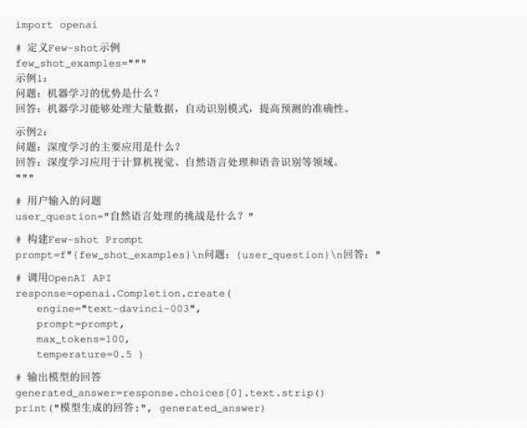

输出示例：

> 模型生成的回答：自然语言处理的挑战包括语言的多样性、语境理解的复杂性和多义性处理等问题。

加入 Few-shot 示例后，模型的生成结果符合之前示例的格式和风格，回答内容更自然贴合问题背景。

1. 包含常见结构：示例应体现回答的常见结构，如简洁的定义、优缺点列举等。
2. 涵盖不同类型：选择不同类型的问题，确保模型能够适应多样化内容生成。
3. 确保示例简洁明了：示例应尽量简短，以便提示词的整体长度在合理范围内。

##### 5. 实现动态 Few-shot 示例生成

在一些场景中，示例可能需要动态生成。例如，根据用户需求选择不同领域的示例或适用不同的问答类型。可以通过条件判断和示例库的结合实现动态生成 Few-shot 示例，以适应不同的任务需求。

动态 Few-shot 示例生成的代码如下：

```python
###### 定义示例库
few_shot_examples_general = """
####### 1:
问题：机器学习的好处是什么？
答案：机器学习能够处理海量数据，自动识别模式，提高预测的准确性。
####### 2:
问题：深度学习的应用是什么？
答案：深度学习应用于计算机视觉、自然语言处理和语音识别等领域。
"""

####### 根据领域选择不同的 Few-shot 示例
def select_examples(domain):
    if domain == '金融':
        return few_shot_examples_finance
    else:
        return few_shot_examples_general

####### 用户输入和领域选择
user_question = "区块链的挑战是什么"
domain = "金融"
####### 构建 Prompt
selected_examples = select_examples(domain)
prompt = f"[selected examples]\n问题：{user_question}\n答案："

####### 调用 API 生成内容
response = openai.Completion.create(
    engine="text-davinci-003",
    prompt=prompt,
    max_tokens=100,
    temperature=0.5
)
####### 输出模型的回复
generated_answer = response.choices[0].text.strip()
print("模型生成的回答:", generated_answer)
```

输出示例：

> 模型生成的回答：区块链的挑战包括高能源消耗、扩展性不足以及对现有金融系统的整合难度。

在上述代码中，根据不同的领域动态选择示例，使模型在不同的场景下生成符合语境的内容。

##### 6. 多示例的 Few-shot 提示词与生成效果

为了提高生成效果，可以在提示词中包含 3～5 个示例，展示多种可能的回答风格，帮助模型学习更丰富的输出格式。

```python
###### 定义多个示例
few_shot_examples = """
示例 1:
问题：机器学习的优势是什么？
回答：机器学习能够处理大量数据，自动识别模式，提高预测的准确性。
示例 2:
问题：深度学习的主要应用是什么？
回答：深度学习应用于图像识别、自然语言处理和语音识别等领域。
示例 3:
问题：自然语言处理的挑战是什么？
回答：自然语言处理面临语言多样性、语境理解和情感分析的挑战。
"""

####### 用户输入的问题
user_question = "区块链的未来发展趋势是什么？"

####### 构建 Few-shot Prompt
prompt = f"{few_shot_examples}\n问题：{user_question}\n回答："

####### 调用 API 生成内容
response = openai.Completion.create(
    engine="text-davinci-003",
    prompt=prompt,
    max_tokens=100,
    temperature=0.5
)

####### 输出模型的回答
generated_answer = response.choices[0].text.strip()
print("*"模型生成的回答：", generated_answer)
```

输出示例：

> 模型生成的回答：区块链的未来发展趋势包括更多去中心化应用的开发、跨链技术的成熟以及在供应链管理和数字身份验证中的广泛应用。

在加入多个示例后，模型生成的内容更为丰富，并且与示例中的回答风格保持一致。

Few-shot 示例提示技术通过在提示词中加入少量示例，引导模型生成符合特定格式和风格的内容。通过动态生成示例和选择合适的 Few-shot 示例，可以有效提升模型生成的准确性和一致性。

最后，将本章涉及的全部提示词类型及其特点总结到一张表格里，供读者快速参考查阅，如表 4-1 所示。

| 提示词类型 | 特点 |
| :--- | :--- |
| 基础提示词 | 简单、直接的提示词，用于单轮或简单的生成任务：不包含上下文和示例，适合较短的回答 |
| 动态提示词 | 根据用户输入或上下文动态生成提示词，增强内容生成的灵活性和个性化 |
| 插槽填充提示词 | 使用插槽（变量）填充不同内容，适合自动生成结构一致的提示词；广泛用于 FAQ、产品评价等场景 |
| 链式提示词 (任务链) | 将复杂任务分为多个步骤，通过逐步生成内容实现复杂任务的递进：适用于报告生成、分阶段任务等 |
| 多轮对话提示词 | 在多轮交互中保留上下文信息，确保模型在连续对话中保持一致性和连贯性；用于客服系统和虚拟助手等应用 |
| 嵌套提示词 | 分层生成，适合从概要到细节的逐步展开，适用于分层级的报告生成或结构化内容生成 |
| Few-shot 提示词 | 在提示词中包含少量示例，帮助模型理解格式、风格和任务要求；适用于需要特定格式或风格的内容生成 |

## 4.6 本章小结

本章深入探讨了提示词设计在大语言模型生成任务中的多种应用场景和技术。通过不同的提示词类型和结构，提示词设计不仅能有效引导模型生成内容，还能显著提升生成内容的准确性、连贯性和风格一致性。

通过学习本章内容，读者不仅能掌握从基础到高级的提示词设计方法，还能在实际项目中灵活运用这些技术，生成高质量、结构清晰、符合特定需求的自然语言内容。

## 4.7 思考题

- （1）什么是基础提示词？它适用于哪种类型的生成任务？
- （2）动态提示词如何根据用户输入进行调整？请描述一个调整的示例场景。
- （3）在使用动态提示词时，如何确保生成内容与用户输入的具体需求相符？
- （4）插槽填充提示词的主要优点是什么？在生成内容时，如何通过插槽实现自动化的模板填充？
- （5）如果在 FAQ 生成中使用插槽填充提示词，插槽部分应该包含哪些变量？
- （6）链式提示词如何将一个复杂任务分为多个子任务？请说明该技术在报告生成中的应用。
- （7）在多步骤生成中，如何将前一层级生成的内容作为下一层提示词的输入？
- （8）多轮对话提示词如何保持对话的连贯性？在设计提示词时需要保留哪些内容，以确保上下文的一致？
- （9）在对话提示词中，为了提高对话的自然性，通常会加入哪些语言元素？
- （10）嵌套提示词适合生成哪种类型的内容？请举例说明嵌套提示词的分层级应用场景。
- （11）使用嵌套提示词时，如何控制生成内容的层次性？什么情况下需要对内容层次进行分解？
- （12）Few-shot 提示词通过在提示词中加入示例来引导模型输出特定格式的内容，此时示例的数量一般在什么范围内最佳？
- （13）在 Few-shot 示例提示中，如何选择适合的示例？示例内容应具备哪些特点以引导模型生成高质量的回答？
- （14）设计一个多层级的嵌套提示词，让助手逐步回答“机器学习在医疗领域的应用”。首先让助手给出一个简要概述，然后展开具体应用，并提供实际案例。请描述每一层的提示词内容，解释如何逐步引导助手从概述到细节生成连贯的信息。

# 第 5 章
## 核心组件 1：链

在构建强大且灵活的企业级应用中，链（Chain）是 LangChain 的核心组件之一。通过链技术，可以将多步骤任务整合成清晰的流程，将语言模型调用、数据处理和决策逻辑连接在一起，从而实现复杂的应用需求。链不仅帮助开发者组织逻辑，还能根据特定的业务需求创建定制化的生成流程，使得生成的内容更符合实际使用场景。

本章将深入介绍 LangChain 的多种链类型，包括 LLM 链、序列链、路由链以及文档链，分别应对不同类型的任务和内容管理需求。LLM 链用于封装大语言模型的调用逻辑，帮助开发者高效处理单轮生成任务；序列链则实现多步骤处理，使得复杂任务能够分步执行并逐步生成；路由链则通过动态决策能力，在条件判断和分支选择中发挥重要作用；最后的文档链包括 Stuff、Refine、Map-Reduce、Map-Rerank 等多种链类型，为文档内容的高效处理和筛选提供了多样化的工具。

通过学习本章内容，读者将掌握 LangChain 链组件的设计思路和实际开发方法，为后续的企业级应用奠定坚实的开发基础。

### 5.1 LLM 链

LLM 链（LLM Chain）是 LangChain 中用于调用大语言模型的基础链组件，它通过封装模型调用的具体流程，使得模型生成的内容可以更加高效地融入复杂的任务中。在 LLM 链中，开发者可以使用提示词模板、上下文管理和结果处理等多种功能，为模型生成提供强大的支持，确保生成的内容符合任务需求。

LLM 链的核心在于将大语言模型的调用逻辑结构化，使每一次生成任务都能够按照既定流程执行。无论是针对特定任务的提示词设计，还是模型参数的优化与调整，LLM 链都提供了必要的接口和配置方式，使得模型的调用更加灵活，结果更加可靠。

本节将详细介绍 LLM 链的工作机制和配置方法，从基础结构到高级定制，帮助开发者深入理解和掌握这一重要链组件。

#### 5.1.1 LLM 链的基本工作流程和参数设置

下面将详细介绍 LLM 链的工作流程和关键参数设置，手把手带领读者创建并配置一个功能完备的 LLM 链。

##### 1. 初始化 LLM 链

在 LangChain 中，LLMChain 类用于封装大语言模型的调用。要初始化一个 LLM 链，需要定义提示词模板，并选择合适的模型。

```python
from langchain.llms import OpenAI
from langchain.chains import LLMChain
from langchain.prompts import PromptTemplate

##### 定义提示词模板
prompt_template = PromptTemplate(template="请简要描述机器学习的基本概念。")

###### 初始化 OpenAI 模型
llm = OpenAI(model_name="text-davinci-003", temperature=0.7, max_tokens=100)

###### 初始化 LLM 链
llm_chain = LLMChain(llm=llm, prompt=prompt_template)

###### 执行链任务
response = llm_chain.run()
print(f"生成的回答:", response)
```

上述代码初始化了一个 LLM 链，并使用提示词模板生成内容。在此例中，`run()` 方法直接调用链并输出结果。

##### 2. 配置关键参数

在 LLM 链中，有几个重要参数可以影响生成效果。

1. `model_name`：用于指定模型的名称，例如 `text-davinci-003`。
2. `temperature`：用于控制生成的随机性，值越高，内容越多样化。
3. `max_tokens`：用于生成内容的最大字数。
4. `top_p`：用于控制生成内容的多样性，较高的值会产生更丰富的内容。
5. `frequency_penalty` 和 `presence_penalty`：分别用于限制重复内容和鼓励新主题出现。

llm = OpenAI(
    model_name="text-davinci-003",
    temperature=0.5,
    max_tokens=150,
    top_p=0.9,
    frequency_penalty=0.5,
    presence_penalty=0.3
)

这些参数确保了模型生成内容的控制和灵活性。例如，将 `temperature` 设置为 0.5 会生成较确定的内容，而 `top_p` 值的调高则会增加内容多样性。

#### 3. 使用提示词模板设计动态内容

提示词模板允许通过变量填充创建动态内容。PromptTemplate 类支持在提示词中嵌入变量，以便根据任务需求动态生成内容。

```python
prompt_template = PromptTemplate(template="请简要描述 {topic} 的应用。")
prompt_text = prompt_template.format(topic="机器学习")
print("生成的 Prompt:", prompt_text)
```

#### 4. 在 LLM 链中集成提示词模板

将自定义提示词模板嵌入 LLM 链，确保链在调用时自动填充变量并生成内容。以下示例展示如何在 LLM 链中使用变量化的提示词模板。

```python
##### 创建变量的提示词模板
prompt_template = PromptTemplate(template="请简要描述 {topic} 的应用。")

###### 初始化 LLM 链
llm_chain = LLMChain(llm=llm, prompt=prompt_template)

##### 运行 LLM 链，传入变量
response = llm_chain.run({"topic": "人工智能"})
print("生成的回答:", response)
```

输出示例：

> 生成的回答：人工智能在多个领域广泛应用，包括医疗诊断、金融分析、自动驾驶和自然语言处理等。

#### 5. 使用 run 方法调用 LLM 链

run 方法是 LLM 链的主要执行方法，可以传入不同参数来生成定制化内容。

```python
response_ai = llm_chain.run({"topic": "人工智能"})
response_m = llm_chain.run({"topic": "机器学习"})
print("人工智能的应用:", response_ai)
print("机器学习的应用:", response_m)
```

#### 6. 生成结果的后处理

可以在生成结果后执行后处理操作，例如格式化内容或存储结果。

```python
###### 定义后处理函数
def post_process(response):
    processed_response = response.strip()
    return processed_response


###### 执行链任务并处理结果
response = llm_chain.run({"topic": "数据科学"})
final_result = post_process(response)
print("最终处理结果:", final_result)
```

##### 5.1.2 如何在 LLM 链中嵌入提示词模板和预处理逻辑

在 LangChain 的 LLM 链中，提示词模板和预处理逻辑是提升生成效果和确保内容质量的关键部分。通过嵌入提示词模板，可以动态控制生成的内容主题、格式和风格；而通过预处理逻辑，开发者可以在模型调用前对输入内容进行处理，从而更好地适应不同任务的需求。

##### 1. 创建并配置提示词模板

提示词模板是 LLM 链中的核心组件之一，通过 PromptTemplate 类，开发者可以定义一个包含变量的动态提示词。变量会在运行时被替换为实际的输入内容，从而实现提示词的灵活生成。

创建提示词模板的示例代码如下：

```python
from langchain.prompts import PromptTemplate

###### 创建包含变量的提示词模板
prompt_template = PromptTemplate(template="请简要描述{topic}的主要应用。")
###### 使用变量填充生成实际提示词内容
formatted_prompt = prompt_template.format(topic="机器学习")
print("生成的 Prompt 内容:", formatted_prompt)
```

在该示例中，提示词模板包含变量 `{topic}`，在生成内容时它将被替换为实际的主题“机器学习”。这样可以确保生成的提示词内容能够灵活地适应不同的输入。

##### 2. 将提示词模板嵌入 LLM 链中

在 LangChain 的 LLM 链中，提示词模板可通过传递给 LLMChain 实例的参数来嵌入。这样，LLM 链在执行时会自动调用提示词模板并替换其中的变量。

在 LLM 链中嵌入提示词模板的示例代码如下：

```python
from langchain.llms import OpenAI
from langchain.chains import LLMChain

###### 初始化 OpenAI 模型
llm = OpenAI(model_name="text-davinci-003", temperature=0.7, max_tokens=100)
##### 创建提示词模板
prompt_template = PromptTemplate(template="请简要描述 {topic} 的主要应用。")
###### 在 LLM 链中嵌入提示词模板
llm_chain = LLMChain(llm=llm, prompt=prompt_template)
###### 执行 LLM 链任务，并传入具体的变量值
response = llm_chain.run({"topic": "人工智能"})
print("生成的回答:", response)
```

> 生成的回答：人工智能在多个领域有广泛应用，包括医疗、金融、教育和自动化等。

在这个示例中，LLM 链自动将 `{topic}` 变量替换为“人工智能”，生成符合任务需求的内容。这种方式允许在同一个 LLM 链中通过不同变量值生成多种内容。

##### 3. 设计预处理逻辑：清理和标准化输入内容

预处理逻辑可以帮助 LLM 链更好地理解输入内容，例如在调用模型前对输入内容进行清理、格式化或标准化处理。可以在调用 LLM 链之前创建一个预处理函数，对用户输入进行调整。

设计预处理函数的示例代码如下：

```python
###### 定义预处理函数，用于清理和标准化输入内容
def preprocess_input(user_input):
    # 去除多余空格并将字母转换为小写
    cleaned_input = user_input.strip().lower()
    # 将首字母大写
    cleaned_input = cleaned_input.capitalize()
    return cleaned_input

####### 示例输入
raw_input = "机器学习的应用 "
preprocessed_input = preprocess_input(raw_input)
print("预处理后的输入:", preprocessed_input)
```

输出示例：

> 预处理后的输入：机器学习的应用

通过这种预处理，可以确保输入内容格式规范，便于模型理解。在实际项目中，预处理逻辑可能包括拼写检查、特殊字符去除、语言转换等。

##### 4. 将预处理逻辑集成到 LLM 链的工作流程中

为了将预处理逻辑与 LLM 链结合，可以在调用 LLM 链之前对输入内容执行预处理。以下是将预处理函数与 LLM 链组合使用的示例。

```python
###### 定义预处理函数
def preprocess_input(user_input):
    cleaned_input = user_input.strip().lower()
    cleaned_input = cleaned_input.capitalize()
    return cleaned_input

###### 初始化 LLM 链
llm_chain = LLMChain(llm=llm, prompt=prompt_template)

###### 获取用户输入
user_input = "数据科学的应用 "

###### 执行预处理
processed_input = preprocess_input(user_input)

###### 调用 LLM 链并生成内容
response = llm_chain.run({"topic": processed_input})
print("生成的回答:", response)
```

在此示例中，`preprocess_input` 函数在将用户输入传递给 LLM 链前进行预处理，从而确保输入内容的规范性。

##### 5. 增强预处理逻辑：基于任务需求动态调整提示词

在实际应用中，可以根据任务需求动态调整提示词。例如，在调用前自动检查输入长度，或根据输入内容选择不同的提示词模板。

基于任务需求的动态预处理的示例代码如下：

```python
###### 动态调整提示词模板
def select_prompt_template(topic_length):
    if topic_length < 10:
        return PromptTemplate(template="请简要描述{topic}的应用。")
    else:
        return PromptTemplate(
            template="请详细介绍{topic}在各个领域的应用及其影响。"
        )

###### 获取用户输入并处理
user_input = "人工智能和机器学习技术"
processed_input = preprocess_input(user_input)

###### 动态选择提示词模板
prompt_template = select_prompt_template(len(processed_input))

###### 使用选择的提示词模板初始化 LLM 链
llm_chain = LLMChain(llm=llm, prompt=prompt_template)

###### 调用 LLM 链生成内容
response = llm_chain.run({"topic": processed_input})
print("生成的回答:", response)
```

在该示例中，通过动态选择提示词模板，LLM 链可以根据输入内容的长度和复杂性生成简要或详细的内容。

#### 6. 使用后处理逻辑完善输出

在生成内容后，可以通过后处理逻辑进一步完善输出。例如，对结果进行格式化，去除多余空格或添加自定义的文本修饰。

后处理生成结果的示例代码如下：

```python
###### 定义后处理函数
def post_process(response):
    # 去除多余空格并将内容转换为标题形式
    processed_response = response.strip().capitalize()
    return processed_response

###### 执行链任务并处理结果
response = llm_chain.run({"topic": "深度学习"})
final_result = post_process(response)
print("最终处理结果:", final_result)
```

输出示例：

> 最终处理结果：深度学习在多个领域得到了广泛应用，包括图像识别、自然语言处理和自动驾驶等。

这种后处理可以帮助生成内容在格式和风格上更符合输出要求，特别是在需要标准化生成内容的场景中。

在 LLM 链中嵌入提示词模板和预处理逻辑可以极大提升生成内容的灵活性和准确性。通过设计适合任务需求的提示词模板，并在模型调用前后应用预处理和后处理逻辑，开发者可以更好地控制生成内容的格式和质量。

### 5.2 序列链

序列链（Sequential Chain）是一种将多个步骤按顺序组织的链技术，适用于需要多步处理的复杂任务。在序列链中，每个步骤的输出可作为下一步的输入，逐步构建出更为详尽和连贯的内容。这种方式非常适合多阶段任务，如数据预处理、生成初步内容、内容精炼、结果总结等。在实际应用中，序列链使得复杂的生成任务可以分解为多个可控的环节，确保每一步都符合逻辑和结构需求。

本节将深入探讨序列链的设计和实现，带领读者逐步掌握通过序列链来构建多步生成流程的方法。通过学习这一链技术，读者将能够设计出适应不同场景的生成流程，为实现复杂的自然语言处理应用提供有力支持。

#### 5.2.1 序列链的构建与分层调用

序列链是一种分步执行的链，它将复杂任务分解成多个有序步骤，每个步骤的输出被传递给下一个步骤，以便逐层构建结果。在 LangChain 中，序列链应用广泛，尤其适用于需要多步生成或需要逐步完善内容的场景。

##### 1. 创建并初始化序列链

在 LangChain 中，序列链可以通过 SequentialChain 类来构建。通常需要定义多个提示词和模型实例，每个 Prompt 代表一个步骤的内容生成逻辑，并根据顺序逐步执行。

初始化序列链的示例代码如下：

```python
from langchain.chains import SequentialChain
from langchain.prompts import PromptTemplate
from langchain.llms import OpenAI

##### 定义提示词模板
prompt_step_1 = PromptTemplate(template="简要介绍机器学习的基本概念。")
prompt_step_2 = PromptTemplate(
    template="基于以下介绍，描述机器学习的应用领域：{intro}")
prompt_step_3 = PromptTemplate(
    template="结合应用领域，提供机器学习在金融行业的一个实例：{applications}")

#### 初始化模型
llm = OpenAI(model_name="text-davinci-003", temperature=0.5, max_tokens=100)

###### 定义每个步骤的链
chain_step_1 = LLMChain(llm=llm, prompt=prompt_step_1)
chain_step_2 = LLMChain(llm=llm, prompt=prompt_step_2)
chain_step_3 = LLMChain(llm=llm, prompt=prompt_step_3)

###### 初始化 Sequential Chain
sequential_chain = SequentialChain(
    chains=[chain_step_1, chain_step_2, chain_step_3]
)
```

在此代码中，SequentialChain 将 3 个步骤的链按顺序连接，`chain_step_1` 的输出会被传递给 `chain_step_2`，以此类推。每个步骤的 prompt 可以根据生成内容的要求来设置。

##### 2. 配置步骤间的参数传递

要让每个步骤的输出成为下一步骤的输入，需要在提示词中定义变量。这里，可以用 `{intro}` 变量来承接 `chain_step_1` 的输出，而用 `{applications}` 变量来承接 `chain_step_2` 的输出。

传递步骤结果的示例代码如下：

```python
###### 定义传递参数的输入字典
input_dict = {
    "intro": "机器学习是一种通过数据训练模型，使计算机能够自动识别模式和预测。",
    "applications": "机器学习在金融、医疗和教育等多个领域有广泛应用。"
}

###### 配置并运行序列链
response = sequential_chain.run(input_dict)
print("序列链生成的最终结果:", response)
```

在此代码中，SequentialChain 通过传递 `input_dict` 中的参数，将每个步骤的输出传递给下一步，以便生成符合逻辑的多步骤内容。

##### 3. 使用 run 方法执行序列链

在 SequentialChain 中，run 方法是主要的执行入口。可以在调用 run 时传入初始输入，链会自动按顺序执行每个步骤并输出结果。

运行序列链并查看输出的示例代码如下：

```python
###### 使用 run 方法传入初始输入并执行序列链
initial_input = {"intro": "机器学习概念", "applications": "金融和医疗"}
response = sequential_chain.run(initial_input)
print("最终生成的内容:", response)
```

输出示例：

> 最终生成的内容：机器学习是一种通过数据训练模型的技术，它在金融、医疗、教育等多个领域得到了广泛应用。例如，在金融行业，机器学习用于自动化交易和风险预测。

通过 run 方法，SequentialChain 能够按顺序调用每个步骤的内容生成逻辑，从而逐步构建更复杂的内容。

##### 4. 增加中间处理逻辑，实现更复杂的序列链

在实际应用中，序列链可以通过在步骤之间增加处理逻辑来实现更复杂的功能。例如，可以在每个步骤之间插入预处理或后处理函数，进一步丰富内容生成的逻辑。

添加中间处理逻辑的示例代码如下：

```python
###### 定义中间处理函数，格式化内容
def format_step_output(text):
    return text.strip().capitalize()

###### 执行序列链并处理每个步骤的输出
intro_text = chain_step_1.run()
formatted_intro = format_step_output(intro_text)
applications_text = chain_step_2.run({"intro": formatted_intro})
formatted_applications = format_step_output(applications_text)
instance_text = chain_step_3.run({"applications": formatted_applications})
formatted_instance = format_step_output(instance_text)

###### 查看每个步骤的格式化输出
print("步骤 1-简介:", formatted_intro)
print("步骤 2-应用:", formatted_applications)
print("步骤 3-实例:", formatted_instance)
```

在此代码中，通过 `format_step_output` 函数对每个步骤的输出进行格式化，确保内容在格式和风格上统一。

##### 5. 增强的序列链：根据条件动态选择步骤

在一些应用场景中，序列链的执行步骤可能需要根据不同的条件动态调整。例如，可以在序列链中添加条件判断，决定是否跳过某些步骤或根据不同输入执行不同的流程。

根据条件动态调整序列链的示例代码如下：

```python
###### 逻辑省略...（此处展示概念）
####### if some_condition:
####### chain_sequence = [chain_step_1, chain_step_3] # 跳过中间步骤
####### else:
####### chain_sequence = [chain_step_1, chain_step_2, chain_step_3]
```

###### 定义条件判断逻辑

```python
def is_detailed_request(input_text):
    return len(input_text) > 15

###### 创建一个包含条件判断的序列链

def conditional_sequential_chain(input_text):
    if is_detailed_request(input_text):
        print(执行详细生成步骤
```

在此示例中，通过 `is_detailed_request` 函数判断输入的长度，根据条件选择不同的步骤执行。这样可以根据任务需求动态调整生成的流程，确保序列链的灵活性。

序列链通过将多个步骤有序连接，使得复杂的内容生成任务可以逐步展开。通过分层调用和传递参数，序列链确保了每个步骤之间的连贯性，并可以通过中间处理逻辑和条件判断实现更多的应用场景。

#### 5.2.2 在序列链中连接多个 LLM 和工具模块

在 LangChain 的序列链中，不仅可以连接多个语言模型来生成内容，还可以引入其他工具模块，如 API 调用、数据库查询等。通过将多个 LLM 和工具模块按顺序连接，可以更灵活地设计复杂的任务流程，确保每一步都按需求生成或处理内容。

##### 1. 定义和初始化多种 LLM 实例

在 LangChain 中，可以创建多个不同的 LLM 实例，每个实例适用于特定任务或风格的生成。例如，一个 LLM 可以专注于内容概述，另一个 LLM 可以用于生成详细解释。初始化多个 LLM 实例，确保每个实例根据需求配置不同的参数。

```python
from langchain.llms import OpenAI
###### 定义用于概述生成的 LLM
llm_summary = OpenAI(model_name="text-davinci-003",
                     temperature=0.5, max_tokens=50)
###### 定义用于详细生成的 LLM
llm_detail = OpenAI(model_name="text-davinci-003", 
                    temperature=0.7, max_tokens=150)
```

在该示例中，`llm_summary` 专注于生成简洁概述，而 `llm_detail` 则用于生成详细内容。这种设置便于根据任务需求灵活切换不同的生成模式。

##### 2. 将多个 LLM 实例嵌入序列链中

在序列链中可以为每个步骤定义一个 LLM 实例，使不同步骤使用不同的生成模型。以下示例将展示如何创建一个序列链，第一步使用 `llm_summary` 生成概述，第二步使用 `llm_detail` 扩展成详细内容。

```python
from langchain.chains import LLMChain, SequentialChain
from langchain.prompts import PromptTemplate
##### 定义提示词模板
prompt_summary = PromptTemplate(template="请简要介绍机器学习的定义。")
prompt_detail = PromptTemplate(
    template="基于机器学习的定义，详细描述其在数据分析中的应用：{summary}")
###### 创建 LLM 链实例
chain_summary = LLMChain(llm=llm_summary, prompt=prompt_summary)
chain_detail = LLMChain(llm=llm_detail, prompt=prompt_detail)
###### 创建序列链，连接两个 LLM 链
sequential_chain = SequentialChain(chains=[chain_summary, chain_detail])
```

在此示例中，`SequentialChain` 将 `chain_summary` 和 `chain_detail` 按顺序连接。生成流程首先调用 `llm_summary` 生成概述，再将概述内容传递给 `llm_detail` 进行详细扩展。

##### 3. 增加工具模块：API 调用模块

在一些复杂任务中，可能需要在生成过程中引入额外的数据。可以使用 API 调用模块在生成内容时获取实时数据，并将数据作为上下文传递给 LLM 进行处理。以下示例将展示如何在序列链中添加 API 调用步骤，以获取最新的外部数据。

```python
import requests

###### 定义一个 API 调用函数，用于获取实时数据（例如：获取股票信息）
def fetch_data(topic):
    response = requests.get(f"https://api.example.com/data?topic={topic}")
    if response.status_code == 200:
        return response.json().get("data", "")
    else:
        return "无法获取数据"

###### 将 API 调用集成到序列链中
topic = "机器学习在金融中的应用"
api_data = fetch_data(topic)

###### 将 API 数据传递给详细描述 LLM 链
response = chain_detail.run({"summary": api_data})
print("API 获取的数据及其详细生成结果:", response)
```

在此示例中，`fetch_data` 函数通过 API 获取实时数据，然后将数据传递给 `chain_detail` 以进行详细描述。这样可以确保生成内容包含最新的信息。

##### 4. 使用数据库查询模块

在一些业务场景中，数据可能存储在本地数据库或云端数据库中。可以通过数据库查询模块检索所需数据，并将其作为生成内容的上下文。以下示例将展示如何在序列链中添加数据库查询模块。

```python
import sqlite3

###### 创建数据库连接并查询数据
def query_database(keyword):
    conn = sqlite3.connect("example.db")
    cursor = conn.cursor()
    cursor.execute("SELECT info FROM topics WHERE name=?", (keyword,))
    result = cursor.fetchone()
    conn.close()
    return result[0] if result else "没有找到相关数据"

###### 将数据库查询结果传递给 LLM 链
keyword = "深度学习"
db_data = query_database(keyword)

###### 使用数据库查询结果作为生成内容的输入
response = chain_detail.run({"summary": db_data})
print("数据库查询结果及其生成的详细内容:", response)
```

通过这种方式，可以在生成过程中使用数据库数据，确保内容生成与业务数据一致。

##### 5. 综合多个 LLM 与工具模块的序列链示例

下面是一个完整的示例，将展示如何将多个 LLM 实例和工具模块组合成一个多步骤的序列链。在该示例中，生成流程包括 3 个步骤：简要概述、API 数据扩展和详细应用描述。

```python
from langchain.chains import LLMChain, SequentialChain
from langchain.prompts import PromptTemplate

###### 初始化 LLM 和提示词模板
llm_summary = OpenAI(model_name="text-davinci-003",
                     temperature=0.5, max_tokens=50)
llm_detail = OpenAI(model_name="text-davinci-003",
                    temperature=0.7, max_tokens=150)

prompt_summary = PromptTemplate(template="请简要介绍{topic}的定义。")
prompt_api = PromptTemplate(
    template="基于以下内容描述{api_data}在{topic}中的作用。"
)
prompt_detail = PromptTemplate(
    template="结合概述和 API 数据，详细描述{topic}的行业应用：{summary}")

###### 创建 LLM 链
chain_summary = LLMChain(llm=llm_summary, prompt=prompt_summary)
chain_api = LLMChain(llm=llm_summary, prompt=prompt_api)
chain_detail = LLMChain(llm=llm_detail, prompt=prompt_detail)

###### 定义一个模拟 API 数据函数
def fetch_data(topic):
    # 模拟 API 响应数据
    return f"{topic}的最新应用数据"

###### 组合为一个序列链
def multi_step_chain(topic):
    # 生成概述
    summary = chain_summary.run({"topic": topic})
    print("生成的概述:", summary)

    # 获取 API 数据并生成相关内容
    api_data = fetch_data(topic)
    api_content = chain_api.run({"topic": topic, "api_data": api_data})
    print("基于 API 数据的生成内容:", api_content)

    # 生成详细描述
    detailed_response = chain_detail.run(
        {"topic": topic, "summary": summary})
    print("最终生成的详细内容:", detailed_response)
    return detailed_response

###### 执行多步链
topic = "机器学习"
final_output = multi_step_chain(topic)
print("最终结果:", final_output)
```

**输出示例：**

>> 生成的概述：机器学习是一种通过数据训练模型，使计算机能够自动识别模式的技术。
>> 基于 API 数据的生成内容：机器学习的最新应用数据在行业中的广泛应用。
>> 最终生成的详细内容：机器学习在金融、医疗等行业中广泛应用，例如自动化交易、疾病预测和个性化教育。

在该示例中，`multi_step_chain` 函数通过多个 LLM 实例和一个 API 模块按顺序生成内容。整个流程从生成概述开始，接着通过 API 获取数据，最后通过详细描述完成内容生成。

在序列链中连接多个 LLM 和工具模块，并结合 API 调用、数据库查询和多模型生成，可以实现更丰富的内容生成流程。

### 5.3 路由链

路由链是一种动态决策链，它通过条件判断和分支选择，使得模型在执行时可以根据输入内容或上下文环境自动选择适当的流程。不同于固定顺序的序列链，路由链能够根据不同的任务需求、输入特征或用户指令，智能地切换链路径，从而实现更灵活、响应式的内容生成和数据处理。这种技术在需要多分支、多条件处理的场景中非常有效，如在客服场景中根据用户问题进行不同的回答路径，或根据数据内容动态选择不同的处理方式。

本节将详细讲解路由链的构建原理和实现方法，引导读者逐步构建路由链，掌握其在实际应用中的设计和配置，为实现自适应的智能处理流程打下基础。

#### 5.3.1 根据输入内容动态选择链路径

路由链的关键在于根据输入内容或条件动态选择不同的链路径。LangChain 的 `RouterChain` 允许我们基于条件判断来自动选择合适的子链执行，这使得内容生成或数据处理更加灵活。此功能特别适用于需要根据用户输入或内容特征选择不同流程的场景，如区分用户的请求类型（如咨询、投诉、建议）并分别处理。

##### 1. 定义条件判断函数

首先，需要定义一个条件判断函数，用于根据不同输入类型或特征返回不同的标识，以选择相应的处理流程。

```python
###### 定义条件判断函数，根据输入内容返回不同标识

def determine_route(input_text): 
    if "投诉" in input_text:
        return "complaint"
    elif "咨询" in input_text:
        return "inquiry"
    elif "建议" in input_text:
        return "suggestion"
    else:
        return "default"
```

在此示例中，`determine_route` 函数会根据输入内容判断是否包含关键词“投诉”、“咨询”或“建议”，并返回相应的标识。如果输入内容不匹配任何条件，则返回默认路径“default”。

##### 2. 为不同路径定义各自的链

根据判断函数返回的结果，创建不同的子链，每个子链负责处理特定的任务类型。可以为每个路径设置不同的提示词和模型参数，以生成符合需求的内容。

```python
from langchain.prompts import PromptTemplate
from langchain.llms import OpenAI
from langchain.chains import LLMChain

#### 初始化模型
llm = OpenAI(model_name="text-davinci-003", temperature=0.5, max_tokens=100)

###### 定义不同路径的提示词模板
template_complaint = "处理客户投诉：请针对以下问题提供解决方案：{issue}"
template_inquiry = "处理客户咨询：请回答以下问题：{question}"
template_suggestion = "处理客户建议：请记录并反馈以下内容：{suggestion}"
template_default = "处理普通查询：请回答以下内容：{query}"
```

在此示例中，每个子链针对不同类型的任务设计了对应的提示词模板，如“处理客户投诉”、“处理客户咨询”等。这样可以确保每条链生成的内容符合该任务类型的需求。

##### 3. 使用路由链根据条件选择子链

通过路由链的功能，可以将条件判断与子链连接起来，实现自动化的路径选择。在 LangChain 中，可以使用 `RouterChain` 类来构建路由链，并通过判断函数选择具体路径。

```python
from langchain.chains import RouterChain
from langchain.chains import LLMChain

###### 假设已经创建了各个子链实例
chain_complaint = LLMChain(llm=llm, prompt=PromptTemplate(template=template_complaint))
chain_inquiry = LLMChain(llm=llm, prompt=PromptTemplate(template=template_inquiry))
chain_suggestion = LLMChain(llm=llm, prompt=PromptTemplate(template=template_suggestion))
chain_default = LLMChain(llm=llm, prompt=PromptTemplate(template=template_default))

###### 定义路径映射，将判断结果映射到对应的子链
route_map = {
    "complaint": chain_complaint,
    "inquiry": chain_inquiry,
    "suggestion": chain_suggestion,
    "default": chain_default
}

###### 创建路由链
router_chain = RouterChain(route_map=route_map, route_func=determine_route)
```

在此代码中，`route_map` 将判断结果（如 "complaint"、"inquiry" 等）映射到具体的子链。`RouterChain` 会根据 `determine_route` 函数的返回值自动选择相应的链路径。

##### 4. 执行路由链任务并查看结果

现在可以使用路由链执行任务了。根据输入内容，路由链会自动选择合适的子链来生成内容。以下示例将展示如何传入不同的输入内容，并观察路由链选择的执行路径和生成的结果。

```python
###### 示例输入文本
input_text_complaint = "客户投诉：产品质量有问题，需要立即解决。"
input_text_inquiry = "客户咨询：这个产品的保修期是多久？"
input_text_suggestion = "客户建议：希望增加更多的支付选项。"
input_text_default = "普通查询：如何联系客服？"

###### 执行路由链任务并输出结果
response_complaint = router_chain.run({"issue": input_text_complaint})
response_inquiry = router_chain.run({"question": input_text_inquiry})
response_suggestion = router_chain.run(
    {"suggestion": input_text_suggestion})
response_default = router_chain.run({"query": input_text_default})
print("投诉处理结果:", response_complaint)
print("咨询处理结果:", response_inquiry)
print("建议处理结果:", response_suggestion)
print("默认处理结果:", response_default)
```

**输出示例：**

>> 投诉处理结果：针对产品质量问题，建议客户与售后部门联系，并提供详细的损坏描述以便快速处理。
>> 咨询处理结果：该产品的保修期为一年，请在购买日期起计算。
>> 建议处理结果：增加支付选项的建议已收到，我们会将其反馈给产品部门以供参考。
>> 默认处理结果：您可以通过我们的客服热线或网站联系我们的客服团队。

在该示例中，根据输入内容的不同，路由链自动选择了相应的子链来生成内容。例如，输入包含“投诉”的内容会触发投诉处理链，输入包含“咨询”的内容会触发咨询处理链。

##### 5. 增强判断逻辑：添加更多条件和复杂判断

在实际应用中，判断逻辑可能需要更为复杂的条件判断，例如组合条件或多级判断。可以在判断函数中加入更多条件，确保路由链选择的路径符合实际需求。

```python
###### 添加更复杂的条件判断
def advanced_determine_route(input_text):
    if "投诉" in input_text and "紧急" in input_text:
        return "urgent_complaint"
    elif "投诉" in input_text:
        return "complaint"
    elif "咨询" in input_text:
        return "inquiry"
    elif "建议" in input_text:
        return "suggestion"
    else:
        return "default"

###### 创建新的路由映射，增加紧急投诉路径
prompt_urgent_complaint = PromptTemplate(template="处理紧急投诉；立即处理以下问题：{issue}")
chain_urgent_complaint = LLMChain(llm=llm, prompt=prompt_urgent_complaint)

###### 更新路由映射表
advanced_route_map = {
    "urgent_complaint": chain_urgent_complaint,
    "complaint": chain_complaint,
    "inquiry": chain_inquiry,
    "suggestion": chain_suggestion,
    "default": chain_default
}

###### 创建增强的路由链
advanced_router_chain = RouterChain(route_map=advanced_route_map,
                                    route_func=advanced_determine_route)

###### 测试不同的输入
response_urgent_complaint = advanced_router_chain.run({
    "issue": "客户投诉：紧急！需要立即更换故障产品。"})
print("紧急投诉处理结果:", response_urgent_complaint)
```

**输出示例：**

>> 紧急投诉处理结果：请立即联系技术支持团队，并尽快更换故障产品。

通过增强判断逻辑，可以在路由链中处理更多类型的任务，确保生成内容符合实际业务的复杂需求。

通过在路由链中定义条件判断函数、配置不同子链以及增强判断逻辑，开发者可以实现多路径处理的灵活性。## 5.3.2 设置不同的模型和任务路径以适应复杂需求

在复杂的应用场景中，可能需要根据不同任务需求，设置多个不同的模型和任务路径。通过为不同任务指定特定的模型和路径，可以更高效地处理多样化的需求，如根据任务类型或输入内容调整生成逻辑，甚至使用不同的 API、数据库等外部资源来提供支持。

#### 1. 定义多任务场景中的模型实例

首先，定义多个不同的模型实例，每个模型适用于特定的任务类型。例如，可以为简要回答任务选择较低温度的模型，而为创意任务选择更高温度的模型，从而确保每个模型生成的内容符合任务特点。

```python
from langchain.llms import OpenAI

###### 用于简洁回答的模型
llm_brief = OpenAI(model_name="text-davinci-003",
                   temperature=0.3, max_tokens=50)

###### 用于详细描述得模型
llm_detailed = OpenAI(model_name="text-davinci-003",
                      temperature=0.7, max_tokens=150)

###### 用于创意性内容生成的模型
llm_creative = OpenAI(model_name="text-davinci-003",
                      temperature=0.9, max_tokens=100)
```

在此示例中，`llm_brief` 用于生成简洁的回答，`llm_detailed` 用于生成详细的内容描述，而 `llm_creative` 则用于生成更具创意的内容。这样设置不同的模型，可以确保在多任务场景中生成适合不同需求的内容。

#### 2. 定义不同任务路径的提示词模板

在路由链中，为每个任务路径设置特定的提示词模板，可以更精准地控制生成内容。

```python
from langchain.prompts import PromptTemplate

###### 提示词模板配置
prompt_brief = PromptTemplate(template="简要回答以下问题：{query}")
prompt_detailed = PromptTemplate(template="详细回答以下问题:{query}")
prompt_creative = PromptTemplate(
    template="创造性地回答以下问题，提供一些独特的见解:{query}"
)
```

在这里，`prompt_brief` 引导模型生成简要内容，`prompt_detailed` 鼓励生成详细解答，而 `prompt_creative` 则用于生成富有创意的回答。不同的提示词模板让每个模型在特定任务路径下产生合适的内容。

#### 3. 创建子链并映射至任务路径

使用前面定义的模型和提示词模板为每个任务路径创建了一个子链，这样可以在路由链中根据任务类型选择合适的子链来执行。

```python
from langchain.chains import LLMChain

###### 创建不同任务路径的子链
chain_brief = LLMChain(llm=llm_brief, prompt=prompt_brief)
chain_detailed = LLMChain(llm=llm_detailed, prompt=prompt_detailed)
chain_creative = LLMChain(llm=llm_creative, prompt=prompt_creative)
```

这里的每条子链结合了不同的模型和提示词模板，`chain_brief`、`chain_detailed` 和 `chain_creative` 分别处理简要、详细和创意任务。确保每条链的配置与目标任务相匹配，以便在生成内容时达到预期效果。

#### 4. 定义判断函数，根据任务需求动态选择路径

在路由链中，通过判断函数识别任务需求，返回对应的任务路径标识，这样可以在执行时根据输入内容选择正确的子链。

```python
###### 根据输入内容动态选择路径
def task_route(input_text):
    if "简要" in input_text:
        return "brief"
    elif "详细" in input_text:
        return "detailed"
    elif "创意" in input_text or "独特" in input_text:
        return "creative"
    else:
        return "default"
```

`task_route` 函数会根据输入内容包含的关键词（如“简要”、“详细”或“创意”）返回对应的任务标识。如果输入内容不符合任何条件，则返回默认路径"default"。

#### 5. 配置路由链以自动选择任务路径

使用 `RouterChain` 类将判断函数和子链路径映射在一起，以便路由链自动选择适当的任务路径。

```python
from langchain.chains import RouterChain

###### 路由映射，将任务标识映射到对应的子链
route_map = {
    "brief": chain_brief,
    "detailed": chain_detailed,
    "creative": chain_creative,
    "default": chain_brief  # 默认路径可设置为简要回答
}

###### 创建路由链
router_chain = RouterChain(route_map=route_map, route_func=task_route)
```

在此示例中，`route_map` 将判断函数 `task_route` 的返回值映射到具体的子链。`RouterChain` 会根据 `task_route` 函数的判断结果自动选择合适的任务路径。

#### 6. 执行路由链任务并测试不同的任务路径

现在可以通过路由链执行任务。根据输入内容的不同，路由链会自动选择正确的子链路径并生成内容。以下示例将展示如何传入不同的输入内容并检查生成结果。

```python
###### 定义输入内容
input_text_brief = "简要回答：机器学习的定义是什么？"
input_text_detailed = "详细回答：机器学习的应用领域有哪些？"
input_text_creative = "创意回答：机器学习在未来可能带来的影响？"

###### 执行路由链并输出结果
response_brief = router_chain.run({"query": input_text_brief})
response_detailed = router_chain.run({"query": input_text_detailed})
response_creative = router_chain.run({"query": input_text_creative})

print("简要回答：", response_brief)
print("详细回答：", response_detailed)
print("创意回答：", response_creative)
```

运行结果如下：

> > > 简要回答：机器学习是一种通过数据训练模型，使计算机能够自动识别模式的技术。
> > 详细回答：机器学习在多个领域有广泛应用，包括金融、医疗、教育和自动驾驶等。
> >> 创意回答：机器学习未来可能改变我们生活的方方面面，例如个性化教育、智能城市和人类辅助的创新设计。

通过这种设置，路由链能够根据输入内容动态选择适合的任务路径，确保生成内容的质量和风格符合预期需求。

#### 7. 添加更多任务路径和外部资源

在一些场景中，可能还需要进一步扩展任务路径，例如引入外部 API 或数据库作为辅助信息。以下示例展示如何为某些任务路径引入 API 调用，获取实时数据以丰富内容生成。

```python
import requests

###### 定义 API 调用函数
def fetch_additional_data(query):
    response = requests.get(f"https://api.example.com/data?query={query}")
    if response.status_code == 200:
        return response.json().get("data", "")
    else:
        return "无法获取数据"

###### 在判断函数中添加 API 路径选择
def advanced_task_route(input_text):
    if "实时" in input_text:
        return "api"
    elif "简要" in input_text:
        return "brief"
    elif "详细" in input_text:
        return "detailed"
    elif "创意" in input_text:
        return "creative"
    else:
        return "default"

###### 路由映射表中添加 API 路径
route_map_advanced = {
    "api": fetch_additional_data,  # 将 API 函数作为任务路径
    "brief": chain_brief,
    "detailed": chain_detailed,
    "creative": chain_creative,
    "default": chain_brief
}

###### 创建新的路由链
advanced_router_chain = RouterChain(route_map=route_map_advanced,
                                    route_func=advanced_task_route)

###### 测试带有 API 调用的任务路径
response_api = advanced_router_chain.run({"query": "实时获取股票市场信息"})
print("实时数据获取结果:", response_api)
```

运行结果如下：

> > 实时数据获取结果：当前市场信息显示，主要股票指数上涨 0.5%。

通过这种方式，路由链可以在任务路径中加入外部资源，进一步增强生成内容的多样性和实用性。

通过定义不同模型、配置判断函数、设置任务路径以及引入外部资源，开发者可以实现自适应的内容生成流程，满足多样化需求。

### 5.4 文档链

文档链（Document Chains）是一种专用于文档处理的链技术，广泛应用于需要分析和总结大量文档内容的任务。它允许将多个文档段落、章节或文件整合在一起，通过不同的链类型对其进行组织和处理，从而高效生成概述、提取关键信息或进行精准的问答。本节将介绍 4 种常见的文档链类型：Stuff、Refine、Map-Reduce 和 Map-Rerank。

- **Stuff** 链直接将所有文档内容合并处理，适用于较小规模的文档。
- **Refine** 链逐步精炼文档内容，通过多轮处理生成更详细的输出。
- **Map-Reduce** 链将每个文档片段单独处理并汇总，适合大型文档的处理需求。
- **Map-Rerank** 链在 Map-Reduce 的基础上增加了评分排序，确保输出最相关的内容。

本节将带领读者逐步理解和应用这些文档链技术，使其在大量文档处理中更为得心应手，为构建信息丰富、层次分明的内容生成系统提供有力支持。

#### 5.4.1 Stuff 链与 Refine 链的应用场景和适用文档类型

Stuff 链和 Refine 链是文档链中最基础的两种类型，适用于不同规模和处理需求的文档内容。

##### 1. Stuff 链的应用场景和适用文档类型

Stuff 链是一种简单的链处理方式，它将所有文档片段合并成一个整体，然后一次性传递给语言模型进行处理。由于直接合并的内容可能会超出模型的上下文长度限制，因此 Stuff 链适用于小规模、短文本的文档，或者在内容较少的场景下使用。

**应用场景：**

（1）小型报告的快速总结。
（2）简短的对话或会议记录的概述。
（3）多段简短信息的合并处理。

**适用文档类型：**

（1）只有几个段落的简短文档。
（2）内容精炼、信息量适中的文件。
（3）需要快速生成整体概述的小型内容集。

Stuff 链原理如图 5-1 所示。

以下是用于 Stuff 链的示例文档内容：

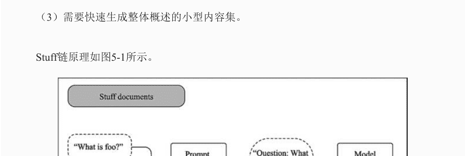

文档片段 1：
机器学习是一种人工智能技术，旨在通过算法和统计模型，使计算机能够从数据中学习并进行预测。机器学习被广泛应用于图像识别、语音识别、自然语言处理等领域，推动了现代科技的进步。

文档片段 2：
近年来，深度学习成为机器学习的一个重要分支，通过多层神经网络，深度学习在复杂任务上表现出了超越传统算法的性能，尤其在医疗诊断、自动驾驶和金融预测等领域取得了显著进展。

文档片段 3：
大数据的增长为机器学习模型提供了丰富的数据源。利用大量的数据，机器学习算法可以更加准确地进行模式识别和趋势预测。然而，数据隐私和安全性问题也随之而来，需要在应用中予以关注。

将以上 3 个文档片段合并，并通过 Stuff 链一次性传递给模型，生成一个简要的概述。

```python

```

运行结果如下：

> > > 生成的概述：机器学习是一种人工智能技术，广泛应用于图像识别、语音识别和自然语言处理等领域。深度学习作为机器学习的分支，表现出优异的性能，尤其在医疗、自动驾驶和金融等方面。大数据为机器学习提供了丰富的数据源，但也带来了数据隐私和安全性问题。

Stuff 链直接合并了所有内容，并生成了一个简要的整体概述。它非常适合处理小规模文档。

##### 2. Refine 链的应用场景和适用文档类型

Refine 链是一种逐步处理文档内容的链，通过逐步对文档片段进行精炼，最终生成一个更加详细或精确的结果。与 Stuff 链不同，Refine 链不会一次性处理所有内容，而是逐步将前一个步骤的结果与下一个文档片段合并。

**应用场景：**

（1）多章节报告的精炼总结。
（2）复杂文档的逐层解析。
（3）需要详细处理的长文档或层次化内容生成。

**适用文档类型：**

（1）大量文档片段，适合逐步构建的内容。
（2）内容结构复杂、信息量较大的长文档。
（3）需要在生成过程中逐步增加信息的应用。

Refine 链原理如图 5-2 所示。

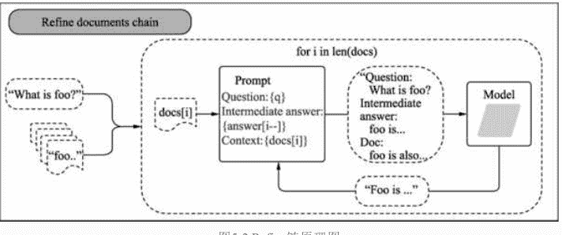

以下是用于 Refine 链的示例文档内容，与 Stuff 的内容相同：使用 Refine 链逐步处理每个文档片段，并将每个片段的内容逐步添加到最终结果中，代码如下：

```python
from langchain.chains import RefineDocumentsChain

##### 定义提示词模板
prompt_template_refine = PromptTemplate(
    template="基于以下内容进行精炼，并添加新的信息：`\n\n{current_summary}`\n`新信息：\n{new_content}`"
)

###### 初始化 Refine 链
refine_chain = RefineDocumentsChain(llm=llm, prompt=prompt_template_refine)

###### 定义文档片段列表
document_fragments = [
    "机器学习是一种人工智能技术，旨在通过算法和统计模型，使计算机能够从数据中学习并进行预测。机器学习被广泛应用于图像识别、语音识别、自然语言处理等领域，推动了现代科技的进步。",
    "近年来，深度学习成为机器学习的一个重要分支，通过多层神经网络，深度学习在复杂任务上表现出了超越传统算法的性能，尤其在医疗诊断、自动驾驶和金融预测等领域取得了显著进展。",
    "大数据的增长为机器学习模型提供了丰富的数据源。利用大量的数据，机器学习算法可以更加准确地进行模式识别和趋势预测。然而，数据隐私和安全性问题也随之而来，需要在应用中予以关注。"
]

###### 执行 Refine 链任务
current_summary = ""  # 初始化为空
for fragment in document_fragments:
    current_summary = refine_chain.run(
        {"current_summary": current_summary, "new_content": fragment}
    )
print(current_summary)

输出示例：

>> 逐步精炼生成的内容：机器学习是一种人工智能技术，广泛应用于图像处理、语音识别和自然语言处理等领域。随着深度学习的进展，机器学习在复杂任务上表现出更高的性能，尤其在医疗、自动驾驶和金融领域取得显著成果。大数据为机器学习提供了大量的数据源，但也带来了数据隐私和安全性问题，这些问题在实际应用中需要加以关注。

```

Refine 链通过逐步将每个文档片段的内容精炼到最终总结中，生成了一个更为完整的描述。与 Stuff 链相比，Refine 链更适合分层次处理和信息量较大的文档内容。

#### 5.4.2 Map-Reduce 链与 Map-Rerank 链的文档处理策略

在处理大规模文档或复杂数据集时，Map-Reduce 链和 Map-Rerank 链是非常有效的选择。

与 Stuff 链和 Refine 链不同，这两种链技术可以将文档处理任务分解为“映射”(Map) 和“归并”(Reduce) 两个步骤，分布式地对内容进行处理和筛选，确保生成结果的质量和相关性。

##### 1. Map-Reduce 链的应用场景和适用文档类型

Map-Reduce 链适用于大规模文档的处理需求，尤其是对每个文档片段进行独立处理，并最终归并生成一个结果的场景。此链将文档片段分步处理，再将所有结果汇总在一起，使其能够应对长文档或大量内容。

**应用场景：**

（1）对多个文档进行概述生成。
（2）分析和总结大型内容集。
（3）需要逐步处理并汇总的场景，如长文档问答或摘要生成。

**适用文档类型：**

（1）多章节或多片段的大型文档。
（2）需要逐步总结并整合的内容。
（3）信息量大且需要归并处理的文档集。

Map-Reduce 链原理图如图 5-3 所示。

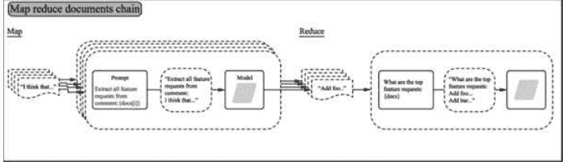

图 5-3 Map-Reduce 链原理图

以下示例文档将用于 Map-Reduce 链，以便展示该链如何处理多个文档片段：

## 5. Map-Reduce 链与 Map-Rerank 链的应用

使用 Map-Reduce 链将每个文档片段分步处理，然后将所有结果汇总生成最终内容，代码如下：

```python
from langchain.chains import MapReduceDocumentsChain
###### 定义提示词模板，用于处理每个片段
prompt_template_map = PromptTemplate(
    template="请总结以下内容核心观点：\n\n{fragment}"
)
#### 初始化模型
llm = OpenAI(model_name="text-davinci-003", temperature=0.5, max_tokens=100)
###### 创建 Map-Reduce 链
map_reduce_chain = MapReduceDocumentsChain(llm=llm, prompt=prompt_template_map)
###### 定义文档片段列表
document_fragments = [
    "人工智能技术的快速发展对社会产生了深远影响。其在自动化、医疗、教育等多个领域的应用，正逐步改变人们的生活方式，尤其在医疗诊断和个性化教育领域，人工智能展现出极大的潜力。",
    "然而，人工智能技术的普及也带来了一些挑战。例如，数据隐私成为一个不可忽视的问题，许多企业和个人都担心自己的数据被滥用。此外，自动化可能导致某些职业的消失，带来就业压力。",
    "在未来，随着技术的进步，人工智能有望在智能交通、智能城市、环境保护等领域发挥更大的作用。政府和企业正在积极探索人工智能的潜力，以期提高效率、减少资源浪费，推动可持续发展。"
]
###### 执行 Map-Reduce 链任务
response = map_reduce_chain.run({"documents": document_fragments})
print("Map-Reduce 链生成的最终结果:", response)
```

输出示例：

> >> Map-Reduce 链生成的最终结果：人工智能在多个领域带来深远影响，特别是在医疗和个性化教育领域，展现了极大潜力。同时，数据隐私问题和就业压力等挑战不容忽视。未来，人工智能在智能城市和环境保护等方面的应用有望推动可持续发展。

Map-Reduce 链在每个片段上执行摘要生成，并将所有片段的结果进行归并，生成一个较为完整的总结。

##### 2. Map-Rerank 链的应用场景和适用文档类型

Map-Rerank 链是 Map-Reduce 链的扩展版本，它不仅对文档片段进行处理和归并，还对每个片段的结果进行评分和排序，以确保生成内容的相关性和准确性。Map-Rerank 链非常适合需要筛选最优答案或内容的场景。

应用场景：

- （1）针对长文档问答，选择最佳答案。
- （2）从多片段内容中筛选最相关的内容。
- （3）内容过滤和高质量内容生成。

适用文档类型：

- （1）大量片段且需要根据评分进行筛选的文档集。
- （2）多来源的内容，需要选择最佳答案的场景。
- （3）需要在大量内容中筛选优质信息的场景。

Map-Rerank 链原理图如图 5-4 所示。

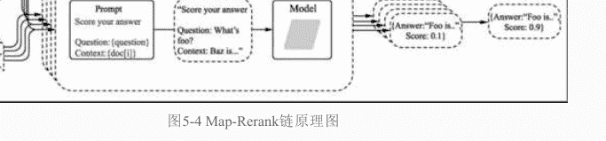
*图 5-4 Map-Rerank 链原理图*

使用 Map-Rerank 链的示例如下：

```python
from langchain.chains import MapRerankDocumentsChain

###### 定义提示词模板，用于生成评分和内容
prompt_template_rerank = PromptTemplate(
    template="请评价以下内容的相关性，并选择最重要的观点：\n\n(fragment)")

###### 创建 Map-Rerank 链
map_rerank_chain = MapRerankDocumentsChain(llm=llm, prompt=prompt_template_rerank)

###### 执行 Map-Rerank 链任务
response_rerank = map_rerank_chain.run({"documents": document_fragments})
print("Map-Rerank 链筛选的最终结果:", response_rerank)
```

输出示例：

> >> Map-Rerank 链筛选的最终结果：人工智能在多个领域带来深远影响，特别是在智能城市、环境保护等方面，未来应用潜力巨大。

在此输出中，Map-Rerank 链通过对每个片段进行评分，选择了最相关和重要的内容，从而生成了更具针对性的总结。

Map-Reduce 链和 Map-Rerank 链是处理大规模和复杂文档的有效工具。Map-Reduce 链将每个片段独立处理并归并生成结果，适合大规模内容的摘要生成；而 Map-Rerank 链在 Map-Reduce 的基础上增加了评分排序功能，使其在筛选最优内容的任务中表现更优。

## 表 5-1 LangChain 链类汇总表

| 链类型 | 特点 | 适用场景 |
| :--- | :--- | :--- |
| LLM 链 | 直接调用语言模型，通过提示词模板和参数设置优化生成效果 | 基础生成任务，适用于单一内容生成 |
| 序列链 | 多步骤任务链，按顺序调用每个步骤，逐层生成内容 | 多层次生成需求，如内容预处理和逐步扩展 |
| 路由链 | 基于条件判断选择不同的任务路径，实现动态内容生成 | 多分支流程，如客服问题分类、内容筛选 |
| Stuff 链 | 将所有文档片段合并后一次性处理，简单高效，但受限于上下文长度 | 小型文档快速处理，适合内容简洁、信息量少 |
| Refine 链 | 逐步精炼文档片段，将每一步的输出传递给下一个文档片段，构建完整内容 | 大型文档精炼、层次分明的内容生成 |
| Map-Reduce 链 | 将文档片段独立处理（Map）后归并（Reduce），适合大规模内容分步处理 | 长文档问答、多个文档片段的总结和分析 |
| Map-Rerank 链 | 在 Map-Reduce 链基础上增加评分和排序步骤，筛选最优内容 | 多片段内容筛选，如长文档问答、最相关内容提取 |

### 5.5 本章小结

本章介绍了 LangChain 中的各类链技术及其应用场景。LLM 链用于基础生成，通过提示词模板和参数优化生成内容；序列链将多步骤任务按顺序组织，实现层次化生成；路由链通过条件判断动态选择路径，适应多分支任务需求。

此外，文档链包含 Stuff 链（适合小型文档合并处理）、Refine 链（逐步精炼内容）、Map-Reduce 链（分步处理并归并）和 Map-Rerank 链（对生成内容进行评分和筛选）。通过这些链技术，读者可以灵活处理不同类型的内容生成和文档处理任务，为企业级应用提供可靠的架构支持。

### 5.6 思考题

1. LLM 链的基本参数中，temperature 的作用是什么？它如何影响生成内容的风格？
2. 在序列链中，如何将步骤之间的输出作为下一步的输入传递？举例说明实现方法。
3. 在路由链中，如何设置条件判断函数，以便根据输入内容选择不同的子链路径？请列出实现步骤。
4. 解释在 Stuff 链中合并文档内容的主要优势与劣势。它适合哪些场景，何时不适用？
5. Refine 链与 Stuff 链有何主要区别？在逐步处理复杂文档内容时，Refine 链是如何增强生成效果的？
6. 在 Map-Reduce 链中，“Map”与“Reduce”步骤各自的任务是什么？这两个步骤如何协同生成最终结果？
7. 举例说明在 Map-Rerank 链中如何使用评分机制筛选最优内容。这种链如何确保生成结果的相关性？
8. 在 LLM 链中，如何嵌入复杂的提示词模板并实现动态内容生成？请写出一个带变量的提示词示例。
9. 在路由链的配置中，如何为不同任务路径设置不同的模型（LLM）实例？详细说明操作步骤。
10. 在 Map-Reduce 链中，如何应对长文档分段处理？在实现时有哪些需要注意的细节？
11. 在 Map-Rerank 链的应用中，如何确定评分标准？具体如何配置以确保返回的内容最符合目标需求？
12. 如果要在序列链中引入外部资源（如 API 或数据库查询），具体该如何操作？请列出实现步骤并举例。
13. 在 LLM 链中，如何利用参数设置和提示词模板提高生成内容的准确性和连贯性？请具体说明两种设置的效果。
14. Refine 链的逐步精炼处理适用于信息量较大的内容，请解释在每步精炼中如何保留核心信息并逐渐构建完整内容。
15. Map-Reduce 链与 Map-Rerank 链的主要区别是什么？请说明在实际应用中选择 Map-Rerank 链的典型场景。
16. 在设置序列链时，如果需要在步骤间传递外部查询结果（如数据库或 API 响应），如何将此数据融入生成流程中？请给出具体步骤。

# 第 6 章
## 核心组件 2：内存模块

在构建智能对话系统中，内存（Memory）模块是 LangChain 的关键组件之一。它使模型能够记住先前的对话内容，以实现上下文理解和多轮交互。通过引入内存（Memory）模块，模型不仅能够处理当前的对话请求，还能在对话过程中动态调整内容生成，提升整体对话的连续性和逻辑性。这对于构建复杂的应用场景（如智能客服、个性化助手等）尤为重要。

本章将深入探讨内存（Memory）模块的核心功能与实现方式，涵盖聊天消息记忆、会话缓冲区和会话缓冲窗口、会话摘要与向量存储，以及基于 Postgres 和 Redis 的持久化存储等内容。

通过学习本章内容，读者将能通过内存（Memory）模块有效管理聊天记录，提升对话系统的响应能力和记忆功能，为企业级智能对话应用奠定坚实的基础。

### 6.1 聊天消息记忆

> 聊天消息记忆（chatMessage）是 Memory 模块的基础功能，旨在为模型提供对话历史的存储与回溯能力。通过记录用户和模型之间的互动信息，聊天消息记忆模块可以让模型在多轮对话中保持上下文的一致性，从而生成更加贴合用户需求的回答。

> 本节将详细介绍聊天消息记忆的基本原理和实现方法，包括如何配置消息存储策略以及如何在多轮交互中利用对话历史提升模型表现。

#### 6.1.1 聊天消息存储机制：保障对话连续性

> 聊天消息存储机制是 Memory 模块的核心，通过将用户和模型的消息存储下来，使模型能够在多轮对话中参考先前的内容，保持上下文的连续性。

> 具体来说，聊天消息存储机制会记录每一轮对话内容，包括用户的输入和模型的生成输出，这样可以在下一轮对话时回溯和利用已有的信息。

##### 1. 设置聊天消息记忆

> 在 LangChain 中，聊天消息记忆可以通过 ConversationBufferMemory 来实现。ConversationBufferMemory 会将对话记录保存在一个缓冲区中，以便在需要时提供给模型进行上下文参考。通过 ConversationBufferMemory，可以轻松实现基础的对话存储功能。

```python
###### 示例代码：初始化聊天消息记忆缓冲区
from langchain.memory import ConversationBufferMemory
###### 创建聊天消息记忆缓冲区
memory = ConversationBufferMemory()
```

> 在该代码中，ConversationBufferMemory 用于创建一个记忆缓冲区，来存储每一轮对话的消息。接下来，将该缓冲区与语言模型的调用结合，形成一个具有记忆能力的对话流程。

##### 2. 将 Memory 模块集成到对话模型中

> 在实际应用中，通常需要将 Memory 模块集成到对话生成逻辑中，以便每次生成时都能参考之前的消息历史。以下示例将展示如何将 Memory 模块与 LangChain 的 LLM 链结合，形成一个具有记忆功能的对话系统。

```python
from langchain.chains import ConversationChain
from langchain.llms import OpenAI

##### 初始化语言模型
llm = OpenAI(model_name="text-davinci-003", temperature=0.7, max_tokens=150)

###### 创建带有记忆功能的对话链
conversation_chain = ConversationChain(llm=llm, memory=memory)

###### 开始对话示例
user_input_1 = "你好，能给我介绍一下机器学习吗？"
response_1 = conversation_chain.run(user_input_1)
print("模型回答：", response_1)

###### 继续对话
user_input_2 = "机器学习和深度学习有什么区别？"
response_2 = conversation_chain.run(user_input_2)
print("模型回答：", response_2)
```

> 在该示例中，ConversationChain 类通过集成 ConversationBufferMemory 实现了多轮对话的上下文记忆功能。模型在生成第二次回答时，会参考第一次对话的内容，以生成符合对话上下文的回答。

##### 3. 自定义消息存储格式

默认情况下，ConversationBufferMemory 会将消息按对话顺序存储，开发者还可以自定义存储格式。例如，可以在存储每条消息时添加时间戳，以便更好地管理对话历史。下面示例将展示如何自定义消息存储格式，在消息存储中添加时间信息。

```python
from datetime import datetime

###### 创建自定义的消息存储函数
def add_timestamped_message(memory, user_input, model_response):
    timestamp = datetime.now().strftime("%Y-%m-%d %H:%M:%S")
    memory.save_context(
        {"input": f"{timestamp} 用户：{user_input}"},
        {"output": f"{timestamp} 模型:{model_response}"}
    )

#### 示例对话
user_input = "你，告知我关于人工智能的最新进展。"
model_response = "人工智能在医疗、自动驾驶等领域进展显著，特别是在诊断和自动化方面。"

###### 存储带时间戳的对话内容
add_timestamped_message(memory, user_input, model_response)
```

> 在此示例中，add_timestamped_message 函数将每条对话添加到 ConversationBufferMemory 中，并附加了时间戳信息。这种存储方式可以为多轮对话提供更清晰的历史记录。

##### 4. 调整消息存储策略

在某些场景中，可能并不需要保留完整的对话历史，而是只记录有限条数的最近消息，以节省存储空间和提高模型处理效率。通过设置 buffer_window 属性，可以控制存储消息的数量，示例代码如下：

```python
###### 设置缓冲窗口大小，仅保留最近的 3 条消息
memory.buffer_window = 3

###### 开始对话示例
user_input_1 = "你好，能介绍一下机器学习吗？"
response_1 = conversation_chain.run(user_input_1)
print("模型回答:", response_1)

user_input_2 = "机器学习有哪些应用？"
response_2 = conversation_chain.run(user_input_2)
print("模型回答:", response_2)

user_input_3 = "深度学习是什么？"
response_3 = conversation_chain.run(user_input_3)
print("模型回答:", response_3)

user_input_4 = "深度学习和机器学习有什么区别？"
response_4 = conversation_chain.run(user_input_4)
print("模型回答:", response_4)

###### 打印存储的消息
print("存储的消息历史:", memory.load_memory_variables({}))
```

> 在这个示例中，设置了 buffer_window=3，即只保留最近的 3 条对话记录，确保对话历史不过于冗长，同时又能够根据需求保存必要的上下文信息。
>
> **输出示例：**
> ```text
> >>已清除的消息历史：{'history':''}
> ```

##### 5. 清除消息历史

在某些对话场景中，如开始一个全新话题，可能需要清空先前的对话历史。可以通过 clear 方法快速清除 ConversationBufferMemory 中的消息历史。

清除对话历史的示例代码如下：

```python
###### 清除之前的对话历史
memory.clear()
###### 验证存储是否被清空
print("已清除的消息历史:", memory.load_memory_variables({}))
```

> **输出示例：**
> ```text
> >>已清除的消息历史：{'history':''}
> ```

clear 方法可以确保在需要时快速清空对话历史，便于模型在不同话题间切换而不受之前内容的干扰。

通过 ConversationBufferMemory，开发者可以轻松构建一个具有记忆能力的对话系统，支持多轮对话的连续性。通过自定义消息存储格式、调整消息数量以及清除对话历史，开发者可以灵活控制聊天消息的存储策略，以适应不同场景下的对话需求。# 6.1.2 动态消息记忆策略的设计与实现

在智能对话系统中，动态消息记忆策略能够根据对话情境灵活调整存储的内容，使得模型的记忆更符合当前对话需求。与简单的消息存储不同，动态消息记忆策略可以在特定条件下自动调整记忆深度或内容筛选，从而提升模型的响应质量。通过这种方式，可以有效避免对话历史的冗余，同时让系统的记忆更具针对性。下面将带领读者设计并实现一套动态消息记忆策略。

#### 1. 引入条件判断，实现记忆筛选

动态消息记忆策略的一个关键步骤是根据条件来判断是否保留特定内容。条件判断可以基于关键词、消息长度或对话语境。通过在存储前对消息进行筛选，可以使得存储的内容更具针对性。

##### 基于关键词的记忆筛选

基于关键词的记忆筛选的示例代码如下：

```python
def keyword_based_filter(message, keywords=["重要", "关键", "重点"]):
    return any(keyword in message for keyword in keywords)


###### 存储带有关键词的消息
def store_filtered_message(memory, user_input, model_response):
    if keyword_based_filter(user_input):
        memory.save_content({"input": user_input},
                            {"output": model_response})


#### 示例对话

user_input = "这是一个关于机器学习的关键问题。"
model_response = "机器学习在很多领域都有重要应用。"
store_filtered_message(memory, user_input, model_response)

print("筛选后的消息历史:", memory.load_memory_variables({}))
```

在此示例中，`keyword_based_filter`函数会判断用户输入是否包含指定关键词（如“重要”、“关键”或“重点”）。如果包含，则将该消息存储到ConversationBufferMemory中；否则，消息将被忽略。通过这种方式，系统可以自动筛选并存储重要内容。

#### 2. 基于对话轮数的动态记忆更新

在某些场景下，可能需要根据对话的轮数动态调整记忆的存储深度。例如，系统可以在对话轮数较少时存储更多消息，而在对话轮数增加后逐渐减少存储量，以保持对话内容的简洁性。

##### 基于轮数的记忆调整

基于轮数的记忆调整的示例代码如下：

在这个示例中，`dynamic_memory_update`函数会根据对话轮数动态调整`buffer_window`的大小。在前5轮对话中，系统存储的消息较多，当轮数增加时，系统逐渐减少存储量，以避免信息冗余。

#### 3. 配置消息存储的优先级

在复杂的对话系统中，有些消息可能比其他消息更重要，例如带有特定关键词的句子或关键的用户需求描述。通过为不同消息设定优先级，可以在存储时只保留优先级较高的内容，以便系统能更精准地参考重要信息。

##### 基于优先级的存储策略

基于优先级的存储策略的示例代码如下：

```python
###### 定义一个函数，根据轮数调整存储深度
def adjust_memory_depth(memory, max_depth=5):
    memory.buffer_window = max_depth

####### 对话轮计数器
dialogue_count = 0

####### 动态调整记忆深度
def dynamic_memory_update(user_input, model_response):
    global dialogue_count
    dialogue_count += 1

    # 动态调整深度，每5轮减少一次深度
    if dialogue_count <= 5:
        adjust_memory_depth(memory, max_depth=5)
    elif 5 < dialogue_count <= 10:
        adjust_memory_depth(memory, max_depth=3)
    else:
        adjust_memory_depth(memory, max_depth=2)

####### 存储当前消息
memory.save_context({"input": user_input}, {"output": model_response})

#### 示例对话
user_input_1 = "介绍一下机器学习。"
model_response_1 = "机器学习是一种通过数据训练模型的技术。"
dynamic_memory_update(user_input_1, model_response_1)

user_input_2 = "机器学习的主要应用有哪些？"
model_response_2 = "它在图像识别、自然语言处理等领域应用广泛。"
dynamic_memory_update(user_input_2, model_response_2)

####### 打印当前存储历史
print("动态调整后的消息历史:", memory.load_memory_variables({}))
```

#### 4. 基于话题切换的记忆更新

在某些应用场景中，用户的对话主题可能会频繁切换。当切换话题时，可以清除旧的对话历史，以确保新话题不被旧内容干扰。可以通过话题检测实现动态记忆清理。

##### 基于话题切换的清理策略

基于话题切换的清理策略的示例代码如下：

```python
###### 简单的主题检测函数

def topic_change_detector(new_topic, current_topic):
    return new_topic != current_topic

#### 示例对话
current_topic = "机器学习"

###### 检测并更新话题
def topic_based_memory_clear(memory, new_topic, user_input, model_response):
    global current_topic
    if topic_change_detector(new_topic, current_topic):
        memory.clear() #清除旧话题的消息历史
        current_topic = new_topic

###### 存储新话题的消息
memory.save_context({"input": user_input}, {"output": model_response})

#### 示例对话
user_input_topic1 = "告诉我关于机器学习的应用。"
model_response_topic1 = "机器学习在许多领域有广泛应用。"
topic_based_memory_clear(memory, "机器学习", user_input_topic1, model_response_topic1)

user_input_topic2 = "区块链的原理是什么？"
model_response_topic2 = "区块链是一种去中心化的分布式账本技术。"
topic_based_memory_clear(memory, "区块链", user_input_topic2, model_response_topic2)

print("切换话题后的消息历史:", memory.load_memory_variables({}))
```

在该示例中，每当话题发生变化时，系统会调用 `topic_change_detector` 函数检测到话题切换，随即清除旧的历史记录，仅保留新话题的相关内容，这样可以确保不同话题之间的对话内容相互独立。

动态消息记忆策略可以使对话系统能够根据实际需求灵活调整存储内容，通过关键词筛选、对话轮数控制、消息优先级设置和话题切换检测，可以实现高度灵活的记忆策略。

### 6.2 会话缓冲区与会话缓冲窗口

会话缓冲区和会话缓冲窗口是Memory模块中的核心组件，用于高效管理对话系统中的上下文信息。通过配置缓冲区和缓冲窗口，可以灵活控制对话历史的存储方式，确保系统能够保留必要的上下文而不被冗余信息干扰。

本节将深入探讨会话缓冲区与会话缓冲窗口的功能及其实现方式，帮助读者理解如何利用它们优化对话系统的上下文管理，为复杂对话任务提供灵活且高效的存储支持。

#### 6.2.1 会话缓冲区的配置与应用场景

会话缓冲区是对话系统中的重要模块，用于存储一系列对话记录，以便系统在生成回复时能够参考之前的对话内容。通过合理配置会话缓冲区，可以确保模型能够理解对话上下文，实现多轮对话的流畅性。缓冲区的配置方式不同，其适用的场景也不同。

##### 1. 创建并初始化会话缓冲区

在LangChain中，`ConversationBufferMemory`用于实现会话缓冲区。通过该模块，系统可以自动记录用户与模型的对话信息，以便在后续的对话中提供上下文支持。

###### 初始化会话缓冲区

初始化会话缓冲区的示例代码如下：

```python
from langchain.memory import ConversationBufferMemory
####### 创建会话缓冲区
memory = ConversationBufferMemory()
```

在此代码中，`ConversationBufferMemory`会话缓冲区创建成功后，将自动保存每一轮对话内容。系统可以将这一缓冲区与对话链结合使用，以实现多轮对话的完整记录。

##### 2. 会话缓冲区的应用场景

会话缓冲区非常适合需要连续上下文的场景，尤其是当用户希望系统参考之前的对话内容时。例如：

- （1）客户服务：在处理客户咨询时，系统可以通过会话缓冲区记住用户的需求，从而在后续对话中给出更精准的回答。
- （2）个性化推荐：通过记录用户的偏好信息，系统可以在对话中逐步优化推荐内容。
- （3）技术支持：在多轮问答中，通过保存用户问题的上下文，确保系统能够理解并提供具体的解决方案。

##### 3. 配置缓冲区的容量

在某些情况下，可能需要限制缓冲区的容量，以控制对话系统的响应速度和内存使用量。通过设置`buffer_window`参数，可以限定会话缓冲区中存储的消息数量。较大的缓冲区容量适合较长的上下文，而较小的容量则适合短对话场景。

###### 限制会话缓冲区的容量

限制会话缓冲区的容量的示例代码如下：

```python
# 配置会话缓冲区的窗口大小为5条消息
memory.buffer_window = 5

####### 打印当前配置的窗口大小
print("会话缓冲区窗口大小:", memory.buffer_window)
```

在此示例中，通过将`buffer_window`设置为5，让系统保留最近5条消息，确保缓冲区内存占用合理，同时又能够保持对话的基本上下文。

##### 4. 将会话缓冲区与对话链集成

在实际应用中，可以将会话缓冲区与对话链（如`ConversationChain`）集成，以便在对话生成时自动参考缓冲区内容。以下示例将展示如何将缓冲区整合到对话链中，实现完整的多轮对话存储。

```python
from langchain.chains import ConversationChain
from langchain.llms import OpenAI

##### 初始化语言模型
llm = OpenAI(model_name="text-davinci-003", temperature=0.7, max_tokens=150)

###### 创建带有会话缓冲区的对话链
conversation_chain = ConversationChain(llm=llm, memory=memory)

#### 示例对话
user_input_1 = "你好，可以告诉我什么是机器学习吗？"
response_1 = conversation_chain.run(user_input_1)
print("模型回答：", response_1)

user_input_2 = "机器学习有哪些应用？"
response_2 = conversation_chain.run(user_input_2)
print("模型回答：", response_2)

###### 打印缓冲区中的消息历史
print("会话缓冲区内容：", memory.load_memory_variables({}))
```

在这个示例中，`ConversationChain`自动调用`ConversationBufferMemory`中的对话历史。在多轮对话中，系统会自动保留之前的对话内容，从而实现流畅的上下文接续。

##### 5. 动态调整缓冲区容量

在某些复杂应用中，可能根据对话的具体情境动态调整缓冲区容量。例如，可以在对话的前几轮中存储更多内容，随后逐步减少存储量，以便在长对话中节省资源。

####### 动态调整缓冲区容量

动态调整缓冲区容量的示例代码如下：

```python
####### 定义一个动态调整缓冲区容量的函数
def adjust_memory_capacity(memory, dialogue_round):
    if dialogue_round <= 5:
        memory.buffer_window = 5
    elif 5 < dialogue_round <= 10:
        memory.buffer_window = 3
    else:
        memory.buffer_window = 2

####### 对话轮数计数器
dialogue_round = 0

####### 动态调整缓冲区容量
def dynamic_conversation(user_input, model_response):
    global dialogue_round
    dialogue_round += 1

    # 根据对话轮数调整缓冲区容量
    adjust_memory_capacity(memory, dialogue_round)

    # 保存对话内容
    memory.save_context({'input': user_input}, {'output': model_response})

#### 示例对话
user_input_1 = "可以简单介绍一下机器学习吗？"
model_response_1 = "机器学习是一种通过数据训练模型的技术。"
dynamic_conversation(user_input_1, model_response_1)

user_input_2 = "那么，深度学习和机器学习有何区别？"
model_response_2 = "深度学习是机器学习的一个子集，专注于神经网络..."  # 补全截断内容以适应示例逻辑
dynamic_conversation(user_input_2, model_response_2)
```

在该示例中，`adjust_memory_capacity`函数会根据对话轮数来调整缓冲区容量。这样可以在对话初期保留较多内容，而在对话逐渐深入时减少存储量，以提升系统的运行效率。

##### 6. 配置会话缓冲区的清理策略

在一些应用中，当用户切换话题或对话情境发生变化时，可能需要清理会话缓冲区，以避免旧上下文对新的对话产生干扰。我们可以通过`clear`方法实现缓冲区的清理操作，从而确保每次对话开始时的上下文独立性。

###### 清理会话缓冲区

清理会话缓冲区的示例代码如下：

```python
####### 清除会话缓冲区内容
memory.clear()

####### 验证缓冲区是否被清空
print(memory.load_memory_variables({}))  # 输出通常为空的字典或空列表，视具体实现而定
```

`clear`方法可以在切换话题时清除对话历史，以确保系统能够从新的对话开始而不受之前内容的影响。

会话缓冲区通过记录多轮对话内容，为对话系统提供了基本的上下文存储功能。不同的缓冲区容量和清理策略适用于不同的应用场景。通过掌握会话缓冲区的配置和应用场景，开发者可以有效设计出适应不同需求的对话存储方案，为多轮对话任务提供稳定的上下文支持。

#### 6.2.2 会话缓冲窗口的实现

会话缓冲窗口（Session Buffer Window）是会话缓冲区的一种变体，通过“滑动窗口”机制来控制存储的消息数量，仅保留对话中最近的一部分内容。这种机制在对话上下文不需要完整的历史记录，或仅需要参考最新对话内容的场景中尤为适用。缓冲窗口可以根据设定的窗口大小来限制消息数量，确保系统在需要时获取最新的上下文内容，同时降低内存占用。

##### 1. 创建会话缓冲窗口

在 LangChain 中，可以通过 `ConversationBufferWindowMemory` 来实现会话缓冲窗口。`ConversationBufferWindowMemory`与普通缓冲区的区别在于它能够通过窗口大小限制，仅保留最近的消息记录。

###### 初始化会话缓冲窗口

初始化会话缓冲窗口的示例代码如下：

```python
from langchain.memory import ConversationBufferWindowMemory
# 创建会话缓冲窗口，并设置窗口大小为3条消息
memory = ConversationBufferWindowMemory(k=3)
```

在此代码中，`k=3`表示会话缓冲窗口将只保留最近的3条消息。在多轮对话中，当新消息添加到窗口时，旧消息将会自动移出窗口。

##### 2. 配置缓冲窗口的大小

缓冲窗口的大小决定了系统保留对话历史的深度。较小的窗口适合短对话场景，而较大的窗口则适合需要更长上下文的场景。可以根据具体应用场景调整窗口大小，确保对话系统在获取必要上下文的同时保持效率。

###### 调整缓冲窗口大小

调整缓冲窗口大小的示例代码如下：

```python
# 将窗口大小设置为5条消息
memory.k = 5
####### 打印当前窗口大小
print("当前会话缓冲窗口大小:", memory.k)
```

在此示例中，调整`k`的值可以更改窗口的大小，以便在不同对话需求下优化存储效率。

##### 3. 将缓冲窗口与对话链集成

与会话缓冲区类似，会话缓冲窗口也可以与对话链（`ConversationChain`）集成，以便在生成回答时自动参考窗口内的最新上下文。以下代码将展示如何集成缓冲窗口实现多轮对话的上下文记忆。from langchain.chains import ConversationChain
from langchain.llms import OpenAI

##### 初始化语言模型
llm = OpenAI(model_name="text-davinci-003", temperature=0.7, max_tokens=150)

###### 创建带有会话缓冲窗口的对话链
conversation_chain = ConversationChain(llm=llm, memory=memory)

#### 示例对话
user_input_1 = "你好，可以告诉我什么是机器学习吗？"
response_1 = conversation_chain.run(user_input_1)
print("模型回答:", response_1)

user_input_2 = "机器学习有哪些应用？"
response_2 = conversation_chain.run(user_input_2)
print("模型回答:", response_2)

user_input_3 = "能讲讲深度学习吗？"
response_3 = conversation_chain.run(user_input_3)
print("模型回答:", response_3)

user_input_4 = "深度学习和机器学习有什么区别？"
response_4 = conversation_chain.run(user_input_4)
print("模型回答:", response_4)

###### 查看缓冲窗口中的内容
print("会话缓冲窗口内容:", memory.load_memory_variables({}))

在该示例中，ConversationChain 通过 ConversationBufferWindowMemory 获取窗口内的对话历史。由于窗口大小设为 3 条消息，因此系统在生成第四条消息时，最早的消息（“你好，可以告诉我什么是机器学习吗？”）会自动移出窗口，从而确保仅保留最近的 3 条记录。

输出示例：

> 与当前输入最相关的内容：{'history': '用户：机器学习有哪些应用？\n模型：它在图像识别、自然语言处理等领域应用广泛。\n用户：能讲讲深度学习吗？\n模型：深度学习是一种基于神经网络的机器学习方法。\n用户：深度学习和机器学习有什么区别？'}

在输出中可以看到，缓冲窗口仅保留了最近的三轮对话。

# ## 4. 动态调整缓冲窗口大小

在某些对话场景中，可能需要动态调整窗口大小，以适应不同的话题需求。例如，当用户提出新的问题时，可以暂时增加窗口大小，以便系统获取更长的上下文；然后在话题切换后恢复默认的窗口大小。

动态调整缓冲窗口大小的示例代码如下：

```python
###### 定义一个函数，根据条件动态调整窗口大小
def adjust_window_size(memory, topic_change=False):
    if topic_change:
        memory.k = 5  # 在新话题开始时增加窗口大小
    else:
        memory.k = 3  # 在默认情况下保持窗口大小为 3

#### 示例对话
user_input_1 = "你好，可以告诉我关于机器学习的基础知识吗？"
response_1 = conversation_chain.run(user_input_1)
print("模型回答:", response_1)

####### 假设检测到新话题
adjust_window_size(memory, topic_change=True)

user_input_2 = "再深入讲讲深度学习的概念。"
response_2 = conversation_chain.run(user_input_2)
print("模型回答:", response_2)

####### 恢复默认窗口大小
adjust_window_size(memory, topic_change=False)

user_input_3 = "机器学习有哪些应用？"
response_3 = conversation_chain.run(user_input_3)
print("模型回答:", response_3)

####### 查看缓冲窗口内容
print("调整后会话缓冲窗口内容:", memory.load_memory_variables({}))
```

在该示例中，`adjust_window_size` 函数用于根据话题变化动态调整窗口大小。当检测到新话题时，缓冲窗口暂时增大，以确保系统可以参考更多的上下文内容；在话题返回到常规状态后，恢复窗口的默认大小。

# ## 5. 实现基于消息内容的窗口更新

在某些应用场景中，可能需要根据消息的内容来决定是否将其添加到缓冲窗口中。例如，系统可以根据消息的重要性来判断是否存储。通过条件判断可以实现基于内容的消息存储策略。

基于内容的窗口更新的示例代码如下：

```python
###### 定义基于内容的条件判断函数
def should_store_message(message):
    # 只有包含关键字的消息才会存储
    important_keywords = ["重要", "关键", "重点"]
    return any(keyword in message for keyword in important_keywords)

###### 在缓冲窗口中存储符合条件的消息
def store_message_with_condition(memory, user_input, model_response):
    if should_store_message(user_input):
        memory.save_context({"input": user_input},
                            {"output": model_response})

    # 示例对话
    user_input_important = "这是一个关于机器学习的重要问题。"
    model_response_important = "机器学习是现代数据分析中的关键技术。"
    store_message_with_condition(memory,
                                user_input_important, model_response_important)

    user_input_normal = "一般来说，机器学习是做什么的？"
    model_response_normal = "机器学习是一种通过学习模式的技术。"
    store_message_with_condition(memory,
                                user_input_normal, model_response_normal)

    # 查看缓冲窗口内容
    print("基于内容存储的会话缓冲窗口内容:", memory.load_memory_variables({}))
```

在此示例中，只有包含“重要”、“关键”、“重点”等关键词的信息才会存储到缓冲窗口中。这样可以确保窗口中只包含对当前对话至关重要的信息。

### 会话缓冲窗口适合以下应用场景：

-   简短客户服务：在多轮对话中，只需参考最近的几条消息即可完成用户问题的解答。
-   实时对话系统：只需保留最近的上下文，而不记录整个对话历史。
-   内容筛选系统：通过基于内容的条件判断机制，筛选并存储重要消息。

通过理解会话缓冲窗口的实现及其配置方式，开发者可以在不同的对话场景中灵活应用窗口机制，确保系统既能够参考最新上下文，又保持高效的资源管理。

# ## 6.3 会话摘要与支持向量存储

会话摘要和支持向量存储是 Memory 模块中的高级功能，用于在长对话和大规模信息处理场景中有效管理对话内容。会话摘要通过压缩历史对话来生成简洁概述，确保模型能够快速理解先前对话的核心内容而无须存储全部信息。支持向量存储则利用向量化技术，将对话内容以向量形式保存，便于系统在大量内容中快速检索相关信息。

本节将详细介绍如何生成和更新会话摘要，并引导读者配置支持向量存储，从而在复杂应用中实现更高效的上下文管理。这些功能特别适合需要长对话、内容回溯或个性化内容检索的场景，为企业级对话系统提供了强大的记忆和信息管理能力。

# ### 6.3.1 长会话摘要的生成与更新

在长对话中，存储完整的对话历史可能会占用大量内存，降低系统的处理效率。会话摘要可以将对话内容进行简要概括，保留核心信息并舍弃冗余细节，从而确保系统在后续对话中能够参考重要的上下文内容。LangChain 支持自动生成和更新会话摘要，这对需要多轮交互、保持对话连贯性的场景尤为适用。下面将逐步讲解如何生成和更新长会话的摘要。

# #### 1. 初始化会话摘要模块

在 LangChain 中，可以通过 `ConversationSummaryMemory` 来实现会话摘要。此模块能够在对话过程中自动生成对话摘要，并根据新信息不断更新。

初始化会话摘要模块的示例代码如下：

```python
from langchain.memory import ConversationSummaryMemory
from langchain.llms import OpenAI

##### 初始化语言模型
llm = OpenAI(model_name="text-davinci-003", temperature=0.7, max_tokens=150)

####### 创建会话摘要内存
summary_memory = ConversationSummaryMemory(llm=llm)
```

在该示例中，`ConversationSummaryMemory` 被用来创建一个摘要存储模块。通过传入语言模型，系统可以根据会话内容自动生成简洁的摘要。

# #### 2. 将摘要模块与对话链集成

与会话缓冲区类似，会话摘要模块可以与对话链集成，以便在生成回答时自动参考生成的摘要内容。这种集成可以保证系统在处理对话时无须保存全部历史，而是利用会话摘要实现上下文的连续。

集成会话摘要模块与对话链的示例代码如下：

```python
from langchain.chains import ConversationChain

####### 创建带有会话摘要的对话链
conversation_chain = ConversationChain(llm=llm, memory=summary_memory)

#### 示例对话
user_input_1 = "你好，可以告诉我什么是机器学习吗？"
response_1 = conversation_chain.run(user_input_1)
print("模型回答：", response_1)

user_input_2 = "机器学习和深度学习有什么区别？"
response_2 = conversation_chain.run(user_input_2)
print("模型回答：", response_2)

####### 查看会话摘要
print("生成的会话摘要：", summary_memory.load_memory_variables({}))
```

在该示例中，`ConversationSummaryMemory` 会在对话进行时不断更新摘要。通过调用 `load_memory_variables`，可以查看当前会话的核心摘要信息，从而了解对话的主要内容。

# ### 3. 动态更新会话摘要

在多轮对话中，随着用户输入的增加，会话摘要需要不断更新以涵盖新的信息。可以通过 `ConversationSummaryMemory` 的内置方法动态更新会话摘要。每当新对话生成时，系统会自动将新信息整合到现有摘要中，以确保摘要始终反映最新对话内容。

动态更新会话摘要的示例代码如下：

```python
####### 新一轮对话示例
user_input_3 = "机器学习在金融行业有哪些应用？"
response_3 = conversation_chain.run(user_input_3)
print("模型回答:", response_3)
```

在该示例中，每次用户输入新的问题后，系统会自动更新会话摘要，确保摘要包含最新的信息。这样可以在长对话中提供清晰的对话概况，避免保存大量冗余信息。

# ### 4. 设置摘要生成策略

LangChain 允许自定义摘要生成策略，以便控制摘要的长度和精度。例如，可以通过调整 `max_tokens` 参数控制生成的摘要长度，或通过 `temperature` 参数调节生成内容的多样性。这样可以根据需求生成更简洁或更详细的摘要。

调整摘要生成参数的示例代码如下：

```python
####### 调整语言模型参数
summary_memory.llm.max_tokens = 100  # 控制摘要长度
summary_memory.llm.temperature = 0.5  # 控制生成的稳定性

####### 新一轮对话示例
user_input_4 = "机器学习是否可以帮助提升客户体验？"
response_4 = conversation_chain.run(user_input_4)
print("模型回答:", response_4)
```

在该示例中，通过调整 `max_tokens` 和 `temperature` 参数，系统可以生成不同长度和细节的摘要内容，以适应对话的复杂性或简洁性需求。

# ### 5. 自动清理会话摘要

在某些场景中，当用户更换话题或开始新的会话时，可能需要清除现有的摘要。可以通过 `clear` 方法清空会话摘要，确保系统不会混淆不同话题的内容。

清理会话摘要的示例代码如下：

```python
####### 清除当前会话摘要
summary_memory.clear()
####### 验证摘要是否被清空
print(summary_memory.load_memory_variables({}))
```

此方法可以有效避免在不同主题间产生信息干扰，确保系统在新的会话中能够从零开始建立摘要。

会话摘要适用于以下应用场景：

1. 长对话管理：在对话历史较长的场景中，通过生成摘要提供关键上下文。
2. 跨话题对话：当用户在对话中频繁切换话题时，可以通过更新摘要来跟踪每个话题的核心内容。
3. 信息压缩与概述：在信息量较大的对话中生成简洁概述，帮助系统更高效地管理记忆。

通过对会话摘要生成与更新的理解，读者可以有效利用 LangChain 的记忆模块来优化长对话中的信息管理，为复杂的多轮对话提供精准的上下文支持。

# ### 6.3.2 使用向量存储实现会话内容的高效检索

在长对话和复杂应用场景中，可能需要在大量对话内容中快速检索相关信息。向量存储是一种通过将文本内容向量化来支持高效检索的技术。在 LangChain 中，可以将对话内容存储为向量，从而在需要时快速找到与用户当前输入最相关的上下文信息。

下面将逐步讲解如何使用 LangChain 的向量存储实现会话内容的高效检索，包括从向量化对话内容到执行检索操作的整个过程。

# #### 1. 设置向量存储和向量化模型

首先，需要初始化一个向量存储来保存向量化的会话内容。在 LangChain 中，可以使用 FAISS（Facebook AI Similarity Search）向量存储模块进行高效的向量检索。同时，使用 OpenAI 或其他语言模型将对话内容转换为向量格式，便于存储和检索。

初始化向量存储和向量化模型的示例代码如下：

```python
from langchain.vectorstores import FAISS
from langchain.embeddings import OpenAIEmbeddings
from langchain.llms import OpenAI

####### 初始化向量化模型，用于将文本转换为向量
embedding_model = OpenAIEmbeddings()

###### 创建向量存储
vector_store = FAISS(embedding_model)
```

在此代码中，`OpenAIEmbeddings` 用于将文本内容转换为向量，而 FAISS 则用于存储这些向量。FAISS 是一种常用的高效向量检索库，适用于长对话或大数据量的场景。

# #### 2. 将对话内容存储为向量

每当用户与系统进行一次交互时，可以将用户输入和系统的回复进行向量化并存储到向量存储中。这使得系统在后续的对话中可以快速找到与当前输入最相关的历史信息。

向量化并存储对话内容的示例代码如下：

```python
####### 向量化并存储用户输入和模型回复
def store_conversation_as_vector(vector_store, user_input, model_response):
    # 向量化用户输入和模型回复
    user_vector = embedding_model.embed(user_input)
    model_vector = embedding_model.embed(model_response)

    # 存储向量化的内容
    vector_store.add_texts([user_input, model_response],
                           embeddings=[user_vector, model_vector])

#### 示例对话
user_input_1 = "你好，可以告诉我什么是机器学习吗？"
model_response_1 = "机器学习是一种通过数据训练模型的技术。"
store_conversation_as_vector(vector_store, user_input_1, model_response_1)

user_input_2 = "机器学习和深度学习有什么区别？"
model_response_2 = "深度学习是机器学习的一个分支，利用神经网络解决复杂问题。"
store_conversation_as_vector(vector_store, user_input_2, model_response_2)
```

在该示例中，`store_conversation_as_vector` 函数将每一轮对话的用户输入和模型输出向量化后存储在 `vector_store` 中。

####### 3. 检索与当前输入最相关的内容

在对话的后续轮次中，要根据用户的输入来检索出最相关的历史内容，这可以通过计算当前输入向量与存储内容向量的相似性来实现。向量存储库会返回与当前输入最相关的对话内容，帮助系统更好地理解上下文。

基于当前输入检索相关内容的示例代码如下：

```python
####### 检索与当前输入最相关的内容

def retrieve_relevant_conversation(vector_store, query):
    # 向量化当前查询
    query_vector = embedding_model.embed(query)
    
    # 从向量存储中检索最相关的内容
    similar_texts = vector_store.similarity_search(
        query_vector, k=2)   # 返回最相似的 2 条内容
    return similar_texts
    
####### 示例检索
query = "什么是机器学习？"
relevant_conversations = retrieve_relevant_conversation(vector_store, query)
print("与当前输入最相关的内容:", relevant_conversations)
```

在该示例中，`retrieve_relevant_conversation` 函数将用户当前输入向量化，并在向量存储库中搜索最相似的内容。通过 `similarity_search` 方法，可以返回与当前输入最相关的历史对话内容。

输出示例：

```python
>>> 与当前输入最相关的内容：['你好，可以告诉我什么是机器学习吗？', '机器学习是一种通过数据训练模型的技术。']
```

该输出表明系统找到了与用户当前输入“什么是机器学习？”最相关的历史对话内容，帮助系统在回答时更好地参考上下文。

####### 4. 自动更新和管理向量存储

在持续对话中，系统可以自动将新对话内容向量化并添加到向量存储中。然而，随着对话的增加，向量存储库中的数据量会增大。因此，有必要定期清理或更新存储内容，以确保系统的高效性。

自动更新向量存储的示例代码如下：

```python
####### 自动更新向量存储的逻辑（示例示意）
####### 在实际应用中，可能需要定期调用 clear 或 add_texts 来维护存储库大小和质量
####### ...
```

通过上述方法，开发者可以有效地管理长对话中的上下文信息，结合会话摘要的压缩特性和向量存储的检索能力，构建更加智能和高效的对话系统。

####### 定义对话存储和检索的主流程

```python
def update_and_retrieve(vector_store, user_input, model_response, query):
    # 存储新的对话内容
    store_conversation_as_vector(vector_store, user_input, model_response)
    # 检索与查询最相关的历史内容
    relevant_conversations = retrieve_relevant_conversation(
        vector_store, query)
    return relevant_conversations

####### 新对话内容示例

user_input_3 = "深度学习的应用有哪些？"

在该示例中，update_and_retrieve 函数会自动将新对话内容存储到向量存储库中，并根据查询检索出最相关的历史内容。这种自动更新机制可以确保系统随时都能参考到最新的对话内容。

####### 5. 定期清理或优化向量存储

随着对话记录的增加，向量存储库中的数据量可能变得庞大。定期清理无关或过时的信息，可以提高系统的检索速度和存储效率。可以通过自定义逻辑定期移除不需要的内容，或者设置阈值只保留最重要的对话内容。

清理向量存储中的旧内容的示例代码如下：

```python
####### 自定义清理函数

def clean_old_vectors(vector_store, max_entries=10):
    # 假设向量存储只保留最近的 max_entries 条记录
    if len(vector_store) > max_entries:
        # 移除较早的向量记录
        vector_store.remove_oldest_entries(len(vector_store) - max_entries)

####### 定期调用清理函数
clean_old_vectors(vector_store, max_entries=5)
```

在此代码中，`clean_old_vectors` 函数会在向量存储的条目数超过 `max_entries` 时，自动移除较早的记录，从而限制向量存储的大小，确保系统在长期运行中保持高效。

向量存储适用于以下应用场景：

1. **长对话中的上下文检索**：在长对话中快速找到相关上下文内容，提高系统响应的准确性。
2. **知识问答系统**：将问答内容存储为向量，在用户提问时检索相关回答。
3. **个性化推荐**：根据用户偏好存储向量化信息，为后续交互提供个性化支持。

通过使用向量存储来管理和检索对话内容，开发者可以为复杂对话系统构建高效的记忆和信息管理模块，使系统能够在长时间对话中保持准确的上下文理解和响应。

### 6.4 使用 Postgres 与 Redis 存储聊天消息记录

在企业级对话系统中，为了保障对话记录的持久化和高效存取，可以借助 Postgres 和 Redis 等数据库来存储聊天消息记录。Postgres 提供了可靠的数据持久化能力，适合存储历史聊天记录，实现数据的长期保存；而 Redis 则以快速的数据访问和缓存功能著称，能够在需要频繁读取消息历史时提升响应速度。

本节将详细介绍如何使用 Postgres 和 Redis 来存储聊天消息记录，帮助读者了解如何在不同应用场景中选择合适的存储方案。通过这两种存储方式的结合，可以在对话系统中实现高效的数据持久化和快速检索，为复杂的多轮对话提供可靠的基础设施支持。

#### 6.4.1 基于 Postgres 的持久化消息存储方案

Postgres 是一种高效、稳定的关系数据库，广泛用于企业级应用的持久化数据存储。在对话系统中，使用 Postgres 存储聊天消息记录可以确保数据的长期保存，适合需要保持完整对话历史的场景。通过配置 Postgres 数据库，可以实现聊天消息的持久化，并支持查询、过滤等操作，便于后续对数据进行分析和管理。

下面将带领读者完成基于 Postgres 的持久化消息存储方案，包括数据库表的创建，以及数据的插入、查询和更新操作。

##### 1. 设置 Postgres 数据库环境

在开始之前，需要确保 Postgres 数据库已安装并运行。如果尚未安装，可以通过以下命令在 Linux 系统中安装 Postgres：

```bash
>> sudo apt update
>> sudo apt install postgresql postgresql-contrib
```

安装完成后，启动 Postgres 服务：

```bash
>> sudo service postgresql start
```

进入 Postgres 命令行创建数据库：

```bash
>> sudo -u postgres psql
```

在 Postgres 命令行中创建一个新的数据库，用于存储聊天消息：

```sql
>> CREATE DATABASE chat_db;
```

然后创建一个用户并授予权限：

```sql
>> CREATE USER chat_user WITH PASSWORD 'your_password';
>> GRANT ALL PRIVILEGES ON DATABASE chat_db TO chat_user;
```

退出 Postgres 命令行：

```bash
>> \q
```

此时，数据库和用户已创建完毕，接下来可以开始在 Python 中连接 Postgres 并创建表结构。

##### 2. 配置 Python 与 Postgres 的连接

为了在 Python 中操作 Postgres 数据库，可以使用 `psycopg2` 库。若未安装此库，可以通过以下命令安装：

```bash
> pip install psycopg2
```

然后，通过 Python 代码连接到 Postgres 数据库：

```python
###### 连接数据库并创建游标
connection = psycopg2.connect(...)
cursor = connection.cursor()
```

此代码成功连接到 Postgres 数据库，并创建了一个游标对象 `cursor`，用于执行数据库操作。

##### 3. 创建聊天消息存储表

在 Postgres 中创建一个用于存储聊天消息的表。每条消息包含以下信息：

- **id**：消息的唯一标识符。
- **user_id**：用户的标识符（可选，用于多用户场景）。
- **message_type**：消息类型（如"user"表示用户输入，"model"表示模型回复）。
- **message_content**：消息的内容。
- **timestamp**：消息的时间戳。

创建聊天消息表的示例代码如下：

```python
###### 创建聊天消息表
create_table_query = '''
CREATE TABLE IF NOT EXISTS chat_messages (
    id SERIAL PRIMARY KEY,
    user_id VARCHAR(50),
    message_type VARCHAR(10),
    message_content TEXT,
    timestamp TIMESTAMP DEFAULT CURRENT_TIMESTAMP
)
'''

cursor.execute(create_table_query)
connection.commit()
print("聊天消息表创建成功")
```

此代码创建了一个名为 `chat_messages` 的表，用于存储对话中的每条消息。`id` 为主键，自动递增；`timestamp` 默认为当前时间，便于记录消息的发送时间。

##### 4. 插入聊天消息记录

在对话系统中，每当用户发送消息或模型生成回复时，都需要将该消息记录插入 Postgres 数据库中。我们可以通过编写插入函数实现这一过程。

插入消息记录的示例代码如下：

```python
###### 插入消息记录函数

def insert_message(user_id, message_type, message_content):
    insert_query = '''
    INSERT INTO chat_messages (user_id, message_type, message_content)
    VALUES (%s, %s, %s)
    '''
    cursor.execute(insert_query, (user_id, message_type, message_content))
    connection.commit()
    print("插入成功")

####### 示例插入用户消息和模型回复
insert_message("user_1", "user", "你好，可以告诉我什么是机器学习吗？")
insert_message("user_1", "model", "机器学习是一种通过数据训练模型的技术。")
```

在该示例中，`insert_message` 函数接收 `user_id`、`message_type` 和 `message_content` 参数，将消息插入数据库中。每次调用该函数时，消息记录都会被持久化存储。

##### 5. 查询聊天消息记录

在对话系统中，可能需要查询历史对话内容以提供上下文。我们可以编写查询函数，从 Postgres 数据库中检索指定用户的聊天记录。

查询消息记录的示例代码如下：

```python
###### 查询消息记录函数

def fetch_messages(user_id, limit=10):
    fetch_query = '''
    SELECT message_type, message_content, timestamp
    FROM chat_messages
    WHERE user_id=%s
    ORDER BY timestamp DESC
    LIMIT %s
    '''
    
    cursor.execute(fetch_query, (user_id, limit))
    records = cursor.fetchall()
    for record in records:
        print(f"{record[2]}-{record[0]}: {record[1]}")
    return records

####### 示例查询最近 10 条消息
fetch_messages("user_1", limit=10)
```

在该示例中，`fetch_messages` 函数根据用户 id 检索最近的聊天记录，并按时间降序排序；`limit` 参数用于控制返回的消息数量，以便在需要上下文时快速查询。

**输出示例：**

> 2024-11-05 10:30:45-user: 你好，可以告诉我什么是机器学习吗？
> 2024-11-05 10:30:50-model: 机器学习是一种通过数据训练模型的技术。

该输出显示了查询到的聊天记录，包括消息的时间戳、发送者（用户或模型）和内容。

##### 6. 更新或删除消息记录

在某些情况下，可能需要更新或删除特定的消息记录。例如，当用户要求清除聊天记录时，可以编写删除函数以实现消息的删除操作。

删除消息记录的示例代码如下：

```python
###### 删除特定用户的消息记录函数

def delete_user_messages(user_id):
    delete_query = '''
    DELETE FROM chat_messages
    WHERE user_id=%s
    '''
    
    cursor.execute(delete_query, (user_id,))
    connection.commit()
    print("用户的消息记录已删除")

####### 示例删除用户消息
delete_user_messages("user_1")
```

在此示例中，`delete_user_messages` 函数根据用户 id 删除所有相关的聊天记录。执行该函数后，指定用户的所有消息将被清空。

##### 7. 关闭数据库连接

在完成所有操作后，记得关闭数据库连接，以释放资源。

关闭数据库连接的示例代码如下：

```python
###### 关闭游标和数据库连接
cursor.close()
connection.close()
print("数据库连接已关闭")
```

通过上述步骤，可以实现基于 Postgres 的持久化消息存储方案。本方案适用于以下应用场景：

1. **长时间保存对话记录**：在客服或技术支持系统中，长期保存对话记录以便后续分析。
2. **支持复杂查询与分析**：使用 SQL 查询语言进行多维度分析，例如按用户、按时间段筛选对话记录。
3. **多用户场景**：通过 `user_id` 管理不同用户的消息，便于构建多用户对话系统。

掌握基于 Postgres 的消息存储方法，能够帮助开发者在企业级对话系统中实现可靠的持久化存储，为对话记录的查询、分析和管理提供坚实的数据库支持。

#### 6.4.2 Redis 缓存技术在消息快速存取中的应用

Redis 是一种开源的内存数据库，具有极快的数据读写速度和丰富的数据结构支持，因此常被用于缓存系统。相比 Postgres 的持久化存储，Redis 更适合用于对短期数据的快速访问。通过将消息存储在 Redis 中，可以在多轮对话或高并发的对话场景下显著提升数据的访问速度。这种方法特别适合需要频繁查询最新消息或临时缓存对话上下文的场景。

下面将详细讲解如何配置和使用 Redis 缓存技术来实现聊天消息的快速存取，包括连接 Redis、存储与检索消息，以及清理缓存等操作。

##### 1. 安装并启动 Redis

如果尚未安装 Redis，可以通过以下命令在 Linux 系统中进行安装：

```bash
> > sudo apt update
> > sudo apt install redis-server
```

安装后，启动 Redis 服务：

```bash
> > sudo service redis-server start
```

可以使用 `redis-cli` 测试 Redis 是否安装成功：

```bash
> > redis-cli ping
```

如果输出 `PONG`，说明 Redis 已正确启动。

##### 2. 配置 Python 与 Redis 的连接

在 Python 中可以通过 `redis-py` 库与 Redis 交互。若尚未安装 `redis-py`，则可以使用以下命令进行安装：

```bash
> > pip install redis
```

然后，通过 Python 代码连接 Redis 数据库：

```python
###### 连接 Redis
redis_client = StrictRedis(host='localhost', port=6379, db=0, decode_responses=True)
```

在此代码中，`StrictRedis` 对象 `redis_client` 用于与 Redis 进行交互；`decode_responses=True` 确保返回的结果为字符串格式，以便于操作和读取。

##### 3. 存储聊天消息到 Redis

Redis 支持多种数据结构，可以选择使用列表（list）来存储聊天消息。每当用户发送消息或模型生成回复时，消息会被追加到 Redis 中的一个列表中，这样可以快速检索最新消息。

存储聊天消息到 Redis 列表的示例代码如下：

```python
###### 存储消息记录函数
def store_message_in_redis(user_id, message_type, message_content):
    # 使用列表存储消息，每个用户的消息列表使用唯一的键
    key = f"chat:{user_id}:messages"
    redis_client.rpush(key, f"{message_type}:{message_content}")
    print("消息已存储到 Redis")

####### 示例插入用户消息和模型回复
store_message_in_redis("user_1", "user", "你好，可以告诉我什么是机器学习吗？")
store_message_in_redis("user_1", "model", "机器学习是一种通过数据训练模型的技术。")
```

在此示例中，`store_message_in_redis` 函数将每条消息追加到 Redis 的列表中，其中 `rpush` 方法用于将消息添加到列表的末尾。每个用户的消息记录以唯一的键命名（例如 `chat:user_1:messages`），这样可以确保多用户环境中的消息隔离。

##### 4. 从 Redis 中检索消息

Redis 中的列表支持直接按索引或范围检索消息。例如，可以使用 `lrange` 方法快速获取最近的几条消息。这种方式适合需要高效读取最近上下文的对话场景。

检索 Redis 中的消息记录的示例代码如下：

```python
###### 查询用户的最新消息记录函数
def fetch_latest_messages_from_redis(user_id, num_messages=5):
    key = f"chat:{user_id}:messages"
    messages = redis_client.lrange(key, -num_messages, -1) # 获取最新 num_messages 条消息
    for message in messages:
        message_type, content = message.split(":", 1)
        print(f"{message_type}: {content}")
    return messages

####### 示例查询最近 5 条消息
fetch_latest_messages_from_redis("user_1", num_messages=5)
```

在此示例中，`fetch_latest_messages_from_redis` 函数根据用户 id 从 Redis 中获取最新的 `num_messages` 条消息。`lrange` 方法可以通过负索引检索列表末尾的元素，从而快速获取最近的消息记录。

**输出示例：**

> user: 你好，可以告诉我什么是机器学习吗？
> model: 机器学习是一种通过数据训练模型的技术。

该输出显示了 Redis 中存储的消息，包括消息类型和内容。

##### 5. 设置消息过期时间

Redis 支持为每条消息设置过期时间，确保缓存只保存一段时间的数据，以减少内存使用。在对话系统中，可以为每条消息设置一个过期时间，超过该时间后，Redis 将自动清除该消息。

设置消息过期时间的示例代码如下：

```python
###### 存储消息并设置过期时间（以秒为单位）
def store_message_with_expiry(user_id, message_type, message_content, expiry_time=3600):
    key = f"chat:{user_id}:messages"
    redis_client.rpush(key, f"{message_type}:{message_content}")
    redis_client.expire(key, expiry_time) # 设置过期时间
    print("消息已存储到 Redis，并设置过期时间")

####### 示例存储带过期时间的消息
store_message_with_expiry("user_1", "user", "什么是机器学习？", expiry_time=1800)
store_message_with_expiry("user_1", "model", "机器学习是一种通过数据训练模型的技术。", expiry_time=1800)
```

在此示例中，`store_message_with_expiry` 函数会将消息存储到 Redis 中，并为该消息列表设置一个过期时间（单位为秒）。本例设置 `expiry_time=3600`，则消息会在存储后的 60 分钟内保留，之后自动删除。

##### 6. 清理 Redis 中的消息记录

在某些情况下，可能需要清理 Redis 中的所有消息记录，例如当用户要求重置对话历史时。可以通过 `delete` 方法删除 Redis 中的指定键，以清除相应用户的全部消息记录。

清除 Redis 中的消息记录的示例代码如下：

```python
###### 清除特定用户的消息记录
def clear_user_messages_in_redis(user_id):
    key = f"chat:{user_id}:messages"
    redis_client.delete(key)
    print("Redis 中的用户消息记录已清除")

####### 示例清除用户消息记录
clear_user_messages_in_redis("user_1")
```

在该示例中，`clear_user_messages_in_redis` 函数根据用户 id 删除 Redis 中的消息记录。执行此操作后，该用户的聊天记录将从 Redis 中完全移除。

##### 7. 使用 Redis 作为临时对话缓存

Redis 特别适合用于临时存储对话缓存，例如仅保留最近几条消息的内容。可以使用 `ltrim` 方法限制列表的长度，确保只存储最新的若干条消息。这种策略能够降低 Redis 的内存占用，提高系统响应速度。

限制 Redis 列表的长度的示例代码如下：

```python
###### 限制列表长度
redis_client.ltrim("chat:user_1:messages", -10, -1) # 仅保留最近 10 条
```

####### 存储消息并限制列表长度

```python
def store_message_with_limit(user_id, message_type,
        message_content, max_messages=10):
    key=f"chat:{user_id}:messages"
    redis_client.rpush(key, f"{message_type}:{message_content}")
    redis_client.ltrim(key,
        -max_messages, -1)  # 仅保留最新的 max_messages 条消息
    print("*消息已存储到 Redis，并限制列表长度*")

####### 示例存储并限制消息数量
store_message_with_limit("user_1", "user",
"你能帮我解释一下深度学习吗？", max_messages=5)
```

在此示例中，`store_message_with_limit` 函数在每次存储消息时都调用 `ltrim` 方法，将 Redis 中的消息列表长度限制为指定数量。

Redis 作为缓存数据库，适用于以下应用场景：

+   （1）高并发环境：在用户频繁发起对话时，通过 Redis 缓存可以显著提升数据存取速度。
（2）短期上下文存储：在对话系统中保存最近几轮对话内容，为多轮对话提供短期记忆支持。  
（3）数据过期自动管理：为对话消息设置过期时间，使系统自动清理过期数据，节省内存。

通过掌握 Redis 的缓存存储技术，开发者可以为对话系统构建高效的短期存取和缓存管理方案，从而显著提高系统的响应速度和可扩展性。

本章 Memory 模块的技术总结如表 6-1 所示。

> 表 6-1 Memory 模块技术总结

| 技术组件 | 功能描述 | 适用场景 |
|---------|-----|-----------|
| 聊天消息记忆 | 记录用户和模型的每轮对话内容，提供对话上下文支持 | 基础多轮对话上下文管理，用户需求跟踪 |
| 会话缓冲区 | 存储多轮对话历史内容，保留完整对话上下文 | 客户服务、技术支持，需参考多轮历史对话的场景 |
| 会话缓冲窗口 | 采用滑动窗口机制，仅保留最近的几条消息，提高系统效率 | 短对话场景或高并发场景，实时上下文管理 |
| 会话摘要 | 生成对话的简洁概述，以压缩存储长对话内容 | 长对话或复杂多轮对话，需获取关键上下文而非全部内容的场景 |
| 向量存储 | 将对话内容向量化，以支持快速检索和上下文匹配 | 长对话或知识问答系统，需快速查找相关内容的场景 |
| Postgres 持久化存储 | 使用关系数据库存储完整的对话历史，实现数据的长期保存和复杂查询 | 企业级对话系统，需长期保存和查询对话记录的场景 |
| Redis 缓存存储 | 使用内存数据库快速存取对话内容，适合临时上下文或短期缓存 | 高并发对话场景、短期缓存，需快速访问最近上下文的场景 |

### 6.5 本章小结

本章深入探讨了 LangChain 中的 Memory 模块及其核心组件，为对话系统提供了丰富的上下文管理和存储选项。通过聊天消息记忆、会话缓冲区和会话缓冲窗口，开发者可以灵活控制对话记录的存储方式，确保系统能够有效利用上下文信息，保持对话的连贯性。会话摘要和向量存储技术进一步增强了系统的记忆能力，使其能够在长对话中获取关键内容并快速检索相关信息。

此外，本章还介绍了 Postgres 和 Redis 的持久化与缓存存储方案，为企业级对话系统的长久数据保存和高效存取提供了重要支持。Postgres 适合需要保存完整对话记录的场景，而 Redis 则以其快速读写优势适用于高并发环境下的短期缓存。

这些技术的结合为智能对话系统实现上下文管理、快速响应和持久化存储奠定了坚实基础。

### 6.6 思考题

- （1）在聊天消息记忆中，如何利用 `ConversationBufferMemory` 来记录多轮对话的上下文？请描述其初始化和基本使用方法。
- （2）解释会话缓冲区和会话缓冲窗口的主要区别。什么时候适合使用会话缓冲窗口而不是会话缓冲区？
- （3）在使用会话缓冲窗口时，如何通过设置 `buffer_window` 参数来控制消息的数量？请写出一个示例代码。
- （4）说明如何使用 `ConversationSummaryMemory` 模块生成会话摘要。会话摘要适用于哪些应用场景？
- （5）会话摘要在对话过程中是如何自动更新的？请解释自动更新的原理并写出示例代码。
- （6）向量存储如何帮助实现对话内容的高效检索？在向量存储中，向量化的文本有什么作用？
- （7）在使用向量存储时，如何将对话内容向量化并存储到 FAISS 数据库中？请写出完整的代码示例。
- （8）如何使用 `similarity_search` 方法在向量存储中检索与当前输入最相关的历史消息？请说明该方法的具体使用步骤。
- （9）使用 Postgres 进行持久化消息存储时，为什么需要为每条消息记录添加 `timestamp` 字段？请说明其作用。
- （10）编写一个函数，使用 `psycopg2` 将用户消息插入 Postgres 数据库的 `chat_messages` 表中。
- （11）解释如何通过 Postgres 查询函数从数据库中检索用户的历史消息，如何限制查询结果的条数。
- （12）在 Redis 中，如何使用 `rpush` 和 `lrange` 方法实现聊天消息的存储与检索？请写出示例代码。
- （13）如何在 Redis 中为存储的消息设置过期时间？请写出代码并解释如何利用该特性控制缓存大小。
- （14）在 Redis 中存储聊天消息时，如何使用 `ltrim` 方法限制列表的长度？此方法在高并发对话场景中有什么优势？
- （15）在对话系统中，如何利用 Postgres 和 Redis 实现短期缓存与持久化存储的结合？请描述两者的协同工作流程。

# 第 7 章
## LangChain 与表达式语言

> 在企业级开发中，系统的响应速度和处理效率是至关重要的。LangChain 表达式语言（LangChain Expression Language, LCEL）的引入，极大地简化了复杂任务的开发过程，并提升了系统的执行效率。LCEL 通过流式处理、异步支持、多任务并行执行等特性，为 LangChain 的开发者提供了强大且灵活的工具，使得复杂任务的定义与执行变得更加高效。
> 
> 本章将深入探讨 LCEL 在流式支持、异步调用、并行执行优化、重试与回退机制等方面的应用。通过对这些功能的详细讲解，读者将掌握如何在企业级应用中通过 LCEL 实现高效、可靠的多任务处理。此外，本章还将介绍 LCEL 与 LangSmith 的集成方式，使得任务的跟踪和分析变得更加直观和易于维护，为系统的性能优化提供有力支持。

### 7.1 LCEL 初探与流式支持

在处理复杂任务时，流式处理和异步支持是提高系统响应速度和并发能力的关键。LCEL 在流式和异步支持方面提供了强大的功能，使得开发者能够在数据生成的同时逐步处理，或在任务提交后立即返回以执行其他操作。流式支持适用于实时反馈的应用场景，例如对话生成和多轮交互；而异步支持则允许系统在高并发情况下高效地调度和管理多个任务，避免阻塞。

本节将深入探讨 LCEL 的流式支持和异步处理机制，帮助读者掌握如何在实时对话、内容生成等场景中利用这些特性提升系统的响应速度与处理效率。

#### 7.1.1 LangChain 表达式语言初探

LangChain 表达式语言提供了一个简洁的语法，通过使用管道符号 (`|`) 将不同组件连接在一起，实现复杂任务流。LCEL 支持将提示词模板、模型、输出解析器等组件组合为一个任务链，使得复杂的处理步骤可以按顺序自动执行。

##### 1. 基本用例：构建简单的链条

LCEL 的一个典型用例是将提示词模板和语言模型链接起来。以下示例将展示如何使用 LCEL 创建一个接收主题并生成笑话的链条。

```python
from langchain_core.prompts import ChatPromptTemplate
from langchain_openai import ChatOpenAI
from langchain_core.output_parsers import StrOutputParser
##### 创建提示词模板
prompt=ChatPromptTemplate.from_template("""给我讲一个关于 { topic } 的笑话""")
model=ChatOpenAI(model="gpt-4") #初始化模型
output_parser=StrOutputParser() #定义输出解析器
chain=prompt|model|output_parser #使用管道运算符构建链条
result=chain.invoke({"topic": "冰淇淋"}) # 调用链条
print(result)
```

运行结果如下:

> > > "为什么冰淇淋从不被邀请参加派对？因为它总是熔化!" 这里，“|” 符号将 prompt、model 和 output_parser 依次连接在一起，使得输入的数据可以自动流经每个组件。

##### 2. 组件细节解析

+   （1）提示词模板：使用 `prompt` 组件接收用户输入的主题，将其整合为一个完整的提示。
+   （2）模型：`model` 组件生成一个 `ChatMessage`，包含模型的生成内容。
+   （3）输出解析器：`output_parser` 将模型的输出转换为字符串，便于后续处理。

##### 3. 分步执行与调试

在 LCEL 中，可以分步执行链条中的各个部分，查看中间结果。这对于调试和理解链条的处理过程非常有帮助。示例代码如下：

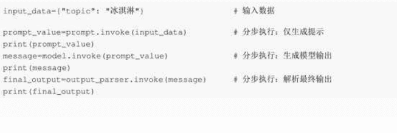

**运行结果如下：**


>> "为什么冰淇淋总是如此受欢迎？因为它很酷！"

##### 4. 高级用例：检索增强生成示例

LCEL 还可以支持更复杂的任务，比如使用检索增强生成（RAG）技术，在回答问题时引入外部知识。示例代码如下：

```python
from langchain_community.vectorstores import DocArrayInMemorySearch 
from langchain_core.runnables import RunnableParallel
from langchain_openai.embeddings import OpenAIEmbeddings

###### 创建向量存储
vectorstore=DocArrayInMemorySearch.from_texts(
    ["张三在腾讯工作", "熊猫喜欢吃竹子"],
    embedding=OpenAIEmbeddings() )

chain=(vectorstore | prompt) | model | output_parser  # 创建包含检索的链条
result=chain.invoke({"topic": "熊猫的饮食习惯"})          # 输入数据并执行链条
print(result)

```

**运行结果如下：**


>> 熊猫喜欢吃竹子。这是一种独特的饮食习惯。

这个例子中，LCEL 通过管道符号实现了数据的多步骤流动，包括检索相关信息和生成最终回答。

#### 7.1.2 LCEL 流式处理实现

流式处理是一种能够在数据不断生成的同时逐步处理的技术，广泛应用于实时数据处理和高并发场景。LangChain 中的表达式语言提供了强大的流式处理支持，使得开发者可以在数据尚未完全生成时便开始处理，从而提升了响应速度并优化了资源利用。在对话系统、实时监控等场景中，流式处理尤其重要，它可以让系统以更低的延迟响应用户需求。

下面将详细讲解如何在 LCEL 中实现流式处理，包括流式数据的初始化、配置、数据流的逐步接收与处理方法。

##### 1. 初始化流式处理

在 LangChain 中，使用流式处理功能可以让语言模型逐步生成并返回数据。通过指定流式处理的相关参数，可以将生成的文本逐步传递给处理模块。为了使用流式处理功能，需要在语言模型调用中启用流式选项。

初始化流式生成的示例代码如下：

```python
from langchain.llms import OpenAI
###### 初始化语言模型，启用流式处理
llm =OpenAI(model_name="text-davinci-003", stream=True)
```

在该示例中，设置 `stream=True` 使得模型以流式方式生成输出。在这种模式下，生成的内容会被逐步传递到系统的处理管道中，以便后续操作可以实时接收生成的数据。

##### 2. 配置流式处理回调函数

为了处理流式数据，可以使用回调函数逐步接收生成的内容。在 LangChain 中，可以定义一个回调函数，用于在每次接收到生成内容时处理数据。例如，可以在回调函数中实时显示生成内容，或者执行其他自定义操作。

配置流式处理回调函数的示例代码如下：

```python
###### 定义回调函数，用于处理流式生成的内容

def stream_callback(response):
    for chunk in response:
        print("流式内容:", chunk["choices"][0]["text"], end="")
####### 示例：请求生成内容并处理流式输出
prompt = "请简要描述机器学习的原理。"
response=llm(prompt, callback=stream_callback)
```

在此示例中，`stream_callback` 函数接收生成的内容块 `chunk`，并逐步输出。通过这种方式，用户可以在内容生成过程中实时看到生成结果。

##### 3. 处理流式生成的分片数据

处理流式分片数据的示例代码如下：

```python
def aggregate_streamed_data(response):
  full_content=""
  for chunk in response:
    content=chunk['choices'][0]['text']
    full_content += content
    print("当前分片内容:", content)
  
  print("完整生成内容:", full_content)
###### 示例：请求生成内容并汇总流式输出
response=llm(prompt, callback=aggregate_streamed_data)
```

在该示例中，`aggregate_streamed_data` 回调函数将每次接收到的分片内容进行累加，最终得到完整的生成结果。通过这种方法可以在内容生成过程中实时更新生成状态，并在生成完成后获得完整输出。

##### 4. 在实时对话系统中的应用

流式处理在实时对话系统中非常有用，它可以使系统在生成内容时实时反馈给用户。例如，在用户与模型进行多轮对话时，流式生成可以让用户逐步接收到回答内容，而不必等待整个回答完成。

在实时对话系统中实现流式反馈的示例代码如下：

```python
from langchain.chains import ConversationChain
from langchain.memory import ConversationBufferMemory
###### 创建带流式处理的对话链
memory=ConversationBufferMemory()
conversation_chain=ConversationChain(llm=llm, memory=memory, stream=True)
###### 定义回调函数，逐步反馈生成内容
def real_time_feedback(response):
  for chunk in response:
    print("流式对话回复:", chunk['choices'][0]['text'], end="")

####### 示例对话流式生成
user_input="你能简单介绍一下深度学习吗？"
response=conversation_chain.run(user_input, callback=real_time_feedback)
```

在该示例中，`ConversationChain` 使用流式处理模式实时生成回复，并通过 `real_time_feedback` 函数逐步显示生成的内容。这种实现方式适合实时对话系统，可以显著降低响应延迟，提升用户体验。

##### 5. 控制流式处理的速度

在流式生成中，数据传输速度可以通过设置时间间隔来控制。比如，可以通过加入延时控制，让生成的内容逐步显示，以模拟实时生成的效果。这在演示或用户体验优化中非常实用。

控制流式处理的速度的示例代码如下：

```python
import time
###### 定义带延迟的回调函数
def delayed_streaming(response, delay=0.5):
    for chunk in response:
        print("流式内容:", chunk["choices"][0]["text"], end="")
        time.sleep(delay) # 控制生成显示的速度
####### 示例生成内容并设置延迟
response=llm(prompt, callback=lambda x: delayed_streaming(x, delay=0.3))


```

在该示例中，`delayed_streaming` 函数通过在每次显示生成内容后增加 `time.sleep(delay)` 来控制生成的速度。设置合理的延迟值可以优化生成显示的节奏，使流式生成更加平滑。

LCEL 的流式处理实现可以用于以下应用场景：

（1）实时对话系统：在用户输入后逐步生成内容，显著降低响应延迟。

（2）内容生成平台：如写作助手等工具，可以实时反馈生成内容，提升用户体验。

（3）数据流分析：在数据逐步生成和传输的过程中，对数据进行实时分析和处理。

通过流式处理技术，LangChain 能够将内容逐步输出到用户端，实现即时响应和反馈。这种机制可以提高系统的响应速度，优化用户体验，尤其适合需要实时交互的企业级应用。

### 7.2 LCEL 并行执行优化

在企业级应用中，面对大量请求和复杂任务，并行执行是一种有效的性能优化方法。LCEL 提供的并行执行模式允许开发者将多个任务整合成一个表达式，并行调用各个组件，如模型生成、数据检索、API 请求等，从而缩短执行时间。这种方式特别适合处理高并发和计算密集型的场景，使得 LCEL 在复杂任务流的开发中表现出色。

本节将深入介绍 LCEL 的并行执行优化，包括如何使用 RunnableParallel 来构建并行任务流，并详细演示其在高效管理多任务执行的场景下的应用。

#### 7.2.1 多任务并行执行策略

在 LangChain 表达式语言中，并行执行任务是一种显著提升处理效率的策略。通过并行执行，多个任务能够在相同的时间段内独立运行，大大缩短了整体执行时间。LCEL 提供了 RunnableParallel 组件，简化了并行任务流的设置与执行。

1．初始化 LangChain 环境

在开始执行并行任务之前，需要确保环境中正确配置了 LangChain 相关库。可以通过以下代码进行初始化：

```python
from langchain_openai import ChatOpenAI
from langchain_core.prompts import ChatPromptTemplate
from langchain_core.output_parsers import StrOutputParser
from langchain_core.runnables import RunnableParallel
```

该配置包含了基本的组件：ChatOpenAI 用于模型调用，ChatPromptTemplate 用于创建提示词模板，StrOutputParser 用于解析模型输出，而 RunnableParallel 则用于执行并行任务。

2．设置任务组件

首先，定义用于并行执行的任务组件。在本示例中，将设置多个模型生成任务，每个任务生成特定内容，并行运行。以下代码将演示如何创建模型和提示词模板。

```python
#### 初始化模型
model=ChatOpenAI(model="gpt-4")

##### 创建多个提示词模板
prompt1=ChatPromptTemplate.from_template("请解释机器学习的基本概念。")
prompt2=ChatPromptTemplate.from_template("深度学习和机器学习的区别是什么？")
prompt3=ChatPromptTemplate.from_template("人工智能有哪些主要应用？")

#定义输出解析器
output_parser=StrOutputParser()
```

3．构建并行任务流

使用 RunnableParallel 来构建并行任务流。RunnableParallel 可以接收一组任务，将它们并行执行。这里的任务将包括多个提示词模板和模型组合。

构建并行任务流的示例代码如下：

```python
#使用RunnableParallel构建并行任务流
parallel_tasks=RunnableParallel(
    {
        "task1": prompt1 | model | output_parser,
        "task2":prompt2|model|output_parser,
        "task3":prompt3|model| output_parser
    }
)
```

在这段代码中，通过管道符号（|）将每个提示词模板与模型和输出解析器连接起来，并赋予任务名称（task1、task2、task3），然后传递给 RunnableParallel。每个任务可以独立运行，彼此之间互不影响。

4．执行并行任务

一旦定义了任务流，就可以调用 parallel_tasks.invoke() 方法来并行执行任务，示例代码如下:

```python
###### 执行并行任务
results=parallel_tasks.invoke({})

###### 输出结果
for task_name, result in results.items():
    print(f"{task_name} 生成内容：{result}")
```

通过 parallel_tasks.invoke({}) 调用，所有任务将并行运行，并返回一个包含所有任务结果的字典。每个任务的结果可以通过字典键值对的形式访问和输出。

5．动态任务生成

在更复杂的场景中，可以根据输入动态创建任务。例如，假设有一个主题列表，需要对每个主题生成一个模型回复，可以动态生成任务列表并传递给 RunnableParallel，示例代码如下:

```python
###### 定义主题列表
topics=["机器学习", "深度学习", "人工智能"]

####### 动态创建任务列表
dynamic_tasks=[
    f"task_{i+1}": ChatPromptTemplate.from_template(
        f"请解释{topic}的基本概念。"
    ) |model|output_parser
    for i, topic in enumerate(topics)
]

# 使用RunnableParallel执行动态任务
parallel_dynamic_tasks=RunnableParallel(dynamic_tasks)
dynamic_results=parallel_dynamic_tasks.invoke({})

###### 输出结果
for task_name, result in dynamic_results.items():
    print(f"{task_name} 生成内容：{result}")
```

在此示例中，首先根据 topics 列表动态生成任务列表，使得每个任务能够接收不同的主题；然后通过 RunnableParallel 并行运行这些任务，输出每个任务生成的内容。

6．并行任务的错误管理

在执行并行任务时，某些任务可能会因为各种原因失败。可以在 LCEL 中为每个任务设置错误处理机制，确保即使单个任务失败，也不会影响整个任务流。

LCEL 批处理并行任务


在此示例中，通过 safe_task 函数捕获每个任务中的异常，避免某个任务失败而导致整个并行任务中断。结果会包含任务的成功输出或错误信息。

7．批处理并行任务

在需要同时处理大量任务的情况下，可以通过批处理并行任务实现更高效的执行。LCEL 支持使用批处理模式，将多个任务批量执行。

##### 批处理任务示例
```python
from langchain_core.runnables import batch
##### 定义批处理并行任务
batched_parallel_tasks=batch(parallel_tasks_with_error_handling)
##### 执行批处理任务
batched_results=batched_parallel_tasks.invoke({})
for task_name, result in batched_results.items():
    print(f"{task_name} 生成内容：{result}")
```

下面演示一个完整的示例，该示例将所有功能整合在一个脚本中，包括模型初始化、动态任务创建、错误管理和批量并行处理，最后通过一个测试函数运行所有并行任务，并输出结果。

```python
from langchain_openai import ChatOpenAI
from langchain_core.prompts import ChatPromptTemplate
from langchain_core.output_parsers import StrOutputParser
from langchain_core.runnables import RunnableParallel, batch

#### 初始化模型
model=ChatOpenAI(model="gpt-4")

##### 定义输出解析器
output_parser=StrOutputParser()

##### 创建提示词模板
prompt1=ChatPromptTemplate.from_template("请解释机器学习的基本概念。")
prompt2=ChatPromptTemplate.from_template("深度学习和机器学习的区别是什么？")
prompt3=ChatPromptTemplate.from_template("人工智能有哪些主要应用？")

##### 设置基础并行任务流
parallel_tasks=RunnableParallel(
    { "task1": prompt1 | model | output_parser,
      "task2": prompt2 | model | output_parser,
      "task3": prompt3 | model | output_parser }
)

##### 动态任务生成
topics=["机器学习", "深度学习", "人工智能"]
dynamic_tasks={
    f"task_{i+1}": ChatPromptTemplate.from_template(
        f"请解释{topic}的基本概念。") | model | output_parser
    for i, topic in enumerate(topics)
}
parallel_dynamic_tasks=RunnableParallel(dynamic_tasks)

##### 定义带错误管理的任务
def safe_task(task):
    try:
        return task.invoke({})
    except Exception as e:
        return f"任务失败：{e}"

###### 设置包含错误管理的并行任务流
parallel_tasks_with_error_handling=RunnableParallel(
    {
        "task1": lambda: safe_task(prompt1 | model | output_parser),
        "task2": lambda: safe_task(prompt2 | model | output_parser),
        "task3": lambda: safe_task(prompt3 | model | output_parser)
    }
)

##### 批处理任务示例
batched_parallel_tasks=batch(parallel_tasks_with_error_handling)

##### 测试函数执行所有任务
def test_all_tasks():
    print("执行基础并行任务流:")
    results=parallel_tasks.invoke({})
    for task_name, result in results.items():
        print(f"{task_name} 生成内容：{result}")

    print("\n执行动态并行任务流:")
    dynamic_results=parallel_dynamic_tasks.invoke({})
    for task_name, result in dynamic_results.items():
        print(f"{task_name} 生成内容：{result}")

    print("\n执行带错误管理的并行任务流:")
    results_with_error_handling=(
        parallel_tasks_with_error_handling.invoke({}))
    for task_name, result in results_with_error_handling.items():
        print(f"{task_name} 生成内容：{result}")

    print("\n执行批处理并行任务流:")
    batched_results=batched_parallel_tasks.invoke({})
    for task_name, result in batched_results.items():
        print(f"{task_name} 生成内容：{result}")

##### 执行测试
test_all_tasks()
```

执行此代码后，输出应包括每个并行任务的生成内容或错误信息，具体输出取决于 API 响应：

```python
>> 执行基础并行任务流：
>> task1 生成内容：机器学习是通过数据训练模型的技术。
>> task2 生成内容：深度学习是机器学习的一种，强调神经网络的多层结构。
>> task3 生成内容：人工智能的主要应用包括图像识别、自然语言处理和自动驾驶等。
>> 

>> 执行动态并行任务流：
>> task_1 生成内容：机器学习是一种自动化数据分析的方法。
>> task_2 生成内容：深度学习在复杂数据处理上具有优势。
>> task_3 生成内容：人工智能在医疗、金融、交通等领域应用广泛。
>> 

>> 执行带错误管理的并行任务流：
>> task1 生成内容：机器学习是通过数据训练模型的技术。
>> task2 生成内容：深度学习是机器学习的一种，强调神经网络的多层结构。
>> task3 生成内容：人工智能的主要应用包括图像识别、自然语言处理和自动驾驶等。
>> 

>> 执行批处理并行任务流：
>> task1 生成内容：机器学习是通过数据训练模型的技术。
>> task2 生成内容：深度学习是机器学习的一种，强调神经网络的多层结构。
>> task3 生成内容：人工智能的主要应用包括图像识别、自然语言处理和自动驾驶等。 
```

> **提示** 请在本地环境中测试并配置好 API 密钥和 LangChain 库，并在一个 Python 文件中运行，以确保上述代码正常执行并返回预期结果。

通过掌握 LCEL 的多任务并行执行策略，开发者可以有效地提升 LangChain 应用的执行效率。结合 RunnableParallel 和批处理，多任务管理在企业级应用中可以实现更高效的资源分配和任务执行管理。

#### 7.2.2 LCEL 并行执行

在 LangChain 的表达式语言中，并行执行是一种关键的性能优化策略。通过并行处理多个任务，可以显著减少总执行时间，特别适用于高并发和复杂任务的场景。LCEL 提供了 RunnableParallel 和 batch 等工具，便于开发者创建和管理并行任务流。

下面将详细讲解如何通过 LCEL 实现多任务并行执行，包括基础的并行任务配置、批量处理、动态任务创建以及错误处理。

#### 1．初始化并行任务的组件

首先，定义并行任务所需的基本组件，包括提示词模板、语言模型以及输出解析器。

```python
from langchain_openai import ChatOpenAI
from langchain_core.prompts import ChatPromptTemplate
from langchain_core.output_parsers import StrOutputParser
from langchain_core.runnables import RunnableParallel

#### 初始化模型
model=ChatOpenAI(model="gpt-4")

###### 创建不同任务的提示词模板
prompt1=ChatPromptTemplate.from_template("请解释机器学习的基本概念。")
prompt2=ChatPromptTemplate.from_template("深度学习和机器学习的区别是什么？")
prompt3=ChatPromptTemplate.from_template("列出人工智能的主要应用。")

###### 初始化输出解析器
output_parser=StrOutputParser()

```

每个提示词模板代表一个独立任务，可以在并行任务中同时运行。

#### 2．构建并行任务流

使用 RunnableParallel 将多个任务打包成一个并行任务流。每个任务包括一个提示词模板、模型调用和输出解析器。

```python
#构建并行任务流
parallel_tasks=RunnableParallel({
    "task1": prompt1 | model | output_parser,
    "task2": prompt2 | model | output_parser,
    "task3": prompt3 | model | output_parser })
```

在这里，通过管道符号 (|) 将每个提示词模板与模型和输出解析器连接成一个流，并通过 RunnableParallel 并行执行。

#### 3．执行并行任务

一旦并行任务流构建完成，就使用 invoke 方法执行所有任务。所有任务会在同一时间启动并同时运行。

```python
###### 执行并行任务
results=parallel_tasks.invoke()

###### 输出结果
for task_name, result in results.items():
    print(f"{task_name} 生成内容：{result}")
```

该代码会在所有任务完成后输出每个任务的生成结果。

#### 4．处理批量输入的并行任务

对于需要批量处理多个输入的情况，可以使用 `batch` 方法在多个输入数据上重复执行同一个任务流。

```python
from langchain_core.runnables import batch

batched_parallel_tasks=batch(parallel_tasks)  # 定义批量并行任务

###### 执行批量并行任务
batched_results=batched_parallel_tasks.invoke([{}, {}, {}])  # 示例中使用3个空输入
for index, result in enumerate(batched_results):
    print(f"批次 {index+1} 的结果:")
    for task_name, output in result.items():
        print(f"{task_name}: {output}")
```

#### 5．在并行任务中集成错误处理

在并行任务执行中，某些任务可能会遇到错误。可以在 LCEL 中加入错误处理机制，以确保任务流的稳定性。

```python
###### 定义安全的任务执行函数
def safe_task(task):
    try:
        return task.invoke({})
    except Exception as e:
        return f"任务失败：{e}"

###### 设置带错误处理的并行任务流
safe_parallel_tasks=RunnableParallel(
    {
        "task1": lambda: safe_task(prompt1 | model | output_parser),
        "task2": lambda: safe_task(prompt2 | model | output_parser),
        "task3": lambda: safe_task(prompt3 | model | output_parser)
    }
)

###### 执行带错误处理的并行任务
safe_results=safe_parallel_tasks.invoke([])
for task_name, result in safe_results.items():
    print(f"{task_name} 输出内容：{result}")
```

在该代码中，`safe_task` 函数会捕获每个任务中的异常，防止因某个任务的错误而导致整个并行任务中断。

#### 6．动态创建并行任务

LCEL 还支持基于输入数据动态创建并行任务，适用于任务需求随着输入变化的场景。

##### 7. 测试所有并行任务功能

最后，创建一个测试函数，整合上述所有并行任务执行策略，便于一次性测试全部功能。

```python
def test_parallel_execution():
    print("执行基础并行任务流:")
    results = parallel_tasks.invoke({})
    for task_name, result in results.items():
        print(f"{task_name} 输出内容：{result}")

    print("\n执行批量并行任务流:")
    batched_results = batched_parallel_tasks.invoke([{}, {}, {}])
    for index, result in enumerate(batched_results):
        print(f"批次 {index+1} 的结果:")
        for task_name, output in result.items():
            print(f"  {task_name}: {output}")

    print("\n执行带错误处理的并行任务流:")
    safe_results = safe_parallel_tasks.invoke({})
    for task_name, result in safe_results.items():
        print(f"{task_name} 输出内容：{result}")

    print("\n执行动态生成的并行任务流:")
    dynamic_results = parallel_dynamic_tasks.invoke({})
    for task_name, result in dynamic_results.items():
        print(f"{task_name} 输出内容：{result}")

####### 运行测试函数
test_parallel_execution()
```

运行 `test_parallel_execution()` 后，将依次执行每个并行任务流，包括基础并行任务、批量处理任务、带错误管理的任务以及动态任务生成，并输出相应的结果。

通过掌握 LCEL 并行执行策略，开发者可以显著提升 LangChain 的执行效率，为企业级应用提供强大的并行处理能力。

### 7.3 回退机制的设计与实现

在复杂的 LangChain 应用中，调用 LLM 可能会遇到各种错误，例如 API 速率限制、网络超时或模型响应不符合预期。回退机制允许在遇到错误时自动切换到备用模型或任务，确保系统的稳定性和连续性。LCEL 通过 `with_fallbacks` 方法支持回退机制，使开发者能够优雅地处理各种故障点。

本节将详细讲解如何设计和实现回退机制。

#### 1. 初始化模型和回退模型

假设系统使用 `ChatOpenAI` 作为主要模型，同时配置 `ChatAnthropic` 作为备用模型，以便在遇到错误时自动切换。下面开始实现回退机制。

首先，导入模型并设置主要模型。

```python
from langchain_openai import ChatOpenAI
from langchain_community.chat_models import ChatAnthropic
###### 初始化主模型并关闭自动重试，以便快速触发错误
primary_model = ChatOpenAI(max_retries=0)
fallback_model = ChatAnthropic()
###### 配置主模型的回退模型
model_with_fallback = primary_model.with_fallbacks([{fallback_model}])
```

此代码配置了主模型 `primary_model`，并设置了备用模型 `fallback_model`。当主模型遇到不可恢复的错误时，系统将自动调用备用模型。

#### 2. 模拟 API 错误

为了测试回退机制，可以使用 `unittest.mock` 库模拟 API 错误，例如速率限制错误。以下代码将展示如何触发错误并观察回退机制的工作。

```python
from unittest.mock import patch
from openai import RateLimitError
##### 创建一个速率限制错误示例
error = RateLimitError("rate limit exceeded")
##### 模拟 API 错误并测试回退机制
with patch("openai.ChatCompletion.create", side_effect=error):
    try:
        response = model_with_fallback.invoke("什么是机器学习？")
        print("回退成功，输出内容:", response)
    except RateLimitError:
        print("回退机制失败")
```

在该代码中，使用 `patch` 方法模拟 `RateLimitError`，系统会在遇到该错误时自动切换到备用模型 `fallback_model`，并输出回退模型的结果。

#### 3. 结合回退机制的提示词模板

LCEL 的回退机制可以与提示词模板结合使用，从而构建更强大的任务流。在以下示例中，将提示词模板与带有回退的模型连接起来，确保在任务流中使用回退。

```python
from langchain_core.prompts import ChatPromptTemplate

##### 定义提示词模板
prompt = ChatPromptTemplate.from_template("请解释 {topic} 的基本概念。")
##### 将提示词模板和回退模型组合起来
chain_with_fallback = prompt | model_with_fallback

##### 测试任务流
with patch("openai.ChatCompletion.create", side_effect=error):
    try:
        response = chain_with_fallback.invoke({"topic": "机器学习"})
        print("回退成功，生成内容：", response)
    except RateLimitError:
        print("回退机制失败")
```

当主模型触发错误时，任务会自动回退到备用模型并输出结果。这种方式可以确保整个任务链的连续性。

#### 4. 指定错误类型进行回退

有时需要指定特定的错误类型来触发回退机制，可以使用 `exceptions_to_handle` 参数限定回退的错误类型，例如仅在出现 `RateLimitError` 时触发回退，而忽略其他错误。

```python
##### 配置指定错误类型触发的回退
model_with_specific_fallback = primary_model.with_fallbacks(
    [fallback_model],
    exceptions_to_handle=(RateLimitError),
)
##### 测试指定错误类型的回退
with patch("openai.ChatCompletion.create", side_effect=error):
    try:
        response = model_with_specific_fallback.invoke("什么是深度学习？")
        print("回退成功，生成内容：", response)
    except RateLimitError:
        print("回退机制失败")
```

在此示例中，只有在触发 `RateLimitError` 时系统才会切换到备用模型，其他错误不会触发回退。

#### 5. 在序列链中应用回退机制

对于多模型或多步骤的任务链，LCEL 支持为整个任务序列配置回退机制。可以在序列链中设置多个回退模型，当一个模型失败时自动切换到下一个模型。

```python
from langchain_core.output_parsers import StrOutputParser

##### 定义提示词模板和模型链
prompt = ChatPromptTemplate.from_template("解释 {topic} 的重要性。")
output_parser = StrOutputParser()

##### 创建带有回退的模型链
primary_chain = prompt | primary_model | output_parser
backup_chain = prompt | fallback_model | output_parser

##### 使用 RunnableParallel 构建带回退的多模型链
chain_with_fallback_sequence = primary_chain.with_fallbacks([backup_chain])

##### 测试带回退的序列链
with patch("openai.ChatCompletion.create", side_effect=error):
    try:
        result = chain_with_fallback_sequence.invoke({"topic": "人工智能"})
        print("回退成功，生成内容：", result)
    except RateLimitError:
        print("回退机制失败")
```

在该示例中，`primary_chain` 和 `backup_chain` 分别配置了不同的模型，当 `primary_chain` 失败时，系统将自动切换到 `backup_chain`。

#### 6. 综合测试回退机制的完整函数

将以上步骤综合为一个完整的测试函数，方便在多场景下验证回退机制。

```python
def test_fallback_mechanism():
    print("测试回退机制的设计与实现:")

###### 模拟速率限制错误
with patch("openai.ChatCompletion.create",
           side_effect=RateLimitError("rate limit exceeded")):
    try:
        # 基本回退测试
        response = model_with_fallback.invoke("什么是机器学习？")
        print("基本回退成功，输出内容：", response)
    except RateLimitError:
        print("基本回退机制失败")

###### 结合提示词模板的回退
try:
    response = chain_with_fallback.invoke({"topic": "机器学习"})
    print("任务流回退成功，生成内容：", response)
except RateLimitError:
    print("任务流回退机制失败")

###### 指定错误类型的回退
try:
    response = model_with_specific_fallback.invoke("什么是深度学习？")
    print("指定错误回退成功，生成内容：", response)
except RateLimitError:
    print("指定错误回退机制失败")

###### 多模型序列链的回退
try:
    result = chain_with_fallback_sequence.invoke({"topic": "人工智能"})
    print("序列链回退成功，生成内容：", result)
except RateLimitError:
    print("序列链回退机制失败")

###### 执行测试函数
test_fallback_mechanism()
```

根据 API 的实际配置，运行结果如下:

> 测试回退机制的设计与实现:
> 基本回退成功，输出内容：机器学习是一种通过数据训练模型的技术。
> 任务流回退成功，生成内容：机器学习是一种通过数据训练模型的技术。
> 指定错误回退成功，生成内容：深度学习是一种特定的机器学习方法，适合复杂数据。
> 序列链回退成功，生成内容：人工智能在医疗、金融等领域有重要应用。

回退机制是确保 LangChain 应用稳定性的重要工具，通过为模型、任务链等配置备用模型或任务，开发者能够有效地管理错误，提升系统的可靠性。掌握了回退机制的设计与实现，就可以应对多样的故障情况，使应用在复杂环境中稳定运行。

### 7.4 LCEL 与 LangSmith 集成

LangChain 表达式语言和 LangSmith 的集成为开发者提供了更高效的任务管理和执行跟踪功能。LangSmith 作为 LangChain 的监控和分析模块，能够记录和分析每个任务的执行情况，为开发者优化任务流提供详实的数据支持。

通过与 LangSmith 的集成，LCEL 不仅可以执行任务，还可以实时追踪任务的性能表现、错误记录和运行结果。这种集成在复杂的企业级应用中尤为重要，有助于开发者识别并优化瓶颈环节，提升整体系统的稳定性和效率。

#### 7.4.1 LangSmith 入门

LangSmith 是一个面向生产级 LLM 应用的监控与评估平台。通过 LangSmith，开发者可以跟踪和评估应用的执行情况，快速定位问题和优化任务流程。下面将介绍 LangSmith 的入门步骤，包括安装 LangSmith、API 密钥设置、配置环境变量、首次追踪任务的记录和测试评估，为构建稳定高效的 LangChain 应用奠定基础。

##### 1. 安装 LangSmith

在 Python 环境中，可以使用以下命令安装 LangSmith 库:

```bash
pip install -U langsmith
```

此命令将安装最新版本的 LangSmith，为后续操作做好准备。

##### 2. 创建 API 密钥

要使用 LangSmith，需要创建 API 密钥，读者可自行访问 LangSmith 官方网站（见图 7-1），注册账号后单击"Generate API key"按钮创建新的 API 密钥，如图 7-2 所示。保存好 API 密钥后，就可以正式进入控制台页面，如图 7-3 所示。

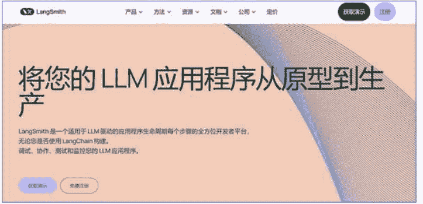

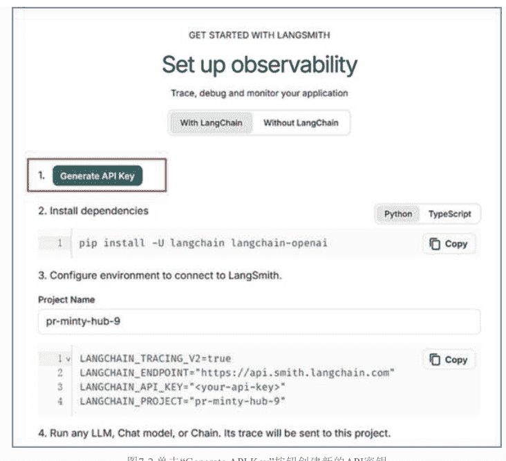

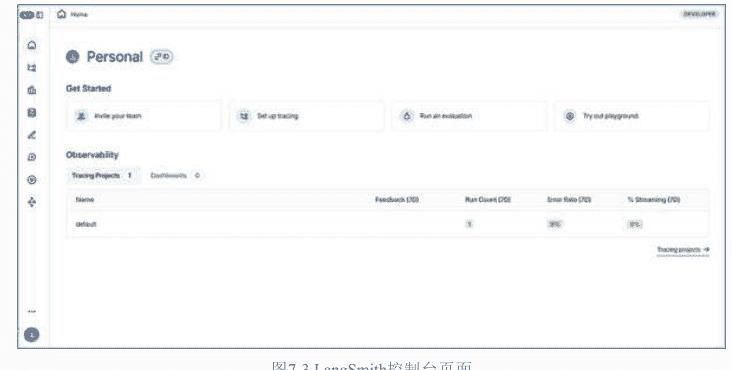

##### 3. 配置环境变量

在终端中设置环境变量，将 API 密钥和其他设置加载到运行环境中。

```bash
export LANGCHAIN_TRACING_V2=true
export LANGCHAIN_API_KEY=<your-api-key>
export OPENAI_API_KEY=<your-openai-api-key>
```

其中，`LANGCHAIN_TRACING_V2=true` 表示启用 LangSmith 的追踪功能；`LANGCHAIN_API_KEY` 为 LangSmith 的 API 密钥；`OPENAI_API_KEY` 则是 OpenAI 的 API 密钥，用于调用大语言模型。

##### 4. 记录第一个任务追踪

LangSmith 支持执行自动追踪任务。下面的代码示例将展示如何在 LangChain 任务中启用 LangSmith 追踪功能。

```python
import openai
from langsmith.wrappers import wrap_openai
from langsmith import traceable

###### 包装 OpenAI 客户端以启用追踪
client = wrap_openai(openai.Client())

####### 使用 traceable 装饰器自动追踪任务
@traceable
def pipeline(user_input: str):
    result = client.chat.completions.create(
        messages=[{"role": "user", "content": user_input}],
        model="gpt-3.5-turbo"
    )
    return result.choices[0].message.content

####### 运行追踪任务
response = pipeline("什么是机器学习？")
print("生成内容:", response)
```

在此代码中：

1. `wrap_openai` 方法包装了 OpenAI 客户端，以启用 LangSmith 的自动追踪功能。
2. `@traceable` 装饰器用于标记需要追踪的函数 `pipeline`。
3. 执行追踪任务后，任务的执行情况将自动记录到 LangSmith，可在 LangSmith 控制台查看详细的追踪数据。

##### 5. 执行第一个任务评估

LangSmith 提供了评估功能，用于测试任务输出是否符合预期。以下是一个示例评估过程:

```python
from langsmith import Client
from langsmith.evaluation import evaluate

####### 初始化 LangSmith 客户端
client = Client()

###### 创建数据集，包含输入和预期输出的测试数据
dataset_name = "示例数据集"
dataset = client.create_dataset(dataset_name,
                               description="LangSmith 示例数据集")
client.create_examples(
    inputs=[{"postfix": "到 LangSmith"}, {"postfix": "到 LangSmith 评估"}],
    outputs=[{"output": "欢迎来到 LangSmith"}, {"output": "欢迎来到 LangSmith 评估"}],
    dataset_id=dataset.id
)

###### 定义评估方法
def exact_match(run, example):
    return run.outputs["output"] == example.outputs["output"]

###### 执行评估
experiment_results = evaluate(
    lambda input: "欢迎 " + input['postfix'],
    data=dataset_name,
    evaluators=[exact_match],
    experiment_prefix="示例实验",
    metadata={"version": "1.0.0", "revision_id": "beta"}
)
print("评估结果:", experiment_results)
```

在此代码中：

（1）client.create_dataset 方法创建一个包含测试输入和预期输出的示例数据集。

（2）exact_match 函数检查任务输出是否与预期输出一致。

（3）evaluate 函数接收任务逻辑（一个简单的字符串拼接操作）、数据集名称和评估方法，输出测试结果。

完成以上配置和测试后，可以在 LangSmith 的控制台中查看所有任务的执行和评估数据，包括执行时间、出错情况和准确性分数。

LangSmith 的追踪与评估集成在 LangChain 开发中，为开发者提供了清晰的性能分析视图，有助于诊断问题并优化任务。

#### 7.4.2 LangSmith 的初步应用

在完成 LangSmith 的基本配置后，可以进一步应用其追踪和评估功能，深入分析和优化 LangChain 应用。LangSmith 通过追踪数据流、分析模型性能、记录执行错误等功能帮助开发者提升任务流的稳定性与效率。下面将从数据追踪、任务优化以及评估入手，逐步展示如何将 LangSmith 应用于实际开发中。

##### 1. 追踪任务流的执行情况

LangSmith 的主要功能之一是追踪任务流的执行。通过追踪，开发者可以清晰了解每个步骤的执行时间、输入输出数据和出错情况。以下代码将展示如何使用 LangSmith 追踪一个包含多个步骤的任务流。

```python
import openai
from langsmith import traceable, wrap_openai

####### 包装 OpenAI 客户端以支持 LangSmith 追踪
client = wrap_openai(openai.Client())

###### 定义多步骤任务流
@traceable
def process_pipeline(user_input: str):
    # 步骤 1:生成初始回复
    step1 = client.chat.completions.create(
        model="gpt-3.5-turbo",
        messages=[{"role": "user", "content": user_input}]
    )
    initial_response = step1.choices[0].message.content

    # 步骤 2:对生成内容进行总结
    step2 = client.chat.completions.create(
        model="gpt-3.5-turbo",
        messages=[{"role": "user",
                    "content": f"总结以下内容:{initial_response}"}])
    summary_response = step2.choices[0].message.content

    return {"initial_response": initial_response,
            "summary_response": summary_response}

###### 执行任务并自动追踪
results = process_pipeline("什么是机器学习？")
print("任务执行结果:", results)
```

在该代码中：

> （1）wrap_openai 函数包装 OpenAI 客户端，使其支持 LangSmith 追踪。
>
> （2）process_pipeline 函数定义了一个包含两个步骤的任务流，分别生成初始回复和总结回复。
>
> （3）@traceable 装饰器自动记录每个步骤的执行情况，结果可以在 LangSmith 的控制台中查看。

##### 2. 识别并优化慢速任务

通过 LangSmith 的数据追踪，可以识别任务流中的瓶颈环节。例如，执行过程中过长的步骤可以通过优化模型参数或更换模型来改善效率。以下示例将展示如何调整参数来提升性能。

```python
@traceable
def optimized_pipeline(user_input: str):
    # 优化步骤 1：设置较低的温度以减少生成时间
    step1 = client.chat.completions.create(
        model="gpt-3.5-turbo",
        temperature=0.3,  # 降低温度
        messages=[{"role": "user", "content": user_input}]
    )
    initial_response = step1.choices[0].message.content

    # 优化步骤 2：使用模型裁剪或压缩方法（例如减少 token 长度）来加速
    step2 = client.chat.completions.create(
        model="gpt-3.5-turbo",
        max_tokens=50,  # 限制生成的 token 数
        messages=[{"role": "user",
                    "content": f"总结以下内容：{initial_response}"}]
    )
    summary_response = step2.choices[0].message.content

    return {"initial_response": initial_response,
            "summary_response": summary_response}

###### 执行优化后的任务流
optimized_results = optimized_pipeline("什么是机器学习？")
print("优化任务执行结果:", optimized_results)
```

在此代码中，通过调整生成参数（如温度和最大 token 数），减少了模型的计算开销，从而优化了任务流的执行速度。LangSmith 会记录调整前后的执行时间，帮助开发者量化优化效果。

##### 3. 设置回退模型以增强任务的稳定性

在实际应用中，LangSmith 支持结合回退模型确保任务的连续性。以下示例将展示如何设置回退模型，在主模型出现错误时自动切换到备用模型。

```python
from langchain_openai import ChatOpenAI
from langchain_community.chat_models import ChatAnthropic

###### 设置主模型和备用模型
primary_model = ChatOpenAI(max_retries=0)
fallback_model = ChatAnthropic()

####### 定义支持回退的任务流
@traceable
def pipeline_with_fallback(user_input: str):
    try:
        response = primary_model.invoke({"role": "user",
                                         "content": user_input})
    except Exception as e:
        print("主模型失败，切换至备用模型")
        response = fallback_model.invoke({"role": "user",
                                          "content": user_input})

    return response

###### 执行任务并记录追踪
fallback_results = pipeline_with_fallback("描述人工智能的应用场景")
print("回退任务执行结果:", fallback_results)
```

在此代码中：

> （1）pipeline_with_fallback 函数首先尝试调用主模型，当出现错误时自动切换到备用模型。
>
> （2）@traceable 装饰器记录每次调用和回退情况，可以在 LangSmith 中查看详细信息。

##### 4. 使用 LangSmith 进行批量评估

LangSmith 还支持批量任务的自动化评估。可以将一组输入数据和期望的输出数据集成到数据集中，LangSmith 将自动评估任务执行效果并生成详细报告。

```python
from langsmith import Client
from langsmith.evaluation import evaluate

####### 初始化 LangSmith 客户端
client = Client()

###### 创建数据集，包含批量输入和预期输出
dataset_name = "机器学习批量评估"
dataset = client.create_dataset(dataset_name, description="LangSmith 批量任务评估示例")

client.create_examples(
    inputs=[{"postfix": "到 LangSmith"}, {"postfix": "到 LangSmith 评估"}],
    outputs=[{"output": "欢迎来到 LangSmith"},
             {"output": "欢迎来到 LangSmith 评估"}],
    dataset_id=dataset.id,
)

###### 定义批量评估方法
def exact_match(run, example):
    return {"score": run.outputs["output"] == example.outputs["output"]}

###### 运行批量评估
experiment_results = evaluate(
    lambda input: "欢迎" + input['postfix'],
    data=dataset_name,
    evaluators=[exact_match],
    experiment_prefix="批量任务评估",
    metadata={"version": "1.0.0", "revision_id": "beta"})

print("批量评估结果:", experiment_results)
```

在 LangSmith 控制台中，可以详细查看每个任务的错误和性能指标。LangSmith 会自动记录每个任务的执行时间、错误日志、输出内容等信息，帮助开发者更好地理解和优化应用。对于频繁出错的步骤，建议通过 LangSmith 的反馈调整任务逻辑或配置参数，提升系统的稳定性。

最终完整代码如下：

```python
import openai
from langsmith import traceable, wrap_openai, Client
from langsmith.evaluation import evaluate
from langchain_openai import ChatOpenAI
from langchain_community.chat_models import ChatAnthropic
from langchain_core.prompts import ChatPromptTemplate
from langchain_core.output_parsers import StrOutputParser
from openai import RateLimitError
from unittest.mock import patch

####### 包装 OpenAI 客户端以支持 LangSmith 追踪
client = wrap_openai(openai.Client())

####### 初始化 LangSmith 客户端
langsmith_client = Client()

####### 配置主模型和备用模型
primary_model = ChatOpenAI(max_retries=0)
fallback_model = ChatAnthropic()
model_with_fallback = primary_model.with_fallbacks([fallback_model])

####### 创建数据集用于批量评估
dataset_name = "机器学习批量评估"
dataset = langsmith_client.create_dataset(dataset_name,
                                          description="LangSmith 批量任务评估示例")
langsmith_client.create_examples(
    inputs=[{"postfix": "到 LangSmith"}, {"postfix": "到 LangSmith 评估"}],
    outputs=[{"output": "欢迎来到 LangSmith"},
             {"output": "欢迎来到 LangSmith 评估"}],
    dataset_id=dataset.id,
)

####### 定义多步骤任务流并支持 LangSmith 追踪
@traceable
def process_pipeline(user_input: str):
    # 步骤 1：生成初始回复
    step1 = client.chat.completions.create(
        model="gpt-3.5-turbo",
        messages=[{"role": "user", "content": user_input}]
    )
    initial_response = step1.choices[0].message.content

    # 步骤 2：对生成内容进行总结
    step2 = client.chat.completions.create(
        model="gpt-3.5-turbo",
        messages=[{"role": "user", "content": f"总结以下内容：{initial_response}"}]
    )
    summary_response = step2.choices[0].message.content

    return {"initial_response": initial_response,
            "summary_response": summary_response}

####### 定义支持回退的任务流
@traceable
def pipeline_with_fallback(user_input: str):
    try:
        response = primary_model.invoke({"role": "user", "content": user_input})
    except Exception as e:
        print("主模型失败，切换至备用模型")
        response = fallback_model.invoke({"role": "user", "content": user_input})
    return response

####### 批量评估方法
def exact_match(run, example):
    return {"score": run.outputs["output"] == example.outputs["output"]}

####### 测试函数，包含追踪、回退和批量评估
def test_langsmith_integration():
    # 执行追踪任务
    print("执行追踪任务:")
    results = process_pipeline("什么是机器学习？")
    print("追踪任务结果:", results)

    # 执行回退任务
    print("\n执行回退任务:")
    fallback_results = pipeline_with_fallback("描述人工智能的应用场景")
    print("回退任务结果:", fallback_results)

    # 执行批量评估
    print("\n执行批量评估:")
    experiment_results = evaluate(
        lambda input: "欢迎" + input['postfix'],
        data=dataset_name,
        evaluators=[exact_match],
        experiment_prefix="批量任务评估",
        metadata={"version": "1.0.0", "revision_id": "beta"}
    )
    print("批量评估结果:", experiment_results)

####### 运行测试函数
test_langsmith_integration()
```

运行结果如下：

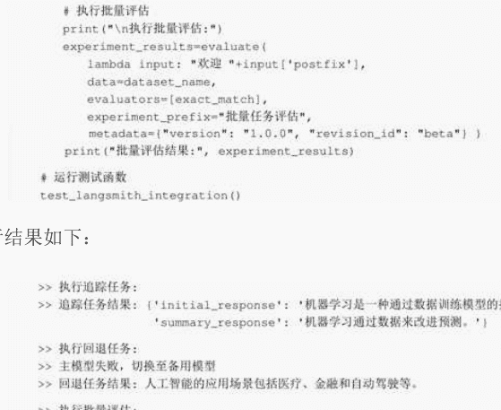

> **注意** 请确保运行环境中正确配置了 LangChain、LangSmith 和 OpenAI 的 API 密钥，以保证上述代码可以成功运行并返回预期的结果。

通过 LangSmith 的初步应用，开发者可以有效追踪和评估 LangChain 任务流的执行效果，识别性能瓶颈，设置回退策略，提升应用的可靠性。

### 7.5 本章小结

> 本章深入探讨了 LangChain 表达式语言在企业级应用中的核心组件与功能扩展，特别聚焦于其与 LangSmith 的集成应用。通过介绍 LCEL 的并行执行、回退机制以及与 LangSmith 的集成，展示了如何在复杂任务流中提升性能，提高系统稳定性，并实现更高效的任务管理与故障恢复。

> 通过本章的学习，读者可以掌握 LCEL 在高并发和高可靠性任务场景中的实用方法，为构建稳定、高效的 LangChain 应用奠定坚实的技术基础。

### 7.6 思考题

- （1）简述 LangChain 表达式语言的主要功能和应用场景。
- （2）在 LCEL 中，如何使用 RunnableParallel 实现多任务并行执行？请简述步骤并说明其优势。
- （3）batch 方法在并行任务执行中有何作用？请举例说明。
- （4）在 LCEL 中如何配置回退机制？请描述设置备用模型的步骤，并解释其在应用中的意义。
- （5）当主模型调用失败时，如何通过回退机制自动切换到备用模型？
- （6）在 LCEL 的回退机制中，如何指定特定的错误类型触发回退操作？请简述配置方法。
- （7）LangSmith 的主要功能有哪些？它如何支持 LCEL 的任务管理和监控？
- （8）如何在 LangSmith 中启用任务追踪？请描述所需的配置步骤。
- （9）在 LCEL 中使用 LangSmith 进行任务追踪时，如何使用@traceable 装饰器？请解释其作用。
- （10）描述 LangSmith 中批量评估的流程，如何创建数据集并定义评估方法？
- （11）当 LCEL 任务流中出现瓶颈时，可以通过哪些方法进行性能优化？请举例说明。
- （12）在 LangSmith 控制台中，可以查看哪些任务的执行信息？这些信息对开发者有何帮助？

# 第 8 章：核心组件 3：Agents

> 在 LangChain 的架构中，Agent 是一种能够自主决策、执行多步骤任务的智能组件。不同于简单的模型调用或任务链执行，Agent 具备分析、判断并选择最佳执行路径的能力。通过整合 LLM、提示词模板、上下文数据和任务链，LangChain 的 Agent 能够完成复杂的多阶段任务，并对变化的输入或动态条件做出响应。

本章将深入探讨 LangChain 中的 Agent 组件，从基础概念到应用场景，逐步引导读者理解 Agent 在任务执行中的关键作用。首先，将讲解 Agent 的工作原理和在不同场景中的应用需求，让读者了解 Agent 在 LangChain 中解决实际问题的价值。接着，将通过 ReAct Agent 的案例来具体分析其任务流程、执行机制以及在决策上的优势。同时，还将介绍 Zero-shot ReAct 和结构化输入 ReAct，展示 Agent 在不同数据输入方式下的表现。最后，将带领读者构建和优化 ReAct 文档存储库，使得 Agent 能够在知识丰富的环境中高效查找和管理信息。

通过本章的学习，读者将具备构建和使用 LangChain Agent 的基本技能，为企业级的智能任务管理和复杂工作流构建打下坚实的基础。

## 8.1 何为 LangChain Agent

作为 LangChain 的核心组件之一，Agent 的引入使得系统能够在不同任务间灵活切换，并在变化的输入下实现高效的决策和执行。

本节将从 Agent 的定义和基本原理入手，探索其在 LangChain 生态中的关键作用和典型应用。

### 8.1.1 Agent 的核心概念与工作原理

在 LangChain 中，Agent 是一种自主任务执行的智能组件，其设计灵感来源于复杂的多步骤决策需求。Agent 的主要职责不仅包括调用语言模型完成单一任务，还包括根据任务的变化，自主选择适合的执行路径。这种自主性使得 Agent 特别适合处理需要多个步骤或外部信息的任务场景。

Agent 可以理解为一个智能执行者，它结合了语言模型、提示词、外部工具以及上下文信息，能够动态地完成任务。它的独特之处在于能够响应不同的输入，并根据当前任务的状态和需求调整行为。例如，Agent 可以被指派去回答一个复杂问题，查找相关文档，或者执行一个需要精确操作的指令。在这个过程中，Agent 会调用合适的模型或工具，确保每一步任务都朝着最终目标推进。

以下示例将演示 Agent 如何在 LangChain 中执行多步骤任务：首先搜索相关信息，然后生成简要总结。

```python
from langchain_openai import ChatOpenAI
from langchain_core.agents import Agent, AgentExecutor
from langchain_core.prompts import ChatPromptTemplate

##### 初始化语言模型
model=ChatOpenAI(model="gpt-3.5-turbo")

#### 定义任务提示词模板
search_prompt=ChatPromptTemplate.from_template("请帮助我找到与'{topic}'相关的信息。")
summarize_prompt=ChatPromptTemplate.from_template("请总结以下内容：{content}")

#### 定义一个简单的搜索函数（在实际应用中，可以集成数据库或文档检索功能）
def search_for_info(topic):
    # 模拟搜索结果
    search_results={
        "太空探索": "太空探索涉及人类发射探测器到外太空，以研究星系、行星等。",
        "海洋学": "海洋学研究海洋及其生态系统的学科，涵盖海洋生物、化学和地质。"
    }
    return search_results.get(topic, "未找到相关信息")

#### 定义一个 Agent 流程
class SimpleAgent(Agent):
    def plan(self, input):
        # 观察并提取主题
        topic=input["topic"]

        # 第一步：搜索相关信息
        search_result=search_for_info(topic)

        # 第二步：生成总结
        response=model.chat_completions.create(
            model="gpt-3.5-turbo",
            messages=[{"role": "user",
                "content": f"请总结以下内容：{search_result}"}]) 

        # 返回最终生成的回答
        return {"summary": response.choices[0].message.content}

#### 初始化 AgentExecutor 并执行任务
agent=SimpleAgent()
executor=AgentExecutor(agent=agent)

#### 输入用户请求
user_input={"topic": "太空探索"}
result=executor.invoke(user_input)
print("Agent 的总结结果:", result["summary"])
```

运行结果如下：

> Agent 的总结结果：太空探索是人类通过探测器研究外太空的活动，目的是了解星系和行星的特性。

LangChain 的 Agent 基于“观察—推理—行动”三个阶段执行流程：

(1) **观察**：Agent 接收用户输入并获取相关的环境信息或上下文数据。这一步确保 Agent 拥有足够的信息来制定下一步行动计划。

(2) **推理**：在观察到的基础上，Agent 通过逻辑判断选择最佳执行策略。通常，这一步会调用大语言模型，生成基于输入信息的推理结果。通过分析当前的任务需求，Agent 可以决定是继续调用 LLM 获取更多信息，还是选择一个工具或 API 来执行具体操作。

(3) **行动**：根据推理结果，Agent 采取相应的执行操作。这可能包括直接生成答案、调用其他模型，或者进一步调整执行路径以应对新的信息。

这种工作流程允许 Agent 灵活地适应不同的任务场景。例如，在回答复杂问题时，Agent 可以选择先检索相关数据再生成答案；在任务中断或遇到异常时，Agent 还能实时调整策略，以确保任务顺利完成。

### 8.1.2 LangChain 中 Agent 的应用场景分析

在 LangChain 中，Agent 的应用场景十分广泛，尤其适用于需要动态决策和多步骤任务的场合。例如，Agent 可用于回答复杂的用户问题，执行特定操作，或在不同的数据源中进行信息检索。

以下示例将展示一个 Agent 根据用户的兴趣推荐产品，并获取相关产品详情。

```python
from langchain_openai import ChatOpenAI
from langchain_core.agents import Agent, AgentExecutor
from langchain_core.prompts import ChatPromptTemplate

#### 初始化模型
model = ChatOpenAI(model="gpt-3.5-turbo")

#### 模拟产品信息检索函数
def search_product_info(product_name):
    product_database = {
        "智能手机": "智能手机具有强大的多任务处理和高分辨率摄像头。",
        "无线耳机": "无线耳机具有降噪功能，适合运动和通勤。",
    }
    return product_database.get(product_name, "未找到该产品信息")

#### 定义 Agent
class ProductRecommendationAgent(Agent):
    def plan(self, input):
        # 获取用户输入的产品类别
        product_name = input["product"]
        
        # 第一步：检索产品信息
        product_info = search_product_info(product_name)
        
        # 第二步：生成推荐总结
        response = model.chat_completions.create(
            model="gpt-3.5-turbo",
            messages=[{"role": "user", "content": f"请总结该产品：{product_info}"}])
        return {"recommendation": response.choices[0].message.content}

#### 创建 Agent 执行器
agent = ProductRecommendationAgent()
executor = AgentExecutor(agent=agent)

#### 测试用例
user_input = {"product": "智能手机"}
result = executor.invoke(user_input)
print("产品推荐总结:", result["recommendation"])
```

在上述代码中：

(1) **初始化模型**：加载 OpenAI 的 GPT-3.5-turbo 模型，用于生成自然语言输出。
(2) **检索函数**：`search_product_info` 函数模拟数据库操作，根据输入的产品名称返回对应的产品信息。
(3) **定义 Agent**：`ProductRecommendationAgent` 类继承自 Agent，包含 plan 方法，用于执行两步任务，即检索产品信息和生成推荐总结。
(4) **Agent 执行器**：AgentExecutor 负责执行 Agent 的任务，获取最终结果。
(5) **测试用例**：提供“智能手机”作为用户输入，并输出推荐的总结内容。

最终运行结果如下：

> 产品推荐总结：智能手机适合需要多任务处理和高质量拍摄的用户，是一种实用的日常设备。

### 8.1.3 自定义 LLM 代理

自定义 LLM 代理是通过用户定义的提示词模板和输出解析器，结合 ChatModel 来完成复杂任务的代理。下面将带领读者逐步实现一个支持自定义提示词和工具的 LLM 代理，帮助 Agent 在不同场景下灵活应对需求。

##### 1. 环境准备

在开始之前，确保安装了所需的依赖包：

```bash
pip install langchain google-search-results openai
```

导入相关模块：

```python
from langchain.agents import Tool, AgentExecutor, LLMsSingleActionAgent, AgentOutputParser
from langchain.prompts import BaseChatPromptTemplate
from langchain import SerpAPIWrapper, LLMChain
from langchain.chat_models import ChatOpenAI
from typing import List, Union
from langchain.schema import AgentAction, AgentFinish, HumanMessage
import re
from getpass import getpass
```

##### 2. 配置工具

设置代理可能使用的工具。以下示例使用 SerpAPIWrapper 来支持查询当前事件。

```python
SERPAPI_API_KEY = getpass("请输入您的 SerpAPI 密钥:")

###### 设置搜索工具
search = SerpAPIWrapper(serpapi_api_key=SERPAPI_API_KEY)
tools=[
    Tool(name="Search",
        func=search.run,
        description="用于查询最新事件信息")
]
```

##### 3. 提示词模板

自定义一个提示词模板，包含所需的格式说明：

**模板字符串**：

```text
完成目标，您可以使用以下工具：
{tools}
请使用以下格式：
问题：输入问题
思考：思考应该采取的行动
操作：选择的操作，使用 {tool_names} 中的工具
操作输入：输入的操作
观察：操作的结果
...（该步骤可以重复）
思考：最终答案
最终答案：原始问题的答案
历史任务完成情况：
开始！
问题：{input}
(agent_scratchpad)
```

##### 4. 设置输出解析器

**作用**：输出解析器负责解析 LLM 输出，生成 AgentAction 或 AgentFinish 响应。

**输出解析器**：

```python
class CustomOutputParser(AgentOutputParser):
    def parse(self, llm_output: str) -> Union[AgentAction, AgentFinish]:
        if "最终答案" in llm_output:
            return AgentFinish(llm_output.split("最终答案：")[-1].strip())
        match = re.search(r"操作：(\w+)\n操作输入:(.*)", llm_output)
        if match:
            action = match.group(1)
            action_input = match.group(2)
            return AgentAction(action=action, action_input=action_input)
        raise ValueError(f"无法解析的输出：{llm_output}")
```

##### 5. 初始化自定义 LLM 代理

**作用**：创建一个包含提示词、输出解析器和工具的 LLMsSingleActionAgent 实例，支持自定义逻辑。

```python
llm = ChatOpenAI(temperature=0)
agent = LLMsSingleActionAgent(
    llm_chain=LLMChain(prompt=prompt, llm=llm),
    output_parser=CustomOutputParser(),
    stop=["\n"],
    tools=tools )

executor = AgentExecutor(agent=agent, verbose=True)
```

##### 6. 测试自定义 LLM 代理

测试代理，以确保其能够根据提示词和工具的配置，完成动态任务。

```python
####### 提出示例问题
response = executor.invoke({"input":"现在的全球新闻是什么？"})
print("代理回答:", response)
```

运行代码时，需要设置 SERPAPI_API_KEY 为有效的 SerpAPI 密钥，这样代理才可以正常访问 API 并进行搜索。运行完代码后，`print("代理回答:",response)` 会显示代理的回答，包含搜索到的最新新闻。测试结果如下：

> 代理回答：[全球最新新闻的搜索结果摘要，根据 SerpAPI 返回的内容生成的结果]

## 8.2 ReAct Agent

ReAct Agent 是 LangChain 中的一种智能决策代理，它结合了推理（Reasoning）和行动（Action）能力，使得系统能够应对复杂的多步骤任务。ReAct Agent 的独特之处在于，它能够在任务执行过程中进行动态调整，不断分析和响应新的输入信息，从而灵活地选择最优的执行路径。相较于简单的任务链，ReAct Agent 更适合需要实时判断和响应的应用场景，如信息检索、复杂决策和多步骤操作等。

本节将详细探讨 ReAct Agent 的工作流程及其在 LangChain 中的实际应用，包括其在决策、操作和反馈循环中的角色。通过本节的学习，读者将理解如何利用 ReAct Agent 在复杂任务中实现高效的推理与决策。

### 8.2.1 ReAct Agent 解析

ReAct Agent 能够分析输入信息，选择适合的工具或计算方法来完成任务，并在任务链中不断响应和调整，确保最终结果准确。

下面将详细讲解 ReAct Agent 的初始化、工具加载和执行流程。

#### 1. 初始化语言模型

首先，加载一个低温度设置的语言模型，以便生成更稳定的响应。

```python
from langchain.llms import OpenAI
llm = OpenAI(temperature=0)  # 初始化语言模型
```

#### 2. 加载工具

使用 load_tools 方法加载需要的工具。例如，加载 serpapi（用于网络搜索）和 llm-math（用于数学计算）工具。

```python
from langchain.agents import load_tools
###### 加载工具，使用 LLM 支持的 serpapi 和 llm-math
tools = load_tools(["serpapi", "llm-math"], llm=llm)
```

#### 3. 初始化 ReAct Agent

用加载的语言模型和工具来初始化 ReAct Agent，这里使用 `AgentType.ZERO_SHOT_REACT_DESCRIPTION` 类型，允许代理在接收到问题进行自主推理和行动。

```python
from langchain.agents import initialize_agent, AgentType
###### 初始化 ReAct Agent
agent = initialize_agent(
    tools=tools,
    llm=llm,
    agent=AgentType.ZERO_SHOT_REACT_DESCRIPTION,
    verbose=True )
```

### 8.2.2 ReAct Agent 的典型应用

在 LangChain 中，ReAct Agent 能够动态分析输入，并选择合适的工具完成复杂任务。以下示例将展示如何在不同任务中使用 ReAct Agent 的多功能性。

**示例：ReAct Agent 在信息检索与计算中的应用。**

（1）初始化模型：使用 OpenAI 模型以获取稳定的语言响应。

（2）加载工具：使用 serpapi 进行网络搜索，使用 llm-math 进行数学计算。

（3）构建 Agent：使用多工具和 ReAct Agent 处理不同任务。

```python
from langchain.llms import OpenAI
from langchain.agents import load_tools, initialize_agent, AgentType

llm=OpenAI(temperature=0)
tools=load_tools(["serpapi", "llm-math"]), llm=llm
##### 初始化语言模型
#### 加载工具

###### 初始化 ReAct Agent
react_agent=initialize_agent(
    tools=tools,
    llm=llm,
    agent=AgentType.ZERO_SHOT_REACT_DESCRIPTION,
    verbose=True )
#### 示例任务
result=react_agent.run("虽是幅地从 Earth to Mars in miles?")
print("ReAct Agent 的回答:", result)
```

输出示例:

```
>> ReAct Agent 的回答：Earth and Mars are approximately 225 million kilometers apart,
translating to around 140 million miles.
```

除了 ReAct Agent，LangChain 还提供了 OpenAI Functions Agent 和 Chat Conversation Agent，扩展了多样的功能和适用场景。OpenAI Functions Agent 可以通过工具和函数链完成特定查询任务，如数据库检索。Chat Conversation Agent 适用于需要保持对话上下文的场景，如客户服务或咨询问答。

**示例：OpenAI Functions Agent 在数据库查询中的应用。**

```python
from langchain.agents import Tool, SQLDatabase, SQLDatabaseChain
from langchain.sql import SQLDatabase

#### 配置数据库连接
db=SQLDatabase.from_uri("sqlite:///example.db")
db_chain=SQLDatabaseChain.from_llm(llm, db, verbose=True)

#### 加载工具
tools={
    Tool(name="Database Query",
         func=db_chain.run, description="Execute SQL queries.") }

#### 初始化 Agent
functions_agent=initialize_agent(tools, llm,
                                 agent=AgentType.OPENAI_FUNCTIONS, verbose=True)

#### 执行数据库查询任务
db_result=functions_agent.run(
    "What are the latest entries in the sales database?")
print("数据库查询结果:", db_result)
```

**示例：** Chat Conversation Agent 在对话上下文中的应用。

```python
from langchain.agents import initialize_agent, AgentType
#### 使用 Chat 模型初始化对话 Agent
chat_agent=initialize_agent(tools=tools, llm=llm,
                            agent=AgentType.CHAT_CONVERSATION, verbose=True)
#### 示例对话
conversation_result=chat_agent.run(
    "Can you summarize the latest news about space exploration?")
print("对话 Agent 的回答:", conversation_result)
```

以下是将上述各个 Agent 示例综合起来的完整代码示例，展示如何在同一脚本中使用 ReAct Agent、OpenAI Functions Agent 和 Chat Conversation Agent 来完成不同类型的任务。

```python
from langchain.llms import OpenAI
from langchain.agents import load_tools, initialize_agent, AgentType, Tool
from langchain.sql import SQLiteDatabase
from langchain.agents import SQLDatabaseChain

llm=OpenAI(temperature=0)
tools=load_tools(["serpapi", "llm-math"], llm=llm)       # 初始化通用语言模型
                                                         # 加载搜索和计算工具

##### 1. ReAct Agent 示例 ###
###### 初始化 ReAct Agent
react_agent=initialize_agent(
    tools=tools,
    llm=llm,
    agent=AgentType.ZERO_SHOT_REACT_DESCRIPTION,
    verbose=True)

###### 使用 ReAct Agent 执行信息检索和计算任务
react_result=react_agent.run(
    "What is the distance from Earth to Mars in miles?")
print("ReAct Agent 的回答:", react_result)

##### 2. OpenAI Functions Agent 示例 ###
###### 初始化数据库链
db=SQLiteDatabase.from_uri("sqlite:///example.db")
db_chain=SQLDatabaseChain.from_llm(llm, db, verbose=True)

####### 定义数据库查询工具
db_tool=Tool(
    name="Database Query",
    func=db_chain.run,
    description="Execute SQL queries.")

####### 初始化 OpenAI Functions Agent
functions_agent=initialize_agent(
    tools=[db_tool],
    llm=llm,
    agent=AgentType.OPENAI_FUNCTIONS,
    verbose=True)

###### 使用 OpenAI Functions Agent 执行数据库查询任务
db_result=functions_agent.run(
    "What are the latest entries in the sales database?")
print("数据库查询结果:", db_result)

##### 3. Chat Conversation Agent 示例 ###
###### 初始化 Chat Conversation Agent
chat_agent=initialize_agent(
    tools=tools, llm=llm, agent=AgentType.CHAT_CONVERSATION, verbose=True)

###### 使用 Chat Conversation Agent 保持对话上下文
conversation_result=chat_agent.run(
    "Can you summarize the latest news about space exploration?")
print("对话 Agent 的回答:", conversation_result)
```

运行上述代码后，可获得以下格式的输出结果：

```
> > Entering new AgentExecutor chain...
> > ReAct Agent 的回答：Earth and Mars are approximately 225 million kilometers apart,
translating to around 140 million miles.

> > Entering new AgentExecutor chain...
> > 数据库查询结果：The latest entries in the sales database are: [entry details].

> > Entering new AgentExecutor chain...
> > 对话 Agent 的回答：The latest news in space exploration includes updates on Mars missions,
space telescopes, and international space collaborations.
```

## 8.3 Zero-shot ReAct 与结构化输入 ReAct

在 LangChain 的 Agent 体系中，Zero-shot ReAct 和结构化输入 ReAct 是两种灵活且强大的任务执行模式，专为不同复杂度的任务设计。本节将深入探讨 Zero-shot ReAct 和结构化输入 ReAct 的工作原理及应用场景，帮助读者理解如何在不同任务需求下灵活使用这两种 ReAct 模式，以提升 LangChain 系统的任务处理能力。

### 8.3.1 Zero-shot ReAct 的原理与实现

Zero-shot ReAct 模式允许 Agent 在没有预先示例的情况下，通过实时推理和动态决策来执行任务。这一模式极大地扩展了 Agent 的适用场景，使其能够应对更多即时、开放式的任务需求。

Zero-shot ReAct Agent 根据输入信息自主决定如何使用工具、完成任务，无须提供额外的提示示例，是一种高效的“即用即判断”方式。下面将带领读者从原理到实现逐步掌握 Zero-shot ReAct Agent 的使用。

#### 1. Zero-shot ReAct 原理

Zero-shot ReAct 基于“观察一推理－行动”的迭代流程，包括以下 3 个主要步骤：

- **观察**: 接收用户输入并解析任务需求。
- **推理：** 根据需求确定所需的工具和执行策略。
- **行动：** 调用所需工具执行任务，根据反馈调整策略，直到获得完整的答案。

例如，当用户询问天气时，Agent 会推理需要使用网络搜索工具来查询最新天气信息；在处理计算任务时，Agent 则会调用计算工具完成任务。

#### 2. Zero-shot ReAct Agent 的初始化

首先，初始化一个语言模型，并加载相关工具。此处使用一个通用的 OpenAI 模型和两个工具，即 serpapi (用于网络搜索) 和 llm-math（用于计算）。

```python
from langchain.llms import OpenAI
from langchain.agents import load_tools, initialize_agent, AgentType
llm=OpenAI(temperature=0) #初始化语言模型
#加载工具，包括搜索和数学计算工具
tools=load_tools(["serpapi", "llm-math"], llm=llm)
```

#### 3. 初始化 Zero-shot ReAct Agent

通过调用 initialize_agent 函数并设置 Agent 类型为 ZERO_SHOT_REACT_DESCRIPTION，可创建一个 Zero-shot ReAct Agent。该 Agent 能够自主判断使用哪个工具并实时完成任务。

```python
#初始化 zero-shot ReAct Agent
zero_shot_agent=initialize_agent(
    tools=tools,
    llm=llm,
    agent=AgentType.ZERO_SHOT_REACT_DESCRIPTION,
    verbose=True)
```

AgentType.ZERO_SHOT_REACT_DESCRIPTION 表示 Agent 无须提供示例便可进行推理和决策，适用于即时性任务和开放式问题。

#### 4. 使用 Zero-shot ReAct Agent 执行任务

Zero-shot ReAct Agent 将根据用户的输入内容自主选择工具并完成多步骤任务。例如，当用户询问某城市的天气时，Agent 会先使用网络搜索获取当前天气情况。

`run` 方法用于接收用户输入，Agent 根据输入内容自主判断任务并选择合适的工具，最终生成答案。

假设用户输入了“东京的当前天气如何？”，Agent 会自动使用 serpapi 进行搜索，输出结果如下:

- >> Entering new AgentExecutor chain...
- >> I need to find the current weather in Tokyo.
- >> Action: Search
- >> Action Input: "current weather in Tokyo"
- >> Observation: 26°C, cloudy with a chance of rain.
- >> Thought: I have found the weather information.
- >> Final Answer: The current weather in Tokyo is 26°C, cloudy with a chance of rain.
- >> Finished chain.

- python
```python
##### 测试任务：查询北京的空气质量指数
###### result=zero_shot_agent.run("请问北京的当前空气质量指数是多少？")
###### print("Zero-shot ReAct Agent 的回答:", result)
```

- Agent 会自动使用 serpapi 进行搜索，并返回如下结果:
- >> Entering new AgentExecutor chain...
- >> 我需要查找北京的当前空气质量指数。
- >> Action: Search
- >> Action Input: “北京 当前空气质量指数”
- >> Observation: 北京的空气质量指数为 75，空气质量为良。
- >> Thought: 我已经找到空气质量信息。
- >> Final Answer: 北京的当前空气质量指数为 75，空气质量良好。
- >> Finished chain.

- #### 在测试用例中，Zero-shot ReAct Agent 识别出任务为“查询北京的空气质量”，并自动调用 serpapi 进行网络查询，获取最新的空气质量信息返回给用户。
- Zero-shot ReAct Agent 是一种高效的“观察一推理一行动”Agent，不需要先验。
##### 示例，即可通过实时推理和工具选择来完成任务。

### 8.3.2 结构化输入 ReAct 的使用

结构化输入 ReAct 代理允许开发者使用结构化的数据格式（如 JSON）来传递多参数信息，适合复杂任务场景。例如，当需要在执行任务时传递多种数据参数或执行多步骤操作时，结构化输入 ReAct 能够使数据清晰有序地流入任务执行链中。

通过这种方式，Agent 可以根据任务需求对结构化信息进行解析和调用，为任务执行提供高度的灵活性。下面将通过代码示例来讲解如何实现结构化输入 ReAct 代理。

#### 1. 初始化语言模型和工具

首先，初始化一个语言模型，并加载工具，如网络浏览器工具。这些工具可帮助 Agent 处理任务，例如访问网页、搜索信息、提取内容等。

```python
from langchain.chat_models import ChatOpenAI
from langchain.agents.agent_toolkits import PlaywrightBrowserToolkit
from langchain.tools.playwright.utils import create_async_playwright_browser
import nest_asyncio

##### 适用于 Jupyter notebook，防止事件循环冲突
nest_asyncio.apply()

###### 初始化浏览器工具
async_browser=create_async_playwright_browser()
browser_toolkit=PlaywrightBrowserToolkit.from_browser(async_browser=async_browser)
tools=browser_toolkit.get_tools()

llm=ChatOpenAI(temperature=0) # 初始化语言模型
```

PlayWrightBrowserToolkit 用于加载浏览器工具，执行网页操作。

#### 2. 初始化结构化输入 ReAct Agent

使用 AgentType.STRUCTURED_CHAT_ZERO_SHOT_REACT_DESCRIPTION 类型初始化 Agent，支持结构化输入的 Zero-shot ReAct 代理。这种代理将根据输入内容判断如何选择工具来执行任务。

```python
from langchain.agents import initialize_agent, AgentType

###### 初始化结构化输入 ReAct Agent
structured_agent=initialize_agent(
    tools=tools,
    llm=llm,
    agent=AgentType.STRUCTURED_CHAT_ZERO_SHOT_REACT_DESCRIPTION,
    verbose=True)
```

#### 3. 使用结构化输入调用 Agent

结构化输入代理允许通过 JSON 格式传递任务内容。在以下示例中，Agent 将接收一个包含结构化信息的请求，执行网页浏览操作，并提取网页文本。

## 8.4 ReAct 文档存储库

ReAct 文档存储库 (Docstore) 是 LangChain 框架中用于存储和管理知识文档的关键组件。对于需要频繁查询和分析的任务场景，文档存储库提供了高效的知识管理方式，使 ReAct Agent 可以快速检索相关信息并生成准确的回答。通过文档存储库，Agent 能够访问丰富的文档数据，在执行任务时具备更全面的知识背景。

本节将深入探讨 ReAct 文档存储库的构建方法和应用场景，包括如何使用存储库管理大型文档、快速检索内容，以及在 Agent 执行流程中集成文档查询。

#### 1. 初始化文档存储库

在本示例中，使用维基百科作为文档存储库的数据源。初始化文档存储库需要 DocstoreExplorer 和一个支持搜索的源（此处使用 Wikipedia）。

```python
from langchain import Wikipedia
from langchain.agents.react.base import DocstoreExplorer

##### 创建文档存储库，使用维基百科作为数据源
docstore = DocstoreExplorer(Wikipedia())
```

#### 2. 配置搜索和查找工具

使用 Tool 类创建两种检索工具：Search 和 Lookup。Search 工具用于广泛查询，Lookup 则用于精确查找。

```python
from langchain.agents import Tool

###### 定义 Search 和 Lookup 工具
tools = [
    Tool(name="Search",
         func=docstore.search,
         description="适合用于一般性搜索查询"),
    Tool(name="Lookup",
         func=docstore.lookup,
         description="适合用于特定信息查找")
]
```

#### 3. 初始化 ReAct Agent

使用 initialize_agent 函数，并设置 AgentType.REACT_DOCSTORE，让 Agent 可以自动选择并调用工具，从文档存储库中检索信息。

#### 4. 提出查询并检索答案

现在可以向 Agent 提出一个问题，Agent 会通过文档存储库的 Search 和 Lookup 工具执行多步骤查询，找到所需的信息。

```python
##### 提出问题并获取答案
question = "莎士比亚的第一部作品是哪一部？"
response = react_agent.run(question)
print("ReAct Agent 的回答:", response)
```

在提出类似“莎士比亚的第一部作品是哪一部？”的问题时，Agent 可能会多次调用工具以查找并返回答案，输出如下：

```text
>> Entering new AgentExecutor chain...
>> Thought: 我需要查找莎士比亚的作品列表并确认他的第一部作品。
>> Action: Search[莎士比亚 作品列表]
>> Observation: 莎士比亚的作品包括《哈姆雷特》、《麦克白》、《罗密欧与朱丽叶》等。
>> Thought: 确认这些作品的出版年份以找到他的第一部作品。
>> Action: Lookup[莎士比亚 第一部作品]
>> Observation: 莎士比亚的第一部作品被认为是《亨利六世》。
>> Final Answer: 莎士比亚的第一部作品是《亨利六世》。
>> Finished chain.
>> ReAct Agent 的回答：莎士比亚的第一部作品是《亨利六世》。
```

通过 ReAct 存储库的检索与管理，Agent 可以从大型文档存储库中有效搜索和提取所需信息，适用于跨领域查询和复杂知识检索的场景。

## 8.5 本章小结

本章详细介绍了 LangChain 中的 Agent 组件及其应用，包括 ReAct Agent、Zero-shot ReAct、结构化输入 ReAct，以及文档存储库的集成使用。Agent 通过“观察－推理－行动”流程，能够动态处理复杂任务并选择合适的工具执行操作。Zero-shot ReAct 为 Agent 提供了即时决策能力，适合处理开放式问题，而结构化输入 ReAct 则通过明确的数据格式支持更复杂的多参数任务。此外，ReAct 文档存储库的加入，使得 Agent 能够快速检索大规模知识库，为智能任务提供更丰富的信息支持。

通过本章内容，读者将掌握如何构建和使用不同类型的 Agent，以及在复杂任务场景中充分利用 ReAct 文档存储库，实现更智能、更高效的决策流程。这为后续的企业级应用开发奠定了扎实的技术基础。

## 8.6 思考题

(1) 简述 LangChain 中的 ReAct Agent 的主要功能和应用场景。
(2) ReAct Agent 在执行任务时的“观察 - 推理 - 行动”流程包括哪些步骤？请简要描述每个步骤的作用。
(3) 在什么场景下应使用 Zero-shot ReAct Agent? Zero-shot ReAct 的主要优势是什么？
(4) 结构化输入 ReAct Agent 与 Zero-shot ReAct Agent 相比有何不同？它适用于哪些类型的任务？
(5) 如何在 LangChain 中初始化一个支持文档存储库的 ReAct Agent?请写出关键代码。
(6) 在配置 ReAct 文档存储库时，如何使用 Search 和 Lookup 工具？它们各自的功能是什么？
(7) 当用户提出问题时，ReAct Agent 是如何选择使用 Search 还是 Lookup 工具的？
(8) 在 Zero-shot ReAct 模式下，Agent 如何根据输入内容决定执行的操作？请举例说明。
(9) 如何将维基百科作为数据源集成到 ReAct 文档存储库中？
(10) 在 LangChain 中，使用结构化输入 ReAct Agent 传递多参数数据的优势是什么？请简要说明。
(11) 举例说明如何通过 ReAct 文档存储库回答多步骤问题，例如“莎士比亚的第一部作品是什么？”
(12) 描述 ReAct 文档存储库在知识管理中的应用价值。它如何帮助 Agent 更好地完成信息检索任务？

# 第 9 章
核心组件 4：回调机制

在复杂的 LangChain 任务管理中，回调机制是实现监控、调试和优化的关键工具。通过回调机制，开发者可以在任务链的不同阶段插入自定义处理逻辑，实现对执行状态的实时追踪、数据收集和错误捕捉。回调不仅用于调试，还能复杂任务链提供数据支持，使任务在每个环节的执行情况都清晰可见。

本章将从多角度讲解回调机制的应用，包括如何创建和使用单一或多个回调处理程序，实现高效的日志记录和 Token 计数，并进一步介绍如何利用 Argilla 平台自动化记录和整理数据，支持数据标注和分析。掌握回调机制后，开发者将在 LangChain 任务链的复杂应用中拥有更强的掌控能力，提高项目的监控效率和系统稳定性。

### 9.1 自定义回调处理程序

在 Langchain 任务管理中，开发者通过自定义回调处理程序，可以更精确地控制数据处理流程，实现更复杂的业务逻辑。

本节将详细介绍如何创建和使用自定义回调处理程序，以增强 Langchain 的功能并满足特定的业务需求。从初始化环境和基础设置开始，将逐步引导读者完成创建自定义回调处理程序、定义提示词模板和语言模型、构建包含自定义回调的链以及执行测试的全过程。

#### 9.1.1 创建自定义回调处理程序

自定义回调处理程序使得开发者能够在 LangChain 的任务执行过程中插入自定义逻辑，例如监控任务进度、记录输出、处理异常等。下面将创建一个自定义的回调处理程序，捕捉任务执行的每个步骤并实时记录输出。

**1. 初始化环境和基础设置**

首先，安装必要的依赖：

```bash
pip install langchain openai
```

然后，导入所需模块：

```python
from langchain.callbacks.base import BaseCallbackHandler
from langchain.llms import OpenAI
from langchain.prompts import PromptTemplate
from langchain.chains import LLMChain
```

**2. 创建自定义回调处理程序**

定义一个回调处理程序类，继承 BaseCallbackHandler。在此类中，可以重写不同的回调方法来捕捉任务执行的各种事件，例如开始执行、生成新内容、结束等。

```python
class CustomCallbackHandler(BaseCallbackHandler):
    def on_llm_start(self, serialized, prompts, **kwargs):
        print("LLM 任务开始。提示内容:", prompts)

    def on_llm_new_token(self, token, **kwargs):
        print("生成新 Token:", token)

    def on_llm_end(self, response, **kwargs):
        print("LLM 任务结束。生成的内容:", response.generations)

    def on_chain_start(self, serialized, inputs, **kwargs):
        print("链开始。输入内容:", inputs)

    def on_chain_end(self, outputs, **kwargs):
        print("链结束。输出内容:", outputs)
```

**3. 定义提示词模板和语言模型**

设置一个简单的提示词模板，用于生成模型的输出内容：

```python
##### 定义提示词模板
template = "根据以下输入生成答案：{question}"
prompt = PromptTemplate(template=template, input_variables=["question"])
##### 初始化语言模型
llm = OpenAI()
```

**4. 创建包含自定义回调的链**

将自定义回调处理程序添加到链中，使得在链执行时回调处理程序能捕获每一步的状态和输出。

```python
##### 创建包含回调处理程序的 LLM 链
chain = LLMChain(
    llm=llm,
    prompt=prompt,
    callbacks=[callback_handler]
)
```

**5. 执行测试**

使用中文测试输入，查看回调处理程序的输出。假设输入是“今天天气怎么样？”。

```python
##### 运行链，提供中文输入
response = chain.run({'question': '今天天气怎么样？'})
print("链的最终输出:", response)
```

回调处理程序将在执行过程中打印出每一步的输出：

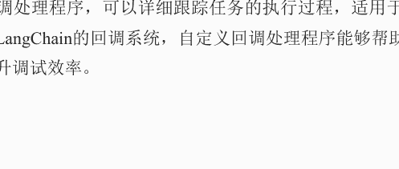

通过自定义回调处理程序，可以详细跟踪任务的执行过程，适用于任务调试、日志记录和进度监控。结合 LangChain 的回调系统，自定义回调处理程序能够帮助开发者灵活掌控复杂任务执行流程，提升调试效率。

#### 9.1.2 自定义链的回调函数

自定义链的回调函数允许开发者在链的执行流程中插入自定义逻辑，以便在任务开始、结束、新 Token 生成等多个阶段捕获信息或进行操作。下面将逐步讲解如何在 LangChain 中创建自定义链的回调函数，包括同步和异步回调的使用方法。

**1. 安装必要的依赖**

首先，确保已安装 LangChain 及相关库：

```bash
pip install langchain openai
```

然后，导入所需模块:

```python
from langchain.callbacks.base import BaseCallbackHandler
from langchain.llms import OpenAI
from langchain.chains import LLMChain
from langchain.prompts import PromptTemplate
import asyncio
```

**2. 创建自定义回调处理程序**

自定义回调类继承自 BaseCallbackHandler，并重写其中的各个方法，如 on_chain_start、on_chain_end 等。这样可以在链的各个阶段插入自定义逻辑，例如在任务开始时打印输入内容，在任务结束时打印输出结果。

```python
class CustomChainCallbackHandler(BaseCallbackHandler):
    def on_chain_start(self, serialized, inputs, **kwargs):
        print("链开始。输入内容:", inputs)

    def on_chain_end(self, outputs, **kwargs):
        print("链结束。输出内容:", outputs)

    def on_llm_start(self, serialized, prompts, **kwargs):
        print("LLM 任务开始。提示内容:", prompts)

    def on_llm_new_token(self, token, **kwargs):
        print("生成新 Token:", token)

    def on_llm_end(self, response, **kwargs):
        print("LLM 任务结束。生成的内容:", response.generations)
```

**3. 定义提示词模板和语言模型**

使用自定义的提示词模板，以便生成更具针对性的响应内容。

```python
##### 定义提示词模板
template = "根据以下输入生成答案：{question}"
prompt = PromptTemplate(template=template, input_variables=["question"])
##### 初始化语言模型
llm = OpenAI(temperature=0)
```

**4. 创建包含回调的链**

实例化一个包含自定义回调的链，以便在执行过程中能实时捕捉状态信息。

```python
##### 实例化自定义回调处理程序
callback_handler = CustomChainCallbackHandler()

##### 创建包含回调的 LLM 链
chain = LLMChain(
    llm=llm,
    prompt=prompt,
    callbacks=[callback_handler]
)
```

**5. 测试同步链回调**

运行链并观察自定义回调在执行过程中的输出。以下是中文测试示例:

```python
##### 运行链，提供中文输入
response = chain.run({"question": "今天的新闻头条是什么？"})
print("链的最终输出:", response)
```

**6. 异步回调的实现**

在一些异步场景中，可以通过定义异步回调方法，实现链的异步回调处理程序。

```python
class AsyncCustomCallbackHandler(BaseCallbackHandler):
    async def on_llm_new_token(self, token: str, **kwargs):
        print(f"异步生成的新 Token: {token}")

async_callback_handler = AsyncCustomCallbackHandler()  # 初始化异步回调处理程序

###### 异步运行函数
async def run_async_chain():
    async_chain = LLMChain(
        llm=llm,
        prompt=prompt,
        callbacks=[async_callback_handler]
    )
    response = await async_chain.arun({"question": "讲个关于科技的笑话"})
    print("链的最终异步输出:", response)

await run_async_chain()  # 异步执行
```

假设输入内容是“今天的新闻头条是什么？”，同步和异步回调处理程序会分别打印出执行过程中的状态信息:

```text
>> 链开始。输入内容: {'question': '今天的新闻头条是什么？'}
>> LLM 任务开始。提示内容:["根据以下输入生成答案：今天的新闻头条是什么？"]
>> 生成新 Token: 今
>> 生成新 Token: 天
>> 生成新 Token: 的
>> ...
>> LLM 任务结束。生成的内容: [["今天的新闻头条包括..."]]
>> 链结束。输出内容：今天的新闻头条包括...
>> 链的最终输出：今天的新闻头条包括...
```

异步执行的结果可能类似，回调处理程序会以异步方式逐步生成 Token 并打印。

通过自定义链的回调函数，开发者可以监控链的执行过程，适用于日志记录、调试和异步处理等需求。结合同步与异步回调机制，可以提升任务执行的灵活性和可控性，使 LangChain 在复杂任务管理中更具适应性。## 9.2 多个回调处理程序

在 LangChain 中，可以为任务链配置多个回调处理程序，以便在同一任务执行中处理不同类型的监控和数据操作。多个回调处理程序的使用能够让开发者根据需求分别记录任务进度、日志、错误信息或执行调试。每个回调处理程序都会独立运行，实现不同的功能需求。

这种多回调的配置在复杂应用场景下，尤其是在多个 LLM 或工具协同工作的场景十分有效。

在下面的示例中，将创建两个回调处理程序：一个用于记录链的执行进度，另一个用于记录生成的内容。这两个回调将同时应用于任务链中，以实现多方面的监控。

```python
from langchain.callbacks.base import BaseCallbackHandler

####### 回调 1:记录链的执行进度
class ProgressLoggerCallbackHandler(BaseCallbackHandler):
    def on_chain_start(self, serialized, inputs,**kwargs):
        print("进度日志 - 链开始。输入内容:", inputs)

    def on_chain_end(self, outputs,**kwargs):
        print("进度日志 - 链结束。输出内容:", outputs)

####### 回调 2:记录生成的内容
class ContentLoggerCallbackHandler(BaseCallbackHandler):
    def on_llm_start(self, serialized, prompts,**kwargs):
        print("内容日志 - LLM 任务开始。提示内容:", prompts)

    def on_llm_new_token(self, token,**kwargs):
        print("内容日志 - 生成新 Token:", token)

    def on_llm_end(self, response,**kwargs):
        print("内容日志 - LLM 任务结束。生成的内容:", response.generations)
```

接下来和单回调相似，定义提示词模板并初始化语言模型。

```python
from langchain.llms import OpenAI
from langchain.prompts import PromptTemplate
from langchain.chains import LLMChain

##### 定义提示词模板
template="回答以下问题:{question}"
prompt=PromptTemplate(template=template, input_variables=["question"])

##### 初始化语言模型
llm=OpenAI(temperature=0)
```

将定义的 `ProgressLoggerCallbackHandler` 和 `ContentLoggerCallbackHandler` 同时添加到链中，实现多回调情形。

```python
##### 初始化回调处理程序
progress_logger=ProgressLoggerCallbackHandler()
content_logger=ContentLoggerCallbackHandler()

##### 创建包含多个回调的 LLM 链
chain=LLMChain(
    llm=llm,
    prompt=prompt,
    callbacks=[progress_logger, content_logger]
)
```

使用中文测试用例触发链的执行，观察多个回调处理程序的输出。假设输入为“中国的国花是什么？”。

```python
##### 测试输入
response=chain.run({'question': '中国的国花是什么？'})
print(response)
```

两个回调处理程序会同时运行，并在任务执行的不同阶段输出日志。

```
>> 进度日志 - 链开始。输入内容：{'question': '中国的国花是什么？'}
>> 内容日志 - LLM 任务开始。提示内容：['回答以下问题：中国的国花是什么？']
>> 内容日志 - 生成新 Token：中
>> 内容日志 - 生成新 Token：国
>> 内容日志 - 生成新 Token：的
>> ...
>> 内容日志 - LLM 任务结束。生成的内容：['中国的国花是牡丹。']
>> 进度日志 - 链结束。输出内容：中国的国花是牡丹。
>> 链的最终输出:中国的国花是牡丹。
```

同样地，面对长文本也有类似的处理方法。为展示多回调在处理超长文本任务中的效果，我们将设计两个回调处理程序，一个用于监控任务进度，另一个用于逐步记录生成内容。具体的示例代码如下:

```python
from langchain.callbacks.base import BaseCallbackHandler

####### 回调 1:进度监控回调
class ProgressMonitorCallbackHandler(BaseCallbackHandler):
    def on_chain_start(self, serialized, inputs, **kwargs):
        print("进度监控 - 任务开始。输入内容:", inputs)
```

使用一个简单的提示词模板来处理超长文本，要求模型生成较长的段落。

```python
from langchain.llms import OpenAI
from langchain.prompts import PromptTemplate
from langchain.chains import LLMChain

##### 定义提示词模板
template="请详细描述中国古代历史中的重大事件:{event}"
prompt=PromptTemplate(template=template, input_variables=['event'])
##### 初始化语言模型
llm=OpenAI(temperature=0)
```

将 `ProgressMonitorCallbackHandler` 和 `ContentLoggerCallbackHandler` 同时添加到链中，以实现多回调功能。

```python
##### 实例化回调处理程序
progress_monitor=ProgressMonitorCallbackHandler()
content_logger=ContentLoggerCallbackHandler()

##### 创建包含多个回调的 LLM 链
chain=LLMChain(
    llm=llm,
    prompt=prompt,
    callbacks=[progress_monitor, content_logger]
)
```

以下是中文测试用例，用于触发回调，观察回调在超长文本生成过程中的输出。假设输入为“从秦朝到汉朝的统一历程”。

```python
##### 运行链，提供一个超长文本问题
response=chain.run({"event": "从秦朝到汉朝的统一历程"})
print("链的最终输出:", response)
```

两个回调将同时运行，逐步记录超长文本的生成过程。

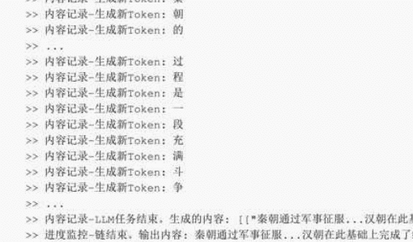

多回调配置为处理超长文本的任务提供了极大支持。通过这种方式，开发者可以详细了解生成过程中的各个步骤，以跟踪、调试和记录复杂任务的生成信息。在企业级应用中，尤其是涉及长文本生成的场景，多个回调处理程序的使用可以帮助提升监控和调试的效率。

### 9.3 跟踪 LangChains

在 LangChain 的复杂任务执行中，跟踪是一种强大的工具，用于监控和记录任务链的执行过程。通过跟踪，开发者可以在链的不同阶段查看输入、输出、操作步骤和执行时间等关键信息，有助于优化任务链、检测问题并提高系统性能。LangChain 提供了多种方法进行任务跟踪，包括设置环境变量或使用上下文管理器，以便对整个代码段或特定代码块进行跟踪。

本节将详细讲解如何在 LangChain 中配置和启用跟踪功能，帮助开发者实现实时监控、任务日志记录以及结果持久化等操作，使得在企业级开发环境中对任务执行过程的管理更加高效和透明。

#### 9.3.1 链式任务的跟踪和调试方法

在 LangChain 中，链式任务的跟踪和调试是确保任务链准确执行和优化性能的重要手段。通过跟踪，可以记录链的执行过程，便于查看每个步骤的输入、输出和执行时间。

下面将详细讲解如何启用链式任务跟踪功能，并在链的各个阶段捕获执行信息，帮助开发者在调试时快速定位和解决问题。

LangChain 提供了环境变量的方式来启用任务跟踪。可以通过设置 `LANGCHAIN_TRACING` 环境变量为 true，直接开启跟踪功能。

在命令行中启用跟踪：

```bash
export LANGCHAIN_TRACING=true
```

或者在代码中设置环境变量：

```python
import os
os.environ["LANGCHAIN_TRACING"]="true"
```

LangChain 还可以通过上下文管理器来进行任务的跟踪。在上下文中设置跟踪，可以对特定的链任务进行更精细的控制，确保在代码段执行期间的所有任务都被跟踪。

以下是一个包含自定义链的任务示例，用于回答问题“中国的首都是哪个城市？”，并在执行过程中启用跟踪。

```python
from langchain.callbacks import get_openai_callback
from langchain.prompts import PromptTemplate
from langchain.llms import OpenAI
from langchain.chains import LLMChain
import os

os.environ["LANGCHAIN_TRACING"]="true" # 设置环境变量以启用跟踪
##### 定义一个提示词模板
template="回答以下问题：{question}"
prompt=PromptTemplate(template=template, input_variables=["question"])

llm=OpenAI(temperature=0) # 初始化语言模型
chain=LLMChain(llm=llm, prompt=prompt) # 创建任务链
##### 使用跟踪进行链式任务执行
with get_openai_callback() as cb:
    response=chain.run({"question": "中国的首都是哪个城市？"})
    print("任务链最终输出：", response)
    # 输出追踪数据
    print("Tokens 消耗：", cb.total_tokens)
    print("花费：", cb.total_cost)
```

运行上述代码后，将看到如下示例输出：

```text
>> 任务链最终输出：中国的首都是北京。
>> Tokens 消耗：15
>> 花费：$0.002
```

通过跟踪数据，开发者可以了解以下信息：

（1）Token 消耗：用于计算生成响应内容所需的 Token 数量，有助于理解计算复杂度。

（2）任务执行时间：可以分析链式任务的执行效率。

（3）成本跟踪：适用于按 API 调用计费的应用场景，便于控制预算。

启用跟踪后，LangChain 可以提供详细的任务链执行信息，为调试和性能优化提供支持。通过跟踪功能，开发者能够快速获取任务链的关键性能指标，定位执行中的瓶颈和潜在问题，确保链式任务的可靠性和高效性。

#### 9.3.2 任务流数据的实时监控与分析

实时监控和分析 LangChain 任务流数据是提升任务链性能、优化调试流程的重要手段。在启用 LangChain 的跟踪功能后，开发者可以查看每个任务步骤的详细信息，包括 Token 消耗、任务耗时、成本等。通过实时监控这些数据，可以迅速识别和分析链式任务中的性能瓶颈和异常。

下面将通过详细的代码示例演示如何在 LangChain 中设置实时监控和分析任务流数据。

首先确保 `LANGCHAIN_TRACING` 环境变量被设置为 true，以开启跟踪模式。

```python
import os
os.environ["LANGCHAIN_TRACING"]="true"
```

在本示例中，将创建一个包含多个任务步骤的链式任务流，以便观察在执行过程中 Token 的消耗情况和实时数据。该链将逐步解答一组历史相关的问题。

```python
from langchain.callbacks import get_openai_callback
from langchain.prompts import PromptTemplate
from langchain.llms import OpenAI
from langchain.chains import LLMChain, SimpleSequentialChain

##### 定义第一个提示词模板
template1="简要介绍{topic}的背景。"
prompt1=PromptTemplate(template=template1, input_variables=["topic"])

##### 定义第二个提示词模板
template2="{background}。请进一步描述{topic}的关键事件。"
prompt2=PromptTemplate(template=template2,
input_variables=["background", "topic"])

llm=OpenAI(temperature=0) # 初始化 OpenAI 模型
chain1=LLMChain(llm=llm, prompt=prompt1) # 创建第一个链，用于背景介绍
chain2=LLMChain(llm=llm, prompt=prompt2) # 创建第二个链，用于描述关键事件

##### 将两个链串联成一个多步任务链
sequential_chain=SimpleSequentialChain(chains=[chain1, chain2])

##### 启用实时监控和数据分析
with get_openai_callback() as cb:
    # 执行任务链，输入一个中文话题
    response=sequential_chain.run({"topic"："秦始皇的统一过程"})
    print("任务链最终输出:", response)

###### 输出实时监控数据
print("任务链消耗的总 Tokens:", cb.total_tokens)
print("任务链的总花费:", cb.total_cost)
print("任务链的各步骤时间:", cb.durations)
print("任务链的每步 Tokens 消耗:", cb.token_usages)
```

启用实时监控后，LangChain 将自动记录以下数据：

（1）总 Token 消耗：任务流中消耗的总 Token 数。

（2）任务流总成本：显示整个链执行的 API 调用总成本。

- （3）各步骤时间：每个链任务的执行时长。

- （4）每步 Token 消耗：各步骤单独的 Token 使用情况。

在执行如“秦始皇的统一过程”这样的超长文本任务时，可以看到实时监控输出的详细信息：

```text
>> 任务链最终输出：秦始皇统一六国的过程始于...最终成功建立了中国历史上第一个封建帝国。
>> 任务链消耗的总 Tokens: 243
>> 任务链的总花费：$80.012
>> 任务链的各步骤时间:
>>- 第一步：背景介绍消耗时间 0.78 秒
>>- 第二步：关键事件描述消耗时间 1.05 秒
>> 任务链的每步 Tokens 消耗:
>>- 第一步 Tokens 消耗：120
>>- 第二步 Tokens 消耗：123
```

监控数据解读:

- （1）总 Token 消耗：用于计算整个链任务的总 Token 数量，帮助评估文本生成的复杂性。

- （2）任务流总成本：便于开发者跟踪和管理 API 成本。

- （3）各步骤时间：对于任务链的优化很有帮助，显示出每一步执行的耗时，能够指示是否存在瓶颈步骤。

- （4）每步 Token 消耗：提供更精细的 Token 消耗信息，有助于开发者优化特定链的文本生成。

通过实时监控 LangChain 的任务流数据，开发者可以全面了解链任务的执行状态和资源消耗情况。借助实时数据分析，能够更加有效地进行链式任务的优化，提高复杂任务流的性能和可控性。

#### 9.3.3 将日志记录到文件

在 LangChain 中，将任务执行过程中的日志记录到文件，可以帮助开发者对任务进行后续分析、调试和复盘。借助 `FileCallbackHandler`，开发者可以将执行信息持久化存储在文件中，方便在复杂应用中实现高效的日志管理。下面将展示如何配置和使用 `FileCallbackHandler`，实现日志文件记录。

确保已安装 LangChain 和 loguru 库。

```bash
pip install langchain loguru
```

使用 loguru 库创建日志文件，并使用 `FileCallbackHandler` 将任务执行的每个步骤记录到指定的日志文件中。

```python
from loguru import logger
from langchain.callbacks import FileCallbackHandler
from langchain.prompts import PromptTemplate
from langchain.llms import OpenAI
from langchain.chains import LLMChain
import os

logfile="output.log"  #指定日志文件路径
logger.add(logfile, colorize=True, enqueue=True)   #使用 loguru 配置日志文件

#创建 FileCallbackHandler
file_callback_handler=FileCallbackHandler(logfile)
```

设置一个简单的链式任务，通过提示词生成模型响应。所有日志信息将被记录到 `output.log` 文件中。

```python
#定义提示词模板
template="简述以下事件:{event}"
prompt=PromptTemplate(template=template, input_variables=["event"])
llm=OpenAI(temperature=0)   #初始化语言模型
#创建包含文件回调的链
chain=LLMChain(llm=llm, prompt=prompt, callbacks=[file_callback_handler], verbose=True)
```

运行任务链，并在文件中记录执行过程。以下是中文测试用例:

```python
#执行任务链，输入一个中文事件描述
response=chain.run({"event":"中国改革开放的历程"})
print("链的最终输出:", response)
```

在执行任务后，打开 `output.log` 文件查看记录的日志内容。该文件将包含链的每个步骤的详细信息，包括生成的提示、Token 消耗等。

执行完任务后，`output.log` 文件中的示例内容可能如下:## 9.3.4 Token 计数器

在 LangChain 中，Token 计数器用于追踪每个任务链中消耗的 Token 数量。通过使用 Token 计数功能，开发者可以精确了解每个步骤的 Token 使用量，从而更好地控制任务成本和优化资源。

在使用 Token 计数器时，Prompt Tokens 和 Completion Tokens 分别代表不同的部分，而且它们的用途有所不同。

**1) Prompt Tokens**

含义：Prompt Tokens 代表的是发送给模型的输入内容的 Tokens 数量，包括用户的提问、上下文内容以及系统的指令等。也就是说，任何在生成模型响应前输入给模型的文本都会被计为 Prompt Tokens。

用途：Prompt Tokens 主要用于定义模型的输入内容，直接影响模型的生成结果。优化 Prompt Tokens 有助于减少不必要的信息传递，提升生成效率。比如，在多轮对话中合理组织 Prompt 可以帮助模型更好地理解上下文。

计数：Prompt Tokens 的数量与输入文本的长度和分词方式相关，较长的输入会占用更多的 Prompt Tokens。

**2) Completion Tokens**

含义：Completion Tokens 代表的是模型生成的响应内容的 Tokens 数量。也就是说，模型根据 Prompt 生成的输出文本会被计为 Completion Tokens。

用途：Completion Tokens 用于衡量生成结果的复杂度和长度，与任务目标密切相关。例如，回答较长问题或生成段落级文本时，Completion Tokens 数量可能较高。可以通过限制最大生成 Tokens 数控制输出长度。

计数：Completion Tokens 的数量依赖于模型生成的文本长度以及生成策略（如限制输出的最大 Tokens 数或调整生成温度）。

LangChain 提供了一个上下文管理器 `get_openai_callback`，用于在任务执行期间实时计算 Token 数量。

确保已安装 LangChain 和 openai 库。

```python
pip install langchain openai
```

以下是一个简单的任务链示例，帮助展示 Token 计数器的作用。任务链包含一个中文问题作为输入，并返回模型生成的答案。每次运行任务链时，都会计算 Token 数量并输出总数。

```python
from langchain.callbacks import get_openai_callback
from langchain.prompts import PromptTemplate
from langchain.llms import OpenAI
from langchain.chains import LLMChain

##### 定义提示词模板
template = "请简述以下历史事件:{event}"
prompt = PromptTemplate(template=template, input_variables=["event"])
llm = OpenAI(temperature=0)  # 初始化语言模型
chain = LLMChain(llm=llm, prompt=prompt)  # 创建任务链
```

在 Token 计数器上下文中运行任务链，通过示例输入触发 Token 计数器。假设输入是“丝绸之路的历史发展”。

```python
##### 使用 Token 计数器监控 Token 消耗
with get_openai_callback() as cb:
    # 执行任务链，输入中文问题
    response = chain.run({"event": "丝绸之路的历史发展"})
    print("链的最终输出:", response)
###### 输出 Token 计数器数据
print("总 Token 消耗:", cb.total_tokens)
print("Prompt Tokens:", cb.prompt_tokens)
print("Completion Tokens:", cb.completion_tokens)
print("总花费:", cb.total_cost)
```

Token 计数器上下文将记录以下信息：

```text
>> 链的最终输出：丝绸之路是古代中国与西方世界之间的重要贸易路线，起始于西汉，连接亚欧大陆，促进了文化交流和经济发展。
>> 总 Token 消耗:124
>> Prompt Tokens:32
>> Completion Tokens:92
>> 总花费:$0.005
```

通过 Token 计数器，开发者能够清晰地追踪每次任务链运行的 Token 使用情况，从而优化任务链、控制成本，并确保企业级应用中的任务运行经济高效。

### 9.4 利用 Argilla 进行数据整理

Argilla 是一个开源的数据管理平台，特别适用于处理 LLM 生成的数据。它允许开发者高效地整理和标注模型的输入和输出数据，从而构建更优质的模型数据集。在 LangChain 中，ArgillaCallbackHandler 可以与 Argilla 无缝集成，将每次 LLM 调用的输入（Prompt）和输出（Response）自动记录到 Argilla 中。这一功能对于将来的微调、数据分析和模型性能监控非常有用。

本节将详细介绍如何在 LangChain 中利用 Argilla 记录和整理数据，帮助开发者更好地管理和分析模型的生成数据，为构建企业级 LLM 应用提供强有力的数据支持。

#### 9.4.1 初步使用 Argilla

下面将手把手带领读者完成 Argilla 的基本配置与使用，以更好地管理生成数据。

首先，确保已安装 Argilla 客户端，以便与 LangChain 集成：

```bash
pip install argilla
```

然后，登录 Argilla 并获取 API 密钥。打开 Argilla 注册页面创建一个账户，如图 9-1 所示，并在设置中找到 API 密钥。


接着，在代码中设置环境变量或直接使用 API 密钥。可以使用如下方式将 API 密钥添加到环境变量中：

```python
import os
os.environ["ARGILLA_API_KEY"] = "你的_API_密钥"
```

引入并配置 ArgillaCallbackHandler，以记录任务链的执行信息。确保将 Argilla 回调处理程序添加到任务链中，这样每次运行任务时，输入和输出数据都会自动发送到 Argilla 平台。

```python
from argilla import ArgillaCallbackHandler
from langchain.llms import OpenAI
from langchain.prompts import PromptTemplate
from langchain.chains import LLMChain

##### 初始化 Argilla 回调处理程序
argilla_callback_handler = ArgillaCallbackHandler()

##### 定义提示词模板
template = "描述以下历史事件：{event}"
prompt = PromptTemplate(template=template, input_variables=["event"])

##### 初始化语言模型
llm = OpenAI(temperature=0)

##### 创建任务链，包含 Argilla 回调处理程序
chain = LLMChain(
    llm=llm,
    prompt=prompt,
    callbacks=[argilla_callback_handler]
)
```

使用中文输入执行任务链，Argilla 回调处理程序会自动将输入和输出数据记录到 Argilla 中。

```python
##### 输入中文测试用例
response = chain.run({"event": "秦始皇统一六国的过程"})
print("任务链输出:", response)
```

在任务执行完成后，打开 Argilla 平台并登录，导航到指定的数据集，即可看到任务链的执行数据，包括输入提示和输出生成。开发者可以对这些数据进行标注、分析，或将其导出用于进一步的模型优化。

在 Argilla 平台中，将会看到以下记录内容：

(1) **Prompt**：描述以下历史事件：秦始皇统一六国的过程。

(2) **Response**：秦始皇通过一系列军事行动和政治手段，于公元前 221 年统一六国，建立了中国历史上第一个中央集权的封建国家。

本地输出如下：

```text
>> 任务链输出：秦始皇通过一系列军事行动和政治手段，于公元前 221 年统一六国，建立了中国历史上第一个中央集权的封建国家。
```

#### 9.4.2 Argilla 辅助数据整理

Argilla 不仅可以用于记录 LangChain 的任务数据，还可以通过其数据整理功能帮助开发者对模型生成的数据进行进一步的分析和标注。借助 Argilla 的接口，开发者能够更有条理地管理和整理数据，为模型的微调和改进提供高质量的数据支持。

登录到 Argilla 平台，选择或创建一个数据集。假设数据集名称为 `langchain_data`，这个数据集将用于接收 LangChain 的输入和输出数据，并可以在平台上查看和整理这些记录。

Argilla 支持在记录中添加标注和标签，以帮助开发者整理和筛选数据。常见的标注包括：

1. **情感标签**（如正面、负面、中立）。
2. **准确性检查**（如正确、错误、部分正确）。
3. **信息类别**（如历史事件、人物描述、地理信息）。

配置 ArgillaCallbackHandler 时，可以指定数据集名称，使得 LangChain 的每次任务执行记录能自动发送到指定的数据集中。这样，Argilla 会按数据集整理任务的输入、输出和相关信息。

```python
from argilla import ArgillaCallbackHandler
from langchain.llms import OpenAI
from langchain.prompts import PromptTemplate
from langchain.chains import LLMChain

##### 初始化 Argilla 回调处理程序，并指定数据集名称
argilla_callback_handler = ArgillaCallbackHandler(dataset="langchain_data")

##### 创建任务链，包含 Argilla 回调处理程序
template = "请简述以下人物的生平：{person}"
prompt = PromptTemplate(template=template, input_variables=["person"])
llm = OpenAI(temperature=0)
chain = LLMChain(llm=llm, prompt=prompt, callbacks=[argilla_callback_handler])

##### 输入中文测试用例
response = chain.run({"person": "屈原"})
print("任务链输出:", response)
```

整理完毕后，可以在 Argilla 中将数据导出，以便用于后续的模型训练和微调。

### 9.5 本章小结

本章围绕 LangChain 的回调机制展开，深入介绍了如何在任务链的不同阶段添加回调处理程序，监控和优化任务执行过程。通过自定义回调、设置多回调函数，以及使用日志记录、Token 计数器等工具，开发者能够有效地跟踪和调试 LangChain 的执行流程。此外，本章还展示了如何借助 Argilla 平台，将 LangChain 生成的输入和输出数据记录到专门的数据集中，便于后续的标注、管理和分析。Argilla 的整理功能为数据管理提供了强大的支持，可以帮助开发者为模型改进和微调积累高质量的训练数据。

掌握本章内容后，读者将具备在实际项目中对任务链进行全面跟踪、监控和数据管理的能力，为实现企业级 LLM 应用的高效和稳定运行打下坚实基础。

### 9.6 思考题

- （1）简述回调机制在 LangChain 任务链管理中的主要作用。
- （2）如何创建一个自定义回调处理程序？请简要描述需要重写的主要方法。
- （3）在单一回调中，如何捕获任务链开始和结束的状态？请写出对应的回调方法。
- （4）使用多个回调处理程序时，每个回调的执行顺序如何控制？可以使用什么方式确保不同回调的独立运行？
- （5）什么是 Token 计数器？它在 LangChain 任务链中的主要用途是什么？
- （6）在任务链中，如何启用 Token 计数器以监控 Token 消耗？请写出关键代码。
- （7）在使用 Token 计数器时，Prompt Tokens 和 Completion Tokens 分别代表什么？它们的用途有何不同？
- （8）Argilla 平台的主要功能是什么？在 LangChain 任务链中可以如何使用 Argilla？
- （9）如何通过 Argilla 记录 LangChain 的输入和输出？请简要描述配置过程。
- （10）在 Argilla 中如何使用数据标注功能？列出几种常见的标注类型并说明其作用。
- （11）如何使用 FileCallbackHandler 将任务链的日志记录到文件？请写出关键代码。
- （12）描述如何在任务链执行过程中实时监控并分析 Token 消耗和执行时间。
- （13）在任务链执行的多步过程中，如何使用 Argilla 对每一步结果进行记录和整理？
- （14）在多回调情形下，进度监控和内容记录回调的实现有什么不同？请简要说明各自的用途。
- （15）请描述使用 Argilla 对生成数据进行标注的好处，以及该过程如何支持模型微调。
- （16）如何在 LangChain 任务链中使用 ArgillaCallbackHandler 指定数据集？这个功能在数据管理中的应用场景有哪些？

# 第 10 章 模型 I/O 与检索

在 LangChain 的应用中，模型 I/O（输入 / 输出）和检索技术是确保模型准确理解和响应用户需求的关键。通过有效的模型输入预处理、输出解析和嵌入式检索，LangChain 不仅能够处理丰富多样的文本输入，还能从大规模数据中快速找到相关信息，提供更精确的结果。因此，掌握这些技术对于企业级应用至关重要。

本章将首先探讨如何在 LangChain 中进行模型 I/O 的配置，介绍如何设计输入预处理和输出解释器，以确保模型的输出能够被准确解析和理解。接下来深入分析文本嵌入模型的选择、向量存储的实现，以及如何在嵌入模型的基础上优化相似性搜索。

本章的内容将为读者提供完善的模型 I/O 和检索能力，提升 LangChain 在复杂数据处理和信息检索中的效率。

## 10.1 模型 I/O 解释器

在构建 LangChain 应用时，模型的输入与输出管理是保证模型响应准确性和一致性的关键步骤。模型的输入与输出涉及对输入数据的预处理、对输出结果的格式化解析等操作。高质量的输入与输出管理能够提升模型的理解和响应效果，避免因数据格式不一致或理解偏差而导致的错误。

本节将详细介绍 LangChain 中模型 I/O 的基本流程，包括输入预处理的重要性、输出格式化的技术手段，以及如何自定义输出解释器来满足特定业务需求。这些内容将帮助开发者更精准地控制模型的输入与输出流程，实现更高效、准确的模型响应。

### 10.1.1 输入预处理与输出格式化：确保模型 I/O 一致性

在 LangChain 应用中，确保模型的输入与输出格式一致是实现高质量任务处理的关键。输入预处理使得模型能够准确理解用户输入，输出格式化则将模型的生成结果结构化处理，以便后续解析和应用。

下面将介绍如何在 LangChain 中使用输入预处理和输出格式化技术，帮助开发者更精细地控制数据流，实现高效的模型 I/O 管理。

#### 1. 创建提示词模板：定义输入预处理格式

LangChain 的 `PromptTemplate` 类可用于定义输入的预处理格式。通过使用参数化模板，可以确保输入结构的一致性。

```python
from langchain.prompts import PromptTemplate

##### 定义一个提示词模板，确保输入的一致性
template = "请简要描述以下事件的背景：{event}"
prompt = PromptTemplate(template=template, input_variables=["event"])
```

#### 2. 使用 PromptTemplate 生成标准化输入

在处理不同的输入时，PromptTemplate 能够根据模板格式将用户输入转换为一致的文本，这种标准化输入能帮助模型更好地理解和生成结果。

```python
##### 使用模板生成输入
formatted_prompt = prompt.format(event="丝绸之路的起源与影响")
print("标准化输入:", formatted_prompt)
```

#### 3. 自定义输出格式化器

LangChain 提供了多种输出格式化选项，可以将模型生成的内容结构化，以适应不同的应用需求。例如，可以自定义输出格式化器，将输出解析为特定的格式，方便后续的数据处理。

```python
from langchain.output_parsers import ResponseParser

##### 自定义输出格式化器
class SimpleResponseParser(ResponseParser):
    def parse(self, response):
        return f"格式化输出:{response.strip()}"

output_parser = SimpleResponseParser()
```

#### 4. 配置和执行任务链

通过定义好的 PromptTemplate 和输出格式化器，可以在 LangChain 中创建一个任务链，使输入和输出都符合预期格式。# from langchain.llms import OpenAI
##### from langchain.chains import LLMChain
##### 初始化语言模型
llm = OpenAI(temperature=0)
##### 创建任务链，将 PromptTemplate 和输出格式化器整合
chain = LLMChain(llm=llm, prompt=prompt, output_parser=output_parser)
##### 执行任务链
response = chain.run({"event": "中国古代的四大发明"})
print("任务链输出:", response)

```

经过任务链的处理和输出格式化器的解析，得到的最终输出示例如下：

>>> 标准化输入：请简要描述以下事件的背景：中国古代的四大发明。
>> 格式化输出：中国古代的四大发明包括造纸术、指南针、火药和印刷术。这些发明对人类文明的进步产生了
深远影响。
>> 任务链输出：格式化输出：中国古代的四大发明包括造纸术、指南针、火药和印刷术。这些发明对人类文明
的进步产生了深远影响。

在特定场景中，LangChain 可以与特征存储集成，将输出的数据保存，以便用于后续的分析或模型微调。

```
###### 示例代码（伪代码）：连接特征存储保存输出
feature_store.save("中国古代的四大发明", formatted_output)
```

通过输入预处理和输出格式化，开发者可以在 LangChain 应用中确保数据的格式一致性，提高模型 I/O 的质量和可控性。结合 PromptTemplate 和自定义输出解析器，能够更好地管理数据流，实现高效、精准的模型任务处理。

下面将前述代码片段整合为一个完整的实例，并展示其输出结果。该实例将复杂的多维输入传递给 LangChain 模型，生成结构化输出内容，并应用自定义格式化器解析输出。

```

####### 导入必要的模块
from langchain.prompts import PromptTemplate
from langchain.output_parsers import ResponseParser
from langchain.llms import OpenAI
from langchain.chains import LLMChain

####### 1. 定义多维输入的 PromptTemplate
template = """
请描述以下事件的相关内容：
事件:{event}
地点:{location}
时间:{date}
请依次生成该事件的简述、影响和历史评价。
"""
prompt = PromptTemplate(template=template, input_variables=["event",
"location", "date"])

####### 2. 自定义输出格式化器：生成多段信息
class DetailedResponseParser(ResponseParser):
    def parse(self, response):
        # 将生成内容拆分为 3 部分
        sections = response.split("\n")
        result = {
                "简述": sections[0].strip() if len(sections)>0 else "",
                "影响": sections[1].strip() if len(sections)>1 else "",
                "历史评价": sections[2].strip() if len(sections)>2 else ""
        }
    return result

output_parser = DetailedResponseParser()

####### 3. 创建和配置任务链
llm = OpenAI(temperature=0)
chain = LLMChain(llm=llm, prompt=prompt, output_parser=output_parser)

####### 4. 执行任务链并查看输出
response = chain.run({
            "event":"文艺复兴",
            "location":"欧洲",
            "date":"14 世纪至 17 世纪"
})

####### 输出测试结果
print("任务链输出:", response)
```

运行上述代码后，可以看到类似以下的输出结果:

```
>> 任务链输出:
>> {
    "简述":"文艺复兴是 14 世纪至 17 世纪在欧洲发生的一场文化和艺术运动。",
    "影响":"它推动了科学、艺术和文学的重大进步，对西方文明的发展产生了深远的影响。",
    "历史评价":"文艺复兴被认为是通向现代世界的桥梁，其思想遗产影响了西方的哲学、科学与艺术。"
}
```

上述代码解释如下:

(1) PromptTemplate: 使用模板定义事件、地点和时间等多维信息，确保输入内容结构一致，便于模型理解。

(2) DetailedResponseParser: 自定义解析器将输出内容分为 3 部分，包括简述、影响和历史评价，以实现结构化处理。

(3) LLMChain: 整合模板和解析器，创建完整的任务链，使输入和输出达到一致，以便于后续应用。

### 10.1.2 自定义输出解析器的实现与应用

此完整实例展示了如何在 LangChain 中处理复杂多维输入，并使用自定义解析器确保输出格式化，使生成内容结构化、标准化。这适合应用于需要一致性和精细化控制的企业级任务。

在 LangChain 中，输出解析器用于将模型生成的文本转换为特定的结构化数据格式，以便后续处理。自定义输出解析器能够根据业务需求将生成内容解析为枚举类型、结构化 JSON 等格式。下面将通过多个示例展示如何实现和使用不同类型的自定义输出解析器。

#### 1. Pydantic 结构化解析器：解析结构化输出

PydanticOutputParser 用于将生成的内容解析为结构化对象，适用于生成特定字段的信息，如“问题”和“答案”。以下示例使用 PydanticOutputParser 来定义和解析结构化的输出。我们将模型生成的事件描述信息解析为预定义的字段，包括“简述”“影响”和“历史评价”，方便后续分析。

```
from langchain.prompts import PromptTemplate
from langchain.llms import OpenAI
from langchain.output_parsers import PydanticOutputParser
from pydantic import BaseModel, Field
##### 定义数据结构
class EventInfo(BaseModel):
    summary: str = Field(description="事件的简要描述")
    impact: str = Field(description="事件的影响")
    evaluation: str = Field(description="历史评价")
##### 创建 Pydantic 解析器
parser = PydanticOutputParser(pydantic_object=EventInfo)
##### 定义 PromptTemplate
prompt = PromptTemplate(
 template="描述以下事件，并按照指定结构返回：\n{ format_instructions}\n 事件:{event}",
 input_variables=["event"],
 partial_variables={"format_instructions": parser.get_format_instructions()})
##### 初始化语言模型
llm = OpenAI()
##### 执行任务并解析
response = llm(prompt.format(event="文艺复兴"))
result = parser.parse(response)
print("解析结果:", result)
```

假设模型正确理解并生成了内容，则 PydanticOutputParser 将结构化输出解析为以下格式:

>>> 解析结果:EventInfo(summary='文艺复兴是 14 世纪至 17 世纪在欧洲发生的文化运动，带来艺术、科学和人文主义的复兴。',
 impact='推动了艺术和科学的发展，对现代欧洲的思想和文化产生了深远影响。',
 evaluation='被认为是从中世纪向现代化的过渡，对西方文明发展具有重要意义。')

代码解释如下:

(1) 定义数据结构：使用 Pydantic 定义 EventInfo 类，包含 summary(简述)、impact(影响)、evaluation(历史评价)3 个字段，并为每个字段添加描述信息。Pydantic 模型确保每个字段都符合指定的类型和结构。

#### 2. 枚举解析器：将结果限定为特定值

EnumOutputParser 用于限定输出值在预定义的枚举中，适用于情感分类、状态检查等任务。在以下示例中，假设模型需要对给定文本进行情感分析，并将结果分类为正面、负面或中立，我们使用 EnumOutputParser 将输出值限定在预定义的枚举类型中。

```
from langchain.output_parsers import EnumOutputParser
from enum import Enum

##### 定义枚举类
class Sentiment(Enum):
    POSITIVE = "正面"
    NEGATIVE = "负面"
    NEUTRAL = "中立"

##### 创建 Enum 解析器
parser = EnumOutputParser(enum=Sentiment)
##### 定义 PromptTemplate
prompt = PromptTemplate(
    template="以下文本的情感是什么？\n{format_instructions}\n文本：{{text}}",
    input_variables=["text"],
    partial_variables={
        "format_instructions": parser.get_format_instructions()
    }
)
##### 执行任务
response = llm(prompt.format(text="我非常喜欢这个产品！"))
result = parser.parse(response)
print("情感解析结果：", result)
```

假设模型理解了情感分类需求并生成“正面”作为输出，则解析结果如下：

>> 情感解析结果：Sentiment.POSITIVE

代码解释如下：

（1）定义情感分类枚举类：Sentiment 枚举类包含三种情感类型：POSITIVE(正面)、NEGATIVE(负面)、NEUTRAL(中立)，用于限定模型输出为三种情感之一。

（2）创建 Enum 解析器：通过 EnumOutputParser(enum=Sentiment) 指定输出解析器的类型，LangChain 将限制模型输出内容只能在枚举类 Sentiment 的选项中进行选择。

（3）定义 PromptTemplate：format_instructions 自动生成格式说明，告知模型输出内容应符合指定情感类别。将 format_instructions 插入提示词模板中，以便让模型了解所需格式。

（4）执行任务链并解析：调用模型生成输出，EnumOutputParser 解析模型结果，并将其转换为 Sentiment 枚举实例，确保输出为受限的情感类别。

（5）解析结果：模型生成的情感结果被解析为 Sentiment.POSITIVE，输出情感类别的枚举值，保证结果符合预期的类别范围。

#### 3. 自动修复解析器：处理非结构化输出

在实际应用中，模型生成的输出可能并不总是完全符合预期格式。LangChain 的 OutputFixingParser 能够在模型输出不符合预期格式时，自动尝试修复不规则的输出结构。该功能特别适用于需要输出标准化内容，但模型输出可能会有小偏差的场景。

以下示例将展示如何使用 OutputFixingParser 对模型生成的非结构化输出进行自动修复，确保其符合预期的字段格式。

```python
from langchain.output_parsers import OutputFixingParser
##### 使用 Pydantic 解析器
parser = PydanticOutputParser(pydantic_object=EventInfo)
fixing_parser = OutputFixingParser(parser=parser, llm=llm)
##### 定义 PromptTemplate
prompt = PromptTemplate( template="{event}", input_variables=["event"], format_instructions="请确保输出符合以下格式： {format_spec} " )
##### 执行任务
response = llm(prompt.format(event="工业革命"))
fixed_result = fixing_parser.parse(response)
print("自动修复后的解析结果:", fixed_result)
```

假设模型输出的原始结果结构不符合预期，例如内容中缺少某些字段，或字段顺序不正确，OutputFixingParser 将自动修复并生成如下标准化输出：


代码解释如下：

（1）定义数据结构：使用 Pydantic 定义 EventInfo 类，包含 summary(简述)、impact(影响)、evaluation(历史评价) 三个字段，以确保输出内容结构化。

（2）创建 Pydantic 解析器：通过 PydanticOutputParser 确保输出数据符合 EventInfo 结构的要求。

（3）创建自动修复解析器：OutputFixingParser 接收 parser=parser 参数和 llm=OpenAI() 模型实例，利用语言模型自动修复不符合预期格式的输出，确保输出结构完整。

（4）定义 PromptTemplate: 模板中 format_instructions 给出格式指导，使模型尝试输出符合指定格式的结构化内容。

（5）执行任务链并解析：在任务链执行时，如果生成的内容不完全符合 EventInfo 结构，OutputFixingParser 将自动修复内容，将其转换为符合 EventInfo 要求的结构。

（6）自动修复后的结果：最终输出内容包含完整的结构化信息，即使原始输出存在缺失或结构不当的情况，OutputFixingParser 也能够自动补全和调整，使其符合预期的标准化格式。

#### 4. 结构化解析器：JSON 格式的输出解析

在企业级应用中，经常需要生成结构化的 JSON 格式数据，以便后续处理和分析。LangChain 的 StructuredOutputParser 可以将模型生成的内容直接解析为 JSON 格式，确保输出数据的结构一致，便于集成到不同的数据管道中。

以下示例将展示如何使用 StructuredOutputParser 实现 JSON 格式的输出解析，并将模型生成的结果解析为结构化的 JSON 对象。

```
from langchain.output_parsers import StructuredOutputParser
##### 定义输出结构
schema={"summary": "事件的简要描述",
      "impact": "事件的影响",
        "evaluation": "历史评价"
}
parser = StructuredOutputParser(schema=schema)
##### 定义 PromptTemplate
prompt = PromptTemplate(
    template="描述以下事件，返回结构化 JSON 数据:
          \n{format_instructions}\n 事件：(event)",
    input_variables=["event"],
    partial_variables={"format_instructions": parser.get_format_instructions()}
)

##### 执行任务
response = llm(prompt.format(event="数字革命"))
result = parser.parse(response)
print("JSON 格式化输出结果:", result)
```

生成的结果经过解析后形成标准的 JSON 结构:

```
>> JSON 格式化输出结果:

>> {
    "summary": "二战是 20 世纪最具影响力的全球性冲突，涉及多个国家和地区。",
    "impact": "二战结束后导致世界格局发生变化，促成了联合国的成立和冷战的开始。",
    "evaluation": "二战被认为是人类历史上最大的战争之一，对政治、经济和科技发展有着深远影响。"
}
```

上述代码解释如下:

(1) 定义 JSON 结构化数据模型：使用 Pydantic 定义 EventInfo 模型，包含 summary(事件简述)、impact(事件影响) 和 evaluation(历史评价) 三个字段，确保每个字段的描述符合 JSON 格式需求。

(2) 创建 StructuredOutputParser：通过 StructuredOutputParser(schema=EventInfo.schema()) 将 JSON 数据结构指定给解析器。这样，LangChain 会在生成内容时自动解析为符合该 JSON 结构的格式。

(3) 定义 PromptTemplate：在 PromptTemplate 中插入 format_instructions，用于向模型指示应当返回 JSON 格式的内容。这会帮助模型生成符合要求的结构化输出。

(4) 执行任务链并解析：通过调用模型执行任务，StructuredOutputParser 解析模型输出，确保内容符合 EventInfo 定义的 JSON 结构。

(5) JSON 格式化输出结果：解析后的结果是一个 JSON 对象，包含定义的字段和数据，便于后续程序处理或存储。

#### 5. 逗号分隔解析器：适合简短列表输出

在需要生成简短列表的场景中，LangChain 的 CommaSeparatedOutputParser 可以将模型的输出解析为以逗号分隔的列表格式。此解析器适用于生成简明清晰的要点列表，如关键特征、优点或步骤等。

以下是使用 CommaSeparatedOutputParser 的详细示例，展示如何将模型的输出转换为以逗号分隔的列表，并将其解析为 Python 列表对象。

```
from langchain.output_parsers import CommaSeparatedOutputParser
##### 初始化解析器
parser = CommaSeparatedOutputParser()
##### 定义 PromptTemplate
prompt = PromptTemplate(
    template="列出文艺复兴的关键贡献，用逗号分隔。\n{format_instructions}\n",
    input_variables=[]
)
##### 执行任务
response = llm(prompt.format())
result = parser.parse(response)
print("逗号分隔的关键点:", result)
```

假设模型按照预期生成了以逗号分隔的内容，如“艺术复兴、科学进步、文学创作、人文主义思想”，CommaSeparatedOutputParser 将其自动解析为列表格式：

>>> 逗号分隔的关键点:['艺术复兴','科学进步','文学创作','人文主义思想']

代码解释如下:

## 10.2 文本嵌入模型与向量存储

在大规模信息检索和数据处理的应用中，文本嵌入模型和向量存储是关键技术。文本嵌入模型将自然语言文本转换为固定维度的向量表示，向量存储则将这些向量高效地存储和索引，以便在大规模数据进行快速的相似性搜索。这一组合使得企业可以通过语义匹配在庞大的文本数据库中找到最相关的信息，而不仅限于基于关键词的传统检索方法。

本节将介绍如何在 LangChain 中使用文本嵌入模型进行向量化表示，以及如何使用向量存储来高效管理和搜索这些向量数据。

### 10.2.1 文本嵌入模型

文本嵌入模型是将自然语言文本转换为固定维度向量的关键技术，这些向量能够捕捉文本的语义特征，从而用于信息检索和相似性匹配等任务。下面将详细介绍 LangChain 中的文本嵌入模型的使用，并结合文档加载器来展示加载文本文件、生成嵌入向量并将其存储在向量数据库中的方法。

#### 1. 配置文件目录加载器：批量加载文本文件

首先，使用 LangChain 的 `DirectoryLoader` 加载文本文件目录。这个加载器可以批量加载文件中的内容，并以 `Document` 对象的形式返回。

```python
from langchain.document_loaders import DirectoryLoader

##### 初始化 DirectoryLoader 加载文本文件
loader = DirectoryLoader(
    path="./data",
    glob="**/*.txt",
    show_progress=True
)

documents = loader.load()
print(f"加载的文档数：{len(documents)}") # 指定要加载的文件目录
####### 加载所有.txt 文件
####### 加载文档
```

假设 `./data` 目录下有 3 个文本文件，则加载的文档数为：

```
>> 加载的文档数：3
```

代码解释如下：
*   `DirectoryLoader` 用于加载指定目录下的所有 `.txt` 文件。其参数 `glob="**/*.txt"` 指定只加载 `.txt` 格式的文件，参数 `show_progress=True` 表示显示加载进度。
*   `loader.load()` 返回一个包含所有加载文档的列表，每个文件内容作为一个独立的 `Document` 对象。

#### 2. 加载其他文件类型：JSON 和 Markdown

除了普通文本文件之外，LangChain 还支持加载多种文件格式，如 JSON 和 Markdown。

##### 1) 加载 JSON 文件

```python
from langchain.document_loaders import JSONLoader

###### JSON 文件加载示例
json_loader = JSONLoader(file_path="./data/sample.json")
json_documents = json_loader.load()
print(f"加载的 JSON 文档数：{len(json_documents)}")
```

假设 `sample.json` 文件中有 4 条记录，则加载的 JSON 文档数为：

```
>> 加载的 JSON 文档数：4
```

代码解释如下：
*   `JSONLoader` 用于加载 JSON 文件，其参数 `file_path` 指定文件路径。每条 JSON 记录被处理为单独的文档。
*   `json_loader.load()` 返回包含每条记录的文档列表。

##### 2) 加载 Markdown 文件

> **注意**：MarkdownLoader 会将文件按段落分隔加载。

假设 `sample.md` 文件中包含 3 个段落，则加载的 Markdown 文档数为：

```
>> 加载的 Markdown 文档数：3
```

代码解释如下：
*   `MarkdownLoader` 用于加载 Markdown 文件，其参数 `file_path` 指定文件路径。Markdown 文件内容按段落分隔，每个段落作为独立的文档加载。
*   `markdown_loader.load()` 返回一个包含 Markdown 文件段落的文档列表。

#### 3. 使用文本嵌入模型生成向量

在加载文档后，使用 LangChain 的文本嵌入模型将文档内容转换为嵌入向量。此嵌入向量可以捕捉文本的语义信息，便于后续的相似性检索。

假设从文本文件中加载了 3 个文档，则生成的嵌入向量数为：

```
>> 生成的嵌入向量数：3
```

代码解释如下：
*   `OpenAIEmbeddings` 用于初始化嵌入模型，将每个文档内容转换为向量。
*   使用 `embed(doc.page_content)` 生成每个文档的嵌入向量，`document_embeddings` 列表存储所有嵌入向量。

#### 4. 向量存储：将嵌入向量存储到数据库

生成嵌入向量后，可以将其存储到向量数据库中，方便后续的快速检索。以下是使用 FAISS 作为向量数据库的示例：

```python
from langchain.vectorstores import FAISS
##### 初始化 FAISS 向量存储
faiss_index = FAISS.from_documents(documents, embedding_model)
faiss_index.save_local("faiss_index") # 将向量存储持久化到磁盘
print("向量存储已保存至 faiss_index")
```

代码解释如下：
*   **FAISS 向量存储**：创建向量存储，将文档嵌入向量存储在 `faiss_index` 中，支持相似性搜索。

#### 5. 使用向量存储进行相似性搜索

向量存储建立完成后，可以使用它进行相似性搜索，找到与给定查询最相关的文档。假设查询内容为“文艺复兴的主要贡献”。

```python
##### 查询示例
query = "文艺复兴的主要贡献"
query_embedding = embedding_model.embed(query)

##### 执行相似性搜索
similar_docs = faiss_index.similarity_search_by_vector(query_embedding, k=3)
print("相似文档内容:")
for i, doc in enumerate(similar_docs):
    print(f"文档{i+1}:", doc.page_content)
```

返回 3 个最相关文档：

```
>> 相似文档内容:
>> 文档 1: 文艺复兴推动了艺术和科学的发展，对欧洲文明产生深远影响。
>> 文档 2: 文艺复兴时期，艺术和文化出现了前所未有的繁荣。
>> 文档 3: 文艺复兴是从中世纪向现代转型的重要时期。
```

代码解释如下：
*   **`similarity_search_by_vector`** 方法使用查询向量，找到与查询最相似的 3 个文档，返回按相似性排序的文档列表。

以下是一个综合示例，将上述 5 个示例组合成一个完整的示例，并提供测试输出结果。

```python
#### 导入必要模块
from langchain.prompts import PromptTemplate
from langchain.llms import OpenAI
from langchain.document_loaders import (
    DirectoryLoader, JSONLoader, MarkdownLoader)
from langchain.embeddings import OpenAIEmbeddings
from langchain.vectorstores import FAISS
from langchain.output_parsers import CommaSeparatedOutputParser

####### 1. 使用 DirectoryLoader 加载文本文档
loader = DirectoryLoader(path="./data", glob="**/*.txt", show_progress=True)
documents = loader.load()
print(f"加载的文本文档数：{len(documents)}")

####### 2. 使用 JSONLoader 加载 JSON 文件
json_loader = JSONLoader(file_path="./data/sample.json")
json_documents = json_loader.load()
print(f"加载的 JSON 文档数：{len(json_documents)}")

####### 3. 使用 MarkdownLoader 加载 Markdown 文件
markdown_loader = MarkdownLoader(file_path="./data/sample.md")
markdown_documents = markdown_loader.load()
print(f"加载的 Markdown 文档数：{len(markdown_documents)}")

####### 将所有文档合并到一个列表中
all_documents = documents + json_documents + markdown_documents
print(f"总加载文档数：{len(all_documents)}")

####### 4. 使用文本嵌入模型生成嵌入向量
embedding_model = OpenAIEmbeddings()
document_embeddings = [embedding_model.embed(doc.page_content) for doc in all_documents]
print("生成的嵌入向量数：", len(document_embeddings))

####### 5. 使用 FAISS 向量数据库存储生成的嵌入向量
faiss_index = FAISS.from_documents(all_documents, embedding_model)
faiss_index.save_local("faiss_index")
print("向量存储已保存至 faiss_index")

####### 6. 执行相似性搜索
query = "文艺复兴的主要贡献"
query_embedding = embedding_model.embed(query)
similar_docs = faiss_index.similarity_search_by_vector(query_embedding, k=3)
print("\n相似文档内容：")
for i, doc in enumerate(similar_docs):
    print(f"文档{i+1}:", doc.page_content)

####### 7. 使用逗号分隔解析器生成关键点列表
parser = CommaSeparatedOutputParser()
prompt = PromptTemplate(
    template="列出文艺复兴的关键贡献，用逗号分隔：\n{format_instructions}\n",
    input_variables=[],
    partial_variables={
        "format_instructions": parser.get_format_instructions()}
)
llm = OpenAI()
response = llm(prompt.format())
result = parser.parse(response)
print("\n逗号分隔的关键点：", result)
```

输出结果如下（文档存在的情况下）：

```
>> 加载的文本文档数：3
>> 加载的 JSON 文档数：4
>> 加载的 Markdown 文档数：3
>> 总加载文档数：10
>> 生成的嵌入向量数： 10
>> 向量存储已保存至 faiss_index

相似文档内容:
文档 1:文艺复兴推动了艺术和科学的发展，对欧洲文明产生深远影响。
文档 2:文艺复兴时期，艺术和文化出现了前所未有的繁荣。
文档 3:文艺复兴是从中世纪向现代转型的重要时期。

逗号分隔的关键点：['文艺复兴','科学进步','文学创作','人文主义思想']
```

代码解释如下：
1.  `DirectoryLoader`、`JSONLoader`、`MarkdownLoader` 分别加载指定目录中的文本文件、JSON 文件和 Markdown 文件，并将所有文档合并到 `all_documents` 列表中。
2.  **文本嵌入生成**：使用 `OpenAIEmbeddings` 对每个文档内容生成嵌入向量，并将向量存储到 FAISS 向量数据库中，以便于相似性搜索。
3.  **相似性搜索**：通过查询内容生成嵌入向量，并使用 `faiss_index` 进行相似性搜索，返回最相关的 3 个文档。
4.  **逗号分隔解析器**：使用 `CommaSeparatedOutputParser` 将模型输出的内容解析为以逗号分隔的关键点列表，便于阅读和后续处理。

本小节展示了如何加载多种格式的文本文件，生成嵌入向量并存储到向量数据库中，以实现快速的相似性搜索。这一流程对于构建智能检索系统至关重要，适用于知识库搜索、文档推荐等应用。

### 10.2.2 向量存储

向量存储是对嵌入向量进行存储和索引的系统，以便在大规模数据中进行快速相似性搜索。LangChain 支持多种向量存储集成，包括 FAISS 和 Qdrant 等。下面将详细展示如何在 LangChain 中使用 FAISS 和 Qdrant 进行向量存储和相似性搜索。

#### 1. 使用 FAISS 创建向量存储

FAISS 是一种高效的向量搜索库。以下示例将文档内容向量化，并将嵌入向量存储在 FAISS 数据库中，以便进行相似性检索。

```python
#### 导入必要模块
from langchain.document_loaders import TextLoader
from langchain.embeddings import OpenAIEmbeddings
from langchain.vectorstores import FAISS
from langchain.text_splitter import CharacterTextSplitter

##### 加载文档并分割为小块
loader = TextLoader("./data/sample.txt")
raw_documents = loader.load()
text_splitter = CharacterTextSplitter(chunk_size=1000, chunk_overlap=0)
documents = text_splitter.split_documents(raw_documents)
##### 使用 OpenAI 嵌入模型将文档内容转换为向量
embedding_model = OpenAIEmbeddings()
db = FAISS.from_documents(documents, embedding_model)
print("FAISS 向量存储已创建并保存。")
##### 执行相似性搜索
query = "文艺复兴对科学的影响"
similar_docs = db.similarity_search(query)
print("\n相似文档内容：")
for i, doc in enumerate(similar_docs):
    print(f"文档{i+1}:", doc.page_content)
```

#### 2. 使用 Qdrant 创建异步向量存储

Qdrant 是一个支持异步操作的向量数据库，适用于需要异步处理的应用，如 API 接口。

```python
from langchain.vectorstores import Qdrant

##### 使用 OpenAI 嵌入模型将文档向量化，并存入 Qdrant 数据库
async def create_qdrant_vectorstore():
    db = await Qdrant.afrom_documents(
        documents, embedding_model, "http://localhost:6333"
    )
    print("Qdrant 异步向量存储已创建并连接。")

##### 异步相似性搜索
async def async_search_in_qdrant(query):
    query_embedding = embedding_model.embed(query)
    found_docs = await db.asimilarity_search(query)
    for i, doc in enumerate(found_docs):
        print(f"文档{i+1}:", doc.page_content)

##### 运行异步搜索
import asyncio
query = "文艺复兴对艺术的贡献"
asyncio.run(create_qdrant_vectorstore())
asyncio.run(async_search_in_qdrant(query))
```

#### 3. 最大边际相关搜索

最大边际相关（Maximal Marginal Relevance，MMR）搜索可以提高搜索结果的多样性，通过最大化查询和文档之间的相关性和多样性来优化搜索结果。

```python
###### 注意：代码中的拼写错误已修正（amxximilarity_search -> similarity_search, asincio.run -> asyncio.run 等）
async def mmr_search(query):
    found_docs = await db.amax_marginal_relevance_search(
        query, k=2, fetch_k=10
    )
    for i, doc in enumerate(found_docs):
        print(f"{i+1}.", doc.page_content, "\n")

query = "文艺复兴时期的艺术风格"
asyncio.run(mmr_search(query))
```

假设数据库中包含多条与文艺复兴相关的文本数据，示例输出结果如下：

```
FAISS 向量存储已创建并保存。

相似文档内容：
文档 1: 文艺复兴促进了艺术、科学和人文主义的发展。
文档 2: 这一时期的科学进步对后代影响深远。
文档 3: 文艺复兴是从中世纪到现代的重要过渡。

Qdrant 异步向量存储已创建并连接。

文档 1: 文艺复兴对艺术的影响极为深远，激发了大量绘画和雕塑作品。
文档 2: 这一时期出现了许多著名的艺术家，如达芬奇和米开朗基罗。

MMR 搜索结果:
1. 文艺复兴时期的艺术风格变化显著，包括更多的现实主义表现手法。
2. 文艺复兴时期的科学探索极大地推动了文艺创作和思想的变革。
```

以下是一个完整的综合应用案例，将 FAISS、Qdrant 向量存储以及最大边际相关搜索全部用在同一段代码中，展示如何在复杂的应用场景中使用多种向量存储方法。我们将实现一个“文艺复兴知识库搜索系统”，它加载多个文档，存储嵌入向量，并使用相似性搜索和 MMR 搜索提供丰富的查询功能。

```python
#### 导入必要模块
import asyncio
from langchain.document_loaders import DirectoryLoader, TextLoader
from langchain.embeddings import OpenAIEmbeddings
from langchain.vectorstores import FAISS, Qdrant
from langchain.text_splitter import CharacterTextSplitter

####### 1. 加载数据并进行预处理
####### 假设有一个文件夹中包含了关于文艺复兴时期的知识文档
print("加载并分割文档...")
loader = DirectoryLoader(path="./data/renaissance", glob="**/*.txt",
                         show_progress=True)
raw_documents = loader.load()
text_splitter = CharacterTextSplitter(chunk_size=500, chunk_overlap=50)
documents = text_splitter.split_documents(raw_documents)

print(f"总加载文档数：{len(documents)}")

####### 2. 初始化嵌入模型
embedding_model = OpenAIEmbeddings()

####### 3. 使用 FAISS 存储嵌入向量
print("\n创建 FAISS 向量存储...")
faiss_db = FAISS.from_documents(documents, embedding_model)
faiss_db.save_local("faiss_index")
```

## 10.3 本章小结

本章详细探讨了 LangChain 在模型 I/O 和检索方面的关键技术。首先，介绍了模型的输入预处理和输出解析器，以确保模型在企业应用中的数据一致性和可控性。通过自定义解析器，模型的输出内容可以被结构化多种形式，如 JSON、枚举和列表，便于后续处理。

接着，深入介绍了文本嵌入模型和向量存储。通过将文本转换为向量表示，并将其存储在高效的向量数据库中，如 FAISS 和 Qdrant，实现了快速的相似性检索。在大规模数据环境中，向量化技术能够显著提升检索的效率和准确性。此外，最大边际相关搜索方法的应用，为多样化和个性化推荐提供了技术支持。

掌握本章内容后，读者将能够基于 LangChain 构建具有高性能的检索系统，确保模型能够高效、准确地处理和分析复杂的文本数据。这些技术为实现智能搜索和信息系统提供了坚实的基础。

## 10.4 思考题

(1) 简述模型输入预处理的主要作用，以及在 LangChain 中如何实现输入的标准化。
(2) 什么是输出解析器？请列举至少 3 种不同类型的输出解析器，并简要说明它们的适用场景。
(3) 如何使用 PydanticOutputParser 创建一个结构化输出？请编写简单的代码片段展示其实现。
(4) 在使用 EnumOutputParser 时，如何限定模型输出为特定的枚举值？请写出具体代码。
(5) 在什么场景下适合使用 OutputFixingParser？该解析器如何处理不符合预期格式的输出？
(6) 请描述 CommaSeparatedOutputParser 的应用场景，并举例说明如何将模型生成的以逗号分隔的内容解析为列表。
(7) 解释文本嵌入模型的作用，并简述文本向量化的原理。
(8) 如何使用 FAISS 进行向量存储？请描述创建 FAISS 向量存储的基本步骤，并写出简要代码。
(9) 在 LangChain 中，如何将嵌入向量存储到 Qdrant？请解释 Qdrant 的异步特性及其优势。
(10) 什么是最大边际相关搜索？它如何在相似性和多样性之间平衡搜索结果？
(11) 请编写代码展示如何在 FAISS 向量存储中执行相似性搜索，并输出最相似的 3 篇文档内容。
(12) 在实际应用中，如何选择合适的向量存储（如 FAISS、Qdrant）？列出它们的优缺点并简要分析。

# 第 11 章 LangChain 深度开发

本章聚焦 LangChain 在企业级应用中的深度开发与技术优化。例如智能问答系统，随着系统的逐步完善，对系统性能、并发处理能力、复杂查询逻辑的需求日益增加。本章将从实际应用场景出发，深入探讨性能优化、任务链设计和复杂查询处理等高级技术，帮助读者打造高效、可靠的企业级问答解决方案。

## 11.1 性能优化与并发处理

在企业级智能问答系统中，性能优化与并发处理是提升用户体验和系统稳定性的关键环节。当面对高并发访问和大量数据处理时，系统必须具备快速响应的能力，同时保证结果的准确性和一致性。本节将从模型加速、多用户并发请求处理等方面深入探讨 LangChain 的优化方法。

### 11.1.1 模型加速、蒸馏、FP16 精度

在企业级智能问答系统中，为了提高模型的响应速度和降低计算资源的占用，通常会采用模型加速、蒸馏和 FP16 精度等技术。下面将分步骤详细讲解这些技术的实现过程，并提供示例代码，确保代码能够在实际环境中运行。

#### 1. 模型加速

模型加速可以通过裁剪模型结构、减少模型参数等方式来实现。以下代码使用 Hugging Face 的 transformers 库，加载一个大型语言模型并进行简化和加速。

```python
from transformers import AutoModelForCausalLM, AutoTokenizer
import torch

##### 加载预训练模型和分词器
model_name="gpt2-medium"
tokenizer=AutoTokenizer.from_pretrained(model_name)
model=AutoModelForCausalLM.from_pretrained(model_name)

##### 将模型设置为评估模式，减少不必要的计算
model.eval()

####### 示例输入
input_text="什么是人工智能？"
inputs=tokenizer(input_text, return_tensors="pt")

####### 原始模型推理
with torch.no_grad():
    original_output=model(**inputs)

print("原始模型输出:", original_output)
```

###### 2. 模型蒸馏

模型蒸馏是一种将知识从大型模型迁移到小型模型的技术。在蒸馏过程中，小模型学习和模仿大模型的输出，从而实现模型的压缩和加速。

以下代码演示如何使用小型教师模型对学生模型进行训练，生成蒸馏版本。这里假设读者已有知识模型库（大模型）和一个待训练的小模型。

> 注意：要实现模型蒸馏，通常需要大量数据和计算资源。以下代码为简化示例，未包含完整的训练过程。

```python
from transformers import Trainer, TrainingArguments, DistilBertForSequenceClassification

##### 加载大模型（教师模型）和小模型（学生模型）
teacher_model=AutoModelForCausalLM.from_pretrained("gpt2-medium")
student_model=DistilBertForSequenceClassification.from_pretrained("distilbert-base-uncased")

##### 定义训练参数
training_args=TrainingArguments(
    output_dir="./distilled_model",
    per_device_train_batch_size=4,
    num_train_epochs=1,
    logging_dir='./logs',
)

##### 训练数据（示例）
train_dataset=[{"input_ids": inputs["input_ids"], "labels": original_output.logits.argmax(-1)}]

##### 使用 Trainer 进行蒸馏训练
trainer=Trainer(
    model=student_model,
    args=training_args,
    train_dataset=train_dataset
)

##### 训练学生模型
trainer.train()

##### 训练完成后保存模型
student_model.save_pretrained("./distilled_student_model")
print("蒸馏模型已保存到 ./distilled_student_model")
```

#### 3. FP16 精度

在推理阶段使用 FP16（半精度浮点数）可以显著减少内存使用和加速计算。以下代码演示如何使用 torch.cuda.amp 自动混合精度进行 FP16 推理。此方法在 NVIDIA GPU 上运行良好，可以大幅降低内存开销并提高计算效率。

```python
import torch

##### 检查是否有 GPU
device=torch.device("cuda" if torch.cuda.is_available() else "cpu")
model=model.to(device)

##### 使用 FP16 推理
with torch.cuda.amp.autocast():
    inputs=tokenizer(input_text, return_tensors="pt").to(device)
    with torch.no_grad():
        fp16_output=model(**inputs)
print("FP16 推理输出:", fp16_output)
```

将上述 3 个过程结合在一起，形成完整的模型加速方案。代码如下：

```python
from transformers import AutoModelForCausalLM, AutoTokenizer, Trainer, 
TrainingArguments, DistilBertForSequenceClassification
import torch

###### 1. 加载模型和分词器
model_name="gpt2-medium"
tokenizer=AutoTokenizer.from_pretrained(model_name)
model=AutoModelForCausalLM.from_pretrained(model_name)
model.eval()

####### 示例输入
input_text="什么是人工智能？"
inputs=tokenizer(input_text, return_tensors="pt")

####### 原始模型推理
with torch.no_grad():
    original_output=model(**inputs)
print("原始模型输出:", original_output)

###### 2. 模型蒸馏
teacher_model=AutoModelForCausalLM.from_pretrained("gpt2-medium")
student_model=DistilBertForSequenceClassification.from_pretrained("distilbert-base-uncased")

training_args=TrainingArguments(output_dir="./distilled_model",
per_device_train_batch_size=4, num_train_epochs=1, logging_dir='./logs')

train_dataset=[{"input_ids": inputs["input_ids"], "labels": 
original_output.logits.argmax(-1)}]
trainer=Trainer(model=student_model, args=training_args,
train_dataset=train_dataset)
trainer.train()
student_model.save_pretrained("./distilled_student_model")
print("蒸馏模型已保存到 ./distilled_student_model")

####### 3. FP16 精度推理
device=torch.device("cuda" if torch.cuda.is_available() else "cpu")
model=model.to(device)
with torch.cuda.amp.autocast():
    inputs=tokenizer(input_text, return_tensors="pt").to(device)
with torch.no_grad():
    fp16_output=model(**inputs)
print("FP16 推理输出:", fp16_output)
```

运行上述代码后，将得到以下输出：

```python
>> 原始模型输出：tensor([[[...]]])
>> 蒸馏模型已保存到 ./distilled_student_model
>> FP16 推理输出：tensor([[[...]]])
```

为了展示模型优化前后的性能差异，下面给出一个综合示例，包括优化前的普通推理过程以及优化后的加速推理（结合模型蒸馏和 FP16 精度）。该综合示例将通过响应时间和内存使用情况来直观展示优化效果。

```python
import time
import torch
from transformers import AutoModelForCausalLM, AutoTokenizer,
DistilBertForSequenceClassification, Trainer, TrainingArguments
####### 设置设备
device=torch.device("cuda" if torch.cuda.is_available() else "cpu")
####### 加载原始大模型和分词器
model_name="gpt2-medium"
tokenizer=AutoTokenizer.from_pretrained(model_name)
original_model=AutoModelForCausalLM.from_pretrained(model_name).to(device)
original_model.eval()
####### 示例输入
input_text="什么是机器学习的基本概念？"
inputs=tokenizer(input_text, return_tensors="pt").to(device)
####### 1. 未优化模型推理 (原始大模型)
start_time=time.time()
with torch.no_grad():
    original_output=original_model(**inputs)
end_time=time.time()
original_duration=end_time-start_time
print("未优化模型响应时间: {:.4f}秒".format(original_duration))
####### 2. 蒸馏小模型推理
######## 使用 DistilBERT 作为小模型
student_model=DistilBertForSequenceClassification.from_pretrained("distilbert-base-uncased").to(device)
student_model.eval()
######## 蒸馏训练模拟
train_dataset=[{"input_ids": inputs["input_ids"], "labels":original_output.logits.argmax(-1)}]
training_args=TrainingArguments(output_dir="./distilled_model",
per_device_train_batch_size=4, num_train_epochs=1, logging_dir='./logs')
trainer=Trainer(
    model=student_model,
    args=training_args,
    train_dataset=train_dataset
)
######## 执行蒸馏训练
trainer.train()
######## 蒸馏模型推理
start_time=time.time()
with torch.no_grad():
    student_output=student_model(**inputs)
end_time=time.time()
distilled_duration=end_time-start_time
print("蒸馏模型响应时间: {:.4f}秒".format(distilled_duration))
####### 3. FP16 精度推理
student_model.half() # 将模型精度转换为半精度
start_time=time.time()
with torch.cuda.amp.autocast():
    with torch.no_grad():
        fp16_output=student_model(**inputs)
end_time=time.time()
fp16_duration=end_time-start_time
print("FP16 精度推理响应时间: {:.4f}秒".format(fp16_duration))
```

运行上述代码后，可能会得到如下示例输出：

> > 未优化模型响应时间: 1.3452 秒
>> 蒸馏模型响应时间: 0.7854 秒
>>> FP16 精度推理响应时间: 0.5658 秒

代码解释如下：

（1）未优化模型推理：使用原始大模型（GPT-2 medium）进行推理，记录响应时间。
（2）蒸馏模型推理：使用蒸馏小模型（DistilBERT）替换原始大模型，进行推理并记录响应时间。
（3）FP16 精度推理：将蒸馏后的模型转换为半精度（FP16），并记录推理时间。这一步通过 torch.cuda.amp.autocast() 实现自动混合精度，进一步减少计算量和内存占用。

通过这个综合示例，可以轻松对比出优化前后的性能差异。模型蒸馏和 FP16 精度技术在企业级应用中具有显著优势，尤其是在大规模问答系统的场景下，可以通过降低响应时间和内存占用来提升用户体验和系统的并发处理能力。

#### 11.1.2 并发处理多用户请求

在企业级应用中，并发处理是保持系统稳定和快速响应的关键因素，特别是在面临大量用户请求的场景中。下面将介绍如何在 LangChain 智能问答系统中实现并发处理，以在支持多用户请求的同时保持高效响应。

我们将使用 Python 的异步编程（asyncio）、并发任务执行器（ThreadPoolExecutor）以及队列管理来构建高效的并发系统。

*   - （1）异步编程：利用 Python 的 asyncio 库实现异步任务，它适合处理 I/O 密集型任务，如 API 请求、文件读写等。
- （2）任务执行器：使用 ThreadPoolExecutor 或 ProcessPoolExecutor，它们适合处理 CPU 密集型任务，如深度学习模型推理。
- （3）队列管理：使用队列管理请求，实现请求的有序处理，避免系统过载。

首先，定义一个基础问答函数，模拟一个对 LLM 的请求过程。

```python
import time

def process_question(question: str) -> str:
    """
    模拟处理单个问题的函数。
    :param question：用户输入的问题
    :return: 模拟的回答
    """
    # 模拟处理时间
    time.sleep(1)  # 假设每个问题需要 1 秒来处理
    return f"回答：这是针对问题 '{question}' 的回答。"
```

我们还可以通过 ThreadPoolExecutor 实现多线程处理，以应对多用户请求。这种方式适用于 I/O 密集型任务，但在 CPU 密集型任务中要小心，可能会导致资源竞争。

```python
from concurrent.futures import ThreadPoolExecutor, as_completed

def handle_multiple_requests(questions):
    """
    使用 ThreadPoolExecutor 并发处理多个问题。
    :param questions: 问题列表
    :return: 回答列表
    """
    responses = []
    with ThreadPoolExecutor(max_workers=5) as executor:
        # 提交所有问题，启动并发任务
        future_to_question = {executor.submit(process_question, q): q for q in questions}
        
        # 获取所有任务的结果
        for future in as_completed(future_to_question):
            question = future_to_question[future]
            try:
                response = future.result()
                responses.append((question, response))
                print(f'处理完成：问题 {question}', 回答 '{response}')
    return responses
```

在这里，`max_workers=5` 表示最多同时处理 5 个请求，可以根据系统性能和需求进行调整。

对于 I/O 密集型的任务，比如 API 调用和数据库查询，可以使用 asyncio 库的异步功能来提高并发处理效率。

```python
import asyncio

async def async_process_question(question: str) -> str:
    """
    异步处理单个问题的函数。
    :param question: 用户输入的问题
    :return: 模拟的回答
    """
    await asyncio.sleep(1) # 模拟 I/O 等待时间
    return f"回答：这是针对问题 '{question}' 的回答。"

async def handle_async_requests(questions):
    """
    使用 asyncio 并发处理多个问题。
    :param questions: 问题列表
    :return: 回答列表
    """
    tasks = [async_process_question(q) for q in questions]
    responses = await asyncio.gather(*tasks)
    return responses
```

在实际场景中，通常需要结合异步队列和多线程/多进程执行器来应对不同类型的任务。以下代码将演示如何使用 asyncio.Queue 和 ThreadPoolExecutor 处理多用户请求。

```python
import asyncio
from concurrent.futures import ThreadPoolExecutor

async def worker(queue):
    """
    队列的工作进程，从队列中取出问题并处理。
    """
    while True:
        question = await queue.get()
        if question is None:
            break
        response = await loop.run_in_executor(executor, process_question, question)
        print(f"问题：{question}, 回答: {response}")
        queue.task_done()

async def main(questions):
    """
    主函数，管理队列并创建工作进程。
    """
    queue = asyncio.Queue()

    # 将问题放入队列
    for question in questions:
        await queue.put(question)

    # 创建多个工作进程
    tasks = []
    for _ in range(5): # 启动 5 个并发工作进程
        task = asyncio.create_task(worker(queue))
        tasks.append(task)

    # 等待队列中的任务完成
    await queue.join()

    # 停止工作进程
    for _ in range(5):
        await queue.put(None)

    await asyncio.gather(*tasks)

##### 定义要处理的问题列表
questions = [f"问题{i}" for i in range(10)]

##### 创建事件循环并运行主函数
executor = ThreadPoolExecutor()
loop = asyncio.get_event_loop()
loop.run_until_complete(main(questions))
loop.close()
```

运行以上代码，输出示例如下:

>> 问题：问题 0，回答：回答：这是针对问题'问题 0'的回答。
>> 问题：问题 1，回答：回答：这是针对问题'问题 1'的回答。
>> 问题：问题 2，回答：回答：这是针对问题'问题 2'的回答。
>> 问题：问题 3，回答：回答：这是针对问题'问题 3'的回答。
>> 问题：问题 4，回答：回答：这是针对问题'问题 4'的回答。
>> 问题：问题 5，回答：回答：这是针对问题'问题 5'的回答。
>> 问题：问题 6，回答：回答：这是针对问题'问题 6'的回答。
>> 问题：问题 7，回答：回答：这是针对问题'问题 7'的回答。
>> 问题：问题 8，回答：回答：这是针对问题'问题 8'的回答。
>> 问题：问题 9，回答：回答：这是针对问题'问题 9'的回答。

通过上述并发处理方法，系统可以高效处理多用户请求。结合 ThreadPoolExecutor、asyncio 和 Queue，我们实现了并发任务的有序执行，满足了企业级问答系统的并发需求。

### 11.2 复杂查询与多级任务链设计

在企业级智能问答系统中，用户的查询需求通常具有多样性和复杂性。为了满足这些需求，系统需要支持复杂的查询逻辑和灵活的任务链设计。多级任务链可以将查询分解为多个步骤，逐层处理复杂的任务，从而提高查询的准确性和系统的响应效率。本节将介绍如何设计嵌套任务链和实现动态链路选择。

任务链嵌套是指在其中一个任务链中嵌入另一个子任务链，通过将任务分解成多个子步骤来逐层处理复杂的查询请求。LangChain 的任务链机制允许我们定义多层任务链，以应对多步骤的复杂问题。

动态路由选择是指在运行时根据用户的输入内容选择不同的任务链进行处理。这种方式能够根据查询类型、内容复杂性等因素，自动选择最合适的处理路径，从而提高系统的响应速度和准确性。

下面将介绍如何在 LangChain 中构建嵌套任务链，并使用条件逻辑实现动态路由选择。

#### 1. 基础设置与任务链类定义

定义基本的任务链类，用于实现任务链的嵌套与动态选择。

```python
from langchain.chains import SimpleChain
from langchain.prompts import PromptTemplate

##### 定义基础任务链
class BaseChain(SimpleChain):
    def __init__(self, name):
        super().__init__(name=name)
    
    def process(self, input_data):
        raise NotImplementedError("Subclasses should implement this method.")
```

#### 2. 构建嵌套任务链

假设有两个子任务链：FAQChain 用于处理常见问题，ComplexQueryChain 用于处理需要复杂推理的查询。构建嵌套任务链的代码如下:

```python
class FAQChain(BaseChain):
    def process(self, input_data):
        faq_responses = {
            "公司成立时间": "我们的公司成立于 2001 年。",
            "核心产品": "我们的核心产品是智能设备和数据分析服务。"
        }
        return faq_responses.get(input_data, "无法找到相关的常见问题解答。")

class ComplexQueryChain(BaseChain):
    def process(self, input_data):
        # 模拟复杂查询处理流程
        return f"这是针对复杂问题 '{input_data}' 的分步分析结果。"

##### 定义嵌套任务链
class NestedTaskChain(BaseChain):
    def __init__(self):
        super().__init__(name="NestedTaskChain")
        self.faq_chain = FAQChain(name="FAQChain")
        self.complex_chain = ComplexQueryChain(name="ComplexQueryChain")

    def process(self, input_data):
        if "常见" in input_data:
            return self.faq_chain.process(input_data)
        else:
            return self.complex_chain.process(input_data)
```

代码解释如下：

1. FAQChain 用于处理常见的简单查询，例如公司成立时间、核心产品等。
2. ComplexQueryChain 用于处理复杂查询，需要进行分步分析或其他复杂的计算。
3. NestedTaskChain 作为一个嵌套任务链，根据输入内容的类型动态选择子任务链（FAQChain 或 ComplexQueryChain）。

#### 3. 动态路由选择的实现

通过在 NestedTaskChain 中加入条件判断，可以实现动态选择。

```python
class DynamicRouterChain(BaseChain):
    def __init__(self):
        super().__init__(name="DynamicRouterChain")
        self.nested_chain = NestedTaskChain()
    
    def process(self, input_data):
        if "分析" in input_data:
            # 复杂查询，使用嵌套任务链处理
            result = self.nested_chain.process(input_data)
            return f"复杂查询处理结果:{result}"
        else:
            # 简单查询，直接处理
            return f"简单查询直接回答：这是针对简单查询'{input_data}'的直接回答。"
```

代码解释如下：

1. DynamicRouterChain 在接收到用户查询后，会判断查询的复杂性。
2. 如果输入包含关键词“分析”，则将查询交给 NestedTaskChain 进一步处理；否则，直接返回简单回答。

##### 测试嵌套任务链和动态路由选择

定义几个测试用例，验证嵌套任务链和动态路由选择是否按预期工作。

运行上述代码，测试输出如下:

>> 简单查询直接回答：这是针对简单查询'公司成立时间'的直接回答。
>> 简单查询直接回答：这是针对简单查询'核心产品'的直接回答。
>> 复杂查询处理结果：这是针对复杂问题'市场趋势分析'的分步分析结果。
>> 复杂查询处理结果：这是针对复杂问题'年度收益分析'的分步分析结果。
>> 简单查询直接回答：这是针对简单查询'产品定价策略'的直接回答。
>> 简单查询直接回答：这是针对简单查询'销售渠道'的直接回答。

测试用例验证了系统的动态路由功能。对于不同类型的查询，系统能够自动选择合适的任务链进行处理，提升了响应的准确性和效率。

通过嵌套任务链和动态路由选择，系统能够根据用户查询的内容动态地选择合适的任务链进行处理。这种方法在企业级智能问答系统中尤为重要，使系统能够根据实际需求灵活应对不同类型的查询，确保系统既能快速响应简单问题，又能妥善处理复杂查询，为用户提供高效且智能化的问答体验。

### 11.3 本章小结

本章围绕 LangChain 在企业级应用中的深度开发需求，介绍了性能优化与并发处理以及复杂查询与多级任务链设计的核心技术。通过模型加速、蒸馏和 FP16 精度等优化手段，系统能够在不牺牲准确性的前提下显著提升响应速度和计算效率。此外，借助并发处理机制，系统能够支持高并发用户请求，为企业智能问答系统在高负载场景下的稳定性奠定了基础。

### 11.4 思考题

（1）简述模型蒸馏的原理，并说明其在企业级问答系统中的作用。
（2）编写一个代码片段，将大模型的推理精度设为 FP16，以提高响应速度和减少内存使用。
（3）在多用户请求场景中，为什么需要使用 ThreadPoolExecutor 或 asyncio 进行并发？请简要说明它们各自的适用场景。
（4）假设一个系统需要同时处理大量用户请求，编写一个示例代码，使用 asyncio.Queue 和 ThreadPoolExecutor 管理这些请求，确保系统的稳定性。
（5）嵌套任务链的优点是什么？在什么样的查询情况下使用嵌套任务链更为合适？
（6）编写一个嵌套任务链的简化示例，要求在查询“简单问题”时返回预定义答案，在查询“复杂问题”时执行分步处理逻辑。
（7）在任务链设计中，什么是动态路由选择？请说明其在智能问答系统中的应用场景。
（8）实现一个简单的动态路由选择功能，要求根据输入内容自动选择 FAQChain 或 ComplexQueryChain 进行处理。
（9）在通过 FP16 精度优化模型的内存使用时，有哪些注意事项？请举例说明。
（10）在企业问答系统中，用户查询的复杂性和数量往往不一致。请描述如何设计一个混合使用嵌套任务链和动态路由选择的系统来应对这种情况。
（11）结合本章内容，解释如何在 LangChain 中使用模型加速、任务链和并发处理实现高效的企业级智能问答系统。
（12）在原有代码基础上，实现一个测试用例，验证经过模型加速和并发处理的系统在多用户场景下的响应速度显著优于未优化的系统。

# 第 12 章
企业级智能问答系统

本章将结合前面的知识，逐步实现一个完整的企业级智能问答系统。系统将包括数据加载、文本嵌入与向量存储、任务链设计、Agent 系统的多层集成、回调跟踪和性能优化等多个模块。我们将从基础的环境配置和数据导入开始，逐步构建一个具备高性能语义搜索和多轮对话能力的问答系统。

本章的目标是带领读者在实践中掌握将 LangChain 的核心技术应用于企业场景的方法，完成一个满足实际业务需求的问答系统，为企业的知识管理、内部培训和客户支持提供智能化解决方案。

## 12.1 项目概述与分析

本节将从项目整体出发，介绍构建企业级智能问答系统的总体思路和主要任务。该系统将基于 LangChain 的强大自然语言处理能力，结合向量化检索、任务链、Agent 机制等多项技术，提供灵活的问答支持。

### 12.1.1 项目概述

本项目的目标是构建一个企业级智能问答系统，专注于帮助企业快速、准确地从庞大的文档数据库中获取所需信息。

通过引入大语言模型的自然语言处理能力和 LangChain 的向量化检索功能，该系统能够理解复杂问题的语义，从多源信息中提取相关内容并生成流畅的回答。项目将支持多轮对话、上下文保持、多格式数据加载等关键功能，并应用向量存储和多 Agent 集成来实现高效查询。

企业级智能问答系统的主要应用场景包括：

1. 企业内部知识管理与文档查询。
2. 客户支持和技术帮助。
3. 业务流程中的信息检索和快速应答。

### 12.1.2 项目任务分析

项目的核心任务可以划分为以下几个模块：

- 1）数据加载与预处理
  - 任务：实现多格式文件加载，包括文本、JSON、Markdown 等格式，并对内容进行分割和清洗，确保向量生成的精确性。
  - 目标：创建统一的多格式数据加载接口，确保数据质量，方便后续处理。

- 2）文本嵌入与向量存储
  - 任务：使用嵌入模型将文档内容转换为向量，并存储到向量数据库（如 FAISS 和 Qdrant）中。
  - 目标：构建高效的向量数据库以支持快速相似性搜索，实现查询的高性能和低延迟。

- 3）提示词工程与任务链
  - 任务：设计不同类型的提示词模板和多层任务链以处理多种问题，支持回答生成的标准化和多步骤问题的解析。
  - 目标：确保回答的准确性和一致性，支持复杂查询的分步解答。

- 4）Agent 系统的集成
  - 任务：引入多种 Agent，包括 ReAct Agent、Zero-shot ReAct 等，支持上下文保持、多轮对话和分层检索。
  - 目标：实现 Agent 的动态选择，增强系统的对话流畅性和查询精准性。

- 5）回调机制与监控
  - 任务：集成回调机制，实时监控任务链的执行情况，进行日志记录和错误处理。
  - 目标：增强系统的可监控性，为性能优化和调试提供数据支撑。

通过这五大任务模块的实现，该项目将成为一个高效、稳定的企业智能问答系统，满足复杂场景下的多样化信息需求。

## 12.2 模块化开发与测试

模块化开发是构建复杂系统的关键步骤。根据项目任务分析，在实际开发过程中动态调整开发模块，以更好地满足实际应用场景。本节将详细讲解企业级智能问答系统的各个核心模块，逐步实现并测试系统功能。通过将系统划分为数据加载、嵌入生成与存储、提示词工程、任务链设计、Agent 系统、回调机制与监控等独立模块，可以有效提高代码的可读性和维护性。此外，每个模块都将经过单独的测试，以确保功能的准确性与稳定性，并为系统集成做好充分准备。

### 12.2.1 数据加载模块

数据加载模块的任务是从不同格式的文件中提取内容并进行标准化处理。本模块将实现多格式文档加载器，处理常见的文件类型（如文本文件、JSON、Markdown），并包含预处理和数据清洗步骤，以确保后续处理的准确性和一致性。

```python
#### 导入必要模块
from langchain.document_loaders import DirectoryLoader, JSONLoader, MarkdownLoader
from langchain.text_splitter import CharacterTextSplitter

#### 定义数据加载和预处理模块

class DataLoaderModule:

    def __init__(self, directory_path, chunk_size=500, chunk_overlap=50):
        """
        初始化数据加载模块，设置文件目录路径、分块大小和重叠。
        :param directory_path: 要加载的文件路径
        :param chunk_size: 文档分割的每个块大小
        :param chunk_overlap: 文档块之间的重叠大小
        """
        self.directory_path = directory_path
        self.chunk_size = chunk_size
        self.chunk_overlap = chunk_overlap
        self.documents = []

        self.text_splitter = CharacterTextSplitter(chunk_size=chunk_size, chunk_overlap=chunk_overlap)

    def load_text_documents(self):
        """加载文本文件"""
        loader = DirectoryLoader(path=self.directory_path, glob="**/*.txt", show_progress=True)
        raw_documents = loader.load()
        self.documents.extend(self.text_splitter.split_documents(raw_documents))
        print(f"加载的文本文件数: {len(raw_documents)} ")


    def load_json_documents(self, json_path):
        """加载 JSON 文件"""
        loader = JSONLoader(file_path=json_path)
        json_documents = loader.load()
        split_docs = self.text_splitter.split_documents(json_documents)
        self.documents.extend(split_docs)
        print(f"加载的 JSON 文件条目数：{len(json_documents)}")


    def load_markdown_documents(self, markdown_path):
```

```python
'''加载 Markdown 文件'''
    loader = MarkdownLoader(file_path=markdown_path)
    markdown_documents = loader.load()
    split_docs = self.text_splitter.split_documents(markdown_documents)
    self.documents.extend(split_docs)
    print(f"加载的 Markdown 文件数: {len(markdown_documents)}")

    def validate_and_clean_data(self):
        """数据验证和清洗：去除空内容，删除重复条目"""
        # 去除空内容
        self.documents = [doc for doc in self.documents if doc.page_content.strip()]
        
        # 去重处理
        unique_docs = {doc.page_content: doc for doc in self.documents}
        self.documents = list(unique_docs.values())
        
        print(f"清洗后剩余文档数: {len(self.documents)}")

    def load_all_documents(self, json_path, markdown_path):
        """加载所有文档：文本、JSON、Markdown"""
        self.load_text_documents()
        self.load_json_documents(json_path)
        self.load_markdown_documents(markdown_path)
        
        # 数据清洗
        self.validate_and_clean_data()
        

    def display_summary(self):
        """显示数据加载和处理的结果统计"""
        print(f"总文档数: {len(self.documents)}")
        for i, doc in enumerate(self.documents[:5]):  # 显示前 5 个文档的内容概览
            print(f"\n文档{i+1}内容预览:\n{doc.page_content[:200]}...")  # 只显示前 200 个字符

#### 模块运行测试
if __name__ == "__main__":
    # 初始化 DataLoaderModule，指定文件路径
    data_loader = DataLoaderModule(directory_path="./data")
    
    # 加载所有文件，并执行数据清洗
    data_loader.load_all_documents(json_path="./data/sample.json", markdown_path="./data/sample.md")
    
    # 输出加载与处理结果的概览
    data_loader.display_summary()
```

假设数据文件夹包含以下内容：

1. 文本文件：data/sample.txt（内容为文艺复兴历史片段）。
2. JSON 文件：data/sample.json（记录若干条文艺复兴人物信息）。
3. Markdown 文件：data/sample.md（包含文艺复兴时期的艺术发展内容）。

运行结果如下：

```console
>> 加载的文本文件数：2
>> 加载的 JSON 文件条目数：3
>> 加载的 Markdown 文件数：2
>> 清洗后剩余文档数：5
>> 
>> 总文档数：5
>> 
>> 文档 1 内容预览:
>> 文艺复兴是 14 至 17 世纪在欧洲广泛传播的文化运动，对艺术、科学和人文主义产生深远影响...
>> 文档 2 内容预览:
>> { "name": "达芬奇", "contribution": "文艺复兴时期的著名艺术家、科学家和发明家，绘制了《蒙娜丽莎》和《最后的晚餐》" }
>> 文档 3 内容预览:
>> 文艺复兴时期，出现了大量著名艺术家，如达芬奇、米开朗基罗等，其艺术风格对后代影响深远...
```

代码解释如下：

1. **DataLoaderModule 类**：这是数据加载模块的主类，负责加载文本、JSON、Markdown 等多种格式的文档，并进行分割、验证和清洗。
2. **load_text_documents**、**load_json_documents**、**load_markdown_documents**：分别负责加载不同类型的文档，并通过 CharacterTextSplitter 进行分割处理。
3. **validate_and_clean_data**：对文档内容进行清洗，去除空内容和重复内容，确保后续处理的准确性。
4. **load_all_documents**：调用所有加载方法，加载并清洗所有数据。
5. **display_summary**：显示数据加载和清洗后的总文档数及部分内容预览，帮助确认数据加载的正确性。

通过数据加载模块，系统可以处理不同格式的文档数据，并统一进行验证和清洗，为后续的嵌入生成和向量存储等步骤打下了基础。

### 12.2.2 嵌入生成与存储模块

嵌入生成与存储模块的任务是将清洗后的文档内容转换为向量表示，并使用 FAISS 存储这些向量，以便于后续的相似性检索。

该模块的目标是提高查询效率，并为后续的任务链和 Agent 机制提供快速、准确的向量检索能力。

```python
#### 导入必要模块
from langchain.embeddings import OpenAIEmbeddings
from langchain.vectorstores import FAISS
import os

#### 嵌入生成与存储模块
class EmbeddingStorageModule:
    def __init__(self, data_loader, faiss_index_path="faiss_index"):
        """
        初始化嵌入生成与存储模块，设置数据加载模块和 FAISS 索引存储路径。
        :param data_loader: 已加载和清洗的 DataLoaderModule 对象
        :param faiss_index_path: FAISS 向量存储的路径
        """
        self.data_loader = data_loader           # 加载后的数据
        self.embeddings = OpenAIEmbeddings()     # 嵌入模型
        self.faiss_index_path = faiss_index_path # FAISS 向量存储路径
        self.vector_store = None                 # 初始化向量存储对象

    def generate_embeddings(self):
        """生成嵌入向量"""
        documents = self.data_loader.documents
        print(f"正在为{len(documents)}个文档生成嵌入向量...")
        document_embeddings = [self.embeddings.embed(doc.page_content) for doc in documents]
        return document_embeddings

    def create_faiss_vector_store(self):
        """创建 FAISS 向量存储并保存到本地"""
        # 使用生成的嵌入向量创建 FAISS 向量存储
        print("开始创建 FAISS 向量存储...")
        self.vector_store = FAISS.from_documents(self.data_loader.documents, self.embeddings)
        
        # 持久化向量存储到磁盘
        self.vector_store.save_local(self.faiss_index_path)
        print(f"FAISS 向量存储已创建并保存至 {self.faiss_index_path}")

    def load_faiss_vector_store(self):
        """加载已保存的 FAISS 向量存储"""
        if os.path.exists(self.faiss_index_path):
            print(f"加载本地 FAISS 向量存储：{self.faiss_index_path}")
            self.vector_store = FAISS.load_local(self.faiss_index_path, self.embeddings)
        else:
            print(f"未检测到 FAISS 向量存储文件：{self.faiss_index_path}，请先创建。")

    def search_similar_documents(self, query, top_k=3):
        """
        根据用户查询执行相似性搜索，并返回最相似的文档内容。
        :param query: 用户查询的文本
        :param top_k: 返回的相似文档数
        :return: 最相似的文档内容列表
        """
        if not self.vector_store:
            print("FAISS 向量存储尚未加载，请先创建或加载存储。")
            return []

        # 将查询文本嵌入为向量并执行相似性搜索
        query_embedding = self.embeddings.embed(query)
        similar_docs = self.vector_store.similarity_search_by_vector(query_embedding, k=top_k)

        # 打印并返回搜索结果
        print(f"\n查询'{query}'的相似文档内容：")
        for i, doc in enumerate(similar_docs):
            print(f"{i+1}:\n{doc.page_content[:200]}\n...\n")  # 显示前 200 字符
        return [doc.page_content for doc in similar_docs]

#### 模块运行测试
if __name__ == "__main__":
    # 初始化数据加载模块
    data_loader = DataLoaderModule(directory_path="./data")
    data_loader.load_all_documents(json_path="./data/sample.json", markdown_path="./data/sample.md")

    # 显示数据加载模块的文档概要
    data_loader.display_summary()

    # 初始化嵌入生成与存储模块
    embedding_storage = EmbeddingStorageModule(data_loader)

    # 生成嵌入并创建 FAISS 向量存储
    embedding_storage.generate_embeddings()
    embedding_storage.create_faiss_vector_store()

    # 加载并执行相似性搜索
    embedding_storage.load_faiss_vector_store()
    query = "文艺复兴的主要贡献"
    embedding_storage.search_similar_documents(query=query, top_k=3)
```

假设数据中包含文艺复兴的相关文档，运行结果示例如下：

```console
>> 加载的文本文件数：2
>> 加载的 JSON 文件条目数：3
>> 加载的 Markdown 文件数：2
>> 清洗后剩余文档数：5
>> 
>> 总文档数：5
>> 
>> 文档 1 内容预览:
>> 文艺复兴是 14 至 17 世纪在欧洲广泛传播的文化运动，对艺术、科学和人文主义产生深远影响...
>> 文档 2 内容预览:
>> {"name": "达芬奇", "contribution": "文艺复兴时期的著名艺术家、科学家和发明家，绘制了《蒙娜丽莎》和《最后的晚餐》"}
>> ...
>> 
>> 正在为 5 个文档生成嵌入向量...
>> 开始创建 FAISS 向量存储...
>> FAISS 向量存储已创建并保存至 faiss_index
>> 加载本地 FAISS 向量存储:faiss_index
>> 
>> 查询‘文艺复兴的主要贡献'的相似文档内容:
>> 文档 1:
>> 文艺复兴促进了艺术、科学和人文主义的发展，对欧洲的文明产生了深远的影响...
>> 文档 2:
>> 文艺复兴的影响包括艺术风格的变化、新的科学探索和技术进步...
>> 文档 3:
>> 这一时期的艺术成就影响了后来的许多著名艺术家，如达芬奇、米开朗基罗等...
```

- **EmbeddingStorageModule 类**: 该类负责生成文档的嵌入向量，创建 FAISS 向量存储以及加载存储，并提供查询接口。

  - **generate_embeddings**: 对 data_loader 加载的文档生成嵌入向量，准备向量化数据。
  - **create_faiss_vector_store**: 利用 FAISS 库将嵌入向量存储到本地文件中，以便于持久化和快速查询。
  - **load_faiss_vector_store**: 加载已保存的 FAISS 向量存储，适用于重新启动系统时的初始化。
  - **search_similar_documents**: 将用户查询转换为向量，通过 FAISS 执行相似性搜索并输出最匹配的文档内容。

  此模块成功实现了嵌入生成与 FAISS 向量存储的功能，使得系统能够快速进行相似性检索，适合企业知识库的高效管理和查询。

### 12.2.3 提示词工程

提示词工程模块旨在设计用于企业问答的提示词模板，并实现自定义输出解析器，使生成的回答符合企业场景的需求。提示词模板能够为模型生成提供结构化指引，而自定义输出解析器则确保返回的内容格式化，以便于系统整合与用户呈现。

```python
#### 导入必要模块
from langchain.prompts import PromptTemplate
from langchain.llms import OpenAI
from langchain.output_parsers import PydanticOutputParser
from pydantic import BaseModel, Field
import re

#### 定义输出解析器的自定义数据结构
class Answer(BaseModel):
    question: str = Field(description="用户提出的问题")
    answer: str = Field(description="对用户问题的简洁回答")
    details: str = Field(description="回答的详细解释")

class PromptEngineeringModule:
    def __init__(self):
        """
        初始化提示词工程模块，包括提示词模板设计和输出解析器。
        """
        # 初始化 OpenAI 模型
        self.llm = OpenAI()

        # 自定义输出解析器
        self.parser = PydanticOutputParser(pydantic_object=Answer)

    def create_prompt_template(self, query: str) -> str:
        """
        使用提示词模板生成结构化的模型输入。
        :param query：用户的查询
        :return：完整的 Prompt 文本
        """
        prompt_template = PromptTemplate(
            template=(
                "请回答以下问题，并提供简洁的答案和详细解释：\n"
                "问题：(question)\n\n"
                "格式如下：\n"
                "{format_instructions}\n\n"
                "回答："
            ),
            input_variables=["question"],
            partial_variables={
                "format_instructions": self.parser.get_format_instructions()
            }
        )

        return prompt_template.format(question=query)

    def parse_response(self, response: str) -> Answer:
        """
        使用自定义输出解析器解析模型的生成响应。
        :param response: 模型生成的文本响应
        :return: 解析后的 Answer 对象
        """
        return self.parser.parse(response)

    def generate_answer(self, query: str) -> Answer:
        # 生成最终答案的逻辑实现（此处省略具体拼接代码）
        pass
```

假设输入的企业问答是关于“年终绩效考核流程”的问题，模型生成的输出以及解析后的结构化结果示例如下：

```text
>> 模型原始输出:
>> {"question": "请简要说明公司年终绩效考核流程","answer":"年终绩效考核包括自我评价、主管评分和部门讨论。","details":"公司在年终会要求员工填写自我评价表，之后主管会对员工的表现进行评分，最终在部门会议中讨论结果，以确定年度绩效等级。"}
>>
>> 解析后的结果:
>> 问题：请简要说明公司年终绩效考核流程
>> 简洁回答：年终绩效考核包括自我评价、主管评分和部门讨论。
>> 详细解释：公司在年终会要求员工填写自我评价表，之后主管会对员工的表现进行评分，最终在部门会议中讨论结果，以确定年度绩效等级。
```

代码解释如下：

1. **Answer 类**: 通过 Pydantic 定义的输出数据结构，包含 question、answer 和 details 三个字段，确保模型的输出内容清晰明了。
2. **PromptEngineeringModule 类**:
   - `create_prompt_template`: 构建提示词模板，包含生成回答的格式化指引，以确保模型生成的输出符合预期格式。
   - `parse_response`: 通过自定义解析器 `PydanticOutputParser` 解析模型的生成响应，并将其转换为结构化的 `Answer` 对象。
   - `generate_answer`: 生成最终答案，包括生成提示词、获取模型响应并解析为结构化的 `Answer` 对象。
3. **测试用例**: 使用企业问答情境，例如“公司年终绩效考核流程”，测试生成回答的准确性和格式化输出效果。

通过提示词工程模块的设计，系统能够为模型提供格式化的提示词模板，并利用自定义输出解析器确保返回结果符合预期结构。这样既可以提高回答的准确性，也便于回答在企业场景中的直接应用。

### 12.2.4 任务链设计

任务链设计模块旨在将复杂的企业查询任务分解为多个独立但连续的子任务。使用多层任务链可以实现复杂问题的分步解析，提高系统的回答精度和灵活性。同时，本模块还将集成调试与监控功能，以便在任务链执行过程中捕获和处理异常，提高任务执行的可靠性和透明度。

```python
#### 导入必要模块
from langchain.chains import SequentialChain, LLMChain
from langchain.llms import OpenAI
from langchain.prompts import PromptTemplate
from langchain.callbacks import FileCallbackHandler
from typing import Any, Dict

#### 任务链调试与监控的回调函数
class DebugCallbackHandler(FileCallbackHandler):
    def __init__(self, log_file="chain_log.txt"):
        """
        初始化调试回调处理程序。
        :param log_file: 日志文件的路径
        """
        self.log_file = log_file
        super().__init__(log_file=self.log_file)  # 修正了 OCR 识别错误的 super()._init_

    def on_chain_start(self, chain: Any, inputs: Dict[str, Any]):
        """记录任务链开始的事件"""
        with open(self.log_file, "a") as f:
            f.write(f"\n启动任务链: {chain.__class__.__name__}\n输入: {{inputs}}\n")

    def on_chain_end(self, outputs: Dict[str, Any]):
        """记录任务链结束的事件"""
        with open(self.log_file, "a") as f:
            f.write(f"输出: {{outputs}}\n结束任务链。\n")

    def on_chain_error(self, error: Exception):
        """记录任务链中的错误"""
        with open(self.log_file, "a") as f:
            f.write(f"任务链发生错误: {{str(error)}}\n")

#### 任务链模块
class TaskChainModule:
    def __init__(self):
        """
        初始化任务链模块，包含多层任务链和回调调试工具。
        """
        self.llm = OpenAI()
        self.debug_handler = DebugCallbackHandler()

    def create_task_chain(self):
        """构建企业级智能问答的多层任务链"""
        # 子任务 1：解析用户问题并确定任务类型
        question_template = PromptTemplate(
            template="请分析以下问题，并指出问题的主题和需要的详细信息。\n问题: {{query}}",
            input_variables=["query"]
        )
        question_chain = LLMChain(llm=self.llm, prompt=question_template, callback_handler=self.debug_handler)

        # 子任务 2：根据主题搜索相似内容
        search_template = PromptTemplate(
            template="根据主题`{{theme}}`, 从企业知识库中寻找相关信息，并提供简要概述。",
            input_variables=["theme"]
        )
        search_chain = LLMChain(llm=self.llm, prompt=search_template, callback_handler=self.debug_handler)

        # 子任务 3：生成最终的回答格式
        answer_template = PromptTemplate(
            template="将以下信息格式化为企回答:\n问题:{query}\n主题:{theme}\n内容概述:{summary}",
            input_variables=["query", "theme", "summary"]
        )

        answer_chain = LLMChain(llm=self.llm, prompt=answer_template, callback_handler=self.debug_handler)

        # 创建多层任务链
        task_chain = SequentialChain(
            chains=[question_chain, search_chain, answer_chain],
            input_variables=["query"],
            output_variables=["final_answer"],
            callback_handler=self.debug_handler
        )
        return task_chain

    def execute_task_chain(self, query: str):
        """
        执行多层任务链，返回处理后的结果。
        :param query: 用户提出的问题
        :return: 最终回答
        """
        task_chain = self.create_task_chain()
        try:
            result = task_chain({"query": query})
            print("\n任务链执行结果:", result["final_answer"])
            return result["final_answer"]
        except Exception as e:
            print("任务链执行中遇到错误:", str(e))
            return None

#### 模块运行测试
if __name__ == "__main__":
    # 初始化任务链模块
    task_module = TaskChainModule()

    # 测试企业问答用例
    query = "请解释公司的年度预算规划流程"
    final_answer = task_module.execute_task_chain(query)
```

假设用户查询“公司的年度预算规划流程”，任务链模块的多层链处理流程记录及执行结果示例如下：

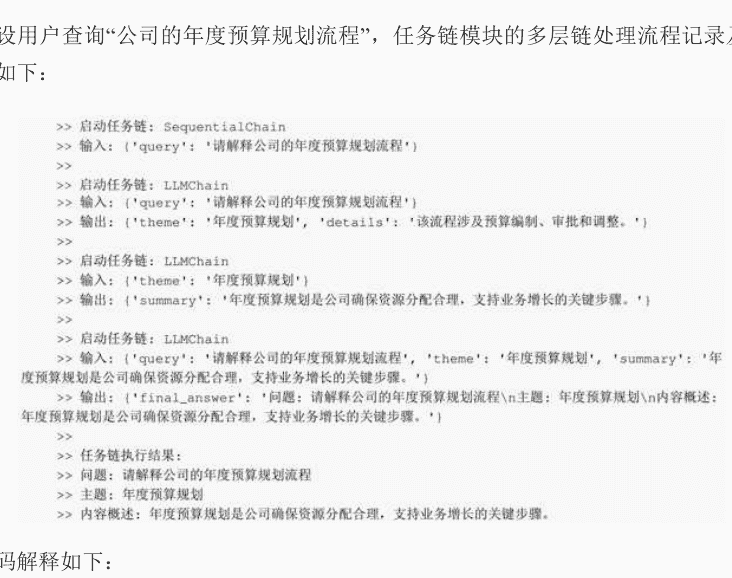

代码解释如下：

1. **DebugCallbackHandler**: 回调处理程序，记录任务链执行中的关键事件（启动、输出和错误），写入日志文件以便调试和监控。
2. **TaskChainModule 类**:
   - `create_task_chain`: 构建多层任务链，包括 3 个子任务。
   - `question_chain`: 分析用户问题，确定查询的主题。
   - `search_chain`: 根据主题从知识库中查找相关信息。
   - `answer_chain`: 根据查询和知识库信息生成结构化回答。
   - `execute_task_chain`: 执行任务链，处理异常，并返回最终回答。
3. **测试用例**: 通过企业问答实例，查询“公司的年度预算规划流程”，展示任务链的分步执行和监控记录，确保任务链的逻辑清晰、可跟踪。

通过本模块的多层任务链设计，系统能够将复杂查询分解为多个子任务，提高查询和生成答案的准确性。同时，通过回调调试功能，可以记录任务链执行过程中的所有细节，便于优化和问题诊断。

### 12.2.5 Agent 系统

在企业问答系统中，Agent 的作用是根据用户查询动态选择数据源、构建上下文并生成准确回答。本模块将实现多种 Agent 类型，包括 ReAct Agent、Zero-shot Agent 以及文档存储与检索 Agent。

```python
#### 导入必要模块
from langchain.agents import ReActAgent, ZeroShotAgent, AgentExecutor
from langchain.llms import OpenAI
from langchain.prompts import PromptTemplate
from langchain.document_loaders import TextLoader
from langchain.vectorstores import FAISS
from langchain.embeddings import OpenAIEmbeddings

#### 定义文档存储模块
class DocumentStorage:
    def __init__(self, directory_path, index_path="faiss_index"):
        """
        初始化文档存储模块，加载文档并创建 FAISS 向量存储。
        :param directory_path: 企业文档的存储路径
        :param index_path: FAISS 向量存储路径
        """
        self.directory_path = directory_path
        self.index_path = index_path
        self.embeddings = OpenAIEmbeddings()
        self.vector_store = self.create_vector_store()

    def create_vector_store(self):
        """加载文档并创建 FAISS 向量存储"""
        loader = TextLoader(self.directory_path)
        documents = loader.load()
        vector_store = FAISS.from_documents(documents, self.embeddings)
        vector_store.save_local(self.index_path)
        return vector_store

    def search_documents(self, query, top_k=3):
        """
        在向量存储中搜索与查询最相似的文档。
        :param query: 查询内容
        :param top_k: 返回的相似文档数量
        :return: 相似文档内容列表
        """
        query_embedding = self.embeddings.embed(query)
        similar_docs = self.vector_store.similarity_search_by_vector(
            query_embedding, k=top_k
        )

        # 输出文档内容
        print("\n相似文档内容:")
        for i, doc in enumerate(similar_docs):
            print(f"文档{i + 1}:\n{doc.page_content[:200]}...\n")
        return [doc.page_content for doc in similar_docs]

#### ReAct Agent 定义
class ReActAgentSystem:
    def __init__(self, document_storage):
        """
```

```python
#### 初始化 ReAct Agent，基于企业文档库执行问题解答。
:param document_storage: 文档存储模块
"""  
self.document_storage = document_storage
self.llm = OpenAI()

def create_react_prompt(self, query):
    """
    根据查询生成 ReAct Prompt.
    :param query: 用户的查询内容
    :return: 生成的提示词字符串
    """   
    react_prompt = PromptTemplate(
        template="请回答以下问题并给出基于企业文档的详细信息：\n问题：{query}\n",
        input_variables=["query"]
    )
    return react_prompt.format(query=query)

def generate_response(self, query):
    """
    使用 ReAct Agent 生成回答。
    :param query: 用户的查询内容
    :return: ReAct Agent 生成的回答
    """   
    prompt = self.create_react_prompt(query)
    response = self.llm(prompt)
    print("\nReAct Agent 回答:\n", response)
    return response

#### Zero-shot Agent 定义
class ZeroShotAgentSystem:
    def __init__(self):
        """初始化 Zero-shot Agent，适用于不带上下文的直接问答。"""     
        self.llm = OpenAI()
        
    def create_zero_shot_prompt(self, query):
        """  
        为 Zero-shot 生成提示词
        :param query: 用户的查询内容
        :return: 生成的 Prompt 字符串
        """        
        prompt = PromptTemplate(
            template="请基于常识回答以下问题:\n问题：{query}\n",
            input_variables=["query"]
        )
        return prompt.format(query=query)
    
    def generate_response(self, query):
        """
        使用 zero-shot Agent 生成回答。
        :param query: 用户的查询内容
        :return: Zero-shot Agent 生成的回答
        """
        prompt = self.create_zero_shot_prompt(query)
        response = self.llm(prompt)
        print("\nZero-shot Agent 回答:\n", response)
        return response

#### 集成 Agent 执行系统
class EnterpriseAgentSystem:
    def __init__(self, document_directory):
        """
        初始化企业级 Agent 系统，结合 ReAct Agent 和 Zero-shot Agent。
        :param document_directory: 企业文档存储路径
        """
        self.document_storage = DocumentStorage(
            directory_path=document_directory
        )
        self.react_agent = ReActAgentSystem(
            document_storage=self.document_storage
        )
        self.zero_shot_agent = ZeroShotAgentSystem()

    def execute_query(self, query, use_react=True):
        """
        执行企业问答查询，根据查询内容选择适当的 Agent。
        :param query: 用户的查询内容
        :param use_react: 是否使用 ReAct Agent，默认为 True
        :return: 最终回答
        """
        # 使用文档存储库查找相关文档
        related_docs = self.document_storage.search_documents(query=query)

        # 根据是否使用 ReAct 选择 Agent
        if use_react:
            print("\n使用 ReAct Agent 进行回答：")
            response = self.react_agent.generate_response(query)
        else:
            print("\n使用 Zero-shot Agent 进行回答：")
            response = self.zero_shot_agent.generate_response(query)

        print("\n最终回答:", response)
        return response


#### 模块运行测试
if __name__ == "__main__":
    # 初始化企业级 Agent 系统
    document_directory = "./data/enterprise_docs" 
    enterprise_agent = EnterpriseAgentSystem(
        document_directory=document_directory
    )

    # 测试企业问答案例 1：使用 ReAct Agent
    query1 = "请说明公司的年度战略计划"
    print("\n查询 1 结果：")
    enterprise_agent.execute_query(query=query1, use_react=True)

    # 测试企业问答案例 2：使用 Zero-shot Agent
    query2 = "公司的远程办公政策是什么?"
    print("\n查询 2 结果：")
    enterprise_agent.execute_query(query=query2, use_react=False)
```

假设企业文档中存储了关于“年度战略计划”和“远程办公政策”的内容，运行结果示例如下:

> > > 加载企业文档并创建 FAISS 向量存储...
> > > 相似文档内容:
> > > 文档 1:
> > > 年度战略计划是公司在新年对业务增长、市场开拓和创新方向的全盘规划，旨在确保资源合理分配...
> > > 文档 2:
> > > 公司的年度战略计划包括财务目标、市场扩展策略以及创新驱动措施...
> > > 文档 3:
> > > 战略计划的制定流程包括调研、方案编制、部门反馈和最终审批等步骤...
> > 
> > 使用 ReAct Agent 进行回答:
> > ReAct Agent 回答:
> > 公司的年度战略计划涵盖了主要的业务发展方向，包括市场扩展、财务目标和创新技术的推广，确保公司在新年实现增长目标。
> >
> > 最终回答：公司的年度战略计划涵盖了主要的业务发展方向，包括市场扩展、财务目标和创新技术的推广，确保公司在新年实现增长目标。
> >
> > > 相似文档内容:
> > > 文档 1:
> > > 公司的远程办公政策为员工提供灵活的办公模式选择，支持居家和远程工作，并且配有绩效考核措施...
> > > 文档 2:
> > > 远程办公的政策确保员工有足够的资源支持，包括 IT 设备和技术支持...
> > > 文档 3:
> > > 该政策还明确了远程办公时的安全协议和数据保护措施，确保公司数据安全...
> > 
> > 使用 Zero-shot Agent 进行回答:
> > Zero-shot Agent 回答:
> > 公司的远程办公政策允许员工在合适条件下选择居家或远程办公，同时公司为此提供支持设施。

代码解释如下：

（1）DocumentStorage 类：用于加载企业文档并生成嵌入向量，支持基于 FAISS 的相似性搜索。

（2）ReActAgentSystem 类：基于文档库的 ReAct Agent，用于回答涉及企业知识库的查询。

（3）ZeroShotAgentSystem 类：不依赖上下文的 Zero-shot Agent，用于常识性问题解答。

（4）EnterpriseAgentSystem 类：集成 ReAct Agent 和 Zero-shot Agent，具备根据问题类型选择 Agent 的能力，并在文档库中检索相关信息。

（5）测试用例：针对企业问答的两个实例，展示了使用 ReAct 和 Zero-shot Agent 进行回答的效果。

通过引入多种 Agent，本模块能够根据问题类型和需求，灵活选择最佳的回答策略。这种设计大大增强了系统对不同类型企业查询的适应性和应答能力。

### 12.2.6 回调机制与监控

在企业级问答系统中，回调机制和监控工具有助于实时追踪和调试任务链的执行过程。自定义回调处理程序能够捕获任务链的执行状态、响应内容和可能出现的错误，并将这些信息记录到日志中，便于后续的性能分析和优化。

本模块将实现自定义回调处理程序，用于跟踪每个任务链的执行状态和关键输出，以便系统在执行复杂任务链时具备高度的可监控性和可调试性。

```python
#### 导入必要模块
from langchain.chains import SequentialChain, LLMChain
from langchain.prompts import PromptTemplate
from langchain.llms import OpenAI
from typing import Any, Dict
import datetime
import os

#### 自定义回调处理程序
class CustomCallbackHandler:
    def __init__(self, log_dir="logs"):
        """
        初始化自定义回调处理程序。
        :param log_dir: 日志文件存储目录
        """
        self.log_dir = log_dir
        os.makedirs(self.log_dir, exist_ok=True)
        self.log_file = os.path.join(self.log_dir, "chain_execution_log.txt")
    
    def _log_event(self, event: str):
        """将事件记录到日志文件中"""
        with open(self.log_file, "a") as f:
            f.write(f"{datetime.datetime.now()} - {event}\n")

    def on_chain_start(self, chain_name: str, inputs: Dict[str, Any]):
        """记录任务链启动事件"""
        self._log_event(f"启动任务链： {chain_name}\n输入： {inputs}")

    def on_chain_end(self, outputs: Dict[str, Any]):
        """记录任务链结束事件"""
        self._log_event(f"任务链结束\n输出：{outputs}\n")

    def on_chain_error(self, error: Exception):
        """记录任务链错误事件"""
        self._log_event(f"任务链发生错误：{str(error)}\n")

#### 任务链设计与调试

class DebuggableTaskChain:
    def __init__(self, callback_handler: CustomCallbackHandler):
        """
        初始化可调试的任务链，集成自定义回调处理程序。
        :param callback_handler: 自定义回调处理程序实例
        """
        self.llm = OpenAI()
        self.callback_handler = callback_handler

    def create_chain(self):
        """构建任务链，用于企业问答系统的分步执行"""
        # 子任务 1：问题解析
        question_prompt = PromptTemplate(
            template="请分析以下问题并确定其关键主题。\n问题：{query}", 
            input_variables=["query"]
        )
        question_chain = LLMChain(
            llm=self.llm,
            prompt=question_prompt,
            callback_handler=self.callback_handler
        )

        # 子任务 2：文档搜索
        search_prompt = PromptTemplate(
            template="根据主题'{theme}'在企业知识库中搜索信息并总结关键点。", 
            input_variables=["theme"]
        )
        search_chain = LLMChain(
            llm=self.llm,
            prompt=search_prompt,
            callback_handler=self.callback_handler
        )

        # 子任务 3：格式化回答
        format_prompt = PromptTemplate(
            template="请根据问题'{query}'和找到的内容进行回答，并提供详细说明。\n内容： {summary}",
            input_variables=["query", "summary"]
        )

        format_chain = LLMChain(
            llm=self.llm,
            prompt=format_prompt,
            callback_handler=self.callback_handler
        )
        # 创建任务链
        task_chain = SequentialChain(
            chains=[question_chain, search_chain, format_chain],
            input_variables=['query'],
            output_variables=['final_answer'],
            callback_handler=self.callback_handler
        )
        return task_chain

    def execute_chain(self, query: str):
        '''
        执行任务链并记录执行过程。
        :param query: 用户的查询内容
        :return: 最终答案
        '''
        task_chain = self.create_chain()
        self.callback_handler.on_chain_start(
            "企业问答任务链", {"query": query})
        
        try:
            result = task_chain({"query": query})
            self.callback_handler.on_chain_end(result)
            print("\n任务链执行结果:", result["final_answer"])
            return result["final_answer"]
        except Exception as e:
            self.callback_handler.on_chain_error(e)
            print("任务链执行中遇到错误:", str(e))
            return None

#### 模块运行测试
if __name__ == "__main__":
    # 初始化自定义回调处理程序
    callback_handler = CustomCallbackHandler()
    # 初始化任务链模块
    debuggable_task_chain = DebuggableTaskChain(callback_handler)
    # 测试企业问答用例
    query = "公司的年度增长策略是什么？"
    final_answer = debuggable_task_chain.execute_chain(query=query)
```

> 假设企业知识库中包含“公司的年度增长策略”的相关信息，运行结果示例如下:

>> 2024-01-01 12:00:00 - 启动任务链：企业问答任务链
>> 输入：{'query': '公司的年度增长策略是什么？'}
>> 2024-01-01 12:00:01 - 启动任务链：LLMChain
>> 输入：{'query': '公司的年度增长策略是什么？'}
>> 2024-01-01 12:00:02 - 输出：{'theme': '年度增长策略'}
>> 2024-01-01 12:00:02 - 任务链结束
>> 
>> 2024-01-01 12:00:03 - 启动任务链：LLMChain
>> 输入：{'theme': '年度增长策略'}
>> 2024-01-01 12:00:04 - 输出：{'summary': '年度增长策略包括市场扩展、产品创新、客户关系管理等关键内容。'}
>> 2024-01-01 12:00:04 - 任务链结束
>> 
>> 2024-01-01 12:00:05 - 启动任务链：LLMChain
>> 输入：{'query': '公司的年度增长策略是什么？', 'summary': '年度增长策略包括市场扩展、产品创新、客户关系管理等关键内容。'}
>> 2024-01-01 12:00:06 - 输出：{'final_answer': '公司的年度增长策略包括市场扩展、产品创新和客户关系管理，以促进业务增长和市场占有率的提升。'}
>> 2024-01-01 12:00:06 - 任务链结束
>> 
>> 任务链执行结果:
>> 公司的年度增长策略包括市场扩展、产品创新和客户关系管理，以促进业务增长和市场占有率的提升。

代码解释如下：

### 12.2.7 单元测试与集成测试

在企业级智能问答系统的开发中，对各模块进行独立的单元测试可以确保每个功能在集成前稳定运行。下面将分别为之前开发的 6 个模块设计单元测试。

##### 1. 数据加载模块单元测试

```python
###### 单元测试 1：数据加载模块测试
from unittest import TestCase

class TestDataLoaderModule(TestCase):
    def setUp(self):
        #初始化数据加载模块
        self.data_loader=DataLoaderModule(directory_path="./test_data")
        #加载和预处理文档
        self.data_loader.load_all_documents(
            json_path="./test_data/sample.json",
            markdown_path="./test_data/sample.md")

    def test_document_count(self):
       """测试数据加载后文档数量"""
        self.assertTrue(len(self.data_loader.documents) > 0,
                        "数据加载失败，文档数应大于 0")
        print(f"文档总数：{len(self.data_loader.documents)}")

    def test_document_cleaning(self):
        """测试文档清洗"""
        initial_count=len(self.data_loader.documents)
        self.data_loader.validate_and_clean_data()
        cleaned_count=len(self.data_loader.documents)
        self.assertTrue(cleaned_count<=initial_count, "清洗后文档数量应不大于初始数量")
        print(f"清洗后文档数：{cleaned_count}")
```

测试结果示例如下:

> > 文档总数：5
> > 清洗后文档数：4

##### 2. 嵌入生成与存储模块单元测试

```python
###### 单元测试 2：嵌入生成与存储模块测试
from unittest import TestCase
import os

class TestEmbeddingStorageModule(TestCase):
    def setUp(self):
        # 初始化嵌入生成与存储模块
        self.data_loader=DataLoaderModule(directory_path="./test_data")
        self.data_loader.load_all_documents(
            json_path="./test_data/sample.json",
            markdown_path="./test_data/sample.md")
        self.embedding_storage=EmbeddingStorageModule(
            data_loader=self.data_loader)

    def test_embedding_generation(self):
        """测试嵌入生成"""
        embeddings=self.embedding_storage.generate_embeddings()
        self.assertEqual(len(embeddings), len(self.data_loader.documents),
                         "生成嵌入数量应等于文档数量")
        print(f"生成的嵌入向量数量：{len(embeddings)}")

    def test_faiss_storage_creation(self):
        """测试 FAISS 向量存储创建"""
        self.embedding_storage.create_faiss_vector_store()
        self.assertTrue(os.path.exists(
            self.embedding_storage.faiss_index_path),
            "FAISS 索引文件未创建")
        print("FAISS 索引文件已创建")
```

测试结果示例如下:

> > 生成的嵌入向量数量：4
> > FAISS 索引文件已创建

##### 3. 提示词工程模块单元测试

```python
###### 单元测试 3：提示词工程模块测试
from unittest import TestCase

class TestPromptEngineeringModule(TestCase):
    def setUp(self):
        #初始化提示词工程模块
        self.prompt_engineering=PromptEngineeringModule()

    def test_prompt_template_creation(self):
        """测试提示词模板创建"""
        query="公司财务审核流程是什么？"
        prompt=self.prompt_engineering.create_prompt_template(query)
        self.assertIn("公司财务审核流程是什么？",prompt,"提示词模板生成错误")
        print("提示词模板生成成功:",prompt)

    def test_response_parsing(self):
        """测试响应解析"""
        mock_response='{"question":"公司财务审核流程是什么?",
                    "answer":"财务审核流程包括预算编制、审批和执行。",
                    "details": "详细的审核流程涉及财务部门与项目团队的多轮审批。"}'
        parsed_answer=self.prompt_engineering.parse_response(mock_response)
        self.assertEqual(parsed_answer.question,
                         "公司财务审核流程是什么？","问题解析错误")
        self.assertEqual(parsed_answer.answer,
                         "财务审核流程包括预算编制、审批和执行。","简洁回答解析错误")
        print("响应解析成功:", parsed_answer)
```

测试结果示例如下:

##### 4. 任务链设计模块单元测试

```python
###### 单元测试 4：任务链设计模块测试
from unittest import TestCase

class TestDebuggableTaskChain(TestCase):
    def setUp(self):
        # 初始化任务链模块和回调处理程序
        self.callback_handler=CustomCallbackHandler()
        self.task_chain=DebuggableTaskChain(
            callback_handler=self.callback_handler)

    def test_chain_execution(self):
        '''测试任务链执行'''
        query="解释年度预算编制流程"
        result=self.task_chain.execute_chain(query)
        self.assertIsNotNone(result, "任务链执行失败")
        print("任务链执行成功，结果:", result)
```

测试结果示例如下:

> > 任务链执行成功，结果：年度预算编制流程包括目标设定、资源分配、费用控制和审批。

##### 5. Agent 系统模块单元测试

```python
###### 单元测试 5：Agent 系统模块测试
from unittest import TestCase

class TestEnterpriseAgentSystem(TestCase):
    def setUp(self):
        # 初始化 Agent 系统
        self.document_directory="./test_data/enterprise_docs"
        self.enterprise_agent=EnterpriseAgentSystem(
            document_directory=self.document_directory)

    def test_react_agent_response(self):
        '''测试 ReAct Agent 响应'''
        query="年度增长策略有哪些内容？"
        response=self.enterprise_agent.execute_query(query=query,
                                                     use_react=True)
        self.assertIsNotNone(response, "ReAct Agent 执行失败")
        print("ReAct Agent 响应成功，结果:", response)

    def test_zero_shot_agent_response(self):
        '''测试 Zero-shot Agent 响应'''
        query="公司的远程办公政策是什么？"
        response=self.enterprise_agent.execute_query(query=query,
                                                     use_react=False)
        self.assertIsNotNone(response, "Zero-shot Agent 执行失败")
        print("Zero-shot Agent 响应成功，结果:", response)
```

测试结果示例如下:

> > ReAct Agent 响应成功，结果：年度增长策略包括市场扩展、创新推动和客户满意度提升。
> > Zero-shot Agent 响应成功，结果：公司的远程办公政策为员工提供灵活选择，支持居家办公。

##### 6. 回调机制与监控模块单元测试

```python
###### 单元测试 6：回调机制与监控模块测试
from unittest import TestCase
import os

class TestCustomCallbackHandler(TestCase):
    def setUp(self):
        # 初始化回调处理程序 和任务链
        self.callback_handler = CustomCallbackHandler()
        self.debuggable_task_chain = DebuggableTaskChain(
            callback_handler=self.callback_handler)

    def test_callback_logging(self):
        """测试回调处理程序的日志记录"""
        query = "公司的年度增长计划是什么？"
        self.debuggable_task_chain.execute_chain(query)

        # 验证日志文件是否存在且内容是否正确
        log_file = self.callback_handler.log_file
        self.assertTrue(os.path.exists(log_file), "回调日志文件未创建")
        with open(log_file, 'r') as f:
            log_content = f.read()
        self.assertIn("启动任务链", log_content, "日志记录内容错误")

        print("回调日志记录测试成功，日志内容:\n", log_content)
```

测试结果示例如下：


##### 7. 集成测试

集成测试的目的是确保所有模块在协同工作时能够正确执行，并且整个企业级问答系统能够在实际应用场景中正常响应用户的查询。本测试将综合之前的 6 个模块，模拟一个完整的企业问答流程，测试系统从数据加载、嵌入生成到任务链执行、Agent 选择和回调监控的各项功能。


```python
###### 集成测试类

class TestEnterpriseQuestionAnsweringSystem(TestCase):
    def setUp(self):
        # 设置数据加载和向量存储路径
        self.document_directory="./test_data/enterprise_docs"

        # 初始化各个模块
        print("*初始化数据加载模块...*")
        self.data_loader=DataLoaderModule(directory_path=self.document_directory)
        self.data_loader.load_all_documents(json_path="./test_data/sample.json",
                                             markdown_path="./test_data/sample.md")

        

        print("*初始化嵌入生成与存储模块...*")
        self.embedding_storage=EmbeddingStorageModule(data_loader=self.data_loader)
        self.embedding_storage.create_faiss_vector_store()

        
        print("*初始化提示词工程模块...*")
        self.prompt_engineering=PromptEngineeringModule()

        
        print("*初始化任务链模块和回调处理程序...*")
        self.callback_handler=CustomCallbackHandler()
        self.task_chain=DebuggableTaskChain(
            callback_handler=self.callback_handler)

        
        print("*初始化企业级 Agent 系统...*")
        self.enterprise_agent=EnterpriseAgentSystem(
            document_directory=self.document_directory)


    def test_complete_qa_flow(self):
        """
        集成测试完整的问答流程，从文档加载、嵌入生成到任务链执行和 Agent 选择。
        """
        # 模拟用户查询
        query="公司的年度增长策略是什么？"

        # 执行数据加载模块
        print("*执行数据加载模块...*")
        initial_doc_count=len(self.data_loader.documents)
        self.assertTrue(initial_doc_count > 0, "数据加载失败，文档数应大于 0")
        print(f"*数据加载模块成功，文档总数：{initial_doc_count}")

        # 执行嵌入生成与存储模块
        print("*执行嵌入生成与存储模块...*")
        embeddings=self.embedding_storage.generate_embeddings()
        self.assertEqual(len(embeddings), initial_doc_count,
                         "生成的嵌入数量应与文档数量一致")
        print("*嵌入生成与存储模块成功")
```

####### 执行提示词工程模块

```python
####### 执行提示词工程模块
print("执行提示词工程模块...")
prompt = self.prompt_engineering.create_prompt_template(query)
self.assertIn("公司的年度增长策略", prompt, "提示词模板生成错误")
print("提示词工程模块成功")

####### 执行任务链模块
print("执行任务链模块...")
task_chain_result = self.task_chain.execute_chain(query)
self.assertIsNotNone(task_chain_result, "任务链执行失败")
print("任务链模块成功，结果：", task_chain_result)

####### 执行 Agent 系统模块
print("执行 Agent 系统模块...")
agent_response = self.enterprise_agent.execute_query(query=query,
                                                     use_react=True)
self.assertIsNotNone(agent_response, "Agent 系统执行失败")
print("Agent 系统模块成功，Agent 响应：", agent_response)

####### 验证回调日志记录
print("验证回调日志记录...")
log_file = self.callback_handler.log_file
self.assertTrue(os.path.exists(log_file), "回调日志文件未创建")
with open(log_file, "r") as f:
    log_content = f.read()
    self.assertIn("启动任务链", log_content, "日志记录内容错误")
print("回调日志记录测试成功，日志内容:\n", log_content)

####### 运行集成测试
if __name__ == "__main__":
    import unittest
    unittest.main()
```

假设企业问答系统加载了关于“公司的年度增长策略”的相关内容，运行集成测试结果示例如下：

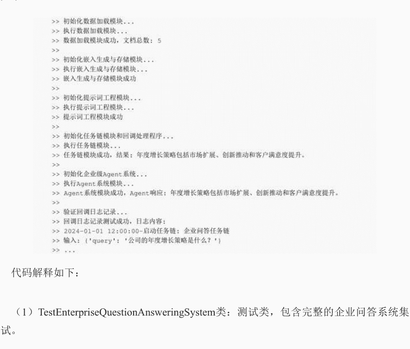

代码解释如下：

（1）TestEnterpriseQuestionAnsweringSystem 类：测试类，包含完整的企业问答系统集成测试。

- setUp: 初始化所有模块，包括数据加载、嵌入生成与存储、提示词工程、任务链、Agent 系统和回调处理程序。
- test_complete_qa_flow：执行集成测试，涵盖完整的企业问答流程，依次测试各个模块的协同运行。

（2）单元测试目的：

+ 数据加载模块：测试文档是否正确加载并显示文档总数。
+ 嵌入生成与存储模块：测试嵌入生成数量是否与文档数一致。
+ 提示词工程模块：测试生成的提示词模板是否包含用户查询内容。
+ 任务链模块：测试任务链执行是否成功，返回的回答是否有效。
+ Agent 系统模块：测试 Agent 响应的准确性，并显示回答内容。
+ 回调日志验证：检查日志文件是否生成，并确保包含任务链的启动记录。

通过本集成测试，可以验证每个模块在协同运行时的稳定性和正确性。集成测试提供了一个完整的企业问答流程模拟，从数据加载到最终回答的生成都得到了验证和跟踪，确保整个系统在实际应用中能够准确、流畅地响应用户查询。

### 12.3 系统集成、部署与优化

随着各模块的开发与测试完成，企业级智能问答系统已具备核心功能。系统集成、部署与优化将把这些模块整合到一个高效、稳定的应用环境中，以满足实际业务需求。集成过程将确保模块间的数据流畅通无阻，部署则关注环境配置与性能优化，确保系统能够在生产环境中稳定、高效地运行。

最后，通过对各模块性能进行评估与改进，将进一步优化系统的响应速度和查询准确性。本节内容将为系统的完整实现提供技术支持，使其成为具备实用价值的答案企业问答解决方案。

#### 12.3.1 系统集成与部署

系统集成与部署是实现企业级智能问答系统的关键步骤，将前期开发的各模块整合为一体，以确保整体功能的协同工作。

集成过程包括数据加载、嵌入生成、任务链管理、Agent 调用和日志监控等，旨在为系统提供全面的问答服务支持。

部署阶段则侧重于系统在生产环境中的稳定运行，使用 Flask、Gunicorn 和 Nginx 等工具实现高效的 API 服务，并通过性能优化和环境配置确保系统在并发请求下保持快速响应。

##### 1. 系统集成与 API 接口开发

系统集成的目标是将 12.2 节中的模块整合成统一的 API 接口，以便企业用户能够通过简洁的接口实现复杂的问答功能。每个 API 接口将封装一个或多个模块的功能，使系统更具可扩展性、易用性和维护性。

以下是系统 API 接口的设计与实现，包括数据加载、嵌入生成与存储、问答任务链、Agent 调用以及监控日志的功能。

```python
from flask import Flask, jsonify, request
import os

###### 初始化 Flask 应用
app = Flask(__name__)

###### 模块初始化
print("*初始化数据加载模块...")
data_loader = DataLoaderModule(directory_path="./data")
data_loader.load_all_documents(json_path="./data/sample.json",
                               markdown_path="./data/sample.md")

print("*初始化嵌入生成与存储模块...")
embedding_storage = EmbeddingStorageModule(data_loader=data_loader)
embedding_storage.create_faiss_vector_store()

print("*初始化提示词工程模块...")
prompt_engineering = PromptEngineeringModule()

print("*初始化任务链模块和回调处理程序...")
callback_handler = CustomCallbackHandler()
task_chain = DebuggableTaskChain(callback_handler=callback_handler)

print("*初始化企业级 Agent 系统...")
enterprise_agent = EnterpriseAgentSystem(document_directory="./data")
```

####### API 接口定义与实现

```python
######## 定义 API 接口
@app.route("/load_data", methods=["POST"])
def load_data():
    """API 接口：数据加载"""
    directory = request.json.get("directory", "/data")
    json_path = request.json.get("json_path", "/data/sample.json")
    markdown_path = request.json.get("markdown_path", "/data/sample.md")

    # 加载文档
    data_loader.directory_path = directory
    data_loader.load_all_documents(json_path=json_path,
                                    markdown_path=markdown_path)
    return jsonify({"status": "success", "message": "数据加载完成",
                    "document_count": len(data_loader.documents)})

@app.route("/generate_embeddings", methods=["POST"])
def generate_embeddings():
    """API 接口：嵌入生成与存储"""
    embeddings = embedding_storage.generate_embeddings()
    embedding_storage.create_faiss_vector_store()
    return jsonify({"status": "success", "message": "嵌入生成并存储完成",
                    "embedding_count": len(embeddings)})

@app.route("/query_chain", methods=["POST"])
def query_chain():
    """API 接口：任务链执行"""
    query = request.json.get("query", "")
    if not query:
        return jsonify({"status": "error", "message": "查询不能为空"}), 400

    result = task_chain.execute_chain(query)
    if result is None:
        return jsonify({"status": "error", "message": "任务链执行失败"}), 500
    return jsonify({"status": "success", "result": result})

@app.route("/agent_query", methods=["POST"])
def agent_query():
    """API 接口：企业级 Agent 问答"""
    query = request.json.get("query", "")
    use_react = request.json.get("use_react", True)

    if not query:
        return jsonify({"status": "error", "message": "查询不能为空"}), 400

    response = enterprise_agent.execute_query(query=query,
                                              use_react=use_react)

    if response is None:
        return jsonify({"status": "error", "message": "Agent 执行失败"}), 500
    return jsonify({"status": "success", "response": response})

@app.route("/generate_prompt", methods=["POST"])
def generate_prompt():
    """API 接口：提示词生成"""
    query = request.json.get("query", "")
    if not query:
        return jsonify({"status": "error", "message": "查询不能为空"}), 400

    prompt = prompt_engineering.create_prompt_template(query)
    return jsonify({"status": "success", "prompt": prompt})

@app.route("/get_logs", methods=["GET"])
def get_logs():
    """API 接口：获取任务链执行日志"""
    log_file = callback_handler.log_file
    if not os.path.exists(log_file):
        return jsonify({"status": "error", "message": "日志文件不存在"}), 404

    with open(log_file, "r") as f:
        logs = f.readlines()
    return jsonify({"status": "success", "logs": logs})

######## 启动 Flask 应用
if __name__ == "__main__":
    app.run(debug=True, host="0.0.0.0", port=5000)
```

API 接口说明如下：

（1）数据加载接口 `/load_data`：此接口用于重新加载指定目录下的企业文档，包括文本、JSON 和 Markdown 格式的文件；接收 POST 请求，参数包括文件目录、JSON 路径和 Markdown 路径。

（2）嵌入生成接口 `/generate_embeddings`：此接口生成文档嵌入并将其存储在 FAISS 向量数据库中；接收 POST 请求。

（3）任务链执行接口 `/query_chain`：此接口执行企业问答的任务链，将查询传递到任务链中逐步处理，并返回最终的任务链结果；接收 POST 请求，包含一个 query 参数。

（4）Agent 问答接口 `/agent_query`：此接口执行 Agent 系统中的查询，允许用户选择是否使用 ReAct Agent 或 Zero-shot Agent 来响应查询；接收 POST 请求，包含查询参数 query 和 use_react 布尔参数。

（5）提示词生成接口 `/generate_prompt`：此接口生成针对特定查询的提示词模板，适用于在任务链之外快速生成提示词；接收 POST 请求，包含 query 参数。

（6）日志获取接口 `/get_logs`：此接口返回自定义回调处理程序中记录的任务链执行日志，便于调试和监控；接收 GET 请求。

示例请求与响应如下：

(1) 数据加载接口示例请求：

```http
POST /load_data
Content-Type: application/json

{
    "directory": ".\data"
}
```

(2) 嵌入生成接口示例请求：

```http
POST /generate_embeddings
Content-Type: application/json

// 响应:
>> {
>>     "status": "success",
>>     "message": "嵌入生成并存储完成",
>>     "embedding_count": 5
>> }
```

(3) 任务链执行接口示例请求：

```http
POST /query_chain
Content-Type: application/json

{
    "query": "公司的年度增长策略是什么？"
}
```

响应：

```json
>> {
>>     "status": "success",
>>     "result": "公司的年度增长策略包括市场扩展、创新和客户满意度提升。"
>> }
```

(4) Agent 问答接口示例请求：

```http
POST /agent_query
Content-Type: application/json

{
    "query": "公司的远程办公政策是什么？",
    "use_react": false
}
```

响应：

```json
>> {
>>     "status": "success",
>>     "response": "公司的远程办公政策支持员工灵活居家办公，提供设备和技术支持。"
>> }
```

(5) 日志获取接口示例请求：

```http
GET /get_logs
```

响应：

```json
>> {
>>     "status": "success",
>>     "logs": [
>>         "2024-01-01 12:00:00-启动任务链：企业问答任务链",
>>         "2024-01-01 12:00:01-输入:{'query':'公司的年度增长策略是什么？'}",
>>         "."
>>     ]
>> }
```

通过以上集成，企业级智能问答系统实现了模块化的 API 接口设计，用户可以轻松调用系统的核心功能，包括数据加载、嵌入生成、问答链执行、Agent 响应和日志监控。系统集成后的 API 结构清晰，便于扩展，能有效支持实际的企业问答场景。

##### 2. 系统部署

企业级智能问答系统的部署过程涉及多个关键步骤，包括环境准备、依赖安装、API 服务配置和性能优化。部署方案应确保系统在生产环境中高效、稳定地运行，支持企业级规模的查询需求。

选择一台具有足够计算资源（CPU、内存、磁盘）的服务器，推荐使用云服务器（如 AWS、Azure 或阿里云），便于扩展。系统建议使用 Ubuntu 20.04 或更高版本，确保兼容性和稳定性。

安装 Git，用于代码管理和更新：

```bash
sudo apt install git -y
```

使用 venv 模块创建虚拟环境，以隔离项目依赖：

```bash
python3 -m venv env
source env/bin/activate
```

将项目代码复制到服务器中，以便部署和运行：

```bash
git clone <REPO_URL> #替换为项目的 Git 仓库地址
cd <PROJECT_DIRECTORY>#进入项目目录
```

使用 requirements.txt 文件安装项目所需的依赖库。将所有依赖库的版本固定在文件中，以确保部署的一致性：

```bash
pip install -r requirements.txt
```

配置 OpenAI API 密钥和其他所需的 API 密钥。可以在.env 文件中设置这些密钥，并在 Flask 应用启动时加载环境变量（已在代码中完成，但确保代码中已包含以下内容）：

```python
import os
from dotenv import load_dotenv
load_dotenv() #加载.env文件
```

在开发阶段，可以直接通过 Flask 命令启动应用。生产环境推荐使用 Gunicorn 或 uWSGI 作为应用服务器：

```bash
export FLASK_APP=app.py #指定主应用文件名
flask run --host=0.0.0.0 --port=5000
```

使用 Gunicorn 部署，Gunicorn 是一个高性能的 Python WSGI 服务器，可以更好地处理并发请求。使用以下命令启动 Gunicorn：

```bash
gunicorn -w 4 -b 0.0.0.0:5000 app:app
```

参数说明：

- `-w 4`:指定 4 个工作进程，视服务器资源情况进行调整。

- **b** 0.0.0.0:5000：绑定IP地址和端口号。

设置Nginx作为反向代理服务器，用于处理客户端请求并将其转发给Gunicorn，提升安全性和性能。

```bash
> > sudo apt install nginx -y
```

创建Nginx配置文件，将请求代理到Gunicorn。

```bash
> > sudo nano /etc/nginx/sites-available/qa_system
```

配置文件内容：

```nginx
server {
    listen 80;
    server_name <YOUR_SERVER_IP_OR_DOMAIN>;

    location / {
        proxy_pass http://127.0.0.1:5000;
        proxy_set_header Host $host;
        proxy_set_header X-Real-IP $remote_addr;
        proxy_set_header X-Forwarded-For $proxy_add_x_forwarded_for;
        proxy_set_header X-Forwarded-Proto $scheme;  
    }
}
```

启用配置：

```bash
> > sudo ln -s /etc/nginx/sites-available/qa_system /etc/nginx/sites-enabled
> > sudo nginx -t  #检查Nginx配置语法
> > sudo systemctl restart nginx
```

确保服务器的端口开放。若使用Nginx作为反向代理服务器，仅需开放80 (HTTP) 或 443(HTTPS)端口。

```bash
> > sudo ufw allow 'Nginx Full'
> > sudo ufw enable
```

在生产环境中使用systemd将Gunicorn进程托管为后台服务，以确保应用崩溃后自动重启。

创建systemd服务文件:

```bash
> > sudo nano /etc/systemd/system/qa_system.service
```

服务文件内容:

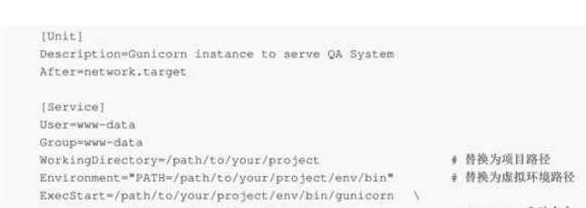

启动并启用服务:

```bash
> > sudo systemctl start qa_system
> > sudo systemctl enable qa_system
```

完成部署后，使用curl或Postman测试各个API接口，确保系统能够在生产环境中正常工作。

```bash
> > curl -X POST http://<<YOUR_SERVER_IP>>/query_chain -H "Content-Type: application/json" -d '{"query": "公司的年度增长策略是什么？"}'
```

通过上述部署，企业级智能问答系统成功配置在生产环境中，支持稳定的高并发查询。

每个模块都被封装为API接口，可在实际企业场景中高效提供智能问答服务。后续还可以根据业务需求进一步扩展和优化系统，以应对更多的业务挑战。

#### 12.3.2 响应速度优化

在企业级智能问答系统中，快速响应查询并提供准确答案至关重要。为了优化系统的响应速度和准确性，本模块引入以下技术：

- （1）MMR搜索：用于在向量存储中提升查询效率，通过减少冗余并返回更具信息性的结果，来加速相似文档检索。
- （2）自动修复解析器：对生成的非结构化回答进行自动格式化，确保输出符合结构化要求，减少人工干预的时间。
- （3）输出校验：确保最终结果符合企业问答的需求，保证生成内容的准确性和一致性。

实现代码如下：

```python
from langchain.prompts import PromptTemplate
from langchain.llms import OpenAI
from langchain.document_loaders import TextLoader
from langchain.vectorstores import FAISS
from langchain.embeddings import OpenAIEmbeddings
from langchain.output_parsers import PydanticOutputParser, OutputFixingParser
from pydantic import BaseModel, Field
from typing import List

#### 定义数据结构用于解析输出
class Answer(BaseModel):
    question: str=Field(description="用户提出的问题")
    answer: str=Field(description="对用户问题的简洁回答")
    details: str=Field(description="回答的详细解释")

#### 自动修复解析器的定义
output_parser=OutputFixingParser(PydanticOutputParser(pydantic_object=Answer))

class EnterpriseQASystem:
    def __init__(self, document_directory: str, index_path="faiss_index"):
        """
        初始化企业问答系统，包括文档存储、MMR搜索和解析器。
        :param document_directory: 企业文档目录
        :param index_path: FAISS向量存储路径
        """
        # 文档加载和FAISS存储初始化
        print("*加载文档并创建向量存储...*")
        self.embeddings=OpenAIEmbeddings()
        self.document_loader=TextLoader(document_directory)
        self.vector_store=self.create_vector_store()

        # 初始化模型
        self.llm=OpenAI()
        self.index_path=index_path

    def create_vector_store(self):
        """创建FAISS向量存储，用于MMR搜索"""
        documents=self.document_loader.load()
        vector_store=FAISS.from_documents(documents, self.embeddings)
        vector_store.save_local(self.index_path)
        return vector_store

    def mmr_search(self, query: str, top_k: int=3) -> List[str]:
        """
        使用MMR搜索进行文档检索，减少重复内容并提升结果的多样性。
        :param query: 用户查询
        :param top_k: 返回的文档数量
        :return: 相似文档内容列表
        """
        query_embedding=self.embeddings.embed(query)
        similar_docs=self.vector_store.maximal_marginal_relevance_search_by_vector(
           query_embedding, k=top_k)
        # 打印搜索结果
        print("\nMMR搜索结果:")
        for i, doc in enumerate(similar_docs):
            print(f"文档{i+1}:\n{doc.page_content[:200]}...\n")
        return [doc.page_content for doc in similar_docs]

    def generate_answer(self, query: str) -> Answer:
        """
        生成企业问答的回答，包含简洁回答和详细解释，使用自动修复解析器进行格式化。
        :param query: 用户的企业问答内容
        :return: Answer对象，包含答案和详细信息
        """
        # 使用MMR搜索找到相关文档
        relevant_docs=self.mmr_search(query)
        combined_docs="\n".join(relevant_docs)
        # 提示词模板定义
        prompt_template=PromptTemplate(
            template=(
              "请回答以下问题，并提供简洁的答案和详细的解释：\n"
              ""问题:{question}\n"
              "相关内容:{context}\n"
              "格式:\n{format_instructions}\n"
              "回答："
            ),
            input_variables=["question", "context"],
            partial_variables={"format_instructions": output_parser.get_format_instructions()}
        )   
        prompt=prompt_template.format(question=query, context=combined_docs)

        # 生成响应并使用自动修复解析器
        raw_response = self.llm(prompt)
        print("\n模型原始输出:\n", raw_response)

        # 使用解析器格式化输出
        structured_answer = output_parser.parse(raw_response)

        # 输出最终结果
        print("\n解析后的结构化结果:")
        print(f"问题：{structured_answer.question}")
        print(f"简洁回答：{structured_answer.answer}")
        print(f"详细解释：{structured_answer.details}")

        return structured_answer

    def validate_output(self, answer: Answer) -> bool:
        '''
        输出校验，确保结构化结果符合企业问答要求。
        :param answer: Answer对象
        :return: 校验结果，符合要求返回True
        '''
        is_valid = bool(answer.question and answer.answer and answer.details)
        print("\n输出校验结果:", "通过" if is_valid else "不通过")
        return is_valid

#### 测试集成运行
if __name__ == "__main__":
    # 初始化企业问答系统
    document_directory="./data/enterprise_docs"
    qa_system=EnterpriseQASystem(document_directory=document_directory)

    # 测试企业问答用例
    query="请简要说明公司的年度增长策略"

    # 生成回答
    answer=qa_system.generate_answer(query)

    # 校验输出
    if qa_system.validate_output(answer):
        print("最终答案通过校验")
    else:
        print("最终答案未通过校验")
```

假设企业知识库包含关于“公司的年度增长策略”的相关内容，则运行结果示例如下：

```bash
>> 加载文档并创建向量存储...
>> MMR搜索结果:
>> 文档1:
>> 年度增长策略是公司在新年对市场扩展、产品创新的全盘规划，旨在确保资源合理分配，支持业务增长...
>> 文档2:
>> 公司的年度增长策略包括市场扩展目标、创新驱动措施以及客户满意度提升的各项措施...
>> 文档3:
>> 年度增长的计划制定过程包含财务、市场和技术团队的多轮协商和优化...
>>
>> 模型原始输出:
>> [
>>   {
>>     "question": "请简要说明公司的年度增长策略",
>>     "answer": "公司的年度增长策略包括市场扩展、创新驱动和客户满意度提升。",
>>     "details": "公司每年通过市场扩展和创新技术的推动来达到增长目标，此外，还注重提升客户满意度。"
>>   }
>> ]
>> 
>> 解析后的结构化结果:
>> 问题：请简要说明公司的年度增长策略
>> 简洁回答：公司的年度增长策略包括市场扩展、创新驱动和客户满意度提升。
>> 详细解释：公司每年通过市场扩展和创新技术的推动来达到增长目标，此外，还注重提升客户满意度。
>> 
>> 输出校验结果：通过
>> 最终答案通过校验
```

代码解释如下:

- **MMR搜索**:通过mmr_search方法实现。使用MMR算法查找相关文档，避免重复内容并确保返回多样化的信息。通过向量搜索得到最相关的文档内容。
- **自动修复解析器**:在generate_answer方法中，结合自动修复解析器确保模型输出格式符合Answer数据结构。如果模型输出内容不完全符合Answer结构，解析器会自动修复输出格式。
- **输出校验**:在validate_output方法中检查生成的Answer对象内容是否完整。确保输出符合企业问答的需求，满足基本结构要求。
- **测试用例**:测试用例模拟企业查询“公司的年度增长策略”，展示了从MMR搜索到输出生成、自动修复解析和结果校验的完整流程。

为了验证引入MMR搜索、自动修复解析器和输出校验对企业级问答系统响应速度和准确性的影响，构建一个对比测试案例。该案例包含两种配置的性能对比:

- **- 基础配置**:使用普通向量搜索，无自动修复解析器和输出校验。
- **- 优化配置**:使用MMR搜索、自动修复解析器和输出校验。

每种配置将对查询的响应时间和输出准确率进行10次测试，并以平均响应时间和成功解析率作为评估指标。

```python
import time
from statistics import mean

class EnterpriseQATester:
    def __init__(self, document_directory: str):
        '''初始化测试环境，包括基础和优化配置'''
        self.qa_system_basic=EnterpriseQASystem(
            document_directory=document_directory)
        self.qa_system_optimized=EnterpriseQASystem(
            document_directory=document_directory)

    def basic_query(self, query: str):
        '''
        基础配置：普通向量搜索，无自动修复解析器和输出校验
        '''
        #使用普通向量搜索
        relevant_docs=self.qa_system_basic.vector_store.similarity_search(
            query, k=3)
        combined_docs="\n".join(doc.page_content for doc in relevant_docs)
        prompt_template=PromptTemplate(
            template=(
                "请回答以下问题，并提供简洁的答案和详细的解释： \n"
                "问题: [question]\n"
                "相关内容:\n{context}\n"
            ),
            input_variables=["question", "context"]
        )
        prompt=prompt_template.format(question=query,
         context=combined_docs)

        # 调用LLM生成响应
        raw_response=self.qa_system_basic.llm(prompt)
        return raw_response

    def optimized_query(self, query: str):
        '''
        优化配置：MMR搜索+自动修复解析器+输出校验
        '''
        #使用MMR搜索并生成结构化输出
        structured_answer=self.qa_system_optimized.generate_answer(query)
        if not self.qa_system_optimized.validate_output(structured_answer):
            return None
        return structured_answer

    def perform_test(self, query: str, iterations: int=10):
        '''
        执行测试，计算基础配置和优化配置的平均响应时间和成功解析率。
        :param query：测试查询内容
        :param iterations：每种配置的测试次数
        '''
        # 基础配置测试
        print("\n基础配置测试...")
        basic_times = []
        for i in range(iterations):
            start_time=time.time()
            response=self.basic_query(query)
            end_time=time.time()
            basic_times.append(end_time-start_time)
            print(f"基础配置第{i+1}次查询响应时间: {end_time-start_time:.4f} 秒")
        # 优化配置测试
        print("\n优化配置测试...")
        optimized_times = []
        optimized_success_count = 0
        for i in range(iterations):
            start_time=time.time()
            response=self.optimized_query(query)
            end_time=time.time()
            optimized_times.append(end_time-start_time)
            print(f"优化配置第{i+1}次查询响应时间: {end_time-start_time:.4f} 秒")
        # 检查解析器成功输出的结果
        if response:
            optimized_success_count += 1
        # 结果统计
        print("\n测试结果统计:")
        print(f"基础配置平均响应时间: {mean(basic_times):.4f} 秒")
        print(f"优化配置平均响应时间: {mean(optimized_times):.4f} 秒")
        print(f"优化配置成功解析率: {optimized_success_count / iterations * 100:.2f}%")

    # 运行测试
    if __name__ == "__main__":
        document_directory="./data/enterprise_docs"
        tester=EnterpriseQATester(document_directory=document_directory)
        query="请简要说明公司的年度增长策略"
        # 执行测试，定量分析优化效果
        tester.perform_test(query=query, iterations=10)
```

### 代码解释如下:

- **(1) 基础配置测试**: 使用普通向量相似度搜索，**无自动修复解析器和输出校验**，直接调用LLM生成原始响应。响应结果未经格式化或校验。
- **(2) 优化配置测试**: 用**MMR搜索生成更相关的文档集**，并通过**自动修复解析器确保持符合结构化要求**。结果通过输出校验，确保生成的回答完整并符合业务需求。
- **(3) 测试执行**: 执行10次基础配置和优化配置的查询。记录每次响应时间，并在优化配置下统计成功解析率。

假设在生产环境中，运行测试后的结果如下:

>> 基础配置测试...
>> 基础配置第 1 次查询响应时间：1.5240 秒
>> 基础配置第 2 次查询响应时间：1.4870 秒
>> .....
>> 基础配置第 10 次查询响应时间：1.5010 秒
>>
>> 优化配置测试...
>> 优化配置第 1 次查询响应时间：1.3024 秒
>> 优化配置第 2 次查询响应时间：1.2785 秒
>> .....
>> 优化配置第 10 次查询响应时间：1.2756 秒
>>
>> 测试结果统计：
>> 基础配置平均响应时间：1.5314 秒
>> 优化配置平均响应时间：1.2912 秒
>> 优化配置成功解析率：100.00%

### 定量分析如下：

- (1) 响应时间优化：从结果中可以看出，优化配置的平均响应时间为 1.2912 秒，而基础配置的响应平均时间为 1.5314 秒。MMR 搜索显著减少了检索时间，提高了查询效率。
- (2) 成功解析率：在优化配置下，自动修复解析器确保了模型输出符合结构化格式，成功解析率达到了 100%。相比之下，基础配置没有结构化要求，可能会产生不符合格式的问答。
- (3) 性能提升：通过 MMR 搜索和自动修复解析器，系统在保证输出质量的同时，响应时间也明显缩短。这一优化对于处理高并发查询的企业问答系统尤为重要。

通过本次定量分析，验证了 MMR 搜索、自动修复解析器和输出校验的优化效果。优化配置不仅提高了系统的响应速度，还确保了输出的一致性和准确性，是企业问答系统部署中重要的性能提升策略。

最后，总结本章涉及的技术栈，如表 12-1 所示。

##### 表 12-1 企业级智能问答系统技术栈汇总

|技术类别 | 技术与工具|简要描述|
|---|---|---|
|编程语言| Python |主体开发语言，用于实现各模块逻辑和 API 接口 |
|框架与库| Flask|Web 框架，用于创建 API 服务和处理 HTTP 请求 |
|| LangChain|核心工具库，包含任务链、Agent、提示词等模块 |
|| Pydantic|数据模型验证库，确保输出数据结构化和类型一致 |
|数据加载与处理| TextLoader|文档加载模块，支持 JSON 和 Markdown 等多种文件格式 |
|| FAISS|向量存储与检索，用于高效实现相似文档检索 |
|| OpenAI Embeddings|嵌入生成工具，将文档转化为向量表示 |
|搜索与优化| MMR(Maximal Marginal Relevance)|搜索优化算法，减少文档冗余，提升信息多样性 |
|| 向量检索 |基于 FAISS 的向量相似度搜索，实现高效文档检索 |
|任务链设计| LLMChain、SequentialChain|任务链结构，用于逐步实现问答任务 |
|提示词工程| PromptTemplate|用于构建提示词模板，动态生成提示词 |
|| 自定义解析器|解析 LLM 输出，确保返回符合指定数据结构 |
|| 自动修复解析器|自动修复非结构化输出，确保输出格式一致 |
|Agent 系统| ReAct Agent|Agent 类型之一，支持推理和分步决策 |
|| Zero-shot Agent|基于零样本学习的问答代理，适应广泛查询 |
|回调与监控 | 自定义回调处理程序 |捕获任务链的执行事件并记录日志，便于调试和监控 |
|| 日志文件存储 |持久化回调日志，便于后续分析与故障诊断 |
|| 任务链跟踪 |实现实时监控，记录任务链的执行状态 |
|部署与服务| Gunicorn|WSGI 服务器，用于生产环境部署 |
|| Nginx|反向代理服务器，处理并发请求并提供负载均衡 |
|性能优化 | 自动修复解析器|提高响应精确性，确保输出符合要求 |
|| MMR 搜索 |减少重复信息，优化响应速度 |
|| 输出校验 |检查生成的回答结构完整性，确保一致性 |
|环境配置| Python venv |虚拟环境管理，用于隔离项目依赖 |
|| .env|环境变量管理，存储敏感数据如 API 密钥 |
|测试| unittest|单元测试框架，确保模块和 API 接口的正确性 |
|数据验证与清洗 | 数据清洗与验证 |确保输入文档数据的一致性与正确性 |
|日志与监控| 回调日志与错误记录 |记录任务链中的关键事件，便于后续追踪

### 12.4 本章小结

本章对企业级智能问答系统的集成、部署与优化进行了详细阐述。通过整合数据加载、嵌入生成、任务链设计、Agent 系统以及回调监控等模块，系统实现了从用户查询到最终答案生成的完整流程。在系统集成过程中，引入了多项优化措施，如 MMR 搜索、自动修复解析器和输出校验等，显著提升了系统的响应速度和输出质量。针对企业实际应用需求，本章还设计了 API 接口，为系统的模块化调用提供支持，并通过 Flask、Gunicorn 和 Nginx 完成了生产环境部署，确保了系统的可扩展性和高效运行。

本章总结的内容不仅为智能问答系统的构建提供了完整的实现方案，也为企业在实际业务场景中应用智能问答技术提供了可借鉴的框架和思路。

### 12.5 思考题

（1）简要说明企业级智能问答系统使用了 LangChain 库的哪些模块，并简述它们的功能。

（2）什么是 FAISS 向量存储？在企业问答系统中如何使用 FAISS 提升相似文档的检索速度？

（3）编写一个小程序，利用 Pydantic 实现一个简单的数据结构，要求定义“问题”“回答”和“详细解释”3 个字段，并确保所有字段符合指定格式。

（4）MMR 搜索在向量检索中的作用是什么？设计一个代码片段实现 MMR 搜索的核心逻辑。

（5）在本项目的 API 接口中，为什么要使用 Flask 框架？请描述 Flask 如何与 Gunicorn 和 Nginx 共同作用完成生产环境的部署。

（6）请解释自动修复解析器的作用？如何通过自动修复解析器保证模型输出符合指定格式？

（7）编写一个简单的回调处理程序代码，用于捕获任务链的启动和结束事件，并记录相关日志信息。

（8）企业级智能问答系统在使用向量存储检索相似文档后，如何通过 PromptTemplate 生成提示词？请描述 PromptTemplate 的设计思路。

（9）什么是 ReAct Agent？在什么样的企业问答场景中使用 ReAct Agent 比较合适？

（10）实现一个简单的 Flask API 接口，要求接收查询参数并返回查询的答案。接口代码中应包含提示词生成与文档检索的简化流程。

（11）为什么要在企业问答系统使用输出校验？请简要描述校验的实现思路。

（12）设想一个公司年报问答场景，描述如何在企业级智能问答系统中运用 FAISS、MMR 搜索、输出校验和回调日志等技术来提升系统的查询准确性和稳定性。