# LangChain 核心技术与大模型工程实践

# 作者简介

凌峰，博士
现供职于国内 985 高校，从事机器学习、人工智能、计算机视觉与大模型方向的教学与研发工作，在模型压缩、训练提速、数据驱动算法设计方面积累较多经验，主导并参与多项相关研究课题。

# 内容简介

本书围绕 LangChain 技术体系展开系统梳理，以企业落地为视角进行深度开发与优化探讨。全书共 12 章，从大型语言模型的基础认知起步，涉及链式任务编排、状态记忆管理、表达式语法、智能体构建、回调体系、模型输入输出与检索增强等核心内容。结合代码示例与真实场景，逐步引导读者掌握模型微调、并发调度、多层任务编排等进阶技能。最终以需求拆解、架构设计到完整编码的方式，展示如何依托 LangChain 搭建企业级智能问答系统，提供一套可复用、可扩展的开发参考。

本书兼顾入门与进阶，贴近前沿并强调实战，适合从事大模型与 LangChain 开发的工程师、在校学习者及相关研究人员阅读，也可作为培训机构与高校相关专业的教学参考。

# 前言

人工智能与自然语言处理快速演进的背景下，大型语言模型已成为行业通用底座，显著提升信息处理效率与智能化水平。

LangChain 是当前面向大模型应用的典型开发框架，帮助开发者更高效地接入与调用模型，把自然语言能力真正落地到业务流程中。

本书从零基础出发，带领读者把握 LangChain 的使用脉络，逐步构建企业级智能系统。全书 12 章构成从理论到项目落地的完整路径，采用渐进式讲解，助力从学习过渡到实战，完整掌握 LangChain 的开发链路。

第 1 章梳理大型语言模型的基础概念与 LangChain 的定位及典型应用，为后续学习提供理论锚点。
第 2 章介绍开发准备，包含接口密钥的申请管理及开发环境搭建，确保编码前准备就绪。
第 3 至 6 章循序展开 LangChain 的核心构成，包括模型接入、提示词设计、链式任务编排与记忆组件，并辅以代码示例。例如在提示词设计部分，读者将学习 Prompt 模板的构建与优化，提升生成结果的准确度与相关性；在链式任务编排部分，通过多层链式任务的实操，帮助掌握复杂需求的设计与调试方法。
第 7 章聚焦表达式语言与并行处理，说明如何借助简洁语法提升数据处理效率。
第 8 章介绍智能体的多种形态及其多任务协同能力，支撑任务的自主化与自动化。
第 9 章详解回调机制，展示如何自定义回调处理器并实现任务实时监控，增强系统可控性。
第 10 章深入模块化开发与系统集成，介绍模型输入输出及检索增强技术，为企业级系统的建设与维护提供指导。
第 11 章围绕企业级深度开发与性能优化展开，结合真实场景探讨性能调优、链式编排与复杂查询处理等进阶议题，助力打造稳定高效的企业方案。
第 12 章整合前述知识，逐步落地一个完整的企业级智能问答系统。从需求分析到架构设计再到代码实现，全景展示 LangChain 在企业场景中的实践路径，帮助读者在真实业务中灵活运用各项功能。

本书不仅关注 LangChain 的基础用法，也着重剖析其内部机制与高级特性。环境配置、模型调优、并发调度、回调监控与调试，均配有详细示例与项目实践，循序培养关键能力。

本书面向对 LangChain 与大型语言模型应用感兴趣的开发者、研究者与学生。期望读者通过学习，能熟练运用 LangChain 构建智能高效的企业级应用，并将所学转化为实际项目能力，为企业智能化建设贡献价值。

本书附带完整源码，读者扫描下方二维码即可下载。
学习过程中如有疑问，可发送邮件至 booksaga@126.com，邮件主题请注明“LangChain 核心技术与 LLM 项目实践”。

凌峰
2025 年 1 月

# 第 1 章
大模型原理与 LangChain 框架概览

大型语言模型正快速成为自然语言处理领域的核心驱动力，其能力已远超文本生成，可承担理解、翻译、问答等复杂任务，为各行业带来创新机会。LangChain 作为新兴的开发框架，致力于整合大模型能力，协助开发者构建智能化应用。

本章系统介绍大型语言模型的基本原理，包括构建流程、关键技术与性能优化思路，重点讨论 Transformer 结构及其自我注意力机制，以及预训练与微调对模型能力提升的作用，同时解析 LangChain 的核心理念与开发流程，并探讨链式任务与记忆组件等关键要素的应用方式。

## 1.1 大型语言模型基本原理

大规模语言模型在自然语言处理中扮演核心角色，应用范围涵盖生成、理解、翻译、问答等多种场景。其技术演进经历了从简易统计方法到复杂深度网络的发展路径。

### 1.1.1 语言模型的构建：从 N-grams 到深度学习

语言模型是 NLP 的基础，其目标是基于概率对语言进行建模，并根据上下文预测下一个词的出现概率。发展历程体现了从传统 N-grams 到深度学习的演进，推动了语言理解与生成的进步。

#### 1. N-grams 模型

N-grams 是早期语言建模方法之一，通过统计词的共现频次估计下一个词的概率。N 表示考虑的词数，例如 bigram 基于前一个词，trigram 基于前两个词。

N-grams 的优点是实现简洁、计算快，但存在明显局限：
1) 数据稀疏：N 增大时，未见词组增多，导致概率估计失准，通常需借助平滑技术如拉普拉斯平滑修正。
2) 上下文受限：仅能捕捉固定长度的局部上下文，难以处理长距离依赖。例如在“我喜欢吃苹果，因为它们很甜”中，“它们”指代“苹果”，N-grams 难以识别此类关系。
3) 维度爆炸：N 增大导致特征空间指数增长，存储与计算成本急剧上升。

尽管存在不足，N-grams 为后续模型奠定了基础。

#### 2. 基于 Transformer 的语言模型

随着算力提升与深度学习发展，神经网络语言模型开始流行，能够自动学习特征并捕捉更复杂的语言结构。

近年来，基于 Transformer 结构的语言模型成为研究热点。Transformer 由 Google 于 2017 年提出，凭借自我注意力机制重塑了语言模型的构建方式。Transformer 经典的编码-解码结构如图 1-2 所示。

Transformer 结构要点如下：
1) 自我注意力机制：允许模型在处理输入序列时动态调整不同词之间的关联，通过计算每个词与其他词的加权关系，有效捕捉长距离依赖并改善上下文理解。
2) 并行计算：与循环神经网络不同，Transformer 可对序列中所有词并行处理，大幅提升训练效率，使大规模数据训练成为可能。
3) 预训练与微调：预训练加微调是 Transformer 成功的关键。先在大规模语料上无监督预训练学习通用语言知识，再针对特定任务微调，在众多 NLP 任务上取得优异表现。

#### 3. 几种知名的基于 Transformer 的语言模型

多款基于 Transformer 的模型已成为 NLP 标杆：
1) BERT：采用双向编码器对上下文建模，大幅提升文本理解能力，在多项任务中表现突出。
2) GPT：采用单向 Transformer 结构，专注文本生成，自回归特性保证流畅连贯。OpenAI 于 2024 年 5 月 13 日发布的 GPT-4o 系列模型，现已限时免费向全体注册用户开放使用权限。
3) T5：将所有 NLP 任务统一为文本到文本格式，简化训练与应用流程，其设计理念强化了模型的通用性。

语言模型从 N-grams 演进至神经网络，最终发展为基于 Transformer 的深度学习模型，这一过程推动了 NLP 技术进步，为实际应用提供了强大工具。对语言模型的深入理解有助于开发者更有效地利用技术，提升智能应用的性能与可靠性。大型语言模型及其标志性技术汇总如表 1-1 所示。

**表 1-1 大型语言模型及其标志性技术汇总表**

| 时间 | 发展阶段 | 主要模型/技术 | 描述 |
| :--- | :--- | :--- | :--- |
| 1950 年—1980 年 | 统计语言模型 | N-grams | 基于统计的模型，通过计算词共现频率预测下一个词 |
| 1980 年—2010 年 | 神经网络语言模型 | 前馈神经网络 | 采用多层感知机，将上下文词嵌入作为输入，输出下一个词概率分布 |
| | | 循环神经网络（RNN） | 通过隐藏状态传递上下文信息，能处理序列数据 |
| | | 长短期记忆网络（LSTM） | 利用门控机制缓解长距离依赖，提升上下文建模能力 |
| | | 门控循环单元（GRU） | 结构精简的 LSTM，参数更少，适合长序列处理 |
| 2017 年 | Transformer 结构 | Transformer | 引入自我注意力机制，支持序列并行处理，显著提升训练效率 |
| | | BERT | 双向编码器建模上下文，提升文本理解能力 |
| | | GPT | 自回归模型，侧重文本生成，表现优异 |
| | | T5 | 统一 NLP 任务为文本到文本格式，增强通用性 |
| 2020 年 | 大规模模型 | GPT-3 | 1750 亿参数的生成模型，推动生成式 AI 发展 |
| | | ChatGPT | 融合对话与生成能力，广泛应用于聊天机器人与虚拟助手 |
| | | 其他大型语言模型 | Google、Meta 等厂商纷纷推出大模型，应用领域持续扩展 |

表 1-1 简要呈现了大型语言模型的发展脉络，从早期统计模型到如今的复杂深度学习体系，体现了技术演进与应用拓展。

## 1.1.2 Transformer 结构的崛起：自我注意力机制解析

在自然语言处理领域，Transformer 的出现引发广泛关注，其核心自我注意力机制为序列数据建模提供了全新视角。通过关注输入序列中不同位置的关系，自注意力改变了传统序列建模方式，大幅提升性能与效率。

#### 1. 自我注意力机制的背景与动机

传统序列模型如循环神经网络及其变体依赖时间步传递隐状态，存在难以并行化和长距离依赖难以捕捉等固有缺陷，限制了扩展性与训练效率。自我注意力机制正是为解决这些问题而生，它允许模型在处理每个输入元素时动态关注序列其他部分，提供全局视角，提高上下文捕捉能力并支持长距离依赖建模。

#### 2. 自我注意力机制的工作原理

自我注意力核心思想是通过计算输入序列中各元素对之间的相似度，动态调整权重。具体流程如下：
- 01 输入表示：输入序列被表示为向量矩阵，每行对应一个词的嵌入，假设长度为 n，矩阵维度为 n×嵌入维度。
- 02 生成查询、键和值：通过线性变换将输入映射为 Query、Key、Value。
- 03 计算注意力权重：衡量序列中每个位置对其他位置的影响程度。
- 04 计算输出表示：将注意力权重作用于值向量生成最终输出，每个输出向量综合了序列中所有词的影响，形成更丰富的上下文表示。

#### 3. Transformer 结构的整体设计

Transformer 在自我注意力基础上，结合前馈神经网络、层归一化与残差连接，构成完整的模型结构，主要由编码器与解码器组成。

#### 4. 自我注意力机制的优势

自我注意力相较传统序列模型具有多重优势：
1) 并行化处理：不依赖时间步，可通过矩阵运算并行计算，显著加快训练速度。
2) 长距离依赖建模：可直接捕捉序列中任意两位置的关系，有效解决长距离依赖问题。
3) 动态上下文：不同于固定窗口，自注意力根据输入动态调整关注权重，提供更灵活的上下文信息。

注意力机制处理长距离依赖的示例如图 1-5 所示，第 5 层编码器中的自我注意力让多个注意力头注意到较远的动词“making”，从而影响“making...”的补全。不同颜色代表不同注意力头。

**示例：**利用 PyTorch 构建 Transformer 模型并进行小样本数据训练。

下面是使用 PyTorch 实现 Transformer 的完整代码示例，将展示如何构建一个基本的 Transformer 模型，并在一个简单的任务上进行训练。这里是对一个小的文本数据集进行分类。

```python
"""
import torch
import torch.nn as nn
import torch.optim as optim
from torchtext.datasets import AG_NEWS
from torchtext.data.utils import get_tokenizer
from torchtext.vocab import build_vocab_from_iterator
from torch.utils.data import DataLoader
import torch.nn.functional as F
#定义超参数
EMBEDDING_DIM=128
HIDDEN_DIM=256
NUM_HEADS=8
NUM_ENCODER_LAYERS=3
NUM_CLASSES=4
BATCH_SIZE=16
EPOCHS=3
LR=0.001
# 1、准备数据
def yield_tokens(data_iter):
    for _, text in data_iter:
        yield tokenizer(text)

tokenizer=get_tokenizer('basic_english')
train_iter=AG_NEWS(split='train')
vocab=buid_vocab_from_iterator(yield_tokens(train_iter),specials=['<unk>'])
vocab.set_default_index(vocab['<unk>'])
#数据加载器
def collate_batch(batch):
    labels,texts=zip(*batch)
    text_tensor=torch.nn.utils.rnn.pad_sequence(
    [torch.tensor(vocab(tokenizer(text))) for text in texts],
    padding_value=0)
return text_tensor,tensor(torch.tensor(labels))
train_iter=AG_NEWS(split='train')
train_loader=DataLoader(train_iter,batch_size=BATCH_SIZE,
shuffle=True,collate_fn=collate_batch)
#2、定义 Transformer 模型
class TransformerModel(nn.Module):
    def _init_(self,num_classes):
        super(TransformerModel,self)._init_()
"""
```

```python
self.embedding=nn.Embedding(len(vocab), EMBEDDING_DIM)
self.transformer_encoder=nn.TransformerEncoder(
    nn.TransformerEncoderLayer(d_model=EMBEDDING_DIM, nhead=NUM_HEADS,
                                 dim_feedforward=HIDDEN_DIM),
    num_layers=NUM_ENCODER_LAYERS
)
self.fc=nn.Linear(EMBEDDING_DIM, num_classes)

def forward(self, x):
    # 输入 x 的形状为 (seq_length, batch_size)
    x=self.embedding(x)
# (seq_length, batch_size, embedding_dim)
x=x.permute(1, 0, 2)
# 转换为 (batch_size, seq_length, embedding_dim)
x=self.transformer_encoder(x)
# (batch_size, seq_length, embedding_dim)
x=x.mean(dim=1) # 池化
x=self.fc(x) # 分类
return x

# 3. 初始化模型、损失函数和优化器
model=TransformerModel(NUM_CLASSES)
criterion=nn.CrossEntropyLoss()
optimizer=optim.Adam(model.parameters(), lr=LR)

# 4. 训练模型
for epoch in range(EPOCHS):
    model.train()
    for batch_idx, (texts, labels) in enumerate(train_loader):
        optimizer.zero_grad()
        outputs=model(texts)
        loss=criterion(outputs, labels)
        loss.backward()
        optimizer.step()

    if batch_idx % 100 == 0:
        print(f'Epoch [{epoch+1}/{EPOCHS}]',
              Step [(batch_idx)/(len(train_loader))],
            Loss: {loss.item():.4f}')
print("Training complete.")
```
运行前先核对本地是否已装好 torch 与 torchtext，若还缺失就按下面指令补充即可。
```bash
>> pip install torch torchtext
```
示例里的数据集、超参数都只是演示用途，实际项目中轮数、batch 大小等都可以自行调整。本段代码实现的是一个基础版 Transformer，目的在于帮助理解结构，面对更复杂的任务时通常还需要补充更多细节与优化手段。

训练结束时的输出大致如下：
```bash
>> Epoch [1/3], Step [0/1250], Loss: 1.7398
>> Epoch [1/3], Step [100/1250], Loss: 1.1292
>> ...... # 中间省略
>> Epoch [3/3], Step [1200/1250], Loss: 0.1132
>> Training complete.
```
日志会逐周期打印若干步的 loss。随着迭代推进，数值整体下行，说明网络正在学习，性能在逐步提升。出现 Training complete. 就意味着训练流程已走完。

> **注意** 运行环境和库版本不同会让 loss 的具体数值略有差异，关键是观察整体下降趋势。若执行过程出现问题，建议先检查依赖版本与环境配置。

### 1.1.3 预训练加微调：让模型性能更上一层楼
深度学习发展至今，先用海量无标注数据学习通用表征，再针对下游任务做精细化调优，已成为提升效果的主流思路。该做法在自然语言处理领域验证充分，在计算机视觉等方向同样取得不错效果。

### 1．预训练的核心思路
预训练的本质是借助大量未标注语料，让模型学会可迁移的通用特征表示。通常采用自监督或无监督的方式，使得模型在初期就能从丰富上下文中提炼出有价值的表示。

### 2．微调的落地路径与工程实践
该范式在 NLP、CV 等多个方向得到广泛应用。以 BERT、GPT 系列为例，都能在 PyTorch、TensorFlow 等框架上完成针对性微调，调优后借助测试集检验泛化表现。整体步骤可参见图 1-6。

**图 1-6 大模型的预训练与微调流程分析图**

先训得到的基座模型是在海量未标注文本上训练出的通用语言模型，训练过程通常基于自监督学习，使模型能够学习到语言结构、语法规则和语义关系。

在基座之上，用特定任务的有标注数据做有监督训练，就能得到面向具体任务的专用模型。两者区别见表 1-2。

**表 1-2 预训练模型与微调后的模型对比表**

| 特点 | 预训练模型 | 微调后的模型 |
| :--- | :--- | :--- |
| 定义 | 在大规模未标注数据上训练，具有通用语言理解能力 | 在特定任务数据上训练，具备任务专属性能 |
| 适用场景 | 开放式任务，零样本、少样本学习 | 明确的特定任务场景，精确度要求高 |
| 任务表现 | 通用表现良好，任务精度较低 | 任务表现优异，具有更高的精度 |
| 扩展性 | 适合多任务迁移，适应新任务较快 | 针对单一任务优化，迁移至新任务效果差 |
| 计算资源需求 | 预训练阶段资源消耗大 | 计算成本较低，适合在预训练模型基础上开发 |

## 1.2 LangChain 基本原理与开发流程
随着大语言模型在各类智能应用中的普及，如何高效搭建、部署和管理这些模型成为关键。LangChain 正是为此而生的框架，它把 LLM 的开发流程标准化，让复杂任务的组合更顺手、更灵活。

下面先介绍框架的基本原理与开发思路，聚焦核心构件、协同机制与上手技巧。

### 1.2.1 核心构造：Chain 与 Memory
在基于 LLM 的 NLP 场景里，模型既要生成内容，也要在多步任务中保持背景连贯与记忆能力。LangChain 围绕 Chain 与 Memory 构建核心架构，这两大部件是搭建复杂语言应用的关键。

#### 1. Chain：多步任务的编排
Chain 是 LangChain 最基础的组织形式，提供模块化方式来串联多步操作。

##### 1）Chain 的运行机制
一个大目标会被拆成若干子目标，每个子目标独立执行但会接收前一步的输出。LangChain 中的 Chain 由多个节点构成，节点之间通过数据流连接。

##### 2）Chain 的类型与典型用途
按复杂度与需求，常见类型有：

（1）顺序 Chain Sequential Chain：按固定顺序执行子任务，适合任务之间存在强依赖的场景。例如在用户请求处理过程中，依次执行意图识别、信息提取、响应生成等操作。

**示例：** 用顺序 Chain 完成意图识别、实体抽取、动作判定和回复生成的流程。
```python
###### 代码示例
####### 导入必要的库
from langchain.chains import SequentialChain
from langchain.prompts import PromptTemplate
from langchain.llms import OpenAI
from langchain.memory import ConversationBufferMemory

###### 初始化 OpenAI 模型
llm=OpenAI(temperature=0.7)

####### 定义意图识别的 Prompt（提示词）模板
intent_prompt=PromptTemplate(
    input_variables=["input_text"],
    template="请根据以下输入识别用户意图: {input_text}"
)

####### 定义实体提取的 Prompt 模板
entity_prompt=PromptTemplate(
    input_variables=["intent", "input_text"],
    template="根据用户的意图'{intent}'，从以下输入中提取相关实体: {input_text}"
)

####### 定义动作确定的 Prompt 模板
action_prompt=PromptTemplate(
    input_variables=["intent", "entities"],
    template="根据意图'{intent}'和提取的实体 '{entities}'，确定要执行的操作。"
)

####### 定义响应生成的 Prompt 模板
response_prompt=PromptTemplate(
    input_variables=["action"],
    template="根据确定的动作 '{action}' 生成用户的响应。"
)

####### 创建各个任务节点的链
intent_chain=SequentialChain(
    llm=llm,
    prompt=intent_prompt,
    output_key="intent",
    memory=ConversationBufferMemory()
)

entity_chain=SequentialChain(
    llm=llm,
    prompt=entity_prompt,
    output_key="entities",
    memory=ConversationBufferMemory()
)

action_chain=SequentialChain(
    llm=llm,
    prompt=action_prompt,
    output_key="action",
    memory=ConversationBufferMemory()
)

response_chain=SequentialChain(
    llm=llm,
    prompt=response_prompt,
    output_key="response",
    memory=ConversationBufferMemory()
)

####### 定义顺序链，按顺序执行各个任务节点
sequential_chain=SequentialChain(
    chains=[intent_chain, entity_chain, action_chain, response_chain],
    input_variables=["input_text"],
    output_variables=["response"],
    memory=ConversationBufferMemory()
)

####### 测试顺序链
if __name__ == "__main__":
    # 示例输入文本
    input_text="我想查询北京的天气。"
    
    # 运行顺序链
    final_response=sequential_chain.run({"input_text": input_text})

print("
最终生成的响应:", final_response["response"])
```
先引入 LangChain 提供的 SequentialChain，并选用 OpenAI 模型作为执行引擎。再用温度参数调节输出的随机性。随后借助 PromptTemplate 为每个子任务制定模板，引导模型完成意图识别、实体抽取、动作判定和回复生成。各子任务被封装进 SequentialChain，实现顺序执行并传递结果。

#### 2. Memory：背景保持与记忆机制
在多轮对话、复杂推理和长文本生成等任务中，模型不仅需要完成单一任务，还需要记忆并理解用户提供的信息，保证执行过程中的连贯性。LangChain 的 Memory 正为此设计，它通过持久化的上下文记录和动态回溯，为任务执行提供记忆支持。

> 示例：基于 LangChain 实现 Memory 的初始化、更新、检索及与顺序 Chain 的配合。

## 1.2.2 开发流程概览
LangChain 的开发围绕 LLM 的部署与集成展开，通过定义 Chain、Prompt 等构件实现多阶段自动化处理和数据流转。目标是将 LLM 能力嵌入业务逻辑，使其在复杂场景中实现高效自动化。掌握流程需从设计、配置、调试到部署逐步深入，具体步骤如图 1-7 所示。

> 图1-7 LangChain开发流程图

#### 需求分析与场景定义

#### 任务链的设计与配置

#### 提示词的设计与优化

#### 数据存储与内存模块集成

#### 链测试、调试与链结构调整

#### 模型部署、性能监控

> 图1-7 LangChain开发流程图

#### 1．需求分析与场景定义
使用 LangChain 开发应用时，首要任务是明确需求和场景定义。这一阶段的目的是确认所需功能和任务链的设计要素。具体而言，需要分析哪些业务逻辑可由大语言模型完成，并评估各任务的输入输出特征。

#### 2．任务链的设计与配置
Chain 的设计决定了 LLM 如何按逻辑顺序执行多个任务。一个 Chain 通常包含文本生成、信息提取、数据分析等子任务，具体选择取决于需求。

配置时需指定各组件的顺序及其依赖关系。借助 LangChain 提供的接口，调用逻辑可按预设流程自动化运行，从而有效执行多个任务。

##### 3. 提示词的设计与优化
提示词设计是开发流程中的重要环节。提示词的精确性和引导能力直接影响大语言模型输出质量。不同任务需要不同的提示词来准确传达目标，例如问答任务要限定格式和风格，文本生成任务要设定基调和长度。

下面示例展示如何在 LangChain 中设计一个生成“企业创新”简短描述的提示词。

确保已装好 LangChain 与 OpenAI API 的 Python 依赖，代码通过 OpenAI API 调用大模型生成文本。
```python
from langchain.llms import OpenAI
from langchain.prompts import PromptTemplate
from langchain.chains import LLMChain

# 初始化OpenAI模型
llm=OpenAI(api_key="YOUR_API_KEY", model="text-davinci-003")

####### 提示词模板设计：生成企业创新的简短描述
prompt_template=PromptTemplate(
    input_variables=["subject"],
    template="请简要描述{subject}的重要性。"
)
```
PromptTemplate 定义了提示词模板，LLMChain 用提示词和语言模型组装 Chain，run() 方法执行 Chain，得到模型的生成文本。注意，YOUR_API_KEY需替换为有效的 OpenAI API 密钥，这一步将会在后续章节中详细介绍。

代码运行结果如下:
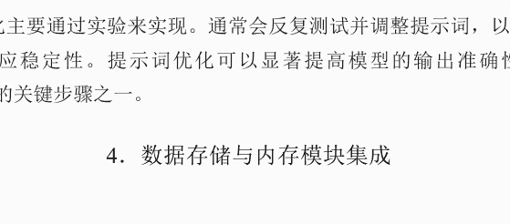
提示词优化主要靠实验迭代。通常会反复测试并调整文案，以确保模型在不同输入条件下的响应稳定性。优化后的提示词能显著提升输出的准确性和一致性，是 LangChain 开发中的关键步骤。


##### 4. 数据存储与内存模块集成
LangChain 的 Memory 在任务链执行中具有重要作用。它能够暂存任务链产生的中间数据，为后续步骤提供上下文，保证数据在任务间流转与共享，提升整体效率。它支持会话 Memory 与持久化 Memory，可按需配置。

在需要复杂信息检索的场景，还会结合向量数据库。向量数据库对数据进行向量化存储和相似度计算，能提高文本匹配与检索精度。LangChain 的架构让 Memory 与向量数据库无缝协作，从而提升模型在信息管理与检索方面的能力。

##### 5. Chain 测试、调试与结构调整

链路测试是保证多步调用可信可靠的基础工作。通过模拟真实业务的数据流动和运行场景，能够提前暴露潜在风险。测试时需完整留存输入、输出及中间产物，配合日志追踪每一个环节的运行状态，利用断点逐步拆解执行逻辑。借助可视化手段呈现数据流向，能更快定位缺陷并优化结构。结构上的调整应以测试反馈为依据，例如重排组件调用顺序、剔除冗余处理、提升内存使用效率，从而让链路更通顺、具备更好的扩展性。

##### 6. 模型部署、性能监控
部署方式可根据需求灵活选择。本地部署适合对数据隐私要求较高的场景，但需确保硬件资源满足运行要求；云端部署依托云服务实现高并发调用，具备弹性扩容的优势；容器化部署利用 Docker 等工具，可实现链路与模型的快速跨平台迁移。
在监控层面，需要实时跟踪核心指标，如响应耗时与内存占用。设置告警机制可在异常出现时自动触发修复流程。借助 Prometheus、Grafana 等工具构建可视化面板，能够观察长期运行趋势并持续优化性能。

## 1.2.3 LangChain 快速入门指引
下面按步骤介绍上手路径，重点覆盖环境准备、基础构件使用、提示词编写与任务链组装，帮助读者尽快进入实操。

#### 1. 环境搭建
编码前先把运行环境准备好，是后续工作的前提。

01 部署 Python。LangChain 的实现语言是 Python，建议使用 3.8 及以上版本。可从官网下载安装包，也可借助 Anaconda 等包管理器完成安装。

02 搭建隔离环境。为保持项目独立性，建议新建虚拟环境。命令行创建或在 Anaconda 中图形化创建均可:
```
> python -m venv langchain-env
```

03 启动环境 Windows:
```
> langchain-env\Scripts\activate
```
在 Linux 或 macOS 上:
```
> source langchain-env/bin/activate
```

04 在已启用的隔离环境中安装 LangChain 及依赖，执行:
```
> pip install langchain openai
```
安装完成后如图 1-9 所示。
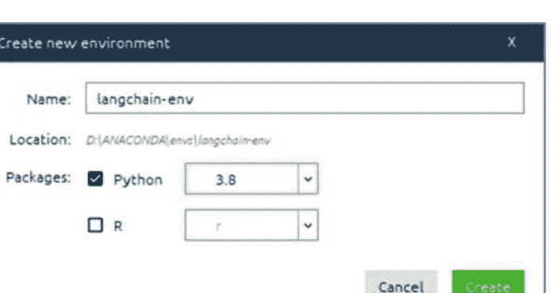
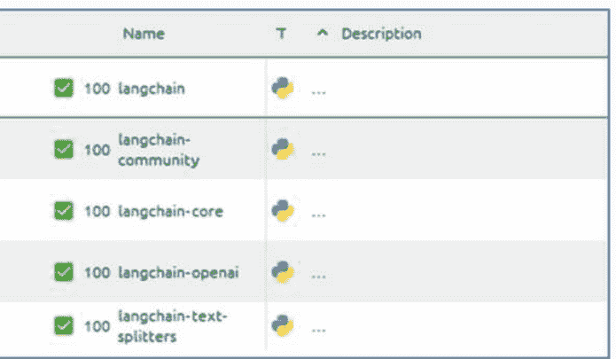

环境就绪后，了解基础构成有助于加速上手。

LangChain 部件架构如图 1-10 所示，呈现生态系统的核心组成，分三层：架构、组件、部署。

- 最底层为架构层，包含开源的 LangChain 与 LangGraph。LangChain 提供链式设计与构建能力，LangGraph 则扩展图形化建模，支撑更复杂的链路设计。
- 中间为组件层，标注开源的 Integrations 模块，负责对接外部工具或服务，如 API、数据库、第三方模型，支持灵活扩展与适配。
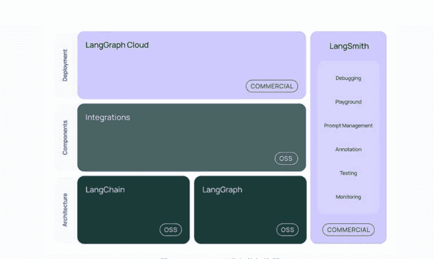
- 顶层为部署层，包含 LangGraph Cloud 与 LangSmith。LangGraph Cloud 为商业化云端方案，支持跨平台部署管理；LangSmith 提供商业化调试、交互式测试、提示管理、标注、性能测试与监控能力，提升效率与稳定性。

核心要素包括大语言模型 LLM、提示词 Prompt、任务链 Chain、内存 Memory。

**1) 大语言模型**
LLM 是核心引擎，承担文本生成与语义理解。框架兼容多种模型，如 OpenAI GPT 系列。实例化时需配置访问凭证与模型名称等参数。
```python
from langchain.llms import OpenAI
llm=OpenAI(api_key="YOUR_API_KEY", model="text-davinci-003")
```

**2) 提示词**
提示词用来指引模型输出方向。合理设计可确保结果符合预期。LangChain 提供 PromptTemplate 类来定义与管理模板。
```python
from langchain.prompts import PromptTemplate
prompt_template=PromptTemplate(
    input_variables=[],
    template="请简要描述企业创新的重要性。"
)
```

**3) 任务链**
任务链是将多个处理步骤串联的结构。借助 LLMChain 类可便捷组装并执行。
```python
from langchain.chains import LLMChain
chain=LLMChain(llm=llm, prompt=prompt_template)
result=chain.run()
```

**4) 内存模块**
内存用于在链路中保存状态，支撑上下文连续。内存机制可在多轮对话或复杂任务中保持一致性。
```python
from langchain.memory import Memory
memory=Memory()
```

#### 3. 提示词设计要点
提示质量直接影响输出效果。建议：
(1) 先明确生成目标。例如生成产品介绍，提示中应包含产品特性与优势，充足上下文有助于提升质量。
(2) 示例提示可加入用户需求与背景信息，使回复更具针对性。模板化设计可提升复用与维护性。
(3) 通过定义可变字段，将模板与具体内容结合，实现不同任务的灵活适配。
```python
prompt_template=PromptTemplate(
    input_variables=['product_name', 'features'],
    template="请介绍产品{product_name}，其特点为{features}。”
)
```

#### 4. 任务链构建流程
掌握基础构件后，可开始搭建任务链，通常包括任务定义、链路配置与执行。

构建任务：形式多样，如信息检索、文本生成、数据存储等。按需定义多个任务并串联成链。

配置任务链：使用 LLMChain 将任务与提示词结合，形成完整链路。
```python
chain=LLMChain(llm=llm, prompt=prompt_template)
```

## 03 执行任务链
通过 run() 方法执行任务链并获取结果，必要时对输出进行后处理与展示。
```python
result = chain.run()
print(result)
```

综合以上内容，读者应能系统掌握快速上手方法。环境搭建、基础构件、提示词设计与任务链构建共同构成高效自然语言处理应用的基础。随着理解加深，能更好地发挥大模型优势，提升自动化能力。

## 表 1-3 本章涉及的 LangChain 函数

### 表 1-3 本章涉及的 LangChain 函数
| 函数名称 | 函数功能 |
| :--- | :--- |
| OpenAI(api_key, model) | 初始化 OpenAI 大语言模型实例 |
| PromptTemplate | 创建提示词模板，便于管理和重用提示词 |
| LLMChain(llm, prompt) | 创建任务链，将大语言模型与提示词结合 |
| run() | 执行任务链，返回生成的文本结果 |
| Memory() | 创建内存模块，用于存储上下文信息 |
| VectorStore() | 初始化向量数据库，用于存储和检索相似性信息 |
| Agent() | 创建智能代理，用于执行特定任务或操作 |
| load_tools() | 加载可用工具，用于增强模型的功能 |
| tool.run() | 执行特定工具的功能，获取处理结果 |
| get_response() | 从大语言模型中获取生成的响应 |
| set_context() | 设置上下文信息，增强生成文本的相关性和准确性 |
| split_text() | 将文本分割成较小的块，以便于处理和分析 |
| format_prompt() | 格式化提示词，使其适应特定任务或模型要求 |
| generate_text() | 基于输入提示生成文本 |
| serialize() | 将模型或数据序列化以便于存储或传输 |

## 1.3 本章回顾
本章梳理了 LLM 与 LangChain 的基础概念，为后续开发奠定理论基础。首先回顾了大模型发展脉络，从早期 N-grams 统计模型到基于 Transformer 的深度学习范式，阐明技术演进与核心原理。随后在开发流程中，通过任务链与提示词设计，使模型可灵活适配多种业务场景。借助内存模块集成，实现了上下文传递与状态维护，显著提升应用智能化水平。

## 1.4 思考题
> （1）简述大语言模型的核心目标是什么，在自然语言处理任务中起到什么作用。
> （2）N-grams 模型有哪些主要缺陷？这些缺陷是如何推动大语言模型向更复杂的模型发展的？
> （3）什么是 Transformer 架构？与传统的循环神经网络相比，它的优势是什么？
> （4）LangChain 框架的主要功能模块有哪些？简要说明每个模块的作用。
> （5）在 LangChain 中，任务链的主要用途是什么？如何实现多个任务的顺序执行？
> （6）提示词在 LangChain 中有什么重要作用？它如何影响模型的输出？
> （7）简述 LangChain 的内存模块功能。它在多轮对话或复杂任务中如何保持上下文的一致性？
> （8）如何使用 LangChain 的 PromptTemplate 类？举例说明其用法。
> （9）在 LangChain 中，LLMChain 类的作用是什么？如何结合提示词和大语言模型构建任务链？
> （10）如何配置和使用 LangChain 的内存模块？在什么场景下需要使用它？
> （11）为什么在进行 LangChain 开发时推荐创建虚拟环境？如何安装 LangChain？
> （12）在 LangChain 的开发流程中，如何调试任务链和提示词的表现？有哪些常见的最佳实践？

# 第 2 章 LangChain 项目搭建准备
一个良好的开发环境能提升编码体验，降低项目中技术问题的发生，为后续开发与测试提供坚实基础。本章从基础配置入手，指导读者完成开发前的准备工作。

首先，LangChain 的运行依赖 LLM，特别是 OpenAI 的 API。因此创建并管理 API 密钥、保障密钥安全是开发首要任务。其次，工具链的选择影响效率，Anaconda 与 PyCharm 组合可有效管理依赖与虚拟环境，保证兼容性与灵活性。最后，LangChain 依赖众多第三方库，本章将介绍核心依赖的安装与初步配置，确保实际开发中调用顺畅。

本章目标是帮助读者系统搭建环境，解决 API 配置、环境管理与依赖安装问题，为项目顺利启动奠定基础。

## 2.1 OpenAI API 密钥创建
在开发中，LLM 通常扮演核心角色，而 OpenAI API 是常用接口之一。通过调用该 API 可便捷访问 GPT 系列模型，实现强大的自然语言处理能力。但 API 调用需要认证，API 密钥即为核心凭证。

本节将指导读者完成 OpenAI API 密钥的创建与配置。首先介绍如何注册账户并完成基础设置，随后讲解密钥生成与管理流程。密钥安全与权限管理至关重要，文中也会重点说明安全防护措施，避免不必要的风险。

### 2.1.1 账号注册与配置
开始开发前，需要先拥有 OpenAI 账户以获取 API 密钥访问大模型。以下步骤帮助完成账号注册与基础配置。

> 1. 打开 OpenAI 官网
> 使用浏览器访问 https://www.openai.com。该站点提供产品信息，也是注册入口，如图 2-1 所示。
> 
> 图 2-1 OpenAI 官方网站主页
> 2. 进入注册页面
> 在官网右上角可找到“Sign Up”或“Get started”按钮，如图 2-2 所示。点击后跳转至注册页，可选择以下方式注册：
> 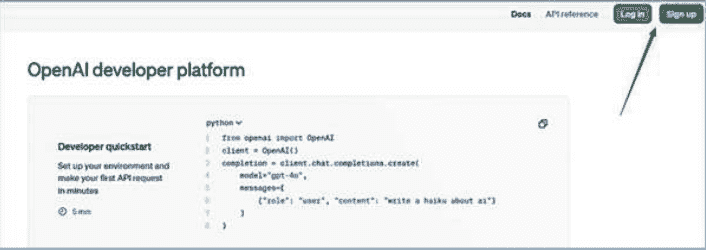
> 图 2-2 单击 Sign Up 进行账号注册
> （1）使用电子邮件注册：输入常用邮箱并设置强密码。
> （2）使用第三方账户注册：支持 Google 或 Microsoft 账号登录。
> 建议使用常用且安全的邮箱注册，以便接收通知与安全提醒。
> 3. 验证电子邮件
> 选择邮箱注册后，OpenAI 会发送验证邮件。登录邮箱打开验证链接，完成邮箱确认后注册成功。
> 4. 完善个人信息
> 验证后系统可能要求填写姓名、国家或地区等基本信息，用于账户管理与安全验证。
> 5. 同意服务条款和隐私政策
> 注册流程中需同意服务条款与隐私政策。建议仔细阅读，了解使用限制与数据保护等关键内容。
> 6. 进入账户设置页面
> 注册完成后点击页面右上角头像，进入账户设置或 Settings。在此可查看基本信息与安全设置。
> 
> 7. 设置双重身份验证（推荐）
> 为提升安全性，建议启用双重身份验证 2FA，如图 2-4 所示。启用步骤如下：
> ```text
> > 01 | 在账户设置页面中，找到“双重身份验证”或"Security"选项。
> ```

图 2-4 2FA 验证配置
点击启用双重身份验证，按提示选择验证方式，如短信或验证器应用。
按页面指引完成 2FA 配置。
将生成的密钥或二维码导入 2FA 应用，如 Google Authenticator、Authy。此后登录需额外验证。
> 8. 选择合适的 API 订阅计划
> OpenAI 提供多种订阅方案以满足不同需求。可在账户设置中选择：
> • 免费计划：适合小规模测试，调用受限。
> 付费计划：提供更高调用额度，适合持续开发或企业项目，按用量计费。

挑选订阅方案时，建议把业务规模与预算结合评估。个人练习或小规模验证，免费版或基础版即可；面向生产业务时，付费版更合适，调用额度更高且可获得官方技术支持。后期可根据实际需求灵活调整。

9. 了解 API 使用限制和配额

各套餐的调用上限与频率阈值并不相同。上线前务必进入账号后台核对当期允许的调用总量、每秒请求上限等使用规则，提前安排调用节奏，避免因超限导致中断。

10. 完成账户配置

至此 OpenAI 平台账号的注册及基础初始化已完成。该账号后续将用于申请调用凭证并发起请求，请妥善保存登入信息并完善安全项。

### 2.1.2 生成和管理 API 密钥

调用 OpenAI 大语言模型的授权凭证即为 API Key。持有该凭证后，可将文本生成、翻译等能力嵌入自有系统。以下内容说明如何创建及维护该凭证，以保证开发流程顺畅且安全可控。

> 1. 登录 OpenAI 账户
>
> 使用浏览器访问 https://www.openai.com ，点击右上角 Log In，输入已有的账号信息进入个人工作区。

> 2. 进入 API 密钥管理页面
>
> 登录后点选右上角头像，从下拉菜单中打开 API Keys 或 API 管理入口，具体名称可能随平台更新而变化。进入后即可看到已有凭证列表或新建入口，如图 2-5 所示。
>
> 
>
> 图 2-5 API 密钥管理页面

> 3. 生成新的 API 密钥
>
> 在管理页寻找 Create new secret key / 生成新密钥 按钮，点击后平台会即时产出一串以 sk- 开头的字符组合，并在页面展示一次。
>
> > 提示：该凭证仅在创建瞬间可见，错过保存窗口即无法再次查阅，创建时请立即备份。

> 4. 保存 API 密钥
>
> 创建后需妥善存放，推荐做法如下：
>
> （1）本地文件：可写入普通文本保存，但切勿放置在公开目录或随项目提交。
> （2）环境变量：作为系统变量保存，避免硬编码，提升安全性。
> （3）密码管理工具：借助 1Password、LastPass 等加密保存，便于统一管理。

> 5. 管理 API 密钥
>
> 开发过程中常需多凭证协同，常见操作包括：
>
> （1）查看清单：在管理页可列出全部凭证，展示创建时间及部分掩码以便区分。
> （2）命名标注：建议为每条凭证添加用途说明，如“测试用途”“生产用途”，多人协作时更清晰。
> （3）配额监控：管理页会呈现各凭证的调用量与剩余额度，需定期检查以免受限。

> 6. 删除 API 密钥
>
> 废弃或出于安全考虑可删除，操作流程：
>
> 01 在凭证列表定位目标项。
> 02 点击旁边的 Delete / 删除。
> 03 系统会弹窗提示操作不可逆，确认后凭证立即失效。
>
> > 提示 删除前确认无项目仍在依赖该凭证，删除操作不可撤销，凭证无法恢复。

> 7. API 密钥安全管理建议
>
> （1）禁止把凭证直接写进源码，建议存放在环境变量或安全存储，运行时读取。
> （2）避免将凭证推送至代码仓库，即使私有库也不宜上传；若误上传需清理历史并重建凭证。
> （3）定期轮换凭证，团队共享时更应高频更换并同步更新配置。
> （4）持续监控调用次数与异常行为，发现异常立即停用并重新生成。

> 8. 使用 API 密钥调用 OpenAI 服务
>
> 保存完成后即可在项目中使用。以读取环境变量为例，完成初始化后调用生成接口即可产出文本。若配置有误会导致请求失败，启用之前请先校验。
>
> ```python
> import openai
> import os
> 
> # 从环境变量中获取 API 密钥
> openai.api_key = os.getenv("OPENAI_API_KEY")
> 
> # 调用 OpenAI 的文本生成接口
> response = openai.Completion.create(
>     engine="text-davinci-003",
>     prompt="请简要描述企业创新的重要性。",
>     max_tokens=50)
> 
> print(response.choices[0].text.strip()) # 输出生成结果
> ```
>
> 在此示例中，凭证从环境变量读取并用于初始化客户端，随后调用生成方法获取模型输出，使用前请确认凭证已正确配置。

> 9. 密钥过期或更换的应对措施
>
> 凭证失效或被更换时，按以下流程更新：
>
> - 01 按前述方式生成新凭证并妥善保存。
> - 02 将新凭证写入环境变量或安全存储，替换项目中的旧值。
> - 03 执行一次测试调用，验证新凭证可用。

表 2-1 列出了 API 密钥的基本功能。


| 功 能 | 说 明 |
| :--- | :--- |
| 身份验证 | 作为唯一凭证，用于验证用户身份，确保 API 调用的合法性 |
| 访问控制 | 控制用户对 OpenAI 服务的访问权限，限制未经授权的调用 |
| 调用配额管理 | 管理用户的调用次数，避免超出 API 订阅计划的使用配额 |
| 项目隔离 | 可创建多个密钥，用于不同项目或环境，实现项目间的资源隔离 |
| 调用日志追踪 | 通过密钥管理页面监控调用日志，识别异常调用行为 |
| 权限撤销 | 支持删除密钥，以立即撤销对某些服务的访问，保障数据安全 |
| 团队协作支持 | 为团队成员生成独立密钥，便于管理权限和监控个人调用情况 |
| 安全控制 | 支持双重验证、环境变量存储等方式，提升密钥的安全化管理 |

### 2.1.3 设置访问权限与安全性

API Key 是进入服务的唯一授权凭证，生成后必须做好权限划分与安全加固，既能保护数据，也可防止未授权调用。以下为分步加固实操。

> 1. 确定密钥的使用范围
>
> 使用前先明确用途，建议按场景拆分凭证：
>
> +   - 开发凭证：用于测试开发，调用频率与配额可设较低。
> - 生产凭证：用于已上线环境，配额较高，需严格管控。
> - 测试凭证：用于非敏感测试，通常限制速率以防超额。
>
> 区分用途可更灵活地分配资源，同时保障生产环境安全。

> 2. 使用环境变量存储 API 密钥
>
> 直接写在程序里风险高，尤其配合版本控制时更易泄露。建议将凭证设为系统环境变量，程序中动态读取。
>
> 首先在操作系统中创建环境变量保存凭证：
>
> ```text
> > 在 Windows 上：
> >> setx OPENAI_API_KEY "sk-XXXXXXXX"
> > 在 macOS 或 Linux 上：
> >> export OPENAI_API_KEY="sk-XXXXXXXX"
> ```
>
> 设置完成后可在代码里通过 os 模块读取：
>
> ```python
> import os 
> api_key = os.getenv("OPENAI_API_KEY")
> ```
>
> 这样凭证不会暴露在源码中，安全性明显提升。

> 3. 设置双重身份验证来保护账户
>
> 为账号启用双重验证可增加一层防护，只有授权用户才能进入凭证管理页。## 启用双重身份验证的步骤在 2.1.1 节已经介绍过了，这里不再赘述。需要注意，每次登录时，都要输入动态生成的验证码，进一步确保账户的安全，如图 2-6 所示。
>
> **图 2-6** 输入身份验证码

#### 4. 使用密码管理器存储密钥

密码管理器可加密保存凭证，并提供细粒度访问控制。操作步骤如下：

1. **①**选择密码管理器：选用 1Password、LastPass 或 Bitwarden 等可靠工具。
2. **②**存储 API 密钥：在管理器中新建条目，粘贴凭证，并在备注中标明用途如“生产凭证”“开发凭证”。
3. **③**设置访问权限：团队使用时可为不同成员分配可见权限，确保只有相关人员可访问。

借助密码管理器可有效降低泄露风险，并方便团队协作管理。

在企业项目中，凭证保护直接关乎数据安全与系统稳定。通过环境变量、双重验证、密码管理器存储、定期轮换与调用监控，可显著降低泄露与滥用风险。

## 2.2 构建 Anaconda+PyCharm 开发工具链

LangChain 开发需要稳定高效的环境。Anaconda 提供包与环境管理，PyCharm 提供专业编辑调试能力，二者结合非常适合数据科学与大模型开发。

Anaconda 是一个面向数据科学的 Python 平台，内置包管理器与虚拟环境工具，可为不同项目创建隔离空间，避免依赖冲突。PyCharm 作为专业 IDE，支持代码智能提示、调试与版本控制，与 Anaconda 配合能大幅提升效率。

本节将完成 Anaconda 与 PyCharm 的安装、配置与集成，为后续 LangChain 编码调试奠定基础。

### 2.2.1 安装与配置 Anaconda 环境

下面完成 Anaconda 部署并创建用于 LangChain 的虚拟环境。

#### 1. 下载 Anaconda

**01**访问 Anaconda 官方网站：打开浏览器输入 https://www.anaconda.com，进入官网，如图 2-8 所示。

**02**选择合适的版本：在首页点击 Free Download，按 Windows、macOS 或 Linux 选择对应安装包，建议使用 Python 3.8 及以上发行版以保证兼容。

**03**获取安装包：确认系统与 Python 版本后点击 Download 开始获取，文件较大请耐心等待。

#### 2. 安装 Anaconda

**01**打开安装程序：获取完成后双击运行。Windows 双击 .exe，macOS 双击 .pkg，Linux 在终端执行：

```bash
>> bash /path/to/Anaconda3-xxxx-Linux-x86_64.sh
```

其中路径需替换为实际安装包位置。

阅读许可协议：启动后阅读协议并同意继续。

选择安装路径：建议使用默认路径，避免路径含空格或特殊字符。

选择安装选项：

- Add Anaconda to my PATH environment variable 建议不勾选，避免与其它 Python 冲突。
- Register Anaconda as my default Python 建议勾选，使其成为默认 Python。

开始安装：确认设置后点击 Install，等待完成。

完成安装：安装结束点击 Finish。

#### 3. 验证 Anaconda

Windows 打开开始菜单找到 Anaconda3 文件夹，点击 Anaconda Prompt。macOS/Linux 打开终端。

在命令行输入：

```bash
>> conda --version
```

若返回 conda 4.x.x 版本号，则安装成功。

#### 4. 创建虚拟环境

虚拟环境是 Anaconda 的核心功能，可为项目提供独立依赖。

在 Prompt 或终端执行：

```bash
>> conda create -n langchain-env python=3.8
```

-n 指定环境名，这里创建名为 langchain-env 的 Python 3.8 环境。

#### 5. 激活环境

创建后需激活才能使用。

Windows:

```bash
>> conda activate langchain-env
```

macOS/Linux:

```bash
>> source activate langchain-env
```

激活后命令行前缀会显示环境名，表示已进入该环境。

#### 6. 验证 Python 版本

在已激活环境中执行：

```bash
>> python --version
```

若显示 Python 3.8.x，则环境创建成功。

#### 7. 安装常用依赖包

可先安装基础库确保环境正常：

```bash
>> conda install pip numpy
```

#### 8. 管理虚拟环境

1. **列出所有环境**

   执行：

   ```bash
   >> conda env list
   ```

   系统会列出所有环境，当前激活的环境会用 * 标记。

2. **退出环境**

   执行：

   ```bash
   >> conda deactivate
   ```

   退出后返回系统默认环境。

3. **删除环境**

   若环境不再使用，可通过对应命令删除：

```bash
   >> conda remove -n langchain-env --all
   ```

其中 `-n langchain-env` 用于定义环境名称，`--all` 则表示把该环境内的所有组件一并清除。

#### 9. 可选配置：为当前环境启用 Jupyter Notebook

在数据科学实践里，交互式笔记本很常见。下面示范如何在新创建的 langchain-env 中加入 Notebook 功能：

**01** 安装 Notebook：在激活 langchain-env 的前提下，执行以下安装命令：
```bash
>> conda install jupyter
```

**02** 启动服务：安装完毕后，通过下述指令唤起服务：
```bash
>> jupyter notebook
```

预期输出类似：
```text
[I 12:42:58.416 NotebookApp] 
>>302 GET/?token=ec8fla9a9e94cl5f2fOd77dlcdbcaa8dO6fdOdfE3469ef4f (127.0.0.1) \
n 1.00ms
```

完成后浏览器会自动弹出，呈现 Notebook 操作页，如图 2-9 所示。此时所有运算均基于 langchain-env 执行。

至此，Anaconda 的部署、虚拟环境的搭建与配置已完成。其隔离机制能有效防止不同项目间的依赖冲突。

借助 Notebook 等交互式工具，可提升研发效率，为 LangChain 项目的开发奠定基础。下一步可将该环境对接 PyCharm，实现更流畅的编码与调试体验。

### 2.2.2 PyCharm 与 Anaconda 环境的联动

下面阐述如何把基于 Anaconda 的隔离环境导入 PyCharm，并设置项目的运行解释器与调试流程。

#### 1. 获取并部署 PyCharm

**01** 浏览官网：打开浏览器访问 JetBrains 官方站点 https://www.jetbrains.com/pycharm，如图 2-10。

**图 2-10** JetBrains PyCharm 官方网站下载界面

**02** 选择版本：PyCharm 提供两类发行版：
- **Community Edition**：免费版，满足基础 Python 开发需求。
- **Professional Edition**：付费版，额外包含数据库与 Web 开发等高级能力。

对大多数 Python 任务而言社区版已足够，建议下载对应操作系统的免费社区版，如图 2-11。

**图 2-11** 选择下载对应操作系统的社区免费版本

**03** 完成安装：下载完成后双击安装包，按向导提示完成部署，通常保留默认设置即可。

#### 2. 启动 PyCharm 并新建工程

**01** 打开软件：安装完成后启动 PyCharm，首次运行会提示选择主题和基础配置，按提示完成即可。

**02** 新建工程：在欢迎界面选择“New Project”，为工程命名如“LangChainProject”，并指定存储路径，如图 2-12。

**图 2-12** 在 PyCharm 中创建新项目

#### 3. 设定解释器指向 Conda 环境

新建工程时 PyCharm 会要求指定运行解释器，即实际执行代码的 Python。选用前面创建的 Conda 隔离环境，如图 2-13。

**01** 选择解释器：在“New Project”窗口右侧找到“Python Interpreter”项，点击“Add Interpreter”或“Existing Interpreter”来指定已有环境。

**02** 切换至 Conda 选项：在弹出的对话框中选中“Conda Environment”。

此时 PyCharm 会列出已安装的 Anaconda 隔离环境。

**图 2-13** 在 Anaconda 环境下配置解释器

**03** 定位已有环境：在“Conda Environment”设置中选择“Existing environment”，随后浏览至此前创建的 langchain-env 目录：
- **Windows 路径**：通常为 `C:\Users\<用户名>\anaconda3\envs\langchain-env`。
- **macOS/Linux 路径**：通常为 `/Users/<用户名>/anaconda3/envs/langchain-env` 或 `/home/<用户名>/anaconda3/envs/langchain-env`。

若列表中未出现，可手动输入或选择路径中的 `python.exe`（Windows）或 `bin/python`（macOS/Linux）可执行文件。

#### 4. 编写验证脚本并执行

配置完成后，可新建一个 Python 脚本验证 PyCharm 是否正确调用了 Conda 环境中的解释器。

**01** 新建文件：在项目目录下右键项目名如“LangChainProject”，选择“New”-“Python File”，命名为 `test_env.py`。

**02** 编写校验代码：在文件中输入以下内容以检查环境是否生效：
```python
import sys
import numpy

print("Python Interpreter Path:", sys.executable)
print("Numpy Version:", numpy.__version__)
```

脚本会输出当前解释器所在路径以及 numpy 的版本号。numpy 是常用的科学计算库，若配置正确应可正常导入。

**03** 运行脚本：右键 `test_env.py`，在菜单中选择“Run 'test_env'”执行。PyCharm 会运行脚本并在控制台展示结果。

**04** 查看输出：在 PyCharm 控制台应能看到类似以下信息：
```text
Python Interpreter Path: \
C:\Users\<用户名>\anaconda3\envs\langchain-env\python.exe
```

#### 5. 补充额外依赖

开发过程中若需额外包，可直接在 PyCharm 内完成安装，确保全部装入 langchain-env。

**01** 在 PyCharm 中安装：在菜单依次打开“File”→“Settings”→“Project:LangChainProject”→“Python Interpreter”，在右侧窗口点击“+”打开包管理器。

**02** 搜索并安装：在搜索栏输入所需包名，例如 openai，在结果中点击“Install Package”完成安装。成功后包会出现在“Installed Packages”列表中。

**03** 命令行安装：若习惯终端，可通过 Anaconda Prompt 激活 langchain-env 后，使用 pip 或 conda 命令安装所需包：
```bash
>> conda activate langchain-env
>> pip install openai
```

按照以上流程即可实现 Conda 隔离环境与 PyCharm 的联动。该组合能有效管理依赖并提供灵活调试环境，为 LangChain 开发提供稳定基础。接下来即可在该环境中编写、调试与测试代码。

### 2.2.3 包管理与环境管理的实践

包管理涵盖安装、升级、移除 Python 包；环境管理则是维护多个独立隔离环境，避免不同项目依赖相互干扰。

良好的包与环境管理不仅提升效率，也有助于项目稳定与可维护。以下介绍具体操作。

#### 1. 使用 Conda 管理环境

Anaconda 自带的 Conda 工具可便捷地管理隔离环境，保证各项目依赖独立。常用操作如下。

1. **新建环境**
启动新项目时建议新建独立环境管理依赖。以下命令可创建一个 Python 3.8 的隔离环境：
```bash
   >> conda create -n langchain-env python=3.8
   ```
说明：
- `-n langchain-env`：将环境命名为 `langchain-env`。
- `python=3.8`：指定 Python 版本为 3.8。

2. **激活环境**
环境创建后需激活后使用。激活 `langchain-env` 的指令为：
```bash
   >> conda activate langchain-env
   ```

3. **列出环境**
查看系统中已创建的所有隔离环境：
```bash
   >> conda env list
   ```

4. **删除环境**
不再需要的环境可通过以下命令移除：
```bash
   >> conda remove -n langchain-env --all
   ```
该命令会删除 `langchain-env` 及其内部所有包。

#### 2. 在 Conda 中管理包

Conda 可便捷地安装、更新和删除 Python 包。

- **安装包**
使用 `conda install` 安装包。例如安装 numpy：
```bash
  >> conda install numpy
  ```
Conda 会自动下载并安装 numpy 及其依赖，保证版本兼容。

- **更新包**
使用 `conda update` 将包升级到最新。例如升级 numpy：
```bash
  >> conda update numpy
  ```
命令会检查最新版本并执行更新。

- **删除包**
使用 `conda remove` 移除包。例如删除 numpy：
```bash
  >> conda remove numpy
  ```
Conda 会删除指定包及其关联依赖，保持环境整洁。

- **查看已装包**
查看当前环境中所有已安装包：
```bash
  >> conda list
  ```
系统会列出所有包的名称、版本号和安装路径。

- **示例**
```markdown
##### 1. 使用 NumPy 进行简单的脚本开发测试环境

下面使用 numpy 库进行一个简单的脚本开发，试验环境是否可以正常工作：

```python
import numpy as np

from sklearn.decomposition import PCA

import matplotlib.pyplot as plt

###### 1. 创建一个模拟的多维数组数据集

np.random.seed(42)

data = np.random.rand(100, 5) * 100  # 创建 100 个样本，每个样本有 5 个特征

###### 2. 数据归一化处理（Min-Max Normalization）

data_min = data.min(axis=0)

data_max = data.max(axis=0)

normalized_data = (data - data_min) / (data_max - data_min)

###### 3. 计算相似性矩阵（余弦相似度）

def cosine_similarity_matrix(data):
    dot_product = np.dot(data, data.T)
    norms = np.linalg.norm(data, axis=1)
    norm_matrix = np.outer(norms, norms)
    similarity_matrix = dot_product / norm_matrix
    np.fill_diagonal(similarity_matrix, 0)  # 设置对角线为 0，排除自相似
    return similarity_matrix

similarity_matrix = cosine_similarity_matrix(normalized_data)

###### 4. 找出最相似的数据对

most_similar_pairs = np.unravel_index(np.argmax(similarity_matrix), similarity_matrix.shape)

print("最相似的数据对索引:", most_similar_pairs)

print("最相似的样本相似度:", similarity_matrix[most_similar_pairs])

###### 5. 使用 PCA 进行数据降维并可视化

pca = PCA(n_components=2)

reduced_data = pca.fit_transform(normalized_data)

plt.scatter(reduced_data[:, 0], reduced_data[:, 1], c='blue', label='Data Points')

plt.scatter(reduced_data[most_similar_pairs, 0],
            reduced_data[most_similar_pairs, 1], c='red',
            label='Most Similar Pair', s=100)

plt.title("Data Points in 2D after PCA Reduction")

plt.xlabel("Principal Component 1")

plt.ylabel("Principal Component 2")

plt.legend()

plt.show()
```

**代码解释如下：**

(1) 创建一个 100 行 5 列的数组，每行表示一个样本，每列表示一个特征。

(2) 对数据进行归一化处理，将所有值缩放到 0 和 1 之间，以消除特征之间的量级差异。

(3) 计算数据集的余弦相似性矩阵，用于衡量样本之间的相似性。

(4) 找出相似性矩阵中相似度最高的数据对，并输出它们的索引和相似度值。

(5) 使用主成分分析（PCA）将数据降维到二维空间，并可视化所有数据点，标出最相似的数据对。

运行结果如下：

> > 最相似的数据对索引: (27, 84)
> > 最相似的样本相似度: 0.996239

散点图如图 2-14 所示，展示了 PCA 降维后的数据点分布，面积最大的两个点标记的是相似度最高的样本对。


图 2-14 利用 numpy 做 PCA 分析的运行结果

##### 2. 导出和导入环境

在项目开发中，可能需要将当前环境导出为配置文件，以便于在其他系统上快速重建相同的环境。Conda 支持将环境导出为 `.yml` 文件，以便于迁移和共享。

### - 1）导出环境

使用以下命令将当前环境导出为 `environment.yml` 文件：

```bash
conda env export > environment.yml
```

此命令会将 `langchain-env` 环境中的所有包及其版本记录在 `environment.yml` 文件中。

### - 2）导入环境

在另一台计算机上，可以使用以下命令基于 `environment.yml` 文件创建相同的环境：

```bash
conda env create -f environment.yml
```

此命令会根据 `environment.yml` 文件中的包版本信息，创建一个与原环境一致的虚拟环境。

###### 3. 复制环境

若需创建一个与现有环境完全相同的新环境，可以使用以下命令：

```bash
conda create --name new-env --clone langchain-env

在开始 LangChain 项目的开发之前，先把运行所需要的核心库和常用的科学计算扩展装好，可以省去不少环境调试的时间。下面是常见的依赖清单，以及 OpenAI API 的基础调用示例，方便快速上手。

环境依赖快速安装
构建智能应用链路通常会用到 LangChain 核心包、OpenAI 的 Python SDK，以及数据处理和向量检索相关的轮子。先执行以下安装即可满足大部分入门场景。

```

此命令会将 `langchain-env` 环境复制为 `new-env` 环境，适用于需要快速复制现有环境的情况。

包管理和环境管理是开发过程中的重要环节，能够帮助开发者灵活地控制项目依赖和环境，确保项目的稳定性和可维护性。掌握这些技能后，读者可以更自如地在 LangChain 项目开发中添加、更新和移除依赖，为项目的长期稳定运行奠定坚实基础。

表 2-2 是 2.1 节和 2.2 节中涉及的所有命令的总结。

| 操作                     | 命令                                      | 说明                                       |
| :----------------------- | :---------------------------------------- | :----------------------------------------- |
| 创建 OpenAI API 密钥      | -                                         |                                           |
| 设置环境变量             | `export OPENAI_API_KEY=your_key`         |                                           |

表 2-2 命令汇总表

#### 3. 初探 LangChain 依赖库

本节将带领读者初步了解 LangChain 所需的主要依赖库，从核心依赖到扩展工具，将逐一进行介绍。首先，将概览 LangChain 的核心依赖库，帮助读者理解各依赖的功能和作用；接着，详细讲解 openai 库的安装与配置，以便实现 LLM 的调用；最后，将介绍一些常用的辅助工具和扩展包，以增强 LangChain 项目的功能与灵活性。

##### 1. 核心依赖库之一：langchain

`langchain` 是 LangChain 项目的核心库，提供了与大语言模型交互的各种功能和接口。它包含了任务链、内存模块、提示词管理等核心功能，简化了语言模型的集成与调用流程。

`langchain` 库在项目中主要负责以下任务：

- **任务链管理**：通过任务链功能，实现多步骤的任务处理，适用于复杂的数据处理和逻辑流转。
- **内存模块**：提供会话上下文和状态管理，便于在多轮对话和复杂场景中保持一致性。
- **提示词管理**：支持提示词模板化设计，便于控制和优化大语言模型的生成效果。

**安装命令：**

```bash

pip install langchain

```

##### 2. 核心依赖库之二：openai

`openai` 库是 LangChain 项目的另一重要依赖，用于与 OpenAI 的 LLM 进行交互。通过 openai 库，可以轻松调用 GPT 系列模型完成文本生成、信息提取、内容总结等任务。LangChain 的大部分自然语言处理功能都需要依赖此库的接口实现。`openai` 库的主要功能包括：

- **LLM 调用**：支持调用 OpenAI 的各种语言模型（如 GPT-3、GPT-4），生成多种文本。
- **参数控制**：允许配置调用模型的参数，如温度、最大长度等，控制生成内容的质量和风格。
- **多任务支持**：可以通过不同的 API 实现多种任务的处理，包括文本生成、代码生成和对话管理。

**安装命令：**

```bash

pip install openai

```

`requests` 库是一个 HTTP 客户端，用于与 API 服务器进行交互。虽然 LangChain 的很多操作可以通过 `openai` 库直接完成，但在一些场景下，可能需要与其他外部 API 或服务集成。此时，`requests` 库提供了简单的 HTTP 请求接口，支持 GET、POST 等请求方式。`requests` 库常见应用场景包括：

- **数据获取**：从外部 API 获取数据，并将数据用于后续的语言模型调用或任务链处理。
- **定制请求**：可构建设定制化的 HTTP 请求，便于与其他系统集成。
- **快速调试**：在开发和调试过程中，可以使用 `requests` 库快速测试与 API 的交互。

**安装命令：**

```bash

pip install requests

```

##### 4. 核心辅助库之二：numpy

`numpy` 是一个常用的数值计算库，在 LangChain 项目中主要用于数据处理和向量运算。LLM 的输入和输出通常涉及多维数据，如词嵌入和相似性计算，`numpy` 库提供了高效的数组操作和线性代数计算。其常见应用包括：

- **向量化处理**：对文本数据进行词向量化，便于模型处理和计算。
- **矩阵运算**：支持大规模矩阵运算，用于相似性计算和数据分析。
- **数值统计**：支持快速统计和处理大数据集的特征，便于数据分析和优化。

**安装命令：**

```bash

pip install numpy

```

##### 5. 核心辅助库之三：pandas

`pandas` 是一个数据分析库，主要用于数据读取、清洗和预处理。在 LangChain 项目中，特别是在涉及批量数据处理或分析的任务中，`pandas` 提供了强大的数据框架结构。其常见应用包括：

- **数据表格管理**：支持数据的批量读取和处理（如 CSV、Excel 等格式），便于集成和分析。
- **数据过滤和转换**：支持对数据进行快速过滤、分组和转换，适用于数据清洗和预处理。
- **数据输出**：能够将处理后的数据导出为多种格式，便于生成报告和进行进一步处理。

**安装命令：**

```bash

pip install pandas

```

##### 6. 核心辅助库之四：faiss-cpu

`faiss` 是 Facebook 开发的一个高效相似性搜索和向量数据库，特别适用于大规模数据的相似性计算和检索。`faiss-cpu` 是其 CPU 版本。在 LangChain 项目中，可以使用 `faiss` 存储和查询词向量，支持快速的相似性匹配和推荐系统。其常见应用包括：

- **向量存储**：将词向量或嵌入存储在向量数据库中，便于后续快速检索。
- **相似性搜索**：在多轮对话或信息检索任务中，通过相似性搜索找到最相关的内容。
- **推荐系统**：基于用户输入或上下文生成相关内容推荐，提升智能化水平。

**安装命令：**

```bash

pip install faiss-cpu

pip install faiss-gpu

```

##### 7. 核心辅助库之五：scikit-learn

`scikit-learn` 是一个机器学习库，提供了大量机器学习算法和数据处理工具。在 LangChain 项目中，`scikit-learn` 可用于数据预处理、特征提取和相似性计算。其常见应用场景包括：

- **数据标准化**：对文本特征进行标准化处理，提高模型训练和推理效果。
- **相似性计算**：通过余弦相似度等算法计算不同文本之间的相似度。
- **降维处理**：如使用 PCA 对高维词向量进行降维，以便于可视化和分析。

**安装命令：**

```bash

pip install scikit-learn

API 密钥配置与基础调用
拿到密钥后建议通过环境变量注入，避免硬编码。下面是读取密钥并发起补全请求的最小写法。

```

LangChain 的核心依赖库涵盖了语言模型调用、数据处理、相似性检索等多方面功能，这些库为项目的高效开发提供了强大支持。

在 2.3.2 节中，将重点介绍如何安装和配置 openai 库，以实现 LLM 的调用。

#### 4. openai 库的安装与配置

`openai` 库是 LangChain 开发中必不可少的组件，通过它可以与 OpenAI 的大语言模型进行交互，实现文本生成、问题回答等多种自然语言处理任务。下面将详细讲解如何安装和配置 `openai` 库，确保能够顺利调用 API 并将其集成到 LangChain 项目中。

##### 1. 前提条件

在配置 `openai` 库之前，确保已经完成以下准备工作：

- **安装 Python**：`openai` 库支持 Python 3.7 及以上版本，确保系统中安装了兼容的 Python 版本。
- **创建并激活虚拟环境**：在 LangChain 项目中，推荐使用 Anaconda 或 venv 创建独立的虚拟环境，以便于管理依赖库。
- **获得 OpenAI API 密钥**：访问 OpenAI 官方网站创建账户并生成 API 密钥。

##### 2. 配置 OpenAI API 密钥

为了保证 OpenAI API 调用的安全性和便捷性，建议将 API 密钥存储为环境变量。

根据操作系统的不同，配置环境变量的方式略有差异，详情见 2.1.3 节。

##### 3. 编写测试代码调用 OpenAI API

完成 API 密钥的配置后，可以编写简单的测试代码，确认 `openai` 库已能正常调用 API 并生成结果。

- **首先导入 openai 库**：在代码文件中，首先导入 `openai` 库，并确保环境中已安装该库。
- **然后读取 API 密钥并配置**：使用 `os.getenv()` 函数读取环境变量中的 API 密钥，并配置到 `openai.api_key`。这样可以在不暴露密钥的情况下安全调用 API。

具体代码如下：

```python

import openai

import os  # 从环境变量中获取 API 密钥

openai.api_key = os.getenv("OPENAI_API_KEY")

最简单的补全调用以固定 token 长度为例，适合做概念性的快速验证。

```

以调用 GPT-3 模型为例，以下代码将生成一个简单的文本输出：

```python

response = openai.Completion.create(engine="text-davinci-003", prompt="请简要描述人工智能的基本概念。", max_tokens=50)

####### 输出生成的文本

print("生成的文本：", response.choices[0].text.strip())

调节采样参数可以改变输出风格。temperature 提升多样性，top_p 控制核采样范围。

```

在上述代码中，`engine` 参数指定了所用模型类型为 `text-davinci-003`，`prompt` 参数传递给模型要生成的文本内容，`max_tokens` 参数限制了生成文本的最大长度。

保存并运行代码，如果 API 配置正确，终端或控制台将输出生成的文本。例如：

> > 生成的文本：人工智能是一门研究如何让计算机模拟人类智能的学科，包括学习、推理和问题解决等能力。

文本生成成功，说明 `openai` 库的安装和 API 密钥配置已完成。

##### 4. 设置其他可选配置参数

在使用 OpenAI API 时，除了 `engine`、`prompt` 和 `max_tokens` 等基本参数之外，`openai` 库还支持其他配置参数，以便更好地控制生成结果。以下是一些常用参数：

**（1）temperature**：用于控制生成的“创意性”或“多样性”。值在 0 和 1 之间，值越接近 1，生成的文本越有创造性；值越接近 0，则生成的内容越保守。

```python

response = openai.Completion.create(

    engine="text-davinci-003",

    prompt="请描述太阳系的组成。",

    max_tokens=50,

    temperature=0.7)

```

**（2）top_p**：称为“核采样”。它与 `temperature` 类似，用于控制生成的多样性。通过设置一个阈值，限制生成文本时模型只考虑概率高的词。

```python

response = openai.Completion.create(

    engine="text-davinci-003",

    prompt="简要介绍机器学习的应用。",

    max_tokens=50,

    top_p=0.9 )

一次性获取多条候选结果时使用 n 参数，配合循环打印即可。

```

**（3）n**：用于生成多个候选文本，返回多个生成结果。适合需要多种生成选项的场景。

```python

response = openai.Completion.create(

    engine="text-davinci-003",

    prompt="给出三个 AI 应用的示例。",

    max_tokens=50,

    n=3 )

for i, choice in enumerate(response.choices):

    print(f"生成的文本 {i+1}：{choice.text.strip()}")

代码生成类任务常配合 stop 词截断，避免输出过长。

```

**（4）stop**：用于设定生成的停止条件，可以是一个或多个词，当生成内容包含这些词时将自动停止生成。适合需要生成特定格式内容的场景。

```python

response = openai.Completion.create(

    engine="text-davinci-003",

    prompt="编写一段简单的 Python 代码，计算两个数的和。",

    max_tokens=50,

    stop=["# End of code"])

print("生成的代码:", response.choices[0].text.strip())

实际项目中网络或配额异常不可避免，加上 try except 能让调用更稳健。

```

##### 5. API 调用故障排查

在实际使用中，可能会遇到一些 API 调用问题，以下是常见问题的排查方法：

- **API 密钥无效**：如果未设置或设置了错误的 API 密钥，`openai` 库会返回 "Authentication error"。确保密钥正确配置到环境变量中，并在代码中读取。
- **调用配额限制**：OpenAI API 的调用次数和频率有限制，超出限制时会返回 "Rate limit exceeded" 错误。此时需要降低调用频率，或根据需要升级 API 订阅计划。
- **网络连接问题**：若调用超时或连接失败，检查网络连接状况，并确保系统能正常访问 OpenAI 服务器。使用 VPN 可能会导致请求失败。
- **其他异常**：可以通过 try-except 块捕获异常，以便调试时查看错误信息。例如：

```python

try:

    response = openai.Completion.create(

        engine="text-davinci-003",

        prompt="介绍 Python 的基本功能。",

        max_tokens=50

    )

    print(response.choices[0].text.strip())

except Exception as e:

    print("API 调用失败：", e)

```

通过捕获异常，可以更详细地了解调用失败的原因。

完成本小节的配置后，读者将能够通过 `openai` 库与 LLM 顺利交互，实现文本生成等自然语言处理功能。掌握 API 密钥的安全配置和调用参数的方法，有助于在 LangChain 项目中实现更灵活的应用。
```

## 2.3.3 提升开发效率的辅助工具与扩展包

在 LangChain 的开发体系里，除了核心依赖，还可借助一系列周边工具来增强调试、数据处理和可视化能力，提升链路的灵活性和可维护性。下面是三类常用的扩展。

#### 1. tqdm 实时进度展示

处理大规模数据或长时间运行的链路时，进度感知非常重要。tqdm 能为循环套上动态进度条，并估算剩余时间，常用于模型训练、批量推理等场景。

安装方式：
```bash
pip install tqdm
```

使用示例：
```python
from tqdm import tqdm
import time
for i in tqdm(range(100)):
    time.sleep(0.1) #模拟长时间任务
```

运行后会实时呈现进度条、已完成比例和预计耗时等信息，便于监控，如图 2-15 所示。


#### 2. matplotlib 与 seaborn 数据可视化

分析结果的呈现离不开图表。matplotlib 提供基础绘图能力，seaborn 在其上扩展了统计图绘制，两者结合可以直观展示数据分布、模型表现和相似度矩阵等内容。

安装方式：
```bash
pip install matplotlib seaborn
```

使用示例：
```python
    import matplotlib.pyplot as plt
    import seaborn as sns
    import numpy as np
    
    data=np.random.randn(100)
    sns.histplot(data, kde=True)
    plt.title( "数据分布图") 
    plt. show ()
```

借助它们可以快速生成直方图、散点图、热力图等图表，帮助理解数据特征和模型效果。

#### 3. logging 日志记录管理

Python 自带的 logging 模块适合记录调试信息、追踪异常并监控多步骤链路的运行状态。在任务链中加入日志，可以清晰回溯各环节的输入输出，提升维护效率。

logging 提供 DEBUG、INFO、WARNING、ERROR、CRITICAL 等多级日志，按需选择记录粒度即可。

基础配置一般通过设置根日志的格式和级别完成，便于统一输出。

```python
import logging
logging.basicConfig(level=logging.INFO, format='%(asctime)s-%(levelname)s-%(message)s')
logging.info("LangChain 项目启动")
```

运行结果如下:

```
>>2024-11-03 13:24:10,961-INFO- LangChain 项目启动
```

#### 4. dotenv：环境变量托管

dotenv 能把敏感配置写进 .env 文件，统一收纳 API 密钥、数据库凭据等隐私信息。相较于在系统里手工设置变量，dotenv 在程序启动阶段自动读取配置，让操作更顺滑、安全性更高。

安装命令:

```bash
pip install python-dotenv
```

示例使用:

在项目根目录下新建 .env 文本并写入键值对：

- `OPENAI_API_KEY="sk-XXXXXX"`。随后在代码里通过 dotenv 完成读取

> API 密钥：`sess-oz9Ycj22yRCSYpXNAE5GJ&ggvtCNxxxxxxxxx`

#### 5. joblib：并行执行与缓存

joblib 核心提供并行化运行以及中间结果的记忆机制。在 LangChain 的数据清洗或大规模任务链场景里，它能明显压缩耗时，对需要反复执行的步骤尤为管用。重计算会被拆分到多路处理器上同时推进，而已算过的数据会被保留，避免重复劳动。

**安装命令**:

```bash
pip install joblib
```

**示例使用**:

下面演示数据处理的并行化，参数 n_jobs=4 意味着同时启用四路执行，效率提升显著。

**运行结果如下**:

```
计算结果：[0, 1, 4, 9, 16, 25, 36, 49, 64, 81]
```

#### 6. scipy：进阶科学计算

scipy 在 numpy 基础上扩展了线性代数、信号处理、统计分析等进阶功能。在 LangChain 项目中，它常用于向量相似度、降维、矩阵分解等深度数据分析任务。

安装命令:

```bash
pip install scipy
```

示例使用:

```python
from scipy.spatial.distance import cosine
import numpy as np
vec1=np.array([1, 2, 3])
vec2=np.array([2, 3, 4])
similarity=1-cosine(vec1, vec2)
print("余弦相似度:", similarity)
```

运行结果如下:

```
>> 余弦相似度：0.9925833339709302
```

#### 7. transformers：多源预训练模型接入

transformers 由 Hugging Face 发布，内置 BERT、GPT-2、GPT-3 等多种预训练模型。openai 包已能调用 GPT 家族，但在需要引入 BERT 或自研模型、或做更精细的文本处理时，transformers 是更灵活的选择，可满足 LangChain 中多样化任务的需求。

安装命令:

```bash
pip install transformers
```

示例使用:

```python
from transformers import pipeline
summarizer=pipeline("summarization")
text="The LangChain project aims to integrate large language models with chain-based tasks..."
summary=summarizer(text, max_length=50, min_length=25,
do_sample=False)
print("总结:", summary[0]["summary_text"])
```

上述工具与扩展包能够明显改善 LangChain 的开发体验，覆盖日志、数据处理、可视化、并行计算等多个维度。合理搭配使用，可显著提升开发效率与系统可扩展性，为企业级落地提供更强支撑。后续章节会结合实际场景深入讲解这些工具的应用方法。

## 2.4 本章小结

本章围绕 LangChain 开发前的准备展开，从环境搭建到依赖安装，为后续编码打好基础。先说明 OpenAI API Key 的创建方式和安全调用规范，确保模型调用顺畅。接着介绍 Anaconda 与 PyCharm 的配合使用，通过虚拟环境与包管理保障依赖兼容。随后梳理 LangChain 核心依赖，解释如何配置大模型交互、数据处理、相似度计算、任务链管理等关键模块。再延伸介绍常用辅助包，赋予项目日志记录、并行计算、可视化分析等能力，从而优化效率与性能。

本章既覆盖了基础配置，也为复杂功能实现提供了工具储备。接下来将基于这些依赖与工具，逐步搭建 LangChain 核心功能，迈向企业级应用。

## 2.5 思考题

（1）请描述 OpenAI API 密钥的获取步骤，以及在代码中实现安全调用的做法。
（2）叙述用 Conda 新建并激活虚拟环境的操作流程，并说明项目中采用虚拟环境的优势。
（3）哪些场景适合把环境变量写入 .env？简要说明 dotenv 库的加载方式。
（4）说明在 PyCharm 里将 Anaconda 虚拟环境设为项目解释器的具体步骤。
（5）langchain 库为 LangChain 项目带来了哪些核心能力？
（6）介绍 tqdm 的用途，并给出一个创建进度条的代码示例。
（7）为何开发中建议使用 logging 模块？请说明基础日志配置的方法。
（8）matplotlib 与 seaborn 在 LangChain 中常见于哪些用途？请提供绘制直方图的示例。
（9）在大规模词向量检索场景下，faiss 能提供什么帮助？其安装是否有限制？
（10）joblib 具备哪些能力？如何借助它实现并行计算？请给出简单示例。
（11）调用 OpenAI API 时 temperature 参数起什么作用？请举例说明不同取值带来的差异。
（12）在项目开发中什么情况下会用到 scipy？简述其中余弦相似度的计算思路。

# 第 3 章 模型、模型类与缓存

本章将引领读者深入语言模型的导入与应用，这是构建 LangChain 项目的核心环节。语言模型在 NLP 领域发挥关键作用，支持文本生成、信息抽取、对话交互等能力。本章从基础概念出发，介绍各类模型的使用方法，并演示如何自定义模型类与缓存策略，帮助实现高效的企业级开发。

首先介绍语言模型的定义与运行原理，为开发提供理论支撑。接着讲解 LangChain 中的 Chat 类与 LLM 类，厘清对话模型与大语言模型的适用场景及配置要点。然后通过 OpenAI API 完成初步文本生成，体会模型能力。随后介绍如何自定义 Model 类，以适配项目特定需求，提升灵活性和扩展性。最后介绍多种缓存方案，用于加速模型调用、提升大规模数据与多轮对话时的稳定性和效率。

## 3.1 关于模型

在现代 NLP 与机器学习中，模型是核心要素。通过大量数据训练和复杂算法，模型能够识别、理解并生成自然语言，实现文本生成、情感分析、对话管理等功能。在 LangChain 中，语言模型是智能处理的基础，赋予系统自然语言理解、内容生成和任务执行能力。

本节先从定义与应用切入，帮助理解语言模型的基本原理，再深入其工作机制，让读者更清晰地把握实际使用流程与功能，为后续模型配置和使用奠定基础。

### 3.1.1 模型的定义与应用

在 NLP 与机器学习领域，模型是提取数据规律、输出预测或答案的核心组件。在 LangChain 开发中，模型提供了强大的文本理解与生成能力，支撑自动化任务、对话生成、文本分析等场景。下面介绍语言模型的定义、价值与应用，并通过实例演示如何在 Python 中构建简易语言模型，加深对原理的理解。

#### 1. 什么是语言模型

语言模型是通过海量自然语言语料训练而成的系统，用于理解和生成自然语言。其核心是学习词汇与句法的规律，例如学会“我是”后常接“学生”“老师”等词，从而生成合理语句。

在基础层面，语言模型可视为概率分布，它能根据输入预测下一个词。比如输入‘今天很晴朗’，模型可能给出‘明天’、‘周末’等延续。基于此能力，语言模型广泛用于文本生成、信息检索、情感分析等。

#### 2. 语言模型的典型用途

语言模型在 NLP 中应用广泛，常见方向包括：

- （1）文本生成：根据提示生成自然流畅的文本，如文章、商品描述、邮件回复。
- （2）问答系统：在上下文基础上回答用户问题，如智能客服、对话机器人。
- （3）文本分类与情感分析：将文本归类，或判断情感倾向为正面、负面等。
- （4）信息摘要：从长文本中抽取要点，生成简洁摘要。
- （5）机器翻译：将源语言文本转换为目标语言。

#### 3. 简易语言模型实践：N-grams 模型

为了理解原理，下面用 N-grams 模型演示文本生成。N-grams 是一种基于统计的语言模型，通过词序列出现频率预测下一个词。

- 数据准备：准备一段文本供模型学习词序模式。
- 统计 N-grams：将文本切分为 N-grams 并统计频率。
- 文本生成：依据频率生成新文本。

以下代码实现了一个简单的 2-grams 模型用于生成文本。

```python
import random
from collections import defaultdict

##### 1. 数据准备：定义一个示例文本数据集
text="今天天气很好 我想出去走走 但是有点冷 不过阳光明媚 适合散步"

##### 2. 构建 2-grams 统计表
def build_ngrams(text, n=2):
    words=text.split()
    ngrams=defaultdict(list)

    for i in range(len(words)-n+1):
        key=tuple(words[i:i+n])
        next_word=words[i+n]
        ngrams[key].append(next_word)

    return ngrams

##### 3. 使用 2-grams 表生成文本
def generate_text(ngrams, start_words, num_words=10):
    current_words=start_words
    result=list(start_words)

    for _ in range(num_words):
        next_words=ngrams.get(current_words)
        if not next_words:
            break
        next_word=random.choice(next_words)
        result.append(next_word)
        current_words=tuple(result[-(len(current_words)):])

    return " ".join(result)

###### 生成 2-grams 表
ngrams=build_ngrams(text, n=2)
print("N-grams 统计表:", dict(ngrams))

###### 基于 2-grams 生成文本
generated_text=generate_text(ngrams, (
    start_words=("今天天气",), num_words=5)
print("生成的文本:", generated_text)

```

需要关注两个函数：

- `build_ngrams` 函数：将输入文本切分为 2-grams 并统计每个前缀的后续词。例如文本“最近天气不错 我想去散步”，在 2-grams 表中 (“最近天气”) 的后续词可能是“不错”。
- `generate_text` 函数：从指定起始词出发，基于 N-grams 表续写文本，长度由 num_words 控制。

最终运行结果如下:

```
>> N-grams 统计表：{(‘今天天气’,): [‘很好’], (‘天气很好’,): [‘我想’],
(‘很好’,): [‘我想’], ...]
>> 生成的文本：今天天气 很好 我想 出去 走走
```

另外，N-grams 也可处理三阶张量数据，例如图像，其原理如图 3-1 所示。


图 3-1 N-grams 在高阶张量中的应用

下面用一个简单张量演示。

```python
import numpy as np
from collections import defaultdict

###### 1. 创建一个随机生成的 5×5 RGB 图像，每个像素包含 3 个通道（RGB）
np.random.seed(42)  # 设置随机种子以获得相同的输出
image=np.random.randint(0, 256, (5, 5, 3), dtype=np.uint8)
print("原始图像数据:\n", image)

###### 2. 构建 3×3 邻域 N-grams 模型
def build_image_ngrams(image, n=3):
    h, w, c=image.shape
    ngrams=defaultdict(list)

    # 遍历每个像素（除去边界像素）
    for i in range(h-n+1):
        for j in range(w-n+1):
            # 提取 3×3 邻域
            neighborhood=image[i:i+n, j:j+n]
            center_pixel=image[i+n // 2, j+n // 2]
            # 将邻域（不包含中心像素）作为键，中心像素值作为值
            key=tuple(neighborhood.flatten())  # 展平邻域数据作为键
            ngrams[key].append(tuple(center_pixel))
    # 将中心像素添加到值列表中
    return ngrams

###### 生成 3×3 邻域 N-grams 统计表
ngrams=build_image_ngrams(image)
print("\nn3×3 邻域 N-grams 统计表:")
for k, v in ngrams.items():
    print("领域：", k, "中心像素：", v)

###### 3. 基于 N-grams 表进行图像局部预测
def predict_center_pixel(ngrams, neighborhood):
    key=tuple(neighborhood.flatten())
    if key in ngrams:
        # 返回中心像素的平均值（近似预测）
        predicted_pixel=np.mean(ngrams[key], axis=0).astype(int)
        return tuple(predicted_pixel)
    else:
        return (0, 0, 0)  # 是未知模式时返回黑色

##### 示例：对一个新 3×3 邻域进行预测
test_neighborhood=image[1:4, 1:4]  # 提取一个 3×3 邻域
predicted_pixel=predict_center_pixel(ngrams, test_neighborhood)
print("\n测试邻域:\n", test_neighborhood)
print("预测的中心像素：", predicted_pixel)
```

代码先生成一个 5 行 5 列的彩色小图，每个像素的 R、G、B 通道取值在 0~255 之间，表示颜色强度。随后遍历图像的每个 3×3 邻域，跳过边界，把区域像素作为 N-grams 键，并将中心像素作为值写入字典，从而统计局部模式对应的中心颜色。

##### 基于深度学习的语言模型

N-grams 实现简单，但在长文本或复杂语法场景下表现受限。因此现代语言模型多采用深度学习，尤其是 Transformer 架构。例如 GPT 系列与 BERT 通过大规模神经网络训练，可捕捉上下文并生成高质量文本。

用 OpenAI SDK 快速实现文本生成

用 OpenAI 发布的 GPT 系列模型，几行代码就能完成一次自动续写。以下以 openai 客户端库为例，展示一次标准的调用写法：
```python
import openai
import os

openai.api_key=os.getenv("OPENAI_API_KEY")  #配置API密钥

#使用GPT模型生成文本
response=openai.Completion.create(
    engine="text-davinci-003",
    prompt="描述今天的天气情况",
    max_tokens=50
)
print("GPT生成的文本:", response.choices[0].text.strip())
```

执行后，模型会依据给出的提示自行续写一段通顺的内容。参考输出如下：

> GPT生成的文本：今天的天气晴朗，阳光明媚，气温适宜，非常适合户外活动。

与传统的 N-gram 统计方法对比，神经网络驱动的生成方案在多个层面更具优势：

- **长程依赖把握**：Transformer 结构可覆盖更长的文本窗口，对复杂句法与语义关联的理解更深入。
- **风格迁移能力**：在海量语料上训练后，能灵活切换不同的表达风格与任务类型。
- **输出更接近人类写作**：生成结果更自然流畅，贴近日常表达习惯。

#### 3.1.2 语言模型的工作原理

语言模型是自然语言处理的基石，核心目标是读懂自然语言并自主产出。经由大规模文本学习，它掌握了词汇使用、句法构造以及前文关联，从而在给定条件下去给出合理续写。

下面拆解其运行机理，帮助建立清晰认知。

##### 1. 语言模型的基础思路：从下一个词开始

最基础的任务是下一步词预测，即依据已知的片段推测最可能的后续词汇。以“今天天气很好”为例，系统可能续写“我想”或“适合”之类的常见搭配。

下面用 Python 搭建一个基于词频的简易预测原型，根据统计频率估算后续词汇。
```python
from collections import defaultdict, Counter
###### 简单文本数据集
text="今天天气很好 我想出去走走 但是有点冷 不过阳光明媚 适合散步 我喜欢晴天"
###### 构建词频模型
def build_word_model(text):
    words=text.split()
    word_model=defaultdict(Counter)
    for i in range(len(words)-1):
        word_model[words[i]][words[i+1]] += 1
    return word_model
###### 预测下一个词
def predict_next_word(word_model, word):
    if word in word_model:
        return word_model[word].most_common(1)[0][0] # 返回出现频率最高的下一个词
    return None
#生成词频模型并预测
word_model=build_word_model(text)
print("词频模型:", dict(word_model))
next_word=predict_next_word(word_model, "天气")
print("预测的下一个词:", next_word)
```

该原型用词频统计预测“天气”之后可能出现的词。运行示例：

> 词频模型: { '今天': Counter({'天气':1}), '天气':Counter({'很好':1}), ...}

> 预测的下一个词：很好

此例说明了词预测的核心思路：通过统计各词的出现频次，在特定情境下给出合理的后续词。

##### 2. 深度学习语言模型的运作方式

基于统计的词预测实现简便，但在长文本上效果受限。现代体系采用深度学习架构，尤其是 Transformer，通过大规模数据学习复杂的语言规律。典型代表有 GPT 家族、BERT 等。

###### 3. 自注意力机制的工作原理

自注意力是 Transformer 的关键。它会计算序列里每个词与其他词的关系，并为不同位置赋予不同权重，从而捕获全局信息。

实现流程如下：

1. **构造查询、键、值向量**：将输入词向量映射为 Query、Key、Value，便于后续匹配。
2. **计算注意力分数**：Query 与 Key 做点积，得到各词间的注意力分数。
3. **加权汇总**：用注意力分数对 Value 加权求和，得到最终输出。

下面代码演示如何计算两个向量间的注意力分数，帮助理解基本计算。
```python
import numpy as np

#定义示例词向量
query_vector=np.array([1, 0, 1])
key_vector=np.array([0, 1, 0])
value_vector=np.array([1, 2, 3])

#计算注意力分数 (点积)
attention_score=np.dot(query_vector, key_vector)

#计算加权后的输出
attention_output=attention_score * value_vector
print("注意力分数:", attention_score)
print("加权求和输出:", attention_output)
```

运行结果如下：

> 注意力分数:0

> 加权求和输出:[0 0 0]

在真实 Transformer 中，该过程会在多层网络中反复执行，从而有效捕捉长距离依赖。

###### 4. 语言模型的生成流程

面向生成任务时，Transformer 语言模型如 GPT 会采用迭代式逐步产出。下面演示如何使用 OpenAI GPT-3 进行文本生成。
```bash
import openai
import os

openai.api_key=os.getenv("OPENAI_API_KEY")

# 使用GPT-3模型生成文本
response=openai.Completion.create(
 engine="text-davinci-003",
 prompt="简述机器学习的基本概念。",
 max_tokens=50,
 temperature=0.7 )
print("GPT-3生成的文本:", response.choices[0].text.strip())
  
```

运行结果如下：

> GPT-3生成的文本：机器学习是一种人工智能方法，通过使用算法分析数据，自动改进并做出预测。它允许系统在没有明确编程的情况下学习和适应，从而自动完成复杂任务。

上述代码中，GPT-3 根据提示生成文本。可通过 `max_tokens` 控制输出长度，用 `temperature` 调节多样性。

## 3.2 Chat类、LLM类模型简介

在大型语言模型落地中，不同类别针对不同场景做了优化。LangChain 框架里，Chat 类与 LLM 类是两大核心类型，分别对应对话管理和纯文本生成。把握二者的差异是灵活调用的基础。

本节分别介绍 Chat 类与 LLM 类的特点、适用场景及于 LangChain 中的配置方式，为后续集成打基础。

### 3.2.1 Chat类模型概述

Chat 类专为多轮对话设计，适用于智能客服、虚拟助手等需要持续互动的场景。通过保持对话历史一致，模型能更好地理解并回应多轮中的提问，使交互更流畅自然。

#### 1. Chat类模型的基本结构

Chat 类的核心是历史管理，能够保留使用者先前的提问和系统回复，并在后续回答中加以参考，从而提供连贯、逻辑自洽的回应。

FuseChat 是一种典型的 Chat 类模型，如图3-2所示。该模型属于融合式 Chat 架构，其与 FuseLLM 的区别在图3-2中也有体现，不同动物图标代表不同 LLM 模型，物种与大小分别象征不同架构与规模。
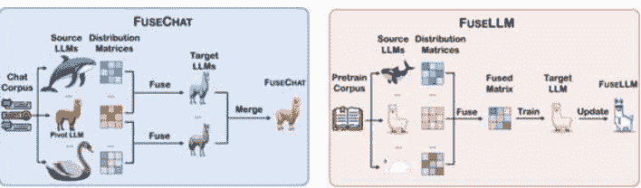

Chat 类模型的输入通常包含：

(1) **使用者提问**：每轮对话中的指令或问题。
(2) **历史记录**：系统保存的过往问答，供下一轮参考。
(3) **控制参数**：影响输出的参数，如长度、temperature、回答方式等。

#### 2. 配置Chat类模型

于 LangChain 中，Chat 类可通过简洁配置实现对话功能。关键参数如下：

(1) `model_name`：指定模型名称，如 gpt-3.5-turbo 等支持对话的模型。
(2) `temperature`：控制随机性，取值 0~1。数值高如 0.9 生成更多样，数值低如 0.3 生成更确定。
(3) `max_tokens`：限制最大输出长度，避免过长。tokens 为 API 计量单位，一个词约对应1~2个 token，限制它可满足简短问答或摘要需求。

### 3. 构建一个简单的Chat类对话模型

首先确认已安装 openai 库，用于连接 Chat 类模型。若未安装，可运行：
```bash
>> pip install openai
```

下面代码实现一个简易的 Chat 类对话，可与使用者进行多轮交互，模拟智能助手。
```python
from openai import OpenAI
import os

###### 初始化客户端
client = OpenAI()

def chat_with_model(messages, model="gpt-3.5-turbo", temperature=0.7):
    response = client.chat.completions.create(
        model=model,
        messages=messages,
        max_tokens=1024,
        temperature=temperature
    )
    return response.choices[0].message.content

#### 初始化对话历史
conversation_history = [{"role": "system", "content": "你是一个有用的助手。"}]

while True:
    user_input = input("请输入问题（输入'退出'结束）：")
    if user_input.lower() == "退出":
        print("对话已结束。")
        break
    
    conversation_history.append({"role": "user", "content": user_input})
    model_response = chat_with_model(conversation_history)
    
    print(f"助手：{model_response}")
    conversation_history.append({"role": "assistant", "content": model_response})
```

> 代码中先用 `os.getenv("OPENAI_API_KEY")` 从环境变量读取 OpenAI API 密钥，确保调用安全。然后定义通用对话函数 `chat_with_model()`，接收对话历史 `messages`、模型名称及生成参数 `temperature`、`max_tokens`，并返回回复。随后用 `conversation_history` 记录每轮输入与回复，使模型能在后续回答中参考历史。最后通过 `while` 循环模拟多轮对话，直至使用者输入“退出”。每轮回复都会加入历史，为后续提供参考。

运行后，使用者可在控制台输入问题，模型会基于历史持续对话。示例输出可能如下：
```text
请输入'退出'来结束对话。
用户：今天天气怎么样？
助手：今天的天气晴朗，适合户外活动。
用户：那需要带伞吗？
助手：目前的天气预报显示无降雨，所以不需要带伞。
用户：退出
对话已结束。
```

在这个例子中，Chat 类模型通过参考历史为使用者给出合理回复。每轮都保留历史信息，使回答更连贯、逻辑更清晰。读者可在此基础上继续优化，并应用于更多企业场景。

### 3.2.2 LLM类模型概述

LLM 类基于大规模语料训练，擅长生成高质量文本，广泛用于文本生成、问答、内容摘要等任务。随着性能提升，其预训练数据规模也在持续增长，如图3-3所示。
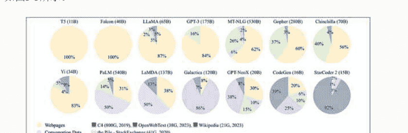

> **图3-3** 现有LLM大模型的预训练数据中各种数据源的比例

与 Chat 类不同，LLM 类更通用，既可用于多轮对话，也可在单次输入下生成完整文本。它在多种自然语言处理任务中具备高度灵活性和适应性，是 LangChain 框架中实现智能生成和复杂文本处理的重要组件。

#### 1. LLM类模型的基本结构

LLM 类旨在根据输入提示生成文本，常用于需要较长文本或详细答案的场景。其输入与生成参数主要包括：

- **(1) prompt**：输入文本，引导模型生成对应内容。例如“简述机器学习的基本概念”。
- **(2) temperature**：控制随机性，0~1。高值如 0.8 生成更多样，低值如 0.3 生成更一致。
- **(3) max_tokens**：控制输出长度，防止过长。
- **(4) top_p**：核采样参数，0~1，用于限定候选词的选择范围。

LLM 类通常用于单轮生成，无需保留历史信息，适合内容生成与信息处理。

#### 2. 配置LLM类模型

于 LangChain 中，可通过参数调整 LLM 类的生成方式以适配不同任务。常用参数：

- **(1) model_name**：指定模型，如 text-davinci-003。
- **(2) temperature**：控制创意性，数值越高越多样。
- **(3) max_tokens**：限制输出长度，适合简短或精确回答。
- **(4) top_p**：核采样，降低随机性。

### 3. 编写示例代码：实现LLM类模型的文本生成

下面代码展示如何调用 OpenAI 的 GPT 模型实现 LLM 类，用于生成指定主题的简要说明。
```python
import openai 
import os 

openai.api_key=os.getenv("OPENAI_API_KEY") #配置API密钥 
#定义LLM类模型生成函数
def generate_text(prompt, model_name="text-davinci-003",  
temperature=0.7, max_tokens=100, top_p=0.9): 
    response=openai.Completion.create(
        engine=model_name,
        prompt=prompt,
        temperature=temperature, 
        max_tokens=max_tokens, 
        top_p=top_p)
    return response['choices'][0]['text'].strip()

#示例任务：生成机器学习概念的简要说明
prompt_text="简述机器学习的基本概念。"
generated_text=generate_text(prompt_text)
print("生成的文本:", generated_text)
```

上述代码先定义通用生成函数 `generate_text`，接收提示 `prompt` 及生成参数 `temperature`、`max_tokens`、`top_p`，返回生成文本。然后设定一个生成任务主题，例如让模型简述“机器学习的基本概念”。最后调用 `generate_text()` 执行并打印结果。

运行后，模型会基于输入提示生成相关文本。示例输出可能如下：
(2) top_p：设置较低的 top_p 值（如 0.7 至 0.8），以提高回答的确定性，适合需要准确回答的场景。

(3) prompt 引导：在复杂任务中，使用明确的 prompt 进行引导，提示模型生成指定格式的内容。

#### 4. LLM 类模型在 LangChain 中的集成

长链体系允许把大语言模型直接挂进流程里运行。只要针对性调整产出配置，就能让模型返回贴合业务需求的文本，并把这一能力迁移到更复杂的链路中。例如：
```python
##### 示例：调用 LLM 类模型并集成到任务链
from langchain import LLMChain

###### 定义一个任务链
llm_chain = LLMChain(
    llm=generate_text,  # 使用自定义的文本生成函数
    prompt="简述机器学习在金融领域的应用。"
)

##### 执行任务链
result = llm_chain.run()
print("LLM 模型任务链生成结果：", result)
```

运行后展示的样本如下：
>> LLM 模型任务链生成结果：机器学习在金融领域的应用包括风险评估、客户信用评分、股票市场预测和反欺诈检测等。它通过分析大量数据，识别出潜在的模式和趋势，从而提供更精准的决策支持。

实际返回会随模型设定如 temperature 与 max_tokens 以及运行时状态而变化，但大体仍围绕金融场景下的 ML 应用展开。

借助这种集成方式，长链让大模型在企业级场景落地更顺滑，也为复杂业务提供了坚实支撑。

### 3.3 OpenAI 接口入门实战

在模型落地的实践中，OpenAI 提供的服务接口上手门槛很低，能快速接入 GPT-3、GPT-4 等主流模型，完成文本产出、问答、摘要、对话管理等任务，输出质量稳定，因而在长链项目里使用频率很高。

本小节从零开始，演示如何借助 OpenAI 接口进行模型开发。首先讲解接口配置与调用思路，涉及文本产出、长度管控、多样性调节等要点；随后通过实例展示基础自然语言任务，例如自动撰写与即时问答，为后续复杂链路奠定基础。

#### 3.3.1 接口调用准备

使用前务必先拿到并配置好密钥。可直接赋给 openai.api_key，也建议写入环境变量以提升安全性。
```python
import openai
import os
##### 配置 API 密钥
openai.api_key = os.getenv("OPENAI_API_KEY")
```
该行从环境变量读取密钥，避免明文写在源码里。

OpenAI 的核心入口包括 Completion.create 用来做单轮文本产出，以及 ChatCompletion.create 用来做多轮对话。下面以 Completion.create 作演示，它适合产出长段落或回应特定问题。
```python
response = openai.Completion.create(
    engine="text-davinci-003",
    prompt="简述机器学习的基本概念。",
    max_tokens=50,
    temperature=0.7
)
print("生成的文本:", response.choices[0].text.strip())
```
上面片段让接口产出关于“机器学习基本概念”的内容。调用时可通过配置项影响输出风格与质量，主要说明如下：

- engine：指定模型名称，如 text-davinci-003 或 gpt-3.5-turbo，不同模型在效果与速度上各有差异，按需选择。
- prompt：引导模型产出的指令文本，清晰度直接影响相关性与质量，复杂任务需写得更具体。
- max_tokens：限制产出文本的最大长度。
- temperature：调节随机程度，数值越低结果越稳重保守。
- top_p：核采样策略，top_p=0.9 表示从累计概率达 90% 的词表中采样。top_p 与 temperature 可同时启用，通常只调整其中一个。

为提升复用性，可把上述配置项封装成函数，实现灵活调用。
```python
def generate_text(prompt, engine="text-davinci-003",
                   max_tokens=100, temperature=0.7, top_p=0.9):
    response = openai.Completion.create(
        engine=engine,
        prompt=prompt,
        max_tokens=max_tokens,
        temperature=temperature,
        top_p=top_p
    )
    return response.choices[0].text.strip()

##### 示例调用
prompt_text = "描述人工智能的主要应用领域。"
generated_text = generate_text(prompt_text)
print("生成的文本:", generated_text)
```

运行后可能得到类似结果：
>> 生成的文本：人工智能的主要应用领域包括医疗健康、金融服务、零售、制造业、教育和交通运输。它可以用于预测、自动化、推荐系统、个性化服务以及智能化决策支持等。

配置微调会带来明显变化：
(1) 正式风格：将 temperature 设为较低值如 0.3，输出更严谨。
(2) 创意风格：将 temperature 提升到约 0.9，内容更具发挥空间。
(3) 简洁回答：把 max_tokens 降到 50 左右，可得到精炼回复。
```python
####### 正式风格的简短回答
response = generate_text("请简要解释机器学习的工作原理。",
                         max_tokens=50, temperature=0.3)
print("正式简短回答:", response)

####### 创意风格的长文本生成
response = generate_text("想象一个未来的智能城市，并描述它的特点。",
                         max_tokens=150, temperature=0.9)
print("创意长文本:", response)
```

输出示例：
>> 正式简短回答：机器学习是一种通过算法和统计模型分析和解释数据的人工智能方法。它使计算机可以在没有明确编程的情况下自动学习和改进。

>> 创意长文本：未来的智能城市将利用人工智能和物联网技术，实现无缝的互联互通。城市的交通系统将完全自动化，车辆和公共交通都能自我调节，以最大限度减少拥堵和污染。建筑物将根据天气和人流量自动调节温度和照明，所有资源都将高效利用。市民的健康和安全将受到实时监控，紧急情况可以自动响应。这种城市将更加环保、方便且人性化。

实际调用中可能出现网络异常、超时或密钥失效，建议用 try-except 包裹调用，在出错时给出友好提示。
**1**
```python
def generate_text_with_error_handling(prompt,
                                      engine="text-davinci-003",
                                      max_tokens=100, temperature=0.7):
    try:
        response = openai.Completion.create(
            engine=engine,
            prompt=prompt,
            max_tokens=max_tokens,
            temperature=temperature
        )
        return response.choices[0].text.strip()
    except openai.error.OpenAIError as e:
        print("API 调用失败：", e)
        return None

##### 示例调用
result = generate_text_with_error_handling("解释深度学习的优势。")
if result:
    print("生成的文本：", result)
else:
    print("生成失败。")
```
**如无报错，则运行结果如下：**
>> 生成的文本：深度学习的作用在于它能够处理复杂的非线性关系和大量的数据。通过多层神经网络结构，它可以自动学习特征并生成高度准确的预测，这在图像识别、自然语言处理等任务中非常有效。

若 API 密钥无效或网络问题，则会输出以下结果：
>>> API 调用失败：Invalid API Key: 请检查您的 API 是否正确。
>> 生成失败。

**如果要做一个应用，可以输入任务提示并生成对应的任务清单。代码示例演示如何调用 OpenAI API 生成一份任务清单。**
```python
task_prompt = "生成一个新员工入职的详细任务清单。"
###### 生成任务清单
task_list = generate_text(task_prompt, max_tokens=150, temperature=0.6)
print("任务清单：\n", task_list)
```
**输出如下：**
>> 任务清单：
>> 1. 准备员工入职材料，包括电脑、办公用品等。
>> 2. 组织员工入职培训，介绍公司政策和流程。
>> 3. 安排新员工与团队成员的见面会议。
>> 4. 指定工作任务和项目，帮助员工了解岗位职责。
>> 5. 设置公司内部系统的访问权限，确保新员工可以使用必要资源。

**该示例展示了如何通过 API 生成具体、可操作的内容，以便于在应用中直接使用。**

#### 3.3.2 文本产出实操

文本产出是语言模型的核心能力，借助 OpenAI 接口可以完成自动写作、问答、文案创作等工作。一次完整产出不仅需要发起调用，还要设计合理的提示词并调节配置，以控制风格、篇幅和质量。

以产出一小段“人工智能在教育中的应用”介绍为例，采用文本产出接口，通过优化 prompt 与配置得到简短而信息丰富的段落。

提示词模板的设计至关重要，表述越清晰具体，模型理解越准确。

为方便复用，可编写一个通用产出函数，支持配置调节并自动捕获异常。
```python
def generate_ai_text(prompt, model_name="text-davinci-003",
                      temperature=0.6, max_tokens=100, top_p=0.9):
    try:
        response = openai.Completion.create(
            engine=model_name,
            prompt=prompt,
            temperature=temperature,
            max_tokens=max_tokens,
            top_p=top_p
        )
        return response.choices[0].text.strip()
    except openai.error.OpenAIError as e:
        print("API 调用失败:", e)
        return None
```
该函数接收 prompt 以及 temperature、max_tokens 等配置项，并在调用失败时返回提示信息。

定义完成后即可执行具体任务，下面展示如何用 generate_ai_text() 产出关于“人工智能在教育中的应用”的文本。
```python
##### 定义具体的任务提示词
education_prompt = "*简要描述人工智能在教育中的应用，包括个性化学习、智能评估和虚拟辅导。*"

##### 执行文本生成
generated_education_text = generate_ai_text(education_prompt, model_name="text-davinci-003")
##### 显示生成的内容
if generated_education_text:
    print("生成的文本:\n", generated_education_text)
else:
    print("文本生成失败。")
```
执行上面代码，输出如下：

若在项目中需要产出产品介绍，可以利用 LLM 类模型生成简洁的产品描述。下面是实现自动产出产品介绍的示例代码。
```python
product_prompt = "生成一段简洁的产品介绍，产品名称为：智能家居助手。描述其主要功能和特点。"

###### 生成产品介绍
product_description = generate_ai_text(product_prompt,
                                       model_name="text-davinci-003",
                                       temperature=0.5, max_tokens=100)
print("产品介绍:\n", product_description)
```
输出结果如下：
>> 产品介绍：
>> 智能家居助手是一款高效的家庭管理工具，通过语音控制、自动化任务和实时监控，让生活更加便利。该助手支持远程控制灯光、空调、家电设备，并提供安全监控和健康管理功能，为家庭生活带来全新智能体验。

### 3.4 自建 LangChain 模型类

长链已内置大量预置模型类，可满足常见产出与问答需求。但面对特定业务，往往需要自建 Model 类，以实现更精细的控制与功能扩展。自建不仅能按项目需求调整配置与行为，还可加入专属的输入处理、输出格式或领域知识。

本节将逐步演示如何从零构建一个自定义的长链 Model 类，并说明如何在复杂场景中扩展其能力。

#### 3.4.1 模型类的搭建思路

在长链中，自定义 Model 类的核心思路是继承基础类并实现产出逻辑。该架构便于在项目里注入业务逻辑或针对性任务。以下是手把手演示自定义 Model 类的基础结构。
```python
from langchain.base_model import BaseModel

class CustomLangChainModel(BaseModel):
    def __init__(self, model_name, temperature=0.7, max_tokens=100):
        self.model_name = model_name
        self.temperature = temperature
        self.max_tokens = max_tokens
    
    def generate(self, prompt):
        # 生成函数，定义具体生成逻辑
        raise NotImplementedError("自定义生成逻辑需要在子类中实现")
```
其中：
- BaseModel: 长链定义的基础模型基类，自定义类通常继承自它。
- __init__ 方法: 用于初始化模型名称、产出配置等配置项。
- generate 方法: 承载实际产出逻辑的核心接口，具体实现在子类中完成。

在此基础上，generate 方法可按需调用具体 API 或模型库。下面将展示一个基于 OpenAI API 的实现示例，使自定义的长链 Model 类具备文本产出能力。

```python
import openai

class CustomLangChainModel(BaseModel):
    def __init__(self, model_name, temperature=0.7, max_tokens=100):
        self.model_name = model_name
        self.temperature = temperature
        self.max_tokens = max_tokens
    
    def generate(self, prompt):
        # 使用 OpenAI API 进行文本生成
        response = openai.Completion.create(
            engine=self.model_name,
            prompt=prompt,
            temperature=self.temperature,
            max_tokens=self.max_tokens
        )
        return response.choices[0].text.strip()
```
在本环节，`generate` 方法负责向 OpenAI API 发起请求来产出文本，最终把结果回传。它的输入是 prompt，同时借助 temperature、max_tokens 等超参数来调节风格和篇幅。

模型类搭建完毕后，建议写一段验证脚本来确认 `generate` 是否能正常被调用并输出预期内容。示例展示如下：

```python
##### 配置 API 密钥
openai.api_key = "your_openai_api_key_here"  # 将此处替换为实际的 API 密钥

##### 创建自定义模型实例
custom_model = CustomLangChainModel(model_name="text-davinci-003")
```
示例输出：

>> 生成的文本：机器学习是一种通过算法和数据分析，让计算机能够自动改进和优化的技术。它广泛应用于图像识别、语音处理等领域。

除了基础的生成功能，自定义 Model 也可以扩展，比如加入异常捕获、日志记录等能力。下面演示如何在 `generate` 中集成错误处理：

```python
class CustomLangChainModel(BaseModel):
    def __init__(self, model_name, temperature=0.7, max_tokens=100):
        self.model_name = model_name
        self.temperature = temperature
        self.max_tokens = max_tokens

    def generate(self, prompt):
        try:
            # 使用 OpenAI API 进行文本生成
            response = openai.Completion.create(
                engine=self.model_name,
                prompt=prompt,
                temperature=self.temperature,
                max_tokens=self.max_tokens
            )
            return response.choices[0].text.strip()
        except openai.error.OpenAIError as e:
            print("API 调用失败：", e)
            return None
```
`try-except` 结构可以拦截 API 调用期间抛出的异常，并在出错时给出提示而不是直接中断程序。当调用失败时，`generate` 会返回 `None`，方便上层逻辑做进一步处理。

运行结果（API 调用失败）：

>>> API 调用失败：Invalid API Key: 请检查您的 API 密钥是否正确。

>> 文本生成失败。

自定义 Model 能接入 LangChain 的链式流程，把单次生成嵌入到更复杂的任务编排里。接下来展示接入方式。
> from langchain import LLMChain

##### 创建任务链

llm_chain = LLMChain(llm=custom_model, prompt="请描述深度学习的核心优势。")

##### 执行任务链

result = llm_chain.run()

print("任务链生成的结果：", result)

输出结果如下：

>> 任务链生成的结果：深度学习 的核心优势在于其能够自动学习复杂特征，尤其在图像、语音等非结构化数据领域具有较高的准确性。

通过这条链，文本生成会交由自定义 Model 完成，从而让自研模型无缝运行在 LangChain 流程中。

#### 3.4.2 模型参数的自定义与调优

在自行构建 LangChain Model 时，参数的合理设置与微调能明显提升生成效果与精确度。这些参数决定了输出的语气、篇幅和质量，配合业务需求做优化会更贴合。

在 3.4.1 节自定义类的基础上，可在 `CustomLangChainModel` 的构造方法里扩展更多参数，方便在生成时动态调整。它们共同作用于文本的语气、丰富程度和一致性。

```python
import openai
from langchain.base_model import BaseModel

class CustomLangChainModel(BaseModel):
    def __init__(self, model_name, temperature=0.7, max_tokens=100, top_p=0.9, frequency_penalty=0, presence_penalty=0):
        self.model_name = model_name
        self.temperature = temperature
        self.max_tokens = max_tokens
        self.top_p = top_p
        self.frequency_penalty = frequency_penalty
        self.presence_penalty = presence_penalty

    def generate(self, prompt):
        try:
            # 调用 OpenAI API 生成文本
            response = openai.Completion.create(
                engine=self.model_name,
                prompt=prompt,
                temperature=self.temperature,
                max_tokens=self.max_tokens,
                top_p=self.top_p,
                frequency_penalty=self.frequency_penalty,
                presence_penalty=self.presence_penalty
            )
            return response.choices[0].text.strip()
        except openai.error.OpenAIError as e:
            print("API 调用失败:", e)
            return None
```
为了更直观地感受参数影响，下面用“人工智能在金融领域的应用”作为主题，逐步调整参数并展示不同风格的输出。

##### 1. 控制生成的多样性（调整 temperature）
`temperature` 越大，输出越发散、创意更强；数值偏低时，文本更稳重、贴合正式场景；数值偏高则更适合需要灵感的创作。

```python
###### 创建模型实例，设置 temperature 参数
custom_model = CustomLangChainModel(model_name="text-davinci-003", temperature=0.3, max_tokens=50)

prompt_text = "简要描述人工智能在金融领域的应用。"
print("低 temperature (0.3):")
print(custom_model.generate(prompt_text))

custom_model.temperature = 0.9  # 提高 temperature 值
print("高 temperature(0.9):")
print(custom_model.generate(prompt_text))
```
**运行结果如下：**

```text
>> 低 temperature (0.3) :
>> 人工智能在金融领域的应用包括风险预测、自动化交易、客户管理和反欺诈检测。
>>
>> 高 temperature (0.9) :
>> 人工智能在金融领域带来了全新的创新。它帮助银行进行更加精确的风险预测，利用算法自动处理大量交易，并通过机器学习模型识别复杂的欺诈模式。
```
`temperature` 偏低时，输出简洁直接；随着数值升高，结果变得多样且富有创意。

##### 2. 控制生成文本的长度（调整 max_tokens）
`max_tokens` 用来限定输出的最大 token 数，可按需增减，实现简短概述或详细展开。

```python
custom_model = CustomLangChainModel(model_name="text-davinci-003", temperature=0.5, max_tokens=30)
print("*短文本 (max_tokens=30) :")
print(custom_model.generate(prompt_text))

custom_model.max_tokens = 100  # 增加生成长度
print("*长文本 (max_tokens=100) :")
print(custom_model.generate(prompt_text))
```
**运行结果如下：**

```text
>> 短文本 (max_tokens=30) :
>> 人工智能在金融领域的应用包括风险管理和自动化交易。
>>
>> 长文本 (max_tokens=100) :
>> 人工智能在金融领域有着广泛的应用。它能够帮助金融机构预测和管理风险，通过自动化交易系统提高效率，并帮助客户提供个性化的服务。此外，人工智能技术还可以用于反欺诈检测，识别可疑的交易行为。
```
当 `max_tokens` 设置较小，文本会言简意赅；提升数值后，内容更充实，适合需要深度说明的场合。

##### 3. 控制生成词汇范围（调整 top_p）
`top_p` 控制候选词池的范围，数值偏低时不确定性下降，输出更聚焦；数值偏高则词汇更宽泛。

```python
custom_model = CustomLangChainModel(model_name="text-davinci-003", temperature=0.5, max_tokens=50, top_p=0.5)
print("*较低 top_p (0.5) :")
print(custom_model.generate(prompt_text))

custom_model.top_p = 1  # 放宽词汇范围
print("*较高 top_p (1) :")
print(custom_model.generate(prompt_text))
```
**运行结果如下：**

```text
>> 较低 top_p (0.5) :
>> 人工智能在金融领域帮助实现更高效的风险控制和客户管理。
>>
>> 较高 top_p (1) :
>> 人工智能在金融领域被广泛应用，能够帮助金融公司进行风险预测、客户服务自动化，并对海量数据进行深入分析以优化投资策略。
```
`top_p` 较低时，文本精炼集中；较高时，表达更丰富多元，适合需要多样化表述的任务。

##### 4. 控制重复词汇的频率（调整 frequency_penalty）
`frequency_penalty` 越大，模型越倾向避免重复用词，从而让文本更自然流畅。

```python
custom_model = CustomLangChainModel(model_name='text-davinci-003', temperature=0.5, max_tokens=50, frequency_penalty=0)
print("*无重复惩罚 (frequency_penalty=0) :")
print(custom_model.generate(prompt_text))

custom_model.frequency_penalty = 1  # 增加重复惩罚
print("*高重复惩罚 (frequency_penalty=1) :")
print(custom_model.generate(prompt_text))
```
**运行结果如下：**

```text
>> 无重复惩罚（frequency_penalty=0）:
>> 人工智能在金融领域的应用包括自动化交易、风险预测、客户服务和反欺诈等。
>>
>> 高重复惩罚（frequency_penalty=1）:
>> 人工智能在金融行业有广泛应用，涉及交易系统优化、客户管理提升以及防止欺诈等多方面。
```
总的来说，`temperature`、`max_tokens`、`top_p`、`frequency_penalty` 等参数的组合调节，能让自定义 Model 的生成过程更精细可控。合理调优有助于大幅提升文本质量与业务匹配度。

### 3.5 LangChain 与缓存

LLM 调用通常消耗大量算力和时间，面对重复查询时尤其明显。为此，LangChain 项目中引入缓存是提升响应与效率的重要手段。缓存能拦截重复请求，直接返回已有结果，避免重复调用模型，从而整体提速。

本节将系统梳理 LangChain 的缓存方案，涵盖内存缓存、文件缓存以及 Redis 等外部缓存的实现思路与示例，帮助读者掌握集成方法并优化链式任务性能。

#### 3.5.1 缓存的作用与类型

在高频调用场景下，缓存是提升 NLP 项目性能的有效手段。合理配置后可显著缩短等待时间、降低算力开销，并改善用户体验。

##### 1. 缓存的主要作用
* （1）降低延迟：命中缓存时无需重新生成，可直接返回结果，响应更快。
* （2）节省费用：API 调用多产生费用，缓存减少重复请求，有助于控制成本。
* （3）增强稳定：高并发下频繁调用易造成波动，缓存可分担压力，保持系统稳定。

##### 2. 常见缓存类型
* （1）内存缓存：数据存于内存中，查询极快，适合小规模临时缓存；但容量受限，重启后数据会丢失。
* （2）文件缓存：以文件形式持久保存，重启仍可恢复；缺点是读写较慢，适合对持久化要求不高的小规模场景。
* （3）外部缓存 Redis：键值型数据库，支持持久化与分布式，容量大、功能丰富，适合企业级大规模缓存需求。

各缓存类型及其特点的总结如表 3-1 所示。

| 缓存类型 | 优 点 | 缺 点 | 适用场景 |
| :--- | :--- | :--- | :--- |
| 内存缓存 | 访问迅速，检索效率高 | 容量受限，重启即清空 | 小型项目，短期数据暂存 |
| 文件缓存 | 支持持久化，跨会话可用 | 读取写入较慢 | 需要持久化的小规模数据 |
| 外部缓存（Redis） | 容量大且持久化，支持分布式与丰富管理 | 部署配置较复杂，需额外资源 | 企业级应用，大规模缓存 |

选择合适的缓存方案能大幅提升效率与稳定性。后续内容将演示如何在 LangChain 中逐步集成和配置各类缓存，满足不同业务诉求。

#### 3.5.2 内存缓存的使用
内存缓存本质上是基于字典等结构实现的键值存储。键多为 prompt 或其哈希值，值对应模型生成的响应。每次请求到来时，系统先查缓存，命中则直接返回，未命中则调用模型生成并写入缓存。

首先搭建一个基础内存缓存组件。下面通过 `InMemoryCache` 类演示如何实现数据的存取，并将其接入 LangChain 任务链。

# 让 LangChain 生成更快：缓存实战指南

```python
##### 创建内存缓存类
class InMemoryCache:
    def __init__(self):
        self.cache = {}

    def get(self, key):
        # 获取缓存中的值，如果不存在则返回 None
        return self.cache.get(key)

    def set(self, key, value):
        # 设置缓存的键值对
        self.cache[key] = value

###### 示例用法
cache = InMemoryCache()
```

一个简易缓存的核心只有两个操作。`get` 会用传入的 key 去缓存里查找对应值，找不到就返回 None；`set` 则把模型生成的输出和 key 绑定起来写入缓存。把内存缓存接入文本生成流程，就能在 LangChain 的模型调用里直接命中已有结果，避免重复计算。完整实现参考下面代码：

```python
import openai


class CustomLangChainModel:
    def __init__(self, model_name, temperature=0.7, max_tokens=100, cache=None):
        self.model_name = model_name
        self.temperature = temperature
        self.max_tokens = max_tokens
        self.cache = cache  # 内存缓存实例

    def generate(self, prompt):
        # Step 1: 检查缓存
        if self.cache:
            cached_response = self.cache.get(prompt)
            if cached_response:
                print("从缓存中获取结果...")
                return cached_response

        # Step 2: 调用 OpenAI API 生成文本
        print("缓存中无结果，调用模型生成...")
        response = openai.Completion.create(
            engine=self.model_name,
            prompt=prompt,
            temperature=self.temperature,
            max_tokens=self.max_tokens
        )
        result = response.choices[0].text.strip()

        # Step 3: 将结果存入缓存
        if self.cache:
            self.cache.set(prompt, result)

        return result
```

在 `CustomLangChainModel` 中额外增加一个可选项 `cache`，它可以接收像 `InMemoryCache` 这样的缓存实例。`generate` 执行时先判断本次 prompt 是否已有缓存，若命中则直接返回，否则调用底层模型生成后再写入缓存。下面给出基于 `InMemoryCache` 的完整使用示例。

```python
##### 配置 API 密钥
openai.api_key = "your_openai_api_key_here"  # 替换为实际的 API 密钥

##### 创建内存缓存实例
cache = InMemoryCache()

##### 创建自定义模型实例并集成缓存
custom_model = CustomLangChainModel(
    model_name="text-davinci-003", 
    temperature=0.5, 
    max_tokens=50, 
    cache=cache
)

##### 生成文本任务示例
prompt_text = "简要描述机器学习的应用。"

###### 第一次生成调用，将调用模型生成结果，并将结果存入缓存
print("第一次生成调用结果:")
generated_text = custom_model.generate(prompt_text)
print("生成的文本:", generated_text)

###### 第二次生成调用，若缓存中存在相同 prompt，则直接返回缓存结果
print("第二次的生成调用结果:")
generated_text = custom_model.generate(prompt_text)  # 原文此处有拼写错误 'prom pt_text'，已修正为 'prompt_text'
print("生成的文本:", generated_text)
```

**执行效果如下：**

```text
>> 第一次生成调用结果：
>> 缓存中无结果，调用模型生成...
>> 生成的文本：机器学习在金融、医疗、教育等多个领域广泛应用，通过数据分析和预测优化效率。
>> 
>> 第二次生成调用结果：
>> 从缓存中获取结果...
>> 生成的文本：机器学习在金融、医疗、教育等多个领域广泛应用，通过数据分析和预测优化效率。
```

第一次触发 `generate` 时缓存还是空的，模型会正常推理并把结果存起来；第二次用完全相同的 prompt 调用时，系统直接读取缓存返回，省掉了重复推理，响应明显更快。

内存缓存适合轻量、短期的场景，优势体现在：

* （1）高频重复查询：大量请求携带相同输入时，缓存能大幅削减模型调用次数。
* （2）单会话内重复提问：例如多轮对话中用户反复提问或问法相近的问题。

局限也比较明显：

* （1）容量受限：数据全存在内存里，受系统内存大小制约。
* （2）不持久：进程重启或崩溃后缓存会清空，不适合需要跨会话长期保留的场景。

合理使用内存缓存可以有效提升整体性能，为更智能、更流畅的自然语言应用提供基础支撑。

#### 3.5.3 文件缓存与持久化管理

文件缓存把键值对写到本地文件，常用 JSON、Pickle 等格式。下面的 `FileCache` 就是一个基于 JSON 的基础实现，提供读写和命中检查，方便在 LangChain 项目里做持久化。

```python
import json
import os

class FileCache:
    def __init__(self, cache_file="cache.json"):
        self.cache_file = cache_file
        # 初始化时尝试加载缓存文件内容
        if not os.path.exists(self.cache_file):
            with open(self.cache_file, 'w') as f:
                json.dump({}, f)

    def _load_cache(self):
        with open(self.cache_file, 'r') as f:
            return json.load(f)

    def _save_cache(self, cache_data):
        with open(self.cache_file, 'w') as f:
            json.dump(cache_data, f)

    def get(self, key):
        # 从缓存文件中获取数据
        cache_data = self._load_cache()
        return cache_data.get(key)

    def set(self, key, value):
        # 更新缓存并写入文件
        cache_data = self._load_cache()
        cache_data[key] = value
        self._save_cache(cache_data)
```

该类共暴露四个核心方法：（1）`_load_cache` 从磁盘文件读取已有数据；（2）`_save_cache` 把修改后的数据写回文件；（3）`get` 用来读取缓存；（4）`set` 用来更新缓存。初始化时若指定文件不存在，会自动新建一个空的 JSON 文件。

接入方式与内存缓存类似，可以把文件缓存挂到自定义 Model 上，调用时优先查文件，缺失再触发模型生成。示例如下：

```python
import openai

class CustomLangChainModel:
    def __init__(self, model_name, temperature=0.7, \
max_tokens=100, cache=None):
        self.model_name=model_name
        self.temperature=temperature
        self.max_tokens=max_tokens
        self.cache=cache # 文件缓存实例

def generate(self, prompt):
    # Step 1:检查文件缓存
    if self.cache:
        cached_response=self.cache.get(prompt)
        if cached_response:
            print("从文件缓存中获取结果...")
            return cached_response

    # Step 2:调用OpenAI API生成本文
    print("*文件缓存中无结果，调用模型生成...")
    response=openai.Completion.create(
engine=self.model_name,
prompt=prompt,
temperature=self.temperature,
max_tokens=self.max_tokens )
result=response.choices[0].text.strip()
# Step 3:将生成的结果存入文件缓存
if self.cache:
    self.cache.set(prompt, result)
return result
```

在这个自定义 Model 里，`cache` 作为可选参数传入 `FileCache` 实例就能启用文件缓存。每次生成前先尝试从文件读取，有结果就直接返回，没有则调用模型生成并同步更新文件。下面展示如何实例化 `FileCache` 并在生成任务中使用持久化缓存。

```python
# 配置API密钥
openai.api_key="your_openai_api_key_here" # 替换为实际的API密钥

##### 创建文件缓存实例
file_cache=FileCache("cache.json")

##### 创建自定义模型实例并集成文件缓存
custom_model=CustomLangChainModel(model_name=\
"text-davinci-003", temperature=0.5, max_tokens=50, cache=file_cache)

##### 生成文本任务示例
prompt_text="简要描述机器学习的应用。"

###### 第一次生成调用，将调用模型生成结果，并将结果存入文件缓存
print("*第一次生成调用结果:")
generated_text=custom_model.generate(prompt_text)
print("*生成的文本:*", generated_text)

# 第二次生成调用，若文件缓存中存在相同prompt，则直接返回缓存结果
print("\n*第二次生成调用结果:")
generated_text=custom_model.generate(prompt_text)
print("*生成的文本:*", generated_text)
```

运行结果如下：

>> 第一次生成调用结果：

>> 文件缓存中无结果，调用模型生成...

>> 生成的文本：机器学习广泛应用于图像识别、自然语言处理和预测分析等领域，能够从数据中提取有用信息，提升工作效率。

>>

>> 第二次生成调用结果：

>> 从文件缓存中获取结果...

>> 生成的文本：机器学习广泛应用于图像识别、自然语言处理和预测分析等领域，能够从数据中提取有用信息，提升工作效率。

把结果落地到文件后，即使服务重启也能继续命中缓存，性能和稳定性都有提升。


#### 3.5.4 Redis 缓存的集成与优化

Redis 是一款高性能的键值存储，具备快速读写、数据持久化以及分布式扩展能力。相比纯内存和本地文件，Redis 既能持久保存，又能支撑更大规模的缓存，是企业级应用的常用选择。

在 LangChain 中引入 Redis 缓存，可以显著降低模型调用压力，提升响应速度，在高并发场景下优势更明显。下面介绍如何在 LangChain 里接入 Redis 缓存以及相关的优化思路。

首先确认本地已安装并启动 Redis 服务。若未安装，可按系统执行：

- Debian/Ubuntu 系统上：

```bash
>> sudo apt update
>> sudo apt install redis-server
```

- macOS 上通过 Homebrew：

```bash
>> brew install redis
```

启动 Redis 后台服务：

```bash
>> sudo service redis-server start
```

用 `redis-cli` 检查是否正常运行：

```bash
>> redis-cli ping
```

若返回 PONG，说明服务可用。

Python 侧需要安装 redis 客户端：

```bash
>> pip install redis
```

安装完成后即可在代码里连接并操作缓存。

下面是一个基础的 `RedisCache` 类，可直接集成到 LangChain 项目，支持读取、写入和删除。

```python
import redis
import json

class RedisCache:
    def __init__(self, host='localhost', port=6379, db=0):
        # 初始化 Redis 连接
        self.client = redis.Redis(host=host, port=port, db=db)

    def get(self, key):
        # 从 Redis 获取缓存数据
        cached_value=self.client.get(key)
        if cached_value:
            # 返回解码后的 JSON 数据
            return json.loads(cached_value)
        return None

    def set(self, key, value, expiration=3600):
        # 将数据以 JSON 格式存储到 Redis，设置过期时间
        self.client.setex(key, expiration, json.dumps(value))

    def delete(self, key):
        # 从 Redis 中删除指定的缓存
        self.client.delete(key)
```

该类提供三个主要接口：（1）`get` 按 key 从 Redis 取数据，找到后返回解析好的 JSON；（2）`set` 把数据序列化为 JSON 存入 Redis，并可设置过期时间，默认 1 小时；（3）`delete` 删除指定的缓存记录。

借助 `RedisCache` 可以灵活管理缓存生命周期，在数据量大或并发高的场景下保持稳定性能。接入自定义 Model 的方式与前两种缓存一致，将 Redis 缓存作为可选参数传入即可，示例代码如下：

```python
import openai

class CustomLangChainModel:
    def __init__(self, model_name, temperature=0.7, \nmax_tokens=100, cache=None):
        self.model_name=model_name
        self.temperature=temperature
        self.max_tokens=max_tokens
        self.cache=cache # Redis缓存实例

def generate(self, prompt):
    # Step 1:检查Redis缓存
    if self.cache:
        cached_response=self.cache.get(prompt)
        if cached_response:
            print("从Redis缓存中获取结果...")
            return cached_response

    # Step 2：调用OpenAI API生成文本
    print("Redis缓存中无结果，调用模型生成...")
    response=openai.Completion.create(
engine=self.model_name,
prompt=prompt,
temperature=self.temperature,
max_tokens=self.max_tokens )
result=response.choices[0].text.strip()

# Step 3:将生成的结果存入Redis缓存
if self.cache:
self.cache.set(prompt, result)
return result
```

`CustomLangChainModel` 的构造方法支持传入 `cache` 配置，实践中多绑定一个 `RedisCache` 实例。每次推理到来时，框架会以对应的 prompt 作为键去 Redis 查找；命中则直接复用已有的文本，未命中则调用底层模型产出内容并写入 Redis 保存。

下面说明 Redis 缓存实例的创建方式，以及在一次生成任务里的接入范例。

```python
#配置API密钥
openai.api_key="your_openai_api_key_here" # 替换为实际的API密钥

#创建Redis缓存实例
redis_cache=RedisCache()

#创建自定义模型实例并集成Redis缓存
custom_model=CustomLangChainModel(model_name=\ 
"text-davinci-003", temperature=0.5, max_tokens=50, cache=redis_cache)

#生成本文本任务示例
prompt_text="简要描述深度学习的应用。"

#第一次生成调用，将调用模型生成结果，并将结果存入Redis缓存
print("第一次生成调用结果:")
generated_text=custom_model.generate(prompt_text)
print("生成的文本:", generated_text)

#第二次生成调用，若Redis缓存中存在相同prompt,则直接返回缓存结果
print("\n第二次生成调用结果:")
generated_text=custom_model.generate(prompt_text)
print("生成的文本:", generated_text)
```

运行输出如下：

>> 第一次生成调用结果：

>> Redis 缓存中无结果，调用模型生成...

>> 生成的文本：深度学习在图像识别、自然语言处理和推荐系统等领域广泛应用，能够自动学习复杂特征并提升预测精度。

>> 第二次生成调用结果：

>> 从 Redis 缓存中获取结果...

>> 生成的文本：深度学习在图像识别、自然语言处理和推荐系统等领域广泛应用，能够自动学习复杂特征并提升预测精度。

首轮请求会把模型产出持久化到 Redis，后续使用相同 prompt 时即可直接读缓存，省去重复推理，响应更快。

若想进一步提升 Redis 缓存效率，可考虑：

（1）设置合理的过期时间：写入时依据业务需要指定 TTL，常见为 1 小时、1 天或 7 天，以保证数据及时刷新。

（2）缓存清理策略：借助 Redis 自带的 LRU 淘汰机制，自动剔除最少访问的条目，释放存储空间。

（3）数据压缩：对体积较大的返回结果在入库前先压缩。可使用 zlib 实现压缩与解压，示例如下：

```python
import zlib
##### 压缩数据示例
def set_compressed_cache(key, value):
 compressed_value=zlib.compress(json.dumps(value).encode('utf-8'))
 redis_cache.client.setex(key, 3600, compressed_value)

##### 解压缩数据示例
def get_compressed_cache(key):
 compressed_value=redis_cache.client.get(key)
 if compressed_value:
  return json.loads(zlib.decompress(compressed_value).decode('utf-8'))
 return None
```

通过压缩解压流程，能够在不损失可读性的前提下降低 Redis 占用。

掌握 Redis 的基础配置与优化手段，开发者可以搭建稳定高效的缓存体系，为 LangChain 项目提供有力的加速支撑。

本章涉及的高频函数已汇总于表 3-2，便于快速查阅。


| 函数名 | 作用描述 | 所属类/模块 |
|---|---|---|
| generate | 根据输入的 prompt 调用模型生成文本内容，返回生成结果 | CustomLangChainModel |
| get | 从缓存中获取指定 key 的值。如果存在，则返回缓存内容；否则返回 None | InMemoryCache, FileCache, RedisCache |
| set | 将指定的 key 和 value 存入缓存，内存缓存和文件缓存通常不设置过期时间，Redis 可设置过期时间 | InMemoryCache, FileCache, RedisCache |
| _load_cache | 从文件中加载缓存数据，以字典形式返回缓存内容 | FileCache |
| _save_cache | 将缓存数据写入文件，实现持久化存储 | FileCache |
| delete | 删除 Redis 缓存中指定 key 的数据 | RedisCache |
| setex | 将数据存入 Redis 并设置过期时间，通常用于在 Redis 缓存中实现自动过期功能 | redis.Redis（Redis库） |
| compress | 使用 zlib 对数据进行压缩，减少 Redis 存储占用空间 | zlib（压缩库） |
| decompress | 使用 zlib 解压缩数据，将其还原为原始的缓存内容 | zlib（压缩库） |
| openai.Completion.create | 调用 OpenAI API 生成文本，根据模型名称、prompt 及其他参数控制输出 | openai (OpenAI API) |

### 3.6 本章小结

本章聚焦 LangChain 中语言模型的引入与定制，涵盖基础概念、常见类型及性能调优。首先介绍 Chat 类与 LLM 类的差异及适用场景，尤其在对话生成与文本生成方面的区别；随后以 OpenAI API 为例展示初始开发流程，为后续调用奠定基础。

在模型定制层面，通过自建 LangChain Model 类演示按需配置参数的做法，并讲解 temperature、最大生成长度、词表范围控制等参数的调节方法，以获得更精准的业务适配输出。结合内存缓存、文件缓存与 Redis 缓存，展示了提升响应与性能的思路，其中 Redis 的分布式特性为企业级应用提供了可靠支撑。

学完本章，读者既能理解大语言模型的基础，也能在 LangChain 中实现模型自定义与优化，为把模型接入复杂任务链、构建更智能高效的 NLP 应用提供理论与实践基础。

### 3.7 思考题

- （1）阐述 generate 方法的职责与典型场景，并在自定义模型类中如何实现生成逻辑？
- （2）模型生成时 temperature 起何作用？针对不同输出类型应如何调整？
- （3）说明 max_tokens 的功能及其对输出长度的影响，在简短问答与详细描述中分别如何设定？
- （4）文件缓存与内存缓存有哪些差异？列出优缺点，并在何种场景下更适合采用文件缓存？
- （5）在 FileCache 类中，_load_cache 与 _save_cache 各自承担什么功能？为何需要两者？
- （6）使用 Redis 缓存时，setex 与普通 set 有何区别？setex 如何实现有效期控制？
- （7）为 RedisCache 类加入数据压缩功能，编写代码优化大规模数据的缓存存储。
- （8）在缓存逻辑中，如何判断当前 prompt 的结果是否已缓存？缓存缺失时如何更新？
- （9）解释 presence_penalty 与 frequency_penalty 如何影响生成内容，二者怎样避免重复表达？
- （10）集成缓存时，如何判断结果是否来自缓存？给出代码示例说明优先读取缓存的流程。
- （11）在自定义 Model 类的 __init__ 中为何要引入 cache 参数？该参数在调用中如何实现缓存管理？
- （12）若已有代码使用文件缓存实现持久化，切换为 Redis 缓存需做哪些主要修改？列出关键步骤。

# 第 4 章 提示词工程

Prompt 设计直接决定 LLM 应用的输出质量与相关性。LangChain 提供了工程化能力，支持依据任务需求对提示进行构建、优化与定制。本章系统讲解提示的搭建方法与实战技巧。

首先从 Prompt 的概念与模板化入手，使生成结果结构化且稳定；再介绍动态生成技术，根据上下文实时调整以提升个性化；随后讲解槽位填充与链式提示，通过变量注入和分步引导生成复杂内容；多轮对话提示聚焦上下文连贯性；最后的嵌套提示与 Few-shot 提示探索分层生成与示例引导的高级用法，为复杂任务提供精确支持。

## 4.1 提示词的定义与提示词模板

LangChain 在提示词工程上提供了一套丰富工具，帮助开发者针对不同场景灵活构建和优化提示。

本节先从提示词的基本定义出发，说明其在模型交互中的关键作用；再通过模板构建演示如何在提示中引入变量、结构化信息和自定义格式，实现输出的标准化和多样化。掌握定义与模板化，为后续搭建复杂生成系统打下基础。

### 4.1.1 理解提示词在模型中的核心角色

在 LLM 应用中，提示词是驱动模型生成目标内容的控制信号。设计得当，输出更贴合任务需求，质量与相关性显著提升。因此，理解提示词的核心作用并学会合理设计，是高效自然语言生成的关键。

提示词决定了生成文本的方向、信息量和风格。清晰具体的描述能让模型准确捕捉意图。例如同一任务下，不同措辞会带来明显不同的结果。

**示例：**任务为描述机器学习的应用，不同提示会产生不同风格的回答。

> > Prompt 1：简要描述机器学习的应用。
> > 输出：机器学习广泛应用于图像识别、语音识别、自然语言处理等领域。

> > Prompt 2：详细描述机器学习在金融领域的应用。
> > 输出：机器学习在金融领域应用广泛，包括风险预测、自动化交易、信用评分以及反欺诈检测。

可见，提示词的表述差异直接影响输出深度与方向。清晰具体的指令更容易获得理想结果。

设计提示词时可遵循以下要点：

1. 明确任务：清楚阐明模型需要完成的任务，让其明白输出的具体要求。
2. 控制范围：依据需求深度或广度限定内容范围，例如指定领域以避免无关输出。
3. 语言风格：如有风格需求，可在提示中直接说明，如正式、简洁或富有创意。

例如要求模型输出简洁正式的回答，可这样写：

```python
**Prompt**: 请用简洁、正式的语言描述机器学习的基本概念。
```

在多轮对话或连续任务中，提示需要承载上下文，使模型保持一致性。可将前期对话或生成内容追加到提示中。

**示例**：用户与模型连续对话，需要保持连贯。

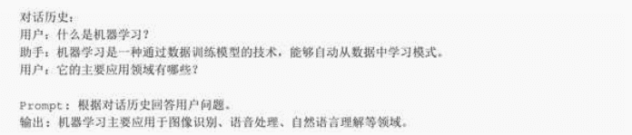

通过加入历史对话，提示提供了上下文，模型能在回答时保持连贯。

提示构建是一个迭代优化过程，可按以下步骤进行：

1. - **01**明确目标：先确定生成内容的主题与核心需求。
2. - **02**起草初稿：基于任务描述写出简洁明了的初始提示。
3. - **03**效果测试：将提示输入模型，检查输出是否符合预期，偏差则记录。
4. - **04**调整优化：根据偏差微调措辞或补充具体要求，多轮迭代逐步提升质量。

**示例**：优化提示。

```python
初始 Prompt:
描述人工智能的应用。
```

初次生成可能过于宽泛，未能满足特定需求。可进一步限定：

```python
优化 Prompt:
请简要描述人工智能在医疗诊断中的主要应用。
```

加入限定词“医疗诊断”后，提示更具针对性，输出也更贴合场景。

假设任务是让模型解释“自然语言处理基础概念”，构建过程如下：

```python
import openai

def generate_nlp_concept():
    prompt="请简要解释自然语言处理（NLP）的基础概念，包括主要技术和应用领域。"
    response=openai.Completion.create(
        engine="text-davinci-003",
        prompt=prompt,
        max_tokens=100,
        temperature=0.5 )
    return response.choices[0].text.strip()

#### 调用生成函数并打印结果
generated_text=generate_nlp_concept()
print("生成的文本:", generated_text)
```

运行结果如下：

> > 生成的文本：自然语言处理（NLP）是一门让计算机理解和处理人类语言的技术。它包括分词、词性标注、句法分析等技术，广泛应用于语音识别、机器翻译、情感分析等领域。

通过明确主题、信息范围和输出风格，模型生成的解释更符合预期。接下来将深入探讨提示词模板的设计方法，实现更灵活的生成结构。

### 4.1.2 构建提示词模板：实现灵活多样的提示结构

提示词模板是在固定文本中嵌入变量与结构化信息，使输出更具适应性。在实际项目中，模板能帮助快速生成符合不同需求的提示，实现定制化输出。

模板是一种预设结构的提示，通过替换变量动态生成内容。模板通常包含固定部分与变量部分：

1. - ●固定部分：不变的描述，如“请简要描述……”。
2. - ●变量部分：用花括号标记的占位符，如"{topic}"代表主题。

示例模板：

> > 请简要描述 {topic} 的应用。

其中 {topic} 可替换为“机器学习”“自然语言处理”等任意主题。

LangChain 提供的 PromptTemplate 类可快速搭建带变量的提示词模板。通过定义结构和变量，传入不同参数即可生成定制化提示。以下代码演示如何使用 PromptTemplate 构建模板。

提示词模板：写一次，到处复用

```python
from langchain.prompts import PromptTemplate

#### 定义模板：描述主题的应用
template=PromptTemplate(template="请简要描述{topic}的应用。",
input_variables=["topic"])

##### 使用模板生成提示词
prompt_1=template.format(topic="机器学习")
prompt_2=template.format(topic="自然语言处理")
print("提示词 1:", prompt_1)
print("提示词 2:", prompt_2)
```

输出示例：

> > >> 提示词 1:请简要描述机器学习的应用。

> >> 提示词 2:请简要描述自然语言处理的应用。

这里预留了 {topic} 占位符，通过 template.format() 把具体主题填进去，就能快速拼出格式统一、内容可换的提示。框架不变，填充部分可以随意替换。

在真实业务里，一个任务往往需要多个可变位来刻画更复杂的意图。下面这个例子用两个参数搭建了产出产品优劣评价的框架。

```python
#### 定义多变量模板
template=PromptTemplate(
    template="请评价{product}的优缺点，包括{aspect1}和{aspect2}。",
    input_variables=["product", "aspect1", "aspect2"])

##### 使用模板生成提示词
prompt_1=template.format(product="智能手机", aspect1="电池续航", aspect2="拍照质量")
prompt_2=template.format(product="笔记本电脑", aspect1="处理速度", aspect2="便携性")

print("提示词 1:", prompt_1)
print("提示词 2:", prompt_2)
```

输出示例：

> > >> 提示词 1: 请评价智能手机的优缺点，包括电池续航和拍照质量。

> > >> 提示词 2: 请评价笔记本电脑的优缺点，包括处理速度和便携性。

这类多参数模板能够适配不同品类和不同考察维度，在大批量生成时效率提升明显。

模板化提示词适合结构相似但内容需要变化的场景，典型用法有：

1. （1）问答系统：用同一句式批量生成提问，例如“{topic} 的优缺点是什么？”、“{topic} 有哪些常见应用？”。

2. （2）商品描述：为不同商品生成介绍，例如“请简述 {product} 的主要特点和适合人群”。

3. （3）客户反馈分析：快速拼装分析指令，例如“请分析 {customer_type} 用户对 {service} 的反馈意见”。

统一的骨架让模型输出方向稳定，也便于把关注点引导到指定任务上。

搭建模板时，几个细节对质量影响较大：

1. （1）骨架尽量精简：固定部分只保留必要信息，避免冗余表达。

2. （2）占位符保持自洽：变量最好语义完整，不产生歧义。例如 {topic} 填入“机器学习的优缺点”，而不是“机器学习优缺点是什么”。

3. （3）明确输出要求：如果需要短句或长文，可在模板里写明风格，如“简要描述……”或“详细说明……”。下面演示如何在模板里加入输出目标。

```python
template=PromptTemplate(
    template="请用简洁的语言简述{topic}的基本概念和应用场景。",
    input_variables=["topic"])
prompt=template.format(topic="区块链")
print("生成的提示词:", prompt)
```

输出示例：

> > > 生成的提示词：请用简洁的语言简述区块链的基本概念和应用场景。

加入输出目标后，模型更容易贴合预期，风格也更一致。

如果要批量产出不同技术的应用简介，借助模板就能迅速拼好指令并调用。

```python
###### 技术主题列表
topics=["机器学习", "深度学习", "自然语言处理", "区块链"]

####### 定义模板
template=PromptTemplate(template="请简要描述{topic}的应用。",
                         input_variables=["topic"])

####### 批量生成提示词并生成内容
for topic in topics:
    prompt=template.format(topic=topic)
    response=openai.Completion.create(
        engine="text-davinci-003",
        prompt=prompt,
        max_tokens=50,
        temperature=0.5 )
    print(f"{topic}的生成结果:",response.choices[0].text.strip())
```

输出示例：

> > > 机器学习的生成结果：机器学习广泛应用于图像识别、语音识别、医疗诊断等领域，通过数据分析实现智能预测。

> > 深度学习的生成结果：深度学习应用于计算机视觉、语音识别和自然语言处理，提升了数据处理和预测的准确性。

> > 自然语言处理的生成结果：自然语言处理用于语音助手、自动翻译和情感分析，实现人机自然交互。

> > 区块链的生成结果：区块链广泛用于加密货币、供应链管理和智能合约等领域，确保数据的透明性和安全性。

模板化产出可以快速处理多主题，降低重复劳动，并保证格式统一。

把固定句式与可变参数结合，就能高效产出不同格式的提示，适配各类任务。掌握搭建思路和设计要点，就能为不同场景定制提示，提升输出的一致性和适应性。

## 4.2 动态提示词生成技术

在实际使用中，提示词往往需要跟随用户输入或任务细节实时调整。动态生成技术可以根据上下文或输入变化即时构建或修改提示，让模型适应不同场景和个性化需求。

本节介绍动态生成的核心思路和实现方式，并通过案例说明如何根据交互、上下文变化等因素实时产出提示。

### 4.2.1 基于用户输入的提示词自适应生成

动态生成中的自适应是指让提示词随用户输入即时演化。这样模型回应更贴合需求，提升相关性和体验。构建这类自适应提示时，需要设计一套能自动拼装并嵌入用户原意的生成逻辑。

自适应的关键是通过程序逻辑自动拼接提示，并在其中嵌入用户输入。用户给出特定主题，提示就能据此动态生成。例如用户想了解“机器学习”或“自然语言处理”，系统会据此给出个性化回应。

下面演示了依据用户输入生成一条适配主题的自适应提示。

也可以封装一个自适应生成函数，把用户输入作为参数传入，按输入内容返回对应提示。该函数能让提示精准表达用户意图。

```python
####### 示例输入
def generate_adaptive_prompt(user_input):
    prompt = f"请简要描述 {user_input} 的主要应用和前景。"
    return prompt
```

输出示例：

> > > 生成的自适应 Prompt: 请简要描述深度学习的主要应用和前景。

这样 generate_adaptive_prompt 就能按用户输入动态产出提示，保证模型响应与需求一致。

下一步是把生成的提示接入模型调用，实现基于输入的自适应生成。在 LangChain 这类框架里即可完成集成。## 4.2.2 动态提示词生成

动态提示词生成是根据实时上下文、输入数据或其他变量自动拼装提示的技术，帮助模型灵活应对不同输出需求。面对复杂多变的场景时效果尤为明显，能让模型按不同条件给出更精准、更定制的输出。

核心是通过编程逻辑控制提示内容，使其随输入或条件变化。动态提示通常有一个基础骨架，再结合 Python 逻辑和变量生成不同版本。下面是一个简易示例：

> 基础结构:

模板中，{topic}和{aspect}是可变部分，可按不同输入填入主题和描述角度。例如：

(1) 若 topic 为“机器学习”，aspect 为“应用”，则可生成提示：“请简要描述机器学习的应用。”

(2) 若 topic 为“区块链”，aspect 为“优缺点”，则可生成提示：“请简要描述区块链的优缺点。”

也可以构建一个动态生成函数，把主题和描述角度作为参数传入，用逻辑语句控制输出内容，适配多种需求。

```python
def generate_dynamic_prompt(topic, aspect):
    # 动态生成提示词
    prompt=f"请简要描述{topic}的{aspect}。"
    return prompt
    # 测试不同的输入条件
    print(generate_dynamic_prompt("机器学习", "应用"))
    print(generate_dynamic_prompt("区块链", "优缺点"))
```

输出示例:

> 请简要描述机器学习的应用。

> 请简要描述区块链的优缺点。

该函数按输入产出不同提示，适合需求多样化的任务。

动态生成不止于基础模板，还能按条件调整内容丰富度。下面示例展示了如何根据条件改变提示，使其更灵活。

```python
def generate_conditional_prompt(topic, aspect, detail_level="简要"):
    # 动态生成的提示词内容根据条件调整
    if detail_level == "简要":
        prompt=f"请简要描述{topic}的{aspect}。"
    elif detail_level == "详细":
        prompt=f"请详细说明{topic}的{aspect}，包括关键细节和示例。"
    else:
        prompt=f"请描述{topic}的{aspect}。"
    return prompt

    # 示例：生成不同细节程度的提示词
    print(generate_conditional_prompt("深度学习", "应用", detail_level="简要"))
    print(generate_conditional_prompt("深度学习", "应用", detail_level="详细"))
```

**输出示例:**

> 请简要描述深度学习的应用。

> 请详细说明深度学习的应用，包括关键细节和示例。

代码依据 detail_level 参数控制输出的简要或详细程度，实现定制化设置。

随后是把动态生成的提示接入模型输出流程。下面结合 OpenAI API 的完整示例。

```python
import openai

def generate_conditional_prompt(topic, aspect, detail_level="简要"):
    # 动态生成提示词
    if detail_level == "简要":
        prompt=f"请简要描述{topic}的{aspect}。"
    elif detail_level == "详细":
        prompt=f"请详细说明{topic}的{aspect}，包括关键细节和示例。"
    else:
        prompt=f"请描述{topic}的{aspect}。"
    return prompt

def generate_response(topic, aspect, detail_level="简要"):
    # 使用动态提示词生成响应
    prompt=generate_conditional_prompt(topic, aspect, detail_level)
    # 调用OpenAI API
    response=openai.Completion.create(
        engine="text-davinci-003",
        prompt=prompt,
        max_tokens=100,
        temperature=0.5
    )
    return response.choices[0].text.strip()

#### 示例生成
print("*简要应用描述:", generate_response("机器学习", "应用", detail_level="简要"))
print("*详细应用描述:", generate_response("机器学习", "应用", detail_level="详细"))
```

**输出示例:**

> 简要应用描述： 机器学习在图像识别、语音识别和推荐系统等方面具有广泛应用。

> 详细应用描述： 机器学习应用于多个领域，包括图像识别、自然语言处理、医疗诊断和金融分析。在图像识别中，机器学习用于人脸检测和自动标签生成；在自然语言处理中，用于语音识别、情感分析等。

该代码融合了动态提示生成和 API 调用，能按细节要求产出更贴合任务的内容。

某些场景需要多条件组合，例如同时依据主题、描述对象、任务类型和细节级别生成提示。下面展示多重条件控制的示例。

输出示例:

```python
def generate_complex_prompt(topic, aspect, task_type="描述", detail_level="简要"):
    #根据不同任务类型和细节要求生成提示词
    if task_type == "描述":
        if detail_level == "简要":
            prompt=f"请简要描述{topic}的{aspect}。"
        elif detail_level == "详细":
            prompt=f"请详细说明{topic}的{aspect}，包括关键细节。"
    elif task_type == "分析":
        prompt=f"请分析{topic}的{aspect}，特别关注其优缺点。"
    elif task_type == "预测":
        prompt=f"请预测{topic}在未来的{aspect}，并说明可能的影响。"
    else:
        prompt=f"请描述{topic}的{aspect}。"
    return prompt

#测试不同任务组合生成的提示词
print(generate_complex_prompt("深度学习", "应用",
    task_type="描述", detail_level="简要"))
print(generate_complex_prompt("深度学习", "应用",
    task_type="描述", detail_level="详细"))
print(generate_complex_prompt("深度学习", "前景", task_type="预测"))
```

**输出示例:**

> 请简要描述深度学习的应用。

> 请详细说明深度学习的应用，包括关键细节。

> 请预测深度学习在未来的前景，并说明可能的影响。

代码体现了多条件组合的灵活性，让提示适配描述、分析、预测等不同任务类型和细节需求。

如果需求是生成不同技术的应用描述和未来趋势，可以通过动态提示快速跟随主题和内容变化。

```python
topics=["深度学习", "区块链", "量子计算"]
#生成不同内容需求的提示词
for topic in topics:
    print("\n 简要应用描述:")
    print(generate_complex_prompt(topic, "应用",
      task_type="描述", detail_level="简要"))
    print("\n详细应用描述:")
    print(generate_complex_prompt(topic,"应用",
      task_type="描述",detail_level="详细"))
    print("\n未来发展预测:")
    print(generate_complex_prompt(topic, "未来发展", task_type="预测"))
```

通过动态生成代码，可迅速产出符合不同内容需求的提示，减少重复工作，提升制作效率和统一性。

## 4.3 插槽填充与链式提示

在自然语言生成任务中，插槽填充和链式提示技术可以有效提升提示的灵活性和结构化水平。本节将带领读者学习插槽填充和链式提示的核心原理，展示如何使用这些技术构建高效的提示结构，并通过丰富的代码示例帮助读者掌握这两项技术在实际应用中的操作细节。掌握插槽填充和链式提示将为构建智能化、灵活性强的提示设计提供更高效的解决方案。

### 4.3.1 插槽填充：模板预留变量位快速生成提示词

插槽填充的本质是在固定框架里预留可替换的位置，通过往这些位置填入不同变量，实现同一种结构生成多样化提示词。借助这种方式，模型能更灵活地应对常见问答、个性化推荐、商品点评等多种实际场景。

具体做法是在模板中设置一个或多个占位符，常用花括号表示，例如 {topic} 和 {aspect}。填充具体内容后，就能迅速拼装出不同的提示词。

**LangChain 内置了 PromptTemplate 类**来支持这一流程，开发者可以在模板中声明占位符，再按需传入变量值，从而批量产出动态提示词。

下面展示用 PromptTemplate 构建主题与角度描述模板的代码示例。

```python
from langchain.prompts import PromptTemplate
#定义含有插槽的提示词模板
template=PromptTemplate(template='请简要描述{topic}的{aspect}', input_variables=['topic', 'aspect'])
#使用模板填充不同的变量值
prompt_1=template.format(topic='机器学习', aspect='应用')
prompt_2=template.format(topic='自然语言处理', aspect='优缺点')
print('提示词 1:', prompt_1)
print('提示词 2:', prompt_2)
```

> 提示词 1：请简要描述机器学习的应用。

> 提示词 2：请简要描述自然语言处理的优缺点。

在这个示例里，通过 PromptTemplate 的 format 方法，就能为不同主题和角度自动生成提示词，无需手工一条条撰写。

当需求更复杂时，模板可以包含多个插槽。比如要生成产品特性和用户体验描述，就能定义产品、特点、体验等多个占位符，快速拼出符合不同诉求的提示词。

以下代码演示了一个多插槽模板的搭建方式。

### 4.3.2 链式提示：把复杂任务拆成步骤来做

链式提示的核心是把一次性的复杂生成拆成若干递进的小任务，让模型分阶段输出，每一步的结果作为下一步的输入。这种分步引导特别适合逻辑要求高、信息量大的场景，如自动摘要、深度分析、报告撰写等。

以“说明机器学习在金融行业的应用”为例，可以拆成：
01 先做一个简要介绍
02 再描述具体应用场景
03 最后分析优缺点

每一步的输出会承接到下一轮，形成逐步累积的效果。

下面以任务链提示的基础实现为例，先写一个函数，按顺序调用不同提示词，串联起整个链路。

```python
import openai

def step_1_introduction():
	# 步骤 1：简要介绍机器学习
	prompt="请简要介绍机器学习的基本概念。"
	response=openai.Completion.create(
		engine="text-davinci-003",
		prompt=prompt,
		max_tokens=50,
		temperature=0.5 )
	return response.choices[0].text.strip()

def step_2_finance_application():
	# 步骤 2：描述机器学习在金融行业的具体应用
	prompt="描述机器学习在金融行业的应用，如风险预测和自动化交易。"
	response=openai.Completion.create(
		engine="text-davinci-003",
		prompt=prompt,
		max_tokens=100,
		temperature=0.5 )
	return response.choices[0].text.strip()

def step_3_analysis():
	# 步骤 3：分析机器学习在金融应用中的优缺点
	prompt="分析机器学习在金融应用中的优缺点。"
	response=openai.Completion.create(
		engine="text-davinci-003",
		prompt=prompt,
		max_tokens=100,
		temperature=0.5 )
	return response.choices[0].text.strip()

##### 调用每个步骤，逐步生成复杂内容
introduction=step_1_introduction()
print("步骤 1-简介:", introduction)

application=step_2_finance_application()
print("步骤 2-应用:", application)

analysis=step_3_analysis()
print("步骤 3-分析:", analysis)
```

运行结果如下：

>> 步骤 1-简介：机器学习是一种通过数据训练模型，使计算机能够自动从数据中学习和改进的技术。

>> 步骤 2-应用：机器学习在金融行业应用广泛，包括风险预测、自动化交易、客户行为分析和信用评分等。

>> 步骤 3-分析：机器学习在金融行业的应用可以提高决策的准确性和效率，但也可能带来数据隐私和算法偏差等问题。

可以看到，每一步都在前一步的基础上扩充信息，最终得到更完整、更详实的结论。

在更精细的链式流程中，前一步的生成内容会被显式带入下一步的上下文，保证逻辑不脱节，这对多轮复杂任务尤为重要。

```python
def step_2_finance_application(introduction):
	# 使用步骤 1 的结果作为步骤 2 的上下文
	prompt=f"{introduction}\n现在，请描述机器学习在金融行业的应用，如风险预测和自动化交易。"
	response=openai.Completion.create(
		engine="text-davinci-003",
		prompt=prompt,
		max_tokens=100,
		temperature=0.5
	)
	return response.choices[0].text.strip()

introduction=step_1_introduction()
print("步骤 1-简介:", introduction)

application=step_2_finance_application(introduction)
print("步骤 2-应用:", application)
```

**输出如下：**

>> **步骤 1-简介**：机器学习是一种通过数据训练模型，使计算机能够自动从数据中学习和改进的技术。

>> **步骤 2-应用**：机器学习在金融行业的应用包括风险预测、自动化交易、信用评分和客户行为分析等，帮助金融机构更好地进行决策。

把步骤 1 的结果引用到步骤 2 的提示里，内容的衔接更自然、连贯。

**链式提示词的典型用途包括：**

- （1）**文章和报告生成**：分段逐步生成，层层完善
- （2）**项目总结与评估**：依次产出概述、执行情况和效果评估
- （3）**用户指南和手册**：逐步介绍功能、使用方法和注意事项

把整体任务拆解后，每个环节都能给出更精准的指引，从而提升条理性和可控性。

当任务更复杂时，还可以设计多个子步骤，按逻辑顺序依次执行。下面给出一个生成“机器学习在金融行业应用详细报告”的更复杂链路示例。

```python
def step_1_overview():
 prompt="请简要介绍机器学习的基本概念。"
 response=openai.Completion.create(
 engine="text-davinci-003",
 prompt=prompt,
 max_tokens=50,
 temperature=0.5
 )
 return response.choices[0].text.strip()

def step_2_industry_application(overview):
 prompt=f"{overview}\n接下来，请描述机器学习在金融行业的应用。"
 response=openai.Completion.create(
 engine="text-davinci-003",
 prompt=prompt,
 max_tokens=100,
 temperature=0.5
 )
 return response.choices[0].text.strip()

def step_3_case_study(application):
 prompt=f"{application}\n请提供一个机器学习在金融行业的具体应用案例，例如自动化交易或信用评分。"
 response=openai.Completion.create(
 engine="text-davinci-003",
 prompt=prompt,
 max_tokens=100,
 temperature=0.5
 )
 return response.choices[0].text.strip()

def step_4_conclusion(case_study):
 prompt=f"{case_study}\n最后，总结机器学习在金融行业应用中的优缺点。"
 response=openai.Completion.create(
 engine="text-davinci-003",
 prompt=prompt,
 max_tokens=100,
 temperature=0.5
 )
 return response.choices[0].text.strip()

##### 调用任务链中的每个步骤
overview=step_1_overview()
print("步骤 1-概述:", overview)

application=step_2_industry_application(overview)
print("步骤 2-行业应用:", application)

case_study=step_3_case_study(application)
print("步骤 3-案例研究:", case_study)

conclusion=step_4_conclusion(case_study)
print("步骤 4-总结:", conclusion)
```

```python
def generate_report(include_case_study=True):
    overview=step_1_overview()
    print("步骤 1-概述:", overview)

    application=step_2_industry_application(overview)
    print("步骤 2-行业应用:", application)

    if include_case_study:
        case_study=step_3_case_study(application)
        print("步骤 3-案例研究:", case_study)

    conclusion=step_4_conclusion(application)
    print("步骤 4-总结:", conclusion)

generate_report(include_case_study=True) # 生成报告，包含案例研究
generate_report(include_case_study=False) # 生成简略报告，不包含案例研究
```

链式提示是一种提升结构化输出能力的有效手段，通过分步引导，生成结果更具层次感和系统性。掌握其基础方法后，就能在实际项目中灵活实现逐步生成和动态选择，为内容产出带来更多控制空间。

## 4.4 多轮对话提示词

在自然语言处理中，多轮对话提示词用于保证连续交互的流畅与一致。技术要点在于保留上下文，让模型在多轮来回中记住先前的输入，从而每次都能给出贴合语境的回应。这在客服系统、智能助手等场景中尤为关键。

本节重点讲解如何搭建多轮对话提示词，并演示一个能保持上下文连贯的对话系统。学会后即可在不同业务场景中设计出逻辑清晰、回应智能的对话模型。

### 4.4.1 对话连贯设计：带上历史记录再生成

多轮对话的关键是连贯性。提示词需要融合历史对话，让模型理解并记住用户的连续输入，这样每次生成都基于前文，而不会出现断层。

一个简单思路是把每轮的历史记录作为输入的一部分，让模型在生成新回复时能回溯上下文。

基础结构示例如下：

>>> 用户：你好，我想了解机器学习的应用。

>> 助手：机器学习在金融、医疗、教育等多个领域有广泛应用。

> 用户：具体在医疗领域有哪些应用？

>> 助手：(None)

每一轮都附带了前一轮的用户提问和助手回答，上下文得以延续。

在实现层面，可以写一个函数，把每轮的问答依次追加到对话历史中，生成提示时自动载入全部历史，确保连贯性。

```python
#### 初始化对话历史
conversation_history = []

def generate_conversation_prompt(user_input):
    # 将用户输入和助手回答逐步加入对话历史
    conversation_history.append({"role" : "user", "content": user_input})
    # 创建带有上下文的提示词
    prompt = "以下是用户和助手的对话历史；\n"
    for turn in conversation_history:
        prompt += f"({turn['role']}): {turn['content']}\n"
        prompt += "助手："
    return prompt
#### 示例用户输入
user_input_1="我想了解机器学习的应用。"
print("Prompt 1:", generate_conversation_prompt(user_input_1))
```

输出示例：

>>> Prompt 1: 以下是用户和助手的对话历史:

>> user: 我想了解机器学习的应用。

>> 助手：(None)

>>> user: 我想了解机器学习的应用。>> 助手：(None)

>>> Prompt 1: 以下是用户和助手的对话历史：

>> user：我想了解机器学习的应用。

>> 助手：(None)

每次新输入到来时，`generate_conversation_prompt` 函数都会把内容加入历史，并在组装提示词时带上完整记录，保持对话连贯。随后即可将带上下文的提示词送入模型，让模型依据每轮的上下文做出回应。示例如下:

```python
import openai

#### 初始化对话历史
conversation_history = []

def generate_conversation_prompt(user_input):
    # 生成带有上下文的提示词
    conversation_history.append({"role": "user", "content": user_input})
    prompt = "以下是用户和助手的对话历史:\n"
    for turn in conversation_history:
        prompt += f"{turn['role']}: {turn['content']}\n"
    prompt += "助手: "
    return prompt

def generate_response(user_input):
    # 使用上下文生成提示词
    prompt = generate_conversation_prompt(user_input)
    
    # 调用 OpenAI API 生成响应
    response = openai.Completion.create(
        engine="text-davinci-003",
        prompt=prompt,
        max_tokens=100,
        temperature=0.5
    )
    assistant_response = response.choices[0].text.strip()
    # 将助手的回答加入对话历史
    conversation_history.append({"role": "助手", "content": assistant_response})
    return assistant_response

#### 示例交互
user_input_1 = "我想了解机器学习的应用。"
response_1 = generate_response(user_input_1)
print("助手:", response_1)

user_input_2 = "具体在医疗领域有哪些应用？"
response_2 = generate_response(user_input_2)
print("助手:", response_2)
```

输出示例:

> >> 助手：机器学习在金融、医疗、教育等多个领域有广泛应用。

> >> 助手: 在医疗领域，机器学习用于医学影像分析、疾病预测和个性化治疗等方面。

随着回合不断增多，整段会话记录会迅速变长。为了兼顾响应速度和资源开销，实践中常为历史窗口设定一个上限，只保留最近几轮的有效信息，其余部分丢弃。在持续对话场景下，这种裁剪策略对保持模型专注至关重要。

```python
MAX_HISTORY_LENGTH = 5  # 设置对话历史的最大轮数

def generate_conversation_prompt(user_input):
    # 将用户输入添加到对话历史中
    conversation_history.append({"role": "user", "content": user_input})

    # 如果对话历史超过最大长度，移除最早的内容
    if len(conversation_history) > MAX_HISTORY_LENGTH:
        conversation_history.pop(0)

    # 生成带有上下文的提示词
    prompt = "以下是用户和助手的对话历史:\n"
    for turn in conversation_history:
        prompt += f"{turn['role']}: {turn['content']}\n"
    prompt += "助手:"
    return prompt
```

在此代码中，当对话历史超过 `MAX_HISTORY_LENGTH` 时，最早的对话内容将被移除，确保对话历史保持在合理的长度内。

下面是一次实操演示：搭建一个问答机器人，要求每一轮的输出都能回溯上一轮的信息，从而实现连贯的衔接。

```python
##### 初始化 OpenAI API
import openai

conversation_history = []

def generate_conversation_prompt(user_input):
    conversation_history.append({"role": "user", "content": user_input})
    if len(conversation_history) > MAX_HISTORY_LENGTH:
        conversation_history.pop(0)

    prompt = "以下是用户和助手的对话历史:\n"
    for turn in conversation_history:
        prompt += f"{turn['role']}: {turn['content']}\n"
    prompt += "助手:"
    return prompt

def generate_response(user_input):
    prompt = generate_conversation_prompt(user_input)
    response = openai.Completion.create(
        engine="text-davinci-003",
        prompt=prompt,
        max_tokens=100,
        temperature=0.5
    )
    assistant_response = response.choices[0].text.strip()
    conversation_history.append({"role": "助手", "content": assistant_response})
    return assistant_response

###### 测试多轮对话
user_input_1 = "什么是机器学习？"
response_1 = generate_response(user_input_1)
print("助手:", response_1)

user_input_2 = "它在医疗领域有哪些应用？"
response_2 = generate_response(user_input_2)
print("助手:", response_2)

user_input_3 = "这项技术有哪些优势？"
response_3 = generate_response(user_input_3)
print("助手:", response_3)
```

输出示例:

> >> 助手：机器学习中是一种使计算机从数据中学习和预测的技术。

> >> 助手：在医疗领域，机器学习用于疾病预测、医学影像分析和个性化治疗等方面。

> >> 助手：机器学习的优势包括能够处理大量数据、自动识别模式和提高预测准确性。

合理控制历史长度后，模型在长时间交谈中更容易保持一致性和流畅性。

提示词的构建方式会直接影响多轮交互的自然程度，精细的设计能让沟通更顺滑、理解更准确。

## 4.4.2 让多轮对话更连贯自然

多轮交流除了要衔接信息，还要让语气和逻辑自然过渡，使产出真正贴合用户意图。实现路径是把历史内容带入当前提示，并对提示的组织逻辑进行梳理，引导模型按对话节奏作答。

让对话流更顺畅，主要关注三点：

+ - （1）上下文搬运：每轮都把前文带进来，帮助模型保留记忆。
+ - （2）意图提炼：借助提示设计，让模型更精准地抓住用户想要表达的意思。
+ - （3）衔接设计：在相邻轮次间加入合理的过渡，保持逻辑通顺。

举例来说，用户先问“机器学习有哪些应用？”，随后说“它”，模型应能判定指代对象，并在回答中延续前文。

为此可以封装一个对话生成函数，基于已有记录产出符合节奏的回复，并在内部采用结构清晰的提示模板，让模型沿着逻辑推进。

输出示例:

> >> 助手：机器学习是一种使计算机从数据中学习和改进的技术。

> >> 助手：在金融行业，机器学习用于风险管理、信用评分和自动化交易等领域。

> >> 助手：机器学习的挑战包括数据质量、模型偏差和计算成本等问题。

在连续对话里，用户常会用“它”“这类技术”等代称。若想让模型正确解析，需要在提示中明确主题并持续带入。例如:

> 用户：机器学习是什么？

> 助手：机器学习是一种通过数据训练模型，使计算机能够识别模式和进行预测的技术。

> 用户：它的主要应用领域有哪些？

> 助手：(None)

这个例子里，提示要帮助模型把“它”映射到“机器学习”，才能保证上下文不丢。

此外，适当加入示例和引导性措辞也能提升自然度。比如首次引入话题时，用“例如”“一般来说”等词语提示模型给出带例子的回答。

```python
def generate_conversation_prompt(user_input):
    # 将用户输入和助手回答逐步加入对话历史
    conversation_history.append({"role": "user", "content": user_input})
    
    # 创建带有上下文的提示词，包含引导性语言
    prompt = "以下是用户和助手的对话历史:\n"
    for turn in conversation_history:
        prompt += f"{turn['role']}: {turn['content']}\n"
    prompt += "助手（例如，如果适用，请详细说明）; "
    return prompt
```

在这个代码示例中，通过在提示词中添加“例如，如果适用，请详细说明”这一句，引导模型在必要时提供详细信息，从而提高对话的丰富性和自然性。

上线时，不同用户的偏好可能不同。可以在每轮依据输入动态调整提示，比如用户想要细节时，明确要求展开，以匹配预期。

```python
def generate_conversation_prompt(user_input, detail_level="简要"): 
    conversation_history.append({"role": "user", "content": user_input})
    prompt = "以下是用户和助手的对话历史:\n"
    for turn in conversation_history:
        prompt += f"{turn['role']}: {turn['content']}\n"
    
    # 添加对生成内容细节的控制
    if detail_level == "简要":
        prompt += "助手（请简要回答）:"
    elif detail_level == "详细":
        prompt += "助手（请详细说明，并举例）；"
    return prompt

###### 测试简要和详细生成
user_input_1 = "什么是机器学习？"
print("简要回答:", generate_response(user_input_1))
user_input_2 = "它有哪些优势？"
print("详细回答:", generate_response(user_input_2))
```

在此代码中，根据 `detail_level` 参数的值动态调整提示词，以实现简要或详细的回答方式，确保用户获得所需的回答风格。

长时间对话为了方便回顾，可在若干轮后自动生成一个简要概括，帮助用户快速抓住讨论要点。

```python
def generate_summary():
    # 生成当前对话的总结
    prompt = "请基于以下对话生成一个总结:\n"
    for turn in conversation_history:
        prompt += f"{turn['role']}: {turn['content']}\n"
    prompt += "总结："
    
    response = openai.Completion.create(
        engine="text-davinci-003",
        prompt=prompt,
        max_tokens=100,
        temperature=0.5
    )
    return response.choices[0].text.strip()

###### 测试生成总结
print("对话总结:", generate_summary())
```

输出示例:

**对话总结**: 用户询问了机器学习的定义、应用以及优势。助手解释了机器学习在金融、医疗等领域的应用，并指出其优势在于自动化分析和预测能力。

这类概括能在对话变长时快速回溯，明显提升使用体验。

本段主要围绕记录管理、意图把握与引导性表达，说明了如何让多轮交互保持流畅与连贯。通过精细打磨提示模板并根据需求动态调整生成策略，可以搭建出更自然、更贴合用户预期的多轮对话系统。

## 4.5 嵌套提示与少样本提示

在自然语言生成任务中，嵌套提示和少样本提示是两类进阶手段，分别适用于分层生成和以示例驱动的复杂任务。

本节会深入解析这两种技术的原理，结合 LangChain 的实现代码演示如何用它们产出更结构化、更精准的内容。掌握这两个方法，有助于构建高质量、多样化的生成系统。

## 4.5.1 用分层提示拆解复杂任务

多级提示是一种典型的嵌套做法，把复杂任务拆成多个层级逐级推进。每层输出作为下一层的输入，最终逐层递进完成整体目标。这种方式很适合需要逐步展开的场景，如报告撰写、由主题到细节的内容产出等。

先看多级提示的核心思路：把一个大任务拆解成子任务链，每层提示承担不同职责，比如提纲生成、要点展开、实例补充等。

以撰写“机器学习”报告为例，可以这样分层：

+ - 层级 1: 产出机器学习的整体概览。
+ - 层级 2: 基于概览列出各应用领域的简述。
+ - 层级 3: 在每个领域内进一步展开具体应用实例。

落地该结构时，可编写多个函数分别负责不同层级的生成，让生成过程从高层向低层逐步细化。

```python
import openai

##### 层级 1: 生成概要
def generate_overview():
    prompt = "请简要介绍机器学习的基本概念。"
    response = openai.Completion.create(
        engine="text-davinci-003",
        prompt=prompt,
        max_tokens=50,
        temperature=0.5
    )
    return response.choices[0].text.strip()

##### 层级 2: 生成不同领域的应用简述
def generate_field_applications(overview):
    prompt = f"{overview}\n接下来，请简要描述机器学习在金融、医疗和教育等领域的应用。"
    response = openai.Completion.create(
        engine="text-davinci-003",
        prompt=prompt,
        max_tokens=100,
        temperature=0.5 )
    return response.choices[0].text.strip()

##### 层级 3: 深入描述应用实例
def generate_detailed_example(application_summary, field):
    prompt = f"{application_summary}\n请详细说明机器学习在 (field) 领域的具体应用实例。"
    response = openai.Completion.create(
        engine="text-davinci-003",
        prompt=prompt,
        max_tokens=100,
        temperature=0.5
    )
    return response.choices[0].text.strip()

###### 调用多级提示词逐步生成内容
overview = generate_overview()
print("层级 1-概要：", overview)

application_summary = generate_field_applications(overview)
print("层级 2-应用简述：", application_summary)

detailed_example_finance = generate_detailed_example(application_summary, "金融")
print("层级 3-金融领域实例：", detailed_example_finance)
```

输出示例:

```python
>> 层级 1-概要：机器学习是一种通过数据训练模型，使计算机自动识别模式并进行预测的技术。
>> 层级 2-应用简述：机器学习在金融、医疗和教育等领域有广泛应用。在金融中用于风险预测，在医疗中用于疾病诊断，在教育中用于个性化学习。
>> 层级 3-金融领域实例：在金融领域，机器学习被用于自动化交易系统，通过实时分析市场数据，预测趋势并做出交易决策。
```

这次演示把一条需求拆成阶梯式提问，让信息像滚雪球般越滚越大，先把机器学习的底层原理理清，再落到行业真实场景，整体脉络顺滑，一目了然。

实操时，前一轮的产出可以直接当成下一轮问法的素材，形成传递效果。下面就以把前一次结果直接当输入来讲。

```python
def generate_detailed_example(application_summary, field):
    # 使用上一层级结果作为输入生成详细实例
    prompt = f"{application_summary}\n请进一步详细说明机器学习在 (field) 领域的应用，举例说明。"
    response = openai.Completion.create(
        engine="text-davinci-003",
        prompt=prompt,
        max_tokens=100,
        temperature=0.5 )
    return response.choices[0].text.strip()

####### 测试：详细生成不同领域的实例
detailed_example_medical = generate_detailed_example(application_summary, "医疗")
print("层级 3-医疗领域实例：", detailed_example_medical)
```## 输出示例

上例实现把“应用简述”这段文字拿去驱动后续指令，最后拼出了医疗方向的细化案例。要让多阶生成更灵活，就可以用动态调度的思路，按需求难度决定拉几层。举个例子，读者只想要总览和行业分布，不想要细节案例，就只执行前两步。

```python
def generate_report(include_example=False):

    # 层级 1: 生成概要
    overview = generate_overview()
    print("层级 1-概要:", overview)

    # 层级 2: 生成领域应用
    application_summary = generate_field_applications(overview)
    print("层级 2-应用简述:", application_summary)

    # 层级 3: 生成具体领域实例（可选）
    if include_example:
        detailed_example = generate_detailed_example(
            application_summary, "教育")
        print("层级 3-教育领域实例:", detailed_example)

    # 生成包含详细实例的完整报告
    generate_report(include_example=True)

    # 生成只包含概要和领域应用的简略报告
    generate_report(include_example=False)
```

输出示例：

> 层级 1-概要：机器学习是一种通过数据训练模型的技术，使计算机能够自动识别模式。

> 层级 2-应用简述：机器学习在金融、医疗和教育领域有广泛应用。

> 层级 3-教育领域示例：在教育中，机器学习用于个性化学习分析，帮助学生根据自身情况优化学习计划。

这段用了 `include_example` 这个开关来决定是否输出细节案例，让整条链路更好掌控。同时在每层问法里加点引导性措辞，也能把细节拉满，比如提示“请展开说明并举例”，就能得到更饱满且贴合需求的回复。

> 层级 1-概要：机器学习是一种通过数据训练模型的技术，使计算机能够自动识别模式。

> 层级 2-应用简述：机器学习在金融、医疗和教育领域有广泛应用。

> 层级 3-教育领域实例：在教育中，机器学习用于个性化学习分析，帮助学生根据自身情况优化学习计划。

```python
def generate_detailed_example(application_summary, field):
    # 在提示词中加入引导词
    prompt = f"{application_summary}\n请详细说明机器学习在{field}领域的应用，举例说明如何使用该技术。"
    response = openai.Completion.create(
        engine="text-davinci-003",
        prompt=prompt,
        max_tokens=100,
        temperature=0.5)
    return response.choices[0].text.strip()

####### 测试引导性语言生成的效果
detailed_example_finance = generate_detailed_example(
    application_summary, "金融")
print("层级 3-金融领域实例（带引导）:", detailed_example_finance)
```

##### 输出示例

> 层级 3-金融领域实例（带引导）：在金融领域，机器学习用于信用评分系统，通过分析客户的历史行为、收入和支付习惯来预测违约风险。

在问法里加上“举例说明”之类的引导语，能让大模型主动补上案例，提升完整度与实用性。嵌套式 Prompt 的精髓就是把复杂需求拆成好几层，先拿概要、再拿应用场景、最后落到具体案例，最终得到条理分明、层次丰富的文本。这种做法特别适合写报告、技术文档、市场分析这类信息密度高的内容。

#### 4.5.2 Few-shot 提示术：用少量样例把输出准度拉满

Few-shot 提示是在指令里放少量演示的技术，借这些演示让大模型抓住输出的版式、语调与结构，从而把生成结果的准确度提上去。它特别擅长处理需要固定格式或特定风格的任务，通过“看样学样”的方式让大模型模仿指令里的演示。

##### 1. 理解 Few-shot 提示的基础

Few-shot 的核心就是在指令里塞几个典型样例，让大模型学会该任务输出套路。样例可以覆盖回答版式、用词习惯、句式安排，帮助大模型更精准地把握需求。下面给出一种 Few-shot 演示指令的常见排布：

- 示例 1：问题：机器学习是什么？回答：机器学习是一种通过数据训练模型，使计算机自动识别模式并进行预测的技术。

- 示例 2：问题：深度学习的应用有哪些？回答：深度学习应用于图像识别、语音识别、自然语言处理等多个领域。

问题：自然语言处理的挑战是什么？回答：

这组演示里，通过补上几个样例，让大模型更清楚回答组织方式与语言风格，生成的内容自然更贴预期。

##### 2. 构建包含 Few-shot 样例的提示模板

先搭一个指令模板，里面放两到多个样例，逐步带大模型进入状态。为了方便后续调用，可以把这些样例存到列表或字符串变量里，再结合用户输入动态拼成完整指令。

构建包含 Few-shot 样例的提示模板的代码片段见下：

```python
###### 定义 Few-shot 示例
few_shot_examples = """
示例 1:
问题：机器学习的优势是什么？
回答：机器学习能够处理大量数据，自动识别模式，提高预测的准确性。

示例 2:
问题：深度学习的主要应用是什么？
回答：深度学习应用于计算机视觉、自然语言处理和语音识别等领域。
"""

####### 用户输入的问题
user_question = "自然语言处理的挑战是什么？"

####### 构建包含 Few-shot 示例的 Prompt
prompt = f"{few_shot_examples}\n问题：{user_question}\n回答："
```

输出示例：

生成 Few-shot Prompt：

示例 1:

问题：机器学习的优势是什么？

回答：机器学习能够处理大量数据，自动识别模式，提高预测的准确性

示例 2:

问题：深度学习的主要应用是什么？

回答：深度学习应用于计算机视觉、自然语言处理和语音识别等领域

问题：自然语言处理的挑战是什么？

回答：None

这种 Few-shot 设计在指令里放了两条样例，帮助大模型更清楚回答版式，从而产出和样例风格相近的内容。

##### 3. 将 Few-shot 提示与模型调用结合

实际落地时，可以把 Few-shot 指令接入 API 调用，实现从演示到成品的自动化。

##### 4. 选择合适的样例以提升生成质量

挑 Few-shot 样例时，建议注意以下三点，让各场景下的答案更靠谱：

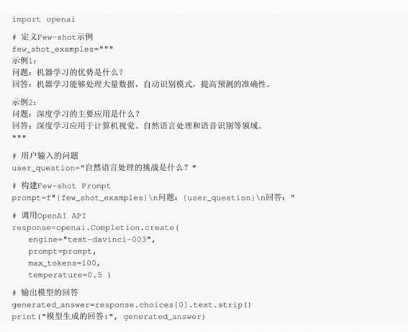

输出示例：

> 模型生成的回答：自然语言处理的挑战包括语言的多样性、语境理解的复杂性和多义性处理等问题。

加上 Few-shot 样例后，生成结果版式和语调和前面样例几乎一样，内容更自然地贴合问题语境。

1. 包含常见结构：样例应体现回答常见骨架，比如简洁定义、优缺点罗列等。
2. 涵盖各类问题：选各类型的问题，确保大模型能应对多样化内容生成。
3. 确保样例简洁明了：样例尽量短，控制整体指令长度在合理范围。

##### 5. 实现动态 Few-shot 样例生成

有些场景下样例需要按需生成。比如根据用户需求挑选各领域样例，或适配不同的问答类型。可以通过条件判断配合样例库，实现动态拼装 Few-shot 样例，以适配不同任务。

动态 Few-shot 样例生成的代码片段见下：

```python
###### 定义示例库
few_shot_examples_general = """
####### 1:
问题：机器学习的好处是什么？
答案：机器学习能够处理海量数据，自动识别模式，提高预测的准确性。
####### 2:
问题：深度学习的应用是什么？
答案：深度学习应用于计算机视觉、自然语言处理和语音识别等领域。
"""

####### 根据领域选择不同的 Few-shot 示例
def select_examples(domain):
    if domain == '金融':
        return few_shot_examples_finance
    else:
        return few_shot_examples_general

####### 用户输入和领域选择
user_question = "区块链的挑战是什么"
domain = "金融"
####### 构建 Prompt
selected_examples = select_examples(domain)
prompt = f"[selected examples]\n问题：{user_question}\n答案："

####### 调用 API 生成内容
response = openai.Completion.create(
    engine="text-davinci-003",
    prompt=prompt,
    max_tokens=100,
    temperature=0.5
)
####### 输出模型的回复
generated_answer = response.choices[0].text.strip()
print("模型生成的回答:", generated_answer)
```

输出示例：

> 模型生成的回答：区块链的挑战包括高能源消耗、扩展性不足以及对现有金融系统的整合难度。

上例依据各领域动态挑选样例，让大模型在各场景下产出符合语境的内容。

##### 6. 多样例的 Few-shot 提示与生成效果

想进一步提升效果，可以在指令里放 3 到 5 个样例，展示多种可能的回答风格，帮助大模型学习更丰富的输出格式。

```python
###### 定义多个示例
few_shot_examples = """
示例 1:
问题：机器学习的优势是什么？
回答：机器学习能够处理大量数据，自动识别模式，提高预测的准确性。
示例 2:
问题：深度学习的主要应用是什么？
回答：深度学习应用于图像识别、自然语言处理和语音识别等领域。
示例 3:
问题：自然语言处理的挑战是什么？
回答：自然语言处理面临语言多样性、语境理解和情感分析的挑战。
"""

####### 用户输入的问题
user_question = "区块链的未来发展趋势是什么？"

####### 构建 Few-shot Prompt
prompt = f"{few_shot_examples}\n问题：{user_question}\n回答："

####### 调用 API 生成内容
response = openai.Completion.create(
    engine="text-davinci-003",
    prompt=prompt,
    max_tokens=100,
    temperature=0.5
)

####### 输出模型的回答
generated_answer = response.choices[0].text.strip()
print("*"模型生成的回答：", generated_answer)
```

输出示例：

> 模型生成的回答：区块链的未来发展趋势包括更多去中心化应用的开发、跨链技术的成熟以及在供应链管理和数字身份验证中的广泛应用。

加入多个样例后，生成内容更丰富，且回答风格和样例基本同步。

Few-shot 样例指令技术通过在指令里放少量样例，引导大模型产出符合特定格式与风格的内容。配合动态生成样例和合适的 Few-shot 样例挑选，能有效提升生成结果准确度和统一性。

最后，把本章涉及的全部提示词类型及其特点汇总成一张表，方便快速查阅，如表 4-1 所示。

| 提示词类型 | 特点 |
| :--- | :--- |
| 基础提示词 | 直来直去的指令，适合单次或简单的生成需求：不带历史信息也不带演示，常用在短答案场景 |
| 动态提示词 | 依据用户输入或对话来龙去脉实时调整指令，提升生成灵活性与定制感 |
| 插槽填充提示词 | 用变量占位符套入不同内容，适合批量生成结构统一的指令；常见于 FAQ、商品点评等场景 |
| 链式提示词 (任务链) | 把复杂需求拆成多步流程，循序渐进产出内容：适合写报告、分阶段执行类任务 |
| 多轮对话提示词 | 在连续交谈里保留来龙去脉，保证大模型前后统一、语义连贯；多用于客服系统和虚拟助手 |

| 嵌套提示词 | 采用层层递进的方式展开，适合由总览逐步落到细节，常用于分层报告与结构化内容的生产 |
| Few-shot 提示词 | 在指令里内置少量示范，帮助模型迅速抓住格式、语气与任务边界，特别适合对输出样式有明确要求的生成 |

## 4.6 本章小结

本节系统梳理了提示词在 LLM 生成任务中的多种落地方式与实操手法。依托不同类型与结构的提示词，我们能更有效地牵引模型产出，同时明显提升结果的准确性、连贯度与风格统一性。

掌握本章内容后，你可以由浅入深地学会提示词的构建思路，并在真实项目里灵活迁移，产出高质量、条理清晰、贴合具体需求的自然语言文本。

## 4.7 思考题

- （1）基础提示词的本质是什么？它一般服务于哪类生成任务？
- （2）动态提示词怎样随用户输入实时变化？请举一个具体的调整情境。
- （3）在使用动态提示词时，如何确保输出始终契合用户的具体诉求？
- （4）插槽填充提示词有哪些核心优势？生成时如何利用插槽实现模板的自动化填补？
- （5）若在 FAQ 生成中采用插槽填充，插槽里应设计哪些变量？
- （6）链式提示词如何把复杂任务拆解为多个子任务？请说明其在报告生成中的运用。
- （7）在多步生成中，如何把上一层的结果作为下一层提示的输入？
- （8）多轮对话提示词怎样维持连贯性？设计时需要保留哪些信息以保证上下文一致？
- （9）为了让对话更自然，提示词中通常会加入哪些语言要素？
- （10）嵌套提示词适合哪类内容生产？请举例说明其分层应用场景。
- （11）使用嵌套提示词时，如何把控输出的层次感？何时需要对层次进行拆解？
- （12）Few-shot 提示中加入示例的最佳数量区间大致是多少？
- （13）在 Few-shot 示例里，如何挑选合适的示范？示例应具备哪些特征才能引导高质量回答？
- （14）设计一个分层的嵌套提示，让助手逐步阐述“机器学习在医疗领域的应用”。先给出简要概览，再展开具体应用并附上真实案例。请描述各层提示的设计思路，说明如何由概览逐步引导到细节。

# 第 5 章

## 核心组件 1：链

要搭建可扩展的企业级应用，链是 LangChain 体系里最关键的基础件之一。借助链技术，可以把多步工作串成清晰流程，把模型调用、数据处理与决策逻辑串联起来，从而满足复杂的业务需求。链既帮助开发者理清逻辑，也能按需定制生成路径，让产出更贴合实际使用场景。

本章将介绍 LangChain 的主流链类型，包括 LLM 链、序列链、路由链与文档链，分别对应不同的任务与内容管理需求。LLM 链用于封装单轮模型调用；序列链支持多步骤递进式处理；路由链依靠条件判断实现分支决策；文档链则涵盖 Stuff、Refine、Map-Reduce、Map-Rerank 等形态，为文档处理提供多样工具。

学完本章，你将理解链组件的设计逻辑与开发方法，为后续的企业级方案奠定基础。

### 5.1 LLM 链

LLM 链是 LangChain 中调用大语言模型的基础单元。它把模型调用流程封装起来，使生成结果能更顺滑地嵌入复杂任务。借助提示词模板、上下文管理与结果处理等能力，LLM 链可为模型生成提供强支撑，确保输出符合任务目标。

LLM 链的核心价值在于把模型调用结构化，让每次生成都按既定流程执行。无论是提示词设计还是参数调优，LLM 链都提供了灵活的接口与配置，让调用更可靠、结果更可控。

下面将介绍 LLM 链的工作原理与配置方式，从基础到进阶帮助你掌握这一关键组件。

#### 5.1.1 LLM 链的基本工作流程和参数设置

下面详细讲解 LLM 链的运行流程与关键参数，手把手演示如何搭建一个完整可用的 LLM 链。

##### 1. 初始化 LLM 链

在 LangChain 里，LLMChain 类负责封装大语言模型的调用。初始化时需定义提示词模板并选择合适的模型。

```python
from langchain.llms import OpenAI
from langchain.chains import LLMChain
from langchain.prompts import PromptTemplate

##### 定义提示词模板
prompt_template = PromptTemplate(template="请简要描述机器学习的基本概念。")

###### 初始化 OpenAI 模型
llm = OpenAI(model_name="text-davinci-003", temperature=0.7, max_tokens=100)

###### 初始化 LLM 链
llm_chain = LLMChain(llm=llm, prompt=prompt_template)

###### 执行链任务
response = llm_chain.run()
print(f"生成的回答:", response)
```

上述代码创建了一个 LLM 链，并通过提示词模板生成内容。`run()` 方法直接触发链执行并返回结果。

##### 2. 配置关键参数

LLM 链中的若干参数会直接影响生成质量。

1. `model_name`：指定要调用的模型名称，如 `text-davinci-003`。
2. `temperature`：控制随机性，数值越高越发散。
3. `max_tokens`：限制生成的最大 token 数。
4. `top_p`：影响多样性，取值越高内容越丰富。
5. `frequency_penalty` 和 `presence_penalty`：分别用于抑制重复与鼓励新主题。

llm = OpenAI(

    model_name="text-davinci-003",

    temperature=0.5,

    max_tokens=150,

    top_p=0.9,

    frequency_penalty=0.5,

    presence_penalty=0.3

)

这些设置让模型既可控又有弹性。例如 `temperature` 设为 0.5 会得到更稳健的输出，而调高 `top_p` 则增加多样性。

#### 3. 使用提示词模板设计动态内容

PromptTemplate 支持在模板中嵌入变量，实现动态填充。变量在运行时被实际输入替换，从而生成针对性的提示。

```python
prompt_template = PromptTemplate(template="请简要描述 {topic} 的应用。")
prompt_text = prompt_template.format(topic="机器学习")
print("生成的 Prompt:", prompt_text)
```

#### 4. 在 LLM 链中集成提示词模板

把自定义模板接入 LLM 链后，调用时会自动完成变量填充并生成结果。示例展示了变量化模板在链中的使用方式。

```python
##### 创建变量的提示词模板
prompt_template = PromptTemplate(template="请简要描述 {topic} 的应用。")

###### 初始化 LLM 链
llm_chain = LLMChain(llm=llm, prompt=prompt_template)

##### 运行 LLM 链，传入变量
response = llm_chain.run({"topic": "人工智能"})
print("生成的回答:", response)
```

输出示例：

> 生成的回答：人工智能在多个领域广泛应用，包括医疗诊断、金融分析、自动驾驶和自然语言处理等。

#### 5. 使用 run 方法调用 LLM 链

`run` 是 LLM 链的主要执行入口，可传入不同参数获得定制化输出。

```python
response_ai = llm_chain.run({"topic": "人工智能"})
response_m = llm_chain.run({"topic": "机器学习"})
print("人工智能的应用:", response_ai)
print("机器学习的应用:", response_m)
```

#### 6. 生成结果的后处理

生成后可进行格式化、去重或存储等后处理，提升可用性。

```python
###### 定义后处理函数
def post_process(response):
    processed_response = response.strip()
    return processed_response


###### 执行链任务并处理结果
response = llm_chain.run({"topic": "数据科学"})
final_result = post_process(response)
print("最终处理结果:", final_result)
```

##### 5.1.2 如何在 LLM 链中嵌入提示词模板和预处理逻辑

在 LLM 链中，提示词模板与预处理是提升质量的关键。通过模板可以动态控制主题、格式与风格；通过预处理可以在模型调用前对输入进行清洗，使其更易被理解。

##### 1. 创建并配置提示词模板

PromptTemplate 是 LLM 链的核心，通过定义含变量的模板，可在运行时替换为具体输入，实现灵活生成。

创建示例：

```python
from langchain.prompts import PromptTemplate

###### 创建包含变量的提示词模板
prompt_template = PromptTemplate(template="请简要描述{topic}的主要应用。")
###### 使用变量填充生成实际提示词内容
formatted_prompt = prompt_template.format(topic="机器学习")
print("生成的 Prompt 内容:", formatted_prompt)
```

模板中 `{topic}` 会被替换为“机器学习”，从而得到可复用的动态提示。

##### 2. 将提示词模板嵌入 LLM 链中

把模板传入 LLMChain 实例后，链执行时会自动完成变量替换并生成内容。

示例：

```python
from langchain.llms import OpenAI
from langchain.chains import LLMChain

###### 初始化 OpenAI 模型
llm = OpenAI(model_name="text-davinci-003", temperature=0.7, max_tokens=100)
##### 创建提示词模板
prompt_template = PromptTemplate(template="请简要描述 {topic} 的主要应用。")
###### 在 LLM 链中嵌入提示词模板
llm_chain = LLMChain(llm=llm, prompt=prompt_template)
###### 执行 LLM 链任务，并传入具体的变量值
response = llm_chain.run({"topic": "人工智能"})
print("生成的回答:", response)
```

> 生成的回答：人工智能在多个领域有广泛应用，包括医疗、金融、教育和自动化等。

这说明同一个链可通过不同变量值产出多样化内容。

##### 3. 设计预处理逻辑：清理和标准化输入内容

预处理可在调用前对用户输入做清洗、格式化或标准化，例如去除多余字符、纠错等。

示例：

```python
###### 定义预处理函数，用于清理和标准化输入内容
def preprocess_input(user_input):
    # 去除多余空格并将字母转换为小写
    cleaned_input = user_input.strip().lower()
    # 将首字母大写
    cleaned_input = cleaned_input.capitalize()
    return cleaned_input

####### 示例输入
raw_input = "机器学习的应用 "
preprocessed_input = preprocess_input(raw_input)
print("预处理后的输入:", preprocessed_input)
```

输出示例：

> 预处理后的输入：机器学习的应用

规范化的输入有助于模型更准确理解。

##### 4. 将预处理逻辑集成到 LLM 链的工作流程中

在调用链前先执行预处理函数，确保输入质量。

```python
###### 定义预处理函数
def preprocess_input(user_input):
    cleaned_input = user_input.strip().lower()
    cleaned_input = cleaned_input.capitalize()
    return cleaned_input

###### 初始化 LLM 链
llm_chain = LLMChain(llm=llm, prompt=prompt_template)

###### 获取用户输入
user_input = "数据科学的应用 "

###### 执行预处理
processed_input = preprocess_input(user_input)

###### 调用 LLM 链并生成内容
response = llm_chain.run({"topic": processed_input})
print("生成的回答:", response)
```

这里 `preprocess_input` 在输入进入 LLM 链前完成清洗，保证流程稳定。

##### 5. 增强预处理逻辑：基于任务需求动态调整提示词

可根据输入长度或复杂度动态选择模板，实现简要或详述两种模式。

示例：

```python
###### 动态调整提示词模板
def select_prompt_template(topic_length):
    if topic_length < 10:
        return PromptTemplate(template="请简要描述{topic}的应用。")
    else:
        return PromptTemplate(
            template="请详细介绍{topic}在各个领域的应用及其影响。"
        )

###### 获取用户输入并处理
user_input = "人工智能和机器学习技术"
processed_input = preprocess_input(user_input)

###### 动态选择提示词模板
prompt_template = select_prompt_template(len(processed_input))

###### 使用选择的提示词模板初始化 LLM 链
llm_chain = LLMChain(llm=llm, prompt=prompt_template)

###### 调用 LLM 链生成内容
response = llm_chain.run({"topic": processed_input})
print("生成的回答:", response)
```

该策略让链能依据输入特征自动切换提示策略。

#### 6. 使用后处理逻辑完善输出

生成后可通过后处理统一格式、修剪空格或添加装饰。

示例：

```python
###### 定义后处理函数
def post_process(response):
    # 去除多余空格并将内容转换为标题形式
    processed_response = response.strip().capitalize()
    return processed_response

###### 执行链任务并处理结果
response = llm_chain.run({"topic": "深度学习"})
final_result = post_process(response)
print("最终处理结果:", final_result)
```

输出示例：

> 最终处理结果：深度学习在多个领域得到了广泛应用，包括图像识别、自然语言处理和自动驾驶等。

后处理能让模型的输出更贴合格式和风格规范，尤其在对统一性要求高的场景下效果明显。

把提示词模板和前置预处理放到 LLM 链里，能显著提升输出的灵活度与精确度。针对任务量身定制模板，并在调用前后加上必要的清洗和校准，就能更稳地掌握内容的质量与格式。

### 5.2 序列链
序列链的核心思路是把任务拆成按序执行的多个环节，专门应对需要多轮处理的复杂场景。每一环节的产出会直接喂给下一环节，形成层层递进的完善过程。常见的使用场景包括数据清洗、初稿生成、内容打磨、最终汇总等。借助这种分段执行的方式，复杂生成可以拆解为可监控的子任务，保证整体逻辑通顺、结构清晰。

下面会从设计思路到落地实现详细拆解序列链，带你学会如何搭建多步生成流水线。掌握这套方法后，就能在不同业务场景下灵活组合流程，为更复杂的 NLP 应用提供可复用的搭建思路。

#### 5.2.1 序列链的构建与分层调用
序列链本质上是按步骤推进的执行链路，把大任务拆解为有序的小步骤并逐层传递结果。在 LangChain 里它被广泛用于需要多次迭代或逐步完善文本的场景。

##### 1. 创建并初始化序列链
在 LangChain 中，SequentialChain 就是用来搭建序列链的入口。通常要先准备好若干 Prompt 和对应的模型，每个 Prompt 决定一步的生成逻辑，然后按设定顺序依次运行。

```python
from langchain.chains import SequentialChain
from langchain.prompts import PromptTemplate
from langchain.llms import OpenAI

##### 定义提示词模板
prompt_step_1 = PromptTemplate(template="简要介绍机器学习的基本概念。")
prompt_step_2 = PromptTemplate(
    template="基于以下介绍，描述机器学习的应用领域：{intro}")
prompt_step_3 = PromptTemplate(
    template="结合应用领域，提供机器学习在金融行业的一个实例：{applications}")

#### 初始化模型
llm = OpenAI(model_name="text-davinci-003", temperature=0.5, max_tokens=100)

###### 定义每个步骤的链
chain_step_1 = LLMChain(llm=llm, prompt=prompt_step_1)
chain_step_2 = LLMChain(llm=llm, prompt=prompt_step_2)
chain_step_3 = LLMChain(llm=llm, prompt=prompt_step_3)

###### 初始化 Sequential Chain
sequential_chain = SequentialChain(
    chains=[chain_step_1, chain_step_2, chain_step_3]
)
```

这段示例把三条子链串成了顺序链，chain_step_1 的结果会流向 chain_step_2，之后依次传递。各个步骤的提示词可以根据产出目标自由调整。

##### 2. 配置步骤间的参数传递
实现传参的关键是在模板里预留变量名。后面步骤的提示词里用 `{intro}` 承接第一步的结果，用 `{applications}` 承接第二步的结果即可。

```python
###### 定义传递参数的输入字典
input_dict = {
    "intro": "机器学习是一种通过数据训练模型，使计算机能够自动识别模式和预测。",
    "applications": "机器学习在金融、医疗和教育等多个领域有广泛应用。"
}

###### 配置并运行序列链
response = sequential_chain.run(input_dict)
print("序列链生成的最终结果:", response)
```

代码通过 input_dict 把初始参数注入链路，SequentialChain 会自动把每一步的产出映射到下一步的变量，从而保持多步生成的逻辑一致性。

##### 3. 使用 run 方法执行序列链
执行序列链最常用的入口是 run 方法。只要把初始输入传进去，整条链就会按顺序跑完并返回最终结果。

```python
###### 使用 run 方法传入初始输入并执行序列链
initial_input = {"intro": "机器学习概念", "applications": "金融和医疗"}
response = sequential_chain.run(initial_input)
print("最终生成的内容:", response)
```

输出示例：
> 最终生成的内容：机器学习是一种通过数据训练模型的技术，它在金融、医疗、教育等多个领域得到了广泛应用。例如，在金融行业，机器学习用于自动化交易和风险预测。

借助 run，整条链会严格按照顺序调用各步骤的生成逻辑，把简单输入逐步扩充成更完整的输出。

##### 4. 增加中间处理逻辑，实现更复杂的序列链
实际项目中，经常需要在两个步骤之间加入自定义的处理函数，比如格式校验、清洗或重排，从而让链路更灵活。

```python
###### 定义中间处理函数，格式化内容
def format_step_output(text):
    return text.strip().capitalize()

###### 执行序列链并处理每个步骤的输出
intro_text = chain_step_1.run()
formatted_intro = format_step_output(intro_text)
applications_text = chain_step_2.run({"intro": formatted_intro})
formatted_applications = format_step_output(applications_text)
instance_text = chain_step_3.run({"applications": formatted_applications})
formatted_instance = format_step_output(instance_text)

###### 查看每个步骤的格式化输出
print("步骤 1-简介:", formatted_intro)
print("步骤 2-应用:", formatted_applications)
print("步骤 3-实例:", formatted_instance)
```

这里用 format_step_output 对中间结果做统一格式化，保证整条链的风格和格式保持一致。

##### 5. 增强的序列链：根据条件动态选择步骤
有时链路需要根据输入特征动态分流，比如跳过某些环节或走不同的分支。这时可以在链中加入条件判断来控制执行路径。

```python
###### 逻辑省略...（此处展示概念）
####### if some_condition:
####### chain_sequence = [chain_step_1, chain_step_3] # 跳过中间步骤
####### else:
####### chain_sequence = [chain_step_1, chain_step_2, chain_step_3]
```

###### 定义条件判断逻辑
```python
def is_detailed_request(input_text):
    return len(input_text) > 15

###### 创建一个包含条件判断的序列链

def conditional_sequential_chain(input_text):
    if is_detailed_request(input_text):
        print(执行详细生成步骤
```

示例里用 is_detailed_request 判断输入长度，长度达标就走详细流程，否则走精简流程，实现根据需求动态调整。

总体来看，序列链把多步任务串起来，形成逐层递进的生成过程。配合参数传递、中间处理和条件分支，能覆盖更复杂的实际需求。

#### 5.2.2 在序列链中连接多个 LLM 和工具模块
LangChain 的序列链不仅能串联多个 LLM，还能接入外部工具，比如 API 调用或数据库查询。把模型和工具按序组合，就能搭建出更贴合业务的复合流程，每一步既能生成也能处理数据。

##### 1. 定义和初始化多种 LLM 实例
LangChain 支持创建多个风格各异的 LLM 实例，让不同步骤使用不同模型。例如一个负责提炼要点，一个负责展开细节。初始化时可为每个实例单独配置参数。

```python
from langchain.llms import OpenAI
###### 定义用于概述生成的 LLM
llm_summary = OpenAI(model_name="text-davinci-003",
                     temperature=0.5, max_tokens=50)
###### 定义用于详细生成的 LLM
llm_detail = OpenAI(model_name="text-davinci-003", 
                    temperature=0.7, max_tokens=150)
```

这里 llm_summary 负责产出简短概述，llm_detail 则负责把概述展开成完整说明，方便按需切换生成模式。

##### 2. 将多个 LLM 实例嵌入序列链中
序列链允许每一步绑定不同的 LLM。下面的示例先用 llm_summary 生成概览，再把结果喂给 llm_detail 做详细扩展。

```python
from langchain.chains import LLMChain, SequentialChain
from langchain.prompts import PromptTemplate
##### 定义提示词模板
prompt_summary = PromptTemplate(template="请简要介绍机器学习的定义。")
prompt_detail = PromptTemplate(
    template="基于机器学习的定义，详细描述其在数据分析中的应用：{summary}")
###### 创建 LLM 链实例
chain_summary = LLMChain(llm=llm_summary, prompt=prompt_summary)
chain_detail = LLMChain(llm=llm_detail, prompt=prompt_detail)
###### 创建序列链，连接两个 LLM 链
sequential_chain = SequentialChain(chains=[chain_summary, chain_detail])
```

流程里先执行 chain_summary 得到概述，随后 chain_detail 在其基础上做深度展开，整体形成先总后分的生成链路。

##### 3. 增加工具模块：API 调用模块
复杂任务往往需要实时数据支撑。可以在链中加入 API 调用步骤，先拉取最新信息，再把数据作为上下文交给 LLM 处理。

```python
import requests

###### 定义一个 API 调用函数，用于获取实时数据（例如：获取股票信息）
def fetch_data(topic):
    response = requests.get(f"https://api.example.com/data?topic={topic}")
    if response.status_code == 200:
        return response.json().get("data", "")
    else:
        return "无法获取数据"

###### 将 API 调用集成到序列链中
topic = "机器学习在金融中的应用"
api_data = fetch_data(topic)

###### 将 API 数据传递给详细描述 LLM 链
response = chain_detail.run({"summary": api_data})
print("API 获取的数据及其详细生成结果:", response)
```

示例中 fetch_data 负责调用外部接口取数，随后把结果传入 chain_detail 做解释，确保输出具备时效性。

##### 4. 使用数据库查询模块
业务数据常存于本地或云数据库。链中加入查询模块后，可以先检索所需记录，再作为背景信息供给 LLM 生成。

```python
import sqlite3

###### 创建数据库连接并查询数据
def query_database(keyword):
    conn = sqlite3.connect("example.db")
    cursor = conn.cursor()
    cursor.execute("SELECT info FROM topics WHERE name=?", (keyword,))
    result = cursor.fetchone()
    conn.close()
    return result[0] if result else "没有找到相关数据"

###### 将数据库查询结果传递给 LLM 链
keyword = "深度学习"
db_data = query_database(keyword)

###### 使用数据库查询结果作为生成内容的输入
response = chain_detail.run({"summary": db_data})
print("数据库查询结果及其生成的详细内容:", response)
```

这样一来，生成内容就能直接基于真实的业务数据，保持一致性和准确性。

##### 5. 综合多个 LLM 与工具模块的序列链示例
下面给出一个整合案例，把多个 LLM 和工具模块串成三步流程：先做简要概述，再用 API 数据做扩展，最后生成详细的应用描述。

```python
from langchain.chains import LLMChain, SequentialChain
from langchain.prompts import PromptTemplate

###### 初始化 LLM 和提示词模板
llm_summary = OpenAI(model_name="text-davinci-003",
                     temperature=0.5, max_tokens=50)
llm_detail = OpenAI(model_name="text-davinci-003",
                    temperature=0.7, max_tokens=150)

prompt_summary = PromptTemplate(template="请简要介绍{topic}的定义。")
prompt_api = PromptTemplate(
    template="基于以下内容描述{api_data}在{topic}中的作用。"
)
prompt_detail = PromptTemplate(
    template="结合概述和 API 数据，详细描述{topic}的行业应用：{summary}")

###### 创建 LLM 链
chain_summary = LLMChain(llm=llm_summary, prompt=prompt_summary)
chain_api = LLMChain(llm=llm_summary, prompt=prompt_api)
chain_detail = LLMChain(llm=llm_detail, prompt=prompt_detail)

###### 定义一个模拟 API 数据函数
def fetch_data(topic):
    # 模拟 API 响应数据
    return f"{topic}的最新应用数据"

###### 组合为一个序列链
def multi_step_chain(topic):
    # 生成概述
    summary = chain_summary.run({"topic": topic})
    print("生成的概述:", summary)

    # 获取 API 数据并生成相关内容
    api_data = fetch_data(topic)
    api_content = chain_api.run({"topic": topic, "api_data": api_data})
    print("基于 API 数据的生成内容:", api_content)

    # 生成详细描述
    detailed_response = chain_detail.run(
        {"topic": topic, "summary": summary})
    print("最终生成的详细内容:", detailed_response)
    return detailed_response

###### 执行多步链
topic = "机器学习"
final_output = multi_step_chain(topic)
print("最终结果:", final_output)
```

**输出示例：**

>> 生成概览：机器学习利用数据训练，让计算机学会自行识别规律。

>> 基于接口数据的产出：机器学习近期在各行业的落地动向。

>> 最终详细展开：机器学习已进入金融、医疗等领域，比如智能交易、病症预测和个性化教学。

上述片段展示了 `multi_step_chain` 如何把若干大模型与一个 API 组件串接起来完成任务。先让模型给出概览，再调用接口抓取外部信息，最后以细节描述收束。

把多组大模型与工具链组合进线性流程，并叠加接口调用、数据查询或多模型协作，就能搭建层次更丰富的内容生产线。

### 5.3 路由链：按需分发的内容引擎

路由链的本质是带决策能力的动态流程，依赖规则筛选与分支分流，让模型在运行时依据输入文本或上下文环境自动挑选执行路径。相对固定顺序的线性链，路由链能依据任务需求、输入特征或用户指令灵活切换路线，从而实现更具响应性的生成与处理。典型场景包括客服中按问题类型走不同回复分支，或依据数据特征动态挑选处理方式。

下文将从原理到实现拆解路由链的搭建方式，手把手演示设计与配置，帮助在真实项目中快速落地自适应处理。

#### 5.3.1 依托输入特征实时选定分支

路由链的核心在于根据输入或规则实时挑选分支。LangChain 提供的 `RouterChain` 正是依据规则自动匹配分支执行的机制，能让内容产出和数据处理更灵活，尤其适合需要按用户请求类型或文本特征走差异化流程的场景，例如把咨询、投诉、建议区分处理。

##### 1. 构建路由判定函数

首步是编写一个判定函数，基于文本特征返回不同标识，从而决定走向哪条处理线。

```python
###### 定义条件判断函数，根据输入内容返回不同标识

def determine_route(input_text): 
    if "投诉" in input_text:
        return "complaint"
    elif "咨询" in input_text:
        return "inquiry"
    elif "建议" in input_text:
        return "suggestion"
    else:
        return "default"
```

该函数会检查输入是否包含“投诉”、“咨询”或“建议”等关键词，命中则返回对应标签；未命中则回退到“default”默认分支。

##### 2. 为各分支准备独立链

拿到路由标识后，需为每个分支准备专用的处理链。可为每条分支配置不同的提示模板与模型参数，以适配任务需求。

```python
from langchain.prompts import PromptTemplate
from langchain.llms import OpenAI
from langchain.chains import LLMChain

#### 初始化模型
llm = OpenAI(model_name="text-davinci-003", temperature=0.5, max_tokens=100)

###### 定义不同路径的提示词模板
template_complaint = "处理客户投诉：请针对以下问题提供解决方案：{issue}"
template_inquiry = "处理客户咨询：请回答以下问题：{question}"
template_suggestion = "处理客户建议：请记录并反馈以下内容：{suggestion}"
template_default = "处理普通查询：请回答以下内容：{query}"
```

此处为投诉、咨询、建议分别准备了对应的提示模板，如“处理客户投诉”、“处理客户咨询”等，确保每条分支的产出贴合任务特性。

##### 3. 将判定与分支链联动

把判定函数与各分支链连接起来即可实现自动分流。LangChain 中可使用 `RouterChain` 完成此步，通过映射表把判定结果指向具体分支。

```python
from langchain.chains import RouterChain
from langchain.chains import LLMChain

###### 假设已经创建了各个子链实例
chain_complaint = LLMChain(llm=llm, prompt=PromptTemplate(template=template_complaint))
chain_inquiry = LLMChain(llm=llm, prompt=PromptTemplate(template=template_inquiry))
chain_suggestion = LLMChain(llm=llm, prompt=PromptTemplate(template=template_suggestion))
chain_default = LLMChain(llm=llm, prompt=PromptTemplate(template=template_default))

###### 定义路径映射，将判断结果映射到对应的子链
route_map = {
    "complaint": chain_complaint,
    "inquiry": chain_inquiry,
    "suggestion": chain_suggestion,
    "default": chain_default
}

###### 创建路由链
router_chain = RouterChain(route_map=route_map, route_func=determine_route)
```

`route_map` 把“complaint”“inquiry”等标签映射到对应的分支实例，`RouterChain` 会依据 `determine_route` 的返回值自动激活相应分支。

##### 4. 运行并观察效果

搭建完成后，输入不同文本即可看到自动分流与产出效果。

```python
###### 示例输入文本
input_text_complaint = "客户投诉：产品质量有问题，需要立即解决。"
input_text_inquiry = "客户咨询：这个产品的保修期是多久？"
input_text_suggestion = "客户建议：希望增加更多的支付选项。"
input_text_default = "普通查询：如何联系客服？"

###### 执行路由链任务并输出结果
response_complaint = router_chain.run({"issue": input_text_complaint})
response_inquiry = router_chain.run({"question": input_text_inquiry})
response_suggestion = router_chain.run(
    {"suggestion": input_text_suggestion})
response_default = router_chain.run({"query": input_text_default})
print("投诉处理结果:", response_complaint)
print("咨询处理结果:", response_inquiry)
print("建议处理结果:", response_suggestion)
print("默认处理结果:", response_default)
```

**输出示例：**

>> 投诉处理结果：针对产品质量问题，建议客户联系售后部门，并提供详细损坏说明以便尽快处理。

>> 咨询处理结果：该产品保修期为一年，自购买日起算。

>> 建议处理结果：关于增加支付选项的建议已记录，我们会反馈给产品部门参考。

>> 默认处理结果：您可通过客服热线或官网联系我们的客服团队。

从结果可见，含“投诉”的输入会触发投诉分支，含“咨询”的输入会触发咨询分支，系统实现了输入驱动的自动选择。

##### 5. 深化判定逻辑：叠加更多条件

实际业务中常需要更精细的筛选，比如组合条件或分层判断。可在判定函数中加入更多规则，让路由更贴合业务。

```python
###### 添加更复杂的条件判断
def advanced_determine_route(input_text):
    if "投诉" in input_text and "紧急" in input_text:
        return "urgent_complaint"
    elif "投诉" in input_text:
        return "complaint"
    elif "咨询" in input_text:
        return "inquiry"
    elif "建议" in input_text:
        return "suggestion"
    else:
        return "default"

###### 创建新的路由映射，增加紧急投诉路径
prompt_urgent_complaint = PromptTemplate(template="处理紧急投诉；立即处理以下问题：{issue}")
chain_urgent_complaint = LLMChain(llm=llm, prompt=prompt_urgent_complaint)

###### 更新路由映射表
advanced_route_map = {
    "urgent_complaint": chain_urgent_complaint,
    "complaint": chain_complaint,
    "inquiry": chain_inquiry,
    "suggestion": chain_suggestion,
    "default": chain_default
}

###### 创建增强的路由链
advanced_router_chain = RouterChain(route_map=advanced_route_map,
                                    route_func=advanced_determine_route)

###### 测试不同的输入
response_urgent_complaint = advanced_router_chain.run({
    "issue": "客户投诉：紧急！需要立即更换故障产品。"})
print("紧急投诉处理结果:", response_urgent_complaint)
```

**输出示例：**

>> 紧急投诉处理结果：请立即联系技术支持团队，并尽快更换故障产品。

丰富筛选条件后，路由链可覆盖更多任务类型，让产出更符合复杂业务需求。

通过定义路由函数、配置多条分支并不断细化判定逻辑，系统即可获得多路径处理的灵活性。## 5.3.2 针对复杂需求配置多元模型与路径

面对复杂场景，单一模型难以兼顾。为不同任务配置专属模型与路径，能显著提升效率，例如依据任务类型调整生成策略，甚至接入不同接口或数据源提供支撑。

#### 1. 准备多任务的模型实例

先准备几套模型，每个模型侧重不同任务。简要回答可选用低温度模型保证稳定，创意任务可选用高温度模型提升发挥。

```python
from langchain.llms import OpenAI

###### 用于简洁回答的模型
llm_brief = OpenAI(model_name="text-davinci-003",
                   temperature=0.3, max_tokens=50)

###### 用于详细描述得模型
llm_detailed = OpenAI(model_name="text-davinci-003",
                      temperature=0.7, max_tokens=150)

###### 用于创意性内容生成的模型
llm_creative = OpenAI(model_name="text-davinci-003",
                      temperature=0.9, max_tokens=100)
```

示例中 `llm_brief` 负责简洁问答，`llm_detailed` 负责深度展开，`llm_creative` 负责创意产出。分工让多任务场景下的生成更匹配需求。

#### 2. 为各路径配置专属提示模板

在路由链里为每个任务配备专用提示词，能更精准地控制产出风格与范围。

```python
from langchain.prompts import PromptTemplate

###### 提示词模板配置
prompt_brief = PromptTemplate(template="简要回答以下问题：{query}")
prompt_detailed = PromptTemplate(template="详细回答以下问题:{query}")
prompt_creative = PromptTemplate(
    template="创造性地回答以下问题，提供一些独特的见解:{query}"
)
```

`prompt_brief` 引导模型做精简总结，`prompt_detailed` 鼓励给出完整解答，`prompt_creative` 则激发想象力。不同模板让同一模型在不同路径下产出差异化内容。

#### 3. 组装分支链并映射到任务路径
借助前面准备好的模型与提示模板，为每个任务路径组装分支链，再接入路由链进行映射。这样系统便可按任务类型自动调度最合适的生成链执行。

```python
from langchain.chains import LLMChain

###### 创建不同任务路径的子链
chain_brief = LLMChain(llm=llm_brief, prompt=prompt_brief)
chain_detailed = LLMChain(llm=llm_detailed, prompt=prompt_detailed)
chain_creative = LLMChain(llm=llm_creative, prompt=prompt_creative)
```

三条子工作流各自绑定专用模型与提示模板，chain_brief、chain_detailed、chain_creative 分别承担精简、详述与创意产出。让子链参数与任务目标一一对应，才能保证生成时稳定命中预期。

#### 4. 定义判断函数，根据任务需求动态选择路径

路由体内先放一个意图识别函数，把输入归类为路径编码，执行时依据该编码唤醒对应的子流程。

```python
###### 根据输入内容动态选择路径
def task_route(input_text):
    if "简要" in input_text:
        return "brief"
    elif "详细" in input_text:
        return "detailed"
    elif "创意" in input_text or "独特" in input_text:
        return "creative"
    else:
        return "default"
```
task_route 会检查输入里是否出现“简要”“详细”“创意”等信号词，并据此给出对应的任务标签。若输入与所有规则都不匹配，就回退到默认的"default"分支。

#### 5. 配置路由链以自动选择任务路径

借助 RouterChain 类把判断函数与子链路径绑定，实现运行时的自动分发。

```python
from langchain.chains import RouterChain

###### 路由映射，将任务标识映射到对应的子链
route_map = {
    "brief": chain_brief,
    "detailed": chain_detailed,
    "creative": chain_creative,
    "default": chain_brief  # 默认路径可设置为简要回答
}

###### 创建路由链
router_chain = RouterChain(route_map=route_map, route_func=task_route)
```
在这个例子里，route_map 把 task_route 的输出对应到具体的子链实例，RouterChain 会按照判断结果自动切换执行分支。

#### 6. 执行路由链任务并测试不同的任务路径

直接调用路由链提交请求，系统会按输入特征自动选路。下面展示几组典型输入的产出效果。

```python
###### 定义输入内容
input_text_brief = "简要回答：机器学习的定义是什么？"
input_text_detailed = "详细回答：机器学习的应用领域有哪些？"
input_text_creative = "创意回答：机器学习在未来可能带来的影响？"

###### 执行路由链并输出结果
response_brief = router_chain.run({"query": input_text_brief})
response_detailed = router_chain.run({"query": input_text_detailed})
response_creative = router_chain.run({"query": input_text_creative})

print("简要回答：", response_brief)
print("详细回答：", response_detailed)
print("创意回答：", response_creative)
```
运行结果如下：

> > > 简要回答：机器学习是一种通过数据训练模型，使计算机能够自动识别模式的技术。

> > 详细回答：机器学习在多个领域有广泛应用，包括金融、医疗、教育和自动驾驶等。

> >> 创意回答：机器学习未来可能改变我们生活的方方面面，例如个性化教育、智能城市和人类辅助的创新设计。

这样一套分发机制让分支随输入自适应，风格与质量都能保持在预期范围内。

#### 7. 添加更多任务路径和外部资源

业务实践中常会进一步扩展，比如为某条分支接入外部 API 或数据库，实时取数来丰富生成内容。下面演示在特定分支上调用 API 的做法。

```python
import requests

###### 定义 API 调用函数
def fetch_additional_data(query):
    response = requests.get(f"https://api.example.com/data?query={query}")
    if response.status_code == 200:
        return response.json().get("data", "")
    else:
        return "无法获取数据"

###### 在判断函数中添加 API 路径选择
def advanced_task_route(input_text):
    if "实时" in input_text:
        return "api"
    elif "简要" in input_text:
        return "brief"
    elif "详细" in input_text:
        return "detailed"
    elif "创意" in input_text:
        return "creative"
    else:
        return "default"

###### 路由映射表中添加 API 路径
route_map_advanced = {
    "api": fetch_additional_data,  # 将 API 函数作为任务路径
    "brief": chain_brief,
    "detailed": chain_detailed,
    "creative": chain_creative,
    "default": chain_brief
}

###### 创建新的路由链
advanced_router_chain = RouterChain(route_map=route_map_advanced,
                                    route_func=advanced_task_route)

###### 测试带有 API 调用的任务路径
response_api = advanced_router_chain.run({"query": "实时获取股票市场信息"})
print("实时数据获取结果:", response_api)
```
运行结果如下：

> > 实时数据获取结果：当前市场信息显示，主要股票指数上涨 0.5%。

借助这种方式，路由链可以在指定分支引入外部数据源，提升输出的多样性和实用度。

把模型定制、意图判断、路径映射与外部资源接入串联起来，就能搭建一套自适应的内容生产流程，满足多变的业务需求。

### 5.4 文档链

文档链是针对文本处理的链式思路，多用于解析、归纳海量资料。它能把多个段落、章节或文件聚合成处理单元，用不同链型实现概览、抽取或问答。本节聚焦四种常用形态：Stuff、Refine、Map-Reduce 与 Map-Rerank。

- **Stuff** 链把全部材料一次性合并输入，适合篇幅较小的文本。
- **Refine** 链采用轮次迭代提炼，逐步得到更精细的输出。
- **Map-Reduce** 链先对各片段独立处理再汇总，适合大体量文档。
- **Map-Rerank** 链在 Map-Reduce 基础上加入打分排序，保留最相关的结果。

下面逐步拆解这些链的使用思路，帮助在海量文档场景下构建层次清晰的信息系统。

#### 5.4.1 Stuff 链与 Refine 链的应用场景和适用文档类型

Stuff 链和 Refine 链是文档链里最基础的两类，各自对应不同规模与精度需求。

##### 1. Stuff 链的应用场景和适用文档类型

Stuff 的做法比较直接，把所有片段拼接成一个整体一次性送入模型。因为整体长度受上下文限制，所以更适合篇幅不大的材料。

**应用场景：**

（1）为小规模报告生成速览。
（2）给简短对话或会议记录做整体概括。
（3）把多条简讯合并为要点。

**适用文档类型：**

（1）仅含数个段落的短文档。
（2）信息集中、篇幅适中的材料。
（3）需要迅速获得整体观点的少量内容集合。

Stuff 链原理如图 5-1 所示。

以下是用于 Stuff 链的示例文档内容：

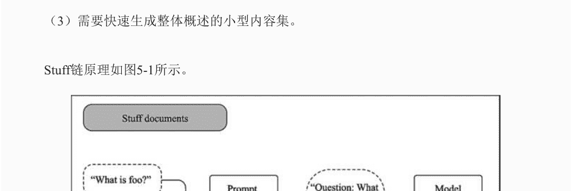
文档片段 1：

机器学习是一种人工智能技术，旨在通过算法和统计模型，使计算机能够从数据中学习并进行预测。机器学习被广泛应用于图像识别、语音识别、自然语言处理等领域，推动了现代科技的进步。

文档片段 2：

近年来，深度学习成为机器学习的一个重要分支，通过多层神经网络，深度学习在复杂任务上表现出了超越传统算法的性能，尤其在医疗诊断、自动驾驶和金融预测等领域取得了显著进展。

文档片段 3：

大数据的增长为机器学习模型提供了丰富的数据源。利用大量的数据，机器学习算法可以更加准确地进行模式识别和趋势预测。然而，数据隐私和安全性问题也随之而来，需要在应用中予以关注。

把以上 3 个文档片段合并，并通过 Stuff 链一次性传递给模型，生成一个简要的概述。

```python

```
运行结果如下：

> > > 生成的概述：机器学习是一种人工智能技术，广泛应用于图像识别、语音识别和自然语言处理等领域。深度学习作为机器学习的分支，表现出优异的性能，尤其在医疗、自动驾驶和金融等方面。大数据为机器学习提供了丰富的数据源，但也带来了数据隐私和安全性问题。

Stuff 链把所有材料合并后一次性生成概览，非常适合小规模文档的快速处理。

##### 2. Refine 链的应用场景和适用文档类型

Refine 链采用渐进式处理，先用首个片段生成草稿，再把后续片段逐个合并并不断打磨，最终得到更完整、更精确的结果。与 Stuff 的一次性输入不同，Refine 是逐步累积。

**应用场景：**

（1）对多章节报告进行精炼汇总。
（2）对结构复杂的文档进行分层解析。
（3）对长文档或层次化内容进行细化生成。

**适用文档类型：**

（1）片段众多、可逐步构建的大量文档。
（2）结构繁复、信息量大的长文本。
（3）在生成过程中需要不断补充细节的场景。

Refine 链原理如图 5-2 所示。

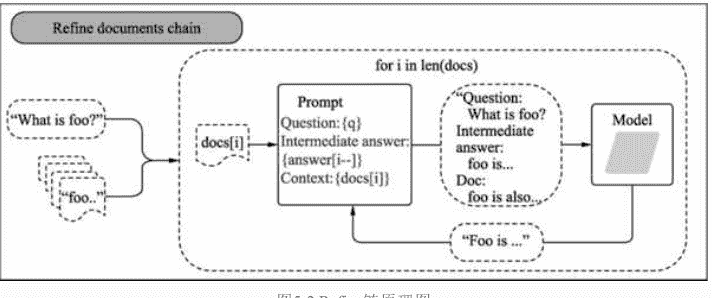
以下是用于 Refine 链的示例文档内容，与 Stuff 的内容相同：使用 Refine 链逐步处理每个文档片段，并将每个片段的内容逐步添加到最终结果中，代码如下：

```python
from langchain.chains import RefineDocumentsChain

##### 定义提示词模板
prompt_template_refine = PromptTemplate(
    template="基于以下内容进行精炼，并添加新的信息：`\n\n{current_summary}`\n`新信息：\n{new_content}`"
)

###### 初始化 Refine 链
refine_chain = RefineDocumentsChain(llm=llm, prompt=prompt_template_refine)

###### 定义文档片段列表
document_fragments = [
    "机器学习是一种人工智能技术，旨在通过算法和统计模型，使计算机能够从数据中学习并进行预测。机器学习被广泛应用于图像识别、语音识别、自然语言处理等领域，推动了现代科技的进步。",
    "近年来，深度学习成为机器学习的一个重要分支，通过多层神经网络，深度学习在复杂任务上表现出了超越传统算法的性能，尤其在医疗诊断、自动驾驶和金融预测等领域取得了显著进展。",
    "大数据的增长为机器学习模型提供了丰富的数据源。利用大量的数据，机器学习算法可以更加准确地进行模式识别和趋势预测。然而，数据隐私和安全性问题也随之而来，需要在应用中予以关注。"
]

###### 执行 Refine 链任务
current_summary = ""  # 初始化为空
for fragment in document_fragments:
    current_summary = refine_chain.run(
        {"current_summary": current_summary, "new_content": fragment}
    )
print(current_summary)

输出示例：

>> 逐步精炼生成的内容：机器学习是一种人工智能技术，广泛应用于图像处理、语音识别和自然语言处理等领域。随着深度学习的进展，机器学习在复杂任务上表现出更高的性能，尤其在医疗、自动驾驶和金融领域取得显著成果。大数据为机器学习提供了大量的数据源，但也带来了数据隐私和安全性问题，这些问题在实际应用中需要加以关注。

```
Refine 链通过逐步将每个文档片段的内容精炼到最终总结中，生成了一个更为完整的描述。与 Stuff 链相比，Refine 链更适合分层次处理和信息量较大的文档内容。

#### 5.4.2 Map-Reduce 链与 Map-Rerank 链的文档处理策略

面对大规模文档或复杂数据集，Map-Reduce 链和 Map-Rerank 链能把任务拆成“映射”和“归并”两步，实现分布式处理与筛选，从而保证结果质量和相关性。

##### 1. Map-Reduce 链的应用场景和适用文档类型

Map-Reduce 链先让每个片段独立生成中间结果，再把中间结果汇总成最终答案，适合长文档或多个文档的批量处理。

**应用场景：**

（1）对多个文档批量生成概述。
（2）对大型内容集进行分析和总结。
（3）长文档问答或摘要生成等需要分步汇总的任务。

**适用文档类型：**

（1）由多章节或多片段构成的大型文档。
（2）需要分步归纳再整合的信息集合。
（3）数据量大且需合并处理的文档集。

Map-Reduce 链原理图如图 5-3 所示。

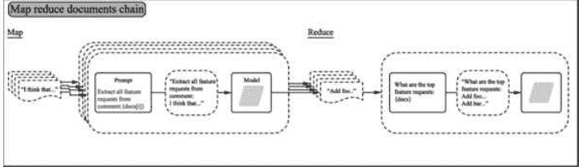
图 5-3 Map-Reduce 链原理图

以下示例文档将用于 Map-Reduce 链，以便展示该链如何处理多个文档片段：

## 5. Map-Reduce 链与 Map-Rerank 链的应用

使用 Map-Reduce 链将每个文档片段分步处理，然后将所有结果汇总生成最终内容，代码如下：

```python
from langchain.chains import MapReduceDocumentsChain
###### 定义提示词模板，用于处理每个片段
prompt_template_map = PromptTemplate(
    template="请总结以下内容核心观点：\n\n{fragment}"
)
#### 初始化模型
llm = OpenAI(model_name="text-davinci-003", temperature=0.5, max_tokens=100)
###### 创建 Map-Reduce 链
map_reduce_chain = MapReduceDocumentsChain(llm=llm, prompt=prompt_template_map)
###### 定义文档片段列表
document_fragments = [
    "人工智能技术的快速发展对社会产生了深远影响。其在自动化、医疗、教育等多个领域的应用，正逐步改变人们的生活方式，尤其在医疗诊断和个性化教育领域，人工智能展现出极大的潜力。",
    "然而，人工智能技术的普及也带来了一些挑战。例如，数据隐私成为一个不可忽视的问题，许多企业和个人都担心自己的数据被滥用。此外，自动化可能导致某些职业的消失，带来就业压力。",
    "在未来，随着技术的进步，人工智能有望在智能交通、智能城市、环境保护等领域发挥更大的作用。政府和企业正在积极探索人工智能的潜力，以期提高效率、减少资源浪费，推动可持续发展。"
]
###### 执行 Map-Reduce 链任务
response = map_reduce_chain.run({"documents": document_fragments})
print("Map-Reduce 链生成的最终结果:", response)
```

输出示例：

> >> Map-Reduce 链生成的最终结果：人工智能在多个领域带来深远影响，特别是在医疗和个性化教育领域，展现了极大潜力。同时，数据隐私问题和就业压力等挑战不容忽视。未来，人工智能在智能城市和环境保护等方面的应用有望推动可持续发展。

Map-Reduce 先把长文本拆成若干片段，分别做提炼，随后再把各个提炼结果合并，形成相对完整的概括。

##### 2. Map-Rerank 链的应用场景和适用文档类型

Map-Rerank 可看作 Map-Reduce 的进阶形态，除了分块处理与汇总，还会给每块产出打分并排序，以提升相关度与准确度。该模式在需要从大量候选中挑出最优答案的任务上更具优势。

应用场景：
- （1）超长文本问答，从中挑出最贴切的答案。
- （2）在多段材料里抽取关联最强的片段。
- （3）做内容筛选，产出高质量结果。

适用文档类型：
- （1）片段众多且需按分数筛选的文档集合。
- （2）多源信息汇聚，需要择优作答的情境。
- （3）信息体量大，需要提炼精华的情境。

Map-Rerank 链原理图如图 5-4 所示。

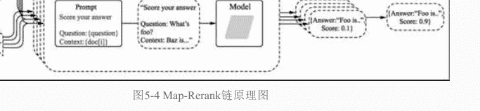

*图 5-4 Map-Rerank 链原理图*

使用 Map-Rerank 链的示例如下：

```python
from langchain.chains import MapRerankDocumentsChain

###### 定义提示词模板，用于生成评分和内容
prompt_template_rerank = PromptTemplate(
    template="请评价以下内容的相关性，并选择最重要的观点：\n\n(fragment)")

###### 创建 Map-Rerank 链
map_rerank_chain = MapRerankDocumentsChain(llm=llm, prompt=prompt_template_rerank)

###### 执行 Map-Rerank 链任务
response_rerank = map_rerank_chain.run({"documents": document_fragments})
print("Map-Rerank 链筛选的最终结果:", response_rerank)
```

输出示例：

> >> Map-Rerank 链筛选的最终结果：人工智能在多个领域带来深远影响，特别是在智能城市、环境保护等方面，未来应用潜力巨大。

在该结果里，Map-Rerank 先对各片段评分，再保留最相关且关键的部分，从而得到指向性更强的总结。

Map-Reduce 与 Map-Rerank 都是应对海量复杂文本的有效手段。前者把各块独立加工再汇总，擅长宽泛概括；后者在汇总前加入评分排序，在优中选优的任务里表现更佳。

## 表 5-1 LangChain 链类汇总表

| 链类型 | 特点 | 适用场景 |
| :--- | :--- | :--- |
| LLM 链 | 直接调用大语言模型，靠提示模板与参数调优提升生成质量 | 基础生成任务，适合单条内容产出 |
| 序列链 | 按顺序串联多步骤任务，逐层推进内容生成 | 多层次生成需求，如预处理后逐步扩展 |
| 路由链 | 基于条件判断选择不同执行路径，实现动态生成 | 多分支流程，如客服问题分类、内容筛选 |
| Stuff 链 | 将所有文档片段合并后一次性处理，简单高效但受限于上下文长度 | 小型文档快速处理，适合内容简洁、信息量少 |
| Refine 链 | 逐步精炼文档片段，将每步输出传给下一步，累积成完整内容 | 大型文档精炼、层次分明的内容生成 |
| Map-Reduce 链 | 先独立处理各片段再合并结果，适合分步处理大规模内容 | 长文档问答、多个片段的总结分析 |
| Map-Rerank 链 | 在 Map-Reduce 基础上增加评分排序，筛选最优内容 | 多片段内容筛选，如长文档问答、最相关信息提取 |

### 5.5 本章小结

本章梳理了 LangChain 各类链的实现思路与使用场景。LLM 链负责基础生成，依赖提示模板与参数调节；序列链把多步任务串联起来，实现层次化产出；路由链靠条件判断动态切换路径，适配多分支需求。

文档链方面，Stuff 链适合把小文档合并后一次性处理；Refine 链通过迭代精炼逐步构建完整内容；Map-Reduce 链采用分块处理再汇总；Map-Rerank 链则在汇总前加入评分筛选。掌握这些工具后，可依据任务特点灵活选用，以搭建稳定可靠的企业级应用架构。

### 5.6 思考题

1. LLM 链里 temperature 参数起什么作用？对生成风格有何影响？
2. 序列链运行时怎样把前一步的产物作为下一步输入？请举例说明实现方式。
3. 路由链中如何设计条件判断函数来根据输入挑选不同的子链？请列出步骤。
4. Stuff 链合并文档的主要优点与缺点是什么？适合哪些场景，不适合什么情况？
5. Refine 链与 Stuff 链的核心差异是什么？在逐步处理复杂文档时，Refine 如何提升效果？
6. Map-Reduce 链中 Map 与 Reduce 各自承担何种职责？两者如何配合得到最终结果？
7. 请举例说明 Map-Rerank 链如何借助评分机制挑选最优内容，并阐述其如何保证相关性。
8. LLM 链中如何嵌入复杂的提示模板并实现动态生成？请给出一个含变量的提示示例。
9. 路由链配置时，如何为不同路径指定不同的 LLM 实例？请详细说明操作流程。
10. Map-Reduce 链处理长文档分段时有哪些做法？实现中需要注意哪些细节？
11. Map-Rerank 链应用时，评分标准如何确定？如何配置以确保返回内容最贴合目标？
12. 若要在序列链中引入外部资源如 API 或数据库查询，应如何操作？请列出步骤并举例。
13. LLM 链中如何利用参数与提示模板提升准确性与连贯性？请具体说明两种设置的效果。
14. Refine 链的迭代精炼适用于信息量大的内容，请解释每步如何保留核心信息并逐步成形。
15. Map-Reduce 链与 Map-Rerank 链的主要区别是什么？实际中选择 Map-Rerank 的典型场景有哪些？
16. 在序列链中若需在步骤间传递外部查询结果如数据库或 API 响应，如何将其融入流程？请给出具体步骤。

# 第 6 章

## 核心组件二：对话记忆单元

在搭建智能对话系统时，Memory 模块是 LangChain 的关键一环。它让模型记住之前的交流，从而实现语境理解与多轮连续交互。引入该模块后，模型不仅能处理当下请求，还能在交流推进中动态调整生成策略，提升连贯性与逻辑性，这对智能客服、个性化助手等复杂场景尤为关键。

本章将深入解析记忆单元的核心能力与落地方式，涵盖聊天消息记忆、会话缓冲区与缓冲窗口、会话摘要与向量存储，以及基于 Postgres 和 Redis 的持久化存储等内容。

掌握本章后，读者能够借助记忆单元有效管理聊天记录，提升对话系统的响应力与记忆力，为企业级智能对话应用奠定基础。

### 6.1 会话记录记忆

> 聊天消息记忆即 chatMessage，是 Memory 的基础能力，用来保存并回溯会话历史。通过记录用户提问与模型回复，模型能在多轮交互中保持语境一致，给出更贴合需求的回答。

> 本节将介绍 chatMessage 的工作原理与实践方法，涵盖存储策略的配置，以及如何借助历史对话提升多轮交互效果。

#### 6.1.1 消息留存机制：让对话不掉线

> 消息存储机制是 Memory 的核心，通过保存用户与模型的交互记录，让模型能在多轮交流中回看先前内容，保持语境连贯。

> 具体做法是记录每轮的问答内容，并在后续轮次中调用已有信息进行参考。

##### 1. 搭建基础记忆

> LangChain 中常用 ConversationBufferMemory 来实现该功能。它把对话记录暂存于缓冲区，供模型随时调取参考，从而快速搭建基础的对话记忆能力。

```python
###### 示例代码：初始化聊天消息记忆缓冲区
from langchain.memory import ConversationBufferMemory
###### 创建聊天消息记忆缓冲区
memory = ConversationBufferMemory()
```

> 上述代码使用 ConversationBufferMemory 创建记忆区存储每轮消息，随后将其与语言模型调用结合，形成具备记忆的对话流程。

##### 2. 将 Memory 模块集成到对话模型中

> 实际部署时，往往需要把 Memory 接入生成逻辑，让每次输出都能参考历史记录。下面示例展示 Memory 与 LLM 链结合，构建具备记忆的对话系统。

```python
from langchain.chains import ConversationChain
from langchain.llms import OpenAI

##### 初始化语言模型
llm = OpenAI(model_name="text-davinci-003", temperature=0.7, max_tokens=150)

###### 创建带有记忆功能的对话链
conversation_chain = ConversationChain(llm=llm, memory=memory)

###### 开始对话示例
user_input_1 = "你好，能给我介绍一下机器学习吗？"
response_1 = conversation_chain.run(user_input_1)
print("模型回答：", response_1)

###### 继续对话
user_input_2 = "机器学习和深度学习有什么区别？"
response_2 = conversation_chain.run(user_input_2)
print("模型回答：", response_2)
```

> 该示例中 ConversationChain 集成 ConversationBufferMemory 实现了会话记忆，第二次生成时会参考第一次的对话内容，从而保持一致性。

##### 3. 自定义消息存储格式

默认情况下，ConversationBufferMemory 按顺序保存消息，开发者也可自定义格式，例如为每条记录添加时间戳以便管理历史。下面示例展示如何为消息附加时间信息。

```python
from datetime import datetime

###### 创建自定义的消息存储函数
def add_timestamped_message(memory, user_input, model_response):
    timestamp = datetime.now().strftime("%Y-%m-%d %H:%M:%S")
    memory.save_context(
        {"input": f"{timestamp} 用户：{user_input}"},
        {"output": f"{timestamp} 模型:{model_response}"}
    )

#### 示例对话
user_input = "你，告知我关于人工智能的最新进展。"
model_response = "人工智能在医疗、自动驾驶等领域进展显著，特别是在诊断和自动化方面。"

###### 存储带时间戳的对话内容
add_timestamped_message(memory, user_input, model_response)
```

> 此示例通过 add_timestamped_message 函数把对话写入 ConversationBufferMemory 并加上时间戳，使历史记录更清晰。

##### 4. 调整消息存储策略

部分场景下无需保存完整历史，只需保留最近若干条以节省空间并提升效率。可通过 buffer_window 属性限定保存条数，示例如下：

```python
###### 设置缓冲窗口大小，仅保留最近的 3 条消息
memory.buffer_window = 3

###### 开始对话示例
user_input_1 = "你好，能介绍一下机器学习吗？"
response_1 = conversation_chain.run(user_input_1)
print("模型回答:", response_1)

user_input_2 = "机器学习有哪些应用？"
response_2 = conversation_chain.run(user_input_2)
print("模型回答:", response_2)

user_input_3 = "深度学习是什么？"
response_3 = conversation_chain.run(user_input_3)
print("模型回答:", response_3)

user_input_4 = "深度学习和机器学习有什么区别？"
response_4 = conversation_chain.run(user_input_4)
print("模型回答:", response_4)

###### 打印存储的消息
print("存储的消息历史:", memory.load_memory_variables({}))
```

> 这里将 buffer_window 设为 3，只保留最近三轮记录，避免历史过长，同时保留必要语境。

> **输出示例：**
> ```text
> >>已清除的消息历史：{'history':''}
> ```

##### 5. 清除消息历史

当切换到全新话题时，可能需要清空历史。可通过 clear 方法快速清除 ConversationBufferMemory 中的记录。

清除对话历史的示例代码如下：

```python
###### 清除之前的对话历史
memory.clear()
###### 验证存储是否被清空
print("已清除的消息历史:", memory.load_memory_variables({}))
```

> **输出示例：**
> ```text
> >>已清除的消息历史：{'history':''}
> ```

clear 方法可在需要时迅速清空历史，帮助模型在不同话题间切换不受干扰。

借助 ConversationBufferMemory，可便捷搭建具备记忆的对话系统，支持多轮连贯交互。通过自定义格式、控制条数和清空历史，可灵活调整存储策略以适配不同场景。

# 6.1.2 动态消息记忆策略的设计与实现

在智能对话场景里，记忆并不是越多越好，而是越准越好。动态消息记忆策略的核心就在于此，它能跟着对话进程实时调整要保留的内容，让模型始终聚焦当下需求，而不是被一堆无关历史拖累。和一次性全量存储相比，这种策略会在特定条件下自动改变记忆深度或筛选规则，响应更精准，冗余更少。对话历史不会堆成负担，记忆也因此更有指向性。接下来就从设计思路到落地实现，梳理一套可用的动态记忆方案。

#### 1. 用条件判断做前置筛选
动态记忆的第一步，是在写入之前先判断这条消息值不值得留。判断依据可以是关键词、消息长度，也可以是语境特征。提前过滤，存进去的才是真正有用的信息。

##### 基于关键词的记忆筛选
基于关键词的记忆筛选的示例代码如下：

```python
def keyword_based_filter(message, keywords=["重要", "关键", "重点"]):
    return any(keyword in message for keyword in keywords)


###### 存储带有关键词的消息
def store_filtered_message(memory, user_input, model_response):
    if keyword_based_filter(user_input):
        memory.save_content({"input": user_input},
                            {"output": model_response})


#### 示例对话

user_input = "这是一个关于机器学习的关键问题。"
model_response = "机器学习在很多领域都有重要应用。"
store_filtered_message(memory, user_input, model_response)

print("筛选后的消息历史:", memory.load_memory_variables({}))
```

在这份示例里，`keyword_based_filter`会检查用户输入是否命中预设词表，比如“重要”、“关键”、“重点”。命中就写入`ConversationBufferMemory`，没命中则直接丢弃。系统由此实现自动挑主干、弃枝叶的效果。

#### 2. 随对话轮次推移调整记忆深度
对话进行到后面，历史越长越容易干扰。一种常见做法是让存储量随轮数变化，早期多留一点，后期逐步收敛，保持对话简洁。

##### 基于轮数的记忆调整
基于轮数的记忆调整的示例代码如下：

在该示例中，`dynamic_memory_update`会根据当前轮数动态修改`buffer_window`。前5轮对话保留的消息相对充足，随着轮数增加，系统自动压缩窗口，防止信息过载。

#### 3. 给消息打优先级，择优保留
实际对话中，并非所有内容地位相同。带关键词的句子、明确的用户需求描述，往往比闲聊更关键。通过为不同消息赋予优先级，存储时优先留高分内容，模型就能更快抓住重点。

##### 基于优先级的存储策略
基于优先级的存储策略的示例代码如下：

```python
###### 定义一个函数，根据轮数调整存储深度
def adjust_memory_depth(memory, max_depth=5):
    memory.buffer_window = max_depth

####### 对话轮计数器
dialogue_count = 0

####### 动态调整记忆深度
def dynamic_memory_update(user_input, model_response):
    global dialogue_count
    dialogue_count += 1

    # 动态调整深度，每5轮减少一次深度
    if dialogue_count <= 5:
        adjust_memory_depth(memory, max_depth=5)
    elif 5 < dialogue_count <= 10:
        adjust_memory_depth(memory, max_depth=3)
    else:
        adjust_memory_depth(memory, max_depth=2)

####### 存储当前消息
memory.save_context({"input": user_input}, {"output": model_response})

#### 示例对话
user_input_1 = "介绍一下机器学习。"
model_response_1 = "机器学习是一种通过数据训练模型的技术。"
dynamic_memory_update(user_input_1, model_response_1)

user_input_2 = "机器学习的主要应用有哪些？"
model_response_2 = "它在图像识别、自然语言处理等领域应用广泛。"
dynamic_memory_update(user_input_2, model_response_2)

####### 打印当前存储历史
print("动态调整后的消息历史:", memory.load_memory_variables({}))
```

#### 4. 话题一换就清理旧记忆
用户在一次对话中频繁换题，如果不清理，旧话题会污染新话题。利用话题检测触发记忆清理，能让不同主题各自独立。

##### 基于话题切换的清理策略
基于话题切换的清理策略的示例代码如下：

```python
###### 简单的主题检测函数

def topic_change_detector(new_topic, current_topic):
    return new_topic != current_topic

#### 示例对话
current_topic = "机器学习"

###### 检测并更新话题
def topic_based_memory_clear(memory, new_topic, user_input, model_response):
    global current_topic
    if topic_change_detector(new_topic, current_topic):
        memory.clear() #清除旧话题的消息历史
        current_topic = new_topic

###### 存储新话题的消息
memory.save_context({"input": user_input}, {"output": model_response})

#### 示例对话
user_input_topic1 = "告诉我关于机器学习的应用。"
model_response_topic1 = "机器学习在许多领域有广泛应用。"
topic_based_memory_clear(memory, "机器学习", user_input_topic1, model_response_topic1)

user_input_topic2 = "区块链的原理是什么？"
model_response_topic2 = "区块链是一种去中心化的分布式账本技术。"
topic_based_memory_clear(memory, "区块链", user_input_topic2, model_response_topic2)

print("切换话题后的消息历史:", memory.load_memory_variables({}))
```

示例流程是：`topic_change_detector`识别到主题变化后，立即清空历史，仅保留与新话题相关的内容。这样不同话题的上下文不会互相牵连。

动态消息记忆策略让对话系统具备按需存、按需删的能力。关键词筛选、轮数控制、优先级排序、话题切换清理，四种手段组合起来，就能实现相当灵活的记忆管理。

### 6.2 会话缓冲区与会话缓冲窗口
会话缓冲区和会话缓冲窗口是 Memory 模块里管理上下文的两大基础组件。合理配置它们，可以在保留必要信息的同时避免冗余干扰，让上下文管理更高效。

本节聚焦这两个组件的工作原理和实践方法，帮助理解如何通过它们优化多轮对话的上下文承载能力。

#### 6.2.1 会话缓冲区的配置与应用场景
会话缓冲区负责按顺序保存对话记录，供模型在生成回复时回溯。配置方式不同，表现也不同，选对方案能让多轮对话更连贯。

##### 1. 创建并初始化会话缓冲区
在 LangChain 里，`ConversationBufferMemory`就是典型的会话缓冲区。它会自动记录用户和助手的交互，为后续轮次提供上下文。

###### 初始化会话缓冲区
初始化会话缓冲区的示例代码如下：

```python
from langchain.memory import ConversationBufferMemory
####### 创建会话缓冲区
memory = ConversationBufferMemory()
```

缓冲区建好后，会自动累积每一轮的问答。配合对话链使用，就能实现完整的历史追踪。

##### 2. 会话缓冲区的应用场景
需要持续上下文的场景最适合用缓冲区，例如：

- （1）客户服务：记住用户已说明的需求，避免重复提问，给出更贴合的解答
- （2）个性化推荐：记录偏好信息，让推荐随对话逐步收敛
- （3）技术支持：在多轮问答中保留问题背景，确保解决方案不脱节

##### 3. 配置缓冲区的容量
内存和响应速度都需要控制。设置`buffer_window`可以限定缓冲区里最多存多少条消息。大窗口适合长上下文，小窗口适合短平快的对话。

###### 限制会话缓冲区的容量
限制会话缓冲区的容量的示例代码如下：

```python
# 配置会话缓冲区的窗口大小为5条消息
memory.buffer_window = 5

####### 打印当前配置的窗口大小
print("会话缓冲区窗口大小:", memory.buffer_window)
```

这里把`buffer_window`设为5，系统只保留最近5条记录，兼顾上下文连贯与资源占用。

##### 4. 将会话缓冲区与对话链集成
实际部署时，通常把缓冲区接入`ConversationChain`，让生成过程自动读取历史。

```python
from langchain.chains import ConversationChain
from langchain.llms import OpenAI

##### 初始化语言模型
llm = OpenAI(model_name="text-davinci-003", temperature=0.7, max_tokens=150)

###### 创建带有会话缓冲区的对话链
conversation_chain = ConversationChain(llm=llm, memory=memory)

#### 示例对话
user_input_1 = "你好，可以告诉我什么是机器学习吗？"
response_1 = conversation_chain.run(user_input_1)
print("模型回答：", response_1)

user_input_2 = "机器学习有哪些应用？"
response_2 = conversation_chain.run(user_input_2)
print("模型回答：", response_2)

###### 打印缓冲区中的消息历史
print("会话缓冲区内容：", memory.load_memory_variables({}))
```

在这个示例中，`ConversationChain`会直接调用`ConversationBufferMemory`的历史，多轮对话的上下文因此能够顺畅衔接。

##### 5. 动态调整缓冲区容量
对话前期需要更多背景，后期则可收缩。按轮次动态调参，可以在初期保留细节、后期节省开销。

####### 动态调整缓冲区容量
动态调整缓冲区容量的示例代码如下：

```python
####### 定义一个动态调整缓冲区容量的函数
def adjust_memory_capacity(memory, dialogue_round):
    if dialogue_round <= 5:
        memory.buffer_window = 5
    elif 5 < dialogue_round <= 10:
        memory.buffer_window = 3
    else:
        memory.buffer_window = 2

####### 对话轮数计数器
dialogue_round = 0

####### 动态调整缓冲区容量
def dynamic_conversation(user_input, model_response):
    global dialogue_round
    dialogue_round += 1

    # 根据对话轮数调整缓冲区容量
    adjust_memory_capacity(memory, dialogue_round)

    # 保存对话内容
    memory.save_context({'input': user_input}, {'output': model_response})

#### 示例对话
user_input_1 = "可以简单介绍一下机器学习吗？"
model_response_1 = "机器学习是一种通过数据训练模型的技术。"
dynamic_conversation(user_input_1, model_response_1)

user_input_2 = "那么，深度学习和机器学习有何区别？"
model_response_2 = "深度学习是机器学习的一个子集，专注于神经网络..."  # 补全截断内容以适应示例逻辑
dynamic_conversation(user_input_2, model_response_2)
```

`adjust_memory_capacity`会依据当前轮数改变容量。对话初期信息更丰富，深入后逐步精简，提升运行效率。

##### 6. 配置会话缓冲区的清理策略
话题切换或场景变化时，旧上下文可能成为干扰。调用`clear`方法清空缓冲区，能让新一轮对话从零开始。

###### 清理会话缓冲区
清理会话缓冲区的示例代码如下：

```python
####### 清除会话缓冲区内容
memory.clear()

####### 验证缓冲区是否被清空
print(memory.load_memory_variables({}))  # 输出通常为空的字典或空列表，视具体实现而定
```

`clear`操作常用于话题切换时，确保系统不再受之前历史影响。

会话缓冲区提供了基础的多轮记忆能力。容量大小和清理时机不同，适配的场景也不同。掌握这些配置要点，就能为不同任务设计出稳定且高效的上下文存储方案。

#### 6.2.2 会话缓冲窗口的实现
会话缓冲窗口是在缓冲区基础上做的滑动窗口变体，只保留最近的若干条记录。当只需要最新上下文、完整历史并非必需时，这种方式更省资源。

##### 1. 创建会话缓冲窗口
LangChain 通过`ConversationBufferWindowMemory`实现该机制。其核心区别在于用窗口大小硬性限制保留的消息数。

###### 初始化会话缓冲窗口
初始化会话缓冲窗口的示例代码如下：

```python
from langchain.memory import ConversationBufferWindowMemory
# 创建会话缓冲窗口，并设置窗口大小为3条消息
memory = ConversationBufferWindowMemory(k=3)
```

代码里`k=3`表示窗口只保存最近3条消息。新消息进入，旧消息自动挤出。

##### 2. 配置缓冲窗口的大小
窗口大小决定了历史深度。窗口小适合轻量对话，窗口大适合需要较长记忆的任务。可按业务需求灵活调节，在信息完备度和效率之间取舍。

###### 调整缓冲窗口大小
调整缓冲窗口大小的示例代码如下：

```python
# 将窗口大小设置为5条消息
memory.k = 5
####### 打印当前窗口大小
print("当前会话缓冲窗口大小:", memory.k)
```

修改 k 值可以灵活控制窗口尺寸，帮助在不同对话需求下实现存储效率与记忆效果的权衡。

##### 3. 把窗口记忆挂载到对话链
会话缓冲窗口的接入思路与普通会话缓冲相近，都能挂到 ConversationChain，让生成回复时自动引用窗口内最新的上下文。以下片段演示如何将带窗口的记忆接入多轮对话。
from langchain.chains import ConversationChain

from langchain.llms import OpenAI

##### 语言模型初始化
llm = OpenAI(model_name="text-davinci-003", temperature=0.7, max_tokens=150)

###### 构建带窗口记忆的对话链
conversation_chain = ConversationChain(llm=llm, memory=memory)

#### 对话示例
user_input_1 = "你好，可以告诉我什么是机器学习吗？"

response_1 = conversation_chain.run(user_input_1)

print("模型回答:", response_1)

user_input_2 = "机器学习有哪些应用？"

response_2 = conversation_chain.run(user_input_2)

print("模型回答:", response_2)

user_input_3 = "能讲讲深度学习吗？"

response_3 = conversation_chain.run(user_input_3)

print("模型回答:", response_3)

user_input_4 = "深度学习和机器学习有什么区别？"

response_4 = conversation_chain.run(user_input_4)

print("模型回答:", response_4)

###### 查看窗口当前状态
print("会话缓冲窗口内容:", memory.load_memory_variables({}))

本演示中 ConversationChain 通过 ConversationBufferWindowMemory 读取限定范围内的历史。窗口被配置为保留 3 条消息，所以在生成第 4 条回复时，最早的问候会被自动剔除，仅留下最近的三轮交互。

输出示例：

> 与当前输入最相关的内容：{'history': '用户：机器学习有哪些应用？\n模型：它在图像识别、自然语言处理等领域应用广泛。\n用户：能讲讲深度学习吗？\n模型：深度学习是一种基于神经网络的机器学习方法。\n用户：深度学习和机器学习有什么区别？'}

从结果可见，缓冲窗口始终只保留最新三轮对话记录。

# ## 4. 按需动态调整窗口容量
不同话题对背景长度的需求不同。例如遇到新问题时可暂时扩大窗口以获取更长的上下文，话题收敛后再恢复默认规模。

动态调整缓冲窗口大小的示例代码如下：

```python
###### 定义一个函数，根据条件动态调整窗口大小
def adjust_window_size(memory, topic_change=False):
    if topic_change:
        memory.k = 5  # 在新话题开始时增加窗口大小
    else:
        memory.k = 3  # 在默认情况下保持窗口大小为 3

#### 示例对话
user_input_1 = "你好，可以告诉我关于机器学习的基础知识吗？"
response_1 = conversation_chain.run(user_input_1)
print("模型回答:", response_1)

####### 假设检测到新话题
adjust_window_size(memory, topic_change=True)

user_input_2 = "再深入讲讲深度学习的概念。"
response_2 = conversation_chain.run(user_input_2)
print("模型回答:", response_2)

####### 恢复默认窗口大小
adjust_window_size(memory, topic_change=False)

user_input_3 = "机器学习有哪些应用？"
response_3 = conversation_chain.run(user_input_3)
print("模型回答:", response_3)

####### 查看缓冲窗口内容
print("调整后会话缓冲窗口内容:", memory.load_memory_variables({}))
```

该函数 adjust_window_size 会根据话题变化即时改变窗口容量。新话题出现时窗口临时扩容，使模型能够参考更长的背景；回到常规状态后窗口恢复默认值，以控制资源消耗。

# ## 5. 基于内容判断是否写入窗口
有些场景需要依据消息本身决定是否写入窗口，例如只保留重要信息。通过条件判断即可实现按内容筛选的写入策略。

基于内容的窗口更新的示例代码如下：

```python
###### 定义基于内容的条件判断函数
def should_store_message(message):
    # 只有包含关键字的消息才会存储
    important_keywords = ["重要", "关键", "重点"]
    return any(keyword in message for keyword in important_keywords)

###### 在缓冲窗口中存储符合条件的消息
def store_message_with_condition(memory, user_input, model_response):
    if should_store_message(user_input):
        memory.save_context({"input": user_input},
                            {"output": model_response})

    # 示例对话
    user_input_important = "这是一个关于机器学习的重要问题。"
    model_response_important = "机器学习是现代数据分析中的关键技术。"
    store_message_with_condition(memory,
                                user_input_important, model_response_important)

    user_input_normal = "一般来说，机器学习是做什么的？"
    model_response_normal = "机器学习是一种通过学习模式的技术。"
    store_message_with_condition(memory,
                                user_input_normal, model_response_normal)

    # 查看缓冲窗口内容
    print("基于内容存储的会话缓冲窗口内容:", memory.load_memory_variables({}))
```

本例仅当消息包含 “重要”、“关键”、“重点”等词时才写入缓冲窗口，确保窗口中存放的都是对当前对话至关紧要的内容。

### 会话缓冲窗口适合以下应用场景：
- 短对话客服：在多轮交互中仅参考最近几条记录就能解答用户问题。
- 实时对话系统：只保留近期背景，不记录完整历史。
- 内容筛选系统：借助条件判断机制挑选并保存重要消息。

掌握实现原理与配置方式后，开发者能够在不同对话场景中灵活运用窗口机制，既能引用最新背景，又能保持资源高效。

# ## 6.3 会话摘要与向量存储
会话摘要和向量存储是 Memory 模块的进阶能力，用于长对话及海量信息处理。摘要通过压缩历史生成简明概览，让模型快速把握核心而无需加载全部记录；向量存储则借助向量化技术保存对话，便于在海量内容中快速定位相关信息。

本节将介绍如何生成与更新会话摘要，以及如何配置向量存储，帮助你在复杂应用中实现更高效的背景管理，特别适合长对话、内容回溯和个性化检索的企业级场景。

# ### 6.3.1 长会话摘要的生成与更新
长对话若全量保存会占用大量内存并拖慢处理。会话摘要把对话浓缩成要点，舍弃冗余细节，让后续回复仍能依托关键背景。LangChain 支持自动生成并增量更新摘要，对需要多轮连贯交互的场景非常友好。下面逐步讲解如何生成和更新长会话摘要。

# #### 1. 初始化会话摘要模块
LangChain 中可通过 ConversationSummaryMemory 实现会话摘要。该模块在对话过程中自动生成摘要，并随新输入持续演进。

初始化会话摘要模块的示例代码如下：

```python
from langchain.memory import ConversationSummaryMemory
from langchain.llms import OpenAI

##### 初始化语言模型
llm = OpenAI(model_name="text-davinci-003", temperature=0.7, max_tokens=150)

####### 创建会话摘要内存
summary_memory = ConversationSummaryMemory(llm=llm)
```

传入语言模型创建摘要存储后，系统可依据会话内容自动产出简洁概括。

# #### 2. 将摘要模块接入对话链
与缓冲窗口类似，摘要模块也能接入对话链，让模型在生成回答时直接参考摘要而非完整历史，保证连贯性的同时降低存储压力。

集成会话摘要模块与对话链的示例代码如下：

```python
from langchain.chains import ConversationChain

####### 创建带有会话摘要的对话链
conversation_chain = ConversationChain(llm=llm, memory=summary_memory)

#### 示例对话
user_input_1 = "你好，可以告诉我什么是机器学习吗？"
response_1 = conversation_chain.run(user_input_1)
print("模型回答：", response_1)

user_input_2 = "机器学习和深度学习有什么区别？"
response_2 = conversation_chain.run(user_input_2)
print("模型回答：", response_2)

####### 查看会话摘要
print("生成的会话摘要：", summary_memory.load_memory_variables({}))
```

本例中 ConversationSummaryMemory 会在对话过程中不断刷新摘要。通过调用 load_memory_variables 可查看当前会话的核心概要，快速把握对话主线。

# ### 3. 动态更新会话摘要
随着用户输入增多，摘要需要持续演进。ConversationSummaryMemory 内置更新逻辑，每来一条新对话，系统会自动把新信息融合进已有摘要，确保概要始终反映最新状态。

动态更新会话摘要的示例代码如下：

```python
####### 新一轮对话示例
user_input_3 = "机器学习在金融行业有哪些应用？"
response_3 = conversation_chain.run(user_input_3)
print("模型回答:", response_3)
```

每次用户提出新问题后，摘要都会自动更新，长对话也能保持清晰的整体脉络，避免堆积冗余信息。

# ### 4. 设置摘要生成策略
LangChain 允许自定义摘要生成策略，例如用 max_tokens 控制摘要长度，用 temperature 调节输出多样性，可按需生成更精简或更详实的概要。

调整摘要生成参数的示例代码如下：

```python
####### 调整语言模型参数
summary_memory.llm.max_tokens = 100  # 控制摘要长度
summary_memory.llm.temperature = 0.5  # 控制生成的稳定性

####### 新一轮对话示例
user_input_4 = "机器学习是否可以帮助提升客户体验？"
response_4 = conversation_chain.run(user_input_4)
print("模型回答:", response_4)
```

通过修改 max_tokens 和 temperature，系统可以在简洁性与信息量之间取得平衡，适配不同复杂度的对话。

# ### 5. 自动清理会话摘要
当用户换题或开启新会话时，需要清除旧摘要防止串扰。调用 clear 方法即可清空当前摘要，让系统从零开始构建新话题的概要。

清理会话摘要的示例代码如下：

```python
####### 清除当前会话摘要
summary_memory.clear()
####### 验证摘要是否被清空
print(summary_memory.load_memory_variables({}))
```

该操作能有效避免跨主题的信息污染，保证新会话的独立性和准确性。

会话摘要适用于以下应用场景：
1. 长对话管理：历史较长时用摘要提供关键背景。
2. 跨话题对话：用户频繁切换主题时，通过更新摘要追踪各话题核心。
3. 信息压缩与概述：内容量大时生成简明概览，提升记忆管理效率。

掌握会话摘要的生成与更新机制后，可更好地利用 LangChain 的记忆模块优化长对话的信息管理，为复杂多轮交互提供精准背景支持。

# ### 6.3.2 使用向量存储实现会话内容的高效检索
在长对话和复杂应用中，需要在大量记录里快速找到与当前输入相关的历史。向量存储通过文本向量化实现高效检索。LangChain 可将对话内容存为向量，召回时快速匹配最相关的背景。

下面介绍如何使用 LangChain 的向量存储实现会话内容的高效检索，涵盖向量化到检索的全流程。

# #### 1. 设置向量存储和向量化模型
首先需要初始化一个向量存储来保存向量化后的会话内容。LangChain 可使用 FAISS 进行高效相似搜索，结合 OpenAIEmbeddings 或其他嵌入模型把对话转为向量。

初始化向量存储和向量化模型的示例代码如下：

```python
from langchain.vectorstores import FAISS
from langchain.embeddings import OpenAIEmbeddings
from langchain.llms import OpenAI

####### 初始化向量化模型，用于将文本转换为向量
embedding_model = OpenAIEmbeddings()

###### 创建向量存储
vector_store = FAISS(embedding_model)
```

代码中 OpenAIEmbeddings 负责把文本转为向量，FAISS 负责存储与检索，非常适合长对话或大数据量的场景。

# #### 2. 将对话内容存储为向量
每次交互后，可将用户输入和模型回复向量化并写入向量库。这样后续对话就能快速检索到与当前输入最相关的历史片段。

向量化并存储对话内容的示例代码如下：

# 长对话记忆实战：向量召回搭配关系库

让多轮对话做到记得住、找得到、会清理，是长会话落地的核心。下面以向量检索配合关系型数据库为主线，给出一套可直接复用的搭建思路。

```python
####### 向量化并存储用户输入和模型回复
def store_conversation_as_vector(vector_store, user_input, model_response):
    # 向量化用户输入和模型回复
    user_vector = embedding_model.embed(user_input)
    model_vector = embedding_model.embed(model_response)

    # 存储向量化的内容
    vector_store.add_texts([user_input, model_response],
                           embeddings=[user_vector, model_vector])

#### 示例对话
user_input_1 = "你好，可以告诉我什么是机器学习吗？"
model_response_1 = "机器学习是一种通过数据训练模型的技术。"
store_conversation_as_vector(vector_store, user_input_1, model_response_1)

user_input_2 = "机器学习和深度学习有什么区别？"
model_response_2 = "深度学习是机器学习的一个分支，利用神经网络解决复杂问题。"
store_conversation_as_vector(vector_store, user_input_2, model_response_2)
```
这段代码展示了 store_conversation_as_vector 的作用：它把每轮用户提问和模型回复分别编码成向量，统一写入 vector_store 以便后续调用。

####### 3. 按相似度找回相关历史

当对话进入后续轮次，需要从过往记录里挑出与本次提问最贴合的内容。思路是把最新输入转成向量，再与库中已存向量计算相似度，让系统返回最相关的历史片段来辅助理解上下文。

下面演示如何基于当前输入做召回：
```python
####### 检索与当前输入最相关的内容

def retrieve_relevant_conversation(vector_store, query):
    # 向量化当前查询
    query_vector = embedding_model.embed(query)
    
    # 从向量存储中检索最相关的内容
    similar_texts = vector_store.similarity_search(
        query_vector, k=2)   # 返回最相似的 2 条内容
    return similar_texts
    
####### 示例检索
query = "什么是机器学习？"
relevant_conversations = retrieve_relevant_conversation(vector_store, query)
print("与当前输入最相关的内容:", relevant_conversations)
```
示例中 retrieve_relevant_conversation 先对用户的新输入做向量编码，随后通过 similarity_search 在向量库里检索最接近的记录并返回可参考的旧对话。

运行效果示例：
```python
>>> 与当前输入最相关的内容：['你好，可以告诉我什么是机器学习吗？', '机器学习是一种通过数据训练模型的技术。']
```
输出显示，针对“什么是机器学习？”这个提问，系统成功定位到过往的相似交流，为生成回答提供了上下文支撑。

####### 4. 向量存储的自动扩容与清理

交互持续进行时，新对话会自动编码并追加到存储。随着轮次累积，库的规模会不断增长，所以要定期清理或刷新，以保证检索效率。

下面展示自动增量更新的具体实现：
```python
####### 自动更新向量存储的逻辑（示例示意）
####### 在实际应用中，可能需要定期调用 clear 或 add_texts 来维护存储库大小和质量
####### ...
```
借助写入与清理的配合，开发者能更好地控制长会话的上下文负担，把摘要压缩与向量召回结合起来，搭建更轻量、更智能的对话系统。

####### 搭建存储检索的主流程
```python
def update_and_retrieve(vector_store, user_input, model_response, query):
    # 存储新的对话内容
    store_conversation_as_vector(vector_store, user_input, model_response)
    # 检索与查询最相关的历史内容
    relevant_conversations = retrieve_relevant_conversation(
        vector_store, query)
    return relevant_conversations

####### 新对话内容示例

user_input_3 = "深度学习的应用有哪些？"

在该示例中，update_and_retrieve 函数会自动将新对话内容存储到向量存储库中，并根据查询检索出最相关的历史内容。这种自动更新机制可以确保系统随时都能参考到最新的对话内容。

####### 5. 定期清理或优化向量存储

随着对话记录的增加，向量存储库中的数据量可能变得庞大。定期清理无关或过时的信息，可以提高系统的检索速度和存储效率。可以通过自定义逻辑定期移除不需要的内容，或者设置阈值只保留最重要的对话内容。

清理向量存储中的旧内容的示例代码如下：

```python

####### 自定义清理函数

def clean_old_vectors(vector_store, max_entries=10):

    # 假设向量存储只保留最近的 max_entries 条记录

    if len(vector_store) > max_entries:

        # 移除较早的向量记录

        vector_store.remove_oldest_entries(len(vector_store) - max_entries)

####### 定期调用清理函数

clean_old_vectors(vector_store, max_entries=5)
```

在此代码中，`clean_old_vectors` 函数会在向量存储的条目数超过 `max_entries` 时，自动移除较早的记录，从而限制向量存储的大小，确保系统在长期运行中保持高效。

向量存储适用于以下应用场景：

1. **长对话中的上下文检索**：在长对话中快速找到相关上下文内容，提高系统响应的准确性。
2. **知识问答系统**：将问答内容存储为向量，在用户提问时检索相关回答。
3. **个性化推荐**：根据用户偏好存储向量化信息，为后续交互提供个性化支持。

通过使用向量存储来管理和检索对话内容，开发者可以为复杂对话系统构建高效的记忆和信息管理模块，使系统能够在长时间对话中保持准确的上下文理解和响应。

### 6.4 使用 Postgres 与 Redis 存储聊天消息记录

在企业级对话系统中，为了保障对话记录的持久化和高效存取，可以借助 Postgres 和 Redis 等数据库来存储聊天消息记录。Postgres 提供了可靠的数据持久化能力，适合存储历史聊天记录，实现数据的长期保存；而 Redis 则以快速的数据访问和缓存功能著称，能够在需要频繁读取消息历史时提升响应速度。

本节将详细介绍如何使用 Postgres 和 Redis 来存储聊天消息记录，帮助读者了解如何在不同应用场景中选择合适的存储方案。通过这两种存储方式的结合，可以在对话系统中实现高效的数据持久化和快速检索，为复杂的多轮对话提供可靠的基础设施支持。

#### 6.4.1 基于 Postgres 的持久化消息存储方案

Postgres 是一种高效、稳定的关系数据库，广泛用于企业级应用的持久化数据存储。在对话系统中，使用 Postgres 存储聊天消息记录可以确保数据的长期保存，适合需要保持完整对话历史的场景。通过配置 Postgres 数据库，可以实现聊天消息的持久化，并支持查询、过滤等操作，便于后续对数据进行分析和管理。

下面将带领读者完成基于 Postgres 的持久化消息存储方案，包括数据库表的创建，以及数据的插入、查询和更新操作。

##### 1. 设置 Postgres 数据库环境

在开始之前，需要确保 Postgres 数据库已安装并运行。如果尚未安装，可以通过以下命令在 Linux 系统中安装 Postgres：

```bash
>> sudo apt update
>> sudo apt install postgresql postgresql-contrib
```

安装完成后，启动 Postgres 服务：

```bash
>> sudo service postgresql start
```

进入 Postgres 命令行创建数据库：

```bash
>> sudo -u postgres psql
```

在 Postgres 命令行中创建一个新的数据库，用于存储聊天消息：

```sql
>> CREATE DATABASE chat_db;
```

然后创建一个用户并授予权限：

```sql
>> CREATE USER chat_user WITH PASSWORD 'your_password';
>> GRANT ALL PRIVILEGES ON DATABASE chat_db TO chat_user;
```

退出 Postgres 命令行：

```bash
>> \q
```

此时，数据库和用户已创建完毕，接下来可以开始在 Python 中连接 Postgres 并创建表结构。

##### 2. 配置 Python 与 Postgres 的连接

为了在 Python 中操作 Postgres 数据库，可以使用 `psycopg2` 库。若未安装此库，可以通过以下命令安装：

```bash
> pip install psycopg2
```

然后，通过 Python 代码连接到 Postgres 数据库：

```python
###### 连接数据库并创建游标
connection = psycopg2.connect(...)
cursor = connection.cursor()
```

此代码成功连接到 Postgres 数据库，并创建了一个游标对象 `cursor`，用于执行数据库操作。

##### 3. 创建聊天消息存储表

在 Postgres 中创建一个用于存储聊天消息的表。每条消息包含以下信息：

- **id**：消息的唯一标识符。
- **user_id**：用户的标识符（可选，用于多用户场景）。
- **message_type**：消息类型（如"user"表示用户输入，"model"表示模型回复）。
- **message_content**：消息的内容。
- **timestamp**：消息的时间戳。

创建聊天消息表的示例代码如下：

```python
###### 创建聊天消息表
create_table_query = '''
CREATE TABLE IF NOT EXISTS chat_messages (
    id SERIAL PRIMARY KEY,
    user_id VARCHAR(50),
    message_type VARCHAR(10),
    message_content TEXT,
    timestamp TIMESTAMP DEFAULT CURRENT_TIMESTAMP
)
'''
cursor.execute(create_table_query)
connection.commit()
print("聊天消息表创建成功")
```

此代码创建了一个名为 `chat_messages` 的表，用于存储对话中的每条消息。`id` 为主键，自动递增；`timestamp` 默认为当前时间，便于记录消息的发送时间。

##### 4. 插入聊天消息记录

在对话系统中，每当用户发送消息或模型生成回复时，都需要将该消息记录插入 Postgres 数据库中。我们可以通过编写插入函数实现这一过程。

插入消息记录的示例代码如下：

```python
###### 插入消息记录函数
def insert_message(user_id, message_type, message_content):
    insert_query = '''
    INSERT INTO chat_messages (user_id, message_type, message_content)
    VALUES (%s, %s, %s)
    '''
    cursor.execute(insert_query, (user_id, message_type, message_content))
    connection.commit()
    print("插入成功")
####### 示例插入用户消息和模型回复
insert_message("user_1", "user", "你好，可以告诉我什么是机器学习吗？")
insert_message("user_1", "model", "机器学习是一种通过数据训练模型的技术。")
```

在该示例中，`insert_message` 函数接收 `user_id`、`message_type` 和 `message_content` 参数，将消息插入数据库中。每次调用该函数时，消息记录都会被持久化存储。

##### 5. 查询聊天消息记录

在对话系统中，可能需要查询历史对话内容以提供上下文。我们可以编写查询函数，从 Postgres 数据库中检索指定用户的聊天记录。

查询消息记录的示例代码如下：

```python
###### 查询消息记录函数
def fetch_messages(user_id, limit=10):
    fetch_query = '''
    SELECT message_type, message_content, timestamp
    FROM chat_messages
    WHERE user_id=%s
    ORDER BY timestamp DESC
    LIMIT %s
    '''
    cursor.execute(fetch_query, (user_id, limit))
    records = cursor.fetchall()
    for record in records:
        print(f"{record[2]}-{record[0]}: {record[1]}")
    return records
####### 示例查询最近 10 条消息
fetch_messages("user_1", limit=10)
```

在该示例中，`fetch_messages` 函数根据用户 id 检索最近的聊天记录，并按时间降序排序；`limit` 参数用于控制返回的消息数量，以便在需要上下文时快速查询。

**输出示例：**

> 2024-11-05 10:30:45-user: 你好，可以告诉我什么是机器学习吗？
> 2024-11-05 10:30:50-model: 机器学习是一种通过数据训练模型的技术。

该输出显示了查询到的聊天记录，包括消息的时间戳、发送者（用户或模型）和内容。

##### 6. 更新或删除消息记录

在某些情况下，可能需要更新或删除特定的消息记录。例如，当用户要求清除聊天记录时，可以编写删除函数以实现消息的删除操作。

删除消息记录的示例代码如下：

```python
###### 删除特定用户的消息记录函数
def delete_user_messages(user_id):
    delete_query = '''
    DELETE FROM chat_messages
    WHERE user_id=%s
    '''
    cursor.execute(delete_query, (user_id,))
    connection.commit()
    print("用户的消息记录已删除")
####### 示例删除用户消息
delete_user_messages("user_1")
```

在此示例中，`delete_user_messages` 函数根据用户 id 删除所有相关的聊天记录。执行该函数后，指定用户的所有消息将被清空。

##### 7. 关闭数据库连接

在完成所有操作后，记得关闭数据库连接，以释放资源。

关闭数据库连接的示例代码如下：

```python
###### 关闭游标和数据库连接
cursor.close()
connection.close()
print("数据库连接已关闭")

Redis 会话缓存从零到可用

做对话类功能时，历史记录的读写速度和可控性直接影响体验。Redis 的 List 结构读写快，还自带生存时间和裁剪能力，很适合做轻量的会话记忆。下面是把历史落库并接入大模型框架的完整走位。

环境就绪
先部署 Redis 服务并启动，然后通过命令行做一次连通性自检，最后在 Python 项目里装上官方驱动。
```

通过上述步骤，可以实现基于 Postgres 的持久化消息存储方案。本方案适用于以下应用场景：

1. **长时间保存对话记录**：在客服或技术支持系统中，长期保存对话记录以便后续分析。
2. **支持复杂查询与分析**：使用 SQL 查询语言进行多维度分析，例如按用户、按时间段筛选对话记录。
3. **多用户场景**：通过 `user_id` 管理不同用户的消息，便于构建多用户对话系统。

掌握基于 Postgres 的消息存储方法，能够帮助开发者在企业级对话系统中实现可靠的持久化存储，为对话记录的查询、分析和管理提供坚实的数据库支持。

#### 6.4.2 Redis 缓存技术在消息快速存取中的应用

Redis 是一种开源的内存数据库，具有极快的数据读写速度和丰富的数据结构支持，因此常被用于缓存系统。相比 Postgres 的持久化存储，Redis 更适合用于对短期数据的快速访问。通过将消息存储在 Redis 中，可以在多轮对话或高并发的对话场景下显著提升数据的访问速度。这种方法特别适合需要频繁查询最新消息或临时缓存对话上下文的场景。

下面将详细讲解如何配置和使用 Redis 缓存技术来实现聊天消息的快速存取，包括连接 Redis、存储与检索消息，以及清理缓存等操作。

##### 1. 安装并启动 Redis

如果尚未安装 Redis，可以通过以下命令在 Linux 系统中进行安装：

```bash

> > sudo apt update

> > sudo apt install redis-server

```

安装后，启动 Redis 服务：

```bash

> > sudo service redis-server start

```

可以使用 `redis-cli` 测试 Redis 是否安装成功：

```bash

> > redis-cli ping

```

如果输出 `PONG`，说明 Redis 已正确启动。

##### 2. 配置 Python 与 Redis 的连接

在 Python 中可以通过 `redis-py` 库与 Redis 交互。若尚未安装 `redis-py`，则可以使用以下命令进行安装：

```bash

> > pip install redis

初始化客户端
本地服务默认端口创建连接实例，打开解码选项让返回结果直接是字符串，后续拼接更省心。
```

然后，通过 Python 代码连接 Redis 数据库：

```python

###### 连接 Redis

redis_client = StrictRedis(host='localhost', port=6379, db=0, decode_responses=True)

写入会话
按用户生成独立的键名，用 chat 前缀做区分。将角色和内容组合成一条记录追加到列表尾部即可保存。
```

在此代码中，`StrictRedis` 对象 `redis_client` 用于与 Redis 进行交互；`decode_responses=True` 确保返回的结果为字符串格式，以便于操作和读取。

##### 3. 存储聊天消息到 Redis

Redis 支持多种数据结构，可以选择使用列表（list）来存储聊天消息。每当用户发送消息或模型生成回复时，消息会被追加到 Redis 中的一个列表中，这样可以快速检索最新消息。

存储聊天消息到 Redis 列表的示例代码如下：

```python

###### 存储消息记录函数

def store_message_in_redis(user_id, message_type, message_content):

    # 使用列表存储消息，每个用户的消息列表使用唯一的键

    key = f"chat:{user_id}:messages"

    redis_client.rpush(key, f"{message_type}:{message_content}")

    print("消息已存储到 Redis")

####### 示例插入用户消息和模型回复

store_message_in_redis("user_1", "user", "你好，可以告诉我什么是机器学习吗？")

store_message_in_redis("user_1", "model", "机器学习是一种通过数据训练模型的技术。")

回读上下文
读取时取列表末尾若干条，按分隔符拆回角色和正文即可还原最近的对话片段，调用方拿到列表后可直接拼到提示里。
```

在此示例中，`store_message_in_redis` 函数将每条消息追加到 Redis 的列表中，其中 `rpush` 方法用于将消息添加到列表的末尾。每个用户的消息记录以唯一的键命名（例如 `chat:user_1:messages`），这样可以确保多用户环境中的消息隔离。

##### 4. 从 Redis 中检索消息

Redis 中的列表支持直接按索引或范围检索消息。例如，可以使用 `lrange` 方法快速获取最近的几条消息。这种方式适合需要高效读取最近上下文的对话场景。

检索 Redis 中的消息记录的示例代码如下：

```python

###### 查询用户的最新消息记录函数

def fetch_latest_messages_from_redis(user_id, num_messages=5):

    key = f"chat:{user_id}:messages"

    messages = redis_client.lrange(key, -num_messages, -1) # 获取最新 num_messages 条消息

    for message in messages:

        message_type, content = message.split(":", 1)

        print(f"{message_type}: {content}")

    return messages

####### 示例查询最近 5 条消息

fetch_latest_messages_from_redis("user_1", num_messages=5)

自动失效
写入的同时为整条历史设置生存时间，到期后键会自动释放，适合临时会话的内存回收。
```

在此示例中，`fetch_latest_messages_from_redis` 函数根据用户 id 从 Redis 中获取最新的 `num_messages` 条消息。`lrange` 方法可以通过负索引检索列表末尾的元素，从而快速获取最近的消息记录。

**输出示例：**

> user: 你好，可以告诉我什么是机器学习吗？
> model: 机器学习是一种通过数据训练模型的技术。

该输出显示了 Redis 中存储的消息，包括消息类型和内容。

##### 5. 设置消息过期时间

Redis 支持为每条消息设置过期时间，确保缓存只保存一段时间的数据，以减少内存使用。在对话系统中，可以为每条消息设置一个过期时间，超过该时间后，Redis 将自动清除该消息。

设置消息过期时间的示例代码如下：

```python

###### 存储消息并设置过期时间（以秒为单位）

def store_message_with_expiry(user_id, message_type, message_content, expiry_time=3600):

    key = f"chat:{user_id}:messages"

    redis_client.rpush(key, f"{message_type}:{message_content}")

    redis_client.expire(key, expiry_time) # 设置过期时间

    print("消息已存储到 Redis，并设置过期时间")

####### 示例存储带过期时间的消息

store_message_with_expiry("user_1", "user", "什么是机器学习？", expiry_time=1800)

store_message_with_expiry("user_1", "model", "机器学习是一种通过数据训练模型的技术。", expiry_time=1800)

手动重置
用户要求清空历史时，直接移除对应键就能一次性丢弃该用户的全部记录。
```

在此示例中，`store_message_with_expiry` 函数会将消息存储到 Redis 中，并为该消息列表设置一个过期时间（单位为秒）。本例设置 `expiry_time=3600`，则消息会在存储后的 60 分钟内保留，之后自动删除。

##### 6. 清理 Redis 中的消息记录

在某些情况下，可能需要清理 Redis 中的所有消息记录，例如当用户要求重置对话历史时。可以通过 `delete` 方法删除 Redis 中的指定键，以清除相应用户的全部消息记录。

清除 Redis 中的消息记录的示例代码如下：

```python

###### 清除特定用户的消息记录

def clear_user_messages_in_redis(user_id):

    key = f"chat:{user_id}:messages"

    redis_client.delete(key)

    print("Redis 中的用户消息记录已清除")

####### 示例清除用户消息记录

clear_user_messages_in_redis("user_1")

控制长度
列表无限增长会占用资源，可以单独裁剪只保留尾部若干条，也可以在写入后立刻执行裁剪保证长度稳定。
```

在该示例中，`clear_user_messages_in_redis` 函数根据用户 id 删除 Redis 中的消息记录。执行此操作后，该用户的聊天记录将从 Redis 中完全移除。

##### 7. 使用 Redis 作为临时对话缓存

Redis 特别适合用于临时存储对话缓存，例如仅保留最近几条消息的内容。可以使用 `ltrim` 方法限制列表的长度，确保只存储最新的若干条消息。这种策略能够降低 Redis 的内存占用，提高系统响应速度。

限制 Redis 列表的长度的示例代码如下：

```python

###### 限制列表长度

redis_client.ltrim("chat:user_1:messages", -10, -1) # 仅保留最近 10 条

```

####### 存储消息并限制列表长度

```python

def store_message_with_limit(user_id, message_type,
        message_content, max_messages=10):

    key=f"chat:{user_id}:messages"

    redis_client.rpush(key, f"{message_type}:{message_content}")

    redis_client.ltrim(key,
        -max_messages, -1)  # 仅保留最新的 max_messages 条消息

    print("*消息已存储到 Redis，并限制列表长度*")

####### 示例存储并限制消息数量

store_message_with_limit("user_1", "user",
"你能帮我解释一下深度学习吗？", max_messages=5)

接入模型层
历史落地后，上层可以用 LangChain 构建提示模板，把从 Redis 查到的上下文注入到模型调用中完成闭环。
```

在此示例中，`store_message_with_limit` 函数在每次存储消息时都调用 `ltrim` 方法，将 Redis 中的消息列表长度限制为指定数量。

Redis 作为缓存数据库，适用于以下应用场景：

+   （1）高并发环境：在用户频繁发起对话时，通过 Redis 缓存可以显著提升数据存取速度。
（2）短期上下文存储：在对话系统中保存最近几轮对话内容，为多轮对话提供短期记忆支持。  
（3）数据过期自动管理：为对话消息设置过期时间，使系统自动清理过期数据，节省内存。

通过掌握 Redis 的缓存存储技术，开发者可以为对话系统构建高效的短期存取和缓存管理方案，从而显著提高系统的响应速度和可扩展性。

本章 Memory 模块的技术总结如表 6-1 所示。

> 表 6-1 Memory 模块技术总结

| 技术组件 | 功能描述 | 适用场景 |
|---------|-----|-----------|
| 聊天消息记忆 | 记录用户和模型的每轮对话内容，提供对话上下文支持 | 基础多轮对话上下文管理，用户需求跟踪 |
| 会话缓冲区 | 存储多轮对话历史内容，保留完整对话上下文 | 客户服务、技术支持，需参考多轮历史对话的场景 |
| 会话缓冲窗口 | 采用滑动窗口机制，仅保留最近的几条消息，提高系统效率 | 短对话场景或高并发场景，实时上下文管理 |
| 会话摘要 | 生成对话的简洁概述，以压缩存储长对话内容 | 长对话或复杂多轮对话，需获取关键上下文而非全部内容的场景 |
| 向量存储 | 将对话内容向量化，以支持快速检索和上下文匹配 | 长对话或知识问答系统，需快速查找相关内容的场景 |
| Postgres 持久化存储 | 使用关系数据库存储完整的对话历史，实现数据的长期保存和复杂查询 | 企业级对话系统，需长期保存和查询对话记录的场景 |
| Redis 缓存存储 | 使用内存数据库快速存取对话内容，适合临时上下文或短期缓存 | 高并发对话场景、短期缓存，需快速访问最近上下文的场景 |

### 6.5 本章小结

本章深入探讨了 LangChain 中的 Memory 模块及其核心组件，为对话系统提供了丰富的上下文管理和存储选项。通过聊天消息记忆、会话缓冲区和会话缓冲窗口，开发者可以灵活控制对话记录的存储方式，确保系统能够有效利用上下文信息，保持对话的连贯性。会话摘要和向量存储技术进一步增强了系统的记忆能力，使其能够在长对话中获取关键内容并快速检索相关信息。

此外，本章还介绍了 Postgres 和 Redis 的持久化与缓存存储方案，为企业级对话系统的长久数据保存和高效存取提供了重要支持。Postgres 适合需要保存完整对话记录的场景，而 Redis 则以其快速读写优势适用于高并发环境下的短期缓存。

这些技术的结合为智能对话系统实现上下文管理、快速响应和持久化存储奠定了坚实基础。

### 6.6 思考题

- （1）在聊天消息记忆中，如何利用 `ConversationBufferMemory` 来记录多轮对话的上下文？请描述其初始化和基本使用方法。
- （2）解释会话缓冲区和会话缓冲窗口的主要区别。什么时候适合使用会话缓冲窗口而不是会话缓冲区？
- （3）在使用会话缓冲窗口时，如何通过设置 `buffer_window` 参数来控制消息的数量？请写出一个示例代码。
- （4）说明如何使用 `ConversationSummaryMemory` 模块生成会话摘要。会话摘要适用于哪些应用场景？
- （5）会话摘要在对话过程中是如何自动更新的？请解释自动更新的原理并写出示例代码。
- （6）向量存储如何帮助实现对话内容的高效检索？在向量存储中，向量化的文本有什么作用？
- （7）在使用向量存储时，如何将对话内容向量化并存储到 FAISS 数据库中？请写出完整的代码示例。
- （8）如何使用 `similarity_search` 方法在向量存储中检索与当前输入最相关的历史消息？请说明该方法的具体使用步骤。
- （9）使用 Postgres 进行持久化消息存储时，为什么需要为每条消息记录添加 `timestamp` 字段？请说明其作用。
- （10）编写一个函数，使用 `psycopg2` 将用户消息插入 Postgres 数据库的 `chat_messages` 表中。
- （11）解释如何通过 Postgres 查询函数从数据库中检索用户的历史消息，如何限制查询结果的条数。
- （12）在 Redis 中，如何使用 `rpush` 和 `lrange` 方法实现聊天消息的存储与检索？请写出示例代码。
- （13）如何在 Redis 中为存储的消息设置过期时间？请写出代码并解释如何利用该特性控制缓存大小。
- （14）在 Redis 中存储聊天消息时，如何使用 `ltrim` 方法限制列表的长度？此方法在高并发对话场景中有什么优势？
- （15）在对话系统中，如何利用 Postgres 和 Redis 实现短期缓存与持久化存储的结合？请描述两者的协同工作流程。

# 第 7 章
## LangChain 与表达式语言

> 在企业级开发中，系统的响应速度和处理效率是至关重要的。LangChain 表达式语言（LangChain Expression Language, LCEL）的引入，极大地简化了复杂任务的开发过程，并提升了系统的执行效率。LCEL 通过流式处理、异步支持、多任务并行执行等特性，为 LangChain 的开发者提供了强大且灵活的工具，使得复杂任务的定义与执行变得更加高效。
> 
> 本章将深入探讨 LCEL 在流式支持、异步调用、并行执行优化、重试与回退机制等方面的应用。通过对这些功能的详细讲解，读者将掌握如何在企业级应用中通过 LCEL 实现高效、可靠的多任务处理。此外，本章还将介绍 LCEL 与 LangSmith 的集成方式，使得任务的跟踪和分析变得更加直观和易于维护，为系统的性能优化提供有力支持。

### 7.1 LCEL 初探与流式支持

在处理复杂任务时，流式处理和异步支持是提高系统响应速度和并发能力的关键。LCEL 在流式和异步支持方面提供了强大的功能，使得开发者能够在数据生成的同时逐步处理，或在任务提交后立即返回以执行其他操作。流式支持适用于实时反馈的应用场景，例如对话生成和多轮交互；而异步支持则允许系统在高并发情况下高效地调度和管理多个任务，避免阻塞。

本节将深入探讨 LCEL 的流式支持和异步处理机制，帮助读者掌握如何在实时对话、内容生成等场景中利用这些特性提升系统的响应速度与处理效率。

#### 7.1.1 LangChain 表达式语言初探

LangChain 表达式语言提供了一个简洁的语法，通过使用管道符号 (`|`) 将不同组件连接在一起，实现复杂任务流。LCEL 支持将提示词模板、模型、输出解析器等组件组合为一个任务链，使得复杂的处理步骤可以按顺序自动执行。

##### 1. 基本用例：构建简单的链条

LCEL 的一个典型用例是将提示词模板和语言模型链接起来。以下示例将展示如何使用 LCEL 创建一个接收主题并生成笑话的链条。

```python

from langchain_core.prompts import ChatPromptTemplate

from langchain_openai import ChatOpenAI

from langchain_core.output_parsers import StrOutputParser

##### 创建提示词模板

prompt=ChatPromptTemplate.from_template("""给我讲一个关于 { topic } 的笑话""")

# LangChain 链路实战手册

把模型、提示、解析、检索、流式、记忆、并行与批处理串起来，日常开发里最常用的几种组合整理如下，可直接复用。

## 起步单链
最简可运行的流程就是把提示、模型、解析器用管道连成一条线，喂入一个主题参数即可得到文本。
model=ChatOpenAI(model="gpt-4") #初始化模型

output_parser=StrOutputParser() #定义输出解析器

chain=prompt|model|output_parser #使用管道运算符构建链条

result=chain.invoke({"topic": "冰淇淋"}) # 调用链条

print(result)

## 检索增强接入
先把几条文本做成内存向量库，再让检索结果进入提示，就形成了带检索的执行链。下面以熊猫饮食为例。
```

运行结果如下:

> > > "为什么冰淇淋从不被邀请参加派对？因为它总是熔化!" 这里，“|” 符号将 prompt、model 和 output_parser 依次连接在一起，使得输入的数据可以自动流经每个组件。

##### 2. 组件细节解析

+   （1）提示词模板：使用 `prompt` 组件接收用户输入的主题，将其整合为一个完整的提示。
+   （2）模型：`model` 组件生成一个 `ChatMessage`，包含模型的生成内容。
+   （3）输出解析器：`output_parser` 将模型的输出转换为字符串，便于后续处理。

##### 3. 分步执行与调试

在 LCEL 中，可以分步执行链条中的各个部分，查看中间结果。这对于调试和理解链条的处理过程非常有帮助。示例代码如下：

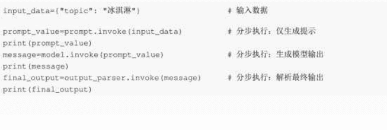

**运行结果如下：**


>> "为什么冰淇淋总是如此受欢迎？因为它很酷！"

##### 4. 高级用例：检索增强生成示例

LCEL 还可以支持更复杂的任务，比如使用检索增强生成（RAG）技术，在回答问题时引入外部知识。示例代码如下：

```python

from langchain_community.vectorstores import DocArrayInMemorySearch 

from langchain_core.runnables import RunnableParallel

from langchain_openai.embeddings import OpenAIEmbeddings

###### 创建向量存储

vectorstore=DocArrayInMemorySearch.from_texts(

    ["张三在腾讯工作", "熊猫喜欢吃竹子"],

    embedding=OpenAIEmbeddings() )

chain=(vectorstore | prompt) | model | output_parser  # 创建包含检索的链条

result=chain.invoke({"topic": "熊猫的饮食习惯"})          # 输入数据并执行链条

print(result)

## 打开增量输出
想让结果边生成边呈现，首先把 LLM 的流式开关打开。
```

**运行结果如下：**


>> 熊猫喜欢吃竹子。这是一种独特的饮食习惯。

这个例子中，LCEL 通过管道符号实现了数据的多步骤流动，包括检索相关信息和生成最终回答。

#### 7.1.2 LCEL 流式处理实现

流式处理是一种能够在数据不断生成的同时逐步处理的技术，广泛应用于实时数据处理和高并发场景。LangChain 中的表达式语言提供了强大的流式处理支持，使得开发者可以在数据尚未完全生成时便开始处理，从而提升了响应速度并优化了资源利用。在对话系统、实时监控等场景中，流式处理尤其重要，它可以让系统以更低的延迟响应用户需求。

下面将详细讲解如何在 LCEL 中实现流式处理，包括流式数据的初始化、配置、数据流的逐步接收与处理方法。

##### 1. 初始化流式处理

在 LangChain 中，使用流式处理功能可以让语言模型逐步生成并返回数据。通过指定流式处理的相关参数，可以将生成的文本逐步传递给处理模块。为了使用流式处理功能，需要在语言模型调用中启用流式选项。

初始化流式生成的示例代码如下：

```python

from langchain.llms import OpenAI

###### 初始化语言模型，启用流式处理

llm =OpenAI(model_name="text-davinci-003", stream=True)

## 逐块打印
最直接的做法是遍历返回的分块，从 choices 取出文本实时输出。
```

在该示例中，设置 `stream=True` 使得模型以流式方式生成输出。在这种模式下，生成的内容会被逐步传递到系统的处理管道中，以便后续操作可以实时接收生成的数据。

##### 2. 配置流式处理回调函数

为了处理流式数据，可以使用回调函数逐步接收生成的内容。在 LangChain 中，可以定义一个回调函数，用于在每次接收到生成内容时处理数据。例如，可以在回调函数中实时显示生成内容，或者执行其他自定义操作。

配置流式处理回调函数的示例代码如下：

```python

###### 定义回调函数，用于处理流式生成的内容

def stream_callback(response):

    for chunk in response:

        print("流式内容:", chunk["choices"][0]["text"], end="")

####### 示例：请求生成内容并处理流式输出

prompt = "请简要描述机器学习的原理。"

response=llm(prompt, callback=stream_callback)

## 同时累加
既看过程又要整段结果，可在回调里累加内容，每轮打印分块，最后打印汇总。
```

在此示例中，`stream_callback` 函数接收生成的内容块 `chunk`，并逐步输出。通过这种方式，用户可以在内容生成过程中实时看到生成结果。

##### 3. 处理流式生成的分片数据

处理流式分片数据的示例代码如下：

```python

def aggregate_streamed_data(response):

  full_content=""

  for chunk in response:

    content=chunk['choices'][0]['text']

    full_content += content

    print("当前分片内容:", content)

  print("完整生成内容:", full_content)

###### 示例：请求生成内容并汇总流式输出

response=llm(prompt, callback=aggregate_streamed_data)

## 带记忆的对话流
ConversationChain 配合 ConversationBufferMemory 能保留历史，开启流式后用回调实现即时反馈。
```

在该示例中，`aggregate_streamed_data` 回调函数将每次接收到的分片内容进行累加，最终得到完整的生成结果。通过这种方法可以在内容生成过程中实时更新生成状态，并在生成完成后获得完整输出。

##### 4. 在实时对话系统中的应用

流式处理在实时对话系统中非常有用，它可以使系统在生成内容时实时反馈给用户。例如，在用户与模型进行多轮对话时，流式生成可以让用户逐步接收到回答内容，而不必等待整个回答完成。

在实时对话系统中实现流式反馈的示例代码如下：

```python

from langchain.chains import ConversationChain

from langchain.memory import ConversationBufferMemory

###### 创建带流式处理的对话链

memory=ConversationBufferMemory()

conversation_chain=ConversationChain(llm=llm, memory=memory, stream=True)

###### 定义回调函数，逐步反馈生成内容

def real_time_feedback(response):

  for chunk in response:

    print("流式对话回复:", chunk['choices'][0]['text'], end="")

####### 示例对话流式生成

user_input="你能简单介绍一下深度学习吗？"

response=conversation_chain.run(user_input, callback=real_time_feedback)

## 打字机节奏控制
在输出后加入短暂休眠，可模拟打字机效果，延迟数值自行调节。
```

在该示例中，`ConversationChain` 使用流式处理模式实时生成回复，并通过 `real_time_feedback` 函数逐步显示生成的内容。这种实现方式适合实时对话系统，可以显著降低响应延迟，提升用户体验。

##### 5. 控制流式处理的速度

在流式生成中，数据传输速度可以通过设置时间间隔来控制。比如，可以通过加入延时控制，让生成的内容逐步显示，以模拟实时生成的效果。这在演示或用户体验优化中非常实用。

控制流式处理的速度的示例代码如下：

```python

import time

###### 定义带延迟的回调函数

def delayed_streaming(response, delay=0.5):

    for chunk in response:

        print("流式内容:", chunk["choices"][0]["text"], end="")

        time.sleep(delay) # 控制生成显示的速度

####### 示例生成内容并设置延迟

response=llm(prompt, callback=lambda x: delayed_streaming(x, delay=0.3))

## 并行任务准备
多任务同时跑时，先引入必要的组件。
```

在该示例中，`delayed_streaming` 函数通过在每次显示生成内容后增加 `time.sleep(delay)` 来控制生成的速度。设置合理的延迟值可以优化生成显示的节奏，使流式生成更加平滑。

LCEL 的流式处理实现可以用于以下应用场景：

（1）实时对话系统：在用户输入后逐步生成内容，显著降低响应延迟。

（2）内容生成平台：如写作助手等工具，可以实时反馈生成内容，提升用户体验。

（3）数据流分析：在数据逐步生成和传输的过程中，对数据进行实时分析和处理。

通过流式处理技术，LangChain 能够将内容逐步输出到用户端，实现即时响应和反馈。这种机制可以提高系统的响应速度，优化用户体验，尤其适合需要实时交互的企业级应用。

### 7.2 LCEL 并行执行优化

在企业级应用中，面对大量请求和复杂任务，并行执行是一种有效的性能优化方法。LCEL 提供的并行执行模式允许开发者将多个任务整合成一个表达式，并行调用各个组件，如模型生成、数据检索、API 请求等，从而缩短执行时间。这种方式特别适合处理高并发和计算密集型的场景，使得 LCEL 在复杂任务流的开发中表现出色。

本节将深入介绍 LCEL 的并行执行优化，包括如何使用 RunnableParallel 来构建并行任务流，并详细演示其在高效管理多任务执行的场景下的应用。

#### 7.2.1 多任务并行执行策略

在 LangChain 表达式语言中，并行执行任务是一种显著提升处理效率的策略。通过并行执行，多个任务能够在相同的时间段内独立运行，大大缩短了整体执行时间。LCEL 提供了 RunnableParallel 组件，简化了并行任务流的设置与执行。

1．初始化 LangChain 环境

在开始执行并行任务之前，需要确保环境中正确配置了 LangChain 相关库。可以通过以下代码进行初始化：

```python

from langchain_openai import ChatOpenAI

from langchain_core.prompts import ChatPromptTemplate

from langchain_core.output_parsers import StrOutputParser

from langchain_core.runnables import RunnableParallel

## 模型与模板
共享同一个 ChatOpenAI 实例，准备若干提示模板，解析统一使用 StrOutputParser。
```

该配置包含了基本的组件：ChatOpenAI 用于模型调用，ChatPromptTemplate 用于创建提示词模板，StrOutputParser 用于解析模型输出，而 RunnableParallel 则用于执行并行任务。

2．设置任务组件

首先，定义用于并行执行的任务组件。在本示例中，将设置多个模型生成任务，每个任务生成特定内容，并行运行。以下代码将演示如何创建模型和提示词模板。

```python

#### 初始化模型

model=ChatOpenAI(model="gpt-4")

##### 创建多个提示词模板

prompt1=ChatPromptTemplate.from_template("请解释机器学习的基本概念。")

prompt2=ChatPromptTemplate.from_template("深度学习和机器学习的区别是什么？")

prompt3=ChatPromptTemplate.from_template("人工智能有哪些主要应用？")

#定义输出解析器

output_parser=StrOutputParser()

## 组装并行流
把任务以键值对形式交给调度器统一编排。
```

3．构建并行任务流

使用 RunnableParallel 来构建并行任务流。RunnableParallel 可以接收一组任务，将它们并行执行。这里的任务将包括多个提示词模板和模型组合。

构建并行任务流的示例代码如下：

```python

#使用RunnableParallel构建并行任务流

parallel_tasks=RunnableParallel(

    {

        "task1": prompt1 | model | output_parser,

        "task2":prompt2|model|output_parser,

        "task3":prompt3|model| output_parser

    }

)

## 一次触发
单次调用即可拿到全部结果。
```

在这段代码中，通过管道符号（|）将每个提示词模板与模型和输出解析器连接起来，并赋予任务名称（task1、task2、task3），然后传递给 RunnableParallel。每个任务可以独立运行，彼此之间互不影响。

4．执行并行任务

一旦定义了任务流，就可以调用 parallel_tasks.invoke() 方法来并行执行任务，示例代码如下:

```python

###### 执行并行任务

results=parallel_tasks.invoke({})

###### 输出结果

for task_name, result in results.items():

    print(f"{task_name} 生成内容：{result}")

## 动态生成任务
主题来自列表时，用循环自动映射，避免重复手写。
```

通过 parallel_tasks.invoke({}) 调用，所有任务将并行运行，并返回一个包含所有任务结果的字典。每个任务的结果可以通过字典键值对的形式访问和输出。

5．动态任务生成

在更复杂的场景中，可以根据输入动态创建任务。例如，假设有一个主题列表，需要对每个主题生成一个模型回复，可以动态生成任务列表并传递给 RunnableParallel，示例代码如下:

```python

###### 定义主题列表

topics=["机器学习", "深度学习", "人工智能"]

####### 动态创建任务列表

dynamic_tasks=[

    f"task_{i+1}": ChatPromptTemplate.from_template(

        f"请解释{topic}的基本概念。"

    ) |model|output_parser

    for i, topic in enumerate(topics)

]

# 使用RunnableParallel执行动态任务

parallel_dynamic_tasks=RunnableParallel(dynamic_tasks)

dynamic_results=parallel_dynamic_tasks.invoke({})

###### 输出结果

for task_name, result in dynamic_results.items():

    print(f"{task_name} 生成内容：{result}")

## 批处理封装
需要批量执行或统一处理异常时，可用 batch 包裹之前的并行流程。
```

在此示例中，首先根据 topics 列表动态生成任务列表，使得每个任务能够接收不同的主题；然后通过 RunnableParallel 并行运行这些任务，输出每个任务生成的内容。

6．并行任务的错误管理

在执行并行任务时，某些任务可能会因为各种原因失败。可以在 LCEL 中为每个任务设置错误处理机制，确保即使单个任务失败，也不会影响整个任务流。

LCEL 批处理并行任务


在此示例中，通过 safe_task 函数捕获每个任务中的异常，避免某个任务失败而导致整个并行任务中断。结果会包含任务的成功输出或错误信息。

7．批处理并行任务

在需要同时处理大量任务的情况下，可以通过批处理并行任务实现更高效的执行。LCEL 支持使用批处理模式，将多个任务批量执行。

##### 批处理任务示例
```python

from langchain_core.runnables import batch

##### 定义批处理并行任务

batched_parallel_tasks=batch(parallel_tasks_with_error_handling)

##### 执行批处理任务

batched_results=batched_parallel_tasks.invoke({})

for task_name, result in batched_results.items():

    print(f"{task_name} 生成内容：{result}")

常用依赖汇总：
```

下面演示一个完整的示例，该示例将所有功能整合在一个脚本中，包括模型初始化、动态任务创建、错误管理和批量并行处理，最后通过一个测试函数运行所有并行任务，并输出结果。

```python

from langchain_openai import ChatOpenAI

from langchain_core.prompts import ChatPromptTemplate

from langchain_core.output_parsers import StrOutputParser

from langchain_core.runnables import RunnableParallel, batch

从单链起步，逐步叠加检索、增量输出、会话记忆、并行与批处理，基本覆盖 LangChain 日常开发的核心模式，先跑通基础再加增强，交互体验会明显提升。

# LangChain 并行任务实战拆解

下面给出一个精简却完整的示例，演示如何把多条 Prompt 并行投放、按主题动态生成任务、加入异常兜底以及实现批量调用，方便你直接搬用到自有项目中。

#### 创建模型实例
model=ChatOpenAI(model="gpt-4")

##### 设置输出解析器
output_parser=StrOutputParser()

##### 准备三组提示词
prompt1=ChatPromptTemplate.from_template("请解释机器学习的基本概念。")

prompt2=ChatPromptTemplate.from_template("深度学习和机器学习的区别是什么？")

prompt3=ChatPromptTemplate.from_template("人工智能有哪些主要应用？")

##### 搭建固定并行流
parallel_tasks=RunnableParallel(

    { "task1": prompt1 | model | output_parser,

      "task2": prompt2 | model | output_parser,

      "task3": prompt3 | model | output_parser }

)

##### 基于列表动态生成任务
topics=["机器学习", "深度学习", "人工智能"]

dynamic_tasks={

    f"task_{i+1}": ChatPromptTemplate.from_template(

        f"请解释{topic}的基本概念。") | model | output_parser

    for i, topic in enumerate(topics)

}

parallel_dynamic_tasks=RunnableParallel(dynamic_tasks)

##### 编写安全执行包装
def safe_task(task):

    try:

        return task.invoke({})

    except Exception as e:

        return f"任务失败：{e}"

###### 组合带容错的并行流
parallel_tasks_with_error_handling=RunnableParallel(

    {

        "task1": lambda: safe_task(prompt1 | model | output_parser),

        "task2": lambda: safe_task(prompt2 | model | output_parser),

        "task3": lambda: safe_task(prompt3 | model | output_parser)

    }

)

##### 启用批量执行模式
batched_parallel_tasks=batch(parallel_tasks_with_error_handling)

##### 定义统一测试入口
def test_all_tasks():

    print("执行基础并行任务流:")

    results=parallel_tasks.invoke({})

    for task_name, result in results.items():

        print(f"{task_name} 生成内容：{result}")

    print("\n执行动态并行任务流:")

    dynamic_results=parallel_dynamic_tasks.invoke({})

    for task_name, result in dynamic_results.items():

        print(f"{task_name} 生成内容：{result}")

    print("\n执行带错误管理的并行任务流:")

    results_with_error_handling=(

        parallel_tasks_with_error_handling.invoke({}))

    for task_name, result in results_with_error_handling.items():

        print(f"{task_name} 生成内容：{result}")

    print("\n执行批处理并行任务流:")

    batched_results=batched_parallel_tasks.invoke({})

    for task_name, result in batched_results.items():

        print(f"{task_name} 生成内容：{result}")

##### 执行全部测试
test_all_tasks()
```

执行此代码后，输出应包括每个并行任务的生成内容或错误信息，具体输出取决于 API 响应：

```python

>> 执行基础并行任务流：

>> task1 生成内容：机器学习是通过数据训练模型的技术。

>> task2 生成内容：深度学习是机器学习的一种，强调神经网络的多层结构。

>> task3 生成内容：人工智能的主要应用包括图像识别、自然语言处理和自动驾驶等。

>> 

>> 执行动态并行任务流：

>> task_1 生成内容：机器学习是一种自动化数据分析的方法。

>> task_2 生成内容：深度学习在复杂数据处理上具有优势。

>> task_3 生成内容：人工智能在医疗、金融、交通等领域应用广泛。

>> 

>> 执行带错误管理的并行任务流：

>> task1 生成内容：机器学习是通过数据训练模型的技术。

>> task2 生成内容：深度学习是机器学习的一种，强调神经网络的多层结构。

>> task3 生成内容：人工智能的主要应用包括图像识别、自然语言处理和自动驾驶等。

>> 

>> 执行批处理并行任务流：

>> task1 生成内容：机器学习是通过数据训练模型的技术。

>> task2 生成内容：深度学习是机器学习的一种，强调神经网络的多层结构。

>> task3 生成内容：人工智能的主要应用包括图像识别、自然语言处理和自动驾驶等。 
```

> **提示** 请在本地环境中测试并配置好 API 密钥和 LangChain 库，并在一个 Python 文件中运行，以确保上述代码正常执行并返回预期结果。

通过掌握 LCEL 的多任务并行执行策略，开发者可以有效地提升 LangChain 应用的执行效率。结合 RunnableParallel 和批处理，多任务管理在企业级应用中可以实现更高效的资源分配和任务执行管理。

#### 7.2.2 LCEL 并行执行

在 LangChain 的表达式语言中，并行执行是一种关键的性能优化策略。通过并行处理多个任务，可以显著减少总执行时间，特别适用于高并发和复杂任务的场景。LCEL 提供了 RunnableParallel 和 batch 等工具，便于开发者创建和管理并行任务流。

下面将详细讲解如何通过 LCEL 实现多任务并行执行，包括基础的并行任务配置、批量处理、动态任务创建以及错误处理。

#### 1．初始化并行任务的组件

首先，定义并行任务所需的基本组件，包括提示词模板、语言模型以及输出解析器。

```python

from langchain_openai import ChatOpenAI

from langchain_core.prompts import ChatPromptTemplate

from langchain_core.output_parsers import StrOutputParser

from langchain_core.runnables import RunnableParallel

#### 初始化模型

model=ChatOpenAI(model="gpt-4")

###### 创建不同任务的提示词模板

prompt1=ChatPromptTemplate.from_template("请解释机器学习的基本概念。")

prompt2=ChatPromptTemplate.from_template("深度学习和机器学习的区别是什么？")

prompt3=ChatPromptTemplate.from_template("列出人工智能的主要应用。")

###### 初始化输出解析器

output_parser=StrOutputParser()
```

每个提示词模板代表一个独立任务，可以在并行任务中同时运行。

#### 2．构建并行任务流

使用 RunnableParallel 将多个任务打包成一个并行任务流。每个任务包括一个提示词模板、模型调用和输出解析器。

```python

#构建并行任务流

parallel_tasks=RunnableParallel({

    "task1": prompt1 | model | output_parser,

    "task2": prompt2 | model | output_parser,

    "task3": prompt3 | model | output_parser })
```

在这里，通过管道符号 (|) 将每个提示词模板与模型和输出解析器连接成一个流，并通过 RunnableParallel 并行执行。

#### 3．执行并行任务

一旦并行任务流构建完成，就使用 invoke 方法执行所有任务。所有任务会在同一时间启动并同时运行。

```python

###### 执行并行任务

results=parallel_tasks.invoke()

###### 输出结果

for task_name, result in results.items():

    print(f"{task_name} 生成内容：{result}")
```

该代码会在所有任务完成后输出每个任务的生成结果。

#### 4．处理批量输入的并行任务

对于需要批量处理多个输入的情况，可以使用 `batch` 方法在多个输入数据上重复执行同一个任务流。

```python

from langchain_core.runnables import batch

batched_parallel_tasks=batch(parallel_tasks)  # 定义批量并行任务

###### 执行批量并行任务

batched_results=batched_parallel_tasks.invoke([{}, {}, {}])  # 示例中使用3个空输入

for index, result in enumerate(batched_results):

    print(f"批次 {index+1} 的结果:")

    for task_name, output in result.items():

        print(f"{task_name}: {output}")
```

#### 5．在并行任务中集成错误处理

在并行任务执行中，某些任务可能会遇到错误。可以在 LCEL 中加入错误处理机制，以确保任务流的稳定性。

```python

###### 定义安全的任务执行函数

def safe_task(task):

    try:

        return task.invoke({})

    except Exception as e:

        return f"任务失败：{e}"

###### 设置带错误处理的并行任务流

safe_parallel_tasks=RunnableParallel(

    {

        "task1": lambda: safe_task(prompt1 | model | output_parser),

        "task2": lambda: safe_task(prompt2 | model | output_parser),

        "task3": lambda: safe_task(prompt3 | model | output_parser)

    }

)

###### 执行带错误处理的并行任务

safe_results=safe_parallel_tasks.invoke([])

for task_name, result in safe_results.items():

    print(f"{task_name} 输出内容：{result}")
```

在该代码中，`safe_task` 函数会捕获每个任务中的异常，防止因某个任务的错误而导致整个并行任务中断。

#### 6．动态创建并行任务

LCEL 还支持基于输入数据动态创建并行任务，适用于任务需求随着输入变化的场景。

##### 7. 测试所有并行任务功能

最后，创建一个测试函数，整合上述所有并行任务执行策略，便于一次性测试全部功能。

```python

def test_parallel_execution():

    print("执行基础并行任务流:")

    results = parallel_tasks.invoke({})

    for task_name, result in results.items():

        print(f"{task_name} 输出内容：{result}")

    print("\n执行批量并行任务流:")

    batched_results = batched_parallel_tasks.invoke([{}, {}, {}])

    for index, result in enumerate(batched_results):

        print(f"批次 {index+1} 的结果:")

        for task_name, output in result.items():

            print(f"  {task_name}: {output}")

    print("\n执行带错误处理的并行任务流:")

    safe_results = safe_parallel_tasks.invoke({})

    for task_name, result in safe_results.items():

        print(f"{task_name} 输出内容：{result}")

    print("\n执行动态生成的并行任务流:")

    dynamic_results = parallel_dynamic_tasks.invoke({})

    for task_name, result in dynamic_results.items():

        print(f"{task_name} 输出内容：{result}")

####### 运行测试函数

test_parallel_execution()
```

运行 `test_parallel_execution()` 后，将依次执行每个并行任务流，包括基础并行任务、批量处理任务、带错误管理的任务以及动态任务生成，并输出相应的结果。

通过掌握 LCEL 并行执行策略，开发者可以显著提升 LangChain 的执行效率，为企业级应用提供强大的并行处理能力。

### 7.3 回退机制的设计与实现

在复杂的 LangChain 应用中，调用 LLM 可能会遇到各种错误，例如 API 速率限制、网络超时或模型响应不符合预期。回退机制允许在遇到错误时自动切换到备用模型或任务，确保系统的稳定性和连续性。LCEL 通过 `with_fallbacks` 方法支持回退机制，使开发者能够优雅地处理各种故障点。

本节将详细讲解如何设计和实现回退机制。

#### 1. 初始化模型和回退模型

假设系统使用 `ChatOpenAI` 作为主要模型，同时配置 `ChatAnthropic` 作为备用模型，以便在遇到错误时自动切换。下面开始实现回退机制。

首先，导入模型并设置主要模型。

```python

from langchain_openai import ChatOpenAI

from langchain_community.chat_models import ChatAnthropic

###### 初始化主模型并关闭自动重试，以便快速触发错误

primary_model = ChatOpenAI(max_retries=0)

fallback_model = ChatAnthropic()

###### 配置主模型的回退模型

model_with_fallback = primary_model.with_fallbacks([{fallback_model}])
```

此代码配置了主模型 `primary_model`，并设置了备用模型 `fallback_model`。当主模型遇到不可恢复的错误时，系统将自动调用备用模型。

#### 2. 模拟 API 错误

为了测试回退机制，可以使用 `unittest.mock` 库模拟 API 错误，例如速率限制错误。以下代码将展示如何触发错误并观察回退机制的工作。

```python

from unittest.mock import patch

from openai import RateLimitError

##### 创建一个速率限制错误示例

error = RateLimitError("rate limit exceeded")

##### 模拟 API 错误并测试回退机制

with patch("openai.ChatCompletion.create", side_effect=error):

    try:

        response = model_with_fallback.invoke("什么是机器学习？")

        print("回退成功，输出内容:", response)

    except RateLimitError:

        print("回退机制失败")

生产级 LLM：容错降级与全链路观测

把大模型从实验搬到线上，考验的不是单次回答的好坏，而是异常到来时能否保持可用，以及上线后能否快速定位问题。LangChain 负责在链路层面做自动切换，LangSmith 负责把调用过程完整记录下来，两者配合能让服务更稳、也更透明。

先看最基础的兜底思路。把提示模板和具备备选能力的模型串成一条执行流，首选路径失效时自动走向备用分支，上层业务不需要写额外的分支逻辑。
```

在该代码中，使用 `patch` 方法模拟 `RateLimitError`，系统会在遇到该错误时自动切换到备用模型 `fallback_model`，并输出回退模型的结果。

#### 3. 结合回退机制的提示词模板

LCEL 的回退机制可以与提示词模板结合使用，从而构建更强大的任务流。在以下示例中，将提示词模板与带有回退的模型连接起来，确保在任务流中使用回退。

```python

from langchain_core.prompts import ChatPromptTemplate

##### 定义提示词模板

prompt = ChatPromptTemplate.from_template("请解释 {topic} 的基本概念。")

##### 将提示词模板和回退模型组合起来

chain_with_fallback = prompt | model_with_fallback

##### 测试任务流

with patch("openai.ChatCompletion.create", side_effect=error):

    try:

        response = chain_with_fallback.invoke({"topic": "机器学习"})

        print("回退成功，生成内容：", response)

    except RateLimitError:

        print("回退机制失败")

如果只想对特定异常做切换，可以显式限定捕获范围，避免把所有错误都吞掉，这在生产里更可控。
```

当主模型触发错误时，任务会自动回退到备用模型并输出结果。这种方式可以确保整个任务链的连续性。

#### 4. 指定错误类型进行回退

有时需要指定特定的错误类型来触发回退机制，可以使用 `exceptions_to_handle` 参数限定回退的错误类型，例如仅在出现 `RateLimitError` 时触发回退，而忽略其他错误。

```python

##### 配置指定错误类型触发的回退

model_with_specific_fallback = primary_model.with_fallbacks(

    [fallback_model],

    exceptions_to_handle=(RateLimitError),

)

##### 测试指定错误类型的回退

with patch("openai.ChatCompletion.create", side_effect=error):

    try:

        response = model_with_specific_fallback.invoke("什么是深度学习？")

        print("回退成功，生成内容：", response)

    except RateLimitError:

        print("回退机制失败")

工程实践中提示、模型、解析器常被打包在一起。主备两条链路共用同一解析逻辑，切换时输出形态保持一致，减少下游适配成本。
```

在此示例中，只有在触发 `RateLimitError` 时系统才会切换到备用模型，其他错误不会触发回退。

#### 5. 在序列链中应用回退机制

对于多模型或多步骤的任务链，LCEL 支持为整个任务序列配置回退机制。可以在序列链中设置多个回退模型，当一个模型失败时自动切换到下一个模型。

```python

from langchain_core.output_parsers import StrOutputParser

##### 定义提示词模板和模型链

prompt = ChatPromptTemplate.from_template("解释 {topic} 的重要性。")

output_parser = StrOutputParser()

##### 创建带有回退的模型链

primary_chain = prompt | primary_model | output_parser

backup_chain = prompt | fallback_model | output_parser

##### 使用 RunnableParallel 构建带回退的多模型链

chain_with_fallback_sequence = primary_chain.with_fallbacks([backup_chain])

##### 测试带回退的序列链

with patch("openai.ChatCompletion.create", side_effect=error):

    try:

        result = chain_with_fallback_sequence.invoke({"topic": "人工智能"})

        print("回退成功，生成内容：", result)

    except RateLimitError:

        print("回退机制失败")

把基础降级、带模板的任务流、限定异常的降级、序列链降级收进同一校验函数，可以一次性确认各类场景是否按预期生效。
```

在该示例中，`primary_chain` 和 `backup_chain` 分别配置了不同的模型，当 `primary_chain` 失败时，系统将自动切换到 `backup_chain`。

#### 6. 综合测试回退机制的完整函数

将以上步骤综合为一个完整的测试函数，方便在多场景下验证回退机制。

```python

def test_fallback_mechanism():

    print("测试回退机制的设计与实现:")

###### 模拟速率限制错误

with patch("openai.ChatCompletion.create",

           side_effect=RateLimitError("rate limit exceeded")):

    try:

        # 基本回退测试

        response = model_with_fallback.invoke("什么是机器学习？")

        print("基本回退成功，输出内容：", response)

    except RateLimitError:

        print("基本回退机制失败")

###### 结合提示词模板的回退

try:

    response = chain_with_fallback.invoke({"topic": "机器学习"})

    print("任务流回退成功，生成内容：", response)

except RateLimitError:

    print("任务流回退机制失败")

###### 指定错误类型的回退

try:

    response = model_with_specific_fallback.invoke("什么是深度学习？")

    print("指定错误回退成功，生成内容：", response)

except RateLimitError:

    print("指定错误回退机制失败")

###### 多模型序列链的回退

try:

    result = chain_with_fallback_sequence.invoke({"topic": "人工智能"})

    print("序列链回退成功，生成内容：", result)

except RateLimitError:

    print("序列链回退机制失败")

###### 执行测试函数

test_fallback_mechanism()

有了容错，还需要可观测性来支撑迭代。先安装 LangSmith。
```

根据 API 的实际配置，运行结果如下:

> 测试回退机制的设计与实现:
> 基本回退成功，输出内容：机器学习是一种通过数据训练模型的技术。
> 任务流回退成功，生成内容：机器学习是一种通过数据训练模型的技术。
> 指定错误回退成功，生成内容：深度学习是一种特定的机器学习方法，适合复杂数据。
> 序列链回退成功，生成内容：人工智能在医疗、金融等领域有重要应用。

回退机制是确保 LangChain 应用稳定性的重要工具，通过为模型、任务链等配置备用模型或任务，开发者能够有效地管理错误，提升系统的可靠性。掌握了回退机制的设计与实现，就可以应对多样的故障情况，使应用在复杂环境中稳定运行。

### 7.4 LCEL 与 LangSmith 集成

LangChain 表达式语言和 LangSmith 的集成为开发者提供了更高效的任务管理和执行跟踪功能。LangSmith 作为 LangChain 的监控和分析模块，能够记录和分析每个任务的执行情况，为开发者优化任务流提供详实的数据支持。

通过与 LangSmith 的集成，LCEL 不仅可以执行任务，还可以实时追踪任务的性能表现、错误记录和运行结果。这种集成在复杂的企业级应用中尤为重要，有助于开发者识别并优化瓶颈环节，提升整体系统的稳定性和效率。

#### 7.4.1 LangSmith 入门

LangSmith 是一个面向生产级 LLM 应用的监控与评估平台。通过 LangSmith，开发者可以跟踪和评估应用的执行情况，快速定位问题和优化任务流程。下面将介绍 LangSmith 的入门步骤，包括安装 LangSmith、API 密钥设置、配置环境变量、首次追踪任务的记录和测试评估，为构建稳定高效的 LangChain 应用奠定基础。

##### 1. 安装 LangSmith

在 Python 环境中，可以使用以下命令安装 LangSmith 库:

```bash

pip install -U langsmith

打开追踪并配置凭证，后续请求会自动被采集。
```

此命令将安装最新版本的 LangSmith，为后续操作做好准备。

##### 2. 创建 API 密钥

要使用 LangSmith，需要创建 API 密钥，读者可自行访问 LangSmith 官方网站（见图 7-1），注册账号后单击"Generate API key"按钮创建新的 API 密钥，如图 7-2 所示。保存好 API 密钥后，就可以正式进入控制台页面，如图 7-3 所示。

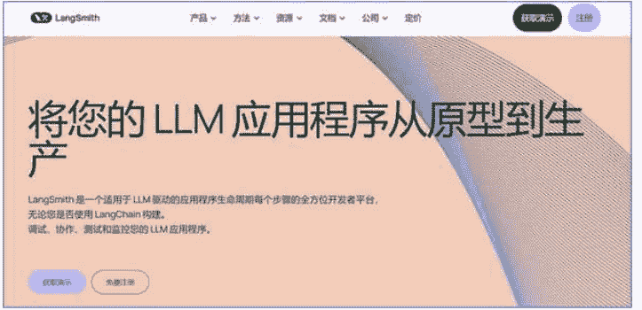

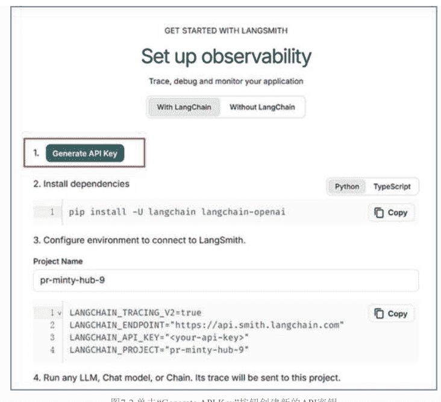

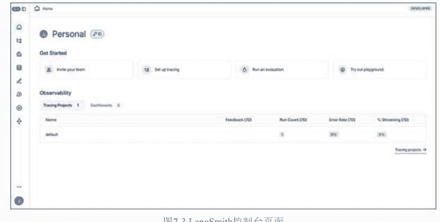

##### 3. 配置环境变量

在终端中设置环境变量，将 API 密钥和其他设置加载到运行环境中。

```bash

export LANGCHAIN_TRACING_V2=true

export LANGCHAIN_API_KEY=<your-api-key>

export OPENAI_API_KEY=<your-openai-api-key>

用包装后的客户端配合 traceable 装饰器，单次调用即可保留完整的输入输出与耗时，便于复盘。
```

其中，`LANGCHAIN_TRACING_V2=true` 表示启用 LangSmith 的追踪功能；`LANGCHAIN_API_KEY` 为 LangSmith 的 API 密钥；`OPENAI_API_KEY` 则是 OpenAI 的 API 密钥，用于调用大语言模型。

##### 4. 记录第一个任务追踪

LangSmith 支持执行自动追踪任务。下面的代码示例将展示如何在 LangChain 任务中启用 LangSmith 追踪功能。

```python

import openai

from langsmith.wrappers import wrap_openai

from langsmith import traceable

###### 包装 OpenAI 客户端以启用追踪

client = wrap_openai(openai.Client())

####### 使用 traceable 装饰器自动追踪任务

@traceable

def pipeline(user_input: str):

    result = client.chat.completions.create(

        messages=[{"role": "user", "content": user_input}],

        model="gpt-3.5-turbo"

    )

    return result.choices[0].message.content

####### 运行追踪任务

response = pipeline("什么是机器学习？")

print("生成内容:", response)

追踪之外还需要量化评估。先准备包含输入与期望输出的数据集，再定义判分器即可批量跑实验。
```

在此代码中：

1. `wrap_openai` 方法包装了 OpenAI 客户端，以启用 LangSmith 的自动追踪功能。
2. `@traceable` 装饰器用于标记需要追踪的函数 `pipeline`。
3. 执行追踪任务后，任务的执行情况将自动记录到 LangSmith，可在 LangSmith 控制台查看详细的追踪数据。

##### 5. 执行第一个任务评估

LangSmith 提供了评估功能，用于测试任务输出是否符合预期。以下是一个示例评估过程:

```python

from langsmith import Client

from langsmith.evaluation import evaluate

####### 初始化 LangSmith 客户端

client = Client()

###### 创建数据集，包含输入和预期输出的测试数据

dataset_name = "示例数据集"

dataset = client.create_dataset(dataset_name,

                               description="LangSmith 示例数据集")

client.create_examples(

    inputs=[{"postfix": "到 LangSmith"}, {"postfix": "到 LangSmith 评估"}],

    outputs=[{"output": "欢迎来到 LangSmith"}, {"output": "欢迎来到 LangSmith 评估"}],

    dataset_id=dataset.id

)

###### 定义评估方法

def exact_match(run, example):

    return run.outputs["output"] == example.outputs["output"]

###### 执行评估

experiment_results = evaluate(

    lambda input: "欢迎 " + input['postfix'],

    data=dataset_name,

    evaluators=[exact_match],

    experiment_prefix="示例实验",

    metadata={"version": "1.0.0", "revision_id": "beta"}

)

print("评估结果:", experiment_results)

真实场景多为多步串行。用 traceable 包裹整个流程，每一步调用会被自动关联，形成可追溯的执行树。
```

在此代码中：

（1）client.create_dataset 方法创建一个包含测试输入和预期输出的示例数据集。

（2）exact_match 函数检查任务输出是否与预期输出一致。

（3）evaluate 函数接收任务逻辑（一个简单的字符串拼接操作）、数据集名称和评估方法，输出测试结果。

完成以上配置和测试后，可以在 LangSmith 的控制台中查看所有任务的执行和评估数据，包括执行时间、出错情况和准确性分数。

LangSmith 的追踪与评估集成在 LangChain 开发中，为开发者提供了清晰的性能分析视图，有助于诊断问题并优化任务。

#### 7.4.2 LangSmith 的初步应用

在完成 LangSmith 的基本配置后，可以进一步应用其追踪和评估功能，深入分析和优化 LangChain 应用。LangSmith 通过追踪数据流、分析模型性能、记录执行错误等功能帮助开发者提升任务流的稳定性与效率。下面将从数据追踪、任务优化以及评估入手，逐步展示如何将 LangSmith 应用于实际开发中。

##### 1. 追踪任务流的执行情况

LangSmith 的主要功能之一是追踪任务流的执行。通过追踪，开发者可以清晰了解每个步骤的执行时间、输入输出数据和出错情况。以下代码将展示如何使用 LangSmith 追踪一个包含多个步骤的任务流。

```python

import openai

from langsmith import traceable, wrap_openai

####### 包装 OpenAI 客户端以支持 LangSmith 追踪

client = wrap_openai(openai.Client())

###### 定义多步骤任务流

@traceable

def process_pipeline(user_input: str):

    # 步骤 1:生成初始回复

    step1 = client.chat.completions.create(

        model="gpt-3.5-turbo",

        messages=[{"role": "user", "content": user_input}]

    )

    initial_response = step1.choices[0].message.content

    # 步骤 2:对生成内容进行总结

    step2 = client.chat.completions.create(

        model="gpt-3.5-turbo",

        messages=[{"role": "user",

                    "content": f"总结以下内容:{initial_response}"}])

    summary_response = step2.choices[0].message.content

    return {"initial_response": initial_response,

            "summary_response": summary_response}

###### 执行任务并自动追踪

results = process_pipeline("什么是机器学习？")

print("任务执行结果:", results)

从原型到生产：让大模型调用可监控、可兜底、可验证

把一次成功的演示变成稳定运行的服务，关键在速度、容错和可度量。下面的几段示范展示了如何用 LangSmith 把提速、切换和批量校验串起来。

### 让响应更快更轻
先用偏确定的采样得到初稿，再用压缩指令把输出压到很短。温度调低可以减少探索带来的波动，第二次调用限制最大 token 并让模型做摘要，整体耗时和成本都下来。函数会同时返回初稿和摘要，方便对比。

```

在该代码中：

> （1）wrap_openai 函数包装 OpenAI 客户端，使其支持 LangSmith 追踪。
>
> （2）process_pipeline 函数定义了一个包含两个步骤的任务流，分别生成初始回复和总结回复。
>
> （3）@traceable 装饰器自动记录每个步骤的执行情况，结果可以在 LangSmith 的控制台中查看。

##### 2. 识别并优化慢速任务

通过 LangSmith 的数据追踪，可以识别任务流中的瓶颈环节。例如，执行过程中过长的步骤可以通过优化模型参数或更换模型来改善效率。以下示例将展示如何调整参数来提升性能。

```python

@traceable

def optimized_pipeline(user_input: str):

    # 优化步骤 1：设置较低的温度以减少生成时间

    step1 = client.chat.completions.create(

        model="gpt-3.5-turbo",

        temperature=0.3,  # 降低温度

        messages=[{"role": "user", "content": user_input}]

    )

    initial_response = step1.choices[0].message.content

    # 优化步骤 2：使用模型裁剪或压缩方法（例如减少 token 长度）来加速

    step2 = client.chat.completions.create(

        model="gpt-3.5-turbo",

        max_tokens=50,  # 限制生成的 token 数

        messages=[{"role": "user",

                    "content": f"总结以下内容：{initial_response}"}]

    )

    summary_response = step2.choices[0].message.content

    return {"initial_response": initial_response,

            "summary_response": summary_response}

###### 执行优化后的任务流

optimized_results = optimized_pipeline("什么是机器学习？")

print("优化任务执行结果:", optimized_results)

### 给调用加个兜底
把 ChatOpenAI 设为第一选择并关闭自动重试，ChatAnthropic 作为备援。整个函数被标记为可记录，异常时打印提示并转向备援，调用链路仍能被完整记录。

```

在此代码中，通过调整生成参数（如温度和最大 token 数），减少了模型的计算开销，从而优化了任务流的执行速度。LangSmith 会记录调整前后的执行时间，帮助开发者量化优化效果。

##### 3. 设置回退模型以增强任务的稳定性

在实际应用中，LangSmith 支持结合回退模型确保任务的连续性。以下示例将展示如何设置回退模型，在主模型出现错误时自动切换到备用模型。

```python

from langchain_openai import ChatOpenAI

from langchain_community.chat_models import ChatAnthropic

###### 设置主模型和备用模型

primary_model = ChatOpenAI(max_retries=0)

fallback_model = ChatAnthropic()

####### 定义支持回退的任务流

@traceable

def pipeline_with_fallback(user_input: str):

    try:

        response = primary_model.invoke({"role": "user",

                                         "content": user_input})

    except Exception as e:

        print("主模型失败，切换至备用模型")

        response = fallback_model.invoke({"role": "user",

                                          "content": user_input})

    return response

###### 执行任务并记录追踪

fallback_results = pipeline_with_fallback("描述人工智能的应用场景")

print("回退任务执行结果:", fallback_results)

### 用固定样例做离线校验
通过 LangSmith 客户端新建名为 机器学习批量评估 的集合，说明写成 LangSmith 批量任务评估示例。写入两组带后缀的输入与期望输出，自定义一个完全匹配的评分器，把实际输出和样例输出一比一对照。evaluate 会遍历集合并汇总实验信息，实验前缀设为批量任务评估，元数据包含 version 1.0.0 和 revision_id beta，方便不同版本横向比较。

```

在此代码中：

> （1）pipeline_with_fallback 函数首先尝试调用主模型，当出现错误时自动切换到备用模型。
>
> （2）@traceable 装饰器记录每次调用和回退情况，可以在 LangSmith 中查看详细信息。

##### 4. 使用 LangSmith 进行批量评估

LangSmith 还支持批量任务的自动化评估。可以将一组输入数据和期望的输出数据集成到数据集中，LangSmith 将自动评估任务执行效果并生成详细报告。

```python

from langsmith import Client

from langsmith.evaluation import evaluate

####### 初始化 LangSmith 客户端

client = Client()

###### 创建数据集，包含批量输入和预期输出

dataset_name = "机器学习批量评估"

dataset = client.create_dataset(dataset_name, description="LangSmith 批量任务评估示例")

client.create_examples(

    inputs=[{"postfix": "到 LangSmith"}, {"postfix": "到 LangSmith 评估"}],

    outputs=[{"output": "欢迎来到 LangSmith"},

             {"output": "欢迎来到 LangSmith 评估"}],

    dataset_id=dataset.id,

)

###### 定义批量评估方法

def exact_match(run, example):

    return {"score": run.outputs["output"] == example.outputs["output"]}

###### 运行批量评估

experiment_results = evaluate(

    lambda input: "欢迎" + input['postfix'],

    data=dataset_name,

    evaluators=[exact_match],

    experiment_prefix="批量任务评估",

    metadata={"version": "1.0.0", "revision_id": "beta"})

print("批量评估结果:", experiment_results)

### 把监控、兜底、评测串成一遍
先用 wrap_openai 把原生 OpenAI 客户端包起来接入记录，再配置首选模型和备援链路，复用前面提速和切换的逻辑，最后挂上批量评测。测试函数一次跑完记录、容错、评测，展示三者协同。

```

在 LangSmith 控制台中，可以详细查看每个任务的错误和性能指标。LangSmith 会自动记录每个任务的执行时间、错误日志、输出内容等信息，帮助开发者更好地理解和优化应用。对于频繁出错的步骤，建议通过 LangSmith 的反馈调整任务逻辑或配置参数，提升系统的稳定性。

最终完整代码如下：

```python

import openai

from langsmith import traceable, wrap_openai, Client

from langsmith.evaluation import evaluate

from langchain_openai import ChatOpenAI

from langchain_community.chat_models import ChatAnthropic

from langchain_core.prompts import ChatPromptTemplate

from langchain_core.output_parsers import StrOutputParser

from openai import RateLimitError

from unittest.mock import patch

####### 包装 OpenAI 客户端以支持 LangSmith 追踪

client = wrap_openai(openai.Client())

####### 初始化 LangSmith 客户端

langsmith_client = Client()

####### 配置主模型和备用模型

primary_model = ChatOpenAI(max_retries=0)

fallback_model = ChatAnthropic()

model_with_fallback = primary_model.with_fallbacks([fallback_model])

####### 创建数据集用于批量评估

dataset_name = "机器学习批量评估"

dataset = langsmith_client.create_dataset(dataset_name,

                                          description="LangSmith 批量任务评估示例")

langsmith_client.create_examples(

    inputs=[{"postfix": "到 LangSmith"}, {"postfix": "到 LangSmith 评估"}],

    outputs=[{"output": "欢迎来到 LangSmith"},

             {"output": "欢迎来到 LangSmith 评估"}],

    dataset_id=dataset.id,

)

####### 定义多步骤任务流并支持 LangSmith 追踪

@traceable

def process_pipeline(user_input: str):

    # 步骤 1：生成初始回复

    step1 = client.chat.completions.create(

        model="gpt-3.5-turbo",

        messages=[{"role": "user", "content": user_input}]

    )

    initial_response = step1.choices[0].message.content

    # 步骤 2：对生成内容进行总结

    step2 = client.chat.completions.create(

        model="gpt-3.5-turbo",

        messages=[{"role": "user", "content": f"总结以下内容：{initial_response}"}]

    )

    summary_response = step2.choices[0].message.content

    return {"initial_response": initial_response,

            "summary_response": summary_response}

####### 定义支持回退的任务流

@traceable

def pipeline_with_fallback(user_input: str):

    try:

        response = primary_model.invoke({"role": "user", "content": user_input})

    except Exception as e:

        print("主模型失败，切换至备用模型")

        response = fallback_model.invoke({"role": "user", "content": user_input})

    return response

####### 批量评估方法

def exact_match(run, example):

    return {"score": run.outputs["output"] == example.outputs["output"]}

####### 测试函数，包含追踪、回退和批量评估

def test_langsmith_integration():

    # 执行追踪任务

    print("执行追踪任务:")

    results = process_pipeline("什么是机器学习？")

    print("追踪任务结果:", results)

    # 执行回退任务

    print("\n执行回退任务:")

    fallback_results = pipeline_with_fallback("描述人工智能的应用场景")

    print("回退任务结果:", fallback_results)

    # 执行批量评估

    print("\n执行批量评估:")

    experiment_results = evaluate(

        lambda input: "欢迎" + input['postfix'],

        data=dataset_name,

        evaluators=[exact_match],

        experiment_prefix="批量任务评估",

        metadata={"version": "1.0.0", "revision_id": "beta"}

    )

    print("批量评估结果:", experiment_results)

####### 运行测试函数

test_langsmith_integration()

让大模型自己查证再提炼结论：LangChain Agent 的渐进式演练

LangChain 的思路是把语言模型嵌入到可运行的任务编排里，借助工具和调度组件让推理具备行动闭环。下面用三个递进的例子展示从本地伪检索到联网检索的思路演进。

词典闭环演练
先搭建对话模型并准备两条提示，再用一段硬编码映射代替真实检索。自定义的 Agent 在 plan 里先读取用户传入的关键词，调用本地映射拿到一段原文，随后让模型把原文压缩成通俗表达，最后由调度器返回结果。相关片段如下：
```

运行结果如下：

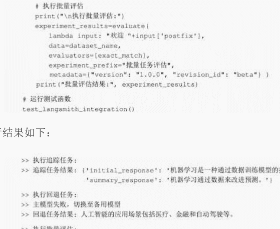

> **注意** 请确保运行环境中正确配置了 LangChain、LangSmith 和 OpenAI 的 API 密钥，以保证上述代码可以成功运行并返回预期的结果。

通过 LangSmith 的初步应用，开发者可以有效追踪和评估 LangChain 任务流的执行效果，识别性能瓶颈，设置回退策略，提升应用的可靠性。

### 7.5 本章小结

> 本章深入探讨了 LangChain 表达式语言在企业级应用中的核心组件与功能扩展，特别聚焦于其与 LangSmith 的集成应用。通过介绍 LCEL 的并行执行、回退机制以及与 LangSmith 的集成，展示了如何在复杂任务流中提升性能，提高系统稳定性，并实现更高效的任务管理与故障恢复。

> 通过本章的学习，读者可以掌握 LCEL 在高并发和高可靠性任务场景中的实用方法，为构建稳定、高效的 LangChain 应用奠定坚实的技术基础。

### 7.6 思考题

- （1）简述 LangChain 表达式语言的主要功能和应用场景。
- （2）在 LCEL 中，如何使用 RunnableParallel 实现多任务并行执行？请简述步骤并说明其优势。
- （3）batch 方法在并行任务执行中有何作用？请举例说明。
- （4）在 LCEL 中如何配置回退机制？请描述设置备用模型的步骤，并解释其在应用中的意义。
- （5）当主模型调用失败时，如何通过回退机制自动切换到备用模型？
- （6）在 LCEL 的回退机制中，如何指定特定的错误类型触发回退操作？请简述配置方法。
- （7）LangSmith 的主要功能有哪些？它如何支持 LCEL 的任务管理和监控？
- （8）如何在 LangSmith 中启用任务追踪？请描述所需的配置步骤。
- （9）在 LCEL 中使用 LangSmith 进行任务追踪时，如何使用@traceable 装饰器？请解释其作用。
- （10）描述 LangSmith 中批量评估的流程，如何创建数据集并定义评估方法？
- （11）当 LCEL 任务流中出现瓶颈时，可以通过哪些方法进行性能优化？请举例说明。
- （12）在 LangSmith 控制台中，可以查看哪些任务的执行信息？这些信息对开发者有何帮助？

# 第 8 章：核心组件 3：Agents

> 在 LangChain 的架构中，Agent 是一种能够自主决策、执行多步骤任务的智能组件。不同于简单的模型调用或任务链执行，Agent 具备分析、判断并选择最佳执行路径的能力。通过整合 LLM、提示词模板、上下文数据和任务链，LangChain 的 Agent 能够完成复杂的多阶段任务，并对变化的输入或动态条件做出响应。

本章将深入探讨 LangChain 中的 Agent 组件，从基础概念到应用场景，逐步引导读者理解 Agent 在任务执行中的关键作用。首先，将讲解 Agent 的工作原理和在不同场景中的应用需求，让读者了解 Agent 在 LangChain 中解决实际问题的价值。接着，将通过 ReAct Agent 的案例来具体分析其任务流程、执行机制以及在决策上的优势。同时，还将介绍 Zero-shot ReAct 和结构化输入 ReAct，展示 Agent 在不同数据输入方式下的表现。最后，将带领读者构建和优化 ReAct 文档存储库，使得 Agent 能够在知识丰富的环境中高效查找和管理信息。

通过本章的学习，读者将具备构建和使用 LangChain Agent 的基本技能，为企业级的智能任务管理和复杂工作流构建打下坚实的基础。

## 8.1 何为 LangChain Agent

作为 LangChain 的核心组件之一，Agent 的引入使得系统能够在不同任务间灵活切换，并在变化的输入下实现高效的决策和执行。

本节将从 Agent 的定义和基本原理入手，探索其在 LangChain 生态中的关键作用和典型应用。

### 8.1.1 Agent 的核心概念与工作原理

在 LangChain 中，Agent 是一种自主任务执行的智能组件，其设计灵感来源于复杂的多步骤决策需求。Agent 的主要职责不仅包括调用语言模型完成单一任务，还包括根据任务的变化，自主选择适合的执行路径。这种自主性使得 Agent 特别适合处理需要多个步骤或外部信息的任务场景。

Agent 可以理解为一个智能执行者，它结合了语言模型、提示词、外部工具以及上下文信息，能够动态地完成任务。它的独特之处在于能够响应不同的输入，并根据当前任务的状态和需求调整行为。例如，Agent 可以被指派去回答一个复杂问题，查找相关文档，或者执行一个需要精确操作的指令。在这个过程中，Agent 会调用合适的模型或工具，确保每一步任务都朝着最终目标推进。

以下示例将演示 Agent 如何在 LangChain 中执行多步骤任务：首先搜索相关信息，然后生成简要总结。

```python

from langchain_openai import ChatOpenAI

from langchain_core.agents import Agent, AgentExecutor

from langchain_core.prompts import ChatPromptTemplate

##### 初始化语言模型

model=ChatOpenAI(model="gpt-3.5-turbo")

#### 定义任务提示词模板

search_prompt=ChatPromptTemplate.from_template("请帮助我找到与'{topic}'相关的信息。")

summarize_prompt=ChatPromptTemplate.from_template("请总结以下内容：{content}")

#### 定义一个简单的搜索函数（在实际应用中，可以集成数据库或文档检索功能）

def search_for_info(topic):

    # 模拟搜索结果

    search_results={

        "太空探索": "太空探索涉及人类发射探测器到外太空，以研究星系、行星等。",

        "海洋学": "海洋学研究海洋及其生态系统的学科，涵盖海洋生物、化学和地质。"

    }

    return search_results.get(topic, "未找到相关信息")

#### 定义一个 Agent 流程

class SimpleAgent(Agent):

    def plan(self, input):

        # 观察并提取主题

        topic=input["topic"]

        # 第一步：搜索相关信息

        search_result=search_for_info(topic)

        # 第二步：生成总结

        response=model.chat_completions.create(

            model="gpt-3.5-turbo",

            messages=[{"role": "user",

                "content": f"请总结以下内容：{search_result}"}]) 

        # 返回最终生成的回答

        return {"summary": response.choices[0].message.content}

#### 初始化 AgentExecutor 并执行任务

agent=SimpleAgent()

executor=AgentExecutor(agent=agent)

#### 输入用户请求

user_input={"topic": "太空探索"}

result=executor.invoke(user_input)

print("Agent 的总结结果:", result["summary"])

同构迁移到推荐场景
保持骨架不变，仅把检索目标换成商品信息库，输出从归纳改成点评。直接可跑的片段如下：
```

运行结果如下：

> Agent 的总结结果：太空探索是人类通过探测器研究外太空的活动，目的是了解星系和行星的特性。

LangChain 的 Agent 基于“观察—推理—行动”三个阶段执行流程：

(1) **观察**：Agent 接收用户输入并获取相关的环境信息或上下文数据。这一步确保 Agent 拥有足够的信息来制定下一步行动计划。

(2) **推理**：在观察到的基础上，Agent 通过逻辑判断选择最佳执行策略。通常，这一步会调用大语言模型，生成基于输入信息的推理结果。通过分析当前的任务需求，Agent 可以决定是继续调用 LLM 获取更多信息，还是选择一个工具或 API 来执行具体操作。

(3) **行动**：根据推理结果，Agent 采取相应的执行操作。这可能包括直接生成答案、调用其他模型，或者进一步调整执行路径以应对新的信息。

这种工作流程允许 Agent 灵活地适应不同的任务场景。例如，在回答复杂问题时，Agent 可以选择先检索相关数据再生成答案；在任务中断或遇到异常时，Agent 还能实时调整策略，以确保任务顺利完成。

### 8.1.2 LangChain 中 Agent 的应用场景分析

在 LangChain 中，Agent 的应用场景十分广泛，尤其适用于需要动态决策和多步骤任务的场合。例如，Agent 可用于回答复杂的用户问题，执行特定操作，或在不同的数据源中进行信息检索。

以下示例将展示一个 Agent 根据用户的兴趣推荐产品，并获取相关产品详情。

```python

from langchain_openai import ChatOpenAI

from langchain_core.agents import Agent, AgentExecutor

from langchain_core.prompts import ChatPromptTemplate

#### 初始化模型

model = ChatOpenAI(model="gpt-3.5-turbo")

#### 模拟产品信息检索函数

def search_product_info(product_name):

    product_database = {

        "智能手机": "智能手机具有强大的多任务处理和高分辨率摄像头。",

        "无线耳机": "无线耳机具有降噪功能，适合运动和通勤。",

    }

    return product_database.get(product_name, "未找到该产品信息")

#### 定义 Agent

class ProductRecommendationAgent(Agent):

    def plan(self, input):

        # 获取用户输入的产品类别

        product_name = input["product"]

        # 第一步：检索产品信息

        product_info = search_product_info(product_name)

        # 第二步：生成推荐总结

        response = model.chat_completions.create(

            model="gpt-3.5-turbo",

            messages=[{"role": "user", "content": f"请总结该产品：{product_info}"}])

        return {"recommendation": response.choices[0].message.content}

#### 创建 Agent 执行器

agent = ProductRecommendationAgent()

executor = AgentExecutor(agent=agent)

#### 测试用例

user_input = {"product": "智能手机"}

result = executor.invoke(user_input)

print("产品推荐总结:", result["recommendation"])

联网检索实践
要接入网络检索，先安装依赖：
```

在上述代码中：

(1) **初始化模型**：加载 OpenAI 的 GPT-3.5-turbo 模型，用于生成自然语言输出。
(2) **检索函数**：`search_product_info` 函数模拟数据库操作，根据输入的产品名称返回对应的产品信息。
(3) **定义 Agent**：`ProductRecommendationAgent` 类继承自 Agent，包含 plan 方法，用于执行两步任务，即检索产品信息和生成推荐总结。
(4) **Agent 执行器**：AgentExecutor 负责执行 Agent 的任务，获取最终结果。
(5) **测试用例**：提供“智能手机”作为用户输入，并输出推荐的总结内容。

最终运行结果如下：

> 产品推荐总结：智能手机适合需要多任务处理和高质量拍摄的用户，是一种实用的日常设备。

### 8.1.3 自定义 LLM 代理

自定义 LLM 代理是通过用户定义的提示词模板和输出解析器，结合 ChatModel 来完成复杂任务的代理。下面将带领读者逐步实现一个支持自定义提示词和工具的 LLM 代理，帮助 Agent 在不同场景下灵活应对需求。

##### 1. 环境准备

在开始之前，确保安装了所需的依赖包：

```bash

pip install langchain google-search-results openai

随后引入必要的库并交互式读取密钥：
```

导入相关模块：

```python

from langchain.agents import Tool, AgentExecutor, LLMsSingleActionAgent, AgentOutputParser

from langchain.prompts import BaseChatPromptTemplate

from langchain import SerpAPIWrapper, LLMChain

from langchain.chat_models import ChatOpenAI

from typing import List, Union

from langchain.schema import AgentAction, AgentFinish, HumanMessage

import re

from getpass import getpass

把检索能力封装为工具：
```

##### 2. 配置工具

设置代理可能使用的工具。以下示例使用 SerpAPIWrapper 来支持查询当前事件。

```python

SERPAPI_API_KEY = getpass("请输入您的 SerpAPI 密钥:")

###### 设置搜索工具

search = SerpAPIWrapper(serpapi_api_key=SERPAPI_API_KEY)

tools=[

    Tool(name="Search",

        func=search.run,

        description="用于查询最新事件信息")

]

行为规范采用 ReAct 风格，让模型在思考与行动之间往复，最后给出结论：
```

##### 3. 提示词模板

自定义一个提示词模板，包含所需的格式说明：

**模板字符串**：

```text

完成目标，您可以使用以下工具：

{tools}

请使用以下格式：

问题：输入问题

思考：思考应该采取的行动

操作：选择的操作，使用 {tool_names} 中的工具

操作输入：输入的操作

观察：操作的结果

...（该步骤可以重复）

思考：最终答案

最终答案：原始问题的答案

历史任务完成情况：

开始！

问题：{input}

(agent_scratchpad)

为了让框架识别模型输出，需要自定义解析器区分动作与最终结论：
```

##### 4. 设置输出解析器

**作用**：输出解析器负责解析 LLM 输出，生成 AgentAction 或 AgentFinish 响应。

**输出解析器**：

```python

class CustomOutputParser(AgentOutputParser):

    def parse(self, llm_output: str) -> Union[AgentAction, AgentFinish]:

        if "最终答案" in llm_output:

            return AgentFinish(llm_output.split("最终答案：")[-1].strip())

        match = re.search(r"操作：(\w+)\n操作输入:(.*)", llm_output)

        if match:

            action = match.group(1)

            action_input = match.group(2)

            return AgentAction(action=action, action_input=action_input)

        raise ValueError(f"无法解析的输出：{llm_output}")

把模型、提示、解析器和工具组合即可得到可联网的智能体：
```

##### 5. 初始化自定义 LLM 代理

**作用**：创建一个包含提示词、输出解析器和工具的 LLMsSingleActionAgent 实例，支持自定义逻辑。

```python

llm = ChatOpenAI(temperature=0)

agent = LLMsSingleActionAgent(

    llm_chain=LLMChain(prompt=prompt, llm=llm),

    output_parser=CustomOutputParser(),

    stop=["\n"],

    tools=tools )

executor = AgentExecutor(agent=agent, verbose=True)

用一个现实问题验证效果：
```

##### 6. 测试自定义 LLM 代理

测试代理，以确保其能够根据提示词和工具的配置，完成动态任务。

```python

####### 提出示例问题

response = executor.invoke({"input":"现在的全球新闻是什么？"})

print("代理回答:", response)

从本地映射到真实检索，Agent 的核心在于把检索、推理、格式化拆成最小单元再组合扩展。

# 从生成到执行：给 LLM 挂上工具链

让大模型不只是输出文本，而是能自行查询、计算、操作数据库并保持多轮记忆，核心在于同一套底座模型加上合适的外部能力以及不同的执行策略。下面以 OpenAI 为例，示范检索+计算的思维-行动循环、函数式调用操作 SQLite、以及带有上下文的对话三种常见用法，代码可直接运行。

把推理结果固定下来
对外触发工具时，确定性更重要。把温度参数调到 0 能让输出更稳定，第一段代码负责创建模型实例。

```

运行代码时，需要设置 SERPAPI_API_KEY 为有效的 SerpAPI 密钥，这样代理才可以正常访问 API 并进行搜索。运行完代码后，`print("代理回答:",response)` 会显示代理的回答，包含搜索到的最新新闻。测试结果如下：

> 代理回答：[全球最新新闻的搜索结果摘要，根据 SerpAPI 返回的内容生成的结果]

## 8.2 ReAct Agent

ReAct Agent 是 LangChain 中的一种智能决策代理，它结合了推理（Reasoning）和行动（Action）能力，使得系统能够应对复杂的多步骤任务。ReAct Agent 的独特之处在于，它能够在任务执行过程中进行动态调整，不断分析和响应新的输入信息，从而灵活地选择最优的执行路径。相较于简单的任务链，ReAct Agent 更适合需要实时判断和响应的应用场景，如信息检索、复杂决策和多步骤操作等。

本节将详细探讨 ReAct Agent 的工作流程及其在 LangChain 中的实际应用，包括其在决策、操作和反馈循环中的角色。通过本节的学习，读者将理解如何利用 ReAct Agent 在复杂任务中实现高效的推理与决策。

### 8.2.1 ReAct Agent 解析

ReAct Agent 能够分析输入信息，选择适合的工具或计算方法来完成任务，并在任务链中不断响应和调整，确保最终结果准确。

下面将详细讲解 ReAct Agent 的初始化、工具加载和执行流程。

#### 1. 初始化语言模型

首先，加载一个低温度设置的语言模型，以便生成更稳定的响应。

```python

from langchain.llms import OpenAI

llm = OpenAI(temperature=0)  # 初始化语言模型

把外部能力挂接到模型
借助 load_tools 可以把网络搜索和数学运算两个能力单元接入，随后调度器会在需要时自动调用。

```

#### 2. 加载工具

使用 load_tools 方法加载需要的工具。例如，加载 serpapi（用于网络搜索）和 llm-math（用于数学计算）工具。

```python

from langchain.agents import load_tools

###### 加载工具，使用 LLM 支持的 serpapi 和 llm-math

tools = load_tools(["serpapi", "llm-math"], llm=llm)

搭建思维-行动闭环
ZERO_SHOT_REACT_DESCRIPTION 会让智能体在思考-行动-观察中自行挑选可用能力，开启 verbose 可看到中间步骤。

```

#### 3. 初始化 ReAct Agent

用加载的语言模型和工具来初始化 ReAct Agent，这里使用 `AgentType.ZERO_SHOT_REACT_DESCRIPTION` 类型，允许代理在接收到问题进行自主推理和行动。

```python

from langchain.agents import initialize_agent, AgentType

###### 初始化 ReAct Agent

agent = initialize_agent(

    tools=tools,

    llm=llm,

    agent=AgentType.ZERO_SHOT_REACT_DESCRIPTION,

    verbose=True )

单文件跑通的演示
把前面几步串起来并喂一个真实问题，展示先检索再换算的流程。

```

### 8.2.2 ReAct Agent 的典型应用

在 LangChain 中，ReAct Agent 能够动态分析输入，并选择合适的工具完成复杂任务。以下示例将展示如何在不同任务中使用 ReAct Agent 的多功能性。

**示例：ReAct Agent 在信息检索与计算中的应用。**

（1）初始化模型：使用 OpenAI 模型以获取稳定的语言响应。

（2）加载工具：使用 serpapi 进行网络搜索，使用 llm-math 进行数学计算。

（3）构建 Agent：使用多工具和 ReAct Agent 处理不同任务。

```python

from langchain.llms import OpenAI

from langchain.agents import load_tools, initialize_agent, AgentType

llm=OpenAI(temperature=0)

tools=load_tools(["serpapi", "llm-math"]), llm=llm

##### 初始化语言模型

#### 加载工具

###### 初始化 ReAct Agent

react_agent=initialize_agent(

    tools=tools,

    llm=llm,

    agent=AgentType.ZERO_SHOT_REACT_DESCRIPTION,

    verbose=True )

#### 示例任务

result=react_agent.run("虽是幅地从 Earth to Mars in miles?")

print("ReAct Agent 的回答:", result)

运行后得到

```

输出示例:

```

>> ReAct Agent 的回答：Earth and Mars are approximately 225 million kilometers apart,

translating to around 140 million miles.

用函数式方式操作数据库
通过 SQLDatabaseChain 把口语问题转为 SQL，再封装成 Tool 交给 OPENAI_FUNCTIONS 类型的调度器，实现库内问询。

```

除了 ReAct Agent，LangChain 还提供了 OpenAI Functions Agent 和 Chat Conversation Agent，扩展了多样的功能和适用场景。OpenAI Functions Agent 可以通过工具和函数链完成特定查询任务，如数据库检索。Chat Conversation Agent 适用于需要保持对话上下文的场景，如客户服务或咨询问答。

**示例：OpenAI Functions Agent 在数据库查询中的应用。**

```python

from langchain.agents import Tool, SQLDatabase, SQLDatabaseChain

from langchain.sql import SQLDatabase

#### 配置数据库连接

db=SQLDatabase.from_uri("sqlite:///example.db")

db_chain=SQLDatabaseChain.from_llm(llm, db, verbose=True)

#### 加载工具

tools={

    Tool(name="Database Query",

         func=db_chain.run, description="Execute SQL queries.") }

#### 初始化 Agent

functions_agent=initialize_agent(tools, llm,

                                 agent=AgentType.OPENAI_FUNCTIONS, verbose=True)

#### 执行数据库查询任务

db_result=functions_agent.run(

    "What are the latest entries in the sales database?")

print("数据库查询结果:", db_result)

适合多轮连贯交流的对话体
CHAT_CONVERSATION 更擅长保留前文，能力集合可沿用之前准备的搜索计算插件。

```

**示例：** Chat Conversation Agent 在对话上下文中的应用。

```python

from langchain.agents import initialize_agent, AgentType

#### 使用 Chat 模型初始化对话 Agent

chat_agent=initialize_agent(tools=tools, llm=llm,

                            agent=AgentType.CHAT_CONVERSATION, verbose=True)

#### 示例对话

conversation_result=chat_agent.run(

    "Can you summarize the latest news about space exploration?")

print("对话 Agent 的回答:", conversation_result)

三类用法整合的参考脚本
下面脚本同时演示信息检索计算、数据库查询、对话摘要。

```

以下是将上述各个 Agent 示例综合起来的完整代码示例，展示如何在同一脚本中使用 ReAct Agent、OpenAI Functions Agent 和 Chat Conversation Agent 来完成不同类型的任务。

```python

from langchain.llms import OpenAI

from langchain.agents import load_tools, initialize_agent, AgentType, Tool

from langchain.sql import SQLiteDatabase

from langchain.agents import SQLDatabaseChain

llm=OpenAI(temperature=0)

tools=load_tools(["serpapi", "llm-math"], llm=llm)       # 初始化通用语言模型

                                                         # 加载搜索和计算工具

##### 1. ReAct Agent 示例 ###

###### 初始化 ReAct Agent

react_agent=initialize_agent(

    tools=tools,

    llm=llm,

    agent=AgentType.ZERO_SHOT_REACT_DESCRIPTION,

    verbose=True)

###### 使用 ReAct Agent 执行信息检索和计算任务

react_result=react_agent.run(

    "What is the distance from Earth to Mars in miles?")

print("ReAct Agent 的回答:", react_result)

##### 2. OpenAI Functions Agent 示例 ###

###### 初始化数据库链

db=SQLiteDatabase.from_uri("sqlite:///example.db")

db_chain=SQLDatabaseChain.from_llm(llm, db, verbose=True)

####### 定义数据库查询工具

db_tool=Tool(

    name="Database Query",

    func=db_chain.run,

    description="Execute SQL queries.")

####### 初始化 OpenAI Functions Agent

functions_agent=initialize_agent(

    tools=[db_tool],

    llm=llm,

    agent=AgentType.OPENAI_FUNCTIONS,

    verbose=True)

###### 使用 OpenAI Functions Agent 执行数据库查询任务

db_result=functions_agent.run(

    "What are the latest entries in the sales database?")

print("数据库查询结果:", db_result)

##### 3. Chat Conversation Agent 示例 ###

###### 初始化 Chat Conversation Agent

chat_agent=initialize_agent(

    tools=tools, llm=llm, agent=AgentType.CHAT_CONVERSATION, verbose=True)

###### 使用 Chat Conversation Agent 保持对话上下文

conversation_result=chat_agent.run(

    "Can you summarize the latest news about space exploration?")

print("对话 Agent 的回答:", conversation_result)

一次完整执行轨迹

```

运行上述代码后，可获得以下格式的输出结果：

```

> > Entering new AgentExecutor chain...

> > ReAct Agent 的回答：Earth and Mars are approximately 225 million kilometers apart,

translating to around 140 million miles.

> > Entering new AgentExecutor chain...

> > 数据库查询结果：The latest entries in the sales database are: [entry details].

> > Entering new AgentExecutor chain...

> > 对话 Agent 的回答：The latest news in space exploration includes updates on Mars missions,

space telescopes, and international space collaborations.

拆开使用的极简写法
只想快速启动零样本 ReAct，可把模型与能力先分开准备。

```

## 8.3 Zero-shot ReAct 与结构化输入 ReAct

在 LangChain 的 Agent 体系中，Zero-shot ReAct 和结构化输入 ReAct 是两种灵活且强大的任务执行模式，专为不同复杂度的任务设计。本节将深入探讨 Zero-shot ReAct 和结构化输入 ReAct 的工作原理及应用场景，帮助读者理解如何在不同任务需求下灵活使用这两种 ReAct 模式，以提升 LangChain 系统的任务处理能力。

### 8.3.1 Zero-shot ReAct 的原理与实现

Zero-shot ReAct 模式允许 Agent 在没有预先示例的情况下，通过实时推理和动态决策来执行任务。这一模式极大地扩展了 Agent 的适用场景，使其能够应对更多即时、开放式的任务需求。

Zero-shot ReAct Agent 根据输入信息自主决定如何使用工具、完成任务，无须提供额外的提示示例，是一种高效的“即用即判断”方式。下面将带领读者从原理到实现逐步掌握 Zero-shot ReAct Agent 的使用。

#### 1. Zero-shot ReAct 原理

Zero-shot ReAct 基于“观察一推理－行动”的迭代流程，包括以下 3 个主要步骤：

- **观察**: 接收用户输入并解析任务需求。
- **推理：** 根据需求确定所需的工具和执行策略。
- **行动：** 调用所需工具执行任务，根据反馈调整策略，直到获得完整的答案。

例如，当用户询问天气时，Agent 会推理需要使用网络搜索工具来查询最新天气信息；在处理计算任务时，Agent 则会调用计算工具完成任务。

#### 2. Zero-shot ReAct Agent 的初始化

首先，初始化一个语言模型，并加载相关工具。此处使用一个通用的 OpenAI 模型和两个工具，即 serpapi (用于网络搜索) 和 llm-math（用于计算）。

```python

from langchain.llms import OpenAI

from langchain.agents import load_tools, initialize_agent, AgentType

llm=OpenAI(temperature=0) #初始化语言模型

#加载工具，包括搜索和数学计算工具

tools=load_tools(["serpapi", "llm-math"], llm=llm)

```

#### 3. 初始化 Zero-shot ReAct Agent

通过调用 initialize_agent 函数并设置 Agent 类型为 ZERO_SHOT_REACT_DESCRIPTION，可创建一个 Zero-shot ReAct Agent。该 Agent 能够自主判断使用哪个工具并实时完成任务。

```python

#初始化 zero-shot ReAct Agent

zero_shot_agent=initialize_agent(

    tools=tools,

    llm=llm,

    agent=AgentType.ZERO_SHOT_REACT_DESCRIPTION,

    verbose=True)

底座模型、能力集合与调度类型三者组合，就能让 LLM 实现检索、计算、查库以及持续对话。

# LangChain Agent 实战速览

本合集整理了几段可直接运行的示范，从浏览器检索、维基百科问答到带回调的 LLM 链，覆盖构建与调试的典型流程。代码保持原样，方便在 Notebook 中逐块验证与扩展。

```

AgentType.ZERO_SHOT_REACT_DESCRIPTION 表示 Agent 无须提供示例便可进行推理和决策，适用于即时性任务和开放式问题。

#### 4. 使用 Zero-shot ReAct Agent 执行任务

Zero-shot ReAct Agent 将根据用户的输入内容自主选择工具并完成多步骤任务。例如，当用户询问某城市的天气时，Agent 会先使用网络搜索获取当前天气情况。

`run` 方法用于接收用户输入，Agent 根据输入内容自主判断任务并选择合适的工具，最终生成答案。

假设用户输入了“东京的当前天气如何？”，Agent 会自动使用 serpapi 进行搜索，输出结果如下:

- >> Entering new AgentExecutor chain...
- >> I need to find the current weather in Tokyo.
- >> Action: Search
- >> Action Input: "current weather in Tokyo"
- >> Observation: 26°C, cloudy with a chance of rain.
- >> Thought: I have found the weather information.
- >> Final Answer: The current weather in Tokyo is 26°C, cloudy with a chance of rain.
- >> Finished chain.

- python
```python

##### 测试任务：查询北京的空气质量指数

###### result=zero_shot_agent.run("请问北京的当前空气质量指数是多少？")

###### print("Zero-shot ReAct Agent 的回答:", result)

```

- Agent 会自动使用 serpapi 进行搜索，并返回如下结果:
- >> Entering new AgentExecutor chain...
- >> 我需要查找北京的当前空气质量指数。
- >> Action: Search
- >> Action Input: “北京 当前空气质量指数”
- >> Observation: 北京的空气质量指数为 75，空气质量为良。
- >> Thought: 我已经找到空气质量信息。
- >> Final Answer: 北京的当前空气质量指数为 75，空气质量良好。
- >> Finished chain.

- #### 在测试用例中，Zero-shot ReAct Agent 识别出任务为“查询北京的空气质量”，并自动调用 serpapi 进行网络查询，获取最新的空气质量信息返回给用户。
- Zero-shot ReAct Agent 是一种高效的“观察一推理一行动”Agent，不需要先验。
##### 示例，即可通过实时推理和工具选择来完成任务。

### 8.3.2 结构化输入 ReAct 的使用

结构化输入 ReAct 代理允许开发者使用结构化的数据格式（如 JSON）来传递多参数信息，适合复杂任务场景。例如，当需要在执行任务时传递多种数据参数或执行多步骤操作时，结构化输入 ReAct 能够使数据清晰有序地流入任务执行链中。

通过这种方式，Agent 可以根据任务需求对结构化信息进行解析和调用，为任务执行提供高度的灵活性。下面将通过代码示例来讲解如何实现结构化输入 ReAct 代理。

#### 1. 初始化语言模型和工具

首先，初始化一个语言模型，并加载工具，如网络浏览器工具。这些工具可帮助 Agent 处理任务，例如访问网页、搜索信息、提取内容等。

```python

from langchain.chat_models import ChatOpenAI

from langchain.agents.agent_toolkits import PlaywrightBrowserToolkit

from langchain.tools.playwright.utils import create_async_playwright_browser

import nest_asyncio

##### 适用于 Jupyter notebook，防止事件循环冲突

nest_asyncio.apply()

###### 初始化浏览器工具

async_browser=create_async_playwright_browser()

browser_toolkit=PlaywrightBrowserToolkit.from_browser(async_browser=async_browser)

tools=browser_toolkit.get_tools()

llm=ChatOpenAI(temperature=0) # 初始化语言模型

```

PlayWrightBrowserToolkit 用于加载浏览器工具，执行网页操作。

#### 2. 初始化结构化输入 ReAct Agent

使用 AgentType.STRUCTURED_CHAT_ZERO_SHOT_REACT_DESCRIPTION 类型初始化 Agent，支持结构化输入的 Zero-shot ReAct 代理。这种代理将根据输入内容判断如何选择工具来执行任务。

```python

from langchain.agents import initialize_agent, AgentType

###### 初始化结构化输入 ReAct Agent

structured_agent=initialize_agent(

    tools=tools,

    llm=llm,

    agent=AgentType.STRUCTURED_CHAT_ZERO_SHOT_REACT_DESCRIPTION,

    verbose=True)

```

#### 3. 使用结构化输入调用 Agent

结构化输入代理允许通过 JSON 格式传递任务内容。在以下示例中，Agent 将接收一个包含结构化信息的请求，执行网页浏览操作，并提取网页文本。

## 8.4 ReAct 文档存储库

ReAct 文档存储库 (Docstore) 是 LangChain 框架中用于存储和管理知识文档的关键组件。对于需要频繁查询和分析的任务场景，文档存储库提供了高效的知识管理方式，使 ReAct Agent 可以快速检索相关信息并生成准确的回答。通过文档存储库，Agent 能够访问丰富的文档数据，在执行任务时具备更全面的知识背景。

本节将深入探讨 ReAct 文档存储库的构建方法和应用场景，包括如何使用存储库管理大型文档、快速检索内容，以及在 Agent 执行流程中集成文档查询。

#### 1. 初始化文档存储库

在本示例中，使用维基百科作为文档存储库的数据源。初始化文档存储库需要 DocstoreExplorer 和一个支持搜索的源（此处使用 Wikipedia）。

```python

from langchain import Wikipedia

from langchain.agents.react.base import DocstoreExplorer

##### 创建文档存储库，使用维基百科作为数据源

docstore = DocstoreExplorer(Wikipedia())

```

#### 2. 配置搜索和查找工具

使用 Tool 类创建两种检索工具：Search 和 Lookup。Search 工具用于广泛查询，Lookup 则用于精确查找。

```python

from langchain.agents import Tool

###### 定义 Search 和 Lookup 工具

tools = [

    Tool(name="Search",

         func=docstore.search,

         description="适合用于一般性搜索查询"),

    Tool(name="Lookup",

         func=docstore.lookup,

         description="适合用于特定信息查找")

]

```

#### 3. 初始化 ReAct Agent

使用 initialize_agent 函数，并设置 AgentType.REACT_DOCSTORE，让 Agent 可以自动选择并调用工具，从文档存储库中检索信息。

#### 4. 提出查询并检索答案

现在可以向 Agent 提出一个问题，Agent 会通过文档存储库的 Search 和 Lookup 工具执行多步骤查询，找到所需的信息。

```python

##### 提出问题并获取答案

question = "莎士比亚的第一部作品是哪一部？"

response = react_agent.run(question)

print("ReAct Agent 的回答:", response)

```

在提出类似“莎士比亚的第一部作品是哪一部？”的问题时，Agent 可能会多次调用工具以查找并返回答案，输出如下：

```text

>> Entering new AgentExecutor chain...

>> Thought: 我需要查找莎士比亚的作品列表并确认他的第一部作品。

>> Action: Search[莎士比亚 作品列表]

>> Observation: 莎士比亚的作品包括《哈姆雷特》、《麦克白》、《罗密欧与朱丽叶》等。

>> Thought: 确认这些作品的出版年份以找到他的第一部作品。

>> Action: Lookup[莎士比亚 第一部作品]

>> Observation: 莎士比亚的第一部作品被认为是《亨利六世》。

>> Final Answer: 莎士比亚的第一部作品是《亨利六世》。

>> Finished chain.

>> ReAct Agent 的回答：莎士比亚的第一部作品是《亨利六世》。

```

通过 ReAct 存储库的检索与管理，Agent 可以从大型文档存储库中有效搜索和提取所需信息，适用于跨领域查询和复杂知识检索的场景。

## 8.5 本章小结

本章详细介绍了 LangChain 中的 Agent 组件及其应用，包括 ReAct Agent、Zero-shot ReAct、结构化输入 ReAct，以及文档存储库的集成使用。Agent 通过“观察－推理－行动”流程，能够动态处理复杂任务并选择合适的工具执行操作。Zero-shot ReAct 为 Agent 提供了即时决策能力，适合处理开放式问题，而结构化输入 ReAct 则通过明确的数据格式支持更复杂的多参数任务。此外，ReAct 文档存储库的加入，使得 Agent 能够快速检索大规模知识库，为智能任务提供更丰富的信息支持。

通过本章内容，读者将掌握如何构建和使用不同类型的 Agent，以及在复杂任务场景中充分利用 ReAct 文档存储库，实现更智能、更高效的决策流程。这为后续的企业级应用开发奠定了扎实的技术基础。

## 8.6 思考题

(1) 简述 LangChain 中的 ReAct Agent 的主要功能和应用场景。
(2) ReAct Agent 在执行任务时的“观察 - 推理 - 行动”流程包括哪些步骤？请简要描述每个步骤的作用。
(3) 在什么场景下应使用 Zero-shot ReAct Agent? Zero-shot ReAct 的主要优势是什么？
(4) 结构化输入 ReAct Agent 与 Zero-shot ReAct Agent 相比有何不同？它适用于哪些类型的任务？
(5) 如何在 LangChain 中初始化一个支持文档存储库的 ReAct Agent?请写出关键代码。
(6) 在配置 ReAct 文档存储库时，如何使用 Search 和 Lookup 工具？它们各自的功能是什么？
(7) 当用户提出问题时，ReAct Agent 是如何选择使用 Search 还是 Lookup 工具的？
(8) 在 Zero-shot ReAct 模式下，Agent 如何根据输入内容决定执行的操作？请举例说明。
(9) 如何将维基百科作为数据源集成到 ReAct 文档存储库中？
(10) 在 LangChain 中，使用结构化输入 ReAct Agent 传递多参数数据的优势是什么？请简要说明。
(11) 举例说明如何通过 ReAct 文档存储库回答多步骤问题，例如“莎士比亚的第一部作品是什么？”
(12) 描述 ReAct 文档存储库在知识管理中的应用价值。它如何帮助 Agent 更好地完成信息检索任务？

# 第 9 章
核心组件 4：回调机制

在复杂的 LangChain 任务管理中，回调机制是实现监控、调试和优化的关键工具。通过回调机制，开发者可以在任务链的不同阶段插入自定义处理逻辑，实现对执行状态的实时追踪、数据收集和错误捕捉。回调不仅用于调试，还能复杂任务链提供数据支持，使任务在每个环节的执行情况都清晰可见。

本章将从多角度讲解回调机制的应用，包括如何创建和使用单一或多个回调处理程序，实现高效的日志记录和 Token 计数，并进一步介绍如何利用 Argilla 平台自动化记录和整理数据，支持数据标注和分析。掌握回调机制后，开发者将在 LangChain 任务链的复杂应用中拥有更强的掌控能力，提高项目的监控效率和系统稳定性。

### 9.1 自定义回调处理程序

在 Langchain 任务管理中，开发者通过自定义回调处理程序，可以更精确地控制数据处理流程，实现更复杂的业务逻辑。

本节将详细介绍如何创建和使用自定义回调处理程序，以增强 Langchain 的功能并满足特定的业务需求。从初始化环境和基础设置开始，将逐步引导读者完成创建自定义回调处理程序、定义提示词模板和语言模型、构建包含自定义回调的链以及执行测试的全过程。

#### 9.1.1 创建自定义回调处理程序

自定义回调处理程序使得开发者能够在 LangChain 的任务执行过程中插入自定义逻辑，例如监控任务进度、记录输出、处理异常等。下面将创建一个自定义的回调处理程序，捕捉任务执行的每个步骤并实时记录输出。

**1. 初始化环境和基础设置**

首先，安装必要的依赖：

```bash

pip install langchain openai

```

然后，导入所需模块：

```python

from langchain.callbacks.base import BaseCallbackHandler

from langchain.llms import OpenAI

from langchain.prompts import PromptTemplate

from langchain.chains import LLMChain

```

**2. 创建自定义回调处理程序**

定义一个回调处理程序类，继承 BaseCallbackHandler。在此类中，可以重写不同的回调方法来捕捉任务执行的各种事件，例如开始执行、生成新内容、结束等。

```python

class CustomCallbackHandler(BaseCallbackHandler):

    def on_llm_start(self, serialized, prompts, **kwargs):

        print("LLM 任务开始。提示内容:", prompts)

    def on_llm_new_token(self, token, **kwargs):

        print("生成新 Token:", token)

    def on_llm_end(self, response, **kwargs):

        print("LLM 任务结束。生成的内容:", response.generations)

    def on_chain_start(self, serialized, inputs, **kwargs):

        print("链开始。输入内容:", inputs)

    def on_chain_end(self, outputs, **kwargs):

        print("链结束。输出内容:", outputs)

```

**3. 定义提示词模板和语言模型**

设置一个简单的提示词模板，用于生成模型的输出内容：

```python

##### 定义提示词模板

template = "根据以下输入生成答案：{question}"

prompt = PromptTemplate(template=template, input_variables=["question"])

##### 初始化语言模型

llm = OpenAI()

```

**4. 创建包含自定义回调的链**

将自定义回调处理程序添加到链中，使得在链执行时回调处理程序能捕获每一步的状态和输出。

```python

##### 创建包含回调处理程序的 LLM 链

chain = LLMChain(

    llm=llm,

    prompt=prompt,

    callbacks=[callback_handler]

)

```

**5. 执行测试**

使用中文测试输入，查看回调处理程序的输出。假设输入是“今天天气怎么样？”。

```python

##### 运行链，提供中文输入

response = chain.run({'question': '今天天气怎么样？'})

print("链的最终输出:", response)

# LangChain 链路日志与成本监控实战

在工程里 LangChain 常把多步 LLM 调用串成一条链，默认运行过程是黑盒。利用回调钩子可以把链的启动结束、模型收到的提示、逐 token 的生成以及最终结果全部暴露出来，再搭配官方追踪就能量化 Token 用量和费用。下面按由简到繁的顺序演示一套可直接运行的示例。

## 环境准备
先把依赖装好并引入常用的构造模块。

```

回调处理程序将在执行过程中打印出每一步的输出：

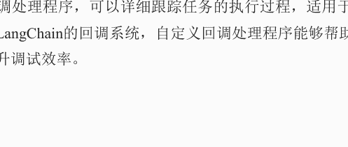

通过自定义回调处理程序，可以详细跟踪任务的执行过程，适用于任务调试、日志记录和进度监控。结合 LangChain 的回调系统，自定义回调处理程序能够帮助开发者灵活掌控复杂任务执行流程，提升调试效率。

#### 9.1.2 自定义链的回调函数

自定义链的回调函数允许开发者在链的执行流程中插入自定义逻辑，以便在任务开始、结束、新 Token 生成等多个阶段捕获信息或进行操作。下面将逐步讲解如何在 LangChain 中创建自定义链的回调函数，包括同步和异步回调的使用方法。

**1. 安装必要的依赖**

首先，确保已安装 LangChain 及相关库：

```bash

pip install langchain openai

```

然后，导入所需模块:

```python

from langchain.callbacks.base import BaseCallbackHandler

from langchain.llms import OpenAI

from langchain.chains import LLMChain

from langchain.prompts import PromptTemplate

import asyncio

## 同步回调入门
继承 BaseCallbackHandler 并重写几个生命周期方法，即可在关键节点打印信息。

```

**2. 创建自定义回调处理程序**

自定义回调类继承自 BaseCallbackHandler，并重写其中的各个方法，如 on_chain_start、on_chain_end 等。这样可以在链的各个阶段插入自定义逻辑，例如在任务开始时打印输入内容，在任务结束时打印输出结果。

```python

class CustomChainCallbackHandler(BaseCallbackHandler):

    def on_chain_start(self, serialized, inputs, **kwargs):

        print("链开始。输入内容:", inputs)

    def on_chain_end(self, outputs, **kwargs):

        print("链结束。输出内容:", outputs)

    def on_llm_start(self, serialized, prompts, **kwargs):

        print("LLM 任务开始。提示内容:", prompts)

    def on_llm_new_token(self, token, **kwargs):

        print("生成新 Token:", token)

    def on_llm_end(self, response, **kwargs):

        print("LLM 任务结束。生成的内容:", response.generations)

准备提示词和模型。

```

**3. 定义提示词模板和语言模型**

使用自定义的提示词模板，以便生成更具针对性的响应内容。

```python

##### 定义提示词模板

template = "根据以下输入生成答案：{question}"

prompt = PromptTemplate(template=template, input_variables=["question"])

##### 初始化语言模型

llm = OpenAI(temperature=0)

把自定义处理器挂到链上。

```

**4. 创建包含回调的链**

实例化一个包含自定义回调的链，以便在执行过程中能实时捕捉状态信息。

```python

##### 实例化自定义回调处理程序

callback_handler = CustomChainCallbackHandler()

##### 创建包含回调的 LLM 链

chain = LLMChain(

    llm=llm,

    prompt=prompt,

    callbacks=[callback_handler]

)

用中文问题触发一次执行。

```

**5. 测试同步链回调**

运行链并观察自定义回调在执行过程中的输出。以下是中文测试示例:

```python

##### 运行链，提供中文输入

response = chain.run({"question": "今天的新闻头条是什么？"})

print("链的最终输出:", response)

运行后控制台会按顺序展示链与模型的各个阶段。

```

假设输入内容是“今天的新闻头条是什么？”，同步和异步回调处理程序会分别打印出执行过程中的状态信息:

```text

>> 链开始。输入内容: {'question': '今天的新闻头条是什么？'}

>> LLM 任务开始。提示内容:["根据以下输入生成答案：今天的新闻头条是什么？"]

>> 生成新 Token: 今

>> 生成新 Token: 天

>> 生成新 Token: 的

>> ...

>> LLM 任务结束。生成的内容: [["今天的新闻头条包括..."]]

>> 链结束。输出内容：今天的新闻头条包括...

>> 链的最终输出：今天的新闻头条包括...

## 异步调用适配
异步场景下把 token 相关的钩子改成 async 即可保持非阻塞。

```

**6. 异步回调的实现**

在一些异步场景中，可以通过定义异步回调方法，实现链的异步回调处理程序。

```python

class AsyncCustomCallbackHandler(BaseCallbackHandler):

    async def on_llm_new_token(self, token: str, **kwargs):

        print(f"异步生成的新 Token: {token}")

async_callback_handler = AsyncCustomCallbackHandler()  # 初始化异步回调处理程序

###### 异步运行函数

async def run_async_chain():

    async_chain = LLMChain(

        llm=llm,

        prompt=prompt,

        callbacks=[async_callback_handler]

    )

    response = await async_chain.arun({"question": "讲个关于科技的笑话"})

    print("链的最终异步输出:", response)

await run_async_chain()  # 异步执行

## 多回调分工
实际项目里常把进度和内容拆成两个处理器，分别负责链状态和模型输出。

```

异步执行的结果可能类似，回调处理程序会以异步方式逐步生成 Token 并打印。

通过自定义链的回调函数，开发者可以监控链的执行过程，适用于日志记录、调试和异步处理等需求。结合同步与异步回调机制，可以提升任务执行的灵活性和可控性，使 LangChain 在复杂任务管理中更具适应性。## 9.2 多个回调处理程序

在 LangChain 中，可以为任务链配置多个回调处理程序，以便在同一任务执行中处理不同类型的监控和数据操作。多个回调处理程序的使用能够让开发者根据需求分别记录任务进度、日志、错误信息或执行调试。每个回调处理程序都会独立运行，实现不同的功能需求。

这种多回调的配置在复杂应用场景下，尤其是在多个 LLM 或工具协同工作的场景十分有效。

在下面的示例中，将创建两个回调处理程序：一个用于记录链的执行进度，另一个用于记录生成的内容。这两个回调将同时应用于任务链中，以实现多方面的监控。

```python

from langchain.callbacks.base import BaseCallbackHandler

####### 回调 1:记录链的执行进度

class ProgressLoggerCallbackHandler(BaseCallbackHandler):

    def on_chain_start(self, serialized, inputs,**kwargs):

        print("进度日志 - 链开始。输入内容:", inputs)

    def on_chain_end(self, outputs,**kwargs):

        print("进度日志 - 链结束。输出内容:", outputs)

####### 回调 2:记录生成的内容

class ContentLoggerCallbackHandler(BaseCallbackHandler):

    def on_llm_start(self, serialized, prompts,**kwargs):

        print("内容日志 - LLM 任务开始。提示内容:", prompts)

    def on_llm_new_token(self, token,**kwargs):

        print("内容日志 - 生成新 Token:", token)

    def on_llm_end(self, response,**kwargs):

        print("内容日志 - LLM 任务结束。生成的内容:", response.generations)

换一套提示和模型。

```

接下来和单回调相似，定义提示词模板并初始化语言模型。

```python

from langchain.llms import OpenAI

from langchain.prompts import PromptTemplate

from langchain.chains import LLMChain

##### 定义提示词模板

template="回答以下问题:{question}"

prompt=PromptTemplate(template=template, input_variables=["question"])

##### 初始化语言模型

llm=OpenAI(temperature=0)

同时挂载两个处理器。

```

将定义的 `ProgressLoggerCallbackHandler` 和 `ContentLoggerCallbackHandler` 同时添加到链中，实现多回调情形。

```python

##### 初始化回调处理程序

progress_logger=ProgressLoggerCallbackHandler()

content_logger=ContentLoggerCallbackHandler()

##### 创建包含多个回调的 LLM 链

chain=LLMChain(

    llm=llm,

    prompt=prompt,

    callbacks=[progress_logger, content_logger]

)

一次测试。

```

使用中文测试用例触发链的执行，观察多个回调处理程序的输出。假设输入为“中国的国花是什么？”。

```python

##### 测试输入

response=chain.run({'question': '中国的国花是什么？'})

print(response)

输出示例。

```

两个回调处理程序会同时运行，并在任务执行的不同阶段输出日志。

```
>> 进度日志 - 链开始。输入内容：{'question': '中国的国花是什么？'}
>> 内容日志 - LLM 任务开始。提示内容：['回答以下问题：中国的国花是什么？']
>> 内容日志 - 生成新 Token：中
>> 内容日志 - 生成新 Token：国
>> 内容日志 - 生成新 Token：的
>> ...
>> 内容日志 - LLM 任务结束。生成的内容：['中国的国花是牡丹。']
>> 进度日志 - 链结束。输出内容：中国的国花是牡丹。
>> 链的最终输出:中国的国花是牡丹。

## 轻量监控模式
如果只关心任务是否启动，实现链开始钩子就足够。

```

同样地，面对长文本也有类似的处理方法。为展示多回调在处理超长文本任务中的效果，我们将设计两个回调处理程序，一个用于监控任务进度，另一个用于逐步记录生成内容。具体的示例代码如下:

```python

from langchain.callbacks.base import BaseCallbackHandler

####### 回调 1:进度监控回调

class ProgressMonitorCallbackHandler(BaseCallbackHandler):

    def on_chain_start(self, serialized, inputs, **kwargs):

        print("进度监控 - 任务开始。输入内容:", inputs)

改用更长的历史事件模板。

```

使用一个简单的提示词模板来处理超长文本，要求模型生成较长的段落。

```python

from langchain.llms import OpenAI

from langchain.prompts import PromptTemplate

from langchain.chains import LLMChain

##### 定义提示词模板

template="请详细描述中国古代历史中的重大事件:{event}"

prompt=PromptTemplate(template=template, input_variables=['event'])

##### 初始化语言模型

llm=OpenAI(temperature=0)

组合进度监控与内容记录。

```

将 `ProgressMonitorCallbackHandler` 和 `ContentLoggerCallbackHandler` 同时添加到链中，以实现多回调功能。

```python

##### 实例化回调处理程序

progress_monitor=ProgressMonitorCallbackHandler()

content_logger=ContentLoggerCallbackHandler()

##### 创建包含多个回调的 LLM 链

chain=LLMChain(

    llm=llm,

    prompt=prompt,

    callbacks=[progress_monitor, content_logger]

)

用较长问题验证。

```

以下是中文测试用例，用于触发回调，观察回调在超长文本生成过程中的输出。假设输入为“从秦朝到汉朝的统一历程”。

```python

##### 运行链，提供一个超长文本问题

response=chain.run({"event": "从秦朝到汉朝的统一历程"})

print("链的最终输出:", response)

## 追踪与计费
打开 LangChain 追踪开关后，使用 get_openai_callback 可以拿到 Token 消耗和费用。

bash 方式开启。

```

两个回调将同时运行，逐步记录超长文本的生成过程。

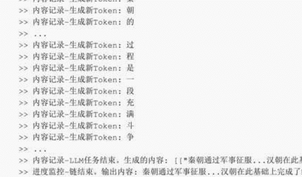

多回调配置为处理超长文本的任务提供了极大支持。通过这种方式，开发者可以详细了解生成过程中的各个步骤，以跟踪、调试和记录复杂任务的生成信息。在企业级应用中，尤其是涉及长文本生成的场景，多个回调处理程序的使用可以帮助提升监控和调试的效率。

### 9.3 跟踪 LangChains

在 LangChain 的复杂任务执行中，跟踪是一种强大的工具，用于监控和记录任务链的执行过程。通过跟踪，开发者可以在链的不同阶段查看输入、输出、操作步骤和执行时间等关键信息，有助于优化任务链、检测问题并提高系统性能。LangChain 提供了多种方法进行任务跟踪，包括设置环境变量或使用上下文管理器，以便对整个代码段或特定代码块进行跟踪。

本节将详细讲解如何在 LangChain 中配置和启用跟踪功能，帮助开发者实现实时监控、任务日志记录以及结果持久化等操作，使得在企业级开发环境中对任务执行过程的管理更加高效和透明。

#### 9.3.1 链式任务的跟踪和调试方法

在 LangChain 中，链式任务的跟踪和调试是确保任务链准确执行和优化性能的重要手段。通过跟踪，可以记录链的执行过程，便于查看每个步骤的输入、输出和执行时间。

下面将详细讲解如何启用链式任务跟踪功能，并在链的各个阶段捕获执行信息，帮助开发者在调试时快速定位和解决问题。

LangChain 提供了环境变量的方式来启用任务跟踪。可以通过设置 `LANGCHAIN_TRACING` 环境变量为 true，直接开启跟踪功能。

在命令行中启用跟踪：

```bash

export LANGCHAIN_TRACING=true

代码中开启。

```

或者在代码中设置环境变量：

```python

import os

os.environ["LANGCHAIN_TRACING"]="true"

完整统计示例。

```

LangChain 还可以通过上下文管理器来进行任务的跟踪。在上下文中设置跟踪，可以对特定的链任务进行更精细的控制，确保在代码段执行期间的所有任务都被跟踪。

以下是一个包含自定义链的任务示例，用于回答问题“中国的首都是哪个城市？”，并在执行过程中启用跟踪。

```python

from langchain.callbacks import get_openai_callback

from langchain.prompts import PromptTemplate

from langchain.llms import OpenAI

from langchain.chains import LLMChain

import os

os.environ["LANGCHAIN_TRACING"]="true" # 设置环境变量以启用跟踪

##### 定义一个提示词模板

template="回答以下问题：{question}"

prompt=PromptTemplate(template=template, input_variables=["question"])

llm=OpenAI(temperature=0) # 初始化语言模型

chain=LLMChain(llm=llm, prompt=prompt) # 创建任务链

##### 使用跟踪进行链式任务执行

with get_openai_callback() as cb:

    response=chain.run({"question": "中国的首都是哪个城市？"})

    print("任务链最终输出：", response)

    # 输出追踪数据

    print("Tokens 消耗：", cb.total_tokens)

    print("花费：", cb.total_cost)

通过上述几种写法，LangChain 的执行流程可以从黑盒变为可观测、可拆分、可计费的透明链路。

# LLM 调用可观测实战

让模型调用不黑盒，核心在于把调用拆解、记录、汇总。下面用中文案例演示从基础探测到人工评估的完整路径。

先做一次最小探测，确认环境通畅并观察基础花费。
```

运行上述代码后，将看到如下示例输出：

```text

>> 任务链最终输出：中国的首都是北京。

>> Tokens 消耗：15

>> 花费：$0.002

随后打开追踪开关，为后续多步执行留下链路信息。
```

通过跟踪数据，开发者可以了解以下信息：

（1）Token 消耗：用于计算生成响应内容所需的 Token 数量，有助于理解计算复杂度。

（2）任务执行时间：可以分析链式任务的执行效率。

（3）成本跟踪：适用于按 API 调用计费的应用场景，便于控制预算。

启用跟踪后，LangChain 可以提供详细的任务链执行信息，为调试和性能优化提供支持。通过跟踪功能，开发者能够快速获取任务链的关键性能指标，定位执行中的瓶颈和潜在问题，确保链式任务的可靠性和高效性。

#### 9.3.2 任务流数据的实时监控与分析

实时监控和分析 LangChain 任务流数据是提升任务链性能、优化调试流程的重要手段。在启用 LangChain 的跟踪功能后，开发者可以查看每个任务步骤的详细信息，包括 Token 消耗、任务耗时、成本等。通过实时监控这些数据，可以迅速识别和分析链式任务中的性能瓶颈和异常。

下面将通过详细的代码示例演示如何在 LangChain 中设置实时监控和分析任务流数据。

首先确保 `LANGCHAIN_TRACING` 环境变量被设置为 true，以开启跟踪模式。

```python

import os

os.environ["LANGCHAIN_TRACING"]="true"

接下来构建两段式流程：先生成主题背景，再在背景基础上展开关键事件，同时用回调收集耗时与用量。
```

在本示例中，将创建一个包含多个任务步骤的链式任务流，以便观察在执行过程中 Token 的消耗情况和实时数据。该链将逐步解答一组历史相关的问题。

```python

from langchain.callbacks import get_openai_callback

from langchain.prompts import PromptTemplate

from langchain.llms import OpenAI

from langchain.chains import LLMChain, SimpleSequentialChain

##### 定义第一个提示词模板

template1="简要介绍{topic}的背景。"

prompt1=PromptTemplate(template=template1, input_variables=["topic"])

##### 定义第二个提示词模板

template2="{background}。请进一步描述{topic}的关键事件。"

prompt2=PromptTemplate(template=template2,

input_variables=["background", "topic"])

llm=OpenAI(temperature=0) # 初始化 OpenAI 模型

chain1=LLMChain(llm=llm, prompt=prompt1) # 创建第一个链，用于背景介绍

chain2=LLMChain(llm=llm, prompt=prompt2) # 创建第二个链，用于描述关键事件

##### 将两个链串联成一个多步任务链

sequential_chain=SimpleSequentialChain(chains=[chain1, chain2])

##### 启用实时监控和数据分析

with get_openai_callback() as cb:

    # 执行任务链，输入一个中文话题

    response=sequential_chain.run({"topic"："秦始皇的统一过程"})

    print("任务链最终输出:", response)

###### 输出实时监控数据

print("任务链消耗的总 Tokens:", cb.total_tokens)

print("任务链的总花费:", cb.total_cost)

print("任务链的各步骤时间:", cb.durations)

print("任务链的每步 Tokens 消耗:", cb.token_usages)

该主题的运行结果与统计：
```

启用实时监控后，LangChain 将自动记录以下数据：

（1）总 Token 消耗：任务流中消耗的总 Token 数。

（2）任务流总成本：显示整个链执行的 API 调用总成本。

- （3）各步骤时间：每个链任务的执行时长。

- （4）每步 Token 消耗：各步骤单独的 Token 使用情况。

在执行如“秦始皇的统一过程”这样的超长文本任务时，可以看到实时监控输出的详细信息：

```text

>> 任务链最终输出：秦始皇统一六国的过程始于...最终成功建立了中国历史上第一个封建帝国。

>> 任务链消耗的总 Tokens: 243

>> 任务链的总花费：$80.012

>> 任务链的各步骤时间:

>>- 第一步：背景介绍消耗时间 0.78 秒

>>- 第二步：关键事件描述消耗时间 1.05 秒

>> 任务链的每步 Tokens 消耗:

>>- 第一步 Tokens 消耗：120

>>- 第二步 Tokens 消耗：123

如果需要持久化交互记录，可把日志落盘。先安装依赖。
```

监控数据解读:

- （1）总 Token 消耗：用于计算整个链任务的总 Token 数量，帮助评估文本生成的复杂性。

- （2）任务流总成本：便于开发者跟踪和管理 API 成本。

- （3）各步骤时间：对于任务链的优化很有帮助，显示出每一步执行的耗时，能够指示是否存在瓶颈步骤。

- （4）每步 Token 消耗：提供更精细的 Token 消耗信息，有助于开发者优化特定链的文本生成。

通过实时监控 LangChain 的任务流数据，开发者可以全面了解链任务的执行状态和资源消耗情况。借助实时数据分析，能够更加有效地进行链式任务的优化，提高复杂任务流的性能和可控性。

#### 9.3.3 将日志记录到文件

在 LangChain 中，将任务执行过程中的日志记录到文件，可以帮助开发者对任务进行后续分析、调试和复盘。借助 `FileCallbackHandler`，开发者可以将执行信息持久化存储在文件中，方便在复杂应用中实现高效的日志管理。下面将展示如何配置和使用 `FileCallbackHandler`，实现日志文件记录。

确保已安装 LangChain 和 loguru 库。

```bash

pip install langchain loguru

通过 loguru 统一日志并实例化文件回调处理器，准备接入链路。
```

使用 loguru 库创建日志文件，并使用 `FileCallbackHandler` 将任务执行的每个步骤记录到指定的日志文件中。

```python

from loguru import logger

from langchain.callbacks import FileCallbackHandler

from langchain.prompts import PromptTemplate

from langchain.llms import OpenAI

from langchain.chains import LLMChain

import os

logfile="output.log"  #指定日志文件路径

logger.add(logfile, colorize=True, enqueue=True)   #使用 loguru 配置日志文件

#创建 FileCallbackHandler

file_callback_handler=FileCallbackHandler(logfile)

组装简短提示并创建带文件回调的链，打开详细输出。
```

设置一个简单的链式任务，通过提示词生成模型响应。所有日志信息将被记录到 `output.log` 文件中。

```python

#定义提示词模板

template="简述以下事件:{event}"

prompt=PromptTemplate(template=template, input_variables=["event"])

llm=OpenAI(temperature=0)   #初始化语言模型

#创建包含文件回调的链

chain=LLMChain(llm=llm, prompt=prompt, callbacks=[file_callback_handler], verbose=True)

对一段中文历史事件发起调用。
```

运行任务链，并在文件中记录执行过程。以下是中文测试用例:

```python

#执行任务链，输入一个中文事件描述

response=chain.run({"event":"中国改革开放的历程"})

print("链的最终输出:", response)

要获取更细粒度的用量拆分，先安装基础库。
```

在执行任务后，打开 `output.log` 文件查看记录的日志内容。该文件将包含链的每个步骤的详细信息，包括生成的提示、Token 消耗等。

执行完任务后，`output.log` 文件中的示例内容可能如下:## 9.3.4 Token 计数器

在 LangChain 中，Token 计数器用于追踪每个任务链中消耗的 Token 数量。通过使用 Token 计数功能，开发者可以精确了解每个步骤的 Token 使用量，从而更好地控制任务成本和优化资源。

在使用 Token 计数器时，Prompt Tokens 和 Completion Tokens 分别代表不同的部分，而且它们的用途有所不同。

**1) Prompt Tokens**

含义：Prompt Tokens 代表的是发送给模型的输入内容的 Tokens 数量，包括用户的提问、上下文内容以及系统的指令等。也就是说，任何在生成模型响应前输入给模型的文本都会被计为 Prompt Tokens。

用途：Prompt Tokens 主要用于定义模型的输入内容，直接影响模型的生成结果。优化 Prompt Tokens 有助于减少不必要的信息传递，提升生成效率。比如，在多轮对话中合理组织 Prompt 可以帮助模型更好地理解上下文。

计数：Prompt Tokens 的数量与输入文本的长度和分词方式相关，较长的输入会占用更多的 Prompt Tokens。

**2) Completion Tokens**

含义：Completion Tokens 代表的是模型生成的响应内容的 Tokens 数量。也就是说，模型根据 Prompt 生成的输出文本会被计为 Completion Tokens。

用途：Completion Tokens 用于衡量生成结果的复杂度和长度，与任务目标密切相关。例如，回答较长问题或生成段落级文本时，Completion Tokens 数量可能较高。可以通过限制最大生成 Tokens 数控制输出长度。

计数：Completion Tokens 的数量依赖于模型生成的文本长度以及生成策略（如限制输出的最大 Tokens 数或调整生成温度）。

LangChain 提供了一个上下文管理器 `get_openai_callback`，用于在任务执行期间实时计算 Token 数量。

确保已安装 LangChain 和 openai 库。

```bash

pip install langchain openai

搭建单步链，采用“简述历史事件”提示。
```

以下是一个简单的任务链示例，帮助展示 Token 计数器的作用。任务链包含一个中文问题作为输入，并返回模型生成的答案。每次运行任务链时，都会计算 Token 数量并输出总数。

```python

from langchain.callbacks import get_openai_callback

from langchain.prompts import PromptTemplate

from langchain.llms import OpenAI

from langchain.chains import LLMChain

##### 定义提示词模板

template = "请简述以下历史事件:{event}"

prompt = PromptTemplate(template=template, input_variables=["event"])

llm = OpenAI(temperature=0)  # 初始化语言模型

chain = LLMChain(llm=llm, prompt=prompt)  # 创建任务链

用回调包裹执行，输出总用量、提示词占比、补全占比与成本。
```

在 Token 计数器上下文中运行任务链，通过示例输入触发 Token 计数器。假设输入是“丝绸之路的历史发展”。

```python

##### 使用 Token 计数器监控 Token 消耗

with get_openai_callback() as cb:

    # 执行任务链，输入中文问题

    response = chain.run({"event": "丝绸之路的历史发展"})

    print("链的最终输出:", response)

###### 输出 Token 计数器数据

print("总 Token 消耗:", cb.total_tokens)

print("Prompt Tokens:", cb.prompt_tokens)

print("Completion Tokens:", cb.completion_tokens)

print("总花费:", cb.total_cost)

丝绸之路案例的统计摘要。
```

Token 计数器上下文将记录以下信息：

```text

>> 链的最终输出：丝绸之路是古代中国与西方世界之间的重要贸易路线，起始于西汉，连接亚欧大陆，促进了文化交流和经济发展。

>> 总 Token 消耗:124

>> Prompt Tokens:32

>> Completion Tokens:92

>> 总花费:$0.005

最后把结果送到人工标注平台。安装 Argilla 并配置访问密钥。
```

通过 Token 计数器，开发者能够清晰地追踪每次任务链运行的 Token 使用情况，从而优化任务链、控制成本，并确保企业级应用中的任务运行经济高效。

### 9.4 利用 Argilla 进行数据整理

Argilla 是一个开源的数据管理平台，特别适用于处理 LLM 生成的数据。它允许开发者高效地整理和标注模型的输入和输出数据，从而构建更优质的模型数据集。在 LangChain 中，ArgillaCallbackHandler 可以与 Argilla 无缝集成，将每次 LLM 调用的输入（Prompt）和输出（Response）自动记录到 Argilla 中。这一功能对于将来的微调、数据分析和模型性能监控非常有用。

本节将详细介绍如何在 LangChain 中利用 Argilla 记录和整理数据，帮助开发者更好地管理和分析模型的生成数据，为构建企业级 LLM 应用提供强有力的数据支持。

#### 9.4.1 初步使用 Argilla

下面将手把手带领读者完成 Argilla 的基本配置与使用，以更好地管理生成数据。

首先，确保已安装 Argilla 客户端，以便与 LangChain 集成：

```bash

pip install argilla

```

然后，登录 Argilla 并获取 API 密钥。打开 Argilla 注册页面创建一个账户，如图 9-1 所示，并在设置中找到 API 密钥。


接着，在代码中设置环境变量或直接使用 API 密钥。可以使用如下方式将 API 密钥添加到环境变量中：

```python

import os

os.environ["ARGILLA_API_KEY"] = "你的_API_密钥"

初始化 Argilla 回调并组装链。
```

引入并配置 ArgillaCallbackHandler，以记录任务链的执行信息。确保将 Argilla 回调处理程序添加到任务链中，这样每次运行任务时，输入和输出数据都会自动发送到 Argilla 平台。

```python

from argilla import ArgillaCallbackHandler

from langchain.llms import OpenAI

from langchain.prompts import PromptTemplate

from langchain.chains import LLMChain

##### 初始化 Argilla 回调处理程序

argilla_callback_handler = ArgillaCallbackHandler()

##### 定义提示词模板

template = "描述以下历史事件：{event}"

prompt = PromptTemplate(template=template, input_variables=["event"])

##### 初始化语言模型

llm = OpenAI(temperature=0)

##### 创建任务链，包含 Argilla 回调处理程序

chain = LLMChain(

    llm=llm,

    prompt=prompt,

    callbacks=[argilla_callback_handler]

)

输入中文测试用例。
```

使用中文输入执行任务链，Argilla 回调处理程序会自动将输入和输出数据记录到 Argilla 中。

```python

##### 输入中文测试用例

response = chain.run({"event": "秦始皇统一六国的过程"})

print("任务链输出:", response)

回调返回的示例。
```

在任务执行完成后，打开 Argilla 平台并登录，导航到指定的数据集，即可看到任务链的执行数据，包括输入提示和输出生成。开发者可以对这些数据进行标注、分析，或将其导出用于进一步的模型优化。

在 Argilla 平台中，将会看到以下记录内容：

(1) **Prompt**：描述以下历史事件：秦始皇统一六国的过程。

(2) **Response**：秦始皇通过一系列军事行动和政治手段，于公元前 221 年统一六国，建立了中国历史上第一个中央集权的封建国家。

本地输出如下：

```text

>> 任务链输出：秦始皇通过一系列军事行动和政治手段，于公元前 221 年统一六国，建立了中国历史上第一个中央集权的封建国家。

## LangChain 可观测链路与结果规整实践

在内容生产或企业级问答里，单次调用既要提问口径稳定，也要让产出可记录、可复用。把观测钩子、提示模板和自建解析串起来，就能形成闭环。下面用可运行的片段说明思路。

```

#### 9.4.2 Argilla 辅助数据整理

Argilla 不仅可以用于记录 LangChain 的任务数据，还可以通过其数据整理功能帮助开发者对模型生成的数据进行进一步的分析和标注。借助 Argilla 的接口，开发者能够更有条理地管理和整理数据，为模型的微调和改进提供高质量的数据支持。

登录到 Argilla 平台，选择或创建一个数据集。假设数据集名称为 `langchain_data`，这个数据集将用于接收 LangChain 的输入和输出数据，并可以在平台上查看和整理这些记录。

Argilla 支持在记录中添加标注和标签，以帮助开发者整理和筛选数据。常见的标注包括：

1. **情感标签**（如正面、负面、中立）。
2. **准确性检查**（如正确、错误、部分正确）。
3. **信息类别**（如历史事件、人物描述、地理信息）。

配置 ArgillaCallbackHandler 时，可以指定数据集名称，使得 LangChain 的每次任务执行记录能自动发送到指定的数据集中。这样，Argilla 会按数据集整理任务的输入、输出和相关信息。

```python

from argilla import ArgillaCallbackHandler

from langchain.llms import OpenAI

from langchain.prompts import PromptTemplate

from langchain.chains import LLMChain

##### 初始化 Argilla 回调处理程序，并指定数据集名称

argilla_callback_handler = ArgillaCallbackHandler(dataset="langchain_data")

##### 创建任务链，包含 Argilla 回调处理程序

template = "请简述以下人物的生平：{person}"

prompt = PromptTemplate(template=template, input_variables=["person"])

llm = OpenAI(temperature=0)

chain = LLMChain(llm=llm, prompt=prompt, callbacks=[argilla_callback_handler])

##### 输入中文测试用例

response = chain.run({"person": "屈原"})

print("任务链输出:", response)

该片段演示了如何把 Argilla 采集器接入调用，同时把人物生平的提问固化到模板里，再把模型、模板与采集器组装进链式流程，最后以屈原为例执行并打印。整条流程具备可观测性。

```

整理完毕后，可以在 Argilla 中将数据导出，以便用于后续的模型训练和微调。

### 9.5 本章小结

本章围绕 LangChain 的回调机制展开，深入介绍了如何在任务链的不同阶段添加回调处理程序，监控和优化任务执行过程。通过自定义回调、设置多回调函数，以及使用日志记录、Token 计数器等工具，开发者能够有效地跟踪和调试 LangChain 的执行流程。此外，本章还展示了如何借助 Argilla 平台，将 LangChain 生成的输入和输出数据记录到专门的数据集中，便于后续的标注、管理和分析。Argilla 的整理功能为数据管理提供了强大的支持，可以帮助开发者为模型改进和微调积累高质量的训练数据。

掌握本章内容后，读者将具备在实际项目中对任务链进行全面跟踪、监控和数据管理的能力，为实现企业级 LLM 应用的高效和稳定运行打下坚实基础。

### 9.6 思考题

- （1）简述回调机制在 LangChain 任务链管理中的主要作用。
- （2）如何创建一个自定义回调处理程序？请简要描述需要重写的主要方法。
- （3）在单一回调中，如何捕获任务链开始和结束的状态？请写出对应的回调方法。
- （4）使用多个回调处理程序时，每个回调的执行顺序如何控制？可以使用什么方式确保不同回调的独立运行？
- （5）什么是 Token 计数器？它在 LangChain 任务链中的主要用途是什么？
- （6）在任务链中，如何启用 Token 计数器以监控 Token 消耗？请写出关键代码。
- （7）在使用 Token 计数器时，Prompt Tokens 和 Completion Tokens 分别代表什么？它们的用途有何不同？
- （8）Argilla 平台的主要功能是什么？在 LangChain 任务链中可以如何使用 Argilla？
- （9）如何通过 Argilla 记录 LangChain 的输入和输出？请简要描述配置过程。
- （10）在 Argilla 中如何使用数据标注功能？列出几种常见的标注类型并说明其作用。
- （11）如何使用 FileCallbackHandler 将任务链的日志记录到文件？请写出关键代码。
- （12）描述如何在任务链执行过程中实时监控并分析 Token 消耗和执行时间。
- （13）在任务链执行的多步过程中，如何使用 Argilla 对每一步结果进行记录和整理？
- （14）在多回调情形下，进度监控和内容记录回调的实现有什么不同？请简要说明各自的用途。
- （15）请描述使用 Argilla 对生成数据进行标注的好处，以及该过程如何支持模型微调。
- （16）如何在 LangChain 任务链中使用 ArgillaCallbackHandler 指定数据集？这个功能在数据管理中的应用场景有哪些？

# 第 10 章 模型 I/O 与检索

在 LangChain 的应用中，模型 I/O（输入 / 输出）和检索技术是确保模型准确理解和响应用户需求的关键。通过有效的模型输入预处理、输出解析和嵌入式检索，LangChain 不仅能够处理丰富多样的文本输入，还能从大规模数据中快速找到相关信息，提供更精确的结果。因此，掌握这些技术对于企业级应用至关重要。

本章将首先探讨如何在 LangChain 中进行模型 I/O 的配置，介绍如何设计输入预处理和输出解释器，以确保模型的输出能够被准确解析和理解。接下来深入分析文本嵌入模型的选择、向量存储的实现，以及如何在嵌入模型的基础上优化相似性搜索。

本章的内容将为读者提供完善的模型 I/O 和检索能力，提升 LangChain 在复杂数据处理和信息检索中的效率。

## 10.1 模型 I/O 解释器

在构建 LangChain 应用时，模型的输入与输出管理是保证模型响应准确性和一致性的关键步骤。模型的输入与输出涉及对输入数据的预处理、对输出结果的格式化解析等操作。高质量的输入与输出管理能够提升模型的理解和响应效果，避免因数据格式不一致或理解偏差而导致的错误。

本节将详细介绍 LangChain 中模型 I/O 的基本流程，包括输入预处理的重要性、输出格式化的技术手段，以及如何自定义输出解释器来满足特定业务需求。这些内容将帮助开发者更精准地控制模型的输入与输出流程，实现更高效、准确的模型响应。

### 10.1.1 输入预处理与输出格式化：确保模型 I/O 一致性

在 LangChain 应用中，确保模型的输入与输出格式一致是实现高质量任务处理的关键。输入预处理使得模型能够准确理解用户输入，输出格式化则将模型的生成结果结构化处理，以便后续解析和应用。

下面将介绍如何在 LangChain 中使用输入预处理和输出格式化技术，帮助开发者更精细地控制数据流，实现高效的模型 I/O 管理。

#### 1. 创建提示词模板：定义输入预处理格式

LangChain 的 `PromptTemplate` 类可用于定义输入的预处理格式。通过使用参数化模板，可以确保输入结构的一致性。

```python

from langchain.prompts import PromptTemplate

##### 定义一个提示词模板，确保输入的一致性

template = "请简要描述以下事件的背景：{event}"

prompt = PromptTemplate(template=template, input_variables=["event"])

输入端做约束能减少自由发挥带来的格式漂移。把占位符抽离出来，后续只需填值即可获得形态统一的指令。

```

#### 2. 使用 PromptTemplate 生成标准化输入

在处理不同的输入时，PromptTemplate 能够根据模板格式将用户输入转换为一致的文本，这种标准化输入能帮助模型更好地理解和生成结果。

```python

##### 使用模板生成输入

formatted_prompt = prompt.format(event="丝绸之路的起源与影响")

print("标准化输入:", formatted_prompt)

format 方法负责把具体事件注入模板，得到的自然语言指令更稳定，有助于模型准确把握意图。

```

#### 3. 自定义输出格式化器

LangChain 提供了多种输出格式化选项，可以将模型生成的内容结构化，以适应不同的应用需求。例如，可以自定义输出格式化器，将输出解析为特定的格式，方便后续的数据处理。

```python

from langchain.output_parsers import ResponseParser

##### 自定义输出格式化器

class SimpleResponseParser(ResponseParser):

    def parse(self, response):

        return f"格式化输出:{response.strip()}"

output_parser = SimpleResponseParser()

下面给出一个最简解析器的定义，用于对返回内容做包装。

```

#### 4. 配置和执行任务链

通过定义好的 PromptTemplate 和输出格式化器，可以在 LangChain 中创建一个任务链，使输入和输出都符合预期格式。# from langchain.llms import OpenAI
##### from langchain.chains import LLMChain
##### 初始化语言模型
llm = OpenAI(temperature=0)
##### 创建任务链，将 PromptTemplate 和输出格式化器整合
chain = LLMChain(llm=llm, prompt=prompt, output_parser=output_parser)
##### 执行任务链
response = chain.run({"event": "中国古代的四大发明"})
print("任务链输出:", response)

```

经过任务链的处理和输出格式化器的解析，得到的最终输出示例如下：

>>> 标准化输入：请简要描述以下事件的背景：中国古代的四大发明。

>> 格式化输出：中国古代的四大发明包括造纸术、指南针、火药和印刷术。这些发明对人类文明的进步产生了

深远影响。

>> 任务链输出：格式化输出：中国古代的四大发明包括造纸术、指南针、火药和印刷术。这些发明对人类文明

的进步产生了深远影响。

在特定场景中，LangChain 可以与特征存储集成，将输出的数据保存，以便用于后续的分析或模型微调。

在部分场景里，LangChain 可对接特征库，把结果沉淀下来供后续分析或微调使用。

```
###### 示例代码（伪代码）：连接特征存储保存输出
feature_store.save("中国古代的四大发明", formatted_output)
```

通过输入预处理和输出格式化，开发者可以在 LangChain 应用中确保数据的格式一致性，提高模型 I/O 的质量和可控性。结合 PromptTemplate 和自定义输出解析器，能够更好地管理数据流，实现高效、精准的模型任务处理。

下面将前述代码片段整合为一个完整的实例，并展示其输出结果。该实例将复杂的多维输入传递给 LangChain 模型，生成结构化输出内容，并应用自定义格式化器解析输出。

入口做规范、出口做整形，能把数据形态收敛到统一标准，对后续分析和微调的数据质量很有帮助。模板配合自建解析器，可以更精细地管控信息流。

```

####### 导入必要的模块
from langchain.prompts import PromptTemplate
from langchain.output_parsers import ResponseParser
from langchain.llms import OpenAI
from langchain.chains import LLMChain

####### 1. 定义多维输入的 PromptTemplate
template = """
请描述以下事件的相关内容：
事件:{event}
地点:{location}
时间:{date}
请依次生成该事件的简述、影响和历史评价。
"""
prompt = PromptTemplate(template=template, input_variables=["event",
"location", "date"])

####### 2. 自定义输出格式化器：生成多段信息
class DetailedResponseParser(ResponseParser):
    def parse(self, response):
        # 将生成内容拆分为 3 部分
        sections = response.split("\n")
        result = {
                "简述": sections[0].strip() if len(sections)>0 else "",
                "影响": sections[1].strip() if len(sections)>1 else "",
                "历史评价": sections[2].strip() if len(sections)>2 else ""
        }
    return result

output_parser = DetailedResponseParser()

####### 3. 创建和配置任务链
llm = OpenAI(temperature=0)
chain = LLMChain(llm=llm, prompt=prompt, output_parser=output_parser)

####### 4. 执行任务链并查看输出
response = chain.run({
            "event":"文艺复兴",
            "location":"欧洲",
            "date":"14 世纪至 17 世纪"
})

####### 输出测试结果
print("任务链输出:", response)
```

运行上述代码后，可以看到类似以下的输出结果:

将分散的片段合并后，便于处理更复杂的复合输入，同时保证产出结构可预期。

```
>> 任务链输出:
>> {
    "简述":"文艺复兴是 14 世纪至 17 世纪在欧洲发生的一场文化和艺术运动。",
    "影响":"它推动了科学、艺术和文学的重大进步，对西方文明的发展产生了深远的影响。",
    "历史评价":"文艺复兴被认为是通向现代世界的桥梁，其思想遗产影响了西方的哲学、科学与艺术。"
}
```

上述代码拆解如下：

(1) PromptTemplate：模板内预置事件、地点、时间等多维占位符，让输入保持统一结构，便于模型解析。
(2) DetailedResponseParser：自建解析器把生成文本拆分为概述、影响、历史评价三部分，实现结构化处理。
(3) LLMChain：把模板与解析器串联成完整流程，使端到端输入输出保持一致，便于后续应用。

### 10.1.2 自定义输出解析器的实现与应用

该示例展示了在 LangChain 中承接多维输入并借助定制解析器完成输出规整，产出可复用结构内容，适合对统一性和精细控制要求高的企业级场景。

在 LangChain 体系里，输出解析器的作用是把模型生成的自由文本映射为可直接消费的数据结构。定制解析器可按业务需要把结果转为枚举、JSON 等形式。下面以典型实现为例。

#### 1. Pydantic 结构化解析器：解析结构化输出

PydanticOutputParser 擅长把生成内容映射为对象字段，适用于需要固定 schema 的任务。下面就用它把事件描述解析为 概述、影响、历史评价 三个预定义字段，便于后续统计。

```
from langchain.prompts import PromptTemplate
from langchain.llms import OpenAI
from langchain.output_parsers import PydanticOutputParser
from pydantic import BaseModel, Field
##### 定义数据结构
class EventInfo(BaseModel):
    summary: str = Field(description="事件的简要描述")
    impact: str = Field(description="事件的影响")
    evaluation: str = Field(description="历史评价")
##### 创建 Pydantic 解析器
parser = PydanticOutputParser(pydantic_object=EventInfo)
##### 定义 PromptTemplate
prompt = PromptTemplate(
 template="描述以下事件，并按照指定结构返回：\n{ format_instructions}\n 事件:{event}",
 input_variables=["event"],
 partial_variables={"format_instructions": parser.get_format_instructions()})
##### 初始化语言模型
llm = OpenAI()
##### 执行任务并解析
response = llm(prompt.format(event="文艺复兴"))
result = parser.parse(response)
print("解析结果:", result)
```

假设模型正确理解并生成了内容，则 PydanticOutputParser 将结构化输出解析为以下格式:

>>> 解析结果:EventInfo(summary='文艺复兴是 14 世纪至 17 世纪在欧洲发生的文化运动，带来艺术、科学和人文主义的复兴。',

 impact='推动了艺术和科学的发展，对现代欧洲的思想和文化产生了深远影响。',

 evaluation='被认为是从中世纪向现代化的过渡，对西方文明发展具有重要意义。')

代码解释如下:

让大模型输出可控的解析实战

先从结构定义入手。用 Pydantic 搭建 EventInfo 模型，内部包含 summary 简述、impact 影响、evaluation 历史评价 三个属性，并为每个属性补充说明信息。Pydantic 会严格校验类型与结构，确保后续解析不会跑偏。

#### 2. 枚举解析器：把输出框定在固定选项
EnumOutputParser 的作用就是把模型回答限制在事先定义好的枚举集合里，很适合情感判断、状态校验这类任务。下面以情感分类为例，目标是将文本归为正面、负面或中立三种情况，并用枚举解析器强制限定范围。

```
from langchain.output_parsers import EnumOutputParser
from enum import Enum

##### 定义枚举类
class Sentiment(Enum):
    POSITIVE = "正面"
    NEGATIVE = "负面"
    NEUTRAL = "中立"

##### 创建 Enum 解析器
parser = EnumOutputParser(enum=Sentiment)
##### 定义 PromptTemplate
prompt = PromptTemplate(
    template="以下文本的情感是什么？\n{format_instructions}\n文本：{{text}}",
    input_variables=["text"],
    partial_variables={
        "format_instructions": parser.get_format_instructions()
    }
)
##### 执行任务
response = llm(prompt.format(text="我非常喜欢这个产品！"))
result = parser.parse(response)
print("情感解析结果：", result)
```

当模型读懂需求并回 replied “正面” 时，解析后的结果如下：

>> 情感解析结果：Sentiment.POSITIVE

实现思路拆解：

（1）先建情感枚举：Sentiment 枚举里放 POSITIVE 正面、NEGATIVE 负面、NEUTRAL 中立 三个值，用来作为允许输出的唯一集合。
（2）实例化解析器：用 EnumOutputParser(enum=Sentiment) 告诉 LangChain 只接受这三个枚举成员。
（3）准备提示模板：format_instructions 会自动生成格式说明，说明模型必须按指定情感类别作答，把它嵌入 PromptTemplate 让模型提前知晓规则。
（4）链式执行与转换：模型生成原始文本后，EnumOutputParser 会将其转为 Sentiment 枚举实例，保证类别受控。
（5）最终结果：解析得到 Sentiment.POSITIVE，输出始终落在预期范围内。

#### 3. 自动修复解析器：给不规范输出补位
实战中模型偶尔会漏字段、乱顺序。LangChain 的 OutputFixingParser 就能在格式偏离时自动尝试修复，特别适合对规范性要求高但模型偶有偏差的场景。

下面演示如何用 OutputFixingParser 把非结构化结果修成标准字段。

```python
from langchain.output_parsers import OutputFixingParser
##### 使用 Pydantic 解析器
parser = PydanticOutputParser(pydantic_object=EventInfo)
fixing_parser = OutputFixingParser(parser=parser, llm=llm)
##### 定义 PromptTemplate
prompt = PromptTemplate( template="{event}", input_variables=["event"], format_instructions="请确保输出符合以下格式： {format_spec} " )
##### 执行任务
response = llm(prompt.format(event="工业革命"))
fixed_result = fixing_parser.parse(response)
print("自动修复后的解析结果:", fixed_result)
```

假设原始输出缺字段或顺序错误，修复器会输出如下规范化结果：


流程说明：

（1）数据结构定义：依旧用 Pydantic 的 EventInfo，包含 summary、impact、evaluation 三个字段，保证结构化基线。
（2）创建 Pydantic 解析器：PydanticOutputParser 用来校验输出是否符合 EventInfo。
（3）搭自动修复器：OutputFixingParser 接收 parser=parser 和 llm=OpenAI()，借助语言模型对不合规内容进行修正。
（4）提示模板定义：模板里的 format_instructions 提供格式指引，引导模型尽量按规范生成。
（5）执行与修复：在链路运行中，若结果与 EventInfo 不完全匹配，修复器会自动调整。
（6）修复后输出：最终得到完整结构的 EventInfo，即使原始结果有缺失也能补全。

#### 4. 结构化解析器：稳定输出 JSON
企业应用里经常需要可直接入库的 JSON。StructuredOutputParser 能把模型结果解析成 JSON 对象，保证字段一致，便于后续管道处理。

下面展示如何把生成内容转为结构化 JSON。

```
from langchain.output_parsers import StructuredOutputParser
##### 定义输出结构
schema={"summary": "事件的简要描述",
      "impact": "事件的影响",
        "evaluation": "历史评价"
}
parser = StructuredOutputParser(schema=schema)
##### 定义 PromptTemplate
prompt = PromptTemplate(
    template="描述以下事件，返回结构化 JSON 数据:
          \n{format_instructions}\n 事件：(event)",
    input_variables=["event"],
    partial_variables={"format_instructions": parser.get_format_instructions()}
)

##### 执行任务
response = llm(prompt.format(event="数字革命"))
result = parser.parse(response)
print("JSON 格式化输出结果:", result)
```

解析后得到标准 JSON 结构：

```
>> JSON 格式化输出结果:

>> {
    "summary": "二战是 20 世纪最具影响力的全球性冲突，涉及多个国家和地区。",
    "impact": "二战结束后导致世界格局发生变化，促成了联合国的成立和冷战的开始。",
    "evaluation": "二战被认为是人类历史上最大的战争之一，对政治、经济和科技发展有着深远影响。"
}
```

要点解析：

(1) 建立 JSON 模型：用 Pydantic 定义 EventInfo，字段为 summary 事件简述、impact 事件影响、evaluation 历史评价，每个字段的描述都对应 JSON 需求。
(2) 实例化解析器：StructuredOutputParser(schema=EventInfo.schema()) 把 JSON 结构交给解析器，LangChain 会按此约束生成与解析。
(3) 提示模板：PromptTemplate 中加入 format_instructions，明确告知模型返回 JSON 格式。
(4) 执行解析：调用模型后解析器确保输出符合 EventInfo 的 JSON 结构。
(5) 格式化结果：解析结果是包含定义字段的 JSON 对象，可直接程序消费或存储。

#### 5. 逗号分隔解析器：快速得到短列表
当只需要简短要点列表时，CommaSeparatedOutputParser 能把模型输出拆成逗号分隔的 Python 列表，适合关键词、优点、步骤类场景。

```
from langchain.output_parsers import CommaSeparatedOutputParser
##### 初始化解析器
parser = CommaSeparatedOutputParser()
##### 定义 PromptTemplate
prompt = PromptTemplate(
    template="列出文艺复兴的关键贡献，用逗号分隔。\n{format_instructions}\n",
    input_variables=[]
)
##### 执行任务
response = llm(prompt.format())
result = parser.parse(response)
print("逗号分隔的关键点:", result)
```

若模型按预期输出“艺术复兴、科学进步、文学创作、人文主义思想”，解析器会得到：

>>> 逗号分隔的关键点:['艺术复兴','科学进步','文学创作','人文主义思想']

说明如下:

## 10.2 文本向量化与检索存储
在海量检索中，文本嵌入和向量存储是核心。嵌入模型把自然语言转为固定维度向量捕捉语义，向量存储负责高效索引与相似搜索。组合使用后，企业能在语义层面而非单纯关键词层面找到最相关内容。

本节介绍 LangChain 中如何做向量化，以及如何用向量库管理与检索。

### 10.2.1 文本嵌入模型实操
文本嵌入是把语言转为语义向量的关键，下面结合文档加载演示批量导入、生成向量并写入向量库的完整流程。

#### 1. 目录加载器批量导入文本
先用 LangChain 的 DirectoryLoader 批量读取目录下的文本，返回 Document 对象列表。

```python
from langchain.document_loaders import DirectoryLoader

##### 初始化 DirectoryLoader 加载文本文件
loader = DirectoryLoader(
    path="./data",
    glob="**/*.txt",
    show_progress=True
)

documents = loader.load()
print(f"加载的文档数：{len(documents)}") # 指定要加载的文件目录
####### 加载所有.txt 文件
####### 加载文档
```

假设 ./data 目录下有 3 个 txt 文件，加载文档总数为：

```
>> 加载的文档数：3
```

说明：

*   DirectoryLoader 通过 glob="**/*.txt" 只抓取 txt 文件，show_progress=True 会显示进度。
*   loader.load() 返回所有文档的列表，每个文件独立成一个 Document。

#### 2. 加载其它格式：JSON 与 Markdown
LangChain 还支持 JSON、Markdown 等格式。

##### 1) 加载 JSON 文件
```python
from langchain.document_loaders import JSONLoader

###### JSON 文件加载示例
json_loader = JSONLoader(file_path="./data/sample.json")
json_documents = json_loader.load()
print(f"加载的 JSON 文档数：{len(json_documents)}")
```

假设 sample.json 有 4 条记录，加载的 JSON 文档数为：

```
>> 加载的 JSON 文档数：4
```

说明：

*   JSONLoader 通过 file_path 指定文件，每条记录会转成单独文档。
*   json_loader.load() 返回记录列表。

##### 2) 加载 Markdown 文件
> **注意**：MarkdownLoader 会按段落切分。

假设 sample.md 包含 3 个段落，加载的 Markdown 文档数为：

```
>> 加载的 Markdown 文档数：3
```

说明：

*   MarkdownLoader 指定文件路径，按段落拆分为独立文档。
*   markdown_loader.load() 返回段落文档列表。

#### 3. 用嵌入模型生成向量
文档加载后，用 LangChain 嵌入模型把内容转为向量，保留语义信息便于相似检索。

假设从文本文件加载了 3 个文档，生成的嵌入向量数为：

```
>> 生成的嵌入向量数：3
```

说明：

*   OpenAIEmbeddings 初始化嵌入模型，把每篇文档转成向量。
*   embed(doc.page_content) 生成向量并存入 document_embeddings。

#### 4. 向量存储：把向量写入数据库
生成向量后写入向量库以便快速检索，这里以 FAISS 为例：

```python
from langchain.vectorstores import FAISS
##### 初始化 FAISS 向量存储
faiss_index = FAISS.from_documents(documents, embedding_model)
faiss_index.save_local("faiss_index") # 将向量存储持久化到磁盘
print("向量存储已保存至 faiss_index")
```

说明：

*   **FAISS 向量存储**：创建索引并把文档向量存入 faiss_index，支持相似性搜索。

#### 5. 基于向量库的相似搜索
建库后即可检索。以查询“文艺复兴的主要贡献”为例，向量库会返回语义最相关的文档。

```python
##### 查询示例
query = "文艺复兴的主要贡献"
query_embedding = embedding_model.embed(query)

##### 执行相似性搜索
similar_docs = faiss_index.similarity_search_by_vector(query_embedding, k=3)
print("相似文档内容:")
for i, doc in enumerate(similar_docs):
    print(f"文档{i+1}:", doc.page_content)
```
精准召回 Top3 文档

```
>> 相似文档内容:
>> 文档 1: 文艺复兴推动了艺术和科学的发展，对欧洲文明产生深远影响。
>> 文档 2: 文艺复兴时期，艺术和文化出现了前所未有的繁荣。
>> 文档 3: 文艺复兴是从中世纪向现代转型的重要时期。
```
方法解读如下：

* `similarity_search_by_vector` 会基于输入的查询向量在知识库中匹配，找到最贴合的前 3 条文档，并按照相关度从高到低排序返回。

以下把前面分散的 5 个小示例整合为一个可运行的完整案例，并附上实际测试输出。

```python
#### 导入必要模块
from langchain.prompts import PromptTemplate
from langchain.llms import OpenAI
from langchain.document_loaders import (
    DirectoryLoader, JSONLoader, MarkdownLoader)
from langchain.embeddings import OpenAIEmbeddings
from langchain.vectorstores import FAISS
from langchain.output_parsers import CommaSeparatedOutputParser

####### 1. 使用 DirectoryLoader 加载文本文档
loader = DirectoryLoader(path="./data", glob="**/*.txt", show_progress=True)
documents = loader.load()
print(f"加载的文本文档数：{len(documents)}")

####### 2. 使用 JSONLoader 加载 JSON 文件
json_loader = JSONLoader(file_path="./data/sample.json")
json_documents = json_loader.load()
print(f"加载的 JSON 文档数：{len(json_documents)}")

####### 3. 使用 MarkdownLoader 加载 Markdown 文件
markdown_loader = MarkdownLoader(file_path="./data/sample.md")
markdown_documents = markdown_loader.load()
print(f"加载的 Markdown 文档数：{len(markdown_documents)}")

####### 将所有文档合并到一个列表中
all_documents = documents + json_documents + markdown_documents
print(f"总加载文档数：{len(all_documents)}")

####### 4. 使用文本嵌入模型生成嵌入向量
embedding_model = OpenAIEmbeddings()
document_embeddings = [embedding_model.embed(doc.page_content) for doc in all_documents]
print("生成的嵌入向量数：", len(document_embeddings))

####### 5. 使用 FAISS 向量数据库存储生成的嵌入向量
faiss_index = FAISS.from_documents(all_documents, embedding_model)
faiss_index.save_local("faiss_index")
print("向量存储已保存至 faiss_index")

####### 6. 执行相似性搜索
query = "文艺复兴的主要贡献"
query_embedding = embedding_model.embed(query)
similar_docs = faiss_index.similarity_search_by_vector(query_embedding, k=3)
print("\n相似文档内容：")
for i, doc in enumerate(similar_docs):
    print(f"文档{i+1}:", doc.page_content)

####### 7. 使用逗号分隔解析器生成关键点列表
parser = CommaSeparatedOutputParser()
prompt = PromptTemplate(
    template="列出文艺复兴的关键贡献，用逗号分隔：\n{format_instructions}\n",
    input_variables=[],
    partial_variables={
        "format_instructions": parser.get_format_instructions()}
)
llm = OpenAI()
response = llm(prompt.format())
result = parser.parse(response)
print("\n逗号分隔的关键点：", result)
```
当知识库中有匹配数据时，输出示例如下：

```
>> 加载的文本文档数：3
>> 加载的 JSON 文档数：4
>> 加载的 Markdown 文档数：3
>> 总加载文档数：10
>> 生成的嵌入向量数： 10
>> 向量存储已保存至 faiss_index

相似文档内容:
文档 1:文艺复兴推动了艺术和科学的发展，对欧洲文明产生深远影响。
文档 2:文艺复兴时期，艺术和文化出现了前所未有的繁荣。
文档 3:文艺复兴是从中世纪向现代转型的重要时期。

逗号分隔的关键点：['文艺复兴','科学进步','文学创作','人文主义思想']
```
代码拆解如下：

1. `DirectoryLoader`、`JSONLoader`、`MarkdownLoader` 分别负责读取指定目录下的纯文本、JSON 和 Markdown 文件，最后把所有结果汇总到 `all_documents` 列表。
2. 嵌入向量构建：借助 `OpenAIEmbeddings` 为每篇文档生成向量表示，并写入 FAISS 向量库以支持后续检索。
3. 相似度检索：先对用户查询做向量化，再调用 `faiss_index` 找出最相关的 3 篇文档。
4. 输出解析：用 `CommaSeparatedOutputParser` 把模型生成的自然语言结果拆成逗号分隔的关键点列表，方便阅读和再处理。

本部分演示了多格式文档加载、向量化存储及快速相似检索的全流程，是搭建智能检索系统的核心路径，适用于知识库问答、文档推荐等场景。

### 10.2.2 向量存储

向量存储本质上是为嵌入向量提供持久化与索引服务，让海量数据中的相似度检索变得高效。LangChain 已内置 FAISS、Qdrant 等多种方案，接下来会演示如何在 LangChain 中用 FAISS 和 Qdrant 完成向量库搭建与检索。

#### 1. 使用 FAISS 创建向量存储
FAISS 是专为向量检索优化的高性能引擎。下面示例展示如何将文档向量化后写入 FAISS，以便后续做相似度查找。
```python
#### 导入必要模块
from langchain.document_loaders import TextLoader
from langchain.embeddings import OpenAIEmbeddings
from langchain.vectorstores import FAISS
from langchain.text_splitter import CharacterTextSplitter

##### 加载文档并分割为小块
loader = TextLoader("./data/sample.txt")
raw_documents = loader.load()
text_splitter = CharacterTextSplitter(chunk_size=1000, chunk_overlap=0)
documents = text_splitter.split_documents(raw_documents)
##### 使用 OpenAI 嵌入模型将文档内容转换为向量
embedding_model = OpenAIEmbeddings()
db = FAISS.from_documents(documents, embedding_model)
print("FAISS 向量存储已创建并保存。")
##### 执行相似性搜索
query = "文艺复兴对科学的影响"
similar_docs = db.similarity_search(query)
print("\n相似文档内容：")
for i, doc in enumerate(similar_docs):
    print(f"文档{i+1}:", doc.page_content)
```

#### 2. 使用 Qdrant 创建异步向量存储
Qdrant 支持异步调用，适合 API 服务等需要非阻塞处理的场景。
```python
from langchain.vectorstores import Qdrant

##### 使用 OpenAI 嵌入模型将文档向量化，并存入 Qdrant 数据库
async def create_qdrant_vectorstore():
    db = await Qdrant.afrom_documents(
        documents, embedding_model, "http://localhost:6333"
    )
    print("Qdrant 异步向量存储已创建并连接。")

##### 异步相似性搜索
async def async_search_in_qdrant(query):
    query_embedding = embedding_model.embed(query)
    found_docs = await db.asimilarity_search(query)
    for i, doc in enumerate(found_docs):
        print(f"文档{i+1}:", doc.page_content)

##### 运行异步搜索
import asyncio
query = "文艺复兴对艺术的贡献"
asyncio.run(create_qdrant_vectorstore())
asyncio.run(async_search_in_qdrant(query))
```

#### 3. 最大边际相关搜索
最大边际相关 MMR 能在相关性和多样性之间做权衡，让结果既贴合查询又避免重复。
```python
###### 注意：代码中的拼写错误已修正（amxximilarity_search -> similarity_search, asincio.run -> asyncio.run 等）
async def mmr_search(query):
    found_docs = await db.amax_marginal_relevance_search(
        query, k=2, fetch_k=10
    )
    for i, doc in enumerate(found_docs):
        print(f"{i+1}.", doc.page_content, "\n")

query = "文艺复兴时期的艺术风格"
asyncio.run(mmr_search(query))
```

假设向量库里已存放多篇关于文艺复兴的资料，运行后的示例输出如下：
```
FAISS 向量存储已创建并保存。

相似文档内容：
文档 1: 文艺复兴促进了艺术、科学和人文主义的发展。
文档 2: 这一时期的科学进步对后代影响深远。
文档 3: 文艺复兴是从中世纪到现代的重要过渡。

Qdrant 异步向量存储已创建并连接。

文档 1: 文艺复兴对艺术的影响极为深远，激发了大量绘画和雕塑作品。
文档 2: 这一时期出现了许多著名的艺术家，如达芬奇和米开朗基罗。

MMR 搜索结果:
1. 文艺复兴时期的艺术风格变化显著，包括更多的现实主义表现手法。
2. 文艺复兴时期的科学探索极大地推动了文艺创作和思想的变革。
```

下面给出一个整合型实战案例，同时启用 FAISS、Qdrant 并结合 MMR 搜索，构建一个“文艺复兴知识库检索系统”。系统会统一加载文档、写入向量库，并提供相似搜索与 MMR 多样化搜索两种查询能力。
```python
#### 导入必要模块
import asyncio
from langchain.document_loaders import DirectoryLoader, TextLoader
from langchain.embeddings import OpenAIEmbeddings
from langchain.vectorstores import FAISS, Qdrant
from langchain.text_splitter import CharacterTextSplitter

####### 1. 加载数据并进行预处理
####### 假设有一个文件夹中包含了关于文艺复兴时期的知识文档
print("加载并分割文档...")
loader = DirectoryLoader(path="./data/renaissance", glob="**/*.txt",
                         show_progress=True)
raw_documents = loader.load()
text_splitter = CharacterTextSplitter(chunk_size=500, chunk_overlap=50)
documents = text_splitter.split_documents(raw_documents)

print(f"总加载文档数：{len(documents)}")

####### 2. 初始化嵌入模型
embedding_model = OpenAIEmbeddings()

####### 3. 使用 FAISS 存储嵌入向量
print("\n创建 FAISS 向量存储...")
faiss_db = FAISS.from_documents(documents, embedding_model)
faiss_db.save_local("faiss_index")
```

## 10.3 本章小结

本章围绕 LangChain 的模型输入输出与检索能力展开深入讲解。

首先讲解输入预处理与输出解析器的设计思路，如何在企业级应用中保证数据标准化和输出可控。通过自定义解析器，可将模型结果结构化为 JSON、枚举、列表等多种形式，便于下一步处理。

随后深入文本嵌入与向量存储。将自然语言映射为向量并存入 FAISS、Qdrant 等高效向量库，可实现毫秒级相似检索。向量化大幅提升了海量场景下的检索速度与精度。另引入 MMR 搜索，在相关性与多样性间取得平衡，为个性化推荐提供支撑。

学完本章，你就能基于 LangChain 搭建高性能检索系统，让模型更高效、准确地理解与分析复杂文本，为智能搜索与信息系统奠定基础。

## 10.4 思考题

(1) 模型输入预处理的核心价值是什么？LangChain 提供了哪些手段来实现输入的统一规范？

(2) 输出解析器的定义是什么？请举出至少三种常见解析器类型，并说明各自适合的应用场景。

(3) 用 PydanticOutputParser 生成结构化输出的步骤是怎样的？请给出一个简短的代码示例。

(4) 使用 EnumOutputParser 限制输出只能是预定义枚举值时，具体代码怎么写？

(5) OutputFixingParser 适合哪些场景？它遇到格式不符的输出会如何修复？

(6) CommaSeparatedOutputParser 常见用法有哪些？请举例演示如何把模型输出的逗号分隔文本解析成列表。

(7) 文本嵌入模型主要解决什么问题？请简要说明文本向量化的基本原理。

(8) FAISS 向量库的搭建流程是什么？请概述关键步骤并附上简要代码。

(9) LangChain 如何把向量写入 Qdrant？Qdrant 的异步特性带来哪些好处？

(10) 最大边际相关搜索 MMR 的概念是什么？它怎样在相关度与多样性之间做权衡？

(11) 请给出一段示例代码，演示在 FAISS 中执行相似度检索并返回 Top3 文档内容。

(12) 实际项目中该如何挑选向量库，例如 FAISS 与 Qdrant？请对比它们的优缺点。

# 第 11 章 LangChain 深度开发

本部分集中讨论 LangChain 在生产环境中的进阶打磨与工程优化。以智能问答为典型场景，随着系统迭代完善，对响应速度、并发承载力以及复杂查询的处理能力要求不断提升。以下内容结合真实业务场景，拆解性能调优、任务链编排和复杂查询等高阶实践，助力搭建稳定高效的企业级问答方案。

## 11.1 性能调优与并发承压

在企业级智能问答里，调优性能和支撑并发是决定用户体验与系统稳健性的核心。当流量陡增、数据量攀升时，系统必须在保证准确性和一致性的前提下实现快速响应。本节围绕模型提速与多用户并发处理展开，深入解析 LangChain 的工程优化思路。

### 11.1.1 模型提速·蒸馏·半精度方案

在生产级问答系统里，提升推理速度并降低算力消耗，常用手段是结构精简提速、知识蒸馏和 FP16 半精度。以下分步说明实现路径，并给出可在真实环境运行的示例代码。

#### 1. 结构精简提速

提速可通过裁剪结构、压缩参数量等方式达成。下面示例借助 Hugging Face transformers 加载一个大模型并进行简化加速。

```python
from transformers import AutoModelForCausalLM, AutoTokenizer
import torch

##### 加载预训练模型和分词器
model_name="gpt2-medium"
tokenizer=AutoTokenizer.from_pretrained(model_name)
model=AutoModelForCausalLM.from_pretrained(model_name)

##### 将模型设置为评估模式，减少不必要的计算
model.eval()

####### 示例输入
input_text="什么是人工智能？"
inputs=tokenizer(input_text, return_tensors="pt")

####### 原始模型推理
with torch.no_grad():
    original_output=model(**inputs)

print("原始模型输出:", original_output)
```

###### 2. 知识蒸馏压缩

蒸馏是将大模型的知识迁移到小模型的过程。小模型通过模仿大模型输出实现压缩与加速。

以下示例演示用教师模型指导学生模型训练得到蒸馏版本。这里假设已有大模型库和待训练的小模型。

> 注意：完整蒸馏通常需要海量数据和算力，下列代码为简化演示，未涵盖完整训练流程。

```python
from transformers import Trainer, TrainingArguments, DistilBertForSequenceClassification

##### 加载大模型（教师模型）和小模型（学生模型）
teacher_model=AutoModelForCausalLM.from_pretrained("gpt2-medium")
student_model=DistilBertForSequenceClassification.from_pretrained("distilbert-base-uncased")

##### 定义训练参数
training_args=TrainingArguments(
    output_dir="./distilled_model",
    per_device_train_batch_size=4,
    num_train_epochs=1,
    logging_dir='./logs',
)

##### 训练数据（示例）
train_dataset=[{"input_ids": inputs["input_ids"], "labels": original_output.logits.argmax(-1)}]

##### 使用 Trainer 进行蒸馏训练
trainer=Trainer(
    model=student_model,
    args=training_args,
    train_dataset=train_dataset
)

##### 训练学生模型
trainer.train()

##### 训练完成后保存模型
student_model.save_pretrained("./distilled_student_model")
print("蒸馏模型已保存到 ./distilled_student_model")
```

#### 3. 半精度推理

推理阶段改用 FP16 半精度浮点可明显降低显存占用并加快计算。下面示例展示如何使用 torch.cuda.amp 自动混合精度进行 FP16 推理。该方法在 NVIDIA GPU 上表现良好，能大幅减少内存开销并提升计算效率。

```python
import torch

##### 检查是否有 GPU
device=torch.device("cuda" if torch.cuda.is_available() else "cpu")
model=model.to(device)

##### 使用 FP16 推理
with torch.cuda.amp.autocast():
    inputs=tokenizer(input_text, return_tensors="pt").to(device)
    with torch.no_grad():
        fp16_output=model(**inputs)
print("FP16 推理输出:", fp16_output)
```

把上述三种手段串联，可形成完整的模型加速方案，代码如下：

```python
from transformers import AutoModelForCausalLM, AutoTokenizer, Trainer, 
TrainingArguments, DistilBertForSequenceClassification
import torch

###### 1. 加载模型和分词器
model_name="gpt2-medium"
tokenizer=AutoTokenizer.from_pretrained(model_name)
model=AutoModelForCausalLM.from_pretrained(model_name)
model.eval()

####### 示例输入
input_text="什么是人工智能？"
inputs=tokenizer(input_text, return_tensors="pt")

####### 原始模型推理
with torch.no_grad():
    original_output=model(**inputs)
print("原始模型输出:", original_output)

###### 2. 模型蒸馏
teacher_model=AutoModelForCausalLM.from_pretrained("gpt2-medium")
student_model=DistilBertForSequenceClassification.from_pretrained("distilbert-base-uncased")

training_args=TrainingArguments(output_dir="./distilled_model",
per_device_train_batch_size=4, num_train_epochs=1, logging_dir='./logs')

train_dataset=[{"input_ids": inputs["input_ids"], "labels": 
original_output.logits.argmax(-1)}]
trainer=Trainer(model=student_model, args=training_args,
train_dataset=train_dataset)
trainer.train()
student_model.save_pretrained("./distilled_student_model")
print("蒸馏模型已保存到 ./distilled_student_model")

####### 3. FP16 精度推理
device=torch.device("cuda" if torch.cuda.is_available() else "cpu")
model=model.to(device)
with torch.cuda.amp.autocast():
    inputs=tokenizer(input_text, return_tensors="pt").to(device)
with torch.no_grad():
    fp16_output=model(**inputs)
print("FP16 推理输出:", fp16_output)
```

执行后会得到类似如下输出：

```python
>> 原始模型输出：tensor([[[...]]])
>> 蒸馏模型已保存到 ./distilled_student_model
>> FP16 推理输出：tensor([[[...]]])
```

为直观对比优化前后差异，提供一个综合示例，涵盖未优化的普通推理与结合蒸馏和 FP16 的加速推理，通过响应时长和内存占用来体现效果。

```python
import time
import torch
from transformers import AutoModelForCausalLM, AutoTokenizer,
DistilBertForSequenceClassification, Trainer, TrainingArguments
####### 设置设备
device=torch.device("cuda" if torch.cuda.is_available() else "cpu")
####### 加载原始大模型和分词器
model_name="gpt2-medium"
tokenizer=AutoTokenizer.from_pretrained(model_name)
original_model=AutoModelForCausalLM.from_pretrained(model_name).to(device)
original_model.eval()
####### 示例输入
input_text="什么是机器学习的基本概念？"
inputs=tokenizer(input_text, return_tensors="pt").to(device)
####### 1. 未优化模型推理 (原始大模型)
start_time=time.time()
with torch.no_grad():
    original_output=original_model(**inputs)
end_time=time.time()
original_duration=end_time-start_time
print("未优化模型响应时间: {:.4f}秒".format(original_duration))
####### 2. 蒸馏小模型推理
######## 使用 DistilBERT 作为小模型
student_model=DistilBertForSequenceClassification.from_pretrained("distilbert-base-uncased").to(device)
student_model.eval()
######## 蒸馏训练模拟
train_dataset=[{"input_ids": inputs["input_ids"], "labels":original_output.logits.argmax(-1)}]
training_args=TrainingArguments(output_dir="./distilled_model",
per_device_train_batch_size=4, num_train_epochs=1, logging_dir='./logs')
trainer=Trainer(
    model=student_model,
    args=training_args,
    train_dataset=train_dataset
)
######## 执行蒸馏训练
trainer.train()
######## 蒸馏模型推理
start_time=time.time()
with torch.no_grad():
    student_output=student_model(**inputs)
end_time=time.time()
distilled_duration=end_time-start_time
print("蒸馏模型响应时间: {:.4f}秒".format(distilled_duration))
####### 3. FP16 精度推理
student_model.half() # 将模型精度转换为半精度
start_time=time.time()
with torch.cuda.amp.autocast():
    with torch.no_grad():
        fp16_output=student_model(**inputs)
end_time=time.time()
fp16_duration=end_time-start_time
print("FP16 精度推理响应时间: {:.4f}秒".format(fp16_duration))
```

运行后可能得到示例输出：

> > 未优化模型响应时间: 1.3452 秒

>> 蒸馏模型响应时间: 0.7854 秒

>>> FP16 精度推理响应时间: 0.5658 秒

代码要点如下：

（1）未优化推理：调用原始大模型 GPT-2 medium 进行推理并记录耗时。
（2）蒸馏推理：改用蒸馏小模型 DistilBERT 替代原大模型推理并记录耗时。
（3）FP16 推理：把蒸馏后的模型转为半精度，并在 torch.cuda.amp.autocast() 下执行，进一步削减计算量与显存占用。

综合来看，蒸馏与半精度在企业场景中优势明显，尤其在大规模问答系统里，能通过降低时延与内存消耗提升体验和并发能力。

#### 11.1.2 多用户并发响应

在企业应用中，良好的并发处理能力是维持稳定与快速响应的关键，尤其面对大量用户请求时。下面介绍在 LangChain 智能问答中实现并发的思路，在承接多路请求的同时保持高效。

构建高效并发体系主要依赖 Python 异步编程、任务执行器和队列调度。

*   - （1）异步编程：借助 Python asyncio 实现异步任务，适合 I/O 密集型操作，如外部 API 调用、文件读写等。
- （2）任务执行器：ThreadPoolExecutor 或 ProcessPoolExecutor 适配 CPU 密集型工作，例如深度学习模型推理。
- （3）队列管理：用队列统一收纳请求，实现有序执行，避免系统过载。

首先定义一个基础问答函数，模拟一次对 LLM 的调用过程。

```python
import time

def process_question(question: str) -> str:
    """
    模拟处理单个问题的函数。
    :param question：用户输入的问题
    :return: 模拟的回答
    """
    # 模拟处理时间
    time.sleep(1)  # 假设每个问题需要 1 秒来处理
    return f"回答：这是针对问题 '{question}' 的回答。"
```

还可借助 ThreadPoolExecutor 实现多线程处理来承接多用户请求。该方式对 I/O 密集型任务友好，但在 CPU 密集型任务中需谨慎，防止资源竞争。

```python
from concurrent.futures import ThreadPoolExecutor, as_completed

def handle_multiple_requests(questions):
    """
    使用 ThreadPoolExecutor 并发处理多个问题。
    :param questions: 问题列表
    :return: 回答列表
    """
    responses = []
    with ThreadPoolExecutor(max_workers=5) as executor:
        # 提交所有问题，启动并发任务
        future_to_question = {executor.submit(process_question, q): q for q in questions}
        
        # 获取所有任务的结果
        for future in as_completed(future_to_question):
            question = future_to_question[future]
            try:
                response = future.result()
                responses.append((question, response))
                print(f'处理完成：问题 {question}', 回答 '{response}')
    return responses
```

并发调度与异步队列实践

`max_workers=5` 决定了同一时刻最多并行的请求数，具体取值可依据硬件性能和业务负载灵活调整。

对于以 I/O 为主的负载，例如调用外部 API、访问数据库等，采用 asyncio 的异步机制能够大幅提升并发吞吐。

```python
import asyncio

async def async_process_question(question: str) -> str:
    """
    异步处理单个问题的函数。
    :param question: 用户输入的问题
    :return: 模拟的回答
    """
    await asyncio.sleep(1) # 模拟 I/O 等待时间
    return f"回答：这是针对问题 '{question}' 的回答。"

async def handle_async_requests(questions):
    """
    使用 asyncio 并发处理多个问题。
    :param questions: 问题列表
    :return: 回答列表
    """
    tasks = [async_process_question(q) for q in questions]
    responses = await asyncio.gather(*tasks)
    return responses
```

实战中，异步队列常与线程池或进程池执行器配合，以兼顾不同类型的计算模式。下面的示例展示了如何利用 asyncio.Queue 与 ThreadPoolExecutor 承接多用户请求。

```python
import asyncio
from concurrent.futures import ThreadPoolExecutor

async def worker(queue):
    """
    队列的工作进程，从队列中取出问题并处理。
    """
    while True:
        question = await queue.get()
        if question is None:
            break
        response = await loop.run_in_executor(executor, process_question, question)
        print(f"问题：{question}, 回答: {response}")
        queue.task_done()

async def main(questions):
    """
    主函数，管理队列并创建工作进程。
    """
    queue = asyncio.Queue()

    # 将问题放入队列
    for question in questions:
        await queue.put(question)

    # 创建多个工作进程
    tasks = []
    for _ in range(5): # 启动 5 个并发工作进程
        task = asyncio.create_task(worker(queue))
        tasks.append(task)

    # 等待队列中的任务完成
    await queue.join()

    # 停止工作进程
    for _ in range(5):
        await queue.put(None)

    await asyncio.gather(*tasks)

##### 定义要处理的问题列表
questions = [f"问题{i}" for i in range(10)]

##### 创建事件循环并运行主函数
executor = ThreadPoolExecutor()
loop = asyncio.get_event_loop()
loop.run_until_complete(main(questions))
loop.close()
```

执行后输出示例如下：

>> 问题：问题 0，回答：回答：这是针对问题'问题 0'的回答。

>> 问题：问题 1，回答：回答：这是针对问题'问题 1'的回答。

>> 问题：问题 2，回答：回答：这是针对问题'问题 2'的回答。

>> 问题：问题 3，回答：回答：这是针对问题'问题 3'的回答。

>> 问题：问题 4，回答：回答：这是针对问题'问题 4'的回答。

>> 问题：问题 5，回答：回答：这是针对问题'问题 5'的回答。

>> 问题：问题 6，回答：回答：这是针对问题'问题 6'的回答。

>> 问题：问题 7，回答：回答：这是针对问题'问题 7'的回答。

>> 问题：问题 8，回答：回答：这是针对问题'问题 8'的回答。

>> 问题：问题 9，回答：回答：这是针对问题'问题 9'的回答。

借助上述并发方案，平台可以有序地处理大量并发请求。ThreadPoolExecutor、asyncio 与 Queue 的组合实现了可控的并行调度，满足了企业问答场景下的高并发需求。

### 11.2 多层任务链与复杂查询设计

在企业级智能问答里，用户提问往往兼具多样性与复杂性。系统需要提供灵活的查询逻辑和可扩展的任务编排能力。多级任务链能够把复杂问题拆解为若干递进步骤逐层求解，从而提升答案质量与响应效率。本节介绍嵌套任务链的构建方式以及运行时动态链路的选择策略。

任务链嵌套是指在主链内部再嵌入子链，将复杂请求分解为多个子步骤逐层处理。LangChain 的链式机制支持定义多层任务链，便于应对多步推理类问题。

动态路由选择是指在运行期依据输入内容挑选不同的处理链。这种方式能根据问题类型、复杂度等特征自动切换最合适的路径，提高响应速度与准确性。

下面说明在 LangChain 中如何搭建嵌套链并用条件逻辑实现动态路由。

#### 1. 基础设置与任务链类定义

先定义可复用的任务链基类，为后续嵌套与动态选择提供统一接口。

```python
from langchain.chains import SimpleChain
from langchain.prompts import PromptTemplate

##### 定义基础任务链
class BaseChain(SimpleChain):
    def __init__(self, name):
        super().__init__(name=name)
    
    def process(self, input_data):
        raise NotImplementedError("Subclasses should implement this method.")
```

#### 2. 构建嵌套任务链

假设存在两条子链：FAQChain 用于处理常见问答，ComplexQueryChain 用于处理需要复杂推理的查询。嵌套链的构建示例如下：

```python
class FAQChain(BaseChain):
    def process(self, input_data):
        faq_responses = {
            "公司成立时间": "我们的公司成立于 2001 年。",
            "核心产品": "我们的核心产品是智能设备和数据分析服务。"
        }
        return faq_responses.get(input_data, "无法找到相关的常见问题解答。")

class ComplexQueryChain(BaseChain):
    def process(self, input_data):
        # 模拟复杂查询处理流程
        return f"这是针对复杂问题 '{input_data}' 的分步分析结果。"

##### 定义嵌套任务链
class NestedTaskChain(BaseChain):
    def __init__(self):
        super().__init__(name="NestedTaskChain")
        self.faq_chain = FAQChain(name="FAQChain")
        self.complex_chain = ComplexQueryChain(name="ComplexQueryChain")

    def process(self, input_data):
        if "常见" in input_data:
            return self.faq_chain.process(input_data)
        else:
            return self.complex_chain.process(input_data)
```

代码要点如下：

1. FAQChain 专门处理简单常见问题，如公司成立年份、核心产品等。
2. ComplexQueryChain 面向需要分步分析或计算的复杂查询。
3. NestedTaskChain 作为上层调度器，根据输入特征在 FAQChain 与 ComplexQueryChain 之间进行选择。

#### 3. 动态路由的实现

在 NestedTaskChain 内部加入判断逻辑即可完成路由。

```python
class DynamicRouterChain(BaseChain):
    def __init__(self):
        super().__init__(name="DynamicRouterChain")
        self.nested_chain = NestedTaskChain()
    
    def process(self, input_data):
        if "分析" in input_data:
            # 复杂查询，使用嵌套任务链处理
            result = self.nested_chain.process(input_data)
            return f"复杂查询处理结果:{result}"
        else:
            # 简单查询，直接处理
            return f"简单查询直接回答：这是针对简单查询'{input_data}'的直接回答。"
```

代码要点如下：

1. DynamicRouterChain 接收用户提问后先评估复杂度。
2. 当输入包含关键词“分析”时，将请求交给 NestedTaskChain 进一步分发；否则直接给出简短回答。

##### 测试嵌套任务链与动态路由选择

准备若干测试用例，检验嵌套链与路由是否按预期工作。

运行后测试输出如下：

>> 简单查询直接回答：这是针对简单查询'公司成立时间'的直接回答。

>> 简单查询直接回答：这是针对简单查询'核心产品'的直接回答。

>> 复杂查询处理结果：这是针对复杂问题'市场趋势分析'的分步分析结果。

>> 复杂查询处理结果：这是针对复杂问题'年度收益分析'的分步分析结果。

>> 简单查询直接回答：这是针对简单查询'产品定价策略'的直接回答。

>> 简单查询直接回答：这是针对简单查询'销售渠道'的直接回答。

测试结果验证了动态路由的有效性。系统能够依据提问类型自动匹配合适的链路，提升回答准确性和响应效率。

借助嵌套任务链与动态路由，系统可根据查询内容实时选择最优处理路径。在企业问答场景中，这种设计既能快速回应对简问题，又能稳妥处理复杂请求，为用户提供高效智能的体验。

### 11.3 本章小结

本章围绕 LangChain 在企业场景的深度应用，阐述了性能优化与并发处理以及复杂查询与多级任务链两大核心。通过模型加速、蒸馏、FP16 量化等手段，系统可在保持精度的前提下大幅提升响应速度与算力效率。结合并发机制，系统可稳定承接高并发请求，为高负载下的企业问答提供可靠性保障。

### 11.4 思考题

（1）简要阐述模型蒸馏的工作原理，并说明其在企业级问答系统中的价值。
（2）给出一段示例代码，演示如何把大模型推理精度切换为 FP16 以换取更快响应与更低内存占用。
（3）在多用户请求场景下，为何需要 ThreadPoolExecutor 或 asyncio 实现并发？请分别说明它们适用的情形。
（4）假设系统需同时处理大量用户请求，编写示例使用 asyncio.Queue 与 ThreadPoolExecutor 管理请求，保证系统稳定。
（5）嵌套任务链的优势是什么？在何种查询场景下使用更为合适？
（6）编写一个简化的嵌套任务链示例：查询“简单问题”时返回预设答案，查询“复杂问题”时执行分步处理。
（7）任务链设计中动态路由选择指什么？在智能问答中有哪些典型应用场景？
（8）实现一个简单的动态路由功能，要求依据输入自动选择 FAQChain 或 ComplexQueryChain 进行处理。
（9）使用 FP16 精度优化内存时需要注意哪些问题？请举例说明。
（10）在企业问答系统中，查询复杂度与数量往往不一致。如何设计混合使用嵌套任务链与动态路由的系统来应对？
（11）结合本章内容，解释如何在 LangChain 中借助模型加速、任务链与并发处理构建高效的企业级智能问答系统。
（12）在原有代码基础上，设计测试用例验证经过模型加速与并发优化的系统在多用户场景下的响应速度显著优于未优化版本。

# 第 12 章
企业级智能问答落地实践

本章将整合前述知识点，逐步搭建一套完整的企业级智能问答系统。整体包含数据接入、文本向量化与存储、任务链编排、Agent 多层融合、回调追踪与性能调优等模块。从环境准备和数据导入起步，逐步构建具备语义检索与多轮对话能力的问答平台。

本章旨在帮助读者掌握把 LangChain 核心技术迁移到企业业务的方法，交付一个可用的问答系统，为知识管理、内部培训和客户支持提供智能化方案。

## 12.1 项目概述与分析

本节从整体视角介绍构建企业级智能问答系统的思路与关键任务。系统依托 LangChain 强大的自然语言能力，结合向量检索、任务链、Agent 等技术，提供灵活的问答服务。

### 12.1.1 项目概述

项目目标是打造企业级智能问答系统，帮助企业从海量文档库中快速、精准地获取信息。

借助大语言模型的语义理解与 LangChain 的向量检索能力，系统能解析复杂问题、抽取多源信息并生成自然回答。系统支持多轮对话、上下文保持、多格式数据接入，并通过向量存储与多 Agent 协同实现高效查询。

主要应用场景包括：
1. 企业内部知识管理与文档检索。
2. 客户支持与技术答疑。
3. 业务流程中的信息抽取与即时应答。

### 12.1.2 项目任务分析

核心工作可拆分为以下模块：
- 1）数据加载与预处理
  任务：实现多格式文件读取，涵盖文本、JSON、Markdown 等，并进行切分与清洗，保证向量质量。
  目标：提供统一的数据接入接口，确保数据干净可用于后续处理。
- 2）文本嵌入与向量存储
  任务：使用嵌入模型把文档转为向量，写入向量数据库如 FAISS、Qdrant。
  目标：搭建高性能相似搜索底座，降低查询延迟。
- 3）提示词工程与任务链
  任务：设计多样化提示模板与多层任务链，处理标准问答与多步问题。
  目标：保证回答一致性与准确性，支持复杂问题的分步求解。
- 4）Agent 系统的集成
  任务：引入 ReAct Agent、Zero-shot ReAct 等，支持上下文保持与分层检索。
  目标：实现 Agent 动态调度，提升对话流畅度与检索精度。
- 5）回调机制与监控
  任务：集成回调，实时追踪链执行、记录日志与异常处理。
  目标：增强可观测性，为优化与排障提供依据。

完成上述五大模块后，系统即可胜任复杂场景下的企业智能问答需求。

## 12.2 模块化开发与测试

模块化是构建复杂系统的关键。依据任务拆解，开发过程可动态调整模块优先级。本节将循序讲解数据加载、嵌入存储、提示词与任务链、Agent、回调监控等核心模块的实现与测试。模块独立开发提升可读性与可维护性，每个模块单独验证后逐步集成，确保功能稳定。

### 12.2.1 数据加载模块

数据加载模块负责从多种格式文件中抽取内容并做标准化处理。本模块实现多格式文档读取，支持文本、JSON、Markdown 等类型，并加入预处理与清洗流程，为后续向量化提供高质量输入。

```python
#### 导入必要模块
from langchain.document_loaders import DirectoryLoader, JSONLoader, MarkdownLoader
from langchain.text_splitter import CharacterTextSplitter

#### 定义数据加载和预处理模块

class DataLoaderModule:

    def __init__(self, directory_path, chunk_size=500, chunk_overlap=50):
        """
        初始化数据加载模块，设置文件目录路径、分块大小和重叠。
        :param directory_path: 要加载的文件路径
        :param chunk_size: 文档分割的每个块大小
        :param chunk_overlap: 文档块之间的重叠大小
        """
        self.directory_path = directory_path
        self.chunk_size = chunk_size
        self.chunk_overlap = chunk_overlap
        self.documents = []

        self.text_splitter = CharacterTextSplitter(chunk_size=chunk_size, chunk_overlap=chunk_overlap)

    def load_text_documents(self):
        """加载文本文件"""
        loader = DirectoryLoader(path=self.directory_path, glob="**/*.txt", show_progress=True)
        raw_documents = loader.load()
        self.documents.extend(self.text_splitter.split_documents(raw_documents))
        print(f"加载的文本文件数: {len(raw_documents)} ")


    def load_json_documents(self, json_path):
        """加载 JSON 文件"""
        loader = JSONLoader(file_path=json_path)
        json_documents = loader.load()
        split_docs = self.text_splitter.split_documents(json_documents)
        self.documents.extend(split_docs)
        print(f"加载的 JSON 文件条目数：{len(json_documents)}")


    def load_markdown_documents(self, markdown_path):
```

```python
'''加载 Markdown 文件'''
    loader = MarkdownLoader(file_path=markdown_path)
    markdown_documents = loader.load()
    split_docs = self.text_splitter.split_documents(markdown_documents)
    self.documents.extend(split_docs)
    print(f"加载的 Markdown 文件数: {len(markdown_documents)}")

    def validate_and_clean_data(self):
        """数据验证和清洗：去除空内容，删除重复条目"""
        # 去除空内容
        self.documents = [doc for doc in self.documents if doc.page_content.strip()]
        
        # 去重处理
        unique_docs = {doc.page_content: doc for doc in self.documents}
        self.documents = list(unique_docs.values())
        
        print(f"清洗后剩余文档数: {len(self.documents)}")

    def load_all_documents(self, json_path, markdown_path):
        """加载所有文档：文本、JSON、Markdown"""
        self.load_text_documents()
        self.load_json_documents(json_path)
        self.load_markdown_documents(markdown_path)
        
        # 数据清洗
        self.validate_and_clean_data()
        

    def display_summary(self):
        """显示数据加载和处理的结果统计"""
        print(f"总文档数: {len(self.documents)}")
        for i, doc in enumerate(self.documents[:5]):  # 显示前 5 个文档的内容概览
            print(f"\n文档{i+1}内容预览:\n{doc.page_content[:200]}...")  # 只显示前 200 个字符

#### 模块运行测试
if __name__ == "__main__":
    # 初始化 DataLoaderModule，指定文件路径
    data_loader = DataLoaderModule(directory_path="./data")
    
    # 加载所有文件，并执行数据清洗
    data_loader.load_all_documents(json_path="./data/sample.json", markdown_path="./data/sample.md")
    
    # 输出加载与处理结果的概览
    data_loader.display_summary()
```

假设 data 目录里现在放了这三份示例数据：

1. 文本文件 data/sample.txt，里面存的是一段关于文艺复兴的历史记述。
2. JSON 文件 data/sample.json，收录了多条文艺复兴人物的基础信息。
3. Markdown 文件 data/sample.md，整理了文艺复兴时期艺术演进的相关内容。

运行结果如下：

```console
>> 加载的文本文件数：2
>> 加载的 JSON 文件条目数：3
>> 加载的 Markdown 文件数：2
>> 清洗后剩余文档数：5
>> 
>> 总文档数：5
>> 
>> 文档 1 内容预览:
>> 文艺复兴是 14 至 17 世纪在欧洲广泛传播的文化运动，对艺术、科学和人文主义产生深远影响...
>> 文档 2 内容预览:
>> { "name": "达芬奇", "contribution": "文艺复兴时期的著名艺术家、科学家和发明家，绘制了《蒙娜丽莎》和《最后的晚餐》" }
>> 文档 3 内容预览:
>> 文艺复兴时期，出现了大量著名艺术家，如达芬奇、米开朗基罗等，其艺术风格对后代影响深远...
```

功能拆解如下：

1. **DataLoaderModule 类**：作为数据接入的核心，统一负责读取文本、JSON、Markdown 等多种格式，配合切分、校验与清洗流程。
2. **load_text_documents**、**load_json_documents**、**load_markdown_documents**：分别对应三种格式的读取入口，并在读取后调用 CharacterTextSplitter 做片段切分。
3. **validate_and_clean_data**：对切分后的内容做规范化处理，剔除空段落与重复片段，保证后续步骤的数据质量。
4. **load_all_documents**：一次性串联以上读取与清洗流程，完成全量数据的准备。
5. **display_summary**：在处理结束后输出文档总数及少量预览片段，便于快速核对加载是否正确。

借助这套加载组件，系统能够兼容多源异构文档，并在入口处完成统一的校验清洗，为后面的向量化与存储环节提供干净、可用的输入。

### 12.2.2 向量化存储模块

该模块的核心工作是把清洗后的文本转成向量表示，并借助 FAISS 做本地持久化，以便后续实现语义相似检索。

整体目标是提升检索响应速度，同时为后续的任务编排链和 Agent 调用提供稳定、快速的向量查询能力。

```python
#### 导入必要模块
from langchain.embeddings import OpenAIEmbeddings
from langchain.vectorstores import FAISS
import os

#### 嵌入生成与存储模块
class EmbeddingStorageModule:
    def __init__(self, data_loader, faiss_index_path="faiss_index"):
        """
        初始化嵌入生成与存储模块，设置数据加载模块和 FAISS 索引存储路径。
        :param data_loader: 已加载和清洗的 DataLoaderModule 对象
        :param faiss_index_path: FAISS 向量存储的路径
        """
        self.data_loader = data_loader           # 加载后的数据
        self.embeddings = OpenAIEmbeddings()     # 嵌入模型
        self.faiss_index_path = faiss_index_path # FAISS 向量存储路径
        self.vector_store = None                 # 初始化向量存储对象

    def generate_embeddings(self):
        """生成嵌入向量"""
        documents = self.data_loader.documents
        print(f"正在为{len(documents)}个文档生成嵌入向量...")
        document_embeddings = [self.embeddings.embed(doc.page_content) for doc in documents]
        return document_embeddings

    def create_faiss_vector_store(self):
        """创建 FAISS 向量存储并保存到本地"""
        # 使用生成的嵌入向量创建 FAISS 向量存储
        print("开始创建 FAISS 向量存储...")
        self.vector_store = FAISS.from_documents(self.data_loader.documents, self.embeddings)
        
        # 持久化向量存储到磁盘
        self.vector_store.save_local(self.faiss_index_path)
        print(f"FAISS 向量存储已创建并保存至 {self.faiss_index_path}")

    def load_faiss_vector_store(self):
        """加载已保存的 FAISS 向量存储"""
        if os.path.exists(self.faiss_index_path):
            print(f"加载本地 FAISS 向量存储：{self.faiss_index_path}")
            self.vector_store = FAISS.load_local(self.faiss_index_path, self.embeddings)
        else:
            print(f"未检测到 FAISS 向量存储文件：{self.faiss_index_path}，请先创建。")

    def search_similar_documents(self, query, top_k=3):
        """
        根据用户查询执行相似性搜索，并返回最相似的文档内容。
        :param query: 用户查询的文本
        :param top_k: 返回的相似文档数
        :return: 最相似的文档内容列表
        """
        if not self.vector_store:
            print("FAISS 向量存储尚未加载，请先创建或加载存储。")
            return []

        # 将查询文本嵌入为向量并执行相似性搜索
        query_embedding = self.embeddings.embed(query)
        similar_docs = self.vector_store.similarity_search_by_vector(query_embedding, k=top_k)

        # 打印并返回搜索结果
        print(f"\n查询'{query}'的相似文档内容：")
        for i, doc in enumerate(similar_docs):
            print(f"{i+1}:\n{doc.page_content[:200]}\n...\n")  # 显示前 200 字符
        return [doc.page_content for doc in similar_docs]

#### 模块运行测试
if __name__ == "__main__":
    # 初始化数据加载模块
    data_loader = DataLoaderModule(directory_path="./data")
    data_loader.load_all_documents(json_path="./data/sample.json", markdown_path="./data/sample.md")

    # 显示数据加载模块的文档概要
    data_loader.display_summary()

    # 初始化嵌入生成与存储模块
    embedding_storage = EmbeddingStorageModule(data_loader)

    # 生成嵌入并创建 FAISS 向量存储
    embedding_storage.generate_embeddings()
    embedding_storage.create_faiss_vector_store()

    # 加载并执行相似性搜索
    embedding_storage.load_faiss_vector_store()
    query = "文艺复兴的主要贡献"
    embedding_storage.search_similar_documents(query=query, top_k=3)
```

以文艺复兴主题的材料为例，运行时的示例结果如下：

```console
>> 加载的文本文件数：2
>> 加载的 JSON 文件条目数：3
>> 加载的 Markdown 文件数：2
>> 清洗后剩余文档数：5
>> 
>> 总文档数：5
>> 
>> 文档 1 内容预览:
>> 文艺复兴是 14 至 17 世纪在欧洲广泛传播的文化运动，对艺术、科学和人文主义产生深远影响...
>> 文档 2 内容预览:
>> {"name": "达芬奇", "contribution": "文艺复兴时期的著名艺术家、科学家和发明家，绘制了《蒙娜丽莎》和《最后的晚餐》"}
>> ...
>> 
>> 正在为 5 个文档生成嵌入向量...
>> 开始创建 FAISS 向量存储...
>> FAISS 向量存储已创建并保存至 faiss_index
>> 加载本地 FAISS 向量存储:faiss_index
>> 
>> 查询‘文艺复兴的主要贡献'的相似文档内容:
>> 文档 1:
>> 文艺复兴促进了艺术、科学和人文主义的发展，对欧洲的文明产生了深远的影响...
>> 文档 2:
>> 文艺复兴的影响包括艺术风格的变化、新的科学探索和技术进步...
>> 文档 3:
>> 这一时期的艺术成就影响了后来的许多著名艺术家，如达芬奇、米开朗基罗等...
```

- **EmbeddingStorageModule 类**：负责文档向量化、FAISS 索引的创建与加载，并对外暴露查询接口。

  - **generate_embeddings**：基于 data_loader 提供的文档批量生成嵌入向量，完成向量化准备。
  - **create_faiss_vector_store**：调动 FAISS 将向量写入本地文件，实现持久化与快速检索。
  - **load_faiss_vector_store**：在系统重启或热更新时加载已有的 FAISS 索引，完成初始化。

**相似文档检索**
- **search_similar_documents**：把用户的自然语言问题先转成向量，再借助 FAISS 完成相似度检索，把最贴合的文档内容返回出来。

该模块已把向量化生成和 FAISS 向量库存储打通，让相似检索的响应速度大幅提升，非常适合企业内部知识库的快速管理与问答查询。

### 12.2.3 提示词调优
提示词调优模块的核心任务是为企业问答定制模板，同时提供一套自定的输出解析器，让大模型生成的答案直接符合业务场景。模板负责给模型一个清晰的结构化指引，解析器则保证返回结果格式统一，便于系统接入和用户阅读。

```python
#### 导入必要模块
from langchain.prompts import PromptTemplate
from langchain.llms import OpenAI
from langchain.output_parsers import PydanticOutputParser
from pydantic import BaseModel, Field
import re

#### 定义输出解析器的自定义数据结构
class Answer(BaseModel):
    question: str = Field(description="用户提出的问题")
    answer: str = Field(description="对用户问题的简洁回答")
    details: str = Field(description="回答的详细解释")

class PromptEngineeringModule:
    def __init__(self):
        """
        初始化提示词工程模块，包括提示词模板设计和输出解析器。
        """
        # 初始化 OpenAI 模型
        self.llm = OpenAI()

        # 自定义输出解析器
        self.parser = PydanticOutputParser(pydantic_object=Answer)

    def create_prompt_template(self, query: str) -> str:
        """
        使用提示词模板生成结构化的模型输入。
        :param query：用户的查询
        :return：完整的 Prompt 文本
        """
        prompt_template = PromptTemplate(
            template=(
                "请回答以下问题，并提供简洁的答案和详细解释：\n"
                "问题：(question)\n\n"
                "格式如下：\n"
                "{format_instructions}\n\n"
                "回答："
            ),
            input_variables=["question"],
            partial_variables={
                "format_instructions": self.parser.get_format_instructions()
            }
        )

        return prompt_template.format(question=query)

    def parse_response(self, response: str) -> Answer:
        """
        使用自定义输出解析器解析模型的生成响应。
        :param response: 模型生成的文本响应
        :return: 解析后的 Answer 对象
        """
        return self.parser.parse(response)

    def generate_answer(self, query: str) -> Answer:
        # 生成最终答案的逻辑实现（此处省略具体拼接代码）
        pass
```

以“年终绩效考核流程”为例，模型原始生成内容以及解析后的结构化结果示例如下：

```text
>> 模型原始输出:
>> {"question": "请简要说明公司年终绩效考核流程","answer":"年终绩效考核包括自我评价、主管评分和部门讨论。","details":"公司在年终会要求员工填写自我评价表，之后主管会对员工的表现进行评分，最终在部门会议中讨论结果，以确定年度绩效等级。"}
>>
>> 解析后的结果:
>> 问题：请简要说明公司年终绩效考核流程
>> 简洁回答：年终绩效考核包括自我评价、主管评分和部门讨论。
>> 详细解释：公司在年终会要求员工填写自我评价表，之后主管会对员工的表现进行评分，最终在部门会议中讨论结果，以确定年度绩效等级。
```

代码解读如下：

1. **Answer 类**：用 Pydantic 搭建的输出结构，包含 question、answer、details 三个属性，用来保证模型输出条理清晰。

2. **PromptEngineeringModule 类**：
   - `create_prompt_template`：搭建带格式约束的提示词模板，确保模型按预期格式作答。
   - `parse_response`：借助自定义解析器 `PydanticOutputParser` 把模型回复解析成结构化的 `Answer` 对象。
   - `generate_answer`：完整流程包括组装提示词、调用模型、再解析为结构化 `Answer`。

3. **验证案例**：选用“公司年终绩效考核流程”这类企业问答场景，检验生成准确度与格式规范性。

整体来看，该模块让模型既能获得规范的输入指引，又能输出可直接使用的结构化结果，从而提升回答质量并降低人工二次处理成本。

### 12.2.4 任务链拆解
任务链拆解模块的思路是把复杂的企业查询拆成若干独立又衔接的子任务。采用分层任务链可以实现逐步推理，提升回答的精准度和灵活性。模块还内置调试与监控能力，能在链路运行中捕获异常并记录轨迹，提升执行的可控性和可追溯性。

```python
#### 导入必要模块
from langchain.chains import SequentialChain, LLMChain
from langchain.llms import OpenAI
from langchain.prompts import PromptTemplate
from langchain.callbacks import FileCallbackHandler
from typing import Any, Dict

#### 任务链调试与监控的回调函数
class DebugCallbackHandler(FileCallbackHandler):
    def __init__(self, log_file="chain_log.txt"):
        """
        初始化调试回调处理程序。
        :param log_file: 日志文件的路径
        """
        self.log_file = log_file
        super().__init__(log_file=self.log_file)  # 修正了 OCR 识别错误的 super()._init_

    def on_chain_start(self, chain: Any, inputs: Dict[str, Any]):
        """记录任务链开始的事件"""
        with open(self.log_file, "a") as f:
            f.write(f"\n启动任务链: {chain.__class__.__name__}\n输入: {{inputs}}\n")

    def on_chain_end(self, outputs: Dict[str, Any]):
        """记录任务链结束的事件"""
        with open(self.log_file, "a") as f:
            f.write(f"输出: {{outputs}}\n结束任务链。\n")

    def on_chain_error(self, error: Exception):
        """记录任务链中的错误"""
        with open(self.log_file, "a") as f:
            f.write(f"任务链发生错误: {{str(error)}}\n")

#### 任务链模块
class TaskChainModule:
    def __init__(self):
        """
        初始化任务链模块，包含多层任务链和回调调试工具。
        """
        self.llm = OpenAI()
        self.debug_handler = DebugCallbackHandler()

    def create_task_chain(self):
        """构建企业级智能问答的多层任务链"""
        # 子任务 1：解析用户问题并确定任务类型
        question_template = PromptTemplate(
            template="请分析以下问题，并指出问题的主题和需要的详细信息。\n问题: {{query}}",
            input_variables=["query"]
        )
        question_chain = LLMChain(llm=self.llm, prompt=question_template, callback_handler=self.debug_handler)

        # 子任务 2：根据主题搜索相似内容
        search_template = PromptTemplate(
            template="根据主题`{{theme}}`, 从企业知识库中寻找相关信息，并提供简要概述。",
            input_variables=["theme"]
        )
        search_chain = LLMChain(llm=self.llm, prompt=search_template, callback_handler=self.debug_handler)

        # 子任务 3：生成最终的回答格式
        answer_template = PromptTemplate(
            template="将以下信息格式化为企回答:\n问题:{query}\n主题:{theme}\n内容概述:{summary}",
            input_variables=["query", "theme", "summary"]
        )

        answer_chain = LLMChain(llm=self.llm, prompt=answer_template, callback_handler=self.debug_handler)

        # 创建多层任务链
        task_chain = SequentialChain(
            chains=[question_chain, search_chain, answer_chain],
            input_variables=["query"],
            output_variables=["final_answer"],
            callback_handler=self.debug_handler
        )
        return task_chain

    def execute_task_chain(self, query: str):
        """
        执行多层任务链，返回处理后的结果。
        :param query: 用户提出的问题
        :return: 最终回答
        """
        task_chain = self.create_task_chain()
        try:
            result = task_chain({"query": query})
            print("\n任务链执行结果:", result["final_answer"])
            return result["final_answer"]
        except Exception as e:
            print("任务链执行中遇到错误:", str(e))
            return None

#### 模块运行测试
if __name__ == "__main__":
    # 初始化任务链模块
    task_module = TaskChainModule()

    # 测试企业问答用例
    query = "请解释公司的年度预算规划流程"
    final_answer = task_module.execute_task_chain(query)
```

假设用户提问“公司的年度预算规划流程”，任务链模块的多层处理记录与运行结果示例如下：

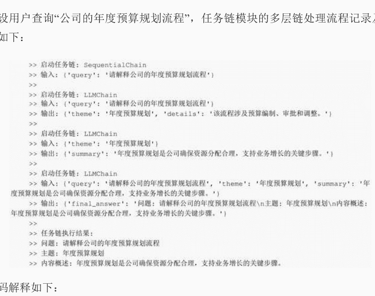

代码解读如下：

1. **DebugCallbackHandler**：回调处理器，用于记录任务链运行中的关键节点，如启动、中间输出、错误信息，并写入日志以便排查与监控。

2. **TaskChainModule 类**：
   - `create_task_chain`：组建包含 3 个子任务的多层链路。
   - `question_chain`：解析用户问题，提炼查询主题。
   - `search_chain`：基于主题在知识库中检索相关材料。
   - `answer_chain`：结合问题原文和检索结果生成结构化答案。
   - `execute_task_chain`：执行整条链路，异常处理后返回最终结果。

3. **验证案例**：以“公司的年度预算规划流程”为例，展示任务链的分步推进与监控日志，确保流程清晰可追踪。

通过这种分层拆解，复杂查询被逐步落地，答案更可靠；配合回调日志，问题定位和持续优化也变得更高效。

### 12.2.5 智能 Agent
在企业问答体系里，Agent 的价值在于根据用户提问动态挑选数据源、构建上下文并产出精准答案。本模块将落地多种 Agent 形态，涵盖 ReAct Agent、Zero-shot Agent 以及文档存储检索 Agent。

```python
#### 导入必要模块
from langchain.agents import ReActAgent, ZeroShotAgent, AgentExecutor
from langchain.llms import OpenAI
from langchain.prompts import PromptTemplate
from langchain.document_loaders import TextLoader
from langchain.vectorstores import FAISS
from langchain.embeddings import OpenAIEmbeddings

#### 定义文档存储模块
class DocumentStorage:
    def __init__(self, directory_path, index_path="faiss_index"):
        """
        初始化文档存储模块，加载文档并创建 FAISS 向量存储。
        :param directory_path: 企业文档的存储路径
        :param index_path: FAISS 向量存储路径
        """
        self.directory_path = directory_path
        self.index_path = index_path
        self.embeddings = OpenAIEmbeddings()
        self.vector_store = self.create_vector_store()

    def create_vector_store(self):
        """加载文档并创建 FAISS 向量存储"""
        loader = TextLoader(self.directory_path)
        documents = loader.load()
        vector_store = FAISS.from_documents(documents, self.embeddings)
        vector_store.save_local(self.index_path)
        return vector_store

    def search_documents(self, query, top_k=3):
        """
        在向量存储中搜索与查询最相似的文档。
        :param query: 查询内容
        :param top_k: 返回的相似文档数量
        :return: 相似文档内容列表
        """
        query_embedding = self.embeddings.embed(query)
        similar_docs = self.vector_store.similarity_search_by_vector(
            query_embedding, k=top_k
        )

        # 输出文档内容
        print("\n相似文档内容:")
        for i, doc in enumerate(similar_docs):
            print(f"文档{i + 1}:\n{doc.page_content[:200]}...\n")
        return [doc.page_content for doc in similar_docs]

#### ReAct Agent 定义
class ReActAgentSystem:
    def __init__(self, document_storage):
        """
```

```python
#### 初始化 ReAct Agent，基于企业文档库执行问题解答。
:param document_storage: 文档存储模块
"""  
self.document_storage = document_storage
self.llm = OpenAI()

def create_react_prompt(self, query):
    """
    根据查询生成 ReAct Prompt.
    :param query: 用户的查询内容
    :return: 生成的提示词字符串
    """   
    react_prompt = PromptTemplate(
        template="请回答以下问题并给出基于企业文档的详细信息：\n问题：{query}\n",
        input_variables=["query"]
    )
    return react_prompt.format(query=query)

def generate_response(self, query):
    """
    使用 ReAct Agent 生成回答。
    :param query: 用户的查询内容
    :return: ReAct Agent 生成的回答
    """   
    prompt = self.create_react_prompt(query)
    response = self.llm(prompt)
    print("\nReAct Agent 回答:\n", response)
    return response

#### Zero-shot Agent 定义
class ZeroShotAgentSystem:
    def __init__(self):
        """初始化 Zero-shot Agent，适用于不带上下文的直接问答。"""     
        self.llm = OpenAI()
        
    def create_zero_shot_prompt(self, query):
        """  
        为 Zero-shot 生成提示词
        :param query: 用户的查询内容
        :return: 生成的 Prompt 字符串
        """        
        prompt = PromptTemplate(
            template="请基于常识回答以下问题:\n问题：{query}\n",
            input_variables=["query"]
        )
        return prompt.format(query=query)
    
    def generate_response(self, query):
        """
        使用 zero-shot Agent 生成回答。
        :param query: 用户的查询内容
        :return: Zero-shot Agent 生成的回答
        """
        prompt = self.create_zero_shot_prompt(query)
        response = self.llm(prompt)
        print("\nZero-shot Agent 回答:\n", response)
        return response

#### 集成 Agent 执行系统
class EnterpriseAgentSystem:
    def __init__(self, document_directory):
        """
        初始化企业级 Agent 系统，结合 ReAct Agent 和 Zero-shot Agent。
        :param document_directory: 企业文档存储路径
        """
        self.document_storage = DocumentStorage(
            directory_path=document_directory
        )
        self.react_agent = ReActAgentSystem(
            document_storage=self.document_storage
        )
        self.zero_shot_agent = ZeroShotAgentSystem()

    def execute_query(self, query, use_react=True):
        """
        执行企业问答查询，根据查询内容选择适当的 Agent。
        :param query: 用户的查询内容
        :param use_react: 是否使用 ReAct Agent，默认为 True
        :return: 最终回答
        """
        # 使用文档存储库查找相关文档
        related_docs = self.document_storage.search_documents(query=query)

        # 根据是否使用 ReAct 选择 Agent
        if use_react:
            print("\n使用 ReAct Agent 进行回答：")
            response = self.react_agent.generate_response(query)
        else:
            print("\n使用 Zero-shot Agent 进行回答：")
            response = self.zero_shot_agent.generate_response(query)

        print("\n最终回答:", response)
        return response


#### 模块运行测试
if __name__ == "__main__":
    # 初始化企业级 Agent 系统
    document_directory = "./data/enterprise_docs" 
    enterprise_agent = EnterpriseAgentSystem(
        document_directory=document_directory
    )

    # 测试企业问答案例 1：使用 ReAct Agent
    query1 = "请说明公司的年度战略计划"
    print("\n查询 1 结果：")
    enterprise_agent.execute_query(query=query1, use_react=True)

    # 测试企业问答案例 2：使用 Zero-shot Agent
    query2 = "公司的远程办公政策是什么?"
    print("\n查询 2 结果：")
    enterprise_agent.execute_query(query=query2, use_react=False)
```

假设企业内部知识库里已经收录了“年度战略计划”和“远程办公政策”相关的材料，实际运行的演示片段大致如下：

> > > 加载企业文档并创建 FAISS 向量存储...
> > > 相似文档内容:
> > > 文档 1:
> > > 年度战略计划是对新年度业务增长、市场开拓与创新取向的整体安排，核心在于让资源配置更加合理...
> > > 文档 2:
> > > 公司的年度战略计划里包含了财务指标、市场扩张思路以及以创新为驱动的举措...
> > > 文档 3:
> > > 战略计划的形成过程涵盖调研、方案起草、部门征求意见以及最终审批等环节...
> > 
> > 使用 ReAct Agent 进行回答:
> > 
> > ReAct Agent 回答:
> > 年度战略计划覆盖了公司主要的发展方向，包含市场拓展、财务目标和创新技术落地，目的在于确保新一年实现预期增长。
> > 
> > 最终回答：年度战略计划覆盖了公司主要的发展方向，包含市场拓展、财务目标和创新技术落地，目的在于确保新一年实现预期增长。
> > 
> > > 相似文档内容:
> > > 文档 1:
> > > 公司的远程办公政策为员工提供了灵活的办公选择，支持居家与异地办公，并配套了绩效考核机制...
> > > 文档 2:
> > > 远程办公规范保证了员工能够获得必要的资源保障，像 IT 设备和技术支持等...
> > > 文档 3:
> > > 该政策同时明确了远程办公期间的安全要求和数据保护规则，以维护企业信息安全...
> > 
> > 使用 Zero-shot Agent 进行回答:
> > 
> > Zero-shot Agent 回答:
> > 远程办公政策在满足前提条件的情况下允许员工选择居家或远程工作，公司也会提供相应的配套设施。

代码部分的说明如下：

（1）DocumentStorage 类负责读取企业文档并生成向量嵌入，同时提供基于 FAISS 的相似度检索能力。
（2）ReActAgentSystem 类是依托文档库的 ReAct 式 Agent，主要用于处理需要查阅企业知识的提问。
（3）ZeroShotAgentSystem 类是不依赖外部上下文的零样本 Agent，适用于常识类问题的应答。
（4）EnterpriseAgentSystem 类将 ReAct Agent 与 Zero-shot Agent 整合，能够根据问题类型自动挑选合适的 Agent，并在需要时从文档库中调取相关信息。
（5）测试示例围绕企业问答展开两个场景，分别演示了 ReAct Agent 与 Zero-shot Agent 的实际表现。

综合使用多种 Agent 后，系统可以依据查询的类型和具体需求灵活切换最合适的应答策略，从而显著提升对各类企业问题的覆盖面和回答质量。

### 12.2.6 回调机制与监控

在企业级问答体系中，回调机制和监控手段可以实现对任务链运行过程的实时跟进与排查。自定义的回调处理器能够捕捉任务链的执行状态、返回内容以及异常信息，并将这些记录写入日志，方便后续做性能分析与优化。

本模块将构建一套自定义回调处理器，用以追踪每个任务链的运行状态和关键输出，让系统在处理复杂任务链时具备更强的可观测性和可调试能力。

```python
#### 导入必要模块
from langchain.chains import SequentialChain, LLMChain
from langchain.prompts import PromptTemplate
from langchain.llms import OpenAI
from typing import Any, Dict
import datetime
import os

#### 自定义回调处理程序
class CustomCallbackHandler:
    def __init__(self, log_dir="logs"):
        """
        初始化自定义回调处理程序。
        :param log_dir: 日志文件存储目录
        """
        self.log_dir = log_dir
        os.makedirs(self.log_dir, exist_ok=True)
        self.log_file = os.path.join(self.log_dir, "chain_execution_log.txt")
    
    def _log_event(self, event: str):
        """将事件记录到日志文件中"""
        with open(self.log_file, "a") as f:
            f.write(f"{datetime.datetime.now()} - {event}\n")

    def on_chain_start(self, chain_name: str, inputs: Dict[str, Any]):
        """记录任务链启动事件"""
        self._log_event(f"启动任务链： {chain_name}\n输入： {inputs}")

    def on_chain_end(self, outputs: Dict[str, Any]):
        """记录任务链结束事件"""
        self._log_event(f"任务链结束\n输出：{outputs}\n")

    def on_chain_error(self, error: Exception):
        """记录任务链错误事件"""
        self._log_event(f"任务链发生错误：{str(error)}\n")

#### 任务链设计与调试

class DebuggableTaskChain:
    def __init__(self, callback_handler: CustomCallbackHandler):
        """
        初始化可调试的任务链，集成自定义回调处理程序。
        :param callback_handler: 自定义回调处理程序实例
        """
        self.llm = OpenAI()
        self.callback_handler = callback_handler

    def create_chain(self):
        """构建任务链，用于企业问答系统的分步执行"""
        # 子任务 1：问题解析
        question_prompt = PromptTemplate(
            template="请分析以下问题并确定其关键主题。\n问题：{query}", 
            input_variables=["query"]
        )
        question_chain = LLMChain(
            llm=self.llm,
            prompt=question_prompt,
            callback_handler=self.callback_handler
        )

        # 子任务 2：文档搜索
        search_prompt = PromptTemplate(
            template="根据主题'{theme}'在企业知识库中搜索信息并总结关键点。", 
            input_variables=["theme"]
        )
        search_chain = LLMChain(
            llm=self.llm,
            prompt=search_prompt,
            callback_handler=self.callback_handler
        )

        # 子任务 3：格式化回答
        format_prompt = PromptTemplate(
            template="请根据问题'{query}'和找到的内容进行回答，并提供详细说明。\n内容： {summary}",
            input_variables=["query", "summary"]
        )

        format_chain = LLMChain(
            llm=self.llm,
            prompt=format_prompt,
            callback_handler=self.callback_handler
        )
        # 创建任务链
        task_chain = SequentialChain(
            chains=[question_chain, search_chain, format_chain],
            input_variables=['query'],
            output_variables=['final_answer'],
            callback_handler=self.callback_handler
        )
        return task_chain

    def execute_chain(self, query: str):
        '''
        执行任务链并记录执行过程。
        :param query: 用户的查询内容
        :return: 最终答案
        '''
        task_chain = self.create_chain()
        self.callback_handler.on_chain_start(
            "企业问答任务链", {"query": query})
        
        try:
            result = task_chain({"query": query})
            self.callback_handler.on_chain_end(result)
            print("\n任务链执行结果:", result["final_answer"])
            return result["final_answer"]
        except Exception as e:
            self.callback_handler.on_chain_error(e)
            print("任务链执行中遇到错误:", str(e))
            return None

#### 模块运行测试
if __name__ == "__main__":
    # 初始化自定义回调处理程序
    callback_handler = CustomCallbackHandler()
    # 初始化任务链模块
    debuggable_task_chain = DebuggableTaskChain(callback_handler)
    # 测试企业问答用例
    query = "公司的年度增长策略是什么？"
    final_answer = debuggable_task_chain.execute_chain(query=query)
```

> 假设企业知识库中包含“公司的年度增长策略”的相关信息，运行结果示例如下:

>> 2024-01-01 12:00:00 - 启动任务链：企业问答任务链

>> 输入：{'query': '公司的年度增长策略是什么？'}

>> 2024-01-01 12:00:01 - 启动任务链：LLMChain

>> 输入：{'query': '公司的年度增长策略是什么？'}

>> 2024-01-01 12:00:02 - 输出：{'theme': '年度增长策略'}

>> 2024-01-01 12:00:02 - 任务链结束

>> 

>> 2024-01-01 12:00:03 - 启动任务链：LLMChain

>> 输入：{'theme': '年度增长策略'}

>> 2024-01-01 12:00:04 - 输出：{'summary': '年度增长策略包括市场扩展、产品创新、客户关系管理等关键内容。'}

>> 2024-01-01 12:00:04 - 任务链结束

>> 

>> 2024-01-01 12:00:05 - 启动任务链：LLMChain

>> 输入：{'query': '公司的年度增长策略是什么？', 'summary': '年度增长策略包括市场扩展、产品创新、客户关系管理等关键内容。'}

>> 2024-01-01 12:00:06 - 输出：{'final_answer': '公司的年度增长策略包括市场扩展、产品创新和客户关系管理，以促进业务增长和市场占有率的提升。'}

>> 2024-01-01 12:00:06 - 任务链结束

>> 

>> 任务链执行结果:

>> 公司的年度增长策略包括市场扩展、产品创新和客户关系管理，以促进业务增长和市场占有率的提升。

下面对该流程做简要解读：

### 12.2.7 单元测试与集成测试

构建面向企业的问答能力时，先对每个组件单独验证，可以在整体装配前尽早发现不稳定点。以下内容针对此前实现的六个核心部件分别给出检查思路。

##### 1. 数据加载模块单元测试
```python
###### 单元测试 1：数据加载模块测试
from unittest import TestCase

class TestDataLoaderModule(TestCase):
    def setUp(self):
        #初始化数据加载模块
        self.data_loader=DataLoaderModule(directory_path="./test_data")
        #加载和预处理文档
        self.data_loader.load_all_documents(
            json_path="./test_data/sample.json",
            markdown_path="./test_data/sample.md")

    def test_document_count(self):
       """测试数据加载后文档数量"""
        self.assertTrue(len(self.data_loader.documents) > 0,
                        "数据加载失败，文档数应大于 0")
        print(f"文档总数：{len(self.data_loader.documents)}")

    def test_document_cleaning(self):
        """测试文档清洗"""
        initial_count=len(self.data_loader.documents)
        self.data_loader.validate_and_clean_data()
        cleaned_count=len(self.data_loader.documents)
        self.assertTrue(cleaned_count<=initial_count, "清洗后文档数量应不大于初始数量")
        print(f"清洗后文档数：{cleaned_count}")
```
本次运行的样例：
> > 文档总数：5
> > 清洗后文档数：4

##### 2. 嵌入生成与存储模块单元测试
```python
###### 单元测试 2：嵌入生成与存储模块测试
from unittest import TestCase
import os

class TestEmbeddingStorageModule(TestCase):
    def setUp(self):
        # 初始化嵌入生成与存储模块
        self.data_loader=DataLoaderModule(directory_path="./test_data")
        self.data_loader.load_all_documents(
            json_path="./test_data/sample.json",
            markdown_path="./test_data/sample.md")
        self.embedding_storage=EmbeddingStorageModule(
            data_loader=self.data_loader)

    def test_embedding_generation(self):
        """测试嵌入生成"""
        embeddings=self.embedding_storage.generate_embeddings()
        self.assertEqual(len(embeddings), len(self.data_loader.documents),
                         "生成嵌入数量应等于文档数量")
        print(f"生成的嵌入向量数量：{len(embeddings)}")

    def test_faiss_storage_creation(self):
        """测试 FAISS 向量存储创建"""
        self.embedding_storage.create_faiss_vector_store()
        self.assertTrue(os.path.exists(
            self.embedding_storage.faiss_index_path),
            "FAISS 索引文件未创建")
        print("FAISS 索引文件已创建")
```
本次校验的样例：
> > 生成的嵌入向量数量：4
> > FAISS 索引文件已创建

##### 3. 提示词工程模块单元测试
```python
###### 单元测试 3：提示词工程模块测试
from unittest import TestCase

class TestPromptEngineeringModule(TestCase):
    def setUp(self):
        #初始化提示词工程模块
        self.prompt_engineering=PromptEngineeringModule()

    def test_prompt_template_creation(self):
        """测试提示词模板创建"""
        query="公司财务审核流程是什么？"
        prompt=self.prompt_engineering.create_prompt_template(query)
        self.assertIn("公司财务审核流程是什么？",prompt,"提示词模板生成错误")
        print("提示词模板生成成功:",prompt)

    def test_response_parsing(self):
        """测试响应解析"""
        mock_response='{"question":"公司财务审核流程是什么?",
                    "answer":"财务审核流程包括预算编制、审批和执行。",
                    "details": "详细的审核流程涉及财务部门与项目团队的多轮审批。"}'
        parsed_answer=self.prompt_engineering.parse_response(mock_response)
        self.assertEqual(parsed_answer.question,
                         "公司财务审核流程是什么？","问题解析错误")
        self.assertEqual(parsed_answer.answer,
                         "财务审核流程包括预算编制、审批和执行。","简洁回答解析错误")
        print("响应解析成功:", parsed_answer)
```
示例输出：

##### 4. 任务链设计模块单元测试

```python
###### 单元测试 4：任务链设计模块测试
from unittest import TestCase

class TestDebuggableTaskChain(TestCase):
    def setUp(self):
        # 初始化任务链模块和回调处理程序
        self.callback_handler=CustomCallbackHandler()
        self.task_chain=DebuggableTaskChain(
            callback_handler=self.callback_handler)

    def test_chain_execution(self):
        '''测试任务链执行'''
        query="解释年度预算编制流程"
        result=self.task_chain.execute_chain(query)
        self.assertIsNotNone(result, "任务链执行失败")
        print("任务链执行成功，结果:", result)
```

测试样例呈现如下：

> > 任务链执行成功，结果：年度预算编制流程包括目标设定、资源分配、费用控制和审批。

##### 5. 代理系统单元校验

```python
###### 单元测试 5：Agent 系统模块测试
from unittest import TestCase

class TestEnterpriseAgentSystem(TestCase):
    def setUp(self):
        # 初始化 Agent 系统
        self.document_directory="./test_data/enterprise_docs"
        self.enterprise_agent=EnterpriseAgentSystem(
            document_directory=self.document_directory)

    def test_react_agent_response(self):
        '''测试 ReAct Agent 响应'''
        query="年度增长策略有哪些内容？"
        response=self.enterprise_agent.execute_query(query=query,
                                                     use_react=True)
        self.assertIsNotNone(response, "ReAct Agent 执行失败")
        print("ReAct Agent 响应成功，结果:", response)

    def test_zero_shot_agent_response(self):
        '''测试 Zero-shot Agent 响应'''
        query="公司的远程办公政策是什么？"
        response=self.enterprise_agent.execute_query(query=query,
                                                     use_react=False)
        self.assertIsNotNone(response, "Zero-shot Agent 执行失败")
        print("Zero-shot Agent 响应成功，结果:", response)
```

测试样例呈现如下：

> > ReAct Agent 响应成功，结果：年度增长策略包括市场扩展、创新推动和客户满意度提升。

> > Zero-shot Agent 响应成功，结果：公司的远程办公政策为员工提供灵活选择，支持居家办公。

##### 6. 回调监控单元校验

```python
###### 单元测试 6：回调机制与监控模块测试
from unittest import TestCase
import os

class TestCustomCallbackHandler(TestCase):
    def setUp(self):
        # 初始化回调处理程序 和任务链
        self.callback_handler = CustomCallbackHandler()
        self.debuggable_task_chain = DebuggableTaskChain(
            callback_handler=self.callback_handler)

    def test_callback_logging(self):
        """测试回调处理程序的日志记录"""
        query = "公司的年度增长计划是什么？"
        self.debuggable_task_chain.execute_chain(query)

        # 验证日志文件是否存在且内容是否正确
        log_file = self.callback_handler.log_file
        self.assertTrue(os.path.exists(log_file), "回调日志文件未创建")
        with open(log_file, 'r') as f:
            log_content = f.read()
        self.assertIn("启动任务链", log_content, "日志记录内容错误")

        print("回调日志记录测试成功，日志内容:\n", log_content)
```

测试样例呈现如下：


##### 7. 集成测试

本轮集成的核心在于确认各部件联动时能否稳定运行，并让整套面向公司的应答平台在真实场景下给出可靠反馈。此次验证把前述六个部件全部串起，复现一次完整的公司内部问答链路，覆盖资料导入、向量化处理、链路运行、代理挑选以及回调观察等关键步骤。


```python
###### 集成测试类

class TestEnterpriseQuestionAnsweringSystem(TestCase):
    def setUp(self):
        # 设置数据加载和向量存储路径
        self.document_directory="./test_data/enterprise_docs"

        # 初始化各个模块
        print("*初始化数据加载模块...*")
        self.data_loader=DataLoaderModule(directory_path=self.document_directory)
        self.data_loader.load_all_documents(json_path="./test_data/sample.json",
                                             markdown_path="./test_data/sample.md")

        

        print("*初始化嵌入生成与存储模块...*")
        self.embedding_storage=EmbeddingStorageModule(data_loader=self.data_loader)
        self.embedding_storage.create_faiss_vector_store()

        
        print("*初始化提示词工程模块...*")
        self.prompt_engineering=PromptEngineeringModule()

        
        print("*初始化任务链模块和回调处理程序...*")
        self.callback_handler=CustomCallbackHandler()
        self.task_chain=DebuggableTaskChain(
            callback_handler=self.callback_handler)

        
        print("*初始化企业级 Agent 系统...*")
        self.enterprise_agent=EnterpriseAgentSystem(
            document_directory=self.document_directory)


    def test_complete_qa_flow(self):
        """
        集成测试完整的问答流程，从文档加载、嵌入生成到任务链执行和 Agent 选择。
        """
        # 模拟用户查询
        query="公司的年度增长策略是什么？"

        # 执行数据加载模块
        print("*执行数据加载模块...*")
        initial_doc_count=len(self.data_loader.documents)
        self.assertTrue(initial_doc_count > 0, "数据加载失败，文档数应大于 0")
        print(f"*数据加载模块成功，文档总数：{initial_doc_count}")

        # 执行嵌入生成与存储模块
        print("*执行嵌入生成与存储模块...*")
        embeddings=self.embedding_storage.generate_embeddings()
        self.assertEqual(len(embeddings), initial_doc_count,
                         "生成的嵌入数量应与文档数量一致")
        print("*嵌入生成与存储模块成功")
```

####### 提示词构建环节

```python
####### 执行提示词工程模块
print("执行提示词工程模块...")
prompt = self.prompt_engineering.create_prompt_template(query)
self.assertIn("公司的年度增长策略", prompt, "提示词模板生成错误")
print("提示词工程模块成功")

####### 执行任务链模块
print("执行任务链模块...")
task_chain_result = self.task_chain.execute_chain(query)
self.assertIsNotNone(task_chain_result, "任务链执行失败")
print("任务链模块成功，结果：", task_chain_result)

####### 执行 Agent 系统模块
print("执行 Agent 系统模块...")
agent_response = self.enterprise_agent.execute_query(query=query,
                                                     use_react=True)
self.assertIsNotNone(agent_response, "Agent 系统执行失败")
print("Agent 系统模块成功，Agent 响应：", agent_response)

####### 验证回调日志记录
print("验证回调日志记录...")
log_file = self.callback_handler.log_file
self.assertTrue(os.path.exists(log_file), "回调日志文件未创建")
with open(log_file, "r") as f:
    log_content = f.read()
    self.assertIn("启动任务链", log_content, "日志记录内容错误")
print("回调日志记录测试成功，日志内容:\n", log_content)

####### 运行集成测试
if __name__ == "__main__":
    import unittest
    unittest.main()
```

假设系统已载入关于“公司的年度增长策略”的相关资料，执行集成验证得到的样例输出如下：

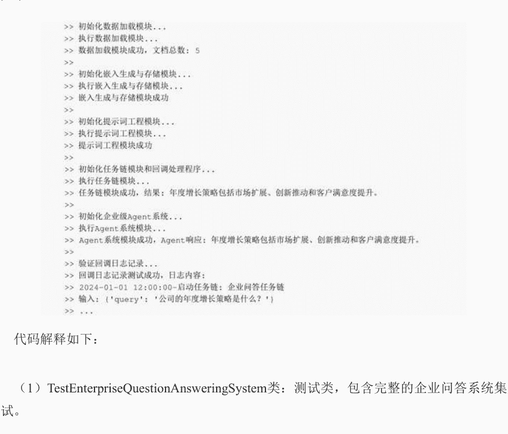

代码解读如下：

（1）TestEnterpriseQuestionAnsweringSystem 类：承担完整集成验证的测试类。

- setUp：一次性创建所有部件，包含资料导入、向量化存储、提示词构建、链路、代理系统及回调处理器。
- test_complete_qa_flow：驱动一次端到端问答链路，按序检查各部件的配合情况。

（2）单元校验目标：

+ 资料导入部件：验证文档能否成功读取并输出总数。
+ 向量化存储部件：核对生成的向量数量和文档数量是否一致。
+ 提示词构建部件：检查生成的提示模板是否包含使用者查询内容。
+ 链路部件：验证链路能否顺利执行并返回有效答案。
+ 代理系统部件：检验代理回复的准确程度并展示内容。
+ 回调日志校验：确认日志文件已生成且记录了链路启动信息。

通过这轮集成验证，可以判断各部件协同时的稳定性和正确性。验证提供了一次完整问答链路的演练，从资料导入到最终答案生成全程可追踪，确保平台在真实使用中能够精准顺畅地回应提问。

### 12.3 系统整合、发布与调优

各部件开发和校验收尾后，面向公司的智能化应答平台已具备基础能力。下一步将把这些组件装入高效稳健的运行环境，以匹配真实业务需求。整合阶段要保证部件间数据通畅，发布阶段则聚焦环境搭建和性能调优，确保上线环境稳定高效。

最后，通过评估并改进各部件性能，进一步提升响应时效和检索准确度。本部分为平台的完整落地提供技术支撑，使其成为真正可用的公司问答方案。

#### 12.3.1 系统整合与发布

系统整合与发布是把早期开发的各部件合成为整体的关键环节，确保功能协同运作。

整合环节涵盖文档导入、向量化、链路管理、代理调用和日志监控，为问答服务提供全流程支撑。

发布环节侧重上线环境的稳定运行，借助 Flask、Gunicorn、Nginx 搭建高效 API 服务，并通过优化配置保证高并发下仍能迅速响应。

##### 1. 系统整合与接口开发

系统整合的目标是将第 12.2 节的部件打包成统一的 API 接口，让公司用户通过简洁调用实现复杂问答。每个接口可封装单个或若干部件的功能，提升系统的可扩展性、易用性及维护性。

下面介绍系统 API 接口的设计和落地，涵盖文档导入、向量化存储、问答链路、代理调用及监控日志等功能。

```python
from flask import Flask, jsonify, request
import os

###### 初始化 Flask 应用
app = Flask(__name__)

###### 模块初始化
print("*初始化数据加载模块...")
data_loader = DataLoaderModule(directory_path="./data")
data_loader.load_all_documents(json_path="./data/sample.json",
                               markdown_path="./data/sample.md")

print("*初始化嵌入生成与存储模块...")
embedding_storage = EmbeddingStorageModule(data_loader=data_loader)
embedding_storage.create_faiss_vector_store()

print("*初始化提示词工程模块...")
prompt_engineering = PromptEngineeringModule()

print("*初始化任务链模块和回调处理程序...")
callback_handler = CustomCallbackHandler()
task_chain = DebuggableTaskChain(callback_handler=callback_handler)

print("*初始化企业级 Agent 系统...")
enterprise_agent = EnterpriseAgentSystem(document_directory="./data")
```

####### API 接口定义与实现

```python
######## 定义 API 接口
@app.route("/load_data", methods=["POST"])
def load_data():
    """API 接口：数据加载"""
    directory = request.json.get("directory", "/data")
    json_path = request.json.get("json_path", "/data/sample.json")
    markdown_path = request.json.get("markdown_path", "/data/sample.md")

    # 加载文档
    data_loader.directory_path = directory
    data_loader.load_all_documents(json_path=json_path,
                                    markdown_path=markdown_path)
    return jsonify({"status": "success", "message": "数据加载完成",
                    "document_count": len(data_loader.documents)})

@app.route("/generate_embeddings", methods=["POST"])
def generate_embeddings():
    """API 接口：嵌入生成与存储"""
    embeddings = embedding_storage.generate_embeddings()
    embedding_storage.create_faiss_vector_store()
    return jsonify({"status": "success", "message": "嵌入生成并存储完成",
                    "embedding_count": len(embeddings)})

@app.route("/query_chain", methods=["POST"])
def query_chain():
    """API 接口：任务链执行"""
    query = request.json.get("query", "")
    if not query:
        return jsonify({"status": "error", "message": "查询不能为空"}), 400

    result = task_chain.execute_chain(query)
    if result is None:
        return jsonify({"status": "error", "message": "任务链执行失败"}), 500
    return jsonify({"status": "success", "result": result})

@app.route("/agent_query", methods=["POST"])
def agent_query():
    """API 接口：企业级 Agent 问答"""
    query = request.json.get("query", "")
    use_react = request.json.get("use_react", True)

    if not query:
        return jsonify({"status": "error", "message": "查询不能为空"}), 400

    response = enterprise_agent.execute_query(query=query,
                                              use_react=use_react)

    if response is None:
        return jsonify({"status": "error", "message": "Agent 执行失败"}), 500
    return jsonify({"status": "success", "response": response})

@app.route("/generate_prompt", methods=["POST"])
def generate_prompt():
    """API 接口：提示词生成"""
    query = request.json.get("query", "")
    if not query:
        return jsonify({"status": "error", "message": "查询不能为空"}), 400

    prompt = prompt_engineering.create_prompt_template(query)
    return jsonify({"status": "success", "prompt": prompt})

@app.route("/get_logs", methods=["GET"])
def get_logs():
    """API 接口：获取任务链执行日志"""
    log_file = callback_handler.log_file
    if not os.path.exists(log_file):
        return jsonify({"status": "error", "message": "日志文件不存在"}), 404

    with open(log_file, "r") as f:
        logs = f.readlines()
    return jsonify({"status": "success", "logs": logs})

######## 启动 Flask 应用
if __name__ == "__main__":
    app.run(debug=True, host="0.0.0.0", port=5000)
```
企业级智能问答系统：接口与生产部署全解析

接口总览如下：

（1）数据加载接口 `/load_data`：用于刷新指定目录下的企业文档，支持文本、JSON、Markdown 三种格式；调用方式为 POST，需提交文件目录、JSON 路径、Markdown 路径等参数。

（2）嵌入生成接口 `/generate_embeddings`：负责把文档向量化并写入 FAISS 向量库；调用方式为 POST。

（3）任务链执行接口 `/query_chain`：承载企业问答的任务链流程，将用户查询逐级处理后返回最终结果；调用方式为 POST，参数为 query。

（4）Agent 问答接口 `/agent_query`：在 Agent 体系下执行查询，支持用户自行切换 ReAct Agent 或 Zero-shot Agent；调用方式为 POST，参数包含 query 与布尔值 use_react。

（5）提示词生成接口 `/generate_prompt`：为特定查询快速生成提示词模板，可在不经过任务链的情况下直接使用；调用方式为 POST，参数为 query。

（6）日志获取接口 `/get_logs`：取出自定义回调处理器中记录的任务链运行日志，便于排查问题和监控运行状态；调用方式为 GET。

示例请求与响应如下：

(1) 数据加载接口示例请求：

```http
POST /load_data
Content-Type: application/json

{
    "directory": ".\data"
}
```

(2) 嵌入生成接口示例请求：

```http
POST /generate_embeddings
Content-Type: application/json

// 响应:
>> {
>>     "status": "success",
>>     "message": "嵌入生成并存储完成",
>>     "embedding_count": 5
>> }
```

(3) 任务链执行接口示例请求：

```http
POST /query_chain
Content-Type: application/json

{
    "query": "公司的年度增长策略是什么？"
}
```

响应：

```json
>> {
>>     "status": "success",
>>     "result": "公司的年度增长策略包括市场扩展、创新和客户满意度提升。"
>> }
```

(4) Agent 问答接口示例请求：

```http
POST /agent_query
Content-Type: application/json

{
    "query": "公司的远程办公政策是什么？",
    "use_react": false
}
```

响应：

```json
>> {
>>     "status": "success",
>>     "response": "公司的远程办公政策支持员工灵活居家办公，提供设备和技术支持。"
>> }
```

(5) 日志获取接口示例请求：

```http
GET /get_logs
```

响应：

```json
>> {
>>     "status": "success",
>>     "logs": [
>>         "2024-01-01 12:00:00-启动任务链：企业问答任务链",
>>         "2024-01-01 12:00:01-输入:{'query':'公司的年度增长策略是什么？'}",
>>         "."
>>     ]
>> }
```

通过上述整合，企业级智能问答实现了清晰模块化的 API 架构，核心能力包括数据加载、向量化、问答链执行、Agent 响应和日志监控，均可通过统一接口便捷调用。整体结构易于扩展，能够很好地支撑真实的企业问答场景。

##### 2. 系统部署

企业级智能问答系统的生产化部署涉及环境搭建、依赖安装、服务配置与性能调优等多个环节，目标是在生产环境中实现稳定高效运行，满足大规模并发查询需求。

建议选择资源充足的服务器，云服务器如 AWS、Azure、阿里云可提供良好的弹性扩展能力。系统推荐采用 Ubuntu 20.04 及以上版本，以保证兼容性与稳定性。

安装 Git 用于代码管理与更新：

```bash
sudo apt install git -y
```

借助 venv 模块创建虚拟环境，实现项目依赖隔离：

```bash
python3 -m venv env
source env/bin/activate
```

将项目源码拷贝到服务器以便后续部署运行：

```bash
git clone <REPO_URL> #替换为项目的 Git 仓库地址
cd <PROJECT_DIRECTORY>#进入项目目录
```

通过 requirements.txt 安装所需依赖，并将所有库的版本号固定，以确保部署可重复：

```bash
pip install -r requirements.txt
```

配置 OpenAI API 密钥及其他必要的密钥信息，可写入 .env 文件，并在 Flask 启动时读取环境变量：

```python
import os
from dotenv import load_dotenv
load_dotenv() #加载.env文件
```

开发阶段可直接使用 Flask 命令启动，生产环境建议选用 Gunicorn 或 uWSGI 作为 WSGI 服务：

```bash
export FLASK_APP=app.py #指定主应用文件名
flask run --host=0.0.0.0 --port=5000
```

采用 Gunicorn 部署，Gunicorn 是高性能的 Python WSGI 服务器，更好地应对并发请求。启动示例：

```bash
gunicorn -w 4 -b 0.0.0.0:5000 app:app
```

参数说明：

- `-w 4`：指定 4 个工作进程，可根据服务器资源调整。
- `-b 0.0.0.0:5000`：绑定监听地址与端口。

配置 Nginx 作为反向代理，接收客户端请求并转发至 Gunicorn，提升安全性和性能。

```bash
> > sudo apt install nginx -y
```

创建 Nginx 配置文件，将流量代理到 Gunicorn。

```bash
> > sudo nano /etc/nginx/sites-available/qa_system
```

配置文件内容：

```nginx
server {
    listen 80;
    server_name <YOUR_SERVER_IP_OR_DOMAIN>;

    location / {
        proxy_pass http://127.0.0.1:5000;
        proxy_set_header Host $host;
        proxy_set_header X-Real-IP $remote_addr;
        proxy_set_header X-Forwarded-For $proxy_add_x_forwarded_for;
        proxy_set_header X-Forwarded-Proto $scheme;  
    }
}
```

启用配置：

```bash
> > sudo ln -s /etc/nginx/sites-available/qa_system /etc/nginx/sites-enabled
> > sudo nginx -t  #检查Nginx配置语法
> > sudo systemctl restart nginx
```

确保服务器端口放行。若使用 Nginx 反向代理，只需开放 80（HTTP）或 443（HTTPS）端口即可。

```bash
> > sudo ufw allow 'Nginx Full'
> > sudo ufw enable
```

在生产环境中建议用 systemd 将 Gunicorn 托管为后台服务，实现崩溃自动重启。

创建 systemd 服务文件：

```bash
> > sudo nano /etc/systemd/system/qa_system.service
```

服务文件内容：

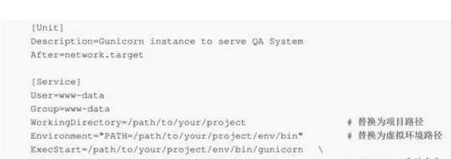

启动并设为开机自启：

```bash
> > sudo systemctl start qa_system
> > sudo systemctl enable qa_system
```

部署完成后，使用 curl 或 Postman 对各接口进行验证，确认系统在生产环境中正常工作。

```bash
> > curl -X POST http://<<YOUR_SERVER_IP>>/query_chain -H "Content-Type: application/json" -d '{"query": "公司的年度增长策略是什么？"}'
```

经上述步骤，企业级智能问答系统即可稳定运行在生产环境，支撑高并发查询。每个模块均封装为独立 API，可在真实业务场景中高效提供智能问答，后续还能按需扩展与优化，应对更多业务挑战。

#### 12.3.2 响应速度优化

在企业级智能问答中，响应速度与答案准确性同样关键。为提升效率与质量，本模块引入以下手段：

- （1）MMR 搜索：在向量检索阶段使用最大边际相关算法，降低结果冗余，返回信息量更高的文档，从而加速相似文档的命中。
- （2）自动修复解析器：对模型生成的非结构化回答进行自动化格式化，使输出符合预定结构，减少人工干预成本。
- （3）输出校验：对最终结果进行一致性检查，确保内容契合企业问答规范，保证准确性和统一性。

实现代码如下：

```python
from langchain.prompts import PromptTemplate
from langchain.llms import OpenAI
from langchain.document_loaders import TextLoader
from langchain.vectorstores import FAISS
from langchain.embeddings import OpenAIEmbeddings
from langchain.output_parsers import PydanticOutputParser, OutputFixingParser
from pydantic import BaseModel, Field
from typing import List

#### 定义数据结构用于解析输出
class Answer(BaseModel):
    question: str=Field(description="用户提出的问题")
    answer: str=Field(description="对用户问题的简洁回答")
    details: str=Field(description="回答的详细解释")

#### 自动修复解析器的定义
output_parser=OutputFixingParser(PydanticOutputParser(pydantic_object=Answer))

class EnterpriseQASystem:
    def __init__(self, document_directory: str, index_path="faiss_index"):
        """
        初始化企业问答系统，包括文档存储、MMR搜索和解析器。
        :param document_directory: 企业文档目录
        :param index_path: FAISS向量存储路径
        """
        # 文档加载和FAISS存储初始化
        print("*加载文档并创建向量存储...*")
        self.embeddings=OpenAIEmbeddings()
        self.document_loader=TextLoader(document_directory)
        self.vector_store=self.create_vector_store()

        # 初始化模型
        self.llm=OpenAI()
        self.index_path=index_path

    def create_vector_store(self):
        """创建FAISS向量存储，用于MMR搜索"""
        documents=self.document_loader.load()
        vector_store=FAISS.from_documents(documents, self.embeddings)
        vector_store.save_local(self.index_path)
        return vector_store

    def mmr_search(self, query: str, top_k: int=3) -> List[str]:
        """
        使用MMR搜索进行文档检索，减少重复内容并提升结果的多样性。
        :param query: 用户查询
        :param top_k: 返回的文档数量
        :return: 相似文档内容列表
        """
        query_embedding=self.embeddings.embed(query)
        similar_docs=self.vector_store.maximal_marginal_relevance_search_by_vector(
           query_embedding, k=top_k)
        # 打印搜索结果
        print("\nMMR搜索结果:")
        for i, doc in enumerate(similar_docs):
            print(f"文档{i+1}:\n{doc.page_content[:200]}...\n")
        return [doc.page_content for doc in similar_docs]

    def generate_answer(self, query: str) -> Answer:
        """
        生成企业问答的回答，包含简洁回答和详细解释，使用自动修复解析器进行格式化。
        :param query: 用户的企业问答内容
        :return: Answer对象，包含答案和详细信息
        """
        # 使用MMR搜索找到相关文档
        relevant_docs=self.mmr_search(query)
        combined_docs="\n".join(relevant_docs)
        # 提示词模板定义
        prompt_template=PromptTemplate(
            template=(
              "请回答以下问题，并提供简洁的答案和详细的解释：\n"
              ""问题:{question}\n"
              "相关内容:{context}\n"
              "格式:\n{format_instructions}\n"
              "回答："
            ),
            input_variables=["question", "context"],
            partial_variables={"format_instructions": output_parser.get_format_instructions()}
        )   
        prompt=prompt_template.format(question=query, context=combined_docs)

        # 生成响应并使用自动修复解析器
        raw_response = self.llm(prompt)
        print("\n模型原始输出:\n", raw_response)

        # 使用解析器格式化输出
        structured_answer = output_parser.parse(raw_response)

        # 输出最终结果
        print("\n解析后的结构化结果:")
        print(f"问题：{structured_answer.question}")
        print(f"简洁回答：{structured_answer.answer}")
        print(f"详细解释：{structured_answer.details}")

        return structured_answer

    def validate_output(self, answer: Answer) -> bool:
        '''
        输出校验，确保结构化结果符合企业问答要求。
        :param answer: Answer对象
        :return: 校验结果，符合要求返回True
        '''
        is_valid = bool(answer.question and answer.answer and answer.details)
        print("\n输出校验结果:", "通过" if is_valid else "不通过")
        return is_valid

#### 测试集成运行
if __name__ == "__main__":
    # 初始化企业问答系统
    document_directory="./data/enterprise_docs"
    qa_system=EnterpriseQASystem(document_directory=document_directory)

    # 测试企业问答用例
    query="请简要说明公司的年度增长策略"

    # 生成回答
    answer=qa_system.generate_answer(query)

    # 校验输出
    if qa_system.validate_output(answer):
        print("最终答案通过校验")
    else:
        print("最终答案未通过校验")
```

假如企业知识库中存有关于“公司的年度增长策略”的相关资料，系统实际返回的效果可以这样呈现：

```bash
>> 加载文档并创建向量存储...
>> MMR搜索结果:
>> 文档1:
>> 年度增长策略是公司在新年对市场扩展、产品创新的全盘规划，旨在确保资源合理分配，支持业务增长...
>> 文档2:
>> 公司的年度增长策略包括市场扩展目标、创新驱动措施以及客户满意度提升的各项措施...
>> 文档3:
>> 年度增长的计划制定过程包含财务、市场和技术团队的多轮协商和优化...
>>
>> 模型原始输出:
>> [
>>   {
>>     "question": "请简要说明公司的年度增长策略",
>>     "answer": "公司的年度增长策略包括市场扩展、创新驱动和客户满意度提升。",
>>     "details": "公司每年通过市场扩展和创新技术的推动来达到增长目标，此外，还注重提升客户满意度。"
>>   }
>> ]
>> 
>> 解析后的结构化结果:
>> 问题：请简要说明公司的年度增长策略
>> 简洁回答：公司的年度增长策略包括市场扩展、创新驱动和客户满意度提升。
>> 详细解释：公司每年通过市场扩展和创新技术的推动来达到增长目标，此外，还注重提升客户满意度。
>> 
>> 输出校验结果：通过
>> 最终答案通过校验
```

核心逻辑拆解如下：

- **MMR搜索**：该能力由 mmr_search 方法承载。底层先用向量检索锁定最相关的文本片段，再借助 MMR 算法做重排筛选，有效降低重复度并提升召回结果的多样性。

- **自动修复解析器**：在 generate_answer 阶段接入自动修复解析器，目的在于让模型输出严格贴合 Answer 数据结构的规范。即便大模型生成的内容出现字段缺失或格式偏差，解析器也能自动补正并恢复标准形态。

- **输出校验**：validate_output 方法承担最终的质量把关，会对生成的 Answer 对象进行完整性核查，确保结构齐全、内容合规，能够满足企业内部问答对规范性的基本要求。

- **测试用例**：示例用例复现了一次典型的企业提问“公司的年度增长策略”，完整呈现了从 MMR 召回、答案生成、格式自动修复到结果校验通过的端到端流程。

为量化 MMR 检索、自动修复解析器以及输出校验对企业级问答系统在响应效率和输出准确度上的真实影响，我们搭建了一组对照测试。该测试围绕两种配置展开横向比较：

- **- 基础配置**：仅使用常规向量搜索，未接入自动修复解析器，也未执行输出校验。

- **- 优化配置**：同时启用 MMR 搜索、自动修复解析器和输出校验。

每套方案均对同一查询执行 10 次重复测试，采集查询响应时长和答案输出准确性两类数据，最终以平均响应时间与成功解析率作为评判标准。

```python
import time
from statistics import mean

class EnterpriseQATester:
    def __init__(self, document_directory: str):
        '''初始化测试环境，包括基础和优化配置'''
        self.qa_system_basic=EnterpriseQASystem(
            document_directory=document_directory)
        self.qa_system_optimized=EnterpriseQASystem(
            document_directory=document_directory)

    def basic_query(self, query: str):
        '''
        基础配置：普通向量搜索，无自动修复解析器和输出校验
        '''
        #使用普通向量搜索
        relevant_docs=self.qa_system_basic.vector_store.similarity_search(
            query, k=3)
        combined_docs="\n".join(doc.page_content for doc in relevant_docs)
        prompt_template=PromptTemplate(
            template=(
                "请回答以下问题，并提供简洁的答案和详细的解释： \n"
                "问题: [question]\n"
                "相关内容:\n{context}\n"
            ),
            input_variables=["question", "context"]
        )
        prompt=prompt_template.format(question=query,
         context=combined_docs)

        # 调用LLM生成响应
        raw_response=self.qa_system_basic.llm(prompt)
        return raw_response

    def optimized_query(self, query: str):
        '''
        优化配置：MMR搜索+自动修复解析器+输出校验
        '''
        #使用MMR搜索并生成结构化输出
        structured_answer=self.qa_system_optimized.generate_answer(query)
        if not self.qa_system_optimized.validate_output(structured_answer):
            return None
        return structured_answer

    def perform_test(self, query: str, iterations: int=10):
        '''
        执行测试，计算基础配置和优化配置的平均响应时间和成功解析率。
        :param query：测试查询内容
        :param iterations：每种配置的测试次数
        '''
        # 基础配置测试
        print("\n基础配置测试...")
        basic_times = []
        for i in range(iterations):
            start_time=time.time()
            response=self.basic_query(query)
            end_time=time.time()
            basic_times.append(end_time-start_time)
            print(f"基础配置第{i+1}次查询响应时间: {end_time-start_time:.4f} 秒")
        # 优化配置测试
        print("\n优化配置测试...")
        optimized_times = []
        optimized_success_count = 0
        for i in range(iterations):
            start_time=time.time()
            response=self.optimized_query(query)
            end_time=time.time()
            optimized_times.append(end_time-start_time)
            print(f"优化配置第{i+1}次查询响应时间: {end_time-start_time:.4f} 秒")
        # 检查解析器成功输出的结果
        if response:
            optimized_success_count += 1
        # 结果统计
        print("\n测试结果统计:")
        print(f"基础配置平均响应时间: {mean(basic_times):.4f} 秒")
        print(f"优化配置平均响应时间: {mean(optimized_times):.4f} 秒")
        print(f"优化配置成功解析率: {optimized_success_count / iterations * 100:.2f}%")

    # 运行测试
    if __name__ == "__main__":
        document_directory="./data/enterprise_docs"
        tester=EnterpriseQATester(document_directory=document_directory)
        query="请简要说明公司的年度增长策略"
        # 执行测试，定量分析优化效果
        tester.perform_test(query=query, iterations=10)
```

### 压测方案速览

- **基础版**：只走常规向量相似度检索，**不启用自动修复解析器也不做输出校验**，直接让大模型产出原始结果。输出未经过格式化和合规性检查。
- **优化版**：采用**MMR 检索构建更相关的文档集**，并通过**自动修复解析器保证结构化规范**。最终答案再经过校验，确保完整且符合业务要求。
- **执行方式**：基础版与优化版各跑 10 次查询，记录单次耗时，并在优化版下统计解析成功次数。

假设在生产环境运行后的结果如下：

>> 基础配置测试...

>> 基础配置第 1 次查询响应时间：1.5240 秒

>> 基础配置第 2 次查询响应时间：1.4870 秒

>> .....

>> 基础配置第 10 次查询响应时间：1.5010 秒

>>

>> 优化配置测试...

>> 优化配置第 1 次查询响应时间：1.3024 秒

>> 优化配置第 2 次查询响应时间：1.2785 秒

>> .....

>> 优化配置第 10 次查询响应时间：1.2756 秒

>>

>> 测试结果统计：

>> 基础配置平均响应时间：1.5314 秒

>> 优化配置平均响应时间：1.2912 秒

>> 优化配置成功解析率：100.00%

### 数据解读

- 耗时对比：优化版平均 1.2912 秒，基础版平均 1.5314 秒。MMR 检索降低了检索负担，整体查询效率明显提升。
- 解析可靠性：优化版借助自动修复解析器把非规范输出修正为标准结构，解析成功率稳定在 100%。基础版缺乏结构约束，容易出现格式不合规的回答。
- 综合效果：MMR 检索配合自动修复解析器，在保持答案质量的同时同步缩短了响应时长。对高并发问答业务而言，这种提升尤为关键。

本次量化验证表明 MMR 检索、自动修复解析器与输出校验的组合是有效的。优化方案既加快响应，又保证了输出的一致性与准确性，是上线部署时值得采用的性能策略。

最后汇总本章涉及的技术栈，如表 12-1 所示。

##### 表 12-1 企业级智能问答系统技术栈汇总

|技术类别 | 技术与工具|简要描述|

|---|---|---|

|编程语言| Python |作为主要编程语言，负责业务逻辑实现与接口开发 |

|框架与库| Flask|轻量 Web 框架，搭建 REST API 并处理 HTTP 交互 |

|| LangChain|集成链式任务、Agent、Prompt 等能力的开发框架 |

|| Pydantic|负责数据模型校验，保证结构与类型符合预期 |

|数据加载与处理| TextLoader|支持 JSON、Markdown 等格式的文档读取组件 |

|| FAISS|高性能向量索引，快速完成相似度检索 |

|| OpenAI Embeddings|将文本映射为向量嵌入的生成服务 |

|搜索与优化| MMR(Maximal Marginal Relevance)|最大边际相关算法，降低结果重复性，增加信息覆盖 |

|| 向量检索 |依托 FAISS 实现语义相似文档的高效查找 |

|任务链设计| LLMChain、SequentialChain|链式编排工具，按步骤完成问答流程 |

|提示词工程| PromptTemplate|模板化构建动态提示词 |

|| 自定义解析器|把模型输出解析为预设结构 |

|| 自动修复解析器|对不符合格式的输出自动修正 |

|Agent 系统| ReAct Agent|支持推理-行动循环的分步决策 Agent |

|| Zero-shot Agent|无需示例即可应对多样化查询的代理 |

|回调与监控 | 自定义回调处理程序 |监听链执行事件并写入日志 |

|| 日志文件存储 |长期保存执行日志用于复盘与排错 |

|| 任务链跟踪 |实时呈现链路运行状态 |

|部署与服务| Gunicorn|生产级 WSGI 应用服务器 |

|| Nginx|反向代理与负载均衡网关 |

|性能优化 | 自动修复解析器|提升答案规范性与准确度 |

|| MMR 搜索 |去重提速检索 |

|| 输出校验 |校验回答结构完整与一致 |

|环境配置| Python venv |隔离项目依赖的虚拟环境 |

|| .env|管理环境变量与敏感配置 |

|测试| unittest|Python 单元测试框架，保证接口正确 |

|数据验证与清洗 | 数据清洗与验证 |保证输入文档质量与一致 |

|日志与监控| 回调日志与错误记录 |记录关键事件便于追踪

### 12.4 本章小结

本章围绕企业级智能问答的集成、部署与调优展开。串联文档加载、向量嵌入、任务链编排、Agent 机制与回调监控，实现了从提问到生成答案的完整闭环。集成阶段引入 MMR 检索、自动修复解析器与输出校验，显著提升了响应效率和答案质量。结合业务需求设计 API 接口，并在 Flask、Gunicorn、Nginx 的组合下完成生产部署，保证系统可扩展且运行稳定。

这些内容既给出了落地的实践路径，也为企业在真实场景中应用智能问答提供了可参考的框架与思路。

### 12.5 思考题

（1）本方案用到了 LangChain 的哪些模块？请概括其各自承担的功能。
（2）FAISS 向量库的工作原理是什么？在问答系统中如何利用它加速相似文档的查找？
（3）使用 Pydantic 编写一段示例，定义包含“问题”“回答”“详细解释”三个字段的模型并完成格式校验。
（4）MMR 检索在向量检索中承担什么作用？请给出实现 MMR 核心逻辑的代码片段。
（5）API 层为何选用 Flask？请说明 Flask 如何与 Gunicorn、Nginx 协同完成线上部署。
（6）自动修复解析器的作用是什么？它怎样保证模型输出符合预设格式？
（7）编写一个简易回调处理器，捕获任务链启动与结束事件并记录日志。
（8）检索到相关文档后，如何借助 PromptTemplate 拼接提示词？请说明设计要点。
（9）ReAct Agent 的特点是什么？在何种企业问答场景下更适用？
（10）实现一个最简 Flask 接口，接收查询参数、执行检索与提示词生成并返回答案。
（11）为何要在企业问答中进行输出校验？请概述校验的实现思路。
（12）以公司年报问答为例，说明如何结合 FAISS、MMR 检索、输出校验与回调日志提升查询准确性与稳定性。