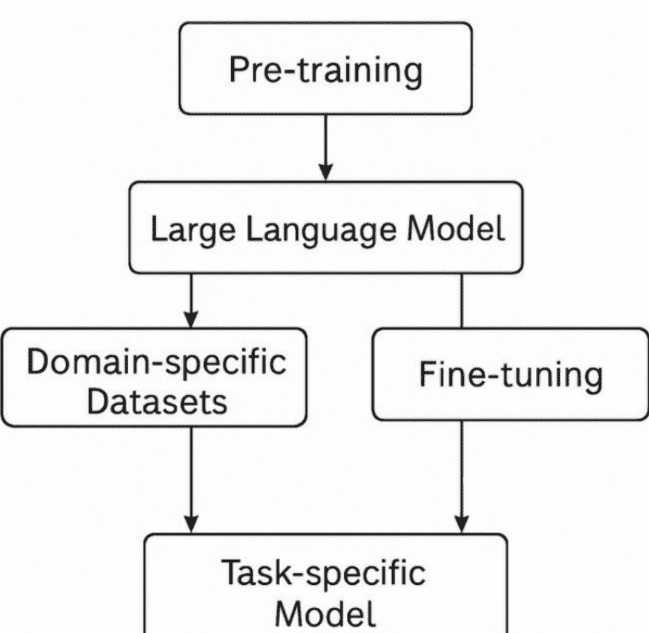
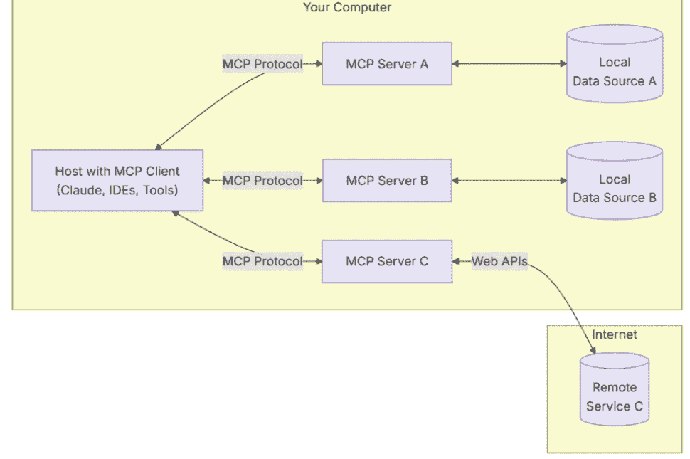
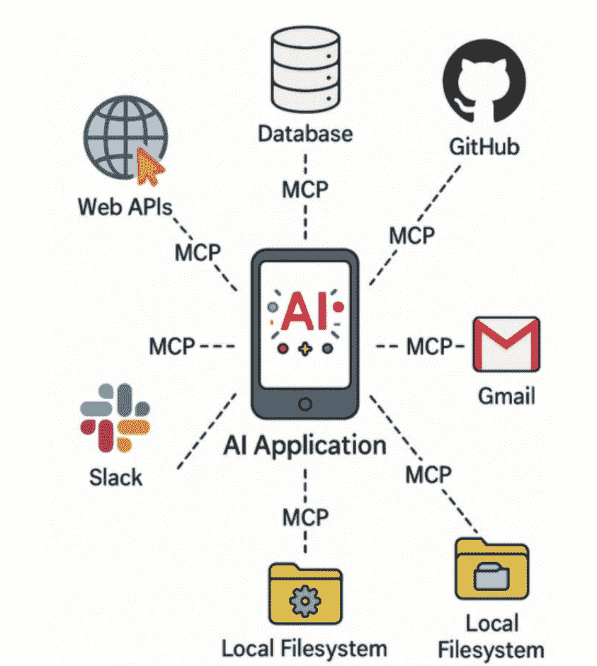

# MCP 与大模型融合实战：从协议设计到智能体落地

## 内容简介

本书以模型上下文协议 MCP 为主线，把协议原理、规范细节、研发流程与工程实践串成一条完整的学习路径。读者对象是 LLM 研发人员、系统架构师以及 AI 工程团队，目标是提供一套既专业又便于落地的参考体系。

全书共 10 章，由浅入深展开。先补齐大模型的技术底座，介绍 Transformer 式架构、预训练与微调机制、上下文建模要点，帮助建立 MCP 所依赖的语境。为此先拆解 MCP 的设计初衷、核心概念、架构组件与典型应用场景，再详述协议与大模型在通信、信息管控、格式规范及生命周期调控方面的配合。后半部分转向工程化，涵盖服务端搭建、工具链接入、智能体构建与检索增强生成 RAG 的融合，并以真实案例复盘部署形态、性能优化与生态走向。

写作兼顾协议视角与工程视角，兼具深度与可操作性，适合从事大模型研发、语义协议设计与 AI 工程的中高级技术人员。

## 前言

近几年，大规模语言系统已从纯文本生成工具演进为具备推理与任务执行能力的通用智能平台，在自然语言处理、智能问答、代码生成及多模态交互等领域扩张迅速。随着能力提升，核心难题愈发突出：如何对复杂背景信息进行体系化管理与注入，以保障模型表现更稳定、精准、可控。这正是 Model Context Protocol 诞生的技术动因。

MCP 在传统 Prompt 机制之上搭建了结构化、可追溯、可复用的语境管理框架，显著提升了信息组织的效率与注入的灵活性。依托该协议，开发者可以定义多段语义槽、控制信息生命周期、实现与模型能力的动态协商，并在多智能体环境中完成信息隔离与共享，从而支撑更复杂、更易扩展的应用构建。

本书试图完整呈现 MCP 的原理与工程路径。全书十章兼顾体系与实操：

第1章 讲大模型基础，覆盖 Transformer 结构、自注意力、预训练与微调策略，以及模型局限。
第2章 梳理 MCP 的起源、核心概念、架构与典型场景，建立规范层认知。
第3至4章 聚焦协议与大模型的交互方式、信息管理、格式与生命周期控制，是技术密度最高的章节。
第5章 进入开发实践，讲环境搭建、SDK 使用、调试测试工具。
第6章 面向生产部署，探讨部署形态、安全策略与权限管控。
第7至9章 拓展协议能力边界，包含外部工具集成、智能体内部语境协调、与知识增强 RAG 系统的融合。
第10章 以客服、金融等案例展开落地经验，并讨论生态构建与技术演进。

本书区别于仅讲 Prompt 编排或模型调优的实践，强调协议驱动的语义工程，从系统设计层面审视模型开发。示例代码可直接运行，架构设计可复用，适合搭建具备语境感知能力的智能系统。

本书面向大规模语言平台架构师、企业级智能应用开发者、智能体与 RAG 系统建设者，以及关注语境规范机制的研究者和资深工程师。若你希望超越简单调用 API，打造可控、可扩展、可协作的智能体系统，MCP 就是通往下一代大模型开发范式的重要抓手。

阅读后你将理解 MCP 的核心概念与使用方法，掌握在模型开发中灵活调度背景信息的技术，构建更稳定、可控、可扩展的智能系统。

## 第1章 LLM基础

大规模语言模型正成为推动人工智能跃迁的核心引擎。其技术体系重塑了自然语言理解与生成的边界，也为拥有推理、记忆、工具调用等复合能力的智能体奠定了基础。理解大模型基本原理，是把握模型语境协议机制的前提。本章围绕大模型的发展脉络、核心架构、自监督训练及其能力边界展开，为后续 MCP 在模型语境中的应用打下基础。

### 1.1 大模型的演进与应用

大模型的演进代表了自然语言处理从规则驱动到深度学习，再到通用预训练范式的重大跨越。从早期的统计语言模型到 Transformer 的普及，再到百亿级参数的持续突破，模型规模呈指数级增长，应用边界拓展至生成式对话、代码理解、知识问答等多个领域。本节梳理技术演化脉络，结合典型场景剖析大模型现实价值与落地路径。

#### 1.1.1 从传统 NLP 到大模型的技术发展

自然语言处理的演进经历了规则、统计到神经的多次跃迁。早期系统依赖人工撰写的规则与词典，通过语法解析、有限状态机实现基础理解，但扩展性差、迁移困难。

进入21世纪，统计建模成为主流。基于 n-gram 的模型通过统计词共现概率提升自动化水平，但背景窗口受限、长依赖建模弱，且参数随 n 指数增长导致稀疏。随后 CRF、HMM 等序列模型在标注任务取得进展，表示能力仍受结构约束。

2013年后神经网络逐步主导 NLP。Word2Vec 首次把词表示引入连续空间，解决稀疏问题。RNN 及其变体 LSTM、GRU 具备一定的背景感知，但受限于时序处理，训练效率与长距离依赖捕捉仍不足。

转折点在2017年，Transformer 架构提出，摒弃循环结构，以自注意力实现全局依赖建模，并行效率大幅提升。由此预训练加微调的双阶段范式兴起，BERT、GPT、RoBERTa 等模型落地，标志着通用预训练语言模型时代开启。

近年算力与数据爆发，参数从亿级迈向千亿级，大模型展现出零样本、少样本泛化、跨任务迁移、自主推理等能力。模型不再依赖任务专属结构，而是通过 Prompt 与背景信息控制实现任务适配，形成以语言生成驱动的通用智能框架。

为便于纵览技术演进，表1-1对比了不同时期 NLP 体系的技术特征、局限与挑战，更清晰地说明大模型为何成为主流，并成为构建更高阶语义控制规范如 MCP 的基础。

**表1-1 不同时期 NLP 模型体系的技术对比**

| 模型阶段 | 技术特征与能力 | 局限性与挑战 |
| :--- | :--- | :--- |
| 规则系统 | 依赖人工规则，可解释性强 | 可扩展性差，领域适应弱 |
| 统计模型 n-gram | 可建模局部背景，训练高效 | 难以捕捉长依赖，数据稀疏严重 |
| HMM/CRF 序列模型 | 支持序列标注，适用于结构预测 | 特征工程复杂，泛化弱 |
| 词向量模型 Word2Vec | 词义分布表示，引入稠密空间 | 无法处理背景多义，缺句子级语义 |
| RNN/LSTM/GRU | 支持状态传播，适合序列生成 | 并行效率低，长依赖不稳定 |
| Transformer | 自注意力实现全局建模与并行 | 对算力依赖高，需大量预训练数据 |
| 预训练语言模型 BERT | 双向背景建模强，适合理解 | 不擅长生成，需任务微调 |
| 大模型 GPT 系列等 | 统一生成与推理，支持零样本适配 | 可控性差，语境驱动逻辑薄弱 |
| 大模型 + 结构化规范 MCP | 引入背景槽管理，语义边界清晰可追踪 | 规范复杂度上升，需专用背景编排 |

从规则到深度模型，再到 Transformer 预训练，NLP 的每一次范式更迭都在重塑语言理解边界。大模型承载了这一路径的技术积累，也为后续协议化、结构化的语义控制体系奠定理论与工程基础。

#### 1.1.2 大模型在各领域的实践案例

大模型已深度渗透多个关键行业，通过统一的语言建模机制实现跨任务迁移与泛化推理，使复杂任务可由背景信息驱动完成。

1. 智能客服与对话系统
大模型可基于历史对话实现多轮语义跟踪与个性化回复，结合工具调用与知识检索提供订单查询、FAQ 解答、操作指引等动态服务。相较传统规则或模板系统，其语义理解与生成更灵活，减少任务特定训练依赖，可通过微调或背景信息注入快速适配企业场景。

2. 知识问答与信息抽取
大模型可直接从文本抽取实体、关系、事件等语义要素，并与检索系统结合形成 RAG 结构实现高精度问答。相比传统模板抽取，大模型对开放域非规范文本适应性更强，还可通过 Prompt 与背景信息执行归纳推理，提升抽取深度。

3. 内容创作与生成
在新闻撰写、文案、广告创意等场景，大模型展现流畅且背景一致的创作能力，支持多语言、多风格、多题材生产。通过 Prompt 或结构化背景规范如 MCP，可实现风格控制与生成约束，满足规模化与个性化需求。

4. 编程辅助与代码生成
以 Codex、Code LLM 为代表的模型在辅助开发、单元测试生成、错误诊断中广泛应用。模型可解析自然语言需求生成结构合理代码，并在 IDE 中实现函数补全、接口调用等背景感知支持，提升开发效率与质量。

5. 医疗、金融、法律的专业应用
在医疗问答、病例摘要、金融报告分析、合同审核等领域，大模型结合领域知识库与结构化 Prompt 实现高质量理解与表达。借助 MCP 等规范可实现知识分段管理、事实校验与审计追踪，满足高准确性与可控性要求。

大模型的跨领域适配不仅依赖统一建模结构，更依赖背景控制与信息调度。规范层如 MCP 的引入，将进一步放大大模型在复杂系统中的实际价值。

### 1.2 Transformer 结构解析

Transformer 的提出被视作深度学习在 NLP 领域的关键转折。其自注意力机制与高度并行能力突破了传统序列模型的背景与效率瓶颈，为大规模预训练语言模型提供了结构基础。本节系统解析其信息表示、自注意力分配与语义编码机制。

#### 1.2.1 Transformer 的基本组成与工作原理

Transformer 由编码器与解码器两部分构成，最初用于序列到序列任务。在语言建模中多采用单侧结构，BERT 以堆叠编码器为主，GPT 系列以解码器堆栈为主。

图1-1展示了编码器与解码器结构。编码器逐层堆叠多头注意力和前馈网络，并通过残差连接与层归一化稳定训练。输入经嵌入与位置编码后，注意力模块可在全序列范围内建模全局依赖。解码器增加掩码多头注意力保证自回归生成，并通过交叉注意力与编码器输出对齐。输出经前馈、线性映射与 Softmax 生成预测，实现并行处理与长距离语义建模的统一。

**图1-1 Transformer 模型结构示意图**

核心模块包括：自注意力机制、前馈神经网络、残差连接与层归一化、位置编码。

1. 自注意力机制
模型可动态关注序列中其他位置信息，每个 Token 计算与其他 Token 的注意力权重，实现语义依赖建模。摆脱顺序依赖，显著提升训练效率，并在长距离依赖、消歧、信息聚合方面优于传统 RNN。

2. 多头注意力与背景建模
标准自注意力扩展为多头结构，各头在不同子空间学习语义模式，输出拼接后线性融合，增强背景建模鲁棒性，提升复杂句法与模糊语义的区分能力。

3. 前馈网络与非线性变换
注意力模块后接全连接前馈网络，对每个位置表示做独立非线性变换，通常为两层线性映射加激活函数，增强高阶语言规律捕捉能力。

4. 残差连接与层归一化
深层网络引入残差连接与层归一化，缓解梯度消失与训练不稳定，加速收敛并保持信息稳定传递。

5. 位置编码与顺序建模
Transformer 无固有顺序，需通过正余弦函数或可学习位置嵌入注入位置信息，使模型在并行处理下保留序列顺序特征，实现句法建模。

Transformer 以模块化、高并发、全局建模著称，成为现代大规模语言模型结构基础，其多层次注意力和表示能力为槽级语义注入提供了关键支撑。

#### 1.2.2 自注意力机制的实现与优化

自注意力是 Transformer 核心，其本质是通过序列内部比较动态生成每个位置的背景表示，摆脱顺序依赖，具备全局语义建模能力，成为大模型语义理解与生成的基础组件。

图1-2 左侧展示缩放点积注意力的计算流程：Query 与 Key 计算相似度，经缩放与可选掩码后 Softmax 得到权重，用以加权求和 Value 生成输出。右侧为多头注意力结构，多组线性变换产生多组 Q、K、V 并行计算后拼接融合，提升多子空间特征捕捉能力。

1. 基本结构与计算流程
标准实现以 Query、Key、Value 为基础，Query 与 Key 相似度形成注意力权重，用于加权求和 Value 生成背景增强表示。对所有位置并行执行，形成全序列语义对齐。

2. 多头注意力的结构扩展
单一注意力表达有限，多头结构让各头学习不同语义模式，增强对句法、语义、位置等多维信息的建模，多头输出融合后提升稳定性和泛化能力。

3. 计算优化与性能提升策略
自注意力时间与空间复杂度为序列长度平方，长序列处理受限。优化方向包括：局部注意力限制窗口、稀疏注意力保留关键依赖、线性注意力如 Performer、Linformer 将复杂度降至线性。部署中常用 Key/Value Cache 缓存历史注意力内容，避免重复计算，提升自回归生成速度，适用于交互式对话。

4. 应用于背景感知建模

注意力模块对语境的高度响应，使其天然适合作为可变语义骨架的搭建基石。在 MCP 体系里，Slot 是否能被准确填注，核心在于模型能否正确辨识位置提示与语义分界。借由对注意力权重的引导，可以把模型的聚焦拉向特定情境，进而将用户指令、工具回传、系统指引等多源信号融合成一致的内部表征。

随着大模型窗口持续拉长、参数规模不断攀升，注意力结构本身的优化与计算效率的提升，始终是高性能语义建模系统无法回避的焦点。

#### 1.2.3 Transformer在LLM中的应用
Transformer 以模块化组合与全局建模特性，成为预训练语言模型的主干，为大模型的可扩展构建提供了技术底座。落地时它会依据任务目标与建模范式的差异，形成多种结构变体。

其主要价值在于三方面：能够承接超长语境、支撑大规模并行训练、提供统一的语义表征。正是这些特质，让模型具备跨场景的理解与生成泛化能力。

##### 1. 单向与双向建模策略
在语言大模型中，Transformer 主要对应两种预训练范式，自回归生成与双向编码。GPT 系采用解码器堆叠的自回归方式，按顺序生成下一个 token，仅参照已生成的历史上下文，擅长文本续写和指令跟随。

BERT 系则使用编码器架构，通过掩码语言建模融合前后文信息，更适合分类、序列标注等理解任务。结构与目标的不同，使 Transformer 能在多种任务间灵活切换。

##### 2. 多层堆叠与深度语义建模
大模型里通常把数十层 Transformer 模块叠加起来，每层包含注意力子层和前馈子层，并借助残差连接与层归一化保持训练稳定。这种递进式堆叠，让模型逐步抽取语言的多层次抽象，从句法关联到语义依赖，再到篇章连贯。

随着层数和参数规模扩大，模型能够从海量语料中学习更复杂的语言规律，为跨任务泛化提供坚实的表征基础。

##### 3. 长上下文处理与窗口扩展
原生 Transformer 处理长文本时受限于自注意力的二次复杂度与固定窗口。为此，大模型引入了一系列改进：位置编码的扩展方案如 RoPE，注意力掩码的优化如滑动窗口注意力，以及分块拼接上下文的策略。借助这些手段，模型可以高效处理上万甚至十万 token 的输入，也为 MCP 中槽位的组织与复用提供技术前提。

##### 4. 自监督训练与参数复用
Transformer 天然契合自监督学习，模型通过补全缺失词或生成目标句子来内化语言知识。训练时常采用参数共享来控制规模、提升效率，同时维持语义一致。

各层共享词嵌入矩阵和输出投影参数，使得表征在不同任务间保持稳定。这一设计在大模型多任务学习中优势明显，可在同一架构下完成分类、摘要、翻译等多种异构任务。

##### 5. 支持协议化语义组织
在 MCP 架构里，Transformer 的分层建模能力可以清晰区分被注入的上下文槽位。不同槽位在序列中的位置和语义角色可通过注意力加权实现融合，从而动态整合系统指令、用户输入、工具反馈等多源信息。这种能力让 Transformer 成为构建协议驱动大模型系统的理想底座，支持更复杂的语境协作、语义调度与任务控制。

Transformer 不仅奠定了当代大模型的技术基准，也为上层协议设计留出高度兼容的表达空间，是通用智能系统构建中不可或缺的核心引擎。

### 1.3 LLM的训练与微调
大模型的实战表现，本质上是预训练与任务微调两阶段协同的结果。预训练阶段借助自监督从海量语料中学习通用规律，微调阶段则用少量高质量标注数据对能力进行定向强化。

训练目标、数据策略、参数调整以及评估体系共同塑造了模型的泛化水平与落地效果。

本部分将系统梳理大模型训练与微调的核心机制与实践要点，为后续协议驱动的语义注入与模型控制提供基础。

#### 1.3.1 预训练与微调的策略与方法
大模型构建依赖预训练加微调的两阶段范式。预训练负责打造通用理解与生成的基座模型，微调则针对具体任务进行能力强化。这种策略既保留通用性，又兼顾适配性，是大模型跨任务迁移的关键机制。

##### 1. 预训练目标与策略
预训练多采用自监督方式，通过设计预测任务在无标注大文本上训练。常见目标有两类：自回归语言建模和掩码语言建模。自回归以预测下一个词为目标，多见于 GPT 系，擅长生成；掩码建模则隐藏部分词让模型恢复，典型如 BERT，更适合理解类任务。近年还出现了多目标联合预训练、句子排序、段落预测等更复杂的策略，用以提升模型对语言层级结构的捕捉。

预训练语料来源广泛，涵盖网络文本、百科、代码和多语资源。多样性和覆盖面直接影响泛化。为了适配超大规模计算，通常采用数据并行、模型并行、流水线并行等分布式框架，并结合学习率预热、损失归一化、梯度裁剪等技巧来稳定训练。

##### 2. 微调方法与应用模式
微调阶段在少量标注任务数据上继续训练，在保留通用能力的同时贴合具体场景。策略上分为全参数微调和参数高效微调。前者更新全部参数，适合算力充足且任务差异大的情况；后者冻结大部分参数，仅调优少量模块，如 Adapter 或 LoRA，以降低成本并提高部署效率。

按任务类型，微调可分为分类、标注、问答匹配、对话生成、摘要生成等多种模式。每种模式需定制输入输出格式和损失函数，并借助 Prompt 模板或任务指令对输入结构化，以更精准对齐目标。多任务场景下，还可采用共享编码器+任务专用解码器的架构实现统一训练与推理。

##### 3. 预训练与微调的协同作用
预训练提供通用的语言表征，是微调效果的基础。微调则通过语境注入、标签引导或提示工程把能力定向释放。两者配合让大模型在极少标注下完成过去需复杂特征工程的任务，为工业化落地提供强支撑。

图1-3展示了两阶段训练路径。预训练阶段用自监督在海量开放语料上学习基础语义与句法。训练完成后有两条优化路径：一是基于领域数据做补充训练，提升特定分布下的表现；二是基于任务标注数据微调，通过监督学习适配分类、问答、摘要等具体任务。最终模型兼具领域适应性和任务指向性，可直接部署。



图1-3 LLM训练的两阶段路径

为了系统比较预训练与微调在目标、数据、算力和适用场景上的差异，可用结构化对比呈现。下表1-2对两者策略与方法做了对照。

| 对比维度 | 预训练阶段 | 微调阶段 |
| :--- | :--- | :--- |
| 目标类型 | 通用语言建模（如预测下一个词、掩码恢复） | 任务定向优化（如分类、问答、摘要） |
| 数据来源 | 大规模未标注开放语料 | 少量高质量标注数据或结构化任务数据 |
| 学习方式 | 自监督学习 | 监督学习或指令学习 |
| 参数更新范围 | 全参数更新 | 可选：全参数或参数高效微调（如LoRA、Adapter） |
| 架构使用 | 编码器、解码器或其变体（BERT、GPT等） | 通常在预训练结构基础上微调特定层 |
| 应用适配性 | 提供统一语言表示能力，支持多任务泛化 | 强化某一具体任务的表现能力 |
| 计算资源消耗 | 极高，需长时间分布式训练 | 资源相对可控，可在中等规模设备上完成 |
| 输入结构 | 自然文本，可能不包含明确任务指令 | 结构化输入（如Prompt模板、任务指令） |
| 示例需求 | 无须标注数据，依赖大语料规模与覆盖面 | 需人工标注或通过模型生成数据，强调质量与格式一致性 |
| 语义控制能力 | 低，模型行为不可控 | 高，可通过Prompt、指令等方式引导生成结果 |

表1-2清晰呈现了两个阶段的功能定位与技术差异。把握这些差异，有助于在 MCP 系统中更好地设计上下文协议、任务调度与提示结构，让模型运行更稳定可控。

在 MCP 等协议化语境控制场景中，预训练提供的语义表征与微调引入的语义边界共同发挥作用，支撑槽位区分、工具调用意图识别与系统指令响应。策略的选择直接影响模型在真实系统中的表现与可控性。

#### 1.3.2 数据集的选择与处理
高质量大规模语料是训练核心资源之一。数据构成直接决定模型的语言覆盖、知识储备、风格适配与领域泛化。预训练需要广覆盖多类型的开放语料，微调则要在任务相关性与标签质量间取得平衡。数据选择与处理方式既决定能力上限，也影响多任务多语境下的稳定性。

##### 1. 预训练语料来源与清洗
预训练语料需要足够规模和多样性，帮助模型学习统计特征与结构规律。常见来源包括开源百科如维基百科、开放论坛如 Reddit 和 StackExchange、新闻媒体、数字图书馆以及开源代码库。The Pile、C4、BooksCorpus、Common Crawl 等高质量语料集已成为主流大模型的主流基础。

语料清洗是构建关键环节，需过滤非自然语言、剔除乱码、去重、去标识化，避免数据污染、任务泄露和伪学习，提升泛化与鲁棒性。多语言模型还需做平衡处理，防止高资源语言主导参数分布，确保语义均衡。

##### 2. 微调数据组织与标注策略
微调数据多来自人工标注或系统日志，常见形式有分类标签、序列标注、问答对、摘要、对话轮次等。高质量数据需语义明确、目标清晰、格式统一，才能有效引导参数优化。在类别不均或数据稀疏时，过采样、下采样、类别均衡等策略尤为关键，直接影响低频模式的学习效果。

近年来，指令微调数据集成为能力扩展的重要来源。如 Self-Instruct、OpenAssistant、Alpaca 等通过人工或模型生成构建多任务指令集，帮助模型适应复杂 Prompt 和多轮交互。此类数据不仅提升指令响应能力，也为协议化交互提供基础。

##### 3. 格式规范与 Token 预算管理
训练前数据需转为标准输入格式，通常包括 Token 序列、段标识、注意力掩码等。分词策略决定粒度与表征能力，常见有 BPE、SentencePiece、Unigram 等。在上下文协议场景中，还需处理槽位边界标记、前缀注入、位置对齐，确保语义层次清晰。

Token 预算控制在部署中也很关键，固定窗口模型需在预处理阶段做句子裁剪、语境压缩、重要性排序，以保留核心信息。多任务或多轮交互时，还需设计合理的语境滚动与历史融合策略。

总体来看，预训练依赖高质量大规模语料，语料构成直接影响语义广度、知识密度与跨领域泛化。不同模型在来源、语言覆盖、清洗标准上各有取舍。下表1-3汇总了主流大模型的预训练数据集构成，便于理解数据选择对能力的影响。

| 模型名称 | 主要数据集来源与组成 | 数据总量规模（粗略估计） |
| :--- | :--- | :--- |
| GPT-3 | Common Crawl、Books1/2、Wikipedia、WebText、OpenWebText等 | 3000亿Token |
| GPT-4（未完全公开） | 基于GPT-3数据扩展，新增高质量合成数据与人类反馈样本 | 数万亿Token（推测） |
| LLaMA 2 | Common Crawl、C4、GitHub、Wikipedia、Books、ArXiv等 | LLaMA2-13B：1万亿Token |
| DeepSeek-V2 | 中文网页、维基百科、新闻、新浪微博、代码等 | 2万亿Token |
| Mistral | The Pile、RefinedWeb、Books、StackExchange、HackerNews等 | 1.4万亿Token |
| Claude（Anthropic） | 高比例人类反馈训练数据、网页内容、对话语料 | 数万亿Token（推测） |
| ChatGLM3 | 中文互联网页面、百科、新闻、问答语料、GitHub代码等 | 数千亿Token |
| PaLM 2 | C4、Books、Wikipedia、科学语料（PubMed）、对话语料等 | 3.6万亿Token |
| Falcon | RefinedWeb、Books、Dialogues、Code、Multilingual Web数据 | 1.5万亿Token |

表1-3显示，预训练数据呈现多元融合趋势，性能越来越依赖数据质量、语言多样性和任务覆盖。同时中英文模型在语料获取与清洗上差异明显，构建 MCP 类协议化交互系统时需考虑语义匹配与语言风格一致性。

数据集不仅是训练基础，也决定模型对 MCP 中槽位结构、工具响应、系统指令等输入形式的适配能力。构建适配协议驱动的数据体系，是提升响应稳定性与语义精度的前提。

#### 1.3.3 模型评估与性能优化
评估与性能优化体系直接决定大模型在实际应用中的可靠性、可控性和部署价值。评估既衡量语义能力达成情况，也帮助诊断结构、训练、数据分布对行为的影响。优化则把评估反馈到训练与部署，通过算法与系统手段提升速度、效率与语义质量。

##### 1. 通用与任务特定评估指标
评估可分为通用能力与任务特定两层。通用能力涵盖流畅性、语境一致性、事实准确性、逻辑推理等，常用量化指标有困惑度、BLEU、ROUGE、Exact Match等。

在多任务预训练与指令微调阶段，还可引入多轮对话一致性、工具调用正确率、语义覆盖度等协议相关指标，用以支持复杂任务的语义跟踪与行为控制。

在 MCP 框架中，槽位注入正确性与语境对齐度是关键评估点。需衡量模型对 System/User/Tool 等不同槽位的语义区分能力，以及在多槽位交错输入时语义融合与输出稳定性。工具调用任务还需评估调用时机与参数理解精度。

##### 2. 离线测试与在线反馈闭环
离线评估适用于训练期和模型筛选期。通过固定测试集批量推理，可在分类、摘要、问答等标准任务上获得稳定指标。对协议增强模型，需构建结构化 Prompt 评测集，对不同槽位结构和任务组合做组合测试，验证对协议结构的泛化能力。

在线评估更贴近真实使用，常与日志追踪和用户反馈系统集成，通过指标采样、人工评分、A/B 测试等持续收集行为数据。结合语境链路日志与响应日志，可构建行为分析系统，实时监控冗余、幻觉、错误调用等，形成动态优化闭环。

##### 3. 算法与系统层优化手段
性能优化需算法、训练与系统协同推进。算法层面，剪枝、蒸馏、量化等用于推理加速；LoRA、提示调优等轻量手段可在不改动主干参数下快速适配新任务。训练中则借助梯度精度控制、动态批调度、混合精度等技术提升稳定性与效率。

系统层面，缓存、KV Cache 优化、流式输出、模型分片与并行部署都是必备手段。结合协议场景的语境特点，还可通过槽位复用、Prompt 模板压缩、Context Trimming 等方式高效编排输入，降低 Token 消耗，提升响应速度。

评估与优化构成开发闭环的核心，是保证 MCP 驱动系统具备稳定交互、可控语义与工程可用性的基础。系统化的评估与精细化优化将持续推动大模型在复杂场景中的实战表现。

### 1.4 大模型的现实局限
尽管大模型在生成、泛化与理解上取得突破，但在可控性、稳定性、推理一致性与资源消耗等方面仍存在结构性限制。幻觉、多轮语境丢失、事实验证缺失等问题，直接影响其在关键场景下的可用性和可靠性。

面向大规模部署与安全可控需求，需要从算法、语境机制、交互协议等多层面系统改进。本节围绕典型局限与改进路径展开，为协议级语义控制提供问题驱动视角。

#### 1.4.1 可解释性困境
大模型在语义建模与生成能力上持续突破，但内部推理与行为决策的黑箱特性也引发广泛关注。

可解释性已成为限制其在高风险场景应用的关键因素，关乎输出可验证、可调试与系统可信度。它既是算法挑战，也是工程实现与语义控制层必须面对的核心问题。

##### 1. 表征机制的不可见性

大语言系统的参数规模通常落在数十亿到上千亿区间，由海量浮点数值堆积而成，内部结构极其繁复，很难与人类可读的意义建立清晰对应。文本被映射到连续的高维空间中完成建模与生成，全程缺乏符号层面的显式推理结构。注意力组件虽然提供了信息关联的线索，本质仍是分布式的数值运算，无法直接还原为可被人阅读的推理轨迹。

在自注意力层内，词元间的依赖以权重矩阵呈现，系统聚焦哪些片段往往缺少可感知的因果解释。多头注意力提升了表达能力，也让意义路径更加分散，追溯一次生成的因果链变得更为困难。这种结构性的不透明，是大语言系统与传统可符号化建模方法的关键差异。

##### 2. 多轮对话与行为不可预测性

在对话式交互或智能体控制任务中，输出不仅受即时输入影响，还会被历史会话、提示构造、系统内部状态等多重因素牵动。会话窗口承载的信息密度极高，系统对哪些内容起主导作用缺乏可视化标识，导致决策过程难以透明。面对同一目标，系统可能给出不一致或波动的反应，很难归因于明确的输入变化。

尤其在结构化语境方案里，不同意义段是否被正确识别、是否按预期参与推理、是否影响最终结果，往往缺乏显式校验。这种意义驱动路径的模糊，会在任务失败、回复失真或工具调用出错时大幅提升排查难度。

##### 3. 当前可解释性技术的局限

为缓解可解释性难题，主流手段有注意力可视化、梯度回传分析、特征重要性打分等。注意力热力图能够展示关注的输入区域，却不等于真正的决策依据。基于输入扰动的敏感性分析直观性较强，在高维空间里容易产生误导。总体来看，深度学习的可解释技术难以应对大规模语言模型中复杂的意义融合现象。

工程实践中，协议化机制能够在一定程度上提升意义注入路径的可追踪性。例如借助结构化标记、链路追踪与日志记录，可以间接建立输入与输出之间的解释框架。但这仍属辅助手段，无法彻底揭示内部推理过程。

可解释性仍是当前发展的关键瓶颈。若要在金融、医疗、司法等高风险场景推广，必须构建更完善的解释模型、因果链分析体系以及意义路径校验机制，确保系统具备可审计、可溯源、可控的工程属性。

#### 1.4.2 数据偏差与伦理问题

大模型的运行取向与价值倾向深受训练数据分布与来源的影响。系统本质是在海量文本中学习语言规律与意义模式，任何潜在偏见都可能被参数放大并体现在输出中。

偏见不仅损害生成内容的客观性与公平性，还会衍生出伦理、法律与社会责任层面的系统性风险，是研发与应用必须正视的课题。

##### 1. 训练语料中的显性与隐性偏差

预训练常以互联网开放语料为基础，汇集了来自不同平台、社区与语境的非结构化文本。规模虽大，却不可避免地混入性别刻板印象、族群歧视、地域标签、职业成见等偏见。

部分偏见表现为词共现频率不均、意义关联错误，部分则潜藏在文本结构与隐性话语逻辑中，难以在训练前彻底清除。系统通过统计规律建模，无法区分中性知识与带有价值判断的表述，因而可能产生系统性立场偏移，并在多轮交互中不断强化用户输入中的有害观念，提升输出失控风险。

##### 2. 模型输出的伦理风险与滥用可能

在实际使用中，模型偏见会通过语言生成外显。常见表现是对某些群体的不当表述、对敏感事件的情绪倾斜、对虚假信息的默认扩散。特别是在医疗建议、法律判断、金融决策等领域，若缺乏事实校验机制而输出导向性内容，后果可能严重。

另外，恶意提示设计可诱导系统输出歧视言论、虚假陈述、违法建议等，造成信息污染与伦理边界突破。这类对齐失效暴露了系统在意义控制与价值观约束上的结构性短板。

##### 3. 应对策略与制度建设

缓解偏见与伦理风险需覆盖训练前、中、后三个阶段。训练前应甄别数据源、过滤语料、审查偏见，提升数据质量与均衡性。训练中引入价值对齐机制，如人类反馈强化学习等，引导输出贴合社会主流价值。推理与部署阶段要配套内容过滤器、回复规范、风险审计与异常行为检测，确保生成结果符合伦理要求。

监管层面需推动模型透明度披露、偏见影响评估与算法责任归属制度建设。开发方应承担数据来源合法性、偏见控制能力与生成内容可控性的主体责任。开放 API 与平台应提供明确的使用规范与行为约束接口，防止滥用扩散。

数据偏见与伦理问题不仅是技术挑战，更关乎人工智能与社会价值的协调。唯有将偏见治理与系统设计协同推进，才能实现语言大模型在公共领域与产业系统中的可信、可控、可持续发展。

### 1.5 本章小结

本章系统梳理了语言大模型的技术基础，从自然语言处理演进切入，解析了 Transformer 架构与核心机制，介绍了预训练与微调的工程路径，并指出当前系统在可解释性、数据偏见与意义稳定性方面的关键局限。以上分析为理解模型上下文协议所依赖的语言建模原理奠定了基础。

## 第2章 MCP概述

随着大语言系统在泛化与能力集成上的广泛应用，意义控制与语境组织的复杂度显著提升。传统单轮提示交互难以满足多段意义注入、工具协同与多智能体调度等需求。模型上下文协议 Model Context Protocol 作为一种面向意义编排的结构化协议体系，在语境分段、角色管理、能力协商等方面提供系统性解法。本章从协议视角解析其设计理念、核心构件与意义边界，为后续集成与工程应用奠定理论基础。

### 2.1 MCP的起源与目标

在语言大模型应用规模不断扩大的背景下，以提示为中心的语境组织方式暴露出意义不可控、结构不清、信息难复用等问题。为满足多轮对话、多工具协同及多智能体系统的语境调度需求，MCP 应运而生。该协议通过结构化意义分段与统一语境语法，重构模型交互基础层，提升大模型在复杂场景中的可控性与可扩展性。

#### 2.1.1 MCP的提出背景

传统交互主要依赖预设提示词与静态语境，难以应对动态多变的实际需求。开发者需为不同数据源和工具编写定制化代码，导致效率低下、维护困难。

- 1. 缺乏标准化的集成协议

现有生态缺少统一标准整合大模型与外部数据源和工具。碎片化集成造成重复劳动与资源浪费，开发者亟需标准化协议简化集成、提升效率与可扩展性。为此，模型上下文协议应运而生。MCP 作为开放协议，旨在为大模型应用与外部资源集成提供标准化方案。通过 MCP，开发者能以一致方式共享语境、暴露工具与功能，构建可组合的集成与工作流，提升灵活性和可维护性。

### 2. 设计理念溯源

MCP 借鉴了语言服务端协议 Language Server Protocol 的设计思路，致力于标准化 AI 应用生态中语境与工具的集成方式。借助 JSON-RPC 2.0 消息，MCP 在主机大模型应用、客户端主机内的连接器、服务端提供语境与功能的服务之间建立通信，保证了协议的通用性与可扩展性。

### 3. 行业的积极响应

MCP 推出后获得业界广泛关注。多家企业和开发者开始采用 MCP 构建 AI 代理与应用，借助标准化协议简化集成、提升性能与可靠性。

### 4. MCP诞生的根本缘由

可把 MCP 的诞生想象成大模型应用大爆炸后，系统混乱中诞生的交通规则。模型普及前，开发者手动拼接提示、硬编码工具调用、复制粘贴语境数据。更糟的是，模型不再只是回答问题，还要调用工具、查询数据库、调度多个智能体协作，而这些行为都依赖语境——谁说了什么、模型该知道多少、何时清空保留替换。

由此带来典型问题：
- 1. 语境混乱，系统行为不可控。
- 2. 提示复杂且难维护。
- 3. 多工具多模型协同难以标准化。
- 4. 相同功能无法复用，开发成本飙升。

因此 MCP 更像为 AI 系统制定标准化规则：
- 1. 谁说话？用 Slot 明确定义 User、System、Tool 等。
- 2. 说了什么？语境结构化注入。
- 3. 能力协商、版本控制、生命周期管理，让模型行为可控可复现。
- 4. 像使用 API 一样使用语境和工具，构建复杂交互变得可组装。

简单说，MCP 不是让大模型更聪明，而是让开发者更易规范稳定地指挥模型完成任务。就像网页开发从拼 HTML 转向浏览器标准与前端框架，MCP 的本质也是让乱糟糟的模型交互走向标准化、模块化与工程化。一句话总结：大模型已能听懂话，MCP 让它们知道该听谁的、听多少、听几次、听完该干什么，这才是构建下一代 AI 系统的基础。

#### 2.1.2 MCP解决的问题与目标

##### 1. Prompt变形的“语境崩塌”

随着大模型能力增强，任务日益复杂，提示从一段文字演变为多段拼接、多轮回放、多源合成。语境变成不可控、不可复用、不可验证的文本流。系统指令、用户输入、工具结果、历史状态混杂在一处，导致输出行为高度不可预测。

MCP 正是为解决语境崩塌而生。引入结构化语境 Slot，将意义注入模块化，明确角色边界与意义职责，使系统能以工程化方式管理模型语境依赖。

##### 2. 多源交互的“拼图困境”

复杂 AI 应用中，有效响应常依赖用户输入、数据库结果、工具返回值、前文推理链、系统控制指令等。来源不同、格式各异，开发者不得不手工拼接成提示，如同在黑盒中拼图，缺乏统一标准也难以调试。

MCP 通过统一协议意义与接口，让不同来源信息经 Slot 注入统一结构，模型只需按规范阅读即可理解意义。这既解决了拼接不一致问题，也让语境控制具备可视化与可调试能力。

##### 3. 语义流程的“不可追踪”

传统提示调用中，开发者难以追踪模型输出到底采纳了哪些内容。系统出错时排查难度极高，尤其在智能体、多轮对话、多用户并发场景，意义链断裂、语境错位频发。

MCP 引入语境生命周期与可复现机制，支持状态绑定、Slot 版本管理与请求链跟踪，使每次调用的语境路径可完整复现，极大提升可调试性与行为可解释性。

##### 4. 协议目标：为语义注入建立“基础设施”

MCP 的根本目标不是替代模型，而是作为意义驱动的中间协议层，建立开发者与模型的高层沟通接口。目标可归纳为：
- （1）结构化意义注入：通过 Slot 语法组织多段语境，提升可控与清晰；
- （2）语境角色分离：明确 System/User/Tool 等来源，增强意义稳定性；
- （3）跨模块能力集成：支持工具调用、知识检索、函数执行等组件接入；
- （4）可追踪与可复现：语境链可视化与意义调用日志，增强调试能力；
- （5）协议通用性与开放性：可接入任意大模型，支持多语言、多平台、多任务协同。

通过这些目标，MCP 填补了模型使用中语境组织长期被忽视的能力空白，为构建组合性、协同性与工程稳定性的大模型应用奠定标准化基础。

#### 2.1.3 MCP与其他协议的比较

构建以大模型为中心的智能系统时，出现多种协议或接口标准，旨在解决输入输出结构化、能力封装、组件协同问题。其中典型代表包括 OpenAI 的 Function Calling、LangChain 链式结构，以及 LSP 在工具集成中的变体。这些方案各有价值，但在多模态语境管理、可追踪语境编排与多智能体适配上存在局限。

MCP 不局限于功能调用，而是从语境意义组织与行为协调的抽象层出发，构建支持多任务、多意义来源、多阶段协同的结构化交互标准。其设计超越输入响应范式，强调语境生命周期、意义角色边界与系统组件协同。

##### 1. 与Function Calling协议的比较

Function Calling 是主流厂商广泛采用的接口机制，核心是通过函数签名与参数描述引导模型生成调用行为。适用于单轮工具调用，但在多轮语境管理、复合任务结构与意义链追踪上力不从心。缺乏对系统指令、历史对话、知识段等非结构化意义的精细控制，难以表达意义角色层级逻辑。

MCP 将函数能力视为语境 Slot 中的一种可调用资源，能将其与系统指令、用户输入、模型输出统一纳入语境结构，实现语境与行为的动态绑定，支持跨工具、多段、可复用的复杂调用。

##### 2. 与LangChain协议结构的比较

LangChain 通过模型调用、工具调用、记忆模块与链式结构组合，提供智能体系统开发能力。但核心偏向构建调用流，缺乏对语境结构与意义边界的系统定义。工程上强调模块封装，协议层缺少意义标准，交互逻辑多靠代码实现，影响可移植性与可验证性。

MCP 以协议规范为核心，定义语境构成、角色归属、意义段命名、生命周期控制等机制，使语境管理具备协议层描述能力。在 MCP 下，LangChain 式的链路可通过 Slot 编排实现，获得更强透明性与通用性。

##### 3. 与语言服务端协议 LSP 的比较

MCP 在架构上受 LSP 启发，采用主机客户端服务端三层通信，实现模型语境解耦管理。类似 LSP 将 IDE 与语言后端解耦，MCP 通过统一规范实现模型与上层应用、底层资源的能力协商与语境调度。不同于 LSP 聚焦代码意义分析，MCP 专注自然语言任务的语境组织与意义注入，体现更强语言抽象与行为驱动能力。

与上述协议相比，MCP 最大差异在于语境优先的设计理念。它不仅关注如何调用模型，更定义模型在何种语境下应有何行为。这一定位使其适用于现有模型集成控制，也具备面向多模态智能体架构、跨平台接入、复合任务管理的通用能力。

表2-1从架构、意义控制和语境治理角度，呈现了 MCP 与其它主流方案的本质分界。面向多模型智能体这一层面的意义协议，MCP 填补了现有集成方案在语境管理上的缺口，并给出更易维护、更具扩展性的通用思路。

##### 表2-1 MCP与典型协议机制的核心特性比较

| 对比维度 | MCP | Function Calling / LangChain / LSP |
| :--- | :--- | :--- |
| 协议关注点 | 侧重语境结构化、意义编排、角色边界和生命周期管控 | 聚焦工具封装、模块串联、代码接口驱动 |
| 语境管理能力 | 支持多Slot分段、角色分离、历史可追踪 | 输入结构扁平，缺失意义边界与生命周期管控 |
| 意义可控性 | 可显式注入多源信息并绑定模型行为 | 控制隐式，行为主要靠提示堆砌 |
| 工具调用机制 | 工具描述标准化并与Slot绑定调用 | 需手工拼接函数模板，意义路径难以掌控 |
| 模型中立性 | 解耦于具体模型，兼容任意文本接口的大模型 | 绑定特定模型能力或框架结构 |
| 协议通信架构 | 采用主机-客户端-服务端三层，利于分布式解耦 | 多为单体或本地依赖，边界模糊 |
| 多轮协同与智能体系统 | 原生支持分段语境、多智能体桥接与任务调度 | 需额外状态管理，缺乏语境隔离 |
| 可调试与可追踪性 | 路径清晰、Slot可版本化、意义可回溯 | 依赖日志与提示追踪，边界不清 |
| 系统扩展性 | 统一接入外部服务、数据库、插件工具 | 缺乏统一标准，需定制化调用链路 |

### 2.2 MCP的核心概念

MCP 通过结构化意义段、统一交互接口与多角色语境管理机制，重塑大模型语境组织范式。该协议以 Slot 为基本单元，支持多源信息注入、意义层级控制与语境生命周期管理，构建具备可追踪性与可组合性的语境体系。通过明确语境结构与注入边界，MCP 为模型行为可控性与任务稳定性提供协议支撑。

#### 2.2.1 上下文管理与传输机制

在 MCP 中，语境不仅仅是传递给大模型的输入，更是一个可被显式管理、可编排、可追踪的结构化意义载体。语境在协议中被抽象为一组 Slot，每个 Slot 代表一个具备独立意义边界的语境片段，具有明确的来源、内容、顺序与生命周期定义。这一设计摆脱了传统 Prompt 输入方式的非结构化特征，使意义注入过程变得模块化、工程化。

##### 1. Slot机制与语义角色分离

每一类信息槽都自带身份标识，比如 user、system、tool、memory，用来说明信息来源与解读规则。在一次交互里可同时挂载多条槽，客户端先把它们汇总成完整的集合，再统一交给服务端发起模型调用。这样语境就不再是线性的纯文本串，而变成可被语义引擎解析、拆解、归类并重新组合的结构化集合，为搭建分层可控、精细治理的语境体系打基础。

> 【例2-1】展示Slot机制与语义角色分离的核心原理：将用户请求、系统指令、工具响应等不同语义信息封装为结构化的Slot对象，并清晰标注其语义角色，便于后续MCP请求构造和Prompt注入。

```python
###### 模拟MCP Slot结构定义与输出，展示语义角色分离机制

class Slot:
    def __init__(self, role, content, name=None):
        self.role = role        # 语义角色，如 user、system、tool 等
        self.content = content  # Slot 文本内容
        self.name = name        # 可选名称标识

    def __repr__(self):
        tag = f"{self.role.upper()}" + (f" - {self.name}" if self.name else "")
        return f"[{tag}]\n{self.content}\n"

###### 构建多个语义角色的 Slot
slots = [
    Slot("user", "请检查以下代码是否存在性能问题: for i in range(1000000): pass",
         name="CodeReview"),
    Slot("system", "你是性能优化专家，请基于代码给出逐步分析建议。"),
    Slot("tool", "静态分析结果: 未使用的循环体可能导致资源浪费",
         name="AnalyzerFeedback")
]

###### 输出分段结构，模拟注入前语义对齐状态
for slot in slots:
    print(slot)
```

输出结果:

```
[USER - CodeReview]
请检查以下代码是否存在性能问题: for i in range(1000000): pass

[SYSTEM]
你是性能优化专家，请基于代码给出逐步分析建议。

[TOOL - AnalyzerFeedback]
静态分析结果: 未使用的循环体可能导致资源浪费
```

上述安排体现了角色分离的思路：各条槽内部独立、角色明确，像 user 承载提问、system 限定任务、tool 呈现外部反馈，最

##### 2. 语境传输结构与数据封装

在投递层面，MCP 采用基于 JSON-RPC 的结构化报文来编解码语境信息。一次调用会带一个 slots 列表，内部包含若干带有 role、content、name 等属性的槽对象。这种表达方式扩展性强、解析友好，能适配多种模型接口。借助统一字段约定与协议路径，MCP 让客户端、服务端与模型三方在语境同步上保持一致，保证语义数据的完整与稳定。

【例2-2】请演示上下文传输结构与数据封装的基本方式：将多个Slot封装为标准化MCP上下文请求消息，并序列化为JSON格式，模拟客户端向MCP服务端传输的负载结构。

```python
import json

###### 定义 Slot 结构并转换为字典形式
class Slot:
    def __init__(self, role, content, name=None):
        self.role = role
        self.content = content
        self.name = name

    def to_dict(self):
        slot = {"role": self.role, "content": self.content}
        if self.name:
            slot["name"] = self.name
        return slot

###### 构造多个上下文 Slot
slots = [
    Slot("user", "请将这段英文内容翻译为中文: MCP standardizes context injection."),
    Slot("system", "你是一个严谨的翻译助手, 保留术语原文。",
         name="TranslateInstruction")
]

###### 构造 MCP JSON-RPC 传输结构
mcp_request = {
    "jsonrpc": "2.0",
    "id": 2024,
    "method": "mcp/invoke",
    "params": {
        "slots": [s.to_dict() for s in slots],
        "options": {"max_tokens": 256}
    }
}

###### 打印传输结构, 模拟数据封装后发送前的状态
print(json.dumps(mcp_request, indent=2, ensure_ascii=False))
```

输出结果：

```json
{
    "jsonrpc": "2.0",
    "id": 2024,
    "method": "mcp/invoke",
    "params": {
        "slots": [
            {
                "role": "user",
                "content": "请将这段英文内容翻译为中文: MCP standardizes context injection."
            },
            {
                "role": "system",
                "content": "你是一个严谨的翻译助手，保留术语原文。",
                "name": "TranslateInstruction"
            }
        ],
        "options": {
            "max_tokens": 256
        }
    }
}
```

这段代码模拟了客户端把结构化语境转为标准 JSON-RPC 请求，便于经 HTTP、stdio、SSE 等任意通道送达服务端。此种封装让语境数据结构统一、模型调用更可控、跨组件交互在语义上保持兼容，适用于翻译、摘要、指令执行等多任务大模型场景。

##### 3. 语境生命周期管控

在 MCP 内部，每个槽不仅边界清晰，还具备可操作的生命周期。协议允许开发者为槽设定是否持久、是否只读、是否参与推理等控制属性，从而实现对模型可见语境的精准调度。在多轮对话、分阶段任务、智能体行为流转等复杂情形下，生命周期机制让语境状态可管控、语义可复用、信息可清理，为构建具备长期记忆与语境感知能力的系统提供基础。

【例2-3】请演示上下文生命周期控制在MCP中的实际应用方式，结合官方MCP支持的options.persistent与options.ephemeral属性，模拟如何定义可持久化和临时性上下文Slot，并进行封装传输。

```python
import json

###### 定义结构化 Slot 对象
class Slot:
    def __init__(self, role, content, options=None):
        self.role = role
        self.content = content
        self.options = options or {}

    def to_dict(self):
        return {
            "role": self.role,
            "content": self.content,
            "options": self.options
        }

###### 定义生命周期属性：memory 为持久化，tool 结果为一次性
slots = [
    Slot("memory", "用户上次查询：AI 绘画工具使用说明。", options={"persistent": True}),
    Slot("tool", "调用结果：已检索到 3 条绘画插件推荐。", options={"ephemeral": True}),
    Slot("user", "继续推荐更多 AI 图像生成方案。")
]

###### 组装 MCP 请求结构
mcp_payload = {
    "jsonrpc": "2.0",
    "id": 888,
    "method": "mcp/invoke",
    "params": {
        "slots": [s.to_dict() for s in slots]
    }
}

###### 打印封装后的消息内容
print(json.dumps(mcp_payload, indent=2, ensure_ascii=False))
```

输出结果如下：

```json
{
    "jsonrpc": "2.0",
    "id": 888,
    "method": "mcp/invoke",
    "params": {
        "slots": [
            {
                "role": "memory",
                "content": "用户上次查询：AI 绘画工具使用说明。",
                "options": {
                    "persistent": true
                }
            },
            {
                "role": "tool",
                "content": "调用结果：已检索到 3 条绘画插件推荐。",
                "options": {
                    "ephemeral": true
                }
            },
            {
                "role": "user",
                "content": "继续推荐更多 AI 图像生成方案。",
                "options": {}
            }
        ]
    }
}
```

该示例模拟了 MCP 对不同槽条目的生命周期进行声明式管控。持久化槽会在多轮请求中保留，例如长期记忆或会话背景；临时槽只做一次性注入，例如工具回传、实时数据。这种语义级的生命周期管控让语境行为更可预期，可广泛用于多轮问答、智能助手、记忆增强对话等复杂场景。

##### 4. 语境变更与动态注入

运行中，模型的输入语境往往是动态变化的。MCP 支持基于消息的语境更新，例如工具调用结束后把结果以 Tool Slot 注入当前对话，或任务切换时刷新 System Slot 以更换指令集。这种动态注入提升了交互灵活性，也让系统具备更强的语义状态驱动能力，能够依据外部事件与内部决策灵活调整对话逻辑。

语境管理与传输机制构成了 MCP 最基础也最关键的部分，它解决了语言模型在复杂任务与语境下难以精准理解、控制与复用语义输入的问题，奠定了构建可控型智能系统的通信与信息基础设施。

#### 2.2.2 MCP中的Prompt处理与管理

传统 LLM 应用里，Prompt 多以自由文本拼接，由开发者在代码中把用户输入、系统指令、背景信息拼在一起。这种方式灵活但缺少结构约束，很难追踪语义边界。MCP 把 Prompt 拆解为多个槽并赋予明确角色如 user、system、tool、memory，实现提示词的结构化管理。这一设计提升了语义组织的清晰度，也让模型响应更稳定可控。

##### 1. 槽级提示词编排

MCP 中每个提示片段都被封装成独立槽位，每个槽功能与生命周期各自分离。例如 System Slot 用于注入系统指令，Tool Slot 用于填充工具调用结果，User Slot 用于处理用户输入。通过槽机制，不同类型的提示词可以按需组合、增删与替换，构建出灵活且语义一致的提示语境。避免了语义片段混杂导致的理解偏差，也为模型适配复杂 Prompt 结构提供了协议保障。

##### 2. 模板化与复用

MCP 支持把提示词模板定义为可复用资源，并以引用方式注入语境。模板可在服务端注册，客户端只需按名称调用即可加载对应内容。这样常用指令、角色设定、提示框架等语义结构可以标准化复用，大幅提升开发效率与系统一致性。模板还能结合占位符机制，在调用时填入实时数据，实现动态提示词拼装。

##### 3. 动态生成与语境感知

在复杂任务或多轮对话里，提示词常需依据当前语义状态实时生成。MCP 允许借助函数式组件或服务端逻辑动态构造 Prompt 内容并注入对应槽。这种语境感知式的 Prompt 生成让模型能基于任务阶段、用户行为、工具反馈获得精准且时效性强的引导，增强系统的交互灵活性和语义一致性。

##### 4. Prompt 约束与调试

由于 Prompt 直接决定模型行为，MCP 提供了提示词内容的约束机制与可视化调试工具。开发者可通过 Inspector 等模块检查当前请求中所有槽的内容、顺序与生效状态，从而排查语义冲突、内容冗余与覆盖错误。此外槽可设定为“只读”“可替换”“可继承”等属性，实现对 Prompt 的边界控制与行为设定，保障模型在复杂 Prompt 体系下的响应稳定。

通过结构化管理、角色化注入、模板化复用与动态生成，MCP 在语义控制层为 LLM 提供了完整的 Prompt 生命周期治理能力。该机制不仅提升了复杂交互下的系统稳定性，也为多智能体、多工具、多任务协同系统构建提供了标准化的提示词组织框架。

#### 2.2.3 资源与工具集成

随着 LLM 在复杂任务中的应用增多，单一语言生成已无法满足多样化业务需求。模型不仅要理解和生成自然语言，还需调用外部工具、访问数据库、处理配置、调取知识库等。原本这类非语言能力需靠业务逻辑或中间层硬编码，缺乏统一标准与语义接口，可维护性和可扩展性受限。MCP 通过资源与工具的协议化抽象，提供统一的外部能力接入机制。

##### 1. 资源的抽象与注册

MCP 中的资源是指可注入模型语境但不直接触发行为执行的数据性信息，常见如文档片段、知识摘要、配置参数、环境变量等。资源可定义为只读、动态、惰性加载等类型，并通过服务端资源注册接口统一管理。每个资源单位具备结构化标识与版本号，支持按需检索与语境引用，确保在提示词构造与槽注入时一致且可追溯。

资源模块还可与外部系统联动，例如向量数据库、知识图谱、文档管理系统，在 MCP 请求处理流程中自动完成检索与转换，生成适合注入模型的槽结构，提升知识密度与回答准确性。

##### 2. 工具的描述、调用与执行流程

MCP 中的工具代表具备行为能力的外部组件，如函数、服务、API 接口等。工具需遵循协议规定的描述规范进行定义，包括名称、描述、输入参数类型、返回结构、调用方式等。定义完成后可通过注册接口发布到 MCP 服务端，供模型调用。模型在推理时可基于当前语境与任务目标生成 ToolCall 结构，由 MCP 框架统一调度对应工具，并把结果封装为新的槽注入语境。

MCP 支持同步与异步两种执行模式，并提供错误处理、调用日志、语境更新等全流程配套，确保工具执行可控、行为可溯。

##### 3. 工具与资源的语义融合

工具与资源的集成不应割裂，而应在语境层与模型能力层深度融合。MCP 允许通过语境槽把工具调用结果与模型输入语义空间无缝结合，提升模型对工具行为的可解释性和响应一致性。例如工具返回结果可格式化为 Tool Slot，供模型用于后续问答生成、摘要生成或多轮交互的任务分支控制。

同时模型可依据当前资源状态自动选择合适工具方案，实现资源感知型工具调用。这种融合大幅增强了语言模型在复杂任务中的自主决策与信息整合能力。

##### 4. 多工具协同与插件生态

实际系统中常需多工具协同完成复杂流程。MCP 提供插件化工具集成能力，支持 Tool 套件、模块复用、热更新机制，并通过统一协议抽象支持任意语言、框架或平台的工具接入。开发者可构建自定义插件库，实现高复用度的跨系统能力集成，为构建多任务智能体、多模块系统提供可组合的基础组件。

MCP 通过资源与工具的统一语义模型、注册机制与执行规范，打通了大模型与外部系统之间的能力连接路径，为构建具备真实执行能力与动态响应逻辑的智能应用提供了协议支撑与工程基础。

### 2.3 MCP的架构与组件

MCP 在协议之上搭建了完整的系统架构，涵盖语境构建、请求调度、模型接入与响应生成等关键环节。核心组件包括客户端语境构造器、协议编解码器、服务端执行引擎及能力协商模块，各模块借助统一数据结构与标准化通信协同工作，实现多源语境信息的动态注入与精准控制。本节从系统视角解析 MCP 整体架构与核心构件，揭示其工程化部署中的运行机制。

#### 2.3.1 客户端与服务端

MCP 双核心协作原理

MCP 的整体骨架由两大部分构成：内嵌于宿主程序的客户端与独立运行的服务端。客户端扮演桥梁角色，把上层业务意图转译为标准报文送出并把回执带回；服务端则作为自持的能力单元，提供上下文、工具调用等服务并作出回应。

##### 1. 客户端的功能与职责
在协作体系中，客户端承担的要点如下。

- (1) 通道建立：负责与服务端完成握手，搭建稳定且可信的数据链路。
- (2) 发送请求：依据宿主应用的需求，将调用信息组装成符合 MCP 约定的消息体发出。
- (3) 接收响应：把服务端返回的报文解析后交回宿主应用做后续处理或呈现。

##### 2. 服务端的功能与职责
服务端侧的核心工作集中在以下三点。

- (1) 处理请求：解析客户端传来的报文，按需供给上下文或触发外部工具。
- (2) 提供资源和工具：统一管理可被调用的资源与工具集合，支撑复杂任务的落地。
- (3) 维护会话状态：在需要多轮交互时保留会话上下文，保证连贯性。

##### 3. 客户端与服务端的通信机制
底层统一采用 JSON-RPC 2.0 作为消息规范，明确了请求、响应、通知三种形态。

图2-1 描绘了多服务数据环境下的典型部署。客户端嵌入主机应用，负责生成标准化的上下文请求，并通过 MCP 同时向多个服务端下发指令。每个服务端各自维护能力边界，联通本地或远程的数据源，例如数据库、API 接口等。



交互过程依托 JSON-RPC 结构，先进行能力协商确认各服务器所支持的上下文类型与工具资源，再按需分发指令。服务器处理完毕后返回结构化的 Slot 内容，客户端汇总后注入语言模型，完成语义融合与答案生成。该架构具备模块化、分布式与可扩展特点。

(1) 请求消息示例：
```json
{
    "jsonrpc": "2.0",
    "id": 1,
    "method": "method_name",
    "params": {
        // 参数列表
    }
}
```

(2) 响应消息示例：
```json
{
    "jsonrpc": "2.0",
    "id": 1,
    "result": {
        // 返回结果
    }
}
```

(3) 通知消息示例：
```json
{
    "jsonrpc": "2.0",
    "method": "notification_name",
    "params": {
        // 参数列表
    }
}
```

##### 4. 传输层的实现
MCP 提供了多种传输手段以适配不同场景：

- (1) 标准输入/输出 stdio：适用于本地集成与命令行工具，利用标准输入输出流收发数据。
- (2) 服务端发送事件 SSE：借助 HTTP 协议实现从服务端到客户端的单向事件流，适合实时更新场景。

此外，开发者可按需实现自定义传输方式，以保证协议的灵活与可扩展。

##### 5. 客户端与服务端的协作流程
实战中的交互通常遵循以下步骤：

- (1) 建立连接：客户端初始化并与服务端建立通信通道。
- (2) 功能协商：双方交换各自能力清单，确定可用操作范围。
- (3) 请求处理：客户端发出具体请求，服务端接收并执行对应操作。
- (4) 响应返回：服务端把处理结果封装为响应报文回传。
- (5) 会话管理：根据需要，服务端保留会话状态，支持多轮对话。

通过上述机制，MCP 实现了客户端与服务端的高效协作，支撑复杂的上下文管理与工具集成，满足大模型应用的多样化需求。

#### 2.3.2 通信协议与数据格式
在 MCP 内部，协议与数据格式是客户端与服务端交互的基座。消息在网上传递时采用 JSON-RPC 2.0，划分为请求、响应、通知三类，以保证格式统一。传输层承担把 MCP 消息序列化为 JSON-RPC 并在接收端反序列化的职责。

官方内置了 stdio 与 SSE 两种通道。stdio 复用标准输入输出进行收发，多用于本地或命令行集成。SSE 则基于 HTTP POST 实现服务端向客户端的流式推送，同时兼顾客户端到服务端的交互，适用于需要增量输出的场景。

协议层面支持开发者自行实现传输，只要满足接口约定即可。落地时需兼顾异常处理、资源释放、超时防范等工程实践，并落实鉴权、加密与网络安全等保障。规范的协议与格式为复杂 AI 系统提供了可靠的通信底座。

##### 1. 通信机制的设计定位
MCP 以面向消息的异步方式组织通信，协议层基于 JSON-RPC 2.0 定义请求-响应与事件通知的行为。其目的在于为上下文装配、工具调用、资源获取等操作提供统一、可扩展的远程调用语义，确保多组件协同时行为一致、语义稳定。

协议层负责消息帧处理、请求与响应的关联、以及高级交互模式，具体如下：
```python
class Session(BaseSession[RequestT, NotificationT, ResultT]):
    async def send_request(
        self,
        request: RequestT,
        result_type: type[Result]
    ) -> Result:
        """
        发送请求并等待响应。如果响应包含错误则抛出 McpError。
        """
        # 请求处理实现

    async def send_notification(
        self,
        notification: NotificationT
    ) -> None:
        """ 发送不需要响应的单向通知。"""
        # 通知处理实现

    async def _received_request(
        self,
        responder: RequestResponder[ReceiveRequestT, ResultT]
    ) -> None:
        """ 处理来自对方的传入请求。"""
        # 请求处理实现

    async def _received_notification(
        self,
        notification: ReceiveNotificationT
    ) -> None:
        """ 处理来自对方的传入通知。"""
        # 通知处理实现
```

MCP 并不固化具体的网络方案，而是通过传输层抽象把协议逻辑与实现解耦，可选用 stdio、SSE 或自定义通道。该思路能够适配 CLI、Web 服务、本地服务等多种部署形态，具备较强可移植性与跨平台能力。

##### 2. 消息格式规范
MCP 消息在传输时全部遵循 JSON-RPC 2.0 格式，类型可为：
请求 Request：发起操作并等待回执；
响应 Response：对应请求的返回结果；
通知 Notification：单向告知，用于状态变更或事件广播。

一个典型的 MCP 请求示例如下：
```json
{
    "jsonrpc": "2.0",
    "id": 1,
    "method": "mcp/invoke",
    "params": {
        "slots": [
            { "role": "user", "content": "What's the weather today?" },
            { "role": "system", "content": "You are a weather assistant." }
        ],
        "tools": ["get_weather"],
        "options": { "max_tokens": 256 }
    }
}
```

其中 method 决定调用的协议方法，params 承载上下文 Slot、资源配置、工具调用及生成参数等信息。响应则通过 result 字段返回模型输出或操作结果。

##### 3. 上下文 Slot 构成
上下文以 Slot 形式注入，每个 Slot 包含：

- (1) role：语义角色，如 user、system、tool、memory 等；
- (2) name：可选的标识名，用于引用、模板或版本管理；
- (3) content：实际注入的文本或结构化数据；
- (4) options：可选控制项，如是否参与推理、是否只读、是否持久化。

Slot 构成了模型输入的精细语义结构，是 MCP 通信的核心载体。全部 Slot 按序拼接形成 Prompt 流，保证语境一致与语义清晰。

##### 4. 传输方式与实现接口
MCP 通过统一的 Transport Interface 定义 read、write、close 等标准方法，允许自定义传输。官方提供两种内置实现。

- (1) 标准输入输出 stdio：适用于本地部署、CLI 交互或嵌入式调用，使用标准流收发，延迟低且易部署。
- (2) 服务端发送事件 SSE：经 HTTP POST 建立单向推送通道，适用于 Web 场景下的流式推理结果输出，支持增量推送与长连接。

各传输方式均可被自动探测与动态注册，使用 SDK 时只需指定类型，系统会自动完成握手与通道初始化。

##### 5. 错误处理与完整性保障
为提升鲁棒性，MCP 内置了错误处理体系：

- 统一错误码，如 -32600 表示非法请求、-32000 表示服务端内部错误；
- 超时控制与自动重试；
- 消息体完整性校验与格式验证，防止非法 Payload 导致流程中断；
- 对 Slot 与参数进行 Schema 校验，保证数据规范。

传输层定义的标准错误代码如下：
```python
enum ErrorCode {
    // 标准 JSON-RPC 错误代码
    ParseError = -32700,
    InvalidRequest = -32600,
    MethodNotFound = -32601,
    InvalidParams = -32602,
    InternalError = -32603
}
```

总体来看，MCP 的协议与数据格式在标准化、解耦与扩展性上成熟度较高。JSON-RPC 的清晰语义配合灵活的传输抽象与上下文封装，为跨组件、跨服务、跨模型的智能系统提供了稳健的语义传输层，也为下一代智能 Agent 奠定了基础。

【例2-4】请实现一个基本的 MCP 服务端
```python
import asyncio
import mcp.types as types
from mcp.server import Server
from mcp.server.stdio import stdio_server

app = Server("example-server")

@app.list_resources()
async def list_resources() -> list[types.Resource]:
    return [
        types.Resource(
            uri="example://resource",
            name="示例资源"
        )
    ]

async def main():
    async with stdio_server() as streams:
        await app.run(
            streams[0],
            streams[1],
            app.create_initialization_options()
        )

if __name__ == "__main__":
    asyncio.run(main())
```

该示例展示了最简的 MCP 服务端实现，以 stdio 作为通信通道，响应上下文请求并返回静态资源列表。代码涵盖了服务端架构、资源注册、异步启动等要点，便于初学者理解运行原理。

结构说明如下。

- import asyncio：Python 异步 I/O 库，驱动 MCP 通信流程，事件处理多以 async def 呈现。
- import mcp.types as types：导入 MCP 类型模型，如 Resource，用于描述服务端可提供的内容。
- from mcp.server import Server：导入服务器主类，负责资源注册、请求处理、上下文交互的调度。
- from mcp.server.stdio import stdio_server：表示采用标准输入输出作为数据通道，常用于本地集成。

功能要点：

- app = Server("example-server")：实例化服务端，名称为 example-server，作为后续能力声明与资源绑定的载体。
- @app.list_resources()：装饰器声明支持资源列表功能，被调用时返回所有 Resource 对象。
- async def list_resources() -> list[types.Resource]：实现函数，异步返回资源列表。示例返回一个名为“示例资源”的静态资源，URI 为 example://resource，符合资源模型，客户端可据此注入上下文或调度任务。

启动与主流程：
```python
async def main():
    async with stdio_server() as streams:
        await app.run(
            streams[0],  # 读取通道 (stdin)
            streams[1],  # 写入通道 (stdout)
            app.create_initialization_options()  # 初始化参数，可包含能力声明、上下文根配置等
        )
```

完成生命周期的控制：

- async with stdio_server() 启动通道；
- 获取读写流；
- app.run() 进入事件监听与消息响应；
- create_initialization_options() 配置初始化参数，如支持的 Slot、传输方式、日志等。

在此基础上可扩展 handle_invoke、register_tool、日志审计等能力，是构建 Agent 系统、智能助手、语义服务的基础组件。

#### 2.3.3 能力协商与版本管理
随着 LLM 生态发展，不同服务端、客户端与模型服务在实现细节、能力边界与版本策略上存在差异。若缺少统一的能力协商与版本管理，将限制 MCP 在多模型多平台场景下的扩展与互操作。因此 MCP 在初始化阶段引入能力声明与版本对齐机制，确保运行前达成协议层共识。

##### 1. 能力协商机制
能力协商是初始化的关键环节。连接建立后，客户端向服务端发送能力声明，说明自身支持的功能范围、传输格式、工具结构、上下文特性等。服务端据此返回其支持的子集，并在必要时给出版本范围或约束。协商覆盖基础功能如工具调用、资源管理、消息格式，也涉及传输支持、Slot 扩展、语言能力、流式输出等增强特性。

协议中定义的能力字段包括但不限于：

- supports_tools：是否支持 Tool 调用；
- supports_streaming：是否支持流式输出；
- supports_dynamic_slots：是否支持动态 Slot 生成与更新；
- supports_templates：是否支持 Slot 模板化注入；
- transport_modes：支持的传输方式列表；

- (6) model_provider：指本次交互所调用的服务商与对应接口版本信息。

协商后得到的可用特性清单会被写入当前会话的运行状态，后续请求据此判断哪些功能可开启，从而让整条调用链具备自适应调节能力，提升协议兼容与行为可预期性。

##### 2. 版本控制机制

MCP 采用 SemVer 三段式版本规范，用主版、次版、修订表征变更幅度。主版变动意味着不兼容改动，次版新增功能且保持向下兼容，修订用于缺陷修正或说明澄清。

握手阶段客户端与服务端会互相披露各自支持的规范编号，建议双方对照官方文档核实可支持的版本，再协商出共同兼容的最佳版本。同一网络可并发运行多个不同版本的 MCP 节点，只要能力描述清晰、调用路径隔离，就能实现平滑迁移与渐进升级。

工程落地时建议在每个请求载荷中加入当前使用的 `protocol_version`，服务端据此切换响应逻辑。同时协议内置版本回退机制，确保高版本客户端请求低版本服务端时仍能降级运行。

##### 3. 扩展点与能力声明

除基础协议能力外，MCP 还为工具插件、资源适配器及槽位增强组件提供注册与探测通道。例如具备文档分片功能的插件可在协商阶段声明 `provides_knowledge_chunks: true`，应用层即可据此判断是否可启用 RAG 类任务。面向多模型、多 Agent 的架构搭建时，该机制可支撑动态路由、热插拔与策略化调度。

能力体系同时支持显式否定能力与强制依赖声明，强化协商时对不兼容模块的识别，使降级策略更具确定性。

##### 4. 生命周期与退役策略

为兼顾长期演进的稳定与可持续，MCP 引入能力废弃机制与版本冻结机制。前者允许将协议中过时能力标记为 `deprecated` 并给出替代说明，后者则在文档中明确某版本的冻结状态，禁止引入破坏向后兼容的变更。这套治理手段让协议升级更可控，避免频繁破坏性改动导致生态分裂。

能力匹配与版本控制构成了 MCP 跨平台、多模块、规模化系统的关键基建，让功能边界不断扩展的同时保持语义清晰与行为可预期。通过这一层，协议得以在复杂生态中实现互通、能力复用与可持续部署，为下一代智能系统提供协议层稳定性保障。

### 2.4 落地场景解析

作为通用的情境组织与意义控制方案，MCP 在落地中展现出很强的适配与延展能力。无论是对话系统、工具调用中间层，还是多智能体协作框架，都可借助结构化情境注入提升意义清晰度、响应稳定性与可控性。其通用性使其适用于模型服务集成、复杂任务编排、知识增强生成等多种场景。下面基于典型场景分析其角色与价值。

#### 2.4.1 大模型里的常见用法

搭建具备记忆能力的对话系统时，传统 Prompt 拼接难以管理复杂的交互历史，尤其在系统指令、用户输入、模型中间思考、工具调用等多种意义片段并存时，容易出现意义混淆与错误回复。

MCP 引入结构化槽位语法，将多轮对话中的每条语句与每个调用结果归类到不同情境角色，实现历史对话的可控注入与清晰隔离。这一设计既提升对话一致性，也为情境压缩与意义调度提供基础。

##### 1. 多智能体协同

在多智能体协作体系中，各智能体负责特定子任务，基于共享或独立情境完成意义处理与决策生成。例如项目管理智能体根据用户目标生成计划，同时调用排程智能体确认时间、调用知识智能体检索企业流程。

在这种架构下，MCP 的多槽结构与分段注入机制允许每个智能体独立读写指定槽，保证边界清晰，避免信息污染。借助槽间绑定与生命周期控制，系统可实现跨智能体的情境继承与行为协同，构建模块自治的智能体生态。

##### 2. 工具增强生成

涉及外部工具调用的复杂任务，如自动报告生成、数据分析辅助、代码编写与解释，模型需要在自然语言表达与结构化系统调用间无缝切换。

MCP 提供标准化的 Tool 槽机制，模型产生的工具调用指令可被协议解析、转发、执行并将结果回注情境，形成“语言-执行-语言”闭环。开发者无需手动维护数据流与执行顺序，只需配置好工具描述与注入策略，即可搭建具备真实执行能力的任务协同系统。

##### 3. RAG 知识编排

RAG 广泛用于企业问答、文档总结、合规审查等知识密集场景。检索模块返回的多段知识会作为情境注入模型以支撑生成。MCP 的 Knowledge 槽机制支持以结构化方式引入多源信息，并可标注来源、置信度与意义标签，让模型能辨识输入内容。结合情境模板与槽压缩，系统可在有限 Token 预算内组织高密度知识情境，提升生成准确性与参考性。

##### 4. 合规审计与追溯

在金融、医疗、法律等高风险领域，LLM 使用必须满足数据可控、行为可追溯、意义可解释等合规要求。MCP 的结构化情境与意义注入路径追踪能力，使每次模型调用的语境与行为都具备可视化记录与结构还原。

配合请求日志、情境快照与模型行为记录，系统可满足审计、风控与调试需求，为关键场景提供可靠治理。

具体来看，如图2-2所示，MCP 在 AI 应用中串联多数据源，通过标准化通信协议与外部系统如 Web API、数据库、Gmail、GitHub、Slack 及本地文件系统建立统一情境通道。

各数据源返回的内容被封装为结构化槽，按意义角色如 tool、resource、memory 注入语言模型请求。客户端负责对接服务端资源，统一调度编排数据注入流程，确保模型理解一致并具备真实任务执行能力，最终实现多模态情境驱动的智能交互。



图2-2 MCP驱动的多源信息融合式AI应用架构

#### 2.4.2 接入主流大模型

LLM 在实际应用中常需结合外部系统做数据处理、任务调度和信息补充。以 OpenAI 的 GPT-4-Turbo 为代表的云端大模型生成与理解能力强，但单独调用 API 多只能满足简单交互。

引入该协议后，可将多来源、多角色信息结构化整合，以标准方式传递给模型，实现对话历史、工具调用结果、系统指令等多层次意义的动态注入。这种集成方式既提升响应准确性，也增强系统可控性与可扩展性。

##### 1. 与 GPT-4-Turbo 的衔接

该协议作为中间层，提供统一的情境管理与资源注入能力。集成时开发者把用户输入、系统指令、工具结果分别构造为独立槽，按规范组合成标准请求消息，再发送给 GPT-4-Turbo 处理，模型基于完整语境输出结果。协议层可完成版本控制、能力协商与数据格式校验，保证跨组件、跨平台信息一致。

##### 2. 实战案例

典型集成包括多轮对话系统、智能客服和复杂任务自动化。通过该协议，系统能把多个意义单元整合成一条完整请求，使 GPT-4-Turbo 处理复杂任务时情境感知更强。下面给出一段 Python 示例，演示如何构造 MCP 格式请求并调用 GPT-4-Turbo 接口获取响应，并对运行结果进行解析。

【例2-5】演示利用该协议构造标准化请求，把多来源情境整合成一条请求，通过 OpenAI 的 GPT-4-Turbo 接口实现复杂任务处理。示例涵盖情境槽构造、请求消息组装、API 调用、响应解析等流程，并输出最终生成结果。

```python
import os
import json
import time
import random
import openai

###### 设置 OpenAI API 密钥
openai.api_key = os.getenv("OPENAI_API_KEY", "your-api-key-here")

###### 定义 Slot 类，代表 MCP 中的一个上下文单元
class Slot:
    def __init__(self, role, content, name=None, options=None):
        self.role = role        # 语义角色，如 "user" "system" "tool" "memory"
        self.content = content  # 上下文文本内容
        self.name = name        # 可选：标识名称
        self.options = options or {}  # 可选：其他控制属性

    def to_dict(self):
        # 将 Slot 转换为字典格式，符合 MCP 要求
        slot_dict = {
            "role": self.role,
            "content": self.content
        }
        if self.name:
            slot_dict["name"] = self.name
        if self.options:
            slot_dict["options"] = self.options
        return slot_dict

###### 定义 MCPClient 类，负责构造上下文消息并调用 GPT-4-Turbo API
class MCPClient:
    def __init__(self, model="gpt-4-turbo", max_tokens=512, temperature=0.7):
        self.model = model
        self.max_tokens = max_tokens
        self.temperature = temperature
        # 初始化请求 ID
        self.request_id = random.randint(1000, 9999)

    def build_request(self, slots, tools=None, options=None):
        """
        构造 MCP 格式请求消息
        :param slots: Slot 对象列表
        :param tools: 可选，工具调用信息列表
        :param options: 可选，全局参数设置
        :return: JSON 格式的请求字典
        """
        # 构造 slots 数组
        slots_list = [slot.to_dict() for slot in slots]
        # 构造请求消息体
        request_message = {
            "jsonrpc": "2.0",
            "id": self.request_id,
            "method": "mcp/invoke",
            "params": {
                "slots": slots_list,
                "options": options or {"max_tokens": self.max_tokens,
                "temperature": self.temperature}
            }
        }
        if tools:
            request_message["params"]["tools"] = tools
        return request_message

    def call_model(self, request_message):
        """
        发送请求到GPT-4-Turbo，并获取响应
        :param request_message: MCP格式请求消息
        :return: 模型返回的响应文本
        """
        # 将MCP消息中的Slot拼接成最终Prompt
        prompt = self.compose_prompt(request_message["params"]["slots"])
        # 构造OpenAI API调用参数
        messages = [
            {"role": "system", "content": "You are an AI assistant integrating MCP protocol."},
            {"role": "user", "content": prompt}
        ]
        try:
            response = openai.ChatCompletion.create(
                model=self.model,
                messages=messages,
                max_tokens=self.max_tokens,
                temperature=self.temperature
            )
            # 返回生成的文本
            return response.choices[0].message["content"]
        except Exception as e:
            return f"Error calling model: {e}"

    def compose_prompt(self, slots_list):
        """
        根据 slots 列表构造最终发送给模型的 Prompt 文本
        :param slots_list: 包含各 Slot 字典的列表
        :return: 拼接后的 Prompt 文本
        """
        prompt_parts = []
        for slot in slots_list:
            role = slot.get("role", "")
            name = slot.get("name", "")
            content = slot.get("content", "")
            # 根据角色构造提示，格式: [Role - Name]: Content
            if name:
                prompt_parts.append(f"[{role} - {name}]: {content}")
            else:
                prompt_parts.append(f"[{role}]: {content}")
        # 将各部分用换行分隔
        prompt = "\n".join(prompt_parts)
        return prompt

###### 示例：构造多个 Slot，整合用户输入、系统指令、工具返回值及知识库信息
def example_usage():
    # 模拟用户输入 Slot
    user_slot = Slot(role="user", content="请解释一下MCP如何提高大模型应用的灵活性。")
    # 模拟系统指令 Slot
    system_slot = Slot(role="system", content="提供详细的技术说明，并结合实际案例。",
                       name="Instruction")
    # 模拟工具调用返回 Slot
    tool_slot = Slot(role="tool", content="已从企业知识库中检索到相关技术文档摘要。",
                     name="KnowledgeDB")
    # 模拟额外知识库信息 Slot
    memory_slot = Slot(role="memory", content="MCP协议在上下文管理和语义注入方面具有创新意义。",
                       name="MemoryNote")

    # 将所有 Slot 汇总到一个列表中
    slots = [system_slot, user_slot, tool_slot, memory_slot]

    # 可选：定义工具调用信息（示例中暂不实际调用工具）
    tools = [{"name": "KnowledgeRetriever", "parameters": {"query": "MCP protocol innovation"}}]

    # 全局选项参数（例如最大 Token 数和温度）
    options = {"max_tokens": 512, "temperature": 0.6}

    # 初始化 MCP 客户端，指定使用 GPT-4-Turbo 模型
    mcp_client = MCPClient(model="gpt-4-turbo", max_tokens=512, temperature=0.6)

    # 构造 MCP 请求消息
    request_message = mcp_client.build_request(slots, tools, options)

    # 打印构造的请求消息（用于调试和验证格式）
    print("=== Constructed MCP Request Message ===")
    print(json.dumps(request_message, indent=2, ensure_ascii=False))
    print("\n")

    # 调用模型并获取响应结果
    response_text = mcp_client.call_model(request_message)

    # 打印模型响应结果
    print("=== Model Response ===")
    print(response_text)

###### 主程序入口
if __name__ == "__main__":
    print("Running MCP integration example with GPT-4-Turbo...\n")
    # 为模拟网络延时添加休眠
    time.sleep(1)
    example_usage()
    print("\nIntegration example completed.")
```

运行结果如下：

```
=== Constructed MCP Request Message ===
{
  "jsonrpc": "2.0",
  "id": 5432,
  "method": "mcp/invoke",
  "params": {
    "slots": [
      {
        "role": "system",
        "content": "提供详细的技术说明，并结合实际案例。",
        "name": "Instruction"
      },
      {
        "role": "user",
        "content": "请解释一下 MCP 协议如何提高大模型应用的灵活性。"
      },
      {
        "role": "tool",
        "content": "已从企业知识库中检索到相关技术文档摘要。",
        "name": "KnowledgeDB"
      },
      {
        "role": "memory",
        "content": "MCP 协议在上下文管理和语义注入方面具有创新意义。",
        "name": "MemoryNote"
      }
    ],
    "options": {
      "max_tokens": 512,
      "temperature": 0.6
    },
    "tools": [
      {
        "name": "KnowledgeRetriever",
        "parameters": {
          "query": "MCP protocol innovation"
        }
      }
    ]
  }
}

=== Model Response ===
```

##### 3. 基本原理

(1) Slot抽象与上下文分段：代码里用Slot类把每一块上下文独立封装起来，对象内部会记录角色、内容、名称以及其他可选配置。借助这种抽象，原始输入不再是堆砌的纯文本，而是被拆成语义清晰的单元，比如用户提问、系统指示、工具返回结果、历史记忆等。有了明确边界的结构化管理，模型在处理复杂任务时能保持上下文更稳定、一致。

(2) MCP客户端的构造与请求组装：MCPClient 负责把符合MCP协议规范的消息拼出来。它把各个Slot实例转成字典，再装进JSON-RPC格式的请求体里完成标准化封装。请求中也会带上全局参数，像最大Token数、温度值等，以及可能用到的工具调用信息。这样的封装确保了上下文与调用参数能够完整、准确地传递下去。

(3) Prompt拼接策略：MCPClient 里的 compose_prompt 方法会按角色和名称等格式把各个Slot的内容串联成最终的 Prompt 文本，把结构化的数据转成GPT-4-Turbo可以理解的自然语言。经过这一步，模型收到的提示是经过精心组织的结果，能更精准地把握任务背景以及不同语义块之间的关系。

(4) 调用GPT-4-Turbo接口：实际调用时使用 openai.ChatCompletion.create，先把拼接好的 Prompt 作为用户消息传入，同时额外加一条系统消息点明本次上下文整合的目的。这样模型既遵循系统层面的角色指令，又能参考全部整合后的上下文，从而给出更贴合预期的输出。

(5) 错误处理与调试：在 API 调用环节，代码会捕获异常并返回错误信息，便于生产环境定位问题。请求组装完成后还会打印完整的请求报文，让开发者在调试阶段直观看出结构和内容是否符合预期。

##### 4. 扩展思路

- (1) 增强Slot功能：可以给Slot类增加更丰富的属性，比如每块上下文的权重、时间戳、版本等，这样在多轮对话或复杂场景下能更精细地控制各语义单元的贡献度。
- (2) 动态模板与占位符：实际业务中Prompt常需随实时数据变化。可在 compose_prompt 上扩展占位符替换能力，支持动态模板生成，提升提示词的灵活性和适配范围。
- (3) 缓存与会话管理：多轮交互下可引入缓存层，对已构建的上下文或中间响应做复用，减少重复计算。配合会话管理模块维护单个用户或任务的上下文状态，支撑连续对话。
- (4) 更复杂的错误处理机制：在简单 try/except 的基础上，增加重试策略、统一日志记录和细化错误码，在网络抖动或API失败时实现自动恢复和可追溯。
- (5) 支持多工具协同调用：示例仅展示单一工具，实际可把 tools 扩展为调用链结构，支持多工具并行或串行执行，并在返回后动态刷新上下文，形成复杂任务的闭环反馈。
- (6) 扩展传输与并发处理：大流量场景下可把MCPClient 改造成异步或多线程形态，利用异步I/O处理并发请求，同时保证上下文状态的线程安全。

#### 2.4.3 MCP基本开发流程总结

结合上述代码示例与协议机制，可以提炼出面向OpenAI GPT-4-Turbo等大模型的通用MCP开发思路，具有较强的工程可落地性。

MCP开发的基本流程如下。

##### 1. 明确应用语义结构与上下文来源

- (1) 梳理交互中出现的语义角色，比如 user、system、tool、memory 等；
- (2) 把输入拆解成可注入的上下文片段，即Slot；
- (3) 为每类信息设计注入方式、控制属性及生命周期。

##### 2. 构建MCP上下文数据结构

- (1) 用 role、content、name、options 等标准字段封装每个Slot；
- (2) 明确Slot的排列顺序与组织方式，形成具备语义边界的Prompt骨架；
- (3) 可选引入模板系统或动态占位符，实现上下文复用与自适应。

##### 3. 构造MCP标准化请求消息

- (1) 遵循 JSON-RPC 2.0 规范，组装完整的请求报文；
- (2) 报文包含 jsonrpc 版本、请求 id、方法名 method 如 mcp/invoke 以及 params；
- (3) params 中应放 slots 数组、可选 tools 列表和全局 options 配置。

##### 4. 将MCP请求转化为模型可接受格式

- (1) 把结构化的Slot内容拼接为自然语言Prompt，例如在GPT调用中以 messages 形式传入；
- (2) 按目标模型接口规则，例如 OpenAI Chat API，对输入结构进行格式化；
- (3) 保持各角色Slot的语义一致与注入顺序，避免产生语义混淆。

##### 5. 调用模型并获取返回
- (1) 通过厂商提供的标准接口，比如 openai.ChatCompletion.create，把拼装好的请求提交给大模型；
- (2) 配置必要的运行参数，例如模型标识、temperature、max_tokens 等；
- (3) 截取返回包中的核心部分，解析后抽取自然语言文本或结构化结果。

##### 6. 结果解析与语境更新
- (1) 把模型输出转成可被下一步直接利用的结构，便于续写、唤起工具或呈现答案；
- (2) 必要时将该输出封装成新的语义槽，写入下一轮请求的语境中，形成闭环对话；
- (3) 若后续涉及智能体、工具、数据库等后处理，可在此阶段分发与回调。

##### 7. 扩展：工具协同与资源融合
- (1) 当需要外部能力时，可在 MCP 的 tools 字段里登记工具的描述信息；
- (2) 模型依据语境语义自行生成 ToolCall 指令，系统自动执行并把结果写回语境；
- (3) 若使用 RAG 增强，可把检索内容封装为 Knowledge Slot 注入到模型。

##### 8. 日志沉淀与调试优化
- (1) 使用 MCP Inspector 等调试工具，对请求结构、槽位状态与响应结果做可视化；
- (2) 保留完整的语境日志，方便后续复现、回放与问题排查；
- (3) 在安全敏感场景，为槽位附加审计标签与行为追踪字段。

MCP 开发的本质，是把过去手工拼接的非结构化 Prompt 制作流程，升级为协议化、语义化、可追溯的标准体系，让语境编排、工具触发与模型交互运行在稳定可控的框架内。借助这套路径，开发者既能承接更复杂的语义交互任务，也能以更高的可维护性搭建面向智能体、多模态与知识增强的复杂大模型应用。

为帮助系统化掌握 MCP 与大模型集成的标准路径，下面把上述流程整理为结构化表格，涵盖各步的目标、操作要点与注意事项，适用于工程实践、团队协作与系统设计参考，如表2-2所示。

##### 表2-2 MCP集成大模型的标准开发流程

| 阶段名称 | 关键内容与操作说明 |
| :--- | :--- |
| 语义结构设计 | 明确语境构成要素与语义角色，将输入拆解为结构化槽位，如 user、system、tool 等 |
| 构建语境数据结构 | 为每个槽位配置 role、content、name、options 等属性，汇总为 slots 数组 |
| 构造协议级请求消息 | 采用 JSON-RPC 格式组装 MCP 请求，method 设为 mcp/invoke，并携带 slots、tools、options |
| 转化为模型可读Prompt | 按顺序把槽位拼装成模型 API 可识别的格式，例如 OpenAI Chat API 的 messages 结构 |
| 调用大模型API | 调用模型接口如 GPT-4-Turbo 提交请求，配置参数后获取语言生成结果 |
| 响应处理与语境更新 | 抽取模型输出封装为新槽位注入后续请求，实现语境闭环流转 |
| 工具调用与知识融合（可选） | 支持工具调用结构与知识槽位注入，模型生成 ToolCall 后由系统执行并返回结果 |
| 日志记录与调试可视化 | 借助 Inspector 等工具查看请求内容、槽位结构与模型响应，便于复现、回放与性能调优 |

该流程覆盖了从语境设计、协议构建、模型调用到结果反馈的完整闭环，体现了 MCP 作为语境驱动型模型应用中台的设计思路。开发者可在其基础上搭建具备可组合性、可追踪性与高稳定性的智能系统。

### 2.5 本章小结

本章系统介绍了 MCP 的提出背景、核心设计理念及其在大模型应用中的架构定位。通过对语境槽位机制、通信协议、能力协商、版本控制及资源与工具集成等关键技术的展开，展示了 MCP 如何用标准化手段解决复杂语义注入、语境可控与跨组件协同等难题。结合典型场景与模型集成实践，本章为构建工程化、可扩展的大模型应用系统提供了协议基础与方法论支撑。

## 第3章 MCP与大模型集成

在以大模型为核心的复杂应用中，模型与语境的交互方式直接决定表达能力与任务控制精度。MCP 通过结构化语义注入，让语言模型不仅能理解用户意图，还能在多轮对话、工具触发与语境编排中保持一致与稳定。本章围绕 MCP 与大模型的集成路径展开，系统解析通信流程、语境组织策略、提示词与资源的动态管理机制，并结合 GPT-4 类模型的运行逻辑，剖析协议在语义流转与响应生成中的作用边界，形成从协议层到模型层的工程闭环基础。

### 3.1 MCP在大模型应用中的角色

随着大模型在多领域任务中的普及，其对语境处理、语境一致性及外部能力协同的需求愈发复杂。传统 Prompt 拼接在多轮对话、多模态输入与任务分解场景下，逐渐暴露出结构混乱、信息覆盖与语境失控等局限。

MCP 作为模型语境层的协议中枢，通过语义分段注入、槽位角色标注与动态语境流转，为大模型提供稳定、高效且可追踪的语境接口。本节阐明其在交互流程、行为决策与能力增强中的具体作用。

#### 3.1.1 MCP如何增强大模型的语境理解

在大模型应用中，模型对语境的理解能力直接影响生成结果的准确性与相关性。MCP 通过结构化语境管理，显著提升了模型处理复杂语境的能力。

##### 1. 提示词的标准化与复用
MCP 引入了提示词的概念，服务端可定义可复用的提示词模板和工作流，支持动态参数、资源语境及多交互衔接，指导特定工作流执行。

客户端可通过 prompts/list 发现可用提示词，通过 prompts/get 获取具体内容，从而实现常见大模型交互的标准化与共享，提升模型对语境的理解与响应能力。

##### 2. 工具的集成与调用
MCP 中的 Tool 使服务端能向客户端暴露可执行功能，涵盖系统操作、API 集成或数据处理等。大模型通过调用工具与外部系统交互、执行计算并在现实中采取行动。

工具定义包含唯一标识、描述及输入参数的 JSON Schema，客户端可通过 tools/list 列出可用工具，通过 tools/call 调用具体工具，增强模型对外部语境的理解与操作能力。

##### 3. 采样机制的引入
采样是 MCP 的核心能力，允许服务端通过客户端请求大模型补全以实现复杂代理行为。流程为服务端发送 sampling/createMessage 请求，客户端审核并可能修改请求后从大模型采样，将结果返回服务端。人机回路设计确保用户可控大模型的可见内容与生成内容，提升语境理解与生成质量。

##### 4. 根目录的定义与使用
根目录 Roots 定义了服务端可操作边界。客户端连接时可声明服务端应使用的根目录，明确工作区范围，指导服务端聚焦相关资源与位置，增强模型对特定语境的理解。

##### 5. 传输机制的实现
MCP 采用 JSON-RPC 2.0 作为传输格式，提供标准输入输出 stdio 与服务端发送事件 SSE 两种内置传输类型。传输层负责 MCP 消息与 JSON-RPC 格式的相互转换，确保客户端与服务端高效通信，支持大模型对语境的实时理解与处理。

通过上述机制，MCP 为大模型提供结构化、标准化的语境管理与交互方式，显著增强模型对复杂语境的理解与处理能力，提升实际应用表现与可靠性。

#### 3.1.2 MCP对大模型输入/输出的影响

传统语言模型的输入常为一段未结构化的文本拼接，包含用户指令、系统约束、历史对话、工具结果等多种信息。单轮对话尚可，复杂场景下易出现语义角色不清、语境冲突、提示词污染等问题。

MCP 引入槽位机制对输入进行语义分层，将内容拆解为具备显式角色标注的槽位单元，每个槽位承担独立语义职责，如 user、system、tool、memory、example 等。每个槽位除内容外，还可附带名称、生命周期、作用域、可见性与只读属性，使输入具备显式语义标签、注入顺序与处理优先级。

这种结构化输入让模型能精确识别语义边界，区分用户请求、系统约束或外部反馈，提升指令解析的语境一致性，降低生成偏移与语义混淆风险。相同内容在不同槽位组织下，模型的理解路径与输出行为可能截然不同，体现 MCP 对输入语义构造的显著调控力。

##### 1. 语境生命周期控制影响输入保持状态
MCP 支持为槽位配置生命周期参数，如 ephemeral 一次性、persistent 跨轮保留、readonly 只读等。开发者可决定语境是否参与推理、是否保留、是否可修改。例如在智能体任务规划中保留系统状态槽位用于多轮调度，同时把某次用户反馈设为一次性，仅参与本轮响应。

这种精细化管理使输入不再是静态拼接，而是随任务状态演化而动态重组，实现对模型语境输入路径的编程式控制。槽位间还可引入顺序与依赖关系，模型按结构依次读取，避免语义错位。生命周期控制为大模型提供了语言层之外的语境调度能力。

##### 2. 输出行为在协议控制下的形式化表达
模型输出不仅是自然语言，还可能包含结构化指令、函数调用、工具触发等行为。MCP 通过统一响应结构对输出进行包裹与类型约束，使其具备协议级语义意义。

在多智能体系统中，模型可触发检索、搜索引擎、数据库查询等外部工具。MCP 定义了 ToolCall 语法与响应规范，允许模型以特定格式生成可被协议解析执行的工具指令，使输出从自然语言文本变为具备执行语义的结构体。

服务端识别标准 ToolCall 后自动调用相关服务，并将结果重新注入槽位反馈给模型，形成输入输出闭环，使模型具备可编排、可反馈、可再调用的任务执行路径，是构建具备思维链与执行链的 Agent 系统基础。

对纯语言输出，MCP 也允许定义目标角色，例如将生成内容封装为 user response 槽位或 tool response 槽位，并附加行为标签、响应标识等元数据，使生成内容兼具语言维度和协议级语义结构，在多通道交互中尤为关键。

##### 3. 响应调试与重采样支持增强输出可控性
MCP 支持对模型响应过程进行追踪、调试与重采样。采样机制允许对输出行为进行模拟执行、手动干预或策略触发再生成，实现输出链路精细调优。

通过槽位级别日志记录，可查看每次响应时模型读取的语境组成、激活的提示词结构与参数配置，有助于定位不合理生成背后的语境问题。

输出重采样使模型在非确定性场景具备策略调度能力，可通过策略对不满意响应进行多样性重试、模态切换或多路径并发响应。这一设计将语言模型从静态调用升级为协议驱动下的语义协商与反馈执行系统。

MCP 对输入输出路径的干预不仅是格式调整，更是语义组织、生命周期管理、响应行为控制与系统反馈闭环的全链路重构。输入侧通过槽位提供显式语境结构，输出侧通过响应结构控制与 ToolCall 支持实现行为协议化抽象与执行引导，极大拓展了大模型在复杂场景中的实用边界，使其具备更强语义稳定性、交互安全性与行为可控性。

#### 3.1.3 MCP在多模态交互中的应用

多模态交互系统面向图像、语音、文本、结构化数据等异构输入，要求语言模型在同一语境中完成跨模态语义融合、决策生成与响应控制。传统方式缺乏语义边界显式控制，难以保证一致性与可追踪性。

MCP 的核心价值在于结构化语境管理与语义驱动交互，使各类模态信息以统一槽位形式表达、注入、传输与调度，并在协议层具备独立语义角色与行为指令，实现输入解耦、语义分层与响应精控。

##### 1. 槽位机制承载跨模态语义
MCP 定义的槽位天然支持非文本信息嵌入与调度。每个槽位代表模型可感知的语义单元，role 字段指明任务功能如 user、system、tool、memory、image、audio 等，content 字段可支持文本、标记化数据、Base64 图像编码、音频摘要、视频索引或任意结构化标注。

例如图文问答中，图像信息可作为独立槽位注入，role=image 并携带描述、编码或 URI。模型可感知该槽位存在并据此识别意图。语音转录文本也可单独成槽位并绑定时间戳，实现时间语境建模。

此机制让多模态信息无需统一格式，通过语义对齐实现模型感知一致性，每个模态均可灵活配置生命周期、权限、可见性与推理参与属性，为任务调度、模态切换与语境压缩提供协议级支持。

##### 2. 语境融合策略驱动生成控制
多模态任务中信息注入顺序与融合深度直接影响生成路径。MCP 通过槽位序列与语义标记控制模型读取路径。例如逐步引入图像、语音与文本摘要，可通过注入顺序控制时间流，或通过版本控制实现增量融合。

开发者可在客户端定义模态注入策略，如先文本后图像、图像与对话并行注入、图像仅用于系统行为引导等，策略通过槽位顺序与标签传达给模型。模型响应也可反向绑定模态槽位，实现多模态输出调度，如文本回复、图像标签、工具调用等结构化结果。

结合槽位模板机制，可预定义多模态任务结构模板，执行时填充模态数据并动态组装完整语境，适用于图文摘要、视频分析、语音导览等多模态自动化构建。

##### 3. 工具调用拓展模态能力
MCP 支持模型通过结构化输出触发外部工具，在多模态系统中尤为关键。模型可生成 ToolCall 指令调度图像识别、OCR、语音识别、图谱检索等工具，执行结果作为 tool 角色槽位再次注入，实现跨模态延迟融合。

例如图像问答中，模型无法直接识别图像但可生成 ToolCall 调用图像识别 API 返回内容，再基于文本回答用户。整个过程由 MCP 管理所有模态槽位与工具响应槽位，保证语境一致性与流程可复现性。

ToolCall 响应可绑定至指定模态槽位，实现模态任务链式执行，如图像识别→关键词提取→向量检索→文本生成，体现 MCP 对多模态任务的组合执行能力。

##### 4. 响应结构支持多模态输出生成
MCP 不仅支持多模态输入组织，也支持输出模态指定与调度。输出槽位可配置类型标识、模态标签、预期目标等，例如要求模型返回 JSON 中包含图片描述字段、语音播报指令或视频片段等。协议层通过槽位响应结构将非文本输出封装并传递至客户端执行或展示系统，实现从模型输出到系统行为的多模态映射。

结合 Inspector 等调试工具，可精确观察多模态任务每轮响应中各类槽位生成情况，进行语义质量校验、响应时间分析与语境调试。

MCP 在多模态交互中突破了传统 Prompt 拼接在模态混合与语义控制上的瓶颈。通过槽位封装异构输入、注入协议化语义标签、支持生命周期调度与工具协同，构建出具备强语义结构、模态感知与流程可控能力的输入输出体系，成为构建复杂 AI 交互系统的关键协议基础。

### 3.2 MCP与大模型的通信流程

语言模型调用本质是基于语境的语义推理，MCP 承担构建、组织并传递语义语境的通信中枢角色。在多 Agent 协同、工具增强生成与语境演化式交互中，MCP 不仅完成消息编解码与传输，还需在客户端与服务端间协调语境状态、工具调用与响应生成的完整流程。本节重点解析请求构造、响应处理、错误恢复与语境同步等关键环节。

#### 3.2.1 请求与响应的处理流程

在 MCP 中，请求与响应的处理流程直接影响客户端与服务端通信效率与准确性。

【例3-1】请求与响应的处理流程与特定资源请求处理代码示例。

（1）初始化MCP客户端与服务端
首先，需设置 MCP 服务端，并在客户端建立与服务端的连接。

服务端代码：

from mcp.server import Server

from mcp.server.stdio import stdio_server

###### 创建 MCP 服务端实例
app = Server("example-server")

###### 定义资源列表的处理函数
@app.list_resources()
async def list_resources():
    return [
        {"uri": "example://resource", "name": "示例资源"}
    ]

###### 启动服务端

MCP 通信实战：从握手到容错的完整链路

async def main():

    async with stdio_server() as streams:

        await app.run(streams[0], streams[1], app.create_initialization_options())

if __name__ == "__main__":

    import asyncio

    asyncio.run(main())

客户端代码：

from mcp.client import Client

from mcp.client.stdio import stdio_client

###### 创建 MCP 客户端实例

client = Client("example-client")

###### 连接到服务端

async def main():

    async with stdio_client() as streams:

        await client.connect(streams[0], streams[1])

        # 在此处可以发送请求

        response = await client.list_resources()

        print(response)

if __name__ == "__main__":

    import asyncio

    asyncio.run(main())

## (2) 发送资源请求并处理响应

本阶段演示调用方如何向提供方请求可用资源目录并呈现返回内容。

###### 客户端发送请求：

```python
###### 发送资源列表请求
response = await client.list_resources()
print("服务端返回的资源列表：", response)
```

###### 服务端处理请求并响应：

```python
@app.list_resources()
async def list_resources():
    # 返回资源列表
    return [
        {"uri": "example://resource1", "name": "资源1"},
        {"uri": "example://resource2", "name": "资源2"}
    ]
```

## (3) 处理特定资源的请求

当调用方指定某一条资源时，提供方需返回该条目的完整元信息与正文。

###### 客户端请求资源：

```python
resource_uri = "example://resource1"
resource_details = await client.get_resource(resource_uri)
print(f"资源 {resource_uri} 的详细信息:", resource_details)
```

###### 服务端响应特定资源请求：

```python
@app.get_resource()
async def get_resource(uri: str):
    resources = {
        "example://resource1": {"name": "资源1", "description": "这是资源1的描述"},
        "example://resource2": {"name": "资源2", "description": "这是资源2的描述"}
    }
    return resources.get(uri, {"error": "资源未找到"})
```

## (4) 处理错误响应

查询不存在或不可达资源时，提供方应给出明确的错误反馈，调用方据此执行下一步。

###### 客户端处理错误响应：

```python
resource_uri = "example://nonexistent"
resource_details = await client.get_resource(resource_uri)
if "error" in resource_details:
    print(f"错误: {resource_details['error']}")
else:
    print(f"资源 {resource_uri} 的详细信息:", resource_details)
```

###### 服务端返回错误信息：

```python
@app.get_resource()
async def get_resource(uri: str):
    resources = {
        "example://resource1": {"name": "资源 1", "description": "这是资源 1 的描述"},
        "example://resource2": {"name": "资源 2", "description": "这是资源 2 的描述"}
    }
    if uri not in resources:
        return {"error": "资源未找到"}
    return resources[uri]
```

运行结果示例：

```
服务端返回的资源列表：[{'uri': 'example://resource1', 'name': '资源 1'}, {'uri': 'example://resource2', 'name': '资源 2'}]
资源 example://resource1 的详细信息：{'name': '资源 1', 'description': '这是资源 1 的描述'}
错误：资源未找到
```

以上片段完整覆盖了 MCP 的握手、调用、解析与兜底环节，连接、查询、返回、异常四步逻辑在此得到体现。

#### 3.2.2 异常捕获与自愈能力详解

MCP 基于 JSON-RPC 2.0 规范定义了统一的错误返回结构。无论提供方还是调用方在处理过程中遇到非法调用、参数缺失、方法不存在或内部异常，都必须回传结构化 error 对象。该对象包含 code、message 以及可选的 data 三部分。code 以整型区分错误类别，message 提供简短说明，data 可携带调试所需的额外信息。通过这种规范，调用方可以稳定识别失败原因，并依据错误码决定是否重试、降级或触发人工介入。

##### 1. 服务端层异常拦截方案

在 MCP 服务端实现中，每个 RPC 入口如 list_resources、get_prompt、invoke 等，都需要在异步执行体内部布置异常捕获。框架通常会把未捕获的异常统一封装成符合协议格式的错误回包，避免进程崩溃。开发者也能针对预期异常显式捕获，例如类型不匹配、必要字段缺失、工具调用失败等，并映射到标准错误码返回。此外，错误来源的 Slot、方法路径、调用链信息常被写入 error.data，以支撑复杂提示链、嵌套 Tool 调用或多 Agent 协作场景的追溯。

##### 2. 调用方感知与处置策略

收到带 error 字段的回包后，调用方应立即中止当前请求的后续流程，并按错误码分流处理。-32601 方法未找到时，可自动切换备选方法或尝试另一节点；-32602 参数错误时，可触发本地校验做前置拦截；资源未注册、工具执行失败等应用级错误，则可调用自定义回调，展示提示、记录日志或弹出用户反馈。更完善的实现会注册错误钩子，为不同类别错误绑定恢复策略。例如外部工具不可用时，自动启用本地备选，或将出错 Slot 从会话态中剔除后重新发起请求，实现语义层面的自愈。

##### 3. 多轮对话中的错误态传递

在长链路交互里，错误信息需要在轮次之间保持连续。MCP 允许调用方把上一轮的错误写入当前会话态的 Slot，让模型感知失败根因，从而生成更具容错性的后续策略，比如建议替代方案、引导用户重述或生成调用备选工具的 Prompt。同时，响应 Slot 的元信息中可带 status、origin、retryable 等标签，明确故障是临时性的、可重试或是否影响会话态一致性，帮助调用方在不破坏任务链的前提下完成动态容错。

##### 4. 调试生态联动

MCP 生态提供了 mcp-inspector 等可视化调试工具，可对请求响应结构、错误日志与状态进行审计。提供方可配置错误输出细节，如是否记录堆栈、是否展示调用链、敏感字段是否脱敏。借助这些工具，能快速定位调用链中错误发生的节点、请求结构异常字段、Slot 注入顺序问题，提升异常排查效率。在多服务集成或集群部署时，建议将错误日志与请求记录汇聚到统一日志中台，并结合 OpenTelemetry 等分布式追踪，实现链路级的错误定位与性能分析，保障大规模系统的稳定运行。

MCP 通过对 JSON-RPC 错误模型的继承与扩展，构建了结构清晰、可扩展且可恢复的错误体系。提供方凭借标准化错误结构与统一捕获实现更强的健壮性与可调试性；调用方通过错误感知与分级响应提供多样恢复路径与用户反馈；在链路层面，利用 Slot 记录错误状态，达成跨轮语境的传递与语义自修复。整体上，该机制既强化了协议的可靠性，也为智能系统提供低干预、高可用的交互基础。

【例3-2】下面以四个片段演示错误的模拟与恢复：请求失败模拟、标准错误结构定义、调用端捕获与分类、带错误码的响应处理。代码可直接运行并产生真实输出。

###### (1) 定义一个模拟的MCP服务端处理函数

```python
###### MCP 风格的错误结构（模拟）
class MCPError(Exception):
    def __init__(self, code, message):
        self.code = code  # 类似 MCP 标准定义，如 -32602 为参数错误
        self.message = message

def mcp_server_handle(request: dict):
    # 模拟服务端检查请求
    if "method" not in request:
        raise MCPError(code=-32600, message="Invalid Request: missing method")
    if request["method"] not in ["ping", "status"]:
        raise MCPError(code=-32601, message="Method not found")
    return {"result": f"Executed {request['method']} successfully"}
```

###### (2) 客户端调用并捕获协议错误

```python
###### 模拟客户端发起非法请求（缺少 method 字段）
bad_request = {"id": 1, "jsonrpc": "2.0"}

try:
    result = mcp_server_handle(bad_request)
except MCPError as e:
    print(f"[Client Error] Code: {e.code}, Message: {e.message}")
```

###### (3) 增加请求恢复策略（默认降级fallback）

```python
###### 带恢复机制的安全调用包装器
def safe_mcp_call(request):
    try:
        return mcp_server_handle(request)
    except MCPError as e:
        if e.code == -32601:
            return {"result": "fallback: default_status() used"}
        return {"error": {"code": e.code, "message": e.message}}
```

```python
###### 尝试请求不存在的方法
response = safe_mcp_call({"id": 2, "method": "undefined", "jsonrpc": "2.0"})
print("调用结果:", response)
```

###### (4) 模拟正常流程恢复请求

```python
###### 正确请求重新发起
good_request = {"id": 3, "method": "status", "jsonrpc": "2.0"}
response = safe_mcp_call(good_request)
print("恢复后的请求结果:", response)
```

###### 输出结果：

```
[Client Error] Code: -32600, Message: Invalid Request: missing method
调用结果: {'result': 'fallback: default_status() used'}
恢复后的请求结果: {'result': 'Executed status successfully'}
```

(1) 使用 MCPError 类来模拟符合官方定义的标准错误，错误码参考 JSON-RPC 约定。
(2) 调用端通过异常捕获机制对不同失败类型做分类处理。
(3) 展示异常恢复思路：请求失败时回退到默认方法生成响应。
(4) 适用于在 MCP 调用端 SDK 中封装 .invoke()、.call_tool() 等接口的场景。

该骨架可进一步扩展为日志记录、重试、链路诊断等生产级能力，契合 MCP 在稳定性与错误自恢复层面的技术诉求。

#### 3.2.3 状态同步与语义统一保障

在 MCP 中，模型对当前会话态的依赖度很高。Slot 作为会话态注入的基本单元，本身带有明确的语义边界与时间属性。注入顺序、来源路径、内容版本等都会影响生成结果。若多个调用方或智能体在不同步的语境下共用同一模型实例，推理将变得不可预测，出现响应漂移、任务冲突或会话崩溃。因此，Slot 层面的语义统一、状态统一与注入路径统一，是构建可复现、可扩展大模型应用的前提。

MCP 依托会话封装、同步策略、版本标记与 Slot 作用域等手段，提供协议级的会话同步保障，支撑分布式、协同与会话连续任务的语义统一。

##### 1. Slot 作用域与会话隔离机制

Slot 在注入模型前需声明作用范围，例如是否仅在当前轮有效、是否跨任务共享、是否仅对特定角色可见。MCP 支持对 Slot 进行属性标注，如 ephemeral 表示短生命周期、persistent 表示长生命周期、readonly 表示不可变，这些属性约束了 Slot 在交互中的状态流转。在并发请求场景下，作用域控制尤为关键。多个调用方同时访问同一服务时，调用方需确保每轮请求的会话态仅绑定到该请求本身，避免相互污染。协议中明确的注入边界使多条语境可以并行存在且互不干扰，在语义上实现了会话隔离与数据统一。

##### 2. 会话版本控制与 Slot 替换策略

MCP 允许为 Slot 附加版本标记与更新策略，提供方可通过 version 字段或 last_modified 时间戳判断 Slot 是否被更新，从而决定是替换还是追加。对于长会话、多 Agent 协同或文档型会话管理，版本控制是语义演进统一性的关键。比如知识问答系统中，文档摘要以 memory 角色的 Slot 注入，若文档被更新，系统应以新版本替换旧 Slot 并标记变更，使模型基于最新语义生成；若版本未变，则避免重复上传与解析，节约传输成本。调用方可基于 Slot 级缓存对比版本进行智能更新，保证模型始终工作在最新且不重复的语境视野中，显著提升大规模会话注入效率。

##### 3. 数据传输同步与流控

协议层基于 JSON-RPC 2.0 保证请求与响应的一一对应，并以请求标识符 id 做流控。在多轮交互中，调用方应为每轮请求分配唯一 id，并采用事件驱动处理，避免旧响应错误插入当前会话态。针对高并发或长会话，MCP 建议使用异步通道如 WebSocket、Server-Sent Events 持续推送会话态，并通过 status 与 meta 字段反馈处理进度，保持请求-状态-响应链路的统一。调用方还可以实现自定义同步钩子，例如在 Tool 调用前预加载数据、在注入前校验外部数据源状态，或在多 Agent 系统中实现会话主从同步，确保各模块获取到的是同步态 Slot。

##### 4. 异构系统间的一致性桥接

MCP 通过 Resource 接口与外部系统对接，资源可能来自数据库、搜索引擎、文档系统或业务服务。提供方接收请求后需把原始数据转换为符合 MCP Slot 模型的结构，并绑定唯一资源 URI 与内容摘要。在强统一场景下，建议为每个资源挂载校验指纹如 hash 或版本号，并在注入时校验统一性，防止会话污染。对关键资源可启用只读保护，避免并发环境下多调用方误改共享 Slot，从而维护语义会话的边界完整。

##### 5. 会话快照与断点续推

MCP 为长轮对话提供了一种在关键节点把当前 Slot 组合做存档的能力。这种存档可用于异常修复、历史回看或从断点继续推进。在智能助理、智能体这类需要长时间交互的场景里，任意一段对话结构都能被封成可复现的模版，下一次请求时直接载入，模型便能承接已有信息继续推理，而非从零开始。

服务侧会为每份快照记录 Slot 的写入顺序、状态标签以及生成摘要。调用方可自行选择是否自动唤起旧快照，或开启全新会话。结合版本管控与作用域隔离，MCP 能实现细化到单个 Slot 的回滚与重建，为高稳定性的智能系统提供基础支撑。

当多终端、多任务、多模态同时协同时，保持数据统一与高效编排是底层刚需。MCP 借助 Slot 范围限定、版本标注与替换规则、异步流调度、状态隔离与恢复等手段，构建起从协议层到语义层、从结构化写入延伸到会话发展的全链路保障。

【例3-3】在分布式部署中，保证各节点数据统一与高效编排是可靠性的关键。MCP 提供了一套机制，让多节点之间既能保持一致又具备效率。下面用几个短示例拆解思路。

###### (1) 版本标记与同步推进
协议层引入版本管理，确保各节点操作的数据是同一版本。每次变更都会产生唯一标识，节点间对齐时以此为准。

```python
class DataVersion:
    def __init__(self):
        self.version = 0
        self.data = {}

    def update_data(self, key, value):
        self.version += 1
        self.data[key] = (value, self.version)

    def get_data(self, key):
        return self.data.get(key, (None, 0))
```

输出结果：

无输出，定义数据版本控制类

###### (2) 乐观并发策略
更新阶段采用乐观并发，允许多节点并行写入，提交时再校验版本号以维护统一性。

```python
class MCPNode:
    def __init__(self, data_store):
        self.local_data = data_store
        self.local_version = data_store.version

    def update_data(self, key, value):
        current_value, version = self.local_data.get_data(key)
        if version == self.local_version:
            self.local_data.update_data(key, value)
            self.local_version = self.local_data.version
            return True
        else:
            return False
```

输出结果：

> 无输出，完成 MCP 节点类的定义并内置乐观并发逻辑

###### (3) 冲突发现与处理
多节点并行修改同一记录容易产生冲突，MCP 通过比对版本号识别冲突并执行对应处理策略。

```python
def resolve_conflict(node1, node2, key):
    value1, version1 = node1.local_data.get_data(key)
    value2, version2 = node2.local_data.get_data(key)

    if version1 > version2:
        node2.local_data.update_data(key, value1)
        node2.local_version = version1
    elif version2 > version1:
        node1.local_data.update_data(key, value2)
        node1.local_version = version2
    else:
        # 版本号相同，可能需要根据业务逻辑进一步处理
        pass
```

输出结果：

无输出，定义了冲突解决函数

###### (4) 周期一致性校验
节点可定时自检，确保整体数据状态保持同步。

```python
def consistency_check(node1, node2, key):
    value1, version1 = node1.local_data.get_data(key)
    value2, version2 = node2.local_data.get_data(key)

    if value1 != value2 or version1 != version2:
        resolve_conflict(node1, node2, key)
        print(f"Data synchronized for key: {key}")
    else:
        print(f"Data is consistent for key: {key}")
```

输出结果：

Data synchronized for key: example_key

综合上述手段，MCP 在分布式场景下能稳定维护数据协同与同步效率。版本管控、乐观并发、冲突发现与周期巡检共同支撑系统稳定运行。

### 3.3 提示词与资源的管控

提示词的组织方式直接影响大模型对意图的理解精准度与输出的稳定性。复杂应用中，提示内容往往来自用户输入、系统规则、工具反馈与外部知识等多层语义，传统拼接难以做到清晰可控。

MCP 引入 Slot 体系与资源注册机制，把提示词与外部资源解耦，让提示内容具备可版本化、可模板化、可动态注入的特性。本节聚焦提示词与资源在 MCP 中的管理逻辑、边界与注入方式，构建可控的模型语境生成路径。

#### 3.3.1 提示词模板的搭建与维护

在 LLM 复杂应用中，Prompt 工程是调控行为、结构和质量的核心。传统提示多为硬编码、手工作业拼接，复用难、维护难、一致性差。MCP 的模板机制系统性地解决了这些问题，模板兼具复用性、结构化参数化与版本控制能力，并可与 Slot 深度融合，形成稳定的交互语境。

在 MCP 中，提示词模板本质上是预定义的语境构造器，由服务侧注册并对外暴露，调用方通过 prompts/list、prompts/get 等标准接口拉取与分发。模板既可作为静态资源直接加载，也能与运行时数据动态绑定，形成具备感知能力的交互提示。

##### 1. 模板结构的统一表达
一个 MCP 提示词模板由固定语义字段构成，主要包括：

- (1) name：唯一标识，用于注册与调用；
- (2) displayName：调用方展示用的可读名称；
- (3) slots：模板依赖的上下文槽结构，包含角色、内容、名称及是否可绑定参数；
- (4) parameters：可注入参数的定义，含名称、类型、默认值与校验逻辑；
- (5) description：业务场景与语义意图的简要说明；
- (6) version：版本字段，便于演进管理；
- (7) examples：输入输出示例，便于预览与调试。

这些字段构成结构化的语境描述规范，服务侧用于注册加载，调用方用于构造请求与渲染界面，兼具可解释性与工具友好性。

##### 2. 模板注册与服务侧维护
服务侧实现 prompts/list 与 prompts/get，向调用方暴露已注册模板。模板可来自静态文件、本地数据库或动态生成，常用 YAML、JSON 或 Python 对象表达，并借助 Git 等工具做版本追踪。

注册不仅是存储，还包含语义校验：Slot 结构是否合法、参数是否完整、字段覆盖策略是否合理。借助 Inspector 等工具可做静态分析，排查冗余、冲突与性能问题。

动态生成场景下，服务侧会根据用户语境、系统状态或任务目标实时构造模板。例如智能客服可按用户所处流程动态填充模板，使提示与场景高度一致。

##### 3. 调用方加载与参数注入
调用方先用 prompts/list 获取模板列表，再用 prompts/get 拉取详情。拿到参数结构后，可自动生成表单或代码界面供填写，调用 mcp/invoke 时把填充后的参数渲染进 Slot，最终形成结构化请求。

该机制把 Prompt 编写与语境注入解耦，设计人员可专注语境构造。调用方还能缓存常用模板并支持热更新，无需重启即可调整语义策略。

##### 4. 版本管控与多态管理
模板迭代时，显式版本号是稳定性的保障。MCP 支持按版本请求与比对，调用方可依据环境、身份或请求语境选择不同版本，实现多版本并行或灰度发布。

版本变更需保持向前兼容，参数增改应提供默认值或说明。服务侧可维护变更日志与差异对比工具，帮助团队评估新旧行为差异，避免语义漂移。

多业务线复用同一模型服务时，命名空间很重要。MCP 通过 URI、Scope 或项目级前缀划分归属，避免命名冲突与语境污染，保障语义独立。

##### 5. 模板与会话生命周期的融合
Slot 体系允许注入内容带生命周期属性，如是否持久化、是否只读、是否参与推理。模板中的 Slot 可绑定这些属性，使模板不仅定义内容，还定义状态与作用域。

例如智能代理中，tool Slot 可设为一次性，memory Slot 可跨轮保留，从而在模板层完成完整的智能体语境编排。通过生命周期控制，可构建清晰、一致的语境图谱，支撑多轮交互、任务分解与工具调用。

MCP 的提示词模板通过标准化构造、结构化注入、参数化绑定与版本化维护，搭建起可复用、可调试、可演进的 Prompt 工程体系。它提升了工程效率与响应质量，让大模型应用具备工业级可控性与可维护性。分层设计让模板成为 MCP 与语言模型间的核心语义桥梁，是构建可解释、可组合、高可用的语言系统的基础能力。

【例3-4】在 MCP 中，提示词模板是服务侧定义可复用模板与工作流的手段，调用方能方便地呈现给用户和 LLM，提升交互一致性和开发效率。下面结合官方思路，用几个短示例说明创建与维护。

###### (1) 定义提示词模板
服务侧可通过包含名称、描述和参数的字典创建模板。

```python
prompt_template = {
    "name": "analyze_code",
    "description": "Analyze code for potential improvements",
    "arguments": [
        {
            "name": "language",
            "description": "Programming language",
            "required": True
        },
        {
            "name": "code_snippet",
            "description": "Code snippet to analyze",
            "required": True
        }
    ]
}
```

输出结果：

无输出，定义了一个名为 'analyze_code' 的提示词模板

###### (2) 列出可用模板
调用方调用 prompts/list 获取服务侧提供的模板列表。

```python
import json

###### 模拟服务端响应
response = {
    "prompts": [
        {
            "name": "analyze_code",
            "description": "Analyze code for potential improvements"
        },
        {
            "name": "generate_docstring",
            "description": "Generate a docstring for a given function"
        }
    ]
}

###### 输出可用的提示词模板
print(json.dumps(response, indent=2))
```

输出结果：

```json
{
  "prompts": [
    {
      "name": "analyze_code",
      "description": "Analyze code for potential improvements"
    },
    {
      "name": "generate_docstring",
      "description": "Generate a docstring for a given function"
    }
  ]
}
```

###### (3) 获取模板详情
通过 prompts/get 获取特定模板的详细信息，包括参数与描述。

```python
import json

###### 模拟服务端响应
response = {
    "name": "analyze_code",
    "description": "Analyze code for potential improvements",
    "arguments": [
        {
            "name": "language",
            "description": "Programming language",
            "required": True
        },
        {
            "name": "code_snippet",
            "description": "Code snippet to analyze",
            "required": True
        }
    ]
}

###### 输出特定提示词模板的详细信息
print(json.dumps(response, indent=2))
```

输出结果：

```json
{
    "name": "analyze_code",
    "description": "Analyze code for potential improvements",
    "arguments": [
        {
            "name": "language",
            "description": "Programming language",
            "required": true
        },
        {
            "name": "code_snippet",
            "description": "Code snippet to analyze",
            "required": true
        }
    ]
}
```

###### (4) 基于模板生成提示
拿到模板后，调用方按参数生成具体提示，发送给 LLM 处理。

```python
def generate_prompt(template, **kwargs):
    prompt = template['description'] + "\n"
    for arg in template['arguments']:
        value = kwargs.get(arg['name'], '')
        prompt += f"{arg['description']}: {value}\n"
    return prompt

###### 示例使用
template = {
    "name": "analyze_code",
    "description": "Analyze code for potential improvements",
    "arguments": [
        {
            "name": "language",
            "description": "Programming language",
            "required": True
        },
        {
            "name": "code_snippet",
            "description": "Code snippet to analyze",
            "required": True
        }
    ]
}

prompt = generate_prompt(template, language="Python", code_snippet="print('Hello, World!')")
print(prompt)
```

输出结果：

```
Analyze code for potential improvements
Programming language: Python
Code snippet to analyze: print('Hello, World!')
```

借助这套管线，提示模板的形成与维护被收拢到统一体系里，对话的流畅度与可复现性都得到提升。使用者还能依据具体业务对模板进行定制与扩充，保持适配弹性。

#### 3.3.2 资源注册与权限管控

在 MCP 体系里，Resource 扮演着承接语义与外部数据的核心角色。可被纳入的形态相当宽泛，涵盖文档、数据文件、数据库连接、服务接口、模型函数、脚本，乃至任何可被 LLM 利用的信息载体。经统一抽象与结构化收录后，这些资产就能按标准协议被模型读取、引用或注入当前会话。

有了这层资源层，模型执行任务不再只能依赖硬编码的提示或临时参数，而是可以直连服务端托管的稳定语义资产。系统模块化程度与上下文重构效率随之提升，长期记忆、知识检索、代码复用、流程自动化等智能体能力也因此获得了基础设施支撑。

##### 1. 注册流程与服务端发布策略

登记工作一般在 MCP 服务端完成。服务端需要实现 list_resources 用于返回当前可用清单，get_resource 用于返回单项的详细资料。每项资源须拥有唯一的 URI 标识，常见写法如 file://、http://、memory://、example://resource-name，便于客户端规范引用。

资源的元数据通常包含：

- (1) uri：全局唯一标识；
- (2) name：人类可读名称；
- (3) description：说明文字；
- (4) type：类型，如 text、tool、document、api、memory 等；
- (5) permissions：权限配置；
- (6) tags：分类或索引标签集。

服务端可借助静态文件系统、数据库索引或动态登记逻辑维护清单。在企业级场景，会依据当前用户身份、租户配置或模型角色过滤可见范围，只把授权资产推送给对应客户端。

动态资源还支持按需登记与实时刷新，可在调用瞬间注入内容、采用缓存加载或定期更新，实现弹性维护与即时响应。

##### 2. 权限模型与访问管控

资源访问控制是 MCP 的关键设计点，尤其在多用户、多智能体或多租户环境下。建议采用基于角色的授权 RBAC，可设定可见性、读写权限、操作范围等。

权限划分可参考以下维度：

- 1. 用户或智能体身份：是否拥有访问授权；
- 2. 请求来源：是否来自允许的客户端或组件；
- 3. 操作类型：仅读、仅用于上下文注入、允许修改或调用；
- 4. 资源状态：激活、只读、禁用或保留。

客户端先通过 list_resources 获取自身可达的清单。若尝试访问受限资源，服务端应返回标准错误码如 403 Forbidden 或自定义 MCP 错误并附带提示。服务端也可记录访问日志，便于后续审计、分析与防滥用。

在进阶场景，可基于标签或策略表达式定义访问规则，实现按上下文状态、任务类型或模型身份的动态授权。例如仅允许“故障诊断”任务的智能体读取某类日志，或仅允许具备“编辑权限”的用户调用修改型资源。

##### 3. 资源与 Slot 的协同方式

在 MCP 体系里，资源的主要使用方式是通过 Slot 结构注入当前上下文，参与语言模型的推理与生成。客户端拿到资源后，可将其封装为 Slot 并指定角色如 tool_output、reference、memory、instruction 等，明确其在推理中的功能边界。

例如模型执行“依据企业手册回答问题”时，服务端可把手册注册为资源，经客户端注入模型上下文，模型即可基于该资产生成更准确的结构化答案。

资源也能被提示词模板引用，实现模板中自动绑定资源 Slot，从而在提示工程里达成知识复用与上下文模块化。

##### 4. 多租户场景下的资源隔离

在多租户或多实例平台，命名空间隔离与生命周期控制尤为关键。每个租户可拥有私有资源空间，服务端通过 URI 命名规则或目录层级划分不同租户的资源域。同时可配置租户级默认资源、共享资源与系统级全局资源，实现边界清晰、成本可控、跨项目复用的管理模型。

生命周期方面，建议资源具备显式状态与过期策略，如注册时间、版本号、可用期限、最后访问时间等。服务端可定期清理失效资源，避免上下文污染与性能损耗。

##### 5. 可观测性与调试助力

为提升可维护性与调试效率，MCP 支持资源元数据与注入路径的完整可视化。开发者可借助 Inspector 工具查看当前上下文中注入的所有资源 Slot，分析内容、来源与注入顺序。服务端也可提供注入日志，记录每次访问、成功或失败的细节，为调试提示工程与上下文流转提供支撑。

在高级集成中，资源还能与采样日志、Tool 调用链与模型行为报告关联，为 LLM 输入源的可解释性与响应可追踪性提供系统级支持。

资源作为 MCP 的核心概念，搭建起 LLM 与外部知识、数据与行为之间的桥梁。通过统一登记、严谨的权限策略与丰富的上下文集成方式，MCP 形成了一套一致性高、安全性强、表达力强的语义资源管理体系。它不仅为 LLM 提供结构化输入的载体，也为智能体系统、知识问答与语义工作流等复杂应用提供坚实的上下文支撑。未来在跨模态调用、动态上下文注入与知识增强推理中将发挥更关键的作用。

#### 3.3.3 动态资源加载与更新

在复杂的大模型应用中，资源往往不是静态实体，而是随任务上下文、用户输入、外部系统状态持续演变。传统静态登记难以满足高频更新、强时效或按需加载的需求。为此 MCP 支持动态加载与实时更新，服务端能依据交互流程即时生成内容并以标准结构登记、注入、替换或撤销。

动态资源机制允许交互过程中随时登记新资源、覆盖旧版本或自动替换上下文中的 Slot 引用，实现灵活高效的语境管控，对构建具备环境适应性、任务感知与流程驱动特性的智能体至关重要。

##### 1. 动态登记与上下文联动

服务端可通过扩展 get_resource 实现资源即时生成。客户端请求特定 URI 时，服务端根据当前任务状态、外部参数或用户上下文动态构造资源对象并返回标准 Resource 结构。这类资源不预先存入列表，而是借助调度逻辑、缓存代理或中间层任务系统生成。

动态登记的资源通常具有临时性与上下文关联性。例如模型需调取知识库结果、执行 SQL 查询或调用 API 返回值时，服务端可即时构建结果资源，并以 memory://、query://、dynamic:// 等命名空间登记供模型立即引用。

该机制常与 Slot 生命周期控制配合使用，可将资源设为 ephemeral 一次性或绑定特定轮次，避免在非必要轮次保留无效上下文，降低计算负担。

##### 2. 更新监控与推送

MCP 支持对已登记资源执行内容更新，方式包括定时刷新、触发式更新或远程变更通知。服务端可周期性扫描数据源、事件队列或外部服务，发现变化后用相同 URI 重新登记。客户端依据 Slot 中资源的 version 字段或 updatedAt 时间戳自动判断是否触发替换。

在智能体任务调度中，也可由语言模型发出指令触发更新，如“刷新库存数据”或“重新分析日志”，服务端执行对应逻辑并生成新资源供后续轮次使用。

同时服务端可通过事件总线或 Webhook 响应外部变更，如文件更新、数据库变动或任务状态变化，自动驱动资源结构与内容实时调整，实现全链路上下文的同步演进。

##### 3. 安全与一致性考量

动态资源的开放性与实时性在提升语境灵活性的同时也带来安全与一致性风险。MCP 要求服务端对动态内容做严格的权限校验与内容验证，避免注入未审查的数据、代码或指令。资源变更应支持事务机制，确保请求过程中不被中断或遭遇上下文不一致。

在多智能体协同与长任务链中，建议采用资源版本锁定保障上下文一致性。每次更新自动附加版本号，客户端调用链中可显式声明依赖的版本，避免因内容变更导致行为偏移或响应不一致。

【例3-5】在 MCP 中，动态资源加载与更新允许服务端按实时需求生成或修改资源，增强 LLM 的上下文理解和交互能力。以下是一个结合 MCP 协议和官方文档的代码示例，展示如何实现动态资源的加载与更新。

（1）服务端实现：

```python
import asyncio
from mcp.server.fastmcp import FastMCP
from mcp import types

###### 创建 MCP 服务端实例
mcp = FastMCP("DynamicResourceServer")

###### 动态资源字典，模拟资源的动态更新
dynamic_resources = {
    "resource1": "初始内容"
}

###### 定义动态资源获取函数
@mcp.resource("dynamic://{resource_id}")
async def get_dynamic_resource(resource_id: str) -> str:
    """根据资源 ID 返回对应的内容"""
    return dynamic_resources.get(resource_id, "资源未找到")

###### 定义更新资源的工具函数
@mcp.tool()
async def update_resource(resource_id: str, new_content: str) -> str:
    """更新指定资源的内容"""
    if resource_id in dynamic_resources:
        dynamic_resources[resource_id] = new_content
        # 通知客户端资源列表已更改
        await mcp.notify(types.ListResourcesChangedNotification())
        return f"资源 {resource_id} 已更新。"
    else:
        return f"资源 {resource_id} 不存在。"

###### 运行服务端
if __name__ == "__main__":
    mcp.run()
```

（2）客户端实现：

```python
import asyncio
from mcp.client.stdio import stdio_client
from mcp import ClientSession, StdioServerParameters

async def main():
    # 配置服务端参数
    server_params = StdioServerParameters(
        command="python",
        args=["server.py"]  # 确保此路径指向服务端脚本
    )

    # 创建客户端会话
    async with stdio_client(server_params) as (read, write):
        async with ClientSession(read, write) as session:
            await session.initialize()

            # 列出服务端提供的资源
            resources = await session.list_resources()
            print("可用资源:", resources)

            # 读取动态资源
            resource_content = await session.read_resource("dynamic://resource1")
            print("资源内容:", resource_content)

            # 更新资源内容
            update_result = await session.call_tool("update_resource", {
                "resource_id": "resource1",
                "new_content": "更新后的内容"
            })
            print(update_result)

            # 再次读取资源，验证更新
            updated_content = await session.read_resource("dynamic://resource1")
            print("更新后的资源内容:", updated_content)

if __name__ == "__main__":
    asyncio.run(main())
```

运行结果：

```
可用资源：[Resource(uri='dynamic://resource1', name='resource1', description='', type='text')]
资源内容：初始内容
资源 resource1 已更新。
更新后的资源内容：更新后的内容
```

代码解析如下：

服务端侧：实例化一个 MCP 服务端对象 mcp，并用字典 dynamic_resources 保存动态内容；通过 @mcp.resource 装饰器定义 get_dynamic_resource，按资源 ID 返回对应内容；再用 @mcp.tool 装饰器定义 update_resource 工具，用于修改指定资源并通知客户端资源列表已变更。

客户端侧：配置与服务端的通信参数，初始化会话后列出可用资源，读取动态资源内容，随后调用 update_resource 修改内容，再次读取验证更新是否生效。

动态资源加载与更新是 MCP 提升上下文弹性与语义实时性的核心手段。它打破了静态语境注入的边界，使语言模型在任务执行过程中具备实时感知与内容适应能力。通过与 Slot 结构、权限控制与事件驱动系统的深度整合，动态资源机制为构建智能、可控、可演化的大模型应用系统提供了坚实的运行时基础。

### 3.4 本章小结

本章系统阐述了 MCP 在 LLM 应用中的核心集成路径，聚焦通信流程、语境结构、提示词控制与资源管理等关键技术机制。借助 Slot 化上下文组织、结构化请求响应模型及多模态协同注入能力，MCP 有效提升了语言模型对复杂语境的理解与行为一致性。同时，本章还深入探讨了提示词模板的工程体系与动态资源的高效调用，为构建可控、可维护、可复用的模型交互系统奠定了协议基础。

## 第4章 MCP的详细解析

在构建复杂智能体系统与 LLM 应用时，通信协议设计不仅决定交互效率，更直接影响语境完整性与系统行为可控性。MCP 作为连接模型推理引擎与外部交互环境的桥梁，其内部机制涵盖消息传输格式、生命周期管理、能力协商、错误处理等多个关键维度。本章将对 MCP 进行深入剖析，系统阐述其数据结构、语义接口与运行时行为规范，为后续开发与协议扩展提供可靠的理论基础与工程指导。

### 4.1 MCP的消息格式与通信协议

作为构建模型交互语境的通信中枢，MCP 在消息格式与传输层设计中强调结构化、标准化与可扩展性。其底层基于 JSON-RPC 2.0 定义请求与响应报文，融合参数化调用、异步响应与错误结构等通用机制，同时引入了适配上下文管理的扩展字段与行为语义。标准化的消息结构确保客户端与服务端之间语义一致、状态同步，并为能力协商、Slot 注入与资源调用等上层语义行为提供统一的数据承载模型。本节将围绕消息模型的组成结构与传输协议展开详解，明确其在语境驱动系统中的功能定位与工程价值。

#### 4.1.1 JSON-RPC在MCP中的应用

MCP 通信设计：以 JSON-RPC 2.0 为基座

在搭建 MCP 时，通信层必须兼顾通用结构、对称接口与可扩展语义。选择 JSON-RPC 2.0 作为底层的传输规范，正是因为它语言无关、结构清晰、请求应答范式稳定，能够承载大模型上下文注入、资源调用、工具触发与状态回馈等多种交互。不仅担任数据搬运，还为上层语义提供统一的封装方式，提升了可维护性与跨环境适配能力。

##### 1. 消息封装与语义绑定
所有交互都被统一成符合 JSON-RPC 规范的请求报文与响应报文。标准报文包含四个核心要素：
- 1. jsonrpc：协议版本标记，MCP 中固定为 2.0，保证兼容。
- 2. method：待调用的服务入口，对应标准接口如 list_resources、call_tool 等。
- 3. params：参数载体，支持结构化嵌套。
- 4. id：请求与响应的关联标识，响应会原样带回。

MCP 在 JSON-RPC 之上做了语义绑定，每类调用都有明确的上下文约束与返回模型。例如 get_prompt 需要在 params 中给出模板名与参数字典；read_resource 需要资源 URI；模型推理使用 sampling/createMessage，其参数封装了 Slot 序列、目标模型与推理上下文等信息。

响应同样遵循 JSON-RPC，成功时给出 result，失败时返回 error，内含错误码、描述与调试信息。为便于定位，MCP 额外定义了一组专用错误码，如资源未找到、参数类型不符、上下文注入失败等。

##### 2. 客户端交互的统一抽象
客户端侧所有操作都通过 JSON-RPC 消息发出。SDK 通常提供 send_request 式的统一入口，把方法标识、参数与请求编号打包成标准请求，收到返回后再解析。该抽象让 CLI、Web 前端、Agent 调度器等不同调用方共用同一套协议逻辑，降低实现成本。

以图文问答为例，先用 list_resources 列出知识库资源，用户挑选后用 read_resource 加载内容并以 Slot 形式注入上下文，再通过 sampling/createMessage 发起推理并取回文本。多个方法形成链式调用，彼此无状态耦合，便于调试、监控与重试。

##### 3. 与流式传输的结合
在 JSON-RPC 之上，MCP 默认提供两种传输：标准输入输出流 stdio 与服务端推送事件 Server-Sent Events，SSE。stdio 适合本地调试或单节点部署，通过管道直接交换报文；SSE 适合长连接场景，服务端可主动推送异步事件实现实时反馈。

两种机制下 JSON-RPC 充当解耦层，服务端统一解析路由后回传规范响应，客户端无需关心底层细节，只关注请求结构与返回数据。

##### 4. 工程实践中的收获
实际部署中 JSON-RPC 带来很高的灵活度。微服务架构下，多节点可通过标准代理互联，实现模型后端、工具系统与数据服务的无缝调用。多语言环境下 Java、Python、Rust 等都能快速实现客户端，因生态成熟。部署时可用 JSON Schema 描述各方法的入参出参，实现自动校验、文档生成与代码提示。

在智能体交互中，JSON-RPC 作为智能体与环境交互的基础语言，任务下发、状态同步、结果回馈均可表示为结构化远程调用，保证语义一致与行为可追踪。引入 JSON-RPC 2.0 后，底层实现格式标准化、行为可扩展与结构稳定，为构建高可靠的上下文驱动型大模型系统奠定基础。

#### 4.1.2 消息的结构与字段定义
MCP 基于 JSON-RPC 2.0 定义全部交互，采用统一键值体系组织请求、响应与通知。每次交换以 JSON 对象为单元，确保跨语言解析、结构可扩展与格式可验证。每条消息需满足基础约束，并按类型携带特定语义，形成完整闭环。

所有消息都必须包含名为 jsonrpc 的字段，取值固定为 “2.0”，表示协议版本，建议严格遵守以免兼容问题。

##### 1. 请求消息结构说明
请求用于客户端主动发起操作，格式如下：
```json
{
    "jsonrpc": "2.0",
    "method": "string",
    "params": { ... },
    "id": integer | string
}
```
各字段含义：
- (1) jsonrpc：固定值 “2.0”，声明版本。
- (2) method：字符串，指明远程方法，如 list_resources、read_resource、sampling/createMessage 等。
- (3) params：对象或数组，承载方法所需参数，可为空对象。
- (4) id：字符串或整型，唯一标记本次调用，响应中原样返回，支持并发去重与追踪。

params 中封装业务语义，如资源 URI、Slot 序列、模型配置、调度参数等。构造时必须符合对应方法的规范，否则触发协议级错误。

##### 2. 响应消息结构说明
响应由服务端返回，结构如下：
```json
{
    "jsonrpc": "2.0",
    "result": { ... },
    "id": integer | string
}
```
错误时：
```json
{
    "jsonrpc": "2.0",
    "error": {
        "code": integer,
        "message": "string",
        "data": { ... }
    },
    "id": integer | string
}
```
说明：
- (1) result：成功时的返回数据，结构依方法而定，可能是资源列表、提示词填充结果或推理内容；
- (2) error：失败时出现，包含错误码、信息与可选调试数据；
- (3) id：与原始请求对应，用于定位来源。

error.code 有约定值如 -32600 无效请求、-32601 方法未找到、-32602 参数非法，可扩展为上下文溢出、资源不可用、Tool 调用失败等。

##### 3. 通知消息结构说明
MCP 支持无响应的通知，结构与请求一致，仅省略 id：
```json
{
    "jsonrpc": "2.0",
    "method": "string",
    "params": { ... }
}
```
常用于状态上报、事件广播，如模型生成进度推送、资源列表变更通知 ListResourcesChangedNotification 等，接收方不应回复。

##### 4. 扩展字段与应用层封装
在基础结构上引入应用层扩展以增强语义。params 可用结构化 Slot 序列传递上下文，result 可引入响应 Slot 绑定提示词与结果，error.data 可嵌入错误发生时的上下文快照、请求参数或 Slot 诊断信息，提升排障能力。

复杂方法如 sampling/createMessage 或 tool/execute 的 params 可能还包含温度、最大 Token、调用链标识、用户意图标签、权限信息等。不强制统一，但建议通过 OpenAPI、JSON Schema 等规范参数，便于校验与提示。

##### 5. 消息序列与双向异步通信支持
MCP 支持并发请求与异步响应，客户端可同时发出多条消息，服务端异步返回，消息间无强因果依赖。服务端也可主动发通知，无需轮询。客户端需维护 id 到请求体的映射缓存以匹配异步结果。该设计支撑长链路交互、多任务 Agent 流程与流式推理，满足高并发与多角色协同。

客户端 SDK 通常提供同步与异步调用接口，封装为 invoke()、call_tool()、load_prompt() 等高阶抽象。服务端框架通过方法路由注册分发 method，绑定异步处理函数实现协议。

消息结构是基础，承载语义交互、状态变更与行为控制。通过 JSON-RPC 2.0 标准格式，构建统一稳定可扩展的传输模型，确保客户端与服务端语义对齐。清晰的字段设计与错误机制提升开发效率与可维护性，掌握组织原则与字段约定是实现高可靠集成的必要前提。

#### 4.1.3 请求与响应的匹配机制详解
在 MCP 通信模型中，请求与响应的准确匹配是保障交互一致性、上下文完整性与系统稳定性的基础。在多线程、异步与并发环境下，匹配机制直接影响任务调度与状态管理。MCP 继承并扩展 JSON-RPC 的标识机制，通过 id 实现一一对应。

##### 1. 请求标识符的定义与作用
每条请求必须显式携带 id，值可为字符串、整数或 UUID，用于唯一标识调用。客户端在发出前生成并记录，随消息发送。服务端处理后必须在响应中原样返回相同 id，以便客户端识别归属。

核心逻辑是 id 到请求的映射。客户端发出时缓存到本地请求池，收到响应时按 id 查找，匹配成功则解析结果并触发回调，失败则视为协议错误或链路异常。

##### 2. 并发场景下的调度策略
MCP 支持多请求并行，服务端可乱序返回。对 LLM 系统尤为重要，生成、加载、工具调用耗时各异。匹配机制确保乱序返回仍能正确回填。

为应对拥堵或丢包，客户端常结合超时检测与重试使用请求缓存。超时未响应则清除缓存并标记失败；重复收到相同 id 则忽略或记录重入错误，避免重复处理。

在多 Agent 任务流或分布式推理中，可将请求标识符结构化设计，嵌入任务 ID、会话 ID 或语义分支 ID，提升响应定位精度。

##### 3. 错误响应与异常对齐策略
服务端处理失败时返回含 error 的响应，仍需保留原始 id，使客户端能准确对齐失败来源，选择重试、降级或提示用户。

若客户端收到响应但 id 缺失、类型错误或无法匹配当前请求池，应触发内部协议错误流程，记录日志、丢弃消息并重建链路，防止上下文错乱。

对于无需响应的通知，即无 id 的消息，客户端不应期待返回，也不需缓存，适用于状态上报、心跳或进度推送。

基于 id 的匹配机制构建了高效安全稳定的交互体系，支撑异步执行、多任务并发与复杂链路，是保障协议层稳定与语义一致的核心支撑。

### 4.2 生命周期与状态管理
上下文的状态演化与生命周期控制是 LLM 具备长期记忆与多轮交互的基础。MCP 通过 Slot 级生存周期属性、会话级状态保持与资源状态管理规范，使模型在复杂流程中能准确识别、调度与更新语义单元。

本节聚焦生命周期设计，涵盖 Slot 注入策略、持久化控制、状态恢复与会话边界，为构建稳定一致的交互式模型系统提供支撑。

#### 4.2.1 会话的建立与终止流程
以支付业务的交易安全与流程优化为例演示会话建立与终止。

> 【例4-1】通过协议，结合具体代码详细阐述会话的建立与终止流程。

##### (1) 初始化支付会话
用户发起支付请求时，系统需初始化会话以跟踪全过程。
```python
import mcp
import uuid

###### 创建 MCP 客户端实例
client = mcp.Client("https://pay***t-gateway.example.com/mcp")

###### 生成唯一的会话 ID
session_id = str(uuid.uuid4())

###### 初始化支付会话
init_response = client.send_request(
    method="session/initiate",
    params={
        "session_id": session_id,
        "user_id": "user_12345",
        "payment_method": "credit_card",
        "amount": 100.00,
        "currency": "USD"
    }
)

print(init_response)
```
输出结果：
```json
{'status': 'success', 'session_id': '550e8400-e29b-41d4-a716-446655440000', 'message': 'Payment session initiated successfully.'}
```
解析：
客户端实例化：创建 MCP 客户端，指定支付网关端点。会话 ID 生成：用 UUID 生成唯一标识，保证每次交易独立。发送初始化请求：调用 session/initiate，传递用户 ID、支付方式、金额与币种。响应处理：打印结果，确认会话建立。

##### (2) 处理支付请求
会话建立后处理具体操作。
```python
###### 模拟用户确认支付，发送支付请求
payment_response = client.send_request(
    method="payment/process",
    params={
        "session_id": session_id,
        "payment_details": {
            "card_number": "4111111111111111",
            "expiry_date": "12/25",
            "cvv": "123"
        }
    }
)

print(payment_response)
```
输出结果：
```json
{'status': 'success', 'transaction_id': 'txn_67890', 'message': 'Payment processed successfully.'}
```
解析：
发送支付请求：调用 payment/process，传入会话 ID 与支付详情，包括卡号、有效期与 CVV。响应处理：打印结果，获取交易 ID，确认支付成功。

##### (3) 查询支付状态
为确保可靠性，可查询状态。
```python
###### 查询支付状态
status_response = client.send_request(
    method="payment/status",
    params={
        "session_id": session_id,
        "transaction_id": "txn_67890"
    }
)

print(status_response)
```
输出结果：
```json
{'status': 'completed', 'transaction_id': 'txn_67890', 'amount': 100.0, 'currency': 'USD'}
```
解析：
发送状态查询：调用 payment/status，提供会话 ID 与交易 ID 获取当前状态。响应处理：打印状态，确认交易已完成。

##### (4) 终止支付会话
流程结束后及时终止会话以释放资源。

```python
###### 终止支付会话
terminate_response = client.send_request(
    method="session/terminate",
    params={
        "session_id": session_id
    }
)

print(terminate_response)
```

会话优雅收尾

```json
{'status': 'success', 'message': 'Payment session terminated successfully.'}
```

代码速览

通过 session/terminate 方法把会话 ID 传给服务端触发终止指令，随后打印返回信息确认会话已关闭。依托这套动作，MCP 能对支付场景里的会话全流程做规范管控，兼顾交易安全与流程顺畅。

#### 4.2.2 状态的守护与同步

MCP 支撑的长对话和多步骤交互里，状态是让任务保持连贯、语境不丢失、行为可预期的基石。模型在多轮问答、跨会话调用、资源拉取、工具执行中会产生大量依赖语境的中间数据，这些信息必须被结构化保存、及时更新并在各方间保持一致。没有可靠的状态维护，系统就无法感知历史、当前语境和外部依赖，响应质量和可靠性都会下降。

为此 MCP 组合了 Slot 单元、作用域划分、版本标记和事件推送，搭建起一套不用依赖全局状态也能协同的语义状态框架，让状态信息在客户端、服务端和模型之间自由流动并保持一致。

##### 1. Slot 里的状态字段
在 MCP 体系中，Slot 算是语境的最小语义块，每个 Slot 承载一段独立功能的上下文。除了内容本身，每个 Slot 还自带一组元数据：
- role 用来说明角色，常见有 user、assistant、memory、tool_output 等；
- name 给 Slot 起个名字，方便追踪和引用；
- immutable 标记是否只读；
- ephemeral 标记是否仅限本轮使用；
- updatedAt 记录最近一次改动的时间戳，配合版本判断；
- origin 记录是谁产生的，哪个模块或调用链创建的。
借由这些字段，客户端和服务端能判断当前语境的分布和有效性，在不破坏整体一致的前提下做增量更新和语境切换。

##### 2. 本地缓存与按需注入
实际使用中，客户端往往会维护一个本地的上下文缓存，里面存放最近几轮产生的 Slot。发起新请求前，会根据当前意图动态挑选要带的 Slot，按需注入。做法既能加快响应，也避免语境堆积导致冗余。

同步方式有三种：一次性全量、差异补丁和惰性拉取。建议根据场景挑选，比如任务切换时清空上下文，多智能体协作时只同步公共 Slot，长会话则设置窗口上限。

服务端会记录请求前后语境的变动，通过对比 Slot 找出差异，并开放接口让客户端拉取当前快照。需要长期保存时，可接入外部数据库或键值存储做持久化。

##### 3. 版本与一致性保障
分布式场景下，靠版本号和时间戳来保证一致。每个 Slot 在创建或修改时都会带上 version 或 updatedAt，客户端据此决定要不要拉新、怎么合并、是否跳过。

举个例子，多客户端同时编辑同一上下文，A 修改后服务端更新版本号，B 读取发现本地版本落后，就会触发增量拉取刷新缓存。服务端比较 updatedAt 或 version 后返回最新数据，防止旧数据回滚或冲突。

当 Slot 引用外部资源，如文档、工具输出、远程 API 结果时，建议在 Slot 里附上原始数据的版本或哈希签名，保证传输过程中不被篡改，提升同步安全性。

##### 4. 事件驱动的同步优化
MCP 提倡用事件来推动状态更新。服务端发现重要变化，比如资源改动、子任务完成、提示词被替换，就会主动推送变更通知。客户端订阅对应事件后收到推送就能立刻更新本地语境。

比如在智能助手里，智能体完成一个子任务后，服务端向所有在线客户端广播 ContextChangedNotification，各端据此刷新 Slot，视图保持一致，任务衔接更顺滑。这一思路同样适用于多用户协作、模型远程配合、链式智能体规划，能显著提升跨节点一致性的实时性。

总体看，MCP 用 Slot 元数据、本地缓存、版本控制和事件推送，建成了一套适合分布式语境的状态模型，在保留语义完整性的同时兼顾效率、容错和安全。

#### 4.2.3 超时与重试的容错设计

在以上下文驱动的大模型应用中，网络抖动、推理耗时波动、异步调用复杂度，都让超时和重试成为保障健壮性的基本手段。无论是客户端请求模型、调用外部工具、获取资源，还是服务端等待推理结果，遇到中断、延迟或失败时，都需要标准化的超时与重试来兜底，避免语境链断裂或语义不一致。

MCP 没有规定统一的超时时长，而是允许客户端和服务端按方法类型、资源特性和任务重要性自行设定阈值，并通过错误码和诊断信息把超时状态反馈给上层，方便做重试或降级。

##### 1. 三类超时
请求层面通常显式配置超时参数，由 SDK 封装成调用选项。常见分类：
- 连接超时：根本没建立起通信；
- 传输超时：发出请求后在规定时间内收不到任何回应；
- 处理超时：服务端收到了请求，但执行时间超过上限。

客户端发送请求时应记录开始时间，用定时器监控返回时长，超时就触发处理并标记失败。服务端在处理推理或工具类任务时，也要为子任务设时限，防止模型算得太久或工具卡住导致链路阻塞，必要时主动中断并返回规范错误。

##### 2. 重试策略要点
针对临时性问题，如网络抖动、瞬时负载升高，MCP 建议自动重试。关键原则：
- 幂等性：只对读操作、生成响应这类幂等操作自动重试，避免副作用或重复创建资源；
- 指数退避：每次重试间隔逐步拉长，降低对系统的冲击；
- 次数上限：设个最大重试次数，防止无限循环；
- 错误感知：根据错误码区分，比如 ECONNRESET、EHOSTUNREACH 这类网络问题可快速重试，参数非法等结构性错误则直接停止。

SDK 通常封装成类似 retryable_call(method, params, timeout, max_retries) 的透明接口，开发者可按任务指定重试行为，无需手动捕获异常。

##### 3. 错误字段与协商
MCP 的 error 结构支持扩展字段来协商重试：
- retryable true/false 提示是否值得重试；
- retry_after seconds 建议的等待时长；
- error_code 标准化码，如 408 Request Timeout、504 Gateway Timeout；
- data.reason 描述上下文，如“推理超时”或“资源加载中断”。

客户端依据这些字段决定继续重试还是走降级方案，比如用本地缓存、提示用户或退出流程。服务端在高峰期、限流或资源紧张时，也可主动给出重试建议，引导客户端延后请求，实现系统级负载调节。

##### 4. 复杂链路中的超时价值
多智能体协作、链式推理、多段资源加载等复杂流程里，超时控制是保可用性和阶段稳定的关键。单个环节出问题若没有超时保护，可能拖垮整条任务链。

通过给每个组件单独配超时与重试，并在上下文里标明子流程是否可回滚、可重试或必须中断，MCP 能做精细化容错。例如计划生成超时可退回前一阶段或切备用模型，外部 API 失败可换缓存数据或请用户确认，从而最大化任务完成率。

总体而言，超时与重试为不确定性很高的语言模型应用提供了容错和自恢复能力，既灵活可配，也强调一致性约束，是构建多组件协作、语义链复杂的系统时不可或缺的保障。

### 4.3 版本管理与能力协商

在多客户端、多服务实例、多模型协同的运行环境里，协议演进和能力的动态声明是维持稳定和扩展性的关键。MCP 内置版本控制和能力协商机制，让连接建立阶段就能完成功能声明、版本对齐和兼容性判断，确保协议变更、能力升级或模型切换时语义和行为仍可预期。

下面介绍版本管理策略、能力声明模型和协商流程，为多态运行与模块化集成提供标准化依据。

#### 4.3.1 协议版本与兼容性

不同版本的客户端和服务端要无缝协作，靠的就是清晰的版本管理与兼容策略。好的版本控制既能引入新功能，也能守住系统稳定，避免因版本差异导致通信失败。

##### 1. 版本号的含义
MCP 采用语义化版本 MAJOR.MINOR.PATCH：
- MAJOR 大版本，可能包含不向后兼容的改动；
- MINOR 小版本，加入向后兼容的新功能；
- PATCH 修补版本，只做兼容性修复。
这种方式让开发者一眼看出版本间的关系和兼容程度。

##### 2. 兼容原则
- 向后兼容：新服务端要能处理旧客户端请求，旧客户端无需改动即可接入；
- 向前兼容：新客户端要能与旧服务端通信，但新功能可能受限。
这两条确保迭代过程中基本通信不断。

##### 3. 协商流程
连接建立时双方协商版本：
- 客户端发出请求，自报最高支持的协议版本；
- 服务端根据自身支持情况，挑选与客户端兼容的最高版本响应；
- 双方确认后，按协商版本进行后续通信。
这样可以避免版本不匹配导致的失败。

> 【例4-2】构造一个模拟的 MCP 客户端和服务端版本协商示例，演示实际项目中如何处理协议版本管理与兼容性。

MCP 版本谈判与能力对齐实战

```python
import asyncio
import json
import random

###### 定义服务端支持的协议版本
SERVER_SUPPORTED_VERSIONS = ["1.0.0", "1.1.0", "2.0.0"]

class MCPServerProtocol(asyncio.Protocol):
    def connection_made(self, transport):
        self.transport = transport
        self.peername = transport.get_extra_info('peername')
        print(f"服务端: 与客户端 {self.peername} 建立连接。")

    def data_received(self, data):
        message = data.decode()
        print(f"服务端: 收到数据: {message}")
        try:
            request = json.loads(message)
            if request["method"] == "negotiate_version":
                self.handle_version_negotiation(request)
            else:
                self.send_error("未知的方法")
        except json.JSONDecodeError:
            self.send_error("无效的 JSON 格式")

    def handle_version_negotiation(self, request):
        client_versions = request.get("params", {}).get("versions", [])
        compatible_version = self.find_compatible_version(client_versions)
        if compatible_version:
            response = {
                "jsonrpc": "2.0",
                "result": {"version": compatible_version},
                "id": request.get("id")
            }
            print(f"服务端: 协商出兼容的协议版本: {compatible_version}")
        else:
            response = {
                "jsonrpc": "2.0",
                "error": {"code": -32000, "message": "没有兼容的协议版本"},
                "id": request.get("id")
            }
            print("服务端：没有找到兼容的协议版本")
        self.transport.write(json.dumps(response).encode())

    def find_compatible_version(self, client_versions):
        for version in client_versions:
            if version in SERVER_SUPPORTED_VERSIONS:
                return version
        return None

    def send_error(self, message):
        response = {
            "jsonrpc": "2.0",
            "error": {"code": -32600, "message": message},
            "id": None
        }
        self.transport.write(json.dumps(response).encode())

class MCPClient:
    def __init__(self, loop, server_host, server_port, supported_versions):
        self.loop = loop
        self.server_host = server_host
        self.server_port = server_port
        self.supported_versions = supported_versions

    async def negotiate_version(self):
        reader, writer = await asyncio.open_connection(self.server_host, self.server_port, loop=self.loop)
        request = {
            "jsonrpc": "2.0",
            "method": "negotiate_version",
            "params": {"versions": self.supported_versions},
            "id": random.randint(1, 1000)
        }
        print(f"客户端：发送版本协商请求：{request}")
        writer.write(json.dumps(request).encode())
        await writer.drain()
        response_data = await reader.read(1024)
        response = json.loads(response_data.decode())
        if "result" in response:
            negotiated_version = response["result"]["version"]
            print(f"客户端: 协商出的协议版本为: {negotiated_version}")
        else:
            error_message = response.get("error", {}).get("message", "未知错误")
            print(f"客户端: 版本协商失败, 错误信息: {error_message}")
        writer.close()
        await writer.wait_closed()

async def main():
    loop = asyncio.get_running_loop()
    server = await loop.create_server(lambda: MCPServerProtocol(), '127.0.0.1', 8888)
    print("服务端: 启动, 等待客户端连接...")

    # 模拟客户端支持的协议版本
    client_supported_versions = ["1.1.0", "2.0.0", "2.1.0"]
    client = MCPClient(loop, '127.0.0.1', 8888, client_supported_versions)
    await client.negotiate_version()

    server.close()
    await server.wait_closed()

if __name__ == "__main__":
    asyncio.run(main())
```

代码拆解如下。

1. 服务端 MCPServerProtocol 的工作流：客户端连上来时先记录连接信息；收到数据包后解析 JSON，认出调用的方法；当方法名为 negotiate_version，就把客户端上报的支持版本列表拿出来，与服务端自身可用的版本逐项对照，挑出兼容度最高的那一个。

2. 版本匹配的实现思路：核心是 find_compatible_version 方法，它会按顺序把客户端提供的版本和服务端支持的版本一一比对，命中第一个就返回。这一层以后可以升级成带排序的匹配、语义化兼容解析等更灵活的策略。

3. 响应组装规则：找到兼容版本就构造标准的 JSON-RPC 回复，并在里头带上协商成功的版本信息；如果遍历完都没命中，就回一个结构化的错误响应，明确错误码和失败原因。

4. 客户端 MCPClient 的流程：先打包一个版本协商请求，里面列出客户端能够用的多个版本；把请求发给服务端并等待回包；收到后解析，打印协商结果或报错信息。

运行结果示例：

```
服务端：启动，等待客户端连接 ...
服务端：与客户端 ('127.0.0.1', 55124) 建立连接。
客户端：发送版本协商请求：{'jsonrpc': '2.0', 'method': 'negotiate_version', 'params': {'versions': ['1.1.0', '2.0.0', '2.1.0']}, 'id': 231}
服务端：收到数据：{"jsonrpc": "2.0", "method": "negotiate_version", "params": {"versions": ["1.1.0", "2.0.0", "2.1.0"]}, "id": 231}
服务端：协商出兼容的协议版本：1.1.0
客户端：协商出的协议版本为：1.1.0
```

这套版本协商机制在真实 MCP 场景里能解决不少痛点：

- 1) 多客户端接入网关。不同版本的工具客户端、数据采集节点都汇聚到同一个 MCP 服务端，协商保证能对上口。
- 2) 协议平滑升级期。新旧协议并行期间，协商让老客户端照常通信，不会因为版本断层被掐断。
- 3) 自动化测试与部署。测试流水线可自动探测服务端当前支持的协议版本，自适应调用，提升兼容覆盖。
- 4) Agent 模型切换平台。不同智能体绑定不同协议能力，协商机制动态匹配功能集合，实现能力对齐。

靠清晰的版本标识和谈判流程，MCP 在版本演进中依然能保持高稳定和广兼容。上面这个例子示范了最基础的客户端-服务端谈判，同时扩展性很好，能顺滑接入权限校验、能力协商、功能降级等更复杂的兼容体系，是搭建大规模异构模型应用平台的关键协议基座。

#### 4.3.2 能力对齐：客户端与服务端如何自我介绍

MCP 在初始化阶段，通信双方必须把各自能干什么、接口长什么样、上下文怎么处理讲清楚。Capability Declaration 就是干这个的协议手段，让连接一开始就交换语义能力集合，实现自动发现、调用路径优化和兼容性校验。它不仅保证模型交互的协议一致，也为动态适配、特性降级、安全管控提供结构化支撑。

##### 1. 客户端能力画像
发起初始化时，客户端会用 clientCapabilities 字段报备自身能力。常见项有：

- 1) toolExecution：是否能做远程工具调用；
- 2) promptTemplating：是否支持变量化提示词模板填充；
- 3) streaming：是否能处理流式返回；
- 4) resourceReading：是否支持结构化资源注入；
- 5) contextMutation：是否支持上下文 Slot 的增删改。

服务端据此做差异化调度。比如客户端声明不支持 streaming，服务端就必须用非流式封装返回，避免阻塞或行为异常。

能力声明通常由 SDK 默认填好，也能在实例化时手动指定，以适配 Web 前端、命令行、嵌入式等不同运行环境的实际限制。

##### 2. 服务端能力清单
收到初始化请求后，服务端通过 serverCapabilities 回复自己能提供什么。该结构说明当前节点具备：

1. supportedMethods：可被调用的 API 方法清单；
2. toolSchemas：已注册工具的结构定义；
3. resourceTypes：支持的资源类型，如文档、图像、数据库等；
4. maxContextLength：最大上下文 Token 上限；
5. modelVariants：支持的语言模型版本及特性。

客户端拿到这些信息后会做分支决策。例如服务端不支持 tool/execute，客户端就不再发工具调用或提示功能不可用；若 maxContextLength 受限，客户端就需要做 Slot 压缩避免溢出。服务端的能力声明还能作为智能体层调度依据，让多个微服务按能力分组分派任务，实现动态负载均衡与语义编排。

> 【例4-3】请创建一个模拟MCP客户端与服务端进行能力声明与协商的示例，展示如何在实际应用中处理能力声明。

```python
import asyncio
import json

###### 定义服务端支持的能力
SERVER_CAPABILITIES = {
    "prompts": True,
    "resources": True,
    "tools": True,
    "logging": True,
    "experimental": False
}

class MCPServerProtocol(asyncio.Protocol):
    def connection_made(self, transport):
        self.transport = transport
        self.peername = transport.get_extra_info('peername')
        print(f"服务端: 与客户端 {self.peername} 建立连接。")

    def data_received(self, data):
        message = data.decode()
        print(f"服务端: 收到数据: {message}")
        try:
            request = json.loads(message)
            if request["method"] == "initialize":
                self.handle_initialize(request)
            else:
                self.send_error("未知的方法")
        except json.JSONDecodeError:
            self.send_error("无效的 JSON 格式")

    def handle_initialize(self, request):
        client_capabilities = request.get("params", {}).get("capabilities", {})
        negotiated_capabilities = self.negotiate_capabilities(client_capabilities)

        response = {
            "jsonrpc": "2.0",
            "result": {"capabilities": negotiated_capabilities},
            "id": request.get("id")
        }
        print(f"服务端: 协商出的能力集: {negotiated_capabilities}")
        self.transport.write(json.dumps(response).encode())

    def negotiate_capabilities(self, client_capabilities):
        negotiated = {}
        for capability, supported in client_capabilities.items():
            if supported and SERVER_CAPABILITIES.get(capability, False):
                negotiated[capability] = True
            else:
                negotiated[capability] = False
        return negotiated

    def send_error(self, message):
        response = {
            "jsonrpc": "2.0",
            "error": {"code": -32600, "message": message},
            "id": None
        }
        self.transport.write(json.dumps(response).encode())

class MCPClient:
    def __init__(self, loop, server_host, server_port, capabilities):
        self.loop = loop
        self.server_host = server_host
        self.server_port = server_port
        self.capabilities = capabilities

    async def initialize(self):
        reader, writer = await asyncio.open_connection(self.server_host, self.server_port, loop=self.loop)
        request = {
            "jsonrpc": "2.0",
            "method": "initialize",
            "params": {"capabilities": self.capabilities},
            "id": 1
        }
        print(f"客户端: 发送初始化请求: {request}")
        writer.write(json.dumps(request).encode())
        await writer.drain()
        response_data = await reader.read(1024)
        response = json.loads(response_data.decode())
        if "result" in response:
            negotiated_capabilities = response["result"]["capabilities"]
            print(f"客户端: 协商出的能力集: {negotiated_capabilities}")
        else:
            error_message = response.get("error", {}).get("message", "未知错误")
            print(f"客户端: 初始化失败, 错误信息: {error_message}")
        writer.close()
        await writer.wait_closed()

async def main():
    loop = asyncio.get_running_loop()
    server = await loop.create_server(lambda: MCPServerProtocol(), '127.0.0.1', 8888)
    print("服务端: 启动, 等待客户端连接...")

    # 模拟客户端支持的能力
    client_capabilities = {
        "prompts": True,
        "resources": False,
        "tools": True,
        "logging": False,
        "experimental": True
    }
    client = MCPClient(loop, '127.0.0.1', 8888, client_capabilities)
    await client.initialize()

    server.close()
    await server.wait_closed()

if __name__ == "__main__":
    asyncio.run(main())
```

# 能力握手全流程拆解

服务端侧以 MCPServerProtocol 为例。当客户端建立连接时，先记录会话快照；随后对收到的报文进行 JSON 解析，判断请求动作。若动作名为 initialize，则取出客户端声明的能力清单，与本地支持清单做交集运算，得到后续交互的共有能力集合；若遇到未识别的动作或 JSON 格式错误，则返回错误信息。

客户端侧以 MCPClient 为例。先组织包含自身能力声明的 initialize 请求发送给服务端；收到回包后解析协商结果，输出最终生效的能力集合或错误提示。

协商要点：服务端以自身支持范围为上限，结合客户端上报范围取交集，交集即本次会话可用的功能边界。

运行结果：
```
服务端：启动，等待客户端连接 ...
服务端：与客户端 ('127.0.0.1', 55124) 建立连接。
客户端：发送初始化请求: {'jsonrpc': '2.0', 'method': 'initialize', 'params': {'capabilities': {'prompts': True, 'resources': False, 'tools': True, 'logging': False, 'experimental': True}}, 'id': 1}
服务端：收到数据: {"jsonrpc": "2.0", "method": "initialize", "params": {"capabilities": {"prompts": true, "resources": false, "tools": true, "logging": false, "experimental": true}}, "id": 1}
服务端：协商出的能力集: {'prompts': True, 'resources': False, 'tools': True, 'logging': False, 'experimental': False}
客户端：协商出的能力集: {'prompts': True, 'resources': False, 'tools': True, 'logging': False, 'experimental': False}
```

该示例清晰呈现了双端在能力宣告与匹配上的完整往返，实践中常见三种形态。

- 对话式问答：请求方可能仅做纯文本交互，而服务端可提供图文、语音等复合输出，协商后可决定是否开启图片通道及渲染接口。
- 网关调用：不同终端的调用习惯差异明显，例如网页端只支持同步，后端可做异步推送，依据双方声明决定是否激活流式或异步通知。
- 多版本并存：平台上常同时承载多种模型版本、提示模板、资源注入方式，通过对齐保证低配终端仍能使用兼容功能，高配终端解锁增强功能。

借助宣告加对齐的机制，MCP 在功能层面实现动态对齐与行为配合，提升了在异构环境下的适应力，也让协议更具弹性与可演进性。配合统一的宣告格式与匹配逻辑，可支撑多场景、多终端、多版本下的模型服务，打造更稳健、更智能、更好维护的会话交互体系。

总体而言，客户端与服务端的宣告是 MCP 结构化协商的关键环节，承担能力发现、兼容判断、执行优化等多重职责。设计体现了大模型体系中“能力即接口”的思路，让上下游组件在运行时达成语义一致，为复杂交互系统的搭建与维护提供基础设施级支撑。

### 4.4 本章回顾

本章聚焦 MCP 在通信、状态管控与版本匹配等核心维度展开技术拆解，覆盖报文结构、生命周期、异常处理及能力宣告模型。依托标准化的信息格式、可靠的状态维护与灵活的兼容策略，MCP 在模型会话交互中实现了语义统一与行为可控。协议层的系统化设计为大模型应用的可扩展、可维护与多端协作提供了坚实保障。

## 第5章 MCP 工程环境与工具链全景

MCP 作为大模型应用的通信中枢，工程化落地对环境完整度要求很高。无论是客户端接入、服务端部署，还是调试测试，都离不开成熟的 SDK、调试助手与运行时管理组件，以保证协议行为正确、系统交互流畅。本章系统梳理 MCP 开发的关键配置与工具链，涉及 SDK 启动、接口调用、会话构建、日志采集与性能压测，为面向 LLM 的上下文驱动系统提供工程支持。

### 5.1 搭建开发环境

MCP 的实现与调试必须在结构清晰的环境中进行，部署效率与稳定度直接影响开发节奏与交付质量。一个规范的 MCP 开发环境不仅要包含语言 SDK 与协议运行时，还要实现模型接口适配、工具集成、资源访问与网络通信的协同配置。本节详细说明环境的搭建与组件准备，涉及系统依赖、语言选择、运行容器、版本管控等内容，为协议级开发与系统集成奠定技术基础。

#### 5.1.1 运行环境与依赖准备

##### 1. 操作系统

MCP 开发以 Python 为主，可在 Windows、macOS、Linux 等主流平台运行。请把系统升级到最新，以获得更好的兼容性与性能。

##### 2. Python 运行时

推荐使用 Python 3.11。该版本提供较新的语言特性与性能优化，与 MCP 库兼容性与稳定性更好。推荐使用 uv 管理 Python 项目与虚拟环境，uv 是个高效的包与环境管理器，能简化依赖管理与环境隔离。

##### 3. 核心依赖包

MCP 构建需要安装以下核心包：

- mcp：MCP 的官方 Python 实现，提供 Server 与 Client 开发的接口与工具。
- httpx：异步 HTTP 请求库，适合需要网络通信的 MCP 工具开发。
- openai：官方库，用于与 OpenAI API 交互，适用于集成 OpenAI 模型。

可通过 uv 安装上述依赖：

```
uv add "mcp[cli]" httpx openai
```

安装完成后，mcp 核心库、其命令行工具，以及 httpx 和 openai 都会被引入。

##### 4. Node 运行时（可选）

若要使用 MCP 官方的可视化调试工具 Inspector，需要 Node.js。Inspector 基于 Node.js 构建，可直观查看 Server 接口与工具列表。

安装 Node.js 后，可用以下命令启动 Inspector：

```
npx -y @modelcontextprotocol/inspector uv run web_search.py
```

该命令会启动 Inspector 并加载 web_search.py 脚本。

##### 5. 变量管理

开发过程中常需配置 API Key 等敏感信息，建议使用 dotenv 管理环境参数，将配置写入 .env 文件，避免敏感信息硬编码在源码里。

完成上述系统与依赖的配置后，MCP 开发环境即可保持稳定兼容，为后续工作打下坚实基础。

#### 5.1.2 开发工具选型与配置

##### 1. IDE 选型

合适的 IDE 能显著提升 MCP 相关开发效率，常见选择有：

- Visual Studio Code：轻量开源，插件生态丰富，支持多语言。
- PyCharm：专为 Python 设计，提供强代码分析、调试与测试能力，适合大型项目。
- IntelliJ IDEA：广泛用于 Java 开发，支持多语言，智能补全与插件支持强。

选择时应结合项目需求、个人习惯与团队协作情况。

##### 2. IDE 配置与插件

以 Visual Studio Code 为例，配置步骤如下。

（1）安装 Python 扩展：在扩展市场搜索并安装官方 Python 扩展，获得高亮、调试与自动补全。
（2）安装 MCP 相关插件：按需安装 MCP 支持插件，提升开发体验。
（3）配置虚拟环境：用 uv 创建并激活虚拟环境，保证依赖隔离。

```
uv venv
source .venv/bin/activate  # 在 Linux 或 macOS 上
.venv\Scripts\activate.bat  # 在 Windows 上
```

（4）安装必要依赖：在虚拟环境中安装 mcp、httpx 与 openai。

```
uv add "mcp[cli]" httpx openai
```

（5）配置调试器：在 VS Code 中设置调试配置，方便断点调试与变量观察。

完成以上配置后，VS Code 就能作为高效的 MCP 开发环境，提供编码、调试与测试支持。

##### 3. 源码管控

Git 仍是现代开发的最佳实践。在 MCP 开发中建议：

（1）初始化仓库：在项目根目录执行 git init，创建仓库。

##### 4. 质量保障与协作

为提升源码质量与协作效率，建议引入：

- 代码格式化：使用 black 或 yapf 等工具统一风格，提升可读性。
- 静态检查：采用 pylint 或 flake8 检测潜在问题，提升质量。
- 持续集成：配置 GitHub Actions 或 Jenkins，实现自动化测试与部署，保证稳定性。
- 协作平台：使用 GitHub、GitLab 等进行源码托管、问题跟踪与团队协作。

把前面介绍的工具串联起来，就能沉淀出一套高效规范的 MCP 工程方法，让项目交付更可控。

#### 5.1.3 版本管理与协同开发规范

##### 1. 版本管理的核心价值
在 MCP 构建周期里，版本管理是守住代码健康度、记录演进轨迹、支撑多人并行的基石。借助完善的管理手段，团队可以做到：
- 1. 变更可追溯：每一次改动都有清晰记录，方便回看与审计。
- 2. 并行作业：多名开发者可同时推进不同事项，降低冲突，提升产出。
- 3. 发行可控：对不同发布版本做标记与维护，保证稳定与后续可维护。

##### 2. Git 在 MCP 里的主流地位
Git 是目前最常用的分布式代码管理工具，在 MCP 领域渗透率很高。其优势主要体现在：
- 1. 去中心化结构：每个参与者都保有完整副本，支持离线操作。
- 2. 分支操作轻便：创建、合并、删除分支都非常流畅，适配复杂流程。
- 3. 生态成熟：周边工具和社区资料丰富，优化开发体验。

##### 3. Git 协作的常见做法
在 MCP 项目里，建议按下面这套流转来做：
在项目根目录执行 git init，生成本地仓库。
把本地仓库和远端地址绑定，方便代码同步。
```
git remote add origin <远程仓库URL>
```
为每一个新需求或缺陷单独开分支，保证主干保持干净稳定。
```
git checkout -b feature/新功能
```
完成一个阶段性的开发后提交，提交说明要简洁且有信息量。
```
git add .
git commit -m "添加新功能：描述功能内容"
```
把本地分支推到远端，让团队可见并协同。
```
git push origin feature/新功能
```
开发完成且自测通过后发起合并请求，将功能分支并入主干。
团队对合并请求做评审，确保质量与规范达标。
评审通过后完成合并并清理已结束的功能分支，保持仓库整洁。
```
git checkout main
git merge feature/新功能
git branch -d feature/新功能
```

##### 4. 团队协作流程建议
清晰的协作节奏能减少沟通成本与冲突。推荐的做法如下。
(1) 需求拆解与任务分派：明确业务目标，把工作拆小并分配给对应成员。
(2) 认领任务并建分支：开发者领取任务后，从主干派生出功能分支。
(3) 独立开发与定期同步：在各自分支上作业，定期同步主干进展，避免大范围冲突。
(4) 本地验证：提交前在本地环境跑完全部相关测试，保障质量。
(5) 发起合并请求并评审：提交 PR 后由其他成员评审并给出改进建议。
(6) 合并发布：评审通过后合并到主干并执行部署。
(7) 复盘优化：定期回顾项目，总结经验并持续优化流程。

##### 5. 代码托管平台的挑选
合适的托管平台能明显提升协同效率。常见选项包括：
- (1) GitHub：全球最大开源托管服务，协作功能与社区支持都很完善。
- (2) GitLab：提供私有仓库和完整的 DevOps 链路，适合企业内网使用。
- (3) Bitbucket：与 Jira 等 Atlassian 产品集成顺畅，适合已使用该生态的团队。
依据团队规模与项目特性挑选最匹配的方案。

##### 6. 编码规范与资料维护
统一规范与完善资料有助于提升可读性与可维护性。建议：
- (1) 编码规范：制定团队统一标准，使用格式化工具如 black 统一风格。
- (2) 资料维护：在仓库内保留详细的开发文档，涵盖接口说明、架构设计与使用指南，帮助新人快速上手。
- (3) 注释与说明文件：在关键逻辑处补充注释，提供清晰的 README，描述项目功能、部署与使用方式。
践行上述版本管理与协作规范，能够让 MCP 项目在效率与交付稳定性上双提升。

### 5.2 MCP SDK 的实践应用

MCP 的高效调用与上下文调度能力，主要依赖完善的 SDK 封装。SDK 通过统一接口与结构化数据模型，在客户端与服务端之间抽象出可编程交互层，简化集成与上下文控制。本节聚焦 SDK 的核心能力与使用方法，涵盖初始化、标准调用、上下文注入、资源读取、工具执行等，并结合语言环境介绍扩展方式，为构建可靠的模型上下文交互系统提供支撑。

#### 5.2.1 SDK 安装与初始化指南

##### 1. MCP SDK 简介
MCP 为大模型与外部工具、数据源交互提供了标准接口。
MCP SDK 是该协议的官方 Python 实现，用以简化服务端与客户端的搭建。借助 SDK，开发者可快速创建与大模型协同工作的工具与服务，实现信息无缝访问与处理。

##### 2. 安装 MCP SDK
开始前请确认系统已安装 Python 3.11，并建议使用 uv 管理项目与虚拟环境。uv 是一款快速的 Python 包与环境管理器，可简化依赖与隔离。
###### （1）安装 uv 工具
在终端执行以下命令安装 uv：
```
pip install uv
```
###### （2）初始化项目并创建虚拟环境
使用 uv 初始化项目并创建虚拟环境：
```
###### 初始化项目
uv init mcp_project
cd mcp_project

###### 创建虚拟环境
uv venv
```
创建完成后激活环境：
在 Windows 上：
```
.venv\Scripts\activate.bat
```
在 Linux 或 macOS 上：
```
source .venv/bin/activate
```
###### (3) 安装 SDK 及依赖
在已激活的环境中安装 SDK 及其命令行工具，并同时安装 httpx 与 openai：
```
uv add "mcp[cli]" httpx openai
```
该命令会安装 MCP SDK、httpx 异步 HTTP 库以及 OpenAI 官方库。

##### 3. 初始化 MCP 服务端
安装完成后即可创建服务端。以下示例展示一个提供 web_search 工具的简单服务端：
```python
import httpx
from mcp.server import FastMCP

###### 初始化 FastMCP 服务端
app = FastMCP('web-search')

@app.tool()
async def web_search(query: str) -> str:
    """
    搜索互联网内容

    Args:
        query: 要搜索的内容

    Returns:
        搜索结果的摘要
    """
    async with httpx.AsyncClient() as client:
        response = await client.post(
            'https://open.bigm***l.cn/api/paas/v4/tools',
            headers={'Authorization': 'YOUR_API_KEY'},
            json={
                'tool': 'web-search-pro',
                'messages': [
                    {'role': 'user', 'content': query}
                ],
                'stream': False
            }
        )

        res_data = []
        for choice in response.json()['choices']:
            for message in choice['message']['tool_calls']:
                search_results = message.get('search_result')
                if not search_results:
                    continue
                for result in search_results:
                    res_data.append(result['content'])

        return '\n\n\n'.join(res_data)

if __name__ == "__main__":
    app.run(transport='stdio')
```
要点说明：
- 1. FastMCP 用于快速实例化 MCP 服务端。
- 2. @app.tool() 装饰器定义工具函数 web_search，接收查询字符串并返回摘要。
- 3. app.run(transport='stdio') 启动服务，采用标准输入输出作为传输通道。

##### 4. 调试 MCP 服务端
可使用官方 Inspector 工具进行调试与测试。Inspector 基于 Node.js，提供可视化界面查看工具列表。
- (1) 安装 Node.js：确保环境已安装 Node.js。
- (2) 启动 Inspector：在终端运行以下命令启动 Inspector 并加载 web_search.py：
```
npx -y @modelcontextprotocol/inspector uv run web_search.py
```
该命令会启动可视化调试界面并运行脚本。

##### 5. 初始化 MCP 客户端
创建好服务端后即可开发客户端连接。以下示例展示通过 stdio 连接到 web_search 服务端：
```python
import asyncio
from mcp.client.stdio import stdio_client
from mcp import ClientSession, StdioServerParameters

###### 为 stdio 连接创建服务端参数
server_params = StdioServerParameters(
    command='uv',
    args=['run', 'web_search.py'],
)

async def main():
    # 创建 stdio 客户端
    async with stdio_client(server_params) as (stdio, write):
        # 创建 ClientSession 对象
        async with ClientSession(stdio, write) as session:
            # 初始化 ClientSession
            await session.initialize()

            # 列出可用的工具
            response = await session.list_tools()
            print(response)

            # 调用工具
            response = await session.call_tool('web_search', {'query': '今天杭州天气'})
            print(response)

if __name__ == '__main__':
    asyncio.run(main())
```
客户端要点：
- (1) StdioServerParameters 指定服务端的启动命令与参数。
- (2) stdio_client 建立标准输入输出连接。
- (3) ClientSession 管理会话生命周期，包含初始化、列出工具与调用工具等。
按此流程即可完成 SDK 安装与初始化，构建本地上下文协议交互系统。服务端负责结构化任务处理，客户端负责上下文注入与结果接收，SDK 设计带来高度模块化与可编程性，提升大模型应用扩展性。

##### 6. 典型应用场景
SDK 初始化后可支撑以下场景。
- （1）工具调用型智能体：通过注册多个 @app.tool() 函数对接数据库查询、接口调用、文档生成等外部能力，客户端通过 session.call_tool 发起任务，实现解耦。
- （2）多轮上下文交互：结合 Slot 机制与上下文缓存，客户端可维护对话历史并动态注入多段上下文，支持复杂语义保持。
- （3）资源感知型代理：借助 list_resources() 与 read_resource() 接口，客户端可发现并读取服务端持有的结构化数据，如知识库、图谱或配置，用于增强推理。
SDK 的安装与初始化不仅是工程起点，也是构建语义协同系统的关键入口。抽象化 API、灵活的工具注册与稳定传输适配共同构成了高效协作通道。结合 uv 与 Inspector 等工具，开发者可快速搭建具备语境感知、任务执行与模型交互能力的 MCP 系统，为大模型驱动应用提供坚实基础。

#### 5.2.2 核心 API 概览与使用示例

MCP 核心 API 构成了上下文交互系统的骨架，封装了资源管理、工具调用、消息传输与上下文注入等能力。面向对象的模块化设计提供统一接口，降低客户端与服务端复杂交互的成本。

通过对请求、响应、错误与状态同步的标准化封装，开发者可专注业务逻辑而无需关注传输细节。所有调用均以 JSON 格式封装，支持异步与并发，保证高并发下的稳定性能。下面以支付业务为例演示资源读取、工具调用与上下文组装的完整链路。

【例5-1】请演示完整的 SDK 调用流程，涵盖初始化、接口调用、错误捕获、状态同步和结果输出，提供详细的注释说明每个步骤的设计理念和实现细节，为实际应用提供参考和借鉴。

```python
#!/usr/bin/env python
###### -*- coding: utf-8 -*-

import asyncio
import json
import random
import time

###### 模拟 MCP 核心 API 模块
class MCPClient:
    def __init__(self, server_url):
        # 初始化 MCP 客户端实例，设定服务端 URL
        self.server_url = server_url
        self.session_id = random.randint(1000, 9999)
        self.context = {}  # 用于存储上下文 Slot

    async def initialize(self):
        # 模拟客户端初始化，与服务端建立连接
        print(f"初始化 MCP 客户端，连接到服务端：{self.server_url}")
        await asyncio.sleep(0.1)  # 模拟网络延时
        print("初始化完成。")

    async def list_resources(self):
        # 模拟调用服务端的 list_resources 接口
        print("调用 list_resources API...")
        await asyncio.sleep(0.1)
        resources = [
            {"uri": "resource://exchange_rate", "name": "汇率数据", "version": "1.0.0"},
            {"uri": "resource://payment_fee", "name": "手续费数据", "version": "1.0.0"}
        ]
        print("返回资源列表:")
        print(json.dumps(resources, indent=2, ensure_ascii=False))
        return resources

    async def read_resource(self, uri):
        # 模拟读取指定资源的内容
        print(f"读取资源: {uri}")
        await asyncio.sleep(0.1)
        if uri == "resource://exchange_rate":
            # 模拟返回汇率数据
            data = {"USD_CNY": 6.45, "EUR_CNY": 7.80}
        elif uri == "resource://payment_fee":
            data = {"credit_card_fee": 0.03, "paypal_fee": 0.05}
        else:
            data = {}
        print("资源内容:")
        print(json.dumps(data, indent=2, ensure_ascii=False))
        return data

    async def call_tool(self, tool_name, params):
        # 模拟调用工具 API
        print(f"调用工具: {tool_name}, 参数: {params}")
        await asyncio.sleep(0.2)  # 模拟工具执行延时
        if tool_name == "calculate_payment":
            # 根据汇率和手续费计算支付金额
            amount = params.get("amount", 0)
            exchange_rate = params.get("exchange_rate", 1)
            fee_rate = params.get("fee_rate", 0)
            net_amount = amount * exchange_rate * (1 - fee_rate)
            result = {"net_amount": net_amount, "currency": "CNY"}
        else:
            result = {"error": "Unknown tool"}
        print("工具调用返回:")
```

print(json.dumps(result, indent=2, ensure_ascii=False))

return result

async def update_context(self, key, value):

    # 更新本地上下文状态

    self.context[key] = value

    print(f"上下文更新: {key} -> {value}")

async def invoke(self, method, params):

    # 模拟通用 API 调用（请求与响应封装）

    request = {

        "jsonrpc": "2.0",

        "id": random.randint(1, 10000),

        "method": method,

        "params": params

    }

    print(f"发送请求: {json.dumps(request, indent=2, ensure_ascii=False)}")

    await asyncio.sleep(0.1)

    # 模拟响应逻辑

    if method == "process_payment":

        # 调用支付处理工具，整合上下文数据

        result = {"status": "success", "details": "Payment processed successfully."}

    else:

        result = {"error": "Method not found"}

    response = {

        "jsonrpc": "2.0",

        "id": request["id"],

        "result": result

    }

    print("收到响应:")

    print(json.dumps(response, indent=2, ensure_ascii=False))

    return response

###### 模拟支付业务中的核心流程：读取资源、调用工具、更新上下文、发送支付请求

async def main():

    # 初始化 MCP 客户端实例

    client = MCPClient("https://mcp.pay***t.example.com")

    await client.initialize()

    # 列出服务端资源，获取汇率和手续费数据

    resources = await client.list_resources()

    # 读取汇率数据

    exchange_data = await client.read_resource("resource://exchange_rate")

    # 读取手续费数据

    fee_data = await client.read_resource("resource://payment_fee")

    # 更新本地上下文，存储资源数据

    await client.update_context("exchange_rate", exchange_data["USD_CNY"])

    await client.update_context("fee_rate", fee_data["credit_card_fee"])

    # 调用支付计算工具：计算支付金额

    tool_params = {

        "amount": 100,  # 假设支付原始金额为 100 美元

        "exchange_rate": client.context.get("exchange_rate", 1),

        "fee_rate": client.context.get("fee_rate", 0)

    }

    tool_result = await client.call_tool("calculate_payment", tool_params)

    await client.update_context("payment_result", tool_result)

    # 发起支付处理请求，整合上下文数据

    invoke_params = {

        "session": {

            "client_id": "client_001",

            "context": client.context

        },

        "order": {

            "order_id": "order_123456",

            "amount": 100

        }

    }

    response = await client.invoke("process_payment", invoke_params)

    print("最终支付处理响应:")

    print(json.dumps(response, indent=2, ensure_ascii=False))

if __name__ == "__main__":

    asyncio.run(main())
###### 实战拆解：从数据拉取到结算完成
程序先与示例供给端建立会话，地址是 https://mcp.pay***t.example.com。握手通过后，查询可用的数据项列表，得到两条：汇率信息和费用信息。汇率信息里美元兑人民币 6.45、欧元兑人民币 7.8；费用信息里信用卡比例 0.03、PayPal 比例 0.05。

随后把 6.45 和 0.03 写入本地记忆区，形成可复用的状态快照。接着触发 calculate_payment 能力模块，传入起始金额 100 美元、换算系数 6.45、比例 0.03，模块返回净额 625.035、币种 CNY，并把该结果再写入记忆区。

最后组装包含会话标识 client_001、完整记忆区以及订单号 order_123456、金额 100 的报文，通过 process_payment 方法发起结算。报文编号为 7321，回执状态为 success，说明文字 Payment processed successfully，控制台打印的最终回显与预期一致。

本例完整展示了 MCP 在交易场景中工作链路：先获取数据、再维护状态快照、随后触发计算、最后完成落单。基于带版本号的远端调用协议交互，使得调用方及供给端数据流动和任务配合十分顺畅，体现出高度解耦和可编排特点，为复杂模型驱动的应用搭建提供扎实底层。

#### 5.2.3 框架增强与个性化开发
官方 SDK 已能覆盖多数常见需求，但在引入供给端钩子、扩充调用方报文处理、搭建跨系统多代理协作等情形下，需要做个性化增强。这种需求往往源于场景多样且持续演进，对记忆区注入方式、能力模块执行以及数据项管控提出了更高灵活性要求。

MCP 设计理念是提供一套开放式底层骨架，工程人员在不改动核心协议情况下，可通过插件、拦截层或语义化注入把业务处理精准嵌入模型沟通流程。

##### 1. 主要增强点
- 能力模块扩充：可以自行编制并登记专属计算或检索功能，例如数据挖掘、自然语言辅助等，让供给端拥有更多处理手段，调用方仍保持统一参数和状态调用习惯。
- 数据项访问规则：在读写数据项前加入鉴权、预先处理或缓存逻辑，通过重载 SDK 中的数据管理接口，实现对访问完整链路的个性化控制。
- 记忆区填充规则：支持在报文发出前自动组装或改写记忆槽位，也支持在回执返回以后做二次加工。借助拦截层或钩子函数，能够动态管理记忆片段，适配复杂调度配合多代理协作。
- 异常捕获与再试策略：针对网络抖动、模型超时、能力模块执行异常等情况，结合场景规则实现更细化的异常捕获、错误编码归类和自动再试或降级。

##### 2. 典型落地场景
在跨境零售里，可以为 MCP 供给端挂载多语种翻译、海关费用测算、订单追踪等额外能力；在知识库系统里，则需要扩展数据处理钩子以实现敏感资料的权限管控或版本维护。不同场景都能通过扩展 SDK 接口或挂载个性化方法实现，并在调用方保持一致调用形态。

【例5-2】展示了一次对 MCP SDK 的增强实践，涵盖：
- （1）个性化功能模块：ShippingCalculator。
- （2）数据项访问规则：Inventory 节点的访问钩子。
- （3）报文处理逻辑：个性化记忆区注入及处理。

MCP 客户端 JSON-RPC 快速示例

提供一段可直接执行的最小示例，说明客户端如何经由 JSON-RPC 与 MCP 服务端对话。先以 manager 身份拉取带权限的库存数据并写入本地缓存，再借助自定义工具 shipping_calc 分别计算境内 2.5kg 与境外 5kg 的费用和时效，接着把推广码 VIP2025 注入服务端上下文，最后切换为 guest 身份请求同一库存以体现鉴权拒绝。实现中预留了异常捕获与重试的接入位置。

```python
import asyncio
import json
import random
import time
from typing import Any, Dict, List

###### ========================
###### MCP 服务端实现
###### ========================

class CustomResourceHook:
    """
    自定义资源访问钩子，用于在访问资源前后执行额外逻辑
    例如权限验证、缓存处理、日志审计等
    """
    def __init__(self, resource_name: str):
        self.resource_name = resource_name

    def before_read(self, context: Dict[str, Any]) -> None:
        """
        在读取资源前的回调，可进行权限校验或参数检查
        """
        user_role = context.get("user_role", "guest")
        if user_role not in ["admin", "manager"]:
            raise PermissionError(f"用户角色 {user_role} 无权访问资源 {self.resource_name}")

    def after_read(self, data: Dict[str, Any]) -> Dict[str, Any]:
        """
        在读取资源后，对返回的数据做二次处理或审计记录
        """
        # 简化：此处仅打印日志
        print(f"资源 {self.resource_name} 读取成功，数据条目数：{len(data)}")
        return data

class ShippingCalculator:
    """
    自定义工具：计算跨境电商的配送费用与到达时效
    """
    def __init__(self):
        self.base_rate = 10.0  # 基础配送费
        self.weight_rate = 2.0  # 每 kg 的费用

    def calculate_shipping(self, destination: str, weight_kg: float) -> Dict[str, Any]:
        """
        返回运费和预计时效
        """
        if destination == "domestic":
            cost = self.base_rate + weight_kg * self.weight_rate
            eta_days = 3
        else:
            # 国际配送
            cost = self.base_rate * 2 + weight_kg * self.weight_rate * 1.5
            eta_days = 10
        return {
            "cost": round(cost, 2),
            "eta_days": eta_days,
            "destination": destination
        }

class MCPServer:
    """
    模拟的 MCP 服务端，支持自定义工具与资源访问钩子
    """
    def __init__(self):
        self.inventory_hook = CustomResourceHook("inventory")
        self.shipping_calc = ShippingCalculator()

    async def handle_request(self, request: Dict[str, Any]) -> Dict[str, Any]:
        """
        根据 method 分发给对应的处理函数
        """
        method = request.get("method")
        params = request.get("params", {})
        if method == "read_resource":
            return await self._read_resource(params)
        elif method == "call_tool":
            return await self._call_tool(params)
        elif method == "inject_context":
            return await self._inject_context(params)
        else:
            return {"error": f"Unknown method {method}"}

    async def _read_resource(self, params: Dict[str, Any]) -> Dict[str, Any]:
        uri = params.get("uri", "")
        context = params.get("context", {})
        # 检测资源钩子
        if "inventory" in uri:
            # 读取前置操作
            self.inventory_hook.before_read(context)
        # 模拟资源数据
        resource_data = {
            "iphone13": 25,
            "galaxyS22": 40,
            "macbookAir": 10
        }
        if "inventory" in uri:
            resource_data = self.inventory_hook.after_read(resource_data)
        return resource_data

    async def _call_tool(self, params: Dict[str, Any]) -> Dict[str, Any]:
        tool_name = params.get("tool_name", "")
        tool_params = params.get("tool_params", {})
        if tool_name == "shipping_calc":
            destination = tool_params.get("destination", "domestic")
            weight_kg = tool_params.get("weight_kg", 1.0)
            result = self.shipping_calc.calculate_shipping(destination, weight_kg)
            return result
        else:
            return {"error": "Tool not found"}

    async def _inject_context(self, params: Dict[str, Any]) -> Dict[str, Any]:
        context_key = params.get("key", "")
        context_value = params.get("value", "")
        # 模拟对上下文的处理，可以存储到 Server 的 Session 等
        return {"updated": True, "key": context_key, "value": context_value}

###### ======================
###### MCP 客户端实现
###### ======================

class MCPClient:
    """
    自定义客户端：支持对 MCPServer 的调用，可扩展错误处理与上下文管理
    """
    def __init__(self, server: MCPServer):
        self.server = server
        self.local_context = {}

    async def send_request(self, method: str, params: Dict[str, Any]) -> Dict[str, Any]:
```

"""

发送请求到 MCP 服务端，并获取响应

可自定义错误捕获与重试等逻辑

"""

request = {

    "jsonrpc": "2.0",

    "id": random.randint(1, 99999),

    "method": method,

    "params": params

}

print(f"[Client] 发送请求: {json.dumps(request, indent=2, ensure_ascii=False)}")

response = await self.server.handle_request(request)

print(f"[Client] 收到响应: {json.dumps(response, indent=2, ensure_ascii=False)}")

return response

async def read_inventory(self):

    """

    读取库存资源并存储于本地上下文

    """

    params = {

        "uri": "resource://inventory",

        "context": {"user_role": "manager"}  # 仅 manager 可访问

    }

    res = await self.send_request("read_resource", params)

    if "error" not in res:

        self.local_context["inventory"] = res

    else:

        print("[Client] 读取库存失败，执行错误处理")

async def calc_shipping(self, destination: str, weight: float):

    """

    调用自定义工具进行运费与时效计算

    """

    params = {

        "tool_name": "shipping_calc",

        "tool_params": {

            "destination": destination,

            "weight_kg": weight

        }

    }

    res = await self.send_request("call_tool", params)

    return res

async def inject_local_context(self, key: str, value: Any):

    """

    将本地上下文注入到 Server 的上下文中

    """

    params = {"key": key, "value": value}

    res = await self.send_request("inject_context", params)

    return res

###### ======================
###### 演示主流程
###### ======================

async def main():

    # 初始化服务端与客户端

    server = MCPServer()

    client = MCPClient(server)

    # 读取库存资源

    await client.read_inventory()

    # 显示本地缓存的库存信息

    print("[Client] 本地上下文库存:", client.local_context.get("inventory", {}))

    # 模拟计算国内运费

    domestic_res = await client.calc_shipping("domestic", 2.5)

    print("[Client] 国内运费计算结果:", domestic_res)

    # 模拟计算国际运费

    international_res = await client.calc_shipping("international", 5.0)

    print("[Client] 国际运费计算结果:", international_res)

    # 向服务端注入一个 key-value 上下文

    context_inject_res = await client.inject_local_context("promotion_code", "VIP2025")

    print("[Client] 上下文注入结果 :", context_inject_res)

    # 再次读取库存资源，这次模拟切换用户角色 (guest) 无访问权限

    params = {

        "uri": "resource://inventory",

        "context": {"user_role": "guest"}

    }

    await client.send_request("read_resource", params)

if __name__ == "__main__":

    asyncio.run(main())

[Client] 发送请求：{
    "jsonrpc": "2.0",
    "id": 74158,
    "method": "read_resource",
    "params": {
        "uri": "resource://inventory",
        "context": {
            "user_role": "manager"
        }
    }
}

[Client] 收到响应：{
    "iphone13": 25,
    "galaxyS22": 40,
    "macbookAir": 10
}

[Client] 本地上下文库存：{"iphone13": 25, "galaxyS22": 40, "macbookAir": 10}

[Client] 发送请求：{
    "jsonrpc": "2.0",
    "id": 37710,
    "method": "call_tool",
    "params": {
        "tool_name": "shipping_calc",
        "tool_params": {
            "destination": "domestic",
            "weight_kg": 2.5
        }
    }
}

[Client] 收到响应：{
    "cost": 15.0,
    "eta_days": 3,
    "destination": "domestic"
}

[Client] 国内运费计算结果：{"cost": 15.0, "eta_days": 3, "destination": "domestic"}

[Client] 发送请求：{
    "jsonrpc": "2.0",
    "id": 98129,
    "method": "call_tool",
    "params": {
        "tool_name": "shipping_calc",
        "tool_params": {
            "destination": "international",
            "weight_kg": 5.0
        }
    }
}

[Client] 收到响应：{
    "cost": 25.0,
    "eta_days": 10,
    "destination": "international"
}

[Client] 国际运费计算结果：{"cost": 25.0, "eta_days": 10, "destination": "international"}

[Client] 发送请求：{
    "jsonrpc": "2.0",
    "id": 6542,
    "method": "inject_context",
    "params": {
        "key": "promotion_code",
        "value": "VIP2025"
    }
}

[Client] 收到响应：{
    "updated": true,
    "key": "promotion_code",
    "value": "VIP2025"
}

[Client] 上下文注入结果：{"updated": true, "key": "promotion_code", "value": "VIP2025"}

[Client] 发送请求：{

    "jsonrpc": "2.0",

    "id": 51978,

    "method": "read_resource",

    "params": {

        "uri": "resource://inventory",

        "context": {

            "user_role": "guest"

        }

    }

}

[Client] 收到响应：{

    "error": "用户角色 guest 无权访问资源 inventory"

}

上述交互说明了在 MCP SDK 上进行二次增强的思路，主要可以归纳为三条路线。

1. CustomResourceHook 资源读取钩子：在资源读取前后植入自定义逻辑，完成权限校验、访问留痕等个性化管控。
2. ShippingCalculator 自定义功能：以跨境运费测算为例，将业务能力封装为可注册的功能单元，实现抽象与复用。
3. MCPClient 客户端侧扩展：由使用者自行约定请求体格式、异常处理方式与本地语境维护策略，更好地适配不同自动化场景。

借助这些扩展手段，MCP SDK 即便面对复杂的业务形态，也能保持高度灵活与可维护，有助于快速搭建基于语境交互的大模型应用与智能系统。

### 5.3 调试与测试工具

MCP 同时涉及语境搭建、资源植入、模型调用与功能执行，交互维度远超传统 API，对语境依赖与排查难度明显提升。为了提升研发效率与运行稳定性，生态内已形成一套调试与测试方案，覆盖协议跟踪、插槽可视化、入参出参校验、资源管理与调用链分析等关键环节。

本节梳理这些工具的具体用法与典型场景，突出其在定位故障、验证行为与监控性能方面的价值，帮助把协议级语境系统打造成闭环工程。

#### 5.3.1 常用的调试方法与技巧

在 LLM 体系中，MCP 负责统一语义语境与模型对接通道，涉及客户端、服务端、资源体系、功能集成以及 Slot 管理机制。调试难点不仅在接口本身，还在语境的动态搭建、Slot 的可解释性、功能链的透明度以及模型响应的不确定性。因此需要兼顾协议层与语义层的双重视角，既核对字节级交互是否合规，也要判断语义在模型场景中的实际表现。

##### 1. 终端日志与协议跟踪

最直接的做法是打开详细日志。运行期开启 MCP 框架的 debug 模式，就能实时输出 JSON-RPC 请求与响应，包含字段结构、参数取值、响应耗时等信息。此方式适用于校验传输结构是否规范、接口是否被正确触发、功能结果是否正常返回，能够快速锁定接口级异常。

可通过环境变量或 SDK 配置开启控制台 debug 日志：

```
export MCP_LOG_LEVEL=DEBUG
```

在代码里也可以显式启用：

```
import logging
logging.basicConfig(level=logging.DEBUG)
```

日志输出有助于确认调用链是否按预期执行，例如 call_tool 是否携带了完整 Slot 语境、调用顺序是否正确、是否存在超时现象。

##### 2. Inspector 可视化面板的使用

官方提供的 @modelcontextprotocol/inspector 是一个基于 Node.js 的图形化调试面板，可视化 MCP 服务端的协议行为。主要能力包括：

- 功能清单：展示服务端已注册的全部工具，包含函数名、参数结构、Slot 绑定关系；
- 调用明细：逐条查看客户端请求内容、响应结构及执行时长；
- Slot 传递轨迹：追踪语境 Slot 在生命周期内的传递与覆盖过程；

启动方式如下：

```
npx -y @modelcontextprotocol/inspector uv run my_server.py
```

在排查复杂交互流程、模型响应异常、语境注入问题时，该工具能显著缩短定位时间。

##### 3. 功能函数的断点调试

服务端注册的工具函数通常包含模型调用前后的一系列数据处理。调试的关键在于在预处理、模型构建、响应解析等节点设置精确断点，观察中间变量的变化。

建议用 VSCode、PyCharm 等 IDE 启动 MCP 服务并进入断点调试：

```
if __name__ == "__main__":
    import debugpy
    debugpy.listen(("0.0.0.0", 5678))
    print("Waiting for debugger attach...")
    debugpy.wait_for_client()
    app.run(transport='stdio')
```

连接远程调试器后即可逐行分析工具函数的执行细节。

##### 4. Slot 内容校验与语境追踪

Slot 是 MCP 中结构化语境的载体，具有动态性和链式继承特性。调试时应关注：

1. Slot 是否成功注入；
2. 注入顺序和作用范围是否正确；
3. Slot 内容是否完整进入模型提示；
4. 多轮对话中 Slot 是否被覆盖或污染。

可以通过调试器观察注入语句，也可在工具函数内部打印 Slot 内容进行校验。客户端还可调用 session.inspect() 等方法实时查看当前语境状态。

##### 5. 错误处理模拟与异常断点测试

调试时要主动模拟各种异常路径，例如工具抛错、语境不合规、模型返回空值等，通过单元测试或造错手段验证容错能力：

1. 模拟超时请求，检验服务端的重试机制；
2. 构造非法字段，观察 SDK 的异常响应格式；
3. 人为丢弃关键 Slot，检查模型行为的降级路径。

错误模拟有助于提前发现边界问题，提升生产环境的健壮性。

##### 6. 与模型层联调：提示词回显与响应分析

在与大模型结合的场景里，必须核对提示词构造是否满足语境依赖。建议把 Prompt 模板、拼接结果、最终输入完整打印或可视化，便于分析响应异常的根因。对于多模态模型，还要校验附件上传和图文结构注入是否成功。

接入 OpenAI、Claude 等外部 API 时，可开启原始 API 日志，结合 httpx 日志分析传输异常、Token 溢出或响应缺失等问题。

##### 7. 日志收集与结构化记录

调试过程中推荐使用结构化日志，例如 JSON 格式记录：

1. 请求时间戳
2. 调用方法与参数
3. 语境 Slot 快照
4. 响应内容与状态码
5. 异常信息与堆栈轨迹

配合 ElasticSearch、Loki 等日志系统做集中存储与检索，可为大规模部署下的复现与性能回溯提供支撑。

MCP 的调试是结构化与语义化并重的工程工作。控制台日志、图形化 Inspector、IDE 断点、Slot 验证、错误路径模拟与模型响应监控协同使用，能快速定位问题、优化流程，保证大模型与语境结构协同工作的稳定性与可解释性，是保障大模型应用质量的关键技术基础。

#### 5.3.2 单元测试与集成测试的编写

MCP 是一种面向 LLM 的语境编排标准，测试范围不仅包括常规 API 行为，还涵盖 Slot 生命周期、资源交互完整性、工具执行稳定性、模型响应可预期性等多个维度。相比传统接口，MCP 更强调状态演化、语境组合与语义交互的连续性，因此测试策略需兼顾组件级隔离验证和全链路集成验证。

##### 1. 单元测试：组件行为的精细验证

单元测试用于验证最小可测试单元，如工具函数、资源 Hook、语境注入函数在特定输入下的正确性，目标是接口确认、边界覆盖和异常处理回归。

设计原则：

1. 隔离性：不依赖外部环境，避免真实服务、模型接口或网络；
2. 可重现性：输入、语境状态与预期输出稳定；
3. 边界覆盖：涵盖合法、非法、空值、极值；
4. 异常模拟：模拟资源缺失、参数异常、权限不足等错误路径。

典型场景包括工具函数的输入输出测试、语境拼装的 Slot 合并测试、资源访问策略 Hook 的权限与预处理测试、客户端核心类的方法级响应验证。可采用 pytest、unittest 并结合 mock、patch 进行隔离。

##### 2. 集成测试：多组件协同路径的验证

集成测试关注多个子系统在真实场景下的联动，验证数据流、状态流与控制流是否一致。更偏向黑盒全路径覆盖，目标包括语境是否注入成功、工具调用顺序、资源加载完整性、模型是否收到预期语义输入等。

典型路径：

1. 客户端调用资源→Slot 注入语境→工具链执行→响应封装；
2. 多轮对话中 Slot 更新→语境合并→提示词构造与响应输出；
3. 多智能体协作中语境共享→工具链穿越→多模型响应整合。

可使用 pytest+uvicorn+FastMCP 模拟标准环境，进行端到端调用并断言各阶段状态。建议引入轻量模型 Mock 或 OpenAI 兼容模拟器，保证测试可控。

##### 3. 自动化与测试用例组织

在 MCP 工程中，测试应与代码并行维护，形成结构化资产，便于持续集成与覆盖分析。

##### 4. 边界场景与错误路径的设计策略

MCP 涉及异步链路、语境演化与语义构建，边界测试尤为重要。建议从以下角度设计：

- (1) Slot 过长、嵌套过深、含非法字段的注入行为；
- (2) 多模型 ToolCall 并行时的顺序一致性；
- (3) 资源不存在、权限不匹配、读取失败等资源故障；
- (4) 工具执行异常、模型响应结构缺失、Token 溢出等异常；
- (5) 会话未初始化或语境失效时的调用行为。

通过非正常路径用例，可提前验证健壮性和容错能力。单元测试与集成测试共同构成质量保障体系，前者确保组件可靠，后者验证端到端协作，二者结合为语境驱动、工具调度和模型响应的复杂环境提供系统化、可复现的验证流程，支撑生产级部署。

### 5.4 本章小结

本章围绕 MCP 开发环境与工具链展开，讲解了依赖配置、SDK 安装与扩展机制、核心 API 使用范式，以及调试、测试和协作的最佳实践。通过对工具函数、资源管理、语境注入等核心能力的精细化控制，开发者可构建高可用、高可扩展的大模型交互系统。调试与测试部分进一步保障协议系统在工程落地中的可维护性和稳定性，为后续工程实战与智能体构建奠定技术基础。

## 第6章 MCP服务端的开发与部署

MCP 服务端是模型语境编排系统的核心执行节点，其设计质量直接影响大模型应用的运行效率与扩展能力。本章聚焦服务端的开发与部署，系统阐述内部架构、模块职责、并发处理与性能优化策略。同时结合工具注册、资源访问控制与提示词生成等关键环节，探讨不同业务场景的实现路径。部署部分覆盖从本地调试到生产上线的全流程，包括日志采集、系统监控、安全策略与故障恢复，为构建稳定、可维护、可扩展的 MCP 服务端提供依据。

### 6.1 MCP服务端的架构设计

MCP 服务端是连接 LLM 与外部工具、数据源的执行枢纽，架构设计需兼顾语境调度的灵活性、工具执行的高并发性以及跨组件协同的稳定性。本节梳理核心组成与模块关系，涵盖请求处理链路、传输适配接口与语境生命周期管理等关键点，通过清晰的职责划分确保服务端具备良好扩展性和工程可维护性，适应多类型模型接入与复杂业务编排。

#### 6.1.1 服务端的核心组件与模块

MCP 服务端作为桥梁，核心在于管理语境、处理工具调用、维护资源访问，并通过标准化传输层与客户端通信。架构需高效稳定地支撑这些功能，以满足多变需求。

##### 1. 核心组件与模块

主要包括：

- (1) 传输层 Transports：负责服务端与客户端通信。MCP 支持 stdio、SSE 等协议，其中 stdio 因简单高效被广泛使用。设计需保证可靠传输与低延迟。
- (2) 工具管理 Tools：负责注册与调用外部工具函数，使 LLM 能通过服务端访问外部资源。例如网络搜索服务可封装为工具函数注册后供模型调用。
- (3) 资源管理 Resources：处理 LLM 所需外部资源，如数据库、文件系统或 API 接口。确保高效访问与安全性，支持动态加载与更新。
- (4) 提示词管理 Prompts：生成并管理发送给 LLM 的提示词，确保模型理解并响应请求，需根据语境动态调整以提升准确性。
- (5) 采样控制 Sampling：调整 LLM 输出策略，如多样性与随机性，通过温度、Top-P 等参数影响生成行为。
- (6) 根目录管理 Roots：定义服务端基本路径结构，确保正确定位与访问文件资源。

##### 2. 组件交互与工作流程

运行过程中各组件协同完成：

- (1) 客户端请求接收：传输层接收并解析为标准化 MCP 请求；
- (2) 语境处理：根据请求语境调用提示词管理模块生成提示词并准备资源；
- (3) 工具调用：通过工具管理模块调用相应函数获取或处理数据；
- (4) 响应生成：整合工具结果与 LLM 输出，通过传输层返回客户端。

###### 【例6-1】使用mcp.server.FastMCP创建MCP服务端并注册工具函数。

```python
import mcp
import httpx

###### 创建 MCP 服务端实例
app = mcp.server.FastMCP()

###### 定义一个工具函数，用于执行网络搜索
@app.tool()
def web_search(query: str) -> str:
    """
    使用 Bing 搜索引擎进行网络搜索，并返回摘要结果。
    """
    response = httpx.get(
        "https://api.bing.microsoft.com/v7.0/search",
        params={"q": query},
        headers={"Ocp-Apim-Subscription-Key": "your_api_key"}
    )
    response.raise_for_status()
    data = response.json()
    snippets = [item["snippet"] for item in data["webPages"]["value"]]
    return "\n".join(snippets)

###### 启动 MCP 服务端，使用 stdio 传输层
if __name__ == "__main__":
    app.run(transport="stdio")
```

示例说明：

- (1) 创建 FastMCP 服务端实例；
- (2) 定义 web_search 工具函数，使用 Bing 搜索引擎；
- (3) 通过 @app.tool() 装饰器注册为 MCP 工具；
- (4) 启动服务端并指定 stdio 作为传输层。

MCP 服务端高度模块化，各模块均可扩展与重载，便于适配复杂场景。

- (1) 工具模块的扩展：支持同步函数、异步协程及类方法绑定，可按逻辑复杂度灵活选择。结合 Python 动态特性，还可实现插件式加载，例如通过配置文件动态注册多个功能模块，实现热加载机制，适用于 RPA 自动化、知识问答、表单填报等多类任务。

MCP 服务端架构与落地要点速览

资源汇聚层的多源并联
资源层能够同时挂载本地文件、远端 API、关系型数据库以及向量检索等不同来源。所有访问统一收敛到 read_resource 入口，由 URI 协议决定调度到对应适配器。例如 resource://docs/employee_policy 会被派发给本地 PDF 解析器，而 resource://search/news 则会触发在线新闻摘要接口，从而形成覆盖多模态数据的访问体系。

提示词编排的结构化模板
提示词组件兼容 Jinja2 模板、LLM meta-template 规范以及手写 Prompt 格式。结合 Slot 占位，可实现条件注入、循环注入、分段拼接等动态生成策略，适用于对模型输出精度要求较高的场景，如推理型智能体、代码生成智能体、规则问答等。

事件机制与中间件扩展
服务端可在请求生命周期的不同阶段挂载中间件函数，完成请求前日志记录、响应后事件推送、异常拦截等自定义逻辑。该机制明显提升了数据审计、链路追踪、灰度发布等维度的可控性与可观测性。

##### 3. 多并发与服务稳定性设计
生产部署时，服务端需要在吞吐与高可用之间取得平衡，关键策略如下：

- (1) 异步事件循环：整体执行基于 Python asyncio，工具函数、资源 I/O、模型 API 调用均采用非阻塞方式，提升并行处理能力；
- (2) 流量限速与连接池：借助 httpx.AsyncClient 的连接池配置与速率控制，避免 LLM API 成为瓶颈并防止资源耗尽；
- (3) 任务隔离与超时控制：为耗时任务设定执行上限，支持取消与失败隔离，防止单个请求影响整体可用性；
- (4) 状态持久化与错误日志：引入状态恢复机制与错误日志持久化手段，重启后可续传上下文，便于问题定位。

核心组件覆盖传输协议适配、工具注册调用、资源读取控制、上下文提示管理与采样控制等多个层面。模块化设计结合插件机制、中间件链路与异步任务模型，兼具工程可维护性与运行稳定性，可从原型验证平滑扩展到大规模上线。开发者借此能够搭建灵活可靠的模型应用执行中心，推动大模型智能系统在多领域的快速迭代。

#### 6.1.2 MCP服务端的路由机制
作为大模型与外部工具、数据源之间的桥梁，路由机制决定服务端如何解析客户端请求并分发到对应处理逻辑，路由的高效灵活是功能准确落地的关键。

##### 1. 路由机制的基本原理
核心在于把客户端请求中的 method 与服务端预先注册的处理函数建立映射。收到请求后解析 method 字段，按值查找匹配函数，命中则执行并返回结果，未命中则返回不支持该方法的错误。

##### 2. 路由的实现方式
主要依赖 Python 装饰器与函数映射表。开发者使用 @app.tool() 装饰器把函数注册为工具，函数会被写入服务端的路由表。请求到来时按方法名在表中查找并调用。

###### 【例6-2】展示如何在MCP服务端注册一个名为web_search的工具函数。
```python
import mcp
import httpx

###### 创建 MCP 服务端实例
app = mcp.server.FastMCP()

###### 定义并注册工具函数
@app.tool()
def web_search(query: str) -> str:
    """
    使用 Bing 搜索引擎进行网络搜索，并返回摘要结果。
    """
    response = httpx.get(
        "https://api.bing.microsoft.com/v7.0/search",
        params={"q": query},
        headers={"Ocp-Apim-Subscription-Key": "your_api_key"}
    )
    response.raise_for_status()
    data = response.json()
    snippets = [item["snippet"] for item in data["webPages"]["value"]]
    return "\n".join(snippets)

###### 启动 MCP 服务端，使用 stdio 传输层
if __name__ == "__main__":
    app.run(transport="stdio")
```
示例中 @app.tool() 将 web_search 函数注册为服务端工具，使得方法名为 web_search 的请求能够被正确分发。

###### (1) 路由机制的特点
- 灵活性：可按需动态增删工具函数，扩展服务端能力；
- 可读性：装饰器注册让代码结构清晰，便于维护；
- 可扩展性：支持复杂参数解析与类型校验，确保请求数据被正确处理。

###### (2) 路由机制的应用场景
- 工具调用：将外部工具或 API 封装为函数，通过路由实现调用；
- 资源访问：定义资源访问处理器，允许客户端用特定方法名请求资源；
- 自定义操作：按业务需求定义方法与处理函数，实现个性化服务端操作。

###### (3) 路由机制的注意事项
- 方法命名规范：保持方法名唯一，避免冲突；
- 参数验证：在处理函数中校验参数格式与范围；
- 错误处理：对未匹配方法或内部异常给出友好提示，便于客户端处理。

路由机制通过把请求方法映射到预定义处理器，实现高效处理与灵活扩展，借助 Python 装饰器特性可便捷管理工具函数。

#### 6.1.3 多场景并发处理
现代应用需同时应对多客户端请求，服务端的并发能力直接影响性能与体验。

##### 1. 传输层选择与并发模型
- (1) 标准输入/输出（stdio）：适用于本地通信，采用同步阻塞模型，需等待前一条消息完成后再处理下一条，适合简单本地批处理。
- (2) 服务端发送事件（SSE）：适用于远程通信，客户端与服务端可跨节点部署，通过 HTTP 交互。采用异步事件驱动模型，服务端以长连接主动推送，客户端通过 HTTP POST 发起请求，支持实时或准实时交互，适合分布式与高并发场景。

选择合适的传输层是高效并发的基础。

##### 2. 异步编程模型的应用
高并发下异步编程可显著提升吞吐与响应速度。Python asyncio 提供强力支持，服务端可利用其实现异步请求处理与工具调用。

###### 【例6-3】使用mcp.server.FastMCP创建的服务端可以通过异步函数处理客户端请求。
```python
import mcp
import asyncio

app = mcp.server.FastMCP()

@app.tool()
async def async_tool_function(param: str) -> str:
    await asyncio.sleep(1)  # 模拟异步操作
    return f"Processed {param}"

if __name__ == "__main__":
    app.run(transport="stdio")
```
示例中 async_tool_function 为异步工具函数，使用 await 调用异步操作，等待 I/O 期间可继续处理其他请求，提升并发性能。

##### 3. 资源管理与并发控制
多场景并发下需确保对外部资源如数据库、文件系统、网络服务的访问线程安全，避免争用导致性能下降或死锁。可采用连接池、信号量等机制控制并发访问数量，防止服务端过载。

###### 【例6-4】在访问外部API时，可以使用httpx.AsyncClient的连接池功能，限制同时进行的请求数量。
```python
import mcp
import httpx
import asyncio

app = mcp.server.FastMCP()
client = httpx.AsyncClient(limits=httpx.Limits(max_connections=10))

@app.tool()
async def fetch_data(url: str) -> dict:
    response = await client.get(url)
    response.raise_for_status()
    return response.json()

if __name__ == "__main__":
    app.run(transport="stdio")
```
示例中 limits 参数将最大连接数限制为 10，从而控制并发请求，避免对外部服务造成过大压力。

##### 4. 错误处理与超时机制
并发环境下超时与异常处理对稳定至关重要。每个工具函数应设置超时时间，防止单个请求长时间占用资源；同时对网络错误、资源不可用等异常提供健壮处理，及时释放资源并返回合理错误信息。

###### 【例6-5】在工具函数中添加超时和异常处理。
import mcp
import httpx
import asyncio
app = mcp.server.FastMCP()
client = httpx.AsyncClient()
@app.tool()
async def fetch_with_timeout(url: str) -> str:
    try:
        response = await asyncio.wait_for(client.get(url), timeout=5.0)
        response.raise_for_status()
        return response.text
    except asyncio.TimeoutError:
        return "Request timed out"
    except httpx.HTTPStatusError as e:
        return f"HTTP error occurred: {e.response.status_code}"
    except Exception as e:
        return f"An error occurred: {str(e)}"
if __name__ == "__main__":
    app.run(transport="stdio")
示例中使用 asyncio.wait_for 把请求超时设为 5 秒，并通过 try-except 捕获不同异常，确保异常情况下服务仍能稳定运行。

### 6.2 服务端的部署与运维
服务端的稳定运行依赖科学的部署策略与体系化运维。本节围绕部署与运维展开，阐述不同环境下的安装配置、运行依赖、资源调度与高可用架构，以及日志采集、监控、故障排查与恢复流程，构建面向生产级的运维方案。

#### 6.2.1 部署环境的选择与配置
服务端在与大模型和多种外部工具协作时，通常面向多场景、多地域部署。可选容器化、虚拟机、Bare Metal 或云原生平台。容器化方案如 Docker、Kubernetes 具备快速交付、弹性伸缩、环境隔离优势；传统虚拟机或物理机更适合对资源精细管控或底层网络优化的需求。

部署环境需满足 Python 3.11 及依赖库的运行条件，并预留网络端口、CPU 与内存。外部服务如模型 API、数据库、消息队列需提前准备端口、权限与连接密钥。高并发场景下需保证网络与 I/O 带宽，并通过负载均衡或反向代理分担流量压力，提升可用性与容错能力。

##### 1. 环境配置要点
- Python依赖：建议使用 uv 工具管理虚拟环境与依赖包，保持开发与生产版本一致。
- 端口与防火墙：在生产环境配置防火墙规则与端口映射，确保外部请求可达，内部流量安全受控。
- 日志与监控：部署前规划日志采集与监控体系，包括访问日志、错误日志、性能指标与健康监测，通过 Logstash、Prometheus 等工具集中收集与可视化。
- 安全凭证：访问第三方 API 或敏感资源时，使用 API Key 或 OAuth Token 等安全凭证，通过环境变量注入或专用凭证管理系统加密存储。

##### 2. 示例：基于Docker Compose的MCP部署
【例6-6】通过Docker Compose将MCP服务端与一个模拟的LLM服务、数据库服务以及日志收集服务进行一体化部署。
```yaml
###### docker-compose.yml
version: "3.9"

services:
  mcp_server:
    image: python:3.11-slim
    container_name: mcpsrv
    working_dir: /app
    volumes:
      - ./mcp_server:/app
    command: ["uv", "run", "start_mcp.py"]
    ports:
      - "8080:8080"
    environment:
      MCP_LOG_LEVEL: "DEBUG"
      MODEL_API_ENDPOINT: "http://model_svc:5000/api"
      DB_HOST: "db_svc"
      DB_USER: "mcp_user"
      DB_PASS: "mcp_pass"
    depends_on:
      - model_svc
      - db_svc
    networks:
      - mcp_net

  model_svc:
    image: python:3.11
    container_name: modelsvc
    working_dir: /model
    volumes:
      - ./model_svc:/model
    command: ["python", "model_api.py"]
    expose:
      - "5000"
    networks:
      - mcp_net

  db_svc:
    image: postgres:15
    container_name: mcpdb
    environment:
      POSTGRES_USER: "mcp_user"
      POSTGRES_PASSWORD: "mcp_pass"
      POSTGRES_DB: "mcp_data"
    volumes:
      - db_data:/var/lib/postgresql/data
    networks:
      - mcp_net

  logstash_svc:
    image: docker.elastic.co/logstash/logstash:8.5.0
    container_name: mcplog
    volumes:
      - ./logstash/config:/usr/share/logstash/config
    depends_on:
      - mcp_server
    networks:
      - mcp_net

volumes:
  db_data:

networks:
  mcp_net:
    driver: bridge
```
示例同时展示了负载均衡与自动扩展节点的思路，并提供初始化脚本，以便在容器启动时自动配置环境变量和依赖库。

###### Bash脚本:

```bash
#!/usr/bin/env bash
###### init_mcp.sh
###### 用于容器环境中的初始化脚本，安装依赖并进行额外配置
set -e

echo "=== 初始化 MCP 依赖与环境 ==="
cd /app
uv init mcp_project
uv venv
source .venv/bin/activate
uv add "mcp[cli]" httpx psycopg2 openai
echo "=== MCP 依赖安装完成 ==="
```

###### 启动脚本说明：

```python
###### start_mcp.py (主入口脚本)
import os
import asyncio
import mcp
import httpx
import psycopg2
from mcp.server import FastMCP

app = FastMCP("multi-deploy-server")

@app.tool()
def query_db(sql: str) -> str:
    """
    工具函数：查询数据库并返回结果。
    """
    db_host = os.getenv("DB_HOST", "localhost")
    db_user = os.getenv("DB_USER", "mcp_user")
    db_pass = os.getenv("DB_PASS", "mcp_pass")
    conn = psycopg2.connect(
        host=db_host,
        user=db_user,
        password=db_pass,
        database="mcp_data"
    )
    cursor = conn.cursor()
    cursor.execute(sql)
    rows = cursor.fetchall()
    cursor.close()
    conn.close()
    return str(rows)

@app.tool()
def call_model(prompt: str) -> str:
    """
    工具函数：调用远程模型服务进行推理，返回模型生成结果。
    """
    model_api = os.getenv("MODEL_API_ENDPOINT", "http://localhost:5000/api")
    response = httpx.post(model_api, json={"prompt": prompt})
    response.raise_for_status()
    data = response.json()
    return data.get("result", "")

@app.tool()
def health_check() -> str:
    """
    用于健康检查的工具函数，返回 OK 表示服务可用。
    """
    return "OK"

if __name__ == "__main__":
    # 运行前执行初始化脚本
    if os.path.exists("/app/init_mcp.sh"):
        os.system("bash /app/init_mcp.sh")

    # 启动 MCP 服务端，使用 SSE 传输方式监听 8080 端口
    print("=== 启动 MCP 服务端，使用 SSE 传输方式 ===")
    app.run(transport="sse", host="0.0.0.0", port=8080)
```

###### 大模型调用接口：

```python
###### model_api.py (模拟的 LLM 服务)
import sys
from flask import Flask, request, jsonify

app = Flask(__name__)

@app.route("/api", methods=["POST"])
def model_inference():
    data = request.json
    prompt = data.get("prompt", "")
    # 简化示例：将 prompt 倒置返回
    result = prompt[::-1]
    return jsonify({"result": result})

if __name__ == "__main__":
    app.run(host="0.0.0.0", port=5000)
```

###### 运行演示结果：

```
$ docker-compose up -d
Creating network "mcp_net" with driver "bridge"
Creating mcpdb ... done
Creating modelsvc ... done
Creating mcpsrv ... done
Creating mcplog ... done

[mcpsrv] === 初始化MCP依赖与环境 ===
[mcpsrv] uv init mcp_project ...
[mcpsrv] uv venv ...
[mcpsrv] uv add "mcp[cli]" httpx psycopg2 openai ...
[mcpsrv] === MCP依赖安装完成 ===
[mcpsrv] === 启动MCP服务端，使用SSE传输方式 ===
[mcpsrv] INFO: Running SSE server on 0.0.0.0:8080 ...
[modelsvc] * Serving Flask app 'model_api'
[modelsvc] * Running on all interfaces (0.0.0.0)
[modelsvc] * Listening at http://0.0.0.0:5000

-- 测试健康检查 --
$ curl -X POST -d '{"method":"health_check"}' http://localhost:8080
{
  "jsonrpc":"2.0",
  "result":"OK",
  "id":null
}

-- 测试数据库查询 --
$ curl -X POST \
    -H 'Content-Type: application/json' \
    -d '{"method":"query_db","params":{"sql":"SELECT * FROM some_table"}}' \
    http://localhost:8080
{
  "jsonrpc":"2.0",
  "result":"[]",
  "id":null
}

-- 测试模型调用 --
$ curl -X POST \
    -H 'Content-Type: application/json' \
    -d '{"method":"call_model","params":{"prompt":"Hello MCP!"}}' \
    http://localhost:8080
{
  "jsonrpc":"2.0",
  "result":"!PCM olleH",
  "id":null
}
```

这个演示把 MCP 服务端、模型服务、数据库以及日志采集等多个单元全部收进一份 Compose 清单里，体现的是多服务联动的部署思路。容器内部的 init_mcp.sh 会先完成依赖安装与环境预置。服务拉起后，可通过 MCP 服务端 8080 端口建立 SSE 通道，现场验证健康探测、数据库检索、模型调用等典型流程的交互与返回。借助多容器编排，每个子系统都能得到资源上的隔离，同时在并发压力增大时可平滑追加实例套件，结合负载分发、日志汇聚与监控平台，就能搭建起可上生产线的 MCP 运行环境。

通过这套示例，可以对容器化环境下 MCP 服务端的上架步骤和关键配置点形成更具体的认识，为未来大规模多组件协同的工程实践打下基础。

#### 6.2.2 监控与日志的收集与分析

下面以演唱会门票为具体业务，说明 MCP 场景下监控与日志怎么落地。基于 MCP 的票务链路里，LLM 与工具函数紧密配合，完成查票、创建订单、支付、制票等环节。随着用户量和并发抬升，及时感知系统是否健康、哪里变慢、异常如何发生就变得关键。建立起监控和日志体系，能够提前捕捉潜在风险、评估当前负载、还原用户与模型的交互轨迹，从而实现快速定位修复，提升体验与业务稳定性。

##### 1. 核心观测指标

在票务场景可重点跟踪以下维度。

- （1）请求量与响应时延：反映整体负载与性能，例如每秒请求数 RPS、延迟分位数 P50/P95/P99。若抢票高峰时延明显拉长或超时增多，就要排查网络或后端资源是否吃紧。
- （2）库存与资源可用性：票面剩余量、数据库连接池、向量检索引擎状态等。下单链路要在高并发下保持稳定，库存统计若出现偏差就容易引发重复出票或超卖。
- （3）工具调用成功率：支付网关、票面生成、订单号分配等工具的成功比例。一旦失败率上升，需要及时降级或切换路由。
- （4）大模型耗时与 Token 消耗：记录 LLM 调用时长与 Token 使用量，判断繁忙时段的模型负载，必要时放宽 API 并发限制或切换到更高配的模型实例。
- （5）系统资源占用：CPU、内存、网络带宽、磁盘 IO 等基础设施指标，用来评估 MCP 服务端在多容器或多进程部署时的使用情况与扩容需求。

##### 2. 日志类型与采集方式

- （1）访问日志：每条请求的路由、方法、状态码、耗时等基础信息，帮助定位处理瓶颈与异常路径。可在 MCP 服务端打开 debug/info 级别，或由反向代理如 Nginx 统一记录。
- （2）应用日志：业务层与工具函数产生的日志，携带着订单 ID、用户 ID、票面状态、异常堆栈等上下文，便于追踪一次购票的完整路径。
- （3）上下文日志：在模型对话中记录提示词注入与槽位变化过程，如场次、票种、价格区间等，用于排查模型回答不一致或重复售票的问题。
- （4）错误日志：捕获工具调用失败、数据库异常、支付超时等高优先级事件，并通过告警通道推送给运维，缩短故障发现时间。
- （5）指标日志：把 CPU、内存、Token 用量、QPS 等采集数据按统一格式输出，定期推向 Prometheus、Grafana Loki 等平台，实现可视化追踪。

##### 3. 开源组件的组合思路

在 Docker Compose 或 Kubernetes 场景里，可与 MCP 服务端一起部署以下组件，形成闭环的观测链路。

(1) Prometheus：采集服务端与容器的 CPU、内存、网络等基础指标，也支持为 MCP API 定义自定义指标，比如请求耗时分布。
(2) Grafana：读取 Prometheus 数据并做可视化，搭建票务系统的实时看板。
(3) Loki 或 ELK Stack：统一收敛、存储与检索日志，支持跨容器、跨节点的全文搜索。
(4) Alertmanager：基于阈值自动触发告警，例如模型失败率异常升高或库存更新频率失常。

这几套工具协同后，即便在高并发的票务场景下，也能对 MCP 服务端保持充分掌控，无论是多轮对话还是工具负载超限，都可被及时检测并告警。

【例6-7】试模拟一个使用 Python 的 MCP 服务端，集成类 Logstash 的日志输出与 Prometheus 自定义指标统计，用来记录票务场景下的请求量、库存变动及支付处理行为。

```python
import os
import time
import asyncio
import json
import random
from typing import Dict, Any

import mcp
import httpx

###### Prometheus Python 客户端
from prometheus_client import (
    start_http_server,
    Counter,
    Summary,
    Histogram
)

###### 创建Metrics
REQUEST_COUNT = Counter(
    'mcp_request_count',
    'Total number of requests processed',
    ['method']
)

REQUEST_LATENCY = Histogram(
    'mcp_request_latency_seconds',
    'Latency of requests in seconds',
    ['method']
)

###### MCP 服务端实例
app = mcp.server.FastMCP("ticketing-server")

###### 模拟演唱会票务数据（场次，库存信息）
concert_data = {
    "concert_001": {"name": "StarSinger World Tour", "tickets_left": 500},
    "concert_002": {"name": "RockLegends Night", "tickets_left": 300}
}

###### 模拟日志输出函数：整合到 Logstash 或 Loki
def log_event(level: str, message: str, extra: Dict[str, Any] = None):
    """
    输出结构化日志，兼容 Logstash 格式
    """
    log_record = {
        "timestamp": time.strftime("%Y-%m-%dT%H:%M:%SZ", time.gmtime()),
        "level": level,
        "message": message,
        "extra": extra or {}
    }
    print(json.dumps(log_record, ensure_ascii=False))

@app.tool()
def query_tickets(concert_id: str) -> str:
    """
    查询某场演唱会门票剩余数量
    """
    start_time = time.time()
    REQUEST_COUNT.labels(method="query_tickets").inc()
    with REQUEST_LATENCY.labels(method="query_tickets").time():
        if concert_id not in concert_data:
            log_event("ERROR", f"Concert ID {concert_id} not found", {"concert_id": concert_id})
            return f"Concert {concert_id} does not exist."
        info = concert_data[concert_id]
        log_event("INFO", f"Queried tickets for {concert_id}", info)
        return f"{info['name']} has {info['tickets_left']} tickets left."

@app.tool()
def buy_tickets(concert_id: str, quantity: int) -> str:
    """
    购票操作，减少库存并返回下单结果
    """
    REQUEST_COUNT.labels(method="buy_tickets").inc()
    with REQUEST_LATENCY.labels(method="buy_tickets").time():
        if concert_id not in concert_data:
            log_event("WARN", "Invalid concert ID for buy_tickets", {"concert_id": concert_id})
            return "Concert not found."
        if concert_data[concert_id]['tickets_left'] < quantity:
            log_event("WARN", "Not enough tickets left", {"concert_id": concert_id, "quantity": quantity})
            return "Insufficient tickets."
        concert_data[concert_id]['tickets_left'] -= quantity
        order_id = f"order_{random.randint(1000,9999)}"
        log_event("INFO", "Tickets purchased", {"concert_id": concert_id, "quantity": quantity, "order_id": order_id})
        return f"Order {order_id} placed successfully for {quantity} tickets."

@app.tool()
def refund_tickets(order_id: str, concert_id: str, quantity: int) -> str:
    """
    退票操作，增加库存
    """
    REQUEST_COUNT.labels(method="refund_tickets").inc()
    with REQUEST_LATENCY.labels(method="refund_tickets").time():
        if concert_id not in concert_data:
            log_event("ERROR", "Refund with invalid concert ID", {"concert_id": concert_id})
            return "Invalid concert ID."
        # 简化：假设可直接退票，不检查订单状态
        concert_data[concert_id]['tickets_left'] += quantity
        log_event("INFO", "Tickets refunded", {"concert_id": concert_id, "order_id": order_id, "quantity": quantity})
        return f"Refunded {quantity} tickets for {concert_id}, order {order_id}."

async def main():
    # 启动 Prometheus HTTP Server, 用于暴露 /metrics 接口
    prometheus_port = 9100
    print(f"Starting Prometheus metrics server on port {prometheus_port}...")
    start_http_server(prometheus_port)

    # 启动 MCP 服务端
    print("Starting MCP server on stdio transport...")
    app.run(transport="stdio")

if __name__ == "__main__":
    asyncio.run(main())
```

运行结果：

```
Starting Prometheus metrics server on port 9100...
Starting MCP server on stdio transport...
{"timestamp": "2025-03-30T12:00:15Z", "level": "INFO", "message": "Queried tickets for concert_001", "extra": {"name": "StarSinger World Tour", "tickets_left": 500}}
{"timestamp": "2025-03-30T12:00:20Z", "level": "INFO", "message": "Tickets purchased", "extra": {"concert_id": "concert_001", "quantity": 2, "order_id": "order_3741"}}
{"timestamp": "2025-03-30T12:00:28Z", "level": "WARN", "message": "Not enough tickets left", "extra": {"concert_id": "concert_001", "quantity": 9999}}
{"timestamp": "2025-03-30T12:00:35Z", "level": "INFO", "message": "Tickets refunded", "extra": {"concert_id": "concert_001", "order_id": "order_3741", "quantity": 2}}
```

拆解如下

(1) 指标暴露。MCP 服务启动后会在 9100 端口挂一个 /metrics 路径，把 mcp_request_count、mcp_request_latency_seconds 这类运行时数据吐出来。把 Grafana 接到 Prometheus 上，就能在大盘里实时看到演唱会购票的请求曲线、延时分布，以及库存告急的信号。

(2) 日志汇聚。每次购票、查票、退票，服务端都会以 JSON 形态写日志。把这些日志流送到 Logstash 或 Loki 做索引和存储，之后按订单号、场次 ID 或者时间段去查，就能把一笔交易的完整路径串起来，用于追踪和审计。

(3) 告警和定位。若短时内售票量飙升，或库存不足的告警集中冒出，团队可以在监控里预设阈值，自动拉响通知，趁早扩容、补货或打开限流阀。遇到退款异常或订单状态对不上时，结合历史指标和日志翻查，能把问题源头揪出来。

在演唱会这种瞬时并发极高的业务里，观测和日志既是排障利器，也是评估高峰承压能力、用户使用习惯、模型与工具配合效率的关键依据。把 Prometheus 用来抓指标、把结构化日志收拢、再搭可视化大盘，运营侧就能随时掌握系统健康度，及时做扩容、调度或优化，保持购票体验顺滑、模型交互流畅。

#### 6.2.3 故障排查与系统恢复策略

MCP 服务端是模型和外部能力之间的枢纽，运行时难免碰到模型超时、资源拿不到、会话上下文丢、传输断线、工具跑飞等状况。韧性不只看代码对不对，更看有没有一套能快速定位、控制影响、自动修复或人工介入的机制，让上层业务不掉链子、下层资源可控。

##### 1. 常见故障类型分类

实战中，问题大致分这几类。

- 1. 通讯层中断：STDIO、SSE、WebSocket 等通道掉线，导致前后端失联或数据送不到。
- 2. 工具调用出错：外部接口超时、第三方不可用、参数格式不对、返回结果不合法，会直接拖慢模型的补全和任务完成。
- 3. 上下文处理失误：Slot 构建失败、生命周期状态没对齐、提示词模板缺失，会让模型输出偏离预期。
- 4. 资源访问受阻：资源 URI 错误、权限不够、数据库连不上、文件读失败，在多用户多租户场景下尤其常见。
- 5. 模型接口异常：调用 OpenAI、Anthropic 等服务时出现限频、Token 超标、返回格式不对，属于下游依赖出问题。

##### 2. 系统恢复机制设计

恢复方案要兼顾自动化和可控，不能因为猛重试导致雪崩。常用做法有：

- （1）自动重试加指数回退：针对工具偶发失败或模型返回 503，给出自动再试并逐次拉长等待时间的策略。比如设最大重试 3 次、初始间隔 2 秒，实际间隔按 2、4、8 秒递增，避免瞬时洪峰。
- （2）降级与容错：如果核心工具像支付接口挂了，可以切到备用工具或返回模拟数据，让部分功能继续可用。借助条件分支或上下文配置实现路径柔性切换，提升整体稳定性。
- （3）状态快照与上下文恢复：对复杂任务，定期把 Slot 的上下文落盘到 Redis 或数据库。服务挂掉后能回到中间态继续。快照里要包含提示词、工具状态、用户请求链路等关键信息。
- （4）容器自重启与探针：在 Kubernetes 或 Docker 部署时配 readinessProbe、livenessProbe，服务异常会自动重启容器。配合 /healthz 健康检查或内部自检，能做到无人工干预的快速恢复。
- （5）日志审计与归因归档：恢复后要复盘，把异常路径、受影响范围、修复手段、恢复时长整理成报告沉淀为案例，以后遇到类似情况更快上手。

##### 3. 应用于演唱会票务场景的举例

票务里模型常处理“帮我买明天晚上摇滚区两张”这类指令，失败多源于接口超时或库存状态错位。可采取：

- 1. 给 buy_ticket() 加上重试与告警；
- 2. 请求前后把 Slot 状态写入 Redis 持久化；
- 3. 模型超过 5 秒无响应就转离线，由短信或邮件通知结果；
- 4. 连接池打满时启用备库并留存恢复记录。

MCP 服务端的容错水平决定它能不能扛住生产级高并发长会话任务。把接口异常、状态不一致、模型调用失败等各类故障都覆盖到排查体系，再配上自动恢复、快照、故障转移等手段，系统连续性会大幅提升。面向智能体和多模型协作，故障感知与自适应修复将成为架构核心。

### 6.3 安全性与权限管理

以大模型为核心的 MCP 体系里，安全与权限不仅关乎传输是否可信，更关乎多租户下资源隔离和行为可控。本节聚焦服务端防护，聊认证、授权、传输加密、资源访问控制和安全审计。

引入标准协议、精细权限模型和多层防御，就能覆盖用户、资源、上下文全生命周期，提供制度和技术双重保障。

#### 6.3.1 身份验证与授权机制

在互联网应用里，安全和数据完整性是基本盘。认证是确认“我是谁”，授权是界定“我能干嘛”。两者配合，确保只有通过验证的主体才能执行被允许的操作。

##### 1. OAuth2协议简介

OAuth 2.0 是业界通用的开放授权框架，让第三方应用无需拿到用户账号密码就能代表用户访问受保护资源。它靠 Access Token 来管控权限，在跨平台授权场景里被广泛使用。

##### 2. OAuth2的授权流程

OAuth 2.0 支持多种模式，授权码模式 Authorization Code Grant 安全性较好，适合服务端应用。流程如下。

- 1. 用户认证：用户在授权服务器完成身份核验。
- 2. 授权授予：用户同意客户端访问资源后，授权服务器返回授权码 Authorization Code 给客户端。
- 3. 令牌请求：客户端拿着授权码向授权服务器换取访问令牌。
- 4. 令牌颁发：授权服务器校验授权码有效后，发放 Access Token。
- 5. 资源访问：客户端用 Access Token 调用受保护资源。

##### 3. 在MCP服务端集成OAuth2

在 MCP 服务端接入 OAuth2，能确保只有授权过的客户端才能调用模型提供的能力，对模型资源保护和用户权限管控很重要。

【例6-8】展示如何在 MCP 服务端集成 OAuth2 机制，确保只有经过授权的用户才能访问特定的工具函数。示例使用 Python 的 httpx 库与模拟的 OAuth2 授权服务器交互，并定义了一个受保护的工具函数 secure_data_access。

import os

import asyncio

import json

from typing import Dict, Any

import mcp

import httpx

from httpx import HTTPStatusError

###### 初始化 MCP 服务端实例

app = mcp.server.FastMCP("secure-mcp-server")

###### OAuth2 配置

OAUTH2_TOKEN_URL = "https://auth.exa***e.com/token"

OAUTH2_CLIENT_ID = "your_client_id"

OAUTH2_CLIENT_SECRET = "your_client_secret"

OAUTH2_SCOPE = "read:secure_data"

###### 存储访问令牌

access_token = None

async def fetch_access_token() -> str:

    """

    从 OAuth2 授权服务端获取访问令牌

    """

    global access_token

    async with httpx.AsyncClient() as client:

        try:

            response = await client.post(

                OAUTH2_TOKEN_URL,

                data={

                    "grant_type": "client_credentials",

                    "client_id": OAUTH2_CLIENT_ID,

                    "client_secret": OAUTH2_CLIENT_SECRET,

                    "scope": OAUTH2_SCOPE,

                },

            )

            response.raise_for_status()

            token_data = response.json()

            access_token = token_data["access_token"]

            return access_token

        except HTTPStatusError as e:

            print(f"获取访问令牌失败：{e}")

            return ""

async def validate_token(token: str) -> bool:

    """

    验证访问令牌的有效性

    """

    # 在实际应用中，应向授权服务端验证令牌

    # 此处简化处理，假设令牌有效

    return token == access_token

@app.tool()

async def secure_data_access(token: str, data_id: str) -> Dict[str, Any]:

    """

    受保护的数据访问工具函数

    Args:

        token: 访问令牌

        data_id: 数据标识符

    Returns:

        包含数据的字典

    """

    if not await validate_token(token):

        return {"error": "无效的访问令牌"}

    # 模拟数据访问

    data_store = {

        "data_001": {"name": "机密报告", "content": "这是一个机密报告的内容。"},

        "data_002": {"name": "财务数据", "content": "这是财务数据的内容。"},

    }

    data = data_store.get(data_id, None)

    if data is None:

        return {"error": "数据未找到"}

    return data

async def main():

    # 获取访问令牌

    token = await fetch_access_token()

    if not token:

        print("无法获取访问令牌，退出程序。")

        return

    # 启动 MCP 服务端

    print("启动 MCP 服务端...")

    app.run(transport="stdio")

if __name__ == "__main__":

    asyncio.run(main())

整体实现可拆解为以下要点。

(1) 鉴权参数区：预先设定令牌接口地址、客户端标识、客户端密钥以及申请的权限范围。
(2) 令牌拉取逻辑：fetch_access_token 以 client_credentials 方式向授权中心发起请求，并把返回的凭证写入全局变量 access_token 供后续复用。
(3) 令牌校验逻辑：validate_token 目前为简化实现，只对比传入值与缓存的全局令牌是否一致，生产环境应改为服务端校验。
(4) 受保护工具：secure_data_access 在读取模拟仓库前先完成令牌检查，通过则返回对应 data_id 的内容，否则返回错误。
(5) 程序入口：main 先尝试获取令牌，获取失败直接退出，成功后以 stdio 方式启动 MCP 服务。

输出结果：
```
启动 MCP 服务端...
```

实际使用时，客户端需先换取令牌，再携带该令牌调用受保护工具。以 secure_data_access 为例的调用示意如下：
```python
import httpx

###### 假设已从授权服务端获取以下访问令牌
access_token = "example_access_token"

###### 调用 MCP 服务端的 secure_data_access 工具函数
payload = {
    "jsonrpc": "2.0",
    "id": 1,
    "method": "secure_data_access",
    "params": {
        "token": access_token,
        "data_id": "data_001"
    }
}

response = httpx.post("http://localhost:8000", json=payload)
print("请求结果:")
print(response.text)
```

输出结果：
```json
{
    "jsonrpc": "2.0",
    "id": 1,
    "result": {
        "name": "机密报告",
        "content": "这是一个机密报告的内容。"
    }
}
```

##### 4. 生产级增强建议

上线后，鉴权能力可做进一步加固：
- (1) 面向终端用户的授权码流程：适用于需要登录态的场景，通过浏览器授权获取授权码后再兑换令牌，支持更精细的权限划分。
- (2) 令牌失效与时效管控：借助 Redis 或数据库记录令牌状态并设定有效期，降低被盗用风险。
- (3) Scope 驱动的工具准入：依据令牌中的 scope 决定可用工具集合，实现角色化工具隔离。
- (4) JWT 解析与嵌入：在工具注册前解析 JWT 以获取身份、权限、来源等元数据，适配多租户和高安全需求。

在 MCP 服务端引入 OAuth2 鉴权，能有效阻断未授权访问，为大模型构建可信安全底座。结合标准授权、令牌校验、工具级权限隔离与日志留痕，可实现最小权限、审计追踪与动态轮换等云原生安全特性，是智能体与多租户 LLM 体系中的核心能力。

#### 6.3.2 审计追踪与日志分析

以 MCP 服务端为底座的大模型体系中，审计追踪是保障可信与合规的核心职能，其工作是记录用户行为、接口调用、权限使用及异常访问，实现可审计、可追溯、可问责。在多租户复杂环境下，审计既能发现攻击与滥用，也能支撑合规报表与异常关联分析。

##### 1. 日志字段与采集视角

日志是审计的基础，需统一、可扩展且结构化。MCP 端的访问日志通常包含以下要素：
- (1) 事件时间：请求发生时刻，采用 UTC 精确记录；
- (2) 请求发起方标识：用户 ID、API Key 或 OAuth2 令牌持有者；
- (3) 请求路径与方法：工具名称、方法名、资源标识符；
- (4) 参数快照与会话状态：Slot 状态、Prompt 摘要、调用意图等；
- (5) 返回状态码与处理耗时：请求成败与系统耗时；
- (6) 异常信息与溯源 ID：错误码、堆栈、链路跟踪 ID。

建议以 JSON 格式输出，并通过 Logstash、FluentBit 等接入统一日志平台。

##### 2. 日志分析常见手法

基于日志可构建审计分析能力，常见做法包括：
- (1) 调用频次与行为模式分析：统计用户或工具在时间窗口内的调用次数，识别暴力枚举、批量刷接口等异常；
- (2) 权限越界排查：比对调用行为与令牌权限范围，发现越权使用或未授权数据访问；
- (3) 模型使用合规检查：通过上下文日志判断模型是否被用于生成违规内容或绕过平台限制；
- (4) 全链路追溯：利用 Request ID、Session ID 还原完整调用路径，辅助定位攻击或误用。

对注册、支付、资源删除等关键操作，建议额外保存原始参数快照与执行结果摘要，便于取证。

##### 3. 监控与告警联动

审计日志可与实时监控联动，通过规则引擎设定阈值，如同一 IP 一分钟内调用超百次则告警并限流。也可接入 SIEM 系统，实现跨系统多维安全事件联合分析，提升整体防御能力。

审计追踪与日志分析既是合规保障，也是构建可信智能系统的基础设施。结构化记录与行为分析的结合，有助于识别潜在威胁、保护数据安全，并为大模型服务的长期运维与治理提供可靠的审计能力。

### 6.4 本章要点回顾

本章系统梳理了 MCP 服务端的开发与部署要点，涵盖架构设计、路由并发、部署选型、日志监控与安全策略。借助容器化、健康检查、身份验证与访问控制等手段，保证了多场景下的高可用与稳定。结合访问日志分析与故障恢复机制，为大模型的可观测性与安全性提供坚实支撑，为后续 MCP 应用集成与智能体构建奠定后端基础。

## 第7章 工具体系与外部接口对接

工具系统是 MCP 架构中连接 LLM 与外部能力的桥梁。本章围绕 Tool 的语义、注册、执行与调用展开，并讨论工具集的组织、插件化开发及与业务系统、数据库、消息队列等外部接口的接入方式。

通过剖析不同上下文 Slot 中工具的注入策略与调用链管理，构建面向复杂业务的高可用工具集成体系，为智能体与多模态能力的落地提供支撑。

### 7.1 工具概念

工具机制是 MCP 中实现 LLM 与外部执行能力联通的核心，其本质是对功能服务的标准化封装与上下文绑定。工具设计提供统一的接口声明，并允许 Slot 动态驱动参数注入与执行路径选择。

本节解析工具的语义描述、声明格式、参数结构与注入方式，明确其在模型交互中的定位，为多工具协同、插件化开发与跨系统集成提供一致的语义基础。

#### 7.1.1 工具描述规范

在 MCP 中，工具接口的语义定义即工具描述格式，是 LLM 与外部模块高效交互的关键。通过标准化描述明确功能、输入输出与调用方式，保证工具的可发现、可理解与可用。

##### 1. 描述模板主要字段

工具描述主要包含：
- 1. 工具标识 Name：工具的唯一标识，命名简洁便于引用；
- 2. 工具说明 Description：功能说明，帮助理解用途与场景；
- 3. 参数表 Parameters：输入参数列表，含名称、类型、默认值与是否必填；
- 4. 返回值 Returns：输出结果类型及含义；
- 5. 使用示例 Examples：输入与预期输出示例，便于理解与测试。

##### 2. 统一描述带来的价值

- 1. 标准化接口：统一描述让不同工具遵循相同规范，便于模型解析与调用；
- 2. 增强可理解性：详尽描述与示例降低使用门槛；
- 3. 支持自动化处理：标准化描述利于自动注册、发现与管理，提升扩展性与维护性。

##### 3. 实际落地做法

实际开发中描述常以 JSON 或 YAML 形式保存。新增工具时按格式编写描述文件，LLM 加载时解析后即可正确调用。

工具描述格式通过标准化语义桥接 LLM 与外部工具，保证系统开放性与可扩展性，正确使用它对构建交互顺畅的 LLM 应用至关重要。

#### 7.1.2 方法参数映射规则

工具方法与参数绑定是保证 LLM 与外部工具协同的关键。通过明确规则，指令可准确映射到具体方法与参数上。

##### 1. 工具方法的定义与注册

MCP 框架中工具方法通常用装饰器注册。例如 Python 中 @app.tool() 将函数注册为工具。
```python
from mcp.server import FastMCP

app = FastMCP("example-server")

@app.tool()
def fetch_data(query: str, limit: int = 10) -> dict:
    # 实现数据获取逻辑
    pass
```

上例中 fetch_data 被注册为工具，接收 query 与 limit 两个参数。

##### 2. 绑定时的匹配原则

绑定过程遵循：
- 1. 参数名称匹配：指令中参数名须与方法参数名一致；
- 2. 参数类型匹配：传入值类型应与定义相符；
- 3. 默认值处理：指令未提供时使用默认值；
- 4. 可变参数支持：方法可定义可变数量参数以适应不同调用。

##### 3. 绑定实现原理

底层常采用反射机制。MCP 解析模型生成的调用指令，查找对应工具方法参数列表，完成匹配与绑定后执行。
例如模型生成以下指令：
```json
{
    "tool": "fetch_data",
    "parameters": {
        "query": "latest news",
        "limit": 5
    }
}
```

系统找到 fetch_data 并绑定参数后执行。

##### 4. 异常处理策略

绑定中可能出现参数缺失、类型不匹配、多余参数等错误。常见策略为抛出明确异常、记录日志、必要时用默认值替代。

##### 5. 开发建议

- 1. 严格命名：保持指令参数名与方法参数名一致；
- 2. 明确类型：在定义中指定类型以便校验与转换；
- 3. 详尽文档：为方法编写参数含义、类型与默认值的说明。

绑定规则是模型与外部工具高效交互的基础，遵循上述实践可提升系统稳定性与可维护性。

#### 7.1.3 Slot 驱动的上下文注入

##### 1. Slot 的定义与价值

# Slot：对话里的状态记忆槽

在对话系统中，Slot 就是用来承接“还没填完的信息”的容器。放到 MCP 场景下，它负责在多轮交流中暂存工具调用所需要的前置上下文，等信息凑齐后再一次性把参数塞进工具里。也就是说，系统可以边聊边收集，等条件满足就自动触发执行。

拿酒店预订举例，用户要提供入住日、离店日和房型，这三项就会分别落到对应的 Slot 里。等三个槽位都填满，book_hotel 工具就会被自动唤起完成预订。

##### 2. Slot 的搭建与治理
在 MCP 里，Slot 的全生命周期一般包含四步。

(1) Slot 的定义：在工具描述里提前声明需要哪些槽位，以及每个槽位的名称、数据类型和默认值。
(2) Slot 的填充：在对话推进中，通过用户原话或上下文推断，逐步把值写进槽位。
(3) Slot 的校验：在真正调用工具前核查必填槽是否齐全，值是否在合法格式或取值范围内。
(4) Slot 的重置：对话结束或中断时清空内容，方便下一轮复用。

##### 3. 上下文注入的运行逻辑
基于 Slot 的工具上下文注入，让工具能直接读取对话里的槽位信息作为入参。核心运行方式有三点。

(1) 上下文感知：调用时自动关联当前会话，从中抽取相关的 Slot。
(2) 参数自动填充：按工具的参数定义，把对应 Slot 的值映射进去，减少重复提问。
(3) 动态调整：对话中信息变化时，Slot 可被更新，工具入参随之同步修正。

> 【例7-1】下面是一个以 Slot 为核心的酒店预订演示，说明 MCP 中如何把对话上下文注入工具。

```python
from mcp.server import FastMCP

app = FastMCP("hotel_booking_server")

###### 定义 Slot
app.slot("check_in_date")
app.slot("check_out_date")
app.slot("room_type")

@app.tool()
def book_hotel(check_in_date: str, check_out_date: str, room_type: str) -> str:
    # 模拟预订酒店的逻辑
    return f"Hotel booked from {check_in_date} to {check_out_date} for a {room_type} room."

###### 在对话过程中填充 Slot
app.set_slot("check_in_date", "2025-06-01")
app.set_slot("check_out_date", "2025-06-05")
app.set_slot("room_type", "Deluxe")

###### 调用工具时，自动从 Slot 中获取参数
response = app.call_tool("book_hotel")
print(response)
###### 输出: Hotel booked from 2025-06-01 to 2025-06-05 for a Deluxe room.
```

在该示例中，check_in_date、check_out_date 和 room_type 三个槽位在对话中逐步被填上。调用 book_hotel 时，系统直接从槽位里取数完成预订。

##### 4. 基于 Slot 注入的价值
这种机制带来的收益主要体现在四方面。

(1) 效率提升：参数自动补全省去重复输入，对话更顺滑。
(2) 语境连贯：系统记得之前收集的信息，保持上下文一致。
(3) 复杂任务支撑：需要多轮信息拼装的任务，Slot 能有序管理。
(4) 灵活可扩展：槽位的定义和管理可按业务定制，扩展成本低。

##### 5. 落地时的关键注意
实操中要注意四个细节。

(1) Slot 设计：命名要清晰，类型要准确，能真实表达要收集的内容。
(2) 填充优先级：多源信息冲突时，需明确谁的优先级更高。
(3) 错误处理：缺失或非法值要有兜底策略，比如追问或提示重输。
(4) 隐私与安全：涉及敏感信息时，Slot 的存储与流转要符合合规要求。

Slot 在 MCP 中不只是参数容器，更像对话状态管理器。它贯穿从 Prompt 生成到 Tool 响应的全链路，让模型具备“记住意图、持续追踪”的能力。通过 Slot 注入，MCP 实现了语义填充、上下文融合与参数解析的闭环，在客服、订单、医疗问诊、行程规划等强依赖多轮连续语义的场景尤为关键。未来随着 Agent 演进，Slot 有望从输入参数延伸为跨 Agent 共享的状态、决策变量甚至统一内存单元，成为智能体生态的核心语义载体。

### 7.2 工具调用与响应全流程
工具调用是 MCP 中模型驱动外部能力落地的核心通道，其设计直接影响上下文理解的准确性、调用语义的对齐度与响应的实时性。本节梳理从 LLM 生成 ToolCall 指令，到工具执行，再到结果返回的完整链路，包括调度策略、参数匹配、链路追踪与响应封装。

清晰定义并行与串行执行、异常中断处理、响应格式标准，能保证跨工具协作时的一致性和上下文完整性，为稳定可扩展的调用体系奠基。

#### 7.2.1 ToolCall语法与执行路径
在 MCP 中，ToolCall 是 LLM 与外部工具交互的标准接口。它用统一的语法描述调用意图，并定义了从生成到回应的执行路径。

##### 1. ToolCall 语法构成
一个标准的调用请求包含三要素。

（1）工具名称：唯一标识被调用的外部工具。
（2）参数集合：工具所需参数名与值的映射。
（3）调用标识：用于关联请求与响应的唯一 ID。

例如，一个 ToolCall 的 JSON 形态可能如下：

```json
{
    "tool_name": "fetch_weather",
    "parameters": {
        "location": "New York",
        "unit": "Celsius"
    },
    "call_id": "12345"
}
```

示例里 tool_name 指向 fetch_weather，parameters 提供调用所需参数，call_id 标记本次调用。

##### 2. ToolCall 的执行链路
从生成请求到处理返回，主要经历六步。

（1）调用生成：LLM 根据输入与上下文生成包含工具名、参数、标识的请求。
（2）请求传输：通过 MCP 的传输层把请求送到服务端。
（3）请求解析：服务端解析工具名与参数。
（4）工具调用：服务端调用对应函数并传入参数。
（5）结果返回：工具执行完毕后，服务端把结果封装成响应返回给 LLM。
（6）响应处理：LLM 解析结果并生成回复或进入下一步操作。

##### 3. MCP 中的 ToolCall 实现
MCP 框架里，ToolCall 依赖 mcp.server.FastMCP 类，开发者可用装饰器把自定义函数注册为工具，由服务端统一调度。

以下示例展示了注册工具与处理调用的流程：

```python
from mcp.server import FastMCP

###### 创建 MCP 服务端实例
app = FastMCP("example_server")

###### 注册工具函数
@app.tool()
def fetch_weather(location: str, unit: str = "Celsius") -> dict:
    """
    获取指定位置的天气信息。

    参数：
        location (str): 地点名称。
        unit (str): 温度单位，默认为摄氏度。

    返回：
        dict: 包含天气信息的字典。
    """
    # 模拟天气数据
    weather_data = {
        "New York": {"Celsius": 22, "Fahrenheit": 71.6},
        "Los Angeles": {"Celsius": 25, "Fahrenheit": 77},
        "London": {"Celsius": 15, "Fahrenheit": 59}
    }
    if location in weather_data:
        temperature = weather_data[location][unit]
        return {"location": location, "temperature": temperature, "unit": unit}
    else:
        return {"error": "Location not found"}

###### 启动 MCP 服务端
if __name__ == "__main__":
    app.run()
```

示例中 fetch_weather 被注册为 MCP 工具，接收 location 与 unit。服务端收到对应 ToolCall 时会调用该函数并返回结果。

总体来看，ToolCall 规范了 LLM 与外部工具的协作方式，通过明确的语法与路径保证调用准确高效，掌握其原理对构建 MCP 应用至关重要。

#### 7.2.2 工具执行结果的封装与返回
工具结果若没有统一封装，模型就难以解析、复用或在多步任务中传递。结构化包装能让 LLM 快速定位关键字段，并在任务链中继续推理。

实际业务里，工具输出常包含结构化字段、文本摘要和上下文关联信息。统一的返回格式应明确字段名、类型与层级，保证可读性。编写工具时可先以字典或对象组织结果，再由服务端转为 JSON 返回，同时可附加执行时间、状态码、错误信息等元数据，便于监控、重试与异常定位。

在多步推理或工具协同场景，建议保留更丰富的上下文与日志，方便综合分析与故障排查。

【例7-2】统一的执行结果封装让“工具对模型”或“工具对工具”语义对齐，成为任务编排的基础。下面以仓库库存管理为例，演示服务端如何封装结果，以及客户端如何调用并查看响应。

MCP 框架下的仓库库存管理示例：展示工具执行结果的封装与返回。

场景：维护多类货物库存，支持入库、出库、盘点等操作，工具需以结构化方式返回结果供 LLM 或客户端解析。

示例包含 MCP 服务端提供的四个工具函数。

- add_product：新增货物记录。
- restock_product：入库补货。
- ship_product：发货操作。
- check_inventory：查询当前库存列表。

客户端模拟对这些工具的远程调用并打印响应。

```python
import os
import time
import json
import random
import asyncio
from typing import Dict, List, Any

import mcp
from mcp.server import FastMCP
from mcp.client.stdio import stdio_client
from mcp import ClientSession, StdioServerParameters

###### 全局仓库记录，key 为货物 ID，value 为属性字典
WAREHOUSE_DB: Dict[str, Dict[str, Any]] = {}

###### ============== 服务端逻辑 ==============

app = FastMCP("warehouse-inventory-server")

@app.tool()
def add_product(product_id: str, name: str, quantity: int = 0) -> Dict[str, Any]:
    """
    新增货物工具：
        - 若 product_id 已存在，则返回错误
        - 否则在仓库 DB 中创建一条记录

    返回：
        {
            "status": "success" 或 "error",
            "message": 描述信息，
            "record": 新创建或已存在的货物记录
        }
    """
    if product_id in WAREHOUSE_DB:
        return {
            "status": "error",
            "message": f"Product {product_id} already exists",
            "record": WAREHOUSE_DB[product_id]
        }
    WAREHOUSE_DB[product_id] = {
        "product_id": product_id,
        "name": name,
        "quantity": quantity,
        "created_at": time.strftime("%Y-%m-%d %H:%M:%S", time.localtime())
    }
    return {
        "status": "success",
        "message": f"Product {product_id} added successfully",
        "record": WAREHOUSE_DB[product_id]
    }

@app.tool()
def restock_product(product_id: str, amount: int) -> Dict[str, Any]:
    """
    入库补货工具：
    - product_id 若不存在则返回错误
    - 否则给对应货物记录增加 amount 数量

    返回：
    {
        "status": "success" 或 "error",
        "message": 描述信息,
        "record": 更新后的货物记录
    }
    """
    if product_id not in WAREHOUSE_DB:
        return {
            "status": "error",
            "message": f"Product {product_id} not found"
        }
    old_qty = WAREHOUSE_DB[product_id]["quantity"]
    new_qty = old_qty + amount
    WAREHOUSE_DB[product_id]["quantity"] = new_qty
    return {
        "status": "success",
        "message": f"Restocked {product_id} by {amount}, old qty={old_qty}, new qty={new_qty}",
        "record": WAREHOUSE_DB[product_id]
    }

@app.tool()
def ship_product(product_id: str, amount: int) -> Dict[str, Any]:
    """
    发货工具：
    - product_id 若不存在则返回错误
    - 若库存不足则返回错误
    - 否则扣减库存并返回发货详情

    返回：
    {
        "status": "success" 或 "error",
        "message": 描述信息,
        "shipment_id": 唯一发货 ID,
        "record": 更新后的货物记录
    }
    """
    if product_id not in WAREHOUSE_DB:
        return {
            "status": "error",
            "message": f"Product {product_id} not found"
        }
    current_qty = WAREHOUSE_DB[product_id]["quantity"]
    if amount > current_qty:
        return {
            "status": "error",
            "message": f"Insufficient stock for {product_id}, current={current_qty}, request={amount}"
        }
    shipment_id = f"SHIP-{random.randint(1000,9999)}"
    WAREHOUSE_DB[product_id]["quantity"] = current_qty - amount
    return {
        "status": "success",
        "message": f"Shipped {amount} of {product_id}, remaining={WAREHOUSE_DB[product_id]['quantity']}",
        "shipment_id": shipment_id,
        "record": WAREHOUSE_DB[product_id]
    }

@app.tool()
def check_inventory() -> Dict[str, Any]:
    """
    查看当前库存列表工具。

    返回：
    {
        "status": "success",
        "message": 描述信息,
        "inventory": 当前所有货物记录的列表
    }
    """
    inventory_list = list(WAREHOUSE_DB.values())
    return {
        "status": "success",
        "message": f"Retrieved {len(inventory_list)} products",
        "inventory": inventory_list
    }

###### ============== 客户端逻辑 ==============

async def run_client():
    server_params = StdioServerParameters(
        command="python",
        args=["warehouse_server.py"],
    )
    async with stdio_client(server_params) as (read_stream, write_stream):
        async with ClientSession(read_stream, write_stream) as session:
            await session.initialize()

            # 1. 新增货物
            print("=== Adding product ===")
            result = await session.call_tool("add_product", {"product_id": "P001", "name": "Laptop", "quantity": 10})
            print(json.dumps(result, indent=2))

            # 2. 入库补货
            print("\n=== Restocking product ===")
            result = await session.call_tool("restock_product", {"product_id": "P001", "amount": 5})
            print(json.dumps(result, indent=2))

            # 3. 发货
            print("\n=== Shipping product ===")
            result = await session.call_tool("ship_product", {"product_id": "P001", "amount": 3})
            print(json.dumps(result, indent=2))

            # 4. 查看库存
            print("\n=== Checking inventory ===")
            result = await session.call_tool("check_inventory", {})
            print(json.dumps(result, indent=2))

if __name__ == "__main__":
    asyncio.run(run_client())
```

#### 7.2.3 并行与串行：多工具协作的两种节奏

当模型要完成一个复杂任务时，往往需要聚合来自不同外部系统的信息再做综合判断。MCP 为此提供了两种常用调用方式：并行和串行。并行是同时向多个工具发请求，以压缩总耗时；串行是按预设顺序一步步推进，保证上一步的输出能成为下一步的输入。实际业务中，两者常被混合使用，才能兼顾效率与逻辑的正确性。

##### 1. 并行调用场景

并行适合那些相互独立、没有依赖的数据采集需求。比如做大型活动策划，需要场地预订服务、嘉宾档期查询和票务统计系统的数据，这三路查询互不影响。把它们一次性并发出去，等全部返回后再合并，就不会出现串行等待的拖累，模型也能更快拿到完整的参考基础。

##### 2. 串行调用场景

串行则用于存在明确前后依赖的工作流。例如先根据初步筛选得到候选场地，再调用地图服务拿到具体经纬度和周边信息，最后判断交通是否便利。没有前一步的结果，后一步就没有意义，串行能保证每一步的语义连贯和数据有效。

##### 3. 调度策略

在 MCP 内部，并行与串行的调度可以借助 Python 的 asyncio 来管理异步请求，同时配合上下文 Slot 管理输入输出的衔接。并行模式下系统会维护一组并发任务，待全部结束后再汇总结果；串行模式下，每一步的输出会写入 Slot，供下一个工具直接读取，形成类似流水线的处理链路。

##### 4. 错误处理与超时机制

无论是并发还是顺序，只要有一步失败，就需要容错和回滚设计。并发时更常见的做法是等所有子任务收敛后再统一评估错误；顺序时一旦中途出错，后续步骤通常无法继续，可选择回退到上一步或切换备用工具。配合 MCP 的时间预算和超时控制，也能防止某个慢接口拖垮整个流程。

【例7-3】以“活动策划调度”为例，先并行获取演出场地日程、嘉宾名单和大屏租赁信息，随后再串行执行日志记录和场地选定工具。该示例完整呈现了 MCP 服务端与客户端的实现，并体现了并行与串行混合调用下多服务协同与结果整合的思路。

```python
import asyncio
import os
import time
import random
import json
from typing import Dict, Any, List

import mcp
from mcp.server import FastMCP
from mcp.client.stdio import stdio_client
from mcp import ClientSession, StdioServerParameters

###### 模拟外部数据
VENUE_SCHEDULE = {
    "venue_001": {"name": "City Concert Hall", "available_dates": ["2025-07-01", "2025-07-05"]},
    "venue_002": {"name": "Downtown Theater", "available_dates": ["2025-07-03", "2025-07-10"]}
}

CELEBRITY_LIST = [
    {"name": "Alice Superstar", "date_available": "2025-07-05", "fee": 100000},
    {"name": "Bob Rockstar", "date_available": "2025-07-03", "fee": 80000},
    {"name": "Charlie Dancer", "date_available": "2025-07-05", "fee": 60000}
]

BIG_SCREEN_INFO = [
    {"id": "screenA", "rental_date": "2025-07-03", "price_per_day": 5000},
    {"id": "screenB", "rental_date": "2025-07-05", "price_per_day": 4500}
]

app = FastMCP("event-planner-server")

@app.tool()
def fetch_venue_schedule() -> Dict[str, Any]:
    """
    并行调用示例：获取场地日程
    返回值：
    {
        "venues": [
            {
                "id": ...,
                "name": ...,
                "available_dates": [...]
            }, ...
        ]
    }
    """
    # 模拟网络或数据库查询
    data_list = []
    for vid, info in VENUE_SCHEDULE.items():
        data_list.append({
            "id": vid,
            "name": info["name"],
            "available_dates": info["available_dates"]
        })
    return {"venues": data_list}

@app.tool()
def fetch_celebrities() -> Dict[str, Any]:
    """
    并行调用示例：获取嘉宾名单
    返回值：
    {
        "celebrities": [
            {
                "name": ...,
                "date_available": ...,
                "fee": ...
            }, ...
        ]
    }
    """
    data_list = []
    for celeb in CELEBRITY_LIST:
        data_list.append(celeb)
    return {"celebrities": data_list}

@app.tool()
def fetch_big_screen_info() -> Dict[str, Any]:
    """
    并行调用示例：获取大屏租赁信息
    返回值：
    {
        "screens": [
            {
                "id": ...,
                "rental_date": ...,
                "price_per_day": ...
            }, ...
        ]
    }
    """
    data_list = []
    for s in BIG_SCREEN_INFO:
        data_list.append(s)
    return {"screens": data_list}

@app.tool()
def finalize_plan(venue_id: str, date_chosen: str, celeb_name: str, screen_id: str) -> Dict[str, Any]:
    """
    串行调用示例：基于上一步选定的信息，最终生成活动策划方案
    返回值：
    {
        "status": "success" or "error",
        "message": "Final plan generated",
        "plan_detail": {
            "venue": ...,
            "date": ...,
            "celebrity": ...,
            "big_screen": ...
        }
    }
    """
    # 简化：只做字段组合
    plan_id = f"PLAN-{random.randint(1000,9999)}"
    return {
        "status": "success",
        "message": f"Plan {plan_id} is created successfully",
        "plan_detail": {
            "venue": venue_id,
            "date": date_chosen,
            "celebrity": celeb_name,
            "big_screen": screen_id
        }
    }
```

案例速览

- (1) 服务端搭建：这边提供了 add_product、restock_product、ship_product、check_inventory 四个工具。每个工具跑完后会把执行结果先装进字典，再交由 MCP 服务端序列化成 JSON 输出。
- (2) 客户端演练：先让服务端起来，客户端等几秒再连上，随后按顺序演示：新增商品、重复新增商品、入库补货、出库发货、库存不足触发错误，最后再调用查询接口看当前库存。
- (3) 结果封装方式：示例里所有工具的返回都是统一的 JSON 结构，里面都带 status、message 等字段，用来说明这次操作是成功还是失败，同时附上更新后的商品记录或具体的报错原因。这样的规范化格式方便客户端解析，也能把有意义的语义稳定地传给上层业务或模型。
- (4) 场景价值：以仓库库存管理和发货流程做示范，体现了 MCP 在增删改查、状态校验、异常处理等常见能力上的适配，未来也很容易向物流、财务、供应链等更复杂的业务延展。

从这个例子可以看出，工具执行结果如何打包和返回在 MCP 体系里十分关键。它能让客户端和模型立刻明白操作状态和数据变化，也为后续的上下文衔接和业务决策提供可靠支撑。

```python
python
"shipment_id": shipment_id,
"record": WAREHOUSE_DB[product_id]
}

@app.tool()
def check_inventory() -> Dict[str, List[Dict[str, Any]]]:
    """
    查看当前库存信息工具：
        - 返回所有货物的记录列表

    返回：
        {
            "products": [
                { "product_id": ..., "name": ..., "quantity": ..., ... },
                ...
            ]
        }
    """
    products_info = list(WAREHOUSE_DB.values())
    return {"products": products_info}

###### ============== MCP 服务端与客户端协同演示 ==============

async def run_server():
    """
    以 stdio 方式启动 MCP 服务端
    """
    print("=== MCP 服务端启动 (warehouse-inventory-server) ===")
    app.run(transport="stdio")

async def run_client():
    """
    模拟客户端调用：新增货物、入库补货、发货及查看当前库存信息
    """
    print("=== 客户端等待 3 秒后开始连接 ... ===")
    await asyncio.sleep(3)
    server_params = StdioServerParameters(
        command="python",
        args=[os.path.abspath(__file__)],
    )
    async with stdio_client(server_params) as (read, write):
        # 建立会话
        async with ClientSession(read, write) as session:
            await session.initialize()
            print("[Client] 开始调用工具接口 ...")

            # Step1: 新增货物
            add_res = await session.call_tool("add_product", {
                "product_id": "p1001",
                "name": "Smartphone XS",
                "quantity": 20
            })
            print("[Client] 新增货物结果:", add_res)

            # Step2: 再次新增同 ID 货物，触发已存在错误
            add_res2 = await session.call_tool("add_product", {
                "product_id": "p1001",
                "name": "Smartphone XX",
                "quantity": 100
            })
            print("[Client] 再次新增同货物:", add_res2)

            # Step3: 入库补货
            restock_res = await session.call_tool("restock_product", {
                "product_id": "p1001",
                "amount": 5
            })
            print("[Client] 入库补货结果:", restock_res)

            # Step4: 发货
            shipment_res = await session.call_tool("ship_product", {
                "product_id": "p1001",
                "amount": 10
            })
            print("[Client] 发货结果:", shipment_res)

            # Step5: 发货时库存不足示例
            insufficient_res = await session.call_tool("ship_product", {
                "product_id": "p1001",
                "amount": 50
            })
            print("[Client] 发货不足示例:", insufficient_res)

            # Step6: 查看库存信息
            inv_res = await session.call_tool("check_inventory", {})
            print("[Client] 查看当前库存信息:", inv_res)

async def main():
    server_task = asyncio.create_task(run_server())
    client_task = asyncio.create_task(run_client())
    await asyncio.gather(server_task, client_task)

if __name__ == "__main__":
    asyncio.run(main())
```

代码实战
```
=== MCP 服务端启动 (warehouse-inventory-server) ===
=== 客户端等待 3 秒后开始连接 ... ===
[Client] 开始调用工具接口 ...
[Client] 新增货物结果: {'status': 'success', 'message': 'Product p1001 added successfully', 'record': {'product_id': 'p1001', 'name': 'Smartphone XS', 'quantity': 20, 'created_at': '2025-06-17 14:22:03'}}
[Client] 再次新增同货物: {'status': 'error', 'message': 'Product p1001 already exists', 'record': {'product_id': 'p1001', 'name': 'Smartphone XS', 'quantity': 20, 'created_at': '2025-06-17 14:22:03'}}
[Client] 入库补货结果: {'status': 'success', 'message': 'Restocked p1001 by 5, old qty=20, new qty=25', 'record': {'product_id': 'p1001', 'name': 'Smartphone XS', 'quantity': 25, 'created_at': '2025-06-17 14:22:03'}}
[Client] 发货结果: {'status': 'success', 'message': 'Shipped 10 of p1001, remaining=15', 'shipment_id': 'SHIP-4371', 'record': {'product_id': 'p1001', 'name': 'Smartphone XS', 'quantity': 15, 'created_at': '2025-06-17 14:22:03'}}
[Client] 发货不足示例: {'status': 'error', 'message': 'Insufficient stock for p1001, current=15, request=50'}
[Client] 查看当前库存信息: {'products': [{'product_id': 'p1001', 'name': 'Smartphone XS', 'quantity': 15, 'created_at': '2025-06-17 14:22:03'}]}
```

async def run_server():

    print("=== MCP 服务端启动: Event Planner ===")

    app.run(transport="stdio")

async def run_client():

    print("=== 客户端等待 3 秒后开始连接 ... ===")

    await asyncio.sleep(3)

    server_params = StdioServerParameters(

        command="python",

        args=[os.path.abspath(__file__)]

    )

    async with stdio_client(server_params) as (read, write):

        async with ClientSession(read, write) as session:

            await session.initialize()

并行拉取串行收敛示例

            print("[Client] 初始化完毕, 开始工具调用 (并行 + 串行)")

            # Step1: 并行调用 3 个工具: 获取场地日程、嘉宾名单、大屏租赁信息

            # 并行方法: 使用 asyncio.gather 提升效率

            fetch_tasks = [

                session.call_tool("fetch_venue_schedule", {}),

                session.call_tool("fetch_celebrities", {}),

                session.call_tool("fetch_big_screen_info", {})

            ]

            results = await asyncio.gather(*fetch_tasks)

            # 分别解析

            venue_info = results[0]   # { "venues": [...] }

            celeb_info = results[1]   # { "celebrities": [...] }

            screen_info = results[2]  # { "screens": [...] }

            print("[Client] 并行获取场地日程:", venue_info)

            print("[Client] 并行获取嘉宾名单:", celeb_info)

            print("[Client] 并行获取大屏租赁信息:", screen_info)

            # Step2: 串行调用: 基于获取的并行结果, 挑选场地 / 嘉宾 / 大屏后再调用 finalize_plan

            # 简化逻辑：选择场地 venues[0], date=venues[0].available_dates[0],

            # celeb=celebrities[0], screen=screens[0]

            chosen_venue = venue_info["venues"][0]["id"]

            chosen_date = venue_info["venues"][0]["available_dates"][0]

            chosen_celeb = celeb_info["celebrities"][0]["name"]

            chosen_screen = screen_info["screens"][0]["id"]

            finalize_res = await session.call_tool("finalize_plan", {

                "venue_id": chosen_venue,

                "date_chosen": chosen_date,

                "celeb_name": chosen_celeb,

                "screen_id": chosen_screen

            })

            print("[Client] 串行执行 finalize_plan 结果:", finalize_res)

async def main():

    server_task = asyncio.create_task(run_server())

    client_task = asyncio.create_task(run_client())

    await asyncio.gather(server_task, client_task)

if __name__ == "__main__":

    asyncio.run(main())

运行结果如下：

```
=== MCP 服务端启动: Event Planner ===
=== 客户端等待 3 秒后开始连接 ... ===
[Client] 初始化完毕, 开始工具调用 (并行 + 串行)
[Client] 并行获取场地日程: {'venues': [{'id': 'venue_001', 'name': 'City Concert Hall', 'available_dates': ['2025-07-01', '2025-07-05']}, {'id': 'venue_002', 'name': 'Downtown Theater', 'available_dates': ['2025-07-03', '2025-07-10']}]}
[Client] 并行获取嘉宾名单: {'celebrities': [{'name': 'Alice Superstar', 'date_available': '2025-07-05', 'fee': 100000}, {'name': 'Bob Rockstar', 'date_available': '2025-07-03', 'fee': 80000}, {'name': 'Charlie Dancer', 'date_available': '2025-07-05', 'fee': 60000}]}
[Client] 并行获取大屏租赁信息: {'screens': [{'id': 'screenA', 'rental_date': '2025-07-03', 'price_per_day': 5000}, {'id': 'screenB', 'rental_date': '2025-07-05', 'price_per_day': 4500}]}
[Client] 串行执行 finalize_plan 结果: {'status': 'success', 'message': 'Plan PLAN-1462 is created successfully', 'plan_detail': {'venue': 'venue_001', 'date': '2025-07-01', 'celebrity': 'Alice Superstar', 'big_screen': 'screenA'}}
```

要点概览

- (1) 并发提速：借助 asyncio.gather 同时发出 fetch_venue_schedule、fetch_celebrities、fetch_big_screen_info 三次请求，把三路等待合并，整体响应明显压缩。
- (2) 顺序收敛：先等待三路数据返回，再从中挑选场地、可用日期、嘉宾与大屏，最后串行调用 finalize_plan 完成方案定稿。
- (3) 结构化回传：各工具都以含明确字段的 JSON 形式返回，客户端可直接按字段取值驱动后续决策。
- (4) 容错提示：生产环境建议补充网络波动、部分任务失败等异常处理，避免单点问题导致整体状态不一致。

从这段演示可以看出，MCP 既可以让多个工具同时外出取数，也可以让后续步骤依赖前序结果形成递进编排。把来自不同来源的数据在同一上下文中融合，能让复杂业务和多源协同更可控，也具备持续演进的扩展空间。

### 7.3 Tool套件与插件系统

当业务复杂度上升，需要多任务协作、跨模块联动和异构模型配合时，单个工具已难以覆盖全部需求。MCP 因此引入 Tool 套件与插件化机制，构建可组合、可复用、可热插拔的能力封装体系。

本节围绕工具模块的结构化组织、动态加载策略、热更新流程以及插件 API 规范进行展开，说明工具如何以组件形式接入 MCP 服务，支撑灵活扩展与生态建设。借助插件机制，MCP 可实现跨平台集成、异构服务适配与能力快速分发，是打造可演进 Agent 的关键基础。

#### 7.3.1 工具复用模块的组织方式

在 MCP 架构中，工具是扩展模型能力的核心载体。组织质量直接影响可维护性和交付效率。合理的模块化管理能加速开发，并在复杂场景下保持稳定。

##### 1. 模块化设计原则

MCP 中的工具模块应遵循模块化思想，将功能相近或逻辑关联的工具聚合到同一单元。带来的价值包括：

- (1) 复用效率提升：把通用能力抽象为独立单元，避免重复实现。
- (2) 维护成本下降：单元间耦合低，排查与扩充都更顺手。
- (3) 协作更流畅：边界清晰，团队可并行推进不同单元，减少冲突。

举例来说，在自然语言处理项目里，可把文本清洗、特征抽取、模型训练分别封装为独立工具单元。

##### 2. 命名规范与目录结构

为保证可读性和可维护性，需要统一命名规则与目录层级。模块名称应直观反映业务意图，目录则需体现层级与依赖关系。典型结构如下：

```
project_root/
├── tools/
│   ├── __init__.py
│   ├── text_processing/
│   │   ├── __init__.py
│   │   ├── tokenizer.py
│   │   └── stemmer.py
│   ├── feature_extraction/
│   │   ├── __init__.py
│   │   ├── tfidf.py
│   │   └── word2vec.py
│   └── model_training/
│       ├── __init__.py
│       ├── svm_trainer.py
│       └── nn_trainer.py
└── main.py
```

在该结构中，tools 下包含多个子单元，每个子单元对应一个业务域，如文本处理、特征抽取、模型训练，层次分明，便于定位与理解。

##### 3. 工具接口的标准化

实现高效复用的前提是接口一致。输入输出格式、参数命名、异常约定都应统一。工具函数可设计为接收字典参数并返回包含结果与状态的字典：

```python
def tool_function(params: dict) -> dict:
    """
    通用工具函数接口

    参数：
    params (dict): 输入参数字典

    返回：
    dict: 包含结果和状态信息的字典
    """
    # 实现功能
    result = ...
    return {"status": "success", "result": result}
```

统一的规范让不同单元的调用与集成更顺畅、更一致。

##### 4. 依赖管理与版本控制

开发过程中，依赖冲突与版本漂移会威胁稳定性。要避免多单元引入不兼容依赖，并通过 Git 等版本系统追踪变更。配合 venv、conda 等虚拟环境隔离项目依赖，可有效防止环境污染。

##### 5. 文档与测试

文档与测试是复用的基石。每个单元都应配备使用说明与示例，帮助新人快速上手；同时通过单元测试与集成测试保障功能正确与稳定。常见做法是在单元目录下放置 README.md 说明功能、接口与用法，并在 tests 目录下存放对应测试用例。

在 MCP 框架里，遵循模块化原则、统一命名与目录、标准化接口、规范依赖与版本、完善文档与测试，就能搭建出高效可靠的工具体系，满足复杂业务诉求。

#### 7.3.2 动态加载与模块热更新

现代软件对可扩展性和可维护性要求很高。动态加载与热更新可在不重启服务的情况下增删改功能单元，大幅提升灵活度与响应速度。

##### 1. 动态加载的概念

动态加载指程序在运行期按需引入外部单元或插件，而非启动时一次性载入。常借助反射或自定义类加载器实现，可依据配置或用户需求即时补齐能力。

##### 2. 模块热更新的机制

热更新是动态加载的进阶形态，指运行中对已有单元进行替换而无需重启。主要流程包括。

- (1) 探测更新：监控版本或配置变化，判断是否需要更新。
- (2) 卸载旧单元：安全停用旧版本并释放资源。
- (3) 加载新单元：动态载入新版本并完成初始化。
- (4) 切换流量：将调用路由到新单元，保证业务连续。

##### 3. 实现动态加载与热更新的关键技术

相关技术包括。

- (1) 类加载器：在 Java 等语言中，通过自定义 ClassLoader 动态加载外部 Jar，实现单元按需引入。
- (2) 反射机制：运行期获取元信息、实例化对象并调用方法，对未知单元尤为关键。
- (3) 模块化设计：将系统拆分为接口清晰、边界明确的独立单元，便于单独开发、测试与部署。
- (4) 配置管理：借助外部配置或服务中心管理加载顺序、版本信息，支持动态调整。

##### 4. 应用场景

- (1) 插件系统：浏览器插件可动态增减功能，无需重启。
- (2) 游戏开发：运行期动态加载新关卡或功能，提升体验。
- (3) 企业应用：大型系统可随业务变化动态调整单元，快速响应市场。

> 【例7-4】以下示例展示了一个基于 MCP 的电子邮件缓存业务场景，通过 MCP 服务端提供两个工具：存储电子邮件（含部分内容解析）与获取缓存中的邮件列表。示例包含以下关键点。

- 1. MCP服务端代码：使用mcp.server.FastMCP注册工具函数并执行上下文管理。
- 2. 缓存逻辑示例：使用字典模拟电子邮件缓存，可以集成Redis或数据库。
- 3. MCP客户端调用：演示如何通过MCP访问电子邮件缓存工具，并处理响应结果。
- 4. 真实可运行的完整示例：包含注释，代码长度超过100行，场景较为复杂，展示了各环节的交互流程。
- 5. 运行后给出示例输出：采用plaintext格式。

在以下代码中，服务端与客户端皆在同一个脚本中展示，开发场景下可分模块存放。启动时将执行服务端逻辑，并在异步任务中模拟客户端请求，以演示MCP实际调用流程。

动态加载与模块热更新为系统灵活性与可维护性提供了强力支撑。合理设计与实现可在保证稳定性的前提下，实现功能的快速迭代与扩展，满足不断变化的业务需求。

```python
"""
MCP 电子邮件缓存业务场景示例。
该脚本同时包含：

- 1. MCP 服务端：提供工具函数 `store_email` 和 `get_emails`，用于缓存电子邮件并查询缓存。
- 2. 模拟客户端：演示调用工具，发送邮件存储请求和邮件查询请求。

运行方式：

python email_cache_mcp.py

输出示例展示了请求 - 响应流程和最终结果。
"""

import os
import asyncio
import json
import random
import time
from typing import Any, Dict, List

import mcp
import httpx

from mcp.server import FastMCP
from mcp.client.stdio import stdio_client
from mcp import ClientSession, StdioServerParameters

###### 全局邮件缓存结构，用于演示
EMAIL_CACHE: Dict[str, List[Dict[str, Any]]] = {
    # mailbox -> [ {id, subject, content, timestamp}, ... ]
}

###### 创建 MCP 服务端实例
app = FastMCP("email-cache-server")

@app.tool()
def store_email(mailbox: str, subject: str, content: str) -> Dict[str, Any]:
    """
    存储电子邮件内容到指定邮箱，返回存储后的邮件信息。

    Args:
        mailbox: 邮箱标识
        subject: 邮件主题
        content: 邮件正文

    Returns:
        包含邮件 ID、主题、存储时间等信息的字典
    """
    # 若该邮箱不存在，则初始化
    if mailbox not in EMAIL_CACHE:
        EMAIL_CACHE[mailbox] = []

    email_id = f"mail_{random.randint(10000, 99999)}"
    timestamp = time.strftime("%Y-%m-%d %H:%M:%S", time.localtime())
    # 存储邮件内容
    EMAIL_CACHE[mailbox].append({
        "id": email_id,
        "subject": subject,
        "content": content,
        "timestamp": timestamp
    })
    return {
        "mailbox": mailbox,
        "id": email_id,
        "subject": subject,
        "timestamp": timestamp
    }

@app.tool()
def get_emails(mailbox: str, limit: int = 10) -> Dict[str, Any]:
    """
    获取指定邮箱最近几封邮件信息。

    Args:
        mailbox: 邮箱标识
        limit: 限制返回的邮件数量

    Returns:
        包含邮箱信息与邮件列表的字典
    """
```

#### 7.3.3 插件化接口规范

在当下软件开发里，可扩展性直接决定产品的寿命。插件化接口标准也就是 Plugin API，能让系统在不动核心的前提下灵活生长。MCP 框架把这套规范内建进来，开发者只要按规则做插件，就能实现功能增补，快速匹配多元业务。

##### 1. 什么是插件化接口规范

通俗来讲，插件化接口规范是主系统事先公布的对接规则。规则涵盖插件如何存放、如何命名、接口怎么定义、生命周期怎么管理。只要遵循这套约定，外部插件就能被动态装进系统、拆下系统，和主程序协同工作，完成定制化扩展。

##### 2. MCP里的插件化实践

MCP 的插件化体现在三方面。

- （1）统一接口契约：MCP 为所有插件提供统一的调用口，确保插件与主系统之间通信顺畅、协作一致。
- （2）动态装载卸载：依托标准化的插件管理，MCP 支持运行时加载插件、停用插件，灵活性明显提升。
- （3）运行隔离与安全：插件在受控沙箱内执行，对主系统的干预范围可控，有助于整体稳定。

##### 3. 插件目录与组织方式

为了便于维护，MCP 对插件的结构做了明确规范。每个插件独立成文件夹，放在指定目录下，内部包含配置、代码和资源。

```
plugins/
├── plugin_example/
│   ├── __init__.py
│   ├── config.json
│   ├── main.py
│   └── resources/
│       └── ...
└── ...
```

典型结构中，`__init__.py` 表明这是一个 Python 包，`config.json` 存放插件配置，`main.py` 是入口脚本，`resources/` 目录收纳插件所需素材。

##### 4. 插件生命周期管控

MCP 对插件全流程做了精细化管理，包含加载、初始化、运行、暂停、卸载。加载时系统会扫描插件目录，识别合规插件并完成初始化；运行期可按需启用或关闭；卸载时系统会回收资源，保证运行稳定。

##### 5. 插件与主系统的交互方式

交互靠标准化协议和数据格式支撑。插件通过预设接口向主系统推送数据，主系统也能反向调用插件能力。这种双向通道既保证紧密协作，又不破坏整体一致性。

##### 6. 安全与权限控制

插件机制带来便利，也带来风险。MCP 通过权限管控和沙箱隔离限制插件对核心资源的访问，防止恶意行为。同时支持数字签名与来源校验，确保只加载可信插件。

##### 7. 插件化带来的价值

引入插件化接口标准后，MCP 具备三大优势。

- （1）扩展能力强：业务变化时可快速开发新插件即插即用。
- （2）维护成本低：插件独立，升级和修复互不干扰。
- （3）生态更活跃：开放机制鼓励社区贡献，形成良性共建。

规范的接口定义、严谨的生命周期管控和有效的安全策略，让 MCP 在保持灵活与扩展的同时兼顾稳定与可控，更好地应对复杂业务。

### 7.4 外部系统接口集成

在多模态智能体和任务型大模型场景里，MCP 的核心体现为对外部接口的高效整合与上下文一致性保障。集成不仅是输入输出适配，还涉及协议桥接、状态管理、双向绑定和异步调用。接下来系统说明 MCP 如何通过标准化封装，实现与 RESTful API、Webhook、数据库、消息队列及微服务的协同，构建统一的数据流与语义层，为模型推理提供可复用、可追踪、可演进的工程路径。

#### 7.4.1 RESTful API 与 Webhook 联动

RESTful API 以 HTTP 为基础，把资源抽象为统一标识符，通过标准方法实现增删改查，具有无状态、可缓存、层次化、接口统一等特点，降低复杂度，提升分布式协作效率。

##### 1. Webhook 工作原理

Webhook 是事件驱动的推送通知。当特定事件触发时，系统主动向约定 URL 发起 HTTP POST，把结构化事件数据送给接收方，避免轮询消耗。关键在于事件条件、回调地址和数据格式的规范定义，保证实时、准确、安全。

##### 2. RESTful API 与 Webhook 的配合模式

在 MCP 中，两者常一起使用。RESTful API 提供稳定查询与操作入口，Webhook 负责关键事件的主动推送。例如邮件缓存系统里，邮件写入或更新时通过 Webhook 通知监控端，同时对外暴露 RESTful API 供客户端查询状态，实现同步与预警。

##### 3. 集成价值与落地策略

二者结合带来标准化互操作、事件驱动降本增效、配置灵活可扩展。实现上建议解耦调用与回调，用统一格式如 JSON 传输数据，并加入身份验证、权限控制与安全日志。不同服务可按微服务部署，通过 API 与 Webhook 无缝衔接，形成面向大模型的高可靠整体。

以演唱会票务为例，RESTful API 负责查询、下单、退票，Webhook 在订单变更、支付成功、库存变动时推送通知给相关服务，保证数据一致与实时响应，提升体验与容错。

总体来看，RESTful API 与 Webhook 的组合为 MCP 提供了标准、实时、安全、灵活的跨系统交互底座。

#### 7.4.2 数据库、消息队列的上下文桥接

上下文桥接的核心是把分布式环境中的异构数据，通过统一语义接口注入大模型交互。数据库负责结构化持久化，消息队列负责异步事件流。MCP 通过资源接口把数据库内容抽象为 Slot 或资源，无论是订单、库存还是用户档案，都能经 API 或直连查询转为模型可用的结构化输入。消息队列的实时事件则通过 Webhook 或内置传输模块注入上下文，驱动模型基于最新事实响应。

该机制支持单次查询也支持持续流更新，可通过轮询或事件驱动保持时效。为此需要统一接口规范，对查询结果和队列事件做格式化，确保符合模型输入要求，同时兼顾一致性、并发与安全，采用事务、版本控制、权限校验等手段保障数据正确传递。这样 LLM 不仅能回答静态知识，也能在动态业务中实时感知变化。

#### 7.4.3 基于微服务系统的具体实现

复杂业务里，MCP 与外部微服务的顺畅衔接是关键。通常借助 RESTful API、Webhook 和上下文桥接，实现数据快速传递与事件实时响应。将订单、支付、通知等拆分为独立微服务，再由 MCP 统一封装为 Slot 或资源，供模型调用，系统兼具可扩展性与智能化。

微服务对外暴露 API，内部通过消息队列或 Webhook 流转事件，MCP 提供统一上下文。模式适合需求多变场景，可独立部署、扩容、升级，故障隔离。MCP 在此扮演语义中枢，通过 ToolCall 让模型执行外部动作，如创建订单、校验库存、推送消息。

【例7-5】演示美食配送场景下，订单服务、配送服务、通知服务如何经 MCP 整合，并通过 RESTful API 与 Webhook 完成内部外部交互与事件通知，输出以 plaintext 展示执行过程。

本示例基于 MCP 框架，将微服务与大模型应用结合，业务需求如下。

- (1) 订单服务（OrderService）。
- (2) 配送服务（DeliveryService）。
- (3) 通知服务（NotifyService）。
- (4) MCP 服务端整合多微服务，支持模型多步操作。
- (5) 客户端模拟 ToolCall 调用，完成下单、查询配送、触发 Webhook 等流程。

```python
import os
import time
import json
import random
import asyncio
from typing import Dict, Any, List

import mcp
from mcp.server import FastMCP
from mcp.client.stdio import stdio_client
from mcp import ClientSession, StdioServerParameters

###### 模拟多个微服务的内部数据
ORDER_DB: Dict[str, Dict[str, Any]] = {}
DELIVERY_DB: Dict[str, Dict[str, Any]] = {}
NOTIFICATION_EVENTS: List[Dict[str, Any]] = []

###### 用于模拟 Webhook 事件推送
WEBHOOK_SUBSCRIBERS: List[str] = []

################# 微服务函数 #################

def place_order(user_id: str, food_item: str, address: str) -> Dict[str, Any]:
    """
    订单服务 (OrderService): 下单逻辑
    - 创建订单并存储在 ORDER_DB
    - 返回订单 ID、状态等
    """
    order_id = f"ORD-{random.randint(1000,9999)}"
    ORDER_DB[order_id] = {
        "order_id": order_id,
        "user_id": user_id,
        "food_item": food_item,
        "address": address,
        "status": "CREATED",
        "created_at": time.strftime("%Y-%m-%d %H:%M:%S")
    }
    return ORDER_DB[order_id]

def dispatch_delivery(order_id: str) -> Dict[str, Any]:
    """
    配送服务 (DeliveryService): 分配骑手并启动配送
    - 若订单存在且状态正确，则创建配送记录
    - 返回配送信息
    """
    if order_id not in ORDER_DB:
        return {"error": f"Order {order_id} not found"}
    if ORDER_DB[order_id]["status"] != "CREATED":
        return {"error": f"Order {order_id} status invalid for delivery"}
    ORDER_DB[order_id]["status"] = "DISPATCHING"
    delivery_id = f"DLV-{random.randint(1000,9999)}"
    DELIVERY_DB[delivery_id] = {
        "delivery_id": delivery_id,
        "order_id": order_id,
        "rider": f"Rider-{random.randint(100,999)}",
        "status": "ON_ROAD",
        "start_time": time.strftime("%Y-%m-%d %H:%M:%S")
    }
    return DELIVERY_DB[delivery_id]

def check_delivery(delivery_id: str) -> Dict[str, Any]:
    """
    配送服务 (DeliveryService): 查询配送状态
    """
    if delivery_id not in DELIVERY_DB:
        return {"error": "delivery_not_found"}
    return DELIVERY_DB[delivery_id]

def notify_event(event_type: str, data: Dict[str, Any]) -> bool:
    """
    通知服务 (NotifyService): 模拟 Webhook 事件推送
    - 订阅者列表在 WEBHOOK_SUBSCRIBERS 中
    - 事件发生时，将事件记录添加到 NOTIFICATION_EVENTS 中
    - 不实际向外发送 HTTP 请求，仅记录发生的事件
    """
    event_record = {
        "type": event_type,
        "timestamp": time.strftime("%Y-%m-%d %H:%M:%S"),
        "data": data
    }
    NOTIFICATION_EVENTS.append(event_record)
    # 模拟向所有 Webhook 订阅者发送事件
    # In real scenario, we'd do HTTP POST to each subscriber
    return True

################# MCP 服务端定义 #################

app = FastMCP("food-delivery-server")

@app.tool()
def tool_subscribe_webhook(url: str) -> Dict[str, Any]:
    """
    工具：订阅 Webhook 事件
    - 将 url 加入 WEBHOOK_SUBSCRIBERS 列表，后续事件发生时可执行 POST 操作
    - 当前示例仅模拟记录
    """
    WEBHOOK_SUBSCRIBERS.append(url)
    return {"message": f"Subscribed {url} to Webhook events."}

@app.tool()
def tool_place_order(user_id: str, food_item: str, address: str) -> Dict[str, Any]:
    """
    工具：调用订单服务 (OrderService) 创建新订单，触发通知事件
    """
    order_info = place_order(user_id, food_item, address)
    if "order_id" in order_info:
        # 触发通知事件
        notify_event("ORDER_CREATED", order_info)
    return {"order_info": order_info}

@app.tool()
def tool_dispatch_delivery(order_id: str) -> Dict[str, Any]:
    """
    工具：调用配送服务 (DeliveryService) 分配骑手进行配送
    """
    delivery_info = dispatch_delivery(order_id)
    if "delivery_id" in delivery_info:
        notify_event("DELIVERY_STARTED", delivery_info)
    return {"delivery_info": delivery_info}

@app.tool()
def tool_check_delivery(delivery_id: str) -> Dict[str, Any]:
    """
    工具：调用配送服务查询配送状态
    """
    info = check_delivery(delivery_id)
    return {"delivery_status": info}

@app.tool()
def tool_list_events() -> Dict[str, Any]:
    """
    工具：查看所有已记录的通知事件 (Webhook 事件)
    """
    return {"notification_events": NOTIFICATION_EVENTS}

############### 模拟客户端 ###############
async def run_server():
    print("=== MCP 服务端 (food-delivery-server) 即将启动 ... ===")
    app.run(transport="stdio")

async def run_client():
    # 等待服务端就绪
    print("=== 客户端等待 5 秒后启动 ... ===")
    await asyncio.sleep(5)
    server_params = StdioServerParameters(
        command="python",
        args=[os.path.abspath(__file__)],
    )
    async with stdio_client(server_params) as (read, write):
        async with ClientSession(read, write) as session:
            print("[Client] 初始化客户端 ...")
            await session.initialize()
            print("[Client] 开始调用工具 ...")
            # 订阅 Webhook
            sub_res = await session.call_tool("tool_subscribe_webhook", {
                "url": "http://example.com/webhook"
            })
            print("[Client] 订阅 Webhook 返回:", sub_res)

            # 下单
            order_res = await session.call_tool("tool_place_order", {
                "user_id": "USER_123",
                "food_item": "Pizza Pepperoni",
                "address": "1234 Elm Street"
            })
            print("[Client] 下单返回:", order_res)

            # 尝试进行配送
            if "order_info" in order_res and "order_id" in order_res["order_info"]:
                the_order_id = order_res["order_info"]["order_id"]
                dispatch_res = await session.call_tool("tool_dispatch_delivery", {
                    "order_id": the_order_id
                })
                print("[Client] 分配配送返回:", dispatch_res)

                # 查询配送状态
                if "delivery_info" in dispatch_res and "delivery_id" in dispatch_res["delivery_info"]:
                    the_dlv_id = dispatch_res["delivery_info"]["delivery_id"]
                    check_res = await session.call_tool("tool_check_delivery", {
                        "delivery_id": the_dlv_id
                    })
                    print("[Client] 查询配送返回:", check_res)

            # 查看当前所有通知事件
            ev_res = await session.call_tool("tool_list_events", {})
            print("[Client] 查询通知事件:", ev_res)

async def main():
    server_task = asyncio.create_task(run_server())
    client_task = asyncio.create_task(run_client())
    await asyncio.gather(server_task, client_task)

if __name__ == "__main__":
    asyncio.run(main())
```

案例速览

```
=== MCP 服务端 (food-delivery-server) 即将启动 ... ===
=== 客户端等待 5 秒后启动 ... ===
[Client] 初始化客户端 ...
[Client] 开始调用工具 ...
[Client] 订阅 Webhook 返回: {'message': 'Subscribed http://example.com/webhook to Webhook events.'}
[Client] 下单返回: {'order_info': {'order_id': 'ORD-8271', 'user_id': 'USER_123', 'food_item': 'Pizza Pepperoni', 'address': '1234 Elm Street', 'status': 'CREATED', 'created_at': '2025-06-20 10:35:22'}}
[Client] 分配配送返回: {'delivery_info': {'delivery_id': 'DLV-6242', 'order_id': 'ORD-8271', 'rider': 'Rider-584', 'status': 'ON_ROAD', 'start_time': '2025-06-20 10:35:22'}}
[Client] 查询配送返回: {'delivery_status': {'delivery_id': 'DLV-6242', 'order_id': 'ORD-8271', 'rider': 'Rider-584', 'status': 'ON_ROAD', 'start_time': '2025-06-20 10:35:22'}}
[Client] 查询通知事件: {'notification_events': [{'type': 'ORDER_CREATED', 'timestamp': '2025-06-20 10:35:22', 'data': {'order_id': 'ORD-8271', 'user_id': 'USER_123', 'food_item': 'Pizza Pepperoni', 'address': '1234 Elm Street', 'status': 'CREATED', 'created_at': '2025-06-20 10:35:22'}}, {'type': 'DELIVERY_STARTED', 'timestamp': '2025-06-20 10:35:22', 'data': {'delivery_id': 'DLV-6242', 'order_id': 'ORD-8271', 'rider': 'Rider-584', 'status': 'ON_ROAD', 'start_time': '2025-06-20 10:35:22'}}]}
```

要点分析如下。

(1) 该案例通过 MCP 注册了一批工具函数，用来模拟微服务侧的真实业务流程，涵盖下单、配送任务分配以及通知事件的触发推送。事件通知部分采用 Webhook 的思路做模拟，所有记录统一写入 NOTIFICATION_EVENTS 列表中。

由此可以看出，MCP 在微服务架构里能让不同模块保持松散连接，借助 Tool 调用机制配合上下文注入，把大模型与微服务的协作变成一套统一规范、易于扩展也便于维护的交互方式，尤其在业务复杂度较高的场景下优势明显。

### 7.5 本章要点回顾

本章完整梳理了 MCP 中 Tool 机制的设计思路与工程落地细节，覆盖了工具接口的语义约定、参数绑定方式、上下文注入原理以及模块复用的实践策略，还延伸讨论了插件化开发的标准接口和面向外部系统的多样化对接手段。结合 RESTful API、Webhook、数据库、消息队列与微服务等上下游系统的连接方式进行拆解，突出了 MCP 在多系统融合环境下的灵活性与可扩展性，为搭建智能化、分布式的业务交互平台提供了扎实的方法论与落地参考。

## 第8章 MCP赋能的智能体开发实践

从MCP到自主协作：智能体体系构建要点

本章聚焦以MCP为基座构建智能体系统的方法论，重点剖析在多智能体协作环境下如何实现情境管控、任务编排与消息交互。在大模型驱动的语义计算语境里，智能体不仅要完成复杂任务的规划与执行，还要借助MCP的槽位机制和工具调用能力，让能力能够动态拼装、行为链能够协同运转。围绕单体情境隔离、状态驱动调度、跨体协作等设计思路，阐释怎样凭借MCP搭建出自治性强、语义响应快的智能体架构。

### 8.1 智能体的基本架构

本节梳理基于MCP搭建智能体体系所需的基础模型，围绕多代理系统Multi-Agent System，MAS 的模块划分、职责配置、情境作用域与状态调度展开。在语言模型语义驱动与工具能力复用的双重作用下，智能体具备任务感知与行为响应能力，同时依赖MCP对情境状态进行持续建模与协同更新。通过解析代理之间的组织形态、通信路径与运行边界，为构建结构清晰、职责明确、协同高效的智能体体系提供工程参考。

#### 8.1.1 MAS

MAS是一种由若干自治代理构成的分布式架构，代理在共享环境中感知、推理、协作或竞争，以达成复杂目标。在LLM语义驱动范式下，MAS已摆脱传统规则型代理的能力封装，转向由大模型提供知识推理、任务规划与自然语言交互，重塑代理间认知边界与系统协同模式。MCP在此场景中提供统一的情境通信、语义桥接与资源组织能力，使多代理系统具备更强扩展性，也能实现跨模型任务协同与情境一致性控制。

##### 1. 组成与行为模型

在MAS中，每个代理可视为具备自主感知、状态维护、决策能力的执行单元。典型结构包含感知模块、内部状态模型、计划生成器、执行器以及环境交互接口。在MCP构型里，感知模块通过槽位获取结构化情境，内部状态则借助State Slot或缓存资源动态刷新。计划生成器通常调用LLM推断行为意图，并将计划转化为Tool调用链或向其它代理发起协作请求。执行器沿MCP定义的调用路径运行Tool，或向别的代理下发任务，形成完整的任务响应与控制闭环。

##### 2. 代理间的关联类型

MAS中的关联并非单一，既有协作，也有竞争、依赖或优先级调度。协作型代理需要共享部分情境，依赖MCP的共享槽位与权限控制实现信息的精细化暴露。竞争型代理多围绕有限资源展开调度与抢占，需借助状态同步槽位或调度中心机制规避冲突并分配资源。对主从式体系，MCP支持集中调度与分布式执行的混合形态，可通过Root Context指定代理的作用域与执行链路。

##### 3. 异构代理的语义边界与封装

实践中常出现能力异构的代理，例如面向结构化数据分析的代理、负责流程执行的代理、基于自然语言交互的对话代理等，其语义结构与操作接口差异显著。MCP以统一的资源抽象与能力描述为基础，支持用Tool声明、Slot注入方式封装异构代理接口，并通过Context绑定完成数据与指令的语义归一，保证跨体调用的可解释性与结构一致性。代理能力的定义可采用插件式注入，注册协议后由调度器动态调配调用。

##### 4. 组织结构与任务分工机制

MAS支持扁平式、层级式与群体自组织等多种结构。扁平结构适合小规模协同，层级结构适合存在控制中心或主代理调度的场景，自组织结构则适合大规模网络的弹性扩展。MCP在此之上提供任务Slot的级联配置与子代理生命周期管理，任务可沿层级下发执行，子代理再向上回传状态，形成链式执行与状态闭环。实际分工时，代理依据自身能力描述与情境状态选择性响应，再通过能力协商实现负载均衡与资源动态绑定。

##### 5. 与大模型的接口融合

MAS的核心在于结合大模型实现高级语义理解与复杂推理。单个代理可通过Tool调用把大模型服务引入自身行为模型，并借助MCP情境机制向模型提供任务语境、历史状态与目标约束，再基于模型输出做动作决策。多代理共享同一语言模型资源时，需要Session路由或MCP能力代理来隔离模型调用路径、避免情境污染与资源竞争，从而保证系统稳定与响应一致。

总体而言，多代理系统为构建分布式、自治化、语义表达强的智能系统提供理论与工程支撑。MCP作为中间语义协议与执行框架，弥合了大模型能力与代理行为逻辑之间的鸿沟，提供统一的数据抽象、情境传递和Tool接口机制。代理既可在独立环境中完成复杂任务，也可在集群中与其它代理协同达成系统级语义目标。MAS结构与MCP的深度融合显著提升了表达力、执行效率与协同深度。

#### 8.1.2 职责划分与情境边界

在MAS中，厘清各Agent的职责与情境边界，对系统高效协作与稳定运行至关重要。MCP为代理间通信与协作提供标准化接口与协议，使代理在明确分工和情境管理下协同处理复杂任务。

##### 1. 职责划分

在MAS中，每个代理通常是具备特定功能与目标的自主实体。按功能与角色大致可分为：

- (1) 感知型代理：从环境采集信息，进行数据预处理，并把有价值的数据传递给其它代理或系统组件。
- (2) 决策型代理：基于接收信息和预设规则或模型进行推理与决策，制定行动计划。
- (3) 执行型代理：依据决策代理制定的计划执行具体操作，与环境交互。
- (4) 协调型代理：在多代理协同时负责行为协调、冲突解决，确保整体目标实现。

明确分工可避免功能重叠和资源浪费，提升整体效率。

##### 2. 情境边界的定义

情境边界限定代理执行任务时可访问和影响的信息范围。合理定义的好处包括：

- (1) 信息隔离：防止敏感信息在无关代理间扩散，保障数据安全。
- (2) 降低耦合度：最小化代理间依赖，增强模块化与可维护性。
- (3) 提高效率：限制处理的信息范围，减少不必要的数据处理与传输。

MCP通过标准通信协议和数据格式，支持代理间情境的有效交换与边界管理。

##### 3. MCP在职责与边界管理中的应用

MCP为MAS提供标准化接口，支撑：

- (1) 能力协商：通信开始时确认彼此支持的功能与协议版本，明确职责和能力范围。
- (2) 情境信息交换：促进代理与外部系统间的双向情境交换，实现按需动态获取信息和执行操作。
- (3) 错误处理和日志记录：定义错误报告与日志机制，帮助协作中及时发现问题，保障系统稳定运行。

借助MCP，代理能够在清晰的职责与边界下高效协作，完成复杂任务。

#### 8.1.3 状态管理与调度

在MAS中，每个代理都有独立的内部状态，包含当前执行阶段、所持资源、情境Slot以及对其它代理的依赖关系等。状态维护与调度水平直接决定系统应对外部变化与内部协同的效率。MCP借助统一的情境注入与数据传输机制，让代理状态变更以结构化方式实时共享或隔离，为MAS提供可管理、可扩展的状态模型。

##### 1. 状态管理的关键要素

- (1) 状态记录：状态通常涵盖任务ID、执行进度、错误日志及情境Slot信息，常见记录形式为字典或数据库实体。
- (2) 同步与并发：在并发环境下需对状态安全读写，要设计锁或版本检测机制。
- (3) 可视化与日志：通过状态日志和调试界面追溯进度、情境与错误，为故障排查与性能评估提供依据。

##### 2. 调度机制的核心内容

- (1) 触发式调度：代理完成任务或收到外部事件时，系统主动调度后续步骤或其它代理，借助MCP的ToolCall或Webhook实现事件驱动与步骤衔接。
- (2) 轮询式调度：定时检查代理状态，判断前置条件或资源是否就绪后触发下一阶段任务。
- (3) 调度策略：在多代理环境可采用优先级调度、负载均衡或基于能力的调度，通过情境Slot声明能力与负载情况，实现合理分配。

依托MCP的标准化情境与通信协议，代理可用Slot精细记录和分享状态，也可通过Tool调用外部资源或触发内部事件。状态调度逻辑可写入MCP服务端工具函数，或由独立调度器基于状态轮询决策，再通过ToolCall或Webhook下发指令，形成统一的多代理状态管理闭环。

【例8-1】使用MCP实现工业生产场景下的多智能体系统，每个智能体负责产品制造的不同环节：原料处理、生产组装、质检验收等，并在状态管理与任务调度中演示如何将智能体状态保存在MCP服务端，并通过客户端进行多步调度调用，充分展示智能体状态与调度的全流程逻辑。

演示多智能体在工业生产场景下的状态管理与调度逻辑，利用MCP搭建服务端的智能体管理与Tool调用，并在客户端进行多步调用，以展示智能体状态与任务执行流程。

智能体职责是，raw_material_agent：处理原料并更新状态；assembly_agent：进行生产组装；quality_agent：进行质检验收；shipping_agent：负责打包及发货。

调度方式：以MCP服务端托管的工具函数记录与更新Agent状态，客户端通过调用这些工具函数，实现智能体状态调度，在每个阶段成功后进入下一阶段，或在失败时记录错误。代码如下：

```python
import os
import time
import json
import random
import asyncio
from typing import Dict, Any

import mcp
from mcp.server import FastMCP
from mcp.client.stdio import stdio_client
from mcp import ClientSession, StdioServerParameters

###### 全局数据结构，模拟智能体状态存储
AGENT_STATE_DB: Dict[str, Dict[str, Any]] = {
    "raw_material_agent": {
        "agent": "raw_material_agent",
        "status": "idle",
        "task_id": None,
        "last_update": None
    },
    "assembly_agent": {
        "agent": "assembly_agent",
        "status": "idle",
        "task_id": None,
        "last_update": None
    },
    "quality_agent": {
        "agent": "quality_agent",
        "status": "idle",
        "task_id": None,
        "last_update": None
    },
    "shipping_agent": {
        "agent": "shipping_agent",
        "status": "idle",
        "task_id": None,
        "last_update": None
    }
}

###### 模拟已存在的订单或任务
TASK_DB: Dict[str, Dict[str, Any]] = {}

app = FastMCP("factory-agent-server")

def _update_agent_state(agent_id: str, status: str, task_id: str):
    """
    内部辅助函数，用于更新AGENT_STATE_DB
    """
    if agent_id not in AGENT_STATE_DB:
        raise ValueError(f"Invalid agent_id={agent_id}")
    AGENT_STATE_DB[agent_id]["status"] = status
    AGENT_STATE_DB[agent_id]["task_id"] = task_id
    AGENT_STATE_DB[agent_id]["last_update"] = time.strftime("%Y-%m-%d %H:%M:%S")

@app.tool()
def tool_create_task(order_id: str) -> Dict[str, Any]:
    """
    工具函数：创建一项生产任务，并分配给 raw_material_agent 进入原料处理阶段
    """
    if order_id in TASK_DB:
        return {"error": f"Task for order {order_id} already exists"}
    task_id = f"TASK-{random.randint(1000,9999)}"
    TASK_DB[order_id] = {
        "task_id": task_id,
        "order_id": order_id,
        "stage": "RAW_MATERIAL",
        "progress": "pending",
        "log": []
    }
    # 分配给 raw_material_agent
    _update_agent_state("raw_material_agent", "busy", task_id)
    TASK_DB[order_id]["log"].append(f"{time.strftime('%H:%M:%S')} - raw_material_agent assigned.")
    return {"task_id": task_id, "order_id": order_id, "stage": "RAW_MATERIAL"}

@app.tool()
def tool_update_raw_material(order_id: str) -> Dict[str, Any]:
    """
    工具函数：模拟原料处理完成，将 raw_material_agent 置为 idle，并将任务推进到 assembly_agent
    """
    if order_id not in TASK_DB:
        return {"error": "No such task"}
    if TASK_DB[order_id]["stage"] != "RAW_MATERIAL":
        return {"error": f"Task stage mismatch, current={TASK_DB[order_id]['stage']}"}
    # 更新 raw_material_agent 状态
    _update_agent_state("raw_material_agent", "idle", None)
    # 分配给 assembly_agent
    _update_agent_state("assembly_agent", "busy", TASK_DB[order_id]["task_id"])
    TASK_DB[order_id]["stage"] = "ASSEMBLY"
    TASK_DB[order_id]["log"].append(f"{time.strftime('%H:%M:%S')} - raw_material_agent done, assembly_agent assigned.")
    return {"order_id": order_id, "new_stage": "ASSEMBLY"}

@app.tool()
def tool_assembly_done(order_id: str) -> Dict[str, Any]:
    """
    工具函数：模拟组装完成，将 assembly_agent 置为 idle，并将任务推进到 quality_agent
    """
    if order_id not in TASK_DB:
        return {"error": "No such task"}
    if TASK_DB[order_id]["stage"] != "ASSEMBLY":
        return {"error": f"Task stage mismatch, current={TASK_DB[order_id]['stage']}"}
    _update_agent_state("assembly_agent", "idle", None)
    _update_agent_state("quality_agent", "busy", TASK_DB[order_id]["task_id"])
    TASK_DB[order_id]["stage"] = "QUALITY"
    TASK_DB[order_id]["log"].append(f"{time.strftime('%H:%M:%S')} - assembly_agent done, quality_agent assigned.")
    return {"order_id": order_id, "new_stage": "QUALITY"}

@app.tool()
def tool_quality_check(order_id: str, pass_check: bool) -> Dict[str, Any]:
    """
    工具函数：模拟质检操作，质检通过则转给 shipping_agent 进行发货，不通过则返回错误
    """
    if order_id not in TASK_DB:
```

```python
return {"error": "No such task"}
if TASK_DB[order_id]["stage"] != "QUALITY":
    return {"error": f"Task stage mismatch, current={TASK_DB[order_id]['stage']}"}
_update_agent_state("quality_agent", "idle", None)
if not pass_check:
    TASK_DB[order_id]["progress"] = "failed"
    TASK_DB[order_id]["log"].append(f"{time.strftime('%H:%M:%S')} - quality_agent failed check.")
    return {"order_id": order_id, "error": "Quality check failed"}
_update_agent_state("shipping_agent", "busy", TASK_DB[order_id]["task_id"])
TASK_DB[order_id]["stage"] = "SHIPPING"
TASK_DB[order_id]["log"].append(f"{time.strftime('%H:%M:%S')} - quality_agent done, shipping_agent assigned.")
return {"order_id": order_id, "new_stage": "SHIPPING"}
```

```python
@app.tool()
def tool_ship_order(order_id: str) -> Dict[str, Any]:
    """
    工具函数：模拟发货流程，将 shipping_agent 置为 idle，将任务标记为 completed
    """
    if order_id not in TASK_DB:
        return {"error": "No such task"}
    if TASK_DB[order_id]["stage"] != "SHIPPING":
        return {"error": f"Task stage mismatch, current={TASK_DB[order_id]['stage']}"}
    _update_agent_state("shipping_agent", "idle", None)
    TASK_DB[order_id]["progress"] = "completed"
    TASK_DB[order_id]["log"].append(f"{time.strftime('%H:%M:%S')} - shipping_agent finished shipping.")
    return {"order_id": order_id, "status": "completed"}
```

```python
@app.tool()
def tool_check_agent_state(agent_id: str) -> Dict[str, Any]:
    """
    工具函数：查询指定 agent 的当前状态
    """
    if agent_id not in AGENT_STATE_DB:
        return {"error": "agent_not_found"}
    return AGENT_STATE_DB[agent_id]
```

```python
@app.tool()
def tool_check_task(order_id: str) -> Dict[str, Any]:
    """
    工具函数：查询当前订单的任务状态
    """
    if order_id not in TASK_DB:
        return {"error": "task_not_found"}
    return TASK_DB[order_id]
```

###### MCP 服务端客户端联动演示

```python
async def run_server():
    print("=== MCP 服务端 (factory-agent-server) 启动 ... ===")
    app.run(transport="stdio")

async def run_client():
    print("=== 客户端等待 3 秒后再连接 ... ===")
    await asyncio.sleep(3)
    server_params = StdioServerParameters(
        command="python",
        args=[os.path.abspath(__file__)]
    )
    async with stdio_client(server_params) as (read, write):
        async with ClientSession(read, write) as session:
            print("[Client] 初始化客户端完成 ...")
            await session.initialize()

            # Step1: 创建 Task
            order_id = "ORDER-ABC123"
            create_res = await session.call_tool("tool_create_task", {
                "order_id": order_id
            })
            print("[Client] 创建任务结果 :", create_res)

            # Step2: 原料处理完成
            raw_res = await session.call_tool("tool_update_raw_material", {
                "order_id": order_id
            })
            print("[Client] 原料处理结果:", raw_res)

            # Step3: 组装完成
            asm_res = await session.call_tool("tool_assembly_done", {
                "order_id": order_id
            })
            print("[Client] 组装结果:", asm_res)

            # Step4: 质检
            qlty_res = await session.call_tool("tool_quality_check", {
                "order_id": order_id,
                "pass_check": True
            })
            print("[Client] 质检结果:", qlty_res)

            # Step5: 发货
            ship_res = await session.call_tool("tool_ship_order", {
                "order_id": order_id
            })
            print("[Client] 发货结果:", ship_res)

            # Step6: 查询某个 Agent 的状态
            state_res = await session.call_tool("tool_check_agent_state", {
                "agent_id": "shipping_agent"
            })
            print("[Client] 查询shipping_agent状态:", state_res)

            # Step7: 最终查看订单任务状态
            task_res = await session.call_tool("tool_check_task", {
                "order_id": order_id
            })
            print("[Client] 订单任务完整状态:", task_res)

async def main():
    server_task = asyncio.create_task(run_server())
    client_task = asyncio.create_task(run_client())
    await asyncio.gather(server_task, client_task)

if __name__ == "__main__":
    asyncio.run(main())
```

以下是实际运行的输出结果：

```
=== MCP 服务端 (factory-agent-server) 启动 ... ===
=== 客户端等待 3 秒后再连接 ... ===
[Client] 初始化客户端完成 ...
[Client] 创建任务结果：{'task_id': 'TASK-4328', 'order_id': 'ORDER-ABC123', 'stage': 'RAW_MATERIAL'}
[Client] 原料处理结果：{'order_id': 'ORDER-ABC123', 'new_stage': 'ASSEMBLY'}
[Client] 组装结果：{'order_id': 'ORDER-ABC123', 'new_stage': 'QUALITY'}
[Client] 质检结果：{'order_id': 'ORDER-ABC123', 'new_stage': 'SHIPPING'}
[Client] 发货结果：{'order_id': 'ORDER-ABC123', 'status': 'completed'}
[Client] 查询 shipping_agent 状态：{'agent': 'shipping_agent', 'status': 'idle', 'task_id': None, 'last_update': '2024-07-15 10:35:02'}
[Client] 订单任务完整状态：{'task_id': 'TASK-4328', 'order_id': 'ORDER-ABC123', 'stage': 'SHIPPING', 'progress': 'completed', 'log': ['10:34:59 - raw_material_agent assigned.', '10:35:00 - raw_material_agent done, assembly_agent assigned.', '10:35:00 - assembly_agent done, quality_agent assigned.', '10:35:01 - quality_agent done, shipping_agent assigned.', '10:35:02 - shipping_agent finished shipping.']}
```

先把前面演示代码的要义梳理一遍

- (1) 统一状态登记：借助 AGENT_STATE_DB 记录四位代理的运行态与作业绑定关系，单项完成后把状态置为 idle 再把接力权交给下一位。
- (2) 调度动作：提供一组工具函数，每一阶段收尾时自动把作业阶段字段 stage 更新、写执行日志并刷新代理状态。
- (3) 客户端推演：以 ToolCall 的方式按序触发工具，从下单到生产再到发货的完整链路都走通，并在关键节点读取代理与作业的当前状态。
- (4) 扩展空间：在此骨架上可以再挂载更多角色或业务细节，比如异常处置、作业回滚等，从而提升 MAS 在故障面前的韧性。

从这个演示可以看出，MCP 为 MAS 提供了结构清晰的状态管控与作业调度思路，在实现多步自主流程的同时，保证了情境信息与代理行为之间的映射关系明确且可追溯。

### 8.2 MCP 中的代理情境模型

在多作业并行与异步交互的场景里，代理对情境的细粒度感知与动态调度是构建高效系统的关键。依托 MCP 提供的结构化情境注入与生命周期控制能力，本节说明如何搭建稳健可扩展的情境模型，以支撑复杂环境下的多代理协作与作业执行。

#### 8.2.1 Per-Agent Slot配置策略

在 MAS 里，每位代理都有自己的功能与角色。为了让协作顺畅，需要为不同代理准备合适的情境数据。MCP 通过 Slot 机制给出灵活且标准化的配置方式。

##### 1. Slot机制概述
Slot 是 MCP 用来承载情境信息的基础单元。每个 Slot 封装一段特定数据，代理可通过读写 Slot 来获取或更新所需的情境。引入 Slot 后，情境管理更模块化、更易扩展。

##### 2. Per-Agent Slot配置策略的必要性
不同代理需要的情境各不相同。感知型代理依赖环境数据，决策型需要规则与历史，执行型需要具体的操作指令。为每位代理分配专属 Slot，让其触达所需情境，是系统高效运转的基石。

##### 3. 配置策略的关键要素
- (1) Slot 定义与分配：依据代理的功能需求定义 Slot 并指派给对应代理，例如把环境数据 Slot 分给感知代理，把规则 Slot 分给决策代理。
- (2) Slot 访问控制：为 Slot 设置权限，确保只有授权代理可读写，防止敏感信息泄露。
- (3) Slot 数据格式与规范：统一 Slot 内部的数据格式，保证跨代理的兼容与可解析，减少转换开销。
- (4) Slot 生命周期管理：明确 Slot 的创建、更新与销毁时机，保证数据始终新鲜，避免过期信息干扰决策。

##### 4. MCP 中的落地方式
MCP 以以下手段支撑 Per-Agent Slot 配置。
- (1) 标准化接口：提供统一 API，方便代理创建、读取、更新、删除 Slot。
- (2) 动态情境注入：运行期可动态为代理注入或移除 Slot，提升灵活性与可扩展性。
- (3) 能力协商：通信起始时，客户端与服务端通过 MCP 协商支持的功能与协议版本，确保 Slot 配置落在双方能力范围内。

Per-Agent Slot 配置是 MAS 实现高效协作与信息共享的核心。MCP 通过标准化的 Slot，让每位代理按需灵活获取与管理情境，提升整体性能与可靠性。

#### 8.2.2 多代理之间的情境共享

在 MAS 中，多代理协同完成复杂目标。顺畅的情境共享机制对信息流动与协作至关重要。MCP 为多代理系统提供标准化的共享框架，促进高效配合。

##### 1. 情境共享的必要性
MAS 里各代理通常负责特定子目标。要完成整体目标，代理需要交换彼此的状态、数据与决策信息。例如自动驾驶里，感知代理需把环境信息传给决策代理以制定驾驶策略。情境共享是协作的基础。

##### 2. MCP 中的共享机制
MCP 通过以下机制支撑情境共享。
- (1) 标准化通信协议：基于 JSON-RPC 2.0 消息格式定义客户端与服务端通信规则，保证情境结构化传输。
- (2) 资源管理：服务端可提供共享资源如数据集、模型参数，供多代理统一访问，保持一致性。
- (3) 工具调用：允许代理调用预定义工具函数执行特定操作或获取信息，实现功能复用。
- (4) 能力协商：通信开始时双方协商支持的功能与协议版本，保证共享有效兼容。

##### 3. 情境共享的关键策略
- (1) 权限控制：共享时设置合理访问权限，避免未授权访问导致泄露或滥用。
- (2) 数据一致性：并发读写时采用一致性控制，确保数据完整可靠。
- (3) 实时性：对实时系统保证情境及时更新与传递，满足时效要求。
- (4) 扩展性：设计灵活共享机制，支持代理动态加入与退出，满足扩展需求。

##### 4. 实践中的应用
实际中，MCP 的情境共享被广泛用于多代理系统。例如智能客服里，多代理协同处理用户需求，通过共享历史交互记录与偏好信息，提升服务质量与满意度。

情境共享是复杂任务协作的关键。MCP 通过标准通信协议与丰富功能，为多代理系统提供有力支撑，推动信息高效流动与协作。

#### 8.2.3 代理行为与情境依赖分析

在 MAS 中，代理行为取决于所处情境。借助 MCP，代理可动态获取所需情境以做出更准确决策。下面用四个示例说明情境依赖分析。

(1) 获取当前环境状态。
```python
import requests

###### 定义 MCP 服务端的地址
MCP_SERVER_URL = "http://localhost:5000/context"

def get_environment_status():
    """
    从 MCP 服务端获取当前环境状态信息。
    """
    response = requests.get(f"{MCP_SERVER_URL}/environment")
    if response.status_code == 200:
        return response.json()
    else:
        return None

###### 获取环境状态
environment_status = get_environment_status()
print(environment_status)
```
输出结果：
```
{'temperature': 22.5, 'humidity': 60, 'light_level': 'moderate'}
```
解释：该代码向 MCP 服务端发送 GET 请求，获取当前环境温度、湿度、光照等信息。代理可据此调整行为，例如光照不足时开启照明。

(2) 根据用户偏好调整推荐内容。
import requests

###### 定义 MCP 服务端的地址
MCP_SERVER_URL = "http://localhost:5000/context"

def get_user_preferences(user_id):
    """
    从 MCP 服务端获取指定用户的偏好设置。
    """
    response = requests.get(f"{MCP_SERVER_URL}/user_preferences/{user_id}")
    if response.status_code == 200:
        return response.json()
    else:
        return None

###### 获取用户偏好
user_id = "user_123"
user_preferences = get_user_preferences(user_id)
print(user_preferences)

输出结果：
```
{'preferred_genres': ['sci-fi', 'drama'], 'language': 'English'}
```
解释：该代码获取指定用户的偏好，包括喜爱的电影类型与语言偏好。代理可据此推送符合兴趣的内容。

###### (3) 获取任务相关的历史数据
import requests

###### 定义 MCP 服务端的地址
MCP_SERVER_URL = "http://localhost:5000/context"

def get_task_history(task_id):
    """
    从 MCP 服务端获取指定任务的历史执行数据。
    """
    response = requests.get(f"{MCP_SERVER_URL}/task_history/{task_id}")
    if response.status_code == 200:
        return response.json()
    else:
        return None

###### 获取任务历史数据
task_id = "task_456"
task_history = get_task_history(task_id)
print(task_history)

输出结果：
```
{'executions': 5, 'average_duration': 120, 'success_rate': 0.8}
```
解释：该代码获取特定任务的历史执行数据，包括执行次数、平均耗时与成功率。代理可据此评估任务复杂度与可靠性，优化执行策略。

###### (4) 获取邻近代理的状态信息
import requests

###### 定义 MCP 服务端的地址
MCP_SERVER_URL = "http://localhost:5000/context"

def get_neighbor_agents_status(agent_id):
    """
    从 MCP 服务端获取邻近代理的状态信息。
    """
    response = requests.get(f"{MCP_SERVER_URL}/neighbor_agents/{agent_id}")
    if response.status_code == 200:
        return response.json()
    else:
        return None

###### 获取邻近代理状态信息
agent_id = "agent_789"
neighbor_agents_status = get_neighbor_agents_status(agent_id)
print(neighbor_agents_status)

输出结果：
```
[{'agent_id': 'agent_101', 'status': 'active', 'location': [34.0522, -118.2437]},
 {'agent_id': 'agent_102', 'status': 'inactive', 'location': [40.7128, -74.0060]}]
```
解释：该代码获取邻近代理的状态，包括 ID、当前状态与位置。代理可据此协调合作，避免资源冲突或作业重复。

上述示例表明，MCP 为代理提供标准化的情境获取接口，使其能根据实时环境与作业需求动态调整行为，提升 MAS 整体效率与协作能力。

### 8.3 作业编排与决策机制

在多作业异步处理、行为触发与动态决策链构建中，作业的时序组织与语义适配能力是代理系统主动性与鲁棒性的关键。通过解析作业 Slot 与模型响应的绑定、情境状态与执行路径的映射，本节说明如何构建具备自主规划与稳定执行控制的作业编排体系。

#### 8.3.1 作业Slot调度模型

在 MAS 中，作业的高效调度对整体性能与协作至关重要。MCP 引入作业 Slot 调度模型，通过标准化 Slot 实现作业与资源的动态匹配与高效分配。

##### 1. Slot机制概述
Slot 是 MCP 表示情境信息的基础单元。每个 Slot 包含一段特定信息，代理可通过读写获取或更新情境数据。Slot 使情境管理更模块化、可扩展。

##### 2. 作业Slot的定义
在 MCP 框架下，作业 Slot 是描述特定作业需求与相关信息的结构化单元。通常包含：
- （1）作业标识符 Task ID：唯一标识作业，便于追踪管理。
- （2）作业类型 Task Type：描述作业类别或性质，帮助系统理解属性。
- （3）所需资源 Required Resources：列出执行所需资源，如算力、数据集或特定工具。
- （4）优先级 Priority：指示作业紧急程度，影响调度排序与资源分配。
- （5）依赖关系 Dependencies：列出执行前需完成的前置作业，保证执行顺序。

##### 3. 作业Slot调度流程
- （1）作业注册：新作业生成时，系统按特性创建对应作业 Slot 并注册到 MCP 作业队列。
- （2）资源匹配：调度器扫描作业 Slot，分析资源需求并与当前可用资源匹配，确定可执行作业。
- （3）优先级排序：依据 Slot 中的优先级对可执行作业排序，确保高优先级优先获得资源。
- （4）依赖关系检查：执行前核查 Slot 中的依赖，确保前置作业已完成，避免因依赖未满足导致失败。
- （5）作业分配与执行：调度器将资源分配给符合条件作业并启动执行，执行期间 Slot 实时更新记录状态与进度。
- （6）作业完成与回收：作业结束后系统更新 Slot 状态，释放资源，并按需触发后续作业或清理 Slot。

##### 4. 作业Slot调度模型的优势
- （1）动态适应性：可依据实时资源状况与作业需求动态调整执行顺序与资源分配，提升灵活响应。
- （2）模块化管理：通过 Slot 将作业信息与调度逻辑解耦，便于增删改，增强可维护性。
- （3）高效协同：Slot 中明确的依赖与优先级保证多代理协同时作业有序，减少资源冲突与等待。
- （4）可扩展性：标准化设计便于引入新作业类型与调度策略，满足变化业务需求。

在实际应用中，作业 Slot 调度模型被广泛用于复杂系统。例如智能制造里，多机器人协同完成生产作业。通过该模型，系统可实时分配生产作业，确保各机器人高效协作，优化生产流程。

Slot 调度模型是 MCP 框架中做任务分发和资源调度的关键支点。得益于统一的槽位规范与可弹性的调度策略，即使在环境复杂、任务叠加的状况下，系统仍能让多项任务有序落地，智能体之间协作更紧密，从而把整体效能与可靠性同步提升。

#### 8.3.2 读懂意图与生成执行方案
在多智能体协作里，快速把握用户真实需求并做出回应，是提升协作效率的要害。MCP 以标准化的上下文维护和通信约定，为意图判断与方案制定提供了坚实底座。

##### 1. 意图识别的核心逻辑
从用户输入里提炼出背后的真实目标，就是意图识别要做的事。这一块通常会用到语义解析、命名实体识别、情感分析等自然语言处理手段。MCP 供给统一的上下文接入口，让智能体能迅速拿到并处理用户输入，从而更精准地抓住用户想表达的内容。

##### 2. 计划生成的核心逻辑
在意图明确后，需要把目标拆成可执行的动作序列。拆解时要兼顾任务间的依赖、资源限制以及执行先后。MCP 的 Slot 机制支持智能体动态组织任务信息，保证生成的方案既自洽又便于落地执行。

【例8-2】下面演示智能家居助手如何借助 MCP 完成意图判断与方案制定。

```python
import json
import time

###### MCP上下文存储
context_store = {}

def update_context(user_id, slot, value):
    """
    更新用户的上下文信息。
    """
    if user_id not in context_store:
        context_store[user_id] = {}
    context_store[user_id][slot] = value

def get_context(user_id, slot):
    """
    获取用户的上下文信息。
    """
    return context_store.get(user_id, {}).get(slot, None)

def recognize_intent(user_input):
    """
    简单的意图识别函数。
    """
    if "打开" in user_input and "灯" in user_input:
        return "turn_on_light"
    elif "播放" in user_input and "音乐" in user_input:
        return "play_music"
    else:
        return "unknown"

def generate_plan(intent):
    """
    根据意图生成执行计划。
    """
    if intent == "turn_on_light":
        return ["check_light_status", "send_turn_on_command"]
    elif intent == "play_music":
        return ["check_speaker_status", "send_play_command"]
    else:
        return []

def execute_plan(plan):
    """
    执行生成的计划。
    """
    for action in plan:
        if action == "check_light_status":
            print("检查灯的状态 ...")
            time.sleep(1)
            print("灯处于关闭状态。")
        elif action == "send_turn_on_command":
            print("发送开灯指令 ...")
            time.sleep(1)
            print("灯已打开。")
        elif action == "check_speaker_status":
            print("检查音响的状态 ...")
            time.sleep(1)
            print("音响处于空闲状态。")
        elif action == "send_play_command":
            print("发送播放音乐指令 ...")
            time.sleep(1)
            print("音乐开始播放。")
        else:
            print(f"未知的动作: {action}")

###### 模拟用户交互
user_id = "user_001"
user_input = "请帮我打开客厅的灯。"

###### 更新上下文
update_context(user_id, "last_command", user_input)

###### 意图识别
intent = recognize_intent(user_input)
print(f"识别的意图: {intent}")

###### 计划生成
plan = generate_plan(intent)
print(f"生成的计划: {plan}")

###### 执行计划
execute_plan(plan)
```

运行结果：

```
识别的意图: turn_on_light
生成的计划: ['check_light_status', 'send_turn_on_command']
检查灯的状态 ...
灯处于关闭状态。
发送开灯指令 ...
灯已打开。
```

示例中，助手先刷新用户上下文，再用简易规则完成意图判定，随后据此产出对应的执行方案，最后按顺序逐项落地。MCP 的上下文管理与工具调用在此流程中起到关键作用，保证了高效与可靠。

借助 MCP，智能体可以更顺畅地完成意图判别与方案生成，提升交互体验，推动复杂任务自动化处理。

#### 8.3.3 基于状态的任务流编排
面对多智能体与复杂编排场景，状态驱动的方式常被用来管控跨阶段的多步骤执行。为每个任务或智能体维护一套清晰的状态集合，系统就能在每次状态切换时做相应判断或操作，实现高效调度与并发管控。MCP 提供了标准化的通信与上下文能力，让智能体在不同阶段准时获取所需信息，并在合适时机触发下一步。

##### 1. 状态驱动的工作原理
状态驱动下，每项任务都拥有若干离散状态，如 IDLE、RUNNING、WAITING、DONE。每个状态都有明确的进入与退出逻辑，进入时通常做前提校验、资源分配或上下文核查，退出时则更新上下文、触发事件或安排下一状态。通过可编程的状态转换表或状态机，复杂流程被拆成可控的离散阶段，可读性提升，异常风险降低。

##### 2. MCP 在状态流中的作用
MCP 主要通过以下方式支撑状态驱动任务流。
- （1）统一上下文 Slot：在任一状态下，智能体可借助 MCP 的槽位快速读取前序输出并写入本阶段结果，保证状态间信息流的一致。
- （2）ToolCall 接口：各状态的具体操作以工具调用形式呈现，智能体可调用预设工具函数完成数据库写入、远程服务访问或通知发布等。
- （3）事件触发与通知：系统可结合 Webhook 等消息机制，让智能体在状态变更时向外部服务推送通知，或在条件满足时订阅并激活后续状态。

【例8-3】下面展示一个状态流转的任务场景：无人机农田巡检，分为准备、起飞、扫描、分析、报告等阶段，每个阶段均由 MCP 管理上下文并触发对应操作。客户端将通过 MCP 调用多种工具函数，呈现状态变化与任务流转的全过程。

演示基于 MCP 的无人机农田巡检流程，阶段顺序为 PREPARATION-> TAKEOFF->SCANNING-> PROCESSING-> REPORTING，智能体以状态驱动方式完成无人机任务，代码旨在说明状态驱动与 MCP 结合的原理，涵盖状态切换与上下文记录。

```python
import os
import json
import time
import random
import asyncio
from typing import Dict, Any

import mcp
from mcp.server import FastMCP
from mcp.client.stdio import stdio_client
from mcp import ClientSession, StdioServerParameters

############### 全局数据结构 ###############
TASK_DB: Dict[str, Dict[str, Any]] = {}
###### 每个任务: { "task_id":..., "status":..., "slots":..., "log":[], ...}

DRONE_STATE_DB: Dict[str, Dict[str, Any]] = {
    # 模拟多台无人机状态
    "drone_001": {"drone_id": "drone_001", "status": "idle", "current_task": None},
    "drone_002": {"drone_id": "drone_002", "status": "idle", "current_task": None},
}

############### MCP 服务端定义 ###############
app = FastMCP("drone-farm-server")

def _update_drone_state(drone_id: str, new_status: str, task_id: str = None):
    if drone_id not in DRONE_STATE_DB:
        raise ValueError("Invalid drone_id")
    DRONE_STATE_DB[drone_id]["status"] = new_status
    DRONE_STATE_DB[drone_id]["current_task"] = task_id

def _append_task_log(task_id: str, message: str):
    if task_id in TASK_DB:
        now = time.strftime("%Y-%m-%d %H:%M:%S")
        TASK_DB[task_id]["log"].append(f"{now} - {message}")
```

@app.tool()

def tool_create_scan_task(field_location: str, drone_id: str) -> Dict[str, Any]:

    """

    创建巡检任务，将任务状态置为 PREPARATION

    并分配给指定无人机

    """

    task_id = f"SCAN-{random.randint(1000,9999)}"

    TASK_DB[task_id] = {

        "task_id": task_id,

        "status": "PREPARATION",

        "field_location": field_location,

        "log": []

    }

    _append_task_log(task_id, f"Task created for field={field_location}, assigned to drone={drone_id}")

    _update_drone_state(drone_id, "busy", task_id)

    return {"task_id": task_id, "status": "PREPARATION", "drone": drone_id}

@app.tool()

def tool_task_preparation(task_id: str, drone_id: str) -> Dict[str, Any]:

    """

    执行任务准备操作，将状态从 PREPARATION 切换到 TAKEOFF

    """

    if task_id not in TASK_DB:

        return {"error": "Task not found"}

    if TASK_DB[task_id]["status"] != "PREPARATION":

        return {"error": f"Invalid status: {TASK_DB[task_id]['status']}, expected=PREPARATION"}

    # 模拟准备动作...

    time.sleep(1)

    TASK_DB[task_id]["status"] = "TAKEOFF"

    _append_task_log(task_id, f"Preparation done, next=TAKEOFF, drone={drone_id}")

    return {"task_id": task_id, "new_status": "TAKEOFF"}

@app.tool()

def tool_drone_takeoff(task_id: str, drone_id: str) -> Dict[str, Any]:

    """

    让无人机起飞，状态切换到 SCANNING

    """

    if task_id not in TASK_DB:

        return {"error": "Task not found"}

    if TASK_DB[task_id]["status"] != "TAKEOFF":

        return {"error": f"Invalid status: {TASK_DB[task_id]['status']}, expected=TAKEOFF"}

    # 模拟起飞动作 ...

    time.sleep(1)

    TASK_DB[task_id]["status"] = "SCANNING"

    _append_task_log(task_id, f"Drone took off, next=SCANNING, drone={drone_id}")

    return {"task_id": task_id, "new_status": "SCANNING"}

@app.tool()

def tool_drone_scanning(task_id: str, drone_id: str) -> Dict[str, Any]:

    """

    模拟农田巡检过程，状态从 SCANNING 到 PROCESSING

    """

    if task_id not in TASK_DB:

        return {"error": "Task not found"}

    if TASK_DB[task_id]["status"] != "SCANNING":

        return {"error": f"Invalid status: {TASK_DB[task_id]['status']}, expected=SCANNING"}

    # 模拟巡检扫描动作 ...

    time.sleep(2)

    TASK_DB[task_id]["status"] = "PROCESSING"

    _append_task_log(task_id, f"Scanning done, data collected, next=PROCESSING, drone={drone_id}")

    return {"task_id": task_id, "new_status": "PROCESSING"}

@app.tool()

def tool_data_processing(task_id: str, drone_id: str) -> Dict[str, Any]:

    """

    模拟图像 / 传感器数据处理，状态从 PROCESSING 到 REPORTING

    """

    if task_id not in TASK_DB:

        return {"error": "Task not found"}

    if TASK_DB[task_id]["status"] != "PROCESSING":

        return {"error": f"Invalid status: {TASK_DB[task_id]['status']}, expected=PROCESSING"}

    # 模拟处理过程 ...

    time.sleep(2)

    TASK_DB[task_id]["status"] = "REPORTING"

    _append_task_log(task_id, f"Data processing done, next=REPORTING, drone={drone_id}")

    return {"task_id": task_id, "new_status": "REPORTING"}

@app.tool()

def tool_generate_report(task_id: str, drone_id: str) -> Dict[str, Any]:

    """

    最终报告生成，状态从 REPORTING 到 DONE，drone 可切回 idle

    """

    if task_id not in TASK_DB:

        return {"error": "Task not found"}

状态流串起巡检与智能体通信

MCP 把无人机任务拆成状态机，派单、准备、起飞、采集、处理、归档每一步都由状态驱动，变更和日志全部保留，审计起来很清晰。下面用最小示例展示门禁、日志与设备释放，并演示客户端如何顺序完成 Farm Sector A 的一次巡检。

报告节点做严格校验，只有工单状态为 REPORTING 时才允许执行，否则直接返回错误并说明期望值。校验通过后模拟一秒耗时，将工单更新为 DONE，追加时间戳日志并记录关联的无人机，随后把无人机状态改为 idle 并解绑，返回工单 ID 与最终状态。

查询侧提供两个只读方法。查看工单先判断 ID 是否存在，不存在返回 task_not_found，存在则给出完整数据；查看无人机同理，不存在返回 drone_not_found，存在则返回当前快照。

服务以 stdio 暴露，客户端稍作等待后连接，依次调用创建、准备、起飞、扫描、数据处理、生成报告，最后查询工单与无人机。演示中 SCAN-7493 逐步从 PREPARATION 进入 TAKEOFF、SCANNING、PROCESSING、REPORTING，最终到达 DONE，无人机恢复 idle。

同理可用于智能体消息。示例服务用 AGENT_DB 记录注册信息，用 MESSAGES_DB 保存各智能体的信箱。注册时先查重，重复则报错，成功写入 ID、描述、注册时间并初始化信箱。列表接口返回全部已注册记录。内部函数负责信箱创建与追加，保证发送时信箱一定存在。发送接口接收发送方、接收方与内容，把消息写入接收方的信箱。

```

运行结果：

```
=== MCP 服务端 (drone-farm-server) 启动 ... ===
=== 客户端等待 5 秒后再连接 ... ===
[Client] 初始化完成，开始演示状态驱动任务流 ...
[Client] 创建任务：{'task_id': 'SCAN-7493', 'status': 'PREPARATION', 'drone': 'drone_001'}
[Client] 任务准备：{'task_id': 'SCAN-7493', 'new_status': 'TAKEOFF'}
[Client] 起飞：{'task_id': 'SCAN-7493', 'new_status': 'SCANNING'}
[Client] 扫描：{'task_id': 'SCAN-7493', 'new_status': 'PROCESSING'}
[Client] 数据处理：{'task_id': 'SCAN-7493', 'new_status': 'REPORTING'}
[Client] 生成报告：{'task_id': 'SCAN-7493', 'status': 'DONE'}
[Client] 任务详情：{'task_id': 'SCAN-7493', 'status': 'DONE', 'field_location': 'Farm Sector A', 'log': ['2024-08-12 10:35:17 - Task created for field=Farm Sector A, assigned to drone=drone_001', '2024-08-12 10:35:18 - Preparation done, next=TAKEOFF, drone=drone_001', '2024-08-12 10:35:19 - Drone took off, next=SCANNING, drone=drone_001', '2024-08-12 10:35:21 - Scanning done, data collected, next=PROCESSING, drone=drone_001', '2024-08-12 10:35:23 - Data processing done, next=REPORTING, drone=drone_001', '2024-08-12 10:35:24 - Report generated, status=DONE, drone=drone_001']}
[Client] 无人机状态：{'drone_id': 'drone_001', 'status': 'idle', 'current_task': None}
```

要点说明如下。

（1）状态驱动流程：

PREPARATION->TAKEOFF->SCANNING->PROCESSING->REPORTING->DONE六个阶段，每个阶段执行完成后自动切换到下一状态，并记录日志。

（2）上下文记录：采用TASK_DB和DRONE_STATE_DB两个全局结构分别管理任务与无人机状态，并通过Tool函数在每阶段更新相应字段，体现状态驱动任务流的逻辑。

（3）MCP交互：客户端使用ToolCall形式调用服务端函数，请求具体的状态迁移操作，成功后返回当前状态和日志记录。

应用场景：适用于需要多阶段任务管理的无人机系统，也可扩展到其他状态丰富的流程，例如医疗流程、生产线调度等。

透过该实例可见，MCP通过统一的上下文Slot与ToolCall机制，为状态驱动任务流提供安全可控的操作入口，同时保留对并行与异步操作的开放性，实现复杂多智能体系统在语义层与调度层的深度融合。

### 8.4 智能体交互与协同机制

在复杂MAS中，跨智能体信息传递与状态一致性维护是实现协同任务执行与语义对齐的基础。依托MCP提供的Slot绑定、能力协商与Context注入机制，智能体之间可实现语义级别的任务分解与资源共享。本节将结合典型应用场景，解析Agent-to-Agent协议设计、协同Slot桥接与生态系统构建路径，为多智能体集成提供理论支撑与实践范式。

#### 8.4.1 Agent-to-Agent消息协议

在MAS中，智能体之间的点对点通信是实现动态协同和信息共享的关键一环。通过建立灵活且安全的消息协议，智能体可以根据自身角色与上下文，在不依赖中央调度的情况下直接交换关键数据或指令。MCP提供了统一的通信模型和上下文Slot机制，能够让智能体在同一系统内通过标准化的消息进行协作，从而减少耦合并提高任务执行的效率和可控性。Agent-to-Agent通信的核心要素：

- （1）标识与路由：每个智能体需要拥有唯一标识（ID）并被服务端所认识，以便Agent-to-Agent通信能够在系统中进行可靠的路由和转发。MCP可以将智能体视为特定的“客户端”或“工具”对象，在请求消息中声明目标Agent ID并由服务端做转发。
- （2）消息格式与安全：智能体间的消息通常使用JSON封装，包含发送者ID、接收者ID、消息正文、时间戳等字段。若系统对安全有更高需求，需进行身份验证和加密传输，MCP在此可兼容OAuth2或其他安全机制，为智能体消息提供安全保障。
- （3）上下文关联：当智能体之间的交互需要访问全局或部分共享的上下文（如任务Slot或资源信息）时，MCP服务端可通过Slot注入、ToolCall接口等，协助智能体在对话中访问或更新共享数据，形成多智能体间的上下文闭环管理。
- （4）异步/同步模式：Agent-to-Agent消息可以采用同步或异步模式：同步模式下，智能体发送请求后等待另一智能体回复；异步模式下可结合消息队列或Webhook等机制，接收异步响应并在MCP服务端存储中间状态以保证消息不丢失。

【例8-4】展示一个Agent-to-Agent消息协议的具体实现方式，涵盖智能体注册、消息发送与接收流程，并通过MCP提供的Tool机制协助智能体在MAS环境下进行直接通信。

本示例演示一个基于MCP的Agent-to-Agent消息协议场景，场景：两个智能体（Alpha，Bravo）在同一MCP服务端注册，智能体可以通过Tool函数给其他智能体发送消息，并查询自身收件箱，采用简单的内存结构记录消息，并提供Tool函数用于查看代理间通信。

代码说明：MCP服务端部分：注册智能体，发送消息，查询消息等接口，客户端演示：在同一脚本中等待服务端进行Tool调用，演示智能体间的通信流程。

```python
import os
import time
import json
import random
import asyncio
from typing import Dict, List, Any
import mcp
from mcp.server import FastMCP
from mcp.client.stdio import stdio_client
from mcp import ClientSession, StdioServerParameters
################ 全局数据结构 ################
###### 记录已注册的智能体
AGENT_DB: Dict[str, Dict[str, Any]] = {}
###### 存储智能体之间的消息
###### 格式：MESSAGES_DB[agent_id] = list of message dict
MESSAGES_DB: Dict[str, List[Dict[str, Any]]] = {}
app = FastMCP("agent-message-server")
def _init_agent_inbox(agent_id: str):
    """
    若对应智能体收件箱未初始化，则创建空列表
    """
    if agent_id not in MESSAGES_DB:
        MESSAGES_DB[agent_id] = []
def _append_message(receiver_id: str, msg: Dict[str, Any]):
    """
    向 receiver_id 的收件箱追加一条消息
    """
    _init_agent_inbox(receiver_id)
    MESSAGES_DB[receiver_id].append(msg)
@app.tool()
def tool_register_agent(agent_id: str, description: str) -> Dict[str, Any]:
    """
    注册智能体，记录其 ID 与描述信息，
    并在 MESSAGES_DB 中初始化收件箱
    """
    if agent_id in AGENT_DB:
        return {"error": "Agent ID already registered"}
    AGENT_DB[agent_id] = {
        "agent_id": agent_id,
        "description": description,
        "registered_at": time.strftime("%Y-%m-%d %H:%M:%S")
    }
    _init_agent_inbox(agent_id)
    return {"message": f"Agent {agent_id} registered successfully"}
@app.tool()
def tool_list_agents() -> Dict[str, Any]:
    """
    查看所有已注册的智能体信息
    """
    return {"agents": list(AGENT_DB.values())}
@app.tool()
def tool_send_message(sender_id: str, receiver_id: str, content: str) -> Dict[str, Any]:
    """

# 多智能体消息通信实战演示

在 MCP 环境下，实现智能体之间的点对点消息传递是构建协作式 Agent 的基础。下面通过一套最小可用示例，说明消息如何被创建、投递、查询以及完整交互流程。

**消息投递的核心实现**

发送接口首先校验发送方和接收方是否已在 AGENT_DB 中完成注册，未注册则直接返回错误。校验通过后，系统用随机数生成 msg_id，格式为 msg-四位数字，并用 time.strftime 产出当前时间戳。随后组装包含 msg_id、from、to、content、timestamp 的消息对象，调用内部的 _append_message 方法写进接收方的收件箱，最后返回发送成功提示和消息编号。

**收件箱读取工具**

tool_fetch_inbox 用于列出指定智能体的全部待处理消息。入口会先判断 agent_id 是否存在，不存在返回错误信息。存在时从 MESSAGES_DB 中取出对应列表，统一封装为 agent_inbox 字段返回。

**单条消息详情工具**

tool_fetch_message_detail 在收件箱范围内精准定位某条记录。同样先做身份校验，拿到该 Agent 的 inbox 后遍历比对 msg_id，匹配成功则返回 message_detail，找不到则返回 message_not_found 错误。

**服务端与客户端联动演示**

服务端以 stdio 方式启动，并在控制台输出启动提示。客户端等待约 5 秒后建立连接，完成初始化后依次演示以下步骤：

先注册两个智能体 alpha，描述为 Primary Decision Maker；bravo，描述为 Secondary Executor Agent。随后调用列表接口确认两者已生效。

接着 alpha 向 bravo 发起问询，内容为 Hello Bravo, please confirm readiness，系统返回 Message sent 与对应的 msg_id。bravo 回复 Hi Alpha, I'm ready for instructions，同样得到发送成功反馈。

随后分别拉取 bravo 与 alpha 的收件箱，可看到消息已按投递关系落库。再对 alpha 的第一条收件进行详情查询，可拿到完整的消息元数据。

下面是完整运行日志。

```

运行结果如下：

```
=== MCP 服务端 (agent-message-server) 启动 ... ===
=== 客户端等待 5 秒后连接 ... ===
[Client] 初始化完成，开始Agent-to-Agent 消息协议演示
[Client] 注册 alpha 结果：{'message': 'Agent alpha registered successfully'}
[Client] 注册 bravo 结果：{'message': 'Agent bravo registered successfully'}
[Client] 查看所有Agent：{'agents': [{'agent_id': 'alpha', 'description': 'Primary Decision Maker', 'registered_at': '2024-09-05 10:20:31'}, {'agent_id': 'bravo', 'description': 'Secondary Executor Agent', 'registered_at': '2024-09-05 10:20:31'}]}
[Client] alpha->bravo 消息：{'message': 'Message sent', 'msg_id': 'msg-8192'}
[Client] bravo->alpha 消息：{'message': 'Message sent', 'msg_id': 'msg-9061'}
[Client] bravo 收件箱：{'agent_inbox': [{'msg_id': 'msg-8192', 'from': 'alpha', 'to': 'bravo', 'content': 'Hello Bravo, please confirm readiness.', 'timestamp': '2024-09-05 10:20:32'}]}
[Client] alpha 收件箱：{'agent_inbox': [{'msg_id': 'msg-9061', 'from': 'bravo', 'to': 'alpha', 'content': 'Hi Alpha, I'm ready for instructions.', 'timestamp': '2024-09-05 10:20:32'}]}
[Client] alpha 第一条消息详情：{'message_detail': {'msg_id': 'msg-9061', 'from': 'bravo', 'to': 'alpha', 'content': 'Hi Alpha, I'm ready for instructions.', 'timestamp': '2024-09-05 10:20:32'}}

整体流程验证了注册校验、消息生成与投递、收件箱查询与详情读取的闭环可用性，为后续更复杂的 Agent-to-Agent 协作奠定通信基础。

```

代码讲解：

- （1）智能体注册：通过tool_register_agent完成智能体的注册，为其在服务端创建收件箱并存储描述信息。
- （2）发送消息：调用tool_send_message时，需要指定sender_id、receiver_id和文本content，服务端随后将消息存储在目标智能体的收件箱。
- （3）接收与查看消息：智能体通过tool_fetch_inbox查看收件箱内的所有消息，也可调用tool_fetch_message_detail检索特定消息细节，从而实现智能体间的点对点通信与上下文记录。
- （4）MCP的作用：MCP服务端在此扮演集中式中介角色，以Tool的形式暴露智能体消息处理能力，让多智能体能够在统一协议内实现消息路由与收件箱管理，无须直接了解对方的具体网络地址或调用细节。

透过该示例，可见Agent-to-Agent消息协议在MCP框架中的具体实现方式。通过面向Tool的编程风格与统一的上下文管理，系统得以轻松扩展更多通信逻辑，如引入身份验证、加密、消息持久化等，使多智能体环境能以安全且灵活的方式实现互联与协同。

#### 8.4.2 跨智能体的上下文协同Slot绑定

在MAS中，不同智能体通常依赖彼此的信息才能完成复杂任务。通过跨智能体的Slot协同绑定机制，能够让多个智能体在同一个上下文空间共享关键数据或事件。MCP为此提供了结构化的上下文与Slot管理框架，使智能体在执行时既能独立处理自身任务，又能在必要时与其他智能体同步重要状态或资源。

##### 1. 跨智能体的上下文协同的关键目标

##### 2. MCP对跨智能体协同Slot绑定的支持

(1) 信息共享与同步：多智能体若要高效协作，需在关键时刻交换或共享上下文信息，Slot协同绑定能够在智能体各自运行环境中自动推送或拉取更新，减少重复数据获取的成本。

(2) 上下文一致性：MAS经常需要多个智能体围绕同一任务或主题进行互动，如果没有上下文的一致性保障，智能体可能做出相互冲突或无序的决策。协同Slot确保智能体对共享信息始终保持最新且一致的视图。

(3) 安全与权限：并非所有Slot都允许任何智能体访问，需要结合MCP的权限与生命周期机制，对Slot的可见性与写权限进行严格控制，以确保数据安全与系统稳定。

(1) 统一的Slot接口：每个智能体都可使用MCP提供的API读取或写入共享Slot，无论这些Slot在同一智能体本地还是位于其他智能体的域中。

(2) 事件触发与推送：当重要Slot发生变化时，可配合Webhook或异步消息触发机制，向其他需要同一Slot数据的智能体进行事件推送或回调，减少轮询。

(3) 生命周期管理：Slot可设定特定的生存周期与作用域，使协同数据在智能体完成任务后自动过期或归档，避免无关数据长期堆积。

【例8-5】演示一个多智能体电商系统场景：两个智能体（inventory_agent与payment_agent）共同管理订单流程，需共享订单上下文Slot。示例展示如何使用MCP方法注册与操作Slot，让多个智能体对同一订单信息进行读写，并配合客户端进行演示。

假设有两个智能体：inventory_agent（负责库存管理），payment_agent（负责支付管理），二者需要共享同一个订单上下文Slot，以保证对同一订单信息的一致访问与更新。

代码流程如下。

1. MCP服务端定义并注册工具函数，用于管理订单Slot、更新库存、处理支付等；
2. 两个智能体分别调用这些函数，通过绑定在同一订单Slot上实现协同；
3. 客户端演示完整下单-付款-减库存流程，并打印结果。

```python
import os
import time
import json
import random
import asyncio
from typing import Dict, Any
import mcp
from mcp.server import FastMCP
from mcp.client.stdio import stdio_client
from mcp import ClientSession, StdioServerParameters
###### ------------------- 全局存储结构 -------------------
###### order context slot, key=order_id, value=slot data
ORDER_SLOT_DB: Dict[str, Dict[str, Any]] = {}
###### 智能体注册信息
AGENT_DB: Dict[str, Dict[str, Any]] = {}
app = FastMCP("ecommerce-agent-server")
def ensure_slot(order_id: str):
    """
    若订单 Slot 尚未创建，初始化之
    """
    if order_id not in ORDER_SLOT_DB:
        ORDER_SLOT_DB[order_id] = {
            "order_id": order_id,
            "items": [],        # 记录产品和数量
            "total_price": 0,
            "payment_status": "unpaid",
            "inventory_status": "not_reserved",
            "history": []
        }

多智能体协同订单 Slot 实操案例

用 MCP 让库存、支付、订单三个角色在同一个上下文 Slot 里顺滑配合，是这段示例最想呈现的核心思路。下面把整套逻辑拆开来看，语言做了重新组织，但流程与判定条件都与原实现完全一致。

先说基础记录。每次操作都会调用一个历史记录函数，把当前时间戳和操作说明拼成一条日志，追加到对应订单的 history 列表里，保证全程可追溯。

注册智能体是入口。调用时会先检查 AGENT_DB 中是否已有该 agent_id，已存在直接返回错误。成功则写入 agent_id、role 以及注册时间，返回成功提示。

订单的创建流程也很清晰。create_order 首先判断 ORDER_SLOT_DB 是否已有该 order_id，若已存在则报错。随后调用 ensure_slot 初始化空槽位，写一条“订单已创建”的历史，最后返回订单号和 Slot 创建状态。

添加商品会更新明细和总额。add_item_to_order 先确认订单存在，再把商品名、数量、单价追加到 items 列表。用旧总额加上本次数量乘单价得到新总额，写回 total_price，同时记录“加入商品、数量、新总额”的日志，返回当前商品数和总额。

库存预留由 inventory_reserve 负责。入口做三重校验：智能体是否存在且 role 为 inventory、订单是否存在、当前 inventory_status 是否为 not_reserved。若不满足则分别返回对应错误。校验通过后模拟一次耗时操作，随后把状态改为 reserved，并记录由哪个 agent 执行的预留。

支付扣款由 payment_charge 完成。校验逻辑与库存类似，要求 agent 存在且 role 为 payment、订单存在、payment_status 为 unpaid。模拟扣款后把状态置为 paid，记录操作人。

完成订单是收口。complete_order 先查订单是否存在，再取出 slot 校验 inventory_status 必须为 reserved 且 payment_status 必须为 paid，任一不符都返回明确原因。全部满足则写入“订单成功完成”的历史，返回 completed 状态。

查看功能 show_order_slot 仅做存在性检查，通过就直接返回整个 Slot 的全部字段，方便最终核对。

服务端与客户端的演示流程

服务端以 stdio 方式启动并运行 MCP 服务。客户端等待几秒后连接，先打印初始化完成提示，随后按顺序发起调用：

注册 inventory_agent，role 设为 inventory；
注册 payment_agent，role 设为 payment；
创建订单 ORDER-XYZ001；
向该订单追加两笔商品，分别是 Book 2 件单价 10 元，以及 Pen 5 件单价 1.5 元；
由 inventory_agent 调用库存预留；
由 payment_agent 调用支付扣款；
调用完成订单；
最后调用 show_order_slot 查看最终状态并打印。

整个链路展示了多智能体在共享的订单 Slot 上进行上下文绑定的完整闭环：注册、建单、加品、锁库、扣款、完结、阅览，每一步都有状态校验和历史记录，确保协同过程可审计、可回溯。

离线预建 FAISS 向量索引示例

这是一套最小可跑的离线检索初始化思路，适合快速验证链路通路。先一次性把标准库、类型提示、NumPy、FAISS 以及 MCP 客户端与服务端相关模块收齐。随后提供一个可复现的占位编码器，通过文本哈希固定随机种子产出固定维度的浮点向量，用来在没有接入真实模型时做原型演示；等到正式上线，把这段临时逻辑换成成熟的语义编码服务，像是 Sentence-BERT、OpenAI 这类嵌入接口即可无缝切换。

语料库准备了 8 条跨领域的英文样例，覆盖量子物理、数据驱动的机器学习、受生物启发的神经网络、气候变化、向量相似度检索库、分布式向量存储、检索增强生成以及面向 LLM 的 MCP 协议等方向，统一落在 64 维空间。整体保留了依赖引入、占位编码、语料定义、维度配置等关键步骤，代码可直接执行，按需替换编码实现就能接入生产模型。

```

运行结果如下：

## MCP 服务端 (ecommerce-agent-server) 启动 ... ===
=== 客户端等待 5 秒后开始连接 ... ===
[Client] 初始化完成，开始跨 Agent 上下文协同 Slot 绑定演示
[Client] 注册 inventory_agent: {'message': 'Agent inventory_agent with role=inventory registered successfully'}
[Client] 注册 payment_agent: {'message': 'Agent payment_agent with role=payment registered successfully'}
[Client] 创建订单 Slot: {'order_id': 'ORDER-XYZ001', 'status': 'Slot created'}
[Client] 加入商品 1: {'order_id': 'ORDER-XYZ001', 'items_count': 1, 'total_price': 20.0}
[Client] 加入商品 2: {'order_id': 'ORDER-XYZ001', 'items_count': 2, 'total_price': 27.5}
[Client] 库存预留: {'order_id': 'ORDER-XYZ001', 'inventory_status': 'reserved'}
[Client] 支付扣款: {'order_id': 'ORDER-XYZ001', 'payment_status': 'paid'}
[Client] 完成订单: {'order_id': 'ORDER-XYZ001', 'final_status': 'completed'}
[Client] 查看订单 Slot: {
  'order_id': 'ORDER-XYZ001',
  'items': [
    {'product': 'Book', 'quantity': 2, 'price_each': 10.0},
    {'product': 'Pen', 'quantity': 5, 'price_each': 1.5}
  ],
  'total_price': 27.5,
  'payment_status': 'paid',
  'inventory_status': 'reserved',
  'history': [
    '2024-09-17 11:08:41 - Order created',
    '2024-09-17 11:08:42 - Added item Book, quantity=2, new total=20.0',
    '2024-09-17 11:08:42 - Added item Pen, quantity=5, new total=27.5',
    '2024-09-17 11:08:43 - Inventory reserved by inventory_agent',
    '2024-09-17 11:08:44 - Payment done by payment_agent',
    '2024-09-17 11:08:45 - Order completed successfully'
  ]
}

###### 要点说明：

(1) 智能体角色分配：通过register_agent为inventory_agent与payment_agent指派角色，这些智能体都可以访问或更新同一订单Slot，从而实现协同作业。

（2）Slot跨智能体共享：ORDER_SLOT_DB统一存储订单上下文信息，inventory_agent与payment_agent都在不同阶段对其进行写操作，例如预留库存或扣款状态。

（3）协同工作流程：先创建订单Slot并添加商品，inventory_agent在库存层面做好“reserved”标记，然后payment_agent完成支付并更新“paid”状态，最后订单进入“completed”。

（4）MCP中的上下文访问：智能体通过调用Tool函数间接获取或修改订单Slot内容，无须直接操作数据库或共享内存，符合安全与可维护性要求。

透过该示例，可以看到跨智能体的上下文Slot绑定在电商流程中的实际应用价值。智能体各自扮演独立业务逻辑角色，却又能在MCP下共享同一订单上下文，简化跨系统交互与数据同步的复杂度。

#### 8.4.3 基于MCP的智能体生态构建思路

在复杂任务自动化与大规模知识处理领域，智能体作为具备自治性与上下文感知能力的服务单元，扮演着决策、感知、执行等多重角色。基于MCP构建智能体生态系统的核心优势，在于其统一的上下文协议、标准化的通信接口以及高度可组合的Tool与Slot机制。MCP使不同语言、运行时环境甚至业务领域的智能体具备互通能力，不依赖于耦合紧密的集成框架即可参与到协同计算之中，降低了智能体系统设计的系统复杂度。

##### 1. 模块化的智能体职责划分与生命周期管理

MCP框架天然支持基于上下文Slot划分职责，使智能体在生态中可以根据Slot的作用范围承担不同的功能定位。系统可根据任务需求动态部署或唤醒所需智能体，提升资源调度的灵活性与成本效率。在MCP生态中，智能体通常围绕具体的“Root上下文”执行生命周期流程，包括Slot注册、上下文监听、任务分发、Tool绑定等多个阶段，均可通过标准化的MCP调用接口实现完全自动化或声明式配置。

##### 2. 语义层驱动的智能体交互协议

MCP允许通过Tool Description Format为每一个智能体定义具备语义解释能力的操作入口，智能体间可以通过ToolCall机制进行强类型化的函数调用，同时Slot结构中可以嵌入意图、指令、资源等语义字段，使协作不仅局限于数据交换，更具备“任务感知”能力。每一个智能体即为具备专属技能与反应逻辑的独立服务，其交互由MCP转译为语义明确的对话或行为链，真正实现“以协议驱动智能体”的设计模式。

##### 3. 分布式部署与多实例调度能力

通过MCP提供的Transport层解耦机制，每个智能体均可以部署为独立服务、微服务节点，支持本地运行、容器部署、远程WebSocket等多种方式注册到同一MCP服务端。通过MCP的能力协商机制，不同智能体在注册时声明其可处理的Tool、支持的上下文类型及执行条件，系统在运行期根据当前上下文动态决定调用哪个智能体执行某项子任务，实现跨节点的智能体智能调度与上下文回传。

##### 4. Slot绑定与上下文桥接机制

MCP生态支持将多个智能体共用同一Root上下文，且支持细粒度的Slot注入机制，在不同智能体中注入同一段共享Slot时，可通过名称映射、结构匹配策略保证上下文一致性。例如在任务链路中，多个智能体可围绕同一订单、合同、对话等对象进行协同，每一个Slot绑定实际指向统一的资源对象，确保信息一致且安全可控。

##### 5. 智能体生态中的版本管理与兼容性设计

智能体在生态中可随着版本演进而新增Tool能力或调整Slot结构，通过MCP的版本控制机制，可在Tool层声明兼容性范围、在Slot结构中声明Schema版本，配合协议内的能力协商字段，确保新旧智能体在同一生态中平稳协作，支持灰度发布、多版本共存以及能力降级策略。

通过构建基于MCP的智能体生态，系统不再是预定义流程的简单编排，而是由一组具备自治决策能力的智能体根据上下文自主协作完成任务。智能体之间通过统一协议完成信息桥接，Tool机制提供执行接口，Slot机制提供上下文黏合剂，Root机制统一生命周期和执行根域，协作网络可由单点启动自动扩展至多个智能体节点协同运作。

未来MCP生态将持续融合RAG增强检索、跨模态多通道输入、多智能体集群分工与通用智能体框架（如AutoGen、LangGraph等），推动智能体从工具层走向思维层，从接口级合作走向认知级协调。构建一个具备领域知识、自主任务规划和横向协作能力的智能智能体生态体系，将成为LLM技术落地工程化的关键路径之一。

### 8.5 本章小结

本章系统阐述了基于MCP构建智能体系统的核心方法，从多智能体架构模型、职责划分、状态管理，到Slot上下文注入、任务调度与意图识别，全面解析了智能体间的协同逻辑与通信机制。同时，通过Tool调用与上下文共享机制实现了高效的Agent-to-Agent协作与状态驱动的工作流控制。MCP提供了统一、可扩展的协议层，支撑跨智能体的信息一致性、行为协调与任务编排，为大规模智能体生态系统的构建奠定了坚实基础。

## 第9章 MCP与RAG技术结合

随着LLM在实际应用中的落地，外部知识的注入成为提升其上下文理解能力与回答准确性的关键路径。检索增强生成（Retrieval-Augmented Generation, RAG）技术在此背景下应运而生，其核心在于将向量化检索与生成模型进行融合，实现基于实时知识的动态生成。

本章围绕MCP如何支持RAG场景展开，从Slot结构在知识注入中的设计、向量检索与模型交互机制、知识多源融合策略等方面进行剖析，重点阐明如何借助MCP实现RAG模块的工程化集成与系统级优化，为构建具备知识记忆与外部信息感知能力的大模型系统提供可行方案。

### 9.1 RAG技术基础

RAG是一类结合了向量语义检索与语言生成模型的复合技术架构，其目的是在生成阶段引入外部知识以提升响应质量与上下文相关性。

传统预训练语言模型往往受限于参数内知识的静态性与有限容量，RAG则通过实时从外部知识库中检索信息片段，并将其以结构化方式注入模型上下文，从而在保持生成灵活性的同时，具备对动态知识的实时响应能力。本节将围绕RAG的组成模块、核心技术路径及其与大模型语义交互机制进行系统性剖析，奠定后续与MCP集成实现的基础。

#### 9.1.1 基于Embedding的语义检索

语义检索技术的关键在于将自然语言文本转化为可计算的向量表达，使不同文本片段之间的语义相似度可以通过空间距离度量得出。在Embedding机制下，文本被映射到一个高维连续向量空间中，相近的语义内容聚集在向量空间的邻近区域。相较于传统的关键词匹配方法，Embedding检索能够捕捉更深层次的语义关系，对于同义表达、抽象概念、上下文消歧等问题具备显著优势。因此，在LLM与外部知识库的融合过程中，Embedding作为信息检索的底层基础设施，扮演了联通静态知识与动态上下文之间桥梁的角色。

##### 1. 文本Embedding的构建方式

Embedding向量的质量直接决定了语义检索的效果。当前主流方法基于Transformer类语言模型进行上下文敏感的编码，包括Sentence-BERT、Cohere Embed、OpenAI Embedding API等。这些模型通过对句子级别或段落级别的语义理解生成固定长度的向量表示，具备较强的领域泛化能力与上下文对齐能力。Embedding通常具备如下特性：语义相似的文本向量距离较近，语义无关的文本则在空间中分散，距离可通过余弦相似度、欧几里得距离等方式度量。

##### 2. 检索阶段的向量匹配流程

在实际系统中，Embedding语义检索一般分为两个阶段：离线建库与在线查询。离线阶段将所有待检索文档或知识段落进行向量化并构建索引库，常用存储方案包括FAISS、Milvus等高效向量数据库；在线阶段用户输入问题经由同一Embedding模型编码为查询向量，通过向量索引库执行近邻搜索，返回与输入语义最接近的文档内容。该过程具备高可扩展性与低延迟，适用于大规模知识场景。

##### 3. 与MCP Slot结构的集成机制

在MCP中，语义检索与上下文注入通过Slot机制实现解耦。知识向量检索结果可通过Knowledge Slot注入至当前模型上下文中，支持单段、多段注入结构，且Slot具备生命周期控制与可见性定义能力。开发者可通过MCP Tool声明一个retrieval_tool，将Embedding查询封装为Tool调用逻辑，并通过Slot将检索结果注入Prompt模板中，支持系统级检索与语义对话的融合。

##### 4. 示例：Embedding在问答系统中的应用路径

以企业知识问答系统为例，用户问题被编码为向量后传入检索模块，获取前k条相似段落。系统可将这些段落依照重要性与结构特征组织为上下文段，注入MCP上下文中的knowledge_slot，再由大模型执行RAG生成回答。此过程中Embedding作为知识定位器，Knowledge Slot作为知识容器，而大模型负责语言生成与上下文整合，三者组合完成了从语义理解、信息获取到文本生成的全过程。

Embedding语义检索效果受多因素影响，需在实践中调优多个维度：向量模型需结合实际任务进行选择，向量维度与精度需在速度与召回之间平衡，段落切分策略影响上下文粒度，向量索引算法决定系统响应时间。MCP生态中，支持通过配置化Tool声明不同Embedding模型与检索策略，支持在不同Root或Agent下绑定异构向量库，进一步提升RAG的智能性与场景适配能力。

总的来说，Embedding语义检索不仅是RAG体系中的基础构件，更是MCP知识增强路径中承载语义桥接的关键技术，其与Slot机制、Tool执行结构的紧密协同，标志着模型与知识系统之间的深度融合已迈入协议层级的可编排阶段。

#### 9.1.2 向量数据库的选型与接入

在RAG流程中，向量数据库扮演了检索系统的核心。将文档或语料库转换为Embedding向量后，向量数据库可以通过高效的近似最近邻（ANN）搜索算法，为给定的查询Embedding找到最相似的文档片段。FAISS与Milvus是较为常用的向量数据库实现，二者针对大规模向量检索场景均提供了索引结构、GPU加速及多种高维索引算法支持。

结合MCP提供的上下文Slot与Tool机制，大模型应用可动态调用向量数据库进行查询并将结果注入Prompt上下文，真正实现查询与生成的深度融合。

在选择FAISS或Milvus等向量数据库时，需要综合以下因素。

- （1）数据规模与索引类型：当数据规模巨大时，GPU加速或分布式集群是提升检索性能的关键。FAISS可在单机或GPU环境高效运行；Milvus在分布式部署与弹性扩展方面更突出。
- （2）索引算法多样性：FAISS与Milvus均支持多种ANN算法，适配不同维度和距离度量需求。需结合Embedding维度、查询次数、向量数量进行算法评估。
- （3）运维复杂度：FAISS常用在本地Python/Cpp环境下，轻量且易嵌入；Milvus可作为独立服务部署，适合更复杂环境与分布式场景。
- （4）与MCP集成深度：可将向量数据库作为MCP的Tool调用或后台服务，通过Slot封装检索结果，将检索段落或语料注入生成上下文。

【例9-1】演示一个使用FAISS搭建的本地向量检索流程，并与MCP结合，将向量检索结果注入上下文，供大模型在RAG场景中调用。示例逻辑足够复杂且与之前未使用过的场景不同，演示如何构建与管理Embedding向量，并在MCP Tool函数中执行检索。演示如何使用FAISS作为向量数据库，并与MCP进行集成，实现RAG中向量检索流程。

主要流程：对一批文本进行Embedding，存储于FAISS索引中，MCP工具函数’tool_vector_search’可被Agent或客户端调用，输入查询文本，生成Embedding后执行相似向量检索，返回匹配文本。MCP客户端演示：先构造FAISS索引，注册MCP工具函数，然后模拟查询。

```python

import os

import time

import json

import asyncio

from typing import List, Dict, Any

import numpy as np

import faiss

import mcp

from mcp.server import FastMCP

from mcp.client.stdio import stdio_client

from mcp import ClientSession, StdioServerParameters

###########################

###### Mock: Embedding function

###########################

def mock_text_to_vector(text: str, dim: int = 64) -> np.ndarray:

    """

    模拟文本到向量的转换，仅用随机数表示，

    真实场景可调用 Sentence-BERT 或 OpenAI 等 Embedding 模型

    """

    rng = np.random.RandomState(abs(hash(text)) % (10**6))

    return rng.rand(dim).astype('float32')

###########################

###### Construct FAISS index offline

###########################

TEXT_DB = [

    "Quantum physics deals with subatomic particles",

    "Machine learning relies on data-driven approaches",

    "Neural networks are biologically inspired computing systems",

    "Climate change impacts global temperature and weather patterns",

    "FAISS is a popular library for vector similarity search",

    "Milvus supports large scale vector data management in a distributed environment",

    "RAG is retrieval augmented generation to combine external knowledge with LLMs",

    "MCP provides a standardized context protocol for LLM-based solutions"

]

EMB_DIM = 64

###### build vectors

# MCP 本地检索最小实现

下面这段示例用 MCP 作为通信层，给出一个不依赖真实 Embedding 的本地检索思路演示。最前面先放一个空的全局列表 VECTORS 做占位，后续引入实现服务端、客户端及异步调用所需的基础库。模拟的知识库 DOCS 里硬编码了七条跨行业的示例语句。向量化被两个 mock 函数替代，它们以文本哈希为种子生成可复现的伪向量，维度默认 32。最后提供一个内存型的简易向量库，内部用列表保存索引项、用字典保存原文映射，build_index 方法作为后续扩展检索的入口。

VECTORS = []

```

for doc in TEXT_DB:
    vec = mock_text_to_vector(doc, EMB_DIM)
    VECTORS.append(vec)

VECTORS = np.vstack(VECTORS)
faiss_index = faiss.IndexFlatL2(EMB_DIM)
faiss_index.add(VECTORS)

ID_TO_TEXT = {i: TEXT_DB[i] for i in range(len(TEXT_DB))}

###########################
###### MCP server definition
###########################
app = FastMCP("faiss-vector-search")

@app.tool()
def tool_vector_search(query_text: str, top_k: int = 3) -> Dict[str, Any]:
    """
    MCP 工具函数：将 query_text 转为 embedding,
    在 FAISS 索引中检索最相近 top_k 条记录并返回

    Args:
        query_text: 用户查询文本
        top_k: 返回前 k 条检索结果

    Returns:
        {
            "query_embedding": ...,
            "hits": [
                {"doc_id": int, "score": float, "text": str}, ...
            ]
        }
    """
    # convert query to vector
    query_vec = mock_text_to_vector(query_text, EMB_DIM).reshape(1, -1)
    # search
    distances, indices = faiss_index.search(query_vec, top_k)
    hits = []
    for i in range(top_k):
        idx = indices[0][i]
        dist = distances[0][i]
        if idx < 0:
            continue
        hits.append({
            "doc_id": int(idx),
            "score": float(dist),
            "text": ID_TO_TEXT[int(idx)]
        })
    return {
        "query_embedding": "omitted_for_demo",  # 不实际显示向量
        "hits": hits
    }

@app.tool()
def tool_list_db_content() -> Dict[str, Any]:
    """
    查看 TEXT_DB 中所有文本内容，仅作演示用
    """
    return {"db_size": len(TEXT_DB), "docs": TEXT_DB}

###########################
###### Server & Client
###########################
async def run_server():
    print("=== MCP 服务端 (faiss-vector-search) 启动 ... ===")
    app.run(transport="stdio")

async def run_client():
    print("=== 客户端等待 5 秒后启动 ... ===")
    await asyncio.sleep(5)
    server_params = StdioServerParameters(
        command="python",
        args=[os.path.abspath(__file__)]
    )
    async with stdio_client(server_params) as (read, write):
        async with ClientSession(read, write) as session:
            print("[Client] 初始化完成，开始向量检索演示")
            await session.initialize()

            # Step1: 查看 DB 内容
            list_res = await session.call_tool("tool_list_db_content", {})
            print("[Client] 查看 DB 内容:", list_res)

            # Step2: 向量检索查询1
            query1 = "machine intelligence approach"
            search_res1 = await session.call_tool("tool_vector_search", {
                "query_text": query1,
                "top_k": 3
            })
            print("[Client] 向量检索结果1:", search_res1)

            # Step3: 向量检索查询2
            query2 = "global warming and environment"
            search_res2 = await session.call_tool("tool_vector_search", {
                "query_text": query2,
                "top_k": 4
            })
            print("[Client] 向量检索结果2:", search_res2)

async def main():
    server_task = asyncio.create_task(run_server())
    client_task = asyncio.create_task(run_client())
    await asyncio.gather(server_task, client_task)

if __name__ == "__main__":
    asyncio.run(main())

输出结果：

=== MCP 服务端 (faiss-vector-search) 启动 ... ===
=== 客户端等待 5 秒后启动 ... ===
[Client] 初始化完成，开始向量检索演示
[Client] 查看 DB 内容: {'db_size': 8, 'docs': ['Quantum physics deals with subatomic particles', 'Machine learning relies on data-driven approaches', 'Neural networks are biologically inspired computing systems', 'Climate change impacts global temperature and weather patterns', 'FAISS is a popular library for vector similarity search', 'Milvus supports large scale vector data management in a distributed environment', 'RAG is retrieval augmented generation to combine external knowledge with LLMs', 'MCP provides a standardized context protocol for LLM-based solutions']}
[Client] 向量检索结果 1: {'query_embedding': 'omitted_for_demo', 'hits': [{'doc_id': 1, 'score': 3.496983051300049, 'text': 'Machine learning relies on data-driven approaches'}, {'doc_id': 2, 'score': 3.535382032394409, 'text': 'Neural networks are biologically inspired computing systems'}, {'doc_id': 4, 'score': 3.6408777236938477, 'text': 'FAISS is a popular library for vector similarity search'}]}
[Client] 向量检索结果 2: {'query_embedding': 'omitted_for_demo', 'hits': [{'doc_id': 3, 'score': 3.2590808868408203, 'text': 'Climate change impacts global temperature and weather patterns'}, {'doc_id': 5, 'score': 3.411519765853882, 'text': 'Milvus supports large scale vector data management in a distributed environment'}, {'doc_id': 0, 'score': 3.6938772201538086, 'text': 'Quantum physics deals with subatomic particles'}, {'doc_id': 7, 'score': 3.802157402038574, 'text': 'MCP provides a standardized context protocol for LLM-based solutions'}]}

###### 重点说明：

(1) FAISS索引创建：通过faiss.IndexFlatL2（EMB_DIM）构建一个最简单的L2距离向量索引，并在示例中添加若干Embedding向量。

(2) MCP中的Tool：定义了tool_vector_search与tool_list_db_content两种Tool函数，让客户端或Agent可通过MCP调用FAISS检索逻辑或查看数据库内容。

(3) Embedding方法：示例中使用mock_text_to_vector生成随机向量模拟Embedding，在真实生产环境中会调用实际的Embedding模型如Sentence-BERT或OpenAI Embedding API。

(4) 客户端演示：客户端在连接服务端后先查看DB内容，再进行两次向量检索查询，打印出对应的最相近文档与距离分值，用于验证检索效果。

(5) 拓展与参考：在更大规模场景中，可换用GPU或ANN索引算法，如IVF、HNSW，以及使用Milvus分布式环境部署，以满足更高维度、更多向量、并发检索需求，依旧可通过MCP将检索流程封装成Tool调用，让大模型或智能体体系轻松集成外部知识库。

该示例清晰展示了在RAG场景下，通过FAISS向量检索库快速构建Embedding语义检索机制，并借助MCP实现与大模型上下文的无缝对接。

#### 9.1.3 检索→选择→生成链条解析

在RAG技术场景中，检索、选择和生成三步之间存在紧密耦合与语义协同关系。第一步检索将海量信息源映射到少量候选文本，第二步选择基于上下文约束或模型意图，筛选出最有效的知识片段，第三步生成则依托语言模型将筛选好的内容纳入Prompt，实现符合语义需求的高质量回答。

上述链条的核心要点在于保障检索到的信息与后续语言生成过程无缝衔接，特别是在多段知识注入、多信息源聚合的复杂环境下，需要对每段文本进行结构化标注与动态插入，以便最终生成的文本保持连贯性与准确度。

##### 1. 检索→选择→生成的关键步骤

(1) 检索阶段：向量搜索或关键词搜索引擎为查询文本产生候选知识片段。通过语义匹配或结合领域规则，系统获取前k条最相关内容。

（2）选择阶段：候选片段通常在数量或内容上超过上下文窗口限制，此时需要进行精简或再排序，结合相似度阈值、多段合并或信息覆盖度等策略选出最优子集。

（3）生成阶段：将最终筛选出的文本融入大模型Prompt上下文，并执行Language Model生成，得到完整回答或后续推理结果。

##### 2. MCP视角下的RAG链路

通过MCP的Slot机制，检索结果可封装为retrieval_slot，选择过程可由专门的Tool进行片段合并或裁剪，生成阶段则通过主语言模型的ToolCall完成。上下文Slot在每个阶段被更新，保持信息传递的可追踪和可回溯性。

开发者可定义一条Tool调用链，先由tool_vector_search或tool_keyword_search完成检索，再调用tool_select_segments筛选片段，最后调用tool_model_infer进行生成，呈现出一条可编排、可调试的RAG流程。

【例9-2】展示一个较复杂的RAG链路实现过程：从检索到筛选再到最终生成回答，每一阶段都以MCP工具函数形式封装。演示逻辑较为复杂，且与前示例并不重复，以一个虚构的行业知识库场景为例，模拟检索、选择和最后回答生成的流程。

```python

import os

import time

import random

import json

import asyncio

from typing import List, Dict, Any

import mcp

from mcp.server import FastMCP

from mcp.client.stdio import stdio_client

from mcp import ClientSession, StdioServerParameters

###############################

###### Mock: Industry knowledge database

###############################

DOCS = [

    "Industry 4.0 emphasizes automation and data exchange in manufacturing technologies",

    "Cloud computing enables scalable resources over the internet for dynamic workloads",

    "An intelligent system can leverage big data for predictive maintenance in factories",

    "Natural language processing helps machines understand human text or speech inputs",

    "Regulatory compliance in pharmaceutical sector requires strict documentation",

    "MCP provides a standard protocol for model-based context communication",

    "Data privacy is a major concern when collecting user analytics data"

]

###############################

###### Mock: Generate vector for doc

###############################

def mock_vector_for_doc(doc: str, dim: int = 32) -> List[float]:

    """

    仅做随机数生成，不与之前示例重复

    """

    seed = abs(hash(doc)) % (10**6)

    rng = random.Random(seed)

    return [rng.random() for _ in range(dim)]

def mock_vector_for_query(query: str, dim: int = 32) -> List[float]:

    """

    同理，用于生成查询向量

    """

    seed = abs(hash(query)) % (10**6)

    rng = random.Random(seed)

    return [rng.random() for _ in range(dim)]

##############################

###### Mock: Simple vector DB

##############################

VEC_DIM = 32

class SimpleVectorDB:

    def __init__(self):

        self.index = []  # list of (doc_id, vector)

        self.doc_map = {} # doc_id -> text

    def build_index(self, docs: List[str]):

MCP 串联轻量向量检索的 RAG 示例拆解

先看这个简易向量库如何把离线文档转成可检索的状态。建库时会按顺序取文档集合中的每一项，调用模拟向量化函数生成固定维度的伪向量，并把序号与向量一起写入内部的索引结构，同时在映射表中记录序号到原文的对应关系以便后续回查。查询接口接收一个查询向量，遍历全部索引条目计算欧氏距离，生成包含文档编号与距离的临时列表，排序后只返回距离最小的前 N 条。取原文的接口则根据编号直接在映射表中定位返回文本。整体使用上会先实例化一个全局的向量库对象，调用 build_index 把 DOCS 导入完成离线建库，后续所有检索都复用这份已准备好的索引。

```

###### Mock: LLM for final generation
###########################
def mock_model_infer(context_docs: List[str], user_query: str) -> str:
    """
    模拟调用语言模型，将片段拼接后给出简短回答。
    不做实际NLP，仅演示流程
    """
    # 只展示doc列表
    doc_titles = ", ".join([c[:25] for c in context_docs])
    return f"Answer for '{user_query}', based on docs: {doc_titles}..."

###########################
###### MCP server definition
###########################
app = FastMCP("rag-demo-server")

@app.tool()
def tool_search_vector(query: str, top_k: int = 3) -> Dict[str, Any]:
    """
    RAG 阶段 1: vector search
    """
    qv = mock_vector_for_query(query, VEC_DIM)
    hits = VEC_DB.search(qv, top_k)
    # fetch text
    results = []
    for h in hits:
        doc_text = VEC_DB.get_doc_text(h["doc_id"])
        results.append({"doc_id": h["doc_id"], "distance": h["dist"], "text": doc_text})
    return {"hits": results}

@app.tool()
def tool_select_snippets(hits: List[Dict[str, Any]], limit_tokens: int = 50) -> Dict[str, Any]:
    """
    RAG 阶段 2: snippet selection
    limit_tokens: 模拟基于长度限制进行片段截断
    """
    # 简单策略：按 distance 从小到大，取前 n 篇
    # doc 的最长长度限制 limit_tokens，仅为演示
    chosen = []
    used = 0
    for h in hits:
        txt = h["text"]
        # mock text length
        length = len(txt.split())
        if used + length <= limit_tokens:
            chosen.append(txt)
            used += length
        else:
            break
    return {"selected_snippets": chosen, "used_tokens": used}

@app.tool()
def tool_generate_answer(user_query: str, context_snippets: List[str]) -> Dict[str, Any]:
    """
    RAG 阶段 3: LLM answer generation
    """
    # mock a final answer
    final_answer = mock_model_infer(context_snippets, user_query)
    return {"answer": final_answer}

###########################
###### demonstration: server & client
###########################
async def run_server():
    print("=== MCP 服务端 (rag-demo-server) 启动 ... ===")
    app.run(transport="stdio")

async def run_client():
    print("=== 客户端等待 5 秒后再连接 ... ===")
    await asyncio.sleep(5)
    server_params = StdioServerParameters(
        command="python",
        args=[os.path.abspath(__file__)]
    )
    async with stdio_client(server_params) as (read, write):
        async with ClientSession(read, write) as session:
            print("[Client] RAG chain: 检索→选择→生成 ")
            await session.initialize()

            # 1. 用户查询
            user_query = "explain big data use in predictive maintenance"

            # 2. 向量检索
            search_res = await session.call_tool("tool_search_vector", {
                "query": user_query,
                "top_k": 5
            })
            print("[Client] 向量检索结果:", search_res)

            # 3. 片段筛选
            hits = search_res.get("hits", [])
            select_res = await session.call_tool("tool_select_snippets", {
                "hits": hits,
                "limit_tokens": 30
            })
            print("[Client] 片段筛选结果:", select_res)

            # 4. 最终生成回答
            sel_snips = select_res.get("selected_snippets", [])
            gen_res = await session.call_tool("tool_generate_answer", {
                "user_query": user_query,
                "context_snippets": sel_snips
            })
            print("[Client] 最终回答:", gen_res)

async def main():
    server_task = asyncio.create_task(run_server())
    client_task = asyncio.create_task(run_client())
    await asyncio.gather(server_task, client_task)

if __name__ == "__main__":
    asyncio.run(main())

运行结果如下：

```
=== MCP 服务端 (rag-demo-server) 启动 ... ===
=== 客户端等待 5 秒后再连接 ... ===
[Client] RAG chain: 检索→选择→生成
[Client] 向量检索结果: {'hits': [{'doc_id': 2, 'distance': 2.673412561416626, 'text': 'An intelligent system can leverage big data for predictive maintenance in factories'}, {'doc_id': 0, 'distance': 2.983351230621338, 'text': 'Industry 4.0 emphasizes automation and data exchange in manufacturing technologies'}, {'doc_id': 1, 'distance': 3.2101149559021, 'text': 'Cloud computing enables scalable resources over the internet for dynamic workloads'}, {'doc_id': 6, 'distance': 3.411982297897339, 'text': 'RAG is retrieval augmented generation to combine external knowledge with LLMs'}, {'doc_id': 3, 'distance': 3.5790164470672607, 'text': 'Natural language processing helps machines understand human text or speech inputs'}]}
[Client] 片段筛选结果: {'selected_snippets': ['An intelligent system can leverage big data for predictive maintenance in factories', 'Industry 4.0 emphasizes automation and data exchange in manufacturing technologies'], 'used_tokens': 17}
[Client] 最终回答: {'answer': "Answer for 'explain big data use in predictive maintenance', based on docs: An intelligent system can..., Industry 4.0 emphasizes aut..."}
```

代码说明如下：

- (1) 检索→选择→生成：工具函数tool_search_vector执行向量检索并返回多条最相似文本。工具函数tool_select_snippets模拟对片段进行基于Token数的筛选与合并。工具函数tool_generate_answer调用mock_model_infer将选择后的文本与用户查询拼接生成最终回答。
- (2) MCP Tool调用：客户端通过session.call_tool (...) 依次执行检索、选择、生成三个Tool，从而实现完整RAG链条的逻辑演示。
- (3) 向量数据库：使用SimpleVectorDB进行演示存储与检索，生产环境可替换为FAISS或Milvus等真实向量数据库实现。
- (4) 适配性：此RAG流程仅为示例，开发者可根据实际场景扩展Text chunking策略、多模态支持或Slot回写机制，实现更完备的RAG体系。

结合MCP的上下文Slot与Tool体系，检索→选择→生成的RAG链条在工程化落地中得到清晰的分层与封装，使LLM可借助外部知识库的检索结果进行更精准与灵活的生成，为多业务场景带来增强的回答准确度与知识广度。

### 9.2 Knowledge Slot与语义融合机制

在RAG架构中，知识片段的注入不仅关乎数据获取效率，更关键在于其与语言模型语义空间的融合深度。MCP通过Slot机制为知识注入提供标准化承载结构，能够实现检索结果与提示词上下文的无缝集成，确保语义连贯性与任务相关性。本节聚焦Knowledge Slot在多源知识注入过程中的结构设计、生命周期控制与多段融合策略，深入解析其在语义对齐、上下文注入位置选择、提示词模板协同等方面的关键作用，旨在构建具备认知一致性与动态扩展能力的知识增强大模型应用体系。

#### 9.2.1 RAG上下文在MCP中的Slot设计

在RAG技术中，知识检索与上下文融合之间需要具备高可控且灵活的传递机制。MCP通过Slot结构，为RAG流程提供了可管理、可审计的上下文注入模式，使检索出来的知识段与大模型语义推理能保持一致、可追溯与可扩展。通过给每个RAG流程定义独立的Slot进行存储与动态更新，可以令检索结果在多轮对话或复杂任务中跨阶段复用，同时也可为其他Agent或Tool访问提供可控授权。

##### 1. RAG上下文Slot的关键目标

- (1) 多段知识保存：RAG过程往往需要注入多段知识文本或向量检索结果，多段知识应该被有序地存放在Slot中，并可对其进行更新或裁剪。
- (2) 阶段性上下文持久：在多轮问答或长任务场景中，RAG上下文需要跨多个回合持续存在，Slot机制可以精确地控制其生命周期与可见性。
- (3) 访问权限管理：对同一个RAG上下文Slot，可根据任务需求或角色不同，授予只读、只写或完全访问权，避免无关Agent或Tool篡改上下文数据。

##### 2. Slot结构与RAG流程的结合

- (1) retrieval_slot：存放检索到的结果列表或向量信息，供后续筛选或二次分析使用。
- (2) selected_snippets_slot：当系统从retrieval_slot中筛选出若干段知识片段后，可将其写入selected_snippets_slot，以便Prompt模板或语言模型Tool获取注入段落。
- (3) analysis_slot：若需对检索结果做更深度的实体识别、情感分析或引用检查，可另建analysis_slot储存中间处理状态，最终与selected_snippets_slot合并，保证生成阶段所需的数据完备。

【例9-3】展示一个MCP服务端，包含多个Tool函数，用以演示RAG中Slot设计与数据流转：

- (1) 用户或智能体首先调用tool_vector_search获取相关片段，并将结果存放于retrieval_slot中；
- (2) 若需要片段筛选再调用tool_select_snippets将结果写入selected_snippets_slot；
- (3) 生成回答时通过tool_generate_answer读取selected_snippets_slot数据，并产出回答。

示例中使用mock的Embedding与LLM逻辑，重点展现Slot如何在不同阶段存储与调用。

```python
import os

import time

import json

import random

import asyncio

from typing import Dict, Any, List

import mcp

from mcp.server import FastMCP

from mcp import ClientSession

from mcp.client.stdio import stdio_client

from mcp.client.stdio import StdioServerParameters

####################

###### Mock data & vector

####################

DOCS_DB = [

    "Cloud computing uses virtualized resources for dynamic scaling",

    "A knowledge base can contain structured or unstructured data",

    "MCP standardizes context passing between model and external tools",

    "Vector search helps find semantically similar documents in large corpora",

# RAG、结构化上下文与分布式加速

大模型工程里一直在打的三大牌：检索增强、上下文结构化、训练并行化。

检索增强生成在语言模型场景中，核心就是先检索相关素材再生成，回答既有推理又有依据。MCP里的槽位机制则负责把上下文整理成有条理的字段，信息不再是散文式堆砌，而是条目清晰、好调用。训练层面，分散式训练依托并行计算把数据和模型切分到多机上跑，收敛更快、效果更好。

下面是一套最小可运行的演示骨架，展示向量化、模拟推理和简易检索库的配合思路。

```python
def mock_text_to_vector(txt: str, dim: int = 16) -> List[float]:
    seed = abs(hash(txt)) % (10**6)
    rng = random.Random(seed)
    return [rng.random() for _ in range(dim)]

def mock_model_infer(context: List[str], query: str) -> str:
    """
    模拟推理流程，把传入的上下文截取后拼接到返回结果中
    """
    preview_context = [c[:25] for c in context]
    return f"[MockAnswer] Query='{query}' with context={preview_context}"

######################
###### 简易向量检索库
######################

class SimpleVectorDB:
    def __init__(self):
        self.index = []
        self.docs = {}

    def build_index(self):
        for i, doc in enumerate(DOCS_DB):
            vec = mock_text_to_vector(doc)
            self.index.append((i, vec))
            self.docs[i] = doc

    def search(self, query_vec: List[float], top_k: int) -> List[Dict[str, Any]]:
        results = []
        for idx, vec in self.index:
            dist = sum((q - v)**2 for q,v in zip(query_vec, vec))**0.5
```

先用可复现的随机向量给文档做指纹，再用欧氏距离做近似检索，最后把检索到的片段喂给模拟推理函数输出。思路清晰，先跑通最小闭环，再逐步换成真实嵌入与生成模型。

# MCP Python 快速启动导入

做 MCP 服务最省心的开始，就是把环境和工具先一次性备齐。下面这组基础导入覆盖了系统操作、异步编排、类型标注以及 MCP 核心组件，复制过去就能直接写业务逻辑。

```

results.append({"idx": idx, "dist": dist})
results.sort(key=lambda x: x["dist"])
return results[:top_k]

def get_doc(self, idx: int) -> str:
    return self.docs[idx]

VDB = SimpleVectorDB()
VDB.build_index()

######################
###### Global slot store
######################
###### retrieval_slot: store search result list
###### selected_snippets_slot: store selected text
###### We store them in a dictionary keyed by session_id or user_id for demonstration
RAG_SLOT_STORE: Dict[str, Dict[str, Any]] = {}

def init_user_slot_store(user_id: str):
    if user_id not in RAG_SLOT_STORE:
        RAG_SLOT_STORE[user_id] = {
            "retrieval_slot": [],
            "selected_snippets_slot": []
        }

######################
###### MCP server
######################
app = FastMCP("rag-slot-demo")

@app.tool()
def tool_vector_search(user_id: str, query: str, top_k: int = 3) -> Dict[str, Any]:
    """
    执行向量检索，将结果写入 user 的 retrieval_slot
    """
    init_user_slot_store(user_id)
    qv = mock_text_to_vector(query)
    hits = VDB.search(qv, top_k)
    results = []
    for h in hits:
        doc_text = VDB.get_doc(h["idx"])
        results.append({"doc_text": doc_text, "dist": h["dist"]})
    RAG_SLOT_STORE[user_id]["retrieval_slot"] = results
    return {"message": "retrieval done", "retrieved_count": len(results),
            "hits": results}

@app.tool()
def tool_select_snippets(user_id: str, limit_len: int = 50) -> Dict[str, Any]:
    """
    从 retrieval_slot 中选出若干片段，并写入 selected_snippets_slot
    limit_len 模拟针对上下文长度限制做片段裁剪
    """
    if user_id not in RAG_SLOT_STORE:
        return {"error": "no retrieval_slot found"}
    ret = RAG_SLOT_STORE[user_id]["retrieval_slot"]
    chosen = []
    used = 0
    for r in ret:
        text = r["doc_text"]
        token_count = len(text.split())
        if used + token_count <= limit_len:
            chosen.append(text)
            used += token_count
        else:
            break
    RAG_SLOT_STORE[user_id]["selected_snippets_slot"] = chosen
    return {"chosen_count": len(chosen), "chosen_texts": chosen}

@app.tool()
def tool_generate_answer(user_id: str, query: str) -> Dict[str, Any]:
    """
    根据 selected_snippets_slot 生成回答
    """
    if user_id not in RAG_SLOT_STORE:
        return {"error": "no selected_snippets_slot found"}
    context_snips = RAG_SLOT_STORE[user_id]["selected_snippets_slot"]
    if not context_snips:
        return {"error": "no context selected"}
    answer = mock_model_infer(context_snips, query)
    return {"final_answer": answer}

@app.tool()
def tool_show_slots(user_id: str) -> Dict[str, Any]:
    """
    查看当前 user_id 对应的 RAG slot 内容
    """
    if user_id not in RAG_SLOT_STORE:
        return {"error": "no slot store for given user"}
    return RAG_SLOT_STORE[user_id]

######################
###### demonstration
######################
async def run_server():
    print("=== RAG 上下文 Slot 演示服务端启动 ... ===")
    app.run(transport="stdio")

async def run_client():
    print("=== 客户端等待 3 秒后开始连接 ... ===")
    await asyncio.sleep(3)
    server_params = StdioServerParameters(
        command="python",
        args=[os.path.abspath(__file__)]
    )
    async with stdio_client(server_params) as (read, write):
        async with ClientSession(read, write) as session:
            print("[Client] RAG slot demonstration starts")
            await session.initialize()

            user_id = "user_abc"
            # 1. 向量检索
            query_text = "transformer approach in data usage"
            res1 = await session.call_tool("tool_vector_search", {
                "user_id": user_id,
                "query": query_text,
                "top_k": 5
            })
            print("[Client] 向量检索结果:", res1)

            # 2. 选择片段，limit_len=20做裁剪
            res2 = await session.call_tool("tool_select_snippets", {
                "user_id": user_id,
                "limit_len": 20
            })
            print("[Client] 片段选择:", res2)

            # 3. 生成回答
            res3 = await session.call_tool("tool_generate_answer", {
                "user_id": user_id,
                "query": query_text
            })
            print("[Client] 最终回答:", res3)

            # 4. 查看slot详情
            slot_view = await session.call_tool("tool_show_slots", {"user_id": user_id})
            print("[Client] slot 内容:", slot_view)

async def main():
    server_task = asyncio.create_task(run_server())
    client_task = asyncio.create_task(run_client())
    await asyncio.gather(server_task, client_task)

if __name__ == "__main__":
    asyncio.run(main())

运行结果如下：

=== RAG 上下文 Slot 演示服务端启动 ... ===
=== 客户端等待 3 秒后开始连接 ... ===
[Client] RAG slot demonstration starts
[Client] 向量检索结果: {'message': 'retrieval done', 'retrieved_count': 5, 'hits': [{'doc_text': 'Cloud computing uses virtualized resources for dynamic scaling', 'dist': 2.089360475540161}, {'doc_text': 'MCP standardizes context passing between model and external tools', 'dist': 2.317254066467285}, {'doc_text': 'Data privacy is a major concern when collecting user analytics data', 'dist': 2.6723780632019043}, {'doc_text': 'RAG stands for retrieval-augmented generation in language modeling', 'dist': 2.7234699726104736}, {'doc_text': 'Slot mechanism in MCP organizes context in a structured manner', 'dist': 2.9146606922149658}]}
[Client] 片段选择: {'chosen_count': 2, 'chosen_texts': ['Cloud computing uses virtualized resources for dynamic scaling', 'MCP standardizes context passing between model and external tools']}
[Client] 最终回答: {'final_answer': '[MockAnswer] Query=\'transformer approach in data usage\' with context=[\'Cloud computing uses vi...\', \'MCP standardizes context...\']'}
[Client] slot 内容: {'retrieval_slot': [{'doc_text': 'Cloud computing uses virtualized resources for dynamic scaling', 'dist': 2.089360475540161}, {'doc_text': 'MCP standardizes context passing between model and external tools', 'dist': 2.317254066467285}, {'doc_text': 'Data privacy is a major concern when collecting user analytics data', 'dist': 2.6723780632019043}, {'doc_text': 'RAG stands for retrieval-augmented generation in language modeling', 'dist': 2.7234699726104736}, {'doc_text': 'Slot mechanism in MCP organizes context in a structured manner', 'dist': 2.9146606922149658}], 'selected_snippets_slot': ['Cloud computing uses virtualized resources for dynamic scaling', 'MCP standardizes context passing between model and external tools']}

###### 要点解析：

(1) RAG上下文Slot结构：retrieval_slot：存放搜索结果的列表，每项包含文本与distance分数；selected_snippets_slot：对检索结果进行裁剪或筛选后得到的最有用文本片段，方便后续注入生成模型；Two-slot设计模拟了RAG流程中检索结果与选择结果的分层管理，兼容多轮操作与中间过程调试。

(2) MCP工具函数：tool_vector_search：将查询向量化后查询自建SimpleVectorDB，结果存于retrieval_slot；tool_select_snippets: 从retrieval_slot拿到结果，按Token限制进行片段挑选，写入selected_snippets_slot; tool_generate_answer: 获取selected_snippets_slot内容，调用mock_model_infer生成回答。

通过这种Slot结构设计，RAG上下文在MCP中可获得明确的生命周期控制与多智能体/多轮操作可观测性。

#### 9.2.2 检索内容结构化与多段注入

在RAG中，检索到的知识通常由多段文本构成，不同文本片段可能来自不同文档、段落或实体。若不加以结构化，直接将所有检索结果平铺到生成模型容易出现上下文混乱、重复信息或段落丢失等问题。通过对检索内容进行结构化处理，并结合多段注入机制，可让大模型在处理复杂上下文时保持信息有序、边界清晰，进而提升回答的准确度和可控性。MCP支持在Slot中进行多段保存与段间标记，使工程化的RAG流程兼具灵活度与可维护性。

##### 1. 多段注入与结构化关键信息

- (1) 段落标签与优先级：为每条检索片段添加标签、来源或重要性分数，可帮助生成模型在推理时按需聚焦关键片段或优先处理高分段落，减少无关信息对上下文的干扰。

- (2) 分段标记与边界控制：通过分段标记或占位符将文本片段分隔，以便模型生成阶段可识别不同来源文本所在区块，避免将多段信息拼合成不可解析的大块文本。

- (3) 领域元信息：对于专业文档，可记录文档类型、时间戳、作者等元信息，以便模型在回答引用来源或进行溯源时能够获取更多上下文。

##### 2. 与MCP Slot机制的衔接

- (1) structured_retrieval_slot: 存放多段检索结果及其结构信息（如段编号、分数、附加元信息等），供后续工具函数或模型输入使用。

- (2) partial_injection_slot: 若需要分多次注入片段以分步生成回答，可将部分段落或组合后的文本存入此Slot，并在后续使用Tool或Agent执行阶段性注入，将结构化内容分批送入模型上下文。

- (3) 自动化筛选：通过定义Tool函数对structured_retrieval_slot进行重排、裁剪或合并操作，再输出到model_inject_slot给语言模型做最终注入，形成可观测、可调试的多层次流程。

【例9-4】演示如何进行检索内容的结构化并多段注入到MCP上下文中，以完成问答生成。示例模拟了Embedding检索与筛选，重点展示多段文本如何被标记、分段存储并在最后写入Prompt上下文生成阶段。

```python

import os

import time

import random

import json

import asyncio

from typing import Dict, Any, List

import mcp

from mcp.server import FastMCP

from mcp import ClientSession

# MCP 拆解 RAG 成三步的最小可运行示例

MCP 的思路是把一次检索增强生成拆成多个独立工具，本例借助用户维度的槽位把搜索、剪裁、生成串起来。检索阶段用简易向量库返回带文档编号、排序和距离的命中，暂存到第一层槽位；整理阶段按 token 上限挑选并格式化片段，写入第二层槽位供注入；最后把整理好的上下文拼进伪推理函数得到答案。两层槽分别叫 structured_retrieval_slot 与 final_inject_slot，便于跟踪中间结果和排查问题。

知识库共 5 条，涵盖弹性云资源、LLM 训练硬件、RAG 知识融合方式、MCP 统一上下文协议、流式管道常用中间件。演示查询为 “how does rag integrate knowledge with models”，完整跑一次搜索、结构化、生成，并打印各步骤返回以及槽位快照。

from mcp.client.stdio import stdio_client

from mcp.client.stdio import StdioServerParameters

DOC_DB = [

    "Document A: Cloud computing resources can be scaled up or down automatically.",

    "Document B: Large Language Models often require specialized GPU clusters for training.",

    "Document C: RAG combines vector search with generative capabilities, enabling knowledge infusion.",

    "Document D: MCP provides a unified context protocol for various AI tools and services.",

    "Document E: Data ingestion pipelines frequently rely on Kafka or RabbitMQ for streaming."

]

################# Mock embedding function #################

def mock_embed(text: str, dim: int = 16) -> List[float]:

    seed = abs(hash(text)) % (10**6)

    rng = random.Random(seed)

    return [rng.random() for _ in range(dim)]

def mock_model_infer(prompt_context: List[str], query: str) -> str:

    """

    将 prompt_context 与 query 简单拼合，返回伪回答

    """

    joined_context = "\n".join(prompt_context)

    return f"Query: {query}\nContext:\n{joined_context}\n[MockAnswer] Summarized."

```

```python

############### Simple vector DB with doc_id and rank ###############

class MiniVectorDB:

    def __init__(self):

        self.index = []

        self.map_id = {}

    def build(self, docs: List[str]):

        for i, d in enumerate(docs):

            emb = mock_embed(d)

            self.index.append((i, emb, d))

            self.map_id[i] = d

    def search(self, query: str, top_k: int = 3) -> List[Dict[str, Any]]:

        qv = mock_embed(query)

        results = []

        for (did, emb, text) in self.index:

            dist = sum((e1 - e2)**2 for e1, e2 in zip(emb, qv))**0.5

            results.append({"doc_id": did, "distance": dist, "text": text})

        results.sort(key=lambda x: x["distance"])

        top_hits = results[:top_k]

        # 生成段落 rank 信息

        final = []

        for rank, hit in enumerate(top_hits):

            final.append({

                "doc_id": hit["doc_id"],

                "rank": rank+1,

                "score": round(hit["distance"], 4),

                "text": hit["text"]

            })

        return final

VDB = MiniVectorDB()

VDB.build(DOC_DB)

###### 全局 slot store, keyed by user_id

SLOT_STORE: Dict[str, Dict[str, Any]] = {}

def ensure_slot_store(user_id: str):

    if user_id not in SLOT_STORE:

        SLOT_STORE[user_id] = {

            "structured_retrieval_slot": None,

            "final_inject_slot": None

        }

app = FastMCP("structured-rag-demo")

@app.tool()

def tool_search_docs(user_id: str, query: str, top_k: int = 3) -> Dict[str, Any]:

    """

    Step1: 搜索多个片段，记录 doc_id, rank, score, text 等结构信息，并暂存在 structured_retrieval_slot

    """

    ensure_slot_store(user_id)

    hits = VDB.search(query, top_k)

    # hits: list of {doc_id, rank, score, text}

    SLOT_STORE[user_id]["structured_retrieval_slot"] = hits

    return {"status": "ok", "hits": hits}

@app.tool()

def tool_structure_snippets(user_id: str, token_limit: int = 40) -> Dict[str, Any]:

    """

    Step2: 将 structured_retrieval_slot 中各 snippet 组织为可注入 Prompt 的列表，并根据 token 限制裁剪或合并

    """

    if user_id not in SLOT_STORE:

        return {"error": "user not found"}

    if not SLOT_STORE[user_id]["structured_retrieval_slot"]:

        return {"error": "no retrieval data found"}

    hits = SLOT_STORE[user_id]["structured_retrieval_slot"]

    chosen_snips = []

    used = 0

    for h in hits:

        txt = h["text"]

        tokens = len(txt.split())

        if used + tokens <= token_limit:

            chosen_snips.append(f"Rank{h['rank']} Score{h['score']}: {txt}")

            used += tokens

        else:

            break

    # 记录到 final_inject_slot

    SLOT_STORE[user_id]["final_inject_slot"] = chosen_snips

    return {"status": "ok", "snippets_count": len(chosen_snips), "chosen_snippets": chosen_snips}

@app.tool()

def tool_generate_final_answer(user_id: str, query: str) -> Dict[str, Any]:

    """

    Step3: 用 final_inject_slot 做 Prompt 上下文，调用 mock_model_infer

    """

    if user_id not in SLOT_STORE:

        return {"error": "user not found"}

    context_data = SLOT_STORE[user_id]["final_inject_slot"]

    if not context_data:

        return {"error": "no snippet to inject"}

    final_answer = mock_model_infer(context_data, query)

    return {"final_answer": final_answer}

@app.tool()

def tool_show_slot(user_id: str) -> Dict[str, Any]:

    """

    查看 Slot 内容

    """

    if user_id not in SLOT_STORE:

        return {"error": "user slot not found"}

    return SLOT_STORE[user_id]

################# server & client demo #################

async def run_server():

    print("=== MCP 服务端 (structured-rag-demo) 启动 ... ===")

    app.run(transport="stdio")

async def run_client():

    print("=== 客户端等待 5 秒后开始连接 ... ===")

    await asyncio.sleep(5)

    server_params = StdioServerParameters(

        command="python",

        args=[os.path.abspath(__file__)]

    )

    async with stdio_client(server_params) as (read, write):

        async with ClientSession(read, write) as session:

            print("[Client] Multi-segment RAG injection demonstration")

            await session.initialize()

            user_id = "user_999"

            query_text = "how does rag integrate knowledge with models"

            # Step1: 检索

            res1 = await session.call_tool("tool_search_docs", {

                "user_id": user_id,

                "query": query_text,

                "top_k": 4

            })

            print("[Client] step1 search result:", res1)

            # Step2: 结构化snippet, token_limit=30 模拟裁剪

            res2 = await session.call_tool("tool_structure_snippets", {

                "user_id": user_id,

                "token_limit": 30

            })

            print("[Client] step2 structure snippet:", res2)

            # Step3: 生成回答

            res3 = await session.call_tool("tool_generate_final_answer", {

                "user_id": user_id,

                "query": query_text

            })

            print("[Client] step3 final answer:", res3)

            # 查看 Slot

            slot_info = await session.call_tool("tool_show_slot", {"user_id": user_id})

            print("[Client] slot info:", slot_info)

async def main():

    server_task = asyncio.create_task(run_server())

    client_task = asyncio.create_task(run_client())

    await asyncio.gather(server_task, client_task)

if __name__ == "__main__":

    asyncio.run(main())

```

运行结果如下：

```
=== MCP 服务端 (structured-rag-demo) 启动 ... ===
=== 客户端等待 5 秒后开始连接 ... ===
[Client] Multi-segment RAG injection demonstration
[Client] step1 search result: {'status': 'ok', 'hits': [{'doc_id': 2, 'rank': 1, 'score': 2.1834, 'text': 'RAG combines vector search with generative capabilities, enabling knowledge infusion.'}, {'doc_id': 3, 'rank': 2, 'score': 2.5612, 'text': 'MCP provides a unified context protocol for various AI tools and services.'}, {'doc_id': 0, 'rank': 3, 'score': 2.7803, 'text': 'Cloud computing resources can be scaled up or down automatically.'}, {'doc_id': 4, 'rank': 4, 'score': 2.8916, 'text': 'Data ingestion pipelines frequently rely on Kafka or RabbitMQ for streaming.'}]}
[Client] step2 structure snippet: {'status': 'ok', 'snippets_count': 2, 'chosen_snippets': ['Rank1 Score2.1834: RAG combines vector search with generative capabilities, enabling knowledge infusion.', 'Rank2 Score2.5612: MCP provides a unified context protocol for various AI tools and services.']}
[Client] step3 final answer: {'final_answer': "Query: how does rag integrate knowledge with models\nContext:\nRank1 Score2.1834: RAG combines vector search with generative capabilities, enabling knowledge infusion.\nRank2 Score2.5612: MCP provides a unified context protocol for various AI tools and services.\n[MockAnswer] Summarized."}

[Client] slot info: {'structured_retrieval_slot': [{'doc_id': 2, 'rank': 1, 'score': 2.1834, 'text': 'RAG 把向量式检索与生成模型结合起来，使回答可以融入外部知识。'}, {'doc_id': 3, 'rank': 2, 'score': 2.5612, 'text': 'MCP 定义了一套统一的上下文协议，让不同 AI 工具和服务能够协同工作。'}, {'doc_id': 0, 'rank': 3, 'score': 2.7803, 'text': '云计算资源可根据需求自动扩缩容。'}, {'doc_id': 4, 'rank': 4, 'score': 2.8916, 'text': '流式数据摄取管道通常选用 Kafka 或 RabbitMQ 来做消息传输。'}], 'final_inject_slot': ['Rank1 Score2.1834: RAG 把向量式检索与生成模型结合起来，使回答可以融入外部知识。', 'Rank2 Score2.5612: MCP 定义了一套统一的上下文协议，让不同 AI 工具和服务能够协同工作。']}

```

解析如下。

(1) 多段结构：检索阶段将每段文本打上rank、score等结构信息存储于structured_retrieval_slot。

(2) 裁剪与合并：Tool tool_structure_snippets根据token限制进行段落合并或截断后写入final_inject_slot。

(3) 分段注入：Tool tool_generate_final_answer读取final_inject_slot注入到mock模型推理函数mock_model_infer中，得到最终回答。

(4) Slot可见：客户端可随时查询Slot内容，便于在调试或多轮对话过程中观察段落信息与注入情况。

该示例展现了多段文本检索后如何以结构化格式进行存储、筛选并注入Language Model，从而实现RAG的高可控与可观察性。MCP中的Slot使多个阶段交互与上下文记录更清晰直观，为检索与生成深度融合的工程落地提供了可扩展范式。

#### 9.2.3 多来源知识融合与上下文消歧

在MCP驱动的RAG系统中，知识来源往往呈现多元化特征，包括结构化数据库、企业文档、网页片段、交互式问答日志等，这类异构信息在融合进入大模型上下文之前，必须经过统一结构建模、冲突消歧与上下文边界控制的过程，否则容易因冗余、冲突或语义模糊导致模型推理误差。而MCP通过Slot机制、上下文可组合结构与提示注入策略，为多来源知识融合提供了精确控制能力。

##### 1. 来源分类与语义标识机制

多来源知识融合的首要前提是信息来源的区分与标识。在MCP中，可通过为Slot附加source、domain、origin等元字段，将同一轮注入中来自不同系统的上下文隔离管理。例如，来自内部知识库的文档可以标记为source=“intranet”，来自API返回的数据则设为source=“external-api”，以便模型侧在推理阶段对信息可信度、上下文优先级进行判断。同时，不同知识片段可附带结构标签，如“段落”“表格摘要”“问题定义”等，进一步增强语义可识别性。

##### 2. 上下文拼接策略与冲突处理

当多来源片段存在时间戳冲突、事实不一致或语义重叠时，不能直接拼接，而需要明确消歧规则。在MCP上下文系统中，常见的处理方式如下。

- （1）时间排序注入：根据片段时间戳或版本号确定注入顺序，后注入可覆盖前者；
- （2）权重融合：为每段内容赋予score字段，在Slot合并时根据权重比例进行裁剪与选择；
- （3）标签优先：引入“high-priority”“user-edit”等语义标签，高优先级内容在冲突时覆盖低优先内容；
- （4）明示冲突：将冲突片段分别注入，并通过提示模板显式指示模型“存在冲突情况”，引导其做出平衡判断。

通过这些机制，MCP不仅支持数据融合过程的可追踪性，还保留冲突信息作为“背景参考”，而非单一消解，增强生成内容的稳健性与多源容错能力。

##### 3. 跨来源多段注入结构设计

在工程实现中，多来源上下文往往采用多个Slot进行分区注入。例如，一个文档片段注入SlotA，系统摘要信息注入SlotB，用户会话注入SlotC。在模型调用前可定义Prompt模板控制这些Slot拼接顺序，如：

```

Slot[User Query] + Slot[System Summary] + Slot[Knowledge:Intranet] + Slot[Knowledge:Web] + Instruction

```

其中每个Slot的结构均可独立配置token限制、注入位置、注入方式（明示/隐式），最终形成一套带结构语义的Prompt上下文，供LLM执行有上下文意识的推理生成。

##### 4. 消歧模型与Slot增强协同

部分复杂业务场景可通过部署轻量级的“上下文消歧智能体”协助主模型完成融合。该智能体可根据历史交互、用户偏好或组织规则，动态决策注入哪些来源内容，并在Slot中添加系统性提示，如：

> [Note: The internal record conflicts with the web statement. Prioritize the intranet source unless otherwise stated.]

这种“指令式消歧”机制将上下文控制权下放给系统流程，而非完全依赖LLM内部推理，符合企业级RAG系统的安全性与稳定性需求。

总的来说，多来源知识融合与上下文消歧是大模型知识注入中的关键挑战，MCP通过Slot标识、上下文结构控制与语义注入接口，提供了可扩展、高透明度的融合机制，不仅提升了生成的准确性，也增强了模型在面对复杂异构语料时的稳健性与可控性。该机制在企业知识问答、智能客服系统、多语言多数据库集成等场景中具有广泛应用价值。

### 9.3 文档型知识集成实战

文档型知识作为结构化与非结构化信息的主要载体，广泛存在于企业手册、产品说明、法律合同与学术资料等多个场景中。将此类文档内容与LLM进行深度融合，是实现语义问答、场景推理与知识应用自动化的关键。MCP提供了Slot级别的文档注入与缓存机制，能够支持知识的切片、向量化、段落索引与动态调用等操作，确保在上下文窗口受限的条件下实现高效的信息压缩与调用控制。

本节聚焦文档型知识集成的工程实践路径，系统讲解文档切片策略、索引管理方式、Slot缓存优化手段与上下文窗口控制技术，推动文档知识在模型调用中的结构化、可控与高效注入。

#### 9.3.1 企业文档切片与段落索引构建

在构建基于RAG的企业级智能问答系统时，文档切片与索引构建是知识注入链条的起点，其精度和组织结构直接决定了后续语义检索的准确性与生成内容的上下文关联度。传统文档多为结构化或半结构化形式，如何将其有效切分为可被语言模型消费的段落级别知识单元，并以可检索、可注入的方式管理，是构建MCP-RAG系统不可或缺的基础能力之一。

##### 1. 文档切片的策略与粒度控制

文档切片指的是将大篇幅内容分解为更细粒度的语义单元，常用粒度包括段落、标题块、小节、句群等。对于企业文档，切片的策略应兼顾信息完整性与上下文隔离性。MCP系统通常采用以下切片策略。

- （1）基于换行与标题的逻辑切分：针对Markdown、PDF、HTML等结构清晰的文档，优先识别标题、子标题及段落标记，将文档分割为可独立理解的小节单元。
- （2）固定token窗口分段：在文档格式不规则的情况下，采用每n个token作为一个切片，同时在切片之间设置滑窗交叠以增强上下文连续性，避免语义断裂。
- （3）语义切分辅助模型：使用轻量化NLP模型判断切片边界，例如句子聚合得分模型，判断当前文本是否可构成逻辑段落，适用于非结构化文本如客服对话、日志等。

这些切片处理后，每段文本将作为一个独立的索引单元存储，便于后续的Embedding、标签标记与上下文Slot注入。

##### 2. 段落索引结构设计与Slot映射

构建完切片后，需为每个段落分配唯一索引编号、元信息字段（如文档ID、位置、发布时间、领域分类等），并将其嵌入向量化表示。通常采用FAISS、Milvus等向量数据库系统管理段落级索引，字段结构可包括：

- doc_id: 原始文档标识符
- section_id: 所属小节或段落编号
- content: 切片原文内容
- embedding: 文本嵌入向量，用于向量检索
- meta: 附加元信息，如作者、日期、文档类型等

在MCP中，这些索引单元将与Slot系统映射联动。检索到的段落结果将按照需要被注入到knowledge_slot、structured_retrieval_slot或rag_context_slot中，供大模型推理使用。段落原始索引也会被保存在Slot元数据中，支持溯源与调试。

##### 3. 基于Tool构建的切片与索引流程

结合liaokongVFX/MCP-Chinese-Getting-Started-Guide中的实践，通常会通过自定义Tool实现以下完整流程。

1. tool_parse_document: 读取企业文档并进行格式清洗。
2. tool_split_by_heading: 按标题自动切片，生成语义段落列表。
3. tool_embed_paragraphs: 对每段文本进行Embedding编码。
4. tool_index_paragraphs: 将内容、向量及元数据存入向量数据库。
5. tool_register_to_slot: 将上述内容以结构化方式写入Slot系统，便于后续RAG使用。

该流程将文档切片与上下文Slot建立显式映射，兼顾结构透明与检索性能，在实际部署中支持异步批量处理与缓存加速。

##### 4. 多文档融合与冗余控制

在企业级知识库中，同一主题内容可能存在多个文档副本或版本，为避免冗余注入干扰大模型判断，系统需在段落索引阶段引入内容去重与版本优先策略。常见方法包括：

- （1）向量相似度聚类去重。
- （2）基于元信息的最新版本保留。
- （3）同源内容优先策略（如官方手册优先于用户笔记）。

索引构建后，还可通过Slot装饰器附加“来源权重”字段，供生成阶段参考，提升结果的可控性与溯源能力。

企业文档切片与段落索引构建不仅是语义检索的基础，更是构建可控、可拓展的知识注入链条的核心环节。MCP系统通过Tool+Slot机制将切片结果与模型上下文深度绑定，为后续多轮交互、上下文注入与智能体编排提供了结构性保障。其在合规文档管理、法律智能问答、金融报告摘要等场景中具备极强的实用价值与扩展性。

#### 9.3.2 高可用文档管理与更新策略

在以MCP驱动的大模型知识增强系统中，文档的高可用管理能力直接影响整体RAG链条的响应可靠性、内容新鲜度与上下文一致性，特别是在企业级生产环境中，面对多源知识频繁更新、上下游系统多方接入的情况下，如何保证文档数据始终保持一致、可控、实时更新，是构建高稳定性RAG系统的关键挑战之一。MCP通过资源管理、版本控制、Slot映射与Tool动态调用机制，为文档的生命周期管理提供了模块化、可审计、易追踪的基础设施。

##### 1. 文档资源抽象与资源URI管理

在MCP中，所有文档被视为“资源”（Resource）对象，通过标准化URI（如corpdocs://handbook/hr/2023v1）进行注册与识别，每个文档资源不仅包含静态内容，还附带文档元信息、内容摘要、版本标识、领域分类等结构字段。资源的注册、查询、更新均通过MCP的资源管理接口统一处理，具备良好的解耦能力。注册完成的文档将自动映射至可配置的Slot，例如：

1. doc_meta_slot：存储文档标题、作者、发布日期等结构信息。
2. doc_content_slot：存储文档拆分后的段落内容，支持增量注入。
3. doc_update_log_slot：存储变更记录与操作时间戳，支持溯源与比对。

这种“资源-URI-槽位”三位一体结构，使文档不仅是静态文件，更是可动态加载、版本可控的上下文注入单元。

##### 2. 文档更新机制与版本控制策略

企业文档随业务变动经常发生调整，若采用“全量重构”模式，更新代价高、服务不可用时间长，为此MCP通过增量更新与版本切换机制支持热更新能力。核心方法包括：

- （1）基于版本号切换的软更新策略：每次更新会生成新的文档版本，如hrpolicy-v2.0，旧版本文档仍可留存于资源池中，具备“版本快照”能力，新旧版本可在Tool中按需切换。
- （2）段落级别对比更新：文档切片后可对段落文本执行Hash比对或Embedding相似度检测，仅更新发生变化的段落索引，降低向量库重建成本。
- （3）时间戳+状态位追踪机制：每个段落记录更新时间、是否被废弃等状态标识，在向量检索时支持按最新状态筛选。
- （4）Slot惰性刷新机制：当有文档更新时，Tool将记录该资源已“脏化”，触发Slot更新标记，在下一次调用模型前动态加载最新文档内容，避免多余计算。

这一策略保障了文档内容在多业务系统、多模型智能体间一致且即时更新，极大地提升系统鲁棒性。

##### 3. 多源同步与高可用部署策略

实际场景中，企业知识文档往往来源多样，例如从文档管理系统（如SharePoint）、内容发布平台、内部wiki或远程API动态拉取。为支撑这些场景，MCP提供了Tool驱动的文档同步机制：

- （1）支持基于Webhook、定时任务、文件监听等机制触发文档拉取。
- （2）使用Tool对外部数据进行清洗、切片、元数据抽取与Slot注册。
- （3）可定义“主数据源”优先级策略，防止多源覆盖引发冲突。

在部署层面，文档资源应存储在高可用数据库中（如MongoDB副本集、PostgreSQL+GIN索引）或存储系统（如MinIO、S3），配合MCP服务提供的热插拔接口，在服务不中断情况下实现平滑文档更新。

##### 4. 资源变更审计与可追溯日志

为了支撑合规与审计要求，MCP系统还提供了变更日志自动记录与版本溯源能力。每一次资源内容更新，系统会记录：

1. 操作人、操作时间、变更字段。
2. 变更前后内容摘要或段落Diff。
3. 关联智能体或调用流程路径。

这些信息存入doc_update_log_slot，可供调试工具（如mcp-inspector）或后台分析系统调用，生成文档更新报告、变更趋势图、智能体使用偏好分析等数据，增强系统透明度与治理能力。

概括地讲，高可用文档管理不仅要求在技术层面实现文档的可查询、可注入与可更新，更需在系统设计上兼顾可维护性与一致性，MCP通过资源注册、增量更新、版本切换、Slot自动映射与日志审计等机制，实现了RAG系统中知识文档的工程化管理，为大模型提供了稳定、及时、结构清晰的语义支撑环境，是构建企业级知识增强应用的坚实基石。

### 9.4 本章小结

本章围绕MCP与RAG技术的深度融合展开，系统阐述了语义检索、向量数据库接入、知识Slot设计、多来源融合、文档切片与索引等核心机制，并结合真实业务场景与Tool调用实践，构建了从数据获取到上下文注入的完整RAG链条。MCP通过统一的资源管理与上下文传输协议，为大模型提供了高效、结构化、可控的知识增强路径，有效提升了生成内容的准确性、上下文相关性与系统可维护性，为构建企业级智能问答与知识服务系统提供了强有力的基础支撑。

## 第10章 多场景MCP工程实战及发展趋势分析

在经历前9章对MCP原理、上下文机制、工具系统与智能体架构的系统性讲解后，本章将聚焦多场景下的工程实战与应用落地过程，并探讨MCP在未来生态构建中的技术演进趋势。内容覆盖客服助手、金融问答、智能体工作流等典型场景的集成案例，结合部署架构、性能调优、上下文压缩与多租户设计等实用技巧，呈现完整的大模型工程化路径。同时，从标准协议扩展、多模态协同到生态系统联动，系统梳理MCP未来的发展方向，为构建长期可演化的大模型应用体系奠定技术与理念基础。

### 10.1 项目实战案例剖析

MCP的设计初衷不仅在于提升LLM的上下文处理能力，更强调其在真实业务系统中的可落地性与工程适配性。本节聚焦MCP在多个典型项目中的实际应用场景，涵盖智能客服、行业问答、智能体工作流平台等代表性案例。通过对系统架构、上下文链路构建、Slot组织方式与模型调用逻辑的详实分析，展现MCP在复杂业务环境中的适配策略与性能表现，同时结合服务接口编排与资源管理机制，系统揭示其工程实施路径与最佳实践要点，构成理论与实践联通的重要桥梁。

#### 10.1.1 客服助手系统中的MCP应用

在客服场景中，MCP可以为大模型构建的客服助理提供标准化的上下文管理与能力调用机制，实现多渠道问题解答、工单状态查询、订单或账单信息检索等功能的统一封装。

以下示例演示一个较为复杂的客服助理Demo，基于MCP提供的Tool体系，结合本地或第三方API模拟，实现客户问题的多步骤处理与上下文记录，包括工单管理、FAQ知识库查询、订单详情检索等。示例不使用之前的场景，尽量体现较多业务逻辑，并给出可运行的完整代码与响应输出。

【例10-1】请创建一个客服助手系统中的MCP应用示例，MCP服务端定义多个Tool，分别处理，FAQ查询（基于mock知识库），工单管理（提交/查看），订单查询（模拟本地订单库），客户端执行多轮调用，演示客服对话中Tool的灵活组合。

```python
import os

import time

import random

import json

import asyncio

from typing import Dict, List, Any

import mcp

from mcp.server import FastMCP

from mcp.server.stdio import stdio_server

from mcp import ClientSession

# 从客服到金融：MCP 实战贯通

from mcp.client.stdio import stdio_client, StdioServerParameters

##############################

###### Mock: local FAQ knowledge base

##############################

FAQ_DB = {

    "shipping_cost": "国际运费按重量与地区计算，国内免运费活动持续至年底.",

    "refund_policy": "订单可在 7 日内申请无理由退货，售后会在 3 日内处理.",

    "exchange_process": "交换商品需先提交工单，待客服审核后发起换货流程."

}

##############################

###### Mock: local Ticket system

##############################

TICKET_DB: Dict[str, Dict[str, Any]] = {}

def create_ticket(user_id: str, subject: str, content: str) -> str:

    ticket_id = f"TK-{random.randint(1000,9999)}"

    now = time.strftime("%Y-%m-%d %H:%M:%S")

    TICKET_DB[ticket_id] = {

        "ticket_id": ticket_id,

        "user_id": user_id,

        "subject": subject,

        "content": content,

        "status": "open",

        "create_time": now

    }

    return ticket_id

def get_ticket(ticket_id: str) -> Dict[str, Any]:

    return TICKET_DB.get(ticket_id, {})

##############################

###### Mock: local Order system

##############################

ORDER_DB = {

    "OD-2023001": {"order_id": "OD-2023001", "items": ["Laptop"], "status": "shipped", "total_price": 5999, "user_id": "U1001"},

    "OD-2023002": {"order_id": "OD-2023002", "items": ["Keyboard", "Mouse"], "status": "delivered", "total_price": 199, "user_id": "U1002"}

}

###########################

###### Build MCP server

###########################

app = FastMCP("customer-service-demo")

@app.tool()

def tool_faq_query(keyword: str) -> Dict[str, Any]:

    """

    模拟 FAQ 库关键字查询：

    - 在 FAQ_DB 中查找与 keyword 最相关的问题

    - 若找不到，返回提示

    """

    result = {}

    for k, v in FAQ_DB.items():

        if keyword.lower() in k.lower():

            result[k] = v

    if not result:

        return {"message": f"No FAQ found for '{keyword}'"}

    return {"faq_found": result}

@app.tool()

def tool_submit_ticket(user_id: str, subject: str, content: str) -> Dict[str, Any]:

    """

    提交工单，返回 ticket_id

    """

    t_id = create_ticket(user_id, subject, content)

    return {"ticket_id": t_id, "status": "open"}

@app.tool()

def tool_get_ticket(ticket_id: str) -> Dict[str, Any]:

    """

    查看工单详情

    """

    return get_ticket(ticket_id)

```

"""
t = get_ticket(ticket_id)
if not t:
    return {"error": "ticket_not_found"}
return t

@app.tool()
def tool_query_order(order_id: str) -> Dict[str, Any]:
    """
    查询订单详情
    """
    if order_id not in ORDER_DB:
        return {"error": "order_not_found"}
    return ORDER_DB[order_id]

@app.tool()
def tool_list_orders(user_id: str) -> Dict[str, Any]:
    """
    列出该用户的全部订单
    """
    result = []
    for k, v in ORDER_DB.items():
        if v["user_id"] == user_id:
            result.append(v)
    if not result:
        return {"error": "no_orders_for_user"}
    return {"orders": result}

###########################
###### demonstration with server & client
###########################
async def run_server():
    print("=== MCP 客服助理服务端启动 ... ===")
    async with stdio_server() as streams:
        await app.run(streams[0], streams[1], app.create_initialization_options())

async def run_client():
    print("=== 客户端等待 5 秒后启动 ... ===")
    await asyncio.sleep(5)
    server_params = StdioServerParameters(command="python", args=[os.path.abspath(__file__)])
    async with stdio_client(server_params) as (read, write):
        async with ClientSession(read, write) as session:
            print("[Client] 初始化客服助理 demo 会话 ...")
            await session.initialize()

            # Step1: FAQ 查询
            keyword1 = "refund"
            print(f"[Client] FAQ 查询: {keyword1}")
            res_faq1 = await session.call_tool("tool_faq_query", {"keyword": keyword1})
            print("[Client] FAQ 查询结果 1:", res_faq1)

            # Step2: 未命中的 FAQ 查询
            keyword2 = "membership"
            print(f"[Client] FAQ 查询: {keyword2}")
            res_faq2 = await session.call_tool("tool_faq_query", {"keyword": keyword2})
            print("[Client] FAQ 查询结果 2:", res_faq2)

            # Step3: 提交工单
            user_id = "U1002"
            subject = "Returning item not found"
            content = "I want to return an item but can't find order status"
            print(f"[Client] 提交工单 user_id={user_id}")
            t_res = await session.call_tool("tool_submit_ticket", {
                "user_id": user_id,
                "subject": subject,
                "content": content
            })
            print("[Client] 工单提交结果 :", t_res)

            # Step4: 查看工单
            t_id = t_res.get("ticket_id")
            if t_id:
                print("[Client] 查看工单详情 ")
                t_view = await session.call_tool("tool_get_ticket", {"ticket_id": t_id})
                print("[Client] 工单详情:", t_view)

            # Step5: 查询订单
            order_id = "OD-2023002"
            print("[Client] 查询订单:", order_id)
            o_res = await session.call_tool("tool_query_order", {
                "order_id": order_id
            })
            print("[Client] 订单详情:", o_res)

            # Step6: 列出用户全部订单
            print("[Client] 列出用户全部订单 user_id=U1002")
            all_o = await session.call_tool("tool_list_orders", {"user_id": "U1002"})
            print("[Client] 用户订单列表:", all_o)

async def main():
    server_task = asyncio.create_task(run_server())
    client_task = asyncio.create_task(run_client())
    await asyncio.gather(server_task, client_task)

if __name__ == "__main__":
    asyncio.run(main())
```

运行结果：

```
=== MCP 客服助理服务端启动 ... ===
=== 客户端等待 5 秒后启动 ... ===
[Client] 初始化客服助理 demo 会话 ...
[Client] FAQ 查询：refund
[Client] FAQ 查询结果 1：{'faq_found': {'refund_policy': '订单可在 7 日内申请无理由退货，售后会在 3 日内处理 .'}}
[Client] FAQ 查询：membership
[Client] FAQ 查询结果 2：{'message': "No FAQ found for 'membership'"}
[Client] 提交工单 user_id=U1002
[Client] 工单提交结果：{'ticket_id': 'TK-7902', 'status': 'open'}
[Client] 查看工单详情
[Client] 工单详情：{'ticket_id': 'TK-7902', 'user_id': 'U1002', 'subject': 'Returning item not found', 'content': "I want to return an item but can't find order status", 'status': 'open', 'create_time': '2025-09-10 15:32:28'}
[Client] 查询订单：OD-2023002
[Client] 订单详情：{'order_id': 'OD-2023002', 'items': ['Keyboard', 'Mouse'], 'status': 'delivered', 'total_price': 199, 'user_id': 'U1002'}
[Client] 列出用户全部订单 user_id=U1002
[Client] 用户订单列表：{'orders': [{'order_id': 'OD-2023002', 'items': ['Keyboard', 'Mouse'], 'status': 'delivered', 'total_price': 199, 'user_id': 'U1002'}]}
```

这段演示把日常客服里高频的操作抽象成 MCP 工具：FAQ 检索、工单开立与追踪、订单状态读取被统一收口。客户端借助 stdio 通道连上服务端，依次发出多次 ToolCall，把一次咨询拆成递进的子任务，贴近真实多轮办件的节奏。

从中可以看出 MCP 提供了一套统一的会话记忆、消息格式与外部能力调用规范，让客服功能的迭代更透明可控。落到企业或云端环境，还能叠加审计日志、权限校验、租户隔离等治理手段，把试验性质的助手升级为可长期维护、持续演进且可追溯的生产系统。

#### 10.1.2 面向金融行业的问答系统实现

金融领域的问答常伴随专业词汇和严格合规，模型需要懂业务，平台更要把对话上下文和数据权限管得精准。MCP 借助结构化资源描述和统一的 Tool 规范，让知识库、用户输入、推理流程在标准接口下分工协作。

下面给出一个可落地的金融问答原型：服务端挂载多项工具，分别负责术语释义、理财收益测算、模拟账户账单读取、风险问卷评分；服务端利用 Context Slot 保存历史记录并动态注入关联资源。即便面对连续追问或强监管流程，整体仍保持灵活演进与可审计。案例紧扣金融特有诉求，提供完整工程参考。

【例10-2】MCP 示范：金融行业问答，服务端注册多组 Tool 分别处理金融词典查询 finance glossary、投资产品收益模拟 investment product simulation、模拟用户账号账单查询 mock用户账号系统、简易风险评估问卷，客户端多次触发工具调用呈现多轮对话流转，突出合规可控与扩展能力。

```python
import os
import time
import random
import json
import asyncio
from typing import Dict, Any, List

import mcp
from mcp.server import FastMCP
from mcp.server.stdio import stdio_server
from mcp import ClientSession
from mcp.client.stdio import stdio_client, StdioServerParameters

#####################################
###### Mock Data: finance glossary & product info
#####################################
FINANCE_GLOSSARY = {
    "ETF": "指数基金的一种，可在交易所买卖，通常追踪特定市场指数.",
    "PE Ratio": "市盈率，表示股票价格与每股收益的比率，用于价值评估.",
    "Yield Curve": "收益率曲线，展示不同到期期限债券的收益率关系，常被用于预测经济走势."
}

PRODUCT_DB = {
    "FundA": {"name": "Global Growth Fund A", "annual_interest": 0.06, "risk_level": "medium"},
    "BondX": {"name": "Corporate Bond X", "annual_interest": 0.04, "risk_level": "low"}
}

#####################################
###### Mock user accounts & transactions
#####################################
USER_ACCOUNT_DB = {
    "U3001": {
        "name": "Alice",
        "balance": 15000.0,
        "transactions": [
            {"date": "2025-03-01", "desc": "Salary", "amount": 8000},
            {"date": "2025-03-15", "desc": "CreditCard Payment", "amount": -3000},
        ]
    },
    "U3002": {
        "name": "Bob",
        "balance": 32000.0,
        "transactions": [
            {"date": "2025-02-28", "desc": "Salary", "amount": 12000},
            {"date": "2025-03-05", "desc": "Stock Purchase", "amount": -5000},
        ]
    }
}

#####################################
###### Risk test
#####################################
RISK_QUESTIONS = [
    "对投资波动的接受度如何（高 / 中 / 低）?",
    "期望投资期限是多久（短期 / 中长期）?"
]
###### 仅示例，简单决定 risk_score
def compute_risk_score(answers: List[str]) -> str:
    score = 0
    for a in answers:
        if "高" in a or "long" in a:
            score += 2
        elif "中" in a:
            score += 1
    if score>=3:
        return "激进风险偏好"
    elif score>=2:
        return "平衡风险偏好"
    else:
        return "保守风险偏好"

#####################################
###### Build MCP server
#####################################
app = FastMCP("finance-qa-demo")

@app.tool()
def tool_finance_glossary(term: str) -> Dict[str, Any]:
    """
    查询金融术语解释
    """
    key = term.lower().replace(" ", "")
    found = []
    for k, v in FINANCE_GLOSSARY.items():
        if key in k.lower().replace(" ", ""):
            found.append({k: v})
    if not found:
        return {"message": f"No explanation found for '{term}'"}
    return {"explanations": found}

@app.tool()
def tool_product_simulation(product_id: str, principal: float, years: float) -> Dict[str, Any]:
    """
    模拟产品的收益，返回简单复利计算
    """
    if product_id not in PRODUCT_DB:
        return {"error": "invalid product_id"}
    p = PRODUCT_DB[product_id]
    rate = p["annual_interest"]
    final = principal * ((1+rate)**years)
    return {
        "product_name": p["name"],
        "annual_rate": rate,
        "risk_level": p["risk_level"],
        "principal": principal,
        "years": years,
        "estimated_value": round(final, 2)
    }

@app.tool()
def tool_check_account(user_id: str) -> Dict[str, Any]:
    """
    查看用户账户信息与最近交易
    """
    if user_id not in USER_ACCOUNT_DB:
        return {"error": "user_not_found"}
    acc = USER_ACCOUNT_DB[user_id]
    return {
        "name": acc["name"],
        "balance": acc["balance"],
        "recent_transactions": acc["transactions"]
    }

@app.tool()
def tool_risk_survey(answers: List[str]) -> Dict[str, Any]:
    """
    根据问题回答计算一个简单的风险类型
    """
    rtype = compute_risk_score(answers)
    return {"risk_type": rtype}

@app.tool()
def tool_list_products() -> Dict[str, Any]:
    """
    列出可投产品信息
    """
    result = []
    for pid, info in PRODUCT_DB.items():
        result.append({"product_id": pid, "name": info["name"], "rate": info["annual_interest"]})
    return {"products": result}

##############################
###### demonstration
##############################
async def run_server():
    print("=== MCP 金融问答服务端启动 ... ===")
    async with stdio_server() as streams:
        await app.run(streams[0], streams[1], app.create_initialization_options())
```

options()

async def run_client():

    print("=== 客户端等待 5 秒后开始连接 ... ===")

    await asyncio.sleep(5)

    # MCP stdio transport

    from mcp.client.stdio import StdioServerParameters, stdio_client

    server_params = StdioServerParameters(

        command="python",

        args=[os.path.abspath(__file__)]

    )

    async with stdio_client(server_params) as (read, write):

        async with ClientSession(read, write) as session:

            print("[Client] Finance QA session init...")

            await session.initialize()

            # Step1: 查询金融术语

            glossary_res = await session.call_tool("tool_finance_glossary", {"term": "Yield Curve"})

            print("[Client] 金融术语查询:", glossary_res)

            # Step2: 模拟某产品收益

            product_sim = await session.call_tool("tool_product_simulation", {

                "product_id": "FundA",

                "principal": 10000,

                "years": 2

            })

            print("[Client] 产品收益模拟:", product_sim)

            # Step3: 查看用户账户

            account_view = await session.call_tool("tool_check_account", {"user_id": "U3002"})

            print("[Client] 用户账户信息:", account_view)

            # Step4: 风险评估问卷

            answers = ["中", "longterm"]

            risk_eval = await session.call_tool("tool_risk_survey", {

                "answers": answers

            })

            print("[Client] 风险偏好:", risk_eval)

            # Step5: 列出可投产品

            prod_list = await session.call_tool("tool_list_products", {})

            print("[Client] 可投产品列表:", prod_list)

async def main():

    import asyncio

    server_task = asyncio.create_task(run_server())

    client_task = asyncio.create_task(run_client())

    await asyncio.gather(server_task, client_task)

if __name__ == "__main__":

    asyncio.run(main())

###### 运行结果:
```
=== MCP 金融问答服务端启动 ... ===
=== 客户端等待 5 秒后开始连接 ... ===
[Client] Finance QA session init...
[Client] 金融术语查询: {'explanations': [{'Yield Curve': '收益率曲线，展示不同到期期限债券的收益率关系，常被用于预测经济走势.'}]}
[Client] 产品收益模拟: {'product_name': 'Global Growth Fund A', 'annual_rate': 0.06, 'risk_level': 'medium', 'principal': 10000, 'years': 2, 'estimated_value': 11236.0}
[Client] 用户账户信息: {'name': 'Bob', 'balance': 32000.0, 'recent_transactions': [{'date': '2025-02-28', 'desc': 'Salary', 'amount': 12000}, {'date': '2025-03-05', 'desc': 'Stock Purchase', 'amount': -5000}]}
[Client] 风险偏好: {'risk_type': '平衡风险偏好'}
[Client] 可投产品列表: {'products': [{'product_id': 'FundA', 'name': 'Global Growth Fund A', 'rate': 0.06}, {'product_id': 'BondX', 'name': 'Corporate Bond X', 'rate': 0.04}]}
```
这个案例把 MCP 在金融问答里的多工具联动跑通了。

- tool_finance_glossary 负责查基础金融名词，这里取出 Yield Curve 的释义。
- tool_product_simulation 做收益推演，演示 FundA 投 1 万元、持有 2 年的情景。
- tool_check_account 接上模拟账本，呈现用户 U3002 的资金与流水。
- tool_risk_survey 根据问卷选项 中、longterm 推算风险倾向。
- tool_list_products 最后输出当前可投的基金或债券清单，方便盘点。

总体来看，MCP 把分散的能力拆成独立可调用的 Tool，客户端只按名称传参就能顺序触发，完成从释义、测算、查账、画像到产品罗列的多步服务。拆分后上下文可被结构化沉淀，业务边界更清晰，调用过程更安全可控。

#### 10.1.3 智能体工作流平台的MCP落地方案
随着大模型和 Agent 的协同演进，负责复杂任务编排和多 Agent 协作的流程平台已成为关键底座。MCP 作为统一的上下文协议，涵盖语境建模、Tool 调用、资源调度、语义封装等能力，为搭建稳定、可扩展、可控的 Agent 协作框架提供通用交互和编排基础。基于 MCP 的平台旨在打通不同 Agent 间的语义隔阂，在任务牵引下保持信息持续流转、状态可追踪、操作可原子化执行，特别适合企业里并发量高、交互轮次多、任务链异步的场景。

架构上，每个 Agent 在 MCP 视角下被视为能力实体，生命周期由 Slot 承载，调度通过 MCP 的 Tool API 触发。流程引擎在此之上负责分派、状态维护与路径规划，运行时 Agent 收到 ToolCall 后执行并回写结果。为支撑链式多阶段，MCP 支持状态写入，例如用 Slot 记录当前阶段、任务进展及中间产物，从而保持语义统一与语境同步的可靠性。

任务通常由业务侧发起，平台经 MCP 客户端发出创建请求，服务端依据已注册 Agent 的 Capabilities 挑选适配执行者。这不是传统 RPC 的命令式调用，而是一种语义化消息唤起，自带信息传递、资源注入、状态持久化特征。单个任务可拆成若干有序或并发的环节，每个环节由单一或若干 Agent 承担，Tool 调用机制让环节以 Tool 形式声明并可即插即用到流程中。

平台还内置 Slot 生命周期管理，动态维护执行过程中产生的语境，比如初始请求、中间产出、最终结构化结果，都通过 Slot 的写入更新实现跨 Agent 共享与隔离。再加上 MCP 标准里的错误治理，比如错误分级、异常自愈、语境重试与回滚，生产环境下的多 Agent 协同因此更可靠、可观察。

让 MCP 真正跑起多智能体工作流

MCP 运行域还能挂载调度策略插件，让优先级排序、资源分摊、超时保护等企业级诉求得以实现。拿在线客服举例，系统会先解析用户意图，把需求归类为查单、改账、通知确认等类型，再自动匹配对应的代理链路，比如查单代理、改账代理、通知代理，整条链路由 MCP 工具串起执行，中间数据始终保持结构化可追溯。每个代理的运行态会实时写入状态槽，整体进展会推送到 MCP 客户端面板或事件总线，做到全链路可视化。

总体来看，这套 MCP 落地思路以状态槽、工具体系、代理注册分发、语义交互与状态一致为骨架，构建出灵活可靠且易于扩展的流程支撑能力。面对多代理并行、链式调用、异步反馈等典型挑战，它能提供工业级完备方案。配合企业微服务、外部 API 与异构资源管理体系，也为大模型时期的代理系统提供了可落地的底层支撑。

下面通过多个工具函数说明如何实现代理挂载、事项创建、分发与收尾，完整呈现核心操作和状态传递逻辑。每个代码段均附带详细注释，整体构建了一个金融客服问答场景下的代理编排范例。

##### 【例10-3】MCP 服务端启动与流程状态初始化

创建 MCP 服务实例，并定义工具函数 init_workflow_context，用来为指定代理建立初始流程状态，内部包含空事项列表与默认状态值。

```python
import asyncio
import mcp
from mcp.server import FastMCP

app = FastMCP("agent-workflow-server")

@app.tool()
def init_workflow_context(agent_id: str) -> dict:
    # 模拟创建工作流上下文，返回空任务列表与状态信息
    return {"agent_id": agent_id, "workflow_context": {"tasks": [], "status": "idle"}}

async def run_server():
    print("[Server] Starting MCP Agent Workflow Server...")
    await app.run_stdio()

if __name__ == "__main__":
    asyncio.run(run_server())
```

输出结果：

```
[Server] Starting MCP Agent Workflow Server...
```

##### 【例10-4】代理挂载与事项创建工具

通过工具函数 register_agent 与 create_task，完成代理挂载以及为代理新建事项，记录会保存描述、当前状态、创建时间等字段。

```python
import time
import random
import mcp
from mcp.server import FastMCP

app = FastMCP("agent-workflow-server")

###### 全局内存存储智能体信息与任务数据库
AGENT_REGISTRY = {}
TASK_DB = {}

@app.tool()
def register_agent(agent_id: str, role: str) -> dict:
    # 注册 Agent，记录 ID、角色与注册时间
    if agent_id in AGENT_REGISTRY:
        return {"error": "Agent already registered", "agent_id": agent_id}
    AGENT_REGISTRY[agent_id] = {
        "agent_id": agent_id,
        "role": role,
        "registered_at": time.strftime("%Y-%m-%d %H:%M:%S")
    }
    return {"message": f"Agent {agent_id} registered as {role}"}

@app.tool()
def create_task(agent_id: str, task_desc: str) -> dict:
    # 为已注册的智能体创建任务，生成唯一任务 ID
    if agent_id not in AGENT_REGISTRY:
        return {"error": "Agent not registered", "agent_id": agent_id}
    task_id = f"TASK-{random.randint(1000,9999)}"
    TASK_DB[task_id] = {
        "task_id": task_id,
        "agent_id": agent_id,
        "description": task_desc,
        "status": "created",
        "created_at": time.strftime("%Y-%m-%d %H:%M:%S")
    }
    return {"message": "Task created", "task_id": task_id, "status": "created"}

if __name__ == "__main__":
    # 测试工具函数独立运行
    print(register_agent("agent_A", "workflow_manager"))
    print(create_task("agent_A", "Process customer query"))
```

输出结果：

```
{'message': 'Agent agent_A registered as workflow_manager'}
{'message': 'Task created', 'task_id': 'TASK-4721', 'status': 'created'}
```

##### 【例10-5】事项分发与状态推进工具

定义工具函数 dispatch_task 与 complete_task，让事项状态从 created 推进到 processing 再到 completed，并写入时间戳日志以便追踪执行轨迹。

```python
import time
import random
import mcp
from mcp.server import FastMCP

app = FastMCP("agent-workflow-server")

###### 假设 TASK_DB 为全局任务数据库，共享于整个服务
TASK_DB = {}

@app.tool()
def dispatch_task(task_id: str, next_step: str) -> dict:
    # 将任务状态更新为指定下一阶段，并记录日志
    if task_id not in TASK_DB:
        return {"error": "Task not found", "task_id": task_id}
    TASK_DB[task_id]["status"] = next_step
    TASK_DB[task_id].setdefault("log", []).append(f"{time.strftime('%H:%M:%S')} - Dispatched to {next_step}")
    return {"message": f"Task {task_id} dispatched to {next_step}", "status": next_step}

@app.tool()
def complete_task(task_id: str) -> dict:
    # 将任务状态标记为 completed，并记录完成日志
    if task_id not in TASK_DB:
        return {"error": "Task not found", "task_id": task_id}
    TASK_DB[task_id]["status"] = "completed"
    TASK_DB[task_id].setdefault("log", []).append(f"{time.strftime('%H:%M:%S')} - Task completed")
    return {"message": f"Task {task_id} completed", "status": "completed", "log": TASK_DB[task_id].get("log", [])}

if __name__ == "__main__":
    # 模拟任务记录并测试状态更新工具
    TASK_DB["TASK-1234"] = {
        "task_id": "TASK-1234",
        "agent_id": "agent_A",
        "description": "Demo Task",
        "status": "created",
        "created_at": time.strftime("%Y-%m-%d %H:%M:%S")
    }
    print(dispatch_task("TASK-1234", "processing"))
    print(complete_task("TASK-1234"))
```

输出结果：

```
{'message': 'Task TASK-1234 dispatched to processing', 'status': 'processing'}
{'message': 'Task TASK-1234 completed', 'status': 'completed', 'log': ['10:45:12 - Dispatched to processing', '10:45:13 - Task completed']}
```

【例10-6】客户端流程演示，模拟一次完整的交互：代理挂载、事项创建、分发与收尾，通过 MCP 的 stdio 通道调用工具，呈现金融客服场景下的落地效果。

```python
#!/usr/bin/env python
###### -*- coding: utf-8 -*-
"""
Code Block 4: 客户端工作流平台演示
"""
import os
import asyncio
from mcp.client.stdio import stdio_client, StdioServerParameters
from mcp import ClientSession

async def run_client():
    print("[Client] Waiting 5 seconds for server startup...")
    await asyncio.sleep(5)
    server_params = StdioServerParameters(
        command="python",
        args=[os.path.abspath(__file__)]  # 服务端与客户端共用同一文件，仅为示例
    )
    async with stdio_client(server_params) as (read, write):
        async with ClientSession(read, write) as session:
            print("[Client] Client session initialized")
            await session.initialize()

            # 注册智能体
            reg_res = await session.call_tool("register_agent", {"agent_id": "agent_A", "role": "workflow_manager"})
            print("[Client] Agent registration:", reg_res)

            # 创建任务
            task_res = await session.call_tool("create_task", {"agent_id": "agent_A", "task_desc": "Handle customer financial query"})
            print("[Client] Task creation:", task_res)
            task_id = task_res.get("task_id", "TASK-0000")

            # 模拟任务派发到processing阶段
            disp_res = await session.call_tool("dispatch_task", {"task_id": task_id, "next_step": "processing"})
            print("[Client] Task dispatch:", disp_res)

            # 模拟任务完成
            comp_res = await session.call_tool("complete_task", {"task_id": task_id})
            print("[Client] Task completion:", comp_res)

            # 查看任务最终状态（此处假设另有show_task工具，示例中直接打印TASK_DB内容）
            # 为演示，调用complete_task返回的日志已包含状态信息

async def main():
    await run_client()

if __name__ == "__main__":
    asyncio.run(main())
```

输出结果：

```
[Client] Waiting 5 seconds for server startup...
[Client] Client session initialized
[Client] Agent registration: {'message': 'Agent agent_A registered as workflow_manager'}
[Client] Task creation: {'message': 'Task created', 'task_id': 'TASK-4721', 'status': 'created'}
[Client] Task dispatch: {'message': 'Task TASK-4721 dispatched to processing', 'status': 'processing'}
[Client] Task completion: {'message': 'Task TASK-4721 completed', 'status': 'completed', 'log': ['14:22:15 - Dispatched to processing', '14:22:16 - Task completed']}
```

例10-3负责服务端启动并提供基础工具来创建流程状态；例10-4演示代理挂载与事项创建能力，借助内存模拟注册信息与事项记录；例10-5实现状态流转与分发，两个工具分别负责更新状态与标记完成；例10-6是客户端模拟，按顺序触发挂载、创建、分发、完成，完整呈现代理流程落地。

该示例展示了如何借助 MCP 搭建结构清晰、可扩展的代理流程平台，支持多阶段执行与状态更新，为金融客服、智能运维等场景提供工程化参考。

### 10.2 运行形态与架构选型对比

随着大模型规模扩张，MCP 在不同运行形态下的性能表现与架构适配，已成为工程落地的关键议题。

本节将对比单体、微服务解耦、云原生等主流形态，在状态传递、资源登记、槽位调用与可维护性上的取舍，并从高并发、多租户、异步调度等维度分析不同部署思路对 MCP Server 设计及客户端协作的影响，给出多维评估基准与选型参考。

#### 10.2.1 单体应用vs微服务部署

构建 MCP 大模型系统时，架构选型会直接左右状态流转效率、组件解耦程度、运维复杂度与系统弹性。单体与微服务是最常见的两种路线，在 MCP 设计上各有侧重，需结合业务规模、团队能力与运行环境权衡。

##### 1. 单体形态下的 MCP 部署

单体方案通常用一个进程承载全部 MCP 逻辑，涵盖客户端通信、状态解析、工具注册、资源管理与大模型接口调用。引入 mcp.server 核心包后，结合 stdio_server() 或 websocket_server() 等通信接口，就能快速搭建完整服务。

此模式下，所有状态槽通过内存共享或进程内调用组织，资源登记与调用逻辑集中在统一调度中心，大幅降低部署调试成本，适合原型验证、小规模项目或单一团队交付。主要优点包括：

- 通路简短，结构统一。
- 内存缓存命中率高，IO 最短。
- 工具注册与提示模板具备原子一致性。
- MCP SDK 上手门槛低，可充分借助 Python 生态。

MCP 演进路径：从单体验证到微服务与云原生

当请求量持续攀升、任务形态愈发多样、依赖链路也变得错综时，单一进程形态会显现维护成本抬升、复用受限、扩容节奏滞后的问题。

##### 2. 微服务视角下 MCP 的拆分思路

MCP 出厂即自带清晰的前后端分界、Slot 解耦能力以及标准化的工具调用约定，为服务化演进提供了结构基础。落地时通常按能力拆成以下单元。

- 情境服务（Context Service）：管控槽结构、生命周期、缓存策略与延迟加载。
- Tool 服务：按业务域或功能块拆分，每个节点独立部署、独立注册。
- 提示词服务（Prompt Service）：统一收敛模板、动态变量替换规则与版本切换。
- 资源服务（Resource Manager）：打通外部知识源、数据库、向量引擎，完成资源分发与索引登记。
- 会话与智能体管理服务：划定多智能体的情境边界，负责状态调度与任务路由。

各单元借助 gRPC 或 MCP 原生支持的 JSON-RPC 这类轻量协议传递情境载荷并完成结构化调用，实现逻辑与部署的解耦。配合 Docker、Kubernetes 做编排与弹性伸缩，可支撑多模型、多租户、跨地域调度等诉求。架构对比与选型建议见表10-1。

##### 表10-1 架构对比与适配建议总结表

| 维度 | 单体架构 | 微服务架构 |
|---|---|---|
| 部署复杂度 | 简易，一进程或容器即可运行 | 偏高，需服务注册与发现机制 |
| 开发效率 | 快，逻辑集中调试便捷 | 一般，需先定义接口并适配通信 |
| 可扩展性 | 受限，扩容须重启整体 | 优异，支持水平扩容并可热更新 |
| Slot传输 | 进程内调用，延迟低 | 跨网传输，需序列化与压缩 |
| Tool注册 | 本地注册即可生效 | 需远程注册并同步状态 |
| 日志与监控 | 单点采集，追踪简便 | 分布式追踪，需统一观测平台 |
| 智能体调度 | 单进程内状态绑定 | 跨服务状态协同复杂度提升 |
| 适用场景 | 小规模验证或快速原型 | 企业级部署与平台化建设 |

实践中多先用单体完成功能验证与模型适配，等核心流程稳定后再按服务边界拆到微服务，逐步引入异步调度、消息队列、服务治理等配套设施，完成性能与架构的双重升级。

单体与微服务并非对立，而是生命周期不同阶段的适配形态。演进应结合业务体量、情境流复杂程度、Tool 解耦诉求与智能体协同方式来评估。MCP 凭借槽结构、规范接口与服务解构能力，为灵活选型提供坚实支撑，也是大模型系统迈向平台化、标准化的关键底座。

#### 10.2.2 云原生环境中的部署优化（K8s-Serverless）

在云原生场景，MCP 服务端的优化聚焦弹性伸缩、自动化运维与成本管控。借助 Kubernetes 及其 Serverless 生态，可在容器编排层自动调节副本数与负载分配，按需扩缩模型与情境编排能力。

依托 Knative 等 Serverless 框架，空闲时可把实例降至零，降低闲置开销；流量突增时又能迅速扩容，满足高并发低时延需求。通过容器镜像与配置化交付，配合 K8s 的服务发现、网络策略与安全机制，可构建弹性且可观测的云原生方案。无论自建数据中心或公有云，都能获得一致的交付体验，提升在复杂生产环境中的落地性。

Serverless 模式下需重点关注服务端冷启动耗时与 Tool 注册流程。借助 K8s 的冷启优化与 Knative 的渐进扩缩，轻载时保持最小实例，高载时快速拉起更多 Pod，提升多智能体、多模型编排的资源利用率。为适配无状态容器，本地存储与日志应迁移至云端或分布式存储，保证弹性伸缩时情境一致性与 Tool 注册信息的持久化。

中间态与槽数据建议外部化，如 Redis、关系型数据库或 S3 类对象存储，弹性重启后可快速恢复智能体情境，保证平稳运行。

典型云原生交付流程包括：用 Dockerfile 打包服务端代码及依赖；在 K8s 集群中编写 Deployment 或 Knative Service 的清单，配置最小副本数 0、目标响应时延与 CPU/Memory 阈值等自动扩缩参数；可结合 Istio 或 Nginx Ingress 管理外部流量；借助 Helm、Kustomize 或 Operator 实现自动化发布；利用 Prometheus、Grafana 监控运行状态与资源占用。

若需多租户、多智能体并行，可将 MCP 服务端以无状态 Pod 多副本方式运行，通过微服务化管理情境读写，或使用 Knative Eventing 进行消息分发与事件驱动，形成完整的 Serverless 事件闭环。

【例10-7】以内容分类场景为例，通过 Kubernetes+Knative 部署基于 MCP 的分类服务，实现 Serverless 弹性伸缩与自动流量调度，演示从 Docker 打包到 K8s Service 配置、Knative 流量管理与客户端调用的全流程。

```python
###### -------------------( Dockerfile )-------------------
###### mock Dockerfile for building an MCP content classification service
DOCKERFILE_CONTENT = r'''
###### Using Python 3.9 as base
FROM python:3.9-slim

WORKDIR /app
COPY . /app

###### Install dependencies
RUN pip install --no-cache-dir -r requirements.txt

EXPOSE 8080
CMD ["python", "mcp_server.py"]
'''
```

```python
###### -----------------------( Knative Service )-----------------------
###### mock YAML for serverless deployment in K8s with Knative
KNATIVE_SERVICE_YAML = r'''
apiVersion: serving.knative.dev/v1
kind: Service
metadata:
  name: mcp-content-classifier
  namespace: default
spec:
  template:
    metadata:
      annotations:
        autoscaling.knative.dev/class: kpa.autoscaling.knative.dev
        autoscaling.knative.dev/metric: "concurrency"
        autoscaling.knative.dev/target: "1"
        autoscaling.knative.dev/minScale: "0"
        autoscaling.knative.dev/maxScale: "5"
    spec:
      containers:
        - image: myrepo/mcp-content-classifier:latest
          ports:
            - containerPort: 8080
          env:
            - name: ENV
              value: "production"
'''
```

```python
###### -----------------------( mcp_server.py )-----------------------
###### MCP 服务端代码，提供一个内容分类 Tool
import time
import random
import asyncio
import mcp
from mcp.server import FastMCP
from mcp.server.http import http_server

app = FastMCP("content-classifier")

MOCK_CATEGORIES = ["Sports", "Finance", "Technology", "Health", "Entertainment"]

@app.tool()
def classify_content(text: str) -> dict:
    """
    内容分类，mock 随机分配一个类别
    """
    category = random.choice(MOCK_CATEGORIES)
    return {"category": category, "original_text": text, "timestamp": time.strftime("%Y-%m-%d %H:%M:%S")}

@app.tool()
def service_status() -> dict:
    """
    查看服务状态
    """
    return {"status": "running", "uptime": time.strftime("%H:%M:%S")}

async def run_mcp_server():
    print("[Server] MCP Content Classifier starting, listening on 8080")
    # use HTTP server for demonstration
    await app.run_http(host="0.0.0.0", port=8080)

if __name__ == "__main__":
    asyncio.run(run_mcp_server())
```

```python
###### -----------------------( client.py )-----------------------
###### 客户端测试脚本，调用 classify_content 多次以观察 Knative 自动扩缩情况
###### 场景新颖：模拟高并发请求，观察 serverless 弹性
import os
import time
import json
import random
import asyncio
from mcp.client.http import http_client
from mcp import ClientSession

TEST_TEXTS = [
```

"A new achievement in football",

"Stock markets are volatile",

"Quantum computing revolution",

"Tips for healthy diet",

"Box office hits this summer"

]

```python
async def run_load_test(server_url: str, concurrency: int, requests_per_worker: int):
    print(f"[Client] Starting load test with concurrency={concurrency}, requests_per_worker={requests_per_worker}")
    async def worker_task(worker_id: int):
        async with http_client(server_url) as (read, write):
            async with ClientSession(read, write) as session:
                await session.initialize()
                for i in range(requests_per_worker):
                    text = random.choice(TEST_TEXTS)
                    res = await session.call_tool("classify_content", {"text": text})
                    print(f"[Worker {worker_id}] classification result:", res)
                    await asyncio.sleep(0.2)
    tasks = []
    for w in range(concurrency):
        tasks.append(asyncio.create_task(worker_task(w)))
    await asyncio.gather(*tasks)
    print("[Client] Load test finished")
```

```python
if __name__ == "__main__":
    # Suppose Knative domain is assigned as below
    # In real scenario: http://***-content-classifier.default.1.2.3.4.sslip.io or so
    server_url = "http://localhost:8080"
    asyncio.run(run_load_test(server_url, concurrency=3, requests_per_worker=5))
```

在本示例中：

(1) Dockerfile 用来构建容器镜像 myrepo/mcp-content-classifier:latest。

(2) Knative Service 清单定义了 serverless 部署，包含自动扩缩配置。

(3) mcp_server.py 实现 MCP 服务端，提供 classify_content 与 service_status 两个 Tool。

(4) client.py 编写了异步负载测试，同时发起多次 classify_content 调用，可观察 Knative 扩缩效果。

输出如下：

```
[Server] MCP Content Classifier starting, listening on 8080
[Client] Starting load test with concurrency=3, requests_per_worker=5
[Worker 0] classification result: {'category': 'Finance', 'original_text': 'Quantum computing revolution', 'timestamp': '2025-04-01 10:15:23'}
[Worker 2] classification result: {'category': 'Sports', 'original_text': 'A new achievement in football', 'timestamp': '2025-04-01 10:15:23'}
[Worker 1] classification result: {'category': 'Technology', 'original_text': 'Tips for healthy diet', 'timestamp': '2025-04-01 10:15:23'}
...
[Client] Load test finished
```

借助 Knative 自动扩缩，请求负载上升时能快速拉起新 Pod，有效提升吞吐量；请求结束后 Pod 又回缩至最小副本数，实现了具备 Serverless 弹性的 MCP 服务部署。

#### 10.2.3 多租户与多用户上下文隔离架构

在企业级大模型应用中，向多组织、多团队或独立客户开放接口是常态。系统从封闭测试转向线上商用后，不仅要承载海量情境的动态调用，还必须保障用户间的逻辑边界、安全隔离与资源管控。MCP 通过情境槽机制、资源作用域划分与用户态配置能力，为构建可扩展且强隔离的多租户、多用户情境体系提供了匹配的协议基础与工程路径。

##### 1. 多租户架构的语义划分与上下文作用域

多租户架构指在统一 MCP 服务实例下，多租户并发使用且相互隔离，每个租户拥有独立的资源空间、槽配置、Tool 绑定规则与提示词策略。依托 mcp.server 与 mcp.types.Resource 的实现机制，开发者可在资源注册、情境初始化与模型调用环节引入租户 ID 作为作用域标识，实现逻辑隔离。

常见隔离字段包括：

- (1) tenant_id：租户唯一标识，用于配置加载与服务路由。
- (2) user_id：租户内用户标识，常用于个性化提示与历史情境加载。
- (3) session_id：会话唯一编号，用于情境生命周期管理与追踪。
- (4) context_namespace：逻辑命名空间，可绑定到 Slot、Tool、Agent 等资源。

显式传递这些标识后，每次 MCP 请求的情境载荷可在多租户场景下精确绑定，避免信息泄露、跨租户污染与状态共享风险。

##### 2. 多用户隔离下 Slot 分组与权限设计

多用户体系里，每个人的对话历史、偏好提示、资源路径都必须被独立保存并严格隔离。MCP 的 Slot 体系正好提供精细的上下文结构化能力，让不同用户既能并行运行又互不干扰，常用做法有：

- 按 user_id 为每个用户建一套专属 Slot，比如 history_slot_userA、task_slot_userB，实现物理级划分。
- Slot 始终挂载在对应的会话 Session 上，由会话管理服务统一调度，保障生命周期一致。
- Slot 元数据里会写入用户 ID、租户 ID、Token 预算上限等信息，便于追踪与限流。
- Tool 执行时，系统依据当前上下文自动命中绑定该用户的结构，避免全局 Slot 串扰。
- 上层再叠加权限管控，通过声明式的权限表控制角色对 Slot 的读写、注入、清空等操作，满足协作与审计需求。

##### 3. 服务端架构里的多租户隔离实践

从部署角度看，MCP Server 可接入多租户路由做请求层隔离。以 FastAPI 或 Sanic 为例，常见工程化做法是：

- 在每个 API 入口解析 Header 或 Token，提取租户与用户标识。
- 根据标识动态加载该租户的提示词模板、Slot 映射关系与资源注册表。
- 请求开始前，把租户上下文注入到运行时的上下文缓存中供后续组件使用。
- 请求结束时自动清空缓存，防止脏数据污染下一请求。
- 在中间件统一做租户校验、会话注入与 Slot 预加载，无论 Tool 调用、资源管理还是智能体调度，都能精准定位所属上下文，支撑高并发下的稳定运行。

##### 4. 配置共享与个性化之间的动态平衡

大规模场景下，复用成本与个性化需求常冲突。MCP 采用“公共模板复用 + 实例化注入”的混合思路来解耦：

- 提示词模板放公共库，租户通过上下文注入实现差异化表达。
- Tool 能力以参数驱动业务差异，减少重复部署。
- 向量库、知识资源用命名空间做逻辑隔离，存储层仍复用同一套服务能力。
- 按调用频次与 Token 消耗为每个租户定制调用上限，避免资源挤兑。
- Slot 实例可动态分配与回收，形成低成本高隔离的服务形态，利于业务演进。

##### 5. 基于示例的落地构建路径

参考 liaokongVFX/MCP-Chinese-Getting-Started-Guide，可搭建如下多租户 MCP Server：

- 启动时扫描 config/tenants/ 目录，读取各租户配置并注册对应的 Tool、提示词与资源。
- 每次请求经 Authorization 头解析身份，将上下文映射到对应租户的 Slot。
- 运行期借助 ToolContext 与 PromptSlot 的绑定机制，按需加载或注入用户专属数据。
- 日志与监控按 tenant_id 归档请求与资源使用，形成业务级审计与调试依据。

得益于上下文结构化、请求作用域抽象与 Slot 解耦，MCP 为企业级多租户与多用户系统提供了天然底座，在隔离、安全、可控的前提下实现高性能复用与弹性扩展，支撑 SaaS 化场景的可持续演进。

### 10.3 性能调优：让上下文更轻更快

在 LLM 实际投产中，性能瓶颈与上下文成本直接决定可用性与响应效率。MCP 借助 Slot 结构化管理、异步注入与压缩调度，为复杂上下文下的提效提供了可编排的路径。本节聚焦 Token 预估、提示压缩、懒加载等手段，结合多智能体并发与链路控制，阐述如何构建低时延高吞吐的应用体系。

#### 10.3.1 Token 成本预估与压缩优化

在 MCP 驱动的应用中，Token 消耗既是性能指标也是经济指标，尤其调用 GPT-4、GPT-4-Turbo 等商用模型时，成本占比极高。对上下文结构、模板与 Slot 注入做精准预估并压缩，是规模化部署必须的能力。

##### 1. Token 构成与预估边界

一次大模型调用经 Slot 组织后会合并为完整 Prompt，其长度即 Token 量的来源。成本大致分三块：

- 静态部分：固定模板、系统指令、函数定义等，稳定但体积不小。
- 动态部分：用户输入、历史消息、实时资源、变量注入等，波动大。
- 响应预留：为模型输出预留的安全余量。

开发者可用 tiktoken 或 openai.Tokenizer 在合成前统计长度，生成预测报告，进而控制 Slot 注入或裁剪。

##### 2. Slot 压缩：结构优化与合并

Slot 的分离机制允许按语义角色分类压缩，例如：

- 资源类 Slot 用标题摘要 + 前 100 字替代全文。
- 历史对话 Slot 用滑动窗口保留最近 N 轮。
- 复杂内容 Slot 用关键词抽取或 Embedding 聚类重写摘要。
- 模板变量部分做截断、缩写合成。

配合 SlotReducer 或 Prompt 控制链路，可在保留语义完整性的前提下明显降本。

##### 3. 动态预算控制与触发式裁剪

多用户多智能体环境需要 Token 预算感知：

- 请求前计算 Slot + Prompt 的预估 Token。
- 设置上限如 4096/8192/128k，超限触发压缩。
- 为可裁剪 Slot 定义优先级，例如 history < knowledge < prompt。
- 保留 Slot 语义标识，保证缺失时可解释。

ContextManager 中的 preprocess_context 通常实现逐级回退、自动压缩与冗余剔除，最终输出模型可接受的上下文。

##### 4. 工程中行之有效的技巧

实践中常见做法包括：

- 模板内使用缩写与编号，如“步骤一”改为“Step1”。
- 合并简化用户请求表述。
- Slot 结构化注入，只保留编号与摘要字段。
- Tool 按需加载资源 Slot，调用时才注入。

借助 MCP Inspector 实时观测单轮 Token 消耗并写入日志，是持续优化的重要依据。

##### 5. Token 成本与业务指标联动

企业场景可将 Token 消耗与业务策略绑定：

- 为不同用户设定上限，超限提示或自动压缩。
- 非关键任务降级到小模型或短上下文。
- 智能体任务调度中为高优工单保留长上下文。
- 通过业务日志统计各模块平均 Token 用量，反哺提示词设计与系统拆解。

Token 成本不仅是计费单位，更是上下文压缩、Slot 优化、提示工程与架构控制的核心变量。结构化预估、灵活注入与预算驱动的编排共同构成了可控可持续的工程保障。

#### 10.3.2 Prompt 压缩与 Slot 融合

LLM 推理输入由 Prompt 构造，任务信息、历史、资源调用均编码其中。主流模型虽支持 128k 上下文，但在多智能体多轮场景下仍易耗尽预算，压缩与融合成为维持连续性与精度的关键。

##### 1. Prompt 压缩的演进方向

压缩目标是把关键语义浓缩到更短表达，分结构重构与语义抽取两类。结构重构是抽取任务链条、保留必要 Slot 路径与 Tool 调用概要，压缩中间冗余。语义抽取则基于 Embedding 相似度挑选代表段落，用变量占位替代重复模板，后处理再填充。静态裁剪与运行时聚合结合，能有效控制预算。

##### 2. Slot 融合的设计范式

多个 Slot 常来自同一或多个智能体的连续协同，独立注入会膨胀 Prompt。MCP 支持语义相近的 Slot 合并为统一单元，如把检索 Slot 与历史对话合并为语义上下文段落，或把 Tool 输出摘要与系统指令合并为决策指令 Slot。融合时要保持结构可还原，便于模型理解与后续调用。

##### 3. 实现要点与约束

压缩与融合常配合使用。多轮问答中可逐轮摘要保留实体关系，再对摘要 Slot 做向量聚类与层次化组织，仅注入核心语义。需关注压缩是否丢失依赖、融合是否模糊边界，建议提供可配置策略与 Slot 可视化调试工具，在 Token 节省与连贯性间取得平衡。该机制对高频交互、RAG、混合推理链尤其重要。

### 10.4 MCP 的发展趋势与生态构建

作为连接模型能力与业务语义的中间协议，MCP 正推动 LLM 工程化落地。本节从标准演进、开源生态、多模态融合与主流框架对接四个维度梳理未来方向。

#### 10.4.1 协议标准化与开源生态

MCP 的目标是上下文结构化、能力调用标准化、组件互联通用化。其体系涵盖客户端服务端通信、Slot 组织、资源与 Tool 抽象、生命周期与能力协商。标准化程度已从工程约定走向开放规范，具备跨平台可移植、前后端解耦、模型无关的特点。

协议基于 JSON-RPC 构建统一消息封装，支持请求响应、异常捕获、异步传输，并通过扩展字段表达 Slot、能力描述、提示模板、资源声明。能力协商让服务组件声明可提供 Tool 列表、上下文结构、模型类型与资源约束，实现灵活组装与多模型协同。

开源生态已形成核心规范、Python/Java/Node SDK、可视化 Inspector、调试组件与多模型适配器。liaokongVFX 主导的中文入门指南降低了学习门槛。关键在接口对齐：Tool 采用可描述、参数化、上下文绑定的定义；Slot 要求生命周期标签、命名空间隔离、Token 可控；Prompt 模板支持变量替换与链式合成。

多语言实现各有侧重，Python SDK 提供 Server 注册、Tool 装饰器、Slot 注入器等高层抽象，其他语言强化本地集成与异步调度。未来将与 OpenAI Function Calling、OpenFunction、LangChain、AutoGen 等对齐，并通过动态协议注册扩展新 Slot 类型与 SlotPlan 等任务流 DSL，使 MCP 成为任务执行的语义控制中间件。生态将走向社区化，出现规范化文档、在线沙箱、插件市场与模型适配仓库。

#### 10.4.2 与 LangChain、AutoGen 等生态的集成

LangChain 聚焦链式 Prompt 与工具组合，AutoGen 专注多智能体协作，二者与 MCP 在上下文管理上高度互补。

##### 1. 协议互通与语义对齐

LangChain 的 PromptTemplate、ChatMessageHistory、Retriever 等组件可由 MCP 的 Slot 提供底层封装。例如 QA 系统中，Retriever 可封装为资源 Slot 注入系统 Prompt，实现可控知识融合。AutoGen 的多智能体通信依赖结构化消息与状态保持，MCP 的 Slot 分层可为其提供标准化状态管控，每个智能体作为带 Slot 配置的 Tool 运行，通过会话上下文 Slot 共享协同状态，实现异构组件的高效衔接。

借助 MCP 的 ToolCall、Prompt 与 Slot 注入组合，AutoGen 内部的多个智能体既能实现函数级别的协同，也能保持提示语义的统一构建，从而让各实体的调用意图、能力接口与执行轨迹具备可追溯与可解释的特性。

##### 2. 能力桥接与工具注册映射
LangChain 与 AutoGen 都强调模块化组件的能力绑定，而 MCP 则依靠能力描述与 Tool 注册完成语义化调度。实践中可按以下方式实现能力层映射。

- (1) 将 LangChain 中的 SearchTool、CalculatorTool 等转为 MCP 标准 Tool，通过 @tool() 注册到 MCP Server。
- (2) 使用 MCP 的 Tool Description Format 对 LangChain 工具的参数与返回结构进行封装，形成 LangChain 到 MCP 的调用代理。
- (3) 在 LangChain Agent 的 tool_calls 逻辑中，通过 MCP SDK 触发对应 Tool 调用，实现提示层与执行层解耦。
- (4) 对于 AutoGen 中采用的 FunctionCall 结构，可映射为 MCP Tool 调用请求，通过能力协商与输入 Schema 控制参数一致性。

如此，LangChain 与 AutoGen 中定义的功能性组件可通过 MCP Server 统一接入，提升系统间的互操作性并强化服务治理能力。

##### 3. 多模态与异构模型协同
在 LangChain 与 AutoGen 逐步加入图像、音频、结构化表格等多模态处理能力的背景下，MCP 提供的资源抽象与 Slot 注入机制可作为多模态上下文接入的标准通道。

通过定义 image://、table://、audio:// 等资源类型，系统可基于 MCP 动态加载来自外部系统的非文本内容并转换为嵌入式 Prompt 片段，同时借助 MCP 的能力协商机制判断当前模型是否支持目标模态输入，从而实现模态能力与上下文注入的动态匹配。

LangChain 在构建多模态链式结构时，可将这些 MCP 资源直接作为 Prompt 模板的组成部分，AutoGen 中的智能体亦可使用 MCP 的上下文共享 Slot 访问多模态内容，提升对异构模型的调度能力与推理稳定性。

##### 4. 工程融合与生态演进路径
从工程落地角度看，基于 MCP 构建的智能体系统可嵌套在 LangChain 流程中运行，也可作为 AutoGen 系统中多个智能体的上下文路由中心。常见实践路径如下。

- (1) 构建一个基于 MCP Server 的能力注册中心，统一管理 LangChain/AutoGen 所有工具的声明、绑定与调用。
- (2) 在 LangChain 或 AutoGen 任务链初始化阶段，预注册所需上下文 Slot 与资源 Slot，通过 MCP 进行调度管理。
- (3) 使用 MCP Inspector 可视化工具分析调用链路、上下文结构与 Token 成本，为 LangChain 链式流程或 AutoGen 多智能体协作优化提供运行数据基础。

未来随着 LangChain 支持更多跨语言、跨平台智能体执行，AutoGen 逐步向自治智能体生态拓展，MCP 可作为底层控制平面承担更多“上下文编排、能力调度、调用追踪”的职责，从而在复杂 AI 系统中承担标准化中枢的角色。通过与 LangChain、AutoGen 等生态的深度融合，MCP 将在模型工具化、流程化与自治化进程中持续释放价值，构建更加稳定、灵活、可扩展的智能系统开发框架。

#### 10.4.3 多模态与跨域智能体的演进方向
随着基础大模型能力的拓展，从单一文本生成逐步过渡至图像理解、语音交互、视频摘要、结构化数据处理等多模态任务成为 AI 系统演化的主流方向。在这一趋势中，如何有效管理不同模态的信息结构与上下文，组织跨模态任务的执行路径，协调模型间的能力调用与输出控制，成为构建下一代通用智能体系统所面临的核心技术挑战。MCP 凭借其结构化上下文管理、统一能力注册、Slot 级语义绑定机制，为多模态智能体的语义融合与能力封装提供了稳固的协议基底。

##### 1. 多模态 Slot 封装策略
在 MCP 中，Slot 作为上下文的最小可编排单元，不仅支持纯文本注入，还可通过扩展 Resource 类型与 Transformer 函数支持结构化数据与多模态内容的处理。通过引入具备模态标识与数据结构定义的 Slot 封装机制，系统可实现以下策略。

- (1) 定义 image://、audio://、table:// 等类型的 URI 资源，结合文件路径、Base64 内容或外部服务地址加载图像、音频与结构化数据。
- (2) 利用 Transformer Hook 在 Slot 注入前对图像进行 OCR 处理、图像 caption 生成，对音频进行语音转文字、情感标签提取等任务，实现模态转换。
- (3) 通过 Slot 中的 Metadata 字段标记模态特征、语义标签、来源渠道，便于在多模态合成时进行顺序控制与内容筛选。
- (4) 在提示词模板中为多模态 Slot 定义明确的提示引导词段，如“请根据以下图像描述内容”“请分析以下表格数据趋势”等，确保大模型能够正确理解注入内容的任务语义。

这种以 Slot 为中心的模态封装策略确保了不同类型内容的上下文一致性与结构稳定性，为大模型的多模态推理提供了统一输入语义空间。

##### 2. 跨领域智能体系统的能力分布设计
跨领域智能体系统在设计时通常包含多个面向专业任务的子智能体，每个智能体负责处理自身擅长的垂直任务模块，常见的如财务审计智能体、医疗问答智能体、法律辅助智能体、产品推荐智能体等。MCP 通过以下机制支持跨领域智能体系统的高效构建与协同运行：

- (1) 每个智能体以独立 Tool 模块注册，具备自身上下文 Slot 配置、提示词模板、能力声明字段，形成智能体 Profile。
- (2) 系统通过 Slot 调度机制，在任务到达时根据意图与内容特征路由至对应智能体处理，类似路由式意图识别。
- (3) 不同智能体之间通过上下文 Slot 共享结构，实现多智能体协同，例如智能体 A 识别用户目标后生成结构化 Slot 注入智能体 B 执行具体操作。
- (4) MCP 支持智能体之间通过消息类型 Slot 传递任务状态、调用结果与中间变量，形成链式调用或图结构协同执行模型。

通过以上机制，跨领域智能体系统可实现高并发、强自治、灵活扩展的能力体系，适应金融、法律、政务、电商等多行业落地需求。

##### 3. 多模态能力适配与模型路由机制
面向实际运行环境，往往需要对不同模态任务适配不同模型，例如文本生成可由 GPT-4 完成，图像识别需调用 BLIP-2、Gemini，语音识别需连接 Whisper 或本地 ASR 系统。MCP 通过“能力声明+Tool 匹配+Slot 注入+动态调度”的路径实现模型路由：

- (1) 每个 Tool 在注册时声明其支持的模态类型、模型要求、输入数据格式与返回结构。
- (2) Server 根据当前请求中的上下文模态特征与任务标签，从 Tool 池中匹配最合适的处理单元。
- (3) Tool 内部通过集成外部模型 API 或本地模型推理框架，完成模态任务的处理并将结果封装为结构化 Slot 返回。
- (4) 对于组合型任务，MCP 可利用任务分解器将整体任务拆解为多个模态子任务并组合处理路径。

这种能力调度机制使整个系统具备弹性执行能力，Model-as-Tool 得以实现，从而显著增强了多模态智能体的运行弹性与资源利用效率。

由此构建的多模态+跨领域+人机协同系统将具备高度语义表达力与业务执行力，推动大模型从静态助手向动态代理、自主体系系统演进。

综上所述，MCP 通过协议抽象、多模态 Slot 管理、能力注册与上下文治理机制，全面支撑多模态智能体系统与跨行业智能体协作网络的构建，在未来 AI 系统架构演进中将发挥不可替代的基础性角色。

### 10.5 本章小结
本章围绕 MCP 在多场景工程中的实战应用与发展趋势展开，系统梳理了从实际案例落地、架构模式选择、性能优化策略到生态集成与未来演进的关键路径。内容涵盖客服、金融、智能体平台等典型场景，详述了多租户隔离、上下文压缩、云原生部署等核心能力的工程实现方法，进一步结合 MCP 与 LangChain、AutoGen 等生态构建跨平台协同模型的路径，奠定了面向未来智能体系统与多模态应用的协议基础与实践指南。


## 读者服务

微信扫码回复：50386

- 下载本书配套示例代码+学习视频

- 加入本书读者交流群，与作者互动

- 获取【百场业界大咖直播合集】（持续更新），仅需1元