# MCP 原理与工程实践：打造可扩展 Agent 系统

# 书籍概览

本书以模型上下文协议 MCP 为主线，全面阐述其概念、实现与应用。首先厘清 MCP 与 Agent 的基本定义，说明协议在 Agent 架构中的定位，继而拆解其运行机制、通信方式与核心设计思想。随后再给出可操作的开发路径，通过官方 SDK 从零构建 MCP 客户端与服务端，实现基础功能编码与调试，并展开进阶概念与技巧。书中用较大篇幅指导读者基于 MCP 搭建 Agent，包含典型业务场景与主流开发框架下的多个实战案例，助力将理论转化为具备扩展性与高性能的系统。最后汇总 2025-03-26 版本的 MCP 规范及对应 SDK。

本书面向 AI 架构师、研究人员、应用开发者及对 Agent 感兴趣的技术人员，通过深入的原理剖析与工程案例，提升对 MCP 的理解与 Agent 开发能力。

# 前言

人工智能的快速演进正在重塑行业格局，MCP 正日益成为这一进程的关键环节。作为连接大语言模型与外部工具、资源、数据的开放协议，MCP 被视为未来 AI 应用尤其是 Agent 系统实现标准化、模块化与可扩展的基石。随着关注度攀升，开发者、架构师与企业纷纷投入关注，MCP 已成为 AI 从业者绕不开的核心课题，这也是本书成书的初衷。

它既是面向 MCP 新手的入门读物，也是帮助读者吃透底层原理并落地的进阶指南。笔者始终认为学技术不能停留在会用层面，更要知其所以然。只有探究“盖子下面”的设计动机与原理，读懂 SDK 内部细节，才能搭出高效、稳健、可扩展的系统，从容应对真实生产环境的复杂挑战。毕竟从原型到真正可用的产品，往往隔着巨大鸿沟。

本书在讲解 MCP、SDK 基础流程的同时，加入了大量进阶内容。一方面对官方 SDK 开发手册进行补充，另一方面聚焦企业级场景下 MCP 的高级开发技巧。此外，重点呈现了主流智能体开发框架与 MCP 服务端集成的端到端实战案例，助力读者把知识转化为工程能力。

全部代码示例以 Python 为主，基于 2025-03-26 版本 MCP 规范的 Python SDK 与主流大模型应用框架如 LangGraph 等。虽然规范与 SDK 会持续演进，但核心设计思路相对稳定，本书内容仍具较长参考价值。受篇幅限制，部分代码仅展示核心片段，完整源码与延伸资料可在读者群获取。

技术浪潮疾进，AI 日新月异。愿本书能帮助你系统化掌握 MCP，从入门到精通、从原理到实践，成为探索与驾驭智能体开发的重要起点，陪伴你紧跟时代步伐，共启 AI 新篇章。

严灿平

2025 年 5 月

# 第一章

# 认识 Agent 与 MCP

开启 MCP 开发之旅。本章梳理学习 MCP 所需的基础认知，帮助你把握其诞生背景与驱动力，为后续原理与开发做准备。章末将准备好实践环境。

## 1.1 Agent 时代的图景

MCP 应运于生成式 AI 时代，随着 Agent 兴起而被提出。因此，理解 Agent 的概念、应用与挑战是学习 MCP 的前提。若已有深入认知，可直接跳转至 1.2 节。

### 1.1.1 Agent 的历史脉络

Agent 并非大模型时代的专属，其雏形可追溯至 AI 学科初创期。早期被定义为能感知环境、经推理决策并采取行动以达成目标的实体，具备感知—推理—行动闭环，如图 1-1 所示。

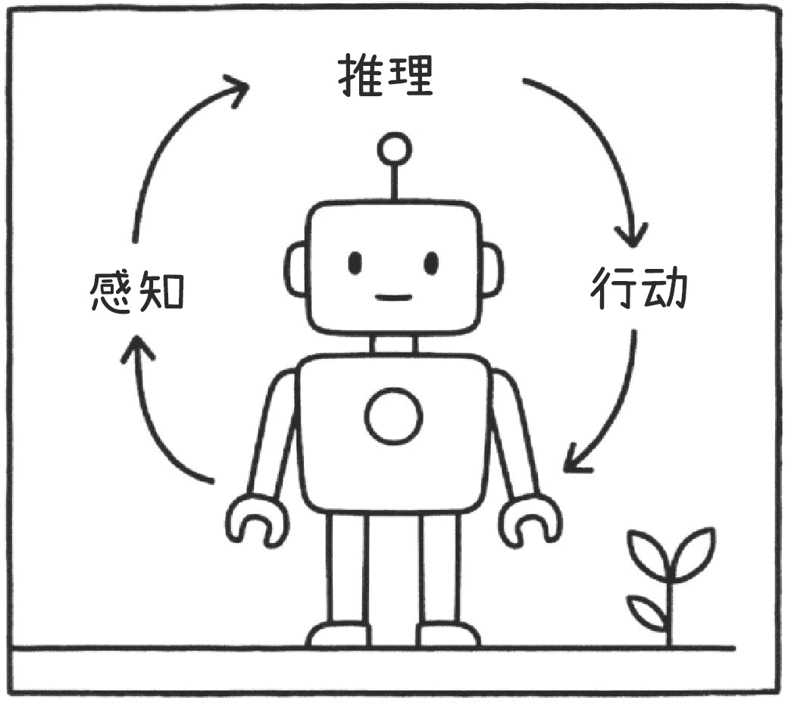

图 1-1

20 世纪 80-90 年代，研究逐步深化，以专家系统、符号系统等形态出现，核心是借助规则与知识库模仿专家决策。此类系统常受计算能力不足、数据匮乏、环境适应性差等因素制约，应用多限于理论探索与小规模场景。

总体来看，在深度学习兴起前，Agent 面临明显瓶颈：规则难以覆盖多样场景、泛化能力薄弱、语言交互能力有限。尽管如此，自主感知、自主推理决策、自主行动的基本理念始终被学界与业界视为 AI 关键方向，并持续推动技术演进。直到 LLM 大语言模型的出现，才为 Agent 在更广场景落地提供了新范式。

### 1.1.2 大模型时代的 Agent

Transformer 架构于 2017 年提出，随后 GPT-3.5、GPT-4 等大模型快速发展，Agent 研究迎来爆发。大模型时代的 Agent 摆脱纯规则与符号限制，具备更强理解与泛化、更丰富知识、更复杂推理与更强记忆，从而完成更复杂的任务。

以 GPT、Claude、DeepSeek 为代表的大模型赋予 Agent 三大革命性能力。

1. 自主推理与规划。借助链式思考 Chain-of-Thought 等提示范式，Agent 可将复杂任务拆解为子任务。例如用户输入“帮我规划东南亚三日游”，Agent 自动生成行程规划→景点调研→预算评估的推理链，并在其基础上产出行动步骤。
2. 推理与工具使用。借助函数调用或 ReAct 推理—行动范式，Agent 能推理并调用工具完成实时操作。例如先调用 Google API 获取位置，再通过图像模型生成旅游路线图。工具使用是 Agent 区别于纯聊天机器人的核心。
3. 记忆与知识检索。结合向量数据库的存储与语义检索，加上大模型理解能力，Agent 可实现跨会话上下文继承与长期记忆。配合 RAG 检索增强生成，Agent 能针对不同用户与环境做出个性化决策。

若把大模型比作博览群书的智者，Agent 就像其拥有强大记忆与执行力的管家，会依据需求拆解任务并主动调配资源。例如指令“对比 A 公司与我公司产品差异并把报告发到邮箱”，Agent 会规划并执行：

1. 通过网页搜索工具获取 A 公司产品信息。
2. 通过本地 RAG 工具检索我司产品信息。
3. 借助大模型生成对比报告。
4. 使用邮件工具发送至邮箱。

可见基于大模型的 Agent 把强语言模型与主动行动机制结合，让模型不仅能懂、能想，还能做。

典型的工作范式如图 1-2 所示。

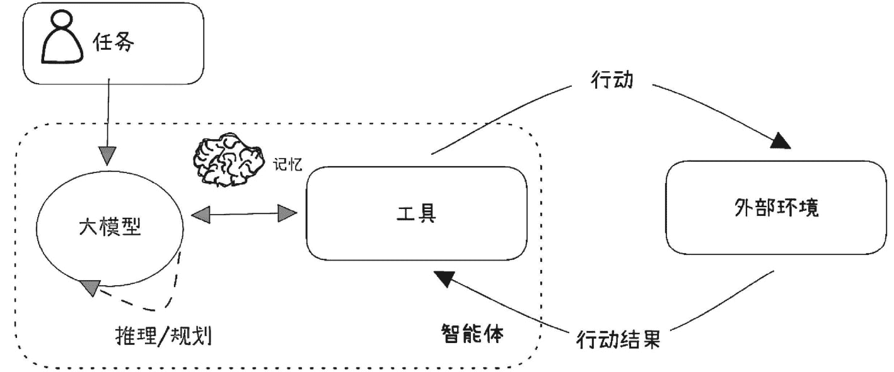

图 1-2

因此，现代基于大模型的 Agent 通常由大模型、工具 Tool、记忆 Memory 等构成。有了超强理解能力的大脑，Agent 想象力迸发，被普遍认为是未来重要 AI 应用形态之一。

### 1.1.3 两种 Agent 系统形态

Agent 正快速发展，整体共识逐渐形成，但细分划分仍百花齐放。Anthropic 公司 2024 年文章《构建有效智能体》中给出的划分较为清晰务实。

Anthropic 将现有 Agent 统称为智能体系统 Agentic System，并从架构上分为两类，如图 1-3 所示。

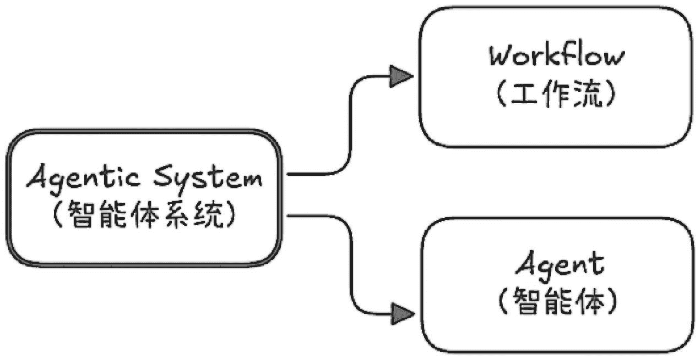

图 1-3

1. Workflow 工作流
也称 Agentic Workflow。此类系统任务路径明确且预先编排，通过既定流程、步骤与工具链实现目标。优点是可预测性强、结果可控，适合企业中借助大模型提升智能化但流程相对固化的业务，如标准化数据抽取与分析。

常见构建块是大模型调用 LLM Call。随着模型能力增强，增强型大模型调用 Augmented LLM Call 成为主流。它不再是简单问答，还可带简单知识检索与工具使用，可视为“微型 Agent”嵌入更大工作流。

例如一个典型顺序模式工作流包含 3 个增强型大模型调用，如图 1-4 所示。

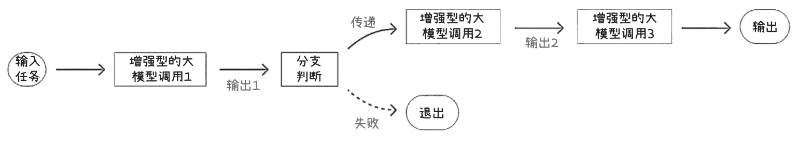

图 1-4

2. Agent 智能体
指更理想的真正 Agent 系统，强调自主性与灵活性，通过动态推理、自主决策与环境交互达成目标。相比 Workflow，Agent 适用于开放、通用、动态且难以穷举的任务，如面向个人的通用助手。

既然 Agent 更自主，为何仍需 Workflow？因为大模型能力仍有限。即使理解推理能力惊艳，在模拟人类任务的准确率测试中，模型最高仅接近人类 50%。“黑盒”Agent 的不确定性在关键场景是致命缺陷。因此 Workflow 作为补充很有价值：遵循预定义流程但以大模型为核心完成多步任务，以牺牲部分灵活性换取可靠性。

类比总结：Workflow 像听话的员工，按既定步骤完成任务并借助大模型提升智能；Agent 更像被授予权限的代理人，自主规划步骤并完成。两者共同点是都需借助工具提升行动力。

### 1.1.4 面临的挑战与演进方向

各类 Agent 已在个人与企业端涌现。个人端以助理、智能家居助手等形态融入生活；企业端多出现于客服、营销、财务、HR 等流程自动化。然而当前 Agent 仍处积累期，市场产品多集中于个人助理、娱乐、写作等可靠性要求不高的领域。在对准确性、可预测性、可追溯性要求极高的生产场景，Agent 仍面临大模型局限性带来的规划错误、不当建议、风险内容与输出不确定等挑战。

尽管仍处早期，其潜力巨大。未来演进可展望如下。

1. 更强的自主性与智能化。随着技术进步，Agent 将更好理解人类意图、逻辑推理与复杂任务处理，在更多场景下自主决策与执行。
2. 深度行业化与定制化。各行业将定制专属 Agent，如开发助手、医疗诊断助手、家庭助手及智能实体机器人等。
3. 更强的个性化与人性化。Agent 将通过长期互动学习用户习惯、个人信息与偏好，提供更贴心服务。
4. 持续学习与自适应。Agent 具备根据环境变化与新数据自我调整优化的能力，不断提升智能水平。
5. 伦理与法规重视。随着应用普及，隐私、安全、伦理关注将推动相关法规与标准，确保 AI 负责发展。

## 1.2 初识 MCP

### 1.2.1 Agent 时代集成复杂度提升

Agent 兴起使 AI 应用集成环境愈发复杂。应用不再止于与大模型对话，而是需自主协调任务、调取外部数据、使用外部工具，甚至与其他 Agent 协作。这种与纷杂外部资源交互的能力，成为 Agent 落地的关键挑战。

举例：作为技术博客主理人，你可能想拥有“AI 秘书”，定期采集行业动态、GitHub 热门项目排名、关注科技巨头的社交媒体新闻，整理编辑后发邮件，并通过 OA 系统自动提醒你。构建此类 Agent 需要与多系统连接：搜索引擎或浏览器获取结果、社交平台或专业社区开放 API、文件系统与编辑排版工具、云邮件系统、企业 OA 接口推送通知。

你需研究各类模块与第三方 API 并连接之。学会调用搜索引擎 API、使用 Playwright 自动浏览、使用云邮件接口、使用 Python 文档编辑库……历经重重 Bug 后 Agent 终于上线。

使用一段时间后新问题出现：

1. 增加新功能需研究新平台协议。
2. 某 API 调整安全机制与数据格式，需重新集成与测试。
3. 与同事交流发现大量集成工作已重复。
4. 应用反复修改后难以维护，频繁出错。

根源在于为让 AI 秘书具备“动手能力”，每接入新数据源、工具或服务，开发者都需编写定制集成代码，处理消息格式、身份认证等安全策略，做大量“黏合”工作，如图 1-5 所示。

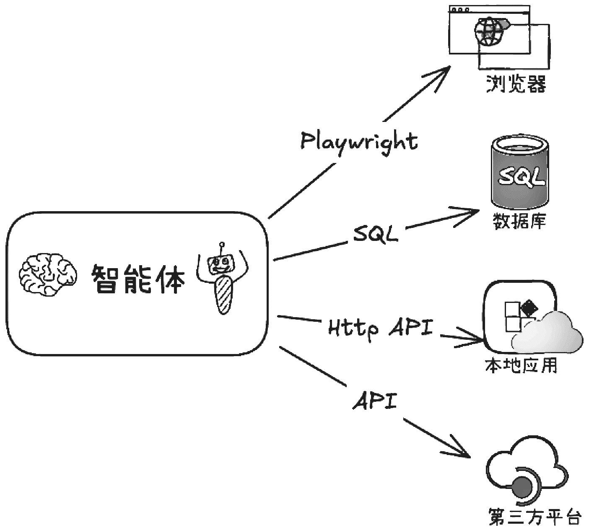

图 1-5

这种方式难以为继。接口标准各异、工具频繁更新、集成代码重复冗长，导致系统脆弱、扩展性差、维护成本高。在此背景下，统一高效标准化的集成架构成为 Agent 生态的迫切需求。

### 1.2.2 MCP：面向集成的统一标准

Anthropic 于 2024 年年末提出的 MCP，正是为简化 Agent 与外部资源集成而设计。它定义统一方式，让 Agent 访问、管理与共享所需外部数据源与工具，摆脱逐个适配的碎片化方案。核心思路是在传统架构中引入中间层，如图 1-6 所示。

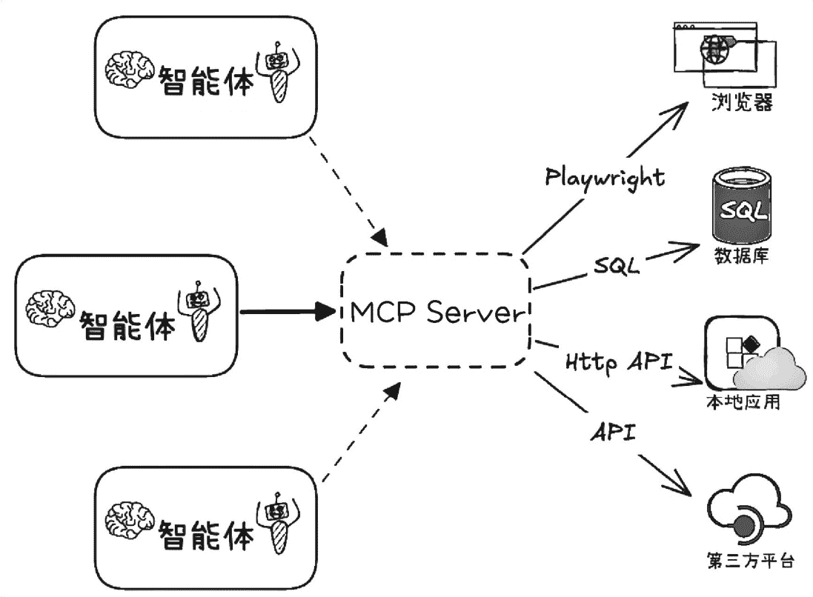

图 1-6

在该架构下，Agent 通过统一 MCP 连接可共享的中间层即 MCP Server 访问外部资源与工具，中间层负责适配不同外部资源。

好处体现在：

1. 简化开发与集成。Agent 无需适配各私有协议，只需以统一方式连接到 MCP 服务端并调用其公开资源，显著缩短上线时间。
2. 提升互操作性。采用相同 MCP 集成的不同 Agent 可良好互通，可在不同提供商、不同 MCP 服务端间灵活切换，极少改动即可使用更优工具。
3. 良好可扩展性与弹性。遵循相同标准“同一种语言”，可随时插拔新外部资源。如同 USB 接口标准，新设备即插即用。插入新 MCP 服务端即可为 Agent 扩展新能力，如图 1-7 所示。

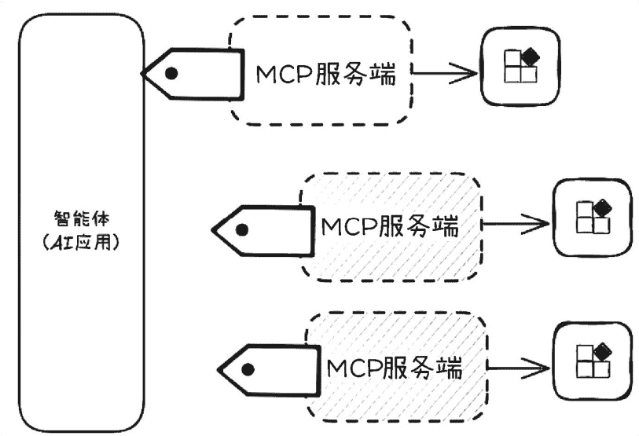

图 1-7

Anthropic 的 Claude Desktop 正以此方式支持用户自行扩充工具箱，实现能力无缝延伸。

4. 快速适应变化、提升可维护性。若外部资源接口变化，只需在对应 MCP 服务端适配数据格式、通信协议与安全机制，所有接入的 Agent 即可无缝切换，且应用侧使用接口保持不变。
5. 形成新的 AI 能力共享生态。

遵循统一规范的集成方案能大幅降低模块复用与流通成本。如今社区里不断涌现并开源的 MCP Server，让新一代 AI 应用可以快速挂载各类外部数据源与工具，重复造轮子与资源冗余被显著压缩。这种做法正在塑造全新的人工智能应用生态，整体运行效能得到提升，也为长期繁荣提供了支撑。

在生成式 AI 领域，有一个思路相近的参照是模型 API 网关，比如 OpenRouter 与开源的 One-API。这类产品把不同厂商的模型调用接口收敛为 OpenAI 兼容形态，上层应用接入更省心，开发节奏与灵活性随之提升。只是各家开放 API 差异不大、数量有限，难以达到 MCP 那样的规模效应。

### 1.2.3 MCP 集成架构详解

MCP 集成架构示意图见图 1-8。

整体沿用经典的 Client/Server 思路，核心角色有三类：MCP Server、负责与服务端通信的 MCP Client、以及使用客户端的宿主 MCP Host。

用一个通俗比喻：宿主好比需要打印文档的应用软件。它想使用打印机即 MCP Server 提供的能力，却必须借助打印机驱动即 MCP Client，才能把文档转成打印机可识别的格式。

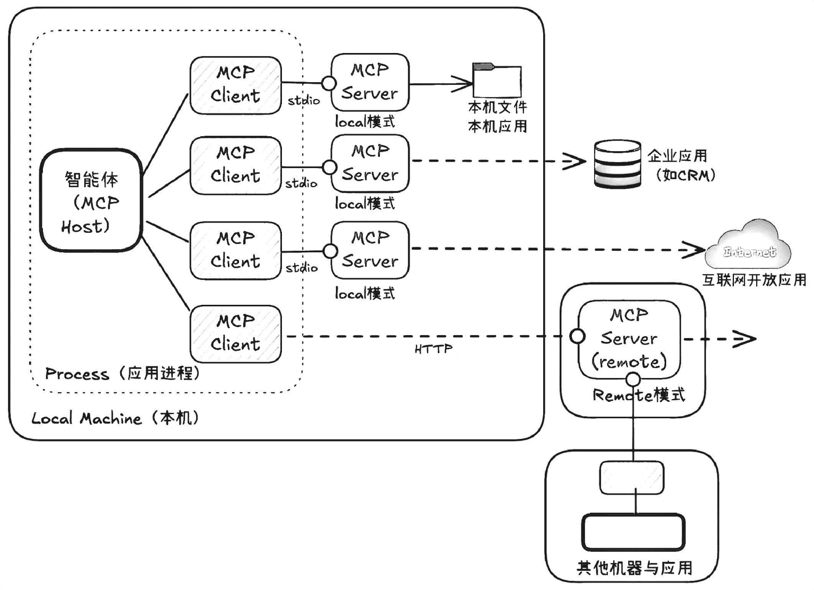

图 1-8

**1.MCP Server**

MCP Server 是整套架构的枢纽，以独立进程运行。它通过统一协议对外暴露特定能力，让智能体能够连接并使用外部数据源与工具。可暴露的能力包括本地文件系统与软件模块访问、数据库查询，以及企业内应用与互联网开放 API 的调用。

它更像面向智能体的服务网关，以一致且安全的方式提供通向外部世界的能力。服务端采用标准化消息格式与传输协议收发请求与响应，类似外部设备严格遵循 USB 标准，因此具备很强的通用性与可共享性。

关于服务端，先掌握以下要点。

1）部署位置
服务端主要有两种形态，通过不同通信协议与客户端交互。
（1）本地模式，部署在客户端本机，通过 IPC 进程间通信 与客户端交互。
（2）远程模式，部署在远端服务器，通过 HTTP 超文本传输协议 与客户端交互。

第二章会详细解释这两种通信协议的工作原理。

2）可公开的服务类型
在现行规范中，服务端可按需暴露三类常见服务。
（1）工具 Tool。供应用调用的工具服务，例如谷歌搜索。
（2）资源 Resource。供应用读取的各类数据，例如一张截图。
（3）提示 Prompt。供应用使用的模型提示词模板，例如反思类提示词。

3）来源渠道
开发者可用 MCP 官方提供的 SDK 自行构建服务端，供个人或企业内部分享。也可从社区共享的海量服务端中挑选直接下载使用，或将自研服务端贡献出去。图 1-9 展示了一个优质的 MCP 服务端共享社区。 ^(¹)

4）开发语言
理论上只要理解 MCP 规范，就能用任意语言开发符合标准的服务端。实践中建议基于官方 SDK 降低工作量。目前已开放的 SDK 版本包括 Python、TypeScript、C#、Java 等。

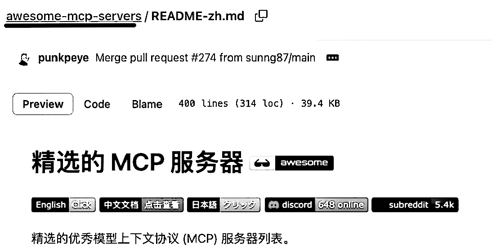

图 1-9

5）启动方式
不同语言的服务端启动命令各不相同，例如 TypeScript 编写的服务端可能用 npx 启动，Python 编写的服务端可能用 uvx 启动。使用第三方服务端时请阅读其说明文档。另外，若选择本地模式，客户端会自动拉起服务端。

当前启动流程仍显繁琐，预计未来会有更简洁的体验。

**2.MCP Client**

这里的客户端并非独立可运行的程序，而是一个负责与 MCP Server 建立连接并通信的模块，用来简化智能体对服务端的访问，并保证请求与响应遵循标准格式与协议。运行时可将其视作智能体维护的一个会话连接，类似使用 MySQL 客户端组件发起 SQL 请求。借助它可以向服务端发起请求并拿到响应。

MCP 中定义了少量客户端可向服务端提供的功能。

**3.宿主**

宿主是指需要访问外部资源的智能体或各类 AI 应用，也可看作一种特殊的“用户”。它借助 MCP Client，按标准协议与 MCP Server 交互，调用其公开的接口以访问外部数据与工具，从而完成任务。

总体来看，MCP 定义了一套标准化的 AI 应用集成方式，规定了客户端、服务端及外部资源如何组合连接，以实现高效、可扩展、安全的集成。简要概括如下。
（1）MCP 服务端。独立运行的应用，向客户端开放可用的工具等。
（2）MCP 客户端。嵌入在宿主中的模块，与服务端保持一对一连接。
（3）宿主。完整的客户端应用，例如一个智能体，通过服务端使用其开放功能。

为避免混淆，后文提及的“客户端”，除非特别说明，均指包含 MCP 客户端模块的完整客户端应用。

## 1.3 从第一个 MCP 示例开始

### 1.3.1 开发环境与配置

本节介绍如何安装与配置用于开发 MCP 应用的完整环境，包含服务端与客户端。按此步骤准备后，即可开始构建基于 MCP 的端到端应用。书中示例均以 Python 生态实现，因此重点说明 Python 开发环境的准备流程。

**1.基本环境要求**
（1）操作系统为 Windows、macOS 或 Linux 均可。
（2）具备稳定的互联网连接，用于下载依赖库。
（3）Python 3.10 或更高版本。可从官网下载安装，也可用包管理工具如 macOS 的 Homebrew 安装。
（4）IDE。选择适合自身习惯的开发工具即可提升效率。开发 MCP 应用对 IDE 无特殊要求，常见选择有 VS Code、Cursor、Windsurf 等。

**2.准备 MCP 开发环境**
1）确认 Python 已安装
安装完成后，用以下命令检查可用性与版本：

请确保输出版本为 3.10 及以上。
2）安装 uv
uv 是 Python 生态的快速包管理工具，相较 pip 更快且内置虚拟环境管理。uvx 是其下的便捷命令，可在临时隔离环境中一次性运行任务，非常适合运行第三方 MCP 服务端，避免环境污染。
安装命令：

验证 uvx 是否可用：

若习惯用 conda 管理 Python 环境，可跳过此步。
3）创建开发环境
新建工作目录，如 /username/mcp-dev。进入后运行以下命令创建专用的虚拟环境：

退出虚拟环境时运行：

4）安装 MCP SDK
安装官方 Python 版 SDK 以简化服务端与客户端开发：

若希望 uv 更智能地管理项目与依赖，可使用：

安装完成后，MCP Python SDK 及依赖会自动进入虚拟环境。
5）验证 SDK 安装
SDK 安装后自带 mcp 命令工具，可运行以验证安装是否成功：

应能看到如图 1-10 的输出，表示安装成功。
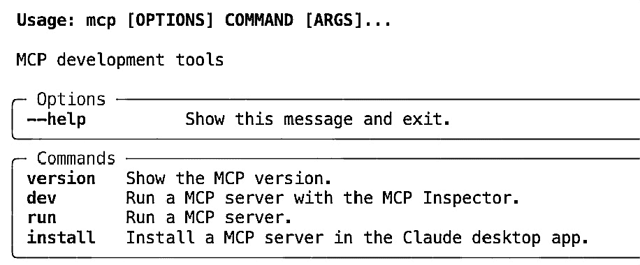
图 1-10

**3.智能体开发框架**
AI 应用尤其是智能体，是 MCP 的主要使用者。第六章会逐步展示如何基于 MCP 架构开发更具扩展性的智能体。开发时通常会借助第三方框架，这些框架最新版基本都提供 MCP 服务端适配器，包括 OpenAI Agents SDK、LangGraph、LlamaIndex Workflow、Microsoft AutoGen 等。
实际开发中可根据需求选择一个或多个框架协同构建，具体安装将在使用时说明。

**4.推荐的最佳实践**
建议在开发过程中遵循以下常见实践，以提高效率与安全性，减少冲突与风险。
（1）使用虚拟环境隔离项目，避免依赖冲突。
（2）用 requirements.txt 或 pyproject.toml 管理依赖。
（3）借助强大的 AI 编程工具提升开发效率与代码质量。
（4）使用 .env 文件管理环境变量，特别是 API 密钥等敏感信息。

### 1.3.2 第一个 MCP 示例

在正式开发前，先用一个简例建立对 MCP 开发的直观感受。
本例将搭建一个简单的客户端，调用 MCP 服务端公开的计算器工具完成计算。为聚焦 MCP 本身，不引入大模型。

**1.创建 MCP 服务端**
使用 MCP SDK 快速实现一个提供计算器工具的服务端。在已准备的虚拟环境目录下创建 sample_server.py，代码如下：
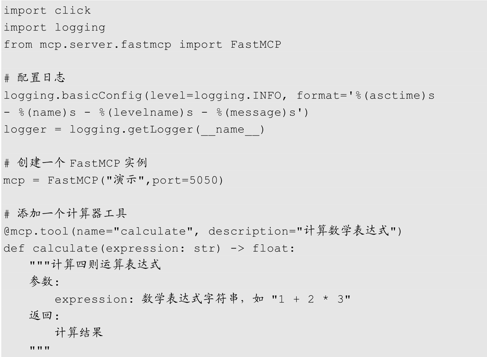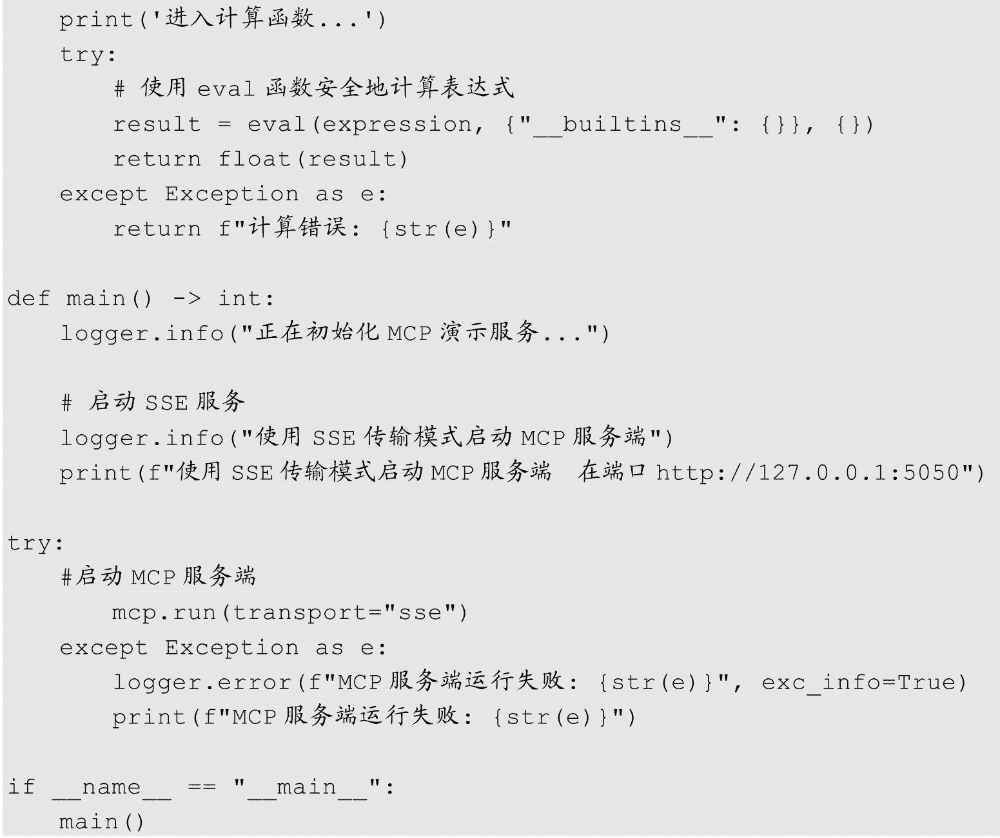
代码要点说明：
（1）引入 FastMCP 模块。这是 SDK 中代表 MCP 服务端的高层抽象，基于低层 SDK 封装。先创建名为“演示”的 FastMCP 实例，监听 5050 端口。
（2）使用 @tool 装饰器创建工具及 calculate 计算函数。输入为四则运算表达式，输出为运算结果。
（3）在主函数 main 中调用 FastMCP 的 run 方法启动服务端，参数 transport="sse" 表示采用 SSE 远程模式。
启动服务端命令：

若未手动激活虚拟环境，需用 uv run python sample_server.py 启动。下文不再赘述。
正常情况下应看到如图 1-11 的启动提示。
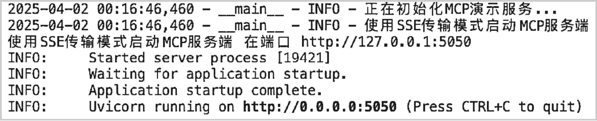
图 1-11
这表明 MCP 服务端已成功运行。

**2.创建客户端**
在工作目录下创建 sample_sse_client.py，代码如下：
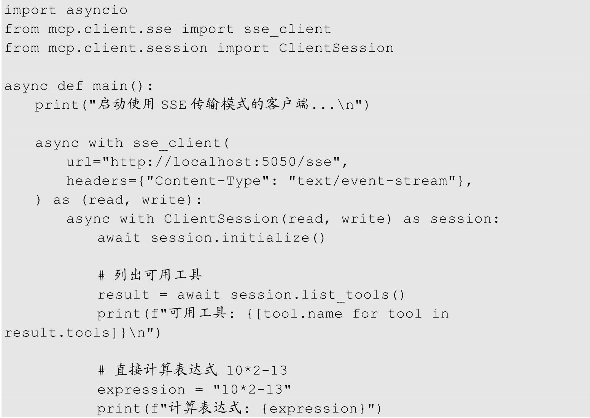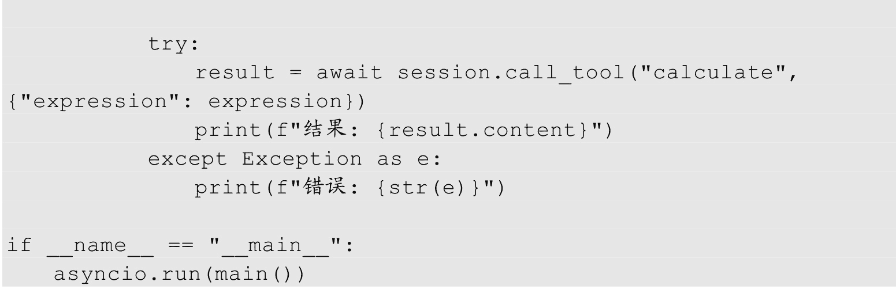
代码要点说明：
（1）核心组件为 sse_client 与 ClientSession。
（2）先用 sse_client 建立连接，成功后获得读写流 read、write，并用其构造 ClientSession，完成会话创建。
（3）调用 session 的 initialize 方法进行会话握手，确认双方 MCP 版本兼容等。
（4）演示 list_tools 方法，用于查询服务端公开的工具列表。
（5）调用 call_tool 方法调用服务端工具，传入工具名 calculate 与参数 expression，最后获取返回结果。
本客户端需采用异步编程，先建立 SSE 连接再进行后续会话，这与 MCP 的 SSE 传输模式相关。传输模式原理将在第二章详述。

**3.测试示例**
一切就绪后在命令行直接运行客户端：

正常输出如图 1-12 所示。
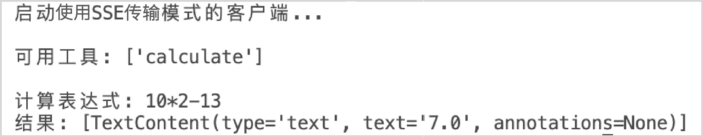
图 1-12
通过 list_tools 可看到服务端仅公开一个工具 calculate。call_tool 成功调用该工具，返回类型为文本 type='text'，内容为“7.0”，即表达式的计算结果。
至此，一个完整的 MCP 服务端与客户端示例已实现。虽然它与基于 HTTP 的 RESTful API 在使用体验上相似，但出于 AI 应用特性及综合考量，MCP 开发并未采用 RESTful API 及 OpenAPI 标准，具体原因将在第二章深入探讨。

# 第二章
# 揭秘 MCP 规范与原理

MCP 提出了一种将智能体与外部资源标准化的集成方式。目标是降低集成时的强耦合与复杂性，提升互操作性与扩展能力。MCP 的本质是面向 AI 应用集成的开放标准。需要从两个层面去理解与学习，如图 2-1 所示。
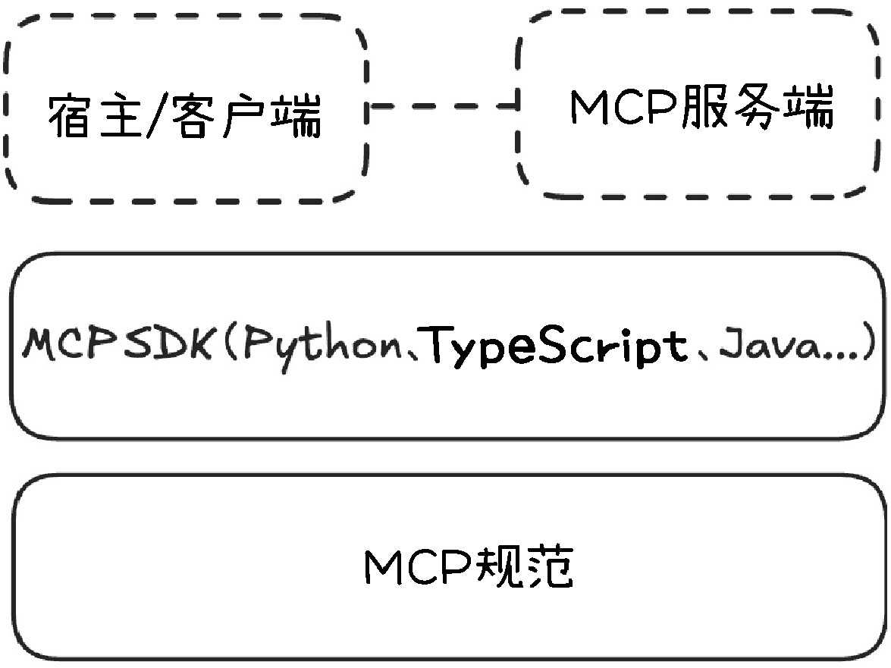
图 2-1
（1）MCP Specification，即 MCP 规范。对基于 MCP 的集成架构及其关键模块的功能、通信协议、消息格式、安全机制等制定的标准。遵循该规范实现的模块可实现互操作。
（2）MCP SDK。基于规范实现的多种语言开发框架与工具，帮助开发者快速构建符合规范的模块并完成集成。
本章首先深入探讨 MCP 的底层规范与设计动机。我们不只是罗列条款，而是力求理解其背后的原因。值得注意的是，尽管许多内容在日常开发中无需直接处理，但对底层原理的掌握将极大帮助调试、优化与排障，甚至在必要时对 SDK 进行改造与扩展。
下面将按消息与通信、MCP 服务端、客户端的顺序解析规范与原理。

## 2.1 消息规范：互操作的基础

MCP 作为简化集成与实现互操作的标准，最基础的就是消息协议。就像国际会议需要共同语言，效率才会提升。在 MCP 规范中，唯一的消息协议是 JSON-RPC 2.0。

### 2.1.1 JSON-RPC 2.0 是什么

JSON-RPC 2.0 是一种轻量级的远程过程调用消息协议，使用 JSON 作为数据格式。注意，它不是底层传输协议，而是一种应用层消息格式标准。形象地说，它规定了包裹如何打包、如何分区、如何贴标签，但不规定如何运输。
例如，需要调用远程 MCP 服务端上的计算器函数计算“5+3”。这是一次远程过程调用。JSON-RPC 2.0 规定了发送给 MCP 服务端的请求 Request 消息需遵循类似这样的格式：

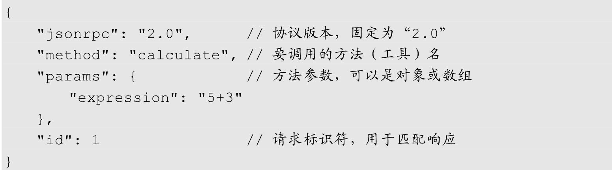

在 MCP 服务端完成处理之后，JSON-RPC 2.0 明确要求响应的消息结构要基本如下：

如果服务端在执行过程中出现了异常，例如调用了并不存在的方法，客户端会收到类似这样的响应：

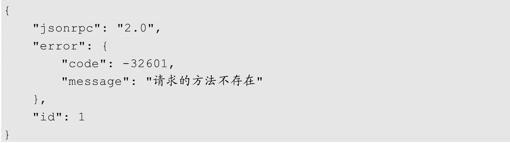

还有一种用法，当服务端需要向客户端单向推送通知时，就要采用这种格式：

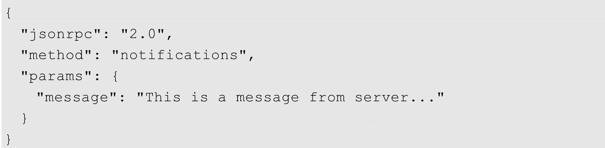

因为通知属于单向投递，不需要等对方回执，所以不会带上请求标识符 id。

有了这套约定，请求、响应、通知三类报文就能在通信双方之间顺畅流转。这正是 MCP 规范定义的三种基础消息形态，并在此基础上对部分内部字段做了必要扩充。

显而易见，这套协议的好处主要有：

（1）语言无关。几乎所有主流语言都原生支持 JSON。
（2）简洁好用。结构清晰，可读性强，调试成本低。
（3）轻量灵活。可适配多种传输方式，并不绑定特定协议。

### 2.1.2 JSON-RPC 2.0 如何驱动远程调用

确定消息规范并选定传输方式后，MCP 的远程过程调用就能被轻松还原。你很可能先想到 HTTP，下面给出一个极简的 MCP 服务端示例，代码文件名为 mcp_server_raw.py，用来复现上述交互：

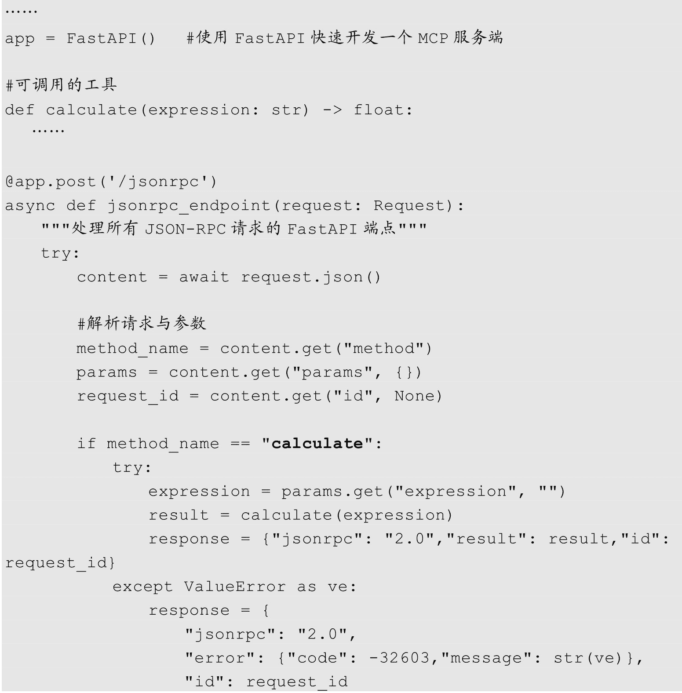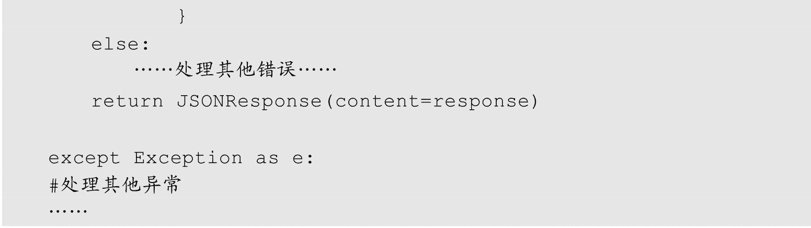

对这段示例的要点是：

实现中通过 HTTP 端点 /jsonrpc 暴露一个名为 calculate 的工具调用入口，访问方式必须使用 HTTP POST。

这里的 calculate 只是演示用的占位工具，真实场景下 MCP 服务端的工具调用会统一走 tools/call 方法，具体可参考 2.5.1 节。

接着用下面这段代码搭建一个客户端来模拟对服务端的工具调用，文件名为 mcp_client_raw.py：

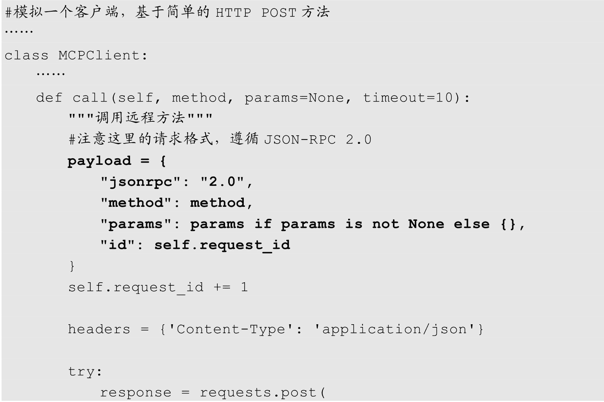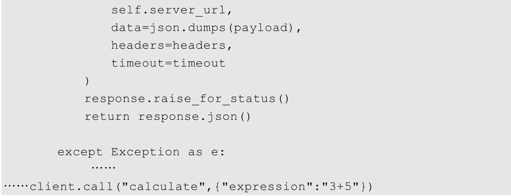

这段客户端的思路可以概括为：

如此便得到一个基于 JSON-RPC 2.0 的客户端与服务端原型交互。

（1）客户端按 JSON-RPC 2.0 规范组装请求报文。
（2）通过 HTTP POST 把报文发往服务端指定端点，即 /jsonrpc。
（3）服务端接收并解析报文，识别出客户端想调用的方法 calculate。
（4）服务端根据报文参数执行对应逻辑 calculate。
（5）处理完后服务端按 JSON-RPC 2.0 组装响应返回，客户端接收。

JSON-RPC 2.0 是面向网络环境设计的远程过程调用消息协议，它可以配合多种传输协议共同完成请求与响应的交互。

## 2.2 HTTP 远程传输的实践选择

把消息类比成快递包裹，传输模式就是运送方式。选型要综合业务需求、效率、安全等要素。MCP 规范中客户端与服务端远程通信的协议是 HTTP，只是其内部运行机制并不简单。

### 2.2.1 无状态 POST 的局限在哪里

前面我们用 HTTP POST 模拟了对 MCP 服务端的远程调用，并使用了简洁易行的 RESTful API 风格。虽然操作简便，但传输是否只能靠简单的 RESTful HTTP POST 呢？答案是否定的。

如果你用过 FastMCP 构建服务端，可能感受不到复杂性，因为它在底层 SDK 上做了封装，隐藏了细节。

单一无状态的 RESTful HTTP POST 传输可以用图 2-2 表示。

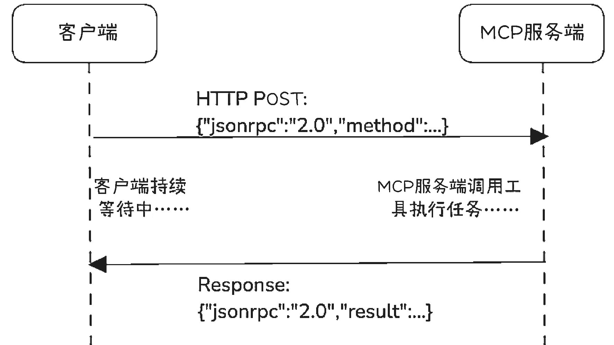

图 2-2

结合智能体的特性，可以预见以下短板。

**1. 同步阻塞不适合长耗时任务**

在单请求单响应的模式下，客户端必须干等服务端处理完，这对追求低延迟的 RESTful API 可以接受，但面对耗时较长的任务就会力不从心。例如把复杂工作流丢给服务端工具时，客户端很可能长时间卡住甚至超时。

**2. 服务端无法主动推送，缺乏双向能力**

服务端不能主动向客户端发消息，数据流向只能由客户端发起。但在长任务场景下，服务端往往需要定期汇报进度或中间结果，单纯的 POST 无法做到主动通知。

**3. 短连接无状态不适合连续对话**

RESTful POST 在请求结束后就断开连接以节省资源。可实际使用中，客户端在一次会话里会频繁调用工具，这种持续交互更适合有状态的长连接，而非无状态交互。

**4. 不支持 AI 场景的流式输出需求**

在智能体等 AI 场景里，流式输出很常见，尤其是服务端延迟较高时，流式返回能显著改善体验，而这需要服务端配合。

基于以上考量，MCP 规范选用了带 SSE 的 HTTP 作为远程传输标准，称作 HTTP with SSE。

在 2025-03-26 版本的规范中，该机制进一步演进为 Streamable HTTP 传输模式。

### 2.2.2 SSE 传输模式拆解

**1. SSE 是什么**

SSE 是一种基于 HTTP 的单向推送技术。服务端可以在一次连接建立后持续向客户端推送消息，客户端只需维持连接即可接收。其大致流程如图 2-3。

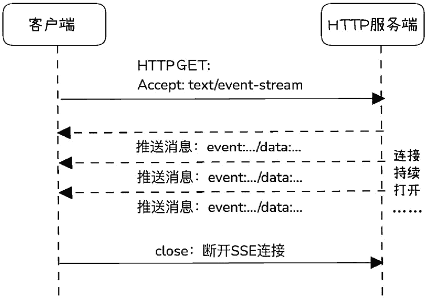

图 2-3

流程如下：

（1）客户端发起建立 SSE 连接的请求，通常是 HTTP GET/POST，并带上请求头 Accept：text/event-stream，表明需要事件流通道。
（2）服务端收到后建立并保持连接，直到客户端主动关闭。
（3）连接存活期间，服务端可通过该通道不断推送消息块，客户端负责解析。
（4）请求响应结束后，客户端关闭连接，通信结束。

由此可见 SSE 的特征为：

①单向通信，只支持服务端向客户端推送。
②基于 HTTP，需先用一次 GET 或 POST 建立连接。
③适合实时推送场景，如进度更新、实时数据流。

**2. SSE 如何配合流式传输**

SSE 通常与 HTTP GET/POST 结合使用。在 RESTful 设计里，常见做法是在一次 POST 请求中让服务端返回流式数据。

你可能熟悉 OpenAI 风格的大模型 API，客户端向通常是 xx/completion 的端点发起 POST，设置 Streaming=True 后，服务端就会以数据流形式逐步返回，避免长时间等待。这本质上是要求返回 event-stream，即基于 SSE 的事件流响应。

在浏览器调试 DeepSeek 的请求时可以验证，请求方法为 POST，响应头 Content-Type 被设为 text/event-stream，如图 2-4。

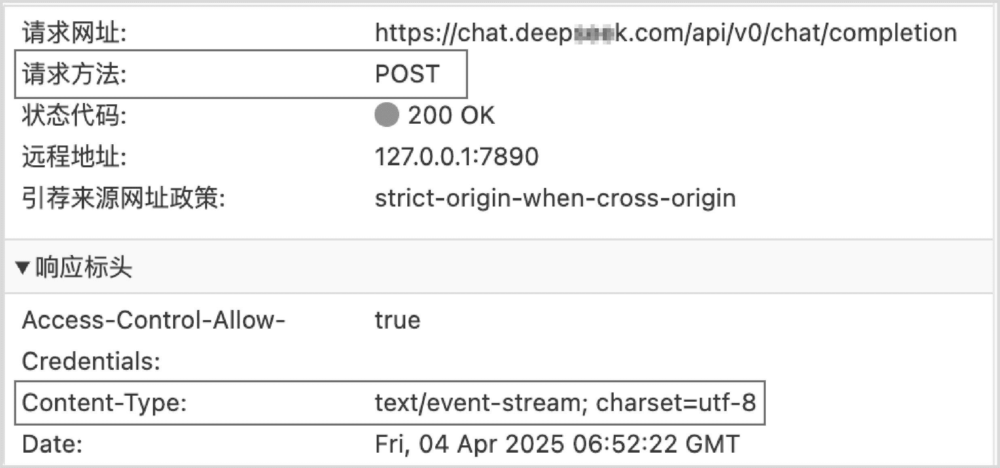

图 2-4

观察响应体，可以看到它并非完整文本，而是源源不断的消息块，如图 2-5。

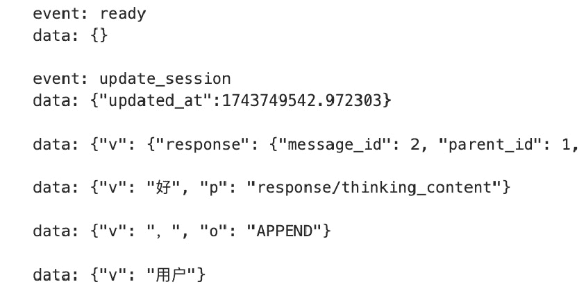

图 2-5

这展示了 HTTP POST 与 SSE 的一种配合方式，但在 MCP 规范中组合方式不同。

**3. MCP 规范里的 SSE 传输方式**

MCP 并不是在单次 POST 中直接用 SSE 回复，而是先建立一条 SSE 长连接，随后再处理 POST 请求时复用这条通道推送数据。可视为一种 HTTP POST 客户端到服务端 与 HTTP SSE 服务端到客户端 相结合的伪双工模式。

实际存在两条通道：

（1）HTTP POST 短连接通道，用于客户端发送请求。服务端通常立即回一个确认。
（2）HTTP SSE 长连接通道，用于服务端推送结果、进度、请求与通知。

请求与响应是异步的，并在两条不同通道上完成，借助 Request ID 实现消息关联。

一次完整会话如图 2-6。

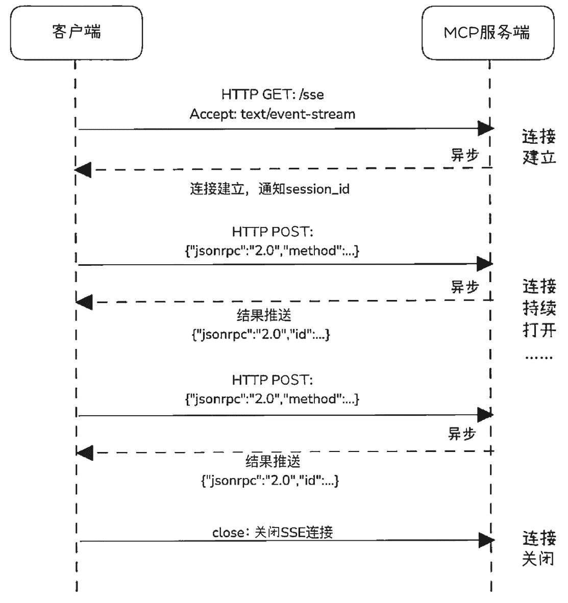

图 2-6

详细步骤：

（1）连接建立。客户端先发起 SSE 连接请求，服务端同意并建立。
（2）请求发送。客户端通过 HTTP POST 发送请求，内含 Request ID。
（3）请求确认。服务端收到后立刻返回 202 Accepted 表示已接收。
（4）异步处理。服务端按参数决定调用哪个工具并执行。
（5）结果推送。完成后，服务端通过 SSE 推送结果并携带 Request ID。
（6）结果匹配。客户端在 SSE 上收到消息后，根据 Request ID 归并到原请求，再上交给上层。
（7）重复处理。循环执行 2 至 6 步，初始化连接只做一次。
（8）连接关闭。客户端完成所有请求后可关闭 SSE，结束会话。

简单说，就是客户端用 HTTP POST 发请求，用 SSE 异步收结果，同时服务端可借助 SSE 主动发起请求和通知。这是 MCP 交互的底层通信基座。

**4. 用代码模拟 SSE 传输的服务端**

理解原理后，下面用 mcp_server_raw_sse.py 模拟远程模式下服务端的处理，利于加深认识。

需要一个端点接收 SSE 连接请求，使用 HTTP GET。

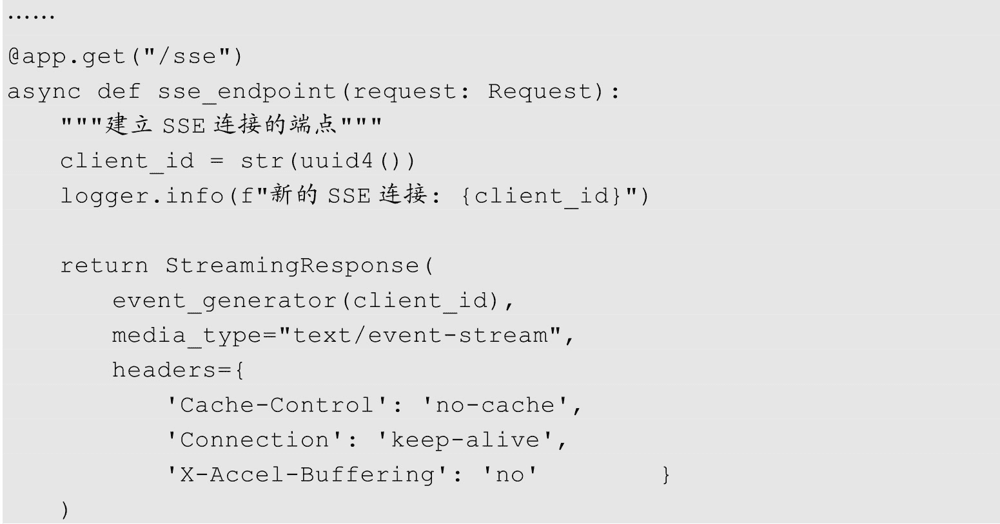

解释如下：

（1）为每个新连接分配唯一客户端 ID，便于后续推送。
（2）StreamingResponse 是 FastAPI 的流响应机制，通过 event_generator 构造流，象征 SSE 连接建立。
（3）event_generator 不仅立即返回确认，还会为该客户端创建专属消息队列，并持续监听队列推送。
（4）SSE 协议头配置了必要的 HTTP 头，保证连接稳定。

连接建立后，需要持续向客户端发事件流。这通过队列模拟，代码如下：

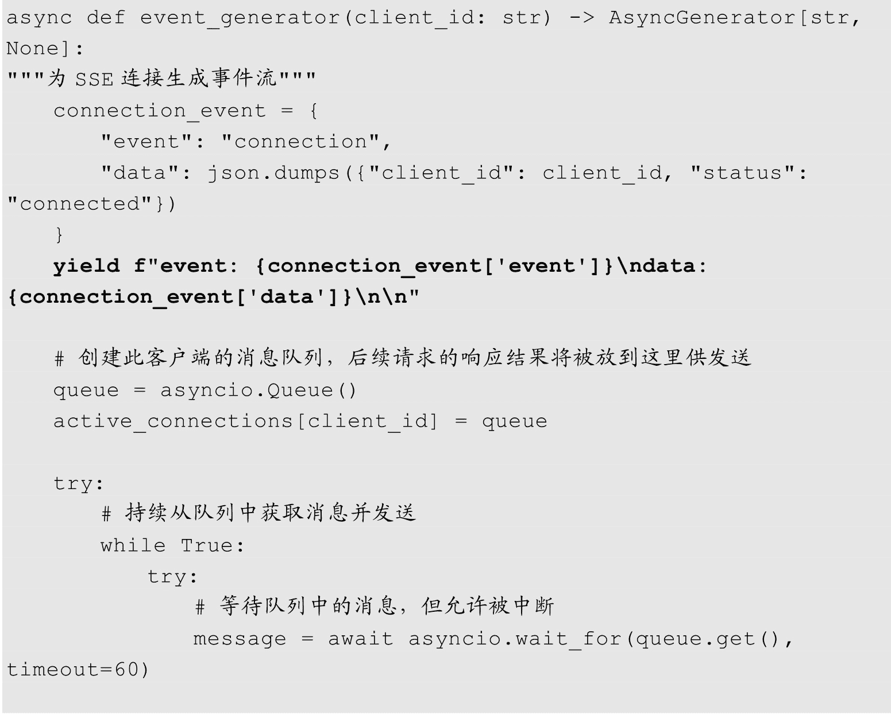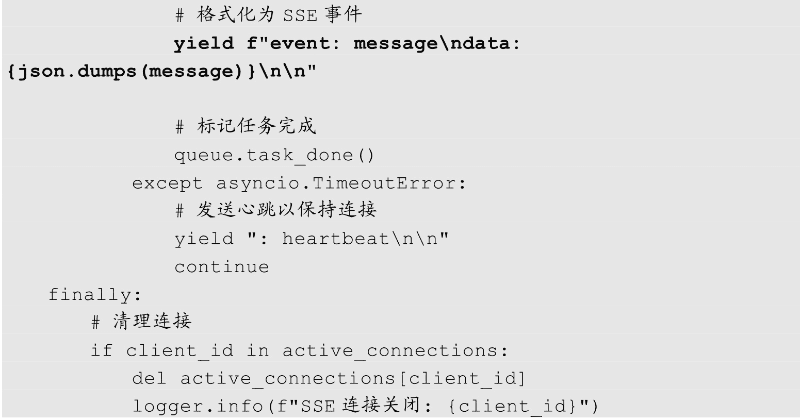

对事件生成器的解读要点：

（1）连接建立时生成并发送确认事件，创建专属队列并加入全局连接管理字典。
（2）进入循环，持续等待队列新消息到，格式化为 SSE 格式后推送。
（3）连接关闭或异常时自动清理队列。

SSE 长连接就此就绪。接下来需要处理 HTTP POST 请求，注意 SSE 通道只能单向发送，无法接收客户端请求，代码如下：

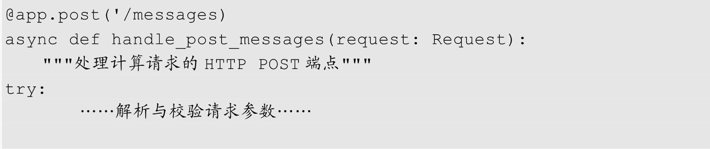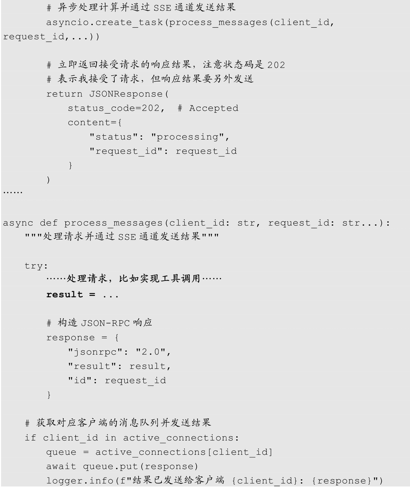

解释如下：

（1）通过 /messages 端点处理客户端后续的 POST 请求，例如工具调用。
（2）系统立即返回 202，并在后台异步继续处理。
（3）process_messages 异步执行请求，完成后把消息放入对应客户端队列。
（4）event_generator 监听到队列消息后，通过 SSE 推送给客户端。

这是一个简易的 SSE 传输模式模拟服务端，整体流程如图 2-7。/messages 端点的 process_messages 需要实现路由、分发等真实功能。官方 SDK 的实现远更复杂，需兼顾模块化、性能与扩展性。

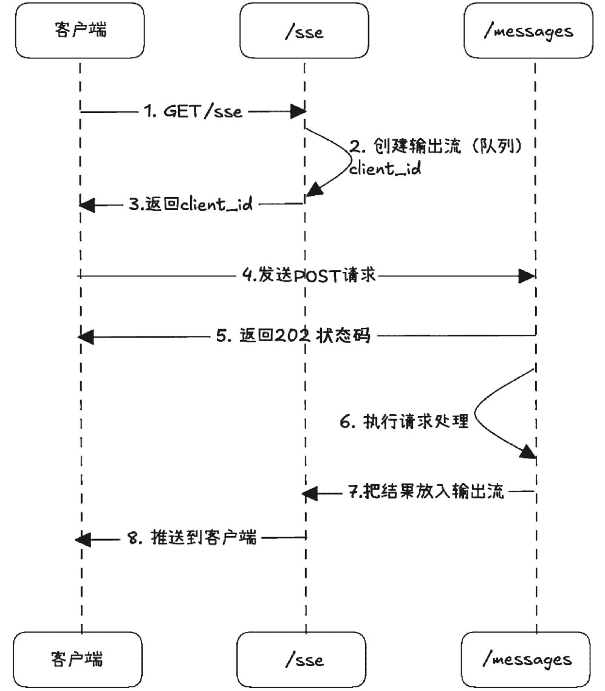

图 2-7

## 2.3 本地进程间传输方案

相比复杂的远程传输，MCP 还提供一种更简单成熟的本地传输模式。服务端与客户端运行在同一物理机，通过标准输入输出 stdin/stdout 实现进程间通信。

### 2.3.1 stdio 传输的基本思路

该模式下，双方共用进程的标准输入和标准输出完成传输。服务端核心做法是：

（1）用 stdin 作为接收消息的输入通道。
（2）用 stdout 作为发送消息的输出通道。
（3）客户端同样通过这两种通道与服务端交互。

优势在于：

（1）无需网络配置、端口管理或连接建立过程。
（2）依赖小，几乎所有环境都支持标准输入输出。
（3）开销极低，父子进程模型天然适配，适合把 MCP 服务端内嵌到客户端。

### 2.3.2 用代码模拟 stdio 服务端

了解原理后，下面用 mcp_server_raw_stdio.py 的简易 Python 代码模拟 stdio 模式下的服务端处理：

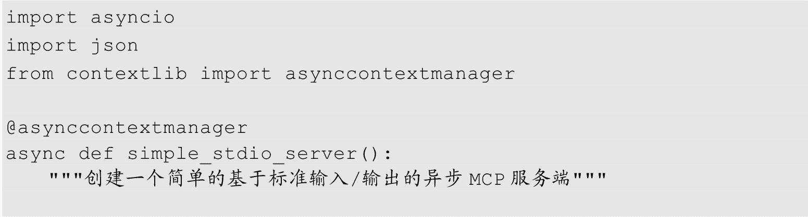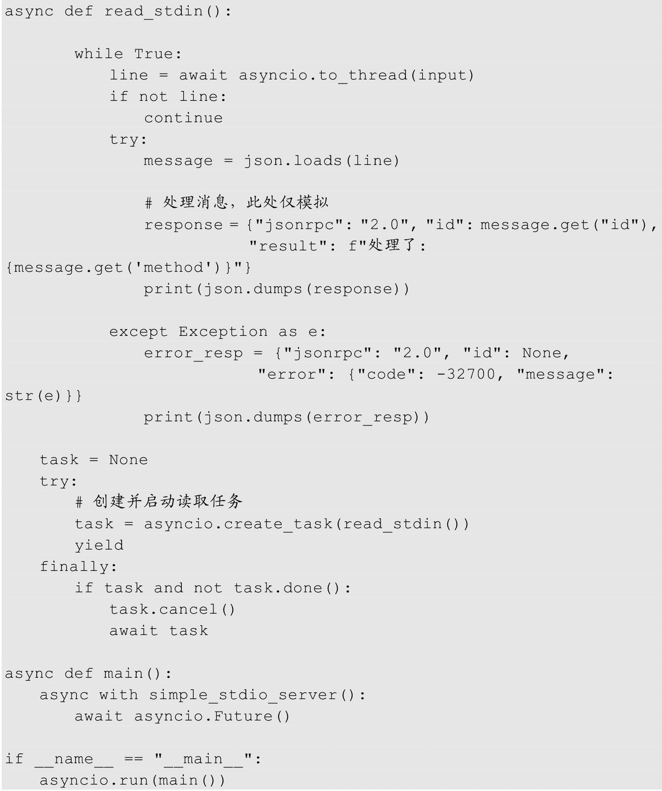

解释如下：

（1）启动时创建异步任务监听标准输入 stdin。
（2）一旦读到消息就解析并执行模拟处理，随后生成符合 JSON-RPC 2.0 的响应。
（3）响应通过标准输出打印返回。

（4）程序将进入轮询状态，不停监听外部输入，直到被手动终止。

到此，MCP 规范中关于服务端与客户端两种传输形态的说明就结束了。工程实践里若选用成熟的上层框架，通常不必亲手处理传输细节；不过当需要精细化调控时，对底层通道原理的掌握就显得很有价值。

## **2.4 会话生命周期全景**
规范对客户端与服务端之间完整会话过程做了明确拆分，从建立连接、持续交互到最终断开，每个阶段的操作都很清晰。

基于 MCP 的集成架构下的会话生命周期如图 2-8 所示。

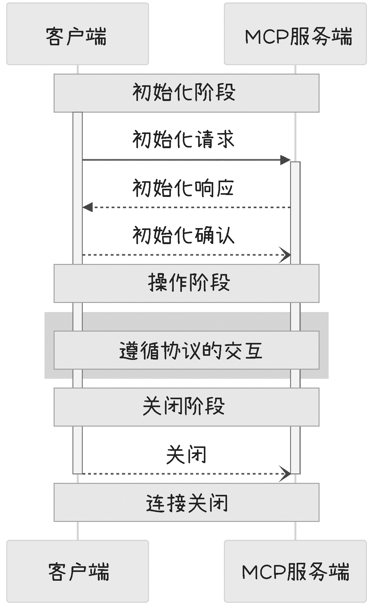

图 2-8

### **2.4.1 握手协商与启动**
进入业务交互前必须先完成连接启动，核心是搭建传输通道、完成兼容性校验、公布各自能力与基本信息。大致流程如下。

（1）在所有操作开始前，服务端先行启动。可能采用 stdio 方式，由客户端拉起；也可能采用 SSE 方式，由人工或自动启动。具体支持的模式由服务端决定，客户端据此选择合适的接入方式。

（2）通道建立后即可进入会话，先进行启动。客户端发出启动请求，内部声明自身能力例如 Root/Sampling、协议版本等。JSON-RPC 2.0 消息示例为：

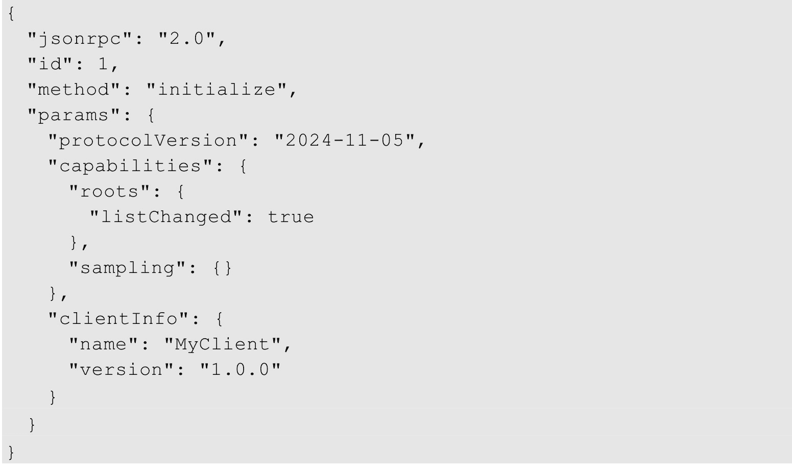

工程实践中借助框架，只需调用 session.initialize（）这类客户端 API 即可。

（3）服务端收到启动请求后会回一个启动响应，包含自身支持的协议版本与能力声明。若版本匹配，则表示支持该请求协议；若不匹配，则以服务端支持的版本为准。典型响应示例：

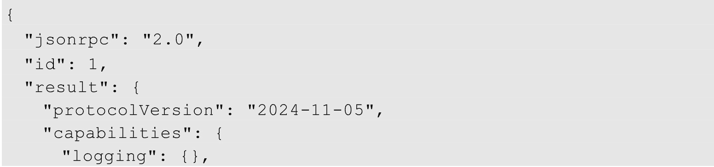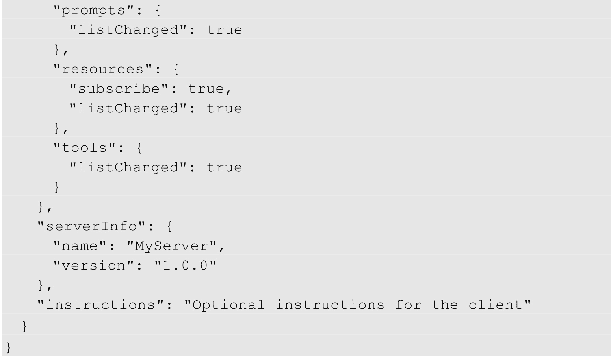

实际开发中服务端的响应多由框架自动处理，开发者只需提供必要的配置项，例如：

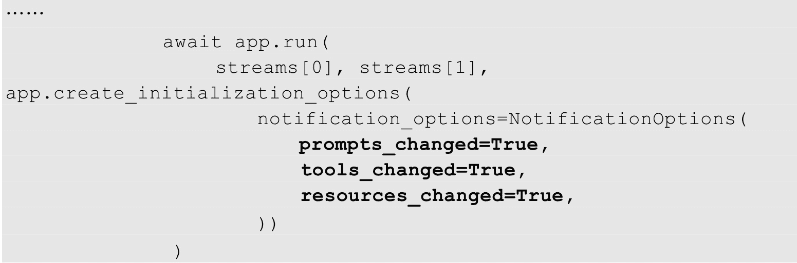

（4）客户端收到响应并确认版本兼容后，必须发出一条确认通知。服务端收到该通知才认为启动结束，开始接收后续调用。在框架流程里这一步通常自动完成。

### **2.4.2 交互与调用**
启动完成后进入常规的请求响应交互。

首先客户端可以去调用服务端的方法，通常是 list 方法，来获取可用的功能清单，从而知道能调用哪些单元。

随后客户端会根据具体场景执行常见操作。

（1）把可用功能呈现给用户或大模型。比如在 UI 上以列表展示供用户挑选，或把能力清单交给模型做推理使用。
（2）发起调用请求。当模型在输出中表示需要调用单元时，客户端即可向服务端发起对应调用并取回结果。
（3）借助持续交互，客户端最终能调用服务端能力完成智能体任务或普通用户请求。

某些情况下服务端也会主动向客户端发起请求，例如要求客户端进行模型调用。对服务端发起的请求，客户端通过回调处理，可能涉及唤起用户界面进行审批确认。服务端拿到结果后继续后续处理。

若服务端支持列表变更提醒，功能清单发生变化时会推送通知，客户端可重新请求更新清单。

### **2.4.3 收尾与断开**
交互结束时双方可关闭协议连接。MCP 规范并未规定专门的关闭请求消息，通常靠底层传输断开来实现，比如断开 HTTP 连接或关闭 stdio 输入流，一般无需额外处理。

## **2.5 服务端三大核心能力**
MCP 规范定义了服务端向客户端提供的三大核心能力：工具、资源、提示，分别对应不同的上下文供给方式。下面逐一解析。

### **2.5.1 工具：可执行的复杂逻辑**

**1.定义与设计思路**
工具是服务端提供的可执行函数或操作，供大模型调用以完成外部系统交互、计算等任务。

什么功能适合做成工具？简单说，就是需要交给模型自行判断是否使用的外部能力，即遵循“模型主导”原则。当然实际应用中部分工具调用可能需要人工审核以保障安全。借助工具，模型可在可控范围内执行数据库查询、第三方 API 调用、计算等操作，从而拓展能力边界。

工具使用也是智能体最重要的能力之一，通常也是服务端最核心的能力。常见类型有：

（1）各类数据与文件系统访问，如数据库、向量库、Excel 等。
（2）外部工具使用，如 GitHub 访问、Git 操作等。
（3）基于本地操作系统的界面与浏览器自动化操作。
（4）企业内部应用访问，如 ERP 模块访问与功能提供。
（5）互联网开放 API 访问，如搜索引擎、社交媒体、数据供给等。
（6）AI 接口与工具访问，如图像生成、自然语言处理、数据挖掘算法等。

**2.能力声明**
若服务端支持工具功能，启动阶段必须声明具备该能力，并可指定是否开启 listChanged 变更通知。功能声明通常在客户端发起启动时完成，典型消息格式如下：

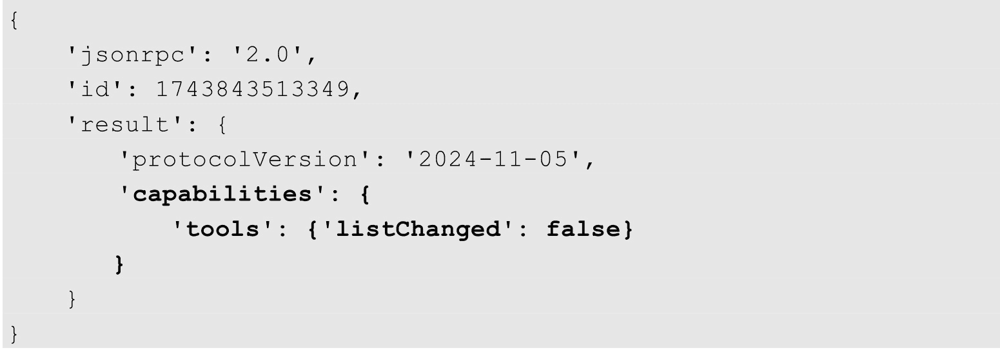

其中 capabilities 字段为能力声明部分。tools 表示支持工具功能，listChanged 表示工具列表变更时是否推送通知。

**3.能力发现**
客户端要让模型知道有哪些工具可用，需要调用 tools/list 获取清单。请求格式示例为：

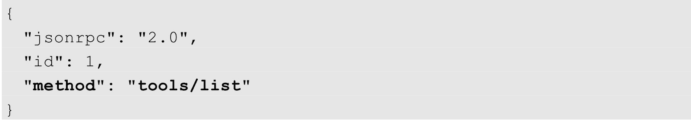

服务端在 tools/list 中应返回包含多个工具详情的数组。每个工具都有唯一 name，并附带 description 描述其功能和 inputSchema 输入参数定义，采用 JSON Schema 格式。下面是一个返回示例，可看到列出了名为 summarize_document 的工具：

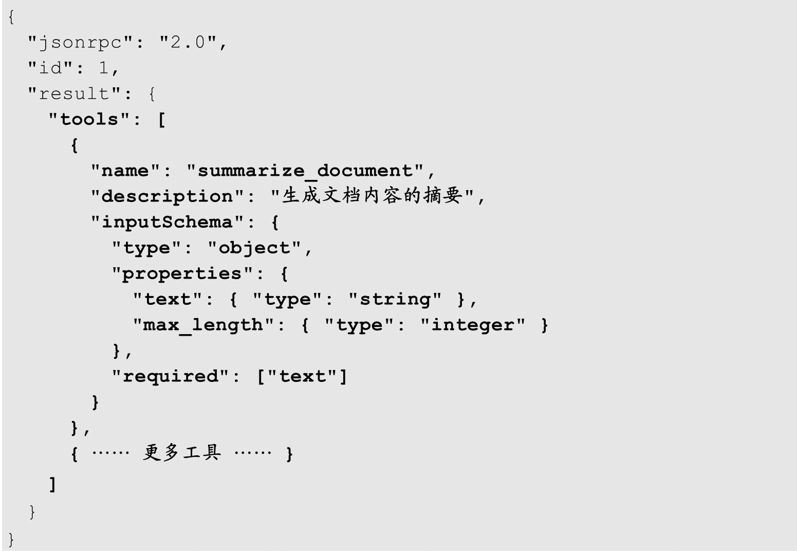

收到工具列表后，客户端例如智能体会把这些信息传给模型，模型据上下文动态决定使用哪个工具，并向客户端发出指令。客户端据此执行实际调用。这正是“模型主导”的体现。

在高层框架开发中，tools/list 通常由框架自动处理。开发者只需用框架提供的标准方式，例如 Python 装饰器，把自己写的函数注册到服务端。以示例工具为例，注册代码可写成：

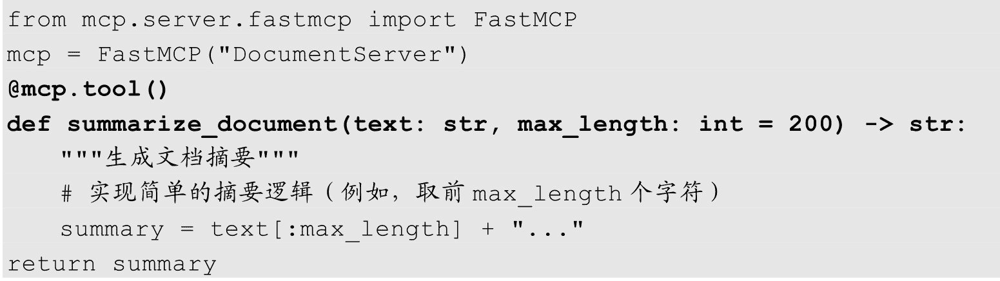

TypeScript 中类似：

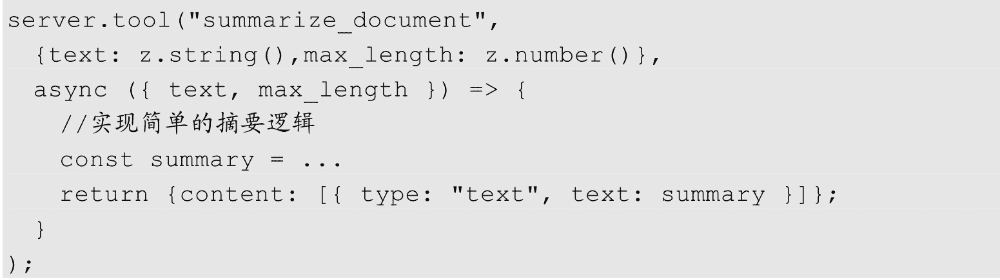

框架会根据注册时的函数签名生成 inputSchema 等元数据并实现 tools/list。

若使用低层 API，则需要自行实现 tools/list，具体会在开发部分展开。

**4.工具调用**
1）发起调用
需要调用时，客户端向服务端提供 tools/call 方法，指定单元名称和参数。例如请求示例：

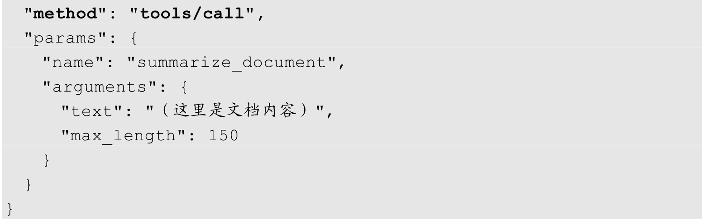

服务端收到请求后查找已注册的 summarize_document 单元并执行。需要做好参数校验，若名称不存在或参数不符合 inputSchema，应返回错误。

2）获取响应
单元执行完成后，服务端通过 JSON-RPC 2.0 返回响应。一个工具返回结果包含 content 内容列表和标识执行错误的 isError 字段。常见内容类型：

（1）文本内容。{"type":"text","text":"...结果文本..."}。
（2）图像内容。{"type":"image","data":"...Base64 数据...","mimeType":"image/png"}。
（3）嵌入资源引用。{"type":"resource","resource":{"uri":"resource://example",...}}。

若前面摘要工具调用成功，响应可能为：

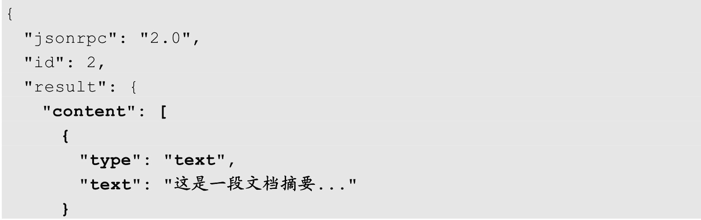

若执行中出错，有两种情况。

一种是协议级错误，如未知工具，服务端返回 JSON-RPC 2.0 标准错误码，例如：

另一种是应用级错误，如外部 API 调用失败，服务端返回正常结果，但 content 中描述错误信息并带 "isError":true 标识，例如：

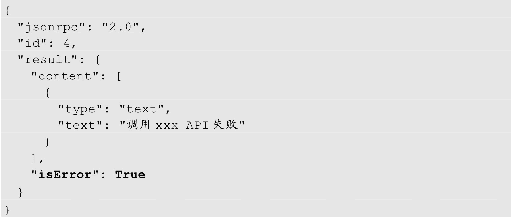

工具调用是服务端的核心能力，与 tools/list 类似，使用高层框架时无需自行实现 tools/call，只需注册并实现工具函数即可。

**5.使用流程示例**
以用户上传长文档期望提取要点为例，说明典型流程，如图 2-9。

图 2-9

（1）启动阶段进行协议协商与能力声明，服务端声明具备工具功能。
（2）客户端发送 tools/list 请求获取可用工具列表。
（3）服务端返回可用工具及其参数清单。
（4）客户端把工具清单带给模型。
（5）模型根据任务从清单中推理出合适的工具，例如本例选择 summarize_document，并通知客户端调用。
（6）客户端向服务端发送 tools/call 请求调用该工具。
（7）服务端返回工具调用结果。
（8）客户端把结果提供给模型做后续处理。

可见通过工具功能，模型能在处理任务时动态调用外部操作。开发者只需按规范注册工具并保证请求与返回格式正确，即可与客户端和模型协同完成复杂任务。

### **2.5.2 资源：动态的上下文信息**

**1.定义与设计思路**
资源指服务端提供的可读数据或上下文信息，包括文件内容、数据库记录、配置数据等。通常通过 URI 标识，便于客户端和模型引用。

资源与工具的区别在于资源不执行操作，只提供静态或可查询的数据。模型可将其视作可读取的文件片段。资源设计强调“应用控制”，即由客户端例如智能体或 Chatbot 决定何时、如何把资源作为上下文提供给模型，而不是由模型自行请求读取。

常见类型：

（1）文件内容，如配置数据、日志文件。
（2）数据库中的某条记录。
（3）图片等二进制数据。

资源可以是文本或二进制，并用 URI 标识，如 "file:///user/folder/resource.md"。MCP 规范未对 URI 做严格限制，定义了若干标准方案如 https://、file://、git://，也支持自定义方案如 doc://。

服务端可利用资源模板提供参数化资源，如 "users://{user_id}/profile"。其中 {user_id} 为模板参数，由服务端根据客户端请求的 URI 自动识别。例如客户端请求 "users://user1/profile" 时，服务端会把 user1 识别为参数。

**2.能力声明**
提供资源的服务端在启动时必须声明具备资源功能，并可选择是否支持 listChanged 通知。同时资源可声明是否支持订阅 Subscribe。一条声明示例：

声明方式与工具功能类似，此处不再赘述。

**3.资源发现**
服务端需要提供 resources/list 或 resources/templates/list 方法供客户端获取资源列表。请求示例：

服务端响应中应包含 resources 数组，每个项通常包含 uri 标识符、name 名称、description 描述、mimeType 类型等。示例：

若发现资源模板，则把响应中的 resources 改为 resourceTemplates、uri 改为 uriTemplate。客户端拿到列表后自行决定读取哪些资源。

在实际开发中 resources/list 的实现通常由框架提供，只需先注册资源。

**4.资源读取**
服务端需提供 resources/read 方法让客户端按需获取某资源。客户端在 params 中指定目标 URI。请求示例：

若服务端存在该 URI 资源，会返回其内容。响应通常包含 contents 数组，列出读取的资源内容，每块包含 uri、mimeType 及具体数据，数据目前有文本和二进制两种。

（1）文本类型用 text 字段返回。
（2）二进制类型用 Base64 编码的 blob 字段返回。

例如前面示例资源的读取结果：

注意：读取资源的响应中没有 isError 标识代表应用级错误，只有协议级错误，通常通过异常机制捕获。

让模型始终用上最新信息：MCP 资源订阅与提示机制

拿到一段文本后，调用方一般会把它当作背景上下文一起喂给大模型，让模型先把核心要点吃透，再针对用户的追问给出更贴切的回 đáp。

**5.资源的订阅与更新**

相比工具，资源的差异化能力是自带订阅。

当服务方在资源能力上声明支持订阅，就必须实现 **resources/subscribe** 接口，让调用方针对某个 URI 完成订阅。示意请求如下：

一旦服务方侧对应资源发生变化，就需要主动推送 **notifications/resources/updated** 通知给调用方，告知指定 URI 的内容已更新：

收到更新提醒后，调用方可以再次调用 **resources/read** 把最新版本拉回来。这种机制非常适合文件变动监听、数据库记录追踪等场景，能保证模型上下文实时跟上变化。借助资源能力，调用方可以把文件或数据源的内容无副作用地摆在模型面前，供查阅而非执行。

**6.资源使用的典型场景**

以企业文档处理与问答为例来串流程：你在搭建文档问答系统，希望把文档元数据也带入任务上下文，帮助模型更立体地理解材料。此时就可以调用已注册的文档元数据资源来实现，示意图见图 2-10。

图 2-10

对照工具的交互方式，资源的注册、读取与订阅来回很容易类推，这里不再赘述。

资源多对应静态数据的读取，调用方通常会做本地缓存，并依靠服务方的订阅与通知在内容变动时迅速刷新。对终端用户而言过程是透明的，他们感受到的只是结果更准确，背后是资源机制让模型读到了新鲜数据。

服务方的资源能力常与调用方的 **Root** 配合：Root 用来限定文件系统可供服务方触达的边界，详见 2.6 节。当服务方提供诸如 “file://” 这类资源时，会依据 Root 范围避免越界访问未授权目录，既灵活又安全。

### **2.5.3 提示：预置的模板**

**1.概念与设计原则**

提示是服务方提前准备好的提示词模板或对话流程模板，可能包含占位符参数。服务方通过协议把这些模板暴露给调用方，由用户或调用方按需触发，用来在特定场景为大模型提供上下文或指令。模板可以硬编码在服务方，也能放在文件或数据库里动态供给。

服务方返回的提示可以是一句话，也可以是一组对话消息。每条消息都带角色 role，通常是 User 或 Assistant，内容可以是文本、图像或资源引用，结构与常规大模型对话保持一致。

最简单的单句提示示例如下：

更复杂的连续对话上下文示例如下：

提示被设计为“用户主导”的能力。通常由用户主动触发，例如在聊天界面挑选“代码评审”模板，调用方随即向服务方索取提示内容并注入当前会话。实际产品里常以快捷指令如 “/指令” 或菜单选项呈现，减少重复输入负担。

MCP 最初为 Anthropic 的 Claude Desktop 提供扩展，以用户控制为核心是合理的。在智能体场景下用户并不直接对话，智能体会用内置提示与模型沟通，此时让调用方来控制提示的获取同样可行。

**2.提示能力声明**

初始化阶段，提供提示的服务方必须声明具备提示能力，并可选择是否开启 **listChanged** 变更通知。一个 JSON-RPC 声明示例如下：

声明方式与参数设置和工具能力类似，这里不再展开。

**3.提示的发现**

服务方需提供 **prompts/list** 方法，让调用方拉取完整的提示目录。请求示例：

服务方响应中包含 prompts 数组，列出每个提示的 name、description 以及可选的 arguments 参数列表，和工具的 inputSchema 思路相近。响应示例：

调用方拿到列表后可自行挑选，也能展示给用户选择。实际开发中 prompts/list 通常由 SDK 生成，只需先注册提示即可。

**4.提示的获取**

当需要某个具体提示时，无论是用户点击还是智能体触发，调用方都可以通过 **prompts/get** 请求携带必要参数来获取详情。示例请求：

服务方返回提示的具体内容，包含 description 和 messages 模板消息。例如：

注意获取提示的响应里没有 isError 字段，协议级错误通过异常捕获。

调用方收到后会把这些消息融入大模型上下文。例如作为新一轮对话的开头，让模型扮演代码审查助手给出建议；智能体也可以借此执行特定任务，比如专注于软件开发的代码审查。

**5.提示的使用流程示例**

最后看一个桌面 AI 工具调用服务方提示的完整路径，见图 2-11。

（1）初始化时双方完成能力声明，服务方宣布支持提示。
（2）调用方请求获取提示列表。
（3）服务方返回可用提示清单。
（4）调用方在界面如动态菜单中展示名称与功能。
（5）用户选择“代码审查”提示并提供代码片段。
（6）调用方调用 prompts/get 获取提示。
（7）服务方返回生成的提示，可能是一组对话消息。
（8）调用方把提示注入与大模型的对话。
（9）大模型依据提示要求分析代码并输出建议。

图 2-11

整个过程中提示由服务方统一提供和维护，便于集中更新优化。调用方与模型只需消费生成的提示，就能保证响应方向正确。

## **2.6 客户端功能**

调用方通常是请求方，但 MCP 规范要求在必要时由调用方向服务方提供某些能力。其中 Root 与 Sampling 是两个关键客户端功能，下面分别说明。

### **2.6.1 Root：控制服务方的访问范围**

**1.作用与功能声明**

Root 功能让调用方向服务方暴露文件系统或 URI 的访问范围。本质上是一个目录或路径前缀，服务方仅能在其内进行文件读取等操作。在 stdio 传输模式下，调用方借此限制服务方权限，明确告知“可访问这些位置，不可访问其他地方”。这确保了像文件处理类服务方在提供工具或资源时不会越界。Root 通常对应用户选择的工作区或项目文件夹。

例如在 IDE 场景中，用户只想让服务方访问当前工程目录，该目录就会作为 Root 传递。

与服务方声明类似，支持 Root 的调用方在初始化时声明该能力，可选 listChanged 标识用于在 Root 列表变更时通知服务方。多数情况只有一个 Root，也可能有多个。

功能声明在调用方发起 initialize 方法时完成。以 Python SDK 为例：

提供 list_roots_callback 回调后，初始化阶段会自动声明具备 Root 能力，表示“我可以响应你的 list_roots 请求”。

**2.获取与变更 Root 列表**

服务方需要时可调用 **roots/list** 获取调用方提供的 Root 列表。请求格式：

调用方响应包含 roots 数组，列出每个 Root 的 uri 和可选名称。例如：

借此服务方可识别并访问如 “/home/user/myproject” 下的内容，并在执行 resources/read 或文件搜索时严格限制在指定路径内。

当用户更改共享目录，例如切换工作区，调用方应更新 Root 列表并发送 **notifications/roots/list_changed** 通知。服务方收到后可重新调用 roots/list 以保持同步。

本质上 Root 是调用方在协议层实施的安全沙箱。服务方开发者可安心按边界编写文件访问逻辑，避免越权；用户也能清楚服务方仅能触达特定位置，形成双向明确的可信机制。

需要强调的是，调用方提供的 Root 列表仅作参考，具体的权限校验逻辑仍需服务方自行实现。

**3.使用流程示例**

设想一个“文件管理”服务方，帮助调用方如 Cursor IDE 读取和管理本地文件，如何借助 Root 实现安全访问：

（1）调用方在建立连接时提供回调，把用户授权的文件夹作为 Root 列表传递。
（2）服务方在会话建立或工具被调用时向调用方发起 roots/list 请求获取列表。
（3）调用方返回当前 Root 列表，服务方缓存之。
（4）调用方请求服务方“打开 README.md”或“创建 README.md”时，服务方先校验路径是否在 Root 内。
（5）路径在范围内则允许操作，否则拒绝或报错，保障文件安全。
（6）若调用方后续更新 Root，发送 roots/list_changed 通知，服务方据此刷新缓存。

如此一来，服务方始终依据最新 Root 执行操作。

### **2.6.2 Sampling：控制大模型的安全使用**

**1.作用与功能声明**

客户端的 Sampling 能力可概括为：允许服务方请求客户端执行一次大模型内容生成。例如服务方可指示客户端的智能体调用模型生成文本或图像，并把结果返回给服务方。相当于服务方通过客户端向模型提问，获得回答后再做处理或直接呈现。

重要性体现在：
（1）服务方无需自带模型和 API Key，复用客户端能力，也能随客户端选择的模型灵活调整表现。
（2）敏感数据上下文无需传到服务方，可在客户端侧由模型处理。
（3）客户端可对生成逻辑做控制，如结构化输出、内容过滤。
（4）必要时可让用户审批或修改来自服务方的 Sampling 请求。

该能力适用于对模型调用安全性要求较高，或希望服务方使用特定模型的场景。这并不排除服务方自行使用模型，企业内可控的服务方完全可以内置模型调用。

与 Root 类似，支持 Sampling 的客户端在初始化时通过提供 Sampling_callback 回调来声明能力。Sampling 没有 listChanged 选项，因为它本身就是一个独立功能。

**2.Sampling 请求**

当服务方在工具执行或多步 Agent 流程中需要生成内容时，会向客户端发送 **sampling/createMessage** 请求。参数通常包括 messages 消息列表、modelPreferences 模型偏好、systemPrompt 系统提示、maxTokens 最大 token 数等。messages 一般包含若干对话片段供模型参考。典型请求示例：

示例中服务方请客户端模型回答“巴黎是法国首都吗？”，并附带系统提示强化设定，同时指定偏好模型为 claude-3，并强调智能与速度。

（1）模型偏好仅表达期望，最终决定权在客户端。
（2）偏好由成本、速度、智能三个 0~1 优先级及可选模型名称提示组成。客户端据此和自身可用模型列表决定实际使用哪一个。
模型偏好在客户端拥有多个模型且允许用户参与决策时才更关键。

**3.用户审批与执行**

由于 Sampling 请求会触发模型生成，存在不确定性和安全风险，建议在客户端提供用户审批环节。

例如收到服务方的 Sampling 请求时，客户端可提示用户：“MCP 服务端请求模型生成以下回复，是否同意？”用户可允许或在发送前修改提示内容。这保证了用户对额外输出请求的知情权和控制权。只有在用户同意后，客户端才会把请求提交给底层模型并返回结果。

模型生成收尾后，Client端会借助 JSON-RPC 通道把回复推送回 MCP 服务侧。回传的报文里通常带有 role，用来说明消息身份，一般写作 assistant 代表模型产出；content 的载体与前面保持一致，可装载文本、图片等多种形态；model 用来标注本次真正完成推理的模型名称；stopReason 则说明结束原因，例如 endTurn 代表正常收尾。示例示意如下：

收到该回复后，服务侧既可以把内容直接作为本次调用的交付物，也可以把它纳入后续的编排链路。比如某个工具内部借助 Sampling 请求让模型帮忙写一段摘要，拿到摘要文本后就能继续原有流程，把摘要封装成该工具的返回内容再交回 Client端。

**4.使用流程示例**

设想 MCP 服务侧内置一个“数据库智能查询”工具，用户用自然语言提问后，服务侧需要把自然语言转译为 SQL。开发者通常希望由大模型来完成这段 SQL 的生成。于是该工具被触发时，会执行一次 sampling/createMessage，把原始问句与相关上下文一起发给 Client端，要求产出对应的 SQL。完整交互顺序如下。

（1）服务侧向 Client端发出一次 Sampling 请求，并附带原始问题等上下文。
（2）Client端收到请求后会弹出确认界面，由用户决定是否放行。
（3）用户同意后，Client端调用本地大模型完成实际的生成。
（4）大模型把生成结果交回 Client端。
（5）Client端再次把生成内容展示给用户复核，例如确认生成的 SQL 是否安全且可执行。
（6）用户确认无误后，Client端把已审核的结果发回服务侧。
（7）服务侧据此开展下一步，例如把 SQL 推送到数据库执行，并把查询结果作为工具输出返回给 Client端。

借助 Sampling，服务侧在需要时可以回调 Client端的大模型，获得更强的 AI 增援，相当于在工具内部嵌套了一次模型调用，从而提升智能化程度。整个过程中调用主动权始终掌握在 Client端，包括模型挑选、用户授权等，避免模型被不当使用。同时服务侧开发者无需关心具体的模型接入细节，例如 OpenAI API，实现了开发侧的解耦。

MCP 规范还定义了一些通用辅助能力，像 ping、进度通知等，具体将在第五章高级开发部分展开。

# **第三章**

# **基于 SDK 开发 MCP 服务端**

吃透 MCP 的底层设计后，我们进入实战环节。MCP 是一个与语言无关的开放标准，理论上可用任意编程语言落地服务端与客户端。官方提供了多语言开源 SDK，帮助开发者按规范构建实现。本章以官方 Python SDK 为主线，讲解服务端与客户端的开发、调试与部署等基础工作。

不同语言的 SDK 在实现细节上会因语言特性而异，但在整体架构上保持一致。

## **3.1 认识 MCP SDK**

### **3.1.1 关于 MCP SDK 及准备**

MCP SDK 是官方提供的开发包，目前已支持 Python、TypeScript、Java、C# 等语言，并完整实现了 MCP 规范。借助它可以方便地完成：

（1）搭建 MCP 服务端，对外开放工具、资源、提示等能力供客户端调用。
（2）搭建客户端，连接任意 MCP 服务端获取其提供的上下文能力。
（3）采用标准传输方式，如 stdio 或 SSE 进行交互。
（4）自动处理消息编排、会话生命周期等底层细节。

依托这些能力可以构建企业内部的端到端智能体。例如先用 MCP 服务端封装公司内部的数据库查询、文件检索等功能，再让智能体连接该服务端，使智能体内部的大模型能够安全调用这些能力获取最新数据，从而提升应用效果。

安装上，Python SDK 可通过 PyPI，包名为 mcp；TypeScript SDK 可通过 NPM，包名为 @modelcontextprotocol/sdk；其他语言 SDK 请参考官网指引。开发环境与 SDK 的准备详见 1.3.1 节，此处省略。

另外，官方 SDK 全部开源，代码托管于 GitHub，可搜索 python-sdk 项目参与共建。规范文档与教程可在官网获取。需要留意的是，MCP 规范与 SDK 仍在演进，后续可能新增语言版本与功能。

若已按第一章指引完成开发环境搭建与 MCP Python SDK 配置，并在激活虚拟环境后能查询到 SDK 版本，就能开始第一个 MCP 应用的开发！

本书示例均基于 MCP Python SDK 1.6.0 编写，对应 2024-11-05 版规范，并兼容 1.9.0 版即 2025-03-26 规范。SDK 1.9.1 的主要更新将在第七章介绍。

### **3.1.2 了解 MCP SDK 的层次结构**

无论使用何种语言，MCP SDK 都遵循统一的分层设计。以 Python SDK 为例，各层职责明确、接口清晰，通过协作实现完整的集成架构与协议规范。其分层示意图如图 3-1。

图 3-1

先做概览，后续开发中逐步深入。

**1.应用层（Application）**

这是开发者最常触及的层次。客户端可在此构建带用户界面的聊天机器人或智能体；服务端则在此实现与外部数据的交互，完成工具、资源、提示等功能的内部逻辑，并通过规范接口向客户端开放。

应用层借助会话层 API 发起请求并接收响应，或接收请求并返回结果。为提升效率，SDK 在此层提供若干便捷函数与装饰器。

**2.会话层（Session）**

会话层负责维护客户端与服务端之间的会话与交互，主要处理请求消息的收发与响应、通知消息的收发。例如推送 listChanged 或 progress 通知时，可调用会话层接口。

**3.传输层（Transport）**

传输层实现基于 stdio 本地或 HTTP 远程的传输，涵盖 HTTP POST 与 SSE 通道的建立及消息传输。例如建立 SSE 连接时可用传输层的 sse_client 接口，建立 stdio 连接时可用 stdio_client 接口。

## **3.2 使用 FastMCP 框架开发 MCP 服务端**

本节聚焦服务端具体开发。官方 Python SDK 内置了一个更高层的开发组件——FastMCP，如图 3-2 所示。FastMCP 在基础 SDK 接口上进一步封装，提供更贴合 Python 习惯、更简洁的高层 API，让开发者用更少代码快速实现各项功能。

图 3-2

使用 FastMCP 时，可通过装饰器与类型注解注册工具、资源、提示等。SDK 会根据函数签名与文档字符串自动生成符合规范的描述，大幅减少样板代码。相比直接使用底层 API，FastMCP 简化了流程并隐藏了协议通信复杂性，让开发者专注业务实现。

### **3.2.1 创建 FastMCP 实例**

基于 FastMCP 构建服务端很直接。首先导入 FastMCP 类，再实例化。示例代码存于 serverdemo.py。

如上，我们实例化了一个 FastMCP 对象。这里传入的字符串 “MyMCPServer” 作为实例名称，会在客户端界面展示。创建实例时除名称外，还可指定以下参数。

（1）dependencies。用于声明服务端依赖的第三方库。若实例需要额外 Python 包如 pandas、numpy 等，可在初始化时通过 dependencies=[“pandas”, …] 提前声明。这对使用 SDK 内置工具运行服务端很有帮助，声明后依赖会在开发模式下自动安装。
（2）debug。用于开启框架级别的调试模式，通常仅建议在开发阶段使用。
（3）log_level。用于指定日志级别，可选值包括 “DEBUG”、“INFO” 等。
（4）port。采用远程传输模式时，用于指定服务端监听的 HTTP 端口。
（5）lifespan。可选的生命周期管理器，是一种常见的 ASGI 应用资源自动管理方式。

在实际创建时，最常关注的参数是名称与依赖项。

### **3.2.2 开发工具功能**

工具是服务端提供的可执行函数或操作。客户端可通过标准方法 tools/call 调用来执行操作、查询数据，从而扩展能力。与资源不同，工具通常涉及计算或产生副作用，例如修改文件、调用外部 API，功能上类似 RESTful API 中的 POST。

在 FastMCP 框架中，只需在普通 Python 函数上加上 @mcp.tool() 装饰器，即可注册为工具。框架会利用类型注解推断参数类型与返回值类型，并把文档字符串用作工具描述。因此建议为每个工具函数编写清晰的 docstring，便于框架准确理解用途。

下面通过两个示例说明工具的开发方式。

**1.示例：搜索工具**

为让服务端具备网络搜索能力，可借助 Python HTTP 请求库如 requests 以及第三方服务 Tavily 的搜索接口实现。示例代码如下，存于 serverdemo.py：

要点如下：

（1）定义了一个名为 tavily_search 的工具函数，接收查询字符串 query 与数量 max_results，随后通过 HTTP POST 调用互联网搜索 API 获取结果并做简单格式化。
（2）通过 @mcp.tool() 装饰器（mcp 为之前创建的 FastMCP 对象）将该函数注册为工具，名称为 tavily_search。FastMCP 会自动读取注解与文档字符串生成元数据。若调用服务端的 tools/list 方法，可在返回列表中看到该工具。注册后客户端即可通过 tools/call 方法调用。
（3）正常运行时，程序最终返回字符串数组 formatted_results。FastMCP 会自动将其组装为 MCP 规范要求的 JSON-RPC 2.0 消息，对客户端透明。
（4）出现异常如 API Key 错误时，采用抛出异常的方式，使 FastMCP 感知程序出错。框架会自动把异常信息封装为 MCP 规范要求的异常消息格式，即工具调用返回中 “isError”=True。

这样就得到一个可通过 MCP 服务端对外开放的简易搜索工具。

**2.示例：Excel 文件信息统计工具**

工具的内部逻辑完全由开发者控制，除了调用外部 API，也可作为本地文件处理工具。下面在服务端实现一个简单的 Excel 文件信息统计工具，客户端可提供文件路径并请求提取统计信息。实现代码如下，存于 serverdemo.py：

要点如下：

（1）这是一个通过 @tool 注册的 excel_stats 工具，接收文件路径参数 file_path，随后利用 pd.read_excel 打开指定 Excel 文件并提取行列统计信息。
（2）这里采用不同返回方式，将结果封装成 SDK 的 TextContent 类型对象返回，效果与传统方式一致。

注意：对于涉及文件访问的工具，最好借助客户端的 Root 功能进行安全管控，限制服务端对文件系统的访问范围，以防产生不可预期结果。

这两个示例可见，使用高层框架 FastMCP 注册与开发工具非常简便：无需手动注册，只需在函数上方加一行装饰器即可完成。构建工具逻辑时，可充分利用 Python 强大生态，实现网络访问、文件读写、数据分析等多种功能。工具注册成功后，客户端与大模型即可获取工具清单并按参数要求调用，进而大幅扩展大模型能力。

### **3.2.3 开发资源功能**

除可调用的工具外，MCP 服务端还提供资源与提示。

资源功能用于向客户端提供数据，部分类似 RESTful API 中的 GET 请求：客户端依据资源的 URI 请求数据，服务端通过对应资源函数返回内容。需要注意这并非真正的 HTTP GET，而是通过 HTTP POST 发起的 resources/read 方法调用。资源一般不涉及复杂计算或副作用，应避免长时间阻塞或改变状态，应快速提供只读信息。在 FastMCP 框架中，使用 @mcp.resource 装饰器注册资源。

**1.示例：简单的静态资源**

静态资源是不需要参数即可访问的资源，例如某种系统配置信息。以下代码实现了服务端的一个静态资源，存于 serverdemo.py：

要点如下：

（1）通过 @mcp.resource 声明一个资源，资源 URI 为 “system://info”。需注意工具访问使用名称，而资源访问使用 URI，这是客户端发起 resources/read 调用时必须提供的参数。
（2）资源内容的提供由函数 get_system_info 实现。与工具类似，FastMCP 会自动依据函数与文档字符串获取资源元数据。
（3）访问该资源无需参数，直接返回静态文本，无需额外逻辑。

服务端返回的资源内容目前主要分为两种类型。
①文本资源。直接返回字符串即可，其他类型会自动转换。
②二进制资源。可直接返回 Blob 类型。以下是一个返回二进制资源的示例：

（4）函数返回后，FastMCP 会把内容封装为 MCP 规范的 JSON-RPC 2.0 消息并发送给客户端。

**2.示例：带有参数的资源模板**

除静态资源外，还有一类带参数的资源模板，其 URI 访问方式与带参数的 HTTP GET 端点类似，由需要输入参数的资源函数读取内容。以下代码实现了一个带参数的资源模块，存于 serverdemo.py：

对这段代码的解释如下：

这次聊到的资源定义，核心变化是加入了 URI 模板 users://{user_id}/profile。花括号里的 user_id 就是一个可被替换的占位符。FastMCP 会自动扫描客户端发来的 URI，把其中的占位符解析出来当作参数传给对应的处理函数。比方说客户端请求 user://user1/profile，服务端就会去执行 get_user_profile(user_id="user1")。函数内部就可以按这个参数去做业务，比如根据 user_id 去数据库里查用户信息。

有了这种资源机制，开发者能按需声明不同形态的资源和参数，由客户端来调用，从而给大模型补充更丰富的上下文。

### 3.2.4 开发提示功能

提示属于一种特殊的资源，本质上是可复用的提示词模板或对话流程模板。想让大模型完成某个操作时，可以先调用 MCP 服务端的提示接口，生成规范化的请求消息。

下面用两个案例来演示写法。

**1. 示例：简单提示**
提示有时候就是一句话。这种情况下提示函数只需要返回一个字符串。示例代码放在 serverdemo.py 里：

要点说明：

（1）通过 @mcp.prompt 装饰器注册了一个名为 commit_message 的提示，作用是依据代码变更生成提交说明。

（2）功能由 generate_commit_message 函数实现，参数 changes 代表变更内容。可以主动给出 name 作为标识，没给就默认使用函数名，其余元数据由 FastMCP 框架自动生成。

（3）提示的返回结构与大模型 API 的消息结构接近，每条消息都有角色 role 和内容 content 两个字段。上例只返回纯文本，会被 FastMCP 自动包装成 role 为 user 的用户消息，效果等价于：

**2. 示例：连续上下文**
另一种提示是由多条对话消息拼接成的上下文，每条都带有角色和内容。这种形式在工程里很常见。同样存放在 serverdemo.py：

解读要点：

（1）与前例的区别在于它能返回一个消息数组，每一项代表一条消息。借助 FastMCP 预置的消息类型，能很方便地构造不同角色的消息。

（2）通过 prompts/get 拉取提示时，客户端最终拿到的是一个消息数组，如图 3-3 所示。这样就能把连续的消息直接放进上下文，和大模型交互。

图 3-3

### 3.2.5 启动 MCP 服务端

前面搭了一个功能有限的 MCP 服务端，现在要把它跑起来供客户端调用。查资料时会看到调试启动、命令行启动、集成到第三方工具启动等多种写法，表面看起来不一样，本质是同一套启动逻辑。下面从两种基础传输方式的启动原理说起。

**1. 两种传输模式的启动原理**
在 MCP 集成架构里，客户端和服务端有 stdio 与 SSE 两种传输方式。依据支持的传输方式，启动方式也就分为两种，如图 3-4 所示。

图 3-4

（1）基于 stdio 的本地传输。该模式下服务端和客户端通常跑在同一台机器，通过标准输入输出 stdin/stdout 做进程间通信。服务端的启动一般由客户端程序通过命令行自动触发，启动后服务端变成客户端的子进程，通信依赖启动时建立的 stdin/stdout 通道。
所以用 stdio 时，启动命令通常写在客户端配置里，虽然也能手动执行命令启动，但这样无法和客户端建立传输。

（2）基于 SSE 的传输。该模式下服务端不能被客户端拉起，需要单独执行命令启动。启动后服务端会在配置的端口上监听连接和请求。
因此用 SSE 时，需要在客户端里配置服务端的地址、端口和连接端点比如 /sse，然后手动启动服务端。可以直接用 python 或 uv run，在 TypeScript 环境下常用 node 或 npx，也能用 SDK 提供的 mcp cli 工具。

**2. 使用 python 或 uv run 命令启动 MCP 服务端**
最直观的启动方式就是用 python 或 uv run，前提是程序里有启动代码。
在示例中加入以下启动代码，文件仍是 serverdemo.py：

要点说明：

（1）为了支持可选启动方式，加入启动参数 --transport，可选值是 sse 或 stdio，使用 argparse 解析。

（2）调用 mcp.run() 方法启动服务，并传入 transport 参数。mcp 是之前创建的 FastMCP 实例名。

现在就可以把服务跑起来，虽然暂时还没有客户端来测试。

（1）用 stdio 启动，默认 transport 就是 stdio：

或者：

没有异常的话，启动后服务会处于阻塞等待状态。

（2）用 SSE 启动，需要显式指定 transport：

或者

在 SSE 模式下，服务端内部会用轻量级异步 Web 服务器 Uvicorn 来运行上层的 ASGI 应用，输出如图 3-5 所示。

图 3-5

看源码会发现 SDK 采用了 Starlette 作为上层 Web 开发框架，知名的 FastAPI 也是基于 Starlette，后面开发低层 API 时还会再用到。

**3. 使用 mcp run 命令启动 MCP 服务端**
MCP SDK 自带一个名为 mcp 的命令行工具，其 run 子命令可以直接启动 MCP，无需自己写启动脚本。下面是工具说明，如图 3-6 所示。

图 3-6

用 stdio 启动：

用 SSE 启动：

补充两点：

（1）mcp run 不会自动安装 pyproject.toml 里 dependencies 指定的依赖，请确保依赖已手动安装。

（2）mcp run 本质是个包装器，内部会从程序动态导入 FastMCP 对象并调用其 run 方法，所以和 uv run 效果等价。因此程序里必须使用标准的实例名如 mcp、server 或 app。若用了别的名称，启动时需要指定对象名，例如：

这里的 :myapp 用来指定程序中 FastMCP 对象的名字：

另外借助 mcp dev 命令可以用调试模式启动，具体会在 3.3 节介绍。

## 3.3 MCP 服务端的调试、跟踪与部署

3.2 节已经完成了实例创建、工具、资源、提示的注册并成功启动对外服务，一个基础的 MCP Server 基本成型。接下来怎么调试、跟踪与部署？本节介绍常见方法与工具。

### 3.3.1 调试与跟踪 MCP 服务端

**1. 使用 MCP Inspector 调试**
MCP Inspector 是 SDK 提供的交互式可视化调试工具，能在本地浏览器里直观地与 MCP 服务端交互。可查看服务端提供的工具和资源，直接调用并检查输入输出，同时实时监控日志。请按下面步骤学习。

1）启动 MCP Inspector

（1）如果已经安装了 mcp 命令行工具，可以运行下面命令启动：

与 mcp run 类似，如果程序使用非标准的实例名，需要在文件名后加上 :server 名称后缀。该命令还支持 --with 参数指定安装依赖，或使用 --with-editable pyproject.toml [所在目录] 实现热部署。

（2）也可以直接运行 npx 命令启动：

方括号里的启动命令是可选的，可以是前面介绍的其他启动命令如 python/uv run 等。

2）在 MCP Inspector 中调试

（1）执行命令后终端会显示一个本地调试 URL，如图 3-7 所示。

图 3-7

（2）在浏览器输入提示的本地地址比如 http://localhost:5173，就能打开 Inspector 界面。左侧是连接设置、传输类型、启动命令及日志输出区，右侧是主工作区，如图 3-8 所示。

图 3-8

（3）点击 Connect 按钮，Inspector 会用 stdio 启动服务端并建立连接，请确保启动命令正确。stdio 是默认连接方式。如果要调试远程服务端，请确保远程已启动，并在左侧面板修改 Transport Type，配置远程 HTTP SSE 连接 URL。

（4）连接成功后，右侧会出现 Resources、Prompts、Tools 等多个标签页，可用于测试不同功能，如图 3-9 所示。

图 3-9

（5）点击顶部 Resources 标签即可浏览服务端提供的全部资源，点击 Tools 标签即可浏览所有工具。Inspector 会自动发出 resources/list 和 tools/list 请求获取信息，可以看到每个资源或工具的名称与描述，如图 3-10 所示。

图 3-10

（6）在 Tools 标签下选择一个工具，例如前面定义的搜索工具。Inspector 会展示该工具所需参数字段，填入测试值后点击 Run Tool 按钮。请求会发往服务端，结果显示在界面右下方并记录在历史记录区。这样无需写额外客户端代码即可调用服务端功能，验证逻辑正确性，如图 3-11 所示。

图 3-11

（7）Inspector 左侧会实时展示服务端的标准输出日志，包括每次请求的处理情况、日志信息等，有助于快速定位问题。可以确认服务端是否收到请求、参数是否正确，以及工具执行过程中的调试信息，其详细程度取决于程序中的日志级别设置。

MCP Inspector 让开发者能交互式调试 MCP 服务端，确保功能正常，显著提升开发效率。若修改代码，需要重启后刷新面板，再重复验证。

**2. 使用第三方客户端测试**
在自己写客户端之前，可以利用其他支持 MCP 的客户端工具来测试现有服务端，官方文档里有在 Claude Desktop 中快速安装使用的指南。下面介绍在 VS Code 中配置并测试，这是开发者常用方法。

VS Code 最新版本配合 GitHub Copilot 的 Agent 模式，支持连接 MCP 并把其中的工具整合为代码编辑辅助。因此可以把开发的 MCP 直接集成到 VS Code 中交互式测试。

（1）进入 VS Code 工作区进行设置，也可在用户设置中统一生效，搜索 MCP 相关设置，如图 3-12 所示，然后点“在 settings.json 中编辑”链接。

图 3-12

（2）下面是使用 stdio 的简单配置样例，可以直接编辑，也可借助命令面板的“MCP：添加 MCP 服务端...”输入。

核心配置是启动服务的命令，command 与 args。如果是 SSE 模式，则需要配置 url 与 headers 参数并自行启动。另有两个常用配置项。

①env/envFile。如果服务端需要特殊环境变量，可以在 env 中配置，也可以通过 .env 文件管理，并在 envFile 中指定路径。

②inputs。可用来设定运行时需要输入的占位符，避免敏感信息硬编码。服务端首次运行时会提示输入这些占位符，VS Code 会保存供后续使用。"password": true 可用于掩码输入，常用于密码或 Key。这些敏感变量后续可通过 ${input:#id#} 引用，如上面配置文件中的 ${input:openai-api-key}。

（3）保存正确配置后，打开 VS Code 的 Copilot Chat 面板，把聊天模式切换为代理形态。VS Code 会按配置自动启动并连接 MCP，自动发现工具并提示，如图 3-13 所示。

图 3-13

如果启动出错，这里会显示红色告警图标。可以修复配置后通过命令面板重新启动 MCP 服务端。

（4）打开图 3-13 所示的图标后，命令面板会列出当前可用的工具集合，正是前面已经实现的那两项。至此即可在 VS Code 之内直接使用，参考图 3-14。

图 3-14

使用过程中，编码助手通常会自动匹配最合适的工具，若想明确指定，可在对话里输入“#工具名”进行强制选择。每次执行前都会出现确认提示，第一次使用时必须手动授权。确认之后，VS Code 借助 MCP 将请求发送到你部署的服务端，并把返回结果交给大模型参考，图 3-15 给出了一个演示。

图 3-15

调试阶段，可以在 VS Code 的输出区打开 MCP 服务端的追踪日志，如图 3-16 所示，有助于快速定位异常。

图 3-16

（5）如果缺乏 GitHub Copilot 的访问权限，或者当前 VS Code 版本未支持 Agent 模式，也可以尝试第三方 MCP 插件，例如 Copilot MCP 插件。具体步骤请查阅各插件的官方说明，这里不作详述。原理上它们都是在 VS Code 与 MCP 服务端间建立通信桥梁，便于本地验证。

**3. MCP 服务端日志监控**

日志是排查故障的重要手段。运行在 Python 之上的 MCP 服务端借助标准 logging 模块记录运行状态与各类事件。善用日志能够追踪执行轨迹、调节输出详细度，并在生产环节实现监控。相关说明如下。

1）日志记录器获取

调用 logging.getLogger 即可拿到根记录器或指定模块的记录器，用来写入关键信息，是常见的追踪与调试手段。

2）日志输出去向

常规情况下，logging 会在本地记录并展示服务端的日志。

（1）以 mcp dev 启动 stdio 传输的调试模式下，标准输出会被 MCP Inspector 接管，并在其界面左侧的日志面板实时显示，便于观察。

（2）若直接通过 python / uv / uvx 或 mcp run 启动，日志会打印到终端控制台。

（3）使用 HTTP 远程传输启动时，日志仍出现在服务端的终端控制台。

（4）需要时可把日志写入文件或统一日志系统，默认不会自动保存，需手动重定向或额外配置。

3）把日志推送给客户端

按照 MCP 规范，服务端能利用通知机制把重要日志通过远程 notifications/message 送达客户端，由客户端自行渲染，例如在界面展示。这样不仅能看到调用结果，还能追踪中间环节。规范同时允许客户端调用服务端的 logging/setLevel 接口动态调整日志等级。

4）日志等级调节

MCP 采用 DEBUG、INFO、WARNING、ERROR 等常规等级，默认是 INFO，会打印类似“Processing request of type X”的提示。开发时可调到 DEBUG 获得更精细信息；生产时可提升到 WARNING 或 ERROR 减少开销。常见做法有：

（1）在创建 FastMCP 实例时指定 log_level：

（2）直接配置 Python 日志模块：

两种方式结果等价，但直接配置 logging 还能自定义格式等，更灵活。上述做法会强制把全局根记录器设为 DEBUG，从而看到包括 SDK 内部在内的完整信息。若仅需改动当前模块，可调用该记录器的 setLevel 方法，而非使用全局 basicConfig。

5）生产环境的日志建议

开发阶段建议保持详细日志，配合调试工具快速定位问题。DEBUG 级别会暴露请求参数、执行流程等细节。但在生产环境，过度记录会带来性能损耗并可能泄漏敏感数据，通常只保留警告与错误。部署时建议将日志重定向至文件或系统日志服务。

（1）输出到日志文件。可利用 shell 重定向把 stdout 和 stderr 写入文件：

示例通过 nohup 在后台运行服务端，所有输出保存到 logs/mcp_server.log，可用 tail -f logs/mcp_server.log 实时查看。

（2）系统日志与服务治理。在 Linux 上可编写 Systemd 服务脚本托管服务端，并把日志汇入 journalctl 统一管理；macOS 上可用 launchd 或类似工具实现等效效果。

（3）容器化场景的日志。Docker 部署时，容器的标准输出由 Docker 自带的日志机制管理。可通过 docker logs 查看；如需持久化，也可在容器内配置日志文件并挂载卷。

6）日志解读

除了自定义日志，MCP SDK 在处理请求时会自带关键步骤记录。例如收到 tools/call 请求时，会记录 “INFO- Processing request of type ListToolsRequest”，随后记录调用了哪个工具、是否成功、结果或异常。若工具代码出现未捕获异常，SDK 也会打印完整 traceback 帮助排查。生产环境应定期审阅错误日志，以防问题扩大并触发告警。

总体来看，培养查看日志的习惯能显著提升开发与运维效率。开发阶段借助 MCP Inspector 和控制台日志，上线后借助文件或系统日志监控运行情况，才能快速定位并解决故障。

### **3.3.2 部署远程 MCP 服务端**

完成本地开发与测试后，可将服务端部署到正式运行环境。部署方式可选择直接运行在物理机，也可打包进容器。本地模式属于绑定客户端运行，下文重点介绍远程模式。以 macOS / Linux 为例，分物理机和 Docker 两种方式说明。

**1. 物理机部署**

在 macOS / Linux 实机上部署 MCP 服务端与部署普通 Python 应用流程相近，均需准备运行环境、安装依赖、配置开机自启或后台守护。下面以 Ubuntu / Linux 为例说明标准步骤，macOS 基本一致。

1）安装 Python 运行环境

确认目标机器已安装 Python 3.10 及以上版本。Linux 可通过 sudo apt install 安装，macOS 可通过 Homebrew brew install 安装；建议使用 uv / uvx 管理依赖，具体见第一章。

2）项目准备与启动验证

（1）新建专用目录并上传代码与配置文件：

目录下至少包含 Python 代码、pyproject.toml 或 requirements.txt、.env 等。

（2）安装依赖。若开发时使用 uv，会自动生成并管理依赖，只需执行：

如果未使用 uv，需自行创建 requirements.txt 并填写依赖，例如：

随后以开发时相同方式手动启动服务端，确认正常即可。

3）设置开机自启与守护进程

远程模式下通常希望服务端作为后台常驻服务并实现开机自启。步骤如下，macOS 可使用 launchctl。

（1）创建 Systemd 服务配置文件。

（2）在文件中写入以下内容，按实际情况调整。

（3）设置相关权限。

（4）启用服务并设置开机自启。

4）反向代理配置（可选，推荐）

视需求可使用 Nginx 作为反向代理，提升安全性和稳定性。远程访问时务必放行相关端口的防火墙规则。

**2. Docker 部署**

若内部使用 SSE 传输模式的服务端，强烈建议容器化，以简化部署、避免环境差异、便于迁移。下面介绍编写 Dockerfile、构建镜像、运行容器的流程。

1）编写 Dockerfile

在项目根目录新建 Dockerfile。以 demo 项目为例：

选用 slim 版 Python 3.12 作为基础镜像，创建应用目录、安装依赖并设定启动命令。注意：

（1）一般不建议在 Dockerfile 中直接写入 ENV，敏感配置建议放在启动参数或 .env 中管理。

（2）HEALTHCHECK 可用于健康检查但非必需，需在代码中实现对应端点。

2）构建镜像

在项目目录执行构建命令并打标签：

构建完成后可用 docker images 检查 mcp-server 是否已存在。

3）运行容器

使用刚构建的镜像启动容器：

常用参数：

（1）**-e API_KEY=×××××**。通过 -e 传入运行时所需的敏感环境变量，避免写入 Dockerfile。

（2）**-v $(pwd)/config.json:/app/config.json**。挂载配置文件与日志文件，便于宿主机修改配置和查看日志。

启动后可用 docker ps 确认容器是否运行。

4）验证运行

查看容器日志：

正常情况下应能看到服务端启动信息，若有错误则会显示原因。

随后可使用 MCP Inspector 连接容器内的服务端，参考 3.3.1 节启动 Inspector 后把传输类型改为“SSE”并填写 URL，连接成功后应出现图 3-17 所示界面。

图 3-17

5）后续管理

停止服务：

更新代码时可重新构建镜像，删除旧容器后用新镜像启动。为简化操作，可编写脚本一次性完成：

6）推送到服务器或迁移

本地构建并测试完成后，可将镜像推送到阿里云或 DockerHub 等仓库。目标服务器安装 Docker 后即可拉取并运行。Docker 的容器隔离特性保障了运行稳定性，适合生产环境部署。

# **第四章**

## **基于 SDK 开发客户端**

实际应用中，客户端通常是承载大模型的宿主程序，如 VS Code Copilot、聊天机器人、智能体等。本节介绍客户端的开发方式。可不依赖 SDK，直接通过 HTTP 接口调用服务端，也可使用官方 MCP SDK 简化开发。

这里所指的客户端是完整客户端，可对应官方架构中的 MCP Host。

## **4.1 用 Python 库模拟客户端**

MCP 规范以 JSON-RPC 2.0 实现客户端与服务端的通信，无论是 stdio 还是 HTTP，核心都是传输 JSON 格式的请求与响应。因此掌握原理后，理论上可以不依赖 SDK，直接通过 HTTP 或 stdio 与服务端交互。

在学习 SDK 之前，本节引导你仅使用 Python 基础通信库，通过 HTTP 或 stdio 发送符合 MCP 规范的 JSON-RPC 2.0 消息，调用服务端开放的功能，以工具调用为例进行演示。

这部分非强制学习，但有助于加深对交互机制的理解，从而更好地使用 SDK。

### **4.1.1 模拟在远程模式下运行的客户端**

基于 HTTP 传输的远程客户端开发步骤如下：

（1）建立基于 HTTP 的 SSE 长连接。

（2）发起初始化请求，完成能力协商。

（3）发送 tools/list 请求，了解服务端提供的工具及参数要求。

（4）客户端请求输入工具所需参数。

（5）发送 tools/call 请求，调用服务端工具。

（6）获取返回结果并展示。

难点在于 SSE 是异步的，HTTP POST 请求不会立即返回结果，而是通过事件流异步获取。客户端需要设计事件监听机制，将响应与请求对应起来。下面介绍仅使用底层 Python 库实现的“裸”客户端及其核心逻辑。

**1. 建立 SSE 连接**

以下代码用 MCPClient 类实现客户端核心功能，代码文件名为“clientdemo_raw.py”：

先把基础的初始化工作做了，把 MCP 服务端的地址和端口传进来，同时把内部要用到的状态变量全部就绪。需要注意 `pending_requests` 的作用是暂存本次已发出但尚未返回的调用以及对应的响应。

下面这段实现负责搭建 SSE 通道，代码放在 `clientdemo_raw.py` 中：

要点梳理如下：

该实现负责客户端对 SSE 的收发处理。

（1）发起 SSE 请求。先用 `requests.get` 发起一次同步 GET。即使拿到 200，也仅代表底层链路已连通 `sse_connected`，真正可交互的前提是收到服务端推送的 `session_id` `session_established`。

（2）另起后台线程 `sse_worker` 来持续消费数据：

① 解析 SSE 数据流 `for line in response.iter_lines()`。循环读取服务端每一行，按 `event：` 与 `data：` 前缀自行抽取 `event_type` 与 `event_data`。

② 事件分发 `_process_event`。每收集到一对完整的类型与数据就调用 `_process_event` 进行后续处理。

（3）主线程阻塞等待会话建立，即 `session_id` 到位，若 10 秒内未收到则视为连接失败。

**2.处理 SSE**

下面说明收到的 SSE 如何被解析，代码仍在 `clientdemo_raw.py` 中：

解释如下：

处理时会把 `endpoint` 与 `message` 区分开。

（1）`endpoint` 事件用在握手阶段。服务端通过它下发包含 `session_id` 的端点信息，标志会话已建立。客户端解析出 `session_id` 后，后续请求都要带上该标识以保持连续性。

（2）`message` 事件承载常规业务返回。客户端解析后依据返回中的 `id` 与本地 `request_id` 匹配，把结果写入 `pending_requests`，供后续读取。

**3.初始化会话**

通道建立后需要做会话初始化，这是 MCP 规范要求的步骤。核心是双方对版本与能力的协商。初始化代码如下，仍在 `clientdemo_raw.py`：

说明如下：

初始化会分两次请求，先发初始化请求，再做确认。

（1）发起初始化请求，需遵循 MCP 规范的 JSON-RPC 2.0 消息格式：

此处做了简化。真实场景里 202 仅表示请求被接收，真正的响应需要等待，可通过轮询 `pending_requests` 获取，后续 `call_tool` 会展示。

（2）发出初始化请求后，按规范必须确认成功，只需再发一条简短消息：

这里同样简化，收到 202 就认为成功。

**4.发起工具调用**

会话就绪后即可发起标准请求，比如 `tools/list`、`tools/call`。以最常用的工具调用为例，代码在 `clientdemo_raw.py` 中：

要点如下：

（1）组装符合 JSON-RPC 2.0 的请求包，使用 `tools/call` 并携带工具名及参数。

（2）异步发出后确认返回 202，表示服务端已接收。

（3）通过轮询等待响应，最长 60 秒，直到 `pending_requests` 中出现对应结果。

以上展示了如何借助底层 Python 库直连 MCP 服务端。为此还在此基础上扩展了工具查询能力，允许客户端先挑选工具、输入必要参数后再执行，扩展思路与上面类似，可自行参考。

最后看一下这个简易客户端的运行效果，如图 4-1 所示 ^(²)。

图 4-1

### **4.1.2** **本地模式客户端演示**

接下来看本地模式的实现，整体更简洁。前面已介绍 stdio 传输原理：借助 `stdin` 与 `stdout`，父子进程可实现双向通信。相比远程模式的 HTTP GET/POST/SSE，stdio 更直接。这里模拟一个最小场景，即连接 MCP 服务端调用搜索工具，代码放在 `clientdemo_stdio_raw.py` 中：

解释如下：

熟悉 HTTP 模式的话，这段逻辑会很直观。核心流程为 启动 MCP 服务端进程 → 初始化 → 确认初始化完成 → 调用工具。与 HTTP 模式步骤一致，且为同步方式，这里不再赘述。注意发送请求时用到了 `send_request` 函数：

调用 `flush` 的目的是确保内容立刻送到子进程，而不是停留在缓冲区。运行结果如图 4-2 所示。

图 4-2

可以看到，不依赖 SDK，直接用 HTTP API 调用 MCP 服务端工具是可行的，但需要自行处理 SSE 长连接、异步请求、JSON 序列化等细节。因此在实际开发中，更推荐使用 MCP SDK 以降低复杂度。

## **4.2** **SDK 实战：通用客户端开发**

官方提供的 Python SDK 把客户端开发流程大幅简化，封装了底层通信细节，让远程调用工具、读取资源变得像调用本地函数一样直观。最大优势在于，它能以统一方式处理 stdio 与 HTTP 两种传输，差异仅在连接参数，后续功能发现与调用都可通过统一接口完成。

本章以开发一个通用的 MCP 测试客户端为例，说明客户端开发的关键技巧。

### **4.2.1** **实战准备**

借助 MCP SDK，无需严格区分本地与远程，客户端开发流程得以简化。该通用测试客户端具备以下能力。

（1）基于命令行参数支持 SSE 与 stdio 两种传输模式。
（2）用户可选择希望测试的 MCP 服务端功能，如工具、资源、提示等。
（3）根据选择检索并展示对应的功能列表，例如多个可用工具。
（4）允许用户进一步挑选单一工具、资源或提示进行测试。
（5）根据工具要求提示用户输入必要参数。
（6）携带用户参数向服务端发起调用并展示返回结果。

开发流程如图 4-3 所示。

两种模式下客户端开发的差异仅在连接阶段，这正是 SDK 的价值所在：隐藏底层通信差异。

我们先从两种模式的连接实现谈起。

图 4-3

### **4.2.2** **远程模式连接与初始化**

远程模式下连接 MCP 服务端的代码如下，文件为 `clientdemo.py`：

说明如下：

（1）初始化代码中 `transport`、`url`、`server_path` 三个参数来自命令行，分别表示连接模式 `stdio` 或 `sse`、MCP 服务端的 SSE 端点、以及本地模式下服务端程序路径。

（2）获取参数后，远程模式的连接步骤如下。

① 用 `sse_client` 通信层 API 发起 HTTP GET 请求，设置 `Content-Type` 为 `text/event-stream`，要求服务端建立 SSE 连接。注意 `url` 必须是 SSE 端点，例如 `http://{ip}:{port}/sse`。

② 连接成功后，传输层提供一对读写流 `read`、`write`，用于构建 `ClientSession`，这是客户端的核心组件，后续所有应用层请求都基于它发起与接收。

③ 调用 `ClientSession` 的 `initialize` 方法完成初始化，从而结束连接与初始化阶段。

本质上是先建立低级通信通道 SSE，再在其上构建高级会话层 `ClientSession`，最后进入业务处理 `interactive_menu`。使用异步上下文管理器 `async with` 来保证资源正确获取与释放，是常见的 Python 异步模式。

2025-03-26 版的 MCP 规范引入了更灵活的 Streamable HTTP 远程模式，不再强制 SSE，并对端点做了统一，后续章节再介绍。

### **4.2.3** **本地模式连接与初始化**

掌握远程连接后，本地连接就很容易理解。以下代码接在 4.2.2 节之后，文件为 `ClientDemo.py`：

说明如下：

两种模式的连接流程一致，区别在于：

（1）通信 API 由 `sse_client` 改为 `stdio_client`。
（2）所需参数不同，远程模式只需 `url`，本地模式则通过 `StdioServerParameters` 对象传入，关键三项见表 4-1。

表 4-1

示例中用 `python` 命令启动 `.py` 文件，故设 `command="python"`，`args` 中填服务端脚本名，并直接读取环境变量。连接完成后同样先构建 `ClientSession` 并初始化，再进入业务逻辑。

运行到这里，界面如图 4-4 所示。

图 4-4

### **4.2.4** **工具发现与调用**

进入业务逻辑后，底层传输对应用不可见，只需关注应用层。先测试最核心的功能——工具发现与调用，代码在 `clientdemo.py`：

说明如下：

（1）`session.list_tools` 用来查询服务端公开的工具及其详细信息，返回格式可参考 2.6 节。
（2）拿到工具信息后，按需展示给用户挑选，选择后展示所选工具详情。

此时客户端工具交互界面如图 4-5。

图 4-5

随后需解析工具的输入参数要求并让用户填写，这部分无需特殊 API，只需解析返回的工具元数据并提示。获取参数后调用服务端工具。接下来的代码仍在 `clientdemo.py` 中：

说明如下：

该段包含两个核心部分。

首先，根据 `list_tools` 返回的工具元数据中 `inputSchema`，识别所需输入参数，提示用户填写后保存到 `arguments`。

其次，通过 `session.call_tool` 执行调用并展示结果。

目的是帮助理解 `list_tools` 返回的元数据结构，以及如何用 `call_tool` 实现调用。整体输出如图 4-6。

图 4-6

可以看出，程序已正确识别出工具所需的两个参数 `query`、`max_results`。输入后自动调用服务端工具并得到正确结果。

### **4.2.5** **资源发现与调用**

掌握工具发现与调用后，资源与提示的使用就很简单，方法相似仅有少量差异。

**1.资源**

读取资源无需参数，处理较为简单，代码在 `clientdemo.py`：

说明如下：

主要用到两个 API。

（1）`list_resources`。查询服务端资源列表。
（2）`read_resource`。读取指定 URI 的资源。

测试效果如图 4-7。

图 4-7

**2.资源模板（Resource Templates）**

参数化资源即资源模板。使用上与普通资源略有不同，主要体现在列表查询与结果处理，代码在 `clientdemo.py`：

说明如下：

（1）`list_resource_templates` 用来查询资源模板列表，URI 信息存放在消息体的 `uriTemplate` 属性中。
（2）获取列表后解析其中的占位符，让用户输入替代值。例如测试代码中的 `{user_id}`：

（3）资源模板本质是灵活构建 URI 的方式，并不存在读取模板本身，实际读取仍通过 `read_resource`。

效果如图 4-8。

图 4-8

### **4.2.6** **提示发现与调用**

提示的使用与工具调用非常接近，仅消息结构略有差异。核心处理逻辑如下，代码在 `clientdemo.py`：

下面是对这段实现的具体说明：

（1）list_prompts 用来向 MCP 服务端索取全部提示模板的清单。
（2）get_prompt 则在给定必要参数后，返回一段完整的提示内容。

特别需要注意的是，提示查询的返回结构里参数描述的位置与工具查询不同。工具侧的参数规范统一收敛在 inputSchema 字段中，且遵循 JSON Schema 规范；提示侧的参数说明则放在 arguments 字段里。

随后对提示获取功能做一次验证，运行效果见图 4-9。

图 4-9

### **4.2.7** **功能列表缓存优化**

在前面的示例里，每次切换测试项都会再次发起接口请求去获取 MCP 服务端的能力清单，比如 list_tools。实际上服务端的工具、资源、提示等清单很少会频繁变动。更合理的方案是在客户端首次拉取后将清单缓存起来，后续直接读缓存，避免测试过程中重复发起无谓请求。未来章节会介绍如何借助服务端提供的变更通知来实现清单的自动更新，在此之前先实现一次手动刷新。

首先在客户端新增一个缓存类来保存 MCP 服务端的能力清单，相关代码存放在 clientdemo.py 文件中：

对上述类的解释如下：

（1）由于不同会话可能对应不同的 MCP 服务端，类里加入了 session 字段，用来区分清单归属。
（2）以 refresh 命名的系列方法会通过 session 的接口主动从服务端拉取最新清单。
（3）refresh_all 负责一次性刷新全部类型的清单，并记录本次刷新的时间戳。

缓存类完成后，需要对之前的功能调用做少量改造。以工具调用为例，只需把原本直接调用 list_tools 的地方替换为从缓存读取，代码仍放在 clientdemo.py 中：

资源与提示的调用沿用同样的改造思路。最后在启动测试客户端时实例化缓存对象并执行一次初始化刷新，并在后续调用中把该对象传入，代码位于 clientdemo.py：

这样一来，MCP 测试客户端在启动阶段就会完成一次拉取并缓存能力清单，后续调用不再重复请求服务端。运行效果如图 4-10 所示。

图 4-10

## **4.3** **开发要点回顾**

本章介绍了如何使用 MCP SDK 搭建基础的服务端与客户端，并实现两者间的顺畅协作。同时覆盖了服务端的调试、追踪与部署手段，并通过手工实现一个非 SDK 客户端，加深了对传输层与交互机制的理解。

表 4-2 汇总了 MCP SDK 中使用频率较高的核心 API。

# **第五章**

# **MCP 高阶开发实践**

本章将从已有基础出发，深入探讨 MCP SDK 的进阶用法，包括直接使用底层 SDK 构建服务端、管理生命周期、处理长时间任务的进度反馈，以及定制化传输与安全机制等方向，帮助具备一定开发经验的工程师掌握 MCP 的高级能力。

后续示例基本在第四章的代码上做扩展，保持学习的连贯性。

## **5.1** **基于底层 SDK 构建 MCP 服务端**

此前章节借助 FastMCP 框架快速搭建了服务端。从 SDK 架构图 5-1 可以看出，FastMCP 本质上是对底层 SDK 的封装。它的优势是上手快、代码简洁，但也屏蔽了大量细节，在精细调优或实现特殊功能时可能受限。本节演示如何直接使用底层 SDK，以便对 MCP 的全流程有完整掌控，支持手动注册处理器、定制调用细节，甚至直接操作底层的 Uvicorn 和 Starlette。

图 5-1

### **5.1.1** **低层 Server 实例的创建**

创建低层 Server 的思路与 FastMCP 类似，只是要实例化的是更底层的 Server 对象，代码存放在 serverdemo_lowlevel.py 中：

这里要区分 Server 的两个含义：

（1）此处的 Server 类是应用层的抽象，提供工具、资源等接口管理，并负责会话与消息处理，保证协议合规。
（2）Uvicorn 才是底层的异步 Web 服务器，负责 HTTP 支持，是运行的基础。

二者的启动时机并不相同，后面会进一步说明。

### **5.1.2** **功能开发与注册流程**

以工具为例说明底层 SDK 下的功能实现方式。

在 FastMCP 中，使用 @tool 装饰器注册工具后，框架会自动处理 tools/list 与 tools/call 的对应调用。而在底层模式下，需要开发者自行实现这两个规范方法，并把具体函数绑定上去。好在 SDK 提供了若干装饰器来简化消息与格式处理。

通常包含以下步骤。

**1. 定义与实现工具函数**

工具函数承载核心业务逻辑，这一步在任何模式下都不可少。在底层模式下，还需要显式给出工具的元数据。以之前的 tavily_search 为例，首先定义其实现，代码在 serverdemo_lowlevel.py 中：

说明如下：

（1）tool_metadata 用来描述工具的元信息，例如名称、描述、参数 schema。这些信息在客户端调用 tools/list 时会被返回。FastMCP 能自动从函数签名和文档字符串推导，而底层模式需要开发者自行声明，必要时可自行生成。
（2）tavily_search_impl 的业务逻辑与 FastMCP 模式下完全一致，只是参数以字典形式传入内部展开。

**2. 实现 tools/list 方法**

实现完函数后，需要让客户端能够发现这些工具。首先实现 tools/list 方法，向客户端提供服务端支持的工具清单，并保证返回符合 JSON-RPC 2.0 规范。

为避免硬编码，建议先建立工具注册表，方便查找与调用。代码在 serverdemo_lowlevel.py：

解释：注册表为每个工具保存名称、实现函数、描述、输入 schema，相当于一个查询表。

基于该注册表实现 tools/list，SDK 提供了 @list_tools 装饰器，只需返回一个方法来生成工具列表即可，代码在 serverdemo_lowlevel.py：

说明：把注册表中的条目转换为 types.Tool 对象的列表返回。Tool 是 SDK 定义的标准类型，包含 name、description、inputSchema 等属性，与 MCP 规范对 tools/list 的返回要求一致，且遵循 JSON Schema。SDK 的所有标准类型均在 types 模块中。

**3. 实现 tools/call 方法**

最后实现核心的 tools/call。同样可借助 @call_tool 装饰器简化处理，代码在 serverdemo_lowlevel.py：

说明：借助注册表通过名称映射到实现函数即可完成调用，避免使用冗长的 if...else... 分支。注册表的价值就在于统一这一映射关系。

资源与提示的处理思路相同，对应的装饰器有 @list_resources、@list_prompts、@read_resource、@get_prompt 等，留作练习。

### **5.1.3** **低层 Server 实例的启动**

底层 SDK 的 Server 类仅封装应用层能力，无法像 FastMCP 那样直接调用 run 启动。需要开发者自行控制启动流程。SSE 与 stdio 两种传输方式的底层机制不同，启动方式也各异，掌握细节有助于灵活定制传输。

先看 SSE 传输的启动，代码在 serverdemo_lowlevel.py：

SSE 传输基于 HTTP POST 与 SSE 的双通道。启动依赖的核心组件是 SseServerTransport，它提供了 connect_sse 与 handle_post_message 两个方法，整体流程如图 5-2 所示。

图 5-2

这两个方法作用如下。

（1）connect_sse。建立 SSE 通道并持续推送消息，对应路由 /sse。处理过程：① 接收 GET 请求，建立 SSE 通道并告知客户端消息端点 /messages/?session_id={session_id}；② 创建一对读写内存流，供上层 ServerSession 使用；传输层持续读取写流并推送给客户端。
（2）handle_post_message。接入客户端 POST 请求并转发给应用层，对应路由 /messages/。处理过程：① 接收 POST 请求并立即返回 202 确认；② 将消息经由 connect_sse 创建的读流交给应用处理；③ 应用处理完成后把结果写入写流；④ 传输层读取写流并推送给客户端，形成闭环。

基于以上流程理解启动代码：

（1）uvicorn.run 启动底层 Uvicorn 并挂载基于 Starlette 的 starlette_app，负责 HTTP 请求。
（2）在 starlette_app 中将 /messages/ 映射到 handle_post_message，/sse 映射到自定义的 handle_sse。
（3）handle_sse 调用 connect_sse 建立连接，获取内存流后传给上层 Server 对象，并在 app.run 中使用。
（4）app.run 需要传入 InitializationOptions，声明服务端能力与变更通知开关，通常使用 create_initialization_options 生成，变更通知的细节见 5.4 节。

stdio 传输的启动更为简洁，代码在 serverdemo_lowlevel.py：

说明：先启动 stdio_server，随后把创建的两条内存流直接交给上层 Server 对象运行，之后即可通过流与客户端交互。

底层 SDK 与 FastMCP 的主要区别在于：

（1）启动流程更复杂，需要自行编排传输层与应用层。
（2）功能开发不再仅靠装饰器注册函数，而需手动实现 tools/list、tools/call 等标准方法，并借助相应的装饰器简化格式处理。

底层 SDK 提供了更精细的控制能力，可自定义错误处理、扩展传输协议等，但也意味着更多细节需要自行处理，实际使用时应根据需求权衡。

## **5.2** **使用生命周期管理器**

### **5.2.1** **预备知识：上下文管理器**

上下文管理器是 Python 中管理资源分配与释放的机制，通过 with 语句实现资源的自动回收。实现一个上下文管理器需定义两个特殊方法：

（1）__enter__ / __aenter__，进入上下文时调用，通常返回资源对象。
（2）__exit__ / __aexit__，退出上下文时调用，负责清理资源。

常见的实现方式有两种。

**1. 实现特殊方法的类**

下面是一个简例：

**2. 使用装饰器的函数**

异步函数使用 @asynccontextmanager，同步函数使用 @contextmanager，例如：

两者功能等价，yield 之前的代码相当于 __enter__，yield 之后相当于 __exit__，如图 5-3 所示。

图 5-3

由于其自动执行的特性，上下文管理器常用于管理文件、数据库连接、锁等需要在使用后自动释放的资源。

### **5.2.2 生命周期钩子 lifespan**

得益于上下文管理器的进出语义，Starlette、FastAPI 这类 Web 框架把应用启动与关闭的资源管控抽象成 lifespan。它的作用是应用起飞时执行预置、收尾时执行善后，相当于给 Web 生命周期的一个接入点。底层实现仍然是一个异步上下文管理器。FastAPI 里最常见的写法是：

示例里 lifespan 本身充当上下文管理器，yield 前的代码负责进入时的准备，yield 后的代码负责退出时的清理。把该管理器交给框架后，启动和关闭时会按约定自动运行初始化与收尾流程，即使出现异常也能得到执行。于是连接池的创建释放、缓存的预热与清理、模型载入与卸载等关键资源的管理变得很省心。

与手动使用 with / async with 不同，开发者无需自行调用，框架会代为调度。

### **5.2.3 Server 实例挂载 lifespan**

MCP SDK 既包括 FastMCP 也包括底层 SDK，都原生支持生命周期管控，让 Server 实例在创建与销毁时自动完成资源的分配与回收，数据库连接是典型例子。下面以管理数据库连接来演示工具开发思路。

**1. 定义生命周期上下文**

在 FastMCP 模式下，可用 @asynccontextmanager 声明异步上下文管理器来承载启动与关闭逻辑，文件为 serverdemo.py：

要点说明：

（1）沿用 5.2.2 的原理，yield 之前运行进入逻辑，yield 的返回值向上交付可用资源，yield 之后即 finally 部分在退出时运行。

（2）Database 是对 PostgreSQL 访问的简化封装，结构如下：

（3）为何不直接返回 db，而是封装成 AppContext？为了统一管理多种资源。当缓存、文件句柄、模型等需要同时准备时，可以先顺序或并行完成多个初始化，再把它们打包进 AppContext，最后注入到使用 lifespan 的 Server 实例。

**2. 把 lifespan 注册到 Server 实例**

定义完成后需要绑定到 Server，代码仍在 serverdemo.py：

若使用底层 SDK，形式为：

两种写法效果一致。注册后，Server 启动会触发初始化并拿到 AppContext，关闭时会走清理。

MCP 服务端可运行在 stdio 或 SSE，接口对外一致但触发时机不同。

① stdio 模式下，客户端把服务端当子进程拉起，无需 Uvicorn 之类 HTTP 服务器，直接一对一服务。启动后会立刻调用 Server.run，进而触发 lifespan 的启动流程，包括数据库连接。客户端测试的启动输出如图 5-4：

图 5-4

可见服务端一启动就与客户端建立会话并开始初始化 lifespan，数据库随之建立。

② SSE 模式下，先启动底层 Uvicorn，然后等待客户端连接。此时 Server 实例的 lifespan 初始化方法不会立刻进入，只有基础启动信息，如图 5-5：

图 5-5

客户端建立连接后，连接处理机制被激活，随后调用 Server.run 创建会话并开始初始化 lifespan。可观察到数据库连接的建立过程，如图 5-6：

图 5-6

因此在 SSE 下，lifespan 管控的是会话层面的生命周期，而非整个进程。

**3. 在请求处理中复用 lifespan 产出的资源**

lifespan 产出的资源可在工具中直接使用，例如查询数据库的工具需要连接。获取方式如下，代码仍在 serverdemo.py：

说明：

（1）FastMCP 模式允许在工具函数声明 Context 类型参数，用于访问底层能力与本次请求上下文。Context.request_context 包含 request_id、session、lifespan_context。借助 ctx.request_context.lifespan_context 就能拿到 AppContext 进而使用数据库连接。

（2）底层 SDK 可直接通过 Server 实例访问，例如：

这样各请求处理器都能统一复用资源，避免每次重复初始化。lifespan 提供类型安全的上下文传递，保证启动时注入的对象可被正确取用。

### **5.2.4 Starlette 实例挂载 lifespan（SSE 场景）**

前面提到 SSE 下每个新客户端都会触发一次 lifespan 初始化，多客户端就会产生多个数据库连接。若希望在 Web 服务器层共享连接池，并在 Uvicorn 启动时创建、关闭时释放，就需要把生命周期管理器绑定到 Starlette 实例而非 Server 实例。下面以数据库为例给出简化示例，文件为 serverdemo_lowlevel.py，使用底层 SDK：

要点：

（1）新建 uvicorn_lifespan 管理器。为方便外部访问，这里用全局变量 global_db 简化处理。

（2）启动逻辑在 yield 之前，关闭逻辑在 yield 之后，与前例基本一致。

（3）把该管理器作为参数绑定给 Starlette。uvicorn.run 时会自动执行启动代码完成资源初始化。服务器启动日志如图 5-7：

图 5-7

启动顺序大致为：服务器启动 -> 加载 starlette app 模块 -> 生命周期管理器启动并连接数据库 -> 启动完成。

终止实例时输出如图 5-8：

图 5-8

可见服务器关闭时生命周期管理器的清理代码自动运行，数据库连接被断开，资源得到回收。

## **5.3 应用层 Ping 机制的实现**

MCP 规范定义了一个可选的应用层 Ping 机制，允许客户端或服务端发送 Ping 请求探测连接是否存活并据此决策。虽然 HTTP SSE 在协议层已具备心跳，但 SDK 并未把该信息暴露给应用层，导致 SSE 模式下应用层难以及时感知中断，也就无法保证必要的清理，例如 lifespan 的退出逻辑。

本节聚焦服务端主动发起 Ping 的实现。规范里 Ping 是可选的双向机制，这里以服务端向客户端发起为例讲解。

### **5.3.1 前置概念：MCP 服务端的 ServerSession**

Ping 依赖会话层的 API 发送请求，因此先要理解 ServerSession 的概念。

如第三章所述，SDK 按传输层、会话层、应用层做模块化分层，职责清晰。过去我们主要使用应用层的 @call_tool、@list_tools 等装饰器开发工具功能，这些功能本质建立在更低层接口之上。各层关系如图 5-9：

图 5-9

以客户端调用 tools/call 为例，消息先经传输层 handle_post_message 初步处理，再交给会话层的 _received_request 处理，最终由应用层的 @call_tool 完成。处理完毕后由会话层的 _send_response 通过 SSE 通道返回。

在 SDK 中，会话抽象在服务端为 ServerSession，客户端为 ClientSession。通常会话在连接建立后由 Server 实例创建。会话层负责请求与通知的收发，因此服务端发起 Sampling 请求、Ping 请求，以及列表变更通知、日志通知等标准机制，都必须通过 ServerSession 的 API 完成。

服务端开发中获取当前会话对象的方式：

（1）基于 FastMCP 框架时，可在功能实现函数中通过 Context 对象访问：

（2）基于底层 SDK 时，可通过 Server 对象的 request_context 属性访问：

### **5.3.2 Ping 请求的消息结构**

注意 Ping 请求属于 Request 而非 Notification。SDK 已内置响应逻辑，会自动返回空结果对象。开发者只需负责发起请求并根据结果处理。消息格式简洁：

可调用 ServerSession.send_ping 方法发送。

### **5.3.3 为会话加入持续 Ping 任务**

send_ping 必须依托 ServerSession。在单次工具调用中发 Ping 没有意义，需要一个独立且持续的机制。为在每个新会话创建时都启动心跳管理，我们对 run 方法做扩展。

**1. 派生新的 Server 类**

从 SDK 的 Server 类派生出子类，这必须基于底层 SDK，代码放在 mymcp/server.py：

说明：

（1）派生出 MCPServer，新增两个初始化参数：ping_interval 控制发送间隔，max_missed_pings 允许的最大失败次数，超过则判定连接断开。

（2）为增强会话管理声明内部变量：_sessions 保存当前会话，_session_ids 保存会话 ID，_ping_status 保存每个会话的 Ping 状态。

**2. 在 run 方法中启动 Ping 任务**

重写 Server.run，加入会话保存与 Ping 任务启动，代码在 mymcp/server.py：

与传统 run 相比，增强点如下：

（1）会话创建成功后保存以便后续管理。这里的 session_id 为临时生成，仅用于内部管理，并非 MCP 内部真实 ID。

（2）通过任务组的 start_soon 启动独立 Ping 任务，传入会话和 cancel_scope 参数，cancel_scope 用于终止异步任务组。

（3）finally 部分增加移除会话操作，确保 Ping 任务检测到连接断开或会话异常时能及时清理资源。

**3. 实现 Ping 任务的执行方法**

最后实现真正发送 Ping 的内部方法，调用会话 send_ping 接口，代码在 mymcp/server.py：

该异步健康检查任务会周期性调用 session.send_ping 发送 Ping 请求，并在设定间隔内等待响应。

若响应超时或发送过程中出现异常，对应会话的失败次数 _ping_status 累加；若响应正常，则失败次数清零，重新开始计数。

当连续丢包次数累积到预设的上线 _max_missed_pings 时，系统会判定会话已经断开，MCP 服务端随即进入会话清理流程。此时会调用 cancel_scope.cancel 来一次性取消任务组内的全部任务，包含那些负责监听并处理正常请求的协程。任务被取消后，run 方法会进入 finally 块，把会话相关的状态和信息全部移除。

如果 ping 请求出现其它类型的异常，只会记录错误日志，不会去中断任务组，保证正常的业务处理不受影响。

### 5.3.4 Ping 机制验证实操
MCP SDK 已内置了对接收到的 ping 请求的处理逻辑，会自动返回一个没有任何返回数据的 JSON-RPC 响应，无需开发者自行实现。

把 MCP 服务端的 logger 等级调到 DEBUG，采用 SSE 传输方式启动服务端，ping 功能在 stdio 下也能跑，但用 SSE 更直观。

接着启动之前写好的 MCP 测试客户端。

看到客户端成功启动的提示，比如图 5-10 那样，后续就不需要手动干预。

图 5-10

这时去看服务端的后台追踪日志，比如图 5-11 的内容。

图 5-11

从图 5-11 可以完整追踪到一次 ping 的全过程。

（1）通过 ServerSession 类的 send_ping 接口发出一次 ping 请求。
（2）该请求经由 SSE 通道发出，消息类型为 JSONRPCRequest，请求 id 为 13，可在日志 “Sending message via SSE...” 中看到。
（3）SSE 只能单向推送，所以客户端的回应会走一次 POST 请求，对应日志 “Handling POST message” 等。
（4）服务端接收到 POST 消息后会校验，确认这是一条 ping 的响应，类型为 JSONRPCResponse 且数据为空，说明 send_ping 正常工作。

若此时主动退出客户端，服务端的跟踪日志会变成图 5-12 的样子。

图 5-12

客户端下线会触发连锁反应。

（1）send_ping 方法抛出异常，失败次数被记录下来。
（2）失败次数达到预设上限，默认是 3 次，就会触发 cancel_scope.cancel。
（3）cancel_scope.cancel 执行后，任务组内所有任务全部被取消，包括正在处理请求的任务，随后程序进入 run 方法的 finally 阶段进行会话移除，见“实现 ping 任务的执行方法”相关代码。
（4）任务取消的同时，连接的生命周期管理器会执行退出处理，典型操作是断开数据库连接，具体见 5.2.3 节。
（5）run 方法结束后再做收尾清理，例如关闭会话的内存流。

## 5.4 MCP 服务端通知消息的应用

### 5.4.1 通知消息是什么
通知消息是单向的、不需要返回结果的消息类型，规范里把它定义为一种独立的消息形态。与请求消息不同，通知消息的结构里没有 ID 字段，因为不需要用 ID 来匹配响应。下面是一个典型的通知消息示例：

其中 method 用来区分通知的种类，params 用来携带具体信息。注意这和请求消息的语义不同，这里 method 不是远程方法名，params 也不是调用参数。

通知可以双向流动，既可由服务端发给客户端，也可由客户端发给服务端。实际工程里服务端主动推送给客户端的场景更常见，也是本节重点。

在 SSE 传输模式下，通知消息的价值更突出，能及时把服务端能力变化广播给客户端，如图 5-13。

（1）当工具、提示、资源等功能发生变化时，服务端可以立刻推送通知，让客户端更新模型可用能力，不用重启或重连。
（2）服务端的日志可以直接推送到客户端，客户端既能看到调用结果，也能拿到过程中的诊断日志。
（3）对于长时间运行的任务，客户端可以持续接收进度更新，甚至渲染一个进度条，提升等待体验。

图 5-13

### 5.4.2 常用通知类型盘点
MCP 规范定义了几种服务端向客户端推送的常用通知类型，汇总在表 5-1。

表 5-1

其中进度通知属于双向机制，本节主要关注服务端向客户端推送进度的情况。

规范对通知的类型和用法做了标准化，底层 SDK 也提供了简化处理的接口，但具体的发送逻辑需要应用层自行实现。

发送通知的底层接口同样放在 SDK 的会话层，部分接口在 FastMCP 框架里可以通过 Context 对象直接调用，比如进度通知用 Context.report_progress，日志通知用 Context.info。

下面重点展开两种通知的应用与实现：列表变更通知和进度通知。

### 5.4.3 列表变更通知如何实现
列表变更通知指的是当服务端的功能列表发生变化，并且该功能在声明时把 listChanged 设为 true 时，服务端向客户端推送的通知，用来告知客户端“我的工具清单变了，请刷新”。

工具列表变化的常见时机有：

（1）动态加载新工具或资源。现代架构常支持热加载或运行时注册插件，无需重启服务。
（2）访问权限变化。用户鉴权后可能获得额外工具或资源，或在特定条件下解锁高级能力。
（3）外部依赖状态变化。依赖外部资源的工具会在资源可用或不可用时改变状态，例如数据库连接建立后工具才可用。

下面以工具为例，演示在列表动态变化时如何让客户端自动刷新。整个过程服务端和客户端都不需要重启，SSE 场景下多客户端并发处理更复杂，也是重点。

**1. 实现服务端发送通知的能力**
要推送列表变更通知，必须使用 ServerSession 实例提供的发送接口，因为每个 ServerSession 代表一个客户端会话。SSE 下服务端可能同时服务多个客户端，需要决定是点对点推送还是全量广播。

第 5.3.3 节里为 ping 功能派生了一个新的 Server 类，这里同样在此基础上扩展发送通知能力，代码在 mymcp/server.py：

简单解释一下：

发送通知需要两个要素：通知类型和目标会话。如果不指定会话，默认会向所有会话广播，这在 SSE 场景下非常实用。这是最基础的实现，之后可以加上队列缓存、顺序发送等优化。

实现完发送能力后，就需要在合适的位置触发它。对现有工具代码做改造，引入一个 ToolManager 来支持工具的动态注册，甚至可以在线传入代码或代码文件注册工具，并在注册成功后向所有客户端推送通知，这段代码放在 serverdemo_lowlevel.py：

要点如下：

注册工具时传入方法函数和元数据，写入内部的 tools 集合，注册完成后调用自定义 Server 对象的 send_notification 方法通知全部客户端。

**2. 实现客户端接收通知的处理**
服务端推送的通知需要客户端配合处理。可惜客户端 SDK 目前只提供了日志通知的回调，还没有内置列表变更和进度通知的回调，需要自行实现。不过 ClientSession 类提供了一个未处理消息的回调参数 message_handler：

创建 ClientSession 时，除了必传的 read_stream 和 write_stream，还有几个可选参数：

（1）sampling_callback。服务端请求客户端 Sampling 功能时触发。
（2）list_roots_callback。服务端请求客户端 Root 功能时触发。
（3）logging_callback。客户端收到服务端日志通知时触发。
（4）message_handler。客户端收到服务端消息，包括未处理的请求或通知时触发。

因此可以用 message_handler 来拦截列表变更通知，处理流程如图 5-14。

图 5-14

把这个回调的实现单独放到 myhandlers/handlers.py：

核心逻辑是调用之前维护的功能列表缓存并执行刷新。为了效率，采用异步方式处理，例如工具刷新：

因为回调在独立模块里，启动时需要把列表缓存注册到该模块，做法如下：

然后在客户端主程序里调用注册方法：

最后别忘了在 ClientSession 创建时注册这个回调。

**3. 测试列表变更通知**
列表变更通知在 SSE 下的应用价值更高，这里以 SSE 为例。

（1）启动 MCP 服务端：

（2）启动前面搭建的 MCP 测试客户端：

正常情况下会出现交互式提示，选择工具功能后可以看到当前注册的工具清单，比如图 5-15 显示的两个初始工具。

图 5-15

（3）用另一个客户端在线注册新工具，比如 hello_world。这里用一个简单的工具管理客户端完成注册，如图 5-16。

图 5-16

这个管理客户端本质上是调用服务端 ToolManager 的接口动态增删工具，代码在 register_tool_client.py。

（4）切回 MCP 测试客户端，画面如 5-17。

图 5-17

可以看出收到服务端推送的工具列表变更通知后，之前创建的回调被触发，客户端的功能列表缓存自动刷新。

（5）再次查看可用工具，如图 5-18。

图 5-18

多了一个 hello_world 工具，正是刚刚动态加上的。

整个过程服务端和客户端都在线、无需重启，模型可以立刻感知到新能力。资源和提示的列表变更处理思路与工具一致，这里不再展开。

### 5.4.4 如何实现服务端任务的“进度条”
本节介绍另一种服务端通知：进度通知。模拟一个耗时较长的工具调用，服务端在执行过程中定期上报进度，客户端据此渲染进度条，提升体验。

**1. 进度通知的交互规范**
服务端向客户端推送进度的交互大致如图 5-19。

图 5-19

先由客户端发起工具调用，并在请求里携带 progressToken，类型可以是字符串或整数，表示“我愿意接收进度通知”，请求格式如下：

服务端在处理过程中按需推送进度，通知格式如下：

progress 表示随时间递增的进度值，total 表示任务完成的总值。total 是可选字段，因为有些任务开始时无法预估总量。

**2. 实现服务端的进度推送**
进度通知和 5.4.3 节的列表变更通知有两点区别：

（1）进度通知通常只发给发起请求的特定客户端，而列表变更通知在 SSE 下可能需要广播给全部客户端。
（2）进度通知在 stdio 和 SSE 都常用，列表变更通知更多用于 SSE。

因此先模拟一个“运行缓慢”的工具，调用时定期推送进度。FastMCP 的 Context 提供了 report_progress 方法，这里基于 FastMCP 修改服务端，代码在 serverdemo.py：

说明如下：

（1）为了方便验证，让客户端在调用时传入任务总步数 total_steps 和每步延迟 step_delay。

（2）工具被调用时，MCP 服务端先用一个简单的 sleep 来模拟任务执行过程，每完成一个步骤就通过 ctx.report_progress 向客户端推送一次进度，同时服务端自身也会写入日志。

（3）任务跑完后，直接把本次执行的统计信息原样返回。

这段实现采用的是同步方式来处理请求。更合理的做法是把请求丢到一个异步任务里去跑，比如用 asyncio.create_task，同时在主流程里定期探查该异步任务的进展并向客户端上报。探查的方式可以是依赖一个共享的状态对象，也可以是去核查任务产出的结果，比如数据库里新增了多少条记录、文件处理了多少个等。

3. 客户端端如何接收并渲染进度条

客户端需要具备处理进度通知消息的能力。只需要在 5.4.3 节里已经写好的回调函数中再加一段对进度通知的分支处理即可，代码位置为“myhandlers/handlers.py”：

这段逻辑的工作方式是：

（1）当收到 MCP 服务端发来的类型为 ProgressNotification 的通知后，先把里面的参数解析出来。

（2）根据通知里的 progress 和 total 两个数值算出当前完成比例，再转成可展示的进度条形式。

（3）把进度条简单呈现出来。如果客户端有图形界面，就可以用各种现代 UI 组件来做更精致的展示。

4. 让客户端发出带进度请求的长任务

要让 MCP 服务端的工具真的能推送进度通知，客户端在发起请求时必须带上 **progressToken**，相当于告诉服务端“我能处理这类通知”。遗憾的是早期 SDK 的 call_tool 等接口并不支持携带 progressToken，于是我们对 ClientSession 类做了扩展，MCP Python SDK 1.9.0 已内置 progrees_callback 选项，详情见第七章，代码位置为“mymcp/clientsession.py”：

改动的核心是在原有的 call_tool 接口上额外增加一个名为 **_meta** 的参数，用来透传 progressToken。主程序里集成这个增强版的 ClientSession，并在调用工具时改用新的 **call_tool_with_progress** 方法。

5. 实际跑一遍进度通知

按下面顺序验证进度条是否正常工作。

（1）用 SSE 传输模式启动 MCP 服务端 FastMCP 版本：

（2）同样用 SSE 传输模式启动之前写好的 MCP 测试客户端：

（3）进入“测试工具”菜单，在工具列表里找到 long_running_task，点击后输入任务总步数，比如 10 步，以及每步的延迟，比如 1 秒。随后你会看到如图 5-20 的界面。

图 5-20

（4）退出客户端后改用 stdio 传输模式测试。启动 MCP 测试客户端：

后面的流程和结果应该与 SSE 模式完全一致，只要注意 stdio 模式下启动客户端时 message_handler 要正确配置。

借助进度通知机制，交互体验会明显提升，尤其在客户端带界面的场景下更明显：长任务在后台跑的同时，进度信息能主动推送，AI 助手可以实时掌握状态，从而优化用户体验。

## 5.5 给 MCP 服务端工具加上缓存

在一些场景下，我们希望服务端具备“记忆”能力，对调用结果做缓存。比如企业内部的工具可能要按关键词查客户信息，或执行复杂的算法求结果。同一会话里反复调用相同功能会浪费资源、拖慢响应。给 MCP 服务端引入缓存，就能在一定时间内直接返回重复请求的旧结果，降低负载。

本节继续以工具为例，演示如何为工具赋予缓存能力。为突出实现细节，这里不引入第三方缓存如 Redis，而是直接用服务端的原生代码实现。

### 5.5.1 搭建服务端工具缓存类

先构建一个工具缓存类，设计要点如下。

（1）要兼容 SSE 传输模式，就必须考虑多客户端会话。缓存会按 MCP 服务端会话 ID 区分，使用 Python 的 id 函数为每次会话生成唯一标识。

（2）每个会话里保存不同请求的调用结果。为每个唯一请求维护一个｛key：value｝映射，key 由本次请求生成，value 为调用结果。要求同一工具、同一参数时 key 保持一致。

具体结构示意如图 5-21。

图 5-21

下面创建缓存类，这里只展示结构与关键代码，文件名为“cache.py”：

对代码的说明如下：

① 初始化。

cache 的类型是嵌套字典。外层字典的 key 为会话 ID，内层字典的 key 为工具调用生成的唯一缓存键，value 为 Tuple［Any，float］，保存结果与过期时间。

② _generate_cache_key 方法。用于生成工具调用的唯一键，实现上是把工具名称与参数序列化为 JSON 字符串后再做哈希。

③ 对外接口。缓存类对外最重要的是 get 与 set。

a.get。传入会话、工具名和调用参数，查找并返回缓存结果，同时返回是否命中。

b.set。传入会话、工具名、调用参数和调用结果，把结果写入缓存。

另外还有辅助方法。

a.clear_session。清除指定会话的所有缓存。

b.clear_expired。清理所有会话中已过期的条目。

c.get_stats。获取统计信息，如会话数、条目数等。

④ 最后创建了一个全局的缓存对象 tool_cache。

### 5.5.2 用装饰器给工具挂上缓存

缓存类做好后，需要把它应用到工具上。为了避免改动原函数代码，用一个名为 **@cached_tool** 的装饰器来统一挂载，代码存放在“cache.py”中：

若对 Python 装饰器不熟悉，建议先了解其用法。

说明如下：

Python 装饰器的作用是给函数增加额外能力并返回新函数。这里的目标函数 func 就是我们定义的工具函数。

@cached_tool 支持参数，所以采用了双层嵌套装饰器，支持两种写法。

（1）@cached_tool，不带参数。

（2）@cached_tool（expiry_seconds=60），带参数。

两种写法的分支处理如下：

运行机制是：

不带参数时，解释器会把被装饰函数传给 cached_tool，这时 expiry_seconds 实际收到的就是函数对象，callable 判断为真，走 if 分支，把函数保存、把 expiry_seconds 置空、返回 decorator（func），即最终会被调用的 wrapper。

带参数时，先执行 cached_tool（expiry_seconds=60），此时 expiry_seconds 是整数 60，callable 判断为假，走 else 分支返回 decorator。解释器再把被装饰的工具函数传给 decorator，装饰后返回 wrapper，最后调用 wrapper。

无论哪种方式，最终都会执行具备缓存能力的 wrapper。

（1）从上下文 ctx 取出 session 对象并生成 session_id。

（2）用 session_id 与本次调用信息尝试从缓存读取。

（3）命中则直接返回缓存结果。

（4）未命中则调用原始函数 func。

（5）调用成功后把结果写回缓存，并按装饰器参数设置过期时间。

有了装饰器，给任意 MCP 服务端工具加上缓存就变得很方便。下面给前面写的查询数据库函数加上缓存：

### 5.5.3 验证缓存效果

测试缓存是否生效。

（1）启动 MCP 服务端 FastMCP 的 SSE 版本：

（2）启动 MCP 测试客户端并连上服务端：

（3）调用一次 query_database 工具。输入一段简单的 SQL 让服务端执行，结果如图 5-22。

图 5-22

再次用完全相同的参数调用该工具，观察服务端反馈，如图 5-23。

图 5-23

可以看到，首次调用时未使用缓存，执行后把结果存入缓存并设了 60 秒过期。第二次调用命中缓存，直接返回旧结果。

（4）等待一分钟后再用相同参数调用，此时会看到如图 5-24 的提示。

图 5-24

缓存已过期，提示“缓存已过期”，服务端重新执行查询并更新缓存。

（5）在另一台终端再启动一个 MCP 测试客户端模拟两个客户端。新的客户端用相同参数调用，由于每个连接的会话独立，缓存不会共享，不会命中，如图 5-25。

图 5-25

以上验证了缓存机制的有效性：能按会话和工具调用区分缓存、支持过期时间、可通过装饰器快速为指定工具添加缓存。

实际使用中可以进一步增强，比如接入独立缓存如 Redis、增加持久化、允许客户端自行决定是否使用缓存、提供缓存管理接口如清空、统计、创建跨会话共享缓存区，或缓存客户端个性化信息等。

## 5.6 换成 WebSocket 传输

在部分高级场景，需要扩展或更换服务端与客户端之间的传输方式。例如用 WebSocket 做实时传输，或通过本地消息总线在进程间传递 MCP 消息。虽然需求不算常见，但设计 MCP SDK 时已考虑自定义传输层的可能性，当前版本已包含 WebSocket 传输示例。下面简要介绍。

### 5.6.1 服务端如何用 WebSocket

WebSocket 是一种基于单一 TCP 连接实现全双工通信的协议。与 HTTP 不同，它是持久连接。连接建立后，服务端和客户端可以随时双向发数据，无需反复建连。适合实时聊天、在线游戏等场景，优点是实时性好、跨平台、省去频繁建连开销。缺点是长连接限制横向扩展，且相比无状态的 HTTP，运维成本更高。

在 MCP 集成架构里，SSE 传输本质上是 HTTP POST 与 SSE 结合的“伪双工”：POST 不能服务端主动推，SSE 能推但单向。WebSocket 没有这个问题，实现更简洁。来看 SDK 中的 websocket_server 实现：

核心逻辑是构造读写内存流与上层 Server 交换信息，并启动两个任务：

（1）接收 WebSocket 客户端发来的消息并写入 read_stream，供上层处理。

（2）从上层处理完的 write_stream 读取消息，通过 WebSocket 发给客户端。

基于此，对原代码做少量改动即可得到 WebSocket 传输的服务端，代码存于“serverdemo_lowlevel_ws.py”：

与 SSE 相比，主要变化有：

（1）在 Uvicorn 启动时把 WebSocket 端点 **/ws** 映射到 handle_ws 函数。

（2）handle_ws 内部启动 websocket_server 流程，创建内存流并启动读写任务。

整体处理流程与 SSE 模式类似，只是 SSE 需要 /sse 和 /messages 两个端点分别处理连接与 POST，而 WebSocket 只用一个端点。

### 5.6.2 客户端建立 WebSocket 连接

下面代码演示如何在客户端接入 WebSocket 传输的服务端，文件名为“ClientDemo.py”：

对这段代码的解释如下：

与 SSE 模式的客户端相比，差异主要体现在采用了 websocket_client 作为上下文管理器，对应 SSE 下的 sse_client 以及 stdio 下的 stdio_client。传入的参数依然是 url，不过 WebSocket 的地址通常以 ws 或 wss 开头，需要特别留意。

### 5.6.3 WebSocket 传输模式实测
我们先验证一下 WebSocket 传输模式是否可用。

（1）启动 MCP 服务端：

等待出现图 5-26 中的提示。

图 5-26

（2）启动 WebSocket 传输模式下的 MCP 测试客户端：

若看到如图 5-27 所示的界面，就说明传输正常。

图 5-27

（3）简单读取一个 MCP 服务端的资源尝试（如图 5-28 所示）。

图 5-28

可以看出，底层传输方式的切换并不会影响上层应用的逻辑，这得益于 SDK 清晰的分层解耦设计。

当然，你也可以参照现有的 websocket_server 和 websocket_client 实现，自行编写新的传输方式，比如基于消息队列的方案。只是这种定制化实现可能会削弱与其他客户端和 MCP 服务端之间的互操作性，所以在实际项目中，除非业务确实需要，否则不建议使用定制传输。

## 5.7 客户端能力：Root 与 Sampling 应用
前面学习的大多数场景都是客户端向 MCP 服务端发起请求，即使我们也实现了对服务端发来的 ping 请求的处理，也要明白 ping 本质上是双向机制，通常接收方无需干预。MCP 规范中还定义了两个需要服务端主动发起、客户端处理的重点能力：Root 与 Sampling。它们都依赖回调来响应，因为客户端不会启动 HTTP Server，无法通过常规 POST 端点接收请求。

### 5.7.1 客户端 Root 与 Sampling 的实现
要让客户端具备这两种能力，首先要准备对应的回调函数。

**1.Root 回调函数**
Root 主要用来告诉 MCP 服务端文件系统的位置或 URI 以及访问范围，比如项目目录、API 入口、资源边界等，用以限定服务端的工作空间和权限。在 stdio 传输模式下，服务端工具常会访问本地文件，Root 就能划定访问边界。Root 请求本身不带参数，响应则返回受限的位置信息。下面是一个示例，代码放在 myhandlers/handlers.py 中：

Root 的返回结果是一个 Root 数组，可一次返回多个位置，每个位置包含 name 与 uri。

**2.Sampling 回调函数**
相比 Root，Sampling 的实现复杂度更高。它的作用是让 MCP 服务端能够请求客户端执行一次大模型生成任务，常见于对安全要求高的场景，由客户端审核和管控模型访问权限，避免敏感信息如 API Key、私有上下文直接暴露给服务端。实现上需要接收服务端的请求、调用本地大模型生成回复，再把结果返回。

下面是在 myhandlers/handlers.py 中构建的 Sampling 回调示例：

要点说明如下：

（1）Sampling 请求的消息类型是 CreateMessageRequestParams，核心字段 messages 承载上下文；响应类型为 CreateMessageResult，体现了“生成消息”的本质。
（2）收到请求后，先把 request.messages 转成 LangChain 框架 ChatOpenAI 可用的格式，再调用 llm.invoke 生成结果。LangChain 与 OpenAI 只是示例，也可换用其他框架和模型。
（3）演示了关键的安全机制：生成结果必须经客户端人工审核通过后才发送给服务端，这是 Sampling 设计的重要安全特性。
（4）用户确认则按规范格式返回结果；用户拒绝则返回 ErrorData，构造标准的 JSON-RPC 错误响应。

**3.挂载回调**
Root 与 Sampling 的回调可通过 ClientSession 的初始化方法设置，代码存放在 clientdemo.py 中：

### 5.7.2 服务端如何触发客户端 Sampling
当客户端已准备好处理 Root 与 Sampling 请求后，就可以在服务端合适的位置调用这些能力。这里设计了一个工具，将自然语言查询转为 SQL 并在数据库执行，但 SQL 的生成与执行需要客户端完成并经用户确认。

相关代码存放在 serverdemo.py 中：

逻辑概述：
在 query_database_nlp 工具内部，首先调用 list_roots 来演示 Root 功能的使用，实际项目中应保存返回的 Root 列表并遵守其限制。随后进入自然语言转 SQL 的常规流程，调用 create_message 向客户端发出 Sampling 请求并等待回复。用数据库执行返回的 SQL 并返回结果；若客户端审核未通过，则进入异常处理返回失败信息。

### 5.7.3 Sampling 调用实测
继续用我们开发的 MCP 测试客户端验证。实际场景更常用 stdio 传输模式，先执行：

等待交互式提示出现后进入“工具”菜单，应能看到新创建的工具，如图 5-29。

图 5-29

选择 query_database_nlp 工具，输入自然语言请求，如图 5-30。

图 5-30

很快会看到如图 5-31 的输出。

图 5-31

可见服务端先调用了客户端的 Root 功能并得到响应，随后触发了 Sampling 功能。客户端日志显示“收到 MCP 服务端的采样请求”并展示请求内容。

稍作等待大模型响应后，会出现如图 5-32 的结果。

图 5-32

说明客户端大模型已完成生成，并展示了 SQL 语句，需要人工确认其正确性和安全性。

此时输入“y”，语句会被送回服务端执行，随后看到最终的工具调用结果，如图 5-33。

图 5-33

若拒绝请求，工具调用会返回错误，如图 5-34，证明审核机制有效。

图 5-34

本节展示了 Root 与 Sampling 的实际用法。它们与普通的 ping 不同，需要定制化实现，且不只是接收通知，还必须作出响应。通过这两种能力，服务端与客户端能在关键节点协同工作，既能让服务端使用大模型，又能让客户端保持安全掌控。

## 5.8 MCP 服务端安全防护
MCP 服务端提供工具和资源调用，安全性至关重要。下面做一个简要探讨。

### 5.8.1 Token 认证方案
一种简便做法是在客户端请求中携带预共享令牌如 API Key，服务端校验一致性后决定是否受理。SSE 模式下可要求客户端在 Header 中提供 Authorization：Bearer <token>，连接建立时服务端检查该头部，可通过中间件实现：

随后把认证中间件挂载到 starlette 应用上：

其他常见手段：
（1）工具级认证。对关键工具在函数内部做校验，要求调用时提供认证 Token，否则拒绝执行。
（2）连接源限制。仅允许本地调用，例如监听地址设为 localhost 或校验客户端 IP，但仍无法阻止本地未授权程序的访问。

为保障 Token 安全，远程模式建议使用加密传输，如 TLS。SSE 可用 HTTPS，WebSocket 可用 WSS，防止令牌被窃取。

### 5.8.2 OAuth 授权机制
基础 Token 认证适用于简单需求，多用户或精细权限场景建议引入 OAuth 2 等授权机制。典型流程如下：
（1）用户访问受保护功能时，服务端引导用户跳转到 OAuth 服务授权页，该服务可由第三方、企业系统或服务端自身提供。
（2）用户登录并同意授权后，OAuth 服务回调指定 URI 并返回授权码。
（3）用户用授权码换取访问 Token，后续请求携带该 Token 访问服务端。

MCP 规范在 2025-03-26 版本中加入了基于 OAuth 2.1 的标准授权框架与流程，详见第七章。

借助 OAuth，MCP 服务端能与现有身份体系无缝对接，实现用户级精细授权，对云端多用户 MCP 平台而言是未来必须考虑的关键策略。

# 第六章
# 基于 MCP 构建智能体系统
前五章系统介绍了 MCP 的核心概念、集成架构以及服务端与客户端的基础开发，奠定了理论基础。但 MCP 的真正价值在于作为 AI 系统的“能力接口”，通过工具、资源、提示等上下文能力，让智能体获得超越模型本身的执行力与任务处理能力。

本章从 AI 应用开发视角出发，探讨如何在自有智能体中利用 MCP，特别是集成大量共享 MCP 服务端来构建更强大的智能体。你将学会把共享服务端无缝接入自身运行环境，实现即插即用的工具调用与上下文增强，这是智能体落地的关键一步。

## 6.1 共享 MCP 服务端的发现与接入
随着生态发展，已涌现大量成熟的 MCP 服务端，提供网络搜索、数据库访问、第三方 API 封装、设备控制等能力。开发者无需从零自研，通过集成现成服务端即可快速赋能智能体。

### 6.1.1 哪里找共享 MCP 服务端
最直接的方式是访问知名资源社区。

**1.MCP 官方仓库**
Model Context Protocol 项目在 GitHub 维护了 MCP 服务端仓库 modelcontextprotocol/servers，收录官方维护及社区贡献的众多服务端，README 中说明功能与用法。

**2.Awesome MCP Servers 项目**
该项目汇总了 Awesome MCP Servers 列表，github 项目 awesome-mcpservers，按类别整理各类服务端，涵盖真实应用与技术工具，并提供大量链接参考。

**3.smithery.ai**
知名的 MCP 服务端托管站，收录海量共享服务端，支持多平台即拿即用。可直接复制安装命令到产品端运行，也可跳转 GitHub 查看运行流程。

**4.MCP.so**
专注收集、组织和展示 MCP 服务端与客户端的平台，帮助用户发现、分享与使用各种服务端，支持分类浏览、搜索、排行，并提供在线托管与测试功能。

**5.Glama.ai**
集成了 MCP 功能的 AI 工作空间，提供全面的服务端目录，每个条目均有功能描述、安装指南与评分，并关注安全性、许可证与质量，标注远程能力支持情况。

### 6.1.2 获取与启动共享服务端
集成第三方服务端前需获取、安装并启动。多数项目提供源码、npm/pip 包、Docker 镜像或独立可执行程序，开发者可按发布形式选择部署方式。

常见方式如下。

**1.启动 Python 实现的 MCP 服务端**
（1）命令行直接启动。通常执行 pip install<package> 安装包，随后运行包提供的启动命令，如 mcp-server-×××。例如文档检索服务端以 PyPI 包 mcp-server-docsearch 发布，安装后执行：

即可用 SSE 传输模式启动服务端，也可在客户端工具中配置该命令及参数，用 stdio 传输模式启动。

# MCP 服务端部署到模型联动的实战笔记

(2) 用 uv 运行 Python 脚本。`uv run` 是 uv 工具集自带的子命令，它会先激活当前目录下已存在的虚拟环境，常见的就是 `.venv`，随后才去执行后面跟上的 Python 文件路径。效果上看和直接敲 `python xxx.py` 很像，区别在于执行环境被限定在虚拟环境里的解释器。所以想用 uv 来起 MCP 服务端，第一步是用 `uv pip install <package>` 把所需依赖都装好，再按下面这种方式启动：

如果采用 stdio 传输方式跑 MCP 服务端，客户端工具里只要把这里的命令行和相关参数填进去即可。

另外有一部分服务端支持 `uvx`，它能在临时环境里自动拉取依赖并直接启动，还能通过命令行参数去改模型路径、数据目录、鉴权信息等。具体用法要以官方文档为准。

**2. 启动 Node 实现的 MCP 服务端**

不少 MCP 服务端是用 Node.js 写的并发布到 npmjs 上。这类项目通常可以用 `npx` 快速跑起来，比如：

这样做不用全局安装，适合做临时验证或快速集成。第一次启动时系统会按 `package.json` 拉依赖，请保证网络正常。

**3. 启动以其他形式发布的 MCP 服务端**

有些服务端是以 Docker 镜像或独立可执行二进制文件发布的，这类形态更适合生产部署，同样要按文档配置数据源、API Key、模型路径等。比如：

通常社区共享的 MCP 服务端会在 GitHub 仓库、官网或 npm/PyPI 页面给出 API 说明，内容一般包括：

（1）对外提供的工具清单。
（2）每个工具的调用名、参数格式、返回结构。
（3）支持的传输协议，如 SSE、WebSocket、HTTP。

开发者必须先看懂文档里的工具名称和参数规范，才能在客户端正确调用。名称写错或参数缺失都会导致调用失败。

### **6.1.3 在客户端中配置与使用 MCP 服务端**

把共享的 MCP 服务端接入客户端主要有两种形态。

**1. 在支持 MCP 的客户端工具中使用**

在 Claude Desktop、Cursor、VS Code 等原生支持 MCP 的客户端里，用户基本只需按文档完成安装与配置，工具本身已内置支持，通过界面操作或改配置文件就能做到即插即用，随时调用服务端提供的工具和资源。

目前主流客户端的配置方式主要有三种。

（1）图形化配置。面向非开发者的产品多提供可视化面板，无需手写配置，上手快。比如开源前端工具 Cherry Studio 的配置界面如图 6-1 所示。

（2）修改配置文件。面向开发者的工具通常允许用 `.json`、`.yaml` 等文件定义启动参数和连接信息。比如：

图 6-1

第三章曾演示过在 VS Code 里用 `settings.json` 配置 MCP 服务端，其他同类客户端可参照该方式。

（3）AI 辅助配置。部分集成 AI 助手的 IDE 支持自然语言配置，工具会自动寻找 MCP 服务端、阅读安装说明并修改配置文件完成配置。例如 VS Code 插件 Cline 的 AI 辅助安装，如图 6-2 所示。

图 6-2

借助这类客户端，无需额外编码就能把共享服务端接入工作流，实现 AI 能力的即插即用扩展。尤其适合想在现有工具上增强 AI 功能的用户。

部分社区服务端会部署在公网地址供直接使用，SSE 模式下需要在客户端填入对应的 URL。例如某团队公开的气象数据 MCP 地址，就可以在工具配置里添加：

启动 AI 助手后即可实时获取天气信息。但要注意这类外链服务的稳定性和安全性，避免传输敏感数据。

**2. 在自定义代码中使用**

也可以在自己写的 MCP 客户端里接入社区服务，例如：

把 `StdioServerParameters` 的参数改一下就能集成共享服务端。启动后即可看到它提供的工具，如图 6-3 所示。

图 6-3

后续会展示更多在自研 AI 应用中整合第三方 MCP 服务端的示例，帮助快速扩展功能，避免重复造轮子。

## **6.2 集成大模型与 MCP 服务端**

大模型擅长理解与生成，MCP 服务端则是它感知外部世界的窗口。下面介绍如何把两者连起来，让模型充分利用服务端的工具和数据。这也是 MCP 诞生的初衷。

在智能体开发中，常借助 LangChain、LlamIndex、AutoGen 等框架提升效率。但先掌握基于原生大模型 API 的集成方式，能让我们在理解原理的基础上更灵活地使用框架。

### **6.2.1 准备：多 MCP 服务端连接管理组件**

后续开发会频繁用到一个自研的多服务端连接管理组件。

**1. 连接与管理多个 MCP 服务端**

很多场景需要一个聚合客户端同时连上多个 MCP 服务端并整合能力，如图 6-4 所示。这样单一 AI 助手就能具备多种技能，或在不同服务端间切换协作。

图 6-4

VS Code 等工具已支持多服务端配置，但在自主开发时需要一个通用管理器，具备：

（1）统一接口。用一致的 API 与不同服务端交互，屏蔽底层传输细节。
（2）动态切换。运行时按需在各服务端间切换。
（3）功能聚合。收集并管理所有可用工具、资源和提示。
（4）配置灵活。用 YAML/JSON 配置连接与加载参数，避免硬编码。
（5）框架集成。可扩展至 LlamaIndex、LangGraph 等流行框架。

**2. 主要设计思路**

基于 MCP SDK 封装，遵循以下原则：

（1）组合式架构。客户端以组合方式管理多个连接，每个服务端由独立配置对象表示，客户端负责生命周期。
（2）配置驱动。用 YAML 或 JSON 定义传输协议、连接参数、环境变量等，增删改服务端无需改代码。
（3）功能缓存。缓存各服务端的工具、资源、提示列表，减少重复查询，并提供刷新机制。
（4）上下文管理。实现异步上下文管理器 `__aenter__` 与 `__aexit__`，保证资源正确初始化与释放。
（5）框架适配。可为不同 AI 框架做扩展，把 MCP 工具转为框架所需类型。
（6）预置回调。对服务端推送日志、Sampling 请求等提供处理能力。

图 6-5 为大致的类结构与接口。

图 6-5

**3. 关键代码实现**

不逐行展开，仅说明要点。

（1）配置设计。按传输类型设计配置类层级，支持 stdio 与 SSE：

典型多服务端配置文件如下：

在此基础上提供 `from_config` 或 `from_servers` 接口，立刻得到 `MultiServerMCPClient` 对象。配合上下文管理器可自动连接并加载工具资源：

（2）内部数据。连接后会自动加载工具和资源并缓存到客户端对象中：

会保存所有 `ClientSession`，并按 `server_name` 映射各服务端的工具与资源。因此 `call_tool` 等接口需额外传入 `server_name` 明确目标服务端，这是与单连接的最大差异。

（3）框架扩展。不同框架对工具形态有要求，需通过适配器转换。以 LangGraph 为例：

实现 `get_framework_tools` 方法返回适配后的工具列表，可直接绑定到智能体：

连接多个服务端后，客户端就像拥有多位专家助理，各自专精又能协同，完成复杂任务且扩展性强。新增功能只需部署新服务端并在客户端注册即可，标准化接口让异构工具无缝整合，为大模型提供更广阔的外部触角。

### **6.2.2 集成函数调用与 MCP 服务端的工具**

有了多服务端连接管理组件后，关键是让大模型会用这些工具。对支持函数调用的模型，可把 MCP 工具转为模型可识别的函数，让模型推理并调用。

**1. 处理流程**

整体流程如图 6-6 所示。

图 6-6

涉及三个转换：

（1）工具描述转换。把 MCP 工具描述转为大模型函数描述。两者都用 JSON Schema 定义输入，但字段名不同，例如 OpenAI 用 `parameters`，MCP 用 `inputSchema`。
（2）解析模型输出。当模型返回 `tool_calls` 时，需提取函数名和参数，映射为对 MCP 服务端的调用。
（3）解析调用结果。把 MCP 工具返回结果转为模型可读的消息，包含 `role`、`content` 等，再喂回模型生成输出。

**2. 关键代码实现**

以兼容 OpenAI API 的模型为例。

（1）工具元数据转换，文件 `app_functioncalling/mcp_function_adaper.py`：

本质是把 `inputSchema` 换成 `parameters`。

（2）解析模型函数调用输出，文件 `app_functioncalling/agent.py`：

说明：
① 从 `message.tool_calls` 解析出每个调用的函数名和参数。
② 因连接多个服务端，只靠函数名不够，需据此定位 `server_name`，确定调用哪个服务端的工具。注意避免同名工具冲突，可通过 `server_name+tool_name` 生成唯一函数名再映射回来。
③ 调用封装的 `mcp_client.call_tool` 获取结果。

（3）解析工具调用结果，文件 `app_functioncalling/agent.py`：

OpenAI 类接口要求函数调用消息带 `role` 标识，这里把调用结果文本合并，构造 `role="tool"`、`content` 为结果、`name` 为工具名。不同模型细节可能有差异，需按官方文档微调。

**3. 效果测试**

用一个 MCP 测试客户端验证集成效果。首先启动应用，如图 6-7 所示。

图 6-7

日志显示已成功连接两个 MCP 服务端，并加载 8 个工具，其中 `local_sse` 即前几章自建的服务端。

（1）测试普通问题。输入内容：

客户端日志如图 6-8 所示。很明显此次未触发工具调用。

图 6-8

（2）验证工具触发情况。输入内容：

从客户端记录来看，tavily_search 已被正常调用来执行检索，示意见图 6-9。

图 6-9

（3）异常日志模拟。输入内容：

send_test_logs 用来伪造 MCP 服务端出错时的各类日志，效果如图 6-10。顺带验证了先前封装的多服务端连接管理模块对消息的接收功能。

图 6-10

（4）涉及客户端 Sampling 的调用。输入内容：

对应客户端记录呈现如图 6-11。

图 6-11

本次请求在触发 MCP 服务端工具前，需先由客户端的 LLM 生成 SQL 并提交用户进行安全确认，通过后才放行工具调用。

本小节演示了借助大模型原生接口接入 MCP 服务端工具的做法。实践中，若模型并不支持函数调用，可改用 ReAct 思路来驱动推理式工具使用，整体流程与函数调用相近，暂不细述。

## 6.3 智能体框架与 MCP 服务端融合

本节深入探讨主流智能体开发框架如何借助统一协议接入 MCP 服务端的能力。随着可复用服务端资源增多，搭建智能体的门槛下降、效率提升，同时保持模块松耦合与高效协同，进而提升可维护与可扩展。

各框架抽象层级各异，难以直接使用 list_tools、call_tool 等原始方法来发现 MCP 功能。好在当前主流框架普遍已提供 MCP 适配层，大幅降低了融合成本，对智能体研发至关重要。

下面先以 LangGraph 为例，说明如何在该生态内快速搭建 ReAct 风格的 MCP 智能体。

### 6.3.1 集成 LangGraph 框架与 MCP 服务端

LangGraph 源自 LangChain，擅长把任务流程建模为带状态的图结构，支持更复杂的编排。

基于 LangGraph 构建基础 ReAct 智能体主要有两种路径：调用 create_react_agent 一键生成，或自行定制工作流。两者均可复用 MCP 服务端工具。

**1.快速创建 ReAct 范式的智能体**

LangGraph 提供 create_react_agent 可迅速得到 ReAct 智能体。若需接入 MCP 工具，需借助官方的 langchain_mcp_adapters 适配包。演示目的不使用之前自建的多服务端连接管理组件，先安装适配包：

其中 MultiServerMCPClient 可便捷连接多个 MCP 服务端并使用其工具，以下是最小样例，源码位于 app_langgraph/agent_prebuilt.py：

要点说明：

LangGraph 封装的 MultiServerMCPClient 专为多服务端连接而设计，通过简洁配置即可连接，兼容上下文管理器写法，用 with...as 即可进入，无需手动释放。

由上下文管理器返回的 client 实例可通过 get_tools 方法把各 MCP 服务端工具统一转换为 LangGraph 可用工具，再传入 create_react_agent，快速得到极简 ReAct 代理。

调用代理的 ainvoke 方法即可借助 MCP 工具执行任务，本例输出如图 6-12。

图 6-12

可看出，该简易 ReAct 代理调用了 MCP 服务端的搜索工具完成任务。因为采用 stdio 传输，可观察 MCP 服务端的追踪信息。如 ListToolsRequest 代表客户端发起 tools/list 的 JSON-RPC 调用，CallToolRequest 代表发起 tools/call 调用，证明 LangGraph 底层确实调用了 MCP 工具。

**2.自定义智能体的工作流**

面对更复杂的流程，简易 ReAct 可能不足，需要自定义 Graph 对象，定义节点与边。我们用图的方式重写前例，源码在 app_langgraph/agent_graph.py：

要点说明：

相对 create_react_agent，此实现更繁琐，但本质等价。两者均实现了如图 6-13 所示的基础工作流，图中节点与代码对应。

图 6-13

大致流程：

（1）利用大模型函数调用或 ReAct 范式，判断是否需要外部工具并确定参数，节点为 agent。

（2）确定需要工具后，用推理出的参数调用工具并取回结果，节点为 tool。

（3）把工具结果与历史对话重新喂给大模型，由模型决定下一步，直到认为无需再调用工具，流程结束，节点为 END。

示例中对 MCP 工具的使用与“一键创建”方式相同，只是更清晰展示内部细节。

（1）先连接 MCP 服务端，再调用 get_tools 加载并转换工具，得到 mcp_tools。

（2）agent 节点即 agent 函数，负责调用大模型。调用前会为模型绑定工具 bind_tools，实质是注入函数调用信息，故模型需支持函数调用，随后引导模型推理工具使用。

（3）tool 节点借助 LangGraph 内置的 ToolNode 类型，快速实现 MCP 工具调用。

（4）定义节点间的边。起始节点是 agent，从 agent 到 tool 的边为条件边。

含义是对 agent 输出做条件判断，实际检查返回消息是否包含工具调用标记。判断由 LangGraph 提供的 tools_condition 实现。若返回 tools，则进入 tool 节点；若返回 END，则流程终止。

从 tool 返回 agent 是必经路径，任何工具调用完成后都必须回到 agent，以便重新推理并决定后续。

借助适配器，MCP 工具可迅速嵌入 LangGraph 工作流，结合第三方丰富服务端，智能体构建效率显著提升。

### 6.3.2 集成其他主流的智能体开发框架与 MCP 服务端

本节简述其他知名框架接入 MCP 的方式。掌握 LangGraph 接入思路后，其他框架原理相通，下文不再展开详述，可阅读示例代码注释理解。

**1.OpenAI Agents SDK**

OpenAI Agents SDK 是 OpenAI 官方发布的轻量级智能体开发套件，旨在构建多智能体协作系统，源自内部实验项目 Swarm。特点是轻量、聚焦最小功能集，支持 Handoffs、Guardrails 等。

示例演示如何将 OpenAI Agent 实例连接到搜索型 MCP 服务端并集成工具：

使用远程 MCP 服务端时，SDK 支持自动缓存工具列表，设置 cache_tools_list=True 启用。如需手动失效，可调用 MCP Server 实例的 invalidate_tools_cache 方法。

**2.LlamaIndex**

LlamaIndex 起初专注基于外部数据的 LLM 应用，尤其擅长企业级 RAG。随着 Workflows 与 Agent Workflow 推出，已发展为兼顾 RAG 与智能体的全能框架，特点是功能强、内置大量 RAG 优化模块，智能体开发比 LangGraph 更简洁。

LlamaIndex 也支持 MCP 集成，可快速导入工具：

**3.AutoGen 0.4**

AutoGen 由微软开发，用于构建多智能体对话的企业级 AI 应用，核心是多智能体协同解决复杂任务。0.4 版本开放 AutoGen-Core 底层 API，可构建更强大的分布式多智能体系统。特点是功能强、支持分布式、可选 API 层；缺点是复杂度较高。

AutoGen 0.4 扩展提供 MCP 集成组件，演示如下，代码有省略：

若需连接远程 MCP 服务端，请使用 SseServerParams 并初始化 URL。

**4.Pydantic AI**

Pydantic AI 由 Pydantic 团队打造，将 Pydantic 与大模型结合的智能体框架。优势在于利用 Pydantic 的类型校验、序列化和结构化输出，特点是天然结构化输出、强类型校验、简洁易用，可与其他框架配合。

集成 MCP 工具非常简单，提供服务端配置即可：

若使用远程服务端，则把 Server 实例改为 MCPServerHTTP 类型。

**5.SmolAgents**

SmolAgents 是 Hugging Face 推出的轻量级智能体框架，特点是简洁、基于代码生成的工具调用，核心抽象为 CodeAgent，并与 HF 生态深度整合。对 MCP 提供直接支持，可在不为每个工具单独编码的情况下为智能体扩展能力。

初始化并连接 MCP 服务端的方式如下：

**6.Camel**

Camel 专注于用复杂对话完成任务的多智能体框架，特点是智能体间角色扮演与协作，内置多种角色抽象及组件。现在可通过 MCP 增强，Camel 还提供将框架内工具发布为 MCP 服务端的功能。

接入示例：

若需连接使用 SSE 传输的远程 MCP 服务端，只需把 MCPClient 输入参数替换为 URL。

以上梳理了多个流行框架与 MCP 服务端的集成方案。各框架对 MCP 的兼容仍在迭代。若项目中使用了这些框架，建议查阅最新官方文档以获取更新。

## 6.4 实战：基于 MCP 架构的多文档 Agentic RAG 系统

RAG 是一种借助外部知识为大模型补充上下文的应用范式。从这个角度看，RAG 与 MCP 有相似之处：都是为大模型补上下文以增强能力。MCP 更偏向提供外部工具，RAG 更偏向注入参考知识。类比考试，MCP 给学生的是计算器，RAG 给的是书。

两者侧重点不同，MCP 强调集成标准，RAG 强调完整应用实现，并不冲突，可用 MCP 方式集成 RAG。

本章用示例探讨如何以 MCP 形式实现 Agentic RAG，是一种有趣的融合尝试。

### 6.4.1 整体架构设计

传统 RAG 通常仅限于查询单一数据源并做单次检索生成。在复杂企业场景下显然不够：一次查询往往需要跨多个文档、多个数据源，甚至多种索引类型综合检索。Agentic RAG 通过引入智能体，在一次任务中形成 RAG 循环，解决了这个问题。智能体可规划查询计划与步骤，调用多个 RAG 管道完成多次检索，基于中间结果动态调整策略，最终给出答案。

Agentic RAG 的架构如图 6-14 所示。

图 6-14

假设要实现一个典型的 Agentic RAG 应用：

“一个面向大量异构文档的问答智能体，需要回答事实类问题、摘要类问题、跨文档融合问题，甚至借助搜索引擎补充信息。”

传统架构下，通常借助 LangChain 或 LlamaIndex 完成 RAG 应用的两个阶段，并在同一技术栈内闭环。

（1）索引阶段。对所需数据源进行解析、切分并创建索引，常见的是向量索引，根据场景也可采用知识图谱索引、关键词索引等。

（2）生成阶段。在已建索引基础上搭建 RAG 管道和智能体，对外开放使用。

在基于 MCP 的集成架构下，无论是 SSE 传输还是 stdio 传输，都是客户端/服务端模式。编码前必须先设计好 MCP 服务端与客户端的分工与交互，例如：

（1）MCP 服务端提供的工具，包括功能边界、输入输出。

（2）服务粒度既不能过大导致模块化丧失，也不能过小导致复杂化。

（3）缓存与持久化设计，RAG 应用是数据密集型应用。

（4）客户端智能体设计，包括模型、workflow、与 MCP 服务端的交互方式。

（5）多用户环境下，需考虑文档与索引的隔离。

我们基于如图 6-15 所示的总体架构来实现该应用。

图 6-15

其设计思路如下。

MCP 分层 RAG 实践

在服务端侧暴露一套可复用的 RAG 工具集合，客户端则基于这些工具组装智能体，完成查询任务的规划与执行。服务端以 LlamaIndex 搭建检索管道，客户端以 LangGraph 搭建智能体，让两类框架各自发挥长处。

因为本例的重点是演示 MCP 集成架构而非深入 RAG 细节，案例里的检索管道采用最常见的向量索引配合经典 RAG 流程来构建。

### 6.4.2 服务端：RAG 工具封装

**1.MCP 服务端设计**

MCP 服务端是 RAG 功能落地的位置。图 6-16 所示为对 MCP 服务端的功能拆解。

图 6-16

1）工具

（1）create_vector_index。接收文档、索引名称及相关参数，完成文档解析并生成索引。
（2）query_document。面向事实类问题的 RAG 管道，输入索引名称与待查问题。
（3）get_document_summary。面向摘要类问题的 RAG 管道，输入文件与待查问题。
（4）list_indies 等。辅助类工具，包含一个自行实现的上网搜索工具。

需要说明的是，本设计里不同检索管道复用同一工具 query_document，只是参数不同，索引名称由客户端智能体推理决定。传统 Agentic RAG 会让智能体推断不同的查询工具，这里是推断不同的参数，最终效果等价。

2）缓存机制

MCP 服务端会对文档解析含分块与索引创建的结果做缓存持久化，避免重复解析与重复建库，提升效率。

（1）文档节点缓存。保存解析后的节点，确保同内容、同解析参数如 chunk_size 时不再重复解析。唯一标识为文档内容哈希值加解析参数。比如：

（2）索引信息缓存。保存已创建索引的元信息，避免重复嵌入和重复访问向量库，降低模型调用成本。唯一标识为与文档绑定的索引名称。比如：

触发重建的情形有三：客户端强制重建、索引信息缓存缺失、文档节点缓存缺失。

这种缓存策略兼顾灵活与健壮。例如文档内容或解析参数变更，即使名称不变也会触发重建。若内容与参数不变，仅更换索引名称，则会新建索引而不重复解析。

**2.实现 MCP 服务端的工具：创建向量索引**

重点关注两类核心工具：建索引与查文档。首先是 create_vector_index，核心代码位于 app_rag/rag_server.py：

解读如下：

MCP 服务端借助更擅长 RAG 开发的 LlamaIndex。

（1）通过 need_recreate 判断是否需要重建，依据即前述三种情况。
① 以 index_name 生成的存储路径 storage_path 判断索引信息缓存是否存在：

② 以文档内容与索引参数生成的缓存路径 cach_path 判断文档节点缓存是否存在：

（2）后端向量库采用 Chroma，可替换为任意向量库，连接通过生命周期管理器自动维护， via lifespan_context 获取。重建前会删除同名集合。
（3）调用 load_and_split_document 解析与分段，若文档节点缓存已存在则跳过。最终会返回分块节点。
（4）借助 LlamaIndex 的 VectorIndex 基于节点创建向量索引，并通过 persist 写入本地 storage_path。

**3.实现 MCP 服务端的工具：文档查询**

索引创建后即可查询。工具 query_document 接收索引名称与问题，返回答案，代码位于 app_rag/rag_server.py：

解读：

先校验索引是否已存在，查询不支持即时建库，为保证性能需要提前创建。
随后从索引信息缓存与向量库加载索引并构建 query_engine。
最后执行查询，LlamaIndex 会自动完成检索相关节点→拼接上下文与提示→调用大模型生成答案。

同理可再建一个用于摘要问答的工具，基于 LlamaIndex 的 SummaryIndex 类型，此处不再展开。

### 6.4.3 客户端：智能体构建

**1.工作流程**

有了服务端工具后即可设计客户端智能体。为连接多台 MCP 服务端，采用此前构建的多服务端连接管理组件。整体流程见图 6-17。

交互中涉及三个角色：

（1）智能体使用者。测试时为命令行交互客户端，未来可变为 API 服务。
（2）智能体。负责复杂 RAG 查询任务，通过调用 MCP 服务端的 RAG 工具完成建库与查询。
（3）MCP 服务端。提供建库与查询工具。

基本交互流程：

（1）启动时加载两份配置：MCP 服务端连接配置与文档配置。
（2）读取配置后连接 MCP 服务端并完成初始化，可多端连接。
（3）启动后调用 create_vector_index 建索引。实际时机可按需调整，后台管理或自动执行均可，避免重复创建。
（4）创建执行任务的智能体。以 LangGraph 的 create_react_agent 构造 ReAct 范式智能体，也可自定工作流。创建前先从 MCP 服务端拉取工具并转成 LangGraph 可用工具。

图 6-17

（5）进入持续对话交互。输入任务后智能体推理并调用 MCP 工具，同时推断必要参数。如需则多次调用工具，甚至借助网络搜索。

**2.配置文件**

客户端有两份核心配置：

1）mcp_config.json
用于描述多个 MCP 服务端的连接信息，例如：

2）doc_config.json
用于描述需要索引与查询的全部文档。这些信息会在查询时注入系统提示，指导工具参数推理。每份文档包含名称、索引名称、节点大小、节点重叠大小。未来可扩展解析时是否生成假设问题、是否用视觉模型增强解析、索引类型如向量索引或知识图谱、文档专属大模型配置等。

示例配置如下：

**3.核心代码实现**

客户端主程序简洁，基于封装客户端与自定义 AgenticRAG 类型实现，代码位于 app_rag/rag_agent_langgrapy.py：

要点：

（1）主流程为加载配置→连接 MCP 服务端→创建索引→创建智能体→开始对话。
（2）建索引直接调用 MCP 服务端 create_vector_index 工具。
（3）build_agent 创建智能体时先从 MCP 服务端获取工具：

先调用 get_framework_tools 获取转换后的工具集，再传给 create_react_agent。提示词组装需特别注意，必须包含文档信息 doc_info_str，这是智能体推理的关键依据。

**4.系统提示词设计**

Agentic RAG 的核心是具备自我推理与工具使用能力的智能体，提示词设计至关重要。下面是面向 ReAct 范式的系统提示，需根据模型表现调整优化。参数信息在 build_agent 中按配置生成：

### 6.4.4 效果测试

按以下步骤验证 MCP 化 Agentic RAG 的运行效果。

（1）启动 RAG 的 MCP 服务端。采用 SSE 传输模式，因暂不支持上传文档只能本机启动，如图 6-18。

图 6-18

启动时会自动列出 MCP 服务端的工具清单。

（2）准备文档与配置。配置好 mcp_config.json 与 doc_config.json，将待索引文档放在配置目录。不做额外处理直接启动客户端：

首次启动的跟踪信息如图 6-19。

图 6-19

完整过程展示为：①连接并初始化服务端；②调用工具创建索引，首次无缓存会逐个解析建库；③建库完成后加载工具并创建智能体。

退出后再次启动，输出如图 6-20，索引已存在则提示无须创建。

图 6-20

（3）交互式测试，服务端日志通过接口推送到客户端，便于观察服务端状态。

①跨文档关联查询。输入：

文档中包含北京与上海城市介绍，服务端调用了两地 RAG 管道，还自行调用搜索引擎补充，如图 6-21。

图 6-21

最终答案如图 6-22。

图 6-22

②知识库答复并要求网络核对。输入：

日志显示智能体先用本地索引查询，再用搜索引擎对比，结果准确，如图 6-23。

图 6-23

③总结性问题。输入：

日志表明未加载索引，而是通过工具加载节点并生成摘要后返回，如图 6-24。

图 6-24

④索引管理测试。输入：

因建索引被工具化，可用自然语言管理索引。此处要求重建 csv 文档索引，智能体正确推断工具与参数并完成重建，如图 6-25，生产环境需注意安全。

图 6-25

### 6.4.5 后续优化空间

本例展示了基于 MCP 集成架构的 Agentic RAG 实现方式。架构变化与收益：

（1）要求系统模块化松耦合重设计，带来更清晰分工、更高效率、更好维护性与独立扩展性，部署更灵活。
（2）不绑定特定技术栈，服务端可用 LlamaIndex，客户端可用 LangGraph，甚至跨语言。
（3）实现标准化的模块互操作，便于资源共享与复用，其他开发者可基于你的 RAG MCP 服务端构建智能体，无需了解内部实现。

本章内容仅为基础能力，仍有大量优化方向：

（1）提升服务端文档解析与建索引能力，支持复杂多模态解析、视觉模型增强解析及多模态模型响应，扩展 create_vector_index 与 query_document 功能即可。
（2）放宽一文档一索引策略，支持多文档共享一个索引，服务端以数组传入文档。
（3）增加索引管理工具，如统计、删除、增量插入等。
（4）优化远程模式，支持 SSE 下的文档上传、管理、多用户文档与缓存隔离。
（5）为查询工具加入缓存与过期管理。
（6）实现并行处理的服务端，提升大规模文档建库性能。
（7）为客户端提供个性化记忆，甚至利用 MCP Completion 实现智能补全。
（8）预检索关联文档，先根据问题筛选相关文档，减少推理复杂度与 Token 消耗。
（9）实现智能体的 API 模式。智能体既是服务端又是 MCP 客户端，需谨慎管理用户与会话，可为每个客户端配备专属智能体。

## 6.5 实战：基于 MCP 集成架构的多智能体系统

单体到群智：多智能体系统落地实战

接近章节尾声，我们引入一种更高阶的 AI 形态——多智能体协作体系。单一智能体全包的思路在灵活性和扩展性上很快会遇到瓶颈，而由多个智能体协同的方案更符合未来演进趋势。其优势主要体现在三方面。

各司其职且可独立迭代。不同角色专注擅长子任务，开发调试评估都可以单独进行。
弹性扩容。需求变化时能够按需动态接入新成员，直接并入现有团队。
协作模式多样。多个角色可以采用不同配合方式，共同攻克复杂目标。

多智能体体系的根基仍是单体智能。借助社区中大量可复用的共享 MCP 服务端，就不用从零搭建工具层，能快速获得通用能力单元，从而迅速拼装出多智能体体系。下面以开放社区的 MCP 服务端为例，给出一条可落地的搭建路径。

### **6.5.1 整体架构设计**

本体系的整体蓝图如图 6-26 所示。

图 6-26

本例继续使用 LangGraph 作为编排平台。为了让流程可控、便于后续优化，采用自定义工作流方式。该工作流包含以下核心构成。

流程节点-任务主管 Supervisor。负责整体任务拆解与规划，并调度下属完成子任务，规划过程由大模型承担。
流程节点-多个功能专一的工作智能体。具体包括：
①搜索智能体 Search Agent：负责网络检索，调用公开搜索接口。
②代码智能体 Code Agent：负责执行 Python 代码，运行在安全沙箱 Sandbox 中。
③浏览器智能体 Browser Agent：用于自动浏览、抓取网页数据、模拟用户交互，通常结合 Playwright 自动化框架与 Chromium 内核实现。
④文件系统智能体 FS Agent：在限定安全目录内完成目录查询、创建、文件增删、读写等操作。
可选流程节点。为让规划更合理，可在规划阶段引入专门的规划与反思智能体 Planner/Reflection Agent。例如使用深度思考模型预生成执行计划，并在每一步或多步完成后依据实际执行情况对计划进行修正与完善。
共享 MCP 服务端。为各功能专一的工作智能体提供标准化的工具集合。本项目尽量复用现成的共享 MCP 服务端，以发挥 MCP 的效率优势。

这就是典型的任务主管式协作：一个主管带领多个执行者协同完成任务。接下来将按后端到前端、基础到上层的顺序完成实现。

### **6.5.2 MCP 服务端准备**

MCP 服务端是为众多智能体提供工具的供给层。开发时可在共享社区中检索测试，挑选最契合需求的服务端。MCP 服务端的使用依赖前面已实现的多个 MCP 服务端连接管理组件。每个智能体都能配置多个服务端，并在实例化时从中加载可用工具。

为便于统一管理，对所有 MCP 服务端做集中配置：

该配置文件会在后续创建智能体时被读取。本项目选用了 3 个共享 MCP 服务端，分别覆盖网络搜索、文件管理、沙箱代码执行。

网络搜索。@mcptools/mcp-tavily（npx）。
文件管理。@modelcontextprotocol/server-filesystem（npx）。
代码执行。codebox-ai（python）。

若社区找不到理想服务端，也可以自研。例如我们自研了一个 browser MCP 服务端，提供自动浏览能力，源码位置为“mcp/browser.py”。其实现借助开源项目 browser-use：

该工具主要利用 browser-use 框架完成自动浏览任务。

### **6.5.3 工作智能体准备**

MCP 服务端就绪后，下一步是设计并创建能使用这些工具的智能体。为方便扩展多种智能体，先实现一个基于 MCP 工具的通用基类，核心结构及方法如下，源码位置为“app_manus/agent/agent_base.py”：

说明要点如下：

基于 MCP 服务端的 LangGraph 智能体简称 MCP 智能体，其基础方法包括：
__init__。启动 MCP 服务端时必须提供客户端连接信息，支持传入 client 对象、服务器配置对象 servers_config 或配置文件 mcp_config，三者至少其一。也可选择性传入模型和系统提示词。
initialize。该方法从已连接的 MCP 服务端加载工具并转成 LangGraph 可用工具，随后构建一个 ReAct 模式的智能体。
ainvoke。用于调用智能体，本质是把请求转发给初始化阶段创建的 ReAct 智能体执行。

回顾 6.2 节与 6.3 节，这些方法的实现并不复杂，这里不再赘述。

有了这个基类，扩展出具体智能体就很快。以搜索任务智能体 search_agent 为例，完整实现如下，源码位置为“app_manus/agent/search_agent.py”：

要点说明：
从基础的 BaseMCPAgent 派生出专用的 SearchAgent，通常为该智能体指定专属提示词，其余能力继承自基类。
提供 get_search_agent 方法，采用单例模式创建，避免重复初始化，提升资源利用率。该方法会从预置配置文件加载 MCP 服务端配置并据此实例化智能体。

多智能体体系的优点在于每个智能体可单独设计、开发和测试，甚至采用不同技术栈。因此可以用简单的交互式测试代码单独验证刚创建的智能体：

测试效果如图 6-27：

图 6-27

参照 search_agent 的实现方式，其余智能体也能快速完成并测试，为后续工作流搭建做好准备。

注意：本例中 Supervisor 节点并未用智能体实现，实际开发中可根据需求选择普通模型调用或智能体实现。

### **6.5.4 构建多智能体工作流**

在具体执行智能体之上，我们再构建更高层的智能体工作流 Workflow。在 LangGraph 中，工作流的定义和组装通过 Graph 基础类型完成。本项目的实施步骤如下。

设计状态管理及必需的输出对象类型。
实现 Supervisor 节点，负责动态推理步骤并分配任务。
实现 Graph 中调用智能体的节点，明确各节点职责。
构建 Graph，连接各节点、定义路径，实现多节点协同。

**1.状态 State 与类型定义**

在 LangGraph 里，State 是核心概念。它是一个用 TypedDict 定义的字典结构，用于保存工作流运行期间的关键信息，并在节点间传递。节点接收 State、处理后返回更新后的 State。例如为保持上下文，可设置 messages 字段保存本次运行的历史消息。

为便于理解，这里直接使用 TypedDict。State 的定义如下，源码位置为“app_manus/graph/types.py”：

该 State 包含以下字段：
messages。保存历史消息，包含人类消息、AI 消息、工具调用消息、系统消息等，可按需裁剪以控制成本。
next。表示下一步要执行的智能体，用于控制流程走向。
current_task。描述下一步具体任务，帮助对应智能体理解待办内容。
curretn_step。记录当前执行步数，仅作参考，无实际操作意义。

基于此定义，每个节点都能依据最新状态执行，并保证历史和上下文完整。

另外还定义了一个结构化输出，用来表示 Supervisor 每次规划时的结果：

Supervisor 直接调用大模型输出，因此使用 Router 类型做结构化输出，或在输出后转为该类型。其中 next 代表推断出的下一个执行智能体名称，task 代表推断出的任务描述，该描述会追加到 State 的 messages 字段中，供下游智能体推理使用。

**2.工作流节点 node 实现**

需要实现的两类节点：一类是具体的任务执行节点，通过调用智能体完成；另一类是 Supervisor 节点。

1）Supervisor：任务规划节点

通过直接调用大模型实现，源码位置为“app_manus/graph/nodes.py”：

逻辑说明：
构建系统提示词生成系统消息，并与状态中已有历史消息一起提交给大模型，推理下一步行动。
从推理结果中提取下一步行动的智能体及其任务描述。
更新状态中的 next 与 current_task，并把新的任务描述作为一条新消息加入 messages。若判定任务已完成，则输出“FINISH”标识以通知结束，如图 6-28：

图 6-28

2）工作智能体节点

工作智能体节点的职责是获取对应智能体，通过 ainvoke 执行流转过来的任务，完成后更新状态。以搜索智能体为例，源码位置为“app_manus/graph/nodes.py”：

说明：
Supervisor 已把任务写入 State 的 messages 字段，因此节点只需提取 messages 调用智能体的 ainvoke。任务完成后把结果重新附加到 messages 并返回更新后的 State。

其余工作智能体节点采用相同思路实现。内部逻辑基本一致，理论上可合并为单一节点并依据 next 字段决定执行者。保持独立的好处是便于后期对不同节点做专门优化，例如用嵌套工作流替换某个工作智能体节点。

**3.创建工作流图 Graph**

节点准备好后，将它们连接成 Graph 并编译为可运行的工作流。未加入反思环节时流程相对简洁，创建代码如下，源码位置为“app_manus/graph/builder.py”：

说明：
该工作流与 6.3.1 节示例在模式上相似，不同在于 6.3.1 节是函数调用与工具调用结合，本例是大模型推理与智能体调用结合。
添加工作流所需节点，每个节点对应前面实现的函数。
流程起点设为 Supervisor 节点。
从 Supervisor 出发依据条件判断 State 中的 next，前往不同的工作智能体节点。
各工作智能体完成后流程返回 Supervisor，由其决定是否结束或转交下一个智能体。
若 Supervisor 推理出下一步为“FINISH”，工作流结束。

### **6.5.5 客户端 支持 API 模式**

到这里，多智能体工作流的多智能体系统已基本成型。当然从可用到好用需要大量评估、调优。从目前来看，初步测试已可进行。为此我们做了一个简单的交互式客户端，支持 API 模式并具备基础会话管理。

客户端主逻辑如下，源码位置为“app_manus/main.py”：

说明：
初始化阶段调用 build_graph 获取 LangGraph 工作流实例，并在会话中使用。
交互式会话中，用户输入任务消息后由 process_message 处理：先把消息加入当前会话的 State，随后调用工作流处理，得到 final_state 后解析出最终答案，通常为最后一条 AI 消息。
该客户端既可在命令行交互使用，也可在 API 模式下使用。API 模式下不同客户端会话相互隔离，各自拥有独立 State，可通过 session_id 实现连续对话。

### **6.5.6 效果测试**

最后进行多智能体系统的测试。需要认识到，多智能体系统高度依赖大模型，存在明显的不确定性，源于大模型本身的可预测性不足。因此即便任务相同，不同次测试结果也可能不一致。实际应用中通常需要庞大的评估测试集来全面衡量能力与准确性。

启动客户端，这里使用普通命令行模式：

客户端日志如图 6-29：

图 6-29

进入交互式任务测试。
测试搜索与文件操作任务。输入内容：

测试模式下会有大量调试信息输出，如图 6-30：

图 6-30

从图 6-30 可看到 Supervisor 的推理过程，首先指派搜索智能体执行检索任务。任务完成后，Supervisor 继续推理并指派文件系统智能体将检索结果保存为文件，如图 6-31：

图 6-31

经过多次迭代后，若执行成功，可看到类似图 6-32 的输出日志。

图 6-32

② 验证代码执行与文件操纵。测试输入：

对应客户端的运行记录展示在图 6-33。

图 6-33

③ 验证数据读取并产出统计图。测试输入：

客户端侧日志可见图 6-34。

图 6-34

本次生成的统计图形见图 6-35。

图 6-35

④ 验证浏览器自动调用。测试输入：

该用例在执行时会自行唤起浏览器，运行期间可以看到浏览器被打开并对页面组件进行高亮标注以辅助识别与推理，如图 6-36。

图 6-36

经多次迭代后，最终结果呈现于图 6-37。

图 6-37

### **6.5.7 后续优化空间**

真正可落地的多智能体系统极其复杂，需要大量工程化验证与持续打磨。尤其是大模型固有的幻觉与不确定性，会在生产场景引入明显风险。借助共享 MCP 服务端与 LangGraph 框架搭建通用多智能体原型，研发效率大幅提升，但距离规模化应用仍有较大提升空间，具体建议如下。

（1）面对链路长、步骤多的复杂任务，建议引入独立规划模块完成预先编排，必要时加入人工复核。执行中应能依据各步骤的实际产出动态调整策略。也可将大任务拆解为子工作流，并支持按资源与需求动态设定优先级。

（2）为智能体每次决策附加置信度评分，一旦低于业务阈值即自动触发人工复核，或采用多智能体投票机制，以提高决策可信度。

（3）在执行层构建提示模板库，可依托 MCP 服务端的提示能力，对不同工作角色的输入输出要求与格式做严格限定，压缩模型自由发挥空间，对上下文进行约束与强化。

（4）对单个工作智能体做严格评估与调优。以本示例来看，基于共享 MCP 服务端的智能体在执行稳定性、纠错能力上仍显不足，甚至会出现无效循环。共享 MCP 服务端虽带来开发便利，但工具质量参差不齐，测试与评估因此更为关键。另外 2025-03-26 版 MCP 规范已支持工具注解。在使用共享 MCP 服务端前，先通过工具注解了解工具行为特征，例如是否具备破坏性操作，并提前引入必要的安全管控，是良好的使用习惯。

# **第七章**
# **2025-03-26 MCP 规范与 SDK 更新解读**

MCP 仍处于快速迭代阶段。作为开放协议，它已获得大量企业、标准化组织及独立技术专家的支持。随着社区反馈不断汇入，规范版本持续演进。本书前文基于 2024-11-05 版规范与对应 SDK，本章聚焦 2025-03-26 版规范与 SDK 的变化。

截至本章完稿，MCP 规范最新版为 2025-03-26，配套 SDK 最新版为 1.9.0，解读均基于此。

## **7.1 2025-03-26 版规范要点解析**

### **7.1.1 Streamable HTTP 新传输模式解析**

2025-03-26 版规范引入 Streamable HTTP 传输模式，用以替代此前的 SSE 传输模式，stdio 模式继续保留。

**1. 背景与动机**

2024-11-05 版采用的 SSE 传输模式如图 7-1 所示，未涉及服务端主动发起请求的情形。

图 7-1

运行方式大致为：

（1）客户端以 HTTP GET 连向 MCP 服务端的 /sse 端点。
（2）服务端响应并建立 SSE 连接，同时告知客户端后续消息发送的 URI，通常为 /messages。
（3）客户端使用该 URI 与服务端交互并发送请求。
（4）服务端经 SSE 连接向客户端推送响应或通知。

该方案存在以下局限：

（1）需维护两条独立的连接与端点。
（2）对连接可靠性要求高，SSE 断开后客户端无法自动恢复，需重建连接导致上下文丢失。
（3）服务端需为每个客户端维持长连接，对可用性与伸缩性构成挑战。
（4）强制所有服务端到客户端的消息都走 SSE 单向推送，灵活性不足。即便在简单无状态的请求响应场景，也必须开启 SSE。

**2. 变更说明**

相较 SSE，Streamable HTTP 的主要变化如图 7-2 所示，未涵盖服务端发起请求的情形。

图 7-2

（1）服务端只需暴露统一的 HTTP 端点，如 /messages 用于通信。
（2）客户端可采用完全无状态的 RESTful HTTP POST 方式交互。
（3）单次请求可返回 SSE 流或 JSON 格式的响应。
（4）客户端可通过 HTTP GET 被动打开 SSE 连接用于接收服务端推送的通知或服务端发起的请求，例如 Sampling 请求，但该连接不再用于承载普通 POST 请求的响应。
（5）服务端初始化响应会返回唯一的 mcp-session-id，后续请求均需携带。其作用在于：①关联会话的多轮交互；②服务端可据此终止会话，提示客户端开启新会话；③客户端可通过 HTTP DELETE 主动终止会话。

新模式在摆脱旧方案局限的同时，提升了传输层的灵活性与健壮性：

（1）支持无状态服务端，不依赖长连接，部署更灵活、扩展更快。
（2）对中间件兼容性更好，仅需支持 HTTP，无需特殊 SSE 处理。
（3）可按需开启 SSE 响应或连接，保留了与现有规范及 SSE 模式的兼容优势。

**3. 影响与应用**

客户端必须设置 Accept 同时支持 application/json 与 text/event-stream，以便兼容 JSON 与 SSE 流返回。如：

若服务端不支持流式，则返回 JSON 响应；若支持流式，则响应头 Content-Type 为 text/event-stream，并以 SSE 流方式发送一个或多个 JSON-RPC 消息。客户端以如下方式开启 SSE 连接以接收服务端推送：

传输模式的重大调整在过渡期会带来兼容性问题，建议如下：

（1）服务端开发者若需兼容旧客户端，应在部署新统一端点的同时继续维护旧的 SSE 端点与 POST 端点。老客户端仍可沿用原方式，新客户端直接使用新端点，切勿将新旧端点合并，以免复杂度升高影响稳定性。
（2）客户端开发者为确保兼容，建议不要预设服务端支持的协议版本。应先对服务端 URL 执行一次初始化 POST。
①若收到正常响应或 SSE 流，则说明服务端支持新版 Streamable HTTP，可按新协议通信。
②若返回错误如 405 方法不允许或 404 未找到，则可判定为旧版服务端，此时切换至旧传输模式。

采用该策略，新版客户端可自动适配服务端版本，无需人工配置。整体迁移路径为：服务端逐步升级支持新端点并暂时保留旧端点，待各方完成升级后再废弃 SSE 传输，保证服务连续性。

### **7.1.2 基于 OAuth 2.1 的授权框架引入**

2025-03-26 版规范引入基于 OAuth 2.1 的授权框架，为 HTTP 场景下的客户端与 MCP 服务端提供标准化安全机制。该机制仅适用于远程传输模式，stdio 传输不受影响。

**1. 背景与动机**

目前多数 MCP 应用采用 stdio，一对一部署，安全边界清晰。在 SSE 远程服务端场景下，尤其是第三方服务端快速增长的背景下，缺乏统一授权会导致访问权限难以安全管控。引入 OAuth 2.1 可让资源所有者通过标准授权流程安全访问。

例如企业内部，MCP 服务端可能连接数据库或敏感 API。通过 OAuth 2.1 授权可确保只有经用户同意的客户端才能访问，用户可随时撤销令牌终止访问。同时，标准流程便于将既有企业身份认证与授权服务整合到 MCP 服务端。

**2. 变更说明**

遵循 2025-03-26 版 OAuth 2.1 流程时，客户端在向受限资源发起请求前，必须先通过浏览器引导用户授权，获取访问令牌后携带令牌访问服务端。若未授权，服务端应返回未授权响应并提示启动授权流程。

规范建议服务端支持 OAuth 动态客户端注册与授权元数据发现，便于客户端自动获取授权端点信息。该设计借鉴成熟标准，在增强远程服务端安全性与互操作性的同时保持协议简洁。

整体流程如图 7-3 所示。

图 7-3

1）角色定义

（1）浏览器。用户使用的网络浏览器，完成交互式授权。
（2）客户端。如智能体、Chatbot，需要调用 MCP 服务端功能的应用。
（3）MCP 服务端，同时担任 OAuth 授权服务端。既是受保护资源，也是认证授权提供方。

2）流程描述

（1）客户端发现并获取授权服务端元数据。客户端访问标准路径 .well-known/oauth-authorization-server 尝试自动发现授权端点、令牌端点等。非强制实现，可能返回标准元数据 JSON，或返回 404 提示客户端自行配置。
（2）动态注册客户端 ID，可选。若服务端支持动态注册，客户端无需预先注册即可运行时注册获取 client_id、client_secret 等信息。推荐实现以减少手工登记。
（3）生成 PKCE 参数。PKCE 是 OAuth 2.1 强制保护机制，防止授权码被劫持。包含 code_verifier 与 code_challenge，授权时携带 challenge，换令牌时提供 verifier 供服务端校验。
（4）打开浏览器请求用户授权。客户端跳转至服务端授权地址，携带 client_id、redirect_uri、response_type=code、scope、code_challenge 等参数，用户在浏览器中确认授权。
（5）用户同意授权。用户点击允许，可能需额外验证。
（6）服务端验证身份后生成授权码。经校验合法后生成临时 authorization_code。
（7）授权码回调至客户端。服务端通过浏览器重定向到 redirect_uri，附带 code。
（8）客户端接收回调并换取令牌。使用授权码访问令牌端点，携带 code、code_verifier、client_id 等，服务端校验通过后下发访问令牌。
（9）客户端使用令牌调用受保护功能。令牌置于 HTTP 请求头中：

随后即可发起正常的 MCP JSON-RPC 调用，如 tool/call、resource/fetch 等。

**3. 影响和应用**

（1）未实现授权的旧版客户端与服务端仍可在无需认证环境下通信，授权为可选。
（2）规范明确 OAuth 仅推荐用于 SSE 传输，stdio 不受影响。
（3）不支持 OAuth 的旧客户端仍可连接不要求认证的新服务端。若新服务端开启授权要求，则客户端需升级实现 OAuth 流程。

总体而言，OAuth 框架加入不破坏原有功能，但在需要安全接入的场景下需客户端与服务端同步升级。若需在新版服务端支持 OAuth，需实现表 7-1 所列功能。

表 7-1

### **7.1.3 JSON-RPC 批处理支持**

JSON-RPC 2.0 本身支持批处理模式，允许一次性发送包含多个请求对象的数组，服务端可返回对应的响应数组。MCP 规范明确该能力，允许客户端单次操作发送多个请求或通知，与 JSON-RPC 2.0 保持一致。

**1. 背景与动机**

在 2024-11-05 版规范中，每个请求必须单独发送，增加了网络延迟与开销。对于需要一次性调用多个工具或批量处理的场景，批处理可显著提升效率并降低服务端压力。例如：

批处理：一次请求搞定多任务

当智能体要写一份总结报告时，往往需要同时查库、调 API 拿实时数据。借助批处理，智能体可以把一堆操作打包成一个请求一起交给 MCP 服务端，由服务端并行消化，再一次性把结果列表吐回来。这样就省掉了串行排队的等待，整体响应明显变快。

在需要多模型协同或做事务性操作时，批处理更有价值。多个子请求可以作为一个原子事务发出，MCP 服务端要么全部执行成功，要么全部回滚，错误处理的复杂度被大大降低。

**2.变更说明**

客户端现在可以用 POST 送出一组 JSON-RPC 请求，数组里的每个元素都是合法的请求。举例来说，包含两次方法调用的批请求长这样：

服务端收到的批任务会按并行或顺序的方式逐条处理，最后回一个一一对应的响应对象数组：

如果只是发送多条通知消息，不需要回应的情况，也可以用数组打包发送。服务端能处理的话只回 202 Accepted，不带具体响应体。

**3.影响和应用**

批处理提速的同时，客户端必须自己记录每个请求的唯一 ID 以及对应的响应，保证一一匹配。错误处理也更费事：要加强批量消息的编解码与追踪能力，并做好部分失败的兜底。若某条请求失败，服务端会在响应数组的对应位置放一个错误对象。所以批消息的大小和复杂度要控制在合理范围。

JSON-RPC 批处理在旧协议里没有提及，老实现可能根本不认数组消息，收到就会报错。建议新客户端在没有通过版本协商确认对方支持前，不要向老服务端发送批请求。同样，新服务端在不确定客户端版本时也不宜贸然返回批量结果，最好在初始化阶段主动声明自己支持批处理，让客户端自行决定是否使用。兼容的做法是，一旦检测到对方不支持批量，就自动降级为逐条请求。

### **7.1.4 增加工具注解**

2025-03-26 版 MCP 规范在工具元数据里新增了工具注解字段，为每个工具提供更丰富的行为元数据。

**1.背景与动机**

增加工具注解主要是为了安全性和体验。自动化调用时如果不清楚工具会做什么，很容易触发风险，比如智能体在没有任何提示的情况下调用了有副作用的工具，直接改动用户数据。提前知道某个工具具有破坏性，就能谨慎操作甚至先征求用户确认。注解让服务端在列出工具时能明确标注特性。OAuth 2.1 解决的是“谁能调”，工具注解回答的是“调了会怎样”，两者共同提升可控性和透明度。

注解还能服务于信任与安全审计。客户端可以根据注解对陌生工具做额外校验，比如对可能联网或访问外部系统的工具加强敏感信息泄露和未授权操作的防护。

**2.变更说明**

2025-03-26 版在工具定义里加入了可选字段 annotations，用来描述行为属性和使用提示，内部可包含布尔或字符串字段。常见注解包括：

（1）title。可读标题，给用户或大模型展示用。
（2）readOnlyHint。设为 true 表示工具不会改变环境状态，属于只读。
（3）destructiveHint。设为 true 表示可能执行破坏性操作，仅在 readOnlyHint 为 false 时有意义。
（4）idempotentHint。设为 true 表示用相同参数重复调用不会产生额外效果，具有幂等性，仅在 readOnlyHint 为 false 时适用。
（5）openWorldHint。设为 true 表示工具可能与外部开放系统交互，如网络搜索、数据库查询；设为 false 则仅限封闭环境。

比如“删除文件”工具可以被注解为：

示例说明 delete_temp_files 会改变环境（readOnlyHint 为 false），且可能破坏性（destructiveHint 为 true），但重复调用相同参数不会产生额外影响（idempotentHint 为 true），操作局限于本地（openWorldHint 为 false）。

**3.影响和应用**

有了注解，客户端拿到的是更完整的“使用说明书”，安全性和交互体验都提升，大模型与客户端决策更智能：

（1）规划调用时，大模型可优先选 readOnlyHint 为 true 的工具规避副作用；若必须调用破坏性工具，可先向用户确认。
（2）对终端用户或开发者，界面可以把注解信息展示出来，用图标或警示色标注“会修改数据”“需要网络访问”等，提升可解释性。
（3）在由多个工具组成的复杂工作流里，注解帮助管理上下文，追踪哪些工具产生外部影响、哪些只用于取信息，对调试和审计很有价值。

总之工具注解让大家对工具理解更深，智能体的行为更可控。需要强调的是，这些字段都是 hint，仅作参考而非强制限制。规范要求客户端不要完全依赖注解，除非工具来自可信服务端。这样新旧实现都能各按逻辑运行，避免严重不兼容。

### **7.1.5 增强其他方面的功能**

2025-03-26 版除了前面几个大升级，还做了其他增强。

**1.在进度通知消息中增加 message 字段**

进度通知用来优化长时间任务的体验。新版在 notifications/progress 消息里加了可选的 message 字段，提供当前进度的文本描述。过去只有数字型的 progress 和可选 total，传不了阶段信息。新字段让服务端能附带易读的说明。

示例：

收到后大模型或客户端可立刻向用户展示带说明的提示，比如“正在上传文件，进度 30%”。进度不再是枯燥的数字，而是带上下文的描述。典型场景是调用网络爬取、处理大文件时，界面能实时显示“正在爬取网页…”“分析日志文件 50%”，让用户清楚当前在做什么，增加信任感和耐心。

message 是可选的，服务端提供时才出现，客户端展示与否也可自行决定。作为新增可选字段，对原有必需字段无影响，兼容性极小。

**2.新增音频类型支持**

过去工具或资源返回内容主要只有 text 和 image。2025-03-26 版把 audio 纳入标准内容类型。表示方式与图像类似：JSON 对象含 "type":"audio"、Base64 编码的 data 字段、以及 mimeType 字段指定格式如 audio/wav 或 audio/mpeg。示例：

服务端工具可返回音频、音片段等多媒体，客户端可播放或进一步处理。

音频支持为语音交互打开新空间，降低多模态实现门槛。语音类大模型应用可直接从 MCP 工具获取音频播放给用户。例如天气查询智能体调用“天气播报”工具直接拿到合成音频播放，比先拿文本再自行 TTS 更直接，也能保留服务端特定的声音风格。

注意音频文件通常较大，传输时需控制大小或采用分块。

对旧服务端而言，新增音频是一种向后兼容扩展。若旧客户端只认 text/image，遇到 type audio 可能无法识别，但大多数健壮实现会忽略未知类型。总体不影响文本图像处理，只是增加新可能。建议开发者在合适时机更新客户端，至少能接受并跳过未知内容类型。

**3.新增自动补全功能标识**

2025-03-26 版在功能声明里引入 completions 标识，用来表明服务端是否支持参数自动补全。客户端初始化时就能知道是否可用：

自动补全指用户填写工具参数时，客户端可调用服务端获取候选建议列表，如翻译语言参数时提示支持的语言列表。有了该标识，客户端可决定是否启用对应 UI 交互。

completions 只是开关，具体补全通过已有的 completion/complete 方法完成，客户端发送引用和当前内容。旧版方法已有，只是缺少协商标识。

例如针对 prompt 中 language 参数的补全请求：

服务端会返回候选值列表。

声明支持的服务端需要实现相应逻辑，可基于预设列表或实时计算提供建议，让 MCP 生态更接近 IDE 体验，在人机协作中提供实时辅助，减少输入成本。

改动完全兼容旧版，仅在元数据层面增加自描述，不影响基础通信。建议升级后充分利用：服务端声明支持时，客户端实现自动补全可带来更便捷体验。

## **7.2 解读与使用 MCP SDK 1.9.0 版本**

MCP SDK 1.9.0 在功能上大量对齐 2025-03-26 版规范，下面解读主要更新及实战用法。

### **7.2.1 Streamable HTTP 传输模式**

SDK 1.9.0 实现了规范提出的新传输模式 Streamable HTTP。MCP 现在支持 stdio、SSE 与 Streamable HTTP 三种传输，且服务端与客户端必须匹配，Streamable HTTP 客户端无法与 SSE 服务端互通。

**1.开启 MCP 服务端的 Streamable HTTP 传输模式**

建议借助 FastMCP API 启用，关键代码如下：

主要变化来自三个参数：transport 增加 streamable-http 选项，stateless_http 与 json_response 控制工作模式，默认均为 False。

**2.客户端建立 Streamable HTTP 连接**

对应客户端修改如下，服务端点默认是 /mcp：

主要变化：
（1）使用 streamablehttp_client 传输模块；
（2）新增可回调的 get_session_id，用来获取 mcp-session-id。

**3.解读两个重要参数**

Streamable HTTP 下通信规则：
（1）HTTP POST 通道承载客户端到服务端的全部消息，服务端响应也经此通道返回，类似 REST。响应形式可能是 SSE 流，也可能是 JSON。
（2）SSE 通道可选，仅用于服务端向客户端发通知，如进度更新，以及请求类消息如 Sampling。响应必须走 SSE 流。SDK 1.9.0 的会话恢复功能也用到 SSE。

是否有 SSE 通道、POST 响应是什么形式，由 stateless_http 与 json_response 共同决定，组合效果见图 7-4：

stateless_http 作用：
（1）控制是否建立长连接 SSE 通道，默认 False 时开启独立 SSE 通道；
（2）控制是否跟踪管理客户端会话，默认 False 时会跟踪管理。

json_response 作用：
（1）控制响应是否以 JSON 格式返回，默认 False 使用 SSE 流式响应；
（2）客户端需在请求头声明可同时接受两种响应形式：

当 stateless_http 与 json_response 同时为 False 时，还具备会话恢复能力，事件流类似断点续传，需自行实现服务端事件持久化接口。

**4.关于 mcp-session-id**

mcp-session-id 是 Streamable HTTP 服务端生成的会话唯一标识，用于跟踪管理。客户端可通过连接时的 get_session_id 回调获取。

规则：
（1）仅当服务端 stateless_http=False 时才会生成 mcp-session-id；
（2）初始化请求时服务端生成并放在响应 HTTP 头中；
（3）后续请求会自动携带该 ID，也可用于关联多次交互；
（4）客户端退出 streamablehttp_client 上下文时自动发 HTTP DELETE，服务端删除会话，ID 失效；
（5）服务端可从实例池取出已创建连接处理请求，无需每次重建连接与会话。

**5. Streamable HTTP 现场演示**

为直观体会 Streamable HTTP 的工作方式，这里给出一个可落地的演示。首先在服务端实现一个名为 hello 的简易工具，并以 Streamable HTTP 方式启动服务，源码位于 1.9.0/streamableHTTP/simple_server.py：

该示例模拟一段耗时操作，并在执行过程中周期性上报进度，用以呈现服务端主动推送通知的场景。随后沿用之前的 MCP 测试客户端，新增 Streamable HTTP 接入，并在主菜单补充“开启新的会话”入口，如图 7-5：

图 7-5

按如下顺序进行验证。

（1）把服务端配置改为 stateless_http=False、json_response=False。

在此配置下启动客户端并触发 hello 工具，运行画面见图 7-6。可以拿到服务端下发的 mcp-session-id，即界面显示的“当前会话 ID”，同时能收到服务端推送的进度通知。由此说明 SSE 通道已成功建立。

图 7-6

（2）再次调用另一工具，画面如图 7-7。此时 mcp-session-id 保持不变。

图 7-7

（3）通过主菜单选择“开启新的会话”，当前上下文会被清理并重新与服务端握手初始化，如图 7-8。

图 7-8

再次执行第（2）步的调用，可观察到 mcp-session-id 已被替换，如图 7-9。

图 7-9

查看服务端后台日志，如图 7-10。日志表明服务端先收到 DELETE 请求以终止旧会话，随后收到新的 POST 请求完成初始化，并创建了新的 mcp-session-id 与传输对象。

图 7-10

（4）把服务端参数调整为 stateless_http=True、json_response=False，其余保持不变，进入无状态模式。再次触发 hello 工具，最终结果仍能返回，但进度通知已收不到，如图 7-11。

图 7-11

对应的后台日志如图 7-12，提示未找到对应的发送流。_GET_stream 是独立 SSE 通道所使用的流标识，这说明无状态模式下不会创建 SSE 通道。

图 7-12

由此可确认，在 Streamable HTTP 模式下，服务端发起的通知与请求都走独立的 SSE 通道，而客户端 POST 请求的响应不会借用 SSE 通道传输，即便响应为流式也不例外。

**6. 端到端交互脉络**

Streamable HTTP 下客户端与服务端的完整流程如图 7-13，虚线表示仅在有状态模式下出现的步骤。

图 7-13

要点说明如下。

（1）Streamable HTTP 不像 SSE 传输那样需要在 sse_client 调用时预先建立链路，因为无需提前创建 SSE 连接。

（2）客户端先发出 Initialize 请求。若服务端为有状态，则响应头中会携带 mcp-session-id。

（3）客户端随后发送 Initialized 确认。若已获得 mcp-session-id，则会先发起一次 HTTP GET，触发服务端创建长连接的 SSE 通道。

（4）常规交互仍走 POST 通道，只有两种情形会使用 SSE 通道：服务端向客户端主动推送通知或请求，以及会话恢复过程中的事件流。

**7. 基于底层 API 搭建 Streamable HTTP 服务端**

借助底层 API 搭建 Streamable HTTP 服务端比 SSE 方案更为精简，因为服务端引入了 SessionManager 来负责会话管理。只需实例化 SessionManager 并将所有 /mcp 路由都指向其 handle_request 方法即可，注意先通过 run 方法完成初始化。参考实现见 1.9.0/streamableHTTP/simple_server_lowlevel.py：

**8. 服务端多实例部署**

MCP SDK 1.9.0 支持服务端多实例模式：可创建多个 FastMCP 实例并赋予不同参数，以便按场景灵活配置。例如企业 API 相关的工具以无状态模式提供，需要长连接的工具则以有状态模式提供。示例代码在 1.9.0/streamableHTTP/simple_server.py：

要点解释如下：

多实例模式下不能直接调用 FastMCP 提供的 run 方法启动，必须先通过 streamable_http_app 获取内部的 Starlette 应用，再映射到 Web 服务器的不同路径后启动。需注意两点。

（1）每个 FastMCP 实例内的 session_manager 都要在启动时完成初始化，代码中通过 lifespan 生命周期管理器实现。

（2）mount 方法把不同实例挂载到不同根路径，这与 Streamable HTTP 默认的 /mcp 端点不冲突，相当于子路径。以代码中的 server1 为例，客户端连接地址变为：

多实例的优势在于彼此独立，各自拥有配置与生命周期，又能共同运行于同一个 Web 服务器中。

### 7.2.2 其他能力增强

MCP SDK 1.9.0 对 2025-03-26 版本规范的其余功能做了初步实现或优化，下面简述。

**1.OAuth 授权**

2025-03-26 规范引入了 OAuth 授权框架，用以提升 SSE 与 Streamable HTTP 等远程传输模式下服务端访问的安全性。SDK 1.9.0 已支持服务端 OAuth 安全鉴权。开启方式可参考：

在 FastMCP 实例中需配置两个参数。

（1）auth_server_provider。这是 OAuth 鉴权的核心组件，需继承自 OAuthAuthorizationServerProvider 并实现其标准接口，通常包括客户端申请认证的接口、客户端用 Code 换取 Token 的接口等。

（2）auth_settings。涉及 OAuth 相关的设置，例如是否允许客户端动态注册。

**2.工具注解**

借助 SDK 1.9.0 可以为工具增加注解信息，使用新的 ToolAnnotations 类型。示例代码：

本例创建的 deep_research 工具包含以下注解：

（1）readOnlyHint=True。提示客户端该工具仅用于查询，不产生副作用，调用安全。

（2）destructiveHint=False。提示客户端该工具不会执行破坏性操作，如删除数据或不可逆变更。

（3）idempotentHint=True。提示客户端可安全重试，重复调用不会产生副作用。

（4）openWorldHint=True。提示客户端该工具可能访问外部世界，如互联网信息。

**3.进度通知**

5.4.4 节已介绍服务端通过 report_progress 报告进度的实现，除服务端外客户端也需处理进度通知。1.9.0 之前的版本因不支持直接设置回调函数且无法携带 progressToken，处理较繁琐。现在在调用 call_tool 时传入 progress_callback 参数即可，例如：

设置回调后可实现两件事。

（1）客户端在发起工具调用时自动带上 progressToken，支持服务端推送进度通知。

（2）服务端推送进度通知时，由指定回调处理，例如渲染进度条。

另外新版服务端发送进度通知时可额外携带进度描述，例如：

此处第三个参数即传递给客户端的进度说明文字。

## 7.3 对 MCP 的未来展望

本章介绍的 2025-03-26 规范更新在多个维度提升了 MCP 能力：安全层面引入基于 OAuth 2.1 的授权框架；灵活性层面新增 Streamable HTTP 传输模式；功能层面新增工具注解、进度通知消息的 message 字段、音频类型支持和自动补全等。这些改进提升了开发者体验并增强了协议可扩展性，同时也要求现有实现更新传输层和消息处理逻辑。迁移期间可利用版本协商与兼容层逐步过渡，确保新功能平滑接入。

MCP 的诞生与演进，标志着 AI 应用生态从封闭走向开放、从混乱走向标准、从各自为政走向互联互通。未来有望在以下方向发展。

（1）协议标准化与广泛采纳。正如 USB-C 成为硬件通用接口的标杆，MCP 有望成为 AI 工具接入的行业标准。众多公司与社区项目已开始支持，随着更多工具开发者与 AI 平台加入，生态将产生强大网络效应，推动智能体快速发展。

（2）与大模型及智能体深度融合。越来越多的智能体将内置 MCP 支持，如同浏览器默认支持 HTTP。未来主流大模型或可在对话中直接通过简易指令调用 MCP 服务端工具，无需开发者编写编码逻辑，企业场景的集成也将更便捷。

（3）跨模型、跨框架、跨资源兼容。作为集成与互操作标准，MCP 以统一形式为大模型提供工具与上下文，因此天然具备兼容不同模型、不同开发框架、不同外部资源的能力。

（4）更丰富的生态系统。随着普及，可能会出现集中发布与搜索 MCP 服务端工具的商店、更强的可视化部署调试工具、面向 MCP 环境的安全治理方案，以及高性能的工具调用路由与缓存服务等。

MCP 展现出将强力 AI 模型与外部世界互联的巨大潜力，实现从信息孤岛到联网协作的转变。开放互联让开发者更便捷地定制功能、整合系统，加速 AI 在各领域的落地。展望未来，MCP 规范将成为 AI 时代的基础连接标准之一。随着生态蓬勃发展，智能体将迎来前所未有的繁荣，MCP 的前景值得共同期待。