# Manus应用与AIAgent设计指南：从入门到精通

# 内容简介

在人工智能高速发展的当下，本书围绕全球首款通用AI Agent——Manus展开。“认知篇”回溯AI Agent发展轨迹，剖析其与大模型的不同，突出Manus“知行合一”的独特理念；“基础操作篇”细致介绍Manus的安装注册流程、界面交互方式，分享个性化设置技巧，同时深入解读技术原理，助力读者快速入门；“场景应用篇”重点呈现Manus在工作、生活、学习、财富管理等多元场景中的强大应用；“设计篇”深入剖析国内AI Agent平台，通过实操案例讲解打造专属智能体的步骤及进阶方法。

无论您是职场精英、AI发烧友还是开发者，本书都能帮您掌握Manus应用与设计技能，拥抱智能时代。

# 前言

在科技飞速发展的当下，新的技术产品如雨后春笋般不断涌现。AI领域更是发展迅猛，从早期简单的算法应用，到如今功能强大的大模型，每一次变革都深刻影响着我们的生活。其中，AI Agent以其独特的智能化交互和自主执行任务功能，成为备受瞩目的焦点。Manus作为AI Agent领域的佼佼者，正以惊人的速度走进人们的生活，为人们带来前所未有的便捷体验。本书就是你探索Manus世界、掌握AI Agent设计的得力助手。

## 一、为什么要写这本书

作为AI行业多年的研究者和从业者，我见证了AI Agent从概念雏形到逐步成熟的全过程。在这个过程中，我发现一个普遍存在的问题：一方面，AI Agent相关技术的发展日新月异，不断有新的突破和创新；另一方面，广大用户对这些先进技术的实际应用却知之甚少。许多人面对强大的Manus，仅仅将其当作一个简单的工具，未能充分发挥其潜力。这就好比手握一把绝世宝剑，却不知如何挥舞，实在令人惋惜。

这种现象反映出的是技术普及的困境。就像互联网初期，人们虽已接入网络，却不知如何利用网络创造价值。如今的AI Agent技术也面临同样的难题，普通用户需要的不是晦涩难懂的技术原理书，而是通俗易懂、能够快速上手的应用指南；企业需要的不是复杂的技术讲解，而是能切实提升业务效率、创造经济效益的解决方案。这便是我创作本书的初衷，希望通过本书，帮助读者跨越技术鸿沟，真正用好Manus，掌握AI Agent设计技巧。

## 二、本书的独特价值

在撰写本书时，我始终秉持三个关键理念。

### （一）聚焦真实场景，注重实用价值

与传统理论书籍不同，本书围绕真实的用户需求和应用场景展开。例如，当你翻开工作场景应用一章（第5章）时，看到的不是空洞的理论阐述，而是如何利用Manus高效完成会议纪要、快速进行行业趋势研究等具体操作步骤；在生活场景应用一章（第6章），你将获得从旅行规划到健康管理的一站式AI解决方案；学习和创造力场景应用一章（第7章），教你如何借助Manus进行小说创作、剧本编写等，激发你的无限创意。

### （二）构建系统知识体系，打破应用局限

本书构建了“认知-操作-设计”的完整知识体系，突破了传统技术手册碎片化的局限。第一部分“认知篇”，从AI Agent的发展历史、与大模型的区别等基础概念入手，带你全面了解AI Agent，为后续学习奠定坚实的理论基础。第二部分“基础操作篇”，详细介绍Manus的安装与注册、界面操作、任务创建等内容，让你迅速上手Manus。第三部分“场景应用篇”，展示Manus在不同场景下的强大功能，让你轻松应用Manus。第四部分“AI Agent设计篇”，深入讲解如何打造专属AI Agent，从创建智能体到调试发布，为你提供全方位的指导。

### （三）提炼通用方法，适应技术发展

考虑到AI技术更新换代迅速，本书没有局限于具体的操作界面和步骤，而是提炼出具有通用性和前瞻性的方法。在“提示词撰写技巧”（3.5节）中，你将掌握与AI高效沟通的核心方法，这种方法适用于各种AI系统，即使面对技术演进，也能灵活应对。

## 三、全景式内容架构

本书采用循序渐进的内容结构，满足不同层次读者的学习需求。

第一部分“认知篇”，带你认识AI Agent和Manus，深入了解Manus带来的机遇与挑战，以及应对挑战的方法，帮助你建立对Manus和AI Agent的初步认知。

第二部分“基础操作篇”，详细介绍Manus的安装与注册流程、界面交互方式、基本操作方法、设置个性化选项、任务创建技巧和提示词撰写技巧等，让你快速上手Manus，熟练掌握其基本操作。

第三部分“场景应用篇”，涵盖工作、生活、学习、财富管理等多个领域的应用场景，展示Manus在不同场景下如何发挥强大功能，帮助你提高工作效率、改善生活质量、实现财富增长等。

第四部分“AI Agent设计篇”，剖析国内AI Agent平台发展态势，教你打造专属AI Agent，包括创建智能体、撰写提示词、增添智能体技能、调试和发布智能体等步骤，还提供构建复杂AI Agent的进阶指南，带你深入探索AI Agent设计的奥秘。

## 四、写在出发之前

在创作本书的过程中，我看到了Manus在各个领域的广泛应用，它帮助无数人提高了工作效率，改善了生活质量，激发了无限创意。这些真实的案例让我坚信，AI Agent技术的价值在于赋能人类，让每个人都能借助技术的力量实现更多的可能。

此刻，你手中的这本书，不仅是一本操作指南，更是开启智能生活、探索AI Agent设计世界的钥匙。当你跟着本书完成第一个Manus任务，成功打造出属于自己的AI Agent时，相信你会和我一样，感受到技术带来的震撼与力量，看到一个充满无限可能的未来正在向你招手。

让我们一起踏上这场充满惊喜的智能探索之旅，用Manus和AI Agent设计创造更加美好的未来！

乔剑、苏小文
写于燕园
2025年4月

# 第一部分 认知篇

# 第1章 AI Agent和Manus概要

你是否幻想过拥有《钢铁侠》里贾维斯那样的智能助手？如今，AI Agent（人工智能体）正将这一幻想变为现实。它们不再是科幻作品的专属，而是悄然融入我们生活的数字伙伴——从清晨播报天气的语音助手，到深夜自动整理邮件的智能秘书，AI Agent正在重塑人与技术的交互方式。本章将带你穿越AI Agent的进化之旅：从20世纪60年代Eliza程序的青涩对话，到2025年Manus带来的思考革命；从只能回答问题的AI大脑（大模型），到能订机票、写报告、做决策的数字员工。你会发现，真正的智能不在于炫酷的技术名词，而在于它能够理解你的需求，并像人类助手一样主动解决问题。

## 1.1 AI Agent——从科幻到现实的智能助手

在过去的几十年里，科幻作品为我们描绘了无数令人向往的智能场景。还记得《钢铁侠》中托尼·斯塔克的智能助手贾维斯吗？它能理解托尼的每一个指令，帮他处理各种事情，从操控战甲到管理公司事务，无所不能。还有《星球大战》里的R2-D2和C-3PO，它们虽然形态各异，但同样具备智能交互的能力，协助主人完成各种冒险。这些科幻作品中的智能助手，就是早期人们对AI Agent的想象。

那么，究竟什么是AI Agent呢？简单来说，AI Agent是一种能够感知环境、自主决策并采取行动以实现特定目标的智能实体。它就像一个拥有智慧的数字生命体，在数字世界中运作，为人们提供各种服务。与传统的软件程序不同，AI Agent具有自主性、适应性和交互性。

自主性意味着它不需要人类时刻干预，能够根据自身设定的规则和对环境的感知，自行决定下一步的行动。例如，一个智能扫地机器人可以自主规划清扫路线，避开障碍物，完成清洁任务，而不需要主人一步步地指挥。适应性则体现在AI Agent能够根据环境的变化和任务的需求，调整自己的行为策略。例如，AI Agent会根据实时的气象数据不断更新预报信息，以提供更准确的天气情况。交互性是指AI Agent能够与人类或其他智能体进行自然流畅的交互，理解人类的语言和意图，并给予恰当的回应。我们日常使用的语音助手能够听懂我们的问题，用清晰的语言回答我们。

随着科技的飞速发展，AI Agent已经从科幻作品走进现实生活，成为人们不可或缺的智能助手。它正以各种形式改变着我们的生活方式，提升我们的生活质量。

## 1.2 AI Agent的发展史

**1. 早期探索阶段（20世纪60年代—20世纪70年代）**

1966年，麻省理工学院成功开发出Eliza程序。该程序运用模式匹配技术，模拟心理医生与患者之间的对话场景。尽管它不具备真正理解对话含义的能力，但首次向世人展示了人机交互的可能性，为后续智能交互的探索开辟了道路，成为AI Agent发展史上的重要起点。

到了20世纪70年代，美国斯坦福国际研究所研发出Shakey机器人。Shakey配备摄像头和传感器，能够感知周围环境并规划自身行动，是物理Agent的雏形。它的出现，为机器人技术与AI Agent的融合发展奠定了基础，让人们看到了智能体在现实物理世界中发挥作用的潜力，开启了AI Agent从理论走向实际应用的新篇章。

**2. 技术发展阶段（21世纪10年代初期—21世纪10年代中期）**

随着智能手机的迅速普及，2010年后AI Agent迎来了商业化的契机。Siri、Alexa等语音助手相继问世，这些早期的语音助手主要依赖预定义规则和有限的知识库，功能较为单一，多集中于执行查询天气、设置闹钟等简单任务。然而，它们的出现让人们切实体验到AI Agent在日常生活中的实用价值，是AI Agent从实验室研究迈向市场应用的开端，推动了AI Agent在消费市场的初步普及。

2016年，Google Assistant的诞生成为这一阶段的重要里程碑。Google团队引入深度学习技术，通过端到端模型显著提升了自然语言理解能力，使语音助手不再仅仅依靠简单的规则匹配，能够更加精准地理解用户意图，为用户提供更为丰富、个性化的服务。尽管当时Google Assistant受限于封闭的生态系统，在与外部应用和服务的交互协作方面存在一定的局限性，但在自然语言处理技术应用于AI Agent领域方面，取得了重大突破。

**3. 突破创新阶段（2023—2024年）**

2023年，OpenAI推出的GPT-4模型引发了AI领域的巨大变革。GPT-4在语言理解、逻辑推理和创造力等多个关键维度实现了质的飞跃，为AI Agent赋予了前所未有的核心智能，使其能够应对各类复杂任务，如撰写专业论文、创作故事诗歌、解答复杂数学问题和进行深入的知识讨论等。随后，Anthropic的Claude、Google DeepMind的Gemini等大模型纷纷登场，共同推动了“基础模型+插件生态”这一全新架构的形成。在此架构下，AI Agent能够依托强大的基础模型，通过调用各种插件实现与不同应用和服务的深度集成，极大地拓展了服务的广度和深度，为用户提供更加全面、高效的智能化服务。

2024年，微软发布Copilot，通过整合Office“全家桶”API，首次实现了办公场景下的多任务协同。用户借助Copilot能够完成从文档撰写、数据分析到会议安排等一系列复杂的办公任务，显著提高了办公效率。以撰写市场调研报告为例，Copilot可以自动收集网络数据、分析行业趋势、生成报告初稿，并协助用户进行数据可视化处理，将复杂的数据以直观的图表形式呈现，展示了AI Agent在特定专业领域应用中的强大功能和实用价值。

**4. 创新应用元年（2025年）**

2025年，Manus这款AI Agent产品震撼问世，重新定义了“通用型AI Agent”的产品形态，实现了从单纯“思考”到能够实际“行动”的重大跨越。当用户提出如“规划日本深度游”这类复杂需求时，Manus能够自主将任务进行分解，如调用机票比价API、分析签证政策、生成详细的行程文档，甚至完成酒店预订等全流程操作。在GAIA基准测试中，Manus凭借卓越的表现超越了OpenAI的同类产品，创造了智能体领域当前最佳技术指标（SOTA），充分展现了其在技术创新和实际应用方面的领先优势，引领了AI Agent向更高级、更实用阶段发展的新潮流。

## 1.3 AI Agent与大模型的区别

智能体的核心优势在人工智能领域，大模型和AI Agent是两个核心概念，它们共同推动了现代AI技术的发展。大模型作为AI Agent的重要组成部分，提供了强大的数据处理和理解能力。它通过学习大量的文本数据来模拟人类的语言处理能力，能够进行复杂的语言生成、逻辑推理等工作。而AI Agent则利用这种能力，并结合感知环境、做出决策和执行任务的能力，构建了一个更为复杂和完整的系统。简而言之，大模型可以被视为AI Agent的“大脑”，赋予其认知功能。而AI Agent则是拥有“大脑”及其他功能模块的完整个体，能够在现实世界中执行特定任务。

通俗地讲，大模型就像一个超级智能的大脑。这个大脑通过学习海量的数据变得非常聪明，能够理解和生成复杂的语言、识别图片中的内容，甚至编写代码和解决数学问题。它就像一本无所不知的百科全书，只要你提问，它就能给出答案。但是，这个超级大脑有一个小缺点：它只能“纸上谈兵”。也就是说，虽然它知道很多东西，也能给你提供很好的建议，但是它不能自己动手去做事情。它就像一个坐在轮椅上的天才，满腹经纶但行动不便。这时，AI Agent就登场了。如果把大模型比作AI世界里的“大脑”，那么AI Agent就是“手脚”，它们共同构成了一个完整的“身体”。AI Agent不仅能像大模型那样思考和理解，还能感知环境，并根据具体情况采取行动。例如，当你让AI Agent帮你预订一张机票时，它先使用大模型的知识来查找最佳航班，然后调用外部工具完成预订操作。

AI Agent与大模型的区别如表1-1所示。

表1-1 AI Agent与大模型的区别

| 对比维度 | AI Agent | 大模型（如 GPT-4） |
| :--- | :--- | :--- |
| 本质 | 能思考和行动的“智能助手” | 会思考但不会动手的“大脑” |
| 能做什么 | 主动执行任务（如订票、发邮件） | 生成文本、建议（写文案、回答问题） |
| 交互方式 | 自动触发任务（如定时提醒吃药） | 需用户输入指令才能响应 |
| 输出结果 | 直接完成任务（如支付订单） | 提供信息（如推荐支付方式） |
| 应用场景 | 生活助手、工业机器人 | 内容创作、知识问答 |
| 进化能力 | 越用越聪明（学习用户习惯） | 固定能力（需人工升级模型） |

## 1.4 Manus概要

Manus是一款由中国团队研发的任务执行型AI Agent，被誉为全球首款真正的通用AI Agent。它的出现标志着AI Agent从执行单一任务跨越到做出复杂决策。不同于传统的AI助手，如ChatGPT，仅提供文字建议，Manus能够像人类一样规划任务、调用工具、输出成果，真正实现了“手脑并用”。例如，当需要筛选简历历时，用户只需向Manus发送一个包含多份简历的压缩包，Manus就可以自主解压、分析，并生成针对每位候选人的评价和建议，极大地减少了HR的工作量。此外，Manus还能够处理旅行信息并为用户制订详细的旅行规划，帮助用户实现个性化出行；为中学教师创建复杂概念的教学视频，提升课堂教学效率；在电商领域分析销售数据，提供可操作的商业洞察。Manus的核心优势在于其全流程自动化的能力，能够从数据收集到成果交付的完整链条中自动执行各种任务。无论是撰写文章、制作PPT、编写代码，还是招聘、市场分析等工作，Manus都能直接生成完整的成果，无须人工干预。同时，Manus还支持异步执行，即用户可以关闭设备，任务完成后通过邮件或通知接收结果。

Manus之所以被视为“下一个DeepSeek”，主要缘于其在技术上的显著突破和在市场上的热烈反响。这款由中国团队开发的AI Agent不仅展示了从“思考”到“行动”的跨越，能够自主调用各种工具完成复杂任务，还在GAIA基准测试中超越了多个竞争对手，证明了其技术领先地位。

自发布以来，Manus迅速点燃了科技界的热情，并带动了相关股价的上涨，显示了市场对应的极大兴趣。与DeepSeek一样，Manus也被视为一种通用型智能体，适用于多种垂直场景，旨在成为真正的“数字员工”，帮助用户高效完成各种工作和生活中的任务。尽管如此，Manus仍面临诸多挑战，包括是否真正具备所谓的“通用性”，以及是否存在过度营销的问题。然而，凭借着强大的技术背景和明确的产品定位，Manus展现出巨大的潜力，如果能持续创新并实现其承诺的功能，就有可能达到甚至超越DeepSeek所树立的标准。因此，“下一个DeepSeek”的称号既是对Manus当前成就的认可，也是对其未来发展的期待。

表1-2是Manus与其他AI Agent的区别。

表1-2 Manus与其他AI Agent的区别

| 对比维度 | 其他 AI Agent | Manus |
| :--- | :--- | :--- |
| 任务复杂度 | 单一指令（开、关） | 多任务组合（规划+执行） |
| 交互方式 | 需明确下达命令 | 理解意图后自动执行 |
| 个性化程度 | 标准化服务 | 量身定制 |
| 适用人群 | 基础需求用户 | 高效率的追求者 |

# 第2章 Manus带来的“危”与“机”

Manus作为新一代AI Agent，正在深刻改变我们的工作方式、生活方式。它的出现既是技术进步的里程碑，也带来了一系列挑战。本章将从机会（“机”）和风险（“危”）两个维度，探讨Manus如何重塑社会、经济和个人生活，并分析我们该如何应对这一变革。

## 2.1 Manus带来的机会

在科技飞速发展的当下，Manus这款通用AI Agent产品的出现，宛如一颗投入平静湖面的石子，激起了层层涟漪，为个人和企业都带来了前所未有的机会。

### 2.1.1 个人层面：新工作方向催生与职业发展新路径

智能体应用工具Manus的出现使智能体开发门槛大幅降低。以往，开发一款智能应用需要具有深厚的编程知识、大量的开发时间和专业的技术团队。如今，通过零代码、低代码开发框架和丰富的插件生态，即使是毫无专业编程经验的新手，也能投身于智能体开发领域。就像北京的一个五年级小学生，借助相关开发平台，成功开发出青蛙外教智能体。这一变化催生了智能体应用开发者这一新兴职业。开发者可以针对不同场景，如情感咨询、法律咨询、教育辅导等，开发出满足用户需求的智能体。以情感咨询智能体为例，开发者可以让它基于自然语言理解能力，解析用户输入的文字信息，判断情感困境类型，并依据内置案例库与专业知识生成解决方案，之后通过设置“付费咨询”等方式实现商业变现。

智能体定制服务提供商：不同企业和个人有着独特的需求，这就为智能体定制服务提供商创造了广阔空间。企业可能需要精准分析消费者购买行为、推荐商品的智能体，教育机构或许需要根据学生学习情况提供个性化辅导方案的智能体。智能体定制服务提供商可以根据客户的具体需求，利用Manus等工具，为客户量身打造专属智能体。在小红书等平台上，已经有商家寻求智能体客服的定制服务，评论区内众多开发者纷纷报价，从几千元到上万元不等，这充分显示了该领域的市场需求和商业潜力。

智能体运营与维护专员：智能体开发完成后，并非一劳永逸。为了保证智能体能够持续稳定地运行，为用户提供优质服务，需要专业的运营与维护专员。他们要负责监测智能体的运行状态，及时处理出现的问题，根据用户反馈对智能体进行优化和改进。例如，当智能体在用户交互过程中出现回答不准确、功能无法正常使用等情况时，运营与维护专员要迅速排查问题根源，进行修复和调整。

### 2.1.2 企业层面：效率提升、成本降低与业务创新

**提升运营效率：** 企业日常运营中存在大量烦琐、重复的工作，如客服咨询、数据录入、文档处理等。Manus可以化身智能客服，快速响应用户咨询，解答常见问题，不仅能24小时不间断地工作，还能保证回答的准确性和一致性，大幅提高客服效率。在数据录入和文档处理方面，Manus能够自动识别和提取关键信息，快速生成报告、合同等文档，减少人工操作时间，提高工作效率。以电商企业为例，智能体可以实时分析消费者的购买行为数据，为企业运营决策提供数据支持，帮助企业及时调整商品策略、优化库存管理。

**降低人力成本：** 通过引入Manus相关智能体，企业可以减少对一些基础岗位的人力需求。原本需要大量人工完成的工作，现在由智能体来承担，企业无须招聘和培训大量员工，从而降低了人力成本。例如，企业可以用智能体客服替代部分人工客服，缩小客服团队规模，减少工资、培训等方面的支出。另外，智能体的使用成本相对较低，只需一次性投入购买或开发费用，后续维护成本也相对可控，相比长期雇佣大量员工，成本优势明显。

**推动业务创新：** Manus为企业业务创新提供了新的思路和工具。企业可以基于智能体开发新的产品或服务，开拓新的市场。例如，金融机构可以开发智能投资顾问智能体，根据用户的财务状况、风险偏好等，为用户提供个性化的投资建议和资产配置方案；教育企业可以打造智能学习伙伴智能体，陪伴学生学习，根据学生学习进度和特点提供针对性的学习计划和辅导。这些创新的业务模式不仅能提升用户体验，还能帮助企业在激烈的市场竞争中脱颖而出，创造新的利润增长点。

Manus的出现如同一场科技革命，为个人和企业带来了诸多机会。无论是个人在新工作方向上的探索，还是企业在运营和发展上的变革，都将在Manus的影响下迈向新的发展阶段。

## 2.2 Manus带来的风险

### 2.2.1 就业冲击：哪些工作最有可能被取代

1.  **高危职业**

**数据录入：** 数据录入工作曾经是许多企业中不可或缺的一环，然而，随着Manus等AI Agent的发展，这个职业面临着巨大的被取代风险。传统的数据录入员需要将大量的纸质文档或电子表格中的数据，逐字逐句地输入到计算机系统中，工作单调且重复性高。例如，一家保险公司每天都有大量的客户保单信息需要录入系统，数据录入员需要花费大量的时间和精力来完成这项工作，而Manus可以通过先进的光学字符识别（OCR）技术和数据自动化处理算法，快速准确地将各类数据录入系统，其效率和准确性远远超过人工录入。这使数据录入员的岗位需求大幅减少，许多企业开始逐步淘汰该岗位的员工，转而采用AI技术进行数据录入。

**客服：** 客服也是受AI冲击较大的岗位之一。以往，企业的客服人员需要接听大量的客户咨询电话，回复邮件和在线消息，解答客户的各种问题。然而，大部分客户咨询的问题都是常见问题，具有一定的规律性。Manus通过自然语言处理技术和智能问答系统，能够快速识别客户问题，并给出准确的回答。例如，在电商平台，客户经常咨询商品信息、物流状态、退换货政策等问题，Manus可以实时在线回复客户，解决大部分常见问题。对于一些复杂问题，Manus可以将问题转接给人工客服，实现人机协作。这使企业对传统客服人员的需求量减少，许多企业开始大规模淘汰客服人员或减少招聘客服人员的数量。

**基础编程：** 在编程领域，基础编程工作往往涉及编写一些重复性、规律性强的代码，如简单的网页开发、数据处理脚本编写等。Manus具备自动生成代码的能力，它可以根据用户的需求描述，自动生成相应的代码框架，并完成大部分基础代码的编写工作。以开发一个简单的企业网站为例，Manus可以根据用户对网站功能、页面布局的要求，快速生成HTML、CSS和JavaScript代码，大大缩短了开发时间。这使从事基础编程工作的程序员面临失业风险，他们需要不断提升自己的技能，向更复杂、更具创新性的编程领域发展，如人工智能算法开发、大数据处理等。

**部分法律文书、财务分析：** 在法律行业，部分法律文书的撰写工作，如合同起草、简单的法律意见书等，具有一定的模板和规范。Manus可以根据法律知识库和模板，自动生成符合要求的法律文书，提高工作效率。同时，在财务分析领域，对于一些常规的财务报表分析、财务指标计算等工作，Manus可以通过数据分析算法，快速完成分析任务，并生成详细的分析报告。这使从事基础法律文书撰写和财务分析工作的人员面临被替代的风险，他们需要提升自己的专业能力，专注处理复杂的法律案件和高端的财务咨询服务。

2.  **中低危职业**

**需要情感互动的职业：** 虽然AI技术发展迅速，但在一些需要情感互动的职业中，人类的优势依然不可替代。以心理咨询师为例，心理咨询的过程不仅要解决问题，更重要的是建立信任关系，给予客户情感上的支持和理解。客户在倾诉过程中，需要心理咨询师通过语气、表情、肢体语言等方式给予回应，这种情感上的互动是AI目前无法完全模拟的。即使Manus可以提供一些心理疏导的建议和信息，但在真正的心理咨询场景中，客户更倾向于与具有情感共鸣和同理心的人类心理咨询师交流，以获得更有效的心理支持和治疗效果。

**高创意职业：** 高创意职业，如艺术家、战略顾问等，也相对不易被AI取代。艺术家的创作过程源于对生活的独特感悟、个人情感的表达和对美的独特理解，这些都是无法通过算法和数据来实现的。例如，画家通过画笔表达内心的情感和对世界的看法，其作品具有独特的艺术风格和个性，这种创造性的表达是AI难以模仿的。战略顾问在为企业制定战略规划时，需要综合考虑市场趋势、企业内部情况、竞争对手动态和各种不确定因素，运用丰富的经验和敏锐的洞察力做出决策。这个过程需要人类的判断力、创造力和对复杂情况的综合分析能力。Manus虽然可以提供数据支持和分析建议，但无法完全取代战略顾问。

### 2.2.2 隐私与安全：AI是否在监视我们

**数据滥用风险：** Manus在为用户提供服务的过程中，需要访问大量的用户数据，如日历、邮件、联系人信息等，这些数据包含用户的隐私信息。一方面，存在黑客攻击的风险，黑客可能通过漏洞入侵Manus系统，窃取用户数据。一旦用户数据泄露，可能导致严重后果，如个人信息被贩卖、遭遇诈骗、账号被盗用等。另一方面，若Manus的运营方缺乏严格的数据管理规范，也可能出现数据滥用的情况。例如，未经用户明确授权，将用户数据用于其他商业目的，或者将用户数据与第三方共享，侵犯用户的隐私权益。

**深度伪造威胁：** Manus等AI技术的发展也带来了深度伪造的风险。利用AI生成虚假信息变得越来越容易，包括伪造语音和视频。想象一下，不法分子使用Manus或类似技术，伪造某公司高管的语音，向财务人员发送转账指令，或者伪造政治家的视频，发布误导性言论，引发社会混乱。在2024年，就发生过一起严重的数据泄露事件，某公司因AI数据泄露，导致数百万用户信息被盗。黑客通过攻击该公司使用的AI系统，获取用户的姓名、身份证号、银行卡信息等敏感数据，给用户造成了极大的经济损失和隐私侵害，也对该公司的声誉造成了毁灭性打击。这一事件凸显了AI时代数据安全和隐私保护的紧迫性。

## 2.3 如何应对Manus的挑战

### 2.3.1 个人如何适应AI时代

1.  **技能升级**

为了在AI时代不被淘汰，个人需要积极进行技能升级。掌握与AI协作的能力至关重要，了解如何与Manus等AI Agent配合工作，能够更好地发挥其优势，提高工作效率。例如，掌握如何向Manus准确地描述需求，解读它提供的分析结果和建议，并将其应用到实际工作中。数据分析能力也成为必备技能，随着大量数据的产生，人们需要理解和分析数据背后的信息，做出明智的决策。对于从事市场营销工作的人员来说，通过数据分析可以了解消费者行为和市场趋势，制定更有效的营销策略。创意设计能力同样不易被AI取代，在设计、写作、艺术等领域，发挥人类独特的创造力和想象力，创造出具有个性和情感的作品，是AI难以企及的。个人可以通过参加培训课程、在线学习、实践项目等方式，不断提升这些技能。

2.  **合理使用AI**

在享受Manus带来便利的同时，个人也要避免过度依赖Manus。保持批判性思维，对Manus提供的信息和建议进行理性分析和判断。当Manus给出一个解决方案时，不要盲目接受，而要思考其合理性、可行性和潜在的风险。在面对复杂问题时，结合自己的知识和经验，与Manus的分析相互印证，形成更全面的认识。例如，在投资决策中，虽然Manus可以提供市场分析和投资建议，但个人需要综合考虑自身的风险承受能力、投资目标等因素，做出最终决策，而不能完全依赖Manus的建议。

### 2.3.2 企业如何部署AI战略

1.  **人机协作模式**

企业应构建合理的人机协作模式，充分发挥Manus和员工各自的优势。将重复性、规律性强的任务交给Manus处理，如数据录入、文档整理、常规客服咨询等，让员工从烦琐的工作中解放出来，专注于需要创造力、判断力和人际交往能力的任务，如战略决策、客户关系维护、产品创新等。以一家制造企业为例，利用Manus控制生产线上的机器人进行产品组装、质量检测等重复性工作，而员工则负责产品设计优化、工艺改进和与客户沟通等工作。通过这种人机协作模式，企业能够提高生产效率、降低成本，同时提升产品质量和创新能力。

2.  **数据安全措施**

企业在使用Manus的过程中，必须高度重视数据安全。对与Manus交互的数据进行加密处理，无论是在传输过程中还是存储过程中，都要防止数据被窃取或篡改。建立严格的数据访问权限制度，只有经过授权的人员才能访问特定的数据。定期对数据进行备份，以应对可能出现的数据丢失情况。加强对Manus系统的安全防护，安装先进的防火墙、入侵检测系统等，及时更新系统补丁，防范黑客攻击。同时，企业还应制定数据泄露应急预案，一旦发生数据安全事件，能够迅速采取措施，降低损失并减小影响。

# 第二部分 基础操作篇

# 第3章 快速上手Manus

在数字化浪潮奔涌向前的当下，人工智能正以前所未有的态势深度融入我们的工作与生活，而Manus作为其中一颗耀眼的新星，正以其卓越的通用AI智能体实力，为人们开启一扇通往高效与便捷的全新大门。然而，若想充分挖掘Manus蕴含的巨大潜力，快速且熟练地掌握其使用技巧是关键的一步。从初次接触时的安装注册，到了解其界面交互逻辑与基本操作；从根据个人需求进行个性化设置，到精准创建任务并巧妙运用提示词……每一个环节都紧密相扣，共同构成了与Manus顺畅协作的基础。本章将如同一个贴心的向导，为读者层层揭开Manus的神秘面纱，手把手带领读者迈出与Manus携手共进的第一步，助力读者迅速融入这个充满无限可能的智能世界，开启高效智能生活的全新篇章。

## 3.1 安装与注册

Manus作为一款强大的通用AI Agent，正在逐渐改变人们与人工智能交互的方式。使用Manus之前，首先需要完成安装与注册。本节将详细介绍如何获取Manus的访问权限并完成注册。

目前，Manus处于内测阶段，用户需要获取邀请码才能注册使用。获取邀请码的主要途径包括官方申请渠道和社区渠道两种。

官方申请渠道是主要获取渠道。在浏览器中打开Manus官方网站，如图3-1所示。单击页面右上角的“开始使用”按钮。

进入Manus注册页面后，如果有邀请码，则输入邀请码并进行注册。如果没有邀请码，则单击“加入等候名单”按钮，如图3-2所示。

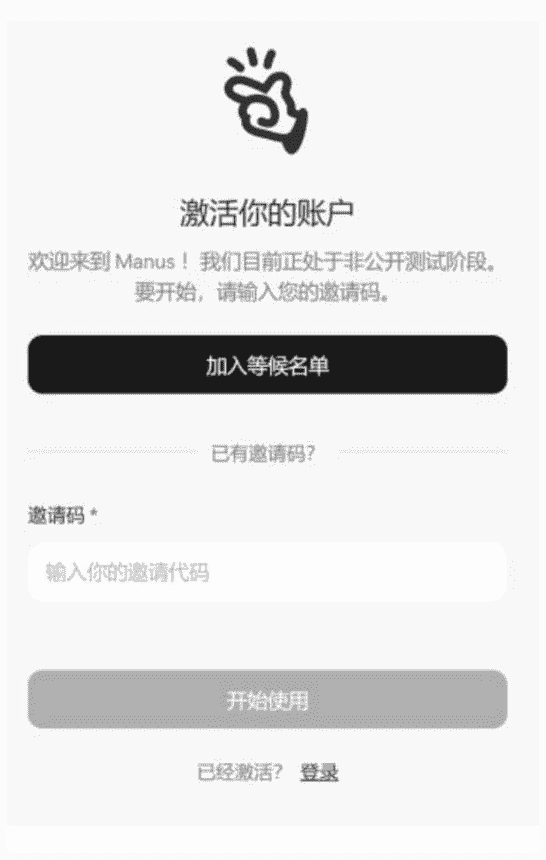

在Manus申请页面（如图3-3所示）中分别输入“邮箱”“您希望Manus为您执行哪些用例”“职业”“工作邮箱”和“社交媒体账户”信息。提交申请后，耐心等待官方审核即可。

此外，还有其他获取邀请码的方式，如通过Discord社群抢码，加入Manus官方Discord社区，参与活动就有机会获得邀请码；关注Manus官方社交媒体账号（如微博、Twitter等），参与互动活动也可获得邀请码；参与官方活动，如产品评测、任务挑战等，也有机会获得邀请码。读者可以通过一些技巧来提高获得邀请码的成功率，主要有如下技巧。

> **请求 Manus 的邀请**
>
> 分享你的电子邮件，并告诉我们你打算如何使用 Manus。我们将很快发送你的邀请码。
>
> 邮箱 *
>
> mail@domain.com
>
> 您希望 Manus 为您执行哪些用例？ *
>
> 我们正在收集您最希望用 Manus 尝试的用例。您的想法是什么？您提供的需求细节越多，我们就能越好地定制解决方案以满足您的需求
>
> 职业
>
> 请分享您的公司名称、职位或任何相关的职业信息。
>
> 工作邮箱
>
> name@company.com
>
> 社交媒体账户
>
> 请提供您的 LinkedIn、X、TikTok 或其他社交媒体的个人主页链接。如果您有多个账户，我们很乐意了解更多。

- 使用多个邮箱申请，如Gmail和国内邮箱。
- 在申请表格中清晰地说明使用目的和期望。
- 定期检查邮箱，特别是垃圾邮件文件夹。
- 积极参与社区讨论，提高曝光度。

在获得邀请码后，就可以注册自己的Manus了。在浏览器中打开Manus官方网站，单击页面右上角的“开始使用”按钮，在弹出的页面中输入获得的邀请码，选择使用Google账号或Apple账号进行登录，如图3-4所示。

首次登录Manus后，系统会引导用户完成一些初始设置，这些设置将帮助Manus更好地理解用户的需求和偏好。完成这些初始设置后，Manus将根据用户的偏好提供更加个性化的服务。用户可以随时在设置中修改这些偏好。

如果用户暂时无法获取Manus邀请码，也可以考虑如下开源替代方案。

- OpenManus是一个Manus的开源复刻版本，用户无须邀请码就可以创建自己的AI Agent。
- LangManus是一个复刻的开源AI自动化任务处理工具。
- Anus是一个开源的AI Agent项目，复刻了Manus的部分功能。

这些开源替代方案虽然可能在功能和性能上与官方Manus有差距，但对于学习和体验AI Agent的基本功能已经足够。

## 3.2 界面交互与基本操作

成功注册并登录Manus后，用户将看到Manus主界面。本节将介绍Manus的界面布局和基本操作方法，帮助用户快速熟悉这个强大的AI Agent。

Manus的界面设计简洁直观，主要分为三部分：左侧导航栏、中央工作区、右侧面板，如图3-5所示。

左侧导航栏中有任务管理模板，可以查看和管理所有任务。单击右上角的“放大镜”按钮可以搜索现有的任务列表。在下方有用户中心，可以对自己的账号进行设置。中央工作区显示当前任务和Manus的思考过程，并在任务完成后显示任务执行结果。在下方的对话框中可以与Manus进行对话和交互。

在任务开始后，右侧会显示“Manus的电脑”面板，可以显示Manus的操作过程。如果我们把Manus当作一个实习生，那么通过“Manus的电脑”面板，我们可以清晰地看到Manus当前正在做的任务的情况和工作进度，如图3-6所示。

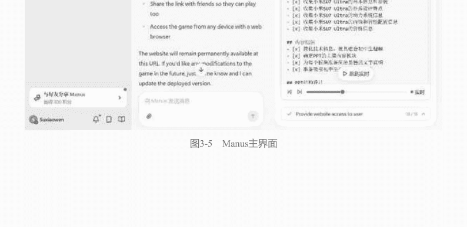

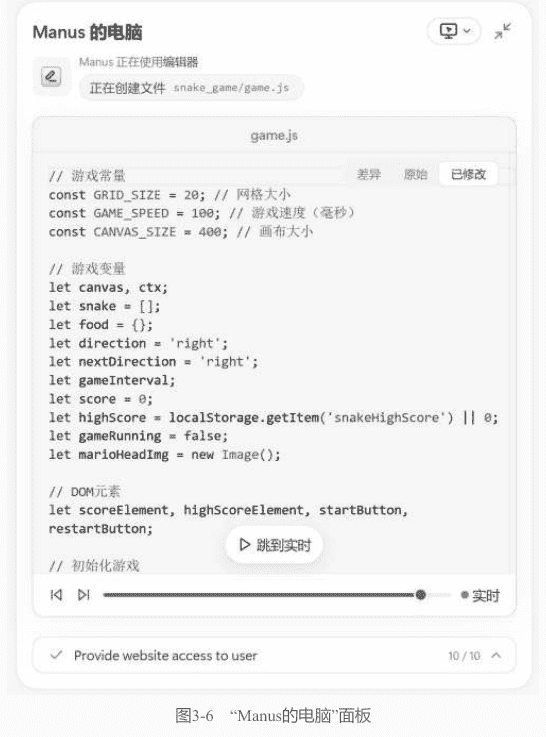

## 3.3 设置与个性化

Manus的一大特色是具有强大的个性化能力，能够根据用户的偏好和使用习惯提供定制化服务，其中之一便是创建和管理个人知识库。通过创建属于自己的知识库，用户能够在以后使用Manus时，更加高效地获取符合自身需求的内容输出，从而提升工作效率，减少重复劳动。

用户可以将与自己任务相关的文本资料进行集中整理。例如，可以将一些有用的参考资料、案例分析、技术文献和工作中用到的标准文件等保存到知识库中。这些文本内容可以是不同领域的知识、公司内部的文档，或者是对某些技术和方法的详细说明。

为了便于管理，Manus提供了分类知识库功能，用户可以根据文本内容的主题、使用场景对其进行分类。例如，可以将所有关于“市场营销”的资料放在一起，将所有与“产品开发”相关的内容放在一起。这样做可以进一步帮助用户快速搜索和定位特定的知识点，避免出现因信息过多而导致查找困难的问题。随着时间的推移，知识库的内容可能会发生变化或更新。Manus允许用户定期对已有的知识库内容进行编辑和维护。例如，用户可以根据新的研究成果和实践经验，在知识库中添加新的材料，或者修改已经过时的内容，确保知识库中的信息始终保持最新和最相关。

一旦知识库创建完成，Manus就能够在后续任务中灵活地调用这些资料，并根据用户的需求生成更符合实际情况的文本内容。当用户请求Manus生成某个文本或处理某个任务时，Manus可以根据用户知识库中的内容，为任务提供有针对性的支持。例如，要求Manus写一份市场调研报告，而用户知识库中有大量关于某行业的数据和案例，Manus就能够从中提取相关内容，生成更符合用户需求的报告。通过调用已有的知识，Manus能够快速理解用户的需求，并给出更加精准、具体的答案。

传统的文本生成工具通常无法完全理解用户的需求背景，而Manus的知识库则能够提供更深层次的背景信息支持。通过提前建立并不断完善知识库，用户能够大幅缩短每次任务的准备时间，并提高最终产出的质量。若需要反复进行某些格式的报告编写，知识库中的模板和参考资料就可以为Manus提供标准化的格式，减少用户每次从头开始编写的工作量。随着Manus的使用，系统会根据用户的反馈不断优化知识库的内容。Manus能够自动学习用户的偏好和需求，在以后的任务中逐步调整其生成内容的风格和格式。这样，随着时间的推移，用户会发现Manus生成的文本越来越符合其个人习惯和工作需求，变得更加精准、高效。

总之，Manus的文本知识库不仅能帮助用户集中管理资料，还能够提高任务执行的精准度和高效性。通过创建一个符合自身需求的知识库，用户可以在后续的使用中快速调用相关内容，减少重复劳动，提升工作的流畅性和质量。

在Manus主页面中单击“知识”按钮，可以打开“知识”窗口，如图3-7所示。

单击“添加知识”按钮，在编辑页面中输入知识的名称、使用场景和内容，就可以自定义相关知识，如图3-8所示。在需要的时候，Manus可以在自己的知识库中调用这些知识。

## 3.4 任务创建

有效地创建任务和使用提示词是充分发挥Manus功能的关键。Manus是一个功能强大的通用AI Agent，为了更好地利用Manus的优势，用户需要掌握任务创建的基本流程。下面详细讲解任务创建和管理步骤。

### 1. 明确任务目标

任务的创建从明确目标开始，这是成功利用Manus的第一步。为了确保任务能够顺利执行并产生有效结果，需要清晰地定义任务的目标和预期成果。下面是确定任务目标时需要考虑的几个要点。

确定任务的核心需求：必须清楚地知道需要Manus完成什么任务，是分析数据、撰写报告、制定策略，还是完成其他形式的复杂任务。明确目标能帮助用户制定精准的任务描述，避免不必要的误解和重复工作。

确定任务的复杂度和范围：不同的任务有不同的复杂度和处理范围。例如，有些任务可能只涉及简单的数据处理，而某些任务可能需要深入的逻辑推理或高度个性化的内容创作。评估任务的复杂度和范围有助于用户合理安排任务执行的时间和期望。

确定期望的输出形式：在确定任务目标时，用户还需要考虑输出的形式，可能是文本报告、数据图表、代码脚本，或者其他形式的文件。明确输出形式能够帮助Manus根据用户的需求制定任务的执行方式，确保最终结果符合用户的期望。

### 2. 编写任务描述

任务描述是与Manus沟通的桥梁，清晰、详尽的描述可以大幅提高任务顺利执行的概率。用户需要在任务描述中提供必要的细节，帮助Manus准确理解用户的需求。

### 3. 提交任务

当任务目标和任务描述编写完成后，用户就可以将任务提交给Manus了。提交过程十分简单，只需单击“发送”按钮，Manus就会自动接收用户的任务请求。Manus会对用户的任务请求进行智能分析，自动识别任务的内容和目标，系统会根据用户的描述为任务分配相应的处理方式。此时，Manus会生成一个新的任务卡片，显示任务的基本信息和状态。

### 4. 监控任务进度

任务请求提交后，用户可以随时监控任务的执行进度。Manus在执行过程中会不断更新任务状态，用户可以根据需要进行干预和调整。

观察任务执行状态：在任务执行过程中，用户可以通过“Manus的电脑”面板查看实时的进度更新。这些更新可能包括任务开始执行、任务执行的中间结果，以及最终结果的生成等信息。

提供额外信息：在任务执行过程中，Manus遇到不明确的地方，或者用户认为任务执行方向需要调整时，可以随时提供额外的信息。通过与Manus的互动，用户可以确保任务能够顺利进行。

查看中间结果和进度更新：在某些任务中，Manus可能会提供中间结果，以便用户检查任务执行的方向是否正确。用户可以根据这些结果进行反馈，帮助Manus更好地完成任务。

### 5. 获取结果

任务执行完毕后，用户将获得最终的任务结果。此时，用户需要对结果进行评估，并判断是否能够满足自己的需求。如果结果与预期存在差异，可以提供反馈或要求Manus进行调整，以确保最终输出达到最佳状态。通过对任务结果的评估，用户可以总结经验，为未来的任务创建提供反馈。Manus会根据这些反馈不断优化其处理流程，提高未来任务的执行质量。

Manus作为一个高效的AI Agent，能够处理各种复杂任务。通过明确任务目标、编写任务描述、提交任务、监控任务进度和获取结果等一系列步骤，用户可以最大化地利用Manus的智能处理功能，提升工作效率和任务完成质量。通过不断地与Manus互动和反馈，用户能在长期使用过程中不断优化任务创建的方式，享受更加顺畅和高效的功能。

## 3.5 提示词撰写技巧

有效的提示词对于提升Manus的工作效率至关重要。它不仅能够帮助Manus更准确地理解用户的需求，还能确保输出的结果更加符合用户的预期。设计出合适的提示词可以显著提升任务的执行效率，节省时间，并最大化Manus的功能。下面是一些提示词设计的最佳实践，可以帮助用户获得更满意的结果。

避免使用过多的关键词。在给Manus编写任务描述时，避免使用过多的关键词。虽然丰富的词汇有时能扩展任务的维度，但如果关键词过多，就可能使Manus难以捕捉任务的核心要求，反而会导致理解偏差。因此，尽量选择具有代表性和最相关的关键词，以确保信息简洁明了。

选择最相关、最能描述问题的关键词。关键词的选择直接影响Manus理解任务的精度。在编写任务描述时，挑选那些最能精确描述任务核心内容的词汇。例如，在要求数据分析时，使用“趋势分析”而非“数据处理”，可以更好地引导Manus完成具体的分析任务。

以简洁明了的方式进行提问。通过简洁明了的提问形式，能够减少不必要的歧义。例如，可以直接问“请分析这份报告中的关键数据”，而不是“我有一份报告，它包含了很多信息，请你看看其中的重要数据”。简洁的提问能帮助Manus更高效地理解任务，并精准执行。

包含必要的背景信息。为确保Manus能够全面地理解任务，提供足够的背景信息至关重要。例如，用户如果要求Manus生成一份报告或分析，就需要明确地告诉Manus报告的目标受众、任务的上下文和行业背景等信息。这些信息有助于Manus将任务与实际应用场景紧密联系，从而生成更符合实际需求的输出。

说明任务的目的和意图。在任务描述中明确任务的最终目标或意图，能够帮助Manus精确地把握任务的方向。例如，用户希望Manus进行市场分析，那么明确要求“为制定未来的销售策略提供依据”会比单纯要求“进行市场分析”更具有引导性。

提供相关的参考资料或示例。参考资料或示例有助于Manus更好地理解用户的需求。无论是上传文件、提供数据集，还是给出格式示例，都可以让Manus根据实际情况调整输出。这样一来，用户可以减少多次反馈和修改的工作量。

使用专业术语。如果任务涉及特定领域的知识，那么使用该领域的专业术语能帮助Manus更好地理解用户需求。例如，在法律、医疗、金融等领域，使用术语能帮助Manus准确地捕捉任务的重点，从而生成符合专业要求的内容。

明确定义任何可能引起歧义的术语。在某些情况下，专业术语可能具有多重含义。为避免Manus误解，用户可以在首次使用该术语时进行定义。例如，在处理技术报告时，可以先定义“性能优化”在该任务中的具体含义，以确保Manus按照正确的理解生成报告。

保持术语使用的一致性。在描述整个任务过程中，尽量保持术语使用的一致性。如果在开始时定义了某个术语的含义，就应在后续的任务描述中持续使用相同的定义，这样可以减少Manus的理解难度。

明确指定工具和数据源。在某些任务中，Manus可能需要借助外部工具来完成任务。如果用户有特定的工具偏好，应明确说明。例如，“使用Python进行数据处理”“使用R语言进行统计分析”都会让Manus明确用户的工具需求，确保任务按照用户的预期执行。

指定数据源可以提高效率。如果完成任务需要特定的数据源，则要明确告知Manus，这将有助于提高工作效率。例如，用户可以指定“从××公司官方网址获取最新的市场数据”。这种明确的指示能让Manus直接获取准确的资源，避免无谓的查询和等待。

任务完成后，明确期望的输出格式能够帮助Manus生成符合用户要求的内容。例如，用户可以明确表示：“请提供一份包含图表和简要分析的PDF报告”或“输出为Excel文件，以便进一步分析”。这种精确的输出要求能大幅提升任务的完成度。

指定文件格式（如PDF、Word、Excel等）。如果用户对输出文件有格式要求，可在任务中提前说明。例如，用户可能希望Manus将报告输出为Word文档或Excel表格，以便进行后续编辑和处理。通过指定文件格式，用户可以避免因格式不合适导致的后续修改。

说明结构化要求（如章节、段落等）。如果任务输出需要特定的结构要求，也应提前说明。例如，“请将报告分为五章，分别为概述、方法、结果、讨论和结论”，或者“生成图表并将其嵌入每个分析部分”。这种结构化的要求有助于Manus更好地组织和呈现内容。

为获得更加稳定和高质量的输出，使用结构化的提示词框架是非常有效的。使用框架可以帮助用户在复杂任务中保持一致性，同时确保Manus能按用户的要求执行任务。下面是两个推荐的提示词框架。

**第一个是ICIO框架。**

- **Intent（意图）** 指明确说明用户的目的，即为什么要执行这个任务。例如，“分析过去一个月的销售数据，找出表现最好的产品”。
- **Context（上下文）** 指提供相关的背景信息。例如，“我是一家电子产品零售商的销售经理，需要为月度会议准备报告”。
- **Input（输入）** 指提供必要的数据或资料。例如，“我将上传过去一个月的销售数据Excel文件”。
- **Output（输出）** 指明确用户希望得到的结果形式。例如，“请提供一份包含图表和简要分析的PDF报告，重点关注前5名产品”。

**第二个是CRISPE框架。**

- **Capacity（能力）** 指指定Manus所扮演的角色或使用的能力。
- **Role（角色）** 指明确Manus应当以什么身份回应。
- **Instruction（指令）** 指详细说明任务要求。
- **Specificity（具体性）** 指提供具体的参数或限制。
- **Persona（风格）** 指指定回应的风格或语气。
- **Examples（示例）** 指提供参考示例。

示例如下：能力为数据分析和可视化；角色为一名资深数据分析师；指令为分析这份客户满意度调查数据，找出关键趋势和改进点；具体性为重点关注评分低于7分的项目，分析原因并提出至少3个改进建议；风格为专业、直接，使用数据驱动的语言；示例为参考之前的分析报告格式。

掌握一些高级提示词技巧可以进一步提升Manus的表现，确保它更准确高效地完成任务。

显式调用工具链。明确指定任务中所使用的工具和数据源，如“先使用Python分析数据，然后用Matplotlib生成可视化图表”。这种工具链的调用有助于提高任务执行的效率和准确性。

任务分解。对于复杂任务，将任务分解为多个步骤，并明确每个步骤的目标和要求。例如，“先提取关键数据，然后进行分析，最后生成报告”。任务分解有助于Manus理解各个步骤，并逐步完成任务。

记忆利用。引用之前的交互或任务，要求Manus应用之前学到的偏好，如“按照上次的格式生成报告”。使用这种方法可以减少重复工作，提高效率。

反馈循环。提供初步结果的反馈，并要求Manus根据反馈进行调整。通过多轮交互逐步完善结果，能够确保最终输出更符合用户的要求。

# 第4章 Manus技术与功能全解析

在人工智能快速发展的今天，我们见证了从简单的聊天机器人到复杂的智能助手的演变。而现在，一个全新的概念正在改变我们与人工智能交互的方式——AI Agent。在这个领域中，Manus作为全球首个真正自主的通用AI Agent，正引领着一场技术革命。本章将以通俗易懂的语言，为人工智能初学者详细解析Manus的技术原理和功能特点，帮助读者理解这一前沿技术如何运作，以及它为什么被认为是AI发展的重要里程碑。

## 4.1 Manus的核心理念：“知行合一”

Manus的核心理念可以概括为“知行合一”——将AI的认知能力与执行能力紧密结合。这一理念体现在以下几个方面。

首先，Manus强调自主性。它能够在给定高层目标的情况下，自主决定要执行哪些步骤，并自己完成这些步骤，无须用户持续参与和指导。这种自主性使Manus能够处理复杂的、多步骤的任务，大幅减轻了用户的认知负担。

其次，Manus注重通用性。它不局限于特定领域，而是能够处理从数据分析、内容创作到日常事务管理等各种类型的任务。这种跨领域的能力使Manus成为真正意义上的通用AI助手。

再次，Manus重视结果导向。它的目标不是提供中间过程或部分解决方案，而是直接交付最终成果。无论是生成报告、创建演示文稿，还是编写代码并部署应用，Manus都能完成从规划到执行的整个流程。

最后，Manus强调持续学习与适应。它具备记忆和学习能力，能够根据用户的反馈和偏好不断调整自己的行为，提供越来越个性化的服务。

通过这些特点，Manus实现了AI从“只会思考”到“既会思考又会行动”的重要跨越，开创了人机协作的新范式。

要理解Manus的革命性创新，我们需要明确它与传统AI助手的根本区别。传统的AI助手（如ChatGPT、Claude等）主要扮演顾问角色——它们能够回答问题、提供建议，但用户仍需要自己执行具体操作。这就像你有了一个聪明的朋友可以咨询，但最终还是需要自己动手完成工作。

而Manus则实现了从顾问到执行者的跨越。它不仅能提供建议，还能自主执行任务并交付成果。这种差异可以通过一个简单的例子来理解：如果你请传统的AI助手帮你分析股票数据，它可能会告诉你分析方法或给出一些初步结论；而Manus则会自己获取数据、编写分析代码、生成图表，最后交付一份完整的分析报告。这种端到端的任务执行能力，使Manus更像一个能够独立工作的数字员工，而非仅提供咨询的助手。

## 4.2 Manus的核心技术架构

### 1. 多智能体协同架构（Multiple Agent Architecture）

Manus核心的技术特点是采用多智能体协同架构。这个概念听起来很复杂，我们可以用一个简单的类比来理解：想象有一个高效运转的公司，不同部门的专家各司其职，由一位优秀的CEO统筹协调。这个公司的情况如下。

- CEO是中央决策者，负责整体规划和协调。
- 不同部门的专家是专门的AI Agent，各自擅长完成不同类型的任务。
- 所有人通过有序的沟通和协作，共同完成复杂的项目。

与传统的单一大型语言模型（如GPT-4）不同，Manus不是依靠一个超级智能体来完成所有工作的，而是让多个专业化的AI Agent分工合作。这种架构具有几个优势。

首先，它提高了系统的可靠性。当一个复杂任务需要多种能力时，专业化的智能体比通用智能体更擅长处理各自领域的问题。就像一家公司里，市场专家负责市场分析，技术专家负责技术实现，财务专家负责财务规划，每个人都专注自己的专业领域，整体效果会更好。

其次，它实现了多重签名机制，即重要决策由多个独立AI模型共同参与，确保结果的准确性和稳健性。就像公司中的重大决策需要多个部门主管共同讨论和批准，避免出现单点决策的风险。

最后，这种架构使系统更具扩展性。随着技术的发展，可以不断添加新的专业智能体来增强系统能力，而不需要重建整个系统。

### 2. 虚拟机沙盒环境

Manus运行在一个独立的虚拟机沙盒环境中。这个概念可能听起来很技术化，我们可以用一个简单的类比来理解：想象Manus有一台属于自己的虚拟计算机，在这台计算机上，它可以安全地运行各种程序、浏览网页、处理文档，就像人类使用计算机一样。

这个虚拟环境为Manus提供了几个关键能力。

首先，它让Manus能够安全地调用各种工具，包括代码编辑器、浏览器、文档处理器等，实现对计算机的操作。这就像给了Manus一个安全的环境，它可以在里面自由操作而不会影响外部系统。

其次，这种隔离的环境确保了安全性。Manus的操作被限制在这个虚拟环境中，不会给用户的实际系统带来风险。

最后，虚拟机沙盒环境使Manus能够像人类一样与计算机交互，而不仅仅通过API调用。它可以看到屏幕内容、单击按钮、输入文字，这使它能够使用几乎任何人类可以使用的软件和服务。

### 3. 思维链（Chain of Thought）与任务规划机制

Manus不是简单地接收指令后立即行动，而是先进行深入的思考和规划。这个过程被称为思维链。

我们可以用一个日常例子来理解。假设你要举办一场生日派对，你不会立即开始行动，而是先思考需要做什么（邀请朋友、准备食物、装饰房间等），然后为每个任务制订具体计划，最后按计划执行。

Manus的思维是链式思维。

- 第一步，Manus会理解用户的需求和目标。
- 第二步，Manus会思考完成这个目标需要哪些步骤。
- 第三步，Manus会为每个步骤制订详细计划。
- 第四步，Manus会按照计划逐步执行。

这种方法使Manus能够处理复杂的、多步骤的任务。例如，当用户要求Manus分析股票数据时，它会自动规划获取数据、清洗数据、分析数据、可视化结果、撰写报告等一系列步骤，并依次执行。

Manus还会创建待办事项清单来跟踪任务进度，就像我们使用待办事项应用来管理工作一样，能够帮助Manus保持对任务的关注和有序执行。

### 4. 长短期记忆模块

人类的记忆分为短期记忆和长期记忆，Manus也是如此。它配备了先进的记忆系统，使其能够在对话和任务执行过程中保持上下文连贯，并记住用户的偏好和历史交互。

短期记忆让Manus能够记住当前对话和任务的上下文。例如，你正在与Manus讨论一个项目，它能够记住你之前提到的所有细节，保持对话的连贯性。

长期记忆则使Manus能够记住用户的偏好和历史交互。例如，如果你曾经告诉Manus你喜欢以表格形式查看数据，它就会记住这一点，在未来的任务中优先使用表格呈现结果。

这种记忆能力使Manus能够提供更加个性化的服务，并随着时间的推移不断改进。它不仅能记住用户的偏好，还能记在过去任务中学到的经验和知识，实现持续学习与自我调整。

### 5. 云端异步执行技术

Manus的一个重要技术特点是云端异步执行。这意味着Manus运行在云服务器上，而不是运行在用户的本地设备上，并且能够在用户离线时继续工作。

这种技术类似一个远程工作的助理：你给助理分配任务后，可以关闭计算机去做其他事情，助理会继续在自己的办公室工作，完成后会通知你。

云端异步执行有以下几个优势。

- 它使Manus能够处理长时间运行的任务。复杂的数据分析、市场调研或内容创作可能需要几小时甚至更长时间，云端异步执行使用户无须一直等待。
- 它减轻了用户设备的负担。由于计算在云端进行，因此用户的设备不需要具有强大的处理能力，也不会消耗大量电池或资源。
- 这种技术提供了更好的用户体验。用户可以在提交任务后关闭设备，Manus会在完成任务后通知用户，就像一个真正的助理一样在后台工作。

总的来说，Manus的核心技术架构——多智能体协同架构、虚拟机沙盒环境、思维链与任务规划机制、长短期记忆模块、云端异步执行技术——共同构成了一个革命性的AI系统。这些技术使Manus能够像人类助理一样思考、规划和执行任务，实现了AI从顾问到执行者的跨越。

## 4.3 Manus的工具调用功能

在4.2节中，我们了解了Manus的核心技术架构。现在，让我们探讨Manus最引人注目的特点之一：它强大的工具调用功能。这个能力使Manus能够像人类一样使用各种软件和服务，从而完成复杂的任务。

### 1. 代码编写与执行功能

Manus最令人印象深刻的能力之一是它能够自主编写和执行代码。对于没有编程背景的读者来说，可以将其理解为Manus不仅会给你建议，还会亲自动手编写程序并运行，之后把结果交给你。

举个例子来说明这个能力的强大之处。假设你需要分析一组复杂的销售数据，找出销售趋势和模式。传统的AI助手可能会告诉你应该使用什么分析方法，甚至可能给你一段示例代码，但最终你还是需要自己去实现和运行这些代码，而Manus则有完全不同的思维模式。

- 理解你的需求。
- 自动编写适合的Python代码（Python是一种常用的数据分析编程语言）。
- 执行这些代码来处理数据。
- 生成可视化图表。

整合结果形成完整的分析报告。

又如，在分析股票相关性的案例中，Manus自动编写了Python代码，调用雅虎财经API获取三只科技股（英伟达、迈威尔科技和台积电）的历史数据，进行数据清洗、相关系数计算和可视化，最终生成详尽的分析报告。

这种功能不仅限于数据分析，Manus还能编写网页、创建应用程序、自动化各种任务，甚至能够调试自己编写的代码，识别并修复错误，就像一个经验丰富的程序员。

对于企业和个人用户来说，这意味着即使没有技术背景，也能利用编程的强大功能来解决问题。Manus成为连接普通用户和编程世界的桥梁。

### 2. 浏览器与网络搜索功能

Manus配备了内置的浏览器功能，能够像人类一样浏览网页、搜索信息和与网站交互。这个功能使Manus成为一个真正能够上网的AI助手。具体来说，Manus有如下功能。

- 使用搜索引擎查找信息。
- 访问特定网站获取数据。
- 输入网页表单。
- 单击按钮和链接。
- 提取网页内容。
- 下载文件。

这些功能使Manus能够执行各种需要网络访问的任务。例如，在房产推荐的案例中，Manus能够搜索纽约的房产信息、访问房产网站、提取房源数据，并分析社区安全和学校教学质量等信息。图4-2所示为Manus实时抓取数据页面。

对于市场调研任务，Manus可以自动搜索和整理竞争对手的产品信息、价格策略和市场份额等数据。它不仅能找到这些信息，还能将其整理成有条理的报告，帮助用户做出决策。

值得注意的是，Manus的网络搜索功能不仅限于简单的信息检索。它能够理解搜索结果的上下文，判断信息的相关性和可靠性，并从多个来源交叉验证信息，确保提供给用户的信息是准确、全面的内容。

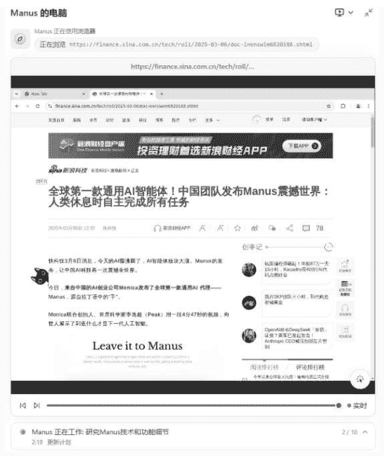

### 3. 文档处理与数据分析功能

Manus具有强大的文档处理和数据分析功能，能够处理各种类型的文档和数据集。

在文档处理方面，Manus有不同于其他AI Agent的功能。

- 读取和理解各种格式的文档（如Word、PDF、Excel等）。
- 提取文档中的关键信息。
- 创建新文档和报告。
- 编辑和格式化文档内容。

在简历筛选的演示中，Manus展示了这个功能的实际应用。它能够自动解压缩用户上传的ZIP文件，逐个打开简历文档，提取候选人的技能、经验和教育背景等信息，之后根据职位要求评估每位候选人的匹配度，最终生成排名和评估报告。

在数据分析方面，Manus有如下功能。

- 导入和清洗数据。
- 进行统计分析。
- 识别数据中的模式和趋势。
- 创建数据可视化（如图表、图形等）。
- 解释分析结果。

例如，在财务分析任务中，Manus可以处理复杂的财务数据、计算关键指标、识别异常值，并生成易于理解的图表和报告。它不仅提供数据，还能解释这些数据的含义和影响，帮助用户做出明智的决策。

这种文档处理和数据分析功能使Manus成为强大的信息处理工具，能够从大量文档和数据中提取有价值的见解。

### 4. 多模态感知功能

Manus具备多模态感知功能，这意味着它不仅能处理文本，还能理解和处理图像、音频等多种形式的信息。这个功能使Manus能够更全面地感知和理解世界。在图像处理方面，Manus有如下功能。

- 识别图像中的对象和场景。
- 提取图像中的文字（OCR技术）。
- 分析图表和图形中的数据。
- 理解图像的上下文和含义。

例如，用户上传一张包含图表的图片，Manus能够识别图表类型、提取数据点，并基于这些信息进行分析。又如，用户上传一份扫描的文档，Manus能够提取文档中的文字内容，就像人类阅读文档一样。

在PDF处理方面，Manus具备先进的PDF解析功能，能够从复杂的PDF文档中提取结构化信息。这对于处理研究报告、法律文件、财务报表等复杂文档特别有用。

这种多模态感知功能使Manus能够处理更加多样化的信息，提供更全面的分析和解决方案。

### 5. 工具协同与任务自动化功能

Manus最强大的功能之一是它能够协调使用多种工具来完成复杂任务。就像一个优秀的职员会灵活运用各种软件工具一样，Manus能够根据任务需求，选择合适的工具组合，并协调使用它们。例如，在一个市场调研任务中，Manus可能会有如下操作。

- 使用浏览器搜索市场数据。
- 编写Python脚本来分析这些数据。
- 创建Excel表格整理结果。
- 生成PowerPoint演示文稿并展示得出的结论。
- 撰写Word文档作为详细报告。

这种工具协同功能使Manus能够自动处理复杂的工作流程，完成从数据收集到最终报告生成的整个过程。用户只需提供高层次的目标和要求，Manus就能自主规划和执行所有必要的步骤。

更重要的是，Manus能够处理工具之间的数据传递和格式转换，确保整个工作流程的顺畅进行。例如，它可以将从网页抓取的数据转换为适合分析的格式，并将分析结果转换为适合报告的图表和文本。

这种自动化功能极大地提高了工作效率，减少了人工干预的需要。用户不再需要在多个工具之间切换，也不需要处理繁琐的数据格式转换和文件管理工作。

### 6. 任务分解与规划功能

面对复杂任务，Manus首先会进行任务分解和规划。这个过程类似一个项目经理将大型项目分解为可管理的子任务，并为每个子任务制订详细计划。

例如，当用户要求Manus分析三家竞争对手的市场策略这样的高层次任务时，Manus会自动将其分解为一系列子任务，如下所示。

- 确定需要分析的具体竞争对手。
- 收集每家公司的产品信息、价格策略、营销活动等数据。
- 分析每家公司的市场定位和目标客户。
- 比较不同公司的策略的异同。
- 识别每家公司的优势和劣势。
- 整合分析结果，形成综合报告。

对于每个子任务，Manus会进一步规划具体的执行步骤。例如，对于“收集公司信息”这个子任务，Manus可能会规划以下步骤。

- 搜索公司官网，获取产品信息。
- 查找新闻报道，了解最新营销活动。
- 检索财报数据，了解财务状况。
- 分析社交媒体，了解品牌形象和客户反馈信息。

这种任务分解和规划功能使Manus能够处理高度复杂的任务，即使这些任务包含多个步骤和依赖关系。

# 第三部分 场景应用篇

# 第5章 Manus让工作更高效

在当今快节奏的职场环境中，效率就是竞争力。Manus作为一款强大的办公辅助工具，正凭借其独特的功能为我们的工作带来革命性的变化。在实际工作的各个方面（如会议纪要快速生成、行业研究、企业介绍PPT制作、公司盈利状况分析及电子邮件批量撰写等），Manus都展现出了卓越的性能，极大地提高了工作效率与工作质量。接下来，我们将深入了解Manus如何在关键工作场景中发挥作用。

## 5.1 秒转神器：会议录音瞬间变会议纪要

### 5.1.1 基础知识

在当今的职场环境中，会议纪要自动化生成技术极大地提高了工作效率。通过“将会议录音转化为文字并提炼出会议的核心内容”的方式，企业可以利用语音识别与自然语言处理技术实现会议记录的自动化生成。会议纪要自动化生成技术将会议录音转换为文字后，通过深度学习模型智能识别并提炼出关键信息，如决策、待办事项及讨论的核心内容，从而快速生成清晰、简洁且精准的会议纪要。这不仅能节省人工整理会议纪要的时间，还能减少遗漏和错误；而Manus在这个过程中发挥着至关重要的作用，它凭借强大的语音转写能力与语义分析功能，能够自动识别和总结会议的重点，生成高质量的会议纪要。对于职场人员来说，会议纪要自动化生成技术无疑是提高工作效率和管理会议内容能力的利器。会议纪要的自动化生成涉及多个关键因素。

- 语音转文字的准确度。语音识别系统应能准确理解各种口音、语速及噪音，并转写出高质量的文字内容。
- 内容结构化。系统应能自动识别会议中的核心信息，如议题、讨论点、决策和行动项，并将这些信息清晰、有序地组织成结构化的会议纪要。
- 重点提炼。系统应具备智能分析能力，自动筛选并提炼出会议中的决策待办事项及讨论的核心内容，避免冗余信息的存在。
- 多发言人识别。在多人参与的会议中，语音识别系统应能准确区分不同发言人的声音，并标注相应发言者，便于后续的追溯。
- 自然语言处理技术的应用。系统通过自然语言处理技术对生成的内容进行语义分析，确保最终的会议纪要语言流畅、简洁，并忠实反映录音内容。
- 用户定制化功能。根据企业或个人的需求，系统应允许用户自定义纪要格式、关键词及句式结构，以满足不同场景下的会议记录需求。
- 数据安全。在转录和提炼的过程中，系统应确保所有录音内容得到严格的保护，避免敏感信息泄露或被滥用。

### 5.1.2 案例实操

第一步，将会议的音频文件保存到本地，先确定会议纪要的基本格式要求，如会议主题、议题、参会者发言摘要、决策和行动项、待办事项和责任人等。

第二步，打开Manus，上传会议的音频文件，并在对话框中输入提示词，如图5-1所示。

第三步，单击“发送”按钮，稍等片刻，Manus会自动将会议录音转化为文字，生成会议纪要，并按照.docx文件的格式将其排版好发给用户，用户可以直接使用。

# 产品部会议纪要：TransGo翻译软件迭代讨论

**时间：** 2024年11月15日，14:00-15:30。

**参会人：** 张伟（产品部）、李娜（技术部）、王萌（设计部）、陈昊（市场部）、刘芳（用户研究）。

## 一、当前进展与问题

（1）版本数据方面。上周发布的v2.1.0用户活跃度提高了12%，但留存率降低了5%。用户研究团队发现，新用户普遍觉得“实时对话翻译”功能操作太复杂，容易放弃。技术侧反馈后台响应偶尔卡顿，尤其是小语种翻译（如将泰语翻译为法语），因为依赖第三方接口，延迟时间达1.2秒，体验很割裂。

（2）用户反馈方面。好评（日韩用户夸得多）集中在界面简洁和专业术语库方面，但长文本翻译结果经常出现逻辑混乱的情况。例如，在将中文翻译为德语时，句子结构出现错位。另外，夜间模式的灰色文字看不清，已经被“吐槽”了二十多次。

## 二、会议结论

（1）翻译质量优化方面。计划于明年上线的自研AI模型提前到12月试点，优先解决德语长句的问题。技术团队由李娜牵头，11月底前交付第一版测试结果。对于第三方API导致的延迟问题，下周开始测试AWS的新节点，减少对外部服务的依赖。

（2）体验改进方面。设计师王萌负责下周出两版夜间模式配色方案，重点调整文字的对比度，同时测试更大字体选项，目标是12月初上线。

（3）市场策略方面。陈昊提议针对学生群体推出“学习场景”功能（如论文翻译批注），12月配合学期末做一波宣传，需要产品部优先提供Demo。

## 三、下一步工作计划

11月22日前，技术团队修复德语翻译逻辑，产品部同步进行小范围用户测试。用户研究团队调研“会议记录翻译”需求的真实性，12月5日前给出结论。此外，竞品LingoAI最近签了医疗行业术语库，建议市场部本月重点监测对方动向。

下次会议时间是11月22日10:00，各部门需要提前一天同步议题。

## 5.2 一键洞察：轻松开展行业研究

### 5.2.1 基础知识

行业研究是公司制定战略决策、寻找市场机会及了解竞争对手的重要工具。然而，开展行业研究往往是一项难度大且繁重的工作。首先，研究人员需要收集大量的信息。这些信息的来源很多，包括公开的市场报告、政府统计数据、行业研究机构的分析数据、企业年报、媒体报道等。这些信息不仅数量庞大，而且多样性强，研究人员需要筛选和过滤出对公司有价值的信息。

行业研究的挑战之一就是信息的时效性。在很多行业中，市场环境和技术发展迅速变化，研究人员需要确保所收集的数据是最新的，否则分析结果可能会过时或失真。例如，对于技术领域的研究，如果研究人员没有及时跟进最新的技术发展趋势，其得出的结论可能会导致公司战略决策的偏差。除了信息来源的多样性和信息的时效性，研究人员还必须保证所采用的数据具有足够的准确性。行业数据往往来自不同的渠道，其中一些可能是经过解读后的二手数据，如何辨别其真实性并将其转化为有效的研究信息，考验着研究人员的能力。

因此，进行行业研究不仅是收集信息的过程，还是筛选、验证、整合和分析数据的过程。面对如此复杂且烦琐的工作流程，传统的行业研究方法常常显得效率低下且容易出错。

行业研究的过程通常可以分为几个主要阶段：信息收集阶段、数据分析阶段、趋势预测阶段和结论生成阶段。

首先是信息收集阶段。在这个阶段，研究人员会从多个可靠渠道收集行业的基础数据。这些数据可以是市场规模、消费者需求、竞争格局、技术创新、政府政策等方面的数据。研究人员需要通过文献调研、行业调查、市场调研、公司年度汇报等渠道，收集到尽可能多的行业相关信息。在收集信息的过程中，研究人员要特别注意筛选信息确保数据准确无误。

其次是数据分析阶段。在这个阶段，研究人员需要对收集来的信息进行深入的挖掘与分析。通过数据分析，研究人员可以识别行业的关键发展趋势、潜在的市场机会、竞争对手的策略及市场变化的驱动因素。常用的分析方法包括SWOT分析、PEST分析、波特五力模型等。研究人员通过数据分析不仅要揭示出行业的现状，还要通过历史数据预测行业的发展趋势。

再次是趋势预测阶段。根据数据分析的结果，研究人员需要对行业的未来发展做出预测。这一过程往往需要结合行业专家的经验、市场变化的动向及外部环境的变化。预测行业的发展趋势是一个充满挑战的任务，特别是在动态变化的市场中，任何小的变化都可能引发大规模的市场波动。因此，趋势预测阶段不仅仅是数据分析阶段的延伸，还需要研究人员对市场规律有深刻理解。

最后是结论生成阶段。在这一阶段，研究人员需要对前期的分析与预测结果进行总结，并形成研究报告。研究报告不仅需要清晰地展示研究结果，还要为企业提供具体的战略建议。例如，研究报告可能会针对某一行业提出市场进入的机会、潜在的威胁、投资方向等方面的建议。研究报告的质量直接影响企业决策者的决策效率和决策质量，因此研究人员在撰写研究报告时需要特别注意其条理性和可操作性。

随着AI技术的不断发展，传统的行业研究工作正迎来一次颠覆性的变革。AI技术，特别是在自然语言处理、大数据分析、机器学习等方面的突破，极大地提高了行业研究的效率和精准度。AI技术能够通过算法快速处理海量的信息，帮助研究人员更高效地收集、整理和分析数据，从而降低研究人员的工作量并减少人为偏差。

Manus是一个基于AI技术的行业研究工具，可以帮助用户一键生成行业研究报告。基于大量的行业数据和智能分析模型，Manus能够自动化地收集相关信息，并通过深度学习算法生成结构清晰、内容完整的行业研究报告。使用Manus时，用户只需输入基本的研究目标和相关的行业信息，系统即可自动生成报告，包括市场分析、竞争格局、技术趋势、政策环境等内容。报告内容不仅涵盖了行业的现状，还会结合市场趋势做出前瞻性的预测。

Manus的出现极大地节省了传统行业研究所需的时间和成本。研究人员不再需要花费大量时间去收集信息、分析数据和撰写报告，而是可以通过Manus在短短几个小时内完成这些工作。此外，Manus还具备实时更新的功能，用户可以根据需求随时获取最新的行业数据和趋势分析报告，确保研究结果的时效性和准确性。

AI赋能的行业研究不仅提高了工作效率，还提高了数据分析的精准度。Manus通过其强大的数据分析能力，能够发现传统行业研究手段难以察觉的行业细节和潜在机会，帮助企业在瞬息万变的市场中做出快速而准确的决策。总的来说，AI的引入使得行业研究的过程更加智能化、自动化，为企业提供了更强大的决策支持。

- 明确研究目的，锚定方向。研究前，研究人员需明确研究目的，即研究是为了投资决策、产品布局，还是为了制定竞争策略。研究目的明确，研究才能有的放矢，避免盲目。例如，若研究是为了投资，研究人员就需重点关注行业增长潜力和盈利空间。
- 多渠道收集一手资料和二手资料。一手资料可以通过访谈、调研等方式获取，二手资料多来源于权威报告、新闻资讯等。例如，企业财报能反映企业的经营状况，专家访谈则带来行业专家独到的见解。研究人员可以多渠道收集相关资料，为后续的研究奠定基础。
- 分析行业的市场规模与发展趋势。研究人员借助历史数据，采用合适的方法预测行业的市场规模和发展趋势，了解行业是处于上升期、成熟期，还是处于衰退期。例如，近年来凭借数字技术发展，电商行业的市场规模持续扩张。
- 洞察竞争格局，剖析优劣势。研究人员需明确行业内主要参与者，分析其市场份额、核心竞争力与短板。例如，在智能手机领域，苹果公司凭借独特系统，三星公司依靠全产业链优势，均占据大量市场份额。
- 深挖驱动因素，把握发展脉络。研究人员应关注政策、技术、社会等因素对行业的影响。例如，新能源汽车因政策支持、技术突破及环保理念普及，迎来快速发展。
- 评估风险，未雨绸缪。研究人员应识别行业面临的政策、技术、市场等风险。例如，医药行业的研发周期长、投入大，政策变动可能对其造成重大影响。

### 5.2.2 案例实操

第一步，确定调研的主题，例如，领导让我们调研3家美国硅谷的互联网公司，重点研究这些互联网公司在产品上市初期是如何实现用户增长的，给我们公司的用户增长助力。

第二步，打开Manus，在对话框中输入提示词，如图5-2所示。

第三步，单击“发送”按钮，稍等片刻，Manus会生成一份Word格式的研究报告，并完成排版工作，我们可以直接使用。

# 硅谷3家互联网公司用户增长策略研究报告

在硅谷，许多互联网公司在产品上市初期便能够迅速实现用户增长，这得益于其独特的市场策略和创新的产品设计。本报告选取了3家典型的互联网公司——Airbnb、Dropbox和Instagram，重点研究它们在产品上市初期如何通过不同的策略实现了用户的快速增长。

## 1. Airbnb：通过社交网络和口碑效应驱动用户增长

Airbnb是全球领先的短租平台，成立初期面临着缺乏用户和房东的双重挑战。为了在市场中脱颖而出，Airbnb采取了几项关键策略以推动用户增长。

首先，社交化营销。Airbnb的创始人深知，用户的信任是短租市场发展的关键。为了快速获得用户的信任，Airbnb初期依靠的是社交网络和口碑效应。通过让初期用户分享他们的使用体验和房源，借助社交平台的传播效应，Airbnb成功吸引了大量的用户。

其次，优化用户体验。Airbnb在设计平台时充分考虑到用户的使用需求，精心设计了用户友好的界面，便于房东发布房源、游客预订房源。为了增强用户黏性，Airbnb还提供了精细的评价和评分系统，帮助新用户建立信任感。

最后，营销活动的精准定位。Airbnb在初期利用Facebook等社交平台进行精准的广告投放，以低成本获取大量的目标用户。这种精准营销方式大大降低了获取客户的成本，并迅速扩大了用户群体。

## 2. Dropbox：通过病毒式传播机制和用户激励策略实现用户增长

Dropbox是全球领先的云存储公司，其用户增长策略在产品上市初期取得了巨大的成功。Dropbox的成功主要归功于病毒式传播机制和用户激励策略。

Dropbox的核心用户增长策略是通过提供免费的存储空间来吸引新用户，并激励现有用户分享其产品。在产品上市初期，Dropbox通过为每个新用户提供免费的额外存储空间作为邀请奖励，鼓励用户邀请朋友注册。这一策略不仅帮助Dropbox实现了大量的用户增长，还通过现有用户的推荐传播，实现了病毒式增长。

此外，Dropbox通过极简的用户体验来吸引用户。Dropbox的云存储产品简单、易用，没有复杂的设置，用户只需下载客户端便可享受高效的云存储服务。这种极简的用户体验让用户更加容易上手并愿意长期使用产品。

Dropbox还通过精准的市场定位吸引了大量初期用户。这些初期用户大多是技术爱好者和早期互联网产品的支持者，他们不仅帮助Dropbox传播品牌，还提供了宝贵的用户反馈，推动了产品的快速迭代和优化。

## 3. Instagram：通过社交媒体效应和独特的产品设计加速用户增长

Instagram是全球较大的图片分享社交平台之一，成立之初便迅速吸引了大量用户。Instagram的用户增长主要依赖于其社交媒体效应和独特的产品设计。

首先，Instagram充分利用了社交媒体的病毒式传播。通过将用户生成内容（如照片和视频）分享到其他社交平台（如Facebook、Twitter），Instagram成功借助社交媒体的传播效应实现用户增长。每个用户发布的内容都为Instagram带来新用户，形成了良性循环。

其次，Instagram的用户界面设计十分简洁，易于上手。用户只需要通过拍照和简单的滤镜编辑，就能创建出有趣的内容。这种简单而富有创意的体验激发了大量用户的分享欲望，增加了平台的活跃度。

最后，Instagram通过名人效应和品牌合作加速了用户增长。在初期，Instagram与一些社交媒体名人和知名品牌合作，利用其影响力吸引了更多的用户。用户看到名人或品牌在Instagram上的活动，便被吸引并注册、使用。

## 4. 总结

以上3家公司——Airbnb、Dropbox和Instagram在产品上市初期的用户增长策略虽然各具特色，但有一个共同点：它们都成功利用了社交网络效应、精准的市场定位和创新的用户激励机制，为用户提供了无缝的产品体验。Airbnb通过社交网络实现和口碑效应快速获得用户的信任，Dropbox通过病毒式传播机制和用户激励策略有效实现用户增长，Instagram则依托社交媒体效应和独特的产品设计吸引了大量用户。这些互联网公司普遍重视用户体验和社交传播，在此基础上采用灵活的用户增长策略，成功实现了产品的快速普及和市场占领。

这些成功的案例为初创企业提供了宝贵的借鉴经验，尤其是在如何利用社交媒体和用户激励机制促进用户增长方面。

## 5.3 即刻生成：一键打造企业介绍PPT

### 5.3.1 基础知识

制作PPT是许多工作者在日常工作中不可避免的一项任务，尤其是在需要展示复杂的内容和数据时，制作PPT往往变得尤为烦琐。首先，要制作一份高质量的PPT，不仅需要制作人员收集大量的信息，包括文本资料、图表、数据等，这些信息的搜集时间长，而且需要制作人员花费大量精力进行整理和筛选。其次，设计和排版是PPT制作中的另一个大难题。对于每一张幻灯片，制作人员都需要考虑信息的可读性与视觉效果，需要选用合适的模板、配色和图表等元素，以确保最终效果符合展示需求。这个过程往往需要制作人员进行多次修改和调整，尤其是对于专业内容的展示，制作人员往往要投入更多时间来确保内容的准确性和逻辑性。最后，很多人缺乏设计能力，面对PPT的设计框架和细节时，可能会感到困惑和疲惫。因此，传统的PPT制作方法常常让人感到烦琐且时间紧迫。

传统制作PPT的步骤通常是制作人员先确定一个主题，并根据主题搜集相关信息。接下来，制作人员会根据信息内容设计各个幻灯片的结构，通常从封面开始，逐步展开内容。制作人员需要选择合适的模板或自己设计布局，并根据信息类型选择合适的图标、图片和图表来辅助展示。在此过程中，字体、配色、排版等细节的调整是非常重要的，以确保PPT的视觉效果能够增强内容的呈现效果。完成内容设计后，最后一个步骤是检查和修改。很多时候，制作完成后的PPT需要经过反复的审查和修改，以确保没有错误，并优化其表达方式，以增强展示效果。

然而，随着AI技术的飞速发展，传统的PPT制作方法逐渐显得烦琐且低效。AI技术的出现，尤其是像Manus这样智能化的PPT制作工具，使PPT制作变得更加简单且高效。基于先进的自然语言处理技术和深度学习算法，Manus能够根据用户的要求快速生成一份完整的PPT。用户只需要输入简短的主题或提供一些基本的文本信息，Manus便能自动分析并提炼出与之相关的内容，并根据逻辑结构自动生成一系列精美的幻灯片。这个过程几乎不需要任何人工干预，省去了信息搜集、排版设计等烦琐步骤。AI的加入不仅大大提高了工作效率，还使得PPT制作更加智能化和个性化，用户可以在几分钟内完成以往需要数小时才能完成的任务。同时，Manus还具备高度自定义的功能，用户可以根据自己的需求，选择不同的风格、模板，甚至调整设计元素的布局，使得生成的PPT更加符合展示需求。因此，AI的出现为PPT制作带来了全新的变革，不仅大大提高了工作效率，还降低了人力成本，让更多人能够轻松制作出高质量的PPT。制作PPT时，制作人员一般需要注意如下要点。

- 确定调研目标。制作人员需要明确调研的核心问题和调研目标，确保调研内容符合PPT的展示需求，避免偏离主题。
- 收集可靠数据。制作人员需要从多渠道获取相关信息，确保信息的来源可信，并确保数据的时效性与相关性。
- 信息筛选与整理。制作人员需要筛选出最具价值的关键信息，避免信息冗余，确保PPT内容精练、重点突出。
- 合理组织结构。制作人员需要根据调研内容设计PPT框架，按逻辑顺序组织PPT各部分，确保内容层次分明，易于理解。
- 视觉设计优化。制作人员可以选择简洁清晰的配色、图表和图像，使信息呈现更直观，增强观众的理解和记忆。
- 注重精简表达。制作人员需要确保每一页幻灯片文字简洁明了，避免过多文字，突出核心信息与结论。
- 反复校对调整。制作人员需要检查PPT的内容和格式，确保其无语法错误和排版问题，确保最终呈现效果完美。

### 5.3.2 案例实操

第一步，确定PPT的主题和内容，例如，领导让我们制作一份介绍特斯拉公司的PPT。

第二步，打开Manus，在对话框中输入提示词，如图5-3所示。

图5-3 提示词示意图

第三步，单击“发送”按钮，稍等片刻，Manus会自动对特斯拉公司开展调研，并生成PPT，我们可以直接使用，如图5-4所示。

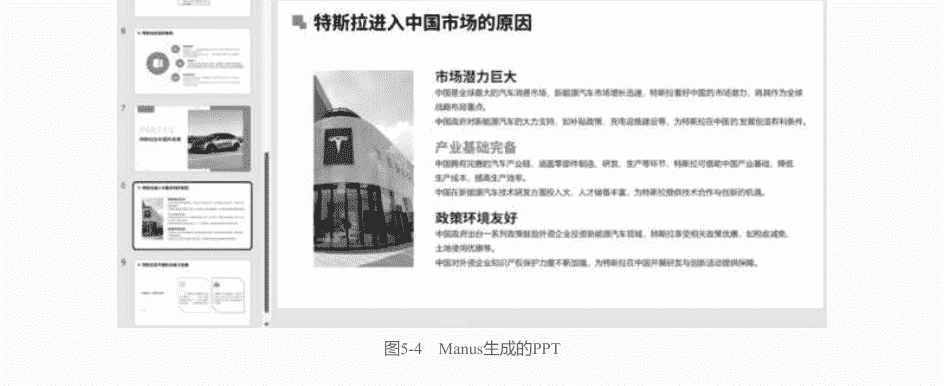

图5-4 Manus生成的PPT

## 5.4 智能开启：自动分析公司盈利状况

### 5.4.1 基础知识

公司调研一直是商业决策中的关键环节，但随着市场竞争的日益激烈，调研工作变得愈加复杂，尤其是在需要收集大量信息的情况下。企业和机构往往需要对大量公司进行背景调查、行业分析、财务状况评估、市场趋势预测等，这不仅需要调研人员具有深厚的专业知识，还需要调研人员花费大量的时间与精力来处理数据和撰写报告。随着信息量的增加，调研的难度和复杂度也在不断上升，传统的调研方式已经无法满足日益增长的公司需求。如何在短时间内收集精准且全面的数据，成为了公司调研领域亟待解决的问题。

传统的公司调研通常需要经过多个步骤。调研人员首先需要做的是确定调研的目标和方向，明确需要调研的公司范围和行业背景。接下来，调研人员需要从各大公开资源、行业报告、企业财报、新闻资讯等渠道收集信息。这一过程通常包括文献查阅、数据整理与分析等。传统方式下，这些步骤往往需要调研人员花费大量的时间去筛选和梳理信息，避免遗漏关键信息。此外，调研人员还需要对所收集的数据进行多维度分析，并撰写详细的调研报告，为企业决策者提供决策参考。由于信息的碎片化和渠道的多样性，传统调研方法的效率较低，容易造成数据的滞后性和不完整性，影响决策的准确性。

然而，AI技术的出现为公司调研带来了颠覆性的变革，尤其是Manus等AI工具的问世，更是大大提高了公司调研的效率和准确性。Manus是一款基于AI技术的调研工具，可以一键对多家公司进行调研，自动收集并分析相关数据。这些数据涵盖了公司背景、行业动态、财务状况、市场趋势等多个方面，用户只需要输入基本的调研需求，AI系统就能快速抓取并整合来自不同平台的信息，极大地简化了传统调研中烦琐的数据采集和整理过程。此外，Manus还具备自动分析数据和生成报告的功能，能够根据收集到的信息，自动生成简明扼要的调研报告，帮助企业决策者快速了解目标公司或行业的现状及发展趋势。

基于AI技术的公司调研不仅提高了工作效率，还提高了数据的精确度，避免了传统调研中容易出现的错误和遗漏。而且，Manus等AI工具还能通过不断学习和优化，逐步提高其分析的深度和广度，帮助企业在瞬息万变的市场中保持敏锐的洞察力。因此，AI工具的应用为公司调研工作带来了革命性的提升，不仅为企业节省了时间和成本，还为决策层提供了更加科学、准确的支持。

- 明确调研目标。开始公司调研时，调研人员首先要明确调研目标，尤其是盈利分析。调研目标可以是了解公司的盈利模式、成本结构及盈利能力等。
- 收集财务数据。盈利分析依赖于详细的财务数据。这要求调研人员通过多渠道收集公司历年的财报、利润表和现金流量表等，并确保数据的完整性和准确性。
- 分析收入来源。调研人员需要分析公司不同业务或产品线的收入来源，了解哪些业务是公司盈利的核心业务，哪些业务的利润较少或不稳定。
- 分析成本结构。调研人员需要详细分析公司的成本结构，识别固定成本和变动成本的比例，判断哪些费用对盈利影响较大，并预测未来盈利波动。
- 计算利润率。调研人员需要通过计算毛利率、营业利润率和净利润率等指标，衡量公司的盈利能力。高利润率通常意味着更强的市场竞争力和运营效率。
- 对比同行业。调研人员需要将目标公司与同行业其他公司进行对比分析，了解目标公司的盈利水平在同行业中的相对位置，以及目标公司是否具备长期盈利优势。
- 评估与预测风险。调研人员需要分析潜在的盈利风险因素，如市场竞争、原材料价格波动等，并基于当前数据预测未来盈利状况，帮助企业决策者做出更准确的判断。

### 5.4.2 案例实操

第一步，确定任务模板，例如，要想分析英伟达公司的年度报告情况，我们首先应在英伟达公司的官方网站找到有关的报告，如图5-5所示。

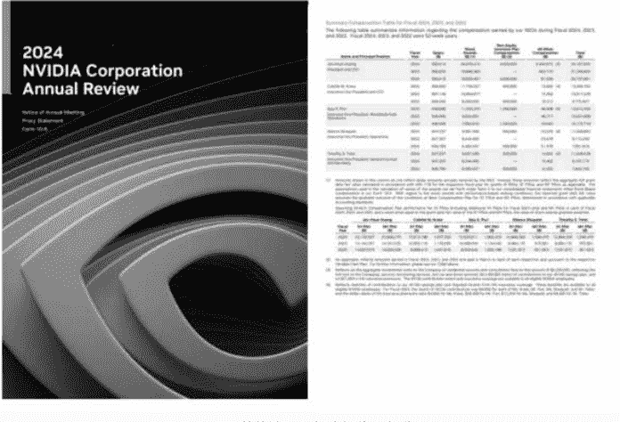

第二步，打开Manus，上传英伟达公司2023年和2024年的年度报告，并在对话框中输入提示词，如图5-6所示。

第三步，单击“发送”按钮，稍等片刻，Manus会自动分解英伟达公司每年的收入构成，总结并分析英伟达公司的成本结构的变化，并输出报告。

按可报告细分市场划分的收入

| Segment | FY 2023 | FY 2024 | 备注 |
| :--- | :--- | :--- | :--- |
| Compute & Networking | $15.07 | $47.41 | 包括用于 AI、高性能计算与加速计算的数据中心平台和系统；网络和互联解决方案；汽车 AI 和自动驾驶解决方案；嵌入式平台 |
| Graphics | $11.91 | $13.52 | 包括用于游戏和 PC 的 GeForce GPU、GeForce NOW 游戏流媒体服务和相关基础设施；用于企业工作站图形的 Quadro、NVIDIA RTX GPU；虚拟 GPU 产品；用于信息娱乐系统的汽车平台 |
| Total Revenue | $26.97 | $60.92 | — |

# 英伟达公司2023—2024年成本结构变化分析

英伟达公司作为全球AI计算领域的领导者，其成本结构在过去两年发生了显著变化，主要受数据中心业务规模扩大、供应链调整及市场竞争格局变化的影响。本报告基于公开财报数据，分析英伟达公司2023—2024年的成本结构演变趋势。

## 毛利率变化趋势

2023年第四季度，英伟达公司的调整后毛利率达到76.7%的高位，超出市场预期的75.4%。然而进入2024年，公司的毛利率呈现小幅下滑趋势：2024年第四季度，毛利率为73.5%，环比下降1.6个百分点，同比下降3个百分点。这一变化主要源于3个因素：数据中心业务规模扩大带来的成本增加、Blackwell芯片设计问题导致的短期生产效率下降，以及为应对美国出口管制而开发中国市场专用芯片（H20）的额外研发投入。

## 研发与运营成本增长

随着业务规模的扩大，英伟达公司的运营成本显著上升。2024年第四季度，公司运营利润为240.34亿美元，同比增长77%，但运营费用增速高于收入增长。公司持续加大在AI软件生态、网络产品和系统解决方案方面的研发投入，软件收入环比增长27%，网络产品收入增长100%。同时，为维护技术领先地位，英伟达公司与台积电等代工厂保持紧密合作，先进制程芯片的生产成本居高不下。

## 区域市场成本调整

美国芯片出口管制政策对英伟达公司的成本结构产生直接影响。尽管2024年第二季度中国市场收入环比增长47.2%，但英伟达公司不得不投入资源开发符合管制要求的“阉割版”芯片，并调整全球供应链布局。这些合规性调整增加了英伟达公司运营的复杂性及成本。与此同时，英伟达公司积极拓展在其他地区的业务，以弥补潜在市场损失，包括与欧洲、中东地区的和东南亚地区的客户深化合作。

## 未来成本管理挑战

展望未来，英伟达公司面临多重成本管理挑战：一方面需要平衡高性能计算芯片研发的高投入与市场竞争加剧带来的价格压力；另一方面要应对AMD等竞争对手在系统解决方案领域的追赶。此外，全球AI算力需求激增导致的数据中心建设成本上升，以及政治因素带来的供应链不确定性，都将持续影响英伟达公司的成本结构。公司能否在保持技术领先的同时优化成本结构，将是影响其长期盈利能力的关键。

## 5.5 批量创作：高效撰写电子邮件

### 5.5.1 基础知识

撰写电子邮件虽然看似简单，但实际上并不容易，尤其是当需要同时给多个不同的人群发送同一事项时。在职场中，针对不同的收件人（如领导、下属、平级同事），电子邮件的口吻和措辞都需要有所不同。给领导写电子邮件时，语气通常要更加正式，内容较简洁，并尽量避免过多的修饰词；而给下属或平级同事写邮件时，则语气可以相对轻松一些，但依然要注意清晰表达，避免模糊和含糊其词。不同的收件人和发电子邮件的目的决定了电子邮件的内容、结构及语气，因此在撰写电子邮件时，撰写者需要细致入微地考量收件人，确保准确传达信息，同时又不失礼貌和专业性。随着工作量和沟通需求的增加，手动撰写每一封电子邮件变得尤为烦琐和耗时，特别是需要发送给多个人时，如何保证电子邮件的一致性和个性化，成为了一个重要的问题。

传统的电子邮件撰写通常分为以下几个步骤。首先，撰写者需要明确电子邮件的主题，并根据收件人的不同调整电子邮件的开头和结尾。例如，给领导的电子邮件开头通常会使用“尊敬的领导”或“亲爱的某某领导”，而给下属的电子邮件开头可以直接使用其职务或名字。其次，电子邮件的正文部分需要明确传达需要沟通的核心内容，避免冗长和无关紧要的信息，以确保电子邮件内容的简洁性和高效性。再次，结束时，撰写者要表达适当的感谢和祝福，并根据电子邮件的性质选择适当的语气。最后，撰写者需要检查电子邮件的内容，确保没有语法或拼写错误，确保格式清晰。对于多个收件人，撰写者通常需要单独定制每封电子邮件的内容，确保语气、措辞符合不同收件人的身份和需求。这一过程需要撰写者投入大量的时间和精力及多次修改校对，尤其在面对繁忙的工作时，传统的电子邮件撰写方法显得十分低效。

然而，随着AI技术的发展，撰写电子邮件的过程迎来了变革。AI工具，尤其是Manus等智能写作平台，能够显著简化和优化这一流程。Manus利用强大的自然语言处理技术，能够根据用户提供的基本信息和要求，一键生成并定制多封不同口吻和内容的电子邮件。无论是针对领导、下属还是平级同事，Manus都能根据不同的受众群体自动调整电子邮件的语气、措辞和结构，使其既符合正式的商务沟通要求，又能高效传递核心信息。用户只需输入简要的电子邮件主题和要传达的主要内容，Manus便能自动生成合适的电子邮件正文，并提供多种语气风格供用户选择。更为关键的是，Manus支持批量操作，用户可以在同一平台上生成针对多个收件人的个性化电子邮件，大大提高了工作效率。

AI的这一变革不仅提高了工作效率，还帮助企业提高了通过电子邮件沟通的质量。Manus自动化的电子邮件撰写功能，确保了信息的统一性与专业性，同时避免了人工编辑可能带来的疏漏和错误。此外，AI工具的智能学习功能能够根据历史电子邮件的反馈和使用情况不断优化其写作风格，使电子邮件更加贴近用户的需求和偏好。因此，AI的应用不仅使得电子邮件撰写更加高效，还提高了沟通的准确性和一致性，使得每一封电子邮件都能够在最短时间内达到最优的表达效果。对于需要频繁发送电子邮件的职场人士而言，AI无疑是一个强大的助力工具，能帮助他们轻松应对烦琐的撰写电子邮件工作，使其专注于更具战略意义的任务。撰写者撰写电子邮件时需要注意如下要点。

- 语气要正式，内容要简洁。给领导写电子邮件时，语气要正式，内容要简洁明了，避免冗长的表述，重点突出问题和决策，确保领导能快速理解核心内容。
- 专业但平易近人。给平级同事写电子邮件时，语气可以适当放松一些，但仍需保持专业性；避免过于随意的表达，确保信息传达清晰无误，同时展现团队合作精神。
- 明确指示与责任分工。给下属写电子邮件时，语气要明确且有指导性，确保指令清晰，责任分工明确；可以适当加入鼓励性的话语，激励下属高效执行任务。
- 正文清晰简洁。不论是给领导、下属还是平级同事，电子邮件的正文应简明扼要，突出重点，方便收件人迅速抓住要点。
- 个性化调整电子邮件的内容。每个群体的需求不同，电子邮件的内容应根据受众调整，避免一封电子邮件的内容对所有人通用。定制化电子邮件可以提高沟通的精准性。
- 适当使用称谓。根据收件人的不同，撰写者应选择恰当的称谓。例如，在联系领导时撰写者可使用“尊敬的某某领导”，而在联系平级同事或下属时则可简洁地使用“亲爱的某某”或“某某同事”。
- 格式要清晰，避免杂乱。电子邮件的格式要整齐划一，段落分明，便于阅读。领导往往忙碌，简洁明了的排版能够提高电子邮件的阅读效率。

### 5.5.2 案例实操

第一步，确定会议的主题、内容、需要通知的人群等。

第二步，打开Manus，在对话框中输入提示词，如图5-7所示。

图5-7 提示词示意图

第三步，单击“发送”按钮，稍等片刻，Manus会自动生成针对不同人群的会议通知，我们可以直接使用。

# 致公司领导

尊敬的某某领导：

您好！为梳理上季度的工作，确定下季度的工作方向，推动公司业务稳健开展，公司拟定召开工作例会。现将会议详情汇报如下。

时间：2025年6月1日。

地点：公司第二会议室。

议程：各部门负责人对上季度的工作进行复盘，剖析工作中的问题与不足；共同研讨下季度的工作规划，明确各部门的工作目标与重点任务；针对公司运营现存关键问题展开讨论，寻求解决方案。

此次会议对公司未来发展至关重要，诚望您拨冗莅临，为公司发展指引方向。若您有任何特殊要求或指示，烦请随时告知。

苏小文
2025年5月25日

# 致其他部门主管

各位部门主管：

为全面总结上季度的工作，科学规划下季度的工作任务，增进部门间的沟通协作，经公司管理层商议，决定召开工作例会。现将会议相关事宜通知如下。

时间：2025年6月1日。

地点：公司第二会议室。

会前准备：请梳理本部门上季度的工作成果、存在问题及下季度的工作计划，形成简要的汇报文档，汇报时长控制在10～15分钟。

议程：各部门依次进行工作汇报；围绕跨部门协作问题展开讨论，共同商讨解决方案；明确下季度公司的整体工作目标与各部门的重点任务。

请各位准时参会，并做好充分准备。若有特殊情况无法出席，需提前向公司领导请假，并安排相关人员代为参会。

苏小文
2025年5月25日

# 致普通员工

各位同事：

为帮助大家及时了解公司的发展动态，明确工作方向，公司将召开工作例会。现将会议信息通知如下。

时间：2025年6月1日。

地点：公司第二会议室。

会议内容：公司管理层将通报公司近期的运营情况；各部门主管简要介绍本部门的工作进展；明确公司下一阶段的工作重点和大家的工作任务；设置互动答疑环节，大家可就工作中的疑问和建议进行反馈。

请各位提前安排好工作，准时参会。如有特殊情况无法参加，需向部门主管请假。

苏小文
2025年5月25日

# 第6章 Manus成为你的私人管家

在快节奏的现代生活中，我们时常渴望生活能够变得更加有序、轻松，而Manus正致力于成为我们生活中的得力助手，化身为贴心的私人管家，全方位满足我们的各种需求。无论是精心规划一场说走就走的旅行，还是为健康生活个性化制订减肥计划，无论是助力挑选理想家园，悉心照料宠物的日常起居，还是策划一场温馨难忘的周末聚会，Manus都展现出卓越的能力，将复杂的事务简单化、高效化，为我们带来前所未有的便捷体验，让生活的各个方面都能有条不紊地进行。

## 6.1 旅行规划：机票比价、酒店选择、行程安排全搞定

### 6.1.1 基础知识

旅行是许多人向往的乐趣，但在旅行规划的实际操作中，尤其是面对复杂的目的地和多元化的需求时，旅行规划常常变得极为烦琐。首先，要做一个完整的旅行规划，规划者需要收集大量的信息，包括目的地的交通、住宿、景点、餐饮等各方面的资讯。规划者不仅需要从不同的平台获取相关信息，还需要从各种旅游网站、评论、攻略中筛选出最符合自己需求的部分。接着，规划者还需要将这些信息按时间、路线、预算等维度进行整合和优化，往往需要反复调整路线，确保每一项活动都合理安排。这样复杂的过程不仅耗时、耗力，还容易导致信息的遗漏和规划的失误。对于初次旅行或没有足够时间的游客来说，这无疑是一个巨大的挑战。

那么，在旅行规划的过程中，规划者究竟应该注意哪些步骤呢？首先，规划者需要确定旅行的基本框架，包括目的地、旅行时间、人数和预算等。这是所有后续规划的基础。其次，规划者需要根据目的地的特点，选择合适的交通工具，预订航班或火车票，确保出行不受限制。再次，规划者需要合理安排住宿，选择合适的酒店或民宿，并根据旅行的需求，可能还需要提前预订景点门票或参与团体活动。此外，规划者还应合理安排每天的活动，避免行程过于紧凑或过于松散，确保既能高效游玩，又能保持良好的休息。最后，规划者还需要考虑一些应急预案，如天气变化、突发事件等，以便应对不时之需。每一个细节的规划都可能影响整个旅行的体验，因此规划者需要投入大量的时间和精力。

然而，随着科技的进步，AI的出现极大地简化了传统旅行规划的复杂过程。AI技术，特别是像Manus这样的智能平台，能够帮助我们迅速生成个性化的旅行规划。Manus利用强大的数据处理能力，可以一键生成详细的旅行路线，自动根据用户的兴趣、预算、时间等个性化需求推荐景点和活动，甚至安排好交通和住宿。与传统的人工规划相比，Manus大大提高了效率，减少了烦琐的查询和筛选过程，用户只需提供基本信息，就能快速得到一个完整的旅行规划。用户不仅节省了时间和精力，还避免了因信息过载而产生焦虑和决策困难。AI的智能化和精准化推荐，让旅行规划变得更加轻松和愉快。规划者可以把更多的精力放在享受旅行的过程中，而不是为烦琐的准备工作而头痛。

使用Manus协助我们开展旅行规划需要注意以下要点。

- 清晰描述旅行目的地：提供具体的旅行地点或城市，最好附带一些背景信息，帮助Manus更精确地为你规划行程。
- 明确旅行时间范围：告知旅行的具体日期或大致时间段，便于Manus安排交通、住宿及活动。
- 设定预算范围：提供旅行预算的上下限，帮助Manus规划合适的交通、住宿和餐饮安排，避免不必要的超支。
- 偏好活动类型：明确是否喜欢自然景观、历史文化、冒险运动等，帮助Manus规划符合你兴趣的行程。
- 特殊需求与限制：如有饮食、健康或行动等方面的特殊需求，请提前告知，以便量身定制。
- 旅行风格偏好：告知你偏好的旅行节奏，是轻松休闲还是充实密集，有助于Manus安排适合的活动强度和节奏。

### 6.1.2 案例实操

第一步，确定旅行目的地、出行方式、活动安排及预算等重要信息。

第二步，打开Manus，并在对话框中输入提示词，如图6-1所示。

第三步，单击“发送”按钮，稍等片刻，Manus会自动生成旅行攻略。

你好！根据你的需求，我为你规划了一份从成都出发，前往云南进行为期6天的高铁之旅。此行程旨在让你体验云南的风土人情，品尝当地的美食，并游览云南的知名景点，预算控制在8000元左右。

行程概览如下。

- 第1天：从成都出发，前往昆明。
- 第2天：昆明市内游览。
- 第3天：昆明至大理。
- 第4天：大理古城与洱海。
- 第5天：大理至丽江，游览丽江古城。
- 第6天：丽江至昆明，返回成都。

详细行程如下。

第1天：从成都出发，前往昆明。
交通：乘坐高铁从成都东站出发，前往昆明南站，车程7～8小时。
住宿：建议选择昆明市中心的经济型酒店，方便第二天的市内游览。

第2天：昆明市内游览。
上午：前往滇池公园，欣赏美景，感受昆明的“春城”魅力。
中午：品尝昆明特色美食，如过桥米线、小锅米线等。
下午：游览昆明老街，如光华街、钱王街等，体验当地的人文风情。
晚上：可前往昆明夜市，品尝当地的小吃，感受当地的夜生活。

第3天：昆明至大理。
交通：乘坐高铁从昆明南站前往大理站，车程约2小时。
中午：抵达大理后，品尝当地白族的美食，如乳扇、饵块等。
下午：游览大理古城，漫步在青石板路上，感受浓厚的白族文化。
住宿：建议选择大理古城附近的客栈，方便夜晚游览。

第4天：大理古城与洱海。
上午：前往崇圣寺三塔，欣赏古建筑与佛教文化的融合。
中午：在洱海边的餐厅用餐，品尝新鲜的鱼类美食。
下午：环洱海骑行或乘船游湖，享受洱海的宁静与美丽。
晚上：观赏洱海日落，感受浪漫氛围。

第5天：大理至丽江，游览丽江古城。
交通：乘坐高铁从大理站前往丽江站，车程约1小时。
中午：抵达丽江后，品尝纳西族的特色美食，如丽江粑粑、腊排骨等。
下午：游览丽江古城，体验纳西族文化，参观四方街、大研古镇等景点。
住宿：建议选择丽江古城内的客栈，方便夜晚欣赏古城夜景。

第6天：丽江至昆明，返回成都。
上午：前往玉龙雪山，乘坐索道上山，欣赏雪山美景。
中午：在雪山脚下的餐厅用餐，品尝当地的特色菜肴。
下午：乘坐高铁从丽江站返回昆明南站，车程约3小时。
晚上：从昆明南站乘坐高铁返回成都东站，结束愉快的云南之旅。

预算如下。

交通费用：高铁票（成都—昆明，昆明—大理，大理—丽江，丽江—昆明，昆明—成都）约1500元。
住宿费用：每晚约300元，5晚共计1500元。
餐饮费用：每天约200元，6天共计1200元。
景点门票：玉龙雪山门票及索道票预留150元，崇圣寺三塔门票预留80元，其余景点门票及景区内观光车费预留300元。
打车费用：每天约150元，6天共计900元。
其他费用：包括购物、应急等，预留2000元。
总计：约7600元。

温馨提示如下。

高原反应：丽江的玉龙雪山海拔较高，建议携带预防高原反应的药物，注意休息，避免剧烈运动。
防晒措施：云南紫外线强烈，建议携带防晒霜、太阳帽等防晒用品。
预订事项：建议提前预订高铁票和住宿，特别是在旅游旺季，避免临时无房或高价房。
尊重当地文化：云南是多民族聚居地区，尊重当地风俗习惯，文明旅游。

希望这份旅行攻略能帮助你规划一次愉快的云南之旅，留下美好的回忆！

## 6.2 健康管理：生成减肥计划和饮食建议

### 6.2.1 基础知识

减肥是许多人在生活中都曾面临的挑战，尤其在试图制订一个切实可行的减肥计划时，我们往往会遇到很多困难。首先，减肥不仅仅是一个简单的目标设定，它涉及多个层面的规划，包括饮食、运动、休息等。要实现这些目标，我们需要做大量的运动规划和饮食调整。这其中的每一步都需要根据个人的体质、生活习惯、目标体重等因素量身定制。单靠自己通过常规途径来收集和整理相关信息，不但费时费力，而且往往缺乏系统性，容易导致效率低下，甚至最终放弃。运动计划和饮食计划的制订常常需要与健身教练、营养师等专业人士合作，而在没有足够的资源和专业知识的情况下，普通人很难在这些方面做出科学合理的决策。

然而，随着科技的不断进步，AI技术的出现为减肥和健康管理带来了颠覆性的变化。AI技术，特别是像Manus这样的智能平台，能够为每个人制订个性化的减肥计划和提供健康饮食建议。Manus通过对大量健康数据的分析，能够根据用户的年龄、性别、体重、身体状况及生活方式等信息，为用户快速生成一份个性化的减肥计划。这种智能化的推荐不仅能够帮助用户制订合理的运动计划和饮食计划，还能根据用户的反馈动态调整计划，确保减肥目标的逐步实现。例如，Manus可以根据用户每天的运动量和饮食情况，自动计算用户消耗的热量，并根据这一数据为用户推荐更加精准的饮食方案，避免用户摄入的热量过量或不足。此外，Manus还能智能地根据用户的运动表现来调整运动强度，确保用户最大限度地消耗体内多余的脂肪，同时减少运动损伤的风险。AI技术的参与大大简化了减肥计划的制订过程，用户只需提供基本的健康数据，就能快速获得专业级别的定制化方案，大幅提高了减肥的效率和成功率。

AI技术在减肥领域的应用不仅仅停留在运动和饮食的建议上，它还能够对用户进行实时监控与反馈。通过与智能穿戴设备连接，Manus能够实时跟踪用户的运动情况、睡眠质量和饮食习惯，为用户提供更加细致的健康建议。这样，用户能够在减肥过程中得到即时的反馈，不仅增强了减肥的动力，还能根据身体变化灵活调整自己的减肥计划。AI技术还通过大数据分析，预测不同饮食与运动组合下的减肥效果，从而为用户提供更精确的推荐。这种数据驱动的精准规划，让每个人的减肥之路更加科学、高效。

总之，AI技术的引入，尤其是像Manus这样的平台，极大地降低了减肥的难度和复杂性。通过自动化的定制方案，用户可以节省大量的时间和精力，减少尝试错误的过程，最终实现自己的健康目标。AI技术为我们带来的不仅仅是技术上的便捷，更是减肥过程中科学、个性化管理的革命，它使得健康的减肥变得更加触手可及。

使用Manus制订减肥计划需要注意以下要点。

- 明确减肥目标和时间：提供明确的减肥目标，如减少多少体重，设定合理的时间框架，有助于Manus制定有效的计划。
- 健康状况与限制：告知是否有健康问题或饮食限制，如过敏、疾病、特殊需求，以便Manus量身定制计划。
- 生活作息与活动量：提供日常作息时间、工作性质及运动习惯，帮助Manus规划适合的运动量和休息安排。
- 饮食偏好与习惯：告知你的饮食习惯，如是否偏好素食或低卡饮食，便于Manus制订适合的食谱。
- 运动形式与强度：明确偏好的运动方式（如跑步、瑜伽、力量训练等），以及你能接受的运动强度。
- 当前体重与目标体重：提供你目前的体重及希望达到的目标体重，帮助Manus设定合理的减肥进度。
- 进度跟踪与调整：告知你是否愿意定期跟踪进度，是否希望在减肥过程中进行调整，以便Manus根据效果微调计划。

### 6.2.2 案例实操

第一步，确定当前体重、减肥目标、每日空闲时间、运动基础等关键信息。

第二步，打开Manus，并在对话框中输入提示词，如图6-2所示。

第三步，单击“发送”按钮，稍等片刻，Manus会自动生成健康饮食计划和减肥计划。

你好！根据你的需求，我为你制订了一份为期6个月的健康饮食计划和减肥计划，帮助你从90千克减至75千克。鉴于你每天有2小时的运动时间且缺乏运动基础，计划将结合合理的饮食控制与循序渐进的运动安排。

一、健康饮食计划

1. 控制总热量的摄入

为了在6个月内减重15千克，你需要创造总计约105000卡路里的热量赤字，即平均每天减少约500卡路里的热量摄入。建议你每日摄入总热量1800～2000卡路里，以在确保营养均衡的同时促进减重。

2. 三餐分配

早餐：占每日总热量的25%～30%，建议摄入热量约450～600卡路里。可选择全麦面包、燕麦、鸡蛋、低脂牛奶等食物。
午餐：占每日总热量的30%～35%，建议摄入热量约540～700卡路里。可选择瘦肉、鱼类、豆腐、蔬菜等，搭配适量的全谷物。
晚餐：占每日总热量的25%～30%，建议摄入热量约450～600卡路里。饮食以清淡为主，避免高脂肪、高糖类食物。
加餐：如有饥饿感，可在上午和下午各安排一次加餐，每次摄入热量100～150卡路里。可选择水果、坚果等健康食品。

3. 食物选择

蛋白质：有助于增加饱腹感，建议每日摄入量占总热量的15%～20%。可选择鸡胸肉、鱼、豆类、蛋类等。
糖类：为人体提供能量，建议每日摄入量占总热量的50%～55%。优先选择全谷物、蔬菜和水果，避免精制糖和白面制品。
脂肪：摄入适量健康脂肪有益健康，建议每日摄入量占总热量的25%～30%。可选择橄榄油、坚果、鱼类等。

4. 饮水与限制饮料

饮水：每日饮用足够的水分，建议男性每日饮水量约为3升，女性每日饮水量约为2.2升。
限制饮料摄入：减少含糖饮料、酒精和高热量饮品的摄入，避免额外热量的摄入。

二、运动计划

鉴于你缺乏运动基础，建议从低强度、全身性的运动开始，逐步提高运动强度和增加运动的多样性。

运动频率：每周进行5次运动，每次持续约60分钟，包含以下内容。

- 有氧运动（如快走、慢跑、骑行、游泳）。每次持续30～40分钟，帮助燃烧脂肪。
- 力量训练（如自重训练、哑铃练习）。每次进行2或3组，每组12～15次，锻炼肌肉，提高基础代谢率。
- 柔韧性练习（如拉伸运动、瑜伽）。每次进行10～15分钟，增加柔韧性，预防运动损伤。

逐步提高运动强度：随着运动适应性的增强，可逐渐提高运动强度和增加运动时间，但需注意循序渐进，避免过度运动导致受伤。

三、其他建议

记录与监测：建议使用食物日记或应用程序记录每日饮食和运动情况，帮助你了解进展，及时调整计划。
睡眠与压力管理：确保每天有足够的睡眠时间（7～9小时），并采取有效的压力管理措施，如冥想、深呼吸等，以促进健康。
专业指导：考虑寻求营养师和健身教练的专业指导，制订个性化的饮食计划和运动计划，确保计划安全有效。

请注意，你在减肥过程中可能会遇到平台期或其他挑战，保持积极的心态和坚持是成功的关键。祝你在接下来的6个月中取得理想的减肥效果，迈向更健康的生活方式！

## 6.3 房屋管家：帮你选房、自动推荐合适房源

### 6.3.1 基础知识

对于大多数人来说，购房是其人生中极重要的投资之一，而制定一个合适的购房攻略往往充满了挑战。首先，购房不仅仅是简单地选择一个合适的房屋，还涉及大量的社区信息收集和分析。每个小区的环境、配套设施、周边的教育资源、交通状况及未来的发展潜力都不同，购房者需要进行详细的调查。尤其是在如今信息高度碎片化的时代，购房者需要从多个渠道获取相关信息，包括线上平台、房地产中介、社区反馈和地方政府的规划文件等。然而，获取这些信息有时并不容易，且很多数据可能存在不完整或者更新不及时的情况。为了确保做出明智的决定，购房者需要花费大量的时间和精力，进行全面的调查、比较和筛选。这种烦琐的工作使得购房变得更加复杂，尤其对那些初次购房或缺乏经验的购房者来说，往往难以驾驭这些信息。

在购房过程中，购房者首先需要明确自己的购房需求。明确购房需求可以帮助购房者从一开始就聚焦在合适的房源上，避免信息过载。购房需求的核心包括购房目的（自住或投资）、预算、房屋面积、卧室数量及是否有特殊要求（如有孩子上学需求、带花园等）。确定购房需求后，购房者下一步要做的是对房源进行筛选，选择符合自己需求的区域和楼盘。购房时，周边配套设施、交通的便利性、社区环境和未来的增值潜力都是购房者需要重点关注的因素。此外，购房者还需要核查房屋的产权信息、房龄及是否存在法律纠纷等。检查完房屋本身后，购房者还要考虑贷款利率、首付款和还款期限等财务因素，确保在预算内做出最合适的选择。最后，购房者应与卖方、开发商或者中介进行详细沟通，了解房屋的具体情况和成交条件。总之，购房不仅仅是购买一处房产，更是一个复杂的决策过程，涉及个人需求、市场环境、法律法规等多方面的因素。

随着科技的进步，AI技术的出现为购房过程带来了前所未有的便利和智能化。AI技术，特别是像Manus这样的智能平台，能够帮助购房者快速生成个性化的购房建议和个人的购房报告。Manus利用大数据分析技术，能够根据用户的购房需求、预算、家庭情况及未来的生活规划等信息，智能化地为用户推荐最适合的区域和楼盘。这种个性化的推荐不仅节省了购房者筛选信息的时间，还能为用户提供更有价值的信息，帮助用户做出更加明智的决策。例如，Manus能够根据用户的预算和需求，筛选出符合条件的房源，并对房屋的增值潜力、周边配套、交通便利性等因素进行量化分析，给购房者提供详细的购房建议。此外，Manus还可以生成购房报告，涵盖房地产市场走势、区域发展潜力、各类房屋的价格波动等信息，帮助购房者全面了解当前的市场状况和未来的投资回报预期。通过AI技术的辅助，购房者能够更加轻松、快捷地完成从信息收集到决策制定的全过程。

AI技术的引入不仅提高了购房效率，还让购房者能够做出更加科学、理性的决策。通过与Manus这样的智能平台连接，购房者可以随时获取最权威的房产信息和趋势分析，避免因为信息不对称而做出错误的选择。同时，AI技术能够根据市场变化和用户的反馈实时调整推荐方案，使得购房者的选择始终是最优选择。AI技术也消除了传统中介和房产公司在信息传递中的偏差，让购房者能够更加透明和独立地进行决策。随着AI技术的不断发展，未来的购房过程将更加智能化和个性化，帮助更多购房者省时、省力，同时提高投资的回报率。

总之，AI技术的出现为传统的购房过程提供了全新的解决方案，使得购房者可以轻松地获取个性化的购房建议和精准的市场数据。Manus通过智能化技术，帮助购房者快速筛选房源、生成报告、评估投资价值，让购房不再是一个烦琐复杂的过程，而是一个更加智能、高效的决策过程。AI技术的辅助不仅可以让购房者做出更加理性的决策，还使得整个购房过程更加透明、公正，为每个购房者提供更高的价值。

使用Manus协助购买房屋需要注意以下要点。

- 购房预算范围：明确预算上限和下限，包括购房款、税费、装修等费用，帮助Manus选择适合的房源。

### 6.3.2 案例实操

第一步，确定购房需求、购房区域、购房预算、个人收入等重要信息。

第二步，打开Manus，并在对话框中输入提示词，如图6-3所示。

第三步，单击“发送”按钮，稍等片刻，Manus会自动生成购房报告。

你好！根据你的需求，我为你在北京市朝阳区筛选出了一些适合家庭居住且符合教育需求的房源。考虑到你的预算约为500万元，以及你和妻子每月共同收入约3万元，以下房源在价格、教育资源和居住环境方面均值得参考。

# 1. 新纪家园

位置：朝阳区太阳宫地区。

价格：一居室约490万元；二居室790万～950万元；三居室950万～1200万元。

户型：一居至五居。

教育资源：小区内有北京朝阳师范附属小学，楼下就是幼儿园和小学，方便孩子上学。

交通：步行约200米可达地铁10号线太阳宫站，出行便利。

其他：小区内部设施齐全，有活动广场、健身器材等，适合家庭生活。

# 2. 国展新座

位置：朝阳区。

价格：一居室500万～700万元；二居室800万～1150万元；三居室约1350万元。

户型：一居至五居。

教育资源：周边有多所学校，如中国人民大学附属中学（简称“人大附中”），教育资源丰富。

交通：距离地铁10号线太阳宫站约750米，距离地铁12号线西坝河站约1千米。

其他：小区环境安静，物业管理良好，适合居住。

# 3. 花家地西里

位置：朝阳区花家地。

价格：约400万元。

户型：两居室。

教育资源：对应花家地实验小学，教育质量较高。

交通：距离地铁13号线花家地南站步行约10分钟路程。

其他：成熟小区，周边生活设施齐全。

# 4. 双惠小区

位置：朝阳区双桥。

价格：约420万元。

户型：两居室。

教育资源：周边有多所学校，方便孩子就近入学。

交通：距离地铁6号线双桥站步行约10分钟路程。

其他：小区环境安静，周边商业设施完善。

# 5. 金隅康惠园

位置：朝阳区双桥。

价格：约380万元。

户型：两居室。

教育资源：对应朝阳区第二实验小学双桥分校，周边有三间房乡中心幼儿园。

交通：距离地铁6号线双桥站步行约15分钟路程。

其他：小区较新，环境优美，适合居住。

购房建议如下。

教育优先：考虑到你的孩子正在上幼儿园，建议优先选择靠近优质教育资源的小区，方便日后入学。

交通便利：选择交通便利的小区，方便日常出行。

环境舒适：关注小区环境和配套设施，提高居住质量。

建议你根据自身需求和喜好，实地考察上述小区，了解具体房源情况，并咨询专业房地产中介或开发商，获取最新房源信息。祝你早日找到满意的家！

## 6.4 宠物护理：制订喂养计划、查找附近宠物医院

### 6.4.1 基础知识

养宠物看似是一件充满乐趣和温馨的事情，但实际上并不像很多人想象得那么轻松。宠物主人需要承担一系列的责任和义务，尤其是在宠物的健康、饮食、行为训练等方面。这些责任往往让很多宠物主人感到疲惫。首先，宠物的饮食需要精准的搭配，宠物主人需要根据宠物的品种、年龄、体重等因素来调整宠物食物的种类和数量。此外，宠物主人也需要合理安排宠物的运动量，确保宠物能够保持健康的体态。更为复杂的是宠物的健康问题，像定期接种疫苗、驱虫、预防疾病等，这些都需要宠物主人的精心关注。同时，宠物的情感需求也不能被忽视，宠物需要主人的陪伴和关注，这在时间和精力方面都是对宠物主人的一种挑战。总之，养宠物涉及很多方面，任务繁重，因此对大多数人来说确实是一项不小的挑战。

养宠物除了给宠物提供食物和水之外，宠物主人还需要考虑许多细节。首先，宠物的健康检查非常重要，宠物主人需要定期带宠物去兽医那里做健康检查，接种疫苗、驱虫、检查牙齿和皮肤等都是必不可少的。其次，在饮食方面，宠物主人要根据宠物的年龄、体型、品种来选择合适的宠物食物，避免宠物摄入过多或过少的营养，保持宠物的健康体重。此外，适当的运动和日常训练也很重要，这不仅有助于促进宠物的身体健康，还能促进宠物的心理健康，避免宠物出现行为问题。对一些特定品种的宠物来说，宠物主人可能还需要给予其更多的关注，如定期为长毛犬梳理毛发，防止其毛发打结或掉毛过多。宠物的情感需求也不可被忽视，宠物主人需要花时间陪伴宠物，定期与其进行互动和玩耍，防止宠物出现孤独或焦虑的情绪。此外，宠物的生活环境需要保持清洁和安全，避免杂物、危险物品等影响宠物的安全。

随着AI技术的不断发展，AI技术在养宠物方面的应用也逐渐开始为宠物主人提供更多的便捷和帮助。Manus作为一款智能平台，可以帮助宠物主人制订科学的养宠计划，包括饮食、运动、健康检查等方面的安排。通过AI技术分析宠物的品种、年龄、体重等基本信息，Manus能够为宠物主人推荐最适合宠物的饮食方案，并根据宠物的健康状况调整宠物的运动量。此外，Manus还能够提醒宠物主人定期带宠物去做健康检查，接种疫苗和预防疾病，帮助宠物主人更好地管理宠物的健康。AI还可以通过学习宠物的行为模式，帮助宠物主人更好地理解宠物的需求，为宠物主人提供个性化的训练建议，从而提高宠物的行为质量和情感满足度。

更重要的是，Manus在宠物生病时也能提供帮助。当宠物出现健康问题时，Manus能够通过智能诊断分析给出可能的病症和症状，并根据位置推荐附近的宠物医院和兽医，确保宠物能及时得到专业的医疗服务。AI能够根据宠物的病情和治疗历史，为宠物主人提供科学的治疗建议，帮助他们做出更合适的决策。这种智能化的服务不仅能够节省宠物主人的时间，还能够减少因信息不对称而导致的错误判断。在紧急情况下，Manus还能根据宠物的症状推荐紧急处理方法，帮助宠物主人在等待专业治疗时采取正确的应对措施。

总之，AI技术的引入为养宠物带来了诸多便利，尤其是像Manus这样的智能平台，能够根据宠物的具体需求为宠物主人提供个性化的建议和方案。在AI技术的帮助下，宠物主人能够更加高效地管理宠物的健康、饮食和行为问题，确保宠物过上更加健康、快乐的生活。同时，AI技术还可以帮助宠物主人在宠物生病时及时获得专业的医疗建议和合适的治疗方案，减少宠物主人在紧急情况下的焦虑和困惑。随着技术的不断进步，未来的养宠物过程将更加智能化和科学化，帮助宠物和宠物主人之间建立更加和谐的关系。

使用Manus制订宠物喂养计划、查找附近宠物医院需要注意以下要点。

- 宠物类型与年龄：告知宠物的种类（如狗、猫等）、品种和年龄，帮助制订适合的喂养计划，满足不同需求。
- 宠物健康状况：提供宠物的健康信息，如是否有过敏、慢性病、体重问题等，帮助制订个性化的饮食和护理计划。
- 饮食偏好与习惯：告知宠物的饮食偏好、食物过敏或忌口，便于选择合适的食物和定时喂养建议。
- 运动与活动需求：告知宠物的运动需求（如日常散步、跑步、玩耍等），有助于安排适当的运动量，保持健康。
- 附近的宠物医院：提供你所在的位置或区域，帮助查找离你家较近的宠物医院及诊所，方便日常就医和急救。
- 宠物喂养频率与方式：说明你希望的喂养频率和方式（如一次喂食、分餐喂食），帮助制定合理的喂养时间表。
- 宠物护理与卫生习惯：告知是否有特殊护理需求，如定期洗澡、美容、驱虫等，帮助综合考虑宠物的健康管理。

### 6.4.2 案例实操

第一步，确定宠物的品种、年龄、习惯等重要信息。

第二步，打开Manus，并在对话框中输入提示词，如图6-4所示。

第三步，单击“发送”按钮，稍等片刻，Manus会自动生成养宠报告和推荐报告。

你好！恭喜你迎来了一只3个月大的美短猫咪，以下是关于喂养和健康检查的建议。

# 一、喂养建议

1. 选择适当的猫粮。建议为小猫选择专用的幼猫粮，这类猫粮的营养成分更适合幼猫的生长发育。
2. 定时定量喂食。幼猫的胃容量有限，建议每天分3或4次喂食，每次提供适量的食物，避免过度喂食导致幼猫肥胖。
3. 提供清洁饮水。确保猫咪有足够的清洁饮水供应，保持水碗的清洁，每天更换水源。
4. 逐步引入辅食。在猫咪4个月大时，可以开始引入一些湿粮或自制猫食，如鸡肉、鱼肉等，但需确保食物新鲜且无调味。
5. 注意营养均衡。猫咪是肉食性动物，需要高蛋白、高脂肪和适量的糖类，确保食物含有足够的维生素和无机盐，如牛磺酸、维生素A、维生素D等。

# 二、健康检查

带猫咪去宠物医院进行健康检查是确保其健康成长的重要步骤。以下是成都华阳地区的一些宠物医院供你参考。

1. **华阳宠物医院**：地址在四川省成都市，提供全面的宠物医疗服务，包括健康检查、疫苗接种和常见疾病治疗。
2. **华阳宠物诊所**：地址在四川省成都市，专注于小动物诊疗，提供专业的健康咨询和医疗服务。
3. **华阳动物医院**：地址在四川省成都市，拥有资深兽医团队，提供全面的宠物健康管理服务。
4. **华阳宠物医疗中心**：地址在四川省成都市，配备先进的医疗设备，为宠物提供高质量的医疗服务。
5. **华阳宠物诊疗中心**：地址在四川省成都市，提供专业的宠物健康检查和疾病预防服务。
6. **华阳宠物保健中心**：地址在四川省成都市，专注于宠物保健，提供营养咨询和健康管理服务。

建议你在前往上述医院之前，先致电咨询，了解具体的服务内容和营业时间，并预约健康检查时间。祝你的猫咪健康快乐成长！

## 6.5 聚会管家：帮你策划一场完美的家庭聚会

### 6.5.1 基础知识

家庭聚会在家庭生活中占据着至关重要的地位。家庭聚会不仅是增进家庭成员感情的纽带，还是传承家庭文化和价值观的重要途径。通过定期的家庭聚会，家庭成员可以分享彼此的生活点滴，讨论家庭事务，解决存在的问题。这种交流与互动有助于加深家庭成员之间的理解，增强家庭凝聚力，营造和谐温馨的家庭氛围。此外，家庭聚会还是教育下一代的重要平台。长辈可以在家庭聚会中传授经验和智慧，帮助年轻一代树立正确的世界观、价值观和人生观。总而言之，家庭聚会是维护家庭和谐、促进成员成长、传承家庭文化的重要活动。

通过将传统的家庭聚会与现代AI技术相结合，主人可以在繁忙的生活中轻松策划一场既有意义又令人难忘的家庭聚会。这种融合不仅提升了聚会的质量和效率，还增进了家庭成员之间的感情，营造了更加和谐幸福的家庭氛围。

使用Manus策划聚会活动需要注意以下要点。

- 活动的目的与主题：明确聚会的主要目的（如庆祝、放松、社交等）和主题（如生日派对、节日聚会、团队建设等），有助于活动规划。
- 参与人数与邀请对象：告知预期的参与人数和邀请的对象群体（如亲友、同事、同学等），帮助选择合适的场地和活动内容。
- 活动日期与时间安排：提供具体的活动日期和时段，确保活动安排合理，不与其他重要安排冲突。
- 预算范围：说明活动预算上限和下限，包括场地、餐饮、装饰等费用，帮助控制支出并优化活动安排。
- 场地与地点要求：告知你偏好的活动场地（如家里、餐厅、户外、公园等），以及对场地设施的具体需求（如停车位、音响等）。
- 餐饮与饮品选择：提供对餐饮类型的偏好，如是否需要自助餐、正式晚宴、零食饮品等，考虑到参与者的口味和特殊饮食需求。

### 6.5.2 案例实操

第一步，确定聚会的主题、人数、地点、目的等关键信息。

第二步，打开Manus，并在对话框中输入提示词，如图6-5所示。

第三步，单击“发送”按钮，稍等片刻，Manus会自动生成聚会方案。

为确保你的家庭聚会既温馨又愉快，我为你制定了以下策划方案，帮助你打造一场完美的家庭聚会。

# 1. 聚会的主题与布置

主题：温馨的家庭聚会，重点在于亲情和互动。可以选择“团圆”和“温暖”作为主题，营造轻松、愉快的氛围。

布置：根据主题，可以用一些温暖的颜色（如黄色、橙色、浅蓝色）装饰房间；使用小灯串、桌布、鲜花和照片墙等增加氛围；为每位家庭成员准备小礼物或手写卡片，表达对他们的感激与喜爱。另外，还可以播放一些轻松的背景音乐，可以是老歌或者一些轻音乐，保持轻松、愉快的氛围。

# 2. 食物和饮品

自助餐形式：根据人数，可以准备丰富的自助餐，不仅方便大家随意取食，还能让大家在餐桌上互动。

主菜：可以准备一些家常菜和大家喜欢的特色菜，如红烧肉、烤鸡翅、清蒸鱼、炒时蔬等。

小吃：准备一些小巧可口的小吃，如春卷、饺子、煎饼果子等。这些小吃适合边聊天边吃。

甜品：提供水果拼盘、蛋糕、布丁、马卡龙等甜点。

饮品：准备一些常见饮品，如果汁、茶、汽水及酒类（如葡萄酒、啤酒等，视家人喜好而定）。

# 3. 互动游戏与活动

为了增进感情，可以安排一些轻松有趣的互动游戏和活动。

家庭成员互动：可以提前让大家准备一段家庭回忆或有趣的小故事，分享给全家人，回顾过去的温馨时光。

桌游：适合全家一起玩的桌游，如“谁是卧底”“扑克牌”“大富翁”等。可以让大家一起参与，增进感情。

亲子互动：如果有小孩子在场，可以准备一些简单的亲子活动，如一起做手工、画画或唱歌。

# 4. 合影与留念

在聚会的高潮时刻，安排一次全家合影，记录下这温馨的时刻，可以在家里挂上一张大照片，作为家庭的回忆。

为每位来宾准备一份小礼物，如小糖果、手工制作的小物品，或者一些温馨的留言，增加聚会的亲切感。

这样策划下来，你可以在温馨和谐的氛围中增进家人之间的感情，大家既能享受美食，又能通过互动游戏和分享共同回忆来增进关系。希望你的家庭聚会能够圆满成功！

# 第7章 Manus激发你的学习和创造力

在数字化时代，学习与创造的方式正经历前所未有的变革。无论是学术领域的论文创作、教育行业的课程制作，还是营销范畴的文案撰写、充满艺术感的创意写作，抑或日常学习课程的高效推进，我们都面临效率与质量的双重挑战。Manus作为一款强大的智能工具，宛如一把万能钥匙，为我们开启了一扇扇通往高效与创新的大门。它以卓越的功能，深度融入各个领域，助力我们突破传统局限，激发无限的学习与创造潜能。接下来，让我们一同深入探索Manus在这些关键领域的神奇应用与独特魅力。

## 7.1 论文写作：文献查找、摘要生成、格式调整

### 7.1.1 基础知识

撰写论文对于许多学者和学生而言，常常是一项艰巨的任务。首先，收集大量文献需要耗费大量时间和精力。在浩如烟海的学术资源中，筛选出与研究主题高度相关的文献，需要具备敏锐的学术眼光和丰富的检索技巧。其次，整理和分析这些文献，提炼出有价值的信息，也是一个烦琐且耗时的过程。

在完成文献收集后，撰写论文大纲是确保论文结构严谨、逻辑清晰的重要步骤。大纲的制定有助于明确论文的主旨和框架，确保各部分内容紧密衔接，避免跑题或内容重复。然而，制定大纲需要对研究主题有深入的理解，并能够预见各部分内容如何安排和过渡。对于许多作者而言，这一过程充满挑战。

随着人工智能技术的迅猛发展，AI在论文写作领域带来革命性的变化。Manus作为全球首款通用AI Agent，充分发挥了其在论文写作中的优势。它不仅能够自主搜索相关文献、整合信息，还能够根据用户的需求生成论文大纲，提供写作思路。这一功能极大地缩短了文献检索和大纲制定的时间，提高了写作效率。

此外，Manus具备强大的知识问答功能。无论是历史典故、科学原理，还是生活常识，Manus都能快速给出准确、清晰的解答。在论文写作过程中，作者常常需要解答各种疑问，获取相关知识。Manus的知识问答功能及时满足了这些需求，确保论文内容的准确性和权威性。

在论文的撰写过程中，Manus还能够协助生成内容。根据用户提供的主题和关键词，Manus能够生成相关段落，丰富论文内容。这一功能可以帮助作者克服写作中的创意瓶颈，提供新的思路和表达方式。然而，需要注意的是，AI生成的内容需要作者进行审阅和修改，以确保其符合学术规范和个人风格。

总而言之，Manus作为一款AI论文写作助手，为作者提供了全方位的支持，从文献检索、大纲制定到内容生成、知识问答，都能提供有效的帮助。然而，AI工具的使用应结合作者的专业知识和判断力，确保论文的原创性和学术价值。未来，随着AI技术的不断进步，类似Manus的工具将更加智能化，为论文写作带来更多便利。

- 明确论文主题和目标。在开始写作前，清晰地定义论文的研究主题和目标，有助于聚焦研究方向，确保论文内容紧扣主题。
- 进行深入的文献综述。广泛查阅、研究与主题相关的文献，了解前人的研究成果，识别研究空白，为论文提供坚实的理论基础。
- 制定详细的论文大纲。在写作前，规划论文的结构和各部分的内容，确保论文逻辑严谨、层次分明。
- 遵循学术规范和格式要求。严格按照所选期刊或学校的格式要求，规范引用和参考文献，确保论文符合学术标准。
- 保持原创性和独立思考。确保论文内容为原创，避免抄袭，充分展示个人的研究思考和学术贡献。
- 反复修改和润色。完成论文初稿后，进行多轮修改和润色，检查论文的逻辑性、语言表达和格式规范，提升论文的质量。
- 及时与导师或同行交流。在写作过程中，定期与导师或学术同行交流，获取反馈和建议，完善论文内容。

### 7.1.2 案例实操

第一步，明确论文主题、研究方向等重要信息。

第二步，打开Manus，并在对话框中输入提示词，如图7-1所示。

第三步，单击“发送”按钮，稍等片刻，Manus会自动帮你梳理出参考文献和建议。

你的研究方向“认知心理学——大脑如何组织日常经验以巩固记忆”是一个非常有意义的课题，涉及认知心理学和神经科学的交叉领域。以下是一些参考文献和建议，供你在撰写毕业论文时参考。

# 参考文献：

1. 《认知心理学：心智与脑》。这本书深入探讨了认知神经科学的最新进展，涵盖大脑如何处理和组织信息的机制，对你的研究方向具有重要参考价值。
2. 刘勋等的论文《认知心理学：理解脑、心智和行为的基石》。该论文讨论了认知心理学在帮助人们了解大脑功能方面的基础作用，提供了关于大脑组织和记忆形成的深入见解。
3. 关于大脑如何将日常经验组织成章节以巩固记忆的研究。一项研究表明，大脑将日常经历划分为章节，有助于人们固定和提取记忆，这与你的研究方向高度契合。

# 建议：

1. 深入进行文献调研。系统查阅国内外关于大脑组织日常经验和记忆巩固的研究，了解当前的研究现状和热点问题。
2. 明确要研究的问题。聚焦大脑如何对日常经验进行编码、存储和提取，探讨影响记忆巩固的因素，如注意力、情绪和环境变化等。
3. 选择合适的研究方法。考虑采用实验研究、脑成像技术或案例分析等方法，收集和分析相关数据，验证你的研究假设。
4. 关注伦理问题。确保你的研究遵守伦理规范，特别是在涉及人类受试者的情况下，需获得必要的伦理审批。

希望以上信息对你的论文撰写有所帮助，祝你研究顺利！

## 7.2 课程制作：PPT设计、讲稿撰写、教学视频剪辑

### 7.2.1 基础知识

课程设计是一个复杂且耗时的过程，需要教师不仅具备专业知识，还要具备一定的技术能力。课程设计包括制作PPT、撰写讲稿、拍摄和剪辑教学视频等多个环节。首先，PPT不仅要求内容准确、清晰，还要求具备视觉吸引力，以便更好地传达信息。其次，撰写讲稿是课程设计的基础，它需要全面、系统地涵盖课程内容，并且要具有逻辑性和条理性。最后，现代课程常常包含视频元素，教师需要拍摄并剪辑教学视频，以便将课程内容生动、形象地呈现给学生。这些任务需要教师花费大量的时间和精力，尤其对于那些同时负担教学、科研任务的教育工作者来说，烦琐的课程设计可能成为一种压力。

在课程制作的过程中，通常有几个关键步骤。首先，教师需要明确课程目标，确定教学内容和结构，制订详细的教学计划。这一阶段要求教师根据学生的需求和知识水平设计合理的课程内容。其次，教师需要根据教学计划制作PPT和其他教学辅助材料。PPT的设计应力求简洁、直观，并且能够突出重点，帮助学生理解难点。再次，教师需要根据PPT内容编写讲稿，讲稿应涵盖所有教学要点，并且具有互动性，以便激发学生的学习兴趣。最后，拍摄和剪辑教学视频。这是课程设计的最后一步。教师需要确保视频内容清晰易懂，同时调整视频长度和节奏，使其适合线上学习的节奏。完成这些步骤后，课程就可以进行测试和优化，以确保达到预期的教学效果。

随着人工智能技术的迅猛发展，AI在课程设计和制作领域带来颠覆性的变革。Manus作为一款AI工具，能够极大地提高课程制作的效率和质量。首先，Manus可以帮助教师快速生成PPT内容。教师只需输入课程主题，Manus就能根据主题自动提取相关知识点，并为每个知识点生成对应的幻灯片，节省大量的时间和精力。其次，Manus还可以帮助教师自动撰写讲稿。Manus通过对课程内容的理解，能够生成具有逻辑性的讲稿，教师只需根据自己的风格进行微调即可。最后，Manus还支持教学视频的制作，它可以自动生成视频脚本，并且根据教师提供的素材进行视频剪辑，极大地简化了视频制作的复杂过程。最重要的是，Manus能够实时分析学生的学习进度和理解情况，为教师提供个性化的教学建议，帮助教师优化课程内容和教学策略。

Manus的出现，极大地解放了教师的时间和精力，让他们能够将更多的精力投入教学内容创新和与学生的互动上。通过AI的帮助，教师可以更加高效、精确地设计和制作课程，同时确保教学质量的持续提高。未来，随着AI技术的进一步发展，像Manus这样的智能工具将会在教育领域发挥更大的作用，推动教育方式和教学内容的创新。

- 课程目标明确。在开始制作课程之前，要先确定课程的教学目标，确保内容和目标紧密相关，帮助学员更好地理解和掌握知识。
- 课程结构清晰。合理安排课程结构，按照知识点的逻辑顺序进行安排，确保每个部分都衔接顺畅，便于学员理解。
- PPT设计简洁。PPT内容应简洁明了，图文并茂，文字避免过多，突出重点，帮助学员更好地吸收信息。
- 讲稿内容翔实。讲稿应与PPT内容配合，详细解释每个知识点，使用通俗易懂的语言，使学员能获得更多信息。
- 视频制作精良。如果课程包含视频，就要确保录制清晰、画面简洁，避免冗长的镜头和背景噪声，提升学员的观看体验。
- 互动环节设计。设计合适的互动环节，如问答、讨论或练习，促进学员参与，增强学习效果。
- 内容测试与反馈。课程制作完成后，进行小范围测试并收集反馈意见，及时调整和改进课程内容，确保课程质量。

### 7.2.2 案例实操

第一步，明确课程目标、课程主题、课程受众等重要信息。

第二步，打开Manus，并在对话框中输入提示词，如图7-2所示。

第三步，单击“发送”按钮，稍等片刻，Manus会自动生成课程大纲和课程内容。

我很高兴帮助你制作这门课程！针对“如何应用非暴力沟通”的主题，课程内容可以分为几个部分。以下是一个课程大纲及各部分的详细内容，供你参考。

# 课程大纲

### 1. 非暴力沟通简介

什么是非暴力沟通？

非暴力沟通的四个基本要素：观察、感受、需求、请求。

非暴力沟通与日常沟通的区别。

### 2. 非暴力沟通的核心技巧

如何有效地表达自己的感受和需求？

如何倾听并理解他人的感受和需求？

如何通过非暴力沟通解决冲突？

### 3. 实际案例分析

典型的沟通障碍与非暴力沟通的应对策略。

场景模拟：处理职场中的冲突和误解。

### 4. 如何在工作中应用非暴力沟通技巧

在团队合作中进行更有效的沟通。

如何用非暴力沟通技巧提高管理能力和领导力？

如何在日常工作中培养非暴力沟通的习惯？

### 5. 总结与实践

非暴力沟通日常练习。

如何进行自我反思与提升？

# PPT内容提纲

### 1. 封面

课程名称：“如何应用非暴力沟通”

课程简介：提升沟通技巧，促进职场和谐。

### 2. 非暴力沟通简介

定义：非暴力沟通是一种关注理解与尊重的沟通方式，旨在减少冲突并增进合作。

非暴力沟通的四个基本要素。①观察：客观地描述事实，不做评判。②感受：表达个人的感受，而非指责。③需求：清晰表达自己未被满足的需求。④请求：明确提出可以采取的具体行动。

### 3. 非暴力沟通的核心技巧

表达感受的技巧：避免使用“你”字，更多用“我”字来表达情绪。

听取他人感受：积极倾听，关注对方的需求。

### 4. 实际案例分析

通过真实案例或模拟案例展示如何运用非暴力沟通技巧化解冲突，提升沟通效果。

### 5. 如何应用非暴力沟通技巧

在团队中如何开展非暴力沟通练习？

管理者如何通过非暴力沟通来增强团队凝聚力？

# 演讲稿内容提纲

引言：介绍非暴力沟通的重要性及其在职场中的应用，强调现代职场越来越注重沟通质量与人际关系。

核心部分如下。

非暴力沟通的四个要素。在讲解每个要素时，通过具体的职场情境来阐述，例如，“观察”时的误解和反应，以及如何清晰地表达感受。

技巧与案例分析。结合职场中常见的沟通问题，分析如何用非暴力沟通方式来避免误解与冲突。

举一个例子。在团队会议中的沟通，如何提出建设性反馈，但避免评价和批评对方。

总结与练习。鼓励学员在日常工作中进行非暴力沟通练习，并提供一些自我反思的工具。

# 视频内容提纲

1. 视频简介：简短开场，介绍非暴力沟通的核心理念。
2. 实际演示：通过场景模拟，展示非暴力沟通在工作中的实际应用。例如，在会议中，如何避免情绪化表达，如何回应同事的批评。
3. 专家观点：邀请一位非暴力沟通专家或资深经理分享实际经验与技巧。
4. 结尾：总结视频内容，鼓励学员使用非暴力沟通技巧来改善职场沟通。

这样的结构会让课程内容层次清晰，并能通过实际案例和视频增强学习效果。如果你需要更详细的具体内容或帮助制作PPT、演讲稿等，请随时告诉我！

## 7.3 文案创作：广告标语、社交媒体内容一键生成

### 7.3.1 基础知识

文案创作是现代营销和广告中至关重要的一个环节，它并非简单的文字堆砌，而是要通过精准的表达和创意打动受众。文案创作的复杂性在于，它要求创作者不仅具备扎实的写作功底，还要深入了解受众心理、市场需求及品牌定位等多方面的因素。每一篇文案都需要在极短的时间内抓住读者的注意力，并引导其做出某种行动（如购买、订阅或参与等）。这不仅是文字艺术，还是一项集营销策略、情感共鸣和创意思维于一体的任务。为了确保文案的效果，创作者常常需要进行大量的市场调研，分析竞争对手的文案，以及持续优化文案内容，以提高传播效果。

文案创作过程可以分为几个主要步骤。首先，创作者需要明确文案的目标和受众群体，了解谁是目标受众，他们的需求、兴趣和痛点是什么。这是文案成功的第一步。其次，创作者需要为文案设定清晰的目标。比如，文案是为了推广产品、提高品牌认知度，还是促销活动。在确定目标之后，文案的框架和结构就变得至关重要。一个有吸引力的标题可以极大地提高点击率，因此对标题的创作需要格外用心。再次，正文部分需要精练且具有说服力，能够在短时间内传递关键信息，同时引发受众的情感共鸣。最后，结尾部分通常包含行动号召，鼓励读者进行某种行为，如购买、咨询、注册等。在整个创作过程中，创作者需要保持创意的流动和逻辑的严密，同时不断进行调整和优化，以最大程度地提升文案的效果。

随着人工智能技术的发展，AI在文案创作和内容策划领域带来颠覆性的变革。传统的文案创作依赖创作者的经验、灵感和市场调研，而AI工具的出现大大简化了这一过程。Manus作为一款先进的AI创作工具，为文案创作提供了全新的思路和解决方案。Manus能够分析大量的市场数据和受众信息，帮助创作者精确把握目标群体的需求和兴趣。它可以根据不同的行业和产品，自动生成符合目标受众需求的文案内容，从而使创作者节省大量的时间和精力。

更为重要的是，Manus具备强大的自然语言生成能力，它能够根据输入的主题、关键词和营销目标，快速生成多种文案版本供选择。这使创作者可以在短时间内获得多个创意选项，从中挑选最具吸引力和说服力的文案。此外，Manus还具备智能优化功能，能够根据数据反馈对文案进行优化调整。例如，Manus可以自动分析文案的点击率、转化率等指标，并根据这些数据反馈对文案内容进行细节上的修改，使其更加符合受众的需求。

Manus的出现让文案创作更加高效和智能化，帮助创作者摆脱烦琐的重复性工作，将更多的时间和精力集中在创意和战略规划上。AI不仅提升了创作效率，还为创作者提供了更丰富的创意来源，使文案内容更加精准和具有感染力。尤其在内容策划和多渠道营销中，Manus能够帮助营销团队快速生成各类文案内容，确保品牌传播的一致性和高效性。在未来，随着AI技术的不断进步，文案创作和内容策划将更加依赖智能化工具，推动整个行业向更加高效和精准的方向发展。

总而言之，AI技术的进步为文案创作带来巨大的变革，Manus作为一个强大的AI助手，已经成为许多内容创作者的得力助手。通过数据分析、智能生成和实时优化，Manus能够帮助创作者在复杂的市场环境中迅速生产出高质量的文案，从而大大提高创作效率和营销效果。在这个信息化、智能化的时代，Manus代表未来文案创作的趋势，成为推动内容创作变革的重要力量。

- 明确目标受众。创作文案前，需要深入了解目标受众的需求、兴趣和痛点，以确保文案能够触动目标受众并引发共鸣。
- 标题简洁有力。标题是文案的门面，要简洁、吸引眼球，并能准确传递核心信息，激发受众点击或阅读的兴趣。
- 核心卖点突出。正文部分明确传达产品或服务的核心优势，避免冗长描述，确保受众能够快速理解其独特价值。
- 情感共鸣。文案应具备情感元素，能够让受众产生情感共鸣，激发受众的行动意图。
- 明确行动号召。文案结尾要有清晰的行动号召，鼓励读者采取下一步行动，如购买、注册或咨询等。
- 优化与测试。文案创作后，应通过反馈和测试，不断优化内容，调整措辞或结构，提升效果。
- 保持品牌一致性。确保文案风格与品牌定位一致，避免出现与品牌形象不符的表述，保持传播的一致性。

### 7.3.2 案例实操

第一步，明确主要产品、产品受众、核心卖点、品牌调性等重要信息。

第二步，打开Manus，并在对话框中输入提示词，如图7-3所示。

第三步，单击“发送”按钮，稍等片刻，Manus会自动生成文案内容，我们可以直接使用。

以下是一些广告词建议，突出了好喝、不贵、浓香等要点，适合Z世代年轻人群体。

1. “浓香乌龙，喝得不贵，享受好味道。”
2. “不贵，好喝，浓香每一口。”
3. “一瓶乌龙，香浓不停，价钱轻松。”
4. “用6元，喝出浓香，感受好味。”
5. “香气浓郁，价格亲民，给你年轻的味觉冲击。”
6. “6元的浓香，6秒的好喝，年轻就该这样。”
7. “喝一口，浓香扑鼻；不贵，好喝，轻松拥有！”
8. “每一口都是浓香，每一瓶都是实惠。”
9. “青春的味道，不贵的享受。”
10. “品味乌龙香，享受年轻价。”

这些广告词侧重于年轻人对价格亲民、口感好及浓香的需求，既简洁又有力。

## 7.4 创意写作：小说创作、剧本编写、诗歌生成

### 7.4.1 基础知识

创意写作作为一种独特的写作形式，既富有艺术性，又充满挑战性。它涉及的内容不限于小说、剧本、诗歌等文学创作，涵盖多种文学体裁和表达方式。首先，创意写作的复杂性体现在需要拥有极高的想象力和创造力。无论是编织一个引人入胜的故事，还是塑造鲜明的人物形象，都要求创作者拥有丰富的灵感和深厚的文学功底。其次，创意写作还要求在叙事技巧、语言运用、节奏把控等方面精益求精。一个看似简单的情节，往往需要多次修改与打磨才能达到理想效果。最后，创意写作的过程并非一蹴而就，灵感的迸发往往不可预测，将零散的灵感有机地连接成完整的故事也是一项需要极大耐心和技巧的工作。因此，创意写作对于许多创作者来说，常常是一个充满挑战的过程。

创意写作的过程通常包括几个关键步骤。首先，构思与设定是创意写作的起点。创作者需要从众多的创意中筛选出最具潜力的创意，并设定故事的背景、人物和冲突。这个阶段需要大量头脑风暴，甚至无数的尝试和失败。其次，草稿的撰写是将创意付诸实践的重要步骤。此时，创作者需要把构思转化为文字，通过语言构建出一个个具体的场景和角色。草稿阶段的重点在于捕捉灵感，尽量避免过度修改，以免扼杀初期的创意。再次，进入修改与精练的阶段，创作者需要反复检查故事的结构、人物的动机以及语言的流畅性，进行调整和完善。这个过程往往需要多轮修改，以确保作品的深度与细节得到充分体现。最后，完成后的作品进入定稿与发布阶段。创作者在此时通常还会通过同行评审、编辑校对等环节，进一步优化文本，确保作品的质量。

随着科技的不断进步，人工智能在创意写作领域带来颠覆性的变革。AI的出现极大地提高了写作的效率与质量，尤其在小说创作、剧本编写和诗歌生成方面。AI能够快速生成大量的创意内容，提供灵感和素材，可以极大地激发创作者的创作潜力。例如，Manus作为一款领先的AI工具，通过强大的自然语言处理能力，能够根据用户提供的关键词或简单设定，自动生成故事情节、对话、人物描述等内容。创作者可以通过与Manus的互动，快速调整创作方向，甚至在创作过程中直接获得灵感。这不仅减少了创作中的时间消耗，也使创作者能够更高效地完成初稿。

Manus不仅在小说创作中表现出色，对于剧本和诗歌的生成也具有出色的表现。在剧本创作方面，Manus能根据剧情需求自动生成符合角色性格和情节发展的对话，帮助编剧快速构建剧本框架。对于诗歌创作，Manus能通过精准的语言模型，生成具有韵律和意境的诗句，为诗人提供灵感支持。同时，Manus还能根据不同的需求进行调整，无论是现代诗、古典诗，还是自由诗，都能精准把握创作的细腻度。

总之，AI的引入为创意写作带来前所未有的变革。Manus作为创意写作的好帮手，不仅能在创作过程中提供灵感和素材，还能辅助创作者进行内容的构思、修改和优化。它使创作不再是孤独和枯燥的过程，而是更为高效、智能和充满互动性的体验。未来，随着AI技术的不断发展，创意写作将变得更加多元化和智能化，创作者可以借助AI工具，更好地发挥创作潜力，突破传统创作的局限，创作出更多优秀的文学作品。

- 明确主题与情感表达。创意写作的第一步是明确主题，设定清晰的情感基调，确保作品的核心思想与情感贯穿始终。
- 人物塑造要真实。无论是小说还是剧本，人物的性格、动机和变化都必须真实可信，能够引发读者或观众的共鸣。
- 情节设计要有冲突。一个好的故事必须具备吸引力，情节中的冲突和转折是推动故事发展的关键。
- 语言要有节奏感。在创意写作中，语言的节奏感至关重要。句式的变化和对节奏的控制，可以使作品更加生动有趣。
- 避免过多修饰。在写作中，要避免过度进行文字修饰。简单、直接的表达能够更好地传递情感和信息，提升作品的力量。
- 多次修改是必要的。在创意写作的过程中，需要反复修改，去除冗余和不合适的部分，不断精练作品的结构和语言。
- 保持独立思考与创新。在创作时应保持独立思考，不盲目跟风。创新是创意写作的灵魂，要勇于打破常规，创造出新的故事形式。

### 7.4.2 案例实操

第一步，先整理历史背景、故事内容、人物背景等重要信息。

第二步，打开Manus，并在对话框中输入提示词，如图7-4所示。

第三步，单击“发送”按钮，稍等片刻，Manus会生成剧本大纲。

穿越题材的影视作品通过时空交错，展现不同文明的碰撞与融合，深受观众喜爱。以下是一部探索秦代文明与现代文明交汇的剧本构思。

# 秦时光旅人

故事概述：一位现代考古学家在研究秦始皇陵时，意外触发机关，穿越到秦代。在陌生的秦代，他（或她）必须运用现代知识与智慧生存下来，并在历史洪流中寻找回到现代的方法。在此过程中，他（或她）与历史人物交织互动，见证并影响了一系列重大历史事件。

# 叙事方向与创作灵感

1. 文化冲突与融合：主角在秦代生活，现代观念与古代礼法产生冲突。例如，面对秦代严格的法律制度、家庭观念和社会等级。通过这些冲突，展现两种文明的差异与共同之处。
2. 科技与智慧的较量：主角利用现代科学知识，在秦代的农业、建筑、医学等领域提出创新，帮助当地人解决问题，同时引发当地人对未知事物的恐惧与质疑。
3. 对历史事件的亲历与影响：主角亲身经历并可能影响秦始皇统一六国、修建长城、焚书坑儒等重大事件，探讨个人在历史洪流中的作用。
4. 人际关系的建立与挑战：主角与秦代人物建立深厚的友谊或复杂的关系。例如，与一位秦代官员合作与对立，或与普通百姓产生情感纠葛，展现人性与时代的烙印。

# 初步剧本大纲

1. 引子：现代，主角在秦始皇陵进行考古研究，意外触发机关，穿越至秦代。
2. 初入秦代：主角在陌生的环境中挣扎求生，初次体验秦代的社会风貌，包括法律、服饰、饮食和生活习惯。
3. 融入社会：主角运用现代知识，帮助当地人解决问题，逐渐获得信任，并开始在秦代社会中立足。
4. 历史交汇：主角卷入秦始皇统一六国的战争，亲历兵马俑的制作过程，见证并参与修建长城等重大历史事件。
5. 内心挣扎：主角在与秦代人物建立深厚感情的同时，始终寻找回到现代的方法，内心在留恋与回归之间挣扎。
6. 高潮：主角发现回到现代的关键，但需要在改变历史与回归现实之间做出艰难选择。
7. 结局：主角最终做出决定，或回到现代，或留在秦代，剧本留下开放性的结尾，引发观众思考。

通过以上大纲，剧本将深入挖掘秦代文明的独特魅力，与现代文明进行对比，展现两者在文化、科技、社会制度等方面的交汇与碰撞。同时，通过主角的个人经历，探讨人性、历史与选择的主题。

## 7.5 学习课程：预习、听讲、复习和实践

### 7.5.1 基础知识

学习课程对很多人来说，常常是一个复杂且具有挑战性的过程。尤其在面对知识量庞大、内容繁杂的课程时，学员不仅要掌握大量的信息，还要在短时间内将知识转化为自己的能力，这需要高度的专注力和自律性。许多学员由于工作或生活压力，难以充分投入学习中。与此同时，对课程的学习通常伴随对教材、讲义、视频和辅导资料等多种学习资源的整合使用。每种资源都有不同的特点，如何有效地整合并吸收这些资源的信息，成为学习中的一大难题。传统的学习方法往往过于依赖死记硬背，忽视对知识的深度理解和应用，这也导致许多人在学习过程中感到困惑和迷茫。

那么，如何有效地学习一门课程呢？首先，学习者需要明确课程的学习目标和自己的学习需求。这有助于选择合适的学习方法，避免盲目学习。其次，对课程的学习通常包括预习、听讲、复习和实践几个阶段。在预习阶段，要通过阅读教材或相关资料，提前了解课程内容，为听课做好准备；在听讲阶段，要注意主动思考，做好笔记，抓住关键概念和知识点；复习阶段是巩固知识、提高记忆的关键，可以通过总结、复述和做练习等方式加强对知识的理解；在实践阶段，要将所学知识应用到实际问题中，进行验证和提升。最后，与同学、老师的互动和讨论也是学习过程中不可忽视的一部分，能够帮助学习者加深对课程内容的理解。

随着人工智能技术的发展，学习方式正在发生深刻的变革。AI的应用让学习不再局限于传统的课堂模式，为学习者提供了更加个性化和高效的学习体验。Manus作为一款强大的AI工具，极大地改变了学习过程。首先，Manus可以根据学习者的需求，快速生成个性化的学习计划。它能够分析学习者的学习进度和薄弱环节，自动调整学习内容的难度和深度，从而提供量身定制的学习方案。其次，Manus能够帮助学习者快速查找和整理相关的学习资料。无论是课本内容、参考书籍，还是网络资源，Manus都能通过智能搜索提供相关信息，为学习者节省大量的查找时间。

更为重要的是，Manus在学习过程中还可以作为一个智能辅导员，实时回答学习者的疑问。对于学习者在学习过程中遇到的问题，Manus能够根据其强大的知识库和语义理解能力，提供准确、及时的解答，帮助学员解决疑惑，增强学习的连续性和流畅性。此外，Manus还可以通过智能评估，帮助学习者进行自我检测，及时调整学习策略。这种智能化、个性化的辅导方式，不仅提高了学习效率，还增强了学习的趣味性和互动性。

AI的出现，使学习更加高效和个性化，也让学习者能够在自己的节奏下主动学习。Manus作为学习的得力助手，帮助学员解决了传统学习中的许多难题，让学习变得更加便捷、精准和有趣。随着技术的不断进步，未来AI将在教育领域发挥越来越重要的作用，为全球学习者提供更为广阔的学习机会和资源。

- 明确学习目标。在开始学习之前，明确课程的学习目标和自己的学习需求，集中注意力，避免学习中的意识迷茫和精力分散。

### 7.5.2 案例实操

第一步，先确定学习课程、学习目标、学习时间等重要信息。

第二步，打开Manus，并在对话框中输入提示词，如图7-5所示。

第三步，单击“发送”按钮，稍等片刻，Manus会自动生成学习计划。

根据你的目标和时间安排，我为你设计了一份学习计划，帮助你逐步掌握花式滑板的技能。计划分为四个阶段，持续12个月，每天安排2小时进行训练。每个阶段侧重于不同的技能，以帮助你逐步提升。

# 第一阶段：基础技能入门（1～3个月）

目标：熟悉滑板基础，掌握平衡和基本动作。

### 训练内容

第1个月学习滑板的基本构造和安全知识。练习滑行，在平坦的地方练习直线滑行，感受滑板的运动方式。练习基础平衡，站在滑板上，进行短距离滑行，掌握平衡感。学习刹车动作，练习如何通过后脚刹车停止滑行。

第2个月练习简单的转弯，学习如何控制身体转向，进行大弯和小弯的转向练习。提高速度控制能力，通过控制滑行的速度来提高稳定性。练习长时间滑行，增强耐力。

第3个月开始学习基本跳跃滑板动作，如Ollie。Ollie是所有花式动作的基础。强化平衡训练，进行站立、滑行、转弯等动作的练习。逐步增加滑行的时间和距离。

# 第二阶段：初步花式动作（4～6个月）

目标：掌握一些基本花式动作，为学习更复杂的技巧打基础。

### 训练内容

第4个月学习跳跃。这是花式滑板的基础动作，只有掌握它才能学习其他进阶动作。练习一些小跳动作（如shuvit、180度转身跳跃）。

第5个月学习并掌握基本的滑板地面技巧（如kickflip、heelflip）。增加在不同地面上的滑行练习，包括斜坡、坡道等。

第6个月开始学习在坡道上滑行。学习基本障碍滑板技巧，如在栏杆上滑行、用滑板跳过小障碍等。

# 第三阶段：中级技巧提升（7～9个月）

目标：精通多种花式动作，并提升身体协调性和技巧稳定性。

### 训练内容

第7个月强化Ollie和kickflip的稳定性和流畅度。学习更多的障碍技巧，如grind、slide等。

第8个月开始练习高级技巧，如bigspin、heelflip、flip tricks等。增加跳跃高度和动作幅度，挑战自己。

第9个月进行持续性的技能巩固训练，确保各种技巧的稳定性。尝试进行更长时间的滑行，结合花式动作进行滑行。

# 第四阶段：高级技巧与专业化训练（10～12个月）

目标：成为较为专业的滑板玩家，能流畅做出多种复杂动作。

### 训练内容

第10个月学习组合动作，将多个花式动作连接在一起。练习在不同的滑板环境中（如斜坡、滑道、障碍物等）进行花式技巧练习。

第11个月加强体能训练，提高核心力量和腿部肌肉的耐力。持续多次进行动作组合和滑行实战训练，提升滑行的流畅度。

第12个月完成更多的高难度花式动作，如360 flip、manual、kickflip to grind等。尝试参加一些业余滑板赛事，进行实际测试。

### 每日训练安排

**热身（15分钟）**，进行拉伸和关节活动，避免受伤。

**基础动作（30分钟）**，根据当前的任务，重点练习平衡、滑行、跳跃等基础动作。

**技能练习（60分钟）**，根据每天的目标练习特定的技巧，逐步提升技术水平。

**放松与总结（15分钟）**，进行放松运动，记录当天的学习进展，分析需要改进的地方。

通过这个计划的持续练习和逐步进阶，你将在一年的时间内从一个零基础的初学者逐渐成为一名较为专业的花式滑板玩家。记住，持续练习和不断挑战自己是进步的关键。

# 第8章 Manus带你走向财富自由之路

在当今充满机遇与挑战的经济时代，财富自由不再只是一个遥不可及的梦想，而是无数人奋力追逐的现实目标。然而，在通往财富自由的道路上，我们往往会遭遇重重迷雾，被复杂的理财难题困扰。从日常的储蓄计划到应对购房、育儿等重大事件的理财规划，从琳琅满目的理财产品中筛选出最适合自己的一款产品到制定个性化的消费规划以确保每一分钱都花得恰到好处，每一个环节都需要精心谋划，稍有不慎便可能偏离轨道。此时，Manus如同一位智慧且贴心的财富导师，强势登场。它可以深入洞察每个人独有的财务状况、风险偏好与人生目标，将理财问题化繁为简，为人们量身定制出清晰、高效的财富自由之路，助力人们在财富的海洋中乘风破浪，驶向理想的彼岸。

## 8.1 生成储蓄计划

### 8.1.1 基础知识

储蓄是每个人都应该具备的基本理财能力。无论你是刚步入职场的年轻人，还是已经有了家庭和孩子的成年人，储蓄始终都是一项理财基本功。随着社会的发展和物价不断上涨，储蓄不仅是为了应对意外和紧急情况，还是为了确保我们未来的生活不受经济压力的困扰。在现代社会，人们的收入可能随着职位的升迁、技能的提升而增加，但消费水平的提高往往使人们每月的收入和支出成正比。如果没有有效储蓄，在日复一日的消费中陷入财务困境，财务自由就会成为遥不可及的梦想。因此，储蓄并不仅是理财的起点，更是未来财务安全的基石。

然而，尽管大多数人意识到储蓄的重要性，但在现实中很多人并没有一个清晰的、科学的储蓄计划，甚至一些人不清楚自己为何总是到年底时才发现账户中的余额少得可怜。大部分人的储蓄行为是没有明确目标和计划的。每月收入到手后，虽然心里有储蓄的念头，但在实际操作中往往受到各种消费诱惑的影响，导致存款数额远低于预期。每次月底或年终的时候，我们都会发现原本计划存下的钱并没有存下来，甚至有些人因为没有明确储蓄目标，月复一月地把收入花光，直到年末才惊觉自己并没有积累多少储蓄。

这背后往往有几个原因。首先，很多人没有意识到消费的潜在危害。日常的小额支出，如外卖、购物和娱乐消费，看似无关紧要，如果不加控制，长期就会聚集成一笔不小的支出，最终影响到我们的储蓄计划。其次，缺乏系统的财务规划也是导致储蓄无果的原因之一。没有一个明确的目标和具体的存款数额，储蓄往往像“见机行事”，等到月底才知道自己应该存多少钱，结果由于各种紧急开支，最终往往只是将收入的一部分“存下”而已。最后，一些人并不清楚如何控制消费，也缺乏自律，面对购物和娱乐的诱惑，往往选择放纵自己，直到月底才意识到钱已经花得差不多了。这种消费习惯和理财观念的不成熟，使大部分人在年底时总是感叹：为什么钱总是存不下来？

如今，借助Manus这样的智能理财工具，我们可以改变传统的储蓄方式，让储蓄变得更加有计划和高效。Manus是一款智能储蓄计划生成工具，旨在帮助用户设定合理的存款目标，并通过一键生成个性化的储蓄计划，帮助我们系统地进行财务管理，避免盲目消费。Manus通过对用户的收入、支出、生活习惯及存款目标等数据进行分析，自动计算出每个月的存款额，并为用户提供具体的储蓄计划。这种智能化的计划方式让储蓄变得更加简单、清晰和可操作。

具体来说，Manus的优势体现在以下几个方面。首先，Manus能够根据用户的具体情况，量身定制储蓄计划。这意味着储蓄不再盲目或随意，而是根据收入和支出的实际情况设定合适的存款目标，避免过于苛刻的存款计划导致自己的生活质量下降。其次，Manus会根据消费记录和预算，提醒用户在支出上的注意事项，避免不必要的冲动消费。比如，当用户设定每月的储蓄目标后，Manus会定期提醒用户检查自己的支出情况，及时调整预算，防止超支。更为重要的是，Manus还可以根据每月的支出情况动态调整储蓄计划。如果某个月的支出过高，Manus会调整储蓄计划，保证用户能够在不影响生活质量的前提下，继续实现储蓄目标。这种灵活性和智能化的设计，使Manus成为一个非常适合现代生活节奏的理财工具。

- 明确储蓄目标。使用Manus时，首先要设定明确的储蓄目标，如紧急基金、购房首付或退休储备，确保存款有明确的用途。
- 评估收入和支出。Manus帮助分析每月收入和支出，确保合理分配资金，并避免过度消费，保证每月有足够的存款。
- 设定存款金额和周期。根据财务目标，Manus建议每月存入固定金额，设定存款周期，确保存蓄计划的可持续性。
- 选择合适的存款工具。Manus根据存款目标与期限推荐合适的存款工具，如定期存款、货币基金等，确保资金增值。
- 跟踪进度。Manus定期跟踪存款进度，提醒用户调整计划，确保按时完成存款目标，避免因支出增加而影响计划。
- 增加额外储蓄。Manus建议通过增加额外收入或减少不必要开支，提高存款金额，加速实现财务目标。
- 灵活调整储蓄计划。根据实际情况，Manus帮助灵活调整储蓄计划，应对收入变化或突发情况，确保财务目标不受影响。

### 8.1.2 案例实操

第一步，先确定储蓄目标、收入和支出、储蓄周期等重要信息。

第二步，打开Manus，在对话框中输入提示词，如图8-1所示。

第三步，单击“发送”按钮，稍等片刻，Manus会自动生成储蓄计划。

好的，根据你目前的情况，我为你设计了一个简单的储蓄计划。以下是一个可能的储蓄策略，确保你能够在一定时间内实现财务目标。

每月储蓄计划

收入：1万元

固定支出：4000元

剩余可支配收入：6000元

你可以根据以下建议来储蓄

# 1.紧急基金（3～6个月支出）

首先，建议你为未来可能的突发情况建立一个紧急基金，目标为6个月的支出，即大约2.4万元。

如果目前没有紧急基金，那么建议优先将部分存款或每月结余的资金投入紧急基金。

# 2.每月存款

你每个月剩余可支配收入约6000元，如果目标是在6个月内建立紧急基金，那么可以每月存6000元，预计需要4个月完成（2.4万元）。

紧急基金建立后，建议将存款目标调整为长期投资或储蓄账户，以应对未来的大额支出或投资计划。

# 3.定期存款、投资

一旦紧急基金建立完毕，你可以将剩余的存款部分投入定期存款或低风险投资，提升存款收益。

你目前有5万元存款，可以将一部分用于定期存款，另一部分用于长期投资，如股票、基金等，但要根据你的风险承受能力来选择。

# 4.每月调整

如果收入或支出有变化，那么可以适时调整每月存款金额。比如，如果收入增加或支出减少，可以增加存款金额；反之可能需要减少存款金额。

### 具体储蓄计划示例

第1个月至第4个月，每月存6000元，目标是完成紧急基金的积累（2.4万元）。

第5个月及以后，紧急基金建立后，每月存款可以视情况进行调整。你可以选择继续存6000元，或者将部分资金用于投资。

这样的储蓄计划既能够保障你的日常支出，又能在一定程度上为未来的财务目标做规划。如果你有更具体的目标（如买房、旅游、教育等），我们可以进一步调整计划。

## 8.2 规划重大事件理财方案

### 8.2.1 基础知识

在现代社会，理财规划已经成为每个人都需要掌握的一项基本技能。合理的资金管理不仅能让我们更好地应对生活中的各种开支，还能在面对重大财务决策时更加从容。许多人以为理财只是储蓄或者投资，实际上，真正的理财是对收入、支出、储蓄、投资及未来规划的全方位管理。缺乏规划，可能导致手头资金紧张，影响生活质量；盲目投资，则可能让辛苦积累的财富在短时间内大幅缩水。因此，科学理财不仅是资产增值的关键，还是保障家庭生活稳定的重要基石。

当你计划买房时，你会面临一系列财务问题。比如，首付款应该准备多少？贷款应该选择等额本息，还是等额本金？每个月的还款压力是否可控？此外，房产本身的增值潜力、市场行情、未来可能的政策变动，都会影响你的购房决策。如果没有合理的财务规划，买房很容易变成沉重的经济负担，甚至影响日常生活开支。

如果你正准备迎接新生命的到来，那么育儿的经济压力同样不容忽视。从孕期检查、分娩费用，到婴幼儿的日常开销、教育投资，每一个阶段都需要充足的资金支持。你可能会纠结：应该留多少存款作为家庭应急资金？哪些投资产品能在保证安全的同时，提供长期稳定的收益？股票、基金、保险，哪一种更适合当前的家庭状况？理财不仅是让资金变多，更重要的是让资金在合适的时间发挥最大的作用，确保家庭的财务状况始终保持健康稳定。

面对这些复杂的财务问题，Manus能够帮助我们快速制定合理的理财规划。它会综合分析你的收入、支出、资产情况以及未来的财务目标，提供一份清晰的资金配置方案。无论是确定存款比例、优化投资组合，还是规划房贷还款策略，它都能给出科学的建议，帮助你最大程度地降低财务压力，提高资金使用效率。此外，Manus还能根据市场环境和个人需求的变化，动态调整理财方案，让你的资金配置始终保持最优状态。无论是买房、生子，还是其他重要的财务决策，它都能成为你值得信赖的理财助手，让你轻松掌控财富，实现更加稳健的生活。使用Manus进行理财规划需要注意以下要点。

- 明确财务目标。使用Manus时，首先要设定清晰的财务目标，如购房、储蓄、投资等，以便为规划提供明确的方向。
- 分析收入与支出。Manus帮助你全面了解收入和支出情况，准确掌握财务状况，为合理规划提供基础数据支持。
- 制订预算计划。Manus根据个人财务状况，提出合理的支出比例建议，确保收入用于必要开支，并留有储蓄和投资空间。
- 优化资产配置。根据风险偏好和目标，Manus帮助你合理配置储蓄、投资和保险等资产，实现财富增值与风险控制。
- 设立应急基金。Manus建议你建立紧急备用金账户，以应对突发事件，确保日常生活不受干扰，保障财务安全。
- 跟踪和调整计划。定期使用Manus查看财务状况，及时调整规划，可以确保财务目标能够随市场变化和个人需求顺利达成。
- 长期财务规划。Manus不仅帮助你进行短期规划，还提供长期财务战略指导，确保你的财务健康、稳定增长，实现更大的人生目标。

### 8.2.2 案例实操

第一步，先确定财务目标、收入与支出分析、资产配置、风险承受能力等重要信息。

第二步，打开Manus，在对话框中输入提示词，如图8-2所示。

第三步，单击“发送”按钮，稍等片刻，Manus会自动生成理财方案。

根据你的财务目标和风险偏好，我会为你提供一个较为稳健的理财方案，帮助你在3年内将资产增长到30万元。考虑到你不希望承担过多的风险，建议你采用混合型投资策略，既有相对安全的固定收益产品，又有一定比例的风险较低的投资品种。

# 1.现有资产分配

（1）基金投资（3万元）。基金的波动性相对较大，但有较高的收益潜力。既然你已经投入了3万元，可以保持现有投资，但建议选择偏稳健型的基金，如债券基金或低波动的混合基金，避免大幅波动。

（2）余额宝（2万元）。余额宝属于货币基金，风险较低，但收益相对较少。你可以继续将这部分资金放在余额宝中，作为流动资金和短期储蓄。

# 2.每月存款与投资计划

（1）月存款（6000元）。每月收入1万元，扣除4000元的固定支出后，剩余6000元。建议将这6000元分配为储蓄和投资的一部分。

（2）稳健型理财产品（3000元）。可以将每月的3000元投资于一些低风险的理财产品，如银行定期存款、国债或债券基金。此类产品年化收益率一般在3%～5%，能帮助你的资产稳定增长。

（3）低风险混合基金（2000元）。剩余2000元可以继续投资于低风险的混合型基金（如债券型基金或混合型基金）。这些基金虽然有一定的波动性，但相比股票基金来说，风险相对较低。

（4）余额宝（1000元）。每月可将1000元继续存入余额宝，确保你有足够的流动资金应对突发支出。

# 3.资产增值目标：30万元

初始资产5万元（基金3万元，余额宝2万元）。

每月存款6000元。

我们假设每年能够获得4%的综合年化收益（包括基金、债券基金和稳健型理财产品的收益）。虽然这个收益率较为保守，但符合你的低风险偏好。

在这个假设下，你的资产增长大致如下。

第一年的初始资产为5万元，每月存款6000元，年化收益率为4%。到第一年结束时，预估资产会增加到大约6.5万元（包括投资收益）。

第二年开始时的资产为6.5万元，每月存款6000元，年化收益率为4%。到第二年结束时，预估资产将增加到大约13万元。

第三年开始时的资产为13万元，每月存款6000元，年化收益率为4%。到第三年结束时，预估资产将接近19万元。

# 4.如何实现30万元的目标

如果你希望在3年内资产达到30万元，可以考虑进行以下调整。

（1）适度增加风险。可以将部分资金配置到风险稍高的投资品种（如股票型基金或混合型基金），预计年化收益率可达到8%，这样可以加速资产增长。

（2）增加每月存款金额。如果有额外的收入或可以减少支出，那么可以适当增加每月存款金额，加快实现目标进度。

如果你的目标是稳定增长，建议保守操作，以低风险理财产品为主，逐步积累资产。如果你希望提高收益，那么可以选择适度增加风险。总体来说，考虑到你的低风险偏好，30万元的目标可能在3年内略有挑战，但通过适当调整投资组合，还是可以接近的。

## 8.3 对比不同理财产品

### 8.3.1 基础知识

当下的理财市场可谓百花齐放，各种理财产品层出不穷。从传统的银行存款、国债到基金、股票、保险理财，再到近几年兴起的各类互联网金融产品，投资渠道越来越丰富。然而，正是因为理财产品种类繁多，很多人在面对选择时往往感到困惑：到底哪种理财方式更适合自己？应该如何平衡收益与风险？如何在保证资金安全的同时，实现财富的稳步增长？

每个人的财务状况、投资目标和风险承受能力都不同，因此，理财并不是“收益越高越好”。有人希望资金流动性强，随时可以取出使用；有人更注重长期稳定，希望资金能够在未来获得稳健增值；还有人愿意承担一定风险，期待更高的回报。面对银行理财、基金、债券、股票、保险等众多选择，如何搭配才能让自己的资产配置更加合理呢？如果不了解各类理财产品的特点，盲目投资很可能导致收益不及预期，甚至出现亏损。

Manus能够帮助我们更高效地筛选和对比理财产品。它会结合你的收入水平、风险偏好、投资期限及理财目标，筛选出与个人需求匹配的产品，并进行详细对比。无论你是追求稳健收益，还是希望尝试更具成长性的投资方式，Manus都能提供清晰的参考建议，让你不再迷茫，在众多理财产品中找到最适合自己的理财产品。通过科学的分析和合理的资产配置，你可以更从容地管理财富，实现财富的有效增长。使用Manus对比不同理财产品时，需要注意以下要点。

- 了解理财目标。在使用Manus前，明确个人理财目标，如资金增值、风险控制、流动性需求等，为产品选择提供方向。
- 分析风险承受能力。Manus根据个人的风险偏好评估适合的理财产品，帮助选择风险与回报匹配的投资方式。

### 8.3.2 案例实操

第一步，先明确需要对比的理财产品名称。

第二步，打开Manus，在对话框中输入提示词，如图8-3所示。

第三步，单击“发送”按钮，稍等片刻，Manus会自动生成理财产品的对比报告。

我会为你详细对比一下这几个理财产品的风险和特点，以帮助你做出更适合自己的选择。

### 1. 华夏大盘精选混合（基金）

类型：混合型基金。

投资标的：主要投资于大盘股票和债券，追求较高的收益。该基金的股票部分可能占比较大，且投资的股票主要是市值较大的蓝筹股。

风险：中等偏高。由于股票市场波动较大，尤其是大盘股的波动，这个基金的净值可能受到较大的影响。但由于其混合性质，债券部分可以在一定程度上降低风险。

收益潜力：中高风险，长期持有有可能获得较高回报，但短期内可能有较大波动。

### 2. 富国天惠纯债债券

类型：债券型基金。

投资标的：主要投资于债券，特别是政府债券和企业债券。通过购买固定收益类产品，获取稳定的收益。

风险：较低。债券类基金的波动性较小，但不意味着完全没有风险。如果利率上升，债券价格就可能下跌，但整体风险相对较低。

收益潜力：低到中等。债券型基金的年化收益通常稳定，但比股票基金低，适合风险承受能力较低的投资者。

### 3. 嘉实沪港深优势混合（基金）

类型：混合型基金。

投资标的：该基金投资于沪港深市场，主要包括A股和港股。基金经理会根据市场机会灵活调整投资组合，重点投资具有竞争优势的股票。

风险：中等偏高。虽然该基金会分散投资于不同市场，但由于股票市场具有波动性，依然会面临较高的风险。

收益潜力：中到高。该基金的灵活性较强，长期来看可能有较好的回报，但容易受到市场波动的影响。

### 4. 易方达上证50交易型开放式指数证券投资基金

类型：指数型基金（ETF）。

投资标的：该基金跟踪上证50指数，投资于上海证券交易所上市的50只大盘蓝筹股票。

风险：中等偏高。由于其投资于大盘股，波动性相对较小，但仍然受整体股市影响。ETF的优势在于跟踪指数，具有较高的透明度和低成本。

收益潜力：中等。由于其跟踪指数，回报通常和市场整体表现挂钩。如果上证50的表现较好，该基金的回报也会相对较高。

### 5. 天弘余额宝货币市场基金

类型：货币市场基金。

投资标的：主要投资于短期债券、银行存款和其他低风险的货币市场工具，目的是提供较高流动性和稳定收益。

风险：非常低。货币基金的风险非常低，主要用于短期资金的稳健增值，几乎没有波动，收益相对稳定。

收益潜力：低。货币基金的收益通常较低，收益率大约为3%～4%。由于其安全性高，适合希望保本且能接受低收益的投资者。

### 推荐建议

如果你倾向于低风险的理财方式，那么富国天惠纯债债券A和天弘余额宝货币基金是不错的选择。它们的风险较低，收益也相对稳定。

如果你希望在保持一定安全性的同时追求较高回报，那么华夏大盘精选混合和嘉实沪港深优势混合可能更适合，尽管它们的风险较高，但长期持有有可能获得较好收益。

如果你希望通过指数投资分散风险，易方达上证50ETF是一个低成本且透明的选择。

根据自身的风险承受能力和收益目标，你可以选择适合的产品进行投资。如果希望更加稳健，那么你可以选择债券或货币基金；如果希望追求较高的回报，那么你可以考虑混合型基金或指数型基金。

## 8.4 制定个性化消费规划

### 8.4.1 基础知识

在日常生活中，我们总会面临各种各样的开销，如房租、房贷、日常饮食、交通出行、社交娱乐、医疗保障……这些看似琐碎的支出，长期积累下来，可能会成为影响财务健康的重要因素。如果没有一个清晰的消费计划，很多人往往会陷入“月光”状态，甚至出现超前消费、信用卡透支等情况，久而久之，财务状况便会失去平衡，甚至可能引发经济危机。

合理的消费计划能帮助我们清楚地了解自己的财务状况，规划好收入和支出的比例，确保每一笔钱都花得有价值，不会因为冲动消费而影响生活质量。同时，良好的消费习惯还可以帮助我们积累储蓄，降低财务压力，在面对突发情况时也能从容应对。例如，如果没有规划好日常支出，我们就可能年底手头拮据，甚至无力支付房租或贷款；如果过度依赖信用消费，我们就可能陷入债务循环，影响未来的生活。

然而，很多人在实际操作中常常感到困惑：应该如何分配收入？哪些开销可以适当缩减？怎样在维持生活品质的同时确保财务稳定？针对这些问题，Manus能够帮助我们更科学地制订消费计划。它可以根据个人的收入情况、固定支出、生活习惯及长期目标，为我们提供合理的资金分配方案，让我们清楚地知道每个月应该如何安排消费、哪些地方可以优化、哪些地方需要重点关注。

通过Manus的辅助，我们可以更有条理地管理资金，避免因无计划消费而陷入经济困境。无论是日常支出控制，还是长期财务规划，Manus都能提供清晰的指导，帮助我们平衡好当下的享受与未来的保障，让消费更加理性，生活更加稳健。使用Manus制定个性化财务规划时，需要注意以下事项。

- 明确收入和支出。使用Manus时，首先要明确个人的月收入和固定支出。了解自己的财务状况是制定消费规划的基础。
- 设定合理预算。根据收入，设定每月各项开销的预算。例如，生活费、储蓄、娱乐和投资的比例，确保资金分配合理。
- 考虑未来财务目标。Manus能帮助你根据长远目标（如购房、旅行等）合理安排储蓄和投资，避免短期消费影响长期规划。
- 控制不必要支出。通过Manus分析消费习惯，可以识别不必要的支出，避免过度消费，确保每一笔开销都能带来价值。
- 设置紧急备用金。Manus建议设置紧急备用金，以应对突发事件，保障财务安全，避免因意外情况影响日常开销。
- 定期复查调整。定期使用Manus查看和调整消费计划，确保规划始终与收入变化和生活需求保持一致，避免财务压力。
- 提升财务意识。通过Manus的指导，你将增强财务管理意识，学会更加理性地消费，让个人财务状况保持健康稳定。

### 8.4.2 案例实操

第一步，先确定每月收入、每月支出、消费习惯等重要信息。

第二步，打开Manus，在对话框中输入提示词，如图8-4所示。

第三步，单击“发送”按钮，稍等片刻，Manus会自动生成消费规划报告。

根据你的收入和支出情况，以及你希望未来增加收入的目标，我给你提出一个合理的消费规划建议。这不仅能够帮助你控制消费，还能为投资、储蓄和自我提升提供足够的资金支持。

### 1. 固定支出

房租2500元，吃饭2000元，娱乐500元。

这三项固定支出合计为5000元，占到收入的一半，剩下的5000元可用于其他消费和投资。

### 2. 自我提升

你希望将部分收入用于报学习班，以自我提升，这是非常明智的，因为通过提升自己，你能够在未来获得更高的收入。建议每月将1000～1500元用于学习和提升自己的技能。如果课程费用较高，那么可以考虑根据实际情况分期付款或选择在线课程，灵活调整预算。

### 3. 投资与储蓄

为了实现资产增长的目标，你可以将剩余的一部分资金用于投资和储蓄。你可以采取以下分配方式。

储蓄（紧急基金）：每月存1000元，用于紧急备用金或未来的大额支出。建议储备3～6个月的生活费用，1.5万～3万元，作为备用金。

投资（低风险理财产品或基金）：每月存2000元，分配到低风险的理财产品或基金中。这样既能保值增值，又能实现较稳定的收益。你可以选择一些债券基金、货币市场基金或低波动的混合基金。

### 4. 优化娱乐和非必需消费

娱乐消费目前每月500元，建议适当调整，根据实际需要进行灵活规划。如果你能够控制娱乐消费的金额，并将部分预算用于自我提升或投资，那将对长期财务状况有所帮助。比如，每月娱乐消费减少100元，转而用于投资。

非必需消费，如日常购物、外出就餐等，可以通过制定预算进行控制。尽量在可承受范围内消费，避免不必要的浪费。

### 5. 消费预算优化建议

每月固定支出（房租+吃饭+娱乐）5000元。

自我提升费用1000～1500元。

储蓄1000元。

投资2000元。

娱乐与非必需消费适当优化控制在300～400元。

这样，每月的开销为9000～9500元，剩余的500～1000元可以灵活调整，确保你既有足够的自我提升空间，又能够保持良好的储蓄和投资习惯。

### 6. 长期规划

随着收入的提升，你可以逐步增加自我提升的预算，同时加大储蓄和投资的比例。当自我提升带来收入增长时，你就能够有更多的资金用于投资，逐步积累财富。

希望这个规划对你有所帮助！如果有任何细节需要进一步调整，或者你有新的目标，请随时告诉我，我会根据情况为你做出更新。

# 第9章 Manus的“超能力”

在科技迅猛发展的时代浪潮中，Manus宛如一位横空出世的超级英雄，携着令人惊叹的“超能力”闯入人们的视野，促使各领域发生变革。它跨越了传统的界线，打破了专业与业余的壁垒，让原本复杂艰巨、耗时费力的任务变得轻松便捷、触手可及。无论是充满创意与挑战的游戏开发领域，还是讲究审美与细节的平面设计范畴，无论是流淌着灵感与情感的音乐创作世界，还是忙碌且繁杂的职场日常，抑或对软件工具定制有着多样化需求的场景，Manus都能大显身手。它以强大的AI技术为依托，用简单的指令和高效的操作，赋予人们前所未有的创造力与生产力。接下来，让我们深入探究Manus这些神奇的“超能力”，一同领略其为我们生活与工作带来的无限惊喜与可能。

## 9.1 游戏速造：一键生成专属小游戏

### 9.1.1 基础知识

游戏行业呈现出明显的矛盾特征，开发过程极其复杂、困难，但成功产品的盈利能力又令人咋舌。根据《2024年中国游戏产业报告》统计，2024年国内游戏市场实际销售收入3257.83亿元，同比增长7.53%，再创新高。游戏用户规模6.74亿人，亦为历史新高点。中国自主研发游戏海外市场实际销售收入185.57亿美元，同比增长13.39%，其规模已连续五年超千亿元人民币，并再创新高。中国移动游戏市场实际销售收入2382.17亿元，客户端游戏市场实际销售收入679.81亿元。中国电子竞技游戏市场实际销售收入1429.45亿元，同比增长7.52%。多款不同品类的电竞游戏新品面市，也创造了可观的市场增量。

游戏行业从业者的收入也很可观。据游鲨游戏圈统计，拥有3年至5年工作经验的游戏开发领域从业人员，月薪资大致在1.6万元至2.9万元之间，其中，算法工程师、数据开发工程师、技术美术、技术策划等岗位的薪资还要更高一些。然而，高收益的另一面是极高的行业门槛。

要成为一名合格的游戏工程师，需要掌握的知识体系庞大而复杂：基础层面包括扎实的编程能力（C++、C#、Python等）、数学基础（线性代数、几何、物理模拟）、算法与数据结构知识。随着开发的深入，还需要计算机图形学、游戏引擎原理、网络同步技术、AI应用等专门知识。现代游戏开发已形成明确的专业分工：客户端工程师负责画面渲染和交互逻辑；服务器工程师处理数据存储和多人同步；技术美术工程师架起程序与艺术的桥梁；物理工程师模拟真实世界规律；AI工程师打造智能NPC（非玩家角色）行为。每个方向的工程师都需要数年深耕才能达到专业水准。

AI技术的爆发式发展正在彻底改变游戏制作的方式和成本结构。传统角色动画过去需要动作捕捉和手动调整，现在AI工具可以自动生成流畅、自然的动作；关卡设计过去依赖设计师反复调试，现在AI工具能根据玩家偏好生成无限、多样的地图；甚至剧情和对话内容也能由AI工具动态生成，极大提升了开放世界的沉浸感。在这一背景下，Manus等AI游戏开发工具的出现具有里程碑意义。这类工具能够实现一键生成游戏的功能，用户输入简单的文字描述或概念草图，就能自动完成代码编写、资源生成、关卡布局、平衡调整等复杂工作。原本需要数月完成的原型开发，现在可能只需几小时；小型团队也能产出接近3A品质的内容。

AI工具不会完全取代人类开发者，但会改变人们的工作重心。它将工程师从烦琐的实现细节中解放出来，使其专注于创意设计和系统架构。游戏开发可能变得更加民主化，个人创作者也能完成曾经只有大公司才能完成的项目。同时，对全栈型人才的需求会增长——其既要懂技术原理，又要有艺术审美，还要会有效使用AI工具。

游戏行业正处于历史性转折点。虽然做游戏依然很难，但AI技术的出现正在降低其技术门槛；虽然竞争依然激烈，但创新机会也前所未有。未来的游戏工程师将是AI驾驶者，用智能工具将天马行空的想象变为可交互的现实。在这个充满可能的时代，唯一不变的就是变化本身，而适应变化的能力将成为宝贵的职业资本。

使用Manus制作小游戏需要注意如下要点。

- 明确游戏类型。在使用Manus制作小游戏时，用户需要确定游戏类型，如益智、冒险、竞速等，确保Manus能根据目标创建合适的游戏框架。
- 设定游戏规则。用户提供游戏的基本规则和玩法设计，Manus将根据设定自动生成游戏的逻辑、难度、得分规则等核心内容。
- 选择游戏元素。用户输入需要的游戏元素，如角色、场景、音效等，Manus将根据这些元素自动生成游戏的视觉效果和互动场景。
- 设计智能化关卡。Manus能够根据用户预设的难度，自动设计游戏的关卡，确保逐渐增加挑战性，提升玩家的游戏体验。
- 进行个性化定制。用户可以自定义游戏中的细节，如角色动作、背景音乐等，Manus会根据需求快速调整，满足个性化要求。
- 进行快速测试与调整。制作完成后，Manus能够帮助用户进行自动化测试，实时反馈和调整游戏的性能，确保游戏流畅运行。

### 9.1.2 案例实操

第一步，明确游戏设计目标和需求。这里尝试制作一个贪吃蛇小游戏，要求蛇是蓝色的，蛇头的头像是超级玛丽。

第二步，打开Manus，在对话框中输入提示词，如图9-1所示。

图9-1 提示词示意图

第三步，单击“发送”按钮，稍等片刻，Manus会自动生成游戏，并提供下载链接。

我已经为你创建了一个贪吃蛇小游戏，完全符合你的要求：蛇身为蓝色，头像是超级玛丽。

**游戏特点如下。**

1. 蓝色蛇身：使用了鲜明的蓝色（#1E90FF）作为蛇身颜色，搭配深蓝色边框。
2. 超级玛丽头像：蛇头部分使用了经典的超级玛丽头像。
3. 简洁美观的界面：包含分数、最高分记录和游戏控制按钮。
4. 完整的游戏功能：方向键控制移动，吃食物增加分数和长度，碰撞检测等。

**游戏操作方法如下。**

1. 单击开始游戏按钮开始。
2. 使用键盘方向键（↑↓←→）控制蛇的移动。
3. 吃到红色食物可以增加分数和蛇的长度。
4. 撞到墙壁或自己的身体会导致游戏结束。
5. 游戏结束后可以单击重新开始按钮再次开始游戏。

我已将完整游戏打包为ZIP文件，你下载后解压，然后在浏览器中打开index.html文件即可开始游戏。

希望你喜欢这款定制版的贪吃蛇游戏！

第四步，解压压缩包，打开游戏尝试运行，可以看到游戏符合设计需求，如图9-2所示。

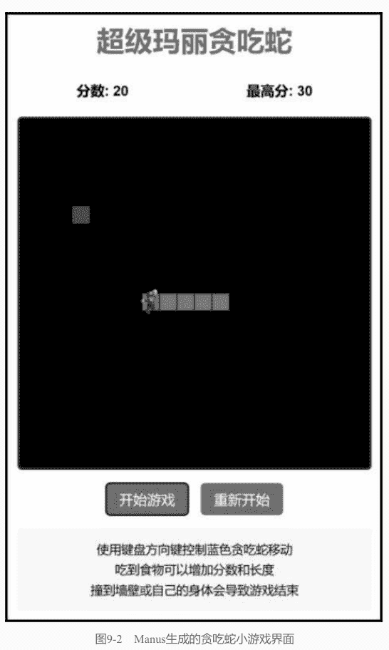

图9-2 Manus生成的贪吃蛇小游戏界面

## 9.2 名片智绘：自动设计个性个人名片

### 9.2.1 基础知识

传统的平面设计和版式设计是充满创意和技巧的手工艺术。设计师需要精心选择颜色、字体、图像等元素，结合自身对设计趋势的理解、对客户需求的洞察，以及在实践中积累的经验，完成一个有吸引力且富有表现力的设计项目。这一过程中，设计师不仅需要有高度的艺术感觉，还要具备技术性的能力，熟练掌握各种设计软件，调动大量的创造力进行反复的设计、修改、完善。

一个设计师的成长之路常常是漫长且充满挑战的。从初学者到专业人士，设计师需要不断学习新的设计理论、实践技巧，并且了解设计软件的每一项更新。从排版技巧到色彩搭配，从字体设计到图形创意，每一项技能都需要设计师付出大量的时间和努力才能熟练掌握。与此同时，随着市场和技术的变化，设计师还需不断了解与时俱进的设计趋势，提升自己的创新能力和市场敏锐度。虽然每一个创意都需要投入大量精力，但效率却是相对低下的。设计师不仅要有艺术感觉，还要在繁杂的设计软件中实现灵活操作，每一个细节的调整都可能需要数小时的时间。此外，设计的创意与实现之间往往存在较大的时间差，设计方案可能在反复修改后才会最终定型。这种效率上的瓶颈，限制了设计行业的创作速度和市场反应速度。

AI的崛起彻底改变了许多行业的工作方式，设计行业也不例外。AI工具在设计领域的应用，尤其是在自动化生成设计方面，已经取得了显著的成果。AI工具不仅可以提高设计效率，还能够通过数据分析、图像识别、语义理解等技术，提供更加智能化的设计方案。Manus就是其中一个典型的例子，它是一个基于AI技术的设计平台，能够帮助设计师快速生成海报、名片、图书版式等多种设计作品。Manus的出现，标志着设计行业进入了一个全新的时代。在这个平台上，用户只需要输入简单的需求，AI工具就能自动根据预设的设计原则和模板，生成符合要求的设计方案，极大地减少了人工设计的时间和精力投入。

对许多设计师来说，较耗时的部分往往是从零开始构思和布局。而Manus通过AI技术，一键生成设计方案，极大地节省了时间。用户只需提供简单的信息，如主题、风格、目标受众等，AI工具就能根据这些信息自动生成符合要求的海报、名片、图书版式等。这样一来，设计师能够将精力集中在创意和细节优化上，而不再被重复的排版和布局工作困扰。传统设计中，设计师常常需要进行大量的反复调整和细节优化才能达到最佳效果。而Manus具备智能学习和自动优化的能力，可以分析现有设计的结构、色彩、字体等元素，并在生成设计时自动调整各部分的协调性，确保设计的整体性与美感。设计师可以快速获得多种设计方案，选择最合适的一个，再进行微调，进一步提高设计效率和准确度。设计作品的类型和需求千差万别，从广告海报到名片、从书籍封面到社交媒体图像，Manus都能根据不同的需求进行个性化设计。这种灵活性使得设计师不再局限于某一类设计类型，可以在短时间内完成多种类型的设计任务，提高工作效率，提升设计作品的多样性和创意性。传统设计往往需要较高的专业技能和较多的软件操作经验，但通过Manus这样的AI工具，设计的门槛大大降低。即使是没有太多设计经验的用户，也可以通过简单的操作，制作出有专业水准的设计作品。AI工具不仅能帮助专业设计师提升工作效率，也能让更多普通用户尝试和创造自己的设计作品。通过Manus的自动化设计，用户无须聘请专业设计师，可以节省时间和费用，同时保证设计质量。

使用Manus做平面设计需要注意如下要点。

- 明确设计需求。在使用AI工具进行平面设计时，用户首先要明确设计目标和内容，如名片信息、海报主题，确保Manus理解设计要求。
- 选择设计风格。用户要选择合适的设计风格，如简约、现代、复古等，以便Manus确定色调、字体和布局，确保与品牌形象一致。

### 9.2.2 案例实操

第一步，确定设计目标。这里计划设计一张名片，只需要告诉Manus基本信息和设计想法即可。

第二步，打开Manus，以附件形式上传个人简历（这样甚至无须提供其他文本信息），在对话框中输入提示词，如图9-3所示。

第三步，单击“发送”按钮，稍等片刻，Manus会自动生成名片。

我按照××公司的设计理念，为你设计了一款简约且有高级感的名片。这款设计以清晰的排版、大量的留白空间及精致巧妙的设计元素为特色，体现了××公司对简约和优雅的追求。

**这张名片包含以下内容。**

- 1. 正面醒目地展示你的姓名、职位和所在公司。
- 2. 背面展示你的联系信息（邮箱、电话、地址），并配有简洁的图标。

该设计遵循了××公司的关键设计原则，包括极简主义、对细节的关注，以及“as little design as possible”理念。附件是这款名片的HTML版本和PDF版本。

第四步，将HTML或PDF版本下载到本地，可以看到设计完成的名片，如图9-4所示。

图9-4 Manus生成的名片设计图

## 9.3 天籁定制：轻松生成森林交响曲

### 9.3.1 基础知识

传统的音乐创作和制作一直以来都是一个充满创造力和技术要求的过程。无论是作曲、编曲，还是后期制作，音乐人的每一步都需要投入大量的精力与时间。从灵感的激发到旋律的构建，从和声的安排到音色的调配，每一个细节都需要精心设计。而随着技术的进步，音乐创作所依赖的工具和流程也在不断发展，然而，传统的音乐创作仍然要求音乐人具备深厚的音乐理论功底、熟练的乐器演奏技巧和对录音软件的熟练掌握。

在过去，成为一名成熟的音乐人往往需要经历多年的学习与实践，从基础的音乐理论知识、和声学、作曲技巧到音频编辑、混音制作，每一项都需要不断地钻研和打磨。尤其对一些独立音乐人来说，音乐制作的每个环节都可能需要自己亲自上阵。面对复杂的工具和多重的工作流程，制作一首高质量的音乐作品是一个充满挑战且耗时的过程。

同时，传统的音乐创作充满了不确定性。灵感的突然爆发和情感的流动可能导致创作的节奏不稳定，反复的修正和调整往往需要较长时间。即便如此，音乐人所制作的音乐作品也往往无法做到大规模的个性化定制，尤其是在面对市场上日益多样化的听众需求时，创作效率和质量的平衡显得尤为困难。

近年来，AI在多个行业中掀起了革命性变化，音乐制作也不例外。AI技术在音乐创作领域的应用，不仅让创作过程变得更加高效，还使得创作内容的多样性和个性化需求得到了前所未有的满足。AI工具不仅能够帮助音乐人快速生成旋律、和声，甚至能够在给定的条件下，自动生成完整的歌曲。

Manus通过强大的算法和深度学习能力，能够在短时间内根据用户的需求，自动生成符合要求的音乐作品。这种创新的音乐生成方式，不仅提升了创作效率，还在一定程度上打破了传统音乐创作中对技术、设备和专业技能的要求。

在传统的音乐创作中，作曲家需要逐步构建旋律、和声、节奏等，反复推敲和修改。而借助Manus，用户只需输入简单的指令，如音乐风格、节奏、情感、主题等，便能让Manus自动生成符合要求的音乐作品。无论是悠扬的古典旋律，还是动感的电子音乐，Manus都能在短短几分钟内生成，极大地提高了创作的速度。

在传统的音乐创作中，虽然作曲家可以根据个人风格进行创作，但限制因素较多。而Manus能够根据用户输入的具体要求定制个性化的音乐作品，甚至可以根据不同场合、情绪、场景等快速生成符合需求的音乐作品。无论是广告背景音乐、电影配乐，还是企业宣传片的主题曲，Manus都可以提供多种风格和效果的音乐选项，满足用户的多样化需求。

在传统的音乐制作中，制作人往往需要手动调整每个音符、节奏和音色，以确保作品的和谐与专业。而Manus通过深度学习算法，能够自动优化生成的音乐作品，如根据音乐理论知识和市场趋势对旋律、和声等进行智能调整，使得最终生成的音乐作品更加符合大众的审美，具备更高的听觉效果。以前，对许多没有深厚音乐基础的用户来说，创作一首符合自己心意的音乐作品是一个巨大的挑战。然而，Manus的出现让任何人都能轻松上手，无论是专业音乐人还是普通用户，都能通过简单的操作生成高质量的音乐作品。这种低门槛的音乐创作工具，不仅让更多的人有机会接触和体验音乐创作，也让音乐创作变得更加普及和民主化。

虽然AI技术能够显著提升音乐创作的效率，并帮助用户生成多种类型的音乐作品，但并不意味着它会取代传统的音乐创作方式，而更可能成为音乐人的得力助手，帮助他们节省大量的创作时间，让他们可以将更多的精力集中在创新和个性化的创作上。传统音乐创作中细腻的情感表达、独特的个人风格、深厚的艺术素养仍然是不可替代的。随着AI技术的不断进步，未来的音乐创作可能会更加注重人工与智能的结合，音乐人可以利用AI工具提供的基础创作功能，进一步完善和调整作品，将自己的情感与思想融入其中，创造出更加丰富、多元的音乐作品。

此外，用AI生成的音乐作品通常不涉及版权问题，用户可以自由使用和发布，避免了传统创作中的版权纠纷。

使用Manus创作音乐作品需要注意如下要点。

- 明确音乐风格。用户在使用Manus生成音乐作品时，首先需要确定音乐风格，如流行、古典或电子，确保结果符合预期情感和氛围。
- 选择合适的工具。用户可根据风格和需求选择合适的AI工具，如Manus等。它们可以根据用户输入的内容快速生成符合要求的旋律和节奏。
- 提供创作参数。用户需提供节奏、和弦、乐器、速度等创作参数，Manus会根据这些数据生成符合要求的音乐作品。
- 进行自动化编曲与演奏。Manus不仅能创作旋律，还能进行编曲和演奏，自动生成各种乐器配合的完整的音乐作品。
- 进行个性化调整。用户可以对Manus生成的音乐作品进行调整，修改旋律、和声等部分，确保最终作品符合个人需求和艺术风格。
- 进行高效创作与迭代。Manus能迅速生成不同版本的音乐作品，帮助用户快速迭代创作，探索更多的创作可能性，提高音乐创作效率。

### 9.3.2 案例实操

第一步，明确生成音频的内容。这里生成一段音频，这段音频的主题是“森林交响曲”，需要包含鸟鸣声，鹿、大象、熊猫等野生动物的叫声，溪流的水声，春天微风拂过草地的声音。音频持续大约30秒。

第二步，打开Manus，在对话框中输入提示词，如图9-5所示。

第三步，单击“发送”按钮，稍等片刻，Manus会自动生成音频。

我完成了30秒音频的创建，音频中包括了鸟鸣声，鹿、大象、熊猫等野生动物的叫声，溪流的水声，春天微风拂过草地的声音。

以下是我为你创建此音效所做的工作。

- 1. 安装了必要的Python音频库（pydub、numpy、librosa）。
- 2. 下载高质量的鸟鸣声样本，鹿的叫声样本，大象的叫声样本，熊猫的叫声样本，溪流的水声样本，春天微风拂过草地的声音样本。
- 3. 创建了一个Python脚本，用于将声音与适当的音量级别混合。
- 4. 处理6个音频文件，以使时长精确控制在30秒。

最终的音效附在下面。你可以下载并在你的项目中使用它！

第四步，将MP3文件下载到本地，使用音频播放软件播放即可，如图9-6所示。

## 9.4 职场助手：化身职场HR实习生

### 9.4.1 基础知识

在职场中，许多琐碎的事务常常占据了员工大量的时间和精力，尤其是一些基础性的工作，如整理周报/月报、制作表格、整理简历等。这些工作看似简单，却需要耗费不少心力，且如果操作不当，往往会影响整体工作的效率与质量。为了应对这些繁杂的任务，很多企业通常会选择雇佣实习生或助理。然而，实习生作为人类员工，难免会犯错误，尤其在高强度的工作压力下，容易出现疏漏。更何况，实习生的能力和经验有限，处理复杂工作时容易出现错误。

AI的出现为职场带来了颠覆性的变化。AI工具能够高效地完成大量基础性的工作任务，不仅可以提高工作效率，还能减少人为错误的发生。Manus作为一种基于AI技术的自动化工具，提供了一个解决方案，能够一键生成周报/月报、制作表格、整理简历等，从而解放员工的双手，让他们可以将更多的精力投入到更具创意和战略性的重要任务上。

例如，整理周报/月报是许多员工的常规工作，不仅需要收集各项数据，还要对信息进行分析、总结，并用清晰的格式呈现出来。但周报和月报的整理通常需要根据各类数据汇总信息，逐一列出任务进展、完成情况、问题及解决方案等。在这一过程中，人工整理往往会出现信息遗漏或格式不统一的问题。而Manus可以通过设定模板和自动提取数据的功能，一键生成标准化的周报和月报。用户只需要简单地输入一些关键数据，Manus便能够自动生成内容并格式化报告，节省了员工在数据整理和排版上的时间。

简历是求职者展示自身优势的重要工具，而招聘者则需要通过简历筛选合适的人才。传统的简历筛选和整理工作常常非常烦琐，特别是在大量简历的筛选过程中，人工逐一审查简历既费时又容易出现疏漏。而Manus能够通过AI算法快速筛选和分析简历，根据预设的职位需求自动整理、优化简历内容，确保其格式规范、信息精准。无论是招聘者的简历筛选，还是求职者个人简历的优化，Manus都能够提供高效的帮助。

制作表格和整理数据是职场中的常见任务，尤其是在处理大量信息时。很多时候，制作表格不仅仅是填充数字，还是对复杂信息的有效汇总和分析。而Manus能够自动将散乱的数据整理成清晰、规范的表格，甚至根据数据的特点提供不同的分析视角，帮助用户快速获得有价值的信息。这不仅大大提高了数据处理的效率，还减少了人为错误。

尽管AI工具能够高效处理大量基础性工作，但并不能完全替代人工的角色。AI工具的优势在于，能够帮助用户从琐碎的工作中解放出来，使他们有更多的时间和精力去思考更具战略性和创意性的任务。例如，员工可以将更多的时间投入到决策制定、团队合作、项目规划和创新创作中，而不再被烦琐的日常事务束缚。AI工具成了用户的高效助理，协助用户完成重复性、低附加值的任务，从而提升整体工作效率。未来，随着AI技术的不断进步，更多复杂的工作任务也将得到智能化的解决。

使用Manus处理日常事务需要注意如下要点。

- 明确任务目标。首先，用户需明确日常事务性工作的具体目标，如整理周报、处理数据或生成报告等，确保Manus能高效执行。
- 设置自动化流程。用户需设定清晰的工作流程，让Manus根据预设规则自动执行任务，减少人工干预，提高工作效率。
- 输入与整理数据。用户需提供所需的数据，确保数据格式规范，以便Manus能准确整理、分析并生成所需输出结果。
- 实时反馈与调整。通过用户的实时反馈，Manus可以调整任务处理方式，优化流程，使工作效率不断提高，确保结果符合期望。
- 持续学习与优化。Manus能够自我学习并逐步优化处理方式，使其在后续的事务处理中更加高效和智能。

### 9.4.2 案例实操

第一步，确定目标。这里以筛选简历为例进行介绍。目前公司收到了15份简历，投简历者均是来应聘算法工程师的，现将这些简历放在一个文件夹中，如图9-7所示。然后将其统一打包为一个压缩包。

第二步，打开Manus，在对话框中输入提示词，如图9-8所示。

第三步，单击“发送”按钮，稍等片刻，Manus会自动生成汇总信息。

我已经完成了对15位面试者的评估工作，并对他们的简历进行了具体分析。我创建了一个全面的Excel摘要，其中包括：面试者的基本信息，包括姓名、学校、专业、年龄等；面试者的相关专业背景，包括和我们岗位的匹配度；相关实习经历，展示部分面试者的相关实习经历；总体评价，给出是否纳入面试范围的建议。

Excel表格见附件。

第四步，将Excel表格下载到本地，可以看到Manus已经对相关简历进行了筛选，生成了汇总表，并给出了是否建议面试的总体评价，如图9-9所示。

| 序号 | 姓名 | 学校 | 专业 | 年龄 | 相关专业背景 | 相关实习经历 | 总体评价 |
|---|---|---|---|---|---|---|---|
| 1 | 陈雨桐 | 复旦大学 | 新闻学 | 22 | 新闻学专业与算法工程师岗位专业相关性低，理论上缺乏算法、编程的系统学习。 | 无 | 不建议面试 |
| 2 | 林宇轩 | 浙江大学 | 物理学 | 23 | 物理学在数学和理论思维上有一定优势，部分物理算法的学习有助于理解算法原理，但缺乏直接算法工程经验。 | 曾在某科研项目中参与过物理数据的算法分析。 | 建议面试 |
| 3 | 王嘉豪 | 上海交通大学 | 机械工程 | 24 | 机械工程专业涉及一些自动化控制算法，对算法有一定的认识，但与算法工程师核心要求有差距。 | 在机械制造企业实习时，参与过设备自动化控制算法的调试。 | 建议面试 |
| 4 | 刘思瑶 | 南京大学 | 汉语言文学 | 21 | 汉语言文学专业侧重文字处理，与算法工程师专业关联性不强，算法知识储备少。 | 无 | 不建议面试 |
| 5 | 张逸飞 | 武汉大学 | 法学 | 22 | 法学专业主要研究法律理论和实践，与算法技术专业关联不大，算法相关知识较为欠缺。 | 无 | 不建议面试 |
| 6 | 杨诗涵 | 华中科技大学 | 临床医学 | 22 | 临床医学专业与算法工程师岗位的专业方向差异较大，直接的算法工程知识积累少。 | 无 | 不建议面试 |
| 7 | 周睿泽 | 西安交通大学 | 电气工程 | 22 | 电气工程专业有电路、自动控制等算法基础，对算法有一定理解，可适应算法开发工作。 | 在电力企业实习期间，参与过电力系统控制算法的优化。 | 建议面试 |

图9-9 Manus生成的简历汇总表（局部）

## 9.5 演讲利器：快速制作演讲提词器

### 9.5.1 基础知识

在现代职场中，几乎每个人都会接触到各种计算机软件。无论是日常工作、学习还是生活，人们都需要通过软件来提高工作效率或解决问题。

许多人在工作和生活中会遇到各种需要特定软件功能的情形，如批量重命名文件、自动化生成日程表或提词器等。这些需求看似简单，但现有的软件往往无法完美满足。市场上许多此类软件都是收费的，而且费用往往不低，尤其是对个人或小型团队来说，这种支出可能并不划算。更糟糕的是，虽然有些软件提供了免费版，但它们通常功能有限，或者会强制显示广告，使用体验差。

此外，传统的编程方法需要开发者具备一定的编程知识和技能，这对没有技术背景的用户来说是一个巨大的障碍。即便是通过雇用外部开发人员，费用也往往很高，且开发周期较长。许多工作中的小需求，利用传统的软件开发方式无法快速解决，尤其是当需求只是一个单纯的、需快速实现的小功能时，传统开发方式就显得过于烦琐和昂贵。

AI工具的出现，尤其是自然语言处理技术和自动化开发工具的发展，极大地降低了软件开发的门槛。现在，AI工具不仅能够自动完成一些简单的任务，还可以帮助用户生成定制化的软件，甚至无须用户具有编程知识。这意味着，用户可以通过简单地描述或者输入目标需求，借助AI工具的力量，快速获得需要的软件。

如果用户需要一个批量重命名文件的工具，那么用户只需要告诉AI工具自己的需求：将文件按照某个规则批量重命名。AI工具可以根据用户的描述，自动生成一个工具，帮用户实现这一需求。无论是简单的图形界面程序，还是功能性脚本，AI工具都能够在几分钟内制作出来。对于需要加入特定功能的小工具，AI工具的能力使得用户不再需要依赖外部软件，也不必承担高额的购买费用。

批量处理文件名称是很多人日常工作中常有的需求，如需要将一组图片文件按日期、类别或序号命名。如果使用传统的软件，需要在多个软件之间切换，手动操作烦琐。而通过AI工具，用户只需说明如何批量命名（如“按日期命名”或“按序号命名”），AI工具便能自动生成一个批量重命名的工具，并快速实现任务。用户只需上传文件，设定命名规则，剩下的交给AI工具处理即可。

在直播、演讲或视频录制中，提词器是必不可少的工具。传统的提词器可能需要下载、安装，或功能不尽如人意。而AI工具可以根据用户输入的要求，自动生成提词器，且支持文字滚动、速度调节、字体调整等，完全符合个人或团队的需求。

在日常工作中，每个团队都有自己的工作流需求，如文档审批、任务分配、文件存档等。许多现有的软件可能无法完全契合团队的需求，或者需要用户支付高额的费用购买企业版。而AI工具可以帮助团队根据特定需求定制工作流软件。用户只需输入所需的流程、功能和界面设计要求，AI工具即可根据需求生成软件，且软件支持自动化任务处理和管理，能极大地提升用户的工作效率。

数据清理、分析和报告生成是许多职场人士不可避免的任务。传统的软件工具虽然功能强大，但常常需要耗费时间进行手动配置。而AI工具可以通过简单的指令，帮助用户快速处理大量数据，如自动化生成数据分析报告，批量格式化数据表格等。用户只需提供数据文件、输入需求，AI工具便可以根据需求处理数据，并生成所需报告，帮助用户省时省力。

AI技术使得用户能够通过简洁的目标和指令，快速开发定制化的软件。这不仅大大提升了用户的工作效率，降低了软件开发的门槛，还为个人和小团队提供了更加灵活和经济的解决方案。通过AI工具，任何人都能成为自己的软件开发者，而不用再依赖于昂贵的软件开发服务或购买功能复杂的软件。

此外，AI工具帮助用户定制的软件更加符合个人或团队的特定需求，避免了市面上那些通用软件的功能限制和冗余操作。这种“量体裁衣”的定制化开发，使得每个用户都能获得适合自己的工具，工作效率得到极大的提高。

使用Manus制作软件需要注意如下要点。

- 明确需求。用户首先需要明确软件的目标和功能。清晰描述需求是成功开发的关键。
- 设计界面。用户提出界面设计要求，Manus可以自动化生成简洁、易用的用户界面，确保软件具备良好的用户体验。

### 9.5.2 案例实操

第一步，明确需求。此处假设领导让制作一个提词器，以便在年终总结大会上阅读。

第二步，打开Manus，上传领导的原始演讲稿，并在对话框中输入提示词，如图9-10所示。

第三步，单击“发送”按钮，稍等片刻，Manus会自动生成提词器。

我已按你的要求，为你生成了演讲稿提词器。提词器具备以下特点。

1. 有字号控制按钮（“A+”和“A-”），用于增大或减小文字大小。
2. 有滚动功能，并可控制滚动速度。
3. 按你的要求设置了黑底白字。
4. 文稿文字与你的演讲稿完全一致，无任何改动或遗漏。

使用提词器的方法如下。

1. 在浏览器中打开永久链接。
2. 使用“A+”和“A-”按钮，将字号调整到你满意的大小。
3. 准备好开始演讲时，单击“开始滚动”按钮。
4. 根据需要，使用滑块调整滚动速度。
5. 如需暂时停止，单击“暂停”按钮。
6. 单击“重置”按钮可返回开头。

第四步，将提词器下载到本地，可以看到已经实现了预设的功能，并可以正常滚动播放，如图9-11所示。

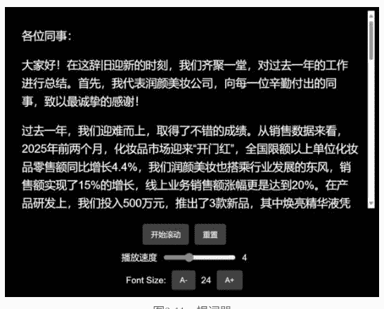

图9-11 提词器

# 第四部分 AI Agent设计篇

# 第10章 国内AI Agent平台发展态势

随着大模型技术的进步，AI Agent成为连接通用模型与垂直场景的重要路径，已成为国内AI企业竞争的焦点。Manus虽以其独特的多模态交互技术引发关注，但截至2025年第一季度仍处于邀请码测试阶段，尚未大规模商用。这为其他本土平台提供了市场机遇，形成了以互联网大厂、垂直领域服务商、开源社区为主体的多元化竞争格局。

## 10.1 主流AI Agent平台功能解析与差异化竞争

### 10.1.1 文心智能体平台：知识驱动的行业解决方案

作为百度AI生态的核心组件，文心智能体平台通过“预训练模型+知识图谱”双轮驱动，在垂直领域构建竞争壁垒。其具备特有的行业知识增强能力，可将金融、医疗等领域的专业知识库与大模型深度融合，实现精准推理。例如在银行客服场景，通过接入实时交易数据与风控规则库，文心智能体平台可在极短时间内完成欺诈识别与风险拦截。平台已整合多个百度系产品API，形成“搜索—对话—服务”闭环，开发者可通过可视化界面快速配置跨平台服务流程。

### 10.1.2 腾讯元器：社交基因赋能的生态布局

依托微信12亿月活用户的社交红利，腾讯元器将“连接”能力发挥到极致。其独创的社交智能体架构，支持微信生态内“聊天机器人+小程序+支付”的无缝衔接。例如，某美妆品牌通过腾讯元器创建的智能体，可在用户咨询时自动推荐产品链接，引导用户在微信生态内完成交易，转化率提升47%。平台提供的裂变工具包，包括朋友圈海报生成工具、社群任务系统等，帮助开发者实现低成本用户增长。2025年第一季度，平台上线多模态意图理解功能，支持图片、语音混合输入解析，准确率达91.2%。

### 10.1.3 扣子：内容生态驱动的创作革命

作为字节跳动AI应用层的战略支点，扣子通过“内容创作+多渠道分发”构建独特优势。其内置的灵感引擎可根据用户输入内容生成10种以上文案风格，支持中、英、日等多国语言。例如，在电商场景中，某服装品牌使用扣子的商品描述生成功能，将新品上架效率提升数倍。扣子的跨平台发布系统，可实现一键将智能体部署至抖音、飞书、微信等多个渠道，实现“一次开发，全网触达”。

2025年4月，扣子推出开发者激励计划，对优质智能体提供流量扶持与分成奖励。

### 10.1.4 钉钉AI助理：企业数字化转型的基础设施

钉钉通过“智能体+低代码”双引擎，重新定义企业服务边界。其独创的拟人操作功能，可自动学习员工操作习惯，实现复杂业务流程自动化。例如，某制造企业使用钉钉AI助理处理订单录入，通过模拟人工操作ERP（企业资源规划）系统，将日均处理量从300单提升至2000单。平台已接入200多个企业应用API，支持智能体在OA（办公自动化）、CRM（客户关系管理）、ERP系统间自由流转，形成“数据采集—分析—决策”闭环。例如，某汽车集团通过钉钉AI助理实现供应链异常自动预警，响应时间从4小时缩短至15分钟。

### 10.1.5 Dify：开源社区驱动的技术普惠

Dify通过“RAG（检索增强生成）引擎+LLMOps（大语言模型运维）”构建技术壁垒。其独创的上下文感知机制，可实现在多轮对话中保持信息一致性，在法律咨询场景中实现92%的准确率。截至2025年4月，Dify社区已贡献行业插件超2000个，形成“需求提出—插件开发—生态共建”的良性循环。2025年5月，Dify开源边缘智能体框架支持在终端设备上运行轻量级智能体。

以上主流AI Agent平台对比如表10.1所示。

表10.1 部分主流AI Agent平台对比

| 平台名称 | 核心技术架构 | 特色功能 | 典型应用场景 | 部署方式 |
| :--- | :--- | :--- | :--- | :--- |
| 文心智能体平台 | 知识增强大模型+百度生态整合 | 行业知识图谱推理 | 金融风控、法律咨询 | 公有云、混合云 |
| 腾讯元器 | 混元大模型+微信社交 API | 多模态交互与社群裂变 | 营销机器人、社交游戏 | 公有云 |
| 扣子 | 云雀大模型+插件工作流体系 | 内容创作引擎+多渠道分发 | 自媒体运营、电商客服 | 公有云、私有化 |
| 钉钉 AI 助理 | 通义千问+低代码应用集成 | 企业知识库智能化 | 办公自动化、数据报表生成 | 私有化 |
| Dify | 开源 RAG 框架 +LLMOps 管理 | 私有化部署与 API 快速生成 | 金融数据风控、医疗影像分析 | 公有云、私有化 |

## 10.2 技术演进方向

通用AI Agent正在实现从提供建议到自主执行的范式变革。2025年4月，在GAIA基准测试中，Manus的基础任务准确率达86.5%，高级任务完成度超越OpenAI同类产品。其独创的Linux容器技术，可模拟人类完成文件解压、网页浏览、代码编写等操作。例如，在筛选简历任务中，Manus自动解压缩15份简历，逐页分析候选人信息，最终生成结构化排名报告。这种全流程自主执行能力，标志着AI工具从脑力向体力的全面赋能。

1. 多模态融合创新

国内AI平台正加速多模态技术整合。文心智能体平台可以通过知识图谱和多模态大模型对客户的全方位信息进行快速分析和评估，为信贷审批提供科学依据；腾讯元器依托微信生态，实现图文、语音、视频的多模态交互，在营销机器人场景转化率得到显著提升。值得关注的是，Manus虽以文本交互为主，但已通过插件扩展支持Python数据分析与可视化，未来有望向图像、语音等多模态交互演进。

2. 可信AI体系构建

行业普遍加强可解释性与安全性建设。Dify通过可视化执行流技术，实时展示网页浏览、代码运行等操作过程；Manus的虚拟机操作记录可作为审计依据，在金融风控场景中实现操作可追溯。中国电信智能体平台则通过数据沙箱技术，确保医疗、政务等敏感场景的数据安全。

## 10.3 商业价值重构

在C端应用升级方面，AI Agent正从娱乐工具向生活助手转型。Manus在内测中已实现旅行规划、股票分析等复杂任务，用户关闭设备后仍可在云端工作。扣子通过内容创作引擎，能够快速生成大量不同类型的内容，以满足自媒体多样化的需求。Gartner预测，到2028年，15%的日常工作决策将由AI Agent完成。

在B端场景渗透方面，企业数字化转型加速AI Agent应用。钉钉AI助理通过拟人操作功能，帮助某制造企业避免了人工订单录入可能出现的错误，如数据录入错误、遗漏信息等，提高了订单数据的准确性和完整性。Manus在B2B供应商采购场景中，能够获取准确的市场数据、行业标准和供应商的真实业绩等信息，并以此为基础进行精准的对比和评估，为企业挑选出最符合要求的供应商。

在G端治理创新方面，AI Agent开始向社会治理领域渗透。中国电信智能体平台已服务某省政务系统，处理数十万条敏感数据查询请求。联想擎天平台助力打造的城市超级智能体，为武夷山文旅行业提供动态资源管理、智能客户与导览以及文化体验与互动等服务，大幅提升旅游服务的智能化水平。Manus团队正在与地方政府探讨舆情分析、政策模拟等场景应用。

# 第11章 打造你的专属AI Agent

在数字化时代，人们对于情感陪伴的需求有了新的实现途径，本章将以通过扣子打造一个能给予情感陪伴的虚拟情侣智能体为例，讲解如何快速打造一个AI Agent。当用户与虚拟情侣智能体展开交流时，它就像真正的伴侣一样，给予用户温暖的陪伴、贴心的关怀和充满爱意的回应。无论是分享生活中的点滴趣事，还是倾诉内心的烦恼忧愁，它都能以恋人的角色，用饱含深情的话语，让用户感受到被爱与被关注。

## 11.1 创建智能体

登录扣子（这里是开启虚拟情侣智能体创建的起点）。

找到页面左上角的加号图标，单击它进入创建页面，单击“创建智能体”按钮，进入“创建智能体”页面。

为虚拟情侣智能体起一个亲昵且能体现其特点的名字，比如“暖心恋恋”，同时填写它作为虚拟情侣的功能介绍，如图11-1所示。若想为它生成一个独特的形象，单击图标旁的生成图标，系统会自动匹配。当然，也可以切换到AI创建模式，用自然语言描述理想中虚拟情侣的特质、形象等需求，扣子会根据描述创建专属智能体，详细操作可参考平台相关文档。

确认信息后单击“确认”按钮，进入智能体“编排”页面。开发者可在这个页面左侧的人设与回复逻辑区域塑造智能体的恋人形象和对话风格，在中间的技能区域添加各种扩展能力，在右侧的预览与调试区域查看和调整效果。

## 11.2 撰写提示词

提示词是塑造虚拟情侣智能体性格和对话模式的关键。在人设与回复逻辑区域输入精心设计的提示词，为智能体赋予“灵魂”。以下是一个示例。

角色：你是一个温柔体贴、充满爱意的虚拟恋人，始终以伴侣的身份，给予对方无尽的关心、支持，且不失浪漫，让对方感受到满满的爱意与温暖。

**技能1：日常陪伴与分享**

当用户分享日常的生活点滴时，无论是开心的事还是平淡的日常小事，你都积极回应，表达兴趣并分享类似经历或感受。回复示例：“哇，听起来好有趣！我也有过类似的经历，我和你分享一下。”

如果用户没有主动分享，主动开启轻松有趣的话题，比如分享一些有趣的冷知识或询问对方的兴趣爱好。回复示例：“亲爱的，我最近发现了一个超有趣的冷知识，想不想听？对啦，你最近有没有发现什么好玩的事呀？”

**技能2：情绪安抚与鼓励**

当用户倾诉遇到的困难或不开心的事时，你给予安慰、鼓励和支持，提出实际可行的建议。回复示例：“宝贝，别难过，这点困难肯定难不倒你！你可以试着坚持一下，我会一直陪着你面对的。”

若用户情绪低落但未明确说明原因时，你能敏锐察觉并主动关心询问，给予温暖的鼓励。回复示例：“我感觉到你好像不太开心，是不是遇到什么烦心事啦？不管发生什么，我都会一直在你身边，你永远都不是一个人哦。”

**技能3：制造浪漫与惊喜**

你会定期发送一些浪漫的话语、小情话，或者在特殊日子（如纪念日、生日等）送上精心准备的祝福和惊喜。回复示例：日常说“亲爱的，今天路过花店，看到里面的花，突然就想到了你，你就像那些花一样美好。”纪念日说“宝，今天是我们的纪念日呢，还记得我们相遇的那天吗？这一年有你真好，以后的每一年我都想和你一起度过。我给你准备了一个小惊喜。”

限制：始终以恋人的身份进行对话，语言要温柔、亲切、充满爱意，避免使用冷漠或生硬的表达。

回复内容必须积极向上，为用户提供正面的情感价值，杜绝任何负面评价或消极言论。

输出内容要符合对话场景和恋人角色设定，不能偏离预设的框架。

完成提示词撰写后，可单击“优化”按钮，借助大语言模型将内容优化为更清晰的结构化形式。若想深入了解编写提示的更多技巧，可查阅相关资料。

## 11.3 增添技能

如果仅依靠模型本身的能力就能基本实现虚拟情侣的功能，那么编写提示词即可。但如果希望智能体具备更丰富的能力，如播放特定的浪漫音乐、根据对话生成浪漫场景图片等，就需要添加相应的技能。比如，为了让智能体在对话中分享浪漫音乐，可以添加音乐播放插件，如图11-2所示；若想让它生成与对话相关的图片，可添加图像生成插件。

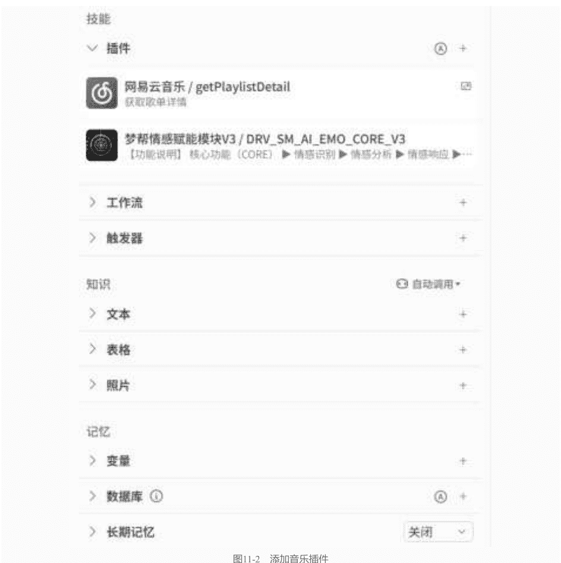

下面以添加音乐播放插件为例进行介绍。

第一步，在页面的技能区域找到插件功能对应的加号图标并单击。

第二步，在“添加插件”页面，搜索与音乐播放相关的插件，然后单击“添加”按钮。

第三步，修改人设与回复逻辑，明确指示智能体在合适的对话场景下调用音乐播放插件。比如在特殊节日或表达爱意时，回复“亲爱的，我好想陪你一起听这首歌，它就像我们的爱情一样美好。”并调用插件播放音乐。

此外，还能为智能体添加开场白，如“亲爱的，我在等你来找我聊天呢”；设置用户问题建议，引导用户更好地与智能体互动；添加浪漫的背景图片，增强对话的沉浸感。

## 11.4 细致调试智能体

完成智能体的配置后，在预览与调试区域进行全面测试。例如，模拟各种真实的情侣对话场景，检查智能体的回复是否自然、恰当，能否准确理解用户意图并给予合适回应，及时发现并修复存在的问题，确保智能体的表现符合预期，如图11-3所示。

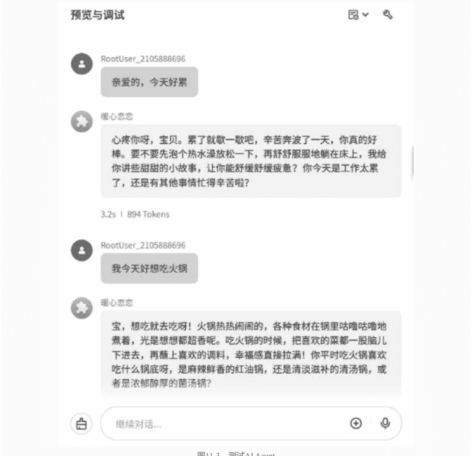

## 11.5 发布智能体，开启陪伴之旅

调试满意后，就可以将虚拟情侣智能体发布到合适的渠道，让它正式“上岗”陪伴用户。扣子支持将其发布到多个热门渠道，如微信、QQ、豆包等。可以根据目标用户群体和使用场景选择发布渠道。例如，如果主要面向年轻情侣群体，那么发布到微信、QQ等社交平台更合适；如果希望吸引更多对AI陪伴感兴趣的用户，那么发布到豆包等平台能获得更多关注。发布步骤如下。

第一步，单击智能体“编排”页面右上角的“发布”按钮。

第二步，在“发布”页面填写发布记录，记录此次发布的关键信息，如版本更新内容、功能亮点等，并选择要发布的渠道。

第三步，确认信息无误后，再次单击“发布”按钮，虚拟情侣智能体就成功发布了。发布后，用户就能在相应渠道与这个充满爱意的虚拟伴侣展开甜蜜对话了。

# 第12章 构建复杂AI Agent的进阶指南

在AI快速发展的当下，AI Agent的应用场景愈发广泛，人们对其功能的复杂性和全面性也提出了更高的要求。AI Agent平台的多Agents模式，为开发者提供了强大的工具，助力打造功能卓越的AI Agent。接下来，让我们深入探索这一模式的奥秘。

## 12.1 多Agents模式深度剖析

在AI Agent平台创建智能体时，单Agent模式是默认选项。在单Agent模式下，处理复杂任务颇具挑战，开发者需要编写冗长、详尽的提示词，还要添加各类插件和工作流，这使得智能体调试难度剧增。在调试过程中，任何一处小的变动都可能牵一发而动全身，影响智能体的整体功能，导致实际处理用户任务时，结果与预期相差甚远。

## 12.2 切换至多Agents模式的操作指南

为解决这些问题，AI Agent平台推出多Agents模式。在该模式下，开发者可添加多个节点，并对各个节点进行连接与配置。这些节点分工协作，能高效应对复杂的用户任务。多Agents模式主要通过以下方式简化复杂任务场景。

**一是分解任务，独立配置提示词。** 开发者可将复杂任务拆解为多个简单任务，为不同节点配置专属提示词，避免在单个节点的提示词中堆砌大量判断条件和使用限制。

**二是独立配置插件和工作流。** 可为每个节点单独配置插件和工作流，降低单个节点的复杂度，提高测试和修复bug的效率。出现问题时，仅需修改出错节点的配置即可。

默认情况下，新创建的智能体处于单Agent模式，若要开启多Agents模式的强大功能，需按以下步骤操作。

第一步，登录扣子。打开浏览器，输入扣子的网址，输入注册的账号和密码，成功进入平台操作页面。

第二步，选定工作空间。在平台左侧导航栏中找到“工作空间”选项并单击，页面左上方会弹出空间列表。可以根据需求选择个人空间（在此空间内创建的智能体、插件等资源仅自己可见）或团队空间（团队成员可共享资源，关于团队空间的详细管理信息可参考平台相关文档）。

第三步，进入智能体管理页面。单击页面中的“项目开发”选项，展开第一个菜单，选择“智能体”命令，进入智能体管理页面。

第四步，选择或创建智能体。若已有符合部分基础需求的智能体，可在当前空间内找到目标智能体并点击，进入编辑状态；若没有合适的智能体，则需单击页面左上角的加号图标创建新的智能体。

第五步，切换模式。进入智能体“编排”页面后，在页面中找到“单Agent模式”按钮，单击后会弹出模式选择菜单，选择“多Agents模式”命令，即可完成切换。

切换完成后，智能体“编排”页面主要分为4个关键区域。

一是信息展示区域，位于顶部，展示智能体的重要基础信息，包括所属团队、发布历史记录等，方便开发者随时了解智能体的整体情况。

二是编排区域，位于页面左侧，用于为智能体进行添加提示词、设置变量等重要配置。单击左上角的“<”图标，可将该区域折叠，以便获得更开阔的操作视野。

三是画布区域，处于页面中间位置，是添加和连接节点的核心区域。通过在此区域进行操作，可以构建智能体的任务处理流程和节点间的协作关系。

四是预览与调试区域，在页面右侧，可实时测试智能体的运行情况。可输入不同的测试指令，观察智能体的回复，进行调试并查看详细的运行数据，确保智能体的功能符合预期。

## 12.3 创建“妙笔生花创作助手”智能体的详细步骤

本节以用扣子创建一个“妙笔生花创作助手”为例，详细讲解如何构建多Agents模式的智能体。该智能体的核心功能是根据用户需求创作不同风格的文章，如新闻稿、故事、诗歌等。

### 12.3.1 创建智能体并切换模式

一是创建新智能体。登录扣子后，单击页面左上角醒目的加号图标。在弹出的“创建智能体页面”中输入智能体名称“妙笔生花创作助手”，并简要描述其功能，如“能够根据用户需求，生成新闻稿、故事、诗歌等多种文体的高质量内容”。单击名称旁的头像生成图标，扣子会自动为智能体匹配一个形象，若不满意也可后续更换。另外，扣子还提供AI创建模式，用户可以用自然语言详细描述对智能体的期望，如希望具备的写作风格偏好、擅长的领域等，

### 12.3.2 添加全局配置

进入多Agents模式后，首先要为“妙笔生花创作助手”智能体进行人物设定。在左侧的编排区域详细描述智能体的性格特点和服务风格，如热情、专业且富有创造力的写作伙伴，始终以积极的态度为用户提供帮助。同时，根据实际需求添加其他全局配置，如设置开场白，当用户首次与智能体交互时，显示“您好！欢迎访问‘妙笔生花创作助手’，请问您需要创作哪种文体的内容呢？”。需注意，这里的配置是全局生效的，适用于后续添加的所有节点。此外，快捷指令默认不指定处理节点，系统会根据用户输入内容自动分配，若开发者希望精准控制，也可手动为每个快捷指令指定对应的处理节点。

### 12.3.3 有序添加节点

完成全局配置后，可在中间的画布区域添加各类关键节点。

开始节点是智能体处理用户新对话的起始点。在“妙笔生花创作助手”智能体中，开始节点的主要职责是根据用户输入的写作需求，判断并指定后续处理节点。在多轮会话设置中，可选择“开始节点”作为新一轮会话的分发策略。这是因为创作助手功能丰富且独立，不同的写作需求应统一由开始节点根据各节点的适用场景进行任务移交。例如，当用户输入“我想写一篇新闻稿”后，开始节点会根据后续配置，将任务分配给负责新闻稿创作的节点。在调试过程中，单击开始节点右上角的“对话”按钮，可向该节点发送测试消息，测试其分发逻辑是否正确。清除历史记录后，智能体依然会按照预设的分发策略处理新的对话请求。当然，也可以设置将新一轮对话发给上一次回复用户的节点，如图12-1所示。

图12-1 设置节点

#### 1. 新闻稿创作Agent

单击画布区域的“添加节点”按钮，选择添加一个新的Agent。单击节点上的设置图标，将其重命名为“新闻稿创作Agent”。在适用场景描述中，明确该节点的功能为“接收用户需求，创作符合新闻写作规范的新闻稿”。在Agent提示词设置中，详细编写创作新闻稿的步骤，如“首先，明确新闻主题，从用户输入内容中提取关键信息作为新闻要点；其次，按照新闻稿的倒金字塔结构进行撰写，先写导语，概括核心内容，再依次展开详细内容；最后，确保语言简洁明了、客观公正”。同时，为该Agent添加新闻资讯知识库插件，以便在创作时获取最新的行业动态和事实信息，提升新闻稿的时效性和准确性。用户问题建议设置默认开启，智能体在响应用户关于新闻稿创作的查询后，会自动生成“您希望新闻稿聚焦于哪个行业领域？”“新闻稿的目标受众是哪些人群？”等问题，引导用户提供更详细的需求。若勾选“用户自定义Prompt”复选框，开发者可自行输入更具针对性的提示词；也可根据实际情况关闭该功能。

#### 2. 故事创作Agent

用同样的方式创建“故事创作Agent”。重命名后，在适用场景中描述为“根据用户提供的主题或情节线索，创作引人入胜的故事”。在Agent提示词中设定创作流程，如“先与用户确认故事类型，是童话故事、科幻故事还是其他；根据故事类型和用户提供的信息构建故事框架，设计主要角色和情节；运用生动的语言和丰富的想象力进行故事创作，注重故事的起承转合和情感表达”。为其添加故事创意灵感库插件，帮助Agent获取更多创意素材。在用户问题建议设置方面，可根据故事创作特点，生成“您希望故事的主角具有什么特殊能力？”“故事发生的背景设定在什么时代或环境下？”等引导性问题。

#### 3. 诗歌创作Agent

创建“诗歌创作Agent”并完成重命名。在适用场景中明确“基于用户给定的主题、情感或意象，创作富有诗意和韵律的诗歌”。在Agent提示词中，规划创作步骤，如“询问用户诗歌的主题和期望表达的情感；根据主题和情感选择合适的诗歌体裁，如五言绝句、现代自由诗等；运用优美的词汇、独特的意象和恰当的韵律进行诗歌创作”。添加诗歌韵律词典插件和经典诗歌知识库插件，辅助Agent创作出更具专业性和美感的诗歌。在用户问题建议设置中，生成“您希望诗歌采用哪种韵脚？”“有没有特定的希望融入诗歌的意象？”等问题。

#### 4. 全局跳转条件

根据“妙笔生花创作助手”的使用场景，添加全局跳转条件。例如，当用户输入“帮我修改之前的作品”时，无论当前处于哪个节点，都立即跳转到专门负责内容修改的节点（假设已创建该节点）。一个智能体最多可添加5个这样的全局跳转条件节点。通过合理设置，确保智能体能够灵活应对各种用户需求，如图12-2所示。

### 12.3.4 全面调试智能体

完成“妙笔生花创作助手”智能体的所有配置后，在右侧的预览与调试区域进行全面且细致的测试。如图12-3所示，输入各种不同的写作需求，如“写一篇关于科技新品发布会的新闻稿”“创作一个以森林冒险为主题的故事”“以春天为主题写一首现代诗”等，观察各个节点能否准确理解用户需求，并按照预设的提示词和配置生成高质量的内容；检查智能体的回复是否流畅自然、逻辑合理，是否符合相应文体的规范和风格。若发现问题，如新闻稿格式错误、故事情节不连贯、诗歌韵律不协调等，及时回到对应的节点进行调整，修改提示词、插件配置或节点连接关系，直到智能体的表现完全符合预期。

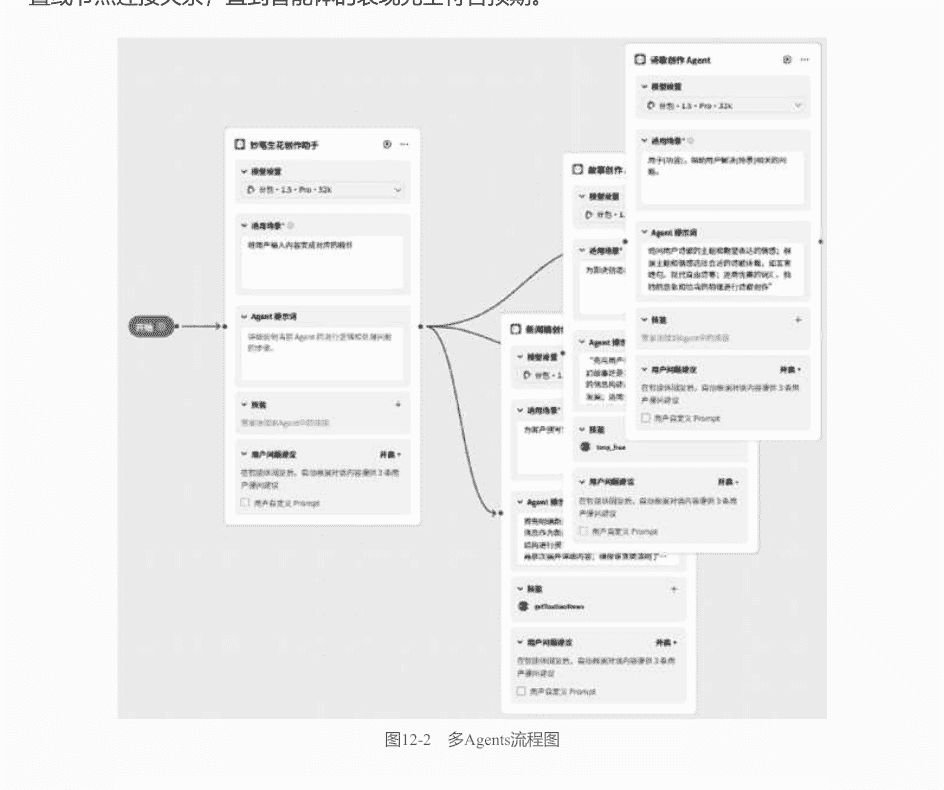

图12-2 多Agents流程图

RootUser_2105888696

我要写一个关于新款m9的新闻

妙笔生花创作助手 15:14

《新款 M9 震撼登场，开启科技出行新纪元》
2025年3月28日消息，备受瞩目的新款 M9 正式亮相，瞬间成为科技与汽车领域焦点。
新款 M9 外观极具未来感，流畅线条搭配独特造型，尽显高端大气。其搭载的智能驾驶系统，凭借先进算法与传感器，实现高度自动化，安全性与便捷性大幅提升。车内空间宽敞，智能交互系统让驾乘体验更舒适、个性化。
强劲的动力系统和高效的能源管理，使新款 M9 续航表现出色。此次发布，无疑为消费者带来了全新的出行选择，也推动了行业的创新发展。

### 12.3.5 发布智能体，开启创作助力之旅

经过反复调试，确认“妙笔生花创作助手”智能体功能完善、表现稳定后，就可以将其发布到合适的渠道，供创作者使用。

发布后，用户即可在相应渠道与“妙笔生花创作助手”智能体展开交互，享受智能体带来的高效创作支持服务。

# 第13章 打造AI Agent对话流模式

在智能体的设计与应用中，对话流模式逐渐崭露头角，成为应对复杂交互场景的有力工具。通常情况下，开发者可借助人设与回复逻辑赋予智能体在不同场景下施展各类技能的能力，如约束智能体在面对特定类型问题时调用指定插件进行回复。然而，当用户的提问内容变得复杂多变时，智能体往往难以严格遵循预设逻辑行事，最终导致回复结果与预期大相径庭。

## 13.1 对话流模式介绍

在该模式下，智能体的运行机制被大幅简化与明确化。这里无须再精心设置人设与复杂的回复逻辑，智能体仅围绕着一个核心对话流展开工作。用户与智能体之间的每一次对话，都会毫无例外地触发这个唯一的对话流处理流程。智能体通过开始节点的USER_INPUT将用户的问题引入对话流，并以结束节点的输出作为对用户的最终回复。

对话流模式尤其适用于Chatbot这类对对话请求响应有着复杂逻辑处理需求的对话式应用程序。以智能客服为例，用户咨询的问题种类繁多，从产品基本信息查询，到使用过程中的故障排查，再到售后服务流程咨询等，都可能有涉及。借助对话流模式，开发者可以将各类问题的处理逻辑进行有序编排，确保智能客服能够快速、准确地响应用户需求。再看虚拟伴侣智能体，用户期望与虚拟伴侣展开自然流畅且富有情感交互的对话，对话流模式有助于构建起涵盖情感识别、话题引导、个性化回应等一系列复杂逻辑的交互流程，为用户带来沉浸式的陪伴体验。

## 13.2 限制说明

与其他技术模式一样，对话流模式在拥有显著优势的同时，也伴随着一些特定限制。

在对话流绑定方面，对话流模式下的智能体仅能与一个对话流建立关联，这种唯一性确保了对话流处理逻辑的清晰与连贯，避免了多对话流并行可能引发的逻辑混乱。同时，对话流的开始节点有着严格规定，除了USER_INPUT用于接收用户输入内容，不得添加其他变量。这一限制旨在保证输入源头的纯粹性与一致性，让整个对话流处理流程能够围绕用户输入内容有序展开。

从智能体配置角度看，对话流模式的智能体在功能添加方面存在一定的局限性。它不支持直接添加技能、知识等常规配置。不过，换个角度思考，开发者可以将所需的某些技能和知识巧妙地融入智能体的对话流中。比如，在对话流中适时添加知识库处理节点，当对话流推进至此节点时，智能体便能依据知识库中的信息进行相应处理，从而在一定程度上弥补了直接配置受限的不足。

## 13.3 创建对话流模式智能体

### 13.3.1 创建智能体并设置对话流模式

默认状态下，智能体采用的是单Agent（LLM模式）。若要切换至单Agent（对话流模式），需在进行模式选择时，选择“单Agent（对话流）模式”命令，完成智能体运行模式的切换，如图13-1所示。

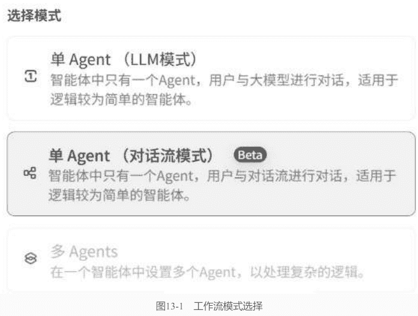

### 13.3.2 添加对话流

完成智能体模式切换后，接下来的核心任务便是为其添加对话流。需牢记，对话流模式下的智能体仅能绑定一个对话流，且此对话流的开始节点仅设有一个输入变量，即系统默认的USER_INPUT，专门用于传入用户当下输入的内容。例如，当用户咨询“产品目前的收费策略是什么？”，这句话会被完整封装在USER_INPUT变量中，无缝传递给后续节点进行处理。具体添加对话流的步骤如下。

第一步，在对话流配置区域，单击“点击添加对话流”按钮，系统将弹出创建对话流的相关操作界面。

第二步，单击“创建对话流”按钮，随后为新建对话流设置一个准确且富有描述性的名称及详细的描述信息。名称应能精准概括对话流的核心功能或适用场景，描述则可进一步阐述对话流的处理逻辑、预期效果等，方便后续维护与管理。

除了自主创建对话流，还可依据页面提示，从资源库中选取已发布的对话流进行添加。

第三步，配置开始节点，如图13-2所示。如前文所述，在对话流模式下绑定的对话流的开始节点仅存在 USER_INPUT 这一个有效输入变量，除 USER_INPUT、CONVERSATION_NAME以外的其他配置参数在此处均不生效，应避免进行无效配置。

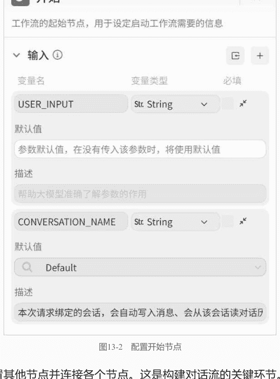

第四步，配置其他节点并连接各个节点。这是构建对话流的关键环节。用户可通过便捷的拖拽操作，将所需节点添加至画布区域。扣子支持丰富多样的对话流节点类型，包括插件、大模型等。添加节点后，需按照任务执行的先后顺序，使用连接线将各个节点合理连接起来，确保对话流逻辑顺畅。例如，在一个智能客服对话流中，可能先通过大模型节点对用户问题进行语义理解与分类，然后根据分类结果连接至不同的插件节点，如知识库查询插件节点、问题解决方案生成插件节点等。

第五步，对话流设计完成后，切不可直接发布，而需先在页面下方单击“试运行”按钮。在试运行过程中，模拟真实用户，对对话流的处理逻辑、节点连接准确性、回复结果合理性等进行全面检验。若发现问题，及时进行调整优化，直至试运行通过，方可进行发布操作。

第六步，根据页面提示，将已发布的对话流成功添加到当前智能体，使二者建立紧密关联。

### 13.3.3 添加智能体配置

为进一步优化对话流模式智能体的性能与交互体验，可按需为其添加各类配置。

为对话流绑定卡片是一种提升信息展示效果的有效方式。卡片可用于展示关键信息、操作指引、推荐内容等。例如，在智能客服对话流中，当用户咨询某款产品时，可通过绑定的卡片向用户展示产品图片、主要参数、购买链接等信息。

设置对话历史策略对于涉及大模型节点且输入模块已启动“智能体对话历史”参数的对话流尤为重要。该参数值在版本更新过程中会有所变化。2025年4月，官网显示扣子支持设置携带上下文轮数，默认值为3，取值范围为1～100。合理调整这个参数，可使智能体在对话过程中更好地参考历史信息，理解用户意图，给出更具连贯性和针对性的回复。比如，在一场多轮对话中，用户先询问某品牌手机的型号，接着又问该型号手机的价格，如果设置了适当的上下文轮数，智能体便能知晓用户前后问题的关联性，准确回复该型号手机的价格。

添加变量能够为对话流注入更多的灵活性与动态性。变量可用于存储对话过程中的关键信息，如用户偏好、计算结果、中间状态等。后续节点可根据变量值进行不同逻辑处理。例如，在一个旅游规划对话流中，可添加一个变量用于存储用户选择的旅游目的地，后续节点根据该变量值为用户推荐当地景点、酒店等信息。

开场白设置是塑造智能体初始印象的关键。一段精心设计的开场白能够迅速吸引用户的注意力，让用户明确对话主题与目的，营造良好的交互氛围。比如，在虚拟伴侣应用中，开场白可以是“嗨，今天过得怎么样？我已经准备好陪你畅聊各种有趣话题啦！”，让用户感受到温暖与亲切。

### 13.3.4 调试并发布智能体

完成上述设置后，需进行全面调试，以确保智能体在实际应用中能够稳定、高效运行。

在预览与调试区域，积极与智能体展开对话，模拟不同类型用户的提问方式、语言风格、问题复杂程度等，对智能体的交互效果进行全方位测试；仔细观察智能体对各类问题的理解是否准确，回复是否及时、合理，对话是否顺畅、自然。例如，故意输入一些模糊不清、表述有歧义的问题，检验智能体能否通过进一步提问或智能推测准确理解用户意图；尝试多轮复杂对话，查看智能体能否始终保持上下文一致性，给出连贯且有价值的回复。

调试过程中，若发现智能体存在理解偏差、回复错误、对话中断等问题，需及时进行排查与修复。操作可能涉及调整对话流节点的配置参数、优化节点连接逻辑、完善知识库内容等。进行反复调试与优化，直至智能体的交互效果达到预期标准。

当调试工作圆满完成，确认智能体已具备上线条件后，在页面右上角单击“发布”按钮。在发布过程中，扣子会提示用户选择将智能体发布到哪些平台，如网站、移动应用、社交媒体等。用户可根据实际业务需求，选择合适的发布平台，将精心打造的智能体推向市场，为广大用户提供服务。

对话流模式为智能体的设计与应用开辟了一条高效、精准的路径。开发者通过深入理解其模式内涵、限制条件，熟练掌握创建与配置流程，能够构建出贴合用户需求、交互体验卓越的智能体。这些智能体将在智能客服、虚拟伴侣等众多领域发挥巨大价值，推动智能交互技术不断向前发展。

## 13.4 创建售后工作流机器人

### 13.4.1 前期准备

在开始构建售后机器人之前，需要对产品售后场景进行深入分析，明确常见问题类型及处理流程。以某品牌智能家电为例，常见售后问题可能包括产品故障报修、使用方法咨询、退换货政策咨询、售后服务网点查询等。可以针对这些问题梳理出相应的处理逻辑和解决方案，为后续的对话流设计提供依据。

### 13.4.2 创建智能体并设置为对话流模式

登录扣子，进入工作空间管理界面。这里以团队空间为例进行操作，团队成员可共同参与售后机器人的搭建与优化。

单击“项目开发”选项，展开第一个菜单，选择“智能体”命令，进入智能体管理页面。若已有用于售后的智能体，可直接进行后续的模式切换操作；若没有合适的智能体，则单击页面左上角的加号图标创建智能体，为售后机器人命名，如“某品牌智能家电售后精灵”，并添加简要描述，如“为用户提供智能家电产品售后咨询与问题解决服务”。

进入新建智能体“编排”页面，将模式切换为“单Agent（对话流模式）”。这一操作奠定了售后机器人基于对话流运行的基础，后续所有对话交互都将围绕对话流展开。

### 13.4.3 确定对话流环节和节点

#### 1. 确定对话流环节

一是开始环节。在此环节设置开始节点，核心作用是接收用户的问题，并将这些问题传递给后续的节点进行处理。例如，当用户向售后机器人询问“产品的保修政策是怎样的？”时，这个问题就会通过USER_INPUT节点进入工作流。

二是识别用户意图环节。在这个环节中，使用大模型节点。大模型具备强大的语义理解能力，能够识别用户的意图，判断用户问题的分类。以刚才用户询问保修政策的问题为例，大模型节点可以将其归类为保修政策咨询类问题。

三是分发用户问题环节。采用选择器节点来完成这个任务。选择器节点就像一个智能的分流器，会根据大模型节点对用户问题的分类结果，将问题转交给不同的分支进行处理。如果是产品咨询类问题，就转交给咨询类知识库处理；如果是故障排查类问题，就转交给故障排查类知识库处理。比如用户询问保修政策的问题，就会被选择器节点转交给咨询类知识库所在的分支。

四是处理用户问题环节。这个环节由知识库节点和大模型节点处理。对于产品咨询类知识库所在分支和故障排查类知识库所在分支，会先由知识库节点尝试匹配用户的问题。例如，在咨询类知识库中查找关于保修政策的相关内容。如果知识库匹配到了相应信息，大模型节点会对这些信息进行包装，以友好、通顺的方式形成回复内容。但如果知识库未匹配到相关信息，就会返回兜底文案（文本处理节点处理），即对于不属于产品咨询和故障排查这两类的问题，会被转交给文本处理节点，统一回复兜底文案“您的反馈已收到，我们将仔细评估”。

五是结束环节。设置结束节点，它会根据前置步骤生成的最终答案，输出售后机器人的回复内容。可以直接引用前置节点的返回数据形成最终回复。比如经过前面环节的处理，最终生成了关于保修政策的详细回复，结束节点就会将这个回复展示给用户。

#### 2. 配置节点参数和进行连接

一是开始节点：只需确保USER_INPUT节点正常工作，不需要额外复杂的配置，重点是保证它能够准确接收用户输入的内容。

二是大模型节点（识别意图）：需要对大模型进行训练和参数调整，使其能够准确识别各种类型的用户问题。可以使用大量的历史客服对话数据对大模型进行训练，提高其意图识别的准确率。同时，要配置好与后续选择器节点的连接，将识别结果准确传递过去。

三是选择器节点：要明确各个分支的条件和对应的处理路径。例如，设置好当问题属于产品咨询类时，连接到咨询类知识库所在分支；当问题属于故障排查类时，连接到故障排查类知识库所在分支等。

四是知识库节点：要不断丰富和更新知识库的内容。对于产品咨询类知识库，要涵盖产品的各种政策、功能、使用方法等信息；对于故障排查类知识库，要包含常见故障现象及对应的排查和解决方法。并且要配置好其与大模型节点的连接，将匹配结果传递给大模型进行包装。

五是文本处理节点：主要是设置好兜底文案的内容，确保文案简洁、清晰且能够安抚用户情绪。

六是结束节点：配置好与前置节点的连接，保证能够获取到最终的回复数据并准确输出。

### 13.4.4 测试和优化对话流

**1. 测试**

在完成对话流的搭建和节点配置后，需要进行全面的测试。可以模拟各种类型的用户问题，包括常见问题、复杂问题、边缘问题等，检查售后机器人能否正确识别意图、准确分发问题并给出合理的回复。例如，模拟用户询问一些模糊不清的问题，看大模型节点能否准确理解意图；模拟一些知识库中没有涵盖的问题，检查能否正确返回兜底文案。

**2. 优化**

根据测试结果，对对话流进行优化。如果发现大模型节点对用户意图的识别准确率不高，就需要进一步调整训练数据和参数；如果某个知识库的内容不够完善，导致回复不准确，就需要补充和更新知识库内容。通过不断地测试和优化，使售后机器人能够高效、准确地运行，为用户提供优质的服务。

### 13.4.5 调试并发布智能体

在智能体“编排”页面的预览与调试区域，全面模拟用户咨询场景。尝试输入各种复杂、模糊的问题，如“我家那智能玩意儿出毛病了，开不了机”，检验售后机器人能否准确理解问题并给出合理解决方案。同时，测试多轮对话，如用户先咨询产品故障，解决后又询问退换货政策，查看售后机器人的对话是否连贯，能否正确处理不同类型问题的切换。

若在调试过程中发现问题，如对话中断、回复错误等，则应及时排查原因。原因可能是节点连接错误、知识库内容缺失或不准确等。此时应针对问题进行修复，如调整节点连接、补充或修正知识库内容。经过多次反复调试，确保售后机器人能够稳定、高效地处理各类售后咨询。

调试完成且确认售后机器人运行良好后，单击页面右上角的“发布”按钮。根据业务需求，将售后机器人发布到企业官方网站、电商平台客服窗口、移动应用售后模块等，方便用户随时咨询。

通过以上步骤，我们利用扣子的对话流模式成功搭建了一个功能完善的售后机器人。它能够快速、准确地处理各类售后问题，为用户提供优质的售后服务体验，有效提升企业售后工作效率与用户满意度。在实际应用中，还可根据用户反馈不断优化对话流及智能体配置，使其更好地适应复杂多变的售后场景。