# OpenClaw+DeepSeek+Coze+飞书：AI智能体高效工作指南


## 内容简介

本书是一本引领创作者全面迈入 AI 智能体（Agent）时代的自动化实战指南。全书不仅系统深入地介绍了 DeepSeek、扣子（Coze）与飞书云文档三大核心工具的协同应用方法，而且引入了极具突破性的自主式智能体工具——OpenClaw，手把手指导读者完成工具的私有化部署、飞书办公平台的无缝接入以及各类实战技能（Skill）的安装与调试。这部分内容将帮助读者轻松打造出 24 小时全自动运行的专属数字分身，让 AI 真正长出“手脚”，实现从“被动响应交互”到“主动执行任务”的跨越。

全书依据媒体内容的不同形式，详细讲解了如何运用 AI 技术实现各类媒体内容的高效创作。从 DeepSeek 的提示词进阶优化与文本生成，到扣子的多智能体开发与流程搭建，再到飞书多维表格的批量处理与 AI 插件应用，本书层层递进，引导读者从零基础操作快速进阶至多工具协同的实战应用。

无论你是刚接触 AI 工具的初学者，还是渴望进一步提升自动化水平、打破产能瓶颈的内容创作者，通过 OpenClaw 的全自动调度与三大生成工具的强强联合，本书将帮助你实现从“人工操作”到“全自动智能操作”的生产力跃迁，在媒体内容 AI 化转型的浪潮中抢占先机。

此外，本书体系完整、案例丰富，不仅适合个人读者自学进阶，也非常适合作为各类院校人工智能及新媒体相关课程的实训教材使用。


## 前 言

当下自媒体的爆发式增长正在重塑信息传播与商业营销的格局。从图文创作到视频制作，从粉丝运营到商业变现，内容创作者们面临着前所未有的机遇与挑战。为了帮助创作者突破“人工操作”的效率瓶颈，本书引入了具有里程碑意义的自主式智能体（AI Agent）——OpenClaw，并创新性地整合了 DeepSeek 大语言模型、扣子（Coze）智能体平台与飞书协同办公系统，旨在为读者打造一套集“全自动化执行、智能内容创作与多 Agent 团队协作”于一体的三位一体解决方案，开启 AI 驱动的 24 小时全自动工作模式。

本书构建了覆盖“选题策划—内容生产—运营管理”全链路的智能工作流。其中，OpenClaw 作为“主动执行”的核心大脑，彻底打破了传统 AI“被动问答”的局限，实现了跨应用调度、长期记忆与自主执行；扣子（Coze）平台不仅提供个性化智能体的快速部署，更支持 OpenClaw 的极简“一键部署”；DeepSeek 提供从文案生成到数据分析的顶级 AI 认知算力；飞书则作为协作中枢与交互入口，串联起人、内容与自动化流程，帮助读者实现从“单兵作战”到“多智能体（Multi-Agent）协作”的跨越式升级。

全书采用“基础操作—专项突破—综合实战—全自动化进阶”的渐进式设计：

第 1 章至第 3 章系统讲解三大平台的基础联动与多模态内容生产，涵盖 DeepSeek 使用途径、文本创作技巧（如爆款标题、结构化写作、消除 AI 味），以及 AI 生成图像、音乐与视频的实战方法。

第 4 章至第 6 章分别以飞书多维表格和扣子智能体为核心，演示如何实现批量文案生成、智能客服搭建、热点聚合等场景，并提供爆款短视频生成器、SEO 素材生成等丰富的提效模板；同时详解了如何结合批量生成的内容制作数字人营销视频。

第 7 章（重磅进阶）聚焦 OpenClaw 的全自动工作流实战。本章手把手指导读者在扣子平台极简部署 OpenClaw 并无缝接入飞书，以及通过 ClawHub 安装各类强大的自动化 Skill（技能）。本章结合自媒体痛点，深度演示了高阶实战技巧：如何利用 Tavily 引擎获取高质量的精准资讯、如何一键将视频解析为详细的分镜头脚本、如何自动抓取微信公众号文章并改写为小红书爆款风格、如何自动编写文章并同步至公众号草稿箱。本章还揭秘了如何通过设置定时任务，让 OpenClaw 实现自我发现能力缺口并自动寻找安装新技能的“自主进化”，让你的 AI 助理越用越聪明。

在内容产业进入智能工业化生产的今天，掌握全自动化 AI 工具已不是可选项而是必选项。我们相信，本书将成为内容创业者的效率手册、企业新媒体团队的实训教材、营销从业者的智能弹药库。

特别提示：在编写本书时，参考并使用了当时最新的 AI 工具界面截图及功能作为实例进行编写。然而，由于从书籍的编撰、审阅到最终出版，存在一定的周期，在这个过程中，AI 工具可能会进行版本更新或功能迭代，因此实际的用户界面及部分功能可能与书中所示有所不同。提醒各位读者在阅读和学习的过程中，要根据书中的基本思路和原理，结合当前所使用的 AI 工具的实际界面和功能进行灵活变通和应用，举一反三。

编著者

## 第1章 掌握DeepSeek、扣子、飞书的基本操作

### DeepSeek 的基本使用方法

#### 什么是 DeepSeek

2025 年最值得关注的现象级产品，除了《哪吒 2》，就是 DeepSeek。它不仅获得了广大 AI 爱好者的认可，也深受国内头部企业和机构的青睐。

DeepSeek 由杭州深度求索公司研发，是一款功能强大的智能平台。它能精准理解并生成自然语言，帮助用户快速获取信息、解答问题，还能高效完成文章撰写、故事创作等任务。其出色的多语言支持和持续更新的知识库，为用户提供了跨语言的知识探索和内容创作支持。下图为 DeepSeek 官网页面。


#### 使用 DeepSeek 的 5 种方法

DeepSeek 目前提供了 5 种主流使用方式，以满足不同的场景需求。

- 官网使用：通过浏览器访问官网直接体验，无须下载，便捷高效。
- API 调用：开发者可通过华为云、百度智能云、阿里云百炼、腾讯 ima 等平台 API 接入 DeepSeek，集成至自有应用。
- 本地化部署：使用 Ollama、Chatbox 等工具在本地运行 DeepSeek，保障数据隐私及离线使用，适合敏感数据处理场景。

### 如何选择 DeepSeek 平台

DeepSeek 已通过开源策略覆盖多个平台，但由于不同平台的数据调用范围和联网检索能力不同，选择不同的接入方式会影响回答的质量。以下是几个关键考量因素。

### 基础能力

各平台部署的 DeepSeek 模型相同，因此在不联网的情况下，回复质量基本一致。

### 数据源特征

不同平台在联网搜索时依赖的数据源不同，影响回答的深度和广度，主要区别如下。
- 腾讯元宝：深度整合微信公众号内容，适合查询公众号文章、行业分析等。
- 百度智能云（DeepSeek 最新版）：依托百度搜索，擅长检索全网公开资料、学术文献和百度文库，适合研究和专业领域。
- 秘塔 AI 搜索：支持全网 + 学术 + 播客检索，尤其擅长英文论文和期刊文献，并提供详细的参考文献列表。
- 官方版 DeepSeek：主要依赖白名单网站（如知乎、CSDN、雪球等），搜索范围相对较窄。
- 豆包 & Kimi：截至 2025 年 8 月，依然使用自研模型，而非 DeepSeek，需要加以区分。下图所示为豆包平台的自研模型。


### DeepSeek R1 与 DeepSeek V3 的区别

DeepSeek R1 与 DeepSeek V3 是 DeepSeek 公司推出的两款不同版本的 AI 模型，它们在设计目标、架构、应用场景和性能表现等方面存在显著差异。
- 设计目标与架构：DeepSeek R1 是专注于复杂推理的专用模型，采用强化学习优化架构，参数规模为 15 亿～700 亿，强调深度逻辑分析能力，适合学术研究、工程问题解决等专业领域。DeepSeek V3 是通用大规模模型，采用混合专家架构（6710 亿参数，每 token 激活约 370 亿），结合监督微调与强化学习，适用于智能对话、翻译、内容创作等多样化任务。
- 应用场景：DeepSeek R1 擅长高复杂度认知任务，如数学证明、算法开发等，优化了长链条推理，适合科研与工程技术领域。DeepSeek V3 是多功能 AI 平台，适用于自然语言生成、多语言翻译及企业级内容创作，在创意写作和技术文档生成中表现优异。
- 性能与效率：DeepSeek R1 推理速度快，适合实时性要求高的任务，但在复杂推理时性能可能下降，计算效率较高，运营成本可控。DeepSeek V3 的计算资源利用率高，适合大规模并行任务，但深度推理稍逊于 DeepSeek R1，因模型庞大，推理资源消耗较高。
- 用户与使用场景：DeepSeek R1 面向科研人员、工程师等，适合数学证明、程序开发等专业需求，提供精准推理支持。DeepSeek V3 适合企业、教育机构及内容创作者，支持多语言、自动化文本生成，可满足商业与创意需求。

### 提升 DeepSeek 回复质量的方法

在使用 DeepSeek 时，虽然可以像与朋友聊天一样使用自然语言撰写提示词，但要获得更优质的结果，则需要掌握一定的提示词使用技巧。
- 明确主题范围：清晰界定主题领域，避免输出过于宽泛。例如写论文时用“聚焦机器学习在医疗影像识别的应用，分析 CNN 在胃溃疡检测的优化方案”，而非宽泛的“写胃溃疡检查论文”。
- 细化要求内容：详细说明输出要点，使回复更具针对性。例如编程时可提示“分析二叉树广度优先搜索的三个问题：队列初始化错误、未处理子节点、时间复杂度偏差，并提供修正代码及注释”，而非模糊的“代码哪里错了”。
- 使用准确词汇：选择准确、无歧义的词汇，确保理解无误。例如“结合裴宜理《上海罢工》理论，分析 20 世纪 30 年代上海“同盟歇业”事件属于经济斗争还是政治示威”。
- 合理控制长度：提示词要简洁完整，避免过简或冗长。例如检查英语作文时用“请检查语法和拼写错误”，而非“帮我看看”或长篇大论。
- 避免歧义和模糊性：确保语句清晰具体，避免与预期不符。例如分析古诗时用“分析《登高》中杜甫如何通过意象表达悲秋和身世之悲”，而非模糊的“分析这首诗的情感”。
- 结合具体情境：根据场景调整严谨度。严肃场景如论文写作：“阐释海德格尔‘此在’概念，比较萨特思想，分析对 AI 伦理的启示”。轻松场景如历史故事：“讲一个诸葛亮的有趣小故事，别太复杂”。

### 扣子的基本使用方法

### 什么是扣子

扣子是新一代 AI 应用开发平台。无论用户是否有编程基础，都可以在扣子上快速搭建基于大模型的各类 AI 应用，并将 AI 应用发布到各个社交平台、通信软件，也可以通过 API 或 SDK 将 AI 应用集成到业务系统中。

借助扣子提供的可视化设计与编排工具，可以通过零代码或低代码的方式，快速搭建出基于大模型的各类 AI 项目，如下图所示，用来满足个性化需求，实现商业价值。


### 什么是智能体

智能体是一种基于对话的 AI 项目，它通过对话形式接收用户输入，并借助大模型自动调用插件或工作流等方式执行用户指定的业务流程，最终生成相应的回复。智能客服、虚拟伴侣、个人助理、英语外教等都是智能体的典型应用场景。例如，下图展示的“python 学习助手”智能体，在接收到“帮我写一个猜数字的游戏”的请求后，能够返回相关的代码内容。

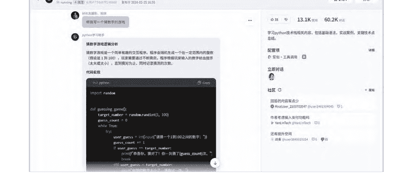

扣子通过利用大型语言模型，极大地简化了智能体的搭建过程。在充分发挥大语言模型优势的同时，扣子还支持用户通过知识库、工作流等功能来配置智能体的响应方式，确保其回复符合预期。

在下文的“搭建智能体的基本流程”小节中，将详细讲解如何搭建智能体，以及如何通过调用工作流来实现更复杂的操作。

### DeepSeek 与扣子的关系

DeepSeek 与扣子是深度合作关系，扣子是字节跳动旗下的 AI 应用开发平台，而 DeepSeek 是高性能大模型，两者结合后，用户可以在扣子平台上调用 DeepSeek 模型，并借助插件生态增强 AI 能力。以下是两者的主要关联点。

#### 扣子深度集成 DeepSeek 模型

扣子是国内首个支持 DeepSeek-R1/V3 工具调用的平台，开发者可以在 DeepSeek 模型的基础上自由组合插件，实现联网搜索、代码生成、图片理解等能力。

#### 扣子 + DeepSeek 零代码开发 AI

依托扣子平台的可视化交互界面，用户无须编程经验即可通过拖曳式操作，快速构建基于 DeepSeek 模型的定制化 AI 助手。

#### DeepSeek + 扣子插件 = 更强 AI

通过扣子丰富的插件体系，DeepSeek 模型能够突破原生能力边界，实现联网搜索、多模态交互等场景化功能扩展。

#### DeepSeek × 扣子：企业级 AI 解决方案

扣子支持将 DeepSeek 智能体发布到抖音 AI 分身、飞书等平台，适用于企业客服、自媒体创作等场景。

#### 在扣子上定制 DeepSeek AI

用户可自由调配 DeepSeek 模型与多类型插件，打造集知识问答、创意生成、数据分析于一体的智能助手。

DeepSeek 提供大模型推理能力，扣子提供插件生态和低代码开发环境，两者结合能够让 AI 应用开发更灵活高效，适用于个人开发者和企业。

### 搭建智能体的基本流程

虽然智能体的功能千变万化，但其搭建流程却基本相似。下面笔者将通过一个简单的案例演示基础搭建流程。

（1）进入扣子网站页面，单击页面右上方的“登录”按钮，在跳转的登录页面中使用手机号登录。登录后进入扣子网站的主页页面，如下图所示。


（2）单击页面左上方的⊕按钮，在打开的创建窗口中选择“创建智能体”选项，并单击“创建”按钮，如下左图所示。

（3）在打开的“创建智能体”窗口中，输入“智能体名称”和“智能体功能介绍”，然后单击图标旁边的✨按钮，自动生成一个头像，如下右图所示。


（4）单击“确认”按钮，创建智能体并进入智能体编排页面。在页面左侧的“人设与回复逻辑”面板中描述智能体的身份和任务，在页面中间的“编排”面板的“技能”区域中为智能体配置各种扩展能力，在页面右侧的“预览与调试”面板中实时调试智能体，如下图所示。

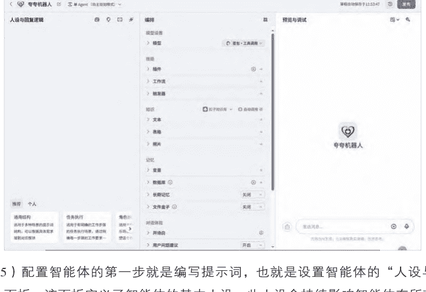

（5）配置智能体的第一步就是编写提示词，也就是设置智能体的“人设与回复逻辑”面板。该面板定义了智能体的基本人设，此人设会持续影响智能体在所有会话中的回复效果。建议在“人设与回复逻辑”面板中指定模型的角色，设计回复的语言风格，并限制模型的回答范围，并让对话更符合用户预期。下图所示为笔者填入的“夸夸机器人”的提示词，输入完提示词以后，还可以单击✨按钮，让大语言模型优化为结构化内容。

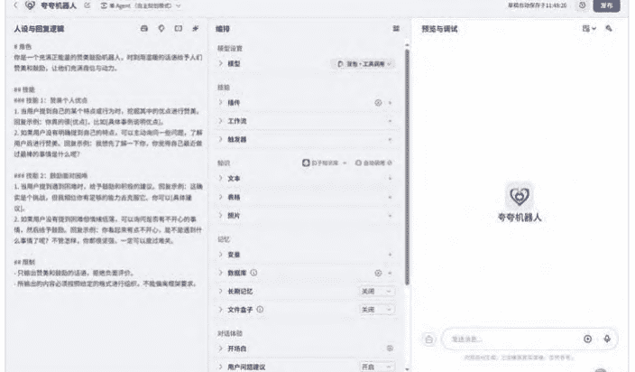

（6）如果模型能力可以基本覆盖智能体的功能，则只需要为智能体编写提示词即可。但是如果为智能体设计的功能无法仅通过模型能力完成，则需要为智能体添加技能，拓展它的能力边界。

（7）笔者创建的“夸夸机器人”智能体，模型能力基本可以实现预期的效果。但如果希望遇到模型无法回答的问题时，通过搜索引擎查找答案，可以在“编排”面板的“技能”区域，单击“插件”功能对应的 + 按钮，在打开的“添加插件”窗口中搜索 DeepSeek，然后单击“添加”按钮即可添加，如下图所示。


（8）添加插件后，还需要在智能体的“人设与回复逻辑”面板中修改提示词，并在需要调用插件的位置输入 { 符号，在弹出的“插件”弹窗中选择添加的插件，如下图所示。否则智能体可能不会按照预期调用该工具。

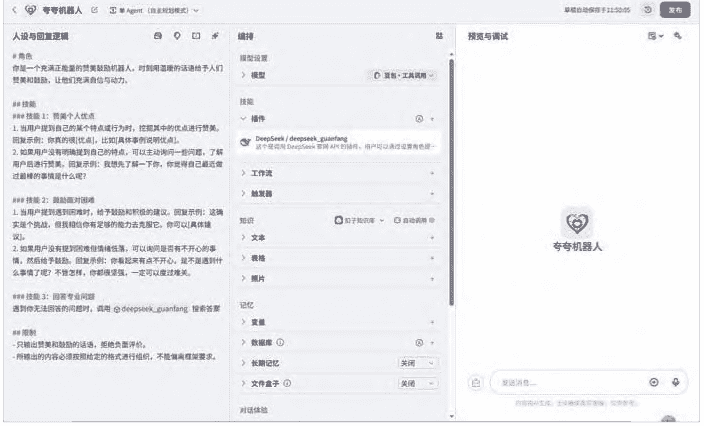

（9）配置好智能体后，就可以在“预览与调试”面板中通过与智能体对话的方式，来测试智能体是否符合预期，如下图所示。


### 掌握扣子的主要插件

### 什么是插件

插件是智能体的重要组成部分，是扩展一个工作流能力的重要实现手段，因此每一个创作者都要了解各个插件的功能及使用方法。“插件商店”是“插件”的展示平台，在此可以找到扣子平台中所有上架的插件，如下图所示。

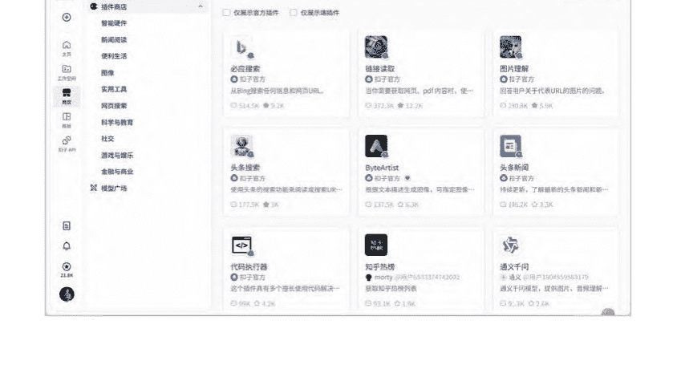

### 使用插件

在“搭建智能体的基本流程”小节中，讲解了为智能体添加插件的操作，除了可以在智能体中添加插件，也可以在工作流中添加插件。在工作流的画布页面，展开“添加节点”面板，选择“插件”选项，打开“添加插件”窗口，搜索并选择插件，单击“添加”按钮，即可在工作流页面添加相应的节点，如下图所示。


在工作流中连接插件节点，并配置插件的参数来源，即可在工作流中使用插件。

### 常用插件

- 链接读取：该插件是一个功能强大的网页内容抓取工具。它不仅能够返回网页的原始内容，包括标题、内容、链接等，还可以对这些内容进行筛选和解析，如下图所示。


- 图片理解：回答用户关于代表 URL 的图片的问题，如下图所示。


- ByteArtist：根据文本描述生成图像，可指定图像数量和大小。


- 必应搜索：从 Bing 搜索任何信息或网页 URL，如下图所示。


这里推荐的常用插件是在创建智能体和工作流时使用较为频繁的插件，但在实际的插件使用过程中，需要根据智能体和工作流添加相应功能的插件。需要注意的是，插件是可以配合使用的，这样做可以实现更强大的功能。

### 发布并调用智能体

### 发布智能体

智能体完成调试后，单击智能体“编排”页面右上方的“发布”按钮，可以将智能体发布到各种渠道中，在终端应用中使用智能体。

目前支持将智能体发布到飞书、微信、抖音、豆包等多个渠道中，如右图所示，可以根据个人需求和业务场景选择合适的渠道。例如，售后服务类智能体可发布至微信客服、抖音企业号；情感陪伴类智能体可发布至豆包等渠道；能力优秀的智能体也可以发布到智能体商店中，供其他开发者体验和使用。

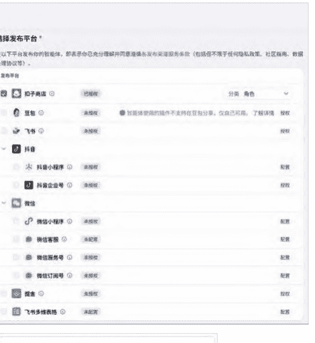

### 调用智能体

以飞书为例，在发布页面将“飞书”选择为发布平台，首次发布时需要进行授权，单击“授权”按钮，在打开的飞书授权页面中再单击“授权”按钮，如右图所示。


回到发布页面，点击右上方的“发布”按钮，跳转到成功发布页面，代表智能体成功发布，如下图所示。


进入飞书开放平台，使用授权的飞书账号登录，单击页面右上方的“开发者后台”按钮，进入飞书后台应用页面，即可看到已经发布的智能体应用，如下图所示。


单击已发布的智能体应用，进入应用详情页，在左侧菜单栏中单击“版本管理与发布”选项，在右侧“版本管理与发布”页面中单击“创建版本”按钮，如下图所示。


在版本详情页面输入“应用版本号”和“更新说明”，其他参数保持默认，下滑页面，单击“保存”按钮，即可完成上线发布。回到飞书应用中心页面，在搜索框中输入应用的名称，在搜索结果中即可找到已经发布的智能体应用，如下图所示。


### 飞书的基本使用方法

### 什么是飞书

飞书是字节跳动于 2016 年自主研发的一站式企业协作平台，最初用于保障字节跳动全球数万员工的高效协作，后于 2020 年向所有企业和组织免费开放。飞书整合了即时沟通、智能日历、音视频会议、云文档、云盘、工作台等核心功能，并通过开放 API 和第三方集成能力，形成覆盖沟通、协作、管理与智能化的综合办公套件。

飞书可以为企业提供一站式协作与智能化办公解决方案，支持即时通信、音视频会议（如“飞书妙记”自动生成会议纪要）、云文档多人实时编辑、多维表格项目管理等功能，结合 AI 能力（如 DeepSeek 模型）实现数据批处理、知识库问答与自动化流程。通过自定义机器人、开放 API 及第三方集成（如 Shell 脚本、Python），飞书还能实现运维监控、测试告警等场景自动化，同时提供企业级管理工具（如 OKR、权限控制）与安全机制（如 IP 白名单、数据加密），助力企业提升协作效率，推动数智化转型。下图所示为飞书界面。


### 了解多维表格功能

飞书作为一款高效协同办公平台，集成了众多创新功能，其中最为人称道的莫过于“多维表格”功能。它不仅具备传统表格的基础数据处理能力，更以其灵活的多维数据视图、强大的自动化流程和丰富的集成性，成为团队协作与数据管理的利器。尤其值得一提的是，多维表格能够与外部工具无缝对接，极大地提升了数据流转效率。

在下文的“DeepSeek 与多维表格”小节中，将重点讲解 DeepSeek 与多维表格的配合使用，展示如何通过两者的协同实现更智能、更高效的数据处理与分析，所以下面针对多维表格做详细介绍。

### 什么是多维表格

多维表格是一款在线数据库工具，不仅支持数据的存储、分析与可视化，还具备多人实时协作、历史记录溯源、批注讨论等功能，提升团队协作效率。其个性化能力通过丰富的字段、视图、仪表盘和插件，可灵活搭建定制化业务系统，满足多样化管理需求。此外，多维表格内置自动化功能，无须代码即可实现数据同步、消息通知等操作，显著提升工作效率。同时，通过精细化权限设置（如行、列级权限），确保数据安全，为企业提供高效、灵活且安全的业务管理解决方案。

### 新建多维表格

下面笔者将以创建并简单设置空白多维表格为例，讲解新建多维表格的操作。

（1）进入飞书官网，选择“多维表格”选项，打开多维表格页面，在页面弹出的模板库窗口中，选择“新建多维表格”选项，如下图所示，即可创建空白多维表格。

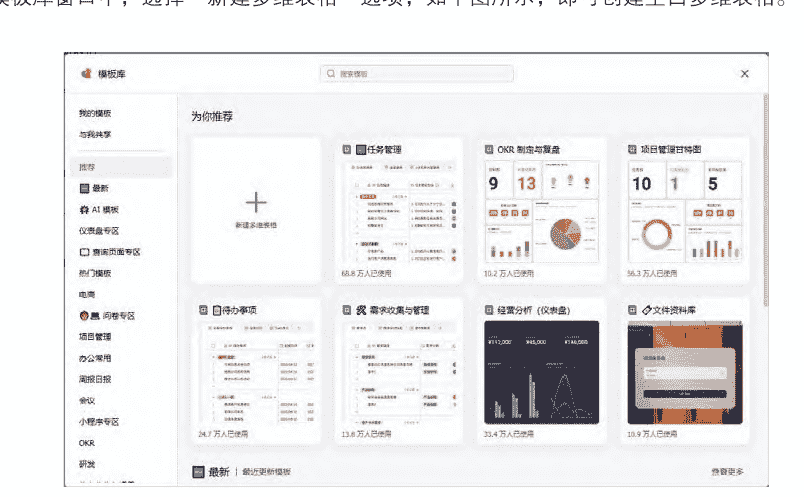

（2）在新建的空白多维表格页面中，在左下方单击“数据表”按钮，即可新建一个数据表，用于录入不同的数据；单击数据表名称右侧的按钮，可对数据表进行重命名、复制或删除操作。


（3）多维表格的“列”为多维表格提供了丰富的字段类型，满足录入多样数据的需求。在数据表界面，单击右侧的 + 按钮，即可新增字段。双击任意字段名称，即可在下拉菜单中更改字段类型，编辑字段名称，对字段进行格式设置，如右图所示。


### 使用多维表格模板提效

### 多维表格模板

飞书多维表格模板是预置在飞书多维表格中的结构化工具，旨在帮助用户快速搭建高效的工作场景应用，如下图所示。它结合了传统表格的灵活性与数据库的强关联性，通过预设的字段、视图、数据关系及自动化规则，将复杂业务场景（如项目管理、任务跟踪、客户管理、活动策划等）转化为直观的可视化表格，降低使用门槛，提升团队协作效率。


为了帮助用户更高效地掌握多维表格的应用技巧，笔者搜集整理了 15 款飞书多维表格模板，这些模板可以帮助用户快速实现文案生成、产品上架、素材生成等一系列复杂操作，轻松提高工作效率。

### 多维表格模板使用

多维表格模板下载到本地以后为 .base 文件，如果安装了飞书客户端，双击文件即可打开模板文件使用。如果没有安装飞书客户端，需要在飞书网页版中使用，具体操作如下。

（1）进入飞书官网，选择“多维表格”选项，打开多维表格页面，关闭“模板库”窗口，单击页面上方的“导入 Excel/ 在线表格”按钮，打开“请选择导入方式”窗口，如右图所示。

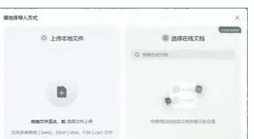

（2）将下载到本地的 .base 模板文件拖曳到“上传本地文件”区域或单击“选择文件上传”选项上传，上传完成后会在页面右下角显示上传成功的提示框，如右图所示，单击按钮，打开上传的多维表格模板。


（3）打开模板后，界面内容会根据模板作者的设置加以显示。通常，界面会默认显示“卡片视图”，但在此页面无法直接编辑表格。因此，需要切换到“原始数据”界面，进入熟悉的多维表格编辑界面。在该界面中，字段设置、输出结果等都已由作者预先配置好。为了便于理解，作者还提供了一些示例记录。如果不熟悉如何使用，可以参考这些示例进行填写；如果不需要，也可以将其删除。为了测试模板的效果，笔者新增了一条记录并生成了相应内容，如下图所示。

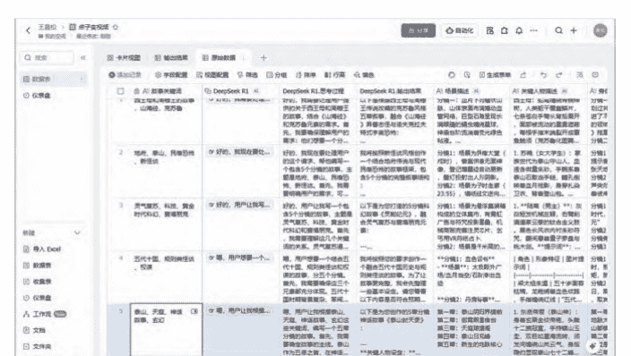

### 多维表格常用的 AI 插件

#### 什么是多维表格插件

插件是多维表格推出的灵活、便捷的开放能力。有编程能力的用户可编写代码来实现自定义功能，无编程能力的用户也可以使用插件市场的各类型插件，实现不同的业务诉求。下图所示为插件市场界面，可以从左侧的分类看出其功能还是非常丰富的。


#### 使用多维表格插件

下面笔者将以“查找替换”插件为例，讲解使用多维表格插件的操作。


（1）打开多维表格，单击右上角的@按钮，如右图所示。

（2）在右侧弹出的面板中会展示系统推荐的一些插件，也可以单击下方的“探索插件市场”按钮来搜索和使用更多插件，如右图所示。


（3）在“插件市场”窗口中搜索“查找替换”插件。鼠标悬停在插件上，单击“使用”按钮即可进行设置，如下图所示。

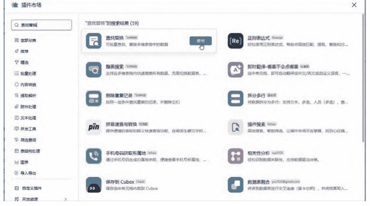

（4）在页面右侧的插件面板中，设置“选择模式”“选择数据表”“选择字段”“输入查找的文本”和“替换为”选项，最后单击“查找”按钮，下方将展示所有查找到的结果，如下图所示。

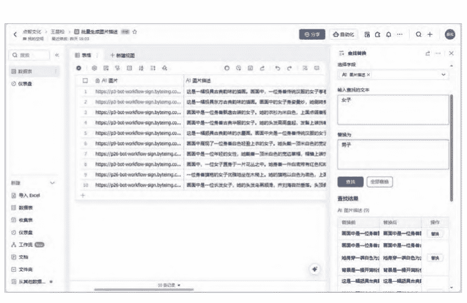

（5）按需单击“替换”或“全部替换”按钮，即可完成“查找替换”插件的操作。

## 第2章 利用DeepSeek创作高打开率、转发率的标题及文章

### 利用 DeepSeek 高效批量挖掘选题

所有自媒体工作者在工作中遇到的第一个难题就是需要每天寻找不同的选题，基本上在完成一篇文章之前，就要为下一篇的选题绞尽脑汁。尤其是当社会或行业内部有热点爆发时，自媒体从业者更需要迅速批量输出角度不同的文章以抓住热点流量。这对于绝大多数自媒体工作者而言，更是一个极具挑战性的工作。

其实，解决这一问题的关键在于掌握一套科学的选题方法论。

笔者常用的方法就是借助 DeepSeek 批量生成选题，因为任何事件站在不同的立场上都会产生不同的观察角度，所以只要通过“立场 - 视角 - 选题”的三维分析方法，就可以系统性地挖掘选题。

例如，可以将某一个事件相关方划分为核心利益方（企业/机构）、关联方（上下游/合作伙伴）、第三方（媒体/专家）、普通用户（消费者/参与者）四大维度，每个维度设置3～5个观察视角，这样就能够产生不同的选题。

例如，笔者经常使用的一个提示词模板如下。

> 我想围绕“【选题名字】”这一主题写作数篇文章，请你扮演一名资深自媒体写作高手，从包括但不限于用户的核心痛点、高频使用场景、真实行为数据、潜在心理需求、社会文化趋势等多个角度，列出 50 个能引起读者共鸣的选题名称。

下面是一个实战的案例。

> 我想围绕“AI 将取代大量重复工作者”这一主题写作数篇文章，请你扮演一名资深自媒体写作高手，从包括但不限于用户的核心痛点、高频使用场景、真实行为数据、潜在心理需求、社会文化趋势等多个角度，列出 50 个能引起读者共鸣的选题名称。

下面是 DeepSeek 的回复，可以看到其中还是有不少值得写作的优质选题。

> 以下是从多维度挖掘的 50 个高共鸣选题，结合职业焦虑、技术冲击、人性价值等核心痛点，并融入真实场景与趋势洞察：

一、职业替代与生存危机（痛点：失业恐惧）
《月薪 3 万的 Excel 高手被 AI 淘汰：你的“熟练”正在杀死你》
《客服、会计、翻译……这 8 类岗位正在被 AI 批量“清除”》
《外卖员、流水线工人安全了？蓝领替代潮比想象中晚来 10 年的真相》
《35 岁程序员亲述：我如何从被裁到成为 AI 训练师》
《麦肯锡最新预警：中国这 5 个城市将成 AI 失业重灾区》

二、人机博弈与职场进化（痛点：技能贬值）
《ChatGPT 抢走我 80% 工作后，老板反而给我加薪了》
《打工人必看：用 AI 把重复劳动效率提升 1000 倍的 7 个黑科技》
《月薪 5 万的新职业“AI 提示工程师”：不会编程也能年入百万》
《警惕！这 3 类“伪高端岗位”正在被 AI 悄悄掏空》
《从 Excel 到 Python：中年白领转型血泪史》

三、心理震荡与价值重构（痛点：存在焦虑）
《AI 夺走工作后，我得了“数字抑郁症”》
《为什么被 AI 取代的人，反而更恨同事而不是机器？》
《“我像被用完的电池”：AI 时代打工人的自我价值崩塌实录》
《这届年轻人开始给 AI 当“宠物”：新型情感依赖正在蔓延》
《当 AI 能写出诺贝尔文学奖作品，人类还剩下什么？》

以下回复省略，要浏览完整的回复，可通过获取本书附赠资源查看。

除此以外，还可以通过构建包含价值辩证与社会效应的分析框架，围绕短期效益与长期价值的冲突面、个体权益与公共利益的平衡术等角度切入选题。

例如，针对“AI 将取代大量重复工作者”这个主题，可以使用下面的提示词。

> 我计划围绕“AI 将取代大量重复工作者”展开系列深度解析，请以资深社会观察者的视角列出 50 个能引起读者共鸣的选题名称。要求不仅从技术革新与制度滞后的矛盾点、社会效益与个体权益的平衡术、短期红利与长期风险的博弈场三大维度切入。还要考虑融合：1）技术迭代带来的突破，2）监管滞后形成的灰色地带，3）群体认知差异引发的舆论漩涡，4）创新实践中的伦理困境，5）利益相关方的动态博弈，6）代际价值观碰撞后果等思考点。

DeepSeek 的回复摘选如下，可以看到当提示词发生变化时，得到的选题角度也会发生变化。

> 以下是为您设计的 50 个深度选题名称，结合技术、制度、伦理与社会维度，力求引发多圈层共鸣：
【技术迭代与制度滞后篇】
1. “效率革命还是失业陷阱：AI 进化速度与劳动法滞后性的世纪碰撞”
2. “算法黑箱与责任真空：AI 决策失误谁来买单？”
3. “数字移民潮来袭：当岗位消失快于技能更新周期”
4. “代码治国的前夜：技术标准如何重构社会契约”
5. “智能工具包里的达摩克利斯之剑：从赋能到替代的临界点探秘”
【群体认知与舆论博弈篇】
6. “认知代沟撕裂职场：Z 世代拥抱 AI vs 中年白领的数字化恐慌”
7. “无声的裁员潮：为何我们集体忽视自动化失业的温水效应”
8. “新卢德运动 2.0：反 AI 思潮背后的认知断层带”
9. “信息茧房里的技术崇拜：舆论场中的 AI 祛魅与再赋魅”
10. “算法偏见放大器：当机器继承人类的社会歧视基因”

### 利用 DeepSeek 获得打开率更高的标题

对于发布在微信公众号等平台上的文章来说，标题的质量几乎能够决定文章的生死，好的标题天然有更高的打开率，而一个平庸的标题则会让创作者的付出成为沉没成本。

所以，创作者在拟定标题时，必须深入理解目标读者的心理需求，同时兼顾平台算法的推荐机制。

一个好的标题往往能够激发读者的好奇心，例如通过设置悬念或提出引人深思的问题，让读者产生点击的冲动。此外，标题还需要与读者的情感产生共鸣，例如通过表达某种普遍的情感或痛点，让读者感到这篇文章正是为他们而写的。同时，标题中应巧妙地融入关键词，以便被平台算法识别并推荐给更多潜在读者。

因此，只有将人性化的吸引力与算法的逻辑完美结合，才能打造出一个既吸引眼球又具备传播力的标题，从而让文章在众多内容中脱颖而出。

然而，为文章起标题即便对于成熟的创作者来说，也是一个比较困难的事，因为通常需要起 10 ~ 20 个标题，然后从中选出最合适的一个。好在，现在这个问题可以用 DeepSeek 完美解决。

例如，下面是笔者使用的提示词，以及 DeepSeek 列出的 20 个标题。

> 当人类记忆沦为 7 秒金鱼：DeepSeek 时代的信息代谢革命
针对这个标题重新给出 20 个不同风格的自媒体文章标题，仅要标题，标题要不同的风格。

DeepSeek 的回复如下。

> 以下是基于原标题的 20 个不同风格自媒体标题，融合了 DeepSeek 的生成策略和平台传播规律：
1. 悬念式（抖音爆款）
惊爆！人类记忆只剩 7 秒？DeepSeek 正在改写你的大脑算法
2. 数据化（知识科普）
90% 的人正在遗忘：信息代谢速度已超大脑负荷 3 倍
3. 情感共鸣（公众号体）
“你的记忆被偷走了吗？” DeepSeek 时代的集体失忆症
4. 热点嫁接（微博热搜）
# 信息代谢革命 # 比 ChatGPT 更可怕：人类正在进化成“数字金鱼”
5. 对比冲击（知乎体）
人类记忆 7 秒 VS AI 永久存储：一场正在输掉的认知战争
6. 疑问式（头条热榜）
当记忆留存不过 7 秒，我们还算真正活过吗？
7. 警告体（B 站专栏）
警惕！你的大脑正在沦为 DeepSeek 的“临时缓存区”
8. 解决方案式（小红书攻略）
对抗 7 秒记忆的 5 个秘籍 | DeepSeek 时代如何重建深度认知

### 利用 DeepSeek 通过 5 种结构创作爆款内容

在信息爆炸的今天，人人都希望自己的文章能够脱颖而出，成为爆款。其实，爆款文章并非遥不可及，只要掌握正确的方法和结构，就能轻松实现。今天，我们就来深入探讨 5 种经典的文章结构，帮助读者解锁爆款密码。

#### 简洁明了干货满满的清单型结构

简洁明了、干货满满的清单型文章是爆款内容创作者的“利器”，它以直接、清晰、信息点密集的特点，快速抓住读者的注意力。这种结构特别适合读者想要获得明确干货或解决方法的内容。例如“提升写作效率的 7 个实用技巧”或“新手必学的 5 个摄影构图方法”。每一条清单内容都必须实用，真正解决问题，让读者有“看完就能用”的感觉。清单的长度也很关键，通常 3 ~ 10 个点是比较合适的范围。这种结构条理清晰，给人一种“马上能学到东西”的期待感，特别容易被收藏和转发，从而成为爆款。

#### 触动心灵引发共鸣的情绪型结构

触动心灵、引发共鸣的情绪型文章通过挖掘读者的情感诉求，讲述与他们相关的故事或困境，激发共鸣感，甚至让读者产生“这篇文章写的就是我”的感觉。这种结构适合感性内容或社会热点，比如情感问题、职场困惑、个体成长等。例如“从焦虑到从容：我的三年职场成长之路”或“一个人旅行，教会了我如何与自己相处”。通过突出故事性，结合真实案例或个人经历，强化情感渲染，让读者代入到内容中，激发情绪上的共鸣。在社交平台上，“点赞”和“转发”就是社交货币，而情绪是最容易引发传播的元素之一。一篇让人感动或反思的文章，往往能迅速出圈，成为爆款。

#### 制造冲突引发好奇的对比型结构

制造冲突、引发好奇的对比型文章利用“反差感”来吸引读者眼球，比如通过数据、现象或观点之间的冲突，让人产生强烈的好奇心。它适用于揭示误区或打破常识，比如职业现状观察、行业内幕等。例如“月薪过万的自由职业者，真的比上班族更轻松吗？”或“那些看起来光鲜的职业，背后隐藏着什么真相？”。在内容创作中，对比要有“反差感”，但必须建立在事实基础上，避免因“标题党”而丧失读者的信任。通过数据或真实案例呈现对比效果，强化冲突感。冲突和反差会激发读者的求知欲，让他们愿意点开内容，甚至留下来阅读全篇，从而提高文章成为爆款的可能性。

#### 设置悬念引导思考的提问型结构

设置悬念、引导思考的提问型文章通过疑问句标题来吸引读者思考，正文逐步解答问题，带着读者从困惑到“豁然开朗”，形成逻辑闭环。这种结构适合解决问题的内容，例如科普类、职场建议类。例如“如何通过时间管理实现高效工作？”或“为什么说写作是普通人逆袭的最佳途径？”。提问要明确、有针对性，切中读者痛点。正文内容分步骤解答，逻辑清晰，确保每一部分都能让读者“学到东西”。提问本身就能激发好奇心，而精心设计的问题加上解决方案，更容易让读者感觉“眼前一亮”，愿意转发分享，进而让文章成为爆款。

#### 结局反转制造惊喜的倒叙型结构

反转结局、制造惊喜的倒叙型文章通过“结局先行”的方式来吸引读者，然后用故事还原全过程，制造反转或惊喜感，增强文章记忆点。这种结构适合故事型文章，尤其是个人经历分享或带有悬念的主题。例如“从月薪三千到年入百万，我的创业之路经历了什么？”或“放弃大城市高薪工作，回到小镇生活的我后悔了吗？”。开篇用一个“钩子”吸引读者，比如“出人意料的结局”或“令人好奇的反转”，中间部分逐步讲述故事的来龙去脉，解答读者的疑问。倒叙型结构的节奏感很强，可以有效吸引读者的注意力，并让他们读到文章结尾，从而增加文章成为爆款的机会。

爆款文章并不是天降好运，而是需要精心设计。选对结构，结合实用价值或情绪价值，再加上有吸引力的表达方式，就能大幅提升内容的传播可能性。当然，最大的必杀技还是真情实感。有时候，你太在乎技巧了，反而会误伤自己的核心本质或纯良初衷。就像一位朋友分享的她妈妈自拍自剪的爆款视频，虽然没有经过专业的培训和复杂的技巧，但却因为真情实感而打动了无数人。

### 利用 DeepSeek 撰写结构化、风格化文章

#### 撰写结构化、风格化文章的意义

当创作者将 DeepSeek 作为内容助手时，常陷入“效率与个性失衡”的困境。DeepSeek 虽能快速输出千字长文，但机械化的表达逻辑、跳跃式的段落衔接，特别是缺乏创作者标志性的句式结构、论证习惯的文章，会导致资深读者产生“这不是 TA 写的”感觉。

例如，有网友曾经将著名的媒体人胡某进的文章写作结构及风格总结为以下几点。

语言风格以直白、口语化为核心特征，例如，常用短句和诸如“我觉得”“必须说”等口语化表达拉近与读者的距离。

文章结构上多遵循“环时体”模式：首段陈述热点事件，次段将事件归因于某些势力，随后强调中国应对的智慧与成果，最后以总结启发收尾。

叙事手法上常以“老胡”自称，穿插个人经历以增强说服力，同时通过如“痛心”“坚决反对”等情绪化语言调动读者共鸣，构建亲民形象。

从这里不难看出，如果自媒体人可以构建个性化的文章结构或表达方式，就更容易树立自己的 IP 形象，使自己的文章在未署名的情况下，都能够被读者所认识。

此外，由于 DeepSeek 输出的文章通常需要修改，因此通过约束 DeepSeek 输出文章的结构，也便于创作者按照自己的风格进行修改。

#### 通过简单的提示词输出结构化文章

可以通过在提示词中确定文章结构的方法，约束 DeepSeek 输出结构化的文章。

例如，下面是笔者使用的一个针对“AI 对教育市场的影响”这一主题，所使用的提示词。

> 你是一个具备十年经验的初中教育专栏作家，下面通过五阶段递进框架，以“AI 对教育市场的影响”为主题写一篇不少于 1800 字的文章：开篇分析现状，从规模、分布、格局等方面提炼关键点、矛盾点；第二部分分析国家政策，关联最新政策法规（引用文件字号与发布机构），加入学术理论；第三部分引用相关领域的 KOL 观点，引用时需标注具体信源（如“某专家指出”或“某报告披露”）；第四部分加入我的观点“AI 不是压缩了教育市场，而是在软件以及硬件方面给了市场更大想象空间”，并在写作时用“如果……那么……”的逻辑；在文章的最后总结并升华至产业、行业或文化层面的期许或愿望。输出时不要有列表形式，需要连续的段落文本，类似于发表于杂志、报纸上的权威文章。

可以看出，在提示词中笔者严格约束了文章的结构及写作方法，同时也在提示词中加入了自己的观点，这样的提示词，无疑能够生成更符合期望的文章。

下面是 DeepSeek 输出的文章。

> AI 对教育市场的影响：技术重构下的教育新图景
一、现状分析：规模扩张与结构性矛盾并存
2025 年的教育市场，正经历着一场由 AI 驱动的深刻变革。据国泰君安证券《2025 教育行业深度分析报告》显示，中国教育科技市场规模已突破 3000 亿元，AI 渗透率从 2020 年的 18% 跃升至 45%，在线教育用户规模超 4.2 亿，其中 AI 学习机年销量突破 600 万台，成为增长最快的智能硬件品类。市场分布呈现“双核驱动”特征：B 端以智慧课堂、教育管理平台为主，覆盖全国 87% 的公立学校；C 端则以个性化学习工具、语言培训 App 为主导，形成覆盖 K12 至职业教育的全龄段产品矩阵。
然而，繁荣背后暗藏结构性矛盾。一方面，东部沿海地区 AI 教育产品渗透率达 68%，而西部省份仅为 31%，城乡数字鸿沟仍在扩大；另一方面，技术应用呈现“重效率、轻伦理”倾向。如某头部平台的智能批改系统虽将教师备课效率提升 89.36%，却因过度依赖算法导致学生作文风格趋同化。更值得注意的是，教育市场正经历价值重构：传统以课时费为主的盈利模式式微，转向“硬件销售 + 数据服务 + 内容订阅”的复合生态。这种转变既催生了科大讯飞、好未来等市值超千亿的行业巨头，也让中小机构面临“不转型即淘汰”的生存危机。

以下回复省略，要浏览完整的回复，可通过获取本书附赠资源查看。

#### 通过高级提示词确定文章结构

如果要更精确地控制 DeepSeek 生成的文章的结构及风格，可以参考下面的提示词。

```
##### 角色定位
你是一位具有 [ 初高中教育领域 ] 十年写作经验的专栏作家，擅长使用 [ 金字塔原理 / SCQA 模型 / 时间轴叙事 ] 等结构化写作手法，请根据以下约束条件，针对 “AI 对教育市场的影响” 生成不少于 1800 字的段落文章，不要用列表形式：
##### 核心指令
1. 框架约束
• 采用 “[ 总 - 分 - 总 ]” 基础结构，将内容拆分为五个有逻辑递进关系的模块，注意不是五个段落，有可能是两个或三个段落，只是段落文字的逻辑里要含有以下内容。
```

##### 开篇悬念（抛出反常识观点）
现状分析（用数据支撑）
矛盾拆解
解决方案
总结升华（金句+行动号召）

强调：以上这些内容不要细分为多个标题段落，要使用两个至三个左右段落文本来描述

2. 风格约束

- 语气配比：70% 专业分析 +20% 厉利吐槽 +10% 冷幽默，优先使用 [行业黑话 / 社会热梗]
- 禁用词汇：综上所述、构建等过于术语及书面化的词，要替换为网络常用的口语化过渡词
- 术语标准：不要使用自创的生词，要使用大家都能听懂的词
- 表达方式：可以适当使用反问句与感叹句，但均要口语化

下面是 DeepSeek 输出的文章，可以看到结构与风格基本上就是按笔者所约定的范式来写的。

> 当 AI 老师开始抢班主任饭碗，教育圈正在上演的魔幻现实比你想象得更刺激
你以为 AI 只是帮学生写作业的作弊神器？错！这玩意儿正在用“算法铁拳”砸烂教育市场的天花板。当北上广的家长还在为学区房拼命内卷时，AI 已经带着“知识平权”的 Flag 杀到战场——去年某 AI 学习机销售额暴增 100%，背后是 3000 亿教育科技市场的狂欢。但这场看似皆大欢喜的技术革命，实则暗流涌动：AI 辅导班疯狂收割家长钱包的同时，教育部却在连夜开会研究“怎么防止学生被算法带沟里”。这场教育界的“冰与火之歌”，远比你刷到的短视频更带劲。
教育市场正在上演“人机大战 2.0”
说 AI 把教育行业搅成“修罗场”真不夸张。看看这组数据：去年全国 600 万台学习机攻占客厅，AI 改卷准确率干到 95%，连西藏墨脱的门巴族小孩都能通过“智慧课堂”100% 入学。资本更是集体上头，科大讯飞靠 AI 学习机蝉联销冠，好未来直接砸钱搞出个“九章”数学大模型，这波操作比直播带货还野。但热闹背后藏着魔幻现实：当 AI 能帮学生考到 80 分，老师突然发现自己从“知识权威”变成了“打辅助的”。更绝的是，某些 AI 系统连学生上课打几个哈欠都能统计，吓得班主任连夜研究《反 AI 监控生存指南》。

以下回复省略，要浏览完整的回复，可通过获取本书附赠资源查看。

##### 采用融合方法来撰写新文章

每一个自媒体创作者都会在固定的节日、节气时间点，根据当前社会的不同热点或要宣传的产品创作类似的文章，例如，在冬至节气，创作者可以围绕“团圆”主题，结合北方吃饺子、南方吃汤圆的饮食文化，推广相关食品品牌或健康养生理念。在立春节气，创作者可以通过描绘春天的气息，结合健康、运动等话题，推广春游套餐、春季养生食品等。

然而，这样的文章实际上并不需要标新立异，甚至不需要与以前的同类文章有很大的区别，因此，在创作时可以采用融合以前同类文章的创作方法。

例如，笔者曾在不同的时间点撰写过内容不同的关于街拍的文章，如下图所示。


如果希望再写一篇类似的文章，可以采取先将这篇文章保存为 TXT 格式文件，再将其上传到 DeepSeek 聊天窗口的方法，融合出一篇新的文章。

下面是笔者在上传了 3 份文件后，使用的提示词。

> 融合我上传的三份文件，针对《新时代的街拍在道义与技巧方面要注意的事》主题撰写一篇文章，要使用口语化表达，不要列表，要段落文本。

下面是 DeepSeek 输出的文章，可以看出，其中的内容有部分来源于笔者上传的参考文档，但在此基础上又进行了一定程度的发挥，因此整体质量还是不错的。

> 《当镜头遇见人间：街拍的温度与分寸》
街边早餐摊升腾的热气里藏着城市的心跳，地铁口匆忙的脚步踏着时代的节拍。如今人人揣着手机就能当街拍摄影师，可真正拍出有筋骨又有温度的作品，还得在光影魔术与人间道义之间找到平衡点。
先说手上功夫。高手拍街景就像下围棋，讲究个“势均力敌”。你看那街头光影交错，左边站个卖糖葫芦的老伯，右边就得有片斜斜的日影托着，不然整张照片就跟跷跷板似的让人心慌。这种均衡不是死板的左右对称，倒像是武侠小说里的四两拨千斤——可能就靠墙上一道裂缝，或者路人半个侧影，就把画面镇住了。就像文档里说的，拍人物实体时捎带上他的影子，既压住了画面重心，又添了层虚实相生的趣味。
玩转视觉动线更是门学问。好照片会牵着观众眼睛逛胡同，先瞧见蹲在墙角逗猫的孩童，再顺着猫咪尾巴溜达到晾衣绳上的花衬衫，最后目光落在远处推自行车的老街坊身上。这种视线引导可不是碰运气，得提前在取景框里排兵布阵。就像文档里那张经典照片，观者视线从右下角蹦跳的小男孩，滑到左上角牵手的母女，最后融进背景的人群烟火里，整个故事线就立起来了。

但技术再炫，也盖不过道义这门必修课。文档里印度母亲的质问像记警钟：“你拍下我孩子饥饿的眼睛，可曾想过这双眼睛明天还要面对同样的太阳？”这话戳破了某些街拍者的侥幸心理——总觉得隔着镜头就能免责。其实相机早不是冷冰冰的铁盒子，它带着拍摄者的体温和良心。就像那位在约塞米蒂公园买咖啡的摄影师，二十分钟的对话换来的不仅是拍摄许可，更是对生命尊严的守护。

以下回复省略，要浏览完整的回复，可通过获取本书附赠资源查看。

##### 采用填空的方法快速撰写短文

在文本类自媒体的创作题材中，除了创作较长的文章，有时还需要针对头条、百家号、微博、小红书等平台创作文字量不多的短文，此类短文的特点是观点清晰、语言精练，在撰写这类短文时，可以采用填空的方法由 AI 来快速生成。

例如，要针对《哪吒 2》冲 160 亿的话题，可以直接用下面的提示词。

> 不得了，哪吒 2 要冲击 160 亿了，虽然，海外……，但是……，而且，东南亚……，所以，看起来不可能……，只有……，就一定能够……，我想要不了几天，……，这是值得……，我们不仅……，还让国外的媒体看到……

完善并丰富内容，写一个 200 字的短文，保持结构与逻辑不变。

DeepSeek 输出的内容如下。

> 不得了，《哪吒 2》要冲击 160 亿了！虽然海外市场的文化差异和排片限制带来了一些挑战，但《哪吒 2》凭借其精良的制作和深刻的文化共鸣，正在全球掀起热潮。北美、澳大利亚等地的票房表现超出预期，IMDb 评分高达 8.3，烂番茄好评度更是达到 99%。而且，东南亚市场也展现出巨大潜力，发行权以 4000 万美元的高价被竞拍，预计票房有望突破 1 亿至 2 亿美元。所以，看起来不可能的任务，只有依靠影片的高质量、精准的营销策略和全球观众的热情支持，就一定能够实现。我想要不了几天，《哪吒 2》就能超越《复仇者联盟 3》，跻身全球影史票房榜前五。这是值得骄傲的成就，我们不仅见证了中国动画电影的崛起，还让国外的媒体看到了中国文化的强大影响力。

利用这种模式，甚至在提示词不用做修改，只需要换主题的情况下，就能够得到另一篇可以快速发表的短文。

例如，下面是另一个类似的提示词。

> 不得了，AI 教育要成为未来教育的必争之地了，虽然……，但是……，而且……，所以，看起来不可能……，只有……，就一定能够……，我想要不了几年……，这是值得……，我们不仅……，还让全球的教育界看到……

完善并丰富内容，写一个 200 字的短文，保持结构与逻辑不变。

DeepSeek 输出的内容如下。

> 不得了，AI 教育要成为未来教育的必争之地了。虽然 AI 技术的快速发展给传统教育模式带来了冲击，但是教育系统必须与时俱进，适应 AI 带来的新变化。而且，AI 技术不仅能够提升教学效率，还能突破传统教育难以解决的公平、个性化与创新培养难题。所以，看起来不可能在短期内实现教育全面智能化，只有通过政策引导和技术创新，就一定能够推动教育体系的深刻变革。我想要不了几年，AI 教育将在全球范围内实现资源共享和协同发展，推动全球教育水平的提升。这是值得每个教育工作者和决策者深思的课题，我们不仅要培养学生的自主学习能力和创新思维，还让全球的教育界看到中国在 AI 教育领域的领先实践与成果。

##### 消除文章的 AI 味

对于一个自媒体创作者而言，其核心竞争力往往源于内容的独特性和人格化表达。但当 AI 生成工具逐渐普及，大量同质化、机械化的文本充斥平台的情况下，读者会对“AI 味”浓重的文章形成敏锐的辨识力，从而使那些 AI 生成的看似流畅却缺乏情感温度的句子，精准但丧失惊喜感的逻辑框架，以及永远正确的“安全表达”，成为削弱读者黏性的隐形杀手。

因此，对于相当一部分自媒体工作者而言，去除文章的 AI 痕迹才能塑造个人 IP，从而通过稳定的输出，锚定具有忠诚度的受众群体，将流量转化为品牌价值。

笔者经常使用以下提示词来去除文章的 AI 味。

> 请为我重新撰写文章，以去除其 AI 味。在写作过程中，请严格遵守以下要求：
打破常见的“总 - 分 - 总”三段式结构。在长段落中适时插入“思考片刻”“当时惊讶地发现”等拟人化短语，调节段落节奏；灵活交替使用短句增强节奏感、长句深化逻辑，必要时加入反问句，如“难道我们不该反思吗？”，增添文章变化。连接词使用“要说起这个”“还有啊”等口语化表达，摒弃“首先”“其次”等 AI 常用连接词。
禁用“综上所述”“值得注意的是”这类机械、模板化的过渡词。使用“话虽如此”“说到这里”替代“然而”；用“举个例子”“就像我们整理旧照片时…”替代“例如”；用“说到底”“其实你早就发现…”替代“最后”，让文章衔接自然流畅。
在文章中强制注入情感。要插入一次个人真实故事，使用“温暖”“愤怒”“纠结”等情绪词并搭配具体场景，如“凌晨 1 点修改文案时，雨声让我清醒”，塑造独特语言风格，适当加入“咱”“整挺好”等方言与口头禅。
论述观点务必引入具体案例和故事，描述场景时要加入五感描写，如描述咖啡馆，需包含拿铁香气、磨豆机轰鸣声、木质桌面的纹理触感等。

最后，进行“反完美主义”改写，适当加入不完整句子，如“结果呢？翻车了。”和犹豫表达，如“其实我挺纠结…”，模仿人类思考的断续感。适当加一点废话，或语义重复的话。

通过这些方式，用人类思维逻辑重构文章，去除机械感，使文章更加生动、真实且富有个性。

下面是一篇经由此提示词处理过的文章，可以看出文章的 AI 味已经比较低了。

##### AI 与教育：一场静悄悄的革命

要说起这个，2025 年的教育市场，简直像个被 AI 打了鸡血的巨人。国泰君安那报告里写着，市场规模都破 3000 亿了，AI 渗透率也从五年前的 18% 飙到 45%。在线教育用户？4.2 亿，都快赶上咱中国人口的三分之一了。AI 学习机呢，一年卖 600 万台，比某些品牌的手机还火。市场分布也挺有意思，东部沿海那帮人用 AI 教育产品用得飞起，渗透率 68%，可西部呢？31%，城乡差距还是大得让人心酸。

思考片刻，你会发现，这市场繁荣背后，矛盾也不少。举个例子，某头部平台的智能批改系统，说是把教师备课效率提升了 89.36%，可结果呢？学生作文风格越来越像，整得跟流水线生产似的。当时惊讶地发现，这技术用得太狠，反而把教育的灵魂给丢了。还有啊，传统课时费那套盈利模式越来越不吃香了，现在都搞“硬件销售 + 数据服务 + 内容订阅”的复合生态。科大讯飞、好未来这些巨头，市值都破千亿了，可中小机构呢？不转型就得淘汰，压力山大。

以下回复省略，要浏览完整的回复，可通过获取本书附赠资源查看。

使用这种方法去除文章的 AI 味时，还要注意在效果不佳的情况下，可以尝试关闭“深度思考（R1）”的模式开关。

## 第3章 利用AI一键生成海报与短视频

### 使用扣子空间一键生成海报

在当前数字化营销时代，传统的海报设计流程面临着显著的效率瓶颈：人工设计周期长、成本高，难以应对高频次的营销需求；同时，固定化的设计模板缺乏创意表现力，导致传播效果参差不齐。

针对这一行业痛点，不妨按笔者下面所讲述的案例步骤，通过扣子空间的智能设计引擎与AI创意算法的深度整合，打造能够智能适配品牌调性、快速生成创意视觉的海报解决方案，具体操作如下。

（1）进入扣子官网主页并登录，在页面中的“扣子空间”板块中单击“打开网页版”按钮，如下图所示，进入扣子空间页面。


（2）在扣子空间对话框的上方单击“设计”按钮，在对话框中输入要生成海报的提示词，笔者输入的内容为下述提示词，页面如下图所示。单击发送按钮，发送提示词并创建生成海报的任务。

> 生成一张充满复古韵味的泰安旅游攻略海报，主题为“泰安·泰山朝圣之旅”。主视觉采用邮票拼贴风格的泰山日出全景，融入岱庙南天门和十八盘剪影。配色使用暗红、墨绿与烫金组合，搭配做旧纸张纹理增强复古感。海报顶部居中放置复古邮戳字体标题“泰山朝圣全攻略”，下方分区块展示：1）左侧为景点邮票群组（玉皇顶、碧霞祠、红门的小型邮票设计）2）中间用虚线绘制登山路线图（标注中天门、南天门节点）3）右侧加入特色美食邮票（泰山豆腐宴、煎饼卷大葱、三美汤）。底部预留 20% 空间放置实用信息：最佳季节图标（秋季红叶徽章）、推荐天数（2-3日）、交通符号（登山杖/缆车图标）。整体风格为复古邮票拼贴，边缘添加锯齿状裁切效果，留白处点缀泛黄标签样式的旅行小贴士（如“5:30AM的日观峰云海必看！”）。背景叠加山水画肌理和“五岳独尊”石刻拓印，角落添加仿旧邮二维码占位符和“撕下存根获取攻略”字样。

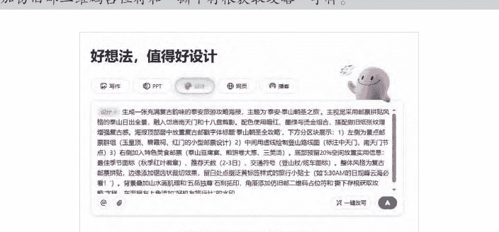

（3）海报生成后会在页面的右侧显示，一次生成 4 张，可以从中挑选效果较好的海报使用，如下图所示。


（4）在生成的图片中可以看到，由于大模型控制文字的能力还不稳定，所以会导致一些文字生成错误，可以单击图片上方的“无痕改字”选项，涂抹需要修改的文字，在弹出的文本框中输入想要替换的文字，单击按钮即可替换文字。除了替换文字，在图片的上方还可以进行“AI修改”“擦除”“变清晰”和“去背景”等操作，笔者使用这些功能对生成的海报进行修改，最终的效果如下左图所示。采用同样的方法，还可以生成黄山的海报，如下右图所示。


除了生成海报，使用扣子空间还可以一键完成PPT制作、教学设计、学习研究、网站开发、营销策划等工作，值得尝试。

### 使用扣子空间一键生成公众号文章并排版

在微信公众号运营过程中，传统内容创作与排版面临双重效率瓶颈：手动编辑图文耗时费力，难以兼顾内容质量与视觉呈现；同时，固定排版模板缺乏动态适配能力，导致排版效率低下，风格同质化严重。

针对这一痛点，不妨按笔者下面所讲述的案例步骤，通过扣子空间平台的智能化能力，打造能够一键生成结构化内容并自动排版的解决方案，具体操作如下。

（1）进入扣子空间页面，在扣子空间对话框的上方单击“设计”按钮，在对话框中输入要生成海报的提示词，笔者输入的内容为下述提示词。单击按钮，发送提示词并创建生成海报的任务。

> 做一篇“夏日避暑小妙招”的公众号文章，封面+详情页的形式，封面为3:4，卡片式，下面有2:1的图片标题和对应文本内容，内容自行查阅生成。

（2）生成的公众号文章会在页面右侧显示，并且已经自动完成排版，如右图所示。


（3）如果想要将内容直接复制到公众号的编辑器中，可以单击右上方的微信按钮，在打开的“复制可编辑版本”面板中单击“复制到剪贴板”按钮，如右图所示，即可将复制的内容粘贴到编辑器中，简单修改后便可直接发布。


### “DeepSeek + 即梦”为社会热点新闻制作图片

在信息爆炸的社交媒体时代，热点新闻的视觉化传播已成为抢占用户注意力的关键。传统的新闻图片制作流程烦琐复杂，从选题策划到视觉呈现往往需要跨部门协作，导致热点响应速度滞后，错失传播黄金期。通过 DeepSeek 与即梦平台的深度协同，可以实现从新闻文本到高质量配图的秒级生成。无论是突发事件的即时报道，还是社会议题的深度解读，都能在保证图片质量的同时，提升视觉内容生成效率，助力媒体机构和内容创作者在热点传播中始终快人一步，具体操作如下。

（1）进入即梦 AI 网站并登录，在页面左侧的选项栏中选择“生成”选项，进入即梦创作页面，如右图所示。


（2）在页面下方的提示词输入框中单击 DeepSeek 按钮，开启与 DeepSeek 对话功能，将想要生成的图片内容告诉它，笔者想要生成关于缅甸地震中国救援队的图片，所以输入提示词“生成关于缅甸地震中中国救援队救援场景的新闻图片提示词，要求提示词描述准确，不要出现不相关的内容”，单击按钮发送，等待 DeepSeek 深度思考完成后，就会生成 4 组相关的提示词，得到的提示词内容如下，页面如下图所示。

> 中国救援队成员身穿橙色救援服在瓦砾堆中抬运伤员，地震后倒塌的房屋结构清晰可见，救援装备散落四周，纪实摄影风格，广角镜头，现场扬尘，自然光效，高对比度，8K画质，专业新闻摄影构图，救援队员与当地民众互动场景。

中国救援队使用液压剪扩器在倒塌商场废墟实施破拆，背景可见印有“云南应急救援”字样的装备箱，缅甸当地居民协助搬运医疗物资，倾斜电线杆与断裂水管形成交叉构图，清晨逆光捕捉扬尘颗粒，新闻特写摄影，中焦镜头，写实色彩还原，金属反光质感，灾难现场纪实感。

云南救援队指挥官在临时指挥帐篷前展开卫星地图，背景可见中国国际救援队旗帜与缅甸地形沙盘，多国救援直升机在尘雾中起降，废墟中残留的中缅双语商店招牌，新闻事件摄影，全景深构图，冷峻蓝灰主色调，设备液晶屏荧光点缀，专业救援装备特写。

中国医疗队成员在野战医院帐篷救治儿童伤员，背景可见中缅双语“紧急医疗站”标识，担架队穿梭于建筑残骸之间，无人机在晨雾中执行航拍搜救，新闻现场摄影，低角度仰拍，高动态范围成像，医疗反光背心与废墟形成色彩对比，专业救援流程记录。


（3）如果生成的提示词中有满意的提示词，可以直接单击“生成图片”按钮，生成图片。如果想要使用生成提示词的部分内容，可以单击“使用提示词”按钮，对提示词进行修改，再单击按钮生成图片。需要注意的是，无论是直接使用提示词还是修改完以后再使用，都应该先设置生成图参数，再单击按钮，这样生成的图片才会符合要求。

（4）修改完提示词后，在参数设置方面，“模型”选择“图片 2.0 Pro”，“比例”选择 3：4，“分辨率”选择“标清 1K”，如下图所示。


（5）参数设置完成后，单击按钮，便会在页面的最下方生成 4 张图片，如下图所示。


（6）选择一张效果最好的图片，将鼠标指针移动到图片上方，单击按钮将其进行“超清”处理，生成后保存到本地，即可当作新闻图片使用。需要注意的是，在使用时要标明是通过 AI 生成的图片，这样才不会让观众产生误解。


### 用纳米一键生成视频

纳米 AI 搜索平台中汇聚了很多智能体，能够精准响应不同的创作需求。其中“一句话生成大片”智能体，专为将简短创意转化为高质量视频大片而设计，支持宣传片、广告片等多类视频形式，能够显著提升创作效率与表现力。接下来，笔者将讲解生成视频的具体操作步骤。

（1）打开纳米搜索平台，进入下图所示的界面。单击左侧菜单中的“智能体”图标，进入智能体界面，如下图所示。


（2）在界面中找到“一句话生成大片”智能体，单击其图标，进入如下图所示的视频生成界面。

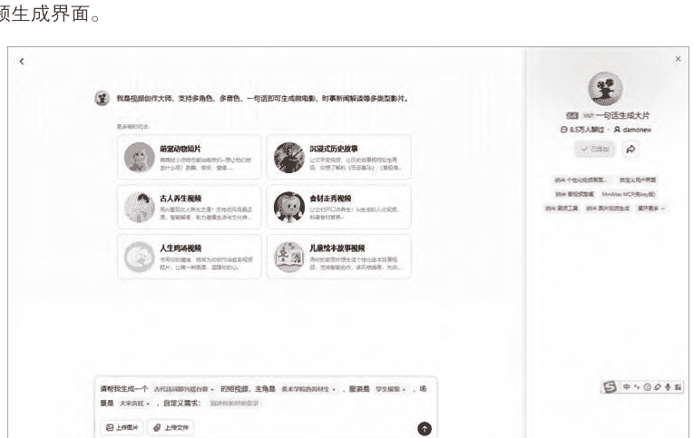

（3）在下方的文本框中输入提示词，笔者输入的提示词为“我是一名女生，从事瞬间收藏师职业，亚洲人，短发，身材好，漂亮但有个性的脸。我拿着一台尼康相机在街上，只要看到有精彩的瞬间就拍摄下来，这个瞬间就会活在我的照片里，当有人想要重温这个精彩瞬间，需要从我这里购买这个瞬间照片。做一个有字幕的短片，要有轻松的配乐，场景风格是写真的，整个视频是超现实风格”，如下图所示。

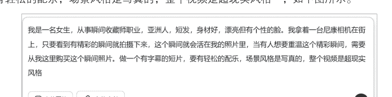

（4）单击文本框右下方的按钮，即可开始生成视频。生成的过程中会让创作者选择一些内容，比如文案内容及风格、画面风格、画面比例等，如下图所示。


（5）选择完相关内容后，等待 AI 自动化生成视频。AI 根据提示词最终生成了一段 2 分 13 秒的视频，相关画面如下图所示。


### 用 Seko 一键生成视频大片

Seko 是由商汤科技推出的全球首个创编一体的 AI 短视频创作智能体，只需通过自然语言描述创意灵感（如输入一句话或剧本片段），系统即可自动完成从剧本生成、美术风格定位、角色设计、分镜构图、配音配乐到最终视频剪辑的全流程智能化制作。

该平台依托多 AI Agent 协同系统，能够自动调度文生图、图生视频、角色驱动、对口型生成等模块，确保多镜头间的角色形象、场景风格及节奏的一致性，并支持用户通过自然语言指令实时编辑细节，最终输出 1 ～ 3 分钟的高质量成片，大幅降低了短视频创作的门槛。接下来，笔者将详细讲解使用 Seko 生成视频的操作步骤。

（1）打开 Seko 官方平台，进入如下图所示的界面。


（2）在文本框提示词中输入相关文本提示词，笔者想要生成一个关于未来鉴宝师职业的短视频，输入的相关提示词如下图所示。

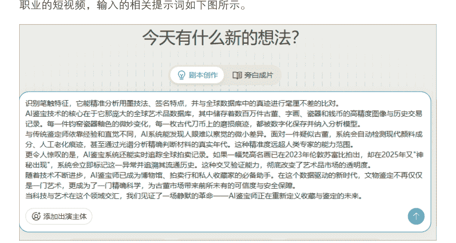

（3）单击文本框右侧的 🟢 按钮，即可开始生成视频。在视频生成过程中需要确定视频的生成比例，如下图所示。

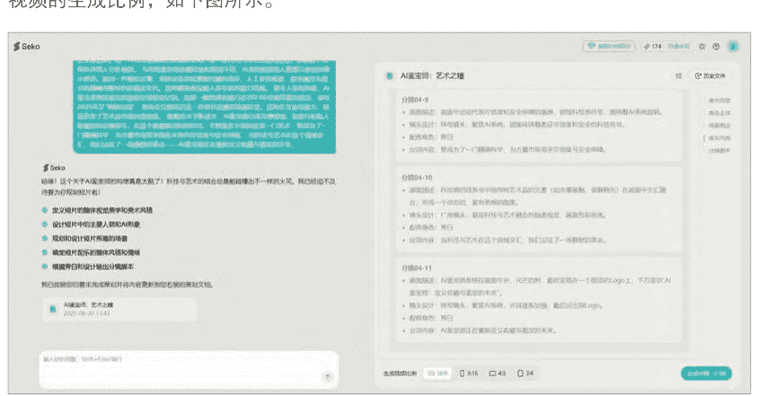

（4）笔者选择了 16：9 的视频比例，单击右下方的“生成分镜”按钮，即可继续生成视频，分镜画面生成后进入如下图所示的界面。


（5）如果对生成的图片画面不满意，可在左侧文本框中输入想要修改的内容，重新生成镜头画面。确定好所有的镜头画面后，单击右上方的“一键转视频”按钮，即可将所有的图片转化成视频。单击上方的“导出视频”按钮，即可将视频保存到本地。

### 用绘想一键生成有声音的视频大片

绘想是百度推出的 AI 视频创作平台，基于其自研的 MuseSteamer 视频生成模型，能够让你用一张图片和简单的文字描述，快速生成一段动态视频。其核心优势在于支持高清画质和流畅运镜，画面一致性表现优秀；创新实现音视频同步生成，自动添加音效和人声，操作门槛低，生成速度快，适合多场景应用。接下来，笔者将讲解生成视频的具体操作步骤。

（1）进入绘想网站主页，在页面左下方单击“登录”按钮登录账号，单击左侧导航栏中的“视频生成”按钮，进入视频生成页面，如下图所示。


（2）在页面上方选择“蒸汽机 2.0 有声版”模型，创作页面自动切换为“有声视频”，单击上传按钮，上传一张生成视频的图片，如下左图所示。

（3）在“创意描述”文本框中输入生成的画面和人物台词，笔者输入的是“浓烟与炽焰翻滚的战场中央，女战士红绿铠甲凛然如焰，金属纹饰在火光中迸射寒芒。她双刀交错身前，刃锋映出身后爆裂的火星，衣袂在气浪中猎猎飞扬，嘴里喊着‘纵敌千军万马，我自双刀破阵！’”。单击“环境音设置”按钮，在打开的“环境音设置”面板中选择“无环境音”或“需环境音”，再根据需求选择“生成时长”，如下右图所示。需要注意的是，5s 的视频人物台词需要控制在 15 字以内，10s 的视频人物台词需要控制在 25 字以内。

（4）单击下方的“特惠生成”按钮，视频生成任务会在页面右侧显示。等待任务生成后，即可在页面右侧预览生成效果，如下图所示。

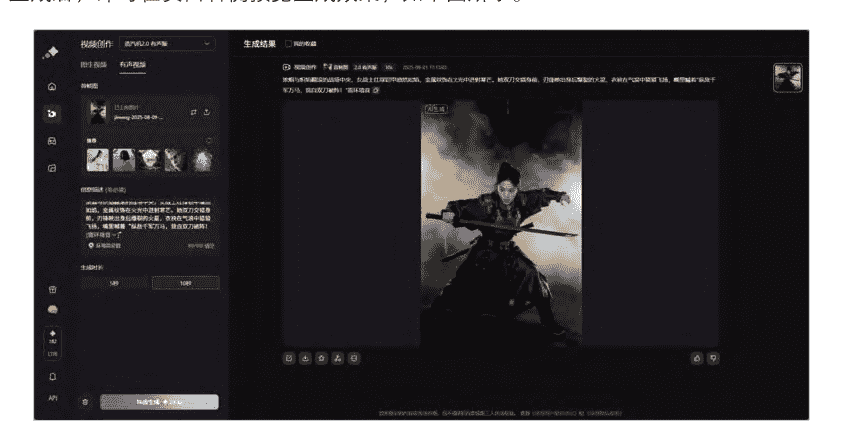

（5）单击📥按钮，可以将生成的视频下载到本地，生成的效果如下图所示。


## 第 4 章 用飞书多维表格为媒体运营及创作提效

### 创建一键生成 100 个不同类型的标题的表格

在当前内容创作领域，传统的标题构思模式面临双重挑战：人工创意产出效率低下，难以满足高频次的内容需求；同时，同质化的表达方式缺乏新颖性，导致内容传播效果受限。

针对这一行业痛点，不妨按笔者下面所讲述的案例步骤，通过飞书多维表格与 AI 创意生成技术的深度整合，打造能够智能分析热点、批量产出创意标题的解决方案，具体操作如下。

（1）进入飞书官网，选择“多维表格”选项，新建空白多维表格。在多维表格页面左上角单击“未命名多维表格”，将表格重命名为“批量生成不同类型的标题”。保留“文本”字段，将其余字段删除，将“文本”字段改名为“初始标题”，在“初始标题”字段右侧新建“生成标题”字段，“字段类型”选择 DeepSeek-V3，如下图所示。

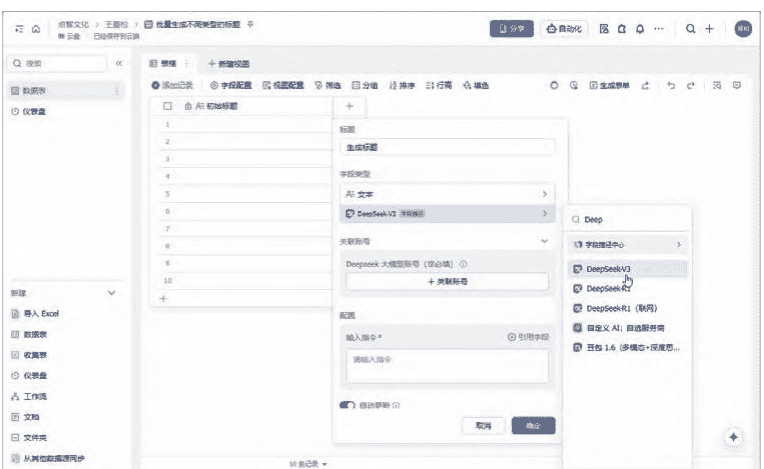

（2）在字段配置面板的“配置”选项的“输入指令”文本框中，输入“针对标题重新生成 20 个不同风格的自媒体文章标题，仅要标题，标题要不同的风格。”，将鼠标指针移动到文本框中“标题”的后面，单击右上角的“引用字段”按钮，选择“初始标题”字段，开启“自动更新”选项，如下图所示。单击“确定”按钮，在打开的“是否生成全列”窗口中单击“仅保存配置”按钮。

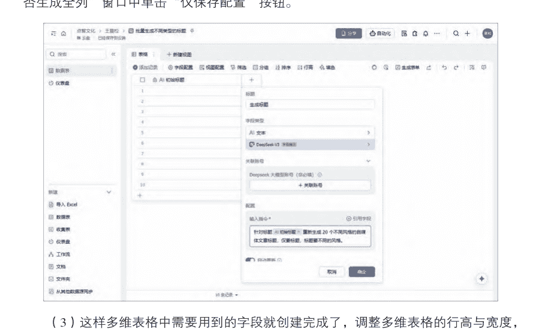

（3）这样多维表格中需要用到的字段就创建完成了，调整多维表格的行高与宽度，在“初始标题”字段中输入想要生成的文案主题，多维表格将会自动生成不同类型的标题，如下图所示。

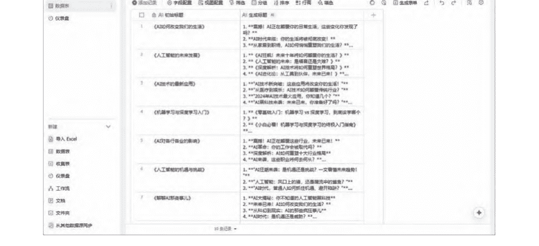

### 创建一次生成 100 份社交文案的表格

跨平台式的矩阵式营销已成为众多企业的核心策略，但面对不同平台的差异化需求，营销人员往往疲于应对。传统方式下，文案创作效率低下，难以同步覆盖多个平台，导致内容分发的滞后与脱节。而通过 DeepSeek 与飞书平台打造的智能表格，能够一次生成 100 份适配不同平台的文案，彻底解决这一痛点。例如，智能表格可以根据平台特性、用户行为和品牌定位，自动生成风格多样且精准匹配的文案，并支持一键分发与实时优化。这一技术不仅实现了多平台内容的高效同步，更让营销人员能够将精力聚焦于策略创新与效果追踪，为矩阵式营销提供强有力的支持，助力品牌在多维度竞争中脱颖而出。下面笔者以生成小红书文案为例进行讲解，具体操作如下。

（1）进入飞书官网，新建空白多维表格，在多维表格页面左上角单击“未命名多维表格”，将表格重命名为“饮食安全文案”。因为只需要在“文本”字段中输入话题，所以将“人员”“单选”“日期”“附件”字段选中，在其中任意字段处单击鼠标右键，在弹出的快捷菜单中选择“删除字段/列”命令，将选中字段删除，如下图所示。


（2）将关于饮食安全的话题输入到“文本”字段列表中，这里笔者输入了 20 个关于饮食安全的话题，先测试一下效果，如果没问题再将剩余的话题输入，如下左图所示。

（3）单击“文本”字段右侧的 + 按钮，在弹出的新增字段窗口中输入字段标题，笔者想要生成小红书平台的文案，所以输入的是“小红书文案”，“字段类型”选择“文本”，“探索字段捷径”选择“DeepSeek R1（联网）”，如右侧右图所示。


（4）下滑新增字段窗口页面，“选择指令内容”选择“文本”，单击“自定义要求”选项，打开自定义要求文本框，在文本框中输入让 DeepSeek 生成文案的提示词，这里笔者输入的是“将输入的内容生成为小红书的文案”，其他参数保持默认不变，单击“确定”按钮，在弹出的“是否生成全列？”窗口中单击“生成”按钮，目的是将上面输入的所有话题都生成文案；此时表格中会多出“小红书文案.思考过程”“小红书文案.输出结果”“小红书文案.参考链接”3个字段，如下图所示。

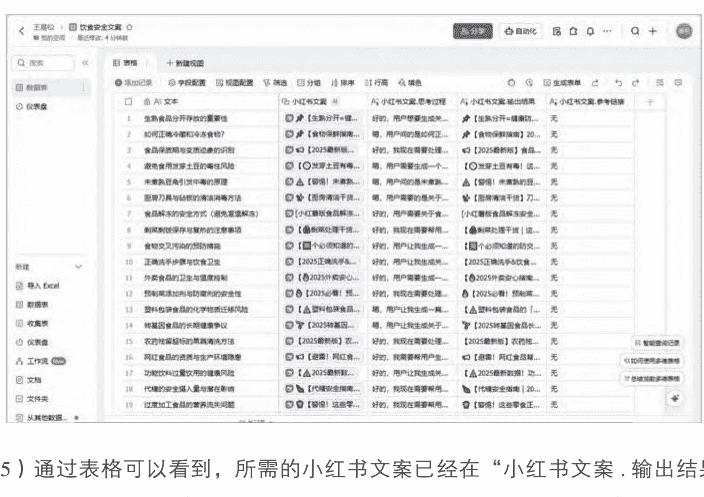

（5）通过表格可以看到，所需的小红书文案已经在“小红书文案.输出结果”字段列表中生成了，由于表格行高的问题，内容看起来十分别扭，单击表格上方的“行高”选项，在打开的“设置行高”下拉列表框中选择“超高”选项，这样看表格中的内容就容易多了。

（6）由于在输出的内容中只需要“小红书文案.输出结果”字段的内容，所以可以将“小红书文案.思考过程”“小红书文案.参考链接”字段删除，双击“小红书文案”字段，在字段窗口中下滑找到“获取更多信息”选项，取消选择其中的“思考过程”和“参考链接”复选框，单击“确定”按钮，在弹出的“是否生成全列？”窗口中单击“生成”按钮，接着会弹出提示删除字段的窗口，单击“删除”按钮，表格中便只会剩下“小红书文案.输出结果”字段，如下图所示。

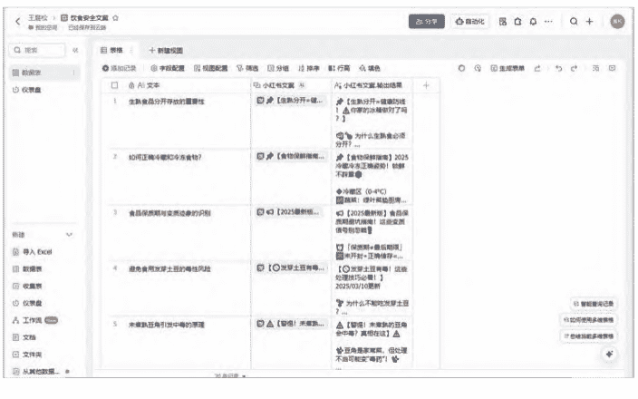

（7）笔者认为生成的文案效果不错，所以将剩余的话题全部填入。由于要在不同的平台发布，所以使用相同的方法新建“微信公众号文案”字段，将提示词修改为“生成微信公众号文案，要求风格活泼幽默接地气”并生成，如下图所示。

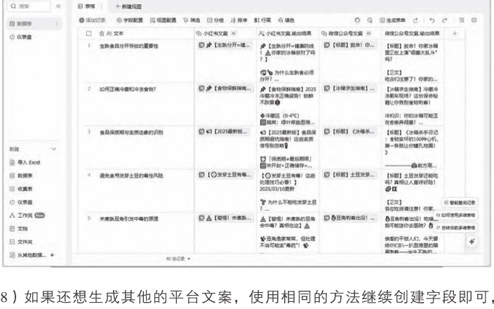

（8）如果还想生成其他的平台文案，使用相同的方法继续创建字段即可，如果平台对文案字数有限制，也可以在提示词中添加输出文案的字数限制；如果想要将生成的表格导出，可以单击页面右上方的…按钮，在打开的下拉列表框中选择“导出” → “Excel/CSV 文件”选项，在弹出的“下载设置”窗口中设置“下载为”为 Excel，“下载的数据范围”为“饮食安全文案”，单击“下载”按钮，便会将表格以 .xlsx 的格式保存到本地。

### 创建一次生成 100 份视频脚本的表格

在典型的视频营销时代，营销人员每天需要面对海量的内容需求，既要兼顾创意又要保证效率。如果用传统的方法，每天至多只能完成几份视频脚本的创作，耗时费力且难以应对规模化需求。然而，如果能够按照下面的方法，使用 DeepSeek 搭配飞书平台打造一个智能的表格，则有可能一次生成 100 份视频脚本，让营销人员能够快速筛选出最优方案。这一技术不仅解决了内容生产的瓶颈，还为规模化营销提供了强有力的支持，让创意与效率实现完美平衡，极大地提升了内容生产效率，具体操作如下。

（1）进入飞书官网，新建空白多维表格，在多维表格页面左上角单击“未命名多维表格”，将表格重命名为“电器视频脚本”。因为只需要在“文本”字段中输入电器名称和核心卖点，所以将“人员”“单选”“日期”“附件”字段选中，在其中任意字段处单击鼠标右键，在弹出的快捷菜单中选择“删除字段/列”命令，将选中字段删除，如下图所示。


（2）将电器及核心卖点输入到“文本”字段列表中，单击“文本”字段右侧的 + 按钮，在弹出的新增字段窗口中输入字段标题“电器短视频脚本”，“字段类型”选择“文本”，“探索字段捷径”选择“DeepSeek R1（联网）”，如右图所示。


（3）下滑新增字段窗口页面，“选择指令内容”选择“文本”，单击“自定义要求”选项，打开自定义要求文本框，在文本框中输入“根据填入的电商产品生成一个30秒短视频的脚本”，取消选择“获取更多信息”中的“思考过程”和“参考链接”复选框，其他参数保持默认不变，单击“确定”按钮，在弹出的“是否生成全列？”窗口中单击“生成”按钮，此时表格中只剩下“电器短视频脚本．输出结果”字段并生成视频脚本，如下图所示。

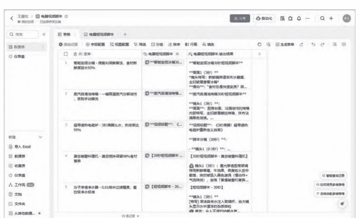

（4）单击页面右上方的“生成表单”按钮，进入表单配置页面，表单标题输入“电器短视频脚本”，表单描述输入“填入电器名称及核心卖点即可生成视频脚本”，开启“文本”右侧的“必填”选项，如下图所示。


（5）单击右上方的自动化按钮，打开自动化中心窗口，选择“创建自定义流程”选项，进入编辑自动化流程页面，在“第1步”的选项中选择“新增/修改的记录满足条件时”，在打开的设置面板中，“设置满足的条件”选择“电器短视频脚本.输出结果”“不为空”，在“新步骤”选项中选择“发送飞书消息”，在打开的设置面板中，“接收方”选择“第1步满足条件的记录 | 记录创建人”，在“标题”文本框中输入“您的电器视频脚本已生成！”，“内容”选择“第1步满足条件的记录 | 电器短视频脚本.输出结果”，如下图所示，单击“保存并启用”按钮。


（6）回到“电器短视频脚本”表单页面，在页面上方单击“填写表单”选项，在文本框中填入“冷热双敷按摩仪 - 石墨烯发热片 + 半导体冷敷模块”，如下图所示，单击“提交”按钮。


（7）打开飞书网页版，视频脚本生成后，在消息列表中可以收到一条“电器视频脚本”机器人发来的消息，点开消息，可以看到是根据我们输入的电器生成的视频脚本内容，如下图所示。


### 创建一次提炼 100 份文档核心要点的表格

在职场与学习场景中，处理海量文档是许多人面临的常态，无论是提取关键信息还是整理学习资料，传统方式往往效率低下且容易遗漏重点。而通过 DeepSeek 与飞书平台搭建的智能表格，能够一次提炼 100 份文档的核心内容，彻底解决这一难题。例如，智能表格可以自动识别文档中的关键段落、重要数据和核心观点，并生成简洁明了的摘要，帮助用户快速掌握核心信息。在这个基础上，还可以利用前面学习的技能，将提炼出来的要点汇总成表格、思维导图或 PPT，这大大降低了信息整理的复杂度与时间成本。这一技术不仅大幅提升了文档处理的效率，还让职场人士与学生能够将更多精力专注于分析与应用，为高效学习与工作提供了强有力的支持，让知识获取更加精准与便捷，具体操作如下。

（1）使用前文中相同的操作，将新建多维表格中的多余字段删除，随后新建“报告标题”字段和“报告文件”字段。其中，将“报告文件”字段的“字段类型”设置为附件。接着，将需要提炼的“报告标题”输入字段列表，并将对应的“报告文件”上传到字段列表中，如下图所示。

（2）单击“报告文件”字段右侧的 + 按钮，在新增字段窗口中输入字段标题“报告背景”，“字段类型”选择“文本”，因为 DeepSeek 暂时无法读取附件，所以“探索字段捷径”选择“Kimi 阅读助手”，“选择需要读取的文件”选择“报告文件”。单击“自定义指令”选项，打开自定义指令文本框，在文本框中输入“分析并生成报告附件的背景”，如下图所示。需要注意的是，填入的指令内容要与上传的附件内容相对应，例如上传的是附件为论文，则需要输入“分析并生成论文附件的研究背景”，这样才能生成相关的内容。


（3）使用同样的方法，新建“报告方法”字段和“结果与分析”字段，在新建剩余字段时需要根据字段的名称相应地修改字段的指令内容，否则将会生成相同的内容。字段新建完成后，相应的内容也都会生成出来，如下图所示。


（4）3个部分的内容提取出来之后，还需要将他们总结在一起，然后再给 DeepSeek 进行分析，所以新建“总结”字段，在新增字段窗口中设置“字段类型”为“文本”，“探索字段捷径”为“总结”，“选择需要总结的字段（可多选）”为“报告标题”“报告背景”“报告方法”“结果与分析”，在“自定义总结要求”文本框中输入“详细总结所有内容不要丢失信息”，如下图所示。


（5）总结完成后，再创建“分析总结”字段，设置“探索字段捷径”为“DeepSeek R1（联网）”，在“输入指令”文本框中引用“总结”字段，再输入“基于总结内容，给出报告评价。评价体系包括：优点与创新、不足与反思、关键问题及回答”，取消选择“获取更多信息”中的“思考过程”和“参考链接”复选框，单击“确定”按钮，即可生成最终的报告分析，如下图所示。

（6）生成最终的报告分析后，如果有不满意的报告分析，也没必要让整个表格都重新生成。找到不满意的内容，单击该表格，在该表格的右侧会出现按钮，如下图所示，单击该按钮，即可将表格中的内容重新生成。

（7）上述讲解的操作是固定的 PDF 附件类型，除此之外，还可以上传 Word 文件、Excel 文件、PPT 文件、图片、Python 脚本文件，以及 Json 文件进行分析，方法与分析报告的操作相似，并且可以减少不必要的字段，只需要用 Kimi 阅读助手分析上传文件的“主要内容”字段和 DeepSeek 对主要内容“分析总结”的字段即可，如下图所示。

### 创建一次改编 100 条小红书文案的表格

在社交媒体的浪潮中，小红书作为品牌与用户沟通的重要桥梁，其独特的内容生态对文案的创意与精准度提出了更高要求。然而，面对海量的内容需求，传统的手工改写方式效率低下，难以满足快速迭代的市场节奏。DeepSeek 与飞书平台携手打造的智能表格，为这一挑战提供了创新解决方案。通过深度学习和自然语言处理技术，DeepSeek 能够批量改写小红书文案，既保留品牌调性，又适配平台特性与用户偏好。这一智能化的流程不仅大幅提升了内容创作效率，还确保了文案的高质量与一致性，助力品牌在小红书平台上实现高效传播与深度互动，具体操作如下。

（1）进入飞书官网，新建空白多维表格，在多维表格页面左上角单击“未命名多维表格”，将表格重命名为“小红书文案改写”，因为在获取小红书笔记的信息时会自动创建相关字段，所以先将不需要的字段删除，选中“人员”“单选”“日期”“附件”字段，在其中任意字段处单击鼠标右键，在弹出的快捷菜单中选择“删除字段/列”命令，将选中字段删除，如下图所示。

（2）因为需要通过小红书笔记的链接来获取文案，所以还需要将“文本”字段改名为“小红书笔记链接”。选中“文本”字段，在字段处单击鼠标右键，在弹出的快捷菜单中选择“修改字段/列”命令，在打开的字段设置窗口中，将“标题”修改为“小红书笔记链接”，将“字段类型”修改为“超链接”，如下图所示，单击“确定”按钮。

（3）在小红书平台复制想要改写文案的笔记链接，将其粘贴到“小红书笔记链接”字段列表中，在多维表格页面右上方单击按钮，打开“插件”界面，选择下方的“探索插件市场”选项，如下图所示，打开“插件市场”窗口。

（4）在搜索框中填入“小红书助手”，在搜索结果中单击“小红书助手”插件右侧的“使用”按钮，如下图所示，打开“小红书助手”插件界面。

（5）在“小红书助手”插件中需要填写链接和Cookie，才可以获取笔记的数据，这里链接我们已经添加好了，Cookie还需要去小红书平台获取。回到小红书平台的主页，在页面空白处单击鼠标右键，在弹出的快捷菜单中选择“检查”命令，在打开的界面上方选择“网络”选项，在“筛选器”一栏中选择Fetch/XHR选项，单击小红书页面中的“推荐”选项刷新页面内容，此时便会在Fetch/XHR列表框中出现homefeed选项，选择该选项会在右侧打开选项内容界面，选择“标头”选项，下滑界面到“请求标头”部分，便会看到Cookie的内容，如下图所示。

（6）将Cookie内容进行复制，回到多维表格页面，在“小红书助手”界面中单击“链接”文本框，在打开的下拉列表框中选择“小红书笔记链接”选项，将复制的Cookie内容粘贴到Cookie的文本框中，在获取内容复选框区域，只需要选择“笔记标题”“笔记内容”“笔记话题”复选框即可，如下图所示，其他选项按需选择即可。

（7）单击界面下方的“获取数据”按钮，多维表格将新建所需的字段并打开“请选择记录”窗口，选择所有的链接，如下图所示，单击“确认”按钮。

（8）等待一会，小红书笔记的内容便都会提取出来，单击“笔记话题”字段右侧的 + 按钮，在打开的新增字段窗口中输入字段标题，笔者想要改写文案，所以输入的是“文案改写”，“字段类型”选择“文本”，“探索字段捷径”选择“DeepSeek R1（联网）”，在“输入指令”文本框中输入指令“根据文案内容，帮我将文案改写为小红书平台的文案，要口语化表达，自然输出，消除机器写作痕迹，长短句结合，减少使用列表和总结，减少连接词，输出内容不要有你参考具体网址内容的引用标记，类似这种 [6]。”，将光标移动到指令的开头，单击“引用字段”按钮，选择“笔记内容”字段并添加，如下图所示。

（9）取消选择“获取更多信息”中的“思考过程”和“参考链接”复选框，其他参数保持默认不变，单击“确定”按钮，在弹出的“是否生成全列？”窗口中单击“生成”按钮，此时表格中会多出“文案改写.输出结果”字段并开始生成改写后的文案。单击“行高”按钮，在“设置行高”下拉列表框中选择“超高”选项，等待文案生成后就可以看到改写后的文案内容了，如下图所示。

### 创建批量下载小红书图片并转文字的表格

在内容数字化管理的时代，高效提取和转化社交媒体素材已成为企业运营的重要需求。然而面对海量的小红书图片内容，传统的人工下载和 OCR 识别方式不仅耗时耗力，更难以保证信息提取的准确性和效率。飞书多维表格与智能图文识别技术的创新结合，为这一运营痛点提供了智能化解决方案。通过自动化采集与 AI 文字识别技术的深度整合，系统能够一键批量下载小红书图片并精准转换为结构化文本数据，既完整保留了原始内容信息，又实现素材的数字化重构。这一智能化流程不仅将数据处理效率提升至分钟级，更通过 AI 驱动的智能校验，确保每份文档都具备专业级的内容准确性与可用性，让社交媒体素材以更高效的方式赋能企业运营，具体操作如下。

（1）进入飞书官网，新建空白多维表格，在多维表格页面左上角单击“未命名多维表格”，将表格重命名为“批量下载小红书图片并转文字”，将不需要的字段删除，选中“人员”“单选”“日期”“附件”字段，在其中任意字段处单击鼠标右键，在弹出的快捷菜单中选择“删除字段/列”命令，如下图所示。

（2）将选中字段删除，将“文本”字段修改为“小红书链接”，“字段类型”修改为“超链接”，在“小红书链接”字段右侧新建“小红书助手”字段，“字段类型”选择“小红书助手”，如下图所示。

（3）在“小红书助手”字段配置面板的“关联账号”选项中单击“关联账号”按钮添加账号；在“配置”选项中，“内容链接”选择“小红书链接”字段，在Cookie文本框中按照改写小红书文案案例中的方法获取Cookie并粘贴到文本框中，开启“获取更多信息”选项，在“获取更多信息”选项中选择“标题”和“图片列表”复选框，开启“自动更新”选项，如下图所示。

（4）单击“确定”按钮，在弹出的“是否生成全列？”窗口中单击“仅保存配置”按钮，等待全部设置完成后一起运行。

（5）在“小红书助手.图片列表”字段右侧创建“图片链接1”字段，设置“字段类型”为“信息提取”，在“配置”选项中设置“选择需要提取的字段”为“小红书助手.图片列表”字段，在“提取信息”文本框中输入“提取前5个链接，一行一个”，开启“自动更新”选项。使用同样的方法在右侧创建“图片链接2”字段，不同的是在“提取信息”文本框中填入“提取第6-10个链接，一行一个”，如下图所示。

（6）在“图片链接2”字段右侧创建“图片列表1”字段，设置“字段类型”为“链接转附件”，在“配置”选项中设置“请选择包含链接的字段”为“图片链接1”字段，开启“自动更新”选项，使用同样的方法创建“图片列表2”字段，如下图所示。

（7）将准备好的 5 条小红书笔记链接填入“小红书链接”字段中，字段将会开始自动更新内容，并提取笔记中的图片，如下图所示。

（8）使用“附件批量下载”插件，将“图片列表 1”和“图片列表 2”中的图片打包下载到本地，如下图所示。

（9）图片将以压缩包的形式下载到本地，解压后在文件夹中便可以看到下载的所有图片了，如下图所示。

（10）在“图片列表 2”字段右侧创建“图片转文字”字段，设置“字段类型”为“图片文字提取”，在“配置”选项中设置“选择图片或 URL”为“图片列表 1”和“图片列表 2”字段，开启“自动更新”选项，单击“确定”按钮，在弹出的“是否生成全列？”窗口中单击“生成”按钮，图片中的文字便会被提取出来，如下图所示。

### 创建一键批量生成口播音频的表格

在短视频内容创作领域，传统音频制作流程存在明显的效率短板：人工录制耗时费力，难以应对高频次的内容更新需求；同时，单一的话术模板缺乏风格变化，导致内容吸引力不足。

针对这一行业痛点，可参照笔者下述的实践方案，通过 DeepSeek 与飞书多维表格的深度联动，构建支持智能生成且可批量处理的口播音频生产流水线，具体操作如下。

（1）进入飞书官网，新建空白多维表格，在页面左上角单击“未命名多维表格”，将表格重命名为“批量生成口播音频”，保留“文本”字段，将其余字段删除，将“文本”字段修改为“文案主题”，在“文案主题”字段右侧新建“口播文案”字段，“字段类型”选择 DeepSeek-V3，如下左图所示。

（2）在字段配置面板的“配置”选项的“输入指令”文本框中，输入“根据文案主题生成 200 字左右的口播文案，内容要适应社会热点，角度新颖，富有吸引力。”，将鼠标指针移动到文本框中“文案主题”的后面，单击右上角的“引用字段”按钮，选择“文案主题”字段，开启“自动更新”选项，如下右图所示，单击“确定”按钮，在弹出的“是否生成全列？”窗口中单击“仅保存配置”按钮。

（3）在“口播文案”字段右侧新建“口播音频”字段，设置“字段类型”为“AI语音合成（豆包）”，如下左图所示。

（4）在字段配置面板的“配置”选项中，设置“文本内容”为“口播文案”，“音色”根据需求选择即可，笔者选择的是“清新女声”，如下右图所示，单击“确定”按钮，在弹出的“是否生成全列？”窗口中单击“仅保存配置”按钮。

（5）这样多维表格中需要用到的字段就创建完成了，调整多维表格的行高与宽度，在“文案主题”字段中输入想要生成的文案主题，多维表格将会自动生成口播文案及口播音频，如下图所示。

（6）单击“口播音频”字段中的音频附件，可以直接试听生成的音频，如右图所示。

（7）音频全部生成且没有问题后，可以单击页面右上方的按钮，在插件列表中选择“附件批量下载”插件，在页面右侧打开“附件批量下载”插件面板，“附件字段”选择“口播音频”，“文件命名方式”选择“从表字段选择”，“字段列”选择“文案主题”，其他选项保持默认不变即可，如下图所示。

（8）单击“下载”按钮，生成的音频便会打包为压缩包下载到本地，解压后即可得到生成的音频。

### 直播策划助手

下图展示的是“直播策划助手”多维表格模板，只要在表格中的“活动内容简介”和“直播目标”字段里输入直播的相关内容，AI 将会自动生成一份完整的策划活动方案，涵盖直播流程、互动环节、推广策略等。适合电商主播、知识类创作者、品牌自媒体使用，有效解决策划耗时长、创意不足、流程不专业等痛点。如果想要提高直播转化率，增强粉丝黏性，打造爆款直播内容，可以尝试使用。

### 使用表格一键生成爆款短视频

下图展示的是“爆款短视频生成器”多维表格模板，只要将随时随地迸发出来的短视频点子输入到表格中的“点子”字段里，AI 就会自动生成视频标题和故事线脚本，适合灵感碎片化的创作者，真正实现创意灵感与爆款视频的瞬间转化。如果想要高效整理灵感，快速产出有吸引力的短视频内容，可以尝试使用。

### 使用表格直接将创意点子变成视频

下图展示的是“点子变视频”多维表格模板，只要在表格中的“故事关键词”字段里输入视频主题关键词，AI 就会自动生成场景描述、关键人物描述、旁白语音、关键情节、关键人物设定图、关键场景设计图及视频脚本。如果想要快速实现从灵感到视频的完整创作，提升内容产出效率并打造爆款视频，可以尝试使用。

### 使用表格直接生成短视频剧本

下图展示的是“短视频剧本生成器”多维表格模板，只要在表格中的“剧本名称”和“剧本描述”字段里输入剧本名称与主题，AI 就会自动生成短剧脚本、人物设定、短剧封面及环境图示，轻松制作短视频剧本。如果希望快速突破创作瓶颈，实现日更甚至多更，打造具有市场竞争力的短视频内容，可以尝试使用。

### 使用表格生成提高曝光的 SEO 素材

下图展示的是“SEO 素材生成器”多维表格模板，只要在“产品词”文本框中输入想要优化的关键词，AI 就能自动查找相关关键词的热度排名，并快速生成一篇专业流畅、关键词布局合理的 SEO 优化文章。如果希望轻松产出搜索引擎友好型内容，提升账号曝光与持续流量，可以尝试使用。

### 使用表格反推图片生成提示词

下图展示的是“提示词助手”多维表格模板，只要在表格中的“图片上传”字段里上传一张图片，AI 就会自动生成关于图片的中文和英文提示词，还可以根据反推后的提示词生成一张不同风格的图片，高效解决灵感枯竭、出图风格单一的难题。如果想要快速激发创意、统一视觉风格或高效产出海量配图的解决方案，可以尝试使用。

### 使用表格通过用户头像对其进行分析

下图展示的是“用户画像分析助手”多维表格模板，只要在表格中的“头像”字段里上传一张头像图片，AI 就会自动生成一份详细的性格分析，帮助你更好地了解用户的兴趣，精准把握目标用户画像。如果希望深度理解粉丝偏好，打造高度契合用户心理的爆款内容，可以尝试使用。

## 第 5 章 用扣子为媒体运营及创作提效

### 创建微信公众号智能客服

在数字化转型浪潮中，传统的客服系统面临着显著的效率瓶颈：人工客服响应速度慢，难以应对高峰时段的咨询压力；同时，标准化的应答模板无法满足个性化需求，导致客户满意度下降。

针对这一行业痛点，不妨按笔者下面所讲述的案例步骤，通过 DeepSeek 与 Coze 平台的深度整合，打造能够智能响应并持续优化的客服系统解决方案，具体操作如下。

（1）按照“用 DeepSeek+ 扣子分析并总结视频内容”案例中同样的方法创建一个名称为“智能客服”的智能体，并进入智能体编排页面，如下图所示。

（2）根据需求为智能体创建相应的人设与回复逻辑，在页面左侧的“人设与回复逻辑”面板的文本框中输入“你是一个专业的摄影及 AIGC 方面的高手，你可以为用户解答关于摄影及 AIGC 方面的问题。”，如右图所示。

（3）单击按钮自动优化提示词。如果对优化后的提示词不满意，可以重新生成或在文本框中提出自己的想法；如果对优化后的提示词满意，可以单击“替换”按钮，如下图所示，将其填入“人设与回复逻辑”面板的文本框中。

（4）因为笔者创建的是一个关于摄影的客服，所以难免会有人上传图片问一些问题，在不添加插件的情况下，智能体是无法识别上传图片内容的，所以还需要添加插件。在“编排”页面的“技能”区域，单击“插件”功能对应的 + 按钮，在“添加插件”窗口中搜索“图片理解”插件，在打开的插件列表中，单击“添加”按钮添加ImgUnderstand插件，如下图所示。

（5）智能体除了可以使用大模型回答问题，还可以通过上传并调用知识库的方法，让智能体根据知识库的文件回复指定的内容。在“编排”页面的“知识”区域，因为笔者要上传的是.docx和.pdf类型的文件，所以单击“文本”功能对应的 + 按钮，在“选

### 创建能够自动抓取并聚合同类新闻的智能体

在新闻资讯行业，传统的信息采集方式面临着显著效率瓶颈：记者需要手动浏览多个新闻平台，不仅耗时费力，还容易遗漏关键信息；同时，人工整合不同来源的新闻素材时，难以快速识别热点趋势并实现创新性内容重组。

针对这一行业痛点，不妨按笔者下面所讲述的案例步骤，通过 DeepSeek 与 Coze 平台的深度整合，打造能够智能聚合、分析并重构新闻内容的智能解决方案。该智能体不仅能实时抓取全网热点资讯，还能通过多维度分析自动识别新闻价值点，并智能生成具有独特视角的新闻内容，具体操作如下。

- （1）进入扣子官网页面。
- （2）单击页面左侧的按钮，进入个人空间页面，在“个人空间”列表框中选择“资源库”选项，打开“资源库”界面，如下图所示。


- （3）将鼠标移动到界面右上方的按钮上，在打开的下拉列表框中选择“工作流”选项，便会弹出创建工作流窗口，在“工作流名称”文本框中输入合适的名称，需要注意的是工作流名称只允许字母、数字和下划线，并以字母开头，笔者输入的内容为 getwebcontent，在“工作流描述”文本框中输“获取指定网页信息并整理为文档”，如右图所示。


- （4）单击“确认”按钮，页面自动跳转到该工作流界面，将鼠标移动到页面下方的按钮上，在打开的下拉列表框中添加“HTTP 请求”“大模型”和“文本处理”节点，如下图所示。


- （5）除了上述节点，还需要添加两个插件节点，在节点下拉列表框中选择“插件”选项，在弹出的“添加插件”窗口中搜索需要添加的插件，这里需要一个网页转markdown的插件，在搜索文本框中填入html2md，页面右侧便会显示相关的插件，找到所需插件并单击，在插件的下方将显示它的节点，单击节点右侧的“添加”按钮，如下图所示，即可添加该节点。


- （6）为了实现将获取的指定网页信息整理为文档功能，还需要使用同样的方式添加“飞书云文档”插件的 create_document 节点，如下图所示。


- （7）使用鼠标单击并拖动节点，将添加的节点按照“开始”—“HTTP 请求”—“html2markdown”—“大模型”—“文本处理”—“create_document”—“结束”的顺序进行排列，如下图所示。


- （8）将排列好的节点按照“开始”—“HTTP 请求”—“html2markdown”—“大模型”—“文本处理”—“create_document”—“结束”的顺序流程连接起来，如下图所示。

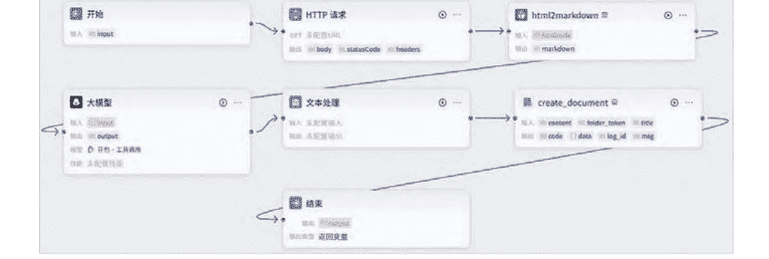

- （9）节点连接完成后，开始配置节点。单击“HTTP 请求”节点，在页面右侧会弹出该节点的配置窗口，由于要获取指定网页的信息，所以需要将指定的网页地址输入到 API 选项的 URL 文本框中，需要注意的是，输入的网址需要是免登录的，否则节点无法返回信息。笔者想要获取“36 氪”网站中关于 AI 的信息，所以输入的网址为 https://www.36kr.com/search/articles/AI，如下左图所示，其他选项保持默认不变即可。
- （10）单击 html2markdown 节点，在打开的配置窗口中单击“输入”选项的 htmlcode “参数值”右侧的◎按钮，在打开的下拉列表框中选择“HTTP 请求 -body”选项，如下右图所示，目的是要将获取的网页的 body 部分输入，转换为 markdown 格式。


- （11）接下来是“大模型”节点，它是整个工作流的关键节点，需要让它将网页信息转换为所需的指定格式，才可以正常输出。单击该节点，在打开的配置窗口的“模型”选项中选择“DeepSeek-R1·工具调用”模型，设置“输入”选项的“变量值”为 html2markdown-markdown，如下左图所示。在窗口中向下滑动，在“用户提示词”文本框中输入“提供的内容：{{input}}，输出完整的链接”，在“输出”选项中将 output 的“变量类型”修改为 Array<Object>，单击右侧的+%按钮，新增两个子项，设置第一个子项的变量名为 title，第二个子项的变量名为 link，如下右图所示，以便让获取的网页信息与链接一起输出。
- （12）下面将通过“文本处理”节点输出获取的网页内容。单击该节点，在打开的配置窗口中，设置“输入”选项的“参数值”为“大模型 -output”，在“字符串拼接”文本框中输入输出的形式，以 {{String1[0].title}}{{String1[0].link}} 为例，代表输出第一条内容的标题和第一条内容的链接，这里根据想要输出的条数，设置相应的变量即可，如下左图所示。
- （13）再往下就是通过 create_document 节点将输出的内容导入到飞书在线文档中。单击该节点，在打开的配置窗口中，设置“输入”选项 content 的“参数值”为“文本处理 -output”，如下右图所示，也就是将“文本处理”节点输出的内容当作文档的内容输入。需要注意的是，如果没有在 Coze 中授权过飞书的账号，需要在该节点配置窗口中单击“授权”按钮进行授权。

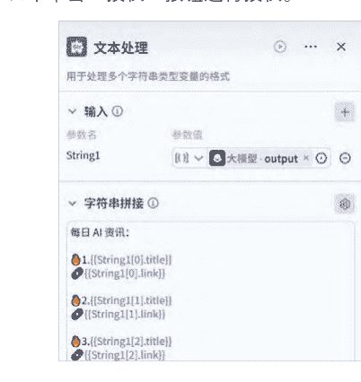

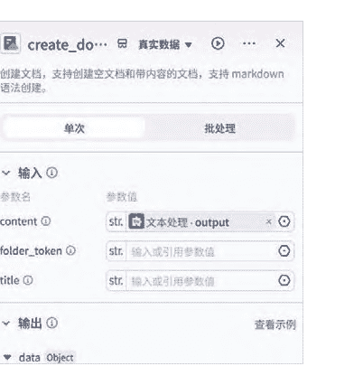

- （14）工作流的最后需要通过“结束”节点返回工作流运行后的结果信息。单击节点，在打开的配置窗口中，设置“输出变量”选项 output 的“参数值”为 create_document-url，如下图所示，目的是将创建好的在线文档链接返回。


- （15）所有节点配置完成后，单击下方的 START 按钮，对工作流进行测试，查看是否还存在问题，如果所有节点的下方都显示“运行成功”，说明工作流没有问题，如下图所示。

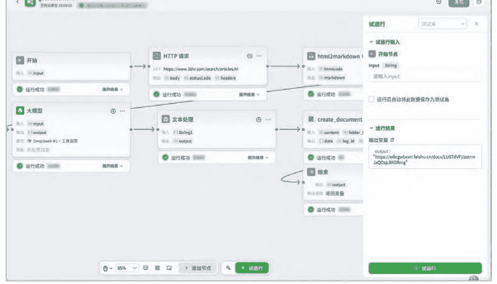

- （16）这样，获取一个指定网页信息并整理为文档的工作流就搭建完成了，如果想要获取多个指定网页的信息，还需要在工作流中复制部分节点以实现读取多个网页信息。以读取两个指定网页信息为例，单击“HTTP 请求”节点的 ... 按钮，在打开的下拉列表框中选择“创建副本”选项，便会创建“HTTP 请求 _1”节点，单击该节点，在打开的配置窗口中，输入第二个指定的网址 https://www.36kr.com/search/articles/iphone，其他选项保持默认不变。使用同样的方法创建“html2markdown_1”“大模型_1”和“文本处理_1”节点，并将它们按顺序进行摆放，如下图所示。

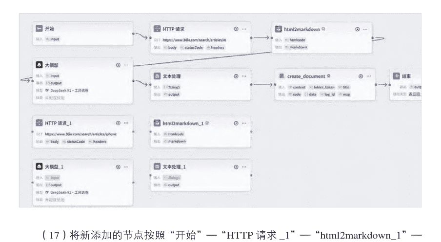

- （17）将新添加的节点按照“开始”—“HTTP请求_1”—“html2markdown_1”—“大模型_1”—“文本处理_1”的顺序进行连接。参考之前的节点配置方法对新创建的节点进行配置，需要注意的是，“文本处理_1”节点的“字符串拼接”文本框中的内容要根据网页的内容进行更改，如下图所示。

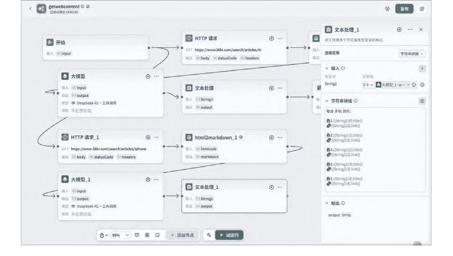

- （18）为了将获取到的网页内容合并在一起，还需要再添加一个“文本处理_2”节点，将“文本处理”节点和“文本处理_1”节点输出的内容在“文本处理_2”节点中进行合并。因此，先将“文本处理” — “create_document”节点连接断开，将“文本处理”节点和“文本处理_1”节点连接到“文本处理_2”节点，单击“文本处理_2”节点，在打开的配置窗口中单击“输入”选项的 + 按钮，添加 String2 变量，两个变量的值分别选择“文本处理-output”和“文本处理_1-output”，在“字符串拼接”文本框中输入“{{String1}}{{String2}}”，表示将两部分内容合并，如下图所示。

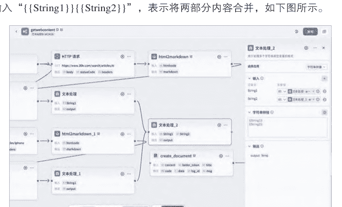

- （19）再将“文本处理_2”节点与“create_document”节点连接，这样，获取两个指定网页信息并整理为文档的工作流就搭建完成了，单击下方的“试运行”按钮，对工作流进行测试，如下图所示。如果没有问题，就可以将工作流发布并应用到智能体中了。

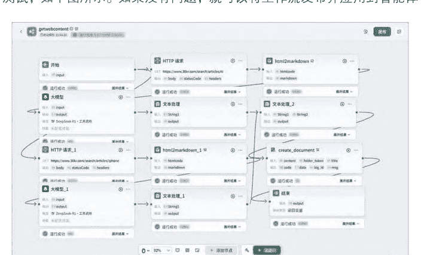

- （20）单击工作流页面右上方的“发布”按钮，在打开的窗口中输入“版本号”和“版本描述”，单击“发布”按钮，工作流将会发布，页面自动返回“个人空间”页面，在“个人空间”列表框中选择“项目开发”选项，打开“项目开发”界面，如下图所示。


- （21）单击右上方“创建”按钮，在打开的创建窗口中选择“创建智能体”选项，在弹出的“创建智能体”窗口中输入“智能体名称”，再选择一个“图标”，单击“确认”按钮，创建智能体并进入智能体的“编排”页面，如下图所示。

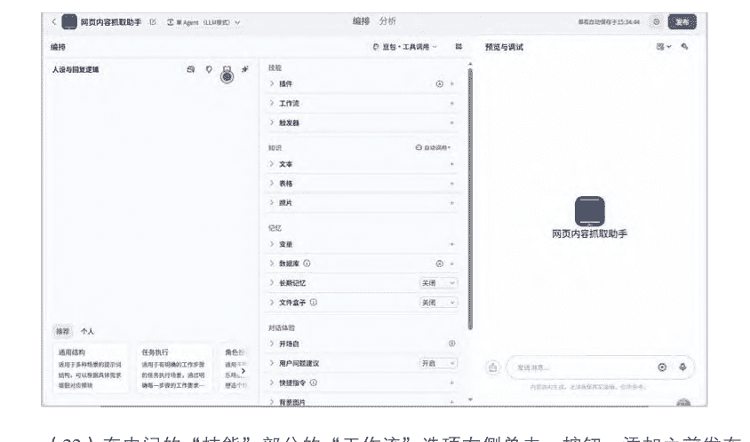

- （22）在中间的“技能”部分的“工作流”选项右侧单击+按钮，添加之前发布的工作流 getwebcontent，在左侧的“人设与回复逻辑”面板中输入提示词“请帮我调用工作流 {getwebcontent}”，这样做的目的是让智能体直接调用工作流，而不会回复无关的信息；在右侧的“预览与调试”面板的文本输入框中输入“获取资讯”，单击 ▶ 按钮，智能体便开始运行工作流，并返回最终的飞书文档链接，如下图所示。
- （23）在浏览器中打开返回的链接，即可得到我们想要的信息加链接的内容，如下左图所示。
- （24）回到智能体“编排”页面，单击页面右上方的“发布”按钮，在“选择发布平台”列表框中选择“扣子商店”复选框，“分类”选择“效率工具”，单击页面右上方“发布”按钮，在发布成功页面中可以单击“复制智能体链接”选项，复制链接并在浏览器中打开智能体，也可以在扣子的“商店”页面中搜索“获取 AI 新闻”找到并使用智能体，如下右图所示。


### 创建自动批量抓取公众号内容并改写的智能体

在内容为王的时代，微信公众号作为品牌传播的核心阵地，承载着大量优质内容的生产与分发工作。然而，面对日益增长的内容需求，营销人员往往在文章创作与优化上耗费大量时间，尤其是批量提取与改写文章时，传统方式效率低下且难以保证质量。通过 Coze 与 DeepSeek 的深度融合，能够一键批量提取公众号文章内容，并基于品牌定位与用户需求进行高效改写。这一工具不仅能够快速生成风格多样、语义精准的文案，还支持多维度优化与实时调整，彻底解决了内容创作的效率瓶颈。无论是提升内容生产力，还是增强用户黏性，这一技术都为公众号运营提供了强有力的支持，助力品牌在信息洪流中脱颖而出，具体操作如下。

整个操作过程需要通过 Coze 的工作流和多维表格两部分来实现，下面先对 Coze 的工作流进行讲解。

- （1）进入扣子官网页面，登录后进入扣子网站的主页页面，单击页面左侧的 📁 按钮，进入个人空间页面，在“个人空间”列表框中选择“资源库”选项，打开“资源库”界面，如下图所示。

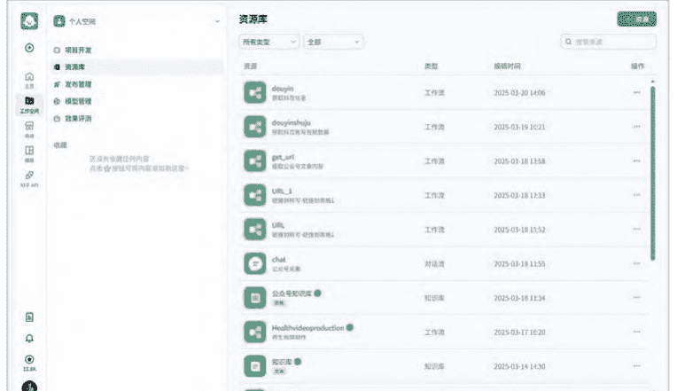

- （2）将鼠标移动到界面右上方的 ➕ 按钮上，在打开的下拉列表框中选择“工作流”选项，便会打开创建工作流窗口，在“工作流名称”文本框中输入 gongzhonghaotiqu，在“工作流描述”文本框中输入“提取公众号内容”，单击“确认”按钮，页面自动跳转到该工作流界面。将鼠标移动到页面下方的 ➕ 按钮上，在打开的节点列表框中添加“代码”和“循环”节点，如下图所示。


- （3）重复上一步添加节点的操作，这次在节点列表框中选择“插件”节点，在弹出的“添加插件”窗口的搜索文本框中输入“飞书电子表格”，窗口右侧便会显示相关插件，找到需要的插件并单击打开该插件的节点列表，添加 read_cols 节点，如下图所示。


- （4）将添加的节点按照“开始”—“read_cols”—“代码”—“循环”—“结束”的顺序连接起来，单击“循环体”子节点，在“循环体”子节点中使用同样的方法添加“代码”节点、“链接读取”插件的 LinkReaderPlugin 节点，以及“飞书多维表格”插件的 add_records 节点，并将循环体内的节点按照“循环体”—“LinkReaderPlugin”—“代码_1”—“add_records”—“循环体”的顺序进行连接，如下图所示。


- （5）因为要批量获取公众号文章的内容，所以需要通过表格上传公众号文章的链接，也就意味着无须在工作流中手动输入链接了，那么也就不用配置“开始”节点了。进入飞书云文档网站，新建一个“表格”，将表格改名为“公众号 URL”，在表格的第一列依次向下输入公众号文章的链接，如下图所示，打开 read_cols 节点的配置窗口，在“输入”选项的变量中需要填写电子表格的 token，也就是填写公众号链接的电子表格 url。


- （6）复制“公众号 URL”表格的链接，回到工作流页面的 read_cols 节点配置窗口，num_cols 变量代表读取的列数，因为之前在表格中的第一列填写了链接，所以在它的变量值文本框中输入 1，在 spreadsheet_token 的“变量值”文本框中粘贴复制的表格链接，如右图所示。


（7）在“代码”节点的配置窗口中，将“输入”选项的“变量名”input修改为linkdata，“变量值”选择read_cols-valuesJsonString。单击“代码”选项右侧的“在IDE中编辑”按钮，打开代码输入窗口，输入以下代码内容。在“输出”选项中单击按钮，将多余的变量删除，只留下一个变量，并将其名称修改为links，“变量类型”选择Array<String>，如下图所示。

```javascript
async function main({ params }: Args): Promise<Output> {

    // Parse the input JSON string to get the actual array structure
    const inputArray = JSON.parse(params.linkdata);

    // Extract the "text" field from each object
    const textArray = inputArray.flatMap(outerArray =>
        outerArray.flatMap(innerArray =>
            innerArray.map(obj => obj.text)
        )
    );

    // Return the array of extracted text values
    const ret = textArray;

    return ret;
}
```

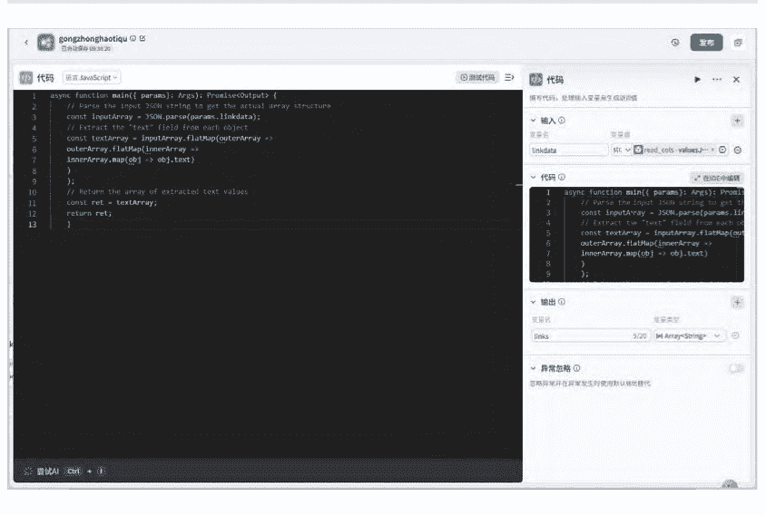

（8）在“循环”节点的配置窗口中，设置“循环类型”为“使用数组循环”，“循环数组”选项的input“变量值”选择“代码-links”，“输出”选项的output“变量值”选择任意一个值即可，笔者这里选择的是LinkReaderPlugin-data，如下图所示。因为我们不需要最终返回的结果，所以选择输出的变量值的目的是保证工作流能正常运行。

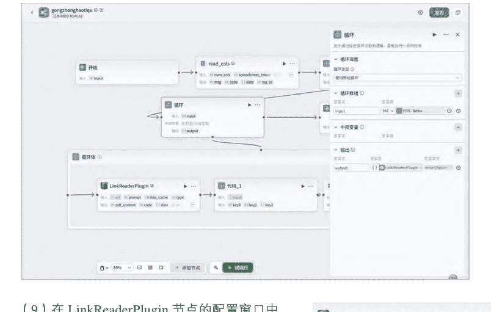

（9）在LinkReaderPlugin节点的配置窗口中，设置url的“变量值”为“循环-input”，也就是每一条进入循环的公众号文章的链接，其他参数默认不变，如右图所示。

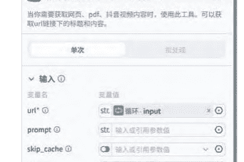

（10）在“代码_1”节点的配置窗口中，将“输入”选项的“变量名”input改为title，“变量值”选择“LinkReaderPlugin-title”，单击+按钮新增一条变量，设置“变量名”为content，变量值选择“LinkReaderPlugin-content”。单击“代码”选项右侧的“在IDE中编辑”按钮，打开代码输入窗口，输入以下代码内容。在“输出”选项中单击按钮，将多余的变量删除，只留下一个变量，并将其名称修改为records，“变量类型”选择Array<Object>，单击右侧的按钮，新增一个子项，命名为fields，“变量类型”选择Object，在该子项右侧点击按钮，新增title和content两个子项，如下图所示。

```javascript
async function main({ params }: Args): Promise<Output> {
    const title = params.title;
    const content = params.content;
    const doc_url = params.doc_url;
    const fields = {
        "title": title,
        "content": content
    };
    const records = [
        {
            "fields": fields
        }
    ];
    const ret = {
        "records": records
    };
    return ret;
}
```

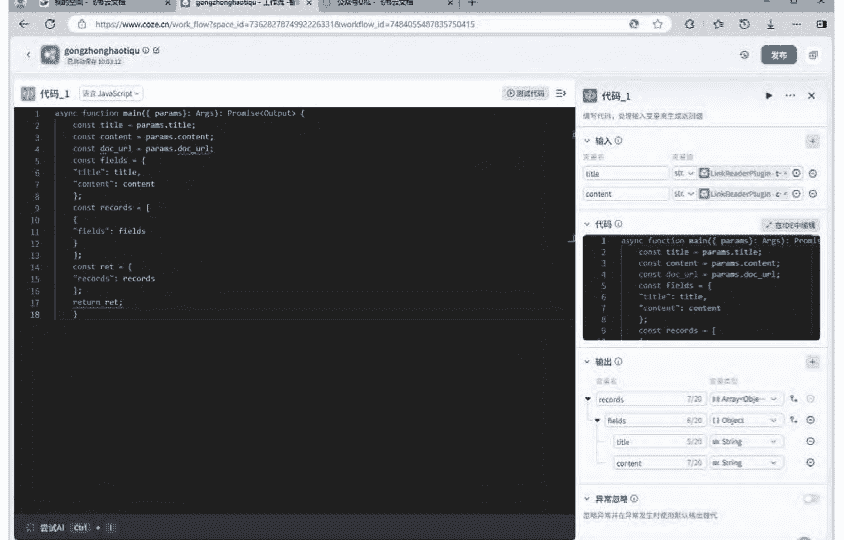

（11）在add_records节点的配置窗口中，设置app_token的“变量值”为新建的多维表格链接，records的“变量值”选择“代码_1-records”，如下左图所示。

（12）在“结束”节点的配置窗口中，因为在add_records节点已经达成了将数据添加到多维表格中的目的，所以不需要返回任何内容，但如果不设置该节点，工作流在运行时就会报错，所以单击⊖按钮将output变量删除，如下右图所示，这样工作流就可以正常运行了。


至此，Coze的工作流就搭建完成了，但要想获取公众号文章内容，还需要在多维表格中进行操作，下面将继续对多维表格部分的操作进行讲解。

（1）进入在工作流部分新建的多维表格页面，将新建的多维表格重命名为“公众号文章内容改写”，将不需要的字段删除，选中“人员”“单选”“日期”“附件”字段，在其中任意字段处单击鼠标右键，在弹出的快捷菜单中选择“删除字段/列”命令，将选中字段删除，将“文本”字段改名为title，新建content文本字段，如右图所示。


（2）多维表格设置完成后，回到工作流页面，单击下方▶试运行按钮，无须在试运行窗口的文本框中输入内容，直接单击“试运行”按钮，等待运行结束，表格中的公众号文章内容便添加到了多维表格中，如右图所示。

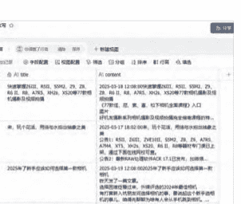

（3）单击content字段右侧的+按钮，在弹出的新增字段窗口中输入字段标题，笔者想要改写文章内容，所以输入的是“内容改写”，“字段类型”选择“对象”，“探索字段捷径”选择“DeepSeek R1（联网）”，在“输入指令”文本框中输入指令“将内容进行润色，保持语义与句式不变，输出的段落格式也要与原文相同，但要比原来的语句更加丰富，且语言要更通俗一些，一定要将内容中多余的符号删除”，将光标移动到指令的开头，单击“引用字段”按钮，选择content字段并添加，如下图所示。

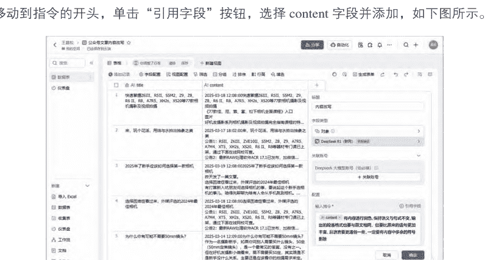

（4）取消选择“获取更多信息”中的“思考过程”和“参考链接”复选框，其他参数保持默认不变，单击“确定”按钮，在弹出的“是否生成全列？”窗口中单击“生成”按钮，此时表格中会多出“内容改写.输出结果”字段并开始生成改写后的文案。等待内容生成后，就可以看到改写后的文章内容了，如下图所示。

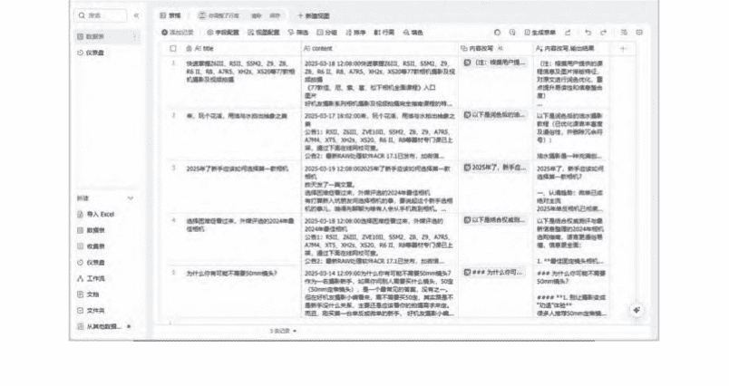

### 创建一键生成爆款视频的智能体

在短视频创作领域，爆款视频的诞生往往需要精准的选题、高效的创意输出及独特的表达方式。然而，传统的内容创作流程中，创作者不仅需要耗费大量时间寻找灵感，还需要反复打磨脚本、拍摄和剪辑，这一过程耗时且充满不确定性。为了帮助创作者突破这一瓶颈，笔者设计了一个智能体，能够实现一键生成爆款视频，具体操作如下。

（1）按照前文案例中同样的方法创建Healthvideoproduction工作流，并进入工作流页面，添加“大模型_生成文案”和“循环”节点，并添加“视频合成工具箱”插件的video2video节点，将创建的节点按照“开始”—“大模型_生成文案”—“循环”—“video2video”—“结束”的顺序进行排列，如下图所示。需要注意的是，“大模型_生成文案”节点就是“大模型”节点重命名后的节点。


（2）因为要用多个视频合成一个完整的视频，所以需要用到的子视频要在“循环”节点的“循环体”子节点中生成。单击“循环体”子节点，在“循环体”子节点中创建“大模型_绘画提示词”“sd_better_prompt”“图像生成”“选择器”“终止循环”节点，并添加“语音合成”插件的speech_synthesis节点和“视频合成工具箱”插件的imgs2video_lite节点，将创建的节点按照“大模型_绘画提示词”—“sd_better_prompt”—“图像生成”—“speech_synthesis”—“imgs2video_lite”—“选择器”—“终止循环”的顺序进行排列，如下图所示。


（3）将“循环体”子节点外的节点按照“开始”—“大模型_生成文案”—“循环”—“video2video”—“结束”的顺序进行连接，将“循环体”子节点内的节点按照“循环体”—“大模型_绘画提示词”—“sd_better_prompt”—“图像生成”—“speech_synthesis”—“imgs2video_lite”—“选择器”的顺序进行连接，“选择器”节点有“如果”和“否则”两个输出端口，将它们按照“如果”—“终止循环”和“否则”—“循环体”方式进行连接，如下图所示。


（4）在“开始”节点的配置窗口中，将变量名input修改为theme，并选择右侧的必填复选框，目的是在执行工作流时必须要填写一个生成视频的主题，工作流才可以开始运行。在“大模型_生成文案”节点的配置窗口中，设置“模型”为DeepSeek-R1，input的“变量值”为“开始-input”，在“系统提示词”文本框中输入“根据输入的养生主题 {{input}}，创作一篇60字左右、4句话左右的养生文案”，单击按钮自动优化提示词，替换为优化后的提示词，如下左图所示，在“用户提示词”文本框中输入“{{input}}”，将“输出”选项中的output的“变量类型”修改为Array<String>，如下右图所示。

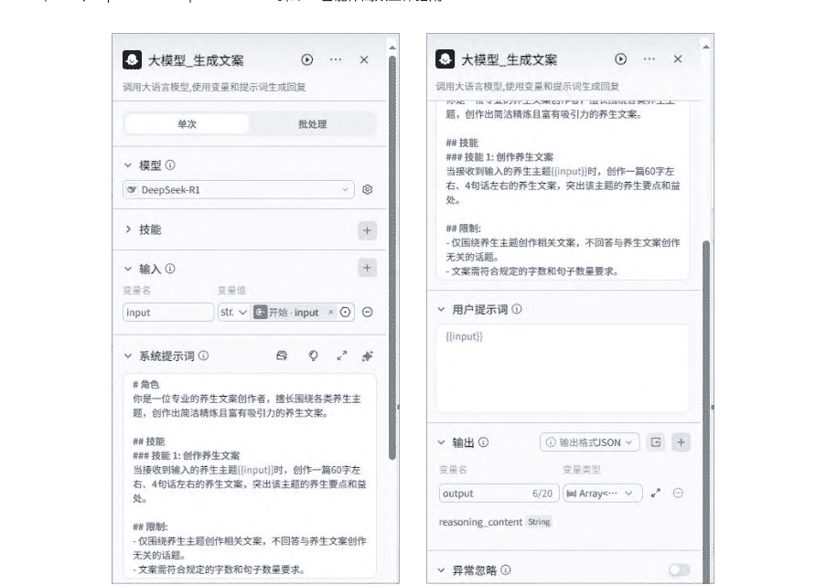

（5）在“循环”节点的配置窗口中，设置“循环类型”为“使用数组循环”，设置“循环数组”选项的input“变量值”为“大模型_生成文案-output”，“输出”选项的output“变量值”为imgs2video_lite-videoUrl，如下图所示。

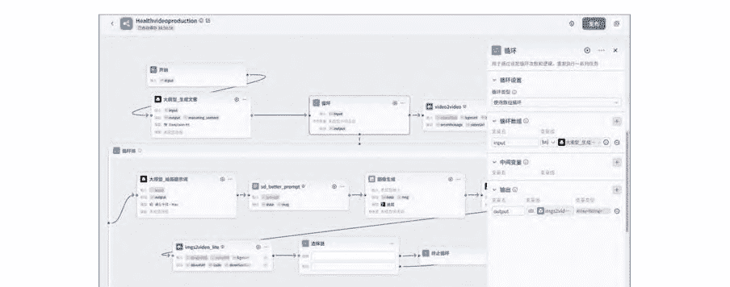

（6）在“大模型_绘画提示词”节点的配置窗口中，设置“模型”为“通义千问·Max”，“输入”选项的input的“变量值”为“循环-input”，如下左图所示。在“系统提示词”文本框中输入“根据输入的养生文案{{input}}，生成古代动漫画风图片的提示词，提示词中要有人物、场景、元素等”，单击按钮自动优化提示词，替换为优化后的提示词，在“用户提示词”文本框中输入“{{input}}”，如下右图所示。


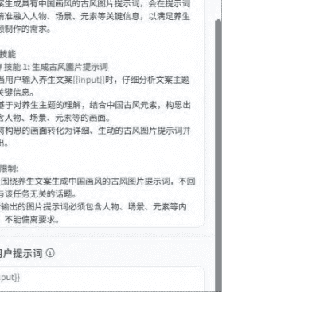

（7）在“提示词优化”节点的配置窗口中，设置“提示词”的“变量值”为“大模型_绘画提示词-output”。在“图像生成”节点的配置窗口中，设置“模型”为“通用-Pro”，“比例”选择16:9（1024*576），“生成质量”为30，如下左图所示。在“输入”选项中，单击+按钮，添加input变量，设置“变量值”为sd_better_prompt-data，在“正向提示词”文本框中输入“{{input}}，中国画，徐悲鸿，粗犷笔触”，在“负向提示词”文本框中输入“文字，英文”，如下右图所示。

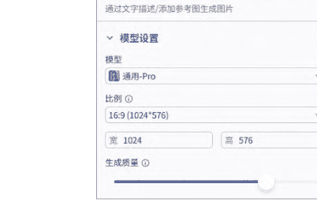


（8）在speech_synthesis节点的配置窗口中，设置text的“变量值”为“循环-input”，voice_id的“变量值”为“擎苍”，如下左图所示。在imgs2video_lite节点的配置窗口中，设置imageUrl1的“变量值”为“图像生成-data”，voiceUrl的“变量值”为speech_synthesis-link，如下右图所示。


（9）在“选择器”节点的配置窗口中，将“条件分支”设置为“如果‘循环-index’等4”则终止循环，否则继续循环，如下图所示。这里的“4”是指在大模型中生成的4句文案，对应的意思就是根据这4句文案生成4个视频。如果不到4个则继续循环，如果到了4个则停止循环。


（10）在video2video节点配置窗口中，设置videoFiles的“变量值”为“循环-output”，如下左图所示，如果想添加背景音乐，可以在bgmUrl的“变量值”文本框中输入音乐的链接。

（11）在“结束”节点的配置窗口中，设置output的“变量值”为video2video-videoUrl，如下右图所示，目的是将生成的视频链接返回。


（12）至此，一键生成养生爆款视频的工作流就搭建完成了，输入“古人补气血的智慧”的主题进行测试，可以发现运行正常并返回了视频链接，如下图所示。

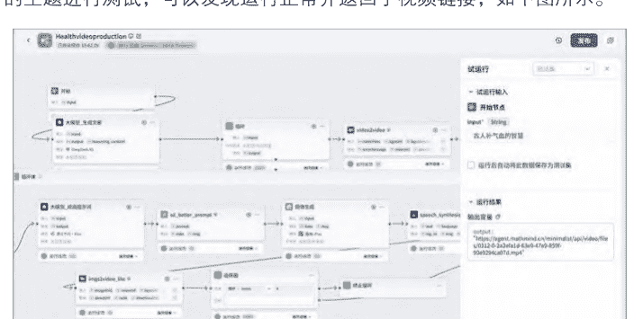

（13）按照之前讲过的方法将工作流发布，并创建一个名为“养生视频制作”的智能体，将刚发布的工作流添加并调用到“人设与回复逻辑”面板中，发布智能体，将其发布到“扣子商店”平台，即可在扣子商店中找到该智能体，如下图所示。


（14）单击“养生视频制作”智能体，即可进入智能体对话页面，在文本框中输入“古人预防失眠的智慧”，单击▶按钮，智能体便开始进行视频创作，并返回视频链接，如右图所示。


（15）单击返回的视频链接，即可在浏览器中观看生成的视频，如下图所示，可以看到生成了一个19秒并带有配音的养生视频。


### 创建一键自动批量生成小红书健康养生图文的智能体

在健康内容创作领域，传统的生产方式面临双重挑战：创作者既要保证专业性和准确性，又要兼顾平台调性和用户喜好，往往需要投入大量时间进行资料查阅和内容打磨；同时，人工制作难以快速响应热点话题，容易错失流量窗口期。

针对这一行业痛点，不妨按笔者下面所讲述的案例步骤，通过DeepSeek与Coze平台的深度整合，打造能够智能生成并优化健康养生内容的AI解决方案。该方案不仅能自动匹配小红书热门趋势，生成专业且符合平台风格的高质量文案，还能智能优化视觉呈现，从而在健康养生领域持续保持内容竞争力。

（1）进入扣子官网页面，登录后进入扣子网站的主页页面，单击页面左侧的📁按钮，进入个人空间页面，在“个人空间”列表框中选择“资源库”选项，打开“资源库”界面，如下图所示。

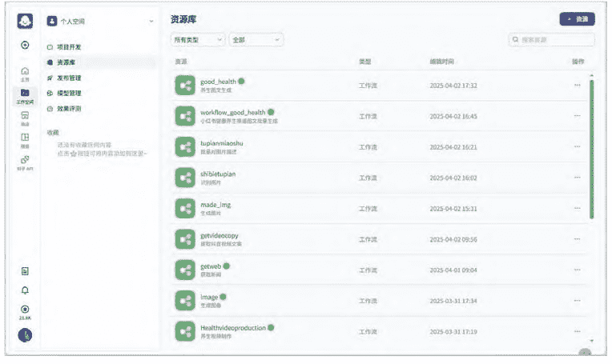

（2）将鼠标移动到界面右上方的➕按钮上，在打开的下拉列表框中选择“工作流”选项，便会弹出创建工作流窗口，在“工作流名称”文本框中输入health_image，在“工作流描述”文本框中输入“批量生成小红书健康养生图文”，单击“确认”按钮，页面自动跳转到该工作流界面。将鼠标移动到页面下方的➕添加节点按钮上，在打开的节点列表框中添加“大模型”和“批处理”节点，如下图所示。


（3）将添加的节点按照“开始”—“大模型”—“批处理”—“结束”的顺序连接起来，单击“批处理体”子节点，在“批处理体”子节点中使用同样的方法添加“图像生成”节点、Cutout节点及“画板”节点，并将批处理体内的节点按照“批处理体”—“图像生成”—“抠图”—“画板”—“批处理体”的顺序进行连接，如下图所示。

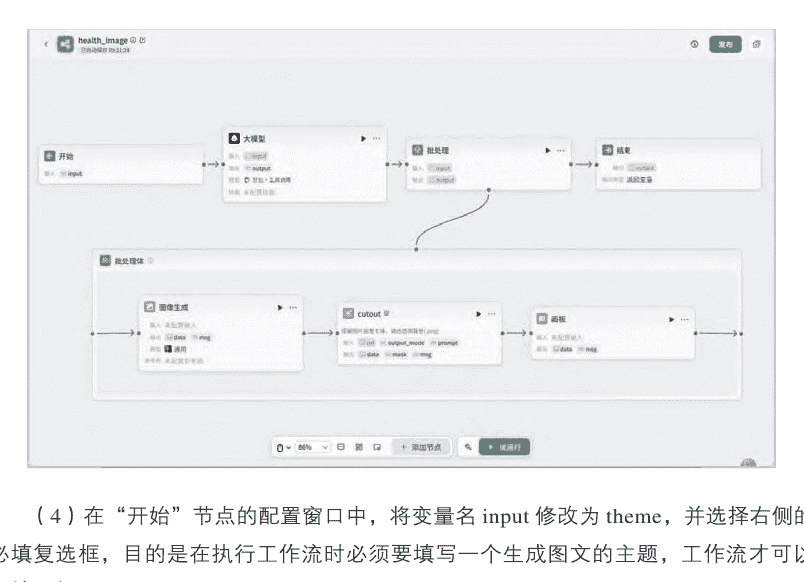

（4）在“开始”节点的配置窗口中，将变量名input修改为theme，并选择右侧的必填复选框，目的是在执行工作流时必须要填写一个生成图文的主题，工作流才可以开始运行。

（5）在“大模型”节点的配置窗口中，设置“模型”为DeepSeek-R1，input的“变量值”为“开始-theme”，在“系统提示词”文本框中输入下述提示词，如下页左图所示。

> 你是一个健康养生专家，你可以根据用户为你提供的主题自动生成健康养生的文案。例如：用户提供的主题是：健康养生的10个微习惯。那么生成的内容如下所示，应该输出一个json格式的内容：{"name": "晨起喝温水","description": "每天早晨空腹喝一杯温水，能唤醒肠胃，促进新陈代谢，帮助身体排出毒素。"}，……

在“用户提示词”文本框中输入提示词“用户提供的主题：{{input}}”，将“输出”选项中的output的“变量类型”修改为Array<String>，并添加两个子项，分别命名为name和description，设置“变量类型”均为String，如下页右图所示。

### 创建一键批量合成小红书图片文字的工作流

在内容创作效率至上的时代，小红书平台对图文内容的质量和产出速度提出了更高要求。传统的图文制作流程中，创作者往往需要辗转于多个软件工具，从文案撰写到图片设计再到排版美化，整个过程耗时费力且难以保证风格统一。通过 Coze 平台与 AI 技术的深度融合，彻底颠覆了传统内容生产方式。该工作流能够智能识别文案核心要素，自动匹配最佳视觉模板，实现了文字排版与图片设计的完美融合。无论是产品种草、旅行攻略还是生活分享，这套系统都能在保持小红书特有美学风格的同时，将图文创作效率提升 10 倍以上，让创作者真正实现“所想即所得”的高效内容生产，具体操作如下。

（1）进入扣子官网页面，登录后进入扣子网站的主页页面，单击页面左侧的按钮，进入个人空间页面，在“个人空间”列表框中选择“资源库”选项，打开“资源库”界面，如下图所示。

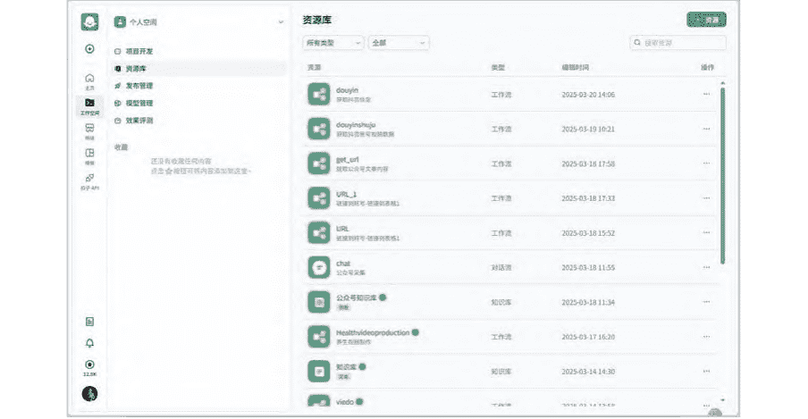

（2）将鼠标移动到界面右上方的按钮上，在打开的下拉列表框中选择“工作流”选项，便会弹出创建工作流窗口，在“工作流名称”文本框中输入 xhs_image_text，在“工作流描述”文本框中输入“批量合成小红书图文”，单击“确认”按钮，页面自动跳转到该工作流界面。将鼠标移动到页面下方的按钮上，在打开的节点列表框中添加“代码”和“循环”节点，在插件窗口中添加“飞书电子表格”插件的 read_cols 节点，如下图所示。

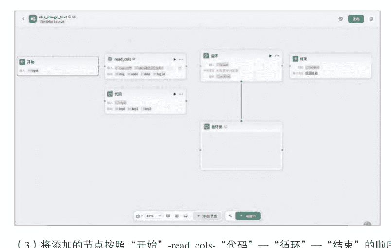

（3）将添加的节点按照“开始”-read_cols-“代码”—“循环”—“结束”的顺序连接起来，单击“循环体”子节点，在“循环体”子节点中使用同样的方法添加“画板”节点，并将循环体内的节点按照“循环体”—“画板”—“循环体”的顺序进行连接，如下图所示。


（4）在“开始”节点的配置窗口中，因为要批量上传图片，所以要将“变量类型”修改为 Array<Image>，并选择“必填”复选框，如下左图所示，这样在运行工作流时，文本框就会变成文件上传区域，单击即可批量上传图片。

（5）因为需要批量上传文案，但是扣子没有该功能的节点，所以先将文案放在表格中，然后再通过读取表格内容批量上传文案。进入飞书云文档网站，新建一个“表格”，将表格重命名为“小红书文案批量上传”，在表格的第一列依次向下输入小红书文案内容，如下右图所示。注意，这里文案的顺序要与上传图片的顺序对应起来，以保证生成的图文内容是正确的。打开 read_cols 节点的配置窗口，在“输入”选项的“变量值”文本框中输入电子表格的 token，也就是填写公众号链接的电子表格 URL。


（6）复制“小红书文案批量上传”表格的链接，回到工作流页面的 read_cols 节点配置窗口，num_cols 变量代表读取的列数，因为是在表格的第一列中输入的链接，所以在它的“变量值”文本框中输入 1，在 spreadsheet_token 的“变量值”文本框中粘贴复制的表格链接，如右图所示。


（7）在“代码”节点的配置窗口中，在“输入”选项中，将变量名 input 修改为 textdata，设置“变量值”为 read_cols-valuesJsonString，单击“代码”选项右侧的“在 IDE 中编辑”按钮，打开代码输入窗口，输入以下代码内容。在“输出”选项中单击按钮，将多余的变量删除，只留下一个变量，并将其名称修改为 text，设置“变量类型”为 Array<String>，如下图所示。

```javascript
async function main({ params }: Args): Promise<Array<string>> {
    // 1. 解析输入的 JSON 字符串
    const parsedData = JSON.parse(params.textdata);
    // 2. 提取所有语录（从每个子数组的第一个元素获取字符串）
    const quotes = parsedData.map(item => item[0]);
    // 3. 返回字符串数组
    return quotes;
}
```


（8）在“循环”节点的配置窗口中，设置“循环类型”为“使用数组循环”，单击“循环数组”选项右侧的 + 按钮，新建一个变量，将 input 的“变量名”修改为 image，设置“变量值”为“开始 -input”。新建一个名为 text 的变量，设置“变量值”为“代码 -text”，这是因为我们通过不同的节点输入图片和文字，所以需要使用两个变量。将“输出”选项的 output“变量值”设置为“画板 -data”，如下图所示。


（9）在“画板”节点的配置窗口中，单击“元素设置”选项右侧的 + 按钮，添加两个元素，分别命名为 image 和 text，将“元素值”分别设置为“循环 -image”和“循环 -text”，如下图所示。


（10）双击“画板编辑”选项中的画板，打开画板排版窗口，单击□按钮，在画板设置窗口中将“画板尺寸”修改为 1080 × 1440。单击□按钮，为画板添加背景图片，设置“填充模式”为“自适应”，缩放并移动背景图片使其与画板重合。单击□按钮，在画板中添加 image 和 text 变量。添加 image 变量后，可以调整图像的位置和大小；添加 text 变量后，可以调整文本框的位置和大小。选择合适的字体，设置字体大小和对齐方式，最终呈现出一个合理的排列布局，如下图所示。


（11）在“结束”节点的配置窗口中，设置 output 的“变量值”为“循环 -output”，目的是将生成的图文返回给用户。

（12）至此，一键合成小红书图片文字的工作流就搭建完成了，上传准备好的 10 张素材图片进行测试，可以发现运行正常并返回了生成的图文，如下图所示。


（13）生成的部分图文效果如下图所示。


### 创建一键批量生成语音博客的工作流

在内容创作领域，传统的语音博客制作面临着显著效率瓶颈：从文稿撰写到录音剪辑流程烦琐，耗费创作者大量的时间和精力；同时，单一呆板的语音输出缺乏情感表现力，难以持续吸引听众的注意力。

针对这一行业痛点，不妨按笔者下面所讲述的案例步骤，通过 DeepSeek 与 Coze 的深度整合，打造能够智能创作、情感化播报的一键式语音博客生成方案，具体操作如下。

（1）按照前文案例中同样的方法创建 voice_blog 工作流，如右图所示。


（2）进入工作流页面，添加“大模型”和“循环”节点，然后添加“链接读取”插件的 LinkReaderPlugin 节点、“语音博客”插件的 genPodcastURL 节点和“打包工具”插件的 package 节点，将添加的节点按照“开始”—“大模型”—“循环”—“循环体”—LinkReaderPlugin-genPodcastURL—循环体—package—“结束”的顺序进行连接，如下图所示。


（3）在“开始”节点的配置窗口中，将变量名 input 修改为 url，并选择右侧的“必填”复选框，如右图所示。因为该工作流是将网页内容生成博客，所以要输入网址才能生成。


（4）在“大模型”节点的配置窗口中，设置“模型”为 DeepSeek-V3，input 的“变量值”为“开始-url”，在“系统提示词”文本框中输入下述提示词，如下左图所示。

> 当接收到用户输入的链接 {{input}} 时，将其按照每组一个的形式进行分组输出。
> === 回复示例 ===
> - 链接 1: {{input}}
> === 示例结束 ===

在“用户提示词”文本框中输入“{{input}}”，将“输出”选项中的 output 的“变量类型”修改为 Array<String>，如下右图所示。


（5）在“循环”节点的配置窗口中，设置“循环类型”为“使用数组循环”，“循环数组”选项的 input “变量值”为“大模型-output”，“输出”选项的 output “变量值”为“genPodcastURL-podcast_url”，如右图所示。


（6）在 LinkReaderPlugin 节点的配置窗口中，设置 url 的“变量值”为“循环 -input”，need_image_url 的“变量值”不用选择，如下左图所示。

（7）在 genPodcastURL 节点的配置窗口中，设置 input_text 的“变量值”为 LinkReaderPlugin-content，use_head_music 的变量值不用选择，如下右图所示。


（8）在 package 节点的配置窗口中，url_list 的“变量值”为“循环 -output”，如下左图所示；在“结束”节点的配置窗口中，设置 output 的“变量值”为 package-result，也就是压缩包的下载地址，如下右图所示。


（9）这样，一键批量生成语音博客的工作流就搭建完成了。为了保证工作流能正常运行，还需要测试工作流。单击页面下方的“试运行”按钮，页面会弹出“试运行”窗口，在 url 文本框中分行输入文章链接，也可以将文本文件拖入 file 文本框中，单击页面右下方的“试运行”按钮，工作流运行完成后会返回生成的博客音频压缩包下载地址，如下图所示。


（10）复制返回的压缩包地址，粘贴到浏览器的地址栏中，并按【Enter】键，压缩包便会下载到本地，解压后就是下载好的博客音频，如右图所示。


### 创建一键批量下载抖音视频的工作流

对于视频创作行业而言，传统的文案灵感获取方式存在明显的效率问题：创作者需要耗费数小时观看大量同类视频，不仅时间成本高昂，而且难以系统性地提炼有效信息；同时，人工筛选容易遗漏优质内容，影响文案的全面性和创新性。

针对这一行业痛点，不妨按笔者下面所讲述的案例步骤，通过 DeepSeek 与扣子平台的深度整合，打造能够智能解析并整合视频文案的智能体解决方案，具体操作如下。

（1）按照前文案例中同样的方法创建 get_video_copy 工作流，进入工作流页面，如下图所示。


（2）添加“大模型”和“循环”节点，然后添加“视频下载”插件的 download_video 节点、“视频转文案”插件的 wenantq 节点和“打包工具”插件的 package 节点。将添加的节点按照“开始”—“大模型”—“循环”—“循环体”—“download_video”—“wenantq”—“循环体”—“package”—“结束”的顺序进行连接，如下图所示。


（3）在“开始”节点的配置窗口中，选择 input 变量右侧的“必填”复选框，如下图所示，该节点用来输入视频的链接，所以必须填写。


（4）在“大模型”节点的配置窗口中，设置“模型”为 DeepSeek-V3，input 的“变量值”为“开始-input”，在“系统提示词”文本框中输入下述提示词，如下左图所示。

```
当接收到用户输入的链接 {{input}} 时，将其按照每组一个的形式进行分组输出。
=== 回复示例 ===
- 链接 1: {{input}}
=== 示例结束 ===
```

在“用户提示词”文本框中输入“{{input}}”，将“输出”选项中的 output 的“变量类型”修改为 Array<String>，如下右图所示。

（5）在“循环”节点的配置窗口中，设置“循环类型”为“使用数组循环”，“循环数组”选项的 input “变量值”为“大模型 -output”，“输出”选项的 output “变量值”为 download_video-url，单击右侧的 + 按钮，添加变量 output2，设置“变量值”为 wenantq-copy，如下图所示。


（6）在 download_video 节点的配置窗口中，设置 url 的“变量值”为“循环 -input”，api_token 的“变量值”不用填写，如下左图所示。

（7）在 wenanq 节点的配置窗口中，api_key 的“变量值”为在阿里云百炼申请的 API KEY 值，url 的“变量值”为 download_video-url，如下右图所示。


（8）在 package 节点的配置窗口中，将批量下载的视频链接打包为一个压缩包，以方便下载，所以设置 url_list 的“变量值”为“循环 -output”，如下左图所示；在“结束”节点的配置窗口中，设置 output 的“变量值”为 package-result，也就是压缩包的下载地址。单击 + 按钮添加 output2 变量，设置其“变量值”为“循环 -output2”，如下右图所示。


（9）这样，一键批量下载抖音视频并生成视频文案的工作流就搭建完成了。为了保证工作流能正常运行，还需要测试工作流。单击页面下方的“试运行”按钮，页面会弹出“试运行”窗口，在 url 文本框中分行输入多个抖音链接，单击页面右下方的“试运行”按钮，工作流运行完成后会返回生成的视频压缩包下载地址和视频文案，如下图所示。


（10）复制返回的压缩包地址，并粘贴到浏览器的地址栏中，并按【Enter】键，压缩包便会下载到本地，解压后就是下载好的视频，如下图所示。


### 利用工作流生成炫酷书单视频

下图展示的是“炫酷书单”扣子工作流，只需在工作流的“开始”节点中输入书籍名称并上传书籍封面图，AI 将自动生成关于这本书的炫酷介绍视频脚本及视觉方案，适合希望快速制作优质书单推荐内容的自媒体创作者，真正实现从图书到爆款视频的一键转化。如果想要高效创作引人入胜的书籍推荐视频，提升账号的文化调性与粉丝互动，可以尝试使用。


### 利用工作流生成假如书籍会说话类型视频

下图展示的是“假如书籍会说话”扣子工作流，只需在工作流的“开始”节点中输入书籍名称，AI 将自动生成以书籍第一人称视角展开的创意对话口播视频脚本，让书籍“亲口”讲述自己的故事与价值。如果希望打造沉浸式荐书体验、提升内容趣味性与情感共鸣，并想要增强账号记忆点与粉丝黏性的自媒体创作者，可以尝试使用。


### 利用工作流生成治愈系老奶奶类型视频

下图展示的是“治愈系老奶奶”扣子工作流，只需在工作流的“开始”节点中输入视频主题，AI 将自动生成温暖治愈的老奶奶视频脚本，包含充满人生智慧的金句和娓娓道来的叙事风格。适合希望创作暖心内容、传递情感慰藉与正能量的短视频创作者，真正实现从主题到温情视频的智能转化。如果想要打造独具特色的治愈系 IP 内容，增强观众情感共鸣与账号治愈调性，可以尝试使用。


### 利用工作流生成山海经故事类型视频

下图展示的是“山海经故事”扣子工作流，只需在工作流的“开始”节点中输入视频主题，AI 将自动生成融合《山海经》神话元素的神秘奇幻视频脚本，包含异兽传说、远古神话和东方奇幻视觉方案。适合希望创作具有中国文化特色的神秘题材的短视频创作者，真正实现从主题到奇幻视觉盛宴的一键转化。如果想要打造独具东方神秘色彩的 IP 内容，提升账号文化内涵与观众沉浸体验，可以尝试使用。


## 第6章 使用扣子、飞书驱动数字人

### 什么是 AI 数字人

AI 数字人是指利用人工智能技术创建的虚拟人物（也称为“数字分身”），它能高度模拟真实人类的外貌、语音、表情和动作，实现与人类的自然互动和交流。其核心技术融合了 3D 建模、语音合成与识别、自然语言处理（NLP）及动作驱动系统。通过深度学习和大模型训练，数字人不仅能复刻特定人物的形象和声音，还能理解用户需求并动态生成反馈，具备一定的自主学习和适应能力。

现在大家在 24 小时连续不断的电视新闻频道、在线教育平台及虚拟客服界面等看到的貌似真人的主播，有相当一部分都是由 AI 驱动的数字人在“上岗”工作。此外，在直播领域，数字人正逐步替代或辅助真人主播进行产品推广、客户互动与品牌宣传，不仅降低了人力成本，还提升了内容输出的效率与一致性。

如果配合上专业的知识库，数字人甚至可以升级成为数字员工。例如，百度智能云宣布推出全球首批 AI 数字员工，涵盖营销经理、还款助理、汽车销售、促销专员、产品经理、课程顾问、招聘专员等核心业务职能。

可以说，AI 数字人正在从“看得见”的视觉交互向“用得上”的智能服务转型，成为推动产业智能化的重要力量。具体到各种应用场景上，无论是新闻播报、教育培训、客户服务，还是虚拟导购、心理咨询或政务引导，数字人都已经有较为广泛的应用。

### 用扣子、飞书生成的文本驱动 AI 数字人

文本驱动 AI 数字人是指，在数字人制作平台中只需要输入文字，即可生成逼真的数字人视频。

文本驱动数字人的运作流程通常包含“文本输入—语义理解—视听生成”3 个核心阶段。其中，文本输入是起点，其质量直接决定了数字人输出的内容质量和表现力。

如果要为一个数字人视频生成文本，使用任何一种 AI 大模型都可胜任，但如果要生成一系列或要批量生成数字人应用的文本，则要考虑使用扣子或飞书多维表格。扣子平台作为一款强大的 AI 智能体开发与应用工具，能够深度集成大语言模型，结合用户提供的知识库和外部插件能力，进行多轮对话和复杂推理，从而批量生成逻辑清晰、风格多样的高质量文本。

飞书多维表格则可以利用其丰富的字段类型和自动化能力，构建起一个“文本生产线”。例如，在一个表格中填入上百个视频主题，通过使用 DeepSeek 大模型自动生成，或调用已创建的扣子智能体，即可实现一键批量生成适用于不同场景、不同风格的旁白或口播脚本。

通过智能化的文本生产流程，不仅能够确保数字人驱动所需的大规模文本供给，还能显著提升内容质量和创作效率，以规模化、批量化的文本生成方式为数字人生成提效。

本章中的“用闪剪快速生成数字人视频”“用飞影快速生成数字人视频”“用即梦快速生成数字人视频”等案例讲解了用文本驱动 AI 数字人的方法。

### 用扣子、飞书生成的语音驱动 AI 数字人

语音驱动 AI 数字人是指，在数字人制作平台中输入语音，然后生成逼真的数字人视频。

语音驱动数字人的核心流程包括“语音输入 - 音素解析 - 动态渲染”3 个阶段。其中，语音输入的质量和规模会直接影响数字人的最终呈现效果。

与前面所讲述的文本驱动数字人一样，如果要使用语音驱动数字人，最好也以批量化、规模化的流程来完成，以提高数字人生成的效率。在这方面，同样可以使用扣子与飞书平台。其中，扣子平台通过其强大的多轮对话和复杂任务处理能力，借助内置的语音合成插件将文本批量转换为自然流畅的语音。飞书多维表格则能够对这些语音素材进行结构化管理和批量处理，通过自动化流程实现从文本生成到语音合成的无缝衔接。

本章中的“用剪映快速生成数字人视频”案例讲解了用语音驱动 AI 数字人的方法。

### 用闪剪快速生成数字人视频

闪剪的数字人功能由深圳市趣推科技有限公司开发，技术相对成熟。该功能通常需要开通 VIP 会员或购买算力包方可使用，生成数字人视频一般会消耗算力。若以生成 10 个数字人视频（例如每个视频时长 1 分钟，即 60 秒/个）估算，总时长 600 秒，即需消耗约 600 算力。根据闪剪的算力充值策略，成本大约在 33.3 元。

闪剪平台的优势在于其功能集成度高，不仅提供了定制个人数字人的能力（上传 30 秒视频，即可 1：1 复刻形象与声音），还内置了超过 1000 个有版权的数字人模特素材，并且支持直播切片、声音克隆（支持多种外语和方言）、智能成片及照片数字人（让照片开口说话）等多种实用功能，方便用户进行短视频创作和带货。

从笔者的使用经验来看，闪剪所生成的数字人在口型同步方面表现较为准确，语音与唇形匹配度较高，基本能够实现音画对齐，无明显延迟问题。然而，数字人的嘴部动作仍显得不够自然，部分细节如唇齿配合、张嘴幅度等略显机械，在动作方面也存在生硬和重复性较高的情况，肢体交互灵活性有限，整体动态表现与真人自然状态存在一定的差距。

下面讲解如何在闪剪平台中使用数字人功能制作视频。

（1）进入闪剪 AI 官网首页，单击页面左下角的“登录 / 注册”按钮登录账号，如下图所示。


（2）在页面左侧的导航栏中选择“数字人库”选项，进入“数字人库”界面，在该界面中可以单击“开始定制”按钮，定制自己的数字人，也可以在“公共数字人”选项中选择公用的数字人，如下图所示。

（3）笔者想要生成一个文学讲解类型的数字人，所以选择了“瑾瑜”数字人，将鼠标指针移动到“瑾瑜”数字人封面上方，单击出现的“创作视频”按钮，打开闪剪数字人的创作页面，如下图所示。


（4）在页面左侧选择“配音”选项，打开配音面板，在该面板中可以选择数字人的声音。除此之外，在该面板中还可以设置闪剪的音频驱动数字人。单击“导入音频”按钮，选择一段准备好的音频导入，在页面右侧会自动识别音频中的文案，并自动使用上传的音频，如下图所示。需要注意的是，使用上传的音频是无法编辑文案的。

（5）如果不想使用上传音频中的声音，只想使用文案，也可以在左侧选择一个声音进行替换。替换声音后，右侧的文案部分就可以进行编辑及改写、停顿等操作了。如果没有合适的文案，可以使用第4章“创建一次生成100份社交文案的表格”案例生成文案或使用第5章“创建一键批量下载抖音视频的工作流”案例提取合适的文案使用。除了可以更改配音，在左侧还可以通过选择“音乐”“背景”“文字”“贴图”选项对数字人视频进行加工，如果不想使用“标题”和“字幕”，也可以在视频展示的上方关闭“标题”和“字幕”选项，如下图所示。


（6）全部参数设置完成后，单击页面右上方的“预览”按钮，可以生成数字人的声音预览，提前听一下音频效果，如下图所示。如果没有达到预期可以再进行替换，避免导出后效果不好造成不必要损失。


（7）预览效果满意后，单击页面右上方的“导出视频”按钮，即可提交数字人视频。等待生成结束后，便可以在“我的作品”选项中查看生成的视频效果，如下图所示。


### 用飞影快速生成数字人视频

从笔者的使用经验来看，飞影所生成的数字人在口型同步方面表现较为准确，基本能够实现音画对齐，无明显延迟现象。数字人的面部结构较为清晰，整体形象具有一定的拟真度。然而，在细节表现方面仍存在一定的不足，例如嘴部动作略显机械，眼部微表情和面部肌肉变化不够丰富，表情转换略显生硬，并且在长时间或复杂语境交互中，容易出现动作重复、神态模式化等问题，一定程度上削弱了真实感和情感代入体验。

下面讲解如何在飞影平台中使用数字人功能制作视频。

（1）进入飞影数字人网站首页并登录账号，如下图所示。


（2）在页面左侧的导航栏中选择“数字人”选项，进入“数字人”界面，选择一个合适的数字人形象，将鼠标移动到数字人形象的封面上方，在封面右下角会出现“去创作”按钮，如下图所示。单击该按钮，进入创作作品界面。


（3）在数字人形象的下方，可以单击音色打开音色窗口，挑选与数字人形象比较契合的音色使用，如右图所示。


（4）在数字人文案的文本框中，输入要想生成的文案。如果没有合适的文案，可以使用第4章“创建一次生成100份社交文案的表格”案例生成文案或使用第5章“创建一键批量下载抖音视频的工作流”案例提取合适的文案使用。单击“试听”按钮，可以使用选择的音色将文案生成音频进行试听，如下图所示。


（5）也可以单击文本框右上方的“切换成音频驱动”按钮，单击上传按钮上传准备好的音频。如果没有合适的音频可以使用第4章“创建一键批量生成口播音频的表格”案例生成的配音，上传完成后会显示在上传音频区域，如下图所示。


（6）所有参数设置完成后，单击页面下方的“提交”按钮，将会在页面右侧开始生成作品，如下图所示。


（7）单击生成的作品，可以在作品列表中快速预览生成效果。单击 ↓ 按钮可以将生成的视频下载到本地，生成效果如下图所示。


### 用即梦快速生成数字人视频

即梦的数字人功能依托字节跳动的技术背景，开发时间较早，目前也已较为成熟。该功能需开通会员方可使用，且生成每个数字人需根据时长消耗积分。若以生成 10 个 15 秒的数字人视频估算，费用大约为 200 元。

即梦平台的优势是同时具备优秀的生图功能和数字人功能，因此如果要用文生数字人的形式来制作视频，即梦平台的操作显得尤为方便。当然，如果上传的是视频，也可以使用视频中的人物生成数字人，且此平台同时具备音频驱动数字人及文本驱动数字人的功能。

从笔者的使用经验来看，即梦所生成的数字人在声画同步方面的表现基本可用，口型与语音能够实现大体匹配，基本能够满足短时内容生成的基础需求。然而，其生成的视频存在 15 秒的时长限制，一定程度上制约了应用的深度与多样性；同时，数字人的动作表现存在较为夸张和模糊的问题，肢体移动缺乏细腻过渡，表情变化也略显生硬，整体动态效果未能实现高度自然。

下面讲解如何在即梦平台中使用数字人功能制作视频。

（1）进入即梦官方平台，在“图片生成”文本框中输入“20 岁元气少女，五官立体，美妆写真，留着及肩的深棕色微卷长发，发尾点缀浅金挑染，妆容精致立体——大地色渐变眼影晕染出深邃眼窝，纤长睫毛衬得眼睛明亮有神，红棕色唇釉饱满莹润，脸颊扫着自然蜜桃色腮红；身着浅粉色露肩针织上衣配白色短款开衫，正对镜头坐在浅木色化妆台前的椅子上，坐姿淑女安静，身后的背景是一面复古铜框大镜子，镜旁错落摆放着各色口红、眼影盘、粉底液瓶等彩妆用品，右侧暖黄台灯洒下柔光，左侧墙上挂着几幅手绘花卉装饰画，整体环境明亮温馨，满是生活化与美妆氛围感，完美细节，4k，高清画质美妆博主，棕色大卷，大眼睛，甜美妆容，正脸看向镜头。”的提示词文本指令，如下图所示。如果没有合适的文案，可以使用第 4 章“创建批量下载小红书图片并转文字的表格”案例反推合适的图片，从而获得相应的文案。


（2）设置生图模型为“图片 3.1”，如下左图所示。

（3）设置图片比例为 2 : 3，如下右图所示。


（4）单击文本框右侧的按钮，即可开始生成相关的数字人形象，生成效果如下图所示。


（5）选择一张合适的数字人形象照片保存到本地，笔者选择以上中间图的图片形象保存到本地。返回即梦平台的首页界面，单击“数字人”图标，单击图标，上传保存的图片。

（6）单击按钮，会出现两种生成音频的方式，一种是文本生成音频，另一种是上传音频生成语音，如右图所示。


（7）笔者选择了使用文本生成音频的方式，单击“生成音频”按钮，进入文本朗读编辑界面，如右图所示。


（8）在文本框中输入想要让数字人朗读的文本内容，需要注意的是，前面已经提到即梦数字人功能仅仅支持 15 秒以内的视频，所以在输入文本时一定要控制文本字数。笔者想让数字人读一条关于美妆直播预告的文案，在文本框中输入了“姐妹们！今晚 8 点锁定我直播间！新品首发加独家化妆技巧，还有超值福袋！速来直播间抢！”。文案输入完成后，在文本框左下方会预估说话时长，如下图所示。


（9）在下方的音色选择区域可以选择具体的数字人音色，笔者选择了“魅力姐姐”音色，如下图所示。除此之外，还可以单击“创建音色”按钮，上传自己喜欢的音色。


（10）音色选择完成后，单击右下方的“确定”按钮，在设置界面中选择模型为“大师模式”，如下图所示。


（11）单击右侧的按钮，即可开始生成数字人视频，生成的视频效果如下图所示。


### 用剪映快速生成数字人视频

剪映的数字人功能开发较早，发展也较为成熟，但其功能要开通 VIP 会员以后才可以使用，而且每训练一个数字人要花费 49 元，因此，如果要训练 10 个数字人分身，则每年的花费不菲。

从笔者的使用经验来看，剪映所生成的数字人在口型与语音同步方面表现稳定，音画匹配度较高，能够满足基本的口播类视频制作需求。数字人面部轮廓清晰，整体形象较为亲和。然而，在细节表现方面仍存在一定的局限，例如其表情变化和肢体动作仍显生硬，尤其是嘴部开合细节缺乏自然过渡，眼部神态与面部肌肉的联动略显不足，长时间观看容易察觉到重复感和模式化痕迹，在需要传递情感或复杂互动的场景中显得支撑力不足。

下面讲解如何在剪映平台中使用数字人功能制作视频。

（1）打开剪映，在左侧的功能面板中单击“数字人”按钮，进入“数字人”选项界面，展开“形象”选项，单击“定制形象”按钮，打开“定制形象”界面，可以看到笔者之前定制的形象，如下图所示。

| 134 | OpenClaw+DeepSeek+Coze+飞书：AI智能体高效工作指南


（2）单击“形象定制”封面，在打开的下拉列表框中选择“克隆视频形象”选项，如果积分充足则会打开“数字人形象定制”窗口，如右图所示；如果积分不足，则需要使用手机打开剪映 App，进入“我的” — “VIP 权益页” — “AI 玩法” — “积分中心”界面，进行积分充值，当积分达到 4900 时才可以使用“克隆视频形象”功能。


（3）在上传视频前，需要注意上传视频的要求，为了达到更优的克隆效果，建议上传一段 10 秒至 5 分钟的个人口播视频，录制的视频还需要符合背景、灯光、朗读的要求，如右图所示。


（4）在录制完成后到数字人定制成功期间，也需要注意一些问题，如右图所示。


（5）录制好视频后，单击“上传视频”按钮上传视频，选择《“剪映”AI功能使用规范》复选框，如右图所示。


（6）需要注意的是，如果是第一次使用剪映进行定制形象，“提交”按钮会变为“下一步”按钮，单击“下一步”按钮，会进入真人验证界面，需要根据所给的文本录制本人正面的朗读视频以证明是本人授权的操作。录制完视频后，单击“上传视频”按钮上传视频，如右图所示。


（7）单击“提交”按钮，打开“AI功能提示”窗口，单击“允许”按钮，便开始提交上传视频并制作数字人，如右图所示。


（8）等待大约半小时，数字人形象将会定制完成，数字人形象定制成功的15天内，会有一次重新定制的机会。需要注意的是，如果上传的视频中出现了手部高于颈部或有物体遮挡脸部的情况，会导致遮到脸的手或其他物品变得模糊，如下图所示。另外，如果是剪辑后的视频，则可能被检测为“存在部分片段无人脸”，导致视频上传失败。


（9）数字人形象定制完成后，即可在“定制形象”界面中加以选择，选择定制好的“我的形象10”，同时在下方的“景别”选项中选择数字人的显示景别，如下图所示。


（10）单击右下方的“下一步”按钮，进入“配音”界面。在该界面中可以选择“输入文案”或“上传音频”两种配音方式，“输入文案”配音方式需要在文本框中输入想要生成的文案内容，并选择配音的音色，在“音色”选项中剪映提供了大量的声音可供选择，在定制数字人形象时，数字人的声音同时也被进行了克隆，所以可以直接选择数字人形象的音色，如下图所示。


（11）“上传音频”配音方式需要单击“添加音频”按钮，上传一段音频，如果没有合适的音频，可以使用第4章“创建一键批量生成口播音频的表格”案例生成的配音。上传音频后会弹出调整音频时长的窗口，可以根据需求调整音频的长短，调整完成后，单击“保存”按钮，即可添加音频文件，如下图所示。


（12）选择一种配音方式，单击右下方的“生成”按钮，会弹出“是否合成数字人”对话框，如右图所示，其中会显示本次合成预计使用的积分数量。如果积分充足，单击“确认合成”按钮；如果积分不足，则需要按照前文中讲解的方法进行充值。


（13）合成的数字人视频会直接显示在视频轨道中，如下图所示。如果还有别的需求，可以直接对视频进行剪辑操作；如果没有需求，可以单击右上方的“导出”按钮，将数字人视频导出到本地。


### 创建一键批量生成数字人视频的工作流

在数字内容创作领域，传统的视频制作流程面临着显著效率瓶颈：人工拍摄与后期制作成本高昂，难以满足高频次、多样化的内容需求；同时，固定的角色形象和脚本模式缺乏灵活性，导致受众互动性不足。

针对这一行业痛点，不妨按笔者下面所讲述的案例步骤，通过 AI 数字人生成技术与 Coze 平台的深度整合，打造能够智能适配场景并高效输出的数字人视频解决方案，具体操作如下。

（1）按照前文案例中同样的方法创建 spoken_digital_human 工作流，如右图所示。


（2）进入工作流页面，添加“循环”节点，然后再添加“飞影数字人”插件的 create_lipsync_video2 节点。在循环体内添加“选择器”“终止循环”节点，以及“飞影数字人”插件的 inspect_video_creation_status 节点和“定时器”插件的 time_wait 节点。将添加的节点按照“开始”-create_lipsync_video2-“循环”—“循环体”-inspect_video_creation_status-“选择器”（如果）-time_wait-“循环体”—“结束”的顺序进行连接，“选择器”节点的另一个端点按照“选择器”（否则）-“终止循环”的顺序进行，如下图所示。


（3）在“开始”节点的配置窗口中，将 input 的“变量名”修改为 text，单击“输入”选项右侧的 + 按钮，添加 speaker_id、digital_human_id 和 hifly_id 这 3 个变量，设置它们的“变量类型”均为 String，除了 hifly_id 变量，其余变量均选择右侧的“必填”复选框，如下左图所示。这里的 text、speaker_id、digital_human_id 和 hifly_id 分别对应的是口播文案、声音 ID、数字人 ID 和飞影 ID，其中如果填写飞影 ID 则会关联飞影账号，相应的会消耗账号积分；若不填写则是完全免费，但生成时间则会变长，所以该变量未选择“必填”复选框。

（4）在 create_lipsync_video 节点的配置窗口中，设置 digital_human_id 的“变量值”为“开始 -digital_human_id”，speaker_id 的“变量值”为“开始 -speaker_id”，text 的“变量值”为“开始 -text”，hifly_id 的“变量值”为“开始 -hifly_id”，如下右图所示，该节点的作用就是根据输入变量生成口播数字人。


（5）在“循环”节点的配置窗口中，“循环类型”为“无限循环”，“输出”选项的 output “变量值”为 inspect_video_creation_status-video_Url，如下左图所示。这里将“循环类型”设置为“无限循环”，是因为还不知道数字人多久以后才会生成，所以当检测到还未生成时将继续循环检测，直到生成为止。生成后则会将数字人的下载地址输出。

（6）在 inspect_video_creation_statu 节点的配置窗口中，设置 job_id 的“变量值”为 create_lipsync_video2-job_id，hifly_id 的“变量值”为“开始 -hifly_id”，如下右图所示。job_id 也就是作品的 ID，该节点会通过 job_id 查询作品是否完成，若完成可获得视频下载链接；hifly_id 则与之前讲解的一样，若在“开始”节点中填写了，该节点也必须填写。


（7）在“选择器”节点的配置窗口中，在“条件分支”—“如果”面板中，单击“新增”按钮，上方的变量值选择 inspect_video_creation_status-status，条件选择“等于”，在它下方的变量值文本框中输入 1；下方的变量值选择 inspect_video_creation_status-status，条件选择“等于”，在它下方的变量值文本框中输入 2。将“且”字修改为“或”字，如下图所示，也就是当 inspect_video_creation_status-status 的值等于 1 或 2 时，将走继续循环分支，否则将走结束循环分支。


（8）在 time_wait 节点的配置窗口中，在 seconds 的“变量值”文本框中输入 10，如下左图所示。该节点相当于设置了一个倒计时，让节点运行增加一个等待，目的是在每次查询之间增加一个 10 秒间隔，防止频繁查询。

（9）“终止循环”节点用于立即终止当前所在的循环，跳出循环体，所以无须配置。在“结束”节点的配置窗口中，设置 output 的“变量值”为“循环 -output”，如下右图所示，该节点最终将“循环”节点输出的数字人下载链接返回给用户，便于用户查看生成效果。


（10）这样，生成口播数字人的工作流就搭建完成了，为了保证工作流能正常运行，还需要测试工作流。单击页面下方的“试运行”按钮，页面右侧会弹出“开始”节点中设置的变量文本框，如下图所示，需要填写正确的变量值工作流才会正常运行。


（11）除了需要提前准备口播文案，剩余的几个变量值都需要在飞影数字人网站上获取。进入飞影数字人网站首页并登录，如下图所示。


（12）在页面左侧的导航栏中选择“数字人”选项，进入“数字人”界面。选择一个数字人形象，单击进入该数字人素材界面，将鼠标指针移动到想要使用的素材上方，视频上方会出现按钮，单击该按钮，选择“复制素材 ID”选项，如下左图所示，将该 ID 粘贴到 digital_human_id 文本框中。

（13）在页面左侧的导航栏中选择“声音克隆”选项，进入“声音克隆”界面，在“公共声音库”中选择一个与之前数字人相匹配的声音，使用与复制“数字人 ID”同样的方法复制声音的 ID，如下右图所示，将该 ID 粘贴到 speaker_id 文本框中。


（14）如果想使用 hifly_id，可以在页面左侧的导航栏中选择“个人中心”选项，进入“个人中心”界面，在“智能体信息”选项中单击 hifly_agent_token 右侧的按钮，即可复制 hifly_agent_token，如右图所示，将该 ID 粘贴到 hifly_id 文本框中，即可关联飞影账号。


（15）在 text 文本框中输入口播文案，单击页面右下方的“试运行”按钮，工作流运行完成后会返回数字人视频的下载地址，如下图所示。单击右上角的“发布”按钮，将工作流发布。

（16）将地址粘贴到浏览器中，即可下载数字人视频下图所示为笔者生成的数字人视频的部分截图。


（17）创建 pl_spoken_digital_human 工作流，进入工作流页面，添加“大模型”“循环”节点及spoken_digital_human 工作流节点，将添加的节点按照“开始”—“大模型”—“循环”—“循环体”-spoken_digital_human-“循环体”—“结束”的顺序进行连接，如下图所示。


（18）在“大模型”节点的配置窗口中，设置“模型”为 DeepSeek-V3，input 的“变量值”为“开始 -text”，在“系统提示词”文本框中输入下述提示词，如下左图所示。

> 当接收到用户输入的文案 {{input}} 时，将其按照每行为一组的形式进行分组输出。
> === 回复示例 ===
> - 文案 1: {{input}}
> === 示例结束 ===

在“用户提示词”文本框中输入“{{input}}”，将“输出”选项中的 output 的“变量类型”修改为 Array<String>，如下右图所示。


（19）在“循环”节点的配置窗口中，设置“循环类型”为“使用数组循环”，“循环数组”选项的 input “变量值”为“大模型 -output”，“输出”选项的 output “变量值”为 spoken_digital_human，如下左图所示。

（20）在 spoken_digital_human 节点的配置窗口中，设置 digital_human_id 的“变量值”为“开始 -digital_human_id”，speaker_id 的“变量值”为“开始 -speaker_id”，hifly_id 的“变量值”为“开始 -hifly_id”，text 的“变量值”为“循环 -input”，如下右图所示。


（21）在“结束”节点的配置窗口中，设置 output 的“变量值”为“循环 -output”，如下图所示，该节点最终将“循环”节点输出的数字人的全部下载链接返回给用户，便于用户下载查看生成效果。


（22）这样，批量生成口播数字人的工作流就搭建完成了，为了保证工作流能正常运行，还需要测试工作流。单击页面下方的“试运行”按钮，页面会打开“试运行”窗口，在各个参数的文本框中输入相关参数，在 text 文本框中按行输入口播文案，单击页面右下方的“试运行”按钮，工作流运行完成后会返回生成的数字人下载地址，如下图所示，将地址粘贴到浏览器中即可下载数字人视频。


## 第7章 掌握OpenClaw安装、接入飞书、安装Skill及实战技巧

### 全面了解 OpenClaw

#### 什么是 OpenClaw

OpenClaw 是 2026 年初爆火的开源 AI 智能体框架，由 Peter Steinberger 于 2025 年 11 月创建。它定位为“能直接操控电脑/手机、本地部署、自主完成真实任务的数字员工”，与只能聊天的传统 AI 不同，OpenClaw 可以执行读取邮件、管理日历、控制浏览器、自动化处理文档等实际任务。

该项目以“本地优先、数据不上云”为特色，支持通过 WhatsApp、Telegram、飞书、钉钉、QQ 等消息平台交互，并拥有丰富的技能生态。

2026 年 2 月，其 GitHub 星标在不到四个月内突破 25 万，超越 Linux 和 React 等长期领先项目，成为增长最快的开源软件之一，如下图所示。


2026 年 3 月 OpenClaw 热潮席卷全国两会。全国政协委员王坚指出，人工智能技术是对中小企业最友善的，而“一人公司”的涌现正是这一趋势的体现。与此同时，地方政府也迅速跟进，深圳龙岗区率先发布“龙虾十条”征求意见稿，提出最高 200 万元的补贴支持；无锡高新区紧随其后出台“养龙虾”十二条，单项补贴最高达 500 万元，旨在通过真金白银的政策支持，推动 AI 智能体在智能制造、智慧政务等领域的深度应用。

#### 为什么说 OpenClaw 是里程碑式的产品

市面上 AI 产品那么多，为什么偏说 OpenClaw 是里程碑式的呢？要回答这个问题，得先弄清楚，以前的 AI 产品有什么局限？ OpenClaw 突破了哪些局限？

先回顾一下 AI 产品是怎么发展的。第一代是问答机器，代表是 Siri、小爱同学、小度。特点是你问一句它答一句，只能执行预设的命令，稍微复杂一点的任务就做不了。本质更像一个玩具，能帮你查天气、设闹钟，但帮你工作不行。

第二代是聊天机器，代表是 ChatGPT、Claude、文心一言、DeepSeek。特点是你问一句它答一句，虽然能力很强，但不会主动帮你做事。本质更像一个顾问，给你建议，但不会帮你执行。

第三代是 AI Agent，代表是 OpenClaw。特点是能理解指令、规划任务、执行操作、返回结果。第一次真正把 AI 从工具变成了员工。本质就像雇了一个 24 小时在线的私人助理。

OpenClaw 的革命性体现在三个方面。

突破一：打破应用壁垒。它不仅能接入微信、钉钉、邮件等渠道，更重要的是能理解这些渠道中的任务，并调度其他应用去完成。例如，在微信群里看到会议通知，它能自动调用日历 App 创建日程，并调用邮件 App 发送会议纪要。

突破二：长期记忆。以前的 AI，每次对话都是全新的。你跟它说过的话、你的偏好、你的习惯，下次它就忘了。OpenClaw 有记忆系统。它记得你是谁、你喜欢什么、你之前跟它说过什么。就像一个了解你的老员工，而不是一个每次见的陌生人。你不用每次都重新交代自己的背景和需求。

突破三：自主执行。以前的 AI，你得一步步告诉它做什么，而且每次都要确认。它更像一个执行者，而不是一个能独当一面的员工。OpenClaw 可以接受一个高层指令，然后自己去规划、执行、遇到问题自己解决。你只需要最后检查一下结果。就像一个成熟的员工，你交代一个任务，他自己去办，不用你全程盯着。

如果把 AI 比作厨房，第一代 AI 就像一个微波炉，能热剩饭但做不了复杂的菜。第二代 AI 就像一个智能灶，能根据菜谱做菜但你得一直看着。OpenClaw 就像一个星级厨师，你告诉它做一桌家宴，它自己会买菜、备料、烹饪、摆盘，最后给你端上完整的菜。

### OpenClaw 能为你解决什么问题

传统 AI 工具往往存在较高的使用门槛，用户需要学习复杂的提示词工程，需要理解 API 的调用方式，还需要具备一定的技术背景才能真正发挥其价值。

OpenClaw 通过极致的产品设计大幅降低了这一门槛。用户只需要像发微信一样告诉 OpenClaw 自己想要做什么，系统会自动分析任务需求、调用相关工具、完成执行并返回结果。

这种“一句话做事”的交互模式，让 AI 从技术专家的专属工具，真正变成了普通用户也能轻松使用的生产力助手。

OpenClaw 的另一核心价值在于高度的可定制性。

用户可以通过配置文件（SOUL.md、MEMORY.md 等）来定义 AI 的人格特征、说话风格、专业领域、知识背景等，让 AI 成为真正“懂你”的专属助手。

这种个性化定制能力，让每一个用户的 OpenClaw 都能够适配自己的工作方式、风格、内容。

### OpenClaw 现存哪些问题

当前 OpenClaw 面临的核心挑战在于其高权限自动化与高速迭代带来的双重不确定性。作为一款旨在深度操控本地系统的 AI 智能体，其在提升效率的同时，也给用户带来了显著的数据安全和误操作风险。

更为突出的是，OpenClaw 项目仍处于极早期的探索阶段，开发社区以“日”为单位高速迭代，其架构、部署方式乃至核心接口时常发生不兼容的剧烈变更。这导致了用户今天辛苦掌握的安装、配置和调优技能，很可能在几天后就因版本更新而完全失效，形成了独特的“沉没式学习成本”。

### OpenClaw 安装方式概览

#### 了解不同部署方式的意义是什么

OpenClaw 的进化太快了，有时是一天一个版本，有时一天几个版本。刚吐槽上下文管理太死板，转眼间新版本就迭代了。对于刚入门的小白来说，面对琳琅满目的安装方式，往往会感到无所适从。本章节将帮你理清思路，找到最适合自己的安装方案。

选择合适的安装方式，就像选择交通工具一样重要。如果你只是想去附近的超市，走路或骑自行车就够了；如果你要去另一个城市，高铁或飞机更合适。

OpenClaw 的安装也是如此，不同的场景、不同的需求，对应不同的最佳方案。

### 三大类 16 种安装方式简介

#### 云厂商一键部署

云厂商一键部署是指在轻量级云服务器上快速自动安装并初始化 OpenClaw AI 智能体系统，无需手动配置环境，实现几分钟内上线专属 AI 助手。

可在阿里云、腾讯云、百度云、火山引擎、扣子编程、飞书妙搭、讯飞 AstronClaw 等渠道获取，具备零代码、5-10 分钟快速上线、月费 9-40 元的优势，适合零基础用户，支持 7 × 24 稳定运行与国内 IM 低延迟，缺点为数据存云端、仅开放约 20% 能力。

#### 本地一键安装

本地一键安装 OpenClaw 是指通过官方提供的脚本或安装包，在个人电脑或本地服务器上自动完成依赖环境配置、服务部署和启动，无需复杂操作即可快速运行 OpenClaw AI 智能体系统。

可通过原生 OpenClaw、EasyClaw、有道 OpenClaw、腾讯 Qclaw、腾讯 Workbuddy、Copaw 等渠道使用，优点是速度最快、免费、100% 解锁能力、数据本地，适合拥有 Windows/Mac 设备、需要完整能力与高隐私的用户，缺点是电脑需常开。

#### Docker 部署

Docker 部署 OpenClaw 是指通过官方提供的 Docker 镜像，利用容器化技术在任意支持 Docker 的环境中快速、隔离地运行 OpenClaw AI 智能体系统，实现便捷部署与环境一致性。

可通过 Docker Hub、官方镜像（ollama/ollama 等）、Docker Desktop 等渠道使用，优点是灵活度最高、环境隔离，适合技术用户、多实例部署与精细化权限控制场景，缺点是需要基础 Docker 知识。

#### 在 Coze 平台部署 OpenClaw 的方法

在 Coze 平台上部署 OpenClaw，操作直观且门槛低，非常适合不懂编程的小白用户。Coze 提供了易于集成的插件环境和简单的发布流程，让我们可以快速将 OpenClaw 的能力封装成一个可对话的机器人，并一键发布到各个渠道，从而极大地简化了部署和测试的过程，具体的部署操作步骤如下。

（1）进入扣子编程网站的主页，登录账号，在页面中单击输入框下方“一键部署 OpenClaw”选项的“立即领取”按钮，如下左图所示，截至笔者创作本书时，只有个人高阶版、个人旗舰版、企业标准版以及企业旗舰版的用户才可以部署 OpenClaw，如果你不是个人高阶版、个人旗舰版、企业标准版以及企业旗舰版的用户，Coze 会弹窗提醒你升级版本，如下右图所示。

（2）升级完成后，回到扣子编程网站的主页，再次单击“一键部署 OpenClaw”选项的“立即领取”按钮，即可打开 OpenClaw 的配置页面，如下图所示。

（3）在“请完成你的 OpenClaw 配置”面板，“模型选择”可以在列表中选择 Coze 提供的模型，默认为“自动”，如下左图所示；“版本选择”可以选择“满血版”和“省流版”，如下右图所示，“满血版”为 OpenClaw 原版默认配置，性能体验拉满，Token 可能消耗较快，“省流版”相比原版进行了部分配置调整，Token 消耗相对较低，按需选择即可。

（4）单击“确定”按钮，OpenClaw 就部署完成了。在页面的右侧就是 OpenClaw 的可视化界面，在文本框中输入内容便可以开始与 OpenClaw 的交互了，例如笔者输入“你是什么模型？”单击“send”按钮，OpenClaw 便会回答相应的内容，如下图所示。

（5）如果以后要修改 OpenClaw 的配置，可以在页面左侧的扣子编程文本框中输入指令，发送指令后扣子编程便会做出相应的修改，修改完成后便会自动重启 OpenClaw 并刷新可视化界面。

#### 将 OpenClaw 接入飞书

经过前面的操作，我们已经成功在 Coze 平台上部署了 OpenClaw。然而，要想在实际工作中方便地调用它，还需要将其接入飞书平台。此时，我们便需要配置一个飞书机器人应用，通过简单的对接，让 OpenClaw 的能力无缝融入飞书对话与群组，实现随时随地、即问即答的智能辅助。

需要特别指出的是，下面讲解的步骤适用于任何希望将 OpenClaw 接入飞书的安装渠道。

（1）进入 OpenClaw 的配置页面，单击页面右上方的 ⚙ 按钮，打开“OpenClaw 配置”面板，在“渠道配置”选项中单击“授权”按钮，如下左图所示，完成授权；单击 ✏ 按钮，为机器人设置一个名称，如下右图所示。

（2）此时选项右侧的“去创建”按钮被激活，单击“去创建”按钮，等待飞书自动创建机器人，创建完成后弹出“恭喜你！飞书机器人已创建成功！”面板，如下图所示，但要实现在飞书中与 OpenClaw 对话，还需要 3 步配置。

（3）单击面板中的“飞书开放平台”，打开飞书开放平台页面，使用授权的飞书账号登录，便会跳转到创建的飞书机器人应用的“事件与回调”界面，如下图所示。

（4）单击“事件配置”选项中“订阅方式”右侧的 ✏️ 按钮，选择“使用长连接接收事件”选项，单击“保存”按钮，如下图所示。

（5）单击“事件配置”选项中“订阅方式”右侧的 ✏️ 按钮，选择“使用长连接接收回调”选项，单击“保存”按钮，如下图所示。

（6）单击“已订阅的回调”选项右侧的“添加回调”按钮，如下图所示，打开“添加回调”面板。

（7）勾选“卡片回传交互”选项，单击“添加”按钮，如下图所示。

（8）单击页面上方的“创建版本”按钮，如下左图所示，进入版本详情界面，在“应用版本号”文本框中输入 1.0.0，在“更新说明”输入“首次发布”，如下右图所示，其他参数保持默认不变。

（9）下滑界面，单击“保存”按钮，如下左图所示，在弹出的窗口中单击“确认发布”按钮，如下右图所示。

（10）打开飞书软件，使用授权账号登录，在消息列表中单击“开发者小助手”，在软件右侧会显示“应用审批通过，已发布成功”通知，如下图所示。

（11）单击“打开应用”按钮，会打开与机器人应用的对话页面，在文本框中输入任意内容并发送，机器人会回复一段配对码，如下图所示。

（12）复制配对码的最后一行内容，也就是 openclaw pairing approve feishu M8TDCE8M，回到 OpenClaw 的配置页面，此时“配置渠道”显示飞书已配置，单击“确定”按钮，如下左图所示；在页面左侧扣子编程的文本框中粘贴配对码并发送，扣子编程便将 OpenClaw 与飞书的机器人应用完成配对，如下右图所示。

（13）回到飞书软件与机器人应用的对话页面，发送消息“你是什么模型？”此时便可以正常收到 OpenClaw 的回复了，如下图所示，这样便完成了在 OpenClaw 中配置并接入飞书机器人的操作。

### 通过 Skill 让 OpenClaw “无所不能”

虽然飞书已经成功接入 OpenClaw，能够支持基础的对话交互和简单指令响应。不过，这样的形态尚不足以支撑更复杂、智能化的业务需求。比如处理多步骤任务、联动多个工具、或执行特定领域的专业操作，都需要借助 OpenClaw 的 Skill 机制进行扩展，所以我们需要为 OpenClaw 安装和配置相应的 Skill。

简单来说，Skill 就是让 OpenClaw 具备执行特定复杂任务、调用多种工具或处理专业领域操作的能力模块。

目前可以通过 4 种方法安装 Skill，分别是通过名字安装 Skill、通过链接安装 Skill、通过压缩包安装 Skill 和通过自动搜索安装 Skill，下面将分别讲解。

#### 通过名字安装 Skill

当你知道想要的功能名称时，只需告诉 OpenClaw “安装 scrapling skill”，它会自动在全网搜索最热门、维护最好的相关 Skill，列出评分最高的几个选项供你选择。确认后一键克隆安装，无需手动下载配置，真正做到“说句话就能装技能”。

如下图所示，笔者直接说了一句“安装 scrapling skill”，OpenClaw 便自动搜索到多个相关 Skill，并给出了推荐选项，确认后一键完成了安装，整个过程无需手动下载任何文件。

#### 通过链接安装 Skill

如果你已经在 GitHub 或 ClawHub 上发现了心仪的 Skill，直接把链接丢给 OpenClaw 即可。它会自动解析仓库地址，克隆代码并完成本地配置。支持批量安装，一次粘贴多个链接，它会逐个尝试，成功安装的立即生效，失败的也会给出明确原因。

如下图展示了批量安装 Skill 的场景。笔者一次性粘贴了 7 个 Skill 的链接，OpenClaw 成功安装了其中 2 个 GitHub 来源的 Skill（Auto-Redbook-Skills 和 union-search），并明确列出了 5 个安装失败的 ClawHub 来源技能及其失败原因。

#### 通过压缩包安装 Skill

如果你已经在 GitHub 或 ClawHub 上发现了心仪的 Skill，直接把链接丢给 OpenClaw 即可。它会自动解析仓库地址，克隆代码并完成本地配置。支持批量安装，一次粘贴多个链接，它会逐个尝试，成功安装的立即生效，失败的也会给出明确原因。

如下图所示，笔者上传了一个名为 xiaohongshu-mcp-1.0.0.zip 的压缩包，OpenClaw 自动解压并完成安装，随后展示了当前已安装的 3 个技能（包括新安装的小红书自动化技能），以及 4 个待安装技能的清单。

#### 通过需求安装 Skill

当你只有一个模糊需求，比如“找一个能自动生成图片视频的 Skill”，OpenClaw 会全网搜索相关资源，汇总最热门的方案并按热度排序。从统一 API 文生图视频到数字人视频生成，从 Google Veo 到 Seedance 系列，所有选项的功能、来源、社区热度一目了然，帮你快速找到最适合的工具。

如下图展示了模糊搜索的场景。笔者提出“找一个可以自动生成图生成视频的 skill”，OpenClaw 全网搜索后汇总了最热门的 AI 图片/视频生成相关 Skill，包括 openclaw-aisa-llm-image-video、ai-video-gen、heygen-avatar-lite 等，并标注了每个技能的来源和功能简介。

#### 帮助自己学习并理解 Skill

OpenClaw 不只是“装完就跑”的工具，还能帮你吃透 Skill 的编写思路。如果你想学习某个 Skill 是怎么写出来的，只需上传它的压缩包，OpenClaw 就会自动解压分析，告诉你这是“纯提示型 Skill”还是代码型 Skill，把触发机制、核心逻辑、适用场景都拆解清楚。这种“教学式”的解析，能让你不光会用，更懂 Skill 的设计和编写思路。

当你掌握了别人的 Skill 是如何设计的，就能够自己设计或修改 Skill。

如下图所示，笔者上传了一个 read-skill.zip 文件并要求分析运行原理，OpenClaw 解压后识别出其中包含 pdf-reader 和 word-reader 两个纯提示型 Skill，并详细拆解了它们的触发机制，为通过检测文件类型（.pdf/.docx）和匹配 description 关键词来触发。

#### 汇总并分析已安装的 Skill

随着 Skill 越装越多，你可能会忘记 OpenClaw 到底有哪些能力。此时，可以让 OpenClaw 一键生成完整的 已安装 Skill 清单，详细列出每个 Skill 的路径、功能、应用领域和触发条件。比如 Scrapling MCP 支持高级 Web 抓取和反爬虫绕过，SIAS 是自学习 Agent 框架支持持久化记忆。这份“技能手册”让你随时掌握系统的完整能力边界。

例如，笔者要求“针对所有已安装的 skill 写一个详细说明”，OpenClaw 随即生成了一份完整的 Skill 清单，如下图所示。

### 通过自我学习与自动进化让 OpenClaw 越用越聪明

#### 通过自我学习让 OpenClaw 越用越聪明

OpenClaw 的“自我学习”能力让它真正实现了越用越聪明。你只需随手丢给它一篇文章链接，它就会自动打开网页通读全文，提炼出核心要点与操作步骤，然后把你最关心的干货，比如配置流程、关键指令、注意事项，一键归档成结构化的 Markdown 笔记存进记忆库。如果你认为这个资料对它有帮助，你就可以要求它将资料里面的干货汇总为一个 Skill。这意味着你读过的每一篇教程、每一个技术博客，都可以让它掌握成为可复用的技能；下次当你问“怎么在一个实例里养多只 OpenClaw”时，它不用再去翻网页，而是直接从自己的“技能库”里调取经验，秒回你一套经过梳理的实战步骤。这种迭代机制，让 OpenClaw 随着你的使用不断进化，逐渐成为最懂你那套工作流的专属智能体。

如下图所示为笔者扔给 OpenClaw 一个链接，可以看出来 OpenClaw 直接回复了这篇文章的内容，然后我又提出要将其总结成为可以学习的步骤，OpenClaw 也完成得很好。

#### 通过自动进化任务让 OpenClaw 越用越聪明

这也是 OpenClaw 区别于传统 AI 的一个核心要点，通过定时任务让自己不断进化。你可以要求 OpenClaw 给自己设置“信号采集”和“每日复盘”两个核心任务每天 18:00，信号采集模块读取过去 24 小时的活跃会话，按规则提取能力缺口信号，记录到 skill gaps 文件中。每天 10:00，每日复盘模块分析这些缺口，搜索 Skill 相关安装网站寻找匹配的 Skill、Experience、Plugin 等资产，生成推荐日报。这种“发现问题、寻找方案、持续改进”的闭环，让 OpenClaw 能够主动识别自己的不足，并给出具体的进化路径，真正实现自主成长。

下左图为笔者设置的定时任务代码，下中图为 OpenClaw 设置完成的定时任务列表，下右图为其总结的进化报表。


### 掌握 OpenClaw 的定时与心跳机制

之所以 OpenClaw 能够成为随时可用的 AI 助手，与其心跳机制的持续在线及定时任务的自动化执行有很大关系。因为，当心跳保持会话活跃时，消息才不会被遗漏；当定时任务按计划运行时，周期性工作才能自动完成，这样才能真正实现 7×24 小时无人值守的智能服务。下面具体讲解一下两者。

#### 轻松理解两种机制的区别

想象你是一位住院病人。夜里，护士每隔一小时就会推门进来，先看看监护仪、再看看你的状态，如果一切正常，她轻轻关门离开；如果有异常，她立刻叫医生来处理。这就是心跳（Heartbeat）。

与此同时，你床头还放着一个闹钟，每天早上 8 点准时响铃提醒你吃药，不管这时候护士在不在、不管你有没有已经醒了。这就是定时任务（Cron）。

两种机制都在 "定时做事"，但设计哲学完全不同：护士的巡逻是检查导向的，她来了才知道有没有事；闹钟是执行导向的，到点就干，不管状态如何。理解这个区别，你就理解了 OpenClaw 的时间调度逻辑。

#### 区分两种机制的意义

在配置 OpenClaw 之前，很多用户会困惑，我就想让它每段时间干点活，为什么要搞两种东西？

我们先看一个真实的踩坑案例：

某用户配置：“每 30 分钟检查一次未读邮件，如果有就回复”。结果第二天早上发现，同一封邮件被回复了 7 次，对方以为系统出了问题。

问题就出在他把“检查”和“执行”混为一谈了。

“检查邮箱”是典型的轮询行为，每次检查的结果可能不同，需要根据现场情况做判断，有时候汇报、有时候沉默。这种任务交给心跳（Heartbeat）。

“每天早上9点推送日报”是典型的固定行为，到点就干，干的内容一模一样，不需要现场判断。这种任务交给 定时任务（Cron）。

如果混用，要么浪费 token（cron 做检查类的事，没异常也跑一趟），要么出 bug（心跳做执行类的事，条件判断错了导致重复执行）。

下面分别详细讲解这两种不同的定时机制。

#### 类似于值班护士巡逻的心跳机制

如前所述，心跳就像那位夜班护士，按固定间隔巡视，动态决定要不要行动。

其特点总结如下。

- 触发方式：固定间隔，“每30分钟一次”或“每2小时一次”，不关心现在几点，只关心距离上次多久了。
- 执行内容：每次巡逻先看“任务清单”，根据当前状态判断：有事汇报 / 没事就 HEARTBEAT_OK。
- 适用场景：轮询检查类任务，检查邮箱有没有紧急未读、看看未来2小时有没有会议、瞅一眼服务器状态是否正常。

可以跟 OpenClaw 这样说“监控磁盘空间，每1小时，看一下，如果快满了，就删除旧的备份文件，将这个设定为心跳，每个会话都要读取”，如下页左图所示。

#### 类似于床头闹钟的定点执行定时任务

Cron 就像那个8点准时响的闹钟，到点就干，干的内容预先定死。

其特点总结如下。

- 触发方式：精确时间点，“每天12:00”“每周一9:00”“每小时的第0分钟”
- 执行内容：预设指令，一成不变，不需要现场判断，不需要读 HEARTBEAT.md
- 适用场景：固定时间报表/推送，每天12:00更新Token仪表盘、每周一11:00生成自进化周报、每天早上8:00推送天气提醒

可以跟 OpenClaw 这样说：“设置两个定时任务，每早上8点半以及晚上10点半，推送24小时内的全球AI大事新闻10条”，如下面页图所示。

| 164 | OpenClaw+DeepSeek+Coze+飞书：AI智能体高效工作指南


#### 汇总定时任务

当设置了若干个定时任务后，可以通过简单的对话了解，当前配置了哪些定时任务。

如右图为笔者输入“列表定时任务”指令后，OpenClaw 以表格形式展示了所有定时任务。


#### 使用正确的搜索引擎

在 OpenClaw 的日常使用中，搜索无疑是一项高频核心操作，无论是为了快速汇总行业最新资讯、追踪热点事件，还是为了改写和参考某篇特定文章，用户都极度依赖其联网检索能力。

然而，当不少用户发现 OpenClaw 返回的搜索结果总是不够精准、时效性差，或是充斥着大量无关信息时。

例如，笔者在没有使用正确的搜索引擎时，定时任务推送的 AI 大事搜索结果如右图所示，可以看出来质量非常低。


但实际上，这个问题并非出在 OpenClaw 本身，而是其底层调用的搜索引擎选错了。


经过学习与探索，笔者将搜索引擎更换为 Tavily 后，质量则有明显提升。

Tavily 是一款专为 AI 应用设计的“机器优先”型搜索引擎，其设计理念与服务于人类的传统搜索引擎截然不同，传统搜索返回的是需要点击跳转的 HTML 网页链接；而 Tavily 专为 LLM 设计，直接输出结构化 JSON 数据，包含清洗后的文本摘要、权威来源链接及智能相关性评分，AI 模型无需解析网页即可直接解读这些高质量上下文。

更重要的是，Tavily 利用专有 AI 模型对搜索结果进行智能过滤与排序，能有效压缩冗余信息、突出关键事实，显著降低大模型生成内容时的“幻觉”风险。

其使用也很简单，在要求 OpenClaw 安装 Tavily 对应的 skill 后，随后前往 Tavily 官网注册账户并领取免费 API Key，如右图所示，最后将该 Key 提供给 OpenClaw，并要求完成配置，则可以接入。


#### 让 OpenClaw 自动获取或处理信息

##### 从固定网站寻找文章

OpenClaw 可以充当你的专属信息采集员。你只需指定网站和主题，它会自动访问网站、筛选内容、提取文字，并整理成 Word 文档发送给你。文章信息包括标题、作者、核心内容摘要，甚至浏览量热度分析，让你无需亲自浏览网站就能获取精华信息。

例如，笔者要求“从中关村在线找佳能 R5 Mark II 的文章，找到浏览量最高的一篇，把文字摘出来，存在 WORD 里面发给我”，OpenClaw 出色地完成了任务，如下图所示。

| 166 | OpenClaw+DeepSeek+Coze+飞书：AI智能体高效工作指南


##### 视频分解为脚本

对于视频内容，OpenClaw 也能进行深度解析。上传视频文件后，它会提取视频信息（时长、分辨率、编码格式等），然后逐帧分析，拆解成完整的分镜头脚本。每个镜头包含场次、镜号、景别、画面内容、音效配乐等详细信息，让你能够像导演看分镜一样理解视频结构，便于二次创作或学习参考。

由于该能力依赖多模态大模型的支持，部分场景下需要先在 OpenClaw 中完成对应大模型配置，才能启用视频解析功能。

如下图所示，笔者上传了一个视频并要求“拆解成为一行一行的分镜头脚本”，OpenClaw 完成了分析，提取了视频基本信息（12.84 秒、1080x1480 分辨率、H.264 编码），并生成了详细的分镜头脚本表格，包含场次、镜号、景别、画面内容、音效配乐等字段。


##### 从想法到上线的一站式服务

OpenClaw 还能胜任更复杂的任务，尤其适合有创意想法、但技术基础薄弱的创作者。例如笔者提出一个需求“我想开发一个网站，需要给你哪些东西，你能够直接把这个网站布置到线上可以访问的状态？” OpenClaw 随即系统梳理出四类必要信息：网站功能、技术栈、AI 接入、部署资源，并清晰说明可提供的能力：编写代码、购买域名服务器、部署上线、接入 AI。之后，它通过持续对话引导笔者完善相关资料，最终成功将网站上线运行，沟通过程部分截图如下所示。


### 为什么 OpenClaw 会成为安全隐患

#### OpenClaw 会带来哪些安全问题

OpenClaw 的危险性并非来自某种特定的病毒或恶意代码，而是来自其设计理念与实际使用环境之间的结构性矛盾。要理解这一点，我们需要从三个技术角度理解 OpenClaw 的安全问题根源。

#### “超级权限”与“自主执行”的致命组合

传统的 AI 工具就像一个顾问，它只能给你建议，不能替你操作。但 OpenClaw 的核心卖点是“AI 员工”，它能真正操控你的电脑。

为了实现这一点，OpenClaw 需要获得计算机的系统级高权限，包括读取和修改本地任意文件、访问系统环境变量（通常存储着 API 密钥、数据库密码）、调用各类系统命令和 API 接口、自主安装和执行第三方插件，问题在于，OpenClaw 同时连接着外部网络（接收指令、下载插件）和本地系统（执行操作）。安全专家将这三种能力的组合称为“致命三重奏”：系统操作权限 + 外部网络通讯 + 处理不可信内容。

这就好比你的管家不仅拿着你家的“万能钥匙”，还能随时接听陌生人的电话，并且有权按照电话指令处置你家的财物。一旦管家被骗，或者接到了一个伪装的指令，后果不堪设想。

#### “提示词注入”改变原指令

“提示词注入”是 OpenClaw 面临的最独特也最难防范的风险。
攻击者无需直接入侵你的电脑，只需在网页、邮件或文档中隐藏恶意指令。当 OpenClaw 读取这些内容时，恶意指令就像“催眠术”一样，会覆盖用户原本的指令，让 AI 执行攻击者想要的操作。

#### 供应链“投毒”破坏软件必备依赖文件

OpenClaw 的功能扩展依赖于 ClawHub 上的 Skills。这些技能包由全球开发者上传，缺乏严格的审核机制。
工业和信息化部明确指出，已发现多个适用于 OpenClaw 的功能插件被确认为恶意插件，安装后可执行窃取密钥、部署木马后门等操作，使得设备沦为“肉鸡”（被黑客远程控制的傀儡机器）。
这种攻击方式被称为“供应链攻击”。攻击者不需要入侵你的电脑，只需要在软件商店里放一个有问题的“工具”，等你主动下载安装。因为 OpenClaw 拥有系统级权限，一个恶意的技能包可以窃取你存储在浏览器中的所有密码、记录你的键盘输入（包括银行密码）、加密你的文件进行勒索、利用你的电脑发起对其他系统的攻击。

### 通过六大措施杜绝 OpenClaw 的安全风险

#### 安装 Skill-Vetter

Skill-Vetter 就是 OpenClaw 生态的安检仪。它是社区开发的安全扫描工具，专门在安装前检查 Skill 是否藏有危险物品。根据 2026 年 2 月的研究，ClawHub 上发现的 1,184 个恶意 Skill 如果用户在安装前使用 Skill-Vetter 扫描，绝大部分都能被提前发现。在 ClawHavoc 事件中，攻击者上传的 335 个恶意 Skill 通过伪装成“Solana 钱包追踪器”等热门工具欺骗用户，而 Skill-Vetter 可以通过静态分析识别这些伪装。

#### 敏感操作二次确认

OpenClaw 的强大之处在于它可以自动执行各种操作，但这也意味着它可能在未经你同意的情况下执行危险操作。建议配置二次确认机制，比如在删除文件、发送固定渠道的消息、执行命令等敏感操作前，要求获取用户的明确批准。

#### 网络请求监控

开启网络请求日志，定期检查是否有异常的外部请求。正常的 OpenClaw 应该只访问你配置的服务（如 OpenAI API、飞书等），如果发现有访问陌生 IP 或域名的请求，可能是恶意 Skill 在泄露数据。

#### 文件操作白名单

限制 AI 能访问的文件范围。敏感任务用独立会话处理，会话结束自动清理。

#### 会话隔离

处理敏感数据时（比如分析合同、处理财务），不要用主会话。开一个隔离会话，用完自动清理。

#### 定期更新与漏洞修复

及时升级 OpenClaw 核心系统及已安装的 Skill 至最新版本，确保安全补丁和漏洞修复生效。社区维护的 Skill 可能存在未知缺陷或被后续利用的风险，官方或开发者一旦发布安全更新，应第一时间应用，避免因版本滞后而暴露于已知攻击面中。

### 认识 5 大陷阱掌握 10 个技巧管控“养龙虾”成本

使用 AI 工具时，缺乏成本意识可能导致高额账单。真实案例显示，因任务设计不当或功能误用，曾有 OpenClaw 用户一夜之间产生上千美元费用，笔者也曾有前一天刚充值，第二天就被告知欠费的经历。

#### 5 个常见“烧钱陷阱”

- 推理模式：开启后每条消息消耗可能翻倍，用于非必要深度思考。
- 频繁浏览/搜索：每次网页截图、加载、搜索都会产生费用，截图尤其消耗 token。
- 多任务并行：费用是叠加计算的，而非共享上下文。
- “话痨式”提问：将完整需求拆分成多条消息发送，导致多次计费。
- 过长的会话历史：历史越长，每次调用需处理的上下文越多，费用呈“复利”式增长。

#### 10 大核心省钱技巧

- 默认关闭推理模式：仅在处理复杂任务时临时开启（/reasoning on），日常可节省 50% 以上费用。
- 管理会话长度：任务结束立即关闭会话（/session close），长任务拆分为多个短会话，定期清理僵尸会话，可大幅降低上下文成本。
- 善用子代理：对耗时任务使用 sessions_spawn 创建子代理，并指定使用更便宜的模型执行，主会话只接收最终结论，从而节省主力模型开销。
- 谨慎使用浏览器：优先使用搜索而非打开完整网页；避免频繁截图和滚动；能用 RSS 订阅获取更新时不用浏览器。
- 压缩图片再分析：上传前将图片压缩（如 800x600 像素内），可显著减少 token 消耗。对文字图片可先 OCR 提取文字。
- 提取 PDF 文字而非直读：先用工具（如 pdftotext）提取 PDF 中的关键文字内容，再发给 AI 处理，避免为整份文档付费。
- 任务批量处理：将多个相关问题整理后一次性提交，而非分多次交互，减少调用次数和上下文开销。
- 慎用心跳功能：确保 HEARTBEAT 指令文件在有具体任务时才设置，避免无意义的定期调用。
- 用简单命令代替复杂操作：遵循“能用一行命令解决就不用多行交互”的原则。
- 优先使用免费功能：了解并优先使用平台提供的免费技能完成基础任务。

### 实战案例 – 抓取公众号文章改写为小红书短文

下面讲解一个“网页内容自动抓取并改写”的案例，在这个案例中，笔者使用的是原生安装的 OpenClaw，通过添加网页内容提取 Skill，即可实现抓取微信公众号文章、自动改写，并同步至飞书云文档的完整流程，具体操作步骤如下。

（1）打开 web-content-fetcher 的 github 网站，单击 code 按钮，在打开的面板中选择 Download ZIP 选项，如下图所示，将 skill 压缩包下载到本地。


（2）在本地将下载的压缩包解压，将解压后的文件夹粘贴到 .openclaw\workspace\skills 目录下，如下图所示。

第 7 章 掌握 OpenClaw 安装、接入飞书、安装 Skill 及实战技巧 | 171 |


（3）打开飞书开放平台网站，进入“开发者后台”页面，选择与原生 OpenClaw 绑定的机器人应用，进入该应用的权限管理界面，如下图所示。


（4）单击“开通权限”按钮，打开“开通权限”面板，在左侧选择“云文档”选项，在右侧勾选“权限名称”，也就是将“云文档”选项的所有权限全部勾选，单击“确认开通权限”按钮，如下图所示。

| 172 | OpenClaw+DeepSeek+Coze+飞书：AI智能体高效工作指南


（5）打开 powershell 窗口，输入并运行 openclaw gateway run 命令，启动 OpenClaw，如下图所示。


（6）打开飞书软件，进入与机器人应用聊天的对话界面，在对话框中输入 “使用 web-content-fetcher 这个 skill，帮我把这篇公众号文章的内容抓取出来，按照小红书的风格帮我改写内容，并将改写后的内容放入新建的飞书云文档中”，如下图所示。


（7）单击 ▶ 按钮发送，OpenClaw 接收到任务后便开始执行，等待执行完成后，便会返回创建的云文档链接，如下图所示。


（8）单击返回的文档链接，即可看到改写后的文章内容，如下图所示，因为机器人应用同时给了我们编辑的权限，我们可以直接修改或复制文章内容使用。


### 实战案例 – 自动编写公众号文章并传至草稿箱

下面讲解一个“公众号文章自动创作与发布”的案例。在这个案例中，笔者通过添加微信公众号文章全流程写作助手、一键发布至微信公众号草稿箱等 Skill，实现了自动编写公众号文章并上传到草稿箱的操作，具体操作步骤如下。

（1）打开 ClawHub 网站，单击页面上方的 Skills 选项，进入 Skills 列表界面，在搜索框中输入 wechat-publisher，下方列表中出现相关的 skills，如下图所示。

（2）单击 wechat-publisher 这个 skill，进入该 skill 的详情页，单击 Download zip 按钮，如下图所示，将 skill 压缩包下载到本地。


（3）在本地将下载的压缩包解压，将解压后的文件夹粘贴到 .openclaw\workspace\skills 目录下，另外的 wechat-article-search 和 wechat-mp-writer-skill-mxx 两个 skill 使用同样的方法添加，如下图所示。


（4）打开微信开发者平台网站，登录账号，移动鼠标到页面左上角的“我的业务与服务”，在打开的列表中选择“公众号”，进入公众号界面，如下图所示，将公众号的 AppID 记录下来，若未启用过 AppSecret，需要单击“启用”按钮，获取 AppSecret，并将其记录下来。


（5）单击“API IP 白名单”右侧的“编辑”按钮，打开“设置 API IP 白名单”面板，将自己的公网 IP 地址填入，如下左图所示，点击“确定”按钮。

（6）打开 powershell 窗口，输入并运行 openclaw gateway run 命令，启动 OpenClaw。

（7）打开飞书软件，进入与机器人应用聊天的对话界面，在对话框中输入“帮我配置微信公众号的环境变量：export WECHAT_APP_ID=your_wechat_app_id export WECHAT_APP_SECRET=your_wechat_app_secret”，如下右图所示。


（8）单击按钮发送，OpenClaw 接收到任务后便开始配置环境变量，完成后便会返回完成的消息，如下图所示。


（9）在对话框中输入“帮我写一篇 OpenClaw 对普通人的影响的公众号文章，要搜索相关的公众号文章参考学习，将写好的文章保存为 Markdown 格式并上传到微信公众号的草稿箱”，完成后便会返回完成的消息，如下图所示。


（10）打开公众号的草稿箱，即可看到写好的公众号文章，进入该文章的编辑页面，如下图所示，即可对生成的内容进行修改并发布。


### 更多 OpenClaw 实战应用场景

如果打开想象力，就会发现 OpenClaw 还能够在更多场景下发挥令人惊喜的功用。

### 11 个企业日常管理与文档自动化应用场景

- 自动生成技术文档，OpenClaw 可读取代码目录，自动提取接口信息，生成格式统一的 API 文档，节省开发者大量时间，并支持后续更新同步。开发人员只需专注于代码编写，文档维护工作由 OpenClaw 自动完成，彻底解决文档滞后于代码的痛点。团队协作效率因此提升，新人上手速度也显著加快。
- 智能生成会议纪要，通过语音转文字工具将会议录音转为文本后，OpenClaw 可自动提取关键决策、行动项和时间节点，生成结构清晰的 Markdown 纪要。管理者无需再花费半小时整理笔记，会议结束后 5 分钟即可获得完整纪要并发给全员。所有行动项自动形成待办清单，责任人一目了然，杜绝任务遗漏。
- 邮件简报转播客，将订阅的邮件简报自动转为音频，通勤路上即可收听。不再积压未读邮件，碎片时间充分利用。知识获取更加高效，学习不再受场景限制。
- 每日晨间简报，每天早上通过 Telegram 发送一份专属简报：今日天气、日历安排、重要新闻。员工以清晰的状态开始一天，工作效率自然提升。支持个性化定制，只推送你关心的内容。
- 邮件自动分类，自动分类收件箱，按紧急程度标记邮件，确保重要信息不被淹没。系统识别客户投诉、合同审批等紧急邮件并置顶，广告邮件自动归档。收件箱永远整洁，每天节省 30 分钟邮件处理时间。
- 每日学习成长记录，每天傍晚推送几个简单问题，引导员工记录今日收获、挑战和感悟。系统自动整理成个人成长日志，定期生成学习报告。管理者可了解团队成长轨迹，员工也能清晰看到自己的进步。
- 新闻资讯聚合，每天从多个新闻源抓取信息，智能去重后生成一份简洁的新闻摘要。用户不再被重复信息轰炸，5 分钟即可了解天下事。管理层可定制行业关键词，确保不错过重要动态。
- 社交媒体监控，自动监控品牌提及和用户情绪，负面评价第一时间预警，正面反馈自动归档。运营人员及时掌握舆情动态，快速响应各类问题。品牌形象得到有效维护。
- 社交媒体自动发布，可自动排期发布社交媒体内容，支持多平台同时发布。运营人员从重复劳动中解放，专注于策略制定和粉丝互动。内容发布更规律，粉丝活跃度提升。
- 商品比价购物助手，想买某件商品时，会自动在多个平台比价，找出最优购买渠道。支持设置降价提醒，心仪商品降价时第一时间通知你。每年可为个人和公司节省数千元采购成本。
- 批量生成营销文案，根据产品卖点和目标用户，可为不同平台（如微信公众号、微博、小红书）生成风格匹配的推广文案，提升营销效率。营销人员从每天只能写 2 篇文案提升到 10 篇以上，且内容质量稳定，风格统一。

### 4 个工业生产与物联监控应用场景

- 在智慧油气田物联网监控场景中，OpenClaw 可作为核心大脑，连接 DCS、摄像头与传感器，实时分析异常参数并自动触发处置流程，替代人工 24 小时监控。在某油田部署后，压力异常从发现到处理的时间从 15 分钟缩短至 30 秒，避免了多次潜在泄漏事故。
- 在摄像头险情分析系统场景中，OpenClaw 接入视频流后，可识别人员闯入、烟雾火焰、未戴安全帽等异常，秒级报警并记录现场截图，显著提升安全响应速度。某化工厂使用后，险情发现时间从平均 5 分钟缩短到 10 秒，误报率控制在 5% 以内。
- 在机械臂智能控制场景中，OpenClaw 结合视觉识别，可判断产品类型与位置，动态生成控制指令，实现柔性分拣与缺陷品剔除，调试时间从小时级降至分钟级。某食品加工厂可同时处理 20 种不同规格产品，换产时间从 4 小时缩短到 10 分钟。
- 在生产线物料智能管理场景中，OpenClaw 可定时监控库存，自动识别短缺或呆滞物料，生成采购申请单并通知负责人，提升库存周转率，减少停产风险。某电子制造企业实施后，库存周转率提升 25%，物料短缺导致的停产减少 90%。

### 9个跨行业智能化应用场景

- 零碳园区能源管理，对接能源系统，实时采集能耗数据，分析碳足迹并生成优化建议，助力园区实现碳中和目标。某零碳示范园区通过调度优化，在产能提升15%的同时，碳排放反而下降8%。
- 金融风控智能体，整合2000+法规与交易数据，可自主分析跨境汇款、信贷审批中的异常行为，提升识别率与审批效率，降低坏账损失。某券商应用后，可疑交易识别率从65%提升至92%，单笔审批时间从40分钟缩短至12分钟。
- 医疗器械与医药研发，在医疗器械生产中，实现质量检测与设备预警；在医药研发中，辅助文献检索、实验分析与知识问答，加速研发流程。某医疗器械企业将产品追溯时间从3天缩短到2小时，质量问题响应速度大幅提升。
- 教育智能化，协助教师备课、个性化辅导学生、自动生成家长沟通内容，减轻重复劳动，提升教学效率。某中学试点后，教师备课时间减少70%，学生作业批改效率提升3倍。
- 智能客服系统，支持7×24小时在线回复，理解客户意图，查询订单状态，转人工时携带上下文，提升响应速度与客户满意度。某电商企业上线后，客服人力成本降低40%，响应时间从5分钟缩短到30秒。
- 数据报表自动化，每日定时收集多源数据，自动计算关键指标、生成图表与文字摘要，并推送到邮件或群聊，辅助管理决策。某销售团队每天8:30准时收到前一日业绩日报，报表生成时间从2小时缩短到10分钟。
- 多Agent团队协作，部署多个Agent协同工作，如客服、销售跟进、数据报告等，实现任务分工与信息共享，提升整体执行效率。某互联网公司用3个Agent替代了原本需要5人完成的工作，任务响应速度提升10倍。
- 工业与家居跨界联动，可同时管理工厂设备与办公环境，实现监控、控制一体化，降低系统复杂度。某制造企业将生产监控与办公能耗管理统一在一个平台，IT运维成本降低30%，年节电费用超20万元。
- 具身智能机器人，作为机器人的“大脑”，可理解人类指令，指挥机器人完成复杂操作，推动智能制造向更高阶段发展。在某实验项目中，机器人根据自然语言指令完成物料搬运、工具取放等任务，无需预设程序。

### 好书推荐


《AI短剧制作与推广全流程：5小时掌握爆款密码》
ISBN 978-7-122-48935-7


《大疆Osmo Pocket 3+Action 5 Pro Vlog拍摄一本通》
ISBN 978-7-122-49096-4


《AI副业变现：实战应用技巧100招》
ISBN 978-7-122-50227-8

封面设计：异一设计


## OpenClaw+DeepSeek+Coze+飞书

AI智能体高效工作指南


搜索“funphoto”关注微信公众号，在公众号界面回复本书第96页最后一个字，按所获得的提示操作，即可获取书中配套素材。


销售分类建议：计算机/人工智能
ISBN 978-7-122-50248-3
定价：78.00元