# OpenClaw 协同 DeepSeek、扣子与飞书：打造全天候运行的 AI 分身

## 内容简介
本书面向内容生产人群，提供一套可落地的 Agent 时代自动化实操方案。内容以 DeepSeek、扣子以及飞书云文档为基础工具链，首次引入具备自主执行能力的 OpenClaw，围绕私有化部署、与飞书办公体系的无缝对接、各类实战 Skill 的装配调试进行手把手演示，帮助读者搭建一个昼夜不间断的专属数字替身，让系统从被动应答转向主动推进任务。

全书按媒体形态拆解方法论。先讲解 DeepSeek 的提示词精进与文本产出技巧，再展开扣子的多代理开发与流程编排，最后落到飞书多维表格的批量处理与 AI 插件应用，层层递进地把读者从初次接触带到多工具联动的实战阶段。

无论是刚入门生成式工具的新手，还是希望突破产能瓶颈的创作者，都能借助 OpenClaw 的调度能力与三大生成组件的配合，实现从手工操作到智能化运转的跃迁，在媒体内容智能化转型的浪潮中抢占先机。

整体体系完整、案例丰富，既可作个人进阶参考，也可作为高校人工智能与新媒体相关课程的实训材料。

## 前 言
图文、短视频、粉丝运营到商业变现，自媒体的爆发正在重塑信息传播与营销格局。创作者在机遇面前也面临效率瓶颈。本书引入自主型代理 OpenClaw，并将其与 DeepSeek 大语言模型、扣子智能体平台、飞书协同办公系统融合，构建执行自动化、内容智能生产与多代理协作一体化的解决方案，开启人工智能驱动的 24 小时工作模式。

全书覆盖选题策划到内容生产再到运营管理的完整链路。OpenClaw 担任主动执行的大脑，跳脱传统生成式工具只能被动问答的局限，实现跨应用调度、长期记忆与自主执行；扣子负责个性化智能代理的快速上线，并提供 OpenClaw 的极简部署路径；DeepSeek 负责从文案到数据分析的认知算力；飞书作为协作中枢与交互入口，把人员、素材与自动化流程串联起来，推动从单打独斗到多代理协作的升级。

全书遵循基础操作、专项突破、综合实战、全流程进阶的递进思路：

第 1 章到第 3 章系统介绍三大系统的基础联动与多模态内容生产，包含 DeepSeek 的接入方式、文本创作技巧如吸睛标题、结构化写作、去模板化表达，以及图像、音乐、视频的生成实操。

第 4 章到第 6 章以飞书多维表格和扣子智能体为核心，演示批量文案生成、智能客服搭建、热点聚合等场景，提供爆款短视频生成、SEO 素材生成等提效模板，并说明如何基于批量内容制作数字人营销视频。

第 7 章重点进阶，聚焦 OpenClaw 全流程工作流实战。手把手演示在扣子平台极简部署 OpenClaw 并接入飞书，通过 ClawHub 安装各类自动化 Skill。本章结合自媒体痛点演示高阶技巧：借助 Tavily 引擎获取精准资讯、一键把视频解析为分镜头脚本、自动抓取微信公众号文章并改写为小红书风格、自动撰写文章并同步至公众号草稿箱。还披露如何设置定时任务，让 OpenClaw 自主发现能力缺口并自动检索安装新技能，实现越用越聪明的自主进化。

在内容生产迈向智能工业化的当下，掌握全天候运行的人工智能工具已成刚需。本书希望成为内容创业者的效率手册、企业新媒体团队的实训教材、营销从业者的智能弹药库。

特别提醒：编撰时参考了当时最新的工具界面截图与功能作为案例。由于出版周期较长，工具版本可能已迭代，实际界面与部分功能或与书中示例存在差异。请以书中思路与原理为基础，结合当前工具实际形态灵活应用。

编著者

## 第1章 掌握DeepSeek、扣子、飞书的基本操作

### DeepSeek 的基本使用方法

#### 什么是 DeepSeek
2025 年最受关注的现象级产品之一，除了《哪吒 2》，就是 DeepSeek。它既获得人工智能爱好者的认可，也被国内头部企业机构广泛采用。

该项目诞生于杭州的深度求索团队，是一款功能强大的智能平台。能够精准理解自然语言并生成内容，帮助用户快速获取信息、解答问题，高效完成文章撰写、故事创作等任务。其多语言支持和持续更新的知识库，为跨语言探索和内容创作提供助力。相关界面示例如下：


#### 使用 DeepSeek 的 5 种方法
目前提供 5 条主流接入途径，适配不同场景需求。

- 官网直接使用：通过浏览器访问官网即可体验，无需下载，方便快捷。
- API 调用：开发者可通过华为云、百度智能云、阿里云百炼、腾讯 ima 等平台接入 API，集成到自有应用。
- 本地化部署：借助 Ollama、Chatbox 等工具在本地运行，保障数据隐私与离线使用，适合处理敏感数据。

### 如何选择 DeepSeek 平台

已通过开源策略覆盖多个渠道，但不同渠道的数据调用范围和联网检索能力存在差异，会影响回答质量。选择时需关注以下要点。

### 基础能力
各渠道部署的核心模型相同，未联网时回复质量基本一致。

### 数据源特征
不同渠道联网搜索依赖的数据源不同，影响回答深度与广度，主要区别如下。

- 腾讯元宝：深度整合微信公众号内容，适合查询公众号文章与行业分析。
- 百度智能云 DeepSeek 最新版：基于百度搜索，擅长检索全网公开资料、学术文献和百度文库，适合研究与专业领域。
- 秘塔 AI 搜索：支持全网、学术、播客检索，尤其擅长英文论文与期刊文献，并提供详细参考文献。
- 官方版 DeepSeek：主要依赖白名单网站，如知乎、CSDN、雪球等，搜索范围相对较窄。
- 豆包 & Kimi：截至 2025 年 8 月，仍使用自研模型而非 DeepSeek，需注意区分。界面示例如下：


### DeepSeek R1 与 DeepSeek V3 的区别
DeepSeek R1 与 V3 是公司推出的两款不同定位的模型，在设计目标、架构、应用场景与性能上存在明显差异。

- 设计目标与架构：R1 专注复杂推理，采用强化学习优化架构，参数规模 15 亿～700 亿，强调深度逻辑分析，适合学术研究与工程问题。V3 为通用大规模模型，采用混合专家架构，6710 亿参数，每 token 激活约 370 亿，结合监督微调与强化学习，适用于对话、翻译、内容创作等多样化任务。
- 应用场景：R1 擅长高复杂认知任务，如数学证明、算法开发，优化长链条推理，适合科研与工程技术。V3 为多功能人工智能平台，适用于自然语言生成、多语言翻译与企业级内容创作，在创意写作与技术文档生成中表现突出。
- 性能与效率：R1 推理速度快，适合实时性要求高的任务，复杂推理时性能可能波动，计算效率高、成本可控。V3 计算资源利用率高，适合大规模并行，深度推理略逊于 R1，因模型庞大推理资源消耗较高。
- 用户与使用场景：R1 面向科研人员、工程师，适合数学证明、程序开发等专业需求，提供精准推理支持。V3 适合企业、教育机构及内容创作者，支持多语言与自动化文本生成，满足商业与创意需求。

### 提升 DeepSeek 回复质量的方法
使用时可像聊天一样自然提问，但要获得更优质结果需掌握提示词技巧。

- 界定主题范围：清晰限定领域，避免过于宽泛。例如写论文用“聚焦机器学习在医疗影像识别的应用，分析 CNN 在胃溃疡检测的优化方案”，而非宽泛的“写胃溃疡检查论文”。
- 细化输出要求：详细说明要点，使回复更具针对性。例如编程时提示“分析二叉树广度优先搜索的三个问题：队列初始化错误、未处理子节点、时间复杂度偏差，并提供修正代码及注释”，而非模糊的“代码哪里错了”。
- 使用精准词汇：选择无歧义的准确表达，确保理解一致。例如“结合裴宜理《上海罢工》理论，分析 20 世纪 30 年代上海‘同盟歇业’事件属于经济斗争还是政治示威”。
- 控制提示长度：提示词简洁完整，避免过简或冗长。例如检查英语作文用“请检查语法和拼写错误”，而非“帮我看看”或大段叙述。
- 消除歧义：语句清晰具体，避免偏离预期。例如分析古诗用“分析《登高》中杜甫如何通过意象表达悲秋和身世之悲”，而非模糊的“分析这首诗的情感”。
- 结合具体情境：根据场景调整严谨度。严肃场景如论文写作：“阐释海德格尔‘此在’概念，比较萨特思想，分析对 AI 伦理的启示”。轻松场景如历史故事：“讲一个诸葛亮的有趣小故事，别太复杂”。

### 扣子的基本使用方法

### 什么是扣子
扣子是一款新一代人工智能应用开发平台。无论是否有编程基础，用户都可在扣子上快速搭建基于大模型的各类人工智能应用，并发布到社交平台、通讯软件，或通过 API/SDK 集成到业务系统。

借助扣子提供的可视化设计与编排工具，可通过零代码或低代码方式快速搭建基于大模型的项目，如下图所示，用以满足个性化需求并实现商业价值。
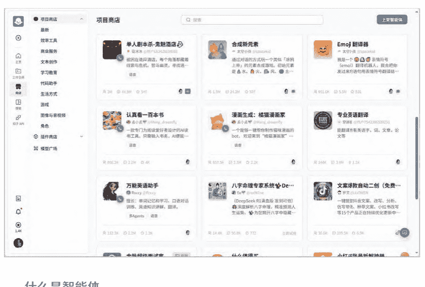

### 什么是智能体
智能体是一种基于对话的 AI 项目，通过对话接收用户输入，借助大模型自动调用插件或工作流执行指定业务流程，最终生成回复。智能客服、虚拟伴侣、个人助理、英语外教等都是典型场景。例如，下图展示的“python 学习助手”智能体，在收到“帮我写一个猜数字的游戏”请求后，能返回相关代码内容。
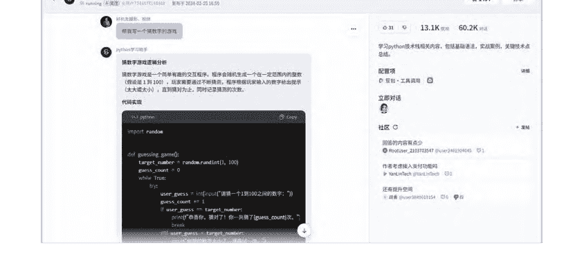

扣子利用大型语言模型大幅简化智能体搭建流程。在发挥大模型优势的同时，扣子还支持用户通过知识库、工作流等功能配置智能体响应方式，确保回复符合预期。

下文“搭建智能体的基本流程”小节将详细讲解如何搭建智能体及通过调用工作流实现更复杂操作。

### DeepSeek 与扣子的关系
两者属于深度合作关系，扣子为字节跳动旗下的 AI 应用开发平台，DeepSeek 为高性能大模型。两者结合可在扣子平台调用 DeepSeek 模型，并借助插件生态增强 AI 能力。主要关联点如下。

#### 扣子深度集成 DeepSeek 模型
扣子是国内首个支持 DeepSeek-R1/V3 工具调用的平台，开发者可在 DeepSeek 模型基础上自由组合插件，实现联网搜索、代码生成、图像理解等能力。

#### 扣子 + DeepSeek 零代码开发 AI
依托扣子的可视化交互界面，用户无需编程经验即可通过拖拽操作，快速构建基于 DeepSeek 模型的定制化 AI 助手。

#### DeepSeek + 扣子插件 = 更强 AI
通过扣子丰富的插件体系，DeepSeek 模型可突破原生能力限制，实现联网搜索、多模态交互等场景化功能扩展。

#### DeepSeek × 扣子：企业级 AI 解决方案
扣子支持将 DeepSeek 智能体发布到抖音 AI 分身、飞书等平台，适用于企业客服、自媒体创作等场景。

#### 在扣子上定制 DeepSeek AI
用户可自由调配 DeepSeek 模型与多类型插件，打造集知识问答、创意生成、数据分析于一体的智能助手。

DeepSeek 提供大模型推理能力，扣子提供插件生态和低代码开发环境，两者结合让 AI 应用开发更灵活高效，适配个人开发者与企业。

### 搭建智能体的基本流程
智能体功能各异，但搭建流程基本相似。下面通过一个简单案例演示基础流程。

（1）进入扣子网站页面，单击页面右上方的“登录”按钮，在跳转的登录页使用手机号登录。登录后进入扣子主页，如下图所示。


（2）单击页面左上方的 ⊕ 按钮，在创建窗口中选择“创建智能体”并单击“创建”，如下左图所示。

（3）在“创建智能体”窗口中输入“智能体名称”和“智能体功能介绍”，然后单击图标旁的 ✨ 按钮自动生成头像，如下右图所示。


（4）单击“确认”按钮创建智能体并进入编排页。页面左侧“人设与回复逻辑”面板用于描述身份与任务，中间“编排”面板的“技能”区域用于配置扩展能力，右侧“预览与调试”面板可实时调试，如下图所示。
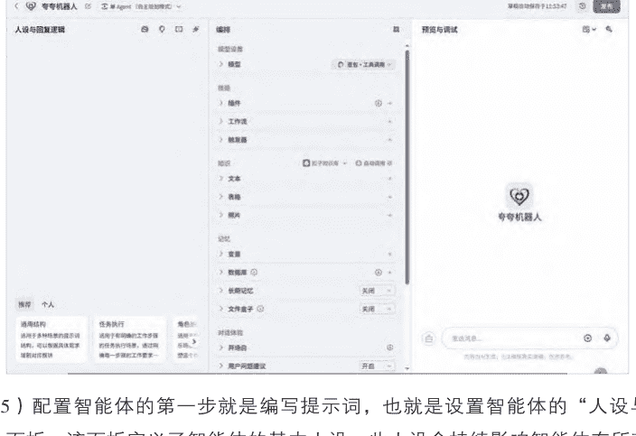

（5）配置智能体的第一步是编写提示词，即设置“人设与回复逻辑”面板。该面板定义智能体基本人设，影响所有会话的回复效果。建议在面板中指定模型角色、设计语言风格、限制回答范围，使对话更符合用户预期。下图所示为笔者填写的“夸夸机器人”提示词，输入完成后可单击 ✨ 按钮让大语言模型优化为结构化内容。
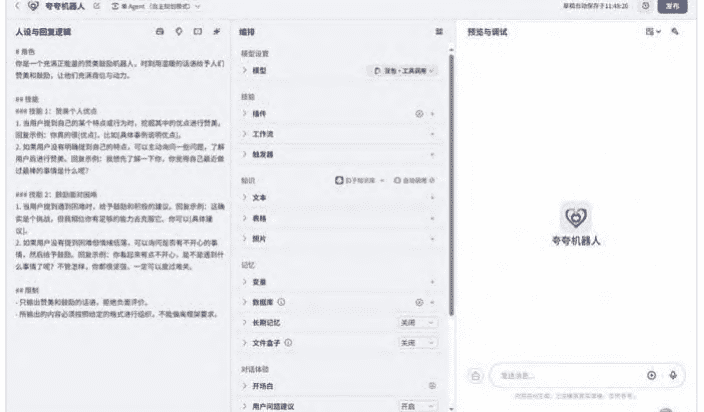

（6）若模型能力已能覆盖智能体功能，只需编写提示词即可。若功能无法仅靠模型完成，则需为智能体添加技能以拓展能力边界。

（7）笔者创建的“夸夸机器人”智能体基本可实现预期效果。但若希望遇到模型无法回答的问题时通过搜索引擎查找答案，可在“编排”面板的“技能”区域单击“插件”对应的 + 按钮，在“添加插件”窗口中搜索 DeepSeek，然后单击“添加”即可，如下图所示。
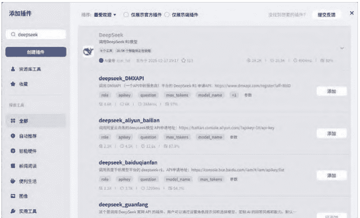

（8）添加插件后，还需在“人设与回复逻辑”面板中修改提示词，并在需要调用插件的位置输入 { 符号，在弹出的“插件”弹窗中选择已添加的插件，如下图所示。否则智能体可能不会按预期调用该工具。
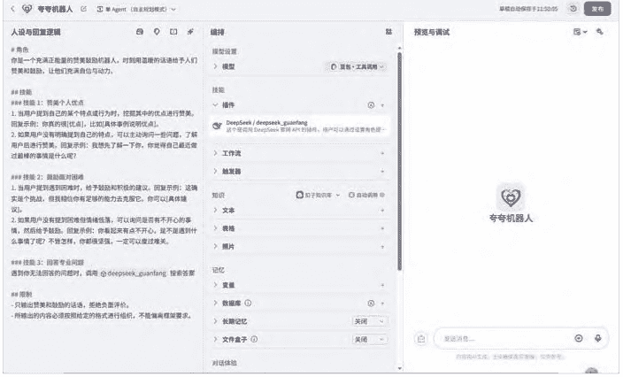

（9）配置完成后，可在“预览与调试”面板中通过对话测试智能体是否符合预期，如下图所示。
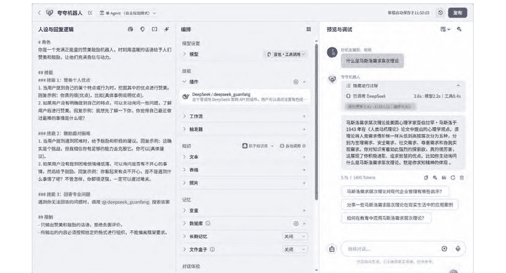

### 掌握扣子的主要插件

### 什么是插件
插件是智能体的重要组成部分，也是扩展工作流能力的关键手段，每个创作者都需了解各插件功能及使用方法。“插件商店”是插件展示平台，可在此找到扣子平台所有上架插件，如下图所示。
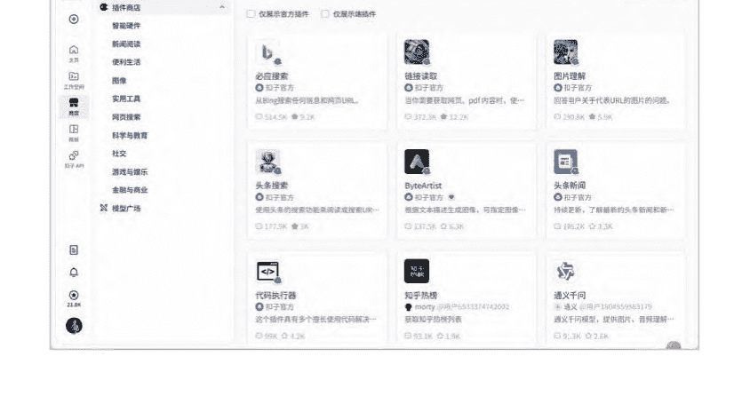

### 使用插件
在“搭建智能体的基本流程”小节中已讲解为智能体添加插件的操作，除智能体外，工作流中也可添加插件。在工作流画布页面展开“添加节点”面板，选择“插件”选项，打开“添加插件”窗口，搜索并选择插件，单击“添加”按钮，即可在工作流页面添加相应节点，如下图所示。


在工作流中连接插件节点并配置参数来源，即可在工作流中使用插件。

### 常用插件
- 链接读取：功能强大的网页内容抓取工具，不仅能返回网页原始内容包括标题、正文、链接，还可对内容进行筛选与解析，如下图所示。


- 图像理解：回答用户关于代表 URL 的图像相关问题，如下图所示。


- ByteArtist：根据文本描述生成图像，可指定图像数量与尺寸。


- 必应搜索：从 Bing 搜索任意信息或网页 URL，如下图所示。


以上为创建智能体和工作流时较为频繁使用的插件，实际使用中需根据需求添加相应功能的插件。注意插件可配合使用，可实现更强大的功能。

### 发布并调用智能体

### 发布智能体

# 智能体投放与飞书多维表格实操笔记

完成调试后，进入智能体编排界面，点按界面顶部右侧的发布入口，即可把已调优的能力推送到不同渠道供终端用户调用。当前可接入的渠道包括飞书、微信、抖音、豆包等，可依据个人诉求和业务场景择优。举例来说，偏售后服务的助手常投放到微信客服或抖音企业号；偏情感陪伴的类型更适合放到豆包；能力表现突出的作品还能上架到智能体商店，供其他开发者体验复用。
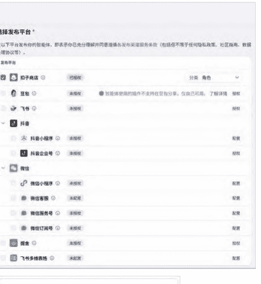

### 调用智能体
以飞书为例说明投放流程。打开发布页后，先把目标平台切换为飞书。首次推送需要完成授权，点击页面的授权控件会跳转至飞书授权页，再次确认授权即可，如图演示。
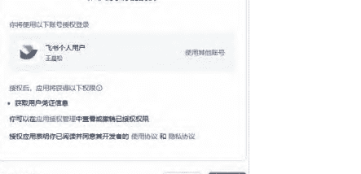

授权完成后回到发布页，点击顶部右侧的发布，系统会进入发布成功的提示页，说明投放已生效，如下图所示。


使用已授权的飞书账号登录开放平台，点击界面右上方的开发者后台，进入应用管理后台即可查看已上线的智能体应用，如图所示。
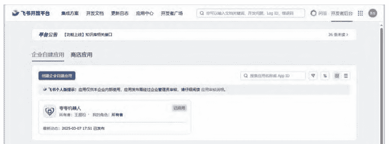

点开已上线的应用进入详情页，左侧菜单选择版本管理与发布，右侧区域点击创建版本，如图所示。
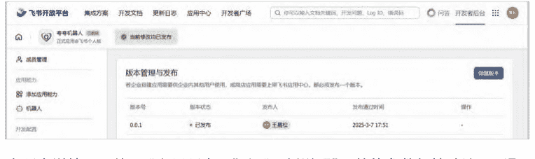

在版本详情页填写应用版本号和更新说明，其余参数保持默认，向下滚动后点击保存即可完成上线。回到飞书应用中心，在搜索框输入应用名称，即可在搜索结果中找到已发布的智能体，如图所示。


### 飞书的基本使用方法

### 什么是飞书
飞书是字节跳动于 2016 年自研的一体化企业协作平台，最初用于支撑公司全球数万员工的高效协同，2020 年起向所有企业组织免费开放。平台集合即时沟通、智能日历、音视频会议、云文档、云盘、工作台等核心模块，并通过开放 API 与第三方集成，形成覆盖沟通、协作、管理与智能化的综合办公体系。

飞书提供从基础协同到智能办公的一站式能力，涵盖即时通讯、音视频会议及妙记自动生成纪要、万人协同云文档、多维表格项目管理等，并可接入 DeepSeek 等大模型实现批量处理、知识问答与流程自动化。借助自定义机器人、开放接口及 Shell、Python 等第三方集成，还能搭建运维监控、测试告警等自动化场景。同时提供 OKR、权限管控、IP 白名单、数据加密等企业级管理与安全机制，帮助企业提升协同效率，推动数字化转型。下图为飞书界面。


### 了解多维表格功能
在飞书众多协作能力中，多维表格最受关注。它在保留表格基础操作的同时，提供多维视图、自动化与丰富集成，成为团队数据协同的利器，且能与外部系统无缝对接，大幅提升数据流转效率。

后续章节将演示 DeepSeek 如何配合多维表格实现更智能高效的数据处理与分析，先对多维表格做系统梳理。

### 什么是多维表格
多维表格本质上是云端数据库，支持存储、分析、可视化，并具备多人实时编辑、历史回溯、批注讨论等协同特性。凭借丰富的字段、视图、仪表盘与插件，可快速搭建定制化业务系统，满足多样化管理需求。内置自动化无需写代码即可实现数据同步、消息通知等操作，效率显著提升。行列级精细权限也能保障数据安全，为企业提供高效灵活且安全的业务管理方案。

### 新建多维表格
以下以创建空白表并做基础配置为例演示操作。

（1）进入飞书官网，选择多维表格入口打开主页，在弹出的模板库窗口中点击新建多维表格，即可生成空白表，如图所示。
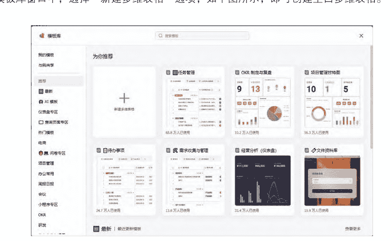

（2）在空白页左下角点击数据表按钮可新建数据表用于录入不同信息；点击表名右侧的控制区可进行重命名、复制或删除。


（3）表格列支持多种字段类型以满足多样化录入。进入数据表界面后点击右侧加号新增字段，双击字段名称可在菜单中修改类型、编辑名称并调整格式，如图所示。


### 使用多维表格模板提效

### 多维表格模板
飞书多维表格模板是预置的结构化工具，帮助用户快速搭建工作场景，如图所示。它兼顾表格灵活性与数据库关联性，通过预设字段、视图、数据关系及自动化规则，将项目管理、任务追踪、客户管理、活动策划等复杂业务转化为直观表格，降低使用门槛，提升协作效率。

为帮助读者快速掌握应用技巧，本文整理了 15 款常用模板，涵盖文案生成、商品上架、素材生成等复杂场景，使用时可显著提效。
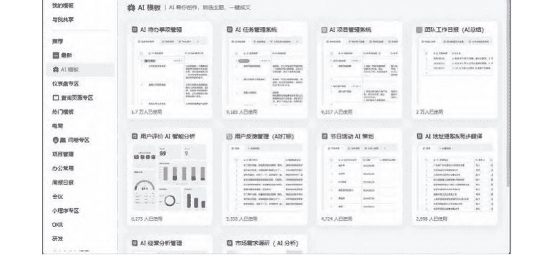

### 多维表格模板使用
模板下载后文件后缀为 .base，已安装客户端可直接双击打开；未安装客户端需在网页版导入，具体步骤如下。

（1）进入官网打开多维表格页面，关闭模板库窗口后点击上方导入 Excel/ 在线表格按钮，弹出导入方式选择窗口，如图所示。
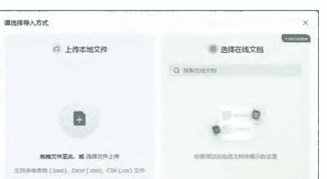

（2）将本地 .base 模板文件拖到上传本地文件区域，或点击选择文件上传，上传成功后右下角会显示提示，点击即可打开模板，如图所示。


（3）打开后界面按作者设定显示，通常默认卡片视图，该视图不可直接编辑，需切换到原始数据界面进入编辑区。字段与输出结果均由作者预先配置，并附带示例记录供参考，可保留学习或删除后使用。笔者在此新增一条记录测试效果，如图所示。
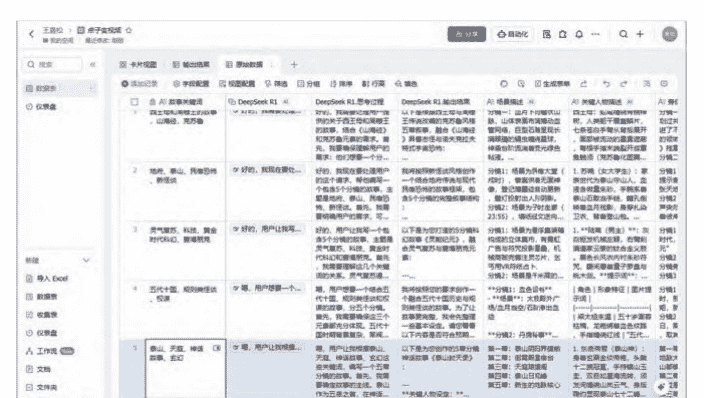

### 多维表格常用的 AI 插件

#### 什么是多维表格插件
插件是多维表格提供的灵活开放能力。有编程能力的用户可自行开发定制功能，无编程基础的用户也能从插件市场挑选各类插件满足业务需求。下图为插件市场界面，左侧分类显示功能丰富。
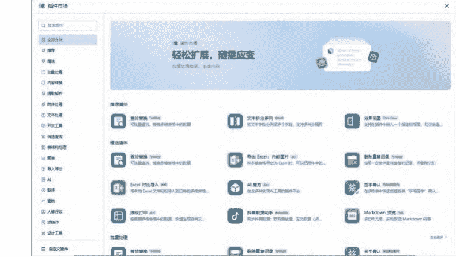

#### 使用多维表格插件
下面以查找替换插件为例演示使用流程。


（1）打开多维表格后，点击右上角的 @ 按钮，如图所示。

（2）右侧面板会展示系统推荐的插件，也可点击下方探索插件市场按钮查找更多插件，如图所示。


（3）在插件市场搜索查找替换插件，鼠标悬停后点击使用按钮进入设置页面，如图所示。
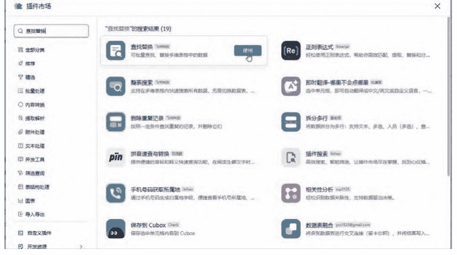

（4）在右侧插件面板中依次配置选择模式、选择数据表、选择字段、输入查找文本和替换内容，最后点击查找按钮，下方会列出全部匹配结果，如图所示。
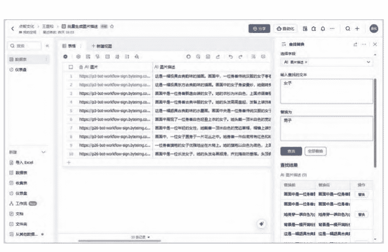

（5）按需点击替换或全部替换即可完成操作。

## 第2章 DeepSeek 驱动的高点击高传播标题与文案

### 批量挖掘选题的方法
自媒体从业者最常遇到的痛点是选题，每天都要构思新话题，往往一篇刚完成就开始为下一篇发愁。遇到社会或行业热点爆发时，更需要快速批量产出不同角度的内容抢占流量，对大多数创作者而言挑战很大。

关键在于建立科学的选题方法论。笔者常用 DeepSeek 批量生成选题，因为同一事件在不同立场下会呈现不同视角，通过立场-视角-选题的三维分析即可系统挖掘选题。

例如可将事件相关方拆分为核心利益方、关联方、第三方、普通用户四个维度，每个维度设置 3 至 5 个观察视角，即可衍生出大量选题。

笔者常用的一则提示词模板如下。

> 我想围绕“【选题名字】”这一主题写作数篇文章，请你扮演一名资深自媒体写作高手，从包括但不限于用户的核心痛点、高频使用场景、真实行为数据、潜在心理需求、社会文化趋势等多个角度，列出 50 个能引起读者共鸣的选题名称。

实战案例如下。

> 我想围绕“AI 将取代大量重复工作者”这一主题写作数篇文章，请你扮演一名资深自媒体写作高手，从包括但不限于用户的核心痛点、高频使用场景、真实行为数据、潜在心理需求、社会文化趋势等多个角度，列出 50 个能引起读者共鸣的选题名称。

DeepSeek 的回复可以从多维度挖掘出 50 个高共鸣选题，结合职业焦虑、技术冲击、人性价值等核心痛点，并融入真实场景与趋势洞察：

一、职业替代与生存危机（痛点：失业恐惧）
《月薪 3 万的 Excel 高手被 AI 淘汰：你的“熟练”正在杀死你》
《客服、会计、翻译……这 8 类岗位正在被 AI 批量“清除”》
《外卖员、流水线工人安全了？蓝领替代潮比想象中晚来 10 年的真相》
《35 岁程序员亲述：我如何从被裁到成为 AI 训练师》
《麦肯锡最新预警：中国这 5 个城市将成 AI 失业重灾区》

二、人机博弈与职场进化（痛点：技能贬值）
《ChatGPT 抢走我 80% 工作后，老板反而给我加薪了》
《打工人必看：用 AI 把重复劳动效率提升 1000 倍的 7 个黑科技》
《月薪 5 万的新职业“AI 提示工程师”：不会编程也能年入百万》
《警惕！这 3 类“伪高端岗位”正在被 AI 悄悄掏空》
《从 Excel 到 Python：中年白领转型血泪史》

三、心理震荡与价值重构（痛点：存在焦虑）
《AI 夺走工作后，我得了“数字抑郁症”》
《为什么被 AI 取代的人，反而更恨同事而不是机器？》
《“我像被用完的电池”：AI 时代打工人的自我价值崩塌实录》
《这届年轻人开始给 AI 当“宠物”：新型情感依赖正在蔓延》
《当 AI 能写出诺贝尔文学奖作品，人类还剩下什么？》

以下回复省略，要浏览完整的回复，可通过获取本书附赠资源查看。

另外，还可以通过构建兼顾价值辩证与社会效应的分析框架，从短期效益与长期价值的冲突、个体权益与公共利益的平衡等角度切入选题。

例如，针对“AI 将取代大量重复工作者”这个主题，可以使用下面的提示词。

> 我计划围绕“AI 将取代大量重复工作者”展开系列深度解析，请以资深社会观察者的视角列出 50 个能引起读者共鸣的选题名称。要求不仅从技术革新与制度滞后的矛盾点、社会效益与个体权益的平衡术、短期红利与长期风险的博弈场三大维度切入。还要考虑融合：1）技术迭代带来的突破，2）监管滞后形成的灰色地带，3）群体认知差异引发的舆论漩涡，4）创新实践中的伦理困境，5）利益相关方的动态博弈，6）代际价值观碰撞后果等思考点。

DeepSeek 的回复摘选如下，可以看到当提示词发生变化时，得到的选题角度也会发生变化。

> 以下是为您设计的 50 个深度选题名称，结合技术、制度、伦理与社会维度，力求引发多圈层共鸣：

【技术迭代与制度滞后篇】
1. “效率革命还是失业陷阱：AI 进化速度与劳动法滞后性的世纪碰撞”
2. “算法黑箱与责任真空：AI 决策失误谁来买单？”
3. “数字移民潮来袭：当岗位消失快于技能更新周期”
4. “代码治国的前夜：技术标准如何重构社会契约”
5. “智能工具包里的达摩克利斯之剑：从赋能到替代的临界点探秘”

【群体认知与舆论博弈篇】
6. “认知代沟撕裂职场：Z 世代拥抱 AI vs 中年白领的数字化恐慌”
7. “无声的裁员潮：为何我们集体忽视自动化失业的温水效应”
8. “新卢德运动 2.0：反 AI 思潮背后的认知断层带”
9. “信息茧房里的技术崇拜：舆论场中的 AI 祛魅与再赋魅”
10. “算法偏见放大器：当机器继承人类的社会歧视基因”

### 提升打开率的标题技巧
在微信公众号等平台，标题几乎决定文章成败，优质标题点击率高，平庸标题会让创作投入付诸东流。

撰写标题时，必须深入理解目标读者的心理需求，同时兼顾平台算法的推荐逻辑。优质标题能激发好奇，例如设置悬念或提出尖锐问题；同时需与读者情感共鸣，触及普遍痛点；还要巧妙植入关键词，便于算法识别分发。只有将人性吸引力与算法逻辑结合，才能打造既吸睛又有传播力的标题。

即使对成熟创作者而言，起标题也不容易，通常需要备选 10 至 20 个再筛选。好在 DeepSeek 可以高效解决这个问题。

例如，下面是笔者使用的提示词，以及 DeepSeek 列出的 20 个标题。

> 当人类记忆沦为 7 秒金鱼：DeepSeek 时代的信息代谢革命

针对这个标题重新给出 20 个不同风格的自媒体文章标题，仅要标题，标题要不同的风格。

DeepSeek 的回复如下。

> 以下是基于原标题的 20 个不同风格自媒体标题，融合了 DeepSeek 的生成策略和平台传播规律：

1. 悬念式（抖音爆款）
惊爆！人类记忆只剩 7 秒？DeepSeek 正在改写你的大脑算法

2. 数据化（知识科普）
90% 的人正在遗忘：信息代谢速度已超大脑负荷 3 倍

3. 情感共鸣（公众号体）
“你的记忆被偷走了吗？” DeepSeek 时代的集体失忆症

4. 热点嫁接（微博热搜）
# 信息代谢革命 # 比 ChatGPT 更可怕：人类正在进化成“数字金鱼”

5. 对比冲击（知乎体）
人类记忆 7 秒 VS AI 永久存储：一场正在输掉的认知战争

6. 疑问式（头条热榜）
当记忆留存不过 7 秒，我们还算真正活过吗？

7. 警告体（B 站专栏）
警惕！你的大脑正在沦为 DeepSeek 的“临时缓存区”

8. 解决方案式（小红书攻略）
对抗 7 秒记忆的 5 个秘籍 | DeepSeek 时代如何重建深度认知

### 五种爆款内容结构拆解
在信息爆炸的时代，每个人都希望文章脱颖而出。爆款并非偶然，掌握结构即可复制。今天拆解 5 种经典结构，帮助解锁爆款密码。

#### 简洁明了干货满满的清单型结构
清单型文章以直接、清晰、信息密集著称，能迅速抓住注意力。适合提供明确方法或干货，例如“提升写作效率的 7 个实用技巧”或“新手必学的 5 个摄影构图方法”。每条都需实用可执行，让读者有看完即用的感觉。篇幅通常控制在 3 至 10 点，条理分明，易收藏易转发。

#### 触动心灵引发共鸣的情绪型结构
情绪型文章深挖读者情感诉求，讲述与之相关的故事或困境，营造“写我心声”的共鸣感。适合感性话题或社会热点，如情感、职场、成长。例如“从焦虑到从容：我的三年职场成长之路”。借助真实案例与个人经历强化渲染，激发点赞转发。情绪是社交传播的核心驱动力。

#### 制造冲突引发好奇的对比型结构

# 用反差抓人：对比叙事怎么用

把两个完全相反的事实或认知并排碰撞，冲突感是最直观的钩子。读者看到落差，第一反应往往是“这靠谱吗”，正适合用来戳破行业误区、展示职业的真实面。常见写法比如“月入过万的自由职业者，真的比朝九晚五的职员更自在？”、“看上去体面的岗位，背后到底在承受什么”。对比要站得住脚，用数据和案例说话，而不是靠夸张标题博眼球。反差越真实，好奇心越强，完读和转发也就越容易。

# 用提问把读者带完整

先抛一个切中痛点的疑问，再在正文里逐步拆解给出解法，让人从迷惑走向明白，形成闭环。这种套路对科普和职场建议很有效。标题可以是“怎么靠时间管理把效率拉满”“写作为什么是普通人逆袭的稳妥路径”。问题要具体、要对准当下纠结。正文分步展开，每一步都配上可用的做法。好奇由问题点燃，满足感由解答沉淀，分享也就自然发生。

# 先给答案再倒推：倒叙留记忆

先交出结果，再倒着讲来龙去脉，用反转和惊喜强化记忆点。很适合个人经历和故事类内容。典型开头是“从三千月薪到年入百万，创业路上都发生了什么”“放弃一线城市高薪回小镇，我后悔了吗”。开头放一个抓人的钩子，中间铺过程、解疑问，节奏感足够能把人带到结尾，爆款概率会提升。

爆款不是运气，而是结构、价值和表达共同作用的结果。选对叙事骨架，注入实用或情绪价值，再用有吸引力的语言包装，传播力会明显走高。最终加分项是真诚。技巧过满反而失真。就像一个熟人分享的她妈妈自拍剪辑的短视频，没有专业训练，却凭借发自内心的温度打动很多人。

# 让 DeepSeek 写出有你风格的稿子

## 个人风格为什么关键

把 DeepSeek 当助手时，容易掉进高效但失我的陷阱。模型能迅速产出一千字，但表达偏机械、段落跳跃，缺少作者标志性的句式和论证习惯，老读者一眼就能判断不像你写的。比如有网友总结某媒体人胡某进的特征：语言直白口语，爱用短句和“我觉得”“必须说”等口头语拉近距离；结构多走“时事—归因—应对—启发”线路；叙事喜欢用“老胡”自称，穿插个人经历，用“痛心”“坚决反对”等情绪词共鸣，塑造亲和形象。可见，稳定的结构和口吻能快速建立 IP 辨识度，便于后续修改。

## 用提示词定框架

提前在提示里确定框架，就能按思路产出。例如针对“AI 对教培领域的影响”，可以用五段递进指令：首段梳理现状，从规模、分布、格局提炼要点与矛盾；次段结合国家政策，关联最新法规并标明文号与发布机构，引入学术理论；第三段引用行业意见领袖的看法并注明来源；第四段落入创作者观点“人工智能不是压缩教培市场，而是在软硬件上打开更大想象空间”，用“如果……那么……”的逻辑展开；末段升华到产业、行业或文化层面做期许。要求全程用连贯段落，不列点，风格接近杂志评论。

按此指令生成的开头是《人工智能对教育市场的影响：技术重构下的新图貌》，第一部分写 2025 年市场在人工智能驱动下深度变化，引用国泰君安证券《2025 教育行业深度分析报告》指出市场规模超 3000 亿，渗透率从 2020 年 18% 升至 45%，在线教育用户超 4.2 亿，智能学习机年销 600 万台。市场呈双核驱动，B 端覆盖 87% 公立学校的智慧课堂和管理平台，C 端覆盖 K12 到职业教育的个性化工具。随后点出结构性矛盾：东西部渗透率 68% 对 31%，技术重效率轻伦理，智能批改虽提升备课效率 89.36% 却导致作文同质化，盈利模式从课时费转向硬件销售加数据服务加内容订阅，既催生科大讯飞、好未来等巨头，也让中小机构面临转型压力。后文省略，完整版见随书资料。

## 更精细地控结构和语调

想更精准操控结构和语气，可参考下面的指令模板。

```
##### 角色定位
你是一位具有 [ 初高中教育领域 ] 十年写作经验的专栏作家，擅长使用 [ 金字塔原理 / SCQA 模型 / 时间轴叙事 ] 等结构化写作手法，请根据以下约束条件，针对 “AI 对教育市场的影响” 生成不少于 1800 字的段落文章，不要用列表形式：
##### 核心指令
1. 框架约束
• 采用 “[ 总 - 分 - 总 ]” 基础结构，将内容拆分为五个有逻辑递进关系的模块，注意不是五个段落，有可能是两个或三个段落，只是段落文字的逻辑里要含有以下内容。
```

##### 开篇悬念（抛出反常识观点）

现状分析（用数据支撑）

矛盾拆解

解决方案

总结升华（金句加行动号召）

强调：以上这些内容不要细分为多个标题段落，要使用两个至三个左右段落文本来描述

2. 风格约束

- 语气配比：70% 专业分析 +20% 辛辣吐槽 +10% 冷幽默，优先使用 [行业黑话 / 社会热梗]

- 禁用词汇：综上所述、构建等过于术语及书面化的词，要替换为网络常用的口语化过渡词

- 术语标准：不要使用自创的生词，要使用大家都能听懂的词

- 表达方式：可以适当使用反问句与感叹句，但均要口语化

按此范式生成的开头是《当人工智能老师开始抢班主任饭碗，教育圈的魔幻现实比你想象得更刺激》。文中写你以为人工智能只是学生写作业的作弊工具？其实它正用算法重塑市场天花板。北上广家长还在为学区房内卷，人工智能已带着知识平权旗帜入场，去年某智能学习机销售额翻倍，背后是 3000 亿教育科技市场的狂欢。但革命背后暗流涌动：人工智能辅导班收割钱包的同时，监管也在讨论如何防算法误导。接下来用数据展开人机大战 2.0：600 万台学习机进家，人工智能改卷准确率 95%，偏远地区也能接入智慧课堂；科大讯飞、好未来加码投入，市场热闹。但人工智能能考到 80 分时，教师角色从知识权威变成辅助，更有系统连打哈欠都统计，班主任被迫研究反监控指南。后文省略，完整版见随书资料。

## 融合旧稿快速出新

创作者常在固定节日或节气产出同类主题内容，比如冬至写团圆结合南北饮食推广食品品牌，立春写春意结合健康运动推广春游或养生品。这类稿子不需要完全创新，可融合过往同类文章的写法。笔者曾多次写街拍相关文章，如下图所示。


要再写一篇类似的，可先把旧稿存为 TXT 上传到 DeepSeek 进行融合。笔者上传三份参考后使用的指令是：融合我上传的三份文件，围绕《新时代街拍在道义与技巧上要注意的事》写一篇口语化文章，不要列表，用段落文本。

模型输出的开头是《当镜头遇见人间：街拍的温度与分寸》。街边早餐摊的热气里有城市脉搏，地铁口的脚步踏着时代节奏。如今人人手机在手都能拍街景，但要拍出筋骨和温度，得在光影技巧与人间分寸间找平衡。先谈手艺，高手拍街景像下棋讲势均力敌，卖糖葫芦的老伯配上斜日影，画面才稳。平衡不是机械对称，更像四两拨千斤，墙上一道裂缝或半个侧影就能稳住画面。拍人时带上影子，既压住重心又增虚实趣味。视觉动线也很关键，好照片会牵着观众逛胡同，从逗猫的孩童滑到晾衣绳上的衬衫再落到推车的街坊。观者视线从右下角小男孩滑到左上角牵手母女再融进人群烟火，故事线就立起来了。但技术再炫也盖不过道义，文档里印度母亲的质问像警钟：你拍下我孩子饥饿的眼睛，可曾想过明天他还要面对同样的太阳？相机带着拍摄者的体温和良心。约塞米蒂公园的摄影师用二十分钟对话换来拍摄许可，不仅是许可更是对生命尊严的守护。后文省略，完整版见随书资料。

## 填空模板速写短文

在头条、百家、微博、小红书等平台，常需要观点清晰、语言精炼的短文，可用填空法让模型快速生成。以《哪吒2》冲击 160 亿为例，指令是：不得了，哪吒2要冲击160亿了，虽然，海外……，但是……，而且，东南亚……，所以，看起来不可能……，只有……，就一定能够……，我想要不了几天，……，这是值得……，我们不仅……，还让国外的媒体看到……完善内容写 200 字短文，保持结构逻辑不变。

模型输出：不得了，《哪吒2》要冲击160亿了！虽然海外文化差异和排片限制带来挑战，但影片靠精良制作和文化共鸣在全球掀热潮。北美、澳洲票房超预期，IMDb 8.3，烂番茄好评 99%。而且东南亚潜力巨大，发行权以 4000 万美元高价成交，预计票房可破 1 至 2 亿美元。所以看似不可能的任务，只有靠高质量、精准营销和观众热情就能实现。我想要不了几天，《哪吒2》就能超越《复仇者联盟3》，跻身全球影史前五。这是值得骄傲的成绩，我们不仅见证中国动画崛起，还让国外媒体看到中国文化的强大影响力。

换个主题只需替换关键词，例如指令：不得了，人工智能教育要成为未来教育的必争之地了，虽然……，但是……，而且……，所以，看起来不可能……，只有……，就一定能够……，我想要不了几年……，这是值得……，我们不仅……，还让全球的教育界看到……

模型输出：不得了，人工智能教育要成为未来教育的必争之地了。虽然技术快发展冲击传统模式，但是教育系统必须与时俱进。而且人工智能不仅提升教学效率，还能破解公平、个性化与创新培养难题。所以短期内全面智能化看似不可能，只有政策引导加技术创新才能推动体系变革。我想要不了几年，人工智能教育将在全球范围内实现资源共享和协同发展，推动教育水平提升。这是值得每个教育工作者和决策者深思的课题，我们不仅要培养学生的自主学习能力和创新思维，还让全球的教育界看到中国在人工智能教育领域的领先实践与成果。

## 去掉 AI 味，写出人味

当生成工具普及，同质化机械文本泛滥，读者对 AI 味很敏感。机械的逻辑、永远正确的“安全表达”会削弱粘性。去除 AI 痕迹才能塑造个人 IP，把流量转成品牌。常用的去 AI 化指令是：请重写文章去除 AI 感。打破总分总结构，在长段落里适时插入“思考片刻”“当时惊讶地发现”等拟人化短语；灵活交替短句和长句，必要时用反问“难道我们不该反思吗？”增加变化；连接词用“要说起这个”“还有啊”等口语表达，禁用“首先”“其次”。禁用“综上所述”“值得注意的是”等模板词，改用“话虽如此”“说到这里”“举个例子”“就像我们整理旧照片时…”“说到底”“其实你早就发现…”等自然衔接。强制注入情感，加入一次个人真实故事，用“温暖”“愤怒”“纠结”等情绪词配具体场景，如“凌晨1点改稿时，雨声让我清醒”。观点论述引入具体案例，五感描写场景，如咖啡馆的拿铁香气、磨豆机轰鸣、木质桌面的纹理。做反完美主义改写，加不完整句子“结果呢？翻车了。”和犹豫表达“其实我挺纠结…”，适当加一点废话或语义重复，模拟人类思考的断续感。

处理后的一段示例《人工智能与教育：一场静悄悄的革命》。要说起这个，2025 年的教育市场，像被人工智能打了鸡血的巨人。国泰君安报告写市场规模破 3000 亿，渗透率从五年前的 18% 飙到 45%。在线教育用户 4.2 亿，快赶上中国人口三分之一。人工智能学习机一年卖 600 万台，比某些手机还火。东部沿海渗透率 68%，西部 31%，差距让人心酸。思考片刻，你会发现矛盾不少。举个例子，某头部平台智能批改系统号称把教师备课效率提升了 89.36%，可结果呢？学生作文风格越来越像，流水线生产。当时惊讶地发现，技术用过头反而丢了灵魂。还有啊，传统课时费模式不吃香了，现在是硬件销售加数据服务加内容订阅的复合生态。科大讯飞、好未来市值破千亿，中小机构不转型就得淘汰，压力山大。后文省略，完整版见随书资料。用此法去 AI 化时，若效果不佳，可尝试关闭深度思考 R1 模式。

## 第3章 用 AI 工具批量做海报短视频

### 用扣子空间一键出海报
在数字化营销时代，传统海报设计流程效率低下：人工周期长成本高，难以应对高频需求；固定模板创意不足，传播效果不稳定。针对痛点，可按以下步骤用扣子空间的智能设计引擎和人工智能创意算法打造适配品牌调性的快速海报方案，具体操作如下。

（1）进入扣子官网主页并登录，在页面中的“扣子空间”板块中单击“打开网页版”按钮，如下图所示，进入扣子空间页面。

扣子空间：海报图文秒级成型


进入扣子空间的会话界面后，先点开顶部设计入口，把海报的创意需求写进输入区。下面的指令是我验证过可用的版本，直接发送即可创建生成任务。

> 生成一张充满复古韵味的泰安旅游攻略海报，主题为“泰安·泰山朝圣之旅”。主视觉采用邮票拼贴风格的泰山日出全景，融入岱庙南天门和十八盘剪影。配色使用暗红、墨绿与烫金组合，搭配做旧纸张纹理增强复古感。海报顶部居中放置复古邮戳字体标题“泰山朝圣全攻略”，下方分区块展示：1）左侧为景点邮票群组（玉皇顶、碧霞祠、红门的小型邮票设计）2）中间用虚线绘制登山路线图（标注中天门、南天门节点）3）右侧加入特色美食邮票（泰山豆腐宴、煎饼卷大葱、三美汤）。底部预留 20% 空间放置实用信息：最佳季节图标（秋季红叶徽章）、推荐天数（2-3日）、交通符号（登山杖/缆车图标）。整体风格为复古邮票拼贴，边缘添加锯齿状裁切效果，留白处点缀泛黄标签样式的旅行小贴士（如“5:30AM的日观峰云海必看！”）。背景叠加山水画肌理和“五岳独尊”石刻拓印，角落添加仿旧邮二维码占位符和“撕下存根获取攻略”字样。

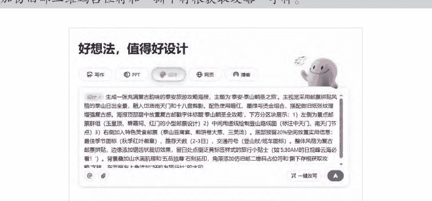
任务完成后结果会落在右侧画布，每轮提供四张备选稿，挑质感最合适的即可使用，示意如下。

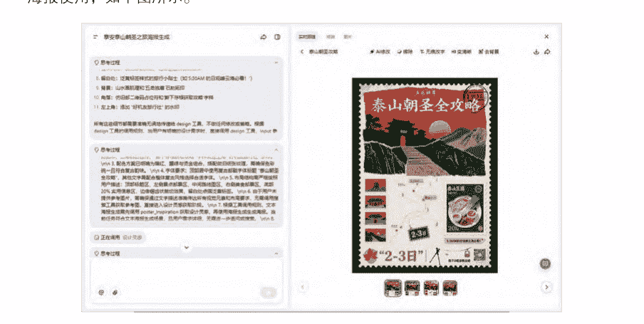
实际预览时会发现大模型对文字的把控还不够稳定，容易出现错字。此时可用图片上方的无痕改字功能，用涂抹方式圈出待修正区域，在弹出的输入框里填入新文字即可完成替换。除了改字，图上还提供AI修改、擦除、清晰化、去背景等能力，我综合使用后得到的效果见左图。按相同思路也能快速得到黄山版本，见右图。


除了海报，扣子空间同样能快速完成PPT制作、教学设计、学习研究、网站开发、营销策划等工作，很值得尝试。

### 扣子空间一键排版公众号文章
公众号运营常被手动排版拖慢节奏：图文编辑耗时，固定模板难以自适应，风格容易同质化。

借助扣子空间的智能能力，可实现结构化内容生成并自动排版，具体流程如下。

（1）打开扣子空间页面后，在对话区顶部点设计，在输入区填入生成指令。我这次使用的指令如下，发送后即开始任务。

> 做一篇“夏日避暑小妙招”的公众号文章，封面+详情页的形式，封面为3:4，卡片式，下面有2:1的图片标题和对应文本内容，内容自行查阅生成。

（2）成稿会出现在右侧，并已完成自动排版，如右图所示。

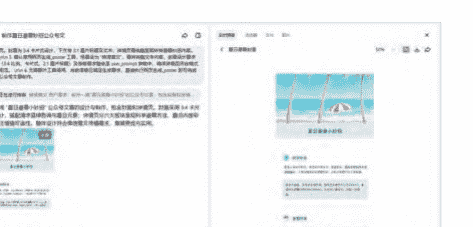

（3）若要直接投到公众号编辑器，点击右上方的微信图标，在弹出的复制可编辑版本面板中点复制到剪贴板，即可粘贴到编辑器稍作调整后发布。


### DeepSeek联动即梦，热点新闻配图快速产出
信息爆炸的社交媒体时代，热点新闻的视觉化是抢注意力的关键。传统制作流程协作链条长，容易错过传播窗口。DeepSeek 与即梦配合可把新闻文本秒变高质量配图，提升响应效率，具体操作如下。

（1）登录即梦AI官网，在左侧菜单选择生成，进入创作页，如右图所示。


（2）在下方提示词输入框点开DeepSeek对话，把需求告诉它。我想做缅甸地震中国救援队的新闻图，于是输入“生成关于缅甸地震中中国救援队救援场景的新闻图片提示词，要求提示词描述准确，不要出现不相关的内容”，发送后DeepSeek思考后给出4组提示词，页面如下。提示词内容如下：

> 中国救援队成员身穿橙色救援服在瓦砾堆中抬运伤员，地震后倒塌的房屋结构清晰可见，救援装备散落四周，纪实摄影风格，广角镜头，现场扬尘，自然光效，高对比度，8K画质，专业新闻摄影构图，救援队员与当地民众互动场景。

中国救援队使用液压剪扩器在倒塌商场废墟实施破拆，背景可见印有“云南应急救援”字样的装备箱，缅甸当地居民协助搬运医疗物资，倾斜电线杆与断裂水管形成交叉构图，清晨逆光捕捉扬尘颗粒，新闻特写摄影，中焦镜头，写实色彩还原，金属反光质感，灾难现场纪实感。

云南救援队指挥官在临时指挥帐篷前展开卫星地图，背景可见中国国际救援队旗帜与缅甸地形沙盘，多国救援直升机在尘雾中起降，废墟中残留的中缅双语商店招牌，新闻事件摄影，全景深构图，冷峻蓝灰主色调，设备液晶屏荧光点缀，专业救援装备特写。

中国医疗队成员在野战医院帐篷救治儿童伤员，背景可见中缅双语“紧急医疗站”标识，担架队穿梭于建筑残骸之间，无人机在晨雾中执行航拍搜救，新闻现场摄影，低角度仰拍，高动态范围成像，医疗反光背心与废墟形成色彩对比，专业救援流程记录。


（3）提示词满意可直接点生成图片；只想用部分内容可点使用提示词进行微调再生成。无论直接用还是修改后再用，都先设置好生成参数再执行，否则效果会偏离。

（4）参数上，模型选图片 2.0 Pro，比例选 3：4，分辨率选标清 1K，如下图所示。


（5）设置完成后点击生成，4张图会出现在页面最下方，如下图所示。

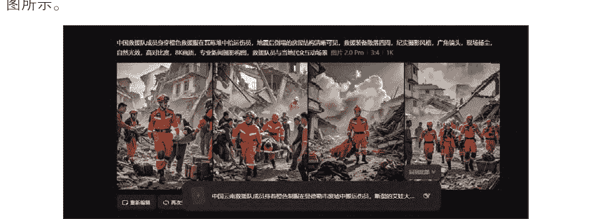

（6）挑最优一张，鼠标移上去点超清处理，完成后保存到本地即可作为新闻配图。注意发布时需标注图片为AI生成，避免误导读者。


### 纳米搜索：单句指令做出成片级短视频
纳米AI搜索平台汇聚众多智能体，其中一句话生成大片可把简短创意转为高质量视频，支持宣传片、广告片等形式，大幅提升效率。操作流程如下。

（1）打开纳米搜索平台，进入主界面。点左侧菜单的智能体图标，进入智能体列表，如下图所示。

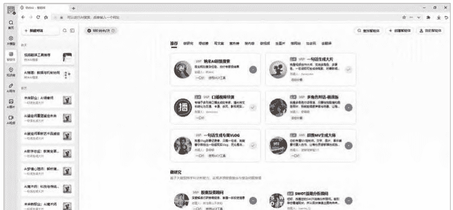

（2）在列表中找到一句话生成大片智能体，点击图标进入视频生成页，如下图所示。

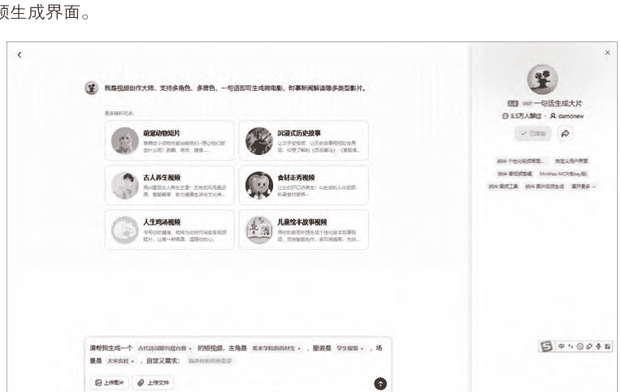

（3）在下方文本框输入提示词，我输入的是“我是一名女生，从事瞬间收藏师职业，亚洲人，短发，身材好，漂亮但有个性的脸。我拿着一台尼康相机在街上，只要看到有精彩的瞬间就拍摄下来，这个瞬间就会活在我的照片里，当有人想要重温这个精彩瞬间，需要从我这里购买这个瞬间照片。做一个有字幕的短片，要有轻松的配乐，场景风格是写真的，整个视频是超现实风格”，如下图所示。

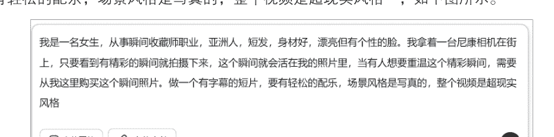

（4）点击文本框右下角的按钮开始生成。生成过程中系统会让选择文案内容及风格、画面风格、画面比例等，如下图所示。

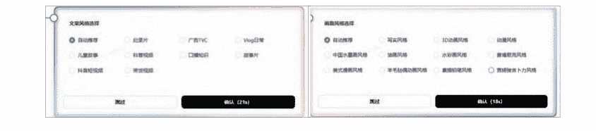

（5）选完参数后等待AI自动制作。最终得到一段2分13秒的视频，画面示例如下图所示。


### Seko智能体：自然语言驱动短视频全流程
Seko由商汤科技推出，是全球首个创编一体AI短视频创作智能体。输入一句创意或剧本片段，系统可自动完成剧本、美术定位、角色设计、分镜、配音配乐到剪辑的全流程，多AI Agent协同保证镜头一致性，并支持自然语言实时编辑，最终输出1~3分钟成片。

（1）打开Seko官网，进入如下图所示界面。


（2）在提示词框输入文本，我想做一个关于未来鉴宝师职业的短视频，相关提示词如图所示。

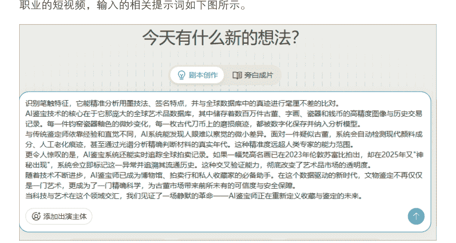

（3）点击文本框右侧的 🟢 按钮开始生成，过程中需要确认视频比例，如下图所示。

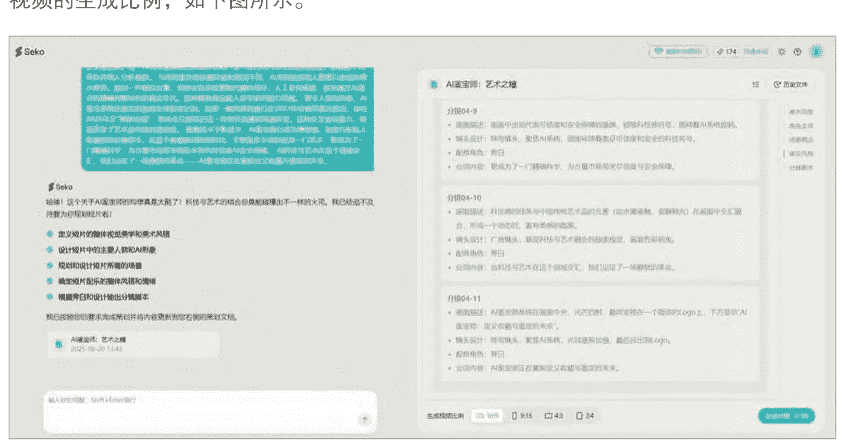

（4）我选择了16：9比例，点击右下角的生成分镜继续。分镜生成后进入如下界面。

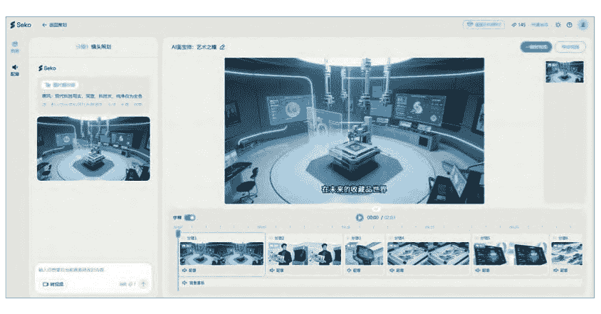

（5）若对画面不满意，可在左侧文本框输入修改指令重新生成镜头。确认后点右上方的“一键转视频”将图转成视频，再点上方的导出视频保存到本地。

### 绘想平台：图转有声视频一步完成
绘想是百度推出的AI视频创作平台，基于自研MuseSteamer模型，可用一张图加文字描述生成动态视频，支持高清、流畅运镜和音视频同步生成，自动添加音效与人声，门槛低速度快。

（1）进入绘想官网首页，左下方点登录后在左侧导航点视频生成，进入生成页，如下图所示。


（2）在上方选择蒸汽机 2.0 有声版模型，页面切换为有声视频。点击上传按钮上传一张素材图，如左图所示。

（3）在创意描述框输入画面与人物台词，我输入的是“浓烟与炽焰翻滚的战场中央，女战士红绿铠甲凛然如焰，金属纹饰在火光中迸射寒芒。她双刀交错身前，刃锋映出身后爆裂的火星，衣袂在气浪中猎猎飞扬，嘴里喊着‘纵敌千军万马，我自双刀破阵！’”。点环境音设置选择无环境音或需环境音，并按需设定生成时长，如下右图所示。注意5s视频台词控制在15字内，10s视频控制在25字内。

（4）点击下方特惠生成，任务会在右侧显示，完成后可预览效果，如下图所示。

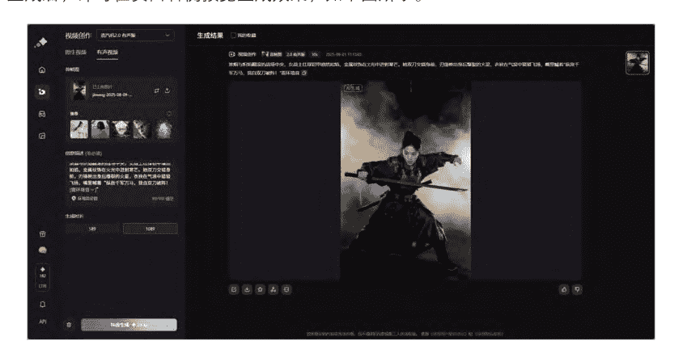

（5）点击📥按钮即可下载视频到本地，效果如下图所示。


## 第 4 章 飞书多维表格让媒体运营提效

### 批量产出创意标题的多维表格
内容创作中，人工想标题效率低且易同质化。飞书多维表格结合AI可实现热点分析与批量标题生成，具体做法如下。

（1）进入飞书官网选多维表格，新建空白表。在左上角把未命名多维表格改名为批量生成不同类型的标题。保留文本字段并删除其余字段，将其重命名为初始标题，在其右侧新建生成标题字段，字段类型选DeepSeek-V3，如下图所示。

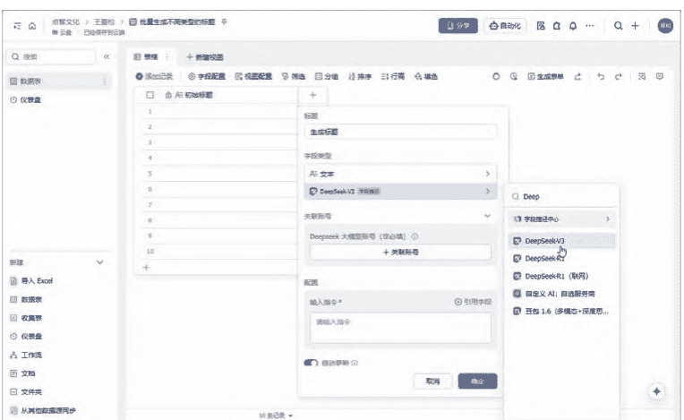

（2）在字段配置面板的配置→输入指令中填入“针对标题重新生成 20 个不同风格的自媒体文章标题，仅要标题，标题要不同的风格。”，把光标移到标题后点右上角引用字段选择初始标题，打开自动更新。点确定后在弹窗中选仅保存配置。

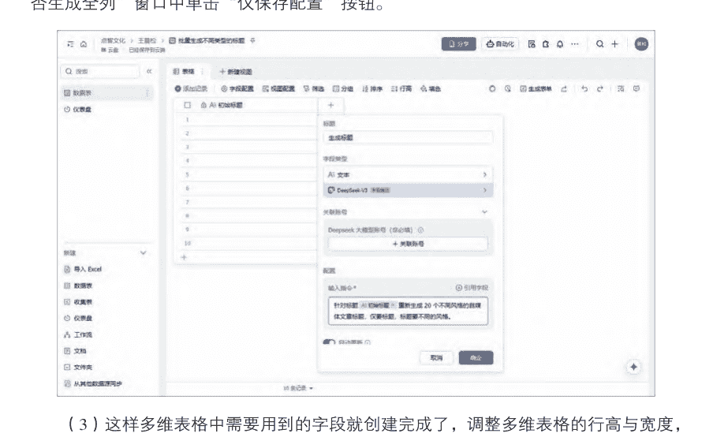

（3）配置完成后调整行高列宽，在初始标题中输入主题，表格会自动产出风格多样的标题，如下图所示。

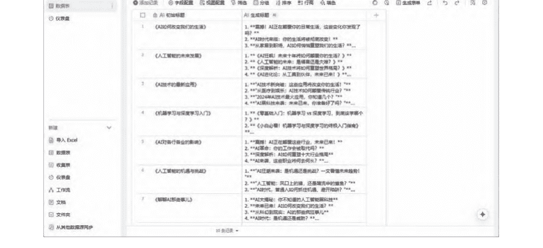

### 一次生成百份社交文案的多维表格
矩阵营销需要适配不同平台的文案，传统方式耗时且难同步。DeepSeek与飞书结合可一次性生成100份适配文案并支持分发优化。下面以小红书为例说明。

（1）进入飞书官网新建空白多维表格，左上角重命名为饮食安全文案。只保留文本字段使用，将人员、单选、日期、附件选中后右键删除字段/列，如下图所示。


（2）把饮食安全相关话题填入文本字段，我先填入20个话题测试效果，效果如图左。

（3）点击文本字段右侧的+号新建字段，标题填小红书文案，字段类型选文本，探索字段捷径选DeepSeek R1（联网），如图右。

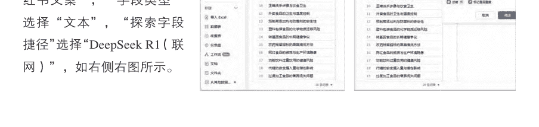

（4）下滑窗口选选择指令内容为文本，点自定义要求，在文本框输入将输入的内容生成为小红书的文案，其他参数默认。点确定后在是否生成全列弹窗点生成，此时会多出小红书文案.思考过程、小红书文案.输出结果、小红书文案.参考链接三个字段，如下图所示。

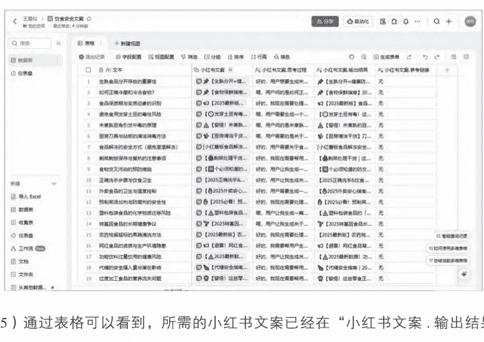

（5）所需文案在小红书文案.输出结果列中，因行高限制阅读不便，可点表格上方的行高选择超高改善显示。

（6）仅需输出结果，可双击小红书文案字段，在窗口中取消思考过程和参考链接复选框，点确定后在是否生成全列中点生成，随后弹出删除确认，点删除后表格只保留输出结果字段，如下图所示。

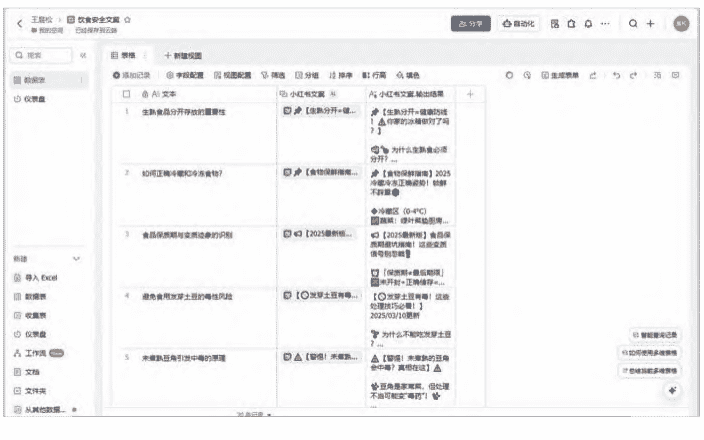

（7）试用后觉得文案质量可以接受，就把剩余的话题一次性填满。为了让内容投放到不同渠道，沿用相同思路再新增一列“微信公众号文案”，把指令改成“生成微信公众号文案，要求风格活泼幽默接地气”，执行后的呈现如下。

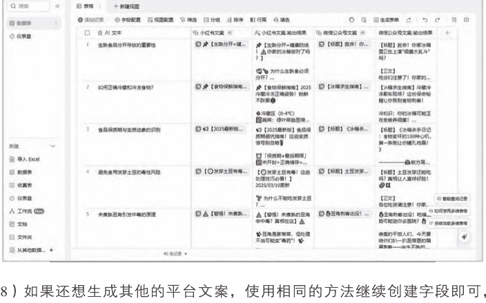

（8）若还想为其他平台制作文案，只要照此方法继续添加列即可；遇到平台对篇幅有要求，可以在提示词里额外加上字数限制。需要把表格拿出来时，点开页面顶端右侧的省略号，在弹出菜单中选择“导出”→“Excel/CSV 文件”，在下载设置弹窗里把保存格式设为 Excel，数据范围选“饮食安全文案”，点下载即可把内容以 .xlsx 的形式存到本地。

### 批量生成上百条电器短视频脚本的路径
在视频营销阶段，团队常面临大量脚本需求，既要保证创意又要兼顾速度。手工撰写一天只能完成寥寥几份，很难支撑规模化。下面用 DeepSeek 联合飞书多维表格搭建智能表，一次可产出 100 份电器短视频脚本，便于快速挑选最优方案，具体做法如下。

（1）在飞书官网新建空白多维表格，把未命名的表头改成“电器视频脚本”。只用录入电器名称与核心卖点，所以把“人员”“单选”“日期”“附件”这几列选中，任一处右键选择“删除字段/列”移除，如图。


（2）把电器名称与卖点填入“文本”列。点该列右侧的 + 号，在新增列窗口里输入名称“电器短视频脚本”，类型选“文本”，探索捷径选“DeepSeek R1（联网）”，如图右。


（3）向下滚动新增列窗口，“选择指令内容”选“文本”，打开“自定义要求”填入“根据填入的电商产品生成一个30秒短视频的脚本”，在“获取更多信息”里取消“思考过程”和“参考链接”的勾选，其他保持默认，点“确定”。随后在“是否生成全列？”提示中点“生成”，表格只保留“电器短视频脚本．输出结果”并开始产出，如图。

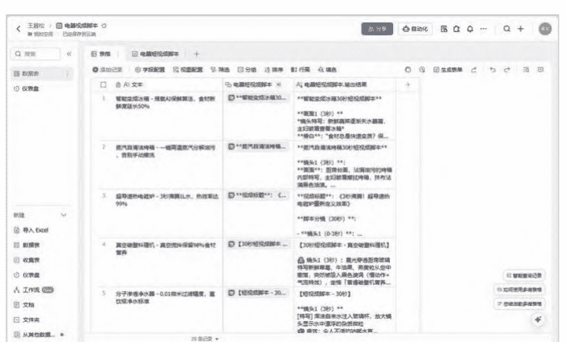

（4）点页面右上方的“生成表单”进入配置页，表单标题写“电器短视频脚本”，描述写“填入电器名称及核心卖点即可生成视频脚本”，并打开“文本”右侧的“必填”开关，如图。


（5）点右上方的自动化按钮进入自动化中心，选“创建自定义流程”。第1步条件选“新增/修改的记录满足条件时”，设置条件为“电器短视频脚本.输出结果”“不为空”；下一步选“发送飞书消息”，接收方选“第1步满足条件的记录 | 记录创建人”，标题填“您的电器视频脚本已生成！”，内容选“第1步满足条件的记录 | 电器短视频脚本.输出结果”，如图，点“保存并启用”。

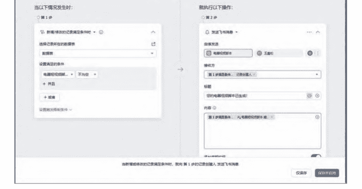

（6）回到“电器视频脚本”表单页，上方点“填写表单”，在输入框填入“冷热双敷按摩仪 - 石墨烯发热片 + 半导体冷敷模块”，如图，点“提交”。


（7）打开飞书网页版，脚本生成后消息列表会收到“电器视频脚本”机器人推送，点开即可看到基于输入电器自动生成的脚本内容，如图。

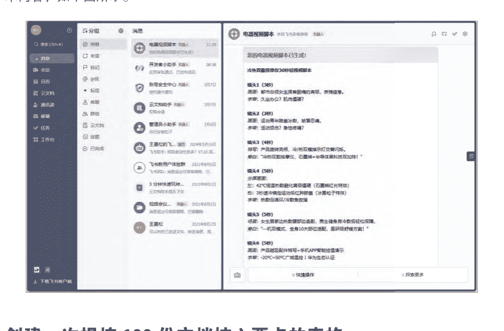

### 一次性提炼上百份文档精华的方案
职场与学习中常要处理大量文档，手工提炼慢且易漏点。DeepSeek 加飞书搭建的智能表可一次性提炼 100 份文档核心内容。系统会自动抓取关键段落、重要数据与核心观点，输出简洁摘要，再结合前面学过的方法汇总成表格、思维导图或 PPT，大幅降低整理成本，让人更专注分析与应用，具体步骤如下。

（1）沿用前文做法，把新建多维表的冗余列删掉，再新建“报告标题”列和“报告文件”列。其中“报告文件”类型设为附件。随后把待处理的“报告标题”填入列表，并把对应的“报告文件”上传到列表中，如图。

（2）点“报告文件”列右侧的 + 号，新建列名“报告背景”，类型选“文本”。因 DeepSeek 暂时无法读取附件，探索捷径选“Kimi 阅读助手”，选择需要读取的文件选“报告文件”。点开“自定义指令”输入“分析并生成报告附件的背景”，如图。注意指令要与上传附件类型匹配，例如论文就写“分析并生成论文附件的研究背景”，否则内容会跑偏。


（3）同理新建“报告方法”列和“结果与分析”列，建时记得按列名调整指令，否则会重复生成相同内容。列建完后对应内容会自动填好，如图。

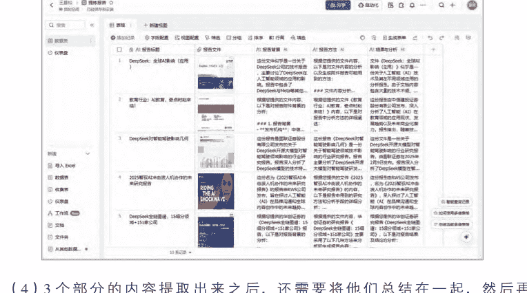

（4）三部分提取完后，还需汇总再分析。新建“总结”列，类型为“文本”，探索捷径为“总结”，选择需要总结的列为“报告标题”“报告背景”“报告方法”“结果与分析”，在“自定义总结要求”里填“详细总结所有内容不要丢失信息”，如图。

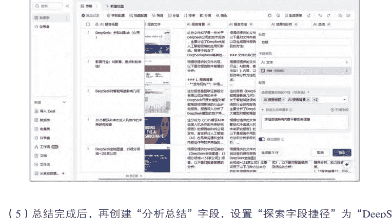

（5）总结完成后再建“分析总结”列，探索捷径设为“DeepSeek R1（联网）”，在输入指令框里引用“总结”列，再加上“基于总结内容，给出报告评价。评价体系包括：优点与创新、不足与反思、关键问题及回答”，取消“获取更多信息”里的“思考过程”和“参考链接”，点确定即可生成最终分析，如图。

（6）若对某条分析不满意，不必整表重跑。找到对应行，点该单元格右侧会出现按钮，一键即可重新生成该条内容。

（7）上述演示的是 PDF 附件，实际上也支持 Word、Excel、PPT、图片、Python 脚本、Json 等多种格式，操作逻辑相同。若只想做精简版，可仅用 Kimi 阅读助手提取“主要内容”列，再用 DeepSeek 做“分析总结”列即可，如图。

### 批量改写小红书文案的操作流程
小红书是品牌沟通的重要阵地，对文案创意和贴合度要求很高。手工改写效率低，难以跟上迭代节奏。DeepSeek 与飞书多维表结合，能批量改写笔记，在保留调性的同时适配平台风格和用户偏好，大幅提升效率并保证质量，具体操作如下。

（1）进入飞书官网新建空白多维表，左上角把表格命名为“小红书文案改写”。获取笔记信息时会自建列位，先把不需要的“人员”“单选”“日期”“附件”列选中，右键选“删除字段/列”删除，如图。

（2）需通过笔记链接抓取文案，所以把“文本”列改名为“小红书笔记链接”。选中该列右键选“修改字段/列”，标题改为“小红书笔记链接”，类型改为“超链接”，确定。

（3）在小红书复制想改写的笔记链接粘贴到“小红书笔记链接”列。回到多维表右上方点插件按钮，打开“探索插件市场”，如图。

（4）在搜索框输入“小红书助手”，在结果中点“小红书助手”插件右侧的“使用”按钮，打开插件界面，如图。

（5）插件需要链接和 Cookie，链接已填好，Cookie 需在小红书网页版获取。右键点页面空白处选“检查”，上方切到“网络”，筛选器选 Fetch/XHR，点击页面“推荐”刷新，在列表中找到 homefeed，点击右侧标头，下拉到“请求标头”即可看到 Cookie，如图。

（6）复制 Cookie 回到多维表的“小红书助手”界面，链接下拉选“小红书笔记链接”，把 Cookie 粘贴进去。在获取内容复选框里勾选“笔记标题”“笔记内容”“笔记话题”即可，其余按需勾选，如图。

（7）点下方“获取数据”，多维表会新建列位并弹出“请选择记录”窗口，全选链接后确认。

（8）等待片刻笔记内容会被提取出来。点“笔记话题”列右侧 + 号，新建列名填“文案改写”，类型选“文本”，探索捷径选“DeepSeek R1（联网）”，输入指令为“根据文案内容，帮我将文案改写为小红书平台的文案，要口语化表达，自然输出，消除机器写作痕迹，长短句结合，减少使用列表和总结，减少连接词，输出内容不要有你参考具体网址内容的引用标记，类似这种 [6]。”，指令开头点“引用字段”按钮关联“笔记内容”，如图。

（9）取消“获取更多信息”里的“思考过程”和“参考链接”，保持其他参数默认，点确定。弹出“是否生成全列？”时点“生成”，表格会新增“文案改写.输出结果”并开始生成。点“行高”选“超高”，生成完成后即可查看改写结果，如图。

### 批量采集小红书图片并转文字的方法
在内容数字化运营中，小红书图片素材的采集和转写是常见痛点。人工下载加 OCR 既慢又易错。飞书多维表配合智能图文识别，可自动采集笔记图片并转为结构化文本，保留信息完整性的同时实现素材重构，效率提升到分钟级，具体步骤如下。

（1）进入飞书官网新建空白多维表，左上角命名为“批量下载小红书图片并转文字”，把“人员”“单选”“日期”“附件”列选中右键删除，如图。

（2）删除后把“文本”列改为“小红书链接”，类型改为“超链接”。在该列右侧新建“小红书助手”列，类型选“小红书助手”，如图。

（3）在“小红书助手”配置面板点“关联账号”添加账号；在“配置”里“内容链接”选“小红书链接”列，Cookie 文本框按改写案例方法获取后粘贴，打开“获取更多信息”，勾选“标题”和“图片列表”，开启“自动更新”，如图。

（4）点确定，弹出“是否生成全列？”时点“仅保存配置”，待全部设置完成后统一运行。

（5）在“小红书助手.图片列表”列右侧创建“图片链接1”列，类型选“信息提取”，配置里选择需要提取的列为“小红书助手.图片列表”，提取信息填“提取前5个链接，一行一个”，开启自动更新。同理在右侧创建“图片链接2”列，提取信息填“提取第6-10个链接，一行一个”，如图。

（6）在“图片链接2”列右侧创建“图片列表1”列，类型选“链接转附件”，配置里选择包含链接的列为“图片链接1”，开启自动更新。同理创建“图片列表2”列，如图。

（7）把准备好的 5 条小红书笔记链接填入“小红书链接”列，列将会开始自动更新内容，并提取笔记中的图片，如图。

（8）使用“附件批量下载”插件，将“图片列表 1”和“图片列表 2”中的图片打包下载到本地，如图。

（9）图片将以压缩包的形式下载到本地，解压后在文件夹中便可以看到下载的所有图片了，如图。

（10）在“图片列表 2”列右侧创建“图片转文字”列，设置类型为“图片文字提取”，在配置选项中设置“选择图片或 URL”为“图片列表 1”和“图片列表 2”列，开启自动更新，点确定，在弹出的“是否生成全列？”窗口中点“生成”按钮，图片中的文字便会被提取出来，如图。

### 搭建一键批量生成口播音频的工作流
短视频创作中，音频制作常是瓶颈：人工录制耗时，话术单一缺乏吸引力。借助 DeepSeek 与飞书多维表可搭建智能口播音频生产线，支持批量生成且风格可控，具体做法如下。

（1）进入飞书官网新建空白多维表，左上角命名为“批量生成口播音频”，保留“文本”列，其余删除。把“文本”列改为“文案主题”，在该列右侧新建“口播文案”列，类型选 DeepSeek-V3，如左图。

（2）在列位配置面板的配置区“输入指令”框里填入“根据文案主题生成 200 字左右的口播文案，内容要适应社会热点，角度新颖，富有吸引力。”，把光标移至“文案主题”后点右上角“引用字段”按钮关联“文案主题”列，开启自动更新，如右图，点确定，弹出提示选“仅保存配置”。

（3）在“口播文案”列右侧新建“口播音频”列，类型设为“AI语音合成（豆包）”，如左图。

（4）在配置区设置“文本内容”为“口播文案”，“音色”按需选择，示例选“清新女声”，如右图，点确定，弹出提示选“仅保存配置”。

（5）此时所需列位已创建完毕，调整行高列宽后在“文案主题”里输入主题，多维表会自动生成文案及对应音频，如图。

（6）点“口播音频”列中的音频附件即可试听，如右图。

（7）全部生成完毕后点页面右上方的插件按钮，选择“附件批量下载”插件，在右侧面板里“附件字段”选“口播音频”，“文件命名方式”选“从表字段选择”，“字段列”选“文案主题”，其余保持默认，如图。

（8）点“下载”按钮，音频会打包成压缩包下载到本地，解压后即可使用。

### 直播策划助手
下图展示的“直播策划助手”多维表模板，只需在“活动内容简介”和“直播目标”列里填入相关信息，AI 就会自动生成完整策划方案，涵盖直播流程、互动环节、推广策略等。适合电商主播、知识类创作者、品牌自媒体使用，能有效解决策划耗时长、创意不足、流程不专业等问题。想要提升直播转化率、增强粉丝粘性、打造爆款直播，可直接试用。

### 使用表格一键生成爆款短视频

灵感即流量：多维表格驱动的短视频生产线

配图里出现的“爆款短视频生成器”多维表格模版，只需把天马行空的短视频想法丢进“点子”字段，系统就能自动推导出吸睛标题和故事线脚本，特别适合脑中灵感零散、需要快速落地的创作者，把脑洞瞬间转化为可执行的爆款内容。想把碎片灵感系统化、更快产出有吸引力的短视频，可以先从这个模版试起。

### 点子秒变视频方案
配图展示的是“点子变视频”多维表格模版。在“故事关键词”字段填入主题关键词后，模型会补全场景描述、核心人物画像、旁白文案、关键情节点、人物设定图、场景设计图以及完整视频脚本。希望把灵感闭环到成片、提升产出效率并冲击爆款的同学非常适合。

### 剧本一键生成方案
配图为“短视频剧本生成器”多维表格模版。只要在“剧本名称”和“剧本描述”两栏填入名称与方向，即可获得短剧脚本、角色设定、封面图与环境示意，制作流程非常顺滑。想打破创作瓶颈做到日更甚至多更，并做出更具市场竞争力的内容，值得一试。

### SEO 内容批量生产方案
配图为“SEO 素材生成器”多维表格模版。在“产品词”输入框填入待优化的关键词后，系统会查询关联词的热度排名，并输出一篇行文专业、关键词布局合理的优化文章。想要低成本产出搜索引擎友好的内容、提升账号曝光与持续流量，这个模版很实用。

### 图片逆向提词方案
配图是“提示词助手”多维表格模版。将任意图片上传到“图片上传”字段，模型能逆向生成中英文提示词，还能基于反推结果再创作不同风格的画面，有效缓解灵感枯竭与出图风格单一的问题。需要快速激发创意、统一视觉或批量配图时很方便。

### 头像画像拆解方案
配图为“用户画像分析助手”多维表格模版。在“头像”字段上传头像图片后，模型会产出一份详细的性格解读，帮助洞察兴趣偏好、精准锁定目标人群。想深度理解粉丝喜好、做出更贴合心理的爆款内容，可试用。

## 第 5 章 用扣子为媒体运营及创作提效

### 搭建公众号智能客服
数字化转型下，传统客服的效率短板明显：人工响应慢，高峰期难以承接；固定话术难以满足个性化需求，满意度下滑。

针对这些痛点，可参考如下案例，通过 DeepSeek 结合 Coze 平台打造可智能应答并持续进化的客服方案，具体做法如下。

（1）参照“用 DeepSeek+ 扣子分析并总结视频内容”案例的方法，新建一个名为“智能客服”的智能体，并进入编排页面，如下图所示。

（2）依据业务需求为智能体设定人设与回复逻辑，在左侧“人设与回复逻辑”面板文本框中输入“你是一个专业的摄影及 AIGC 方面的高手，你可以为用户解答关于摄影及 AIGC 方面的问题。”，如右图所示。

（3）按下自动优化提示词按钮。若对结果不满意，可重新生成或自行修改；若满意，可点“替换”，如下图所示，将结果填入“人设与回复逻辑”面板文本框。

（4）因搭建的是摄影类客服，用户难免上传图片提问，未加插件时智能体无法识别图内内容，因此需接入插件。在“编排”页面的“技能”区，点击“插件”对应的 + 按钮，在“添加插件”窗口搜索“图片理解”插件，在列表中点击“添加”接入 ImgUnderstand 插件，如下图所示。

（5）智能体除调用大模型作答外，还可通过上传并调用知识库，让其依据知识库文件作答。在“编排”页面的“知识”区，因需上传 .docx 和 .pdf 文件，故点击“文本”功能对应的 + 按钮，在“选

### 新闻聚合智能体搭建
资讯领域传统采集效率受限：记者需手动翻阅多个平台，耗时耗力且易遗漏关键信息；人工汇总不同来源素材时，难以快速捕捉热点趋势并进行创新重组。

为此可按下列案例步骤，通过 DeepSeek 与 Coze 深度整合，打造可智能聚合、分析并重构新闻内容的解决方案。该智能体可实时抓取全网热点，并通过多维分析自动识别新闻价值点，智能生成具独特视角的内容，具体操作如下。

- （1）进入扣子官网页面。

- （2）点开左侧按钮，进入个人空间，在“个人空间”列表框中选择“资源库”选项，打开“资源库”界面，如下图所示。


- （3）把鼠标移至界面右上角按钮上，在下拉列表中选择“工作流”选项，会弹出创建工作流窗口，在“工作流名称”文本框输入合适名称，注意名称只能包含字母、数字和下划线且以字母开头，笔者输入 getwebcontent，在“工作流描述”文本框填入“获取指定网页信息并整理为文档”，如右图所示。


- （4）点击“确认”按钮，页面自动跳转到该工作流界面，把鼠标移至页面下方按钮上，在下拉列表中添加“HTTP 请求”“大模型”和“文本处理”节点，如下图所示。

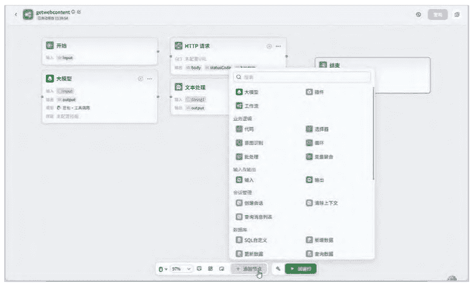

- （5）除上述节点外，还需添加两个插件节点，在节点下拉列表中选择“插件”选项，在弹出的“添加插件”窗口搜索需添加的插件，这里需要网页转 markdown 插件，在搜索框填入 html2md，右侧会显示相关插件，找到后单击，在插件下方显示其节点，点击节点右侧“添加”按钮，如下图所示，即可加入该节点。

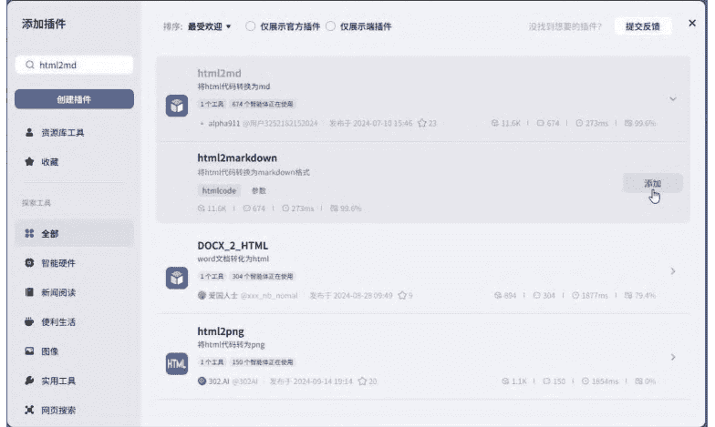

- （6）为实现把指定网页信息整理为文档，还需以同样方式添加“飞书云文档”插件的 create_document 节点，如下图所示。

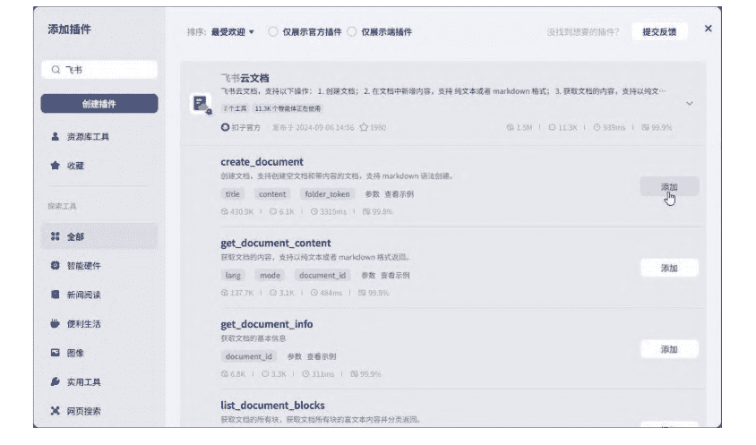

- （7）用鼠标拖动节点，将已添加的节点按“开始”—“HTTP 请求”—“html2markdown”—“大模型”—“文本处理”—“create_document”—“结束”的顺序排列，如下图所示。

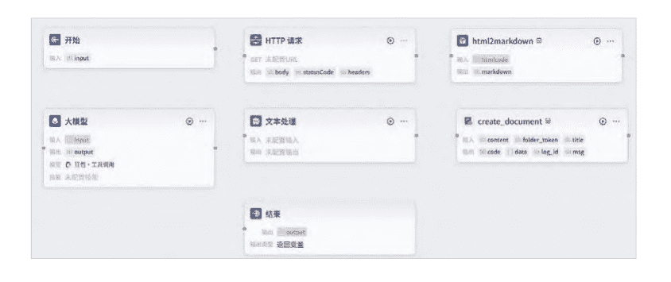

- （8）将排列好的节点按“开始”—“HTTP 请求”—“html2markdown”—“大模型”—“文本处理”—“create_document”—“结束”的顺序流程连接起来，如下图所示。

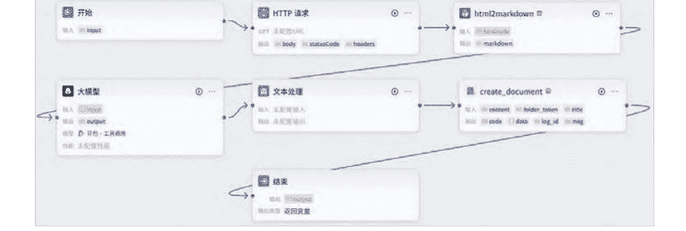

- （9）节点连接完成后开始配置。点击“HTTP 请求”节点，右侧弹出配置窗口，因需获取指定网页信息，所以把指定网址填入 API 选项的 URL 文本框中，注意网址需免登录否则节点无法返回信息。笔者想获取“36 氪”站关于 AI 的信息，输入网址为 https://www.36kr.com/search/articles/AI，如下左图所示，其他选项保持默认即可。

- （10）点击 html2markdown 节点，在配置窗口中点击“输入”选项的 htmlcode 参数值右侧的◎按钮，在下拉列表中选择“HTTP 请求 -body”选项，如下右图所示，目的是把获取网页的 body 部分输入并转为 markdown 格式。


- （11）接下来是“大模型”节点，它是整个工作流的关键，需让其把网页信息转为指定格式。点击该节点，在配置窗口的“模型”选项中选择“DeepSeek-R1·工具调用”模型，设置“输入”选项的“变量值”为 html2markdown-markdown，如下左图所示。向下滑动，在“用户提示词”文本框输入“提供的内容：{{input}}，输出完整的链接”，在“输出”选项中把 output 的“变量类型”改为 Array<Object>，点击右侧 +% 按钮新增两个子项，第一个子项变量名设为 title，第二个子项变量名设为 link，如下右图所示，以便让获取的网页信息与链接一同输出。

- （12）随后通过“文本处理”节点输出获取的网页内容。点击该节点，在配置窗口中设置“输入”选项的“参数值”为“大模型 -output”，在“字符串拼接”文本框输入输出形式，以 {{String1[0].title}}{{String1[0].link}} 为例，表示输出第一条内容的标题和链接，按需设置变量即可，如下左图所示。

- （13）再往下通过 create_document 节点把输出内容导入飞书在线文档。点击该节点，在配置窗口中设置“输入”选项 content 的“参数值”为“文本处理 -output”，如下右图所示，即把“文本处理”节点的输出作为文档内容输入。注意若未在 Coze 中授权飞书账号，需在该节点配置窗口点击“授权”按钮进行授权。

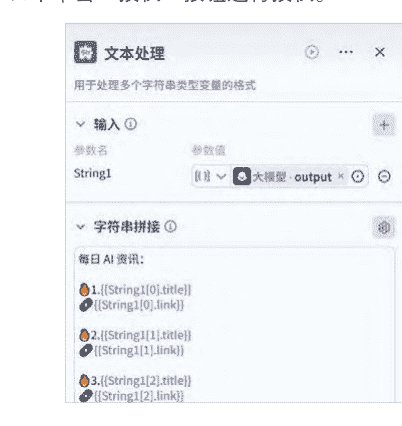

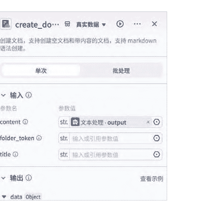

- （14）工作流最后需通过“结束”节点返回运行结果。点击节点，在配置窗口中设置“输出变量”选项 output 的“参数值”为 create_document-url，如下图所示，目的是把创建好的在线文档链接返回。


- （15）所有节点配置完成后，点击下方 START 按钮测试工作流，查看是否仍有问题，若各节点下方均显示“运行成功”，说明工作流正常，如下图所示。


- （16）这样，获取一个指定网页信息并整理为文档的工作流就搭建完成。若想获取多个指定网页信息，还需在工作流中复制部分节点以读取多页信息。以读取两页为例，点击“HTTP 请求”节点的 ... 按钮，在下拉列表选择“创建副本”选项，会创建“HTTP 请求 _1”节点，点击该节点，在配置窗口中输入第二个指定网址 https://www.36kr.com/search/articles/iphone，其他选项保持默认。以同样方法创建“html2markdown_1”“大模型_1”和“文本处理_1”节点，并按顺序摆放，如下图所示。


- （17）将新节点按“开始”—“HTTP请求_1”—“html2markdown_1”—“大模型_1”—“文本处理_1”的顺序连接。参照之前配置方法对新节点进行配置，注意“文本处理_1”节点的“字符串拼接”文本框内容需按网页内容调整，如下图所示。


- （18）为把获取的网页内容合并，还需再添加一个“文本处理_2”节点，将“文本处理”节点和“文本处理_1”节点的输出在“文本处理_2”节点中合并。因此先断开“文本处理”—“create_document”节点的连接，将“文本处理”节点和“文本处理_1”节点连接到“文本处理_2”节点，点击“文本处理_2”节点，在配置窗口点击“输入”选项的 + 按钮添加 String2 变量，两个变量值分别选择“文本处理-output”和“文本处理_1-output”，在“字符串拼接”文本框输入“{{String1}}{{String2}}”，表示合并两部分内容，如下图所示。


- （19）再将“文本处理_2”节点与“create_document”节点连接，这样获取两个指定网页信息并整理为文档的工作流就搭建完成，点击下方“试运行”按钮测试，如下图所示。若无问题即可发布并应用到智能体中。


- （20）点击工作流页面右上角“发布”按钮，在打开窗口输入“版本号”和“版本描述”，点击“发布”按钮，工作流将被发布，页面自动返回“个人空间”页面，在“个人空间”列表框选择“项目开发”选项，打开“项目开发”界面，如下图所示。


- （21）点击右上方“创建”按钮，在创建窗口中选择“创建智能体”选项，在弹出“创建智能体”窗口中输入“智能体名称”，再选一个“图标”，点击“确认”按钮创建智能体并进入智能体的“编排”页面，如下图所示。


- （22）在中间“技能”部分的“工作流”选项右侧点击 + 按钮，添加之前发布的工作流 getwebcontent，在左侧“人设与回复逻辑”面板输入提示词“请帮我调用工作流 {getwebcontent}”，目的是让智能体直接调用工作流而不会回复无关信息；在右侧“预览与调试”面板文本输入框输入“获取资讯”，点击 ▶ 按钮，智能体开始运行工作流并返回最终飞书文档链接，如下图所示。

- （23）在浏览器中打开返回的链接，即可得到想要的信息加链接内容，如下左图所示。

- （24）回到智能体“编排”页面，点击页面右上方“发布”按钮，在“选择发布平台”列表框中勾选“扣子商店”复选框，“分类”选择“效率工具”，点击页面右上方“发布”按钮，在发布成功页面可点击“复制智能体链接”选项复制链接并在浏览器打开，也可在扣子的“商店”页面搜索“获取 AI 新闻”找到并使用智能体，如下右图所示。


### 公众号内容批量抓取与改写
内容为王时代，微信公众号作为品牌传播核心阵地，承载大量优质内容生产与分发。面对日益增长的内容需求，营销人员在创作与优化上耗费大量时间，尤其批量提取与改写时传统方式效率低下且难以保证质量。通过 Coze 与 DeepSeek 深度融合，能一键批量提取公众号文章内容，并基于品牌定位与用户需求高效改写。该工具不仅可快速生成风格多样、语义精准的文案，还支持多维度优化与实时调整，彻底解决内容创作效率瓶颈。无论是提升生产力还是增强用户黏性，都为公众号运营提供有力支持，助力品牌在信息洪流中脱颖而出，具体操作如下。

整个操作需通过 Coze 的工作流和多维表格两部分实现，下面先讲解 Coze 工作流。

- （1）进入扣子官网页面，登录后进入主页，点击页面左侧 📁 按钮，进入个人空间页面，在“个人空间”列表框选择“资源库”选项，打开“资源库”界面，如下图所示。


- （2）把鼠标移到界面右上方 ➕ 按钮上，在下拉列表中选择“工作流”选项，会打开创建工作流窗口，在“工作流名称”文本框输入 gongzhonghaotiqu，在“工作流描述”文本框输入“提取公众号内容”，点击“确认”按钮，页面自动跳转到该工作流界面。把鼠标移到页面下方 ➕ 按钮上，在节点列表框中添加“代码”和“循环”节点，如下图所示。


- （3）重复上一步添加节点的操作，这次在节点列表框中选择“插件”节点，在弹出“添加插件”窗口搜索文本框输入“飞书电子表格”，窗口右侧会显示相关插件，找到所需插件并单击打开该插件节点列表，添加 read_cols 节点，如下图所示。


- （4）将添加的节点按“开始”—“read_cols”—“代码”—“循环”—“结束”的顺序连接起来，点击“循环体”子节点，在“循环体”子节点中以同样方法添加“代码”节点、“链接读取”插件的 LinkReaderPlugin 节点，以及“飞书多维表格”插件的 add_records 节点，并将循环体内节点按“循环体”—“LinkReaderPlugin”—“代码_1”—“add_records”—“循环体”的顺序连接，如下图所示。


（5）要实现公众号文章的批量采集，最省事的方式是把所有链接先汇总到一张表格里统一调度，这样工作流就不用在“开始”节点手动填写链接，也无需保留“开始”节点。进入飞书云文档后新建一个表格，命名为“公众号 URL”，在第一列自上而下排列各篇文章的链接。打开 read_cols 节点的配置页，在输入区填入电子表格的 token，也就是这张表格的网址。


（6）把“公众号 URL”表格的地址复制好，再回到工作流页面的 read_cols 配置界面。num_cols 用来控制读取的列数，因为链接只放在最左侧一列，所以在该项输入 1；spreadsheet_token 栏粘贴刚才复制的表格链接，示意如图。


（7）进入“代码”节点的配置，把输入端的名称 input 改为 linkdata，对应的值关联 read_cols-valuesJsonString。点开代码右侧的“在 IDE 中编辑”，写入指定代码。输出端只保留一个变量，命名为 links，类型设为 Array<String>，其余多余项全部清理掉。
```javascript
async function main({ params }: Args): Promise<Output> {

    // Parse the input JSON string to get the actual array structure
    const inputArray = JSON.parse(params.linkdata);

    // Extract the "text" field from each object
    const textArray = inputArray.flatMap(outerArray =>
        outerArray.flatMap(innerArray =>
            innerArray.map(obj => obj.text)
        )
    );

    // Return the array of extracted text values
    const ret = textArray;

    return ret;
}
```


（8）打开“循环”节点的配置，选择“使用数组循环”的模式。循环数组的 input 指向“代码-links”，输出端的 output 随便指定一个即可，这里选用 LinkReaderPlugin-data，主要是为了让流程能正常通行，并不依赖其返回值。


（9）在 LinkReaderPlugin 节点里，把 url 的值设为“循环-input”，也就是当前轮次的公众号文章链接，其余配置沿用默认即可，示意如图。


（10）进入“代码_1”节点的配置，输入端把名称 input 改为 title，对应的值选 LinkReaderPlugin-title，再新增一条，名称设为 content，值选 LinkReaderPlugin-content。点开 IDE 编辑按钮填入对应代码。输出端只保留 records，类型为 Array<Object>，点击右侧新增子项，命名为 fields，类型为 Object，再在 fields 下分别新增 title 与 content 两个子字段。
```javascript
async function main({ params }: Args): Promise<Output> {
    const title = params.title;
    const content = params.content;
    const doc_url = params.doc_url;
    const fields = {
        "title": title,
        "content": content
    };
    const records = [
        {
            "fields": fields
        }
    ];
    const ret = {
        "records": records
    };
    return ret;
}
```


（11）在 add_records 节点中，app_token 填写新建的多维表格链接，records 指向“代码_1-records”。
（12）结束节点里，因为写入动作已在 add_records 完成，无需返回数据，但缺少该节点会报错，所以把 output 变量删除，流程即可顺利执行。


到此 Coze 工作流的基本框架已搭建完毕，真正获取正文还需要到多维表格侧继续处理，下面说明表格端的设置。

（1）打开工作流中新建的多维表格，将其改名为“公众号文章内容改写”，移除不需要的列。选中“人员”“单选”“日期”“附件”这几个字段，右键删除，将原“文本”字段更名为 title，再新建一个文本字段 content。


（2）表格整理好后返回工作流页面，点击底部的▶试运行，无需在试运行框里输入内容，直接启动，待运行结束即可看到公众号文章内容已写入多维表格。


（3）点开 content 字段右侧的 + 号新建字段，标题填“内容改写”，字段类型选“对象”，在字段捷径里选用“DeepSeek R1（联网）”。在指令框里写“将内容进行润色，保持语义与句式不变，输出的段落格式也要与原文相同，但要比原来的语句更加丰富，且语言要更通俗一些，一定要将内容中多余的符号删除”，把光标移到指令开头，点击“引用字段”并关联 content。


（4）取消“获取更多信息”里的“思考过程”和“参考链接”选项，其余保持默认，点击确定。随后弹出“是否生成全列？”提示，选择“生成”，表格会新增“内容改写.输出结果”列并开始生成润色文案，完成后即可查看结果。


### 一键打造爆款视频智能体
短视频创作里，爆款往往取决于选题精准、创意高效与表达独特。传统流程需要反复找灵感、写脚本、拍摄剪辑，耗时且不确定性高。下面用一个智能体实现一键产出爆款视频，具体做法如下。

（1）参照前文示例新建 Healthvideoproduction 工作流，新增“大模型_生成文案”与“循环”节点，再从视频合成工具箱插件添加 video2video 节点，按“开始—大模型_生成文案—循环—video2video—结束”的顺序排列。注意“大模型_生成文案”是原“大模型”节点改名而来。


（2）子视频的生成放在循环体内部。进入“循环体”子节点，新增“大模型_绘画提示词”“sd_better_prompt”“图像生成”“选择器”“终止循环”，并加入语音合成插件的 speech_synthesis 节点和视频合成工具箱插件的 imgs2video_lite 节点，排列顺序为“大模型_绘画提示词—sd_better_prompt—图像生成—speech_synthesis—imgs2video_lite—选择器—终止循环”。


（3）循环体外的节点按“开始—大模型_生成文案—循环—video2video—结束”连线；循环体内部按“循环体—大模型_绘画提示词—sd_better_prompt—图像生成—speech_synthesis—imgs2video_lite—选择器”连线。选择器有两个出口“如果”与“否则”，分别连向“终止循环”和“循环体”，形成循环逻辑。


（4）在“开始”节点把变量名 input 改为 theme，并勾选必填，确保运行前必须输入视频主题。进入“大模型_生成文案”节点，模型选 DeepSeek-R1，input 指向“开始-input”。系统提示词填“根据输入的养生主题 {{input}}，创作一篇60字左右、4句话左右的养生文案”，点击自动优化并采用优化结果。用户提示词填“{{input}}”，输出端的 output 类型改为 Array<String>。


（5）循环节点设为“使用数组循环”，循环数组的 input 指向“大模型_生成文案-output”，输出端的 output 指向 imgs2video_lite-videoUrl。


（6）大模型_绘画提示词节点选用“通义千问·Max”，输入的 input 指向“循环-input”。系统提示词写“根据输入的养生文案{{input}}，生成古代动漫画风图片的提示词，提示词中要有人物、场景、元素等”，点击自动优化后替换，用户提示词填“{{input}}”。


（7）提示词优化节点里，提示词指向“大模型_绘画提示词-output”。图像生成节点选用“通用-Pro”，比例选16:9（1024*576），生成质量设为30。输入里新增 input，值设为 sd_better_prompt-data，正向提示词填“{{input}}，中国画，徐悲鸿，粗犷笔触”，负向提示词填“文字，英文”。


（8）speech_synthesis 节点里 text 指向“循环-input”，voice_id 设为“擎苍”。imgs2video_lite 节点里 imageUrl1 指向“图像生成-data”，voiceUrl 指向 speech_synthesis-link。


（9）在选择器节点设置条件为“如果循环-index 等于4 则终止循环，否则继续循环”。这里的 4 对应大模型生成的 4 句文案，即生成 4 个视频，循环 4 次后停止。


（10）video2video 节点里 videoFiles 设为“循环-output”，如需配乐可在 bgmUrl 填写音乐链接。
（11）在结束节点里把 output 设为 video2video-videoUrl，用于返回最终视频链接。


（12）至此，一键生成养生爆款视频的工作流已完成。输入主题“古人补气血的智慧”测试，运行正常并返回视频链接。


（13）按既有方法发布工作流，创建名为“养生视频制作”的智能体，将该工作流接入“人设与回复逻辑”面板并发布，最后上架到扣子商店即可搜索到。


（14）打开“养生视频制作”智能体，进入对话页，输入“古人预防失眠的智慧”，点击▶，智能体开始创作并返回视频链接。


（15）点击返回的链接可在浏览器观看，生成的是一条约19秒带配音的养生短片。


### 一键批量生成小红书养生图文智能体
健康内容创作既要保证专业准确，又要贴合平台调性和用户偏好，人工查阅与打磨耗时费力，还容易错过热点窗口。

为解决这一痛点，下面通过 DeepSeek 与 Coze 的整合，打造一个可自动匹配小红书热点的健康养生内容生成与优化方案，能自动产出专业且风格合规的文案，并智能优化视觉呈现。

（1）登录扣子官网，进入首页后点左侧📁打开个人空间，在列表中选择“资源库”进入资源库界面。


（2）将鼠标移到右上方➕按钮，从下拉菜单选择“工作流”，弹出创建窗口。工作流名称填 health_image，描述填“批量生成小红书健康养生图文”，确认后自动进入工作流页。随后在下方➕添加节点按钮处新增“大模型”和“批处理”节点。


（3）把节点按“开始—大模型—批处理—结束”连接。进入“批处理体”子节点，同样方式添加“图像生成”节点、Cutout 节点和“画板”节点，内部连接顺序为“批处理体—图像生成—抠图—画板—批处理体”。


（4）打开入口节点的设置界面，把参数标识 input 改写为 theme，并把右侧的必填标记打上。这样在流程启动前必须先提供图文主题，主题确认后才进入下一步。

（5）在模型组件的配置页，将模型选择为 DeepSeek-R1，输入参数的对应数值填写为“开始-theme”。在系统提示词区粘贴如下内容，参考左侧示例。

> 你是一个健康养生专家，你可以根据用户为你提供的主题自动生成健康养生的文案。例如：用户提供的主题是：健康养生的10个微习惯。那么生成的内容如下所示，应该输出一个json格式的内容：{"name": "晨起喝温水","description": "每天早晨空腹喝一杯温水，能唤醒肠胃，促进新陈代谢，帮助身体排出毒素。"}，……

在用户提示词区填写“用户提供的主题：{{input}}”，把输出项 output 的数据类型改成字符串数组，并新增两个子字段分别命名为 name 与 description，两者的类型都设为 String，参考右侧示例。

### 小红书图文自动化合成
当内容生产强调效率时，小红书对图文质感和更新节奏的要求也在提升。过去制作图文需要在多个工具间切换，从文案到配图再到排版，耗时耗力且风格难统一。借助 Coze 与 AI 的结合，传统制作方式被重塑。该方案可自动提炼文案要点，智能匹配视觉模板，将文字排版与图片设计融合。无论是种草、攻略或生活记录，都能在保留平台美学的基础上把产出效率提升十倍以上，实现想到即成稿，具体做法如下。

（1）登录 Coze 官网进入首页，点击左侧菜单进入个人空间，在空间列表中选择资源库打开对应界面，见配图。


（2）把鼠标移至界面右上角的控件，从下拉菜单里选择“工作流”，弹出创建窗口后在“流程名称”里填 xhs_image_text，“流程描述”里填“批量合成小红书图文”，点确认后自动进入该流程页面。将鼠标移至页面下方控件，从节点列表里新增“代码”和“循环”节点，并在插件区添加“飞书电子表格”插件的 read_cols 节点，见配图。


（3）按“入口”-read_cols-“代码”—“循环”—“出口”的顺序把节点连起来，点击“循环体”子节点，在其内部同样方式添加“画板”节点，并把循环体内连线调整为“循环体”—“画板”—“循环体”，见配图。


（4）进入入口节点的配置，因需批量导入图片，需把数据类型改为 Array<Image>，并勾选必填，如左图。勾选后运行时的输入框会变为文件上传区，可一次性上传多张素材。

（5）文案批量导入没有现成节点，先把文案放到表格里再读取。打开飞书云文档新建表格，重命名为“小红书文案批量上传”，在第一列依次向下填写文案内容，见右图。注意文案顺序必须与上传图片的顺序一致，以保证图文配对正确。打开 read_cols 节点的配置，在输入区的对应数值里填入电子表格的 token，即表格链接的 URL。


（6）复制“小红书文案批量上传”表格的链接，回到流程的 read_cols 配置中，num_cols 表示读取列数，因文案在第一列，其对应数值填 1，spreadsheet_token 的对应数值粘贴刚才复制的表格链接，如右图。


（7）在“代码”节点配置的输入里，把参数标识 input 改为 textdata，对应数值设为 read_cols-valuesJsonString，点击代码区右侧的“在 IDE 中编辑”打开编辑窗口，写入代码内容。在输出区点按钮删掉多余参数，只保留一个参数并改名为 text，数据类型设为字符串数组，见图。
```javascript
async function main({ params }: Args): Promise<Array<string>> {
    // 1. 解析输入的 JSON 字符串
    const parsedData = JSON.parse(params.textdata);
    // 2. 提取所有语录（从每个子数组的第一个元素获取字符串）
    const quotes = parsedData.map(item => item[0]);
    // 3. 返回字符串数组
    return quotes;
}
```


（8）进入“循环”节点配置，设循环模式为“使用数组循环”，点“循环数组”右侧的 + 新建参数，把 input 的标识改为 image，对应数值填“入口 -input”。再新建一个名为 text 的参数，对应数值填“代码 -text”，因图片和文字来自不同节点所以分开传入。把输出中 output 的对应数值设为“画板 -data”，见图。


（9）在“画板”节点配置中，点击“元素设置”右侧的 + 添加两个元素，分别命名为 image 与 text，对应数值分别设为“循环 -image”和“循环 -text”，见图。


（10）双击“画板编辑”中的画板打开排版窗口，点击□按钮在画板设置里把尺寸改为 1080 × 1440。再点□按钮为画板添加背景图，填充模式选“自适应”，缩放移动背景使其完全覆盖画板。再次点□按钮在画板中插入 image 与 text 参数。插入 image 后可调整位置大小，插入 text 后可调整文本框位置大小。挑选合适字体，设定字号与对齐方式，最终形成合理布局，见图。


（11）在出口节点的配置中，把 output 的对应数值设为“循环 -output”，以便把生成的图文返回给使用者。

（12）至此一键合成小红书图片文字的流程搭建完成，上传 10 张准备好的素材图进行测试，运行正常并返回图文结果，见图。


（13）部分生成图文的效果见图。


### 语音博客批量生成方案
语音博客制作传统上效率偏低：写稿到录音剪辑步骤繁琐，占用大量时间；而且语音表现单一，缺乏情绪变化，容易让听众流失。

为解决上述痛点，可参照以下步骤，利用 DeepSeek 与 Coze 整合，搭建具备智能创作与情感化播报能力的语音博客一键生成方案，具体操作如下。

（1）参照前文方式新建 voice_blog 流程，如右图。


（2）进入流程页面新增“大模型”和“循环”节点，再添加“链接读取”插件的 LinkReaderPlugin 节点、“语音博客”插件的 genPodcastURL 节点和“打包工具”插件的 package 节点，按“入口”—“大模型”—“循环”—“循环体”—LinkReaderPlugin-genPodcastURL—循环体—package—“出口”的顺序连接，见图。


（3）打开入口节点配置，把参数标识 input 改为 url，并勾选右侧必填，如右图。该流程需输入网址才能生成内容。


（4）在模型组件配置中，把模型设为 DeepSeek-V3，输入参数的对应数值填“入口-url”，在系统提示词区输入如下提示词，见左图。

> 当接收到用户输入的链接 {{input}} 时，将其按照每组一个的形式进行分组输出。

> === 回复示例 ===

> - 链接 1: {{input}}

> === 示例结束 ===

在用户提示词区填“{{input}}”，把输出中 output 的数据类型改为字符串数组，见右图。


（5）在循环节点配置中，设循环模式为“使用数组循环”，循环数组中 input 的对应数值为“大模型-output”，输出中 output 的对应数值为“genPodcastURL-podcast_url”，如右图。


（6）在 LinkReaderPlugin 节点配置中，把 url 的对应数值设为“循环 -input”，need_image_url 不用选择，见左图。

（7）在 genPodcastURL 节点配置中，把 input_text 的对应数值设为 LinkReaderPlugin-content，use_head_music 不用选择，见右图。


（8）在 package 节点配置中，url_list 的对应数值填“循环 -output”，见左图；在出口节点配置中，把 output 的对应数值设为 package-result，即压缩包下载地址，见右图。


（9）语音博客批量生成流程搭建完毕。点页面下方的“试运行”，弹出试运行窗口后在 url 文本框分行输入文章链接，或把文本文件拖入 file 框中，点右下角“试运行”，完成后会返回音频压缩包下载地址，见图。


（10）复制返回的压缩包地址粘贴到浏览器地址栏回车，压缩包下载到本地，解压后即可获得博客音频，如右图。


### 抖音视频文案批量获取
视频创作者获取文案灵感的传统方式效率不高：需花费数小时浏览大量同类视频，时间成本高且难以系统提炼信息；人工筛选易遗漏优质内容，影响文案完整性与创新度。

针对此问题，可按以下步骤通过 DeepSeek 与扣子平台整合，构建智能解析并汇总视频文案的解决方案，具体操作如下。

（1）按前文方法新建 get_video_copy 流程，进入流程页面，见图。


（2）新增“大模型”和“循环”节点，再添加“视频下载”插件的 download_video 节点、“视频转文案”插件的 wenantq 节点和“打包工具”插件的 package 节点。按“入口”—“大模型”—“循环”—“循环体”—“download_video”—“wenantq”—“循环体”—“package”—“出口”的顺序连接，见图。


（3）在入口节点配置中勾选 input 参数右侧的必填，如下图，该节点用于输入视频链接，必须填写。


（4）在模型组件配置中，把模型设为 DeepSeek-V3，输入参数的对应数值填“入口-input”，在系统提示词区输入提示词，见左图。
```
当接收到用户输入的链接 {{input}} 时，将其按照每组一个的形式进行分组输出。
=== 回复示例 ===
- 链接 1: {{input}}
=== 示例结束 ===
```
在用户提示词区填“{{input}}”，把输出中 output 的数据类型改为字符串数组，见右图。

（5）在循环节点配置中，设循环模式为“使用数组循环”，循环数组中 input 的对应数值为“大模型 -output”，输出中 output 的对应数值为 download_video-url，点击右侧 + 添加参数 output2，对应数值设为 wenantq-copy，见图。


（6）在 download_video 节点配置中，把 url 的对应数值设为“循环 -input”，api_token 不用填写，见左图。

（7）在 wenanq 节点配置中，把 api_key 的对应数值填阿里云百炼申请的 API KEY，url 的对应数值填 download_video-url，见右图。


（8）在 package 节点配置中，为方便下载把视频打包成压缩包，所以 url_list 的对应数值设为“循环 -output”，见左图；在出口节点配置中，把 output 的对应数值设为 package-result，即压缩包下载地址。点 + 添加 output2 参数，其对应数值设为“循环 -output2”，见右图。


（9）一键批量下载抖音视频并生成文案的流程搭建完成。点页面下方“试运行”，弹出窗口后在 url 文本框分行输入多个抖音链接，点右下角“试运行”，完成后返回视频压缩包下载地址和视频文案，见图。


（10）复制返回的压缩包地址粘贴到浏览器地址栏回车，压缩包下载到本地，解压后即为下载的视频，见图。


### 炫酷书单视频制作
下图展示的是“炫酷书单”扣子流程，只需在流程入口节点输入书名并上传封面图，AI 就会自动产出该书的炫酷介绍视频脚本与视觉方案，适合希望快速制作优质书单推荐内容的自媒体创作者，实现从图书到爆款视频的一键转化。若想高效创作引人入胜的书籍推荐视频，提升账号文化调性与粉丝互动，可尝试使用。


### 书籍会说话视频流程

图示为“假如书籍会说话”这一 Coze 流程。把书名填进流程入口，系统会产出以书本自述口吻进行的对话式口播稿，让作品化身讲述者介绍自身价值与情节。适合想做沉浸式推书、提升内容趣味与共鸣、同时强化账号辨识度和粉丝粘性的自媒体创作者参考。


### 用流程一键生成治愈系奶奶短片
配图展示的“治愈系老奶奶”Coze 流程，主题填入入口后即可得到暖心老奶奶风格的文案，内含人生感悟金句与娓娓叙述节奏。很适合想做温情向短片、传递安抚与正向能量的内容创作者，从主题到成片实现智能化跃迁。若想培育辨识度高的治愈 IP、拉近观众距离、塑造治愈调性，可试用。


### 一键打造山海经神话短视频
图中展示的“山海经故事”Coze 流程，输入主题即可获得融合《山海经》元素的奇幻文案，涵盖奇兽传说、远古神话及东方奇幻画面建议。适合想做具中国文化底蕴的神秘题材的短视频创作者，实现从创意到视觉盛宴的快速转化。若希望塑造东方神秘 IP、丰富账号文化厚度、提升沉浸感，可尝试。


## 第6章 借助扣子和飞书驱动数字人

### 什么是 AI 数字人
AI 数字人是基于人工智能构建的虚拟形象，也称数字分身，能模拟真人长相、音色、表情与肢体，实现自然的人机交流。底层融合三维建模、语音合成识别、自然语言处理和动作驱动；借助深度学习与大模型，能复刻特定人物的形象声线，并据需求即时生成反馈，拥有一定自学习与适应能力。

当下全天候新闻频道、在线教学平台、虚拟客服界面上不少“真人”主播实为 AI 驱动的虚拟形象。直播场景里，虚拟主播逐步替代或配合真人做带货、互动及品牌传播，既压缩人力开支又稳定内容产出。

叠加专业知识库，虚拟形象可升级为数字员工。百度智能云曾推出首批 AI 数字员工，覆盖营销经理、还款助理、汽车销售、促销专员、产品经理、课程顾问、招聘专员等岗位。

总体看，数字人正从好看的视觉互动走向好用的智能服务，已成为产业智能化的核心驱动力。新闻播报、教学、客服、虚拟导购、心理咨询、政务指引等场景均已普及。

### 用扣子、飞书做文本驱动的 AI 数字人
文本驱动指在数字人制作平台仅需输入文字即可得到逼真视频。整体分为文字输入、语义理解、视听合成三阶段，输入质量直接决定最终呈现。

单条视频可用任意大模型完成，但要做系列化或规模化生产，就要借助扣子或飞书多维表格。扣子作为 AI 智能体开发工具，能深度集成大语言模型，结合自有知识库和外部插件进行多轮对话与复杂推理，批量产出逻辑清晰、风格多样的高质量文案。

飞书多维表格凭借多样字段与自动化能力，能搭建一条“文案生产线”。例如把上百个视频主题填入表格，调用 DeepSeek 大模型或已搭建的扣子智能体，即可一键批量生成适配不同场景、不同风格的旁白或口播稿。

如此可保证数字人所需的大规模文字供给，同时大幅提升内容质量与创作效率。

本章后续的“用闪剪快速生成数字人视频”“用飞影快速生成数字人视频”“用即梦快速生成数字人视频”等案例，均围绕文本驱动展开讲解。

### 用扣子、飞书做语音驱动的 AI 数字人
语音驱动指在数字人平台导入语音后生成逼真视频。核心流程是语音输入、音素解析、动态渲染，音质与规模直接影响最终效果。

同样建议批量化、规模化操作以提升效率。扣子凭借强大的多轮对话与任务处理能力，结合内置语音合成插件，可把文字批量转为自然流畅的语音。飞书多维表格则负责语音素材的结构化管理与批量处理，通过自动化流程实现从文字生成到语音合成的无缝衔接。

本章的“用剪映快速生成数字人视频”案例详细说明了语音驱动的实践方法。

### 用闪剪快速生成数字人视频
闪剪的数字人功能由深圳趣推科技开发，技术成熟但需开通 VIP 会员或购买算力包，按时长计费。以制作 10 条 1 分钟视频估算，总时长 600 秒，约消耗 600 算力，按现行充值策略成本约 33.3 元。

平台集成度高，支持个人数字人定制，上传 30 秒视频即可 1:1 复刻形象与声音；内置超 1000 个有版权的数字人模特，支持直播切片、声音克隆、智能成片、照片数字人等，利于短视频创作与带货。

实测来看，闪剪在口型同步上较为准确，语音与唇形匹配度高，音画基本对齐无明显延迟。但嘴部动作不够自然，唇齿配合、张嘴幅度偏机械，肢体交互灵活性有限，重复感较强，整体动态与真人仍有差距。

操作要点如下：

（1）打开闪剪 AI 官网首页，点击左下角登录/注册进入账号。
（2）左侧导航选择“数字人库”，进入数字人库页面，可点“开始定制”自建形象，也可在“公共数字人”中挑选现成形象。
（3）比如做文学讲解类内容，可选“瑾瑜”形象，悬停封面后点“创作视频”进入制作页。
（4）左侧选“配音”打开配音面板，可选数字人音色并设置音频驱动。点“导入音频”上传音频后，右侧会自动识别文案并使用该音频。注意上传音频后文案不可编辑。
（5）若只想换音色不换音频，可在左侧更换声音后编辑右侧文案，支持改写、停顿等。左侧还可调音乐、背景、文字、贴图，顶部可关闭标题和字幕。
（6）设置完成后点右上角“预览”，先听声音效果，未达预期可再调整。
（7）满意后点右上角“导出视频”，生成完成后可在“我的作品”中查看。

### 用飞影快速生成数字人视频
实测飞影的口型同步基本准确，音画对齐无明显延迟，面部结构清晰，拟真度尚可。但嘴部动作偏机械，眼部微表情与面部肌肉变化不足，表情切换生硬，长时间或复杂语境下易出现动作重复、神态模式化，削弱真实感与代入感。

操作流程：

（1）进入飞影数字人官网并登录。
（2）左侧导航点“数字人”，选定形象后将鼠标移至封面，右下角出现“去创作”，点击进入创作页。
（3）在形象下方点击音色，选择与形象契合的音色。
（4）在文案区输入待生成的文本，可点“试听”用所选音色生成音频试听。
（5）也可点文案区右上“切换成音频驱动”，上传准备好的音频，上传后会显示在音频区。
（6）确认参数后点下方“提交”，右侧开始生成作品。
（7）作品列表可预览效果，点击下载图标保存本地。

### 用即梦快速生成数字人视频
即梦依托字节技术，数字人功能成熟，需开通会员，按时长消耗积分。以 10 条 15 秒视频估算，费用约 200 元。

优势在于同时具备生图与数字人能力，文生数字人操作便捷，也支持视频上传做数字人，且兼顾音频驱动与文本驱动。

实测声画同步基本可用，口型能与语音大致匹配，满足短时内容需求。但视频上限 15 秒，限制深度；动作表现夸张模糊，肢体过渡不细腻，表情略显生硬，整体自然度有限。

制作步骤：

（1）在“图片生成”框输入人物提示词生成形象，如 20 岁元气少女等细节描述。
（2）将生图模型设为“图片 3.1”。
（3）设置图片比例为 2:3。
（4）点右侧按钮生成形象，挑选合适的照片保存本地。
（5）返回首页点“数字人”，上传保存的图片。
（6）选择音频生成方式：文本生成音频或上传音频。
（7）选文本生成音频后进入朗读编辑页。
（8）在文本框输入待播内容，注意受 15 秒限制，需控制字数，输入后左侧会预估时长。
（9）在音色区选择音色，如“魅力姐姐”，也可点“创建音色”上传自有音色。
（10）点确定后在设置页选择模型为“大师模式”。
（11）点右侧按钮开始生成，完成后即可查看效果。

### 用剪映快速生成数字人视频
剪映数字人功能成熟，需开通 VIP，会员期内训练一个数字人花费 49 元，训练 10 个成本较高。

实测口型与语音同步稳定，音画匹配度较高，适合基础口播。面部轮廓清晰，形象亲和。但表情变化与肢体动作偏生硬，嘴部开合缺少自然过渡，眼部神态联动不足，长时间观看易感知重复与模式化，在情感表达或复杂互动场景支撑不足。

操作要点：

（1）打开剪映，点击左侧“数字人”，展开“形象”并点“定制形象”，可看到已定制的形象。
（2）点“形象定制”封面，从下拉列表选“克隆视频形象”，积分充足则打开定制窗口，积分不足需在 App 中充值积分至 4900 以上。
（3）上传视频前需注意要求，建议上传 10 秒至 5 分钟个人口播视频，录制需符合背景、灯光、朗读规范。
（4）录制完成后至定制成功期间注意相关事项。
（5）录制完毕后点“上传视频”，勾选《“剪映”AI 功能使用规范》复选框即可提交。


（6）首次在剪映里调用形象定制功能时，提交按钮会变成下一步。进入后会进入实人核验环节，需按系统提示用前置镜头录制一段本人正面向镜头朗读指定文稿的短视频，以确认授权主体。录制完成后点上传视频把素材送出，右侧为示意画面。


（7）点提交后会弹出 AI 功能提示窗口，点击允许后平台开始接收视频并进入数字人制作流程，右侧为参考效果。


（8）形象一般在半小时左右生成，定制成功后 15 天内可申请一次重制。注意，若上传片段里出现手部高于颈部或面部被物体遮挡，被遮部分会变得模糊，如下图所示。若使用剪辑过的视频，可能被判定为局部无脸导致上传失败。


（9）定制完成后可在定制形象界面挑选，已生成的我的形象 10 可直接调用，同时在下方景别中调整数字人显示构图，如下图所示。


（10）点右下角下一步进入配音界面，提供输入文案和上传音频两种方案。选输入文案需在文本框填入脚本并指定音色，剪映内置大量音色可选，形象定制时人声同步完成克隆，可直接选用该形象自带的音色，如下图所示。


（11）选上传音频需点添加音频导入素材，若没有现成音频，可用第 4 章一键批量生成口播音频表格案例的配音。导入后会弹出时长调节窗口，可按需裁剪，调整完毕点保存即可加入，如下图所示。


（12）确定配音方式后点右下角生成，会弹出是否合成数字人的确认对话框，并显示本次预计消耗的积分。积分充足点确认合成，积分不足则按前文说明办理充值。


（13）合成完成的数字人视频会直接显示在视频轨道中，如下图所示。如需继续编辑可直接操作，若已结束可点右上角导出将文件保存到本地。


### 批量生成数字人视频的工作流搭建
在内容生产里，传统拍摄加后期成本高、效率低，很难支撑高频多变需求；固定人设和脚本也让互动感不足。对此可参考下方案例，把数字人合成能力与 Coze 工作流平台结合，打造可自动适配场景并快速量产的视频方案，具体步骤如下。
（1）参照前文做法新建一个 spoken_digital_human 工作流，如右图所示。

（2）进入编辑页，先新增循环节点，再接入飞影数字人插件的 create_lipsync_video2 节点。循环体内加入选择器、终止循环节点，以及飞影数字人插件的 inspect_video_creation_status 节点和定时器插件的 time_wait 节点。连线顺序为开始-create_lipsync_video2-循环-循环体-inspect_video_creation_status-选择器如果-time_wait-循环体-结束，选择器的否则分支接选择器否则-终止循环，如下图所示。

（3）打开开始节点配置，把 input 变量名改为 text，点击输入右侧加号新增 speaker_id、digital_human_id、hifly_id 三个变量，类型均为 String，除 hifly_id 外其余勾选必填。这里的 text、speaker_id、digital_human_id、hifly_id 分别对应口播文案、声音 ID、数字人 ID、飞影 ID。填写飞影 ID 会关联账号并消耗积分，不填则免费但生成会更慢，所以该项未设必填。
（4）在 create_lipsync_video 节点配置里，将 digital_human_id 的取值设为开始-digital_human_id，speaker_id 设为开始-speaker_id，text 设为开始-text，hifly_id 设为开始-hifly_id，如右侧图所示。该节点负责根据传入参数生成口播数字人。

（5）在循环节点配置中，选择无限循环，输出里设置 output 取值为 inspect_video_creation_status-video_Url，如左侧图所示。因为生成时长不确定，需要持续轮询直到完成，完成后将下载链接作为输出。
（6）在 inspect_video_creation_status 节点配置里，把 job_id 的取值设为 create_lipsync_video2-job_id，hifly_id 设为开始-hifly_id，如右侧图所示。job_id 即作品编号，用于查询任务是否完成并获取链接；hifly_id 的使用规则同前。

（7）在选择器节点配置里，于条件分支如果面板新增条件，上方变量选 inspect_video_creation_status-status，条件选等于，下方填 1；再新增一条，变量同样选 inspect_video_creation_status-status，条件选等于，下方填 2。将且改为或，如图所示。当状态为 1 或 2 时继续循环，否则结束循环。

（8）在 time_wait 节点配置里，seconds 的取值填入 10，如左侧图所示。该节点用于在两次查询间加入 10 秒间隔，避免请求过于频繁。
（9）终止循环节点用于立刻跳出当前循环，无需配置。在结束节点配置里，把 output 设为循环-output，如右侧图所示，最终把循环输出的数字人下载链接返回给用户查看。

（10）至此口播数字人工作流搭建完成，需进行试运行验证。点击页面底部的试运行，右侧会弹出开始节点设置的变量输入框，填入正确值后流程才能正常运行。

（11）除口播文案需提前准备，其余变量均需从飞影数字人官网获取。登录官网首页，如下图所示。

（12）在左侧导航选择数字人，进入列表页。选中一个形象进入素材页，将鼠标移至目标素材上方，视频上方会出现操作按钮，点击后选择复制素材 ID，把该 ID 粘贴到 digital_human_id 输入框。

（13）左侧导航切换到声音克隆，进入声音克隆页。在公共声音库中挑选与数字人匹配的声音，用复制数字人 ID 同样的方式复制声音 ID，粘贴到 speaker_id 输入框。

（14）如需使用 hifly_id，左侧导航进入个人中心，在智能体信息里点击 hifly_agent_token 右侧的复制按钮，把 token 粘贴到 hifly_id 输入框，即可关联飞影账号。

（15）在 text 框填入口播文案，点击页面右下角试运行，工作流执行完成后会返回视频下载地址，如图所示。点击右上角发布即可发布工作流。
（16）把返回的地址粘贴到浏览器打开即可下载数字人视频，下图为笔者生成的部分截图。

（17）新建 pl_spoken_digital_human 工作流，进入编辑页，添加大模型、循环节点及 spoken_digital_human 工作流节点，按开始-大模型-循环-循环体-spoken_digital_human-循环体-结束的顺序连接，如下图所示。

（18）在大模型节点配置里，模型选 DeepSeek-V3，input 的取值设为开始-text，在系统提示词框输入如下提示词，如左侧图所示。
> 当接收到用户输入的文案 {{input}} 时，将其按照每行为一组的形式进行分组输出。
> === 回复示例 ===
> - 文案 1: {{input}}
> === 示例结束 ===
在用户提示词框输入“{{input}}”，把输出的 output 变量类型改为 Array<String>，如右侧图所示。

（19）在循环节点配置里，选择使用数组循环，循环数组的 input 取值设为大模型-output，输出的 output 取值设为 spoken_digital_human，如左侧图所示。
（20）在 spoken_digital_human 节点配置里，digital_human_id 设为开始-digital_human_id，speaker_id 设为开始-speaker_id，hifly_id 设为开始-hifly_id，text 设为循环-input，如右侧图所示。

（21）在结束节点配置里，把 output 设为循环-output，如下图所示，最终将循环节点输出的所有数字人下载链接返回给用户下载查看。

（22）至此批量生成口播数字人的工作流已搭建完成，需测试运行。点击页面底部试运行，会打开试运行窗口，在各参数框填入相关值，text 框按行输入口播文案，点击右下方试运行，执行完成后会返回生成的数字人下载地址，复制到浏览器即可下载视频。

## 第7章 OpenClaw 安装、飞书接入与实战精要
### OpenClaw 全景概览
#### OpenClaw 究竟是什么
OpenClaw 是 2026 年初迅速走红的开源智能体框架，由 Peter Steinberger 于 2025 年 11 月创建。它被定位为能直接操控电脑或手机、本地部署、自主完成真实任务的数字员工，与只能对话的传统 AI 不同，OpenClaw 可以处理读邮件、管理日历、控制浏览器、自动化文档等实操任务。
该项目坚持本地优先、数据不上云，支持通过 WhatsApp、Telegram、飞书、钉钉、QQ 等消息平台交互，并拥有丰富的技能生态。
2026 年 2 月，其 GitHub 星标在四个月内突破 25 万，超过 Linux 和 React 等长期领先项目，成为增长最快的开源软件之一，如下图所示。

2026 年 3 月，OpenClaw 热度席卷全国两会。全国政协委员王坚指出，人工智能技术对中小企业最为友好，而一人公司的出现正是这一趋势的体现。与此同时地方政府也在跟进，深圳龙岗区率先发布龙虾十条征求意见稿，拟最高补贴 200 万元；无锡高新区随后推出养龙虾十二条，单项补贴最高 500 万元，意在以真金白银推动 AI 智能体在智能制造、智慧政务等领域的深度应用。
#### 为何称 OpenClaw 为里程碑
市场上 AI 产品众多，为何单说 OpenClaw 是里程碑？关键在于它突破了以往产品的局限。
回顾发展路径。第一代是问答机，代表 Siri、小爱同学、小度。特点是一问一答，只能执行预设指令，稍微复杂就无能为力，本质像玩具，只能查天气、设闹钟，难以真正助力工作。
第二代是聊天机，代表 ChatGPT、Claude、文心一言、DeepSeek。特点是一问一答，能力很强，但不主动做事，本质像顾问，能给建议却不执行。
第三代是 AI Agent，代表 OpenClaw。特点是能理解指令、规划任务、执行操作并返回结果，第一次真正把 AI 从工具变为员工，本质像 24 小时在线的私人助理。
OpenClaw 的革命性体现在三点。
突破一：打破应用壁垒。它不仅能接入微信、钉钉、邮件等通道，更能理解通道里的任务并调度其他应用完成。例如微信群里看到会议通知，就能自动调用日历 App 创建日程，并调用邮件 App 发送会议纪要。
突破二：长期记忆。过去的 AI 每次对话都重新开始，你的偏好、习惯下次就忘。OpenClaw 拥有记忆系统，记得你是谁、喜欢什么、之前聊过什么。像一位熟悉的老员工，而非每次初识的陌生人。你无需反复交代背景和需求。
突破三：自主执行。过去的 AI 需要一步步指引，每次都要确认，更像执行者而非独当一面的人。OpenClaw 接收高层指令后自行规划、执行、解决问题，你只需最后检查结果。像成熟员工，交代任务后自行完成，无需全程盯着。
若把 AI 比作厨房，第一代像微波炉，能热剩饭却做不了复杂菜。第二代像智能灶，按菜谱做菜但需一直看着。OpenClaw 像星级厨师，你说要一桌家宴，它自己买菜、备料、烹饪、摆盘，最后端上完整菜肴。
### OpenClaw 能解决哪些问题
传统 AI 工具门槛较高，用户需学习复杂提示词工程、理解 API 调用，还要有一定技术背景才能发挥价值。
OpenClaw 通过极致的产品设计大幅降低门槛。用户只需像发微信一样告诉 OpenClaw 想要做什么，系统会自动解析需求、调用相关工具、完成执行并返回结果。
这种一句话办事的交互，让 AI 从技术专家的专属工具，变成普通用户也能轻松使用的生产力助手。
OpenClaw 的另一核心价值在于高度可定制性。

定制专属人设，让 AI 真正懂你

通过 SOUL.md、MEMORY.md 这类配置文件，你可以给 AI 设定人格特质、对话风格、擅长领域和知识背景，让它从通用模型变成贴合你工作习惯的私人助手。这种深度个性化能力，让每位用户的 OpenClaw 都能按自己的节奏使用。

### OpenClaw 当下的挑战

要让机器人深度操作本地系统，效率必然提升，但高权限自动化叠加高速迭代，也带来了明确的不确定性。数据安全与误操作风险始终是用户需要警惕的点。

更现实的困境是项目仍处非常早期的摸索期。社区迭代以天为单位，架构、部署方式乃至核心接口经常出现不兼容的大改。昨天刚熟练的安装、配置、调优技巧，今天的版本更新后就可能失效，形成了持续的沉没学习成本。

### 安装方式先搞清思路

OpenClaw 的更新速度非常快，有时一天一个版本，有时一天多个版本。刚吐槽完上下文管理，转头新版就上线了。对新手来说，面对众多部署方案很容易迷茫。

选安装方式和选交通工具一样。去楼下超市，走路或骑车就够了；跨城出行，高铁飞机更合适。OpenClaw 也一样，场景不同，最优解不同。

### 三种主流部署路线

#### 云厂商一键部署

在轻量云服务器上自动完成 OpenClaw 的安装与初始化，无需手动搭环境，几分钟就能上线。

可通过阿里云、腾讯云、百度云、火山引擎、扣子编程、飞书妙搭、讯飞 AstronClaw 等渠道获取。优点是零代码、5到10分钟上线、月租约9到40元，适合零基础用户，支持全天候稳定运行与国内即时通讯低延迟。代价是数据存放在云端，且能力开放约只有20%。

#### 本地一键安装

借助官方脚本或安装包，在个人电脑或本地服务器上自动配置依赖、部署服务并启动。

渠道包括原生 OpenClaw、EasyClaw、有道 OpenClaw、腾讯 Qclaw、腾讯 Workbuddy、Copaw 等。优点是速度最快、免费、完整解锁全部能力且数据完全本地。适合有 Windows/Mac 设备、重视隐私和完整功能的用户，唯一前提是电脑需要长期开机。

#### Docker 容器部署

利用官方 Docker 镜像，通过容器在任意支持 Docker 的环境中运行 OpenClaw，实现环境隔离与一致性。

常见入口为 Docker Hub、官方镜像、Docker Desktop。优点是灵活度最高、环境隔离友好，适合技术用户、多实例运行和精细权限控制。门槛在于需要一定的 Docker 基础。

#### 在 Coze 平台快速部署

在 Coze 上部署操作直观，适合不懂编程的用户。平台提供插件环境和简易发布流程，可把 OpenClaw 封装成对话机器人并一键分发。

具体流程：登录扣子编程主页，点击输入框下方“一键部署 OpenClaw”的立即领取，目前仅个人高阶版、个人旗舰版、企业标准版、企业旗舰版用户可用，否则会提示升级。升级后再次领取进入配置页。在配置面板选择模型，默认自动；选择版本，满血版为原版配置体验拉满但 Token 消耗快，省流版做了调整更省资源。确认后即可在右侧可视化界面对话。后续修改配置，只需在左侧文本框发送指令即可自动重启刷新。

#### 把 OpenClaw 接入飞书

Coze 部署完成后，可通过飞书机器人应用实现工作流内调用。以下步骤适用于任意安装渠道。

在 OpenClaw 配置页点击右上角 ⚙ 打开配置面板，在渠道配置中先授权，再用 ✏ 为机器人命名。此时“去创建”按钮激活，点击后飞书自动建机器人并提示创建成功，还需完成后续配置。

进入飞书开放平台，使用授权账号登录到机器人应用的事件与回调页。在事件配置中分别将订阅方式改为使用长连接接收事件并保存，再改为使用长连接接收回调并保存。然后在已订阅的回调中添加回调，勾选卡片回传交互并添加。

点击上方创建版本，填写版本号 1.0.0，更新说明写首次发布，保持默认后保存并确认发布。打开飞书客户端登录，在消息列表打开开发者小助手，会提示应用审批通过。点击打开应用，对话后机器人会返回配对码，复制最后一行类似 openclaw pairing approve feishu 的内容，回到 OpenClaw 配置页确认飞书已配置，并在扣子编程文本框发送配对码完成绑定。随后在飞书内对话即可正常交互。

### 用 Skill 让能力无限扩展

接入飞书后基础对话没问题，但多步骤任务、工具联动、专业领域操作仍需 Skill 扩展。Skill 本质上是赋予 OpenClaw 执行复杂任务、调用工具或处理专业操作的能力模块。

安装方式主要有四种：按名称安装、按链接安装、按压缩包安装、按需求搜索安装。

按名称安装时，直接说“安装 scrapling skill”，系统会全网检索热门维护良好的相关 Skill，列出评分最高的选项供选择确认，一键克隆完成，无需手动下载。

按链接安装时，把 GitHub 或 ClawHub 的链接丢给它即可自动解析、克隆并配置，支持批量粘贴，成功即生效，失败会给出原因。

按压缩包安装时，上传本地 zip 文件，系统自动解压并完成安装，同时展示已装清单与待装清单。

按需求安装时，输入模糊需求如“找一个能自动生成图片视频的 Skill”，系统会汇总热门方案并按热度排序，呈现功能、来源、社区热度，方便快速挑选。

OpenClaw 还能教学式解析 Skill。上传压缩包后它会判断是纯提示型还是代码型 Skill，并拆解触发机制、核心逻辑和适用场景，让你不仅会用，还能改写。

当 Skill 越积越多，可以让它一键生成已安装 Skill 手册，罗列路径、功能、应用领域和触发条件，清晰掌握系统能力边界。

### 越用越聪明的自我进化

自我学习是核心。扔给它一篇文章链接，它会自动打开通读，提炼要点与步骤，把关键配置、指令、注意事项整理成结构化 Markdown 存入记忆库。若认为有价值，还可转成一个可复用 Skill。下次提问时，它直接从自有技能库调取经验，无需再翻网页。

自动进化任务是另一层差异。设定每天18:00的信号采集任务，读取过去24小时活跃会话，按规则提取能力缺口写入 skill gaps 文件；每天10:00的每日复盘任务分析缺口，检索 Skill 站点寻找匹配的 Skill、Experience、Plugin 等资产并生成推荐日报。发现问题、寻找方案、持续改进形成闭环，实现主动成长。


### 心跳与定时任务如何配合

OpenClaw 能做到 7x24 在线，依赖心跳维持会话活跃与定时任务自动化执行。心跳防止消息遗漏，定时任务确保周期工作准时完成。

心跳像值班护士巡房，按固定间隔检查监护仪，有异常就叫医生，无异常就记录正常离场。Cron 像床头闹钟，到点就响，不管你是否醒来。

两者都是定时做事，哲学不同：护士巡逻是检查导向，来了才知道状况；闹钟是执行导向，到点就干。

混用容易踩坑。有人设置“每30分钟检查未读邮件，有就回复”，结果同一封邮件被回复多次。因为检查属于轮询，需要现场判断，应交给心跳；每天9点推送日报属于固定执行，应交给 Cron。混用会浪费 Token 或导致重复执行。

心跳机制特点：按固定间隔触发，如每30分钟或每2小时；每次先读取任务清单，根据当前状态决定汇报或返回 HEARTBEAT_OK。适合轮询类，如检查紧急未读邮件、查看未来2小时会议、检测服务器状态。

定时任务特点：按精确时间点触发，如每天12:00、每周一9:00；执行预设指令，不读现场状态。适合固定报表推送，如每天12:00更新 Token 仪表盘、每周一11:00生成自进化周报、每天8:00推送天气提醒。

OpenClaw 定时自动化与信息抓取实操手记

用口语化指令就能让系统按固定频率自动汇总资讯。举个例子，可以这样说：让它创建两条定时提醒，每天上午八点半和晚上十点半各推送过去24小时的全球人工智能要闻10条，运行效果见下图。

| 164 | OpenClaw+DeepSeek+Coze+飞书：AI智能体高效工作指南


#### 汇总定时任务

当后台已经跑了多个自动化作业，想快速盘点当前有哪些在生效，直接对话询问即可。图中演示输入“列表定时任务”后，系统以表格形式把全部任务的配置细则列出，一目了然。


#### 使用正确的搜索引擎

在日常使用里，联网检索是最核心的高频操作。汇总行业新动态、追踪热点、为改写提供参考，都高度依赖检索的质量。

不少使用者会发现返回结果不够精准、时效性弱、干扰信息多。例如未更换底层检索源时，定时推送的AI新闻样例如图，质量明显偏低。


根源并非平台本身，而是调用的检索引擎选型不当。


实践下来，把后端检索替换为 Tavily 后，输出质量显著提升。

Tavily 是面向AI应用的机器优先检索服务，设计思路与面向人的传统搜索不同。传统搜索多返回需要手动点开的HTML链接，Tavily 面向大模型，直接给出结构化JSON，含清洗后的摘要、可信来源链接及智能相关度评分，模型无需自行解析网页即可使用高质量上下文。

同时它借助自研模型对结果做智能过滤与排序，能压缩冗余、凸显关键事实，从而有效降低生成内容时的幻觉风险。

接入很简便：先让系统安装 Tavily 技能，随后在 Tavily官网注册领取免费API Key，如图所示，最后把Key交给系统完成配置即可启用。


#### 让系统自动获取或处理信息

##### 从固定网站寻找文章

它可以充当专属信息采集员。指定站点与主题后，会自动访问、筛选、抽取正文并整理成Word文档发送。输出包含标题、作者、核心摘要，甚至浏览量热度分析，免去手动翻页。

例如让它“去中关村在线查找佳能R5 Mark II的稿件，挑浏览量最高的一篇，把正文提取出来存为WORD发我”，任务被完整执行，见下图所示。

| 166 | OpenClaw+DeepSeek+Coze+飞书：AI智能体高效工作指南


##### 视频分解为脚本

视频内容也能做深度解析。上传文件后，会先提取时长、分辨率、编码等基础信息，再逐帧分析拆解为完整分镜头脚本。每个镜头包含场次、镜号、景别、画面描述、音效配乐等细节，便于二次创作或学习参考。

该能力依赖多模态大模型，部分场景需先在系统内配置对应模型才能启用。

如下图所示，上传视频并要求“整理成一行一行的分镜头脚本”，系统识别到视频为12.84秒、1080x1480分辨率、H.264编码，并生成包含场次、镜号、景别、画面内容、音效配乐等字段的表格。


##### 从想法到上线的一站式服务

还能承担更复杂的闭环任务，特别适合有创意但技术基础薄弱的创作者。比如提出“我想做一个网站，需要提供哪些材料，你能直接部署到可访问的线上吗”。系统立即梳理出四类必要信息：网站功能、技术栈、AI接入、部署资源，并说明可提供的能力：编写代码、购买域名服务器、部署上线、接入AI。随后通过持续对话引导补充细节，最终成功把网站上线运行，沟通截图如下。


### 为什么 OpenClaw 会成为安全隐患

#### OpenClaw 会带来哪些安全问题

风险不来自某个特定病毒，而是设计理念与真实使用环境之间的结构性矛盾。理解根源需要从三个技术视角切入。

#### “超级权限”与“自主执行”的致命组合

传统AI只是顾问，只能给建议。该平台的核心卖点是智能体能真正操控电脑。为此它必须获得系统级高权限：读写任意本地文件、访问系统环境变量、调用系统命令与API、自主安装执行第三方插件。问题在于它同时连接外部网络接收指令、下载插件，又在本地系统执行操作。安全专家把这三种能力称为危险三重组合：系统操作权限 + 外部网络通讯 + 处理不可信内容。

这就像管家不仅持有自家万能钥匙，还能随时接陌生电话并按电话指示处置家财。一旦被骗或收到伪装指令，后果难以估量。

#### “提示词注入”改变原指令

提示词注入是最独特且难防的风险。攻击者无需入侵电脑，只需在网页、邮件或文档里隐藏恶意指令。当系统读取这些内容时，恶意指令如同催眠，会覆盖用户原有指令，让模型执行攻击者意图的操作。

#### 供应链“投毒”破坏软件必备依赖文件

功能扩展依赖 ClawHub 上的 Skills。这些技能包由全球开发者上传，审核并不严格。工业和信息化部曾指出，已发现多个适用于该平台的功能插件被确认为恶意插件，安装后可窃取密钥、植入木马后门，使设备沦为肉鸡。

这属于供应链攻击。攻击者不必入侵你的电脑，只需在商店里放一个有问题的工具，等用户主动安装。借助系统级权限，一个恶意技能可窃取浏览器密码、记录键盘输入、勒索加密文件、甚至利用你的主机攻击他人。

### 通过六大措施杜绝 OpenClaw 的安全风险

#### 安装 Skill-Vetter

Skill-Vetter 是生态的安检工具，由社区开发的安全扫描程序，专门在安装前检查 Skill 是否藏有危险代码。据2026年2月的研究，ClawHub 上发现的1184个恶意 Skill，若在安装前用 Skill-Vetter 扫描，绝大部分可被提前发现。在 ClawHavoc 事件中，攻击者上传了335个恶意 Skill，伪装成“Solana钱包追踪器”等热门工具，Skill-Vetter 可通过静态分析识别这类伪装。

#### 敏感操作二次确认

系统能自动执行操作，但也可能未经同意执行危险动作。建议为删除文件、向固定渠道发送消息、执行命令等敏感操作配置二次确认，强制获取明确批准。

#### 网络请求监控

开启网络请求日志，定期核查是否有异常外部请求。正常情况下仅访问配置好的服务，如 OpenAI API、飞书等。若出现访问陌生 IP 或域名的行为，很可能是恶意 Skill 在外泄数据。

#### 文件操作白名单

限制可访问的文件范围。敏感任务使用独立会话，会话结束自动清理，避免权限扩散。

#### 会话隔离

处理敏感数据如合同、财务时，不要使用主会话。开一个隔离会话，用完即销毁，降低泄露面。

#### 定期更新与漏洞修复

及时升级核心系统及已安装 Skill 至最新版本，确保安全补丁生效。社区维护的 Skill 可能存在未知缺陷或被后续利用，官方安全更新应第一时间应用，避免因版本滞后暴露于已知攻击面。

### 认识 5 大陷阱掌握 10 个技巧管控“养龙虾”成本

使用AI工具时缺乏成本意识很容易产生高额账单。真实案例显示，因任务设计不当或功能误用，有用户一夜产生上千美元费用，笔者也曾经历前一天刚充值，第二天就被告知欠费的情况。

#### 5 个常见烧钱陷阱

- 推理模式：开启后每条消息消耗可能翻倍，不适合非必要深度思考。
- 频繁浏览/搜索：每次网页截图、加载、搜索都会产生费用，截图尤其消耗 token。
- 多任务并行：费用叠加计算，并非共享上下文。
- 话痨式提问：把完整需求拆成多条发送，导致多次计费。
- 过长的会话历史：历史越长，上下文处理量越大，费用呈复利式增长。

#### 10 大核心省钱技巧

- 默认关闭推理模式，仅在复杂任务时临时开启，可节省50%以上费用。
- 管理会话长度，任务结束立即关闭会话，长任务拆分为多段短会话，定期清理僵尸会话。
- 善用子代理，对耗时任务用 sessions_spawn 创建子代理并指定便宜模型执行，主会话只收结论。
- 谨慎使用浏览器，优先搜索而非打开完整网页，避免频繁截图滚动，能用RSS就不用浏览器。
- 压缩图片再分析，上传前控制在800x600像素内，文字图片先OCR提取文字再处理。
- 提取PDF文字而非直读，先用工具抽取关键文字再交给AI，避免为整份文档付费。
- 任务批量处理，把多个相关问题整理后一次性提交，减少调用次数。
- 慎用心跳功能，确保HEARTBEAT指令文件只有在有具体任务时才设置。
- 用简单命令代替复杂交互，能用一行命令解决就不做多轮对话。
- 优先使用免费功能，了解并优先用平台提供的免费技能完成基础任务。

### 实战案例 – 抓取公众号文章改写为小红书短文

下面演示网页内容自动抓取并改写的流程，使用原生安装的系统，配合网页内容提取Skill，实现抓取微信公众号文章、自动改写并同步到飞书云文档。

（1）打开 web-content-fetcher 的GitHub页面，点击code按钮，在弹出面板中选择Download ZIP，把skill压缩包下载到本地。


（2）在本地解压压缩包，将解压后的文件夹粘贴到 .openclaw\workspace\skills 目录下，如图所示。

第 7 章 掌握 OpenClaw 安装、接入飞书、安装 Skill 及实战技巧 | 171 |


（3）打开飞书开放平台，进入开发者后台，选择与原生系统绑定的机器人应用，进入权限管理界面，如图所示。


（4）点击“开通权限”按钮，在面板左侧选择“云文档”，右侧勾选全部权限名称，点击“确认开通权限”，如图所示。

| 172 | OpenClaw+DeepSeek+Coze+飞书：AI智能体高效工作指南


（5）打开powershell窗口，执行 openclaw gateway run 启动系统，如图所示。


（6）打开飞书，进入与机器人应用的对话界面，输入“使用 web-content-fetcher 这个 skill，帮我把这篇公众号文章抓取出来，按小红书风格改写，并把改写后的内容放到新建的飞书云文档中”，如图所示。


（7）发送后系统开始执行，完成后会返回创建的云文档链接，如图所示。


（8）点击返回的链接即可看到改写后的文章，机器人应用同时赋予编辑权限，可直接修改或复制使用。


### 实战案例 – 自动编写公众号文章并传至草稿箱

下面演示公众号文章自动创作与发布流程，通过添加微信公众号文章全流程写作助手、一键发布至草稿箱等Skill，实现自动撰写并上传草稿箱。

（1）打开ClawHub网站，点击顶部Skills进入列表，在搜索框输入 wechat-publisher，下方会出现相关skills。

（2）点击 wechat-publisher 进入详情页，点击Download zip下载压缩包到本地。


（3）在本地解压后将文件夹粘贴到 .openclaw\workspace\skills 目录下，其余 wechat-article-search 和 wechat-mp-writer-skill-mxx 两个skill同样方法添加，如图所示。


（4）打开微信开发者平台登录账号，鼠标移至左上角“我的业务与服务”，选择“公众号”，进入公众号界面，记录AppID，未启用过AppSecret的需要点击“启用”获取并记录。


（5）点击“API IP白名单”右侧“编辑”，打开设置面板填入自己的公网IP，点击“确定”。

（6）打开powershell窗口，执行 openclaw gateway run 启动系统。

（7）打开飞书，进入机器人应用对话界面，输入“帮我配置微信公众号的环境变量：export WECHAT_APP_ID=your_wechat_app_id export WECHAT_APP_SECRET=your_wechat_app_secret”，如图所示。


（8）发送后系统开始配置环境变量，完成后返回完成消息，如图所示。


（9）在对话框输入“帮我写一篇 OpenClaw 对普通人的影响的公众号文章，要搜索相关公众号文章作为参考，把写好的文章保存为Markdown格式并上传到微信公众号草稿箱”，完成后返回完成消息，如图所示。


（10）打开公众号草稿箱即可看到生成的文章，进入编辑页面可修改后发布，如图所示。


### 更多 OpenClaw 实战应用场景

如果打开想象力，就会发现 OpenClaw 还能够在更多场景下发挥令人惊喜的功用。

### 11 个企业日常管理与文档自动化应用场景

- 代码库有变动时，OpenClaw 能自主巡检目录结构，抓取接口定义，产出风格统一的 API 说明手册。后续代码迭代后说明会同步刷新，程序员可以专注写代码，文档维护交给系统处理，从而避免代码更新后文档跟不上的尴尬。协作体验得到改善，新成员上手更快。
- 会议录音先转成文字稿，OpenClaw 再从中挑选决议事项、待办清单与关键时间点，整理成条理分明的 Markdown 格式记录。管理者不再手动整理笔记，会议结束后数分钟就能把完整记录分发给全体。待办会形成清单，责任归属一目了然，减少遗漏风险。
- 订阅的邮件摘要可以一键转为语音播报，在通勤路上收听。未读邮件不再堆积，碎片时间被充分利用，获取知识不再受场景限制。
- 每天清晨通过 Telegram 推送个性化早报，包含天气、行程提醒与重点新闻，帮助员工以清晰状态开启工作日，整体效率自然提升。可按兴趣定制，只推送关注板块。
- 收件箱会按紧迫程度自主分级，重要邮件置顶，广告类信息归档。系统能识别客户投诉、合同审批等高敏感邮件并优先展示，邮箱保持整洁，每天可节省约三十分钟处理时间。
- 傍晚推送简短反思题目，引导记录当天收获、困难与感悟。系统汇总成个人成长档案，定期输出学习小结。管理者能了解团队成长脉络，员工也能直观看到自身进步。
- 从多来源采集资讯并去重后，输出精简摘要，数分钟掌握全局。重复报道不再干扰，管理层可设定行业关键词，第一时间捕捉核心动态。
- 持续追踪品牌提及与用户情绪，负面声量出现即告警，正面反馈自主归档。运营人员可快速把握舆情走向，及时响应，品牌声誉得到稳固维护。
- 支持多平台排期与集中发布，运营人员摆脱重复操作，聚焦策略制定与粉丝互动。发布节奏更规律，受众活跃度随之提升。
- 选购商品时，系统会在多家电商横向比价，推荐性价比最优渠道，并可设定降价提醒，价格变动即通知。长期来看，个人与企业采购支出可节省数千元。
- 输入产品卖点与目标人群后，可为公众号、微博、小红书等渠道生成风格匹配的推广文案。营销人员日产出可由两篇提升至十篇以上，且质量稳定、风格统一。

### 4 大工业物联监控实践
- 在智慧油气田物联网监控场景中，OpenClaw 充当核心中枢，连接 DCS、视频设备与传感器，对异常参数进行即时解析并启动处置流程，取代全天候人工值守。某油田落地后，压力异常从发现到处置的时长由 15 分钟压缩至 30 秒，有效避免多次潜在泄漏事故。
- 视频流接入后，OpenClaw 能辨认人员闯入、烟雾火焰、安全帽缺失等风险，秒级发出警报并保存现场截图，大幅提升响应速度。某化工企业使用后，险情察觉时间由平均 5 分钟降至 10 秒，误报率控制在 5% 以内。
- 结合视觉识别判断产品类别及位置，即时生成控制指令，实现柔性分拣与次品剔除，调试周期由小时级降至分钟级。某食品加工厂可同时处理 20 种规格，换线时间由 4 小时缩短至 10 分钟。
- 系统可定期巡检库存，自行辨认短缺或滞留物料，生成采购申请并通知负责人，提升周转效率，降低停产风险。某电子制造企业实施后，库存周转率提升 25%，因缺料停产减少 90%。

### 9 大跨行业智能化实践
- 零碳园区能源管理，对接能源系统即时读取能耗数据，解析碳足迹并给出优化建议，助力园区实现碳中和目标。某零碳示范园区通过调度优化，产能提升 15% 的同时，碳排放下降 8%。
- 金融风控智能体，整合两千多条法规与交易记录，自主分析跨境汇款、信贷审查中的异常行为，提升识别准确率与审批速度，降低坏账损失。某券商使用后，可疑交易检出率由 65% 提升至 92%，单笔审批时长由 40 分钟压缩至 12 分钟。
- 医疗器械与医药研发，在器械生产环节实现质量检测与设备预警；在研发环节辅助文献检索、实验分析与知识问答，加速流程。某医疗器械企业将产品追溯周期由三天压缩至两小时，质量问题响应速度明显提升。
- 教育智能化，辅助教师备课、为学生提供定制化辅导、自主产出家校沟通文案，降低重复工作，提升教学效能。某中学试点后，备课时长下降 70%，作业批改效率提升三倍。
- 智能客服系统，提供 7×24 小时在线应答，理解用户意图、查询订单，转人工时保留历史记录，提升响应速度与满意度。某电商上线后，人力开支下降 40%，响应时长由五分钟降至三十秒。
- 数据报表自主执行，每天定时汇总多源数据，自行计算核心指标、生成图表与文字说明，并推送至邮件或群组，辅助管理决策。某销售团队每日 8:30 收到前一日业绩简报，制作时长由两小时缩减为十分钟。
- 多智能体团队协作，部署多个智能体协同工作，如客服、出单跟进、数据报告等，实现任务分工与信息共享，提升整体执行力。某互联网公司用三个智能体完成原需五人工作，响应速度提升十倍。
- 工业与家居跨界联动，同时管理工厂设备与办公环境，实现监控与控制整体化，降低系统复杂度。某制造企业将生产监控与办公能耗统一到一个平台，运维开支减少三成，年节电金额超过二十万元。
- 具身智能机器人，作为机器人的大脑，可理解人类指令，指挥完成复杂操作，推动智能制造升级。某实验项目中，机器人按自然语言指令完成物料搬运、工具取放等任务，无需预设程序。

### 好书推荐


《AI短剧制作与推广全流程：5小时掌握爆款密码》

ISBN 978-7-122-48935-7


《大疆Osmo Pocket 3+Action 5 Pro Vlog拍摄一本通》

ISBN 978-7-122-49096-4


《AI副业变现：实战应用技巧100招》

ISBN 978-7-122-50227-8

封面设计：异一设计


## OpenClaw+DeepSeek+Coze+飞书

AI智能体高效工作指南


搜索“funphoto”关注微信公众号，在公众号界面回复本书第96页最后一个字，按所获得的提示操作，即可获取书中配套素材。


销售分类建议：计算机/人工智能

ISBN 978-7-122-50248-3

定价：78.00元