# OpenClaw 实战应用：安全养“龙虾”手册

## 序

2026 年初，当“龙虾”这个昵称在中文互联网流行开来时，我意识到一个现象：人们不再把 AI 当作“智能问答机”，而是当作“需要驯养的宠物”。这个认知转变，标志着一场更深刻的范式革命。

### 一、从思考到行动：AI 的第二次跃迁

如果说 ChatGPT 开启的是“AI 民主化 1.0”——让每个人都能与智能对话，那么 OpenClaw 代表的则是“AI 民主化 2.0”——让每个人都能把意图委托给机器执行。这不是技术的线性进步，而是范式的断层式跃迁。过去，AI 是对话伙伴，你问它答，价值终结于屏幕上的文字；现在，AI 是执行代理，你委托意图，它在数字世界中持续行动、自主纠错、完成闭环。从“会说话的镜子”到“长出手脚的灵魂”，这是智能与行动的辩证统一。这种辩证统一的实现，依赖于五层架构的同时打通：入口的多样化、行动的工具化、记忆的持久化、思考的自主化、治理的可控化。正是这种全链路贯通，让 OpenClaw 成为“更持续的在场”。

### 二、双生体困境：效率倍增与风险暴露

但任何革命性技术都是双刃剑。OpenClaw 的强大，恰恰源于它打破了传统 AI 的安全边界：更彻底的放权、更多的算力消耗、真正的自主性。这就是双生体困境：越像个人操作系统，越像安全边界崩塌器。当一个 AI 拥有读写文件、执行命令、调用 API 的权限时，配置不当就可能带来数据泄露、误操作甚至被恶意利用的风险。这也是为什么这本书不仅讲“怎么用”，更讲“怎么不出事”。驯服“龙虾”的前提，是理解它的危险性。

### 三、价值迁移：从谋生工具到意义活动

更深层的问题是：当 AI 能够自动化执行大量标准化任务时，人的价值在哪里？

AI 革命的本质，不是机器替代人，而是技术解决生产性稀缺问题后，社会价值结构发生转移。可标准化的任务会被自动化，但就业不会因此终结——需求会升阶，岗位会再编译，人的价值重心会从执行转向责任、关系、判断、照护与创造。真正的问题不再是“是否还有工作”，而是“人类如何把自己迁移到机器难以闭环的价值地带”。未来，劳动将逐渐去生存化，从谋生工具转为意义活动，这就是 AI 时代的巨大变化。OpenClaw 能做的——监控信息、定时执行、跨平台联动、批量处理——恰恰是最容易被标准化、最消耗时间却最不产生意义的部分。把这些委托给“龙虾”，人才能腾出手来，去做那些需要判断、需要责任、需要创造的工作。

### 四、谁的时代？谁的工具？

必须承认：这一轮 AI 技术爆发，本质上并不是面向大众的普惠型产品供给浪潮，而是服务于专业群体的产业升级浪潮。但这不意味着普通人应该置身事外。在智能体让知识执行普惠化的时代，唯一无法被复制的竞争力，是那份“坐不住”的探索欲。经验、背景与学历在这个时代几近失效，那些被“坐不住”的探索欲驱动的灵魂将成为新时代的真正主导者——不再是手写每一行代码的匠人，而是指挥“智能军团”的战略家。会用工具的人很多，会安全地、高效地、可持续地用工具的人不多。这本书的价值，不在于教你具体操作，而在于帮你建立完整的思维框架：理解 OpenClaw 的能力边界与风险边界，掌握从安装配置到安全治理的全链路方法论，学会把重复劳动委托给机器、把自己迁移到更高价值地带。

好了，准备好了吗？开始你的执行力革命。

沈阳（清华大学新闻与传播学院、人工智能学院双聘教授）
2026 年 3 月于清华园

## 前言

2026 年初，一只“龙虾”在中文互联网悄然爆火。OpenClaw——这个开源的 AI 智能体工具，从技术圈层走向了大众视野。GitHub 上的 Star 数突破 30 万，各大云平台推出一键部署服务，社交媒体上到处都是“养龙虾”教程。和 ChatGPT、DeepSeek 这些 AI 工具不同，OpenClaw 能真正“干活”：定时提醒你喝水、自动整理邮件、监控股票涨跌、批量生成文案，甚至帮你投简历。

但火爆的背后，其实很多人并不清楚 OpenClaw 到底是什么、能做什么、不能做什么。诚然，OpenClaw 不是万能的。它不是“装上就能躺赚”的赚钱机器，也不是“什么都能干”的全能助手。它更像一把锋利的瑞士军刀——用得好能解决很多问题，用不好则可能会伤到自己。

本书要做的，是给零基础用户一本真正能用的“养龙虾指南”。我们假设你完全不懂编程、不懂命令行语言，甚至不太了解 AI 是怎么回事。我们会用大白话讲清楚每一步该做什么、为什么这么做、遇到问题怎么办。我们不会堆砌术语，也不会省略关键细节。

### 这本书讲什么

全书分为六章，从装上 OpenClaw 到用熟它，从解决日常小事到做副业赚钱，循序渐进：

第一章“‘龙虾’刚养活，不会动怎么办？”，解决新手最头疼的安装配置问题。Mac 如何装、Windows 如何装、如何填 API Key、如何连微信飞书、为什么它不理我、怎么让它认主……这一章会严格基于官方文档，不推荐任何未经验证的“民间优化方案”。

第二章“日常小事让它帮我干”，讲上班族最烦的重复琐事。每天早上提醒日程、自动整理邮箱、自动拉周报数据、股票跌了就提醒、自动分类桌面文件……这些都是 OpenClaw 最擅长的工作场景——让它 24 小时盯着那些你懒得盯的事。

第三章“内容创作别再一个人苦干”，面向做自媒体、短视频、小红书的人。如何批量生成文案、如何监控竞品、如何自动回复评论、如何保持调性、如何分析爆款……这一章会告诉你 OpenClaw 能帮你省多少时间，但也会明确告诉你它做不了什么（比如，它生成的内容需要你审核和润色）。

第四章“副业小赚别再纯手动操作”，面向想赚点外快的普通人。做无货源电商如何找热销品、闲鱼如何批量发货、小红书客服如何自动回复、多个账号如何不乱……这一章不会吹嘘“月入过万”，只讲实实在在能省时间、提高效率的路子。

第五章“职场里偷偷用它加分”，面向上班族。竞品分析报告如何自动更新、会议纪要如何整理、PPT 数据如何排好、工作邮件如何分类、绩效考核如何统计亮点……这些是职场人最需要但又不好明说的 OpenClaw 能给予“隐形助力”的方面。

第六章“‘龙虾’用熟了之后如何玩得更好”，是进阶内容。如何让它保持轻快、如何控制成本、如何备份数据、如何设安全围栏甚至如何基于它做二次开发……这一章会涉及一些技术细节，但我们会尽量用通俗的话讲清楚。

另外，感谢杜靖洋、吴越、张英达、尹童等人在本书撰写过程中提供案例素材和工具支撑。

### 这本书不讲什么

为了让本书的内容更聚焦、更实用，有些东西我们刻意不讲。

不讲 AI 原理。我们不会解释 Transformer、大语言模型、提示词工程这些学术概念。你只需要知道“OpenClaw 是个能干活的 AI”就够了。

不讲花哨的技术。我们不会为了显得“专业”而堆砌复杂的技术配置。如果某项功能对新手来说太危险或太难，我们会直接建议跳过。

不讲赚钱神话。网上很多教程会吹“用 OpenClaw 月入过万”，但我们不会。我们只讲能省时间、能提高效率的实际方法，赚多少钱取决于你自己的业务能力。

不讲未经验证的技巧。所有内容都基于 OpenClaw 官方文档和我们的实际测试。某个方法，如果我们没验证过，不会写进书里。

### OpenClaw 能做什么、不能做什么

在开始之前，我们需要对 **OpenClaw** 有个清醒的认识。

它能做的：

- 全天候监控信息（股票、新闻、竞品、邮件）
- 定时执行任务（提醒、备份、发帖、统计）
- 跨平台联动（读飞书、发微信、读邮件、读写 **Word**、做 **Excel**）
- 批量处理重复工作（生成文案、整理文件、回复消息）
- 记住你的习惯和偏好（长期记忆、个性化服务）

它不能做的：

- 不能替代你的判断（它生成的内容需要你审核）
- 不能保证 100% 准确（AI 会犯错，重要决策别完全依赖它）
- 不能代替专业技能（它能辅助创作，但不能让你一夜成为专家）
- 不能在所有场景下使用（涉及高度敏感信息或严格合规要求的场景需谨慎）

### 关于风险和安全

**OpenClaw** 不是普通的聊天软件，它有较高的系统权限——能读写你的文件、执行命令、调用各种 **API**。这些能力让它很强大，但也意味着：一旦配置不当，可能带来数据泄露、误操作甚至被恶意利用的风险。工信部和国家互联网应急中心都发布过关于 **OpenClaw** 的安全提示，核心建议包括：不要把它暴露在公网环境、使用最小权限运行、在隔离环境中部署、严格控制插件来源、妥善管理 **API** 密钥、持续更新补丁。这些内容，我们会在第六章详细讲解。但现在你只需要记住一点：**OpenClaw** 是个工具，工具本身没有好坏，关键看怎么用。如果你愿意花点时间把 **OpenClaw** 的安全设置做好、把该避的坑避开，**OpenClaw** 会成为你的得力助手。如果你只想“一键安装，随便用用”，建议你至少先把第一章和第六章看完，再决定要不要继续。

### 写给读者的话

这本书的目标读者是“想让 **AI** 帮自己干活，但不知道从哪开始”的普通人。你可能是个上班族，每天为重复琐事而焦虑；你可能是位自媒体创作者，想批量生产内容但又怕质量下降；你可能是个想做副业的人，时间有限、预算有限，想找个靠谱的效率工具。如果是这样，这本书就是为你写的。**OpenClaw** 的“世界”很大，这本书只是个开始。但如果这本书能帮你把 **OpenClaw** 用起来，让它真正为你节省时间、提高效率，那就足够了。会用工具的人很多，会安全地、高效地用工具的人不多。希望你成为后者。好了，准备好了吗？我们开始“养龙虾”。

编者团队
2026 年 3 月

## 第一章 “龙虾”刚养活，不会动怎么办？

装好了，然后呢？很多人兴冲冲地下完安装包，按照教程敲完命令，看着终端运行完一堆字符——然后就傻眼了。屏幕停在那儿，“龙虾”一动不动，不知道它到底活了没有，更不知道下一步该干啥。这很正常。AI助手这玩意儿不像微信，安装完就能用。它需要“认主”，需要被告知该听谁的、去哪儿干活、能碰哪些东西。第一次养的人，90%都卡在这个阶段：装是装上了，但还没真正“活”起来。这一章解决的就是这个问题。从了解它是什么，到动手装上它，再到让它开口说第一句话，我们一步步把“龙虾”从“一堆代码”变成“能干活的助手”。

### 1.1 OpenClaw是什么？我该不该装它？

打开社交媒体，到处都在说“AI助手改变生活”，你也想试试，但又怕麻烦。OpenClaw到底是个啥？和ChatGPT、DeepSeek有什么区别？值得折腾吗？

#### 1.1.1 OpenClaw：一个“能主动干活的AI管家”

ChatGPT、DeepSeek是你问一句它答一句，用完就关。OpenClaw不一样——它能主动监控信息、定时执行任务、跨平台联动。想象一下：

- 早上7点，它自动抓取今日热点发到你的飞书
- 上午10点，它检测到老板发了新邮件，立刻提醒你

#### 1.1.2 三种核心能力，看懂就知道该不该装

##### 能力一：多通道接入，一个助手管所有平台

普通 AI 助手只能在一个 App 里用。OpenClaw 可以同时连接：

- 通信工具：飞书、钉钉、企业微信、Telegram、WhatsApp、Slack、Discord
- 邮件系统：Gmail、Outlook、QQ 邮箱
- 浏览器插件：Chrome、Edge 直接调用
- 语音设备：接入智能音箱、车载系统

核心技术叫模型上下文协议（Model Context Protocol，简称 MCP），你可以理解为“万能插座”——不管什么平台，插上就能用。
比如，你在微信问它“今天日程”，在邮箱让它“整理未读”，在浏览器叫它“总结这篇文章”，它都认得你，记得上下文，不会弄混。

##### 能力二：工具调用，不只会说还会做

ChatGPT 只能回答问题，OpenClaw 能操作你的电脑和账号：

- 自动发邮件、回复消息
- 整理文件夹、重命名文件
- 爬取网页数据、生成报表
- 调用第三方 API（应用程序编程接口），包括天气、股票、快递查询
- 控制智能家居（关灯、调温、播音乐）

OpenClaw 基于 agent（智能体）架构，会把你的需求拆解成多个步骤，调用不同工具完成。举个例子，你说“帮我订明天去上海的高铁票”，它会：

- 查你的日历，确定明日行程
- 筛选合适的车次
- 调用支付接口下单
- 把订单信息发到你的微信

这一套流程，普通 AI 做不了，OpenClaw 可以（前提是你要配置相关权限和第三方工具）。

##### 能力三：记忆系统 + 主动性，越用越懂你

DeepSeek 每次聊天都是新的，OpenClaw 有长期记忆和主动执行能力，它包括四层记忆架构（见表 1-2）。

表 1-2 OpenClaw 的四层记忆架构

| 层级 | 存储位置 | 作用 |
| :--- | :--- | :--- |
| SOUL | SOUL.md | 不可变的人格内核、价值观 |
| TOOLS | Skills + Extensions | 当前可用的工具和技能 |
| USER | MEMORY.md + 向量数据库 | 你的偏好、决策、历史事实 |
| Session | 内存 + sessions.json | 当前对话的实时上下文 |

它会记住的内容包括：

- 工作习惯（“每周五下午提醒我写周报”）
- 个人偏好（“新闻只推科技和商业类”）
- 人际关系（“老板姓王，同事小李负责设计”）
- 历史任务（“上次帮我写的文案在哪？”）

而它的主动性体现在：

- 定时任务（Cron）：每天早上 7 点自动发日报、每周五下午提醒你写周报
- 心跳监控（Heartbeat）：每 30 分钟检查邮箱有无重要邮件
- 事件触发：检测到竞品发新文章，立即推送
- 持续在线：24/7 运行，不需要你主动问它

从技术实现层面看，通过本地存储向量数据库（类似给 AI 装了个硬盘），你的每次对话、每个文件、每条指令都会被索引。时间越长，它越懂你。
有个用户这么形容：“用了三个月，它比我妈还了解我每天干啥。”

#### 1.1.3 你该不该装？四个真实场景自测

表 1-3 梳理了 OpenClaw 适配的应用场景。

表 1-3 OpenClaw 应用场景对比

| 场景 | 是否推荐 | 理由 |
| :--- | :--- | :--- |
| 重复劳动太多 | √ 强烈推荐 | 每天发几十封邮件、整理文件、复制粘贴——能省大部分时间 |
| 信息太散乱 | √ 强烈推荐 | 消息在微信、任务在飞书、文件在云盘——一个入口全搞定 |
| 想从事副业却没时间 | √ 强烈推荐 | 做自媒体、开网店、接外包——批量生产、自动回复 |
| 需要 24 小时监控 | √ 强烈推荐 | 盯竞品、抢优惠券、监控股票——它不睡觉 |
| 只是好奇 AI 聊天 | × 不推荐 | 用 DeepSeek 或豆包网页版就够 |
| 没有耐心配置电脑和常见工具 | × 不推荐 | OpenClaw 需要基本操作能力 |
| 对隐私极度敏感 | ▲ 慎重 | 需要给它一些账号权限（可以设安全围栏） |
| 工作创新性很强，不可批量复制，对个人经验和主观判断依赖度高 | × 不推荐 | 目前阶段 OpenClaw 更适合可批量复制经验的工作 |

当然，“养一只虾”也需要考虑时间成本和金钱成本。
OpenClaw 本身是完全免费的开源软件，但要让它真正运转起来，你需要投入一些时间学习配置，也需要为 AI 模型的调用付费。
从时间成本来看，初次配置通常需要 30 分钟到 2 小时，一不小心甚至可能花掉你一两天的时间，具体取决于你的技术熟练度和选择的部署方式。如果你用的是阿里云、腾讯云这类一键部署方案，可能半小时就能搞定；如果你选择本地安装并自己配置多个渠道，可能需要 1~2 小时。配置完成后，熟悉基本功能可能需要 1~2 天时间，这个过程主要是理解它的工作逻辑、尝试不同的指令、测试各种场景。如果你想深度定制——比如自己写 Skills、调整人格设定、优化工作流——可能需要一周左右的摸索。

金钱成本主要来自两部分：服务器和 AI 模型。OpenClaw 本身是 MIT 开源协议，完全免费，不存在订阅费或授权费。但它需要一个“大脑”——也就是 AI 模型——来理解你的指令和执行任务，这部分是按调用量付费的。轻度使用（每天聊几句话、偶尔处理文档）一个月 20～50 元；中度使用（每天多次任务、定时监控邮件）可能在上百元；重度使用（全天候监控多个渠道、大量自动化任务）可能达到上千甚至上万元。需要特别警惕的是，如果配置不当——比如让它陷入循环推理、定时任务设置过于频繁——可能一夜之间就会烧掉上千甚至上万元。社区里“一觉醒来收到 $1 100 账单”的恐怖故事并不少见，所以强烈建议新手一定要设置每日预算上限。

学习成本方面，OpenClaw 的好处是不需要你会编程，但需要你有一些基本的技术理解。你要会改配置文件，这些文件通常是 YAML 或 JSON 格式，照着文档提供的模板修改就行，就像填表格一样。你还需要理解基本的文件路径概念，知道配置文件在哪、日志在哪、记忆文件在哪。

#### 1.1.4 社区规模与生态

OpenClaw 的爆火速度在开源历史上前所未有。截至 2026 年 3 月 8 日，它的 GitHub Stars 数达到 20 万，超越了 React，成为全球软件项目第一。要知道，React 用了超过 10 年才积累到 23 万 Stars，而 OpenClaw 实现 20 万 Stars 只用了不到 4 个月。这背后有超过 1 000 位贡献者在持续维护和改进项目，ClawHub 技能市场已经有超过 2 万个 Skills（虽然质量参差不齐），系统内置了 55 种开箱即用的技能，支持 20 多个消息渠道的接入。

中文社区将运行 OpenClaw 称为“养虾”，用户自称“养虾人”，这个有趣的文化标签极大降低了传播门槛。“你养龙虾了吗？”成了 AI 圈的问候语，让一个技术项目有了社交货币的属性。这种文化现象甚至引起了政府关注：2026 年 3 月 6 日，深圳腾讯云总部出现近千人排队体验 OpenClaw 安装的景象；3 月 8 日，深圳市龙岗区人工智能（机器人）署发布了 OpenClaw 使用支持措施的征求意见稿。一个开源项目能引发这样的关注度，在国内并不多见。

社区里还衍生出了一些独特玩法。比如 Moltbook，一个专供 AI Agent 使用的社交网络，截至 2026 年 2 月底已有 32 912 个 AI Agent 注册，发布了 3 130 篇帖子、22 046 条评论。数千个 OpenClaw 实例被发帖挂在上面，用户互相评论、讨论哲学问题，这可能是 AI Agent 从“工具”走向“社会化存在”的第一个大规模实验场。

还有人用 OpenClaw 在 Polymarket 预测市场上自动交易，已经出现月入数万美元的案例。

OpenClaw 不是“装完就躺赢”的神器，前期确实需要调教，而且很可能调教失败。它更像宠物：刚开始要教规矩、设围栏、喂数据，告诉它什么能做、什么不能做，哪些信息重要、哪些可以忽略。这个过程可能有些枯燥，甚至会遇到挫折——比如配置半天连不上渠道、设置的任务没按预期执行、API 账单突然飙升。而一旦养熟了，它就成了你生活里离不开的帮手，能帮你处理那些重复性的琐事，让你腾出时间做更有价值的事。

如果你每周能省下 5 小时以上的重复劳动，或者能因此多接 2~3 单副业，那 30 分钟到 2 小时的配置时间就是值得的投入。这个投资回报率可能比你掌握任何一门技能都高。但如果你只是想聊天、问问题、偶尔让 AI 帮你写个文案，老实说 DeepSeek 或豆包的网页版就完全够用了，没必要折腾 OpenClaw。

OpenClaw 真正的价值，在于它能成为一个真正“干活”的数字员工——不只是回答你的问题，更是主动帮你盯着邮箱、监控竞品、定时提醒、批量处理。如果这正是你需要的能力，那 OpenClaw 可能是目前市面上最好的选择。它开源、免费、可定制，数据完全在你手上，不用担心哪天服务商倒闭或改规则。这种自主权，对很多人来说就值得那点学习成本。

### 1.2 Mac 怎么装 OpenClaw，如何快速搞定？

决定要“养虾”了，第一步就是把它装上。OpenClaw 对 macOS 的支持最完善，安装过程也最流畅。

#### 1.2.1 先确认你的 Mac 够不够格

在动手之前，花 1 分钟确认一下你的 Mac 能不能运行 OpenClaw。打开左上角的苹果图标，点击“关于本机”，看看表 1-4 所列这几个指标：

表 1-4 OpenClaw 适配的 Mac 性能

| 配置项 | 最低要求 | 推荐配置 |
| :--- | :--- | :--- |
| CPU | M1 或 Intel i5+ | M 系列芯片 |
| 内存 | 8GB | 16GB |
| 硬盘 | 10GB 空闲 | — |
| 系统 | macOS 12 Monterey | macOS 14/15 |
| 前置软件 | Node.js 22 + | — |

#### 1.2.2 安装步骤：跟着做就对了

##### 第一步：打开终端

很多人听到“命令行”就发怵，觉得很高大上、很专业。其实，终端就是个文字版的操作界面，你只需要把几行命令复制粘贴进去，不需要自己写任何代码。
按 Command（⌘）+ 空格，打开 Spotlight 搜索框，输入“Terminal”或者中文“终端”，回车。一个黑色（或白色，取决于你的系统设置）的窗口就弹出来了，这就是终端。建议把终端固定到 Dock 栏，因为后面会经常用到——右键 Dock 上的终端图标，选“选项”→“在程序坞中保留”就行了。

##### 第二步：一行命令装上 OpenClaw

终端打开后，把下面这行命令复制进去，按回车键：

```
curl -fsSL https://openclaw.ai/install.sh | bash
```

然后就等着。你不需要做任何事，不需要点确认，不需要输密码（除非系统提示需要管理员权限）。这行命令会自动完成所有操作：检测你的系统环境、安装 Node.js（如果没有的话）、下载 OpenClaw 最新版本、配置必要的环境变量。
整个过程一般需要 2 到 5 分钟，取决于你的网速。屏幕上会滚动一堆英文和进度条，这是正常现象，不用管它。等它停下来、光标回到可输入状态，就说明装好了。
如果你在国内，下载速度可能会很慢甚至卡住。这时候有两个办法：第一，开启科学上网工具再运行。第二，使用国内镜像源，把命令改成这样：

```
curl -fsSL https://openclaw.ai/install.sh | bash -s -- --mirror=cn
```

国内镜像由社区维护，内容和官方版本完全一致，只是服务器在国内，下载速度会快很多。

##### 第三步：验证安装成功

安装完成后，在终端输入：

```
openclaw --version
```

如果显示类似 “2026.3.8” 这样的版本号，恭喜你，OpenClaw 已经成功装在你的 Mac 上了。这个版本号会随着更新而变化，只要能显示出来就说明安装成功。
如果报错 “command not found”（命令未找到），别急，先关掉终端窗口，重新打开再试一次。多数情况下，重启终端就能解决问题，因为环境变量需要重新加载才能生效。如果重启后还是不行，可能是路径配置有问题，可以手动添加环境变量，但这种情况比较少见。
到这一步，OpenClaw 就装好了。但它还不能干活，因为你还没告诉它该用哪个 AI 模型、通过什么方式和你联系。这就需要下一步的初始化配置。

##### 第四步：初始化配置

在终端输入：

```
openclaw onboard
```

这会启动一个交互式配置向导，就像给新员工做入职登记一样。屏幕上会出现一系列问题，按顺序回答就好。整个过程大概 5 分钟，每个问题都有清晰的提示和默认选项。
首先会出现风险提示。所谓风险提示，大意是说这个工具默认只有你自己能用，如果要多人共用需要额外配置。这是安全提醒，让你知道 OpenClaw 有一定的权限，需要谨慎使用。直接选 Yes 就行。
然后选择启动模式。这时会出现 QuickStart（快速启动）和 Manual（手动配置）两个选项。绝大多数人选 QuickStart，它会帮你快速完成核心配置，细节以后随时可以调整。除非你很清楚自己要什么、想精细控制每个参数，否则别选 Manual。
接下来是选择 AI 模型。这是最重要的一步——给 OpenClaw 挑一个“大脑”。这时会出现很长的列表，支持国内外主流模型。国内用户推荐三个：Kimi（Moonshot AI）擅长处理长文本，200 万字上下文，读文档、分析材料特别强；DeepSeek 是性价比之王，价格极低但推理能力很强，适合日常任务；智谱 GLM 中文理解最好，处理中文材料体验一流。不知道选哪个就选 DeepSeek，便宜又好用，社区里用得最多。
选好模型后要输入 API Key。这是一串字母加数字的密钥，证明你有权使用这项 AI 服务。获取方式很简单：去对应平台注册账号（手机号就行），进入后台找“API 管理”或“开发者选项”，新建一个 Key 复制下来。DeepSeek 的网址是 platform.deepseek.com/api_keys，Kimi 的是 platform.moonshot.cn/console/api-keys，智谱 GLM 的是 open.bigmodel.cn/usercenter/apikeys。新注册用户一般都有免费额度，够你试用一阵子。
输入 Key 后会让你选具体的模型版本。比如，智谱有 GLM-4.6V 和 GLM-5，DeepSeek 有 chat 和 reason。一般选默认推荐的最新版就对了，不确定的话保持默认，反正以后随时可以改。
接下来是选择聊天工具。如果你现在就想接入飞书或 Telegram，可以选对应的选项，跟着提示配置；如果还不确定用哪个，选 Skip for now（先跳过），装完后可以随时用 openclaw channels add 命令补上。
然后是 Gateway 端口设置。Gateway 是 OpenClaw 的控制中枢，默认端口 18789，直接按回车键确认就好，不用改。除非你很清楚这个端口被其他程序占用了，否则别动它。
再往后是技能（Skill）安装。OpenClaw 有个技能库，里面是各种现成的功能模块。初次使用建议先跳过（选 Skip for now），等用熟了再按需安装。技能市场有一万多个 Skill，但质量参差不齐，新手一上来就装一堆可能反而乱。
最后是启用 Hooks（钩子）。Hooks 是一些内容引导和记录功能，推荐勾选三个：boot-md（启动时加载自定义配置）、command-logger（记录所有执行过的命令）、session-memory（会话记忆，让每次对话延续上下文）。这三个组合起来，是让 OpenClaw “越用越懂你”的关键，强烈建议全部开启。

##### 第五步：验证能不能用

配置完成后，OpenClaw 会自动启动 Gateway 服务，并在浏览器打开 Web UI 界面。如果浏览器没自动打开，可以手动在地址栏输入 http://127.0.0.1:18789/chat。看到聊天界面出现，说明你的“龙虾”已经活了。
在输入框发一条消息，比如“你好”或者“测试一下”。如果它回复了，说明一切正常，模型也配置好了。如果没反应或者报错，检查一下 API Key 是不是填对了、账户里有没有余额。
你也可以用命令行验证状态。在终端输入：

```
openclaw channels status
```

如果显示“# Gateway reachable.”，就是满血状态，万事俱备。

#### 1.2.3 日常使用：怎么开，怎么关

装好之后，每次用 OpenClaw 都很简单。如果你设置了开机自启，电脑一开机，OpenClaw 就在后台运行了，不需要你管。如果没设置，需要手动启动：

```
openclaw gateway start
```

# OpenClaw 实战应用：安全养“龙虾”手册

设置开机自动启动的命令是：

```
openclaw gateway enable
```

这样，以后就不用每次手动开了。
如果想停止服务（比如要重启电脑或者调试问题），用这个命令：

```
openclaw gateway stop
```

访问 Web UI 聊天界面，直接在浏览器打开 http://127.0.0.1:18789/chat 就行。如果记不住这个地址，也可以在终端输入 openclaw dashboard，它会自动帮你打开浏览器。

#### 1.2.4 常见问题速查

安装时提示权限不足怎么办？在命令前加 sudo，以管理员身份运行：curl -fsSL https://openclaw.ai/install.sh | sudo bash，会要你输电脑密码。
提示“command not found: openclaw”怎么办？安装完成后，重启终端再试。如果还不行，可能是环境变量没配好，手动添加一下：echo 'export PATH="$HOME/.openclaw/bin:$PATH"' >> ~/.zshrc && source ~/.zshrc。
怎么更新到最新版？输入 openclaw update，就会自动更新。
怎么彻底卸载？输入 openclaw uninstall，就会卸载所有相关文件。

### 1.3 Windows 上如何安装，有哪些方法？

OpenClaw 在 Windows 上也能用，日常任务完全没问题，但比 Mac 多一个步骤——需要先装 WSL 2（Windows Subsystem for Linux 2），也就是 Windows 的 Linux 子系统。虽然不装 WSL 也可以，但装了，安装 OpenClaw 往往更顺利，而且相对更安全。
这里先说清楚：Windows 上部分系统级功能会受限，比如操作系统日历、备忘录、截图这些深度集成 macOS 的能力可能用不了。但处理文件、邮件、网页、聊天记录这些核心任务完全没问题，不影响日常使用。

#### 1.3.1 系统要求

表 1-5 梳理了 Windows 电脑基础性能要求。

## 第一章 “龙虾”刚养活，不会动怎么办？

表 1-5 Windows 电脑基础性能要求

| 配置项 | 最低要求 |
| :--- | :--- |
| 操作系统 | Windows 10 (1903+) |
| CPU | 2 核 + |
| 内存 | 4GB |
| 硬盘 | 10GB 空闲 |
| 前置软件 | Node.js 22 + |

##### 方式一：WSL 2 + Ubuntu（官方推荐）

这是 OpenClaw 官方推荐的 Windows 部署方式，提供最完整的 Linux 环境支持。虽然多了几步，但装完之后体验和 Mac 几乎一样，功能也最全。

###### 第一步：启用 WSL 2

右键点击 Windows 开始菜单，选择“Windows Terminal（管理员）”或者“Windows PowerShell（管理员）”。注意一定要选带“管理员”字样的，不然没权限。
在打开的窗口里，依次执行这两行命令（复制粘贴进去，按回车键）：

```
dism.exe /online /enable-feature /featurename:Microsoft-Windows-Subsystem-Linux /all /norestart
dism.exe /online /enable-feature /featurename:VirtualMachinePlatform /all /norestart
```

然后设置 WSL 2 为默认版本：

```
wsl --set-default-version 2
```

运行完这三行命令后，重启电脑。这一步是启用 Windows 的 Linux 子系统功能，微软官方提供的，完全安全。

###### 第二步：安装 Ubuntu

重启后，打开 Microsoft Store（微软商店），搜索“Ubuntu 22.04 LTS”或者“Ubuntu 24.04 LTS”，点“获取”并安装。LTS 是长期支持版的意思，更稳定。
安装完成后，第一次启动会让你设置用户名和密码。用户名随便起，密码也随便设，但要记住——以后在 Ubuntu 里用 sudo 命令（需要管理员权限的操作）都要输这个密码。建议设个简单好记的，比如“admin”或者“123456”，反正只是本地虚拟机，不是真的服务器。

###### 第三步：更新 Ubuntu 系统

Ubuntu 装好后，在它的终端里执行这两行命令，更新系统和安装基础工具：

```
sudo apt update && sudo apt upgrade -y
sudo apt install -y curl git wget build-essential
```

第一次运行会要你输密码，就是刚才设的那个。输入的时候，屏幕上不会显示任何字符，这是 Linux 的安全机制，别以为键盘坏了，正常输完按回车键就行。

###### 第四步：安装 Node.js 22 以上版本

依次执行：

```
curl -fsSL https://deb.nodesource.com/setup_22.x | sudo -E bash -
sudo apt install -y nodejs
```

装完后验证一下版本：

```
node -v
npm -v
```

只要显示的版本号是 22.x.x 或更高就没问题。

###### 第五步：安装 OpenClaw

和 Mac 一模一样，一行命令搞定：

```
curl -fsSL https://openclaw.ai/install.sh | bash
```

如果在国内速度慢，加上国内镜像参数：

```
curl -fsSL https://openclaw.ai/install.sh | bash -s -- --mirror=cn
```

等它运行完，屏幕停下来，就装好了。

###### 第六步：验证安装

```
openclaw --version
```

显示版本号就说明成功了。到这一步，OpenClaw 已经装在你的 WSL 2 Ubuntu 里了。

###### 第七步：从 Windows 访问

OpenClaw 运行在 WSL 2 的 Ubuntu 里，但你肯定想在 Windows 的浏览器里访问它。这需要配置一下端口转发，其实很简单。

在 Ubuntu 终端里启动 Gateway：

```
openclaw gateway start
```

然后在 Windows 的浏览器地址栏输入 http://localhost:18789（如果找不到地址，就去终端里输入 openclaw dashboard 按回车键），就能看到 OpenClaw 的聊天界面了。Windows 和 WSL 2 之间的网络是互通的，用 localhost 就能访问。

##### 方式二：PowerShell/CMD 原生部署

如果你实在不想用 WSL 2，也可以直接在 Windows 的 PowerShell 里装 OpenClaw。但这种方式兼容性不如 WSL 2，可能会遇到一些奇怪的问题，官方不太推荐。

###### 第一步：安装 Node.js

访问 https://nodejs.org/zh-cn，下载 Windows 安装包（LTS 版本 22.x），运行安装程序，勾选“自动安装必要的工具”。装完后重启电脑。

###### 第二步：以管理员身份安装 OpenClaw

右键点击开始菜单，选择“Windows PowerShell（管理员）”，然后执行：

```
npm install -g openclaw@latest
```

###### 第三步：解决可能的权限问题

如果遇到权限错误，执行这个命令允许 PowerShell 运行脚本：

```
Set-ExecutionPolicy -ExecutionPolicy RemoteSigned -Scope CurrentUser
```

###### 第四步：验证安装

```
openclaw --version
```

显示版本号就 OK 了。
这种方式存在的问题：Windows Defender 可能会把 OpenClaw 当成可疑程序拦截，需要手动添加排除项；某些 npm 包在 Windows 上可能编译失败；系统级功能支持更有限。所以，还是推荐用 WSL 2 方式。

#### 1.3.2 装好之后干什么

无论用哪种方式安装，装好之后都需要初始化配置。在终端（Ubuntu 或 PowerShell）里输入：

```
openclaw onboard
```

接下来的步骤和 Mac 完全一样：选择 AI 模型，输入 API Key，配置聊天工具。参考上一节 Mac 安装的第四步，流程一模一样。
配置完成后，访问 http://localhost:18789/chat，看到聊天界面，发条消息测试一下，能回复就说明一切正常。
到这一步，Windows 上的 OpenClaw 就装好了。虽然多绕了几步，但装完之后用起来和 Mac 没啥区别，该有的功能都有。

### 1.4 安装报一堆红字，怎么一步步排查？

装软件最怕的就是屏幕上突然刷出一堆红色报错，看着密密麻麻的英文，完全不知道从哪下手。别慌，OpenClaw 的报错信息虽然看着吓人，但多数问题都有标准解法。这一节教你怎么快速定位问题并予以解决。

#### 1.4.1 第一招：用诊断命令自动检查

OpenClaw 内置了一个健康检查工具，能自动扫描常见问题。不管遇到什么报错，第一步都是先运行一遍诊断：

```
openclaw doctor
```

这个命令会逐项检查你的系统环境，包括 Node.js 版本够不够、必要的系统依赖装没装、Gateway 能不能连上、API Key 有没有填对、守护进程状态正不正常、网络通不通。检查完会给出一份报告，看不懂就直接复制给 AI，它会告诉你哪里有问题、建议怎么修。

比如，它可能会说 “Node.js 版本过低，需要 22.0.0 以上”，或者 “API Key 无效，请检查”，或者 “端口 18789 被占用”。看到这些提示，就知道该从哪改了。这比自己盲目试错效率高得多。

如果诊断命令本身就运行不了、提示 “command not found”，说明 OpenClaw 压根没装上，需要重新走一遍安装流程。

#### 1.4.2 第二招：看详细日志找线索

有些错误，openclaw doctor 查不出来，或者报告太笼统看不懂，这时候就需要看详细日志。启动 Gateway 时加上 -verbose 参数，会输出所有运行细节：

```
openclaw gateway -verbose
```

或者用 --log-level debug 看更详细的调试信息：

```
openclaw gateway --log-level debug
```

个环节出问题了。

常见的错误信息包括：模块加载失败、端口绑定失败、网络连接超时、认证失败等。看到具体错误信息后，可以复制关键词去搜索，或者对照下面的常见错误排查。

#### 1.4.3 常见错误排查

下面是安装和启动过程中最常遇到的几种错误，以及对应的解决方法：

错误 1：“command not found: openclaw”

症状：安装完 OpenClaw 后，输入 openclaw 命令，提示找不到。

原因：环境变量没配好，系统找不到 OpenClaw 的可执行文件在哪。

解决方法：

Mac/Linux 用户：

```
echo 'export PATH="$HOME/.openclaw/bin:$PATH"' >> ~/.zshrc
source ~/.zshrc
```

如果你用的是 bash 而不是 zsh，把 .zshrc 改成 .bashrc。

Windows WSL 2 用户：

```
echo 'export PATH="$HOME/.openclaw/bin:$PATH"' >> ~/.bashrc
source ~/.bashrc
```

Windows PowerShell 用户：手动把 OpenClaw 的安装目录添加到系统 PATH 环境变量里。通常是 C:\Users\ 你的用户名 \AppData\Roaming\npm 或者 C:\npm。

配置完成后重启终端再试，多数情况下就能识别了。

错误 2：“Node.js 版本过低” 或 “需要 Node.js >= 22”

症状：安装或启动时提示 Node.js 版本不满足要求。

原因：OpenClaw 强制要求 Node.js 22.0.0 以上版本，用旧版本运行不了。

解决方法：

Mac 用户（Homebrew）：

```
brew update
brew upgrade node
```

Mac 用户（官网安装）：去 https://nodejs.org 下载最新的 LTS 版本安装包，覆盖安装。

Ubuntu/WSL 2 用户：

```
curl -fsSL https://deb.nodesource.com/setup_22.x | sudo -E bash -
sudo apt install -y nodejs
```

Windows 用户：去 https://nodejs.org 下载 Windows 安装包重新安装。
装完后验证版本：node -v，确保显示 22.x.x 或更高。

错误 3：“端口 18789 被占用” 或 “Address already in use”

症状：启动 Gateway 时提示端口被占用。
原因：已经有一个 OpenClaw 实例在运行，或者其他程序占了这个端口。
解决方法：
先检查是不是已经有 OpenClaw 在运行：

```
openclaw channels status
```

如果显示 “Gateway reachable”，说明已经在运行了，不用再启动一次。
如果确实是其他程序占了端口，有两个办法：
办法一：改 OpenClaw 的端口。编辑配置文件 ~/.openclaw/workspace/openclaw.yaml，找到这一行：

```
gateway:
  port: 18789
```

改成别的端口，比如 18790 或 8080，保存后重启 Gateway。
办法二：找到占用端口的程序，关掉它。
Mac/Linux 查找占用进程：

```
lsof -i :18789
```

此时会显示占用这个端口的进程 ID，用 kill 命令结束它。
Windows 查找占用进程：

```
netstat -ano | findstr :18789
```

找到对应的 PID，在任务管理器里结束这个进程。

错误 4：“API Key Invalid” 或 “认证失败”

症状：配置完 API Key 后，测试时提示无效或认证失败。
原因：Key 填错了、复制时多了空格或者账户没充值 / 余额不足。
解决方法：
先检查 Key 本身有没有问题：

- 重新去对应平台（DeepSeek、Kimi、智谱等）复制一遍 Key，确保没有多余的空格或换行
- 确认账户里有余额（新注册用户一般有免费额度，但如果用完了需要充值）
- 确认 Key 没有过期或被撤销

然后重新配置：

```
openclaw onboard
```

选择对应的模型，重新粘贴 Key。粘贴时注意别带上多余的空格或引号。
如果确定 Key 没问题，可能是网络问题导致无法连接到 API 服务。试试开 VPN 或者换个时间段再试。

错误 5：“Permission denied” 或 “权限不足”
症状：安装或运行时提示权限不足。
原因：没有管理员权限，无法写入系统目录或执行某些操作。
解决方法：
Mac/Linux 用户：在命令前加 sudo，以管理员身份运行。

```
sudo openclaw gateway start
```

或者在安装时：

```
curl -fsSL https://openclaw.ai/install.sh | sudo bash
```

这时会要求输入电脑密码，输完按回车键（输入时屏幕不显示，这是正常的）。
Windows 用户：点击开始菜单，搜索 “CMD” 或 “PowerShell”，右键选择打开方式，选择 “以管理员身份运行”。

错误 6：“网络超时” 或 “下载失败”
症状：安装过程中卡在 “Downloading...” 或者提示网络连接失败。
原因：网络不稳定，或者访问国外服务器速度太慢。
解决方法：
国内用户：使用国内镜像源安装。

```
curl -fsSL https://openclaw.ai/install.sh | bash -s -- --mirror=cn
```

所有用户：如果有科学上网工具，开启后重试。
临时网络问题：换个时间段再试，避开网络高峰期（比如晚上 8 ~ 10 点）。
如果一直下载失败，可以手动下载安装包后再本地安装，但这项操作比较复杂，不推荐新手尝试。

错误 7：“找不到模块” 或 “Module not found”
症状：启动时提示某个模块或依赖包找不到。
原因：npm 安装过程中某些包没装上，或者安装不完整。
解决方法：
清理 npm 缓存，重新安装：

```
npm cache clean --force
npm install -g openclaw@latest --force
```

--force 参数会强制重新安装所有依赖包，覆盖可能损坏的包。
如果还是不行，可能是某个特定模块的问题。看报错信息里提到的模块名，手动装一下：

```
npm install -g <模块名>
```

错误 8：Windows Defender 拦截或杀毒软件报毒

症状：安装过程中 Windows Defender 或其他杀毒软件弹窗警告，阻止安装。
原因：OpenClaw 是开源软件，打包方式可能触发杀毒软件的误报。
解决方法：
把 OpenClaw 的安装目录添加到杀毒软件的白名单里：

- Windows Defender：设置→更新和安全→Windows 安全中心→病毒和威胁防护→管理设置→排除项→添加排除项
- 添加这两个目录：
  - C:\Users\ 你的用户名 \AppData\Roaming\npm
  - C:\Users\ 你的用户名 \.openclaw

或者在安装时暂时关闭杀毒软件（不推荐，有安全风险）。

#### 1.4.4 第三招：查版本、查状态、重启大法

有时候，问题不在安装过程，而是启动或运行时出错。这时候，几项基础检查命令很有用：
查看当前版本：

```
openclaw --version
```

确认版本号是不是最新的，太旧的版本可能有已知 bug（漏洞）。
查看系统状态：

```
openclaw status
```

显示 Gateway 是否在运行、监听哪个端口、有哪些渠道连接上了。
查看渠道状态：

```
openclaw channels status
```

确认 Gateway 是否可达。

## 第一章 “龙虾”刚养活，不会动怎么办？

重启 Gateway：

```
openclaw gateway restart
```

很多配置改完后不会立即生效，重启一下就好了。改配置后必须重启，这是最常被忽略的步骤。

更新到最新版：

```
openclaw update
```

如果是老版本的 bug，更新可能直接解决问题。

#### 1.4.5 实在搞不定怎么办

如果上面的方法都试过了还是不行，最佳办法就是截图、复制后问 AI，当然你也可以：

- 保存完整日志：把报错信息完整复制下来，包括执行的命令和完整的错误输出（然后问 AI）。
- 检查官方文档：去 docs.openclaw.ai 看有没有相关说明，或者搜索关键错误信息（复制给 AI）。
- 搜索社区讨论：去 GitHub Issues（github.com/openclaw/openclaw/issues）搜索有没有人遇到同样的问题。很多常见问题都有现成的解决方案。
- 重装大法：如果实在搞不清楚哪里出问题了，最简单粗暴的办法是彻底卸载后重装。

```
openclaw uninstall
```

然后，从头走一遍安装流程。这个方法看似笨，但往往最有效，因为它能清除所有可能的残留配置和冲突。装软件遇到问题很正常，关键是别慌、有条理地排查。多数报错看着吓人，实际上都是路径没配好、版本不对、权限不够这类小问题，按上面的方法逐个排查，基本都能搞定。

### 1.5 如何配置 OpenClaw，有哪些必填项？

装好 OpenClaw 只是第一步，要让它真正干活，还需要告诉它一些关键信息：用哪个 AI 模型当“大脑”、怎么和你联系、有哪些权限、记住哪些偏好。这就是配置的过程。好消息是，OpenClaw 提供了交互式配置向导，大部分配置都能通过问答方式完成，不需要你手动编辑复杂的配置文件。

#### 1.5.1 配置的两种方式

OpenClaw 支持两种配置方式：交互式配置向导和手动编辑配置文件。强烈推荐新手用交互式配置向导，省事且不容易出错；熟练之后可以直接改手动编辑配置文件，更灵活。

##### 方式一：交互式配置向导（推荐）

这是最简单的方式，一行命令启动配置流程：

```
openclaw onboard
```

这个命令会启动一个交互式向导，在屏幕上逐个问你问题，你按提示选择或输入就行。整个过程需要 5 ~ 10 分钟，涵盖了所有核心配置项。前面安装那一节已经走过一遍这个流程，这里重点说说每个配置项的作用和怎么选。

##### 方式二：手动编辑配置文件

配置向导完成后，所有设置都会写入配置文件 ~/.openclaw/openclaw.json（Mac/Linux）或 C:\Users\你的用户名\.openclaw\openclaw.json（Windows）。

注意：OpenClaw 的主配置文件是 JSON 格式（示例见附录 B）。如果你知道自己在改什么，可以直接用文本编辑器打开这个文件修改。改完后保存，然后重启 Gateway 让配置生效：

```
openclaw gateway restart
```

重要提醒：改配置后必须重启 Gateway，否则不会生效。这是新手最容易忽略的一步。

#### 1.5.2 核心必填项：这三样不配置不能用

无论用哪种方式配置，有三个核心项都是必填的，不填则 OpenClaw 启动不了或者即使启动了也干不了活。

##### 必填项 1：Gateway 认证模式

从 v2026.3.7 版本开始，OpenClaw 强制要求设置 Gateway 认证，不能让 Gateway 裸奔在公网上。你必须明确选择一种认证方式：token（令牌认证）或 password（密码认证）。

```json
{
    "gateway": {
        "auth": {
            "mode": "token",
            "token": "your-secret-token"
        }
    }
}
```

怎么选：

- 如果你只是本地用、通过浏览器访问，选 password 模式，设个密码就行。
- 如果要通过 API 调用或者接入第三方工具，选 token 模式，设一个长点的随机字符串当令牌。

这项设置的目的是防止你的 Gateway 被陌生人访问。虽然默认只监听本地（127.0.0.1），但如果你配置了远程访问或者不小心暴露到公网，没有认证就很危险。之前有 3 万多个 OpenClaw 实例因为没设置认证被扫描到，存在安全隐患。

如果不设置会怎样：Gateway 直接拒绝启动，报错提示你必须配置认证。这是强制要求，绕不过去。

##### 必填项 2：AI 模型的 API Key

OpenClaw 自己不带 AI 能力，它只是个框架，需要调用外部 AI 模型来理解你的指令和生成回复。所以，你必须配置至少一个模型的 API Key。

在配置向导里怎么填：

- 运行 openclaw onboard 时，会让你选择 AI 供应商（DeepSeek、Kimi、智谱 GLM 等）。
- 选好后要你输入对应的 API Key。
- Key 是一串字母加数字，长得像 sk-xxxxxxxxxxxxxxxx。

配置文件里长这样（JSON 格式）：

```json
{
    "env": {
        "DEEPSEEK_API_KEY": "sk-your-deepseek-key-here"
    }
}
```

或者配置其他模型：

```json
{
    "env": {
        "MOONSHOT_API_KEY": "sk-your-kimi-key-here"
    }
}
```

```json
{
    "env": {
        "ZAI_API_KEY": "sk-your-glm-key-here"
    }
}
```

如果不填会怎样：OpenClaw 能启动，但不能和你对话，也不能执行任务。发消息给它会报错 “API Key 无效” 或 “未配置模型”。

##### 必填项 3：主力模型设置

有了 API Key 还不够，还要告诉 OpenClaw 具体用哪个模型。一个供应商可能有多个模型，你要指定一个作为主力。

配置文件里长这样（JSON 格式）：

```json
{
  "agents": {
    "defaults": {
      "model": {
        "primary": "deepseek/deepseek-chat"
      }
    }
  }
}
```

或者配置其他模型：

```json
{
  "agents": {
    "defaults": {
      "model": {
        "primary": "zai/glm-5"
      }
    }
  }
}
```

进阶玩法：设置备选模型（Fallback）。如果主力模型不可用（比如限流、欠费、服务器挂了），可以设置备选模型自动接管：

```json
{
  "agents": {
    "defaults": {
      "model": {
        "primary": "anthropic/claude-sonnet-4-6",
        "fallbacks": [
          "anthropic/claude-haiku-4-5",
          "deepseek/deepseek-chat"
        ]
      }
    }
  }
}
```

这样，主力模型挂了，自动降级到 Haiku；Haiku 也不行，就用 DeepSeek 兜底。

#### 1.5.3 重要可选项：不填能用，但填了更好

除了上面三个必填项，还有一些重要的可选配置，不填不影响启动，但填了能让 OpenClaw 更好用。

##### 可选项 1：Gateway 端口

Gateway 默认监听 18789 端口，一般不需要改。如果这个端口被占用了，可以改成其他端口：

```json
{
  "gateway": {
    "port": 18790
  }
}
```

改完后，访问地址也要跟着变。比如，改成 18790 后，浏览器要访问 http://localhost:18790/chat。

##### 可选项 2：预算限制

如果担心 API 费用失控，可以设置每日预算上限：

```json
{
  "agents": {
    "defaults": {
      "budget": {
        "maxTokensPerDay": 500000,
        "maxCostPerDay": 5.00
      }
    }
  }
}
```

达到上限后，OpenClaw 会停止调用模型，避免烧钱。社区里“一觉醒来账单上千”的恐怖故事不少，设个预算能保平安。

##### 可选项 3：消息渠道（Channels）

这个配置决定你通过什么方式和 OpenClaw 交流。可以是飞书、钉钉、Telegram，也可以就用浏览器 Web 界面。

在配置向导里，会问你要不要现在配置一个消息渠道。如果选择了（比如飞书），会让你输入 App ID 和 App Secret。如果选择跳过，就只能用 Web 界面，以后随时可以用 `openclaw channels add` 命令补上。

不填的话，只能通过浏览器和它聊天，不能在手机上用、不能在飞书里 @ 它。但对新手来说，先用 Web 界面熟悉功能也挺好，等用顺了再接入其他渠道。

#### 1.5.4 配置文件的位置和结构

所有配置最终都存在 JSON 格式的配置文件里：

- Mac/Linux：~/.openclaw/openclaw.json
- Windows：C:\Users\你的用户名\.openclaw\openclaw.json

这个文件的典型结构长这样：

```json
{
    "gateway": {
        "auth": {
            "mode": "token",
            "token": "your-secret-token"
        },
        "port": 18789
    },
    "env": {
        "DEEPSEEK_API_KEY": "sk-xxx"
    },
    "agents": {
        "defaults": {
            "model": {
                "primary": "deepseek/deepseek-chat",
                "fallbacks": ["deepseek/deepseek-chat"]
            },
            "budget": {
                "maxCostPerDay": 5.00
            }
        }
    },
    "channels": {
        "feishu": {
            "enabled": true,
            "appId": "cli_xxx",
            "appSecret": "xxx"
        }
    }
}
```

直接改这个文件也行，但要注意：

- JSON 格式对语法要求很严格，逗号、引号、括号都不能错。
- 字符串必须用双引号，不能用单引号。
- 最后一个元素后面不能有逗号。
- 改完一定要重启 Gateway。

建议用支持 JSON 语法检查的编辑器（比如 VS Code），能自动提示格式错误，避免手抖改错。

#### 1.5.5 配置完成后的验证

配置完成后，验证一下是不是真的生效了。

检查 Gateway 状态：

```bash
openclaw gateway status
```

此时应该显示 Runtime: running 和 RPC probe: ok。

检查模型配置：

```bash
openclaw models list
```

此时会列出已配置的所有模型。

测试对话：运行 openclaw dashboard 打开 Web 界面（或者根据 openclaw gateway status 显示的 Dashboard URL 手动访问），发条消息，比如“你好”或“测试一下”。如果它回复了，说明模型配置没问题；如果报错“API Key 无效”，回去检查 Key 是不是填对了、账户有没有余额。

查看配置概览：

```bash
openclaw status
```

此时显示当前的 Gateway 状态、监听端口、已连接的渠道等信息。

配置这一步看似烦琐，但其实就是回答几个问题、填几个 Key 的事。配置向导已经帮你把复杂的事都做了，你只需要按提示进行。配置完成后，OpenClaw 就算真正活过来了，可以开始干活了。

### 1.6 模型 API Key 是什么？怎么选模型、怎么填 Key？

装好 OpenClaw 只是有了“壳”，要让它真正能思考、能干活，还需要给它接上一个“大脑”——也就是 AI 模型。这个过程需要用到 API Key。所谓 API Key，其实就是一张“通行证”，证明你有权使用某家的 AI 服务。

#### 1.6.1 API Key 到底是什么

OpenClaw 本身不是大模型，它是一个把“渠道、网关、记忆、技能、模型调用”串起来的 Agent 系统。要让它真正回答问题、执行任务，需要接一个模型提供商。最常见的认证方式就是 API Key，也有少数提供商支持 OAuth 或本地模型。官方 FAQ（常见问题解答）明确指出：OpenClaw 可以用 API Key，也可以用本地模型。

可以这样理解：OpenClaw 负责运行 Agent、管理记忆、协调工具，模型提供推理能力，二者通过 API Key 连接起来。就像你有个秘书（OpenClaw），但秘书需要请教专家（AI 模型）才能给你专业建议，API Key 就是这个专家的会员卡。

API Key 通常长这样：sk-xxxxxxxxxxxxxxxxxxxxxxxx，是一串字母加数字的随机字符串。拿到 Key 后，填到 OpenClaw 的配置里，它就能调用对应模型了。每次调用都会消耗一定的额度，所以账户里要有余额。新注册用户一般都有免费额度，够试用一阵子，用完了再充值。

#### 1.6.2 怎么选模型：官方支持哪些

OpenClaw 支持很多模型提供商，选型时的基本动作是先完成 provider 认证，再把默认模型设成 provider/model 的格式。官方文档里能直接确认的国内模型主要有这几类：

- **MiniMax**：OpenClaw 有独立的 MiniMax provider 页面，推荐模型 ID 是 minimax/MiniMax-M2.5 和 minimax/MiniMax-M2.5-highspeed。MiniMax 在国内可直接访问，速度快，价格适中，适合日常任务。
- **Moonshot（Kimi）**：官方 provider 页面明确支持，当前默认推荐模型写法是 moonshot/kimi-k2.5。Kimi 最大的特点是长文本处理能力强，上下文窗口达到 200 万字，特别适合读文档、分析长篇材料、整理会议纪要这类场景。
- **Z.AI（GLM）**：智谱的 GLM 模型在 OpenClaw 里通过 zai provider 使用，模型如 zai/glm-5。GLM-5 是清华团队开发的，中文理解能力很强，代码能力也不错，处理中文材料的体验一流。
- **Qwen（通义千问）**：这里要特别说明，当前 OpenClaw 官方 Qwen 页面主推的是 qwen-portal 的 OAuth 流程，而不是直接用 DashScope 的 API Key。官方推荐启用 qwen-portal-auth 插件，然后执行 `openclaw models auth login --provider qwen-portal --set-default` 来登录。

除了这些，OpenClaw 还支持 OpenAI 的 GPT 系列、Anthropic 的 Claude 系列（最贵也最为推荐）、Google 的 Gemini 系列，以及 DeepSeek、豆包等国内模型。甚至可以用 Ollama 在本地运行开源模型，完全免费，只是需要较好的硬件配置。

#### 1.6.3 最稳妥的配置方式

对新手来说，OpenClaw 官方最推荐的不是手动改配置文件，而是直接运行交互式配置向导：

```
openclaw onboard
```

这个向导会带你走完模型和认证配置的全流程，包括选择 provider、输入 API Key、设置默认模型。如果你已经明确知道想接哪家，也可以指定认证方式，比如：

```
openclaw onboard --auth-choice moonshot-api-key
openclaw onboard --auth-choice zai-api-key
```

配置完成后，所有设置都会写入 `~/.openclaw/openclaw.json` 文件。以后想改模型或切换 provider，也可以直接编辑这个文件，改完后重启 Gateway，让配置生效。

#### 1.6.4 各模型怎么拿 Key、怎么填

下面以几个主流 provider 为例，分别说明怎么获取 API Key 和配置到 OpenClaw 里。

##### MiniMax

MiniMax 官方文档写明：使用 API 前要先注册登录，然后在 API Keys 页面创建 Key。如果是按量付费，点 “Create new secret key”；如果是订阅了 Coding Plan，点 “Create Coding Plan Key”。

拿到 Key 后，在 OpenClaw 里配置很简单：

```
openclaw models list
openclaw models set minimax/MiniMax-M2.5
```

注意模型 ID 要严格区分大小写。如果向导里提示缺少认证，通常需要补环境变量 MINIMAX_API_KEY。最省事的办法是让 openclaw onboard 向导帮你配，它会自动把 Key 写到正确的位置。

MiniMax 的官网是 platform.minimax.io，注册后进入控制台就能看到 API Keys 入口。新用户一般有一定的免费额度，可以先试用。充值支持微信和支付宝，充 50 ~ 100 元能用挺久。

##### Moonshot (Kimi)

Kimi 在 OpenClaw 中对应 Moonshot provider，推荐走 moonshot-api-key 认证流。官方配置方式是：

```
openclaw onboard --auth-choice moonshot-api-key
```

默认模型可以设为 moonshot/kimi-k2.5。Moonshot 官方文档明确写道：调用 Kimi API 需要先在 Kimi Open Platform 创建 API Key，然后把它传给客户端。OpenClaw 示例配置中使用的环境变量名是 MOONSHOT_API_KEY。

获取步骤：访问 platform.moonshot.cn，注册登录后进入控制台，找到 API Keys 页面，点击创建新 Key，复制保存。Kimi 新用户也有免费额度，额度用完后按 tokens 计费，价格相对适中。Kimi 的长文本能力是它的核心优势，如果你经常需要处理大段文字、分析长篇文档，Kimi 是很好的选择。

##### Z.AI (智谱 GLM)

GLM 模型通过 Z.AI 平台接入 OpenClaw，provider 名叫 zai。官方配置写法是：

```
openclaw onboard --auth-choice zai-api-key
```

或者：

```
openclaw onboard --zai-api-key "$ZAI_API_KEY"
```

模型 ID 写成 zai/glm-5，认证方式是 Bearer API Key。Z.AI 官方文档的步骤是：注册登录 → 如有需要充值 → 到 API Keys 页面创建 API Key → 复制使用。

访问 open.bigmodel.cn 可以看到详细的快速开始指南。智谱的 GLM-5 在中文理解、代码生成、多模态处理方面都有不错的表现，而且价格比国际大厂便宜不少。如果主要处理中文任务，GLM 是性价比很高的选择。

##### Qwen (通义千问)

这里需要特别说明：当前 OpenClaw 官方 Qwen 文档主推的不是 API Key 直连，而是 OAuth 登录流程。官方步骤是：

```
openclaw plugins enable qwen-portal-auth
openclaw models auth login --provider qwen-portal --set-default
```

## 第一章 “龙虾”刚养活，不会动怎么办？

这会启动 Qwen 的 device-code OAuth 流程，在浏览器里完成登录授权，然后把认证信息写进配置文件。官方列出的模型 ID 是 qwen-portal/coder-model 和 qwen-portal/vision-model。

这种方式的好处是不需要手动管理 API Key，授权后就能直接使用。阿里云那边虽然也提供 DashScope API Key 的方式，但那不是当前 OpenClaw 官方 Qwen 页面主推的接法。如果你想用 Qwen，建议按官方文档走 OAuth 流程，更简单也更稳定。

#### 1.6.5 配置后的验证

配置完模型和 API Key 后，验证一下是不是真的生效了：

```
openclaw models list
```

这项命令会列出已配置的所有模型，确认你刚才设置的模型在列表里。
然后测试一下能不能调用：

```
openclaw gateway status
```

确认 Gateway 在运行，然后在 Web 界面（http://localhost:18789/chat，具体地址以 openclaw gateway status 显示的 Dashboard URL 为准）发条消息，比如“你好”或“测试一下”。如果它回复了，说明模型配置成功，API Key 也有效。

如果报错“API Key 无效”或“认证失败”，检查这几点：

- Key 是不是复制对了，有没有多余的空格或引号
- 对应平台的账户里有没有余额（免费额度用完了需要充值）
- 网络能不能访问到模型服务（有些国际模型可能需要科学上网）

#### 1.6.6 给新手的最靠谱建议

如果你是第一次配置，最推荐的做法是：
第一步：运行 openclaw onboard，让向导带你走完全流程。不要自己猜、不要自己改文件，跟着向导的问题一步步选就行。
第二步：选模型时，国内用户优先考虑 MiniMax、Kimi、GLM 这几个。它们访问速度快、价格适中、文档齐全，对新手友好度高。
第三步：先用免费额度试用，熟悉了再决定充值多少。不要一上来就充几百元，先充个 50 ~ 100 元足够了。
第四步：配置完成后一定要测试，确认能正常对话再进行下一步。发现问题及时解决，不要带着问题往下走。

OpenClaw 不自带模型，必须接一个 provider 才能用。这不是缺陷，反而是优势——你可以自由选择最适合自己需求和预算的模型，不被绑定在某一家。今天用 DeepSeek 省钱，明天需要能力更强的可以换成 Claude，后天想完全免费了也可以改用本地 Ollama，都是几行配置的事。这种灵活性，正是 OpenClaw 相比封闭系统的核心价值之一。

### 1.7 微信 / 飞书 / Telegram 怎么连上它，@ 它就干活？

装好 OpenClaw、配好模型，它已经能在浏览器里和你聊天了。但真正的便利是在日常使用的聊天工具里直接 @ 它、发消息给它，不用专门打开浏览器。这就需要把 OpenClaw 连接到消息渠道（Channels）上。这一节教你如何把 OpenClaw 接入飞书、Telegram 这些常用平台。

#### 1.7.1 渠道接入的通用流程

不同平台的具体步骤不太一样，但核心流程是类似的：拿到渠道凭证 → 在 OpenClaw 里添加 channel → 启动或确认 Gateway 正常 → 完成首轮配对或授权。
OpenClaw 当前的主配置文件是 ~/.openclaw/openclaw.json（不是 openclaw.yaml），渠道配置都写在这个文件的 channels 字段里。不过，新手不需要手动编辑，用命令行工具配置更简单且更不容易出错。
添加新渠道最简单的方式是：

```
openclaw channels add
```

这会启动交互式向导，列出所有支持的渠道让你选，然后按提示输入必要的信息（比如 Bot Token、App ID 之类的）。配置完成后，Gateway 会自动加载新渠道。
如果你是第一次装 OpenClaw，在 openclaw onboard 初始化配置时就会问你要不要配置一个消息渠道。如果当时跳过了，后面随时可以用 openclaw channels add 补上。

#### 1.7.2 Telegram：最简单的入门选择

Telegram 是 OpenClaw 官方文档里最推荐新手入门的渠道，因为配置简单、不需要公网 IP、不需要域名，在本地就能完全跑通。

##### 创建 Telegram Bot

第一步是在 Telegram 里创建一个 Bot。打开 Telegram，搜索 @BotFather（这是 Telegram 官方的 Bot 管理工具），给它发送 /newbot 命令。

BotFather 会问你几个问题：

- Bot 的显示名称（随便起，比如“我的 OpenClaw 助手”）
- Bot 的 username（必须以 bot 结尾，比如 my_openclaw_bot）

设置完成后，BotFather 会返回一个 Bot Token，长得像 123456789:ABCdefGHIjklMNOpqrsTUVwxyz。这个 Token 很重要，相当于 Bot 的密码，要保存好。

##### 在 OpenClaw 里配置

拿到 Token 后，在 OpenClaw 里添加 Telegram 渠道：

```
openclaw channels add
```

选择 Telegram，然后输入刚才 BotFather 给的 Token。配置向导会问你几个问题：

DM Policy（私聊策略）：推荐选 pairing，这是最安全的。意思是，陌生人第一次给你的 Bot 发私聊时，需要你批准才能使用。

Group Policy（群聊策略）：如果要在 Telegram 群里用 Bot，推荐设置 requireMention: true，也就是只有 @Bot 时才会响应，不然群里所有消息它都会看到，既消耗 tokens 又容易泄露隐私。

配置完成后，OpenClaw 会把设置写入配置文件，大概长这样：

```json
{
  "channels": {
    "telegram": {
      "enabled": true,
      "botToken": "123:abc",
      "dmPolicy": "pairing",
      "groups": {
        "*": {
          "requireMention": true
        }
      }
    }
  }
}
```

注意 Telegram 的 Token 可以直接填在配置文件里，也可以设置环境变量 TELEGRAM_BOT_TOKEN。不需要运行 openclaw channels login telegram，因为 Telegram 用的是 Bot Token 认证，不是 OAuth。

##### 首次使用和配对

配置完成后，确认 Gateway 在运行：

```
openclaw gateway status
```

然后在 Telegram 里搜索你的 Bot（用刚才设的 username），打开对话，发一条消息，比如“你好”。

因为设置了 dmPolicy: “pairing”，第一次发消息时 Bot 不会直接回复，而是会给你一个配对码。这时候回到终端，运行：

```
openclaw pairing list telegram
```

这时会显示待配对的请求，包括配对码（8 位大写字符，1 小时过期）。然后，批准这个请求：

```
openclaw pairing approve telegram <CODE>
```

把 <CODE> 替换成实际的配对码。批准后，再在 Telegram 里发消息，Bot 就会正常回复了。

以后这个账号就不用再配对了，可以直接和 Bot 聊天。如果你想让其他人也能用你的 Bot，需要他们也走一遍配对流程，或者你提前把他们的 Telegram user ID 加到 allowFrom 列表里。

##### 群聊里的使用

如果要在 Telegram 群里用 Bot，先把 Bot 拉进群，然后群里 @ 它发消息。因为设置了 requireMention: true，所以只有带 @ 的消息它才会响应。

有一个细节要注意：Telegram Bot 默认开启了 Privacy Mode，这个模式下 Bot 只能看到 @ 它的消息。如果你想让 Bot 看到群里的所有消息（比如用来做记录或分析），需要找 @BotFather，发送 /setprivacy 命令，选择你的 Bot，然后选择 Disable。但多数情况下不需要关闭 Privacy Mode，保持开启更安全。

#### 1.7.3 飞书：国内最主流的企业选择

飞书是国内用户接入 OpenClaw 最活跃的渠道之一，OpenClaw 和飞书双方都提供了详细的集成文档。当前版本的 OpenClaw 已经内置了飞书支持，不需要额外安装插件。

##### 创建飞书应用

第一步是在飞书开放平台创建一个企业自建应用。访问 open.feishu.cn，登录后进入“开发者后台”，点击“创建企业自建应用”。

填写应用名称、描述，上传图标（随便找个图标就行），创建成功后会得到两个关键信息：

- App ID（应用凭证 ID）
- App Secret（应用凭证密钥）

这两个要保存好，一会儿要填到 OpenClaw 里。

##### 配置飞书侧的权限和事件

创建应用后，还需要在飞书开放平台做几个配置：

开启 Bot 能力：在应用管理页面，找到“机器人”功能，点击“启用”。

配置权限：进入“权限管理”，添加这些权限——

- 获取与发送单聊、群组消息
- 获取用户发给机器人的单聊消息
- 接收群聊中 @ 机器人消息事件
- 以应用身份发消息

权限配置完成后点击“发布版本”，让权限生效。

配置事件订阅：这是最关键的一步。进入“事件订阅”页面，选择“使用长连接接收事件（WebSocket）”，不要选 HTTP 回调。

添加事件 im.message.receive_v1（接收消息），这样 Bot 才能收到用户发来的消息。

> 注意：配置事件订阅前，要确保 OpenClaw 的飞书渠道已添加，并且 Gateway 正在运行，否则保存时可能失败。因此，建议先在 OpenClaw 里配置，再回到飞书这边配置事件。

##### 在 OpenClaw 里配置

在终端运行：

```
openclaw channels add
```

或者如果是第一次配置：

```
openclaw onboard
```

选择 Feishu（飞书），然后输入刚才拿到的 App ID 和 App Secret。配置完成后，OpenClaw 会自动连接到飞书，配置文件里会多出这样的内容：

```json
{
  "channels": {
    "feishu": {
      "enabled": true,
      "dmPolicy": "pairing",
      "accounts": {
        "main": {
          "appId": "cli_xxx",
          "appSecret": "xxx",
          "botName": "我的 AI 助手"
        }
      }
    }
  }
}
```

##### 发布和使用

配置完成后，回到飞书开放平台，点击“版本管理与发布”，创建一个版本并发布。发布后，在飞书里搜索你的 Bot 名称，就能找到它了。
第一次使用也需要配对。给 Bot 发条消息，它会返回配对码，然后在终端运行：

```
openclaw pairing list feishu
openclaw pairing approve feishu <CODE>
```

经批准后就可以正常使用了。以后在飞书里直接给 Bot 发消息，或者在群里 @ 它，都能触发 OpenClaw 回复。
飞书的优势是企业内部使用很方便，权限控制也比较完善。而且，飞书支持丰富的消息类型，包括文本、图片、文件、语音等，OpenClaw 都能处理。

#### 1.7.4 微信：社区方案，非官方支持

这里需要特别说明：微信不是 OpenClaw 核心官方文档里的内置渠道。官方文档的社区插件页列出了一个 WeChat 社区插件 @icesword760/openclaw-wechat，描述为通过 WeChatPadPro（iPad 协议）连接微信个人号。
安装命令是：

```
openclaw plugins install @icesword760/openclaw-wechat
```

但这个插件的仓库和维护不属于 OpenClaw 官方核心文档范畴，是社区贡献的方案。使用前需要了解：个人微信没有官方 Bot API，所有第三方接入方案都存在一定的封号风险。建议不要用常用的主号，使用备用号测试。
如果主要需求是在微信里使用 AI 助手，更稳妥的方案是通过企业微信。企业微信有官方 Bot API，虽然配置稍微复杂些，但合规性和稳定性更好。

#### 1.7.5 其他渠道简介

除了以上渠道，OpenClaw 还支持很多其他渠道：
钉钉：和飞书类似，需要在钉钉开放平台创建应用，获取 App Key 和 App Secret，然后在 OpenClaw 里配置。支持 Stream 模式，不需要公网地址。
Discord：适合社区和团队协作，需要在 Discord Developer Portal 创建 Application 和 Bot，配置权限和 Intent，然后用 Bot Token 接入 OpenClaw。
WhatsApp：海外用户常用，通过 Baileys 库扫码连接，不需要 WhatsApp Business API。但 session 可能过期，需要定期重新扫码。
Slack：企业团队工具，支持 Socket Mode（WebSocket）和 HTTP 模式。推荐用 Socket Mode，不需要公网 URL。
具体每个渠道的详细配置步骤，可以参考 OpenClaw 官方文档的 Channels 章节，每个平台都有独立的配置指南。

#### 1.7.6 渠道配置的几个通用建议

建议一：先配一个简单的渠道练手。新手推荐从飞书开始，配置最简单，5 分钟就能跑通。熟悉了流程，再配其他平台。
建议二：DM Policy 建议设成 pairing。虽然配对多了一步，但能防止陌生人滥用你的 Bot 消耗 API 额度。等熟悉了再考虑用 allowlist 或 allowAll。
建议三：群聊场景一定要设 requireMention。不然，群里每条消息都会触发 OpenClaw，不仅浪费 tokens，还可能泄露群聊内容到 AI 模型里。
建议四：配置完记得测试。发几条不同类型的消息（文本、图片、文件），确认 OpenClaw 都能正常处理。如果有问题，及时查日志排查。
渠道接入是 OpenClaw 从“能用”到“好用”的关键一步。配好之后，你就可以在日常使用的聊天工具里随时呼唤你的 AI 助手，不用专门打开浏览器或终端，工作效率会有质的提升。

### 1.8 装完后“龙虾”没反应，怎么知道它真的活了？

装好 OpenClaw、配好模型，理论上应该能用了。但有时候你会遇到这种情况：命令都执行了，没报错，端口也在监听，但就是感觉“不对劲”——不确定它到底是真的在运行，还是只装了个空壳。这一节教你怎么快速判断 OpenClaw 是不是真的“活着”。

#### 1.8.1 最基本的“活着”标准

OpenClaw “活着”不是指进程在运行就行，而是要满足几个条件：Gateway 服务在运行 + RPC 通信正常 + 渠道连接就绪。缺任何一个，都算“没活透”。
官方推荐的检查顺序是这样的，按优先级从高到低：

- openclaw status
- openclaw gateway status
- openclaw channels status --probe
- openclaw logs --follow
- openclaw doctor

这几个命令覆盖了从整体状态到具体问题的所有层面。新手建议先运行前三个，基本就能判断出问题在哪。

##### 第一步：检查 Gateway 运行状态

Gateway 是 OpenClaw 的控制中枢，所有消息、任务、工具调用都要通过它。Gateway 不运行，其他都是白搭。
运行这个命令：

```
openclaw gateway status
```

一个健康的 Gateway 应该显示这样的信息：

- Runtime: running（运行时状态正常）
- RPC probe: ok（RPC 通信可达）
- Dashboard URL: http://...（控制面板地址）

如果看到 Runtime: stopped 或者 Runtime: error，说明 Gateway 根本没运行起来或者运行起来又挂了。这时候要看日志找原因：

```
openclaw logs --follow
```

日志会实时滚动显示 Gateway 的运行信息。常见的启动失败原因包括：

- 端口被占用（报错 “Address already in use”）
- 认证配置缺失（v2026.3.7 起强制要求设置 gateway.auth.mode）
- 模型配置错误（API Key 无效或格式不对）
- 依赖包缺失（某些 npm 模块没装上）

看到具体报错后，对照前面有关安装报错排查那一节的方法解决。

##### 第二步：检查渠道连接状态

Gateway 运行起来了，还要确认消息渠道是不是真的连上了。如果你配置了飞书、Telegram 这些渠道，但它们没连上，你发的消息 OpenClaw 收不到，也就没法回复。

运行这个命令：

```
openclaw channels status --probe
```

这会探测所有已配置渠道的连接状态。健康的输出应该显示：

- connected（已连接）
- ready（就绪，可以收发消息）

如果显示 disconnected 或 error，说明这个渠道有问题。常见原因：

- 配置信息填错了（Bot Token、App ID、App Secret 等）
- 对应平台的设置没配好（比如，飞书的事件订阅没开）
- 网络问题（访问不到对应平台的服务器）
- 认证过期（比如，飞书的 session 过期了）

针对具体报错，回到对应渠道的配置步骤重新检查。

##### 第三步：访问控制面板

除了命令行检查，最直观的验证方式是打开浏览器访问控制面板。

别再死记 http://localhost:8080 这种固定地址了。OpenClaw 的端口不是固定的，取决于你的配置。正确的做法是：

###### 方法一：运行命令自动打开

```
openclaw dashboard
```

这会自动用默认浏览器打开控制面板，省得你记地址。

###### 方法二：查看实际地址

```
openclaw gateway status
```

输出里有一行 Dashboard URL，那才是真正的访问地址。复制到浏览器打开就行。

如果控制面板能打开、界面正常显示，说明 Gateway 的 Web 服务是好的。

##### 第四步：发条消息测试

控制面板打开了，还要测试能不能真正对话。在聊天框里发一条消息，比如“你好”或“测试一下”。

如果它回复了，恭喜，OpenClaw 真的活了，模型配置也没问题。

# OpenClaw 实战应用：安全养“龙虾”手册

如果没反应或报错，看具体错误信息：

- “API Key 无效”：回去检查模型配置，确认 Key 填对了、账户有余额
- “模型未配置”：运行 `openclaw models list`，看配置了哪些模型，确认 primary 设置了
- “Gateway 不可达”：Gateway 可能挂了，回到第一步重新检查
- 一直转圈不回复：可能是网络问题，或者模型服务挂了，换个模型试试

##### 第五步：全面健康检查

如果前面几步都走完了，但还是觉得“不太对”，那就来一次完整的健康检查：

```
openclaw doctor
```

这项命令会逐项检查系统环境：

- Node.js 版本是否满足要求（≥ 22）
- 必要的系统依赖是否已安装
- Gateway 连接是否正常
- 已配置的模型 API Key 是否有效
- 守护进程状态
- 网络连通性

检查完会给出一份诊断报告，告诉你哪里有问题、建议怎么改。如果所有检查项都是绿色的勾，说明 OpenClaw 的基础环境完全健康。

#### 1.8.2 新手最容易忽略的三个细节

细节一：Gateway 需要持续运行。OpenClaw 不是那种“点一下就弹出来，用完就关”的程序。Gateway 提供的是 24/7 运行的服务，就像 Web 服务器一样，要一直开着才能接收消息、执行任务。如果你关了终端，Gateway 可能也跟着停了（除非设置了守护进程）。

检查 Gateway 是不是真在运行：

```
openclaw gateway status
```

看到 `Runtime: running` 才算真的在运行。

细节二：改配置后一定要重启。很多人改完配置文件，直接就去测试，发现没生效还以为配置写错了，其实是没重启 Gateway。配置文件是 Gateway 启动时读取的，改了不重启，新配置不会生效。

改配置后记得执行：

```
openclaw gateway restart
```

细节三：首次使用需要配对。如果你配置了消息渠道（比如 Telegram、飞书），第一次给 Bot 发消息时可能没反应。这不是坏了，而是需要配对。下一节会详细讲这个流程。

#### 1.8.3 实用验证清单

总结一下，判断 OpenClaw 是不是真的活了，按表 1-6 所示这个清单检查：

表 1-6 OpenClaw 健康状态检查清单

| 检查项 | 命令 | 期望结果 |
| :--- | :--- | :--- |
| Gateway 运行状态 | `openclaw gateway status` | `Runtime: running` + `RPC probe: ok` |
| 渠道连接状态 | `openclaw channels status --probe` | `connected` 或 `ready` |
| 控制面板访问 | `openclaw dashboard` | 浏览器能正常打开界面 |
| 对话功能测试 | 控制面板发消息 | 能收到回复 |
| 系统健康检查 | `openclaw doctor` | 所有检查项通过 |

这五个都过了，才算真正“活透了”。任何一个不过，说明还有问题需要解决。别小看这套验证步骤。很多新手装完就以为万事大吉，结果用了几天发现某些功能不对，回头一查才发现当初就没装好。花 2 分钟跑一遍检查，能省后面几小时的排错时间。

### 1.9 第一次聊天它不理我，怎么让它开始回应？

Gateway 在运行，渠道连上了，控制面板也能打开，于是兴冲冲地给 Bot 发了第一条消息——然后就没反应了。不是报错，就是单纯不回复。这是怎么回事？

#### 1.9.1 最常见的原因：等你批准呢

OpenClaw 有项安全机制叫 DM Pairing（私聊配对）。如果你的渠道配置里 `dmPolicy` 设成了 `pairing`（这是推荐设置），那么陌生人第一次给你的 Bot 发私聊时，消息不会被处理，而是会生成一个配对码等你批准。

为什么要这样设计？防止陌生人滥用你的 Bot。想象一下，如果不需要批准，任何知道你 Bot 账号的人都能无限制地用它、消耗你的 API 额度，一天下来可能就烧掉你几百元。配对机制就是为了避免这种情况。

##### 配对码长什么样

很多教程说配对码是“6位数字”，这是错的。官方文档明确指出：

- 配对码是 8 个字符
- 全部大写
- 去掉了容易混淆的字符（0、O、1、I）
- 1 小时过期
- 每个渠道默认最多挂起 3 个待配对请求

所以，实际的配对码可能长这样：`AB3K7MNP` 或 `QR5T9WXZ`。

#### 1.9.2 正确的首次回应流程

以 Telegram 为例（其他渠道类似），完整的流程是这样的：

第一步：给 Bot 发消息。在 Telegram 里找到你的 Bot（用之前设置的 username），打开对话，发一条消息，比如“你好”。

第二步：查看待配对列表。回到电脑终端，运行：

```
openclaw pairing list telegram
```

这时会显示所有待配对的请求，包括发送者、配对码、过期时间等信息。找到刚才你发消息的那个请求，记下配对码。

第三步：批准配对。运行：

```
openclaw pairing approve telegram <CODE>
```

把 `<CODE>` 替换成实际的 8 位配对码，比如：

```
openclaw pairing approve telegram AB3K7MNP
```

第四步：再次发消息。批准后，回到 Telegram，再给 Bot 发一条消息，这次它应该会正常回复了。

以后这个账号就不用再配对了，可以直接和 Bot 聊天。配对信息会保存在 OpenClaw 的配置里，下次启动也还有效。

#### 1.9.3 如果不想每次都配对

有两个办法可以跳过配对流程：

## 第一章 “龙虾”刚养活，不会动怎么办？

##### 办法一：提前加白名单

在配置文件里，把自己的账号提前加到 `allowFrom` 列表。以 Telegram 为例：

```json
{
  "channels": {
    "telegram": {
      "enabled": true,
      "botToken": "123:abc",
      "dmPolicy": "pairing",
      "allowFrom": [123456789]
    }
  }
}
```

注意 Telegram 的 `allowFrom` 要填数字 ID，不是 username。怎么查自己的数字 ID？给 `@userinfobot` 发条消息，它会告诉你。
加了白名单后，这个账号就能直接使用 Bot，不需要配对了。

##### 办法二：改成 allowAll 模式

把 `dmPolicy` 从 `pairing` 改成 `allowAll`：

```json
{
  "channels": {
    "telegram": {
      "dmPolicy": "allowAll"
    }
  }
}
```

这样，任何人都能直接使用你的 Bot，不需要配对。但非常不推荐这样做，除非你的 Bot 完全是私人用、别人根本不知道它的存在，不然它很容易被滥用，API 账单可能会爆炸。

#### 1.9.4 群聊场景：@ 它才会理你

如果你把 Bot 拉进了群聊，发消息它不回，可能不是配对问题，而是群聊策略的问题。
OpenClaw 默认的群聊策略是 `requireMention: true`，意思是只有 @Bot 时才会响应。这是为了避免 Bot 看到群里所有的消息，既浪费 tokens，也可能泄露隐私。
在群里要这样发消息：

```
@ 你的 Bot 名称 帮我查个资料
```

带了 @，Bot 才会处理这条消息并回复。

如果你想让 Bot 响应群里所有的消息（不推荐），可以改配置：

```json
{
    "channels": {
        "telegram": {
            "groups": {
                "*": {
                    "requireMention": false
                }
            }
        }
    }
}
```

但这样会消耗大量 token，而且群里的所有内容都会被发送到 AI 模型，存在隐私风险。建议保持 `requireMention: true`。

#### 1.9.5 其他可能的原因

如果配对流程都走完了，还是不回复，检查这几个方面：

原因一：模型配置有问题。虽然 Gateway 在运行、渠道连上了，但模型 API Key 可能是错的、账户可能没余额。发消息后看日志：

```
openclaw logs --follow
```

如果看到 “API Key invalid” 或 “insufficient balance” 之类的错误，说明模型调用失败了。回去检查 API Key 和账户余额。

原因二：网络问题。Bot 收到了消息，也调用了模型，但模型服务访问不了（比如，需要科学上网的国际模型）。日志里会显示 “network timeout” 或 “connection refused”。换个能正常访问的模型试试。

原因三：Bot 权限不够。有些平台对 Bot 的权限有要求。比如，Telegram 的 Privacy Mode 开着时，Bot 在群里只能看到 @ 它的消息。飞书的 Bot 需要开启相应的权限才能收发消息。回到对应平台的开放平台，检查权限设置。

原因四：消息格式不支持。第一次发的消息如果是图片、文件、语音这些，可能 Bot 还没配置好对应的处理能力，所以没反应。先发纯文本消息测试，确认基本对话能跑通，再测试其他类型。

#### 1.9.6 实用排查步骤

遇到 “发消息不回” 的问题，按这个顺序排查：

## 第一章 “龙虾”刚养活，不会动怎么办？

- 先看是不是配对问题：`openclaw pairing list <channel>`
- 再看渠道是不是连上了：`openclaw channels status --probe`
- 然后看日志有没有报错：`openclaw logs --follow`
- 最后看模型能不能调用：在控制面板测试，如果控制面板能回复，说明模型没问题；如果控制面板也不回复，说明模型有问题

多数情况下，走完这四步就能定位到问题。配对机制虽然多了一步，但这是保护你的 API 额度不被滥用的关键防线。熟悉之后，配对也就几秒钟的事，不算麻烦。

第一次配对成功、收到 Bot 回复的那一刻，你会有种“养的宠物终于开口说话了”的感觉。恭喜，你的“龙虾”真正活过来了。

### 1.10 怎么让它更了解我，成为我的专属“龙虾”？

OpenClaw 装好了，模型配上了，也能正常对话了，但你会发现它好像“不太懂你”——每次都要重复说明背景、解释需求、提醒它之前说过的事。这就像雇了个新员工，虽然能干活，但完全不了解你的工作习惯、个人偏好、项目背景。这一节教你怎么让 OpenClaw 积累记忆，变成真正“懂你”的专属助手。

#### 1.10.1 记忆的底层原理：不是靠模型记，是靠文件存

很多人以为 AI 的记忆是存在模型脑子里的，用久了自然就记住了。这是误解。OpenClaw 的长期记忆不是靠“模型自己脑补一直记着”，而是靠工作区里的 Markdown 文件。

> 官方文档说得很明确：OpenClaw memory is plain Markdown in the agent workspace. The files are the source of truth; the model only “remembers” what gets written to disk. 翻译过来就是：记忆是磁盘上的纯文本文件，文件才是真相，模型只能“记住”写到磁盘上的东西。

这种设计的好处是：记忆是可见的、可编辑的、可备份的。你随时可以打开这些 Markdown 文件查看 OpenClaw 记住了什么，也可以手动修改或删除某些记忆。不像其他 AI 系统，记忆是个黑盒，你不知道它到底记了啥，也改不了。

#### 1.10.2 工作区里的关键文件

OpenClaw 的工作区（workspace）里有一堆 Markdown 文件，每个文件负责不同类型的信息。新手最需要了解这几个：

##### USER.md：关于你是谁

这个文件存储关于用户的结构化信息，包括你的称呼、偏好、工作习惯、人际关系等。官方文档明确指出：新建 workspace 时，默认会自动创建包括 USER.md 在内的 starter 文件。

这个文件适合体现那些相对稳定的个人信息。比如：

- 你希望被怎么称呼（“叫我老王”或“直接叫名字就行”）
- 你的工作领域和背景（“我是产品经理，主要做 B 端 SaaS”）
- 你的沟通偏好（“回答尽量简洁，别废话”或“可以详细解释，我喜欢了解原理”）
- 你的时区和工作时间（“我在北京，通常晚上 8~11 点有空”）

##### MEMORY.md：长期记忆的精华

这是可选的长期记忆文件，不是自动创建的。官方文档说它是 curated long-term memory（精选的长期记忆），只在 main 和 private session 中加载，不在群聊等共享上下文中加载。

这个文件适合体现那些需要长期记住的决策、偏好、项目背景。比如：

- 重要决策记录（“我们决定用 DeepSeek 做主力模型，因为性价比高”）
- 项目背景信息（“当前在做一个客户管理系统，技术栈是 React + Node.js”）
- 反复提到的人和事（“老板姓王，对数据很敏感，汇报时一定要有数据支撑”）
- 长期目标和约束（“目标是 3 个月内上线 MVP，预算控制在 10 万元以内”）

官方的默认 AGENTS 模板建议往这里记录：durable facts, preferences, decisions, constraints, open loops。翻译过来就是：持久的事实、偏好、决策、约束条件、未完成的任务。

##### memory/YYYY-MM-DD.md：每日对话日志

这是每天自动生成的对话日志，按日期命名，比如 `memory/2026-03-11.md`。官方文档明确建议：session 开始时读取今天和昨天的日志，这能帮助 OpenClaw 在短周期内保持上下文连续。

这个文件是 append-only（只追加），不会修改历史内容。每次对话结束后，关键信息会自动追加到当天的日志里。时间一长，这些日志就成了你和 OpenClaw 互动的完整历史记录。

##### AGENTS.md 和 SOUL.md：身份和人格

这两个文件定义 OpenClaw 的“身份”和“人格”。AGENTS.md 代表 OpenClaw 的行为规则、回复风格、工作原则；SOUL.md 代表不可变的人格内核，定义它“是谁”。

虽然这两个文件不是直接记录“关于你”的信息，但它们决定了 OpenClaw 怎么和你互动。比如，你可以在 AGENTS.md 里写：

> “用户是技术背景，可以直接说专业术语，不用过度解释”
> “回答要简洁，除非用户明确要详细说明”
> “遇到不确定的事不要瞎猜，直接问用户”

这样，OpenClaw 就会按这些规则和你沟通，而不是用那种“万能客服”的腔调。

#### 1.10.3 怎么让它“更懂你”：三个实用方法

知道了这些文件的作用，怎么实际操作才能让 OpenClaw 真正懂你呢？

##### 方法一：主动告诉它要记住什么

最直接的办法就是在对话中明确告诉 OpenClaw “记住这个”。比如：
“我每周五下午需要写周报，请记住这个习惯，以后每周五下午 3 点提醒我。”
“我们团队的代码规范是用 2 个空格缩进，不用 Tab，记住这个偏好。”
“我的老板姓王，对数据很敏感，以后给我准备汇报材料时记得多放数据。”
OpenClaw 会把这些信息提取出来，录入 MEMORY.md 或相关文件。下次对话时，它会自动加载这些记忆，就不用你重复说明了。

##### 方法二：手动编辑记忆文件

如果你发现 OpenClaw 记错了什么，或者想批量整理一些背景信息，可以直接编辑记忆文件。
找到你的工作区目录（通常是 `~/.openclaw/workspace` 或者自定义的路径），用任何文本编辑器打开 USER.md 或 MEMORY.md，直接修改内容。
比如，你可以在 USER.md 里写：

```markdown
###### 关于我

###### 基本信息
- 称呼：直接叫名字就行，不用“您”
- 职业：产品经理，主要做 B 端 SaaS
- 时区：北京时间（UTC+8）
- 工作时间：工作日 9～18 点，晚上 8～11 点有空

###### 工作偏好
- 回答尽量简洁，不要废话
- 遇到专业术语可以直接用，不用过度解释
- 给建议时列出优缺点，让我自己判断

###### 当前项目
- 正在做客户管理系统
- 技术栈：React + Node.js + PostgreSQL
- 目标：3 个月内上线 MVP
```

保存后重启 Gateway，OpenClaw 就会加载这些信息。以后对话时，它会自动考虑这些背景。

##### 方法三：让每日日志持续积累

每日日志是自动生成的，你不需要手动维护。但你可以定期回顾这些日志，看看 OpenClaw 都记录了什么。如果发现有价值的信息，可以提炼出来放到 MEMORY.md 里作为长期记忆。

官方文档明确建议 session 开始时读取今天和昨天的日志，这意味着至少 48 小时内的上下文是连续的。如果你每天都和 OpenClaw 互动，时间一长，它就能从这些日志里“学到”你的习惯和偏好。

#### 1.10.4 记忆系统的几个重要细节

##### 细节一：私聊和群聊的记忆是分开的

官方文档明确指出：MEMORY.md 只在 main/private session 中加载，never in group contexts（绝不在群组上下文中）。这是为了隐私保护——你在私聊里告诉 OpenClaw 的个人信息不会自动暴露到群聊里。

所以，如果你在飞书群里 @OpenClaw，它看不到你在私聊里说过的那些背景信息。这是设计特性，不是 bug。

##### 细节二：记忆文件是纯文本，可以备份

这些 Markdown 文件就是普通文本文件，可以用 Git 管理，可以定期备份，可以在不同机器间同步。如果你换了新电脑，只要把工作区目录复制过去，所有记忆就都还在。

这比那些把记忆存在云端、换个设备就得重新训练的 AI 系统靠谱多了。

##### 细节三：记忆不是越多越好

虽然 OpenClaw 能记住很多东西，但记忆文件太长也会有问题——每次对话都要加载这些内容，占用上下文窗口，增加 token 消耗。

建议定期整理记忆文件，把过时的信息删掉，把重要的信息提炼浓缩。记忆的质量比数量更重要。

## 第一章 “龙虾”刚养活，不会动怎么办？

#### 1.10.5 实用建议：从三个步骤开始

新手建议从这三个步骤开始：

**第一步：完善 USER.md**

花 10 分钟把你的基本信息、工作背景、沟通偏好录进去。这是让 OpenClaw “认识你”的第一步。

**第二步：在对话中主动要求记忆**

遇到重要信息时，明确告诉 OpenClaw “记住这个”。它会自动录入 MEMORY.md。

**第三步：定期回顾每日日志**

每周或每月看一次 memory/ 目录下的日志，把有价值的信息提炼到 MEMORY.md 里。

做好这三步，一个月后你会明显感觉到 OpenClaw “懂你”了——不用反复说明背景、不用重复提醒偏好，它能记住你上次说过的事、能根据你的习惯主动调整回复方式。

这种“越用越懂你”的感觉，正是 OpenClaw 和那些“用完即忘”的 AI 聊天工具的本质区别所在。它不是个工具，更像个真正的助手——有记忆、有学习能力、能持续进化。

### 1.11 “龙虾”说“权限不足”，怎么给它开门？

使用 OpenClaw，有时候会遇到这种情况：你让它帮你整理文件，它说“权限不足”；你让它打开浏览器，它说“无法执行”；你让它调用某个工具，它说“该工具不可用”。这不一定是它坏了，很可能是权限设置把它挡住了。

OpenClaw 的权限控制不是单一的“开关”，而是由多层机制共同决定的。理解这些机制，才能准确判断问题在哪、该怎么解决。

#### 1.11.1 第一层：工具白名单和黑名单

OpenClaw 最核心的权限控制体现是工具级别的 allow/deny 列表。你可以在配置文件里明确指定哪些工具能用、哪些工具不能用。

官方文档明确指出，可以在 openclaw.json 里全局控制工具：

```json
{
    "tools": {
        "deny": ["browser"]
    }
}
```

这个配置的意思是：禁止使用 browser 工具。如果 OpenClaw 需要打开浏览器，就会报“权限不足”。

规则很简单：

- tools.allow：只允许列出的工具（白名单模式）
- tools.deny：禁止列出的工具（黑名单模式）
- deny 的优先级更高——如果同时出现在 allow 和 deny 里，以 deny 为准
- 匹配不区分大小写
- 支持通配符 *

举个例子，如果你想让 OpenClaw 只能读写文件、不能执行命令，可以这样配置：

```json
{
    "tools": {
        "allow": ["read", "write", "edit"],
        "deny": ["bash", "exec"]
    }
}
```

这样，OpenClaw 只能用读、写、编辑这三个工具，其他工具都被禁了。

最常见的“权限不足”原因：你在配置里禁了某个工具，但任务需要用这个工具。比如，你禁了 browser，然后让 OpenClaw “帮我截个网页图”，它当然做不了。

#### 1.11.2 第二层：沙箱隔离

工具白名单只是第一层，还有第二层是沙箱（Sandbox）机制。官方专门有文档解释 Sandbox 和工具策略的区别。

沙箱不只是“能不能调用工具”的问题，还包括：

- 当前 session 是否被沙箱隔离
- 沙箱下有效的工具 allow/deny 是什么
- workspace 是否可访问
- 是否需要 elevated gate（提升权限门槛）

这听起来很复杂，但官方提供了一个非常实用的命令来查看实际生效的权限：

```
openclaw sandbox explain
```

这个命令会打印出：

- 当前实际的 sandbox mode、scope、workspace 访问权限
- 当前 session 是否在沙箱里
- 当前实际生效的 sandbox 工具 allow/deny 列表
- elevated gate 和对应配置路径

还可以指定 session 或 agent 来查看：

```
openclaw sandbox explain --session agent:main:main
openclaw sandbox explain --agent work
```

实用建议：遇到“权限不足”时，别盲目猜，先运行一遍 openclaw sandbox explain，看看实际生效的权限配置是什么。很多时候，你以为某个工具是开着的，实际上其被沙箱策略覆盖掉了。

#### 1.11.3 第三层：多智能体（multi-agent）场景下的独立权限

如果你配置了多个 agent（比如，一个负责写代码，一个负责处理邮件），每个 agent 可以有自己独立的权限设置。

官方 multi-agent 文档明确指出，每个 agent 都可以有自己的：

- agents.list [].sandbox
- tools.allow / tools.deny
- agents.list [].tools 覆盖

这意味着：同样的任务，Agent A 能做、Agent B 不能做。这不是 bug，而是因为你给它们设置了不同的权限。

比如，你可以这样配置：

```json
{
  "agents": {
    "list": [
      {
        "name": "coder",
        "tools": {
          "allow": ["read", "write", "bash", "exec"]
        }
      },
      {
        "name": "assistant",
        "tools": {
          "allow": ["read", "browser"],
          "deny": ["bash", "exec"]
        }
      }
    ]
  }
}
```

这个配置里，coder 可以执行命令，assistant 不行；assistant 可以用浏览器，coder 不行。这样各司其职，既灵活又安全。

#### 1.11.4 关于 Browser、Nodes、Canvas 的说明

很多教程把 Browser、Nodes、Canvas 写成“三个独立开关”，这个说法不够准确。

更准确的理解是：

- Browser 代表一种具体的工具能力，由 Gateway 管理，可以被 tools.deny 禁用
- Nodes 代表“伴随设备”能力，节点通过 Gateway WebSocket 接入，暴露 canvas.*、camera.*、device.*、notifications.*、system.* 等命令
- Canvas 更像是 node 能力的一部分，不是一个单独的配置项

所以，“怎么给它开门”不是简单地“把某个开关打开”，而是要理解这三层权限机制，找到实际限制在哪一层。

#### 1.11.5 实用排查步骤

遇到“权限不足”报错，按这个顺序排查：

第一步：检查工具配置。打开 ~/.openclaw/openclaw.json，找到 tools.allow 和 tools.deny，看看报错的工具是不是被禁了。

第二步：查看实际生效权限。运行 openclaw sandbox explain，看当前 session 实际能用哪些工具。很多时候，配置文件看着没问题，但沙箱策略覆盖了配置。

第三步：检查 agent 级别权限。如果用了多个 agent，确认当前任务是哪个 agent 在处理、这个 agent 的权限配置是什么。

第四步：查看日志。运行 openclaw logs --follow，看详细错误信息。日志里通常会明确说“tool 'xxx' is denied”或“permission error”。

第五步：临时测试。如果不确定是不是权限问题，可以临时改配置测试。比如，把 tools.deny 清空，或者把可疑工具加到 tools.allow 里，看能不能正常执行。能执行说明确实是权限限制，不能执行说明是其他问题。

#### 1.11.6 安全建议：宁可严格，别太松

OpenClaw 能做的事很多——读写文件、执行命令、操作浏览器、控制设备。权限给得太松，万一被恶意 Skill 利用，或者配置错误导致误操作，后果可能很严重。

建议：

- 默认用 deny 列表，明确禁止高风险工具（比如 bash、exec）
- 需要时再临时放开，用完就收回
- 多个 agent 场景下，给每个 agent 最小必要权限
- 定期 review 权限配置，把不再需要的权限收回

权限控制看起来麻烦，但这是 OpenClaw 所赖以保护你的数据和系统安全的关键机制。理解了这三层权限逻辑，既能灵活运用 OpenClaw 的强大能力，又能把风险控制在可接受的范围内。

### 1.12 多通道连上后消息乱，怎么让它不混淆？

装好 OpenClaw 后，很多人会兴奋地把所有能连的渠道都连上——飞书、钉钉、企业微信一起来。结果发现问题：在飞书里问了个工作问题，OpenClaw 回答时带出了你在 Telegram 私聊里说的个人信息；或者在不同的群里 @ 它，回复内容串了。这就是消息混淆问题。

#### 1.12.1 核心机制：Session 隔离

OpenClaw 解决“消息混淆”问题，不是靠模型聪明地记住“这是哪个场景”，而是靠 Session 隔离机制。官方文档明确指出：

- 私聊（DM）：通常进入共享的 main session
- 群组：始终使用独立的 non-main session

这意味着：你在 Telegram 私聊里和 OpenClaw 说过的话，会和飞书私聊里的对话共享同一个 session（都是 main session）；但群聊是完全独立的，有自己的 session（见表 1-7）。

**表 1-7 Session Key 的场景说明**

| 场景 | Session Key | 说明 |
| --- | --- | --- |
| 私聊 | agent:main:main | 所有渠道的私聊通常共享 |
| 飞书群 A | agent:main:feishu-group-xxx | 每个群独立 |
| 飞书群 B | agent:main:feishu-group-yyy | 互不干扰 |
| 钉钉群 | agent:main:dingtalk-group8zzz | 独立 session |

比如你在两个不同的飞书群里 @OpenClaw，这两个群用的是完全不同的 session，互相看不到对方的对话历史。

#### 1.12.2 MEMORY.md 只进私聊，不进群聊

这是防止消息混淆的关键设计。官方文档明确指出：MEMORY.md 是 curated long-term memory，只在 main/private session 加载，never in group contexts（绝不在群组上下文中）。

实际效果：
你在飞书私聊里告诉 OpenClaw：“我的老板姓王，对数据很敏感，汇报时一定要有数据支撑。”
→ 这条信息会写入 MEMORY.md
→ 以后飞书私聊时，OpenClaw 会记得这个背景
→ 但在飞书群里 @它时，它看不到这条记忆，不会说“你老板姓王”之类的话

这项设计既保护了隐私，也避免了群里的回复暴露你的个人信息。

#### 1.12.3 群聊场景：requireMention 是关键

群聊容易“乱”的另一个原因是：如果设置不当，OpenClaw 会响应群里所有消息，导致频繁打断、消耗大量 token 甚至把不该回复的内容也回了。

官方文档反复强调 requireMention 这个设置：

```json
{
  "channels": {
    "feishu": {
      "groups": {
        "*": {
          "requireMention": true
        }
      }
    }
  }
}
```

两种模式设置对比情况见表 1-8。

**表 1-8 群聊模式设置对比**

| 设置 | 行为 | 优点 | 缺点 |
| :--- | :--- | :--- | :--- |
| requireMention: true | 只响应 @Bot 的消息 | 安全、省 token、不打扰 | 需要手动 @ |
| requireMention: false | 响应所有消息 | 无须 @ 就能用 | 消耗巨大、易误触、隐私风险 |

强烈建议群聊保持 requireMention: true。

#### 1.12.4 Telegram 话题和钉钉群的进一步隔离

如果你在钉钉或 Telegram 里管理多个项目，OpenClaw 支持更细粒度的隔离。

Telegram Forum 模式：
官方文档明确指出：群 session 按 group ID 隔离，Forum topics 会追加 topic: <threadId> 标识。这意味着每个 topic 都有自己的隔离 workspace、memory、session。

实际场景举例：
你的团队在 Telegram 有个项目群，用 Forum 功能创建了三个话题：

- 话题 1：产品需求讨论
- 话题 2：技术方案评审
- 话题 3：日常闲聊

每个话题都有独立的 session，在“产品需求”话题里讨论的内容不会串到“技术方案”话题里。这对“多项目、多话题并行”的团队特别有用。

#### 1.12.5 跨渠道会不会串

常见疑问：我在飞书私聊和钉钉私聊里问同样的问题，OpenClaw 会不会把两边的对话混在一起？

答案：在单个 agent 的默认路由下，不同渠道的私聊通常都进入 main session，所以会共享上下文。但这不等于“自然人账号自动打通”。

更准确的理解是：OpenClaw 不知道“飞书的张三”和“钉钉的张三”是同一个人，它只知道这两个账号都通过了配对、都被允许进入 main session。如果你想让不同渠道的对话完全隔离，需要在配置里明确路由到不同的 session 或 agent。

#### 1.12.6 实用建议：按场景分流

想避免消息混淆，建议这样规划：

按用途分渠道：

- 工作相关的用飞书或钉钉私聊
- 个人问题用 Telegram 或企业微信私聊
- 虽然都进入 main session，但至少在渠道层面做了区分

群聊必开 requireMention：

- 所有群聊务必设置 requireMention: true
- 避免 Bot 响应所有消息造成混乱

利用话题功能：

- 钉钉或 Telegram 的多话题功能
- 让每个话题有独立 session
- 不同项目互不干扰

多个 agent 方案：

- 如果确实需要严格隔离（比如，工作和生活完全分开）
- 配置两个 agent，通过不同渠道触发
- 工作用 agent-work，生活用 agent-personal

OpenClaw 的 session 隔离机制已经很完善了，多数“消息混淆”问题其实是配置不当导致的。理解了 DM 进 main、群组独立 session、MEMORY.md 不进群这三条核心规则，基本就能把消息管好。

### 1.13 有哪些指令让“龙虾”更加听话？

和 OpenClaw 聊天，大部分时候用自然语言就行。但有些操作用自然语言说不清楚，或者每次都要解释一遍，很麻烦，这时候就需要 Slash Commands（斜杠命令）。

Slash Commands 是 OpenClaw 内置的一套快捷指令，以“/”开头，直接发送就能执行特定操作。这些命令由 Gateway 处理，不需要经过模型理解，响应速度快、执行准确。

#### 1.13.1 基础命令：日常最常用的几个

**/status – 查看当前状态**
用法：直接发送 /status。
效果：显示当前 session 的状态信息。包括：
- 使用的模型
- token 用量
- 上下文窗口使用情况
- session 基本信息

这是诊断问题时最常用的命令，看看 OpenClaw 当前用的是哪个模型、消耗了多少 token。

**/new – 开始新会话**
用法：直接发送 /new。
效果：清空当前 session 的对话历史，开始一个全新的会话。如果想换个话题，或者觉得上下文太长了影响回复质量，就用这个命令。
进阶用法：带模型参数切换。
- /new deepseek/deepseek-chat – 清空历史并切换到 DeepSeek
- /new zai/glm-5 – 清空历史并切换到智谱 GLM-5

**/usage – 控制 token 用量显示**
基础用法：/usage。
不带参数时，切换回复底部的 usage footer 显示方式（关闭→显示 tokens →显示完整信息，循环切换）。
查看成本：/usage cost。
打印本地成本摘要，看看到底花了多少钱。

**/stop – 停止当前任务**
用法：直接发送 /stop。
效果：如果 OpenClaw 正在执行一个很长的任务，你想中断它，就发这个命令。

#### 1.13.2 进阶命令：调整行为方式

**/think – 调整推理深度**
用法：/think: high 或 /think high（冒号可选）。
可选级别见表 1-9。

**表 1-9 推理深度级别对比**

| 级别 | 推理深度 | token 消耗 | 适用场景 |
| :--- | :--- | :--- | :--- |
| off | 不推理 | 最低 | 简单问答 |
| minimal | 最小化 | 很低 | 日常聊天 |
| low | 轻度 | 低 | 一般任务 |
| medium | 中等 | 中等 | 常规工作 |
| high | 深度 | 高 | 复杂分析 |
| xhigh | 极深 | 很高 | 专业研究 |

实用建议：日常对话用 low 或 medium 就够了，复杂任务可以临时调到 high。

**/activation – 群聊激活模式**

用法：

- /activation mention – 只响应 @Bot 的消息（推荐）
- /activation always – 响应所有消息（不推荐）

场景示例：
你在飞书群里想让 Bot 更“主动”一点，把模式改成 always。结果发现：

- 群里聊啥它都要插一句
- token 消耗暴涨
- 其他人抱怨“这 Bot 太烦了”

赶紧改回 mention 模式，世界清净了。
注意：这个命令只在群聊场景有意义，私聊里用没效果。

#### 1.13.3 高级命令：需要谨慎使用的

**/allowlist – 管理白名单**

用法：

- /allowlist add – 添加白名单用户

## 第一章 “龙虾”刚养活，不会动怎么办？

##### /allowlist remove – 移除白名单用户

注意：这个命令需要配置里开启 `commands.config = true`，并且受渠道的 `configWrites` 约束。默认可能是禁用的。

##### /restart – 重启 Gateway

用法：`/restart`。

效果：重启 Gateway 服务。

警告：

- 默认禁用，需要在配置里设置 `commands.restart: true` 才能用
- 重启会短暂中断所有连接
- 普通用户不建议开启

##### /verbose 和 /reasoning – 调试用

用法：

- `/verbose` – 显示详细日志
- `/reasoning` – 显示推理过程

重要警告：这两个命令在群聊里有风险，可能暴露你不想公开的内部推理、工具输出甚至敏感信息。

建议：只在私聊里用，群里千万别开。

#### 1.13.4 其他实用命令

##### /help – 查看帮助

用法：`/help`。

效果：显示可用命令列表和简单说明。

部分常见指令如表 1–10 所示。

表 1–10 命令使用对比表

| 命令 | 使用频率 | 安全级别 | 群聊推荐 | 说明 |
| :--- | :--- | :--- | :--- | :--- |
| /status | 高 | 安全 | √ | 查状态必备 |
| /new | 中 | 安全 | √ | 清空上下文 |
| /usage | 中 | 安全 | √ | 控制成本 |
| /think | 中 | 安全 | √ | 调节推理 |
| /activation | 低 | 安全 | √ | 仅群聊有效 |
| /verbose | 低 | 有风险 | √ | 仅私聊用 |
| /reasoning | 低 | 有风险 | √ | 仅私聊用 |
| /restart | 极低 | 高风险 | √ | 慎用 |

#### 1.13.5 使用建议

**建议一：从基础命令开始**
新手先熟悉 `/status`、`/new`、`/usage` 这几个基础命令就够了。用熟了再尝试进阶命令。

**建议二：群里谨慎用命令**
像 `/verbose`、`/reasoning` 这种调试命令，只在私聊里用；群里用可能泄露信息，也影响其他人的体验。

**建议三：命令要单独发**
大多数命令必须作为单独一条以“/”开头的消息发送。
错误示例：“帮我分析下这个数据 /think high”。（命令会失效）
正确做法：先发 `/think high`，等它确认，再发“帮我分析下这个数据”。

**建议四：别把命令当万能钥匙**
Slash Commands 是快捷操作，不是所有问题都要靠命令解决。能用自然语言说清楚的，就直接说；需要精确控制的，再用命令。
Slash Commands 让 OpenClaw “更听话”，关键是知道什么时候用、怎么用。日常对话时，可能几天都不用一次命令；但遇到需要精确控制的场景（比如切换模型、查看 token 用量、调整推理级别），一个命令就能搞定，比自然语言描述省事得多。

### 1.14 如何给 OpenClaw 加外挂，Skill 怎么用？

OpenClaw 装好、模型配好，它已经能做很多事了。但要让它更专业——自动查邮件、操作浏览器、连接项目管理工具，就需要给它装 Skill。

#### 1.14.1 Skill 和 Plugin 的区别

Skill：给 agent 增加工作流程和能力说明，教会它怎么做某件事。
Plugin：给 OpenClaw 本体增加工具、命令、渠道能力。
简单理解：Plugin 改变能做什么，Skill 改变怎么做。

#### 1.14.2 安装 Skill 的两种方式

##### 方式一：用命令安装（推荐）

```
clawhub install <skill-slug>
```

更新所有已安装的 Skill：

```
clawhub update --all
```

查看已安装的 Skill 状态：

```
openclaw skills
```

##### 方式二：手动安装（命令不行时）

如果命令安装失败，可以手动下载 Skill 文件：
步骤 1：从 ClawHub 或 GitHub 下载 Skill 的压缩包。
步骤 2：解压到 workspace 的 skills 目录：

- Mac/Linux：`~/.openclaw/workspace/skills/`
- Windows：`C:\Users\ 你的用户名\.openclaw\workspace\skills\`

步骤 3：确保目录结构正确（每个 Skill 一个文件夹）。
步骤 4：重启 Gateway：

```
openclaw gateway restart
```

手动安装的 Skill 优先级最高，会覆盖同名的内置或 managed Skill。

#### 1.14.3 内置的 55 个 Skill 列表

OpenClaw 自带 55 个 Skill 开箱即用，表 1-11 展示了部分技能列表。

表 1-11 OpenClaw 部分内置 Skill 分类

| 分类 | Skills | 说明 |
| --- | --- | --- |
| 通信社交 | discord, slack, bluebubbles, voice-call | 消息平台集成 |
| 笔记管理 | obsidian, notion, apple-notes, bear-notes, trello, things-mac, apple-reminders | 笔记和任务工具 |
| 开发工具 | coding-agent, github, gh-issues, tmux | 代码和开发辅助 |
| 媒体处理 | spotify-player, video-frames, openai-image-gen, camsnap | 音视频和图片 |
| AI 模型 | gemini, openai-whisper, openai-whisper-api, model-usage | 模型集成 |
| 搜索浏览 | xurl, summarize, gog, goplaces | 网页和搜索 |
| 系统工具 | 1password, healthcheck, session-logs, himalaya, oracle, canvas | 系统功能 |
| 智能家居 | openhue | 智能设备控制 |
| 生态工具 | clawhub, skill-creator, mcporter | 技能管理和创建 |

#### 1.14.4 安全提醒

ClawHub 是公共注册表，不是所有 Skill 都安全。
安装前必做三件事：

1. 查看 Skill 的描述和下载量。
2. 检查是否有举报记录。
3. 查看源代码，确认没有可疑操作。

建议：优先用内置 Skill，第三方 Skill 要谨慎。看不懂代码就别安装。

### 1.15 怎么自己写一个简单的 Skill？

装别人的 Skill 固然方便，但有时候你需要的功能太特殊，ClawHub 上找不到合适的。比如，你想让 OpenClaw 每天早上自动抓取某个小众网站的数据，或者按你公司特有的格式生成周报，这时候就得自己动手写个 Skill 了。
好消息是：你不需要会编程，只需要会提需求。将需求描述清楚，让 AI（比如 Claude、ChatGPT、Kimi）帮你生成 Skill 文件就行。

#### 1.15.1 Skill 的基本结构

一个 Skill 最简单的形式就是一个文件夹，里面有一个 `SKILL.md` 文件。
最小结构：

```
my-skill/
└── SKILL.md
```

完整结构（可选）：

```
my-skill/
├── SKILL.md    # 必需，Skill 的核心定义
├── scripts/    # 可选，辅助脚本
│   └── helper.py
├── templates/  # 可选，模板文件
│   └── report.md
└── README.md   # 可选，说明文档
```

唯一必需的就是 `SKILL.md`，其他都是可选的。

#### 1.15.2 SKILL.md 里写什么

这个文件用 Markdown 格式，告诉 OpenClaw 这个 Skill 是干什么用的、什么时候用、怎么用。
基础模板：

```
##### 技能名称

###### Description（描述）
用一两句话说清楚这个 Skill 是干什么用的。

###### Trigger（触发条件）
什么情况下应该用这个 Skill。比如“用户提到‘周报’或‘工作总结’时”。

###### Instructions（具体步骤）
OpenClaw 该怎么做，列出 1—2—3 的步骤。

###### Environment Variables（环境变量，可选）
如果需要 API Key 或配置项，在这里说明。

###### Tools Required（需要的工具，可选）
这个 Skill 会用到哪些底层工具，比如 file_write、bash 等。
```

#### 1.15.3 实际例子：每日工作汇总 Skill

假设你想让 OpenClaw 每天下午 5 点提醒你写工作总结并提供模板。
`SKILL.md` 内容：

```
##### 每日工作汇总助手

###### Description
帮助用户在每天下午 5 点生成工作总结提醒，并提供结构化模板

###### Trigger
- 每天下午 5 点（定时触发）
- 用户提到“今日总结”“工作汇报”“日报”

###### Instructions
1. 询问用户今天完成了哪些主要工作
2. 按项目分类整理
3. 标注每项工作的状态（已完成 / 进行中 / 阻塞）
4. 生成 markdown 格式的日报
5. 保存到 ~/work-reports/YYYY-MM-DD.md

###### Environment Variables
- REPORTS_DIR: 日报存储目录（默认 ~/work-reports）

###### Tools Required
- file_write（写文件）
- memory_search（查找历史记录）
```

#### 1.15.4 让 AI 帮你写 Skill

如果你觉得自己写 `SKILL.md` 太麻烦，可以这样让 AI 帮忙：
给 AI 的提示词模板：

```
我需要为 OpenClaw 写一个 Skill，实现以下功能：
[ 详细描述你的需求 ]

请帮我生成一个 SKILL.md 文件，包含：
1. Description（功能描述）
2. Trigger（什么时候触发）
3. Instructions（具体执行步骤）
4. 如果需要配置项，加上 Environment Variables
5. 如果需要特定工具，加上 Tools Required

请用 Markdown 格式输出
```

实际例子：

> 我需要为 OpenClaw 写一个 Skill，实现以下功能：
>
> 每周五下午3点自动提醒我写周报。周报格式固定：
> - 本周完成的工作（列表）
> - 遇到的问题（列表）
> - 下周计划（列表）
>
> 生成的周报保存到 ~/weekly-reports/ 文件夹，文件名是日期
>
> 请帮我生成 SKILL.md 文件

AI 会给你生成完整的 `SKILL.md` 内容，你复制下来就能用。

#### 1.15.5 安装自己写的 Skill

写好 `SKILL.md` 后，把它放到 OpenClaw 的 skills 目录：

##### 步骤 1：创建 Skill 文件夹

- Mac/Linux: `~/.openclaw/workspace/skills/my-skill/`
- Windows: `C:\Users\ 你的用户名\.openclaw\workspace\skills\my-skill\`

##### 步骤 2：把 SKILL.md 和其他配套文件放进去

##### 步骤 3：重启 Gateway

```
openclaw gateway restart
```

##### 步骤 4：测试一下

给 OpenClaw 发消息，触发这个 Skill，看看能不能按预期工作。

#### 1.15.6 三个实用建议

##### 建议一：从简单的开始

第一个 Skill 别搞太复杂。就设个“固定格式生成”或“定时提醒”这种简单功能，运行通了再往上加。

##### 建议二：多参考内置 Skill

OpenClaw 自带 55 个 Skill，你可以看看它们的 `SKILL.md` 是怎么写的。内置 Skill 的结构虽然可能更复杂，但能给你提供思路。

##### 建议三：让 AI 帮你迭代

第一版 Skill 可能不完美，没关系，把遇到的问题告诉 AI，让它帮你改 `SKILL.md`。几轮迭代下来，基本就能用了。

写 Skill 的门槛其实没那么高，关键是把需求描述清楚。你不需要懂编程，只需要知道自己要什么、能把这个“要什么”用自然语言描述出来。剩下的交给 AI 就行。

### 1.16 核心文档怎么改，才能让它更懂我？

OpenClaw 的工作区里有几个核心文档，它们控制着 OpenClaw 的“性格”“记忆”“身份”。改好这些文档， OpenClaw 就真正成了你的专属助手。
这些文档都是纯文本的 Markdown 格式，用记事本都能改。但要改得好，得知道每个文档是干什么的、该往里写什么。

#### 1.16.1 六个核心文档一览

表 1–12 展示了 OpenClaw 的基础配置文档。

表 1–12 六个核心文档说明

| 文件名 | 作用 | 什么时候改 |
| :--- | :--- | :--- |
| AGENTS.md | Agent 的行为规则、回复风格 | 想改它的说话方式、工作原则 |
| SOUL.md | 不可变的人格内核 | 定义它“是谁”、核心价值观 |
| USER.md | 关于你的信息 | 告诉它你是谁、你的偏好 |
| MEMORY.md | 长期记忆精选 | 记录重要决策、项目背景 |
| TOOLS.md | 可用工具列表 | 一般不需要手动改 |
| HEARTBEAT.md | 定时任务配置 | 想让它定时做某些事 |

#### 1.16.2 文档位置

这些文档都在工作区目录下：

- Mac/Linux: `~/.openclaw/workspace/`
- Windows: `C:\Users\ 你的用户名\.openclaw\workspace\`

用任何文本编辑器打开就能改。改完保存，重启 Gateway 就生效。

##### AGENTS.md：定义工作方式

这个文档决定 OpenClaw 怎么和你互动、遵循什么原则。
可以写什么：

- 回复风格（“简洁直接，不要废话”或“可以详细解释，我喜欢了解原理”）
- 工作原则（“遇到不确定的事不要瞎猜，直接问我”）
- 领域知识（“用户是产品经理，可以直接说专业术语”）
- 格式要求（“生成的文档都用 Markdown 格式”）

示例内容：

```
###### Agent 行为规则

###### 回复风格
- 简洁直接，不要过度解释
- 遇到专业术语可以直接使用，不用科普
- 给建议时列出优缺点，让我自己判断

###### 工作原则
- 不确定的信息不要编造，直接说“不确定”
- 涉及重要决策时，提供多个选项而不是直接下结论
- 定期总结对话要点，确认我们在同一频道

###### 领域背景
- 用户是产品经理，主要做 B 端 SaaS
- 技术栈：React + Node.js + PostgreSQL
- 团队规模：10 人左右
```

##### SOUL.md：定义核心人格

这个文档是“不可变的”人格内核，定义 OpenClaw 的身份和价值观。
一般情况下不需要频繁改这个文档。它更像是“宪法”，确立基本原则。

示例内容：

```
###### 核心身份

我是一个可靠的 AI 助手，致力于帮助用户提高工作效率

###### 核心价值观
- 诚实：不确定的事不编造
- 高效：用最简洁的方式解决问题
- 尊重：理解用户的时间和需求

###### 工作边界
- 我不会帮助进行非法活动
- 我不会泄露用户的隐私信息
- 我不会做出超出我能力范围的承诺
```

##### USER.md：告诉它你是谁

这个文档存储关于你的稳定信息。
可以写什么：

- 基本信息（称呼、职业、时区）
- 工作偏好（什么时间段工作、喜欢什么沟通方式）
- 个人习惯（每周五写周报、每天早上9点查邮件）
- 人际关系（老板是谁、团队成员有哪些）

示例内容：

```
###### 关于我

###### 基本信息
- 称呼：直接叫名字，不用“您”
- 职业：产品经理
- 时区：北京时间（UTC+8）
- 工作时间：工作日 9～18 点

###### 工作习惯
- 每周五下午写周报
- 每天早上9点处理邮件
- 每周一上午开团队会

###### 沟通偏好
- 回答尽量简洁，除非我明确要详细解释
- 遇到需要决策的事，给我几个选项而不是直接建议
- 提醒我的时候提前10分钟

###### 团队信息
- 老板：王总，对数据很敏感
- 技术负责人：小李，擅长后端架构
- 设计师：小张，追求极简风格
```

##### MEMORY.md：记录重要信息

这个文档是长期记忆的精华，记录那些需要反复用到的背景信息。
可以写什么：

- 项目背景（当前在做什么项目、目标是什么）
- 重要决策（为什么选择这个技术方案、成本约束）
- 长期目标（3个月内上线MVP、控制预算在10万以内）
- 反复提到的人和事（客户需求、竞品情况）

示例内容：

```
##### 长期记忆

###### 当前项目
- 项目名：客户管理系统
- 目标：3个月内上线 MVP
- 技术栈：React + Node.js + PostgreSQL
- 预算：10 万以内

###### 重要决策
- 2024-03：决定用 DeepSeek 做主力模型，因为性价比高
- 2024-02：选择 React 而不是 Vue，因为团队更熟悉

###### 客户信息
- 主要客户：中小型 SaaS 公司
- 核心诉求：客户数据集中管理、销售流程跟踪
- 痛点：现有工具太复杂，学习成本高

###### 竞品情况
- 主要竞品：Salesforce（太贵）、纷享销客（功能冗余）
- 我们的优势：简单易用、价格便宜、专注核心功能
```

##### TOOLS.md：定义可用工具与调用规则

这个文档定义 OpenClaw “可以使用哪些工具、分别用来做什么、什么时候该调用”。
一般情况下不需要频繁修改这个文档。它更像是“工具箱清单 + 使用规范”，避免 AI 乱用工具、误用工具。

示例内容：

```
###### 工具规则

###### 可用工具
- read：读取文件内容
- write：新建或覆盖文件
- edit：修改现有文件
- exec：执行命令或脚本

###### 使用原则
- 先判断是否真的需要工具
- 优先选择最简单、最安全的工具
- 执行后返回清晰结果，不做无关操作
```

##### HEARTBEAT.md：设置定时任务

这个文档定义 OpenClaw 的“心跳”——它会主动做什么、什么时候做。

示例内容：

```
###### 定时任务
```

# OpenClaw 实战应用：安全养“龙虾”手册

###### 每日任务
- 09:00: 检查邮件，标记重要邮件
- 17:00: 提醒我写当日工作总结

###### 每周任务
- 周五 15:00: 提醒我写周报
- 周一 09:00: 发送本周日程概览

###### 监控任务
- 每 30 分钟: 检查是否有 @ 我的飞书消息
- 每小时: 检查项目仓库是否有新的 Issue

#### 1.16.3 让 AI 帮你写这些文档

如果觉得自己写麻烦，可以让 AI 帮忙。
提示词模板：

```
我在用 OpenClaw，需要配置 [AGENTS.md / USER.md / MEMORY.md] 文件

我的情况是：
[ 描述你的工作、习惯、偏好、当前项目等 ]

请帮我生成这个文件的内容，用 Markdown 格式，包含：
- 基本信息
- 工作习惯和偏好
- [ 其他你需要的部分 ]
```

实际例子：

```
我在用 OpenClaw，需要配置 USER.md 文件

我的情况是：
- 我是一名产品经理，做 B 端 SaaS
- 工作时间是工作日 9～18点，在北京
- 每周五下午写周报，每天早上 9 点处理邮件
- 希望 OpenClaw 回复简洁，不要过度解释
- 团队有 10 个人，老板姓王，技术负责人姓李

请帮我生成 USER.md 的内容
```

AI 会给你生成结构化的文档内容，你复制粘贴保存就行。

#### 1.16.4 改完后怎么验证

改完这些文件后，重启 Gateway：

```
openclaw gateway restart
```

然后和 OpenClaw 聊几句，看看它的回复是不是按你设定的风格来的、它有没有记住你在 USER.md 里写的信息。
如果不满意，继续改，再重启，再测试。几轮迭代下来，就能把 OpenClaw 调教成你想要的样子。

#### 1.16.5 三个实用建议

**建议一：先改 USER.md 和 AGENTS.md**
这两个文档影响最直接，改完立竿见影。SOUL.md 和 HEARTBEAT.md 可以后面慢慢完善。

**建议二：别一次写太多**
刚开始可以只写几条关键信息，用一段时间发现需要补充什么再加。不用追求一次就必须写得很完美。

**建议三：定期回顾和更新**
你的工作内容、团队情况、项目背景都会变化。每个月或每季度看一次这些文档，把过时的信息删掉，把新情况加进去。

这些核心文档就是 OpenClaw 的“大脑配置文件”。改好它们，OpenClaw 就真正成了懂你的助手，而不只是个会聊天的 AI。而且，这些文档都是纯文本，随时能改、随时能备份，完全在你掌控之中。

### 1.17 还是安装配置不成功，有没有便捷“养虾”渠道？

前面讲了那么多的安装步骤、配置方法，有些人看着就头疼——终端黑框框报一堆红字、配置文件改来改去还是不对，或者压根不想碰这些技术活儿。有没有更省心的办法，能让人快速上手？
答案是有的。除了原生的 OpenClaw，社区和厂商已经推出了好几个“开箱即用”的版本，有的简化了安装流程，有的干脆连服务器都不用你管。这些方案的共同特点是：降低技术门槛，让更多人能把“龙虾”养起来。

**Kimi Claw：直接在浏览器里用**
Moonshot 团队把 OpenClaw 的能力直接集成到了网页里，起名叫 Kimi Claw。打开浏览器登录就能用，完全不需要在电脑上装任何东西。这对很多人来说是个福音——不用折腾环境、不用改配置、不用担心电脑性能够不够，甚至手机上也能随时打开用。注册后就有 40GB 的云端存储空间，平时的文件、对话记录都自动同步，换台电脑登录一下就能接着用。
当然，云端服务意味着你的数据要经过 Moonshot 的服务器，虽然有加密保护，但对隐私要求极高的人可能还是会有顾虑。另外，Kimi Claw 的会员费是 199 元 / 月（含 API 额度），相比自己配 OpenClaw 用按量付费的模型，成本会稍高一些。但考虑到省去的折腾时间和稳定性，很多人觉得值。
访问地址是 platform.moonshot.ai，登录后直接进入 Kimi Claw 界面就能开始用。

**有道 LobsterAI：双击安装就能运行**
网易有道推出的 LobsterAI 走的是另一条路——做成 Windows 和 Mac 的桌面客户端，下载安装包双击一下就装好了，操作体验接近普通办公软件。它对 DeepSeek、通义千问、智谱 GLM 这些国产模型的适配做得很好。沙箱机制做得也比较完善，不用担心它乱动你的文档。很多只用国产模型、不想碰命令行的人，都把它当日常主力。而且，它本身是免费的，只需要付模型 API 的费用，没有额外订阅成本。
下载地址是 lobsterai.youdao.com，提供 Mac 和 Windows 完整安装包。有道还将代码开源并放在 GitHub 上（netease-youdao/LobsterAI），技术能力强的人可以自己改。

**ZeelinClaw：可以挂本地模型的版本**
智灵动力团队做的 ZeelinClaw 有个特别的卖点：可以直接挂本地大模型。你可以用他们预配置的模型，也可以挂自己下载的免费模型（比如千问 3.5 系列），这样就能完全零成本“养虾”。对想控制成本的人来说，这是个很实用的选择。
新版本已经全面上架了 Mac 和 Windows 的安装包，都是一键安装的傻瓜式操作。唯一的门槛是，如果要用本地模型，电脑配置得够——至少 16GB 内存，运行 32B 参数的模型推荐 32GB。一旦运行起来，那就是真正的“养虾自由”，不用担心 API 账单。
获取方式可以扫描本书封底的二维码下载安装。

**MaxClaw：低配电脑的福音**
这是 MiniMax 团队基于官方版做的优化分支，最大特点是启动速度快、内存占用低。它对国产模型的支持特别好，汉化了不少常用 Skill 的界面和提示词；在 8GB 内存的老笔记本上也能跑得很流畅，这对预算有限、用着老电脑的人来说是个好消息。
更新频率虽然不如官方版那么密集，但对国内日常场景的适配已经足够用了。获取方式是在 GitHub 搜索“MiniMax OpenClaw fork”，或者直接通过 MiniMax 平台接入相关生态。

**WorkBuddy：腾讯版“免部署‘龙虾’”**
腾讯版“免部署‘龙虾’”，零配置，下载即用。对于那些不想搞复杂配置的用户，WorkBuddy 提供了一个非常适合的解决方案。它减少了需要手动部署和配置的麻烦，只需下载并启动即可使用，适合需要快速上手并且希望能立即体验 OpenClaw 助手功能的用户。

WorkBuddy 提供了覆盖广泛的办公场景功能，不论是邮件处理、日程管理还是项目协作，都可以快速整合进工作流程中。而且，针对企业用户，WorkBuddy 还支持团队协作功能，能够在多人环境中协同工作。这款工具最大的优点是它的易用性和上手速度，你无须担心复杂的安装步骤或配置，立即下载后就能开始工作。下载地址是：https://www.codebuddy.cn/work/。

**QClaw：微信远程操控（内测中）**
可通过微信对话，远程操控。基于 OpenClaw 打造的本地 AI 助手 QClaw，允许你通过微信与电脑进行远程交互，执行如计算报表、文件传输等任务。这款工具的独特之处在于，它能够突破传统桌面应用的局限，让你从手机或微信平台上直接控制远程设备。

QClaw 适合那些希望通过手机方便地管理工作和生活的用户，无论是家里还是办公室，只要微信能够接入，就可以随时随地遥控电脑执行任务。QClaw 支持 Windows 和 Mac 一键安装。由于目前正处于内测阶段，具体申请方式和获取链接可能随时变动，更多详情请关注官方通知。

**飞书妙搭：真正的一键部署**
字节跳动的飞书团队推出了“妙搭 × OpenClaw”方案，号称“全网最简单的一键部署”。用户只需在飞书妙搭对话框里发一句话，整套 OpenClaw 环境就自动配置好了。

妙搭预置了群聊总结、文档修改、待办管理、会议纪要、周报生成等常用场景。而且，它和飞书深度集成，你在飞书里 @ 妙搭就能用，不需要切换界面、不需要配置渠道，开箱即用。

但飞书官方也明确提醒了安全风险：ClawHub 曾出现恶意 Skills 窃取用户数据，切勿盲目安装未经审核的第三方技能。推荐优先使用飞书官方插件，遵循“权限最小化”和“先审查、后使用”原则，避免让 OpenClaw 明文存储密码等敏感信息。

这个方案的优势是零门槛、秒上手，劣势是定制能力有限、数据存在飞书云端，适合“只想快速试用，不想折腾”的新手。

**LanceDB-Claw：记忆力超强的版本**
这是社区在原生版基础上集成 LanceDB 向量数据库的增强版。最大的改进是记忆系统——支持多 scope 隔离和语义检索，让“龙虾”在处理几个月前的对话时依然能精准定位关键信息。
很多需要长期跟进项目、积累大量资料的用户，用过之后都说“它开始真正像老搭档一样主动提醒”。安装方式是先部署原生版，再按文档添加 LanceDB 插件。

**怎么选择适合自己的版本**
原生 OpenClaw 虽然门槛稍高，但扩展性最强、社区支持最好、隐私控制最彻底。如果有一点技术基础、愿意花点时间折腾，长期来看它是最优解。但对很多人来说，先用一个简化版本让 OpenClaw 运行起来、看看它到底能干什么，再决定要不要深入，这个路径可能更实际。

不管选哪个版本，核心都是一样的——让 OpenClaw 真正帮你干活，而不是让你一直卡在安装配置上。选择的标准很简单：哪个能让你最快用起来，就先用哪个。

### 1.18 想要“云养龙虾”，不想电脑一直开，怎么弄？

本地装 OpenClaw 有个问题：电脑得一直开着。关机了、休眠了，“龙虾”就停工了，收不到消息、执行不了定时任务。对很多人来说这不现实——笔记本不可能 24 小时开着，台式机也不是谁都愿意让它不停地运行。

这时候就需要把 OpenClaw 搬到云上。说白了就是租个“永远在线”的电脑，让“龙虾”住在那儿，你用手机、平板等任何能上网的设备都能随时呼唤它。这就是“云养龙虾”。

**扣子编程：零门槛的托管方案**
字节跳动的扣子编程平台推出了 OpenClaw 托管服务——一种门槛低的云养虾方案。你不需要买服务器、不需要配 Docker，甚至不需要懂什么叫端口转发。整个部署过程只需要：进入 code.coze.cn，点“一键部署 OpenClaw”，确认。

部署完就能用，而且用的是扣子内置的豆包 2.0 模型，免费额度够轻度使用。联网搜索、生图这些功能也默认配好了。限制是定制能力比较弱——毕竟是托管在别人的平台上，你没法像在本地那样随意改配置、装插件。数据也存在扣子的服务器上，虽然有安全保障，但对隐私极度敏感的人可能不太放心。

但对新手来说，这是个绝佳的试水方案。先在扣子上把 OpenClaw 运行起来，体验一下它到底能干什么，觉得值得深入再考虑买服务器自建。免费试用，没有任何试错成本。

**阿里云：性价比较高的稳定方案**
阿里云针对轻量应用服务器推出了 OpenClaw 专属镜像。买服务器时选这个镜像，系统会自动装好 OpenClaw 和常用 Skill，你只需要填个模型 API Key 就能用。配置推荐 2 核 2G 加 40GB 存储，新用户年付价格低至 68 元，平均一个月不到 6 元钱。
这个价格包含的是服务器费用，模型 API 要另外算。但阿里云和百炼平台深度集成，买 Coding Plan 套餐（首月 7.9 元）能拿到 qwen3.5-plus 的调用额度，配合起来成本很可控。部署地址在阿里云官网搜“OpenClaw 镜像”就能找到，点“一键购买并部署”，跟着向导走就行。

阿里云的优势是稳定、速度快（国内访问延迟低），而且支持钉钉、飞书这些企业级通道的深度集成。缺点是续费价格会比新人价高一些，但相比其他云厂商还是有竞争力的。

**腾讯云：QQ 和企微用户的首选**
腾讯云的 Lighthouse 轻量服务器也有 OpenClaw 预装镜像，特别优化了 QQ、企业微信、飞书的接入。新用户可以领 1～3 个月免费试用。很多用户反馈腾讯云在 QQ 机器人的稳定性上表现突出，如果你主要在 QQ 或企微里用 OpenClaw，这是个很合适的选择。

腾讯云还提供 Coding Plan 模型套餐（首月 7.9 元），包含混元 2.0、GLM-5、Kimi K2.5、MiniMax M2.5 这几个模型，可以切换着用。部署入口在腾讯云控制台，搜“Lighthouse OpenClaw 镜像”就能找到。

**火山引擎：飞书深度用户专属**
火山引擎（字节跳动的云服务）推出的 OpenClaw 方案最大亮点是飞书深度集成。配置是 2 核 4G，活动价 9.9 元/月起，服务器加模型的组合套餐 19.8 元/月。如果你的工作主要在飞书里进行，团队也用飞书，这个方案能省去很多配置麻烦。

火山引擎还有种独特的“云手机”部署方式，可以在云端运行移动端任务，对一些特殊场景（比如需要模拟手机环境的自动化任务）可能会有用。

**怎么选择云养虾方案**
云养虾的最大好处是“养了就不用管”——不用担心电脑关机、不用操心升级维护、手机上随时能用。

这些方案的服务器费用其实不贵，真正的大头是模型 API 费用。选哪个云平台不重要，重要的是选对模型套餐、控制好 API 调用频率，否则，服务器一个月才几元钱，API 账单却可能上千元。

新手建议先用扣子编程免费试用，看看云养虾的体验到底怎样。确定需要长期用了，再根据预算和使用场景选付费方案。

### 小结

到这里，第一章就结束了。如果你跟着走到这一步，恭喜你——你的“龙虾”已经真正“活”起来了。
回顾一下这一章做了什么：你装好了 OpenClaw（不管是 Mac、Windows 还是云端），配好了模型 API Key，连上了飞书或企业微信，完成了第一次对话，教会它认识你、记住你的习惯，给它开了必要的权限，装上了几项实用的 Skill，甚至还学会了自己写简单的 Skill、调教核心文档。
现在，你手上的 OpenClaw，不再是个“装上了但不知道怎么用”的工具，而是一个真正能干活的 AI 助手。
但这只是开始。第一章解决的是“能不能用”的问题——能装上、能启动、能对话、能记忆。从第二章开始，我们要解决的是“怎么用好”的问题——让它真正帮你省时间、提效率、解决实际问题。

三个重要提醒：

第一，OpenClaw 需要定期维护。就像养宠物要定期喂食、清理，OpenClaw 也需要定期清理 Session（/new）、压缩记忆（/compact）、更新版本、检查安全配置。别装完就不管了，否则，用一段时间后，它会变慢、变贵甚至出问题。第六章会详细讲怎么维护，但现在记住：感觉变慢就 /compact，换话题就 /new，定期运行 openclaw doctor 检查健康。

第二，安全永远比便利重要。OpenClaw 有很高的系统权限，配置不当可能导致数据泄露、文件误删甚至被恶意利用。工信部和国家互联网应急中心都发过风险提示：不要公网裸奔、不要随便装第三方 Skill、不要明文存密码、不要给它过高权限。别因为追求“方便”而忽略安全，出了问题后悔都来不及。

第三，从小需求开始，别想一口吃成胖子。很多人装完 OpenClaw，恨不得立刻让它管理全部工作、生活、副业，结果配置一团乱、效果不理想，最后放弃了。正确的路径是：先让它帮你解决一个具体的小问题（比如每天早上提醒日程），运行顺了再加第二个需求，慢慢积累。第二到五章会给你很多实际场景的具体做法，照着来就行。

OpenClaw 的世界很大，这一章只是教你把门推开、走进来。接下来的章节，会带你真正探索这个世界——从日常琐事到内容创作，从副业赚钱到职场加分，从基础应用到进阶优化。
准备好了吗？翻开第二章，让“龙虾”开始真正为你干活。

## 第二章 日常小事让它帮我干

解决上班族最烦的重复琐事，提供从早到晚的省时小技巧。OpenClaw 可以通过定时任务、自动化脚本和自然语言交互，接管你的生活琐事。

第一章里，你把“龙虾”养活了。它能开口说话，能回答你的问题，算是基本“站起来”了。但很多人养到这一步就停了——每次要用的时候打开网页聊几句，用完就关。这跟用 DeepSeek 没有太大区别，只是换了个界面。

OpenClaw 真正的价值不在“聊天”，而在“帮你干活”——而且是那些你每天要重复做、又不值得花心思的杂事。早上八点自动推送天气和日程，自动清理邮箱里的广告，每周五自动整理下载文件夹，主动提醒你快递到了……这些事以前要你一件件去做，现在可以统统甩给 OpenClaw。

这一章给你提供 14 个真实可用的场景，覆盖从早到晚的生活琐事。每个场景都有具体配置步骤，不需要你会编程，按着做就能运行起来。哪个最符合你的日常需求，就从哪个开始。

### 2.1 如何设置清晨自动问候与简报，让它每天早上 8 点发送专属日报？

很多人起床第一件事就是刷手机。天气怎样、今天有什么会、有没有重要消息——以前要一个个 App 看，现在让 OpenClaw 替你汇总好，8 点整直接发到飞书。

#### 2.1.1 这能帮你省什么

每天早上你可能要分别打开天气 App 看穿什么衣服、打开日历看有没有会议、打开新闻 App 刷热点。来回切换加阅读，至少要花费 15 分钟。OpenClaw 能把这些来源整合成一份干净的“晨间简报”，一条飞书消息全部展示给你。

#### 2.1.2 怎么配置

第一步：告诉 OpenClaw 它要发什么。打开 Web UI，发送以下消息：

```
帮我设置一个定时任务，每天早上 8 点整执行：
执行内容：
查询今天的天气（我在北京）
读取我的日程
搜索今日科技和商业类重要新闻 3 条
将以上内容整理成简报，发送到我的飞书
```

第二步：如果你习惯命令行，也可以配置以下定时任务（Cron）。在终端执行：

```
openclaw schedule add --name morning-brief --cron '0 8 * * *'
```

这里的 0 8 * * * 是 Cron 表达式，意思是“每天 8 点整执行”。如果你想改时间，比如改成 7 点 30 分，表达式就改成 30 7 * * *。

第三步：接入天气数据。OpenClaw 内置了天气查询工具，但需要一个免费的天气 API Key。需要去 openweathermap.org 注册账号，免费版就够用了。注册完成后在 OpenClaw 配置：

```
openclaw config set env.OPENWEATHER_API_KEY= 你的 Key
```

第四步：接入飞书。在 Web UI 发：

```
连接我的飞书日历
```

按提示完成授权即可。OpenClaw 会自动读取当天的日程事项。

> 小贴士
不想接入飞书？可以让简报直接输出到 OpenClaw Web UI，用 Web UI 收简报也完全可以。第一次使用建议先测试 Web UI，确认内容格式满意了再接飞书。

#### 2.1.3 简报长什么样

配置成功后，每天 8 点你会收到类似这样的消息（如图 2-1 所示）：

## 第二章 日常小事让它帮我干

##### 晨间简报 · 2026年3月12日 星期四

早上好！这是您今天的专属简报。

###### 天气情况

北京：☁ 多云转晴 8°C~18°C

今日天气以多云为主，午后转晴。气温适中，适合户外活动。
空气质量：良
湿度：45%
风向：东北风 2-3级

###### 今日日程

今天共有 4 个重要安排：

- 09:00 · 团队站会 · 30分钟 · 线上会议
- 11:00 · 客户需求评审 · 1小时 · 会议室A
- 14:30 · 项目进度汇报 · 45分钟 · 大会议室
- 16:00 · 技术方案讨论 · 1小时 · 技术部

###### 重要新闻摘要

####### 科技前沿

1. AI新突破：研究人员发布新型神经网络架构，推理速度提升40%
2. 量子计算：中国团队实现100量子比特量子计算机原型
3. 太空探索：SpaceX成功发射新一代卫星，完成轨道测试

####### 财经动态

1. 货币政策：央行宣布维持基准利率不变，市场反应平稳
2. 股市开盘：A股三大指数小幅高开，科技板块领涨
3. 国际贸易：中美贸易谈判取得阶段性进展

####### 国际要闻

1. 气候峰会：全球气候峰会在巴黎开幕，聚焦碳中和目标
2. 地区安全：亚太地区多国举行联合海上演习
3. 科技创新：欧盟通过人工智能监管法案

###### 今日提醒

1. 记得提交季度工作总结（截止今日17:00）
2. 下午有快递送达，请留意电话
3. 晚上7点有线上学习课程

###### 每日一句

> “早晨是一天中最珍贵的时光，是计划与反思的时刻。” —— 亚里士多德

简报生成时间：2026年3月12日 11:30 (Asia/Shanghai)
使用OpenClaw智能简报系统生成
祝您有高效而美好的一天！ 🌟


### 2.2 怎样让它智能清理邮箱广告，避免工作邮件被淹没？

清理邮箱是所有人的噩梦。促销邮件、通知邮件、订阅邮件……工作邮件往往被这些垃圾邮件淹没，重要消息要翻半天才能找到。OpenClaw 可以帮你自动识别、分类和清理，让收件箱只剩真正重要的内容。

#### 2.2.1 授权 OpenClaw 访问 163 邮箱

在 Web UI 发送：

> 连接我的 163 邮箱账号

OpenClaw 会引导你完成授权配置。163 邮箱支持报文存取协议（Internet Message Access Protocol，简称 IMAP）接入，授权方式有两种：

方式一（推荐）：开启独立授权码

登录 163 邮箱网页版→设置→POP3/SMTP/IMAP →找到“IMAP/SMTP 服务”一栏→开启服务→系统会发送手机验证码，验证后自动生成授权码，将授权码发给 OpenClaw：

> 我的 163 邮箱是 yourname@163.com，授权码是 xxxxxxxxxxxxxxxx

方式二：网易企业邮箱 / 腾讯企业邮箱

如果使用公司域名邮箱（如网易企业邮箱），发送：

> 连接我的企业邮箱，地址是 yourname@company.com，IMAP 服务器是 imap.qiye.163.com

OpenClaw 同样支持腾讯企业邮箱（imap.exmail.qq.com）、阿里云企业邮箱等常见企业邮箱。


> OpenClaw 通过 IMAP 协议访问邮箱，使用的是独立授权码而非你的登录密码，授权码仅有邮件读取和管理权限。如需撤销，在 163 邮箱设置中关闭 IMAP 服务或重置授权码即可，此操作不影响账号安全。

#### 2.2.2 设定清理规则

发给 OpenClaw：

> 帮我设置 163 邮箱智能清理，规则如下：
发件人包含 noreply、notification、no-reply、newsletter 的，移入“待归档”标签
主题包含促销、特惠、限时折扣、订阅成功的，直接移入垃圾箱
来自我通讯录的联系人、主题含有“回复”或“Re:”的，标记为重要
每天晚上 10 点自动执行一次清理

如图 2-2 所示，OpenClaw 开始建立定时任务脚本。

```
[步骤 1: 创建规则文件]
正在生成 email_cleaner_rules.json 配置文件...

{
    "version": 1,
    "rules": {
        "trash": {
            "subject_keywords": ["促销", "特惠", "限时折扣", "订阅成功"]
        },
        "archive": {
            "from_keywords": ["noreply", "notification", "no-reply", "newsletter"]
        },
        "important": {
            "from_contacts": true,
            "subject_keywords": ["回复", "Re:"]
        }
    }
}

✅ 规则文件已保存到 ~/.openclaw/workspace/email_cleaner_rules.json
```

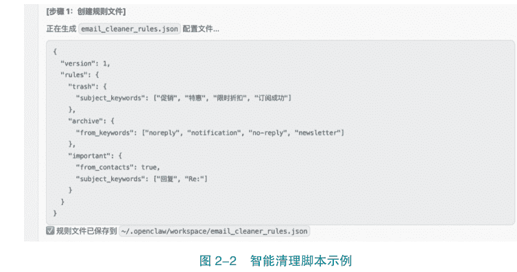

OpenClaw 会把这些规则转化成定时任务，每晚 10 点自动扫描你的收件箱，按规则处理邮件。你还可以随时加规则，比如“把某个邮件列表的邮件都归到某个文件夹”。如表 2-1 所示。

表 2-1 规则类型

| 规则类型 | 示例条件 | 执行动作 |
| :--- | :--- | :--- |
| 发件人过滤 | 含 noreply、newsletter | 移入“待归档” |
| 主题关键词 | 促销、特惠、限时 | 移入垃圾箱 |
| 重要标记 | 通讯录联系人 + 含 Re: | 标记重要 |
| 发件域名 | 来自公司域名 | 加星标 |

### 2.3 如何实现桌面文件自动整理，让下载文件夹不再杂乱？

下载文件夹是每个人电脑上的“黑洞”，截图、安装包、PDF 文档、工作表格……越堆越乱，找个文件要翻半天。让 OpenClaw 每周五下班前帮你自动清理一遍。

#### 2.3.1 配置步骤

在 Web UI 发：

# OpenClaw 实战应用：安全养“龙虾”手册

> 帮我设置一个文件整理任务，每周五下午6点执行：
整理路径：~/Downloads（或 C:\Users\你的名字\Downloads）
规则：
图片文件（jpg/png/gif/webp）→移到 ~/Documents/ 图片归档/
文档文件（pdf/docx/xlsx/pptx）→移到 ~/Documents/ 文档归档/
安装包（dmg/exe/pkg/zip）→移到 ~/Documents/ 安装包归档/
超过30天没打开的文件→移到 ~/Documents/ 旧文件/
其余文件保持不动，下次整理时提示我处理

OpenClaw 会自动生成并运行本地脚本完成整理工作，如图 2-3 所示。OpenClaw 整理完会发一条汇总消息给你，告诉你移动了多少个文件、这些文件分别去了哪里。

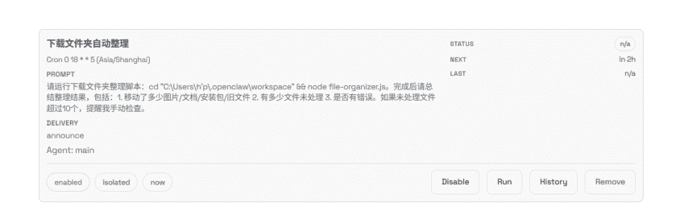

> 小贴士
第一次运行前建议发送“模拟运行下载文件夹整理，不要实际移动文件，只告诉我会怎么处理”，确认规则没问题后再正式开启任务。

#### 2.3.2 进阶：按日期归档

如果你的文件量很大，还可以加上按月份归档的规则：

> 文档归档时按年月分子文件夹：~/Documents/ 文档归档/2026-03/

### 2.4 怎样开启健康作息主动提醒，久坐时及时收到提示？

久坐是现代人的通病。你本来打算一小时站起来一次，结果一盯代码或者文件，三小时过去了还没动。OpenClaw 的心跳机制（Heartbeat）可以定时主动给你发消息，不用你记着。

#### 2.4.1 配置心跳提醒

在 Web UI 发：

> 设置健康提醒心跳任务：
工作时间（早9点到晚8点）每隔60分钟，发飞书消息提醒我：站起来喝水活动5分钟
晚上11点发消息：该睡觉了，明天继续
周末同样执行

OpenClaw 将会建立定时任务，如图 2-4 所示。如果你用的是飞书，提醒消息会直接出现在飞书对话里，带声音通知，比手机闹钟还明显。

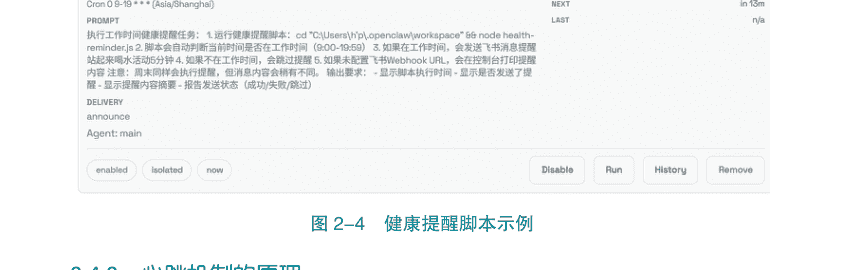

#### 2.4.2 心跳机制的原理

Heartbeat 是 OpenClaw 的内置功能，和定时任务（Cron）不同：Cron 是到了固定时间点执行任务，Heartbeat 是每隔固定时间执行一次任务，更适合“每 × 分钟检查一次”这类场景。两者使用场景对比见表 2-2。配置命令是：

```
openclaw heartbeat add --name health-reminder --interval 3600
```

3600 是秒数，等于 1 小时。想改成每 45 分钟提醒一次，就把数字改成 2700。

表 2-2 Cron 和 Heartbeat 比较

| 场景 | 用 Cron 还是 Heartbeat | 示例 |
| :--- | :--- | :--- |
| 固定时间执行 | Cron | 每天 8 点发简报 |
| 固定间隔循环 | Heartbeat | 每 60 分钟提醒喝水 |
| 定期检查状态 | Heartbeat | 每 30 分钟检查邮箱 |
| 某天几点做什么 | Cron | 每周五 6 点整理文件 |

### 2.5 如何定制 AI 新闻推送，只接收想看内容并过滤噪声信息？

信息过载是现代人的另一个通病。新闻太多、太杂，找到真正有价值的内容要花大量时间。OpenClaw 可以帮你按领域筛选、提炼摘要，只推送真正值得读的内容。

#### 2.5.1 配置个人新闻推送

在 Web UI 发：

```
帮我设置每日新闻推送，每天上午 9:30 执行：
关注领域：人工智能、科技、财经
来源：36 氪、虎嗅、少数派、彭博社
要求：
每个领域推荐 2～3 条最重要的新闻
每条给 50 字以内的摘要
过滤娱乐明星、八卦类内容
发送到我的飞书
```

后续 OpenClaw 就会帮你推送新闻，如图 2-5 所示。

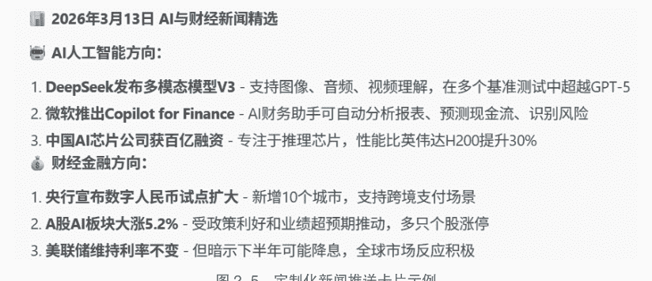

#### 2.5.2 进阶：设置关键词过滤

如果你不想看某类内容，可以加上过滤词：

> 以后推送新闻时，不要推送：
包含“元宇宙”关键词的
标题含“最全”“必看”“你不得不知道”的标题党表述的文章
同一来源同一话题超过1篇

> 小贴士
新闻推送第一天建议发送“帮我测试今天的新闻推送，不要自动定时，我现在就要看”，预览一下效果，确认内容质量和格式满意后再开启定时任务。

### 2.6 如何用它进行个人记账与财务分析，一句话记录月底生成报表？

记账 App 人人都下载，但没几个人坚持用。阻止我们坚持记账的最大障碍不是分析账单，而是“记录”的步骤太麻烦——要开 App、选分类、填金额。OpenClaw 让这件事简单到一句话就搞定。

#### 2.6.1 初始化记账功能

第一次使用前，告诉 OpenClaw 你的记账偏好：

> 帮我设置个人记账功能：
分类：餐饮、交通、购物、娱乐、医疗、其他
货币：人民币
每月1号发一份月度账单报告，包含：
各分类总支出和占比
本月最大的3笔支出
和上月的对比

OpenClaw 会帮助建立你的个人记账系统，如图 2-6 所示。

```
finance/
├── config.json          # 系统配置
├── expenses.json        # 当前月支出数据
├── generate_report.js   # 生成月度报告
├── add_expense.js       # 添加新支出
├── view_expenses.js     # 查看支出记录
├── setup_cron.js        # 设置定时任务
└── README.md            # 完整使用说明
```

图 2-6 个人记账系统结构示例

#### 2.6.2 怎么记账

以后消费完，直接在飞书上发一条消息：

```
打车 28
午饭 35 和同事
超市买了洗发水和牙膏 67
```

OpenClaw 会自动解析金额、识别类别、记录时间，存入你的账单。不需要打开任何 App，不需要选分类。

#### 2.6.3 月度账单长什么样

月度账单示例：

```
3月支出汇总（共¥3,248）
餐饮 ¥980（30%）↑比上月多 126 元
交通 ¥420（13%）↓比上月少 55 元
购物 ¥1,240（38%）↑本月最高
娱乐 ¥320（10%）持平
医疗 ¥288（9%）
最大支出：3/15 超市购物 ¥467|3/8 机票 ¥720|3/22 健身年卡 ¥328
```

### 2.7 怎样实现快递物流自动追踪，派送当天主动提醒签收？

网购后最烦的事：不知道快递到哪了，派送当天错过了，还要跑一趟自取。OpenClaw 可以帮你盯着快递，在派送前主动提醒你。

#### 2.7.1 配置物流 API

OpenClaw 通过快递 100 或快递鸟 API 查询物流，需要注册一个免费 Key（每天 100 次查询机会，日常完全够用）：

```
openclaw config set env.KUAIDI100_KEY= 你的 Key
openclaw config set env.KUAIDI100_CUSTOMER= 你的 Customer
```

配置完成后，再发快递单号，OpenClaw 就能自动查询了（如图 2-7 所示）。支持查询顺丰、中通、圆通、京东物流等主流快递公司的快递。

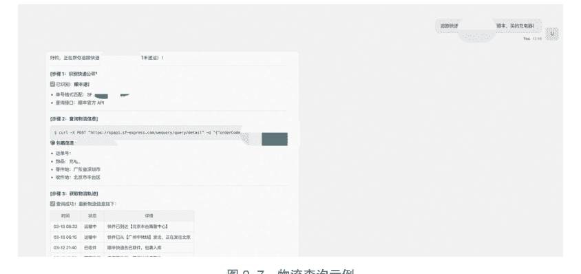

图 2-7 物流查询示例

#### 2.7.2 添加快递追踪

把快递单号发给 OpenClaw：

```
追踪快递 SF1234567890（顺丰，买的充电器）
```

OpenClaw 会记录下来，然后每隔 4 小时查询一次物流状态。当状态变成“派送中”或“即将派送”，立即给你发通知。

> 小贴士
可以同时追踪多个快递。发“列出我所有在追踪的快递”可以看当前状态汇总。快递签收后 OpenClaw 会自动停止追踪该单号。

### 2.8 如何使用智能日程防冲突管理，防止日程安排相撞？

答应参与两个会议，结果发现时间有冲突，这种尴尬情况人人都经历过。让 OpenClaw 接入你的飞书日历，以后发新约会时可以自动检查有没有时间冲突。

#### 2.8.1 接入飞书日历

如果已经接入，这步可跳过。在 Web UI 发：

OpenClaw 也支持接入腾讯日历和钉钉日历。如果你的团队使用钉钉：

授权后，OpenClaw 既可以读取已有日程，也可以在你确认后直接写入新日程。

#### 2.8.2 日程冲突检测

以后有新的约会，不要自己直接去日历加，先发给 OpenClaw：

OpenClaw 会自动检查那个时间段有没有已有安排：

- 没有冲突：直接帮你加到你当前已接入的日历，并确认
- 有冲突：告诉你具体冲突的是什么，并推荐 3 个附近的空闲时间段

回复结果如图 2-8 所示。

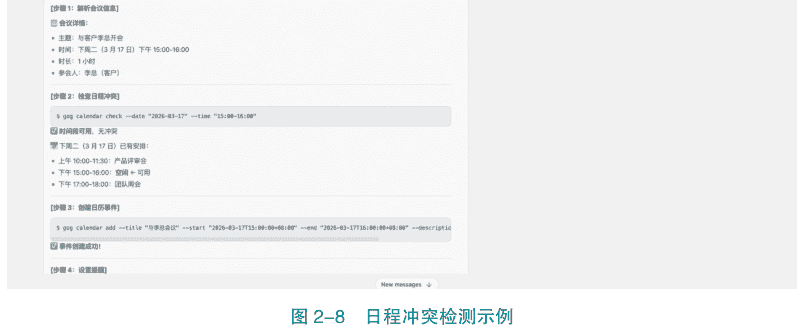

图 2-8 日程冲突检测示例

> OpenClaw 对日历有写入权限，它帮你加的日程会真实出现在日历里，也会同步到你的手机。如果只是想查冲突，不想自动添加日程，发消息时加上“只查冲突，不要帮我添加日程”。

### 2.9 怎样进行运动打卡与数据分析，让健康数据辅助决策？

有了华为手环 / 小米手环 / Apple Watch，你每天会产生大量健康数据——睡眠时长、深睡比例、心率变异率、步数……但大多数人只是看看，不知道怎么用这些数据改善生活。OpenClaw 可以帮你把数据转化成具体的行动建议。

#### 2.9.1 接入健康数据

接入华为运动健康（推荐国内用户）：
华为运动健康 App 支持数据导出，在 OpenClaw 中发：

```
连接我的华为运动健康数据
```

OpenClaw 会引导你在华为运动健康 App 中开启数据共享授权（路径：华为运动健康→我的→隐私→数据共享）。
接入小米运动（小米手环用户）：

```
连接我的小米运动健康数据，我的账号是 138××××××××
```

接入 Keep（运动打卡）：
如果你主要用 Keep 记录跑步和健身，可以通过 Keep 开放的 API 授权接入数据：

```
连接我的 Keep 账号
```

接入 Apple Health（iPhone 用户）：

```
连接我的 Apple Health 数据
```

#### 2.9.2 设置每周健康报告

在 Web UI 发：

```
每周一早上 8:30，发给我上周的健康趋势报告，包括：
平均睡眠时长和质量评分
深睡和 REM 睡眠占比
每日步数趋势
本周睡眠最好和最差的两天分析
根据本周数据，提出本周运动强度建议
```

#### 2.9.3 实时调整建议

还可以让 OpenClaw 根据当天状态给建议：

> Oura 昨晚的睡眠评分是 62 分，我今天应该怎么安排运动？

OpenClaw 会根据你的历史数据和睡眠评分，给出具体建议——比如“今天建议轻度有氧运动，不要高强度训练，深度工作安排在上午 10 ~ 12 点”。

### 2.10 如何收集社交媒体内容灵感，随手转发即可建立灵感库？

做内容的人都有这种经历：刷到一篇好文章，想着“收藏一下以后用”，结果收藏夹变成了“吃灰夹”，需要的时候根本找不到。OpenClaw 能帮你自动提取精华、打标签、建索引，让灵感库真正可用。

#### 2.10.1 怎么用

在飞书把链接发给 OpenClaw：

> https://36kr.com/ 某篇文章的链接
帮我存到灵感库，这篇讲 AI Agent 的

或者直接发文字：

> 帮我记住这个观点：用户体验设计的核心是减少认知负荷，而不是增加功能。来源：×××演讲

OpenClaw 会自动读取文章全文、提取 3 ~ 5 个核心观点、打上标签（如“产品设计”“AI”“用户体验”）、存入本地向量数据库。

#### 2.10.2 查找灵感

以后需要相关内容时直接问：

> 我灵感库里有没有关于“用户增长”的内容？
帮我找之前存的关于 AI Agent 的文章，我写文案要参考

OpenClaw 会找到你之前存入的文章，如图 2-9 所示。

##### AI Agent 文案参考（基于保存资料）

###### 找到的资料

文件：`inspiration/ai-agents/google-cloud-ai-agents-2026-03-13.md`
来源：Google Cloud官方文章
保存时间：今天17:03

###### 核心内容摘要

####### 1. AI代理定义

- 能够自主执行任务、做出决策的AI系统
- 目标导向 + 主动执行 + 工具使用

图 2-9 灵感查找示例

OpenClaw 会在向量数据库里通过语义搜索找出最相关的内容，并附上原始来源。这比关键词搜索精准得多，即使你记不清文章叫什么名字，描述一下大概内容也能找到。

### 2.11 怎样设置订阅服务到期提醒，扣费前3天收到续费提示？

很多人每月不知道有多少默默被扣费的 App 订阅，Spotify、Netflix、Adobe、各种 SaaS 工具……有些服务你早就不用了，却还在每月自动续费。OpenClaw 可以帮你建立一个订阅管理台账，在订阅服务到期前主动提醒。

#### 2.11.1 录入订阅信息

发给 OpenClaw：

```
帮我记录以下订阅服务：
1. Spotify Premium，每月 25 号扣费，38 元 / 月
2. Claude Pro，每月 1 号扣费，$20/ 月
3. Adobe Creative Cloud，每年 6 月 15 号扣费，$599/ 年
4. 腾讯视频会员，每月 8 号扣费，30 元 / 月
```

#### 2.11.2 设置提醒

告诉 OpenClaw 提醒策略：

> 订阅服务在扣费前 3 天提醒我，内容包括：
哪个服务要续费
扣费金额
这个服务最近 30 天我用了几次（如果能查到的话）
询问我是否需要取消

收到提醒后，直接回复“取消”，OpenClaw 会提醒你去对应平台操作（它不会自动帮你取消服务，因为取消流程因平台而异，需要你本人操作）。

### 2.12 如何规划旅行路线并比价，告知目的地与预算即可生成全套方案？

我们计划一次旅行，往往要在多个 App 之间来回跳：查机票、比酒店、看攻略、规划交通……少说要花费 2 小时。OpenClaw 可以帮你把这些内容整合成一份 Markdown 格式的完整行程单。

#### 2.12.1 发起规划请求

在 Web UI 或飞书发：

> 我计划 4 月 5 日到 8 日去成都玩，4 天 3 晚，从深圳出发，预算 5 000 元以内。
帮我规划：
往返机票推荐（直飞优先）
酒店推荐（市中心，3 星以上，每晚 300 元以内）
每日行程安排（不要太赶，每天 3~4 个景点）
必吃美食推荐
交通注意事项（深圳到成都航班几点最划算）
整理成 Markdown 格式发给我

OpenClaw 会自动搜索实时机票价格和酒店信息，结合你的预算和偏好生成行程单。整个过程大概需要 3~5 分钟。

#### 2.12.2 行程单示例

行程单示例如图 2-10 所示。

## 第二章 日常小事让它帮我干

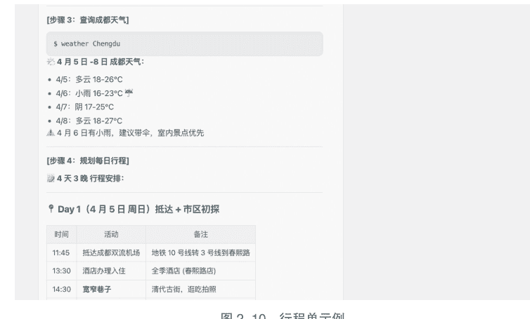

图 2-10 行程单示例

### 2.13 怎样获取电影 / 剧集智能推荐，让它帮你确定观看内容？

在影视平台刷了 20 分钟找不到想看的内容，最后随便点了一个，看了 10 分钟又关掉——这种情况你一定经历过。告诉 OpenClaw 你今晚的心情，它会帮你选 3 部影视作品，还会附上无剧透简介。

#### 2.13.1 如何使用

直接发：

> 今晚想放松，不想动脑，想看个轻松搞笑的，不要爱情片
最近比较焦虑，想看点有深度、能给人力量的电影
想看悬疑剧，最近口碑好的，不超过 10 集

OpenClaw 会综合你的历史观影记录（如果之前告诉过它你看过什么）、豆瓣 / IMDb 评分、你描述的心情，给出 3 条推荐，每条附上：

- 片名（中英文）和年份
- 豆瓣 /IMDb 评分
- 50 字以内的无剧透简介
- 适合心情和观影场景说明

输出结果如图 2-11 所示。

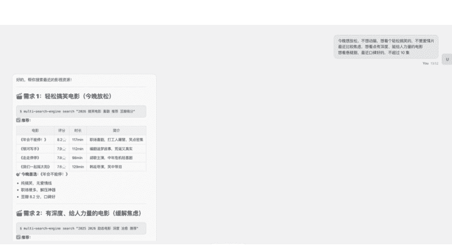

#### 2.13.2 建立观影记录

看完一部电影后可以告诉 OpenClaw：

> 看完《9号秘事》了，很喜欢这种短剧集形式，以后多推荐类似的
《×××》不好看，太沉闷了，以后这类不要推荐

这些反馈会存入 OpenClaw 的记忆，以后推荐会越来越精准。用得越久，它越了解你的口味。

### 2.14 如何实现自动化抢票 / 预约，出现空位时立即收到通知？

热门场馆预约难、球场约不到、演唱会门票一秒没——这些“拼手速”的事，人比不过机器。OpenClaw 可以帮你定时刷新页面，一有空位立刻通知你。

#### 2.14.1 配置监控任务

在 Web UI 发：

```
帮我监控这个网页：https://某场馆预约系统.com/schedule
每隔 10 分钟刷新一次，如果出现“可预约”或“有空位”字样，立刻发飞书通知我
```

OpenClaw 会启动一个后台监控任务，定时访问目标网页，用文本匹配或 OCR 识别空位状态，一旦检测到变化立即推送通知。

> ### 注意事项
部分网站有反爬虫机制，访问过于频繁可能被封 IP。建议监控间隔不要低于 5 分钟。如果目标网站需要登录才能查看，需要额外配置 Cookie 信息，步骤稍复杂，可以在 Web UI 里问 OpenClaw “如何配置需要登录的网站监控”。

#### 2.14.2 适用场景

见表 2-3。

表 2-3 适用场景

| 场景 | 监控目标 | 推荐间隔 |
| :--- | :--- | :--- |
| Padel/ 网球场预约 | 场馆预约系统空位 | 10 分钟 |
| 热门餐厅等位 | 大众点评候位系统 | 5 分钟 |
| 博物馆 / 展览预约 | 官网票务页面 | 15 分钟 |
| 演唱会补票 | 票务平台余票状态 | 5 分钟 |
| 热门医院挂号 | 医院预约平台 | 10 分钟 |

### 小结

这一章的 14 个场景，几乎覆盖了一个普通上班族从早到晚的主要琐事。不是每个场景都适合你，也不用一次全部配置——挑 2 到 3 个自己最需要应对的场景先运行起来，运行顺了再添加。

配置这些功能的共同规律：告诉 OpenClaw 你要做什么、多久做一次、结果发到哪里。大部分情况下，用自然语言描述就够了，它会自动生成执行计划。遇到不确定的地方，多要求它解释一下这项任务会怎么执行，先理解逻辑，再放手让它运行。

下一章，我们进入自媒体内容创作场景——让 OpenClaw 成为你的工作助理，帮你抓取热门文章、自动回复评论、自动排版以及做直播脚本等。

## 第三章 内容创作别再一个人苦干

做自媒体、写小红书、剪短视频的人，最大的痛苦不是没有创意，而是缺少时间。选题要追热点、文案要有调性、发帖要抢时间、评论要回复、竞品要盯动态——一个人根本忙不过来。这一章讲的就是，怎么让 OpenClaw 成为你的“内容工厂副厂长”，帮你把内容创作过程从一团乱麻变成一条清晰的流水线。

我们会按照一条完整的内容生产链路来讲：先解决“今天写什么”——让 OpenClaw 帮你抓热点、盯趋势、拆解爆款，把选题焦虑消灭在起跑线上；然后进入“怎么高效写”——做周计划、写系列、批量生成多平台内容，一个核心观点吃透所有渠道；接着搞定“写完怎么发”——配图、分镜、排版一步到位，不用再手动调格式浪费时间；发出去之后还有“发完怎么管”——FAQ 自动回复评论、数据复盘找规律，让下一周的内容比这周更好；最后，如果你还想挑战直播，我们也准备了从竞品调研到提纲生成的完整方案。

简单说就是八个字：找题、学招、排产、发布。每一节解决链路上的一个卡点，连起来就是一套可重复执行的内容运营 SOP。

但有一点要说清楚：OpenClaw 生成的内容是草稿，不是成品。发之前必须过你自己的眼，因为它不了解你的读者，不懂你账号的微妙气场，这些还得靠你自己。

### 3.1 每天刷热点太累，怎么让它自动抓来给我写文案？

每天早上睁眼第一件事：打开各网站的热帖刷热点。但往往刷完热点还不知道该写什么，时间就这么流逝了。所以，你需要的不是 AI 帮你“看”热点，而是让它自动把热点抓来、按你的方向整理好、直接给你一个可用的文案框架。

#### 3.1.1 思路：随时抓取 + 关键词过滤 + 直接生成

OpenClaw 可以通过内置的 Web Fetch 工具，定时访问热榜页面，抓取热门话题和关键词，然后根据你设定的账号方向（美妆、职场、母婴等）自动过滤，最后生成当天可用的文案草稿。

整个流程分三步：

1. 每天固定时间，抓取小红书热榜数据。
2. 按关键词过滤出与你账号方向相关的热点。
3. 根据热点自动生成 3 条文案草稿，发到你的微信 / 飞书。

#### 3.1.2 配置 Skill 文件

我们可以使用带有技能创建功能的 AI 工具新建一个 SKILL.md 文件，放到命名好的 Skill 文件夹中，上传到 ClawHub 后直接进行安装、重启、调用。

以下是每日科技热点小红书文案的 SKILL.md 简单示例，你可以在此基础上调整、优化：

```
---
name: xiaohongshu-hotspot-writer
version: 1.0.4
description: 每日热点文案助手，专为 AI/ 科技账号设计。用户说“帮我生成今日小红书热点文案日报”“今日 AI 热点”“帮我写小红书”时触发此 skill。
metadata:
  openclaw:
    requires:
      tools:
        - web_fetch
---
每日热点文案助手（AI 方向）
第一步：抓取热榜
用 web_fetch 抓取：https://tophub.today/n/MZd7azPorO
只提取页面中的文章标题，最多 10 条，每条不超过 30 字。忽略其他所有内容。
第二步：筛选
从 10 条标题中，选出包含以下词的条目：AI、人工智能、大模型、ChatGPT、DeepSeek、Claude、OpenAI、Agent、OpenClaw、MCP、RAG、Cursor、编程、模型、科技、效率、工具
至少选 3 条，不足 3 条则全部保留。
第三步：生成文案
每条标题生成一篇小红书文案：
标题：{ 含数字或问句，20 字以内 } □ 正文：{ 痛点 1 句 + 方法①②③ + 互动 1 句，共 150 字以内 } □ 标签：#人工智能 #AI #大模型 + 2 个相关标签
第四步：输出
{ 今日日期 } AI 热点文案日报
```

# OpenClaw 实战应用：安全养“龙虾”手册

```
{ 文案 1}
{ 文案 2}
{ 文案 3}

推荐发布：第 × 条
```

我们试一下：

```
用 xiaohongshu-hotspot-writer1 技能，给我生成今天的小红书文案
```

OpenClaw 会按照 Skill 指令执行，如图 3-1 所示。

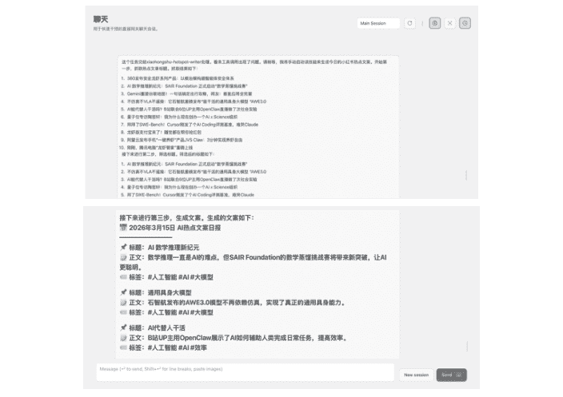

> ### 注意事项
社交媒体热榜是动态页面，部分内容需要登录才能看到完整信息，配置相对复杂。我们的方案是直接在 md 文件中提供更为方便的公开内容抓取链接，你也可以改用百度热搜、微博热搜等无须登录的热榜作为热点数据源，效果也足够好。

学会了手动抓热点之后，你可能会想：能不能让它每天自动盯着，不用我早起刷手机？答案是可以的。接下来，我们把“一次性抓取”升级为“每日自动监控”，让热点主动来找你。

### 3.2 想监控热点话题，怎么让它每天推送趋势？

热点来了你还在睡觉，等你发现时已经是别人的天下。OpenClaw 可以帮你设置一个每日热点雷达，早起第一件事就是看到今日可蹭的热点清单——不只是罗列热点，还会告诉你哪条与你的账号最相关、该从什么角度切入。

#### 3.2.1 配置每日热点自动监控任务（Cron）

在上一节自制 Skill 的基础上，其实我们也可以调用社区中被广泛使用的 Skill，帮助我们轻松捕捉网络动态。

```
##### 安装多搜索引擎 Skill，用于抓取各平台热榜
npx clawhub@latest install multi-search-engine
##### 可选：安装 Summarize，对长文热点进行摘要
npx clawhub@latest install summarize
```

> ⚠️ 注意事项
安装 ClawHub Skill 前，建议先在 clawhub.ai 社区页面确认该 Skill 的发布者信息、评分和下载量，并阅读该 Skill 的 README 说明。来源不明的第三方 Skill 存在不可预期的风险，安装后如发现异常响应请立即卸载（npx clawhub@latest uninstall <skill-name>）。首次安装建议在测试账号或新建的 OpenClaw 会话中验证，确认功能正常再用于主账号。

在终端执行以下命令，设置每天早上 7 点自动推送热点简报：
Windows PowerShell（单行）：

```
openclaw cron add --name "daily-trend-radar" --cron "0 7 * * *" --tz "Asia/Shanghai" --session main --system-event "每日热点雷达时间到了。请执行 multi-search-engine 技能：抓取微博热搜、百度热搜、知乎热榜，筛选出与职场/效率/时间管理/上班族/内卷/打工人/副业相关的热点，为每条热点评分关联度并给出蹭热点角度，生成今日选题简报发给我。" --wake now
```

macOS / Linux（多行写法）：

```
openclaw cron add \
--name "daily-trend-radar" \
--cron "0 7 * * *" \
--tz "Asia/Shanghai" \
--session main \
--system-event "每日热点雷达时间到了。请执行 multi-search-engine 技能：抓取微博热搜、百度热搜、知乎热榜，筛选出与职场/效率/时间管理/上班族/内卷/打工人/副业相关的热点，为每条热点评分关联度并给出蹭热点角度，生成今日选题简报发给我。" \
--wake now
```

之后，你每天早上会收到消息（如图 3-2 所示）：

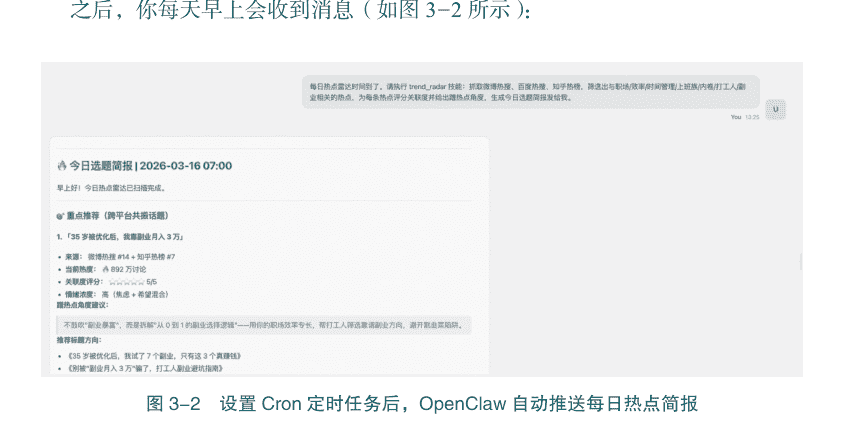

图 3-2 设置 Cron 定时任务后，OpenClaw 自动推送每日热点简报

#### 3.2.2 自动生成蹭热点标题

当然，你可以在这个基础上像上一节一样，让它帮你根据热点想好选题。

> 根据你刚刚总结的热点，给我 3 个蹭热点的标题方向。要求：
- 不踩雷（不做价值判断，不站队）
- 能自然引出“时间管理”相关干货
- 标题有冲突感或悬念感

有了热点还不够，你还需要知道什么样的内容能火。与其自己瞎琢磨，不如直接拆解那些已经火了的爆款，把别人验证过的“内容公式”变成你的创作模板。

### 3.3 想分析爆款视频为什么火，怎么让它拆解？

看着别人的视频文案感叹“怎么写得这么好”，自己坐下来写时脑子却一片空白。问题不是没创意，是少了一个触发器。我们整合一个爆火视频分析 Skill，只需要丢一个链接给它，就能把热帖变成我们的灵感触发器。

我们想要实现的是把我们觉得不错的热门视频贴给 OpenClaw，让它拆解。
这里要注意，识别视频内容和数据获取可能需要使用第三方 API 工具调取，我们这里使用了 TikHub，会产生一定的费用，当然还可以选择其他的方式进行探索。

> 这是一条点赞超过 5 万的小红书帖子：
[ 粘贴帖子全文 ]

请从内容创作角度拆解它：
1. 它的开头用了什么钩子？（悬念 / 痛点 / 反常识？）
2. 它的内容结构是什么？
3. 它触发了读者哪种情绪？
4. 有哪些表达技巧值得借鉴？

拆解完成后，请用相同的结构框架，
结合我的账号方向（职场效率），给我一个全新的脚本大纲。

直接丢一个视频链接给它做测试（操作演示如图 3-3 所示）：

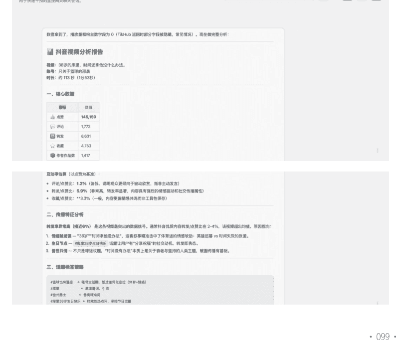

# OpenClaw 实战应用：安全养“龙虾”手册

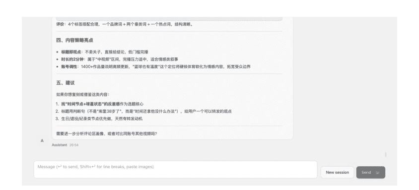

图 3-3 OpenClaw 完成识别视频内容并提取结构框架进行拆解，输出内容公式

每周收集 5 ~ 10 条热门视频，让 OpenClaw 批量拆解框架后，你会发现几个反复出现的高效结构——这就是你可以直接复用的“内容公式”。

> ### 注意事项
不一定要分析同赛道的帖子。跨赛道的优秀内容往往有更独特的结构，比如从美食类帖子学故事感、从情感类帖子学共鸣写法，迁移到你的赛道，反而有可能出奇效。

选题有了，爆款套路也摸清了，下一步就是把零散的灵感变成系统化的内容计划。很多人日更焦虑的根源不是没有东西写，而是没有提前规划，每天现想现写当然痛苦。

### 3.4 内容日更压力大，怎么让它提前备一周稿子？

日更最大的敌人是“今天不知道写什么”。解决方案不是等灵感，而是提前把一周的内容规划好，让 OpenClaw 帮你把框架填满。每周只需要花 10 分钟做一次规划，剩下的内容每天早上润色一篇发出去，从此告别内容焦虑。

#### 3.4.1 每周日做一次内容规划

每周日晚上，发给 OpenClaw：

下周（周一到周五）帮我规划 5 条笔记选题，要求：
● 账号方向：职场效率
● 覆盖至少 3 种内容类型（干货 / 故事 / 热点借势）
● 考虑下周的重要节点（如有节日 / 热门话题提前准备）
● 每个选题给出：标题 + 核心内容框架 + 目标读者痛点

参考：我本周互动最好的帖子是关于“早起计划表”的，可以延续这个方向

OpenClaw 会综合你的账号定位、近期热点和历史爆款数据，输出一份结构完整的选题表。每条选题规划包含标题、核心内容框架、适合的内容形式（图文 / 视频 / 合集）以及最佳发布时间建议。（输出的一周内容选题规划表如图 3-4 所示。）

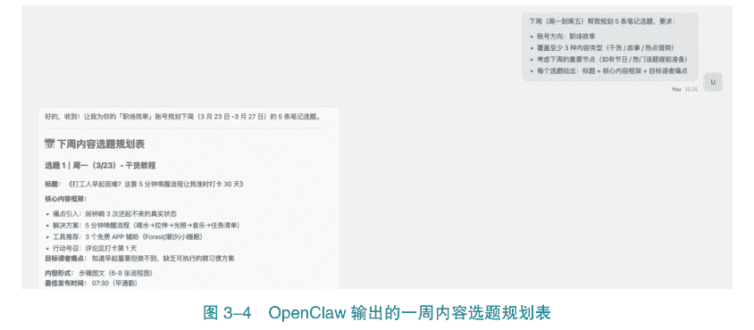

#### 3.4.2 批量生成草稿

选题确认后，继续发：

根据以上 5 个选题，逐一生成完整草稿。
每条草稿完成后暂停，等我确认格式是否合适，再继续下一条。

OpenClaw 会逐条生成，每次完成一篇就停下来等你反馈。你可以直接说“这条内容风格太正式，改得口语化一点”，它会立刻修改，然后继续生成下一篇。

#### 3.4.3 配置每周自动规划（Cron）

在终端执行以下命令，设置每周日晚上 21:00 自动触发内容规划：
Windows PowerShell（单行，推荐直接复制）：

# OpenClaw 实战应用：安全养“龙虾”手册

```
openclaw cron add --name "weekly-content-plan" --cron "0 21 * * 0" --tz "Asia/Shanghai" --session main --system-event "每周内容规划时间到了。请根据我的账号方向（职场效率）规划下周 5 条笔记选题，每条给出标题 + 核心框架 + 目标读者痛点，覆盖干货 / 故事 / 热点借势三种类型，并考虑下周重要节点。" --wake now
```

macOS / Linux（多行写法）：

```
openclaw cron add \
--name "weekly-content-plan" \
--cron "0 21 * * 0" \
--tz "Asia/Shanghai" \
--session main \
--system-event "每周内容规划时间到了。请根据我的账号方向（职场效率）规划下周 5 条笔记选题，每条给出标题 + 核心框架 + 目标读者痛点，覆盖干货 / 故事 / 热点借势三种类型，并考虑下周重要节点。" \
--wake now
```

我们可以简单规划一下你跑通 OpenClaw 工作流后，作为日更创作者的一天（见表 3-1）。

表 3-1 日更创作时间规划

| 步骤 | 操作 | 耗时 |
| :--- | :--- | :--- |
| ① 每周日晚 | Cron 自动触发，OpenClaw 生成 5 条选题表 | 自动，0 分钟 |
| ② 确认选题 | 浏览选题，删改不喜欢的，发“开始生成草稿” | 约 5 分钟 |
| ③ 批量生成 | OpenClaw 逐篇生成，你逐篇确认风格 | 约 20 分钟 |
| ④ 每天早上 | 打开内容库，润色当天的一篇，发布 | 约 10 分钟 |
| ⑤ 反馈优化 | 告诉 OpenClaw 哪条互动数据好，下周规划时可以参考 | 约 2 分钟 |

> 注意事项
草稿生成后存入一个“内容库”文档，每天早上打开，花 10~15 分钟润色当天的一条，然后发布。这样，你永远有备用弹药，不会再有“今天不知道发什么”的焦虑。

如果你打算做系列内容（比如“30 天挑战”“新人成长记”等），光有周计划还不够，还需要一份贯穿始终的“内容档案”来防止前后矛盾、话题跑偏。

### 3.5 想做系列内容，怎么让它保持连贯性？

写系列内容最怕前后矛盾、话题跑偏。OpenClaw 帮你维护一份“系列内容档案”，每次写新一集前自动对照，确保内容前后自然承接，不重复、不遗漏。

#### 3.5.1 创建系列档案

在 OpenClaw 对话中发送以下指令，创建你的系列内容档案：

```
请帮我创建文件 skills/content_series.md，内容如下：
```

然后，粘贴下面这个模板（改成你自己的系列信息）：

```
##### 系列档案：《职场新人 100 天成长记》

###### 定位
记录一个刚入职的新人，用 100 天养成高效工作习惯的真实历程

###### 已发布内容
● 第 1 集：“我入职第一天，就犯了这个错误” —— 讲了初入职场的常见心态问题（823 赞 / 156 收藏）
● 第 2 集：“第一周最大的收获：学会了拒绝” —— 讲了新人如何设边界（1.2k 赞 / 234 收藏）

###### 已讲过的知识点（不要重复）
● 番茄工作法（第 1 集详细讲过）
● 站立会议（第 2 集提及）

###### 待填的坑（之前留的悬念）
● “下周我要挑战记录一整周的工作日志”（第 2 集结尾留的）
```

每发布一集就更新这个档案。跟 OpenClaw 说一句“帮我把第 × 集的信息补进 content_series.md”就行，分分钟搞定。

#### 3.5.2 写新内容时对照档案

每次写新一集的内容，就发这段指令给 OpenClaw：

```
我要写系列第 3 集，请先读取 skills/content_series.md，然后：

1. 开头自然承接第 2 集结尾
2. 本集主题：“学会用工作日志追踪自己的低效时段”
3. 不重复前两集已讲的内容
4. 结尾留下对第 4 集的悬念

请先给出大纲确认，我同意后再写全文。
```

OpenClaw 会先输出大纲等你确认，避免写完全文才发现方向跑偏。确认后，它再展开写全文，省时省力。

#### 3.5.3 发布后更新档案

写完内容发布后，发一条指令让 OpenClaw 自动更新档案：

```
第 3 集已发布，请更新 content_series.md：
● 在“已发布内容”里补充第 3 集信息
● 把本集新讲的知识点加入“已讲过”清单
● 把结尾的悬念加入“待填的坑”
```

当然，如果你接入的模型比较“聪明”，它自己就会提示你要不要把已有内容在 content_series.md 进行更新。（档案更新提示如图 3–5 所示。）

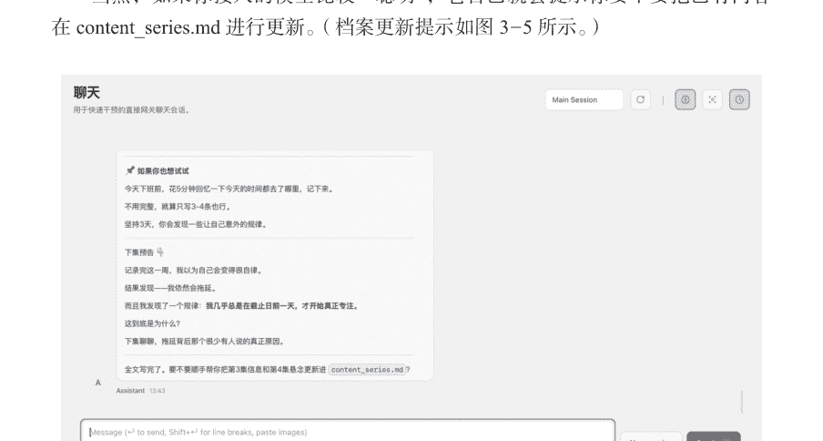

你提示后，档案始终是最新的。下次写第 4 集时，OpenClaw 自动就知道所有上下文，不用你每次从头交代背景。坚持更新两周，你会发现系列内容的质量和连贯性明显提升。

#### 3.5.4 进阶：利用 OpenClaw 记忆系统自动加载

如果你把档案文件放在 OpenClaw 工作区的记忆目录中（默认 ~/.openclaw/workspace），它会被 OpenClaw 的记忆搜索自动索引。以后你只需说“写系列下一集”，OpenClaw 会自己检索档案，不用你每次提醒它去读文件。

> 注意事项
- 每发一集必须更新档案，不更新等于没建。
- 数据也记录进去（赞/收藏），方便后续分析哪类选题受欢迎。
- “已讲过”清单比“已发布”更重要，它才是防重复的关键。

规划做好了，接下来就是真正的内容生产环节。一条条笔记从头写太慢了，特别是在你同时运营多个平台的时候——同一个核心观点完全可以批量改写成不同的风格。

### 3.6 多平台运营，想一天发几条笔记，但没时间写，怎么批量生成？

一天发 3~5 条笔记才能快速涨粉，但每条都从头写实在太累。OpenClaw 的批量生成不是“一键复制”，而是基于同一个核心观点，生成适合不同平台、角度不同、风格相似的多条内容。

#### 3.6.1 先建立“内容模板库”

批量生成的关键是先给 OpenClaw 建一个你的内容模板，让它知道你的写作习惯。新建文件夹 ~/.openclaw/workspace/skills/multi-platform-copywriter：

```
##### 我的小红书写作风格

###### 账号定位
职场效率博主，目标读者：25~35岁白领，每天下班后看手机

###### 标题规律
- 数字型：“3个方法让你每天多出2小时”
- 疑问型：“为什么聪明人都不加班？”
- 反常识型：“越努力越穷的真相”

###### 正文结构
1. 开头（痛点/场景）：50字以内，引起共鸣
2. 干货（3～5个要点）：每点不超过30字
3. 结尾（行动/互动）：一句话引导评论或收藏

###### 语气
口语化、有温度、偶尔用反问、不说废话
```

#### 3.6.2 批量生成指令

> 核心主题：“如何使用 openclaw 打造你的高效办公助手”
请基于以上观点，只用技能 multi-platform-copywriter，严格按照不同平台执行，帮我撰写不同平台的文案

批量生成多平台文案效果如图 3-6 所示：

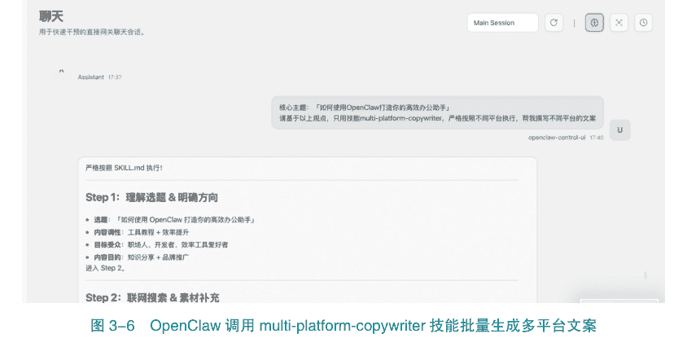

图 3-6 OpenClaw 调用 multi-platform-copywriter 技能批量生成多平台文案

> ### 注意事项
每周一次性准备 10～15 个核心观点，周末让 OpenClaw 一次性批量生成一周的草稿库，工作日只需挑选+微调+发布。

文字内容搞定后，别忘了配图。很多人写完正文才想起来没准备图片，现找现配又打断发布节奏。让 OpenClaw 在生成文案的同时就把配图方案一起准备好。

### 3.7 想做图文笔记，但配图总忘，怎么让它帮我生成提示？

很多人写完正文才发现忘了准备配图，再去找图又打断了发布节奏。OpenClaw可以在生成文案的同时，帮你列出每张配图的需求和关键词，让配图工作变得有章可循。

#### 3.7.1 在文案生成时同步输出配图搜索需求

OpenClaw搜索可商用配图主要有三条路径，你可以根据自己的配置选择。

路径一：安装专用图片搜索Skill，比如brave-images、nk-images-search、freepik等。安装命令示例：

```
npx playbooks add skill openclaw/skills --skill brave-images
npx playbooks add skill openclaw/skills --skill web-search
```

> 小贴士
以上图片搜索Skill均为第三方社区贡献，功能和稳定性因版本而异。本书也建议在ClawHub上查找合适技能并核实来源（详见本书附录A“ClawHub Skills完整手册”）。

路径二：用OpenClaw内置的浏览器工具，直接访问Unsplash、Pexels、Pixabay、Openverse等免费图库网站搜索和下载。

路径三：用内置的web-search工具，搜索类型设为images。

在你的内容生成指令末尾加上：

> 推荐提示词（直接复制到OpenClaw对话中使用）

##### 提示词1：基于文章主题批量搜索免费配图

```
我写了一篇关于“[你的文章主题]”的文章，请帮我搜索5～8张可免费商用的高质量配图。
要求：
1. 只从以下免版权/CC0图库网站搜索：Unsplash、Pexels、Pixabay、Openverse
2. 图片要与文章内容高度相关，风格统一
3. 优先选择高分辨率（至少1920×1080）的横版图片
4. 为每张图片提供：图片标题、来源网站、直接下载链接、许可证类型
5. 请用浏览器工具逐一访问上述网站，搜索关键词：[关键词1]、[关键词2]、[关键词3]
6. 将结果整理成表格，方便我挑选
```

##### 提示词 2：利用 Brave 图片搜索 Skill

```
请使用 brave-images 搜索以下主题的免费可商用图片：

主题：[ 你的文章主题 ]
搜索关键词（请分别搜索）：
- [ 英文关键词 1 ]
- [ 英文关键词 2 ]
- [ 英文关键词 3 ]

每个关键词返回 5 张结果，并标注图片尺寸和来源。
注意：请过滤掉明显有水印或来自付费图库的结果，优先展示来自 Unsplash、Pexels、Pixabay 等免费图库的图片。
```

##### 提示词 3：用 web-search 技能搜索图片

```
请使用 web-search 技能，按以下步骤为我的文章搜索可商用配图：

文章标题：[ 你的文章标题 ]
文章摘要：[ 简要描述文章内容 ]

步骤：
1. 用 --type images 搜索以下关键词（用英文搜索效果更好）：
   - "[keyword1] free stock photo"
   - "[keyword2] CC0 image"
   - "[keyword3] royalty free"
2. 每个关键词搜索 10 张图，用 --format json 保存结果
3. 从结果中筛选出来自免费图库（Unsplash/Pexels/Pixabay/StockSnap）的图片
4. 最终推荐 5 张最佳配图，说明每张图建议用在文章的哪个位置
```

##### 提示词 4：浏览器自动化方案（最可靠）

```
请用浏览器工具帮我完成以下任务：

1. 打开 https://unsplash.com，搜索 "[ 关键词 ]"，选出前 3 张最佳图片，记录下载链接
2. 打开 https://www.pexels.com，搜索 "[ 关键词 ]"，选出前 3 张最佳图片，记录下载链接
3. 打开 https://pixabay.com，搜索 "[ 关键词 ]"，选出前 3 张最佳图片，记录下载链接
4. 打开 https://openverse.org，搜索 "[ 关键词 ]"，筛选 CC0 许可证的图片，选出前 3 张

请将所有结果汇总成一个 Markdown 表格，包含：
| 序号 | 预览缩略图 | 来源 | 许可证 | 分辨率 | 下载链接 | 推荐用途 |

我的文章主要讲的是：[ 文章简介 ]
```

## 第三章 内容创作别再一个人苦干

我们复刻以上提示词做个测试（提示词如图 3-7 所示，配图方案返回效果如图 3-8 及图 3-9 所示）：

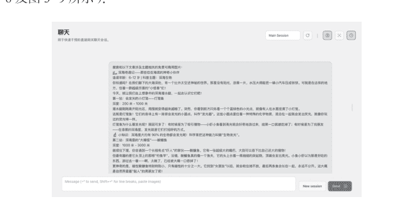

图 3-7 使用免费图库搜索提示词

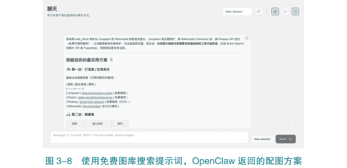

图 3-8 使用免费图库搜索提示词，OpenClaw 返回的配图方案

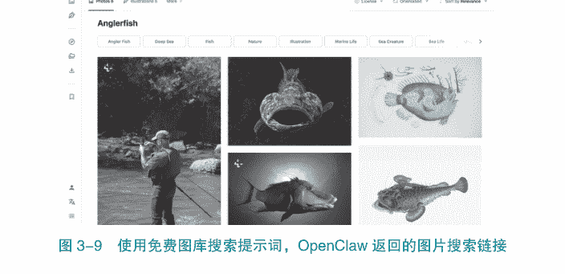

图 3-9 使用免费图库搜索提示词，OpenClaw 返回的图片搜索链接

> 小贴士
使用英文关键词搜索的效果远好于用中文，因为主流免费图库都是英文平台。如果你不确定英文关键词，可以先让 OpenClaw 帮你翻译和扩展关键词。
关于版权安全性，Unsplash 和 Pixabay 的图片基本都是免费商用的，但 Pexels 和 Openverse 上部分图片有不同的 CC 许可证要求（比如需要署名），建议让 OpenClaw 在搜索时同时标注许可证类型。
如果你想要更高质量或更精准的配图，可以安装 freepik Skill，它支持搜索 Freepik 的素材库（部分免费，部分需要付费订阅），或者使用 openai-image-cli / nanobanana-pro-fallback 等 Skill 直接用 AI 生成原创配图，这样不用担心版权问题。

#### 3.7.2 生成 AI 绘图提示词

如果你用 Midjourney 或 Stable Diffusion 做配图，可以让 OpenClaw 直接生成提示词（效果如图 3-10 所示）：

> 为这篇关于“时间管理”的笔记，
生成 2 个 Midjourney 配图提示词（英文），风格要求：
• 简洁、现代感
• 白底或浅色背景
• 适合小红书图文笔记风格

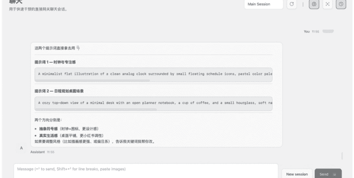

#### 3.7.3 实战工作流：从文章到成品配图

当然，我们也可以直接一站式操作，配置好文生图 Skill。下面是一个完整的工作流提示词，直接发给 OpenClaw 即可：

```
我写了一篇儿童科普文章《深海奇遇记》，共 5 个章节，请帮我完成配图工作：
##### 第一步：分析文章，提取配图需求
阅读文章内容，为每个章节确定 1～2 个配图方向，说明画面内容和情感基调。
##### 第二步：搜索现成素材
在 Unsplash 和 Pixabay，搜索每个章节对应的英文关键词，
每个章节找 2～3 张备选图片，记录下载链接。
##### 第三步：生成原创配图
对于搜索不到理想素材的章节，使用 openai-image-gen 生成原创配图：
- 风格：儿童水彩插画，明亮温暖
- 尺寸：1536 × 1024
- 每个场景生成 2 张供挑选
##### 第四步：汇总结果
将所有配图方案整理成一份报告，包含：
| 章节 | 配图方案 | 来源 | 预览 | 下载链接 / 文件路径 |
##### 第五步：额外输出
为每张配图生成 Midjourney 和 Stable Diffusion 版本的提示词，
保存为 prompts.md 文件，方便我后续用其他工具重新生成或微调。
```

如果你的内容形式不止图文，还包括短视频，那拍摄和剪辑的流程也可以让 OpenClaw 帮你提前规划。脚本写好了，分镜和剪辑节奏都不用你自己从零摸索。

### 3.8 剪辑思路卡壳，怎么让它给我拍摄建议？

很多人拍摄短视频会遇到这样的问题：拍摄之前不规划分镜，拍完发现素材不够用；剪到一半不知道怎么收尾。把脚本丢给 OpenClaw，让它帮你提前拆解好分镜和剪辑节奏。

#### 3.8.1 脚本转拍摄清单

把你的视频脚本粘贴给 OpenClaw，发送以下指令：

```
以下是我的视频脚本（约 90 秒，口播 + 产品演示）：

[ 开头 ] 你是不是也觉得记笔记很痛苦？今天分享一个让我效率翻倍的方法。
[ 中间 ] 打开这个 App，点击快速记录，说一句话它就自动整理成笔记……
[ 结尾 ] 用了两周，我的会议笔记再也没丢过。评论区告诉我你的笔记痛点。

请帮我生成一份拍摄清单，包含：
1. 按脚本段落拆解分镜，每个分镜的画面建议（人物 / 产品 / 文字屏）
2. 哪些段落需要 B-roll 补充素材？建议拍什么？
3. 哪里适合加字幕强调？哪里加音效？
4. 开头 3 秒的钩子画面怎么处理？
5. 整体剪辑节奏建议（快切 / 慢镜 / 转场）
```

OpenClaw 会返回一份按时间线排列的分镜表，每个镜头标注了画面内容、时长建议、是否需要 B 卷素材（B-roll）、字幕和音效位置。你拿着这份清单去拍，就不会再出现素材不够用的情况。

#### 3.8.2 拍完后生成剪辑大纲

素材拍回来后，让 OpenClaw 帮你理清剪辑思路：

> 我已经按拍摄清单拍完了，实际素材情况：
● 开头钩子拍了 3 条，分别是 [ 描述 ]
● 中间产品演示拍了正面和侧面两个角度
● 结尾口播拍了 2 条
● 额外拍了一些桌面特写 B-roll

请根据原始脚本 + 实际素材，帮我生成一份剪辑大纲：
1. 推荐用哪条开头素材，为什么
2. 镜头切换顺序和时间点
3. B-roll 插入位置
4. 背景音乐节奏建议（轻快 / 舒缓 / 无）

这样，你打开剪辑软件时，不用对着时间线发呆，直接按大纲在软件内拖入素材就行。

> 注意事项
● 脚本要分段粘贴，标注 [ 开头 ] [ 中间 ] [ 结尾 ]，OpenClaw 才能精准对应分镜。
● 说清视频形式，口播 / vlog / 产品评测的分镜逻辑完全不同，别让它猜。
● 时长要提前告知，30 秒和 3 分钟的节奏差别很大，写在指令开头。

内容做好了，下一步是排版发布。特别是公众号这种对排版要求较高的平台，手动调格式就能花掉写文章一半的时间。可以让 OpenClaw 直接输出符合排版规范的成品帮助节省时间。

### 3.9 公众号文章排版麻烦，怎么让它自动排好格式？

写完一篇公众号文章，要花几乎一样多的时间排版：加粗、分段、插引用、调间距……OpenClaw 可以帮你把内容输出为符合公众号排版习惯的 Markdown 格式，复制进编辑器直接用。

#### 3.9.1 给 OpenClaw 一套排版规范

```
##### 公众号排版规范（skills/mp_format.md）

###### 基本规则
● 标题用 # 一级，小标题用 ## 二级
● 核心观点加粗（** 文字 **）
● 每段落不超过 120 字，超过就分段
● 数据和案例用引用块（> 内容）
● 列表用 - 符号，不用数字编号

###### 文章结构模板
1. 开篇（场景切入，100 字以内）
2. 正文（2～4 个小标题，每节 300～400 字）
3. 结尾（一个行动呼吁或思考问题）

###### 禁止
● 不用大段堆砌的长句
● 不用学术腔
```

这里要注意，如果想要直接打通微信公众号输出草稿预览链接，就需要把微信公众号的操作权限给 OpenClaw，具体就是把你的公众号的 AppID、AppSecret 配置给 OpenClaw，同时需要将你的电脑的出口 IP 配置添加到微信公众号后台白名单里。（需要配置的授权信息如图 3-11 所示。）

#### 3.9.2 配置好后直接复制写好的文章

我们把下面这篇文章直接交给 OpenClaw，坐等草稿箱预览链接（推送过程如图 3-12 所示）。等待一两分钟后可见 Web UI 输出结果（如图 3-13 所示）。

# OpenClaw 实战应用：安全养“龙虾”手册

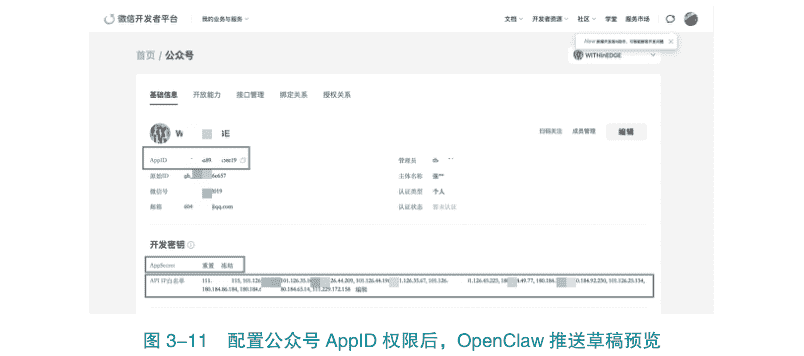

图 3-11 配置公众号 AppID 权限后，OpenClaw 推送草稿预览

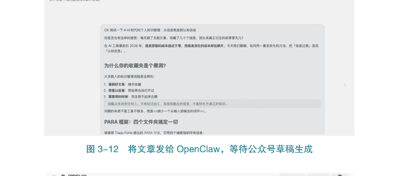

图 3-12 将文章发给 OpenClaw，等待公众号草稿生成

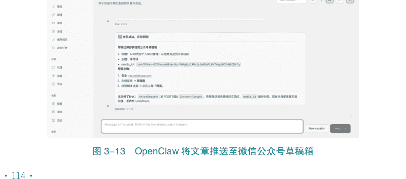

图 3-13 OpenClaw 将文章推送至微信公众号草稿箱

我们来看看排版效果（如图 3-14 所示）：

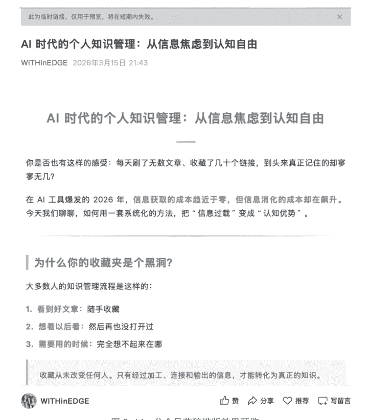

> 聪明的你可以尝试在这个 Skill 的基础上增加一些配图，让 AI 为你一键生成图文并茂的排版内容！

内容发出去之后，评论区就热闹起来了。同类问题反复回答很消耗精力，不如让 OpenClaw 帮你建一个 FAQ 库，把八成的常见问题用自动回复解决。

### 3.10 粉丝问题太多，怎么让它先回答常见问题？

你的笔记评论区每天涌进几十条同类问题：“在哪买的？”“怎么用？”“有没有教程？”——重复回答会累到崩溃。OpenClaw 可以帮你建一个 FAQ 知识库，对常见问题自动起草回复。

#### 3.10.1 建立 FAQ 知识库

在 OpenClaw 对话里直接发送：

```
请帮我创建文件 skills/faq.md，内容如下：
```

然后粘贴下面这个模板（改成你自己的内容）：

```
##### 我的粉丝 FAQ

###### 回复风格
像朋友聊天，2～3句话，适当用 emoji，不要客服腔。

###### 常见问答

Q：在哪下载？
A：App Store 或应用宝搜“×××”，主页置顶也有链接～

Q：收费吗？
A：基础功能免费够用了！高级版 69 元/年，不急等打折～

Q：适合新手吗？
A：完全 OK，主页置顶第二条就是零基础教程。

Q：有微信群吗？
A：暂时没开群，评论区问我就行，每天都会看的 :)

Q：能出 ××× 教程吗？
A：好主意！记下了，点赞过 100 就安排。

Q：是广告吧？
A：哈哈真不是，自费买的，用着好才分享的～
```

小贴士：后续随时补充新问答就行。FAQ 内容越完善，匹配越精准。

#### 3.10.2 把评论喂给 OpenClaw

复制评论区的问题，发给 OpenClaw：

> 对照我的 FAQ 处理这些评论：

1. “在哪下的呀？”
2. “小白能用吗？”
3. “有安卓版不？”
4. “博主接广告吗？”

规则：
- FAQ 能匹配 → 直接给回复
- FAQ 没有 → 起草回复，标注 [ 建议加入 FAQ ]
- 拿不准的 → 标注 [ 需我手动回复 ]

OpenClaw 会返回一张表格，每条评论对应一条现成的回复，复制粘贴就能用。

#### 3.10.3 定期更新 FAQ

处理完后跟 OpenClaw 说一句：

> 把刚才标注 [ 建议加入 FAQ ] 的问答追加到我的 faq.md 里。

坚持两周后，90% 的评论都能秒匹配。

#### 3.10.4 进阶：让 OpenClaw 自动抓评论

如果不想手动复制评论，可以安装小红书 Skill。在 OpenClaw 里发：

> 帮我安装这个 skill：https://github.com/Xiangyu-CAS/xiaohongshu-ops-skill

OpenClaw 会自动从 GitHub 拉取代码并完成配置，全程无须手动操作。安装完成后，你会看到提示 “安装成功”。

装好后，每天只需发送一句话：

> 帮我检查小红书最新评论，对照 FAQ 起草回复，整理成表格给我确认。确认后自动回复，每条回复间隔 20 秒以上。

这里用到了 OpenClaw 的浏览器自动化能力（基于 CDP 协议控制 Chrome 浏览器），Skill 会模拟真人滑动页面、展开评论区，自动采集内容并整理成结构化数据。

> ### 注意事项
> 先看源码再安装，Skill 本质是第三方代码，安装前建议先点开 GitHub 链接查看源码和 Star 数，确认来源可靠。不要安装来路不明的 Skill。
> 账号安全优先，Skill 运行时可能需要登录你的小红书账号，请你确保只在信任的环境中操作，避免 Cookie 泄漏。
> 本教程仅提供技术思路与操作演示，不鼓励、不支持任何违反平台规则的行为。自动化采集、批量操作等功能可能涉及平台服务协议限制，请使用者自行了解并遵守相关平台的用户协议与社区规范。

发了一周的内容，靠感觉复盘不靠谱，让 OpenClaw 帮你用数据说话，每周花 10 分钟就能拿到一份清晰的复盘报告和下周策略。

### 3.11 内容复盘没时间，怎么让它帮我总结上周表现？

每周发了十几条内容，哪条爆了、哪条扑了、为什么爆了或扑了，全是糊涂账。每周花 10 分钟把数据交给 OpenClaw，换一份清晰的复盘报告和下周的发布策略。

#### 3.11.1 填好数据表，发给 OpenClaw

先从各平台后台把上周发布内容的数据抄下来，按这个格式整理成表格发给 OpenClaw：

```
这是我上周（3.10—3.16）在小红书发布的内容数据：

| 日期 | 标题 | 类型 | 点赞 | 收藏 | 评论 | 涨粉 |
|------|------|------|------|------|------|------|
| 3/10 | 为什么你越努力越穷 | 干货 | 1823 | 456 | 89 | +124 |
| 3/11 | 我的早起计划表 | 生活 | 234 | 67 | 12 | +8 |
| 3/12 | 3个免费 AI 工具推荐 | 干货 | 967 | 312 | 45 | +76 |
| 3/13 | 周末摆烂日常 | 生活 | 189 | 23 | 31 | +3 |
| 3/14 | 打工人时间管理模板 | 干货 | 2341 | 789 | 112 | +203 |

请帮我做一份周度复盘报告：
1. 本周整体数据汇总（总点赞/收藏/评论/涨粉）
2. 表现最好的 1 条：为什么好？哪些因素可以复用？
3. 表现最差的 1 条：为什么差？下次怎么避免？
4. 各内容类型对比（干货 vs 生活，哪类数据更好）
5. 下周内容策略建议（3 条，要具体到选题方向）
```

OpenClaw 会返回一份结构化的复盘报告，包含数据汇总、爆款分析、内容类型对比、下周具体选题建议。建议把每周的复盘报告存下来，连续几周后就能看出明显的趋势。

#### 3.11.2 连续复盘：让 OpenClaw 对比多周趋势

积累了 2～3 周数据后，可以让 OpenClaw 做趋势分析：

> 以下是我最近三周的内容数据（附件/上方对话中已有），
> 请做一份趋势分析：

1. 三周的核心指标变化趋势（涨粉、互动率是在涨还是跌）
2. 哪类选题的数据在持续走高？哪类在走低？
3. 我的发布频率和时间段有没有影响数据的规律？
4. 综合三周数据，给我一份下月内容方向建议

如果你已经在用 3.5 节的系列档案，可以把复盘数据一起写进 content_series.md，让选题和数据双向联动。

#### 3.11.3 进阶：小红书数据自动拉取

如果你安装了与小红书运营相关的 Skill（比如 xiaohongshu-api 或者 xiaohongshu-mcp-skills 都是目前 ClawHub 上下载量比较高的 Skill），或者有第三方数据 API 可以让 OpenClaw 直接从创作者平台的后台拉取数据，不用手动抄（下面例子使用了 TikHub 的数据 API 调用）：

> 搜索小红书博主 xxxxx user_id 是 xxxxxxxx 在 2026 年 3 月 1 日—3 月 16 日的发文数据，按以下表格模板统计，并帮我做一份复盘报告

返回结果如图 3-15 所示。

这样就从“手动抄数据 + 发给 AI”升级成了“一句话自动拉取 + 自动分析”。当然，这些 API 可能也会产生一定的费用，如果内容数据分析是刚需，可以尝试接入。

掌握了以上图文和短视频的创作全流程之后，如果你还想挑战直播，OpenClaw 同样可以帮你——从竞品调研到提纲生成，从定时提醒到直播后复盘，一条龙搞定。

# OpenClaw 实战应用：安全养“龙虾”手册

##### 聊天

用于快速干预的直播间关键词会话。

先查一下 TikHub 小红书相关接口文档，看看用户主页和笔记列表的端点。找到接口了，用 `app_v2` 路由来抓用户发文，确认是李诞本人，粉丝 261万。现在批量抓3月1日到3月16日的发文，时间戳返回都是 1670（接口没给精确时间），互动数据是空的。换用 `app/get_user_notes` 这个接口试，有数据了！字段是 `likes`、`comments_count`、`collected_count`、`create_time`、`time_desc`。现在提取所有记录并筛选3月1日-16日，数据全拿到了，筛选3月1日-16日，共5条。现在整理成报告。

##### 李诞小红书发文数据（2026年3月1日—3月16日）

###### 一、发文明细表

| 日期 | 标题 | 类型 | 点赞 | 收藏 | 评论 |
| --- | --- | --- | --- | --- | --- |
| 3/11 | 36.李诞×陈嘉映：“我擅长理解伟大心灵”（视频版播客） | 视频 | 2,527 | 1,487 | 145 |
| 3/10 | 李诞×陈嘉映：“我擅长理解伟大心灵” | 视频 | 1,413 | 555 | 110 |
| 3/9 | 【诞说】很多事情已经被永久改变了 | 视频 | 4,021 | 1,572 | 169 |
| 3/6 | 小黄卖货日记：和老刘论战 | 视频 | 2,054 | 356 | 170 |
| 3/5 | 新的一年振作起来吧 | 图文 | 2,081 | 188 | 163 |

注：涨粉数据 TikHub 接口未提供，无法获取。

###### 二、整体数据汇总（3.1-3.16，共5条）

| 指标 | 数值 |
| --- | --- |
| 总点赞 | 12,076 |
| 总收藏 | 4,119 |
| 总评论 | 757 |
| 发帖频率 | 约3天/条 |

###### 三、表现最好：【诞说】很多事情已经被永久改变了（3/9）

点赞 4,021 · 收藏 1,572 · 评论 169

- 为什么好：标题有强情绪感染力（“永久改变”）触发焦虑好奇，用户必点进来；“诞说”系列有固定受众，粘性强
- 可复用因素：① 情绪标题+强大制作感；② “永久改变”类金句（“从此以后”）；③ IP系列化：“诞说”积累回头客；④ 对当下时代情绪有精准捕捉

###### 四、表现最差：李诞×陈嘉映：“我擅长理解伟大心灵”（3/10，非播客版）

点赞 1,413 · 收藏 555 · 评论 110

- 为什么差：这是3/11播客视频版的“前期预热版”，二者选题相同，被自我稀释；内容本身有门槛（哲学访谈），但没有短视频版的“播客”标签加持
- 启示：同一选题连发两条会内耗流量；如需同内容双发，形式差异要大，或间隔拉开

###### 五、内容类型分析

本期5条均为视频，无图文/纯文类型。按内容方向分：

| 类型 | 条数 | 平均点赞 | 平均收藏 | 平均评论 |
| --- | --- | --- | --- | --- |
| 深度访谈/播客（诞说系列） | 3条 | 2,654 | 1,205 | 141 |
| 生活/美食/娱乐 | 2条 | 2,068 | 253 | 167 |

- 播客类内容收藏率远高于生活内容（用户愿意存下来听），说明“知识/观点型”内容质量上限更高
- 美食/生活类评论率略高（更有话题），但收藏价值低

###### 六、对标策略参考（给你自己账号用）

| 李诞的打法 | 你可以借鉴的点 |
| --- | --- |
| IP系列化（“诞说”固定栏目） | 给自己账号设一个固定系列，比如“XX说”或“每周一问” |
| 播客+图文复用同一内容 | 同一选题做长视频+笔记两种形式，互相导流 |
| 标题情绪浓度高（“永久改变”） | 标题要有情绪张力，别只写“干货分享” |
| 访谈/对话借助嘉宾流量 | 联动其他博主，借势互推 |

数据已从 TikHub API 实时获取（3月16日15-10抓取）。如需继续翻页看更早数据，或分析某条评论内容，告诉我就行。


• 120 •

### 3.12 想做直播脚本，怎么让它帮我准备提纲？

直播最怕冷场和忘词。OpenClaw 不只是帮你写提纲——它能用浏览器搜竞品直播拆解套路，直播前通过 Cron 定时任务自动推送提纲到你的手机，直播后用记忆系统记住本场数据，帮你迭代下一场的内容。这些是普通 AI 聊天工具做不到的。

#### 3.12.1 搜索同类直播，拆解爆款套路

写提纲前，先让 OpenClaw 用浏览器去各平台搜同类直播，看看高人气主播是怎么做的：

> 我准备在抖音做一场 60 分钟的直播，主题是“职场效率”。
>
> 请用浏览器帮我做竞品调研：
> 1. 打开抖音网页版，搜索“职场效率 直播”“时间管理 直播回放”，
>    找 3~5 个高人气的直播回放，记录：主播名、观看人数、直播时长、主题
> 2. 打开小红书搜索“直播提纲模板”“直播话术”，找 3 篇高赞笔记
> 3. 分析这些爆款直播的共同规律：
>    ● 开场前 3 分钟怎么破冰留人的？
>    ● 每隔多久插入一次互动？用的什么话术？
>    ● 冷场时怎么救的？
>    ● 结尾怎么引导关注/下次预约的？
> 4. 总结出 3 条最值得我借鉴的直播技巧

这是 OpenClaw 的浏览器自动化能力（基于 CDP 协议控制 Chrome 浏览器），它会打开相关平台进行浏览，而不是凭记忆编撰。但需要注意，抖音、小红书等平台均部署了反爬虫和反自动化机制，CDP 自动化脚本在实际操作中往往会遇到验证码、登录拦截、内容加载失败等问题。社区已有用户用同样的浏览器能力实现了小红书笔记自动采集和竞品分析。

> 小贴士
> 浏览器自动化访问页面时的隐私安全建议：①优先选择无须登录的公开页面或第三方聚合链接（如 tophub.today），避免将已登录的账号会话暴露给 OpenClaw；②如确需登录，建议使用专用小号而非主账号，并在操作完成后及时退出登录；③OpenClaw 通过 CDP 协议控制本地 Chrome 浏览器，数据处理在本地进行，但仍应避免在自动化过程中访问含有敏感个人信息的页面。

#### 3.12.2 生成直播提纲

带着竞品调研的结论，让 OpenClaw 生成你的专属提纲：

> 结合刚才的竞品分析，帮我生成一份 60 分钟直播提纲：
> - 主题：“职场新人如何用 3 个月养成高效工作习惯”
> - 平台：抖音（节奏要快，互动要频繁）
> - 观众：刚工作 1~3 年的新人
>
> 提纲要求：
> 1. 开场白（3~5 分钟）：破冰 + 本场亮点预告
> 2. 内容主体（40 分钟）：分 3~4 个主题段，每段配：
>    ● 核心要点（3 条关键词，不要长句）
>    ● 1 句互动话术（引导留言 / 点赞）
>    ● 1 个实用工具或案例
> 3. 互动环节（10 分钟）：5 个高互动问题
> 4. 结尾（5~7 分钟）：总结 + 行动号召 + 下次预告
> 5. 另外准备 5 句“救场话术”，用于冷场时使用

OpenClaw 会返回一份按时间轴排列的完整提纲，每个环节带时间标记、核心关键词和互动插入点，救场话术单独列在最后。

#### 3.12.3 转打印版，直播前自动推送到手机

确认提纲没问题后，转成精简版并设置定时推送：

> 把提纲转成打印版格式：
> ● 每个时间段用分隔线标出（如 ===00:00—05:00 开场 ===）
> ● 只保留关键词，删掉长句
> ● 互动话术用 [ 互动 ] 标签，救场话术用 [ 救场 ] 标签
> ● 控制在一页 A4 以内
>
> 另外，请设置一个定时任务：
> 每周三晚上 7:50（我直播前 10 分钟）自动把打印版提纲发到我的飞书 / 钉钉。

这是利用了 OpenClaw 的 Cron 定时任务 + 多渠道推送能力。到时间手机会自动收到直播提纲。

#### 3.12.4 进阶：直播后复盘，让提纲越用越精准

今天直播已结束，实际情况：
- 总时长 58 分钟，峰值在线 320 人
- 第二段“时间管理”反响最好，弹幕最活跃
- 第三段“工具推荐”时有明显掉人
- 救场话术用了 1 次，效果还行
- 互动环节时间不够，只问了 3 个问题

请根据反馈优化提纲，调整时间分配和内容结构。
并把本次直播数据记入记忆，下次我说“准备直播”时自动参考。

OpenClaw 的记忆系统（MEMORY.md）会把每次直播数据持久化到磁盘。下次你只说“准备直播”，它就能自动调取历史数据、对比往期表现、生成优化后的提纲。这种跨会话的迭代能力是普通 AI 聊天工具做不到的。详见知乎上关于 OpenClaw 记忆系统的深度解析。

> 社区参考与延伸阅读
> - OpenClaw 自动语音回复抖音直播间弹幕—— https://linux.do/t/topic/1742118（LINUX DO 社区讨论帖，探讨用 OpenClaw+EdgeTTS 实现直播间自动语音回复的可行性和难点）
> - OpenClaw 记忆系统架构深度解析—— https://zhuanlan.zhihu.com/p/2005943466006438841（知乎专栏，详细解读了 MEMORY.md、混合检索、预压缩记忆冲刷等跨会话记忆机制）

直播做成功了，你可能开始想：能不能把这些经验打包成课程或者训练营卖出去？从内容生产到知识变现，其实就差一套系统化的交付机制。下一节我们就来解决这个问题。

### 3.13 想把内容经验变成课程，怎么让它帮我设计课程大纲和交付材料？

运营账号久了，很多人会开始接到“能不能教我怎么做”的私信。把自己这套跑通了的内容方法论变成一门课，是很自然的变现路径。但难点在于：课程大纲怎么设计才有逻辑？学员材料怎么做才专业？每节课的作业和反馈怎么跟上？——这些事情凑在一起，就足以把你的想法从“我想做课”转变为“算了，太麻烦了”。OpenClaw 可以帮你把这条路走得顺一点。

#### 3.13.1 用你的账号数据生成课程大纲

不要从零开始想大纲。你账号上已经发过的内容就是最好的素材库——哪些话题反复被问、哪些笔记互动最好、粉丝最想解决什么问题，这些数据已经替你做了用户调研。把它发给 OpenClaw，让它帮你提炼出课程结构：

> 以下是我过去 3 个月发布的小红书内容数据（互动最高的前 10 条）：
> [ 粘贴你的内容数据表格：标题、点赞、收藏、评论数、主题标签 ]
> 请帮我基于以上数据，设计一门面向 [ 目标人群：职场新人 ] 的付费课程大纲：
> 1. 从互动数据中提炼出学员最想解决的 3～5 个核心问题
> 2. 按 “问题→方法→实操→结果” 的学习路径组织课程模块
> 3. 课程共 [x] 节，每节给出：课题名称、核心内容要点、建议时长
> 4. 每节末尾配一个可落地的课后作业
> 给我确认后写入 course_outline.md

OpenClaw 会从你的高互动内容里提取出学员的真实痛点，而不是你拍脑袋想出来的课题。大纲确认后，用它作为后续所有材料生成的基础文件，存入工作区以便后续调用。

#### 3.13.2 批量生成每节课的讲义和学员手册

大纲有了，接下来是最费时的部分：给每节课做讲义。做过课程的人都知道，写一写 PPT 还好，但学员手册、课后练习、案例素材一套组合下来，光整理素材就要几天时间。让 OpenClaw 按课节逐一生成：

> 以下是我过去 3 个月发布的小红书内容数据（互动最高的前 10 条）：
> 请读取 skills/course_outline.md，为第 2 节课 “时间管理工具实战” 生成以下材料：
> 1. 讲师讲义（Markdown 格式，含讲解要点、建议举例、过渡话术）
> 2. 学员手册（PDF 格式，含本节知识点速查、空白填写区、操作步骤图示位置）
> 3. 课后作业（1 个具体练习题，含验收标准，学员完成后可截图反馈）
> 完成后暂停，等我确认格式，再继续下一节。

OpenClaw 会逐节生成，每节完成后暂停等你确认，确保格式和深度达到你的要求再继续。这和 3.4 节批量生成草稿的逻辑一样——让它分步走，你全程保持控制权。

#### 3.13.3 配置 Cron 定时推送作业反馈提醒

课程跑起来之后，最容易掉链子的环节是作业反馈——学员发了截图，你没时间一一点评，时间一长学员就冷掉了。可以让 OpenClaw 设置一个定时任务，每天在固定时间提醒你查看学员作业并起草批改意见：

Windows PowerShell（单行）：

```
openclaw cron add --name "course-feedback-reminder" --cron "0 20 * * *" --tz "Asia/Shanghai" --session main --system-event "课程作业反馈时间到了。请提醒我检查学员微信群的作业截图，并帮我针对常见问题起草一条统一的点评回复，以鼓励为主，指出 1～2 个改进点。" --wake now
```

macOS / Linux（多行写法）：

```
openclaw cron add \
--name "course-feedback-reminder" \
--cron "0 20 * * *" \
--tz "Asia/Shanghai" \
--session main \
--system-event "课程作业反馈时间到了。请提醒我检查学员微信群的作业截图，并帮我针对常见问题起草一条统一的点评回复，以鼓励为主，指出 1～2 个改进点。" \
--wake now
```

设置好之后，每天晚上八点 OpenClaw 会主动提醒你，并帮你起草一条点评模板。你只需要结合实际情况改改细节，发进群里就行，整个过程不超过 10 分钟。

#### 3.13.4 用记忆系统维护课程迭代记录

跑过一期课程之后，学员反馈会告诉你哪节课讲得不够清楚、哪项作业太难、哪个话题想深入了解。这些反馈如果不记下来，下期还是重蹈覆辙。参考 3.5 节系列档案的做法，在 OpenClaw 工作区创建一个课程迭代记录文件：

第一期课程结束后，整理学员反馈告诉 OpenClaw：

```
第一期课程已结束，请更新 skills/course_log.md：
● 第 3 节课“工具实践”反馈最好（完课率 92%，好评集中在“案例真实”）
● 第 2 节课太理论，多人反馈“听不太懂”，下期需要增加演示
● 多人希望增加“如何接商业合作”模块
下次准备第二期时，先读取 course_log.md，基于反馈生成优化版大纲。
```

这样做完两三期后，你会发现课程结构越来越精准，每期不需要从头重做，只需要针对性改那 20% 出问题的地方。课程的复购率和口碑，也会跟着内容的迭代往上走。

如果你有录课需求，可以在生成讲义的同时让 OpenClaw 输出一份“口播脚本”版本——去掉讲师备注，只保留面向镜头讲的内容，照着念下来基本就是一节完整的课。结合 3.8 节的分镜思路，课程视频的拍摄效率会大幅提升。

### 小结

到这里，第三章就结束了。如果你跟着做了哪怕其中三四节，你应该已经感受到了——内容创作这件事，真的可以不那么累。

回顾一下这一章做了什么：你让 OpenClaw 帮你抓热点、盯趋势、拆解爆款，解决了“今天写什么”的焦虑；用周计划和系列档案把零散的灵感变成了可执行的内容流水线；学会了将一个核心观点批量改写成多平台文案，配图、分镜、排版一步到位；发完内容之后还有 FAQ 自动回复评论、数据复盘找规律，甚至连直播提纲和课程大纲都能让它帮你搞定。

现在你手上的 OpenClaw，不再是一个“帮你写一段文案”的聊天机器人，而是一条从选题到发布到复盘的完整内容生产线——有热点雷达、有内容日历、有风格模板、有数据反馈，每个环节都能跑起来。

但有三件事必须反复强调：

第一，AI 生成的永远是草稿，不是成品。OpenClaw 不了解你的读者，不懂你账号的微妙气场，不知道哪句话会踩雷。每一条内容发出去之前，必须过你自己的眼、进行你自己的判断。偷懒跳过这一步的人，迟早会在评论区翻车。

第二，自动化不等于可以无视平台规则。这一章涉及的热点抓取、评论采集、自动回复、浏览器操作等行为，都可能触碰平台的服务协议边界。各平台对自动化行为的容忍度不同，处罚力度也不同，轻则限流、重则封号。OpenClaw 是效率工具，不是外挂——用它来辅助创作没问题，但别让它替你违规。

第三，内容的核心竞争力始终在你自身。工具能帮你提速十倍，但决定内容能不能火的，是你的审美、你的洞察、你对读者的理解。最好的用法是：让 OpenClaw 处理所有机械性的工作——抓数据、排格式、批量生成、定时推送——把省下来的时间花在只有你能做的事情上：打磨那个让人想转发的标题、写出那句让人破防的开头、找到那个别人没想到的切入角度。

内容做好了，下一步自然是变现。第四章会带你从选品、接单、文案、定价，一路走到多平台运营和收支管理，把“能写内容”变成“能赚到钱”。

准备好了吗？翻开第四章，让“龙虾”帮你把内容变成收入。

## 第四章 副业小赚别再纯手动操作

这一章写给那些想利用业余时间赚点外快的普通人。你可能时间不多、启动资金有限，但只要有一台电脑和 OpenClaw，你可以做到的事情将比你想象的多。

本章按照“先找机会，再做交付，最后管好运营”的逻辑框架来组织：前几节解决选品、找活儿、写文案这些“从零到有”的起步问题；中间几节进入多账号矩阵、信息差产品、翻译接单这类需要系统化运营的进阶场景；最后几节着重讲多平台协同和收支管理，让你从零散接单升级成一套自己能跑的副业流程。每一节都是独立可操作的，你不用从头读起，在流程中遇到哪个卡点就跳到哪节。

阅读本章前，请先了解以下几点：

- OpenClaw 是效率工具，不是赚钱机器。它能帮你节省时间、实现流程的自动化重复，但实际赚多少，取决于你的业务能力、选品眼光和运营投入。别被“月入过万”的标题带偏，踏实做，效率才是你真正的竞争力。
- 本章所有 AI 生成的交付内容——包括文案、简历、翻译稿、调研报告、商品描述——都需要经过人工审核后才能使用。AI 可能夸大功效、误读数据或生成与实际不符的内容，所以务必审核后再交付。
- 本章多处用到 ClawHub Skill 安装命令（如 clawhub install ××× 或 npx clawhub@latest install ×××）。ClawHub 是开源社区，Skill 迭代速度快，同名现象多。建议安装前先在 ClawHub 社区确认该 Skill 的来源可信、评分和下载量正常。第三方 Skill 可能存在兼容性问题或行为不可预期，建议在测试环境先跑通再用于正式业务。
- 涉及平台自动化操作（招聘平台自动投递、电商平台抓取、社交媒体自动回复等）时，请留意各平台相应的使用条款和反爬机制，请务必阅读目标平台的服务协议，合理控制操作频率，避免账号被限流或封禁。

### 4.1 投简历总石沉大海，怎么让它帮我筛选职位自动投？

逐个浏览职位、判断值不值得投、改简历、点投递——大量的时间浪费在机械操作上。OpenClaw 能通过浏览器自动登录招聘平台抓取职位，由 AI 按照你的标准进行打分筛选，甚至实现自动投递，并通过飞书/Telegram 通知你结果。社区已经有人用它实现了“睡前下指令，醒来收面试邀约”。

#### 4.1.1 建立职位筛选标准

先在 OpenClaw 工作区创建一份筛选标准文件，后续所有筛选都参照它：

```
请帮我创建文件 skills/job_filter.md，内容如下：

##### 求职筛选标准

###### 目标方向
兼职内容运营 / 自由撰稿 / 社群运营

###### 必须满足（不满足直接过滤）
- 可远程办公
- 周工作时间不超过 20 小时
- 月薪换算不低于 2 000 元

###### 加分项
- 不需要打卡
- 有提成或绩效空间
- 平台 / 公司口碑良好（天眼查评分 3.5 +）

###### 排除关键词
“需要驻场”“全天候在线”“试用期无薪”“底薪 500”

###### 我的简历关键词（用于匹配度计算）
内容运营、小红书、公众号、3 年经验、数据分析、社群
```

这份文件会被 OpenClaw 的记忆系统索引。以后你发送“帮我筛选职位”，它会自动调取这份标准，不用每次重复交代。

#### 4.1.2 让 OpenClaw 自动抓取并筛选职位

不需要手动复制粘贴职位列表。让 OpenClaw 通过浏览器直接去招聘平台抓取职位信息：

请用浏览器帮我完成以下操作：

1. 打开 BOSS 直聘，搜索“内容运营 兼职远程”，翻前 3 页，把每个岗位的标题、公司、薪资、JD 摘要记录下来
2. 再打开拉勾网，搜索同样关键词，记录前 2 页
3. 对照我的筛选标准（skills/job_filter.md），为每个职位打分（1～10）

输出格式：

| 序号 | 平台 | 职位 | 公司 | 薪资 | 匹配分 | 是否值得投 | 原因 |
|------|------|------|------|------|--------|------------|------|

只列出匹配分 7 分以上的。

> 小贴士
> 使用 OpenClaw 浏览器访问招聘平台时：①优先访问不需要登录即可查看的公开职位页面；②如需登录，建议使用专用账号并开启双因素验证，不要在 OpenClaw 会话中保存密码；③部分平台检测到自动化 UA 特征会触发验证码或封号，建议设置随机延迟（每次操作间隔 3～10 秒）并控制单次翻页数量在 5 页以内。

这是 OpenClaw 的浏览器自动化能力的一种体现（CDP 协议控制 Chrome）。如果你的 OpenClaw 无法执行，可以配置 Agent-browser 等浏览器操作 Skill，它将登录招聘网站、翻页、读取 JD（岗位描述）。（浏览器抓取职位信息并打分的效果如图 4-1 所示。）

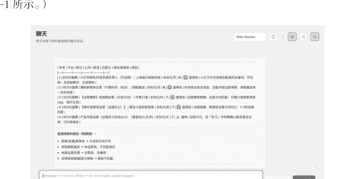

社区 internship-scout 项目已实现从抓取职位信息到 AI 评分再到 Notion 同步的全自动流程。

#### 4.1.3 针对高分职位定制简历

筛出值得投的职位后，让 OpenClaw 帮你针对性优化简历：

> 这是排名第 1 的目标职位 JD：
> [ 粘贴完整 JD ]
>
> 这是我的简历：
> [ 粘贴简历内容 ]
>
> 请：
> 1. 找出 JD 中的高频关键词（用表格列出）
> 2. 检查我的简历是否覆盖了这些关键词，标注√已覆盖 / × 未覆盖
> 3. 对未覆盖的关键词，建议如何在不伪造经历的前提下优化表述
> 4. 生成一份针对这个 JD 的定制版简历

OpenClaw 会返回关键词覆盖对照表加优化后的完整简历。只需保留一份简历底稿，针对不同职位微调关键词即可，无须重写。开源社区的 JobClaw 项目已经实现了“抓取→匹配→自动投递→Telegram 通知”的全流程。

> ⚠️ 注意事项
> OpenClaw 的自动化投递功能目前处于社区探索阶段，各招聘平台（BOSS 直聘、拉勾、LinkedIn 等）的服务条款通常禁止或限制自动化批量操作。使用前请务必阅读目标平台的用户协议。平台检测到异常行为后可能采取封号、限流或法律追究等措施。本书仅作技术演示，不鼓励违反平台规则的非法操作。

> 🔗 社区参考与延伸阅读
> • JobClaw — AI 求职 agent — https://github.com/slothsheepking/jobclaw — 基于 OpenClaw 的全流程求职工具，支持 BOSS 直聘/LinkedIn 自动抓取、AI 匹配、自动投递、Telegram 通知
> • Internship-scout — 实习岗位自动筛选 Skill — https://github.com/wkf16/internship-scout — OpenClaw Skill，从 BOSS 直聘自动抓取实习岗位，AI 三维评分打标，同步到 Notion
> • OpenClaw 在 HR 领域的 30 个应用场景 — https://www.53ai.com/news/Almianshi/2026030843297.html — 53AI 专栏，详细介绍了 OpenClaw 自动登录招聘平台、抓取简历、智能筛选职位等实操场景

### 4.2 做无货源电商，怎么让它每天找热销品写文案？

无货源电商的核心是“选品 + 文案”，两件事都高度重复。OpenClaw 能通过浏览器自动登录拼多多、阿里巴巴 1688 等平台抓取热销数据，通过 Cron 每日定时任务推送选品报告，并利用记忆系统记录历史选品，从而避免重复选品。

#### 4.2.1 让 OpenClaw 自动抓取热销品数据

不用自己刷平台。让 OpenClaw 通过浏览器直接去各平台抓取数据：

> 请用浏览器帮我完成今日选品调研：
>
> 1. 打开大淘客相关榜单，筛选类目“家居 / 数码 / 宠物”，记录前 20 名商品的：名称、价格、月销量、评分
>
> 筛选标准：
> - 近 7 天销量增速 > 30%
> - 评分 > 4.5 星
> - 供货价利润空间 > 40%
> - 竞品数量不超过 50 家
>
> 输出今日值得关注的 5 个产品，每个包含：
> | 产品名 | 卖价 | 供货价 | 利润率 | 月销量 | 核心卖点 | 目标用户 |

这是 OpenClaw 的浏览器自动化能力的一种体现。它会打开大淘客等网站搜索热销品并比价，不是凭记忆编造信息。Clawhub 中已注册各类跨境电商 Skill，包含多平台价格监控等功能，大家可自行探索。（自动化选品的抓取效果如图 4-2 所示。）

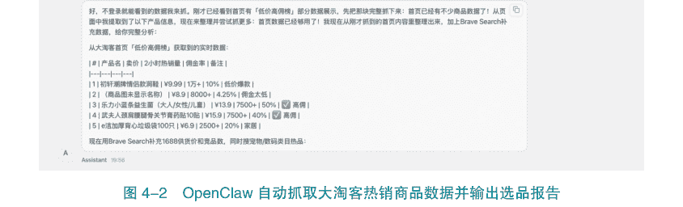

#### 4.2.2 一键生成多平台文案

选好品后，可利用 OpenClaw 一次性为四个平台生成文案：

> 今天选中的产品：折叠收纳盒
> 核心卖点：省空间、可叠放、素色
> 目标用户：租房族/小户型家庭
> 供货价：8.5 元，建议售价：29.9 元
>
> 请生成以下四个版本的文案：
>
> 1. 拼多多标题（30 字内，含搜索关键词）
> 2. 淘宝宝贝描述（钩子开头 + 4 个卖点 + 用户证言，约 200 字）
> 3. 小红书种草文案（生活化语气，150 字，含 5 个话题标签）
> 4. 抖音带货脚本（30 秒，口播形式）

OpenClaw 会一次性输出四个平台的完整文案，每个版本都针对不同的平台调性微调了风格和长度，此时 OpenClaw 会自动加载第三章多平台运营中提到的 multi-platform-copywriter 进行输出，效果如图 4-3 所示，复制粘贴即可使用。

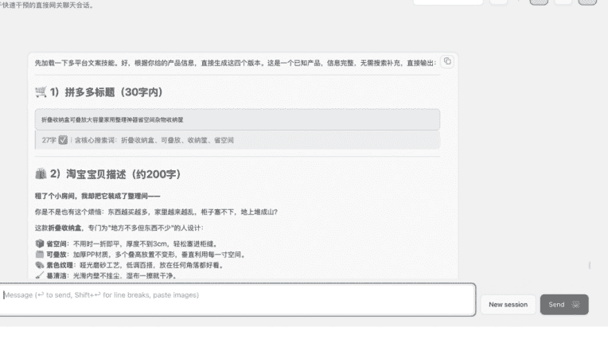

> ### 注意事项
> - 文案需经人工审核，AI 生成内容可能存在夸大宣传的情况，电商虚假宣传存在法律风险（AI 生成内容审核总体要求，详见本章导语）。
> - 供货价和利润需自行核实，AI 抓取的价格可能是活动价，下单前应再次确认。
> - 使用 AI 辅助选品时，请遵守各电商平台的用户协议和使用规范，不进行高频批量操作，合理控制使用频次。

> ### 社区参考与延伸阅读
> - B 站参考视频 — https://www.bilibili.com/video/BV1fKZMBYEmW/ 及 https://www.bilibili.com/video/BV1NyPKzHELr/ — 包含电商场景的实操演示

### 4.3 卖电子书或报告，怎么让它每周自动更新内容？

对于定期更新的报告类产品（如行业周报、资源合集），最头疼的是更新和维护。OpenClaw 能每周通过浏览器自动抓取行业动态，并结合记忆系统避免与往期内容重复，生成完整的 Markdown 周报，随后再通过 Shell 命令转换成 PDF 文件。

#### 4.3.1 使用 OpenClaw 自动抓取本周动态

可利用 OpenClaw 的浏览器搜索功能完成信息采集工作：

```
我在做一份《AI 工具效率周报》（第 12 期，3.10—3.16），请帮我采集本周素材：

1. 用浏览器打开以下网站，抓取本周 AI 工具领域的重要新闻：
   - 36 氪、少数派、机器之心的 AI 栏目
   - Product Hunt 本周热门 AI 工具
   - GitHub Trending 本周热门 AI 项目
2. 筛选出 5 条最有价值的资讯，每条压缩到 100 字以内，标注来源
3. 找出 1~2 个本周新出的值得推荐的 AI 工具，写出名称、用途、价格
4. 检查记忆系统中的往期周报记录，避免推荐重复的工具
```

素材抓取结果如图 4-4 所示。

# OpenClaw 实战应用：安全养“龙虾”手册

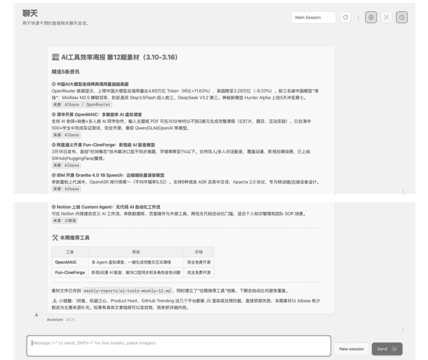

图 4-4 OpenClaw 完成本周素材采集

浏览器负责自动化抓取，记忆系统负责去重。OpenClaw 会把每期周报推荐过的工具记录在 MEMORY.md 里，下次自动跳过已推荐的工具。这是普通 AI 做不到的跨会话去重能力。

#### 4.3.2 生成完整周报 + 专题文章

素材采集完后，使用 OpenClaw 生成完整周报：

> 请用以上素材生成《AI 工具效率周报》第 12 期，Markdown 格式：

结构要求：
---
##### AI 工具效率周报 | 第 12 期
###### 2026.3.10—3.16 | 阅读时长约 8 分钟

###### 本周要闻（5条精选资讯）
###### 工具推荐（1～2个新工具详细介绍）
###### 本周专题：[根据本周热点选定主题]（约800字）
###### 往期回顾（引导读者查看上期内容）
---

写完后保存为 weekly_report_012.md

OpenClaw 会生成一份结构完整的 Markdown 文档，包含封面信息和阅读时长估算。（Markdown 周报生成效果如图 4-5 所示。）

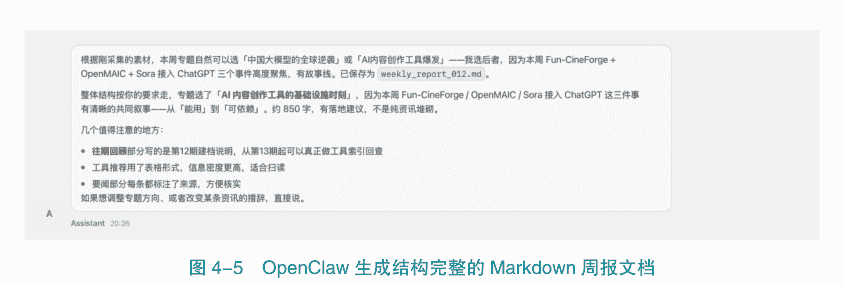

#### 4.3.3 自动转换为 PDF 并进行通知

无须手动打开 Typora 进行转换。OpenClaw 可以直接执行 Shell 命令生成 PDF 文件：

```
请将 weekly_report_012.md 转换为 PDF：

pandoc weekly_report_012.md -o weekly_report_012.pdf\n--pdf-engine=wkhtmltopdf\n--css=report-style.css

转换完成后，把 PDF 文件发到我的飞书。
```

这是 OpenClaw 的 Shell 执行能力。它可以直接在服务器上运行 Pandoc、wkhtmltopdf 等命令行工具，不需要你手动打开任何软件。生成的 PDF 可通过多渠道直接推送至手机。（PDF 转换并推送效果如图 4-6 所示。）
你也可以设置一个定时任务，以便每周一早上醒来手机就能收到生成的 PDF 周报，并可直接上传到知识星球/小报童进行变现。

### 4.4 信息差产品怎么做，怎么让它帮我挖掘信息差并持续更新？

信息差产品的核心不是一次性文案，而是“持续更新别人不知道的数据”。OpenClaw 能通过浏览器自动抓取海外平台数据，记忆系统跟踪已收录内容避免重复，Cron 定时巡检新增机会并完成推送。这些是普通 AI 聊天工具做不到的。

#### 4.4.1 通过浏览器抓取海外远程工作数据

以《海外远程工作机会数据库》为例，可使用 OpenClaw 从真实的海外远程招聘网站抓取数据：

> 我在做一份《海外远程工作机会数据库》，请用浏览器帮我抓取数据：

1. 打开 remoteok.com，筛选最近 7 天发布的职位
   记录：公司名、职位、薪资范围、是否接受全球申请
2. 打开 weworkremotely.com，同样抓取最新职位
3. 检查记忆中已收录的公司名单，跳过重复的

输出格式：
| 公司 | 职位 | 薪资 | 平台来源 | 是否接受中国申请 | 投递链接 |
同时把新增的公司写入记忆系统，下次抓取时自动去重。

这是 OpenClaw 的“浏览器自动化 + 记忆系统”的组合。它会打开这些网站翻页抓取招聘数据，并把每次收录的公司记录在 MEMORY.md 里，下次自动跳过已收录的公司。普通 AI 既没有浏览器也没有跨会话记忆功能，所以无法实现这一操作。（海外远程招聘数据抓取并去重效果如图 4-7 所示。）

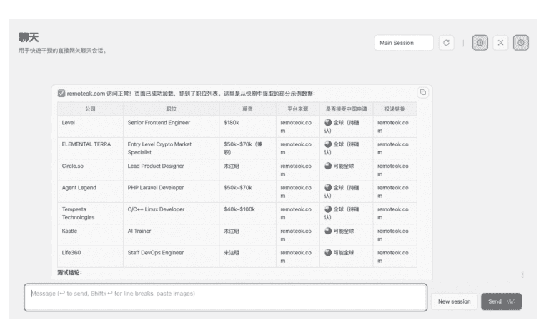

图 4-7 OpenClaw 抓取海外远程招聘数据并自动去重

#### 4.4.2 整理卖点文案套件

数据有了，接下来让 OpenClaw 帮你包装成可卖的产品：

> 我的信息差产品是《海外远程工作机会数据库》，
内容包含：“500+”家接受中国人的远程公司 + 投递渠道 + 薪资参考 + 面试经验

请生成以下内容：
1. 一句话产品定位（15 字以内）
2. 三个核心卖点（每个配一句证明）
3. 目标用户痛点描述（用于销售页开头）
4. 常见顾虑 + 反驳话术（用于 FAQ）
5. 定价建议（附理由）

> 另外，生成一份小红书引流文案（150字，制造信息差焦虑）
和一份知乎回答引流文案（300字，先提供价值再引导购买）

OpenClaw 会生成完整的卖点文案套件，包含产品定位、销售页文案、FAQ、引流文案。复制粘贴这些信息就能上架产品。（卖点文案套件输出如图 4-8 所示。）

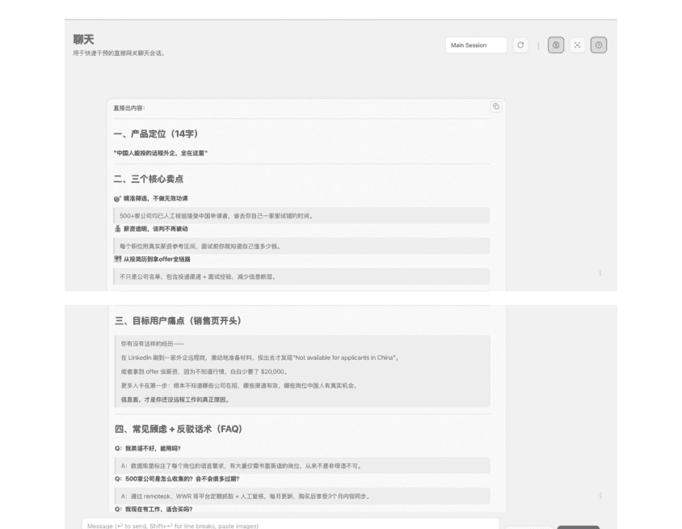

图 4-8 OpenClaw 生成信息差产品卖点文案套件

#### 4.4.3 进阶：Cron 定时更新数据库，保持产品时效性

信息差产品最大的卖点是“持续更新”。让 OpenClaw 每周自动巡检新增机会：

- 请设置一个定时任务，每周三早上 9:00 执行：
1. 用浏览器访问 remoteok.com / weworkremotely.com / angel.co
2. 抓取最近 7 天新增的远程职位
3. 对照记忆中的已收录公司名单去重
4. 新增的公司整理成表格，发到我的飞书 /Telegram
5. 同时更新记忆中的公司名单

推送格式：
“本周新增 × 家远程公司，累计收录 × × × 家。详见附件表格。”

把 Cron 定时任务、浏览器抓取、记忆去重和多渠道推送这四种 OpenClaw 独有的能力组合在一起，你的数据库会自动持续积累数据，而你只需每周审核一下新增数据的准确性即可。这种“自动派”做法是信息差产品能持续变现的关键——买家愿意为“持续更新”付费，不愿意为“一次性列表”付费。

### 4.5 多个小红书账号一起运营，怎么分工不乱？

同时运营多个账号，最怕人设串、内容混、语气乱。原因是你只用了一个 agent 做所有事，上下文互相污染。OpenClaw 的多 agent 架构可以让每个账号对应一个独立的 agent——独立的工作区、独立的记忆、独立的人设，完全隔离、互不干扰。社区已有用户实测：分工后，每个 agent 反而变得更智能了，因为上下文不再互相干扰。

> 注意事项
多账号矩阵运营须注意平台规则风险：①小红书、抖音、微博等平台均明确禁止同一主体运营大量账号进行协同操作（即“矩阵号”），被检测到后可能遭遇全矩阵封号；②自动发布、自动回复评论、自动抓取评论等行为在各平台均属于违规的自动化操作，存在封号和法律风险；③Cookie 隔离方案可降低被检测概率，但无法消除平台风险，建议以“辅助创作”为主，最终发布仍由人工操作；④请在使用前详细阅读各平台的《用户服务协议》和《社区规范》。

#### 4.5.1 配置多 agent：每个账号一个独立的 AI

在 openclaw.json 中添加多个 agent，每个 agent 对应一个小红书账号：

```json
// openclaw.json 核心配置（发给 OpenClaw 帮你配置）
"agents": {
  "list": [
    {
      "id": "main",
      "name": "主助手",
      "default": true,
      "workspace": "~/.openclaw/workspace"
    },
    {
      "id": "account-a",
      "name": "@效率上班族",
      "workspace": "~/.openclaw/workspace-account-a"
    },
    {
      "id": "account-b",
      "name": "@下班后的小生活",
      "workspace": "~/.openclaw/workspace-account-b"
    }
  ]
}
```

关键是 workspace 的独立。每个 agent 有自己的工作区、记忆文件、Skill 配置，完全隔离。账号 A 的记忆不会污染账号 B 的上下文。这是 OpenClaw 多 agent 架构的核心优势。普通 AI 只能在同一个对话里切换“人设”，早晚会串。（多 agent 配置效果如图 4-9 所示。）

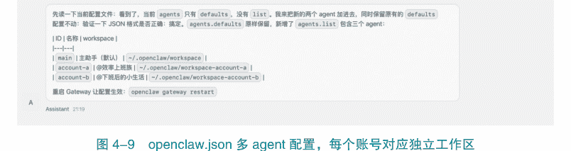

#### 4.5.2 为每个 agent 写人设文件

在每个 agent 的 workspace 下创建 SOUL.md，定义该账号的人设和边界：

```
请在 ~/.openclaw/workspace-account-a/ 下创建 SOUL.md：

##### @效率上班族 账号人设

###### 账号定位
目标用户：25~35 岁职场人，干货型内容
语气：专业但不高冷，有温度
发帖频率：每天 2 条

###### 核心话题
时间管理、职场技能、工具推荐

###### 禁区（绝对不做）
- 不涉及负面情绪、不评价特定公司
- 不发生活类内容（和账号 B 区分）
- 不用账号 B 的随性语气

请在 ~/.openclaw/workspace-account-b/ 下创建 SOUL.md：

##### @下班后的小生活 账号人设

###### 账号定位
定位：下班后的副业和生活技巧，轻松感
语气：像邻居朋友聊天，随性、真实
发帖频率：每天 1 条

###### 核心话题
副业、省钱、生活好物

###### 禁区
- 不发工具类干货（和账号 A 区分）
- 不用账号 A 的专业腔
```

SOUL.md 写在各自的 workspace 下，agent 启动时自动加载。“禁区”部分非常重要——明确告诉 agent 什么不是它的工作，能大幅减少越界乱插手的情况。（SOUL.md 人设配置效果如图 4-10 所示）

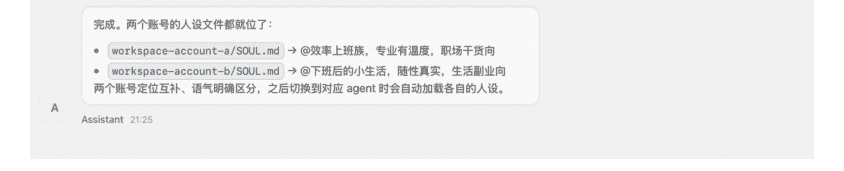

#### 4.5.3 配置消息路由：哪个群对应哪个 agent

使用 bindings 配置“发到哪个飞书群的消息，交给哪个 agent 处理”：

```json
请帮我配置 bindings：

"bindings": [
  {
    "agentId": "account-a",
    "match": { "channel": "feishu", "peer": {
      "kind": "group", "id": "oc_上班族 ID"
    }}
  },
  {
    "agentId": "account-b",
    "match": { "channel": "feishu", "peer": {
      "kind": "group", "id": "oc_小生活 ID"
    }}
  },
  { "agentId": "main", "match": { "channel": "feishu" } }
]

配置完后执行：
openclaw gateway restart
openclaw agents list
```

这样，你在飞书“效率上班族”群发消息，回复你的是账号 A 的 agent；切到“小生活”群，回复你的是账号 B 的 agent。二者不会串。

#### 4.5.4 日常操作：在对应的群里直接下指令

配置完成后，日常操作非常简单——进哪个群就是哪个 agent 在干活：

```
// 在“效率上班族”群里发：
帮我写一条关于“时间管理”的笔记，符合本账号风格。

// 在“小生活”群里发：
帮我写一条关于“周末省钱攻略”的笔记。

// 不需要每次标注账号名，agent 自动知道自己是谁
```

路由配置完成后的分群效果如图 4–11 所示。
不用再在每条指令开头写“[ 账号：@××× ]”了。进哪个群就是哪个 agent，它自己记得自己的人设、禁区和历史内容。而且每个 agent 的记忆是独立的——账号 A 的 agent 写多了会越来越熟悉职场干货风格，账号 B 的 agent 写多了会越来越懂生活分享的调性。

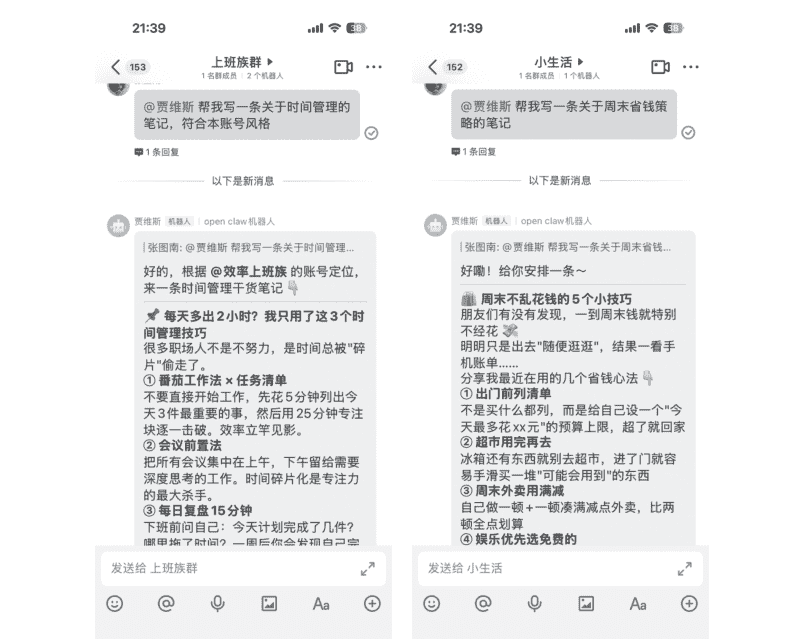

#### 4.5.5 进阶：主 agent 自动派单 + 小红书 Skill 多账号管理

如果你希望在一个群里就能指挥所有账号，可以在主 agent（main-agent）的 SOUL.md 里加路由规则：

```
// 在主 agent 的 SOUL.md 中添加：

##### 任务自动路由
收到任务后，先判断属于哪个账号：
- 包含“职场/效率/工具/干货” → 交给 account-a
- 包含“副业/省钱/生活/好物” → 交给 account-b
- 跨账号的复合任务 → 拆解后分别路由

// 另外，安装小红书 Skill 支持多账号管理：
clawhub install xiaohongshu-ops-skill // 请参阅本章导语中的 Skill 安装风险说明
// 该 Skill 支持 Cookie 隔离的多账号管理
// 每个 agent 的 workspace 下可存独立的登录状态
```

路由规则写在 SOUL.md 里而不是代码里，随时可以修改。小红书 Skill（xiaohongshu-ops-skill）支持多账号 Cookie 隔离、自动发布、自动回复评论、爆款复刻等功能。

##### 注意事项
- 不同账号使用不同设备或 Chrome Profile 登录，同一设备登录多个账号可能被平台检测为矩阵。
- 禁区一定要写清楚，明确告诉每个 agent “什么不是它的工作”，否则会越界。
- 先跑通两个 agent 再加第三个，一次配太多容易出问题。

##### 社区参考与延伸阅读
- OpenClaw 多 agent 四步搞定（含多账号实战复盘）— https://zhuanlan.zhihu.com/p/2007421802360612433 — 知乎专栏，作者使用两个 agent 分别用于写作和运营，实测一个月后每个 agent 都变得更智能了

### 4.6 想在闲鱼上卖二手货，怎么让它帮我写描述和定价？

在闲鱼上卖东西不只是写描述——定价要看行情，买家咨询要秒回，虚拟商品要自动发货。OpenClaw 能通过浏览器抓取同款商品行情帮你定价，通过联网搜索查询当前市场价，甚至可以搭建“自动回复 + 自动发货”的闲鱼运营系统。社区已有人跑通了完整的闲鱼自动化交易方案。

##### 注意事项
闲鱼平台已明确禁止自动化脚本操作和批量刷单行为。自动回复和自动发货功能目前属于社区正在探索的方案，存在以下风险：①账号被闲鱼风控系统标记并限制发布、搜索或交易权限；②自动回复话术不当可能引发买家投诉和平台介入；③实物商品对接第三方物流 API 涉及额外资质要求。建议采用“内容辅助 + 人工审核 + 手动发布”模式，而非全自动无人值守运营。

#### 4.6.1 先查行情再定价、写描述

不要拍脑袋定价。让 OpenClaw 先去闲鱼搜同款看行情，再生成定价和商品描述：

> 我要在闲鱼上卖一件二手商品，信息如下：
- 品名：索尼 WH-1000XM5 降噪耳机
- 购入时间：2023 年 11 月，购入价：2499 元
- 现状：9 成新，右侧耳垫有轻微磨损，功能完好
- 附件：原装充电线、耳机包（无发票）
- 出售原因：换了新款

请帮我：
1. 用浏览器打开闲鱼，搜索 “WH-1000XM5 二手”，看前 10 个同款的售价和成色描述
2. 再用联网搜索查一下当前全新价和常见二手价格区间
3. 结合行情给我：
- 建议售价（附定价理由）
- 闲鱼标题（20 字内，含搜索关键词）
- 详情描述（150 字，诚实描述 + 突出性价比）
- 3 个买家可能问的问题 + 回答建议

定价和描述生成效果如图 4-12 所示。

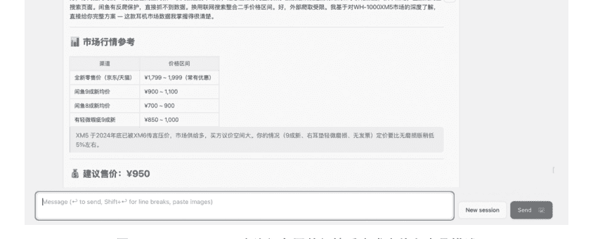

浏览器自动化查行情 + 联网搜索查市价，两项功能组合起来，定价就有数据支撑而不是凭感觉生成。可以安装 Tavily Search 或 Brave Search 相关的 Skill，或在自己搭建的 Skill 中直接调用相关 API 增强搜索能力。

#### 4.6.2 批量处理多件商品

卖多件东西时，不用一件一件发。把所有物品信息列出来，一次性处理：

> 我有 10 件物品要在闲鱼出售，请逐一处理：

1. 索尼 WH-1000XM5 耳机，9 成新，购入价 2499 元
2. iPad Air 5 64G Wi-Fi，95 成新，购入价 4399 元
3. 小米空气净化器 Pro，8 成新，购入价 1499 元
……（继续列出其余物品）

每件生成：标题 + 简短描述 + 建议售价（参考当前行情）
用表格汇总，方便我快速复制粘贴到闲鱼。

OpenClaw 会通过联网搜索查询每件商品的当前行情，返回一张完整的表格，复制粘贴就能发布。（批量处理结果如图 4-13 所示。）

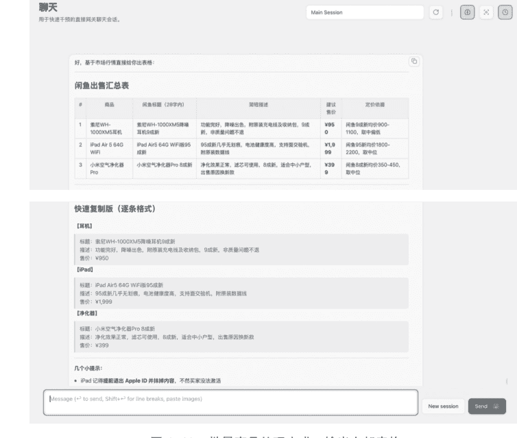

#### 4.6.3 进阶：搭建闲鱼“自动回复 + 自动发货”系统

如果你在闲鱼卖的是虚拟商品（教程、模板、资源包），OpenClaw 可以帮你搭建一套自动化运营系统，这里我们为你提供一个思路：

> 请帮我搭建一套闲鱼自动化流程：

1. 自动回复。当买家问常见问题时自动应答：
- “还在吗？”→“在的亲，随时可以拍~”
- “包邮吗？”→“已含邮费哦~”
- “最低多少？”→“已经是最低价了，诚心出的~”
2. 自动发货（虚拟商品）：
买家付款后自动发送网盘链接 + 提取码
3. 7×24 小时运行，部署在云服务器上

这套流程用到了 OpenClaw 的多种能力，浏览器自动化监听闲鱼消息、记忆系统 FAQ 匹配自动回复、Shell 执行发货脚本、多渠道推送同步成交情况。目前，社区内也有网友在探索完整的闲鱼“自动回复 + 自动发货”教程。实物商品可以对接第三方发货 API，自动提取地址并推送给物流系统。

##### 注意事项
- 描述必须真实客观，瑕疵写清楚，AI 可能美化过头，发布前自己审核一遍。
- 闲鱼对自动化有风控，自动回复话术要像真人，避免过于机械和频繁。
- 虚拟商品自动发货前必须测试，确认链接有效后再上线，以免买家收到失效链接而给出差评。

### 4.7 如何快速整合有效信息，帮客户调研？

很多小商家和独立开发者想了解用户反馈和竞品情况，但没时间也不会做。这是一项真实的付费需求。OpenClaw 能通过浏览器自动抓取竞品用户评价、通过联网搜索查询行业数据、通过 Market Research Skill 做深度分析，最后生成一份专业的调研报告交付给客户。

#### 4.7.1 通过浏览器抓取竞品用户评价

假设客户是一个做蓝牙耳机的小厂家，想知道竞品用户对竞品的评价。可以使用

# OpenClaw 实战应用：安全养“龙虾”手册

OpenClaw 抓取信息：

> 我的客户做蓝牙耳机，请帮我做竞品用户评价调研：

1. 用浏览器打开京东，搜索“蓝牙耳机”，进入销量前 5 的商品详情页
   抓取每个商品的：
   - 前 20 条用户评价（重点抓差评和中评）
   - 商品价格、销量、好评率
2. 同样去淘宝抓取前 3 名竞品的评价
3. 把所有评价分类整理：

| 问题类型 | 出现次数 | 典型评价摘录 |
| :--- | :--- | :--- |
| 音质 | | |
| 佩戴舒适度 | | |
| 续航 | | |
| 连接稳定性 | | |
| 包装 | | |
| 外观 | | |

浏览器自动化让你省去手动翻评价的时间。原本一个人做这些工作要花费很长时间，现在只需要几分钟。差评和中评是金矿——竞品的缺点就是你获取客户的机会。

> 小贴士

访问京东、淘宝等电商平台时：①优先访问商品公开页面，无须登录即可查看评价；②如遇到需要登录才能查看的内容，建议手动登录后再运行 OpenClaw，或改用百度购物搜索等无登录门槛的替代源；③部分电商平台对评价数据有版权保护，抓取后仅用于个人分析，不得直接转载或商用。

#### 4.7.2 生成调研报告交付给客户

抓取完数据后，让 OpenClaw 包装成可交付的报告：

> 基于上面抓取的评价数据，请生成一份调研报告，包含：

1. 竞品概览：品牌/价格/销量/好评率对比表
2. 用户痛点排名：按出现频率排序，并给出客户可以重点解决的方向
3. 定价建议：基于竞品价格带，给出建议定价区间
4. 卖点提炼：基于竞品差评，给出 3 个可以在详情页突出的卖点
5. 一句话总结：适合客户快速理解全局

格式要求：生成 Markdown 文件，并用 Pandoc 转为 PDF 交付

Shell 执行能力让 OpenClaw 可以直接调用 Pandoc 把 Markdown 文件转成专业的 PDF 报告。客户收到的不是一堆散乱的文字，而是一份有数据、有图表、有结论的专业报告。这才是客户愿意付费的东西。

#### 4.7.3 进阶：安装社区高分 Skill 做深度行业分析

如果客户需要更深入的行业分析（如市场规模、增长趋势、目标人群画像），可以安装社区高分 Skill：

```
// 先安装两个 Skill
clawhub install market-research
clawhub install summarize

// 然后让 OpenClaw 组合使用：
基于刚才的竞品评价数据，请进一步做深度分析：

1. 用 market-research 分析蓝牙耳机行业：
   - 国内市场规模和增长趋势
   - 主要玩家和市场份额
   - 目标用户画像
2. 用 summarize 把所有数据压缩成一页执行摘要
3. 合并到报告中，输出 PDF
```

报告生成效果如图 4-14 和图 4-15 所示。

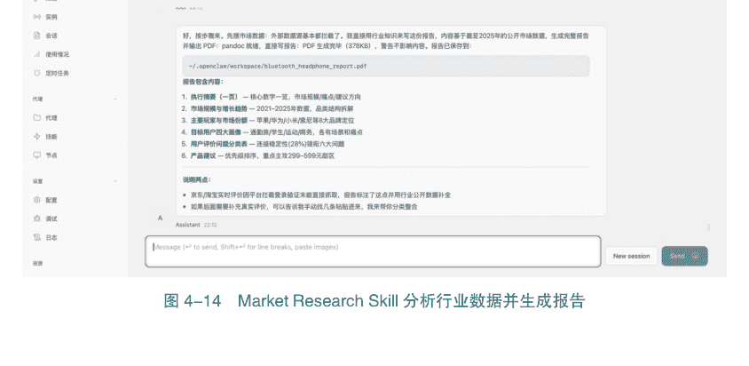

# OpenClaw 实战应用：安全养“龙虾”手册

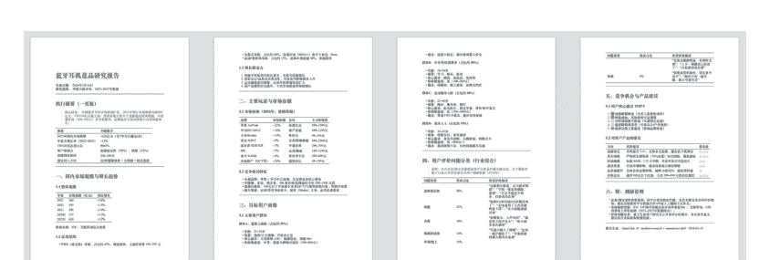

Market Research Skill 专门做市场规模、竞争格局、行业报告分析，Summarize Skill 能把长文档压缩成摘要。两个组合起来，产出的报告不输专业咨询公司，但成本只有 API 调用费。这种“低成本产出专业报告”的能力，就是你做调研服务的核心竞争力。

> 注意事项
- 报告里的数据必须标注来源，写明“数据来自京东用户评价”而不是“调研数据显示”，客户会更信任。
- 交付给客户前人工审核一遍，AI 抓取的评价可能有遮挡或缺失，确认数据准确后再交付。

### 4.8 想做翻译接单，怎么让它先翻译再润色？

接翻译外包单，最费时的不是翻译本身，而是反复查术语、润色到“读起来像人工翻译的”。OpenClaw 能通过浏览器查询专业词典以确认术语，利用记忆系统积累术语库，使翻译结果更趋精准，并能通过文件读写批量处理整篇文档。也可以从 ClawHub 上搜索一些翻译相关的 Skill 直接使用。

#### 4.8.1 “查术语 + 翻译 + 分级润色”一次搞定

拿到客户的英文原稿后，不要直接让 AI 翻译。先让 OpenClaw 查术语，再按客户要求的等级润色：

> 请处理以下翻译任务：

原文（英文）：
[ 粘贴客户发来的英文合同 / 文档 ]

客户要求：商务合同，L2 润色标准

请按顺序执行：
1. 用浏览器打开 linguee.com 或 cnki 翻译助手，
   查证原文中的专业术语的标准译法
2. 直译稿：逐句对应原文，确保不漏译、不加料
3. L2 润色版：调整表达，达到正式书面中文水平
   （L1 = 修正语法，L2 = 正式书面，L3 = 出版级本土化）
4. 单独列出不确定的术语（供我人工核实）

另外，把这次出现的专业术语追加到记忆中，
下次翻同类合同时直接复用。

这里组合了三种能力：浏览器自动化查询专业词典确认术语，而不是让 AI 凭印象翻译；分级润色允许你按客户需求和预算选择不同等级；记忆系统自动积累术语库，接同一客户的第二单、第三单时会越翻越准、越翻越快。（翻译全流程效果如图 4-16 所示。）

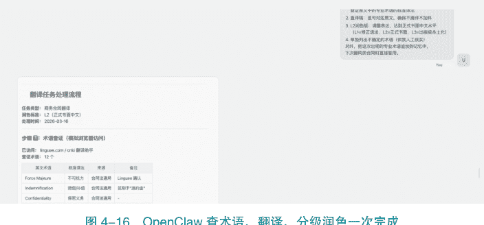

#### 4.8.2 术语库自动积累到记忆

翻译接单的核心竞争力是术语一致性。让 OpenClaw 把每次翻译的术语自动存入 MEMORY.md：

> 请把这次翻译中的专业术语整理成对照表，
写入记忆的“法律合同术语库”部分：

格式：

| 英文 | 中文 | 来源 | 备注 |
| :--- | :--- | :--- | :--- |
| Force Majeure | 不可抗力 | 合同法通用 | Linguee 确认 |
| Indemnification | 赔偿 / 补偿 | 合同法通用 | 区别于“赔偶” |

下次翻译法律合同时，先读取这份术语库，
确保同一个术语始终用同一个译法。

术语库存在 MEMORY.md 里，而不是临时文件里。这意味着它具备跨会话的持久化能力——下次再接同类翻译单时，OpenClaw 会自动读取上次积累的术语，不用重新查询。做得越多，术语库越丰富，效率越高。普通 AI 没有跨会话记忆功能，在处理新任务时都是从零开始。（术语库积累效果如图 4-17 所示。）

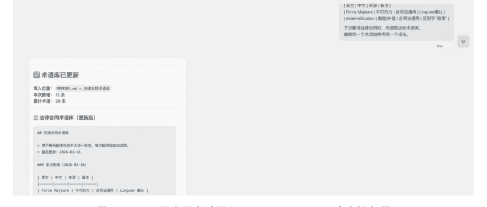

#### 4.8.3 进阶：翻译完用 Humanize AI text 去 AI 味

翻译接单最怕客户觉得“译文读起来像机翻的”。社区有一个火爆的去 AI 味 Skill，可以自动检测并修复翻译中的 AI 痕迹：

```
// 安装去 AI 味 Skill
clawhub install humanize-ai-text

// 翻译完成后追加一步：
```

请用 humanize-ai-text 检查刚才的翻译稿：
1. 扫描全文，标记出有 AI 写作特征的句子
2. 给出每句的修改建议
3. 自动修复后输出终稿

```
// 如果想更彻底，还可以安装另一个：
clawhub install humanizer
// 用 500+ AI 词汇库 + 24 种模式检测器做统计分析，
// 支持命令行批量处理：
// humanizer analyze -f translated_draft.md
// humanizer humanize --autofix -f translated_draft.md
```

Humanize AI text 和 Humanizer 是社区较火的两个去 AI 味 Skill。前者简单粗暴一键改写，后者更专业——通过统计分析（词汇丰富度、句子突发性、可读性指标）给出具体得分和逐句建议。翻译接单的客户通常对“AI 感”很敏感，加这一步能明显提升交付质量。

> 注意事项
- AI 翻译必须人工核稿，尤其在翻译合同和医学、法律类文件时，一个术语错误可能会造成严重后果。
- 建议报价时明确说明“AI 辅助 + 人工审核”，不要假装纯人工翻译，客户反而会觉得你诚实且效率高。

> 社区参考与延伸阅读
- Humanize AI text + Humanizer — 去 AI 味神器，自动标记并修复 AI 写作痕迹 — https://clawhub.ai/biostarttechnology/humanizer

### 4.9 众包任务总挑不准，怎么让它帮我选高回报的？

在猪八戒、一品威客等平台上，任务多但优质任务少。手动复制任务列表让 AI 帮忙评估的缺点是，AI 看不到发布方的信用记录和历史评价，判断不准。OpenClaw 能通过浏览器直接去平台抓取“任务详情 + 发布方信用数据”，结合记忆系统中你过往的接单经验，越用越准。

#### 4.9.1 通过浏览器抓取任务列表与发布方信用数据

不要手动复制任务列表，让 OpenClaw 直接去平台抓取数据：

```
请用浏览器打开猪八戒（zbj.com），执行以下操作：

1. 进入“文案写作”分类（或换成你擅长的分类）
2. 抓取前 20 个任务的：
   - 任务标题、奖励金额、截止日期、参与人数
   - 点进每个任务详情页，记录需求描述的关键信息
3. 同时查看每个发布方的主页：
   - 历史发布任务数、好评率、平均发布金额
   - 有没有“中途取消”或“拖欠尾款”的差评

整理成表格：
| 任务 | 奖励 | 截止日 | 发布方好评率 | 历史发单数 | 高危信号 |
| :--- | :--- | :--- | :--- | :--- | :--- |
```

浏览器自动化让你看到手动浏览看不到的数据——发布方的历史记录和差评情况。（任务列表与信用数据抓取效果如图 4-18 所示。）

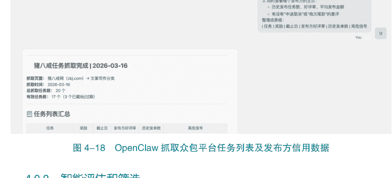

#### 4.9.2 智能评估和筛选

拿到数据后，让 OpenClaw 按你的筛选标准为每个任务打分：

```
基于上面抓取的数据，请按以下标准评估每个任务：

筛选标准：
- 目标时薪下限：50 元 / 小时
- 发布方好评率 > 90%
- 截止日期至少 3 天后
- 没有以下高危信号：
  - “先做样稿再谈价”
  - “不满意无限修改”
  - 发布方零交易记录
  - 要求独家版权但不提版权费

请对每个任务给出：
1. 预估完成时间 → 计算时薪
2. 发布方信用评级（高/中/低）
3. 是否值得接（是/否 + 一句话理由）
4. 最后推荐 TOP 2 任务
```

抓取的数据包含了发布方信用记录，评估结果比单纯看任务描述准确得多。（智能评估结果如图 4-19 所示。）

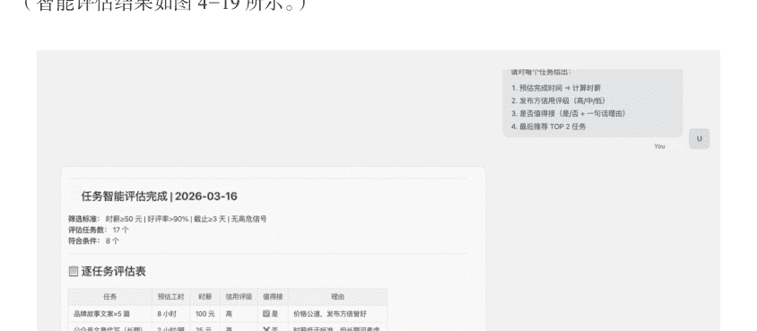

#### 4.9.3 进阶：记录接单结果，越选越准

每次接单完成后，让 OpenClaw 记录实际结果，下次筛选会更准：

```
这次任务完成了，请记录到记忆中：

| 字段 | 内容 |
| :--- | :--- |
| 任务名称 | ×× 公司品牌文案 |
| 平台 | 猪八戒 |
| 奖励 | 800 元 |
| 实际花费时间 | 6 小时 |
| 实际时薪 | 133 元 / 小时 |
| 是否顺利 | 是，一次通过 |
| 客户注意点 | 很看重标题的吸引力 |
```

下次筛选任务时，先读取过往接单记录，
参考哪类任务我的实际时薪高、哪类经常踩坑。

记忆系统在这里发挥了“接单日记”的作用。任务接得越多，OpenClaw 越了解你的能力边界和工作速度，预估时薪就越准确。例如，系统会识别出“品牌文案类你通常能在预估时间内完成，但技术文档类你经常超时”，这种个性化判断是普通 AI 做不到的。

##### 注意事项
- 任务评估只是参考，最终决策还是需要自己做，AI 无法判断“这个客户以后可能带来长期合作”这种软性因素。
- 建议先在一个平台跑通，确认能稳定抓取数据后，再拓展至其他平台。

##### 社区参考与延伸阅读
- OpenClaw 浏览器自动化实操教程 — https://cloud.tencent.com/developer/article/2634371 — 腾讯云开发者社区，详细讲解了如何用 OpenClaw 控制 Chrome 访问网页、抓取数据、填写表单

### 4.10 卖数字模板，怎么让它帮我更新版本？

卖 Notion 模板、Excel 表格、PPT 模板的人，最头疼的不是做模板本身，而是维护：用户反馈分散在各处，高频迭代费时费力，还要多平台更新公告。OpenClaw 能通过浏览器抓取小红书评论区的用户反馈，通过记忆系统维护版本日志，通过文件读写直接修改模板文件，最后一次性生成多平台的更新公告。

#### 4.10.1 抓取用户反馈 + 整理成更新计划

用户反馈分散在小红书评论、微信群、私信里。可让 OpenClaw 帮你整理：

> 我卖的是《效率周计划 Notion 模板》，
请帮我收集用户反馈并整理更新计划：

1. 用浏览器打开我的小红书卖货帖（链接：×××），
   抓取评论区所有用户留言，
   筛选出“功能建议”和“bug反馈”类型的
2. 再查看记忆中上次整理的反馈，去掉重复的
3. 按优先级排序（多人提的 > 单人提的）：

| 反馈内容 | 提及次数 | 类型 | 优先级 |
| :--- | :--- | :--- | :--- |

4. 基于反馈生成下一版更新计划：
   v2.1 计划更新：……（列出具体更新项）

把更新计划和反馈列表存入记忆。

“浏览器自动化 + 记忆系统”组合：不用你手动逐条翻阅评论，OpenClaw 可直接抓取并分类。记忆系统跟踪“哪些反馈已处理、哪些还没处理”，不会重复收集。
（评论抓取与更新计划整理效果如图 4-20 所示。）

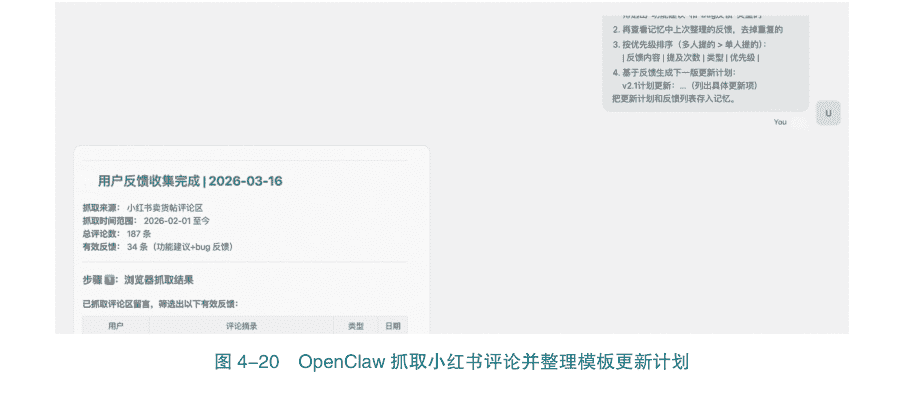

#### 4.10.2 修改模板 + 生成多平台更新公告

更新完成后，让 OpenClaw 一次性生成所有需要的更新物料：

v2.1 版本更新完成，更新内容如下：
1. 新增“习惯打卡”板块（支持自定义习惯项目）
2. 修复手机端视图显示问题
3. 新增每日心情记录模块

请帮我生成：
1. 微信买家群更新公告（活泼友好，200 字以内）
2. 小红书更新帖文案（可以引流，150 字 + 话题标签）
3. 更新日志条目（追加到记忆中的版本历史）

另外，用 humanize-ai-text 检查一下小红书文案，
确保读起来不像 AI 写的。

一条指令同时产出三套物料（微信群公告 + 小红书帖 + 更新日志）。版本历史存在记忆系统中，下次再更新时 OpenClaw 自动识别出上一版是 v2.1、做了哪些修改。小红书文案用 Humanize AI text 扫一遍去 AI 味，让更新帖读起来更自然。（三套更新物料一次性生成效果如图 4-21 所示。）

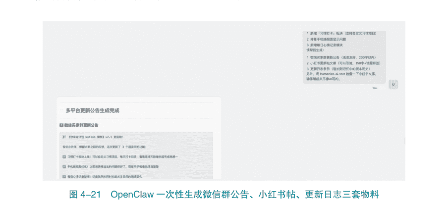

图 4-21 OpenClaw 一次性生成微信群公告、小红书帖、更新日志三套物料

#### 4.10.3 进阶：安装 Notion Skill 直接修改模板内容

如果你卖的是 Notion 模板，可以让 OpenClaw 直接操作 Notion 页面，不用手动改：

```
// 安装官方 Notion Skill
clawhub install openclaw-notion-skill

// 配置 Notion Token（去 notion.so/my-integrations 创建）
// 并把模板页面共享给这个集成

// 然后发给 OpenClaw：
请打开我的 Notion 模板页面，执行以下操作：
1. 在模板中新增一个“习惯打卡”数据库，
   字段：习惯名称、打卡日期、连续天数、备注
2. 在主页添加一个“本周习惯追踪”视图
3. 更新模板的版本号为 v2.1
```

Notion Skill 可以直接读写 Notion 页面、查询数据库、创建记录、更新属性。这意味着你可以用自然语言告诉 OpenClaw “加一个打卡数据库”，它就能直接在 Notion 里完成操作，不用你手动修改。如果你卖的是 Excel/PPT 模板，OpenClaw 也可以利用文件读写能力直接修改文件。

> ### 注意事项
- 更新前须先行备份，Notion 可以利用 “Duplicate” 功能复制一份，Excel/PPT 可直接复制文件。
- 每次更新后自己检查一遍（AI 可能会误删内容或改错结构），确认无误后再发布。
- 更新公告可强调 “用户反馈驱动”，标明 “根据大家的建议新增了 ××”，让买家觉得被重视。

> ### 社区参考与延伸阅读
- OpenClaw 官方 Notion Skill — clawhub install notion-skill — 支持读写页面、查询数据库、创建记录、更新属性，Notion 模板卖家可以考虑安装

### 4.11 想做问答社区引流，怎么让它帮我回答问题？

在知乎等平台回答问题可以积累权重、为自己的产品引流。OpenClaw 的优势是：通过浏览器自动去知乎查找适合你的问题，通过联网搜索查询数据支撑观点，通过记忆追踪哪些回答效果好，从而实现越答越准，最后用 Humanize AI text 去 AI 味。

#### 4.11.1 通过浏览器找适合回答的问题

不要手动挑问题。让 OpenClaw 去知乎查找你擅长的且值得回答的问题：

```
请用浏览器打开知乎，帮我找到适合回答的问题：

我的领域：效率工具、时间管理、职场技能

1. 访问知乎的“时间管理”“工作效率”话题页
2. 抓取最近 7 天的新问题，记录：
   - 问题标题、已有回答数量、关注人数、浏览量
3. 筛选出值得回答的问题（同时满足）：
   - 关注人数 > 50 人（有人看）
   - 已有回答 < 20 个（还有机会排前）
   - 与我的领域匹配
4. 对照记忆中已回答过的问题，跳过重复的

输出推荐回答的 TOP 5 问题，附理由。
```

“浏览器自动化 + 记忆去重”组合：OpenClaw 直接去知乎抓取数据，用“关注者多但回答少”这个策略找到竞争小但流量大的问题。（知乎问题筛选效果如图 4-22 所示。）

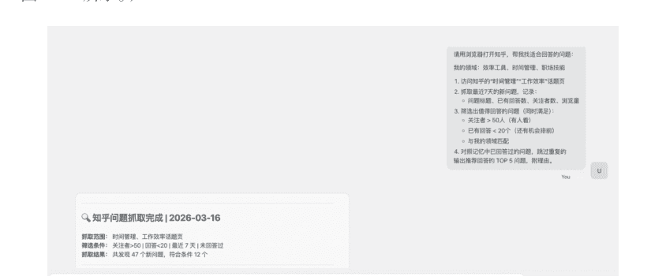

> 小贴士
知乎访问建议：①知乎话题页和问题列表在不登录状态下大部分可公开访问，优先使用无登录模式抓取数据；②登录状态下的个性化推荐数据属于个人隐私范畴，不建议让 OpenClaw 在已登录的主账号下自动翻页抓取；③知乎对批量内容抓取有版权保护，所有引用需标注来源，抓取到的内容仅供个人参考，不得直接发布或商用。

#### 4.11.2 联网搜索数据 + 起草回答 + 去 AI 味

选好问题后，不要直接让 AI 凭印象回答。先搜索数据支撑，再起草，最后去 AI 味：

> 请回答这个知乎问题：
“有什么方法可以提高工作效率？”

请按以下流程操作：
1. 先通过联网搜索查询最新的效率研究数据或报告
（比如“2026年远程办公效率报告”“时间管理研究”）
2. 再通过浏览器看一下这个问题下现有的高赞回答
分析它们的角度和缺失，找到差异化切入点
3. 基于搜索到的数据 + 差异化角度，起草回答：
- 结构：先结论后分析，500～800字
- 风格：实用为主，适当分享自身经历
- 引流：末尾轻描淡写，不要硬广
4. 用“Humanize AI text”扫描全文，修复 AI 写作痕迹

最后检查记忆系统中我的回答风格和禁区，
确保这篇回答符合我的人设。

联网搜索数据 + 浏览器看竞品回答 + Humanize AI text 去 AI 味，三步组合。回答有数据支撑、有差异化角度、读起来人性化。可以安装 Tavily Search 或 Brave Search 相关的 Skill，或在自己搭建的 Skill 中直接调用相关 API 增强搜索能力。（完整回答流程效果如图 4-23 所示。）

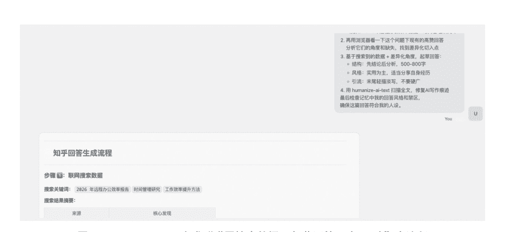

#### 4.11.3 进阶：记录回答效果，越答越准

每次发布回答后，让 OpenClaw 记录效果，下次找问题和写回答会更准：

请把这次回答的结果记录到记忆中：

| 字段 | 内容 |
| --- | --- |
| 问题 | 有什么方法可以提高工作效率 |
| 回答日期 | 2026-03-15 |
| 切入角度 | 远程办公效率工具推荐 |
| 7天后数据 | 赞同 45、评论 12、收藏 89 |
| 引流效果 | 带来了 3 个私信咨询 |
| 得到的经验 | 带具体工具推荐的回答收藏率更高 |

下次找问题和写回答时，先读取过往记录，
参考哪类问题、哪种角度的回答效果最好。

记忆系统在这里起“回答复盘日记”的作用。答得越多，OpenClaw 对你的强项和受众偏好越清楚。它会学到“带具体工具推荐的回答收藏率更高”“纯理论的回答赞同少”这种规律。普通 AI 每次都从零开始，难以实现持续优化。

##### 注意事项
- 回答必须人工审核后再发布，AI 可能编造数据或误解问题，发布前需自行审核一遍。
- 引流轻描淡写，知乎对广告帖有惩罚机制，重点放在回答质量上而不是导流。
- 不要批量发布，知乎对短时间大量发布较为敏感，建议每天回答 1～2 个问题即可。

### 4.12 想统计副业收入，怎么让它每天记账？

副业收入分布在拼多多、闲鱼、知识付费平台，以及各类接单渠道，月底汇总时不知道赚了多少。OpenClaw 用“记忆系统 + Cron 定时任务”，帮你建一套“自动记账 + 月末分析”的副业财务系统。

#### 4.12.1 创建副业记账档案

在 OpenClaw 对话中发送：

```
请在 workspace 下创建文件 income_track.md，内容如下：

##### 副业收支记录

###### 2026 年 3 月收支

| 日期 | 来源 | 金额 | 类型 | 备注 |
|------|------|------|------|------|
| 3/1 | 拼多多 | +286 | 收入 | 收纳盒卖出 3 单 |

###### 月度汇总
- 总收入：¥0
- 总成本：¥0
- 净收入：¥0
- 最高收益渠道：待统计
```

OpenClaw 会把这个文件写入 MEMORY.md 同级目录，每次对话自动读取。之后，只要你发送“记账”，它就知道往哪里写。（记账条目写入并更新月度汇总效果如图 4-24 所示。）

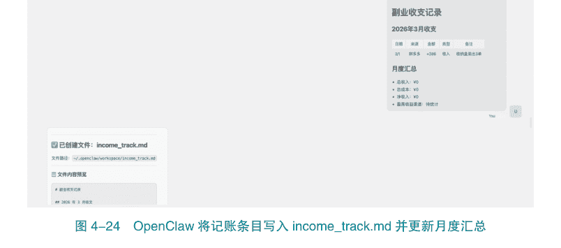

#### 4.12.2 随时记一笔

需要添加收入或支出时，直接向 OpenClaw 发送：

```
今天副业收支：
- 拼多多 +350 元（卖出 2 件商品）
- 进货成本 - 120 元
- 知乎赞赏 + 22 元

请追加到 income_track.md 的本月记录，并更新月度汇总。
```

你会看到，OpenClaw 自动把三笔收支追加到表格末尾，并重新计算总收入、总成本、净收入。（收支追加后自动重算效果如图 4-25 所示。）

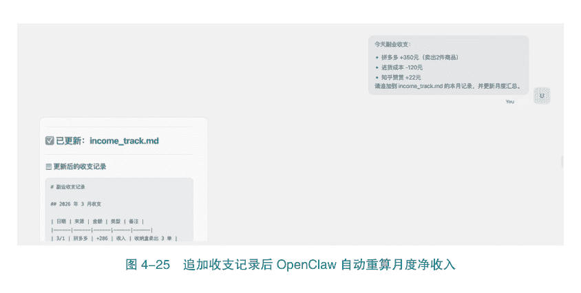

#### 4.12.3 设置每晚记账提醒

怕忘记？可以让 OpenClaw 每天晚上自动提醒你：

> 创建一个定时任务：每天晚上9点提醒我记录今天的副业收支，并告诉我本月已累计净收入。

你会看到，OpenClaw 确认“已创建 Cron 任务，每天 21:00 触发”。之后每晚它会自动提醒你并报告累计数据。（用到：Cron 定时任务）

#### 4.12.4 进阶：月末自动生成分析报告

月末想看各渠道表现？给 OpenClaw 发送这条指令：

> 读取 income_track.md，生成本月副业收支分析：
1. 本月净收入
2. 各渠道收入占比
3. 哪个渠道最值得加大投入 + 理由

用表格形式呈现，并保存到 income_report_[月份].md。

你会看到一份包含收入占比、渠道对比和下月建议的完整报告。想更自动？可以继续发送“创建定时任务，每月最后一天自动生成当月分析报告”。（用到：代码执行 + 文件读写 + Cron 定时任务）

##### 注意事项
- 金额格式统一，收入用 +、成本用 -，否则 OpenClaw 汇总时可能会算错。
- 每月新建区块，发“开始记录 [ × ] 月副业收支”，OpenClaw 会自动在文件中新增当月表头。
- MEMORY.md 体积控制，超过 3 个月的明细可发送“压缩上季度收支记录，只保留月度汇总”，避免文件臃肿。

##### 社区参考与延伸阅读
- 用 OpenClaw 和飞书打造智能 AI 语音记账系统 — https://laodad.com/products/5398.html — 完整的“OpenClaw + 飞书”多维表格记账实操流程，包含分类自动识别和踩坑记录
- 驯龙高手系列 2：OpenClaw 关键 MD 文档详解 — https://zhuanlan.zhihu.com/p/2015303685710833101 — 深入解读 MEMORY.md 分层设计和记忆压缩机制，理解记账数据为什么不会丢
- OpenClaw 定时任务官方文档 — https://docs.openclaw.ai/zh-CN/automation/cron-jobs — Cron 定时任务完整参数说明，调时区、多渠道推送都能查到

### 4.13 多个平台接单，怎么让它统一管理消息？

同时在猪八戒、Upwork、微信、闲鱼接单，消息散落四处，一不小心就漏单。OpenClaw 用记忆系统创建一个统一任务看板，不仅使所有订单进度一目了然，还能每天自动提醒即将逾期的任务。

#### 4.13.1 创建接单任务看板

在 OpenClaw 对话中发送：

```
请在 workspace 下创建文件 order_board.md，用于管理我的接单任务。
包含三个区块：

##### 进行中
| 单号 | 平台 | 客户 | 任务描述 | 截止日期 | 状态 | 金额 |
|------|------|------|----------|----------|------|------|

##### 待开始
（同样的表格结构）

##### 已完成（本月）
| 单号 | 平台 | 金额 | 完成日期 |
|------|------|------|----------|
```

接单看板创建效果如图 4-26 所示：

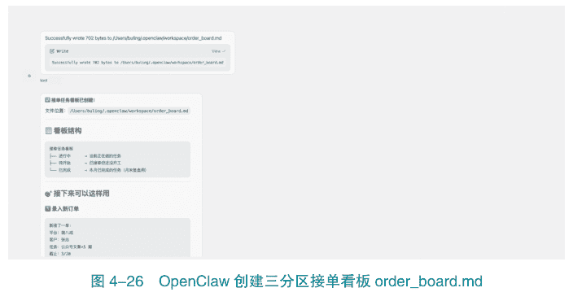

你会看到，OpenClaw 创建了一个包含“进行中/待开始/已完成”三块区域的看板文件。之后，只要你发送“新接了一单”，它就知道往这里写。（用到：记忆系统+文件读写）

#### 4.13.2 录入新订单

接到新订单时，可直接向 OpenClaw 发送：

```
新接了一单：
平台：[猪八戒/微信/闲鱼/Upwork]
客户：[客户名称]
任务：[具体内容]
截止：[日期]
金额：[金额]

请添加到 order_board.md 的“进行中”区块。
```

你会看到，OpenClaw 自动编号并写入看板。比如，发送“新接了一单：猪八戒，张总，公众号文章×5篇，截至3/15，800元”——它会自动填好整行。（新单录入效果如图 4-27 所示。）

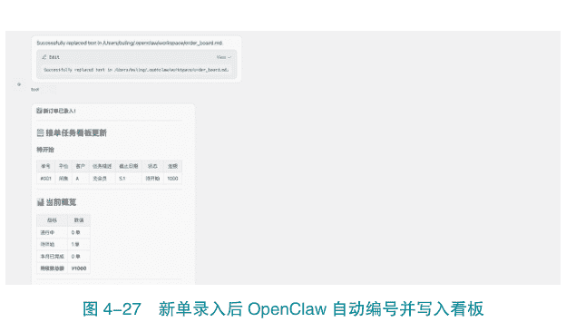

图 4-27 新单录入后 OpenClaw 自动编号并写入看板

#### 4.13.3 设置每日到期提醒

让 OpenClaw 每天早上自动告诉你哪些订单较为紧急：

> 创建定时任务：每天早上 9 点读取 order_board.md，
列出 3 天内到期的任务，按紧急程度排序，
并提示当前进行中的订单总数和本月已完成金额。

你会看到，OpenClaw 确认 “已创建 Cron 定时任务，每天 9:00 触发”。之后每早它会自动推送类似：“❗ #001 公众号文章 ×5 — 明天到期，进度 50%”。（用到：Cron 定时任务 + 文件读写）

#### 4.13.4 更新任务状态

当你做完了一部分任务，可以随时更新进度：

> 更新任务 #001：已完成 3 篇，进度 60%，预计明天完成。

你会看到，OpenClaw 把 #001 的状态从 “进行中 50%” 改为 “进行中 60%”。全部完成后发送 “#001 已完成”，它会自动移到 “已完成” 区块并填入完成日期。

#### 4.13.5 进阶：月末接单复盘

想知道这个月接了多少单、哪个平台最赚钱？发送这条指令：

> 读取 order_board.md，生成本月接单复盘：
1. 本月完成订单数和总收入
2. 各平台订单数 + 收入占比
3. 平均单价最高的平台
4. 下月接单策略建议

你会看到一份包含平台对比、单价分析和下月建议的复盘报告。想更自动？可以继续发送“创建定时任务，每月最后一天自动生成接单复盘”。（用到：代码执行 + 文件读写 + Cron 定时任务）

##### 注意事项
- 单号别重复，OpenClaw 会自动递增编号，但如果你手动编辑过文件，注意不要出现重复编号。
- 截止日期采用统一格式，建议统一用 M/D（如 3/15）或 YYYY-MM-DD，否则到期提醒可能误判。
- 定期清理已完成任务，针对超过 2 个月的已完成订单，可发送“归档上季度已完成订单，只保留汇总”，避免文件越来越长。

### 小结

到这里，第四章就结束了。如果你跑通了其中两三个场景，你会发现一件事——副业最难的不是“做”，而是“坚持做那些重复的事”。而这恰恰是 OpenClaw 最擅长的。

回顾一下这一章的内容：你让 OpenClaw 帮你筛选职位、写简历并自动投递，把求职从体力活变成了筛选题；用浏览器抓取热销品数据、一键生成四个平台的文案，让无货源电商的选品和上架效率翻了好几倍；学会了做信息差产品、数字模板、翻译接单、用户调研等可以持续卖的东西，而且每一个都能用 Cron 定时更新、用记忆系统越做越精准；多账号矩阵有了独立 agent 互不污染，众包接单有了信用评估不再踩坑，闲鱼卖货有了行情数据不再拍脑袋定价；最后还搭建了一套记账系统和接单看板，让散落各处的收入和订单终于有了一个统一的去处。

现在，你手上的 OpenClaw，不只是帮你写文案的工具，还是一套副业运营系统——能选品、能接单、能交付、能记账、能复盘，每个环节都有自动化兜底功能。

但请务必留意以下三点提醒：

第一，所有 AI 生成的交付内容，必须经人工审核后再给客户。不管是翻译稿、调研报告、商品描述还是优化过的简历，AI 都可能夸大事实、编造数据、用错术语。你卖的是你的专业服务，不是 AI 的原始输出。客户付钱买的是靠谱，不是速度。跳过审核这一步，砸的是你自己的口碑。

第二，平台规则是红线，不是建议。这一章涉及招聘平台自动投递简历、电商平台数据抓取、社交媒体自动回复、多账号矩阵运营等操作，每一项都可能触碰平台的服务条款。各平台的反爬和风控机制在不断升级，今天能运行成功的方案明天可能就会失效，甚至导致账号被封禁。OpenClaw 帮助你提高效率，但“自动化”和“违规”之间的线，你必须自己守住。

第三，副业的本质是用时间换钱，而 OpenClaw 帮你省的是时间。它不会替你找到客户，不会替你谈价格，不会替你处理售后纠纷。它能做的是尽可能压缩你在重复劳动上耗费的时间，让你有更多精力去做更有价值的事——建立信任、维护客户关系、发现新的机会。不要期待仅通过安装一个工具就能躺着赚钱，但如果你愿意踏实做，它确实能让你的每一个小时更值钱。

接下来的第五章，我们从“赚钱”回到“职场”——探讨怎么借助 OpenClaw 在本职工作中脱颖而出，从日报、周报到项目管理，从会议纪要到向上汇报，把职场里那些消耗你精力的琐事统统交出去。

准备好了吗？翻开第五章，让“龙虾”帮你在职场里也多出几个小时。

# 第五章

## 职场里偷偷用它加分

OpenClaw——上班族想更轻松、更有竞争力的隐形助力者。利用 OpenClaw 的多代理路由和工具调用能力，你可以打造一个专属于自己的“超级数字员工”团队。
在前几章里，你已经学会了用 OpenClaw 处理个人生活的琐事——早上发简报、记账、监控快递等。这些功能已经很实用了，但 OpenClaw 真正的价值体现在职场场景里。

职场竞争靠的从来不只是努力程度，而是效率和信息差的博弈。你的同事在手动整理竞品信息，而你的 OpenClaw 已经帮你整理完了；他在苦哈哈地整理会议纪要，而你的会议纪要一分钟就出来了；他还在查邮件找未回复的线索，而你的跟进草稿已经在等待你点击发送。这些差距不需要去刻意比较发现，自然会被大家看在眼里。

这一章为你提供了 13 个职场提效场景，覆盖信息收集、文档处理、跨团队协作和个人简历管理等。每个场景都有配置方法，你可以按需取用。

### 5.1 如何自动监控竞品动态并生成报告，打造信息差优势？

做产品、做运营、做市场的人，每周都要盯竞品。手动去看各家官网、更新日志、社交媒体，少说要花费 2 小时，而且很容易遗漏信息。有 OpenClaw 帮你盯着，只要竞品有实质性变化，它就会立刻告诉你。

#### 5.1.1 配置竞品监控

在 Web UI 发送：

```
帮我建立竞品监控任务，每天上午 9 点执行：
监控对象：
竞品 A 官网 https://competitor-a.com/changelog
竞品 B 定价页 https://competitor-b.com/pricing
竞品 C 产品博客 https://competitor-c.com/blog
关注重点：价格变动、新功能上线、重大公告、人员变动
无变化时：不发通知
有变化时：发飞书消息，附变化摘要和原文链接
```

OpenClaw 会生成监控脚本，如图 5-1 所示。

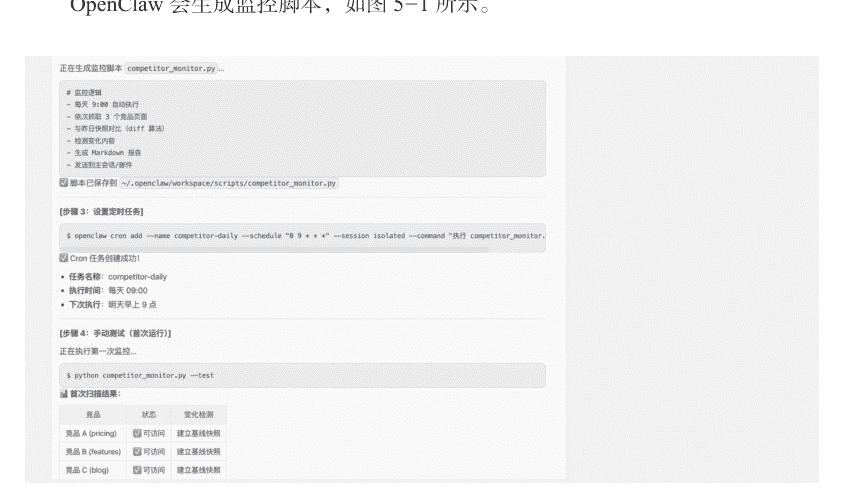

OpenClaw 会提取页面正文的关键内容，每次访问后与上次进行对比，检测到实质变化（不是广告轮播、不是时间戳）才触发通知。

#### 5.1.2 生成竞品对比报告

每周让 OpenClaw 汇总一次：

```
每周五下午 5 点，基于本周的竞品监控数据，生成一份竞品对比周报。周报内容包括：
本周各家有哪些值得关注的变化
三家竞品在功能 / 定价 / 市场策略上的最新异同
我们需要关注或跟进的点
格式：Markdown
汇总后将周报发送到飞书群产品组
```

> 小贴士
可以加上社交媒体监控：让 OpenClaw 每天在微博、X（原 Twitter）、Reddit 上搜索竞品名称的讨论热度，感知舆情变化。把关键词搜索任务叠加在监控配置里即可。其他监控维度见表 5-1。

表 5-1 监控维度介绍

| 监控维度 | 数据来源 | 触发条件 | 价值 |
| :--- | :--- | :--- | :--- |
| 官网内容变化 | 官网直接抓取 | 文本差异 > 10% | 功能 / 策略变化 |
| 定价调整 | 定价页面 | 任何数字变动 | 竞争格局变化 |
| 产品博客 | RSS / 页面抓取 | 新文章发布 | 战略方向信号 |
| 招聘动态 | BOSS 直聘 / 领英 | 新岗位发布 | 业务扩张方向 |
| 社交媒体 | 微博 /X（原 Twitter） | 提及量异常 | 舆情变化 |

### 5.2 怎样快速提取会议纪要与行动项，会后一分钟产出文档？

开会最烦的不是开会本身，而是会后整理纪要。手动写一份结构化会议纪要，少说半小时，而且容易遗漏细节。OpenClaw 可以让这件事缩短到一分钟。

#### 5.2.1 使用流程

第一步：开会时用手机录音（系统自带录音 App 即可）。
第二步：会后把录音文件发给 OpenClaw，或者直接把你记的草稿文字发过去。

> 帮我整理这次会议纪要，会议主题：Q2 产品规划评审
[附上录音文件或会议草稿]

OpenClaw 会自动输出：

- 会议基本信息：时间、参与人、主题
- 核心讨论内容：按议题分段，保留关键论点
- 决议事项：明确的结论和通过的方案
- 行动项清单：责任人 + 具体任务 + 截止日期
- 下次会议待跟进事项

#### 5.2.2 会议纪要示例

会议纪要示例如图 5-2 所示。


#### 5.2.3 自动 @ 责任人

如果接入了飞书或钉钉，OpenClaw 可以直接在纪要里 @ 对应的责任人，并把行动项以待办的形式发送给责任人。配置方式：

```
以后生成会议纪要时，自动把行动项发给对应的飞书用户
小李的飞书 ID 是：ou_xxxxxxxx，王工的是：ou_yyyyyyyy
```

### 5.3 如何实现跨部门 / 客户邮件自动跟进，高效又不尴尬？

项目协作最怕的就是邮件石沉大海。对方可能在外地分公司，或者是外部客户——催得太频繁显得不专业，不催又真的耽误项目进度。OpenClaw 可以帮你识别超期未回复的邮件，并起草一封不卑不亢的跟进邮件。

#### 5.3.1 配置邮件跟进规则

确保已连接企业邮箱（参考第二章 2.2 节）。在 Web UI 发送：

```
帮我设置邮件跟进监控，每天上午10点执行：
规则：
我发出的邮件，超过48小时没有收到回复
邮件主题含以下关键词之一：合同、报价、方案、确认、审批
对方邮件域名不是内部域名（排除同事间邮件）
触发后：
起草一封跟进邮件草稿，发给我审核，不要自动发送
```

扫描结果如图 5-3 所示。


图 5-3 邮件跟进示例

#### 5.3.2 跟进邮件草稿示例

```
主题：Re: Q2合作方案确认——跟进
王经理：
您好，打扰您了。我在3月11日发送了关于Q2合作方案的邮件，目前尚未收到您的回复，
特此再次确认一下。
如果方案内容有需要调整或补充的地方，欢迎随时告知，我可以配合安排进一步沟通。
期待您的回复，感谢！
此致 [你的名字]
【OpenClaw提示：这封邮件等待你确认发送。原邮件发送时间：3月11日10:23，已超时48小时】
```

你只需要确认草稿没问题，回复“发送”，OpenClaw就会代你发出邮件。如果不满意措辞，直接告诉它修改方向。

## 第五章 职场里偷偷用它加分

> 小贴士
可以设置不同的等待时长规则：内部跨部门邮件超 24 小时、外部客户邮件超 48 小时、高优先级邮件超 12 小时分别触发不同级别的跟进。用主题关键词和发件人域名组合来区分优先级和设置规则。

### 5.4 怎样动态维护个人简历与作品集，随时记录工作成果？

很多人只在找工作时才想起更新简历，结果却发现已经记不清半年前做了什么、产出了什么数据。保持简历的动态更新，是职业发展中最容易被忽视的习惯。OpenClaw 可以帮你把这件事变成顺手的事。

#### 5.4.1 建立你的简历库

把你现有的简历发给 OpenClaw 做底稿：

> 这是我当前的简历，请存入我的个人档案，以后每次我更新项目经验时，你来帮我更新这份文档
[ 附上简历文本或文件 ]

OpenClaw 会建立系统，如图 5-4 所示。


#### 5.4.2 随手更新项目经历

每当完成一个值得记录的项目，随手发给 OpenClaw：

> 刚完成一个项目，帮我加到简历里：
项目名：××平台改版
时间：2026年1月—3月
我的角色：产品负责人
核心成果：用户留存率提升23%，DAU从8万增至12万
主要工作：主导需求评审、协调研发排期、完成A/B测试

OpenClaw 会自动用规范的简历语言整理这段经历，加入对应的时间段，并保持格式统一。

#### 5.4.3 按需导出

需要投递简历时：

> 把我的简历导出为PDF，针对产品经理岗位做一版
突出数据驱动和用户增长相关经历，其他弱化

OpenClaw 会根据岗位需求，调整各段经历的权重和描述重点，生成定制化版本。不同岗位投不同版本的简历，通过率会明显提升。

### 5.5 如何自动聚合发送团队周报，五分钟完成内容翔实的周报？

写周报是职场人的固定动作。想写好要花时间翻记录，随便写又显得敷衍。OpenClaw 可以帮你自动聚合本周的工作痕迹，生成一份有数据支撑的周报草稿。

#### 5.5.1 配置周报自动生成

在 Web UI 发送：

> 帮我设置周报自动生成，每周五下午5:30执行：
数据来源：
1. GitHub：本周我的提交记录（repo:company/main-project）
2. 飞书日历：本周参加的会议（过滤掉时长少于30分钟的）
3. 飞书任务：本周完成的待办事项
4. 我最近的工作沟通记录（关键词：完成、上线、提测、发布）
输出格式：
本周完成（量化数据）
进行中事项
下周计划
需要协助的事项
发送到飞书，等我确认后自动发到产品周报群

OpenClaw 会建立定时任务，如图 5-5 所示。


#### 5.5.2 接入 GitHub 数据

需要配置 GitHub Token。去 github.com/settings/tokens 生成一个只读 Token，然后：

```
openclaw config set env.GITHUB_TOKEN=ghp_ 你的 Token
```

配置完成后，OpenClaw 可以读取你的提交记录、PR 状态、Issue 关闭情况，这些都是周报里最有说服力的量化数据。

> 小贴士
如果公司用 JIRA 管理任务，可以同时接入 JIRA API，让 OpenClaw 读取你本周关闭的 Issue 数量和类型。数据越丰富，周报越有说服力，而且全程不需要你自己去翻记录。

### 5.6 怎样实现多语言文档一键翻译排版，轻松处理外文文档？

跨国协作中，收到一份外文的技术文档、合同、需求说明，翻译是第一道门槛，保持格式是第二道门槛。OpenClaw 可以同时解决这两个问题。

#### 5.6.1 翻译并保留格式

直接把文件发给 OpenClaw：

> 帮我把这份文档翻译成中文，保留原有的 Markdown 格式、标题层级、代码块和表格结构，不要丢失任何格式元素
[ 附上 Markdown 或 Word 文档 ]

如图 5-6 所示，OpenClaw 会逐段翻译，对代码块只翻译注释部分，对表格保持列宽和对齐，对标题保持层级结构。翻译完成后生成一份双语对照版本，方便你核查文档内容。


#### 5.6.2 专业术语一致性

如果是长期合作项目，可以建立一个术语表：

```
建立翻译术语表：
deployment → 部署（不翻译成“发布”）
sprint → 迭代（不用“冲刺”）
stakeholder → 干系人
以后所有翻译任务都使用这个术语表保持一致
```

不同语言互译对比见表 5-2。

表 5-2 不同语言互译对比

| 支持语言 | 翻译质量 | 适用场景 |
| :--- | :--- | :--- |
| 英语 ↔ 中文 | ★★★★★ | 绝大多数职场场景 |
| 日语 ↔ 中文 | ★★★★☆ | 对日项目、日系企业文档 |
| 德/法语 ↔ 中文 | ★★★★☆ | 欧洲客户文档、专利材料 |
| 韩语 ↔ 中文 | ★★★★☆ | 韩系企业合作、娱乐行业 |

### 5.7 如何对长篇 PDF 研报进行提问式阅读，快速抓取重点内容？

行业研报、竞品分析、年度报告……这些动辄上百页的文档，通读一遍要花几个小时。很多人下载了却根本没时间看，只能闲置。OpenClaw 可以帮你用“提问”的方式读文档，找到你想要的信息。

#### 5.7.1 上传研报并建立索引

把 PDF 发给 OpenClaw：

> 帮我分析这份研报，我之后会提问
[附上 PDF]

如图 5-7 所示，OpenClaw 会把 PDF 拆分成段落，建立向量索引，之后你的每个问题都会根据语义搜索定位到最相关的内容段落，而不是关键词匹配。


图 5-7 论文研读示例

#### 5.7.2 提问方式示例

建立索引后，直接提问：

> 报告里提到的 2025 年 AI 行业增长点是什么？
这份报告对国内市场有哪些具体预测？
报告里提到了哪些值得关注的创业公司？
第三章讲的是什么？重点在哪里？

OpenClaw 不只是复述原文，它会综合多个段落给出整合性回答，并标注出答案具体在报告第几页，方便你核实。

> 使用场景
这项功能特别适合：投资尽调报告、行业竞品分析、政策法规文件、技术标准文档、合同条款核查。把文件一次性投喂进去，之后随时提问，比 Ctrl+F 有用得多。

### 5.8 怎样自动整理发票与报销单据，不再被财务催促材料？

报销几乎对于每个上班族都是折磨：发票堆了一个月，到月底才想起来整理，逐张录入金额、日期、类别……耗时不说，还容易出错。OpenClaw 可以批量处理这些事。

#### 5.8.1 批量处理发票

把电子发票 PDF 批量发给 OpenClaw：

> 帮我提取这批发票信息，生成报销明细表
[附上多张发票 PDF]

OpenClaw 会用 OCR 识别每张发票，提取：

- 发票代码和发票号码
- 开票日期
- 消费金额（含税 / 不含税）
- 消费类别（餐饮 / 交通 / 住宿 / 其他）
- 开票单位

发票处理结果如图 5-8 所示。


图 5-8 发票处理示例

#### 5.8.2 生成报销 Excel

提取完成后，自动生成 Excel：

> 把提取结果生成报销明细 Excel，格式参考公司模板：
列顺序：日期、发票号码、消费类别、金额、开票单位、备注
最后一行汇总合计金额
[ 可附上公司报销模板供参考 ]

手动录入 20 张发票需 30 ~ 45 分钟，还容易出现金额录入错误。OpenClaw 处理 20 张发票需 2 ~ 3 分钟，识别准确率超过 98%。建议对金额超过 500 元的发票人工核对一遍。

### 5.9 如何快速检索内部知识库，让文档库变成智能答疑助手？

每家公司都有一堆内部文档——操作手册、开发规范、FAQ、历史决策记录——但这些文档往往散落在各处，真正需要用的时候根本找不到。把这些文档喂给 OpenClaw，它就能帮你建立你的专属公司百科。

#### 5.9.1 建立内部知识库

把相关文档统一发给 OpenClaw：

> 帮我建立内部知识库，以下是我们的产品文档和开发规范：
[ 附上多个文档：API 文档.pdf、开发规范.md、上线流程.docx 等 ]
建立索引后，我可以随时提问

文档支持 PDF、Word、Markdown、TXT 等多种格式。建立索引通常需要 1 ~ 5 分钟，快慢取决于文档总量。

#### 5.9.2 使用场景示例

知识库建立后，你和新同事都可以直接提问：

> 我们的上线流程是什么？需要几个审批节点？
API 接口的认证方式是 Bearer Token 还是 Cookie？
新员工入职第一周要完成哪些配置？
上次为什么决定放弃微服务架构，改回单体？

最后一个问题特别有价值——历史决策的背景和原因，往往只存在于会议纪要或 Slack 历史消息里，新人永远不知道。把这些历史记录也喂进去，OpenClaw 就能帮你传递组织记忆。

> 注意事项
因为知识库涉及公司内部信息，建议在本地部署 OpenClaw，确保数据不出企业内网，保护隐私。如果用云端部署，要确认公司的数据安全政策是否允许。涉及保密级别较高的文件，建议不要上传。

### 5.10 怎样实现自动化 API 接口联调，从文档直接生成测试用例？

开发联调是个消耗时间的环节：对着 API 文档一个个手写 Postman 用例，测试、记录返回值……有了 OpenClaw，这个过程可以大幅提速。

#### 5.10.1 从文档生成测试用例

把 API 文档地址发给 OpenClaw 后，它就可以自动生成测试用例，如图 5-9 所示。

```
根据这份 API 文档，帮我生成 Postman 测试集合：
文档地址：https://api.yourcompany.com/docs
要求：
每个接口生成正常请求、边界值、异常值三组用例
包含请求头、Body 参数示例
加上断言：状态码 200、返回字段非空
输出格式：Postman Collection JSON，可以直接导入
```


#### 5.10.2 生成 Python 调用脚本

或者生成可直接运行的调用脚本：

> 根据 API 文档，帮我写一个 Python 脚本，实现：
1. 调用登录接口获取 token
2. 用 token 调用用户列表接口
3. 遍历用户列表，对每个用户调用详情接口
4. 把结果保存为 Excel 文件
加上异常处理和重试逻辑

其他输出格式见表 5-3。

表 5-3 不同输出格式对比

| 输出格式 | 适用场景 | 可否直接使用 |
| :--- | :--- | :--- |
| Postman Collection JSON | 接口测试、联调 | 是，直接导入 Postman |
| Python requests 脚本 | 批量数据处理、自动化 | 是，修改参数即可运行 |
| curl 命令 | 快速验证单个接口 | 是，复制到终端执行 |
| JavaScript fetch | 前端集成测试 | 是，复制到浏览器控制台 |

### 5.11 如何润色产品需求文档，让 PRD 通过严苛评审？

写完初版 PRD，总感觉哪里不太对劲，但又说不清楚具体是哪里。让 OpenClaw 帮你做一遍“挑刺式审阅”，把边缘场景、异常流程、逻辑漏洞都揪出来，在评审前就修改好。

#### 5.11.1 PRD 审查流程

把 PRD 发给 OpenClaw：

> 帮我审查这份 PRD，重点检查：
1. 逻辑漏洞：有没有“如果 × 不成立”时的情况没有覆盖
2. 边缘场景：网络断开、数据为空、超时、并发操作
3. 权限漏洞：不同角色的操作权限有没有写清楚
4. 数据定义：字段类型、长度限制、必填和非必填有没有说清楚
5. 跨页面一致性：同一个词在不同地方定义是否一致
[附上 PRD 文档]

OpenClaw 会逐项输出问题清单，每个问题标注相应位置（哪一节哪一段），并给出修改建议。你可以直接按清单修改，也可以让它直接帮你改。

#### 5.11.2 补充边缘场景

针对某个功能单独做边缘场景扩展：

> 这是登录功能的设计，帮我补充所有可能的边缘场景：
密码错误次数限制
账号被封禁时的提示
会话过期的处理
多设备登录冲突
第三方登录失败的降级策略
[现有设计描述]

### 5.12 怎样翻译行业黑话与专业术语，实现无障碍跨部门沟通？

开会时，研发说“我们要做服务降级和熔断”，运营说“这个活动 ROI 不达标，要做优化”，财务说“这笔要资本化处理”——每个部门都有自己的话语体系，听不懂就很被动。

#### 5.12.1 即时术语解释

随时发给 OpenClaw：

> 研发说的服务降级是什么意思？用大白话解释
财务说的资本化和费用化有什么区别？
法务合同里的不可抗力条款对我们有什么影响？

OpenClaw 不只是给定义，它会解释这个术语在对应语境下的实际含义，以及对你的工作有什么影响——这才是真正有用的解释。

#### 5.12.2 建立个人术语手册

长期使用后，可以让 OpenClaw 帮你整理一份个人术语速查表：

> 把我这三个月询问过的所有术语整理成一份速查表
按技术类、产品类、商务类、财务类分组，Markdown 格式

各领域常见术语见表 5-4。

表 5-4 各领域常见术语

| 领域 | 常见术语 | 使用场景 |
|---|---|---|
| 技术类 | 熔断、降级、幂等、灰度发布 | 和研发开会时 |
| 产品类 | MVP、DAU/MAU、NPS、漏斗转化 | 产品评审、数据汇报 |
| 商务类 | ROI、GMV、毛利率、客单价 | 运营复盘、BD 谈判 |
| 财务类 | 资本化、摊销、应收账款 | 预算会议、财务报告 |
| 法务类 | 不可抗力、违约金、知识产权归属 | 合同谈判、合规检查 |

### 5.13 如何让它充当职场树洞，将负面情绪转化为得体回复？

职场里总有某些时刻令人愤怒：收到一封让你血压升高的邮件，碰到一个逻辑混乱的需求，被甩锅或者被否定了……第一反应是怼回去，但理智告诉你不能这样。

OpenClaw 可以成为你的情绪缓冲区——先让你安全地把情绪发泄出来，然后帮你把愤怒转化成得体的职业回复。

#### 5.13.1 情绪处理流程

当你收到让你抓狂的消息，把它发给 OpenClaw，附上你的第一反应：

> 我收到这封邮件，很生气 [ 粘贴原邮件 ]
我想回复的是 [ 附上我的愤怒版本 ]
帮我把这个意思转化成一封专业的回复
保留我的核心立场，但不要有情绪，不要让我显得不专业

你的原版（内心版）：

> 这个需求完全不合理！上周才改完，现在又要推翻？你们产品有没有想清楚后再提需求？

OpenClaw 转化后：

> 感谢你的反馈。关于这次需求变更，我想和你对齐一下背景信息——上周的改动已经基于×××需求确认版本实施，本次变更会涉及重新评估工作量。你方便本周安排一个 15 分钟的对齐会，确认优先级和时间节点吗？

关键立场保留了（需求频繁变更更有成本），情绪完全没有，专业度在线。

#### 5.13.2 情绪疏导

不只是处理邮件，当你需要倾诉的时候，也可以直接跟 OpenClaw 说：

> 今天开会被否了三个方案，感觉白忙了两周，很沮丧

OpenClaw 会先认真听你说，帮你梳理情绪，再引导你从“发生了什么”转向“下一步可以怎么做”。它不会假装你的感受不存在，但也不会一味迁就——它会帮你在情绪稳定后找到继续前进的方向。情绪疏导的例子如图 5-10 所示。


图 5-10 情绪疏导示例

> 注意事项
OpenClaw 不是心理咨询师，无法替代专业的心理支持。如果你长期感到工作压力难以承受，建议寻求专业帮助。这项功能的价值在于：让你在日常职场的小挫折里，有一个安全的情绪出口，不会把负面情绪带给身边的人，也不会因为一时冲动发出让自己后悔的回复。

### 小结

这一章的 13 个职场场景，有一条共同的逻辑：把你的时间和精力从重复性执行中解放出来，留给需要判断力的事。
竞品监控、邮件跟进、周报生成——这些是信息整理类的工作，OpenClaw 比人高效得多，也更稳定；会议纪要、PRD 审查、API 文档——这些是结构化输出类的工作，OpenClaw 能帮你打好草稿，由你来做最终的判断；术语解释、情绪疏导——这些是认知支持类的工作，OpenClaw 让你在快节奏的职场里保持清醒和从容。
不需要一次全部配置，也不需要告诉任何人你在用 OpenClaw。挑 2 到 3 个当前最耗你精力的场景先运行起来，感受一下效率差距，再逐步扩展到其他场景。
真正的竞争力，往往是悄悄建立的。

## 第六章 “龙虾”用熟了之后如何玩得更好

前面几章已经教你把 OpenClaw 安装与配置好了、连上各种渠道了，“龙虾”能正常干活了，每天帮你整理邮件、提醒日程、生成内容，省了你不少事。
但用着用着，新的问题冒出来了。
有时候，它突然变慢，回复要等好久，你怀疑是不是哪里卡住了。有时候，它“忘”了你上周刚说过的事，又要你重新解释一遍。你想让它帮忙处理几项不同工作，但担心它会把事情搞乱。你还想控制一下成本，因为 API 账单涨得有点快。你甚至开始琢磨：能不能让它学学我的说话风格？能不能让几只“龙虾”一起干活？能不能用本地模型省点钱？
这些都是“龙虾”用熟了之后才会遇到的问题，不是技术故障，而是你开始有更高的要求了——你想让 OpenClaw 不只是“能用”，而且“好用”；不只是“听话”，而且“懂事”。
就像养宠物：刚开始，只要它活着、能听基本指令就行了；养熟了之后，你会希望它更聪明、更懂你、更省心。OpenClaw 也一样。掌握了这一章的技巧，它就不只是个工具，而且真正成为你的“数字助手”——知道你的习惯、记得你的偏好、能替你分担脑力劳动。
准备好了吗？我们开始让“龙虾”进化。

### 6.1 OpenClaw 用久了变慢，如何让它自己瘦身提速？

刚装上 OpenClaw 那会儿，它回复问题挺快的，一秒钟就能蹦出答案。用了一两个月后，你发现它越来越慢——发条消息要等好几秒才开始回复，有时候甚至转圈转半天。这不是网络问题，也不是模型变慢了，而是 OpenClaw 自己“胖”了。

#### 6.1.1 问题出在哪：上下文越堆越长

OpenClaw 和你聊天时，会把对话历史记录都加载进来，以便知道你们之前说了什么。这种“对话历史”叫上下文（context）。时间一长，上下文就会变得很长：

- 每天的对话记录都在 memory/YYYY-MM-DD.md 里
- MEMORY.md 里积累了几个月的长期记忆
- session 里堆了上百轮对话

每次回复前，OpenClaw 都要把这些内容加载一遍、投喂给模型。内容堆积越多，信息处理越慢，token 消耗也越大。

#### 6.1.2 解决办法一：清空 Session 重新开始

最直接的办法是用 /new 命令清空当前 session 的对话历史。
在聊天界面发送：

```
/new
```

这会立刻清空上下文，令 OpenClaw 重新轻装上阵，运行速度马上就能让你感觉到提升。
缺点：清空后，它就“失忆”了，不记得这个 session 之前说过什么。如果你们正在聊一个复杂话题，需要联系上下文，就不能随便清空。
建议：换话题时清空，或者一项任务结束后清空，或者感觉明显变慢时清空。

#### 6.1.3 解决办法二：精简 MEMORY.md

打开 ~/.openclaw/workspace/MEMORY.md（Windows 是 C:\Users\你的用户名\.openclaw\workspace\MEMORY.md），看看里面是不是堆了很多过时的信息。
删掉这些：

- 已经结束的项目背景
- 过时的决策记录
- 不再相关的临时信息
- 重复啰嗦的描述

保留这些：

- 长期有效的工作习惯
- 重要的人际关系信息
- 持续进行的项目背景

# OpenClaw 实战应用：安全养“龙虾”手册

- 核心的决策原则
把 MEMORY.md 从几千字压缩到一千字以内，速度会明显提升。
操作方法：直接用文本编辑器打开 MEMORY.md，删掉不需要的部分，然后保存。重启 Gateway，让它生效。

#### 6.1.4 解决办法三：清理 Daily Logs

每天的对话记录会自动保存在 memory/ 目录下，按日期命名。OpenClaw 启动 session 时会读取今天和昨天的日志。
一个月下来，这个目录里可能有几十个文件。虽然 OpenClaw 只读最近两天的，但积累太多也会影响系统性能。
定期清理：每个月整理一次，把一个月前的日志压缩打包或移到备份目录。
Mac/Linux：

```
cd ~/.openclaw/workspace/memory/
mkdir archive
mv 2024-*.md archive/ # 把旧日志移到归档目录
```

Windows：手动进入 C:\Users\ 你的用户名\.openclaw\workspace\memory\，把旧文件移到别的地方。

#### 6.1.5 解决办法四：关闭不用的插件和 Skill

装了一堆插件和 Skill，但实际只用其中几个？没用的会占内存、拖慢启动速度。
查看已安装的：

```
openclaw skills
openclaw plugins list
```

卸载不用的 Skill：
手动删除 ~/.openclaw/workspace/skills/ 下对应的文件夹，或者如果是通过 ClawHub 安装的，用命令卸载（如果支持的话）。
禁用 Plugin：
编辑 ~/.openclaw/openclaw.json，找到对应的 plugin 配置，设置 enabled: false。

#### 6.1.6 解决办法五：限制 session 的最大 token 数

如果上面的办法都试了还是慢，可能是某个 session 的上下文已经膨胀到极限了。
检查当前 session 状态：

## 第六章 “龙虾”用熟了之后如何玩得更好

```
/status
```

这会显示当前 session 用了多少 token。如果已经接近模型的上下文窗口上限（比如，用了 8 万 token，而模型只支持 10 万），就该清理了。
强制限制：在 openclaw.json 里可以配置 session 的最大 token 数（具体配置项依版本而定），超过就自动压缩或清空。

#### 6.1.7 日常维护习惯

- 每周：用 /new 清一次不再需要连续上下文的 session。
- 每月：精简一次 MEMORY.md，归档旧的 Daily Logs。
- 每季度：审查一次装的 Skill 和 Plugin，卸载不用的。

养成这些习惯，OpenClaw 就能长期保持轻快的状态。就像定期给手机清理缓存、给电脑清理磁盘一样，“数字助手”也需要定期“减肥”。

### 6.2 它偶尔忘了我以前说过的话，如何让它记得更牢？

用 OpenClaw 时最让人抓狂的场景：上周刚告诉它“我每周五下午写周报”，这周五它完全不记得了。或者你明明说过“老板姓王，对数据很敏感”，过两天它又问你老板姓什么。这种“金鱼记忆”让人怀疑“龙虾”是不是白养了。

#### 6.2.1 记忆的真相：不是靠模型记，是靠文件存储

很多人以为 OpenClaw 的记忆是存在 AI 模型脑子里的，聊得多了，它自然就记住了。这是误解。OpenClaw 的长期记忆完全靠磁盘上的 Markdown 文件，不写进文件就等于没保存。
官方文档说得很直白：OpenClaw memory is plain Markdown in the agent workspace. The files are the source of truth; the model only “remembers” what gets written to disk.
翻译过来就是：文件是唯一的真相，模型只能“记住”写到磁盘上的东西。

#### 6.2.2 两层记忆：日志和精选

OpenClaw 有两个地方存储记忆，作用不一样：
Daily Logs（每日日志）：存在 memory/YYYY-MM-DD.md，按天自动生成。每天的对话都会追加到当天的日志里。OpenClaw 启动 session 时会自动读取今天和昨天的日志。

MEMORY.md（长期记忆）：存在 ~/.openclaw/workspace/MEMORY.md，需要主动写入。这里存的是经过整理的、值得长期保留的信息。

区别：Daily Logs 是流水账，自动记录；MEMORY.md 是笔记本，需要主动整理。

#### 6.2.3 让它记住的正确方法

方法一：明确告诉它“记住这个”
当你和 OpenClaw 聊天时，遇到重要信息就明确说：
“记住：我每周五下午3点要写周报，提前15分钟提醒我。”
“请记录下来：我的老板姓王，对数据很敏感，汇报时一定要有数据支撑。”
“把这个写进长期记忆：当前项目是客户管理系统，目标是3个月内上线 MVP。”
OpenClaw 会把这些信息提取出来，录入 MEMORY.md 或当天的日志。

方法二：手动往 MEMORY.md 里写
如果你有一堆背景信息要让 OpenClaw 记住，与其一条条告诉它，不如直接编辑 MEMORY.md。

文件位置：

- Mac/Linux: ~/.openclaw/workspace/MEMORY.md
- Windows: C:\Users\你的用户名\.openclaw\workspace\MEMORY.md

录什么进去：

```
##### 长期记忆

###### 工作习惯
- 每周五下午3点写周报，提前15分钟提醒
- 每天早上9点处理邮件
- 每周一上午开团队会

###### 团队信息
- 老板：王总，对数据很敏感
- 技术负责人：小李，擅长后端架构
- 设计师：小张，追求极简风格

###### 当前项目
- 项目名：客户管理系统
- 目标：3个月内上线 MVP
- 技术栈：React + Node.js + PostgreSQL
- 预算：10万以内

###### 重要决策
- 2024-03：选择 DeepSeek 做主力模型，因为性价比高
- 2024-02：选择 React 而不是 Vue，因为团队更熟悉
```

录完提示词后保存，重启 Gateway：

```
openclaw gateway restart
```

以后 OpenClaw 启动 session 时会自动加载这些信息。

方法三：定期整理 Daily Logs
每周或每月看一次 memory/ 目录下的日志文件，把有价值的信息提炼到 MEMORY.md 里。

比如，这周的对话里提到了一个新客户的需求、一项技术决策、一个重要的人，你就把这些信息摘出来，用简洁的语言录入 MEMORY.md。

操作步骤：

1. 打开最近几天的 memory/2024-03-XX.md 文件
2. 浏览对话记录，找出值得长期保留的信息
3. 提炼成简短的要点
4. 追加到 MEMORY.md 对应的章节
5. 点击保存，重启 Gateway

> 注意事项
OpenClaw 的私聊和群聊的记忆是分开的。

重要细节：MEMORY.md 只在私聊 session 中加载，群聊默认不加载。这是为了隐私保护——你在私聊里告诉 OpenClaw 的个人信息，不会自动暴露到群聊里。

所以，如果你在群里 @OpenClaw，它看不到你在私聊里说过的那些背景信息。这是程序设计特性，不是程序 bug。

#### 6.2.4 为什么它还是会忘

即使你写进了 MEMORY.md，OpenClaw 有时候也还是会“忘”。常见原因有如下四方面。

##### 原因一：MEMORY.md 太长了

如果 MEMORY.md 有几千字，OpenClaw 每次启动 session 都要加载全部内容，会占用大量上下文窗口。当上下文接近上限时，模型可能“看不到”后面的内容。

解决办法：精简 MEMORY.md，只留最重要的信息，控制在 1000 字以内。

##### 原因二：信息淹没在 Daily Logs 里

虽然 OpenClaw 会读今天和昨天的日志，但如果日志很长、对话轮次很多，某条重要信息可能被“冲走”了。

解决办法：重要信息一定要放进 MEMORY.md，别指望它从日志里翻出来。

##### 原因三：没有重启 Gateway

改了 MEMORY.md 后，如果没重启 Gateway，新内容不会生效。

解决办法：改完文件记得执行 openclaw gateway restart。

##### 原因四：在不同的 session

不同 session 的上下文是分开的。你在 Session A 里说的话，Session B 不一定能看到。

解决办法：重要信息写进 MEMORY.md，这样所有的 session 都能加载。

#### 6.2.5 实用建议

##### 建议一：把“记住”变成习惯

遇到重要信息时，养成习惯，明确让 OpenClaw “记住这个”。别指望它自己判断什么重要。

##### 建议二：每月整理一次 MEMORY.md

定期回顾，把新的重要信息加进去，把过时的删掉。

##### 建议三：用简洁的语言

写进 MEMORY.md 的内容要简短精练，不要啰嗦。用关键词和要点，不要写长篇大论。

##### 建议四：分类组织

按“工作习惯”“团队信息”“项目背景”“重要决策”这样的类别组织，方便 OpenClaw 快速定位。

OpenClaw 的记忆不是魔法，是实打实的文件管理。记住这个原则：想让它记住什么，就明确写进文件；想让它忘掉什么，就从文件里删掉。

### 6.3 想让两三只“龙虾”一起干活，如何分工不冲突？

用着用着 OpenClaw，你开始有新想法：能不能养几只“龙虾”，各管一摊？比如，一只专门处理工作邮件，一只负责个人项目，一只盯着家里的智能设备。或者更酷的：主“龙虾”接到任务后，派几只“小弟”去并行处理，自己继续和你聊天。

好消息是，OpenClaw 官方支持这种玩法，而且给了两套方案：多 agent 分工和子 agent（sub-agent）临时协作。

#### 6.3.1 方案一：多 agent 长期分工

适合场景：工作和生活要分开、不同项目要隔离、团队成员各管各的。

##### 什么是多 agent

简单理解：每个 agent 是一个独立的“脑”，有自己的工作区、自己的记忆、自己的权限、自己的渠道。就像雇了几个助手，各干各的活，互不干扰。

##### 如何配置多 agent

在 ~/.openclaw/openclaw.json 里配置 agents.list：

```json
{
  "agents": {
    "list": [
      {
        "name": "work",
        "workspace": "~/.openclaw/workspace-work",
        "tools": {
          "allow": ["read", "write", "gmail", "slack"]
        }
      },
      {
        "name": "personal",
        "workspace": "~/.openclaw/workspace-personal",
        "tools": {
          "allow": ["read", "write", "browser", "spotify"]
        }
      }
    ]
  }
}
```

这个配置创建了两个 agent：

- work：工作专用，能用 Gmail 和 Slack，工作区在 workspace-work
- personal：生活专用，能用浏览器和 Spotify，工作区在 workspace-personal

当然，还有更简单的配置方法，那就是直接向 OpenClaw 发送“请帮我配置一个 sub-agent，名字叫 ××，主要用来……需要用 ×× 模型……接入 ×× 渠道……”，它会帮你完成后续相关文档配置。

##### 如何触发不同的 agent

方式一：通过 @ 提及

在群聊里 @ 不同的名字，触发不同的 agent。比如，在飞书群里：

```
@work 帮我整理今天的邮件
@personal 播放舒缓音乐
```

配置里设置 groupChat.mentionPatterns 来指定每个 agent 响应什么关键词。

方式二：通过不同渠道

工作相关的消息走飞书、钉钉，生活相关的走 Telegram、微信。不同渠道路由到不同的 agent。

##### 多 agent 的好处

好处一：记忆隔离

工作 agent 的 MEMORY.md 和生活 agent 的 MEMORY.md 是分开的。工作 agent 不知道你晚上干了什么，生活 agent 不知道你白天项目的进展。

好处二：权限隔离

工作 agent 能访问公司邮箱、内部系统，生活 agent 不能。反之亦然。这样更安全。

好处三：成本分摊

可以给工作 agent 配贵点的模型（比如 Claude Sonnet），给生活 agent 配便宜的（比如 DeepSeek）。按用途分配预算。

#### 6.3.2 方案二：子 agent 临时协作

适合场景：主 agent 接到一项复杂任务，需要同时做几件事。

##### 什么是子 agent

子 agent 是主 agent 临时派出的“小弟”，去执行一项特定任务。任务完成后，“小弟”把结果交回来，自己就消失了。

典型场景：

你跟主 agent 说：“帮我准备明天的会议材料。”

主 agent 一看，这项任务要做三件事：

1. 从邮件里提取会议议程
2. 从上次会议纪要里提取未完成事项
3. 从项目文档里提取最新进展

如果串行做，要等很久。主 agent 就派出三个子 agent，各干一件事，同时进行。

##### 子 agent 怎么工作

OpenClaw 内部用 sessions_spawn 命令创建子 agent。你不需要手动调用，主 agent 会自己判断什么时候需要并行处理。

子 agent 的特点：

- 有自己独立的上下文和 token 消耗
- 不继承主 session 的工具权限（更安全）
- 可以单独设置模型（主 agent 用贵的，子 agent 用便宜的）
- 任务完成后自动销毁

#### 6.3.3 省钱技巧：主 agent 和子 agent 便宜

官方文档明确提到：子 agent 可以单独设置模型。

实际操作思路：

- 主 agent 用价格相对贵的强模型（Claude、GPT）做复杂推理和协调
- 子 agent 用一般模型/其他模型（DeepSeek、通义千问）做搜索、整理、重复劳动

这样既保证了整体任务质量，又控制了成本。

##### 多 agent VS 子 agent：怎么选

表 6-1 梳理了不同的 agent 模式的对比。

表 6-1 多 agent 与子 agent 对比

| 维度 | 多 agent | 子 agent |
| :--- | :--- | :--- |
| 用途 | 长期分工 | 临时并行 |
| 生命周期 | 持久存在 | 任务完成即销毁 |
| 记忆隔离 | 完全独立 | 临时隔离 |
| 配置复杂度 | 需要配置文件 | 自动创建 |
| 适合场景 | 工作/生活分离、团队协作 | 复杂任务并行处理 |

选择建议：

- 如果你需要长期的角色分工（工作助手、生活助手、学习助手），用多 agent
- 如果你只是偶尔需要并行处理复杂任务，子 agent 自动搞定，不用你操心

#### 6.3.4 实用建议

##### 建议一：别一开始就使用多 agent

刚开始用 OpenClaw，一只“龙虾”够了。等你真的遇到“工作和生活串了”或“不同项目混了”的问题，再考虑多 agent。

##### 建议二：多 agent 要明确分工

每个 agent 的职责要清晰，不要模糊。“工作 agent 管所有工作事务，生活 agent 管所有生活事务”，这种分法最简单有效。

##### 建议三：子 agent 让 OpenClaw 自己决定

不要试图手动控制子 agent。把复杂任务交给主 agent，它会自己判断要不要派“小弟”。

##### 建议四：为不同 agent 设不同模型

工作任务重要，用贵点的模型；生活琐事不重要，用便宜的模型。这样，整体成本能降下来。

多“龙虾”协作不是玄学，核心就两个原则：长期分工用多 agent，临时并行用子 agent。理解了这个，你就能让几只“龙虾”井然有序地干活，而不是一团乱麻。

### 6.4 担心它乱动重要文件，如何给它设安全围栏？

OpenClaw 能读写文件、执行命令、操作浏览器，这些能力很强大，但也带来风险。

## 第六章 “龙虾”用熟了之后如何玩得更好

- exec – 执行系统命令
- bash – 运行 bash 脚本
- apply_patch – 应用代码补丁

这三个是最容易造成破坏的工具。禁了它们，OpenClaw 还能读写文件、搜索、调用 API，但不能直接操作系统。

##### 白名单模式（更严格）

只允许明确列出的工具，其他全禁：

```json
{
  "tools": {
    "allow": ["read", "memory_search", "memory_get", "browser"]
  }
}
```

这项配置只允许读文件、搜记忆、用浏览器，连写文件都不行，适合极度保守的场景。

##### 规则细节

- deny 优先级更高：如果同一个工具既在 allow 又在 deny 里，以 deny 为准。
- 匹配不区分大小写：EXEC 和 exec 是一样的。
- 支持通配符：tools.deny: ["*"] 可以禁用所有工具（极端情况下用）。

##### 针对不同 agent 设不同权限

如果你用了多个 agent，可以给每个 agent 单独设置工具权限：

```json
{
  "tools": {
    "allow": ["read", "write", "edit", "apply_patch", "exec"],
    "deny": ["browser", "canvas", "cron"]
  },
  "agents": {
    "list": [
      {
        "id": "work",
        "name": "Work Agent",
        "tools": {
          "allow": ["read", "write", "apply_patch"],
          "deny": ["exec"]
        }
      },
      {
        "id": "test",
        "name": "Test Agent",
        "tools": {
          "allow": ["read"],
          "deny": ["write", "edit", "apply_patch", "exec"]
        }
      }
    ]
  }
}
```

这样，工作 agent 有完整权限，测试 agent 只能读、不能写。

#### 6.4.2 第二道围栏：Sandbox 沙箱

工具黑名单只能控制“能不能调用某个工具”，但调用后它能访问哪些文件、能不能跳出工作区，就要靠 Sandbox 了。

##### 什么是 Sandbox

Sandbox 是一个隔离环境，限制 OpenClaw 只能访问指定的目录，不能乱跑。

启用 Sandbox：

```json
{
    "agents": {
        "defaults": {
            "sandbox": {
                "mode": "non-main",
                "backend": "docker",
                "scope": "agent",
                "workspaceAccess": "none"
            }
        }
    }
}
```

scope: “workspace” 表示只能访问工作区目录，不能访问工作区外的文件。

##### Sandbox 的局限

官方文档明确警告：workspace 不是硬沙箱。它只是默认工作目录，不是安全边界。

即使开了 Sandbox，如果工具权限允许、路径是绝对路径，也还是可能访问到工作区外的文件的。

真正的隔离需要：

- 工具白名单 / 黑名单
- Sandbox scope 限制
- 不同的 agent 拆到不同操作系统用户，甚至拆到不同主机

#### 6.4.3 第三道围栏：拆分信任边界

如果你的场景是：不同部门、不同人、不同风险等级要共用 OpenClaw，那就该拆 Gateway。

官方明确说：OpenClaw 不是为“多个互不信任的人共享同一个高权限 Agent/Gateway”设计的。

正确做法：

- 个人用途：一个 Gateway，高权限，自己管自己
- 团队用途：每个部门或每个风险等级一个 Gateway
- 公共服务：低权限、只读、沙箱、独立主机

举例：

- 个人 agent：完整权限，能读写文件、执行命令
- 部门 agent：中等权限，能读写本部门文件，不能执行命令
- 公开 Bot：最低权限，只能读、只能搜，不能写、不能执行

这样，即使公开 Bot 被攻击，也影响不到个人 agent 的数据。

#### 6.4.4 第四道围栏：定期安全审计

OpenClaw 提供了安全审计命令，定期跑一遍，看看有没有危险配置：

```
openclaw security audit
```

这会检查：

- 是否开启了危险开关
- 控制面板是否暴露在公网
- 浏览器控制是否暴露
- 设备鉴权是否禁用

深度检查：

```
openclaw security audit --deep
```

自动修复：

```
openclaw security audit --fix
```

这会尝试自动修复发现的安全问题。

#### 6.4.5 查看当前权限配置

不确定当前 agent 到底有什么权限？用这个命令：

```
openclaw sandbox explain
```

这会显示：

- 当前 Sandbox 模式和范围
- 当前 session 是否在沙箱里
- 实际生效的工具 allow/deny 列表
- 工作区访问权限

针对特定 agent：

```
openclaw sandbox explain --agent work
```

#### 6.4.6 实用建议

**建议一：默认 deny 高危工具**
除非明确需要，否则把 exec、bash、apply_patch 这些工具加进 deny 列表。大部分日常任务用不到它们。

**建议二：测试环境用严格权限**
测试 agent 只给 read 权限，确认功能没问题后再放开 write 权限。宁可麻烦点，也别测试时把生产数据改了。

**建议三：每月跑一次 audit**
定期检查安全配置，看有没有新的风险点。配置会随着使用慢慢变化，定期审计能及早发现问题。

**建议四：重要数据提前备份**
即使设了围栏，也不能 100% 保证不出问题。重要数据定期备份到 OpenClaw 访问不到的地方，是最后的保险。

**建议五：别共享高权限 agent**
如果多人用，每人一个 agent，各管各的。别为了省事让所有人共用一个高权限 agent，风险太大。

安全围栏不是一次性的事，而是持续维护的过程。刚开始权限可以严格点，用熟了再根据实际需求逐步放开。宁可一开始谨慎，也别出了事再后悔。

### 6.5 某项功能突然不好使了，如何快速找原因修好？

昨天 OpenClaw 还用得好好的，今天使用突然就不行了。发消息它不回复，让它写文件报错，连上的渠道显示离线。遇到这种情况别慌，OpenClaw 提供了一套标准排查流程，按顺序走一遍流程，大多数问题都能定位。

#### 6.5.1 标准排查顺序：五个命令

```
openclaw status
openclaw gateway status
openclaw logs --follow
openclaw doctor
openclaw channels status --probe
```

##### 第一步：看整体状态

```
openclaw status
```

这会显示：

- Gateway 是否在运行
- 监听哪个端口
- 有哪些渠道连接上了
- 使用的模型

如果显示 Gateway 根本没运行，那问题就很明确了：先把 Gateway 启动起来。

```
openclaw gateway start
```

##### 第二步：看 Gateway 详细状态

```
openclaw gateway status
```

重点看两个指标：

- Runtime: running – 运行时状态正常
- RPC probe: ok – RPC 通信可达

如果 Runtime 显示 stopped 或 error，说明 Gateway 挂了或启动失败。如果 RPC probe 显示 failed，说明 Gateway 虽然在运行，但通信有问题。

##### 第三步：看实时日志

```
openclaw logs --follow
```

日志会实时滚动显示 Gateway 的运行信息。重点找这些关键词：

- ERROR – 错误
- FATAL – 致命错误
- failed – 失败
- timeout – 超时
- denied – 拒绝

看到错误信息后，往上翻几行，通常能看到具体是哪个环节出问题了。

常见错误信息：

```
API Key invalid
```

→ 模型 API Key 填错了或过期了

```
Port 18789 already in use
```

→ 端口被占用了，要么改端口，要么关掉占用的程序

```
Permission denied
```

→ 权限不够，可能需要 sudo 或者改文件权限

```
Connection timeout
```

→ 网络问题，访问不到模型服务器或渠道服务器

##### 第四步：跑系统诊断

```
openclaw doctor
```

这个命令会做全面检查：

- 配置文件是否规范
- 旧版本配置是否需要迁移
- 模型认证是否健康
- OAuth 是否快过期
- Session 存储是否正常

跑完会给出诊断报告和修复建议。如果发现问题，按提示修复就行。

##### 第五步：检查渠道连接

```
openclaw channels status --probe
```

这会探测所有已配置渠道的连接状态。健康的输出应该显示：

- connected – 已连接
- ready – 就绪，可以收发消息

如果显示 disconnected 或 error，说明这个渠道有问题。

常见渠道问题：

- Bot Token 填错了
- 飞书 / 钉钉的事件订阅没有配置好
- 网络访问不到对应平台
- OAuth 认证过期了

#### 6.5.2 权限相关问题的特殊排查

如果问题看起来像“突然不能执行某个操作了”，不要只看日志，还要检查权限：

```
openclaw security audit
openclaw sandbox explain
```

security audit 会检查是不是有危险配置或权限变化。
sandbox explain 会显示当前 session 实际生效的权限，包括工具 allow/deny、沙箱范围、工作区访问权限。

很多“功能突然失效”的原因是：配置改了、权限收紧了或者切换到了另一个 agent，权限跟之前不一样。

#### 6.5.3 改配置后记得重启

改完配置文件，一定要重启 Gateway 才能生效：

```
openclaw gateway restart
```

很多人改完配置直接测试，发现不生效，以为配置写错了，其实只是没重启。

> 注意事项
不是所有配置都需要重启，有些配置支持热更新。但不确定的话，重启 Gateway 最保险。

#### 6.5.4 模型相关问题的排查

如果问题是“它不回复了”或“回复报错”，重点检查模型配置。

查看当前模型：

```
openclaw models list
```

测试模型是否可用：
在 Web 界面发条消息，看能不能正常回复。如果报 “API Key invalid” 或 “insufficient balance”，就是模型配置或余额的问题。

切换模型测试：

```
/new deepseek/deepseek-chat
```

换个模型试试，如果换了就能用，说明原来那个模型有问题。

#### 6.5.5 实用建议

**建议一：先运行 status 再看日志**
别一上来就查看日志，先用 status 命令确认 Gateway 是不是在运行、渠道是不是连上了。这样能快速定位问题范围。

**建议二：保持日志窗口开着**
开发或测试时，用一个终端窗口运行 openclaw logs --follow，实时查看日志。出问题马上就能看到错误信息。

**建议三：每周运行一次 doctor**
定期做系统检查，能及早发现潜在问题。别等出了故障再运行。

**建议四：记录改动**
每次改配置前，记一下改了什么。出问题时能快速回忆 “是不是刚才改某个配置导致的”。

**建议五：配置改一个测试一个**
别一次改一堆配置，改完再一起测试，这样出问题根本不知道是哪个改动导致的。改一个，测试一个，确认没问题再改下一个。

**建议六：善用 Web 搜索**
遇到看不懂的错误信息，复制完整的错误日志去搜索。OpenClaw 社区活跃，很多常见问题都有人遇到过、有现成解决方案。

当然，最直接的方法就是遇到问题求助 AI。多数 “突然不好使” 的问题，本质上就那么几类：配置改了、认证过期了、网络不通了、权限变了、端口冲突了。按这套标准流程走一遍，90% 的问题都能定位并修复。剩下 10% 的 “疑难杂症”，再去 GitHub 或者社区求助。

### 6.6 想用本地模型省钱，如何让它和云模型混着用？

用 OpenClaw 时间长了，API 账单开始肉疼。每个月几百元还能接受，但如果重度使用，或者让它运行定时任务，或者做了些大批量处理工作，账单可能上千元甚至更多。这时候，你开始琢磨：能不能用本地模型省钱？

本地模型完全免费，只要电脑配置够，运行 Qwen、DeepSeek、GLM 这些开源模型，不花一分钱。但本地模型也有缺点：质量不如顶级云模型、需要好的硬件、启动慢、占内存。

最优解不是“全云”或“全本地”，而是混着用。

#### 6.6.1 核心机制：主模型 + Fallback 链

OpenClaw 支持设置主模型和备选模型链。正常情况下用主模型，主模型失败、限流或者遇到低价值任务时自动切换到备选模型。

配置示例：

```json
{
  "agents": {
    "defaults": {
      "model": {
        "primary": "anthropic/claude-sonnet-4-6",
        "fallbacks": [
          "anthropic/claude-haiku-4-5",
          "deepseek/deepseek-chat",
          "ollama/qwen2.5:32b"
        ]
      }
    }
  }
}
```

这个配置的意思是：

- 主模型：Claude Sonnet（最贵，质量最高）
- Fallback 1：Claude Haiku（便宜一半，速度快）
- Fallback 2：DeepSeek（很便宜，性价比高）
- Fallback 3：本地 Qwen（完全免费，但需要本机跑）

工作流程：

1. 先用 Sonnet 处理任务
2. 如果 Sonnet 限流、挂了或者任务简单，自动降级到 Haiku
3. Haiku 也不行，降级到 DeepSeek
4. 都不行，最后用本地 Qwen 兜底

这样既保证了复杂任务的质量，又控制了成本。

#### 6.6.2 策略一：按任务价值分配模型

不是所有任务都需要顶级模型，可以根据任务重要性选择模型。
手动切换模型：
聊天时用 /new 命令切换：

```
/new deepseek/deepseek-chat
```

这会清空当前 session 并切换到 DeepSeek。简单任务时手动切到一般模型 / 其他模型，复杂任务时切回价格相对贵的强模型。

#### 6.6.3 策略二：子 agent 用一般模型 / 其他模型

如果用了子 agent（临时派出的“小弟”），可以让主 agent 用强模型、子 agent 用一般模型 / 其他模型。
场景举例：
你向主 agent 发出指令：“帮我准备周报材料。”
主 agent（Claude Sonnet）负责：

- 理解你的需求
- 规划任务步骤
- 协调子 agent
- 最终整合结果

子 agent（DeepSeek 或本地模型）负责：

- 从邮件里提取本周工作事项
- 从日志里提取本周时间分配
- 通过项目管理工具提取进度

这样，复杂推理和协调用强模型，重复劳动用一般模型 / 其他模型，整体成本能降下来。

#### 6.6.4 本地模型的配置：Ollama

要用本地模型，推荐用 Ollama 管理。

##### 安装 Ollama

Mac：

```
brew install ollama
```

Linux：

```
curl -fsSL https://ollama.com/install.sh | sh
```

Windows：
下载 Windows 安装包：https://ollama.com/download

##### 拉取模型

```
ollama pull qwen2.5:32b
ollama pull deepseek-r1:14b
```

部分推荐本地模型参见表 6-2：

表 6-2 部分推荐本地模型对比

| 模型 | 参数量 | 最低内存（约，4-bit 量化） | 适合场景 |
| :--- | :--- | :--- | :--- |
| Qwen2.5:32b | 32B | 32GB RAM | 日常任务、代码生成 |
| Qwen2.5:7b | 7B | 8GB RAM | 轻量任务 |
| Qwen3.5-9B | 9B | 6 ~ 8GB VRAM | 轻量任务、日常聊天、边缘设备、多模态初步尝试 |
| Qwen3.5-27B / 30B-A3B | 27 ~ 30B (MoE 3B active) | 16 ~ 20GB VRAM | 代码生成、复杂推理、性价比最高的中型主力 |
| Qwen3.5-122B-A10B | 122B (MoE 10B active) | 32 ~ 48GB VRAM | 高质量日常任务、长上下文、多语言、agent 开发 |
| DeepSeek-R1（最新版） | ≈30 ~ 70B 范围（具体视版本） | 20 ~ 40GB VRAM | 深度推理、数学、复杂逻辑、思考链任务 |

说明：模型名称、量化大小、显存需求以发布时官方库为准，本表仅供选型参考。

#### 6.6.5 配置 OpenClaw 使用 Ollama

在 openclaw.json 里添加 Ollama 作为 provider，但不要用 /v1 OpenAI 兼容 URL，直接用 Ollama 原生格式。
设置环境变量：

```
export OLLAMA_API_KEY=ollama-local
```

#### 6.6.6 实用建议

**建议一：用 Fallback 链，不要“一刀切”**
别全换成本地模型或全换成一般模型／其他模型。保留强模型在 Fallback 链顶端，让 OpenClaw 自己判断什么时候降级。

**建议二：定时任务必用一般模型／其他模型**
如果设置了心跳监控、定时提醒这些任务，一定要配成一般模型／其他模型或本地模型。否则，24 小时不停调用，账单会爆炸。

**建议三：测试先用本地模型**
调试 Skill、测试功能时，用本地模型。确认功能没问题后，再切回云模型正式使用。

**建议四：启用 usage 可见性**
在聊天时用 /usage 命令，可以看到每次对话消耗了多少 token、花了多少钱。

```
/usage
```

这样能知道哪些任务最烧钱，以便针对性地优化。

**建议五：本地模型需要好硬件**
运行 32B 参数的模型，推荐 32GB 内存。如果电脑只有 8GB 或 16GB 内存，建议用 7B 或 14B 的小模型，否则会很慢。

**建议六：别指望本地模型能完全替代云模型**
本地模型在日常任务上表现不错，但遇到复杂推理、创意写作、多步骤规划这些场景，还是云模型更靠谱。混着用才是王道。

## 第六章 “龙虾”用熟了之后如何玩得更好

混用云模型和本地模型，不是炫技，而是实实在在省钱的办法。设置好 Fallback 链，该用强模型时用强模型，能省钱时省钱，既保证了质量，又控制了成本。这才是“会养虾”的人。

### 6.7 用着用着它越来越贵，如何省 API 钱？

刚开始用 OpenClaw，API 账单可能一个月几十元，还能接受。用了几个月后，账单金额开始增加。更惨的是，有人一觉醒来发现定时任务进入了循环推理，整晚不停调用 API，把账户余额烧光了。社区里这种“恐怖故事”并不少见。
省钱不是可选项，是必选项。

#### 6.7.1 真正烧钱的不是单价，是用量

很多人盯着模型单价看，觉得“换个一般模型/其他模型就能省钱”。这只对了一半。
真正的成本公式：
总成本 = 调用次数 × 每次 token 数 × 模型单价
三个变量，哪个失控都会导致账单爆炸。换一般模型/其他模型只是降低了“单价”，但如果调用次数多，或者每次塞进去的内容太多，账单照样居高不下。

#### 6.7.2 第一招：用 Fallback 链自动降级

这是官方推荐的最核心的省钱策略。
配置主模型 + 备选模型链，让 OpenClaw 根据情况自动切换：

```
{
  "agents": {
    "defaults": {
      "model": {
        "primary": "anthropic/claude-sonnet-4-6",
        "fallbacks": [
          "anthropic/claude-haiku-4-5",
          "deepseek/deepseek-chat"
        ]
      }
    }
  }
}
```

工作机制：

- 正常情况下用主模型（Claude Sonnet）处理任务
- 主模型限流、挂了或者判断任务简单时，自动降级到 Haiku
- Haiku 也不行，继续降级到 DeepSeek
- 每一级都比上一级便宜，但质量相应降低

优势：复杂任务保证质量，简单任务自动省钱，不需要你手动判断。

注意：不要盲目追求一般模型/其他模型，Fallback 链是让系统“自适应选择”，而不是“一刀切”——全换成最便宜的。

#### 6.7.3 第二招：控制上下文长度

上下文越长，每次调用消耗的 token 越多。这是很多人忽略的隐形成本。

**查看当前上下文占用**

聊天时发送：

```
/status
```

会显示当前 session 用了多少 token。
如果数字很大（比如几万 token），说明上下文已经很长了。每次对话都要把这些内容发给模型，成本自然高。

**定期清空 session**

```
/new
```

清空当前 session 的对话历史，从头开始。虽然会“失忆”，但能立刻释放上下文窗口。

建议频率：一个话题结束后清空一次，或者感觉明显变慢/变贵时清空一次。

**精简 Bootstrap 文件**

打开 ~/.openclaw/workspace/ 下的这些文件：

- AGENTS.md
- SOUL.md
- TOOLS.md
- USER.md

这些文件在每次 session 启动时都会加载到上下文里。如果写得太长，每次对话都要消耗大量“基础 token”。

官方限制：

- 单个 bootstrap 文件最多注入 20 000 字符
- 总注入上限为 150 000 字符

优化方法：删掉啰嗦的解释、重复的例子、过时的信息，只留核心规则。

**控制图片大小**

如果经常让 OpenClaw 看图，图片分辨率越高，vision token 消耗越多。

```
{
  "agents": {
    "defaults": {
      "imageMaxDimensionPx": 1024
    }
  }
}
```

这个配置限制图片最大尺寸为 1024 像素。适当降低分辨率，能明显减少成本。

#### 6.7.4 第三招：设置每日预算上限

这是最重要的“防火墙”，防止账单失控。

```
{
  "agents": {
    "defaults": {
      "budget": {
        "maxCostPerDay": 5.00
      }
    }
  }
}
```

效果：每天 API 费用达到 5 元后，OpenClaw 自动停止调用模型，避免继续烧钱。

强烈建议所有用户都设置这个上限。可以先设个保守值（比如每天 5 元），不够用再逐步加。宁可某天因为达到上限而暂停服务，也好过一觉醒来发现账单上千元。

#### 6.7.5 第四招：启用成本可见性

很多人“越用越贵”的根本原因是：根本不知道贵在哪里？

**启用 usage 显示**

聊天时发送：

```
/usage
```

每次回复信息，底部会显示 token 用量信息。反复发送可以循环切换三种模式：

- 关闭（不显示）
- 显示 token 用量信息
- 显示完整信息

**查看成本摘要**

```
/usage cost
```

显示本地成本统计，看累计花了多少钱。
有了这些数据，你才能知道：

- 哪些对话最烧钱
- 哪个时间段消耗最大
- 是不是有异常的高消耗（可能是循环调用）

#### 6.7.6 第五招：定时任务必用一般模型 / 其他模型

如果设置了定时任务（心跳监控、定时提醒、自动爬虫），绝对不能用强模型。
这些任务 24 小时不停运行，用强模型的话账单会爆炸。
检查方法：
看看 HEARTBEAT.md 或定时任务配置，确认用的是哪个模型。如果是价格相对贵的强模型，立刻改成 DeepSeek、通义千问或者本地 Ollama。
正确思路：定时任务通常是重复性劳动（检查邮件、抓取数据、发送提醒），不需要顶级推理能力，用一般模型 / 其他模型足够。

#### 6.7.7 第六招：限制可选模型范围

如果配置里列了很多模型，聊天时可能会不小心切换到强模型。

```
{
  "agents": {
    "defaults": {
      "models": [
        "deepseek/deepseek-chat",
        "anthropic/claude-haiku-4-5",
        "moonshot/kimi-k2.5"
      ]
    }
  }
}
```

这个配置只允许这三个模型，其他模型即使手动输入也无法切换。

适用场景：

- 团队共用 OpenClaw，防止有人乱切换模型
- 自己容易手滑误操作
- 想强制自己只用性价比高的模型

#### 6.7.8 第七招：子 agent 用一般模型 / 其他模型

如果用了子 agent（临时派出的“小弟”）处理并行任务，可以让主 agent 用强模型、子 agent 用一般模型 / 其他模型。

场景举例：

你问：“帮我准备周报材料。”

主 agent（Claude Sonnet）：

- 理解你的需求
- 规划任务步骤
- 协调子 agent
- 最终整合结果

子 agent（DeepSeek）：

- 从邮件里提取工作事项
- 从日志里提取时间分配
- 从文档里提取进度

这样，复杂推理用强模型保证质量，重复劳动用一般模型 / 其他模型控制成本。

#### 6.7.9 实用建议

**建议一：先设预算上限**
这是最后的安全网。先设个保守值，确保不会因为误操作或 bug 导致账单失控。

**建议二：每周检查一次用量**
看看上周哪天、哪个时段消耗最大，找出异常点。

**建议三：测试功能时用本地模型**
调试 Skill、测试新功能时，用 Ollama 本地模型。确认没问题后，再切回云模型正式使用。

**建议四：避免循环调用**
定时任务、Skill 逻辑要仔细检查，确保不会进入无限循环。一旦循环，几小时就能烧光账户余额。

**建议五：用一般模型 / 其他模型做大部分事**
80% 的日常任务（查资料、整理文件、回复消息）用一般模型 / 其他模型完全够用。只有真正复杂的推理、创意写作才需要顶级模型。

**建议六：关注价值 / 成本比**
不是“越省越好”，而是“每一分钱都花得值”。重要任务该用强模型就用，琐事用一般模型 / 其他模型。

省钱的核心不是“抠门”，而是让每一分钱都花在刀刃上。设好 Fallback、设好预算、启用 usage 可见性，该用强模型时用强模型，能省的地方省。这才是真正“会养虾”的人。

### 6.8 想备份所有记忆和设置，如何安全保存？

用了几个月的 OpenClaw，工作区里积累了大量数据：对话记录、长期记忆、项目背景、工作习惯、配置文件、API 认证。这些数据就是 OpenClaw “懂你”的基础。

一旦丢失——硬盘坏了、电脑系统重装了、文件误删了——相当于从头“养虾”，之前的努力全白费。

备份不是可选项，是必须做的事。

#### 6.8.1 OpenClaw 官方备份工具

OpenClaw 提供了专门的备份命令，不需要手动复制文件夹。

**创建完整备份**

```
openclaw backup create
```

这个命令会：

- 自动扫描需要备份的所有目录
- 打包成一个压缩文件
- 文件名带时间戳（比如 openclaw-backup-2026-03-11T14-30-00.tar.gz）
- 不会覆盖已有的备份文件

**创建并立即验证**

```
openclaw backup create --verify
```

创建备份后立即验证归档完整性，确保：

- manifest 清单正确
- 没有路径穿越风险
- 声明的每个文件都在压缩包里

强烈推荐每次都加 --verify 参数，多花几秒钟，换来备份的可靠性。

**只备份配置（不含数据）**

```
openclaw backup create --only-config
```

如果只想备份配置文件（比如，在另一台电脑上用同样的配置），用这个命令。这样会排除 session 历史、对话记录等数据，只打包配置和认证信息。

**验证已有备份**

```
openclaw backup verify openclaw-backup-2026-03-11T14-30-00.tar.gz
```

检查某个备份文件是否完整、是否可以恢复。

**备份里到底包含什么**

OpenClaw 的完整备份包括两大部分：

**第一部分：state 目录**

位置：~/.openclaw/（Windows 是 C:\Users\你的用户名\.openclaw\）

包含内容：

- openclaw.json – 主配置文件
- OAuth 认证信息
- API Keys 和凭证
- Session 存储和状态
- Channel 登录状态
- Auth profiles
- 其他系统级配置

**第二部分：workspace 目录**

位置：~/.openclaw/workspace/

包含内容：

- AGENTS.md、SOUL.md、USER.md 等核心文件
- MEMORY.md – 长期记忆
- memory/ – 每日对话日志文件夹
- skills/ – 你安装的 Skills
- 其他工作区文件

**重要警告**

只备份 workspace 是不够的。
很多人以为“workspace 有记忆和配置就够了”，结果恢复时发现：

- API Keys 全没了，要重新填
- OAuth 登录过期了，要重新授权
- Session 历史丢了
- Channel 配置不见了

完整备份 = state 目录 + workspace 目录，缺一不可。

#### 6.8.2 备份的安全设计

OpenClaw 的备份工具有几个防呆设计：
防止覆盖：文件名带时间戳，每次备份都是新文件，不会覆盖旧备份。
防止路径问题：如果当前目录在被备份的目录树里，会自动换到安全位置生成备份。
防止递归打包：如果输出路径在源目录内部，会拒绝执行，避免把备份文件再打包进原文件夹。

**备份文件的加密**

备份文件里包含敏感信息：

- API Keys
- OAuth tokens
- 对话记录（可能涉及隐私）
- 个人偏好和习惯

上传到云端前，建议加密。
Mac/Linux 加密：

```
tar -czf - ~/.openclaw | openssl enc -aes-256-cbc -out openclaw-backup.tar.gz.enc
```

需要时解密：

```
openssl enc -d -aes-256-cbc -in openclaw-backup.tar.gz.enc | tar -xz
```

Windows 加密：
使用 7-Zip 或 WinRAR 的加密功能，设置强密码。

> 注意事项
备份文件的密码要妥善保管。丢了密码，备份就废了。

#### 6.8.3 实用建议

**建议一：定时自动备份**
写个定时任务（Cron 或 Windows 任务计划），每周自动执行 openclaw backup create --verify。
示例 Cron 任务（每周日凌晨 2 点）：

```
0 2 * * 0 openclaw backup create --verify
```

**建议二：重要操作前手动备份**
要升级、要大改配置、要装新 Skill，先手动备份一次，这样出问题时能快速回滚。

**建议三：备份后立即验证**
不要只创建备份就完事，用 --verify 确认备份可用。

**建议四：本地 + 云端双保险**
本地备份防误删，云端备份防硬盘损坏。两份都要有。

**建议五：定期测试恢复流程**
每半年找个测试环境，完整走一遍恢复流程，确保真遇到问题时不慌。

**建议六：记录备份位置**
在一个安全的地方（比如密码管理器）记录：

- 最新备份在哪
- 备份加密密码是什么
- 云端备份的账号密码

别到时候找不到备份或忘了密码。
云端备份这件事，平时看起来没用，真出问题时能帮大忙。花几分钟做个备份，能节省几天甚至几周的重建时间。别等数据丢了才后悔。

### 6.9 换新电脑，怎么把“龙虾”完整迁移？

买了新电脑或者要重装系统，OpenClaw 怎么安装？从头配置一遍？那之前积累的记忆、习惯、配置不都丢了吗？
完整迁移不是“复制粘贴”那么简单，但也没那么复杂。

#### 6.9.1 迁移前的准备

**第一步：在旧电脑上停止服务**
迁移前务必停止 OpenClaw，避免文件还在变化时复制：

```
openclaw gateway stop
```

确认已经停止：

```
openclaw status
```

应该显示 Gateway 不在运行状态。

**第二步：创建完整备份并验证**

```
openclaw backup create --verify
```

这会生成带时间戳的备份文件，比如：

```
openclaw-backup-2026-03-11T14-30-00.tar.gz
```

验证通过后，把这个文件传到新电脑。可以用 U 盘、网盘、局域网传输，任何方式都行。

#### 6.9.2 新电脑上的安装

**第一步：安装 OpenClaw**
在新电脑上按正常流程安装 OpenClaw。
Mac：

```
curl -fsSL https://openclaw.ai/install.sh | bash
```

国内用户加镜像：

```
curl -fsSL https://openclaw.ai/install.sh | bash -s -- --mirror=cn
```

Windows（WSL 2）：
先启用 WSL 2，然后在 Ubuntu 里安装：

```
curl -fsSL https://openclaw.ai/install.sh | bash
```

详细安装步骤参考第一章第 2、3 问。

**第二步：初始化配置（会被覆盖）**

```
openclaw onboard
```

这一步会生成新的配置目录 ~/.openclaw/ 和 workspace。不用担心，接下来会用旧电脑的备份覆盖它们。

为什么要先初始化？确保 OpenClaw 的目录结构、权限、依赖都正确，再替换内容。

**第三步：解压备份文件**

把从旧电脑传过来的备份文件解压：

```
tar -xzf openclaw-backup-2026-03-11T14-30-00.tar.gz
```

会解压出两个主要目录结构：

- state 目录的内容
- workspace 的内容

**第四步：覆盖到对应位置**

Mac/Linux：

```
##### 停止新电脑的 Gateway（如果在跑）
openclaw gateway stop

##### 备份新电脑的初始配置（以防万一）
mv ~/.openclaw ~/.openclaw.init.backup

##### 从解压出的备份中复制 state 目录
cp -r [解压路径]/.openclaw ~/ 

##### 确认权限正确
chmod -R 755 ~/.openclaw
```

Windows（WSL 2）：

在 WSL 2 的 Ubuntu 终端里，操作和 Linux 一样。

**第五步：运行系统诊断**

```
openclaw doctor
```

这个命令会：

- 检查配置迁移是否完整
- 修复可能的路径问题
- 验证模型认证状态
- 检查 OAuth 是否需要刷新
- 做状态完整性校验

重要：doctor 不只是“看看有没有问题”，它会主动修复检测到的问题。

##### 第六步：重启并验证

```
openclaw gateway restart
```

然后逐项验证：
验证配置：

```
openclaw status
```

先检查 Gateway 是否正常运行，然后检查监听的端口对不对。
验证模型：

```
openclaw models list
```

确认配置的模型都在列表里。
验证渠道：

```
openclaw channels status --probe
```

看已配置的渠道（飞书、Telegram 等）是否连接正常。
验证记忆：
打开 Web 界面，发条消息测试：

- 它是否记得你在旧电脑上告诉它的信息
- MEMORY.md 里的内容是否生效
- 对话风格是否和之前一样

如果这些都正常，说明迁移成功了。

#### 6.9.3 常见问题处理

##### 问题一：OAuth 认证过期

有些渠道（比如 Google、飞书）用的是 OAuth 认证，迁移后可能提示过期。
解决办法：

```
openclaw models auth login --provider [provider 名称]
```

重新授权一次就行。

##### 问题二：端口冲突

新电脑的 18789 端口可能被占用。
解决办法：
编辑 ~/.openclaw/openclaw.json，改 gateway.port：

```json
{
    "gateway": {
        "port": 18790
    }
}
```

改完重启 Gateway。

##### 问题三：路径不一致

如果旧电脑和新电脑的用户名不同，某些绝对路径可能失效。

解决办法：

openclaw doctor 会自动修复多数路径问题。如果还有问题，手动编辑配置文件，把旧路径改成新路径。

##### 问题四：Skill 加载失败

如果用了自定义 Skill，可能因为依赖缺失而加载失败。

解决办法：

查看日志，找到缺失的依赖：

```
openclaw logs --follow
```

然后，安装对应依赖（npm、pip 等）。

#### 6.9.4 多台电脑同步使用

有些人不只是“换电脑”，而是想在多台电脑上用同一个 OpenClaw 配置。

##### 方案一：定期手动同步

在主力电脑上定期创建备份，传到其他电脑恢复。

优点：简单可控。

缺点：需要手动操作，多台电脑的数据可能不一致。

##### 方案二：共享 workspace 到云端

把 workspace 放在同步网盘（iCloud、OneDrive、Dropbox）：

```json
{
    "agents": {
        "defaults": {
            "workspace": "~/iCloud/openclaw-workspace"
        }
    }
}
```

优点：自动同步。

缺点：

- state 目录（认证、session）还是本地的，不同步
- 可能有文件冲突
- 不建议多台电脑同时运行

##### 方案三：云端部署 + Remote Mode

把 OpenClaw 部署在云服务器上（参考第一章第 1.18 小节），所有电脑都连到这个云端 Gateway。

优点：

- 真正的多设备同步
- 数据集中管理
- 不怕电脑关机

缺点：

- 需要租服务器
- 设置稍复杂

#### 6.9.5 实用建议

##### 建议一：迁移前多检查几遍

确认备份文件完整、传输没出错、解压正常。宁可多花几分钟检查，也别匆忙覆盖导致数据丢失。

##### 建议二：保留旧电脑数据一段时间

迁移后，旧电脑的 OpenClaw 数据先别删，至少保留一周。万一新电脑发现问题，还能从旧电脑重新备份。

##### 建议三：分阶段验证

不要一次性测试所有功能。先验证配置和认证，再验证渠道连接，最后验证 Skills 和复杂功能。分步排查更容易定位问题。

##### 建议四：迁移就是最好的备份测试

迁移过程本质上是“恢复备份”。如果迁移顺利，说明你的备份策略是有效的。如果迁移出问题，说明备份有漏洞，应趁机优化备份方案。

##### 建议五：记录迁移过程

第一次迁移时，把每一步都记下来（截图或文字）。以后再迁移或帮别人迁移时，直接照着步骤走，省时省力。

迁移 OpenClaw 不难，核心就是“完整备份 + 完整恢复 + 系统诊断”。只要备份做得好、步骤不跳过，新电脑上的“龙虾”和旧电脑上的完全一样，继续“懂你”。

### 6.10 未来想把“龙虾”套壳成自己的小工具，怎么起步？

用了几个月的 OpenClaw，你开始有更大的想法：能不能基于它做点真正的产品？
比如，给公司做一个专门的文档管理助手、给客户做一个行业定制的智能客服，或者把自己摸索出的工作流封装成一个工具分享给朋友。不是简单地“写个 Skill”，而是真正把 OpenClaw 变成一个独立的、可以交付的系统。
OpenClaw 的开放性，让这些都成为可能。但怎么从“个人工具”跨越到“可交付的产品”？

#### 6.10.1 套壳的本质：重新定义它是谁、能做什么

很多人理解的“套壳”是：在 OpenClaw 外面包一层好看的界面，用户看不到底层是 OpenClaw。这只对了一半。
真正的“套壳”是重新定义 OpenClaw 的身份和能力：

- 它不再是“通用 AI 助手”，而是“专业文档助手”或“客服机器人”
- 它不再能做所有事，只能做你设定的那些事
- 用户不需要懂配置，安装后就能用
- 甚至换个名字、换个品牌，让它看起来是个独立产品

OpenClaw 本质上是个可编程的 AI 运行环境，你给它什么样的“人设”和“工作范围”，它就表现成什么样子。

#### 6.10.2 四种套壳思路

##### 思路一：配置包——开箱即用的专业工具

适合谁：想做一个“傻瓜式”工具，用户不需要懂技术，安装后就能用。
核心做法：把所有配置模板都准备好，打包成一个安装包。
具体怎么做：
准备一个完整的 workspace 文件夹，里面包含：

- AGENTS.md – 锁定它的工作方式（比如“你是专业的法律文档助手”）
- SOUL.md – 定义它的人格（比如“严谨、准确、不开玩笑”）
- TOOLS.md – 只开放需要的工具（比如，只能读写文件、搜索，不能执行命令）
- Skills 文件夹 – 预装好专用的 Skills（比如“合同审查”“条款对比”）
- templates 文件夹 - 准备好常用模板（比如“保密协议模板”“劳动合同模板”）

然后写一个安装脚本，用户运行这个脚本，所有文件自动复制到正确位置，OpenClaw 自动配置好、启动。

用户体验：
下载你的安装包，双击鼠标运行，几分钟后打开浏览器就能用。他们看到的是“法律文档助手”，不需要知道底层是 OpenClaw。

真实案例：
某律师事务所做了一个内部工具，专门帮律师审查合同。预装了“风险条款识别”“标准条款对比”“合规检查”三个 Skill。新来的实习律师装上就能用，不需要培训 OpenClaw 是什么。

##### 思路二：云端部署——随时随地可访问

适合谁：想让用户在任何设备上都能用，不需要他们自己的电脑一直开着。
核心做法：把 OpenClaw 部署在云服务器上，用户通过网页访问。

具体怎么做：
租一台云服务器（阿里云、腾讯云、AWS 都行），在上面安装 OpenClaw。把你准备好的配置和 workspace 部署上去。然后，给用户一个网址，比如 https://mytool.com，他们打开就能用。

技术细节（不需要你自己写代码）：

- 可以用 Docker 容器部署（很多云平台提供一键部署 Docker 的功能）
- 配置好域名和 HTTPS 证书（云平台都有图形化界面，不需要敲命令）
- 设置访问密码或登录系统（用 OpenClaw 自带的认证功能）

用户体验：
打开一个网址，输入账号密码，就能用。手机、平板、任何电脑都能访问。数据存在云端，换设备不影响。

真实案例：
某培训机构做了一个“课程规划助手”，部署在云端。学员登录后，助手根据他们的学习进度推荐下一步该学什么、生成复习计划。学员以为这是机构自己开发的系统。

##### 思路三：定制界面——个性化交互方式

适合谁：想做一个看起来完全是你自己的产品，有独特的界面和交互方式。
核心做法：OpenClaw 在后台运行，前端用自己设计的网页或 App。

具体怎么做：
找个会做网页的朋友（或者直接求助 AI），做一个界面。这个界面通过接口和 OpenClaw 的 Gateway 通信，把用户的输入发给 OpenClaw，再把 OpenClaw 的回复展示出来。

不需要深入了解技术。核心思路是：

- OpenClaw 负责“大脑”（理解问题、生成回答）
- 你的界面负责“脸”（用户看到的、操作的部分）
- 两者通过标准接口连接

用户体验：
他们看到的是你设计的界面、你的 logo、你的品牌。可能是个聊天窗口，可能是个表单，可能是个仪表盘。完全感觉不到底层是 OpenClaw。

真实案例：
某电商公司做了一个“选品助手”网页工具。用户输入预算、目标人群、行业，工具推荐产品方向、分析竞品、生成营销文案。界面很专业，有图表、有卡片、有进度条。用户不知道背后是 OpenClaw 在分析。

##### 思路四：功能锁定——只能做特定的事

适合谁：担心用户乱用，或者想做一个“单一功能”的工具。
核心做法：严格限制 OpenClaw 能使用的工具和能回答的问题。

具体怎么做：
在配置文件里：

- 工具白名单 – 只允许它使用几个安全的工具（比如，只能读文件、搜索记忆，不能执行命令，不能访问浏览器）
- 沙箱模式 – 限制它只能访问特定文件夹
- 固定模型 – 不允许用户切换到更贵的模型
- 功能描述 – 在 AGENTS.md 里写清楚“你只做 × × 事，其他事都拒绝”

用户体验：
他们问的问题如果超出范围，OpenClaw 会说“抱歉，我只能帮你做 × × 事”，不会像通用助手那样什么都能聊。

真实案例：
某公司做了一个“报销单填写助手”。员工上传发票照片，助手提取信息、填好表格。如果员工问“今天天气怎么样”，助手会说：“我只负责处理报销单，请问有什么与报销相关的问题吗？”

#### 6.10.3 从想法到落地的五个步骤

##### 第一步：明确定位

问自己三个问题：

1. 这个工具解决什么具体问题？（不要说“提高效率”，要说“帮律师快速找出合同里的风险条款”。）
2. 用户是谁？（小白用户还是专业人士？懂技术还是完全不懂？）
3. 和直接用 OpenClaw 的区别在哪？（更简单？更专业？更便宜？）

举例：

不好的定位：“我想做一个 AI 助手，帮大家工作。” 好的定位：“我想做一个专门给 HR 用的工具，自动筛选简历、提取关键信息、生成面试问题。”

##### 第二步：设计工作流程

把你想让工具做的事拆成步骤：

比如“简历筛选工具”：

1. 用户上传简历（PDF 或 Word 格式）
2. 工具提取姓名、学历、工作经验、技能
3. 根据岗位要求打分
4. 生成推荐理由或淘汰理由
5. 输出候选人排序列表

每个步骤对应 OpenClaw 的什么能力：

1. 上传 → 文件读取工具
2. 提取 → 文档解析 + AI 理解
3. 打分 → 按规则推理
4. 生成理由 → 文本生成
5. 输出 → 格式化输出

##### 第三步：准备核心文件

AGENTS.md（定义身份和规则）：

> 你是一个专业的 HR 简历筛选助手。

你的工作：
- 快速阅读简历，提取关键信息
- 根据岗位要求评估候选人匹配度
- 生成清晰的推荐或淘汰理由

你的原则：

- 客观公正，不带个人偏见
- 关注硬性条件（学历、经验年限）和软性能力（项目经历、技能匹配）
- 如果信息不足，明确说明“缺少 ×× 信息”

你不做的事：

- 不回答无关问题（比如“今天天气怎么样”）
- 不提供职业建议（那是候选人自己的事）
- 不评论候选人的外貌、性别、年龄等

预装 Skills：
创建一个“简历解析” Skill，教 OpenClaw 怎么从简历里提取信息、怎么打分、怎么输出。

模板文件：
准备几个常用岗位的要求模板，比如“Java 工程师要求”“产品经理要求”“运营专员要求”。

##### 第四步：测试和优化

找几个真实用户试用：

- 给他们真实的简历
- 看工具的输出质量如何
- 收集反馈：哪里好用、哪里不好用、哪里看不懂

常见问题：

- 提取信息不准确 → 优化 Skill 的提取逻辑
- 打分不合理 → 调整评分规则
- 输出格式乱 → 固定输出模板
- 用户不知道怎么用 → 加引导提示

迭代几轮，直到 80% 的测试用户说“还不错”。

##### 第五步：打包和分发

如果是给公司内部用：

- 部署在内网服务器
- 写部简单的使用手册
- 做个半小时的培训

如果是给客户用：

- 提供安装包或云端链接
- 提供详细的文档和视频教程
- 提供技术支持（至少前期要有）

如果想商业化：

- 设计定价模式（按人数、按使用量、按年订阅）
- 准备销售材料（功能介绍、案例展示）
- 考虑法律问题（数据隐私、服务协议）

#### 6.10.4 商业化的三个注意事项

##### 注意一：成本要算清楚

OpenClaw 调用 AI 模型是要花钱的。如果你给用户提供工具，这个钱谁出？见下面三种模式：

1. 用户自己配 API Key：用户用自己的账号，你不承担成本，但用户配置麻烦
2. 你统一购买 API 额度：你买模型额度，再按使用量向用户收费，你要算好利润
3. 免费版 + 付费版：免费版用一般模型/其他模型，限制使用量；付费版用强模型，不限量

##### 注意二：数据隐私要保护

用户的数据（简历、合同、客户信息）经过你的系统，你有责任保护好。
基本要求：

- 不能把用户数据用于其他目的
- 不能把用户数据泄露给第三方
- 定期删除不再需要的数据
- 如果是云端部署，要符合数据保护法规

##### 注意三：技术支持要准备好

一旦做成产品，出了问题，用户会找你，不会找 OpenClaw 官方。
你需要做如下准备：

- 提供常见问题的解答文档
- 了解故障排查的流程
- 提供联系你的方式（邮箱、微信、电话）
- 至少前期要有耐心解答各种问题

### 小结

到这里，全书就结束了。如果你走到这一步，你已经不只是 OpenClaw 的使用者，而是真正的“养虾人”。

回顾一下这一章做了什么：你学会了让 OpenClaw 保持轻快（精简 MEMORY.md、清理日志、关闭不用的插件），让它记得更牢（手动编辑 MEMORY.md、定期整理 Daily Logs），让多只“龙虾”协同工作（多 agent 架构、消息路由、子 agent 后台任务），给它设安全围栏（工具白名单、沙箱隔离、安全审计），快速排查故障（status 检查、日志追踪、doctor 诊断），混用云端和本地模型（Fallback 链、Ollama 本地部署），控制 API 成本（压缩上下文、设置预算上限、定期清理），备份和迁移数据（完整归档、验证备份、跨设备迁移），甚至探索了把 OpenClaw 套壳成自己的工具的可能性（配置包、云端部署、定制界面、功能锁定）。

从第一章的“装上、配好、用起来”，到第二至五章的实战场景，再到这一章的深度优化——你已经走完了从“用虾”到“养虾”的完整路径。现在，你手上的 OpenClaw，不再是个“装上了但不知道怎么用”的工具，而是一个被你深度训练、安全可控、可长期维护的 AI 生产力系统。

## 最后的话

### 从“用虾”到“养虾”再到“造虾”

OpenClaw 的价值不在于它有多强大，而在于它有多“你的”。
它开源、免费、可定制，数据在你手上，规则由你来定。你花多少心思训练它，它就能给你多少回报。这和养宠物一样——刚开始要教规矩、设围栏、投喂数据；但养熟了，它就成了你生活里离不开的帮手。
从装上 OpenClaw 的那一刻起，你就开启了一段“养虾之旅”。这段旅途可能有点坎坷——可能遇到报错、可能账单超预算、可能数据丢失——但只要掌握了这一章的技巧，这些坑都能避开或者快速填上。

**技术会过时，但原则不会。** OpenClaw 的具体配置可能会变，但“最小权限”“定期备份”“成本可控”“数据隔离”这些原则永远有效。掌握了原则，你就能应对任何变化。

**效率的尽头是克制。** OpenClaw 能做的事很多，但不是所有事都值得让它做。真正会用工具的人，知道什么时候该用、什么时候不该用、什么时候该停下来。

**工具是手段，不是目的。** OpenClaw 是来帮你省时间、提效率的，但省下来的时间要用来干什么？提升的效率要用来创造什么价值？这些问题，OpenClaw 回答不了，只有你自己能回答。

**会用工具的人很多，会养工具的人不多。** 你既然看到了这里，说明你已经不只是想“用虾”，而是想“养好虾”，甚至“造自己的虾”。
那就继续往下走吧。OpenClaw 的世界很大，这本书只是个开始。
感谢你的阅读！祝你“养虾”顺利！

## 附录 A

### ClawHub Skills 完整手册

本附录基于 ClawHub 的真实下载数据整理。ClawHub 是 OpenClaw 的公共技能注册中心。截至 2026 年 3 月 21 日，ClawHub 注册技能达到 31K+。如需查看最新列表，请访问 clawhub.ai，或执行 clawhub list --popular 查看。

> 注意事项
安全提醒：2026 年初 ClawHub 发生了 “ClawHavoc” 安全事件，此后，341 个恶意技能被清除。目前，ClawHub 已与 VirusTotal 合作，对所有技能进行自动扫描。建议遵循 “100/3 原则”：优先选择下载量超过 100 次、上线超过 3 个月的技能，安装前在 clawhub.ai 查看 VirusTotal 扫描报告。

### A.1 下载榜 TOP 10

表 A-1 ClawHub 下载量前十名（2026 年 3 月数据）

| 排名 | 技能名称 | 安装命令 | 一句话说明 |
| :--- | :--- | :--- | :--- |
| 1 | Capability Evolver | clawhub install capability-evolver | AI 自进化引擎，让 “龙虾” 自主提升能力，下载量碾压第二名 |
| 2 | Wacli | clawhub install wacli | CLI 多功能 “瑞士军刀”，开发和系统任务全能 |
| 3 | ByteRover | clawhub install byterover | 多用途任务处理器，结合实用和开发能力 |
| 4 | Self-Improving Agent | clawhub install self-improving-agent | 自我学习框架，目前社区评分最高 |

## 附录 A ClawHub Skills 完整手册

### A.1 核心技能

| 排名 | 技能名称 | 安装命令 | 一句话说明 |
| :--- | :--- | :--- | :--- |
| 5 | ATXP | clawhub install atxp | 高级系统级工具，扩展核心底层能力 |
| 6 | Google Workspace (No Cloud Console) | clawhub install google-workspace-mcp | 介绍 Gmail、日历驱动器、文档、表格——不需要谷歌云控制台。只需 OAuth 登录。与传统的谷歌 API 集成相比，零设置复杂性 |
| 7 | Agent Browser | clawhub install agent-browser | 浏览器自动化，填表/抓数据/截图 |
| 8 | Summarize | clawhub install summarize | 长文档/文章/对话智能摘要 |
| 9 | GitHub CLI | clawhub install github-cli | Issue/PR/CI 管理，GitHub CLI 全支持 |
| 10 | Sonoscli | clawhub install sonoscli | Sonos 音响系统控制，智能办公/家居必备 |

### A.2 生产力工具

| 技能 | 安装命令 | 功能 |
| :--- | :--- | :--- |
| Google Workspace (No Cloud Console) | clawhub install google-workspace-mcp | 介绍 Gmail、日历驱动器、文档、表格——不需要谷歌云控制台。只需 OAuth 登录。与传统的谷歌 API 集成相比，零设置复杂性 |
| Summarize | clawhub install summarize | 长文档、网页、对话的智能摘要生成 |
| Obsidian | clawhub install obsidian | Markdown 笔记库，支持 wikilink 双向链接 |
| Notion | clawhub install notion | 数据库、页面同步，可用作长期记忆存储 |
| Todoist | clawhub install todoist | 任务管理，标签/优先级/周期规则 |
| Slack | clawhub install slack | 消息收发、频道管理、文件上传 |
| Humanize AI text | clawhub install humanize-ai-text | 去除 AI 痕迹，写作更自然，内容创作者必备 |
| AgentMail | clawhub install agentmail | IMAP/SMTP 邮件管理、摘要、自动回复 |
| Calendar | clawhub install calendar | 日历管理和日程安排。支持创建活动、管理会议，并在不同日历平台间同步数据 |

### A.3 开发工具

| 技能 | 安装命令 | 功能 |
| --- | --- | --- |
| GitHub | clawhub install github | Issue/PR/ 工作流管理，gh CLI 完整支持 |
| Wacli | clawhub install wacli | 多功能 CLI 工具，系统和开发任务全能 |
| ByteRover | clawhub install byterover | 多用途任务处理，实用 + 开发能力组合 |
| Agent Browser | clawhub install agent-browser | 浏览器自动化：填表 / 抓数据 / 截图 |
| Playwright | clawhub install playwright | 无头浏览器，表单填写 / 数据提取 / 截图 |
| Code Reviewer | clawhub install code-reviewer | Diff 分析、代码审查、Commit 消息生成 |
| SQL Toolkit | clawhub install sql-toolkit | PostgreSQL/MySQL/SQLite 只读查询 |
| Azure DevOps | clawhub install azure-devops | 项目 / 仓库 / 看板 / 流水线对话式管理 |
| Auto-Updater | clawhub install auto-updater | 每天自动更新一次 OpenClaw 和所有已安装的技能，通过 Cron 运行，自动检查、应用更新，并向用户推送变更摘要 |

### A.4 AI 自进化与 Agent 增强

这个分类是 ClawHub 的核心特色，也是下载量最集中的领域。

| 技能 | 安装命令 | 功能 |
| --- | --- | --- |
| Capability Evolver | clawhub install capability-evolver | 下载量第一，AI 自主进化引擎，持续提升 agent 能力 |
| Self-Improving Agent | clawhub install self-improving-agent | 从交互中学习并优化响应 |
| Proactive Agent | clawhub install proactive-agent | 主动式 agent 框架，自主发起任务，不只是被动响应 |
| Find Skills | clawhub install find-skills | 对话中直接搜索技能，说需求它帮你发现、搜索和安装 AI Agent 的 “元技能” |
| ATXP | clawhub install atxp | 高级系统扩展工具，强化底层能力 |
| Arc Agent Lifecycle | clawhub install arc-agent-lifecycle | 管理自主 agent 的完整生命周期 |

### A.5 搜索与信息获取

| 技能 | 安装命令 | 功能 |
| --- | --- | --- |
| Tavily Search | clawhub install openclaw-tavily-search | Tavily AI 搜索引擎，搜索结果质量高 |
| Weather | clawhub install weather | 天气、交通、航班实时数据 |
| News Aggregator Skill | clawhub install news-aggregator-skill | 综合新闻聚合，从 GitHub 趋势、36kr、黑客新闻等来源获取、过滤、深入分析实时内容 |
| ArXiv Search | clawhub install arxiv-search-collector | 学术论文检索，支持按语言参数筛选 |
| Web Clipper | clawhub install web-clipper | 一句话保存网页到 Notion/ 飞书文档 |

### A.6 运维与基础设施

| 技能 | 安装命令 | 功能 |
| --- | --- | --- |
| AWS Infra | clawhub install aws-infra | EC2、S3、Lambda 对话式管理 |
| Azure DevOps | clawhub install azure-devops | 项目、仓库、看板、流水线管理 |
| Arc Security Audit | clawhub install arc-security-audit | 对 agent 完整技能栈做安全审计 |

### A.7 智能家居与多媒体

| 技能 | 安装命令 | 功能 |
| :--- | :--- | :--- |
| Sonoscli | clawhub install sonoscli | Sonos 音响控制：播放 / 分组 / 音量 |
| Home Assistant | clawhub install home-assistant | 智能家居设备控制，完全本地运行，数据不出网 |
| ElevenLabs Agents | clawhub install elevenlabs-agents | 接入 ElevenLabs，让“龙虾”能打电话、语音交互 |
| Openai Whisper | clawhub install openai-whisper | 语音转文字，支持中文，离线可用 |

## 附录 B 官方配置文档示例（JSON）

```json
{
  "agents": {
    "defaults": {
      "maxTokens": 4096,
      "model": "moonshot/kimi-k2.5",
      "temperature": 0.7,
      "topP": 0.9,
      "workspace": "~/.openclaw/workspace"
    }
  },
  "models": {
    "providers": {
      "moonshot": {
        "apiKey": "your-moonshot-api-key",
        "baseUrl": "https://api.moonshot.ai/v1"
      },
      "minimax": {
        "apiKey": "your-minimax-api-key",
        "baseUrl": "https://api.minimax.com/v1"
      }
    }
  },
  "gateway": {
    "port": 18789,
    "host": "127.0.0.1"
  },
  "skills": {
    "allowBundled": true,
    "directories": [
      "~/.openclaw/skills"
    ]
  },
  "memory": {
    "enabled": true,
    "retentionDays": 90
  },
  "security": {
    "requirePairing": true,
    "allowedUsers": []
  },
  "logging": {
    "level": "info",
    "maxSize": "100m",
    "maxFiles": 10
  }
}
```

## 附录 C OpenClaw 命令速查表

本附录收录 OpenClaw 常用 CLI 命令，按功能分类排列。所有命令在 macOS、Windows（WSL 2）、Linux 平台完全通用。遇到不熟悉的操作，直接在本附录中查找即可。

执行 `openclaw --help` 可以随时查看最新的命令帮助；执行 `openclaw <命令> --help` 可以查看某个子命令的详细参数说明。

### C.1 基础与诊断

| 命令 | 功能 | 常用示例 / 备注 |
| :--- | :--- | :--- |
| openclaw --version | 查看已安装版本号 | 首次安装后确认用 |
| openclaw --help | 显示所有顶级命令帮助 | 最常用入门命令 |
| openclaw status | 查看系统整体状态（Gateway + 渠道 + 会话） | 高频诊断命令 |
| openclaw doctor | 运行诊断 & 自动修复常见问题 | 出问题时先运行这个命令 |
| openclaw health | 完成健康检查（比 status 更详细） | |
| openclaw onboard | 交互式首次配置向导 | onboard --install-daemon |
| openclaw setup | 初始化配置 + 工作目录（非向导模式） | setup --wizard 等价于 onboard |
| openclaw dashboard | 打开 Web 控制台 | 自动复制 URL 并尝试打开浏览器 |
| openclaw reset | 重置部分或全部配置 / 数据 | reset --scope full 最彻底，慎用 |
| openclaw completion | 生成 Shell 自动补全脚本 | openclaw completion >> ~/.bashrc |

### C.2 Gateway 管理

| 命令 | 功能 | 常用示例 / 备注 |
| :--- | :--- | :--- |
| openclaw gateway start | 启动网关（核心后台服务） | |
| openclaw gateway stop | 停止网关 | |
| openclaw gateway restart | 重启网关（修改配置后必须执行） | 高频运维命令 |
| openclaw gateway status | 查看网关运行状态、端口、RPC 健康 | gateway status --probe |
| openclaw gateway enable | 安装为系统服务 / 设置开机自启 | Linux/macOS/Windows 均支持 |
| openclaw gateway disable | 关闭开机自启 | |
| openclaw logs | 查看日志 | logs -f / --follow / --tail 100 |
| openclaw logs --follow | 实时跟踪日志输出 | 出问题时最有用 |

### C.3 模型管理

| 命令 | 功能 | 常用示例 / 备注 |
| :--- | :--- | :--- |
| openclaw models list | 列出所有已配置 / 可用的模型 | |
| openclaw models status | 查看当前默认模型、fallback、认证状态 | |
| openclaw models set < 模型名 > | 设置默认模型 | models set claude-sonnet-4-5 |
| openclaw models scan | 扫描本地 / 重新发现 Ollama 等本地模型 | |
| openclaw models aliases list | 列出模型别名 | |

### C.4 渠道与配对管理

| 命令 | 功能 | 常用示例 / 备注 |
| :--- | :--- | :--- |
| openclaw channels status | 查看所有渠道（飞书 / Telegram / WhatsApp 等）状态 | channels status --probe |
| openclaw channels login < 平台 > | 登录 / 配对新渠道 | channels login telegram |
| openclaw pairing list | 查看待批准的配对请求 | |
| openclaw pairing approve | 批准配对请求 | 可跟 ID 或 --all |

### C.5 Skills 与 ClawHub

| 命令 | 功能 | 常用示例 / 备注 |
| :--- | :--- | :--- |
| openclaw skills list | 列出已安装的技能 | |
| openclaw skills status | 查看技能加载 / 健康状态 | |
| clawhub search < 关键词 > | 在 ClawHub 搜索技能 | clawhub search github |
| clawhub install < 技能名 > | 从 ClawHub 安装技能 | clawhub install github |
| clawhub list | 列出本地已安装技能 | |
| clawhub update --all | 更新所有已安装技能 | |

### C.6 配置管理

| 命令 | 功能 | 常用示例 / 备注 |
| :--- | :--- | :--- |
| openclaw config get < 路径 > | 读取配置项（支持点语法） | config get agents.defaults.model.primary |
| openclaw config set < 路径 >< 值 > | 设置配置项 | config set gateway.port 18790 |
| openclaw config unset < 路径 > | 删除配置项（恢复默认值） | |

### C.7 定时任务与会话

| 命令 | 功能 | 常用示例 / 备注 |
| :--- | :--- | :--- |
| openclaw cron list | 列出所有定时任务 | |
| openclaw cron status | 查看定时任务运行状态 | |
| openclaw cron add | 创建定时任务 | |
| openclaw sessions list | 列出当前会话 | sessions list --active |
| openclaw sessions clean | 清理过期 / 空闲会话 | |

### C.8 高级与测试

| 命令 | 功能 | 常用示例 / 备注 |
| :--- | :--- | :--- |
| openclaw agent | 直接启动一个 Agent 实例（测试用） | agent --model deepseek/deepseek-chat |
| openclaw message send --to <目标> --message <内容> | 通过 CLI 直接发送消息 | 用于脚本 / 自动化测试 |
| openclaw test api | 测试当前模型 API 连通性和余额 | 发消息没回复时先运行这个命令 |