# OpenClaw 實戰：龍蝦養成與安全手冊

## 序

2026 年初，「龍蝦」這個暱稱在中文網路熱傳，我觀察到一個轉向：大家不再把 AI 當成純粹的問答機器，而是當成需要照看、訓練的伙伴。這種認知變化，意味著更深層的範式轉移。

### 一、從思考到行動：AI 的第二次躍進

ChatGPT 代表的是 AI 平民化 1.0，讓每個人都能對話。OpenClaw 則指向 2.0，把使用者的意圖交由機器落地執行。這不是線性疊加，而是斷層式的跳躍。過去 AI 只是回應者，你發問它作答，價值停在螢幕文字；如今 AI 成為行動代理，你託付目標，它在數位空間持續運轉、自我校正、完成閉環。從只會回聲的鏡子到擁有行動能力的存在，體現了智慧與執行的統一。這種統一仰賴入口多元、工具化操作、記憶持久化、自主思考、可控治理五層貫通。正是全鏈路打通，讓 OpenClaw 具備更連續的在場感。

### 二、雙生困局：效能放大與風險外洩

所有顛覆性技術都有兩面。OpenClaw 的強大恰恰來自它突破了傳統 AI 的安全邊界：更徹底的授權、更高的算力消耗、更強的自主性。這形成雙生困境：越像個人作業系統，越像安全邊界的破壞器。當它擁有讀寫檔案、執行指令、呼叫 API 的權限時，設定失當便可能引發資料外洩、誤操作甚至被惡意利用。因此本書既講用法，也講防呆。馴服龍蝦的前提，是先認識它的危險。

### 三、價值遷移：從謀生手段到意義活動

AI 能自動化大量標準化工作時，人類價值該放在哪裡？

AI 革命的本質並非取代人類，而是技術解決生產性稀缺後，社會價值結構隨之轉移。可標準化的工作會被自動化，但就業不會終止——需求會升級、崗位會重編、人的價值重心會從執行轉向責任、關係、判斷、照護與創造。真正的問題不是是否還有工作，而是如何把自己遷移到機器難以閉環的價值區域。未來勞動將逐步脫離生存屬性，從謀生工具變成意義活動，這就是 AI 時代的核心變化。OpenClaw 能承擔的——資訊監控、定時執行、跨平台聯動、批量處理——恰是最易標準化、最耗時間卻最少意義的部分。把這些交給龍蝦，人才能釋放出來，去做需要判斷、責任與創造的事。

### 四、屬於誰的時代？工具由誰掌控？

必須承認，本輪 AI 爆發本質上並非面向大眾的普惠供給，而是服務專業群體的產業升級。但這不代表一般人應置身事外。在智能體讓知識執行普及的時代，唯一難以複製的競爭力，是那份坐不住的探索慾。經驗、背景、學歷在這個時代近乎失效，被探索慾驅動的人將成為新主導者——不再是手寫每一行程式碼的工匠，而是指揮智能軍團的策略家。會用工具的人很多，能安全、高效、可持續使用工具的人不多。本書的價值不在具體操作，而在建立完整思維框架：釐清 OpenClaw 的能力邊界與風險邊界，掌握從安裝配置到安全治理的全鏈路方法論，學會把重複勞動委託給機器、把自己遷移到更高價值層級。

準備好了嗎？開始你的執行力革命。

沈陽，清華大學新聞與傳播學院、人工智慧學院雙聘教授
2026 年 3 月於清華園

## 前言

2026 年初，一隻龍蝦在中文網路悄然爆紅。OpenClaw——這個開源的 AI 智能體專案，從技術圈走向大眾視野。GitHub Star 突破 30 萬，各大雲平台推出一鍵部署，社群到處都是養蝦教學。跟 ChatGPT、DeepSeek 不同，OpenClaw 真正能幹活：定時提醒喝水、自動整理郵件、監控股價、批量生成文案，甚至協助投遞履歷。

熱度背後，多數人並不清楚它到底是什麼、能做什麼、不能做什麼。坦白說，它不是萬能的。它不是裝上就能躺賺的提款機，也不是無所不能的全能助手。更像一把鋒利的瑞士刀——用得好解決許多問題，用不好則易傷己。

本書意在為零基礎使用者提供真正可用的養蝦指南。我們假設你不懂程式設計、不懂指令列，甚至對 AI 認知有限。會用白話講清每一步該做什麼、為何如此、遇阻如何處理。不堆砌術語，也不省略關鍵細節。

### 這本書講什麼

全書共六章，由入門到熟練，由日常瑣事到副業變現，循序漸進：

第一章「龍蝦養活了，卻不動怎麼辦？」，直面新手最痛的安裝配置。Mac 如何裝、Windows 如何裝、如何填入 API Key、如何連通微信飛書、為何它不理人、如何讓它認主……本章嚴格遵循官方文件，不推薦任何未驗證的民間優化。

第二章「讓它包辦日常小事」，聚焦上班族的重複性煩惱。每日早晨推送行程、自動整理收件箱、自動拉取週報數據、股價異動即時提醒、自動歸類桌面檔案……這些正是 OpenClaw 最擅長的 24 小時盯梢場景。

第三章「內容創作別再單打獨鬥」，面向自媒體、短影片、小紅書創作者。批量生成文案、監控競品動態、自動回覆評論、保持調性穩定、分析爆款規律……本章會說明它能省多少時間，也會明確其局限，如生成內容需人工審核潤色。

第四章「副業小賺別再純手工」，面向想賺外快的普通人。無貨源電商如何找熱銷品、閒魚如何批量發貨、小紅書客服如何自動回覆、多帳號如何不混淆……本章不渲染月入過萬，只講可落地的省時增效路徑。

第五章「職場隱形加分術」，面向在職人群。競品分析報告自動更新、會議紀要自動整理、PPT 數據自動排佈、工作郵件自動分類、績效考核自動提煉亮點……這些是不便明說的職場增益場景。

第六章「龍蝦用熟後如何玩得更好」，屬於進階內容。如何保持輕快運行、如何控制成本、如何備份數據、如何設安全圍欄、甚至如何在此基礎上做二次開發……內容涉及部分技術細節，但會盡量通俗化。

另致謝杜靖洋、吳越、張英達、尹童等人在案例與工具支援上的貢獻。

### 這本書不講什麼

為保持聚焦與實用，以下內容刻意迴避。

不講 AI 原理。不解釋 Transformer、大模型、提示詞工程等學術概念。你只需明白它是能幹活的 AI 即可。

不講花哨技術。為顯專業而堆砌複雜配置的做法不採用。若某功能對新手風險高或難度大，我們會直接建議跳過。

不講暴富神話。網路充斥用 OpenClaw 月入過萬的宣傳，我們不跟進。只講省時提效的實際做法，收益大小取決於你的業務能力。

不講未驗證技巧。所有內容均基於官方文件與實測。若未親測，不會寫入。

### OpenClaw 能做什麼、不能做什麼

開始前，需對它有清醒認知。

它能做的：
- 7×24 小時監控資訊，涵蓋股價、新聞、競品、郵件
- 定時執行任務，如提醒、備份、發帖、統計
- 跨平台聯動，可讀飛書、發微信、讀郵件、讀寫 Word、操作 Excel
- 批量處理重複工作，如文案生成、檔案整理、訊息回覆
- 記住習慣與偏好，實現長期記憶與個人化服務

它不能做的：
- 不能替代人工判斷，生成內容需審核
- 不能保證百分百準確，AI 會犯錯，重大決策不可全靠它
- 不能替代專業技能，可輔助創作，但無法讓你一夜成專家
- 不能在所有場景使用，涉及高度敏感資訊或嚴格合規場景需謹慎

### 關於風險與安全

它並非普通聊天軟體，它擁有較高的系統權限——可讀寫檔案、執行指令、呼叫各類 API。能力越強，風險越高：配置不當可能導致資訊外洩、誤操作甚至被惡意利用。工信部與國家網際網路應急中心均發布過相關安全提示，核心建議包括：勿暴露於公網、採用最小權限運行、部署在隔離環境、嚴格管控插件來源、妥善保管 API 密鑰、持續更新補丁。詳細內容將在第六章展開。現階段只需記住：它是工具，工具本身無善惡，關鍵在用法。若願花時間做好安全設定、避開坑位，它會成為得力助手。若只想一鍵安裝隨意使用，建議先讀完第一章與第六章再決定。

### 寫給讀者的話

本書面向想讓 AI 幹活卻不知從何下手的普通人。你可能是為重複瑣事焦慮的上班族，也可能是想批量生產內容卻擔心品質的創作者，或是時間、預算有限想找靠譜效率工具的副業者。若是如此，本書為你而寫。它的世界很大，本書只是起點。若能助你真正用起來，節省時間、提升效率，便足夠了。會用工具的人很多，能安全高效持續使用的人不多。願你成為後者。準備好了嗎？我們開始養蝦。

編者團隊
2026 年 3 月

## 第一章 「龍蝦」剛養活，不會動怎麼辦？

裝完後呢？很多人興沖沖裝好包，按教學敲完指令，看著終端滾動字元——隨後傻眼。介面停住，蝦紋絲不動，不知道是否存活，更不知下一步。很正常。AI 助手不像微信，裝完即用。它需要認主，需要告知聽誰的、去哪幹活、能碰什麼。首養者 90% 卡在此：裝是裝上了，卻沒真正活起來。本章解決此問題。從認識它到動手部署，再到發出第一句話，一步步把蝦從程式碼堆變為能幹活的助手。

### 1.1 OpenClaw 是什麼？我該不該裝它？

社群到處喊 AI 助手改變生活，你也心動，卻怕麻煩。它到底是什麼？與 ChatGPT、DeepSeek 有何差別？值不值得折騰？

#### 1.1.1 一個能主動幹活的 AI 管家

ChatGPT、DeepSeek 是你問一句它答一句，用完即關。它不同——能主動監控、定時執行、跨平台聯動。設想一下：
- 早上 7 點，自動抓取當日熱點推送到飛書
- 上午 10 點，偵測到老闆發新郵件，立刻提醒你

#### 1.1.2 三類核心能力，看懂即知是否該裝

##### 能力一：多通道接入，一個助手管遍平台

普通 AI 僅限單一 App 內使用。它可同時連接：
- 通訊工具：飛書、釘釘、企業微信、Telegram、WhatsApp、Slack、Discord
- 郵件系統：Gmail、Outlook、QQ 郵箱
- 瀏覽器外掛：Chrome、Edge 直接呼叫
- 語音設備：接入智能音箱、車載系統

核心技術為模型上下文協定 Model Context Protocol，簡稱 MCP，可理解為通用介面——無論何種平台，插上即用。
例如，在微信問今日行程，在郵箱讓它整理未讀，在瀏覽器叫它總結此文，它都識別你、保留上下文，不會混淆。

##### 能力二：工具呼叫，不只會說還會做

ChatGPT 只能作答，它能操作電腦與帳號：
- 自動發郵件、回覆訊息
- 整理資料夾、重新命名檔案
- 爬取網頁數據、生成報表
- 呼叫第三方 API，涵蓋天氣、股票、快遞查詢
- 控制智能家居，如關燈、調溫、播音樂

它基於智能體架構，會把需求拆解為多步，呼叫不同工具完成。如你說幫我訂明天去上海的高鐵票，它會：
- 查日曆確認行程
- 篩選合適車次
- 呼叫支付介面下單
- 將訂單資訊發至微信
這一流程普通 AI 無法完成，它可以，前提是配置相應權限與第三方工具。

##### 能力三：記憶系統 + 主動性，越用越懂你

DeepSeek 每次對話皆為全新，它具備長期記憶與主動執行能力，包含四層記憶架構。

表 1-2 OpenClaw 的四層記憶架構
| 層級 | 儲存位置 | 作用 |
| :--- | :--- | :--- |
| SOUL | SOUL.md | 不可變的人格核心、價值觀 |
| TOOLS | Skills + Extensions | 當前可用工具與技能 |
| USER | MEMORY.md + 向量資料庫 | 你的偏好、決策、歷史事實 |
| Session | 記憶體 + sessions.json | 當前對話即時上下文 |

它會記住：
- 工作習慣，如每週五下午提醒我寫週報
- 個人偏好，如新聞只推科技與商業
- 人際關係，如老闆姓王，同事小李負責設計
- 歷史任務，如上次幫我寫的文案在哪

主動性體現在：
- 定時任務 Cron：每日 7 點自動發日報、每週五下午提醒寫週報
- 心跳監控 Heartbeat：每 30 分鐘檢查郵箱是否有重要郵件
- 事件觸發：競品發布新文章即推送
- 持續在線：24/7 運行，無需主動喚起

技術層面，透過本地向量資料庫儲存，類似為 AI 裝硬碟，你的每次對話、檔案、指令均被索引。使用越久，它越懂你。有使用者形容：用三個月，它比我媽還懂我每天幹啥。

#### 1.1.3 自測四類場景，判斷是否適合

表 1-3 應用場景對比
| 場景 | 是否推薦 | 理由 |
| :--- | :--- | :--- |
| 重複勞動太多 | √ 强烈推薦 | 每天發數十封郵件、整理檔案、複製貼上——可省大量時間 |
| 資訊太分散 | √ 强烈推薦 | 訊息在微信、任務在飛書、檔案在雲盤——一個入口整合 |
| 想做副業卻沒時間 | √ 强烈推薦 | 自媒體、網店、外包——批量生產、自動回覆 |
| 需要 24 小時監控 | √ 强烈推薦 | 盯競品、搶優惠券、監控股票——它不休息 |
| 只是好奇 AI 聊天 | × 不推薦 | 用 DeepSeek 或豆包網頁版足夠 |
| 無耐心配置電腦與常用工具 | × 不推薦 | 它需基礎操作能力 |
| 對隱私極度敏感 | ▲ 謹慎 | 需授予帳號權限，可設安全圍欄 |
| 工作創新性強，不可批量複製，對個人經驗與主觀判斷依賴高 | × 不推薦 | 當前更適合可批量複製經驗的工作 |

養一隻蝦也需權衡時間與金錢成本。

它本身完全免費開源，但要運轉需投入時間學習配置，並為模型呼叫付費。

時間成本：初次配置通常需 30 分鐘至 2 小時，極端情況甚至耗掉一兩天，取決於技術熟練度與部署方式。若採用阿里雲、騰訊雲一鍵方案，可能半小時搞定；若本地安裝並自行配置多渠道，可能需 1~2 小時。配置後熟悉基本功能約需 1~2 天，主要是理解工作邏輯、嘗試指令、測試場景。若追求深度定制，如自寫 Skills、調整人格、優化工作流，可能需一週摸索。

金錢成本主要來自伺服器與 AI 模型。它採用 MIT 開源協定，無訂閱費或授權費。但它需要大腦——AI 模型來理解指令並執行，按呼叫量計費。輕度使用每月 20～50 元；中度使用每日多次任務、定時監控郵件可能上百元；重度使用全天候監控多渠道、大量自動化任務可能達上千甚至上萬元。需警惕配置不當導致的循環推理或頻繁定時任務，可能一夜燒掉上千上萬元。社群裡一覺醒來帳單 $1100 的故事並不罕見，故强烈建議新手設定每日預算上限。

學習成本方面，無需程式設計，但需基本技術理解。要會改配置文件，通常為 YAML 或 JSON 格式，照模板修改即可，像填表。你還需理解基礎檔案路徑概念，知道配置、紀錄、記憶檔案所在。

#### 1.1.4 社群規模與生態

它的走紅速度在開源史上罕見。截至 2026 年 3 月 8 日，GitHub Stars 達 20 萬，超越 React 成為全球軟體項目第一。React 耗時十餘年才累積 23 萬 Stars，而它不足四個月即達 20 萬。背後逾 1000 位貢獻者持續維護，ClawHub 技能市場已有超 2 萬個 Skills，品質參差不齊，系統內建 55 種開箱即用技能，支援 20 多個訊息渠道接入。

中文社群把運行它稱為養蝦，使用者自稱養蝦人，該文化標籤極大降低傳播門檻。你養蝦了嗎成為 AI 圈問候語，讓技術項目擁有社群貨幣屬性。這個現象甚至引起官方關注：2026 年 3 月 6 日，深圳騰訊雲總部出現近千人排隊體驗安裝；3 月 8 日，深圳市龍崗區人工智慧機器人署發布使用支援措施徵求意見稿。如此關注度在國內開源項目中並不多見。

社群還衍生出獨特玩法。如 Moltbook，一個專供 AI Agent 使用的社群網路，截至 2026 年 2 月底已有 32 912 個 AI Agent 註冊，發布 3 130 篇貼文、22 046 條評論。數千個實例被掛在上面互相評論、討論哲學問題，這可能是 AI Agent 從工具走向社會化存在的首個大規模實驗場。

在社群里流传的案例中，有人把 OpenClaw 接进 Polymarket 这类预测市场做自动下单，公开晒出的战绩里单月收入已经达到万美元级别。

但把它当成装完就自动盈利的工具是不现实的。落地之前需要花时间调教，失败的概率也不小。更像养一只宠物：起初要立规矩、划边界、持续喂数据，明确告知它哪些操作允许、哪些必须禁止，哪些信息该重点关注、哪些可以忽略。磨合期会显得枯燥，甚至会碰壁——比如折腾半天渠道连不上、设好的任务没有按预期跑、API 费用突然飙升。养熟之后，它就成了日常里离不开的帮手，把重复性的杂事接过去，让你腾出时间处理更有价值的事。

简单算一笔账，如果每周能省下 5 小时以上的重复劳动，或者因此多接 2～3 个副业订单，那投入 30 分钟到 2 小时的初始配置就很划算，这个回报率往往高于去学一门新技能。反之，如果需求只是偶尔聊天、问个问题、让 AI 写一段文案，用 DeepSeek 或豆包的网页版已经足够，没必要折腾 OpenClaw。

OpenClaw 的长处在于能扮演真正的数字员工，不只是被动答问，而是主动盯邮箱、监控竞品、定时提醒、批量处理。它开源、免费、可定制，所有数据都掌握在自己手里，不用担心服务商倒闭或改规则。这种自主权，对很多人来说就值回学习成本。

### 1.2 macOS 快速部署

决定养“虾”第一步就是把它装起来，macOS 的适配最成熟，流程也最顺。

#### 1.2.1 硬件自检

动手前花一分钟确认机器是否达标。点左上角苹果图标→关于本机，对照表 1-4：

表 1-4 OpenClaw 适配的 Mac 性能

| 配置项 | 最低要求 | 推荐配置 |
| :--- | :--- | :--- |
| CPU | M1 或 Intel i5+ | M 系列芯片 |
| 内存 | 8GB | 16GB |
| 硬盘 | 10GB 空闲 | — |
| 系统 | macOS 12 Monterey | macOS 14/15 |
| 前置软件 | Node.js 22 + | — |

#### 1.2.2 安装步骤

##### 第一步：唤起终端
很多人对命令行有抵触，其实终端只是文字版操作面版，把指令粘贴进去即可。Command + 空格打开 Spotlight，输入 Terminal 或终端回车。建议固定到 Dock 后续会常用，右键图标→选项→在程序坞中保留。

##### 第二步：执行安装指令
终端里粘贴下面这行回车：

```
curl -fsSL https://openclaw.ai/install.sh | bash
```

无需手动干预，不需要点确认，也不必输密码，除非系统要求管理员授权。它会自动检查环境、补装 Node.js、拉取最新版并写入环境变量。网速正常大概 2 到 5 分钟完成，屏幕滚动英文和进度条是正常现象，等光标回到可输入状态即算装好。

国内下载慢可开科学上网，或改用社区维护的国内镜像：

```
curl -fsSL https://openclaw.ai/install.sh | bash -s -- --mirror=cn
```

内容与官方一致，只是节点在国内。

##### 第三步：确认安装结果
在终端输入：

```
openclaw --version
```

若返回类似 2026.3.8 的版本号即成功。若提示 command not found，先关掉终端重开，让环境变量重新加载。大多数情况重启终端即可。

##### 第四步：初始化向导
输入：

```
openclaw onboard
```

会进入交互式向导，像为新员工做入职登记。约 5 分钟完成。

先是风险提示，默认仅本人可用，多人共用需额外配置，选 Yes。
启动模式选 QuickStart 快速启动，Manual 手动配置只适合想精细调参的人。
模型选择很关键。国内常用三款：Kimi 长文本能力强，200 万字上下文适合读文档；DeepSeek 性价比高，推理强适合日常任务；智谱 GLM 中文理解最好。不确定就选 DeepSeek，便宜好用且社区最多。
随后输入 API Key，即在对应平台后台新建的密钥。DeepSeek 在 platform.deepseek.com/api_keys，Kimi 在 platform.moonshot.cn/console/api-keys，智谱在 open.bigmodel.cn/usercenter/apikeys。新用户通常有免费额度。
模型版本保持默认最新即可，后续可改。
聊天工具如飞书、Telegram 现在想接就选，不确定选 Skip for now，后续可用 openclaw channels add 补上。
Gateway 端口默认 18789，直接回车即可，除非被占用。
技能库首次使用建议 Skip for now，熟悉后再按需安装，质量参差不齐。
Hooks 建议全开：boot-md 启动时加载自定义配置、command-logger 记录执行命令、session-memory 保持会话记忆，这三项让 OpenClaw 越用越懂你。

##### 第五步：功能自检
配置完 Gateway 会自动启动并打开 Web UI。若浏览器未弹出，手动访问 http://127.0.0.1:18789/chat。发一句你好测试，有回复即正常。
命令行也可检查：

```
openclaw channels status
```

显示 # Gateway reachable. 即满血状态。

#### 1.2.3 启动与关闭
设了开机自启则后台常驻，否则手动启动：

```
openclaw gateway start
```

设置开机自启：

```
openclaw gateway enable
```

停止服务：

```
openclaw gateway stop
```

Web UI 地址不变 http://127.0.0.1:18789/chat，也可终端输入 openclaw dashboard 自动打开浏览器。

#### 1.2.4 常见问题速查
安装提示权限不足：在命令前加 sudo，curl -fsSL https://openclaw.ai/install.sh | sudo bash，会要求输入电脑密码。
提示 command not found：重启终端，若仍不行执行 echo 'export PATH="$HOME/.openclaw/bin:$PATH"' >> ~/.zshrc && source ~/.zshrc 手动补环境变量。
更新：openclaw update
卸载：openclaw uninstall

### 1.3 Windows 安装方案

Windows 也能用，但建议先装 WSL 2。未装也可以，但体验和完整性会打折。日历、备忘录等深度系统集成能力可能受限，文件、邮件、网页、聊天记录等核心任务不受影响。

#### 1.3.1 系统要求

表 1-5 Windows 电脑基础性能要求

| 配置项 | 最低要求 |
| :--- | :--- |
| 操作系统 | Windows 10 (1903+) |
| CPU | 2 核 + |
| 内存 | 4GB |
| 硬盘 | 10GB 空闲 |
| 前置软件 | Node.js 22 + |

##### 方式一：WSL 2 + Ubuntu（官方推荐）
体验接近 macOS，功能最全。

###### 第一步：启用 WSL 2
以管理员身份打开 Windows Terminal 或 PowerShell，执行：

```
dism.exe /online /enable-feature /featurename:Microsoft-Windows-Subsystem-Linux /all /norestart
dism.exe /online /enable-feature /featurename:VirtualMachinePlatform /all /norestart
```

设默认版本：

```
wsl --set-default-version 2
```

执行完重启电脑。

###### 第二步：安装 Ubuntu
打开 Microsoft Store，搜索 Ubuntu 22.04 LTS 或 Ubuntu 24.04 LTS 安装。首次启动设置用户名密码，用于 sudo。

###### 第三步：更新系统
在 Ubuntu 终端执行：

```
sudo apt update && sudo apt upgrade -y
sudo apt install -y curl git wget build-essential
```

输入密码时不会回显，正常输入后回车。

###### 第四步：安装 Node.js 22 以上
执行：

```
curl -fsSL https://deb.nodesource.com/setup_22.x | sudo -E bash -
sudo apt install -y nodejs
```

验证：

```
node -v
npm -v
```

版本号 22.x.x 或更高即可。

###### 第五步：安装 OpenClaw
与 macOS 相同：

```
curl -fsSL https://openclaw.ai/install.sh | bash
```

国内慢可用镜像：

```
curl -fsSL https://openclaw.ai/install.sh | bash -s -- --mirror=cn
```

###### 第六步：验证安装
```
openclaw --version
```

有版本号即成功。

###### 第七步：从 Windows 访问
Ubuntu 终端启动 Gateway：

```
openclaw gateway start
```

Windows 浏览器打开 http://localhost:18789 或终端输入 openclaw dashboard 即可。

##### 方式二：PowerShell 原生部署
不愿用 WSL 可直接装，兼容性稍差，官方不推荐。

###### 第一步：安装 Node.js
访问 nodejs.org 下载 LTS 22.x，安装并重启。

###### 第二步：管理员身份安装
以管理员身份打开 PowerShell，执行：

```
npm install -g openclaw@latest
```

###### 第三步：解决脚本执行限制
如遇权限错误执行：

```
Set-ExecutionPolicy -ExecutionPolicy RemoteSigned -Scope CurrentUser
```

###### 第四步：验证安装
```
openclaw --version
```

显示版本号即完成。此方式可能被 Windows Defender 拦截，且部分 npm 包编译失败。

#### 1.3.2 后续配置
无论哪种方式，装完都要初始化。在终端输入：

```
openclaw onboard
```

后续选模型、填 API Key、配聊天工具的流程与 macOS 完全一致。配置完成后访问 http://localhost:18789/chat 测试回复，正常即可使用。

### 1.4 安装报一堆红字，怎么一步步排查？

OpenClaw 红字报错急救全攻略

装软件最怕终端突然狂飙红字，全是看不懂的英文。OpenClaw 的提示看起来吓人，其实大多数都有固定套路，按顺序排查基本都能恢复正常。下面这套流程帮你快速揪出根因。

#### 1.4.1 诊断指令先跑一遍
框架内置了环境自检工具，能一次性扫出常见风险。遇到任何异常，第一步建议执行：
```
openclaw doctor
```
该工具会按顺序验证 Node 版本是否达标、系统依赖是否齐全、Gateway 是否可连、API Key 是否填写正确、守护进程是否正常、网络是否畅通。结束后会给出汇总报告，读不懂直接整段丢给 AI 解析，通常能直接指出问题点和修复方向。

典型的提示例如“Node 版本偏低，需 22.0.0 以上”“API Key 无效，请检查”“端口 18789 已被占用”。有明确指引后就不用盲目尝试。

如果连自检命令都无法执行，报 command not found，说明 OpenClaw 未正确安装，需要重新走一遍安装流程。

#### 1.4.2 通过日志找细节
有些问题自检覆盖不到，或者报告太笼统，这时要看完整运行日志。启动 Gateway 时加上 -verbose 参数，可输出全部运行细节：
```
openclaw gateway -verbose
```
需要更细的调试信息就用 --log-level debug：
```
openclaw gateway --log-level debug
```
这样能清晰看到具体哪个环节开始出错。

常见报错类型有模块加载失败、端口绑定失败、网络连接超时、鉴权失败等。拿到具体信息后，可复制关键词搜索，或对照下文的常见问题处理。

#### 1.4.3 典型报错及处理方式
安装启动阶段最常碰到的几类情况及对应做法如下：

错误 1：“command not found: openclaw”
症状：安装完成后执行 openclaw 提示找不到命令。
原因：可执行路径未加入系统环境变量。
解决方法：
Mac/Linux 用户：
```
echo 'export PATH="$HOME/.openclaw/bin:$PATH"' >> ~/.zshrc
source ~/.zshrc
```
若使用 bash 而非 zsh，把 .zshrc 改成 .bashrc。
Windows WSL 2 用户：
```
echo 'export PATH="$HOME/.openclaw/bin:$PATH"' >> ~/.bashrc
source ~/.bashrc
```
Windows PowerShell 用户：手动把 OpenClaw 安装目录加入系统 PATH，通常是 C:\Users\你的用户名\AppData\Roaming\npm 或 C:\npm。
配置完成后重启终端即可识别。

错误 2：“Node.js 版本过低” 或 “需要 Node.js >= 22”
症状：安装或启动时提示版本不达标。
原因：OpenClaw 强制要求 Node.js 22.0.0 及以上。
解决方法：
Mac 用户使用 Homebrew：
```
brew update
brew upgrade node
```
Mac 官网安装：前往 https://nodejs.org 下载最新 LTS 安装包覆盖安装。
Ubuntu/WSL 2 用户：
```
curl -fsSL https://deb.nodesource.com/setup_22.x | sudo -E bash -
sudo apt install -y nodejs
```
Windows 用户：前往 https://nodejs.org 下载 Windows 安装包重新安装。
安装后执行 node -v 确认显示 22.x.x 或更高。

错误 3：“端口 18789 被占用” 或 “Address already in use”
症状：启动 Gateway 时提示端口占用。
原因：已有 OpenClaw 实例在运行，或其他程序占用了该端口。
解决方法：
先确认是否已在运行：
```
openclaw channels status
```
若显示 Gateway reachable，说明已在运行，无需重复启动。
若被其他程序占用，有两种处理思路：
办法一：修改端口。编辑配置文件 ~/.openclaw/workspace/openclaw.yaml，找到：
```
gateway:
  port: 18789
```
改成 18790 或 8080 等空闲端口，保存后重启 Gateway。
办法二：结束占用进程。
Mac/Linux：
```
lsof -i :18789
```
显示 PID 后用 kill 命令结束。
Windows：
```
netstat -ano | findstr :18789
```
找到对应 PID，在任务管理器中结束进程。

错误 4：“API Key Invalid” 或 “认证失败”
症状：配置 API Key 后测试仍提示无效。
原因：Key 填错、复制时带空格、账户余额不足或 Key 已失效。
解决方法：
核对 Key：
- 到对应平台 DeepSeek、Kimi、智谱等重新复制一遍，确保无多余空格或换行
- 确认账户有余额，新用户有免费额度，用完需充值
- 确认 Key 未过期或被撤销
重新配置：
```
openclaw onboard
```
选择对应模型重新粘贴 Key，粘贴时避免带空格或引号。
若 Key 确认无误仍失败，多半是网络问题，可尝试 VPN 或稍后再试。

错误 5：“Permission denied” 或 “权限不足”
症状：安装或运行时提示权限不够。
原因：缺少管理员权限，无法写入系统目录。
解决方法：
Mac/Linux 在命令前加 sudo：
```
sudo openclaw gateway start
```
或安装时：
```
curl -fsSL https://openclaw.ai/install.sh | sudo bash
```
系统会要求输入密码，输入时不显示为正常现象。
Windows：开始菜单搜索 CMD 或 PowerShell，右键以管理员身份运行。

错误 6：“网络超时” 或 “下载失败”
症状：安装卡在 Downloading… 或提示网络失败。
原因：网络不稳或访问境外服务器缓慢。
解决方法：
国内用户使用国内镜像源安装：
```
curl -fsSL https://openclaw.ai/install.sh | bash -s -- --mirror=cn
```
所有用户如有科学上网工具开启后重试。
临时波动可避开高峰时段 20:00~22:00 再试。
长期失败可手动下载安装包本地安装，但操作复杂不建议新手。

错误 7：“找不到模块” 或 “Module not found”
症状：启动时提示模块或依赖缺失。
原因：npm 安装时部分包未装完。
解决方法：
清理缓存后强制重装：
```
npm cache clean --force
npm install -g openclaw@latest --force
```
--force 会强制重装全部依赖，覆盖损坏包。
仍不行时查看报错中的模块名，手动安装：
```
npm install -g <模块名>
```

错误 8：Windows Defender 拦截或杀毒软件报毒
症状：安装时 Defender 弹窗阻止。
原因：开源打包方式易被误报。
解决方法：
将安装目录加入白名单：
- Windows Defender：设置→更新和安全→Windows 安全中心→病毒和威胁防护→管理设置→排除项→添加排除项
- 添加目录：
  - C:\Users\你的用户名\AppData\Roaming\npm
  - C:\Users\你的用户名\.openclaw
也可临时关闭杀毒软件安装，但存在安全风险不推荐。

#### 1.4.4 基础检查与重启
有时问题不在安装，而在运行阶段。几项基础检查很有用：

查看当前版本：
```
openclaw --version
```
确认是否已是最新，旧版本可能存在已知 Bug。

查看系统状态：
```
openclaw status
```
可看到 Gateway 是否运行、监听端口、已连接通道。

查看通道状态：
```
openclaw channels status
```
确认 Gateway 是否可达。

## 第一章 “龙虾”刚养活，不会动怎么办？
重启 Gateway：
```
openclaw gateway restart
```
多数配置修改后不会立即生效，重启即可。这是新手最容易忽略的步骤。

更新到最新版：
```
openclaw update
```
老版本 Bug 有时更新后直接解决。

#### 1.4.5 仍无解时的兜底方案
以上方法仍无解时，最佳做法是完整保存日志再请教 AI：
- 完整日志：复制报错、执行命令和完整输出一起提供给 AI。
- 官方文档：查阅 docs.openclaw.ai 是否有说明。
- 社区搜索：在 GitHub Issues github.com/openclaw/openclaw/issues 搜索相同案例。
- 重装法：彻底卸载后重装：
```
openclaw uninstall
```
随后重新走安装流程。此法看似粗暴，却能清除残留配置和冲突，通常最有效。装软件遇到问题很正常，关键是有条理排查。大多数报错实际多是路径未配、版本不对、权限不足等小问题，按步排查基本都能解决。

### 1.5 OpenClaw 要怎么配置，哪些项必须填？
安装完成后要让 OpenClaw 真正工作，还需要告知它使用哪个 AI 模型、当作“大脑”、如何联系你、有哪些权限和偏好。这就是配置。OpenClaw 提供交互式向导，绝大部分设置可通过问答完成，无需手动编辑复杂文件。

#### 1.5.1 配置的两种方式
支持交互式向导和手动编辑配置文件两种方式。新手强烈推荐向导，省心不易错；熟练后可直接改文件更灵活。

##### 方式一：交互式配置向导（推荐）
一行命令启动向导：
```
openclaw onboard
```
会逐项提问，按提示选择或输入即可。整个过程约 5~10 分钟，覆盖所有核心配置。前面安装章节已演示过一次，这里重点说明各项作用。

##### 方式二：手动编辑配置文件
向导完成后设置会写入 ~/.openclaw/openclaw.json Mac/Linux 或 C:\Users\你的用户名\.openclaw\openclaw.json Windows。
主配置文件为 JSON 格式，如需手工修改，可用文本编辑器打开，保存后重启 Gateway 生效：
```
openclaw gateway restart
```
重要提醒：修改配置后必须重启 Gateway，否则不会生效，这是新手最容易遗漏的一步。

#### 1.5.2 核心必填项：这三样不配置不能用
无论哪种方式，以下三项都是必填，未填则无法启动或无法工作。

##### 必填项 1：Gateway 认证模式
从 v2026.3.7 起，OpenClaw 强制要求设置 Gateway 认证，不能裸奔。必须选择 token 令牌认证 或 password 密码认证。
```json
{
    "gateway": {
        "auth": {
            "mode": "token",
            "token": "your-secret-token"
        }
    }
}
```
选择建议：
- 仅本地浏览器访问，选 password 模式，设置一个密码即可。
- 需通过 API 调用或接入第三方工具，选 token 模式，使用较长随机字符串作令牌。
目的在于防止陌生人访问 Gateway。虽然默认只监听本地 127.0.0.1，但若配置远程访问或意外暴露到公网，无认证会很危险。曾有 3 万多个实例因未设置认证被扫描到。
未设置会怎样：Gateway 直接拒绝启动，并提示必须配置认证，此为强制要求。

##### 必填项 2：AI 模型的 API Key
OpenClaw 仅是框架本身不带 AI 能力，必须调用外部模型。因此至少要配置一个模型的 API Key。
向导中操作：
- 运行 openclaw onboard 时选择 AI 供应商，如 DeepSeek、Kimi、智谱 GLM 等
- 输入对应 API Key，格式类似 sk-xxxxxxxxxxxxxxxx
配置文件示例：
```json
{
    "env": {
        "DEEPSEEK_API_KEY": "sk-your-deepseek-key-here"
    }
}
```
或配置其他模型：
```json
{
    "env": {
        "MOONSHOT_API_KEY": "sk-your-kimi-key-here"
    }
}
```
```json
{
    "env": {
        "ZAI_API_KEY": "sk-your-glm-key-here"
    }
}
```
未填会怎样：OpenClaw 能启动但无法对话或执行任务，发消息会报“API Key 无效”或“未配置模型”。

##### 必填项 3：主力模型设置
有了 Key 还需指定具体使用哪个模型。一个供应商可能有多款模型，需指定其一为主力。
配置文件示例：
```json
{
  "agents": {
    "defaults": {
      "model": {
        "primary": "deepseek/deepseek-chat"
      }
    }
  }
}
```
或配置其他模型：
```json
{
  "agents": {
    "defaults": {
      "model": {
        "primary": "zai/glm-5"
      }
    }
  }
}
```
进阶玩法：设置备选模型 Fallback。若主力模型不可用，如限流、欠费、服务异常，可自动降级：
```json
{
  "agents": {
    "defaults": {
      "model": {
        "primary": "anthropic/claude-sonnet-4-6",
        "fallbacks": [
          "anthropic/claude-haiku-4-5",
          "deepseek/deepseek-chat"
        ]
      }
    }
  }
}
```
这样主力挂掉后自动切换到 Haiku，再不行就用 DeepSeek 兜底。

#### 1.5.3 重要可选项：不填能用，填了更好
除必填项外，还有若干可选配置，提升使用体验。

##### 可选项 1：Gateway 端口
默认监听 18789，若被占用可改：
```json
{
  "gateway": {
    "port": 18790
  }
}
```
修改后访问地址需同步更改，如改为 18790，则浏览器访问 http://localhost:18790/chat。

##### 可选项 2：预算限制
若担心 API 费用失控，可以设置每日预算上限：

```json
{
  "agents": {
    "defaults": {
      "budget": {
        "maxTokensPerDay": 500000,
        "maxCostPerDay": 5.00
      }
    }
  }
}
```

当计费触及预设上限，OpenClaw 会主动停止模型调用来避免费用失控。社区里流传着夜间费用暴涨的经历，提前设定预算会更安心。

##### 可选项 3：消息渠道（Channels）

这里决定你以何种入口与 OpenClaw 交互。可接入飞书、钉钉、Telegram，也能保留浏览器 Web 端使用。

引导向导会询问是否立即配置一个消息渠道。若选择飞书之类，需要提供 App ID 与 App Secret。若当时跳过，起初只能在网页聊天，后续仍可通过命令行再挂载渠道。

未配置入口时只能在浏览器里对话，无法在手机或飞书中 @ 它。对新手而言，先用 Web 端熟悉功能也合理，等熟练后再扩展其他入口。

#### 1.5.4 配置文件的位置和结构

所有设定最终写入 JSON 配置文件：

- Mac/Linux：~/.openclaw/openclaw.json
- Windows：C:\Users\你的用户名\.openclaw\openclaw.json

典型结构如下：

```json
{
    "gateway": {
        "auth": {
            "mode": "token",
            "token": "your-secret-token"
        },
        "port": 18789
    },
    "env": {
        "DEEPSEEK_API_KEY": "sk-xxx"
    },
    "agents": {
        "defaults": {
            "model": {
                "primary": "deepseek/deepseek-chat",
                "fallbacks": ["deepseek/deepseek-chat"]
            },
            "budget": {
                "maxCostPerDay": 5.00
            }
        }
    },
    "channels": {
        "feishu": {
            "enabled": true,
            "appId": "cli_xxx",
            "appSecret": "xxx"
        }
    }
}
```

手工修改也行，但需注意：

- JSON 对语法敏感，逗号、引号、括号必须正确。
- 字符串只能用双引号。
- 最后一个条目后不可加逗号。
- 修改后必须重启 Gateway。

建议使用带 JSON 校验的编辑器如 VS Code，可实时提示错误，减少误操作。

#### 1.5.5 配置完成后的验证

配置后要确认是否生效。

查看 Gateway 状态：

```bash
openclaw gateway status
```

正常应显示 Runtime: running 与 RPC probe: ok。

查看模型清单：

```bash
openclaw models list
```

会列出当前已加载的模型。

对话测试：执行 openclaw dashboard 打开 Web 界面，或按 openclaw gateway status 提示的 Dashboard URL 手动访问，发送“你好”或“测试一下”。能正常回复说明模型可用；若提示“API Key 无效”，需回查密钥是否填写正确、账户余额是否充足。

查看整体概览：

```bash
openclaw status
```

可看到 Gateway 状态、监听端口、已连接渠道等信息。

整体看似繁琐，实质就是回答几个向导问题并填入密钥。向导已封装复杂部分，按提示操作即可。完成此步，OpenClaw 才算真正启动。

### 1.6 模型 API Key 是什么？怎么选模型、怎么填 Key？

安装 OpenClaw 只是有了外壳，若想让它思考并执行，还需接入 AI 模型，这就需要 API Key，可理解为使用某家 AI 服务的通行证。

OpenClaw 本身不是大模型，而是一个把渠道、网关、记忆、技能、模型调用串起来的 Agent 系统。需要对接模型厂商完成推理，常见方式是 API Key，部分厂商支持 OAuth 或本地模型。官方 FAQ 也说明 OpenClaw 既可使用 API Key，也可运行本地模型。

通俗理解，OpenClaw 负责调度、记忆与工具调用，模型负责推理，二者经 API Key 连接。好比你有一个秘书 OpenClaw，需请教专家 AI 才能给出专业建议，API Key 就是专家的会员卡。

Key 通常形如 sk-xxxxxxxxxxxxxxxxxxxxxxxx，是随机字符。填入配置后即可调用，每次调用都会扣费，因此账户需有余额。新用户一般有免费额度，试用期后可再充值。

#### 1.6.1 API Key 到底是什么

OpenClaw 负责运行 Agent、管理记忆、协调工具，模型仅提供推理能力。二者靠 API Key 相连。拿到 Key 后填入配置即可使用，调用会产生费用，建议先用免费额度体验。

#### 1.6.2 怎么选模型：官方支持哪些

选型基本两步：先完成 provider 认证，再把默认模型设为 provider/model 格式。官方文档中可直接确认的国内模型主要有：

- **MiniMax**：OpenClaw 有独立的 MiniMax provider 页面，推荐模型 ID 为 minimax/MiniMax-M2.5 与 minimax/MiniMax-M2.5-highspeed。国内可直接访问，速度快、价格适中，适合日常任务。
- **Moonshot（Kimi）**：官方 provider 页面明确支持，当前推荐写法是 moonshot/kimi-k2.5。Kimi 长文本能力突出，上下文窗口达 200 万字，适合阅读文档、分析长材料、整理会议纪要。
- **Z.AI（GLM）**：智谱 GLM 通过 zai provider 使用，模型如 zai/glm-5。清华团队研发，中文理解强、代码能力也不错，处理中文材料的体验很好。
- **Qwen（通义千问）**：特别说明，当前官方 Qwen 页面主推 qwen-portal 的 OAuth 流程，而非直接使用 DashScope API Key。官方建议启用 qwen-portal-auth 插件，然后执行 `openclaw models auth login --provider qwen-portal --set-default` 登录。

除此之外，还支持 OpenAI GPT 系列、Anthropic Claude 系列、Google Gemini 系列，以及 DeepSeek、豆包等国内模型。也可用 Ollama 在本地运行开源模型，完全免费，只是硬件要求更高。

#### 1.6.3 最稳妥的配置方式

对新手而言，官方最推荐运行交互式配置向导：

```
openclaw onboard
```

向导会带你完成 provider 选择、API Key 输入、默认模型设置的全流程。若已明确目标厂商，也可以指定认证方式：

```
openclaw onboard --auth-choice moonshot-api-key
openclaw onboard --auth-choice zai-api-key
```

配置完成后会写入 `~/.openclaw/openclaw.json`。以后想更换模型或 provider，直接编辑该文件后重启 Gateway 即可生效。

#### 1.6.4 各模型怎么拿 Key、怎么填

下面以几个主流 provider 为例说明获取 Key 与配置方法。

##### MiniMax

官方说明：注册登录后在 API Keys 页面创建 Key。按量付费点 “Create new secret key”，订阅 Coding Plan 则点 “Create Coding Plan Key”。

拿到 Key 后配置：

```
openclaw models list
openclaw models set minimax/MiniMax-M2.5
```

模型 ID 区分大小写。若向导提示缺少认证，通常需补充环境变量 MINIMAX_API_KEY。最省事的是让 openclaw onboard 向导自动写入。官网 platform.minimax.io，注册后进控制台即可看到 API Keys 入口。新用户有免费额度，充值支持微信支付宝，充 50~100 元可用很久。

##### Moonshot (Kimi)

在 OpenClaw 中对应 Moonshot provider，推荐走 moonshot-api-key 认证流。官方写法：

```
openclaw onboard --auth-choice moonshot-api-key
```

默认模型可设为 moonshot/kimi-k2.5。官方要求先在 Kimi Open Platform 创建 API Key，再传给客户端。示例中使用环境变量 MOONSHOT_API_KEY。

获取路径：platform.moonshot.cn 注册登录 → 控制台 → API Keys → 创建新 Key 并保存。Kimi 新用户有免费额度，用完按 token 计费。长文本是其核心优势，处理大段文档很合适。

##### Z.AI (智谱 GLM)

GLM 通过 Z.AI 平台接入，provider 名为 zai。配置写法：

```
openclaw onboard --auth-choice zai-api-key
```

或：

```
openclaw onboard --zai-api-key "$ZAI_API_KEY"
```

模型 ID 写成 zai/glm-5，认证方式为 Bearer API Key。流程是注册登录 → 必要时充值 → API Keys 页面创建 Key → 复制使用。入口 open.bigmodel.cn。GLM-5 在中文理解、代码生成、多模态上表现不错，价格比国际大厂低，中文任务性价比高。

##### Qwen (通义千问)

## 第一章 “龙虾”刚养活，不会动怎么办？

特别提醒：当前官方文档主推 OAuth 登录而非直接填 API Key。步骤：

```
openclaw plugins enable qwen-portal-auth
openclaw models auth login --provider qwen-portal --set-default
```

这会启动 Qwen 的 device-code OAuth 流程，在浏览器完成登录授权后写入配置文件。官方列出的模型 ID 为 qwen-portal/coder-model 与 qwen-portal/vision-model。

优点是不用手动管理 API Key，授权后即可使用。阿里云 DashScope 虽提供 API Key 方式，但在 OpenClaw 官方 Qwen 页面并非主推做法。建议按官方 OAuth 流程走，更稳定省心。

#### 1.6.5 配置后的验证

模型和 Key 配好后先验证：

```
openclaw models list
```

会列出已配置模型，确认刚才设置的模型在列表中。

再测试调用：

```
openclaw gateway status
```

确认 Gateway 在运行后，打开网页界面，地址以 openclaw gateway status 显示的 Dashboard URL 为准，通常是 http://localhost:18789/chat，发送“你好”或“测试一下”。能正常回复说明配置成功、Key 有效。

若报错“API Key 无效”或“认证失败”，检查：

- Key 是否复制完整，有无多余空格或引号；
- 对应平台账户余额是否充足，免费额度是否已用完；
- 网络能否访问模型服务，国际模型可能需要科学上网。

#### 1.6.6 给新手的最靠谱建议

第一步：直接跑 openclaw onboard，让向导带完整流程，别自己猜、别手工改文件。
第二步：国内用户优先试 MiniMax、Kimi、GLM，访问快、价格合理、文档友好。
第三步：先用免费额度体验，熟悉后再充值。别一上来充几百，50~100 元足够起步。
第四步：配完一定要先对话测试，确认通畅再往下走，有问题及时解决。

OpenClaw 不自带模型，必须接 provider 才能用。这不是限制而是优势：你可以自由选择最适合需求和预算的模型。今天用 DeepSeek 省钱，明天换 Claude 追求能力，后天切到本地 Ollama 完全离线，都是几行配置的事。这种灵活性，是 OpenClaw 比封闭系统更值钱的地方。

### 1.7 微信 / 飞书 / Telegram 怎么连上它，@ 它就干活？

装好 OpenClaw、配好模型，它已能在浏览器里聊天。但真正便利的是在常用聊天工具里直接 @ 它。需要把 OpenClaw 接到消息渠道上。

#### 1.7.1 渠道接入的通用流程

不同平台细节不同，核心大同小异：准备渠道凭证 → 在 OpenClaw 里添加 channel → 确认 Gateway 正常运行 → 完成配对或授权。

主配置文件仍是 ~/.openclaw/openclaw.json，不是 openclaw.yaml，渠道信息写在 channels 字段里。新手不建议手写，用命令行更稳。

最简单的方式：

```
openclaw channels add
```

会启动交互式向导，列出支持的渠道，按提示输入 Bot Token、App ID 等信息。配置完 Gateway 会自动加载。

如果在 openclaw onboard 初始化时跳过了渠道配置，后续随时可用 openclaw channels add 补上。

#### 1.7.2 Telegram：最简单的入门选择

Telegram 是官方文档里最推荐新手入门的渠道，配置简单、不需公网 IP、不需域名，本地即可跑通。

##### 创建 Telegram Bot

第一步是在 Telegram 里创建一个 Bot。打开 Telegram，搜索 @BotFather，给它发送 /newbot 命令。

BotFather 会问你几个问题：

- Bot 的显示名称，如“我的 OpenClaw 助手”
- Bot 的 username，必须以 bot 结尾，如 my_openclaw_bot

设置完成后，BotFather 会返回一个 Bot Token，形如 123456789:ABCdefGHIjklMNOpqrsTUVwxyz。这个 Token 很重要，相当于 Bot 的密码，要保存好。

##### 在 OpenClaw 里配置

拿到 Token 后，在 OpenClaw 里添加 Telegram 渠道：

```
openclaw channels add
```

选择 Telegram，然后输入刚才 BotFather 给的 Token。配置向导会问你几个问题，其中 DM Policy 私聊策略推荐选 pairing，最安全。意思是陌生人第一次给你的 Bot 发私聊时，需要你批准后才能使用。

Telegram 群组联动与首次握手
在 Telegram 群里让 Bot 起作用时，建议把 requireMention 打开为 true，这样只有 @ 到它才会被触发。否则群里的每一条消息都会被送进模型处理，既浪费额度也可能让群内容外泄。

保存配置后，OpenClaw 会把相关项写进配置文件，示例近似如下：

```json
{
  "channels": {
    "telegram": {
      "enabled": true,
      "botToken": "123:abc",
      "dmPolicy": "pairing",
      "groups": {
        "*": {
          "requireMention": true
        }
      }
    }
  }
}
```

Telegram Token 的写入有两种做法，可以直接放在配置文件里，也可以放到环境变量 TELEGRAM_BOT_TOKEN 中。Telegram 采用 Bot Token 鉴权，不需要走 openclaw channels login telegram 这类 OAuth 登录流程。

##### 首次握手流程
先确认网关是否在运行：

```
openclaw gateway status
```

随后在 Telegram 里通过用户名找到刚才创建的 Bot，打开私聊并发送任意内容，比如“你好”。

若 dmPolicy 设置为 pairing，第一次私聊不会立刻得到回复，系统会生成一个配对码等待本地确认。回到终端执行：

```
openclaw pairing list telegram
```

会列出当前挂起的配对请求，其中包含长度为 8 的全大写配对码，有效期 1 小时。随后批准请求：

```
openclaw pairing approve telegram <CODE>
```

把 <CODE> 换成实际的配对码。批准后再次在 Telegram 发送消息即可正常对话。

同一账号配对一次后即可长期使用。若想让其他人也能使用，要么让他们走一遍配对流程，要么提前把他们的 Telegram user ID 写入 allowFrom 白名单。

##### 群内触发规则
把 Bot 拉进群后，只有在消息中 @ 它才会触发，因为 requireMention 为 true。

额外注意：Telegram Bot 默认开启 Privacy Mode，机器人只能看到 @ 到自己的消息。若想让 Bot 监听全量群消息以便做记录或分析，需要去找 @BotFather，发送 /setprivacy 命令选择对应 Bot 再设为 Disable。绝大多数场景建议保持 Privacy Mode 不关闭，更安全。

#### 1.7.3 飞书：企业协作通道
飞书是国内企业用户接入 OpenClaw 最活跃的通道之一，双方都有详细文档，且当前版本已内置支持，无需额外插件。

##### 新建飞书应用
登录 open.feishu.cn 进入开发者后台，点击创建企业自建应用。填好应用名称、描述并上传图标后创建，会获得：

- App ID
- App Secret

妥善保存，后续要填到 OpenClaw。

##### 权限与事件配置
在应用管理页开启机器人能力。
进入权限管理，添加以下权限：

- 获取与发送单聊、群组消息
- 获取用户发给机器人的单聊消息
- 接收群聊中 @ 机器人消息事件
- 以应用身份发消息

配置完成后点发布版本使权限生效。
再进入事件订阅，选择使用长连接接收事件 WebSocket，不要选 HTTP 回调。新增事件 im.message.receive_v1，机器人才能收到用户消息。

> 注意：保存事件订阅前请先在 OpenClaw 侧添加飞书通道并确保 Gateway 正在运行，否则保存可能失败。建议先在 OpenClaw 配置，再回飞书完成事件订阅。

##### OpenClaw 端接入
在终端运行：

```
openclaw channels add
```

如果是首次配置则运行：

```
openclaw onboard
```

选择 Feishu，输入刚才的 App ID 与 App Secret。配置成功后配置文件中会多出类似：

```json
{
  "channels": {
    "feishu": {
      "enabled": true,
      "dmPolicy": "pairing",
      "accounts": {
        "main": {
          "appId": "cli_xxx",
          "appSecret": "xxx",
          "botName": "我的 AI 助手"
        }
      }
    }
  }
}
```

##### 发布与启用
回到飞书开放平台，在版本管理与发布里新建版本并发布。发布后在飞书搜索 Bot 名称即可找到。

首次使用同样需要配对。给 Bot 发消息会返回配对码，终端运行：

```
openclaw pairing list feishu
openclaw pairing approve feishu <CODE>
```

批准后即可正常使用，之后在飞书私聊或群里 @ 它都能触发 OpenClaw 回复。

飞书企业内网体验顺畅，权限管控完善，支持文本、图片、文件、语音等多种消息类型，均可被 OpenClaw 处理。

#### 1.7.4 微信：社区方案，非官方支持
需要特别说明：微信并非 OpenClaw 官方内置通道。社区插件页提供了一个方案 @icesword760/openclaw-wechat，通过 WeChatPadPro 的 iPad 协议连接个人微信号。

安装命令为：

```
openclaw plugins install @icesword760/openclaw-wechat
```

该插件属社区贡献，不在官方核心文档维护范围内。个人微信无官方 Bot API，第三方接入存在封号风险。请勿使用常用主号，仅作备用号测试。

若主要需求是微信内使用 AI，更稳妥的做法是通过企业微信，其有官方 Bot API，合规性和稳定性更好。

#### 1.7.5 其他通道概览
除上述通道外，OpenClaw 还支持：

钉钉：需在钉钉开放平台创建应用获取 AppKey 与 AppSecret，OpenClaw 侧配置即可，支持 Stream 模式，无需公网地址。
Discord：适合社区协作，在 Discord Developer Portal 创建 Application 与 Bot，配置权限与 Intent，用 Bot Token 接入。
WhatsApp：海外用户常用，通过 Baileys 库扫码连接，无需 WhatsApp Business API，但 session 可能过期需定期重扫。
Slack：企业团队工具，支持 Socket Mode 与 HTTP 模式，推荐 Socket Mode，无需公网 URL。

各通道详细步骤可参考 OpenClaw 官方文档 Channels 章节。

#### 1.7.6 通道配置经验
建议一：先用简单通道练手。新手建议从飞书开始，约 5 分钟可跑通，熟悉流程后再扩展。
建议二：DM Policy 建议设为 pairing。虽然多一步配对，但能防止陌生人滥用消耗 API 额度。熟悉后可考虑 allowlist 或 allowAll。
建议三：群聊场景务必开启 requireMention。否则每条群消息都会触发，不仅浪费 token，还可能把群内容送入模型。
建议四：配置完成后务必测试。发送文本、图片、文件等多类型消息，确认均可正常处理。有问题及时查日志。

通道接入是 OpenClaw 从能用到好用的关键。配好后可在日常聊天工具里直接呼叫 AI，无需打开浏览器或终端，效率显著提升。

### 1.8 如何确认 OpenClaw 真正活起来
模型和通道都配好后，仍可能出现进程在但服务未完全就绪的情况。判断“活着”需同时满足：Gateway 运行、RPC 通信正常、通道已连接。

官方推荐检查顺序从高到低：

- openclaw status
- openclaw gateway status
- openclaw channels status --probe
- openclaw logs --follow
- openclaw doctor

新手先跑前三条即可定位问题。

#### 1.8.1 运行健康三大条件
##### 第一步：检查网关运行状态
Gateway 是消息、任务、工具调用的中枢，不运行则一切失效。

运行：

```
openclaw gateway status
```

健康的输出应包含：

- Runtime: running
- RPC probe: ok
- Dashboard URL: http://...

若看到 Runtime: stopped 或 error，表示 Gateway 未正常启动或已崩溃。可查看日志：

```
openclaw logs --follow
```

常见启动失败原因：端口被占用 Address already in use、认证配置缺失 v2026.3.7 起强制 gateway.auth.mode、模型配置错误 API Key 无效或格式不对、依赖包未安装。

##### 第二步：检查通道连接状态
Gateway 正常后还需确认消息通道是否连通。

运行：

```
openclaw channels status --probe
```

健康结果应显示 connected 或 ready，表示可收发消息。若为 disconnected 或 error，常见原因：配置信息错误 Bot Token / App ID / App Secret 填错、平台侧设置未完成如飞书事件订阅未开启、网络不可达、认证过期如飞书 session 过期。需回对应配置步骤排查。

##### 第三步：访问控制面板
最直观的验证是打开浏览器访问面板。

方法一：命令自动打开
```
openclaw dashboard
```

会用默认浏览器打开面板。

方法二：查看实际地址
```
openclaw gateway status
```

输出中的 Dashboard URL 才是真实地址，复制到浏览器打开即可。能正常打开说明 Web 服务正常。

##### 第四步：发送测试消息
在聊天框发送“你好”或“测试一下”。若得到回复，说明模型配置正确，OpenClaw 真正可用。

若无反应或报错，可对照：

- “API Key 无效”：检查模型配置，确认 Key 正确且有余额
- “模型未配置”：执行 openclaw models list 确认 primary 已设置
- “Gateway 不可达”：回第一步检查
- 一直转圈：可能是网络或模型服务异常，可换模型尝试

##### 第五步：整体体检
若仍不放心，执行：

```
openclaw doctor
```

会逐项检查 Node.js 版本是否 ≥22、系统依赖是否齐全、Gateway 连接、模型 API Key 有效性、守护进程状态、网络连通性等，最后给出诊断报告。全部绿勾即为基础环境完全健康。

#### 1.8.2 容易忽略的细节
细节一：Gateway 需持续运行。OpenClaw 是 24/7 服务，如同 Web 服务器。若关闭终端且未设守护进程，Gateway 也会停止。

检查是否真在运行：

```
openclaw gateway status
```

看到 Runtime: running 才算。

细节二：改配置后必须重启。配置文件在 Gateway 启动时读取，修改后不重启不会生效。

修改后执行：

```
openclaw gateway restart
```

细节三：首次使用需要配对。若通道配置了消息通道，第一次发消息可能无反应，这是配对机制在起作用，具体流程见下节。

#### 1.8.3 快速自检清单
表 1-6 OpenClaw 健康状态检查清单

| 检查项 | 命令 | 期望结果 |
| :--- | :--- | :--- |
| Gateway 运行状态 | `openclaw gateway status` | `Runtime: running` + `RPC probe: ok` |
| 通道连接状态 | `openclaw channels status --probe` | `connected` 或 `ready` |
| 控制面板访问 | `openclaw dashboard` | 浏览器能正常打开界面 |
| 对话功能测试 | 控制面板发消息 | 能收到回复 |
| 系统健康检查 | `openclaw doctor` | 所有检查项通过 |

五项全部通过才算真正活透。花两分钟跑完检查，可省下数小时排错。

### 1.9 首次私聊无回应的原因
Gateway 运行、通道已连、控制面板可打开，却发第一条消息后无回应。最常见原因是安全机制在等待批准。

#### 1.9.1 核心原因：等待配对批准
OpenClaw 提供 DM Pairing 私聊配对保护。若通道的 dmPolicy 设为 pairing，陌生人首次私聊时消息不会被处理，而是生成配对码等待你批准。

设计目的在于防止未授权用户无限制使用 Bot 消耗 API 额度。若无此保护，任何知道 Bot 账号的人都可能产生费用。

配对码规范为：8 个字符、全大写、剔除易混淆字符 0 O 1 I、有效期 1 小时、每个通道默认最多挂起 3 个请求。常见形态如 AB3K7MNP、QR5T9WXZ。

#### 1.9.2 正确的首次交互流程

龙虾开口指南：从首次对话到专属记忆

用 Telegram 做演示，其他接入方式思路一致。把一个账号和机器人连上，大致走四步。

第一步，先打个招呼。打开之前部署好的机器人会话，发一条简单问候，比如“你好”。

第二步，去终端看排队。执行：
```
openclaw pairing list telegram
```
完成后会拿到当前待确认的连接申请清单，清单里有发起方、校验码、过期时间等信息，找到刚才那条问候对应的条目，记住 8 位校验码。

第三步，执行确认。执行：
```
openclaw pairing approve telegram <CODE>
```
把 `<CODE>` 换成实际的 8 位码，例如：
```
openclaw pairing approve telegram AB3K7MNP
```
确认后回到 Telegram 再发一条消息，这次机器人应该能正常应答。之后该账号会被记录在 OpenClaw 配置里，无需重复配对，重启依然有效。

#### 1.9.3 躲开重复配对的两种做法

##### 办法一：提前写入白名单
在配置文件里把自己的账号预先加入 `allowFrom`。Telegram 示例：
```json
{
  "channels": {
    "telegram": {
      "enabled": true,
      "botToken": "123:abc",
      "dmPolicy": "pairing",
      "allowFrom": [123456789]
    }
  }
}
```
注意 Telegram 这项要填数字 ID 而不是用户名。怎么查？给 `@userinfobot` 发条消息就能拿到。
写入后该账号可以直接使用，无需再走配对。

##### 办法二：切换为全放行
把 `dmPolicy` 从 `pairing` 改为 `allowAll`：
```json
{
  "channels": {
    "telegram": {
      "dmPolicy": "allowAll"
    }
  }
}
```
这样任何人都可直接接入，无需配对。但只有机器人完全私密、几乎无人知晓时才可考虑，滥用风险很高，模型费用容易失控，一般不建议。

#### 1.9.4 群聊不回，多半是提及限制
机器人进群后沉默，不一定是绑定问题，更可能是群聊策略。OpenClaw 默认群聊策略为 `requireMention: true`，只有被 @ 时才处理输入，为避免全量扫描浪费 token 并降低隐私风险。

群里正确用法是：
```
@ 你的 Bot 名称 帮我查个资料
```
带上 @ 后机器人才会处理并回复。
若想让机器人响应群内所有消息，可改配置：
```json
{
    "channels": {
        "telegram": {
            "groups": {
                "*": {
                    "requireMention": false
                }
            }
        }
    }
}
```
不推荐这么做，会消耗大量 token，且整群内容都会送往模型，有隐私风险。建议保持 `requireMention: true`。

#### 1.9.5 绑定完成后仍沉默的常见原因

原因一：模型侧配置异常。网关正常、渠道已连通，但 API Key 错误或余额不足。发送后查看日志：
```
openclaw logs --follow
```
若出现 “API Key invalid” 或 “insufficient balance” 等提示，说明模型调用失败，需核对 Key 与余额。

原因二：网络可达问题。机器人收到了消息，但连不上模型服务，例如需要科学上网的海外模型。日志里会出现 “network timeout” 或 “connection refused”。换一个可访问的模型测试。

原因三：平台权限不足。Telegram 开启 Privacy Mode 时，群里只能看到 @ 的消息；飞书机器人需开启相应权限才能收发。回到开放平台检查设置。

原因四：消息格式不支持。首次发送图片、文件、语音等，机器人未配置对应能力就不会反应。先用纯文本确认基础对话正常，再测试其他类型。

#### 1.9.6 消息不回的排查顺序
先确认绑定状态，执行配对列表查询；再确认渠道是否连通，执行渠道探针；随后查看实时日志；最后验证模型可用性，在控制面板测试，若面板能回复说明模型正常，若面板也不回复则模型侧有问题。

走完这四步基本可定位。配对多一步是为了保护额度不被滥用，熟练后几秒完成。第一次收到回复时，像宠物终于开口，恭喜你的龙虾真正活过来了。

### 1.10 怎么让它记住你，成为专属助手
安装完成、模型就绪、对话正常后，会发现它“记性差”，每次都要重复背景。这像招了个新人，能干活却不熟悉习惯。下面讲如何积累记忆。

#### 1.10.1 记忆原理：靠文件存，而不是靠模型自记
很多人以为 AI 记忆存在模型内部，用久了自然记住，这是误解。OpenClaw 的长期记忆不靠模型脑补，而是工作区里的 Markdown 文件。

官方表述很明确：OpenClaw memory is plain Markdown in the agent workspace. The files are the source of truth; the model only “remembers” what gets written to disk。翻译过来就是记忆是磁盘上的纯文本，文件才是真相，模型只能记住写入磁盘的内容。

好处是记忆可见、可编辑、可备份，随时可打开文件查看、修改或删除，不像黑盒系统。

#### 1.10.2 工作区里需要关注的关键文件

##### USER.md：关于你的档案
存储用户结构化信息，包括称呼、偏好、工作习惯、人际关系等。新工作区默认会自动创建 USER.md 等 starter 文件。
适合记录相对稳定的个人信息，例如希望被怎么称呼、工作领域、沟通偏好、时区作息。

##### MEMORY.md：长期记忆精华
可选的长期记忆文件，不会自动创建。官方称它是 curated long-term memory，仅在 main 和 private session 加载，不在群聊等共享上下文加载。
适合记录长期决策、项目背景、反复提到的人和事、长期目标和约束。官方模板建议记录：durable facts, preferences, decisions, constraints, open loops。

##### memory/YYYY-MM-DD.md：每日对话日志
按日期自动生成的对话日志，例如 `memory/2026-03-11.md`。官方建议会话开始时读取当天和昨天的日志，帮助保持短期上下文连贯。
该文件只追加不修改，长期下来就是完整的互动历史。

##### AGENTS.md 和 SOUL.md：身份与人格
AGENTS.md 定义行为规则、回复风格、工作原则；SOUL.md 定义不可变人格内核。
不直接记录关于你的信息，但决定了互动方式。例如可在 AGENTS.md 写“用户有技术背景，可直接用专业术语”“回答简洁，除非要求详细”。

#### 1.10.3 让它更懂你的三招

方法一：在对话中明确要求记忆
直接说“记住这个”。例如：
“我每周五下午要写周报，请记住这个习惯，以后每周五下午 3 点提醒我。”
它会提取信息录入 MEMORY.md 或相关文件，下次自动加载。

方法二：手动编辑记忆文件
发现记错或想批量整理背景，可直接编辑文件。工作区通常在 `~/.openclaw/workspace` 或自定义路径，用文本编辑器打开 USER.md 或 MEMORY.md 直接修改。
例如在 USER.md 写入：
```markdown
###### 关于我

###### 基本信息
- 称呼：直接叫名字就行，不用“您”
- 职业：产品经理，主要做 B 端 SaaS
- 时区：北京时间（UTC+8）
- 工作时间：工作日 9～18 点，晚上 8～11 点有空

###### 工作偏好
- 回答尽量简洁，不要废话
- 遇到专业术语可以直接用，不用过度解释
- 给建议时列出优缺点，让我自己判断

###### 当前项目
- 正在做客户管理系统
- 技术栈：React + Node.js + PostgreSQL
- 目标：3 个月内上线 MVP
```
保存后重启 Gateway，信息会被加载。

方法三：依靠每日日志自动积累
每日日志自动生成，无需维护。可定期回顾 `memory/` 目录下的日志，把有价值信息提炼到 MEMORY.md 作为长期记忆。官方建议会话开始时读取今天和昨天的日志，意味着至少 48 小时内的上下文是连续的。

#### 1.10.4 记忆系统的关键细节
细节一：私聊和群聊记忆分离。MEMORY.md 只在 main/private session 加载，绝不在群组上下文加载。这是隐私保护，私聊信息不会自动暴露到群聊。

细节二：记忆文件是纯文本，可备份。用 Git 管理、定期备份、在不同机器间同步都很方便。

细节三：记忆不是越多越好。文件过长每次对话都要加载，会占用上下文窗口，增加 token 消耗。建议定期清理过时信息，提炼核心。

#### 1.10.5 新手入门三步走
第一步：完善 USER.md。花十分钟把基本信息、工作背景、沟通偏好写进去。
第二步：在对话中主动要求记忆。遇到重要信息时明确说“记住这个”。
第三步：定期回顾每日日志。每周或每月看一次日志，把有价值内容提炼到 MEMORY.md。
做好这三步，一个月后会明显感觉它懂你了，不用反复说明背景偏好，能记住上次说过的事，并按习惯调整回复。

### 1.11 “权限不足”怎么开门
使用时偶尔会遇到“权限不足”“无法执行”“工具不可用”。通常是权限设置挡住了。OpenClaw 的权限不是单一开关，而是多层机制。

#### 1.11.1 第一层：工具白名单与黑名单
核心权限体现在工具级别的 allow/deny 列表。可在 openclaw.json 里全局控制：
```json
{
    "tools": {
        "deny": ["browser"]
    }
}
```
表示禁止使用 browser 工具，需要时就会报“权限不足”。
规则：
- tools.allow：白名单，只允许列出工具
- tools.deny：黑名单，禁止列出工具
- deny 优先级更高，冲突时以 deny 为准
- 匹配不区分大小写，支持通配符 *
例如只允许读写文件、禁止执行命令：
```json
{
    "tools": {
        "allow": ["read", "write", "edit"],
        "deny": ["bash", "exec"]
    }
}
```
这样只能用读、写、编辑，其他工具都被禁用。最常见问题是配置里禁了工具，但任务需要用到。

#### 1.11.2 第二层：沙箱隔离
工具白名单只是第一层，第二层是沙箱机制。涉及 session 是否隔离、生效的 allow/deny、workspace 是否可访问、是否需要 elevated gate 等。
官方提供命令查看实际生效权限：
```
openclaw sandbox explain
```
会打印当前 sandbox mode、scope、workspace 访问权限、是否在沙箱内、实际生效的工具 allow/deny 列表、elevated gate 配置路径。也可以指定 session 或 agent 来查看。

```
openclaw sandbox explain --session agent:main:main
openclaw sandbox explain --agent work
```

遇到无权限的报错，第一反应不要靠猜。先跑一遍 openclaw sandbox explain，把当前会话到底能用哪些权限清单列出来。很多配置上看着是开启的状态，实际却被沙箱策略给盖掉了。

#### 1.11.3 第三层：多智能体场景下各自定义权
当你同时跑多个 agent，比如一个专门写代码、一个专门处理邮件，每个实例都能拥有独立的权限集合。

官方的多智能体说明里明确，每个 agent 都可以单独设定：

- agents.list [].sandbox
- tools.allow / tools.deny
- agents.list [].tools 覆盖

因此同样的指令，Agent A 能执行，Agent B 就被拦住，这不是异常，而是权限划分不同造成的。

可以这样配置：

```json
{
  "agents": {
    "list": [
      {
        "name": "coder",
        "tools": {
          "allow": ["read", "write", "bash", "exec"]
        }
      },
      {
        "name": "assistant",
        "tools": {
          "allow": ["read", "browser"],
          "deny": ["bash", "exec"]
        }
      }
    ]
  }
}
```

在上面的例子里，coder 具备执行命令的权限，assistant 被禁止；assistant 能调用浏览器，coder 反而不能。各司其职，兼顾灵活与可控。

#### 1.11.4 Browser、Nodes、Canvas 到底怎么算
不少教程把 Browser、Nodes、Canvas 说成三个独立开关，这个说法不精确。

更准确的理解是：

- Browser 是一种具体的工具能力，由 Gateway 统一调度，可以被 tools.deny 屏蔽
- Nodes 代表外设类能力，节点经 Gateway WebSocket 接入，暴露 canvas.*、camera.*、device.*、notifications.*、system.* 等指令
- Canvas 更像是 node 能力的一部分，并不是单独的配置项

所以“怎么放行”不是单纯打开某个开关，而是要理清三层权限的关系，找到真正的卡点。

#### 1.11.5 权限报错的排查顺序
碰到权限不足，按下面顺序自检：

第一步：核对工具配置。打开 ~/.openclaw/openclaw.json，查看 tools.allow 和 tools.deny，确认报错工具是否在黑名单里。

第二步：看实际生效权限。执行 openclaw sandbox explain，查看当前 session 真正可用的工具集合。常见情况是配置文件正常，却被沙箱策略覆盖。

第三步：检查 agent 层权限。若启用多 agent，要确认本次任务由哪个 agent 承接，以及该 agent 的权限长什么样。

第四步：看日志。运行 openclaw logs --follow，日志里通常会明确写“tool 'xxx' is denied”或“permission error”。

第五步：临时验证。若不确定是否权限问题，可临时改配置测试。比如清空 tools.deny，或把可疑工具加入 tools.allow，看能否正常执行。能跑说明是权限限制，跑不了说明是其它原因。

#### 1.11.6 安全原则：宁紧勿松
OpenClaw 能做的事情很多——读写文件、执行命令、操作浏览器、控制设备。权限放得太开，一旦被恶意 Skill 利用或配置失误误操作，后果很严重。

建议做法：

- 默认用 deny 列表，把高风险工具如 bash、exec 明确禁止
- 需要时再临时放开，用完立即收回
- 多 agent 场景下，给每个 agent 只授予最小必要权限
- 定期复审权限配置，回收不再需要的权限

权限控制看似繁琐，实则是保护数据和系统安全的基础。搞懂三层权限的逻辑，才能既用好 OpenClaw 的能力，又把风险控制在合理范围。

### 1.12 多渠道接入后怎么避免消息串台
装好 OpenClaw 后，很多人会把飞书、钉钉、企业微信全连上。结果在飞书私聊提问，回答却带出 Telegram 私聊的个人信息；不同群里 @ 它，回复互相串了。这就是消息混淆。

#### 1.12.1 核心在于 Session 隔离
OpenClaw 防止串台靠的不是模型分辨场景，而是 Session 隔离。官方文档指出：

- 私聊 DM：通常进入共享的 main session
- 群组：始终使用独立的 non-main session

也就是说，Telegram 私聊和飞书私聊会共用同一个 main session，而群聊各自独立，具体见表 1-7。

**表 1-7 Session Key 的场景说明**

| 场景 | Session Key | 说明 |
| --- | --- | --- |
| 私聊 | agent:main:main | 所有渠道的私聊通常共享 |
| 飞书群 A | agent:main:feishu-group-xxx | 每个群独立 |
| 飞书群 B | agent:main:feishu-group-yyy | 互不干扰 |
| 钉钉群 | agent:main:dingtalk-group8zzz | 独立 session |

例如在两个不同的飞书群里 @ OpenClaw，两个群使用完全不同的 session，历史互不可见。

#### 1.12.2 MEMORY.md 只在私聊生效
这是防串扰的关键设计。官方明确：MEMORY.md 是 curated long-term memory，只在 main/private session 加载，never in group contexts。

实际效果：

你在飞书私聊里告诉 OpenClaw：“我的老板姓王，对数据很敏感，汇报时一定要有数据支撑。”

→ 该信息写入 MEMORY.md
→ 以后飞书私聊时，OpenClaw 会记得这个背景
→ 但在飞书群里 @ 它时，它看不到这条记忆，不会说出“你老板姓王”等内容

既保护隐私，也避免群内回复泄露个人信息。

#### 1.12.3 群聊里 requireMention 很关键
群聊容易乱的另一原因是设置不当，OpenClaw 会响应群内所有消息，导致频繁打断、消耗大量 token 甚至回复不该回复的内容。

官方反复强调 requireMention：

```json
{
  "channels": {
    "feishu": {
      "groups": {
        "*": {
          "requireMention": true
        }
      }
    }
  }
}
```

两种模式对比见表 1-8。

**表 1-8 群聊模式设置对比**

| 设置 | 行为 | 优点 | 缺点 |
| :--- | :--- | :--- | :--- |
| requireMention: true | 只响应 @Bot 的消息 | 安全、省 token、不打扰 | 需要手动 @ |
| requireMention: false | 响应所有消息 | 无须 @ 即可用 | 消耗巨大、易误触、隐私风险 |

强烈建议群聊保持 requireMention: true。

#### 1.12.4 话题层面的进一步隔离
在钉钉或 Telegram 管理多个项目时，OpenClaw 支持更细的隔离。

Telegram Forum 模式：官方指出，群 session 按 group ID 隔离，Forum topics 会追加 topic: <threadId> 标识。这意味着每个 topic 都有独立的 workspace、memory、session。

举例：团队在 Telegram 项目群里用 Forum 创建三个话题：产品需求讨论、技术方案评审、日常闲聊。每个话题 session 独立，产品需求里的讨论不会串到技术方案话题，对多项目并行很有用。

#### 1.12.5 跨渠道私聊会不会混在一起
常见疑问：飞书私聊和钉钉私聊问同样问题，会不会把对话混一起？

答案：在单个 agent 的默认路由下，不同渠道的私聊通常都进入 main session，因此会共享上下文。但这不等于自然人账号自动打通。

更准确的理解是：OpenClaw 不知道“飞书的张三”和“钉钉的张三”是同一个人，它只知道这两个账号都通过配对、被允许进入 main session。若想完全隔离，需要在配置中明确路由到不同 session 或 agent。

#### 1.12.6 按场景分流的实操建议
为避免混淆，建议这样规划：

按用途分渠道：
- 工作相关用飞书或钉钉私聊
- 个人问题用 Telegram 或企业微信私聊
- 虽然都进 main session，但在渠道层面已有区分

群聊必开 requireMention：
- 所有群聊务必设置 requireMention: true
- 避免 Bot 响应所有消息造成混乱

利用话题功能：
- 使用钉钉或 Telegram 的多话题功能
- 让每个话题拥有独立 session
- 不同项目互不干扰

多个 agent 方案：
- 若确实需要严格隔离，例如工作与生活完全分开
- 配置两个 agent，通过不同渠道触发
- 工作用 agent-work，生活用 agent-personal

OpenClaw 的 session 隔离机制已很完善，多数“消息混淆”问题源于配置不当。理解 DM 进 main、群组独立 session、MEMORY.md 不进群这三条核心规则，就能基本管好消息。

### 1.13 让 OpenClaw 更顺手的斜杠指令
和 OpenClaw 对话大部分时间用自然语言即可。但某些操作用自然语言表达不清或需重复解释，这时就需要 Slash Commands。斜杠命令由 Gateway 直接处理，不经过模型理解，响应更快、执行更准。

#### 1.13.1 常用基础指令

**/status – 查看当前状态**
用法：直接发送 /status。
效果：显示当前 session 状态信息，包括使用的模型、token 用量、上下文窗口使用情况、session 基本信息。诊断问题时最常用。

**/new – 开始新会话**
用法：直接发送 /new。
效果：清空当前 session 对话历史，开启全新会话。想换话题或觉得上下文过长影响质量时使用。

进阶用法可带模型参数切换：
- /new deepseek/deepseek-chat – 清空历史并切换到 DeepSeek
- /new zai/glm-5 – 清空历史并切换到智谱 GLM-5

**/usage – 控制 token 用量显示**
基础用法：/usage。
不带参数时循环切换回复底部 usage footer 显示方式，关闭→显示 tokens→显示完整信息。
查看成本：/usage cost。打印本地成本摘要。

**/stop – 停止当前任务**
用法：直接发送 /stop。
效果：若 OpenClaw 正在执行较长任务，可发送此命令中断。

#### 1.13.2 进阶调优指令

**/think – 调整推理深度**
用法：/think: high 或 /think high，冒号可选。
可选级别见表 1-9。

**表 1-9 推理深度级别对比**

| 级别 | 推理深度 | token 消耗 | 适用场景 |
| :--- | :--- | :--- | :--- |
| off | 不推理 | 最低 | 简单问答 |
| minimal | 最小化 | 很低 | 日常聊天 |
| low | 轻度 | 低 | 一般任务 |
| medium | 中等 | 中等 | 常规工作 |
| high | 深度 | 高 | 复杂分析 |
| xhigh | 极深 | 很高 | 专业研究 |

实用建议：日常对话用 low 或 medium 足够，复杂任务可临时调到 high。

**/activation – 群聊激活模式**
用法：
- /activation mention – 只响应 @Bot 的消息，推荐
- /activation always – 响应所有消息，不推荐

场景示例：在飞书群里把模式改成 always，结果群聊任何内容它都要插一句，token 暴涨、他人抱怨“太烦”，赶紧改回 mention 模式才安静。
注意：该命令仅在群聊场景有意义，私聊无效。

#### 1.13.3 高危指令谨慎使用

**/allowlist – 管理白名单**
用法：
- /allowlist add – 添加白名单用户
- /allowlist remove – 移除白名单用户

注意：该命令需在配置中开启 `commands.config = true`，且受渠道 `configWrites` 约束，默认可能禁用。

**/restart – 重启 Gateway**
用法：`/restart`。
效果：重启 Gateway 服务。
警告：默认禁用，需在配置中设置 `commands.restart: true` 才能使用；重启会短暂中断所有连接；普通用户不建议开启。

**/verbose 和 /reasoning – 调试用**
用法：
- `/verbose` – 显示详细日志
- `/reasoning` – 显示推理过程

重要警告：这两个命令在群聊中有风险，可能暴露不想公开的内部推理、工具输出甚至敏感信息。建议仅在私聊中使用，群里切勿开启。

#### 1.13.4 其它命令

**/help – 查看帮助**
用法：`/help`。
效果：显示可用命令列表及简单说明。

常见指令见表 1-10。

表 1-10 命令使用对比表

| 命令 | 使用频率 | 安全级别 | 群聊推荐 | 说明 |
| :--- | :--- | :--- | :--- | :--- |
| /status | 高 | 安全 | √ | 查状态必备 |
| /new | 中 | 安全 | √ | 清空上下文 |
| /usage | 中 | 安全 | √ | 控制成本 |
| /think | 中 | 安全 | √ | 调节推理 |
| /activation | 低 | 安全 | √ | 仅群聊有效 |
| /verbose | 低 | 有风险 | √ | 仅私聊用 |
| /reasoning | 低 | 有风险 | √ | 仅私聊用 |
| /restart | 极低 | 高风险 | √ | 慎用 |

#### 1.13.5 使用要点

建议一：从基础命令开始。新手先熟悉 `/status`、`/new`、`/usage` 就够了，用熟后再尝试进阶命令。

建议二：群里谨慎用命令。像 `/verbose`、`/reasoning` 这类调试命令只在私聊使用；群里使用可能泄露信息并影响体验。

建议三：命令要单独发。大多数命令必须作为单独一条以“/”开头的消息发送。错误示例：“帮我分析下这个数据 /think high”。正确做法：先发 `/think high` 等待确认，再发“帮我分析下这个数据”。

建议四：别把命令当万能钥匙。Slash Commands 是快捷操作，不是所有问题都要靠命令解决。能用自然语言说清的就直接说，需要精确控制时再用命令。

Slash Commands 让 OpenClaw 更听话，关键是知道何时、如何使用。日常对话可能几天不用一次命令，但在需要精确控制的场景下，一个命令就能省去大量描述。

### 1.14 怎么安装 Skill 让 OpenClaw 更专业
OpenClaw 装好、模型配好后已能完成许多任务。要让它更专业，例如自动查邮件、操作浏览器、连接项目管理工具，就需要安装 Skill。

#### 1.14.1 Skill 与 Plugin 的区别
Skill：为 agent 增加工作流程和能力说明，教会它如何完成某件事。
Plugin：为 OpenClaw 本体增加工具、命令、渠道能力。

Plugin 管能做什么，Skill 管怎么做

Plugin 决定能力边界，Skill 决定实现路径。

#### 1.14.2 安装 Skill 的两种方式

##### 方式一：命令行安装（推荐）

```
clawhub install <skill-slug>
```

刷新全部已装的 Skill：

```
clawhub update --all
```

查看当前 Skill 状态：

```
openclaw skills
```

##### 方式二：手动安装（命令行失效时）

若命令行方式不可用，可自行下载安装包：

步骤 1：从 ClawHub 或 GitHub 获取目标 Skill 的压缩包。

步骤 2：解压到工作区的 skills 目录：
- Mac/Linux：`~/.openclaw/workspace/skills/`
- Windows：`C:\Users\ 你的用户名\.openclaw\workspace\skills\`

步骤 3：检查目录结构，每个 Skill 独立一个文件夹。

步骤 4：重启 Gateway：
```
openclaw gateway restart
```

通过本地放置方式安装的 Skill 拥有最高优先级，同名时会取代内置或托管版本。

#### 1.14.3 内置的 55 个 Skill 列表

OpenClaw 出厂就内置 55 个 Skill，可直接使用。表 1-11 展示了部分分类。

表 1-11 OpenClaw 部分内置 Skill 分类

| 分类 | Skills | 说明 |
| --- | --- | --- |
| 通信社交 | discord, slack, bluebubbles, voice-call | 消息平台集成 |
| 笔记管理 | obsidian, notion, apple-notes, bear-notes, trello, things-mac, apple-reminders | 笔记和任务工具 |
| 开发工具 | coding-agent, github, gh-issues, tmux | 代码和开发辅助 |
| 媒体处理 | spotify-player, video-frames, openai-image-gen, camsnap | 音视频和图片 |
| AI 模型 | gemini, openai-whisper, openai-whisper-api, model-usage | 模型集成 |
| 搜索浏览 | xurl, summarize, gog, goplaces | 网页和搜索 |
| 系统工具 | 1password, healthcheck, session-logs, himalaya, oracle, canvas | 系统功能 |
| 智能家居 | openhue | 智能设备控制 |
| 生态工具 | clawhub, skill-creator, mcporter | 技能管理和创建 |

#### 1.14.4 安全提醒

ClawHub 是公开注册表，并非所有 Skill 都可靠。

安装前建议做三件事：
1. 阅读 Skill 的介绍与下载量。
2. 查看是否有用户举报记录。
3. 浏览源码，确认无可疑操作。

稳妥做法是优先使用内置 Skill，第三方 Skill 谨慎评估。看不懂代码就不要装。

### 1.15 怎么自己写一个简单的 Skill？

直接用现成 Skill 很省事，但当需求很个性化、ClawHub 上没有现成方案时，自建更合适。比如让 OpenClaw 每天抓取某个小众网站数据，或按公司规范生成周报，就需要自定义。

好消息是不需要编程基础，只要把需求说清楚，让 Claude、ChatGPT、Kimi 等 AI 生成 Skill 文件即可。

#### 1.15.1 Skill 的基本结构

最简的 Skill 就是一个文件夹，内含一个 `SKILL.md`。

最小结构：
```
my-skill/
└── SKILL.md
```

可选的完整结构：
```
my-skill/
├── SKILL.md    # 必需，Skill 的核心定义
├── scripts/    # 可选，辅助脚本
│   └── helper.py
├── templates/  # 可选，模板文件
│   └── report.md
└── README.md   # 可选，说明文档
```

唯一必须的是 `SKILL.md`，其余可按需添加。

#### 1.15.2 SKILL.md 里写什么

该文件采用 Markdown 格式，说明 Skill 的用途、触发条件和使用方式。

基础模板：
```
##### 技能名称

###### Description（描述）
用一两句话说清楚这个 Skill 是干什么用的。

###### Trigger（触发条件）
什么情况下应该用这个 Skill。比如“用户提到‘周报’或‘工作总结’时”。

###### Instructions（具体步骤）
OpenClaw 该怎么做，列出 1—2—3 的步骤。

###### Environment Variables（环境变量，可选）
如果需要 API Key 或配置项，在这里说明。

###### Tools Required（需要的工具，可选）
这个 Skill 会用到哪些底层工具，比如 file_write、bash 等。
```

#### 1.15.3 实际例子：每日工作汇总 Skill

假设希望 OpenClaw 每天下午 5 点提醒写工作总结并给出模板。

`SKILL.md` 内容：
```
##### 每日工作汇总助手

###### Description
帮助用户在每天下午 5 点生成工作总结提醒，并提供结构化模板

###### Trigger
- 每天下午 5 点（定时触发）
- 用户提到“今日总结”“工作汇报”“日报”

###### Instructions
1. 询问用户今天完成了哪些主要工作
2. 按项目分类整理
3. 标注每项工作的状态（已完成 / 进行中 / 阻塞）
4. 生成 markdown 格式的日报
5. 保存到 ~/work-reports/YYYY-MM-DD.md

###### Environment Variables
- REPORTS_DIR: 日报存储目录（默认 ~/work-reports）

###### Tools Required
- file_write（写文件）
- memory_search（查找历史记录）
```

#### 1.15.4 让 AI 帮你写 Skill

不想手写也没关系，可用提示词让 AI 代写：

给 AI 的提示词模板：
```
我需要为 OpenClaw 写一个 Skill，实现以下功能：
[ 详细描述你的需求 ]

请帮我生成一个 SKILL.md 文件，包含：
1. Description（功能描述）
2. Trigger（什么时候触发）
3. Instructions（具体执行步骤）
4. 如果需要配置项，加上 Environment Variables
5. 如果需要特定工具，加上 Tools Required

请用 Markdown 格式输出
```

实际例子：
> 我需要为 OpenClaw 写一个 Skill，实现以下功能：
>
> 每周五下午3点自动提醒我写周报。周报格式固定：
> - 本周完成的工作（列表）
> - 遇到的问题（列表）
> - 下周计划（列表）
>
> 生成的周报保存到 ~/weekly-reports/ 文件夹，文件名是日期
>
> 请帮我生成 SKILL.md 文件

AI 会返回完整的 `SKILL.md`，复制后即可使用。

#### 1.15.5 安装自己写的 Skill

写好后放到 OpenClaw 的 skills 目录。

##### 步骤 1：创建 Skill 文件夹
- Mac/Linux: `~/.openclaw/workspace/skills/my-skill/`
- Windows: `C:\Users\ 你的用户名\.openclaw\workspace\skills\my-skill\`

##### 步骤 2：放入 SKILL.md 及配套文件

##### 步骤 3：重启 Gateway
```
openclaw gateway restart
```

##### 步骤 4：测试
给 OpenClaw 发送消息触发 Skill，验证是否按预期工作。

#### 1.15.6 三个实用建议

##### 建议一：从轻量功能起步
首个 Skill 不要太复杂，先做固定格式生成或定时提醒，跑通后再扩展。

##### 建议二：借鉴内置 Skill
OpenClaw 内置的 55 个 Skill 是很好的参考，查看它们的 `SKILL.md` 能快速建立思路。

##### 建议三：用 AI 持续迭代
初版未必完美，把使用中遇到的问题反馈给 AI，让它修改 `SKILL.md`，几轮迭代即可稳定。

自建 Skill 门槛不高，关键是把需求描述清楚。用自然语言说明想要的功能，剩下的交给 AI。

### 1.16 核心文档怎么改，才能让它更懂我？

工作区里有几份核心文档，控制着 OpenClaw 的性格、记忆和身份。调好它们，助手才能真正个性化。

这些文件均为 Markdown 纯文本，可用任意编辑器修改。先了解每个文件的职责，再撰写。

#### 1.16.1 六个核心文档一览

表 1–12 展示了 OpenClaw 的基础配置文档。

表 1–12 六个核心文档说明

| 文件名 | 作用 | 什么时候改 |
| :--- | :--- | :--- |
| AGENTS.md | Agent 的行为规则、回复风格 | 想改它的说话方式、工作原则 |
| SOUL.md | 不可变的人格内核 | 定义它“是谁”、核心价值观 |
| USER.md | 关于你的信息 | 告诉它你是谁、你的偏好 |
| MEMORY.md | 长期记忆精选 | 记录重要决策、项目背景 |
| TOOLS.md | 可用工具列表 | 一般不需要手动改 |
| HEARTBEAT.md | 定时任务配置 | 想让它定时做某些事 |

#### 1.16.2 文档位置

这些文档位于工作区目录下：
- Mac/Linux: `~/.openclaw/workspace/`
- Windows: `C:\Users\ 你的用户名\.openclaw\workspace\`

打开编辑，保存后重启 Gateway 生效。

##### AGENTS.md：定义工作方式
决定 OpenClaw 如何互动和遵循的原则。

可写入：
- 回复风格，如“简洁直接，不要废话”或“可以详细解释，我喜欢了解原理”
- 工作原则，如“遇到不确定的事不要猜，直接问我”
- 领域知识，如“用户是产品经理，可直接用专业术语”
- 格式要求，如“生成文档都用 Markdown”

示例：
```
###### Agent 行为规则

###### 回复风格
- 简洁直接，不要过度解释
- 遇到专业术语可以直接使用，不用科普
- 给建议时列出优缺点，让我自己判断

###### 工作原则
- 不确定的信息不要编造，直接说“不确定”
- 涉及重要决策时，提供多个选项而不是直接下结论
- 定期总结对话要点，确认我们在同一频道

###### 领域背景
- 用户是产品经理，主要做 B 端 SaaS
- 技术栈：React + Node.js + PostgreSQL
- 团队规模：10 人左右
```

##### SOUL.md：定义核心人格
相当于不可变的宪法，确立身份和价值观。

通常无需频繁修改。

示例：
```
###### 核心身份

我是一个可靠的 AI 助手，致力于帮助用户提高工作效率

###### 核心价值观
- 诚实：不确定的事不编造
- 高效：用最简洁的方式解决问题
- 尊重：理解用户的时间和需求

###### 工作边界
- 我不会帮助进行非法活动
- 我不会泄露用户的隐私信息
- 我不会做出超出我能力范围的承诺
```

##### USER.md：告诉它你是谁
存放关于你的稳定信息。

可写入：
- 基本信息：称呼、职业、时区
- 工作偏好：工作时段、沟通习惯
- 个人习惯：每周五写周报、每天早上9点查邮件
- 人际关系：老板是谁、团队成员

示例：
```
###### 关于我

###### 基本信息
- 称呼：直接叫名字，不用“您”
- 职业：产品经理
- 时区：北京时间（UTC+8）
- 工作时间：工作日 9～18 点

###### 工作习惯
- 每周五下午写周报
- 每天早上9点处理邮件
- 每周一上午开团队会

###### 沟通偏好
- 回答尽量简洁，除非我明确要详细解释
- 遇到需要决策的事，给我几个选项而不是直接建议
- 提醒我的时候提前10分钟

###### 团队信息
- 老板：王总，对数据很敏感
- 技术负责人：小李，擅长后端架构
- 设计师：小张，追求极简风格
```

##### MEMORY.md：记录重要信息
长期记忆的核心，保存反复使用的背景。

可写入：
- 项目背景：当前项目、目标
- 重要决策：技术选型原因、成本约束
- 长期目标：3个月内上线MVP、预算控制在10万以内
- 频繁提及的人和事：客户需求、竞品情况

示例：
```
##### 长期记忆

###### 当前项目
- 项目名：客户管理系统
- 目标：3个月内上线 MVP
- 技术栈：React + Node.js + PostgreSQL
- 预算：10 万以内

###### 重要决策
- 2024-03：决定用 DeepSeek 做主力模型，因为性价比高
- 2024-02：选择 React 而不是 Vue，因为团队更熟悉

###### 客户信息
- 主要客户：中小型 SaaS 公司
- 核心诉求：客户数据集中管理、销售流程跟踪
- 痛点：现有工具太复杂，学习成本高

###### 竞品情况
- 主要竞品：Salesforce（太贵）、纷享销客（功能冗余）
- 我们的优势：简单易用、价格便宜、专注核心功能
```

##### TOOLS.md：定义可用工具与调用规则
说明可用工具、用途及调用时机。

一般无需手动修改，相当于工具清单与使用规范，避免误用。

示例：
```
###### 工具规则

###### 可用工具
- read：读取文件内容
- write：新建或覆盖文件
- edit：修改现有文件
- exec：执行命令或脚本

###### 使用原则
- 先判断是否真的需要工具
- 优先选择最简单、最安全的工具
- 执行后返回清晰结果，不做无关操作
```

##### HEARTBEAT.md：设置定时任务
定义 OpenClaw 的“心跳”，即主动执行的任务及时间。

示例：
```
###### 定时任务
```

# OpenClaw 实战应用：安全养“龙虾”手册

###### 每日任务
- 09:00: 检查邮件，标记重要邮件
- 17:00: 提醒我写当日工作总结

###### 每周任务
- 周五 15:00: 提醒我写周报
- 周一 09:00: 发送本周日程概览

###### 监控任务
- 每 30 分钟: 检查是否有 @ 我的飞书消息
- 每小时: 检查项目仓库是否有新的 Issue

#### 1.16.3 让 AI 帮你写这些文档

自己写觉得麻烦，可让 AI 协助。

提示词模板：
```
我在用 OpenClaw，需要配置 [AGENTS.md / USER.md / MEMORY.md] 文件

我的情况是：
[ 描述你的工作、习惯、偏好、当前项目等 ]

请帮我生成这个文件的内容，用 Markdown 格式，包含：
- 基本信息
- 工作习惯和偏好
- [ 其他你需要的部分 ]
```

实际例子：
```
我在用 OpenClaw，需要配置 USER.md 文件

我的情况是：
- 我是一名产品经理，做 B 端 SaaS
- 工作时间是工作日 9～18点，在北京
- 每周五下午写周报，每天早上 9 点处理邮件
- 希望 OpenClaw 回复简洁，不要过度解释
- 团队有 10 个人，老板姓王，技术负责人姓李

请帮我生成 USER.md 的内容
```

AI 会输出结构化内容，直接复制保存即可。

#### 1.16.4 改完后怎么验证

修改完成后重启 Gateway：
```
openclaw gateway restart
```

然后与 OpenClaw 对话，检查回复风格是否符合设定、是否记住了 USER.md 的信息。若不满意，继续修改、重启、测试，迭代几次即可调出理想状态。

#### 1.16.5 三个实用建议

**建议一：先改 USER.md 和 AGENTS.md**
这两个文件影响最直接，改完立竿见影。SOUL.md 和 HEARTBEAT.md 可后续完善。

**建议二：避免一次性写太多**
初期先记录几条关键信息，用一段时间再逐步补充，不必追求一次完美。

**建议三：定期回顾更新**
工作内容、团队、项目会变化。每月或每季度回顾一次，删除过时信息，补充新情况。

OpenClaw 的核心文档某种程度上就是它的认知框架。把这些文件调准后，整套系统会从单纯的对话模型进化成真正懂你使用习惯的协同伙伴。全部以纯文本形式存在，随时编辑、随时备份，掌控权始终在自己手里。

### 1.17 安装卡壳？先试试这些开箱即用的分支

前面讲了不少部署细节和参数调整，还是有人被黑屏报错、反复改配置劝退。除了官方原版，社区和厂商已经做出了一些降低门槛的版本，有的是把安装流程压缩，有的是帮你托管服务器。共同点都是让“养虾”这件事更快落地。

**Kimi Claw：直接在浏览器里用**
Moonshot 把 OpenClaw 的能力封装到了网页端，叫做 Kimi Claw。只要登录网页就能开聊，不用在本地装任何环境，手机电脑都能打开。注册后提供 40GB 云盘，对话与文件自动同步，换设备登录即可续上。缺点是数据会经过 Moonshot 的服务端，虽然做了加密，对隐私要求极高的人要自行权衡。会员价 199 元/月含 API 配额，比自建按量付费贵一些，但省下的折腾时间对很多人来说更值。入口是 platform.moonshot.ai。

**有道 LobsterAI：桌面客户端双击即用**
网易有道推出的 LobsterAI 做成 Windows 和 Mac 桌面版，下载安装包双击就装好，使用感接近常规办公软件。对 DeepSeek、通义千问、智谱 GLM 等国产模型的适配很友好，沙箱隔离做得比较完善，不会乱动用户文档。客户端本身免费，只需为模型 API 付费。下载页为 lobsterai.youdao.com，代码已开源在 GitHub netease-youdao/LobsterAI。

**ZeelinClaw：可接入本地模型的分支**
智灵动力团队的 ZeelinClaw 主打本地模型挂载。既能用预置模型，也能挂自己下载的开源模型比如千问 3.5 系列，实现零 API 成本。最新版已在 Mac、Windows 上架一键部署包。门槛是算力，建议内存至少 16GB，跑 32B 级模型建议 32GB。达标后基本不用担心账单。获取方式扫本书封底二维码。

**MaxClaw：轻量分支利于旧机器**
MiniMax 团队在官方原版上做的轻量化分支，启动快、内存占用低，对国产模型友好，常用 Skill 的界面和提示词做了汉化。8GB 内存的老笔记本也能流畅运行。更新节奏不及官方，但国内日常场景已足够。可在 GitHub 搜索 MiniMax OpenClaw fork，或通过 MiniMax 平台接入。

**WorkBuddy：腾讯零配置方案**
腾讯版走零配置路线，下载即用。覆盖邮件处理、日程管理、项目协作等办公场景，企业用户还能做团队协作。上手极快，安装步骤几乎为零。地址 https://www.codebuddy.cn/work/。

**QClaw：通过微信遥控电脑 内测中**
基于 OpenClaw 打造的本地助手，支持用微信对话远程操控电脑，如计算报表、传输文件。把桌面操作延伸到手机，适合需要随时随地遥控的人。支持 Windows、Mac 一键部署，目前处于内测，申请方式和链接会变动，请关注官方通知。

**飞书妙搭：一句话完成环境搭建**
字节飞书推出的“妙搭 × OpenClaw”主打全网最简一键部署。在妙搭对话框发一句话即可自动完成环境配置。预置群聊总结、文档修改、待办管理、会议纪要、周报生成等场景，并与飞书深度打通，@ 妙搭即可使用。官方也提醒风险：ClawHub 曾出现恶意 Skills 窃取数据的案例，建议优先使用飞书官方插件，遵循权限最小化和先审后用原则，避免明文保存密码等敏感信息。

**LanceDB-Claw：记忆增强分支**
社区在官方原版上集成 LanceDB 向量数据库的增强分支。记忆系统支持多 scope 隔离和语义检索，数月前的对话也能精准定位。适合长期跟进项目、资料积累多的用户。部署方式是先装官方原版，再按文档添加 LanceDB 插件。

**如何挑选**
官方原版扩展性最强、社区最活跃、隐私可控度最高，适合有技术基础、愿意折腾的人。若想先快速体验，可以先用简化版跑起来，感受功能后再决定是否深入。核心原则一致：哪个能让你最快上手，就先用哪个，别卡在安装上。

### 1.18 电脑不想常开？把龙虾放到云上养

本地运行的痛点是机器必须一直在线。关机休眠后定时任务、消息推送会中断。对笔记本用户尤其不现实。把 OpenClaw 搬到云端，租一台持续在线的机器，用手机或平板随时呼唤，这就是云端托管。

**扣子编程：新手试水的托管**
字节扣子编程平台提供 OpenClaw 一键托管。进入 code.coze.cn 点击一键部署即可，无需购买服务器或懂 Docker。默认配豆包 2.0 模型，免费额度够轻度使用，联网搜索、生图已搭好。缺点是定制能力弱，数据存于扣子服务器，隐私要求极高者慎用。对新手是零成本试错入口。

**阿里云：稳定省心的选择**
阿里云轻量应用服务器提供 OpenClaw 专属镜像，下单后系统自动完成安装，只需填模型 API Key。推荐配置 2 核 2G + 40GB 存储，新用户年付低至 68 元，月均不到 6 元。服务器费用不含模型，可搭配百炼 Coding Plan 首月 7.9 元获取 qwen3.5-plus 调用额度。搜索 OpenClaw 镜像一键购买即可。优势是国内访问延迟低，支持钉钉、飞书等企业通道。

**腾讯云：QQ、企微用户的首选**
腾讯云 Lighthouse 也有预装镜像，特别优化了 QQ、企业微信、飞书的接入。新用户可领 1-3 个月免费试用，反馈显示 QQ 机器人稳定性不错。同样提供 Coding Plan 首月 7.9 元，含混元 2.0、GLM-5、Kimi K2.5、MiniMax M2.5 等模型可切换。控制台搜索 Lighthouse OpenClaw 镜像。

**火山引擎：飞书重度用户专属**
火山引擎方案亮点是飞书深度集成。2 核 4G 配置活动价 9.9 元/月起，服务器加模型组合套餐 19.8 元/月。若工作日常在飞书，配置成本更低。还提供云手机部署方式，可在云端模拟移动端任务。

**云端托管怎么选**
服务器本身很便宜，真正的大头是模型 API 费用。平台差异不大，关键看模型套餐和调用频率。建议先用扣子免费体验，确认需求后再按预算选付费方案。

小结
到此第一章结束。跟到这一步，恭喜你的龙虾已经活了。
这一章你完成了安装、接入模型、连上飞书或企业微信、完成首次对话、教会它认识你、开启权限、装上几项实用 Skill，甚至学会写简单 Skill 和调核心文档。现在它不再是装完就闲置的工具，而是能干活的 AI 助手。
但这只是开始。第一章解决的是能不能用，后面要解决的是怎么用好。

三个提醒：
第一，OpenClaw 需要定期维护。养宠物要喂养清理，OpenClaw 也要定期执行 /new 清理会话、/compact 压缩记忆、更新版本、检查安全配置。第六章会细说，记住：变慢就 /compact，换主题就 /new，定期跑 openclaw doctor。
第二，安全大于便利。OpenClaw 权限很高，配置不当可能导致数据泄露或误删。工信部和国家互联网应急中心均提示：勿公网裸奔、勿随意装第三方 Skill、勿明文存密码、勿给过高权限。
第三，别想一口吃成胖子。从一个具体小需求开始，比如每天早上提醒日程，跑顺了再扩展。第二到五章会提供大量实操场景。

第二章 日常小事让它帮我干
第一章把龙虾养活了，它能对话、能记忆。但很多人在此止步，用完就关，和普通聊天工具没区别。OpenClaw 的价值在于帮你干活，尤其是那些每天重复、低价值的杂事。早上自动推送天气日程、自动清理邮箱广告、每周整理下载文件、主动提醒快递……都可以丢给它。
本章提供 14 个真实可用场景，每个都有具体配置步骤，无需编程，按着做就能跑。

### 2.1 早上 8 点自动推送专属日报怎么设置？

很多人起床先刷手机，看天气、看日程、看新闻要切多个 App，耗时十几分钟。让 OpenClaw 整合成一份晨间简报，8 点自动推送到飞书即可。

#### 2.1.1 这能省下什么
把天气、日程、热点新闻汇总成一条信息，减少切换和阅读时间。

#### 2.1.2 配置步骤
第一步：告诉 OpenClaw 要发什么内容。打开 Web UI 发送：

```
帮我设置一个定时任务，每天早上 8 点整执行：
执行内容：
查询今天的天气（我在北京）
读取我的日程
搜索今日科技和商业类重要新闻 3 条
将以上内容整理成简报，发送到我的飞书
```

第二步：可使用 Cron 定时。在终端执行：

```
openclaw schedule add --name morning-brief --cron '0 8 * * *'
```

0 8 * * * 表示每天 8 点整执行，改成 30 7 * * * 则是 7:30。

第三步：接入天气数据。OpenClaw 内置天气工具，需在 openweathermap.org 注册免费 API Key，然后配置：

```
openclaw config set env.OPENWEATHER_API_KEY= 你的 Key
```

第四步：接入飞书。在 Web UI 发：

```
连接我的飞书日历
```

按提示完成授权即可读取当日日程。

> 小贴士
> 先在 Web UI 测试格式，满意后再接入飞书。

#### 2.1.3 简报长什么样
配置成功后，每天 8 点会收到类似以下内容：

## 第二章 日常小事让它帮我干

##### 晨间简报 · 2026年3月12日 星期四

早上好！这是您今天的专属简报。

###### 天气情况

北京：☁ 多云转晴 8°C~18°C

今日天气以多云为主，午后转晴。气温适中，适合户外活动。

空气质量：良

湿度：45%

风向：东北风 2-3级

###### 今日日程

今天共有 4 个重要安排：

- 09:00 · 团队站会 · 30分钟 · 线上会议

- 11:00 · 客户需求评审 · 1小时 · 会议室A

- 14:30 · 项目进度汇报 · 45分钟 · 大会议室

- 16:00 · 技术方案讨论 · 1小时 · 技术部

###### 重要新闻摘要

####### 科技前沿

1. AI新突破：研究人员发布新型神经网络架构，推理速度提升40%

2. 量子计算：中国团队实现100量子比特量子计算机原型

3. 太空探索：SpaceX成功发射新一代卫星，完成轨道测试

####### 财经动态

1. 货币政策：央行宣布维持基准利率不变，市场反应平稳

2. 股市开盘：A股三大指数小幅高开，科技板块领涨

3. 国际贸易：中美贸易谈判取得阶段性进展

####### 国际要闻

1. 气候峰会：全球气候峰会在巴黎开幕，聚焦碳中和目标

2. 地区安全：亚太地区多国举行联合海上演习

3. 科技创新：欧盟通过人工智能监管法案

###### 今日提醒

1. 记得提交季度工作总结（截止今日17:00）

2. 下午有快递送达，请留意电话

3. 晚上7点有线上学习课程

###### 每日一句

> “早晨是一天中最珍贵的时光，是计划与反思的时刻。” —— 亚里士多德

简报生成时间：2026年3月12日 11:30 (Asia/Shanghai)

使用OpenClaw智能简报系统生成

祝您有高效而美好的一天！ 🌟


### 2.2 怎样让它智能清理邮箱广告，避免工作邮件被淹没？

收件箱被各种促销、系统通知和订阅信息填满，真正需要处理的办公邮件常常被淹没，翻找一条信息往往要花费很久。下面用 OpenClaw 来实现自动分辨、分类和清理，最终只保留关键内容。

#### 2.2.1 授权 OpenClaw 访问 163 邮箱

在 Web UI 里面发送指令：

> 连接我的 163 邮箱账号

随后系统会逐步引导完成授权。163 邮箱支持 IMAP 方式接入，授权主要有两种做法：

方式一（推荐）：开启独立授权码

打开 163 邮箱网页版 → 设置 → POP3/SMTP/IMAP → 找到 IMAP/SMTP 服务 → 开启服务 → 系统会推送手机验证码，验证通过后自动生成授权码，把授权码告知 OpenClaw：

> 我的 163 邮箱是 yourname@163.com，授权码是 xxxxxxxxxxxxxxxx

方式二：网易企业邮箱 / 腾讯企业邮箱

如果使用企业域名邮箱，例如网易企业邮箱，发送：

> 连接我的企业邮箱，地址是 yourname@company.com，IMAP 服务器是 imap.qiye.163.com

它同样兼容腾讯企业邮箱（imap.exmail.qq.com）、阿里云企业邮箱等常见企业邮局。


> OpenClaw 通过 IMAP 协议访问邮箱，使用的是独立授权码而非你的登录密码，授权码仅有邮件读取和管理权限。如需撤销，在 163 邮箱设置中关闭 IMAP 服务或重置授权码即可，此操作不影响账号安全。

#### 2.2.2 设定清理规则

向 OpenClaw 发出：

> 帮我设置 163 邮箱智能清理，规则如下：

发件人包含 noreply、notification、no-reply、newsletter 的，移入“待归档”标签

主题包含促销、特惠、限时折扣、订阅成功的，直接移入垃圾箱

来自我通讯录的联系人、主题含有“回复”或“Re:”的，标记为重要

每天晚上 10 点自动执行一次清理

图 2-2 展示了定时任务脚本的生成过程。

```
[步骤 1: 创建规则文件]
正在生成 email_cleaner_rules.json 配置文件...

{
    "version": 1,
    "rules": {
        "trash": {
            "subject_keywords": ["促销", "特惠", "限时折扣", "订阅成功"]
        },
        "archive": {
            "from_keywords": ["noreply", "notification", "no-reply", "newsletter"]
        },
        "important": {
            "from_contacts": true,
            "subject_keywords": ["回复", "Re:"]
        }
    }
}

✅ 规则文件已保存到 ~/.openclaw/workspace/email_cleaner_rules.json
```

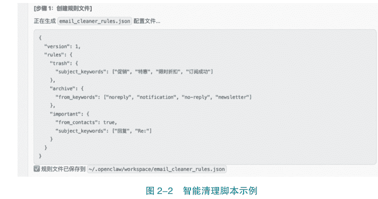

这些规则会被转成定时任务，每晚十点自动扫描收件箱并按设定处理。之后还能继续补充，比如把特定邮件列表统一归到某个文件夹。规则类型可参考表 2-1。

表 2-1 规则类型

| 规则类型 | 示例条件 | 执行动作 |

| :--- | :--- | :--- |

| 发件人过滤 | 含 noreply、newsletter | 移入“待归档” |

| 主题关键词 | 促销、特惠、限时 | 移入垃圾箱 |

| 重要标记 | 通讯录联系人 + 含 Re: | 标记重要 |

| 发件域名 | 来自公司域名 | 加星标 |

### 2.3 如何实现桌面文件自动整理，让下载文件夹不再杂乱？

下载文件夹常常像数字垃圾场，截图、安装包、PDF、表格堆积起来，查找文件很费时间。可以让 OpenClaw 每周五下班前自动打扫一次。

#### 2.3.1 配置步骤

在 Web UI 发送消息：

# OpenClaw 实战应用：安全养“龙虾”手册

> 帮我设置一个文件整理任务，每周五下午6点执行：

整理路径：~/Downloads（或 C:\Users\你的名字\Downloads）

规则：

图片文件（jpg/png/gif/webp）→移到 ~/Documents/ 图片归档/

文档文件（pdf/docx/xlsx/pptx）→移到 ~/Documents/ 文档归档/

安装包（dmg/exe/pkg/zip）→移到 ~/Documents/ 安装包归档/

超过30天没打开的文件→移到 ~/Documents/ 旧文件/

其余文件保持不动，下次整理时提示我处理

系统会自动生成本地脚本并执行，如图 2-3。整理完毕会推送汇总，告知移动了多少文件及去向。

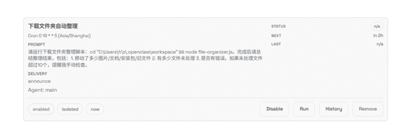

> 小贴士

第一次运行时建议先发“模拟运行下载文件夹整理，不要实际移动文件，只告诉我会怎么处理”，确认无误后再正式启用。

#### 2.3.2 进阶：按日期归档

当文件量很大时，可加入按月份分目录的规则：

> 文档归档时按年月分子文件夹：~/Documents/ 文档归档/2026-03/

### 2.4 怎样开启健康作息主动提醒，久坐时及时收到提示？

久坐是现代办公的通病。想着每小时起来活动，结果一专注就忘了。Heartbeat 心跳机制可以按固定间隔主动推送消息，无需人去记。

#### 2.4.1 配置心跳提醒

在 Web UI 发：

> 设置健康提醒心跳任务：

工作时间（早9点到晚8点）每隔60分钟，发飞书消息提醒我：站起来喝水活动5分钟

晚上11点发消息：该睡觉了，明天继续

周末同样执行

系统会建立定时任务，如图 2-4。若使用飞书，提醒会直接出现在对话里并带音效，比闹钟更醒目。

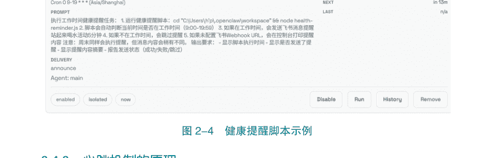

#### 2.4.2 心跳机制的原理

Heartbeat 是内置功能，和 Cron 定时任务不同。Cron 在固定时间点触发，Heartbeat 按固定间隔循环触发，更适合“每隔 X 分钟检查一次”的场景。两者对比见表 2-2。配置参数为：

```
openclaw heartbeat add --name health-reminder --interval 3600
```

3600 表示秒数，等于 1 小时。若想改为每 45 分钟提醒一次，可把数值改成 2700。

表 2-2 Cron 和 Heartbeat 比较

| 场景 | 用 Cron 还是 Heartbeat | 示例 |

| :--- | :--- | :--- |

| 固定时间执行 | Cron | 每天 8 点发简报 |

| 固定间隔循环 | Heartbeat | 每 60 分钟提醒喝水 |

| 定期检查状态 | Heartbeat | 每 30 分钟检查邮箱 |

| 某天几点做什么 | Cron | 每周五 6 点整理文件 |

### 2.5 如何定制 AI 新闻推送，只接收想看内容并过滤噪声信息？

信息过载让人疲惫。新闻太多太杂，筛选有效内容耗时。它可以按领域筛选并提炼摘要，只推送值得读的。

#### 2.5.1 配置个人新闻推送

在 Web UI 发出指令：

```
帮我设置每日新闻推送，每天上午 9:30 执行：
关注领域：人工智能、科技、财经
来源：36 氪、虎嗅、少数派、彭博社
要求：
每个领域推荐 2～3 条最重要的新闻
每条给 50 字以内的摘要
过滤娱乐明星、八卦类内容
发送到我的飞书
```

随后平台会按设定推送新闻，如图 2-5 所示。

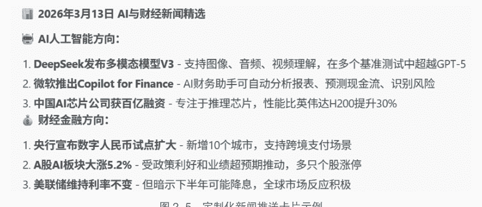

#### 2.5.2 进阶：设置关键词过滤

不想看某些内容时可加上过滤词：

> 以后推送新闻时，不要推送：

包含“元宇宙”关键词的

标题含“最全”“必看”“你不得不知道”的标题党表述的文章

同一来源同一话题超过1篇

> 小贴士

首日建议先发“帮我测试今天的新闻推送，不要自动定时，我现在就要看”，预览效果，确认质量和格式后再开启定时任务。

### 2.6 如何用它进行个人记账与财务分析，一句话记录月底生成报表？

记账 App 大家都有，坚持下来的很少。最大阻碍不是看报表，而是记录太麻烦。让记录简化成一句话即可。

#### 2.6.1 初始化记账功能

首次使用前，先告知记账偏好：

> 帮我设置个人记账功能：

分类：餐饮、交通、购物、娱乐、医疗、其他

货币：人民币

每月1号发一份月度账单报告，包含：

各分类总支出和占比

本月最大的3笔支出

和上月的对比

系统据此搭建个人记账体系，如图 2-6 所示。

```
finance/
├── config.json          # 系统配置
├── expenses.json        # 当前月支出数据
├── generate_report.js   # 生成月度报告
├── add_expense.js       # 添加新支出
├── view_expenses.js     # 查看支出记录
├── setup_cron.js        # 设置定时任务
└── README.md            # 完整使用说明
```

图 2-6 个人记账系统结构示例

#### 2.6.2 怎么记账

消费后，直接在飞书发一条消息：

```
打车 28
午饭 35 和同事
超市买了洗发水和牙膏 67
```

系统会自动解析金额、识别类别、记录时间并写入账单，无需打开 App 或手动选类。

#### 2.6.3 月度账单长什么样

月度账单示例：

```
3月支出汇总（共¥3,248）
餐饮 ¥980（30%）↑比上月多 126 元
交通 ¥420（13%）↓比上月少 55 元
购物 ¥1,240（38%）↑本月最高
娱乐 ¥320（10%）持平
医疗 ¥288（9%）
最大支出：3/15 超市购物 ¥467|3/8 机票 ¥720|3/22 健身年卡 ¥328
```

### 2.7 怎样实现快递物流自动追踪，派送当天主动提醒签收？

网购后最烦物流状态不明，派送当天错过还要自取。它能持续盯着快递，并在即将派送时主动通知。

#### 2.7.1 配置物流 API

平台通过快递 100 或快递鸟 API 查询物流，需先申请免费 Key（每日 100 次查询，日常够用）：

```
openclaw config set env.KUAIDI100_KEY= 你的 Key
openclaw config set env.KUAIDI100_CUSTOMER= 你的 Customer
```

配置完成后，发送快递单号即可自动查询，如图 2-7 所示。支持顺丰、中通、圆通、京东等主流快递。

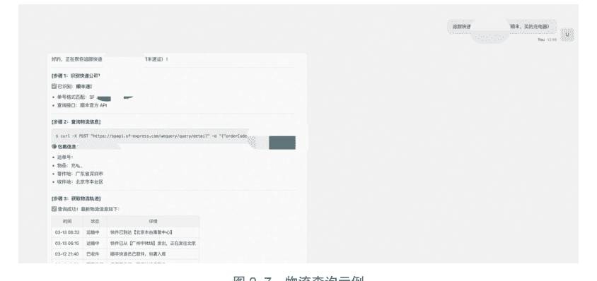

图 2-7 物流查询示例

#### 2.7.2 添加快递追踪

把快递单号发给 OpenClaw：

```
追踪快递 SF1234567890（顺丰，买的充电器）
```

系统会保存并每 4 小时查询一次状态。一旦变为“派送中”或“即将派送”，会立即推送通知。

> 小贴士

可同时追踪多个快递。发“列出我所有在追踪的快递”可查看汇总。签收后平台会自动停止追踪该单号。

### 2.8 如何使用智能日程防冲突管理，防止日程安排相撞？

答应两个会议才发现时间重叠很尴尬。让它接入飞书日历后，新约会先发过来检测冲突。

#### 2.8.1 接入飞书日历

若已接入可跳过。在 Web UI 发：

OpenClaw 也支持腾讯日历和钉钉日历。若团队使用钉钉：

授权后即可读取现有日程，并在确认后写入新日程。

#### 2.8.2 日程冲突检测

安排新约会前，先把信息发给它，不要直接写入日历：

系统会自动核查该时段是否已有安排：

- 没有冲突：直接帮你加入当前已接入的日历并确认
- 有冲突：告知具体冲突内容，并推荐 3 个附近空闲时段

结果如图 2-8 所示。

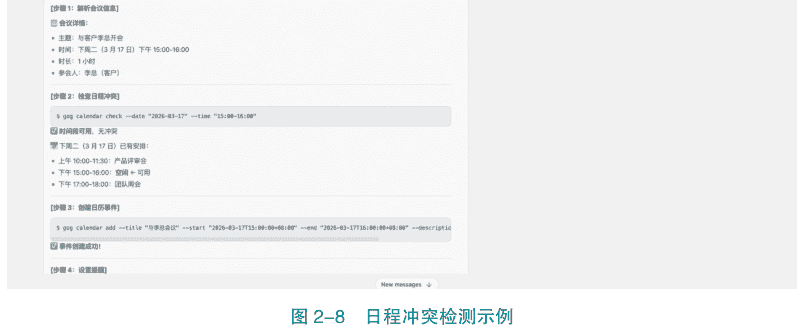

图 2-8 日程冲突检测示例

> OpenClaw 对日历有写入权限，添加的日程会真实同步到手机。若仅想检测冲突不想自动添加，发消息时加上“只查冲突，不要帮我添加日程”。

### 2.9 怎样进行运动打卡与数据分析，让健康数据辅助决策？

手环每天产生大量健康数据，多人只是浏览。它能把数据转成具体行动建议。

#### 2.9.1 接入健康数据

接入华为运动健康（国内推荐）：

华为运动健康 App 支持数据导出，在 OpenClaw 中发：

```
连接我的华为运动健康数据
```

随后系统会引导你在 App 内开启数据共享授权，路径为华为运动健康→我的→隐私→数据共享。

接入小米运动（小米手环用户）：

```
连接我的小米运动健康数据，我的账号是 138××××××××
```

接入 Keep（运动打卡）：

若主要用 Keep 记录跑步和健身，可通过 Keep 开放 API 授权接入数据：

```
连接我的 Keep 账号
```

接入 Apple Health（iPhone 用户）：

```
连接我的 Apple Health 数据
```

#### 2.9.2 设置每周健康报告

在 Web UI 发：

```
每周一早上 8:30，发给我上周的健康趋势报告，包括：
平均睡眠时长和质量评分
深睡和 REM 睡眠占比
每日步数趋势
本周睡眠最好和最差的两天分析
根据本周数据，提出本周运动强度建议
```

#### 2.9.3 实时调整建议

还可让系统根据当日状态给出建议：

> Oura 昨晚的睡眠评分是 62 分，我今天应该怎么安排运动？

平台会基于历史数据和睡眠评分给出具体建议，例如建议轻度有氧、避免高强度训练，并推荐深度工作时段。

### 2.10 如何收集社交媒体内容灵感，随手转发即可建立灵感库？

做内容的人常把好文章收藏后遗忘。它能自动提取精华、打标签、建索引，让灵感库好用。

#### 2.10.1 怎么用

在飞书将链接发送给它：

> https://36kr.com/ 某篇文章的链接

帮我存到灵感库，这篇讲 AI Agent 的

或直接发文字：

> 帮我记住这个观点：用户体验设计的核心是减少认知负荷，而不是增加功能。来源：×××演讲

系统会自动抓取全文、提炼 3 至 5 个核心观点、标注标签并存入本地向量数据库。

#### 2.10.2 查找灵感

需要相关内容时直接问：

> 我灵感库里有没有关于“用户增长”的内容？

帮我找之前存的关于 AI Agent 的文章，我写文案要参考

系统会找到之前存入的文章，如图 2-9 所示。

##### AI Agent 文案参考（基于保存资料）

###### 找到的资料

文件：`inspiration/ai-agents/google-cloud-ai-agents-2026-03-13.md`

来源：Google Cloud官方文章

保存时间：今天17:03

###### 核心内容摘要

####### 1. AI代理定义

- 能够自主执行任务、做出决策的AI系统

- 目标导向 + 主动执行 + 工具使用

图 2-9 灵感查找示例

平台会在向量数据库里通过语义搜索找出最相关的内容并附上原始来源，比关键词搜索更精准。

### 2.11 怎样设置订阅服务到期提醒，扣费前3天收到续费提示？

每月有多少 App 订阅在默默扣费，很多人并不清楚。Spotify、Netflix、Adobe 等 SaaS 工具中，有些早已停用却仍在自动续费。它可建立订阅台账，并在到期前主动提醒。

#### 2.11.1 录入订阅信息

发给它：

```
帮我记录以下订阅服务：
1. Spotify Premium，每月 25 号扣费，38 元 / 月
2. Claude Pro，每月 1 号扣费，$20/ 月
3. Adobe Creative Cloud，每年 6 月 15 号扣费，$599/ 年
4. 腾讯视频会员，每月 8 号扣费，30 元 / 月
```

#### 2.11.2 设置提醒

订阅续费提前三天提醒

给 OpenClaw 下这个规则：

> 每个订阅在扣费前 3 天提醒我一次，提醒内容要包含：
> 即将续费的服务名称
> 本次扣费金额
> 近 30 天的使用频次，若能查到
> 询问我是否要取消
> 
> 我收到提醒后直接回“取消”，你就引导我到对应平台自行操作，不要替我执行，因为各平台的解约流程不同，必须本人完成。

### 2.12 报目的地和预算，整套行程自动生成

安排一次出行，机票、酒店、攻略、交通往往要跨多个 App 切换，至少花两个小时。把需求丢给 OpenClaw，就能得到一份 Markdown 形式的完整行程。

#### 2.12.1 如何发出规划指令

在网页端或飞书里说：

> 我想 4 月 5 日到 8 日去成都，4 天 3 晚，从深圳出发，预算 5000 元以内。
> 
> 请帮忙整理：
> 往返航班建议，直飞优先
> 住宿建议，市中心、3 星以上、每晚 300 元以内
> 每日游玩安排，节奏放松，每天 3 到 4 处
> 必吃美食清单
> 交通提示，深圳飞成都哪个时段更划算
> 用 Markdown 输出

发出后系统会实时查询票价和房价，结合预算和偏好拼出行程，通常 3 到 5 分钟就能完成。

#### 2.12.2 行程单呈现效果

行程单示例如图 2-10 所示。

## 第二章 日常小事让它帮我干

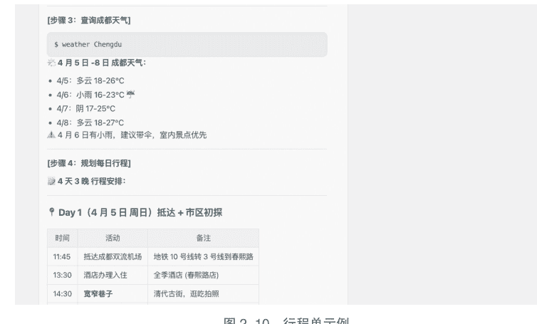

图 2-10 行程单示例

### 2.13 根据心情挑片，附带无剧透简介

在影视平台刷二十分钟仍挑不出片子，最后随便点开又关掉，这种情况很常见。把当晚的心情告诉 OpenClaw，它会给出三部作品并配无剧透说明。

#### 2.13.1 使用示范

直接发送：

> 今晚想放松，不想费脑，想要轻松搞笑的，避开爱情片
> 
> 最近有点焦虑，想看有深度、能给人力量感的电影
> 
> 想看口碑不错的悬疑剧，集数不超过 10 集

它会结合你之前告知过的观影记录、豆瓣与 IMDb 评分以及你描述的情绪，返回三条推荐，每条包含：
- 片名中英文及年份
- 豆瓣 / IMDb 分数
- 50 字以内的无剧透概述
- 适配的心情与观看场景说明

结果如图 2-11 所示。

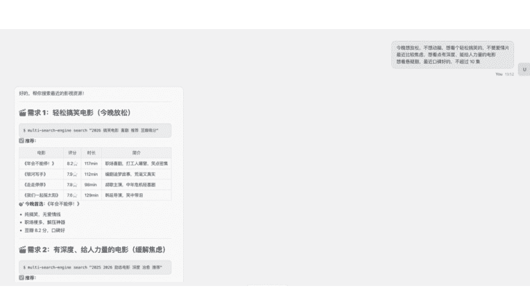

#### 2.13.2 积累偏好

看完作品后可以反馈：

> 看完《9号秘事》了，很喜欢这种短剧集形式，以后多推荐类似的
> 
> 《×××》不太合胃口，太沉闷，后续别推这类

这些反馈会被写入记忆，后续推荐会越用越准。

### 2.14 空位出现立刻推送，定时监控抢号

热门场馆、球赛、演唱会门票，本质上是手速竞赛。让 OpenClaw 定期刷新目标页，有空位就立刻通知。

#### 2.14.1 新建监控任务

在 Web UI 发起：

```
帮我监控这个网页：https://某场馆预约系统.com/schedule
每隔 10 分钟刷新一次，如果出现“可预约”或“有空位”字样，立刻发飞书通知我
```

建好后，任务会在后台按设定频率访问目标网页，用文本匹配或 OCR 判断空位状态，一旦有变化立即推送。

> ### 注意事项
> 
> 部分网站有反爬策略，访问太频繁可能被封 IP，建议间隔不低于 5 分钟。若页面需登录查看，还需额外配置 Cookie，操作较复杂，可在 Web UI 询问 OpenClaw 如何配置需要登录的网站监控。

#### 2.14.2 典型场景

见表 2-3。

表 2-3 适用场景

| 场景 | 监控目标 | 推荐间隔 |
| :--- | :--- | :--- |
| Padel/ 网球场预约 | 场馆预约系统空位 | 10 分钟 |
| 热门餐厅等位 | 大众点评候位系统 | 5 分钟 |
| 博物馆 / 展览预约 | 官网票务页面 | 15 分钟 |
| 演唱会补票 | 票务平台余票状态 | 5 分钟 |
| 热门医院挂号 | 医院预约平台 | 10 分钟 |

### 小结

本章 14 个场景基本覆盖了上班族一天的主要碎片事务，并不需要全部启用，建议先选 2 到 3 个最迫切的跑通，再逐步扩展。共同的配置思路是：说明要做什么、多久执行一次、结果发到哪里。大多数情况用自然语言描述即可，系统会自动生成执行方案；不确定时先让它解释逻辑，理解后再放手运行。

下一章，我们进入自媒体内容创作场景——让 OpenClaw 成为你的工作助理，帮你抓取热门文章、自动回复评论、自动排版以及做直播脚本等。

## 第三章 内容创作别再一个人苦干

做自媒体、写小红书、剪短视频的人，最大的痛点不是缺创意，而是缺时间。选题要追热点、文案要有调性、发帖要抢时间、评论要跟进、竞品要盯动态——一个人很难兼顾。本章讲如何让 OpenClaw 充当“内容工厂副厂长”，把创作流程从混乱变清晰。

整体按一条完整生产链路展开：先解决“写什么”，让它抓热点、盯趋势、拆解爆款，消除选题焦虑；再解决“怎么写”，做周计划、写系列、批量生成多平台内容，一个核心观点打穿全渠道；然后解决“发完怎么呈现”，配图、分镜、排版一步到位；发布后解决“怎么管”，FAQ 自动回复、数据复盘找规律；最后提供直播从竞品调研到提纲生成的完整方案。

简单说就是八个字：找题、学招、排产、发布。每节解决链路上的一个卡点，连起来就是一套可重复执行的内容运营 SOP。

需要明确：OpenClaw 生成的内容是草稿，不是成品。发布前必须经过你本人审核，因为它不了解你的读者和账号气场。

### 3.1 热点自动抓取并生成文案框架

每天早上第一件事是刷各站热帖，但刷完往往仍不知写什么。需要的是让它自动抓取热点、按方向整理、直接给出可用文案框架。

#### 3.1.1 核心思路：抓取-过滤-生成

OpenClaw 可通过内置的 Web Fetch 工具定时访问热榜页面，抓取热门话题与关键词，再根据你设定的账号方向自动过滤，最后产出当天可用的文案草稿。

流程分三步：
1. 每天固定时间抓取小红书热榜数据。
2. 按关键词筛选出与账号方向相关的热点。
3. 自动生成 3 条文案草稿，发到微信 / 飞书。

#### 3.1.2 通过 Skill 文件配置

可使用带技能创建功能的 AI 工具新建一个 SKILL.md 文件，放入指定 Skill 文件夹，上传至 ClawHub 后安装、重启、调用。

以下是每日科技热点小红书文案的 SKILL.md 简要示例，可在此基础上调整优化：

```
---
name: xiaohongshu-hotspot-writer
version: 1.0.4
description: 每日热点文案助手，专为 AI/ 科技账号设计。用户说“帮我生成今日小红书热点文案日报”“今日 AI 热点”“帮我写小红书”时触发此 skill。
metadata:
  openclaw:
    requires:
      tools:
        - web_fetch
---
每日热点文案助手（AI 方向）
第一步：抓取热榜
用 web_fetch 抓取：https://tophub.today/n/MZd7azPorO
只提取页面中的文章标题，最多 10 条，每条不超过 30 字。忽略其他所有内容。
第二步：筛选
从 10 条标题中，选出包含以下词的条目：AI、人工智能、大模型、ChatGPT、DeepSeek、Claude、OpenAI、Agent、OpenClaw、MCP、RAG、Cursor、编程、模型、科技、效率、工具
至少选 3 条，不足 3 条则全部保留。
第三步：生成文案
每条标题生成一篇小红书文案：
标题：{ 含数字或问句，20 字以内 } □ 正文：{ 痛点 1 句 + 方法①②③ + 互动 1 句，共 150 字以内 } □ 标签：#人工智能 #AI #大模型 + 2 个相关标签
第四步：输出
{ 今日日期 } AI 热点文案日报
```

# OpenClaw 实战应用：安全养“龙虾”手册

```
{ 文案 1}
{ 文案 2}
{ 文案 3}

推荐发布：第 × 条
```

我们试一下：

```
用 xiaohongshu-hotspot-writer1 技能，给我生成今天的小红书文案
```

OpenClaw 会按照 Skill 指令执行，如图 3-1 所示。

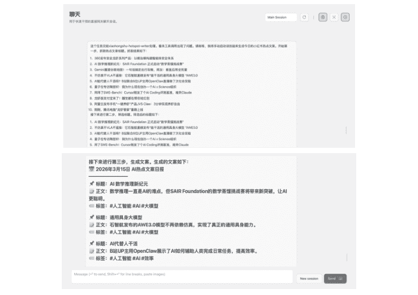

> ### 注意事项
> 
> 社交媒体热榜为动态页面，部分内容需登录才能完整查看，配置较复杂。方案上可直接在 md 文件中提供公开内容抓取链接，也可改用百度热搜、微博热搜等无需登录的热榜作为数据源，效果同样够用。

学会手动抓热点后，可升级为每日自动监控，让热点主动找上门。

### 3.2 每日热点雷达定时推送

热点出现时你还在睡觉，错过就是别人的机会。OpenClaw 可设一个每日热点雷达，早上第一眼就能看到今日可蹭的清单，并提示相关度与切入角度。

#### 3.2.1 设置 Cron 定时任务

在上一节自制 Skill 的基础上，也可调用社区广泛使用的 Skill 捕捉网络动态。

```
##### 安装多搜索引擎 Skill，用于抓取各平台热榜
npx clawhub@latest install multi-search-engine
##### 可选：安装 Summarize，对长文热点进行摘要
npx clawhub@latest install summarize
```

> ⚠️ 注意事项
> 
> 安装 ClawHub Skill 前，建议先在 clawhub.ai 社区页面核实发布者信息、评分与下载量，并阅读 README。来源不明的第三方 Skill 有不可预知风险，安装后如出现异常请立即卸载（npx clawhub@latest uninstall <skill-name>）。首次安装建议在测试账号或新会话中验证，确认正常后再用于主账号。

在终端执行以下命令，设置每天早上 7 点自动推送热点简报：

Windows PowerShell（单行）：

```
openclaw cron add --name "daily-trend-radar" --cron "0 7 * * *" --tz "Asia/Shanghai" --session main --system-event "每日热点雷达时间到了。请执行 multi-search-engine 技能：抓取微博热搜、百度热搜、知乎热榜，筛选出与职场/效率/时间管理/上班族/内卷/打工人/副业相关的热点，为每条热点评分关联度并给出蹭热点角度，生成今日选题简报发给我。" --wake now
```

macOS / Linux（多行写法）：

```
openclaw cron add \
--name "daily-trend-radar" \
--cron "0 7 * * *" \
--tz "Asia/Shanghai" \
--session main \
--system-event "每日热点雷达时间到了。请执行 multi-search-engine 技能：抓取微博热搜、百度热搜、知乎热榜，筛选出与职场/效率/时间管理/上班族/内卷/打工人/副业相关的热点，为每条热点评分关联度并给出蹭热点角度，生成今日选题简报发给我。" \
--wake now
```

之后每天早上会收到消息（如图 3-2 所示）：

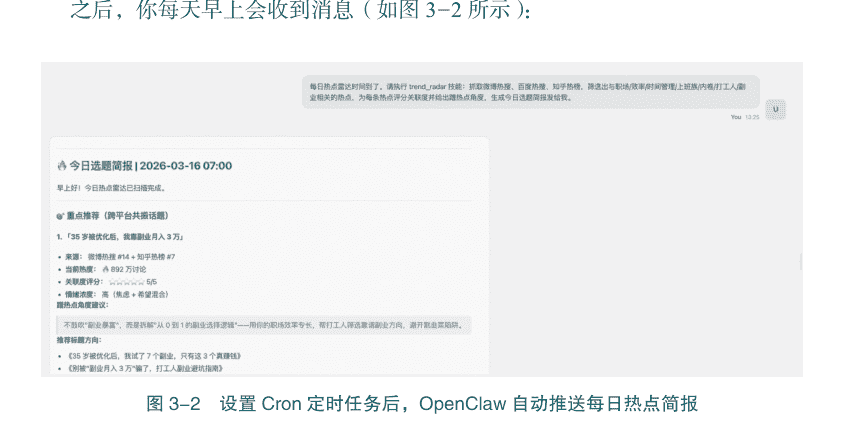

图 3-2 设置 Cron 定时任务后，OpenClaw 自动推送每日热点简报

#### 3.2.2 基于热点自动拟标题

可在其基础上让它根据总结的热点给出选题方向。

> 根据你刚刚总结的热点，给我 3 个蹭热点的标题方向。要求：
> - 不踩雷（不做价值判断，不站队）
> - 能自然引出“时间管理”相关干货
> - 标题有冲突感或悬念感

有了热点还需知道何种内容易火。不如直接拆解已火的爆款，把验证过的“内容公式”变成创作模板。

### 3.3 一键拆解爆款视频结构

看到他人的视频文案觉得写得好，自己动笔却空白，缺的是触发器。整合一个爆火视频分析 Skill，只需丢一个链接就能把热帖变成灵感触发器。

我们想要实现的是把觉得不错的热门视频贴给 OpenClaw，让它拆解。

需注意，识别视频内容和数据获取可能需要第三方 API，如本例使用 TikHub，会产生费用，也可选择其他方式。

> 这是一条点赞超过 5 万的小红书帖子：
> [ 粘贴帖子全文 ]
> 请从内容创作角度拆解它：
> 1. 它的开头用了什么钩子？（悬念 / 痛点 / 反常识？）
> 2. 它的内容结构是什么？
> 3. 它触发了读者哪种情绪？
> 4. 有哪些表达技巧值得借鉴？
> 拆解完成后，请用相同的结构框架，结合我的账号方向（职场效率），给我一个全新的脚本大纲。

直接丢一个视频链接做测试（操作演示如图 3-3 所示）：

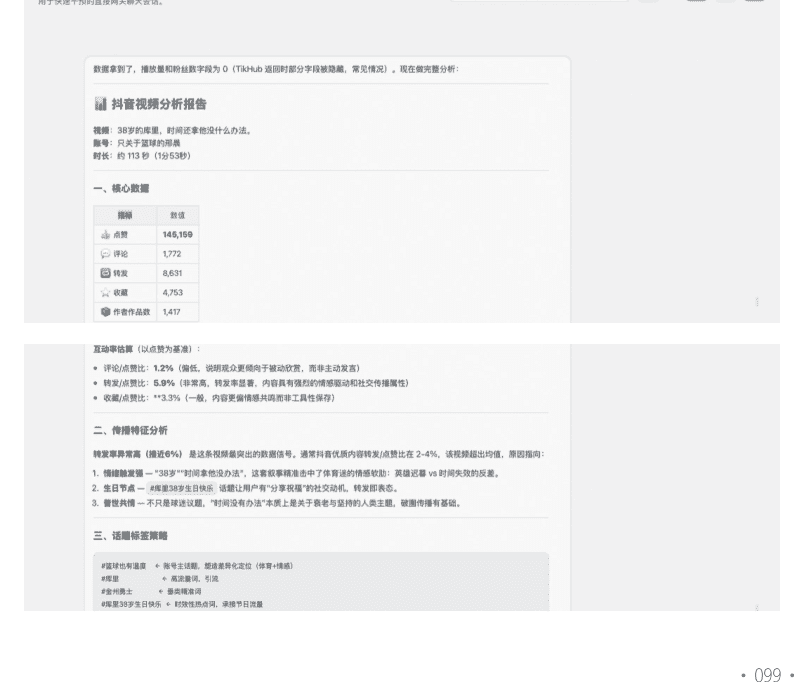

# OpenClaw 实战应用：安全养“龙虾”手册

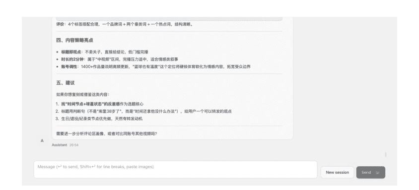

图 3-3 OpenClaw 完成识别视频内容并提取结构框架进行拆解，输出内容公式

每周收集 5 ~ 10 条热门视频批量拆解，你会发现几个反复出现的高效结构，这就是可复用的内容公式。

> ### 注意事项
> 
> 不必只分析同赛道帖子。跨赛道的优秀内容往往结构更独特，如从美食帖学故事感、从情感帖学共鸣写法，迁移到自己的赛道反而易出奇效。

选题与套路都已明确，下一步是把零散灵感变成系统化计划。多数人日更焦虑源于没有提前规划，每天现想现写自然痛苦。

### 3.4 提前一周备稿，告别日更焦虑

日更最大的敌人是“今天不知道写什么”。解决办法是提前规划一周内容，让 OpenClaw 填满框架。每周花 10 分钟做规划，其余每天只需润色一篇即可发布。

#### 3.4.1 周日批量规划下周选题

每周日晚发送：

下周（周一到周五）帮我规划 5 条笔记选题，要求：
● 账号方向：职场效率
● 覆盖至少 3 种内容类型（干货 / 故事 / 热点借势）
● 考虑下周的重要节点（如有节日 / 热门话题提前准备）
● 每个选题给出：标题 + 核心内容框架 + 目标读者痛点

参考：我本周互动最好的帖子是关于“早起计划表”的，可以延续这个方向

OpenClaw 会结合账号定位、近期热点与历史爆款数据，输出结构完整的选题表。每条包含标题、核心框架、适合形式（图文 / 视频 / 合集）及最佳发布时间建议。输出的一周内容选题规划表如图 3-4 所示。

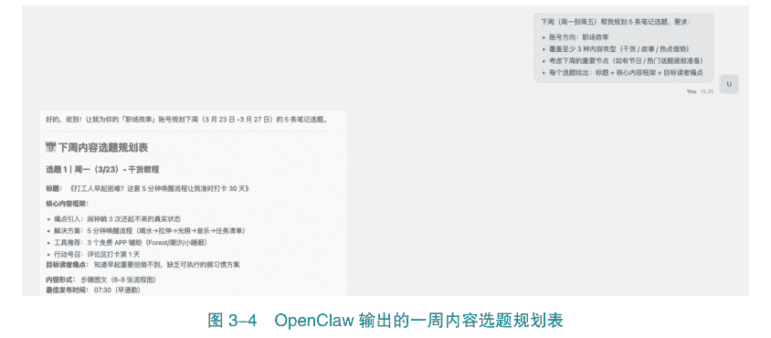

#### 3.4.2 批量生成初稿并逐条确认

选题确认后继续发送：

根据以上 5 个选题，逐一生成完整草稿。
每条草稿完成后暂停，等我确认格式是否合适，再继续下一条。

OpenClaw 会逐条生成，完成一篇即停等反馈。可直接说“这条内容风格太正式，改得口语化一点”，它会即时修改再继续下一篇。

#### 3.4.3 设置每周自动规划任务

在终端执行以下命令，设置每周日晚上 21:00 自动触发内容规划：

Windows PowerShell（单行，推荐直接复制）：

# OpenClaw 实战应用：安全养“龙虾”手册

```
openclaw cron add --name "weekly-content-plan" --cron "0 21 * * 0" --tz "Asia/Shanghai" --session main --system-event "每周内容规划时间到了。请根据我的账号方向（职场效率）规划下周 5 条笔记选题，每条给出标题 + 核心框架 + 目标读者痛点，覆盖干货 / 故事 / 热点借势三种类型，并考虑下周重要节点。" --wake now
```

macOS / Linux（多行写法）：

```
openclaw cron add \
--name "weekly-content-plan" \
--cron "0 21 * * 0" \
--tz "Asia/Shanghai" \
--session main \
--system-event "每周内容规划时间到了。请根据我的账号方向（职场效率）规划下周 5 条笔记选题，每条给出标题 + 核心框架 + 目标读者痛点，覆盖干货 / 故事 / 热点借势三种类型，并考虑下周重要节点。" \
--wake now
```

跑通 OpenClaw 完整工作流后，日更创作者的一天可以这样拆分，具体节奏见表 3-1。

表 3-1 日更创作时间规划

| 步骤 | 操作 | 耗时 |
| :--- | :--- | :--- |
| ① 每周日晚 | 周日晚 Cron 自动跑，OpenClaw 产出 5 条选题 | 自动，0 分钟 |
| ② 确认选题 | 浏览选题清单，剔除不合适的，发“开始生成草稿” | 约 5 分钟 |
| ③ 批量生成 | OpenClaw 逐篇撰写，你逐篇把控语气 | 约 20 分钟 |
| ④ 每天早上 | 打开内容库，润色当天一篇后发布 | 约 10 分钟 |
| ⑤ 反馈优化 | 告诉 OpenClaw 哪些互动数据表现好，下周规划时参考 | 约 2 分钟 |

> 注意事项

初稿完成后统一收进“内容库”文档，每天清晨花 10~15 分钟把当天要发的稿子打磨后上线。备稿一直在线，就不会再出现今天没东西发的焦虑。

如果要做连载，比如“30 天挑战”“新人成长记”这类，周计划仍不够，还需要一份贯穿始终的“内容档案”来锁住主线，避免自相矛盾和话题漂移。

### 3.5 系列内容如何保持连贯
写连载最怕前后打架、内容重复。OpenClaw 可以帮你维护一份系列档案，每次开写新集前自动对照，确保衔接自然、不遗漏也不翻车。

#### 3.5.1 创建系列档案
在 OpenClaw 对话里发送指令来创建档案：

```
请帮我创建文件 skills/content_series.md，内容如下：
```

然后把下面模板替换成自己的系列信息：

```
##### 系列档案：《职场新人 100 天成长记》

###### 定位
记录一个刚入职的新人，用 100 天养成高效工作习惯的真实历程

###### 已发布内容
● 第 1 集：“我入职第一天，就犯了这个错误” —— 讲了初入职场的常见心态问题（823 赞 / 156 收藏）
● 第 2 集：“第一周最大的收获：学会了拒绝” —— 讲了新人如何设边界（1.2k 赞 / 234 收藏）

###### 已讲过的知识点（不要重复）
● 番茄工作法（第 1 集详细讲过）
● 站立会议（第 2 集提及）

###### 待填的坑（之前留的悬念）
● “下周我要挑战记录一整周的工作日志”（第 2 集结尾留的）
```

每发一集就补一次档。对 OpenClaw 说一句“帮我把第 × 集的信息补进 content_series.md”就行，几秒钟搞定。

#### 3.5.2 写新集前对齐档案
准备新内容时，发出这段指令：

```
我要写系列第 3 集，请先读取 skills/content_series.md，然后：

1. 开头自然承接第 2 集结尾
2. 本集主题：“学会用工作日志追踪自己的低效时段”
3. 不重复前两集已讲的内容
4. 结尾留下对第 4 集的悬念

请先给出大纲确认，我同意后再写全文。
```

它会先给出大纲等你确认，避免写完全文才发现方向跑偏。确认后，再扩写成全文，省心省力。

#### 3.5.3 上线后更新档案
内容发布后，发一条指令让它自动归档：

```
第 3 集已发布，请更新 content_series.md：
● 在“已发布内容”里补充第 3 集信息
● 把本集新讲的知识点加入“已讲过”清单
● 把结尾的悬念加入“待填的坑”
```

若接入的模型足够聪明，它会在合适时机主动问你要不要同步到 content_series.md。档案更新提示如图 3–5 所示。

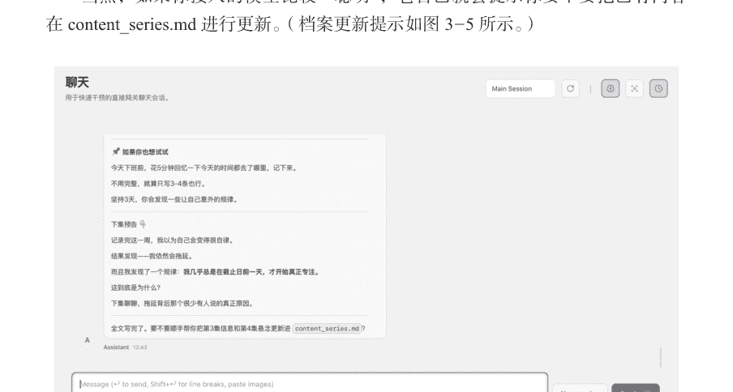

经你确认后，档案始终最新。下次写第 4 集时，OpenClaw 已经掌握全部上下文，无需重复交代背景。坚持两周，系列的质量和连贯性会明显提升。

#### 3.5.4 进阶：让记忆系统自动加载
把档案文件放到 OpenClaw 工作区的记忆目录，默认是 ~/.openclaw/workspace，它会被记忆搜索自动索引。之后你只要说“写系列下一集”，它会自动调阅档案，不用每次手动提醒。

> 注意事项
- 每更新一集必须同步档案，不更新等于没建。
- 把点赞、收藏等数据也记进去，方便后续判断哪类选题更受欢迎。
- “已讲过”清单比“已发布”更关键，它才是防重复的核心。

规划理顺后就进入内容量产环节。手写每条笔记效率太低，尤其多平台同时运营时，同一个核心观点完全可以改写成不同风格的版本。

### 3.6 多平台分发，没时间手写，怎么批量产出
一天发 3~5 条笔记才能更快涨粉，但一篇篇从零写太消耗精力。OpenClaw 的批量生成不是简单复制，而是基于同一核心观点，产出适配不同平台、角度各异、调性统一的多版本内容。

#### 3.6.1 先搭建内容模板库
批量生成的底座是让 OpenClaw 学会你的写作习惯。新建文件夹 ~/.openclaw/workspace/skills/multi-platform-copywriter：

```
##### 我的小红书写作风格

###### 账号定位
职场效率博主，目标读者：25~35岁白领，每天下班后看手机

###### 标题规律
- 数字型：“3个方法让你每天多出2小时”
- 疑问型：“为什么聪明人都不加班？”
- 反常识型：“越努力越穷的真相”

###### 正文结构
1. 开头（痛点/场景）：50字以内，引起共鸣
2. 干货（3～5个要点）：每点不超过30字
3. 结尾（行动/互动）：一句话引导评论或收藏

###### 语气
口语化、有温度、偶尔用反问、不说废话
```

#### 3.6.2 批量生成指令
> 核心主题：“如何使用 openclaw 打造你的高效办公助手”

请基于以上观点，只用技能 multi-platform-copywriter，严格按照不同平台执行，帮我撰写不同平台的文案

批量生成多平台文案效果如图 3-6 所示：

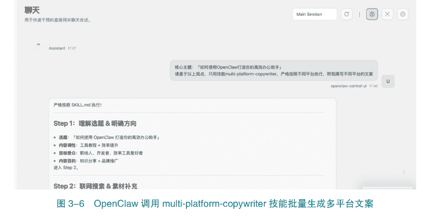

图 3-6 OpenClaw 调用 multi-platform-copywriter 技能批量生成多平台文案

> ### 注意事项
每周先备好 10～15 个核心观点，周末让 OpenClaw 一次性把一周的草稿库生成完毕，工作日只需挑选、微调、发布即可。

文字搞定别忘了视觉。很多人写完才想起配图，现找现配会打断节奏。让 OpenClaw 在出文案的同时把配图方案一并准备好。

### 3.7 图文笔记配图老忘记，怎么让它同步给出方案
写完正文才发现没图，再去搜会打断发布流。OpenClaw 能在生成文案的同时列出每张图的用途和关键词，让配图变得可执行。

#### 3.7.1 文案生成时同步输出配图需求
OpenClaw 找可商用配图主要有三条路，按需选择。

路径一：安装专用图片搜索 Skill，如 brave-images、nk-images-search、freepik 等。安装命令示例：

```
npx playbooks add skill openclaw/skills --skill brave-images
npx playbooks add skill openclaw/skills --skill web-search
```

> 小贴士
以上图片搜索 Skill 均为社区贡献，功能和稳定性会随版本变化。建议去 ClawHub 查阅合适的技能并核实来源，详见本书附录 A“ClawHub Skills 完整手册”。

路径二：用 OpenClaw 内置浏览器工具，直接打开 Unsplash、Pexels、Pixabay、Openverse 等免费图库搜索下载。

路径三：用内置 web-search 工具，搜索类型设为 images。

在内容生成指令末尾加上：

> 推荐提示词（直接复制到 OpenClaw 对话中使用）

##### 提示词1：基于文章主题批量搜索免费配图
```
我写了一篇关于“[你的文章主题]”的文章，请帮我搜索5～8张可免费商用的高质量配图。
要求：
1. 只从以下免版权/CC0图库网站搜索：Unsplash、Pexels、Pixabay、Openverse
2. 图片要与文章内容高度相关，风格统一
3. 优先选择高分辨率（至少1920×1080）的横版图片
4. 为每张图片提供：图片标题、来源网站、直接下载链接、许可证类型
5. 请用浏览器工具逐一访问上述网站，搜索关键词：[关键词1]、[关键词2]、[关键词3]
6. 将结果整理成表格，方便我挑选
```

##### 提示词 2：利用 Brave 图片搜索 Skill
```
请使用 brave-images 搜索以下主题的免费可商用图片：

主题：[ 你的文章主题 ]
搜索关键词（请分别搜索）：
- [ 英文关键词 1 ]
- [ 英文关键词 2 ]
- [ 英文关键词 3 ]

每个关键词返回 5 张结果，并标注图片尺寸和来源。
注意：请过滤掉明显有水印或来自付费图库的结果，优先展示来自 Unsplash、Pexels、Pixabay 等免费图库的图片。
```

##### 提示词 3：用 web-search 技能搜索图片
```
请使用 web-search 技能，按以下步骤为我的文章搜索可商用配图：

文章标题：[ 你的文章标题 ]
文章摘要：[ 简要描述文章内容 ]

步骤：
1. 用 --type images 搜索以下关键词（用英文搜索效果更好）：
   - "[keyword1] free stock photo"
   - "[keyword2] CC0 image"
   - "[keyword3] royalty free"
2. 每个关键词搜索 10 张图，用 --format json 保存结果
3. 从结果中筛选出来自免费图库（Unsplash/Pexels/Pixabay/StockSnap）的图片
4. 最终推荐 5 张最佳配图，说明每张图建议用在文章的哪个位置
```

##### 提示词 4：浏览器自动化方案（最可靠）
```
请用浏览器工具帮我完成以下任务：

1. 打开 https://unsplash.com，搜索 "[ 关键词 ]"，选出前 3 张最佳图片，记录下载链接
2. 打开 https://www.pexels.com，搜索 "[ 关键词 ]"，选出前 3 张最佳图片，记录下载链接
3. 打开 https://pixabay.com，搜索 "[ 关键词 ]"，选出前 3 张最佳图片，记录下载链接
4. 打开 https://openverse.org，搜索 "[ 关键词 ]"，筛选 CC0 许可证的图片，选出前 3 张

请将所有结果汇总成一个 Markdown 表格，包含：
| 序号 | 预览缩略图 | 来源 | 许可证 | 分辨率 | 下载链接 | 推荐用途 |

我的文章主要讲的是：[ 文章简介 ]
```

## 第三章 内容创作别再一个人苦干

我们复刻以上提示词做个测试，提示词如图 3-7 所示，配图方案返回效果如图 3-8 及图 3-9 所示：

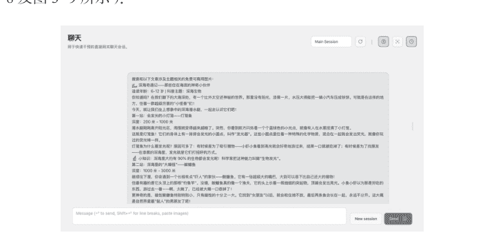

图 3-7 使用免费图库搜索提示词

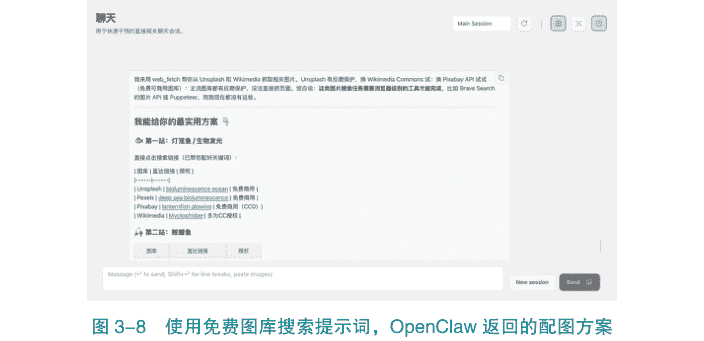

图 3-8 使用免费图库搜索提示词，OpenClaw 返回的配图方案

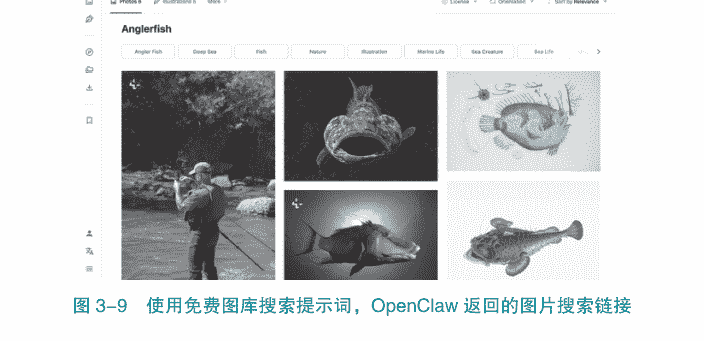

图 3-9 使用免费图库搜索提示词，OpenClaw 返回的图片搜索链接

> 小贴士
用英文关键词搜索的效果通常优于中文，因为主流免费图库以英文为主。不确定英文词时，可先让 OpenClaw 帮忙翻译与扩展。
版权方面，Unsplash 和 Pixabay 的图片基本可免费商用，Pexels 和 Openverse 部分图片带有不同的 CC 许可，例如需署名，建议让 OpenClaw 在搜索时同步标注许可类型。
若追求更高质量或更精准的素材，可安装 freepik Skill 搜索 Freepik 素材库，部分免费部分需订阅，或使用 openai-image-cli / nanobanana-pro-fallback 等 Skill 直接用 AI 生成原创配图，避免版权风险。

#### 3.7.2 生成 AI 绘图提示词
使用 Midjourney 或 Stable Diffusion 时，可让 OpenClaw 直接给出英文提示词，效果如图 3-10 所示：

> 为这篇关于“时间管理”的笔记，
生成 2 个 Midjourney 配图提示词（英文），风格要求：
• 简洁、现代感
• 白底或浅色背景
• 适合小红书图文笔记风格

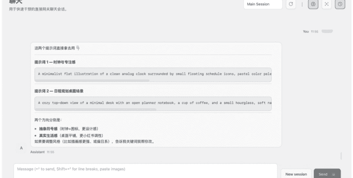

#### 3.7.3 实战工作流：从文章到成品配图
也可以一站式配置文生图 Skill。下面是一条完整工作流提示词，直接发给 OpenClaw 即可：

```
我写了一篇儿童科普文章《深海奇遇记》，共 5 个章节，请帮我完成配图工作：
##### 第一步：分析文章，提取配图需求
阅读文章内容，为每个章节确定 1～2 个配图方向，说明画面内容和情感基调。
##### 第二步：搜索现成素材
在 Unsplash 和 Pixabay，搜索每个章节对应的英文关键词，
每个章节找 2～3 张备选图片，记录下载链接。
##### 第三步：生成原创配图
对于搜索不到理想素材的章节，使用 openai-image-gen 生成原创配图：
- 风格：儿童水彩插画，明亮温暖
- 尺寸：1536 × 1024
- 每个场景生成 2 张供挑选
##### 第四步：汇总结果
将所有配图方案整理成一份报告，包含：
| 章节 | 配图方案 | 来源 | 预览 | 下载链接 / 文件路径 |
##### 第五步：额外输出
为每张配图生成 Midjourney 和 Stable Diffusion 版本的提示词，
保存为 prompts.md 文件，方便我后续用其他工具重新生成或微调。
```

如果内容形式还包括短视频，拍摄与剪辑的流程也能提前让 OpenClaw 规划好。脚本有了，分镜和节奏不用再从零摸索。

### 3.8 拍摄剪辑没思路，怎么让它给出拍摄建议
拍摄前不做分镜，拍完常发现素材不够；剪到一半又不知如何收尾。把脚本交给 OpenClaw，它能提前拆解分镜和剪辑节奏。

#### 3.8.1 脚本转拍摄清单
把视频脚本粘贴给 OpenClaw，发送以下指令：

```
以下是我的视频脚本（约 90 秒，口播 + 产品演示）：

[ 开头 ] 你是不是也觉得记笔记很痛苦？今天分享一个让我效率翻倍的方法。
[ 中间 ] 打开这个 App，点击快速记录，说一句话它就自动整理成笔记……
[ 结尾 ] 用了两周，我的会议笔记再也没丢过。评论区告诉我你的笔记痛点。

请帮我生成一份拍摄清单，包含：
1. 按脚本段落拆解分镜，每个分镜的画面建议（人物 / 产品 / 文字屏）
2. 哪些段落需要 B-roll 补充素材？建议拍什么？
3. 哪里适合加字幕强调？哪里加音效？
4. 开头 3 秒的钩子画面怎么处理？
5. 整体剪辑节奏建议（快切 / 慢镜 / 转场）
```

它会按时间线返回分镜表，每条镜头标注画面内容、建议时长、是否需要 B-roll、字幕和音效位置。带着清单去拍，就不会出现素材缺口。

#### 3.8.2 拍完后生成剪辑大纲
素材回传后，让它梳理剪辑思路：
> 我已经按拍摄清单拍完了，实际素材情况：
● 开头钩子拍了 3 条，分别是 [ 描述 ]
● 中间产品演示拍了正面和侧面两个角度
● 结尾口播拍了 2 条
● 额外拍了一些桌面特写 B-roll
请根据原始脚本 + 实际素材，帮我生成一份剪辑大纲：
1. 推荐用哪条开头素材，为什么
2. 镜头切换顺序和时间点
3. B-roll 插入位置
4. 背景音乐节奏建议（轻快 / 舒缓 / 无）
这样打开剪辑软件时，就能按大纲直接拖素材，无需对着时间线发呆。

> 注意事项
● 脚本要分段粘贴并标注 [ 开头 ] [ 中间 ] [ 结尾 ]，才能精准对应分镜。
● 说明视频形式，口播 / vlog / 产品评测的分镜逻辑差异很大，别让它猜。
● 时长要提前告知，30 秒和 3 分钟的节奏完全不同，写在指令开头。

内容完成后，下一步是排版发布。尤其是公众号，手动调格式的时间常常接近写作本身。让 OpenClaw 直接输出符合排版习惯的 Markdown，可大幅节省时间。

### 3.9 公众号排版费时，怎么让它自动排好格式
写完文章后，加粗、分段、引用、调间距往往要花不少时间。OpenClaw 可以把内容输出为符合公众号排版习惯的 Markdown，复制进编辑器即可用。

#### 3.9.1 给 OpenClaw 一套排版规范

```
##### 公众号排版规范（skills/mp_format.md）

###### 基本规则
● 标题用 # 一级，小标题用 ## 二级
● 核心观点加粗（** 文字 **）
● 每段落不超过 120 字，超过就分段
● 数据和案例用引用块（> 内容）
● 列表用 - 符号，不用数字编号

###### 文章结构模板
1. 开篇（场景切入，100 字以内）
2. 正文（2～4 个小标题，每节 300～400 字）
3. 结尾（一个行动呼吁或思考问题）

###### 禁止
● 不用大段堆砌的长句
● 不用学术腔
```

想让草稿预览链接直接回传到微信公众号，需要先把公众号的操作权限授权给 OpenClaw。做法是把公众号的 AppID 与 AppSecret 填到 OpenClaw 配置里，同时把本地电脑的出口 IP 加入公众号后台的 IP 白名单，涉及的授权信息见图 3-11。

#### 3.9.2 配置完成后直接提交成稿

把写好的整篇文章一次性发给 OpenClaw 处理，后续的推送流程由它完成，操作路径如图 3-12。等待 1-2 分钟后，Web UI 会输出结果，如图 3-13 所示。

# OpenClaw 公众号推稿实战

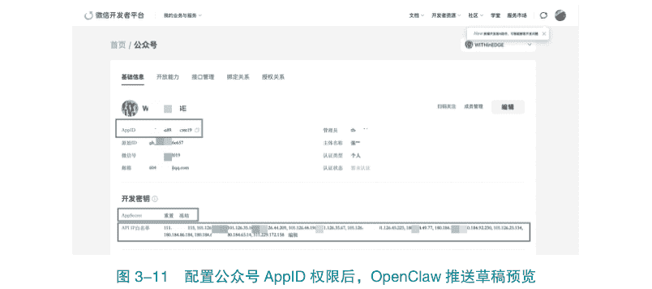

图 3-11 配置公众号 AppID 权限后，OpenClaw 推送草稿预览

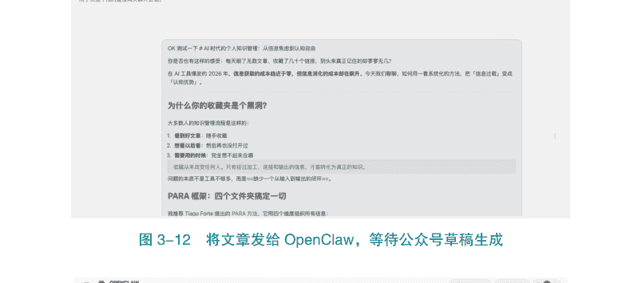

图 3-12 将文章发给 OpenClaw，等待公众号草稿生成

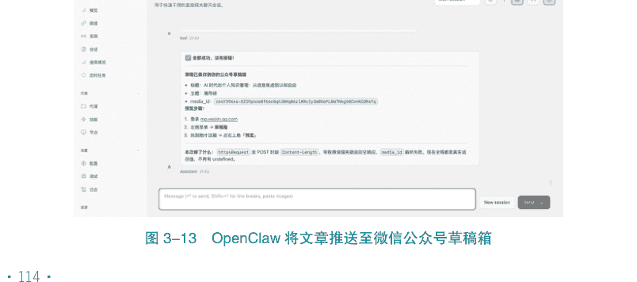

图 3-13 OpenClaw 将文章推送至微信公众号草稿箱

排版呈现效果参考图 3-14：

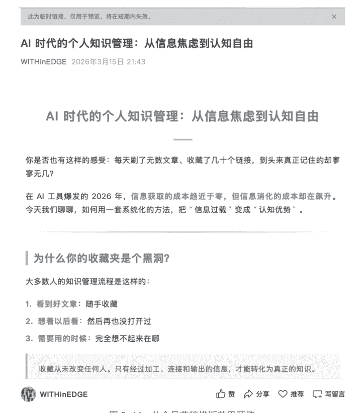

> 建议在此 Skill 的基础上叠加配图能力，让 AI 一键生成图文并重的排版内容！

内容发布后评论区会立刻活跃。重复性提问人工回复成本高，不如先用 OpenClaw 建立一个 FAQ 库，把约八成的常见问题用自动应答消化掉。

### 3.10 评论量大时如何优先自动应答

笔记下每天会涌入几十条相似留言：在哪买、怎么用、有没有教程。逐条回复容易耗尽精力。用 OpenClaw 搭建 FAQ 知识库，就能对高频提问自动生成回复。

#### 3.10.1 先搭建 FAQ 知识库

在 OpenClaw 对话窗口发送指令：

```
请帮我创建文件 skills/faq.md，内容如下：
```

随后把下面模板粘贴进来，按自己的情况改写：

```
##### 我的粉丝 FAQ

###### 回复风格
像朋友聊天，2～3句话，适当用 emoji，不要客服腔。

###### 常见问答

Q：在哪下载？
A：App Store 或应用宝搜“×××”，主页置顶也有链接～

Q：收费吗？
A：基础功能免费够用了！高级版 69 元/年，不急等打折～

Q：适合新手吗？
A：完全 OK，主页置顶第二条就是零基础教程。

Q：有微信群吗？
A：暂时没开群，评论区问我就行，每天都会看的 :)

Q：能出 ××× 教程吗？
A：好主意！记下了，点赞过 100 就安排。

Q：是广告吧？
A：哈哈真不是，自费买的，用着好才分享的～
```

小贴士：FAQ 可随时增补，内容越丰富匹配越准确。

#### 3.10.2 把评论交给 OpenClaw 分类处理

复制评论区的问题发过去，并说明：

> 对照我的 FAQ 处理这些评论：
> 1. “在哪下的呀？”
> 2. “小白能用吗？”
> 3. “有安卓版不？”
> 4. “博主接广告吗？”

执行规则：
- FAQ 可匹配 → 直接给出回复
- FAQ 未覆盖 → 起草回复并标注 [ 建议加入 FAQ ]
- 不确定 → 标注 [ 需我手动回复 ]

返回的是一张对照表，每条评论都有可直接复制使用的应答。

#### 3.10.3 定期更新 FAQ

处理完后告诉它：

> 把刚才标注 [ 建议加入 FAQ ] 的问答追加到我的 faq.md 里。

坚持两周后，约九成的评论可实现秒匹配。

#### 3.10.4 进阶：自动抓取评论

不想手动复制，可安装小红书 Skill。对 OpenClaw 说：

> 帮我安装这个 skill：https://github.com/Xiangyu-CAS/xiaohongshu-ops-skill

它会自动从 GitHub 拉取代码并完成配置，全程无需人工干预，成功会有提示。

安装完成后每天只需一句指令：

> 帮我检查小红书最新评论，对照 FAQ 起草回复整理成表格给我确认，确认后自动回复，每条间隔 20 秒以上。

这里用到了 OpenClaw 的浏览器自动化能力，基于 CDP 协议控制 Chrome 浏览器，Skill 会模拟真人滑动、展开评论区并结构化采集。

> ### 注意事项
> 
> 先看源码再安装，Skill 本质是第三方代码，安装前建议打开 GitHub 链接查看源码和 Star 数，确认来源可靠。请勿安装来路不明的 Skill。
> 
> 账号安全优先，Skill 运行时可能需要登录你的小红书账号，请确保只在可信环境操作，避免 Cookie 泄漏。
> 
> 本教程仅提供技术思路与操作演示，不鼓励也不支持任何违反平台规则的行为。自动化采集、批量操作等功能可能涉及平台服务协议限制，使用者需自行了解并遵守相关平台的用户协议与社区规范。

凭感觉复盘不可靠，让 OpenClaw 用数据说话，每周花 10 分钟即可拿到清晰的复盘报告和下周策略。

### 3.11 没时间复盘时怎么让它总结上周表现

每周发十几条内容，哪条爆了、哪条沉了、原因是什么，容易成糊涂账。把数据交给 OpenClaw，每周十分钟就能得到结构化复盘与发布建议。

#### 3.11.1 整理数据表发送

先从各平台后台抄下上周指标，按指定格式整理成表格发给它：

```
这是我上周（3.10—3.16）在小红书发布的内容数据：

| 日期 | 标题 | 类型 | 点赞 | 收藏 | 评论 | 涨粉 |
|------|------|------|------|------|------|------|
| 3/10 | 为什么你越努力越穷 | 干货 | 1823 | 456 | 89 | +124 |
| 3/11 | 我的早起计划表 | 生活 | 234 | 67 | 12 | +8 |
| 3/12 | 3个免费 AI 工具推荐 | 干货 | 967 | 312 | 45 | +76 |
| 3/13 | 周末摆烂日常 | 生活 | 189 | 23 | 31 | +3 |
| 3/14 | 打工人时间管理模板 | 干货 | 2341 | 789 | 112 | +203 |

请帮我做一份周度复盘报告：
1. 本周整体数据汇总（总点赞/收藏/评论/涨粉）
2. 表现最好的 1 条：为什么好？哪些因素可以复用？
3. 表现最差的 1 条：为什么差？下次怎么避免？
4. 各内容类型对比（干货 vs 生活，哪类数据更好）
5. 下周内容策略建议（3 条，要具体到选题方向）
```

它会返回一份复盘报告，包含数据汇总、爆款拆解、内容类型对比及下周选题建议。建议把每周报告保存下来，连续数周后趋势会更明显。

#### 3.11.2 连续复盘：多周趋势对比

积累 2-3 周数据后，可要求趋势分析：

> 以下是我最近三周的内容数据（附件/上方对话已有），请做趋势分析：
> 1. 三周核心指标变化趋势，涨粉、互动率是涨是跌
> 2. 哪类选题持续走高，哪类走低
> 3. 发布频率与时间段是否对数据有规律影响
> 4. 综合三周数据，给我下月内容方向建议

若已在用 3.5 节的系列档案，可把复盘数据一并写入 content_series.md，让选题与数据双向联动。

#### 3.11.3 进阶：小红书数据自动拉取

若已安装小红书运营相关 Skill，如 xiaohongshu-api 或 xiaohongshu-mcp-skills，或接入第三方数据 API，即可让 OpenClaw 直接从创作者后台拉取数据，无需手工抄写。以 TikHub 数据 API 为例：

> 搜索小红书博主 xxxxx user_id 是 xxxxxxxx 在 2026 年 3 月 1 日—3 月 16 日的发文数据，按表格模板统计，并帮我做一份复盘报告

返回结果如图 3-15 所示。

这样就从“手工抄数据 + 交给 AI”升级为“一句话自动拉取 + 自动分析”。这些 API 可能产生费用，若数据分析是刚需可考虑接入。

掌握图文与短视频全流程后，若想挑战直播，OpenClaw 也能全流程支持——从竞品调研到提纲生成，从定时提醒到直播后复盘，一条龙搞定。

# OpenClaw 直播与数据实战

##### 聊天

用于直播间快速干预的关键词会话。

先查 TikHub 小红书相关接口文档，确认用户主页与笔记列表端点。找到接口后用 `app_v2` 路径抓取用户发文，确认是李诞本人，粉丝 261 万。现在批量抓 3 月 1 日到 3 月 16 日的发文，时间戳返回均为 1670，接口未提供精确时间，互动数据为空。改用 `app/get_user_notes` 接口后有数据，字段为 `likes`、`comments_count`、`collected_count`、`create_time`、`time_desc`。现在提取全部记录并筛选 3 月 1 日-16 日，数据已获取，共 5 条。整理成报告。

##### 李诞小红书发文数据（2026年3月1日—3月16日）

###### 一、发文明细表

| 日期 | 标题 | 类型 | 点赞 | 收藏 | 评论 |
| --- | --- | --- | --- | --- | --- |
| 3/11 | 36.李诞×陈嘉映：“我擅长理解伟大心灵”（视频版播客） | 视频 | 2,527 | 1,487 | 145 |
| 3/10 | 李诞×陈嘉映：“我擅长理解伟大心灵” | 视频 | 1,413 | 555 | 110 |
| 3/9 | 【诞说】很多事情已经被永久改变了 | 视频 | 4,021 | 1,572 | 169 |
| 3/6 | 小黄卖货日记：和老刘论战 | 视频 | 2,054 | 356 | 170 |
| 3/5 | 新的一年振作起来吧 | 图文 | 2,081 | 188 | 163 |

注：涨粉数据 TikHub 接口未提供，无法获取。

###### 二、整体数据汇总（3.1-3.16，共5条）

| 指标 | 数值 |
| --- | --- |
| 总点赞 | 12,076 |
| 总收藏 | 4,119 |
| 总评论 | 757 |
| 发帖频率 | 约3天/条 |

###### 三、表现最好：【诞说】很多事情已经被永久改变了（3/9）

点赞 4,021 · 收藏 1,572 · 评论 169

- 为什么好：标题有强情绪感染力，“永久改变”触发焦虑好奇，用户必点进来；“诞说”系列有固定受众，粘性强
- 可复用因素：① 情绪标题+强大制作感；② “永久改变”类金句；③ IP 系列化积累回头客；④ 对当下时代情绪有精准捕捉

###### 四、表现最差：李诞×陈嘉映：“我擅长理解伟大心灵”（3/10，非播客版）

点赞 1,413 · 收藏 555 · 评论 110

- 为什么差：这是 3/11 播客视频版的“前期预热版”，二者选题相同，被自我稀释；内容本身有门槛，但没有短视频版的“播客”标签加持
- 启示：同一选题连发会内耗流量；如需同内容双发，形式差异要大，或间隔拉开

###### 五、内容类型分析

本期 5 条均为视频，按内容方向分：

| 类型 | 条数 | 平均点赞 | 平均收藏 | 平均评论 |
| --- | --- | --- | --- | --- |
| 深度访谈/播客（诞说系列） | 3条 | 2,654 | 1,205 | 141 |
| 生活/美食/娱乐 | 2条 | 2,068 | 253 | 167 |

- 播客类内容收藏率远高于生活内容，说明“知识/观点型”内容质量上限更高
- 美食/生活类评论率略高，更有话题性，但收藏价值低

###### 六、对标策略参考（给你自己账号用）

| 李诞的打法 | 你可以借鉴的点 |
| --- | --- |
| IP 系列化（“诞说”固定栏目） | 给自己账号设一个固定系列，比如“XX说”或“每周一问” |
| 播客+图文复用同一内容 | 同一选题做长视频+笔记两种形式，互相导流 |
| 标题情绪浓度高（“永久改变”） | 标题要有情绪张力，别只写“干货分享” |
| 访谈/对话借助嘉宾流量 | 联动其他博主，借势互推 |

数据已从 TikHub API 实时获取（3 月 16 日 15-10 抓取）。如需继续翻页看更早数据，或分析某条评论内容，告诉我就行。


• 120 •

### 3.12 想做直播脚本，怎么让它准备提纲

直播最怕冷场和忘词。OpenClaw 不仅能写提纲，还能用浏览器拆解竞品直播套路，直播前通过 Cron 定时任务自动推送提纲到手机，直播后用记忆系统记录本场数据，帮你迭代下一场内容。这是普通 AI 聊天工具做不到的。

#### 3.12.1 搜索同类直播，拆解爆款套路

写提纲前，先让 OpenClaw 用浏览器调研同类直播：

> 我准备在抖音做一场 60 分钟直播，主题是“职场效率”。
> 
> 请用浏览器帮我做竞品调研：
> 1. 打开抖音网页版，搜索“职场效率 直播”“时间管理 直播回放”，找 3~5 个高人气回放，记录主播名、观看人数、直播时长、主题
> 2. 打开小红书搜索“直播提纲模板”“直播话术”，找 3 篇高赞笔记
> 3. 分析这些爆款直播的共同规律：
>    ● 开场前 3 分钟怎么破冰留人
>    ● 多久插入一次互动，用了什么话术
>    ● 冷场时怎么救场
>    ● 结尾怎么引导关注/下次预约
> 4. 总结 3 条最值得我借鉴的直播技巧

这是 OpenClaw 的浏览器自动化能力，基于 CDP 协议控制 Chrome 浏览器，它会打开相关平台进行浏览，而非凭记忆编撰。但需注意抖音、小红书等平台均部署反爬虫和反自动化机制，实际操作中常遇到验证码、登录拦截、内容加载失败等问题。社区已有用户用同样的浏览器能力实现了小红书笔记自动采集和竞品分析。

> 小贴士
> 
> 浏览器自动化访问时的隐私安全建议：①优先选择无需登录的公开页面或第三方聚合链接，如 tophub.today，避免将已登录账号会话暴露给 OpenClaw；②如确需登录，建议使用专用小号而非主账号，并在操作完成后及时退出登录；③OpenClaw 通过 CDP 协议控制本地 Chrome 浏览器，数据处理在本地进行，但仍应避免在自动化过程中访问含有敏感个人信息的页面。

#### 3.12.2 生成直播提纲

基于竞品调研结论，让 OpenClaw 生成专属提纲：

> 结合刚才的竞品分析，帮我生成一份 60 分钟直播提纲：
> - 主题：“职场新人如何用 3 个月养成高效工作习惯”
> - 平台：抖音，节奏要快，互动要频繁
> - 观众：刚工作 1~3 年的新人
> 
> 要求：
> 1. 开场白 3~5 分钟：破冰 + 本场亮点预告
> 2. 内容主体 40 分钟：分 3~4 个主题段，每段配核心要点 3 条关键词、1 句互动话术、1 个实用工具或案例
> 3. 互动环节 10 分钟：5 个高互动问题
> 4. 结尾 5~7 分钟：总结 + 行动号召 + 下次预告
> 5. 另外准备 5 句救场话术，用于冷场时使用

OpenClaw 会返回一份按时间轴排列的完整提纲，每个环节带时间标记、核心关键词和互动插入点，救场话术单独列在最后。

#### 3.12.3 转打印版，直播前自动推送到手机

确认提纲没问题后，转成精简版并设置定时推送：

> 把提纲转成打印版格式：
> ● 每个时间段用分隔线标出，如 ===00:00—05:00 开场 ===
> ● 只保留关键词，删掉长句
> ● 互动话术用 [ 互动 ] 标签，救场话术用 [ 救场 ] 标签
> ● 控制在一页 A4 以内
> 
> 另外，请设置一个定时任务：
> 每周三晚上 7:50，我直播前 10 分钟自动把打印版提纲发到我的飞书 / 钉钉。

这是利用 OpenClaw 的 Cron 定时任务 + 多渠道推送能力，到点手机会自动收到直播提纲。

#### 3.12.4 进阶：直播后复盘，让提纲越用越精准

今天直播已结束，实际情况：

- 总时长 58 分钟，峰值在线 320 人
- 第二段“时间管理”反响最好，弹幕最活跃
- 第三段“工具推荐”时有明显掉人
- 救场话术用了 1 次，效果还行
- 互动环节时间不够，只问了 3 个问题

请根据反馈优化提纲，调整时间分配和内容结构，并把本次直播数据记入记忆，下次我说“准备直播”时自动参考。

OpenClaw 把每一次直播的相关数据都通过 MEMORY.md 写进本地磁盘。等下一次你喊一声准备开播，它就会自动把往期档案调出来，和过往表现做对比，随后给出经过优化的开播提纲。这种能够在不同会话之间持续累积、不断进化的能力，是常规聊天类 AI 所不具备的。知乎上已经有对 OpenClaw 记忆机制的详细拆解可以参考。

> 社区参考与延伸阅读
> - OpenClaw 自动语音回复抖音直播间弹幕—— https://linux.do/t/topic/1742118（LINUX DO 社区讨论帖，探讨用 OpenClaw+EdgeTTS 实现直播间自动语音回复的可行性和难点）
> - OpenClaw 记忆系统架构深度解析—— https://zhuanlan.zhihu.com/p/2005943466006438841（知乎专栏，详细解读了 MEMORY.md、混合检索、预压缩记忆冲刷等跨会话记忆机制）

直播跑通后，很多 creator 都会思考：这些实操经验能不能打包成课或训练营来变现？从内容生产到知识收费，中间差的就是一套可复制的交付闭环。下一节就说明白这个闭环怎么搭。

### 3.13 把做号经验做成课程，OpenClaw 能怎样协助搭框架和交付物

账号经营一段时间后，私信里经常会出现“能带带我吗”。把已经验证过的内容方法论整理成付费课，是很顺理成章的变现路径。卡点往往集中在：大纲怎么排才通顺、学员资料怎么做得专业、作业与反馈如何闭环。把这些事堆在一起，很容易从“我要开课”变成“算了太麻烦”。借助 OpenClaw，这条路线会顺很多。

#### 3.13.1 用账号数据反推课程骨架

别凭空构思大纲。你账号里已发布的内容本身就是一份用户调研——哪些主题被反复追问、哪些笔记互动更高、粉丝真正想解决的问题是什么，数据已经给出答案。把这些信息交给 OpenClaw，让它提炼出课程结构：

> 以下是我过去 3 个月发布的小红书内容数据（互动最高的前 10 条）：
> [ 粘贴你的内容数据表格：标题、点赞、收藏、评论数、主题标签 ]
> 请帮我基于以上数据，设计一门面向 [ 目标人群：职场新人 ] 的付费课程大纲：
> 1. 从互动数据中提炼出学员最想解决的 3～5 个核心问题
> 2. 按 “问题→方法→实操→结果” 的学习路径组织课程模块
> 3. 课程共 [x] 节，每节给出：课题名称、核心内容要点、建议时长
> 4. 每节末尾配一个可落地的课后作业
> 给我确认后写入 course_outline.md

它会从高互动内容中抽取出真实的痛点，而不是拍脑袋。大纲确认后作为后续所有材料的基础文件，存进工作区方便后续调用。

#### 3.13.2 分节批量产出讲义和学员手册

大纲确定后，最费时的通常是资料包。PPT 还算好办，学员手册、练习、案例素材凑齐，整理起来要花好几天。让 OpenClaw 按课节逐一生成：

> 以下是我过去 3 个月发布的小红书内容数据（互动最高的前 10 条）：
> 请读取 skills/course_outline.md，为第 2 节课 “时间管理工具实战” 生成以下材料：
> 1. 讲师讲义（Markdown 格式，含讲解要点、建议举例、过渡话术）
> 2. 学员手册（PDF 格式，含本节知识点速查、空白填写区、操作步骤图示位置）
> 3. 课后作业（1 个具体练习题，含验收标准，学员完成后可截图反馈）
> 完成后暂停，等我确认格式，再继续下一节。

它会逐节输出，每完成一节就等待确认，版式和深度达标后再推进。思路和 3.4 节批量生成草稿一致——分步走，你始终掌握主导权。

#### 3.13.3 用 Cron 定时提醒作业点评

课程跑起来后，最容易掉链的是作业反馈。学员发了截图，你没时间一条条点评，热情很快就会冷却。可以让 OpenClaw 建一个定时任务，每天固定时间提醒你审阅作业并起草点评：

Windows PowerShell（单行）：
```
openclaw cron add --name "course-feedback-reminder" --cron "0 20 * * *" --tz "Asia/Shanghai" --session main --system-event "课程作业反馈时间到了。请提醒我检查学员微信群的作业截图，并帮我针对常见问题起草一条统一的点评回复，以鼓励为主，指出 1～2 个改进点。" --wake now
```

macOS / Linux（多行写法）：
```
openclaw cron add \
--name "course-feedback-reminder" \
--cron "0 20 * * *" \
--tz "Asia/Shanghai" \
--session main \
--system-event "课程作业反馈时间到了。请提醒我检查学员微信群的作业截图，并帮我针对常见问题起草一条统一的点评回复，以鼓励为主，指出 1～2 个改进点。" \
--wake now
```

设置好后，每天晚八点它会主动提醒，并帮你拟好点评模板。你结合实际情况改改细节发到群里，十分钟内就能完成。

#### 3.13.4 用记忆系统沉淀课程迭代

跑完一期，学员反馈会告诉你哪节讲得不够透、哪项作业偏难、哪个话题想深挖。这些信息不记录，下期还是重复。参照 3.5 节系列档案的做法，在工作区建一个课程迭代日志：

第一期课程结束后，整理学员反馈告诉 OpenClaw：
```
第一期课程已结束，请更新 skills/course_log.md：
● 第 3 节课“工具实践”反馈最好（完课率 92%，好评集中在“案例真实”）
● 第 2 节课太理论，多人反馈“听不太懂”，下期需要增加演示
● 多人希望增加“如何接商业合作”模块
下次准备第二期时，先读取 course_log.md，基于反馈生成优化版大纲。
```

坚持两三期后，课程结构会越来越精准，后续只需针对性改动约 20% 的问题部分，复购和口碑也会随迭代提升。

如果有录课需求，可以在生成讲义的同时让它额外输出一份“口播脚本”版本——去掉讲师备注，只保留镜头前台词，照着念基本就是一节完整课程。结合 3.8 节的分镜思路，课程视频拍摄效率会明显提升。

### 小结

到这里第三章就结束了。哪怕只落地其中三四点，你也能感受到内容创作可以轻松很多。

这一章做了什么：让 OpenClaw 抓热点、盯趋势、拆爆款，缓解“今天写什么”的焦虑；用周计划和系列档案把零散灵感变成可执行的内容流水线；学会把一个核心观点批量改写成多平台文案，配图、分镜、排版一步到位；发布后还能自动 FAQ 回复评论、做数据复盘找规律，甚至直播提纲和课程大纲都能交给它。

此时的 OpenClaw，已经不是单纯“帮你写一段文案”的聊天机器人，而是一条从选题到发布到复盘的完整内容生产线——有热点雷达、有内容日历、有风格模板、有数据反馈，每个环节都能跑起来。

但有三件事必须反复强调：

第一，AI 产出的始终是草稿，不是成品。它不了解你的读者，不懂账号的气场，不知道哪句话会踩雷。每条内容上线前必须经过你的人工判断。跳过这一步的人，迟早会在评论区翻车。

第二，自动化不等于可以无视平台规则。本章涉及的热点抓取、评论采集、自动回复、浏览器操作等，都可能触及平台服务协议边界。各平台对自动化的容忍度不同，处罚也不同。OpenClaw 是效率工具，不是外挂——辅助创作可以，违规操作不行。

第三，内容的核心竞争力始终在人。工具能把效率提升十倍，决定内容能否火的，是你的审美、洞察和对读者的理解。最好的用法是让它处理机械性工作——抓数据、排格式、批量生成、定时推送——把省下的时间用在只有你能做的事上：打磨让人想转发的标题、写出让人破防的开头、找到别人没想到的切入角度。

内容做好了，变现自然发生。第四章会带你从选品、接单、文案、定价，一路到多平台运营和收支管理，把“能写内容”变成“能赚钱”。

准备好了吗？翻开第四章，让“龙虾”把内容变成收入。

## 第四章 副业小赚别再纯手动操作

这一章写给想用业余时间赚点外快的普通人。你可能时间不多、启动资金有限，只要有一台电脑和 OpenClaw，能做到的事远比想象的多。

本章按“先找机会、再做交付、最后管运营”的逻辑展开：前面几节解决选品、找活儿、写文案等起步问题；中间几节进入多账号矩阵、信息差产品、翻译接单等需要系统化运营的进阶场景；最后几节讲多平台协同和收支管理，帮你从零散接单升级为可自主运行的副业流程。每节都可独立操作，卡到哪就看哪。

阅读前请注意：

- OpenClaw 是效率工具，不是赚钱机器。它能节省时间、实现流程重复自动化，但赚多少取决于你的业务能力、选品眼光和运营投入。别被“月入过万”误导，踏实做，效率才是核心竞争力。
- 本章所有 AI 生成的交付物——文案、简历、译稿、调研报告、商品描述——都需人工审核后再使用。AI 可能夸大、误读或生成与实际不符的内容，务必审核。
- 多处用到 ClawHub Skill 安装命令，如 clawhub install xxx 或 npx clawhub@latest install xxx。ClawHub 是开源社区，Skill 更新快、同名多，建议安装前在社区核实来源可信度、评分与下载量。第三方 Skill 可能存在兼容或行为不可预期问题，建议先在测试环境跑通。
- 涉及平台自动化操作时，请留意各平台使用条款与反爬机制，务必阅读服务协议，合理控制频率，避免账号限流或封禁。

### 4.1 投简历总石沉大海，怎么让它帮我筛选职位自动投？

逐页浏览职位、判断匹配度、改简历、手动投递，时间都耗在重复操作上。OpenClaw 能通过浏览器登录招聘平台抓取职位，由 AI 按你的标准打分筛选，甚至实现自动投递，并通过飞书或 Telegram 通知结果。社区已有“睡前下指令，醒来收面试邀约”的实践。

#### 4.1.1 建立职位筛选标准

先在工作区建一份筛选标准，后续筛选都以此为准：
```
请帮我创建文件 skills/job_filter.md，内容如下：

##### 求职筛选标准

###### 目标方向
兼职内容运营 / 自由撰稿 / 社群运营

###### 必须满足（不满足直接过滤）
- 可远程办公
- 周工作时间不超过 20 小时
- 月薪换算不低于 2 000 元

###### 加分项
- 不需要打卡
- 有提成或绩效空间
- 平台 / 公司口碑良好（天眼查评分 3.5 +）

###### 排除关键词
“需要驻场”“全天候在线”“试用期无薪”“底薪 500”

###### 我的简历关键词（用于匹配度计算）
内容运营、小红书、公众号、3 年经验、数据分析、社群
```

这份文件会被记忆系统索引。以后只要说“帮我筛选职位”，它就会自动调取该标准，无需重复说明。

#### 4.1.2 让 OpenClaw 自动抓取并评分

无需手工复制职位列表，让它直接通过浏览器抓取：
请用浏览器帮我完成以下操作：
1. 打开 BOSS 直聘，搜索“内容运营 兼职远程”，翻前 3 页，把每个岗位的标题、公司、薪资、JD 摘要记录下来
2. 再打开拉勾网，搜索同样关键词，记录前 2 页
3. 对照我的筛选标准（skills/job_filter.md），为每个职位打分（1～10）
输出格式：
| 序号 | 平台 | 职位 | 公司 | 薪资 | 匹配分 | 是否值得投 | 原因 |
|------|------|------|------|------|--------|------------|------|
只列出匹配分 7 分以上的。

> 小贴士
> 使用 OpenClaw 浏览器访问招聘平台时：①优先访问不需要登录即可查看的公开职位页面；②如需登录，建议使用专用账号并开启双因素验证，不要在 OpenClaw 会话中保存密码；③部分平台检测到自动化 UA 特征会触发验证码或封号，建议设置随机延迟（每次操作间隔 3～10 秒）并控制单次翻页数量在 5 页以内。

这是浏览器自动化的体现，通过 CDP 协议控制 Chrome。若本地无法执行，可配置 Agent-browser 等浏览器操作 Skill，它将登录招聘网站、翻页、读取 JD。浏览器抓取职位信息并打分的效果如图 4-1 所示。
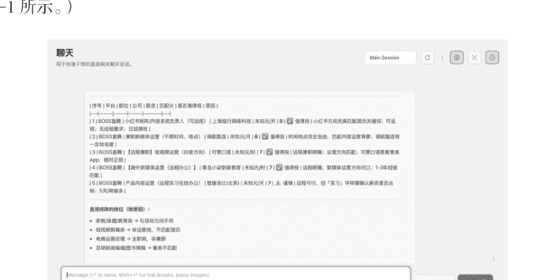

社区 internship-scout 项目已实现从抓取职位信息到 AI 评分再到 Notion 同步的全自动流程。

#### 4.1.3 针对高分职位定制简历

筛出值得投的职位后，让它帮你针对性优化简历：
> 这是排名第 1 的目标职位 JD：
> [ 粘贴完整 JD ]
> 这是我的简历：
> [ 粘贴简历内容 ]
> 请：
> 1. 找出 JD 中的高频关键词（用表格列出）
> 2. 检查我的简历是否覆盖了这些关键词，标注√已覆盖 / × 未覆盖
> 3. 对未覆盖的关键词，建议如何在不伪造经历的前提下优化表述
> 4. 生成一份针对这个 JD 的定制版简历

它会返回关键词覆盖对照表加优化后的完整简历。保留一份简历底稿，针对不同职位微调关键词即可，无需重写。开源社区的 JobClaw 项目已经实现了“抓取→匹配→自动投递→Telegram 通知”的全流程。

> ⚠️ 注意事项
> OpenClaw 的自动化投递功能目前处于社区探索阶段，各招聘平台服务条款通常禁止或限制自动化批量操作。使用前请务必阅读目标平台用户协议。平台检测到异常行为后可能采取封号、限流或法律追究等措施。本书仅作技术演示，不鼓励违反平台规则的非法操作。
> 🔗 社区参考与延伸阅读
> • JobClaw — AI 求职 agent — https://github.com/slothsheepking/jobclaw — 基于 OpenClaw 的全流程求职工具，支持 BOSS 直聘/LinkedIn 自动抓取、AI 匹配、自动投递、Telegram 通知
> • Internship-scout — 实习岗位自动筛选 Skill — https://github.com/wkf16/internship-scout — OpenClaw Skill，从 BOSS 直聘自动抓取实习岗位，AI 三维评分打标，同步到 Notion
> • OpenClaw 在 HR 领域的 30 个应用场景 — https://www.53ai.com/news/Almianshi/2026030843297.html — 53AI 专栏，详细介绍了 OpenClaw 自动登录招聘平台、抓取简历、智能筛选职位等实操场景

### 4.2 做无货源电商，怎么让它每天找热销品写文案？

无货源电商的核心是“选品 + 文案”，两件事都高度重复。OpenClaw 能通过浏览器自动登录拼多多、阿里巴巴 1688 等平台抓取热销数据，通过 Cron 每日定时任务推送选品报告，并利用记忆系统记录历史选品，从而避免重复选品。

#### 4.2.1 让 OpenClaw 自动抓取热销品数据

不用自己刷平台。让它通过浏览器直接去各平台抓取数据：
> 请用浏览器帮我完成今日选品调研：
> 1. 打开大淘客相关榜单，筛选类目“家居 / 数码 / 宠物”，记录前 20 名商品的：名称、价格、月销量、评分
> 筛选标准：
> - 近 7 天销量增速 > 30%
> - 评分 > 4.5 星
> - 供货价利润空间 > 40%
> - 竞品数量不超过 50 家
> 输出今日值得关注的 5 个产品，每个包含：
> | 产品名 | 卖价 | 供货价 | 利润率 | 月销量 | 核心卖点 | 目标用户 |

这是浏览器自动化能力的一种体现。它会打开大淘客等网站搜索热销品并比价，不是凭记忆编造信息。Clawhub 中已注册各类跨境电商 Skill，包含多平台价格监控等功能，大家可自行探索。自动化选品的抓取效果如图 4-2 所示。
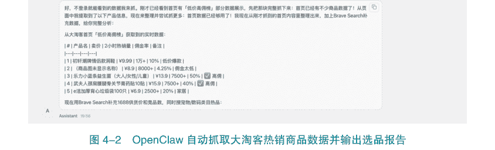

#### 4.2.2 一键生成多平台文案

选好品后，可利用 OpenClaw 一次性为四个平台生成文案：
> 今天选中的产品：折叠收纳盒
> 核心卖点：省空间、可叠放、素色
> 目标用户：租房族/小户型家庭
> 供货价：8.5 元，建议售价：29.9 元
> 请生成以下四个版本的文案：
> 1. 拼多多标题（30 字内，含搜索关键词）
> 2. 淘宝宝贝描述（钩子开头 + 4 个卖点 + 用户证言，约 200 字）
> 3. 小红书种草文案（生活化语气，150 字，含 5 个话题标签）
> 4. 抖音带货脚本（30 秒，口播形式）

它会一次性输出四个平台的完整文案，每个版本都针对不同的平台调性微调了风格和长度，此时 OpenClaw 会自动加载第三章多平台运营中提到的 multi-platform-copywriter 进行输出，效果如图 4-3 所示，复制粘贴即可使用。
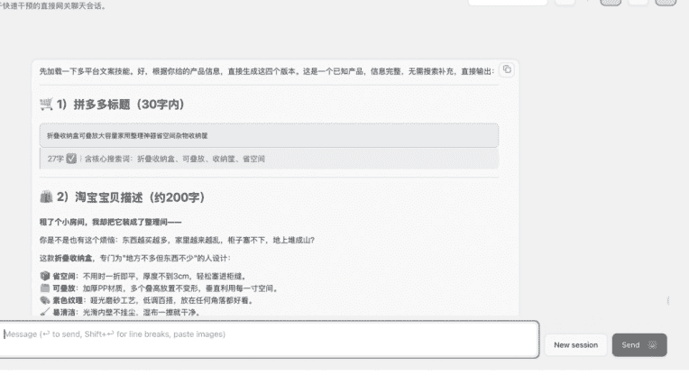

> ### 注意事项

> - 上线前请人工复核模型输出，AI 文案易出现夸大表述，电商虚假宣传有法律风险，具体审核要点见本章导语。
> - 供货价与利润空间需自行核实，AI 获取的价格常为活动价，下单前应再次确认。
> - 使用 AI 辅助选品时请遵守各平台的用户协议与使用规范，避免高频批量操作，合理控制调用频率。

### 社区参考与延伸阅读

- B 站参考视频 — https://www.bilibili.com/video/BV1fKZMBYEmW/ 及 https://www.bilibili.com/video/BV1NyPKzHELr/ — 包含电商场景的实操演示

### 4.3 卖电子书或报告，怎么让它每周自动更新内容？

面向周报、资源合集这类需要持续迭代的报告产品，最大痛点在于更新与去重。借助 OpenClaw 的浏览器自动化与记忆去重机制，可以每周巡检行业动态，产出结构化的 Markdown 週刊，再通过 Shell 指令导出 PDF。

#### 4.3.1 使用 OpenClaw 自动抓取本周动态

信息采集可交由 OpenClaw 的浏览器搜索能力负责：

```
我在做一份《AI 工具效率周报》（第 12 期，3.10—3.16），请帮我采集本周素材：

1. 用浏览器打开以下网站，抓取本周 AI 工具领域的重要新闻：
   - 36 氪、少数派、机器之心的 AI 栏目
   - Product Hunt 本周热门 AI 工具
   - GitHub Trending 本周热门 AI 项目
2. 筛选出 5 条最有价值的资讯，每条压缩到 100 字以内，标注来源
3. 找出 1~2 个本周新出的值得推荐的 AI 工具，写出名称、用途、价格
4. 检查记忆系统中的往期周报记录，避免推荐重复的工具
```

素材抓取结果如图 4-4 所示。

# OpenClaw 实战应用：安全养“龙虾”手册

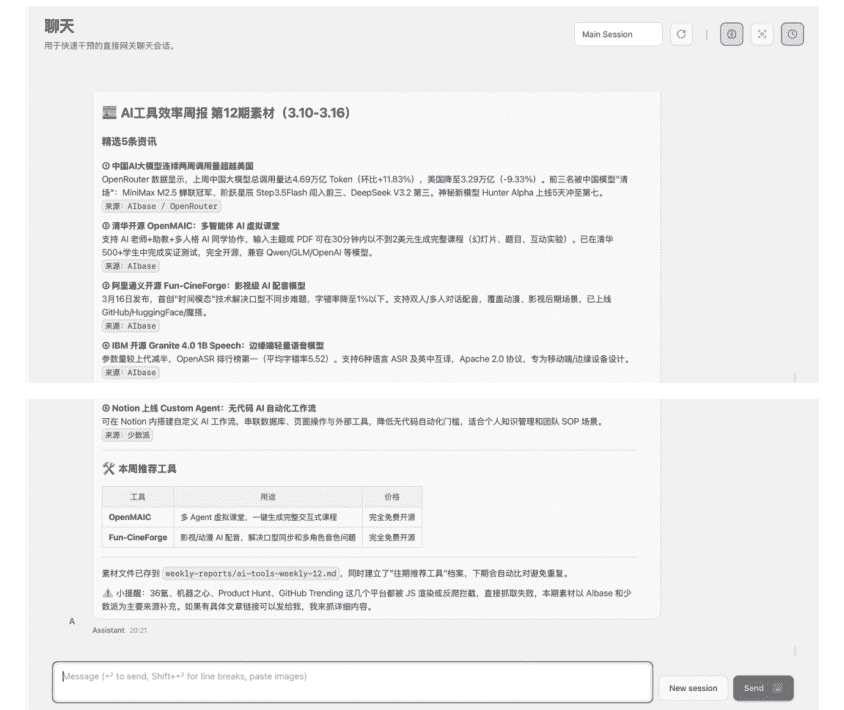

图 4-4 OpenClaw 完成本周素材采集

抓取动作由浏览模块承担，去重逻辑由记忆模块负责。每期周报已推荐的工具会被写入 MEMORY.md，下个周期系统会自动略过重复项。这种跨会话的记忆去重是常规对话式模型难以实现的。

#### 4.3.2 生成完整周报 + 专题文章

采集完成后，可指令 OpenClaw 产出一期完整周报：

> 请用以上素材生成《AI 工具效率周报》第 12 期，Markdown 格式：

结构要求：

---

##### AI 工具效率周报 | 第 12 期

###### 2026.3.10—3.16 | 阅读时长约 8 分钟

###### 本周要闻（5条精选资讯）

###### 工具推荐（1～2个新工具详细介绍）

###### 本周专题：[根据本周热点选定主题]（约800字）

###### 往期回顾（引导读者查看上期内容）

---

写完后保存为 weekly_report_012.md

系统会输出带封面信息与阅读时长预估的结构化 Markdown。Markdown 周报生成效果如图 4-5 所示。

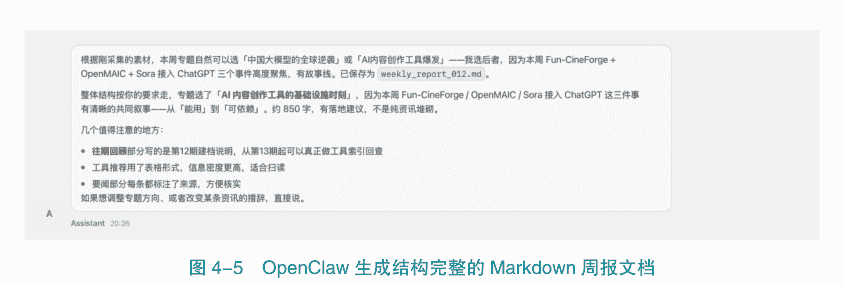

#### 4.3.3 自动转换为 PDF 并进行通知

无需手动打开 Typora。OpenClaw 可直接调用 Shell 命令生成 PDF 文件：

```
请将 weekly_report_012.md 转换为 PDF：

pandoc weekly_report_012.md -o weekly_report_012.pdf\n--pdf-engine=wkhtmltopdf\n--css=report-style.css

转换完成后，把 PDF 文件发到我的飞书。
```

这体现了 Shell 执行能力，可在服务器端直接运行 Pandoc、wkhtmltopdf 等命令行工具，无需人工介入。生成的 PDF 可通过多渠道推送到手机。也可设定定时任务，让每周一早上自动收到 PDF 周报，直接上传到知识星球或小报童进行变现。

### 4.4 信息差产品怎么做，怎么让它帮我挖掘信息差并持续更新？

信息差产品的核心是持续提供他人未掌握的数据。OpenClaw 能通过浏览器抓取海外平台信息，记忆模块追踪已收录内容避免重复，Cron 定时巡检新增机会并推送，普通聊天工具难以做到。

#### 4.4.1 通过浏览器抓取海外远程工作数据

以《海外远程工作机会数据库》为例，可用 OpenClaw 从真实招聘网站抓取数据：

> 我在做一份《海外远程工作机会数据库》，请用浏览器帮我抓取数据：
> 1. 打开 remoteok.com，筛选最近 7 天发布的职位
>    记录：公司名、职位、薪资范围、是否接受全球申请
> 2. 打开 weworkremotely.com，同样抓取最新职位
> 3. 检查记忆中已收录的公司名单，跳过重复的
> 输出格式：
> | 公司 | 职位 | 薪资 | 平台来源 | 是否接受中国申请 | 投递链接 |
> 同时把新增的公司写入记忆系统，下次抓取时自动去重。

这是浏览器自动化与记忆系统的组合应用。OpenClaw 会打开目标网站翻页抓取招聘信息，并把每次收录的公司记录在 MEMORY.md，后续会自动跳过已收录条目。普通 AI 缺乏浏览器与跨会话记忆，无法实现该流程。海外远程招聘数据抓取并去重效果如图 4-7 所示。

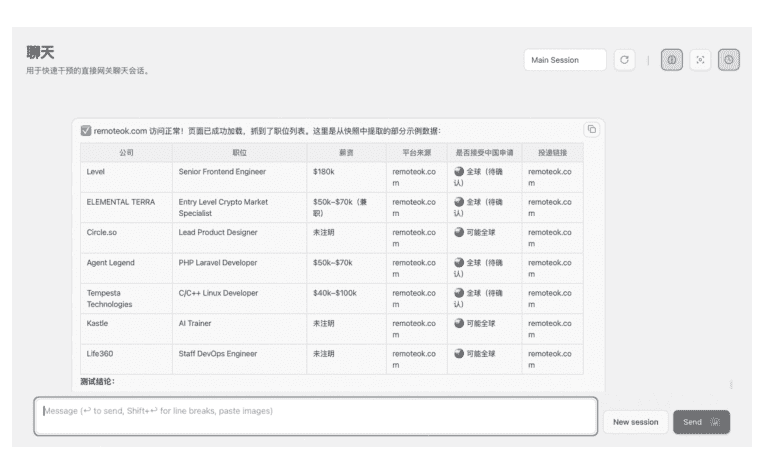

图 4-7 OpenClaw 抓取海外远程招聘数据并自动去重

#### 4.4.2 整理卖点文案套件

数据收集后，可让 OpenClaw 包装成可售产品：

> 我的信息差产品是《海外远程工作机会数据库》，内容包含：“500+”家接受中国人的远程公司 + 投递渠道 + 薪资参考 + 面试经验
> 请生成以下内容：
> 1. 一句话产品定位（15 字以内）
> 2. 三个核心卖点（每个配一句证明）
> 3. 目标用户痛点描述（用于销售页开头）
> 4. 常见顾虑 + 反驳话术（用于 FAQ）
> 5. 定价建议（附理由）
> 另外，生成一份小红书引流文案（150字，制造信息差焦虑）
> 和一份知乎回答引流文案（300字，先提供价值再引导购买）

OpenClaw 会产出完整的卖点文案套件，包含产品定位、销售页文案、FAQ、引流文案。复制即可上架。卖点文案套件输出如图 4-8 所示。

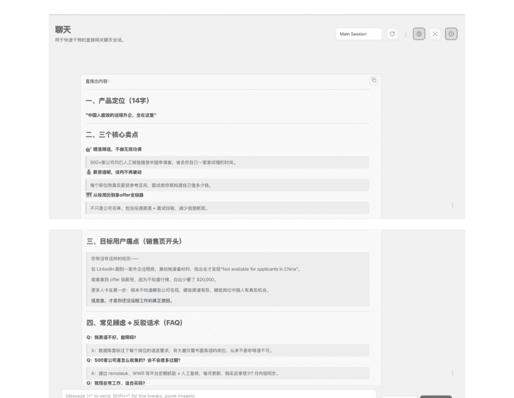

图 4-8 OpenClaw 生成信息差产品卖点文案套件

#### 4.4.3 进阶：Cron 定时更新数据库，保持产品时效性

信息差产品的卖点在于持续更新。可让 OpenClaw 每周自动巡检新增机会：

- 请设置一个定时任务，每周三早上 9:00 执行：
  1. 用浏览器访问 remoteok.com / weworkremotely.com / angel.co
  2. 抓取最近 7 天新增的远程职位
  3. 对照记忆中的已收录公司名单去重
  4. 新增的公司整理成表格，发到我的飞书 /Telegram
  5. 同时更新记忆中的公司名单
推送格式：
“本周新增 × 家远程公司，累计收录 × × × 家。详见附件表格。”

将 Cron 定时、浏览器抓取、记忆去重与多渠道推送组合，数据库会自行持续累积，你只需每周核验新增数据的准确性即可。这种自动化模式是信息差产品持续变现的关键，买家为持续更新买单，而非一次性清单。

### 4.5 多个小红书账号一起运营，怎么分工不乱？

多账号运营最怕人设串台、内容混杂、语气不一致。根源在于单一个 agent 处理全部任务，上下文相互污染。OpenClaw 的多 Agent 架构可让每个账号对应一个独立的 Agent，各自拥有专属工作目录、记忆与人设，完全隔离。社区用户实测表明，分工后每个 Agent 反而更精准。

> 注意事项
> 多账号矩阵运营须注意平台规则风险：①小红书、抖音、微博等平台均禁止同一主体运营大量账号协同操作，被检测后可能全矩阵封号；②自动发布、自动回复评论、自动抓取评论等属于违规自动化操作，存在封号与法律风险；③Cookie 隔离可降低被检测概率，但无法消除风险，建议以辅助创作为主，最终发布仍由人工操作；④请在使用前详细阅读各平台的《用户服务协议》和《社区规范》。

#### 4.5.1 配置多 agent：每个账号一个独立的 AI

在 openclaw.json 中添加多个 agent，每个 agent 对应一个小红书账号：

```json
// openclaw.json 核心配置（发给 OpenClaw 帮你配置）
"agents": {
  "list": [
    {
      "id": "main",
      "name": "主助手",
      "default": true,
      "workspace": "~/.openclaw/workspace"
    },
    {
      "id": "account-a",
      "name": "@效率上班族",
      "workspace": "~/.openclaw/workspace-account-a"
    },
    {
      "id": "account-b",
      "name": "@下班后的小生活",
      "workspace": "~/.openclaw/workspace-account-b"
    }
  ]
}
```

关键在于工作空间的隔离。每个 agent 拥有独立的工作区、记忆文件、Skill 配置，互不串扰。账号 A 的记忆不会污染账号 B 的上下文，这正是多 Agent 架构的核心优势。普通 AI 只能在同一对话中切换人设，久而久之会串台。多 agent 配置效果如图 4-9 所示。

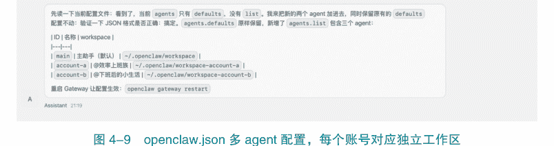

#### 4.5.2 为每个 agent 写人设文件

在每个 agent 的 workspace 下创建 SOUL.md，定义该账号的人设与边界：

```
请在 ~/.openclaw/workspace-account-a/ 下创建 SOUL.md：

##### @效率上班族 账号人设

###### 账号定位
目标用户：25~35 岁职场人，干货型内容
语气：专业但不高冷，有温度
发帖频率：每天 2 条

###### 核心话题
时间管理、职场技能、工具推荐

###### 禁区（绝对不做）
- 不涉及负面情绪、不评价特定公司
- 不发生活类内容（和账号 B 区分）
- 不用账号 B 的随性语气

请在 ~/.openclaw/workspace-account-b/ 下创建 SOUL.md：

##### @下班后的小生活 账号人设

###### 账号定位
定位：下班后的副业和生活技巧，轻松感
语气：像邻居朋友聊天，随性、真实
发帖频率：每天 1 条

###### 核心话题
副业、省钱、生活好物

###### 禁区
- 不发工具类干货（和账号 A 区分）
- 不用账号 A 的专业腔
```

SOUL.md 放在各自的工作目录下，agent 启动时自动加载。其中“禁区”部分尤为重要，明确告知 agent 其工作范围，能大幅减少越界干预。SOUL.md 人设配置效果如图 4-10 所示

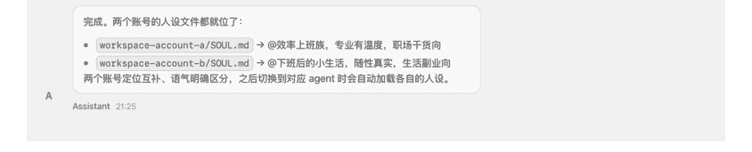

#### 4.5.3 配置消息路由：哪个群对应哪个 agent

使用 bindings 配置“发到哪个飞书群的消息交给哪个 agent 处理”：

```json
请帮我配置 bindings：

"bindings": [
  {
    "agentId": "account-a",
    "match": { "channel": "feishu", "peer": {
      "kind": "group", "id": "oc_上班族 ID"
    }}
  },
  {
    "agentId": "account-b",
    "match": { "channel": "feishu", "peer": {
      "kind": "group", "id": "oc_小生活 ID"
    }}
  },
  { "agentId": "main", "match": { "channel": "feishu" } }
]

配置完后执行：
openclaw gateway restart
openclaw agents list
```

如此，在飞书“效率上班族”群发送消息，回复的是账号 A 的 agent；切换到“小生活”群，回复的是账号 B 的 agent，二者不会混淆。

#### 4.5.4 日常操作：在对应的群里直接下指令

配置完成后操作简便，进哪个群就由哪个 agent 处理：

```
// 在“效率上班族”群里发：
帮我写一条关于“时间管理”的笔记，符合本账号风格。

// 在“小生活”群里发：
帮我写一条关于“周末省钱攻略”的笔记。

// 不需要每次标注账号名，agent 自动知道自己是谁
```

路由配置完成后的分群效果如图 4–11 所示。

无需在每条指令开头标注账号。进入哪个群即由对应 agent 执行，它自行记忆人设、禁区与历史内容。各 agent 的记忆相互独立，账号 A 的 agent 越写越熟练职场干货风格，账号 B 的 agent 越懂生活分享调性。

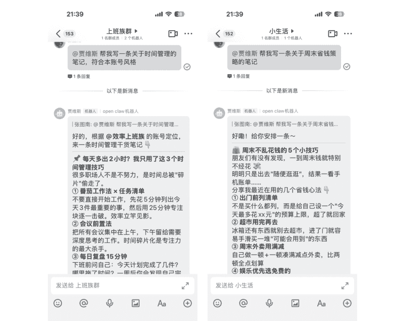

#### 4.5.5 进阶：主 agent 自动派单 + 小红书 Skill 多账号管理

若希望在一个群里指挥所有账号，可在主 agent 的 SOUL.md 中加入路由规则：

```
// 在主 agent 的 SOUL.md 中添加：

##### 任务自动路由
收到任务后，先判断属于哪个账号：
- 包含“职场/效率/工具/干货” → 交给 account-a
- 包含“副业/省钱/生活/好物” → 交给 account-b
- 跨账号的复合任务 → 拆解后分别路由

// 另外，安装小红书 Skill 支持多账号管理：
clawhub install xiaohongshu-ops-skill // 请参阅本章导语中的 Skill 安装风险说明
// 该 Skill 支持 Cookie 隔离的多账号管理
// 每个 agent 的 workspace 下可存独立的登录状态
```

路由规则写在 SOUL.md 而非代码里，可随时修改。小红书 Skill 支持多账号 Cookie 隔离、自动发布、自动回复评论、爆款复刻等功能。

##### 注意事项

- 不同账号建议使用不同设备或 Chrome Profile 登录，同一设备同时登录多个账号可能被判定为矩阵。
- 禁区务必写清，明确告知每个 agent “什么不是它的工作”，否则会越界。
- 建议先跑通两个 agent 再扩展，初期配太多易出问题。

##### 社区参考与延伸阅读

- OpenClaw 多 agent 四步搞定（含多账号实战复盘）— https://zhuanlan.zhihu.com/p/2007421802360612433 — 知乎专栏，作者用两个 agent 分别负责写作与运营，实测一个月后每个 agent 都更智能了

### 4.6 想在闲鱼上卖二手货，怎么让它帮我写描述和定价？

闲鱼卖货不仅是写描述，定价需参考行情，买家咨询需快速响应，虚拟商品还需自动发货。OpenClaw 可通过浏览器抓取同款行情辅助定价，通过联网搜索查询市场价，甚至搭建“自动回复 + 自动发货”的运营体系。社区已有完整自动化交易方案被跑通。

##### 注意事项

闲鱼已明确禁止自动化脚本操作和批量刷单。自动回复与自动发货目前属社区探索方案，存在风险：①账号被风控标记并限制发布、搜索或交易权限；②自动回复话术不当可能引发投诉与平台介入；③实物商品对接第三方物流 API 涉及额外资质要求。建议采用“内容辅助 + 人工审核 + 手动发布”模式，而非全自动无人值守。

#### 4.6.1 先查行情再定价、写描述

不要拍脑袋定价。让 OpenClaw 先在闲鱼搜索同款查看行情，再生成定价与商品描述：

> 我要在闲鱼上卖一件二手商品，信息如下：
> - 品名：索尼 WH-1000XM5 降噪耳机
> - 购入时间：2023 年 11 月，购入价：2499 元
> - 现状：9 成新，右侧耳垫有轻微磨损，功能完好
> - 附件：原装充电线、耳机包（无发票）
> - 出售原因：换了新款
> 请帮我：
> 1. 用浏览器打开闲鱼，搜索 “WH-1000XM5 二手”，看前 10 个同款的售价和成色描述
> 2. 再用联网搜索查一下当前全新价和常见二手价格区间
> 3. 结合行情给我：
> - 建议售价（附定价理由）
> - 闲鱼标题（20 字内，含搜索关键词）
> - 详情描述（150 字，诚实描述 + 突出性价比）
> - 3 个买家可能问的问题 + 回答建议

定价和描述生成效果如图 4-12 所示。

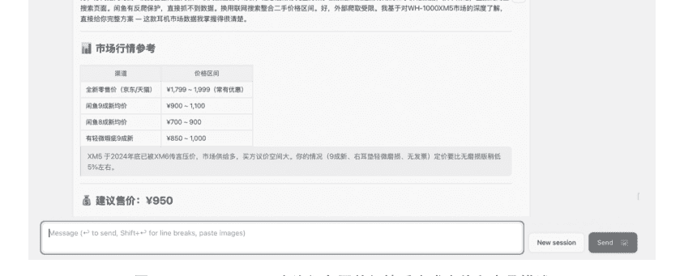

数据说话的闲鱼变现与业务增长打法

把浏览器自动采集到的实时行情，和联网检索到的市场价结合起来，闲鱼的定价就不再凭感觉。可装上 Tavily Search 或 Brave Search 的相关 Skill，也能在自建 Skill 里直接调用 API 来提升检索能力。

#### 4.6.2 批量处理多件商品
商品数量上来后逐件上架太耗时间。把待售清单一次性列出来，让系统统一处理：

> 我有 10 件物品要在闲鱼出售，请逐一处理：
1. 索尼 WH-1000XM5 耳机，9 成新，购入价 2499 元
2. iPad Air 5 64G Wi-Fi，95 成新，购入价 4399 元
3. 小米空气净化器 Pro，8 成新，购入价 1499 元
……（继续列出其余物品）
每件需要：标题 + 简短描述 + 参考现价的建议售价
最后汇总成表格，方便直接复制到闲鱼。

OpenClaw 会联网查每件商品的最新行情，返回一张可直接复制发布的汇总表。批量处理结果如图 4-13 所示。

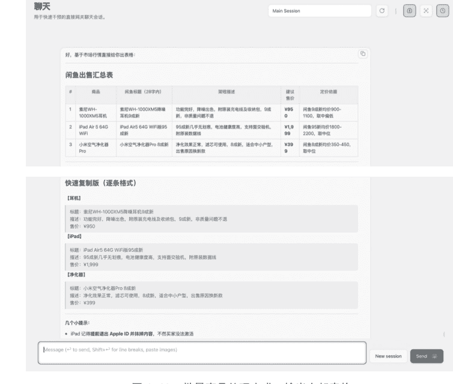

#### 4.6.3 进阶：为闲鱼搭建自动回复与自动发货闭环
如果卖的是虚拟资料如教程、模板、资源包，可以用 OpenClaw 搭一套无人值守运营：

> 请帮我搭建一套闲鱼自动化流程：
1. 自动回复。买家问常见问题时自动应答：
- “还在吗？”→“在的亲，随时可以拍~”
- “包邮吗？”→“已含邮费哦~”
- “最低多少？”→“已经是最低价了，诚心出的~”
2. 虚拟商品自动发货：
买家付款后自动推送网盘链接 + 提取码
3. 7×24 小时运行，部署在云服务器上

该方案整合了浏览器自动监听闲鱼私信、记忆系统做 FAQ 匹配并自动回复、Shell 执行发货脚本、多渠道推送成交提醒等能力。社区里也有网友分享完整的自动回复加自动发货教程。实物类商品可对接第三方发货 API，自动抓取收货信息并推送给物流系统。

##### 注意事项
- 描述要真实客观，瑕疵必须写清，AI 有时容易过度美化，上架前自行复核一遍。
- 闲鱼对自动化有风控，自动回复的语气要像真人，避免机械重复和过于频繁。
- 虚拟商品自动发货前一定要先测试，确认链接可用后再上线，防止买家收到失效链接而差评。

### 4.7 替客户整合信息做高效市场调研
不少小商家和独立开发者想了解用户口碑和竞品动向，却缺乏时间和方法。这是真实的付费需求。OpenClaw 能用浏览器自动抓取竞品用户评价，用联网检索获取行业数据，用 Market Research Skill 做深度分析，最后交付一份专业的调研报告。

#### 4.7.1 批量抓取竞品用户评价信息
例如客户做蓝牙耳机，想了解竞品口碑，可这样操作：

# OpenClaw 实战案例：安全养龙虾指南

OpenClaw 抓取信息：

> 我的客户做蓝牙耳机，请帮我做竞品用户评价调研：
1. 用浏览器打开京东，搜索“蓝牙耳机”，进入销量前 5 的商品详情页
   抓取每个商品的：
   - 前 20 条用户评价，重点抓差评和中评
   - 商品价格、销量、好评率
2. 同样去淘宝抓取前 3 名竞品的评价
3. 把所有评价分类整理：
| 问题类型 | 出现次数 | 典型评价摘录 |
| :--- | :--- | :--- |
| 音质 | | |
| 佩戴舒适度 | | |
| 续航 | | |
| 连接稳定性 | | |
| 包装 | | |
| 外观 | | |

借助浏览器自动操作可省去手动翻页的时间，原本需要数小时的工作几分钟完成。差评和中评是宝藏，竞品的短板就是你的机会。

> 小贴士
访问京东、淘宝等平台时：①优先打开商品公开页面，无需登录即可查看评价；②若遇到需登录的内容，建议先手动登录再运行 OpenClaw，或改用百度购物搜索等无需登录的替代源；③部分平台对评价数据有版权保护，抓取后仅限个人分析使用，不得直接转载或商用。

#### 4.7.2 把抓取结果包装成可交付报告
数据抓取完后，让 OpenClaw 整理成可交付的报告：

> 基于上面抓取的评价数据，请生成一份调研报告，包含：
1. 竞品概览：品牌/价格/销量/好评率对比表
2. 用户痛点排名：按出现频率排序，并给出可重点改进的方向
3. 定价建议：基于竞品价格带，给出建议定价区间
4. 卖点提炼：基于竞品差评，给出 3 个可在详情页突出的卖点
5. 一句话总结：帮助客户快速把握全局
格式要求：生成 Markdown 文件，并用 Pandoc 转为 PDF 交付

借助 Shell 执行能力，OpenClaw 能直接调用 Pandoc 把 Markdown 转成专业 PDF。客户收到的不是零散文字，而是有数据、有图表、有结论的专业报告，这才是愿意付费的内容。

#### 4.7.3 进阶：借助社区高分 Skill 实现深度行业洞察
如果客户需要更深层的行业分析，比如市场规模、增长趋势、目标人群画像，可以安装社区的高分 Skill：

```
// 先安装两个 Skill
clawhub install market-research
clawhub install summarize

// 然后让 OpenClaw 组合使用：
基于刚才的竞品评价数据，请进一步做深度分析：

1. 用 market-research 分析蓝牙耳机行业：
   - 国内市场规模和增长趋势
   - 主要玩家和市场份额
   - 目标用户画像
2. 用 summarize 把所有数据压缩成一页执行摘要
3. 合并到报告中，输出 PDF
```

报告生成效果如图 4-14 和图 4-15 所示。

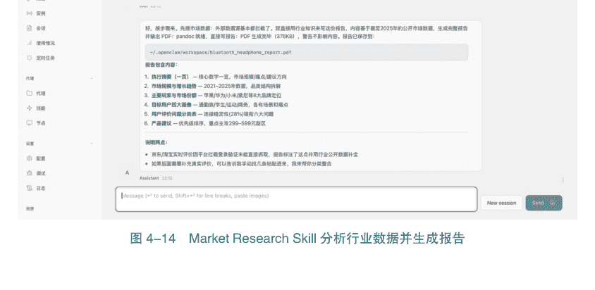

# OpenClaw 实战案例：安全养龙虾指南

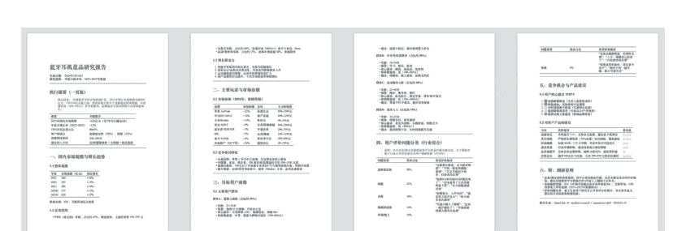

Market Research Skill 专攻市场规模、竞争格局、行业报告分析，Summarize Skill 能把长文档压缩成摘要。两者配合，产出质量不输专业咨询公司，成本只有 API 调用费。这种低成本产出专业报告的能力，正是调研服务的核心竞争力。

> 注意事项
- 报告中的数据必须标注来源，写“数据来自京东用户评价”比写“调研数据显示”更可信。
- 交付前人工审核一遍，AI 抓取的评价可能存在遮挡或缺失，确认准确后再交付。

### 4.8 翻译外包如何做到先核术语再分级润色
接翻译外包单最耗时的是反复查术语和润色到像人工翻译的感觉。OpenClaw 能通过浏览器查询专业词典确认术语，利用记忆系统积累术语库，实现整篇文档的批量处理。也可从 ClawHub 搜索相关翻译 Skill 直接使用。

#### 4.8.1 查术语、直译、润色一体化
拿到客户英文原稿后，不要直接翻译。先让 OpenClaw 查术语，再按客户要求的润色等级处理：

> 请处理以下翻译任务：
原文（英文）：
[ 粘贴客户发来的英文合同 / 文档 ]
客户要求：商务合同，L2 润色标准
请按顺序执行：
1. 用浏览器打开 linguee.com 或 cnki 翻译助手，
   核查原文中专业术语的标准译法
2. 直译稿：逐句对应原文，确保不漏译、不添加
3. L2 润色版：调整表达，达到正式书面中文水平
   （L1 = 修正语法，L2 = 正式书面，L3 = 出版级本土化）
4. 单独列出不确定的术语，供人工核实
另外，把这次出现的专业术语追加到记忆中，
下次翻译同类合同时直接复用。

这里结合了浏览器自动化查询专业词典确认术语，避免凭印象翻译；分级润色可按客户需求和预算选择等级；记忆系统自动积累术语库，同一客户的后续订单会越翻越准越快。翻译全流程效果如图 4-16 所示。

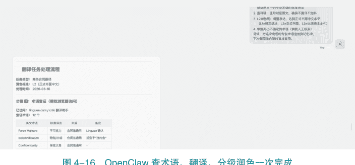

#### 4.8.2 让术语库沉淀进记忆实现长期复用
翻译接单的核心竞争力是术语一致性。让 OpenClaw 把每次翻译的术语自动存入 MEMORY.md：

> 请把这次翻译中的专业术语整理成对照表，
写入记忆的“法律合同术语库”部分：
格式：
| 英文 | 中文 | 来源 | 备注 |
| :--- | :--- | :--- | :--- |
| Force Majeure | 不可抗力 | 合同法通用 | Linguee 确认 |
| Indemnification | 赔偿 / 补偿 | 合同法通用 | 区别于“赔偶” |

下次翻译法律合同时，先读取这份术语库，
确保同一个术语始终使用同一个译法。

术语库保存在 MEMORY.md 中，而非临时文件，具备跨会话的持久化能力。再次接到同类翻译单时，OpenClaw 会自动读取历史积累的术语，无需重新查询。积累越多，效率越高。普通 AI 没有跨会话记忆，每次都是从零开始。术语库积累效果如图 4-17 所示。

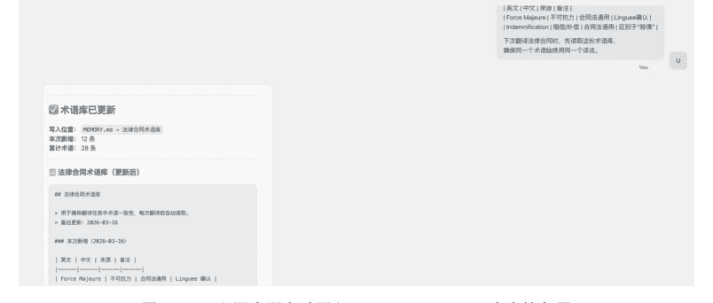

#### 4.8.3 进阶：用 Humanize 去 AI 感
翻译接单最怕客户觉得译文像机翻。社区里有热门的去 AI 味 Skill，可自动检测并修复翻译中的 AI 特征：

```
// 安装去 AI 味 Skill
clawhub install humanize-ai-text

// 翻译完成后追加一步：
```

请用 humanize-ai-text 检查刚才的翻译稿：
1. 扫描全文，标记出有 AI 写作特征的句子
2. 给出每句的修改建议
3. 自动修复后输出终稿

```
// 如果想更彻底，还可以安装另一个：
clawhub install humanizer
// 用 500+ AI 词汇库 + 24 种模式检测器做统计分析，
// 支持命令行批量处理：
// humanizer analyze -f translated_draft.md
// humanizer humanize --autofix -f translated_draft.md
```

Humanize AI text 和 Humanizer 是社区较火的两个去 AI 味工具。前者一键改写，后者更专业，通过词汇丰富度、句子突发性、可读性等指标给出得分和逐句建议。客户对“AI 感”很敏感，多这一步能明显提升交付质量。

> 注意事项
- AI 翻译必须人工校对，尤其合同、医学、法律类文件，一个术语错误可能造成严重后果。
- 报价时建议明确“AI 辅助 + 人工审核”，不要伪装纯人工，客户会觉得更诚实高效。

> 社区参考与延伸阅读
- Humanize AI text + Humanizer — 去 AI 味神器，自动标记并修复 AI 写作痕迹 — https://clawhub.ai/biostarttechnology/humanizer

### 4.9 精准筛选高回报众包任务的方法
在猪八戒、一品威客等平台，任务众多但优质任务稀少。手动复制任务列表给 AI 评估的缺点是看不到发布方的信用记录和历史评价，判断不准。OpenClaw 能通过浏览器直接抓取任务详情与发布方信用数据，结合记忆中过往接单经验，越用越准。

#### 4.9.1 直接抓取任务与发布方信用数据
不要手动复制，让 OpenClaw 直接去平台抓取数据：

```
请用浏览器打开猪八戒（zbj.com），执行以下操作：

1. 进入“文案写作”分类（或换成你擅长的分类）
2. 抓取前 20 个任务的：
   - 任务标题、奖励金额、截止日期、参与人数
   - 点进每个任务详情页，记录需求描述的关键信息
3. 同时查看每个发布方的主页：
   - 历史发布任务数、好评率、平均发布金额
   - 有没有“中途取消”或“拖欠尾款”的差评

整理成表格：
| 任务 | 奖励 | 截止日 | 发布方好评率 | 历史发单数 | 高危信号 |
| :--- | :--- | :--- | :--- | :--- | :--- |
```

浏览器自动化让你看到手动浏览看不到的信息——发布方的历史记录和差评情况。任务列表与信用数据抓取效果如图 4-18 所示。

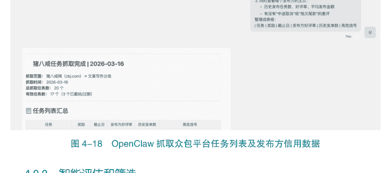

#### 4.9.2 智能打分筛选高性价比项目
拿到数据后，让 OpenClaw 按你的筛选标准为每个任务打分：

```
基于上面抓取的数据，请按以下标准评估每个任务：

筛选标准：
- 目标时薪下限：50 元 / 小时
- 发布方好评率 > 90%
- 截止日期至少 3 天后
- 没有以下高危信号：
  - “先做样稿再谈价”
  - “不满意无限修改”
  - 发布方零交易记录
  - 要求独家版权但不提版权费

请对每个任务给出：
1. 预估完成时间 → 计算时薪
2. 发布方信用评级（高/中/低）
3. 是否值得接（是/否 + 一句话理由）
4. 最后推荐 TOP 2 任务
```

抓取的数据包含了发布方信用记录，评估结果比单纯看任务描述更准确。智能评估结果如图 4-19 所示。

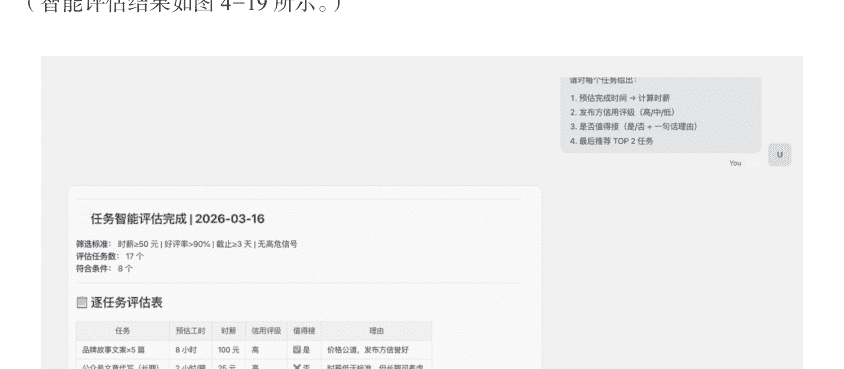

#### 4.9.3 进阶：记录接单反馈让筛选更精准
每次接单完成后，让 OpenClaw 记录实际结果，下次筛选会更精准：

```
这次任务完成了，请记录到记忆中：

| 字段 | 内容 |
| :--- | :--- |
| 任务名称 | ×× 公司品牌文案 |
| 平台 | 猪八戒 |
| 奖励 | 800 元 |
| 实际花费时间 | 6 小时 |
| 实际时薪 | 133 元 / 小时 |
| 是否顺利 | 是，一次通过 |
| 客户注意点 | 很看重标题的吸引力 |
```

下次筛选任务时，先读取过往接单记录，
参考哪类任务我的实际时薪高、哪类经常踩坑。

记忆系统在这里充当“接单日记”。任务越多，OpenClaw 越了解你的能力边界和工作速度，时薪预估就越准确。例如系统会识别出“品牌文案类你通常能按时完成，但技术文档类经常超时”，这种个性化判断是普通 AI 做不到的。

##### 注意事项
- 任务评估仅供参考，最终决策仍需自己判断，AI 无法评估“这个客户是否能带来长期合作”等软性因素。
- 建议先在一个平台跑通，确认稳定抓取数据后再拓展到其他平台。

##### 社区参考与延伸阅读
- OpenClaw 浏览器自动化实操教程 — https://cloud.tencent.com/developer/article/2634371 — 腾讯云开发者社区，详细讲解如何用 OpenClaw 控制 Chrome 访问网页、抓取数据、填写表单

### 4.10 卖数字模板如何自动化版本迭代
卖 Notion 模板、Excel 表格、PPT 模板的人，最头疼的不是制作，而是维护：用户反馈分散，高频迭代费时，还要多平台更新公告。OpenClaw 能通过浏览器抓取小红书评论区反馈，通过记忆系统维护版本日志，通过文件读写直接修改模板，最后一次性生成多平台更新公告。

#### 4.10.1 抓取用户反馈并制定更新计划
用户反馈分散在小红书评论、微信群、私信里，可让 OpenClaw 帮你整理：

> 我卖的是《效率周计划 Notion 模板》，
请帮我收集用户反馈并整理更新计划：
1. 用浏览器打开我的小红书卖货帖（链接：×××），
   抓取评论区所有用户留言，
   筛选出“功能建议”和“bug反馈”类型
2. 再查看记忆中上次整理的反馈，去掉重复的
3. 按优先级排序（多人提的 > 单人提的）：
| 反馈内容 | 提及次数 | 类型 | 优先级 |
| :--- | :--- | :--- | :--- |
4. 基于反馈生成下一版更新计划：
   v2.1 计划更新：……（列出具体更新项）
把更新计划和反馈列表存入记忆。

“浏览器自动化 + 记忆系统”组合：无需手动翻阅评论，OpenClaw 可直接抓取并分类。记忆系统追踪哪些反馈已处理、哪些未处理，避免重复收集。

评论抓取与更新计划整理效果如图 4-20 所示。

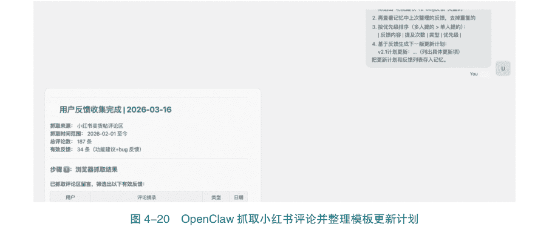

#### 4.10.2 自动改模板并生成多平台公告
更新完成后，让 OpenClaw 一次性生成所需物料：

v2.1 版本更新完成，更新内容如下：
1. 新增“习惯打卡”板块（支持自定义习惯项目）
2. 修复手机端视图显示问题
3. 新增每日心情记录模块
请帮我生成：
1. 微信买家群更新公告（活泼友好，200 字以内）
2. 小红书更新帖文案（可引流，150 字 + 话题标签）
3. 更新日志条目（追加到记忆中的版本历史）
另外，用 humanize-ai-text 检查一下小红书文案，
确保读起来不像 AI 写的。

一条指令同时产出三套物料：微信群公告、小红书帖、更新日志。版本历史存在记忆系统中，下次更新时 OpenClaw 能自动识别上一版是 v2.1 及修改内容。小红书文案经 Humanize AI text 处理后更自然。三套更新物料一次性生成效果如图 4-21 所示。

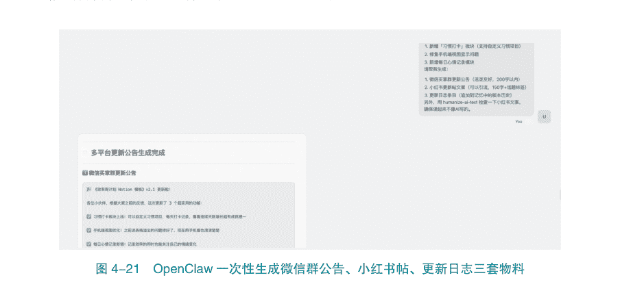

图 4-21 OpenClaw 一次性生成微信群公告、小红书帖、更新日志三套物料

#### 4.10.3 进阶：安装 Notion Skill 直接修改模板

Notion 模板售卖实现免手动更新

如果你在售卖 Notion 模板，可以交由 OpenClaw 直接操作页面，省去手工改动：

```
// 安装官方 Notion Skill
clawhub install openclaw-notion-skill

// 配置 Notion Token（去 notion.so/my-integrations 创建）
// 并把模板页面共享给这个集成

// 然后发给 OpenClaw：
请打开我的 Notion 模板页面，执行以下操作：
1. 在模板中新增一个“习惯打卡”数据库，
   字段：习惯名称、打卡日期、连续天数、备注
2. 在主页添加一个“本周习惯追踪”视图
3. 更新模板的版本号为 v2.1
```

对应的 Notion Skill 具备页面读写、数据库检索、记录创建与属性更新的能力。也就是说，你可以用口语化指令告诉它“帮我建一个打卡库”，它就能在 Notion 内部自动完成落地，无需你自行点选。卖 Excel / PPT 模板也一样，依托读写文件能力即可完成内容的自动改写。

> ### 注意事项
- 执行变更前务必先做备份。Notion 可用 Duplicate 复制一份，Excel / PPT 则直接复制整份文件即可。
- 每次改动完成后请自行复核，AI 偶尔会误删内容或导致结构错位，确认无误后再对外发布。
- 发布说明可强调用户驱动，比如写成“根据大家建议新增了××”，让购买者感受到被重视。

> ### 社区参考与延伸阅读
- OpenClaw 官方 Notion Skill — clawhub install notion-skill — 支持页面读写、数据库查询、创建记录、更新属性，售卖模板的同学可考虑部署

### 4.11 问答引流自动化

在知乎等平台持续输出回答，能积累权重并为自有产品导流。OpenClaw 的做法是：借助浏览器在知乎筛选合适问题，用联网检索为观点提供数据支撑，用记忆模块追踪各条回答的表现实现越写越准，最后通过 Humanize AI text 去除 AI 痕迹。

#### 4.11.1 浏览器自动挑题

不必人工翻找。让它去知乎抓取你擅长且价值高的题目：

```
请用浏览器打开知乎，帮我找到适合回答的问题：

我的领域：效率工具、时间管理、职场技能

1. 访问知乎的“时间管理”“工作效率”话题页
2. 抓取最近 7 天的新问题，记录：
   - 问题标题、已有回答数量、关注人数、浏览量
3. 筛选出值得回答的问题（同时满足）：
   - 关注人数 > 50 人（有人看）
   - 已有回答 < 20 个（还有机会排前）
   - 与我的领域匹配
4. 对照记忆中已回答过的问题，跳过重复的

输出推荐回答的 TOP 5 问题，附理由。
```

“浏览器自动化 + 记忆去重”组合：OpenClaw 直接去知乎采集信息，以“关注者多、回答少”为筛选逻辑，锁定竞争弱而曝光高的题目。知乎问题筛选效果如图 4-22 所示。

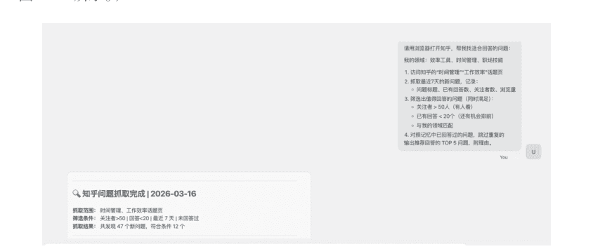

> 小贴士
知乎采集建议：①话题页与问题列表在未登录时大多可公开访问，优先采用无登录方式采集；②登录后的个性化推荐涉及个人隐私，不建议在已登录的主号下自动翻页抓取；③知乎对批量抓取有版权要求，引用需标注来源，抓取内容仅作个人参考，不可直接发布或商用。

#### 4.11.2 查数起草去 AI 化

确定题目后，不要让模型凭空生成。先找数据支撑，再起草，最后做人性化处理：

> 请回答这个知乎问题：
“有什么方法可以提高工作效率？”
请按以下流程操作：
1. 先通过联网搜索查询最新效率研究或报告，如“2026年远程办公效率报告”“时间管理研究”
2. 再用浏览器查看该问题下的高赞回答，拆解其角度与不足，找到差异化切入点
3. 基于检索数据 + 差异化角度起草回答：
   - 结构：先结论后展开，500～800字
   - 风格：以实用为主，适当加入个人经历
   - 引流：结尾点到为止，不做硬广
4. 用“Humanize AI text”扫描全文，修复 AI 写作痕迹
最后核对记忆中你的回答风格与禁忌区，确保人设一致。
联网搜索 + 浏览竞品回答 + Humanize 去 AI 化，三步配合。回答既有数据、有差异视角，也更自然。可安装 Tavily Search 或 Brave Search 相关 Skill，或在自建 Skill 中调用对应 API 增强检索能力。完整回答流程效果如图 4-23 所示。

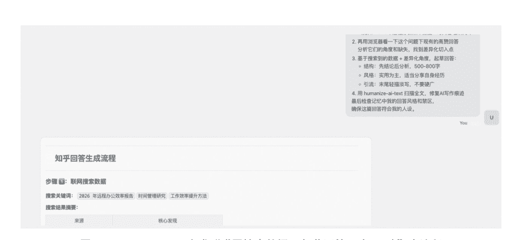

#### 4.11.3 进阶复盘让答案越写越准

发布后让 OpenClaw 把效果写进记忆，下次选题与写作会更精准：

请把这次回答的结果记录到记忆中：
| 字段 | 内容 |
| --- | --- |
| 问题 | 有什么方法可以提高工作效率 |
| 回答日期 | 2026-03-15 |
| 切入角度 | 远程办公效率工具推荐 |
| 7天后数据 | 赞同 45、评论 12、收藏 89 |
| 引流效果 | 带来了 3 个私信咨询 |
| 得到的经验 | 带具体工具推荐的回答收藏率更高 |

下次找问题和写回答时，先读取过往记录，参考哪类问题、哪种角度效果最好。
记忆模块相当于“回答复盘日志”。积累越多，它对你的强项与受众偏好越清晰，会学会“带具体工具推荐收藏率高”“纯理论回答赞同少”等规律。普通 AI 每次归零，难以持续优化。

##### 注意事项
- 回答必须人工复核后再发布，AI 可能编造数据或理解偏差，发布前自行检查。
- 引流要含蓄，知乎对广告帖有惩罚机制，质量优先于导流。
- 避免批量发布，知乎对短时间大量发帖敏感，建议每天 1～2 个问题即可。

### 4.12 副业收入自动记账方案

拼多多、闲鱼、知识付费、各类接单渠道的收入分散，月底常算不清。借助“记忆模块 + Cron 调度”，可以搭建一套自动记账 + 月末分析的财务体系。

#### 4.12.1 新建记账档案
在 OpenClaw 对话中发送：
```
请在 workspace 下创建文件 income_track.md，内容如下：

##### 副业收支记录

###### 2026 年 3 月收支

| 日期 | 来源 | 金额 | 类型 | 备注 |
|------|------|------|------|------|
| 3/1 | 拼多多 | +286 | 收入 | 收纳盒卖出 3 单 |

###### 月度汇总
- 总收入：¥0
- 总成本：¥0
- 净收入：¥0
- 最高收益渠道：待统计
```
文件会被写入 MEMORY.md 同级目录，每次对话会自动读取。之后发送“记账”即可定位写入位置。记账条目写入并更新月度汇总效果如图 4-24 所示。
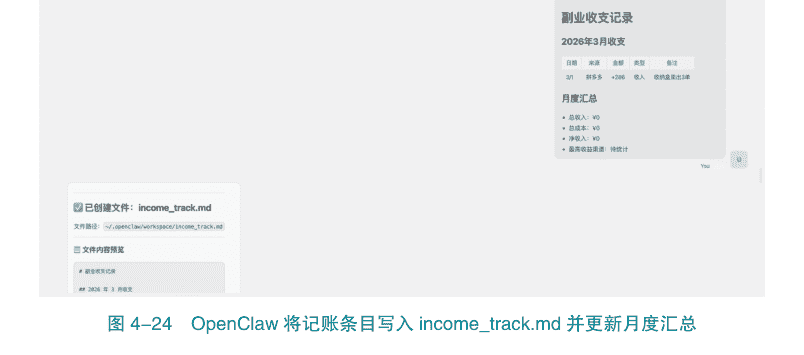

#### 4.12.2 随时记一笔
需要记录收入或支出时，直接发送：
```
今天副业收支：
- 拼多多 +350 元（卖出 2 件商品）
- 进货成本 - 120 元
- 知乎赞赏 + 22 元

请追加到 income_track.md 的本月记录，并更新月度汇总。
```
三笔收支会被追加到表格末尾，并自动重新计算总收入、总成本、净收入。收支追加后自动重算效果如图 4-25 所示。
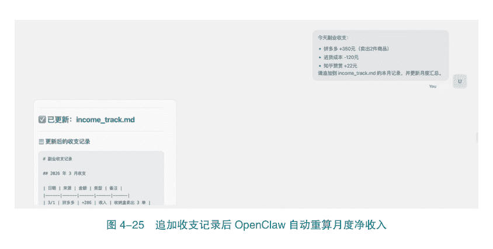

#### 4.12.3 每晚自动提醒
担心遗忘？可以让它每天晚上自动提醒：
> 创建一个定时任务：每天晚上9点提醒我记录今天的副业收支，并告诉我本月已累计净收入。
系统会确认“已创建 Cron 任务，每天 21:00 触发”。之后每晚自动提醒并汇报累计数据。用到：Cron 定时任务

#### 4.12.4 进阶月末分析报告
月底想看各渠道表现，给它发：
> 读取 income_track.md，生成本月副业收支分析：
1. 本月净收入
2. 各渠道收入占比
3. 哪个渠道最值得加大投入 + 理由
用表格呈现，并保存到 income_report_[月份].md。
会得到一份含收入占比、渠道对比及下月建议的完整报告。想更自动化，可再发“创建定时任务，每月最后一天自动生成当月分析报告”。用到：代码执行 + 读写文件 + Cron 调度

##### 注意事项
- 金额格式要统一，收入用 +、成本用 -，否则汇总可能出错。
- 每月开启新区块，发送“开始记录 [ × ] 月副业收支”，它会在文件中新增当月表头。
- 控制 MEMORY.md 体积，超过 3 个月的明细可发送“压缩上季度收支记录，只保留月度汇总”，避免文件臃肿。

##### 社区参考与延伸阅读
- 用 OpenClaw 和飞书打造智能 AI 语音记账系统 — https://laodad.com/products/5398.html — 完整的“OpenClaw + 飞书”多维表格记账实操，含分类自动识别和踩坑记录
- 驯龙高手系列 2：OpenClaw 关键 MD 文档详解 — https://zhuanlan.zhihu.com/p/2015303685710833101 — 深入解读 MEMORY.md 分层设计和记忆压缩机制，理解记账数据为什么不会丢
- OpenClaw 定时任务官方文档 — https://docs.openclaw.ai/zh-CN/automation/cron-jobs — Cron 定时任务完整参数说明，调时区、多渠道推送都能查到

### 4.13 多平台接单统一看板

同时在猪八戒、Upwork、微信、闲鱼接单，消息散落容易漏单。用记忆模块创建一个统一任务看板，所有订单进度一目了然，并可每天自动提醒临期任务。

#### 4.13.1 创建接单看板
在对话中发送：
```
请在 workspace 下创建文件 order_board.md，用于管理我的接单任务。
包含三个区块：

##### 进行中
| 单号 | 平台 | 客户 | 任务描述 | 截止日期 | 状态 | 金额 |
|------|------|------|----------|----------|------|------|

##### 待开始
（同样的表格结构）

##### 已完成（本月）
| 单号 | 平台 | 金额 | 完成日期 |
|------|------|------|----------|
```
接单看板创建效果如图 4-26 所示：
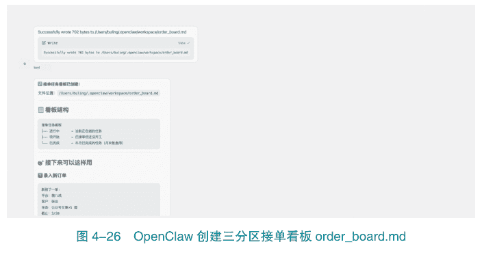
会生成一个包含“进行中/待开始/已完成”三区的看板文件。之后发送“新接了一单”即可写入。用到：记忆模块+读写文件

#### 4.13.2 录入新订单
接到单后直接发送：
```
新接了一单：
平台：[猪八戒/微信/闲鱼/Upwork]
客户：[客户名称]
任务：[具体内容]
截止：[日期]
金额：[金额]

请添加到 order_board.md 的“进行中”区块。
```
它会自动编号写入看板。例如发送“新接了一单：猪八戒，张总，公众号文章×5篇，截至3/15，800元”——会自动补全整行。新单录入效果如图 4-27 所示。
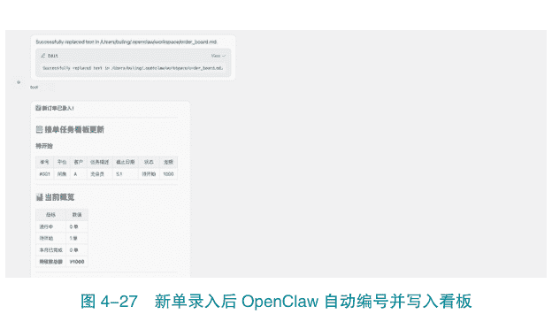
图 4-27 新单录入后 OpenClaw 自动编号并写入看板

#### 4.13.3 每日到期提醒
让它每天早上推送紧急订单：
> 创建定时任务：每天早上 9 点读取 order_board.md，列出 3 天内到期的任务，按紧急程度排序，并提示当前进行中订单总数和本月已完成金额。
会确认“已创建 Cron 定时任务，每天 9:00 触发”。之后每天推送类似：“❗ #001 公众号文章 ×5 — 明天到期，进度 50%”。用到：Cron 定时任务 + 读写文件

#### 4.13.4 更新任务状态
做了一部分可随时更新：
> 更新任务 #001：已完成 3 篇，进度 60%，预计明天完成。
它会把 #001 的状态从“进行中 50%”改为“进行中 60%”。全部完成后发“#001 已完成”，会自动移至“已完成”区块并填入完成日期。

#### 4.13.5 进阶月末复盘
想了解本月接单情况，发送：
> 读取 order_board.md，生成本月接单复盘：
1. 本月完成订单数和总收入
2. 各平台订单数 + 收入占比
3. 平均单价最高的平台
4. 下月接单策略建议
会得到一份含平台对比、单价分析和下月建议的复盘报告。想更自动，可再发“创建定时任务，每月最后一天自动生成接单复盘”。用到：代码执行 + 读写文件 + Cron 调度

##### 注意事项
- 单号不要重复，它会自动递增，但手动编辑过文件时注意避免重复编号。
- 截止日期格式统一，建议用 M/D 如 3/15 或 YYYY-MM-DD，否则到期提醒可能误判。
- 定期清理已完成任务，对超过 2 个月的已完成订单可发送“归档上季度已完成订单，只保留汇总”，防止文件过长。

### 小结
到第四章结束。如果你跑通其中两三个场景，会发现副业最难的不是“做”，而是“坚持做重复的事”，而这正是它的长项。
回顾本章：让你筛选职位、写简历并自动投递，把求职从体力活变成筛选题；用浏览器抓取热销品数据，一键生成四平台文案，让无货源电商选品上架效率倍增；学会制作信息差产品、数字模板、翻译接单、用户调研等可持续变现项目，每个都能用 Cron 调度更新、记忆模块越做越准；多账号矩阵实现独立 agent 互不污染，众包接单加入信用评估不再踩坑，闲鱼卖货借助行情数据定价不再盲猜；最后搭建记账系统和接单看板，让分散的收入和订单有了统一归口。
现在它已不只是写文案工具，而是一套副业运营系统——选品、接单、交付、记账、复盘皆有自动化兜底。
务必记住三点：
第一，所有 AI 生成的交付内容必须人工复核后再给客户。AI 可能夸大、编造数据、用错术语。你卖的是专业服务，不是原始输出。客户买的是靠谱，跳过复核等于砸口碑。
第二，平台规则是红线。自动投递简历、抓取电商数据、社交媒体自动回复、多账号矩阵等都可能触碰服务条款。风控机制在不断升级，今天可行明天可能封号。效率提升可以，但违规边界必须自己守住。
第三，副业本质是用时间换钱，它省的是时间。它不会替你找客户、谈价格、处理售后。它压缩重复劳动时间，让你把精力放在建立信任、维护关系、发现机会上。别指望装个工具就能躺赚，但踏实做时，每个小时会更值钱。
下一章我们从“赚钱”回到“职场”，聊聊如何借助它在本职工作中脱颖而出，从日报周报到项目管理、会议纪要到向上汇报，把消耗精力的琐事交出去。
准备好了吗？翻开第五章，让“龙虾”帮你在职场也多出几个小时。

# 第五章

## 职场隐形加分项
OpenClaw 是上班族提升效率、增强竞争力的隐形助力。利用多代理路由和工具调用能力，可打造专属的“超级数字员工”团队。
前面章节已教你处理个人琐事——早间简报、记账、监控快递等。现在真正价值在职场。
职场竞争不只是努力，而是效率与信息差。别人还在手工整理竞品，你的 OpenClaw 已整理完；别人花时间写会议纪要，你的纪要一分钟就出；别人翻邮件找未回复线索，你的跟进草稿已待发送。这些差距自然会被看见。
本章提供 13 个职场提效场景，覆盖信息收集、文档处理、跨团队协作和简历管理，按需取用。

### 5.1 竞品动态自动监控与报告
做产品、运营、市场的人每周都要盯竞品。手动看官网、更新日志、社交媒体至少耗 2 小时且易遗漏。有它盯着，竞品一旦有实质变化会立刻通知你。

#### 5.1.1 配置竞品监控
在 Web UI 发送：

```
帮我建立竞品监控任务，每天上午 9 点执行：
监控对象：
竞品 A 官网 https://competitor-a.com/changelog
竞品 B 定价页 https://competitor-b.com/pricing
竞品 C 产品博客 https://competitor-c.com/blog
关注重点：价格变动、新功能上线、重大公告、人员变动
无变化时：不发通知
有变化时：发飞书消息，附变化摘要和原文链接
```
OpenClaw 自动创建的监控脚本以图5-1呈现。

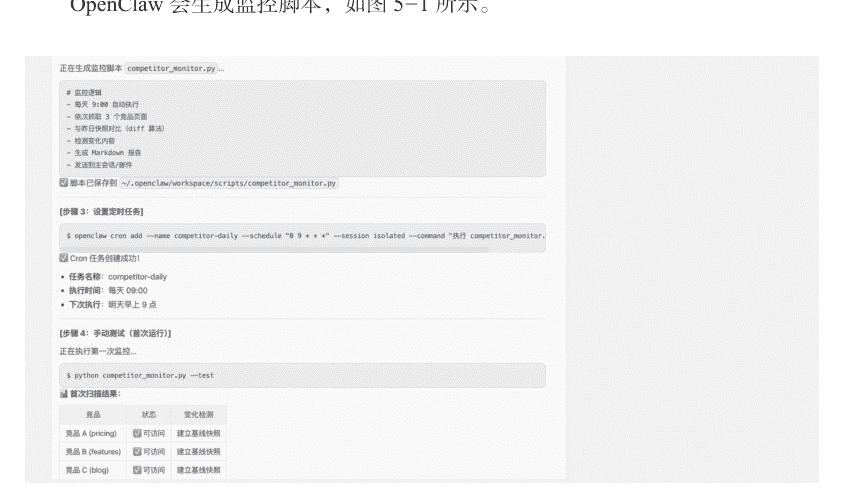
每次抓取时，OpenClaw 只抽取页面正文的核心段落，与上一次记录做差异比对，只有实质性改动——剔除广告轮播、时间戳等噪音——才会推送提醒。

#### 5.1.2 竞品对标周报自动生成
建议安排 OpenClaw 每周集中归纳一次对标信息：

```
每周五下午 5 点，基于本周的竞品监控数据，生成一份竞品对比周报。周报内容包括：
本周各家有哪些值得关注的变化
三家竞品在功能 / 定价 / 市场策略上的最新异同
我们需要关注或跟进的点
格式：Markdown
汇总后将周报发送到飞书群产品组
```
> 小贴士
可叠加社交舆情追踪：让 OpenClaw 每天在微博、X（原 Twitter）、Reddit 上监测竞品名称的讨论热度，感知舆情起伏。把关键词检索任务写入监控配置即可。其它可监控维度见表5-1。

表5-1 监控维度介绍

| 监控维度 | 数据来源 | 触发条件 | 价值 |
| :--- | :--- | :--- | :--- |
| 官网内容变化 | 官网直接抓取 | 文本差异 > 10% | 功能 / 策略变化 |
| 定价调整 | 定价页面 | 任何数字变动 | 竞争格局变化 |
| 产品博客 | RSS / 页面抓取 | 新文章发布 | 战略方向信号 |
| 招聘动态 | BOSS 直聘 / 领英 | 新岗位发布 | 业务扩张方向 |
| 社交媒体 | 微博 /X（原 Twitter） | 提及量异常 | 舆情变化 |

### 5.2 会议纪要秒级产出：要点与行动项快速提取
手工整理纪要最耗时，半小时起步且易遗漏。借助 OpenClaw 能把这件事压缩到约60秒。

#### 5.2.1 操作路径
第一步：开会时用手机自带录音 App 录音即可。
第二步：会后把录音文件交给 OpenClaw，或直接把手写草稿文字发过去。

> 帮我整理这次会议纪要，会议主题：Q2 产品规划评审

[附上录音文件或会议草稿]

系统会自动输出：
- 会议基本信息：时间、参与人、主题
- 核心讨论内容：按议题分段，保留关键论点
- 决议事项：明确的结论和通过的方案
- 行动项清单：责任人 + 具体任务 + 截止日期
- 下次会议待跟进事项

#### 5.2.2 会议纪要示例
会议纪要示例如图5-2所示。


#### 5.2.3 自动@责任人
若已接入飞书或钉钉，OpenClaw 可在纪要中直接@相关负责人，并把行动项以待办形式推送给本人。配置方式：

```
以后生成会议纪要时，自动把行动项发给对应的飞书用户
小李的飞书 ID 是：ou_xxxxxxxx，王工的是：ou_yyyyyyyy
```

### 5.3 跨部门与客户邮件自动跟进，专业不尴尬
项目协作最怕邮件石沉大海。催得太频繁显得不专业，不催又耽误进度。OpenClaw 能识别超期未回复的邮件并起草得体的跟进文案。

#### 5.3.1 配置邮件跟进规则
确保企业邮箱已连接，参考第二章2.2节。在 Web UI 发送：

```
帮我设置邮件跟进监控，每天上午10点执行：
规则：
我发出的邮件，超过48小时没有收到回复
邮件主题含以下关键词之一：合同、报价、方案、确认、审批
对方邮件域名不是内部域名（排除同事间邮件）
触发后：
起草一封跟进邮件草稿，发给我审核，不要自动发送
```
扫描结果如图5-3所示。


图5-3 邮件跟进示例

#### 5.3.2 跟进邮件草稿示例
```
主题：Re: Q2合作方案确认——跟进
王经理：
您好，打扰您了。我在3月11日发送了关于Q2合作方案的邮件，目前尚未收到您的回复，
特此再次确认一下。
如果方案内容有需要调整或补充的地方，欢迎随时告知，我可以配合安排进一步沟通。
期待您的回复，感谢！
此致 [你的名字]
【OpenClaw提示：这封邮件等待你确认发送。原邮件发送时间：3月11日10:23，已超时48小时】
```
确认草稿无误后回复“发送”，OpenClaw 就会代为发出。若措辞不满意，直接说明修改方向即可。

## 第五章 职场暗加分技巧

> 小贴士
可为不同对象设定差异化等待时长：内部跨部门24小时、外部客户48小时、高优先级12小时分别触发不同级别的跟进。用主题关键词和发件人域名组合来区分优先级并设定规则。

### 5.4 简历与作品集动态维护，随时沉淀成果
很多人只在求职时才想起更新简历，往往记不清半年前的产出。把简历做成动态库是职业发展的关键习惯，OpenClaw 能让更新变得顺手。

#### 5.4.1 建立个人简历库
把现有简历发给 OpenClaw 作为底稿：

> 这是我当前的简历，请存入我的个人档案，以后每次我更新项目经验时，你来帮我更新这份文档

[ 附上简历文本或文件 ]
OpenClaw 会建立系统，如图5-4所示。


#### 5.4.2 随手更新项目经历
完成有价值的项目后立刻同步：

> 刚完成一个项目，帮我加到简历里：
项目名：××平台改版
时间：2026年1月—3月
我的角色：产品负责人
核心成果：用户留存率提升23%，DAU从8万增至12万
主要工作：主导需求评审、协调研发排期、完成A/B测试

系统会用规范的简历语言整理该段经历，归入对应时间段并保持格式统一。

#### 5.4.3 按需导出
投递时：
> 把我的简历导出为PDF，针对产品经理岗位做一版
突出数据驱动和用户增长相关经历，其他弱化

OpenClaw 会依据岗位需求调整各段落权重与表述重点，生成定制版本。不同岗位使用不同版本，筛选通过率会明显提升。

### 5.5 团队周报自动聚合，五分钟完成量化汇报
写周报既要花时间翻记录，也容易写得空泛。OpenClaw 可自动汇总本周工作痕迹，生成带量化的初稿。

#### 5.5.1 配置周报自动生成
在 Web UI 发送：
> 帮我设置周报自动生成，每周五下午5:30执行：
数据来源：
1. GitHub：本周我的提交记录（repo:company/main-project）
2. 飞书日历：本周参加的会议（过滤掉时长少于30分钟的）
3. 飞书任务：本周完成的待办事项
4. 我最近的工作沟通记录（关键词：完成、上线、提测、发布）
输出格式：
本周完成（量化数据）
进行中事项
下周计划
需要协助的事项
发送到飞书，等我确认后自动发到产品周报群

OpenClaw 会建立定时任务，如图5-5所示。


#### 5.5.2 接入 GitHub 数据
需配置 GitHub Token。去 github.com/settings/tokens 生成一个只读 Token，然后：

```
openclaw config set env.GITHUB_TOKEN=ghp_ 你的 Token
```
配置完成后，OpenClaw 可读取提交记录、PR 状态、Issue 关闭情况，这些都是周报里最有说服力的量化依据。

> 小贴士
若公司使用 JIRA 管理任务，可同时接入 JIRA API，让 OpenClaw 读取本周关闭的 Issue 数量和类型。数据越丰富，周报越有说服力，且无需手动翻找。

### 5.6 多语言文档一键翻译排版，轻松处理外文资料
跨国协作中，翻译是第一道门槛，保持格式是第二道门槛。OpenClaw 可同时解决这两个问题。

#### 5.6.1 翻译并保留格式
直接把文件发给 OpenClaw：
> 帮我把这份文档翻译成中文，保留原有的 Markdown 格式、标题层级、代码块和表格结构，不要丢失任何格式元素

[ 附上 Markdown 或 Word 文档 ]
如图5-6所示，OpenClaw 会逐段翻译，代码块仅翻译注释，表格保持列宽与对齐，标题保持层级。完成后还能生成双语对照版便于核对。


#### 5.6.2 专业术语一致性
长期项目可先建立术语表：

```
建立翻译术语表：
deployment → 部署（不翻译成“发布”）
sprint → 迭代（不用“冲刺”）
stakeholder → 干系人
以后所有翻译任务都使用这个术语表保持一致
```
不同语言互译对比见表5-2。

表5-2 不同语言互译对比

| 支持语言 | 翻译质量 | 适用场景 |
| :--- | :--- | :--- |
| 英语 ↔ 中文 | ★★★★★ | 绝大多数职场场景 |
| 日语 ↔ 中文 | ★★★★☆ | 对日项目、日系企业文档 |
| 德/法语 ↔ 中文 | ★★★★☆ | 欧洲客户文档、专利材料 |
| 韩语 ↔ 中文 | ★★★★☆ | 韩系企业合作、娱乐行业 |

### 5.7 长篇 PDF 研报提问式阅读，快速抓取重点
行业研报、竞品分析动辄上百页，通读耗时。OpenClaw 支持用提问的方式定位信息。

#### 5.7.1 上传研报并建立索引
把 PDF 发给 OpenClaw：
> 帮我分析这份研报，我之后会提问

[附上 PDF]
如图5-7所示，OpenClaw 会把 PDF 拆分为段落并建立向量索引，后续提问会基于语义匹配定位最相关段落，而非简单关键词查找。


图5-7 论文研读示例

#### 5.7.2 提问示例
建好索引后直接问：
> 报告里提到的 2025 年 AI 行业增长点是什么？
这份报告对国内市场有哪些具体预测？
报告里提到了哪些值得关注的创业公司？
第三章讲的是什么？重点在哪里？

系统会综合多段信息给出整合回答，并标注答案所在页码，方便核实。

> 使用场景
特别适合投资尽调、竞品分析、政策文件、技术标准、合同条款核查。一次投喂，之后随时提问，比 Ctrl+F 更高效。

### 5.8 发票与报销单据自动整理，不再被财务催促
报销最折磨人的是月底集中录入。OpenClaw 可批量处理。

#### 5.8.1 批量处理发票
把电子发票 PDF 批量发送给 OpenClaw：
> 帮我提取这批发票信息，生成报销明细表

[附上多张发票 PDF]
OpenClaw 用 OCR 识别并提取：
- 发票代码和发票号码
- 开票日期
- 消费金额（含税 / 不含税）
- 消费类别（餐饮 / 交通 / 住宿 / 其他）
- 开票单位

发票处理结果如图5-8所示。


图5-8 发票处理示例

#### 5.8.2 生成报销 Excel
提取后自动生成表格：
> 把提取结果生成报销明细 Excel，格式参考公司模板：
列顺序：日期、发票号码、消费类别、金额、开票单位、备注
最后一行汇总合计金额

[ 可附上公司报销模板供参考 ]
手工录入 20 张发票约需 30~45 分钟且易错。OpenClaw 处理 20 张约需 2~3 分钟，识别准确率超 98%。建议对金额超过 500 元的发票人工复核一次。

### 5.9 内部知识库智能检索，让文档库变答疑助手
公司手册、规范、FAQ 常常分散。把它们喂给 OpenClaw，就能建成专属百科。

#### 5.9.1 建立内部知识库
统一发送相关文档：
> 帮我建立内部知识库，以下是我们的产品文档和开发规范：

[ 附上多个文档：API 文档.pdf、开发规范.md、上线流程.docx 等 ]
建立索引后，我可以随时提问

支持 PDF、Word、Markdown、TXT，建索引通常 1~5 分钟，视文档量而定。

#### 5.9.2 使用场景示例
建库后可直接问：
> 我们的上线流程是什么？需要几个审批节点？
API 接口的认证方式是 Bearer Token 还是 Cookie？
新员工入职第一周要完成哪些配置？
上次为什么决定放弃微服务架构，改回单体？

最后一个问题最有价值——历史决策的背景常只存在于纪要或消息历史中。把这些记录也喂进去，OpenClaw 就能传递组织记忆。

> 注意事项
因涉及内部信息，建议本地部署以确保数据不出内网。若用云端，需确认符合公司数据安全政策。保密级别高的文件建议不上云。

### 5.10 自动化 API 联调，从文档直接生成测试用例
对着 API 文档手写 Postman 用例很耗时。OpenClaw 可大幅提速。

#### 5.10.1 从文档生成测试用例
把 API 文档地址发给 OpenClaw 后，它即可自动生成测试用例，如图5-9所示。

```
根据这份 API 文档，帮我生成 Postman 测试集合：
文档地址：https://api.yourcompany.com/docs
要求：
每个接口生成正常请求、边界值、异常值三组用例
包含请求头、Body 参数示例
加上断言：状态码 200、返回字段非空
输出格式：Postman Collection JSON，可以直接导入
```


#### 5.10.2 生成 Python 调用脚本
或生成可直接运行的脚本：
> 根据 API 文档，帮我写一个 Python 脚本，实现：
1. 调用登录接口获取 token
2. 用 token 调用用户列表接口
3. 遍历用户列表，对每个用户调用详情接口
4. 把结果保存为 Excel 文件
加上异常处理和重试逻辑

其他输出格式见表5-3。

表5-3 不同输出格式对比

| 输出格式 | 适用场景 | 可否直接使用 |
| :--- | :--- | :--- |
| Postman Collection JSON | 接口测试、联调 | 是，直接导入 Postman |
| Python requests 脚本 | 批量数据处理、自动化 | 是，修改参数即可运行 |
| curl 命令 | 快速验证单个接口 | 是，复制到终端执行 |
| JavaScript fetch | 前端集成测试 | 是，复制到浏览器控制台 |

### 5.11 PRD 润色审查，让需求文档通过严苛评审
初版 PRD 常觉得别扭却说不清哪里。让 OpenClaw 做一遍挑刺式审阅，提前补齐漏洞。

#### 5.11.1 PRD 审查流程
把 PRD 发给 OpenClaw：
> 帮我审查这份 PRD，重点检查：
1. 逻辑漏洞：有没有“如果 × 不成立”时的情况未覆盖
2. 边缘场景：网络断开、数据为空、超时、并发操作
3. 权限漏洞：不同角色的操作权限是否写清
4. 数据定义：字段类型、长度限制、必填与否是否明确
5. 跨页面一致性：同一术语在不同处定义是否统一

[附上 PRD 文档]
OpenClaw 会逐项列出问题清单并标注位置，给出修改建议。可直接按清单修改，也可让它代改。

#### 5.11.2 补充边缘场景
针对单一功能扩展：
> 这是登录功能的设计，帮我补充所有可能的边缘场景：
密码错误次数限制
账号被封禁时的提示
会话过期的处理
多设备登录冲突
第三方登录失败的降级策略

[现有设计描述]

### 5.12 行业黑话翻译，实现跨部门无障碍沟通
研发说服务降级和熔断，运营说 ROI 不达标，财务说资本化处理——术语壁垒影响协作。

#### 5.12.1 即时术语解释
随时发给 OpenClaw：
> 研发说的服务降级是什么意思？用大白话解释
财务说的资本化和费用化有什么区别？

不可抗力条款，工作中到底在影响什么？

真正有用的不是字典式的定义，而是把概念放到具体业务里拆开来看，说明这个说法在真实协作中意味着什么，会怎么牵动交付节奏和责任边界。OpenClaw 的价值就在这里——给出情境化的解释，而不是单纯的术语说明。

#### 5.12.2 搭建专属术语速查表

用上一段时间后，可以让它把你之前咨询过的专业词汇汇总成一份个人速查表：

> 把我这三个月询问过的所有术语整理成一份速查表

按技术类、产品类、商务类、财务类分组，Markdown 格式

各领域常见术语见表 5-4。

表 5-4 各领域常见术语

| 领域 | 常见术语 | 使用场景 |

|---|---|---|

| 技术类 | 熔断、降级、幂等、灰度发布 | 和研发开会时 |

| 产品类 | MVP、DAU/MAU、NPS、漏斗转化 | 产品评审、数据汇报 |

| 商务类 | ROI、GMV、毛利率、客单价 | 运营复盘、BD 谈判 |

| 财务类 | 资本化、摊销、应收账款 | 预算会议、财务报告 |

| 法务类 | 不可抗力、违约金、知识产权归属 | 合同谈判、合规检查 |

### 5.13 当作情绪缓冲，把负面情绪转为得体回复

职场里总有让人血压飙升的时刻：收到刺眼的邮件，遇到逻辑混乱的需求，被甩锅或方案被否，第一反应想直接回怼，理智却拦住了。

OpenClaw 可以充当情绪中转站，先让你在安全范围内把情绪倒出来，再协助把愤怒改写成专业的回复。

#### 5.13.1 先发泄再转译

收到让人抓狂的消息时，把原文和自己的直觉反应一起发给它：

> 我收到这封邮件，很生气 [ 粘贴原邮件 ]

我想回复的是 [ 附上我的愤怒版本 ]

帮我把这个意思转化成一封专业的回复

保留我的核心立场，但不要有情绪，不要让我显得不专业

你的原版（内心版）：

> 这个需求太不合理了！上周刚改完，这周又要推倒重来？产品团队提需求前到底有没有先想清楚？

OpenClaw 转化后：

> 谢谢你的反馈，关于本次需求调整，我想先对齐一下背景。上周的变更已按确认版需求落地，这次再改需要重新评估投入。能否本周约个15分钟，对齐优先级和时间？

核心立场保留了，即频繁变更会增加成本，但情绪被完全拿掉，专业度在。

#### 5.13.2 做情绪倾诉的倾听者

不只是邮件处理，当你需要倾诉时，也可以直接告诉 OpenClaw：

> 今天开会被否了三个方案，感觉白忙了两周，很沮丧

它会先认真听你说，帮你梳理情绪，再把焦点从“发生了什么”引导到“下一步怎么做”。它不会假装感受不存在，也不会一味迁就，而是在情绪稳定后帮你找到继续前行的方向。情绪疏导的例子如图 5-10 所示。


图 5-10 情绪疏导示例

> 注意事项

OpenClaw 不是心理咨询师，无法替代专业的心理支持。如果你长期感到工作压力难以承受，建议寻求专业帮助。这项功能的价值在于：让你在日常职场的小挫折里，有一个安全的情绪出口，不会把负面情绪带给身边的人，也不会因为一时冲动发出让自己后悔的回复。

### 小结

本章 13 个职场场景，背后逻辑一致：把时间和精力从重复性执行中解放出来，留给需要判断力的事。

竞品监控、邮件跟进、周报生成属于信息整理类，OpenClaw 比人更高效也更稳定；会议纪要、PRD 审查、API 文档属于结构化输出类，OpenClaw 能打好草稿，由你做最终判断；术语解释、情绪疏导属于认知支持类，让你在快节奏里保持清醒和从容。

不必一次性全部配置，也不需要告诉任何人你在用 OpenClaw。先挑 2 到 3 个最耗精力的场景跑起来，感受效率差距，再逐步扩展。

真正的竞争力，往往是悄悄建立的。

## 第六章 “龙虾”用熟后怎么玩得更顺手

前几章已经教你安装配置、连通渠道，“龙虾”能正常干活了，每天帮你整理邮件、提醒日程、生成内容，省了不少事。

但用着用着，新问题冒出来了。

有时候它突然变慢，回复要等很久，你怀疑是不是卡住了。有时候它“忘”了上周刚说过的事，又要你重复解释。你想让它并行处理几项工作，又担心搞混。你还想控制成本，API 账单涨得有点快。你甚至琢磨：能不能学我的说话风格？能不能让几只“龙虾”一起干活？能不能用本地模型省钱？

这些都是用熟后才会遇到的需求，不是故障，而是你对“好用”和“懂事”提出了更高要求。

就像养宠物：刚开始只要活着、会听基本指令就行；养熟了之后，你希望它更聪明、更懂你、更省心。OpenClaw 也一样。掌握本章技巧，它就不只是工具，而是真正成为你的数字助手——知道习惯、记得偏好、能分担脑力劳动。

准备好了吗？我们开始让“龙虾”进化。

### 6.1 用久变慢？学会瘦身提速

刚装上时回复很快，一秒蹦出答案。用一两个月后，你会发现越来越慢，发条消息要等几秒才开始，有时转圈半天。这不是网络或模型变慢，而是 OpenClaw 自己“胖”了。

#### 6.1.1 慢的根源：上下文持续膨胀

OpenClaw 聊天时需要加载对话历史，即上下文。时间一长，上下文会变得很长：

- 对话记录每日自动写入 memory/YYYY-MM-DD.md
- MEMORY.md 里积累了数月的长期记忆
- session 里堆了上百轮对话

每次回复前都要把这些内容加载并投喂给模型，堆积越多，处理越慢，token 消耗也越大。

#### 6.1.2 办法一：用 /new 开启新会话

最直接的是用 /new 指令清空当前 session 的对话历史。

在聊天界面发送：

```
/new
```

上下文立刻被清空，OpenClaw 重新轻装上阵，速度会明显提升。

代价是清空后它在这个 session 里“失忆”了，不记得之前说过什么。如果正在聊复杂话题需要连贯，就不能随便清空。

建议在换话题、任务结束或明显变慢时使用。

#### 6.1.3 办法二：精简长期记忆文件

打开 ~/.openclaw/workspace/MEMORY.md（Windows 为 C:\Users\你的用户名\.openclaw\workspace\MEMORY.md），看看是否堆了大量过时信息。

建议删掉：

- 已结束的项目背景
- 过时的决策记录
- 不再相关的临时信息
- 重复啰嗦的描述

建议保留：

- 长期有效的工作习惯
- 重要的人际关系信息
- 持续进行的项目背景

# OpenClaw 实战应用：安全养“龙虾”手册

- 核心的决策原则

把 MEMORY.md 从几千字压缩到一千字以内，速度会明显提升。

操作方式：用文本编辑器打开 MEMORY.md，删掉不需要的部分，保存后重启网关生效。

#### 6.1.4 办法三：清理每日日志

每日对话记录会自动保存在 memory/ 目录，按日期命名。启动 session 时会读取今天和昨天的日志。

一个月下来目录里可能有几十个文件。虽然只读最近两天，但积累过多也会影响系统性能。

定期清理：每月整理一次，把一个月前的日志压缩打包或移至备份目录。

Mac/Linux：

```
cd ~/.openclaw/workspace/memory/
mkdir archive
mv 2024-*.md archive/ # 把旧日志移到归档目录
```

Windows：手动进入 C:\Users\ 你的用户名\.openclaw\workspace\memory\，把旧文件移走。

#### 6.1.5 办法四：关闭闲置插件和 Skill

装了一堆插件和 Skill，实际只用几个？闲置的会占内存、拖慢启动。

查看已安装的：

```
openclaw skills
openclaw plugins list
```

卸载不用的 Skill：

手动删除 ~/.openclaw/workspace/skills/ 下对应文件夹，或通过 ClawHub 安装的用命令卸载。

禁用 Plugin：

编辑 ~/.openclaw/openclaw.json，找到对应的 plugin 配置，将 enabled 设为 false。

#### 6.1.6 办法五：限制会话最大 token 数量

如果仍慢，可能是某个 session 的上下文已膨胀到极限。

检查当前 session 状态：

## 第六章 “龙虾”用熟了之后如何玩得更好

```
/status
```

会显示当前 session 使用的 token 数。若已接近模型上下文窗口上限，例如用了 8 万 token 而模型仅支持 10 万，就该清理了。

强制限制可在 openclaw.json 中配置 session 的最大 token 数，超限时自动压缩或清空。

#### 6.1.7 日常维护习惯

- 每周：对不再需要连续上下文的 session 用 /new 清一次
- 每月：精简一次 MEMORY.md，归档旧的 Daily Logs
- 每季度：审查一次已装的 Skill 和 Plugin，卸载不用项

养成习惯，OpenClaw 就能长期保持轻快。就像给手机清理缓存、给电脑清理磁盘，数字助手也需要定期“减肥”。

### 6.2 它偶尔记不住？让记忆更牢靠

最让人抓狂的场景：上周刚说“我每周五下午写周报”，这周五它完全不记得。或者你明明说过“老板姓王，对数据很敏感”，过两天它又问老板姓什么。这种金鱼记忆让人怀疑龙虾白养了。

#### 6.2.1 记忆原理：靠文件而非模型

很多人以为记忆存在 AI 模型里，聊多了自然记住。这是误解。OpenClaw 的长期记忆完全依赖磁盘上的 Markdown 文件，不写进文件就等于没保存。

官方表述很直白：记忆以纯文本 Markdown 保存在工作区，文件才是真相来源，模型只能记住写到磁盘上的内容。

#### 6.2.2 两类存储：日志与精选

OpenClaw 有两处存储记忆，作用不同：

Daily Logs 每日日志：存于 memory/YYYY-MM-DD.md，按天自动生成。每日对话追加到当天日志，启动 session 时会自动读取今天和昨天的日志。

MEMORY.md 长期记忆：存于 ~/.openclaw/workspace/MEMORY.md，需主动写入。这里放经过整理的、值得长期保留的信息。

区别：Daily Logs 是流水账自动记录，MEMORY.md 是笔记本需主动整理。

#### 6.2.3 正确记住的做法

方法一：明确指令记住

聊天时遇到重要信息就明确说：

“记住：我每周五下午3点要写周报，提前15分钟提醒我。”

“请记录下来：我的老板姓王，对数据很敏感，汇报时一定要有数据支撑。”

“把这个写进长期记忆：当前项目是客户管理系统，目标是3个月内上线 MVP。”

OpenClaw 会提取信息录入 MEMORY.md 或当天日志。

方法二：手动编辑 MEMORY.md

如果有一堆背景要它记住，不如直接编辑 MEMORY.md。

文件位置：

- Mac/Linux: ~/.openclaw/workspace/MEMORY.md
- Windows: C:\Users\你的用户名\.openclaw\workspace\MEMORY.md

录什么进去：

```
##### 长期记忆

###### 工作习惯
- 每周五下午3点写周报，提前15分钟提醒
- 每天早上9点处理邮件
- 每周一上午开团队会

###### 团队信息
- 老板：王总，对数据很敏感
- 技术负责人：小李，擅长后端架构
- 设计师：小张，追求极简风格

###### 当前项目
- 项目名：客户管理系统
- 目标：3个月内上线 MVP
- 技术栈：React + Node.js + PostgreSQL
- 预算：10万以内

###### 重要决策
- 2024-03：选择 DeepSeek 做主力模型，因为性价比高
- 2024-02：选择 React 而不是 Vue，因为团队更熟悉
```

保存后重启网关：

```
openclaw gateway restart
```

之后每次启动 session 都会自动加载这些信息。

方法三：定期整理 Daily Logs

每周或每月看一次 memory/ 目录下的日志，把有价值信息提炼到 MEMORY.md。

操作步骤：

1. 打开最近几天的 memory/2024-03-XX.md 文件
2. 浏览对话记录，找出值得长期保留的信息
3. 提炼成简短要点
4. 追加到 MEMORY.md 对应章节
5. 保存并重启网关

> 注意事项

OpenClaw 的私聊和群聊记忆是分开的。

重要细节：MEMORY.md 仅在私聊 session 中加载，群聊默认不加载。这是隐私保护——私聊里告诉的个人信息不会自动暴露到群聊。

所以在群里 @OpenClaw，它看不到私聊里的背景信息。这是设计特性，不是 bug。

#### 6.2.4 它为何仍会遗忘

即使写进 MEMORY.md，有时仍会“忘”，常见原因有四。

##### 原因一：MEMORY.md 过长

几千字的内容每次都要加载，会占用大量上下文窗口。接近上限时，模型可能看不到后文。

解决：精简 MEMORY.md，只留最重要信息，控制在 1000 字内。

##### 原因二：信息淹没在 Daily Logs

OpenClaw 只读今天和昨天的日志，若日志过长、轮次很多，重要信息可能被冲走。

解决：重要信息一定要放进 MEMORY.md，别指望从日志里翻。

##### 原因三：未重启网关

改完 MEMORY.md 后未重启，变更不会生效。

解决：修改后执行 openclaw gateway restart。

##### 原因四：在不同 session

不同 session 上下文是分开的，Session A 说的话 Session B 不一定能看到。

解决：重要信息写进 MEMORY.md，所有 session 都能加载。

#### 6.2.5 实操建议

##### 建议一：把“记住”变成习惯

遇到重要信息时，养成习惯明确让 OpenClaw 记住，别指望它自行判断重要性。

##### 建议二：每月整理一次 MEMORY.md

定期回顾，新增重要信息，删除过时内容。

##### 建议三：用简洁语言

写进 MEMORY.md 的内容要短小精悍，用关键词和要点，不要写长篇大论。

##### 建议四：分类组织

按“工作习惯”“团队信息”“项目背景”“重要决策”分类，方便快速定位。

OpenClaw 的记忆不是魔法，是实打实的文件管理。想让它记住，就明确写进文件；想让它忘记，就从文件里删掉。

### 6.3 想让多只“龙虾”协同，如何分工不打架

用着用着你会想到：能不能养几只“龙虾”，各管一摊？比如一只处理工作邮件，一只负责个人项目，一只盯智能设备。或者主“龙虾”接任务后派小弟并行处理，自己继续和你聊天。

好消息是 OpenClaw 官方支持这种玩法，给出两套方案：多 agent 分工和子 agent 临时协作。

#### 6.3.1 方案一：多 agent 长期分工

适合场景：工作生活需分开、不同项目需隔离、团队成员各管各的。

##### 什么是多 agent

简单说，每个 agent 是一个独立的“脑”，有自己的工作区、记忆、权限、渠道。就像雇几个助手，各干各的活，互不干扰。

##### 如何配置多 agent

在 ~/.openclaw/openclaw.json 里配置 agents.list：

```json
{
  "agents": {
    "list": [
      {
        "name": "work",
        "workspace": "~/.openclaw/workspace-work",
        "tools": {
          "allow": ["read", "write", "gmail", "slack"]
        }
      },
      {
        "name": "personal",
        "workspace": "~/.openclaw/workspace-personal",
        "tools": {
          "allow": ["read", "write", "browser", "spotify"]
        }
      }
    ]
  }
}
```

双角色开箱配置示例

这套配置会生成两套独立的智能体：
- work：面向办公场景，可调用 Gmail 与 Slack，默认工作目录落在 workspace-work
- personal：面向私人生活，可使用浏览器与 Spotify，默认工作目录落在 workspace-personal

如果想更省事，可以直接让 OpenClaw 生成：发送“请帮我新建一个子助手，名字叫××，主要用来……需要××模型……接入××渠道……”，后续的配置文件它会自动补全。

##### 如何唤醒不同角色

方式一：@ 点名触发
在群聊里 @ 对应的名称即可激活。举例飞书群里：
```
@work 帮我整理今天的邮件
@personal 播放舒缓音乐
```
可在配置中通过 groupChat.mentionPatterns 为每个角色设定响应的关键词。

方式二：按渠道分流
工作类消息走飞书、钉钉，生活类消息走 Telegram、微信，渠道本身决定投递到哪个角色。

##### 多角色的价值

好处一：记忆隔离
工作角色的 MEMORY.md 与生活角色的 MEMORY.md 完全分开，工作侧不会感知到晚间私人行为，生活侧也看不到白天项目进展。

好处二：权限隔离
工作角色可以访问公司邮箱与内部系统，生活角色无此权限；反之亦然。权限分开更可控。

好处三：成本分摊
工作角色可使用 Claude Sonnet 这类高价模型，生活角色使用 DeepSeek 这类低价模型，按使用场景分配预算。

#### 6.3.2 方案二：子智能体临时协作

适用场景：主智能体收到复杂任务，需要多线并行。

##### 子智能体是什么
子智能体是主智能体临时派出的执行单元，完成任务后返回结果并自动消失。

典型场景：
你对主智能体说：“帮我准备明天的会议材料。”
主智能体拆解为：
1. 从邮件提取会议议程
2. 从上次纪要提取未完成事项
3. 从项目文档提取最新进展
串行耗时，主智能体便同时派三名子智能体并行处理。

##### 子智能体运行机制
OpenClaw 内部用 sessions_spawn 创建子智能体，无需人工干预，主智能体自行判断是否需要并行。

子智能体特征：
- 拥有独立上下文与 token 消耗
- 不继承主会话的工具权限，更安全
- 可单独指定模型，主智能体用贵的，子智能体用便宜的
- 任务结束后自动销毁

#### 6.3.3 省钱技巧：主智能体与子智能体降本

官方说明子智能体可单独设定模型。

实践思路：
- 主智能体选用 Claude、GPT 等强模型负责推理与调度
- 子智能体选用 DeepSeek、通义千问等模型负责检索、整理、重复操作
既保证整体质量，又压低开销。

##### 多智能体 VS 子智能体 如何选择

表 6-1 梳理了两种模式的差异。

表 6-1 多 agent 与子 agent 对比

| 维度 | 多 agent | 子 agent |
| :--- | :--- | :--- |
| 用途 | 长期分工 | 临时并行 |
| 生命周期 | 持久存在 | 任务完成即销毁 |
| 记忆隔离 | 完全独立 | 临时隔离 |
| 配置复杂度 | 需要配置文件 | 自动创建 |
| 适合场景 | 工作/生活分离、团队协作 | 复杂任务并行处理 |

选择建议：
- 需要长期角色分工如工作助手、生活助手、学习助手时，用多 agent
- 只是偶尔需要并行处理复杂任务，交给子 agent 自动处理即可

#### 6.3.4 实用建议

##### 建议一：别一开始就上多智能体
刚接触 OpenClaw 时，一只“龙虾”足够。等出现工作生活串台或项目混淆后再考虑多 agent。

##### 建议二：多智能体要职责清晰
每个角色的分工必须明确，不要模糊。“工作角色管所有工作事务，生活角色管所有生活事务”最简单有效。

##### 建议三：子智能体交给 OpenClaw 自行决定
不要手动干预创建，把复杂任务交给主智能体，由它自行判断是否派“小弟”。

##### 建议四：为不同角色配不同模型
重要任务配高价模型，琐碎任务配低价模型，整体成本自然下降。

多“龙虾”协作的核心就两点：长期分工用多 agent，临时并行用子 agent。理解这一点，就能让几只“龙虾”有序干活，而不是乱成一团。

### 6.4 担心它乱动重要文件，如何给它设安全围栏？

OpenClaw 能读写文件、执行命令、操作浏览器，能力越强风险越高。

## 第六章 “龙虾”用熟了之后如何玩得更好

- exec – 执行系统命令
- bash – 运行 bash 脚本
- apply_patch – 应用代码补丁

这三项最易造成破坏。禁用后，OpenClaw 仍能读写文件、检索、调用 API，却无法直接操作系统。

##### 白名单模式（更严格）

只放行明确列出的工具，其余全部禁止：
```json
{
  "tools": {
    "allow": ["read", "memory_search", "memory_get", "browser"]
  }
}
```
该配置仅允许读文件、搜记忆、用浏览器，连写文件都不行，适合极保守场景。

##### 规则细节

- deny 优先级更高：同一工具同时出现在 allow 和 deny，deny 生效
- 匹配不区分大小写：EXEC 与 exec 视为同一工具
- 支持通配符：tools.deny: ["*"] 可禁用全部工具

##### 针对不同角色设不同权限

使用多 agent 时，可为每个 agent 单独配置工具权限：
```json
{
  "tools": {
    "allow": ["read", "write", "edit", "apply_patch", "exec"],
    "deny": ["browser", "canvas", "cron"]
  },
  "agents": {
    "list": [
      {
        "id": "work",
        "name": "Work Agent",
        "tools": {
          "allow": ["read", "write", "apply_patch"],
          "deny": ["exec"]
        }
      },
      {
        "id": "test",
        "name": "Test Agent",
        "tools": {
          "allow": ["read"],
          "deny": ["write", "edit", "apply_patch", "exec"]
        }
      }
    ]
  }
}
```
这样工作 agent 保留完整权限，测试 agent 只能读不能写。

#### 6.4.2 第二道围栏：Sandbox 沙箱

工具黑名单只管能否调用，调用后能访问哪些文件、能否跳出工作区，就靠 Sandbox 控制。

##### 什么是 Sandbox
Sandbox 是一个隔离环境，限制 OpenClaw 只能在指定目录活动。

启用 Sandbox：
```json
{
    "agents": {
        "defaults": {
            "sandbox": {
                "mode": "non-main",
                "backend": "docker",
                "scope": "agent",
                "workspaceAccess": "none"
            }
        }
    }
}
```
scope 设为 “workspace” 表示只能访问工作区目录，无法触及工作区外文件。

##### Sandbox 的局限

官方明确提醒：workspace 并非硬沙箱。它只是默认工作目录，不是安全边界。

即便开启 Sandbox，若工具权限放开且使用绝对路径，仍可能访问到工作区外。

真正隔离需要组合使用：
- 工具白名单/黑名单
- Sandbox scope 限制
- 不同 agent 拆到不同系统用户，甚至不同主机

#### 6.4.3 第三道围栏：拆分信任边界

当场景涉及不同部门、不同人、不同风险等级共用 OpenClaw 时，应该拆分 Gateway。

官方说明：OpenClaw 不适合让多个互不信任的人共享同一个高权限 Agent/Gateway。

正确做法：
- 个人用途：一个 Gateway，高权限，自行管理
- 团队用途：每个部门或风险等级一个 Gateway
- 公共服务：低权限、只读、沙箱、独立主机

举例：个人 agent 完整权限，部门 agent 可读写本部门文件但不能执行命令，公开 Bot 仅读和搜索。这样即使公开 Bot 被攻破，也影响不到个人数据。

#### 6.4.4 第四道围栏：定期安全审计

OpenClaw 提供安全审计命令，定期执行即可发现危险配置：
```
openclaw security audit
```
检查内容包括：
- 危险开关是否开启
- 控制面板是否暴露公网
- 浏览器控制是否暴露
- 设备鉴权是否被禁用

深度检查：
```
openclaw security audit --deep
```
自动修复：
```
openclaw security audit --fix
```
会自动尝试修复发现的安全问题。

#### 6.4.5 查看当前权限配置

不确定当前 agent 有什么权限时，可用：
```
openclaw sandbox explain
```
会显示：
- 当前 Sandbox 模式与范围
- 当前 session 是否在沙箱中
- 实际生效的工具 allow/deny 列表
- 工作区访问权限

针对特定 agent：
```
openclaw sandbox explain --agent work
```

#### 6.4.6 实用建议

**建议一：默认 deny 高危工具**
除非必须，否则把 exec、bash、apply_patch 加入 deny 列表。大多数日常任务不需要它们。

**建议二：测试环境用严格权限**
测试 agent 先只给 read 权限，功能验证后再放开 write。宁可麻烦，也别把生产数据改坏。

**建议三：每月跑一次 audit**
配置会随使用慢慢变化，定期审计能早发现风险点。

**建议四：重要数据提前备份**
再严的围栏也不保证 100% 安全，重要数据定期备份到 OpenClaw 访问不到的位置，是最后保险。

**建议五：别共享高权限 agent**
多人使用时，每人一个 agent 各自管理。不要图方便共用一个高权限 agent，风险太大。

安全围栏不是一次性工作，而是持续维护。初期权限严一点，用熟后再按需逐步放开。谨慎比事后补救更划算。

### 6.5 某项功能突然不好使了，如何快速找原因修好？

昨天 OpenClaw 还正常，今天消息不回复、写文件报错、渠道显示离线，别慌，按标准排查流程走一遍，大多数问题都能定位。

#### 6.5.1 标准排查顺序：五个命令

```
openclaw status
openclaw gateway status
openclaw logs --follow
openclaw doctor
openclaw channels status --probe
```

##### 第一步：看整体状态

```
openclaw status
```
可看到：
- Gateway 是否运行
- 监听端口
- 渠道连接情况
- 使用的模型

若显示未运行，先启动 Gateway。
```
openclaw gateway start
```

##### 第二步：看 Gateway 详细状态

```
openclaw gateway status
```
重点看：
- Runtime: running 表示运行正常
- RPC probe: ok 表示通信可达

Runtime 为 stopped 或 error 说明 Gateway 异常，RPC probe 失败说明通信有问题。

##### 第三步：看实时日志

```
openclaw logs --follow
```
日志会滚动输出运行信息，关注关键词：
- ERROR
- FATAL
- failed
- timeout
- denied

找到错误后往上翻几行，通常能定位环节。

常见错误：
```
API Key invalid
```
→ 模型 API Key 错误或过期
```
Port 18789 already in use
```
→ 端口被占用，需改端口或关闭占用程序
```
Permission denied
```
→ 权限不足，需 sudo 或修改文件权限
```
Connection timeout
```
→ 网络问题，无法访问模型服务器或渠道服务器

##### 第四步：跑系统诊断

```
openclaw doctor
```
会全面检查：
- 配置是否规范
- 旧配置是否需要迁移
- 模型认证是否健康
- OAuth 是否快过期
- Session 存储是否正常

完成后给出报告和修复建议。

##### 第五步：检查渠道连接

```
openclaw channels status --probe
```
探测所有渠道连接状态。健康输出应为 connected 与 ready。

常见问题：Bot Token 错误、飞书/钉钉事件订阅未配置、网络不通、OAuth 过期。

#### 6.5.2 权限相关问题的特殊排查

若出现“突然不能执行某操作”，除了看日志，还要检查权限：
```
openclaw security audit
openclaw sandbox explain
```
security audit 检查危险配置或权限变化，sandbox explain 显示当前 session 的实际权限，包括工具 allow/deny、沙箱范围、工作区权限。很多失效是因为配置改了或切换到权限不同的 agent。

#### 6.5.3 改配置后记得重启

改完配置文件需重启 Gateway 才会生效：
```
openclaw gateway restart
```
很多人改完直接测，发现不生效，其实只是未重启。

> 注意事项：并非所有配置都需要重启，部分支持热更新。不确定的话重启最保险。

#### 6.5.4 模型相关问题的排查

若表现为不回复或回复报错，优先检查模型配置。

查看当前模型：
```
openclaw models list
```
在 Web 界面发消息测试，报 “API Key invalid” 或 “insufficient balance” 即为模型或余额问题。

切换模型测试：
```
/new deepseek/deepseek-chat
```
换一个模型，若能用说明原模型有问题。

#### 6.5.5 实用建议

**OpenClaw 稳定运行与成本控制全攻略**

**要点一 先查状态再看日志**
别一上来就翻日志，先跑 status 指令检查 Gateway 是否启动、通道是否已连通。几秒钟就能判断问题出在服务层还是接入层，避免盲目排查。

**要点二 保持日志实时滚动**
开发或测试时另开一个终端执行 openclaw logs --follow，让日志持续滚动。有报错马上能看见，不用反复刷新。

**要点三 每周做一次系统体检**
养成每周运行一次 doctor 的习惯，提前发现配置漂移、依赖缺失等隐患。等故障发生再检查，成本更高。

**要点四 记录每次改动**
调配置前先记下改了哪项。出现异常时能快速回溯，是不是这次调整触发的。

**要点五 单点改动单点验证**
不要批量改多处设置再一起测。一次只动一个参数，改完即测，确认正常再进行下一步，出问题也好定位。

**要点六 把错误信息交给搜索与 AI**
看不懂的报错，直接复制完整日志去社区或搜索引擎检索。OpenClaw 社区很活跃，大多数常见问题已有现成解法。实在不确定时请 AI 帮忙也不错，绝大多数“突然失效”都集中在配置变更、鉴权过期、网络不通、权限变化、端口冲突这几类。按此流程过一遍，约九成问题能自行解决，剩余疑难再去 GitHub 或社区求助。

### 6.6 本机模型与远端模型混用降本方案

长期使用 OpenClaw 后，API 费用会逐渐增加。每月几百元还能接受，重度使用、定时任务或批量处理时，账单就容易冲到上千。这时就会思考是否引入自托管模型来分担成本。

自托管模型本身零费用，只要硬件达标就能本地运行 Qwen、DeepSeek、GLM 等开源版本。缺点是质量不及顶尖远端模型、硬件门槛高、启动慢、占内存。

最优策略不是全远端也不是全自托管，而是混合使用。

#### 6.6.1 核心思路 首选模型加降级链
OpenClaw 支持设定首选模型和备选降级链。正常走首选，首选不可用、限流或任务价值低时自动切换到备选。

配置示例：
```json
{
  "agents": {
    "defaults": {
      "model": {
        "primary": "anthropic/claude-sonnet-4-6",
        "fallbacks": [
          "anthropic/claude-haiku-4-5",
          "deepseek/deepseek-chat",
          "ollama/qwen2.5:32b"
        ]
      }
    }
  }
}
```

配置含义：
- 首选：Claude Sonnet，价格最高质量最好
- 降级一：Claude Haiku，价格约减半且响应快
- 降级二：DeepSeek，费用低性价比高
- 降级三：本地 Qwen，完全免费但需本机运行

运行顺序：先用 Sonnet 处理，若 Sonnet 限流或任务较简单则自动降到 Haiku；Haiku 仍不合适则降到 DeepSeek；全部不可用时由本地 Qwen 接手。这样复杂任务有保障，简单任务自动省钱。

#### 6.6.2 按任务价值选择模型
并非所有对话都需要顶级模型，可根据重要性手动切换。

在会话中用 /new 指令切换：
```
/new deepseek/deepseek-chat
```

执行后会清空当前会话并切换到 DeepSeek。轻量任务切到普通模型，复杂推理再切回高价强模型。

#### 6.6.3 子智能体使用轻量模型
启用子智能体时，可让主智能体负责规划与汇总，子智能体只做重复性提取。

例如指令“帮我整理周报材料”：
主智能体 Claude Sonnet 负责理解需求、拆解步骤、调度子智能体并做最终整合；
子智能体使用 DeepSeek 或本地模型负责从邮件抽取工作项、从日志抽取时间分布、从项目工具抽取进度。推理用强模型，重复劳动用便宜模型，整体开销下降。

#### 6.6.4 Ollama 部署自托管模型
想使用自托管模型，可用 Ollama 统一管理。

安装 Ollama
Mac：
```
brew install ollama
```
Linux：
```
curl -fsSL https://ollama.com/install.sh | sh
```
Windows：
下载安装包：https://ollama.com/download

拉取模型
```
ollama pull qwen2.5:32b
ollama pull deepseek-r1:14b
```

部分推荐自托管模型对照表 6-2：

表 6-2 部分推荐自托管模型对比

| 模型 | 参数量 | 最低内存（约，4-bit 量化） | 适合场景 |
| :--- | :--- | :--- | :--- |
| Qwen2.5:32b | 32B | 32GB RAM | 日常任务、代码生成 |
| Qwen2.5:7b | 7B | 8GB RAM | 轻量任务 |
| Qwen3.5-9B | 9B | 6 ~ 8GB VRAM | 轻量任务、日常聊天、边缘设备、多模态初步尝试 |
| Qwen3.5-27B / 30B-A3B | 27 ~ 30B (MoE 3B active) | 16 ~ 20GB VRAM | 代码生成、复杂推理、性价比最高的中型主力 |
| Qwen3.5-122B-A10B | 122B (MoE 10B active) | 32 ~ 48GB VRAM | 高质量日常任务、长上下文、多语言、agent 开发 |
| DeepSeek-R1（最新版） | ≈30 ~ 70B 范围（具体视版本） | 20 ~ 40GB VRAM | 深度推理、数学、复杂逻辑、思考链任务 |

说明：模型名称、量化大小、显存需求以发布时官方库为准，本表仅供选型参考。

#### 6.6.5 在 OpenClaw 中接入 Ollama
在 openclaw.json 中把 Ollama 添加为 provider，不要使用 /v1 OpenAI 兼容地址，直接使用 Ollama 原生格式。

设置环境变量：
```
export OLLAMA_API_KEY=ollama-local
```

#### 6.6.6 实操建议
**要点一 用降级链避免全盘替换**
不要把所有任务都换成自托管或全部用便宜模型。保留强模型在链首，让系统自行判断降级时机。

**要点二 定时任务固定用轻量模型**
心跳监控、定时提醒等 24 小时运行任务，必须配置为普通模型或自托管模型，否则费用会失控。

**要点三 调试阶段先用自托管模型**
调试 Skill 或测试功能时先用 Ollama 验证逻辑，确认无误后再切回远端模型正式使用。

**要点四 打开用量可视化**
会话中使用 /usage 可查看本次对话的 token 消耗与费用：
```
/usage
```
有助于定位最耗费的环节。

**要点五 自托管运行需充足硬件**
运行 32B 级模型建议 32GB 内存，8GB~16GB 机器建议选择 7B 或 14B 小模型，否则体验受限。

**要点六 不要指望自托管完全替代远端**
日常任务够用，但在复杂推理、创意写作、多步规划场景下，远端模型更可靠，混合使用才是正解。

## 第六章 熟练使用后的进阶玩法

混合远端与自托管不是炫技，而是实打实的降本手段。把降级链配好，强模型该用时用，能省时省，既保质量又控成本，这就是养虾高手的做法。

### 6.7 API 费用失控时的管控方法

刚开始月费几十元尚可接受，使用数月后费用明显上升。更糟的是定时任务进入循环推理，一晚就能把余额耗尽。社区里这类“恐怖故事”不少，控制成本是必修课。

#### 6.7.1 真正的成本驱动因素
很多人只盯模型单价，认为换便宜模型就省钱。这只对一半。

总成本 = 调用次数 × 每次 token 数 × 模型单价

三个变量任一失控都会导致账单爆炸。降单价只是其一，调用频率和上下文长度同样关键。

#### 6.7.2 第一招 自动降级节省开销
官方最核心的省钱策略是首选模型加备选链。

```
{
  "agents": {
    "defaults": {
      "model": {
        "primary": "anthropic/claude-sonnet-4-6",
        "fallbacks": [
          "anthropic/claude-haiku-4-5",
          "deepseek/deepseek-chat"
        ]
      }
    }
  }
}
```

运行机制：
- 正常使用首选模型 Claude Sonnet 处理
- 首选限流或任务简单时自动降到 Haiku
- 仍不行继续降到 DeepSeek
每级更便宜，质量相应下降。复杂任务保质量，简单任务自动省钱，无需人工判断。

注意不要盲目追求最低价，降级链是自适应选择，不是整体切到最便宜。

#### 6.7.3 第二招 精简上下文长度
上下文越长，单次 token 消耗越大。

查看当前占用
在会话中发送：
```
/status
```
会显示本会话已用 token 数，几万 token 时成本已较高。

定期清空会话
```
/new
```
清空历史对话，从头开始，上下文立刻释放。建议话题结束或明显变慢变贵时清空。

精简 Bootstrap 文件
~/.openclaw/workspace/ 下的 AGENTS.md、SOUL.md、TOOLS.md、USER.md 会在每次会话启动时注入。内容过长等于每次都在支付基础 token。

官方限制：单个文件最多 20 000 字符，总注入上限 150 000 字符。优化方法是删除冗余说明、重复示例和过时信息，只保留核心规则。

控制图片尺寸
```
{
  "agents": {
    "defaults": {
      "imageMaxDimensionPx": 1024
    }
  }
}
```
限制图片最大尺寸为 1024 像素，降低分辨率可明显减少 vision token。

#### 6.7.4 第三招 设置每日预算上限
这是防止失控的最重要防火墙。

```
{
  "agents": {
    "defaults": {
      "budget": {
        "maxCostPerDay": 5.00
      }
    }
  }
}
```
设置每天 API 费用达到 5 元后自动停止调用。建议所有用户都设保守上限，不够用再逐步上调，宁可暂停服务也不愿第二天醒来发现账单上千。

#### 6.7.5 第四招 让花费可视化
看不清花在哪就管不住。

启用用量显示
在会话中发送：
```
/usage
```
回复底部会展示 token 用量，可循环切换关闭、仅显示用量、显示完整信息。

查看成本汇总
```
/usage cost
```
显示本地累计花费，帮助判断哪类对话、哪个时段消耗最大，是否出现异常高耗。

#### 6.7.6 第五招 定时任务用经济模型
定时任务如心跳、提醒、自动爬虫，24 小时不停运行，绝对不能使用强模型。

检查 HEARTBEAT.md 或任务配置，换成 DeepSeek、通义千问或本地 Ollama。重复性检查、抓取、提醒用普通模型足够。

#### 6.7.7 第六招 锁定可选模型范围
配置里模型太多容易误切到强模型。

```
{
  "agents": {
    "defaults": {
      "models": [
        "deepseek/deepseek-chat",
        "anthropic/claude-haiku-4-5",
        "moonshot/kimi-k2.5"
      ]
    }
  }
}
```
只允许这三个模型存在，其他模型即使手动输入也无法切换。适合团队共用或防止手滑误操作。

#### 6.7.8 第七招 子智能体降配
主智能体用强模型做规划与整合，子智能体用普通模型做并行检索与抽取。复杂推理保质量，重复劳动控成本。

**省钱要点汇总**
要点一 先设预算上限，是最后安全网。
要点二 每周复盘用量，找出异常峰值。
要点三 测试功能时用自托管模型，验证通过后再切远端。
要点四 杜绝循环调用，仔细检查定时任务与 Skill 逻辑。
要点五 80% 日常任务用普通模型，创意写作与复杂推理才上顶级模型。
要点六 关注价值成本比，不是越省越好，而是每一分钱花在刀刃上。

### 6.8 一键备份记忆与配置

使用数月后，工作区积累了对话记录、长期记忆、项目背景、习惯和配置，相当于 OpenClaw 的“记忆”。硬盘损坏、系统重装或误删文件会让之前的努力归零，备份是必须的。

#### 6.8.1 官方备份工具
OpenClaw 提供内置备份命令，无需手动复制文件夹。

创建完整备份
```
openclaw backup create
```
会自动扫描所需目录，打包成带时间戳的压缩文件，不会覆盖旧备份。

创建并立即校验
```
openclaw backup create --verify
```
创建后立刻校验归档完整性，确保清单正确、无路径穿越风险、文件齐全。建议每次都加 --verify。

只备份配置不含数据
```
openclaw backup create --only-config
```
仅打包配置文件与认证信息，用于在新机器上复用配置，排除会话历史与对话记录。

验证已有备份
```
openclaw backup verify openclaw-backup-2026-03-11T14-30-00.tar.gz
```

备份能不能正常还原？先搞清楚数据拆在哪

判断一个快照能不能用，先弄明白 OpenClaw 把资料拆成哪两块存放。完整快照不是单指一个文件夹，而是两块拼起来才算完整。

**全量快照由两块构成**

**区块 A：state 文件夹**
存放位置：~/.openclaw/，Windows 下一般在 C:\Users\你的用户名\.openclaw\
这块保存运行时所需的凭证与状态：
- 主要配置文件 openclaw.json
- OAuth 登录记录
- API 秘钥及各类凭证
- 会话快照与运行状态
- 各渠道的登录态
- 认证档案
- 其他系统级参数

**区块 B：workspace 文件夹**
存放位置：~/.openclaw/workspace/
这块保存你的内容与记忆：
- 核心设定文件 AGENTS.md、SOUL.md、USER.md 等
- MEMORY.md 记录长期记忆
- memory/ 目录存放每日对话日志
- skills/ 目录存放已安装的 Skills
- 其他工作区材料

**关键提醒**
只复制 workspace 无法完成还原。
不少用户误以为有记忆和设定就够了，还原后才发现：
- API 秘钥全部丢失，需要重新填写
- OAuth 授权失效，需要重新登录
- 会话历史丢失
- 渠道配置缺失
真正完整 = state 文件夹 + workspace 文件夹，两者缺一不可。

#### 6.8.2 备份的安全设计

备份工具自带多重防呆机制：

避免覆盖：文件名自动带上时间戳，每次生成的备份都是独立文件，旧档不会被冲掉。
规避路径错位：如果当前工作目录正好落在被备份的目录树内，工具会自动切换到安全位置再生成。
避免递归打包：如果输出路径落在源目录内部，会直接拒绝执行，防止把备份再包进源文件夹。

**备份文件的加密**
备份里包含敏感资产：
- API 秘钥
- OAuth token
- 对话记录，可能涉及隐私
- 个人偏好与使用习惯
上传到云端前最好先加密。

Mac/Linux 加密：
```
tar -czf - ~/.openclaw | openssl enc -aes-256-cbc -out openclaw-backup.tar.gz.enc
```
需要时解密：
```
openssl enc -d -aes-256-cbc -in openclaw-backup.tar.gz.enc | tar -xz
```
Windows 加密：
使用 7-Zip 或 WinRAR 的加密功能，设置强密码。

> 注意事项
备份密码务必妥善保管。丢了密码，备份就无法使用。

#### 6.8.3 实用建议

**要点1：定期自动归档**
写一个定时任务，Cron 或 Windows 任务计划，每周自动执行 openclaw backup create --verify。
示例 Cron 任务，每周日 02:00：
```
0 2 * * 0 openclaw backup create --verify
```

**要点2：关键改动前手动打快照**
升级、大改配置、安装新 Skill 之前先手动备份一次，出问题能快速回滚。

**要点3：完成后立刻校验**
别只创建完就结束，用 --verify 确认备份真的可用。

**要点4：本地与云端各存一份**
本地防误删，云端防硬盘损坏，两份都要有。

**要点5：间歇性演练还原**
每半年找个测试环境，走一遍完整恢复流程，确保真出事时不手忙脚乱。

**要点6：把备份信息写下来**
在密码管理器等安全处记录：
- 最新备份在哪
- 备份的加密密码是什么
- 云端备份的账号密码
到时候找不到或忘了密码，备份等于白做。

云端备份平时看起来没用，出事时能救命。花几分钟做备份，可省下几天甚至几周重建时间，别等数据丢了才后悔。

### 6.9 换机如何完整搬迁
买新机器或重装系统，不想从零配环境。完整迁移不只是复制粘贴，但也不复杂。

#### 6.9.1 迁移前准备
**停服**
迁移前务必停止 OpenClaw，避免文件变动时被拷贝：
```
openclaw gateway stop
```
确认已停止：
```
openclaw status
```
应显示 Gateway 未运行。

**创建完整备份并校验**
```
openclaw backup create --verify
```
会生成带时间戳的备份文件，比如：
```
openclaw-backup-2026-03-11T14-30-00.tar.gz
```
校验通过后，把文件传到新电脑，用 U 盘、网盘或局域网都行。

#### 6.9.2 新机器上的部署
**安装 OpenClaw**
Mac：
```
curl -fsSL https://openclaw.ai/install.sh | bash
```
国内用户加镜像：
```
curl -fsSL https://openclaw.ai/install.sh | bash -s -- --mirror=cn
```
Windows WSL 2：
先开启 WSL 2，再在 Ubuntu 里安装：
```
curl -fsSL https://openclaw.ai/install.sh | bash
```
详细步骤参考第一章第 2、3 问。

**先初始化会被覆盖的配置**
```
openclaw onboard
```
这一步会新建 ~/.openclaw/ 和 workspace，不用担心，后面会用旧备份覆盖。
先初始化是为了保证目录结构、权限、依赖都正确，再替换内容。

**解压备份文件**
```
tar -xzf openclaw-backup-2026-03-11T14-30-00.tar.gz
```
会得到两套结构：
- state 目录的内容
- workspace 的内容

**覆盖到对应位置**
Mac/Linux：
```
##### 停止新电脑的 Gateway（如果在跑）
openclaw gateway stop

##### 备份新电脑的初始配置（以防万一）
mv ~/.openclaw ~/.openclaw.init.backup

##### 从解压出的备份中复制 state 目录
cp -r [解压路径]/.openclaw ~/ 

##### 确认权限正确
chmod -R 755 ~/.openclaw
```
Windows WSL 2：
在 WSL 的 Ubuntu 终端里操作同 Linux。

**运行系统诊断**
```
openclaw doctor
```
会做：
- 检查配置是否迁移完整
- 修复路径问题
- 验证模型认证状态
- 检查 OAuth 是否需刷新
- 状态完整性校验
注意 doctor 不只是检查，它会主动修复发现的问题。

**重启并逐项验证**
```
openclaw gateway restart
```
验证配置：
```
openclaw status
```
先看 Gateway 是否正常、监听端口是否正确。
验证模型：
```
openclaw models list
```
确认已配置的模型都在列表里。
验证渠道：
```
openclaw channels status --probe
```
看飞书、Telegram 等渠道是否连得上。
验证记忆：
打开网页界面发条消息，确认它记得旧电脑上告诉过的信息，MEMORY.md 是否生效，对话风格是否一致。
都正常才算迁移成功。

#### 6.9.3 迁移踩坑及对策
**问题一：OAuth 认证过期**
部分渠道如 Google、飞书迁移后会提示过期。
解决：
```
openclaw models auth login --provider [provider 名称]
```
重新授权一次即可。

**问题二：端口冲突**
新电脑的 18789 端口可能被占用。
解决：编辑 ~/.openclaw/openclaw.json，修改 gateway.port：
```json
{
    "gateway": {
        "port": 18790
    }
}
```
改完重启 Gateway。

**问题三：路径不一致**
旧新电脑用户名不同会导致绝对路径失效。
解决：openclaw doctor 会自动修复大部分路径，仍有问题就手动改配置文件。

**问题四：Skill 加载失败**
自定义 Skill 可能因依赖缺失无法加载。
解决：查看日志：
```
openclaw logs --follow
```
再安装对应的 npm、pip 依赖。

#### 6.9.4 多设备同步方案
**方案一：定期手动同步**
在主力机定期备份，再恢复到别的电脑。
优点：简单可控。缺点：需手动，多台数据易不一致。

**方案二：把 workspace 放在云盘同步**
把 workspace 放在 iCloud、OneDrive、Dropbox：
```json
{
    "agents": {
        "defaults": {
            "workspace": "~/iCloud/openclaw-workspace"
        }
    }
}
```
优点：自动同步。缺点：state 目录仍本地不同步；可能有文件冲突；不建议多台同时运行。

**方案三：云端部署 + Remote Mode**
把 OpenClaw 部署在云服务器上，所有电脑连接同一个 Gateway。
优点：真正多设备同步、数据集中、不怕本地关机。缺点：需租服务器，设置较复杂。

#### 6.9.5 迁移小贴士
**要点1：迁移前多检查**
确认备份完整、传输无误、解压正常，别急着覆盖。

**要点2：保留旧机数据一段时间**
迁移后至少保留一周，万一新机有问题还能重新备份。

**要点3：分阶段验证**
先配认证，再连渠道，最后测 Skills 和复杂功能，分步排查更清晰。

**要点4：迁移就是备份测试**
迁移本质是恢复备份，顺利说明策略有效，有问题就趁机优化备份。

**要点5：记录迁移步骤**
第一次迁移把每一步记下来，截图或文字，下次迁移或帮别人时直接照做。

迁移的核心就是完整备份、完整恢复、系统诊断。备份做好、步骤不跳过，新电脑上的龙虾和旧电脑一模一样，继续懂你。

### 6.10 把龙虾包装成自己的小工具怎么起步
用几个月后会冒出想法：能不能基于它做个能交付的产品？
比如公司专用的文档助手、行业定制客服，或把工作流封装成工具分享给朋友。不是写个 Skill，而是把 OpenClaw 变成独立可交付的系统。

OpenClaw 足够开放，关键是怎么从个人工具跨到产品。

#### 6.10.1 套壳本质：重新定义角色与边界
很多人以为套壳就是包一层好看界面，只对了一半。
真正的套壳是重新定义 OpenClaw 的身份：
- 不再是通用 AI 助手，而是专业文档助手或客服机器人
- 只能做设定的事
- 用户装上就能用，不用懂配置
- 可换名字、换品牌，看起来像独立产品
OpenClaw 本质是可编程的 AI 运行环境，你给它什么人设和范围，它就表现成什么。

#### 6.10.2 四种套壳思路
**思路一：配置包，开箱即用的专业工具**
适合做傻瓜式工具，用户无需技术。
做法：把完整 workspace 打包成安装包，包含 AGENTS.md 锁定工作方式、SOUL.md 定义人格、TOOLS.md 只开放必要工具、Skills 文件夹预装专用 Skill、templates 文件夹放常用模板，再写安装脚本自动复制并启动。
体验：下载运行几分钟就能用，用户看到的是法律文档助手，不知道底层是 OpenClaw。
案例：某律所做内部合同审查工具，预装风险条款识别、标准条款对比、合规检查，新实习律师装上即用。

**思路二：云端部署，随时随地访问**
适合让用户在任何设备用，不用本地常开。
做法：租云服务器安装 OpenClaw，部署好配置和 workspace，给用户一个网址访问。可配 Docker、域名 HTTPS、账号密码认证。
体验：打开网址登录即可，手机平板都行，数据在云端。
案例：某培训机构做课程规划助手部署云端，学员登录后自动推荐学习路径，以为是机构自研系统。

**思路三：定制界面，个性化交互**
OpenClaw 后台运行，前端用自研网页或 App 通过接口通信。
思路：OpenClaw 负责大脑，前端负责脸，两者通过标准接口连接。
体验：用户看到你的界面、logo、品牌，可能是聊天、表单或仪表盘。
案例：电商公司做选品助手网页，输入预算人群行业后推荐产品方向、分析竞品、生成文案，界面专业，用户不知背后是 OpenClaw。

**思路四：功能锁定，只能做特定事**
担心乱用或想做单一功能。
做法：配置工具白名单、沙箱模式限制访问目录、固定模型、AGENTS.md 写明只做指定事。
体验：超出范围的问题会被拒绝，不会像通用助手一样万能。
案例：报销单填写助手，只处理发票信息，问天气会回复我只负责处理报销单。

#### 6.10.3 从想法到落地的五个步骤
**环节一：明确定位**
问自己：
1. 解决什么具体问题？不要提高效率，要帮律师快速找出合同风险条款。
2. 用户是谁？小白还是专业人士？
3. 和直接用 OpenClaw 有何区别？更简单、更专业、更便宜？
例子：不好的定位做个 AI 助手帮大家工作。好的定位做给 HR 用的工具，自动筛简历、提取信息、生成面试题。

**环节二：设计工作流程**
把工具要做的事拆成步骤。
例如简历筛选工具：
1. 用户上传简历 PDF 或 Word
2. 工具提取姓名、学历、工作经验、技能
3. 按岗位要求打分

从简历处理到结果呈现，整个流程可以拆成五个环节：

4. 撰写推荐或淘汰的依据
5. 给出候选人排序结果

这五步在 OpenClaw 里的对应能力是：

1. 上传 → 文件读取工具
2. 提取 → 文档解析结合 AI 理解
3. 打分 → 依据规则进行推理
4. 生成理由 → 文本生成
5. 输出 → 格式化输出

##### 第三步：准备核心文件
AGENTS.md 用来定义角色与行为边界：

> 你是一名专注于 HR 简历初筛的 AI 助手。

职责范围：
- 快速浏览简历，抓取关键要素
- 参照岗位要求判断匹配程度
- 给出清晰明确的推荐或不推荐说明

工作原则：
- 保持中立客观，避免个人倾向
- 同时考量硬性条件如学历、从业年限，和软性条件如项目经历、技能契合度
- 当信息不足时，需明确提示“缺少××信息”

不介入的事项：
- 不回应与筛选无关的提问，如日常闲聊
- 不提供职业规划建议
- 不对候选人的长相、性别、年龄等作任何评价

预装 Skills：
搭建一个“简历解析”技能，演示如何从简历中抽取信息、如何评分、如何呈现结论。

模板文件：
准备若干常见岗位的需求模板，例如 Java 工程师要求、产品经理要求、运营专员要求等。

##### 第四步：测试和优化
找真实用户实操：

- 提供真实简历跑通全流程
- 观察输出质量
- 收集反馈：好用之处、卡点、看不懂的地方

常见问题与改进方向：

- 抽取信息不准确 → 优化 Skill 的提取策略
- 评分结果不合理 → 调整评分规则
- 输出格式混乱 → 统一输出模板
- 用户无从下手 → 增加引导提示

反复迭代，直到 80% 的测试用户认为可用。

##### 第五步：打包和分发
内部使用：

- 部署到内网服务器
- 撰写简要使用手册
- 安排约半小时的培训

对外客户：

- 提供安装包或云端访问链接
- 提供详细文档与视频教程
- 提供技术支持，初期需快速响应

商业化考量：

- 设计计费模式，按人头、用量或年费订阅
- 准备销售资料，功能介绍与案例展示
- 关注法律风险，数据隐私与服务协议

#### 6.10.4 商业化的三个注意事项

##### 注意一：成本要算清楚
调用 OpenClaw 的大模型会产生费用，成本分摊有三种做法：

1. 用户自行配置 API Key：成本由用户承担，但配置门槛高
2. 统一采购额度：自行购买模型额度后按量转售，需核算利润空间
3. 免费版加付费版：免费版使用基础模型并限量，付费版使用强力模型不限量

##### 注意二：数据隐私要保护
简历、合同、客户信息等进入系统后，安全责任需明确。

基本要求：
- 不将用户数据用于其他用途
- 不向第三方泄露用户数据
- 定期清理不再需要的数据
- 云端部署需符合相关数据保护法规

##### 注意三：技术支持要准备好
产品化后，用户遇到问题会找你而非官方。

需提前准备：
- 常见问题解答文档
- 故障排查流程
- 联系方式，邮箱、微信、电话
- 初期有足够的耐心解答各类咨询

### 小结
本书到此结束。若你坚持下来，你已从 OpenClaw 的使用者成长为真正的“养虾人”。

本章要点：让 OpenClaw 更轻盈，精简 MEMORY.md、清理日志、关闭闲置插件；让记忆更持久，手动编辑 MEMORY.md、定期整理 Daily Logs；实现多 Agent 协作，构建多 Agent 架构、消息路由、子 Agent 后台任务；建立安全边界，工具白名单、沙箱隔离、安全审计；快速排障，status 检查、日志追踪、doctor 诊断；混合使用云端与本地模型，Fallback 链、Ollama 本地部署；控制 API 开销，压缩上下文、设置预算上限、定期清理；备份与迁移，完整归档、校验备份、跨设备迁移；并尝试将 OpenClaw 包装成自己的工具，配置包、云端部署、定制界面、功能锁定。

从第一章的安装配置，到二至五章的实战，再到本章的深度优化，你已走完从“用虾”到“养虾”的完整路径。如今的 OpenClaw 是一个经过深度训练、安全可控、可长期维护的 AI 生产力系统。

## 最后的话

### 从“用虾”到“养虾”再到“造虾”
OpenClaw 的价值在于它有多“属于你”。

开源、免费、可定制，数据掌握在自己手上，规则由自己制定。你投入多少心力去训练，它就回报多少。就像养宠物，前期要立规矩、设围栏、喂数据；养熟后就成为不可或缺的助手。

从安装那一刻起，“养虾之旅”就开始了。这段旅程可能会遇到报错、账单超支、数据丢失，但掌握本章技巧后，这些问题都能规避或快速修复。

**技术会过时，原则不会。** 具体配置会变化，但最小权限、定期备份、成本可控、数据隔离这些原则长期有效。

**效率的尽头是克制。** OpenClaw 能做的事很多，但并非所有都值得让它做。真正会用工具的人知道何时使用、何时不用、何时停止。

**工具是手段，不是目的。** 它帮助你节省时间、提升效率，但省下的时间用来做什么、效率提升创造什么价值，只有你自己能回答。

会用工具的人很多，会养工具的人不多。你看到这里，说明你已不满足于“用虾”，而是想“养好虾”，甚至“造自己的虾”。

继续走下去吧。OpenClaw 的世界很大，这本书只是起点。

感谢阅读，祝你“养虾”顺利！

## 附录 A

### ClawHub Skills 完整手册
本附录基于 ClawHub 真实下载数据整理。ClawHub 是 OpenClaw 的公共技能注册中心。截至 2026 年 3 月 21 日，注册技能达 31K+。最新列表可访问 clawhub.ai，或执行 clawhub list --popular 查看。

> 注意事项
安全提示：2026 年初 ClawHub 出现过 “ClawHavoc” 事件，随后清除 341 个恶意技能。目前 ClawHub 已与 VirusTotal 合作，对所有技能进行自动扫描。建议遵循 “100/3 原则”：优先选择下载量超过 100 次、上线超过 3 个月的技能，安装前在 clawhub.ai 查看 VirusTotal 扫描报告。

### A.1 下载榜 TOP 10
表 A-1 ClawHub 下载量前十名，2026 年 3 月数据

| 排名 | 技能名称 | 安装命令 | 一句话说明 |
| :--- | :--- | :--- | :--- |
| 1 | Capability Evolver | clawhub install capability-evolver | 自进化引擎，让 Agent 自主提升能力，下载量远超第二名 |
| 2 | Wacli | clawhub install wacli | CLI 多功能瑞士军刀，覆盖开发与系统任务 |
| 3 | ByteRover | clawhub install byterover | 多用途任务处理器，兼顾实用与开发 |
| 4 | Self-Improving Agent | clawhub install self-improving-agent | 自我学习框架，社区评分领先 |

## 附录 A ClawHub Skills 完整手册

### A.1 核心技能

| 排名 | 技能名称 | 安装命令 | 一句话说明 |
| :--- | :--- | :--- | :--- |
| 5 | ATXP | clawhub install atxp | 系统级扩展工具，增强底层能力 |
| 6 | Google Workspace (No Cloud Console) | clawhub install google-workspace-mcp | 集成 Gmail、日历、云盘、文档、表格，无需控制台，仅需 OAuth 登录 |
| 7 | Agent Browser | clawhub install agent-browser | 浏览器自动化，填表、抓数据、截图 |
| 8 | Summarize | clawhub install summarize | 长文档、文章、对话的智能摘要 |
| 9 | GitHub CLI | clawhub install github-cli | Issue/PR/CI 管理全覆盖 |
| 10 | Sonoscli | clawhub install sonoscli | Sonos 音响控制，适合办公与家居场景 |

### A.2 生产力工具

| 技能 | 安装命令 | 功能 |
| :--- | :--- | :--- |
| Google Workspace (No Cloud Console) | clawhub install google-workspace-mcp | Gmail、日历、云盘、文档、表格集成，免控制台 OAuth 即可使用 |
| Summarize | clawhub install summarize | 生成长文档、网页、对话的摘要 |
| Obsidian | clawhub install obsidian | Markdown 笔记库，支持 wikilink 双向链接 |
| Notion | clawhub install notion | 数据库与页面同步，可作长期记忆存储 |
| Todoist | clawhub install todoist | 任务管理，支持标签、优先级、周期规则 |
| Slack | clawhub install slack | 消息收发、频道管理、文件上传 |
| Humanize AI text | clawhub install humanize-ai-text | 去除 AI 痕迹，让写作更自然 |
| AgentMail | clawhub install agentmail | IMAP/SMTP 邮件管理、摘要、自动回复 |
| Calendar | clawhub install calendar | 日历管理与排程，支持创建活动、跨平台同步 |

### A.3 开发工具

| 技能 | 安装命令 | 功能 |
| --- | --- | --- |
| GitHub | clawhub install github | Issue/PR/工作流管理，完整支持 gh CLI |
| Wacli | clawhub install wacli | 多功能 CLI，覆盖系统与开发任务 |
| ByteRover | clawhub install byterover | 多用途任务处理，实用与开发兼顾 |
| Agent Browser | clawhub install agent-browser | 浏览器自动化：填表、抓数据、截图 |
| Playwright | clawhub install playwright | 无头浏览器，表单填写、数据提取、截图 |
| Code Reviewer | clawhub install code-reviewer | Diff 分析、代码审查、Commit 消息生成 |
| SQL Toolkit | clawhub install sql-toolkit | PostgreSQL/MySQL/SQLite 只读查询 |
| Azure DevOps | clawhub install azure-devops | 项目、仓库、看板、流水线对话式管理 |
| Auto-Updater | clawhub install auto-updater | 每日自动更新 OpenClaw 及已装技能，通过 Cron 运行并推送变更摘要 |

### A.4 AI 自进化与 Agent 增强

| 技能 | 安装命令 | 功能 |
| --- | --- | --- |
| Capability Evolver | clawhub install capability-evolver | 下载量第一的自主进化引擎，可持续提升 Agent 能力 |
| Self-Improving Agent | clawhub install self-improving-agent | 从交互中学习并优化响应 |
| Proactive Agent | clawhub install proactive-agent | 主动式 Agent 框架，可自主发起任务 |
| Find Skills | clawhub install find-skills | 对话中搜索技能，元技能 |
| ATXP | clawhub install atxp | 高级系统扩展，强化底层能力 |
| Arc Agent Lifecycle | clawhub install arc-agent-lifecycle | 管理自主 Agent 的完整生命周期 |

### A.5 搜索与信息获取

| 技能 | 安装命令 | 功能 |
| --- | --- | --- |
| Tavily Search | clawhub install openclaw-tavily-search | Tavily AI 搜索引擎，结果质量高 |
| Weather | clawhub install weather | 天气、交通、航班实时数据 |
| News Aggregator Skill | clawhub install news-aggregator-skill | 聚合 GitHub 趋势、36kr、Hacker News 等实时内容并分析 |
| ArXiv Search | clawhub install arxiv-search-collector | 学术论文检索，支持按语言筛选 |
| Web Clipper | clawhub install web-clipper | 一键保存网页到 Notion/飞书文档 |

### A.6 运维与基础设施

| 技能 | 安装命令 | 功能 |
| --- | --- | --- |
| AWS Infra | clawhub install aws-infra | EC2、S3、Lambda 对话式管理 |
| Azure DevOps | clawhub install azure-devops | 项目、仓库、看板、流水线管理 |
| Arc Security Audit | clawhub install arc-security-audit | 对 Agent 技能栈进行安全审计 |

### A.7 智能家居与多媒体

| 技能 | 安装命令 | 功能 |
| :--- | :--- | :--- |
| Sonoscli | clawhub install sonoscli | Sonos 音响控制：播放、分组合并、音量调节 |
| Home Assistant | clawhub install home-assistant | 智能家居设备控制，完全本地运行 |
| ElevenLabs Agents | clawhub install elevenlabs-agents | 接入 ElevenLabs，实现电话与语音交互 |
| Openai Whisper | clawhub install openai-whisper | 语音转文字，支持中文，可离线使用 |

## 附录 B 官方配置文档示例（JSON）

```json
{
  "agents": {
    "defaults": {
      "maxTokens": 4096,
      "model": "moonshot/kimi-k2.5",
      "temperature": 0.7,
      "topP": 0.9,
      "workspace": "~/.openclaw/workspace"
    }
  },
  "models": {
    "providers": {
      "moonshot": {
        "apiKey": "your-moonshot-api-key",
        "baseUrl": "https://api.moonshot.ai/v1"
      },
      "minimax": {
        "apiKey": "your-minimax-api-key",
        "baseUrl": "https://api.minimax.com/v1"
      }
    }
  },
  "gateway": {
    "port": 18789,
    "host": "127.0.0.1"
  },
  "skills": {
    "allowBundled": true,
    "directories": [
      "~/.openclaw/skills"
    ]
  },
  "memory": {
    "enabled": true,
    "retentionDays": 90
  },
  "security": {
    "requirePairing": true,
    "allowedUsers": []
  },
  "logging": {
    "level": "info",
    "maxSize": "100m",
    "maxFiles": 10
  }
}
```

## 附录 C OpenClaw 命令速查

本附录汇总了 OpenClaw 常用 CLI 操作，按模块归类整理。指令在 macOS、Linux 以及 Windows WSL 2 环境下通用。如需最新说明，运行 `openclaw --help` 查看顶层帮助；查看子指令参数则执行 `openclaw <命令> --help`。

### C.1 基础与诊断

| 命令 | 说明 | 备注 |
| :--- | :--- | :--- |
| openclaw --version | 显示当前安装的版本信息 | 安装完成后用于校验 |
| openclaw --help | 列出顶层指令的说明 | 入门阶段常用 |
| openclaw status | 汇总网关、通道、会话的运行概览 | 日常监控首选 |
| openclaw doctor | 执行自检并尝试修复已知故障 | 异常排查建议优先 |
| openclaw health | 进行深度健康探测 | 信息量大于概览 |
| openclaw onboard | 启动交互式初始化向导 | 支持 --install-daemon 安装守护进程 |
| openclaw setup | 以命令行方式完成初始化与工作目录设定 | --wizard 效果同 onboard |
| openclaw dashboard | 启动 Web 控制面板 | 会复制链接并尝试唤起浏览器 |
| openclaw reset | 清除部分或全部配置与数据 | --scope full 为完整重置，请谨慎 |
| openclaw completion | 输出 Shell 自动补全代码 | 例如追加到 ~/.bashrc |

### C.2 Gateway 管理

| 命令 | 说明 | 备注 |
| :--- | :--- | :--- |
| openclaw gateway start | 启动核心网关后台 |  |
| openclaw gateway stop | 停止网关进程 |  |
| openclaw gateway restart | 重新加载网关服务 | 改动配置后需执行，运维高频 |
| openclaw gateway status | 展示网关运行、监听端口及 RPC 健康度 | 可加 --probe 增强探测 |
| openclaw gateway enable | 注册为系统服务并开启开机自启 | Linux、macOS、Windows 均可 |
| openclaw gateway disable | 取消开机自启 |  |
| openclaw logs | 读取运行日志 | 支持 -f / --follow / --tail 100 |
| openclaw logs --follow | 以流式方式跟随日志 | 排错时最实用 |

### C.3 模型管理

| 命令 | 说明 | 备注 |
| :--- | :--- | :--- |
| openclaw models list | 展示已配置并可用的模型列表 |  |
| openclaw models status | 显示当前默认模型、备用模型及鉴权状态 |  |
| openclaw models set < 模型名 > | 将指定模型设为默认 | 如 models set claude-sonnet-4-5 |
| openclaw models scan | 重新扫描本地模型提供商，如 Ollama |  |
| openclaw models aliases list | 显示已定义的模型别名 |  |

### C.4 渠道与配对管理

| 命令 | 说明 | 备注 |
| :--- | :--- | :--- |
| openclaw channels status | 汇总飞书、Telegram、WhatsApp 等渠道连通状态 | 可加 --probe |
| openclaw channels login < 平台 > | 对指定平台进行登录或配对 | 如 channels login telegram |
| openclaw pairing list | 列出待审核的配对申请 |  |
| openclaw pairing approve | 确认配对请求 | 支持指定 ID 或 --all 批量 |

### C.5 Skills 与 ClawHub

| 命令 | 说明 | 备注 |
| :--- | :--- | :--- |
| openclaw skills list | 展示本地已安装的技能 |  |
| openclaw skills status | 报告技能加载情况及健康度 |  |
| clawhub search < 关键词 > | 在 ClawHub 中按关键词检索技能 | 如 clawhub search github |
| clawhub install < 技能名 > | 从 ClawHub 拉取并安装指定技能 | 如 clawhub install github |
| clawhub list | 显示本地技能清单 |  |
| clawhub update --all | 批量升级全部已安装技能 |  |

### C.6 配置管理

| 命令 | 说明 | 备注 |
| :--- | :--- | :--- |
| openclaw config get < 路径 > | 按点路径读取配置值 | 如 config get agents.defaults.model.primary |
| openclaw config set < 路径 >< 值 > | 修改指定配置项的值 | 如 config set gateway.port 18790 |
| openclaw config unset < 路径 > | 移除配置项以恢复默认 |  |

### C.7 定时任务与会话

| 命令 | 说明 | 备注 |
| :--- | :--- | :--- |
| openclaw cron list | 展示已创建的定时任务 |  |
| openclaw cron status | 检测定时任务的执行状态 |  |
| openclaw cron add | 新增一条定时任务 |  |
| openclaw sessions list | 列出现有会话 | --active 过滤活跃会话 |
| openclaw sessions clean | 清除过期或空闲的会话记录 |  |

### C.8 高级与测试

| 命令 | 说明 | 备注 |
| :--- | :--- | :--- |
| openclaw agent | 手动启动单个 Agent 用于调试 | 如 agent --model deepseek/deepseek-chat |
| openclaw message send --to <目标> --message <内容> | 通过命令行向指定目标推送消息 | 适合脚本自动化测试 |
| openclaw test api | 校验模型 API 可达性及额度 | 消息无回复时建议先执行 |