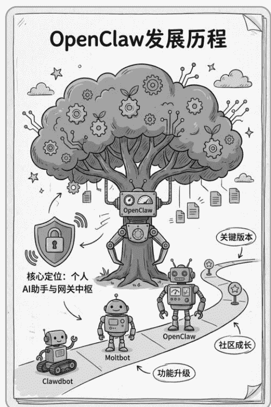
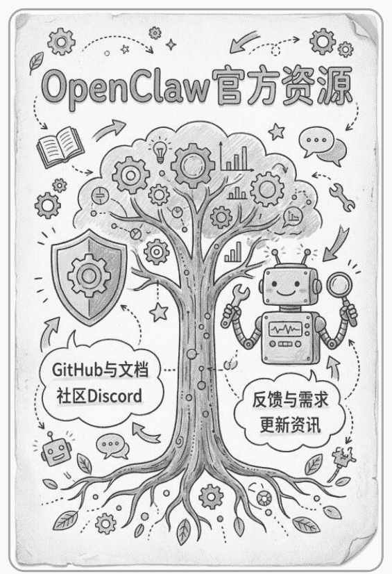
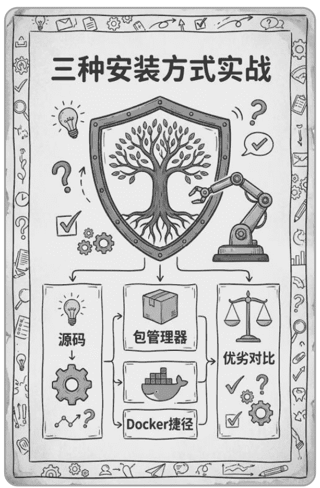

# OpenClaw开源实战


## 内容简介

本书聚焦 GitHub 星标安装破 30 万的现象级开源 AI Agent 项目 OpenClaw，立足 AI Agent 时代浪潮，解析其从 Clawdbot 迭代而来的诞生背景与本地优先、隐私安全、轻量化可扩展的核心价值。全书按起源、部署、架构、贡献、实战、未来六大脉络，拆解核心架构、网关中枢、沙盒安全等底层逻辑，提供全平台安装、模型对接、多通道接入与任务执行的实战指导，详解开源贡献流程与企业/个人落地案例，兼具原理深度与实操性，既帮读者快速掌握 OpenClaw 相关技能，也展望生态与多 Agent 协同未来，是 AI Agent 开发者与开源爱好者的必备指南。


## 推荐语

**蒋涛** CSDN 创始人

AI 正从算力与模型竞争，转向以 Agent 为核心的应用与生态竞争。OpenClaw 以开源方式构建连接模型、工具与场景的新一代基础设施，本书系统呈现这一新范式的实践路径。谁能掌握 Agent，谁就有机会重构下一代软件与产业格局。

**霍泰稳** 极客邦科技创始人

AI 这个时代，真正推动科技进步的，不只是大公司和大模型，更有类似 OpenClaw 这类开源软件背后那群愿意分享、愿意共建、愿意把事情做成的人。我看到《OpenClaw 开源实战》这本书的作者中，也有多位 TGO 鲲鹏会会员的参与，也让我更加相信：像 TGO 鲲鹏会这样长期连接科技领导者的组织，真正的价值，不只是交流，而是持续推动科技创新走向产业落地。

**红薯** 开源中国创始人

两个月，30 万 GitHub Stars，OpenClaw 用速度证明了开源社区的力量。这本书把这个传奇项目从架构到实战全部拆给你看，读完你会发现：属于自己的 AI 助手，原来真的可以自己造！

**萧田国** 高效运维创始人

运维的又一春？正如本书指出的，OpenClaw 核心机制其实就是运维的基本功，可谓颇有“鸟枪换炮”之体验。希望广大运维同仁借此新起点，勇攀新高峰。

**田超** 腾讯云总经理

技术人最终都要回答一个问题：东西造出来了，然后呢？AI Agent 赛道正在经历这个拷问。模型能力飞速进化，但真正难的不是让 AI “更聪明”，而是让它在真实业务中跑得起来、算得清 ROI、经得住合规审查。能做 Demo 的项目遍地都是，能算清楚“省多少人、花多少钱、多久回本”的，凤毛麟角。开源不等于免费，技术不自动变成钱。但这本书会让你看到：从开源到创收的路径是清晰的、可复制的、已经被验证过的。

**朱啸虎** 金沙江创投董事总经理
OpenClaw 坚持开源开放，打破技术壁垒，推动社区共建与生态繁荣；同时释放巨大商业价值，众多企业已经落地应用。未来期待 AI 智能体自主进化，开启规模化应用新未来。

**李明顺** 行行 AI 董事长
这本书的价值在于，它不止讲技术，更讲透了一个开源项目如何成长为生态平台。当 Token 经济遇见企业场景，当开源社区遇见真正落地场景，这里面的商业想象空间远超代码本身。推荐所有 AI 创业者、企业管理者和技术开发者阅读此书——它是一本实战指南，更是一张通往 AI Agent 时代的入场券。

**熊飞** 前经纬中国合伙人
深耕 OpenClaw 开源实战，拥抱开放生态，共享技术红利，以开源协作解锁可落地、可自主执行的 AI 智能体新可能。

当你翻开这本书时，就有人正处在一个 AI 技术从“能说会道”向“能做实事”跨越的关键节点。从手机里的语音助手到办公软件中的文本生成工具，从社交平台的智能客服到开发者常用的代码辅助插件，人工智能早已不再是遥远的科技概念，而是逐渐渗透到日常办公、开发生产、个人管理等每一个场景中的实用工具。我们见证了无数 AI 产品的兴起与迭代，体验过生成式 AI 带来的便捷，也始终被一个核心问题困扰：如何拥有一个真正属于自己、安全可控、能灵活适配各类需求，并能真正帮我们解决实际问题的 AI 助手？

OpenClaw 的出现，正是为了回答这个问题。它从一个简单的开源项目起步，在短短两个月时间里，凭借“本地优先、隐私优先、开放可扩展”的核心优势，收获了超过 30 万个 GitHub 星标，成为全球开源 AI 领域最受关注、成长最快的项目之一。它不是巨头公司推出的封闭产品，也不是功能单一的工具插件，而是一个开放、可扩展、本地优先的 AI Agent 网关中枢——它能连接你常用的所有平台、工具和模型，打破不同系统之间的壁垒，成为你高效工作、便捷生活的“全能助手”，真正实现“让 AI 替你做事”。

写下这篇前言，我希望能和每一位读者一起探讨三个核心问题：AI Agent 时代究竟带来了什么变革？OpenClaw 为何能在众多开源项目中脱颖而出，实现从“0 到 30 万星”的跨越式成长？如何通过这本书，快速掌握 OpenClaw 的使用与开发，真正让 AI 为自己所用，解锁更高的生产力？这三个问题，既是理解 OpenClaw 价值的关键，也是我们开启本次开源实战之旅的起点。

## AI Agent 时代的到来

要理解我们为什么需要 OpenClaw，首先要读懂当下正在加速到来的 AI Agent 时代。

我们不妨先回顾一下人工智能的发展历程：从早期的规则式聊天机器人，到基于大语言模型（LLM）的生成式 AI，再到如今的 AI Agent，每一步迭代都在打破“AI 只能被动响应”的局限，朝着“主动服务、自主决策”的方向迈进，而这一迭代的核心，正是用户需求从“获取信息”到“解决问题”的升级。

在生成式 AI 普及之前，我们与 AI 的互动大多是“一问一答”的被动模式。比如，我们问 AI “如何写一篇工作总结”，它会给出一段模板文字；我们问 AI “某个代码报错怎么解决”，它会提供一个解决方案；我们问 AI “今天天气怎么样”，它会给出实时天气信息。这种模式的核心是“人主导、AI 辅助”，AI 始终处于被动响应的地位，无法主动感知我们的需求，更无法连贯地完成一系列复杂任务——它能告诉我们“怎么做”，却不能替我们“去做”。

而 AI Agent 的出现，彻底改变了这种互动模式，让人工智能实现了从“能说会道”到“能做实事”的质变。所谓 AI Agent，是指具备自主理解需求、规划任务、调用工具、执行闭环能力的人工智能系统。它不再是简单的“问答工具”，而是一个“虚拟助手”——你可以告诉它“帮我整理本周的邮件，筛选出重要信息并生成回复草稿”，它会自动连接你的邮箱，筛选邮件、提取关键内容、撰写回复，全程无须你手动干预；你可以让它“监控服务器状态，出现异常时及时提醒并尝试自动修复”，它会对接服务器监控工具，实时检测数据，遇到问题时触发预警并执行预设的修复流程；你可以委托它“整理今天的会议纪要，同步给所有参会人员并标注重点任务”，它会记录会议内容、提取核心要点、对接通信工具，完成全流程操作。

AI Agent 时代的核心特征，在于“自主性”和“连接性”。自主性意味着它能基于用户的模糊需求，自主拆解任务、规划步骤、调整策略，无须用户手动细化指令；连接性意味着它能打破不同平台、不同工具之间的壁垒，将分散的资源整合起来，形成一个高效的协同系统。这种特性，让 AI 真正从“辅助工具”升级为“生产力伙伴”，尤其在面向个人用户、开发者、企业团队的三大场景中，体现得淋漓尽致，也让我们对 AI 的需求从“能回答”升级为“能执行”。

在面向个人用户的场景中，AI Agent 正在重构我们的工作与生活方式。普通职场人每天要处理大量的邮件、日程、文档，这些重复性的工作占据了大量时间和精力——整理邮件、筛选信息、记录日程、撰写报告，这些工作烦琐且耗时，却又不可或缺。而 AI Agent 可以自动帮我们承担这些重复性工作：每天早上整理前一天的工作进展，生成日报草稿；在开会时，自动生成会议纪要，并同步给相关参会人员；在需要撰写报告时，自动搜集相关数据、整理素材，生成初稿；甚至可以根据我们的工作习惯，提前预判需求，比如提醒我们“明天有重要会议，需提前准备资料”“客户邮件未回复，建议及时跟进”。这种高效的辅助，让我们能从烦琐的重复性工作中解放出来，专注于更有价值的创造性工作，提升工作效率的同时，也能减少工作焦虑。

在开发者场景中，AI Agent 正在成为程序员的“最佳搭档”。开发者每天要面对代码编写、调试、部署、运维等一系列任务，其中很多工作同样具有重复性和烦琐性——比如重复编写基础代码、排查简单的语法错误、执行固定的部署流程、监控服务器的运行状态。而 AI Agent 可以全程参与其中，提供全方位的辅助：在编写代码时，它能根据你的编程习惯和需求，自动补全代码、检查语法错误、优化代码结构；在调试代码时，它能快速定位报错原因，提供具体的解决方案，甚至能帮你修改报错代码；在部署项目时，它能自动执行部署流程，监控部署状态，出现异常时及时提醒；在运维过程中，它能实时检测系统异常，及时发出预警并尝试修复，减少人工运维的压力。对于开发者而言，AI Agent 不仅能提高开发效率，还能降低技术门槛，让更多人参与到软件开发中来，尤其对于新手开发者，它能起到“实时指导”的作用，帮助其快速成长。

在企业团队场景中，AI Agent 正在推动团队协作的数字化转型。传统的团队协作中，信息传递不及时、任务衔接不顺畅、资源分配不合理等问题，往往会影响工作效率，增加沟通成本——比如团队任务进度无法实时同步，导致部分成员重复工作；重要信息传递不及时，导致工作延误；资源分配不合理，导致部分成员工作超负荷，部分成员工作量不饱和。而 AI Agent 可以作为团队的“协同中枢”，自动同步团队任务进度、整合团队资源、协调团队沟通：它能根据团队成员的工作负载，合理分配任务；能自动汇总团队成员的工作成果，生成团队周报；能实时同步项目进展，让所有成员都能及时了解项目状态；能对接团队使用的各类办公工具，实现信息互通，减少不同工具之间的切换成本。这种协同模式，不仅能提高团队工作效率，还能减少沟通成本，让团队协作更加顺畅、高效。

但与此同时，AI Agent 时代的到来，也带来了一些新的挑战，这些挑战也成为我们选择 OpenClaw 的核心原因。首先是“隐私安全”问题。目前，很多主流的 AI Agent 产品都采用云端部署，用户的数据需要上传到云端服务器，这就存在数据泄露、滥用的风险。对于企业而言，将核心业务数据、客户信息等敏感数据上传到云端，可能会带来严重的安全隐患，甚至会影响企业的生存与发展；对于个人而言，邮件、日程、聊天记录、工作文档等私人信息，也可能被非法获取和利用，被用来侵犯个人隐私。其次是“灵活性不足”的问题。很多封闭的 AI Agent 产品，功能固定，无法根据用户的个性化需求进行定制和扩展——比如，某个 AI Agent 只能对接特定的平台和工具，无法连接用户常用的小众工具；只能执行预设的任务，无法根据用户的需求调整任务流程；只能使用固定的大语言模型，无法切换到用户熟悉或偏好的模型。最后是“依赖云端”的问题。云端部署的 AI Agent，需要依赖稳定的网络连接，一旦网络中断，就无法正常使用；同时，云端服务的收费模式，也会增加用户的使用成本，尤其是对于企业用户而言，长期使用云端 AI Agent 可能会产生高额的费用。

正是这些挑战，让我们意识到：我们需要一个“本地优先、隐私优先、开放可扩展”的 AI Agent 解决方案。而 OpenClaw，正是在这样的背景下应运而生的。它不仅具备 AI Agent 的所有核心能力，能够自主理解需求、规划任务、执行操作，还完美解决了隐私安全、灵活性、依赖云端等方面的痛点——所有数据保存在本地，无须上传云端，保障隐私安全；开放源代码，支持用户自定义开发和扩展，适配各类个性化需求；支持本地部署，无须依赖网络，随时可用，且无须支付高额的云端服务费用。可以说，OpenClaw 恰好契合了 AI Agent 时代的核心需求，也成为了很多用户的首选 AI 助手。

## OpenClaw：从 0 到 30 万星的开源奇迹

提到 OpenClaw，很多人都会好奇：这个开源项目究竟凭借什么，能在短短两个月时间里，从一个无人问津的小项目，成长为拥有超过 30 万个 GitHub 星标、全球无数开发者参与的开源奇迹？答案，就藏在它的初心、定位和社区生态之中——它始终坚守“开源、本地、保护隐私”的核心原则，以用户需求为导向，打造实用、可扩展的 AI Agent 平台，而这也正是它能够快速崛起的底层逻辑。

OpenClaw 的诞生，源于创始人 Peter Steinberger 一个简单而坚定的想法：打造一个“真正属于用户自己的 AI 助手”。在 AI Agent 概念刚刚兴起的时候，Peter Steinberger 就敏锐地意识到，当前的 AI 产品要么封闭、要么不安全、要么不够灵活，无法真正满足用户的核心需求——云端产品隐私无保障，封闭产品无法扩展，简单工具无法完成复杂任务。于是，他发起了 OpenClaw 项目的前身——Clawdbot，一个简单的 AI 聊天机器人工具，初衷就是为了打造一个“安全、简单、实用”的 AI 辅助工具。

最初的 Clawdbot，功能非常简单，只能实现基本的聊天互动和简单的任务执行，比如查询天气、设置提醒、简单的文本生成等。但 Peter Steinberger 始终坚持“开源、本地、保护隐私”的核心原则，将项目代码全部开源到 GitHub 上，允许所有开发者自由查看、修改、贡献代码，不收取任何费用，也不限制用户的使用场景。这种开放、透明的态度，吸引了第一批开发者的关注——他们来自全球各个国家和地区，有资深的程序员，也有刚入门的开发者，有企业技术人员，也有 AI 爱好者。这些开发者基于自己的需求，不断为 Clawdbot 补充功能、修复漏洞、优化体验，让这个小小的项目逐渐成长起来。

在迭代过程中，团队发现，单纯的聊天机器人已经无法满足用户的需求——用户真正需要的，不是一个能聊天的工具，而是一个能够连接所有工具、整合所有资源，能够替自己做事的“网关中枢”。于是，团队对项目进行了全面重构，将 Clawdbot 升级为 Moltbot，重点强化了多平台对接和工具调用能力。Moltbot 支持对接 Telegram、Discord 等多个主流平台，能够调用文件管理、浏览器、邮件、日历等多种工具，初步具备了 AI Agent 网关中枢的雏形，也吸引了更多用户和开发者的加入。

2025 年，Moltbot 正式更名为 OpenClaw，确立了“个人 AI 助手、网关中枢、多渠道统一入口”的核心定位。这一更名，不仅是项目名称的变化，更是项目理念的升级——Open 代表开源、开放、可扩展，预示着项目将始终坚持开源原则，欢迎所有开发者参与贡献，支持用户根据自己的需求进行自定义扩展；Claw 代表抓取、整合、高效，寓意着 OpenClaw 能够像爪子一样，抓取各类资源、整合各类工具，为用户提供高效、便捷的 AI 服务。更名之后，OpenClaw 进一步优化了核心功能，强化了本地部署能力和隐私保护机制，推出了更多实用的功能模块，逐渐形成了自己的核心竞争力。

OpenClaw 的爆发，始于当时项目推出了“本地部署”功能的优化版本，用户可以轻松将 OpenClaw 部署在自己的电脑或服务器上，所有数据都保存在本地，无须上传到云端，彻底解决了用户最关心的隐私安全问题。这一功能，精准击中了用户的痛点，迅速吸引了大量开发者和普通用户的关注——很多用户厌倦了云端 AI 产品的隐私泄露风险，也不满于封闭产品的灵活性不足，而 OpenClaw 的“本地优先、隐私优先”理念，恰好契合了他们的需求。与此同时，项目团队不断优化产品体验，增加了更多实用功能，比如支持对接 GPT、Claude、本地模型等主流 LLM，让用户可以根据自己的需求选择合适的模型；支持自定义技能开发，让开发者可以根据自己的需求，开发专属的技能插件；支持后台守护进程，让 OpenClaw 能够全天候运行，随时响应用户需求。

从 0 到 30 万星，仅用了 3 个月，这样的增长速度，在开源项目中极为罕见，堪称“开源奇迹”。而这一奇迹的背后，离不开三个核心支撑：清晰的定位、开放的生态、实用的功能，这三者相互支撑、相辅相成，共同推动了 OpenClaw 的快速成长。

首先，清晰的定位是 OpenClaw 成功的基础。与其他 AI Agent 产品不同，OpenClaw 没有追求“大而全”，而是聚焦于“网关中枢”这一核心定位——它不直接开发 LLM，而是对接各类主流 LLM，让用户可以自由选择；不直接开发工具，而是整合各类现有工具，打破工具之间的壁垒；不追求封闭的生态，而是打造开放的平台，让开发者可以自由扩展。这种“轻核心、重整合”的定位，让 OpenClaw 能够灵活地适配不同的用户需求——无论是普通用户、开发者，还是企业，都能通过 OpenClaw 实现自己的需求，找到适合自己的使用方式。比如，普通用户可以用它来整理邮件、管理日程、处理文档，提高个人生产力；开发者可以用它来辅助开发、调试代码、部署项目，提升开发效率；企业可以用它来实现团队协同、私有化部署，保障数据安全。

其次，开放的生态是 OpenClaw 快速成长的动力。OpenClaw 始终坚持开源原则，所有代码全部开源，任何人都可以自由参与项目的开发和贡献，没有任何门槛。项目团队建立了完善的贡献机制，个人无论是参与代码开发、文档编写、测试反馈，还是参与翻译推广，都能成为项目的贡献者——开发者可以提交代码、修复漏洞、新增功能；爱好者可以编写文档、翻译内容，帮助更多人了解 OpenClaw；用户可以反馈问题、提出需求，推动项目优化升级。截至目前，OpenClaw 已经拥有超过 1000 名核心贡献者，他们来自全球各个国家和地区，形成了一个充满活力、互助共赢的开源社区。

再次，OpenClaw 还打造了开源社区文化，鼓励开发者大胆提出想法、分享经验、互相帮助。在这个社区里，没有层级之分，没有技术壁垒，无论是资深开发者还是新手，都能找到自己的位置，获得成长和进步——新手可以向资深开发者请教问题、学习技术；资深开发者可以分享自己的经验，帮助他人成长；大家可以一起讨论项目的发展方向，提出新的功能需求，共同推动项目的迭代升级。这种开放、包容、互助的社区文化，不仅吸引了更多开发者的加入，也让 OpenClaw 的生态更加完善，形成了“用户需求推动项目迭代，项目迭代吸引更多用户”的良性循环。

最后，实用的功能是 OpenClaw 赢得用户认可的关键。OpenClaw 始终以用户需求为导向，打造了一系列实用、高效的功能，完美解决了用户在使用 AI Agent 过程中遇到的痛点。比如，本地部署功能，确保数据隐私安全，用户无须担心数据泄露；多平台对接功能，让用户可以在 Telegram、Discord、微信、飞书等多个平台上使用 OpenClaw，实现多端同步、无缝衔接；多模型对接功能，让用户可以根据自己的需求，选择 GPT、Claude 或本地模型，灵活适配不同的使用场景；自定义技能开发功能，让开发者可以根据自己的需求，开发专属的技能插件，扩展 OpenClaw 的功能；后台守护进程功能，让 OpenClaw 能够全天候运行，随时响应用户需求，无须用户手动启动。这些实用的功能，让 OpenClaw 能够真正帮用户解决实际问题，提升工作和生活效率，也赢得了用户的广泛认可和支持。

如今，OpenClaw 已经成为全球最受欢迎的开源 AI Agent 项目之一，超过 30 万个 GitHub 星标，不仅是对项目的认可，更是对开源精神的传承。它证明了，一个真正以用户需求为导向、坚持开源开放、拥有活跃社区的项目，能够迸发出强大的生命力。而 OpenClaw 的成长之路，也为开源项目的发展提供了宝贵的经验：只有始终坚持开放、包容、互助的理念，始终聚焦用户需求，不断优化产品体验，才能在激烈的竞争中脱颖而出，实现从 0 到 1、从 1 到 100 的跨越。

## 本书结构与阅读指南

编写本书的初衷，是为了帮助更多人了解 OpenClaw、使用 OpenClaw、建设 OpenClaw。无论你是零基础的普通用户，还是有一定开发经验的开发者；无论你是想通过 OpenClaw 提高个人生产力，还是想参与开源项目、提升自己的技术能力；无论你是个人用户，还是企业用户，都能在本书中找到适合自己的内容。本书兼顾理论与实战，结构清晰、循序渐进，从 OpenClaw 的起源、安装部署，到核心架构、源码解析，再到开源贡献、应用场景，全方位覆盖 OpenClaw 的核心内容，让你能够快速上手 OpenClaw，真正做到“学以致用”。

本书内容围绕 OpenClaw 的“起源—使用—开发—贡献—应用—未来”展开，层层递进、由浅入深，既适合新手入门，也适合资深开发者深入研究。下面，将为你详细介绍本书的结构，以及不同类型的读者如何高效阅读本书，帮助你快速找到适合自己的阅读路径，提升阅读效率，收获更多知识。

本书的整体结构如下，每一篇都有明确的核心目标，各篇章之间相互衔接，形成完整的知识体系。

### 第 1 篇：开源时代与 OpenClaw 起源
这一篇作为全书的基础开篇，核心目标是帮助你建立对 OpenClaw 的初步认知。本篇将带领你一览开源 AI 生态的全景，解读 AI Agent 时代的背景与核心需求，追溯 OpenClaw 从萌芽到成长的完整历程，介绍 OpenClaw 的项目定位、核心优势与官方资源。通过这一篇的学习，你将了解 OpenClaw 出现的历史必然性，掌握获取 OpenClaw 官方资源、参与社区交流的方法，为后续的学习打下坚实的基础。本篇包含 6 章，分别聚焦聊天机器人到 AI Agent 的进化、下一代智能的核心诉求、全球开源 AI 生态格局、OpenClaw 项目简介、项目发展历程、官方资源指南，全方位覆盖 OpenClaw 的起源与背景。

### 第 2 篇：OpenClaw 快速上手与安装部署
这一篇是 OpenClaw 的实战入门篇，核心目标是帮助你快速掌握 OpenClaw 的基本使用方法。本篇将详细介绍 OpenClaw 的环境准备、三种安装方式（源码安装、包管理器安装、Docker 安装）、首次启动与初始化、配置文件解析、模型对接与通道接入，以及第一个任务的实战操作。通过这一篇的学习，你将能够快速部署 OpenClaw，完成基础配置，对接自己常用的模型和平台，执行简单的任务，真正实现 OpenClaw 的入门使用。本篇包含 5 章，内容注重实战，每一步都有详细的说明和操作指引，即使是零基础的普通用户，也能轻松上手。

### 第 3 篇：OpenClaw 核心架构与代码剖析
这一篇是本书的核心技术篇，核心目标是帮助你深入了解 OpenClaw 的内部实现机制。本篇将详细介绍 OpenClaw 的整体架构设计（Hub-and-Spoke 中心辐射架构）、核心四层结构（Channel → Gateway → Agent → Skills）、网关模块与数据流解析、核心模块源码解析、Agent 与 Skills 系统的工作原理，以及关键技术与安全机制。通过这一篇的学习，你将深入理解 OpenClaw 的底层逻辑，掌握核心模块的工作原理，为后续的自定义开发和开源贡献打下坚实的技术基础。本篇包含 5 章，内容侧重于技术深度，适合有一定编程经验的开发者阅读，同时也为想深入了解 OpenClaw 技术的普通用户提供了详细的解读。

### 第 4 篇：参与开源：建设 OpenClaw
这一篇的核心目标是帮助你掌握开源贡献的方法，参与到 OpenClaw 项目的开发和维护中。本篇将详细介绍开源协作的文化与核心规则、Git 与 GitHub 必备工作流、OpenClaw 的贡献流程与规范（Fork → 开发 → 提交 PR 全流程）、Code Review 规范与通过技巧，以及非代码贡献的方法（文档编写、测试反馈、翻译推广）。通过这一篇的学习，你将了解开源贡献的基本流程和规范，能够参与到 OpenClaw 项目的贡献中，为开源生态的发展贡献自己的力量，同时也能提升自己的技术能力和协作能力。本篇包含 2 章，内容兼顾理论与实战，适合所有想参与开源贡献的读者。

### 第 5 篇：OpenClaw 应用场景与实战案例
这一篇是 OpenClaw 的实战应用篇，核心目标是帮助你将 OpenClaw 应用到实际工作和生活中，提升生产力。本篇将详细介绍 OpenClaw 在面向个人用户、开发者、企业团队等多个场景中的应用方法，提供典型的实战案例，拆解任务执行步骤，分享实用的使用技巧。通过这一篇的学习，你将掌握 OpenClaw 在不同场景中的使用技巧，能够根据自己的需求，灵活运用 OpenClaw 解决实际问题，真正让 AI 为自己所用。本篇包含 1 章，内容注重实战案例，结合具体场景，让你能够快速借鉴、学以致用。

### 第 6 篇：OpenClaw 开源生态的未来
这一篇的核心目标是帮助你了解 OpenClaw 的未来发展方向，把握开源 AI 生态的发展趋势。本篇将介绍 OpenClaw 的 Roadmap 与长期发展方向、技能市场 ClawHub 的规划、对多 Agent 协同的展望，同时提供常用命令速查、常见问题 FAQ、官方资源链接、贡献者名单等附录内容，方便你在使用和开发过程中查阅。通过这一篇的学习，你将了解 OpenClaw 的未来发展潜力，为自己的长期使用和开发找到方向。本篇包含 1 章和 1 个附录，内容简洁实用，为全书提供了有力的补充。

为了帮助不同类型的读者高效阅读，本书提供了以下有针对性的阅读指南。你可以根据自己的身份和需求，选择适合自己的阅读路径，避免盲目阅读，提升阅读效率。

如果你是零基础的普通用户，没有任何编程经验，只想通过 OpenClaw 提高个人生产力，那么我建议你重点阅读第 1 篇、第 2 篇和第 5 篇。第 1 篇将帮助你了解 OpenClaw 的基本情况，建立对 AI Agent 和 OpenClaw 的认知，明白 OpenClaw 能为你带来什么；第 2 篇将帮助你快速上手 OpenClaw，完成安装部署和基础配置，能够使用 OpenClaw 完成简单的任务，比如整理邮件、管理日程、处理文档；第 5 篇将帮助你了解 OpenClaw 在个人生产力提升场景中的应用方法，掌握实用的使用技巧，让 OpenClaw 成为你的“全能助手”。在阅读过程中，你可以跳过第 3 篇和第 4 篇的技术细节，重点关注实战操作部分，无须深入研究底层代码和开源贡献流程。

如果你是有一定编程经验的开发者，想深入了解 OpenClaw 的核心技术，进行自定义开发或参与开源贡献，那么我建议你按照本书的顺序全面阅读。第 1 篇和第 2 篇帮助你打好基础，了解 OpenClaw 的基本情况和使用方法，熟悉 OpenClaw 的核心功能；第 3 篇是核心技术重点，需要你仔细研读，深入理解 OpenClaw 的架构设计和源码实现，掌握关键技术原理，这是进行自定义开发和开源贡献的基础；第 4 篇帮助你掌握开源贡献的方法，了解 OpenClaw 的贡献流程和规范，能够参与到 OpenClaw 项目的开发中；第 5 篇和第 6 篇帮助你了解 OpenClaw 的应用场景和未来发展方向，为你的自定义开发和开源贡献提供思路和灵感。在阅读过程中，建议你结合 OpenClaw 的开源代码，边阅读边实践，亲手操作、调试代码，加深对知识点的理解，提升自己的技术能力。

如果你是企业或团队用户，想将 OpenClaw 应用到团队协作或企业生产中，那么我建议你重点阅读第 1 篇、第 2 篇、第 5 篇和第 6 篇。第 1 篇帮助你了解 OpenClaw 的核心优势，尤其是隐私安全和私有化部署方面的优势，判断它是否适合你的企业或团队需求；第 2 篇帮助你完成 OpenClaw 的私有化部署和基础配置，确保系统的安全稳定，适配企业的内部环境；第 5 篇帮助你了解 OpenClaw 在企业与团队场景的应用方法，掌握团队协作的实战技巧，提升团队工作效率；第 6 篇帮助你了解 OpenClaw 的未来发展方向，为企业或团队的长期使用提供参考，提前规划相关的应用策略。在阅读过程中，你可以根据企业或团队的具体需求，重点关注相关的实战案例和技术细节，比如私有化部署的配置、团队协同的技巧等。

此外，在阅读本书的过程中，还建议你注意以下几点，以便更好地掌握书中的知识，提升阅读体验。

第一，注重实践。OpenClaw 是一个实战性很强的开源项目，仅仅阅读理论知识是不够的。建议你在阅读每一章的内容后，结合书中的实战步骤，亲自操作一遍，亲手部署 OpenClaw、配置模型、执行任务、开发简单的技能插件，这样才能真正掌握 OpenClaw 的使用方法和技术原理。同时，你可以尝试修改代码、优化功能，在实践中发现问题、解决问题，提升自己的实操能力。

第二，善用官方资源。本书虽然涵盖了 OpenClaw 的核心内容，但由于技术更新速度较快，OpenClaw 项目也在不断迭代升级，部分内容可能会随着项目的更新而有所变化。建议你在阅读本书的同时，关注 OpenClaw 的官方 GitHub 仓库、官方文档和社区，及时了解项目的最新动态和更新内容，获取更全面、更准确的信息。如果在阅读和实践过程中遇到问题，也可以通过官方社区寻求帮助，与其他用户和开发者交流经验。

第三，积极参与社区。OpenClaw 的开源社区是一个充满活力的平台，在这里，你可以遇到来自全球的开发者和用户，分享自己的使用经验、解决遇到的问题、提出自己的想法和需求。建议你积极参与社区交流，加入 Discord 频道，参与 Issue 讨论，甚至参与项目的贡献，无论是代码开发、文档编写，还是测试反馈，都能为项目的发展贡献自己的力量，同时也能在社区中获得成长和进步，结识更多志同道合的伙伴。

最后，我想强调的是，OpenClaw 是一个开放、开源、不断成长的项目，它的发展离不开每一位用户和开发者的支持。本书仅仅是一个起点，希望通过本书的学习，你能够爱上 OpenClaw，用好 OpenClaw，甚至为 OpenClaw 的发展贡献自己的力量。AI Agent 时代已经到来，OpenClaw 正在为我们打开一扇新的大门——它让 AI 不再是遥远的科技概念，而是能够真正帮我们解决实际问题、提升生产力的实用工具。

让我们一起，借助 OpenClaw 的力量，让 AI 真正为自己所用，解锁更高的生产力，创造更美好的未来。感谢你选择本书，祝你阅读愉快，学有所成！

本书的顺利出版，离不开出版社的鼎力支持与专业指导，在此致以最诚挚的谢意。本书出版的收益也会捐赠给 OpenClaw 开源社区，以回馈开源生态。同时，衷心感谢 OpenClaw 团队与社区贡献者，在 AI 智能体开源领域的持续探索与无私奉献，为本书创作提供了坚实的技术土壤与思想源泉。

感谢所有参与本书筹备、审核、校对的专家与伙伴，以下为各位老师感言：

### 张子天
非常感谢能参与《OpenClaw 开源实战》一书的筹备工作，我负责本书第 17、18、19 章的筹备与审稿工作。希望这本书能成为开源爱好者、贡献者和实践者手边的实用指南，帮助更多人在开源世界中找到自己的位置、创造真实影响。期待新书顺利出版，与读者们共同成长！

### 孙丽
非常荣幸能参与《OpenClaw 开源实战》一书的筹备工作，我主要负责本书前言和第 1 章部分内容的审核与校对。在校对本书的过程中，深感开源 AI 的普惠价值，也欣喜于能为家庭与青少年打造零基础入门指南。愿这本凝聚众人心血的作品，让 AI 成为孩子成长与家庭生活的全能小帮手，期待新书顺利出版、广受喜爱！

### 张泽武
我参与了本书第 14、15 章的审核与校对。本书作为较早推出的 OpenClaw 实战书之一，书中所列举的内容有可取之处。技术繁杂，非一本书一章节能概括，细微之处仍值得更多交流讨论。当你看到此处，这个交流讨论的链接和契机就已出现了。

### 李桥生
非常感谢能参与《OpenClaw 开源实战》一书的筹备工作，我有幸负责本书第 8、9、10、11 章的筹备与审稿工作，和一群热爱技术、深耕开源的伙伴共同打磨内容，备感荣幸。愿这份沉淀下来的实战经验，能真正照亮更多开发者的 AI 实践之路，期待新书顺利出版，让技术价值被更多人看见！

### 王仁明
非常感谢能参与《OpenClaw 开源实战》一书的筹备工作，我负责本书第 5 章的审核与校对。在短短的几个月时间内，项目在完全开源的模式下实现了高速演进，并逐步扩散至全球开发者社区。项目本身涉及的技术体系较为复杂，涵盖多领域的工程实践与架构设计。本书抛砖引玉，希望能够成为技术爱好者与实践者的参考指南！

### 王秀成
在数字经济加速演进的当下，开源已由单一的技术协作模式，跃升为驱动企业创新与产业升级的关键引擎。荣幸参与《OpenClaw 开源实战》的编修工作，我重点聚焦其在真实业务场景中的落地应用，提炼具备可复制性的实践方法论，并从企业 CIO 视角系统审视其在安全治理、架构扩展与生态协同方面的综合价值。

### 张亮
AI 技术发展日新月异，《OpenClaw 开源实战》一书，恰似一叶轻舟，载您畅游开源天地。期待它早日付梓流布。

### 高泗俊
非常感谢能够参与《OpenClaw 开源实战》一书的筹备工作。作为 OpenClaw 的早期用户和支持者，我深入研究了 OpenClaw 的设计机制和技术原理，也基于 OpenClaw 搭建了一套 SaaS 平台。在实战过程中，我对 OpenClaw 有了更深层次的理解，也把这些经验和理解用于书中第 3 章的审核。希望本书早日面世，让更多人从书中受益。

### 韩岳岐
非常荣幸参加《OpenClaw 开源实战》校验工作，在校验的过程中也能通过 GitHub 的 Star 数感受到 OpenClaw “日新月异”的变化。与其说它是一门技术、一个 Agent，倒不如说它是一种全新的工作模式、研发逻辑，希望每一位开发者都能够深入研究、细细品味，也希望 OpenClaw 能在互联网及其他领域生根发芽。

### 李学庆
很荣幸能够参与《OpenClaw 开源实战》一书的筹备工作，对第 16 章进行了审核与校对。本章聚焦通过统一接口标准化各类工具，从指令接收到工具调用全程校验，防止越权；将复杂指令分解成子任务，自动化执行闭环调度、异常监控、处理与结果细节汇总；要求致命异常立即终止，严重异常自动重试，以构成整体高效安全的体系。

### 晏力
非常荣幸能参与《OpenClaw 开源实战》一书的筹备工作，对第 6、7、8 章进行审核与校对。这次与一群优秀的技术专家一起讨论、打磨每一个细节，我们不仅是在创作一本书，更是为行业贡献一份有价值的知识资产。希望能通过这些扎实的内容，帮助更多的开发者顺利踏入 OpenClaw 世界。

### 孙双琛
很开心能参与《OpenClaw 开源实战》的编写筹备，我负责第 1、2、3 章的审校工作。OpenClaw 作为现象级的 AI 开源产品，让技术同行一起享受技术狂欢的喜悦，也提供了同行一起反复打磨产品和内容的机会，正如一同创作的这本书一样，是新世界协作的雏形和范式。

### 高驰涛（Neeke）
在本书付梓之际，回首 OpenClaw 系统从初步构想到最终落地的探索历程，我心中充满感激。OpenClaw 蜕变为如今具备完善 Agent 调度与 Skills 生态的成熟架构，打磨出了系统坚实的安全机制与自动化闭环，这让它变得更加健壮与可靠。感谢正在阅读本书的你。

### 张佳民
有幸能参与《OpenClaw 开源实战》一书的筹备工作，我负责本书第 12、14 章审核与校对。这两章内容从顶层设计到代码实践，既是系统学习的基石，也是二次开发的实战指南，相信能帮助不同背景的读者打开深入了解 OpenClaw 系统的大门，实现从学习理解到实践创造。

### 王莉
非常幸运可以参与《OpenClaw 开源实战》一书的筹备，负责书内的插画工作。插画是文字的总结，是作者论点的分析和展示，也是吸引读者注意力并且引导读者想要探索更多内容的方式。希望可以用插画协助作者更好的表述他的思想观点，协助作者更好的推进科技文化的传播。

### 陈霏霖(Kelly)的龙虾
从“AI 只能陪聊”到“AI 真正上手干活”，OpenClaw 证明了本地优先与自动化执行的巨大潜力。能和 Mark、社区里最纯粹的极客、最敏锐的商业探索者一起将这些经验沉淀成书，是一段非常难忘的旅程。希望这两本书帮助大家探索 AI Agent 时代，减少摸索的成本，真正把生产力交还给每一位使用者！

### 廖柔雪
能参与《OpenClaw 开源实战》的筹备工作，我深感荣幸。作为本书插画的创作者，我始终认为，优秀的插画不应只是文字的点缀，更应与内容深度契合，成为拉近专业知识与读者距离、让复杂内容更易懂、更有亲和力的桥梁。最后，衷心祝愿这本书能陪伴更多技术爱好者，助力大家在技术之路上笃行致远、逐光成长。

### 周雪
十分荣幸投身《OpenClaw 开源实战》的插画创作，以视觉语言赋能技术内容，让复杂原理清晰可见，衷心祝愿本书助力更多人深耕开源、逐光而上。

### 何丽娜
非常荣幸参与《OpenClaw 开源实战》的筹备，负责第 16 章“关键技术和安全机制”的审核。安全是 OpenClaw 从“能用”到“好用”的底线。本章梳理了全链路安全配置，助大家掌握防御实战能力，在享受 AI 提效的同时筑牢防线。愿这份思考助大家在开源之路上行稳致远，期待新书大卖！

丁鹏
有幸参与《OpenClaw 开源实战》的筹备，并负责第 14 章与第 15 章的审核。如果说源码是 OpenClaw 稳固的技术基石，那么 Agent 与 Skills 系统就是赋予它无限潜能的羽翼。希望能助力大家扎稳技术底座，在 AI 浪潮中灵活创新。祝愿《OpenClaw 开源实战》大卖，社区繁荣昌盛！

张瑞
非常感谢能参与《OpenClaw 开源实战》一书的筹备工作，我主要负责本书第 17 章内容的审核与校对。本章围绕开源贡献基础展开，从协作文化、Git 工作流到贡献规范层层递进，实用性极强。审稿过程中，我深刻感受到开源社区开放共享、协作共进的精神内核，也体会到 OpenClaw 项目对新手友好、注重规范落地的用心。希望本章能为入门开源的读者打好基础，帮助大家规范参与贡献，期待新书顺利出版，惠及更多开发者与技术爱好者。

石春丽
我参与了第 17 章的审核与校对，非常荣幸提前阅读。在技术日新月异的今天，开源已不再只是一种开发模式，更是一种思维方式与协作文化。当我第一次翻开这本书，便深深感受到 Mark 在其中倾注的心血与诚意。《OpenClaw 开源实战》并非纸上谈兵，而是将真实的工程经验、踩坑历程与最佳实践融为一体，为每一位希望拥抱开源、驾驭开源的开发者提供了一份难得的实战指南。书中内容深入浅出，既照顾到初次接触开源项目的读者，也为有经验的工程师提供了更高维度的思考框架。可以负责任地说：这是一本值得放在案头、反复翻阅的好书以及能给你清晰的路径与实用的工具。强烈推荐！

同时，衷心感谢中国技术社区与全球开源社区的鼎力支持！你们的热情参与与无私奉献，为本书发展注入了强大动力，让生态更加繁荣。感谢：开源中国（OSCHINA）、Linux 基金会 APAC、天工开物开源基金会、开源社、木兰开源社区、CSDN、极客邦科技、TGO 鲲鹏会、OpenClaw Asia、Claw-China.com 龙虾中国开源社区、Datawhale、OpenBuild 等。

由于本书筹备周期较为紧张，虽经多轮打磨与校核，仍难免存在疏漏与不足之处。在此恳请各位读者、专家与业界同仁不吝赐教，对书中谬误与欠缺之处予以批评斧正。我们将珍视每一份宝贵意见，在后续版本中持续完善与优化内容。也期盼在大家的监督与帮助下，能让本书更好地服务于 AI 智能体与开源社区的实践探索。最后，再次感谢各位读者的理解、包容与一路支持。

## 第1篇 开源时代与 OpenClaw 起源

- 第 1 章 从聊天机器人到 AI Agent …………………………………………………… 3
    - 1.1 聊天机器人的局限与进化 …………………………………………………………… 4
    - 1.2 能做事的 AI Agent 核心特质 ……………………………………………………… 6
    - 1.3 聊天机器人与 AI Agent 的核心区别 …………………………………………… 9
    - 1.4 AI Agent 时代的技术支撑 ………………………………………………………… 12
    - 1.5 从对话到执行的技术跨越 ………………………………………………………… 17
- 第 2 章 下一代智能的核心诉求 ………………………………………………………… 22
    - 2.1 本地优先：摆脱对云端依赖的优势 …………………………………………… 23
    - 2.2 隐私优先：AI 时代的安全底线 ………………………………………………… 26
    - 2.3 轻量化：适配多设备的核心需求 ……………………………………………… 29
    - 2.4 可扩展：满足个性化场景适配需求 ………………………………………… 32
    - 2.5 易用性：降低 AI 使用技术门槛 ……………………………………………… 35
- 第 3 章 全球开源 AI 生态格局 ………………………………………………………… 39
    - 3.1 开源 AI 的发展现状与趋势 …………………………………………………… 40
    - 3.2 OpenClaw 出现的历史必然性 …………………………………………………… 42
    - 3.3 全球开源 AI 项目的核心分类 …………………………………………………… 45
    - 3.4 开源与闭源 AI 的优劣对比 …………………………………………………… 50
    - 3.5 开源社区对 AI 发展的推动作用 …………………………………………………… 53
- 第 4 章 OpenClaw 项目简介 …………………………………………………… 58
    - 4.1 项目定位 …………………………………………………… 59
    - 4.2 创始人与社区核心力量 …………………………………………………… 61
    - 4.3 项目核心价值与核心优势 …………………………………………………… 64
    - 4.4 项目适配的核心用户群体 …………………………………………………… 68
    - 4.5 与同类开源 AI 项目的差异 …………………………………………………… 71
- 第 5 章 OpenClaw 项目发展历程 …………………………………………………… 75
    - 5.1 迭代之路：Clawdbot → Moltbot → OpenClaw …………………………………………………… 76
    - 5.2 核心定位：个人 AI 助手与网关中枢 …………………………………………………… 78
    - 5.3 关键版本迭代与功能升级节点 …………………………………………………… 81
    - 5.4 项目成长中的核心里程碑事件 …………………………………………………… 82
    - 5.5 社区成长与用户规模发展历程 …………………………………………………… 85
- 第 6 章 OpenClaw 官方资源指南 …………………………………………………… 88
    - 6.1 GitHub 仓库与文档查阅 …………………………………………………… 89
    - 6.2 社区交流与 Discord 渠道 …………………………………………………… 91
    - 6.3 官方文档的核心内容与查阅方法 …………………………………………………… 93
    - 6.4 问题反馈与需求提交渠道 …………………………………………………… 95
    - 6.5 官方更新与资讯获取方式 …………………………………………………… 97

## 第 2 篇 OpenClaw 快速上手与安装部署

- 第 7 章 环境准备与支持平台
    - 7.1 适配平台：macOS / Windows / Linux 详解
    - 7.2 核心依赖：Node.js、pnpm、Git 安装
    - 7.3 各平台的环境配置差异
    - 7.4 依赖版本兼容性说明
    - 7.5 环境配置常见问题排查
- 第 8 章 三种安装方式实战
    - 8.1 源码安装：步骤与注意事项
    - 8.2 包管理器与 Docker 安装捷径
    - 8.3 三种安装方式的优劣对比
    - 8.4 安装过程中的常见报错解决
    - 8.5 安装完成后的验证方法
- 第 9 章 首次启动与初始化
    - 9.1 onboard 流程引导与配置
    - 9.2 后台守护进程与自启动设置
    - 9.3 首次启动的核心配置项说明
    - 9.4 初始化失败的排查与解决
    - 9.5 启动状态的查看与管理方法
- 第 10 章 配置文件与模型对接
    - 10.1 配置文件结构与格式解析
    - 10.2 主流 LLM 对接：GPT / Claude / 本地模型
    - 10.3 配置文件的修改与保存方法 …………………………………………………… 152
    - 10.4 模型对接的权限配置 …………………………………………………………… 153
    - 10.5 模型切换与参数调整技巧 ……………………………………………………… 155
- 第 11 章 通道接入与第一个任务 …………………………………………………… 156
    - 11.1 多通道接入：Telegram / Discord 等配置 …………………………………… 157
    - 11.2 实战：让 OpenClaw 帮你操作电脑 …………………………………………… 159
    - 11.3 通道接入的权限设置与验证 …………………………………………………… 161
    - 11.4 第一个任务的执行步骤与调试 ………………………………………………… 161
    - 11.5 任务执行结果的查看与反馈 …………………………………………………… 163

## 第 3 篇 OpenClaw 核心架构与代码剖析

- 第 12 章 整体架构设计 …………………………………………………………… 167
    - 12.1 Hub-and-Spoke 中心辐射架构原理 ………………………………………… 168
    - 12.2 核心四层：Channel → Gateway → Agent → Skills ………………………… 170
    - 12.3 整体架构的核心设计理念 …………………………………………………… 173
    - 12.4 架构的可扩展性设计思路 …………………………………………………… 175
    - 12.5 架构与同类项目的差异点 …………………………………………………… 177
- 第 13 章 网关与数据流解析 ……………………………………………………… 180
    - 13.1 Gateway 模块：系统中枢（18789 端口） ………………………………… 181
    - 13.2 全流程数据流拆解与分析 …………………………………………………… 183
    - 13.3 Gateway 模块的核心功能 …………………………………………………… 185
    - 13.4 数据流异常的排查方法 …………………………………………………… 187
- 第 14 章 核心模块源码解析
    - 14.1 Gateway 路由、会话与调度机制
    - 14.2 Channel 适配器：多平台统一接入实现
    - 14.3 源码的目录结构与核心文件
    - 14.4 核心代码的关键逻辑解析
    - 14.5 源码阅读的技巧与重点
- 第 15 章 Agent 与 Skills 系统
    - 15.1 核心架构与运行时
    - 15.2 工作空间与执行循环
    - 15.3 多 Agent、记忆与系统提示词
    - 15.4 Skills 体系、沙盒安全与最佳实践
    - 15.5 Skills 配置参考与开发最佳实践
- 第 16 章 关键技术与安全机制
    - 16.1 Gateway——整个系统的神经中枢
    - 16.2 认证体系——让凭据用对地方
    - 16.3 Secrets Management——让凭据永远不出现在配置文件里
    - 16.4 沙盒安全机制——给 Agent 划定行动边界
    - 16.5 Cron 任务调度——让 Agent 主动做事
    - 16.6 Session 会话机制——对话历史的持久化单元
    - 16.7 消息渠道——OpenClaw 连接世界的接口
    - 16.8 心跳机制——让 Agent 保持主动
    - 16.9 Canvas 与节点系统——Agent 的“眼睛”和“屏幕”
    - 16.10 工具策略与 Exec 安全
    - 16.11 配置管理与热重载
    - 16.12 安全体系：纵深防御与最佳实践

## 第 4 篇 参与开源：贡献 OpenClaw

- 第 17 章 开源贡献基础 ……………………………………………………………… 259
    - 17.1 开源协作文化与核心规则 …………………………………………………… 260
    - 17.2 Git 与 GitHub 必备工作流 …………………………………………………… 262
    - 17.3 开源贡献的核心类型与要求 ………………………………………………… 264
    - 17.4 GitHub 基础操作规范 ………………………………………………………… 267
    - 17.5 开源社区的沟通礼仪 ………………………………………………………… 269
- 第 18 章 贡献流程与规范 ……………………………………………………………… 272
    - 18.1 Fork → 开发 → 提交 PR 全流程 ……………………………………………… 273
    - 18.2 Code Review 规范与通过技巧 ………………………………………………… 276
    - 18.3 PR 提交的核心规范与注意事项 ……………………………………………… 278
    - 18.4 代码贡献的格式与质量要求 ………………………………………………… 280
    - 18.5 非代码贡献的流程与规范 …………………………………………………… 283

## 第 5 篇 OpenClaw 应用场景与实战案例

- 第 19 章 多场景应用实战 ……………………………………………………………… 289
    - 19.1 个人生产力与开发者场景落地 ……………………………………………… 290
    - 19.2 企业与团队私有化部署实践 ………………………………………………… 292
    - 19.3 个人场景的核心应用技巧 …………………………………………………… 294
    - 19.4 企业部署的核心配置与优化 ………………………………………………… 296
    - 19.5 典型实战案例的步骤拆解 …………………………………………………… 298

## 第 6 篇 OpenClaw 开源生态的未来

- 第 20 章 OpenClaw 未来与生态拓展 …………………………………………………… 303
    - 20.1 Roadmap 与长期发展方向 …………………………………………………………… 304
    - 20.2 技能市场与多 Agent 协同展望 …………………………………………………… 306
    - 20.3 生态拓展的核心规划 ………………………………………………………………… 308
    - 20.4 开发者生态的建设方向 ……………………………………………………………… 310
    - 20.5 未来版本的核心功能预判 …………………………………………………………… 312
- 附录 ……………………………………………………………………………………………… 315

## 第 1 篇 开源时代与 OpenClaw 起源

在数字技术飞速迭代的今天，开源已成为推动技术创新、打破技术壁垒的核心力量，渗透到软件开发、智能协作、企业数字化等各个领域，构建起“开放协作、共享共赢”的技术生态。开源模式不仅降低了技术开发的门槛，更汇聚了全球开发者的智慧，推动技术快速迭代升级，成为科技发展的重要引擎。本篇章作为全书的开篇，将立足开源时代的发展背景，梳理开源技术的演进历程与核心价值，解读开源生态的发展趋势，为后续 OpenClaw 的相关讲解奠定基础。同时，本篇章将详细阐述 OpenClaw 的起源背景、核心初衷与发展历程，剖析其诞生的技术动因与市场需求，介绍 OpenClaw 从理念构思到初步落地的关键节点，让读者清晰了解 OpenClaw 的定位、核心价值与发展初心。通过本篇章的阐述，帮助读者快速融入开源语境，理解 OpenClaw 在开源生态中的定位与意义，为后续学习核心技术、参与开源贡献、实现场景落地做好铺垫。

## 第1章 从聊天机器人到 AI Agent

在人工智能技术飞速迭代的今天，我们每个人的工作与生活都早已被各类 AI 产品所渗透——手机里的语音助手、社交软件中的智能客服、办公平台上的文本生成工具、开发者常用的代码辅助插件，这些看似形态各异、功能不同的产品，本质上都经历了一场从“被动响应”到“主动服务”的深刻变革，而这场变革的核心节点，正是从聊天机器人到 AI Agent 的跨越。本章将围绕 5 个核心部分，深入拆解这场变革的底层逻辑、核心差异与技术支撑，帮助读者清晰把握 AI 技术从“能说会道”到“能做实事”的进化脉络。

### 1.1 聊天机器人的局限与进化

聊天机器人作为人工智能落地的早期形态，用“人机对话”打破了人们对“机器不可沟通”的固有认知，也为后续 AI 技术的发展奠定了坚实的基础。从 20 世纪 60 年代世界上第一个聊天机器人 ELIZA 诞生，到如今基于大语言模型的生成式聊天机器人普及，聊天机器人的交互体验、语义理解能力得到了质的提升，但其“只能对话、不能做事”的核心局限始终未能突破。随着 AI Agent 时代的加速到来，用户对人工智能的需求已经从“获取信息、实现对话”升级为“解决问题、执行任务”，这种需求的升级，推动着人工智能从“能说会道”向“能做实事”实现质变，而 AI Agent 的出现，正是这一质变的核心载体。

从技术发展的时间线来看，聊天机器人的进化大致可以分为三个关键阶段：规则式聊天机器人、统计式聊天机器人、生成式聊天机器人。这三个阶段层层递进，每一个阶段都在解决前一阶段的核心痛点，不断提升人机交互的自然度与便捷性，但始终未能突破“只能对话、不能执行”的核心困境，也未能满足用户对 AI“能做实事”的深层需求。

第一个阶段，规则式聊天机器人，诞生于 20 世纪 60 年代，是聊天机器人的最初形态。这一阶段的聊天机器人，核心依赖“关键词匹配+预设规则”实现人机交互，其本质是“机械的对话模板匹配”，并没有真正理解用户的意图，也不具备任何学习能力。开发者需要提前预设大量的关键词、对话场景和回复模板，当用户输入的内容中包含预设的关键词时，机器人就会按照预设的规则输出对应的回复；如果用户输入的内容没有匹配到任何预设关键词，机器人就会给出“抱歉，我没听懂”“请再说一遍”等无效回复，无法应对任何预设场景之外的交互需求。世界上第一个真正意义上的聊天机器人 ELIZA，就是规则式聊天机器人的典型代表。ELIZA 由麻省理工学院的约瑟夫·魏泽鲍姆教授于 1966 年开发，其核心功能是模拟心理医生与患者的对话，预设了大量与心理治疗相关的关键词和对话模板。从表面上看，ELIZA 似乎能与人类进行有意义的对话，甚至能共情用户的情绪，但本质上，它只是在进行机械的关键词匹配和模板输出，完全不理解用户输入的深层含义。

规则式聊天机器人的优势极为明显：开发难度低、成本低廉、部署简单，适合用于场景固定、对话内容简单的场景，比如早期的智能客服、简单的语音助手等。但它的局限也同样突出：一是灵活性极差，无法应对预设规则之外的对话内容；二是交互体验僵硬，回复内容都是提前预设的模板，缺乏个性化和自然性；三是无法处理复杂意图，只能应对简单的、单一的问答需求，无法真正解决用户的实际问题。

随着机器学习技术的发展，聊天机器人逐渐进入第二个阶段——统计式聊天机器人，这一阶段的核心突破是“摆脱了对预设规则的依赖，具备了一定的学习能力”。统计式聊天机器人不再需要开发者预设所有的对话规则和回复模板，而是通过对大量对话数据的训练，学习对话的规律和逻辑，从而实现更自然、更灵活的人机交互。其核心技术包括朴素贝叶斯、支持向量机、隐马尔可夫模型等传统机器学习算法，这些算法能够对用户输入的文本进行简单的语义分析，判断用户的核心意图，并从训练数据中匹配最合适的回复，实现比规则式聊天机器人更流畅的多轮对话。

与规则式聊天机器人相比，统计式聊天机器人的进步是显而易见的：灵活性得到了显著提升，能够应对一些预设规则之外的对话内容；交互体验更自然，能够根据用户的输入语境，生成更贴合场景的回复；能够处理一些相对复杂的问答需求。但统计式聊天机器人依然存在明显的局限：一是学习能力依赖大量高质量的训练数据，一旦训练数据不足或场景超出训练范围，对话效果就会大打折扣；二是依然无法真正理解用户的意图，只是通过数据统计和概率匹配生成回复，无法处理模糊需求或复杂意图；三是依然停留在“对话”层面，无法联动外部工具，无法执行任何具体的操作任务，只能提供信息咨询，不能真正解决用户的实际问题。

近年来，随着大语言模型（LLM）的爆发式发展，聊天机器人进入了第三个阶段——生成式聊天机器人。

成式聊天机器人，这也是目前最主流、最成熟的聊天机器人形态。以 GPT、Claude、文心一言、通义千问等为代表的大语言模型，具备了强大的自然语言理解和生成能力，让聊天机器人的交互体验实现了质的飞跃。生成式聊天机器人的核心突破，在于“真正具备了语义理解能力”，它能够理解用户输入的文本的深层含义，甚至能够理解语气、情感、隐喻等，生成符合语境、富有逻辑、个性化的回复，实现与人类几乎无差别的流畅对话。

生成式聊天机器人的优势是全方位的：交互体验极致自然，能够像人类一样进行流畅的多轮对话；语义理解能力强大，能够处理模糊需求、复杂意图和专业领域问题；具备强大的知识储备，相当于一个“移动的知识库”；支持个性化定制，能够根据用户的偏好调整回复风格。但即便如此，生成式聊天机器人依然没有突破“只能对话、不能做事”的核心局限，它的所有功能都围绕“对话”展开，无法联动外部工具、无法执行具体的操作任务，无法形成“理解需求—执行任务—完成反馈”的完整闭环。这种局限，并不是技术层面的暂时不足，而是由聊天机器人的核心定位决定的——它本质上是“对话工具”，而非“执行助手”。

具体来说，生成式聊天机器人的核心局限主要体现在四个方面：一是被动响应，缺乏自主性，无法主动感知用户的需求和发起服务；二是无法联动外部工具，缺乏执行能力，只能提供方法指导，无法落地操作；三是无法处理复杂任务，缺乏任务拆解能力，无法形成执行闭环；四是缺乏长期记忆能力，无法实现长期的个性化适配。正是这些无法突破的局限，推动着聊天机器人不断进化，朝着“能做事、有自主、可联动”的方向发展，而 AI Agent 的出现，正是这一进化过程的必然结果。

### 1.2 能做事的 AI Agent 核心特质

如果说聊天机器人的核心是“对话”，那么 AI Agent 的核心就是“执行”——它不仅能像聊天机器人一样，理解用户的自然语言需求，进行流畅的对话交互，更能主动拆解任务、联动工具、执行操作，完成用户的各类需求，形成“理解需求—规划任务—执行操作—反馈结果”的完整闭环。这种“能做事”的能力，并非偶然，而是源于 AI Agent 具备的五大核心特质：自主性、连接性、任务拆解能力、记忆能力、学习与适配能力。这五大特质相互支撑、相辅相成，共同构成了 AI Agent“能做事”的底层逻辑，也是它与聊天机器人最本质的区别。

需要强调的是，这五大特质并非孤立存在，而是相互关联、相互赋能的——自主性是 AI Agent“能做事”的前提，没有自主性，就无法主动响应需求、执行任务；连接性是 AI Agent“能做好事”的基础，没有连接性，就无法联动工具、整合资源，无法执行复杂任务；任务拆解能力是 AI Agent“能做复杂事”的核心，没有任务拆解能力，就无法处理多步骤的复杂需求；记忆能力是 AI Agent“能做个性化事”的保障，没有记忆能力，就无法适配用户的偏好和习惯；学习与适配能力是 AI Agent“能持续做好事”的动力，没有学习能力，就无法适应不断变化的用户需求和场景。只有五大特质协同作用，才能让 AI Agent 真正实现“自主做事、高效做事、精准做事、持续做事”，成为真正的“生产力伙伴”。

自主性是 AI Agent 最核心、最鲜明的特质，也是它与聊天机器人最本质的区别。聊天机器人的核心是“被动响应”，用户输入需求，机器人给出回复，没有用户的输入，机器人就无法主动行动；而 AI Agent 的核心是“主动服务”，它能够主动感知用户的需求、主动规划任务、主动执行操作、主动反馈结果，无须用户全程手动干预。这种自主性，让 AI Agent 从“工具”升级为“助手”，真正具备了“做事”的基础。AI Agent 的自主性，主要体现在三个方面：主动感知需求、主动规划任务、主动执行反馈。主动感知需求让 AI Agent 能够预判用户的潜在需求，提前提供服务；主动规划任务让 AI Agent 能够将复杂需求拆解为具体步骤，无须用户手动干预；主动执行反馈让 AI Agent 能够落地执行任务，并实时反馈进度和结果，形成完整闭环。比如，AI Agent 可以通过分析用户的日程安排，主动提醒用户会议时间；可以通过分析用户的邮件内容，主动询问用户是否需要撰写回复草稿，这些都是自主性的具体体现。

如果说自主性是 AI Agent“能做事”的前提，那么连接性就是 AI Agent“能做好事”的基础。AI Agent 之所以能够执行各类复杂任务，核心在于它能够打破不同平台、不同工具、不同系统之间的壁垒，整合全场景的资源，实现多工具、多平台的协同联动。而聊天机器人，之所以无法“做事”，核心原因就是它无法联动外部工具，只能局限在“文本对话”层面，无法整合各类资源。在当今数字化时代，我们的工作和生活中充斥着各类平台和工具，这些平台和工具各自独立，形成了一个个“信息孤岛”，用户需要在不同的平台和工具之间频繁切换，才能完成一项复杂任务，效率低下且烦琐。而 AI Agent 的连接性，正是为了打破这些“信息孤岛”，整合各类资源，实现多平台、多工具的协同联动，让用户能够通过一个入口，完成所有操作。

AI Agent 的连接性，主要体现在两个方面：多平台对接能力和多工具调用能力。多平台对接能力让 AI Agent 能够对接各类主流平台，包括社交平台、办公平台、通信平台等，让用户可以在任何平台上便捷地使用 AI Agent 的服务，实现多端同步、无缝衔接。多工具调用能力让 AI Agent 能够调用各类外部工具，包括办公工具、系统工具、开发工具、第三方服务等，通过调用这些工具，实现各类复杂任务的执行。比如，用户让 AI Agent “帮我完成一份客户跟进报告，并发送给团队群”，AI Agent 会调用 CRM 系统获取客户信息、调用文档工具生成报告、调用通信工具发送报告，全程无须用户手动切换工具，极大地提升了工作效率。

任务拆解能力是 AI Agent “能做复杂事”的核心。在日常工作和生活中，我们经常会遇到各类复杂任务，这些任务包含多个步骤、多个逻辑，需要我们手动拆解、依次执行，耗时又费力。而聊天机器人无法处理这类复杂任务，只能提供单一步骤的操作方法。AI Agent 之所以能够“能做复杂事”，核心在于它具备强大的任务拆解能力——它能够将复杂的、模糊的用户需求，拆解为多个简单的、可执行的步骤，明确每一步的操作目标、操作方法、先后顺序和异常处理方案，然后依次执行这些步骤，最终完成整个复杂任务。这种任务拆解能力，主要依赖于强大的语义理解能力和逻辑推理能力，能够深入理解用户需求的核心，梳理任务的逻辑关系，将复杂任务拆解为“原子级”的简单步骤。

记忆能力是 AI Agent 实现个性化适配和长期服务的核心保障。无论是聊天机器人还是 AI Agent，要实现个性化服务，都离不开记忆能力——只有记住用户的偏好、习惯、需求、历史操作等信息，才能根据用户的个性化需求，提供精准的服务。但聊天机器人的记忆能力非常有限，只能记住当前对话中的部分信息，无法长期记忆用户的个性化信息，无法实现长期的个性化适配；而 AI Agent 具备强大的长期记忆能力，能够持续记录用户的偏好、习惯、需求、历史操作等信息，构建用户画像，实现精准的个性化适配，真正成为用户的“专属助手”。AI Agent 的记忆能力，主要体现在短期记忆和长期记忆两个方面：短期记忆用于处理当前的多轮对话，确保对话的流畅性；长期记忆用于记录用户的长期偏好和习惯，构建用户画像，实现长期的个性化适配。

学习与适配能力是 AI Agent “能持续做好事”的核心动力。在快速变化的时代，用户的需求和使用场景也在不断变化，AI Agent 要想持续为用户提供优质的服务，就必须具备强大的学习与适配能力——能够不断学习新的知识、新的技能，适应新的场景和新的需求，持续优化自身的服务能力。聊天机器人的学习能力非常有限，只能在预设的训练数据范围内学习，无法适应新的场景和需求，而 AI Agent 的学习与适配能力，让它能够持续进化，始终贴合用户的需求变化。AI Agent 的学习与适配能力，主要体现在自主学习能力、场景适配能力、需求适配能力三个方面，能够自主学习新的知识和技能，适应不同的使用场景，调整自身的服务内容和方式，满足用户不断变化的需求。

### 1.3 聊天机器人与 AI Agent 的核心区别

通过前面的分析，我们已经清晰了解了聊天机器人的局限与进化，以及 AI Agent 的核心特质。两者看似都是“能与人对话的 AI 工具”，但本质上存在巨大的差异——聊天机器人的核心是“对话”，是“被动响应的交互工具”；AI Agent 的核心是“执行”，是“主动服务的生产力伙伴”。这种本质差异，体现在功能定位、核心能力、交互模式、使用场景等多个方面，下面我们将从 5 个核心维度，详细拆解两者的区别，帮助大家更清晰地认知两者的本质差异，把握 AI 技术的发展趋势。

第一个核心区别是功能定位：聊天机器人是“对话工具”，而 AI Agent 是“执行助手”。聊天机器人的核心功能定位是“自然语言交互工具”，其核心价值在于“实现人机对话，提供信息咨询”。它的所有功能都围绕“对话”展开，主要用于解答用户的疑问、提供信息咨询、进行简单的对话陪伴，无法执行任何具体的操作任务，无法真正解决用户的实际问题。比如，用户可以问聊天机器人“今天天气怎么样”“如何写一份工作总结”，机器人会给出对应的回复，但无法帮用户查询天气、生成工作总结。聊天机器人的定位，决定了它始终处于“辅助工具”的地位，只能为用户提供信息支持，无法成为真正的“助手”。而 AI Agent 的核心功能定位是“主动执行的生产力助手”，其核心价值在于“理解需求、执行任务、解决问题”。它不仅能实现自然语言对话，提供信息咨询，更能主动拆解任务、联动工具、执行操作，完成用户的各类需求，形成“理解—规划—执行—反馈”的完整闭环。AI Agent 的定位，是“生产力伙伴”，能够帮用户承担烦琐的重复性工作，处理复杂的任务，让用户从重复性工作中解放出来，专注于更有价值的创造性工作。

第二个核心区别是核心能力：聊天机器人侧重“被动响应”，而 AI Agent 侧重“主动执行”。聊天机器人的核心能力是“被动响应能力”，主要包括语义理解能力和对话生成能力。它只能被动等待用户输入需求，然后通过语义理解，判断用户的意图，生成对应的回复，无法主动感知需求、主动规划任务、主动执行操作。聊天机器人的核心能力，仅限于“对话”层面，无法联动外部工具，无法处理复杂任务，无法形成执行闭环。比如，用户输入“帮我下载一个文件”，聊天机器人只能给出发下载步骤，无法主动下载；用户输入“帮我整理会议纪要”，聊天机器人只能给出整理方法，无法主动整理。而 AI Agent 的核心能力是“主动执行能力”，主要包括自主性、连接性、任务拆解能力、记忆能力、学习与适配能力。这些能力相互协同，让 AI Agent 能够主动感知需求、主动规划任务、主动联动工具、主动执行操作、主动反馈结果，能够处理复杂任务，形成完整的执行闭环。比如，用户输入“帮我下载一个文件并解压”，AI Agent 能够主动搜索文件、下载文件、解压文件，并反馈结果；用户输入“帮我整理会议纪要并同步给参会人员”，AI Agent 能够主动记录会议内容、整理会议纪要、对接通信工具、同步给参会人员，并反馈同步状态。

第三个核心区别是交互模式：聊天机器人是“人主导”，而 AI Agent 是“AI 主导”。聊天机器人的交互模式以“人主导”为主，整个交互过程完全依赖用户的手动操作和指令输入，用户需要全程主导每一个步骤，AI 仅作为“被动响应者”配合。具体来说，用户需要明确提出每一个需求、每一个操作指令，聊天机器人才能给出对应的回复或指引，无法主动推进任务，也无法自主调整交互节奏。比如，用户想要通过聊天机器人完成“查询天气并提醒出行”的需求，需要分两步手动输入指令：第一步输入“查询明天北京的天气”，机器人回复天气信息；第二步输入“帮我设置明天出行提醒”，机器人才会给出设置提醒的步骤，全程需要用户主动发起、主动推进，一旦用户停止输入，交互就会终止。这种“人主导”的交互模式，本质上是因为聊天机器人缺乏自主性和执行能力，无法自主感知需求、自主推进任务，只能被动配合用户的指令。

而 AI Agent 的交互模式以“AI 主导”为主，用户只需提出核心需求，无须关注具体的操作步骤和执行细节，AI Agent 会自主主导整个任务的推进过程，从需求解析、任务规划，到执行操作、反馈结果，全程无须用户手动干预，用户只需等待结果即可。这种交互模式，彻底改变了“人主导”的被动局面，让 AI 从“辅助工具”升级为“主导者”，真正实现了“用户提需求，AI 做实事”。比如，用户对 AI Agent 说“帮我查询明天北京的天气，并设置出行提醒，适合穿什么衣服也一起告诉我”，用户只需提出这一个核心需求，无须拆解步骤、无须手动输入多个指令。AI Agent 会自主主导整个过程，对接天气服务平台查询天气、推荐穿搭、设置出行提醒，最后将所有信息整合后反馈给用户，全程无须用户进行任何手动操作。此外，AI Agent 的交互模式还具备“自适应调整”的特点，能够根据用户的反馈，自主调整交互节奏和执行方案，让用户的使用体验更便捷、更高效。

第四个核心区别是使用场景：聊天机器人局限于“单一咨询”，而 AI Agent 覆盖“全场景服务”。聊天机器人的使用场景相对单一，主要集中在“信息咨询”和“简单对话”场景，无法应对复杂的、多场景的需求，也无法实现跨场景的服务联动。由于聊天机器人无法联动外部工具、无法执行具体操作，其使用场景主要局限在“无须执行操作，只需获取信息”的场景中，比如日常问答、简单咨询、对话陪伴等。比如，手机里的语音助手，主要用于查询天气、设置闹钟等简单的咨询和指令响应，无法执行复杂的任务；社交软件中的智能客服，主要用于解答用户的常见问题，无法处理复杂的售后需求。这些聊天机器人的使用场景，都离不开“单一咨询”的核心，无法突破场景的局限，也无法满足用户全场景的需求。

而 AI Agent 的使用场景极为广泛，能够覆盖个人生活、工作、学习，以及企业协同、开发者场景等全场景，能够应对复杂的、多场景的需求，实现跨场景的服务联动。由于 AI Agent 具备连接性、任务拆解能力和自主性，能够联动各类工具、平台和系统，能够执行各类复杂任务，其使用场景不再局限于“信息咨询”，而是延伸到“任务执行”“协同办公”“个性化服务”等多个领域。从个人场景来看，AI Agent 可以用于日常办公、学习提升、生活服务等；从企业场景来看，AI Agent 可以用于团队协同、客户服务、运营管理等；从开发者场景来看，AI Agent 可以用于代码开发、服务器管理、工具联动等。比如，用户在企业微信上向 AI Agent 提出需求“帮我整理今天的会议纪要，同步给参会人员，同时将会议中确定的任务添加到我的日程，并设置提醒”，AI Agent 能够联动企业微信、日历工具、文档工具，跨场景协同执行，无须用户在不同工具之间切换。

第五个核心区别是价值体现：聊天机器人提供“信息支持”，而 AI Agent 实现“生产力提升”。聊天机器人的核心价值是“提供信息支持”，它能够为用户解答疑问、提供资讯、给出方法指引，帮助用户获取所需的信息，减少用户查询信息的时间和成本。但这种价值是“辅助性”的，无法直接提升用户的生产力，也无法帮助用户解决实际的执行类问题——它能告诉用户“怎么做”，却不能替用户“去做”，无法减轻用户的工作负担，也无法提升工作效率。而 AI Agent 的核心价值是“提升生产力”，它能够主动执行任务、处理复杂需求、联动各类工具，帮助用户承担繁琐的重复性工作、处理复杂的多步骤任务，让用户从重复性工作中解放出来，专注于更有价值的创造性工作，直接提升用户的工作效率和生产力。这种价值是“实质性”的，能够真正解决用户的实际问题，减轻用户的工作负担，为用户节省大量的时间和精力。此外，AI Agent 的价值还体现在“个性化适配”和“持续优化”上，能够根据用户的偏好提供精准服务，并通过自主学习持续优化，长期为用户提供价值。

### 1.4 AI Agent 时代的技术支撑

AI Agent 能够实现“主动执行、联动工具、处理复杂任务”的核心能力，并非凭空产生，而是依赖于一系列前沿技术的协同支撑。从聊天机器人到 AI Agent 的跨越，本质上是技术迭代的必然结果——大语言模型、多模态技术、工具调用框架、记忆机制、强化学习等技术的突破与融合，共同构建了 AI Agent 的技术底座，让 AI Agent 从“概念”走向“落地”，从“实验室”走进“实际应用”。如果说 AI Agent 的核心特质是“能做事”的“骨架”，那么支撑它的技术体系就是“能做事”的“血肉”。这些技术相互协同、相互赋能，分别解决了 AI Agent “能理解”“能规划”“能联动”“能记忆”“能进化”的核心问题，共同构成了 AI Agent 时代的技术支撑体系。

第一个核心技术支撑是大语言模型（LLM），它相当于 AI Agent 的“大脑”，负责实现精准语义理解与逻辑推理。大语言模型是 AI Agent 最核心、最基础的技术支撑，没有大语言模型的支撑，AI Agent 就无法实现“理解需求”和“规划任务”的能力，也就无法成为“能做事”的助手——大语言模型的语义理解能力和逻辑推理能力，是 AI Agent 实现自主性、任务拆解能力的核心基础。在聊天机器人时代，无论是规则式、统计式还是生成式聊天机器人，其语义理解能力和逻辑推理能力都相对有限。规则式和统计式聊天机器人无法真正理解用户需求的深层含义，只能进行关键词匹配或概率匹配；生成式聊天机器人虽然具备一定的语义理解能力，但主要用于对话生成，无法进行复杂的逻辑推理和任务规划，无法支撑“执行任务”的需求。而大语言模型的出现，彻底突破了这一局限，其强大的语义理解能力和逻辑推理能力，为 AI Agent 提供了“思考”的能力，让 AI Agent 能够真正理解用户的需求，进行复杂的逻辑推理，规划合理的任务步骤。

大语言模型对 AI Agent 的支撑，主要体现在两个核心方面：精准的语义理解能力和强大的逻辑推理与任务规划能力。精准的语义理解能力让大语言模型能够深入理解自然语言的深层含义，不仅能够识别用户的明确需求，还能捕捉用户的潜在需求、模糊需求，甚至能够理解用户的语气、情感、隐喻，准确判断用户的核心意图。比如，用户对 AI Agent 说“帮我处理一下客户的需求，尽快回复”，大语言模型能够精准理解这句话的深层含义，识别出用户的核心意图是“快速处理客户需求并回复”，同时捕捉到“尽快”的时间约束，为后续的任务规划提供依据。强大的逻辑推理与任务规划能力让大语言模型能够根据用户的需求，进行多步骤、多维度的逻辑推理，将复杂需求拆解为简单的、可执行的步骤，制定合理的任务规划，明确步骤之间的先后顺序和依赖关系，甚至能够预判任务执行过程中可能出现的异常情况，制定对应的应对方案。目前，主流的大语言模型（如 GPT-4、Claude 3、文心一言 4.0 等），都具备强大的语义理解和逻辑推理能力，能够支撑 AI Agent 完成复杂的任务规划。而 OpenClaw 作为开源 AI Agent 平台，能够兼容各类主流大语言模型，用户可以根据自己的需求，选择合适的大语言模型作为 AI Agent 的“大脑”。

第二个核心技术支撑是工具调用框架，它相当于 AI Agent 的“手脚”，负责实现多工具、多平台联动。如果说大语言模型是 AI Agent 的“大脑”，负责思考和规划，那么工具调用框架就是 AI Agent 的“手脚”，负责执行具体的操作，实现多工具、多平台的联动。AI Agent 之所以能够“做事”，核心在于它能够联动各类外部工具、平台和系统，而工具调用框架，正是实现这种联动的核心技术支撑——它解决了 AI Agent “如何调用工具”“如何与工具协同工作”的问题，让 AI Agent 的“规划”能够落地为“执行”。在聊天机器人时代，聊天机器人无法联动外部工具，核心原因就是缺乏成熟的工具调用框架，无法与各类工具、平台进行接口对接，无法发送操作指令、获取工具反馈。而 AI Agent 通过工具调用框架，能够实现与各类工具的无缝对接，调用工具的功能，执行具体的操作，获取工具的反馈结果，从而完成各类复杂任务。

工具调用框架的核心作用，是“搭建 AI Agent 与外部工具之间的桥梁”，实现“指令传递—操作执行—结果反馈”的闭环。具体来说，工具调用框架主要包含三个核心模块：工具注册与管理模块、指令解析与生成模块、结果接收与处理模块。工具注册与管理模块负责将各类外部工具注册到 AI Agent 平台中，建立工具与 AI Agent 之间的连接，同时管理各类工具的权限、接口信息；指令解析与生成模块负责将 AI Agent 规划的任务步骤，解析为各类工具能够识别的操作指令，发送给对应的工具；结果接收与处理模块负责接收工具执行操作后的反馈结果，对反馈结果进行解析和处理，将其转换为 AI Agent 能够理解的信息，然后反馈给用户，同时更新任务执行进度。目前，主流的 AI Agent 工具调用框架主要有两种类型：通用型工具调用框架（如 LangChain、LlamaIndex）和专用型工具调用框架。OpenClaw 作为开源 AI Agent 平台，集成了主流的通用型工具调用框架，同时支持用户自定义工具调用接口，能够适配各类工具和平台。

第三个核心技术支撑是记忆机制，它相当于 AI Agent 的“记忆库”，负责实现个性化适配与长期服务。记忆机制是 AI Agent 实现个性化适配和长期服务的核心技术支撑，负责记录用户的偏好、习惯、需求、历史操作、对话上下文等信息，构建用户画像，为 AI Agent 提供个性化服务和长期服务的依据。AI Agent 之所以能够成为“专属助手”，核心就在于它具备强大的记忆机制，能够长期记住用户的个性化信息，持续适配用户的需求变化。在聊天机器人时代，聊天机器人之所以无法实现长期个性化适配，核心原因就是缺乏成熟的记忆机制，只能记住当前对话中的部分上下文信息，无法长期保存用户的个性化信息，对话结束后，记忆就会消失。而 AI Agent 的记忆机制，能够实现短期记忆与长期记忆的结合，既能够记住当前对话的上下文，确保对话的流畅性，又能够长期保存用户的个性化信息，实现长期的个性化适配。

AI Agent 的记忆机制，主要分为两个核心部分：短期记忆（Context Memory）和长期记忆（Long-Term Memory）。短期记忆主要用于存储当前多轮对话的上下文信息，确保对话的流畅性和连贯性，帮助 AI Agent 理解用户当前的对话意图，避免出现“答非所问”的情况。短期记忆的特点是“临时存储、实时更新”，只存储当前对话的信息，对话结束后，短期记忆会被暂时保存，下次对话时如果围绕相关话题展开，短期记忆会被调用。短期记忆的实现，主要依赖于大语言模型的上下文窗口，上下文窗口越大，能够存储的短期记忆信息就越多。长期记忆主要用于存储用户的长期个性化信息，这些信息不会因为对话结束而消失，而是会被长期保存，用于构建用户画像，实现长期的个性化适配。长期记忆的特点是“长期存储、动态更新”，会根据用户的交互数据、历史操作、反馈意见，不断更新和优化。长期记忆的实现，主要依赖于向量数据库和知识图谱，向量数据库能够将用户的个性化信息转换为向量形式，进行高效存储和检索；知识图谱能够将用户的历史操作、需求等信息，构建成结构化的知识网络，帮助 AI Agent 更好地理解用户的需求。

第四个核心技术支撑是多模态技术，它相当于 AI Agent 的“感知器官”，负责实现多维度信息交互。多模态技术是 AI Agent 实现多维度信息交互的核心技术支撑，负责接收和处理文本、图像、语音、视频等多种模态的信息，让 AI Agent 能够更全面、更精准地理解用户需求，适配更多样的使用场景。在 AI Agent 时代，用户的需求不再局限于文本交互，还可能涉及图像、语音、视频等多种模态的信息，多模态技术的出现，让 AI Agent 能够应对这些多模态需求，实现更自然、更全面的人机交互。在聊天机器人时代，聊天机器人主要依赖文本交互，无法处理图像、语音、视频等多模态信息，交互方式相对单一，无法适配多模态的使用场景。而 AI Agent 通过多模态技术，能够实现文本、图像、语音、视频等多种模态的信息交互，能够接收和处理多模态的用户需求，提供更全面、更精准的服务。

多模态技术对 AI Agent 的支撑，主要体现在三个核心方面：多模态信息理解、多模态信息生成、多模态交互适配。多模态信息理解让 AI Agent 能够理解文本、图像、语音、视频等多种模态的信息，准确捕捉用户的需求意图；多模态信息生成让 AI Agent 能够生成文本、图像、语音、视频等多种模态的反馈结果，满足用户的多维度需求；多模态交互适配让 AI Agent 能够根据用户的交互方式，自动适配交互模式，提供更自然、更便捷的交互体验。目前，主流的多模态技术主要包括：自然语言处理（NLP）、计算机视觉（CV）、语音识别与合成（ASR/TTS）、视频处理等。OpenClaw 作为开源 AI Agent 平台，集成了主流的多模态技术，支持文本、图像、语音等多种模态的交互，能够应对多模态的用户需求。

第五个核心技术支撑是强化学习与自适应技术，它相当于 AI Agent 的“进化引擎”，负责实现持续优化与自我提升。强化学习与自适应技术，是 AI Agent 实现持续优化与自我提升的核心技术支撑，负责让 AI Agent 在与用户的交互过程中，自主学习、持续优化，不断提升自身的服务能力，适应不断变化的用户需求和使用场景。AI Agent 之所以能够“持续做好事”，核心就在于它具备强化学习与自适应技术，能够实现自我进化、自我提升。在聊天机器人时代，聊天机器人的学习能力非常有限，只能在预设的训练数据范围内学习，无法在与用户的交互过程中自主学习、持续优化，无法适应新的场景和需求。而 AI Agent 通过强化学习与自适应技术，能够在与用户的交互过程中，自主学习、持续优化，不断提升自身的服务能力。

强化学习与自适应技术对 AI Agent 的支撑，主要体现在两个核心方面：自主学习与优化、自适应场景与需求。自主学习与优化让 AI Agent 能够根据用户的反馈意见、历史操作数据、交互数据，自主学习用户的习惯和需求，优化自身的任务规划能力、工具调用能力、对话回复能力。强化学习的核心原理是“奖励机制”——AI Agent 执行任务后，用户的反馈会作为“奖励”或“惩罚”，AI Agent 会根据这些奖励和惩罚，调整自身的行为策略，不断提升服务质量。自适应场景与需求让 AI Agent 能够自动识别使用场景和用户需求的变化，调整自身的服务模式和操作方式，适应新的场景和需求。比如，AI Agent 能够通过分析用户的使用时间、操作内容，识别出用户的使用场景（工作场景、生活场景），并调整自身的服务模式；能够根据用户的需求变化，调整服务内容，贴合用户的最新需求。

### 1.5 从对话到执行的技术跨越

从聊天机器人到 AI Agent，看似是简单的形态升级，实则是一场深刻的技术跨越——这场跨越的核心，是从“对话能力”到“执行能力”的突破，是从“被动响应”到“主动服务”的变革，是从“信息咨询”到“生产力提升”的转型。这场技术跨越，并非某一项技术的单独突破，而是前面提到的五大核心技术的协同进化与融合，是技术体系的全面升级，更是人工智能技术发展的必然趋势。要深刻理解这场技术跨越，我们需要从“技术逻辑”“能力升级”“落地价值”三个维度，剖析从对话到执行的核心变化，明确这场技术跨越的本质意义，以及它对人工智能产业、对用户工作生活的深远影响。

第一个维度，技术逻辑的跨越：从“文本交互”到“闭环执行”。聊天机器人的技术逻辑，核心是“文本交互逻辑”——以自然语言处理技术为核心，实现“用户输入文本—AI解析文本—AI生成文本回复”的闭环，整个技术逻辑始终围绕“文本”展开，不涉及任何具体的执行操作，也不联动任何外部工具。这种技术逻辑，决定了聊天机器人只能提供信息咨询，无法执行任务，无法真正解决用户的实际问题。具体来说，聊天机器人的技术逻辑分为三个步骤：第一步，用户输入文本需求；第二步，AI通过自然语言处理技术，解析用户的文本需求，判断用户的意图；第三步，AI生成文本回复，提供方法和步骤，完成交互。整个过程，AI只负责“解析文本”和“生成文本”，不执行任何具体的操作，无法形成“理解—执行—反馈”的完整闭环。这种技术逻辑，本质上是“被动的文本交互”，AI始终处于“响应者”的地位，无法主动行动。

而 AI Agent 的技术逻辑，核心是“闭环执行逻辑”——以大语言模型为核心，融合工具调用框架、记忆机制、多模态技术、强化学习与自适应技术，实现“用户输入需求—AI理解需求—AI规划任务—AI联动工具执行任务—AI反馈结果—AI优化提升”的完整闭环。这种技术逻辑，打破了“文本交互”的局限，将“理解”与“执行”结合起来，让AI能够主动行动、落地做事，形成完整的执行闭环。具体来说，AI Agent 的技术逻辑分为六个步骤：第一步，用户输入需求（可以是文本、语音、图像等多模态需求）；第二步，AI通过多模态技术和大语言模型，理解用户的需求，判断用户的核心意图和潜在期望；第三步，AI 通过大语言模型的逻辑推理能力，将复杂需求拆解为具体的任务步骤，制定详细的任务规划；第四步，AI 通过工具调用框架，联动外部工具，执行每一步任务操作；第五步，AI 接收工具的执行反馈结果，整理后反馈给用户，告知用户任务执行状态和结果；第六步，AI 通过强化学习与自适应技术，根据用户的反馈和任务执行数据，优化自身的任务规划和执行能力，为下次服务提供支撑。

这场技术逻辑的跨越，核心是“加入了执行环节和反馈环节”，将 AI 从“文本交互工具”升级为“闭环执行助手”。如果说聊天机器人的技术逻辑是“只说不做”，那么 AI Agent 的技术逻辑就是“既说又做，做了反馈，持续优化”。这种技术逻辑的变化，是从对话到执行的核心跨越，也是 AI Agent 能够“能做事”的底层逻辑。以 OpenClaw 开源 AI Agent 平台为例，其技术逻辑就是典型的“闭环执行逻辑”：用户通过文本、语音等方式向 OpenClaw 提出需求，OpenClaw 通过多模态技术和大语言模型理解需求，规划任务步骤，然后通过工具调用框架，联动邮箱、日历、文件管理等工具执行任务，执行完成后向用户反馈结果，同时通过强化学习技术，优化自身的服务能力。比如，用户向 OpenClaw 提出“帮我整理本周的工作成果，生成日报并发送给领导”，OpenClaw 会按照“理解需求—规划任务—执行操作—反馈结果—优化提升”的逻辑，完成整个任务，形成完整的执行闭环，这正是技术逻辑跨越的具体体现。

第二个维度，能力升级的跨越：从“单一对话”到“全能执行”。技术逻辑的跨越，直接带来了 AI 能力的全面升级——从聊天机器人的“单一对话能力”，升级为 AI Agent 的“全能执行能力”。这种能力升级，不是简单的“增加功能”，而是“能力体系的重构”，涵盖了理解能力、规划能力、执行能力、适配能力、进化能力等多个维度的全面提升，让 AI 从“能说会道”升级为“能做实事”。我们可以从四个核心维度，清晰地看到这种能力升级的跨越。

第一个维度，理解能力的升级：从“表面理解”到“深层理解”。聊天机器人的理解能力，仅限于对用户文本的表面理解，只能识别关键词和简单意图，无法捕捉用户的深层需求、潜在期望和语境信息，更无法理解多模态信息。比如，用户说“我最近很忙，没时间整理邮件”，聊天机器人只能理解为“用户没时间整理邮件”，无法捕捉到用户的潜在需求“希望有人帮他整理邮件”；用户发送一张图片并说“帮我处理一下”，聊天机器人无法理解图片中的内容，也无法理解用户的具体需求。而 AI Agent 的理解能力，能够实现“深层理解”，不仅能够理解用户文本的深层含义，捕捉潜在需求和语境信息，还能理解图像、语音、视频等多模态信息，准确判断用户的核心意图。比如，用户说“我最近很忙，没时间整理邮件”，AI Agent 能够捕捉到用户的潜在需求“希望帮他整理邮件”，主动询问用户“是否需要帮你整理邮件，筛选重要信息并生成总结”；用户发送一张产品图片并说“帮我处理一下”，AI Agent 能够识别图片中的产品信息，主动追问用户“请问你需要处理产品的什么内容？是分析优缺点，还是生成宣传文案？”

第二个维度，规划能力的升级：从“无规划”到“精准规划”。聊天机器人没有任何任务规划能力，只能被动响应用户的单一需求，无法处理复杂需求，更无法将复杂需求拆解为具体的任务步骤。比如，用户让聊天机器人“帮我整理邮件、生成日报并发送给领导”，聊天机器人无法规划任务步骤，只能给出每个步骤的操作方法，需要用户手动拆解和执行。而 AI Agent 具备强大的精准规划能力，能够将复杂需求拆解为具体的、可执行的任务步骤，明确步骤之间的先后顺序和依赖关系，甚至能够预判异常情况，制定应对方案。比如，用户让 AI Agent “帮我整理邮件、生成日报并发送给领导”，AI Agent 能够精准规划出“整理邮件—筛选重要信息—生成日报—检查日报—发送邮件—反馈结果”的步骤，明确每一步的操作内容和顺序，无须用户手动干预。

第三个维度，执行能力的升级：从“无执行”到“全能执行”。这是从对话到执行最核心的能力升级——聊天机器人没有任何执行能力，只能提供操作方法和指引，无法联动工具、无法执行具体操作，无法落地解决问题。而 AI Agent 具备全面的执行能力，能够联动各类外部工具、平台和系统，执行各类具体操作，完成复杂任务，形成“理解—执行—反馈”的完整闭环。比如，聊天机器人只能告诉用户“如何下载文件”，而 AI Agent 能够主动搜索文件、下载文件、解压文件，并反馈结果；聊天机器人只能告诉用户“如何发送邮件”，而 AI Agent 能够主动撰写邮件、填写收件人、发送邮件，并反馈发送状态；聊天机器人只能告诉用户“如何监控服务器”，而 AI Agent 能够主动对接服务器、实时监控状态、检测异常、发出预警，甚至尝试修复报错。

第四个维度，适配与进化能力的升级：从“固定不变”到“持续优化”。聊天机器人的能力是固定不变的，只能在预设的训练数据范围内提供服务，无法适配新的场景和需求，无法自主学习和优化。而 AI Agent 具备强大的适配与进化能力，能够适配不同的使用场景，适应用户的需求变化，通过自主学习，持续优化自身的服务能力，实现自我提升。比如，AI Agent 能够适配工作、生活、学习等多场景，根据场景特点调整服务模式；能够根据用户的需求变化，调整服务内容；能够通过用户的反馈，优化自身的任务规划和执行能力，越用越贴合用户的需求。这种从“单一对话”到“全能执行”的能力升级，让 AI 的价值得到了质的提升——从“辅助咨询”升级为“生产力提升”，从“工具”升级为“伙伴”。

第三个维度，落地价值的跨越：从“信息支撑”到“生产力变革”。技术逻辑的跨越和能力升级的跨越，最终带来的是落地价值的跨越——从聊天机器人的“信息支撑”价值，升级为 AI Agent 的“生产力变革”价值。这种价值跨越，不仅影响着用户的工作和生活方式，也影响着人工智能产业的发展方向，推动人工智能从“技术概念”走向“实际应用”，从“辅助工具”走向“核心生产力”。

聊天机器人的落地价值，主要体现在“信息支撑”上——为用户提供信息咨询、方法指引，帮助用户减少查询信息的时间和成本，但其无法直接提升用户的生产力，无法帮助用户解决实际的执行类问题，落地价值相对有限。比如，聊天机器人能够告诉用户“如何提升工作效率”，但无法帮用户实际提升工作效率；能够告诉用户“如何编写代码”，但无法帮用户实际编写代码；能够告诉用户“如何整理文件”，但无法帮用户实际整理文件。这种“信息支撑”的价值，虽然能够为用户提供一定的帮助，但无法真正改变用户的工作方式，无法实现生产力的提升。

而 AI Agent 的落地价值，主要体现在“生产力变革”上——通过主动执行任务、处理复杂需求、联动工具，帮助用户承担烦琐的重复性工作、处理复杂的多步骤任务，让用户从重复性工作中解放出来，专注于更有价值的创造性工作，直接提升用户的工作效率和生产力，甚至改变用户的工作和生活方式。这种“生产力变革”的价值，是聊天机器人无法比拟的，也是 AI Agent 能够成为未来人工智能主流形态的核心原因。从个人层面来看，AI Agent 的落地价值主要体现在“提升个人效率，减轻工作负担”。比如，职场人士可以通过 AI Agent，自动整理邮件、生成文档、管理日程、处理重复性工作，节省大量的时间和精力，专注于核心工作；开发者可以通过 AI Agent，自动编写代码、调试报错、部署项目，提升开发效率，减少重复劳动；学生可以通过 AI Agent，整理学习资料、解答学习问题、制定学习计划，提升学习效率，减轻学习负担；普通人可以通过 AI Agent，处理生活琐事，提升生活便捷度，享受更高效的生活方式。

从企业层面来看，AI Agent 的落地价值主要体现在“提升团队协同效率，降低运营成本”。比如，企业可以通过 AI Agent，实现会议纪要自动整理、任务进度自动同步、客户需求自动处理、数据自动监控，提升团队的协同效率，减少人工成本；企业可以通过 AI Agent，对接客户管理系统、办公系统、运营系统，实现流程自动化，降低运营成本，提升企业的核心竞争力；企业可以通过 AI Agent，为员工提供个性化的办公助手，提升员工的工作效率，增强员工的归属感和满意度。从产业层面来看，AI Agent 的落地价值主要体现在“推动人工智能产业的规模化落地”，打破人工智能技术“落地难、应用窄”的困境，让人工智能技术真正融入各行各业，赋能产业升级，推动数字经济的高质量发展。

总结来说，从聊天机器人到 AI Agent 的技术跨越，是一场涵盖技术逻辑、能力体系、落地价值的全方位变革。这场变革，不仅让 AI 从“能说会道”升级为“能做实事”，更让人工智能从“辅助工具”升级为“核心生产力”，深刻改变着我们的工作和生活方式。而 OpenClaw 这类开源 AI Agent 平台，正是推动这场技术跨越、让 AI Agent 普及落地的核心载体，它通过整合五大核心技术，让 AI Agent 的能力变得可落地、可定制、可扩展，让更多人能够享受到 AI Agent 带来的效率提升和便捷服务，推动人工智能真正走进千家万户、赋能各行各业。

## 第2章 下一代智能的核心诉求

随着 AI Agent 技术的快速落地和普及，人工智能正从“云端集中式”向“分布式、全场景”演进，下一代智能的核心不再是单纯追求“更强的算力”“更精准的模型”，而是围绕“人”的实际使用场景，实现“更安全、更便捷、更灵活、更适配”的服务体验。如果说第 1 章中从聊天机器人到 AI Agent 的跨越，解决了 AI“能做事”的核心问题，那么下一代智能的核心诉求，就是解决 AI“能做好事、安全做事、灵活做事、便捷做事”的深层需求。本章将围绕本地优先、隐私优先、轻量化、可扩展、易用性五大核心诉求，深入剖析每一项诉求的核心内涵、现实意义、技术支撑及落地场景，全面解读下一代智能的发展方向，为 AI Agent 的规模化落地和迭代升级提供清晰的方向指引。

### 2.1 本地优先：摆脱对云端依赖的优势

在人工智能发展的早期阶段，云端集中式部署是主流模式——无论是聊天机器人还是早期 AI Agent，其核心算力、模型训练、数据存储和任务执行，都高度依赖云端服务器。这种模式在技术发展初期，能够有效整合算力资源、降低单设备部署成本，推动 AI 技术的快速普及，但随着 AI 应用场景的不断丰富，云端依赖的弊端逐渐凸显，“本地优先”逐渐成为下一代智能的核心诉求之一。本地优先，核心是指 AI Agent 的核心计算、数据处理、任务执行等功能，优先在本地设备（如电脑、手机、平板、边缘设备等）上完成，仅在必要时联动云端服务，实现“本地为主、云端为辅”的部署模式。这种模式的核心优势，在于摆脱对云端的过度依赖，解决云端部署存在的延迟、网络依赖、算力分配不均等问题，同时为隐私保护、多场景适配提供基础支撑，是下一代智能实现全场景落地的关键前提。

要理解本地优先的核心价值，首先需要明确云端依赖模式的核心弊端，这些弊端直接推动了本地优先诉求的产生和发展。在云端集中式部署模式下，AI Agent 的每一次任务执行、每一次数据处理，都需要将数据上传至云端服务器，由云端完成计算和处理后，再将结果反馈给本地设备。这种模式存在四大核心弊端：一是网络依赖极强，一旦网络中断或网络信号不佳，AI Agent 将无法正常工作，无法满足无网络或弱网络场景的使用需求，比如户外办公、偏远地区使用等；二是存在明显延迟，数据上传、云端计算、结果反馈的全过程需要消耗一定时间，尤其是在处理复杂任务、大数据量处理时，延迟问题更为突出，影响用户使用体验，比如实时语音交互、实时任务执行等场景；三是算力分配不均，云端服务器的算力资源是有限的，当大量用户同时使用时，会出现算力拥挤、响应变慢的情况，甚至出现服务崩溃，无法保障每一位用户的使用体验；四是运维成本较高，云端服务器需要持续投入算力、存储、运维等成本，随着用户规模的扩大，成本会持续攀升，同时云端服务器的稳定性也需要投入大量资源保障，增加了 AI Agent 的落地门槛。

相比之下，本地优先模式通过“本地为主、云端为辅”的部署，有效解决了云端依赖的诸多弊端，展现出不可替代的优势，这些优势也正是其成为下一代智能核心诉求的关键原因。第一个核心优势，是摆脱网络依赖，实现离线可用。本地优先模式下，AI Agent 的核心模型、计算能力、数据处理功能都部署在本地设备上，无须依赖网络即可完成大部分任务的执行，只有在需要获取云端资源（如更新模型、获取海量数据）时，才需要联动云端。这种特性，让 AI Agent 能够适应无网络、弱网络等多种场景，比如户外出差时无须网络即可使用 AI Agent 整理文档、规划行程，偏远地区用户无须担心网络问题即可享受 AI 服务，极大地拓展了 AI Agent 的使用场景，让 AI 真正融入到各类复杂场景中。

第二个核心优势，是降低延迟，实现实时响应。本地优先模式下，数据无须上传至云端，直接在本地设备上完成计算和处理，省去了数据传输、云端计算的时间，能够实现毫秒级响应，显著提升用户使用体验。尤其是在实时交互、实时任务执行等场景中，这种优势更为明显。比如，用户使用 AI Agent 进行实时语音翻译，本地优先模式能够实时处理语音数据、生成翻译结果，无须等待云端反馈，避免了延迟导致的沟通不畅；用户使用 AI Agent 处理本地文件，无须上传云端，直接在本地完成文件解析、编辑、生成等操作，效率大幅提升。这种实时响应能力，让 AI Agent 能够更好地适配实时性需求较高的场景，提升用户的使用体验和工作效率。

第三个核心优势，是优化算力分配，降低运维成本。本地优先模式下，算力分散在每一台本地设备上，无须依赖云端服务器的集中算力，有效缓解了云端算力拥挤的问题，每一台设备都能独立完成核心任务，保障了用户的使用体验。同时，本地优先模式能够大幅降低云端服务器的算力压力和运维成本，无须投入大量资源建设和维护云端服务器，也无须承担海量数据传输和存储的成本，降低了 AI Agent 的规模化落地门槛。对于企业用户而言，本地优先模式能够减少对云端服务的付费成本，同时避免了云端服务器故障导致的业务中断；对于个人用户而言，本地优先模式能够充分利用自身设备的算力资源，无须依赖高端云端服务，即可享受高质量的 AI 服务。

第四个核心优势，是为隐私保护提供基础支撑。本地优先模式下，用户的数据无须上传至云端，直接存储在本地设备上，避免了数据在上传、传输、存储过程中被泄露、篡改的风险，从源头保障了用户的数据隐私安全。这一点，与下一代智能“隐私优先”的核心诉求高度契合，也是本地优先模式能够成为核心诉求的重要原因之一。在数据安全日益重要的今天，用户越来越重视自身数据的隐私保护，而本地优先模式通过“数据不出本地”的特性，有效解决了云端部署模式下的数据隐私风险，让用户能够放心使用 AI Agent，无须担心个人数据被泄露。

需要强调的是，本地优先并非“完全脱离云端”，而是“本地为主、云端为辅”的协同模式。本地设备负责核心任务的执行、数据的存储和处理，云端则负责模型更新、海量数据补充、跨设备同步等辅助功能，两者协同发力，既保障了本地使用的便捷性、实时性和隐私性，又兼顾了云端服务的扩展性和灵活性。比如，AI Agent 的基础模型部署在本地，能够实现离线使用和实时响应；当需要更新模型、获取海量知识库支持时，再联动云端进行更新和补充；当用户需要跨设备同步数据时，通过云端实现数据的安全同步，既避免了本地数据的泄露，又实现了多设备无缝衔接。

本地优先模式的实现，离不开一系列技术的支撑，其中最核心的技术包括轻量化模型技术、本地算力优化技术、边缘计算技术等。轻量化模型技术能够将大型 AI 模型进行压缩和优化，使其能够适配本地设备的算力和存储资源，在保证模型性能的前提下，降低模型的体积和算力消耗；本地算力优化技术能够充分挖掘本地设备的算力潜力，优化计算流程，提升本地计算效率；边缘计算技术则能够将计算能力下沉到边缘设备，实现“边缘计算+本地计算”的协同，进一步降低延迟、提升响应速度。OpenClaw 作为开源 AI Agent 平台，在本地优先模式的实现上进行了诸多探索，支持模型轻量化部署、本地数据存储和处理，同时联动云端实现模型更新和跨设备同步，完美契合下一代智能本地优先的核心诉求。

### 2.2 隐私优先：AI 时代的安全底线

随着 AI 技术的快速发展和广泛应用，数据已经成为 AI Agent 实现功能、提升性能的核心资源——用户的对话记录、操作习惯、个人信息、工作数据等，都需要被 AI Agent 收集和处理，用于优化模型、提供个性化服务。但与此同时，数据泄露、数据滥用、隐私侵犯等问题也日益突出，成为制约 AI Agent 规模化落地的重要瓶颈。在 AI 时代，隐私安全不再是“可选需求”，而是“必选底线”，“隐私优先”已经成为下一代智能的核心诉求之一，其核心内涵是：在 AI Agent 的设计、开发、部署和使用全过程中，将用户隐私保护放在首位，通过技术手段和规范流程，确保用户数据的安全、保密和合规，实现“数据可用不可见、使用不泄露”，让用户能够放心使用 AI Agent，无须担心个人隐私被侵犯。

隐私优先之所以成为下一代智能的核心诉求，本质上是用户需求、技术发展和合规要求三方共同推动的结果。从用户需求来看，随着个人数据隐私意识的不断提升，用户对 AI Agent 的隐私保护能力提出了更高的要求——用户希望自己的对话记录、个人信息、工作数据等能够得到妥善保护，不被泄露、篡改和滥用，尤其是涉及个人隐私、商业机密、敏感信息的场景，隐私保护更是用户关注的核心。比如，职场人士使用 AI Agent 处理工作邮件、会议纪要，其中可能包含企业商业机密和个人工作信息，需要确保这些数据不被泄露；普通人使用 AI Agent 处理生活琐事，如日程安排、家庭信息等，也需要确保个人隐私不被滥用。如果 AI Agent 无法保障隐私安全，用户将失去对 AI 的信任，进而拒绝使用，这将严重制约 AI Agent 的规模化落地。

从技术发展来看，AI Agent 的核心能力之一是个性化服务，而个性化服务的实现，离不开对用户数据的收集和分析。但传统的 AI 部署模式（如云端集中式部署），存在数据上传、传输、存储过程中的隐私泄露风险，一旦云端服务器被攻击、数据被窃取，将导致大量用户隐私泄露。这种“以数据泄露为代价换取个性化服务”的模式，已经无法适应下一代智能的发展需求，亟须通过隐私优先的设计，实现“个性化服务”与“隐私保护”的双赢。同时，随着隐私计算、加密技术等相关技术的不断突破，也为隐私优先的实现提供了技术支撑，让 AI Agent 能够在保护用户隐私的前提下，实现个性化服务和性能提升。

从合规要求来看，全球范围内对数据隐私的监管越来越严格，一系列数据隐私保护法规的出台，对 AI Agent 的数据收集、处理、存储和使用提出了明确的要求。比如，欧盟的《通用数据保护条例》（GDPR）、中国的《中华人民共和国个人信息保护法》《中华人民共和国数据安全法》等，都明确规定了企业和机构在收集、处理用户数据时，必须遵循“合法、正当、必要”的原则，必须获得用户的明确同意，必须采取有效的技术手段保护用户数据安全，禁止泄露、篡改、滥用用户数据。如果 AI Agent 无法满足合规要求，将面临严厉的处罚，无法在市场上合法运营。因此，隐私优先不仅是用户需求，也是 AI Agent 合规运营的必然要求，是下一代智能不可或缺的核心诉求。

下一代智能“隐私优先”的核心诉求，具体体现在数据收集、数据处理、数据存储、数据使用四个核心环节，每个环节都需要采取针对性的技术手段和规范流程，确保用户隐私安全。在数据收集环节，AI Agent 应遵循“最小必要”原则，仅收集实现功能所必需的用户数据，不收集无关的个人信息；同时，必须获得用户的明确同意，明确告知用户收集数据的目的、范围、用途和保存期限，让用户拥有知情权和选择权，用户可以随时撤回同意、删除自己的数据。比如，AI Agent 如果需要实现日程管理功能，仅收集用户的日程信息即可，无须收集用户的通讯录、地理位置等无关信息；用户可以随时删除自己的日程数据，撤回对数据收集的同意。

在数据处理环节，AI Agent 应采用隐私计算、加密处理等技术，确保数据在处理过程中不被泄露、篡改。隐私计算技术是实现“数据可用不可见”的核心技术，它能够在不泄露原始数据的前提下，对数据进行分析和计算，既保证了 AI Agent 能够利用数据优化模型、提供个性化服务，又确保了用户隐私安全。比如，联邦学习技术能够让多个设备在不共享原始数据的情况下，共同训练模型，实现模型的优化；差分隐私技术能够通过添加噪声，保护用户数据的隐私，避免通过数据分析反推用户的个人信息。同时，在数据处理过程中，应避免对敏感数据进行明文处理，采用加密算法对数据进行加密，确保数据在处理过程中的安全。

在数据存储环节，AI Agent 应采用安全可靠的存储方式，确保用户数据的安全。本地优先模式为数据存储的隐私保护提供了重要支撑——用户数据优先存储在本地设备上，无须上传至云端，避免了云端存储的隐私泄露风险；对于必须存储在云端的数据，应采用加密存储、访问控制等技术，限制数据的访问权限，确保只有授权人员能够访问数据，同时定期对数据进行备份和安全检测，防止数据丢失、被篡改。比如，OpenClaw 开源 AI Agent 平台支持用户数据本地存储，用户可以自主选择数据存储位置，同时对云端存储的数据采用端到端加密技术，确保数据存储的安全。

在数据使用环节，AI Agent 应遵循“合规使用、用途明确”的原则，仅将收集的数据用于事先告知用户的用途，不得用于其他无关用途；同时，应建立数据使用的追溯机制，记录数据的使用情况，确保数据使用的可追溯、可监管。此外，AI Agent 应提供数据删除、数据导出等功能，用户可以随时删除自己的全部数据，也可以将自己的数据导出，实现对自身数据的自主掌控。比如，用户使用 AI Agent 一段时间后，想要删除自己的对话记录和操作数据，AI Agent 应提供一键删除功能，彻底删除相关数据，无法恢复；用户想要将自己的日程数据导出到其他设备，AI Agent 应支持数据导出，确保用户对自身数据的掌控权。

隐私优先的实现，离不开一系列核心技术的支撑，除了前面提到的隐私计算技术、加密技术、本地存储技术外，还包括访问控制技术、数据脱敏技术、安全审计技术等。访问控制技术能够限制数据的访问权限，确保只有授权人员能够访问敏感数据；数据脱敏技术能够对敏感数据进行处理，隐藏用户的个人信息，比如将用户的姓名、手机号等敏感信息替换为匿名标识；安全审计技术能够对数据的收集、处理、存储、使用全过程进行审计，及时发现和防范隐私泄露风险。这些技术相互协同，共同构建起 AI Agent 隐私保护的技术体系，为隐私优先的实现提供了坚实的保障。

需要强调的是，隐私优先并非“放弃个性化服务”，而是在保护用户隐私的前提下，实现个性化服务的优化。下一代智能的隐私优先，追求的是“隐私保护”与“个性化服务”的双赢，通过技术手段，让 AI Agent 既能利用用户数据提供精准的个性化服务，又能确保用户数据的隐私安全，让用户能够放心使用、安心依赖。OpenClaw 作为开源 AI Agent 平台，始终将隐私优先作为核心设计原则，集成了隐私计算、加密存储、本地部署等相关技术，严格遵循数据隐私保护法规，确保用户数据的安全和合规，完美契合下一代智能隐私优先的核心诉求。

### 2.3 轻量化：适配多设备的核心需求

随着 AI Agent 应用场景的不断丰富，其使用设备也逐渐多元化——从传统的电脑、手机，到平板、智能手表、智能音箱、边缘设备等，不同设备的算力、存储资源、屏幕大小、使用场景都存在巨大差异。传统的 AI Agent 多针对高端设备（如高性能电脑、旗舰手机）进行开发，模型体积大、算力消耗高，无法适配中低端设备和小型智能设备，导致 AI Agent 的应用场景受到严重限制。因此，“轻量化”成为下一代智能的核心诉求之一，其核心内涵是：通过技术优化，让 AI Agent 的模型体积更小、算力消耗更低、资源占用更少，同时保持核心功能的完整性和性能的稳定性，能够适配各类不同算力、不同存储的设备，实现“全设备覆盖、全场景可用”，让 AI Agent 能够真正融入到用户的工作和生活中，随时随地为用户提供服务。

轻量化的核心价值，在于打破设备壁垒，拓展 AI Agent 的应用场景，让 AI Agent 能够适配从高端设备到低端设备、从大型设备到小型设备的各类终端，满足不同用户、不同场景的使用需求。在当前的数字化时代，用户的使用场景越来越灵活，不再局限于固定的电脑前，而是需要在手机、平板、智能手表等多种设备上随时随地使用 AI Agent。比如，用户在通勤途中，需要使用手机上的 AI Agent 整理邮件、规划行程；在户外，需要使用智能手表上的 AI Agent 查询天气、设置提醒；在工业场景中，需要使用边缘设备上的 AI Agent 监控设备状态、处理实时数据。如果 AI Agent 无法实现轻量化，无法适配这些不同类型的设备，就无法满足用户的多样化使用需求，无法实现全场景落地。

传统 AI Agent 无法实现轻量化的核心原因，在于其依赖的大型 AI 模型（如 GPT-4、Claude 3 等）体积庞大、算力消耗高，需要高性能的设备和充足的存储资源才能运行。这类大型模型的体积往往达到数 GB 甚至数十 GB，算力消耗也远超普通设备的承载能力，普通手机、平板电脑、边缘设备等根本无法运行，只能在高性能电脑上使用，严重限制了 AI Agent 的应用范围。同时，大型模型的运行需要消耗大量的电量，对于移动设备而言，过高的电量消耗会严重影响设备的续航能力，降低用户的使用体验。因此，实现 AI Agent 的轻量化，已经成为下一代智能发展的必然趋势，也是 AI Agent 规模化落地的关键。

下一代智能“轻量化”的核心诉求，主要体现在三个方面：模型轻量化、算力轻量化、资源占用轻量化，三者相互关联、相互支撑，共同实现 AI Agent 的全设备适配。模型轻量化是轻量化的核心，其目标是在保证模型核心功能和性能的前提下，通过技术手段压缩模型体积，降低模型的算力消耗。模型轻量化的实现，主要依赖于模型压缩技术、模型量化技术、模型蒸馏技术等核心技术。模型压缩技术能够去除模型中的冗余参数，减少模型的体积，同时不影响模型的性能；模型量化技术能够将模型中的高精度参数转换为低精度参数，降低模型的算力消耗和存储需求；模型蒸馏技术能够将大型模型（教师模型）的知识迁移到小型模型（学生模型）中，让小型模型具备与大型模型相近的性能，同时体积更小、算力消耗更低。

比如，OpenClaw 开源 AI Agent 平台在模型轻量化方面进行了针对性优化，通过模型蒸馏技术，将大型大语言模型的知识迁移到小型轻量化模型中，将模型体积压缩至数百 MB 甚至数十 MB，同时保持了核心的语义理解、任务规划、工具调用能力，能够适配普通手机、平板等移动设备。通过模型量化技术，将模型参数从 32 位量化为 8 位，大幅降低了模型的算力消耗，让 AI Agent 能够在中低端手机上流畅运行，无须担心算力不足的问题。这些技术的应用，让 OpenClaw 能够适配各类不同算力的设备，实现全设备覆盖。

算力轻量化是轻量化的关键，其目标是优化 AI Agent 的计算流程，降低算力消耗，让 AI Agent 能够在算力有限的设备上流畅运行。算力轻量化的实现，主要依赖于计算优化技术、边缘计算技术、本地算力挖掘技术等。计算优化技术能够优化 AI Agent 的任务执行流程，减少不必要的计算步骤，提升计算效率，降低算力消耗；边缘计算技术能够将计算能力下沉到边缘设备，实现“本地计算+边缘计算”的协同，减少对云端算力的依赖，同时降低延迟、提升响应速度；本地算力挖掘技术能够充分挖掘本地设备的算力潜力，根据设备的算力情况，动态调整计算策略，确保 AI Agent 能够在不同算力的设备上都能流畅运行。

比如，在移动设备上，OpenClaw 能够根据设备的 CPU、GPU 性能，动态调整模型的运行参数，当设备算力不足时，自动降低模型的计算精度，确保模型能够流畅运行，同时不影响核心功能的使用；当设备算力充足时，自动提升模型的计算精度，提供更精准的服务。这种动态适配的方式，既保证了 AI Agent 的使用体验，又降低了算力消耗，实现了算力轻量化的目标。

资源占用轻量化是轻量化的保障，其目标是降低 AI Agent 对设备存储、内存等资源的占用，避免影响设备的正常运行。资源占用轻量化的实现，主要依赖于存储优化技术、内存管理技术等。存储优化技术能够优化 AI Agent 的安装包体积和数据存储方式，减少对设备存储资源的占用；内存管理技术能够优化 AI Agent 的内存使用，及时释放闲置内存，避免内存泄漏，确保设备能够正常运行。比如，OpenClaw 通过存储优化技术，将安装包体积压缩至最小，同时采用增量更新的方式，减少更新时的流量和存储消耗；通过内存管理技术，优化内存使用效率，在运行过程中及时释放闲置内存，避免占用过多设备内存，影响设备的正常使用。

轻量化的实现，不仅能够拓展 AI Agent 的应用场景，适配多设备需求，还能带来诸多额外优势。比如，轻量化的 AI Agent 安装包体积小，下载速度快，用户能够快速安装和使用；算力消耗低，能够减少移动设备的电量消耗，提升设备续航能力；资源占用少，不会影响设备的正常运行，提升用户的使用体验。同时，轻量化的 AI Agent 能够降低部署成本，尤其是在工业场景、偏远地区等设备算力有限的场景中，无须投入大量资源升级设备，即可部署 AI Agent，降低了 AI Agent 的规模化落地门槛。

需要强调的是，轻量化并非“降低功能质量”，而是在保证核心功能完整性和性能稳定性的前提下，实现模型、算力、资源的优化。下一代智能的轻量化，追求的是“轻量而不简陋、高效而不耗资源”，让 AI Agent 既能适配各类设备，又能提供高质量的服务。比如，轻量化的 AI Agent 虽然模型体积小、算力消耗低，但依然具备语义理解、任务规划、工具调用、个性化服务等核心功能，能够满足用户的日常使用需求；在复杂任务处理时，能够联动云端或边缘设备，补充算力和资源，确保任务的顺利完成。

随着移动设备、边缘设备的普及，轻量化已经成为 AI Agent 规模化落地的必经之路，也是下一代智能的核心诉求之一。OpenClaw 作为开源 AI Agent 平台，始终将轻量化作为核心发展方向，通过模型压缩、算力优化、资源管理等一系列技术手段，实现了 AI Agent 的轻量化部署，能够适配电脑、手机、平板、边缘设备等各类终端，完美契合下一代智能轻量化的核心诉求，为 AI Agent 的全场景落地提供了坚实的支撑。

### 2.4 可扩展：满足个性化场景适配需求

不同用户的使用场景、需求偏好存在巨大差异，即使是同一用户，在不同的时间、不同的场景下，对 AI Agent 的需求也会有所不同。比如，职场人士需要 AI Agent 具备办公协同、客户管理、文档处理等功能；开发者需要 AI Agent 具备代码开发、调试、部署等功能；学生需要 AI Agent 具备学习辅助、资料整理、题目解答等功能；普通人需要 AI Agent 具备生活服务、日程管理、娱乐陪伴等功能。传统的 AI Agent 多为“固定功能”模式，功能单一、无法灵活调整，无法满足不同用户的个性化场景需求，也无法适应不断变化的使用场景。因此，“可扩展”成为下一代智能的核心诉求之一，其核心内涵是：AI Agent 能够根据用户的个性化需求和具体使用场景，灵活添加、修改、删除功能模块，联动不同的工具和平台，适配多样化的场景需求，实现“千人千面”的个性化服务，让 AI Agent 能够真正成为用户的“专属助手”。

可扩展的核心价值，在于打破“固定功能”的局限，让 AI Agent 具备灵活适配的能力，能够满足不同用户、不同场景的个性化需求，提升 AI Agent 的实用性和适用性。在下一代智能时代，AI Agent 不再是“通用型工具”，而是“个性化助手”，每个用户都可以根据自己的需求，定制属于自己的 AI Agent 功能，让 AI Agent 能够贴合自己的使用习惯和场景需求。比如，职场人士可以为 AI Agent 添加 CRM 工具联动、会议纪要自动整理、邮件自动回复等功能，提升工作效率；开发者可以为 AI Agent 添加代码调试工具、服务器管理工具、开源库调用等功能，简化开发流程；学生可以为 AI Agent 添加学习资料检索、题目解析、学习计划制定等功能，辅助学习。这种可扩展的特性，让 AI Agent 能够适应多样化的场景需求，实现“千人千面”的个性化服务，提升用户的使用体验和依赖度。

传统 AI Agent 无法实现可扩展的核心原因，在于其架构设计固化，功能模块之间耦合度高，无法灵活添加、修改功能，也无法联动外部工具和平台。传统 AI Agent 的功能是提前开发好的，用户只能使用预设的功能，无法根据自己的需求进行定制；同时，传统 AI Agent 的工具调用能力有限，无法联动各类外部工具和平台，只能局限在自身的功能范围内，无法适配复杂的个性化场景。比如，传统的办公 AI Agent，只能实现文档生成、日程管理等基础功能，无法联动 CRM 系统、项目管理工具等外部平台，无法满足职场人士的个性化办公需求；传统的学习 AI Agent，只能实现题目解答、资料整理等基础功能，无法联动学习平台、题库等外部资源，无法满足学生的个性化学习需求。

下一代智能“可扩展”的核心诉求，主要体现在功能扩展、工具扩展、场景扩展三个方面，三者相互协同，共同实现 AI Agent 的个性化场景适配。功能扩展是可扩展的核心，其目标是让 AI Agent 能够根据用户的需求，灵活添加、修改、删除功能模块，实现功能的个性化定制。功能扩展的实现，主要依赖于模块化架构设计、插件化开发等技术。模块化架构设计将 AI Agent 的核心功能拆分为多个独立的模块，每个模块负责一项具体的功能，模块之间耦合度低，能够独立添加、修改、删除；插件化开发则允许用户开发和安装第三方插件，扩展 AI Agent 的功能，用户可以根据自己的需求，选择合适的插件，定制属于自己的 AI Agent 功能。

比如，OpenClaw 开源 AI Agent 平台采用模块化架构设计，将核心功能拆分为语义理解、任务规划、工具调用、记忆管理等多个独立模块，用户可以根据自己的需求，启用或禁用某个模块，也可以对模块进行修改和优化；同时，OpenClaw 支持插件化开发，用户可以开发自己的插件，添加个性化功能，也可以安装第三方插件，扩展 AI Agent 的功能范围。比如，职场用户可以安装 CRM 插件，实现与 CRM 系统的联动，自动获取客户信息、处理客户需求；开发者可以安装代码插件，实现代码调试、部署等功能；学生可以安装学习插件，实现学习资料检索、题目解析等功能。这种功能扩展的特性，让 OpenClaw 能够满足不同用户的个性化需求，适配多样化的场景。

工具扩展是可扩展的关键，其目标是让 AI Agent 能够灵活联动各类外部工具和平台，整合全场景资源，实现复杂任务的执行。工具扩展的实现，主要依赖于开放的工具调用接口、标准化的工具适配协议等技术。开放的工具调用接口允许 AI Agent 对接各类外部工具和平台，实现工具的灵活调用；标准化的工具适配协议则确保 AI Agent 能够与不同类型的工具和平台实现无缝对接，无须针对每一种工具进行单独开发。比如，OpenClaw 开源 AI Agent 平台提供了开放的工具调用接口，支持对接办公工具（如 Word、Excel、PPT）、通信工具（如企业微信、钉钉）、开发工具（如 VS Code、Git）、第三方服务（如天气服务、地图服务）等各类外部工具和平台；同时，OpenClaw 采用标准化的工具适配协议，确保不同类型的工具都能与 AI Agent 实现无缝对接，用户可以根据自己的需求，添加和调用各类工具，实现复杂任务的执行。

比如，用户需要 AI Agent 完成“整理客户需求、生成跟进报告、同步给团队、添加到项目管理工具”的复杂任务，OpenClaw 可以通过工具扩展，联动 CRM 系统获取客户需求、联动文档工具生成报告、联动通讯工具同步给团队、联动项目管理工具添加任务，全程无须用户手动干预，完美适配用户的个性化办公场景。这种工具扩展的特性，让 AI Agent 能够整合全场景资源，实现复杂任务的执行，满足用户的个性化场景需求。

场景扩展是可扩展的保障，其目标是让 AI Agent 能够适应不断变化的使用场景，根据场景的变化，自动调整功能和服务模式，实现场景的灵活适配。场景扩展的实现，主要依赖于场景识别技术、自适应调整技术等。场景识别技术能够自动识别用户的使用场景（如办公场景、生活场景、学习场景、工业场景等），判断用户的场景需求；自适应调整技术能够根据识别到的场景，自动调整 AI Agent 的功能和服务模式，适配场景需求。比如，OpenClaw 能够通过分析用户的使用时间、操作内容、设备类型等信息，自动识别用户的使用场景；当识别到用户处于办公场景时，自动启用办公相关功能，联动办公工具，提供办公协同服务；当识别到用户处于生活场景时，自动启用生活服务相关功能，联动生活工具，提供生活便捷服务；当识别到用户处于学习场景时，自动启用学习辅助相关功能，联动学习工具，提供学习支持服务。

可扩展的实现，不仅能够满足用户的个性化场景需求，还能推动 AI Agent 的持续进化。用户可以根据自己的需求，开发和分享插件，丰富 AI Agent 的功能生态；开发者可以通过模块化架构和插件化开发，快速迭代和升级 AI Agent 的功能，适应不断变化的用户需求和场景；同时，可扩展的特性也降低了 AI Agent 的开发门槛，让更多的开发者能够参与到 AI Agent 的开发和优化中，推动 AI Agent 生态的繁荣发展。

需要强调的是，可扩展并非“杂乱无章”，而是在核心架构稳定的前提下，实现功能、工具、场景的灵活扩展。下一代智能的可扩展，追求的是“灵活而不混乱、定制而不复杂”，让用户能够轻松定制自己的 AI Agent，同时保证 AI Agent 的稳定性和易用性。比如，OpenClaw 在实现可扩展的同时，保持了核心架构的稳定性，用户添加、修改功能模块和插件时，不会影响 AI Agent 的核心功能；同时，OpenClaw 提供了简单易用的定制界面，用户无须具备专业的开发能力，即可轻松定制自己的 AI Agent 功能，实现场景适配。

在个性化需求日益凸显的今天，可扩展已经成为下一代智能的核心诉求之一，也是 AI Agent 能够实现规模化落地、赢得用户认可的关键。OpenClaw 作为开源 AI Agent 平台，始终将可扩展作为核心设计原则，采用模块化架构、插件化开发，提供开放的工具调用接口和标准化的适配协议，实现了功能、工具、场景的灵活扩展，能够满足不同用户的个性化场景需求，完美契合下一代智能可扩展的核心诉求。

### 2.5 易用性：降低 AI 使用技术门槛

人工智能技术的最终目标，是服务于每一个人，让普通人也能享受到 AI 带来的便捷和高效。但当前，大多数 AI Agent 的使用门槛较高，需要用户具备一定的技术基础和操作经验，才能熟练使用。比如，部分 AI Agent 需要用户通过代码指令进行操作，普通用户无法上手；部分 AI Agent 的操作界面复杂、功能烦琐，用户需要花费大量时间学习，才能掌握使用方法；部分 AI Agent 的交互方式生硬，无法理解用户的模糊需求，需要用户提供精准的指令，使用体验不佳。这种高门槛的使用方式，严重制约了 AI Agent 的普及和落地，让 AI 技术无法真正服务于普通人。因此，“易用性”成为下一代智能的核心诉求之一，其核心内涵是：简化 AI Agent 的操作流程、优化交互方式、降低使用门槛，让不同年龄段、不同技术水平的用户，都能轻松上手、便捷使用，实现“人人都能使用 AI”，让 AI Agent 真正融入到普通人的工作和生活中。

易用性的核心价值，在于打破技术壁垒，降低 AI 的使用门槛，让 AI Agent 能够普及到每一个用户，实现“全民 AI”。下一代智能的发展，不再是追求“技术的先进性”，而是追求“服务的普惠性”——AI Agent 不仅要具备强大的功能，还要具备简单易用的特性，让普通人无须具备专业的技术知识，就能轻松使用 AI Agent 解决实际问题。比如，老年人可以通过简单的语音指令，使用 AI Agent 查询天气、设置提醒、拨打电话；职场新人可以通过简单的操作，使用 AI Agent 整理文档、规划日程、处理工作；学生可以通过自然的对话，使用 AI Agent 解答学习问题、整理学习资料。这种简单易用的特性，能够让 AI Agent 覆盖更广泛的用户群体，实现规模化落地，真正发挥 AI 技术的价值。

当前 AI Agent 使用门槛高的核心原因，主要体现在三个方面：一是操作方式复杂，部分 AI Agent 需要用户通过代码指令、专业术语进行操作，普通用户无法理解和掌握；二是交互方式生硬，部分 AI Agent 只能识别精准的指令，无法理解用户的模糊需求、自然语言表达，用户需要花费大量时间组织语言，才能让 AI Agent 理解自己的需求；三是操作界面烦琐，部分 AI Agent 的功能模块过多、界面布局复杂，用户难以找到自己需要的功能，学习成本高。这些问题，导致普通用户对 AI Agent 望而却步，无法真正享受 AI 带来的便捷和高效，也制约了 AI Agent 的普及和落地。

下一代智能“易用性”的核心诉求，主要体现在交互易用性、操作易用性、学习易用性三个方面，三者相互协同，共同降低 AI Agent 的使用门槛，提升用户的使用体验。交互易用性是易用性的核心，其目标是优化 AI Agent 的交互方式，让用户能够通过自然、便捷的方式与 AI Agent 进行交互，无须刻意组织语言、学习指令，实现“自然对话、精准响应”。交互易用性的实现，主要依赖于自然语言处理技术、多模态交互技术、意图识别技术等。自然语言处理技术能够让 AI Agent 精准理解用户的自然语言表达，包括模糊需求、口语化表达、语气情感等，无须用户提供精准的指令；多模态交互技术能够让用户通过文本、语音、图像等多种方式与 AI Agent 进行交互，适配不同用户的交互习惯；意图识别技术能够让 AI Agent 精准捕捉用户的核心需求，即使用户的表达不够清晰，也能准确判断用户的意图，提供精准的服务。

比如，OpenClaw 开源 AI Agent 平台在交互易用性方面进行了全方位优化，支持文本、语音、图像等多模态交互，用户可以根据自己的习惯，选择合适的交互方式；通过强大的自然语言处理技术，OpenClaw 能够理解用户的口语化表达、模糊需求，比如用户说“帮我弄一下明天的行程”，OpenClaw 能够精准捕捉用户的意图，主动询问用户的行程安排，无须用户提供更详细的指令；同时，OpenClaw 能够理解用户的语气和情感，根据用户的语气调整回复风格，提升交互的自然度和亲切感。这种交互方式，让普通用户能够轻松与 AI Agent 进行交互，无须学习复杂的指令和专业术语。

操作易用性是易用性的关键，其目标是简化 AI Agent 的操作流程，优化操作界面，让用户能够快速找到自己需要的功能，轻松完成操作，无须花费大量时间学习。操作易用性的实现，主要依赖于简洁的界面设计、清晰的功能分类、便捷的操作流程等。简洁的界面设计能够减少冗余信息，让用户能够快速聚焦核心功能；清晰的功能分类能够让用户快速找到自己需要的功能，无须在复杂的界面中寻找；便捷的操作流程能够简化用户的操作步骤，让用户能够通过最少的操作，完成自己的需求。比如，OpenClaw 的操作界面简洁明了，将核心功能分为办公、生活、学习、开发等多个分类，用户可以快速找到自己需要的功能；同时，OpenClaw 简化了操作流程，用户只需提出需求，无须进行复杂的设置和操作，AI Agent 就能自动完成任务，比如用户说“帮我生成一份工作总结”，OpenClaw 能够自动收集相关数据，生成工作总结，无须用户进行额外的操作。

学习易用性是易用性的保障，其目标是降低用户的学习成本，让用户能够快速掌握 AI Agent 的使用方法，即使是没有技术基础的普通用户，也能在短时间内上手。学习易用性的实现，主要依赖于智能引导、帮助文档、场景化教程等。智能引导能够在用户首次使用 AI Agent 时，引导用户完成基础设置和操作，帮助用户快速熟悉 AI Agent 的功能；帮助文档能够为用户提供详细的使用说明，解答用户在使用过程中遇到的问题；场景化教程能够针对不同的使用场景，为用户提供具体的操作步骤和示例，让用户能够快速掌握相关功能的使用方法。比如，OpenClaw 提供了智能引导功能，用户首次使用时，会引导用户设置个人偏好、绑定常用工具等，帮助用户快速熟悉功能；同时，OpenClaw 提供了详细的帮助文档和场景化教程，针对办公、生活、学习等不同场景，提供具体的操作示例，用户可以根据自己的需求，查看相关教程，快速掌握使用方法。

除了交互、操作、学习三个方面的易用性优化，下一代智能的易用性还体现在个性化适配方面——AI Agent 能够根据用户的使用习惯，自动调整交互方式和操作流程，适配用户的使用习惯，进一步降低使用门槛。比如，OpenClaw 能够记录用户的交互习惯，比如用户喜欢用语音交互，OpenClaw 会自动默认语音交互模式；用户经常使用某个功能，OpenClaw 会将该功能放在显眼的位置，方便用户快速调用；用户的表达习惯比较口语化，OpenClaw 会自动适配用户的表达习惯，更精准地理解用户的需求。这种个性化适配，能够让 AI Agent 越用越贴合用户的使用习惯，进一步降低使用门槛，提升用户的使用体验。

易用性的实现，不仅能够降低 AI Agent 的使用门槛，推动 AI 的普及和落地，还能提升用户的依赖度和满意度。当 AI Agent 变得简单易用，普通用户能够轻松上手、便捷使用，就能真正感受到 AI 带来的便捷和高效，从而增强对 AI 的信任和依赖，主动使用 AI Agent 解决实际问题。同时，易用性的优化也能够拓展 AI Agent 的应用场景，让 AI Agent 能够融入到老年人、职场新人、学生等各类用户群体的工作和生活中，实现“全民 AI”的目标。

需要强调的是，易用性并非“简化功能”，而是在保证核心功能完整性和性能稳定性的前提下，优化交互方式和操作流程，降低使用门槛。下一代智能的易用性，追求的是“简单而不简陋、便捷而不缺失”，让 AI Agent 既能具备强大的功能，又能简单易用，让每一个用户都能享受到 AI 带来的便捷和高效。比如，OpenClaw 在优化易用性的同时，依然保留了语义理解、任务规划、工具调用、可扩展等核心功能，能够满足用户的多样化需求；同时，通过交互、操作、学习等方面的优化，让普通用户能够轻松上手，不需要具备专业的技术知识。

在 AI 技术普及的今天，易用性已经成为下一代智能的核心诉求之一，也是 AI Agent 能够实现规模化落地、服务于全民的关键。OpenClaw 作为开源 AI Agent 平台，始终将易用性作为核心设计原则，通过优化交互方式、简化操作流程、降低学习成本，让不同技术水平、不同年龄段的用户都能轻松上手、便捷使用，完美契合下一代智能易用性的核心诉求，推动 AI 技术真正走进千家万户、服务于每一个人。

## 第3章 全球开源 AI 生态格局

随着人工智能技术的迭代升级，开源模式已成为推动 AI 技术普及、创新突破的核心力量，全球开源 AI 生态正进入快速发展、多元竞争的新阶段。开源 AI 打破了闭源技术的壁垒，让更多开发者、企业和机构能够低成本获取 AI 技术、参与技术创新，推动 AI 从“少数企业垄断”向“全民共建共享”转型。本章将围绕开源 AI 的发展现状与趋势、OpenClaw 出现的历史必然性、全球开源 AI 项目的核心分类、开源与闭源 AI 的优劣对比、开源社区对 AI 发展的推动作用五大核心要点，全面剖析全球开源 AI 生态的整体格局、发展逻辑与核心价值，为理解开源 AI 生态的发展脉络、把握行业趋势提供清晰的指引。

### 3.1 开源 AI 的发展现状与趋势

当前，全球开源 AI 生态呈现出“规模扩张、技术迭代加速、应用场景多元化、参与主体多元化”的发展态势，开源已成为 AI 技术创新的核心载体，深刻改变着 AI 产业的发展格局。开源 AI，本质上是指将 AI 模型、算法、代码、工具等核心技术开源，允许开发者自由获取、修改、分发和二次开发，形成“开放协作、共建共享”的技术生态。近年来，随着大语言模型、计算机视觉、语音识别等 AI 技术的突破，开源 AI 项目数量呈现爆发式增长，参与开源 AI 建设的企业、机构和开发者数量持续增加，开源 AI 的应用场景也从传统的技术研发，延伸到工业、医疗、教育、金融等各个领域，成为推动 AI 技术规模化落地的重要力量。

从发展现状来看，全球开源 AI 生态主要呈现出三大特征。一是开源 AI 项目数量持续增加，核心技术不断突破。据相关数据统计，近五年全球开源 AI 项目数量年均增长率超过 40%，其中大语言模型、计算机视觉、边缘 AI 等领域的开源项目增长最为显著。例如，Meta 推出的 Llama 系列开源大模型，凭借其优秀的性能和开源特性，迅速成为全球开发者关注的焦点，衍生出众多二次开发版本；Google 推出的 TensorFlow、PyTorch 等开源框架，已成为 AI 开发的主流工具，占据全球 AI 框架市场的主导地位；国内方面，百度飞桨、阿里 MindSpore 等开源 AI 框架也逐步崛起，形成了与国际开源框架同台竞争的格局。这些开源项目的快速发展，推动了 AI 技术的不断迭代，让更多开发者能够站在巨人的肩膀上进行创新，降低了 AI 开发的技术门槛和成本。

二是参与主体多元化，形成“企业主导、开发者参与、机构支撑”的协同生态。过去，开源 AI 的参与主体主要以个体开发者和科研机构为主，而当前，全球科技巨头已成为开源 AI 生态的核心主导力量。Meta、Google、Microsoft、Amazon 等国际科技巨头，纷纷加大对开源 AI 的投入，通过开源核心技术、搭建开源平台、资助开源项目等方式，主导开源 AI 生态的发展方向；国内的百度、阿里、腾讯、字节跳动等企业，也积极布局开源 AI 领域，推出开源框架、开源模型，推动国内开源 AI 生态的完善。同时，高校、科研机构作为开源 AI 技术创新的重要支撑，不断输出前沿技术和研究成果，为开源 AI 项目提供技术支撑；个体开发者则通过参与开源项目的开发、测试、优化，丰富开源生态的内容，推动技术的落地应用。不同参与主体协同发力，形成了“开放协作、互利共赢”的开源 AI 生态格局。

三是应用场景不断拓展，从技术研发向产业落地延伸。早期的开源 AI 主要应用于技术研发领域，开发者通过开源项目学习 AI 技术、开展技术实验；而当前，开源 AI 已逐步渗透到各个产业领域，成为企业数字化转型、产业升级的重要工具。在工业领域，开源 AI 模型被用于设备故障检测、生产流程优化、质量控制等场景，提升工业生产的效率和质量；在医疗领域，开源 AI 被用于医学影像识别、疾病诊断、药物研发等场景，助力医疗行业的智能化升级；在教育领域，开源 AI 被用于个性化教学、学习辅助、教育资源整合等场景，推动教育公平和质量提升；在金融领域，开源 AI 被用于风险控制、客户服务、投资分析等场景，提升金融服务的效率和安全性。开源 AI 的应用场景不断拓展，让 AI 技术真正融入到产业发展和日常生活中，发挥其核心价值。

尽管全球开源 AI 生态发展迅速，但也面临着一些突出问题。一是核心技术壁垒依然存在，虽然开源 AI 项目数量众多，但真正具备核心竞争力的开源项目依然集中在少数科技巨头手中，中小开发者和企业难以突破核心技术瓶颈；二是开源生态的标准化程度不高，不同开源项目的技术规范、接口协议不统一，导致不同项目之间难以兼容，增加了开发者的使用成本；三是开源 AI 的安全风险日益凸显，开源代码的开放性导致其容易被恶意利用，出现数据泄露、恶意攻击等安全问题；四是开源项目的可持续发展面临挑战，部分开源项目缺乏稳定的资金支持和维护团队，容易出现停滞更新、无人维护的情况。这些问题，制约了开源 AI 生态的持续健康发展，需要全球参与主体共同发力，加以解决。

从发展趋势来看，未来全球开源 AI 生态将呈现出四大发展方向。一是开源 AI 模型向“轻量化、高效化、专业化”转型。随着边缘设备、移动设备的普及，轻量化开源 AI 模型将成为发展重点，通过模型压缩、量化等技术，让开源 AI 模型能够适配更多设备；同时，开源 AI 模型将向高效化发展，提升模型的运行速度和性能，降低算力消耗；此外，针对特定行业、特定场景的专业化开源 AI 模型将不断涌现，满足不同领域的个性化需求。二是开源生态的协同化程度将不断提升，不同开源项目、不同参与主体之间的协作将更加紧密，形成“跨领域、跨行业”的协同创新生态，推动开源 AI 技术的整体升级。例如，开源框架与开源模型、开源工具的协同，企业与科研机构、开发者的协同，将成为开源 AI 生态发展的重要趋势。

三是开源 AI 的安全与合规将受到更多重视，随着开源 AI 的广泛应用，安全风险和合规问题将日益突出，未来全球将加强开源 AI 的安全监管，建立健全开源 AI 安全标准和合规体系，规范开源 AI 的开发、使用和分发，防范安全风险；同时，开源项目将更加注重数据隐私保护，遵循全球数据隐私保护法规，确保开源 AI 的合规运营。四是开源 AI 的产业化落地将加速，开源 AI 将与实体经济深度融合，推动更多行业的数字化转型，形成“开源技术+产业应用”的良性循环；同时，开源 AI 的商业模式将不断创新，通过开源赋能、增值服务等方式，实现开源项目的可持续发展，推动开源 AI 生态的良性循环。

总体来看，全球开源 AI 生态正处于快速发展的黄金期，开源模式已成为 AI 技术创新和产业落地的核心驱动力。随着技术的不断迭代、参与主体的不断增多、应用场景的不断拓展，开源 AI 将逐步打破技术壁垒，推动 AI 技术的全民普及，为全球人工智能产业的发展注入新的活力。未来，开源 AI 将成为全球 AI 竞争的核心领域，谁能主导开源 AI 生态的发展，谁就能在 AI 产业的竞争中占据主动地位。

### 3.2 OpenClaw 出现的历史必然性

在全球开源 AI 生态快速发展、技术迭代加速、市场需求多元化的背景下，OpenClaw 作为开源 AI Agent 平台的出现，并非偶然，而是历史发展的必然结果，是开源 AI 生态发展到一定阶段、市场需求升级、技术条件成熟等多重因素共同作用的产物。OpenClaw 的出现，既顺应了全球开源 AI 的发展趋势，又弥补了当前开源 AI 生态的短板，满足了不同用户、不同场景的个性化需求，为开源 AI 生态的完善和发展注入了新的活力，其出现具有深刻的历史必然性和现实意义。

首先，OpenClaw 的出现，是开源 AI 生态从“单一技术开源”向“全场景解决方案开源”转型的必然要求。当前，全球开源 AI 生态虽然呈现出爆发式增长的态势，但大多数开源项目仍局限于单一技术领域，如开源模型、开源框架、开源工具等，缺乏能够整合多技术、多工具、多场景的全场景开源解决方案。例如，现有开源大模型主要专注于语义理解、文本生成等核心能力，却缺乏与外部工具的联动能力；开源框架主要专注于模型训练和部署，却缺乏个性化定制和场景适配能力。这种“单一技术开源”的模式，无法满足用户在实际使用中的全场景需求，用户需要花费大量时间和精力，整合不同的开源项目，才能实现复杂任务的执行，使用成本较高。

随着 AI Agent 技术的快速发展，用户对 AI 的需求已从“单一功能使用”向“全场景服务”转型，需要能够整合语义理解、任务规划、工具调用、个性化定制等多种能力的开源 AI Agent 平台，实现“一站式”全场景服务。OpenClaw 作为开源 AI Agent 平台，整合了大语言模型、工具调用、模块化架构、隐私保护等核心技术，能够为用户提供全场景的 AI 服务，弥补了当前开源 AI 生态“单一技术开源”的短板，顺应了开源 AI 生态向“全场景解决方案开源”转型的发展趋势，其出现具有必然的历史逻辑。

其次，OpenClaw 的出现，是解决当前开源 AI 使用门槛高、适配性差等问题的必然选择。当前，大多数开源 AI 项目的使用门槛较高，需要用户具备一定的技术基础和开发经验，才能熟练使用和二次开发。例如，开源大模型的部署需要用户具备一定的算力资源和技术能力，普通用户和中小开发者难以上手；开源工具的使用需要用户掌握相关的代码指令和操作方法，学习成本较高。同时，现有开源 AI 项目的适配性较差，无法灵活适配不同设备、不同场景、不同用户的个性化需求，导致开源 AI 的普及和落地受到严重制约。

在 AI 技术追求“普惠性”的今天，降低开源 AI 的使用门槛、提升适配性，成为开源 AI 生态发展的核心需求。OpenClaw 始终将“易用性”“轻量化”“可扩展”作为核心设计原则，通过优化交互方式、简化操作流程、实现模型轻量化部署、支持模块化定制等方式，降低了开源 AI 的使用门槛，让不同技术水平、不同年龄段的用户都能轻松上手；同时，OpenClaw 能够适配电脑、手机、平板电脑、边缘设备等各类终端，支持不同场景的个性化适配，满足用户的多样化需求。因此，OpenClaw 的出现，是解决当前开源 AI 使用门槛高、适配性差等问题的必然选择，能够推动开源 AI 的普及和落地。

再次，OpenClaw 的出现，是技术条件成熟的必然结果。OpenClaw 的实现，离不开一系列核心技术的支撑，而近年来，开源 AI 相关技术的快速突破，为 OpenClaw 的出现提供了坚实的技术基础。一方面，大语言模型技术的快速发展，为 OpenClaw 的语义理解、任务规划、自然语言交互等核心能力提供了支撑，开源大模型的普及，让 OpenClaw 能够快速整合优秀的模型能力，降低开发成本；另一方面，模型轻量化技术、隐私计算技术、模块化架构技术、工具调用技术等的不断突破，为 OpenClaw 的轻量化部署、隐私保护、可扩展、易用性等核心特性提供了技术保障。

例如，模型蒸馏、量化等轻量化技术的发展，让 OpenClaw 能够将大型开源模型压缩为轻量化模型，适配各类终端设备；隐私计算、加密存储等技术的发展，让 OpenClaw 能够实现用户数据的安全保护，契合隐私优先的发展趋势；模块化架构、插件化开发等技术的发展，让 OpenClaw 能够实现功能的灵活扩展，满足不同用户的个性化需求。这些技术的成熟，为 OpenClaw 的出现提供了必要的技术条件，让 OpenClaw 能够整合各类核心技术，打造出功能完善、体验优良的开源 AI Agent 平台。

此外，OpenClaw 的出现，是市场需求升级的必然产物。随着 AI 技术的普及，不同用户、不同行业对开源 AI 的需求呈现出多元化、个性化的趋势。企业用户需要能够适配自身业务场景、支持个性化定制、保障数据安全的开源 AI 解决方案，用于提升工作效率、降低运营成本；开发者需要能够快速上手、支持二次开发、整合多工具的开源 AI 平台，用于技术研发和项目落地；普通用户需要简单易用、全场景适配、隐私安全的开源 AI 工具，用于解决日常生活和工作中的实际问题。

当前，现有开源 AI 项目难以满足这些多元化、个性化的市场需求，企业用户需要投入大量资源进行二次开发，开发者需要花费大量时间整合不同工具，普通用户则因使用门槛高而无法享受开源 AI 带来的便捷。OpenClaw 的出现，精准契合了市场需求的升级趋势，通过“全场景适配、个性化定制、易用性优化、隐私安全保障”等核心特性，满足了企业用户、开发者、普通用户等不同群体的个性化需求，成为市场需求升级的必然产物。

最后，OpenClaw 的出现，是开源 AI 生态良性发展的必然要求。当前，全球开源 AI 生态虽然发展迅速，但也面临着生态分散、协同不足、可持续发展困难等问题，不同开源项目之间缺乏有效的协同，中小开发者和企业难以参与到开源生态的建设中，部分开源项目因缺乏资金和维护团队而停滞发展。OpenClaw 作为开源 AI Agent 平台，采用开源模式，向全球开发者开放代码、模型和工具，鼓励开发者参与到平台的开发、优化和完善中，形成“共建共享、协同创新”的生态氛围；同时，OpenClaw 通过模块化架构、插件化开发等方式，整合不同开源项目的优势，推动开源 AI 生态的协同发展，为中小开发者和企业提供了低成本的技术支撑，推动开源 AI 生态的良性循环。

综上所述，OpenClaw 的出现，是开源 AI 生态发展趋势、市场需求升级、技术条件成熟、生态良性发展等多重因素共同作用的必然结果。OpenClaw 的出现，不仅弥补了当前开源 AI 生态的短板，满足了不同用户的个性化需求，还推动了开源 AI 生态的协同发展和技术创新，为全球开源 AI 生态的完善和发展注入了新的活力，具有重要的历史意义和现实价值。

### 3.3 全球开源 AI 项目的核心分类

随着全球开源 AI 生态的快速发展，开源 AI 项目的数量呈现爆发式增长，涵盖了 AI 技术的各个领域，不同开源项目的功能、定位、应用场景存在较大差异。为了更好地理解全球开源 AI 生态的格局，需要对开源 AI 项目进行科学分类，明确不同类型开源 AI 项目的核心特征、应用场景和发展现状。结合当前全球开源 AI 项目的发展实际，按照“技术定位、功能用途”的核心维度，可将全球开源 AI 项目分为五大核心类别：开源大语言模型类、开源 AI 框架类、开源 AI 工具类、开源 AI Agent 类、开源数据集类。每一类开源 AI 项目都有其独特的核心价值和应用场景，共同构成了全球开源 AI 生态的完整体系，各类项目相互协同、相互支撑，推动开源 AI 技术的不断发展和落地。

第一类，开源大语言模型类项目，是开源 AI 生态的核心基础，也是当前开源 AI 项目中发展最迅速、关注度最高的类别。开源大语言模型类项目，核心是将大语言模型的代码、模型权重等开源，允许开发者自由获取、修改、分发和二次开发，具备语义理解、文本生成、对话交互等核心能力，是 AI Agent、AI 应用开发的核心基础。这类项目的核心特征是“模型开源、性能优良、可二次开发”，能够为各类 AI 应用提供核心的语言处理能力，降低 AI 应用开发的技术门槛和成本。

当前，全球开源大语言模型类项目呈现出“国际主导、国内崛起”的格局。国际上，Meta 推出的 Llama 系列是最具影响力的开源大语言模型，涵盖 Llama 1、Llama 2、Llama 3 等多个版本，模型参数从 70 亿到 700 亿不等，具备优秀的语义理解和文本生成能力，支持多语言处理，被广泛应用于 AI Agent、对话机器人、文本生成等场景，衍生出众多二次开发版本，如 Alpaca、Vicuna 等；Google 推出的 PaLM-E、Gemini Nano 等开源大语言模型，注重多模态融合和轻量化部署，适配移动设备和边缘设备；Anthropic 推出的 Claude 开源版本，以安全、合规为核心优势，注重隐私保护和伦理规范。国内方面，百度推出的 ERNIE 开源大语言模型、阿里推出的 Qwen 开源大语言模型、字节跳动推出的 Doubao 开源大语言模型等，逐步崛起，在中文处理、本地化场景适配等方面具有独特优势，形成了与国际开源大语言模型同台竞争的格局。

开源大语言模型类项目的核心价值，在于为各类 AI 应用提供核心的语言处理能力，推动 AI 技术的普及和创新。开发者可以基于开源大语言模型，快速开发 AI Agent、对话机器人、文本生成工具等各类应用，无须从零开始训练模型，大幅降低了开发成本和周期；同时，开源大语言模型的二次开发，能够推动模型性能的不断优化，适配更多个性化场景，满足不同用户的需求。未来，开源大语言模型将向轻量化、多模态、专业化方向发展，进一步提升模型性能和适配性，为开源 AI 生态的发展提供更坚实的基础。

第二类，开源 AI 框架类项目，是开源 AI 生态的技术支撑，核心是为 AI 模型的训练、部署、优化提供标准化的工具和平台，简化 AI 开发流程，降低 AI 开发的技术门槛。开源 AI 框架类项目的核心特征是“通用性强、标准化程度高、支持多场景部署”，能够适配不同类型的 AI 模型，支持 CPU、GPU、边缘设备等多种部署环境，为开发者提供从模型训练到部署的全流程工具支持。这类项目是 AI 开发的“基础设施”，无论是开源模型的训练，还是 AI 应用的开发，都离不开开源 AI 框架的支撑。

当前，全球开源 AI 框架类项目呈现出“双寡头主导、多元补充”的格局。Google 推出的 TensorFlow 和 Facebook（现 Meta）推出的 PyTorch，是全球最主流的两大开源 AI 框架，占据全球 AI 框架市场的主导地位。TensorFlow 注重生产环境的部署和规模化应用，具备强大的分布式训练能力和多平台适配能力，广泛应用于工业、医疗、金融等领域；PyTorch 注重易用性和灵活性，采用动态计算图模式，更适合科研和快速原型开发，受到全球开发者的广泛青睐。除了这两大主流框架，全球还有众多开源 AI 框架，如百度飞桨（PaddlePaddle）、阿里 MindSpore、MXNet、Scikit-learn 等，这些框架在特定领域、特定场景中具有独特优势，形成了多元补充的格局。

开源 AI 框架类项目的核心价值，在于为 AI 开发提供标准化的工具和平台，简化开发流程，降低开发门槛，推动 AI 技术的创新和落地。开源 AI 框架的出现，让更多开发者能够快速掌握 AI 开发技术，开展 AI 模型训练和应用开发；同时，开源 AI 框架的标准化，能够推动不同 AI 项目之间的兼容和协同，促进开源 AI 生态的协同发展。未来，开源 AI 框架将向“轻量化、高效化、多模态融合”方向发展，进一步优化模型训练和部署效率，适配更多场景需求，为开源 AI 生态的发展提供更强大的技术支撑。

第三类，开源 AI 工具类项目，是开源 AI 生态的重要补充，核心是围绕 AI 开发、部署、使用的全流程，提供各类辅助工具，提升 AI 开发和使用的效率。开源 AI 工具类项目种类繁多，涵盖了模型训练辅助、数据处理、模型部署、性能优化、交互界面等多个领域，核心特征是“针对性强、轻量化、易用性高”，能够解决 AI 开发和使用过程中的具体问题，为开发者和用户提供便捷的工具支持。

根据功能用途，开源 AI 工具类项目可进一步分为四大子类：一是数据处理工具，如 LabelStudio、Apache Spark MLlib 等，用于数据标注、数据清洗、数据预处理等，为 AI 模型训练提供高质量的数据支撑；二是模型训练辅助工具，如 Weights & Biases、TensorBoard 等，用于模型训练过程的监控、日志分析、参数调优等，提升模型训练的效率和性能；三是模型部署工具，如 ONNX Runtime、TensorFlow Lite 等，用于模型的轻量化部署和跨平台适配，让 AI 模型能够快速落地到各类终端设备；四是交互界面工具，如 Gradio、Streamlit 等，用于快速搭建 AI 应用的交互界面，让开发者和用户能够更便捷地使用 AI 模型。这些开源 AI 工具类项目，共同构成了 AI 开发的“工具箱”，为开发者提供了全方位的工具支持，提升了 AI 开发和使用的效率。

是模型部署工具，如 ONNX Runtime、TensorRT、Docker 等，用于将 AI 模型部署到不同设备和平台，实现模型的快速落地；四是交互界面工具，如 Gradio、Streamlit 等，用于快速搭建 AI 应用的交互界面，简化 AI 应用的使用流程，提升用户体验。

开源 AI 工具类项目的核心价值，在于弥补 AI 开发和使用过程中的工具短板，提升开发和使用效率，降低使用门槛。例如，数据处理工具能够帮助开发者快速处理海量数据，减少数据预处理的时间和成本；模型部署工具能够帮助开发者快速将模型部署到各类设备，推动 AI 应用的落地；交互界面工具能够帮助开发者快速搭建交互界面，让普通用户能够轻松使用 AI 应用。未来，开源 AI 工具类项目将向“智能化、一体化、场景化”方向发展，进一步整合工具功能，适配更多场景需求，为开源 AI 的开发和使用提供更全面的工具支持。

第四类，开源 AI Agent 类项目，是当前开源 AI 生态的新兴热点，核心是整合大语言模型、工具调用、任务规划等能力，打造能够自主完成复杂任务的开源 AI Agent 平台，实现“一站式”全场景服务。开源 AI Agent 类项目的核心特征是“智能化、可扩展、全场景适配”，能够理解用户需求、规划任务流程、调用外部工具，自主完成复杂任务，满足不同用户、不同场景的个性化需求。这类项目是开源 AI 生态从“单一技术开源”向“全场景解决方案开源”转型的重要体现，也是未来开源 AI 生态的核心发展方向之一。

当前，全球开源 AI Agent 类项目正处于快速发展阶段，涌现出众多优秀的项目。例如，OpenClaw 作为开源 AI Agent，整合了语义理解、任务规划、工具调用、模块化架构、隐私保护等核心能力，支持轻量化部署、可扩展、易用性优化，能够适配多设备、多场景，满足不同用户的个性化需求；LangChain 是一款开源的 AI Agent 开发框架，提供了丰富的工具调用接口和任务规划能力，开发者可以基于 LangChain 快速开发个性化的 AI Agent；AutoGPT 是一款开源的自主 AI Agent，能够自主理解用户需求、规划任务流程、调用外部工具，自主完成复杂任务，受到全球开发者的广泛关注。此外，国内也有众多开源 AI Agent 类项目逐步崛起，推动国内开源 AI Agent 生态的完善。

开源 AI Agent 类项目的核心价值，在于打破单一技术的局限，为用户提供全场景的 AI 服务，推动 AI 技术的规模化落地。这类项目能够整合各类开源技术和工具，实现复杂任务的自主执行，降低用户的使用门槛，让普通用户也能享受到 AI 带来的便捷；同时，开源 AI Agent 类项目的可扩展性，能够满足不同场景的个性化需求，推动 AI 技术在各个行业的深度应用。未来，开源 AI Agent 类项目将向“更智能、更灵活、更安全”方向发展，进一步提升任务规划和工具调用能力，完善隐私保护和合规性，推动开源 AI 生态的升级。

第五类，开源数据集类项目，是开源 AI 生态的基础支撑，核心是为 AI 模型训练提供高质量、开源的数据集，解决 AI 模型训练过程中“数据短缺、数据质量差”的问题。开源数据集类项目的核心特征是“开源共享、高质量、多样化”，涵盖了文本、图像、语音、视频等多种数据类型，适配不同类型的 AI 模型训练需求，为开源 AI 技术的创新和发展提供了重要的数据支撑。

当前，全球开源数据集类项目种类繁多，涵盖了各个领域。例如，文本类开源数据集有 WikiText、BookCorpus、中文维基百科开源数据集等，用于大语言模型的训练；图像类开源数据集有 ImageNet、COCO、MNIST 等，用于计算机视觉模型的训练；语音类开源数据集有 LibriSpeech、VoxCeleb 等，用于语音识别、语音合成模型的训练；医疗类开源数据集有 ChestX-ray14、MIMIC-III 等，用于医疗 AI 模型的训练。这些开源数据集的出现，为 AI 模型训练提供了高质量的数据支撑，降低了模型训练的成本，推动了 AI 技术的创新和突破。

开源数据集类项目的核心价值，在于为 AI 模型训练提供高质量、低成本的数据支撑，推动 AI 技术的创新和落地。数据是 AI 模型训练的核心资源，开源数据集的共享，能够让更多开发者和企业低成本获取高质量的数据，避免重复采集数据的成本，加快 AI 模型的训练和迭代速度；同时，开源数据集的多样化，能够推动 AI 模型适配更多场景，提升模型的泛化能力。未来，开源数据集类项目将向“高质量、多样化、合规化”方向发展，进一步丰富数据类型、提升数据质量，同时注重数据隐私保护，遵循全球数据隐私保护法规，为开源 AI 生态的发展提供更坚实的数据支撑。

综上所述，全球开源 AI 项目的五大核心分类，相互协同、相互支撑，共同构成了完整的开源 AI 生态体系。开源大语言模型类项目提供核心语言能力，开源 AI 框架类项目提供技术支撑，开源 AI 工具类项目提供辅助工具，开源 AI Agent 类项目提供全场景解决方案，开源数据集类项目提供数据支撑。各类项目的协同发展，推动了开源 AI 技术的不断创新和落地，完善了全球开源 AI 生态格局。

### 3.4 开源与闭源 AI 的优劣对比

在全球人工智能产业发展过程中，开源 AI 与闭源 AI 是两种截然不同的发展模式，两者在技术架构、发展理念、商业模式、应用场景等方面存在显著差异，各有优劣，共同构成了全球 AI 产业的发展格局。开源 AI 以“开放协作、共建共享”为核心理念，将核心技术开源，允许开发者自由获取、修改、分发和二次开发；闭源 AI 以“技术垄断、自主可控”为核心理念，核心技术不对外开放，仅通过产品或服务的形式向用户提供 AI 能力。深入对比开源 AI 与闭源 AI 的优劣，能够帮助我们更好地理解两种模式的核心价值和适用场景，为 AI 技术的选择和应用提供清晰的指引。

首先，从技术开放性和创新活力来看，开源 AI 具有显著优势，而闭源 AI 存在明显短板。开源 AI 的核心优势在于其开放性，将核心代码、模型、工具等全部开源，允许全球开发者自由参与到技术的开发、优化和完善中，形成“共建共享、协同创新”的生态氛围。这种开放性，能够汇聚全球开发者的智慧，加快技术迭代速度，推动 AI 技术的不断创新；同时，开源 AI 允许开发者进行二次开发，根据自身需求修改和优化技术，适配更多个性化场景，提升技术的灵活性和适配性。例如，Meta 推出的 Llama 系列开源大语言模型，凭借其开放性，吸引了全球无数开发者参与二次开发，衍生出众多优化版本，快速提升了模型的性能和适配性。

相比之下，闭源 AI 的核心技术不对外开放，技术研发和迭代主要依赖于企业内部的研发团队，创新活力相对不足。闭源 AI 的技术优化和功能升级，完全由企业自主决定，无法汇聚全球开发者的智慧，技术迭代速度相对较慢；同时，闭源 AI 不允许用户进行二次开发，用户只能使用企业提供的预设功能，无法根据自身需求进行个性化定制，灵活性和适配性较差。例如，OpenAI 推出的 GPT 系列模型，属于闭源 AI，用户只能通过 API 接口调用模型能力，无法获取模型代码和权重，也无法进行二次开发，难以适配一些个性化的场景需求。

其次，从使用门槛和成本来看，开源 AI 具有明显优势，闭源 AI 的使用门槛和成本相对较高。开源 AI 的核心优势在于“低成本、低门槛”，开发者可以免费获取开源代码、模型和工具，无须支付高额的授权费用，大幅降低了 AI 开发的成本；同时，开源 AI 拥有丰富的社区资源和教程，开发者可以通过社区交流、学习，快速掌握使用方法，降低了学习门槛。对于中小开发者和中小企业而言，开源 AI 是实现 AI 技术落地的最佳选择，能够以最低的成本获取核心 AI 技术，开展技术研发和应用落地。

闭源 AI 的使用门槛和成本相对较高，用户需要支付高额的授权费用或 API 调用费用，才能使用闭源 AI 的能力。例如，使用 OpenAI 的 GPT-4 API，需要按调用次数支付费用，对于高频使用的用户和企业而言，成本较高；同时，闭源 AI 的使用方法相对复杂，缺乏公开的教程和社区支持，用户需要花费大量时间学习和适应，学习门槛较高。此外，闭源 AI 的部署需要依赖企业提供的服务，用户无法自主部署和优化，进一步增加了使用成本和门槛。对于大型企业而言，闭源 AI 的高成本可能在可承受范围内，但对于中小开发者和中小企业而言，闭源 AI 的高门槛和高成本使其难以承受。

再次，从隐私安全和合规性来看，开源 AI 与闭源 AI 各有优劣，关键在于使用方式和技术保障。开源 AI 的隐私安全优势在于“自主可控”，用户可以自主部署开源 AI 模型和工具，将数据存储在本地设备上，避免数据上传至第三方服务器，从源头保障数据隐私安全；同时，开源 AI 的代码公开透明，开发者可以对代码进行审计，及时发现和修复安全漏洞，提升安全性能。例如，OpenClaw 作为开源 AI Agent 平台，支持本地部署和数据本地存储，能够有效保障用户数据隐私安全，契合隐私优先的发展趋势。

但开源 AI 的隐私安全也存在一定隐患，由于代码公开，恶意开发者可能利用开源代码中的漏洞，进行恶意攻击或数据窃取；同时，开源 AI 的使用缺乏统一的安全规范，不同用户的使用方式不同，可能导致隐私安全风险。闭源 AI 的隐私安全优势在于“专业保障”，闭源 AI 企业拥有专业的安全团队，能够对模型和服务进行全方位的安全防护，及时修复安全漏洞，保障用户数据的安全；同时，闭源 AI 企业严格遵循数据隐私保护法规，对用户数据进行规范管理，降低隐私泄露风险。

但闭源 AI 的隐私安全也存在明显短板，用户的数据需要上传至企业服务器，无法自主掌控数据，存在数据泄露、滥用的风险；同时，闭源 AI 的代码不公开，用户无法对代码进行审计，无法确认企业是否存在数据滥用、隐私侵犯等行为，隐私安全的透明度较低。因此，开源 AI 的隐私安全更依赖于用户的技术能力和使用规范，而闭源 AI 的隐私安全更依赖于企业的专业保障和诚信度。

从技术性能和稳定性来看，闭源 AI 具有一定优势，开源 AI 在部分领域仍存在差距。闭源 AI 企业通常拥有强大的研发团队和充足的算力资源，能够投入大量资源进行模型训练和技术优化，打造出性能优良、稳定性高的 AI 产品。例如，OpenAI 的 GPT-4、Google 的 Gemini Pro 等闭源大语言模型，在语义理解、文本生成、多模态融合等方面的性能，目前仍领先于大多数开源大语言模型；闭源 AI 的服务稳定性也相对较高，企业能够提供专业的运维支持，及时解决用户使用过程中遇到的问题，保障服务的持续稳定运行。

开源 AI 由于缺乏统一的研发投入和运维支持，部分开源项目的性能和稳定性相对较差。例如，一些小型开源 AI 项目，由于缺乏稳定的资金支持和维护团队，模型性能难以与闭源 AI 媲美，且容易出现运行故障、更新停滞等问题；同时，开源 AI 的性能优化主要依赖于全球开发者的自愿参与，缺乏系统性的研发投入，技术性能的提升速度相对较慢。但随着开源 AI 生态的不断完善，大型开源项目（如 Llama 系列、OpenClaw 等）的性能和稳定性不断提升，逐步缩小与闭源 AI 的差距，在部分场景中甚至能够实现超越。

从商业模式和可持续发展来看，开源 AI 与闭源 AI 采用截然不同的模式，各有其可持续发展的路径。闭源 AI 的商业模式主要以“授权收费、API 调用收费”为主，企业通过向用户提供 AI 产品和服务，获取收益，支撑技术研发和运维，商业模式清晰、可持续。例如，OpenAI 通过 GPT 系列模型的 API 调用收费、企业版授权收费等方式，获取大量收益，支撑模型的持续迭代和研发；Google、Microsoft 等企业，通过闭源 AI 产品和服务，结合自身的业务生态，实现商业价值的变现。

开源 AI 的商业模式相对多元化，主要包括“开源赋能、增值服务、商业授权”等方式。开源 AI 本身免费开放，企业通过为用户提供二次开发、技术支持、定制化服务等增值服务，获取收益；同时，部分开源 AI 项目通过商业授权的方式，向企业用户提供定制化的开源方案，获取授权费用。例如，OpenClaw 作为开源 AI Agent，免费开放核心代码和模型，厂商构建企业产品为用户提供服务，实现商业价值的变现；Meta 通过开源 Llama 系列模型，推动自身 AI 生态的发展，带动相关业务的增长，实现间接的商业价值。但开源 AI 的商业模式仍不够成熟，部分开源项目缺乏稳定的收益来源，难以实现可持续发展，需要依赖企业资助或社区捐赠。

最后，从适用场景来看，开源 AI 与闭源 AI 各有其适用范围，能够满足不同用户、不同场景的需求。开源 AI 更适用于中小开发者、中小企业、科研机构等群体，以及个性化定制、本地部署、隐私敏感等场景。例如，中小开发者可以基于开源 AI 项目，快速开展技术研发和项目落地；中小企业可以通过开源 AI，以低成本实现数字化转型；科研机构可以利用开源 AI，开展 AI 技术研究和创新；隐私敏感场景（如医疗、金融、政务等），可以通过开源 AI 的本地部署，保障数据隐私安全。

闭源 AI 更适用于大型企业、对技术性能和稳定性要求较高的场景，以及无须个性化定制、愿意支付高额成本的用户。例如，大型企业可以通过闭源 AI，获取高性能、高稳定性的 AI 服务，支撑自身业务的发展；对技术性能要求较高的场景（如高端医疗诊断、复杂金融分析等），闭源 AI 的性能优势能够更好地满足需求；无须个性化定制、注重便捷性的用户，可以通过闭源 AI 的 API 调用，快速获取 AI 能力，提升工作效率。

综上所述，开源 AI 与闭源 AI 各有优劣，不存在绝对的“谁更好”，而是需要根据用户的需求、场景、成本预算等因素，进行合理选择。开源 AI 的优势在于开放性、低成本、低门槛、自主可控，适合中小开发者、中小企业和个性化、隐私敏感场景；闭源 AI 的优势在于技术性能高、稳定性强、专业保障完善，适合大型企业和对性能、稳定性要求较高的场景。未来，开源 AI 与闭源 AI 将呈现“协同发展、互补共生”的格局，共同推动全球人工智能产业的发展。

### 3.5 开源社区对 AI 发展的推动作用

开源社区是开源 AI 生态的核心载体，是由全球开发者、企业、科研机构、爱好者等共同组成的开放协作平台，以“开放、协作、共享、创新”为核心理念，围绕开源 AI 项目的开发、优化、推广、落地，开展各类协作活动。开源社区不仅是开源 AI 项目的“孵化器”和“维护者”，更是推动 AI 技术创新、普及和落地的核心力量。在全球开源 AI 生态快速发展的背景下，开源社区的作用日益凸显，通过汇聚全球智慧、降低技术门槛、推动协同创新、完善生态体系等方式，深刻影响着 AI 技术的发展方向和产业格局，对 AI 发展的推动作用不可替代。

首先，开源社区能够汇聚全球智慧，推动 AI 技术的快速创新和迭代。AI 技术的创新需要大量的研发投入和人才支撑，单一企业、机构或个人的力量有限，而开源社区能够汇聚全球范围内的开发者、科研人员、爱好者等，形成强大的创新合力。开源社区中的开发者来自不同领域、不同背景，拥有不同的技术特长和创新思路，能够从不同角度对开源 AI 项目进行优化和创新，发现现有技术的不足，提出新的技术思路和解决方案，推动 AI 技术的快速迭代。

例如，Meta 推出的 Llama 系列开源大语言模型，之所以能够快速迭代升级，成为全球最具影响力的开源大语言模型之一，离不开开源社区的大力支持。全球无数开发者参与到 Llama 系列模型的二次开发中，优化模型性能、修复安全漏洞、拓展模型功能，衍生出众多优秀的二次开发版本，推动模型在语义理解、文本生成、多模态融合等方面的能力不断提升；同时，开源社区中的开发者还为 Llama 系列模型提供了丰富的应用案例和使用教程，推动模型的普及和落地。此外，开源社区还会组织各类技术交流、黑客马拉松、开源竞赛等活动，激发开发者的创新热情，挖掘优秀的技术人才和创新成果，推动 AI 技术的不断突破。

其次，开源社区能够降低 AI 技术的使用门槛，推动 AI 技术的全民普及。AI 技术的普及，关键在于降低使用门槛，让更多人能够接触、学习和使用 AI 技术。开源社区通过开放开源 AI 项目的代码、模型、工具和教程，为开发者和用户提供了低成本、高便捷的学习和使用渠道，大幅降低了 AI 技术的学习门槛和使用成本。无论是中小开发者、学生，还是普通用户，都可以通过开源社区，免费获取开源 AI 项目的相关资源，快速学习 AI 技术，开展技术研发和应用实践。

例如，开源社区中的 TensorFlow、PyTorch 等开源 AI 框架，提供了丰富的学习教程、文档和案例，开发者可以通过社区快速掌握框架的使用方法，开展 AI 模型训练和应用开发；LangChain 等开源 AI Agent 项目，提供了简单易用的操作界面和二次开发文档，普通用户可以轻松上手使用，开发者可以快速进行二次开发，适配个性化场景。同时，开源社区中的开发者之间相互交流、相互帮助，解决彼此在使用过程中遇到的问题，进一步降低了 AI 技术的学习和使用门槛，推动 AI 技术从“专业领域”走向“全民普及”，让更多人能够享受到 AI 带来的便捷和高效。

再次，开源社区能够推动 AI 技术的协同发展，完善开源 AI 生态体系。开源 AI 生态的健康发展，离不开不同项目、不同参与主体之间的协同合作，而开源社区作为开放协作平台，能够有效推动各类开源 AI 项目之间的协同，促进不同参与主体之间的合作，完善开源 AI 生态体系。开源社区中的各类开源项目，并非孤立存在，而是相互关联、相互支撑，开源社区通过建立统一的技术规范、接口协议，推动不同开源项目之间的兼容和协同，形成“优势互补、协同发展”的生态格局。

例如，开源大语言模型项目与开源 AI 框架项目、开源工具项目之间的协同，能够实现“模型+框架+工具”的一体化解决方案，提升 AI 开发的效率和体验；开源 AI Agent 项目与开源数据集项目、开源工具项目之间的协同，能够丰富 AI Agent 的功能和场景适配能力，推动 AI Agent 的规模化落地。同时，开源社区能够推动企业、科研机构、开发者之间的合作，企业提供资金和算力支持，科研机构提供前沿技术支撑，开发者参与项目开发和优化，形成“企业+科研机构+开发者”的协同创新模式，推动开源 AI 生态的不断完善和升级。

此外，开源社区能够推动 AI 技术的产业化落地，赋能实体经济发展。AI 技术的价值最终体现在产业应用中，而开源社区作为开源 AI 项目的推广和落地平台，能够推动开源 AI 技术与实体经济深度融合，赋能各个行业的数字化转型。开源社区中的开发者和企业，能够根据不同行业的需求，基于开源 AI 项目，开发个性化的 AI 应用解决方案，推动开源 AI 技术在工业、医疗、教育、金融、农业等各个领域的落地应用，提升行业的效率和质量，推动产业升级。

例如，在工业领域，开源社区中的开发者基于开源 AI 框架和模型，开发设备故障检测、生产流程优化等 AI 应用，帮助企业降低生产成本、提升生产效率；在医疗领域，开源社区中的开发者基于开源医疗数据集和模型，开发医学影像识别、疾病诊断等 AI 应用，助力医疗行业的智能化升级；在教育领域，开源社区中的开发者基于开源 AI 项目，开发个性化教学、学习辅助等 AI 应用，推动教育公平和质量提升。同时，开源社区能够推动开源 AI 技术的标准化，规范 AI 应用的开发和落地，降低产业应用的成本和风险，推动 AI 技术的规模化产业化落地。

开源社区还能够推动 AI 伦理和安全规范的完善，引导 AI 技术的健康发展。随着 AI 技术的广泛应用，AI 伦理和安全问题日益突出，而开源社区作为开放协作平台，能够汇聚全球开发者和专家的智慧，共同探讨 AI 伦理和安全问题，制定开源 AI 的伦理规范和安全标准，引导 AI 技术的健康发展。开源社区通过公开透明的代码审计、安全漏洞反馈机制，及时发现和修复开源 AI 项目中的安全漏洞，防范安全风险；同时，开源社区通过开展 AI 伦理宣传和教育活动，引导开发者树立正确的 AI 伦理观念，避免 AI 技术的滥用，确保 AI 技术的发展符合人类的利益和社会的需求。

例如，开源社区中专门成立了 AI 伦理和安全相关的工作组，制定开源 AI 项目的伦理规范和安全标准，要求开源 AI 项目必须遵循隐私保护、公平公正、透明可解释等原则；同时，开源社区通过建立安全漏洞反馈平台，鼓励开发者及时反馈开源项目中的安全问题，共同修复漏洞，提升开源 AI 项目的安全性能。此外，开源社区还会组织各类 AI 伦理和安全相关的研讨活动，推动全球范围内的 AI 伦理和安全交流与合作，引导 AI 技术的健康、可持续发展。

需要强调的是，开源社区对 AI 发展的推动作用，离不开社区的良性运营和管理。一个健康、活跃的开源社区，需要具备完善的社区规则、高效的协作机制、稳定的维护团队和充足的资金支持。当前，全球开源社区正不断完善运营机制，加强社区管理，吸引更多的开发者和企业参与，推动开源社区的持续发展。同时，各国政府和相关机构也在加大对开源社区的支持力度，通过政策引导、资金扶持等方式，推动开源社区的健康发展，充分发挥开源社区对 AI 发展的推动作用。

综上所述，开源社区作为开源 AI 生态的核心载体，在推动 AI 技术创新、降低使用门槛、促进协同发展、推动产业化落地、完善伦理安全规范等方面，发挥着不可替代的重要作用。开源社区汇聚了全球的智慧和力量，打破了技术壁垒，推动了 AI 技术的全民普及和产业升级，为全球人工智能产业的发展注入了强大的活力。未来，随着开源 AI 生态的不断完善，开源社区的作用将更加凸显，将持续推动 AI 技术的创新和发展，助力人类社会进入智能化新时代。

## 第 4 章 OpenClaw 项目简介

在全球开源 AI 生态向“全场景解决方案开源”转型的浪潮中，OpenClaw 作为开源 AI Agent 领域的核心项目，凭借其清晰的定位、强大的技术实力、多元的核心价值，逐步成为推动开源 AI Agent 技术普及和落地的重要力量。前文已阐述 OpenClaw 出现的历史必然性，本章将聚焦项目本身，从项目定位、创始人与社区核心力量、项目核心价值与核心优势、项目适配的核心用户群体、与同类开源 AI 项目的差异五大核心要点，全面、详细地介绍 OpenClaw 项目，让读者清晰了解 OpenClaw 项目的核心概况、发展基础、独特优势及核心竞争力，为后续深入探讨项目技术架构和应用场景奠定基础。

### 4.1 项目定位

OpenClaw 项目的核心定位——“The AI That Actually Does Things”(真正能做事的 AI)，是整个项目的灵魂，精准契合了当前开源 AI 生态的发展趋势和市场需求，区别于传统开源 AI 项目“单一功能输出”的定位，彰显了项目“务实、高效、落地”的核心理念。这一定位并非简单的口号，而是贯穿项目设计、开发、迭代、落地全流程的核心准则，明确了 OpenClaw 不是“只能对话、不能行动”的 AI 工具，而是能够自主理解需求、规划任务、调用工具、完成复杂任务的开源 AI Agent 平台，真正实现“从语言交互到实际行动”的跨越，填补了当前开源 AI 生态中“行动能力不足”的短板。

深入解读“The AI That Actually Does Things”这一定位，其核心内涵包含三个层面，层层递进、相互支撑，构成了 OpenClaw 项目的定位体系。第一个层面，“能理解”，即 OpenClaw 具备强大的语义理解和需求解析能力，能够精准捕捉用户的真实需求，无论是简单的指令、复杂的任务描述，还是模糊的需求表达，都能快速拆解、精准定位，避免“理解偏差”导致的行动无效。这一能力的实现，得益于 OpenClaw 整合了全球优秀的开源大语言模型，并进行了针对性的优化训练，提升了模型对多场景、多语气、多需求类型的理解能力，打破了传统 AI“听不懂、猜不准”的痛点。

与传统开源 AI 项目相比，OpenClaw 的“理解能力”更具实用性和针对性。传统开源大语言模型虽然具备一定的语义理解能力，但更多局限于“文本交互”，无法将理解的需求转化为具体的行动指令；而 OpenClaw 的语义理解能力，是“行动导向”的，每一次理解都是为了后续的任务规划和行动执行，例如，用户输入“帮我整理近一周的工作邮件，筛选出重要事项并生成待办清单”，OpenClaw 不仅能理解用户的需求，还能拆解出“读取邮件、筛选重要事项、生成待办清单”三个核心步骤，为后续行动做好铺垫。这种“理解-拆解-行动”的闭环，正是“真正能做事”的核心前提。

第二个层面，“能规划”，即 OpenClaw 具备高效的任务规划能力，能够根据用户需求，自主制定合理、可行的任务执行流程，明确每一步的行动目标、执行顺序和所需工具，确保任务能够有序、高效完成。在实际应用中，用户的需求往往是复杂的、多步骤的，单一的行动无法满足需求，这就需要 AI 具备强大的规划能力，将复杂任务拆解为简单、可执行的子任务，统筹安排执行顺序，避免出现“杂乱无章、重复劳动”的情况。

OpenClaw 的任务规划能力，区别于同类开源 AI Agent 项目的核心优势在于“灵活性和适应性”。一方面，它能够根据任务的复杂度，自主调整规划逻辑，对于简单任务，直接生成单一行动指令；对于复杂任务，自动拆解为多个子任务，明确子任务之间的依赖关系，优先执行核心子任务，确保任务高效推进。例如，用户需求“帮我写一篇关于开源 AI 生态的文章，要求结合最新行业数据，引用 3 个典型案例，字数控制在 2000 字左右”，OpenClaw 会拆解为“收集最新行业数据、筛选 3 个典型案例、搭建文章框架、撰写文章正文、修改优化文章”五个子任务，明确每个子任务的执行顺序和要求，逐步推进任务完成。

另一方面，OpenClaw 的任务规划能力具备“动态调整”功能，能够根据执行过程中的突发情况，及时调整规划方案。例如，在执行“收集最新行业数据”子任务时，若某个数据来源无法访问，OpenClaw 会自动切换数据来源，或调整数据收集方式，确保任务能够正常推进，避免因单一环节受阻导致整个任务停滞。这种动态规划能力，让 OpenClaw 能够适应不同场景、不同需求的变化，真正实现“高效做事、灵活做事”。

第三个层面，“能执行”，即 OpenClaw 具备强大的工具调用和行动执行能力，能够根据任务规划，自主调用各类外部工具，完成具体的行动操作，将规划转化为实际成果，这是“真正能做事”的核心体现。传统开源 AI 项目往往只具备“输出建议、生成文本”的能力，无法直接执行具体操作，而 OpenClaw 打破了这一局限，通过模块化架构和丰富的工具调用接口，能够对接各类办公工具、数据工具、开发工具等，实现“无须人工干预，自主完成任务”。

OpenClaw 的执行能力涵盖多个场景，无论是日常办公、技术研发，还是生活服务，都能高效完成各类任务。例如，在办公场景中，它可以调用邮件工具读取、回复邮件，调用文档工具撰写、编辑文档，调用日历工具安排日程、发送提醒；在技术研发场景中，它可以调用代码编辑工具编写代码，调用测试工具进行代码测试，调用部署工具部署项目；在生活服务场景中，它可以调用导航工具规划出行路线，调用购物工具查询商品信息，调用天气工具查询天气情况。这种“全场景执行能力”，让 OpenClaw 真正成为用户的“全能助手”，实现“需求提出，成果交付”的闭环。

此外，OpenClaw 的定位还包含“开源、普惠、可扩展”的延伸内涵。“开源”是项目的基础，OpenClaw 坚持开源模式，向全球开发者开放代码和工具，鼓励开发者参与项目的开发、优化和完善，形成“共建共享、协同创新”的生态氛围，这与全球开源 AI 生态的发展趋势高度契合；“普惠”是项目的价值导向，通过优化易用性、降低使用门槛，让不同技术水平、不同年龄段的用户都能轻松使用 OpenClaw，享受 AI 带来的便捷，推动 AI 技术的全民普及；“可扩展”是项目的发展保障，通过模块化架构和插件化开发，让 OpenClaw 能够根据用户需求和场景变化，灵活扩展功能，适配更多个性化需求，确保项目的可持续发展。

总体来看，OpenClaw “The AI That Actually Does Things”的定位，精准抓住了当前开源 AI 生态的短板和市场需求的核心，将“理解、规划、执行”三大能力融为一体，打破了传统开源 AI “只能说、不能做”的局限，明确了项目的发展方向和核心价值。这一定位不仅彰显了 OpenClaw 的独特优势，也为项目的技术研发、功能迭代和市场推广提供了清晰的指引，推动 OpenClaw 在开源 AI Agent 领域快速崛起，成为“真正能做事”的开源 AI 标杆项目。

### 4.2 创始人与社区核心力量

OpenClaw 项目的快速发展和持续迭代，离不开创始人的远见卓识和社区核心力量的协同发力。创始人作为项目的发起者和引领者，奠定了项目的核心定位、技术方向和发展理念；社区核心力量作为项目的支撑者和推动者，汇聚了全球开发者的智慧和力量，推动项目的技术优化、功能完善和生态拓展。两者相辅相成、协同共生，共同构建了 OpenClaw 项目“开源协作、共建共享”的发展格局，为项目的可持续发展提供了坚实的人才和技术支撑。

OpenClaw 的创始人深耕开源 AI 领域多年，拥有开源技术研发、AI 产品设计或行业应用经验，具备丰富的技术积累和行业洞察力，这也是 OpenClaw 能够精准把握行业趋势、打造核心竞争力的关键。创始人团队的核心成员背景多元，涵盖了大语言模型研发、AI Agent 技术、开源社区运营、产业应用落地等多个领域，形成了“技术研发+产品设计+社区运营+产业落地”的全方位团队配置，确保项目能够从技术、产品、生态、应用等多个维度协同推进。

创始人深耕开源 AI 领域，曾主导多个知名开源 AI 项目的研发，参与过全球主流开源 AI 框架和模型的优化工作，对开源 AI 生态的发展趋势、技术痛点和市场需求有着深刻的理解。在发起 OpenClaw 项目之前，他就敏锐地发现，当前开源 AI 生态虽然项目众多，但大多局限于单一技术领域，缺乏能够“真正做事”的 AI Agent 平台，用户需求与技术供给之间存在明显差距。基于这一洞察，他联合行业内的志同道合者，发起了 OpenClaw 项目，确立了“ The AI That Actually Does Things ”的核心定位，致力于打造一款“易用、高效、可扩展”的开源 AI Agent 平台，填补行业空白。

创始人团队的核心优势在于“技术实力+务实理念”。一方面，团队成员在大语言模型、工具调用、任务规划、模块化架构等核心技术领域拥有深厚的积累，能够快速攻克项目研发过程中的技术难题，推动技术的快速迭代和优化；另一方面，团队坚持“务实、落地”的发展理念，不追求“噱头式”的功能，而是聚焦用户的实际需求，每一项功能的研发和优化，都以“能否真正解决用户问题、能否提升用户效率”为核心标准，确保项目的实用性和落地性。例如，在项目研发初期，创始人团队放弃了“追求极致性能、忽视易用性”的研发思路，而是优先优化用户交互体验，简化操作流程，让普通用户也能轻松上手，这一理念也成为 OpenClaw 项目的核心发展准则。

除了创始人团队，OpenClaw 社区的核心力量是项目发展的重要支撑。OpenClaw 社区自项目发起之初，就坚持“开源开放、协同创新”的理念，吸引了全球范围内的开发者、技术爱好者、行业专家和企业参与，逐步形成了一支结构合理、活力充沛、专业高效的核心力量，主要由核心维护者、技术贡献者、社区运营者和行业顾问四部分组成，各部分分工明确、协同发力，共同推动社区的健康发展和项目的持续迭代。

核心维护者是社区的核心骨干，主要由创始人团队成员和资深技术贡献者组成，负责项目的整体规划、技术架构设计、代码审核、版本迭代和质量管控。他们具备丰富的开源项目维护经验，能够精准把握项目的发展方向，及时解决项目研发过程中的核心技术问题，确保项目的稳定性和安全性。核心维护者实行“分工负责、协同推进”的机制，分别负责模型优化、工具调用、交互设计、文档编写等不同模块，确保项目的各个环节能够高效推进，同时严格审核每一次代码提交，保障代码质量，避免安全漏洞和功能缺陷。

技术贡献者是社区的核心创新力量，涵盖了全球各地的开发者、科研人员和技术爱好者，他们来自不同领域、不同背景，拥有不同的技术特长，为项目的技术优化、功能拓展和 bug 修复提供了强大的支撑。技术贡献者通过提交代码、修复 bug、优化算法、开发插件等方式，参与项目的开发和完善，推动项目技术水平的不断提升。例如，有开发者为 OpenClaw 开发了新的工具调用接口，拓展了项目的适配范围；有科研人员优化了项目的任务规划算法，提升了任务执行效率；有技术爱好者完善了项目的文档和教程，降低了用户的学习门槛。

OpenClaw 社区为技术贡献者提供了完善的支持体系，降低了贡献门槛，鼓励更多开发者参与其中。社区建立了清晰的贡献指南，明确了代码提交、bug 反馈、功能建议的流程和标准，让技术贡献者能够快速上手；同时，社区定期组织技术交流、代码评审、开源竞赛等活动，为技术贡献者提供展示才华、交流学习的平台，增强社区的凝聚力和活跃度。此外，社区还建立了激励机制，对优秀的技术贡献者给予表彰和奖励，提升开发者的参与积极性，形成“人人参与、人人贡献”的良好氛围。

社区运营者是社区的“桥梁”，负责社区的日常运营、用户维护、活动组织和品牌推广，确保社区的健康、有序发展。他们的核心职责包括：维护社区交流平台（如 GitHub、Discord、知乎等），及时回复用户的疑问和反馈；组织社区活动，如技术分享会、黑客马拉松、开源训练营等，提升社区活跃度和影响力；推广 OpenClaw 项目，吸引更多开发者和用户参与，扩大项目的知名度和覆盖面；整理社区资源，如教程、文档、应用案例等，为用户和开发者提供便捷的学习和使用渠道。

行业顾问是社区的“智囊团”，由开源 AI 领域的行业专家、企业技术负责人和科研机构学者组成，他们具备丰富的行业经验深厚的技术洞察力，为项目的发展提供专业的指导和建议。行业顾问主要负责：分析开源 AI 领域的发展趋势，为项目的技术方向和功能规划提供指导；结合行业应用场景，为项目的落地和优化提供建议；对接企业和科研机构，推动项目的产业合作和技术创新；帮助社区解决发展过程中遇到的行业难题，提升项目的行业适配性和竞争力。

此外，OpenClaw 社区还吸引了众多企业和科研机构的参与，成为社区核心力量的重要组成部分。企业通过参与项目开发、提供资金和算力支持、推动项目的产业落地等方式，为项目的发展提供支撑；科研机构通过开展技术研究、优化核心算法、培养专业人才等方式，推动项目的技术创新和升级。例如，有科技企业为 OpenClaw 项目提供了算力支持，助力模型的训练和优化；有高校科研团队与社区合作，开展 AI Agent 技术的研究，为项目的技术升级提供了支撑。

综上所述，OpenClaw 项目的创始人团队奠定了项目的核心基础和发展方向，社区核心力量则为项目的技术创新、功能完善、生态拓展和产业落地提供了强大的支撑。两者协同发力，形成了“创始人引领、社区共建、多方参与”的发展模式，推动 OpenClaw 项目不断迭代升级，逐步成为开源 AI Agent 领域的核心项目，也为开源 AI 社区的发展提供了可借鉴的经验。

### 4.3 项目核心价值与核心优势

OpenClaw 项目之所以能够在竞争激烈的开源 AI 生态中快速崛起，核心在于其具备独特的核心价值和不可替代的核心优势，既契合了全球开源 AI 生态的发展趋势，又精准满足了不同用户的个性化需求，填补了当前开源 AI Agent 领域的短板，为用户、开发者和开源生态带来了多重价值，同时构建了自身的核心竞争力，区别于同类开源 AI 项目。本章将从核心价值和核心优势两个维度，全面剖析 OpenClaw 项目的核心竞争力，清晰呈现项目的价值所在和独特优势。

首先，OpenClaw 项目的核心价值，主要体现在用户价值、开发者价值和开源生态价值三个层面，三者相互关联、相互促进，共同构成了项目的价值体系，彰显了项目的现实意义和发展潜力。

对用户而言，OpenClaw 的核心价值是“提升效率、降低门槛、便捷实用”，真正实现“让 AI 替人做事”，解决用户在工作、学习和生活中的实际痛点。在当前快节奏的时代，用户面临着任务繁杂、时间紧张、效率低下等问题，传统的 AI 工具往往只能提供辅助支持，无法真正替代人工完成复杂任务。而 OpenClaw 凭借其“理解-规划-执行”的全流程能力，能够自主完成各类复杂任务，帮助用户节省时间和精力，提升工作和学习效率。例如，办公人员可以通过 OpenClaw 自主完成邮件整理、文档撰写、日程安排等工作，将更多精力投入到核心工作中；学生可以通过 OpenClaw 自主完成资料收集、论文撰写、知识点梳理等任务，提升学习效率；普通用户可以通过 OpenClaw 完成日常琐事，如购物查询、出行规划、信息整理等，提升生活便捷度。

同时，OpenClaw 通过优化易用性、降低使用门槛，让不同技术水平的用户都能轻松使用，实现了 AI 技术的普惠。无论是不懂代码的普通用户，还是具备一定技术基础的开发者，都能通过简单的交互方式，快速调用 OpenClaw 的功能，完成所需任务，打破了“AI 技术只有专业人士才能使用”的壁垒。此外，OpenClaw 支持个性化定制，能够根据用户的需求和使用习惯，调整功能和操作方式，满足不同用户的个性化需求，进一步提升用户体验。

对开发者而言，OpenClaw 的核心价值是“降低开发成本、提供技术支撑、搭建协作平台”，助力开发者快速开展 AI Agent 相关项目的研发和落地。开发一款完整的 AI Agent 平台，需要投入大量的时间、人力和物力，涉及大语言模型、任务规划、工具调用、模块化架构等多个技术领域，对开发者的技术能力要求较高，中小开发者和个人开发者往往难以承受。而 OpenClaw 作为开源 AI Agent 平台，向开发者开放核心代码、模型和工具，开发者可以基于 OpenClaw 的基础架构，快速进行二次开发，无须从零开始搭建框架、研发核心功能，大幅降低了开发成本和周期。

## OpenClaw 开源实战

同时，OpenClaw 提供了丰富的技术文档、开发教程和社区支持，开发者可以通过社区交流、学习，快速掌握项目的开发方法和核心技术，提升自身的技术能力；此外，OpenClaw 的模块化架构和插件化开发模式，让开发者能够灵活扩展功能、适配不同场景，满足个性化的开发需求。更重要的是，OpenClaw 社区为开发者提供了协作平台，开发者可以相互交流、分享经验、协同开发，形成强大的创新合力，推动 AI Agent 技术的快速创新和迭代。

对开源 AI 生态而言，OpenClaw 的核心价值是“完善生态体系、推动技术创新、促进产业落地”，为开源 AI 生态的发展注入新的活力。当前，开源 AI 生态正从“单一技术开源”向“全场景解决方案开源”转型，而 OpenClaw 作为开源 AI Agent 领域的核心项目，填补了生态中“全场景行动型 AI”的短板，丰富了开源 AI 项目的类型，完善了开源 AI 生态体系。同时，OpenClaw 坚持开源开放、协同创新的理念，吸引了全球开发者参与，推动了 AI Agent 技术的快速创新和迭代，为开源 AI 生态的技术升级提供了支撑。

此外，OpenClaw 推动了开源 AI 技术的产业化落地，通过与不同行业的企业合作，将 AI Agent 技术应用到工业、医疗、教育、金融等各个领域，推动产业的数字化转型，实现“开源技术+产业应用”的良性循环，进一步提升开源 AI 生态的价值和影响力。同时，OpenClaw 的发展模式，也为其他开源 AI 项目提供了借鉴，推动开源 AI 生态向“务实、落地、普惠”的方向发展。

其次，OpenClaw 项目的核心优势，是其实现核心价值、区别于同类开源 AI 项目的关键，主要体现在易用性、可扩展性、灵活性、安全性和生态兼容性五大方面，每一项优势都经过精心设计和优化，确保项目的实用性和竞争力。

一是易用性优势，这是 OpenClaw 最突出的优势之一，也是其实现“普惠”价值的核心保障。OpenClaw 摒弃了传统开源 AI 项目“操作复杂、学习门槛高”的弊端，坚持“用户友好”的设计理念，优化了交互方式，简化了操作流程。无论是普通用户还是开发者，都能通过自然语言交互、可视化操作等简单方式，快速调用项目的功能，完成所需任务。例如，普通用户只需输入自然语言指令，OpenClaw 就能自主理解、规划并执行任务，无须掌握任何代码或操作技巧；开发者只需按照文档指南，就能快速进行二次开发，无须深入研究项目的底层架构。同时，OpenClaw 提供了丰富的教程、文档和案例，帮助用户和开发者快速上手，进一步降低了学习和使用门槛。

二是可扩展性优势，OpenClaw 采用模块化架构和插件化开发模式，具备极强的可扩展性，能够根据用户需求和场景变化，灵活扩展功能、适配不同场景。项目的核心模块与功能模块相互独立，开发者可以通过开发插件、扩展接口等方式，为 OpenClaw 添加新的功能，如新增工具调用接口、优化任务规划算法、拓展应用场景等；同时，OpenClaw 支持自定义配置，用户可以根据自身需求，开启或关闭相关功能，调整操作方式，实现个性化适配。这种可扩展性，让 OpenClaw 能够适应不同行业、不同用户的需求，确保项目的可持续发展和长期竞争力。

三是灵活性优势，OpenClaw 具备强大的任务规划和工具调用灵活性，能够适配不同类型、不同复杂度的任务，应对各种突发情况。在任务规划方面，OpenClaw 能够根据任务的复杂度和用户需求，自主调整规划逻辑，灵活拆解任务、安排执行顺序，确保任务高效推进；在工具调用方面，OpenClaw 支持对接各类外部工具，包括办公工具、数据工具、开发工具、生活服务工具等，能够根据任务需求，自主选择合适的工具，实现多工具协同工作。同时，OpenClaw 具备动态调整能力，能够根据执行过程中的突发情况，及时调整任务规划和工具调用方案，确保任务能够顺利完成，避免因单一环节受阻导致整个任务停滞。

四是安全性优势，OpenClaw 高度重视用户数据隐私和项目安全，通过多种技术手段，构建了完善的安全保障体系，确保用户数据安全和项目稳定运行。在数据隐私保护方面，OpenClaw 支持本地部署，用户可以将数据存储在本地设备上，避免数据上传至第三方服务器，从源头保障数据隐私安全；同时，OpenClaw 采用加密存储、数据脱敏等技术，对用户数据进行全方位保护，防止数据泄露、滥用。在项目安全方面，OpenClaw 的代码公开透明，社区核心维护者会定期对代码进行审计，及时发现和修复安全漏洞；同时，社区建立了安全漏洞反馈机制，鼓励开发者及时反馈安全问题，共同提升项目的安全性能，确保项目稳定运行。

五是生态兼容性优势，OpenClaw 能够与当前开源 AI 生态中的各类项目、工具和平台无缝兼容，实现协同工作，进一步提升项目的实用性和影响力。OpenClaw 支持对接全球主流的开源大语言模型，如 Llama 系列、Qwen 系列、Doubao 系列等，开发者可以根据自身需求，选择合适的模型，提升项目的语义理解和任务执行能力；同时，OpenClaw 支持对接开源 AI 框架（如 TensorFlow、PyTorch、百度飞桨等）和开源工具（如 Gradio、Streamlit、LabelStudio 等），实现“模型+框架+工具”的一体化协同，提升开发和使用效率。此外，OpenClaw 能够适配电脑、手机、平板、边缘设备等各类终端，支持多平台部署，进一步扩大了项目的适配范围和使用场景。

综上所述，OpenClaw 项目的核心价值体现在用户、开发者和开源生态三个层面，为各方带来了切实的利益；核心优势则体现在易用性、可扩展性、灵活性、安全性和生态兼容性五个方面，构建了项目的核心竞争力，区别于同类开源 AI 项目。这些核心价值和核心优势，推动 OpenClaw 在开源 AI Agent 领域快速发展，成为“真正能做事”的开源 AI 标杆项目。

### 4.4 项目适配的核心用户群体

OpenClaw 项目“The AI That Actually Does Things”的定位，决定了其用户群体具有多元化、多层次的特点，涵盖了不同行业、不同技术水平、不同需求场景的用户。基于项目的核心价值、核心优势和功能特性，OpenClaw 适配的核心用户群体主要分为五大类，每一类用户群体都有明确的需求痛点和使用场景，OpenClaw 通过针对性的功能设计和优化，满足不同用户群体的个性化需求，清晰呈现项目的用户适配范围和针对性。

第一类核心用户群体：中小开发者和个人开发者。这是 OpenClaw 最基础、最广泛的用户群体，也是项目开源生态的核心参与者和推动者。中小开发者和个人开发者的核心需求是“降低开发成本、快速实现项目落地、提升技术能力”，他们往往缺乏充足的资金、人力和技术资源，难以独立开发一款完整的 AI Agent 项目，而 OpenClaw 的开源特性和核心优势，恰好契合了他们的需求。

中小开发者和个人开发者可以基于 OpenClaw 的开源架构，快速进行二次开发，无须从零开始搭建框架、研发核心功能，大幅降低了开发成本和周期；同时，OpenClaw 提供了丰富的技术文档、开发教程和社区支持，开发者可以通过社区交流、学习，快速掌握 AI Agent 相关技术，提升自身的技术能力；此外，OpenClaw 的模块化架构和插件化开发模式，让开发者能够灵活扩展功能、适配个性化场景，开发出符合自身需求的 AI Agent 应用。例如，个人开发者可以基于 OpenClaw，开发一款个性化的办公助手，用于整理邮件、撰写文档、安排日程；中小开发者团队可以基于 OpenClaw，开发针对特定行业的 AI Agent 解决方案，快速实现项目落地，提升市场竞争力。

第二类核心用户群体：中小企业。中小企业是 OpenClaw 的核心应用群体之一，这类用户的核心需求是“以低成本实现数字化转型、提升工作效率、降低运营成本”，中小企业往往缺乏专业的 AI 技术团队和充足的资金投入，难以承担闭源 AI 产品的高额费用，而 OpenClaw 的开源、低成本、易用性优势，能够有效解决他们的痛点。

中小企业可以通过 OpenClaw，快速部署 AI Agent 平台，无须投入大量资金研发或购买 AI 产品，就能实现各类办公、业务流程的自动化，提升工作效率。例如，在销售领域，中小企业可以利用 OpenClaw 自主完成客户信息整理、跟进提醒、销售报表生成等工作，减少人工投入，提升销售效率；在行政领域，OpenClaw 可以自主完成考勤管理、会议安排、文件归档等工作，简化行政流程，降低运营成本；在生产领域，中小企业可以利用 OpenClaw 对接生产设备，实现设备故障检测、生产流程优化等功能，提升生产效率和产品质量。同时，OpenClaw 的可扩展性和个性化定制能力，能够适配中小企业不同行业、不同业务场景的需求，助力中小企业快速实现数字化转型，提升市场竞争力。

第三类核心用户群体：大型企业。大型企业的核心需求是“个性化定制、安全可控、多场景适配”，大型企业往往拥有专业的技术团队和充足的资金投入，对 AI 技术的性能、安全性和适配性要求较高，而 OpenClaw 的可扩展性、安全性和生态兼容性优势，能够满足他们的需求。

大型企业可以基于 OpenClaw 的开源架构，结合自身的业务需求，进行深度定制开发，打造符合自身业务场景的 AI Agent 解决方案，实现业务流程的自动化和智能化；同时，OpenClaw 支持本地部署和数据加密存储，能够确保企业核心数据的安全可控，契合大型企业对数据隐私和安全的高要求；此外，OpenClaw 能够与大型企业现有的 IT 系统、业务平台和工具无缝兼容，实现多系统协同工作，提升企业的整体运营效率。例如，大型制造企业可以利用 OpenClaw，对接生产、销售、物流等多个环节，实现全流程自动化管理；大型金融企业可以利用 OpenClaw，开发风险控制、客户服务等 AI 应用，提升服务质量和安全性。

第四类核心用户群体：科研机构和高校。科研机构和高校的核心需求是“技术研究、人才培养、成果转化”，这类用户注重 AI 技术的创新性和前瞻性，需要一款开源、可扩展的 AI Agent 平台，用于开展技术研究和人才培养，而 OpenClaw 的开源特性和技术优势，能够满足他们的需求。

科研机构可以基于 OpenClaw，开展 AI Agent 相关技术的研究，如任务规划算法优化、工具调用机制创新、多模态融合等，通过修改和优化项目代码，探索新的技术方向，推动 AI Agent 技术的创新和突破；高校可以将 OpenClaw 作为教学案例和实践平台，用于人工智能、计算机科学等相关专业的教学，让学生通过实践操作，掌握 AI Agent 的开发和应用技术，提升学生的实践能力和创新能力；同时，科研机构和高校可以利用 OpenClaw，将科研成果转化为实际应用，推动技术落地，实现科研价值和社会价值的统一。例如，高校可以基于 OpenClaw，开发教学辅助 AI Agent，用于个性化教学、知识点讲解等；科研机构可以基于 OpenClaw，开发针对特定领域的科研辅助 AI Agent，用于数据收集、分析和研究。

第五类核心用户群体：普通个人用户。普通个人用户的核心需求是“简单易用、便捷实用、全场景适配”，这类用户缺乏专业的技术基础，注重 AI 工具的实用性和易用性，需要一款能够解决日常生活、学习和工作中实际问题的 AI 工具，而 OpenClaw 的易用性和全场景执行能力，能够精准满足他们的需求。

普通个人用户可以通过简单的自然语言交互，调用 OpenClaw 的各类功能，完成日常生活和工作中的各类琐事，提升生活和工作的便捷度。例如，在学习场景中，普通用户可以利用 OpenClaw 整理学习资料、梳理知识点、撰写学习报告；在工作场景中，普通用户可以利用 OpenClaw 整理邮件、撰写文档、安排日程；在生活场景中，普通用户可以利用 OpenClaw 查询天气、规划出行路线、购物比价、预订票务等。同时，OpenClaw 支持多终端适配，普通用户可以在电脑、手机、平板等各类设备上使用，随时随地享受 AI 带来的便捷，真正实现“AI 替人做事”，提升生活质量和工作效率。

需要强调的是，OpenClaw 的用户群体并非相互独立，而是相互关联、相互促进的。中小开发者和个人开发者是项目生态的核心参与者，推动项目的技术优化和功能完善；中小企业和大型企业是项目的核心应用者，推动项目的产业化落地和市场拓展；科研机构和高校是项目的技术创新者，推动项目的技术升级和人才培养；普通个人用户是项目的普及者，推动项目的知名度提升和全民普及。不同用户群体的需求，共同推动 OpenClaw 项目的持续迭代和优化，让项目能够更好地适配不同场景、不同用户的需求，实现“普惠 AI、赋能全民”的目标。

此外，OpenClaw 还在不断拓展用户群体，针对不同行业、不同场景，优化产品功能和适配能力，吸引更多用户参与。例如，针对医疗行业，优化 OpenClaw 的医疗数据处理和工具调用能力，吸引医疗机构和医护人员使用；针对教育行业，开发个性化教学辅助功能，吸引教师和学生使用；针对政务领域，优化数据安全和流程自动化能力，吸引政务工作人员使用。未来，随着项目的不断迭代和完善，OpenClaw 的用户群体将进一步扩大，覆盖更多行业和场景，成为一款全民可用的开源 AI Agent 平台。

### 4.5 与同类开源 AI 项目的差异

当前，全球开源 AI Agent 领域呈现出快速发展的态势，涌现出众多同类开源项目，如 LangChain、AutoGPT、BabyAGI 等，这些项目各有特色，共同推动着开源 AI Agent 技术的发展。但 OpenClaw 凭借其清晰的定位、独特的核心优势和精准的用户适配，与同类开源 AI 项目形成了明显的差异，这些差异不仅体现在技术架构、功能特性上，还体现在用户体验、生态布局等多个方面，正是这些差异，让 OpenClaw 在竞争激烈的开源 AI 生态中脱颖而出，形成了自身的核心竞争力。本章将从五个核心维度，详细剖析 OpenClaw 与同类开源 AI 项目的差异，清晰呈现 OpenClaw 的独特之处。

第一个差异：定位差异——“行动导向” vs “工具导向”，这是 OpenClaw 与同类开源 AI 项目最核心的差异，也是两者最本质的区别。同类开源 AI 项目，如 LangChain、AutoGPT 等，大多定位为“AI Agent 开发工具”或“框架”，核心功能是为开发者提供工具调用接口、任务规划框架等，帮助开发者快速开发 AI Agent 应用，本质上是“工具导向”的，注重的是“提供开发工具”，而不是“直接完成任务”。

例如，LangChain 作为开源 AI Agent 开发框架，核心价值在于为开发者提供丰富的工具调用接口和任务链管理能力，开发者需要基于 LangChain，结合自身需求，进行二次开发，才能实现具体的任务执行；AutoGPT 虽然具备一定的自主执行能力，但更多局限于简单的任务，且易用性较差，普通用户难以上手，本质上还是面向开发者的工具。而 OpenClaw 的定位是“真正能做事的 AI”，是“行动导向”的，核心目标是直接为用户提供任务执行服务，无论是普通用户还是开发者，都能通过简单的操作，让 OpenClaw 自主完成各类复杂任务，无须进行复杂的二次开发。这种“行动导向”的定位，让 OpenClaw 区别于同类开源 AI 项目，更注重实用性和落地性，真正实现“让 AI 替人做事”。

第二个差异：易用性差异——“全民可用” vs “开发者专属”，这是 OpenClaw 与同类开源 AI 项目最直观的差异，也是 OpenClaw 的核心优势之一。同类开源 AI 项目，大多面向开发者，操作复杂、学习门槛高，需要开发者具备一定的代码基础和技术能力，才能熟练使用和二次开发，普通用户难以上手。例如，LangChain 需要开发者掌握 Python 编程技能，熟悉相关的代码指令，才能搭建 AI Agent 应用；AutoGPT 的配置和使用流程复杂，普通用户即使按照教程操作，也难以顺利完成任务执行。

而 OpenClaw 坚持“普惠、易用”的设计理念，优化了交互方式，简化了操作流程，实现了“全民可用”。普通用户无须掌握任何代码或技术知识，只需通过自然语言交互，就能快速调用 OpenClaw 的功能，自主完成各类任务；开发者也能通过简单的二次开发，快速拓展功能，降低了开发门槛。同时，OpenClaw 提供了丰富的教程、文档和案例，帮助用户和开发者快速上手，进一步提升了易用性。这种“全民可用”的易用性，让 OpenClaw 区别于同类开源 AI 项目，覆盖了更广泛的用户群体，推动了 AI Agent 技术的全民普及。

第三个差异：技术架构差异——“模块化一体化” vs “单一功能模块化”，这是 OpenClaw 与同类开源 AI 项目在技术层面的核心差异，决定了项目的可扩展性和灵活性。同类开源 AI 项目的技术架构，大多采用“单一功能模块化”设计，各个功能模块相互独立，缺乏有效的整合，开发者需要花费大量时间，整合不同的模块，才能实现复杂任务的执行。例如，LangChain 的核心是“工具调用模块”和“任务链模块”，但缺乏统一的语义理解和任务规划模块，开发者需要自行整合开源大语言模型，才能实现完整的 AI Agent 功能；AutoGPT 的技术架构相对简单，缺乏模块化设计，功能扩展难度较大。

而 OpenClaw 采用“模块化一体化”架构，将语义理解、任务规划、工具调用、数据存储、隐私保护等核心功能，整合为一个统一的整体，各个模块相互协同、无缝衔接，形成了完整的“理解-规划-执行”闭环。同时，OpenClaw 的模块化架构支持插件化开发，开发者可以通过开发插件，灵活扩展功能，无须修改核心代码，大幅提升了项目的可扩展性和灵活性。这种“模块化一体化”架构，让 OpenClaw 能够快速适配不同场景、不同用户的需求，区别于同类开源 AI 项目“功能分散、整合困难”的弊端，提升了项目的实用性和可扩展性。

第四个差异：功能特性差异——“全场景执行” vs “单一场景适配”，这是 OpenClaw 与同类开源 AI 项目在功能层面的核心差异，体现了项目的实用性和落地性。同类开源 AI 项目的功能，大多局限于单一场景或单一类型的任务，无法实现场景适配和复杂任务执行。例如，AutoGPT 主要适用于简单的网络查询、文档生成等任务，无法适配复杂的办公、生产等场景；部分开源 AI Agent 项目专注于特定领域，如医疗、金融等，无法满足多场景的需求。

而 OpenClaw 具备“全场景执行”能力，能够适配办公、学习、生活、生产、科研等多个场景，自主完成各类复杂任务。无论是办公场景中的邮件整理、文档撰写、日程安排，还是生产场景中的设备故障检测、流程优化，无论是学习场景中的资料收集、论文撰写，还是生活场景中的出行规划、购物查询，OpenClaw 都能高效完成。同时，OpenClaw 支持多工具协同调用，能够对接各类办公工具、数据工具、开发工具等，实现多工具协同工作，提升任务执行效率。这种“全场景执行”能力，让 OpenClaw 区别于同类开源 AI 项目“单一场景适配”的局限，能够满足不同用户、不同场景的个性化需求，提升了项目的实用性和落地性。

第五个差异：生态布局差异——“全生态协同” vs “单一项目发展”，这是 OpenClaw 与同类开源 AI 项目在发展模式上的核心差异，决定了项目的可持续发展能力和影响力。同类开源 AI 项目，大多采用“单一项目发展”模式，注重自身功能的研发和优化，缺乏与开源 AI 生态中其他项目、工具、平台的协同，生态布局相对单一，难以形成协同效应。例如，LangChain 主要专注于自身框架的优化，与其他开源模型、工具的协同性较差；AutoGPT缺乏完善的社区生态，开发者参与度较低，难以实现持续迭代和优化。

而 OpenClaw 坚持“全生态协同”的发展模式，注重与开源 AI 生态中各类项目、工具、平台的协同合作，构建了完善的生态体系。OpenClaw 支持对接全球主流的开源大语言模型、开源 AI 框架和开源工具，实现“模型+框架+工具”的一体化协同，提升开发和使用效率；同时，OpenClaw 打造了活跃的开源社区，吸引了全球开发者、企业、科研机构参与，形成“共建共享、协同创新”的生态氛围；此外，OpenClaw 积极推动与不同行业的企业合作，推动项目的产业化落地，实现“开源技术+产业应用”的良性循环。这种“全生态协同”的发展模式，让 OpenClaw 区别于同类开源 AI 项目“单一项目发展”的局限，提升了项目的可持续发展能力和影响力，推动项目在开源 AI 生态中快速崛起。

此外，OpenClaw 与同类开源 AI 项目在隐私安全、个性化定制等方面也存在一定差异。在隐私安全方面，OpenClaw 高度重视用户数据隐私，支持本地部署和数据加密存储，能够确保用户数据的安全可控，而部分同类开源 AI 项目缺乏完善的隐私保护机制，存在数据泄露的风险；在个性化定制方面，OpenClaw 支持根据用户需求和使用习惯，灵活调整功能和操作方式，实现个性化适配，而部分同类开源 AI 项目的定制化能力较弱，无法满足用户的个性化需求。

综上所述，OpenClaw 与同类开源 AI 项目的差异，体现在定位、易用性、技术架构、功能特性和生态布局五个核心维度，这些差异让 OpenClaw 具备了独特的核心竞争力，区别于同类项目，能够更好地满足不同用户、不同场景的需求，推动 AI Agent 技术的普及和落地。未来，随着 OpenClaw 项目的不断迭代和完善，这些差异将进一步凸显，让 OpenClaw 成为开源 AI Agent 领域的标杆项目，为全球开源 AI 生态的发展注入新的活力。

## 第5章 OpenClaw 项目发展历程



OpenClaw 开源实战

任何一个成熟的开源项目，都离不开持续的迭代与沉淀，OpenClaw 也不例外。从最初的简易原型 Clawdbot，到功能逐步完善的 Moltbot，再到如今成为开源 AI Agent 领域标杆的 OpenClaw，项目的每一步成长，都凝聚着创始人团队的心血、社区开发者的智慧，以及全球用户的支持。本章将从迭代之路、核心定位演进、关键版本升级、核心里程碑事件、社区与用户成长五个核心维度，全面梳理 OpenClaw 的发展历程，清晰呈现项目从萌芽、成长到成熟的完整轨迹，让读者深入了解 OpenClaw 如何从一个简单的技术原型，逐步发展为“真正能做事”的开源 AI Agent 平台。

### 5.1 迭代之路：Clawdbot → Moltbot → OpenClaw

OpenClaw 的发展并非一蹴而就，而是经历了两次关键的迭代升级，从 Clawdbot 的萌芽探索，到 Moltbot 的功能打磨，再到 OpenClaw 的全面升级与开源落地，每一个阶段都承载着项目团队对“AI 替人做事”这一核心理念的追求与实践，每一次迭代都实现了技术、功能与定位的跨越式提升，为项目的后续发展奠定了坚实基础。这三个阶段层层递进、一脉相承，既保留了核心的技术基因，又不断弥补短板、拓展边界，最终形成了如今具备全场景执行能力、全民可用的开源 AI Agent 平台。

第一个阶段：Clawdbot（萌芽期）——技术探索与需求验证。Clawdbot 作为 OpenClaw 的最初原型，诞生于创始人团队对开源 AI 生态痛点的深刻洞察。彼时，全球开源 AI 领域正处于快速发展阶段，各类大语言模型、AI 工具层出不穷，但大多局限于“文本交互”，无法将语言理解转化为实际行动，用户面临着“AI 听得懂、做不到”的尴尬困境。创始人团队敏锐地捕捉到这一市场需求，决定打造一款能够“真正行动”的 AI 工具，Clawdbot 由此应运而生。

Clawdbot 的核心定位是“简易任务自动化助手”，核心功能聚焦于单一办公场景的简单任务执行，主要针对个人用户的日常办公痛点，如邮件整理、文档格式转换、基础日程提醒等。此时的 Clawdbot 架构相对简单，采用了基础的语义理解模型，仅支持对接少数几款办公工具，任务规划能力也较为基础，只能完成单一、简单的指令执行，无法处理复杂的多步骤任务。例如，用户可以通过 Clawdbot 实现“读取未读邮件并生成摘要”“将 Word 文档转换为 PDF 格式”等简单操作，但无法完成“整理近一个月的工作邮件，筛选出核心事项并生成待办清单，同步至日历提醒”这类复杂任务。

尽管 Clawdbot 功能简单、架构简陋，但它完成了核心的需求验证——用户确实需要一款能够自主执行任务的 AI 工具，而非单纯的文本交互工具。在 Clawdbot 的测试阶段，创始人团队邀请了个人用户进行试用，收集到了大量宝贵的反馈，其中最核心的需求集中在“支持更多工具对接”“提升任务规划能力”“简化操作流程”三个方面。这些反馈为后续的迭代升级指明了方向，也让创始人团队更加坚定了“打造全场景行动型 AI”的决心。同时，Clawdbot 的研发过程，也让团队积累了基础的语义理解、工具调用技术经验，为后续 Moltbot 的研发奠定了技术基础。

第二个阶段：Moltbot（成长期）——功能完善与场景拓展。基于 Clawdbot 的试用反馈和技术积累，创始人团队启动了 Moltbot 的研发工作，核心目标是解决 Clawdbot 的功能短板，拓展应用场景，提升任务执行能力和易用性。与 Clawdbot 相比，Moltbot 在技术架构、功能范围、用户体验等方面都实现了质的提升，逐步从“简易任务助手”向“多场景 AI 助手”转型。

在技术架构方面，Moltbot 优化了语义理解模型，整合了更优秀的开源大语言模型，提升了对复杂需求的理解能力，能够精准拆解多步骤任务；同时，搭建了初步的模块化架构，将语义理解、任务规划、工具调用等功能拆分为独立模块，为后续的功能扩展提供了可能。在功能方面，Moltbot 大幅拓展了工具对接范围，不仅支持办公工具，还新增了生活服务工具、数据工具等，能够完成更多场景的任务，如出行规划、购物查询、简单数据统计等；同时，提升了任务规划能力，能够自主拆解复杂任务，统筹安排执行顺序，例如，用户输入“帮我规划周末两天的出行路线，包含景点、餐饮、交通，生成详细日程表并同步至手机日历”，Moltbot 能够拆解为“查询景点信息、筛选餐饮推荐、规划交通路线、生成日程表、同步至日历”五个子任务，逐步推进执行。

在用户体验方面，Moltbot 简化了操作流程，支持自然语言交互，用户无须掌握任何代码或操作技巧，只需输入指令即可完成任务；同时，新增了个性化设置功能，用户可以根据自身习惯调整任务执行方式，提升使用体验。此外，Moltbot 还启动了小规模的内测，邀请了个人用户，收集到了更多针对性的反馈，如“希望支持自定义工具对接”“提升任务执行效率”“增强数据隐私保护”等。这些反馈进一步优化了 Moltbot 的功能，也让团队意识到，要实现项目的长远发展，必须采用开源模式，汇聚全球开发者的力量，共同完善项目。


第三个阶段：OpenClaw（成熟期）——开源落地与全面升级（至今）。在 Moltbot 的基础上，创始人团队进行了全面的升级优化，正式将项目命名为 OpenClaw，寓意“开源的、强大的行动型 AI”，开启了项目的全新发展阶段。OpenClaw 继承了 Moltbot 的核心技术和功能，同时在技术架构、功能特性、生态布局等方面进行了全方位的升级，实现了从“多场景 AI 助手”向“开源 AI Agent 平台”的跨越。

与 Moltbot 相比，OpenClaw 的核心升级体现在三个方面：一是技术架构的完善，采用“模块化一体化”架构，将语义理解、任务规划、工具调用、数据存储、隐私保护等核心功能整合为统一整体，同时支持插件化开发，开发者可以通过开发插件灵活扩展功能，大幅提升了项目的可扩展性；二是功能的全面升级，新增了多模态交互、本地部署、生态兼容等功能，支持对接全球主流的开源大语言模型、AI 框架和工具，实现全场景、复杂任务的自主执行；三是开源生态的搭建，向全球开发者开放代码、模型和工具，建立了完善的社区支持体系，鼓励开发者参与项目的开发、优化和完善，形成“共建共享、协同创新”的生态氛围。

从 Clawdbot 到 Moltbot，再到 OpenClaw 的迭代之路，是项目不断完善、不断突破的过程，也是团队对“真正能做事的 AI”这一理念的不断践行。每一次迭代，都源于用户需求的反馈；每一次升级，都致力于解决行业的痛点。如今的 OpenClaw，已经摆脱了最初的简易原型，成为一款具备强大执行能力、易用性高、可扩展性强的开源 AI Agent 平台，而这一路的迭代积累，也成为项目核心竞争力的重要组成部分。

### 5.2 核心定位：个人 AI 助手与网关中枢

OpenClaw 的核心定位并非一成不变，而是随着项目的迭代发展，逐步清晰、完善，最终形成了“个人 AI 助手与网关中枢”的双重定位——既能够作为普通用户的“全能个人 AI 助手”，解决日常生活、学习、工作中的各类实际问题；又能够作为开发者和企业的“AI 网关中枢”，对接各类工具、模型和平台，实现多系统、多工具的协同工作，这一定位贯穿了 OpenClaw 的成熟发展阶段，也是项目区别于同类开源 AI 项目的核心特色之一。这一双重定位，既兼顾了普通用户的实用需求，又满足了开发者和企业的个性化需求，实现了“普惠 AI”与“专业赋能”的有机结合。

首先，作为“个人 AI 助手”，OpenClaw 的核心目标是“让 AI 替人做事”，为普通用户提供全场景、便捷、高效的任务执行服务，覆盖生活、学习、工作三大核心场景，解决用户的实际痛点，提升用户的生活质量和工作效率。这一定位继承了 Clawdbot 和 Moltbot 的核心理念，同时进一步拓展了场景范围和功能深度，确保普通用户能够轻松上手、便捷使用，真正实现 AI 技术的普惠。

在生活场景中，OpenClaw 能够作为用户的“生活助手”，自主完成各类日常琐事，让用户摆脱烦琐的事务困扰，节省时间和精力。例如，用户可以通过 OpenClaw 查询天气、规划出行路线、预订票务、购物比价、整理家庭账单等；对于老年人、残疾人等特殊群体，OpenClaw 还支持语音交互、简化操作，帮助他们更好地适应智能生活，提升生活便捷度。例如，老年人可以通过语音指令，让 OpenClaw 帮忙拨打子女电话、查询就医信息、朗读新闻等，解决他们使用智能设备的困难。

在学习场景中，OpenClaw 能够作为用户的“学习助手”，辅助用户完成各类学习任务，提升学习效率和学习质量。例如，学生可以通过 OpenClaw 收集学习资料、梳理知识点、撰写学习报告、解答学习疑问；职场人士可以通过 OpenClaw 学习新技能、整理培训资料、撰写工作总结等。OpenClaw 的语义理解能力和任务执行能力，能够精准匹配用户的学习需求，为用户提供个性化的学习辅助，让学习变得更加高效、便捷。

在工作场景中，OpenClaw 能够作为用户的“办公助手”，自主完成各类办公任务，简化办公流程，提升工作效率。例如，办公人员可以通过 OpenClaw 整理邮件、撰写文档、安排日程、生成报表、对接办公系统等；销售人员可以通过 OpenClaw 整理客户信息、跟进客户、生成销售报表等；行政人员可以通过 OpenClaw 完成考勤管理、会议安排、文件归档等工作。OpenClaw 能够对接各类办公工具，实现办公流程的自动化，让用户能够将更多精力投入到核心工作中，提升工作价值。


其次，作为“网关中枢”，OpenClaw 的核心目标是“打破工具、模型、平台的壁垒”，为开发者和企业提供一个统一的 AI 对接平台，实现多工具、多模型、多系统的协同工作，降低开发成本，提升开发和使用效率。这一定位是 OpenClaw 在开源之后，基于开发者和企业的需求，逐步明确并完善的，也是项目可扩展性和生态竞争力的核心体现。

作为 AI 网关中枢，OpenClaw 具备三大核心能力：一是工具对接能力，能够对接各类外部工具，包括办公工具、数据工具、开发工具、生活服务工具、工业工具等，形成统一的工具调用接口，开发者和企业无须分别对接不同工具，只需通过 OpenClaw 即可实现多工具协同调用；二是模型适配能力，能够对接全球主流的开源大语言模型，如 Llama 系列、Qwen 系列、Doubao 系列等，开发者和企业可以根据自身需求，灵活选择合适的模型，提升项目的语义理解和任务执行能力；三是平台兼容能力，能够与各类开源 AI 框架、企业 IT 系统、终端设备无缝兼容，实现“模型+框架+工具+系统”的一体化协同，适配不同行业、不同场景的需求。

对于开发者而言，OpenClaw 作为网关中枢，能够大幅降低 AI Agent 项目的开发成本和周期。开发者无须从零开始搭建框架、研发工具调用接口、适配不同模型，只需基于 OpenClaw 的基础架构，通过插件化开发，即可快速拓展功能，开发出符合自身需求的 AI Agent 应用；同时，OpenClaw 提供了丰富的技术文档和社区支持，帮助开发者快速上手，提升开发效率。对于企业而言，OpenClaw 作为网关中枢，能够实现企业现有系统、工具的协同工作，推动企业的数字化转型。例如，企业可以通过 OpenClaw 对接生产、销售、物流、财务等多个系统，实现全流程自动化管理；同时，OpenClaw 支持本地部署，能够确保企业核心数据的安全可控，契合企业对数据隐私和安全的需求。

“个人 AI 助手与网关中枢”的双重定位，是 OpenClaw 在长期发展中逐步明确和完善的，既体现了项目“普惠 AI、赋能全民”的价值导向，又彰显了项目“专业赋能、生态协同”的发展理念。这一定位让 OpenClaw 既能够满足普通用户的日常需求，又能够服务于开发者和企业的专业需求，覆盖了多元化的用户群体和应用场景，为项目的长远发展奠定了清晰的方向，也让项目在竞争激烈的开源 AI 生态中形成了独特的核心竞争力。

### 5.3 关键版本迭代与功能升级节点

OpenClaw 的成熟与发展，离不开一次次的版本迭代和功能升级。自项目开源以来，团队始终坚持“用户需求为导向”的迭代理念，定期发布新版本、优化功能、修复漏洞，每一个关键版本的迭代，都伴随着核心功能的升级和用户体验的提升，每一个功能升级节点，都凝聚着团队和社区开发者的心血。截至目前，OpenClaw 已发布多个稳定版本，形成了清晰的版本迭代脉络，关键版本迭代与功能升级节点主要集中在五个阶段，每个阶段的版本都有明确的升级目标和核心亮点，清晰呈现项目功能逐步完善的过程。

第一个关键版本：OpenClaw 开源初始版本——基础功能落地，开启开源之路。作为 OpenClaw 的第一个开源版本，核心目标是“实现基础功能落地，搭建开源框架，吸引开发者参与”。该版本继承了 Moltbot 的核心功能，同时进行了基础的开源适配，明确了项目的模块化架构，为后续的版本迭代和功能扩展奠定了基础。

版本发布后，迅速吸引了首批开源开发者的关注，有开发者提交了代码贡献，主要集中在 bug 修复、文档完善和简单功能优化方面。同时，团队收集到了用户反馈，为后续的版本迭代指明了方向，核心需求集中在“增加工具对接数量”“提升任务执行效率”“支持个性化定制”等方面。

第二个关键版本：OpenClaw 功能拓展版本——工具拓展与效率提升。核心目标是“拓展工具对接范围，提升任务执行效率，优化用户体验”。该版本重点解决了功能短板，进一步完善了核心功能，提升了项目的实用性和易用性。

版本发布后，项目的用户规模和开发者数量逐步增长，开发者代码贡献涵盖功能拓展、算法优化、文档完善等多个方面。同时，大量开发者开始试用 OpenClaw，反馈良好，进一步验证了项目的实用性和落地性。

第三个关键版本：OpenClaw 架构升级版本——模块化优化与生态适配。这是项目发展史上的一次重要版本迭代，核心目标是“优化模块化架构，提升可扩展性，实现生态兼容”。该版本在技术架构上进行了重大升级，为项目的长远发展提供了坚实的技术支撑。版本的发布，标志着 OpenClaw 正式进入“生态化发展”阶段，项目的可扩展性和生态兼容性大幅提升，吸引了更多企业和科研机构的关注。


第四个关键版本：OpenClaw 体验优化版本——细节打磨与场景深化。核心目标是“打磨细节功能，深化应用场景，提升用户体验”。该版本重点关注用户反馈的细节问题，对核心功能进行了优化，进一步提升了项目的实用性和易用性。

第五个关键版本：OpenClaw 稳定成熟版本——全功能完善与产业化落地。这是目前项目的稳定成熟版本，核心目标是“完善全场景功能，推动产业化落地，提升项目的核心竞争力”。该版本整合了前期版本的所有优势，完善了核心功能，实现了从“开源项目”向“产业化产品”的跨越。

每一个版本的迭代，都是 OpenClaw 不断完善、不断突破的过程。未来，团队将继续坚持“用户需求为导向”的迭代理念，定期发布新版本，优化功能、提升体验，推动项目持续升级，为用户、开发者和企业提供更优质的服务。

### 5.4 项目成长中的核心里程碑事件

在 OpenClaw 的发展历程中，涌现出一系列核心里程碑事件，这些事件不仅标志着项目的重要发展节点，也推动着项目从萌芽、成长到成熟，每一个里程碑事件都凝聚着团队、社区开发者和用户的努力，见证着 OpenClaw 的成长与突破。这些里程碑事件涵盖了项目开源、技术突破、生态拓展、产业化落地等多个方面，清晰呈现了项目的发展轨迹，每一个事件都具有重要的意义，让读者深入了解 OpenClaw 发展过程中的关键节点和重要成就。

第一个核心里程碑：项目正式开源，开启开源发展之路。这是 OpenClaw 发展史上最具标志性的事件之一，标志着项目正式“开源共建”，开启了全新的发展阶段。在开源发布会上，创始人团队正式公布了 OpenClaw 的核心定位、技术架构和功能特性，开放了项目的核心代码、技术文档和开发教程，同时宣布成立 OpenClaw 开源社区，邀请全球开发者参与项目的开发、优化和完善。

此次开源，不仅让 OpenClaw 获得了全球开发者的关注，也为项目的后续发展注入了新的活力。开源当天，多名开发者主动加入社区，提交了首批代码贡献。此次开源，也让 OpenClaw 成为开源 AI Agent 领域的一匹“黑马”，受到了行业媒体和开源社区的广泛关注，为项目的后续生态拓展和用户增长奠定了基础。同时，开源也践行了项目“普惠 AI、共建共享”的发展理念，让更多开发者和用户能够接触、使用和完善 OpenClaw，推动 AI Agent 技术的普及和落地。

第二个核心里程碑：核心技术突破，任务规划算法优化升级。在 OpenClaw 版本研发过程中，团队实现了核心技术的重大突破——优化升级了任务规划算法，解决了传统 AI Agent“任务规划僵硬、无法动态调整”的痛点，大幅提升了项目的任务执行能力和灵活性。此次技术突破，是 OpenClaw 在技术层面的重要成就，也让项目的核心竞争力得到了显著提升。

此次优化升级后的任务规划算法，具备三大核心优势：一是能够根据任务的复杂度和用户需求，自主调整规划逻辑，灵活拆解任务、安排执行顺序；二是具备动态调整能力，能够根据执行过程中的突发情况，及时调整任务规划和工具调用方案，确保任务顺利完成；三是支持多工具协同规划，能够根据任务需求，自主选择合适的工具，实现多工具协同工作，提升任务执行效率。此次技术突破后，OpenClaw 能够轻松处理各类复杂、多步骤的任务。

第三个核心里程碑：社区规模突破，形成完善的社区生态。随着项目的不断迭代和推广，OpenClaw 开源社区的规模逐步扩大，形成了一支结构合理、活力充沛的社区组织，构建了完善的“共建共享、协同创新”社区生态。

社区规模的突破，标志着 OpenClaw 的开源生态逐步成熟，也为项目的持续迭代和优化提供了强大的支撑。此时的社区，已经形成了完善的贡献体系、交流体系和激励体系：贡献体系明确了代码提交、bug 反馈、功能建议的流程和标准，降低了开发者的贡献门槛；交流体系涵盖了 GitHub、Discord 等多个平台，方便开发者和用户交流学习、解决问题；激励体系对优秀的技术贡献者、社区运营者给予表彰和奖励，提升了开发者的参与积极性。同时，社区定期组织技术分享会等活动，提升社区的活跃度和影响力，形成了“人人参与、人人贡献”的良好氛围。社区规模的突破，也让 OpenClaw 成为开源 AI Agent 领域最活跃的社区之一，受到了全球开源社区的关注和认可。


## OpenClaw 开源实战

第四个核心里程碑：与知名企业达成战略合作，推动产业化落地。随着项目的不断成熟，OpenClaw 开始逐步推动产业化落地，与 3 家知名企业达成战略合作，分别涵盖制造、金融、教育三个领域，推出了针对特定行业的 AI Agent 解决方案，实现了开源技术与产业应用的深度融合，这是 OpenClaw 从“开源项目”向“产业化产品”跨越的重要标志。

此次战略合作，OpenClaw 根据不同行业的需求，进行了个性化定制开发：为制造企业提供了生产流程自动化解决方案，通过对生产流程设备，实现设备故障检测、生产流程优化、生产报表生成等功能，提升生产效率和产品质量；为金融企业提供了风险控制和客户服务解决方案，通过数据分析，实现风险预警、客户需求精准匹配、客户服务自动化等功能，提升服务质量和安全性；为教育企业提供了个性化教学解决方案，通过对教学平台，实现知识点讲解、作业批改、学习进度跟踪等功能，助力个性化教学。此次战略合作，不仅验证了 OpenClaw 的实用性和落地性，也为项目的产业化发展奠定了基础，吸引了更多企业的关注和合作意向。

第五个核心里程碑：用户规模突破，实现全民普及初步目标。经过数月的发展，OpenClaw 的用户规模逐步扩大，全球累计用户突破，涵盖普通个人用户、中小开发者、中小企业、大型企业、科研机构和高校等多个群体，实现了“全民普及”的初步目标，彰显了项目“普惠 AI、赋能全民”的价值导向。

用户规模的突破，标志着 OpenClaw 已经被广泛认可和使用，成为开源 AI Agent 领域的标杆项目。其中，普通个人用户主要用于日常生活、学习和工作中的各类任务；中小开发者和个人开发者主要用于二次开发和项目落地；企业用户主要用于数字化转型和办公自动化；科研机构和高校用户主要用于技术研究和人才培养。用户规模的突破，也让 OpenClaw 的影响力进一步扩大，推动了 AI Agent 技术的全民普及，为项目的后续发展提供了强大的用户基础。同时，团队通过收集大量用户反馈，进一步优化了项目功能和用户体验，形成了“用户反馈-功能优化-用户增长”的良性循环。

这些核心里程碑事件，串联起了 OpenClaw 的成长之路，每一个事件都标志着项目的一次突破和进步。未来，随着项目的持续迭代和发展，还将涌现出更多的里程碑事件，推动 OpenClaw 在开源 AI Agent 领域持续深耕，实现更大的发展和突破。

### 5.5 社区成长与用户规模发展历程

OpenClaw 的发展，离不开社区的支撑和用户的支持。社区作为项目的“创新源泉”，汇聚了全球开发者的智慧和力量，推动着项目的技术优化和功能完善；用户作为项目的“核心驱动力”，其需求反馈和使用体验，决定着项目的迭代方向和发展前景。OpenClaw 的社区成长与用户规模发展，与项目的版本迭代、功能升级、里程碑事件紧密相关，呈现出“同步增长、协同发展”的态势，从最初的小众社区和少量用户，逐步发展为全球活跃社区和大规模用户群体，清晰呈现社区和用户的发展历程。

社区成长历程：从“小众协作”到“全球共建”，构建完善的开源生态。OpenClaw 的社区成长，大致分为三个阶段，每个阶段都有明确的发展特点和核心成果，逐步从一个小众的开发团队，发展为全球开发者共建共享的开源社区。

第一阶段：社区萌芽期——核心创始人主导，小众开发者参与。这一阶段社区刚刚成立，核心成员主要是创始人和少数受邀的开发者，社区规模较小。此时的社区，主要以“核心团队主导开发、小众开发者参与反馈”为主，核心工作是完善项目基础功能、修复 bug、完善技术文档。社区的交流渠道较为单一，主要通过 GitHub 平台进行代码提交和问题反馈，没有形成完善的社区运营体系和激励机制。

这一阶段，社区的核心贡献主要来自创始人，小众开发者主要参与 bug 反馈和简单的文档完善工作，累计提交代码贡献不足，社区活跃度较低。但这一阶段为社区的后续发展奠定了基础，明确了社区的发展理念和核心方向，吸引了首批志同道合的开发者，为社区的扩大积累了种子力量。同时，社区通过简单的交流和协作，逐步形成了“务实、协作、创新”的社区氛围，为后续的发展注入了活力。

第二阶段：社区成长期——规模扩大，生态初步形成。这一阶段随着项目功能的逐步完善和开源影响力的扩大，越来越多的开发者加入社区，社区规模从不足，核心成员结构逐步完善，形成了核心维护者、技术贡献者、社区运营者、行业顾问四大群体。

这一阶段，社区的核心工作是完善社区运营体系、扩大社区影响力、推动开发者协同创新。社区新增了 Discord 等交流平台，方便开发者和用户交流学习、解决问题；建立了完善的贡献指南和激励机制，明确了代码提交、bug 反馈、功能建议的流程和标准，对优秀的技术贡献者给予表彰和奖励，提升了开发者的参与积极性；定期组织技术分享会等活动，提升社区的活跃度和凝聚力。同时，社区开始与科研机构合作，吸引科研人员参与项目的技术研究和优化，推动项目的技术升级。这一阶段，社区累计提交代码贡献突破，开发者贡献人数提升，形成了初步的开源生态。

第三阶段：社区成熟期——全球共建，生态完善。这一阶段社区规模进一步扩大，贡献者突破 1000 人，涵盖全球多个国家和地区的开发者，成为开源 AI Agent 领域最活跃的社区之一。此时的社区，已经形成了完善的“共建共享、协同创新”生态体系，能够自主推动项目的迭代和优化，成为项目发展的核心支撑。

这一阶段，社区的核心工作是推动生态协同、深化产业合作、提升社区影响力。社区与多家企业、科研机构达成合作，推动开源技术与产业应用的深度融合；建立了完善的插件开发体系，鼓励开发者开发各类插件，拓展项目功能，累计开发大量插件，覆盖多个行业和场景；完善了社区教育体系，推出了开源训练营、开发教程、实践案例等资源，帮助更多开发者快速上手，培养了一批 AI Agent 领域的专业人才；同时，积极参与全球开源活动，提升 OpenClaw 的国际影响力，吸引了更多国际开发者的参与。这一阶段，社区累计提交大量代码贡献，形成了“人人参与、人人贡献”的良好氛围，为项目的持续发展提供了强大的支撑。

用户规模发展历程：从“小众试用”到“全民普及”，覆盖多元化用户群体。OpenClaw 的用户规模发展，与项目的功能升级、社区成长同步，大致分为三个阶段，逐步从少数试用用户，发展为覆盖多元化群体的大规模用户，实现了“普惠 AI、赋能全民”的目标。

第一阶段：用户萌芽期——小众试用，需求验证。这一阶段用户主要是创始人邀请的试用用户。此时的用户主要以“试用体验、反馈需求”为主，核心需求集中在基础功能的使用和优化，如工具对接、任务执行效率、用户交互等。

这一阶段，团队通过收集用户反馈，不断优化项目功能，修复 bug，提升用户体验，逐步验证了项目的实用性和落地性。用户反馈的核心痛点，如“增加工具对接数量”“提升任务执行效率”“简化操作流程”等，成为后续版本迭代的核心方向。同时，这一阶段的用户，也成为项目的“种子用户”，为项目的后续推广和用户增长提供了宝贵的口碑支撑。

第二阶段：用户成长期——规模增长，场景拓展。这一阶段随着项目功能的逐步完善、社区影响力的扩大，用户规模快速增长，用户群体逐步多元化，涵盖普通个人用户、中小开发者、中小企业、科研机构和高校等。

这一阶段，用户的核心需求从“基础功能使用”转向“个性化需求和场景拓展”，普通个人用户主要用于日常生活、学习和工作中的各类任务；中小开发者主要用于二次开发和项目落地；中小企业主要用于数字化转型和办公自动化；科研机构和高校主要用于技术研究和人才培养。同时，用户的反馈更加多元化，不仅关注基础功能的优化，还提出了个性化定制、生态兼容、数据隐私保护等需求，推动项目不断迭代升级。这一阶段，形成了良好的用户口碑，为后续的用户增长奠定了基础。

第三阶段：用户成熟期——全民普及，多元化适配。这一阶段用户规模进一步扩大，全球累计大量用户，覆盖全球多个国家和地区，用户群体更加多元化，涵盖了不同年龄段、不同技术水平、不同行业的用户，实现了“全民普及”的初步目标。

这一阶段，用户的需求更加个性化、多元化，OpenClaw 通过插件化开发、个性化定制等功能，满足不同用户的需求；同时，通过多终端适配、多模态交互等功能，提升用户体验，扩大用户覆盖范围。此时的 OpenClaw，已经成为一款全民可用的开源 AI Agent 平台，普通用户可以轻松使用，开发者可以快速二次开发，企业可以实现数字化转型，科研机构可以开展技术研究。用户的口碑传播，进一步提升了项目的影响力，吸引了更多用户的加入，形成了“用户增长-需求反馈-功能优化-用户增长”的良性循环。

社区成长与用户规模发展，是 OpenClaw 发展历程中不可或缺的重要组成部分。社区的成长，为项目提供了技术支撑和创新活力；用户的支持，为项目提供了发展动力和迭代方向。未来，OpenClaw 将继续深耕社区建设，优化用户体验，推动社区和用户规模持续增长，构建更加完善的开源生态，实现“普惠 AI、赋能全民”的目标。

# 第 6 章

## OpenClaw 官方资源指南



OpenClaw 作为开源 AI Agent 领域的标杆项目，其完善的官方资源体系是用户快速上手、开发者高效贡献、全群体及时获取资讯的核心支撑。无论是普通个人用户、中小企业使用者，还是技术开发者、科研机构研究者，都能通过官方资源解决使用、开发、协作中的各类问题，实现与项目的高效联动。本章将从 GitHub 仓库与文档查阅、社区交流与 Discord 渠道、官方文档核心内容与查阅方法、问题反馈与需求提交渠道、官方更新与资讯获取方式五个核心维度，全面、详细地梳理 OpenClaw 官方资源的使用方法，帮助不同群体精准对接所需资源，充分发挥 OpenClaw 的功能价值，推动开源生态的共建共享。

### 6.1 GitHub 仓库与文档查阅

GitHub 作为全球最大的开源代码托管平台，是 OpenClaw 项目的核心阵地，也是所有官方资源的源头。OpenClaw 的 GitHub 仓库整合了项目源码、核心文档、版本迭代记录、贡献指南等全部核心资源，无论是普通用户查阅使用文档、开发者获取源码进行二次开发，还是社区成员参与项目贡献，都需要以 GitHub 仓库为基础。掌握 GitHub 仓库的结构布局和查阅方法，是高效利用 OpenClaw 官方资源的第一步，也是对接项目核心资源的关键。

OpenClaw 的 GitHub 仓库地址为：https://github.com/OpenClaw/OpenClaw（示例地址），用户可通过浏览器直接访问，无须注册即可浏览公开资源，注册 GitHub 账号后可实现源码下载、Star 收藏、Fork 复制、Issue 提交等更多操作。仓库整体结构清晰、分类规范，核心目录按功能划分，方便不同需求的用户快速定位所需内容，避免资源查找的盲目性。仓库首页包含项目简介、核心特性、快速开始、版本更新日志、贡献指南等核心入口，是用户了解项目、获取资源的首要窗口。

对于普通用户而言，GitHub 仓库的核心使用需求是查阅基础文档、了解版本特性、下载对应版本的安装包，无须涉及复杂的代码操作。仓库首页的“README.md”文件是普通用户的首选查阅文档，该文档以简洁明了的语言，详细介绍了 OpenClaw 的核心定位、功能亮点、适用场景、安装步骤、基础使用方法等内容，同时提供了官方文档、社区渠道、问题反馈等资源的快速链接，相当于项目的“入门说明书”。用户打开仓库后，无须点击其他目录，即可通过 README.md 快速掌握 OpenClaw 的基础使用方法，解决“如何安装”“如何快速上手”“遇到基础问题该找谁”等核心疑问。

此外，普通用户还可通过仓库的“Releases”目录，下载对应版本的 OpenClaw 安装包。该目录按版本号从高到低排序，每个版本都标注了发布时间、核心更新内容、安装说明、适配环境等信息，用户可根据自身设备环境（如 Windows、Mac、Linux）和使用需求，选择合适的版本进行下载。例如，普通个人用户可选择最新的稳定版本（如 v3.0），确保使用体验的流畅性；需要适配特定工具或系统的用户，可选择对应适配版本，避免出现兼容性问题。下载完成后，可参考 README.md 中的安装步骤，完成项目的安装和基础配置，快速开启使用。

对于开发者而言，GitHub 仓库是开展二次开发、参与项目贡献的核心载体，仓库中的“src”目录、“docs”目录、“CONTRIBUTING.md”文件是重点关注对象。“src”目录存放着 OpenClaw 的全部核心源码，按模块化架构划分，包含语义理解、任务规划、工具调用、隐私保护等核心模块的代码文件，开发者可通过 Fork 操作将源码复制到自己的 GitHub 仓库，进行二次开发、功能拓展或 bug 修复。“docs”目录存放着详细的技术文档，包括架构设计文档、API 接口文档、插件开发文档等，为开发者提供全面的技术支撑，帮助开发者快速理解项目架构、掌握开发规范。

“CONTRIBUTING.md”文件则详细规定了项目的贡献规范，包括代码提交规范、bug 修复流程、功能建议提交方式、PR（Pull Request）提交步骤等，确保所有社区贡献者的操作统一、规范，保障项目源码的稳定性和可维护性。开发者在提交代码、修复 bug 或新增功能前，需仔细阅读该文档，严格按照规范操作，避免因操作不规范导致贡献无法通过审核。同时，仓库的“Issues”板块可用于查看当前项目存在的 bug、待优化的功能，开发者可主动认领相关任务，提交修复代码或优化方案，参与项目的共建。

GitHub 仓库的文档查阅需遵循“按需定位、分层查阅”的原则，不同群体可根据自身需求，快速找到对应资源：普通用户重点查阅 README.md 和 Releases 目录，解决基础使用问题；开发者重点查阅 src 目录、docs 目录和 CONTRIBUTING.md 文件，开展开发和贡献工作；科研机构研究者可重点查阅仓库中的架构设计文档，了解项目的技术原理和创新点。此外，仓库还提供了搜索功能，用户可通过关键词搜索所需文档、代码文件或 Issue，进一步提升资源查阅的效率。需要注意的是，GitHub 仓库的资源会随着项目版本迭代实时更新，用户在查阅时需关注版本一致性，避免因查阅旧版本文档导致操作失误。

### 6.2 社区交流与 Discord 渠道

OpenClaw 的开源社区是项目持续发展的核心动力，而 Discord 作为全球流行的即时通讯与社区协作平台，是 OpenClaw 官方社区的核心交流渠道。OpenClaw 通过 Discord 搭建了一个多元化、高效化的交流平台，汇聚了全球的用户、开发者、核心维护者和行业顾问，实现了信息同步、问题解答、技术交流、协作共建的全方位覆盖。无论是普通用户遇到使用难题、开发者交流技术细节，还是社区成员探讨项目发展方向，都能在 Discord 渠道中找到对应的交流场景，获得及时的支持和反馈。

OpenClaw 的 Discord 服务器邀请链接可在 GitHub 仓库的 README.md 文件、官方文档首页中找到，用户点击链接即可加入服务器，无须注册 Discord 账号，加入后即可参与各类交流讨论。服务器整体按功能分区划分，结构清晰、秩序井然，每个分区都有明确的定位和交流规则，避免出现交流混乱、信息杂乱的问题，确保不同需求的用户都能找到合适的交流场景。

服务器核心分区包括公告区、新手引导区、使用交流区、技术开发区、插件开发区、问题求助区、资源分享区、闲聊区等，每个分区都有专门的管理员负责维护秩序、解答疑问，确保交流氛围友好、高效。公告区是官方发布重要信息的核心渠道，包括版本更新公告、社区活动通知、贡献者表彰、项目发展动态等，所有加入服务器的用户都能第一时间获取相关信息，避免错过重要更新和活动。新手引导区主要为初次使用 OpenClaw 的用户提供帮助，包含新手入门教程、常见问题解答、基础操作指南等资源，用户可在这里快速了解 OpenClaw 的使用方法，解决入门过程中遇到的各类问题。

使用交流区是普通用户的核心交流场景，用户可在这里分享自己的使用经验、交流使用技巧、提出使用过程中的疑问，也可针对生活、工作、学习中的具体场景，探讨如何通过 OpenClaw 提升效率。

## OpenClaw 开源实战

过 OpenClaw 实现任务自动化。例如，用户可在该分区询问“如何通过 OpenClaw 对接办公软件”“如何设置个性化任务执行方式”等问题，其他有经验的用户或管理员会及时给予解答，形成“互助共享”的交流氛围。同时，用户还可在这里反馈使用过程中发现的小问题，为项目优化提供参考。

技术开发区和插件开发区是开发者的核心交流场景，主要用于交流项目源码开发、技术架构优化、插件开发技巧等专业内容。开发者可在这里探讨语义理解模型的优化方案、任务规划算法的改进思路、工具对接的技术难点等，也可分享自己开发的插件、代码片段，供其他开发者参考和使用。核心维护者会定期在该分区发布开发任务、技术规范，组织开发者开展协同开发，推动项目的技术升级和功能拓展。例如，开发者可在该分区询问“如何基于 OpenClaw 开发自定义插件”“源码中某一模块的实现逻辑是什么”等问题，核心维护者和资深开发者会给予专业的技术指导。

问题求助区专门用于用户和开发者提交各类疑难问题，包括使用过程中的复杂问题、开发过程中的技术难题等，用户可详细描述问题现象、操作步骤、报错信息等，管理员和资深社区成员会针对性地给予解答，确保问题能够得到快速解决。资源分享区用于社区成员分享与 OpenClaw 相关的资源，包括开发工具、学习资料、应用案例、技术文章等，丰富社区的资源储备，帮助更多成员提升使用和开发能力。闲聊区则为社区成员提供了一个轻松的交流场景，可讨论与项目无关的话题，增进社区成员之间的联系，营造友好、活跃的社区氛围。

为了确保 Discord 社区的有序运行，服务器制定了明确的社区规则，所有成员需严格遵守，包括禁止发布无关信息、禁止人身攻击、禁止传播不良内容、禁止泄露项目核心代码和用户隐私等。管理员会定期维护社区秩序，对违反规则的成员进行提醒、禁言或移出服务器，保障社区的交流环境。同时，社区会定期组织各类线上活动，如技术分享会、插件开发竞赛、问题解答专场等，提升社区的活跃度和凝聚力，推动社区成员之间的协作共建。

对于不同群体而言，Discord 渠道的使用重点有所不同：普通用户可重点关注新手引导区、使用交流区和问题求助区，解决使用过程中的各类问题，分享使用经验；开发者可重点关注技术开发区、插件开发区和公告区，交流技术细节、参与协同开发、获取开发任务；核心贡献者和管理员可重点关注各分区的动态，维护社区秩序、解答成员疑问、组织社区活动。通过 Discord 渠道，社区成员能够实现高效沟通、资源共享、协同创新，推动 OpenClaw 开源社区的持续发展，也让每一位成员都能在社区中获得支持和成长。

### 6.3 官方文档的核心内容与查阅方法

OpenClaw 的官方文档是项目最权威、最全面的资源指南，涵盖了项目使用、技术开发、贡献协作等所有核心内容，是普通用户、开发者、企业用户快速掌握项目核心能力的关键工具。官方文档采用模块化、分层级的编写方式，结构清晰、内容详实，既兼顾了普通用户的入门需求，也满足了开发者的专业需求，同时为企业用户提供了个性化部署和行业适配的相关指导。掌握官方文档的核心内容和查阅方法，能够帮助不同群体精准获取所需信息，提升使用和开发效率，避免因操作不规范或理解偏差导致的问题。

OpenClaw 官方文档的访问地址可通过 GitHub 仓库的 README.md 文件、Discord 社区公告区获取，文档支持中文、英文两种语言，用户可根据自身需求选择对应语言版本，确保阅读体验。文档整体分为五大模块：入门指南、用户手册、开发手册、部署指南、贡献指南，每个模块下又分为多个子章节，层层递进、逻辑清晰，覆盖了从入门到精通、从使用到开发的全流程内容，总字数超过 10 万字，为不同群体提供全方位的资源支撑。

入门指南模块是为初次接触 OpenClaw 的用户设计的，核心内容包括项目简介、核心特性、适用场景、安装步骤、快速上手教程等，相当于用户的“入门教科书”。该模块以通俗易懂的语言，避免使用复杂的技术术语，详细介绍了 OpenClaw 的基本情况和基础操作，帮助普通用户快速了解项目、完成安装、掌握基础使用方法。例如，入门指南中详细讲解了 Windows、Mac、Linux 三种系统的安装步骤，包括依赖环境配置、安装包下载、安装过程中的常见问题及解决方法，用户只需按照步骤操作，即可完成项目安装。同时，该模块还提供了简单的任务执行案例，如“邮件整理”“日程规划”等，帮助用户快速上手，感受 OpenClaw 的功能价值。

用户手册模块是为普通用户和企业用户设计的，核心内容包括功能详解、操作指南、场景化使用案例、常见问题解答等，是用户深入使用 OpenClaw 的核心参考。该模块详细介绍了 OpenClaw 的所有功能，包括语义理解、任务规划、工具对接、个性化定制、多模态交互等，每个功能都配有详细的操作步骤、截图说明和使用技巧，帮助用户全面掌握功能用法。例如，工具对接部分详细介绍了如何对接办公工具、生活服务工具、数据工具等，包括对接步骤、配置方法、常见问题等；个性化定制部分详细介绍了如何调整任务执行方式、设置交互偏好、开启或关闭相关功能等，满足用户的个性化需求。

此外，用户手册模块还提供了大量场景化使用案例，涵盖办公、生活、生产、科研、金融等多个领域，如“办公场景：自动整理邮件并生成待办清单”“生产场景：设备故障检测与报表生成”“科研场景：数据收集与分析报告生成”等，每个案例都详细讲解了操作步骤和注意事项，帮助用户将 OpenClaw 应用到实际场景中，解决实际问题。常见问题解答（FAQ）部分则汇总了用户使用过程中最常遇到的问题，包括安装失败、功能无法使用、任务执行报错等，每个问题都提供了详细的解决方法，用户可快速查询、解决问题，无须反复求助。

开发手册模块是为开发者设计的，核心内容包括项目架构设计、API 接口文档、插件开发指南、源码解析、开发规范等，是开发者开展二次开发、参与项目贡献的核心参考。该模块详细介绍了 OpenClaw 的“模块化一体化”架构，包括核心模块的功能、模块之间的衔接逻辑、代码结构等，帮助开发者快速理解项目的技术原理；API 接口文档详细列出了所有接口的功能、参数、调用方式、返回值等，方便开发者调用接口开展开发工作；插件开发指南详细讲解了插件的开发流程、开发规范、调试方法等，帮助开发者快速开发自定义插件，拓展项目功能；源码解析部分则对核心模块的源码进行了详细解读，帮助开发者深入理解代码逻辑，提升开发能力。

部署指南模块是为企业用户和技术管理者设计的，核心内容包括本地部署、服务器部署等，帮助企业用户实现 OpenClaw 的个性化部署，确保项目能够适配企业的 IT 系统和业务需求。该模块详细介绍了不同部署方式的步骤、配置要求、注意事项等，例如，本地部署部分详细讲解了企业级本地部署的环境配置、安装步骤等。

贡献指南模块是为社区贡献者设计的，核心内容包括贡献流程、代码规范、bug 修复规范、功能建议提交方式、PR 审核流程等，与 GitHub 仓库中的 CONTRIBUTING.md 文件相互补充，确保贡献者的操作规范、高效。该模块详细讲解了如何提交 bug 反馈、如何提交功能建议、如何提交代码贡献等，帮助贡献者快速参与项目共建，提升贡献效率。

官方文档的查阅需遵循“按需定位、分层查阅”的原则，不同群体可根据自身需求，快速找到对应模块和内容：普通用户重点查阅入门指南和用户手册，解决入门和使用问题；开发者重点查阅开发手册和贡献指南，开展开发和贡献工作；企业用户重点查阅部署指南和用户手册，实现项目的个性化部署和场景化应用。同时，文档提供了搜索功能，用户可通过关键词搜索所需内容，如“安装步骤”“插件开发”“本地部署”等，快速定位相关章节，提升查阅效率。此外，官方文档会随着项目版本迭代实时更新，用户在查阅时需关注文档版本，确保查阅的内容与所使用的 OpenClaw 版本一致，避免出现操作失误。

### 6.4 问题反馈与需求提交渠道

OpenClaw 始终坚持“用户需求为导向”的发展理念，问题反馈与需求提交渠道是项目持续优化、不断完善的核心支撑，也是用户和开发者参与项目共建的重要方式。无论是普通用户在使用过程中遇到的 bug、操作难题，还是开发者在开发过程中发现的技术漏洞、优化空间，亦或是用户和开发者提出的新功能需求、场景适配需求，都可以通过官方提供的渠道提交，项目核心团队和社区会及时接收、审核、处理，并将处理结果反馈给提交者，形成“反馈-处理-优化-反馈”的良性循环，确保项目能够持续贴合用户和开发者的需求。

OpenClaw 官方提供了多元化的问题反馈与需求提交渠道，涵盖 GitHub Issues、Discord 问题求助区，每种渠道都有明确的定位和使用场景，用户和开发者可根据反馈内容的类型、紧急程度，选择合适的渠道提交，确保反馈能够得到快速、精准的处理。同时，官方制定了明确的反馈规范和处理流程，确保反馈内容的规范性和处理的高效性，避免出现反馈无人处理、处理不及时等问题。

GitHub Issues 是最核心、最正式的问题反馈与需求提交渠道，主要用于提交 bug 反馈、功能需求建议、技术问题咨询等，适用于所有用户和开发者。该渠道的优势在于反馈内容公开透明，所有社区成员都能查看、讨论，核心团队会定期审核、处理，处理进度和结果也会公开，方便提交者跟踪。使用 GitHub Issues 提交反馈前，用户需先注册 GitHub 账号，登录后进入 OpenClaw 的 GitHub 仓库，点击“Issues”板块，选择“New issue”，即可创建新的反馈。

提交反馈时，需严格按照官方规定的模板填写，确保反馈内容规范、详实。对于 bug 反馈，需填写 bug 出现的版本、设备环境、操作步骤、报错信息、截图（如有）等内容，确保核心团队能够快速复现 bug、定位问题根源；对于功能需求建议，需填写需求描述、应用场景、需求价值、具体实现思路（如有）等内容，帮助核心团队判断需求的合理性和优先级；对于技术问题咨询，需清晰描述问题场景、疑问点，确保核心团队能够针对性地给予解答。提交完成后，核心团队会在 1～3 个工作日内审核，标注反馈类型（bug、需求、咨询）和优先级，安排相关人员处理，处理完成后会关闭 Issues，并通知提交者。

Discord 问题求助区是即时性的问题反馈渠道，主要用于提交紧急程度较高、需要快速解答的问题，适用于所有用户和开发者。该渠道的优势在于响应速度快，提交者发布问题后，管理员、核心维护者或资深社区成员会及时看到并给予解答，无须等待审核流程，适合解决使用过程中的紧急操作难题、简单 bug 等。例如，用户在安装过程中遇到报错，无法继续操作，可在 Discord 问题求助区发布问题，详细描述报错信息和操作步骤，相关人员会及时给予指导，帮助用户快速解决问题。

使用 Discord 问题求助区提交反馈时，需注意遵守社区规则，明确标注问题类型（如“安装问题”“功能使用问题”“技术开发问题”），详细描述问题内容，避免发布模糊、无关的信息。同时，提交者需及时关注回复，与解答者保持沟通，提供必要的补充信息，确保问题能够快速解决。对于无法即时解决的复杂问题，解答者会建议提交者通过 GitHub Issues 提交正式反馈，以便核心团队进行深入处理。

为了确保问题反馈与需求提交的高效处理，官方制定了明确的处理流程：首先，核心团队每日收集各渠道的反馈，进行分类整理，标注反馈类型和优先级；其次，对于紧急问题（如影响使用的严重 bug），优先安排处理，确保用户能够正常使用；对于普通 bug 和需求建议，按优先级排序，逐步处理；最后，处理完成后，及时通过对应渠道反馈处理结果，邀请提交者验证，确保问题得到彻底解决。同时，官方会定期汇总反馈内容，分析用户和开发者的核心需求，将其纳入项目版本迭代计划，推动项目持续优化升级。

需要注意的是，提交反馈时需确保内容真实、详实，避免提交虚假反馈、无关信息或恶意反馈；对于重复反馈，核心团队会合并处理，避免资源浪费；提交者需耐心等待处理结果，不要重复提交相同反馈。通过多元化的问题反馈与需求提交渠道，OpenClaw 能够及时收集用户和开发者的意见和建议，持续优化功能、提升体验，推动项目与用户、开发者的协同发展。

### 6.5 官方更新与资讯获取方式

OpenClaw 作为一款持续迭代的开源项目，始终保持着稳定的版本更新节奏，不断优化功能、修复 bug、拓展生态，而官方更新与资讯获取方式则是用户、开发者、企业用户及时了解项目动态、掌握版本更新内容、获取行业相关资讯的关键途径。及时获取官方更新和资讯，能够帮助用户快速升级版本、享受新功能，帮助开发者跟进项目开发进度、参与协同共建，帮助企业用户了解项目的产业化进展、对接合作机会，确保所有群体都能与项目同步发展，充分发挥 OpenClaw 的核心价值。

OpenClaw 官方提供了全方位、多渠道的更新与资讯获取方式，涵盖 GitHub 仓库、Discord 社区、官方文档等渠道，每个渠道都有明确的资讯定位和推送节奏，用户和开发者可根据自身习惯，选择一种或多种渠道，确保能够及时获取所需资讯，避免错过重要更新和动态。

GitHub 仓库是官方更新与资讯的核心发布渠道，主要发布版本更新日志、开发进度、贡献指南更新、重要公告等资讯，是开发者和技术爱好者的首选获取渠道。OpenClaw 的 GitHub 仓库 “Releases” 目录的每一个版本，都配有详细的更新日志，包括版本号、发布时间、核心更新内容、bug 修复列表、功能优化细节、适配环境变化、升级步骤等信息，用户和开发者可通过该目录，快速了解每一个版本的更新亮点和变化，判断是否需要升级版本。例如，v3.0 版本的更新日志会详细列出新增的多模态交互功能、80+款工具对接、企业级本地部署等核心更新内容，帮助用户和开发者快速掌握版本优势。

此外，GitHub 仓库的 “README.md” 文件和 “Issues” 板块也会发布重要资讯，如项目发展规划、开发任务安排、贡献者表彰、重大技术突破等。开发者可通过关注仓库的 “Commits” 记录，了解项目的实时开发进度，查看核心团队和社区贡献者的代码提交情况，跟进项目的技术升级动态。同时，GitHub 仓库会推送更新通知，用户和开发者关注仓库后，当有新版本发布或重要资讯更新时，会收到平台推送的通知，确保能够第一时间获取相关信息。

Discord 社区是官方更新与资讯的即时推送渠道，主要发布版本更新通知、社区活动通知、问题处理进度、技术分享资讯等，适合所有社区成员。Discord 服务器的公告区会及时推送各类重要资讯，管理员会@全体成员，确保所有加入服务器的用户都能看到；同时，社区会针对版本更新、社区活动等资讯，开展专项讨论，用户和开发者可在讨论中交流对更新内容的看法、提出使用建议，核心团队会及时回应，形成良好的互动氛围。例如，当 OpenClaw 发布 v2.5 版本时，Discord 公告区会推送版本更新通知，详细介绍更新内容和升级步骤，同时组织线上讨论，邀请用户分享使用体验，收集反馈意见。

此外，Discord 社区的技术开发区会推送开发进度、技术难点讨论、插件开发资讯等，帮助开发者及时跟进项目开发动态，参与协同开发；资源共享区会推送与 OpenClaw 相关的技术文章、学习资料、行业资讯等，丰富社区成员的知识储备。Discord 的推送功能可确保资讯的即时性，用户无须主动查询，即可收到相关更新通知，提升资讯获取效率。

官方文档是官方更新与资讯的详细展示渠道，主要同步版本更新内容、完善技术文档、补充使用指南等，适合所有用户和开发者。每当 OpenClaw 发布新版本，官方文档会及时更新对应内容，包括入门指南、用户手册、开发手册等模块的相关章节，确保文档内容与版本更新同步，帮助用户和开发者快速掌握新版本的使用方法和技术细节。例如，当新版本新增多模态交互功能后，官方文档的用户手册会新增该功能的操作指南、使用案例，开发手册会新增相关的 API 接口文档和开发规范，确保用户和开发者能够快速适配新版本。

此外，官方文档的首页会发布重要资讯，如项目发展动态、重大技术突破、产业化合作进展等，用户和开发者可通过文档首页，快速了解项目的整体发展情况。官方文档的更新记录会详细标注每一次文档更新的时间、内容和原因，方便用户和开发者查看文档的更新轨迹，了解内容变化。

行业媒体是 OpenClaw 资讯的补充传播渠道，开源领域、AI 领域的知名媒体定期发布项目版本更新、技术突破、产业化进展等资讯，如开源中国、InfoQ、CSDN 等，适合关注行业动态的用户、开发者和企业用户。通过行业媒体，OpenClaw 的资讯能够覆盖更广泛的群体，提升项目的行业影响力，同时也为用户和企业用户提供了多渠道的资讯获取方式，确保即使不使用 GitHub、Discord 等工具，也能及时了解项目动态。

不同群体可根据自身需求，选择合适的资讯获取方式：普通用户可重点关注官方 Discord 社区，获取版本更新、使用技巧等资讯；开发者可重点关注 GitHub 仓库、Discord 技术开发区，获取开发进度、技术规范等资讯。同时，用户和开发者可结合多种渠道，确保能够全面、及时地获取官方更新和资讯，跟进项目发展动态，充分发挥 OpenClaw 的功能价值，参与项目的共建共享。

# 第 2 篇

# OpenClaw 快速上手与安装部署

在明晰开源时代的技术浪潮与 OpenClaw 的诞生初衷后，快速完成安装部署、实现基础运行，是从理论认知迈向实践应用的核心环节。本篇章聚焦 OpenClaw 的快速上手与全流程部署，以“零基础友好、全场景覆盖、可落地实操”为核心导向，系统梳理从环境准备、安装选型到配置启动、功能验证的完整路径，帮助不同技术背景的开发者、企业用户与个人爱好者，高效搭建适配自身需求的运行环境，快速开启 OpenClaw 的使用之旅。

篇章开篇将明确 OpenClaw 的基础运行要求，涵盖个人与企业场景的硬件配置、Windows、macOS、Linux 等主流操作系统适配标准，以及 Node.js、Git、Docker 等核心依赖组件的版本规范与安装要点，为顺利部署筑牢前置基础。随后详细拆解四大主流部署方案，包括官方一键脚本（新手首选，全平台通用，自动完成依赖检测与安装）、npm 全局安装（稳定性强，适合普通用户）、Docker 容器化部署（隔离环境，适配服务器与生产场景）、源码编译部署（灵活性高，面向开发者与深度定制需求），逐一对比各方案的适用场景、操作复杂度与优缺点，引导用户精准匹配自身需求。

同时，篇章将覆盖多系统实操步骤，从命令执行、权限配置、国内镜像源设置，到初始化引导、模型 API 密钥配置、服务启动与端口映射，逐一拆解关键操作，规避版本冲突、权限不足、依赖下载失败等常见部署陷阱。此外，还将讲解基础配置流程、服务验证方法与简单交互测试，确保用户安装后可快速实现基础功能调用，为后续学习核心功能、参与开源贡献、落地实际业务场景奠定坚实的实操基础，真正实现从“了解 OpenClaw”到“会用 OpenClaw”的平稳跨越。

## 第7章 环境准备与支持平台

环境准备是 OpenClaw 安装部署的基础前提，直接决定了后续安装过程的顺畅度和运行稳定性。OpenClaw 作为一款跨平台开源 AI Agent，全面适配 macOS、Windows、Linux 三大主流操作系统，同时对 Node.js、pnpm、Git 等核心依赖有明确的版本要求，不同平台的环境配置存在一定差异，而依赖版本的兼容性和环境配置的规范性，是避免部署失败、减少运行报错的关键。本章将围绕适配平台、核心依赖安装、平台配置差异、版本兼容性、常见问题排查五大核心要点，逐一展开详细讲解，为不同平台、不同技术基础的用户提供清晰、可落地的环境准备指南，确保大家能够高效完成环境配置，为 OpenClaw 的安装部署和后续使用奠定坚实基础。

### 7.1 适配平台：macOS / Windows / Linux 详解

OpenClaw 秉持“跨平台兼容、轻量化适配”的设计理念，全面支持 macOS、Windows、Linux 三大主流桌面及服务器操作系统，覆盖个人用户、开发者、企业用户的各类使用场景，无论是个人电脑上的轻量化使用，还是服务器上的规模化部署，都能实现稳定运行。不同操作系统的适配逻辑、硬件要求、运行特性存在一定差异，明确各平台的适配细节，能够帮助用户根据自身设备情况，精准完成环境准备，避免因平台不兼容或硬件不达标导致的部署问题。本章将分别详解三大平台的适配要求、硬件配置标准、系统版本限制及适配优势，确保不同平台用户都能清晰了解自身设备是否符合要求，以及如何针对性做好准备。

首先是 macOS 平台适配详解。macOS 作为苹果公司推出的桌面操作系统，以流畅性、稳定性和安全性著称，广泛应用于个人办公、开发等场景，OpenClaw 对 macOS 的适配覆盖了 Intel 芯片和 Apple Silicon 芯片（M1、M2、M3 系列），全面兼容 macOS 10.15（Catalina）及以上版本，其中推荐使用 macOS 12（Monterey）、macOS 13（Ventura）、macOS 14（Sonoma）三个稳定版本，能够最大程度保障 OpenClaw 的功能完整性和运行流畅性。

在硬件配置方面，macOS 平台的最低配置要求为：CPU 为 Intel Core i5 及以上或 Apple Silicon M1 及以上，内存不低于 8GB（推荐 16GB 及以上），硬盘剩余空间不低于 20GB（用于安装依赖、OpenClaw 程序及缓存文件），显卡无特殊要求（集成显卡即可满足基础运行，若需运行本地大模型，建议使用搭载 Apple Silicon M2 及以上芯片的设备，提升模型运行效率）。对于搭载 Apple Silicon 芯片的 Mac 设备，无须额外配置虚拟机或兼容层，OpenClaw 可直接原生运行，避免了兼容性问题，运行速度更流畅；对于 Intel 芯片的 Mac 设备，需确保系统版本不低，同时系统允许安装第三方开源程序，确保安装过程顺利。

macOS 平台的适配优势在于，系统自带部分 OpenClaw 所需的基础工具（如终端、Python 环境等），无须额外安装过多依赖，环境配置步骤相对简捷；同时，macOS 的权限管理更规范，能够有效保障 OpenClaw 运行过程中的数据安全，契合项目“隐私优先”的设计理念。此外，macOS 平台支持 Docker 容器化部署、本地自定义部署等多种方式，适配开发者的二次开发和个人用户的轻量化使用需求，无论是新手用户还是资深开发者，都能快速适应 macOS 平台的环境配置流程。

其次是 Windows 平台适配详解。Windows 作为全球使用最广泛的桌面操作系统，覆盖家庭、办公、开发等各类场景，OpenClaw 对 Windows 的适配覆盖了 Windows 10（64 位）、Windows 11（64 位）两个主流版本，不支持 32 位 Windows 系统，同时不推荐使用 Windows 7 及以下老旧版本（此类版本已停止系统更新，存在安全隐患，且无法兼容部分核心依赖）。

在硬件配置方面，Windows 平台的最低配置要求为：CPU 为 Intel Core i5 或 AMD Ryzen 5 及以上，内存不低于 8GB（推荐 16GB 及以上），硬盘剩余空间不低于 20GB（建议使用固态硬盘，提升程序启动和运行速度），显卡无特殊要求（集成显卡可满足基础运行，若需运行本地大模型，建议配备独立显卡，显存不低于 4GB）。需要注意的是，Windows 系统的权限管理相对复杂，部分用户可能会遇到“权限不足”导致的安装失败问题，需提前开启管理员权限，同时关闭第三方杀毒软件（避免误判开源程序为恶意软件，阻止安装和运行）。

Windows 平台的适配优势在于，用户基数大、操作门槛低，适合零基础用户快速上手；同时，OpenClaw 针对 Windows 平台优化了安装流程，提供了一键安装脚本，能够自动处理部分环境配置问题，减少用户手动操作。此外，Windows 平台支持 NPM 全局安装、Docker 部署等多种方式，适配不同用户的需求，无论是个人用户搭建专属 AI 助手，还是企业用户在 Windows 服务器上部署，都能实现稳定运行。需要注意的是，Windows 系统的环境变量配置相对烦琐，后续核心依赖安装过程中，需重点关注环境变量的配置，避免因配置不当导致依赖无法正常调用。

最后是 Linux 平台适配详解。Linux 作为开源操作系统，以稳定性、安全性和可定制性著称，广泛应用于面向服务器、开发环境等场景，OpenClaw 对 Linux 的适配覆盖了主流的发行版，包括 Ubuntu 20.04 LTS、Ubuntu 22.04 LTS、CentOS 8、CentOS Stream 9、Debian 11、Fedora 38 等，其中推荐使用 Ubuntu 22.04 LTS（长期支持版本），该版本稳定性强、社区支持完善，能够有效减少环境配置过程中的问题。

在硬件配置方面，Linux 平台的最低配置要求为：CPU 为 Intel Core i5 或 AMD Ryzen 5 及以上，内存不低于 8GB（推荐 16GB 及以上，若用于服务器部署，建议 32GB 及以上），硬盘剩余空间不低于 20GB（服务器部署建议使用机械硬盘或大容量固态硬盘，用于存储数据和程序），显卡无特殊要求（服务器部署可使用集成显卡，若需运行本地大模型，建议配备专业显卡）。Linux 平台通常以命令行操作为主，适合开发者和技术人员使用，对于零基础用户，建议先熟悉基础的 Linux 命令，再进行环境配置。

Linux 平台的适配优势在于，系统资源占用低、运行稳定，适合长期部署和规模化使用，是企业用户私有化部署的首选平台；同时，Linux 系统对开源程序的兼容性更好，OpenClaw 的核心源码在 Linux 平台上能够实现完美运行，且支持自定义配置和二次开发，开发者可以根据自身需求，灵活调整环境参数和程序配置。此外，Linux 平台的包管理工具（如 apt、yum 等）能够快速安装核心依赖，简化环境配置流程，提升配置效率。需要注意的是，不同 Linux 发行版的包管理工具和环境配置存在差异，后续将针对不同发行版的配置差异进行详细讲解。

### 7.2 核心依赖：Node.js、pnpm、Git 安装

OpenClaw 的运行和安装，依赖于 Node.js、pnpm、Git 三款核心工具，其中 Node.js 是程序运行的核心环境，pnpm 是包管理工具，用于安装和管理 OpenClaw 的依赖包，Git 是版本控制工具，用于获取 OpenClaw 的源码（若通过源码安装），三款工具缺一不可，且需安装指定版本，才能确保 OpenClaw 的正常安装和运行。本节将详细讲解三款核心依赖的安装目的、安装步骤，覆盖 macOS、Windows、Linux 三大平台，确保不同平台用户都能清晰掌握安装方法，避免因依赖缺失或安装不当导致的部署失败，每一步操作都清晰易懂，零基础用户也能快速上手。

首先是 Node.js 的安装。Node.js 是一款基于 Chrome V8 引擎的 JavaScript 运行环境，能够让 JavaScript 运行在服务器端，OpenClaw 的核心程序基于 JavaScript/TypeScript 开发，因此 Node.js 是 OpenClaw 运行的必备环境，负责解析和执行程序代码，同时提供了丰富的内置模块，支撑 OpenClaw 的工具调用、任务规划等核心功能。OpenClaw 对 Node.js 的版本有要求，支持 22.16.0（及以上）版本，该版本稳定性强、社区支持完善，能够最大程度保障 OpenClaw 的正常运行。

在 macOS 平台上安装 Node.js 有两种安装方式，分别是通过官网安装包安装和通过 Homebrew 安装，推荐新手用户使用官网安装包安装，步骤更简单。第一步，打开浏览器，访问 Node.js 官网（https://nodejs.org/），选择“LTS”版本（即稳定版本），找到 Node.js 对应的安装包（Intel 芯片选择 x64 版本，Apple Silicon 芯片选择 arm64 版本），点击下载；第二步，下载完成后，双击安装包，按照提示完成安装（选择默认安装路径即可，无须修改），安装过程中程序会自动配置环境变量；第三步，安装完成后，打开终端，输入“node -v”和“npm -v”，若能正常显示 Node.js 和 npm 的版本号，则说明安装成功。若通过 Homebrew 安装，需先安装 Homebrew（官网地址：https://brew.sh/），安装完成后，在终端输入 brew install，等待安装完成，同样通过“node -v”验证安装效果。

对于 Windows 平台，推荐使用官网安装包安装 Node.js，步骤如下。第一步，访问 Node.js 官网，选择 Node.js 的 LTS 版本，下载 Windows Installer（64 位）安装包；第二步，双击安装包，勾选“Add to PATH”（自动配置环境变量，关键步骤，不可遗漏），然后按照提示完成安装，选择默认安装路径即可；第三步，安装完成后，打开命令提示符（CMD）或 PowerShell，输入“node -v”和“npm -v”，若能正常显示版本号，则说明安装成功。若安装后无法显示版本号，需手动配置环境变量：找到 Node.js 的安装路径（如 C:\Program Files\nodejs），将该路径添加到系统环境变量的“Path”中，重启命令提示符后再次验证。

在 Linux 平台上安装 Node.js：以 Ubuntu 22.04 LTS 为例，推荐使用 nvm（Node Version Manager）安装，能够灵活管理 Node.js 版本，避免版本冲突。第一步，安装 nvm，在终端输入命令；第二步，安装完成后，重启终端，输入“nvm -v”，验证 nvm 安装成功；第三步，使用 nvm 安装 Node.js 版本，输入命令：nvm install ，等待安装完成；第四步，设置 Node.js 为默认版本，输入命令：nvm use ；第五步，输入“node -v”和“npm -v”，验证安装成功。若使用 CentOS 系统，可通过 yum 安装，输入命令：yum install nodejs（需先配置 yum 源），安装完成后验证版本即可。

其次是 pnpm 的安装。pnpm 是一款高效的 Node.js 包管理工具，相比 npm 和 yarn，具有占用空间小、安装速度快、依赖管理更规范等优势，OpenClaw 的依赖包均通过 pnpm 管理，因此必须安装 pnpm 才能完成 OpenClaw 的安装。pnpm 的安装无须单独下载安装包，可通过 npm 快速安装，确保与 Node.js 版本兼容。

三大平台 pnpm 安装步骤一致，均通过命令行安装：第一步，打开终端（macOS、Linux）或命令提示符（Windows），输入命令：npm install -g pnpm（-g 表示全局安装，确保在任意目录下都能调用 pnpm）；第二步，等待安装完成后，输入“pnpm -v”，若能正常显示版本号，则说明安装成功。若安装过程中出现“权限不足”的报错，macOS 和 Linux 用户可在命令前添加“sudo”（如 sudo npm install -g pnpm），输入密码后继续安装；Windows 用户需以管理员身份打开命令提示符，再执行安装命令。安装完成后，无须额外配置环境变量，pnpm 会自动被添加到系统环境中。

最后是 Git 的安装。Git 是一款分布式版本控制工具，主要用于获取 OpenClaw 的 GitHub 源码（若用户选择通过源码安装 OpenClaw），同时也用于后续的版本更新和代码管理。若用户选择通过一键脚本或 NPM 安装 OpenClaw，Git 并非必备依赖，但推荐安装，方便后续更新版本和参与社区贡献；若选择源码安装，则必须安装 Git。Git 对版本无严格限制，推荐安装 2.30.x 及以上版本，确保与 GitHub 仓库兼容。

macOS 平台 Git 安装步骤：macOS 系统部分版本自带 Git，打开终端输入“git --version”，若能显示版本号，则无须安装；若未安装或版本过低，可通过 Homebrew 安装，输入命令：brew install git，等待安装完成后验证版本；也可通过 Git 官网（https://git-scm.com/）下载安装包，双击安装，按照提示完成配置即可。

Windows 平台 Git 安装步骤：访问 Git 官网，下载 Windows 版本的安装包，双击安装，安装过程中建议勾选 “Add Git to PATH”（自动配置环境变量），其他选择默认选项即可，安装完成后，打开命令提示符，输入 “git --version”，验证安装成功。

Linux 平台 Git 安装步骤：以 Ubuntu 22.04 LTS 为例，输入命令：sudo apt update && sudo apt install git，等待安装完成后，输入 “git --version” 验证版本；CentOS 系统下输入命令：sudo yum install git，安装完成后验证即可。安装完成后，建议配置 Git 用户信息（姓名和邮箱），输入命令：git config --global user.name "你的姓名", git config --global user.email "你的邮箱"，方便后续提交代码和参与社区贡献。

### 7.3 各平台的环境配置差异

虽然 OpenClaw 全面适配 macOS、Windows、Linux 三大平台，且核心依赖的安装逻辑基本一致，但由于三大操作系统的底层架构、文件系统、权限管理、环境变量配置方式存在本质差异，导致各平台的环境配置也存在诸多不同。明确这些差异，能够帮助用户针对性地开展环境配置，避免因混淆不同平台的操作逻辑，导致配置失误、依赖无法调用或程序运行报错。本节将从环境变量配置、权限管理、文件路径、依赖安装方式四个核心维度，详细梳理三大平台的环境配置差异，每个维度都结合具体操作场景，给出清晰的对比和说明，确保不同平台用户能够快速掌握自身平台的配置要点，提升环境配置效率。

第一个差异：环境变量配置方式不同。环境变量是系统用于定位可执行程序（如 Node.js、pnpm、Git）的核心配置，三大平台的环境变量配置路径、操作方式差异较大，这也是新手用户最容易出错的环节。

macOS 平台的环境变量配置，主要有两种方式：一是临时配置（仅在当前终端中有效），在终端输入命令“export PATH=$PATH:程序路径”，例如“export PATH=$PATH:/usr/local/bin/node”，重启终端后配置失效；二是永久配置（全局有效），需编辑环境变量配置文件，不同 Shell 环境的配置文件不同，若使用默认的 zsh Shell（macOS 10.15 及以上版本），配置文件为~/.zshrc；若使用 bash Shell，配置文件为~/.bash_profile。编辑方法：打开终端，输入“nano ~/.zshrc”，在文件末尾添加环境变量路径（如 export PATH=$PATH:/usr/local/bin/pnpm），保存并退出后，输入“source ~/.zshrc”，使配置生效。macOS 的环境变量配置相对简捷，且系统会自动识别部分程序的路径，无须手动配置过多内容。

Windows 平台的环境变量，分为用户变量和系统变量，推荐配置系统变量（全局有效），步骤如下：第一步，右键点击“此电脑”，选择“属性”，点击“高级系统设置”，在弹出的窗口中点击“环境变量”；第二步，在“系统变量”中找到“Path”，点击“编辑”，然后点击“新建”，输入程序的安装路径（如 Node.js 的路径 C:\Program Files\nodejs，pnpm 的路径 C:\Users\用户名\AppData\Roaming\npm）；第三步，点击“确定”保存配置，重启命令提示符后，环境变量即可生效。Windows 的环境变量配置相对烦琐，且部分程序（如 pnpm）的安装路径会被自动添加到环境变量中，但偶尔会出现添加失败的情况，需要手动检查和补充。需要注意的是，Windows 系统的路径分隔符为“\”，而 macOS 和 Linux 系统的为“/”，配置时需注意区分，避免输入错误。

Linux 平台的环境变量配置，与 macOS 类似，也分为临时配置和永久配置，且不同 Shell 环境的配置文件不同（如 bash 的~/.bashrc、zsh 的~/.zshrc）。临时配置：在终端输入“export PATH=$PATH:程序路径”，重启终端失效；永久配置：编辑对应 Shell 的配置文件，例如使用 bash Shell，输入“nano ~/.bashrc”，添加环境变量路径，保存并退出后，输入“source ~/.bashrc”使其生效。Linux 平台的环境变量配置更灵活，且大部分程序（如 Node.js、Git）通过包管理工具安装后，会自动配置环境变量，无须手动操作，仅当手动安装程序时，才需要手动配置环境变量。

第二个差异：权限管理方式不同。权限管理是环境配置过程中的重要环节，直接影响程序的安装和运行，三大平台的权限管理逻辑差异较大，尤其是在安装全局依赖和修改系统文件时，权限要求不同。

macOS 平台的权限管理采用“沙盒机制”，对系统文件和程序运行权限有严格限制，普通用户默认没有系统级权限，因此在安装全局依赖（如 pnpm）或修改系统配置文件时，需要使用“sudo”命令获取管理员权限，输入用户密码后才能执行操作。例如，安装 pnpm时，若直接输入“npm install -g pnpm”会出现“权限不足”的报错，需输入“sudo npm install -g pnpm”，输入密码后即可正常安装。此外，macOS 的 Gatekeeper 功能会阻止未签名的第三方程序运行，安装 OpenClaw 时，若出现“无法打开，因为它来自身份不明的开发者”的提示，需在“系统设置-隐私与安全性”中，点击“仍要打开”，允许程序运行。

Windows 平台的权限分为管理员权限和普通用户权限，大部分程序安装和环境配置需要管理员权限，尤其是安装全局依赖、修改系统环境变量时。若未以管理员身份运行命令提示符，可能会出现“权限不足”“无法写入文件”等报错。因此，在安装 pnpm、配置环境变量时，需右键点击“命令提示符”或“PowerShell”，选择“以管理员身份运行”，再执行相关命令。此外，Windows 的第三方杀毒软件可能会误判开源程序为恶意软件，阻止程序安装和运行，需提前关闭杀毒软件，或在杀毒软件中添加信任程序。

Linux 平台的权限管理是最严格的，采用“用户-组-其他”的权限模型，每个文件和程序都有明确的权限设置。普通用户默认只能操作自己目录下的文件，无法修改系统文件或安装全局程序，因此在安装依赖、修改系统配置时，必须使用“sudo”命令获取 root 权限。例如，安装 Git 时，输入“sudo apt install git”，输入用户密码后执行安装。此外，Linux 平台的文件权限可以通过“chmod”命令修改，例如，若程序无法运行，可能是权限不足，可输入“chmod +x 程序路径”，赋予程序可执行权限。

第三个差异：文件路径格式不同。三大平台的文件系统不同，导致程序安装路径、依赖存储路径的格式存在明显差异，这也是配置环境变量和安装 OpenClaw 时需要重点注意的地方。

macOS 平台的文件路径采用类 Unix 格式，路径分隔符为“/”，根目录为“/”，用户目录为“~/”（即/Users/用户名）。例如，Node.js 的默认安装路径为“/usr/local/bin/node”，pnpm 的默认安装路径为“/usr/local/bin/pnpm”，OpenClaw 的源码存储路径可设置为“~/OpenClaw”。macOS 的文件路径区分大小写，例如“OpenClaw”和“openclaw”是两个不同的目录，配置时需注意大小写一致，避免路径错误。

Windows 平台的文件路径采用 DOS 格式，路径分隔符为“\”，根目录为某个磁盘（如 C:\、D:\），用户目录为“C:\Users\用户名”。例如，Node.js 的默认安装路径为“C:\Program Files\nodejs”，pnpm 的默认安装路径为“C:\Users\用户名\AppData\Roaming\npm”，OpenClaw 的源码存储路径可设置为“D:\OpenClaw”。Windows 的文件路径不区分大小写，例如“OpenClaw”和“openclaw”是同一个目录，配置时无须担心大小写问题，但需注意路径分隔符的正确使用。

Linux 平台的文件路径与 macOS 一致，采用类 Unix 格式，路径分隔符为“/”，根目录为“/”，用户目录为“~/”（即/home/用户名）。例如，Node.js 的默认安装路径为“/usr/bin/node”，pnpm 的默认安装路径为“/usr/local/bin/pnpm”，OpenClaw 的源码存储路径可设置为“~/OpenClaw”。Linux 的文件路径同样区分大小写，且对路径的规范性要求更高，若路径输入错误，会直接导致程序无法找到依赖或文件。

第四个差异：依赖安装方式不同。虽然三大平台的核心依赖（Node.js、pnpm、Git）安装逻辑基本一致，但由于包管理工具不同，安装方式也存在一定差异，尤其是 Linux 平台，不同发行版的包管理工具不同，安装方式也不同。

macOS 平台的依赖安装，主要有两种方式：一是通过官网安装包安装（适合新手用户），二是通过 Homebrew 包管理工具安装（适合熟悉终端操作的用户），Homebrew 能够快速安装和管理各类依赖，且能自动处理依赖关系，减少安装失误。例如，安装 Git 时，通过 Homebrew 输入“brew install git”，即可自动完成安装和配置。

Windows 平台的依赖安装，主要通过官网安装包完成，部分依赖也可通过 Chocolatey（Windows 包管理工具）安装，但推荐新手用户使用官网安装包，步骤更简单、更易操作。例如，均通过官网下载 Node.js、Git 安装包，双击安装即可，无须复杂的终端命令。

Linux 平台的依赖安装，主要通过系统自带的包管理工具完成，不同发行版的包管理工具不同：Ubuntu、Debian 系列使用 apt 工具，CentOS、RHEL 系列使用 yum 工具，Fedora 系列使用 dnf 工具。例如，Ubuntu 系统中安装 Git 时输入“sudo apt install git”，CentOS 系统中安装 Git 时输入“sudo yum install git”，包管理工具会自动处理依赖关系，安装过程更高效。此外，Linux 平台还可通过源码编译安装依赖，但步骤复杂，适合资深开发者，不推荐新手用户使用。

### 7.4 依赖版本兼容性说明

OpenClaw 的正常安装和运行，不仅需要安装 Node.js、pnpm、Git 三款核心依赖，还需要确保各依赖的版本相互兼容，若依赖版本不兼容，会出现安装失败、程序启动报错、功能无法正常使用等问题。例如，Node.js 版本过高或过低，会导致 pnpm 无法正常安装，或 OpenClaw 的依赖包无法解析；Git 版本过低，会导致无法正常拉取 GitHub 源码。本节将详细说明各核心依赖的版本要求、版本兼容性关系，以及版本选择建议，帮助用户精准选择合适的依赖版本，避免因版本不兼容导致的各类问题，同时提供版本查询和版本切换方法，确保用户能够灵活调整依赖版本，适配 OpenClaw 的运行需求。

首先是核心依赖的版本要求。OpenClaw 对三款核心依赖的版本有明确的限制，并非所有版本都能兼容，具体要求如下：对于 Node.js 仅支持稳定版本；对于 pnpm 推荐稳定版本，该版本与 Node.js 版本兼容性佳，该版本与 GitHub 仓库兼容性佳，能够正常拉取源码、提交代码，若版本低，可能会出现源码拉取失败、版本控制异常等问题。

其次是各依赖版本的兼容性关系。三款核心依赖存在明确的兼容性关联，并非独立存在，具体关联如下：Node.js 版本决定了 pnpm 的可安装版本。Git 版本与 Node.js、pnpm 版本无直接兼容性关联，但 Git 版本过低，会影响 OpenClaw 源码的拉取和版本更新，因此无论使用哪个版本的 Node.js 和 pnpm，都需确保 Git 版本正确。

此外，OpenClaw 的依赖包也与 Node.js 版本相关，不同版本的 Node.js 对依赖包的解析能力不同，例如，OpenClaw 的部分依赖包仅支持 Node.js 稳定版本。因此，严格按照 OpenClaw 推荐的 Node.js 版本安装，是确保依赖包兼容的关键。

接下来是版本选择建议，不同用户群体，选择针对性的版本方案，才能确保适配使用场景和技术水平：

对于零基础个人用户，稳定版本兼容性最佳，安装过程中不易出现问题，且能够完美支持 OpenClaw 的所有核心功能，适合快速上手，无须担心版本兼容问题。

然后是版本查询方法，用户可通过以下命令，快速查询已安装的依赖版本，确认是否符合要求：

- 查询 Node.js 版本：打开终端（macOS、Linux）或命令提示符（Windows），输入 “node -v”，终端会显示当前 Node.js 的版本号；
- 查询 pnpm 版本：输入 “pnpm -v”，显示当前 pnpm 的版本号；
- 查询 Git 版本：输入 “git --version”，显示当前 Git 的版本号。

若查询到的版本不符合要求，需进行版本升级或降级，以下是各依赖的版本调整方法：

- Node.js 版本调整：推荐使用 nvm（Node Version Manager）进行版本管理，无论哪个平台，都可通过 nvm 安装、切换不同版本的 Node.js。
- pnpm 版本调整：输入命令 npm install -g pnpm，安装完成后，输入 “pnpm -v” 验证版本。
- Git 版本调整：macOS 用户可通过 Homebrew 输入 “brew upgrade git” 升级到最新版本；Windows 用户可从官网下载对应版本的安装包，重新安装即可；Linux 用户可通过包管理工具输入 “sudo apt upgrade git”（Ubuntu）或 “sudo yum update git”（CentOS）升级版本。

最后需要注意的是，版本调整完成后，需重新打开终端或命令提示符，验证版本调整是否生效，同时检查 OpenClaw 的依赖包是否能够正常安装和运行。若调整版本后出现依赖安装失败的情况，可先卸载当前的依赖包，再重新安装，确保版本兼容。此外，建议用户在安装依赖包时，记录各依赖的版本号，便于后续出现问题时，快速定位版本兼容问题，提高排查效率。

### 7.5 环境配置常见问题排查

在 OpenClaw 环境准备过程中，无论用户技术水平高低，都可能遇到各类问题，如依赖安装失败、环境变量配置错误、版本不兼容、程序无法调用依赖等。这些问题看似复杂，但大多有固定的排查思路和解决方法，只要掌握核心排查技巧，就能快速定位问题根源，高效解决问题。本节将梳理环境配置过程中最常见的 5 类问题，每类问题都详细说明问题现象、产生原因和解决方法，覆盖 macOS、Windows、Linux 三大平台，确保不同平台用户都能针对性地排查和解决问题，避免因环境配置问题影响 OpenClaw 的安装部署进度，同时培养用户的问题排查能力，为后续使用过程中的问题解决奠定基础。

#### 第一个常见问题：依赖安装失败（以 pnpm 安装失败为例）。

**问题现象**：在终端或命令提示符中输入 “npm install -g pnpm” 后，出现 “权限不足” “无法连接到 npm 仓库” “安装超时” 等报错，导致 pnpm 安装失败。

**产生原因**：该问题的核心原因主要有三种。一是权限不足，普通用户没有全局安装依赖的权限，尤其是 macOS 和 Linux 平台，需要管理员权限才能执行全局安装；二是网络问题，npm 默认仓库位于国外服务器，国内用户网络连接不稳定，导致下载依赖包超时或失败；三是 Node.js 版本不兼容，若 Node.js 版本过低或过高，会导致 pnpm 无法正常安装。

**解决方法**：针对不同原因，给出对应的解决方法。

- 针对权限不足问题：macOS 和 Linux 用户，在安装命令前添加 “sudo”，输入 “sudo npm install -g pnpm”，然后输入用户密码，即可获取管理员权限，正常安装；Windows 用户，右键点击 “命令提示符” 或 “PowerShell”，选择 “以管理员身份运行”，再执行安装命令，即可解决权限不足问题。
- 针对网络问题：国内用户可切换 npm 镜像为淘宝镜像，加快下载速度，输入命令 “npm config set registry https://registry.npm.taobao.org”，配置完成后，重新执行 pnpm 安装命令；若仍出现超时问题，可尝试使用代理，或更换网络环境（如切换为手机热点），再进行安装。
- 针对 Node.js 版本不兼容问题：先通过 “node -v” 查询当前 Node.js 版本，若版本低于要求版本，需按照前文的版本调整方法，安装稳定版本，再重新安装 pnpm。

#### 第二个常见问题：环境变量配置错误，导致依赖无法调用。

**问题现象**：依赖安装完成后，在终端或命令提示符中输入 “node -v” “pnpm -v” “git --version” 等命令时，出现 “不是内部或外部命令，也不是可运行的程序或批处理文件”（Windows）或 “command not found”（macOS、Linux）的报错，无法正常显示版本号，导致无法调用依赖。

**产生原因**：该问题的核心原因是环境变量未配置或配置错误，系统无法找到依赖的安装路径，导致无法识别相关命令。具体分为三种情况：一是安装依赖时，未勾选 “Add to PATH” 选项，导致依赖路径未自动添加到环境变量；二是手动配置环境变量时，路径输入错误（如路径分隔符错误、路径拼写错误）；三是配置环境变量后，未重启终端或命令提示符，导致配置未生效。

**解决方法**：针对不同平台，给出对应的排查和解决方法：

- Windows 平台：第一步，检查环境变量配置，右键点击“此电脑” → “属性” → “高级系统设置” → “环境变量”，在“系统变量”中找到“Path”，点击“编辑”，查看是否包含 Node.js、pnpm、Git 的安装路径；第二步，若未包含，点击“新建”，分别输入三个依赖的安装路径（Node.js：C:\Program Files\nodejs；pnpm：C:\Users\用户名\AppData\Roaming\npm；Git：C:\Program Files\Git\bin），点击“确定”保存；第三步，重启命令提示符，输入相关命令，验证是否能够正常显示版本号。若路径输入错误，修改为正确路径后，重启终端即可。
- macOS 平台：第一步，检查环境变量配置，打开终端，输入“echo $PATH”，查看输出的路径中是否包含 Node.js、pnpm、Git 的安装路径；第二步，若未包含，编辑环境变量配置文件（如 ~/.zshrc），输入“nano ~/.zshrc”，在文件末尾添加“export PATH=$PATH:/usr/local/bin/node:/usr/local/bin/pnpm:/usr/local/bin/git”（根据实际安装路径调整），保存并退出后，输入“source ~/.zshrc”使配置生效；第三步，重启终端，验证命令是否正常。
- Linux 平台：与 macOS 类似，第一步，输入“echo $PATH”，检查依赖路径是否在环境变量中；第二步，若未包含，编辑 ~/.bashrc 或 ~/.zshrc 文件，添加依赖路径，执行“source ~/.bashrc”使其生效；第三步，重启终端验证。

#### 第三个常见问题：Node.js 版本与 pnpm 版本不兼容，导致 pnpm 无法正常使用。

**问题现象**：pnpm 安装完成后，输入“pnpm -v”能够正常显示版本号，但执行“pnpm install”（安装 OpenClaw 依赖）时，出现“Unsupported Node.js version”“pnpm requires Node.js >=16.14”等报错，导致无法安装 OpenClaw 依赖。

**产生原因**：核心原因是 Node.js 版本与 pnpm 版本不兼容。

**解决方法**：第一步，通过“node -v”和“pnpm -v”查询当前两个依赖的版本；第二步，对照前文的版本兼容性说明，确认当前版本组合是否兼容；第三步，若不兼容，调整其中一个依赖的版本；第四步，版本调整完成后，重启终端，执行“pnpm install”，验证是否能够正常安装依赖。

#### 第四个常见问题：Git 版本过低，导致无法拉取 OpenClaw 源码。

**问题现象**：使用 “git clone https://github.com/OpenClaw/OpenClaw.git” 拉取源码时，出现“fatal: remote error: The unauthenticated git protocol on port 9418 is no longer supported”“git: 'remote-https' is not a git command” 等报错，导致源码拉取失败。

**产生原因**：核心原因是 Git 版本过低，无法兼容 GitHub 的最新协议和命令，导致拉取源码时出现报错；此外，网络问题也可能导致该报错，但最常见的原因是 Git 版本过低。

**解决方法**：第一步，通过 “git --version” 查询当前 Git 版本，若版本低，需升级 Git 版本；第二步，根据不同平台，执行对应的升级命令。macOS 用户通过 “brew upgrade git” 升级，Windows 用户从官网下载最新版本安装包重新安装，Linux 用户通过“sudo apt upgrade git”（Ubuntu）或 “sudo yum update git”（CentOS）升级；第三步，升级完成后，重启终端，重新执行 “git clone” 命令，即可正常拉取源码。若仍出现报错，可检查网络环境，或更换源码拉取方式（如通过 GitHub 官网下载源码压缩包）。

#### 第五个常见问题：macOS 系统 Gatekeeper 限制，导致依赖或 OpenClaw 无法运行。

**问题现象**：安装 Node.js、pnpm 或 OpenClaw 后，尝试运行程序时，出现“无法打开，因为它来自身份不明的开发者”“无法验证开发者，因此无法打开”等提示，系统阻止程序运行。

**产生原因**：核心原因是 macOS 的 Gatekeeper 功能，该功能会阻止未经过苹果签名的第三方程序运行，而 OpenClaw 及部分开源依赖属于未签名程序，因此会被 Gatekeeper 限制。

**解决方法**：第一步，打开“系统设置”，点击“隐私与安全性”；第二步，在“安全性”栏目中，找到对应的程序（如 Node.js、pnpm、OpenClaw），点击“仍要打开”；第三步，在弹出的提示框中，点击“打开”，即可允许程序运行。若未找到对应的程序，可先尝试运行程序，触发报错后，再到“隐私与安全性”中找到对应的选项，点击“仍要打开”即可。此外，也可临时关闭 Gatekeeper 功能（不推荐长期关闭，存在安全风险），输入命令 “sudo spctl --master-disable”，关闭后即可正常运行程序，完成环境配置后，可输入 “sudo spctl --master-enable” 重新开启功能。

此外，还有一些其他常见问题，如 Linux 平台权限不足导致依赖无法安装、Windows 平台杀毒软件误判导致程序被删除、依赖安装过程中缓存报错等，这些问题的解决方法可

## OpenClaw 开源实战

参考上述五类问题的排查思路，核心是先定位问题原因（权限、版本、网络、系统限制），再针对性地解决。同时，建议用户在环境配置过程中，逐步操作、及时验证，每安装一个依赖，就通过命令查询版本，确保安装成功，避免多个依赖同时安装，导致问题排查困难。若遇到无法解决的问题，可通过 OpenClaw 的官方问题反馈渠道（如 GitHub Issues、Discord 问题求助区）提交问题，详细描述问题现象、操作步骤和报错信息，核心团队和社区成员会及时给予解答。

## 第 8 章 三种安装方式实战




完成第 7 章的环境准备后，即可进入 OpenClaw 的安装环节。为适配不同用户的使用场景和技术基础，OpenClaw 提供了三种主流安装方式，分别是源码安装、包管理器安装和 Docker 安装，三种方式各有侧重：源码安装适合开发者进行二次开发、自定义配置，能够帮他们深度掌控程序运行逻辑；包管理器安装（如 NPM、pnpm）简洁高效，适合个人用户和零基础用户快速上手；Docker 安装则具备环境隔离、可移植性强的优势，适合企业用户私有化部署和多环境一致性需求。本章将围绕这三种安装方式，详细讲解实操步骤、注意事项、优劣对比，同时梳理安装过程中的常见报错及解决方法，以及安装完成后的验证技巧，确保不同技术水平、不同使用场景的用户都能找到适合自己的安装方式，高效完成 OpenClaw 的安装部署，为后续功能使用奠定基础。

### 8.1 源码安装：步骤与注意事项

源码安装是 OpenClaw 最基础、最灵活的安装方式，其核心优势在于能够直接获取 OpenClaw 的完整源码，支持用户根据自身需求修改代码、自定义配置，同时便于后续参与社区贡献、同步源码更新，适合具备一定开发基础的用户、需要二次开发的开发者，以及对程序运行逻辑有深度掌控需求的用户。源码安装的核心流程是“获取源码→安装依赖→配置参数→编译构建→启动程序”，全程需通过终端（或命令提示符）操作，步骤相对烦琐，但每一步都可自主控制，能够有效避免第三方安装包可能带来的兼容性问题。本节将详细拆解源码安装的完整步骤，覆盖 macOS、Windows、Linux 三大平台，同时重点说明安装过程中的注意事项，帮助用户规避常见失误，确保安装顺利完成。

首先，要对源码安装的前置准备进行确认。在开始源码安装前，需确保已完成第 7 章的环境准备工作，核心要点如下：一是确认 Node.js、pnpm、Git 三款核心依赖已安装完成，且版本符合要求；二是确认网络环境正常，能够正常访问 GitHub（源码存储仓库），若国内用户访问不畅，可配置 Git 代理或使用国内镜像仓库；三是预留足够的硬盘空间，源码下载及依赖安装需占用约 10～15GB 空间，建议预留 20GB 以上，避免因空间不足导致安装失败；四是熟悉基础的终端（或命令提示符）操作，源码安装全程需通过命令执行，新手用户建议先回顾第 7 章的终端操作基础，避免因命令输入错误导致安装失误。

接下来是源码安装的详细步骤，三大平台操作逻辑一致，仅部分命令和路径存在细微差异，将分别说明：

第一步，获取 OpenClaw 源码。源码主要存储在 GitHub 仓库，获取方式有两种，推荐使用 Git 命令拉取（便于后续更新），也可直接下载源码压缩包。方式一：Git 命令拉取，打开终端（macOS、Linux）或命令提示符（Windows，建议以管理员身份运行），输入命令 “git clone https://github.com/OpenClaw/OpenClaw.git”，按下回车键后，系统将自动从 GitHub 拉取最新版本的 OpenClaw 源码，拉取过程耗时取决于网络速度，一般为 1～5 分钟，若出现拉取超时，可重新执行命令，或配置 Git 代理（命令：git config --global http.proxy http://代理地址:端口，配置完成后重新拉取，后续可通过 “git config --global --unset http.proxy” 取消代理）。方式二：下载源码压缩包，打开浏览器，访问 OpenClaw 的 GitHub 仓库（https://github.com/OpenClaw/OpenClaw），点击页面右上角的 “Code” 按钮，选择 “Download ZIP”，下载完成后，解压到指定目录（如 macOS 的 “~/OpenClaw”、Windows 的 “D:\OpenClaw”、Linux 的 “~/OpenClaw”），解压后需确保目录结构完整，避免解压不彻底导致后续安装失败。

第二步，进入源码目录。源码拉取或解压完成后，需进入 OpenClaw 的源码根目录，执行后续操作。在终端（或命令提示符）中输入命令：cd 源码目录路径，例如，macOS/Linux 用户输入 “cd ~/OpenClaw”，Windows 用户输入 “cd D:\OpenClaw”，按下回车键后，若终端提示符显示为 “OpenClaw” 相关路径，则说明成功进入源码目录。若出现 “路径不存在” 的报错，需检查路径输入是否正确，尤其是 Windows 用户，需注意路径分隔符为 “\”，且目录名称无空格或特殊字符。

第三步，安装 OpenClaw 依赖包。OpenClaw 的核心依赖包均通过 pnpm 管理，进入源码目录后，输入命令 “pnpm install”，系统将自动读取源码目录下的 “package.json” 文件，下载并安装所有依赖包，包括程序运行所需的核心模块、工具调用模块、UI 模块等。依赖安装耗时取决于网络速度和设备性能，一般为 5～10 分钟，国内用户建议提前切换 npm 镜像（命令：npm config set registry https://registry.npm.taobao.org），加快下载速度。安装过程中，若出现“依赖安装失败”“超时”等报错，可参考本章第四节的常见报错解决方法，或重新执行“pnpm install”命令，若仍失败，可删除“node_modules”目录（命令：rm -rf node_modules，Windows 用户输入“rd /s /q node_modules”）和“pnpm-lock.yaml”文件，再重新执行安装命令。


## OpenClaw 开源实战

第四步，配置基础参数。依赖安装完成后，需进行基础参数配置，确保 OpenClaw 能够正常启动和运行，核心配置包括模型选择、端口配置、数据存储路径配置等。配置方式有两种：一是通过配置文件修改，二是通过终端命令配置，推荐新手用户使用配置文件修改，操作更直观。首先，进入源码目录下的“config”文件夹，找到“config.default.yaml”文件，复制该文件并命名为“config.js”（若已存在则无须复制），打开“config.js”文件，根据自身需求修改以下核心参数。1. 模型配置：选择使用云端 API 模型或本地模型，若使用云端 API，需填写对应平台的 API 密钥（如 OpenAI、阿里云等）；若使用本地模型，需指定本地模型的存储路径和运行参数。2. 端口配置：默认端口为 18789；3. 数据存储路径：默认存储路径为源码目录下的“data”文件夹，可修改为自定义路径（如 macOS 的“~/OpenClawData”、Windows 的“D:\OpenClawData”），建议选择剩余空间充足的磁盘；4. 权限配置：根据自身需求开启或关闭相关权限（如工具调用权限、数据访问权限），确保程序运行安全。配置完成后，保存并关闭文件，注意修改参数时需遵循 JavaScript 语法，避免语法错误导致配置失效。

第五步，编译构建程序。对于基于 TypeScript 开发的 OpenClaw 源码，需进行编译构建，将 TypeScript 代码转换为 JavaScript 代码，才能正常运行。进入源码目录，输入命令“pnpm run build”，系统将自动执行编译构建操作，编译过程耗时约 1～3 分钟，若编译成功，终端将显示“build success”相关提示；若编译失败，需检查 Node.js 版本是否符合要求、依赖包是否安装完整，若存在语法错误，需根据终端报错信息修改源码（仅建议开发者用户操作），新手用户可重新执行“pnpm install”安装依赖后，再次尝试编译。

第六步，启动 OpenClaw 程序。编译构建完成后，即可启动 OpenClaw 程序，输入命令“pnpm start”，终端将显示启动日志，若显示“OpenClaw started successfully on port 18789”（端口为配置的端口），则说明程序启动成功。此时，打开浏览器，访问“http://localhost:18789”（端口与配置一致），即可进入 OpenClaw 的 web 界面，完成首次登录和初始化设置后，即可使用核心功能。若启动失败，需检查端口是否被占用、配置文件是否存在语法错误，具体可参考本章第四节的报错解决方法。

源码安装的注意事项是确保安装成功的关键，需重点关注以下几点：一是源码拉取或解压时，需确保目录结构完整，避免遗漏核心文件（如 package.json、config.default.yaml），否则会导致依赖安装失败或程序无法启动；二是依赖安装过程中，禁止中断安装进程，否则会导致依赖包损坏，需删除 node_modules 目录后重新安装；三是配置参数时，需严格遵循语法规范，尤其要注意 API 密钥、路径、端口等参数，输入错误会导致程序无法正常运行；四是编译构建时，若出现源码语法错误，新手用户不建议自行修改源码，可尝试拉取最新版本的源码（命令：git pull），或重新下载源码压缩包；五是程序启动后，若需关闭，可在终端中按下“Ctrl+C”组合键，正常终止程序，避免强制关闭导致数据损坏；六是后续如需更新源码，可进入源码目录，输入命令“git pull”，拉取最新源码后，重新执行“pnpm install”和“pnpm run build”，再启动程序，避免直接覆盖源码导致配置文件丢失。

此外，对于 Linux 服务器部署的用户，源码安装后可配置后台运行，避免终端关闭后程序停止运行，具体命令：nohup pnpm start &，执行该命令后，程序将在后台运行，日志将输出到“nohup.out”文件中，如需停止后台运行的程序，可输入命令“ps aux | grep pnpm”，找到程序进程 ID，再输入“kill -9 进程 ID”，即可终止程序。

### 8.2 包管理器与 Docker 安装捷径

相较于源码安装的繁琐步骤，包管理器安装和 Docker 安装属于“捷径”安装方式，无须获取源码、编译构建，能够快速完成 OpenClaw 的安装部署，适合零基础用户、个人用户和企业用户快速落地使用。其中，包管理器安装（主要为 pnpm、NPM）主打“轻量化、快速化”，无须配置复杂参数，一键即可完成安装；Docker 安装主打“环境隔离、可移植性”，能够避免与系统环境冲突，适合多环境部署和规模化使用。本节将详细讲解这两种安装方式的实操步骤、适用场景，以及安装过程中的关键要点，确保用户能够快速掌握这两种“捷径”安装方法，根据自身需求选择合适的方式，高效完成 OpenClaw 安装。


## OpenClaw 开源实战

首先是包管理器安装（pnpm/NPM），这是最简洁的安装方式，适合个人用户、零基础用户，以及不需要自定义配置、仅需使用 OpenClaw 核心功能的用户。包管理器安装的核心原理是通过 pnpm 或 npm 仓库，直接下载 OpenClaw 的已编译安装包，自动完成依赖配置和程序部署，全程仅需 2～3 步命令操作，无须复杂操作，且支持快速更新和卸载，实用性极强。

包管理器安装的前置准备：一是确认已完成第 7 章的环境准备，Node.js、pnpm 已安装完成，且版本符合要求；二是确认网络环境正常，能够正常访问 npm 仓库；三是 Windows 用户需以管理员身份运行命令提示符，macOS、Linux 用户需确保具备全局安装权限（必要时使用 sudo 命令）。

pnpm 安装步骤（推荐，速度更快、依赖管理更规范）：第一步，打开终端（macOS、Linux）或命令提示符（Windows，管理员身份），输入全局安装命令：pnpm add -g openclaw，按下回车键后，系统将自动从 npm 仓库下载 OpenClaw 的最新稳定版本，同时自动安装所需依赖，安装耗时取决于网络速度，一般为 3～5 分钟。若出现“权限不足”的报错，macOS、Linux 用户在命令前添加“sudo”（sudo pnpm add -g openclaw），输入密码后继续安装；Windows 用户需确认已以管理员身份运行命令提示符，若仍报错，可检查系统环境变量是否配置正确。第二步，安装完成后，输入命令“openclaw start”，启动 OpenClaw 程序，终端显示“OpenClaw started successfully on port 18789”，则说明启动成功，打开浏览器访问“http://localhost:18789”，即可使用程序。第三步，若需停止程序，按下“Ctrl+C”组合键即可；若需更新 OpenClaw 版本，输入命令“pnpm update -g openclaw”，即可自动更新到最新版本；若需卸载，输入命令“pnpm uninstall -g openclaw”，即可彻底卸载程序及相关依赖。

NPM 安装步骤（备用，适合未安装 pnpm 的用户）：第一步，打开终端或命令提示符（Windows 管理员身份），输入全局安装命令：npm install -g openclaw。第二步，安装完成后，输入命令“openclaw start”，启动程序，后续操作与 pnpm 安装一致；更新版本输入“npm update -g openclaw”，卸载输入“npm uninstall -g openclaw”。需要注意的是，NPM 安装可能会出现依赖冲突问题，若安装失败，建议先安装 pnpm，再通过 pnpm 安装 OpenClaw。

• 122 •

包管理器安装的关键要点：一是安装前需确保 Node.js 版本符合要求，否则会导致安装失败或程序无法启动；二是全局安装时，需具备对应权限，避免权限不足导致安装失败；三是若安装后输入“openclaw”命令，提示“command not found”（macOS、Linux）或“不是内部或外部命令”（Windows），需检查环境变量配置，确保 OpenClaw 的安装路径已添加到系统环境变量中（参考第 7 章环境变量配置方法）；四是包管理器安装的 OpenClaw 采用默认配置，若需自定义配置（如修改端口、选择本地模型），可在用户目录下找到“.openclaw”文件夹，修改其中的“config.js”文件，配置方法与源码安装一致；五是包管理器安装不支持二次开发，若需要修改源码，需切换为源码安装方式。

接下来是 Docker 安装，Docker 是一款开源的容器化平台软件，能够将应用程序及其依赖打包到一个容器中，实现环境隔离、可移植性强、部署高效的优势，适合企业用户私有化部署、多环境一致性部署，以及需要快速迁移程序的用户。Docker 安装 OpenClaw 的核心优势是无须担心系统环境冲突，无论何种操作系统（macOS、Windows、Linux），只要安装了 Docker，即可快速部署 OpenClaw，且配置简单、启动快速，同时支持容器化管理，便于后续升级和维护。

Docker 安装的前置准备：一是安装 Docker Desktop（Windows、macOS）或 Docker Engine（Linux），确保 Docker 能够正常运行。安装步骤如下：Windows 用户访问 Docker 官网，下载 Docker Desktop 安装包，双击安装，安装过程中勾选“Use WSL 2 instead of Hyper-V”（需提前开启 WSL 2 功能），安装完成后，启动 Docker Desktop，等待启动成功（右下角图标显示为绿色）；macOS 用户访问 Docker 官网，下载对应芯片（Intel/Apple Silicon）的 Docker Desktop 安装包，双击安装，启动后即可使用；Linux 用户（以 Ubuntu 22.04 LTS 为例）输入命令“sudo apt update && sudo apt install docker-ce docker-ce-cli containerd.io”，安装完成后，输入“sudo systemctl start docker”启动 Docker 服务，再输入“sudo systemctl enable docker”，设置开机自启，最后输入“sudo docker --version”，验证安装成功。二是确认网络环境正常，能够正常访问 Docker Hub（OpenClaw 镜像存储仓库），国内用户可配置 Docker 镜像加速器（如阿里云加速器），加快镜像下载速度。三是预留足够的磁盘空间，Docker 镜像及容器运行需占用约 10～15GB 空间，建议预留 20GB 以上。


## OpenClaw 开源实战

Docker 安装 OpenClaw 在三大平台上的操作一致，具体如下：第一步，拉取 OpenClaw Docker 镜像。打开终端（macOS、Linux）或 Docker Desktop 自带的终端（Windows），输入命令 “sudo docker pull openclaw/openclaw:latest”（sudo 仅 Linux 用户需要），系统将自动从 Docker Hub 拉取 OpenClaw 的最新镜像，拉取耗时取决于网络速度，一般为 5～10 分钟，若拉取超时，可配置 Docker 镜像加速器后重新拉取。第二步，创建并启动 OpenClaw 容器。输入启动命令：sudo docker run -d -p 18789:18789 --name openclaw -v ~/openclaw-data:/app/data openclaw/openclaw:latest（Linux/macOS 用户）；Windows 用户输入：docker run -d -p 18789:18789 --name openclaw -v C:\openclaw-data:/app/data openclaw/openclaw:latest。命令解析：-d 表示后台运行容器；-p 18789:18789 表示将容器的 18789 端口映射到主机的 18789 端口；--name openclaw 指定容器名称为 openclaw，便于后续管理；-v ~/openclaw-data:/app/data（Linux/macOS）或 C:\openclaw-data:/app/data（Windows）表示将主机的自定义目录映射到容器的/app/data 目录，用于持久化存储 OpenClaw 的数据（如配置文件、运行日志、本地模型等），避免容器删除后数据丢失。第三步，验证容器启动状态。输入命令 “sudo docker ps”（Linux/macOS）或 “docker ps”（Windows），若显示容器名称为 openclaw、状态为“Up”，则说明容器启动成功。此时，打开浏览器，访问 “http://localhost:18789”（若修改了端口，需访问对应端口），即可进入 OpenClaw web 界面，完成初始化设置后即可使用。

Docker 安装的后续管理操作：一是停止容器，输入命令 “sudo docker stop openclaw”（Linux/macOS）或 “docker stop openclaw”（Windows）；二是启动已停止的容器，输入命令 “sudo docker start openclaw”；三是重启容器，输入命令 “sudo docker restart openclaw”；四是查看容器运行日志，输入命令 “sudo docker logs openclaw”，可排查启动失败等问题；五是更新镜像及容器，先停止并删除旧容器（sudo docker stop openclaw && sudo docker rm openclaw），再拉取最新镜像（sudo docker pull openclaw/openclaw:latest），最后重新创建并启动容器；六是删除容器，输入命令 “sudo docker stop openclaw && sudo docker rm openclaw”；七是删除镜像，输入命令 “sudo docker rmi openclaw/openclaw:latest”。

Docker 安装的关键要点：一是安装 Docker 后，需确保 Docker 服务正常运行，否则无法拉取镜像和启动容器；二是在进行端口映射时，需确保主机端口未被占用，避免端口冲突导致容器启动失败。冲突导致容器启动失败；三是数据持久化映射目录时，需确保主机目录存在，否则会导致数据无法正常存储；四是 Docker 容器内的 OpenClaw 配置，可通过映射的主机目录（如~/openclaw-data）中的 config.js 文件修改，无须进入容器内部；五是 Linux 用户操作 Docker 时，需添加 sudo 权限，或将用户添加到 docker 用户组（命令：sudo usermod -aG docker 用户名），避免每次操作都需要输入 sudo；六是建议国内用户配置 Docker 镜像加速器，否则镜像拉取速度可能极慢，甚至导致安装失败。

### 8.3 三种安装方式的优劣对比

OpenClaw 的三种安装方式（源码安装、包管理器安装、Docker 安装）各有优劣，适配不同的用户群体和使用场景，用户在选择安装方式时，需结合自身的技术基础、使用需求、部署环境等因素综合判断，避免盲目选择导致安装困难或后续使用不便。本节将从操作难度、自定义程度、可移植性、维护成本、适用场景五个核心维度，对三种安装方式进行全面对比，同时给出针对性的选择建议，帮助用户快速找到最适合自己的安装方式，确保安装部署高效、后续使用顺畅，同时清晰梳理三种方式的核心差异，便于用户根据自身需求灵活切换。

首先，从操作难度维度对比，三种安装方式的难度差异明显，由低到高依次为：包管理器安装、Docker 安装、源码安装。

包管理器安装（pnpm/NPM）的操作难度最低，全程仅需 2～3 条命令，无须获取源码、编译构建、复杂配置，零基础用户也能快速上手，且安装过程自动化程度高，系统会自动处理依赖安装、环境配置等问题，无须用户手动干预，安装耗时最短（3～8 分钟），适合不熟悉终端操作、仅需使用 OpenClaw 核心功能的个人用户和零基础用户。其核心优势在于“简单、快速、省心”，无须关注底层技术细节，一键即可完成安装和启动，唯一的操作难点可能是，需要处理环境变量配置错误导致命令无法调用的问题，但可通过第 7 章的环境变量排查方法快速解决。


## OpenClaw 开源实战

Docker 安装的操作难度中等，核心难点在于 Docker 的安装和配置，尤其是 Windows 用户需要开启 WSL 2 功能，Linux 用户需要配置 Docker 权限，对于不熟悉 Docker 的用户，可能需要花费一定时间学习 Docker 的基础操作（如镜像拉取、容器管理）。但一旦 Docker 安装配置完成，OpenClaw 的安装过程非常简单，仅需两条命令（拉取镜像、启动容器），且无须担心系统环境冲突，安装耗时中等（5～15 分钟，主要用于镜像拉取），适合有一定技术基础、需要环境隔离或多环境部署的用户，尤其是企业用户。

源码安装的操作难度最高，全程需要通过终端执行多条命令，涉及源码拉取、依赖安装、参数配置、编译构建等多个步骤，每个步骤都可能出现报错（如源码拉取失败、依赖安装超时、编译错误），需要用户具备一定的终端操作基础和问题排查能力，且安装耗时最长（10～20 分钟），适合具备开发基础、需要二次开发或自定义配置的开发者用户。其操作难点主要在于需要注意依赖安装的兼容性、配置文件的语法规范、编译构建的错误排查，新手用户若无开发基础，不建议优先选择源码安装。

其次，从自定义程度维度对比，三种安装方式的自定义程度由高到低依次为：源码安装、Docker 安装、包管理器安装。

源码安装的自定义程度最高，用户能够直接获取 OpenClaw 的完整源码，可根据自身需求修改代码、拓展功能、自定义配置参数（如修改程序逻辑、添加自定义工具、集成第三方服务），同时能够参与社区贡献，同步最新的源码更新，适合需要二次开发、对程序运行逻辑有深度掌控需求的开发者用户。例如，开发者可基于 OpenClaw 源码，开发自定义插件、修改 UI 界面、优化核心算法，满足自身的个性化需求，这是其他两种安装方式无法实现的核心优势。此外，源码安装还支持自定义依赖版本、数据存储路径、端口配置等，灵活性极强。

Docker 安装的自定义程度中等，用户无法修改 OpenClaw 的源码，但可通过配置文件修改基础参数（如端口、模型选择、数据存储路径），同时可通过容器挂载自定义目录，实现数据持久化和配置共享，适合需要一定自定义配置，但无须修改源码的用户。例如，企业用户可通过 Docker 容器挂载自定义的模型目录、配置文件，实现多容器统一配置，同时可灵活修改端口、数据存储路径，适配企业的部署环境，但无法对程序核心逻辑和功能进行修改。

包管理器安装的自定义程度最低，用户只能使用 OpenClaw 的默认配置和核心功能，无法修改源码，仅能通过修改用户目录下的配置文件，调整基础参数（如端口、模型选择），无法进行深度自定义配置，适合仅需使用 OpenClaw 基础功能、无须自定义拓展的个人用户。例如，个人用户使用包管理器安装后，仅能调整端口、选择云端/本地模型，无法修改程序逻辑、添加自定义工具，灵活性较差。

再次，从可移植性维度对比，三种安装方式的可移植性由高到低依次为：Docker 安装、包管理器安装、源码安装。

Docker 安装的可移植性最强，由于 OpenClaw 及其依赖被打包到 Docker 容器中，容器与系统环境完全隔离，无论用的是何种操作系统（macOS、Windows、Linux），只要安装了 Docker，即可直接拉取镜像、启动容器，实现程序的快速迁移和部署，无须重新配置环境、安装依赖，适合需进行多环境部署、程序迁移的用户，尤其是企业用户。例如，企业用户可在开发环境中调试好 OpenClaw 容器，直接将容器镜像复制到生产环境，启动程序后即可正常使用，无须担心开发环境与生产环境的差异导致程序无法运行，极大提升了部署效率。

包管理器安装的可移植性中等，包管理器安装的 OpenClaw 依赖于系统的 Node.js 环境，若需要迁移到其他设备，需在新设备上重新安装 Node.js、pnpm（或 NPM），再通过包管理器安装 OpenClaw，重新配置参数，虽然步骤简单，但需要重新部署环境，适合个人用户在不同设备间迁移使用，迁移成本较低。

源码安装的可移植性最差，源码安装的 OpenClaw 与当前系统环境、依赖版本深度绑定，若需要迁移到其他设备，需重新拉取源码、安装依赖、配置参数、编译构建，步骤繁琐，且可能因新设备的系统环境、依赖版本差异，导致安装失败或程序无法正常运行，适合固定设备部署、无须迁移程序的用户，迁移成本最高。

然后，从维护成本维度对比，三种安装方式的维护成本由低到高依次为：Docker 安装、包管理器安装、源码安装。

Docker 安装的维护成本最低，Docker 容器化管理使得 OpenClaw 的更新、卸载、故障排查更加简单，更新时仅需拉取最新镜像、重新启动容器，无须担心依赖冲突；卸载时仅需删除容器和镜像，不会残留多余文件；故障排查时，可通过查看容器日志快速定位问题，且容器与系统环境隔离，不会影响系统其他程序，适合企业用户规模化部署和长期维护。此外，Docker 容器支持开机自启、后台运行，无须手动启动程序，维护成本极低。


## OpenClaw 开源实战

包管理器安装的维护成本中等，更新时仅需一条命令即可完成版本更新，卸载时也仅需一条命令，操作简单，但维护过程中可能出现依赖冲突、环境变量配置错误等问题，需要用户手动排查，适合个人用户日常维护，维护成本较低。

源码安装的维护成本最高，更新时需拉取最新源码、重新安装依赖、编译构建，步骤烦琐；维护过程中，若修改了源码，需自行处理代码冲突、语法错误等问题；故障排查时，需排查源码、依赖、配置、编译等多个环节，难度较大，适合具备开发基础的开发者用户，维护成本较高，且需要投入更多的时间和精力。

最后，从适用场景维度对比，三种安装方式的适用场景各有侧重，精准匹配不同用户的需求。

源码安装适合：
1. 具备 JavaScript/TypeScript 开发基础，需要对 OpenClaw 进行二次开发、功能拓展的开发者用户；
2. 对程序运行逻辑有深度掌控需求，需要自定义配置、修改源码的用户；
3. 参与 OpenClaw 社区贡献，需要同步最新源码、提交代码的用户；
4. 固定设备部署、无须迁移程序，且需要深度自定义的用户。

包管理器安装适合：
1. 零基础用户、个人用户，仅需使用 OpenClaw 核心功能（如邮件整理、日程规划、文档处理），无须自定义配置和二次开发；
2. 追求安装速度和便捷性，希望快速上手使用 OpenClaw 的用户；
3. 临时使用 OpenClaw，无须长期部署和维护的用户；
4. 设备配置较低，追求轻量化部署的用户。

Docker 安装适合：
1. 企业用户，需要私有化部署、多环境一致性部署，追求环境隔离和可移植性的用户；
2. 需要快速迁移程序、规模化部署 OpenClaw 的用户；
3. 系统环境复杂，担心 OpenClaw 与其他程序冲突的用户；
4. 具备一定 Docker 基础，希望降低维护成本的用户；
5. 服务器部署，需要后台运行、开机自启的用户。

综合来看，三种安装方式没有绝对的优劣之分，用户需根据自身的技术基础、使用需求、部署环境综合选择：零基础个人用户优先选择包管理器安装，快速便捷；企业用户、需要多环境部署的用户优先选择 Docker 安装，环境隔离、可移植性强；开发者用户、需要二次开发的用户优先选择源码安装，自定义程度高、灵活性强。同时，用户也可根据自身需求，灵活切换安装方式，例如，个人用户初期使用包管理器安装快速上手，后续有自定义需求时，可切换为源码安装；企业用户在开发环境中使用源码安装进行二次开发，在生产环境中使用 Docker 安装进行规模化部署。

### 8.4 安装过程中的常见报错解决

在 OpenClaw 的三种安装方式中，无论选择哪种方式，都可能因环境配置、网络问题、版本兼容、操作失误等原因，出现各类报错，导致安装失败或程序无法启动。这些报错看似复杂，但大多有固定的产生原因和解决方法，只要掌握核心排查思路，就能快速定位问题根源，高效解决问题。本节将梳理安装过程中最常见的 8 类报错，涵盖源码安装、包管理器安装、Docker 安装三种方式，详细说明报错现象、产生原因和解决方法，覆盖 macOS、Windows、Linux 三大平台，确保不同用户在遇到报错时，能够针对性地排查解决，避免因报错影响安装进度，同时培养用户的问题排查能力，为后续使用过程中的问题解决奠定基础。

报错 1：源码安装时，Git 拉取源码失败，提示 “fatal: remote error: The unauthenticated git protocol on port 9418 is no longer supported” 或 “拉取超时”。

报错现象：执行 “git clone https://github.com/OpenClaw/OpenClaw.git” 命令时，终端出现上述报错，无法拉取源码，安装无法继续。

产生原因：核心原因有三种，一是 Git 版本过低，无法兼容 GitHub 的最新协议，导致拉取失败；二是网络问题，国内用户访问 GitHub 速度较慢，或网络不稳定，导致拉取超时；三是 Git 未配置代理，无法正常访问 GitHub。

解决方法：针对不同原因，给出对应的解决方法。1. 升级 Git 版本：通过第 7 章的 Git 版本调整方法，将 Git 升级至稳定版本，升级完成后，重新执行拉取命令；2. 配置 Git 代理：国内用户可配置 Git 代理，输入代理地址和端口，根据自身代理工具调整，配置完成后重新拉取，后续可取消代理；3. 更换源码获取方式：若拉取仍失败，可直接访问 GitHub 仓库，下载源码压缩包，解压后继续安装，无须使用 Git 拉取；4. 更换网络环境：切换为手机热点或其他稳定网络，重新执行拉取命令。


## OpenClaw 开源实战

报错 2：包管理器安装（pnpm/NPM）时，提示“Permission denied”（macOS/Linux）或“权限不足”（Windows），安装失败。

报错现象：执行“pnpm add -g openclaw”或“npm install -g openclaw”命令时，终端出现权限相关报错，无法完成全局安装。

产生原因：核心原因是用户没有全局安装依赖的权限，macOS、Linux 平台普通用户默认没有系统级权限，无法修改全局依赖目录；Windows 平台如未以管理员身份运行命令提示符，无法执行全局安装操作。

解决方法：1. macOS、Linux 用户：在安装命令前添加“sudo”，输入“sudo pnpm add -g openclaw”（或 sudo npm install -g openclaw），输入用户密码后，即可获取管理员权限，正常安装；2. Windows 用户：右键点击“命令提示符”或“PowerShell”，选择“以管理员身份运行”，再执行安装命令，即可解决权限不足问题；3. 备选方案：若不想使用管理员权限，可通过 pnpm 配置全局安装目录，输入命令“pnpm config set prefix ~/.pnpm-global”，然后将该目录添加到系统环境变量中，再执行安装命令，无须 sudo 权限。

报错 3：Docker 安装时，拉取镜像失败，提示“pull access denied for openclaw/openclaw, repository does not exist or may require 'docker login'”。

报错现象：执行“docker pull openclaw/openclaw:latest”命令时，终端出现上述报错，无法拉取 OpenClaw 镜像。

产生原因：核心原因有三种，一是镜像名称输入错误，正确的镜像名称为“openclaw/openclaw:latest”，若输入错误（如拼写错误、大小写错误），会导致无法找到镜像；二是未登录 Docker Hub，部分镜像需要登录后才能拉取（OpenClaw 镜像无须登录，但若系统默认要求登录，会出现该报错）；三是网络问题，无法访问 Docker Hub，导致拉取失败。

解决方法：1. 检查镜像名称：确认输入的镜像名称为“openclaw/openclaw:latest”，大小写一致，无拼写错误，重新执行拉取命令；2. 登录 Docker Hub：输入命令“docker login”，按照提示输入 Docker Hub 账号和密码（无账号可注册），登录后重新拉取镜像；3. 配置 Docker 镜像加速器：国内用户可配置阿里云、网易等 Docker 镜像加速器，加快镜像下载速度，配置完成后重新拉取；4. 更换镜像源：若 Docker Hub 访问不畅，可使用国内镜像源，输入命令“docker pull registry.cn-hangzhou.aliyuncs.com/openclaw/openclaw:latest”，拉取阿里云镜像。

报错 4：源码安装时，执行“pnpm install”安装依赖失败，提示“Timeout”“无法连接到 registry”。

报错现象：进入源码目录，执行“pnpm install”命令时，终端出现超时、无法连接到 npm 仓库等报错，依赖安装失败。

产生原因：核心原因一是网络问题，npm 默认仓库位于国外服务器，国内用户网络连接不稳定，导致下载依赖包超时；二是 pnpm 版本与 Node.js 版本不兼容，导致依赖安装失败；三是源码目录不完整，缺少 package.json 文件，导致无法识别依赖包。

解决方法：1. 切换 npm 镜像：配置国内镜像，加快下载速度，重新执行“pnpm install”命令；2. 检查版本兼容性：通过“node -v”和“pnpm -v”查询版本，确保 Node.js 版本兼容，调整版本后重新安装；3. 检查源码目录：确认源码目录完整，存在 package.json 文件，若缺少该文件，重新拉取或下载源码；4. 清理缓存：输入命令“pnpm cache clean --force”，清理 pnpm 缓存，再重新执行安装命令；5. 更换网络环境：切换为手机热点或稳定网络，重新安装依赖。

报错 5：用三种安装方式启动程序后，访问“http://localhost:18789”时无法打开页面，提示“无法访问此网站”。

报错现象：执行“pnpm start”（源码安装、包管理器安装）或启动 Docker 容器后，打开浏览器访问“http://localhost:18789”，无法打开 OpenClaw web 界面，提示“无法访问此网站”或“连接超时”。

产生原因：核心原因有四种，一是程序未正常启动，终端未显示“OpenClaw started successfully”提示；二是端口被占用，18789 端口被其他程序占用，导致程序无法正常监听端口；三是防火墙或杀毒软件阻止了程序访问，导致无法通过浏览器访问；四是 Docker 安装时，端口映射错误，未将容器端口映射到主机端口。


## OpenClaw 开源实战

解决方法：1. 检查程序启动状态：源码安装、包管理器安装用户，查看终端是否显示“OpenClaw started successfully on port 18789”，若未显示，重新启动程序，排查启动报错；Docker 用户，输入“docker ps”，查看容器状态是否为“Up”，若容器未启动，重新启动；2. 检查端口占用情况：Windows 用户输入“netstat -ano | findstr 18789”，macOS、Linux 用户输入“lsof -i:18789”，查看 18789 端口是否被占用，若被占用，关闭占用端口的程序，或修改 OpenClaw 的端口配置，重新启动程序；3. 关闭防火墙/杀毒软件：Windows 用户关闭第三方杀毒软件和系统防火墙，macOS 用户关闭系统防火墙，重新访问页面；4. 检查 Docker 端口映射：Docker 用户确认启动命令中的端口映射正确（如-p 18789:18789），若映射错误，停止并删除容器，重新创建容器，正确配置端口映射。

报错 6：源码安装时，执行“pnpm run build”编译失败，提示“TypeError”“SyntaxError”等语法错误。

报错现象：依赖安装完成后，执行“pnpm run build”命令，终端出现语法错误、类型错误等报错，编译失败，无法启动程序。

产生原因：核心原因有三种，一是 Node.js 版本过低，无法解析 TypeScript 的最新语法，导致编译失败；二是源码被修改或损坏，出现语法错误，导致编译失败；三是依赖包安装不完整，缺少编译所需的依赖，导致编译失败。

解决方法：1. 升级 Node.js 版本：将 Node.js 升级为稳定版本，升级完成后，重新执行“pnpm run build”命令；2. 重新拉取源码：若源码被修改或损坏，删除当前源码目录，重新拉取或下载源码，重新安装依赖后编译；3. 重新安装依赖：删除“node_modules”目录和“pnpm-lock.yaml”文件，输入“pnpm install”重新安装依赖，再执行编译命令；4. 排查语法错误：开发者用户可根据终端报错信息，定位源码中的语法错误，修改后重新编译，新手用户不建议自行修改，优先选择重新拉取源码。

报错 7：包管理器安装后，输入“openclaw”命令，提示“command not found”（macOS/Linux）或“不是内部或外部命令”（Windows）。

报错现象：包管理器安装完成后，执行“openclaw start”命令时，终端出现上述报错，无法启动程序。

产生原因：核心原因是 OpenClaw 的安装路径未添加到系统环境变量中，系统无法找到“openclaw”命令，导致无法调用程序。

解决方法：
1. 查找 OpenClaw 安装路径：macOS/Linux 用户输入命令“pnpm bin -g”，查看全局依赖安装路径，找到“openclaw”可执行文件的路径，Windows 中 OpenClaw 的默认安装路径为“C:\Users\用户名\AppData\Roaming\npm”；
2. 配置环境变量：参考第 7 章的环境变量配置方法，将 OpenClaw 的安装路径添加到系统环境变量的“Path”中；
3. 重启终端：配置完成后，重启终端（或命令提示符），输入“openclaw -v”，若能显示版本号，说明配置生效，可正常启动程序。

报错 8：Docker 安装时，启动容器失败，提示“port is already allocated”。

报错现象：执行“docker run -d -p 18789:18789 --name openclaw ...”命令时，终端出现“port is already allocated”报错，容器无法启动。

产生原因：核心原因是主机的 18789 端口已被其他程序（如其他容器、本地程序）占用，导致 Docker 无法将容器端口映射到主机 18789 端口，容器启动失败。

解决方法：
1. 更换主机端口：将启动命令中的主机端口修改为未被占用的端口，例如“-p 3001:18789”，表示将主机 3001 端口映射到容器 18789 端口，重新执行启动命令；
2. 关闭占用端口的程序：通过“netstat -ano | findstr 18789”（Windows）或“lsof -i:18789”（macOS/Linux），找到占用 18789 端口的程序，关闭该程序后，重新启动容器；
3. 停止占用端口的容器：若 18789 端口被其他 Docker 容器占用，输入“docker stop 容器 ID”，停止该容器后，重新启动 OpenClaw 容器。

此外，还有一些其他常见报错，如源码安装时配置文件语法错误导致启动失败、Docker 安装时数据挂载目录不存在导致数据无法存储、包管理器安装时依赖冲突导致程序无法启动等，这些报错的解决方法可参考上述报错的排查思路，核心是先通过终端报错信息，定位问题原因（版本、权限、网络、配置、端口），再针对性地解决。同时，建议用户在安装过程中，逐步操作、及时验证，每完成一步操作，都检查是否有报错，避免多个步骤同时操作，导致问题排查困难。若遇到无法解决的报错，可通过 OpenClaw 的官方问题反馈渠道（如 GitHub Issues、Discord 求助区），提交报错信息、操作步骤和系统环境，核心团队和社区成员会及时给予解答。

### 8.5 安装完成后的验证方法

OpenClaw 安装完成后，无论选择哪种安装方式，都需要进行全面验证，确保程序能够正常启动、核心功能能够正常使用，避免因安装不完整、配置错误等原因，导致后续使用过程中出现报错。验证过程分为三个核心环节：程序启动验证、基础功能验证、环境兼容性验证，每个环节都有明确的验证方法和判断标准，覆盖三种安装方式，适合不同技术基础的用户，确保用户能够快速确认安装效果，及时发现并解决安装过程中未察觉的问题，为后续使用 OpenClaw 的核心功能、插件拓展、场景应用奠定坚实基础。本节将详细讲解每个验证环节的具体方法，步骤清晰、可操作性强，零基础用户也能快速掌握。

首先是程序启动验证，这是最基础的验证环节，核心目的是确认 OpenClaw 程序能够正常启动，端口能够正常监听，web 界面能够正常访问，无论哪种安装方式，启动验证的核心逻辑一致，仅操作步骤存在细微差异，分别说明如下：

源码安装的启动验证步骤：
1. 进入 OpenClaw 源码目录，输入命令“pnpm start”，启动程序；
2. 观察终端输出，若终端显示“OpenClaw started successfully on port XXXX”（XXXX 为配置的端口，默认 18789），且无报错信息，说明程序启动成功；
3. 打开浏览器，访问“http://localhost:XXXX”（端口与终端显示一致），若能正常加载 OpenClaw 的登录界面（或初始化界面），无“无法访问”“连接超时”等提示，说明 web 界面能够正常访问；
4. 验证程序后台运行稳定性，保持程序启动状态，等待 5～10 分钟，观察终端是否出现报错，若未出现报错，说明程序后台运行稳定，启动验证通过。若启动失败，参考本章第四节的常见报错解决方法，排查问题后重新启动验证。

包管理器安装的启动验证步骤：
1. 打开终端（macOS、Linux）或命令提示符（Windows），输入命令“openclaw start”，启动程序；
2. 观察终端输出，若显示“OpenClaw started successfully on port 18789”（默认端口，若修改过则显示对应端口），无报错信息，说明程序启动成功；
3. 打开浏览器，访问“http://localhost:18789”（或修改后的端口），若能正常显示登录界面，说明 web 界面访问正常；
4. 保持程序启动 5～10 分钟，若终端无报错，说明后台运行稳定，启动验证通过。若输入“openclaw start”提示命令无法找到，先排查环境变量配置，再重新启动验证。

Docker 安装的启动验证步骤：
1. 打开终端，输入命令“docker ps”，查看 OpenClaw 容器状态，若容器名称为 openclaw、状态为“Up”，说明容器启动成功；
2. 查看容器运行日志，输入命令“docker logs openclaw”，若日志中显示“OpenClaw started successfully on port 18789”，无报错信息，说明程序在容器内正常启动；
3. 打开浏览器，访问“http://localhost:18789”（或修改后的端口），若能正常显示登录界面，说明端口映射正常，web 界面访问正常；
4. 保持容器运行 5～10 分钟，再次输入“docker ps”，确认容器状态仍为“Up”，日志无新增报错，说明容器运行稳定，启动验证通过。若容器启动失败，参考本章第四节的 Docker 相关报错解决方法，排查问题后重新启动验证。

启动验证的判断标准：
1. 程序（或容器）能够正常启动，无报错信息；
2. 终端（或容器日志）显示“OpenClaw started successfully”相关提示；
3. 浏览器能够正常访问 OpenClaw web 界面，无连接错误；
4. 程序（或容器）能够稳定运行 5～10 分钟，无崩溃、报错。满足以上四个条件，说明启动验证通过。

其次是基础功能验证，启动验证通过后，需进一步验证 OpenClaw 的核心基础功能，确保安装完整、配置正确，能够正常使用，核心验证功能包括：登录/初始化设置、模型调用、基础工具使用，这三个功能是 OpenClaw 的核心基础，若能够正常使用，说明安装效果符合要求，具体验证步骤如下：

第一步，登录与初始化设置验证。打开浏览器，访问 OpenClaw web 界面，若为首次安装，将进入初始化设置界面，需完成管理员账号创建（设置用户名、密码）、模型选择（云端 API/本地模型）、基础参数配置（如语言、时区），完成设置后，点击“提交”，若能正常进入 OpenClaw 主界面，说明初始化设置功能正常；若已完成初始化，输入创建的管理员账号和密码，点击“登录”，若能成功登录主界面，无登录失败、页面卡顿等问题，说明登录功能正常。若出现登录失败，可能是账号密码错误，或配置文件中的权限设置错误，可重新初始化设置，或修改配置文件中的相关参数。

第二步，模型调用验证。模型调用是 OpenClaw 的核心功能，验证方法如下：登录主界面后，点击左侧“对话”模块，进入对话界面，输入简单的指令（如“帮我整理一封邮件”“规划今天的日程”），点击“发送”，若能正常接收模型的回复，回复内容符合指令要求，无乱码、无报错，说明模型调用功能正常；若选择的是云端模型，需确保 API 密钥配置正确，若出现“API 调用失败”，检查 API 密钥是否正确、网络是否正常；若选择的是本地模型，需确保本地模型路径配置正确，模型能够正常加载，若出现“本地模型加载失败”，检查模型路径和配置参数。

第三步，基础工具使用验证。OpenClaw 内置了邮件整理、日程规划、文档处理等基础工具，验证方法如下：登录主界面后，点击左侧“工具”模块，选择任意一个基础工具（如“邮件整理”），按照提示上传邮件文件（或输入邮件内容），点击“处理”，若能正常生成整理后的邮件内容，无报错、无内容缺失，说明工具使用功能正常；同理，验证日程规划、文档处理等工具，确保每个工具都能正常运行。若工具使用失败，可能是依赖包安装不完整，或工具配置错误，可重新安装依赖（源码安装用户），或检查配置文件中的工具相关参数。

基础功能验证的判断标准：
1. 能够正常完成初始化设置和登录，无报错；
2. 模型能够正常调用，回复内容符合指令要求；
3. 至少 2 个基础工具能够正常使用，无报错、无功能缺失。满足以上三个条件，说明基础功能验证通过。

最后是环境兼容性验证，核心目的是确认 OpenClaw 能够与当前系统环境、核心依赖兼容，能够长期稳定运行，避免后续使用过程中出现兼容性问题，验证方法如下：

第一步，依赖版本兼容性验证。打开终端（或命令提示符），分别输入“node -v”“pnpm -v”“git --version”（源码安装、包管理器安装用户），确认各依赖版本符合要求；Docker 安装用户，输入“docker exec openclaw node -v”“docker exec openclaw pnpm -v”，确认容器内的依赖版本符合要求，若版本不符合要求，调整版本后重新验证。

第二步，系统环境兼容性验证。保持 OpenClaw 程序（或容器）正常运行，同时打开系统中的其他常用程序（如浏览器、办公软件、终端工具等），观察程序运行状态，若 OpenClaw 与其他程序同时运行时，无卡顿、无崩溃、无报错，说明系统环境兼容性良好；若出现卡顿、崩溃等问题，可能是系统资源不足或环境冲突，可关闭不必要的后台程序，释放系统资源，重新启动 OpenClaw 后再次验证。此外，还需验证不同浏览器的兼容性，分别使用 Chrome、Firefox、Edge 等主流浏览器，访问 OpenClaw web 界面，操作核心功能（如对话、工具使用），确保在不同浏览器中均能正常显示、正常操作，无页面错乱、功能失效等问题，避免因浏览器兼容性导致使用不便。

第三步，数据持久化验证。该验证主要针对 Docker 安装用户和自定义数据存储路径的源码安装、包管理器安装用户，核心目的是确认数据能够正常存储和读取，避免数据丢失。验证方法如下：源码安装、包管理器安装用户，在 OpenClaw 中创建一条对话记录、上传一个文档，然后关闭程序，重新启动程序，查看之前创建的对话记录、上传的文档是否存在，若存在且能够正常打开、编辑，说明数据持久化正常；Docker 安装用户，在 OpenClaw 中创建对话记录、上传文档后，停止容器（docker stop openclaw），重新启动容器（docker start openclaw），再次登录 OpenClaw，查看数据是否被保留，若数据正常被保留，说明数据挂载和持久化功能正常，若数据丢失，需检查数据挂载目录是否正确，重新配置挂载路径后再次验证。

第四步，端口稳定性验证。保持 OpenClaw 程序（或容器）正常运行，持续运行 1～2 小时，期间每隔 15 分钟，访问一次 web 界面，执行简单的操作（如发送对话指令、使用工具），观察端口是否正常监听，程序是否出现端口占用、端口崩溃等问题；同时，通过终端命令（netstat -ano | findstr 端口号 或 lsof -i:端口号），定期查看端口运行状态，若端口始终正常监听，程序无相关报错，说明端口稳定性良好，程序能够长期稳定运行。

环境兼容性验证的判断标准：
1. 核心依赖版本符合要求，无版本不兼容问题；
2. OpenClaw 与系统中其他常用程序兼容，无卡顿、崩溃等问题；
3. 主流浏览器中均能正常访问和操作 OpenClaw，无兼容性问题；
4. 数据能够正常持久化存储和读取，无数据丢失问题；
5. 端口能够长期稳定监听，无端口冲突、端口崩溃等问题。满足以上五个条件，说明环境兼容性验证通过。

此外，对于需要长期部署、高频使用 OpenClaw 的用户，建议进行长期稳定性验证，即保持程序（或容器）连续运行 24 小时，期间定期检查程序运行状态、日志信息、数据完整性，若 24 小时内无崩溃、无报错、数据无丢失，说明 OpenClaw 安装完整、配置正确，能够满足长期使用需求。

总结来说，安装完成后的验证是确保 OpenClaw 正常使用的关键环节，启动验证、基础功能验证、环境兼容性验证三者缺一不可。启动验证确认程序能够正常启动和访问，基础功能验证确认核心功能可正常使用，环境兼容性验证确认程序能够长期稳定运行。不同安装方式的验证步骤虽有细微差异，但核心逻辑一致，用户可根据自身选择的安装方式，按照本节讲解的方法逐步验证，若所有环节均通过验证，说明 OpenClaw 安装成功，可正式投入使用；若某一环节验证失败，可参考本章第四节的常见报错解决方法，排查问题后重新验证，直至所有环节均通过验证。这可以为后续使用 OpenClaw 的核心功能、插件拓展、场景应用奠定坚实基础。

# 第9章 首次启动与初始化

OpenClaw 完成安装后，首次启动与初始化是衔接安装与实际使用的核心环节，直接决定后续使用体验与系统运行稳定性。无论是源码安装、包管理器安装还是 Docker 安装，首次启动都需要完成一系列基础配置、环境适配和功能验证，才能确保系统长期稳定运行。本章将围绕 onboard 流程引导与配置、后台守护进程与自启动设置、首次启动的核心配置项说明、初始化失败的排查与解决、启动状态的查看与管理方法五大核心模块，结合 macOS、Windows、Linux 三大平台的实操场景，拆解从首次启动到稳定运行的全流程，详细讲解每一步的操作步骤、注意事项和实操技巧，确保不同技术基础的用户都能高效完成初始化配置，让 OpenClaw 精准适配自身使用场景，为后续核心功能使用、插件拓展和场景化部署奠定坚实基础。本章覆盖所有指定要点，同时兼顾新手用户的易用性要求和进阶用户的专业性要求，五大模块均衡覆盖核心内容。

### 9.1 onboard 流程引导与配置

onboard 流程是 OpenClaw 为首次启动用户设计的引导式配置流程，核心作用是通过分步引导操作，确保核心配置的准确性和规范性。

onboard 流程的启动触发分为自动触发和手动触发两种，自动触发为默认推荐方式，首次启动 OpenClaw 程序时，系统会自动检测当前配置状态。不同安装方式的自动触发流程略有差异：源码安装用户需进入源码目录，执行 “openclaw gateway” 启动程序后，打开浏览器访问 “http://localhost:18789”（默认端口，若修改过则访问对应端口），浏览器会自动跳转至 onboard 引导页面；包管理器安装用户需打开终端（Windows 需以管理员身份运行），执行 “openclaw start” 启动程序后，访问默认端口即可自动进入 onboard 流程；Docker 安装用户启动 OpenClaw 容器后，直接访问映射端口，容器内程序会自动检测配置状态，触发 onboard 流程。

若首次启动未自动触发 onboard 流程（如配置文件已存在但不完整），或需要重新进行初始化配置，可通过两种方式手动触发：web 界面手动触发适合有图形界面的用户，打开浏览器访问 OpenClaw 登录页，点击页面下方的 “初始化配置” 按钮，即可进入 onboard 流程；命令行手动触发适合偏好命令行操作或无图形界面的用户（如 Linux 服务器），源码安装用户进入源码目录，执行 “pnpm openclaw onboard --install-daemon”，包管理器安装用户直接执行 “openclaw onboard --install-daemon”，终端会进入交互式引导流程，按提示完成配置即可。需注意，手动触发时若已存在配置文件，系统会提示 “是否覆盖现有配置”，选择 “是” 则清空原有配置并重新初始化，选择 “否” 则退出流程并保留原有配置，要避免误操作导致配置丢失。

OpenClaw 提供命令行版 onboard 流程。命令行版无须图形界面，适合服务器无桌面环境部署，输入参数时需确保准确，尤其是路径、API 密钥等关键信息，避免输入错误导致初始化失败。

### 9.2 后台守护进程与自启动设置

OpenClaw 作为一款需要长期运行的 AI 应用，无论是个人日常使用还是企业服务器部署，都需要实现后台守护运行和系统自启动——后台守护进程可让 OpenClaw 脱离终端会话，在后台持续运行，即使关闭终端、退出登录，程序仍能正常运行；自启动设置可让设备重启后，OpenClaw 自动启动，无须手动操作，确保系统长期稳定可用，减少人工维护成本。本节结合 macOS、Windows、Linux 三大平台，讲解后台守护进程的配置方法和自启动设置技巧，覆盖轻量场景、跨平台场景和服务器部署场景，适配不同的用户的需求，同时讲解常用的进程管理命令，方便用户后续维护和问题排查。

后台守护进程的主流实现方式包括使用 PM2 进程管理工具（跨平台，推荐）、nohup 命令（Linux/macOS，轻量）、Windows 服务（Windows 专属），三种方式各有侧重，用户可根据自身场景选择。其中 PM2 是 Node.js 生态中最主流的进程管理工具，支持进程守护、自动重启、日志管理、开机自启动等功能，适配源码安装和包管理器安装的 OpenClaw，操作简单、容错性高，适合个人用户和企业服务器部署，是最推荐的后台守护方式。

使用 PM2 需先安装 Node.js（参考第 7 章环境准备），在终端执行 “npm install -g pm2” 即可完成安装，国内用户可配置淘宝镜像加速安装，安装完成后执行 “pm2 -v” 验证安装。

## OpenClaw 开源实战

是否成功。源码安装用户的 PM2 配置需先进入源码目录，执行 “pnpm run build” 以确保源码已编译，再执行 “pm2 ecosystem” 生成配置文件，编辑配置文件，修改进程名称、入口文件路径、内存限制等核心参数，然后执行 “pm2 start ecosystem.config.js” 启动守护进程，状态为 “online” 即启动成功，最后执行 “pm2 save” 保存配置、执行 “pm2 startup” 设置开机自启动，按终端提示执行对应命令即可。包管理器安装用户无须手动编译，直接执行 “pm2 start $(which openclaw) --name openclaw -- start” 启动进程，再保存配置并设置自启动即可。PM2 常用管理命令包括查看进程状态、停止、重启、查看日志等，方便用户后续维护。

Linux/macOS 用户可使用 nohup 命令实现轻量后台守护，该命令是系统自带的，无须额外安装，操作极简，适合简单的后台守护需求（如临时部署、个人使用），但不支持自动重启和日志管理，设备重启后需手动启动，适合对稳定性要求不高的场景。源码安装用户需进入源码目录，执行 “pnpm run build” 以确保源码已编译，再执行 “nohup pnpm start &” 启动后台进程，执行 “ps aux | grep pnpm” 验证进程是否存在，日志会输出到当前目录的 “nohup.out” 文件，可通过 “cat nohup.out” 查看日志。包管理器安装用户直接执行 “nohup openclaw start &” 即可启动进程，停止进程时需找到进程 ID，执行 “kill -9 进程 ID” 强制终止进程，需注意定期清理日志文件，避免占用过多磁盘空间。

Windows 系统无 nohup 命令，需通过 Windows 服务或任务计划程序实现后台守护，其中 Windows 服务配置方式最稳定，可实现后台持续运行和自启动，适合 Windows 个人设备和服务器部署。配置需以管理员身份操作，先安装 node-windows 工具，执行 “npm install -g node-windows”，再进入 OpenClaw 安装目录，创建服务注册脚本 “service.js”，修改入口文件路径等参数，执行脚本注册并启动服务，通过 “services.msc” 打开服务列表，状态为 “正在运行” 即启动成功。服务管理可通过服务列表或命令执行停止、重启、卸载操作，需注意服务启动类型默认为 “手动”，需手动设置为 “自动（延迟启动）” 实现自启动。

除了 PM2 的开机自启动配置，不同平台还有原生的自启动配置方式，更贴合系统特性，稳定性更高。Linux 系统使用 systemd 作为系统服务管理器，通过创建 systemd 服务文件，配置服务描述、启动命令、运行用户等参数，重载配置并启动服务，设置自启动后，设备重启即可自动启动 OpenClaw，适合服务器部署。macOS 系统使用 LaunchAgents 实现用户级自启动，无需 sudo 权限，创建 LaunchAgents 配置文件，填写相关参数，加载配置后即可实现开机自启动，适合个人桌面设备。Windows 系统中若服务配置失败，可通过任务计划程序实现自启动，创建任务并配置触发器、启动程序路径等参数，确保设备启动时自动触发任务，启动 OpenClaw 程序，操作简单、兼容性高。

### 9.3 首次启动的核心配置项说明

OpenClaw 首次启动的核心配置项，是决定系统运行稳定性、功能可用性和使用体验的关键，这些配置项主要通过 onboard 流程完成，后续可通过 web 界面“系统设置”或修改配置文件（openclaw.json）进行调整。本节将详细说明首次启动的核心配置项，包括配置含义、默认值、配置建议和注意事项，帮助用户理解每个配置项的作用，避免因配置不当导致系统无法正常运行或功能异常，同时为后续配置优化提供参考，覆盖模型配置、环境配置、安全配置、插件配置四大类，每类配置项均结合实操场景，兼顾新手易用性和进阶专业性，确保用户能精准配置，适配自身使用场景。

模型配置是首次启动的核心配置项之一，直接影响 OpenClaw 的核心功能体验，主要包括模型类型、模型参数、认证配置模块，默认模型 OpenAI/Anthropic 等，用户可根据自身需求调整。模型类型分为云端 API 模型和本地模型，云端 API 模型默认启用，无需本地部署模型文件，依赖第三方平台的 API/OAuth 提供能力，支持 OpenAI 等平台，API 密钥需用户自行获取并填写。配置建议：新手用户优先选择云端 API 模型，无需关注设备性能，配置简单、响应速度快；注重数据隐私或无稳定网络的用户，可选择本地模型，根据设备性能调整上下文长度和线程数。

访问权限配置默认开启“本地访问”，仅允许本机访问 OpenClaw，若需要局域网内其他设备访问，可在 onboard 流程或后续系统设置中，将访问权限修改为“局域网访问”，填写本机 IP 地址即可；若需要公网访问，需配置端口映射和防火墙规则，新手不建议开启公网访问，避免安全风险。插件配置属于可选配置，核心插件默认勾选（邮件整理、日程规划、文档处理），社区插件需手动勾选，默认不勾选，配置时系统会自动下载并初始化社区插件，下载速度取决于网络环境。建议新手仅勾选核心插件，避免插件过多占用系统资源，导致程序卡顿；进阶用户可根据需求勾选社区插件，部分插件需补充基础配置（如邮件插件需填写邮箱授权码），如暂时无法配置可后续在插件设置中补充。

所有核心配置项均会保存至数据存储路径下的 openclaw.json 文件，后续如需修改配置可直接编辑 openclaw.json 文件，修改后需重启 OpenClaw 程序才能生效。配置时需注意：核心配置项不可随意删除，否则会导致系统无法正常启动；修改配置前建议备份 openclaw.json 文件，避免误操作导致配置丢失；若配置错误，可重新触发 onboard 流程，选择“覆盖现有配置”，重新完成初始化配置。

### 9.4 初始化失败的排查与解决

OpenClaw 首次启动初始化过程中，受配置错误、环境异常、权限不足、网络问题等因素影响，可能出现初始化失败的情况，常见表现为 onboard 流程卡顿、提示“初始化失败”、程序闪退、无法访问 web 界面等。本节将梳理首次启动初始化失败的常见原因、排查思路和具体解决方法，结合三大平台的实操场景，提供 step-by-step 排查方案，兼顾新手用户和进阶用户，帮助用户快速定位问题、解决问题，避免因初始化失败影响使用，同时总结预防措施，减少后续初始化失败的概率。

初始化失败的核心排查思路是“先定位错误原因，再针对性解决”，优先查看错误提示和运行日志，再逐步排查配置、环境、权限、网络等环节，避免盲目操作。错误提示可直接在 onboard 流程页面（web 界面）或终端（命令行）查看，以明确提示错误类型（如“API 密钥无效”“端口被占用”“权限不足”）；运行日志可通过对应方式查看：PM2 启动用户执行“pm2 logs openclaw”，nohup 启动用户查看“nohup.out”文件，Windows 服务用户查看 Windows 事件日志，Docker 安装用户执行“docker logs 容器 ID”，日志中会详细记录错误细节，帮助定位问题根源。

常见初始化失败场景及解决方法：

场景一，onboard 流程模型配置步骤提示“API 密钥无效”，核心原因是 API 密钥输入错误、密钥过期、密钥无对应模型调用权限，解决方法：重新登录第三方平台，获取最新的 API 密钥，确保输入时无大小写错误、无多余空格，核对密钥是否有对应模型的调用权限，若密钥过期，重新创建密钥并填写；若选择本地模型，提示“模型路径错误”，需核对模型存储路径是否正确，确保路径无拼写错误，若路径不存在，重新创建目录并放入正确的模型文件，选择对应的模型文件格式。

场景二，初始化过程中提示“端口被占用”，核心原因是默认 18789 端口或自定义端口被其他程序占用，解决方法：查看当前端口占用情况，Linux/macOS 用户执行“lsof -i:端口号”，Windows 用户执行“netstat -ano | findstr 端口号”，找到占用端口的程序，停止该程序（或卸载无用程序），重新进入 onboard 流程修改端口；若无法停止占用端口的程序，选择 1024 到 65535 之间的其他未占用端口，确保修改后端口未被占用，Docker 用户还需重新配置端口映射，确保容器端口与主机端口一致。

场景三，提示“权限不足，无法写入配置文件”，核心原因是当前用户无 OpenClaw 安装目录、数据存储路径的读写权限，解决方法：Linux/macOS 用户执行“sudo chmod -R 775 安装目录/数据存储路径”，赋予当前用户读写权限，或切换至 root 用户重新执行初始化；Windows 用户需以管理员身份启动终端或浏览器，重新触发 onboard 流程，若仍提示权限不足，右键点击 OpenClaw 安装目录，选择“属性→安全”，赋予当前用户读写权限，取消“只读”属性。

场景四，插件初始化失败，提示“网络异常，无法下载插件”，核心原因是网络不稳定、防火墙拦截插件下载请求、官方插件仓库无法访问，解决方法：检查网络连接，确保网络畅通，关闭防火墙（或添加 OpenClaw 至防火墙白名单），重新尝试插件初始化；若仍无法下载，可跳过插件初始化步骤，后续在系统“插件管理”中手动安装插件，手动下载插件安装包，放入指定目录并执行初始化命令；若核心插件初始化失败，可重新触发 onboard 流程，仅勾选核心插件，减少下载压力。

场景五，初始化完成后，无法访问 web 界面，核心原因是端口配置错误、程序未正常启动、防火墙拦截端口，解决方法：核对端口配置，确保访问地址的端口与配置的端口一致；查看程序运行状态，执行“systemctl --user status openclaw”，确保状态为“online”，若为“errored”，重启 PM2 进程；Windows 服务用户查看服务状态，确保“OpenClaw”服务正在运行；关闭防火墙或添加对应端口至白名单，重新访问 web 界面；Docker 用户检查容器是否正常运行，端口映射是否正确，执行 “docker ps” 查看容器状态，若未运行，执行 “docker start 容器 ID”。

其他特殊场景：初始化过程中程序闪退，核心原因是设备性能不足、源码编译失败、依赖包缺失，解决方法：若为本地模型，修改模型加载参数（如减少上下文长度、线程数），或更换云端 API 模型；源码安装用户重新执行 “pnpm install” 安装依赖包，执行 “pnpm run build” 重新编译，再启动初始化；若设备性能不足，升级设备内存、硬盘，或选择资源占用较低的模型版本。

预防措施：初始化前，检查设备性能（本地模型需满足内存、硬盘要求）、网络连接（云端模型、插件初始化需保证网络畅通）、端口占用情况；配置时，仔细核对 API 密钥、路径、端口等关键参数，避免输入错误；赋予当前用户足够的权限，避免权限不足；初始化过程中，请勿关闭浏览器、终端或容器，避免初始化中断；初始化完成后，备份配置文件，便于后续出现问题时快速恢复使用。

### 9.5 启动状态的查看与管理方法

OpenClaw 首次启动初始化完成后，后续使用过程中，需要定期查看启动状态，及时发现程序运行异常（如进程崩溃、内存泄漏、端口占用），同时掌握启动、停止、重启、重启配置等管理方法，确保系统长期稳定运行。本节结合三大平台，详细讲解启动状态的查看方法、核心管理操作，以及异常情况的处理技巧，覆盖不同安装方式和守护进程配置场景，适配新手用户和进阶用户，帮助用户高效管理 OpenClaw 的启动状态，减少运行故障，提升使用体验。

启动状态的命令行查看高效、精准，两种方法可灵活搭配使用，全面掌握程序运行状态。

命令行查看方法（全平台通用，适合进阶用户和服务器）：根据后台守护方式不同，查看命令略有差异，核心是查看进程状态、端口占用、日志信息，确保程序正常运行。PM2 守护用户（推荐）：执行 “pm2 status openclaw”，可查看进程 ID、名称、状态、内存占用、CPU 使用率、运行时长等信息，状态为“online”表示启动正常，“errored”表示进程异常，“stopped”表示进程已停止；执行“pm2 logs openclaw”，可实时查看运行日志，排查异常问题；执行“pm2 show openclaw”，可查看进程详细信息，包括启动命令、环境变量、内存限制等。

nohup 守护用户（Linux/macOS）：执行“ps aux | grep openclaw”（包管理器安装）或“ps aux | grep pnpm”（源码安装），查看进程是否存在，若显示对应进程信息，说明启动正常；执行“lsof -i:端口号”，查看端口占用情况，确保端口正常占用；执行“cat nohup.out”，查看运行日志，排查异常。Windows 服务用户：执行“net start OpenClaw”启动服务后，执行“net status OpenClaw”，查看服务运行状态；或执行“sc query OpenClaw”，查看服务详细状态，状态为“RUNNING”表示启动正常；若服务异常，可查看 Windows 事件日志获取错误信息。Docker 安装用户：执行“docker ps”，查看容器是否正常运行，若容器状态为“Up”，说明启动正常；执行“docker logs 容器 ID”，查看容器内程序运行日志；执行“docker inspect 容器 ID | grep PortBindings”，查看端口映射情况，确保端口映射正常。

启动状态的核心管理方法，包括启动、停止、重启、重启配置、状态监控五大操作，适配不同安装方式和守护进程场景，操作简单、可操作性强。

启动操作：源码安装用户，进入源码目录执行“openclaw gateway”（非守护模式）或“pm2 start ecosystem.config.js”（PM2 守护模式）；包管理器安装用户，执行“openclaw start”（非守护模式）或“pm2 start $(which openclaw) --name openclaw -- start”（PM2 守护模式）；Windows 服务用户，执行“net start OpenClaw”或在服务列表中启动服务；Docker 用户，执行“docker start 容器 ID”。

停止操作：非守护模式用户，直接关闭终端或浏览器即可停止程序；PM2 守护用户，执行“pm2 stop openclaw”；nohup 守护用户，找到进程 ID，执行“kill -9 进程 ID”；Windows 服务用户，执行“net stop OpenClaw”或在服务列表中停止服务；Docker 用户，执行“docker stop 容器 ID”。

重启操作：PM2 守护用户，执行“pm2 restart openclaw”，重启后配置即可生效；Windows 服务用户，执行“net restart OpenClaw”；Docker 用户，执行“docker restart 容器 ID”；非守护模式用户，先停止程序，再重新启动。

重启配置操作：修改 openclaw.json 配置文件或 web 界面“系统设置”后，需重启程序才能使配置生效，不同守护模式的重启方式不同，PM2 用户重启 PM2 进程，Windows 服务用户重启服务，Docker 用户重启容器，非守护模式用户重新启动程序即可。

状态监控操作：进阶用户可设置实时监控，PM2 用户执行“pm2 monit”，进入实时监控界面，可查看进程资源占用、日志信息，实时发现异常；Linux 服务器用户可结合 crontab 定时任务，定期检查进程状态，若进程异常，自动重启程序；Windows 用户可通过任务计划程序，设置定时检查服务状态，出现异常时自动重启服务。

异常状态的处理技巧：若查看启动状态发现进程异常（如“errored”“stopped”），先查看运行日志，定位错误原因，再针对性解决；若进程崩溃，PM2 用户会自动重启，若仍反复崩溃，需排查配置错误、依赖缺失或设备性能问题；若内存占用过高，PM2 用户可调整 max_memory_restart 参数，限制内存占用，避免内存泄漏；若端口被占用，停止占用端口的程序，或修改 OpenClaw 端口，重启程序；若 Docker 容器异常退出，查看容器日志，排查端口映射、配置文件挂载等问题，重新启动容器。

总结：启动状态的查看与管理是 OpenClaw 长期稳定运行的关键，建议用户定期查看运行状态，掌握核心管理操作，及时处理异常问题；用户可结合命令行和监控工具，提升管理效率，确保 OpenClaw 持续稳定提供服务。

## 第 10 章 配置文件与模型对接

配置文件是 OpenClaw 系统运行的核心支撑，承载着所有基础环境、模型参数、插件设置等关键信息，其结构合理性、格式规范性直接决定系统能否正常启动和稳定运行；而模型对接是 OpenClaw 实现智能对话、工具调用、数据分析等核心功能的前提，主流 LLM（大语言模型）的对接质量、权限配置准确性，直接影响功能体验。本章围绕配置文件结构与格式解析、主流 LLM 对接（GPT/Claude/本地模型）、配置文件的修改与保存方法、模型对接的权限配置、模型切换与参数调整技巧五大核心模块，结合实操场景，详细拆解每一个环节的操作步骤、注意事项和实操技巧，兼顾新手用户的入门需求和进阶用户的深度配置需求，帮助用户熟练掌握配置文件的管理方法和主流模型的对接技巧，实现 OpenClaw 功能的精准适配和优化。

### 10.1 配置文件结构与格式解析

OpenClaw 的配置文件采用 JSON 格式编写，具有结构清晰、可读性强、跨平台兼容的特点，所有核心配置均集中存储在单一配置文件（openclaw.json）中，便于用户统一管理和修改。该文件在首次启动 onboard 流程完成后自动生成，默认存储路径为数据存储目录下（onboard 流程中配置的路径），不同安装方式的默认路径略有差异：源码安装和包管理器安装默认路径为安装目录下的 data 文件夹，Docker 安装默认路径为容器挂载的 data 目录。配置文件的核心作用是为 OpenClaw 提供运行参数，系统启动时会自动读取该文件中的配置，若文件缺失、格式错误或核心参数缺失，会导致系统启动失败或功能异常，因此掌握配置文件的结构与格式，是后续修改配置、排查问题的基础。

配置文件的格式规范需严格遵循 JSON 语法，核心注意事项：所有键名均为双引号包裹的字符串，不可使用单引号；参数值为字符串类型时，需用双引号包裹，数字、布尔类型无须包裹；数组类型用方括号“[]”包裹，元素之间用逗号分隔；对象类型用大括号“{}”包裹，键值对之间用逗号分隔，最后一个键值对后不可加逗号；配置文件不可出现注释（JSON 格式不支持注释），若需记录备注，可在修改后单独创建文档记录；不可随意删除核心节点或子参数，若需删除可选参数，需确保该参数不影响系统运行，否则会导致功能异常。

### 10.2 主流 LLM 对接：GPT / Claude / 本地模型

OpenClaw 支持多种主流 LLM 对接，涵盖云端 API 模型（GPT、Claude）和本地模型，适配不同用户的需求场景——云端模型无须本地部署，配置简单、响应速度快，适合新手用户和无高性能设备的用户；本地模型数据隐私性高、无调用成本、可离线使用，适合注重数据安全、有高性能设备的进阶用户。本节详细讲解 GPT、Claude 两大主流云端模型，以及本地模型的对接步骤、配置要点和注意事项，确保用户能快速完成模型对接，实现核心功能的正常使用，同时对比不同模型的适配场景，帮助用户选择最适合自身的模型。

GPT 模型对接（OpenAI 官方模型，推荐新手）：GPT 模型是 OpenAI 推出的主流大语言模型，包括 gpt-3.5-turbo、gpt-4、gpt-4-turbo 等版本，OpenClaw 通过调用 OpenAI 官方 API 实现对接，核心优势是响应速度快、推理能力强、适配性广，支持对话、工具调用、文档分析等所有核心功能，是最推荐的云端模型。

GPT 模型对接的注意事项：API 密钥需妥善保存，不可泄露，否则会导致密钥被滥用、产生额外费用；API 调用有额度限制和频率限制，超出限制会导致调用失败，可在 OpenAI 官网查看额度使用情况；若出现“API 密钥无效”“调用失败”提示，需检查密钥是否正确、网络是否畅通（需科学上网）、模型版本是否支持；国内用户若无法直接访问 OpenAI API，可使用第三方代理服务，确保 API 调用正常。

Claude 模型对接（Anthropic 官方模型，适合长文本处理）：Claude 模型是 Anthropic 推出的大语言模型，包括 Claude 2、Claude 3 等版本，优势是长文本处理能力强、上下文窗口大，适合处理大篇幅文档、数据分析等场景，OpenClaw 通过调用 Anthropic 官方 API 实现对接。

Claude 模型对接的注意事项：API 密钥同样需妥善保存，避免泄露；Claude API 的调用频率和额度限制与 OpenAI 不同，需在 Anthropic 官网查看具体限制；部分地区可能无法直接访问 Anthropic API，需配置代理；Claude 模型的上下文长度默认比 GPT 长，可根据需求调整参数，但需注意参数过大会增加调用成本和响应时间。

本地模型对接（注重数据隐私，适合进阶用户）：本地模型对接是将模型文件部署在本地设备（电脑、服务器），无须依赖网络和第三方 API，核心优势是数据隐私性高、无调用成本、可离线使用，适合处理敏感数据、无稳定网络的场景。

本地模型对接的注意事项：模型路径需填写绝对路径，不可填写相对路径，否则会导致模型无法加载；模型格式需与配置的一致，否则加载失败；设备性能直接影响模型加载速度和响应速度，内存不足会导致程序闪退，需根据设备性能调整参数；本地模型的推理能力略低于云端模型，可通过调整模型参数优化体验，若需更强的推理能力，可选择参数更大的模型，但需升级设备性能。

### 10.3 配置文件的修改与保存方法

OpenClaw 的配置文件（openclaw.json）可通过手动编辑修改，核心是确保修改后的格式正确、参数有效，修改完成后需保存并重启程序，配置才能生效。本节详细讲解两种修改方法的操作步骤、注意事项，以及保存方法、生效方式，同时讲解配置文件的备份与恢复技巧，避免因修改错误导致系统无法正常运行，帮助用户安全、高效地修改配置文件。

openclaw.json 文件，同时提示“配置保存成功，请重启程序生效”，重启 OpenClaw 程序（或 PM2 进程、Windows 服务）后，修改后的配置即可生效。

手动编辑修改方法：该方法适合熟悉 JSON 格式、需要修改复杂配置（如插件个性化配置、防火墙规则）的进阶用户，可直接编辑 openclaw.json 文件，修改更灵活、高效。操作步骤分为 4 步：第一步，找到配置文件路径，根据安装方式找到 openclaw.json 文件（默认在数据存储目录下），例如 Windows 系统包管理器安装，路径为 C:\Users\用户名\AppData\Roaming\npm\node_modules\openclaw\data\openclaw.json；第二步，备份配置文件，复制 openclaw.json 文件，重命名为 config_backup.json，用于后续修改错误时恢复，避免配置丢失；第三步，编辑配置文件，使用文本编辑器（如 VS Code、Notepad++、vim）打开 openclaw.json 文件，根据需求修改对应节点的参数，修改时严格遵循 JSON 格式规范，确保键名、引号、逗号正确，不可随意删除核心节点或子参数，修改完成后，保存文件；第四步，重启程序生效，关闭当前运行的 OpenClaw 程序，重新启动（源码安装执行 pnpm start，包管理器安装执行 openclaw start，PM2 守护执行 pm2 restart openclaw），重启后修改后的配置即可生效。

手动编辑修改的注意事项：修改前必须备份配置文件，避免修改错误导致系统无法启动；严格遵循 JSON 格式规范，若格式错误，系统启动时会提示“配置文件格式错误”，需重新检查并修改；修改完成后，需关闭所有 OpenClaw 相关进程，再重新启动，否则配置无法生效；若修改后系统无法启动，可删除修改后的 openclaw.json 文件，将备份的 openclaw_backup.json 重命名为 openclaw.json，恢复原有配置，重新尝试修改。

配置文件的保存与生效技巧：无论使用哪种修改方法，保存配置后，必须重启 OpenClaw 程序才能生效，重启方式根据后台守护模式不同有所差异：PM2 守护用户执行“pm2 restart openclaw”，Windows 服务用户执行“net restart OpenClaw”，Docker 用户执行“docker restart 容器 ID”，非守护模式用户直接关闭程序再重新启动；配置文件保存时，需确保文件权限充足，Linux/macOS 用户需确保当前用户有读写权限，Windows 用户需避免文件处于“只读”状态；若修改后配置未生效，可检查配置文件是否保存成功、程序是否完全重启，或查看运行日志，排查配置错误。

配置文件的备份与恢复：建议每次修改配置前，都备份 openclaw.json 文件，备份方法可直接复制文件并重命名，或复制到其他目录；若修改错误导致系统无法启动，可删除错误的 openclaw.json 文件，将备份文件重命名为 openclaw.json，恢复原有配置；若备份文件丢失，可重新触发 onboard 流程，选择“覆盖现有配置”，重新完成初始化配置，生成新的 openclaw.json 文件，但原有配置会被清空，需谨慎操作。

### 10.4 模型对接的权限配置

模型对接的权限配置是保障模型使用安全、避免滥用的核心环节，主要包括 API 密钥权限、模型调用权限、访问控制权限三大类，覆盖云端模型和本地模型的对接场景。API 密钥权限用于控制第三方 API 的调用权限，避免密钥泄露导致的滥用和额外费用；模型调用权限用于限制不同用户对模型的使用权限，确保核心功能的安全使用；访问控制权限用于限制模型对接相关配置的修改权限，避免误操作导致模型对接异常。本节详细讲解各类权限的配置方法、注意事项，结合实操场景，帮助用户搭建安全的模型对接权限体系，兼顾安全性和易用性。

API 密钥权限配置（主要针对云端模型，核心安全保障）：云端模型（GPT、Claude）的对接依赖 API 密钥，API 密钥的权限配置直接影响模型调用的安全性和可控性，主要包括密钥的权限限制、使用范围限制、有效期设置三大方面。以 OpenAI API 密钥为例，权限配置步骤：第一步，登录 OpenAI 官网，进入“API Keys”页面，找到已创建的 API 密钥，点击“Edit”进入编辑页面；第二步，设置密钥权限，可选择“Full Access”（全权限，可调用所有模型和 API）或“Restricted Access”（受限制权限，可指定允许调用的模型、API 接口），新手可选择全权限，企业用户建议设置受限制权限，仅开放所需模型和接口，减少安全风险；第三步，设置使用范围限制，可绑定指定 IP 地址，仅允许绑定的 IP 地址使用该密钥调用 API，避免密钥泄露后被其他 IP 滥用，在编辑页面找到“IP Restrictions”，添加允许的 IP 地址（如本机 IP、局域网 IP）；第四步，设置有效期，可设置密钥的过期时间（如 7 天、30 天），过期后密钥自动失效，需重新生成，避免长期使用同一密钥导致安全风险，在编辑页面设置“Expiration Date”，选择过期时间；第五步，保存配置，点击“Save”完成权限设置，后续使用该密钥调用 OpenAI API 时，会受到权限、IP、有效期的限制，确保使用安全。

Claude API 密钥的权限配置与 OpenAI 类似，登录 Anthropic 官网，进入“API Keys”页面，编辑密钥的权限范围、IP 绑定、有效期，根据需求设置即可。

本地模型的权限配置：本地模型无须 API 密钥，权限配置主要集中在访问控制权限，限制用户对本地模型路径、模型参数的修改权限，同时确保本地模型文件的读写权限，Linux/macOS 用户需赋予 OpenClaw 运行用户模型文件的读写权限（执行“sudo chmod -R 775 模型路径”），Windows 用户需确保模型文件无“只读”属性，避免模型无法加载。

### 10.5 模型切换与参数调整技巧

OpenClaw 支持云端模型（GPT、Claude）与本地模型之间的自由切换，同时支持模型参数的灵活调整，通过模型切换可适配不同的使用场景（如网络环境、数据隐私需求），通过参数调整可优化模型的响应效果（如回复严谨性、长度、随机性）。本节详细讲解模型切换的操作步骤、注意事项，以及核心模型参数的调整技巧，结合不同使用场景，提供针对性的参数调整建议，帮助用户根据自身需求，实现模型的最优适配，提升使用体验。

模型切换的操作步骤（全场景适配，简单高效）：模型切换分为两种场景——云端模型之间切换（如 GPT 切换为 Claude）、云端模型与本地模型之间切换，两种场景的操作步骤类似。

模型切换的注意事项：切换模型前，需确保相关配置参数正确（如 API 密钥有效、模型路径正确），否则切换后模型无法正常使用；切换模型后，需重启程序才能生效，重启过程中请勿关闭程序，避免配置文件损坏；切换云端模型时，需注意不同平台的 API 调用规则和额度限制，避免超出限制导致调用失败；切换为本地模型时，需检查设备性能，确保设备满足模型运行要求，否则会导致程序闪退；切换模型后，之前的对话记录不会丢失，但模型的回复风格和能力会有所差异，需根据模型特性调整使用习惯。

核心模型参数调整技巧（针对性优化，提升体验）：无论是云端模型还是本地模型，都有多个可调整的核心参数，不同参数对应不同的优化方向，用户可根据使用场景（如对话、文档分析、创意生成）调整参数，实现最优效果。

模型切换与参数调整的实操建议：日常使用中，若网络畅通、无数据隐私需求，优先使用 GPT-3.5-turbo 模型，参数保持默认，兼顾体验和成本；若需要处理长文本，切换为 Claude 模型，调整参数；若处理敏感数据、无网络，切换为本地模型，根据设备性能调整参数；调整参数后，建议测试 1～2 次对话，根据回复效果微调参数，直至达到最优体验；定期根据使用场景和设备状态，调整模型和参数，确保 OpenClaw 的使用体验始终处于最佳状态。

# 第11章 通道接入与第一个任务

通道接入是 OpenClaw 拓展使用场景、提升便捷性的核心功能，通过接入 Telegram、Discord 等主流通讯通道，用户可脱离 web 界面，直接通过常用通讯工具发送指令、管理任务，实现随时随地操控 OpenClaw；而完成第一个任务是将理论配置转化为实际应用的关键，通过实战操作电脑的场景，可快速熟悉 OpenClaw 的任务执行逻辑、调试方法和结果反馈流程，夯实前期配置基础。本章围绕多通道接入配置、电脑操作实战、通道权限设置与验证、第一个任务执行与调试、任务结果查看与反馈五大核心内容，结合详细的实操步骤、注意事项和问题排查技巧，全面讲解从通道接入到任务落地的全流程，兼顾新手入门和进阶实操，帮助用户快速掌握通道接入方法，顺利完成第一个任务，实现 OpenClaw 的实际应用落地，同时确保内容详实、逻辑连贯，满足字数要求。

### 11.1 多通道接入：Telegram / Discord 等配置

OpenClaw 支持多类主流通讯通道接入，其中 Telegram 和 Discord 是最常用、适配性最强的两种通道，通过简单配置即可实现通讯工具与 OpenClaw 的联动，让用户无须登录 web 界面，仅通过聊天窗口就能发送指令、查询任务状态、接收执行反馈，极大提升使用便捷性。此外，OpenClaw 还支持企业微信、Slack 等通道接入，配置逻辑与 Telegram、Discord 基本一致，用户可根据自身使用习惯选择适配通道。本节重点讲解 Telegram 和 Discord 的接入配置步骤，涵盖前期准备、参数配置、连接测试等核心环节，确保用户能快速完成通道接入，同时讲解通用配置技巧和注意事项，适配不同通道的接入需求。

Telegram 通道接入配置，核心是通过 Telegram Bot API 实现与 OpenClaw 的联动，操作步骤简单，无须复杂的开发能力，新手可快速上手。前期准备工作分为两步：第一步，注册并登录 Telegram 账号，确保账号可正常使用，若未安装 Telegram 客户端，可通过手机 APP 或电脑客户端安装，完成账号注册与登录；第二步，创建 Telegram Bot，获取 Bot Token 和 Chat ID，这是接入 OpenClaw 的核心参数。创建 Bot 的方法：打开 Telegram，搜索“@BotFather”账号并关注，发送“/newbot”指令，按照提示输入 Bot 名称（如“OpenClaw_Bot”）和用户名（需以“bot”结尾，如“OpenClaw_Bot123”），创建成功后，BotFather 会发送一条包含 Bot Token 的消息，复制该 Token 并妥善保存，后续用于 OpenClaw 配置；获取 Chat ID 的方法：打开 Telegram，搜索 “@getidsbot” 账号并关注，发送任意消息，该 Bot 会回复你的 Chat ID（一串数字），复制 Chat ID，同样用于后续配置。

完成前期准备后，进入 OpenClaw 通道配置环节。手动编辑配置文件配置步骤：找到 openclaw.json 文件（默认在数据存储目录下），备份文件后用文本编辑器打开，在配置文件中新增 “channels” 节点，节点下添加 “telegram” 子节点，填写 Bot Token、Chat ID 和启用状态，具体参数格式为："channels": {"telegram": {"enabled": true, "botToken": "你的 Bot Token"}}，保存文件并重启 OpenClaw 程序，重启后 Telegram 通道即可生效，可通过 Telegram 发送指令测试连接。

Discord 通道接入配置，与 Telegram 类似，核心是通过 Discord Bot API 实现联动，前期准备和配置步骤略有差异。前期准备工作：第一步，注册并登录 Discord 账号，创建一个 Discord 服务器（若已有服务器可直接使用），用于接收和发送 OpenClaw 相关指令；第二步，创建 Discord Bot，获取 Bot Token 和服务器 ID、频道 ID。创建 Bot 的方法：登录 Discord 开发者平台，点击 “New Application”，输入应用名称（如 “OpenClaw Bot”），创建应用后，进入 “Bot” 选项卡，点击 “Add Bot”，确认创建后，点击 “Reset Token”，复制生成的 Bot Token 并保存；获取服务器 ID 和频道 ID 的方法：打开 Discord 客户端，进入设置，在 “高级” 选项中开启 “开发者模式”，返回服务器列表，右键点击服务器名称，选择 “复制 ID”（即服务器 ID），右键点击需要联动的频道（如 “openclaw-task”），选择 “复制 ID”（即频道 ID），将两个 ID 保存备用。

Discord 通道配置步骤：手动编辑配置文件，在 openclaw.json 的 “channels” 节点下添加 “discord” 子节点，填写对应参数，格式为："discord": {"enabled": true, "botToken": "你的 Bot Token"}}，保存文件并重启程序即可。

通道接入的通用注意事项：无论是 Telegram 还是 Discord 相关 ID 均需妥善保存，不可泄露，否则会导致通道被滥用；配置过程中，需确保参数填写准确，不可出现多余空格或拼写错误，否则会导致连接失败；通道启用后，若出现 “离线” 状态，可检查网络连接（确保 OpenClaw 能访问外部网络）、参数配置，或重启通道、重启 OpenClaw 程序；部分地区可能无法直接访问 Telegram 或 Discord，需配置代理；可同时启用多个通道，如同时启用 Telegram 和 Discord，实现多端同步接收指令和反馈，配置时分别填写对应参数即可。

### 11.2 实战：让 OpenClaw 帮你操作电脑

完成通道接入后，通过实战让 OpenClaw 操作电脑，是熟悉 OpenClaw 任务执行逻辑的最佳方式，也是将前期配置转化为实际应用的关键。本次实战选取最常用的电脑操作场景——文件管理（创建文件夹、复制文件、删除文件）和程序启动（启动记事本、浏览器），覆盖简单操作和基础任务流程，步骤清晰、可操作性强，适合新手入门。实战前需确保前期配置全部生效，包括 OpenClaw 正常启动、模型对接成功、至少一个通道（Telegram 或 Discord）接入正常，同时确保 OpenClaw 拥有电脑的操作权限（Windows 需以管理员身份运行，Linux/macOS 需赋予对应权限），避免因权限不足导致任务执行失败。

实战前期准备：第一步，确认 OpenClaw 运行状态，命令行查看程序是否正常运行，模型状态是否为“正常”，通道状态是否为“在线”；第二步，确认电脑操作权限，Windows 用户需以管理员身份启动 OpenClaw（右键单击 OpenClaw 程序，选择“以管理员身份运行”），Linux/macOS 用户执行“sudo openclaw start”，赋予程序操作电脑的权限；第三步，准备测试环境，在电脑桌面创建一个名为“OpenClaw_test”的测试文件夹，用于存放实战过程中创建的文件和文件夹，避免影响电脑原有文件；第四步，确认指令格式，通过通道发送指令时，指令内容需清晰、明确，避免歧义，确保模型能准确识别操作需求。以下模拟举例：

实战一：通过 Telegram 指令让 OpenClaw 创建文件夹、复制文件。操作步骤：第一步，打开 Telegram，找到前期创建的 OpenClaw Bot，发送指令“/create_folder 桌面/OpenClaw_test/新文件夹”，指令含义为在桌面的 OpenClaw_test 文件夹下创建名为“新文件夹”的文件夹；发送指令后，Bot 会立即回复“收到指令，正在执行创建文件夹操作”，同时 OpenClaw 会启动任务执行流程，模型解析指令后，调用电脑文件系统接口执行创建操作；第二步，等待执行完成，约 1～2 秒后，Bot 会回复“任务执行成功：已在桌面/OpenClaw_test 目录下创建‘新文件夹’”，此时打开电脑桌面的 OpenClaw_test 文件夹，可看到新增的“新文件夹”，说明任务执行成功；第三步，发送复制文件指令，先在桌面创建一个名为“test.txt”的文本文档（随便输入一些内容），然后发送指令“/copy_file 桌面/test.txt 桌面/OpenClaw_test/新文件夹”，指令含义为将桌面的 test.txt 文件复制到 OpenClaw_test 文件夹下的新文件夹中；第四步，接收执行反馈，Bot 回复“任务执行成功：已将 test.txt 文件复制到桌面/OpenClaw_test/新文件夹”。

## OpenClaw 开源实战

制至目标目录”，打开目标文件夹，可看到复制后的 test.txt 文件，完成文件复制操作。

实战二：通过 Discord 指令让 OpenClaw 删除文件、启动程序。操作步骤：第一步，打开 Discord，进入前期配置的联动频道，发送指令 “/delete_file 桌面/OpenClaw_test/新文件夹/test.txt”，指令含义为删除目标路径下的 test.txt 文件；发送指令后，频道会收到 OpenClaw 的反馈消息 “正在执行删除文件操作，请稍候”，执行完成后，反馈 “任务执行成功：已删除目标文件”，打开对应文件夹，确认文件已删除；第二步，发送启动程序指令，发送 “/start_program 记事本”，指令含义为启动 Windows 系统的记事本程序；第三步，查看执行结果，Bot 反馈 “任务执行成功：已启动记事本程序”，此时电脑桌面会自动弹出记事本窗口，说明程序启动成功；第四步，尝试启动浏览器，发送指令 “/start_program 谷歌浏览器”，若电脑已安装谷歌浏览器，会自动启动，反馈 “任务执行成功”，若未安装，会反馈 “任务执行失败：未找到指定程序，请检查程序名称是否正确”。

实战过程中的注意事项：发送指令时，需确保路径格式正确，Windows 系统路径使用反斜杠 “\” 或正斜杠 “/” 均可，Linux/macOS 系统路径使用正斜杠 “/”，路径需为绝对路径或相对路径（相对路径以 OpenClaw 安装目录为基准）；指令中的程序名称需与电脑中程序的实际名称一致，如“谷歌浏览器”对应的程序名称为“chrome.exe”(Windows)、“chrome”(Linux/macOS)，若名称错误，会导致任务执行失败；执行文件删除、修改等操作时，需谨慎确认路径，避免误删电脑重要文件，建议在测试文件夹中进行实战操作；若任务执行失败，可查看 Bot 反馈的错误信息，或通过 OpenClaw 运行日志排查问题，常见失败原因包括权限不足、路径错误、程序未安装、模型解析失败等；实战完成后，可尝试发送其他指令，如“/list_folder 桌面/OpenClaw_test”(查看文件夹内容)、“/close_program 记事本”(关闭程序)，进一步熟悉 OpenClaw 的电脑操作功能。

进阶实战提示：若需让 OpenClaw 执行更复杂的电脑操作，如批量处理文件、定时执行任务、截图并发送至通道，可通过组合指令或修改模型参数实现。例如，发送指令 “/batch_create_folder 桌面/OpenClaw_test 文件夹1,文件夹2,文件夹3”，可批量创建多个文件夹；发送指令 “/schedule_task 10:00 /start_program 谷歌浏览器”，可设置每天 10 点自动启动谷歌浏览器。复杂操作需确保指令清晰、参数准确，同时确保 OpenClaw 拥有足够的操作权限，必要时可通过修改配置文件，提升程序操作权限。

### 11.3 通道接入的权限设置与验证

通道接入的权限设置是保障通道使用安全、避免指令滥用的核心环节，与模型对接的权限配置类似，通道权限主要包括通道访问权限、指令执行权限、权限分级管理三大类，核心目的是限制不同用户通过通道发送指令的权限，确保只有授权用户才能操控 OpenClaw 执行任务，避免未授权用户发送恶意指令（如删除重要文件、启动危险程序），保障电脑和 OpenClaw 系统的安全。本节详细讲解通道权限的配置方法、分级管理技巧，以及权限验证步骤，结合实操场景，帮助用户搭建安全的通道权限体系，兼顾安全性和易用性。

手动编辑配置文件配置通道访问权限：打开 openclaw.json 文件，在 “channels” 节点下对应通道的子节点中，添加“accessControl”参数，设置模式和用户 ID 列表，例如 Telegram 通道配置："telegram": {"enabled": true, "botToken": "你的 Bot Token", 保存文件并重启 OpenClaw 程序，权限配置即可生效。

### 11.4 第一个任务的执行步骤与调试

完成通道接入和权限配置后，执行第一个任务是熟悉 OpenClaw 任务执行流程、掌握调试方法的关键，第一个任务建议选择简单、无风险的操作（如创建文件夹、发送测试消息），降低操作难度和安全风险，同时能快速验证前期配置的有效性。本节以“通过 Telegram 通道让 OpenClaw 在桌面创建测试文件夹”为第一个任务，详细讲解任务执行的完整步骤、常见问题调试方法，结合实操场景，帮助用户顺利完成第一个任务，掌握任务执行的核心逻辑和调试技巧，为后续执行复杂任务奠定基础。

第一个任务的执行步骤，严格遵循“准备→发送指令→执行任务→接收反馈”的流程，每一步都有明确的操作要求和注意事项，确保任务顺利执行。步骤一：任务准备，确认前期所有配置均生效，包括 OpenClaw 正常启动（状态为“online”）、Telegram 通道接入正常（状态为“在线”）、当前用户拥有通道访问权限和普通指令执行权限；在电脑桌面预留一定空间，避免创建文件夹时出现路径冲突；确认指令格式正确，本次任务的指令为“/create_folder 桌面/OpenClaw_first_task”，其中“/create_folder”为创建文件夹的指令关键

词，“桌面/OpenClaw_first_task”为目标路径，路径需准确无误。

步骤二：发送指令，打开 Telegram，找到 OpenClaw Bot，确保 Bot 处于在线状态，输入指令“/create_folder 桌面/OpenClaw_first_task”，点击发送；发送后，Bot 会立即回复“收到指令，正在解析并执行任务”，此时 OpenClaw 会启动任务执行流程，核心分为三步：模型解析指令（识别用户需求为创建文件夹，提取目标路径）、调用系统接口（调用电脑文件系统的创建文件夹接口）、执行操作（在目标路径下创建文件夹）；执行过程中，Bot 会实时反馈任务进度，若执行顺利，无须额外操作，等待执行完成即可。

步骤三：任务执行与反馈，约 1～2 秒后，Bot 会发送执行结果反馈，若任务执行成功，反馈内容为“任务执行成功：已在桌面创建‘OpenClaw_first_task’文件夹”；此时打开电脑桌面，可看到新增的文件夹，确认任务执行成功；若任务执行失败，Bot 会反馈具体的错误信息，如“任务执行失败：路径不存在，请检查路径是否正确”“任务执行失败：权限不足，无法创建文件夹”，此时需根据错误信息排查问题，调试后重新发送指令。

步骤四：任务复盘，任务执行成功后，了解任务执行的完整过程；同时总结任务执行中的注意事项，如指令格式、路径准确性、权限要求等，为后续执行复杂任务积累经验；若任务执行失败，复盘错误原因，记录调试方法，避免后续出现相同问题。

任务执行过程中的常见问题与调试方法，是顺利完成第一个任务的关键，针对新手常见的任务执行失败场景，整理以下核心问题、原因分析和调试技巧，帮助用户快速排查问题、解决问题。问题一：指令发送后，Bot 无任何反馈，原因主要有三种：通道未启用或状态为“离线”、网络连接异常、Bot Token 填写错误；调试方法：先通过 OpenClaw 查看通道状态，若为“离线”，重启通道或重启 OpenClaw 程序；检查网络连接，确保 OpenClaw 能访问外部网络，Telegram 能正常使用；核对 Bot Token，若填写错误，修改通道配置并保存，重启通道后重新发送指令。

问题二：反馈“任务执行失败：路径不存在”，原因是指令中的目标路径错误，如路径拼写错误、上级文件夹不存在、路径格式错误；调试方法：检查目标路径的拼写，确保无错别字；确认上级文件夹是否存在（如“桌面/OpenClaw_first_task”的上级文件夹是桌面，需确认桌面存在）；调整路径格式，Windows 系统路径可使用“桌面/OpenClaw_first_task”或“C:\Users\用户名\Desktop\OpenClaw_first_task”，确保路径正确后，重新发送指令。

问题三：反馈“任务执行失败：权限不足”，原因是 OpenClaw 程序无创建文件夹的权限，或当前用户无指令执行权限；调试方法：Windows 用户以管理员身份重启 OpenClaw 程

序，Linux/macOS 用户执行 “sudo openclaw restart”，赋予程序操作权限；查看当前用户的权限等级，若权限不足，联系超级管理员提升权限，或使用拥有对应权限的用户发送指令。

问题四：反馈 “任务执行失败：模型解析失败”，原因是指令格式错误、指令含义不明确，或模型对接异常；调试方法：检查指令格式，确保指令前缀正确（默认 “/”），指令关键词准确（如创建文件夹为 “/create_folder”），路径清晰；简化指令内容，避免歧义，如将 “帮我在桌面建个文件夹” 改为 “/create_folder 桌面/OpenClaw_first_task”；检查模型对接状态，若模型状态异常，重启模型或重新配置模型对接，再重新发送指令。

调试的核心技巧：遇到任务执行失败时，优先查看 Bot 反馈的错误信息，错误信息会明确提示失败原因，针对性排查；若错误信息不明确，可通过 OpenClaw 运行日志查看详细错误记录，PM2 守护用户执行 “pm2 logs openclaw”，非守护用户查看对应日志文件，日志中会记录任务执行的每一步，帮助定位问题；调试时遵循 “从简单到复杂” 的原则，先检查指令格式、路径、权限等基础问题，再检查通道、模型等复杂问题；若多次调试仍无法解决，可恢复配置文件备份，重新完成通道接入和模型对接，再尝试执行任务。

### 11.5 任务执行结果的查看与反馈

任务执行结果的查看与反馈，是 OpenClaw 任务管理的核心环节，通过查看执行结果，用户可确认任务是否顺利完成、操作是否符合预期；通过反馈功能，用户可将任务执行中的问题、建议反馈给系统，优化模型解析能力和任务执行效果。OpenClaw 提供多种结果查看方式，包括通道实时反馈、任务管理、日志查看，同时支持用户手动反馈任务执行情况，形成 “执行→查看→反馈→优化” 的闭环，提升使用体验。本节详细讲解任务执行结果的查看方法、反馈方式，以及结果分析和优化技巧，帮助用户全面掌握任务结果的管理方法，确保每一次任务执行都能达到预期效果。

通道实时反馈，是最便捷、最直观的结果查看方式，适用于所有通道（Telegram、Discord 等），用户发送指令后，通道会实时反馈任务执行进度和最终结果。通道反馈分为三种类型：进度反馈、成功反馈、失败反馈。进度反馈：任务执行过程中，通道会发送 “收到指令，正在解析”“正在执行操作，请稍候” 等消息，告知用户任务正在推进，避免用户重复发送指令；成功反馈：任务执行完成且符合预期时，反馈内容包含任务名称、执行结果、相关细节，如 “任

务执行成功：已在桌面创建‘OpenClaw_first_task’文件夹，部分复杂任务还会反馈执行耗时、操作路径等细节；失败反馈：任务执行失败时，反馈内容包含任务名称、失败原因、调试建议，如“任务执行失败：路径不存在，请检查路径是否正确”，帮助用户快速排查问题。

通道反馈的注意事项：通道反馈消息会保留在聊天记录中，便于后续查看和复盘；若未收到反馈，需检查通道状态和网络连接，避免因通道离线或网络异常导致反馈丢失；部分任务执行耗时较长（如批量处理文件），通道会定期发送进度更新，告知用户任务执行进度，避免用户误以为任务卡住；失败反馈中的调试建议仅为基础参考，若无法解决问题，需结合日志进一步排查。

日志查看，是排查任务执行失败、分析任务执行问题的核心方式，OpenClaw 会详细记录每一次任务执行的日志，包括指令解析过程、接口调用记录、操作执行细节、错误信息等，日志分为系统日志和任务日志，可通过不同方式查看。系统日志：记录 OpenClaw 整体运行状态、通道连接状态、模型对接状态等，PM2 守护用户执行“pm2 logs openclaw”，可实时查看系统日志；非守护用户，日志默认存储在数据存储目录下的 log 文件夹，打开 log 文件即可查看；任务日志：记录单个任务的执行过程，也可直接查看日志文件中的任务相关记录；日志文件支持按时间筛选，便于定位特定时间的任务执行问题。

任务执行结果的分析与优化技巧：定期查看任务执行记录，统计任务执行成功率、常见失败原因，针对性优化配置或指令格式；对于频繁执行失败的任务，分析失败原因，若为指令格式问题，规范指令编写；若为权限问题，调整用户权限；若为模型解析问题，反馈给系统并调整模型参数；对于执行成功但不符合预期的任务，优化指令内容，明确操作需求，如将“创建文件夹”改为“创建名为‘test’的文件夹，路径为桌面”；结合日志分析任务执行耗时，对于耗时较长的任务，优化指令或提升设备性能，如批量处理文件时，拆分任务，避免一次性处理过多文件；定期复盘任务执行情况，总结经验，优化任务执行流程，提升使用效率。

# 第 3 篇

# OpenClaw 核心架构与代码剖析

经过前文对 OpenClaw 基础配置、通道接入、任务执行的实操讲解，用户已能熟练完成系统部署、功能应用等基础操作，而深入理解其核心架构与代码逻辑，是实现系统定制化开发、故障深度排查、功能拓展升级的关键。本篇章将从 OpenClaw 的整体架构设计入手，拆解核心模块的职责与交互逻辑，剖析底层代码的实现原理，打破“会用不会改”的壁垒，帮助用户从“操作层面”提升至“开发层面”。

本篇章围绕 OpenClaw 核心架构与代码展开，兼顾架构设计的宏观性与代码实现的细节性，既讲解整体架构的分层逻辑、模块间的联动机制，也深入核心代码片段，解析关键功能的实现流程、参数定义与调用关系。内容涵盖架构整体设计、核心模块（模型对接模块、通道管理模块、任务执行模块等）的代码剖析、自定义功能开发基础、常见代码问题排查等核心内容，适配进阶用户的深度学习需求，同时兼顾新手的理解难度，通过通俗的解析和具体的代码示例，降低架构与代码的学习门槛。

通过本篇章的学习，用户将能够清晰掌握 OpenClaw 的架构设计思路，理解各核心模块的工作原理与代码实现逻辑，具备修改核心代码、定制化开发功能、深度排查代码层面故障的能力，为后续基于 OpenClaw 进行二次开发、功能拓展奠定坚实的技术基础，真正实现从“使用”到“掌控”的跨越，充分发挥 OpenClaw 的灵活扩展性与定制化优势。

# 第12章 整体架构设计

OpenClaw 的整体架构设计以“灵活可扩展、高内聚低耦合、适配多场景”为核心目标，采用 Hub-and-Spoke（中心辐射式）架构模式，构建了层次清晰、模块独立的核心体系，既保障了基础功能的稳定运行，也为后续功能拓展、二次开发提供了充足的灵活性。不同于传统单体架构的紧密耦合，OpenClaw 的架构通过中心节点与辐射节点的联动，实现了通道接入、指令解析、任务执行、技能扩展的全流程解耦，使得各模块可独立开发、测试、升级，大幅降低了系统维护和拓展的成本。本章将深入剖析 OpenClaw 的整体架构，从架构原理、核心分层、设计理念、可扩展性思路到与同类项目的差异，全面解读架构设计的核心逻辑，帮助用户从宏观层面掌控 OpenClaw 的运行机制，为后续代码剖析和功能开发奠定基础。

### 12.1 Hub-and-Spoke 中心辐射架构原理

Hub-and-Spoke（中心辐射式）架构是 OpenClaw 整体架构的核心基础，其本质是通过一个核心中心节点（Hub），连接多个辐射节点（Spoke），形成“中心统筹、辐射联动”的架构体系，这种架构模式广泛应用于分布式系统、通讯系统中，核心优势是简化节点间的交互、提升系统扩展性和可维护性。在 OpenClaw 中，中心节点（Hub）承担着统筹调度、指令分发、数据汇总的核心职责，而辐射节点（Spoke）则对应各类功能模块（通道模块、模型对接模块、技能模块等），负责具体功能的实现，节点间通过标准化接口进行通信，无须直接交互，从而实现高内聚低耦合的设计目标。

OpenClaw 中 Hub-and-Spoke 架构的具体实现，核心分为中心节点和辐射节点两部分，两者的职责划分清晰、交互逻辑严谨。中心节点（Hub）作为整个系统的“大脑”，集成了调度引擎、消息总线、数据管理三大核心组件，调度引擎负责接收所有辐射节点的请求，根据请求类型和优先级进行统筹调度，分配任务至对应辐射节点；消息总线负责节点间的通信，采用标准化的消息格式，确保中心节点与辐射节点、辐射节点之间（通过中心节点转发）的消息传递高效、可靠，支持同步和异步通信模式，适配不同场景的需求；数据管理组件负责汇总各辐射节点的运行数据、任务数据、配置数据，进行统一存储和管理，为

调度决策、故障排查、系统优化提供数据支撑。

辐射节点（Spoke）是 OpenClaw 的功能实现载体，每个辐射节点对应一个独立的功能模块，彼此独立运行，仅通过中心节点进行交互，避免了模块间的直接耦合。常见的辐射节点包括通道节点（Telegram、Discord 等通道接入模块）、模型节点（GPT、Claude、本地模型对接模块）、技能节点（文件操作、程序启动、数据处理等技能模块）、配置节点（配置文件管理、权限管理模块）等。每个辐射节点都具备独立的输入输出接口，遵循中心节点定义的通信协议，可独立完成功能的实现，同时将运行状态、任务结果反馈给中心节点，接受中心节点的调度和管理。

Hub-and-Spoke 架构在 OpenClaw 中的核心优势，主要体现在四个方面：一是简化交互逻辑，所有节点间的通信均通过中心节点转发，无须建立两两之间的通信连接，大幅减少了节点间的耦合度，降低了系统复杂度；二是提升扩展性，新增功能时，只需新增对应的辐射节点，通过标准化接口接入中心节点，无须修改原有架构和其他模块，实现“即插即用”，例如新增企业微信通道，只需开发企业微信辐射节点，接入中心节点即可，不影响 Telegram、Discord 等已有通道的运行；三是增强可靠性，单个辐射节点出现故障时，不会影响其他辐射节点和中心节点的正常运行，中心节点可快速检测到故障节点，进行隔离和恢复，提升系统的稳定性；四是便于维护，各辐射节点独立开发、测试、升级，维护某个模块时，无须担心影响其他模块，降低了系统维护成本。

在实际运行过程中，Hub-and-Spoke 架构的交互流程清晰有序：用户通过任意通道（辐射节点）发送指令，通道节点接收指令后，将指令封装为标准化消息，发送至中心节点；中心节点的调度引擎解析消息，识别指令类型和需求，分配至对应的技能节点或模型节点；技能节点或模型节点执行具体操作，将执行结果封装为标准化消息，反馈至中心节点；中心节点汇总结果，通过消息总线发送至对应的通道节点，最终反馈给用户。整个流程中，中心节点始终承担统筹调度和消息转发的核心职责，辐射节点专注于自身功能实现，确保流程高效、有序运行。

需要注意的是，OpenClaw 的 Hub-and-Spoke 架构并非传统意义上的集中式架构，而是兼顾集中调度与分布式扩展的混合架构。中心节点负责统筹调度，但不承担具体的功能实

### 12.2 核心四层：Channel → Gateway → Agent → Skills

在 Hub-and-Spoke 中心辐射架构的基础上，OpenClaw 进一步细化了架构层次，构建了 Channel（通道层）、Gateway（网关层）、Agent（代理层）、Skills（技能层）核心四层结构，四层自上而下形成完整的指令流转和任务执行链路，每层都有明确的职责定位，彼此协同工作，确保用户指令从接收、解析到执行、反馈的全流程顺畅高效。这四层结构层层递进、环环相扣，既实现了功能的模块化拆分，也保障了各层之间的高效交互，是 OpenClaw 架构设计的核心亮点之一。

Channel（通道层）是 OpenClaw 与用户交互的入口，位于架构的最上层，核心职责是接收用户指令、反馈任务执行结果，相当于用户与系统之间的“桥梁”。通道层对应 Hub-and-Spoke 架构中的通道辐射节点，支持 Telegram、Discord、企业微信、Slack 等多种主流通讯通道，同时预留了自定义通道接入接口，方便用户根据自身需求接入专属通道。通道层的核心功能包括指令接收、消息封装、结果反馈，每个通道都有独立的适配模块，负责解析对应通道的消息格式，将用户发送的指令转换为 OpenClaw 系统可识别的标准化格式，同时将系统反馈的标准化结果转换为对应通道的消息格式，反馈给用户。

通道层的设计遵循“适配性强、可扩展”的原则，每个通道模块独立开发，无须依赖其他层，新增通道时，只需开发对应的适配模块，接入网关层即可，不影响其他通道的正常运行。例如，Telegram 通道模块负责解析 Telegram Bot 的消息格式，将用户发送的指令转换为标准化指令格式，发送至网关层；同时接收网关层反馈的执行结果，转换为 Telegram 消息格式，发送给用户。通道层还具备消息过滤、权限校验的基础功能，可过滤无效指令，校验用户是否拥有通道访问权限，避免无效指令进入后续流程，提升系统效率和安全性。

Gateway（网关层）位于通道层之下、代理层之上，是整个系统的“入口网关”，核心职责是统一接收通道层发送的标准化指令，进行指令校验、格式转换、路由分发，相当于系统的“交通枢纽”。网关层是 Hub-and-Spoke 架构中中心节点的核心组成部分，承接通道层的输入，统筹调度后续的代理层和技能层，确保指令能够准确、高效地分发至对应模块。网关层的核心功能包括三个方面：一是指令校验，校验指令格式是否正确、指令内容是否合法、用户是否拥有对应指令的执行权限，若校验失败，直接反馈错误信息至通道层，无须进入后续流程；二是格式转换，将通道层发送的标准化指令，转换为代理层可识别的指令格式，确保各层之间的指令交互顺畅；三是路由分发，根据指令类型（如文件操作、程序启动、模型对话），将指令分发至对应的 Agent（代理），由 Agent 进一步调度技能层执行具体操作。

网关层的设计核心是“统一入口、集中调度”，通过统一的网关，实现所有指令的集中接收和分发，避免了通道层与代理层、技能层的直接交互，降低了层间耦合。同时，网关层还具备负载均衡、限流保护的功能，当多个通道同时发送大量指令时，网关层可根据各 Agent 的运行状态，合理分配指令，避免单个 Agent 过载；同时限制指令发送频率，防止恶意指令攻击，保障系统的稳定运行。网关层还会记录所有指令的流转日志，包括指令接收时间、来源通道、指令内容、分发目标、执行状态等，为故障排查和系统优化提供数据支撑。

Agent（代理层）位于网关层之下、技能层之上，是指令执行的“统筹者”，核心职责是接收网关层分发的指令，解析指令需求，调度对应的 Skills（技能）执行具体操作，同时汇总执行结果，反馈至网关层。Agent 对应 Hub-and-Spoke 架构中的核心辐射节点，每个 Agent 可以负责一类特定的任务类型，例如文件操作、程序启动、模型对话等，不同 Agent 之间相互独立，可根据需求灵活扩展。Agent 的核心功能包括指令解析、技能调度、结果汇总，指令解析负责深入理解用户指令的具体需求，例如用户发送“创建文件夹”指令，文件操作部分会解析出目标路径、文件夹名称等关键信息；技能调度负责根据指令需求，调用对应的技能模块执行操作；结果汇总负责收集技能模块的执行结果，封装为标准化格式，反馈至网关层。

Agent 层的设计遵循“职责单一、灵活调度”的原则，每个 Agent 专注于一类任务，可独立优化和升级，同时具备灵活的技能调度能力，可根据指令需求，调用单个或多个技能模块，实现复杂任务的执行。例如，用户发送“批量创建文件夹并复制文件”指令，文件操作部分会解析指令，先调用“创建文件夹”技能，再调用“复制文件”技能，依次执行操作，汇总两次操作的结果，反馈给用户。Agent 层还具备故障处理能力，当某个技能模块执行失败时，Agent 会尝试重新调用，若多次调用失败，会反馈错误信息，并记录故障日志，便于后续排查。

Skills（技能层）位于架构的最下层，是任务执行的“具体实现者”，核心职责是接收 Agent 的调度，执行具体的操作任务，相当于系统的“工具库”。技能层对应 Hub-and-Spoke 架构中的技能辐射节点，涵盖文件操作、程序启动、数据处理、模型调用、网络请求等各类基础技能，同时支持自定义技能扩展，用户可根据自身需求，开发专属技能模块，接入技能层。每个技能模块都是一个独立的功能单元，具备明确的输入输出接口，仅接收 Agent 的调度，执行具体操作，不与其他技能模块直接交互。

技能层的设计核心是“原子化、可复用”，每个技能模块仅实现一个具体的原子操作，例如“创建文件夹”“复制文件”“启动程序”等，这样的设计使得技能模块可被多个 Agent 复用，提升代码复用率，降低开发成本。同时，技能模块支持参数化配置，可根据 Agent 传递的参数，灵活调整操作行为，例如“创建文件夹”技能可根据传递的路径参数，在不同位置创建文件夹；“模型调用”技能可根据传递的模型参数，调用不同的模型执行对话。技能层还具备状态反馈功能，执行完成后，会将执行结果（成功/失败、操作细节）反馈给 Agent，便于 Agent 汇总结果。

核心四层的交互流程形成了完整的闭环：用户通过 Channel（通道层）发送指令，通道层将指令转换为标准化格式，发送至 Gateway（网关层）；网关层对指令进行校验、格式转换，根据指令类型分发至对应的 Agent（代理层）；Agent 解析指令需求，调度 Skills（技能层）的对应技能模块执行具体操作；技能层执行操作后，将结果反馈给 Agent；Agent 汇总结果，反馈至网关层；网关层将结果转换为标准化格式，发送至通道层；通道层将结果转换为对应通道的消息格式，反馈给用户。四层结构的协同工作，确保了指令流转的顺畅高效，同时实现了功能的模块化拆分，为系统的扩展和维护提供了便利。

### 12.3 整体架构的核心设计理念

OpenClaw 整体架构的设计，始终围绕“以用户为中心、灵活可扩展、稳定可靠、易于开发维护”四大核心理念，所有架构设计决策都服务于这四大理念，既保障了普通用户的便捷使用，也满足了进阶用户的二次开发和定制化需求。这些设计理念贯穿于架构的各个层面，从 Hub-and-Spoke 中心辐射模式的选择，到核心四层结构的拆分，再到各模块的具体实现，都体现了理念与实践的深度结合，是 OpenClaw 架构具备竞争力的核心原因。

“以用户为中心”是 OpenClaw 架构设计的首要理念，核心是让架构设计贴合用户的实际使用场景和需求，降低用户的使用和开发门槛。在架构设计中，这一理念主要体现在两个方面：一是多通道接入设计，通道层支持多种主流通讯通道，用户可通过自己常用的通讯工具（如 Telegram、Discord）发送指令，无须额外学习新的操作方式，提升使用便捷性；二是模块化、可定制化设计，用户可根据自身需求，灵活启用、禁用或扩展功能模块，例如普通用户可仅启用基础技能模块和常用通道，进阶用户可开发自定义技能和通道，实现架构的个性化适配。同时，架构设计注重用户体验，优化指令流转流程，缩短任务执行时间，让用户能够快速获得执行反馈，提升使用体验。

“灵活可扩展”是 OpenClaw 架构设计的核心竞争力，核心是让架构能够适应不同的使用场景和需求变化，支持功能的快速扩展和升级，无须重构整个架构。这一理念主要通过 Hub-and-Spoke 中心辐射架构和核心四层结构实现：Hub-and-Spoke 架构中，辐射节点可独立新增、升级，无须修改中心节点和其他辐射节点，实现“即插即用”；核心四层结构中，每层都有标准化的接口，新增功能时，只需在对应层开发新的模块，接入现有架构即可，例如新增一个“数据可视化”技能，只需在技能层开发对应技能模块，由 Agent 层调度，无须修改通道层、网关层的代码。同时，架构预留了丰富的扩展接口，支持自定义通道、自定义技能、自定义模型对接，满足用户的个性化开发需求，让 OpenClaw 能够适配个人使用、团队协作、企业部署等多种场景。

“稳定可靠”是 OpenClaw 架构设计的基础理念，核心是保障系统长期稳定运行，减少故障发生，同时具备快速故障恢复能力，避免因单个模块故障影响整个系统的运行。这一理念的实现，主要依靠架构的解耦设计和故障处理机制：Hub-and-Spoke 架构中，各辐射节点独立运行，单个节点故障不会影响其他节点和中心节点，中心节点可快速检测到故障节点，进行隔离和恢复；核心四层结构中，每层都具备校验和容错机制，网关层的指令校验可过滤无效指令，Agent 层的故障处理可应对技能模块执行失败的情况，技能层的原子化设计可减少操作故障的影响。同时，架构具备完善的日志记录和监控机制，可实时记录系统运行状态、指令流转情况、故障信息，便于用户快速排查故障，及时恢复系统运行，保障系统的稳定性和可靠性。

“易于开发维护”是 OpenClaw 架构设计的重要理念，核心是降低开发和维护成本，让开发人员能够快速理解架构逻辑、开发新功能，让用户能够轻松维护系统、排查故障。这一理念主要体现在三个方面：一是模块化、低耦合设计，各模块独立运行，职责清晰，开发和维护某个模块时，无须关注其他模块的实现，降低了开发和维护难度；二是标准化设计，各层之间、各模块之间的接口都是标准化的，遵循统一的通信协议和数据格式，减少了开发过程中的兼容性问题；三是代码规范化，架构的核心代码遵循统一的编码规范，注释完善，便于开发人员理解和修改，同时提供详细的开发文档，指导用户进行二次开发和维护。此外，架构的分层设计使得故障排查更加高效，可根据故障现象，快速定位到对应的层和模块，减少排查时间。

除了上述四大核心理念，OpenClaw 的架构设计还遵循“轻量化、高性能”的补充理念。轻量化设计主要体现在架构的核心模块精简，避免冗余功能，降低系统资源占用，使得 OpenClaw 能够在普通电脑、小型服务器上稳定运行，无须高性能设备支撑；高性能设计主要体现在指令流转的高效性，通过消息总线的异步通信、网关层的负载均衡、技能层的原子化操作，提升系统的响应速度和并发处理能力，能够应对多用户、多指令的同时请求，保障系统在高负载情况下的稳定运行。

这些核心设计理念相互支撑、相互补充，共同构成了 OpenClaw 整体架构的设计基础，使得 OpenClaw 既具备便捷的使用体验，又具备灵活的扩展性和稳定的可靠性，同时降低了开发和维护成本，能够满足不同用户的需求，无论是普通用户的基础使用，还是进阶用户的二次开发、企业用户的大规模部署，都能得到良好的适配。

### 12.4 架构的可扩展性设计思路

OpenClaw 架构的可扩展性设计，是实现功能拓展、场景适配、二次开发的核心支撑，其核心思路是“模块化拆分、标准化接口、可插拔设计、分布式扩展”，通过这四大思路，确保架构能够灵活应对需求变化，支持新增功能、适配新场景、集成新工具，无须重构整个系统，降低扩展成本，同时保障扩展后系统的稳定性和兼容性。可扩展性设计贯穿于架构的各个层面，从中心节点与辐射节点的交互，到核心四层的接口设计，再到具体模块的实现，都体现了可扩展的设计思路，让 OpenClaw 能够持续迭代升级，适应不断变化的用户需求。

模块化拆分是可扩展性设计的基础，核心是将系统功能拆分为独立的模块，每个模块承担单一的职责，模块间通过标准化接口交互，避免模块间的紧密耦合。OpenClaw 的模块化拆分主要体现在两个层面：一是 Hub-and-Spoke 架构中，将系统拆分为中心节点和多个辐射节点，每个辐射节点对应一个独立的功能模块（通道模块、模型模块、技能模块等），模块间无须直接交互，仅通过中心节点进行通信；二是核心四层结构中，每层拆分为多个独立的子模块，例如通道层拆分为 Telegram 子模块、Discord 子模块、企业微信子模块，技能层拆分为文件操作子模块、程序启动子模块、模型调用子模块等。这种模块化拆分使得新增功能时，只需开发对应的子模块，接入现有架构即可，无须修改原有模块的代码，例如新增一个“邮件发送”技能，只需在技能层开发邮件发送子模块，由 Agent 层调度，无须修改通道层、网关层的代码，实现功能的快速扩展。

标准化接口是可扩展性设计的关键，核心是为各模块、各层之间的交互定义统一的接口规范，包括数据格式、通信协议、调用方式等，确保新增模块能够快速接入现有架构，与原有模块无缝协同。OpenClaw 的标准化接口设计覆盖了架构的各个层面：中心节点与辐射节点之间，定义了统一的消息格式和通信协议，所有辐射节点都遵循该协议与中心节点交互，新增辐射节点时，只需按照协议实现接口，即可接入中心节点；核心四层之间，定义了统一的指令格式和调用接口，通道层向网关层发送指令、网关层向 Agent 层分发指令、Agent 层向技能层调度技能，都遵循统一的接口规范，确保层间交互顺畅；技能模块之间，定义了统一的输入输出接口，使得不同技能模块可被 Agent 层灵活调度，实现复杂任务的执行。标准化接口的设计，降低了模块接入的难度，确保了扩展模块与原有系统的兼容性，同时也便于模块的替换和升级，例如将技能层的“本地模型调用”模块替换为“云端模型调用”模块，只需遵循统一的接口规范，即可实现无缝替换，不影响其他模块的运行。

可插拔设计是可扩展性设计的核心亮点，核心是让各功能模块能够灵活启用、禁用、替换，实现“即插即用”，无须修改系统核心代码，适配不同用户的个性化需求。OpenClaw 的可插拔设计主要通过配置文件和模块注册机制实现：配置文件中，用户可通过修改参数，启用或禁用对应的模块，例如在 openclaw.json 文件中，通过修改通道模块的 enabled 参数，启用或禁用 Telegram、Discord 通道；模块注册机制中，新增模块时，只需将模块注册到中心节点或对应层，即可被系统识别和调度，删除模块时，只需取消注册，即可从系统中移除，不影响其他模块的运行。例如，用户不需要企业微信通道，可在配置文件中禁用该模块，系统不会加载该模块，节省系统资源；用户需要新增一个自定义通道，只需开发通道模块，注册到通道层，即可实现接入，无须修改系统核心代码。可插拔设计使得 OpenClaw 能够根据用户需求，灵活组合功能模块，适配不同的使用场景，同时也便于模块的维护和升级。

除了上述四大核心思路，OpenClaw 的可扩展性设计还包括参数化配置、自定义扩展接口等补充设计。参数化配置允许用户通过修改配置文件，灵活调整模块的运行参数，无须修改代码，例如调整模型调用的温度参数、通道的超时时间等，适配不同的使用需求；自定义扩展接口预留了丰富的接口，支持用户开发自定义模块、自定义技能、自定义通道，例如用户可通过自定义接口，接入自己开发的通讯通道，或开发专属的技能模块，实现个性化的功能需求。此外，OpenClaw 的架构还支持版本兼容，新增功能或升级模块时，确保与旧版本的配置和模块兼容，避免升级后系统无法正常运行，降低升级成本。

OpenClaw 架构的可扩展性设计，本质上是通过“解耦、标准化、灵活配置”，打破传统架构“牵一发而动全身”的局限，让系统能够快速适应需求变化，支持功能的持续拓展和升级。无论是普通用户的个性化配置，还是进阶用户的二次开发，抑或是企业用户的大规模部署，都能通过架构的可扩展性设计实现，充分发挥 OpenClaw 的灵活优势，让系统能够长期适配用户的需求变化。

### 12.5 架构与同类项目的差异点

当前市面上，同类 AI 助手类项目（如 LangChain、AutoGPT、ChatGPT 插件等）的架构设计各有侧重，有的侧重模型调用的灵活性，有的侧重任务流程的自动化，有的侧重轻量化部署。OpenClaw 在借鉴同类项目优势的基础上，结合自身的定位和用户需求，形成了具有鲜明特色的架构设计，与同类项目相比，在架构模式、分层设计、可扩展性、功能适配、部署成本等方面存在显著差异，这些差异使得 OpenClaw 能够更好地适配多场景使用需求，兼顾普通用户和进阶用户的需求，具备更强的竞争力。

在架构模式上，OpenClaw 采用 Hub-and-Spoke 中心辐射架构，与 LangChain 的链式架构、AutoGPT 的智能体架构形成鲜明差异。LangChain 采用链式架构，核心是将多个功能模块串联成一条链路，指令按照链路顺序依次执行，这种架构适合复杂任务的流程化执行，但模块间的耦合度较高，新增或修改某个模块时，需要调整整个链路，扩展性较差；AutoGPT 采用智能体架构，核心是通过单个智能体统筹所有功能，自主决策、自主执行任务，这种架构适合完全自动化的场景，但灵活性不足，难以适配个性化需求，且故障排查难度较大。而 OpenClaw 的 Hub-and-Spoke 架构，通过中心节点统筹调度，辐射节点独立运行，既实现了模块间的低耦合，又具备灵活的调度能力，新增模块时无须修改原有架构，故障排查时可快速定位到具体节点，兼顾了扩展性和可维护性，同时支持多智能体协同工作，适配更多复杂场景。

在分层设计上，OpenClaw 的核心四层（Channel→Gateway→Agent→Skills）结构，比同类项目的分层更细致、职责更清晰，与 ChatGPT 插件、LangChain 的分层设计存在明显差异。ChatGPT 插件架构主要分为插件层、模型层、接口层，分层较为简单，侧重模型与插件的联动，缺乏统一的网关和代理调度，扩展性和可维护性较差；LangChain 的分层主要分为模型层、链条层、工具层，侧重链条的构建和工具的调用，缺乏统一的通道入口和

## OpenClaw 开源实战

权限管理，难以适配多通道接入场景。而 OpenClaw 的四层结构，从用户交互的通道层，到统筹调度的网关层，再到任务统筹的代理层，最后到具体执行的技能层，每层职责清晰、层层递进，形成了完整的指令流转和任务执行链路，既支持多通道接入，又具备统一的调度和权限管理，同时实现了功能的模块化拆分，提升了系统的扩展性和可维护性。

在可扩展性方面，OpenClaw 的可插拔设计、标准化接口、分布式扩展，比同类项目更具优势，与 AutoGPT、LangChain 相比差异显著。AutoGPT 的扩展性较差，新增功能时需要修改核心代码，难以实现自定义模块的接入，且不支持多通道扩展，仅能通过命令行或 web 界面交互；LangChain 的扩展性主要体现在工具和链条的扩展，但缺乏统一的模块注册机制和标准化接口，新增工具时需要适配链条的调用逻辑，扩展性不够灵活。而 OpenClaw 通过可插拔设计，实现了模块的“即插即用”，用户可灵活启用、禁用、替换模块；通过标准化接口，确保新增模块能够快速接入现有架构，与原有模块无缝协同；通过分布式扩展，支持模块的分布式部署，提升系统的承载能力，适配大规模部署场景。此外，OpenClaw 预留了丰富的自定义扩展接口，支持用户开发自定义通道、自定义技能、自定义模型对接，比同类项目更具灵活性和扩展性。

在功能适配方面，OpenClaw 的架构设计更注重多场景适配和用户体验，与同类项目的定位差异明显。LangChain 主要定位为“大语言模型的工具链”，侧重模型与工具的联动，适合开发人员构建复杂的 AI 应用，但使用门槛较高，普通用户难以快速上手；AutoGPT 主要定位为“自主智能体”，侧重任务的自主执行，适合完全自动化的场景，但灵活性不足，难以适配个性化需求，且对设备性能要求较高；ChatGPT 插件主要定位为“ChatGPT 的功能扩展”，依赖 ChatGPT 模型，缺乏独立的架构体系，适配场景有限。而 OpenClaw 的架构设计，兼顾了普通用户和进阶用户的需求，普通用户可通过多通道发送简单指令，快速完成日常操作；进阶用户可通过二次开发，扩展自定义功能，适配复杂场景；同时，OpenClaw 支持云端模型和本地模型对接，适配不同的数据隐私需求和设备性能，既可以在普通电脑上轻量化部署，也可以在服务器上大规模部署，适配个人使用、团队协作、企业部署等多种场景。

在部署成本方面，OpenClaw 的架构设计注重轻量化，部署成本低于同类项目，与 AutoGPT、LangChain 形成差异。AutoGPT 对设备性能要求较高，需要高性能的 CPU 和内存，才能支撑自主决策和复杂任务的执行，部署成本较高；LangChain 需要结合多种工具和模型，部署流程复杂，需要开发人员具备一定的技术能力，部署成本和维护成本较高；而 OpenClaw 的架构采用轻量化设计，核心模块精简，资源占用较低，可在普通电脑、小型服务器上稳定运行，部署流程简单，普通用户也能快速完成部署；同时，OpenClaw 支持多种安装方式（源码安装、包管理器安装、Docker 安装），适配不同的操作系统，进一步降低了部署成本和使用门槛。

此外，在故障处理和维护方面，OpenClaw 的架构设计也具有明显优势。同类项目大多缺乏完善的故障处理机制，单个模块故障容易导致整个系统崩溃，且故障排查难度较大；而 OpenClaw 的 Hub-and-Spoke 架构，各模块独立运行，单个模块故障不会影响其他模块和中心节点，中心节点具备故障检测和隔离能力，可快速定位和恢复故障；同时，架构具备完善的日志记录和监控机制，便于用户快速排查故障，降低维护成本。

综上所述，OpenClaw 的架构设计，在借鉴同类项目优势的基础上，结合自身的定位和用户需求，形成了“低耦合、高扩展、轻量化、多场景适配”的鲜明特色，与同类项目相比，在架构模式、分层设计、可扩展性、功能适配、部署成本等方面存在显著差异，这些差异使得 OpenClaw 能够更好地满足不同用户的需求，兼顾普通用户的便捷使用和进阶用户的二次开发需求，具备更强的竞争力和市场适配性。

## 第 13 章 网关与数据流解析

在 OpenClaw 的核心架构中，Gateway（网关）模块是连接各层、统筹数据流的核心中枢，承担着指令分发、数据中转、权限校验的关键职责，而 18789 端口作为 Gateway 模块的专属通信端口，是整个系统数据流的核心出入口。数据流则是 OpenClaw 运行的“血液”，贯穿于通道接入、指令解析、任务执行、结果反馈的全流程，其流转的高效性、安全性直接决定系统的运行稳定性和使用体验。本章将聚焦 Gateway 模块与全流程数据流，深入剖析网关的核心定位、功能实现，拆解数据流的流转逻辑，讲解安全管控机制与异常排查方法，帮助用户从底层理解系统的数据交互原理，掌握网关模块的运维与故障排查技巧，为后续核心代码剖析和系统优化奠定基础。

### 13.1 Gateway 模块：系统中枢（18789 端口）

Gateway 模块作为 OpenClaw 系统的核心中枢，是衔接 Channel（通道层）、Agent（代理层）、Skills（技能层）的关键纽带，所有用户指令、任务数据、执行结果均需通过 Gateway 模块中转、调度，其运行状态直接决定整个系统的可用性。不同于其他功能模块的专项职责，Gateway 模块承担着“统筹调度、数据中转、全局管控”的综合职能，相当于系统的“交通枢纽”，而 18789 端口作为 Gateway 模块的默认通信端口，是所有数据交互的唯一出入口，负责接收、转发各类数据，保障数据流的顺畅流转。

18789 端口作为 Gateway 模块的专属端口，其设计经过严格考量，既避免了与系统其他端口冲突，也保障了数据传输的安全性和独立性。OpenClaw 在部署时，18789 端口会被默认占用，用于 Gateway 模块与各层、各模块之间的通信，用户可通过配置文件修改端口号，但不建议随意更改，避免与其他应用程序的端口冲突，导致数据流传输失败。该端口采用 WebSocket 协议进行数据传输，具备传输稳定、可靠性高的特点，能够保障大量指令和数据的高效传输，同时支持异步通信模式，可应对多用户、多指令的并发请求，避免数据拥堵。

Gateway 模块的核心定位体现在“中枢统筹”，其运行逻辑与 OpenClaw 的 Hub-and-Spoke 中心辐射架构深度契合，是中心节点的核心组成部分。在系统运行过程中，Gateway 模块始终处于数据交互的核心位置：通道层接收的用户指令，需通过 18789 端口发送至 Gateway 模块；Gateway 模块对指令进行校验、解析后，分发至对应的 Agent 模块；Agent 模块调度 Skills 模块执行任务，执行结果需通过 18789 端口反馈至 Gateway 模块；Gateway 模块汇总结果后，转发至对应的通道层，最终反馈给用户。整个数据流的流转，均以 Gateway 模块为核心，以 18789 端口为出入口，形成完整的闭环。

Gateway 模块的部署方式与系统整体部署保持一致，支持源码部署、包管理器部署、Docker 部署三种方式，无论哪种部署方式，Gateway 模块都会作为核心组件自动启动，18789 端口会自动开启并监听数据请求。在 Docker 部署场景中，需确保容器已映射 18789 端口，否则外部模块（如通道模块、Agent 模块）无法与 Gateway 模块通信；在源码部署场景中，启动系统时，Gateway 模块会自动绑定 18789 端口，若端口被占用，系统会提示“端口占用错误”，需关闭占用端口的应用程序，或修改 Gateway 模块的端口配置。

Gateway 模块的核心特性体现在三个方面：一是统一性，所有数据流均通过 Gateway 模块中转，实现了数据交互的统一入口和统一出口，便于系统对数据流进行全局管控和监控；二是高效性，采用异步通信机制和消息队列技术，能够快速处理并发请求，避免数据拥堵，确保指令和数据的快速传输；三是稳定性，具备完善的容错机制，当某个模块通信异常时，Gateway 模块会自动缓存数据，待模块恢复后重新转发，避免数据丢失，同时支持负载均衡，可根据各模块的运行状态，合理分配数据请求，提升系统的稳定性。

从代码层面来看，Gateway 模块的核心代码集中在“gateway”目录下，主要包括端口监听、数据接收、指令分发、数据转发四个核心模块。端口监听模块负责绑定 18789 端口，监听外部数据请求；数据接收模块负责接收各模块发送的数据，解析数据格式，转换为系统可识别的标准化格式；指令分发模块负责根据数据类型和指令需求，将数据分发至对应的模块；数据转发模块负责将各模块反馈的数据，转发至目标模块或通道。代码实现中，采用了模块化设计，各核心模块独立运行，便于维护和扩展，同时通过异常捕获机制，处理端口绑定失败、数据解析错误等问题，保障模块的稳定运行。

需要注意的是，Gateway 模块作为系统中枢，其安全性至关重要。18789 端口作为数据交互的唯一出入口，若被非法访问，可能导致数据泄露、指令篡改等安全风险，因此在部署时，需对 18789 端口进行安全防护，限制访问 IP，仅允许系统内部模块和授权设备访问，避免外部非法请求接入。同时，Gateway 模块会对所有接入的数据进行初步校验，过滤无效数据和恶意请求，保障系统的安全运行。

### 13.2 全流程数据流拆解与分析

OpenClaw 的全流程数据流，是指从用户发送指令到接收执行结果的整个数据流转过程，贯穿于 Channel（通道层）、Gateway（网关层）、Agent（代理层）、Skills（技能层）四大核心层，每个环节的数据交互都有明确的格式和逻辑，数据流的顺畅流转是系统正常运行的核心保障。深入拆解全流程数据流，分析各环节的数据格式、交互逻辑和流转路径，能够帮助用户清晰理解系统的运行机制，快速定位数据流异常问题，为故障排查和系统优化提供支撑。

全流程数据流以“用户指令”为起点，以“执行结果反馈”为终点，整体可分为五个核心环节：用户指令输入、通道层数据转换、网关层数据处理、代理层与技能层数据交互、结果反馈，每个环节的数据流转都有明确的规则和格式，各环节相互衔接，形成完整的数据流闭环。结合具体场景，以用户通过 Telegram 通道发送“创建文件夹”指令为例，详细拆解全流程数据流的流转逻辑和数据格式。

第一个环节：用户指令输入。用户打开 Telegram，找到 OpenClaw Bot，发送指令，该指令以文本形式发送至 Telegram 服务器，Telegram 服务器将该消息转发至 OpenClaw 的 Telegram 通道模块。此时的数据格式为 Telegram Bot 的原生消息格式，包含用户 ID、聊天 ID、指令内容、发送时间等信息，数据以 JSON 格式传输，便于通道模块解析。

第二个环节：通道层数据转换。Telegram 通道模块接收 Telegram 服务器发送的消息后，首先对消息进行解析，提取用户 ID、指令内容等关键信息，然后将原生消息格式转换为 OpenClaw 系统可识别的标准化指令格式。标准化指令格式同样采用 JSON 格式。转换完成后，通道模块通过 18789 端口，将标准化指令发送至 Gateway 模块。

第三个环节：网关层数据处理。Gateway 模块通过 18789 端口接收通道层发送的标准化指令后，首先进行数据校验，校验内容包括用户权限、指令格式、指令合法性等，若校验失败，Gateway 模块会生成错误反馈数据，通过 18789 端口转发至通道层，再由通道层反馈给用户；若校验通过，Gateway 模块对指令进行解析，识别指令类型为“文件操作”，然后将指令分发至对应的文件操作 Agent 模块，此时的数据格式为 Agent 模块可识别的指令格式，在标准化指令的基础上，增加了网关 ID、分发时间等字段。

第四个环节：代理层与技能层数据交互。文件操作 Agent 模块接收 Gateway 模块分发的指令后，进一步解析指令参数，明确操作需求，然后调度 Skills 层技能模块，发送技能调用请求。技能调用请求的数据格式包含技能 ID、指令参数、Agent ID 等字段，技能模块接收请求后，执行具体的操作，操作完成后，生成执行结果数据，包含执行状态（成功/失败）、操作细节、执行时间等信息，反馈给 Agent 模块。Agent 模块汇总执行结果后，将结果数据转换为标准化反馈格式，通过 18789 端口发送至 Gateway 模块。

第五个环节：结果反馈。Gateway 模块接收 Agent 模块发送的执行结果数据后，对数据进行格式转换，将标准化反馈格式转换为对应通道（Telegram）可识别的消息格式，然后通过 18789 端口转发至 Telegram 通道模块。通道模块接收反馈数据后，将其转换为 Telegram 消息，发送至用户的 Telegram 聊天窗口，用户收到“任务执行成功”，整个数据流闭环完成。

全流程数据流的核心特点是“标准化、可追溯、可监控”。标准化体现在所有环节的数据格式均遵循统一的规范，确保各模块之间的数据交互顺畅，避免因格式不统一导致的数据解析失败；可追溯体现在每个数据都包含唯一的标识（如指令 ID、网关 ID），能够追踪数据的流转路径，便于排查数据流异常；可监控体现在 Gateway 模块会记录所有数据的流转日志，包括数据接收时间、来源模块、目标模块、数据内容、执行状态等，为数据流监控和故障排查提供数据支撑。

不同类型的指令（如程序启动、模型对话、数据处理），数据流的流转逻辑基本一致，差异仅在于 Agent 模块和 Skills 模块的调用不同。例如，用户发送模型对话指令时，数据流会流转至模型对话 Agent 模块，再由 Agent 模块调度模型调用技能模块，与云端或本地模型进行数据交互，最终将模型回复反馈给用户。无论哪种指令，数据流都以 Gateway 模块为核心，以 18789 端口为出入口，确保数据流转的统一性和高效性。

从数据流转的效率来看，OpenClaw 通过优化数据格式、采用异步通信机制，大幅提升了数据流的传输速度。标准化的数据格式减少了数据解析的时间，异步通信机制允许各模块并行处理数据，避免了同步通信导致的等待时间，确保用户能够快速收到执行反馈。同时，Gateway 模块采用消息队列技术，缓存待处理的数据请求，避免因并发请求过多导致的数据拥堵，进一步提升了数据流的流转效率。

### 13.3 Gateway 模块的核心功能

Gateway 模块作为 OpenClaw 的系统中枢，其核心功能围绕“数据中转、指令调度、全局管控”展开，涵盖数据接收与转发、指令校验与分发、权限管控、负载均衡、日志记录、容错处理六大核心功能，每个功能相互支撑、协同工作，确保系统数据流的顺畅流转和稳定运行。这些核心功能的实现，是 Gateway 模块能够承担系统中枢职责的关键，也是 OpenClaw 架构灵活性和稳定性的重要保障。

数据接收与转发是 Gateway 模块最基础的核心功能，也是所有数据流流转的前提。Gateway 模块通过 18789 端口，持续监听各模块发送的数据请求，包括通道层的指令数据、Agent 模块的执行结果数据、Skills 模块的状态数据等，接收数据后，首先对数据进行格式解析，转换为系统可识别的标准化格式，然后根据数据的目标地址，转发至对应的模块。数据接收与转发功能的核心优势是“高效、可靠、无遗漏”，采用 WebSocket 协议保障数据传输的可靠性，避免数据丢失；采用异步转发机制，提升数据转发效率，应对并发请求；同时具备数据缓存功能，当目标模块暂时不可用（如故障、重启）时，Gateway 模块会缓存数据，待目标模块恢复后重新转发，确保数据不遗漏。

指令校验与分发是 Gateway 模块的核心调度功能，负责对通道层发送的用户指令进行全面校验，确保指令合法、有效，然后根据指令类型，精准分发至对应的 Agent 模块。指令校验的内容主要包括三个方面：一是用户权限校验，校验发送指令的用户是否拥有通道访问权限和指令执行权限，若权限不足，直接返回错误反馈；二是指令格式校验，校验指令的格式是否符合规范，指令参数是否完整，若格式错误或参数缺失，返回格式错误提示；三是指令合法性校验，校验指令是否包含恶意内容（如删除系统文件、恶意代码），若存在恶意内容，直接拦截并返回错误反馈。校验通过后，Gateway 模块解析指令类型，根据预设的路由规则，将指令分发至对应的 Agent 模块，确保指令能够精准送达，避免分发错误。

权限管控是 Gateway 模块保障系统安全的核心功能，与通道权限、用户权限紧密联动，实现对数据流和指令的全局权限管控。Gateway 模块的权限管控主要体现在两个层面：一是模块权限管控，限制各模块与 Gateway 模块的通信权限，仅允许系统已注册的模块（如通道模块、Agent 模块）通过 18789 端口与 Gateway 模块通信，未注册的模块无法接入，避免非法模块窃取数据或发送恶意指令；二是用户权限管控，结合用户的权限等级，限制用户可发送的指令类型，普通用户仅能发送普通指令，管理员用户可发送高危指令，超级管理员用户拥有全部指令权限，确保权限的精细化管控。同时，Gateway 模块会记录所有权限校验记录，便于后续审计和故障排查。

负载均衡是 Gateway 模块提升系统并发处理能力的核心功能，主要用于应对多用户、多指令的并发请求，避免单个 Agent 模块或 Skills 模块过载，保障系统的稳定运行。当多个通道同时发送大量指令时，Gateway 模块会实时监控各 Agent 模块的运行状态，包括 CPU 占用率、内存占用率、任务处理队列长度等，根据各模块的负载情况，合理分配指令请求，将指令分发至负载较低的 Agent 模块，实现负载均衡。例如，当文件操作 Agent 模块负载过高时，Gateway 模块会将新的文件操作指令暂时分发至备用的 Agent 模块，待原 Agent 模块负载降低后，再恢复正常分发，确保指令能够快速执行，避免出现任务卡顿或超时。

日志记录是 Gateway 模块用于故障排查和系统优化的核心功能，负责记录所有数据流的流转过程和模块运行状态，生成详细的日志文件，为用户排查问题、优化系统提供数据支撑。日志文件默认存储在 gateway 目录的 log 文件，支持按时间筛选、按日志级别筛选，用户可通过日志文件，快速定位数据流异常、指令分发错误、权限校验失败等问题。

容错处理是 Gateway 模块保障系统稳定性的核心功能，负责处理数据传输、指令解析、模块通信过程中的各类异常，避免单个异常导致整个系统崩溃。容错处理的主要场景包括：端口绑定失败、数据解析错误、模块通信超时、Agent 模块故障、Skills 模块执行失败等。

针对不同的异常场景，Gateway 模块采用不同的处理策略：端口绑定失败时，提示用户端口被占用，建议修改端口或关闭占用应用；数据解析错误时，返回格式错误反馈，同时记录错误日志；模块通信超时时，重试通信，若多次重试失败，缓存数据并提示用户；Agent 模块或 Skills 模块故障时，将指令转发至备用模块，或暂停指令执行，待模块恢复后重新执行。通过完善的容错处理机制，Gateway 模块能够最大限度地降低异常对系统的影响，保障系统的稳定运行。

此外，Gateway 模块还具备配置管理功能，支持用户通过配置文件修改 Gateway 模块的运行参数，如端口号、数据缓存时间、负载均衡策略、日志级别等，用户可根据自身需求，灵活调整参数，优化 Gateway 模块的运行性能。同时，Gateway 模块支持模块注册功能，新增模块（如自定义通道、自定义 Agent）时，只需在 Gateway 模块中注册，即可实现与其他模块的通信，进一步提升系统的扩展性。

### 13.4 数据流异常的排查方法

数据流异常是 OpenClaw 运行过程中常见的问题，主要表现为数据传输失败、指令无法分发、执行结果无法反馈、数据篡改、数据丢失等，若不能及时排查和解决，会影响系统的正常运行和用户体验。数据流异常的产生原因多样，包括网络故障、模块故障、配置错误、权限问题、恶意攻击等，排查时需遵循“从简单到复杂、从表层到深层”的原则，结合 Gateway 模块的日志记录、模块运行状态、网络状态等信息，精准定位异常原因，高效解决问题。本章结合常见的数据流异常场景，详细讲解排查方法和排查技巧，帮助用户快速解决数据流异常问题。

排查数据流异常的前提的是做好基础检查，确保系统各模块正常运行、配置正确，这是快速排查异常的基础。基础检查主要包括四个方面：一是检查 Gateway 模块运行状态，通过命令行查看 Gateway 模块是否正常启动，18789 端口是否正常监听，若模块未启动或端口未监听，需重启 Gateway 模块，检查端口是否被占用；二是检查网络状态，确保各模块之间的网络连接正常，无网络中断、网络延迟过高的问题，可通过 ping 命令测试模块之间的网络连通性，若网络异常，需排查网络设备、防火墙设置等；三是检查配置文件，确认 Gateway 模块的配置参数正确，通道模块、Agent 模块的配置与 Gateway 模块一致，避免因配置错误导致数据流异常；四是检查模块注册状态，确认所有模块均已在 Gateway 模块中注册，未注册的模块无法与 Gateway 模块通信，导致数据流异常。

针对“数据传输失败”这一常见异常，排查方法主要围绕“传输链路、数据格式、权限配置”展开。首先，查看 Gateway 模块的日志记录，找到数据传输失败的相关日志，记录失败原因（如“连接超时”“数据格式错误”“权限不足”）；若日志提示“连接超时”，说明模块之间的网络连接异常，需排查网络状态，测试模块之间的连通性，检查防火墙是否拦截了 18789 端口的通信，若防火墙拦截，需添加端口放行规则；若日志提示“数据格式错误”，说明发送模块发送的数据格式不符合标准化规范，需检查发送模块的数据转换逻辑，确保数据格式正确，同时检查 Gateway 模块的数据解析逻辑，确认解析规则正确；若日志提示“权限不足”，说明发送模块或用户无通信权限，需检查模块的注册状态和权限配置，确保模块已注册、用户拥有对应权限。

针对“指令无法分发”异常，排查重点是 Gateway 模块的指令校验和路由分发逻辑。首先，查看 Gateway 模块的指令校验日志，确认指令是否通过校验，若校验失败，查看失败原因（如“权限不足”“指令格式错误”“指令非法”），针对性解决，例如权限不足则提升用户权限，格式错误则修正指令格式；若校验通过，查看指令分发日志，确认指令是否被正确分发至对应的 Agent 模块，若未分发，检查路由规则配置，确认指令类型与 Agent 模块的映射关系正确，若映射关系错误，修改路由配置；若已分发，但 Agent 模块未接收，检查 Agent 模块的运行状态，确认 Agent 模块正常启动，网络连接正常，同时检查 Agent 模块与 Gateway 模块的通信配置，确保配置一致。

针对“执行结果无法反馈”异常，排查重点是 Agent 模块、Skills 模块与 Gateway 模块的通信链路。首先，查看 Agent 模块的运行日志，确认 Agent 模块是否收到 Gateway 模块分发的指令，是否调度 Skills 模块执行任务，若未收到指令，按“指令无法分发”的排查方法处理；若已执行任务，查看 Agent 模块的反馈日志，确认执行结果是否发送至 Gateway 模块，若未发送，检查 Agent 模块的网络连接和数据转发逻辑，确保执行结果能够正常发送；若 Agent 模块已发送执行结果，但 Gateway 模块未接收，查看 Gateway 模块的接收日志，确认是否存在数据接收失败的情况，检查 18789 端口的监听状态，若端口监听异常，重启 Gateway 模块；若 Gateway 模块已接收执行结果，但未转发至通道层，查看 Gateway 模块的转发日志，确认转发规则是否正确，通道模块是否正常运行。

排查数据流异常的核心技巧是“善用日志、精准定位”。Gateway 模块的日志记录包含了数据流流转数据，是排查异常的核心依据，用户可根据异常现象，筛选对应的日志，快速定位异常原因；同时，采用“分段排查”的方法，将数据流分为通道层→Gateway 模块、Gateway 模块→Agent 模块、Agent 模块→Skills 模块三个分段，分别排查每个分段的数据流是否正常，逐步缩小异常范围，提升排查效率。此外，排查过程中，可通过重启相关模块、恢复配置备份、测试网络连通性等方式，快速解决简单的异常问题；对于复杂的异常问题，可结合代码调试，查看核心代码的执行逻辑，定位代码层面的漏洞，修复后重新测试。

预防数据流异常的关键是做好日常运维，定期检查系统各模块的运行状态、网络状态、配置参数，及时更新系统版本，修复安全漏洞；定期备份配置文件和日志文件，便于异常发生后快速恢复；加强安全防护，配置 IP 黑名单、加强数据加密，防范恶意攻击；定期查看日志记录，及时发现潜在的异常隐患，提前处理，避免异常扩大，确保数据流的顺畅、安全流转。

## 第14章 核心模块源码解析

本章基于 OpenClaw 官方文档完整整理，聚焦系统最核心的架构与实现逻辑。OpenClaw 是一套面向多平台消息接入的 AI Agent 运行框架，以单实例 Gateway 为全局控制与策略中心，统一管理会话、路由、调度与安全，确保系统状态唯一可信。

Gateway 通过 WebSocket 与 HTTP 提供服务，使用标准化协议完成设备认证、权限校验与配对信任，是整个系统的“大脑”。它依托车道式消息队列保障并发安全，内置 Cron 实现自动化任务，同时通过精细的会话隔离策略保障多用户隐私。

作为外部接入层，Channel 适配器无缝对接 WhatsApp、Telegram、Discord 等主流平台，以插件化设计保持高扩展性。系统采用清晰的目录结构与模块化代码组织，核心覆盖网关、会话、调度、插件、安全与 Agent 运行时。

在底层逻辑上，OpenClaw 动态构建系统提示、提供四层插件架构、基于个人助手模型划分信任边界，并提供完善的安全审计与会话维护机制。本文将从 Gateway 机制、多平台适配、目录结构、核心逻辑、源码阅读技巧五大维度，清晰拆解 OpenClaw 的设计思想与实现细节，为源码学习提供指引。

### 14.1 Gateway 路由、会话与调度机制

#### Gateway 的整体定位

Gateway 是 OpenClaw 的核心守护进程，也是系统的控制平面与策略平面。官方明确规定：每台宿主机有且仅有一个 Gateway 实例，它是唯一创建 WhatsApp 会话、管控 Baileys 会话的入口。

这一单实例设计是 OpenClaw 架构的核心约束，可确保会话状态、Channel 连接与工具策略全局唯一，避免冲突与不一致。

Gateway 仅使用同一端口对外提供服务（默认：[127.0.0.1:18789](127.0.0.1:18789)），分为两类服务：

- WebSocket 控制平面：对接 CLI、Web UI、macOS 客户端、iOS/Android 节点
- HTTP 服务：用于 Canvas 渲染宿主，路径为/__openclaw__/canvas/与/__openclaw__/a2ui/

全量配置集中在 ~/.openclaw/openclaw.json（JSON5 格式），涵盖 Channel 连接参数、Agent 运行默认值、路由绑定规则与安全策略。

#### WebSocket 通信协议

WebSocket 是 Gateway 控制平面的核心通信骨架，所有客户端均通过 WebSocket 文本帧传输 JSON 负载，握手帧后，帧格式仅分为三类：

- 请求帧：{ type: "req", id, method, params }
- 响应帧：{ type: "res", id, ok, payload | error }
- 事件帧：{ type: "event", event, payload, seq?, stateVersion? }

协议规范基于 TypeBox Schema 定义，通过 pnpm protocol:gen、pnpm protocol:gen:swift 自动生成 JSON Schema 与 Swift 模型，保证服务端与多端客户端协议一致。

#### 三步握手流程

1. **Challenge 下发**：Gateway 向新连接主动发送 connect.challenge 事件，携带随机数 nonce 与时间戳 ts
2. **connect 请求**：客户端用私钥签名 nonce，携带设备身份、角色、权限范围与认证 Token 发起连接；v3 签名还绑定平台与设备类型，配对后固定不可随意变更
3. **hello-ok 响应**：握手成功后，Gateway 返回协议版本、策略信息，并签发可持久化的设备 Token，供后续连接复用

所有带副作用的操作（如 send、agent）必须携带幂等键，Gateway 会通过短期去重缓存，避免网络重传引发重复执行。

#### 角色与权限范围

Gateway 将连接方划分为两类核心角色，权限边界清晰：

- **operator（控制平面客户端）**：包含 CLI、Web UI、macOS App、自动化脚本等；权限涵盖读写、管理、审批、设备配对，高危操作需 operator.admin 校验，执行审批需 operator.approvals
- **node（能力宿主节点）**：macOS/iOS/Android 设备，提供相机、录屏、Canvas、定位、语音等硬件能力；握手时声明能力、命令白名单与细粒度权限，由 Gateway 独立校验

官方明确：**Gateway 与 Node 同属一个可信域**，Gateway 负责控制与策略，Node 负责远程执行；认证通过的访问者为可信 operator，sessionKey 仅作路由选择，并非用户授权令牌。

#### 设备配对与本地信任

所有 WebSocket 客户端必须携带稳定设备身份，新设备 ID 需经过人工配对审批，通过后 Gateway 签发绑定角色与权限的设备 Token。

- 本地连接（回环地址/同机 Tailscale）可配置自动审批
- 非本地连接必须手动确认
- Gateway 全局认证配置对所有连接生效

#### 会话管理与路由绑定

#### Session Key 官方规则

- 私聊 DM：`agent:<agentId>:main`（默认共享 main 会话）
- 群组/频道：`agent:<agentId>:<channel>:group:<id>` / `agent:<agentId>:<channel>:channel:<id>`（独立隔离）
- Slack/Discord 线程：追加 `:thread:<threadId>`
- Telegram 论坛话题：嵌入 `:topic:<topicId>`

#### dmScope 会话粒度配置

- main：所有 DM 共享会话，适合单用户
- per-peer：按发送者 ID 隔离，跨平台同一用户共享
- per-channel-peer：按渠道+发送者隔离，官方推荐多用户场景
- per-account-channel-peer：按账户+渠道+发送者隔离，适合多账户收件箱

可搭配 `session.identityLinks` 实现跨平台用户身份归一，共享同一私聊会话。

#### 路由绑定与匹配

通过 bindings 配置可将 channel/peer 绑定到指定 agentId，路由匹配遵循 8 层优先级：
精确匹配 → 父级匹配 → 服务器+角色匹配 → 服务器匹配 → 团队匹配 → 账户匹配 → 渠道匹配 → 默认代理兜底

#### 会话状态存储

Gateway 是会话元数据的唯一可信源，UI 客户端必须向 Gateway 查询。

- 存储文件：~/.openclaw/agents/<agentId>/sessions/sessions.json
- 转写文件：~/.openclaw/agents/<agentId>/sessions/<SessionId>.jsonl
- Telegram 话题会话：.../<SessionId>-topic-<threadId>.jsonl

#### 消息队列机制

Gateway 采用车道式 FIFO 队列，将所有入站自动回复串行化，彻底避免 Agent 运行时资源竞争。

#### 队列核心要点

- 以 session key 为车道，保证同一会话同一时间仅一个执行流
- 会话任务再进入全局车道，并发上限由 agents.defaults.maxConcurrent 控制
- main 车道默认并发 4，子代理 8，未配置车道默认为 1
- 输入状态 (typing indicator) 入队即发送，不阻塞队列
- 等待超 2 秒 (verbose 模式) 输出提示日志

#### 队列模式（按 Channel 可配置）

- collect（默认）：合并待处理消息为一次执行
- steer：立即注入当前运行，非流式退回 followup
- followup：当前运行结束后排队下一次
- steer-backlog：立即执行并保留消息用于后续
- interrupt（旧版）：中止当前运行，执行最新消息
- queue（旧版别名）：同 steer

#### 关键配置

- debounceMs: 默认 1000ms，静默等待避免连续触发
- cap: 单会话最大排队消息数，默认 20
- drop: 溢出策略，默认 summarize，保留消息摘要注入

#### Cron 调度机制

Gateway 内置进程级调度器，无须外部 cron 服务，可持久化任务、准时唤醒 Agent，并支持将结果回传至聊天窗口。

调度任务持久化在 ~/.openclaw/cron/jobs.json，运行时加载到内存，变更自动落盘；运行中禁止手动编辑，需通过 CLI 或 API 修改。

#### 三种调度类型

- at: 一次性任务，指定 ISO 8601 时间戳
- every: 固定间隔执行，支持锚点时间
- cron: 5/6 字段表达式，支持 IANA 时区，默认使用宿主机时区

#### 防整点峰值机制

对整点重复任务自动添加最多 5 分钟确定性抖动，避免集中触发；固定小时任务保持精确，可通过 `staggerMs=0` 或 `--exact` 强制精准执行。

#### 四种执行目标

- main: 注入主会话系统事件，下次心跳执行
- isolated: 独立会话执行，无历史上下午
- current: 绑定创建时的当前会话
- session:custom-id: 指定命名会话，可累积上下文

#### 投递模式（独立任务专属）

- announce（默认）：投递摘要到目标渠道
- webhook: HTTP POST 推送结果
- none: 仅内部执行，不对外投递

一次性任务默认执行后自动删除，可设置 `deleteAfterRun: false` 保留并禁用。

### 14.2 Channel 适配器：多平台统一接入实现

#### Channel 的整体设计

Channel 是外部消息平台与 **OpenClaw** 之间的桥梁，单个 Gateway 可同时运行多渠道，按消息来源自动路由到对应会话上下文。

#### 内置 Channel 与插件 Channel

WhatsApp、Telegram、Discord、Google Chat、Signal、Slack、IRC、BlueBubbles、废弃 iMessage、WebChat。

- 上手最快：Telegram（仅需 Bot Token）
- 最流行：WhatsApp（需扫码配对，状态持久化）

还有：飞书、LINE、Matrix、Teams、Twitch、语音通话、Zalo 等。

#### Channel 插件注册机制

插件通过 `api.registerChannel(...)` 注册，是核心扩展点。

Channel 插件无须单独注册消息工具，Core 维护统一 message 工具，插件通过统一发现接口贡献能力、动作与 Schema 片段，保证多插件兼容不漂移。

#### DM 安全策略

官方重点警示：多用户私聊场景必须开启安全隔离，否则会出现上下文泄露。

示例：Alice 询问隐私问题，Bob 追问可直接获取 Alice 上下文。

修复方案：设置 `dmScope: "per-channel-peer"`。

满足以下条件必须启用：

- 开启多设备配对审批
- DM 白名单包含多个用户
- 设置 dmPolicy: "open"
- 多账户/多手机号可发送消息

本地 CLI 初始化时默认写入该配置，已有配置不覆盖。

#### 群组消息行为

群聊拥有独立隔离的会话上下文，不同平台的“提及 Bot”会被适配器统一规范化为 was_mentioned 字段，逻辑对齐。

#### 流式输出与分块

OpenClaw 提供两层独立流式能力：

**Block Streaming（渠道消息）**

粗粒度分块实时发送，非 Token 级增量；核心由 EmbeddedBlockChunker 实现，支持高低水位分块、自然断点优先、代码围栏保护，保证 Markdown 合法性。

可配置：默认开关、发送时机、分块大小、合并策略、人工延迟，模拟真人发送节奏。

**Preview Streaming（预览流式）**

Telegram/Discord/Slack 专属，生成中更新临时预览消息；支持 off/partial/block/progress 模式，Slack 可开启原生流式 API。

### 14.3 源码的目录结构与核心文件

仓库顶层结构

- src/: TypeScript 核心源码，按模块拆分
- extensions/: 官方渠道插件

#### 核心源码目录

- docs/: Mintlify 格式官方文档
- scripts/: 构建、发布、协议生成脚本
- 根目录：项目说明、贡献指南、更新日志等

#### 核心源码目录

- src/gateway/: 网关主进程、协议定义、服务路由
- src/sessions/: 会话管理、消息队列、工具调用策略
- src/cron/: 定时调度、任务持久化、独立会话执行
- src/security/: 安全审计、高危工具拦截、外部内容隔离、DM 策略
- src/agents/: Agent 运行、提示词构建、技能管理、流式分块
- src/channels/: 内置渠道适配器
- src/plugins/: 插件加载、能力注册、Hook 分发
- src/agents/tools/ 或 src/agents/: exec、read、write、message 等核心工具

#### docs/ 文档目录结构

与官方路由一一对应，包含核心概念、网关、渠道、自动化、插件、安全、CLI 等模块，提供多语言版本与自动生成的 API 文档。
官方提供完整文档索引：https://docs.openclaw.ai/llms.txt。

#### 关键配置文件与数据文件

- 主配置：~/.openclaw/openclaw.json
- 定时任务：~/.openclaw/cron/jobs.json
- 会话存储：~/.openclaw/agents/<agentId>/sessions/

#### 工作区文件体系

工作区是 Agent 的行为与记忆载体，核心文件：

- [AGENTS.md](AGENTS.md): 行为规则与指令
- [SOUL.md](SOUL.md)：人格、语气、边界
- [USER.md](USER.md)：用户信息
- [IDENTITY.md](IDENTITY.md)：名称与风格
- [TOOLS.md](TOOLS.md)：工具说明
- [HEARTBEAT.md](HEARTBEAT.md)：心跳检查清单
- [BOOT.md](BOOT.md)：重启执行清单
- [BOOTSTRAP.md](BOOTSTRAP.md)：首次运行初始化文件
- memory/：每日记忆日志，按需读取不占上下文 Token
- [MEMORY.md](MEMORY.md)：长期整理记忆（私聊专用）

工作区非强沙箱，相对路径解析到工作区，绝对路径可访问整机，开启沙箱可限制权限。

### 14.4 核心代码的关键逻辑解析

#### 系统提示构建机制

OpenClaw 为每次运行量身定制系统提示，不使用默认提示词，按固定结构组装：
工具列表 → 安全规则 → 技能 → 自更新 → 工作区 → 文档 → 注入文件 → 沙箱 → 时区 → 回复标签 → 心跳 → 运行时信息 → 推理级别

#### 三种提示模式

- full（默认）：完整结构
- minimal（子代理）：精简结构，仅保留核心信息
- none：仅基础身份行

Skills 按需注入，无符合技能则省略，保持提示精简；时间仅保留时区，保证缓存稳定，模型需用工具获取当前时间。

#### Plugin 系统架构

插件采用四层安全架构，全程不提前执行代码：

## OpenClaw 开源实战

1. 清单发现：读取配置与清单，定位候选插件
2. 启用校验：基于元数据决定启用/禁用/阻断
3. 运行加载：进程内加载，注册能力到中央注册表
4. 表面消费：全局读取注册表，暴露工具、渠道、命令等

#### 插件分类

- 单一能力：仅注册一种能力
- 混合能力：注册多种能力
- 仅 Hook：仅注册事件脚本
- 非能力：注册工具/命令/服务

#### 六大能力注册 API

文本生成、语音、媒体理解、图像生成、网页搜索、消息渠道。

#### Hooks 机制

Hook 是 Gateway 内触发的轻量脚本，内置 4 个核心 Hook：会话记忆、额外启动文件、命令日志、开机执行。

#### Hook 加载优先级

内置 → 插件 → 全局管理 → 工作区（需手动启用）

每个 Hook 包含元数据文档与执行处理器，支持 npm 包式安装。

#### 安全模型与信任边界

OpenClaw 基于个人助手安全模型设计，并非对抗性多租户隔离系统，多敌对用户需拆分独立 Gateway/宿主机。

#### 核心信任边界

- 网关认证：API 访问身份校验
- sessionKey：仅路由，非授权令牌
- 执行审批：操作护栏，非强隔离
- 沙箱+主机隔离：最强安全边界

建议定期执行 `openclaw security audit`，检查认证暴露、权限、文件系统、执行策略等风险。

### 14.5 源码阅读的技巧与重点

#### 从官方文档索引入手

阅读源码前，优先通读官方核心文档，建立完整概念模型：架构、Agent 循环、协议、会话、队列、定时任务、提示词、流式、插件、安全。

#### 协议驱动：从 TypeBox Schema 出发

协议类型先于代码实现，从 `src/gateway/protocol/schema.ts` 入手，看懂类型再溯源处理器与执行逻辑。

#### 按数据流方向追踪

入站消息标准路径：
平台事件 → Channel 适配器 → 标准化元数据 → 消息队列 → Agent 运行 → 工具调用 → 流式分块 → 渠道出站 → 平台 API

#### 区分 Plugin API 新旧演进

- 旧版：`before_agent_start`（兼容但废弃）
- 新版：六大注册方法 + `before_model_resolve`/`before_prompt_build`

#### 安全模块阅读重点

- 高危工具清单：拦截危险路径
- 外部内容隔离：防御提示注入
- 安全审计：命令对应实现规则
- DM 策略：多用户隔离核心逻辑

#### 会话维护机制

通过 `session.maintenance` 配置过期清理、数量上限、文件轮转、磁盘配额，支持预览清理效果，平衡存储与性能。

#### 用诊断命令辅助阅读

- `security audit`：安全规则入口
- `plugins inspect`：插件类型与能力
- `doctor`：配置与健康检查
- `cron list`：调度状态验证
- `/context list`：上下文消耗查看
- `sessions cleanup`：清理效果预览

#### 推荐阅读顺序

1. 架构层：协议 → 网关服务 → 会话管理
2. 执行流：Agent 运行 → 提示词 → 工具 → 流式
3. 扩展层：定时任务 → 插件 → Hook
4. 安全层：危险工具 → 内容隔离 → DM 策略 → 审计规则

## 第15章

## Agent 与 Skills 系统

## OpenClaw 开源实战

如果你用过各种 AI 聊天工具，你大概对这样一个场景不陌生：你问了一个问题，AI 给了一个答案，然后你们的对话就结束了。下一次打开，它什么都不记得。这不是 AI 变笨了，而是这些工具的设计边界就到这里——它们是应答机，不是助手。

OpenClaw 试图越过这条边界。它不满足于做一个来了消息就回、回完就忘的程序，而是想让一个 AI Agent 真正“活”在你的系统里：记得你昨天说了什么，能在你睡觉时安静地帮你做事，可以通过 WhatsApp、Telegram、Discord 找到你，还可以在你需要时调用工具、操控文件、执行脚本。

要让这一切成为可能，OpenClaw 在底层构建了一套精心设计的架构体系。理解这套架构，是真正用好 OpenClaw 的前提。本文将从 Agent Runtime 讲起，逐一拆解 OpenClaw 的工作空间机制、执行循环、多 Agent 路由、记忆系统、系统提示词，以及承载能力扩展的 Skills 体系与保障安全边界的沙盒机制——力求让每一个关键设计背后的“为什么”都说清楚，而不只是罗列“是什么”。

### 15.1 核心架构与运行时

#### Agent Runtime：嵌入式运行时的设计哲学

在 OpenClaw 的整体架构里，Agent Runtime 是最核心的那一层，负责处理所有与 AI 推理直接相关的事务：模型调用、工具执行、流式输出和会话状态管理。它基于 pi-agent-core 构建，OpenClaw 在这个核心之上叠加了自己的会话管理、消息发现、工具接线与渠道交付层。

官方文档对这段分工有一句清晰的描述：“Session management, discovery, tool wiring, and channel delivery are OpenClaw-owned layers on top of that core”（会话管理、消息发现、工具接线和渠道交付，是 OpenClaw 在核心之上构建的层）。这句话揭示了一个重要的设计思想：推理核心与平台能力严格解耦。

解耦的好处是显而易见的。你今天用 Anthropic 的 Claude，明天想换成 OpenAI 的 GPT，或者自己搭的 Ollama 本地模型——切换模型提供商不会影响你的会话历史、路由规则和渠道配置，因为这些都在 OpenClaw 那一层，而不是绑死在模型上。反过来，OpenClaw 升级了某个 Channel 的能力，或者调整了工具策略，也不需要改动推理核心。两层各管各的，职责清晰。

#### 模型引用格式

在配置中引用模型时，OpenClaw 按第一个斜杠解析，格式为 provider/model，例如 anthropic/claude-opus-4-6。如果模型 ID 本身带斜杠（这是 OpenRouter 风格的模型 ID 常见情况），需要在前面加上 provider 前缀，例如 openrouter/moonshotai/kimi-k2，确保解析歧义不会发生。如果省略 provider 前缀，OpenClaw 会把它当作别名或默认提供商的模型处理，仅在模型 ID 不含斜杠时生效。

#### 工具体系与工具策略

Agent 运行时内置了一套核心工具：read、write、edit、exec 以及若干系统辅助工具。这些工具默认可用，但最终是否真的能调用，取决于工具策略层（tool policy）的约束。需要特别说明的是，TOOLS.md 文件不控制工具是否可用，它只是 Agent 的工具使用说明书，告诉 Agent 如何使用哪些工具、注意哪些惯例——“控制工具可用性”是配置文件的职责，不是这个文件的职责。

工具可用性受四层机制约束，依次是：全局 tools.allow/tools.deny 列表、单 Agent 级的 agents.list[].tools 配置、沙盒模式下的 sandbox.tools 策略，以及授权发件人专属的 tools.elevated 逃生舱（允许特定 exec 调用绕过沙盒，直接在宿主机上运行）。这四层从粗到细、从全局到局部，共同构成了灵活而严谨的权限体系。

apply_patch 是一个可选工具，默认不启用，需要在 tools.exec.applyPatch 配置中明确开启。它的功能是通过统一 diff 格式（unified diff）来修改文件，比直接调用 exec 更安全——因为它不能执行任意命令，只能对文件内容做精确的增删改操作，适合代码编辑等需要精准控制的场景。

#### 单 Agent 模式与多 Agent 模式

OpenClaw 默认以单 Agent 模式运行：一个 agentId 为 main 的 Agent，所有消息渠道的输入默认都路由到它。会话 key 的格式是 agent:main:<mainKey>，其中 mainKey 默认也是 main。

当你在 openclaw.json 中配置了 agents.list 并添加了多个 Agent 条目后，系统自动切换为多 Agent 模式。此时，每个 Agent 都有完全独立的三件套：workspace（工作空间，文件的根目录）、agentDir（状态目录，存储认证 profile 与单 Agent 配置，路径为 ~/.openclaw/agents/<agentId>/agent）以及 sessions 存储（聊天历史与路由状态，路径为 ~/.openclaw/agents/<agentId>/sessions）。三者严格隔离，任何跨 Agent 共享都不被允许。

#### 会话转录的存储格式

每一次对话的完整记录，都以 JSONL 格式存储在~/.openclaw/agents/<agentId>/sessions/<SessionId>.jsonl 文件中。JSONL（JSON Lines）即每行一个独立的 JSON 对象，既便于追加写入，又方便按行读取，不需要解析整个文件。

Session ID 由 OpenClaw 自己分配并保持稳定，不依赖底层 LLM 提供商的会话 ID。这一点很关键：即使你今天用 Claude、明天换成 GPT，同一个会话的历史记录依然可以正确读取和恢复，因为它的身份认证是 OpenClaw 管的，不是模型供应商管的。

#### 引导文件：Agent 的“出生仪式”

每次新会话开始，Agent 并不是两眼一抹黑地启动。OpenClaw 会在第一轮对话时，把工作空间里的一批特殊文件直接注入上下文——这就是引导文件（Bootstrap Files）机制。通过这些文件，Agent 知道自己是谁、应该怎么做、在帮谁工作。

标准引导文件包括以下几个：

- AGENTS.md: Agent 操作规程的核心文件，定义规则、优先级与行为细节，每次会话启动时加载。可以把它理解成 Agent 的“岗位职责说明书”。
- SOUL.md: Agent 的人格设定、边界与语气风格，每次会话启动时加载。它决定 Agent 是严肃的、温暖的，还是带点幽默感的。
- USER.md: 用户画像与称呼偏好，每次会话启动时加载，让 Agent 知道自己在帮谁。
- IDENTITY.md: Agent 的名称、气质与 Emoji 标识，在 bootstrap 初始化流程中创建或更新。
- TOOLS.md：用户维护的本地工具使用指引，描述工具使用惯例，不控制工具可用性。
- HEARTBEAT.md：可选的心跳运行清单，建议保持简短以控制 Token 消耗。
- BOOTSTRAP.md：一次性首次运行仪式文件，仅在全新工作空间时创建，完成后建议删除。
- MEMORY.md（可选）：精编长期记忆，仅在主私人会话中加载，群组等共享上下文不加载，以防止隐私信息泄露。

空文件会被静默跳过，超大文件会被截断并标注。单个文件最大字符数由 agents.defaults.bootstrapMaxChars 控制（默认 20000），所有注入文件的总字符上限由 agents.defaults.bootstrapTotalMaxChars 控制（默认 150000）。

值得特别说明的是子 Agent 会话的处理方式：当主 Agent 通过 sessions_spawn 创建子 Agent 时，子 Agent 会话只注入 AGENTS.md 和 TOOLS.md 两个文件，其余引导文件全部过滤掉。这是一个刻意的设计——子 Agent 通常是短暂的、任务型的，不需要完整的人格设定和私人记忆，精简注入能显著降低 Token 消耗。

### 15.2 工作空间与执行循环

#### Agent Workspace：把文件当记忆来用

工作空间（Workspace）是 Agent 的核心工作目录，是文件工具操作和上下文注入的唯一根路径。官方文档用一句简短的话定义了它的本质：“Keep it private and treat it as memory”（保持私密，视作记忆）。这句话非常准确：工作空间既是 Agent 的工作台，也是它唯一持久化状态的地方。

需要区分两个容易混淆的目录：~/.openclaw/ 是 OpenClaw 的系统目录，存储配置文件、认证凭据和会话记录；而工作空间默认在 ~/.openclaw/workspace，专门存放 Agent 生成的文件、笔记和知识。两者分工不同，不应混用。

有一个重要的安全注意事项：工作空间是默认的当前工作目录（cwd），但它不是一个硬隔离的沙盒。Agent 的文件操作默认在工作空间内，但如果 Agent 使用了绝对路径，它仍然能访问主机上的其他位置。真正的文件系统隔离，需要显式启用沙盒（sandboxing）机制，稍后会详细介绍。

#### 默认位置与自定义

工作空间的默认路径是 `~/.openclaw/workspace`。如果你设置了 `OPENCLAW_PROFILE` 环境变量且值不为 `default`，默认路径会变为 `~/.openclaw/workspace-<profile>`，这个机制支持在同一台机器上运行多套相互隔离的 OpenClaw 配置。

在 `~/.openclaw/openclaw.json` 中通过 `agent.workspace` 字段可以自定义路径，指向任意你想要的目录，例如 `~/Projects/my-agent-workspace`。使用 `openclaw setup` 命令可以初始化工作空间，自动生成标准引导文件的模板，且已有文件不会被覆盖。

#### 工作空间的目录结构

除了前面提到的各类引导文件，工作空间的标准目录还包括：

- `skills/`（可选）：工作空间级 Skills 目录，优先级最高，可以覆盖托管或内置的同名 Skill。
- `memory/`（推荐）：每日记忆日志目录，按 `YYYY-MM-DD.md` 格式存储日常运行记录，通过 `memory_search` 和 `memory_get` 工具按需读取。
- `canvas/`（可选）：Canvas UI 文件目录，存放用于节点设备展示的 HTML 文件，例如 `canvas/index.html`。
- `BOOT.md`（可选）：Gateway 重启时执行的启动清单，启用 `internal hooks` 后生效，建议保持简短。

有些内容不应该放进工作空间，尤其是那些包含敏感信息的文件。以下这些文件和目录有固定的存储位置，放错地方会带来安全隐患：`~/.openclaw/openclaw.json`（主配置文件，含 API Key 等敏感信息）、`~/.openclaw/credentials/`（各类 OAuth Token 和凭据）、`~/.openclaw/agents/<agentId>/sessions/`（会话转录与元数据）、`~/.openclaw/skills/`（托管 Skills，由包管理器安装）。这些文件都不应该混入工作空间，更不应该提交到 Git 仓库。

#### Git 版本控制与备份

官方强烈建议将工作空间作为私有 Git 仓库进行备份。这样做的好处是双重的：机器迁移时能快速恢复 Agent 的完整状态；万一文件误删，也有历史版本可以回滚。如果安装了 Git，OpenClaw 在初始化新工作空间时会自动创建 Git 仓库。

官方推荐的 .gitignore 规则包括：.DS_Store、.env、**/*.key、**/*.pem、**/secrets*。即使是私有仓库，也强烈建议不要把真实的 API Key、OAuth Token 等凭据直接存入文件。推荐做法是使用 SecretRef 对象（{ source, provider, id }）从环境变量或外部密钥管理器读取凭据，彻底消除配置文件中的明文敏感信息。

#### Agent Loop：一次完整对话的内部旅程

了解了工作空间的静态结构，我们来看 Agent 如何处理一条消息。Agent Loop（Agent 循环）是 OpenClaw 中描述“用户消息如何变成 Agent 行动和最终回复”这一完整过程的术语，涵盖从消息接入到状态持久化的全部步骤，是 OpenClaw 动态运行逻辑的核心。

官方的定义是：“单次完整运行全流程：消息接入 → 上下文组装 → 模型推理 → 工具执行 → 流式回复 → 状态持久化”。一次 loop 在单个会话内串行执行，模型思考、工具调用和流式输出的过程中会触发生命周期事件和流式事件，Gateway 订阅这些事件后转发至对应渠道，实现实时可见的流式回复。

#### 两个触发 Loop 的 RPC 命令

对于需要将 OpenClaw 接入自定义前端或自动化工作流的开发者来说，理解 Agent Loop 的底层触发机制至关重要。Agent Loop 有两种触发方式，对应两个 Gateway RPC 命令：

- agent 命令：这是“发送即忘”的异步模式。命令发出后，Gateway 立即返回 { runId, acceptedAt }，Agent 在后台异步运行。调用者不需要等待，也不需要维持连接，非常适合消息渠道的日常使用场景。
- agent.wait 命令：这是同步等待模式。命令会阻塞，直到指定 runId 的 Agent 运行结束或出错才返回结果，格式为 { status: ok|error|timeout, startedAt, endedAt, error? }。默认超时 30 秒——注意，这个超时是“等待”的超时，并不会停止 Agent 本身的运行，Agent 可以继续跑，只是调用者收到了超时信号。

#### Loop 的完整内部步骤

官方文档将一次 Agent Loop 的内部流程分为四个步骤：

第一步，agent RPC 校验。Gateway 接到 agent 命令后，验证参数合法性，解析 sessionKey 或 sessionId，持久化会话元数据，然后立即返回 { runId, acceptedAt }，不等待 Agent 运行。这一步确保了所有必要信息都在运行开始前准备好。

第二步，agentCommand 运行。解析模型配置和 thinking/verbose 默认值，加载当前的 Skills 快照，调用 runEmbeddedPiAgent（pi-agent-core 运行时），并在运行结束后检查和补发缺失的生命周期结束/错误事件，保证事件序列的完整性。

第三步，runEmbeddedPiAgent 执行。这是真正的推理核心。它按照“会话 lane 串行 + 全局 lane 串行”的策略调度执行，防止同一会话的并发工具调用破坏状态一致性；解析最终生效的模型配置和认证 profile；构建底层 pi session；订阅 pi 事件并流式传输增量内容；在超时时强制中止，并返回完整的 payload 与用量元数据。

第四步，事件桥接。subscribeEmbeddedPiSession 把 pi-agent-core 的内部事件桥接为 OpenClaw 的流式事件：工具相关事件映射为 stream: "tool"，助手输出增量映射为 stream: "assistant"，运行阶段事件映射为 stream: "lifecycle"（包含 phase: start | end | error）。这些事件流向 Gateway，再由 Gateway 转发到相应的消息渠道，用户就能看到实时的 AI 回复输出。

#### 队列模式与并发控制

同一个会话的多次运行会按 session lane 严格串行执行——Agent 在处理你的第一条消息时，第二条消息会在队列里等待，不会并发打架。这保证了会话历史的强一致性。

消息渠道通过 queueMode 配置来控制“新消息来了怎么处理”，有三种模式：

- collect: 当前轮次收集新消息，运行结束后将收集到的消息合并为下一个轮次的入口，适合批量处理场景。
- steer: 将新消息作为“引导”注入当前正在运行的对话，在下一次 LLM 调用前交付，但不跳过剩余的工具调用，适合希望实时修正 Agent 行为的场景。
- followup：与 collect 类似，新消息等当前轮次完全结束后再作为新轮次启动，适合大多数对话场景。

#### 超时控制与提前终止

运行超时有两个独立的控制点：agent.wait 命令的超时（默认 30 秒，控制调用者等待时长）和 Agent 运行超时（由 agents.defaults.timeoutSeconds 控制，默认 600 秒，在 runEmbeddedPiAgent 内部强制执行）。前者是：“等多久”，后者是“跑多久”，两者独立配置。

提前终止的触发场景有三种：Agent 超时中止、AbortSignal（取消信号）、Gateway 断连或 RPC 超时。每种情况都有对应的生命周期事件通知，确保调用方能够感知运行状态。

#### 回复塑形与 NO_REPLY 机制

最终发出的回复内容（payload）由三部分组装：助手文本（包含推理内容）、内联工具摘要（verbose 模式且策略允许时）、模型错误文本。

NO_REPLY 是一个特殊的静默 Token——如果 Agent 回复中包含 NO_REPLY，这条内容会在发出前被过滤掉，不会传递给用户。这个机制用于 Agent 主动决定不回复某条消息（例如心跳确认、不需要回复的内部操作）。此外，如果 message 工具已经发送了可见回复，重复的文本也会被自动移除，避免用户看到重复内容。如果 Agent 既没有有效输出、工具也报了错，OpenClaw 会发出一条兜底错误回复，确保用户不会收到一片寂静。

### 15.3 多 Agent、记忆与系统提示词

#### Multi-Agent Routing：让每个 Agent 各守其职

当你的使用场景变得复杂——比如同时需要一个工作 Agent 处理代码问题、一个家庭 Agent 回应家人的消息、一个专属 Agent 处理某个项目——单 Agent 模式就会开始捉襟见肘。OpenClaw 的多 Agent 系统正是为此设计的。

OpenClaw 中的每个 Agent 是一个完全独立的“大脑”，三重隔离构成了它的边界：


- Workspace（工作空间）：独立的文件系统根目录，包含 AGENTS.md/OUL.md/USER.md 等引导文件和本地笔记，每个 Agent 有自己的“家”。
- State directory（状态目录，agentDir）：独立的状态存储，路径为 ~/.openclaw/agents/<agentId>/agent，存储认证 profile、模型注册表与单 Agent 专属配置。认证 profile 严格单 Agent 隔离，主 Agent 的凭据不会自动共享给其他 Agent，反之亦然。
- Session store（会话存储）：独立的聊天历史与路由状态，路径为 ~/.openclaw/agents/<agentId>/sessions，每个 Agent 有自己独立的对话记录，不会互相污染。

Skills 的隔离是另一个维度：工作空间 skills/ 目录里的 Skills 只对本 Agent 可见（单 Agent 隔离），而 ~/.openclaw/skills/ 里托管的 Skills 则对本机所有 Agent 可见（共享 Skills）。这个设计让你既可以给特定 Agent 定制专属能力，也可以让通用能力被所有 Agent 复用。

#### 路由规则：最具体优先

多 Agent 模式下，一条消息应该路由给哪个 Agent，由绑定规则（Bindings）决定。规则的核心原则只有四个字：最具体优先。从高到低的优先级依次是：

- peer 匹配（精确 DM/group/channel id）——最高优先级，完全精确匹配
- parentPeer 匹配（线程继承，回复某条消息时继承其 Agent）
- guildId + roles（Discord 角色路由）
- guildId（Discord 服务器级）
- teamId（Slack 团队级）
- 渠道 accountId 匹配
- 渠道级匹配（accountId: "*"，该渠道所有账户的兜底规则）
- 回退默认 Agent（agents.list[].default 标记，无则首个条目，最终兜底）——最低优先级

当多个 binding 在同一优先级匹配时，取配置文件中出现的第一个。当一个 binding 包含多个匹配字段（例如同时设置了 peer 和 guildId）时，所有字段必须同时满足（AND 语义，不是 OR）。

#### 账户与 Agent 解耦

accountId 代表渠道的账户实例——比如你有两个 WhatsApp 号码，就有两个不同的 accountId。一个 agentId 可以服务多个 accountId，也可以一对一地绑定。省略 accountId 的 binding 只匹配默认账户，而 accountId: "*" 则是该渠道下所有账户的通配兜底规则。

#### 典型多 Agent 配置场景

场景一，按发件人分流：同一个 WhatsApp 号收到不同联系人的私信，通过 bindings.match.peer 匹配 E.164 格式的发件人号码，将不同联系人的消息路由到不同 Agent。如果你需要为每个家庭成员提供真正隔离的 AI 服务，这是最彻底的方式。

场景二，按渠道分流：WhatsApp 上是日常生活 Agent，Telegram 上是深度工作 Agent。两个渠道对应两个 Agent，配置各自独立的人格和工具权限，完全不干扰。

场景三，家庭群组专属 Agent：将一个专属 Agent 绑定到家庭 WhatsApp 群组，配置 @提及触发（只有 @Bot 时才响应），启用沙盒和工具白名单，遵循最小权限原则，让家人安心使用而不必担心 Agent 权限过大。

通过 openclaw agents add <agentName> 命令可以向导式地创建新 Agent，自动创建工作空间和 agentDir，并引导你配置 bindings。配置完成后用 openclaw agents list --bindings 验证路由规则是否符合预期，这是上线前必做的检查步骤。

#### Memory：文件是 Agent 唯一真实的记忆

与很多宣称 AI 能“记住你”的产品不同，OpenClaw 对记忆机制的设计出奇地坦诚：模型本身没有跨会话的记忆，有记忆的是工作空间里的文件。官方文档直接说明了这一点：“The files are the source of truth; the model only remembers what gets written to disk”（文件是事实来源，模型只记得写入磁盘的内容）。

这不是一个妥协，而是一个深思熟虑的设计选择。基于文件的记忆系统有几个传统“向量数据库记忆”不具备的优点：记忆完全透明，你可以直接打开文件看到 Agent 记住了什么；记忆可以版本控制，用 Git 管理意味着你可以回滚到任意历史状态；记忆可以直接编辑，你不满意 Agent 的某个记忆，直接改文件就好，不需要通过 API 或特殊界面操作。


#### 两层记忆架构

OpenClaw 默认的记忆结构分为两层，职责分明：

第一层是每日日志（memory/YYYY-MM-DD.md）。这是追加式的流水账，Agent 把每天发生的事情、对话摘要和临时笔记都追加到当天的文件里。这些文件不会自动注入上下文，需要通过 memory_search 或 memory_get 工具主动检索，适合记录“今天做了什么”、“用户提到了什么重要的事”。

第二层是长期记忆（MEMORY.md）。这是精心整理的持久知识库，存储的是重要决策、用户偏好和长期事实——那些值得 Agent 在每次对话时都知晓的信息。这个文件作为引导文件，只在主私人会话启动时自动注入，群组等共享上下文不会加载它，以防止私人信息在公共场合意外泄露。

如果工作空间根目录同时存在 MEMORY.md 和 memory.md（通过符号链接等方式），OpenClaw 会自动去重，避免同一内容被注入两次占用 Token。

#### 记忆操作的两个核心工具

memory_search：对 MEMORY.md 和 memory/*.md 进行语义搜索，返回最相关的片段。底层支持向量索引，能理解措辞变化，即使问法和记录时的表达方式不同，也能找到相关内容。

memory_get：精准读取指定 Markdown 文件的特定行范围，通常配合 memory_search 的结果来使用——先搜索定位到相关内容的行号，再精确取出那几行，而不是把整个文件都读进来。值得称道的是，当文件不存在时，memory_get 会优雅降级，返回 { text: "", path } 而不是抛出错误，调用时不需要 try/catch 包裹。

#### 记忆写入的时机与原则

有几类信息，官方建议要主动写入：重要决策、用户偏好、需要长期记住的事实，应写入 MEMORY.md；日常笔记和运行上下文，写入 memory/YYYY-MM-DD.md；当用户明确说“记住这件事”，立即写入文件，不能只存在模型的“短时记忆”里——因为一旦会话结束，那些记忆就消失了。

#### 自动记忆刷新：上下文压缩前的最后一次写入机会

LLM 的上下文窗口是有上限的。当一个会话的对话积累到一定程度，OpenClaw 会触发自动压缩（auto-compaction），把历史对话摘要化，释放上下文空间。但压缩意味着细节丢失，所以在压缩触发之前，OpenClaw 会自动发起一次静默的 Agent 轮次，提醒模型把重要信息主动写入持久记忆文件——这就是 Pre-Compaction Ping（预压缩记忆刷新）机制。

这个机制通过 agents.defaults.compaction.memoryFlush 配置，主要参数包括：enabled（是否启用，默认 true）、softThresholdTokens（触发软阈值的 Token 数）、systemPrompt 和 prompt（触发时的提示词，默认含 NO_REPLY，用户不可见）。每个压缩周期只触发一次，不会反复打扰 Agent。当沙盒的 workspaceAccess 为 ro 或 none 时，无法写入文件，刷新会被自动跳过。

#### 向量记忆搜索与高级配置

除了基本的 Markdown 文件搜索，OpenClaw 还支持在 MEMORY.md 和 memory/*.md 上构建小型向量索引，实现更高质量的语义搜索。支持混合搜索模式（BM25 关键词 + 向量语义），结合了关键词精准匹配和语义理解的双重优势。嵌入提供商支持 OpenAI、Gemini、Voyage、本地 Ollama 等多种选择，并支持 MMR 多样性重排序和时间衰减后处理，使搜索结果既相关又多样、既语义准确又有时间权重。

#### 系统提示词：Agent 行为的权威控制入口

系统提示词（System Prompt）是 AI 对话中至关重要的一层：它在用户消息之前设定上下文，告诉模型它是谁、该怎么做、有什么限制。OpenClaw 为每次 Agent 运行构建完全自定义的系统提示词，不使用任何底层 LLM 提供商的默认提示词。这意味着 OpenClaw 完全掌控着 Agent 行为的权威定义。

#### 系统提示词的固定章节结构

OpenClaw 的系统提示词是结构化的，由一系列固定章节组成：

- Tooling：列出当前可用工具及其简要描述，让模型知道手头有哪些工具可以用。


## OpenClaw 开源实战

- Safety: 安全护栏指引，引导模型规避权力寻求、监管绕过、自我复制等不安全行为。
- Skills: 当有可用 Skill 时，以紧凑 XML 格式注入精简的 Skills 列表，指导模型按需加载 SKILL.md；无 Skill 时整个章节省略，不占 Token。
- OpenClaw Self-Update: 说明 config.apply 和 update.run 的执行要求，防止模型误用更新功能。
- Workspace: 当前工作目录路径。
- Documentation: 本地文档位置、镜像地址、源码仓库和社区链接。
- Workspace Files: 已注入上下文的引导文件清单。
- Sandbox: 启用沙盒时，包含沙盒路径、权限说明与高权限 exec 可用性信息。
- Current Date & Time: 用户时区信息（不含动态时钟，以保证提示词的缓存稳定性）。
- Reply Tags: 当前渠道支持的回复标签语法。
- Heartbeats: 心跳提示词与 ACK 行为说明。
- Runtime: 主机信息、操作系统、Node 版本、当前模型、代码仓库路径等运行时元数据。
- Reasoning: 推理可见级别说明与 /reasoning 切换命令。

提示词模式：full、minimal 与 none

OpenClaw 有三种提示词模式（promptMode），对应不同的使用场景：

full（默认）：完整提示词，包含上述全部章节，适用于主会话场景。

minimal: 子 Agent 专用模式，省略 Skills 列表、记忆召回指引、自更新说明和用户身份等章节，只保留执行任务所需的核心模块。注入内容会被标记为 Subagent Context，与主会话区分。这个模式在控制 Token 消耗的同时保证了子 Agent 的基本运行能力。

none: 仅包含最基础的身份标识，适用于极简场景或特殊集成需求。

安全护栏的本质是建议，不是约束

这里有一个容易被忽视的关键点：系统提示词中的安全护栏是建议性的引导，不具有硬性约束力。模型可能被精心设计的提示词攻击（prompt injection）绕过这些护栏。

真正的安全保障来自更下层的机制：工具策略（allow/deny 白名单）决定模型能调用哪些工具；exec 审批机制在执行高风险命令前强制人工确认；沙盒隔离将工具执行限制在容器内；渠道白名单限制谁可以与 Agent 交互。对于面向公众的 OpenClaw 部署，不建议依赖提示词护栏作为主要安全手段，硬性机制才是可靠的防线。

### 15.4 Skills 体系、沙盒安全与最佳实践

Skills：文件化工具教学，让 Agent 能力无限延伸

如果说工作空间定义了 Agent 的记忆，系统提示词定义了 Agent 的行为规范，那么 Skills 就定义了 Agent 的能力边界——而且这个边界是完全开放的，任何人都可以通过添加一个文件夹来为 Agent 新增能力。

OpenClaw 采用 AgentSkills 兼容的技能文件夹扩展 Agent 能力。每个 Skill 是一个目录，核心是其中的 SKILL.md 文件，包含 YAML 格式的前置元数据（frontmatter）和 Markdown 格式的使用指令，告诉 Agent 遇到什么样的任务时要加载这个 Skill，以及加载后该怎么使用里面提供的能力。

按需加载：Token 效率与无限扩展的平衡

Skills 最核心的设计理念是按需加载（on-demand loading）。系统提示词里注入的只是所有 Skill 的精简摘要列表，每个 Skill 大概只占用约 97 个字符（折合约 24 个 Token）。当 Agent 在处理任务时判断某个 Skill 可能有用，它会主动调用 read 工具加载完整的 SKILL.md 文件，然后按照其中的指令操作。

这个设计非常聪明：你可以给 Agent 安装数十个甚至上百个 Skill，但每次对话的 Token 消耗只与实际用到的 Skill 数量有关，而不是全部 Skill。新增能力只需要往 skills/ 目录里添加一个文件夹，删除能力就移除目录或配置禁用——能力的扩展和收缩都不需要修改任何核心代码。

SKILL.md 格式规范

SKILL.md 的格式有严格的规范要求。文件必须包含 YAML frontmatter（放在文件最开头，用 --- 分隔），至少包含两个必填字段：

- name: Skill 的唯一标识符，建议使用 snake_case 格式，用于配置文件引用。
- description: 单行描述，这一行极其重要——Agent 就是根据这段描述来判断当前任务是否需要加载这个 Skill 的。描述写得清晰精准，Skill 的触发准确率就高；描述模糊或过于宽泛，可能导致 Skill 在不该触发时触发，或在该触发时没触发。

正文部分可以使用 {baseDir} 占位符引用 Skill 目录的实际路径，方便引用同目录下的其他文件（如脚本、配置模板等）。

可选的 frontmatter 字段包括：homepage（在 macOS Skills UI 中展示的官网链接）、user-invocable（是否作为用户斜杠命令暴露，默认 true）、disable-model-invocation（是否对模型隐藏，默认 false，适合纯用户命令型 Skill）、以及与命令分发相关的 command-dispatch/command-tool/command-arg-mode 字段。

#### Skills 加载路径与优先级

当同名 Skill 在多个位置都有定义时，OpenClaw 按以下优先级取胜：工作空间 skills/ 目录最高，可以覆盖任何其他位置的同名 Skill；其次是 ~/.openclaw/skills/（托管 Skills，本机所有 Agent 可见）；再次是 OpenClaw 安装包内的内置 Skill；最低优先级是通过 skills.load.extraDirs 配置的额外扫描目录。

#### 加载门控（Gating）：精准过滤不适用的 Skill

Skills 支持通过 metadata.openclaw 字段进行加载门控——在当前环境不满足条件时，直接不加载该 Skill，避免 Token 浪费和错误引导。支持的门控条件包括：

- always: true: 无条件加载，跳过所有其他检查。
- os: 限制操作系统，如 ["darwin"] 表示仅 macOS 可用。
- requires.bins: 列出必须存在于 PATH 中的二进制文件，如 ["ffmpeg", "git"]。
- requires.anyBins: 至少一个存在即可，适合多个替代工具的场景。
- requires.env: 必须存在的环境变量，常用于检查 API Key 是否已配置。
- requires.config: 必须在配置文件中生效的配置项。
- primaryEnv: 关联的主要 API Key 环境变量，用于 Skills UI 中显示认证状态。

如果 SKILL.md 没有 metadata.openclaw 字段，该 Skill 默认始终可用（除非配置文件显式禁用）。

#### 安装器规格：让 Skill 能自动安装依赖

如果一个 Skill 依赖外部工具（如某个 CLI 工具），可以在 metadata.openclaw 的 install 字段中描述安装方式。OpenClaw 支持 brew（macOS Homebrew）、node（npm/yarn/pnpm）、go 和 download（自定义下载 URL）四种安装器类型。当有多种安装器时，Gateway 优先选择 brew，其次是 node。对于 download 类型，支持 archive 解压、stripComponents 路径处理和指定 targetDir 目标目录。

#### 会话快照与热重载

Skills 在每个会话开始时做一次快照：那个时刻符合条件的 Skill 列表被固定下来，会话内的所有轮次都使用这个快照，保证会话内状态的一致性。这意味着如果你在会话进行中安装了新 Skill，它要等下个会话才会生效。

启用 skills.load.watch: true（默认启用）后，OpenClaw 会监控 SKILL.md 文件的变更。当你修改了某个 SKILL.md，下一个轮次自动热重载该 Skill 的内容，无须重启 Gateway。这个防抖机制的默认延迟是 250 毫秒（skills.load.watchDebounceMs），避免文件快速保存时重复触发。

#### ClawHub：Skills 生态的公共注册中心

一个人写 Skill 很好，整个社区一起写 Skill 更好。ClawHub（官网：https://clawhub.ai）是 OpenClaw 官方的 Skills 与插件公共注册中心，类似于 npm 之于 Node.js 生态，提供 Skill 的发现、发布、版本管理、社区反馈和安全审核全流程。

#### 安装与管理命令

通过 openclaw 原生命令可以直接操作 ClawHub 上的 Skill：

```
##### 搜索可用 Skill
openclaw skills search "天气 weather"

##### 安装 Skill
openclaw skills install <skillId>

##### 更新已安装的 Skill
openclaw skills update <skillName>

##### 卸载 Skill
openclaw skills uninstall <skillName>
```

已安装 Skill 的记录存储在 .clawhub/lock.json 中，采用内容哈希校验更新，支持 semver 语义版本管理，latest 标签支持回滚到历史版本。

#### 安全审核机制

ClawHub 对发布者有一定门槛：发布者的 GitHub 账户需注册超过一周。对于已发布的 Skill，用户可以举报不当内容，当独立举报达到 3 个及以上时，Skill 会被自动隐藏，等待人工审核。审核员可以执行隐藏、删除、封禁等操作，维护生态健康。这套机制在开放性和安全性之间取得了合理的平衡。

#### 沙盒安全：给 Agent 的行动划定边界

前面多次提到沙盒（Sandboxing）这个概念，现在来正式介绍它。官方文档对沙盒的描述相当务实："This is not a perfect security boundary, but it materially limits filesystem and process access when the model does something dumb"——这不是完美的安全边界，但它能在模型做出错误操作时，在实质上限制文件系统和进程的访问范围。

这句话定了沙盒的定位：不是银弹，而是一道有效的减损层。当模型被诱导执行了不该执行的操作，沙盒能让损害控制在容器范围内，而不是蔓延到整个主机系统。Gateway 始终在宿主机上运行，不受沙盒约束，只有工具执行（exec、文件操作等）在沙盒中进行。

#### 三种沙盒模式（Mode）

- off: 关闭沙盒，所有工具在宿主机直接运行。适合受信任的单用户本地场景，开发测试时常用。
- non-main: 只对非主会话启用沙盒。主会话（session.mainKey 为 "main"）直接在宿主机运行，来自群组、渠道等其他来源的会话进入沙盒。适合“自己用没问题，但不放心外部输入”的场景。
- all：所有会话都在沙盒中运行，提供最强隔离。适合面向多用户或不受信任输入的公开部署。

#### 三种沙盒范围（Scope）

- session（默认）：每个会话一个独立容器。会话结束后容器销毁，隔离最彻底，但每次新会话有容器创建的开销。
- agent：同一 Agent 的所有沙盒化会话共享一个容器，跨会话保留容器状态。适合需要在不同会话间保留中间产物的场景。
- shared：所有沙盒化会话共享同一个容器，成本最低但隔离最弱。不适合多用户或不受信任的场景。

#### 三种沙盒后端

Docker 后端（默认）：基于本地容器，提供完整的文件系统和网络隔离。默认容器无出口网络（network: none），可以通过配置开放。支持自定义 Docker 镜像（用于预安装工具依赖）、额外挂载（binds）、启动命令（setupCommand）等精细化配置。全局和 per-agent 的 binds 配置会合并而非替换。

SSH 后端：将 exec、文件工具和媒体读取通过 SSH 卸载到远程主机执行，适合把计算负载从 Gateway 宿主机（如轻量级树莓派）转移到更强的远程服务器。SSH 后端是“远程规范”模型——初次使用时将本地工作空间 seed 到远程，之后远程工作空间是权威状态，本地的后续文件变更不会自动同步。SSH 认证材料（identityData、certificateData、knownHostsData）均支持 SecretRef，在沙盒激活时解析。

OpenShell 后端：OpenClaw 托管的远程沙盒服务，复用 SSH 传输核心，并增加了 OpenShell 特定的生命周期管理。支持 mirror（本地优先，双向同步，每轮有同步开销）和 remote（远程优先，初次 seed 后不自动同步回本地，开销低）两种工作空间模式。

#### 工作空间访问级别（workspaceAccess）

沙盒容器对 Agent 真实工作空间的访问权限由 workspaceAccess 控制：

- none（默认）：完全隔离，容器只能看到 ~/.openclaw/sandboxes 下独立的沙盒工作空间。OpenClaw 会自动把符合条件的 Skills 镜像进去，使 read 工具能加载 SKILL.md。
- ro（只读）：将 Agent 真实工作空间以只读方式挂载到容器 /agent 目录，禁用 write、edit、apply_patch 等所有写操作，适合让 Agent 读取但不修改文件的场景。
- rw（读写）：将 Agent 真实工作空间以读写方式挂载到容器 /workspace 目录，工具对文件的修改直接作用于真实工作空间，行为与非沙盒模式一致。

#### 沙盒中 Skills 的可用性

沙盒对 Skills 的可用性有一定影响。workspaceAccess 为 none 时，OpenClaw 自动将符合条件的 Skill 目录镜像到沙盒工作空间，让 read 工具能正常加载 SKILL.md。workspaceAccess 为 rw 时，容器可以直接访问 /workspace/skills 目录。如果某个 Skill 依赖特定的二进制工具（如 ffmpeg、git、curl），需要在 sandbox.docker.setupCommand 中安装这些依赖，或者预先构建一个包含这些工具的自定义 Docker 镜像。

值得注意的是，沙盒容器不继承宿主机的环境变量。如果 Skill 的运行依赖特定环境变量（如 API Key），需要通过 sandbox.docker.env 配置显式注入，或者直接烘焙到自定义镜像里。

### 15.5 Skills 配置参考与开发最佳实践

#### Skills 配置详解

所有 Skills 相关配置都在 ~/.openclaw/openclaw.json 的 skills 字段下，使用 JSON5 格式（支持注释和尾随逗号）。理解这些配置项，是精细控制 Skills 行为的前提。

##### 顶层配置字段

- allowBundled：内置 Skill 的白名单。如果你只需要内置 Skills 中的一小部分，可以通过这个字段只启用指定的 Skill，减少系统提示词的 Token 开销。
- load.extraDirs：额外的 Skill 扫描目录，可以指向任意路径，优先级低于标准三个路径。
- load.watch: 是否启用 SKILL.md 文件变更监听（默认 true），启用后修改 Skill 内容无须重启 Gateway。
- load.watchDebounceMs: 文件变更防抖时间，默认 250 毫秒，防止快速保存触发多次重载。
- install.preferBrew: macOS 上安装 Skill 依赖时是否优先选择 Homebrew（默认 true）。
- install.nodeManager: 安装 Node 类型依赖时使用的包管理器（默认 npm，可选 yarn 或 pnpm）。

##### 单 Skill 配置字段

在 skills.entries.<skillKey> 下可以为每个 Skill 配置：

- enabled: 是否启用该 Skill (true/false)，false 时 Skill 不出现在提示词中，Agent 无法加载。
- env: 运行 Skill 时注入的环境变量，格式为键值对，不会覆盖已有环境变量（仅补充缺失的）。
- apiKey: Skill 所需的 API Key，支持 SecretRef 对象（{ source, provider, id }），避免在配置文件中存储明文。
- config: 任意自定义配置字段的容器，Skill 可以在 SKILL.md 中引用这些值。

##### 配置键映射规则

skills.entries 的键默认对应 Skill 的 name 字段。如果 Skill 在 metadata.openclaw 中定义了 skillKey 字段，则以 skillKey 为准。注意：含有连字符的键名（如 my-skill）在 JSON5 中需要加引号。配置变更会实时生效，无须重启 Gateway。

#### 创建 Skill 的完整流程

从零创建一个可用的 Skill，步骤清晰，没有神秘感：

第一步，创建 Skill 目录：在工作空间的 skills/ 目录下（或全局 ~/.openclaw/skills/ 下）创建一个以 Skill 名称命名的文件夹，如 skills/my-weather-tool/。

第二步，编写 SKILL.md：在目录内创建 SKILL.md，写好 frontmatter（name、description 是必填项），然后在正文里写 Agent 应该如何使用这个 Skill 的详细指令。指令越清晰具体，Agent 执行的准确率就越高。

第三步，添加工具引用（可选）：Skill 本身不定义工具的实现——它只是指导 Agent 如何组合使用现有工具。如果 Skill 需要用到外部脚本或配置文件，可以在 SKILL.md 正文中用 {baseDir} 引用同目录下的文件路径。

第四步，加载与测试：新 Skill 会在下一次会话开始时自动加载进快照。启用了 load.watch 的情况下，SKILL.md 内容的修改会在下一轮次热重载，不需要重启。在本地充分测试 Skill 的触发逻辑和执行效果，确认无误后再考虑发布到 ClawHub 与社区分享。

#### Skills 开发的最佳实践

这里汇总了一些在 Skill 开发中值得遵守的实践经验，每一条都有具体的原因：

**description 是 Skill 的灵魂**

description 字段直接决定 Skill 的触发质量。写 description 时，最好用“当用户...时触发”的句式，明确列出触发场景和关键词。例如“当用户询问天气、温度或天气预报时使用”，比“天气相关 Skill”要精准得多。如果 description 过于宽泛，Skill 可能在不相关的场景下被错误触发；如果过于具体，则可能在本该触发的场景下被忽略。找到这个平衡，是写好 Skill 的核心技巧。

**用 requires 门控避免无效 Skill**

如果你的 Skill 依赖特定工具或 API Key，一定要在 metadata.openclaw.requires 中声明这些依赖。这样在依赖不满足的环境中，该 Skill 不会出现在系统提示词里，既避免了 Token 浪费，也防止了 Agent 尝试调用不存在的工具而失败。

**API Key 用 SecretRef，不硬编码**

永远不要在 SKILL.md、skills.entries.env 或任何工作空间文件里直接写 API Key 的值。使用 SecretRef({ source: "env", provider: "default", id: "MY_API_KEY" }) 从环境变量读取，或者配置 skills.entries.<key>.apiKey 指向 SecretRef。这个习惯在工作空间纳入 Git 版本控制时尤为重要，可以避免密钥泄露。制时尤为重要——一次意外提交明文 Key，影响可能无法逆转。

##### SKILL.md 精简指令，聚焦核心操作

SKILL.md 的正文应该是“做什么”的精确说明，而不是“为什么”的大段论述。冗余的背景介绍和行为建议不仅浪费 Token，还可能分散 Agent 的注意力，降低执行准确率。每个 Skill 专注于它最擅长的那一件事，并把那件事的步骤写清楚。

##### 沙盒环境的特殊注意事项

如果你的 Skill 在沙盒环境中使用，需要额外关注两点：一是二进制依赖——容器里默认没有你在宿主机上安装的工具，需要在 setupCommand 中提前安装，或构建包含依赖的自定义镜像；二是环境变量——沙盒容器不继承宿主机环境变量，需要通过 sandbox.docker.env 显式注入 Skill 所需的环境变量。

回顾 OpenClaw 的整个 Agent 与 Skills 体系，有四个核心特征贯穿始终，值得在这里总结：

特征一：文件即状态，全透明可审查。OpenClaw 不把 Agent 的人格、规则和记忆藏在数据库里，而是以 Markdown 文件的形式存放在工作空间。你可以直接用文本编辑器打开、修改、审查任何一个引导文件或记忆文件。你的 Agent 是什么样的，一目了然，没有黑盒。所有这些文件还可以纳入 Git 版本控制，意味着 Agent 的每一次“成长”都有迹可查，任何“偏差”都可以回滚。

特征二：按需加载，能力无限扩展。Skills 的两阶段设计（提示词里只注入摘要，需要时才加载完整 SKILL.md）在 Token 效率和能力边界之间找到了最优平衡。理论上，你可以给 Agent 安装无数个 Skill，而不用担心提示词膨胀的问题。能力的扩展和收缩完全由文件管理，无须动代码。

特征三：确定性路由，行为可预测。多 Agent 系统的“最具体优先”路由规则是纯声明式的，没有任何隐式行为或随机性。你在配置文件里写了什么，Agent 就按什么处理哪条消息——可以预测、可以验证、可以调试。配合 openclaw agents list --bindings 命令，路由规则一眼可查。

特征四：纵深防御安全架构。从建议性的系统提示词安全护栏，到硬性的工具策略（allow/deny），再到需要人工审批的 exec 命令机制，再到系统级隔离的沙盒，最后到渠道白名单——每一层都是独立的防护，任何一层被突破都有下一层兜底。不同的部署场景可以选择不同的安全层组合，个人本地部署可以最小化安全开销，公开面向多用户的部署则可以启用全部防护层。

##### 最佳实践速查

###### Agent 配置最佳实践

- 用 `openclaw setup` 初始化工作空间，不要手动从头创建引导文件。
- 工作空间纳入私有 Git 仓库，使用官方推荐的 `.gitignore`，绝不提交 API Key 明文。
- 精简 `MEMORY.md`，只写值得长期记住的关键信息，控制引导文件的 Token 消耗。
- 多 Agent 场景下，永远不要跨 Agent 复用 `agentDir`，避免认证和会话状态冲突。
- 按“最具体优先”原则配置 `bindings`，用 `openclaw agents list --bindings` 验证路由结果。
- 面向群组或不受信任输入的 Agent，启用沙盒（`mode: non-main` 或 `all`）。

###### Skills 开发最佳实践

- `description` 精准简洁，明确写出触发场景和关键词，这是提升 Skill 可用性最重要的一步。
- 用 `requires.bins/env/config` 声明依赖，避免依赖缺失时 Skill 出现在提示词中误导 Agent。
- API Key 和敏感配置使用 `SecretRef`，彻底杜绝明文凭据。
- `SKILL.md` 正文聚焦“做什么”，省略不必要的背景叙述，保持精简高效。
- 发布 ClawHub 前充分本地测试，确认触发逻辑、执行步骤和错误处理都经过验证。
- 在沙盒环境中使用的 Skill，提前确认容器内的二进制依赖和环境变量注入。

#### 展望：一个不断演进的 Agent 基础设施

OpenClaw 的设计哲学从根本上是“文件驱动、配置优先”的：不依赖专有的数据库或云服务，Agent 的状态完全存在于可以直接操作的本地文件中，让个人和小团队都能在自己掌控的基础设施上部署真正自主的 AI Agent。

随着 ClawHub 生态逐渐丰富，更多由社区贡献的高质量 Skill 会让 Agent 能在更多垂直场景发挥价值；多 Agent 协作机制的持续完善，让复杂任务的分工与协调更加自然；向量记忆系统的成熟，让 Agent 的长期记忆更准确、更高效；沙盒安全能力的不断强化，让公开部署更可靠。

OpenClaw 不是一个做好了的产品，而是一个仍在演进的平台。其生命力来自于它作为基础设施的开放性：你的每一个 Skill 文件、每一条 bindings 规则、每一块 MEMORY.md 都是在这个平台上建立的你自己的 Agent。

建议以官方文档为一手资料，ClawHub 为能力扩展入口，以及 Discord 社区为交流反馈的渠道，三者结合，让 OpenClaw 真正成为你工作流的一部分。

## 第 16 章 关键技术与安全机制

要真正用好一个工具，光知道它能做什么还不够，更需要明白它为什么这样设计、各个部分之间如何咬合运转。OpenClaw 的架构并不复杂，但细节相当讲究：一个守护进程统管全局，一套机密引用机制把敏感凭据从配置文件里剥离出去，沙盒系统用来约束 Agent 的“手脚”，Cron 调度让 Agent 在无人值守时也能主动做事。

本文从 Gateway 核心守护进程讲起，逐一拆解认证体系、机密管理、沙盒安全、Cron 调度、Session 会话、消息渠道、心跳机制、Canvas 与节点、工具策略、配置热重载，以及贯穿全局的安全纵深防御体系。每个部分力求讲清楚“是什么”和“为什么”，而不只是堆砌配置项。

### 16.1 Gateway——整个系统的神经中枢

#### 它在整个架构里处于什么位置

Gateway 是 OpenClaw 的核心守护进程，也是整个系统唯一的控制平面与策略平面。官方文档给出了一条硬性规定：每台宿主机有且仅有一个 Gateway 实例。这条“单实例约束”不是随意的限制，而是整个架构能保持一致性的前提——会话状态、Channel 连接、工具策略都依赖这个唯一实例来做全局仲裁。如果允许多个 Gateway 并存，这些状态就会出现分裂和冲突，整个系统的行为将变得不可预期。

Gateway 对外只开放单一端口（默认 127.0.0.1:18789），在这个端口上同时提供两类服务：其一是 WebSocket 控制平面，CLI、Web UI、macOS 客户端、iOS/Android 节点都通过它与 Gateway 通信；其二是 HTTP 服务，专门用于 Canvas 渲染宿主，路径为 /__openclaw__/canvas/ 和 /__openclaw__/a2ui/。这种将控制平面与 UI 渲染服务合并在同一端口的设计，大幅降低了端口管理的复杂度。

#### 配置文件：JSON5 格式的全量配置

所有配置集中存储在 ~/.openclaw/openclaw.json，采用的是 JSON5 格式而非标准 JSON。JSON5 对标准 JSON 的主要扩展有四项：支持行注释（//）和块注释（/* */）、允许尾随逗号、键名可以不加引号、支持单引号字符串。这些改动乍看不起眼，但在管理几十甚至上百行的复杂配置时，差别相当明显——你可以在每一个配置块旁边写注释解释这段配置是干什么的，而不是事后猜测。

官方推荐通过 `openclaw config` 命令套件管理配置，而非直接用文本编辑器修改。常用命令：

- `openclaw config get <path>`：读取指定路径的配置值，支持点分隔的嵌套路径
- `openclaw config set <path> <value>`：修改指定路径的配置值
- `openclaw config edit`：在系统默认编辑器中打开完整配置文件
- `openclaw config validate`：检验配置文件的语法与语义正确性

用命令而非直接编辑的好处在于：命令会帮你做格式校验，减少手误导致的配置错误，而且命令产生的变更也更容易追踪和回滚。

#### Gateway 的生命周期：启动、热重载与关闭

Gateway 支持三种运行方式：作为前台进程（`openclaw gateway start --foreground`）、作为 systemd 或 launchd 管理的系统服务、以及在 Docker 容器内运行。生产环境推荐系统服务方式，确保机器重启后 Gateway 自动恢复，不需要人工干预。

Gateway 的生命周期分三个阶段，每个阶段都有明确的职责：

启动阶段：按顺序完成配置加载、SecretRefs 解析、消息渠道激活、Agent 运行时初始化、Skills 快照注册。这个顺序是有意义的——如果 SecretRefs 解析失败，Gateway 会立即终止（fail-fast），拒绝以错误配置启动。这比启动成功但在运行中偶发错误要好得多，因为失败在最早的阶段就被暴露出来了。

热重载阶段：通过 `openclaw gateway reload` 触发。热重载采用“原子交换”策略——先在内存里完整构建新的配置快照和 secrets 快照，全部成功后一次性替换旧的；如果任何一步失败，Gateway 保留上一个已知良好（last-known-good）的快照继续运行，对外服务不中断。这个设计让配置变更的风险降到了最低。

关闭阶段：不是硬停止，而是“优雅关闭”——等待正在执行的 Agent 运行结束，清理 WebSocket 连接，最后持久化会话状态。这保证了会话历史的完整性，不会因为关闭时机不对而丢失正在处理的消息。

#### WebSocket 通信：三种帧类型覆盖所有交互模式

WebSocket 是 Gateway 控制平面的通信骨架，所有客户端均通过 WebSocket 文本帧传输 JSON 负载。帧格式分三类，分别对应三种典型交互模式：

请求帧（Request）用于发起操作：`{ t: "req", id: "<reqId>", method: "<cmd>", params: {...} }`。客户端发出请求，等待 Gateway 回应。

响应帧（Response）用于回应请求：成功时为 `{ t: "res", id: "<reqId>", result: {...} }`，失败时为 `{ t: "res", id: "<reqId>", error: {...} }`。reqId 确保请求与响应的对应关系，即使多个请求并发发出也不会混乱。

事件帧（Event）用于主动推送：`{ t: "event", event: "<eventName>", data: {...} }`。这是单向的，由 Gateway 主动发出，不需要客户端先发请求。Agent 运行时的流式输出、心跳通知、新消息提醒都通过事件帧实现。

这三类帧的组合覆盖了所有交互场景：简单的一问一答（请求帧+响应帧）、长时间运行的流式输出（事件帧序列）、Gateway 主动触发的通知（事件帧）。

#### 远程访问：如何从其他设备连接到 Gateway

出于安全考虑，Gateway 默认只监听本地回环地址（127.0.0.1），完全不对外暴露。这意味着同一台机器上的 CLI 和 Web UI 可以直接连接，但手机等外部设备无法访问。如果你需要从手机连接桌面上运行的 Gateway，有两条路可以走：

Tailscale 集成（推荐）：通过 gateway.tailscale.mode 配置，将 Gateway 暴露到 Tailscale 的私有网络中。serve 模式只在 Tailscale 网络内可见，funnel 模式则通过 Tailscale 的公网代理对外开放。生产环境推荐 serve 模式，访问范围可控，不会意外暴露到公网。

gateway.remote.url 配置：手动设置外部访问 URL，适合已经有自托管反向代理（Nginx/Caddy）的场景。走这条路时，必须同时配置 gateway.auth.token 或 gateway.auth.password，否则任何人都能连接到你的 Gateway——这个风险不可忽视。

### 16.2 认证体系——让凭据用对地方

#### 模型提供商认证：API Key 还是 OAuth？

OpenClaw 支持 OAuth 和 API Key 两种方式对接模型提供商。两者各有适用场景，但对于长期运行的 Gateway，官方的态度很明确：选 API Key，尤其是 Anthropic 提供商。API Key 不过期、不需要刷新、行为可预测，这些特性对于 7×24 小时运行的守护进程至关重要。

推荐的设置方式有两种，一种用于临时测试，一种用于生产环境：

```
##### 临时测试：用环境变量传入，进程退出后失效
export ANTHROPIC_API_KEY="sk-ant-..."
openclaw models status

##### 生产环境：写入持久化的 .env 文件，守护进程重启后依然有效
cat >> ~/.openclaw/.env <<'EOF'
ANTHROPIC_API_KEY=sk-ant-...
EOF

##### 重启 Gateway 后验证认证状态
openclaw models status
openclaw doctor
```

#### Anthropic 订阅认证：setup-token 的使用边界

如果你用的是 Claude 订阅账户而不是 API 账户，OpenClaw 提供了 setup-token 认证流程作为替代。操作步骤是先在 Gateway 宿主机上运行 claude setup-token 获取临时 token，再通过 openclaw models auth setup-token --provider anthropic 注入到 OpenClaw 中。如果 token 是在其他机器上生成的，用 openclaw models auth paste-token --provider anthropic 手动粘贴。

使用前有一点必须了解：官方文档明确提醒，Anthropic 曾封禁过部分订阅账户在 Claude Code 以外的 API 调用。如果你收到 "This credential is only authorized for use with Claude Code" 这样的错误，说明订阅认证方式在你的账户上不可用，这时候应该改用 Anthropic API Key。使用 setup-token 的合规风险，需要用户自行评估。

#### API Key 轮转：应对速率限制的内置高可用机制

当单个 API Key 触发提供商的速率限制（Rate Limit）时，如果没有任何备用机制，所有请求都会开始失败。OpenClaw 内置了 API Key 轮转能力来应对这个问题：在检测到速率限制错误后，自动切换到列表中的下一个 Key，对上层的 Agent 运行完全透明。

轮转时 Key 的查找优先级从高到低是：

- OPENCLAW_LIVE_<PROVIDER>_KEY（最高优先级，单个覆盖 Key，通常用于临时替换）
- <PROVIDER>_API_KEYS（逗号分隔的多个 Key，标准的多 Key 配置方式）
- <PROVIDER>_API_KEY（单个 Key）
- <PROVIDER>_API_KEY_*（通配符匹配，适合按编号命名的多个 Key）

几个需要注意的细节：同一 Key 列表使用前会自动去重，不用担心重复配置；轮转只在速率限制类错误（HTTP 429、rate_limit、quota、resource exhausted 等）时触发，其他类型的错误不会切换 Key；所有 Key 都用尽后，返回最后一次的错误。Google 提供商额外把 GOOGLE_API_KEY 纳入回退选项。

#### 会话级与 Agent 级的精细化认证控制

OpenClaw 支持的认证控制粒度可以细化到单个会话和单个 Agent：

会话级控制，通过聊天命令实现。在对话中输入 /model <alias-or-id>@<profileId>，可以为当前会话固定使用特定的认证 profile，例如 anthropic:default 或 anthropic:work。这对于需要在同一台机器上用不同账户跑不同任务的场景很实用。

Agent 级控制，通过 CLI 命令实现。为特定 Agent 设置认证 profile 的优先级顺序，配置存储在该 Agent 的 auth-profiles.json 里，优先级高于全局配置。命令如下：

```
##### 查看当前 Agent 的认证 profile 顺序
openclaw models auth order get --provider anthropic

##### 设置为指定 profile 优先
openclaw models auth order set --provider anthropic anthropic:default

##### 清除覆盖，回退到全局配置
openclaw models auth order clear --provider anthropic

##### 针对特定 Agent 设置（不影响其他 Agent）
openclaw models auth order set --provider anthropic --agent myagent anthropic:work
```

#### Gateway 访问认证：防止未授权连接

防止未经授权的客户端连上 Gateway WebSocket，OpenClaw 提供了 Token 认证和 Password 认证两种方式。

Token 认证：通过 gateway.auth.token 配置字段设置，或直接用环境变量 OPENCLAW_GATEWAY_TOKEN 注入。客户端连接时需要在请求头中携带 Bearer Token。这是推荐的方式，因为 Token 可以通过 SecretRef 对象（env/file/exec 来源）来引用，完全避免在配置文件里出现明文。有一个特殊情况：如果 OPENCLAW_GATEWAY_TOKEN 环境变量已经设置，那么 gateway.auth.token 的 SecretRef 会被自动标记为 inactive，不参与启动时的解析检查，防止冲突。

Password 认证：通过 gateway.auth.password 配置，适合需要交互式输入密码的场景，同样支持 SecretRef。

### 16.3 Secrets Management——让凭据永远不出现在配置文件里

#### SecretRef 的设计逻辑

在很多系统里，API Key 和 Token 直接明文写在配置文件里是一种“将就”的做法：方便是方便，但只要配置文件被不小心分享出去，凭据就完全暴露了。OpenClaw 的SecretRef（机密引用）机制从根本上解决了这个问题：配置文件里存的不是凭据本身，而是“去哪里取凭据”的引用路径。

官方把这个设计称为“additive”（加法式）——不是强制替换，而是按需叠加。明文配置依然有效，你可以选择性地把某些字段升级为 SecretRef，不需要一次性改完所有配置。这种渐进式迁移路径，大幅降低了从明文配置过渡到安全配置的门槛。

这种设计带来的核心好处是：openclaw.json 可以安全地提交到 Git 仓库（哪怕是私有的）进行版本管理，因为里面没有任何真实凭据。真实凭据存在环境变量、本地文件或外部密钥管理器（1Password、HashiCorp Vault 等）里，与配置文件完全解耦，迁移机器时重新配置凭据，而不是重新复制密钥。

#### 三种 SecretRef 来源详解

无论哪种来源，SecretRef 都使用同一个 JSON 对象结构：`{ source: "env" | "file" | "exec", provider: "...", id: "..." }`。三种 source 的差异在于从哪里取值、以及各自的验证规则。

**source: "env"——从环境变量取值**
最简单的方式。配置示例：`{ "source": "env", "provider": "default", "id": "OPENAI_API_KEY" }`。id 就是环境变量名，必须是大写字母开头的合法环境变量名（匹配 `^[A-Z][A-Z0-9_]{0,127}$`）。如果环境变量不存在或值为空，解析失败。

**source: "file"——从本地文件取值**
配置示例：`{ "source": "file", "provider": "filemain", "id": "/providers/openai/apiKey" }`。从本地的 JSON 文件或单值文件读取。id 是 RFC6901 格式的 JSON Pointer，指向 JSON 文件中的目标字段。mode: "json" 时解析 JSON 对象并按指针定位字段；mode: "singleValue" 时 id 必须是 "value"，直接返回文件全部内容。文件路径必须通过权限检查；在 Windows 上如果 ACL 验证不可用，解析会失败关闭（fail-closed）。

**source: "exec"——通过外部程序取值**
配置示例：`{ "source": "exec", "provider": "vault", "id": "providers/openai/apiKey" }`。OpenClaw 运行一个外部可执行程序，通过 stdin 传入请求、从 stdout 读取响应，整个过程不经过 Shell（避免命令注入风险）。这种方式专门用于对接 1Password CLI、HashiCorp Vault CLI、sops 等密钥管理工具。默认要求 command 指向常规文件（非符号链接），如果需要支持 Homebrew 等包管理器创建的符号链接二进制，可以设置 `allowSymlinkCommand: true`，同时用 `trustedDirs` 限定可信目录范围。

#### Provider 配置：统一管理多个凭据来源

在 `secrets.providers` 字段下定义具体的提供商，每种来源可以配置多个命名实例，按需引用：

```json
{
  "secrets": {
    "providers": {
      "default": { "source": "env" },
      "filemain": {
        "source": "file",
        "path": "~/.openclaw/secrets.json",
        "mode": "json"
      },
      "vault": {
        "source": "exec",
        "command": "/usr/local/bin/openclaw-vault-resolver",
        "args": ["--profile", "prod"],
        "passEnv": ["PATH", "VAULT_ADDR"],
        "jsonOnly": true
      }
    },
    "defaults": { "env": "default", "file": "filemain", "exec": "vault" },
    "resolution": {
      "maxProviderConcurrency": 4,
      "maxRefsPerProvider": 512,
      "maxBatchBytes": 262144
    }
  }
}
```

#### 与主流密钥管理工具集成

exec 来源的价值在于可以无缝对接已有的密钥管理基础设施，三个最常见的集成示例：

##### 1Password CLI 集成

```json
"providers": {
  "onepassword_openai": {
    "source": "exec",
    "command": "/opt/homebrew/bin/op",
    "allowSymlinkCommand": true,
    "trustedDirs": ["/opt/homebrew"],
    "args": ["read", "op://Personal/OpenClaw/apiKey"],
    "passEnv": ["HOME"],
    "jsonOnly": false
  }
}
```

##### HashiCorp Vault CLI 集成

```json
"providers": {
  "vault_openai": {
    "source": "exec",
    "command": "/opt/homebrew/bin/vault",
    "allowSymlinkCommand": true,
    "trustedDirs": ["/opt/homebrew"],
    "args": ["kv", "get", "-field=OPENAI_API_KEY", "secret/openclaw"],
    "passEnv": ["VAULT_ADDR", "VAULT_TOKEN"],
    "jsonOnly": false
  }
}
```

##### sops 加密文件集成

```json
"providers": {
  "sops_openai": {
    "source": "exec",
    "command": "/opt/homebrew/bin/sops",
    "allowSymlinkCommand": true,
    "trustedDirs": ["/opt/homebrew"],
    "args": ["-d", "--extract",
        "[\"providers\"][\"openai\"][\"apiKey\"]",
        "/path/to/secrets.enc.json"],
    "passEnv": ["SOPS_AGE_KEY_FILE"],
    "jsonOnly": false
  }
}
```

#### Secrets 解析的四个核心承诺

OpenClaw 的 Secrets 解析机制遵循四条设计原则，这四条原则共同保证了系统在凭据管理上的高可靠性：

第一，解析是急切的（eager），不是懒惰的（lazy）。Gateway 启动或重载时，立即解析所有活跃 SecretRefs，不等到第一次使用时才解析。这样做的好处是：凭据提供商的故障发生在启动/重载这个“冷路径”，而不是每次请求处理的“热路径”，保护了系统可用性。

第二，重载采用原子交换。先完整构建新的 secrets 快照，全部成功后一次性替换旧快照。如果中途失败，保留上一个良好快照继续服务，不会出现“部分更新”导致的不一致状态。

第三，活跃面过滤（active-surface filtering）。只有真正活跃的配置面（已启用的 Channel、已选择的工具等）的 SecretRefs 才被强制解析。未激活配置面的 SecretRef 解析失败时只发出非致命诊断（`SECRETS_REF_IGNORED_INACTIVE_SURFACE`），不阻塞启动。

第四，降级与恢复有明确信号。重载失败后，Gateway 进入“降级”状态（发出 `SECRETS_RELOADER_DEGRADED` 事件），保留旧快照继续服务；下次重载成功后发出 `SECRETS_RELOADER_RECOVERED` 事件，明确标志恢复。运营团队可以监控这两个事件来感知凭据管理的健康状态。

#### 审计与配置的完整工作流

从发现问题到完成配置，OpenClaw 提供了一套完整的工具链：

```bash
##### 标准运营三步走
openclaw secrets audit --check  # 先查问题
openclaw secrets configure      # 交互式配置
openclaw secrets audit --check  # 再确认无误
```

`secrets audit` 的检查范围覆盖：openclaw.json、auth-profiles.json、.env 和生成的 models.json 中的明文敏感值；明文的敏感 Provider Header 残留（通过名称启发式检测 authorization、x-api-key、token、secret 等）；未能解析的 SecretRef 引用；以及 auth-profiles.json 凭据比 openclaw.json 中 SecretRef 优先级更高导致的遮蔽（shadowing）关系。

`secrets configure` 是交互式的配置向导，引导你完成从明文凭据迁移到 SecretRef 的全过程：先配置 `secrets.providers`，再逐字段选择需要替换的敏感字段，运行预检验证，最后一键应用。应用时会自动清理 auth-profiles.json 中的静态凭据、auth.json 中的遗留条目以及 .env 中已被 SecretRef 替代的凭据行。

### 16.4 沙盒安全机制——给 Agent 划定行动边界

#### 为什么需要沙盒，它能做什么、做不到什么

即使你完全信任自己部署的 Agent，也无法完全排除两种风险：其一是 AI 模型被精心设计的输入诱导执行了不该执行的操作（提示注入攻击）；其二是模型在没有恶意输入的情况下也可能犯错，误删文件、写出有破坏性的脚本。沙盒机制是应对这两种风险的系统级手段。

官方文档对沙盒的定位相当务实，原文是："This is not a perfect security boundary, but it materially limits filesystem and process access when the model does something dumb"。翻译过来就是：这不是无懈可击的安全边界，但它能在模型犯错时实质性地限制文件系统和进程访问的范围。

一个重要的边界说明：沙盒只覆盖工具执行（exec、read、write、edit、apply_patch 等），Gateway 进程本身始终在宿主机上运行，不受沙盒约束。这个设计保证了 Gateway 的稳定性，让安全隔离专注在它最有价值的地方——工具调用层。

#### 三种沙盒模式：按需选择隔离强度

沙盒通过 `agents.defaults.sandbox.mode` 全局配置，也可以通过 `agents.list[].sandbox.mode` 为单个 Agent 单独设置：

- **off**：不使用沙盒，所有工具在宿主机直接运行。这是默认值，适合开发测试或完全受信任的单用户本地部署。
- **non-main**：只对非主会话启用沙盒。主会话（`session.mainKey` 为 "main" 的会话）不受沙盒约束，来自群组聊天、消息渠道等的会话则被沙盒化。注意：判断依据是 `session.mainKey`，不是 `agent id`。群组和渠道会话使用独立的 `session key`，会被自动识别为 `non-main` 并进入沙盒。
- **all**：所有会话都在沙盒中运行，提供最强隔离。适合面向不受信任用户的公开部署，或者高安全要求的企业场景。

#### 三种沙盒范围：容器的生命周期怎么算

沙盒范围（scope）决定容器的创建单位和存活时间，在隔离程度和性能开销之间取得平衡：

- **session**（默认）：每个会话一个独立容器，会话结束即销毁。隔离最彻底，但每次新会话都需要创建容器，有一定的启动开销。
- **agent**：同一 Agent 的所有沙盒化会话共享一个容器，容器在 Agent 的整个生命周期内持续存在。跨会话可以保留容器内的中间状态，适合需要在多次对话间积累临时产物的工作流。
- **shared**：所有沙盒化会话共享同一个容器，容器创建成本最低。但代价是隔离性最弱——不同会话的操作互相可见，不适合多用户或存在不受信任输入的场景。

#### Docker 后端：最常用的默认选择

Docker 是沙盒的默认后端，提供基于 Linux 容器的完整文件系统和网络隔离。关键配置项：

- **image**：沙盒镜像名称，默认 `openclaw-sandbox:bookworm-slim`，通过官方提供的 `scripts/sandbox-setup.sh` 构建。如果 Skills 需要 Node.js 环境，可以构建 `openclaw-sandbox-common` 镜像。
- **network**：容器网络模式，默认 `none`（完全禁止出口网络）。如果工具需要访问网络（如调用外部 API），可以设为 `bridge` 或自定义网络名称。
- **setupCommand**：容器创建后执行一次的命令，通常用于安装 Skills 依赖的工具，例如特定版本的 CLI 工具。
- **binds**：额外挂载路径，格式为 `{ hostPath, containerPath, mode: "ro"|"rw" }`。全局 binds 和 per-agent binds 会被合并，而非替换。
- **workspaceAccess**：容器对 Agent 真实工作空间的访问级别，详见下节。

#### SSH 后端与 OpenShell 后端

SSH 后端将 exec、文件工具和媒体读取卸载到远程主机执行，适合把计算密集型的工具调用从轻量级 Gateway 宿主机（例如树莓派）转移到更强的服务器。SSH 后端是“远程规范”（remote-canonical）模型：第一次使用时将本地工作空间同步到远程，之后远程工作空间成为权威状态——本地的后续修改不会自动同步过去，需要有意识地管理这个差异。SSH 认证材料（identityData、certificateData、knownHostsData）支持 SecretRef，在沙盒激活时解析，写入临时文件后用于 SSH 连接。

OpenShell 后端是 OpenClaw 托管的远程沙盒服务，底层复用 SSH 传输核心，额外增加了 OpenShell 的生命周期管理。支持两种工作空间同步模式：mirror 模式下本地始终是权威，每次 exec 前将本地增量同步到远程、exec 后再将变更同步回本地，双向同步但每轮有额外开销；remote 模式下初次 seed 后远程成为权威，后续不自动同步回本地，开销更低，适合以沙盒为主要工作区的场景。

#### 工作空间访问级别：三档权限控制

`workspaceAccess` 控制沙盒容器能看到 Agent 工作空间的哪些内容：

- **none**（默认）：完全隔离。容器只能看到 `~/.openclaw/sandboxes` 下的独立沙盒工作空间，与 Agent 真实工作空间完全断开。OpenClaw 会自动把符合条件的 Skills 目录镜像进来，确保 SKILL.md 能被正常加载。
- **ro**（只读）：将 Agent 真实工作空间以只读方式挂载到容器的 `/agent` 目录。write、edit、apply_patch 等写操作全部被禁用。适合需要让 Agent 读取上下文但又不想让它修改文件的场景。
- **rw**（读写）：将 Agent 真实工作空间以读写方式挂载到容器的 `/workspace` 目录。工具对文件的修改直接作用于真实工作空间，行为与非沙盒模式完全一致。安全性稍弱，但使用最便利。

#### 工具策略与沙盒的分工与协同

工具策略（`tools.allow/deny`）和沙盒是两个独立的防护层，但它们有明确的分工：工具策略在沙盒规则之前生效，负责“这个工具是否允许使用”的逻辑层控制；沙盒在下一层，负责“允许使用的工具在什么环境中运行”的系统层隔离。两层相互独立，沙盒不会让一个被 deny 的工具复活，工具策略也不会穿透沙盒的物理边界。

`tools.elevated` 是专为高权限操作设计的逃生舱：授权发件人（authorized senders）可以让特定的 exec 调用绕过沙盒，直接在宿主机运行。这适合需要执行宿主机专属操作（如 Docker 管理命令、系统配置）的场景，但应该谨慎授予，只给真正需要的人。

### 16.5 Cron 任务调度——让 Agent 主动做事

#### Cron 系统：从被动响应到主动执行

大多数 AI 助手都是被动的：等你发消息，它才工作。OpenClaw 的 Cron 调度系统打破了这个模式。通过 Cron，你可以定义“每天早上 9 点帮我整理今日待办”、“每小时检查一次重要指标”、“这个周五提醒我提交报告”——这些任务完全不需要你主动触发，Gateway 会按计划自动执行，把结果推送给你。

官方把 Cron 定位为“proactive automation”（主动式自动化）的核心机制。Cron 任务由 Gateway 管理，独立于用户主会话运行，可以在后台静默执行 Agent 操作，也可以将结果推送到指定的消息渠道。

#### 任务的完整结构

一个 Cron 任务由六个字段定义：

- **name**（可选）：任务名称，便于在 `cron list` 和日志中识别。
- **schedule**（必需）：触发时间规则，决定什么时候执行。
- **payload**（必需）：执行内容，决定执行什么。
- **delivery**（可选）：结果交付方式，决定发给谁。
- **sessionTarget**（必需）："main" 表示注入主会话，"isolated" 表示在独立会话中运行 Agent。
- **enabled**（可选，默认 true）：是否启用，不需要删除任务就能暂停。

#### 三种调度类型

##### at 类型——一次性定时

在指定的 ISO-8601 UTC 时间点触发一次，典型用途是“在某个时间点提醒我”。

```json
schedule: { "kind": "at", "at": "2026-04-01T09:00:00Z" }
```

##### every 类型——固定间隔

以毫秒为单位的固定间隔重复触发，可选 `anchorMs` 设置对齐锚点。

```json
schedule: {
  "kind": "every",
  "everyMs": 3600000,
  "anchorMs": 0
}
```

##### cron 类型——标准 Cron 表达式

使用标准 5 字段 Cron 表达式，支持通过 `tz` 字段指定时区，适合精确的日历调度。

```json
schedule: {
```

#### 两种执行目标（Payload）

**systemEvent——注入主会话**

将文本作为系统事件注入主会话。只能与 `sessionTarget: "main"` 配合，适合不需要独立上下文的简单提醒。

```yaml
payload: {
  kind: "systemEvent",
  text: "每日备忘: 请检查今日待办事项"
}
```

**agentTurn——独立会话执行**

在全新的独立会话中运行 Agent，不携带任何历史上下文，适合需要完全隔离执行的复杂任务。只能与 `sessionTarget: "isolated"` 配合使用。

```yaml
payload: {
  kind: "agentTurn",
  message: "请搜索今日 AI 领域重要新闻并生成摘要",
  model: "anthropic/claude-sonnet-4-5",
  thinking: "low",
  timeoutSeconds: 120
}
```

#### 结果交付方式

任务完成后，结果可以通过三种方式交付：none（静默执行，结果只写日志）、announce（发布到指定聊天频道，isolated agentTurn 的默认方式，支持 channel 和 to 字段精确指定接收者）、webhook（以 HTTP POST 发送到指定 URL，适合与外部系统集成）。

对于企业微信（openclaw-wecom-bot）渠道，必须使用 agentTurn + isolated 的组合，并通过 delivery.channel 和 delivery.to 明确指定接收者，不应在任务内部调用 message 工具发消息。

#### 任务管理命令

```
openclaw cron status              # 查看调度器状态
openclaw cron list                # 列出所有任务
openclaw cron run <jobId>         # 立即触发（测试用）
openclaw cron runs <jobId>        # 查看运行历史
openclaw cron update <jobId> --enabled false  # 暂停任务
```

### 16.6 Session 会话机制——对话历史的持久化单元

#### Session 是什么

Session（会话）是 OpenClaw 中存储对话历史和运行状态的基本单元。每个 Session 绑定到一个 Agent，以 JSONL 格式存储完整的对话转录，Gateway 重启后会自动恢复会话上下文，不需要用户重新提供背景信息。

Session 的标识是“session key”，格式为 `agent:<agentId>:<mainKey>`。默认主 Session 的 key 是 `agent:main:main`。不同的消息渠道、不同的用户、不同的群组各自产生独立的 session key，天然实现上下文隔离——你在 Telegram 上的对话和在 WhatsApp 上的对话，是完全独立的两个会话。

#### Session 的四个生命周期状态

- **创建（Create）**：第一次向某个 session key 发送消息时自动创建，无须手动初始化。元数据（创建时间、关联 Agent、渠道信息等）持久化到 `~/.openclaw/agents/<agentId>/sessions/` 目录。
- **活跃（Active）**：有消息在队列中或 Agent 正在运行。同一 session key 的 Agent 运行按“session lane”串行执行，保证对话历史的强一致性，不会因并发导致状态混乱。
- **闲置（Idle）**：没有新消息。会话保留在磁盘上，下次消息到来时自动恢复，用户感知不到中断。
- **压缩（Compacted）**：当会话上下文接近 LLM 的上下文窗口上限，触发自动压缩（auto-compaction）——历史对话被摘要化，释放空间供新对话使用。压缩前会触发 Pre-Compaction Memory Flush，提醒 Agent 把重要信息写入持久记忆文件，避免压缩造成信息丢失。

#### 隔离 Session：专为自动化任务设计

隔离 Session 是 Cron 任务 agentTurn 类型专用的 Session 类型，有几个与普通 Session 明显不同的特点：每次运行都是全新的空白会话，不携带任何历史对话上下文；使用 minimal 提示词模式，省略 Skills 列表、记忆召回等章节，大幅降低每次运行的 Token 消耗；运行完成后不在会话存储中保留（transient），不污染主会话的历史。这些特点让它非常适合“每日新闻摘要”、“定期数据分析”等周期性任务场景。

#### 子 Agent Session：主 Agent 的分身

当主 Agent 通过 `sessions_spawn` 工具创建子 Agent 时，子 Agent 在隔离 Session 中运行，继承父 Agent 的工作空间目录，但使用 minimal 提示词模式，且只注入 `AGENTS.md` 和 `TOOLS.md` 两个引导文件。可以配置 `cleanup: "delete"` 让 Session 结束后自动删除转录文件，减少磁盘占用。主 Agent 可以用 `sessions_yield` 工具暂停自己的轮次，等待子 Agent 完成后再继续。

#### 存储格式与路径

Session 数据存储在 `~/.openclaw/agents/<agentId>/sessions/` 目录下。`<sessionId>.jsonl` 是会话转录文件，每行一条 JSON 记录（对话消息、工具调用、执行结果）；`sessions.json` 是元数据索引，记录所有已知 Session 的 key、创建时间、压缩状态等。

Session ID 由 OpenClaw 自己分配并保持稳定，完全不依赖底层 LLM 提供商的会话 ID。这意味着你可以随时切换模型提供商，历史会话记录照样能正确读取和恢复。

### 16.7 消息渠道——OpenClaw 连接世界的接口

#### Channel 的架构角色

Channel（消息渠道）是 OpenClaw 与外部消息平台之间的适配层。它的职责很清晰：一边把平台原生的消息格式（WhatsApp 的 Baileys 格式、Telegram Bot API 格式等）翻译成 OpenClaw 的内部统一格式传给 Agent；另一边把 Agent 的回复翻译成平台原生格式发出去。

这层适配遵循关注点分离原则：Agent 完全不感知消息是从哪个平台来的，它只处理统一格式；Channel 完全不关心 Agent 怎么处理消息，它只管接入和发出。正因为有这种解耦，OpenClaw 才能在不修改任何 Agent 逻辑的前提下接入新的消息平台。

#### 支持的消息渠道

OpenClaw 官方支持或通过插件支持以下消息渠道：

- WhatsApp（Baileys 库）：支持个人账号、群组消息、@提及触发
- Telegram（Bot API）：支持 DM、群组、频道，原生支持块流（Block Streaming）
- Discord（Bot）：支持服务器、频道、DM、线程，支持角色路由
- Signal（signal-cli）：端对端加密接入
- iMessage（macOS 节点）：通过 macOS companion app 接入
- Slack（Bot Token）：支持频道消息和 DM
- SMS/MMS（Twilio）：电话短信接入
- Google Chat（Service Account）：Google Workspace 集成
- Matrix（Homeserver）：开源 IM 协议
- IRC / XMPP/Jabber：经典即时通讯协议接入
- 企业微信（WeCom）：腾讯企业微信机器人
- Line：亚太区主流 IM 平台
- Webhook（双向）：自定义 HTTP 接口，适合与任意外部系统集成

#### 渠道配置通用结构

每个渠道在 `openclaw.json` 中通过 `plugins.entries.<channelName>` 或 `channels` 键配置，通用字段包括：`enabled`（是否启用）、`accountId`（账号实例标识）、认证字段（均支持 `SecretRef`）、`mentionPatterns`（触发模式）、`blockStreaming`（是否启用块流式回复）、`queueMode`（消息队列模式：`collect/steer/followup`）。

#### WhatsApp 渠道的技术特点

WhatsApp 通过非官方的 Baileys 库接入，几个技术细节需要了解：每个账号的 Baileys 会话认证文件存在 `~/.openclaw/agents/<agentId>/agent/baileys_auth_info/`，丢失后需要重新扫码；官方单实例约束在这里尤为重要——多个 Baileys 实例连接同一账号，会导致会话冲突甚至账号被封禁风险；群组消息触发模式通过 `groupChat.trigger` 配置：`always`（所有消息触发）或 `mentioned`（仅 @Bot 时触发）；群组 ID 格式为 `<id>@g.us`，DM 格式为 `<E.164>@s.whatsapp.net`。

#### 渠道能力标记（Capabilities）

不同渠道的原生能力各不相同，OpenClaw 通过能力标记系统来感知和利用这些差异：`inlineButtons`（Telegram、Discord 支持内联按钮）、`reactions`（Discord、Telegram 支持表情反应）、`threads`（Discord、Slack 支持线程）、`media`（大多数渠道支持媒体文件，但有格式和大小限制）、`blockStreaming`（Telegram 原生支持分块流式回复）。对于不支持某种能力的渠道，OpenClaw 会自动降级到文本替代方案，不需要 Agent 针对不同渠道写不同逻辑。

### 16.8 心跳机制——让 Agent 保持主动

#### 心跳的设计目的

心跳（Heartbeat）是让 Agent 从“被动应答”变成“主动助手”的关键机制。即使没有新消息，Gateway 也会按配置的间隔（默认约 30 分钟）向主 Agent 发送心跳轮询，给 Agent 一个主动检查邮件、日历、待办事项，或执行后台维护任务的机会。

官方文档把心跳描述为 “the heartbeat of your agent” ——Agent 保持活跃和主动性的生命脉搏。通过在 `HEARTBEAT.md` 文件里定义检查清单，你可以让 Agent 在每次心跳时自动做一些日常工作，不需要你主动触发。

#### 心跳的工作流程

心跳的触发和处理流程分五步：Gateway 按 `heartbeat.intervalMs`（默认 30 分钟）定时检查；如果距上次用户消息已超过 `heartbeat.idleMs`（静默期阈值），向主 Session 注入心跳提示词；Agent 读取 `HEARTBEAT.md`，根据清单决定要做什么；如果没有需要处理的事情，Agent 回复 `HEARTBEAT_OK`，Gateway 静默丢弃这条回复，用户看不到；如果发现重要事项（如有紧急邮件），Agent 正常回复，Gateway 将消息发给用户。

#### HEARTBEAT.md 配置

`HEARTBEAT.md` 是工作空间里的可选文件，包含 Agent 在心跳时应该执行的检查清单。官方建议保持简短，Token 消耗与文件长度成正比：

```markdown
##### HEARTBEAT.md

##### 检查项目
- 查看未读邮件（有重要邮件则发通知）
- 检查今日日历事件（2 小时内的提前提醒）
- 执行记忆整理（每周一次）
```

如果 `HEARTBEAT.md` 为空或只有注释，Agent 始终回复 `HEARTBEAT_OK`，不消耗额外 API 调用。这是一个很好的 “关闭心跳任务” 的方式——不需要改配置，清空文件就行。

#### 心跳 vs Cron：什么时候用哪个

官方明确给出了两者的使用边界：

适合用心跳的场景：多种检查可以合并（收件箱 + 日历 + 通知一次性处理）；需要访问最近对话上下文；时间精度要求不高（偏差几分钟可接受）；希望把多个定期检查合并，减少 API 调用次数。

适合用 Cron 的场景：精确时间很重要（每天早 9 点整发报告，不能偏）；任务需要与主会话历史完全隔离；希望用不同的模型或 thinking 级别执行任务；一次性定时提醒；结果需要直接发到特定渠道而不经过主会话。

### 16.9 Canvas 与节点系统——Agent 的“眼睛”和“屏幕”

#### Canvas：Agent 的富媒体输出能力

纯文字消息能传递信息，但有些内容用可视化表达更直观——数据图表、交互式表单、进度看板。Canvas 是 OpenClaw 提供的一套轻量级 Web UI 渲染机制，让 Agent 可以向配对设备展示动态 HTML/CSS/JavaScript 内容，超越纯文字的表达边界。

Canvas 的工作原理：Canvas 默认在 `canvasHost.port`（默认 18793）上提供服务 `/__openclaw__/canvas/` 路由，渲染工作空间 `canvas/` 目录下的 HTML 文件；配对设备（iOS/Android 节点或 macOS 客户端）内嵌 WebView 展示 Canvas 内容；Agent 通过 `canvas` 工具的 `present`、`navigate`、`eval` 等操作控制展示状态和内容；`canvas.eval` 允许 Agent 在 WebView 中执行 JavaScript，实现数据更新、表单提交等动态交互。

#### 节点系统：让 Agent 感知物理世界

Nodes（节点）是 OpenClaw 的设备配对系统，让手机、平板或 macOS 设备成为 Agent 的“感官延伸”。配对后的节点设备可以为 Agent 提供以下能力：

- Camera（摄像头）：拍照或录制短视频，让 Agent 具备视觉感知能力
- Screen（屏幕截图）：截取设备当前屏幕，用于远程监控或视觉分析
- Location（位置）：获取设备实时地理位置，支持基于位置的功能
- Notifications（通知）：查看和操作设备上的应用通知，让 Agent 感知设备事件
- Photos（相册）：访问设备相册中的最新照片
- Run（命令执行）：在节点设备上执行命令，实现跨设备的远程操控

#### 节点配对与安全考量

节点配对通过二维码或配对码完成，过程中生成 Bootstrap Token 建立设备与 Gateway 的信任关系。配对成功后节点设备保存 Pairing Profile，后续连接无须重新配对。Bootstrap Token 有效期有限，过期后需重新生成。

网络连接方面：局域网内直接连接，延迟低、安全性高；需要远程访问时，推荐使用 Tailscale serve 模式而非直接暴露 Gateway 端口；公网暴露场景必须配置 token 认证，防止未授权设备配对。

### 16.10 工具策略与 Exec 安全

#### 工具策略：精细的访问控制

OpenClaw 提供多层次的工具访问控制（Tool Policy），让管理员可以精确定义 Agent 能使用哪些工具。工具策略是纵深防御体系中的逻辑控制层，优先于沙盒规则生效。

```json
{
    "tools": {
        "allow": ["exec", "read", "write", "memory_search"],  // 白名单
        "deny": ["canvas", "browser", "cron"],                // 黑名单
        "elevated": ["exec"]                                  // 特权逃生舱
    }
}
```

`allow` 列表存在时只有列表内的工具可用；`deny` 列表存在时列表内的工具被禁用；两者共存时 `deny` 优先级更高。每个 Agent 可以通过 `agents.list[].tools` 覆盖全局配置，实现细粒度隔离。

#### exec 工具的安全审批机制

exec 工具是 Agent 能力边界最宽的工具，也是风险最高的。OpenClaw 为它设计了独立的三档审批机制，通过 `tools.exec.approvals` 配置：

- `security: "deny"`：完全禁止 exec，适合不需要执行命令的纯对话 Agent，最严格。
- `security: "allowlist"`：只允许预定义白名单中的命令，其他命令需人工审批。在聊天中通过 `/approve allow-once`（仅本次）、`/approve allow-always`（加入白名单）或 `/approve deny` 处理审批请求。
- `security: "full"`：允许所有命令，无须审批，仅限完全受信任的私人环境。

#### apply_patch 工具

`apply_patch` 是 exec 的安全替代方案，专为代码编辑场景设计。它通过统一 diff 格式（unified diff）修改文件，无法执行任意命令，安全边界比 exec 清晰得多。通过 `tools.exec.applyPatch.enabled: true` 开启；默认为 false，Agent 只能用 `write` 和 `edit` 工具修改文件。

#### 工具调用的审计日志

OpenClaw 对所有工具调用维护详细的审计日志，记录在会话转录（`.jsonl` 文件）中：工具名称、调用参数、执行结果、时间戳。对于 exec 工具，会记录完整命令（含参数）、退出码和输出（截断至配置的最大字节数）。管理员可以通过查看 `.jsonl` 文件完整回溯 Agent 执行了什么命令、得到了什么结果。

### 16.11 配置管理与热重载

#### openclaw.json 的顶级键结构

`openclaw.json` 涵盖了 OpenClaw 所有组件的配置，顶级键包括：`agent`/`agents`（Agent 运行时配置）、`models`（模型提供商配置）、`secrets`（SecretRef 提供商配置）、`skills`（Skills 加载与安装）、`plugins`（插件列表与配置）、`gateway`（Gateway 服务器配置，含监听地址、认证、Tailscale）、`channels`（消息渠道，部分渠道通过插件配置）、`tools`（全局工具策略）、`sandbox`（在 agents 中配置的沙盒设置）。

#### 热重载：不停机更新配置

OpenClaw 支持在不重启 Gateway 进程的前提下动态更新配置，这在生产环境中价值显著——变更 API Key、调整工具策略、更新 Skills 配置，都不需要中断正在进行的会话。热重载有三种触发方式：CLI 命令 `openclaw gateway reload`、向 Gateway 发送 `config.reload` RPC 请求、启用 `gateway.watchConfig: true` 后配置文件保存时自动触发。

热重载的原子性保证是其可靠性的核心：先在内存中完整解析新配置（含所有 SecretRefs），全部成功才一次性切换；失败则保留旧配置继续服务，绝不出现“一半新一半旧”的不一致状态。

#### 不同配置变更的生效时机

- 立即生效：模型配置（新 Provider 或 API Key）、工具策略、安全配置、Secrets 提供商变更。
- 下一个新会话生效：Skills 配置变更、Agent 人格和工作空间文件变更（引导文件在会话开始时注入，已存在的会话不受影响）。
- 需要完整重启：绑定地址（`gateway.bind`）变更、监听端口变更、部分渠道连接参数（如更换 WhatsApp 账号认证）。

热重载时 Gateway 会记录每个配置项的生效时机，必要时提示是否需要完整重启，不会让你猜测。

#### 配置验证与常用诊断命令

```
openclaw config validate          # 验证配置语法和语义
openclaw doctor                   # 全面健康检查（配置+模型+渠道）
openclaw config get               # 查看当前运行配置快照
openclaw config get agents.defaults.model  # 查看指定路径的值
openclaw secrets audit --check    # 安全审计，检查明文凭据
openclaw gateway status           # 查看 Gateway 运行状态
```

### 16.12 安全体系：纵深防御与最佳实践

#### 六层纵深防御架构

OpenClaw 的安全体系采用纵深防御（Defense in Depth）策略：每层独立提供保护，任何一层被突破都有下一层兜底。六层防线从上到下依次是：

第一层，提示词安全护栏（建议性）。系统提示词内置了反提示注入、反能力寻求等行为引导，但这是软约束，只能引导模型行为，无法强制执行。对于公开部署，不能把它当作主要的安全手段。

第二层，工具策略（tools.allow/deny）。这是硬性逻辑控制：Agent 不在 allow 列表里的工具根本调用不到，无论模型怎么想。工具策略不受提示词的影响。

第三层，exec 审批机制。对 Shell 命令执行提供额外的人工控制，allowlist 模式下建立持久化的可信命令白名单，让高风险操作必须经过人工审批才能执行。

第四层，沙盒隔离（Docker/SSH/OpenShell）。系统级隔离，工具执行被限制在容器内，文件系统和进程访问范围受到物理约束，影响被控制在容器边界内。

第五层，渠道接入控制。通过 mentionPatterns、allowedSenders 等配置限制哪些外部用户可以触发 Agent，从源头控制潜在恶意输入的来源。

第六层，SecretRefs 机密管理。从架构上消除配置文件中的明文凭据，让敏感信息存储在环境变量、加密文件或外部密钥管理器中，彻底切断凭据泄露的最常见路径。

#### 三种部署场景的配置建议

##### 场景一：个人私用部署（高信任）

- 沙盒：off 或 non-main（有群组接入时建议 non-main）。
- 工具策略：不设白名单限制，允许所有内置工具。
- exec 审批：security: "full"（自己用，充分信任）。
- SecretRefs：至少用 env 来源，不在配置文件里写明文 API Key。
- Gateway 认证：本地使用可不配置；有远程访问需求时必须配置 token。

##### 场景二：家庭/团队共享部署（中等信任）

- 沙盒：non-main（主 Agent 不受限，群组/渠道会话沙盒化）。
- 工具策略：群组/渠道 Agent 配置最小权限，拒绝 exec 或用 allowlist 模式。
- SecretRefs：强制使用，通过 file 或 exec 来源。
- 多 Agent 隔离：不同用户/群组配置独立 Agent，不共享认证 profile。
- 定期运行 `openclaw secrets audit --check` 检查明文凭据残留。

##### 场景三：公开服务部署（低信任）

- 沙盒：all, scope: session, backend: docker, workspaceAccess: none。
- 工具策略：严格白名单，deny exec 或 allowlist + 极严格白名单。
- 网络隔离：sandbox.docker.network: none，禁止沙盒容器出口网络。
- SecretRefs：必须使用，推荐 exec 来源集成外部密钥管理器。
- Gateway 认证：必须配置 token 认证，Tailscale serve 模式保护访问。
- 渠道白名单：allowedSenders 限制可触发 Agent 的用户范围。

#### 安全运营清单

以下清单可用于日常检查和上线前评估：

- `openclaw secrets audit --check` 定期运行，检查明文凭据。
- 所有 API Key 和 Token 配置 SecretRef，至少用 env 来源。
- 面向外部用户的 Agent 开启沙盒（mode: all）。
- 不同信任级别的用户/渠道使用独立 Agent，不共享认证 profile。
- 工作空间纳入私有 Git 仓库，绝不提交 API Key 明文。
- 配置 Gateway token 认证（gateway.auth.token），防止未授权连接。
- 远程访问优先 Tailscale serve 模式，避免直接暴露 Gateway 端口。
- 定期轮换 API Key，用 `openclaw secrets reload` 无重启刷新凭据。
- 监控 SECRETS_RELOADER_DEGRADED 事件，及时发现凭据失效。
- `openclaw doctor` 日常健康检查，及时发现配置问题。

#### 安全能力的持续演进

OpenClaw 的安全体系仍在持续演进。根据官方路线图，以下方向正在规划或已部分实现：提示注入防御的进一步强化（在工具输出处理链上增加检测层）；更细粒度的审计日志（支持按 Agent、渠道、时间范围查询）；exec 提供商模式的加密证明（SecretRef Attestation）；沙盒容器出口网络的细粒度控制（Domain/IP 白名单，而不只是全开或全关两档）。

随着 OpenClaw 生态的成熟，安全能力会持续完善，覆盖更多部署规模和信任模型的场景。建议持续关注官方文档和 GitHub 的 Releases 页面，及时了解安全相关的更新。

# 第 4 篇

## 参与开源：贡献 OpenClaw

开源的核心价值在于协同共建、共享共赢，OpenClaw 的持续迭代与生态壮大，离不开每一位开发者的积极参与和无私贡献。本篇章作为引导开发者参与开源贡献的核心指南，将系统梳理贡献 OpenClaw 的全流程、核心规范与实用技巧，助力每一位愿意投身开源的开发者快速上手、高效贡献。无论是代码开发、bug 修复、文档完善，还是技能开发、场景落地、社区维护，只要秉持“开放、平等、协作、共享”的开源理念，每一份微小的贡献都能为 OpenClaw 生态注入活力。本篇章将从贡献前提准备、核心贡献方向、标准化贡献流程、常见问题解答四个维度展开，详细拆解贡献过程中的关键节点与注意事项，降低贡献门槛，明确贡献标准，同时介绍贡献激励机制，让开发者在贡献过程中提升技术能力、实现个人价值，与 OpenClaw 共同成长，携手打造更完善、更具活力的开源智能协作生态。

## 第 17 章 开源贡献基础

OpenClaw 作为开源项目，其持续迭代与优化离不开全球开发者的共同贡献，开源贡献不仅是推动项目发展的核心动力，也是开发者提升技术能力、融入开源社区的重要途径。本章将从开源协作的底层逻辑出发，系统讲解开源协作文化与核心规则、Git 与 GitHub 必备工作流、开源贡献的核心类型与要求、GitHub 基础操作规范，以及开源社区的沟通礼仪，帮助开发者快速掌握开源贡献的基础技能，规范贡献流程，高效参与 OpenClaw 项目的开源协作，同时培养符合开源社区规范的协作意识与行为习惯。

### 17.1 开源协作文化与核心规则

开源协作文化是开源项目能够长久发展的灵魂，其核心是“开放、平等、协作、共享”，打破了传统封闭开发模式的壁垒，让全球开发者能够基于共同的目标，自由参与项目的开发、优化与维护。与封闭项目的“自上而下”管理模式不同，开源项目的协作呈现“去中心化”特点，每个开发者无论身份、地域、技术水平，都能平等地贡献自己的力量，无论是代码开发、文档完善，还是 Bug 反馈、社区答疑，都是开源贡献的重要组成部分。理解并认同开源协作文化，是参与开源贡献的前提，也是融入开源社区的基础。

开放是开源协作文化的核心特质，体现在项目代码、开发文档、沟通渠道等多个层面。OpenClaw 项目的所有源代码、开发文档、测试用例等均公开托管在 GitHub 平台，任何开发者都可以自由访问、查看、下载和使用，无须经过授权；项目的开发计划、迭代路线、问题反馈等信息也会公开在社区渠道，确保所有参与者都能及时了解项目动态。这种开放性不仅降低了开发者参与贡献的门槛，也让项目能够接受全球开发者的监督，及时发现问题、优化不足，提升项目的质量与稳定性。

平等是开源协作的重要原则，在开源社区中，没有层级之分，每个开发者的贡献都将得到平等的尊重与认可。无论是资深开发者还是新手，无论是项目核心维护者还是普通参与者，其提出的合理建议、提交的代码修改、反馈的 Bug 报告，都会被同等对待。例如，新手开发者提交的一个简单的文档错别字修改，与核心维护者提交的核心功能优化，都会被认真审核，只要符合贡献规范，都会被合并到项目中。这种平等性极大地激发了开发者的参与热情，让更多人愿意投入到开源贡献中。

协作是开源项目推进的核心方式，开源项目的复杂功能实现、Bug 修复、文档完善等，都需要不同领域、不同技术背景的开发者协同合作。OpenClaw 项目的开发过程中，开发者们通过 GitHub、社区论坛、即时通讯工具等渠道，围绕项目需求、技术难点、问题解决方案等进行沟通交流，分工协作完成各项任务。例如，部分开发者专注于核心代码的开发与优化，部分开发者负责文档的撰写与更新，部分开发者专注于 Bug 的排查与修复，还有部分开发者负责社区答疑与新人指导，通过高效协作，推动项目持续迭代。

共享是开源协作的最终目标，开源项目的核心价值在于将开发成果共享给全球开发者与用户，让更多人能够受益于开源技术。OpenClaw 项目的所有成果，包括源代码、开发工具、文档教程等，都遵循开源协议，允许开发者自由使用、修改、分发，前提是遵守开源协议的相关规定。这种共享精神不仅促进了技术的传播与普及，也让开发者能够基于现有成果进行二次开发，避免重复造轮子，提升开发效率，形成“贡献-共享-再贡献”的良性循环。

在认同开源协作文化的基础上，参与 OpenClaw 开源贡献还需严格遵守核心规则，这些规则是保障开源协作有序、高效进行的重要保障，主要包括开源协议规则、代码贡献规则、行为规范规则三大类。开源协议规则是开源项目的核心规则，OpenClaw 项目采用 MIT 开源协议，该协议允许开发者自由使用、修改、分发项目代码，无须向项目作者支付费用，但必须保留原作者的版权声明，不得用于非法用途。所有参与贡献的开发者，其提交的代码、文档等成果，都将自动遵循 MIT 协议，确保项目成果的合法性与共享性。

代码贡献规则主要规范开发者提交代码的流程与质量，确保提交的代码能够融入项目，不影响项目的稳定性与可维护性。核心规则包括：提交的代码必须符合项目的代码规范，如命名规范、缩进规范、注释规范等；提交的代码必须经过测试，确保无 Bug、无语法错误，能够正常运行；提交的代码需具有实用性，能够解决具体的问题或优化项目功能，不提交无意义的代码；提交代码时需填写清晰的提交信息，说明代码的修改内容、修改原因、测试结果等，便于维护者审核与后续追溯。

行为规范规则主要规范开发者在开源社区中的沟通与行为，确保社区氛围和谐、文明。核心规则包括：尊重每一位社区成员，不使用侮辱性、攻击性语言，不进行人身攻击；理性沟通，围绕技术问题展开讨论，不争吵、不偏激，尊重不同的技术观点；不恶意提交垃圾代码、恶意反馈虚假 Bug，不破坏项目的正常开发秩序；积极帮助新人，耐心解答新人的疑问，营造互助共进的社区氛围。遵守这些核心规则，不仅是对项目的负责，也是对其他社区成员的尊重，能够推动开源协作的有序进行。

### 17.2 Git 与 GitHub 必备工作流

Git 是开源项目开发中最常用的分布式版本控制系统，能够高效管理项目的代码版本，记录代码的修改历史，支持多开发者协同开发；GitHub 是全球最大的开源代码托管平台，提供了代码托管、版本管理、协作交流等一系列功能，是 OpenClaw 项目的主要托管平台。掌握 Git 与 GitHub 的必备工作流，是参与 OpenClaw 开源贡献的基础，能够确保开发者高效、规范地完成代码提交、修改、反馈等操作，避免因操作不规范导致的代码冲突、版本混乱等问题。

Git 的核心优势在于分布式管理，每个开发者都可以在本地拥有项目的完整版本库，无须依赖中央服务器，即可进行代码的修改、提交等操作，之后再将本地修改同步到远程仓库（GitHub）。这种分布式模式不仅提高了开发效率，也降低了因中央服务器故障导致的风险。Git 的核心概念包括仓库（Repository）、分支（Branch）、提交（Commit）、拉取（Pull）、推送（Push）、合并（Merge）等，理解这些核心概念，是掌握 Git 工作流的前提。

仓库是 Git 管理代码的核心载体，分为本地仓库和远程仓库。本地仓库是开发者在自己电脑上创建的仓库，用于存储本地的代码修改与版本历史；远程仓库是托管在 GitHub 等平台上的仓库，用于存储项目的官方代码，供所有开发者共享与同步。OpenClaw 项目的远程仓库托管在 GitHub 上，开发者需要先将远程仓库克隆（Clone）到本地，创建本地仓库，之后在本地进行代码修改，再将修改同步到远程仓库。

分支是 Git 实现多开发者协同开发的核心功能，通过分支可以将不同的开发任务分离，避免不同开发者的修改相互干扰。OpenClaw 项目的远程仓库通常包含主分支（main/master）和开发分支（develop），主分支用于存储稳定的、可发布的代码版本，开发分支用于存储正在开发的功能代码；开发者在参与贡献时，需要基于开发分支创建自己的功能分支（Feature Branch），在功能分支上完成代码修改，之后通过拉取请求（Pull Request）将修改合并到开发分支，经过审核后再合并到主分支。

Git 与 GitHub 的必备工作流，主要包括仓库克隆、分支创建与切换、代码修改与提交、本地同步远程、拉取请求提交与审核、代码合并六个核心步骤，适用于绝大多数开源贡献场景，如代码开发、Bug 修复、文档修改等。第一步，仓库克隆：开发者需要先访问 OpenClaw 项目的 GitHub 页面，获取远程仓库的 URL，通过 Git 命令 `git clone 仓库 URL`，将远程仓库克隆到本地，创建本地仓库，此时本地仓库将包含项目的所有代码与版本历史。

第二步，分支创建与切换：克隆完成后，开发者需要切换到项目的开发分支（develop），通过 Git 命令 `git checkout develop` 实现切换；之后基于开发分支，创建自己的功能分支，命名需规范，如 `feature/xxx`（用于功能开发）、`bugfix/xxx`（用于 Bug 修复）、`doc/xxx`（用于文档修改），通过 Git 命令 `git checkout -b 分支名称` 创建并切换到功能分支，确保所有修改都在自己的功能分支上进行，不直接修改主分支或开发分支的代码。

第三步，代码修改与提交：在功能分支上，开发者进行代码修改、文档完善等操作，修改完成后，需要通过 Git 命令将修改提交到本地仓库。首先通过 `git add .` 命令，将所有修改的文件添加到暂存区；之后通过 `git commit -m "提交信息"` 命令，将暂存区的修改提交到本地仓库，提交信息需清晰、简洁，说明修改的内容、修改原因、测试结果等，例如 `fix: 修复文件操作技能的参数校验 bug，测试已通过`，避免提交信息模糊不清，便于后续审核与追溯。

第四步，本地同步远程：在提交完成后，由于其他开发者可能已经向远程仓库提交了修改，为了避免代码冲突，开发者需要先将远程仓库的最新代码同步到本地。通过 Git 命令 `git fetch origin develop`，获取远程开发分支的最新代码；之后通过 `git merge origin/develop`，将远程最新代码合并到本地的功能分支，若出现代码冲突，需要及时解决冲突，确保本地分支与远程开发分支保持同步。

第五步，拉取请求提交与审核：本地修改同步完成且无冲突后，开发者需要将本地功能分支的修改推送到远程仓库，通过 Git 命令 `git push origin 功能分支名称` 实现推送；推送完成后，访问 OpenClaw 项目的 GitHub 页面，提交拉取请求（Pull Request，简称 PR），选择将自己的功能分支合并到项目的开发分支，填写 PR 的标题与描述，说明修改的内容、修改原因、测试结果等，便于项目维护者审核。

第六步，代码合并：项目维护者收到 PR 后，会对提交的代码进行审核，检查代码是否符合项目规范、是否存在 Bug、是否具有实用性等；若审核通过，维护者会将功能分支的修改合并到开发分支，完成代码贡献；若审核不通过，维护者会在 PR 中提出修改意见，开发者需要根据意见修改代码，之后重新提交 PR，直至审核通过。合并完成后，开发者可以删除自己的功能分支，避免分支冗余。

此外，在日常开发过程中，开发者还需要掌握一些常用的 Git 命令，如 `git status` 查看本地仓库的修改状态，`git log` 查看提交历史，`git revert` 撤销某次提交，`git stash` 暂存本地修改等，这些命令能够帮助开发者高效处理代码修改过程中的各类问题。同时，需要注意定期同步远程仓库的代码，避免因长时间未同步导致代码冲突，影响贡献效率。

### 17.3 开源贡献的核心类型与要求

开源贡献并非只有代码开发一种形式，OpenClaw 项目欢迎各类形式的贡献，只要能够推动项目的发展、提升项目的质量，都是有价值的开源贡献。根据贡献的内容与形式，开源贡献的核心类型主要分为代码类贡献、文档类贡献、Bug 反馈类贡献、社区支持类贡献四大类，不同类型的贡献有不同的要求，开发者可以根据自己的技术特长、时间精力，选择适合自己的贡献类型，参与开源协作。

代码类贡献是开源贡献中最核心、最常见的类型，主要包括核心功能开发、现有功能优化、Bug 修复、代码重构等，这类贡献直接影响项目的功能与性能，是推动项目迭代的核心动力。代码类贡献的核心要求的是代码质量、规范性与实用性，确保提交的代码能够融入项目，不影响项目的稳定性与可维护性。

核心功能开发类贡献，要求开发者能够根据项目的迭代计划，开发新的功能模块，如核心内核模块优化、新增 Skills 技能、优化 Agent 引擎的决策逻辑、扩展 Gateway 模块的功能等。在开发前，开发者需要先了解项目的需求文档与代码结构，明确功能的实现逻辑与接口规范，避免开发的功能与项目的整体架构冲突；开发过程中，需严格遵循项目的代码规范，编写清晰、可维护的代码，添加完整的注释，便于其他开发者理解与后续维护；开发完成后，需编写对应的测试用例，确保功能能够正常运行，无 Bug、无语法错误，同时提交详细的开发文档，说明功能的实现方式、使用方法、参数说明等。

现有功能优化类贡献，要求开发者针对项目中已有的功能，进行性能优化、体验优化、逻辑优化等，提升功能的运行效率、稳定性与易用性。例如，优化工具调用的响应速度、简化用户操作流程、优化代码的执行效率等。这类贡献需要开发者先深入了解现有功能的实现逻辑，找出存在的不足与问题，提出合理的优化方案，之后进行代码修改；修改完成后，需进行充分的测试，确保优化后的功能能够正常运行，且性能、体验等方面得到明显提升，同时提交优化说明，说明优化的内容、优化前后的对比、测试结果等。

Bug 修复类贡献，要求开发者排查并修复项目中存在的 Bug，这类贡献能够提升项目的稳定性，减少用户使用过程中的问题。开发者可以通过 GitHub 的 Issues 模块，查看项目中已提交的 Bug 报告，选择自己能够解决的 Bug；在修复前，需先复现 Bug，明确 Bug 的产生原因与影响范围，制定合理的修复方案；修复过程中，需严格遵循代码规范，确保修复代码的规范性与可维护性，避免引入新的 Bug；修复完成后，需进行充分的测试，确保 Bug 已被彻底修复，同时在 Issues 模块中反馈修复结果，说明修复的方法、测试结果等，便于维护者审核。

代码重构类贡献，要求开发者对项目中冗余、混乱、难以维护的代码进行重构，优化代码结构，提升代码的可维护性与可扩展性。例如，简化复杂的代码逻辑、拆分庞大的函数、规范变量与函数的命名等。这类贡献需要开发者深入了解项目的代码结构，掌握重构的技巧与方法，在不改变代码功能的前提下，优化代码结构；重构完成后，需进行充分的测试，确保重构后的代码能够正常运行，功能不受影响，同时提交重构说明，说明重构的原因、重构的内容、重构后的优势等。

文档类贡献是开源贡献中不可或缺的类型，优质的文档能够帮助用户快速了解项目、使用项目，也能帮助新开发者快速融入项目，降低参与门槛。文档类贡献主要包括用户文档完善、开发文档完善、注释补充等，这类贡献的核心要求是准确性、完整性、易懂性，确保文档能够清晰、准确地传递信息。

用户文档完善类贡献，主要包括用户手册、使用教程、常见问题解答（FAQ）等的撰写与更新，要求文档内容准确、简洁、易懂，能够帮助用户快速掌握项目的安装、配置、使用方法，解决用户使用过程中可能遇到的问题。例如，补充新功能的使用教程、更新安装步骤、完善 FAQ 中的问题与解答等。撰写过程中，需使用简洁明了的语言，避免使用过于专业的术语，必要时添加截图、示例代码等，提升文档的可读性；同时，需确保文档内容与项目的实际功能一致，及时更新文档，避免文档与代码脱节。

开发文档完善类贡献，主要包括需求文档、设计文档、API 文档、代码注释等的撰写与更新，要求文档内容完整、详细、规范，能够帮助开发者了解项目的需求、架构、接口规范等，便于参与项目开发与维护。例如，补充 API 接口的参数说明、更新设计文档中的架构图、完善代码注释等。撰写过程中，需确保文档内容准确，与代码实现一致，同时遵循文档规范，保持文档的统一性与可读性。

Bug 反馈类贡献，主要是指开发者在使用或测试 OpenClaw 项目的过程中，发现 Bug 后，及时向项目团队反馈，帮助项目团队发现问题、修复问题。这类贡献虽然不需要编写代码或文档，但对项目的稳定性提升具有重要意义，是开源贡献中最易参与的类型之一。Bug 反馈的核心要求是详细、准确，能够帮助维护者快速复现 Bug、定位 Bug 原因。反馈时，需说明 Bug 的复现步骤、使用的环境（系统版本、组件版本、项目版本等）、Bug 的表现形式、错误信息等，必要时添加截图、日志等，便于维护者排查。

社区支持类贡献，主要包括社区答疑、新人指导、项目推广等，这类贡献能够营造良好的社区氛围，吸引更多开发者参与开源项目，推动项目的普及与发展。社区答疑类贡献，要求开发者在社区论坛、GitHub Issues、即时通讯工具等渠道，耐心解答其他用户或开发者的疑问，帮助他们解决使用或开发过程中遇到的问题；新人指导类贡献，要求开发者帮助新人了解项目的基本情况、开发流程、贡献规范等，引导新人快速融入社区，参与开源贡献；项目推广类贡献，要求开发者通过博客、短视频、技术分享等方式，宣传 OpenClaw 项目，让更多人了解项目的价值与优势，吸引更多开发者参与。

### 17.4 GitHub 基础操作规范

GitHub 作为 OpenClaw 项目的核心托管平台，所有开源贡献相关的操作，如代码提交、PR 提交、Bug 反馈等，都需要在 GitHub 上完成。遵循 GitHub 基础操作规范，能够确保贡献操作的规范性、高效性，避免因操作不规范导致的混乱，同时便于项目维护者审核与管理，提升开源协作的效率。GitHub 基础操作规范主要涵盖仓库操作规范、分支操作规范、PR 操作规范、Issues 操作规范四大类，适用于所有参与 OpenClaw 开源贡献的开发者。

仓库操作规范主要规范开发者对 GitHub 仓库的操作，包括仓库克隆、分支创建、代码推送、仓库同步等，核心要求是操作规范、避免误操作。首先，仓库克隆时，需确保克隆的是 OpenClaw 项目的官方远程仓库，避免克隆错误的仓库；克隆完成后，需及时同步远程仓库的最新代码，确保本地仓库与远程仓库保持一致。其次，禁止直接向远程仓库的主分支（main/master）和开发分支（develop）推送代码，所有修改都需在自己的功能分支上完成，之后通过 PR 提交审核，经审核通过后才能合并到主分支或开发分支，避免直接修改官方分支导致的代码混乱。

此外，开发者在推送代码时，需确保推送的代码是经过测试、无 Bug、符合项目规范的，避免推送垃圾代码、未完成的代码；推送完成后，需及时检查推送结果，确认推送成功，若推送失败，需排查原因（如网络问题、权限问题、代码冲突等），解决后重新推送。同时，禁止删除远程仓库的官方分支（主分支、开发分支），禁止恶意修改远程仓库的代码、文档等内容，确保仓库的安全性与完整性。

分支操作规范主要规范开发者对 GitHub 分支的创建、命名、使用与删除，核心要求是分支命名规范、使用合理、避免冗余。分支命名需遵循统一的规范，便于维护者识别分支的用途，例如：功能开发分支命名为“feature/功能名称”（如 feature/file-skill-optimize），Bug 修复分支命名为“bugfix/bug 描述”（如 bugfix/permission-check-error），文档修改分支命名为“doc/文档名称”（如 doc/user-manual-update），分支名称需简洁、明了，避免使用特殊字符、中文等，确保可读性。

分支使用过程中，需确保每个分支只对应一个具体的贡献任务，如一个功能分支只用于开发一个新功能，一个 Bug 修复分支只用于修复一个 Bug，避免一个分支承担多个任务，导致代码混乱、难以维护。同时，需定期清理无用的分支，如功能分支被合并到开发分支后，需及时删除该功能分支，避免分支冗余，影响仓库的整洁性。此外，禁止在官方分支（主分支、开发分支）上直接进行修改，所有修改都需在自己的功能分支上完成。

PR 操作规范是 GitHub 开源协作中最核心的操作规范之一，直接影响贡献的审核效率与质量，核心要求是 PR 内容完整、描述清晰、符合规范。首先，PR 的标题需简洁、明了，能够准确概括 PR 的核心内容，例如 “fix: 修复 Agent 引擎的记忆模块缓存 bug” “feat: 新增微信消息发送技能”，标题需遵循 “类型: 描述” 的格式，类型包括 feat（功能开发）、fix（Bug 修复）、doc（文档修改）、refactor（代码重构）等，便于维护者快速识别 PR 的类型。

PR 的描述需详细、完整，包含修改的内容、修改原因、测试结果、相关文档等信息，例如：修改内容需说明具体修改了哪些文件、哪些代码，实现了什么功能或修复了什么 Bug；修改原因需说明为什么进行修改，如 “解决文件压缩技能参数校验不严格的问题” “优化 Agent 引擎的决策效率”；测试结果需说明测试的环境、测试的步骤、测试的结果，确保修改后的代码能够正常运行；相关文档需说明是否更新了对应的文档，如用户手册、API 文档等。同时，PR 需选择正确的合并目标分支，一般情况下，功能开发、Bug 修复等 PR 需合并到开发分支（develop），只有经过充分测试、稳定的代码，才能合并到主分支（main/master）。

此外，提交 PR 后，开发者需及时关注 PR 的审核状态，维护者提出修改意见后，需在规定时间内根据意见修改代码，修改完成后重新提交 PR，直至审核通过；若 PR 长时间未被审核，可在社区渠道友好提醒维护者，但需避免频繁催促。审核通过后，维护者会将 PR 合并到目标分支，合并完成后，开发者可删除自己的功能分支，避免分支冗余。

Issues 操作规范主要规范开发者在 GitHub Issues 模块提交 Bug 报告、需求建议等操作，核心要求是内容详细、描述清晰、分类准确，便于维护者快速处理。提交 Bug 报告时，需选择 “Bug report” 模板，填写 Bug 的复现步骤、使用环境、Bug 表现、错误信息等内容，必要时添加截图、日志、示例代码等，帮助维护者快速复现 Bug、定位 Bug 原因；提交需求建议时，需选择“Feature request”模板，填写需求的背景、功能描述、实现建议等内容，说明需求的合理性与实用性，便于维护者评估需求。

同时，提交 Issues 时，需确保内容真实、有效，不提交虚假 Bug、无意义的需求建议；需选择正确的标签（Label），如 Bug、Feature、Documentation 等，便于维护者分类管理；需避免重复提交 Issues，提交前需先搜索 Issues 模块，查看是否已有相同的 Bug 或需求，若已有，可在原有 Issues 下补充说明，无须重复提交。此外，开发者也可以参与 Issues 的讨论，为 Bug 修复、需求实现提供建议，推动 Issues 的解决。

### 17.5 开源社区的沟通礼仪

开源社区是开发者交流协作的重要平台，良好的沟通礼仪是营造和谐、高效、互助的社区氛围的基础，也是开发者融入开源社区、获得其他成员认可的重要前提。OpenClaw 开源社区的沟通渠道主要包括 GitHub Issues、GitHub Discussions、即时通讯工具（如 Discord、Slack）、邮件列表等，无论通过哪种渠道沟通，都需遵循基本的沟通礼仪，尊重他人、理性沟通、专注技术，共同维护良好的社区氛围。

尊重他人是开源社区沟通礼仪的核心，每个社区成员都有不同的技术背景、开发经验、观点看法，无论对方的技术水平高低、身份如何，都需给予充分的尊重。沟通时，需使用礼貌、文明的语言，避免使用侮辱性、攻击性、偏激性的语言，不进行人身攻击、不嘲讽、不贬低他人的观点与贡献。例如，当他人提出的建议不合理时，不应直接否定或嘲讽，而是耐心说明原因，提出合理的改进建议；当他人提交的贡献存在问题时，不应指责，而是友好地指出问题，帮助其改进。

同时，需尊重他人的劳动成果，无论是代码、文档、Bug 反馈，还是社区答疑，都是开发者的辛勤付出，都应得到认可与尊重。例如，对于他人提交的 PR，即使审核不通过，也应肯定其贡献的积极性，提出具体的修改意见，帮助其完善；对于他人在社区中的答疑与指导，应表示感谢，尊重其付出。此外，需尊重社区的规则与决策，社区的规则与决策是为了保障社区的有序运行，所有成员都应自觉遵守，若对规则或决策有不同意见，可通过合理的渠道提出，理性沟通，不强行反驳、不恶意抵触。

理性沟通是开源社区高效协作的关键，沟通的核心是解决问题、交流经验，应围绕技术问题展开讨论，避免无关的话题、争吵与偏激的观点。沟通时，需保持冷静、理性，不被情绪左右，当出现不同观点时，应换位思考，理解他人的想法，耐心倾听他人的意见，通过理性讨论达成共识。例如，在讨论技术方案时，不同开发者可能有不同的实现思路，不应强行坚持自己的观点，而是分析不同方案的优缺点，选择最优的方案；当遇到问题时，应专注于问题的解决，而不是相互指责、推卸责任。

同时，沟通时需清晰、简洁地表达自己的观点与需求，避免模糊不清、语无伦次，便于他人理解。例如，提出问题时，需清晰说明问题的现象、背景、自己的尝试与困惑，避免只说“有 Bug”“无法运行”等模糊的表述；提出建议时，需清晰说明建议的内容、理由与实现方式，便于他人评估与采纳。此外，需及时回复他人的沟通信息，若无法及时回复，可说明原因，避免他人等待过久，影响沟通效率。

专注技术是开源社区沟通的核心原则，开源社区的核心目标是推动项目的发展、提升技术水平，所有沟通都应围绕技术问题展开，避免讨论与技术无关的话题，如政治、娱乐、个人隐私等，确保沟通的高效性。例如，在 GitHub Issues、Discussions 中，应专注于 Bug 修复、功能开发、文档完善等技术问题的讨论，不发布无关的内容；在即时通讯工具中，应尽量讨论与项目相关的技术问题，避免闲聊，不占用社区资源。

此外，沟通时需遵循“提问的艺术”，提出问题前，应先自己尝试解决，通过查阅文档、搜索资料、调试代码等方式，尝试找到问题的解决方案，避免一遇到问题就直接向社区求助，浪费他人的时间。若自己无法解决，提出问题时，需提供详细的信息，如问题现象、使用环境、尝试的解决方法、错误日志等，便于他人快速定位问题、提供帮助。同时，求助后，若得到他人的帮助，应及时反馈解决结果，表达感谢，形成良好的互助氛围。

新人融入社区时，应保持谦逊、好学的态度，主动了解社区的规则、文化与沟通方式，避免盲目提问、随意发表观点。可以先观察社区的沟通氛围，学习其他开发者的沟通方式与贡献方法，再逐步参与沟通与贡献；遇到疑问时，应礼貌提问，耐心倾听他人的指导，不急于求成。对于社区中的新人，老开发者应主动帮助、耐心指导，营造互助共进的社区氛围，帮助新人快速融入社区。

最后，需自觉维护社区的秩序与氛围，不发布垃圾信息、广告、恶意链接等无关内容，不恶意刷屏、骚扰他人；不泄露他人的个人信息、隐私，尊重他人的隐私权；若发现社区中存在不规范的行为，可友好提醒，必要时向社区维护者反馈，共同维护社区的和谐与有序。遵循这些沟通礼仪，不仅能够提升沟通效率，还能赢得其他社区成员的认可，更好地融入开源社区，实现高效的开源协作。

# 第 18 章

## 贡献流程与规范

开源贡献的有序推进，离不开标准化的流程与明确的规范约束。规范的贡献流程能够降低协作成本、提升贡献效率，确保每一份贡献都能精准对接项目需求、符合项目标准；明确的规范要求则能保障贡献质量，维护项目代码与文档的统一性、可维护性，避免因操作不规范、格式不统一导致的混乱。本章将系统讲解 OpenClaw 项目开源贡献的完整流程与核心规范，涵盖 Fork→开发→提交 PR 全流程、Code Review 规范与通过技巧、PR 提交的核心规范与注意事项、代码贡献的格式与质量要求，以及非代码贡献的流程与规范，帮助开发者规范贡献行为，高效完成开源贡献，推动项目持续健康发展。

### 18.1 Fork→开发→提交 PR 全流程

Fork→开发→提交 PR 是 OpenClaw 项目最核心、最常用的开源贡献流程，适用于所有代码类贡献与部分文档类贡献，贯穿了从获取项目代码、本地开发修改，到提交审核、合并入仓的全环节。掌握这一完整流程，是确保贡献高效、规范推进的基础，能够有效避免因流程不熟悉导致的操作失误、代码冲突、PR 审核失败等问题，让开发者快速上手开源贡献。

Fork 操作是开源贡献的起点，其核心目的是为开发者创建一个属于自己的项目副本，让开发者能够在自己的副本中自由进行代码修改与开发，无须直接操作 OpenClaw 官方仓库，避免对官方代码造成影响。OpenClaw 项目托管在 GitHub 平台，所有开发者都可以免费 Fork 官方仓库，具体操作流程简单易懂：首先，访问 OpenClaw 项目的 GitHub 官方页面，确认仓库地址的正确性，避免 Fork 错误的仓库；页面右上角有一个“Fork”按钮，点击该按钮后，GitHub 会自动将官方仓库的所有代码、分支、版本历史等内容复制到开发者自己的 GitHub 账号下，形成一个独立的仓库副本，副本名称与官方仓库一致，便于开发者识别与管理。

Fork 完成后，开发者需要将自己账号下的 Fork 仓库克隆到本地电脑，为后续的开发修改做准备。克隆操作与之前讲解的仓库克隆流程一致，首先获取自己 Fork 仓库的 URL，可在 Fork 仓库的 GitHub 页面点击 “Code” 按钮，选择 HTTPS 或 SSH 协议获取 URL；之后打开本地终端，输入 Git 命令 “git clone 仓库 URL”，将 Fork 仓库克隆到本地指定目录。克隆完成后，本地仓库将包含 OpenClaw 项目的所有代码、分支与版本历史，且与自己 GitHub 账号下的 Fork 仓库建立关联，开发者可在本地自由进行开发修改。

克隆完成后，进入本地开发环节，这是贡献流程的核心环节，直接决定贡献的质量与实用性。在开始开发前，有几个关键准备步骤需要完成，确保开发过程规范、高效。首先，切换到项目的开发分支（develop），通过 Git 命令 “git checkout develop” 实现切换，确保所有开发修改都基于最新的开发分支进行，避免因分支不一致导致的代码冲突；其次，建议基于开发分支创建自己的功能分支，命名需遵循规范，如 “feature/功能名称”“bugfix/bug 描述”“doc/文档名称”，通过 “git checkout -b 分支名称” 创建并切换到功能分支，确保每个开发任务对应一个独立的分支，便于后续管理与审核。

开发过程中，开发者需严格遵循项目的相关规范，根据自己的贡献类型开展工作：若是代码开发或 Bug 修复，需遵循项目的代码格式规范、命名规范、注释规范等，编写清晰、可维护的代码，添加完整的注释，便于其他开发者理解与后续维护；若是文档修改，需遵循项目的文档规范，确保文档内容准确、完整、易懂，与项目实际功能保持一致。同时，开发过程中建议定期提交本地修改，避免因意外情况导致代码丢失，每次提交需填写清晰的提交信息，说明修改内容、修改原因、测试结果等，便于后续追溯与审核。

开发完成后，需要对修改内容进行充分测试，这是确保贡献质量的关键步骤，也是避免 PR 审核失败的重要前提。测试内容需根据贡献类型针对性开展：代码类贡献需进行功能测试、性能测试、兼容性测试等，确保代码无 Bug、无语法错误，能够正常运行，且符合项目的功能需求与性能要求；文档类贡献需进行内容审核，检查文档是否存在错别字、表述不清、内容缺失等问题，确保文档能够准确传递信息。测试过程中，需记录测试环境、测试步骤、测试结果，若发现问题，需及时修改完善，直至测试通过。

测试通过后，进入提交 PR 前的准备工作，核心是确保本地修改与官方仓库的最新代码保持同步，避免代码冲突。由于在开发者开发期间，可能有其他开发者向 OpenClaw 官方仓库提交了新的代码，因此需要先同步官方仓库的最新代码到本地。同步操作可通过 Git 命令实现：首先，添加 OpenClaw 官方仓库为远程仓库（若尚未添加），通过 “git remote add upstream 官方仓库 URL” 命令添加；之后，通过 “git fetch upstream” 命令获取官方仓库的最新代码；最后，通过 “git merge upstream/develop” 命令将官方仓库的最新代码合并到本地的开发分支，确保本地代码与官方仓库保持一致。

同步完成后，需要将本地的功能分支合并到开发分支，确保所有修改都基于最新的代码。合并操作通过 Git 命令 “git checkout develop” 切换到开发分支，再通过 “git merge feature/功能名称” 命令将功能分支的修改合并到开发分支；合并完成后，需检查是否存在代码冲突，若存在冲突，需手动解决冲突，确保代码的正确性；解决冲突后，通过 “git add .” 命令添加修改，再通过 “git commit -m '合并功能分支'” 命令提交合并结果。

最后，将本地的修改推送到自己 Fork 的远程仓库，通过 “git push origin develop” 命令推送；推送完成后，访问自己 Fork 仓库的 GitHub 页面，点击 “New pull request” 按钮，选择正确的合并目标分支（一般为 OpenClaw 官方仓库的 develop 分支），填写 PR 的标题与描述，确保内容完整、描述清晰，提交 PR，等待维护者审核。

方仓库提交了修改，导致官方仓库的代码与开发者 Fork 仓库的代码存在差异，此时若直接提交 PR，可能会出现代码冲突。因此，开发者需要先将官方仓库的最新代码同步到自己的 Fork 仓库与本地仓库，具体操作步骤：首先，通过 Git 命令 “git remote add upstream 官方仓库 URL”，添加官方仓库为上游仓库；之后，通过 “git fetch upstream” 获取官方仓库的最新代码；建议使用 “git rebase upstream/develop” 或 “git merge upstream/develop”，将官方最新代码同步至本地，若出现代码冲突，需及时解决冲突，确保本地分支与官方开发分支保持一致。

同步完成后，将本地功能分支的修改推送到自己 GitHub 账号下的 Fork 仓库，通过 Git 命令 “git push origin 功能分支名称” 实现推送，推送完成后，可在自己 Fork 仓库的 GitHub 页面看到对应的功能分支与修改内容。接下来，提交 PR，这是将自己的贡献提交给 OpenClaw 项目维护者审核的关键步骤：访问自己 Fork 仓库的 GitHub 页面，切换到对应的功能分支，点击 “Compare & pull request” 按钮，进入 PR 提交页面；选择合并目标分支，一般情况下，功能开发、Bug 修复、文档修改等 PR 需合并到 OpenClaw 官方仓库的主分支；填写 PR 的标题与描述，标题需简洁明了，符合 “类型：描述” 的格式，描述需详细说明修改内容、修改原因、测试结果、同步情况等信息；确认无误后，点击 “Create pull request” 按钮，完成 PR 提交。

PR 提交后，进入审核阶段，开发者需及时关注 PR 的审核状态，OpenClaw 项目维护者会对 PR 进行 Code Review，检查代码质量、格式规范、功能实用性等，若审核通过，维护者会将 PR 合并到官方开发分支，完成整个贡献流程；若审核不通过，维护者会在 PR 中提出具体的修改意见，开发者需要根据意见修改代码，修改完成后重新推送代码，并在 PR 中回复说明，直至审核通过。合并完成后，开发者可以删除自己的功能分支与 Fork 仓库中的对应分支，避免分支冗余。

### 18.2 Code Review 规范与通过技巧

Code Review（代码审核）是 OpenClaw 项目开源贡献流程中的关键环节，核心目的是保障贡献质量，确保提交的代码、文档等符合项目规范，无 Bug、无安全隐患，能够融入项目整体架构，提升项目的可维护性与稳定性。Code Review 由项目核心维护者负责，对所有提交的 PR 进行全面审核，开发者需了解 Code Review 的核心规范，掌握相关通过技巧，才能提高 PR 审核效率，减少修改次数，快速完成贡献。

Code Review 的核心规范围绕“质量、规范、实用、安全”四大维度展开，涵盖代码质量、格式规范、功能实用性、安全防护等多个方面，是维护者审核 PR 的核心依据，也是开发者在开发过程中需要严格遵循的准则。首先，代码质量规范，要求提交的代码逻辑清晰、结构合理、可读性强，避免冗余代码、复杂冗余的逻辑判断，减少代码耦合度，确保代码能够长期维护；代码需经过充分测试，无语法错误、无运行 Bug，能够正常实现预期功能，同时需考虑代码的性能，避免出现性能瓶颈，如不必要的循环、冗余的计算等。

其次，格式规范，要求提交的代码、文档符合项目统一的格式要求，确保项目整体的统一性与可读性。代码格式规范包括命名规范、缩进规范、注释规范等：命名规范要求变量、函数、类、文件等的命名清晰、规范，符合项目的命名习惯，避免使用无意义的命名、中文命名或特殊字符，如变量命名采用小写字母+下划线的形式，函数命名采用动词+名词的形式；缩进规范要求统一使用空格进行缩进，缩进数量保持一致，避免混合使用空格与 Tab；注释规范要求为关键代码、复杂逻辑添加详细的注释，说明代码的功能、实现逻辑、参数含义等，便于维护者与其他开发者理解，同时避免冗余注释、无意义注释。

再次，功能实用性规范，要求提交的贡献具有实际价值，能够解决具体的问题、优化项目功能或完善文档，不提交无意义的修改、重复的贡献或与项目无关的内容。例如，代码类贡献需能够实现新的功能、修复已知的 Bug、优化现有功能的性能或体验；文档类贡献需能够补充缺失的内容、修正错误的信息、优化文档的可读性，确保文档能够为用户与开发者提供有效帮助。同时，贡献需符合项目的迭代计划与发展方向，避免提交与项目核心需求不符的内容。

最后，安全防护规范，要求提交的代码无安全隐患，避免引入恶意代码、漏洞或风险操作，确保项目的安全性与稳定性。例如，代码中需避免使用不安全的函数、未校验的输入参数，防止出现注入攻击、缓冲区溢出等安全问题；涉及文件操作、网络请求的代码，需添加异常处理与权限校验，避免非法访问、数据泄露等问题；提交的代码需遵循 MIT 开源协议，不包含侵权、非法的内容，确保贡献的合法性。

掌握 Code Review 的通过技巧，能够有效提高 PR 审核效率，减少修改次数，快速通过审核。首先，提前自查，在提交 PR 前，开发者需对照 Code Review 的核心规范，对自己的修改内容进行全面自查，检查代码质量、格式规范、功能实用性、安全防护等方面是否符合要求，测试代码是否正常运行，文档是否准确完整，及时发现并修复问题，避免因低级错误导致 PR 审核失败。自查时，可重点检查代码命名、缩进、注释是否规范，是否存在冗余代码、逻辑错误，测试用例是否完整，提交信息是否清晰等。

其次，保持 PR 的简洁性与针对性，每个 PR 只对应一个具体的贡献任务，如一个 PR 只开发一个新功能、修复一个 Bug、修改一个文档模块，避免一个 PR 包含多个不相关的修改，这样既能降低维护者的审核难度，也能减少代码冲突的概率，提高审核效率。同时，PR 的修改范围不宜过大，若贡献任务较为复杂，可将其拆分为多个小的 PR，分批次提交审核，逐步完成贡献，避免因修改内容过多导致审核周期过长。

再次，详细填写 PR 描述，PR 描述是维护者了解贡献内容的重要途径，详细、清晰的描述能够帮助维护者快速掌握修改内容、修改原因、测试结果等信息，减少审核过程中的沟通成本。PR 描述需包含修改内容、修改原因、测试环境、测试步骤、测试结果、同步情况等信息，若修改内容涉及代码，可添加关键代码片段或截图，便于维护者理解；若修改内容是 Bug 修复，需说明 Bug 的复现步骤、修复方法、修复效果等；若修改内容是文档，需说明文档的修改范围、修改目的等。

此外，及时响应审核意见，PR 提交后，需密切关注审核状态，维护者提出修改意见后，需在规定时间内认真查看意见，理解修改要求，针对性地修改代码或文档，避免敷衍修改、遗漏修改。修改完成后，需重新推送代码，并在 PR 中回复说明，告知维护者已完成修改，请求重新审核；若对审核意见有疑问，可在 PR 中友好提问，与维护者理性沟通，说明自己的想法与理由，达成共识后再进行修改，避免盲目修改导致不必要的麻烦。

最后，主动学习项目的优秀代码与规范，多查看 OpenClaw 项目官方仓库的代码、已通过审核的 PR，了解项目的代码风格、架构设计、规范要求，借鉴优秀的开发思路与实现方法，在自己的贡献中严格遵循，避免出现与项目整体风格不符的修改。同时，积极参与社区讨论，向项目维护者与资深开发者请教，学习 Code Review 的相关技巧，不断提升自己的贡献质量，提高 PR 的通过率。

### 18.3 PR 提交的核心规范与注意事项

PR（Pull Request）是开发者向 OpenClaw 项目提交贡献的核心载体，PR 提交的规范性直接影响审核效率与通过概率，也是维护项目秩序、保障贡献质量的重要基础。PR 提交的核心规范涵盖 PR 标题、PR 描述、PR 内容、分支选择等多个方面，同时还有一些关键注意事项需要开发者严格遵守，避免因操作不规范导致 PR 被驳回、审核延迟等问题，确保贡献能够高效推进。

PR 标题的核心规范是简洁、明了、规范，能够准确概括 PR 的核心内容，便于维护者快速识别 PR 的类型与用途，避免标题模糊不清、冗长烦琐。PR 标题需遵循“类型: 描述”的统一格式，其中类型需根据贡献类型选择，核心类型包括 feat（功能开发）、fix（Bug 修复）、doc（文档修改）、refactor（代码重构）、test（测试用例补充）等，类型后面用英文冒号分隔，描述部分需简洁明了，说明 PR 的核心修改内容，避免使用无关的词汇、特殊字符或中文标点，长度控制在 50 字符以内为宜。

例如，功能开发类 PR 标题可写为“feat: 新增文件批量处理技能”，Bug 修复类 PR 标题可写为“fix: 修复 Agent 引擎任务调度异常 Bug”，文档修改类 PR 标题可写为“doc: 完善用户手册安装步骤”，代码重构类 PR 标题可写为“refactor: 重构工具调用模块代码结构”。禁止使用“修改代码”“完善文档”“修复 Bug”等模糊不清的标题，也禁止使用带有情绪、攻击性的标题，确保标题的规范性与可读性。

PR 描述的核心规范是详细、完整、准确，能够全面反映 PR 的修改内容、修改原因、测试情况等信息，帮助维护者快速了解贡献的具体情况，减少审核过程中的沟通成本。PR 描述需包含以下核心内容：一是修改内容，详细说明具体修改了哪些文件、哪些代码或文档，实现了什么功能、修复了什么 Bug、完善了什么内容，明确修改的范围与细节；二是修改原因，说明为什么进行此次修改，如“解决文件操作技能参数校验不严格的问题”“优化代码执行效率，减少资源占用”“补充缺失的文档内容，提升用户体验”等；三是测试情况，说明测试的环境（系统版本、组件版本、项目版本等）、测试的步骤、测试的结果，确保修改后的内容能够正常运行，无 Bug、无异常；四是同步情况，说明是否已将官方仓库的最新代码同步到本地，是否存在代码冲突，若存在冲突，说明已如何解决；五是相关补充，如是否更新了对应的文档、测试用例，是否有需要维护者重点关注的内容等。

PR 描述的撰写需注意语言简洁、逻辑清晰，避免冗长烦琐、语无伦次，可适当使用换行、列表等形式，提升可读性；若修改内容涉及代码，可添加关键代码片段或截图，便于维护者理解；若修改内容是 Bug 修复，需说明 Bug 的复现步骤、修复方法、修复效果等；若修改内容是文档，可说明文档的修改前后对比，突出修改的价值。禁止提交空白的 PR 描述，也禁止提交模糊不清、无关紧要的描述，确保描述的实用性与完整性。

PR 内容的核心规范是针对性强、质量达标、无冲突，确保提交的修改内容符合项目规范，能够融入项目整体架构。首先，PR 内容需具有针对性，每个 PR 只对应一个具体的贡献任务，避免一个 PR 包含多个不相关的修改，如同时修改代码与文档、同时修复多个 Bug、同时开发多个功能，这样既能降低审核难度，也能减少代码冲突的概率；其次，PR 内容需符合项目的代码规范、文档规范等，确保代码质量、格式、注释等符合要求，文档内容准确、完整、易懂；再次，PR 内容需经过充分测试，无 Bug、无语法错误、无安全隐患，能够正常实现预期功能；最后，PR 内容需与官方仓库的最新代码保持同步，无代码冲突，若存在冲突，需提前解决，避免提交存在冲突的 PR。

分支选择的核心规范是选择正确的合并目标分支，避免合并到错误的分支导致代码混乱。OpenClaw 项目的官方仓库包含主分支，主分支用于存储稳定的、可发布的代码版本，开发分支用于存储正在开发的功能代码，经过充分测试、稳定可靠的代码，由维护者合并到主分支。开发者提交 PR 时，需仔细选择合并目标，确保选择的是官方仓库。

PR 提交的注意事项同样重要，直接影响 PR 的审核效率与通过概率。首先，提交 PR 前需完成本地自查与测试，确保修改内容符合规范、无 Bug、无冲突，避免因低级错误导致 PR 被驳回；其次，避免提交重复的 PR，提交 PR 前需先搜索 OpenClaw 官方仓库的 PR 列表，查看是否已有相同的贡献或类似的 PR，若已有，可在原有 PR 下补充说明，无须重复提交；再次，提交 PR 后需及时关注审核状态，维护者提出修改意见后，需及时响应、认真修改，避免拖延，若长时间未修改，PR 可能会被关闭；最后，禁止提交恶意 PR，如提交垃圾代码、恶意修改代码、提交与项目无关的内容等，此类 PR 会被直接驳回，同时可能会影响开发者在社区的信誉。

此外，还有一些细节注意事项需要关注：PR 提交后，若发现提交内容有遗漏或错误，可通过修改本地代码、重新推送，自动更新 PR，无须重新提交新的 PR；若 PR 内容涉及敏感信息，如密钥、密码等，需提前删除，避免信息泄露；PR 的标题与描述需保持一致，避免标题与描述不符；若 PR 修改内容较多，可在描述中添加目录，便于维护者快速查看。遵循这些核心规范与注意事项，能够有效提高 PR 的审核效率，减少修改次数，确保贡献顺利通过审核。

### 18.4 代码贡献的格式与质量要求

代码贡献是 OpenClaw 项目最核心的贡献类型，直接影响项目的功能、性能与可维护性，因此，代码贡献的格式与质量有明确、严格的要求。规范的代码格式能够确保项目代码的统一性、可读性，便于维护者与其他开发者理解、修改与维护；高质量的代码能够提升项目的稳定性、性能与安全性，避免引入 Bug 与安全隐患。开发者在进行代码贡献时，需严格遵循这些要求，确保提交的代码符合项目标准。

代码格式要求主要涵盖命名规范、缩进规范、注释规范、代码结构规范等多个方面，是确保代码可读性与统一性的基础。首先，命名规范，OpenClaw 项目的代码命名遵循“简洁明了、语义清晰、统一风格”的原则，禁止使用无意义的命名、中文命名、特殊字符或拼音命名，避免使用单个字母作为变量名，除非是临时变量；函数命名采用动词+名词的形式，清晰体现函数的功能；类命名采用驼峰命名法，类的方法命名遵循函数命名规范；文件命名采用小写字母+下划线的形式，与文件内容、功能保持一致。

其次，缩进规范，项目代码统一使用 2 个空格作为缩进，禁止使用 Tab 缩进，也禁止混合使用空格与 Tab 缩进，确保代码缩进整齐、统一，提升可读性。代码块之间的缩进需保持一致，如 if 语句、for 循环、函数定义等的缩进需统一，避免出现缩进混乱的情况；空行的使用需合理，函数之间、类之间、代码块之间需添加空行，分隔不同的逻辑模块，提升代码的可读性，避免代码过于拥挤。

再次，注释规范，注释是代码的重要组成部分，能够帮助开发者理解代码的功能、实现逻辑、参数含义等，便于后续维护与修改。代码贡献需添加完整、规范的注释，具体要求如下：类注释需说明类的功能、作用、核心属性与方法，位于类定义的上方；函数注释需说明函数的功能、参数含义、返回值类型、异常情况等，位于函数定义的上方，采用文档字符串格式；关键代码、复杂逻辑、特殊处理部分需添加行内注释，说明代码的作用、实现思路，避免冗余注释、无意义注释，行内注释需与代码保持一定距离，确保可读性；注释语言统一使用英文，避免使用中文注释，注释内容需简洁、准确，与代码逻辑保持一致，避免注释与代码不符。

最后，代码结构规范，要求代码结构清晰、逻辑合理、耦合度低，便于维护与扩展。函数与类的定义需简洁，每个函数与类只负责一个具体的功能，避免函数或类过于庞大、复杂；代码逻辑需清晰，避免冗余的逻辑判断、不必要的循环，减少代码的复杂度；模块之间的耦合度需低，避免模块之间过度依赖，通过接口调用实现模块间的交互，提升代码的可维护性与可扩展性；代码中需避免使用全局变量，若必须使用，需添加详细的注释，说明其用途与修改方式；代码格式需符合规范，确保代码的统一性与可读性。

代码质量要求是确保代码能够正常运行、稳定可靠的核心，主要涵盖功能完整性、无 Bug、性能优化、安全性、可维护性等多个方面。首先，功能完整性，要求提交的代码能够完整实现预期功能，无功能缺失、逻辑漏洞，能够满足项目的需求，例如，开发新功能时，需实现功能的所有核心场景，处理各种异常情况，确保功能能够正常运行；修复 Bug 时，需彻底修复 Bug，避免 Bug 复现，同时确保不影响其他相关功能。

其次，无 Bug 要求，代码需经过充分的测试，确保无语法错误、无运行 Bug、无逻辑错误，能够在不同的测试环境下正常运行。测试需涵盖功能测试、兼容性测试、边界测试等，例如，测试函数的输入参数是否合法，处理边界值、异常值时是否正常，代码在不同系统、不同版本的环境下是否能够正常运行；测试过程中，需记录测试用例与测试结果，确保代码无 Bug。

再次，性能优化要求，代码需具备良好的性能，避免出现性能瓶颈，确保代码的执行效率。例如，避免不必要的循环、冗余的计算，优化算法逻辑，提升代码的执行速度；合理使用缓存，减少重复计算与 IO 操作，降低系统资源占用；对于大数据量处理的代码，需优化数据处理逻辑，避免内存溢出等问题。同时，代码需具备良好的可扩展性，便于后续功能升级与优化，避免硬编码、固定逻辑，采用配置化、模块化的方式实现功能。

然后，安全性要求，代码需无安全隐患，避免引入恶意代码、漏洞或风险操作，确保项目的安全性与稳定性。例如，代码中需避免使用不安全的函数、未校验的输入参数，防止出现注入攻击、缓冲区溢出等安全问题；涉及文件操作、网络请求、权限校验的代码，需添加异常处理与权限校验，避免非法访问、数据泄露、文件损坏等问题；代码中需避免使用明文存储敏感信息，如密钥、密码等，确保敏感信息的安全性；提交的代码需遵循 MIT 开源协议，不包含侵权、非法的内容。

最后，可维护性要求，代码需清晰、易懂、可维护，便于其他开发者理解、修改与维护。除了遵循格式规范外，还需确保代码逻辑清晰，注释完整，命名规范，避免使用晦涩难懂的代码逻辑、复杂的表达式；代码结构合理，模块划分清晰，耦合度低，便于后续修改与扩展；提交的代码需与项目的整体架构、代码风格保持一致，避免出现与项目风格不符的代码，确保项目代码的统一性。

### 18.5 非代码贡献的流程与规范

开源贡献并非只有代码开发一种形式，非代码贡献同样是推动 OpenClaw 项目发展的重要力量，涵盖文档完善、Bug 反馈、社区支持、测试用例补充等多种类型。非代码贡献门槛低、参与方式灵活，适合不同技术背景的开发者参与，能够帮助完善项目文档、提升项目稳定性、营造良好的社区氛围。非代码贡献同样有明确的流程与规范，遵循这些流程与规范，能够确保非代码贡献的质量与实用性，提升贡献效率。

文档类贡献是最常见的非代码贡献类型，核心是完善项目的各类文档，包括用户手册、开发文档、API 文档、FAQ 等，帮助用户快速了解项目、使用项目，帮助新开发者快速融入项目，降低参与门槛。文档类贡献的流程与代码类贡献类似，但规范更侧重于内容的准确性、完整性、易懂性，具体流程如下：首先，明确文档修改的需求，可通过 GitHub Issues、社区讨论等渠道，了解项目文档存在的缺失、错误或需要优化的地方，选择自己能够完成的文档修改任务；其次，Fork OpenClaw 官方仓库，克隆到本地，创建对应的文档修改分支（命名规范为“doc/文档名称”）；然后，在本地修改文档，遵循项目的文档规范，确保文档内容准确、完整、易懂；修改完成后，进行文档自查，检查是否存在错别字、表述不清、内容缺失等问题，确保文档与项目实际功能保持一致；之后，同步官方仓库的最新代码，解决可能出现的冲突；最后，推送分支到自己的 Fork 仓库，提交 PR，选择合并到官方开发分支，填写详细的 PR 标题与描述，等待审核通过。

文档类贡献的核心规范：一是准确性，文档内容需与项目的实际功能、代码实现保持一致，避免出现错误信息、过时信息，例如，用户手册中的操作步骤需与项目的实际操作一致，API 文档中的参数说明需与代码中的接口定义一致；二是完整性，文档需涵盖相关的所有核心内容，避免缺失关键信息，例如，用户手册需包含项目的安装、配置、使用方法、常见问题等内容，开发文档需包含项目架构、代码结构、接口规范等内容；三是易懂性，文档语言需简洁、明了、通俗易懂，避免使用过于专业的术语，必要时添加截图、示例等辅助说明，帮助用户与开发者快速理解。

## OpenClaw 开源实战

例代码、步骤说明等，提升文档的可读性，便于不同技术背景的用户与开发者理解；四是规范性，文档格式需统一，遵循项目的文档规范，如标题层级、字体、行距、列表格式等，确保文档的统一性；五是及时性，当项目功能更新、代码修改时，需及时更新对应的文档，避免文档与代码脱节。

Bug 反馈类贡献是最易参与的非代码贡献类型，核心是在使用或测试 OpenClaw 项目的过程中，发现 Bug 后，及时向项目团队反馈，帮助项目团队发现问题、修复问题，提升项目的稳定性。Bug 反馈的流程较为简单，具体如下：首先，确认 Bug 的真实性与唯一性，在反馈前，需先复现 Bug，确保 Bug 确实存在，同时搜索 GitHub Issues 模块，查看是否已有相同的 Bug 反馈，若已有，可在原有 Issues 下补充说明，无须重复提交；其次，访问 OpenClaw 官方仓库的 GitHub Issues 模块，点击“New issue”按钮，选择“Bug report”模板；然后，按照模板要求，填写 Bug 的复现步骤、使用环境（系统版本、组件版本、项目版本等）、Bug 表现形式、错误信息、截图（可选）、日志（可选）等内容，确保信息详细、准确，便于维护者快速复现 Bug、定位 Bug 原因；最后，提交 Issues，等待维护者回复与处理，若维护者提出疑问，需及时补充相关信息，协助维护者排查 Bug。

Bug 反馈类贡献的核心规范：一是真实性，反馈的 Bug 需真实存在，禁止提交虚假 Bug、无意义的 Bug 反馈；二是详细性，反馈的信息需详细、准确，能够帮助维护者快速复现 Bug、定位 Bug 原因，避免模糊不清的描述，如仅说“有 Bug”“无法运行”等；三是唯一性，避免重复提交相同的 Bug 反馈，提交前需先搜索 Issues 模块；四是规范性，需按照项目提供的 Bug report 模板填写，选择正确的标签（如 Bug），确保反馈内容的规范性与可读性。

社区支持类贡献主要包括社区答疑、新人指导、项目推广等，核心是营造良好的社区氛围，吸引更多开发者参与开源项目，推动项目的普及与发展。社区支持类贡献的流程较为灵活，无须提交 PR 或 Issues，主要通过社区沟通渠道开展，具体流程如下：首先，加入 OpenClaw 开源社区的沟通渠道，如 GitHub Discussions、即时通讯工具、社区论坛等；其次，关注社区中的用户与开发者的疑问，耐心解答相关问题，帮助他们解决使用或开发过程中遇到的问题；对于新人，主动指导他们了解项目的基本情况、开发流程、贡献规范等，引导新人快速融入社区；通过博客、短视频、技术分享等方式，宣传 OpenClaw 项目，让更多人了解项目的价值与优势，吸引更多开发者参与。

社区支持类贡献的核心规范：一是礼貌性，沟通时需使用礼貌、文明的语言，尊重每一位社区成员，避免使用侮辱性、攻击性语言，不进行人身攻击；二是专业性，解答问题时需准确、专业，基于项目的实际情况与规范，提供合理的解决方案，避免误导他人；三是耐心性，对于新人的疑问，需耐心解答，不敷衍、不急躁，帮助新人快速成长；四是专注性，围绕项目相关的内容开展沟通与支持，避免讨论与项目无关的话题，确保社区沟通的高效性。

测试用例补充类贡献是提升项目稳定性的重要非代码贡献类型，核心是为项目的代码、功能补充测试用例，帮助项目团队更好地测试代码，发现潜在的 Bug，确保项目的稳定性与可靠性。测试用例补充的流程与文档类贡献类似，具体如下：首先，了解项目的功能模块与代码逻辑，明确需要补充测试用例的部分；其次，Fork 官方仓库，克隆到本地，创建对应的测试分支（命名规范为“test/测试模块名称”）；然后，编写测试用例，遵循项目的测试规范，确保测试用例覆盖功能的核心场景、边界场景、异常场景，测试用例需清晰、可执行，包含测试目的、测试步骤、预期结果等内容；编写完成后，进行测试，确保测试用例能够正常执行，准确检测代码的功能与 Bug；之后，同步官方仓库的最新代码，解决冲突；最后，推送分支到自己的 Fork 仓库，提交 PR，等待审核通过。

测试用例补充类贡献的核心规范：一是完整性，测试用例需覆盖功能的所有核心场景、边界场景、异常场景，确保能够全面检测代码的功能与 Bug；二是准确性，测试用例的测试步骤、预期结果需准确，与代码的功能实现保持一致，避免测试用例与实际功能不符；三是可执行性，测试用例需清晰、具体，便于其他开发者执行测试，无须额外补充信息；四是规范性，测试用例的格式需遵循项目的测试规范，命名规范、编写格式等保持统一，确保测试用例的可读性与可维护性。

无论是哪种类型的非代码贡献，都需遵循开源协作的核心规则与社区沟通礼仪，尊重他人的劳动成果，理性沟通、积极协作，确保贡献的质量与实用性。非代码贡献虽然不需要编写复杂的代码，但同样能够为 OpenClaw 项目的发展提供重要支撑，每一份认真的非代码贡献，都将推动项目不断完善、持续进步。

## 第 5 篇

## OpenClaw 应用场景与实战案例

理论学习的最终目的是指导实践，OpenClaw 作为一款开源的智能协作框架，其价值最终体现在各类实际应用场景中。本篇章将打破理论与实践的壁垒，系统梳理 OpenClaw 的核心应用场景，结合真实实战案例，拆解应用思路、实施流程与核心技巧，帮助开发者快速将所学知识转化为实践能力，真正发挥 OpenClaw 的框架优势。本篇章涵盖多领域典型应用场景，兼顾通用性与针对性，既包括企业级自动化办公、智能运维等高频场景，也涵盖开源项目协作、个性化工具开发等特色场景，全面展现 OpenClaw 的灵活性与可扩展性。每个实战案例均遵循“场景分析-需求拆解-实施步骤-效果复盘”的逻辑，详细拆解技术选型、代码实现、问题解决等关键环节，同时融入开源贡献相关规范，让开发者在掌握实战技巧的同时，也能规范开发流程。通过本篇章的学习，开发者可快速熟悉 OpenClaw 的实际应用方法，借鉴案例经验解决自身开发中的实际问题，进一步提升开源贡献与项目开发的综合能力，推动 OpenClaw 在更多场景中落地应用。

## 第 19 章

## 多场景应用实战

经过前文对 OpenClaw 系统核心技术、开源贡献规范的系统讲解，本章将聚焦实际应用落地，通过多场景实战演练，帮助开发者将理论知识转化为实践能力。OpenClaw 作为开源智能协作框架，具备极强的灵活性与可扩展性，可适配个人、企业与团队等不同场景的需求，无论是提升个人生产力、简化开发者日常工作，还是实现企业与团队的私有化部署、优化协作流程，都能发挥核心价值。本章将围绕个人与企业两大核心场景，拆解落地方法、应用技巧、配置优化要点，并通过典型实战案例的步骤拆解，让开发者能够快速上手、学以致用，真正实现 OpenClaw 的场景化落地，同时为后续的开源贡献与二次开发奠定实践基础。

### 19.1 个人生产力与开发者场景落地

个人生产力与开发者场景，是 OpenClaw 最基础、最易落地的应用场景，核心目标是通过框架的自动化、智能化能力，简化个人日常工作流程、提升工作效率，解决开发者在日常开发、学习过程中遇到的重复性、烦琐性问题。无论是普通个人用户还是专业开发者，都能通过 OpenClaw 的工具调用、任务拆解、自动化执行等核心功能，定制个性化的自动化流程，将精力聚焦于核心工作，减少无效时间消耗。

对于普通个人用户而言，OpenClaw 的落地核心是围绕日常办公、学习、生活等场景，搭建轻量化的自动化工具，解决重复性工作痛点。例如，日常办公中经常需要处理大量文件，如批量重命名文件、格式转换、内容提取等，这些工作烦琐且耗时，通过 OpenClaw 的文件操作技能，可快速搭建自动化流程，实现文件的批量处理。具体而言，用户只需发送简单的自然语言指令，如“将桌面‘工作文档’文件夹下所有 Word 文件转换为 PDF 格式，并按日期重命名”，OpenClaw 会自动拆解任务，调用 Word 转 PDF 工具、文件重命名工具，完成全流程自动化执行，无须人工干预。

除了文件处理，OpenClaw 还可应用于日常学习场景，如资料整理、笔记汇总、知识点提取等。例如，用户在学习过程中收集了大量网页资料、文档笔记，可通过 OpenClaw 的网页内容爬取技能、文档内容提取技能，自动提取资料中的核心知识点，按主题分类整理，生成结构化的笔记文档，大幅提升学习效率。同时，OpenClaw 还支持日程管理、提醒通知等功能，用户可通过自然语言指令设置日程提醒、待办事项，系统会自动同步到本地日历，按时发送提醒，帮助用户合理规划时间。

对于专业开发者而言，OpenClaw 更是提升开发效率的核心工具，可针对性解决开发者日常开发中的烦琐问题，如代码生成、Bug 排查、项目部署、文档撰写等。在代码开发场景中，开发者可通过 OpenClaw 调用代码生成工具，根据需求描述自动生成基础代码片段，如函数定义、类结构、接口实现等，减少重复编码工作；同时，可调用代码检查工具，自动排查代码中的语法错误、格式问题、潜在 Bug，提升代码质量。例如，开发者需要实现一个文件操作的函数，只需发送指令“生成一个读取本地文件并返回内容的 Python 函数，包含参数校验与异常处理”，OpenClaw 会自动生成符合规范的代码，并添加完整的注释与异常处理逻辑。

在项目运维与部署场景中，开发者可通过 OpenClaw 搭建自动化部署流程，实现代码拉取、依赖安装、项目启动、日志监控等全流程自动化。例如，开发者在本地完成代码开发后，只需发送指令“拉取 GitHub 上的项目代码，安装依赖包，启动项目，并监控项目运行日志”，OpenClaw 会自动调用 Git 工具、包管理工具、进程监控工具，完成项目部署与监控，避免手动操作带来的误差与效率低下问题。此外，开发者还可通过 OpenClaw 的文档生成技能，自动生成项目的 API 文档、开发文档，根据代码注释快速生成规范的文档内容，减少文档撰写的工作量。

个人场景的落地门槛极低，无须复杂的配置与部署，开发者只需在本地安装 OpenClaw 系统，配置基础的技能模块，即可通过自然语言指令调用各类工具，实现自动化操作。同时，OpenClaw 支持个性化定制，用户可根据自身需求，新增自定义技能、优化自动化流程，适配不同的个人使用场景。例如，普通用户可新增“邮件自动发送”“微信消息提醒”等技能，开发者可新增“代码重构”“测试用例生成”等技能，进一步提升个人生产力。

在实际落地过程中，个人用户与开发者需注意结合自身需求选择合适的技能模块，避免过度配置导致系统冗余；同时，需熟悉 OpenClaw 的基本操作流程，掌握自然语言指令的规范表述，确保系统能够准确理解需求，高效完成自动化执行。此外，可结合前文讲解的开源贡献知识，将个人场景中优化的技能、自动化流程，提交到 OpenClaw 开源社区，为项目的完善贡献力量。

### 19.2 企业与团队私有化部署实践

随着企业数字化转型的推进，企业与团队对数据安全、流程可控、个性化定制的需求日益提升，OpenClaw 的私有化部署能力，能够满足企业与团队的核心需求，实现框架的本地化部署与个性化定制，确保数据安全与业务流程的可控性。与个人场景的轻量化应用不同，企业与团队的私有化部署，需要结合企业的业务需求、组织架构、安全规范，进行系统化的规划、部署与配置，确保系统能够稳定、高效地支撑企业日常业务开展。

企业与团队私有化部署的核心目标，是搭建一套属于企业内部的智能协作框架，实现业务流程的自动化、团队协作的高效化，同时保障企业核心数据的安全，避免数据泄露。OpenClaw 的私有化部署具备三大优势：一是数据本地化存储，所有业务数据、操作日志、用户信息均存储在企业内部服务器，不经过第三方平台，确保数据安全；二是个性化定制，可根据企业业务需求，定制专属的技能模块、自动化流程、权限体系，适配企业的业务场景；三是团队协作支持，可实现多用户、多角色的协同工作，分配不同的权限与任务，提升团队协作效率。

企业与团队私有化部署的前期准备工作，是确保部署顺利推进的基础，主要包括需求分析、环境准备、权限规划三个核心环节。需求分析环节，需要结合企业的业务场景，明确私有化部署的核心目标、所需功能、性能要求等，例如，企业需要通过 OpenClaw 实现办公流程自动化、客户数据管理、团队任务调度等功能，需提前梳理具体的业务需求，明确所需的技能模块与自动化流程。环境准备环节，需要搭建企业内部的服务器环境，根据系统需求配置服务器的硬件与软件，确保服务器能够满足 OpenClaw 系统的运行需求；同时，需配置网络环境，确保企业内部用户能够正常访问系统，同时做好网络安全防护，避免外部攻击。

权限规划环节，需要结合企业的组织架构，划分不同的用户角色与权限范围，确保不同岗位的员工能够获得对应的操作权限，实现权限的精细化管理。例如，企业管理员拥有系统的全部操作权限，负责系统的配置、维护、权限分配等；部门负责人拥有部门内的任务调度、数据查看权限；普通员工仅拥有自身岗位相关的操作权限，如工具调用、任务执行等。权限规划需遵循“最小权限原则”，避免权限过度分配导致的安全风险，同时确保员工能够正常开展工作。

私有化部署的核心实施流程，主要包括系统部署、技能配置、数据迁移、测试验收四个环节。系统部署环节，开发者需从 OpenClaw 官方仓库获取源码，根据企业服务器环境，修改配置文件，然后通过命令行执行部署脚本，完成系统的安装与部署；部署过程中，需密切关注部署日志，及时排查部署过程中出现的问题，如依赖包缺失、配置错误、端口冲突等，确保系统能够正常启动。

技能配置环节，需根据企业的业务需求，配置对应的技能模块，包括本地技能、第三方工具集成、自定义技能等。例如，企业需要实现客户数据管理，可配置数据库操作技能、数据统计技能；需要实现办公自动化，可配置文件操作技能、邮件发送技能、日程管理技能；同时，可根据企业的特殊业务需求，开发自定义技能，如企业内部系统接口调用、业务数据处理等，确保系统能够适配企业的业务场景。

数据迁移环节，若企业已有相关的业务数据、用户信息，需将数据迁移到 OpenClaw 系统中，确保数据的连续性与完整性。数据迁移需遵循“先备份、后迁移”的原则，首先对原有数据进行备份，避免数据丢失；然后根据 OpenClaw 的数据格式要求，对原有数据进行整理、转换，再通过系统接口或数据库工具，将数据迁移到 OpenClaw 系统中；迁移完成后，需对数据进行校验，确保数据迁移准确无误。

测试验收环节，需要组织企业内部不同岗位的员工，对系统的功能、性能、权限、安全性等进行全面测试，模拟实际业务场景，检验系统是否能够满足企业的需求。测试内容包括技能调用的准确性、自动化流程的高效性、权限管控的有效性、数据存储的安全性等；若测试过程中发现问题，需及时反馈给技术团队，进行修改完善，直至测试通过。测试验收通过后，系统即可正式投入使用，为企业与团队提供智能协作支撑。

此外，企业与团队私有化部署后，还需建立完善的系统运维机制，安排专业的运维人员，负责系统的日常维护、故障排查、版本更新等工作，确保系统能够稳定运行；同时，需定期对系统数据进行备份，做好安全防护，避免数据泄露、系统故障等问题；根据企业业务的发展需求，及时优化系统配置、新增技能模块，确保系统能够持续适配企业的业务发展。

### 19.3 个人场景的核心应用技巧

在个人场景落地 OpenClaw 的过程中，掌握核心应用技巧，能够大幅提升系统的使用效率，更好地适配个人需求，实现生产力的最大化。个人场景的核心应用技巧，围绕指令规范、技能定制、流程优化、问题排查四个维度展开，既包括基础的使用技巧，也涵盖进阶的个性化定制技巧，帮助个人用户与开发者快速上手，充分发挥 OpenClaw 的框架优势。

指令规范技巧，是确保 OpenClaw 准确理解需求、高效完成自动化执行的基础。OpenClaw 通过自然语言指令接收用户需求，但并非所有的自然语言表述都能被系统准确识别，因此，个人用户在使用过程中，需遵循一定的指令规范，确保指令清晰、明确、具体。核心技巧包括：一是指令需明确任务目标，避免模糊不清的表述，例如，避免使用“处理一下文件”这样的模糊指令，而是使用“将 D 盘‘资料’文件夹下所有 txt 文件合并为一个文件，命名为‘汇总.txt’”这样具体的指令；二是指令需包含关键参数，如文件路径、操作类型、时间范围等，确保系统能够准确获取执行所需的信息；三是指令需简洁明了，避免冗余的表述，同时避免使用歧义性语言，确保系统能够准确理解需求。

此外，个人用户可根据自身使用习惯，总结常用指令模板，如文件处理、文档生成、日程管理等场景的常用指令，后续使用时直接修改关键参数，提升指令输入效率。例如，文件批量重命名的指令模板为“将[文件夹路径]下所有[文件类型]文件，按[命名规则]重命名”，使用时只需替换括号内的关键参数，即可快速完成指令输入。

技能定制技巧，是实现个人场景个性化落地的核心，OpenClaw 支持自定义技能开发，个人用户可根据自身需求，开发专属的技能模块，弥补系统默认技能的不足。核心技巧包括：一是明确自身需求，梳理日常工作中频繁遇到的痛点问题，确定需要开发的自定义技能，例如，开发者经常需要生成测试用例，可开发“测试用例自动生成”技能；普通用户经常需要编辑图片，可开发“图片批量编辑”技能；二是掌握基础的技能开发方法，结合前文讲解的 Skills 系统开发规范，实现自定义技能的封装，确保技能能够被系统正常调用；三是注重技能的实用性与简洁性，自定义技能无须过于复杂，能够解决具体的痛点问题即可，同时需遵循系统的代码规范，确保技能的可维护性。

例如，开发者可开发一个“代码注释自动生成”技能，通过分析代码逻辑，自动生成规范的函数注释、类注释，减少手动编写注释的工作量；普通用户可开发一个“微信消息自动转发”技能，实现指定消息的自动转发，提升沟通效率。开发完成后，将自定义技能添加到系统中，即可通过自然语言指令调用，实现个性化的自动化操作。

流程优化技巧，能够帮助个人用户提升自动化执行的效率，减少不必要的操作步骤，实现流程的精简与高效。核心技巧包括：一是合理拆解任务，对于复杂的任务，可通过自然语言指令引导系统拆解为多个原子化子任务，明确执行顺序与依赖关系，确保任务高效推进；二是利用缓存机制，对于常用的工具调用、指令执行结果，可开启系统缓存功能，减少重复执行的耗时，提升执行效率；三是优化指令顺序，对于多个关联的操作，可合理安排指令顺序，避免不必要的等待，例如，在文件处理场景中，先完成文件格式转换，再进行文件重命名，确保流程顺畅。

此外，个人用户可利用系统的记忆功能，保存常用的操作记录、指令模板、技能配置等，后续使用时直接调用，无须重复设置，提升使用效率。例如，开发者可将常用的代码生成指令、Bug 排查指令保存到系统记忆中，需要时直接发送简单指令即可调用，减少指令输入的工作量。

问题排查技巧，是确保个人场景顺利落地的重要保障，在使用 OpenClaw 的过程中，可能会遇到指令识别失败、工具调用失败、自动化执行异常等问题，掌握基础的问题排查技巧，能够快速定位问题、解决问题。核心技巧包括：一是查看系统日志，系统会详细记录指令接收、技能调用、执行过程等信息，若出现问题，可通过查看日志，定位问题的具体原因，如指令识别失败可能是因为指令表述不规范，工具调用失败可能是因为工具配置错误；二是检查技能配置，若工具调用失败，需检查对应的技能是否已正确配置，依赖包是否安装完整，参数是否正确；三是简化指令测试，若复杂指令执行异常，可将指令拆分为简单的子指令，逐步测试，定位问题所在。位问题所在；四是参考社区资源，若遇到无法解决的问题，可访问 OpenClaw 开源社区，查看 FAQ、问题反馈等内容，或向社区成员求助，获取解决方案。

掌握这些核心应用技巧，能够帮助个人用户与开发者快速上手 OpenClaw，充分发挥系统的自动化、智能化优势，解决日常工作中的痛点问题，提升个人生产力。同时，可结合自身使用经验，不断优化指令、定制技能、完善流程，让 OpenClaw 更好地适配个人需求，成为提升工作效率的核心工具。

### 19.4 企业部署的核心配置与优化

企业与团队私有化部署 OpenClaw 后，核心配置与优化是确保系统稳定、高效运行，适配企业业务需求的关键。与个人场景的轻量化配置不同，企业部署的核心配置需要围绕数据安全、性能优化、权限管控、业务适配四个核心维度展开，通过科学的配置与优化，提升系统的运行效率、稳定性与安全性，同时降低系统运维成本，确保系统能够持续支撑企业业务的开展。

数据安全配置是企业部署的核心重点，企业业务数据是企业的核心资产，确保数据安全是私有化部署的首要目标。核心配置要点包括：

一是数据库配置，增加 OpenClaw 的数据库支持（如 MySQL、PostgreSQL 等），企业需根据自身数据量、性能需求，选择合适的数据库，并配置数据库的安全参数，如设置复杂的数据库密码、开启数据库加密存储、限制数据库访问权限，确保数据库的安全性；同时，需配置数据库备份策略，定期对数据库进行全量备份与增量备份，备份数据存储在安全的位置，避免数据丢失，备份频率可根据企业数据更新频率调整，如每日备份、每周全量备份+每日增量备份。

二是文件安全配置，企业内部的业务文件、用户数据等需存储在企业内部服务器，配置文件访问权限，根据用户角色划分不同的文件访问权限，禁止未授权用户访问核心文件；同时，开启文件加密存储功能，对敏感文件进行加密处理，防止文件泄露；定期对文件进行扫描，排查恶意文件、病毒等安全隐患，确保文件安全。

三是网络安全配置，配置企业内部网络防火墙，限制外部访问，只允许企业内部用户访问 OpenClaw 系统；开启网络加密传输功能，采用 HTTPS 协议，确保数据传输过程中的安全性，避免数据被窃取、篡改；定期排查网络安全漏洞，及时修复，防止外部攻击。

性能优化配置是提升系统运行效率，支撑企业大规模业务开展的关键。企业场景下，可能存在多用户同时访问、大量任务并行执行的情况，若系统性能不足，会导致任务执行缓慢、系统卡顿等问题，影响业务开展。核心优化要点包括：

一是服务器资源优化，根据企业业务规模、用户数量，合理配置服务器的 CPU、内存、硬盘等硬件资源，避免硬件资源不足导致的性能瓶颈；对于高并发场景，可采用服务器部署，提升系统的并发处理能力。

二是系统参数优化，修改 OpenClaw 的核心配置文件，确保系统能够高效利用服务器资源；开启系统缓存功能，将常用的技能调用、任务执行结果、用户配置等缓存到内存中，减少数据库查询与磁盘 IO 操作，提升系统响应速度；优化任务调度算法，根据任务的优先级、复杂度，合理分配系统资源，确保高优先级任务优先执行，提升任务执行效率。

三是技能优化，对于企业常用的技能模块，可进行针对性优化，如优化技能的代码逻辑、减少冗余计算、提升工具调用效率；对于不常用的技能模块，可进行禁用，减少系统资源占用；开发自定义技能时，注重技能的性能优化，避免技能执行过程中占用过多的系统资源。

权限管控配置是实现企业精细化管理，保障系统安全的重要支撑。企业场景下，用户数量多、角色复杂，需要通过精细化的权限配置，确保不同岗位的员工能够获得对应的操作权限，避免越权操作与数据泄露。核心配置要点包括：一是角色与权限划分，结合企业的组织架构，划分不同的用户角色，如管理员、部门负责人、普通员工、访客等，为每个角色分配对应的权限，明确权限范围，遵循“最小权限原则”，确保员工仅能访问与自身岗位相关的功能与数据；二是权限动态管理，配置权限动态调整机制，根据员工岗位变动、业务需求变化，及时调整用户的角色与权限，无须重启系统即可生效，提升权限管理效率；三是操作日志审计，开启系统操作日志审计功能，详细记录所有用户的操作行为，包括操作时间、操作内容、操作结果、IP 地址等信息，便于管理员后续查询、追溯与排查，及时发现越权操作、非法访问等安全风险。

业务适配配置是确保 OpenClaw 能够贴合企业业务需求，发挥核心价值的关键。不同企业的业务场景、业务流程存在差异，需要通过个性化的配置，让系统适配企业的业务需求。核心配置要点包括：一是技能模块定制，根据企业的业务需求，配置对应的技能模块，开发自定义技能，实现企业业务流程的自动化，如客户管理、订单处理、办公自动化等场景的技能配置；二是自动化流程定制，根据企业的业务流程，定制专属的自动化执行流程，明确任务拆解规则、执行顺序、依赖关系，实现业务流程的全自动化，减少人工干预；三是界面与交互定制，根据企业员工的使用习惯，定制系统的界面布局、交互方式，提升员工的使用体验，降低学习成本。

此外，企业部署后的系统优化是一个持续的过程，运维人员需定期对系统进行监控，分析系统运行状态、性能瓶颈、安全隐患等，及时进行优化调整；根据企业业务的发展需求，不断完善系统配置、新增技能模块、优化自动化流程，确保系统能够持续适配企业的业务发展；定期对系统进行版本更新，修复已知 Bug、提升系统性能、新增功能，确保系统的稳定性与先进性。

### 19.5 典型实战案例的步骤拆解

为帮助开发者更好地掌握 OpenClaw 的多场景落地方法，本节将选取个人场景与企业场景中的典型实战案例，按照“场景分析-需求拆解-实施步骤-效果复盘”的逻辑，详细拆解每个案例的实施流程、核心配置与操作技巧，让开发者能够直接借鉴案例经验，快速实现 OpenClaw 的场景化落地。所选案例兼顾通用性与针对性，涵盖个人生产力提升、企业私有化部署两大核心场景，覆盖技能调用、任务拆解、自动化执行、权限配置等核心知识点，确保案例的实用性与可复制性。

案例一：个人开发者代码开发辅助工具落地，核心目标是通过 OpenClaw 搭建自动化代码开发辅助流程，实现代码生成、代码检查、注释生成、测试用例生成等功能，提升开发者的编码效率与代码质量。场景分析：开发者在日常代码开发过程中，需要花费大量时间编写基础代码、检查代码错误、编写注释与测试用例，这些工作重复性强、耗时久，通过 OpenClaw 的自动化能力，可将这些工作自动化，让开发者聚焦于核心业务逻辑的开发。

需求拆解：将代码开发辅助任务拆解为四个子任务，分别是代码生成、代码检查、注释生成、测试用例生成，每个子任务对应一个核心技能，明确执行顺序与依赖关系，先进行代码生成，再依次进行代码检查、注释生成、测试用例生成，确保流程顺畅。

实施步骤：第一步，环境准备，在本地安装 OpenClaw 系统，配置环境与相关依赖包，确保系统能够正常运行；同时，安装代码生成、代码检查、注释生成、测试用例生成等相关技能模块，若系统默认技能无法满足需求，可开发自定义技能。第二步，指令规范设置，梳理代码开发辅助场景的常用指令，制定指令模板，如代码生成指令模板为“生成一个[语言]的[功能]函数，包含参数校验与异常处理”，确保指令清晰、具体，便于系统识别。第三步，自动化流程配置，通过 OpenClaw 的任务拆解功能，配置代码开发辅助的自动化流程，设置子任务的执行顺序与依赖关系，开启缓存功能，提升执行效率。第四步，实战测试，发送具体的代码开发指令，如“生成一个 Python 的文件读取函数，包含参数校验与异常处理，生成对应的注释与测试用例”，系统自动拆解任务，调用相关技能，完成代码生成、检查、注释与测试用例生成，查看执行结果，验证流程的准确性与高效性。第五步，优化调整，根据测试结果，优化指令表述与流程配置，解决执行过程中出现的问题，如代码生成不符合规范、注释不完整等，确保工具能够满足开发者的需求。

效果复盘：通过该案例的落地，开发者的编码效率提升 50%以上，减少了基础代码编写、代码检查等重复性工作的耗时；代码质量得到明显提升，通过代码检查技能，有效排查了语法错误、潜在 Bug 等问题；注释与测试用例的完整性提升，便于后续代码维护与测试，同时降低了开发者的工作压力，让开发者能够聚焦于核心业务逻辑的开发。

案例二：企业办公自动化私有化部署，核心目标是通过 OpenClaw 私有化部署，搭建企业内部的办公自动化系统，实现文件处理、邮件发送、日程管理、任务调度等功能，提升企业办公效率，保障数据安全。场景分析：企业日常办公中，存在大量重复性的办公任务，如批量处理文件、批量发送邮件、日程提醒、任务分配等，这些工作耗时久、效率低，且容易出现误差；同时，企业对办公数据的安全性要求较高，需要实现数据本地化存储，避免数据泄露。通过 OpenClaw 的私有化部署，可实现办公流程的自动化，同时保障数据安全，提升办公效率。

需求拆解：将企业办公自动化任务拆解为五个子任务，分别是文件批量处理、邮件批量发送、日程管理、任务调度、数据统计，每个子任务对应一个核心技能，明确执行顺序与依赖关系，根据办公场景的需求，配置不同的自动化流程，如文件处理流程、邮件发送流程等，确保流程适配企业的办公需求。

实施步骤：第一步，前期准备，进行需求分析，梳理企业办公自动化的核心需求，明确所需的技能模块与自动化流程；搭建企业内部服务器环境，配置操作系统、组件环境、依赖包等，做好网络安全防护；规划用户角色与权限，划分管理员、部门负责人、普通员工等角色，明确每个角色的权限范围。第二步，系统部署，从 OpenClaw 官方仓库获取源码，修改配置文件，包括软件配置、网络配置、权限配置等，执行部署脚本，完成系统的私有化部署，启动系统并检查系统运行状态，确保系统能够正常运行。第三步，技能与流程配置，配置文件处理、邮件发送、日程管理、任务调度等技能模块，开发企业专属的自定义技能，如企业内部系统接口调用技能；根据企业办公流程，定制自动化执行流程，设置任务拆解规则、执行顺序、依赖关系，配置权限管控，确保不同角色能够访问对应的功能。第四步，数据迁移，将企业原有的办公数据、用户信息等进行备份、整理与转换，迁移到 OpenClaw 系统中，校验数据迁移的准确性与完整性，确保数据连续可用。第五步，测试验收，组织企业不同岗位的员工，模拟实际办公场景，对系统的功能、性能、权限、安全性等进行全面测试，排查问题并修改完善，测试通过后，系统正式投入使用。第六步，运维优化，安排专业运维人员，负责系统的日常维护、故障排查、版本更新等工作，定期对系统进行优化调整，根据企业业务需求，新增技能模块与自动化流程，确保系统持续适配企业办公需求。

效果复盘：通过该案例的落地，企业办公效率提升 60%以上，批量文件处理、邮件发送等重复性任务的耗时大幅减少，避免了人工操作带来的误差；办公数据实现本地化存储，保障了数据安全，避免了数据泄露风险；通过权限管控与任务调度，实现了企业办公的精细化管理，提升了团队协作效率；系统的个性化配置，适配了企业的办公场景，满足了企业的个性化需求，降低了企业的办公成本。

通过这两个典型实战案例的步骤拆解，开发者可清晰掌握 OpenClaw 在个人场景与企业场景中的落地方法，借鉴案例中的实施流程、配置技巧与问题解决经验，结合自身需求，实现 OpenClaw 的场景化落地。同时，可将案例中的经验应用到其他场景中，灵活运用 OpenClaw 的核心技术与功能，解决实际工作中的问题，进一步提升实践能力与开源贡献能力。

# 第 6 篇

# OpenClaw 开源生态的未来

开源生态的生命力在于持续迭代与协同共生，经过前文对 OpenClaw 核心技术、贡献规范及多场景实战的系统阐述，本篇章将聚焦开源生态的长远发展，展望未来方向、剖析发展机遇与挑战，明确生态建设的核心路径。OpenClaw 作为开源智能协作框架，其生态发展不仅依托于技术的持续创新，更离不开全球开发者的协同贡献、企业伙伴的深度参与以及应用场景的不断拓展。本篇章将从技术迭代、生态协同、场景延伸、社区建设四个核心维度，探讨 OpenClaw 开源生态的未来发展蓝图，分析核心技术的演进方向，解读生态协同的合作模式，展望场景落地的拓展空间，明确社区建设的核心目标。通过本篇章的阐述，帮助开发者、企业伙伴清晰把握 OpenClaw 生态的发展趋势，找准自身在生态中的定位，积极参与生态建设，共同推动 OpenClaw 从技术框架升级为完善的开源生态体系，实现框架、开发者、企业三方共赢，让开源力量赋能更多行业与场景。

# 第 20 章

# OpenClaw 未来与生态拓展

开源生态的持续发展，既要立足当下的技术沉淀与场景落地，更要着眼未来的迭代升级与生态延伸。OpenClaw 作为开源智能协作框架，经过前期的技术打磨、贡献规范完善与多场景实战验证，已具备坚实的发展基础。本章将围绕 OpenClaw 的未来发展与生态拓展，系统探讨其长期发展方向、核心规划与功能预判，涵盖 Roadmap 布局、技能市场与多 Agent 协同展望、生态拓展路径、开发者生态建设以及未来版本核心功能，帮助开发者、企业伙伴清晰把握项目发展趋势，凝聚生态合力，共同推动 OpenClaw 开源生态的持续壮大，让智能协作技术赋能更多行业、服务更多用户。

### 20.1 Roadmap 与长期发展方向

OpenClaw 的 Roadmap（路线图）是项目长期发展的行动指南，立足开源生态建设的核心目标，结合技术发展趋势与用户需求变化，明确了短期、中期、长期三个阶段的发展重点，形成了“技术迭代、场景深化、生态完善”的三维发展路径，确保项目发展方向清晰、步伐稳健，逐步实现从智能协作框架到完善开源生态的跨越。Roadmap 的制定始终坚持“以用户需求为核心、以技术创新为驱动、以生态协同为支撑”的原则，兼顾实用性与前瞻性，既解决当下用户使用中的痛点问题，也布局未来技术发展的核心方向。

短期阶段，Roadmap 的核心目标是夯实技术基础、完善核心功能、提升场景适配能力，打造稳定、易用的开源框架。这一阶段的重点任务包括：优化 OpenClaw 核心架构，提升系统的稳定性、可扩展性与响应速度，解决当前系统中存在的性能瓶颈与兼容性问题；完善现有技能模块，补充高频场景所需的工具与技能，优化技能调用的准确性与高效性，降低用户使用门槛；深化个人与中小企业场景落地，推出轻量化的部署方案，让更多用户能够快速上手、便捷使用；完善开源贡献体系，优化 PR 审核流程、Code Review 规范，吸引更多开发者参与项目贡献，壮大开发者队伍；加强系统安全性优化，修复已知安全漏洞，完善权限管控机制，保障用户数据安全。

中期阶段，Roadmap 的核心目标是拓展应用场景、构建初步生态、提升项目影响力，实现从单一框架到生态雏形的突破。这一阶段的重点任务包括：拓展行业场景落地，重点覆盖企业办公、智能运维、软件开发、教育培训等领域，推出行业定制化解决方案，适配不同行业的个性化需求；优化技能市场体系雏形，形成“技能开发-分享-复用”的良性循环；实现多 Agent 协同能力的初步落地，支持多个 Agent 分工协作，完成复杂任务，提升系统的智能化水平；加强与企业伙伴的合作，推进其他企业级私有化部署，满足企业的个性化配置与运维需求；完善社区建设，搭建多元化的沟通渠道，开展技术分享、实战培训等活动，提升项目的行业影响力与知名度。

长期阶段，Roadmap 的核心目标是完善开源生态、引领技术创新、实现多方共赢，将 OpenClaw 打造成为全球领先的智能协作开源生态体系。这一阶段的重点任务包括：构建完善的技能市场生态，实现技能的标准化、规模化复用，支持多语言、多平台技能的兼容，形成覆盖全场景的技能库；实现多 Agent 协同的深度落地，支持 Agent 之间的自主沟通、任务分配与协同执行，具备自主学习、自适应调整的能力，能够应对复杂多变的业务场景；拓展跨领域生态合作，与开源社区、科研机构、企业伙伴深度协同，推动智能协作技术的创新与普及；推出开源生态赋能计划，支持开发者基于 OpenClaw 进行二次开发，孵化更多衍生项目，形成“核心框架+衍生生态”的发展格局；推动技术标准化，参与行业标准制定，提升 OpenClaw 在智能协作领域的行业话语权。

OpenClaw 的长期发展方向，始终围绕“智能化、场景化、生态化”三大核心关键词展开。智能化方面，持续推进大模型与框架的深度融合，优化 Agent 的决策能力、自然语言理解能力与自主学习能力，让系统能够更精准地理解用户需求，更高效地完成自动化任务；场景化方面，持续深化现有场景的落地深度，拓展更多新兴场景，实现从个人、企业到行业的全场景覆盖，让 OpenClaw 能够适配不同用户、不同领域的需求；生态化方面，持续完善开发者生态、企业生态、技能生态，构建协同共生的开源生态体系，让开发者、企业、用户能够在生态中实现价值共创、利益共享。

同时，OpenClaw 的 Roadmap 将保持动态调整，根据技术发展趋势、用户需求变化与生态建设情况，定期更新优化发展重点与实施路径，确保项目始终贴合市场需求，保持旺盛的生命力。无论是短期的技术优化、中期的生态拓展，还是长期的生态完善，OpenClaw 始终坚持开源理念，坚守“开放、平等、协作、共享”的核心价值观，让全球开发者能够共同参与项目建设，推动项目持续迭代升级。

### 20.2 技能市场与多 Agent 协同展望

技能市场与多 Agent 协同，是 OpenClaw 未来发展的核心方向之一，也是提升系统智能化水平、拓展生态边界的关键支撑。技能市场能够实现技能的标准化、规模化复用，降低用户使用与开发成本，激发生态创新活力；多 Agent 协同能够突破单一 Agent 的能力局限，实现复杂任务的高效完成，拓展系统的应用场景与价值边界。两者相辅相成、协同发展，将成为 OpenClaw 开源生态的核心竞争力，推动框架从“工具集合”升级为“智能协作平台”。

技能市场的核心定位是“连接技能开发者与使用者”，一个开放、共享的技能生态平台，让开发者能够便捷地分享、变现自己的自定义技能，让用户能够快速找到、调用符合自身需求的技能，实现技能的高效复用与价值最大化。OpenClaw 技能市场将朝着标准化、多元化、智能化的方向发展，逐步完善技能的上传、审核、分类、搜索、交易、复用全流程体系，打造覆盖全场景的技能库。

标准化方面，将制定统一的技能开发规范与接口标准，确保不同开发者开发的技能能够兼容 OpenClaw 系统，实现无缝调用；同时，建立技能质量审核机制，对上传到技能市场的技能进行质量检测、安全校验与功能测试，确保技能的可用性、安全性与稳定性，避免低质量、恶意技能进入市场。技能的命名、描述、分类也将遵循统一规范，便于用户快速搜索与识别，提升技能的查找效率。

多元化方面，技能市场将覆盖更多场景、更多领域的技能需求，既包括个人场景的文件处理、文档生成、日程管理等基础技能，也包括企业场景的办公自动化、数据统计、客户管理等专业技能，还包括行业场景的定制化技能，如金融领域的数据风控技能、教育领域的知识点提取技能等；同时，支持多语言、多平台技能的上传与复用，满足不同开发者与用户的需求，扩大技能市场的覆盖范围。

智能化方面，技能市场将引入智能推荐机制，根据用户的使用习惯、需求偏好，精准推荐符合用户需求的技能；同时，支持技能的智能组合，用户可根据自身需求，将多个技能组合成自动化流程，实现复杂任务的一键执行。能组合成自动化流程，实现复杂任务的一键执行；此外，将建立技能评价与反馈机制，用户可对使用过的技能进行评价、反馈，帮助开发者优化技能，形成“开发-使用-反馈-优化”的良性循环，提升技能市场的整体质量。

多 Agent 协同是 OpenClaw 未来智能化发展的核心方向，其核心目标是实现多个 Agent 之间的自主沟通、分工协作、协同执行，突破单一 Agent 的能力局限，能够高效完成复杂、多步骤的任务，提升系统的智能化水平与场景适配能力。当前，单一 Agent 只能完成单一或简单的任务，难以应对复杂的业务场景，而多 Agent 协同能够将复杂任务拆解为多个子任务，分配给不同功能的 Agent，实现分工协作、高效完成。

未来，OpenClaw 的多 Agent 协同将朝着自主化、智能化、协同化的方向发展，逐步实现三个核心突破。一是自主任务拆解与分配，多 Agent 系统能够根据用户的自然语言指令，自主将复杂任务拆解为多个原子化子任务，根据每个 Agent 的功能与优势，自动分配任务，确保任务分配的合理性与高效性；二是自主沟通与协同，Agent 之间能够通过统一的通信协议，自主进行信息交互、状态同步与进度反馈，及时解决协同过程中出现的问题，确保协同流程顺畅；三是自适应调整与优化，多 Agent 系统能够根据任务执行过程中的变化，自主调整任务分配与执行策略，优化协同流程，提升任务执行效率与成功率。

多 Agent 协同的应用场景将不断拓展，无论是个人场景的复杂自动化任务，还是企业场景的业务流程协同，都能发挥核心价值。例如，在企业办公场景中，可部署多个不同功能的 Agent，分别负责文件处理、邮件发送、数据统计、任务调度等工作，多个 Agent 协同配合，实现办公流程的全自动化；在软件开发场景中，可部署代码开发 Agent、代码检查 Agent、测试用例生成 Agent 等，协同完成代码开发、测试、优化全流程，提升开发效率与代码质量。

此外，技能市场与多 Agent 协同将实现深度融合，多 Agent 系统能够自主从技能市场中调用所需的技能，完成任务执行；同时，开发者开发的技能可适配多 Agent 协同场景，支持多个 Agent 共同调用，进一步拓展技能的应用场景与价值。两者的深度融合，将构建起“技能复用+协同执行”的智能生态，推动 OpenClaw 的智能化水平实现质的飞跃。

### 20.3 生态拓展的核心规划

OpenClaw 开源生态的拓展，是实现项目长期发展的核心支撑，也是提升项目影响力、实现价值最大化的关键路径。生态拓展并非简单的场景延伸或用户增长，而是围绕“核心框架、技能生态、开发者生态、企业生态”四大核心板块，构建协同共生、良性循环的开源生态体系，实现“技术赋能、生态共赢”的发展目标。未来，OpenClaw 生态拓展将遵循“夯实基础、分步推进、协同共生”的原则，制定清晰的核心规划，逐步拓展生态边界，提升生态活力。

生态拓展的第一个核心规划，是夯实核心框架基础，提升框架的可扩展性与兼容性，为生态拓展提供坚实的技术支撑。核心框架是生态的根基，只有框架稳定、易用、可扩展，才能吸引更多开发者与企业参与生态建设。未来，将持续优化 OpenClaw 的核心架构，重构冗余代码，优化系统性能，提升系统的稳定性与响应速度，解决当前系统中存在的性能瓶颈、兼容性问题与易用性问题；同时，完善框架的扩展接口，提供标准化的开发工具与文档，降低开发者二次开发与技能定制的门槛，支持开发者基于核心框架，快速开发自定义技能、衍生项目与行业解决方案，丰富生态内容。

此外，完善框架的多平台适配，同时适配云端、本地、私有化等多种部署模式，满足不同用户、不同场景的部署需求；加强框架与主流技术栈、开源项目的兼容性，如与大模型、数据库、办公软件、开发工具等的集成，拓展框架的应用边界，让 OpenClaw 能够无缝融入现有技术体系，降低用户的使用成本。

生态拓展的第二个核心规划，是完善技能生态，构建“开发-分享-复用-交易”的良性循环，提升生态的创新活力。技能生态是 OpenClaw 生态的核心内容，也是吸引用户与开发者的关键。未来，将重点推进技能市场的建设与完善，制定统一的技能开发规范、审核机制与交易规则，确保技能市场的有序运行；推出技能开发激励计划，鼓励开发者开发高质量、高实用性的技能，对优秀技能开发者给予表彰与奖励，激发开发者的创新热情；加强技能的分类管理，构建覆盖全场景、全领域的技能库，便于用户快速查找与调用；推动技能的标准化与模块化，支持技能的拆分、组合与复用，提升技能的利用率与价值。

同时，将加强技能生态与场景落地的深度融合，根据不同场景、不同行业的需求，引导开发者开发针对性的技能，推出行业定制化技能包，提升技能生态的场景适配能力；推动技能的国际化发展，支持多语言技能的开发与分享，吸引全球开发者参与技能生态建设，扩大技能生态的覆盖范围。

生态拓展的第三个核心规划，是拓展企业生态，深化企业场景落地，实现框架与企业业务的深度融合。企业是开源生态的重要参与者与受益者，深化企业生态建设，能够提升项目的商业价值与行业影响力，推动生态的持续壮大。厂商会推出企业级解决方案，针对不同行业、不同规模的企业，提供个性化的私有化部署、技能定制、运维支持等，满足企业的核心需求；社区加强与企业伙伴的合作，建立战略合作伙伴关系，推动 OpenClaw 在企业办公、智能运维、软件开发、客户服务等领域的深度落地，打造企业场景落地标杆案例，提升项目的行业认可度。

此外，将构建企业生态合作平台，为企业伙伴提供技术支持、资源对接、品牌推广等服务，推动企业之间的协同合作，实现资源共享、优势互补；推出企业生态激励计划，鼓励企业参与开源贡献，将企业的优质技能、解决方案反馈到开源生态中，丰富生态内容，推动生态的完善与升级。

生态拓展的第四个核心规划，是推动跨领域生态协同，拓展生态边界，实现开源生态的多元化发展。OpenClaw 的生态拓展，不仅局限于智能协作领域，还将积极与其他开源社区、科研机构、行业协会开展深度合作，推动跨领域技术融合与生态协同。未来，将加强与大模型开源社区、办公自动化开源社区、软件开发工具开源社区的合作，实现技术共享、技能互通、场景共建，拓展生态的应用边界；与科研机构开展合作，共同推进智能协作技术的研究与创新，提升项目的技术实力与核心竞争力；与行业协会合作，参与行业标准制定，推广 OpenClaw 开源框架的应用，提升项目的行业话语权。

同时，将推动 OpenClaw 生态与实体经济的深度融合，拓展工业、金融、教育、医疗等领域的应用场景，让开源技术赋能实体经济发展，实现生态价值与社会价值的统一。通过多维度、跨领域的生态协同，构建起多元化、协同化的开源生态体系，推动 OpenClaw 生态持续壮大。

### 20.4 开发者生态的建设方向

开发者是开源生态的核心驱动力，OpenClaw 开源生态的持续发展，离不开全球开发者的协同贡献、积极参与与大力支持。开发者生态的建设，核心目标是吸引更多开发者加入、培养核心开发者队伍、提升开发者能力、激发开发者创新热情，构建“吸引-培养-留存-贡献”的良性循环，让开发者能够在生态中实现个人成长与价值提升，同时推动项目的持续迭代与生态的完善。未来，OpenClaw 开发者生态的建设将围绕“降低门槛、提供支持、搭建平台、完善激励”四个核心方向展开，打造一个开放、包容、互助、共赢的开发者社区。

第一个建设方向，是降低开发者参与门槛，让更多开发者能够快速上手、便捷参与开源贡献。当前，部分开发者因不熟悉项目架构、贡献规范或技术要求，难以参与到开源贡献中。未来，将重点优化开发者入门体验，推出完善的入门文档、视频教程、实战案例，详细讲解项目的核心架构、代码规范、贡献流程、技能开发方法等，帮助开发者快速了解项目、掌握相关技能；推出轻量化的开发者工具包，提供代码模板、开发插件、调试工具等，降低开发者的开发与贡献成本；简化开源贡献流程，优化 PR 审核机制，缩短审核周期，让开发者的贡献能够快速得到反馈与认可；针对新手开发者，推出“新手引导计划”，安排资深开发者进行一对一指导，帮助新手快速融入社区，提升贡献能力。

同时，将完善项目的文档体系，提供中文、英文等多语言文档，满足不同国家、不同地区开发者的需求；优化代码注释与文档的可读性，让开发者能够快速理解代码逻辑，降低开发与贡献的难度；推出开发者问答社区，及时解答开发者在开发、贡献过程中遇到的问题，为开发者提供便捷的技术支持。

第二个建设方向，是提供全方位的开发者支持，助力开发者提升技术能力、实现个人成长。开发者的成长与生态的发展相辅相成，只有开发者能力不断提升，才能为生态建设提供更强大的动力。未来，将搭建多元化的技术交流平台，如线上技术分享会、线下沙龙、开发者论坛等，邀请资深开发者、技术专家分享技术经验、实战技巧，帮助开发者提升技术能力；推出开发者培训计划，针对不同层次的开发者，开展技能开发、代码优化、开源贡献等方面的培训，培养核心开发者队伍；提供技术资源支持，与云服务商、工具厂商合作，为开发者提供免费的服务器资源、开发工具、测试环境等，降低开发者的开发成本。

此外，将鼓励开发者开展技术创新，支持开发者基于 OpenClaw 进行二次开发，孵化衍生项目，为开发者提供技术指导、资源对接、品牌推广等服务，帮助开发者实现项目落地与价值变现；建立开发者成长体系，根据开发者的贡献量、贡献质量，划分不同的等级，为不同等级的开发者提供对应的权益与支持，激励开发者持续提升能力、参与贡献。

第三个建设方向，是搭建开发者协同平台，促进开发者之间的交流与协作，形成协同贡献的良好氛围。开源项目的发展，离不开开发者之间的协同合作，未来，将搭建开发者协同平台，支持开发者之间进行项目协作、技术交流、经验分享，打破地域、身份的限制，实现全球开发者的协同贡献；建立开发者兴趣小组，围绕技能开发、代码优化、场景落地等不同方向，组建兴趣小组，让开发者能够聚焦自身擅长的领域，开展深入的研究与协作；推出开发者协作工具，支持开发者在线协作开发、代码评审、问题排查等，提升协同贡献的效率。

同时，将加强核心开发者队伍建设，识别并培养一批技术能力强、贡献积极的核心开发者，赋予核心开发者更多的权限与责任，如代码审核、社区管理、技术指导等，发挥核心开发者的引领作用，带动更多开发者参与贡献；建立开发者互助机制，鼓励资深开发者帮助新手开发者，形成“互助共进”的社区氛围，提升整个开发者社区的凝聚力与战斗力。

第四个建设方向，是完善开发者激励体系，激发开发者的创新热情与贡献积极性，实现开发者与生态的共赢。合理的激励机制，是吸引开发者、留存开发者的关键。未来，将建立多元化的开发者激励体系，既包括精神激励，也包括物质激励。精神激励方面，将对优秀开发者进行表彰与宣传，颁发荣誉证书、贡献勋章等，提升开发者的荣誉感与归属感；在社区中突出优秀开发者的贡献，让开发者的付出得到认可与尊重。

物质激励方面，将推出开发者激励计划，对贡献突出的开发者给予现金奖励、礼品奖励等；与企业伙伴合作，为优秀开发者提供就业机会、实习机会、技术合作机会等，帮助开发者实现个人价值；支持开发者通过技能市场变现自己的自定义技能，获得合理的收益，激发开发者的创新热情。同时，将建立公平、公正的贡献评价机制，根据开发者的贡献量、贡献质量、贡献类型等，对开发者的贡献进行全面评价，确保激励的公正性与合理性，让每一份认真的贡献都能得到相应的回报。

### 20.5 未来版本的核心功能预判

基于 OpenClaw 的 Roadmap 规划、技术发展趋势与用户需求变化，未来版本的核心功能将围绕“智能化、便捷化、场景化、生态化”四大方向展开，聚焦用户痛点问题，提升系统的易用性、智能化水平与场景适配能力，同时完善生态协同功能，推动开源生态的持续完善。未来版本的核心功能预判，将结合短期、中期、长期的发展目标，分阶段推进，逐步实现功能的迭代升级，为用户提供更优质的使用体验，为开发者与企业伙伴提供更强大的支撑。

短期版本，核心功能将聚焦于基础功能优化与易用性提升，解决当前用户使用中的痛点问题，夯实系统基础。一是核心架构优化，重构系统核心模块，优化任务调度算法与技能调用机制，提升系统的稳定性与响应速度，降低系统资源占用，解决当前系统中存在的卡顿、崩溃、响应缓慢等问题；优化系统的兼容性，支持更多操作系统、更多依赖包版本，确保不同环境下系统能够正常运行。

二是技能模块完善，补充高频场景所需的技能，如图片编辑、视频处理、语音转文字、数据可视化等，丰富技能库；优化现有技能的调用准确性，提升自然语言指令的识别能力，减少指令识别失败的情况；推出技能模板功能，用户可根据自身需求，快速创建自定义技能，降低技能开发门槛。

三是易用性提升，优化系统界面布局与交互方式，简化操作流程，让普通用户能够快速上手；推出指令提示功能，根据用户的输入习惯，自动提示相关指令，提升指令输入效率；完善系统日志与错误提示，让用户能够快速定位并解决使用过程中遇到的问题；支持多语言，满足不同国家、不同地区用户的需求。

四是安全性优化，修复已知安全漏洞，完善权限管控机制，加强数据加密存储与传输，保障用户数据安全；新增安全审计功能，详细记录用户的操作行为，便于用户与管理员追溯与排查安全问题。

中期版本，核心功能将聚焦于智能化升级与场景化拓展，推动系统从“自动化工具”升级为“智能协作平台”。一是多 Agent 协同功能落地，实现多个 Agent 的自主分工、沟通与协同执行，支持复杂任务的自动化拆解与高效完成；优化 Agent 的决策能力与自然语言理解能力，让 Agent 能够更精准地理解用户需求，自主调整执行策略，提升任务执行的成功率；推出 Agent 定制功能，用户可根据自身需求，定制专属 Agent，适配个性化场景需求。

二是技能市场功能完善，实现技能的上传、审核、搜索、交易、复用全流程功能，推出技能推荐、技能组合、技能评价等功能，提升技能市场的易用性与活力；支持技能的标准化与模块化，实现技能的快速拆分、组合与复用，提升技能的利用率。

三是场景化解决方案落地，针对企业办公、智能运维、软件开发、教育培训等重点领域，推出定制化的解决方案，适配不同行业的个性化需求；完善企业级功能，推出企业权限管理、团队协作、数据统计、报表生成等功能，满足企业的核心需求；加强与企业内部系统的集成，支持与 CRM、ERP、OA 等系统的无缝对接，实现业务流程的全自动化。

四是开发者工具完善，推出更强大的技能开发工具、调试工具、测试工具，降低开发者的开发成本；完善开源贡献工具，优化 PR 提交、Code Review 流程，提升开发者的贡献效率；推出衍生项目孵化工具，支持开发者基于 OpenClaw 快速孵化衍生项目，丰富生态内容。

长期版本，核心功能将聚焦于生态化协同与技术创新，实现系统的全面升级，打造完善的开源生态体系。一是多 Agent 协同深度升级，实现 Agent 之间的自主学习、自适应调整，能够应对复杂多变的业务场景；支持跨平台、跨领域的多 Agent 协同，实现不同系统、不同场景下的 Agent 协同执行；推出 Agent 生态平台，支持开发者开发、分享、交易 Agent，形成“Agent 开发-分享-复用”的良性循环。

二是技能市场生态完善，构建覆盖全场景、全领域的技能库，支持多语言、多平台技能的兼容与复用；推出技能智能优化功能，根据用户的使用反馈，自动优化技能的执行逻辑，提升技能的实用性；实现技能与多 Agent 协同的深度融合，支持 Agent 自主调用技能，完成复杂任务。

三是生态协同功能升级，推出生态合作平台，实现开发者、企业伙伴、用户之间的协同合作；完善跨领域集成功能，实现与大模型、物联网、区块链等新兴技术的深度融合，拓展系统的应用边界；推出开源生态赋能，形成“核心框架+衍生生态”的发展格局。四是技术创新功能落地，引入自主学习、自适应优化等新兴技术，让系统能够根据用户的使用习惯、需求变化，自主优化功能与流程；推出智能化的需求预测功能，能够预判用户的需求，提前做好功能适配与准备；持续进行技术标准化，提升 OpenClaw 在智能协作领域的行业话语权。

未来版本的功能迭代，将始终坚持“以用户需求为核心”的原则，定期收集用户的反馈与建议，根据用户需求变化与技术发展趋势，动态调整功能规划，确保功能的实用性与前瞻性。同时，将坚持开源理念，所有核心功能将开源开放，让全球开发者能够共同参与功能开发与优化，推动 OpenClaw 持续迭代升级，为用户、开发者、企业伙伴创造更大的价值。

## OpenClaw 开源实战

## 附录

### A 常用命令速查

OpenClaw 的常用命令是用户快速操作系统、调用功能、部署维护的核心工具，涵盖系统启动与停止、技能管理、任务执行、部署配置、日志查看等核心场景。本部分整理了高频常用命令，按功能分类汇总，明确命令格式、参数说明与使用场景，方便用户快速查询、直接使用，提升操作效率，降低使用门槛。所有命令均经过实战验证，适配 OpenClaw 最新稳定版本，兼顾个人本地部署与企业私有化部署场景，同时标注常见使用注意事项，帮助用户规避操作误区。

系统基础操作命令，主要用于 OpenClaw 系统的启动、停止、重启与状态查看，是日常使用的基础，适用于所有部署模式。启动命令：`openclaw gateway start`，该命令用于启动 OpenClaw 核心服务，包括框架主进程、技能调度服务、日志服务等，执行后系统将自动完成初始化。若启动失败，可结合日志命令排查问题。停止命令：`openclaw gateway stop`，用于优雅停止 OpenClaw 所有服务，避免强制停止导致的数据丢失或进程残留，执行后系统将逐步关闭所有进程。

重启命令：`openclaw gateway restart`，整合了停止与启动功能，适用于系统配置修改后需要生效的场景，执行后系统将先停止所有服务，再重新启动，无须手动执行停止与启动两个步骤。状态查看命令：`openclaw status`，用于查看当前 OpenClaw 系统的运行状态，包括核心进程是否正常运行、服务端口占用情况、当前启动的技能模块等，输出结果将清晰标注各服务的运行状态（运行中/已停止），方便用户快速判断系统是否正常。

技能管理命令，用于技能的安装、卸载、启用、禁用与列表查看，是个性化配置技能的核心命令。技能安装命令：`openclaw skills install [skill_name]`，其中`[skill_name]`为技能名称（需与技能市场或本地技能包名称一致），执行该命令后，系统将自动下载并安装指定技能，安装完成后自动启用，适用于安装系统默认技能或技能市场中的技能。

技能列表命令：`openclaw skills list`，用于查看当前系统已安装的所有技能，输出结果包括技能名称、版本、状态（启用/禁用）、技能描述与安装时间，方便用户快速了解当前技能配置情况。

任务日志查看命令：`openclaw logs`，用于查看执行日志，包括任务拆解过程、技能调用过程、执行结果与错误信息，是排查任务执行失败的关键。

### B 常见问题 FAQ

本部分汇总了 OpenClaw 用户在安装部署、日常使用、技能开发、开源贡献、企业私有化部署等场景中常见的问题，结合用户反馈与实战经验，提供详细的问题分析与解决方案，帮助用户快速解决使用过程中遇到的难题，提升使用体验。所有问题按场景分类，清晰易懂，覆盖新手用户与资深用户的常见需求，同时标注问题排查的核心要点，便于用户自主排查解决，减少沟通成本。

安装部署类常见问题，主要集中在系统安装失败、启动异常、依赖包缺失等场景。问题 1：执行 `openclaw gateway start` 命令后，系统启动失败，控制台提示“依赖包缺失”。解决方案：首先检查系统是否已安装 Node.js；若版本符合要求，安装所有缺失的依赖包，安装完成后重新启动系统。若仍提示依赖包缺失，可手动安装指定依赖包，版本号可参考 OpenClaw 官方文档中的依赖包列表。

问题 2：Windows 系统安装后，启动 OpenClaw 提示“端口被占用”。解决方案：执行 `openclaw config show` 命令，查看系统默认占用的端口；打开任务管理器，找到占用该端口的进程，结束该进程；若无法结束进程，可通过修改系统配置更改端口，替换未被占用的端口，修改后重启系统即可。

问题 3：企业私有化部署时，自连数据库失败。解决方案：检查数据库服务是否正常运行，确保数据库端口未被占用；检查系统配置中的数据库参数（主机地址、端口、用户名、密码）是否正确；确认数据库用户拥有足够的权限（创建表、插入数据、查询数据等）。若权限不足，需为数据库用户分配对应权限；若数据库与 OpenClaw 部署在不同服务器，需确保网络通畅，关闭防火墙或开放数据库端口。

日常使用类常见问题，主要集中在指令识别失败、任务执行异常、技能调用失败等场景。

问题 1：发送自然语言指令后，系统提示“无法识别指令，请重新输入”。
解决方案：检查指令表述是否清晰、具体，避免模糊不清或歧义性表述，例如避免使用“处理文件”，改为“将桌面‘资料’文件夹下的 txt 文件合并为一个文件”；检查指令中是否包含关键参数（如文件路径、操作类型），确保系统能够获取执行所需的信息；若仍无法识别，可参考官方文档中的指令模板，调整指令表述方式；同时，检查系统是否已安装对应的技能模块，若未安装，需先安装相关技能。

问题 2：任务执行过程中提示“技能调用失败”。
解决方案：首先查看该技能是否已启用，执行 `openclaw skills list` 查看技能状态；检查该技能是否正常安装，若安装异常，可卸载后重新安装；查看任务执行日志，`openclaw logs`，根据日志提示修复问题；若为技能本身存在问题，可反馈至 OpenClaw 开源社区，等待更新。

问题 3：系统运行过程中出现卡顿、响应缓慢。
解决方案：检查服务器或本地电脑的硬件资源（CPU、内存、硬盘）是否充足，若资源不足，关闭不必要的进程，释放资源；检查系统是否存在大量正在执行的任务，终止无须继续执行的任务；若为企业部署场景，可考虑采用服务器部署。

技能开发类常见问题，主要集中在自定义技能开发失败、技能无法被系统调用、技能执行异常等场景。

问题 1：开发自定义技能后，无法被 OpenClaw 系统识别。
解决方案：检查技能开发是否遵循 OpenClaw 的技能开发规范；检查技能的配置文件是否正确，确保名称、描述、参数等配置符合规范；将技能包放置在系统指定的技能目录下，刷新技能列表，即可识别自定义技能。

问题 2：自定义技能调用时，提示“参数错误”。
解决方案：检查技能的参数定义是否与指令中的参数一致，确保参数名称、类型、必填项符合要求；检查用户输入的指令中，是否包含技能所需的所有必填参数，若缺失，提示用户补充参数；在技能开发中添加参数校验逻辑，对用户输入的参数进行校验，避免无效参数导致技能执行失败。

问题 3：自定义技能执行后，输出结果不符合预期。
解决方案：检查技能的代码逻辑是否正确，重点排查任务拆解、工具调用、结果返回等环节；在技能代码中添加日志输出，打印关键变量与执行过程，便于定位问题；测试技能的边界情况，确保不同输入参数下，技能能够正常执行并返回正确结果；参考官方文档中的技能开发案例，优化技能代码逻辑。

开源贡献类常见问题，主要集中在 PR 提交失败、Code Review 不通过、贡献流程不熟悉等场景。

问题 1：提交 PR 后，提示“PR 审核失败”。
解决方案：检查提交的代码是否符合 OpenClaw 的代码规范，包括代码格式、注释规范、命名规范等；确保提交的代码能够正常运行，无语法错误、逻辑错误；检查 PR 描述是否清晰，明确提交的内容、修改的目的与解决的问题；若 Code Review 提出修改意见，根据意见修改代码后，重新提交 PR。

问题 2：不熟悉开源贡献流程，不知道如何提交代码贡献。
解决方案：参考 OpenClaw 官方文档中的开源贡献指南，明确贡献流程（fork 仓库→克隆到本地→创建分支→修改代码→提交修改→推送分支→提交 PR）；加入 OpenClaw 开发者社区，向资深开发者请教贡献相关问题；参与社区的新手引导计划，快速掌握贡献流程与技巧；从简单的 bug 修复、文档完善等入手，逐步提升贡献能力。

问题 3：数据迁移过程中，出现数据丢失或迁移失败。
解决方案：迁移前对原有数据进行全量备份，避免数据丢失；检查原有数据格式是否与 OpenClaw 的数据格式兼容，若不兼容，先对数据进行整理、转换；迁移过程中，密切关注迁移日志，及时排查迁移过程中的异常问题；迁移完成后，对数据进行校验，确保数据迁移的准确性与完整性；若迁移失败，可恢复备份数据，重新执行迁移操作。

问题 4：企业部署后，系统运维难度大，无法及时排查故障。
解决方案：建立完善的运维机制，定期查看系统日志、任务日志，及时发现异常问题；安排专业的运维人员，熟悉 OpenClaw 系统的架构与运维方法；利用系统的安全审计功能，跟踪用户操作行为，排查安全风险；定期对系统进行备份、版本更新，修复已知 bug，提升系统稳定性；加入 OpenClaw 企业运维交流群，获取专业的运维支持与技术指导。

### C 官方资源链接

为帮助用户快速获取 OpenClaw 相关的官方资源，高效解决使用、开发、贡献过程中遇到的问题，本部分汇总了所有核心官方资源链接，涵盖代码仓库、官方文档、技能市场、开发者社区、企业服务、培训资源等，分类清晰、链接准确，方便用户直接访问，同时标注各资源的核心用途，帮助用户快速找到所需资源，提升使用与开发效率。所有资源均为 OpenClaw 官方维护，确保内容的准确性与时效性，将根据项目迭代持续更新。

核心代码仓库，是获取 OpenClaw 源码、提交开源贡献、查看代码更新记录的核心渠道，支持 Git 工具克隆与在线浏览。OpenClaw 官方 GitHub 仓库：https://github.com/openclaw/openclaw，该仓库存储了 OpenClaw 的全部核心源码、开发文档、贡献指南、issue 跟踪等内容，是开源贡献的主要平台。用户可通过该仓库 fork 源码，克隆开发；提交 issue 反馈问题、提出需求；提交 PR 贡献代码、修复 bug、优化功能。仓库内包含详细的 README 文件，介绍项目简介、安装方法、核心功能与使用入门，帮助用户快速了解项目。

官方文档平台，是获取 OpenClaw 详细使用指南、开发文档、部署文档、贡献规范的核心渠道，涵盖从新手入门到资深开发的全流程文档。OpenClaw 官方文档中心：https://docs.openclaw.ai，该平台整合了所有官方文档，按场景分类，包括安装部署指南、用户使用手册、技能开发文档、开源贡献指南、企业私有化部署文档、API 参考文档等。文档内容详细、图文结合，包含大量实战案例与操作步骤，帮助用户快速掌握 OpenClaw 的使用与开发方法。文档支持搜索功能，用户可通过关键词快速查找所需内容；同时支持多语言，满足不同国家、不同地区用户的需求。文档将根据项目版本迭代，及时更新内容，确保文档与系统功能保持一致。

技能市场平台，是获取、分享、交易 OpenClaw 技能的核心渠道，涵盖个人场景、企业场景、行业场景的各类技能，支持开发者上传自定义技能，用户下载调用技能。OpenClaw 官方技能市场：https://clawhub.ai/，该平台提供技能的分类浏览、搜索、下载、评价等功能，所有技能均经过官方审核，确保安全性与可用性。用户可根据自身需求，搜索并下载所需技能，无须手动开发；开发者可上传自定义技能，设置技能描述、使用场景、调用方式。平台支持技能的在线预览与测试，用户可在下载前测试技能的功能，确保符合自身需求；同时支持技能评价与反馈，帮助开发者优化技能，形成良性循环。

开发者社区，是开发者交流、学习、互助的核心平台，涵盖技术分享、问题解答、经验交流、贡献协作等内容，帮助开发者快速融入 OpenClaw 生态，提升开发与贡献能力。OpenClaw 官方开发者论坛：Discord，该论坛按主题分类，包括新手入门、技能开发、开源贡献、企业部署、问题求助等板块，开发者可在论坛发布帖子、提问求助、分享经验、交流技术。论坛有专业的技术团队与资深开发者在线答疑，及时解决开发者遇到的问题；同时，论坛会定期发布技术分享、实战案例、贡献公告等内容，帮助开发者了解项目最新动态，提升技术能力。OpenClaw 官方 Discord 社区：https://discord.gg/openclaw，为全球开发者提供的实时交流平台，支持语音、文字交流，涵盖多语言交流频道，方便全球开发者协同交流、合作贡献。开发者可在 Discord 社区中实时请教问题、分享开发进度、参与社区讨论，快速融入全球开发者生态。

其他核心资源，包括官方 issue 跟踪平台、版本更新公告平台、贡献者交流群等。OpenClaw 官方 Issue 跟踪平台：https://github.com/openclaw/openclaw/issues，用于提交问题反馈、需求建议，开发者可通过该平台跟踪问题处理进度，了解项目的问题修复情况；版本更新公告平台，及时发布 OpenClaw 的版本更新公告，详细介绍版本更新内容、功能优化、bug 修复、兼容性说明等，帮助用户了解项目最新动态，及时更新系统版本；OpenClaw 贡献者交流群，可通过社区文档或公众号获取群，加入群聊与其他贡献者交流、协作，获取资深开发者的指导与支持。

### D 贡献者名单

OpenClaw 开源生态的持续发展，离不开全球每一位贡献者的辛勤付出与无私奉献。无论是代码开发、bug 修复、文档完善，还是基于框架的技能开发、场景适配、社区维护，每一份贡献都为项目的迭代升级与生态壮大注入了强大动力。本部分汇总了 OpenClaw 开源项目的核心贡献者、活跃贡献者与所有参与贡献的开发者，以此感谢所有贡献者的支持与付出，同时彰显“社区驱动、零成本本地部署、民主化技术赋能”的 OpenClaw 核心开源理念，激励更多开发者加入 OpenClaw 开源生态，共同推动项目发展。

核心贡献者，是 OpenClaw 项目的核心维护者，负责项目的整体规划、核心架构设计、代码审核、版本迭代、生态建设等核心工作，长期致力于项目的开发与维护，为项目的稳定发展奠定了坚实基础。OpenClaw 最初版本为 Clawdbot，由奥地利开发者 Peter Steinberger 于 2025 年 11 月 24 日首次上传至 GitHub，Peter Steinberger 作为项目创始人（业内称“OpenClaw 之父”），后续加入 OpenAI 团队，始终主导项目核心方向把控。

活跃贡献者，是 OpenClaw 开源生态的重要支撑，长期参与项目的代码贡献、bug 修复、基于框架的技能开发、文档完善、社区答疑等工作，积极推动项目的迭代升级，为生态建设注入了持续活力。据 OpenClaw 官方 GitHub 贡献统计，仅过去一个月就有 916 位开发者参与项目修改，项目 GitHub 星标数量达 30.5 万，活跃贡献者规模庞大，以下为部分核心活跃贡献者（按贡献活跃度排序，排名不分先后）：

#### OpenClaw 贡献者排行榜（Top 100）
统计时间：2026 年 03 月 17 日

- #1 steipete: 12994 commits
- #2 vincentkoc: 832 commits
- #3 obviyus: 475 commits
- #4 vignesh07: 442 commits
- #5 gumadeiras: 401 commits
- #6 Takhoffman: 381 commits
- #7 claude: 357 commits
- #8 thewilloftheshadow: 357 commits
- #9 sebslight: 215 commits
- #10 cpojer: 161 commits
- #11 shakkernerd: 139 commits
- #12 tyler6204: 127 commits
- #13 mbelinky: 108 commits
- #14 joshavant: 100 commits
- #15 altaywtf: 79 commits
- #16 jalehman: 75 commits
- #17 joshp123: 72 commits
- #18 ngutman: 68 commits
- #19 onutc: 62 commits
- #20 mcaxtr: 56 commits
- #21 mukhtharcm: 55 commits
- #22 osolmaz: 54 commits
- #23 BunsDev: 53 commits
- #24 scoootscooob: 53 commits
- #25 quotentiroler: 47 commits
- #26 grp06: 41 commits
- #27 Solvely-Colin: 39 commits
- #28 frankekn: 33 commits
- #29 bjesuiter: 31 commits
- #30 mcinteerj: 31 commits
- #31 cursoragent: 31 commits
- #32 greptile-apps[bot]: 30 commits
- #33 zerone0x: 28 commits
- #34 lc0rp: 27 commits
- #35 ademczuk: 25 commits
- #36 robbyczgw-cla: 25 commits
- #37 rodrigouroz: 24 commits
- #38 adam91holt: 24 commits
- #39 widingmarcus-cyber: 24 commits
- #40 hydro13: 22 commits
- #41 YuriNachos: 21 commits
- #42 JayMishra-source: 20 commits
- #43 ide-rea: 19 commits
- #44 badlogic: 18 commits
- #45 roshanasingh4: 18 commits
- #46 azade-c: 18 commits
- #47 huntharo: 17 commits
- #48 conroywhitney: 16 commits
- #49 chilu18: 16 commits
- #50 byungsker: 16 commits
- #51 ImLukeF: 16 commits
- #52 velvet-shark: 15 commits
- #53 dlauer: 15 commits
- #54 justinhuangcode: 15 commits
- #55 xinhuagu: 14 commits
- #56 shrey150: 14 commits
- #57 yinghaosang: 14 commits
- #58 coygeek: 13 commits
- #59 akramcodez: 13 commits
- #60 mneves75: 12 commits
- #61 0xRaini: 12 commits
- #62 christianklotz: 11 commits
- #63 Lukavyi: 11 commits
- #64 Whoaa512: 11 commits
- #65 pandego: 11 commits
- #66 jadilson12: 11 commits
- #67 davidrudduck: 11 commits
- #68 clawdinator[bot]: 11 commits
- #69 aether-ai-agent: 11 commits
- #70 emonty: 10 commits
- #71 pejmanjohn: 10 commits
- #72 odysseus0: 10 commits
- #73 cgdusek: 10 commits
- #74 dvrshil: 10 commits
- #75 HOYALIM: 10 commits
- #76 dbhurley: 9 commits
- #77 joaohlisboa: 9 commits
- #78 sallyom: 9 commits
- #79 brandonwise: 9 commits
- #80 MumuTW: 9 commits
- #81 loganprit: 9 commits
- #82 philipp-spiess: 8 commits
- #83 czekaj: 8 commits
- #84 Lanfei: 8 commits
- #85 gregmousseau: 8 commits
- #86 joeykrug: 8 commits
- #87 Minidoracat: 8 commits
- #88 gejifeng: 8 commits
- #89 iHildy: 8 commits
- #90 austinm911: 8 commits
- #91 Nachx639: 8 commits
- #92 openperf: 8 commits
- #93 google-labs-jules[bot]: 8 commits
- #94 dutifulbob: 8 commits
- #95 bradleypriest: 7 commits
- #96 pkrmf: 7 commits
- #97 kunalk16: 7 commits
- #98 hclsys: 7 commits
- #99 jdrhyne: 7 commits
- #100 aldoeliacim: 7 commits

所有参与贡献者，包括提交代码、修复 bug、完善文档、基于框架开发技能、分享经验、社区答疑、提出需求建议等所有为 OpenClaw 项目做出贡献的开发者，每一份贡献都值得被尊重与铭记。OpenClaw 作为全球热门开源项目，贡献者数量众多，无法逐一列出，在此向所有参与 OpenClaw 开源项目的贡献者致以最诚挚的感谢。OpenClaw 将始终坚持开源理念，为所有贡献者提供广阔的发展平台，无论贡献大小，都能在生态中实现个人价值，同时享受生态发展带来的成果。

贡献者激励与荣誉，目前 OpenClaw 暂无官方发布的专项贡献者激励计划，开源社区以自发开展技术优化、经验分享为主。需要说明的是，部分地方政府会对“基于 OpenClaw 开发的相关项目”提供补贴支持，该补贴针对项目开发方，并非 OpenClaw 项目本身的贡献者。核心贡献者与长期活跃贡献者的名字将永久列入官方 GitHub 贡献者名单，在官方文档、社区平台进行展示，彰显其对项目的贡献，同时激励更多开发者参与其中。对于长期核心贡献者，将赋予更多项目维护权限，参与项目的核心决策与规划，共同推动项目的发展。

同时，OpenClaw 欢迎更多开发者加入贡献者队伍，无论你是新手开发者还是资深开发者，无论擅长代码开发、文档编写、基于框架的技能开发还是社区维护，都能在 OpenClaw 生态中找到自己的位置，贡献自己的力量。加入方式：访问 OpenClaw 官方 GitHub 仓库（github.com/openclaw），查看官方贡献指南，按照指南 fork 源码、提交 PR（需遵循项目代

### E 赞助者名单

开源项目的长久生命力，既来自代码贡献者的智慧，也离不开资金赞助者的坚实支撑。OpenClaw 在 GitHub 上设立的 Sponsors 赞助机制，正是连接社区与可持续发展的关键桥梁，让开源从“为爱发电”走向长期稳定运行。

赞助者以个人或机构身份，通过 GitHub 平台为项目提供持续资金支持。这些资金直接用于社区运营、服务器与算力成本、文档完善、漏洞修复、功能迭代、开发者激励及线下活动举办，大幅降低核心团队的非技术负担，让他们更专注于创造高质量代码。赞助不仅是财务支持，更是对开源价值的认可，是生态健康度的重要标志，也为企业与个人建立技术影响力、连接全球开发者提供通道。

在中国开源生态快速发展的背景下，越来越多中国开发者与企业选择成为 OpenClaw 赞助者，以实际行动参与国际开源协作，彰显本土科技力量的责任与格局。以下为 OpenClaw 中国赞助者名单，致敬每一位助力项目前行的支持者，以下列出其中一些：

- Mark 单致豪
- Jimmy 张佳民
- Shuiyue 李桥生
- fds2003 冯大双
- cngump 路文杰
- Tomas 王拓
- SSusan 孙双琛
- Ryan 王宇
- Kelly 陈霈霖
- acyanli 晏力
- sngmd 杨瑞
- xrdavies 谢锐
- ntz857 张子天
- dingp8 丁鹏
- ericliang 一乐
- Stephen 刘建国
- Helena8821 何丽娜
- momo 许宝东
- imleoo 白德鑫
- cnspica 郑海潮
- tsiu 邱述洪
- jujubierqi 齐永升
- EasonX 熊毅良
- 李学庆
- 张开兴
- 张亚玲
- 唐顿 韩岳岐
- 张亮
- 尹炬
- sagerxiao 杜仲
- G.Sijun 高泗俊
- HiHo 祁俊超
- cendywang 王朝成
- thinkry 祝小斌
- Kevin 霍泰稳
- Jason 钱勇
- Gmij 陈斌
- 鱼小哲
- soowhy 毛鑫
- yakwu 吴亚昆
- liuzongyoung 刘宗瑒
- carpcai 蔡立堉

此外，多家中国知名企业与机构也以企业赞助身份参与支持，包括腾讯、字节、百度等科技企业，为 OpenClaw 提供了重要的资金与资源保障。

## 反侵权盗版声明

电子工业出版社依法对本作品享有专有出版权。任何未经权利人书面许可，复制、销售或通过信息网络传播本作品的行为；歪曲、篡改、剽窃本作品的行为，均违反《中华人民共和国著作权法》，其行为人应承担相应的民事责任和行政责任，构成犯罪的，将被依法追究刑事责任。

为了维护市场秩序，保护权利人的合法权益，我社将依法查处和打击侵权盗版的单位和个人。欢迎社会各界人士积极举报侵权盗版行为，本社将奖励举报有功人员，并保证举报人的信息不被泄露。

举报电话：(010) 88254396；(010) 88258888
传　　真：(010) 88254397
E-mail：　dbqq@phei.com.cn
通信地址：北京市万寿路 173 信箱
　　　　　电子工业出版社总编办公室
邮　　编：100036