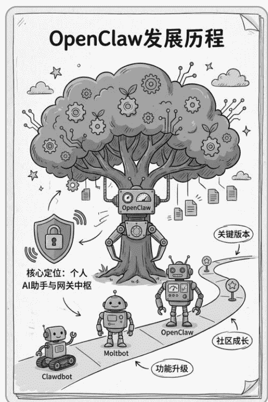
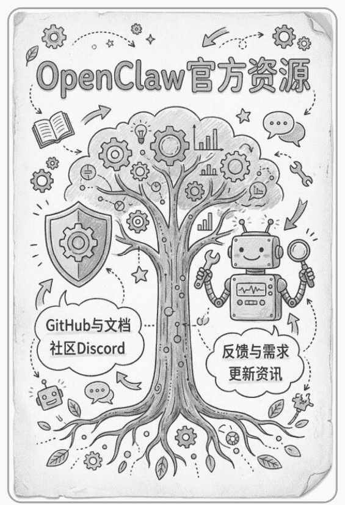
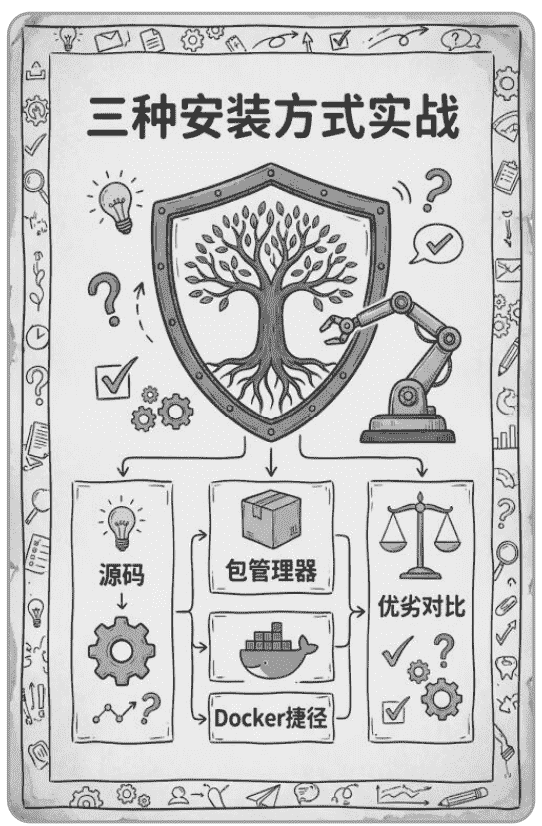

# OpenClaw 开源实战全解

## 书籍概览
本书围绕在代码托管平台上收藏数已突破三十万的开源 AI Agent 项目 OpenClaw 展开，紧扣代理应用浪潮，梳理它由 Clawdbot 演进而来的背景，以及坚持本地运行、数据自管、轻量且易于扩展的设计主张。全书以起源、部署、架构、共建、实战、展望六条线索展开，拆解核心框架、统一网关、沙盒防护等底层思路，给出多平台安装、模型接入、多渠道联动与任务落地的操作指引，同时介绍社区协作流程以及企业和个人落地的案例。既有原理剖析，也有上手教程，可帮助读者快速掌握 OpenClaw 的使用与二次开发，也对生态演进与多代理协同的未来作出展望，面向代理开发者与开源爱好者。

## 专家点评

**蒋涛 CSDN 创始人**
生成式技术竞争正从算力与模型转向以代理为核心的应用与生态。OpenClaw 以开放方式搭建模型、工具与场景之间的新一代底座，本书完整呈现了这一新范式的实践路径。吃透代理，就有机会重塑下一代软件与产业格局。

**霍泰稳 极客邦科技创始人**
这个时代推动进步的不仅是巨头与大模型，还有像 OpenClaw 这样愿意分享、共建、把事情做成的开源群体。作者中多位 TGO 鲲鹏会成员参与，更印证这类组织价值不止于交流，更在于持续推动技术创新走向产业落地。

**红薯 开源中国创始人**
短短数月内拿到三十万星，OpenClaw 用增速证明了社区的力量。本书把这个传奇项目从架构到实操完整拆开，读完会明白：专属自己的 AI 助理，完全可以自己搭建。

**萧田国 高效运维创始人**
运维是否迎来新周期？书中指出，OpenClaw 的核心机制本质上是运维的基本功，只是换了更趁手的工具。希望运维同仁以此为新起点，再攀高峰。

**田超 腾讯云总经理**
技术人终究要回答造出来之后怎么办。代理赛道正被这个追问检验。模型能力在快速提升，真正困难的是让智能在真实业务中跑得通、算得清投入产出、扛得住合规审查。能做 Demo 的项目很多，能算清节省了多少人、花费多少、多久回本的很少。开放源码不等于免费，技术不会自动变现。本书展现了从开放源码到收益的清晰、可复制且已被验证的路径。

**朱啸虎 金沙江创投董事总经理**
OpenClaw 坚持开放开放，打破技术壁垒，推动社区共建与生态繁荣，同时释放出巨大商业价值，已有多家企业完成落地。期待未来 AI 智能体实现自主进化，开启大规模应用新阶段。

**李明顺 行行 AI 董事长**
本书价值不仅在技术，更在讲清一个开放项目如何成长为生态平台。当 Token 经济遇上企业场景，当开放社区与真实落地场景相遇，其商业想象力远超代码本身。强烈推荐给 AI 创业者、企业管理者与技术开发者，它既是实战手册，也是进入代理时代的入场券。

**熊飞 前经纬中国合伙人**
深耕 OpenClaw 的开放实践，拥抱开放生态，共享技术红利，用协作方式打开可落地、可自主执行的 AI 智能体新可能。

打开本书时，正是人工智能从“会说话”迈向“会办事”的关键节点。从手机语音助手到办公生成工具，从社交智能客服到开发者代码插件，人工智能已渗透到办公、生产、个人管理的各个角落。我们见过无数 AI 产品兴衰，也始终在追问：如何拥有一个真正属于自己、安全可控、能灵活适配需求并解决实际问题的 AI 助理？

OpenClaw 正是为了回应这一问题而出现。它从一个小项目起步，数月内凭借强调本地运行、数据自控、生态开放的优势斩获超三十万星，成为全球开放 AI 领域关注度最高、增速最快的项目之一。它不是封闭的大厂产品，也不是单一功能的插件，而是一个开放、可扩展、以本地运行为主的 AI 代理网关枢纽，能连接常用平台、工具与模型，打破系统壁垒，成为高效工作与生活的全能帮手，真正做到让智能代人办事。

写下这篇前言，希望与读者共同讨论三个问题：代理时代带来了哪些变革？OpenClaw 为何能在众多开放项目中脱颖而出，实现从零到三十万星的跃迁？通过本书如何快速掌握 OpenClaw 的使用与开发，让智能真正为己所用，提升生产力。

## 代理时代的到来

要理解 OpenClaw 的价值，先要看清正在加速的代理时代。

回顾人工智能的发展：从早期的规则式对话机器人，到基于大语言模型的生成式智能，再到现在的代理，每一步都在打破“智能只能被动回应”的边界，向“主动服务、自主决策”演进，其核心是用户需求从“获取信息”转向“解决问题”。

生成式智能普及前，人机互动多是“一问一答”的被动模式。问如何写工作总结，得到模板；问代码报错怎么解，得到建议；问天气，得到实时信息。模式是人主导、智能辅助，智能无法主动感知需求，也无法连贯完成复杂任务——能告诉怎么做，却不能代劳。

代理的出现带来质变。它具备自主理解需求、拆解任务、调用工具、闭环执行的系统能力，不再是问答工具，而是虚拟助理。可指令它“整理本周邮件、提取要点并生成回复草稿”，它自动连接邮箱、筛选、提炼、撰写，全程无需手工干预；可让它“监控服务器状态，异常时提醒并尝试自动修复”，它对接监控工具、实时检测、触发预警并执行预案；可委托它“整理会议纪要、同步参会人并标注重点任务”，它记录、提炼、对接通讯工具，完成全流程。

代理时代的核心是自主性与连接性。自主性指基于模糊需求自行拆解、规划、调整策略；连接性指打通不同平台与工具，把分散资源整合为高效协同系统。这让智能从辅助工具升级为生产力伙伴，在个人、开发者、企业团队三大场景体现明显，需求也从“能回答”升级为“能执行”。

对个人而言，邮件、日程、文档等重复工作占据大量时间。代理能自动整理前一天进展生成日报草稿，开会时自动生成纪要并分发，撰写报告时自动搜集素材生成初稿，甚至基于工作习惯提前预警“明日有重要会议需准备资料”“客户邮件未回复建议跟进”。解放重复劳动，聚焦创造性工作。

对开发者而言，编写、调试、部署、运维常伴重复与繁琐。代理可根据编码习惯补全代码、检错、优化结构；调试时快速定位报错并给出修复建议；部署时自动执行流程并监控状态；运维时实时检测异常并尝试修复。提升效率，降低门槛，对新手而言相当于实时指导。

对企业团队而言，信息不及时、任务衔接不顺、资源分配不均会拉低效率。代理可作为协同中枢，按工作负载合理分配任务，自动汇总成果生成周报，实时同步项目进展，对接各类办公工具减少切换成本，让协作更顺畅。

与此同时，代理时代也暴露出新挑战：隐私安全风险。多数主流产品云端部署，数据需上传服务器，存在泄露与滥用隐患，企业核心业务与客户信息、个人邮件日程等隐私都可能受损；灵活性不足，封闭产品功能固定，难以对接小众工具、定制流程或切换模型；云端依赖带来的网络中断与高额费用问题。

正是这些痛点催生了对“优先本地运行、数据自控、开放可拓展”方案的需求。OpenClaw 在此背景下诞生，它兼具代理的自主理解、任务规划与执行能力，同时数据留存在本地、代码开放可自定扩展、支持本地部署不依赖网络且无持续云费用，契合代理时代的核心诉求。

## 零到三十万星的成长路径

OpenClaw 为何能在短短数月内从默默无闻成长为拥有超三十万星、全球开发者参与的开放现象？答案藏在初心、定位与社区生态里——始终坚守开放、本地、保护隐私，以用户需求为导向打造实用可扩展的代理平台，这正是其快速崛起的底层逻辑。

诞生源于创始人 Peter Steinberger 的想法：打造真正属于用户的 AI 助理。当时智能产品要么封闭、要么不安全、要么不够灵活，于是他先推出 OpenClaw 前身 Clawdbot，一个简易的 AI 对话机器人，目标是安全、简单、实用。

最初的 Clawdbot 功能有限，仅支持基础对话与简单任务，如查天气、设提醒、文本生成。但项目坚持开放本地隐私原则，代码全部上架 GitHub，免费开放、无使用限制。这种透明开放的态度吸引了首批开发者，他们来自全球各地，既有资深程序员也有新手，有企业技术人员也有 AI 爱好者。大家在各自需求下补充功能、修漏洞、优化体验，项目逐渐壮大。

迭代中团队发现，单纯对话机器人已不满足需求，用户需要能连接所有工具、整合资源、替自己做事的网关枢纽。于是全面重构，Clawdbot 升级为 Moltbot，强化多平台对接与工具调用，支持 Telegram、Discord 等平台，可调用文件管理、浏览器、邮件、日历等工具，初步具备代理网关雏形，吸引更多用户与开发者加入。

2025 年，Moltbot 更名为 OpenClaw，确立“个人 AI 助理、网关枢纽、多渠道统一入口”的定位。更名不仅是名称变化，更是理念升级。Open 代表开放源码、开放、可拓展；Claw 代表抓取、整合、高效，寓意像爪子一样聚合各类资源与工具，为用户提供高效服务。更名后，项目进一步优化本地部署与隐私保护机制，推出更多实用模块，形成核心竞争力。

爆发点在于本地部署功能的优化。用户可轻松在个人电脑或服务器上部署，所有数据保留本地，无需上云，直接回应隐私焦虑。这一改进精准击中痛点，吸引大量开发者与普通用户。同时团队持续优化体验，支持接入 GPT、Claude、本地模型等主流大模型，支持自定义技能开发，支持后台守护进程实现全天候响应。

零到三十万星仅用三个月，在开放界极为罕见，其背后是清晰定位、开放生态、实用功能三者共振。

清晰定位是基础。与追求大而全的产品不同，OpenClaw 聚焦网关枢纽，不自研大模型而是接入主流模型让用户自由选择，不自建工具而是整合现有工具打破壁垒，不做封闭生态而是打造开放平台供开发者扩展。“轻核心、重整合”的策略使其能灵活适配普通用户、开发者、企业等不同需求。

开放生态是动力。全部代码开放，无门槛参与共建。完善的贡献机制让提交代码、修复问题、编写文档、翻译推广都成为贡献方式。目前已汇聚千余名核心贡献者，遍布全球，形成充满活力且互助的社区。

社区文化也起关键作用。鼓励大胆提想法、分享经验、互相帮助，无层级、无技术壁垒。资深者带新手，新手提出新视角，大家共同讨论发展方向与功能需求，形成“用户需求推动迭代、迭代吸引更多用户”的良性循环。

实用体验才是 OpenClaw 被用户记住的根本。OpenClaw 一直把实际使用场景放在第一位，围绕 Agent 使用中常见的卡点做了多套好用的能力组合，解决了很多真实痛点。比如支持私有化本地部署，数据不出本地，隐私与安全有保障；支持跨平台接入，能在 Telegram、Discord、微信、飞书等多端同时运行，信息同步流畅衔接不卡顿；支持多模型切换，可按需选用 GPT、Claude 或自托管模型，适配不同任务；开放自定义技能开发，开发者能按自己的需求编排专属插件，功能可不断扩展；内置后台守护进程，服务可以 7×24 小时常驻运行，随时响应指令，无需人工反复启动。这些设计让 OpenClaw 真正能落地解决工作与生活的效率问题，也因此积累了大量口碑和持续支持。

现在 OpenClaw 已成为全球范围内最受关注的开源 AI Agent 项目之一，GitHub 星标累计超过 30 万。这个数字不仅是对代码的认可，更代表了开源协作精神的延续。它说明，只要产品始终围绕用户需求、以开放共建的方式运营、保持活跃的社区，就能释放出很强的生命力。OpenClaw 从零到一再到百的历程，也给开源项目留下了清晰的经验：坚持开放包容互助的原则，持续聚焦用户真实需求，不断打磨使用体验，才能在竞争中脱颖而出。

## 本书结构与阅读指南

写这本书的初衷，是希望更多人能认识 OpenClaw、用起来、参与建设。无论你是零编程基础的普通用户，还是有开发经验的工程师；无论目标是提升个人效率，还是想加入开源、锻炼技术能力；无论是个人使用还是企业落地，书里都能找到对应的路径。内容兼顾概念和实操，脉络清晰、由浅入深，从 OpenClaw 的来历与部署，到架构原理与源码解读，再到开源协作与典型应用，全景覆盖核心知识点，方便快速上手并做到学以致用。

全书围绕“起源—使用—开发—贡献—应用—未来”展开，层层推进。既能满足新手入门，也能支持进阶研究。下面会先介绍整体框架，再给出不同角色的高效阅读建议，帮助你少走弯路、更快收获。

本书整体框架如下，每一篇都有明确目标，篇章之间环环相扣，形成完整知识体系。

### 第 1 篇：开源浪潮与 OpenClaw 诞生背景

这一篇承担全书的认知基础，目标是帮助你建立对 OpenClaw 的整体印象。本篇会梳理开源 AI 生态的全貌，解读 Agent 时代的核心诉求，回顾 OpenClaw 从萌芽到成型的过程，并介绍项目的定位优势与官方入口。看完这一篇，你能明白 OpenClaw 出现的技术必然性，学会获取官方资料与参与社区交流，为后续学习做准备。本篇共 6 章，分别覆盖聊天机器人到 AI Agent 的演进、下一代智能的关键需求、全球开源 AI 格局、项目简介、发展历程、官方资源指南。

### 第 2 篇：快速上手与本地部署实践

这是实战入门部分，目标是让你尽快跑通 OpenClaw。本篇详细说明环境准备、三种安装方式，涵盖源码安装、包管理器安装、Docker 安装，以及首次启动初始化、配置文件解读、模型接入与通道配置，还有第一个任务的实操演示。完成这一篇后，你可以独立部署、完成基础配置、对接常用模型与平台，执行简单任务，实现真正的入门使用。本篇共 5 章，步骤细化到可操作，零基础也能跟上。

### 第 3 篇：核心架构与源码拆解

这是技术深水区，目标是弄清 OpenClaw 内部如何运转。本篇介绍整体 Hub-and-Spoke 模式的架构设计、核心四层结构 Channel→Gateway→Agent→Skills、网关模块与数据流、核心模块源码解读、Agent 与 Skills 的工作机制，以及关键技术与安全设计。读完后，你能理解底层逻辑，掌握核心模块原理，为后续定制开发和贡献打下基础。本篇共 5 章，偏技术深度，适合有编程经验的开发者，也为想深入了解原理的进阶用户提供了清晰解读。

### 第 4 篇：参与共建 开源协作指南

本篇目标是教会你如何为 OpenClaw 做贡献。本篇涵盖开源协作文化与规则、Git 与 GitHub 常用工作流、OpenClaw 的贡献流程 Fork→开发→提交 PR、Code Review 规范与通过建议，以及非代码贡献方式如文档、测试反馈、翻译推广。学完后，你就能按规范参与项目协作，在贡献中提升能力。本篇共 2 章，理论与实战结合，对所有想参与开源的读者友好。

### 第 5 篇：典型场景与实战案例

这是应用落地篇，目标是把 OpenClaw 用到真实工作生活。本篇介绍面向个人用户、开发者、企业团队等多个场景的使用方法，提供典型案例拆解任务步骤，并分享可复用的使用技巧。读完后，你能根据自身需求灵活调用 OpenClaw，解决具体问题，让 AI 真正为自己服务。本篇共 1 章，强案例驱动，便于借鉴。

### 第 6 篇：开源生态的未来展望

本篇目标是帮助你把握发展方向。本篇介绍 OpenClaw 的路线图与长期规划、技能市场 ClawHub 的设想、对多 Agent 协同的思考，并附上常用命令速查、常见问题 FAQ、官方资源链接、贡献者名单等附录，方便查阅。读完后，你能对项目的未来潜力有清晰预期。本篇共 1 章加 1 个附录，内容精炼实用。

为了让不同读者快速定位，下面给出针对性阅读建议。

如果你是零基础的普通用户，只想用 OpenClaw 提升个人效率，建议重点看第 1 篇、第 2 篇和第 5 篇。第 1 篇帮你建立认知，知道 OpenClaw 能做什么；第 2 篇带你完成安装与基础配置，能执行整理邮件、管理日程、处理文档等简单任务；第 5 篇提供个人生产力的实操技巧，让 OpenClaw 成为你的全能助手。第 3 篇和第 4 篇的技术细节可以先跳过。

如果你是有编程经验的开发者，想深入技术、做定制或参与开源，建议按顺序通读。第 1、2 篇打基础，了解产品定位与使用方式；第 3 篇是核心，仔细研读架构与源码，掌握关键原理；第 4 篇学习贡献规范，能参与项目开发；第 5、6 篇补充应用场景与未来方向，为你的二次开发提供灵感。阅读时建议结合源码边看边实践，亲手调试加深理解。

如果你是企业或团队用户，想评估与落地，建议聚焦第 1 篇、第 2 篇、第 5 篇和第 6 篇。第 1 篇帮助判断隐私安全与私有化部署是否匹配企业需求；第 2 篇指导私有化部署与稳定配置；第 5 篇提供团队协作的实战方法；第 6 篇帮助做长期规划。根据内部需求，重点关注私有化配置、权限管理、协同流程等内容。

阅读过程中，建议注意三点。

第一，强调动手。OpenClaw 是实践型项目，光看理论不够。读完每章后按书中步骤部署、配模型、跑任务、尝试做个简单技能插件，才能真正掌握方法和原理。动手改代码、优化流程，在解决问题的过程中提升能力。

第二，利用官方资源。技术迭代快，书中内容会随版本变化。建议同步关注官方 GitHub 仓库、文档和社区，获取最新信息，遇到问题时通过官方渠道交流。

第三，积极参与社区。OpenClaw 社区活跃，汇聚全球开发者与用户。加入 Discord、参与 Issue 讨论、提交反馈或贡献代码、文档、翻译，都能加速成长，也帮助项目更好发展。

最后想说，OpenClaw 是一个开放、持续进化的项目，它的发展离不开每个使用者的支持。本书只是起点，希望它能让你爱上 OpenClaw、用好它、甚至为其贡献力量。Agent 时代已经到来，OpenClaw 让 AI 从概念走向实用，真正帮助我们解决问题、提升生产力。

让我们一起借助 OpenClaw，让 AI 更贴近日常，释放更高效率，创造更好的未来。感谢选择本书，祝阅读愉快、收获满满！

本书出版得到出版社大力支持，在此致谢。出版收益将捐赠给 OpenClaw 开源社区，回馈开源生态。感谢 OpenClaw 团队与社区贡献者持续探索，为本书提供了技术与思想基础。

感谢参与筹备、审核、校对的专家伙伴：

### 张子天
很荣幸参与《OpenClaw 开源实战》的筹备，负责第 17、18、19 章的审校。希望本书能成为开源爱好者与实践者案头的实用参考，帮更多人找到在开源世界的位置并产生真实价值。祝出版顺利，与读者共同成长！

### 孙丽
很荣幸参与本书前言及第 1 章的审核校对。校对过程中深切体会到开源 AI 的普惠意义，也为能为家庭与青少年提供零门槛入门指引感到欣喜。愿这本凝聚心血的作品让 AI 成为成长与生活的贴心助手，期待广受欢迎。

### 张泽武
参与了第 14、15 章的审核校对。本书是较早的 OpenClaw 实战著作，内容有参考价值。技术细节繁多，单靠一本书难以穷尽，某些细微问题仍需社区持续讨论。对此的链接与契机，已在此处提供。

### 李桥生
感谢参与本书筹备，负责第 8、9、10、11 章的审稿。与一批热爱技术、深耕开源的伙伴共同打磨内容，收获颇丰。愿这些沉淀的实战经验能照亮更多开发者的 AI 实践之路，让技术价值被看见。

### 王仁明
负责第 5 章的审核校对。几个月内，项目在完全开源模式下实现快速演进，并影响到全球开发者社区。技术体系复杂，涉及多领域工程与架构。本书旨在抛砖引玉，为技术爱好者提供参考。

### 王秀成
数字经济下，开源已成为驱动创新与产业升级的关键力量。参与本书编修时，我重点关注真实业务落地，提炼可复制的方法论，并从 CIO 视角审视其在安全治理、架构扩展与生态协同方面的价值。

### 张亮
AI 日新月异，《OpenClaw 开源实战》如同一叶轻舟，助你游览开源天地。期待早日出版流传。

### 高泗俊
作为早期用户与支持者，我研究了 OpenClaw 的设计与原理，并基于它搭建了 SaaS 平台。实战让我对项目有更深理解，这些心得用于第 3 章审核。希望本书早日面世，受益更多人。

### 韩岳岐
参与校对工作时，通过 GitHub Star 的增长感受到项目的迅猛变化。它不仅是技术或一个 Agent，更是一种新的工作模式与研发逻辑。希望开发者深入品味，并助力其在更多领域生根。

### 李学庆
负责第 16 章的审核校对。该章围绕统一接口标准化工具、指令到调用的全流程校验防越权、复杂指令拆解与子任务自动化调度、异常监控与闭环处理、致命异常即停与严重异常自动重试等，构建高效安全体系。

### 晏力
很荣幸参与第 6、7、8 章的审核校对。与优秀专家共同打磨细节，不仅是创作，更是为行业贡献知识资产。希望扎实内容能帮助更多开发者顺利进入 OpenClaw 世界。

### 孙双琛
负责第 1、2、3 章审校。OpenClaw 是现象级开源产品，让同行共赴技术狂欢，也提供了反复打磨产品的协作机会。正如本书，是新协作范式的体现。

### 高驰涛（Neeke）
回望 OpenClaw 从构想到落地的历程，感恩满满。从初步系统到如今具备完善 Agent 调度与 Skills 生态，并形成坚实安全机制与自动化闭环，项目愈发可靠。感谢阅读本书的你。

### 张佳民
负责第 12、14 章审核校对。内容从顶层设计到代码实践，既是学习基石，也是二次开发指南，有助于不同背景读者深入理解并创造。

### 王莉
负责本书插画。插画是对文字的提炼与延伸，也是吸引注意、引导探索的媒介。希望通过视觉帮助表达思想，推动科技文化传播。

### 陈霏霖(Kelly)的龙虾
从“只能陪聊”到“真正干活”，OpenClaw 展现了本地优先与自动化执行的潜力。与 Mark 及社区极客、探索者一起沉淀经验成书难忘。愿它帮助大家探索 Agent 时代，减少摸索成本，把生产力还给使用者。

### 廖柔雪
作为插画创作者，我认为插画应与内容深度契合，成为连接专业知识与读者的桥梁。祝愿本书陪伴更多技术爱好者，在技术路上笃行致远。

### 周雪
荣幸参与插画创作，用视觉语言让技术内容更清晰。祝愿本书助力更多人深耕开源，追光前行。

### 何丽娜

丁鹏：很高兴受邀参与《OpenClaw 开源实战》的筹备，负责第16章“关键技术和安全机制”的审校。对我来说，安全是OpenClaw从能用走向好用不可逾越的底线。本章对全链路的安全配置做了系统梳理，帮助读者获得可落地的防御技能，在享受AI提效的同时把风险关住。希望以上思考能为同行在开源路上提供参考，也祝新书热销。

张瑞：有幸加入《OpenClaw 开源实战》的编撰，负责第14章与第15章的审阅。如果把源码视作OpenClaw稳固的技术根基，那么Agent与Skills体系就是让它具备无限潜能的双翼。期待本书能帮助读者夯实技术底座，在AI浪潮中保持灵活创新。祝《OpenClaw 开源实战》大卖，社区持续繁荣。

石春丽：感谢邀请我参与《OpenClaw 开源实战》的校对工作，我主要负责第17章。该章以开源贡献入门为主线，从协作文化、Git工作流到贡献规范层层递进，实用性突出。审阅时我切身感受到开源社区开放共享、协作共进的精神，也体会到OpenClaw对新手友好、重视规范落地的用心。希望本章能为初入开源的读者建立起点，帮助大家以规范方式参与贡献，预祝图书顺利出版，惠及更多开发者与技术爱好者。

石春丽：我还参与了第17章的校审，有幸提前阅读成稿。在技术日新月异的今天，开源已不只是开发模式，更是一种思维方式与协作文化。翻开本书就能感受到Mark倾注的心血与诚意。《OpenClaw 开源实战》并非纸上谈兵，而是把真实的工程经验、踩坑历程与最佳实践融为一体，为希望拥抱开源、驾驭开源的开发者提供一份实战指南。内容由浅入深，既照顾首次接触开源的读者，也为有经验的工程师提供更高维度的思考框架。可以负责任地说，这是一本值得放在案头、反复翻阅的好书，能给出清晰路径与实用工具。强烈推荐。

同时，衷心感谢中国技术社区与全球开源社区的鼎力支持！大家的热情参与与无私奉献为本书发展注入强大动力，让生态更加繁荣。感谢：开源中国（OSCHINA）、Linux 基金会 APAC、天工开物开源基金会、开源社、木兰开源社区、CSDN、极客邦科技、TGO 鲲鹏会、OpenClaw Asia、Claw-China.com 龙虾中国开源社区、Datawhale、OpenBuild 等。

由于本书筹备周期紧张，虽经多轮打磨与校核，仍难免存在疏漏。在此恳请各位读者、专家与业界同仁不吝赐教，对书中谬误与欠缺之处予以批评斧正。我们将珍视每一份宝贵意见，在后续版本中持续完善与优化。也期盼在大家的监督与帮助下，让本书更好地服务于AI智能体与开源社区的实践探索。最后，再次感谢各位读者的理解、包容与一路支持。

## 第1篇 开源时代与 OpenClaw 起源

- 第 1 章 从聊天机器人到 AI Agent
    - 1.1 聊天机器人的局限与进化
    - 1.2 能做事的 AI Agent 核心特质
    - 1.3 聊天机器人与 AI Agent 的核心区别
    - 1.4 AI Agent 时代的技术支撑
    - 1.5 从对话到执行的技术跨越
- 第 2 章 下一代智能的核心诉求
    - 2.1 本地优先：摆脱对云端依赖的优势
    - 2.2 隐私优先：AI 时代的安全底线
    - 2.3 轻量化：适配多设备的核心需求
    - 2.4 可扩展：满足个性化场景适配需求
    - 2.5 易用性：降低 AI 使用技术门槛
- 第 3 章 全球开源 AI 生态格局
    - 3.1 开源 AI 的发展现状与趋势
    - 3.2 OpenClaw 出现的历史必然性
    - 3.3 全球开源 AI 项目的核心分类
    - 3.4 开源与闭源 AI 的优劣对比
    - 3.5 开源社区对 AI 发展的推动作用
- 第 4 章 OpenClaw 项目简介
    - 4.1 项目定位
    - 4.2 创始人与社区核心力量
    - 4.3 项目核心价值与核心优势
    - 4.4 项目适配的核心用户群体
    - 4.5 与同类开源 AI 项目的差异
- 第 5 章 OpenClaw 项目发展历程
    - 5.1 迭代之路：Clawdbot → Moltbot → OpenClaw
    - 5.2 核心定位：个人 AI 助手与网关中枢
    - 5.3 关键版本迭代与功能升级节点
    - 5.4 项目成长中的核心里程碑事件
    - 5.5 社区成长与用户规模发展历程
- 第 6 章 OpenClaw 官方资源指南
    - 6.1 GitHub 仓库与文档查阅
    - 6.2 社区交流与 Discord 渠道
    - 6.3 官方文档的核心内容与查阅方法
    - 6.4 问题反馈与需求提交渠道
    - 6.5 官方更新与资讯获取方式

## 第 2 篇 OpenClaw 快速上手与安装部署

- 第 7 章 环境准备与支持平台
    - 7.1 适配平台：macOS / Windows / Linux 详解
    - 7.2 核心依赖：Node.js、pnpm、Git 安装
    - 7.3 各平台的环境配置差异
    - 7.4 依赖版本兼容性说明
    - 7.5 环境配置常见问题排查
- 第 8 章 三种安装方式实战
    - 8.1 源码安装：步骤与注意事项
    - 8.2 包管理器与 Docker 安装捷径
    - 8.3 三种安装方式的优劣对比
    - 8.4 安装过程中的常见报错解决
    - 8.5 安装完成后的验证方法
- 第 9 章 首次启动与初始化
    - 9.1 onboard 流程引导与配置
    - 9.2 后台守护进程与自启动设置
    - 9.3 首次启动的核心配置项说明
    - 9.4 初始化失败的排查与解决
    - 9.5 启动状态的查看与管理方法
- 第 10 章 配置文件与模型对接
    - 10.1 配置文件结构与格式解析
    - 10.2 主流 LLM 对接：GPT / Claude / 本地模型
    - 10.3 配置文件的修改与保存方法
    - 10.4 模型对接的权限配置
    - 10.5 模型切换与参数调整技巧
- 第 11 章 通道接入与第一个任务
    - 11.1 多通道接入：Telegram / Discord 等配置
    - 11.2 实战：让 OpenClaw 帮你操作电脑
    - 11.3 通道接入的权限设置与验证
    - 11.4 第一个任务的执行步骤与调试
    - 11.5 任务执行结果的查看与反馈

## 第 3 篇 OpenClaw 核心架构与代码剖析

- 第 12 章 整体架构设计
    - 12.1 Hub-and-Spoke 中心辐射架构原理
    - 12.2 核心四层：Channel → Gateway → Agent → Skills
    - 12.3 整体架构的核心设计理念
    - 12.4 架构的可扩展性设计思路
    - 12.5 架构与同类项目的差异点
- 第 13 章 网关与数据流解析
    - 13.1 Gateway 模块：系统中枢（18789 端口）
    - 13.2 全流程数据流拆解与分析
    - 13.3 Gateway 模块的核心功能
    - 13.4 数据流异常的排查方法
- 第 14 章 核心模块源码解析
    - 14.1 Gateway 路由、会话与调度机制
    - 14.2 Channel 适配器：多平台统一接入实现
    - 14.3 源码的目录结构与核心文件
    - 14.4 核心代码的关键逻辑解析
    - 14.5 源码阅读的技巧与重点
- 第 15 章 Agent 与 Skills 系统
    - 15.1 核心架构与运行时
    - 15.2 工作空间与执行循环
    - 15.3 多 Agent、记忆与系统提示词
    - 15.4 Skills 体系、沙盒安全与最佳实践
    - 15.5 Skills 配置参考与开发最佳实践
- 第 16 章 关键技术与安全机制
    - 16.1 Gateway——整个系统的神经中枢
    - 16.2 认证体系——让凭据用对地方
    - 16.3 Secrets Management——让凭据永远不出现在配置文件里
    - 16.4 沙盒安全机制——给 Agent 划定行动边界
    - 16.5 Cron 任务调度——让 Agent 主动做事
    - 16.6 Session 会话机制——对话历史的持久化单元
    - 16.7 消息渠道——OpenClaw 连接世界的接口
    - 16.8 心跳机制——让 Agent 保持主动
    - 16.9 Canvas 与节点系统——Agent 的“眼睛”和“屏幕”
    - 16.10 工具策略与 Exec 安全
    - 16.11 配置管理与热重载
    - 16.12 安全体系：纵深防御与最佳实践

## 第 4 篇 参与开源：贡献 OpenClaw

- 第 17 章 开源贡献基础
    - 17.1 开源协作文化与核心规则
    - 17.2 Git 与 GitHub 必备工作流
    - 17.3 开源贡献的核心类型与要求
    - 17.4 GitHub 基础操作规范
    - 17.5 开源社区的沟通礼仪
- 第 18 章 贡献流程与规范
    - 18.1 Fork → 开发 → 提交 PR 全流程
    - 18.2 Code Review 规范与通过技巧
    - 18.3 PR 提交的核心规范与注意事项
    - 18.4 代码贡献的格式与质量要求
    - 18.5 非代码贡献的流程与规范

## 第 5 篇 OpenClaw 应用场景与实战案例

- 第 19 章 多场景应用实战
    - 19.1 个人生产力与开发者场景落地
    - 19.2 企业与团队私有化部署实践
    - 19.3 个人场景的核心应用技巧
    - 19.4 企业部署的核心配置与优化
    - 19.5 典型实战案例的步骤拆解

## 第 6 篇 OpenClaw 开源生态的未来

- 第 20 章 OpenClaw 未来与生态拓展
    - 20.1 Roadmap 与长期发展方向
    - 20.2 技能市场与多 Agent 协同展望
    - 20.3 生态拓展的核心规划
    - 20.4 开发者生态的建设方向
    - 20.5 未来版本的核心功能预判
- 附录

在数字化快速演进的当下，开源已成为推动技术创新、打破壁垒的关键力量，渗透到软件开发、智能协作、企业数字化等多个领域，形成开放协作、共享共赢的技术生态。开源模式降低了开发门槛，汇聚全球智慧，加速迭代，成为科技发展的重要引擎。本篇作为开篇，将以开源时代为背景，梳理开源技术的发展脉络与价值主张，解读生态演进方向，为后续介绍OpenClaw奠定基础。同时，本篇会详细说明OpenClaw的诞生背景、初心与发展轨迹，剖析其技术动因与市场需求，呈现从构思到落地的关键节点，帮助读者明确OpenClaw的定位、价值与初心。通过本篇的介绍，读者可以迅速进入开源语境，理解OpenClaw在生态中的角色与意义，为学习核心技术、参与开源贡献与场景落地做好准备。

## 第1章 从聊天机器人到 AI Agent

人工智能正加速融入工作与生活，手机语音助手、社交平台智能客服、办公系统文本生成、开发者的代码辅助插件等形态各异的产品，都在经历从被动响应到主动执行的转变，而这场转变的核心正是从聊天机器人迈向AI Agent。本章围绕五大要点，深入解析变革的底层逻辑、核心差异与技术支撑，帮助读者把握AI从会说到会执行的进化路径。

### 1.1 聊天机器人的局限与进化

聊天机器人是AI落地的早期形态，以人机对话打破了机器不可沟通的固有认知，也为后续发展奠定基础。从上世纪六十年代首个聊天机器人ELIZA出现，到如今基于大语言模型的生成式对话普及，交互体验与语义理解获得质的提升，但只会对话、不会执行的根本局限始终存在。随着AI Agent时代加速到来，用户需求已从获取信息和对话，升级为解决问题和执行任务，这种需求变化推动人工智能从能说会道走向能做实事，而AI Agent正是这一转变的核心载体。

从技术演进看，聊天机器人的发展大致经历规则式、统计式、生成式三个阶段。每个阶段都在解决前一阶段的痛点，不断提升交互自然度与便捷性，却始终未能突破只能对话、不能执行的困境，也未能满足用户对AI做事的深层期待。

从对话到执行：聊天机器人三代进化史与AI Agent的必然

聊天的机器，这条技术线走了快一百年。早期它只会照本宣科，后来学会了从数据中找规律，再后来能像人一样生成流畅表达，而真正的拐点在于——从只会说到开始做事。理解这条演进，才能看清AI Agent为何出现。

**第一代规则时代：靠关键词走流程**

上世纪六十年代诞生的规则式聊天机器人，是这个品类的雏形。它的工作逻辑非常机械：把对话拆成关键词+预设规则的配对，没有理解也没有学习能力。开发者得手动埋好大量关键词、场景和标准回复，用户输入里只要撞上预设词，就按模板回；撞不上，就只能回“抱歉没听懂，请再说一遍”。

最经典的代表是麻省理工学院约瑟夫·魏泽鲍姆在1966年做的ELIZA。系统被设计成模仿心理医生与来访者的对话，内置大量心理咨询相关词库和回应模板。表面上看像是会共情，实际上只是关键词触发下的模板输出，对话背后的真实意图完全不感知。

这种做法的好处很实在：开发门槛低、成本低、部署快，特别适合对话场景固定、内容简单的场合，比如早期的在线客服、基础语音助手。但缺点也很致命：灵活性差，脱离预设就失灵；表达僵硬，全是写死的模板，没有个性；只能处理单一问答，遇到复合需求就束手无策。

**第二代统计时代：用数据学对话**

随着机器学习成熟，聊天机器人进入统计阶段，摆脱了完全依赖人工规则的束缚，获得了初步的学习能力。它不再需要人把所有对话都写好，而是靠海量对话样本训练，捕捉语言的分布规律，再据此匹配回复。朴素贝叶斯、支持向量机、隐马尔可夫模型等传统算法是这一阶段的主力，能做简单的语义分析，判断用户大致意图并给出相对贴合的回应，多轮对话的顺滑度明显提升。

对比规则派，统计派的提升很明显：能应付一些未预设的表达，上下文感知变强，问答复杂度也有所提高。但瓶颈依然清晰：学习效果高度依赖高质量数据的覆盖，数据不足或场景外推就迅速掉线；本质上仍是概率匹配，不是真正理解，面对模糊或复杂意图会失真；功能仍被锁在“说”上，无法调用外部系统执行任何动作，只能提供信息咨询，解决不了实际问题。

**第三代生成时代：大模型带来语义理解**

近几年大语言模型的爆发，推动聊天机器人进入生成式阶段。GPT、Claude、文心一言、通义千问等模型成为主流，它们拥有强大的理解与生成能力，对话体验实现质变。核心变化是真正具备了语义理解，能够分辨文本的深层含义、语气、情绪甚至隐喻，并生成逻辑通顺、个性化的回复，人机区别被大幅缩小。

优势是全方位的：多轮对话自然得像聊天；能处理模糊需求、复杂意图和专业问题；知识储备相当于随身资料库；还能按偏好调整风格。但根本局限没有被打破——它依然只能对话，不能做事。所有能力都围绕语言展开，无法触发外部工具，也无法闭环执行“理解需求—完成任务—反馈结果”的链路。这不是短期技术不足，而是定位决定的：它本质是对话工具，不是执行助手。

这种局限体现在四个方面：被动等待输入，缺乏自主性；没有工具调用能力，只能给方法不落地；不擅长任务拆解，处理不了多步骤工作；没有长期记忆，个性化无法持续。正因这些天花板，才推动行业向“能办事、有自主、可联动”的方向演进，AI Agent 正是这一趋势的产物。

### 1.2 AI Agent 的五大核心特质

如果说聊天机器人的核心是对话，AI Agent 的核心就是执行。它既能像对话系统一样理解自然语言，又能主动拆解任务、调用工具、落地操作，最终形成“理解需求—规划任务—执行操作—反馈结果”的完整闭环。支持这种能力的，是五大相互赋能的特质：自主性、连接性、任务拆解能力、记忆能力、学习与适配能力。

自主性是前提。聊天机器人是被动响应，用户不发指令它就静止；AI Agent 是主动服务，能自主感知潜在需求、规划步骤、执行并反馈。体现在主动感知、主动规划、主动闭环上，比如根据日程主动提醒会议，或者读完邮件后主动询问是否需要起草回复。

连接性是基础。Agent 能打通平台、工具、系统的壁垒，实现多端协同。聊天机器人困在文本对话里，而Agent通过多平台对接和多工具调用，把信息孤岛连起来。举例来说，用户说“帮我做一份客户跟进报告并发到团队群”，Agent 能调取CRM信息、用文档工具生成报告、再通过通讯工具发送，全程无需手动切换。

任务拆解能力让复杂事变得可执行。日常需求往往是多步骤组合，Agent 依赖语义理解与逻辑推理，把模糊需求拆成原子化步骤，明确目标、方法、顺序和异常处理，再逐一执行。

记忆能力支撑长期个性化。聊天机器人只能记住当前会话片段；Agent 同时具备短期记忆维持多轮连贯，以及长期记忆保存偏好、习惯、历史行为，构建用户画像，实现持续适配。

学习与适配能力保证持续进化。通过自主学习新知识、场景适配不同环境、需求适配用户变化，Agent 能不断优化服务，而非被锁死在训练数据里。

### 1.3 聊天机器人与 AI Agent 的五大本质差异

两者看似都能聊天，本质迥异。

功能定位上，聊天机器人是对话工具，价值在于提供信息咨询，无法执行操作；AI Agent 是执行助手，价值在于理解需求并解决问题，能形成闭环。

核心能力上，聊天机器人偏重被动响应，擅长语义理解和回复生成，但不能主动推进；AI Agent 侧重主动执行，五大特质协同，能主动搜索、下载、整理、同步并反馈结果。

交互模式上，聊天机器人是人主导，用户需一步步下指令，停止输入就中断；AI Agent 是AI主导，用户只需给出整体目标，系统自主推进，并能根据反馈自适应调整。

使用场景上，聊天机器人局限于单一咨询，如天气查询、常见问题解答；AI Agent 覆盖个人生活、工作、学习、企业协同、开发等全场景，支持跨工具协作。

价值体现上，聊天机器人提供信息支持，能告诉怎么做却不做；AI Agent 带来生产力提升，替用户承担重复和复杂工作，节省时间和精力，并实现长期个性化服务。

### 1.4 AI Agent 时代的技术支撑

AI Agent 真正会干活，靠这五大技术底座

AI Agent 能主动执行、串联工具、解决复杂问题，并非凭空出现，而是多项前沿技术协同起来的结果。从聊天机器人到 Agent 的跃迁，本质是技术迭代的必然走向。大语言模型、多模态、工具调用、记忆以及强化学习等方向的突破与融合，共同搭建起让 Agent 从概念走向落地的底层支撑。可以说，Agent 能做事的特质是框架，支撑它的技术体系才是让框架运转起来的实质。各部分相互赋能，分别解决了理解、规划、联动、记忆、进化的关键难题。

第一个要害是扮演思考中枢的大语言模型。它负责精准理解语义和进行逻辑推演。没有大模型的底座，Agent 就谈不上理解需求、拆解任务，也无法成为一个能办事的助手。大模型的语义捕捉与推理能力，是Agent 具备自主性与任务拆解能力的根基。聊天机器人时代的局限很明显，规则式和统计式只能做关键词或概率匹配，无法触及用户意图的深层含义；生成式虽能聊得通顺，却缺乏复杂推理和任务规划，支撑不了执行。LLM 的出现打破了这层天花板，让 Agent 真正拥有“思考”能力，能读懂需求并规划步骤。

大模型对 Agent 的帮助集中在两点：深度语义理解与强逻辑规划。深度语义理解意味着能抓住明示需求之外的潜在诉求、模糊表达甚至语气和隐喻。比如用户说“帮我处理一下客户需求，尽快回复”，模型能识别出核心是快速处理并回复，还能捕捉“尽快”的时间限制，为后续规划提供依据。强逻辑规划能力则让模型能把复杂目标拆成可执行的顺序步骤，明确依赖关系，并预判执行中可能出现的异常。目前 GPT-4、Claude 3、文心一言4.0 等主流模型都具备这一水平。OpenClaw 作为开源 Agent 平台，可兼容各类主流大模型，用户按需选择作为 Agent 的“大脑”。

第二个关键是工具调用框架，它是 Agent 的操作手脚，负责多工具、多平台的联动。如果说大模型负责想，工具调用框架就负责做。它解决了 Agent 如何调用工具、如何与工具协同的核心问题，把规划落地为执行。聊天机器人做不到联动，正是因为缺乏成熟的调用框架，无法对接接口、发送指令、获取反馈。而 Agent 通过调用框架可无缝接入外部服务，使用功能、执行操作并拿到结果，完成复杂任务。

调用框架的核心是搭建 Agent 与外部工具间的桥梁，形成指令下发、操作执行、结果返回的闭环。典型结构包含三块：工具注册与管理、指令解析与生成、结果接收与处理。注册管理模块把外部工具接入平台并管控权限与接口信息；指令解析模块把规划好的步骤转成工具可识别的调用指令；结果处理模块把工具返回的信息解析成 Agent 可懂的内容并反馈给用户，同时更新进度。市场上常见通用型框架如 LangChain、LlamaIndex，另有专用型方案。OpenClaw 集成主流通用框架，同时支持自定义接口，可适配多种工具和平台。

第三个支柱是记忆机制，相当于个性化服务的数据仓库。它记录偏好、习惯、历史操作、对话上下文等信息，构建用户画像，实现长期服务。Agent 能成为专属助手，核心在于能记住用户。聊天机器人缺少持久化记忆，只能保留当次会话的部分上下文，结束即消失。

Agent 的记忆分为短期与长期两层。短期记忆 Context Memory 用来保存当轮多步对话上下文，保证连贯性，避免答非所问。它是临时存储、实时更新，便于下次延续话题。实现主要依赖大模型上下文窗口，窗口越大可保留信息越多。长期记忆 Long-Term Memory 用来保存不会随会话结束而消失的个性化信息，用于持续适配。特点是长期保存、动态更新，会随交互数据和反馈不断优化。实现上常用向量数据库做高效存储检索，知识图谱做结构化关联，帮助 Agent 更懂用户。

第四个支柱是多模态技术，它是 Agent 的感知能力，让信息交互不再局限于文字。它可接收并处理文本、图像、语音、视频等多种模态，使理解更全面、场景更丰富。聊天机器人多为纯文本交互，无法处理图音视频，场景单一。Agent 有了多模态，能更自然地交互。

支撑点有三：多模态信息理解、生成与交互适配。理解层面可读懂文字、图像、语音、视频并捕捉意图；生成层面可输出文字、图像、语音、视频等多种形式结果；适配层面可按用户交互方式自动切换模式。技术栈涵盖自然语言处理、计算机视觉、语音识别与合成、视频处理等。OpenClaw 集成主流多模态能力，支持文本、图像、语音等多种交互，覆盖多样化需求。

第五个引擎是强化学习与自适应技术，它让 Agent 持续进化。交互中通过自主学习不断优化服务能力，适应变化的需求与场景。聊天机器人的学习受限于预设数据，无法在线优化。Agent 则可通过强化学习实现自我提升。

作用体现在自主学习优化与场景自适应。自主学习利用用户反馈、历史操作和交互数据优化任务规划、工具调用和回复质量，核心是奖励机制：执行后的反馈作为奖励或惩罚，驱动策略调整。自适应则让 Agent 识别工作、生活等不同场景并调整服务模式，也能随需求变化更新内容，让使用越久越贴合。

### 1.5 从对话到执行的技术跨越

从聊天机器人到 Agent，看起来是形态升级，实则是从对话能力到执行能力的深层跨越，从被动响应到主动服务，从信息咨询到生产力提升。这并非单一技术突破，而是前面五大技术的协同进化。理解这场跨越，可从技术逻辑、能力升级、落地价值三个角度切入。

技术逻辑的跨越是从文本交互到闭环执行。聊天机器人的逻辑是用户输入文本，AI 解析意图后生成文本回复，始终围着文本打转，不涉及执行也不联动工具。流程为输入、解析、生成，AI 只负责说，不负责做。

Agent 的逻辑是闭环执行。流程为用户输入多模态需求，AI 通过多模态和大模型理解意图，大模型进行推理拆解规划，工具调用框架联动外部工具执行，AI 把执行结果整理反馈，最后通过强化学习根据反馈优化自身。为对话加入了执行与反馈环节，让 AI 从只说不做变为既说又做并持续优化。OpenClaw 的运作就是典型闭环：用户以文本或语音提出需求，平台理解后规划步骤，通过工具调用对接邮箱、日历、文件管理等完成任务并反馈，同时用强化学习优化服务。以“帮我整理本周工作成果，生成日报并发送给领导”为例，系统会按理解-规划-执行-反馈-优化的链路完整交付。

能力升级的跨越是从单一对话到全能执行，涵盖理解、规划、执行、适配进化四个维度。

理解从表面到深层。聊天机器人只能抓关键词，听不出潜在需求，也无法处理图像。Agent 能读懂深层含义、隐喻和语境，并理解图音视频信息。比如用户说“我最近很忙，没时间整理邮件”，Agent 会捕捉到潜在需求并主动询问是否需要帮忙整理并生成总结；用户发产品图说“处理一下”，Agent 能识别图内信息并追问具体需求。

规划从无规划到精准规划。聊天机器人无法拆解复杂任务，只能给出方法。Agent 能把复杂目标拆成可执行步骤，明确顺序与依赖，并预判异常并准备应对。如“整理邮件、生成日报并发送给领导”，Agent 会规划出整理、筛选、生成、检查、发送、反馈的完整流程。

执行从无执行到全能执行。聊天机器人只能指导操作，Agent 能真正调用工具完成操作。如下载文件、撰写并发送邮件、对接服务器监控异常并预警。

适配与进化从固定到持续优化。聊天机器人能力固定，Agent 可适配工作、生活、学习等不同场景，随需求变化调整服务，并通过用户反馈不断优化策略，使用越久越好用。这种升级让 AI 的价值从辅助咨询升维到生产力提升，从工具变为伙伴。

## 价值跃迁：从信息支持到生产力重塑

技术架构的突破和能力体系的升级，最终都指向落地的价值换挡。AI正从聊天机器人提供的信息支持，跨越到AI Agent驱动的生产力变革。这种跃迁不仅重塑用户的日常工作与生活，也在改写人工智能产业的走向，让技术从概念讨论走向真实应用，从边缘助手变成核心生产力。

聊天机器人的价值边界基本停留在信息支持层面。它善于检索、解答、给出方法论，帮用户省下查找的时间与成本，却触不到执行。它能告诉你如何提效，却提不了效；能讲清怎么写代码，却写不出代码；能描述整理文件的步骤，却整理不了文件。这种支持感是有限的，改变不了工作方式，更谈不上生产力提升。

AI Agent的价值则体现在生产力重塑。它能主动承接任务、拆解复杂需求、调用工具协同完成，把繁琐重复和多步骤工作接过去，让人把精力留给创造性判断，直接拉高效率，甚至改变生活模式。这是聊天机器人无法企及的，也是AI Agent成为主流形态的关键。

个人端，效率提升与负担减轻最直观。职场人可借助Agent自动归档邮件、生成文档、排期管理、处理重复性事务；开发者能用它自动生成代码、排查错误、完成部署；学生可整理学习资料、获取答疑、制定复习计划；普通用户则能让它打理生活琐事，获得更从容的生活节奏。

企业端，协同效率与运营成本同步优化。会议纪要可自动生成、任务进度自动同步、客户需求自动流转、数据自动监控；Agent还能打通CRM、办公、运营系统，推动流程自动化；同时以个性化办公助手赋能员工，提升工作体验与归属感。

产业端，则是规模化落地的推手。打破“技术好、落地难、应用窄”的困局，把AI真正嵌进各行业，助力产业升级与数字经济高质量发展。

总体来看，聊天机器人向AI Agent的演进是技术逻辑、能力体系、落地价值的三重变革。AI从“能说会道”走向“能干实事”，从“辅助工具”升格为“核心生产力”，深刻影响工作与生活。OpenClaw这类开源AI Agent平台，正是推动这一跨越、加速普及的关键载体，通过整合五大核心技术，让Agent能力变得可落地、可定制、可扩展，让更多人享受到效率提升与便捷服务。

## 第2章 下一代智能的核心诉求

AI Agent落地加速，智能正在从云端集中式向分布式全场景演进。下一代智能的竞争点，已不再是单纯的算力堆砌或模型精度，而是在真实使用场景中实现更安全、更便捷、更灵活、更适配的体验。前一章解决了AI“能不能做事”的问题，这一章要回答的是“能不能做好事、安全做事、灵活做事、便捷做事”。围绕本地优先、隐私优先、轻量化、可扩展、易用性五大诉求，本章拆解其内涵、意义、技术支撑与场景，为规模化落地指明方向。

### 2.1 本地优先：摆脱对云端依赖的优势

早期AI多采云端集中部署，算力、训练、存储与任务执行都依赖远端服务器。这种模式初期利于资源整合、降低单机成本，却随场景丰富暴露出诸多短板。本地优先的核心，是把Agent的核心计算、数据处理与任务执行优先放在本地设备如电脑、手机、平板、边缘终端上完成，只在必要时联动云端，形成“本地为主、云端为辅”的格局，为全场景可用与隐私保护奠基。

云端依赖的痛点清晰可辨。一是网络强依赖，断网或弱网时服务即失效，不适合户外、偏远等环境；二是响应有延迟，数据往返云端耗时，尤其在大任务或大数据下更明显；三是算力易拥堵，多用户并发时资源挤兑，体验不稳甚至中断；四是运维成本高昂，算力、存储与稳定性投入随用户增长持续攀升。

本地优先能有效化解这些问题。首先是脱网可用，核心模型与能力本地部署，无网络也能完成主要任务，仅在更新模型或调用海量知识库时才连接云端，拓展了使用边界。其次是实时响应，省去上传下载与云端排队的链路，达到毫秒级交互，更契合语音翻译、本地文件处理等实时场景。再者是算力更均衡，算力下沉到每台设备，避免中心拥堵，企业可降低云服务费用与故障风险，个人也能依托自有设备享受高质量服务。最后是隐私友好，数据不必外发，默认在设备内闭环处理，从源头降低泄露风险。

本地优先并非完全去云，而是协同。本地负责执行与存储，云端负责模型迭代、知识补充与跨设备同步。轻量化模型、本地算力优化、边缘计算构成了支撑体系，前者把大模型压缩适配终端，后者挖掘设备算力潜力并下沉计算。OpenClaw在开源平台上已进行探索，支持轻量模型本地部署、数据本地处理，并与云端联动实现更新与同步，契合本地优先的诉求。

### 2.2 隐私优先：AI 时代的安全底线

数据是Agent成长的燃料，对话记录、行为偏好、个人与工作信息都被用于优化模型与个性化服务。但泄露、滥用与隐私侵犯风险同步上升，成为规模化落地的瓶颈。隐私优先意味着在设计、开发、部署与使用全链路把用户隐私置于首位，通过技术与流程保障数据安全保密合规，实现“可用不可见、用而不泄”，让用户安心使用。

这一诉求由三方共同驱动。用户侧，隐私意识提升，尤其在涉及商业机密与敏感信息时，对数据保护要求更严；技术侧，个性化依赖数据分析，传统云端模式上传传输存储易被攻击，隐私计算等新技术提供了“保护中可用”的路径；合规侧，GDPR、《个人信息保护法》《数据安全法》等法规明确数据收集需合法正当必要、需明确同意并采取有效防护，违规成本高。

落地要贯穿四个环节。收集端遵循最小必要，只取实现功能所需数据并征得明确同意，告知用途、范围与保存期，用户可撤回或删除。处理端采用隐私计算与加密，联邦学习在不共享原始数据下协同训练，差分隐私通过加噪隐藏个体特征，敏感数据全程加密。存储端优先本地，OpenClaw即支持用户数据本地存放，也可在必须上云时采用加密存储与访问控制，定期备份与审计。应用端坚持合规使用与用途限定，建立全流程追溯，支持一键删除与数据导出，保障用户自主掌控。

支撑技术包括隐私计算、加密、本地存储、访问控制、数据脱敏、安全审计等。访问控制限制敏感数据权限，脱敏隐藏姓名、手机号等标识，审计覆盖收集处理存储使用全链路。隐私优先不是放弃个性化，而是在保护前提下实现更可信的个性化。OpenClaw将隐私优先作为设计原则，集成隐私计算、加密存储与本地部署，严格遵循法规，匹配下一代智能的安全底线。

### 2.3 轻量化：适配多设备的核心需求

AI Agent的场景越广，使用终端越多元，从电脑手机到平板、手表、音箱、边缘设备，算力、存储、屏幕与使用习惯差异巨大。传统Agent多面向高配设备，模型体积大、资源占用高，难以覆盖中低端与轻终端，限制了普及。轻量化因此成为下一代智能的关键诉求，核心是通过技术优化减小模型体积与算力消耗，降低资源占用，同时保持核心功能完整与性能稳定，实现全设备覆盖、全场景可用，让Agent随时随地服务用户、真正融入工作与生活。

轻量化：让 AI Agent 跑遍所有设备

轻量化的意义在于打破终端限制，让 AI Agent 从高端主机延伸到中低端移动设备乃至边缘硬件，真正实现全场景可用。数字化生活已经不局限在电脑前，用户期望在手机、平板、智能手表、工业边缘机上随时调用助手。比如通勤路上用手机整理收件箱、安排行程；户外用手表查天气、设提醒；工厂里用边缘设备实时监控机台状态、处理数据流。若无法做到足够轻便，这些多元化使用场景就无法落地。

传统 AI Agent 难以轻量，本质是卡在巨型模型上。GPT-4、Claude 3 这类大模型动辄数 GB 到数十 GB，算力需求远超普通终端的承受范围，只能在高配电脑上运行，手机、平板、边缘设备根本吃不下。电量消耗同样致命，移动端长期高负载会严重拖累续航。因此把 AI Agent 做轻，已经成为下一代智能普及的必然方向，也是规模化落地的关键前提。

下一代轻量化主要聚焦三条相互支撑的线：模型更轻、算力更省、资源占用更少。

模型轻量化是核心。在保证能力的前提下压缩体积、降低算力消耗。常用手段有模型压缩、量化、蒸馏。压缩剔除冗余参数减体积；量化把高精度参数转成低精度，减少算力和存储压力；蒸馏则把大模型教师的知识迁移到小模型学生身上，保持语义理解、任务规划、工具调用等关键能力的同时大幅瘦身。

OpenClaw 在这方面做了针对性优化。用蒸馏把大语言模型的核心能力迁移到数百 MB 甚至数十 MB 的轻量模型上，仍可适配普通手机和平板；再配合 32 位到 8 位的量化，算力需求大幅下降，在中低端机上也能流畅运行。

算力轻量化是运转的关键。目标是让计算流程更高效，在算力受限的设备上依旧顺畅。手段包括计算优化、边缘计算、本地算力挖掘。计算优化精简任务步骤；边缘计算把部分推理下沉到本地或近端，实现本地加边缘协同，减少云端依赖和延迟；本地算力挖掘则根据设备实时性能动态调整策略。

OpenClaw 会根据 CPU、GPU 的实际表现动态调参：算力不足时自动降精度保流畅，算力充足时提升精度增强体验，既保体验又省算力。

资源占用轻量化是稳定性的保障。核心是降低对存储和内存的占用，避免影响系统本身。存储优化压缩安装包、优化数据形态；内存管理则及时释放空闲内存，避免泄漏。

OpenClaw 通过极致压缩安装包并采用增量更新，减少流量和存储损耗；内存管理上实时回收闲置资源，保证长时间运行不拖慢设备。

轻量化带来的不仅是覆盖面扩大，还有使用体验的提升：包体小下载快、功耗低续航更久、占用少不卡顿。尤其在工业现场、偏远地区等算力薄弱场景，无需大规模升级硬件即可部署，落地门槛明显降低。

需要强调的是，轻不是砍功能。轻量化的追求是“轻而不简陋，高效不耗资源”。模型虽小，语义理解、任务规划、工具调用、个性化服务等核心能力依然完整；遇到复杂任务时可联动云端或边缘补充算力，确保顺利完成。

随着移动端和边缘设备普及，轻量化已成为 AI Agent 规模化落地的必经之路。OpenClaw 将轻量化作为长期主线，通过模型压缩、算力优化、资源管理，实现在电脑、手机、平板、边缘设备上的统一适配，为全场景落地提供支撑。

### 2.4 可扩展：千人千面的个性化适配

不同人、不同场景的需求差异很大。职场人要办公协同、客户管理、文档处理；开发者要代码编写、调试、部署；学生要学习辅助、资料整理、习题解答；普通用户要生活服务、日程管理、娱乐陪伴。固定功能的 AI Agent 难以自适应，因此可扩展成为下一代智能的核心诉求：让 Agent 能按需增删功能模块，联动各类工具和平台，实现千人千面的专属服务。

可扩展的价值在于打破“固定功能”的束缚，让 Agent 具备灵活适配能力，提升实用性和黏性。下一代 Agent 更像个性化助手，而非通用工具。用户可按自身习惯定制功能组合。

传统 Agent 难以扩展，主要是架构固化、模块耦合度高，功能预置且工具调用受限，无法对接外部系统。

下一代可扩展主要体现在功能扩展、工具扩展、场景扩展三个协同方向。

功能扩展是核心。目标是按需灵活增删模块。技术基础是模块化架构和插件化开发。模块化把语义理解、任务规划、工具调用、记忆管理等拆成独立单元，低耦合可单独启用或调整；插件化允许用户或第三方开发插件，按需安装。

OpenClaw 采用模块化设计，用户可启停或优化特定模块；同时支持插件生态，职场用户装 CRM 插件联动客户系统，开发者装代码插件实现调试部署，学生装学习插件检索资料解析题目。

工具扩展是关键。目标是灵活整合外部工具，实现复杂任务闭环。依赖开放的工具调用接口和标准化的适配协议。接口开放后可对接办公套件、通讯平台、开发环境、天气地图等各类服务；标准化协议减少重复适配成本。

例如整理客户需求、生成跟进报告、同步团队、写入项目管理工具，OpenClaw 可串联 CRM、文档、通讯、项目管理平台全程自动化。

场景扩展是保障。目标是随使用场景自动切换功能模式。依赖场景识别和自适应调整。系统通过使用时间、操作内容、设备类型等信息判断当前是办公、生活、学习还是工业场景，并自动启用对应功能和工具链。

可扩展不仅满足个性化，还推动生态进化。用户可共建插件，开发者可快速迭代，整体门槛降低，生態更繁荣。关键在于在保持核心架构稳定的前提下灵活扩展， OpenClaw 在此基础上提供简易定制界面，无需专业开发也能完成场景适配，实现灵活而不混乱、定制而不复杂。

### 2.5 易用性：让 AI 真正人人可用

AI 的终点是服务大众，让普通人无需技术背景也能用好。当前不少 Agent 门槛偏高：需要代码指令或专业术语操作，界面复杂功能繁琐，交互生硬只能接受精确指令，普通用户难以驾驭，这严重限制了普及。

易用性的核心是简化流程、优化交互、降低门槛，让不同年龄和技术水平的用户都能轻松上手，让 AI 真正融入工作生活。

下一代智能更强调服务普惠而非技术炫技。老年人可用语音查天气、设提醒、打电话；职场新人可用简单操作整理文档、规划日程；学生可用自然对话获得学习帮助。

门槛高的原因有三：操作方式复杂；交互方式死板；界面繁琐难找。

易用性主要体现在交互易用性、操作易用性、学习易用性三个层面。

交互易用性是核心，目标是实现自然对话、精准响应。技术支撑是自然语言处理、多模态交互和意图识别。NLP 让 Agent 理解口语化、模糊表达和情感语气；多模态支持文本、语音、图像等多种输入；意图识别能在表达不完整时仍抓住核心需求。

OpenClaw 支持文本语音图像多模态交互，用户可用习惯方式沟通；能理解“帮我弄一下明天的行程”这类模糊请求并主动追问细节，同时感知语气调整回复风格，让交流更自然亲切。

操作易用性是衡量 AI Agent 是否真正好用的关键点，核心在于把使用流程做薄、把界面做顺，让用户不用费劲学习就能迅速定位功能、顺畅完成任务。达成这一目标主要靠三件事支撑：界面足够简洁、功能分类足够清晰、操作路径足够顺手。界面简洁能剔掉冗余信息，帮助用户第一时间锁定核心能力；分类清晰能避免在复杂菜单里迷路，让想要的功能一目了然；流程顺畅则把多步操作压缩到最少，实现一次指令直达结果。以 OpenClaw 为例，其界面干净利落，核心能力按办公、生活、学习、开发等维度划分，用户无需试探就能找到入口；操作上也做了极致简化，用户直接说出需求即可，Agent 自动接管后续环节。例如用户输入“帮我生成一份工作总结”，系统会自行搜集相关资料并产出成稿，无需用户额外干预。

学习易用性则是让易用持续下去的保障，目标是压缩上手成本，哪怕零技术基础的普通人也能在很短时间内掌握方法。实现路径主要是智能引导、完善的帮助文档和场景化教程三者配合。首次使用时，智能引导会手把手带用户完成基础配置和首次操作，加快熟悉节奏；帮助文档提供系统化的说明和使用答疑，遇到卡点能快速自助解决；场景化教程则把不同使用情境拆解成可复制的步骤和案例，帮助用户举一反三。OpenClaw 在这方面做了完整布局：第一次打开时会引导用户设定个人偏好、关联常用工具；同时提供详尽的文档和按办公、生活、学习等场景划分的教程，用户按需查阅即可快速进入状态。

在交互、操作、学习的优化之外，下一代智能的易用性还体现在个性化适配上。Agent 会观察并记忆使用习惯，自动调整交互方式和流程，让工具越用越合拍。比如 OpenClaw 会记录用户偏好的交互形态，习惯语音的用户下次默认进入语音模式；高频使用的功能会被自动置顶，调用更省时间；对口语化表达的用户，系统也会相应调整理解策略，提升命中率。这种动态适配持续降低使用门槛，也让体验感不断提升。

易用性的价值远不止“好操作”。当门槛降下来，AI 才能真正普及并被依赖。简单易用的 Agent 让普通人能轻松上手，体会到效率和便捷带来的实际好处，进而建立信任和依赖，主动用其解决工作生活问题。同时，易用性也在不断拓宽应用边界，让老年人、职场新人、学生等不同群体都能融入 AI 场景，推动全民 AI 的到来。

需要明确的是，易用不等于减功能。真正的易用是在保证核心能力完整、性能稳健的前提下，对交互和流程进行优化，追求的是“简单而不简陋、便捷而不缺失”。OpenClaw 在大幅优化体验的同时，依然保留语义理解、任务规划、工具调用、可扩展等核心能力，满足多样化需求，同时以交互、操作、学习的协同优化，让非专业用户也能无障碍使用。

在 AI 大规模普及的当下，易用性已成为下一代智能的核心诉求，也是 Agent 实现规模化落地、服务全民的关键。OpenClaw 作为开源 AI Agent 平台，一直把易用性放在设计首位，通过优化交互、精简流程、降低学习成本，让不同技术背景、不同年龄的用户都能轻松使用，契合下一代智能对易用的根本要求，推动 AI 真正走进千家万户。

## 第3章 全球开源 AI 生态格局

人工智能进入迭代加速期，开源正成为推动技术普及与创新的主引擎，全球开源 AI 生态步入高速扩张、百家争鸣的新阶段。开源打破了技术封闭的壁垒，让开发者、企业和机构以更低成本获取、改造和再创新 AI 技术，推动行业从少数公司主导转向全社会共建共享。本章围绕开源 AI 的现状与走向、OpenClaw 诞生的必然性、全球开源项目的分类体系、开源与闭源的优劣、社区驱动作用五大维度，梳理开源 AI 生态的全景图和演进逻辑。

### 3.1 开源 AI 的发展现状与趋势

当前全球开源 AI 生态呈现规模化扩张、技术迭代提速、场景多元化、主体多元化的特征，开源已成为创新的核心载体，重塑产业版图。所谓开源 AI，就是把模型、算法、代码、工具等核心资产开放，允许自由获取、修改、分发和二次开发，形成开放协作、共享共建的技术网络。伴随大模型、视觉、语音等技术突破，开源项目数量爆发式增长，参与建设的企业、机构、开发者持续增多，应用也从研发实验延伸到工业、医疗、教育、金融等众多领域，成为规模化落地的推手。

从现状看，生态具备三大特点。一是项目数量激增、核心技术不断突破。据统计，近五年全球开源 AI 项目年均增速超 40%，大语言模型、计算机视觉、边缘 AI 等领域尤为活跃。Meta 推出的 Llama 系列凭借性能和开放性成为开发者焦点，并衍生大量二开版本；Google 的 TensorFlow、PyTorch 已成为主流开发框架，占据市场主导；国内百度飞桨、阿里 MindSpore 也快速崛起，与国际框架同台竞技。这些项目的繁荣降低了开发门槛与成本。二是参与主体多元化，形成企业主导、开发者参与、机构支撑的协同格局。过去以个人开发者和科研机构为主，如今 Meta、Google、Microsoft、Amazon 等科技巨头加大投入，通过开源核心技术、搭建平台、资助项目主导生态走向；国内百度、阿里、腾讯、字节跳动也在积极布局。高校和科研机构提供前沿研究支撑，个体开发者通过开发、测试、优化丰富生态内容，多方协作形成开放互利格局。三是应用场景持续外扩，从研发走向产业。工业中用于设备故障检测、流程优化、质量控制；医疗中用于影像识别、辅助诊断、药物研发；教育中用于个性化教学、学习辅助、资源整合；金融中用于风控、客户服务、投资分析。开源 AI 正深度融入产业与生活。

发展同时面临挑战。核心技术壁垒仍在，真正具竞争力的项目多集中于巨头，中小主体难破瓶颈；生态标准化不足，技术规范与接口不统一，导致项目互通成本高；安全风险上升，代码开放易被恶意利用，存在数据泄露、攻击隐患；可持续发展存疑，部分项目缺乏稳定资金和维护团队，易陷入停更无人维护。

展望未来，四大方向值得关注。一是模型向轻量化、高效化、专业化演进。边缘和移动设备普及推动模型压缩与量化适配；运行速度提升、算力消耗降低成为趋势；面向特定行业和场景的专业模型将增多。二是协同化程度提升。跨项目、跨主体协作更紧密，框架与模型、工具联动，企业与科研、开发者联动将成常态。三是安全与合规受重视。安全监管与标准体系建设将加强，开发、使用、分发更规范，同时数据隐私保护要求更高。四是产业化落地加速。开源 AI 与实体经济深度融合，催生“开源技术+产业应用”的良性循环，商业模式也将创新，通过开源赋能与增值服务实现可持续。

总体而言，全球开源 AI 生态正处黄金发展期，开源模式已成为创新与落地的核心驱动。随着技术迭代、主体增加、场景扩展，开源将持续打破壁垒，推动 AI 全民普及，未来竞争的核心将集中在能否主导开源生态。

### 3.2 OpenClaw 出现的历史必然性

在生态快速扩张、需求多元、技术成熟的背景下，OpenClaw 作为开源 AI Agent 平台的诞生并非偶然，而是多重力量共同作用的必然结果，既顺应趋势，也补足短板。

首先是生态从单一技术开源向全场景解决方案开源转型的需求。当前多数开源项目集中于单一技术，如大模型专注理解生成却缺乏工具联动，框架专注训练部署却缺乏个性化适配，“单点开源”难以满足实际使用中的端到端需求，用户需花费大量精力自行整合。AI Agent 兴起后，用户需求从单一功能转向全场景服务，需要整合语义理解、任务规划、工具调用、个性化定制等能力。OpenClaw 正是以大语言模型、工具调用、模块化架构、隐私保护等为核心，构建全场景服务能力，填补单一技术开源的空白。

其次是解决使用门槛高、适配性差的现实痛点。多数开源 AI 需要技术背景才能上手，大模型部署依赖算力与技术能力，工具使用依赖代码指令，学习成本高；同时适配性不足，难以灵活匹配不同设备、场景和用户习惯。普惠性成为核心诉求，OpenClaw 以易用、轻量、可扩展为设计主轴，通过交互优化、流程简化、模型轻量化部署、模块化定制降低门槛，适配电脑、手机、平板、边缘设备等多端，并支持场景化个性化适配。

再次是技术条件已成熟。大语言模型进步为语义理解、任务规划、自然语言交互提供基础，开源大模型普及降低了整合成本；模型蒸馏、量化等轻量化技术、隐私计算与加密存储、模块化与插件化开发、工具调用技术的突破，为轻量化部署、隐私保护、可扩展与易用性提供了保障。这些条件共同为 OpenClaw 的实现奠基。

此外，市场需求升级也在倒逼出现。企业需要适配业务、支持定制、保障数据安全的开源方案；开发者需要易上手、可二次开发、可整合工具的平台；普通用户需要简单易用、全场景适配、隐私安全的工具。现有项目难以同时满足多类需求，OpenClaw 以全场景适配、个性化定制、易用性优化、隐私安全保障精准匹配不同群体的诉求。

最后是生态良性发展的需要。当前生态存在分散、协同不足、可持续性问题，OpenClaw 采用开源模式开放代码、模型、工具，鼓励社区共建，形成协同创新氛围；以模块化架构整合各方优势，为中小开发者和企业提供低成本支撑，推动生态协同与良性循环。

综上，OpenClaw 的出现是趋势、需求、技术与生态共同作用的必然，它既弥补短板，又推动开源 AI 生态完善，具有重要意义。

### 3.3 全球开源 AI 项目的核心分类

伴随生态繁荣，开源 AI 项目数量激增，覆盖技术全链路，功能定位差异明显。对项目进行科学分类有助于把握全貌。按技术定位与功能用途划分，全球开源 AI 项目大致可归为五大类别：开源大语言模型类、开源 AI 框架类、开源 AI 工具类、开源 AI Agent 类、开源数据集类。各类别各有核心价值与应用场景，共同构成完整生态，相互协同支撑，推动技术持续发展与落地。

开源AI全景图：五大支柱如何撑起开放生态，以及开放与封闭的抉择

在当下的开源AI版图中，项目大致可以拆成五大方向，它们彼此咬合，共同形成了一个从数据到应用的完整闭环。

第一类 开源大语言模型类项目，是整个生态的基座，也是热度最高、增长最快的板块。这一类项目把模型的代码和权重公开，开发者能直接拿来用、改、发、再造，天然具备理解语义、生成文本、进行对话交互的能力，是Agent和各种AI应用的底座。共同点在于模型可得、能力在线、可二次开发，为下游应用提供语言能力，同时把技术门槛和成本拉下来。

版图上呈现出国际引领、国内加速的态势。Meta的Llama系列是影响力最大的代表，从Llama1到Llama3，参数从70亿到700亿不等，多语言能力强，在Agent、对话机器人和文本生成场景被大量使用，也催生出Alpaca、Vicuna等一众衍生版本。Google的PaLM-E、Gemini Nano走多模态融合和轻量化路线，更适合手机和边缘设备。Anthropic的Claude开源版则主打安全合规和隐私伦理。国内阵营里，百度的ERNIE、阿里的Qwen、字节的Doubao等模型快速起来，在中文理解和本地化适配上形成了差异化优势，与国际开源模型形成同台竞争。

意义在于为各类应用提供可用的语言核心，开发者无需从零训练模型就能快速搭出Agent、对话机器人、写作辅助等产品；二次开发也在不断打磨模型，让它适配更多细分场景。未来趋势是更轻、更全模态、更专业。

第二类 开源AI框架类项目，是模型训练和落地的工程底座。它提供标准化的训练、部署、优化工具链，把AI开发流程梳理清楚，降低上手门槛。特点是通用性强、标准化高、能在CPU、GPU、边缘等多种环境跑，为训练到部署全链路提供支撑，是绕不开的基础设施。

全球格局是双巨头主导、其他多元补充。TensorFlow和PyTorch占据主导，TensorFlow更偏生产侧，分布式训练和多平台适配成熟，常被用在工业、医疗、金融等重场景；PyTorch以动态图和易用灵活著称，科研和快速原型开发的友好度更高。此外，百度飞桨PaddlePaddle、阿里MindSpore、MXNet、Scikit-learn等在特定领域和场景里各有长处，形成补充。

价值在于提供统一工具和平台，让更多人能快速进入AI开发；标准化也让不同项目更好协同。下一步框架会向更轻、更快、更好融合多模态方向演进，提升训练和部署效率。

第三类 开源AI工具类项目，是开发全流程的补位工具箱。覆盖数据处理、训练监控、模型部署、界面搭建等环节，特点是针对性强、体积轻、好上手，解决开发和使用的具体痛点。

按用途可划为四块：数据处理类如LabelStudio、Apache Spark MLlib，负责标注、清洗、预处理，为模型提供干净数据；训练辅助类如Weights & Biases、TensorBoard，负责监控训练过程、日志分析和参数调优；模型部署类如ONNX Runtime、TensorRT、Docker、TensorFlow Lite，负责轻量化、跨平台落地；交互界面类如Gradio、Streamlit，负责几行代码搭出可用的人机交互面，让非技术用户也能用。

这些工具降低了数据预处理的时间与成本，加速模型从实验室到设备，也让普通用户触达AI变得简单。方向是智能化、一体化、场景化，工具功能会更整合、适配更垂直。

第四类 开源AI Agent类项目，是当前最活跃的新热点。核心是把大模型、工具调用、任务规划结合起来，做成能自主完成复杂任务的开源Agent平台，走向一站式全场景服务。特点是智能、可扩展、场景适配强，能理解需求、拆解任务、调用外部工具闭环执行。

代表项目里，OpenClaw整合了语义理解、规划、工具调用、模块化架构和隐私保护，支持轻量化部署和多设备适配；LangChain提供丰富的工具接口和规划能力，成为Agent开发的脚手架；AutoGPT则以完全自主理解需求、规划流程、调用工具的能力受到关注。国内也在快速补齐，形成更完整的Agent生态。

它打破了单一技术局限，让用户获得端到端的服务，把使用门槛拉低，还能按需扩展到不同行业。演进方向是更聪明、更灵活、更安全，任务规划和工具调用会更强，隐私与合规也将被更重视。

第五类 开源数据集类项目，是模型训练的燃料。核心是提供高质量、可复用的开放数据，缓解数据匮乏和质量参差的问题。特征是开放共享、质量可控、类型多元，覆盖文本、图像、语音、视频等。

典型例子有文本类的WikiText、BookCorpus、中文维基百科开源集；图像类的ImageNet、COCO、MNIST；语音类的LibriSpeech、VoxCeleb；医疗类的ChestX-ray14、MIMIC-III等。这些数据降低了训练成本，推动了模型突破。

价值在于以低成本让更多团队获得优质数据，避免重复采集，加快迭代；多元数据也提升模型的泛化与适应力。未来会更强调高质量、多样化和合规化，在丰富类型和提升质量的同时做好隐私保护。

五大类协同工作：大模型提供语言能力，框架提供工程底座，工具提供效率补位，Agent提供全场景解法，数据集提供训练基础，共同构成完整的开源AI生态。

### 3.4 开源 vs 闭源：开放的效率与封闭的掌控

开源AI与闭源AI代表两种发展逻辑。前者以开放协作、共建共享为原则，把核心技术公开，允许自由获取、修改、分发和二次开发；后者以技术垄断、自主可控为原则，核心不对外，仅以产品或服务形式交付能力。

技术开放与创新活力上，开源明显占优。代码、模型、工具公开，全球开发者能共同参与打磨，迭代更快，也能按需改造适配个性化场景。Llama系列的开放就催生了大量优化分支。闭源则依赖内部团队研发，创新相对集中，迭代节奏慢，用户只能使用厂商预设功能，灵活性受限。OpenAI的GPT系列只能通过API调用，无法触及权重和代码。

使用门槛与成本上，开源更友好。资源免费获取，无授权费用，社区教程和交流降低学习成本，对中小团队和个人很友好。闭源需要付费授权或按量计费，高频使用成本高，且缺少公开文档和社区支持，部署也依赖厂商服务，门槛更高。

隐私安全与合规上各有侧重。开源可自主部署、数据不出本地，代码透明可审计，能及时发现修复漏洞，OpenClaw的本地部署就是典型。风险在于代码公开后可能被利用，且缺乏统一安全规范，使用不当会带来隐患。闭源由专业团队运维，安全防护和合规管理更规范，但数据需上传至厂商服务器，用户对数据掌控力弱，且代码不透明无法审计，透明度不足。

性能与稳定性上，闭源短期占优。大厂投入算力与研发资源，GPT-4、Gemini Pro等在理解、生成与多模态融合上仍领先；服务稳定性也更好。开源项目里，小型项目常因资金和维护不足表现欠佳，但Llama、OpenClaw等头部开源项目性能和稳定度持续提升，差距在缩小，部分场景已可对标。

商业模式上，闭源以授权费、API计费为主，路径清晰可持续。开源则呈现开源赋能、增值服务、商业授权的多元形态：核心免费开放，企业通过二次开发、技术支持、定制服务收费，或提供商业授权。OpenClaw免费开放核心，厂商基于此构建企业级服务变现；Meta通过开源Llama带动生态间接获益。整体上开源的可持续模式仍在完善，部分项目依赖资助或捐赠。

适用场景上，开源更适合中小开发者、中小企业、科研机构，以及需要个性化定制、本地部署和隐私敏感的医疗、金融、政务场景；闭源则在追求极致性能、稳定交付和专业运维的大型企业中更具吸引力。二者并非对立，而是共同构成AI产业的完整图景。

闭源 AI 的使用场景相对集中，多集中在对计算性能、运行稳定性和专业服务有较高要求的企业级环境，以及不愿投入定制化研发、宁愿为即用型服务支付高额费用的用户。以大型企业为例，通过采购闭源服务可以获得稳定可靠的高性能算力，支撑核心业务运转；在对精度和鲁棒性要求极高的领域，比如高端医学影像辅助诊断、复杂金融风控分析等，闭源方案的性能优势更易满足需求；对于更看重便捷性的用户，闭源产品的标准 API 能快速接入，减少自建成本，提升工作效率。

总体来看，开源与闭源并不存在绝对优劣，关键在于需求、场景与预算的匹配。开源的长处在于开放透明、成本友好、门槛低且可自主掌控，更适合中小型开发者、中小企业以及对个性化、数据隐私敏感的场景；闭源的长处在于技术指标领先、稳定性强、售后保障完善，更契合大型企业以及对性能和稳定性提出硬性要求的行业。未来两者更可能走向协同并进、优势互补，共同推动全球人工智能产业发展。

### 3.5 开源社区：AI 发展不可替代的推手

开源社区是开源 AI 生态的枢纽，由来自全球的开发者、企业、科研机构和爱好者共同构成的开放协作网络，秉持开放、协作、共享、创新的理念，围绕项目的研发、优化、推广与落地展开协作。它既是项目的孵化与维护基地，也是技术创新、普惠落地与生态完善的核心力量。在生态加速扩张的背景下，社区的作用愈发凸显，通过汇聚智慧、降低门槛、促进协同、完善体系等方式，深度影响技术走向和产业格局。

首先，社区能汇聚全球智慧，加速技术迭代。AI 研发需要大量投入和人才，单一主体难以为继，而社区把不同地域、不同背景的开发者和科研人员连接起来，形成合力。成员的技术专长与思路各异，能从多角度优化项目、发现不足、提出新方案，推动快速迭代。以 Meta 推出的 Llama 系列为例，正是在社区的广泛参与下实现快速升级，成为最具影响力的开源大模型之一。大量开发者参与二次开发，优化性能、修复漏洞、拓展功能，衍生出众多分支版本，显著提升语义理解、文本生成和多模态融合能力；社区还贡献了丰富的案例与教程。社区定期举办技术交流、黑客松、开源竞赛等活动，进一步激发创新热情，挖掘人才与成果。

其次，社区大幅降低使用门槛，推动全民普及。普及的关键在于让更多人能接触、学习并使用。社区以开放代码、模型、工具和教程的方式，提供低成本高便捷的学习通道。无论是独立开发者、学生还是普通用户，都能免费获取资源，快速上手。TensorFlow、PyTorch 等框架依托社区提供教程、文档和示例，帮助开发者迅速掌握训练与部署方法；LangChain 等 Agent 项目提供易用界面和二次开发文档，普通用户可直接使用，开发者能快速适配个性化场景。社区成员间的互助答疑进一步降低了学习成本，让 AI 从专业圈层走向大众。

再次，社区推动协同发展，完善生态体系。健康的生态需要项目与主体间的协作。社区作为平台，促进不同开源项目间的兼容与协同，建立统一规范与接口协议，形成优势互补的生态格局。大语言模型与 AI 框架、工具的协同可形成“模型+框架+工具”的一体化方案，提升开发效率；AI Agent 与数据集、工具的协同能丰富功能与场景适配能力。企业提供资金与算力、科研机构提供前沿技术、开发者参与开发优化，形成企业+科研+开发者的协同创新模式，推动生态持续完善。

此外，社区加速产业化落地，赋能实体经济。AI 的价值最终体现在应用中。社区作为推广与落地的平台，促进开源技术与实体经济深度融合。开发者基于开源框架和模型为工业、医疗、教育、金融、农业等领域定制解决方案，提升效率与质量。工业场景中可实现设备故障检测与生产流程优化；医疗场景中可开展影像识别与辅助诊断；教育场景中可提供个性化教学与学习支持。社区还推动技术标准化，规范应用开发，降低成本与风险。

社区也在推动伦理与安全规范的完善。AI 广泛应用带来伦理与安全挑战，社区汇聚专家智慧，共同探讨问题并制定规范。社区通过透明的代码审计与漏洞反馈机制及时修复安全问题；开展伦理宣传与教育，引导开发者树立正确观念。以社区设立的伦理安全工作组为例，制定隐私保护、公平公正、透明可解释等规范，建立漏洞反馈平台，举办研讨活动，促进全球交流与合作。

需要强调的是，社区的推动作用离不开良性运营。健康活跃的社区需要完善规则、高效协作机制、稳定维护团队和充足资金支持。目前全球社区正不断优化运营机制，加强管理，吸引更多参与，各国政府与机构也通过政策和资金支持助力发展。

综上，开源社区在技术创新、门槛降低、协同发展、产业落地、伦理安全等方面发挥着不可替代作用。它汇聚全球智慧，打破壁垒，推动普及与升级，为人工智能注入持续活力。未来随着生态完善，社区影响将进一步放大。

## 第 4 章 OpenClaw 项目全景速览

在开源 AI 向“全场景解决方案开放”转型的浪潮中，OpenClaw 作为开源 AI Agent 领域的代表项目，凭借清晰定位、扎实技术和多元价值，逐步成为推动技术普及与落地的关键力量。本章从定位、创始团队与社区力量、核心价值与优势、目标用户、差异化等维度，系统介绍项目概况，为后续技术架构与场景探讨奠定基础。

### 4.1 核心定位：真正会行动的 AI

OpenClaw 的核心定位是“The AI That Actually Does Things”，即真正能做事的 AI。这一定位精准契合生态趋势与市场需求，与传统单一功能输出的项目形成区别，体现务实、高效、可落地的理念。它贯穿设计、研发、迭代与落地全流程，明确 OpenClaw 不仅能对话，更能自主理解需求、规划任务、调用工具、完成复杂操作，实现从语言交互到实际行动的跨越，弥补当前生态在行动能力上的短板。

这一定位包含三个递进层面。第一层是“能理解”。OpenClaw 具备强大的语义理解与需求解析能力，能准确捕捉用户真实意图，无论指令简单或模糊，都能快速拆解。得益于整合全球优秀开源大模型并针对性优化，模型在多场景、多语气下的理解能力得到提升。不同于传统大模型仅做文本交互，OpenClaw 的理解是行动导向的。如用户要求“整理近一周工作邮件，筛选重要事项并生成待办清单”，系统不仅理解需求，还拆解为读取邮件、筛选要点、生成清单三步，为后续执行铺路，形成理解—拆解—行动闭环。

第二层是“能规划”。系统可根据需求自主制定合理可行的执行流程，明确目标、顺序与所需工具。面对复杂多步骤任务，单一行动难以满足，OpenClaw 将其拆分为可执行子任务并统筹安排。规划能力在灵活性和适应性上体现明显优势：简单任务直接生成指令，复杂任务自动拆解并明确子任务依赖，优先推进核心环节。例如撰写开源 AI 生态文章的需求，会被拆解为收集数据、筛选案例、搭建框架、撰写正文、修改优化，并在执行中动态调整。若数据来源不可用，系统可自动切换来源或调整方式，避免卡顿。

第三层是“能执行”。系统拥有强大的工具调用与行动执行能力，能把规划转化为具体成果。传统项目多停留在建议与文本生成，OpenClaw 通过模块化架构与丰富的工具接口，对接办公、数据、开发等各类工具，实现无需人工干预的自主完成。办公场景可调用邮件、文档、日历工具；研发场景可调用代码编辑、测试、部署工具；生活服务场景可调用导航、购物、天气工具。全场景执行能力使其成为真正的全能助手。

定位还延伸出开源、普惠、可扩展三层内涵。开源是基础，向全球开放代码与工具，鼓励共建共享；普惠是导向，通过优化易用性降低门槛，让不同技术水平用户都能使用；可扩展是保障，借助模块化与插件化架构，灵活适配个性化需求，确保可持续发展。

总体来看，“The AI That Actually Does Things”的定位抓住了生态短板与用户痛点，将理解、规划、执行融为一体，打破“只能说不能做”的局限，为研发、迭代与推广提供了清晰指引。

### 4.2 创始人与社区核心力量

OpenClaw 的快速成长离不开创始人前瞻判断与社区核心力量的协同。创始人奠定定位、技术方向与发展理念，社区则以智慧与人力推动技术优化、功能完善与生态拓展，二者相辅相成。

创始人长期深耕开源 AI，具备研发、产品设计与行业应用经验。核心成员背景多元，涵盖大模型研发、AI Agent 技术、社区运营与产业落地，形成技术+产品+运营+落地的全链条配置。创始人曾主导多项知名开源项目，参与主流框架与模型的优化，对生态趋势、痛点与需求有深刻洞察。在创立 OpenClaw 前，敏锐察觉到现有项目多聚焦单一技术，缺乏真正可行动的 Agent 平台，形成需求与供给的落差，于是联合志同道合者发起项目，确立“The AI That Actually Does Things”定位，致力于打造易用高效可扩展的开源 Agent 平台。

团队优势体现在技术实力与务实理念。成员在模型、工具调用、任务规划、模块化架构等领域积累深厚，可快速攻克研发难题；坚持务实落地，不追求噱头，每项功能均以能否解决实际问题、提升效率为标准。早期研发中，团队优先优化交互体验与操作流程，而非单纯追求性能，使普通用户也能轻松上手，这一准则成为项目核心。

社区是项目的重要支撑。自创立之初即坚持开源开放与协同创新，吸引全球开发者、技术爱好者、专家与企业参与，形成结构合理、活力充沛的团队。核心力量主要由核心维护者、技术贡献者、社区运营者和行业顾问组成，分工明确、协同发力，共同推动社区健康发展与项目持续迭代。

OpenClaw 的运转依赖多角色分工配合，形成持续造血的社群网络。

项目守门人多来自创始团队和资深技术骨干，承担全局规划、技术蓝图、代码评审、版本节奏和质量把关。他们手里有丰富的开源维护经验，能判断方向、抓住关键技术风险，保证系统稳健可信。内部是各司其职又相互配合的模式，一部分人聚焦模型调优，一部分人打磨工具接入，一部分人优化交互体验，一部分人负责资料撰写，每一次代码合并都要经过逐笔把关，以防安全漏洞和功能瑕疵。

技术共创者是创新的主要来源，来自不同地区、不同背景的程序员、研究人员和极客，技能各有侧重。他们通过推送代码、修补缺陷、改进算法、制作扩展等方式参与建设。比如有人为 OpenClaw 打造新的工具接入接口，拓宽了适配面；有人对任务规划逻辑进行打磨，提升了任务完成效率；也有人完善使用手册和教程，拉低了新用户上手难度。

为了降低参与门槛，项目方搭建了完整的新人友好体系。有一份清晰的共创指南，说明代码如何合并、问题怎样反馈、建议怎么提，方便快速进入状态。定期会办技术交流、代码评审会、开源竞赛等活动，给共创者展示能力、相互学习的场合，拉动社群活跃度。为优秀共创者提供表彰与奖励，营造人人可参与、人人愿贡献的氛围。

社群运营者扮演内外连接者的角色，负责日常维护、用户关怀、活动策划和品牌传播。工作重点包括维护 GitHub、Discord 等交流阵地，迅速回应疑问和反馈；策划技术分享会、黑客松、开源训练营等提升影响力的活动；推广项目吸引开发者与使用者；整理教程、文档、应用案例等学习资源，方便大家查阅使用。

行业顾问团由开源 AI 领域的专家、企业技术负责人和高校学者组成，是社群的智库。他们研判行业走向，为技术路线和功能排期提供建议；结合真实业务场景给出落地优化方案；牵线企业与科研机构，推动产业合作与联合创新；帮助社群化解发展中的行业难题，提高项目在各领域的适配度和竞争力。

企业与研究机构的加入进一步夯实生态。公司层面以参与开发、投入资金算力、推动商业落地等方式赋能；研究机构则以课题研究、核心算法打磨、人才培养等方式推动技术升级。比如某科技公司提供算力支持模型训练优化，某高校团队与社群联合开展 AI Agent 研究，为后续迭代提供支撑。

总体看，创始团队定基调定方向，社群核心力量负责创新、完善、生态拓展与产业化，两者联动形成了创始人领航、社群共建、多方参与的演进模式，推动 OpenClaw 不断迭代，成为开源 AI Agent 领域的标杆，也为整个开源 AI 社群提供了可借鉴的路径。

### 4.3 价值与优势透视
OpenClaw 能在竞争激烈的开源 AI 赛道迅速成长，关键在于明确的价值主张和难以复制的能力组合，既契合开源生态从单点技术向全场景方案演进的大趋势，也贴合不同群体的个性化诉求，填补了行动型 AI 的空白。

价值体现在使用者、建设者与生态三个层面，相互拉动。

对使用者而言，核心收益是做事更快、门槛更低、体验更顺，真正做到让 AI 代劳，解决工作学习和生活中的实际痛点。在节奏加快的今天，任务繁杂、耗时耗力是常见困扰，传统工具多只能辅助，难以独立完成复杂流程。OpenClaw 具备理解、规划、执行的闭环能力，能自主完成多步骤任务，节省时间和精力。办公人员可借助它自动整理邮件、撰写文档、安排日程；学生可用它收集资料、撰写论文、梳理知识点；普通用户可用它查询购物、规划出行、整理信息等，提升日常便捷度。

同时，项目持续打磨上手友好度，让不同技术背景的人都能用。无论是零代码的普通用户还是有开发经验的建设者，都能通过口语指令、图形化操作快速调用能力，打破 AI 只能由专业人士使用的壁垒。还支持个性化定制，可按使用习惯调整功能与操作方式，进一步提升体验。

对建设者而言，核心收益是降低研发成本、获得技术底座、拥有协作平台。打造完整的 AI Agent 平台需要大量人力与技术投入，涉及大模型、任务规划、工具接入、分块式设计等，对小团队和独立开发者门槛很高。OpenClaw 开放核心代码、模型与工具，可在已有框架上做二次开发，无需从零搭建，显著缩短周期与成本。

社群提供技术文档、开发教程与持续支持，大家可通过交流学习掌握方法，提升能力。分块式设计配合可插拔扩展，支持灵活扩充功能与场景适配。社群本身也是协作平台，成员可分享经验、联合开发，形成创新合力，推动技术快速迭代。

对开源生态而言，核心收益是完善体系、加速创新、促进产业化。当前开源 AI 正从单一技术开源向全场景解决方案转型，OpenClaw 填补了全场景行动型 AI 的缺口，丰富了项目类型，完善了生态版图。坚持开放共创，吸引全球建设者参与，推动技术升级。同时通过与工业、医疗、教育、金融等行业企业合作，将 Agent 技术落地应用，推动数字化转型，形成开源技术与产业应用的良性循环，也为其他项目提供务实落地的参考。

能力优势主要体现在上手友好、扩展自由度、任务弹性、安全防护、生态互通五个方面。

上手友好是突出优势。项目摒弃操作繁琐、学习曲线陡峭的弊端，坚持用户友好设计，简化流程。普通用户只需用口语下指令即可完成任务，无需掌握代码；建设者按文档即可快速二次开发，无需深挖底层。丰富的教程、文档与案例进一步降低学习与使用难度。

扩展自由度得益于分块式设计配合可插拔扩展，核心模块与功能模块解耦，可通过制作扩展、接入接口等方式新增功能，如新增工具接入、优化规划算法、拓展应用场景等。用户还可自定义配置开启或关闭相关功能，调整操作方式，实现个性化适配，确保长期竞争力。

任务弹性体现在规划与工具调用上，可适配不同类型与复杂度的任务，并应对突发状况。系统能根据任务复杂度自主调整规划逻辑，灵活拆解与排序；支持对接办公、数据、开发、生活服务等各类外部工具，实现多工具协同；具备动态修正能力，执行中可及时调整方案，避免单点阻塞导致整体停滞。

安全防护方面高度重视数据隐私与项目稳健。支持本地部署，数据可留在本地设备，避免上传至第三方服务器；采用加密保存、脱敏处理等技术对数据做全方位保护。源码公开，核心守门人会定期审阅，及时发现并修复漏洞；同时设立安全漏洞反馈机制，鼓励大家共同提升安全性，保证稳定运行。

生态互通方面，可与主流开源大模型家族对接，建设者可按需选择以提升语义理解与执行能力；同时兼容主流开源框架与常用工具，实现模型、框架、工具一体化协同，提升开发与使用效率；支持电脑、手机、平板、边缘设备等多平台部署，扩大适配范围与使用场景。

综上，价值覆盖使用者、建设者与生态三个维度，优势涵盖上手友好、扩展自由、任务弹性、安全防护与生态互通，共同构成核心竞争力，使其在开源 AI Agent 领域成为真正能做事的标杆。

### 4.4 五类典型用户画像
基于定位与功能，OpenClaw 的核心使用者可分为五类，诉求与场景各异。

第一类是小团队开发者与独立开发者。他们追求降本速出与能力成长，常因资源有限难以独立开发完整平台。借助 OpenClaw 的开放架构做二次开发，可免去框架搭建与核心研发，大幅节约成本；丰富的文档与社群支持助力快速学习；分块式设计配合可插拔扩展支持个性化定制。例如，独立开发者可打造专属办公助手处理邮件与文档，小团队可快速开发垂直行业解决方案提升竞争力。

第二类是中小公司。核心诉求是以低成本实现数字化转型、提升效率、降低运营成本。他们难以承担闭源产品的较高费用。OpenClaw 可快速部署 Agent 平台，实现办公与业务流程自动化。例如，销售场景可自动整理客户信息、生成报表；行政场景可自动管理考勤、安排会议；生产场景可对接设备实现故障检测与流程优化。可扩展性与个性化能力使其能适配不同行业与业务场景。

第三类是大公司。需求聚焦深度定制、安全可控与多场景适配。他们拥有技术团队与资金，强调性能与安全。可在 OpenClaw 基础上做深度定制，打造符合自身业务的 Agent 解决方案；支持本地部署与数据加密，满足对隐私与安全的高要求；可与现有 IT 系统与业务平台无缝兼容，实现多系统协同。例如，制造企业可打通生产、销售、物流全流程，金融企业可开发风控与客户服务应用。

第四类是研究机构与高校。关注技术研究、人才培养与成果转化。OpenClaw 提供可研究、可扩展的开放平台，用于任务规划、工具接入、多模态融合等前沿探索；可作为教学案例与实践平台，培养学生实操能力；科研成果可通过平台快速转化为应用。例如，高校可开发教学辅助 Agent，研究机构可开发领域专用科研辅助工具。

第五类是普通用户。追求简单易用、便捷实用与全场景适配，缺乏专业技术背景。通过口语交互即可完成学习、办公、生活中的琐事，如整理资料、撰写报告、安排日程、查询天气、规划路线、比价订票等，并支持多终端使用，随时随地提升工作与生活质量。

必须特别指出，该平台的使用者并非各自割裂，而是在彼此之间形成推动关系。中小型程序员和独立开发者构成生态的建造者，不断推动代码共创与功能打磨；中小型公司和大型企业则是落地推动者，把技术能力转化为生产力与商业场景；高校与研究机构扮演创新源头，负责技术升级与人才培养；普通大众则是传播者，通过日常使用提升认知度。不同群体的诉求叠加，驱动项目持续演进，使产品更好地贴合多样场景与使用习惯，最终迈向普惠智能、赋能公众的方向。

进一步来看，该项目正持续扩大受众边界，按行业与场景做精细化适配以吸收更多参与者。如医疗方向，强化对医疗数据的处理效率与工具调用，吸引医疗机构和医护人员参与；教育方向，打造个性化教学辅助，让教师与学生获益；政务方向，提升数据安全与流程自动化，服务政务人员。随着版本完善，受众覆盖面会不断放大，逐步成长为面向全体人士的开放源智能体平台。

### 4.5 OpenClaw 与同类开源项目的差异化体现
目前全球开放源智能体赛道高速演进，LangChain、AutoGPT、BabyAGI 等作品各有亮点，共同推动技术前进。但 OpenClaw 凭借清晰的指向、差异化的优势和精准的受众适配，与同类项目拉开了明显距离。这种差异体现于技术架构、功能表达、交互体验和生态打法等层面，也构成了在竞争中的独特竞争力。以下从五个维度展开。

第一点，指向差异，强调执行而非仅供给工具。多数同类产品如 LangChain、AutoGPT，本质上是面向开发者的开发工具或框架，核心是提供接口与任务编排能力，帮助开发者二次开发，属于工具思维，强调供给手段而非完成事项。以 LangChain 为例，它擅长提供丰富的调用接口和链式管理，但仍需开发者自行集成模型完成任务；AutoGPT 虽有一定自主执行能力，却局限于简单任务且上手门槛较高，依然属于开发者工具。OpenClaw 的指向是能真正完成工作的智能体，坚持执行导向，直接为使用者提供任务完成服务，无论普通用户还是开发者都能通过简便操作让其自主完成复杂事项，无需繁琐二次开发，更强调实用与落地，实现让智能体替人办事。

第二点，易用性差异，普适使用而非仅限技术人员。多数开源项目面向技术人群，操作复杂、学习成本高，需要编程基础。LangChain 需要熟练 Python 和相关指令，AutoGPT 配置流程繁琐，普通用户难以顺利使用。项目秉持普惠易用理念，优化交互、简化流程，做到普适可用。使用者无需代码，仅靠自然语言即可调用能力完成任务；开发者也能以低门槛扩展功能。同时配套教程、文档与案例，降低上手成本，覆盖更广人群，促进技术普及。

第三点，技术架构差异，整合式模块而非功能孤立。类比项目多采用功能独立的模块化设计，各模块各自运行、整合困难，开发者需手动拼接才能完成复杂任务。LangChain 侧重工具调用与任务链，缺乏统一的语义理解与规划模块；AutoGPT 架构相对简陋，扩展性受限。项目采用模块集成架构，将语义理解、任务规划、工具调用、数据存储、隐私保护等核心能力整合为统一整体，形成理解规划执行闭环，并支持插件化开发，扩展功能无需改动核心代码，可扩展性和灵活性显著提升。

第四点，功能特性差异，多场景覆盖而非单一场景。多数项目功能集中在单一场景或任务类型，难以外溢。AutoGPT 主要适合网络查询、文档生成等简单任务，难以应对复杂办公或生产需求。项目具备多场景执行能力，可覆盖办公、学习、生活、生产、科研等多个领域，自主完成邮件整理、文档撰写、日程安排、设备故障检测、资料收集、论文撰写、出行规划、购物比价等复杂事项，并支持多工具协同对接办公、数据、开发工具，提升执行效率，满足多样化个性需求。

第五点，生态布局差异，生态协同而非单体发展。不少项目以单体为中心，注重自身研发，跨项目协同不足，生态相对封闭。LangChain 专注自身框架优化，与外部模型工具协同有限；AutoGPT 社区活跃度偏低，难以持续迭代。项目坚持生态协同，与开源大语言模型、智能框架、各类工具保持对接，实现模型加框架加工具一体协同；同时打造活跃开源社区，吸纳全球开发者、企业与科研机构共建共享；并推动与行业企业合作，加速产业落地，形成良性循环。

在隐私安全与个性化上也有区别。项目重视数据可控，支持本地部署与加密存储，降低泄露风险；部分同类项目缺乏完善保护机制。个性化方面，项目可依据使用习惯灵活调整功能与交互方式，而部分同类产品定制能力较弱，难以满足差异化需求。

总体来看，OpenClaw 在指向、易用性、技术架构、功能特性与生态布局五个维度上，与同类开源智能体项目形成差异化优势，使其更能满足多元用户与场景，推动智能体普惠落地。未来随持续迭代，这些差异将进一步强化，让 OpenClaw 成为开源智能体领域的重要标杆。

## 第5章 OpenClaw 项目发展历程

OpenClaw 开源实战

任何成熟的开源项目都离不开持续沉淀，OpenClaw 同样如此。从早期的简易原型 Clawdbot，到功能逐步完善的 Moltbot，再到如今在开源智能体领域具代表性的 OpenClaw，每一步都凝聚了创始团队的心血、社区智慧与用户支持。本章从迭代路径、指向演进、关键版本、里程碑事件、社区与用户成长等角度，梳理项目从萌芽到成熟的完整轨迹，呈现它如何从一个技术原型成长为真正能做事的开源智能体平台。

### 5.1 迭代之路：Clawdbot → Moltbot → OpenClaw
项目的成长并非一蹴而就，而是经历两次关键迭代。Clawdbot 完成需求验证，Moltbot 完善功能与场景，OpenClaw 实现开源落地与全面升级。每一次演进都紧扣让智能体代替人工的核心理念，完成技术、功能与指向的跃迁。

第一个阶段：Clawdbot 萌芽期——技术探索与需求验证。Clawdbot 诞生于团队对开放源智能体生态痛点的观察。当时大量模型与工具只能做文本交互，无法把理解转化为行动，用户普遍感到智能体听得懂做不到。团队决心打造一款可行动的智能助手，Clawdbot 由此启动。

其指向是简易任务自动化助手，聚焦个人办公的单一场景，如邮件整理、文档格式转换、基础日程提醒。架构较为简陋，采用基础语义理解模型，仅支持少数办公工具对接，任务规划能力有限，只能执行单一、简单的指令，例如读取未读邮件生成摘要、将 Word 转 PDF，但无法处理整理近一个月工作邮件并生成待办清单同步至日历这类多步骤任务。

即便功能有限，Clawdbot 完成了关键验证：用户确实需要自主执行任务的智能体，而非仅对话。试用期间收集的核心反馈集中在工具对接需更多、任务规划要更强、操作要更简，为后续迭代指明方向，也让团队积累了语义理解与工具调用的基础经验。

第二个阶段：Moltbot 成长期——功能完善与场景拓展。基于 Clawdbot 反馈，团队启动 Moltbot 研发，目标是补齐短板、拓展场景、提升执行与易用性。

技术上，优化语义理解模型并接入更优秀的开源大模型，提升对复杂意图的解析与多步骤任务拆解能力；搭建初步模块化架构，将理解、规划、调用分离，为扩展奠基。功能上，工具对接范围大幅扩大，加入生活服务与数据类工具，可完成出行规划、购物查询、简单数据统计等；任务规划能力增强，能自主拆解并排序执行，例如规划周末两日行程并同步日历，会被拆为查询景点、筛选餐饮、规划交通、生成日程、同步日历并逐步执行。

体验上，简化操作流程，支持自然语言交互，无需代码；新增个性化设置，按用户习惯调整执行方式。内测阶段收集到希望自定义工具、提升执行效率、加强隐私保护等建议，团队由此认识到需要以开源方式汇聚全球力量共同完善。


第三个阶段：OpenClaw 成熟期——开源落地与全面升级。基于 Moltbot，团队完成系统性升级并更名为 OpenClaw，寓意开源且强力的行动型智能体，实现从多场景助手向开源智能体平台的跨越。

相比 Moltbot，核心升级有三点：一是架构完善，采用模块集成设计，将语义理解、任务规划、工具调用、数据存储、隐私保护整合为协同整体，并支持插件化开发，扩展功能无需改动核心代码；二是功能升级，新增多模态交互、本地部署、生态兼容，支持对接主流开源大模型、框架与工具，实现多场景复杂任务的自主执行；三是生态搭建，向全球开放代码、模型与工具，构建完善社区支持体系，形成共建共享、协同创新的氛围。

从 Clawdbot、Moltbot 到 OpenClaw，是需求驱动的持续突破史。每一次迭代都源于用户反馈，每一次升级都直指行业痛点。如今的 OpenClaw 已摆脱简易原形，成为执行力强、易用性高、可扩展性好的开源智能体平台，迭代积累也成为其核心竞争力的重要来源。

### 5.2 核心定位：个人 AI 助手与网关中枢
OpenClaw 的指向随迭代不断清晰，最终形成个人智能助手与网关中枢的双重角色。既能作为普通用户的全能助手解决生活学习工作问题，也能作为开发者与企业的智能网关，连接工具、模型与平台实现协同，这一定位凸显了普惠与专业赋能的结合。

作为个人智能助手，其目标是让智能体代替人工，为大众提供多场景、便捷高效的任务执行服务，覆盖生活、学习、工作三大核心场景，提升生活质量与工作效率。这一思路传承自 Clawdbot 与 Moltbot，并在场景广度与功能深度上进一步扩展，确保普通用户可零门槛上手。

在生活场景中，OpenClaw 可充当生活助手，自主完成天气查询、路线规划、票务预订、比价购物、家庭账单整理等琐事。对老年人、残障人士等群体，支持语音交互与简化操作，降低使用门槛。例如老年人可用语音指令让 OpenClaw 拨打电话、查询就医信息、朗读新闻，解决智能设备使用困难。

OpenClaw 双角色定位与成长全景

在求知使用情境下，OpenClaw 更像一位贴身学伴，帮助把学业类事务处理得更顺畅。学生能够让它搜集阅读素材、梳理概念脉络、产出学习小结、化解卡点问题；职场人士则可以让它快速补齐新技能、归纳内训资料、提炼工作复盘。凭借对语义的把握和对任务执行的落地，系统能准确读懂专属诉求，提供定制伴随，让学习更省心、更有节奏。

切换到办公协作情境，OpenClaw 变身主动执行搭档，多个业务可以自主完成，帮助简化流程、提速增效。行政同事能让它整理邮件、起草文案、排计划、做报表并联通办公系统；销售人员可以借助它汇总客户档案、持续跟进、产出业绩报表；行政岗位也能用它处理考勤、安排会议、归档文档。借助对各式办公工具的联动实现流程自动化，使用者可以把精力集中在关键业务上，放大工作价值。


除个人使用外，OpenClaw 还有另一层关键定位：充当统一的网关枢纽。项目希望把工具、模型、平台之间的壁垒拆掉，为建设者和公司提供一个统一接入入口，让多工具、多模型、多系统协同运转，从而降本增效。这个定位是在开源后，基于真实反馈逐步清晰并完善的，也是项目可扩展性和生态竞争力的核心体现。

承担网关枢纽角色，OpenClaw 围绕三项关键能力展开。工具接入上，能连通办公、数据、开发、生活服务、工业等各类外部系统，形成统一调用入口，建设者和企业无需分别对接，只需经由 OpenClaw 就能实现多工具协同。模型联动上，支持接入全球主流开源大语言模型，如 Llama 家族、Qwen 家族、Doubao 家族等，使用者可按需灵活挑选，提升语义理解和任务落地能力。平台互通上，能与各类开源智能框架、企业内部 IT 系统、终端设备无缝衔接，实现模型、框架、工具、系统的整体协同，适配不同行业和场景。

对建设者而言，基于该枢纽可大幅缩短智能代理项目的开发周期和成本。不必从零搭建框架、研发工具接口、适配模型，只需在 OpenClaw 的基础架构上做插件化扩展，就能快速上线符合自身需求的应用，平台还提供详尽的技术资料和社区支持，帮助快速上手。对企业而言，它能让现有系统和工具形成合力，推动数字化转型，例如打通生产、销售、物流、财务等环节实现全流程自动化管理；同时支持本地部署，保障核心数据安全可控，契合对隐私和安全的诉求。

个人智能助理与网关枢纽的双重定位是在长期演进中逐步清晰起来的，既体现了让智能更普惠、让大众受益的价值取向，也彰显了专业赋能、生态协同的发展思路。它既能满足普通用户的日常需求，也能服务建设者和企业的专业诉求，覆盖多元用户和应用场景，为项目长远发展提供了清晰方向，并在开源智能生态中形成了独特竞争力。

### 5.3 版本迭代与能力升级节点
OpenClaw 的成熟离不开持续迭代和功能升级。团队始终坚持以用户需求为导向，定期发布新版、优化功能、修复问题。每个关键版本都伴随关键能力的提升和体验的改进，截至目前已形成清晰的迭代脉络，主要集中在五个阶段。

首个里程碑版本：OpenClaw 开源首发版——夯实基础，开启开源。核心目标是把基础模块做实、搭建开源骨架、吸引建设者参与。该版继承了 Moltbot 的核心能力并完成基础开源适配，明确了模块化架构，为后续扩展奠定基础。发布后迅速获得首批开源建设者关注，贡献集中在缺陷修复、资料完善和简单模块优化。收集到的反馈指向后续方向，主要集中在扩大工具覆盖、加快任务完成速度、支持个性化定制。

第二个里程碑版本：OpenClaw 功能拓展版——工具扩张与效率提升。目标是扩大工具接入范围、提升任务执行效率、优化体验。该版补齐模块短板，完善关键能力，增强实用性和易用性。发布后用户规模和建设者数量稳步增长，代码贡献涵盖功能拓展、算法优化、资料完善，众多建设者试用并给出积极反馈，验证了实用性和落地性。

第三个里程碑版本：OpenClaw 架构升级版——模块优化与生态适配。这是技术上的重要迭代，目标是优化模块化架构、提升可扩展性、实现生态兼容。架构层面完成重大升级，为长远发展提供技术支撑。发布后项目正式进入生态化发展阶段，可扩展性和生态兼容性大幅提升，吸引更多企业和科研机构关注。


第四个里程碑版本：OpenClaw 体验优化版——细节打磨与场景深化。目标是打磨细节模块、深化应用场景、提升用户体验。重点解决用户反馈的细节问题，对关键模块进行优化，进一步提升实用性和易用性。

第五个里程碑版本：OpenClaw 稳定成熟版——全场景完善与产业化落地。这是当前稳定成熟版本，目标是完善全场景模块、推动产业化落地、强化核心竞争力。它整合了前期优势，补齐关键模块，实现了从开源项目向产业化产品的跨越。

每个版本的演进都是不断完善与突破的过程。未来团队将继续以用户需求为导向，定期发布新版、优化模块、提升体验，推动持续升级。

### 5.4 里程碑回顾：项目成长的关键节点
在发展进程中，OpenClaw 涌现出一系列里程碑，它们标志着项目从萌芽到成熟的关键节点，涵盖开源、技术突破、生态拓展、产业化等多个方面。

首个核心里程碑：项目正式开源，开启开源发展之路。这是发展史上最具标志性的事件。开源发布会上，创始人团队公布了核心定位、技术架构和模块特性，开放核心代码、技术资料和开发教程，并成立 OpenClaw 开源社区，邀请全球建设者共建。开源当天即有多名建设者加入并提交首批贡献，项目在开源智能代理领域迅速成为关注焦点，践行了普惠共建的理念，为后续生态和用户增长奠定基础。

第二个核心里程碑：核心技术突破，任务规划算法优化升级。团队对任务规划算法进行重大优化，解决了传统智能代理规划僵化、无法动态调整的痛点，提升了任务执行能力和灵活性。优化后的算法具备三方面优势：能根据任务复杂度和用户需求自主调整规划逻辑，灵活拆解任务、安排执行顺序；具备动态调整能力，可在执行中遇突发情况时及时修正规划和工具调用方案；支持多工具协同规划，自主选择合适工具提升效率。此后项目能轻松处理复杂多步骤任务。

第三个核心里程碑：社区规模突破，形成完善的社区生态。随着迭代推广，社区规模迅速扩大，结构合理、活力充沛，形成共建共享协同创新的生态。贡献体系明确代码提交、问题反馈、建议流程和标准；交流体系覆盖 GitHub、Discord 等平台，便于学习和解决问题；激励体系对优秀贡献者给予表彰和奖励。社区定期组织技术分享，提升活跃度和凝聚力，成为开源智能代理领域最活跃的社区之一。


## OpenClaw 开源实战
第四个核心里程碑：与知名企业达成战略合作，推动产业化落地。项目开始推动产业化，与 3 家知名企业达成战略合作，覆盖制造、金融、教育三大领域，推出行业专属智能代理解决方案，实现技术与产业深度融合。制造企业获得生产流程自动化方案，实现设备故障检测、流程优化、报表生成；金融企业获得风险控制和客户服务方案，实现风险预警、需求精准匹配、服务自动化；教育企业获得个性化教学方案，实现知识点讲解、作业批改、学习进度跟踪。此次合作验证了实用性和落地性，为产业化发展奠定基础。

第五个核心里程碑：用户规模突破，实现全民普及初步目标。经过数月发展，全球累计用户大幅增长，涵盖普通个人、中小建设者、中小企业、大型企业、科研机构和高校等多类群体，初步实现全民普及。个人用户用于生活学习工作；建设者用于二次开发和落地；企业用于数字化转型和办公自动化；科研机构和高校用于技术研究和人才培养。用户规模的扩大进一步扩大影响力，推动智能代理技术普及，并形成用户反馈-功能优化-用户增长的良性循环。

这些里程碑串联起成长之路，每一次都代表一次突破和进步，未来将涌现更多节点，推动项目在开源智能代理领域持续深耕。

### 5.5 社区与用户增长轨迹
OpenClaw 的发展离不开社区支撑和用户支持。社区是创新源泉，用户是核心驱动力，二者与版本迭代、里程碑事件同步演进，从小众走向全球，从少量走向大规模。

社区成长历程：从小众协作到全球共建，构建完整开源生态。大致分为三个阶段。

第一阶段：社区萌芽期——核心创始人主导，小众建设者参与。社区初建，成员主要是创始人和少数受邀建设者，规模较小。核心团队主导开发，小众建设者参与反馈，工作重点是完善基础模块、修复缺陷、补全资料。交流渠道以 GitHub 为主，未形成完善运营和激励体系。贡献主要来自创始人，小众建设者多做缺陷反馈和资料完善，活跃度较低，但为后续发展奠定了理念、方向和种子力量，形成务实协作创新的氛围。

第二阶段：社区成长期——规模扩大，生态初步形成。随着模块完善和影响力提升，越来越多建设者加入，核心成员结构完善，形成核心维护者、技术贡献者、社区运营者、行业顾问四大群体。工作重点是完善运营体系、扩大影响力、推动协同创新。新增 Discord 等交流平台，建立贡献指南和激励机制，定期举办技术分享，开始与科研机构合作。代码贡献和建设者人数显著提升，形成初步开源生态。

第三阶段：社区成熟期——全球共建，生态完善。贡献者突破 1000 人，覆盖全球多个国家和地区，成为开源智能代理领域最活跃社区。形成完善的共建共享协同创新体系，能自主推动迭代优化。工作重点是生态协同、产业合作和影响力提升。与多家企业、科研机构合作，建立插件开发体系，鼓励开发各类插件，覆盖多行业场景；完善社区教育体系，推出开源训练营、开发教程、实践案例，培养专业人才；积极参与全球开源活动，提升国际影响力。大量代码贡献形成人人参与、人人贡献的良好氛围，为持续发展提供强力支撑。

用户规模发展历程：从小众试用到全民普及，覆盖多元化群体。与模块升级、社区成长同步，分三个阶段演进。

第一阶段：用户萌芽期——小众试用，需求验证。用户主要是创始人邀请的试用者，重点在体验和反馈。核心诉求集中在基础模块使用与优化，如工具接入、任务执行效率、交互体验。团队通过反馈不断优化和修复，提升体验，验证实用性和落地性。痛点如增加工具接入、提升效率、简化操作成为后续迭代方向，这些种子用户也为后续推广提供了口碑基础。

第二阶段：用户成长期——规模增长，场景拓展。随着模块完善和社区影响扩大，用户规模快速增长，群体多元化，涵盖个人用户、中小建设者、中小企业、科研机构和高校。需求从基础模块使用转向个性化和场景扩展。个人用户用于日常学习工作，建设者用于二次开发，企业用于数字化转型，科研机构用于研究和人才培养。反馈更加多元，除基础优化外，还提出个性化定制、生态兼容、数据隐私保护等需求，推动项目持续迭代，积累良好口碑。

第三阶段：用户成熟期——全民普及，多元化适配。用户规模进一步扩大，全球累计大量用户，覆盖多国、多种年龄、技术水平和行业，初步实现全民普及目标。

在这一阶段，用户侧的诉求呈现出明显的差异化和多样化趋势。OpenClaw 通过模块化插件体系与一对一的定制化能力，去匹配不同人群的使用习惯；同时借助跨设备兼容与多感官交互设计，来改善使用感受并扩大触达面。到这一步，OpenClaw 已经演化成面向大众的开源智能体平台：普通人可以直接使用，工程师能够迅速进行二次构建，企业可借此推动数字化升级，科研单位也能在此开展技术探索。口碑自发传播持续放大项目影响力，吸引新用户不断涌入，形成了“用户扩张→需求回流→功能迭代→再扩张”的正向闭环。

社区的成熟与用户基数的增长，是整个发展脉络中不可缺失的关键环节。活跃的社区为项目注入技术支撑与创新能量；用户的持续参与为迭代指明方向与动力。展望未来，OpenClaw 将继续聚焦社区运营，精进使用体验，助力社区与用户规模保持稳健增长，打造更健全的开源生态，最终达成“AI 普惠、全民受益”的愿景。

# 第 6 章

## 官方资源导航



OpenClaw 在开源智能体赛道占据标杆位置，其系统化的官方资源支撑着从快速入门到深度贡献的完整链路。无论是个人尝鲜者、中小企业使用者、技术开发者还是科研研究者，都能通过官方入口解决使用、开发与协作中的各类难题，实现与主体的高效协同。本章围绕代码库检索、社区沟通与 Discord 通路、说明集体系要点与查阅策略、问题上报与需求递交路径、更新推送与资讯获取方式五大视角，对官方资源的使用方法进行系统梳理，帮助不同角色精准匹配所需资料，最大化平台价值，共建开源生态。

### 6.1 代码库与资料查阅

GitHub 作为全球主流的代码托管服务，也是 OpenClaw 项目的核心阵地与资源总入口。项目在该平台集中了源代码、核心说明、版本记录、协作规范等全部关键资产。普通使用者查阅使用说明、开发者获取源码改造、社区成员参与共建，都需以此为起点。先熟悉目录结构，是高效利用官方资源的前提。

OpenClaw 的项目地址为：https://github.com/OpenClaw/OpenClaw（示例地址）。通过浏览器即可打开公开页面，未登录可浏览，登录后可下载源码、收藏 Star、复制 Fork、提交 Issue 等。整体结构清晰、分类合理，目录按功能划分，便于快速定位。首页提供项目概述、核心能力、快速入门、更新日志、贡献指引等入口，是初识项目与获取资料的首要窗口。

对普通使用者而言，核心诉求是阅读基础说明、了解版本差异、下载安装包，无需触及代码。首页的 README.md 是首选入门材料，用简洁语言说明定位、亮点、适用场景、安装流程、基础操作，并附上说明集、社区、反馈的快捷链接，可视作项目的“使用说明书”。打开仓库后阅读该文件即可掌握安装、快速上手、基础问题求助路径。

仓库的 Releases 区用于获取对应版本的安装包，按版本号倒序排列，每个版本均标注发布时间、主要更新、安装说明、运行环境等。用户可按系统 Windows、Mac、Linux 与需求挑选，例如个人用户选最新稳定版如 v3.0 以保证流畅，需特定工具适配的用户可选择对应版本避免兼容问题。下载后按 README.md 的步骤完成部署即可开始体验。

对技术人员而言，项目是二次开发与共建的核心载体，重点关注 src 目录、docs 目录与 CONTRIBUTING.md 文件。src 目录收纳全部核心源代码，采用模块化架构，涵盖语义理解、任务规划、工具调用、隐私保护等模块，可通过 Fork 复制到个人空间进行功能扩展或修复缺陷。docs 目录存放技术性说明，包括架构设计、接口文档、插件开发指引等，帮助快速理解架构与开发规范。CONTRIBUTING.md 明确了代码提交规范、缺陷修复流程、功能建议方式、PR 提交步骤，保证社区贡献统一。Issues 板块列出当前缺陷与待优化点，开发者可认领任务提交修复。

查阅建议遵循“按需定位、分层阅读”。普通使用者聚焦 README.md 与 Releases；开发者聚焦 src、docs 与 CONTRIBUTING.md；科研人员可重点阅读架构设计文档理解技术原理。仓库支持关键词检索文档、代码与 Issue，提升效率。注意资源随版本迭代实时更新，查阅时需核对版本一致性，避免旧文档导致操作失误。

### 6.2 社区互动与 Discord 通路

开源社区是项目持续演进的驱动力，Discord 作为主流即时通讯与协作平台，是官方社区的核心沟通枢纽。平台汇聚全球用户、开发者、核心维护者与行业顾问，实现信息同步、答疑、深度探讨与协作共建的全覆盖。

Discord 服务器邀请链接可在项目 README.md 与官方说明首页找到，点击即可加入。服务器按功能分区，结构清晰、秩序分明，每个分区均有明确定位与交流规则，避免信息混乱。

核心分区包括公告区、新手引导区、使用交流区、技术开发区、插件开发区、求助区、资源分享区、闲聊区，均由专属管理员维护。公告区发布版本更新、活动通知、贡献者表彰、项目动态；新手引导区提供入门教程、常见问答、基础操作指南，帮助新用户快速进入状态；使用交流区是普通用户的主阵地，可分享使用心得、技巧、场景问题，例如如何对接办公软件、如何设置个性化执行方式，形成互助氛围，也可反馈使用中发现的小问题供项目优化参考。

技术开发区与插件开发区面向开发者，讨论源码开发、架构优化、插件技巧等专业话题，可分享插件、代码片段，核心维护者会定期发布开发任务与技术规范。例如询问如何开发自定义插件或某模块实现逻辑，都能获得专业指导。求助区用于提交疑难问题，详细描述现象、步骤、报错信息后由管理员与资深成员针对性解答。资源分享区汇集开发工具、学习资料、案例、技术文章；闲聊区提供轻松交流空间，增强社区凝聚力。

社区运行有明确规则，禁止发布无关信息、人身攻击、不良内容与泄露核心代码或隐私。管理员会定期巡查，对违规行为进行提醒、禁言或移出。社区还会定期举办技术分享、插件竞赛、答疑专场，提升活跃度与协作力。

不同角色使用侧重点不同：普通用户关注新手引导区、使用交流区、求助区；开发者关注技术开发区、插件开发区、公告区；核心贡献者关注各分区动态，维护秩序、组织活动。通过 Discord，成员可实现高效沟通、资源共享与协同创新。

### 6.3 说明集体系要点与查阅方法

官方说明集是 OpenClaw 最权威、最完整的资源指南，覆盖使用、技术开发、贡献协作等全部核心内容，采用模块化分层编写，兼顾入门与专业需求。掌握其结构与查阅方法，能精准获取信息，提升效率。

说明入口可在项目 README.md 与 Discord 公告区获取，支持中文和英文，用户可按需切换。整体分为五大模块：入门指南、用户手册、开发手册、部署指南、贡献指南，层层递进，内容超过 10 万字。

入门指南面向首次接触者，介绍项目简介、核心特性、适用场景、安装步骤、快速上手教程，语言通俗易懂。详细讲解 Windows、Mac、Linux 的依赖配置、下载安装、常见问题解决方法，并配有邮件整理、日程规划等简单任务案例，帮助用户快速感知价值。

用户手册面向普通用户与企业用户，涵盖功能详解、操作指南、场景化案例、FAQ。详细介绍语义理解、任务规划、工具对接、个性化定制、多模态交互等功能，并配步骤说明与截图。工具对接部分说明如何连接办公、生活服务、数据工具；个性化定制部分说明如何调整执行方式与交互偏好。案例覆盖办公、生产、科研、金融等场景，如自动整理邮件生成待办、设备故障检测与报表生成、数据收集与分析报告生成等。FAQ 汇总安装失败、功能异常、任务报错等常见问题及解决办法。

开发手册面向开发者，包含项目架构设计、API 接口文档、插件开发指南、源码解析、开发规范。介绍模块化一体化架构及各模块衔接逻辑；API 文档列出接口功能、参数、调用方式、返回值；插件开发指南说明开发流程、规范、调试方法；源码解析帮助深入理解核心逻辑。

部署指南面向企业用户与技术管理者，讲解本地部署与服务器部署的步骤、配置要求、注意事项，支持个性化部署以适配企业 IT 系统与业务需求。

贡献指南面向社区贡献者，涵盖贡献流程、代码规范、缺陷修复规范、功能建议提交方式、PR 审核流程，与仓库 CONTRIBUTING.md 相互补充，助力规范高效共建。

查阅建议按需定位、分层阅读：普通用户看入门指南与用户手册；开发者看开发手册与贡献指南；企业用户看部署指南与用户手册。说明集支持关键词搜索，如“安装步骤”“插件开发”“本地部署”。注意内容随版本迭代更新，查阅时需确认版本一致性。

### 6.4 反馈上报与需求递交路径

OpenClaw 坚持以用户需求为导向，反馈与需求递交路径是持续优化的重要支撑。无论是使用中的缺陷、操作困惑，开发中的技术漏洞，还是新功能或场景适配需求，都可通过官方路径提交，由核心团队与社区及时处理并反馈，形成“反馈-处理-优化-反馈”的闭环。

官方提供多元化路径，主要包括 GitHub Issues 与 Discord 求助区，各有定位。GitHub Issues 是最核心、最正式的路径，用于提交缺陷反馈、功能建议、技术咨询，公开透明，社区可共同讨论，处理进度与结果公开，便于跟踪。

提交前需注册 GitHub 账号，进入项目点击 Issues 选择 New issue 创建反馈。需按模板规范填写：缺陷反馈包括出现版本、设备环境、操作步骤、报错信息、截图；功能需求建议包括需求描述、应用场景、价值、实现思路；技术咨询需清晰描述场景与疑问点。提交后核心团队会在 1-3 个工作日内审核，标注类型与优先级并安排处理，完成后关闭 Issue 并通知提交者。

Discord 上的求助板块是一个面向时效性强的即时求助通道，专门收纳需要尽快得到回应的紧急状况，所有使用者和开发者都能进入。它的价值在于响应迅速，帖子发出后通常会被管理员、维护者或资深成员第一时间看到并给出回应，不需要排队审核，特别适合处理使用过程中的卡点、安装报错、轻微缺陷等场景。举例来说，安装阶段出现报错导致无法继续，就可以在该板块详细说明报错内容和复现步骤，相关人员会快速给出指引，帮助恢复使用。

使用求助板块时要遵守社区规范，首要做法是把问题类型明确标记，比如安装类、功能使用类、技术开发类，然后把问题描述写清楚完整，杜绝发布模糊或无关内容。发布之后需要保持关注，及时与解答者互动并补充所需信息，才能加速闭环。对于现场难以即时解决的复杂情况，解答者一般会建议转到 GitHub Issues 正式提交，方便核心团队开展深度跟进。

为了让反馈和需求的流转更顺畅，官方建立了标准化的闭环流程。维护团队每天汇总各渠道的意见，先进行分类整理并标注类型和优先级。对影响使用的严重缺陷等紧急事项优先排期处理，确保可用性；普通缺陷和功能建议按优先级排序逐步推进。任务结束时会第一时间在原渠道同步结果并邀请提交者验证，确认彻底解决。团队也会定期对反馈进行归纳，提炼用户和开发者的关键诉求，纳入版本迭代规划，推动持续优化。

提交时请保证内容真实详实，拒绝虚假、无关或恶意信息；重复的问题会被合并处理以节约资源，请耐心等待，不要重复刷单。多渠道的收集体系让 OpenClaw 能更快听到用户和开发者的声音，持续优化功能和体验，促进项目与社区的协同发展。

### 6.5 官方资讯与更新获取途径
OpenClaw 是一个保持稳定迭代节奏的开源项目，持续打磨功能、修复缺陷、拓展生态。及时掌握官方动态对各类用户都重要：使用者能更快升级体验新能力，开发者可跟进研发进展参与共建，企业用户则能把握产业化进展和合作机会，全体与项目保持同步才能发挥最大价值。

官方搭建了覆盖 GitHub 项目页、Discord 服务器、官方文档中心的多层信息通道，各自定位和推送频率不同，用户可按习惯组合订阅，避免遗漏重要动态。

GitHub 项目页是更新发布的核心阵地，主要承载版本日志、开发进度、贡献指引更新和重要公告，是技术人群的首选获取口。Releases 目录里每条版本记录都配有完整说明，包含版本号、发布时点、核心改动、修复清单、优化细节、环境适配变化、升级步骤等，方便判断是否需要升级。例如 v3.0 的日志就详细列出了多模态交互、80 多款工具接入、企业级本地部署等重点。

除此之外 README.md 与 Issues 板块也会发布规划、任务安排、贡献者表彰、技术突破等信息。通过关注 Commits 记录可以查看维护团队和社区贡献者的实时代码动向。关注项目页后，平台会推送新版本或重要资讯的提醒，实现第一时间触达。

Discord 服务器承担即时推送的角色，面向全体成员发布版本通知、活动预告、问题处理进度和技术分享。公告区会及时推送重点资讯并 @全体成员，同时围绕版本更新或活动组织专项讨论，用户可在讨论中表达看法、提出建议，核心团队会即时回应，形成良性互动。例如 v2.5 发布时，公告区会推送更新要点与升级指引，并发起线上交流收集使用反馈。

技术开发区会同步研发进度、技术难点讨论和插件开发动态；资源共享区则推送相关的技术文章、学习资料和行业资讯，丰富知识储备。推送机制让资讯无需主动查询即可送达，提升效率。

官方文档中心是资讯的详细呈现面，主要同步版本内容、完善技术文档和补充使用指南。每发布新版本，入门指南、用户手册、开发手册等章节会同步更新，确保文档与版本一致。比如新增多模态交互后，用户手册会补充操作指引与案例，开发手册会新增 API 文档与规范。

文档首页还会发布项目发展、重大技术突破、产业化合作等重要信息，更新记录会标注每次修改的时间、内容和原因，便于追溯变化。

行业媒体是补充传播层，开源中国、InfoQ、CSDN 等定期报道项目更新、技术突破和产业化进展，扩大覆盖面，也为不使用 GitHub 或 Discord 的用户提供另类入口。

不同角色可按需选择渠道：普通用户可重点关注 Discord 获取版本和技巧；开发者建议关注 GitHub 项目页和 Discord 技术区获取进度与规范；结合多渠道使用能更全面、及时地跟踪项目动态。

# 第 2 篇

# OpenClaw 快速入门与全流程部署
在明确技术背景与项目初衷之后，完成安装部署并跑通基础流程，是从认知迈向实践的关键一步。本篇围绕零基础友好、全场景覆盖、可落地实操的思路，系统梳理从环境准备、安装选型到配置启动、功能验证的完整路径，帮助不同技术层级的开发者、企业用户和个人爱好者高效搭建适配自身需求的运行环境，开启使用之旅。

开篇会明确基础运行条件，包括个人和企业场景的硬件建议、Windows / macOS / Linux 的适配标准，以及 Node.js、Git、Docker 等核心依赖的版本规范与安装要点，为顺利部署打底。随后拆解四种主流部署方式：官方一键脚本，适合新手全平台通用可自动检测依赖；npm 全局安装，稳定性好适合普通用户；Docker 容器化部署，环境隔离适配服务器与生产；源码编译部署，灵活性高面向开发者与深度定制。并对比适用场景、操作复杂度与优缺点，帮助精准匹配。

同时覆盖多系统的实操细节，从执行命令、权限设置、国内镜像配置，到初始化引导、模型 API 密钥配置、服务启动与端口映射，逐项拆解关键操作，规避版本冲突、权限不足、依赖下载失败等常见坑。还会讲解基础配置流程、服务校验方法和简单交互测试，确保安装后能立刻调用基础功能，为后续学习核心功能、参与开源贡献、落地业务场景奠定实操基础，实现从“认识 OpenClaw”到“会用 OpenClaw”的平稳过渡。

## 第7章 环境准备与适配平台
环境准备是安装部署的前提，直接决定安装顺畅度与运行稳定性。OpenClaw 是跨平台的开源 AI Agent，全面兼容 macOS、Windows、Linux，并对 Node.js、pnpm、Git 等依赖有明确版本要求。各平台配置差异明显，依赖兼容性与环境规范性是避免部署失败、减少报错的关键。本章围绕适配平台、核心依赖安装、平台差异、版本兼容、常见问题排查展开，为不同平台和技术背景的用户提供清晰可落地的准备指南。

### 7.1 系统适配详解：macOS / Windows / Linux
OpenClaw 坚持跨平台兼容、轻量化适配的设计，覆盖三大主流桌面及服务器系统，满足个人、开发者和企业等多类场景。不同系统的适配逻辑、硬件要求和运行特性各有差异，提前明确能避免不兼容或硬件不足导致的问题。

macOS 适配覆盖 Intel 芯片与 Apple Silicon 芯片 M1、M2、M3 系列，兼容 macOS 10.15 及以上，推荐使用 macOS 12 Monterey、macOS 13 Ventura、macOS 14 Sonoma 以获得更完整的体验。

硬件建议：处理器达到 Intel Core i5 级别或 Apple Silicon M1 起步，内存建议 8GB 起步，推荐 16GB 及以上，磁盘剩余空间预留 20GB 以上，显卡无特殊要求，集成显卡即可满足基础运行，若要本地跑大模型建议选用搭载 Apple Silicon M2 及以上设备的机器。Apple Silicon 设备可原生运行无需虚拟机兼容层，Intel 设备需保证系统版本足够且允许安装第三方开源程序。

优势在于系统自带部分基础工具如终端，配置步骤简洁；权限管理规范，契合隐私优先理念；同时支持 Docker 容器化与本地自定义部署，兼顾新手与进阶需求。

Windows 适配覆盖 Windows 10 64 位、Windows 11 64 位，不支持 32 位系统，不推荐 Windows 7 及以下老旧版本。

硬件建议：处理器达到 Intel Core i5 或 AMD Ryzen 5 起步，内存建议 8GB 起步，推荐 16GB 及以上，磁盘剩余建议 20GB 以上优先使用固态硬盘，显卡集成即可，若本地跑大模型建议独立显卡显存 4GB 起步。注意 Windows 权限管理复杂，部分用户可能遇到权限不足导致安装失败，建议以管理员身份运行并关闭可能误拦截的第三方杀毒软件。

优势是用户基数大、上手门槛低，提供一键安装脚本可自动处理部分环境配置，支持 npm 全局安装与 Docker 部署，适配个人和企业服务器。但环境变量配置相对繁琐，后续依赖安装需重点关注变量设置。

Linux 适配主流发行版包括 Ubuntu 20.04 LTS、Ubuntu 22.04 LTS、CentOS 8、CentOS Stream 9、Debian 11、Fedora 38，推荐 Ubuntu 22.04 LTS，稳定性与社区支持更好。

硬件建议：处理器达到 Intel Core i5 或 AMD Ryzen 5 起步，内存建议 8GB 起步，推荐 16GB 及以上，服务器部署建议 32GB 及以上，磁盘剩余不少于 20GB，服务器建议大容量机械盘或固态盘，显卡无特殊要求，本地模型场景可配专业显卡。Linux 以命令行为主，适合开发者，对零基础用户建议先熟悉基础命令。

优势是资源占用低、运行稳定，适合长期部署和规模化，是企业私有化首选；对开源兼容性好，源码可完美运行且支持自定义二次开发；包管理工具 apt、yum 等能快速装依赖，提升配置效率。但不同发行版的包管理和环境配置存在差异，需针对发行版细化。

### 7.2 核心依赖安装：Node.js、pnpm、Git
OpenClaw 的安装与运行依赖 Node.js、pnpm、Git 三件套。Node.js 提供运行环境，pnpm 负责包管理，Git 用于获取源码，三者缺一不可且需满足指定版本。

Node.js 基于 Chrome V8 引擎，是运行 JavaScript/TypeScript 的服务器环境，支撑工具调用、任务规划等核心能力。OpenClaw 要求 Node.js 22.16.0 及以上版本，以保证稳定运行。

macOS 安装方式有官网安装包和 Homebrew。推荐新手使用官网安装包：打开浏览器访问 nodejs.org，选择 LTS 稳定版，Intel 芯片下载 x64 包，Apple Silicon 下载 arm64 包，下载后双击安装，默认路径即可，安装过程会自动配置环境变量。完成后打开终端执行 node -v 与 npm -v，若显示版本号即安装成功。若使用 Homebrew，先安装 Homebrew，随后在终端执行 brew install node，同样通过 node -v 验证效果。

在 Windows 上装 Node.js 最稳妥的方式是走官网安装包。先打开 Node.js 官网挑选 LTS 稳定版，下载 Windows Installer 64 位的程序。双击运行后务必勾选“Add to PATH”，这是自动写入环境变量的关键项，千万不要跳过，之后按向导提示完成安装即可，路径保持默认。装完后打开 CMD 或 PowerShell，执行 node -v 和 npm -v 能立刻看到版本号就算成功。若版本号查不到，需要手动把安装目录，例如 C:\Program Files\nodejs 加入系统环境变量 Path，重启终端再验证一次。

Linux 侧以 Ubuntu 22.04 LTS 为例，建议用 nvm 来管理。第一步在终端里装 nvm，第二步重启终端后用 nvm -v 确认是否生效，第三步用 nvm install 安装需要的 Node.js 版本，第四步用 nvm use 将其设为默认，第五步再执行 node -v 与 npm -v 检查。CentOS 用户也可以直接用包管理器，执行 yum install nodejs 之前先配置好 yum 源，安装完同样验证版本。

pnpm 是 OpenClaw 依赖管理必须用到的包管理器，比 npm、yarn 更省空间、更快、依赖更规范，所以安装它是不绕开的步骤。三大系统安装方式一致，都通过 npm 全局安装：打开终端或命令提示符后运行 npm install -g pnpm，-g 表示全局可用。装完输入 pnpm -v 看到版本号即安装成功。遇到权限不足时，macOS 与 Linux 在命令前加 sudo 并输入密码即可，Windows 则需要以管理员身份启动命令提示符再执行。pnpm 安装后会自动处理环境，无需额外配置。

Git 主要用于拉取 OpenClaw 的 GitHub 源码和后续更新，源码安装时为必备项，一键脚本或 NPM 安装时可不强制但强烈推荐。建议版本在 2.30.x 及以上，保持与仓库兼容。

macOS 部分系统自带 Git，打开终端执行 git --version 能出版本就无需再装。版本过旧或缺失可通过 Homebrew 执行 brew install git，或去官网下载安装包双击安装。Windows 需要访问官网下载 Windows 版安装包，安装时勾选 “Add Git to PATH” 自动配置环境变量，其余默认即可，完成后在命令提示符输入 git --version 验证。Linux 在 Ubuntu 上执行 sudo apt update && sudo apt install git，CentOS 上执行 sudo yum install git，装完都用 git --version 检查。安装后建议全局配置用户信息：git config --global user.name "你的姓名" 与 git config --global user.email "你的邮箱"，方便后续提交。

### 7.3 各平台的环境配置差异
OpenClaw 能在 macOS、Windows、Linux 都跑起来，核心依赖的安装思路相似，但底层架构、权限、路径和包管理方式不同，配置细节必须分开看，否则容易踩坑。下面从四个维度对比。

环境变量的配置路径与操作差别明显。macOS 可临时 export PATH=$PATH:程序路径，当前窗口有效，重启失效；永久生效要改 Shell 配置文件，zsh 用 ~/.zshrc，bash 用 ~/.bash_profile，用 nano 打开后在末尾追加 export PATH=$PATH:/usr/local/bin/pnpm 这类语句，保存后 source ~/.zshrc 使其生效。Windows 里环境变量分为用户变量和系统变量，建议改系统变量：右键此电脑→属性→高级系统设置→环境变量，在系统变量中找到 Path 编辑后新建，写入如 C:\Program Files\nodejs 或 C:\Users\用户名\AppData\Roaming\npm，确定后重启命令提示符。Windows 的分隔符是 \，而 macOS、Linux 用 /，填入时要区分。Linux 的做法和 macOS 类似，临时 export，永久写入 ~/.bashrc 或 ~/.zshrc，保存后 source 生效。大多数包管理器安装的程序会自动写入环境变量，手装时才需手动处理。

权限管理的逻辑也不一样。macOS 采用沙盒限制，装全局依赖或改系统文件时通常要用 sudo 提权，例如 sudo npm install -g pnpm，否则报权限不足；Gatekeeper 还会拦截未签名程序，提示“来自身份不明开发者”时需在系统设置-隐私与安全性中手动允许。Windows 分管理员和普通用户，装全局包、改环境变量时务必以管理员身份运行命令提示符或 PowerShell，否则会提示写入失败，且部分杀毒软件可能误拦开源程序。Linux 权限最严格，文件和程序都有用户-组-其他属性，普通用户只能操作自家目录，系统级操作必须 sudo，例如 sudo apt install git，必要时用 chmod +x 程序路径 给可执行权限。

文件路径格式各不相同。macOS 与 Linux 采用类 Unix 格式，根目录 /，用户目录 ~，分隔符 /，且区分大小写，如 OpenClaw 与 openclaw 是两个目录。典型路径如 /usr/local/bin/node、~/OpenClaw。Windows 用 DOS 格式，分隔符 \，根目录以盘符开头如 C:\，用户目录 C:\Users\用户名，不区分大小写，典型路径如 C:\Program Files\nodejs、D:\OpenClaw。

依赖安装方式也有差异。macOS 可用官网安装包，也可用 Homebrew 管理依赖，brew install git 这类命令会处理依赖关系。Windows 主要靠官网安装包，新手友好，也可尝试 Chocolatey，但官方安装包最省事。Linux 则依赖系统包管理器，Ubuntu/Debian 用 apt，CentOS/RHEL 用 yum，Fedora 用 dnf，例如 sudo apt install git、sudo yum install git，源编译方式也可行，但复杂不适合新手。

### 7.4 依赖版本兼容性说明
安装完三件套后还要保证版本相互匹配，否则会出现装不上、启动报错或功能异常。Node.js 过高或过低会导致 pnpm 无法安装或依赖解析失败，Git 太旧会拉取不了源码。

核心依赖的要求比较明确：Node.js 只支持稳定版；pnpm 建议用稳定版，和 Node.js 兼容性好；Git 建议 2.30.x 及以上，和 GitHub 仓库兼容，能正常拉取和提交。Node.js 版本决定可用的 pnpm 版本，Git 版本与两者无直接绑定，但过低会影响源码操作。OpenClaw 的部分依赖只支持 Node.js 稳定版，严格按推荐版本安装是保证依赖解析的关键。

不同人群可参考以下选择：零基础个人用户直接用稳定版组合，兼容性最好，上手快。

版本检查很简单：node -v 查看 Node.js，pnpm -v 查看 pnpm，git --version 查看 Git。

版本调整方法：Node.js 推荐用 nvm 管理，可在各平台安装切换多版本。pnpm 版本更新执行 npm install -g pnpm 再用 pnpm -v 验证。Git 在 macOS 上用 brew upgrade git，Windows 重新下载安装包覆盖，Linux 用 sudo apt upgrade git 或 sudo yum update git 升级。调整完成后重新打开终端验证，并检查 OpenClaw 依赖能否正常安装。建议记录当前版本号，方便排查兼容问题。

### 7.5 环境配置常见问题排查

在 OpenClaw 的环境搭建阶段，不管是新手还是老手，都很容易踩到坑，比如依赖装不上、环境变量写错、版本打架、命令找不到库等等。这些报错看起来乱，其实排查思路是固定的，掌握核心方法就能快速定位。下面把配置阶段最常遇到的 5 类拦路虎梳理清楚，每类都说明典型表现、背后的原因和对应修复手段，覆盖 macOS、Windows、Linux 三大系统，帮助不同平台的用户有的放矢，避免因环境问题拖慢安装进度，也为后续使用中的排错打好基础。

#### 常见问题 1：依赖安装失败，以 pnpm 为例

**典型表现**：在终端执行 `npm install -g pnpm` 后，报出“权限不足”“无法连接 npm 仓库”“安装超时”等错误，pnpm 直接装不上。

**成因分析**：主要集中在三点。权限不够，普通用户没有全局安装的权利，macOS 和 Linux 下需要管理员权限；网络受阻，npm 默认源在境外，国内网络不稳容易超时；Node.js 版本不匹配，版本过低或过高都会导致 pnpm 安装失败。

**处理办法**：
- 权限问题：macOS、Linux 在命令前加 `sudo`，即 `sudo npm install -g pnpm`，输入密码后即可安装；Windows 右键以管理员身份打开命令提示符或 PowerShell 再执行。
- 网络问题：国内用户可把源切到淘宝镜像 `npm config set registry https://registry.npm.taobao.org`，然后重装；仍超时可尝试代理或换网络，比如手机热点。
- 版本问题：先用 `node -v` 查看当前 Node 版本，不合适就按前面章节的方法换成稳定版，再重装 pnpm。

#### 常见问题 2：环境变量配错，导致命令无法识别

**典型表现**：依赖明明装好了，执行 `node -v`、`pnpm -v`、`git --version` 时，Windows 报“不是内部或外部命令”，macOS/Linux 报 `command not found`，版本号出不来。

**成因分析**：系统找不到可执行文件的路径。常见情况是安装时未勾选“Add to PATH”，手动配置时路径写错或分隔符用错，配置后没有重启终端导致未生效。

**处理办法**：
- Windows：打开“此电脑→属性→高级系统设置→环境变量”，在系统变量里编辑 Path，确认包含 Node.js `C:\Program Files\nodejs`、pnpm `C:\Users\用户名\AppData\Roaming\npm`、Git `C:\Program Files\Git\bin`。缺失就新建，路径错误就修正，保存后重启命令行验证。
- macOS：终端执行 `echo $PATH` 检查是否包含相关目录。若没有，编辑 `~/.zshrc`，比如 `nano ~/.zshrc`，在末尾加上 `export PATH=$PATH:/usr/local/bin/node:/usr/local/bin/pnpm:/usr/local/bin/git`，保存后 `source ~/.zshrc`，重启终端验证。
- Linux：同 macOS，执行 `echo $PATH` 核对，未包含就在 `~/.bashrc` 或 `~/.zshrc` 追加路径，执行 `source ~/.bashrc` 使其生效，再重启终端检查。

#### 常见问题 3：Node.js 与 pnpm 版本不兼容

**典型表现**：`pnpm -v` 能显示，但执行 `pnpm install` 安装 OpenClaw 依赖时提示 `Unsupported Node.js version` 或 `pnpm requires Node.js >=16.14`，依赖装不进。

**成因分析**：两个核心组件版本组合不被支持。

**处理办法**：先用 `node -v` 和 `pnpm -v` 确认当前版本，对照兼容说明判断是否匹配。不兼容就调整其中一方版本，调整完重启终端再执行 `pnpm install` 验证。

#### 常见问题 4：Git 版本太旧，拉取源码失败

**典型表现**：执行 `git clone https://github.com/OpenClaw/OpenClaw.git` 时出现 `fatal: remote error: The unauthenticated git protocol on port 9418 is no longer supported` 或 `git: 'remote-https' is not a git command`，源码拉不下来。

**成因分析**：Git 版本过老，不支持 GitHub 新协议和命令，偶发网络问题也会触发类似报错，但最常见的是版本问题。

**处理办法**：先 `git --version` 查看版本，太旧就升级。macOS 用 `brew upgrade git`，Windows 到官网下载最新安装包覆盖安装，Ubuntu 用 `sudo apt upgrade git`，CentOS 用 `sudo yum update git`。升级后重启终端再 `git clone`。仍失败可检查网络，或直接在 GitHub 页面点 Code 下载 ZIP 压缩包本地解压。

#### 常见问题 5：macOS Gatekeeper 拦截程序运行

**典型表现**：装好 Node.js、pnpm 或 OpenClaw 后运行，系统提示“无法打开，因为它来自未识别的开发者”“无法验证开发者”，程序被阻止。

**成因分析**：macOS 的 Gatekeeper 会拦截未苹果签名的第三方程序，而 OpenClaw 及部分开源依赖属于此类。

**处理办法**：打开“系统设置→隐私与安全性”，在“安全性”区域找到对应的程序，点击“仍要打开”，再在弹出的确认框点“打开”放行。若列表里没有，先手动运行一次触发拦截，再返回该页面即可看到选项。也可临时关闭 Gatekeeper：`sudo spctl --master-disable`，配置完成后建议重新开启 `sudo spctl --master-enable`。

除上述五类外，还可能遇到 Linux 权限不足、Windows 杀毒软件误杀、依赖缓存报错等，思路一致。

## OpenClaw 开源实战

综合来看，排错的核心是先判断根源：权限、版本、网络还是系统限制，再针对性处理。建议环境配置时边装边验，每装一个依赖就用版本命令确认是否可用，避免一次性堆太多依赖导致定位困难。实在解决不了，可通过 GitHub Issues 或 Discord 求助区提交问题，附上现象、操作步骤和完整报错，社区和核心团队会尽快回复。

## 第 8 章 三种安装方式实战




完成第 7 章的环境准备后，就可以进入 OpenClaw 的安装环节。为了适配不同使用场景和技术水平，项目提供了源码安装、包管理器安装和 Docker 安装三种主流方式。源码安装适合开发者二次开发和深度定制；包管理器安装如 NPM、pnpm 操作简洁，适合个人和零基础用户快速上手；Docker 安装则有环境隔离和可移植性优势，适合企业私有化部署和多环境一致性需求。本章围绕这三种方式讲解实操流程、注意事项、优劣对比，以及安装过程中的常见报错和验证技巧，帮助不同用户找到最合适的方式高效完成部署。

### 8.1 源码安装：步骤与注意事项

源码安装是最基础也最灵活的方式，能拿到完整代码，支持自由修改配置，便于参与社区贡献和同步更新，适合有开发基础或需要二次定制的用户。整体流程是“拉取源码→安装依赖→配置参数→编译构建→启动程序”，全程命令行操作，步骤稍多但可控，能规避第三方安装包的兼容风险。

先确认前置条件：Node.js、pnpm、Git 已按要求安装，网络能正常访问 GitHub，国内不畅可配置 Git 代理或镜像；预留磁盘空间，源码加依赖约 10~15GB，建议预留 20GB 以上；熟悉基础终端操作，避免命令手误。

具体步骤如下：

第一步，获取源码。推荐用 Git 拉取，便于后续更新。终端输入 `git clone https://github.com/OpenClaw/OpenClaw.git`，1~5 分钟完成。若超时可重试或先配置代理 `git config --global http.proxy http://代理地址:端口`，完成后用 `git config --global --unset http.proxy` 取消。也可以直接在浏览器打开仓库点 Code→Download ZIP，解压到指定目录如 `~/OpenClaw`、`D:\OpenClaw`，确保结构完整。

第二步，进入源码目录。执行 `cd ~/OpenClaw` 或 `cd D:\OpenClaw`，提示符显示对应路径即成功，路径不存在要检查写法，Windows 注意反斜杠和无空格。

第三步，安装依赖。进入根目录后运行 `pnpm install`，会自动读取 `package.json` 拉取所有模块，耗时 5~10 分钟。国内建议先切 npm 镜像 `npm config set registry https://registry.npm.taobao.org`。若失败可重试，或删除 `node_modules` 和 `pnpm-lock.yaml` 后重装。


## OpenClaw 开源实战

第四步，配置基础参数。依赖装完后要做基础配置，涉及模型、端口、数据存储、权限等。推荐新手改配置文件。进入 `config` 文件夹，找到 `config.default.yaml`，复制为 `config.js`，打开后修改：模型选择云端 API 或本地模型，云端需填 API Key；端口默认 18789；数据存储默认 `data` 文件夹，可改到磁盘空间充足的自定义路径；权限项按需开关。保存时注意 JavaScript 语法，避免写错导致失效。

第五步，编译构建。OpenClaw 基于 TypeScript，需编译。执行 `pnpm run build`，1~3 分钟后显示构建成功。失败先检查 Node 版本和依赖是否完整，必要时重装依赖再试。

第六步，启动程序。编译成功后执行 `pnpm start`，日志显示 `OpenClaw started successfully on port 18789` 即启动正常。浏览器打开 `http://localhost:18789` 进入 Web 界面，完成首次初始化即可使用。若启动失败，检查端口占用或配置文件语法错误，按本章报错章节排查。

源码安装能否一次过，核心就在于把细节拎住。先说几个最容易翻车的地方：

拉取或解压时要保证目录完整，package.json、config.default.yaml 这类核心文件缺一不可，否则依赖装不起来，程序也起不来。依赖安装过程中不要中途打断，一旦中断 node_modules 很可能损坏，只能删掉后重新 pnpm install。写配置务必严格遵守语法，尤其是 API 密钥、数据路径、端口号，填错一个就会导致无法正常运行。编译构建时若遇到语法报错，新手不要自己改源码，先 git pull 拉取最新源码，或重新下载压缩包再试。程序跑起来后想退出，请在终端按 Ctrl+C 正常停止，别强制关掉，不然容易损坏数据。后续更新也别直接覆盖，回源码目录执行 git pull 拉新代码后，重新跑 pnpm install 和 pnpm run build 再启动，这样配置文件才不会丢。

Linux 服务器上如果要保持常驻，可以用 nohup pnpm start & 放到后台运行，日志会写入 nohup.out。需要停止时，用 ps aux | grep pnpm 定位进程 ID，再执行 kill -9 进程 ID 即可终止。

### 8.2 包管理器与 Docker 安装捷径

比起源码的繁琐操作，包管理器和 Docker 更像两条快捷通道，不用自己下源码也不用编译，几分钟就能把 OpenClaw 跑起来，特别适合零基础的个人用户以及想要快速落地的企业团队。包管理器路线强调轻量和速度，一键完成；Docker 路线强调环境隔离和可移植，跨系统部署更稳。接下来把两种捷径的实操要点讲清楚，方便按需选择。


## OpenClaw 开源实战

先看包管理器安装，pnpm/NPM 都是首选，操作最简，适合只想用核心功能、不打算深度定制的用户。原理是直接从 npm 仓库拉取已编译好的安装包，自动处理依赖和部署，全程 2 到 3 条命令搞定，还能方便更新和卸载。

准备工作要确认三点：第 7 章的环境已搭好，Node.js 和 pnpm 版本达标；网络能正常访问 npm 仓库；Windows 以管理员身份打开命令行，macOS/Linux 具备全局安装权限，必要时加 sudo。

pnpm 流程推荐，速度更快依赖更规范。第一步打开终端，执行 pnpm add -g openclaw，系统会自动下载最新稳定版并装依赖，通常 3 到 5 分钟。权限不足时 macOS/Linux 改为 sudo pnpm add -g openclaw，Windows 确认管理员权限并检查环境变量。第二步执行 openclaw start，看到 OpenClaw started successfully on port 18789 就算成功，浏览器打开 http://localhost:18789 即可使用。第三步停止按 Ctrl+C，升级用 pnpm update -g openclaw，卸载用 pnpm uninstall -g openclaw。

NPM 备选方案。第一步执行 npm install -g openclaw，第二步同样执行 openclaw start，后续升级和卸载命令分别是 npm update -g openclaw、npm uninstall -g openclaw。注意 NPM 偶尔会出现依赖冲突，失败时建议先装 pnpm 再安装。

包管理器安装要注意：Node.js 版本不对会导致失败；全局安装需要对应权限；若执行 openclaw 提示 command not found 或不是内部或外部命令，需检查环境变量是否包含安装路径；默认安装走的是默认配置，想改端口或模型可在用户目录的 .openclaw 文件夹里修改 config.js，方法与源码一致；该方式不支持二次开发，需要改源码就得切回源码安装。

再说 Docker 安装。Docker 能把应用和依赖打包进容器，实现环境隔离、可移植、部署高效，适合企业私有化、多环境一致以及需要快速迁移的场景。只要装好 Docker，无论 macOS、Windows 还是 Linux，都能快速拉镜像启动，升级维护也更方便。

前置准备：安装 Docker Desktop 或 Engine。Windows 下载 Docker Desktop 安装时勾选 Use WSL 2 instead of Hyper-V，先开启 WSL 2 功能，安装完等待右下角图标变绿；macOS 下载对应芯片版本安装即可；Linux 以 Ubuntu 22.04 为例，执行 sudo apt update && sudo apt install docker-ce docker-ce-cli containerd.io，装完后 sudo systemctl start docker 启动服务，sudo systemctl enable docker 开机自启，最后用 sudo docker --version 验证。网络要能访问 Docker Hub，国内建议配镜像加速器如阿里云，加快拉取。镜像和容器会占用 10 到 15GB，建议预留 20GB 以上。


## OpenClaw 开源实战

三平台操作基本一致。第一步拉取镜像，执行 sudo docker pull openclaw/openclaw:latest，Linux 需要 sudo，通常 5 到 10 分钟，超时可配加速器重试。第二步创建并启动容器，Linux/macOS 用 sudo docker run -d -p 18789:18789 --name openclaw -v ~/openclaw-data:/app/data openclaw/openclaw:latest，Windows 用 docker run -d -p 18789:18789 --name openclaw -v C:\openclaw-data:/app/data openclaw/openclaw:latest。参数说明：-d 后台运行，-p 做端口映射，--name 指定容器名方便管理，-v 把主机目录映射到容器的 /app/data 用于持久化配置、日志和模型，避免容器删除数据丢失。第三步验证，执行 sudo docker ps，看到 openclaw 且状态为 Up 就算成功，之后访问 http://localhost:18789 进入 Web 界面完成初始化。

后续管理常用命令：停止 sudo docker stop openclaw，启动 sudo docker start openclaw，重启 sudo docker restart openclaw，看日志 sudo docker logs openclaw。更新时先停删旧容器 sudo docker stop openclaw && sudo docker rm openclaw，再拉新镜像 sudo docker pull openclaw/openclaw:latest，然后重新创建启动。删除容器用 sudo docker stop openclaw && sudo docker rm openclaw，删除镜像用 sudo docker rmi openclaw/openclaw:latest。

Docker 安装要点：Docker 服务必须正常运行；端口映射前确认主机端口空闲，避免冲突；数据卷目录要在主机上先存在；容器里的配置可通过映射的主机目录中的 config.js 修改，无需进容器；Linux 用户可执行 sudo usermod -aG docker 用户名 加入 docker 组，减少 sudo；国内用户强烈建议配镜像加速器，否则拉取会很慢。

### 8.3 三种安装方式的优劣对比

源码、包管理器、Docker 三种路线各有长处，选择时要结合技术基础、需求和部署环境综合判断。下面从操作难度、定制空间、可移植性、维护成本和适用场景五个维度做对比。

先看操作难度，从易到难是包管理器、Docker、源码。包管理器最省心，2 到 3 条命令完成，无需编译和复杂配置，3 到 8 分钟搞定，适合终端小白和只用基础功能的个人用户。主要坑点是环境变量配错导致命令不识别。Docker 难度居中，难点在 Docker 本身的安装和权限配置，Windows 要开 WSL 2，Linux 要配权限，配置好后拉镜像启动只要两条命令，5 到 15 分钟完成，适合有一定基础、需要隔离或多环境部署的团队。源码难度最高，要经历拉码、装依赖、配参数、编译等多个环节，任意一步都可能报错，需要排查能力，耗时 10 到 20 分钟，适合有开发经验、想二次开发的用户。

再看定制程度，从高到低是源码、Docker、包管理器。源码可拿到完整代码，自行改逻辑、加插件、集成第三方服务，还能参与社区贡献，依赖版本、存储路径、端口都能自定，灵活性最高。Docker 不能改源码，但可以通过挂载目录修改配置文件和数据，实现端口、模型、存储路径等基础定制，适合企业做统一配置。包管理器只能用默认功能，顶多改用户目录 .openclaw 下的 config.js 调整基础参数，无法深度定制。

最后看可移植性，从高到低是 Docker、包管理器、源码。Docker 把应用和依赖一起打包，换系统只要有 Docker 就能拉镜像启动，迁移成本最低。包管理器依赖系统 Node.js 环境，换设备需重装 Node.js、pnpm 并重新安装配置，迁移成本中等。源码与系统和依赖版本绑定紧密，迁移要重新拉码、装依赖、编译、配置，容易因环境差异失败，成本最高。


## OpenClaw 开源实战

综合来看，零基础快速上手选包管理器，需要环境隔离和多机部署选 Docker，追求深度定制和二次开发选源码。明确自己的使用目标，就能少走弯路，高效完成部署。

# OpenClaw 安装方式选型、成本与排错指南

先看维护负担，三种部署手法的用力程度从轻到重依次是容器方案、包管理器方案、源码方案。

容器方案的运维压力最小。得益于容器封装，OpenClaw 的升级、下线、问题定位都比较省心。更新只需要换一个新镜像再重启容器，不用担心依赖打架；清理时删掉容器和镜像即可，不会留下残渣；排查时读容器日志就能快速锁定根因，且容器与宿主机隔离，不会影响其它服务，特别适合企业做批量上线和长期运维。容器还能设置开机自启和后台常驻，不需要人工反复启动，整体维护非常省心。


## OpenClaw 开源实战

包管理器安装的负担处于中间水平。版本升降和卸载基本一条指令搞定，上手门槛低，但在用下来容易碰到依赖冲突、环境变量写错之类的问题，需要手动排查。更偏向个人日常使用，维护量尚可控制。

源码安装是三者里最费工夫的。更新要重新拉代码、重装依赖、编译打包，链路较长；如果之前改过源码，还得自己处理冲突和语法问题；出问题要排查源码、依赖、配置、编译多个环节，难度最大。这一条路主要给有开发经验的用户，投入的时间精力最多。

再看使用场景，每种方式各有侧重。

源码安装适合：
1. 掌握 JavaScript/TypeScript，想对 OpenClaw 做二次开发或功能扩展的开发者；
2. 需要深度掌控运行逻辑、做个性化配置或修改源码的用户；
3. 参与 OpenClaw 社区共建，需要同步主干代码并提交 PR 的贡献者；
4. 在固定设备部署、不需要迁移且追求深度定制的场景。

包管理器安装适合：
1. 零基础或个人用户，只想用邮件整理、日程规划、文档处理等核心功能，不做定制；
2. 看重部署速度和便利性，希望快速上手的人群；
3. 临时尝鲜、无需长期运维的用户；
4. 硬件资源有限，追求轻量部署的用户。

Docker 安装适合：
1. 企业用户，需要私有化、上线多环境保持一致，追求隔离和可搬迁性的场景；
2. 需要快速搬迁、规模化铺开 OpenClaw 的团队；
3. 宿主机环境复杂，担心与其它程序产生冲突的用户；
4. 有一定 Docker 基础，希望把运维成本降下来的人；
5. 在服务器上部署，需要后台常驻、开机自启的场景。

综合来看并不存在绝对的好坏，要结合技术背景、用途和部署环境来定。零基础个人更推荐包管理器，省事快；企业和多环境部署优先容器，隔离性强、迁移方便；开发者或有定制需求的优先源码，灵活性最高。实际使用中也可以灵活切换，比如个人先用包管理器体验，后期需要定制再切源码；企业可在研发环境用源码做二次开发，生产环境用容器做规模化供给。

### 8.4 安装过程中的常见报错解决

在三种安装路径下，因环境、网络、版本兼容或操作失误，都可能出现阻断安装或启动的报错。大部分报错有固定成因，只要掌握排查思路就能快速定位。本节汇总最常见的 8 类问题，覆盖源码、包管理器、Docker，适配 macOS、Windows、Linux。

报错 1：源码拉取时 Git 失败，提示 “fatal: remote error: The unauthenticated git protocol on port 9418 is no longer supported” 或出现拉取超时。

报错现象：执行 “git clone https://github.com/OpenClaw/OpenClaw.git” 时终端报错，无法拿到源码，安装中断。

产生原因：常见三点，Git 版本过旧不支持 GitHub 最新协议；国内网络访问 GitHub 慢或不稳导致超时；Git 未配置代理无法正常连通。

解决方法：按需处理。升级 Git 到稳定版本后重试；国内用户可临时配置 Git 代理拉取，完事可取消；仍失败时可直接在 GitHub 页面下载源码压缩包解压继续；换手机热点等更稳定的网络再试。


## OpenClaw 开源实战

报错 2：包管理器安装时提示 “Permission denied” 或 “权限不足”，全局安装失败。

报错现象：执行 “pnpm add -g openclaw” 或 “npm install -g openclaw” 时报权限错误，无法完成安装。

产生原因：普通用户没有全局写入权限，macOS/Linux 无法修改系统级目录；Windows 未用管理员身份打开命令行。

解决方法：macOS/Linux 命令前加 “sudo” 执行；Windows 右键以管理员身份运行命令提示符/PowerShell 再安装；不愿用管理员权限时，可用 “pnpm config set prefix ~/.pnpm-global” 修改全局目录并加入系统环境变量后安装。

报错 3：Docker 拉镜像失败，提示 “pull access denied for openclaw/openclaw, repository does not exist or may require 'docker login'”。

报错现象：执行 “docker pull openclaw/openclaw:latest” 时无法拉取镜像。

产生原因：镜像名写错大小写或拼写；部分环境默认要求登录 Docker Hub；网络连不到 Docker Hub。

解决方法：核对镜像名为 “openclaw/openclaw:latest” 后重试；可先执行 “docker login” 登录再拉取；国内用户配置阿里云、网易等镜像加速器；或使用国内源 “docker pull registry.cn-hangzhou.aliyuncs.com/openclaw/openclaw:latest”。

报错 4：源码安装时执行 “pnpm install” 失败，提示 “Timeout” 或 “无法连接到 registry”。

报错现象：进入源码目录执行依赖安装时超时或连不上 npm 仓库。

产生原因：npm 默认源在国外，国内网络不稳导致下载超时；pnpm 版本与 Node.js 不匹配；源码目录不完整缺少 package.json。

解决方法：切到国内 npm 镜像再执行安装；用 “node -v” 和 “pnpm -v” 确认版本兼容并调整；确认目录完整，缺 package.json 则重拉或重下源码；执行 “pnpm cache clean --force” 清缓存后重试；换更稳定的网络环境。

报错 5：三种方式启动后访问 “http://localhost:18789” 打不开，提示无法访问或连接超时。

报错现象：执行 “pnpm start” 或启动容器后，浏览器访问 18789 端口失败。

产生原因：程序未正常跑起来，未输出启动成功提示；18789 被其它进程占用；防火墙或杀毒软件拦截；Docker 端口映射写错。


## OpenClaw 开源实战

解决方法：检查启动状态，源码/包管理器查看终端是否出现 “OpenClaw started successfully on port 18789”，Docker 执行 “docker ps” 确认容器处于 Up，未启动则重起；检查端口占用，Windows 用 “netstat -ano | findstr 18789”，macOS/Linux 用 “lsof -i:18789”，被占用就关掉对应程序或改端口；关闭第三方杀毒软件及系统防火墙再试；Docker 确认启动命令的端口映射正确如 “-p 18789:18789”，错误就删容器重建。

报错 6：源码安装时执行 “pnpm run build” 编译失败，报 “TypeError”“SyntaxError” 等语法错误。

报错现象：依赖装完后编译报错，无法启动。

产生原因：Node.js 版本太低无法解析最新 TypeScript 语法；源码被改动或损坏；依赖安装不完整。

解决方法：升级 Node.js 到稳定版后重试；源码异常时删目录重拉或重下源码；删除 “node_modules” 和 “pnpm-lock.yaml” 后重新 “pnpm install” 再编译；开发者可按报错定位源码问题修复，新手建议直接重拉源码。

报错 7：包管理器安装后输入 “openclaw” 命令提示 “command not found” 或 “不是内部或外部命令”。

报错现象：安装完成后执行 “openclaw start” 系统找不到命令。

产生原因：OpenClaw 安装路径未加入系统环境变量，系统无法定位可执行文件。

解决方法：macOS/Linux 执行 “pnpm bin -g” 查看全局路径，Windows 默认在 “C:\Users\用户名\AppData\Roaming\npm”；把该路径加入系统环境变量 Path；配置完重启终端，执行 “openclaw -v” 能显示版本即生效。

报错 8：Docker 启动容器失败，提示 “port is already allocated”。

报错现象：执行 “docker run -d -p 18789:18789 --name openclaw ...” 时报端口已分配，容器起不来。

产生原因：主机 18789 已被其它程序或容器占用，映射冲突。

解决方法：改用其它主机端口如 “-p 3001:18789”；或通过 “netstat -ano | findstr 18789” / “lsof -i:18789” 找到占用程序并关闭；若是其它 Docker 容器占用，执行 “docker stop 容器ID” 停掉后再启动。

除以上问题，还可能遇到配置文件语法错误、Docker 数据挂载目录不存在、包管理器依赖冲突等，均可用版本、权限、网络、配置、端口的排查思路定位。建议边装边验，每步完成后先检查是否报错，避免堆叠问题。若仍无法解决，可通过 GitHub Issues、Discord 求助区提交报错信息、操作步骤和系统环境寻求帮助。

### 8.5 安装完成后的验证方法

安装完成后需要整体校验，确保程序能正常跑起来、核心功能可用。验证分三块：启动验证、基础功能验证、环境兼容性验证。

首先是启动验证，目标是确认 OpenClaw 能正常启动、端口监听正常、Web 页面可访问。

源码安装的启动校验步骤：
1. 进入源码目录，执行 “pnpm start” 启动；
2. 看终端输出是否出现 “OpenClaw started successfully on port XXXX”，且无报错；
3. 浏览器打开 “http://localhost:XXXX”，能正常加载登录或初始化界面即 Web 访问正常；
4. 保持运行 5～10 分钟，终端无报错说明后台稳定，否则按前述排错处理。

包管理器安装的启动校验步骤：
1. 打开终端或命令提示符，执行 “openclaw start” 启动；
2. 观察终端是否输出 “OpenClaw started successfully on port 18789” 或自定义端口，无报错即启动成功；
3. 浏览器访问 “http://localhost:18789” 或修改后的端口，若能正常显示登录界面，说明 Web 访问正常；

安装后三步验收法

让实例在线跑上五到十分钟，控制台没有异常输出就说明后台是稳的、通过初检。如果执行 openclaw start 系统提示找不到命令，先确认环境变量是否生效，修复后再重新启动检测。

Docker 部署的检查思路：
1. 在终端跑 docker ps，看到容器名 openclaw 且状态为 Up，确认容器已拉起；
2. 用 docker logs openclaw 查看日志，出现 OpenClaw started successfully on port 18789 并且没有报错，说明容器内服务正常启动；
3. 用浏览器打开 http://localhost:18789 或自定义端口，能进入登录页代表端口映射与网页可达；
4. 保持容器再跑五到十分钟，复查 docker ps 状态仍是 Up 且日志未新增错误，即视为运行稳定。若起不来，参考本章第四节 Docker 相关故障处理，排障后再重测。

启动是否合格的四条准绳：
1. 程序或容器能正常跑起来，日志干净；
2. 日志里出现 OpenClaw started successfully 的提示；
3. 浏览器可打开 OpenClaw 网页，没有连接失败；
4. 连续运行五到十分钟不崩不报错。四条齐了才算通过。

核心功能核验
通过初检后要确认能不能用，重点是登录初始化、模型调用、基础工具，三项都通才算装对。

第一步 登录与初始化。打开 Web 地址，首次安装会进入初始化向导，需创建管理员账号、设定用户名密码、挑选模型类型云端 API 或本地模型、配置语言时区等基础项，提交后应进入主界面。已初始化则直接用账号密码登录，能进主界面且不卡顿即正常。登录失败多半是凭证错误或配置权限问题，可重走初始化或改配置文件。

第二步 模型调用。登录后点左侧对话模块，输入简单指令比如“帮我润色一封邮件”“今天日程怎么排”，发送后应得到符合要求的回复且无乱码报错。云端模型要确认 API Key 有效且网络通畅，出现 API 调用失败就检查密钥与网络。本地模型要确认模型路径与加载参数正确，出现本地加载失败就核对路径配置。

第三步 基础工具。登录后点左侧工具模块，任选邮件整理等基础工具，按提示上传文件或输入内容执行处理，应能生成整理结果且无报错缺失。同理验证日程规划、文档处理。工具异常通常是依赖不全或配置错误，源码安装可重装依赖或检查配置文件里工具相关参数。

基础功能通过条件：
1. 初始化与登录无报错；
2. 模型可正常响应，回复与指令相符；
3. 至少两个基础工具可用且功能完整。满足即算通过。

环境适配验收
目的在确认 OpenClaw 与系统、依赖、浏览器及数据存储是否匹配，保证长期可用。

第一步 依赖版本核验。源码或包管理器安装执行 node -v、pnpm -v、git --version；Docker 安装执行 docker exec openclaw node -v、docker exec openclaw pnpm -v，确认版本达标，不符则调整后重验。

第二步 系统兼容核验。保持 OpenClaw 正常运行，同时打开浏览器、办公软件、终端等常用程序，观察是否卡顿崩溃报错。出现问题可能是资源不足或环境冲突，关掉无用后台释放资源后重启再测。另需测浏览器适配，用 Chrome、Firefox、Edge 访问并操作对话与工具，确保显示与操作正常。

第三步 数据持久化核验。针对 Docker 用户及自定义数据路径的源码、包管理器用户。源码用户在 OpenClaw 中新建对话并上传文档，关掉程序后重启，数据仍可打开编辑即正常。Docker 用户创建记录后执行 docker stop openclaw 再 docker start openclaw，登录后数据仍在说明挂载与持久化生效。若丢失需检查挂载目录并重新配置。

第四步 端口稳定核验。让程序或容器持续运行一到两小时，每隔十五分钟访问一次网页做简单操作，观察端口监听是否稳定。通过 netstat -ano | findstr 端口号 或 lsof -i:端口号 定期查看状态，若始终正常监听且无占用崩溃报错，则端口稳定。

环境适配清单：
1. 核心依赖版本达标无冲突；
2. 与系统其他常用程序共存无卡顿崩溃；
3. 主流浏览器下均可正常访问操作；
4. 数据可持久化存储读取不丢失；
5. 端口长期稳定监听无冲突。五项全满足即通过。

长期稳定建议
对需要长时间部署高频使用的用户，建议连续运行 24 小时，期间定期看运行状态、日志与数据完整性。若 24 小时内无崩溃报错且数据无丢失，则安装配置完整可满足长期需求。

总体上安装后验收分三块，缺一不可。启动检查确认能不能跑起来，功能核验确认能不能用起来，环境适配确认能不能稳起来。不同安装方式细节有差异，核心逻辑一致，按步骤逐项验证全部通过即可投入使用，未通过则参考常见报错排查后重试，为后续功能使用、插件扩展奠定基础。

# 第9章 首次启动与初始化

安装完成后，首次启动与初始化是衔接安装与实际使用的关键环节，直接影响体验与稳定性。无论源码、包管理器还是 Docker，首次启动都需要完成基础配置、环境适配与功能验证。本章围绕引导配置、后台守护与自启、核心配置说明、初始化失败排查、状态查看与管理五大模块，结合 macOS、Windows、Linux 场景，拆解从首次启动到稳定运行的完整流程。

### 9.1 onboard 流程引导与配置

onboard 是面向首次启动用户的分步引导，核心作用是确保关键配置准确规范。

触发方式分自动与手动。自动为默认推荐，首次启动时系统自动检测配置。源码安装进入源码目录执行 openclaw gateway 后打开浏览器访问 http://localhost:18789，会自动跳转到 onboard 页面。包管理器安装以管理员身份在终端执行 openclaw start 后访问默认端口即可进入。Docker 安装启动容器后访问映射端口，容器内程序自动检测并触发引导。

若未自动触发或需重新初始化，可手动触发。Web 手动触发适合有图形界面用户，打开登录页点击底部“初始化配置”进入引导。命令行手动触发适合服务器环境，源码用户执行 pnpm openclaw onboard --install-daemon，包管理器用户执行 openclaw onboard --install-daemon，进入交互式配置。注意若已有配置文件，系统会提示是否覆盖，选是则清空重来，否则保留原配置，避免误操作。

命令行版 onboard 无需图形界面，适合无桌面的服务器部署，输入路径、API 密钥等关键信息时务必准确，否则初始化会失败。

### 9.2 后台守护进程与自启动设置

OpenClaw 需长期运行，后台守护可脱离终端持续工作，自启动可在设备重启后自动拉起，减少人工维护。结合三大平台说明主流方案。

主流实现有 PM2 进程管理工具、nohup 命令、Windows 服务。PM2 支持守护、自动重启、日志与开机自启，适配源码与包管理器安装，是最推荐的方案。

使用 PM2 先安装 Node.js，终端执行 npm install -g pm2，国内可配置淘宝镜像加速，安装后用 pm2 -v 验证。源码用户进入源码目录执行 pnpm run build 编译，再执行 pm2 ecosystem 生成配置文件，修改进程名、入口路径、内存限制等，然后 pm2 start ecosystem.config.js 启动，状态为 online 即成功，最后 pm2 save 保存配置、pm2 startup 设置开机自启，按提示执行对应命令。包管理器用户直接执行 pm2 start $(which openclaw) --name openclaw -- start 启动，再保存并设置自启。常用管理命令包括查看状态、停止、重启、查看日志。

Linux 与 macOS 可用 nohup 实现轻量守护。源码用户编译后执行 nohup pnpm start &，通过 ps aux | grep pnpm 确认进程，日志写入 nohup.out。包管理器用户执行 nohup openclaw start &。停止时需查 PID 执行 kill -9 PID。nohup 不支持自动重启且重启设备后需手动启动，适合临时或低稳定性要求场景。

Windows 系统推荐 Windows 服务。需管理员身份安装 node-windows： npm install -g node-windows，在安装目录创建 service.js 注册脚本，修改入口路径等参数执行注册并启动，通过 services.msc 查看状态为正在运行即成功。服务默认手动启动，需改为自动延迟启动以实现自启。也可通过任务计划程序实现自启。

除 PM2 自启外，各平台原生方案更贴合系统。Linux 使用 systemd 创建服务文件配置描述、启动命令、运行用户，执行重载配置、启动并设置开机自启。macOS 使用 LaunchAgents 创建用户级配置文件，无需 sudo，加载后实现开机自启。Windows 若服务配置受阻，可用任务计划程序创建任务并设置触发器实现启动自启。

### 9.3 首次启动的核心配置项说明

首次启动的核心配置决定运行稳定性与体验，主要通过 onboard 完成，后续可在 Web 系统设置或修改 openclaw.json 调整。分为模型、环境、安全、插件四大类。

模型配置直接影响核心体验，包含模型类型、参数与认证。默认云端模型如 OpenAI、Anthropic，无需本地部署，依赖第三方 API，密钥由用户自行获取填写。新手建议优先云端模型，配置简单响应快；注重隐私或网络不稳的用户可选本地模型，需按设备性能调整上下文长度与线程数。

访问权限默认仅本地访问，仅本机可打开。如需局域网访问，可在 onboard 或后续设置中改为局域网访问并填写本机 IP。公网访问需端口映射与防火墙规则，新手不建议开启以免安全风险。

插件配置为可选。核心插件邮件整理、日程规划、文档处理默认勾选，社区插件默认不勾选，需手动选择，系统会自动下载初始化。新手建议只保留核心插件，避免资源占用导致卡顿。进阶用户可按需勾选，部分插件如邮件插件需补充授权码等基础配置，可暂不配后续在插件设置中补全。

OpenClaw 所有的关键设定都收敛到数据文件夹中的 openclaw.json 配置文件中，之后想调整参数直接打开这份文件修改即可，注意修改后必须重启程序才会被加载。操作前牢记三点：不要删除核心节点，否则系统无法启动；修改前先复制一份备份，防止误改丢失；如果改坏了可以重新走一次 onboard 流程，勾选覆盖现有配置来重置。

### 9.4 初始化失败的排查与解决

OpenClaw 第一次运行 onboard 时，受参数填写、环境差异、权限或网络波动影响，容易出现卡住、提示失败、闪退或 Web 页面打不开的情况。本节把首次启动常见症结、排查顺序和实操方法梳理清楚，兼顾新手与进阶用户。

排查思路是先定位报错再对症处理。先看 onboard 页面或终端给出的错误提示，明确报错类型，再查看对应的运行日志，最后依次核查配置、环境、权限和网络，避免乱试。错误信息可以直接在 Web 界面或命令行里看到，例如密钥校验不通过、端口冲突、权限不够等。日志的打开方式因启动方式而异：PM2 派的用户用 pm2 logs openclaw 查看实时日志；nohup 方式看 nohup.out 文件；Windows 服务查看事件查看器；Docker 部署执行 docker logs 容器ID。日志里记录了更细致的报错。

常见问题与处理办法：

第一种情况，模型配置环节报密钥错误。多数是密钥填错、已过期或没有该模型的调用权限。重新登录第三方控制台获取最新密钥，输入时检查大小写和多余空格，确认权限范围，过期则重新生成。若使用本地模型报路径错误，核对模型存放路径是否写对，目录不存在就新建并放入正确文件，选择匹配的文件格式。

第二种情况，提示端口被占用。默认 18789 或自定义端口已被其他进程使用。Linux/macOS 用 lsof -i:端口号 查看，Windows 用 netstat -ano | findstr 端口号 定位，停止占用程序或卸载。停不掉就换 1024 到 65535 之间空闲的端口，并在 onboard 中改过来。Docker 用户还要同步修改端口映射，保持容器与宿主机一致。

第三种情况，提示权限不足无法写配置。当前账号对安装目录或数据目录没有读写权限。Linux/macOS 可用 sudo chmod -R 775 安装目录/数据目录 授权，或切到 root 再执行初始化。Windows 需要用管理员身份打开终端或浏览器重试，仍不行就右键目录进入属性-安全，给当前用户读写权限并取消只读。

第四种情况，插件初始化失败提示网络异常。网络不稳、防火墙拦截或官方仓库无法访问。先确认网络通畅，关闭防火墙或把 OpenClaw 加入白名单后重试。若仍失败可先跳过插件初始化，后续在系统插件管理中手动安装，下载安装包放到指定位置执行初始化命令。核心插件失败时可重跑 onboard 只勾选核心插件，降低下载压力。

第五种情况，初始化完成却无法打开 Web 界面。可能是端口配置不一致、进程未正常运行或防火墙拦截。核对访问地址的端口与配置文件一致；检查进程状态，systemctl --user status openclaw 显示 online 才是正常，errored 要重启 PM2。Windows 服务用户确认 OpenClaw 服务正在运行；放行端口后重试。Docker 用户用 docker ps 确认容器为 Up，端口映射正确，未运行就 docker start 容器ID。

其他异常：初始化闪退。多见于本地模型设备性能不足或依赖编译失败。本地模型可调小上下文长度和线程数，或改用云端 API。源码安装用户重新执行 pnpm install 安装依赖，再 pnpm run build 编译后重启。硬件不足可升级内存硬盘，或选择资源占用更低的模型版本。

预防要点：启动前确认本地模型所需的内存硬盘、网络连通性、端口是否空闲；配置时仔细核对密钥、路径、端口；提前赋予操作账号足够权限；初始化过程中不要关闭浏览器、终端或容器；完成后及时备份配置文件，方便回滚。

### 9.5 启动状态的查看与管理方法

初始化完成后，日常使用要定期检查运行状态，及时发现崩溃、内存异常或端口冲突。下面结合主流部署方式说明查看方法和常用运维操作。

命令行查看最直接，几种方式可组合使用。

PM2 派：pm2 status openclaw 能看到进程 ID、名称、状态、内存 CPU 与运行时长，online 表示正常、errored 表示异常、stopped 表示已停止；pm2 logs openclaw 看实时日志；pm2 show openclaw 查看启动命令和环境变量等详情。

nohup 派：ps aux | grep openclaw 或源码安装时 ps aux | grep pnpm 判断进程是否存在；lsof -i:端口号 确认端口占用；cat nohup.out 查看日志。

Windows 服务：net start OpenClaw 启动后，用 sc query OpenClaw 或 net status OpenClaw 查看状态，RUNNING 为正常，异常可查事件日志。

Docker：docker ps 看容器是否 Up；docker logs 容器ID 看日志；docker inspect 容器ID | grep PortBindings 核对端口映射。

核心管理操作包括启动、停止、重启、重载配置和监控。

启动：源码非守护进目录执行 openclaw gateway，PM2 守护执行 pm2 start ecosystem.config.js；包管理器非守护执行 openclaw start，PM2 守护执行 pm2 start $(which openclaw) --name openclaw -- start；Windows 服务执行 net start OpenClaw；Docker 执行 docker start 容器ID。

停止：非守护直接关闭终端；PM2 执行 pm2 stop openclaw；nohup 找到 PID 执行 kill -9 PID；Windows 执行 net stop OpenClaw；Docker 执行 docker stop 容器ID。

重启：PM2 执行 pm2 restart openclaw；Windows 执行 net restart OpenClaw；Docker 执行 docker restart 容器ID；非守护先停后启。

重载配置：修改 openclaw.json 或 Web 界面系统设置后必须重启才生效。PM2 重启进程，Windows 重启服务，Docker 重启容器，非守护重新启动即可。

状态监控：PM2 用户可用 pm2 monit 打开实时监控看资源占用和日志；Linux 服务器可配合 crontab 定时检查，异常自动重启；Windows 可用任务计划定时检查服务状态，异常自动重启。

异常处理：发现进程异常先看日志定位原因；PM2 会自动重启，频繁崩溃需排查配置错误、依赖缺失或性能不足；内存持续升高可在 PM2 调整 max_memory_restart 限制；端口被占则停止占用程序或改端口重启；Docker 容器异常退出，查日志排查端口映射和配置挂载问题后重启容器。

### 第 10 章 配置文件与模型对接

配置文件决定 OpenClaw 是否能正常启动和稳定运行，模型对接则决定智能对话、工具调用等核心体验。本章围绕配置结构、主流大模型接入、修改保存方法、权限配置和参数调节展开。

### 10.1 配置文件结构与格式解析

OpenClaw 的配置文件采用 JSON 编写，结构清晰、可读性强，所有核心设定集中在 openclaw.json 一份文件中，便于统一管理。该文件在首次 onboard 完成后自动生成，默认放在数据存储目录下。源码和包管理器安装默认在安装目录 data 文件夹，Docker 安装默认在挂载的 data 目录。

系统启动时会读取该文件，若文件缺失、语法错误或核心参数缺失，会导致启动失败或功能异常。

JSON 规范要点：键名必须用双引号，不可用单引号；字符串值用双引号，数字布尔值不用；数组用 []，元素间用逗号；对象用 {}，键值对间用逗号，末尾不加逗号。JSON 不支持注释，需备注请另建文档。不要随意删除核心节点，可选参数删除前确认不影响运行。

### 10.2 主流 LLM 对接：GPT / Claude / 本地模型

OpenClaw 同时支持云端 API 模型和本地模型。云端无需本地部署、配置简单、响应快，适合新手；本地模型隐私性强、无调用费用、可离线，适合关注数据安全且设备性能足够的用户。

GPT 接入：OpenAI 官方模型如 gpt-3.5-turbo、gpt-4、gpt-4-turbo，通过调用 OpenAI API 实现，覆盖对话、工具调用、文档分析。注意密钥保密，调用有额度频率限制，超限会失败；提示密钥无效或调用失败时，检查密钥正确性、网络是否通畅、是否需要科学上网、模型版本是否支持。国内用户可通过合规代理访问。

Claude 接入：Anthropic 官方模型如 Claude 2、Claude 3，长文本和大上下文是优势，适合处理长文档和数据分析。密钥同样需保密，额度频率规则与 OpenAI 不同，需在 Anthropic 官网查看，部分地区需代理。上下文窗口默认较长，可按需调整参数，但参数过大提升成本和延迟。

本地模型接入：模型文件部署在本地电脑或服务器，无需网络和第三方 API。优势是数据不外泄、无费用、可离线。注意填写绝对路径，不可用相对路径；模型格式要与配置一致；设备性能直接影响加载速度和响应，内存不足会导致闪退，需根据硬件调参。推理能力通常略逊于云端，可通过参数优化体验，追求更强推理可选用更大参数模型并升级硬件。

### 10.3 配置文件的修改与保存方法

openclaw.json 支持手工编辑修改，关键是保证格式正确、参数有效，修改后保存并重启程序才生效。

Web 界面修改：登录 Web 界面进入系统设置，直接修改并保存，系统会提示配置保存成功请重启程序生效，重启后新配置生效，适合不熟悉 JSON 的用户。

手工编辑修改：适合需要改插件个性化配置、防火墙规则等进阶场景。

第一步，定位文件：按安装方式找到数据目录下的 openclaw.json，例如 Windows 包管理器安装路径为 C:\Users\用户名\AppData\Roaming\npm\node_modules\openclaw\data\openclaw.json。

第二步，备份文件：复制一份重命名为 config_backup.json，以防改错可快速恢复。

第三步，编辑文件：用 VS Code、Notepad++、vim 等编辑器打开，按需修改对应节点，严格遵守 JSON 语法，键名引号、逗号位置都要正确，不要删核心节点。保存后结束编辑。

第四步，重启生效：关闭当前 OpenClaw，重新启动。源码安装执行 pnpm start，包管理器执行 openclaw start，PM2 守护执行 pm2 restart openclaw，重启后新配置才会起作用。

**动手改配置，先把风险堵住**

手动改文件最怕改崩。动工之前务必先复制一份 openclaw.json 另存为备份，免得手滑导致 OpenClaw 开不起来。改动的全部内容必须严格符合 JSON 语法，少一个逗号或多一个引号，启动时就会直接报“配置文件格式错误”，只能回头排查修正。修改完毕后不要直接点重启，务必先把所有 OpenClaw 相关的进程彻底关掉再重新拉起，否则新配置根本不会加载。若改完后程序死活起不来，就把当下损坏的 openclaw.json 删除，把之前备份的 open claw_backup.json 改名为 openclaw.json，恢复可用状态后再慢慢调试。

配置保存与生效的关键细节

不管是手工编辑还是图形化修改，保存后都必须重启 OpenClaw 才能生效。重启方式要看你用的是什么守护方式：用 PM2 的执行 pm2 restart openclaw；Windows 服务用户运行 net restart OpenClaw；Docker 部署就用 docker restart 容器 ID；非守护模式直接退出程序再重新打开即可。保存时权限也很重要，Linux/macOS 下当前账号必须对文件有读写权，Windows 下要特别注意文件不要被设成只读。若改完没反应，先确认文件真保存成功了、程序是不是完全重启、再去看运行日志里有没有格式或加载报错，基本问题都能定位。

备份与恢复的常用做法

建议每次改配置前都养成备份习惯，直接复制文件改个名字或搬到别的目录都可以。配置出错导致无法启动时，删掉错误的 openclaw.json，把备份文件重命名回 openclaw.json 就能恢复。如果备份也不幸丢了，还能重新走一次 onboard 流程，选择“覆盖现有配置”重新初始化，会生成新的 openclaw.json，但原有配置会全部清空，使用前要三思。

### 10.4 模型对接的权限配置
模型对接的安全底线就靠权限来守，主要落在 API 密钥权限、模型调用权限、访问控制权限三块，既管云端模型也管本地模型。API 密钥权限防止密钥泄露被滥用并产生费用；模型调用权限用来区分不同用户能用哪些能力；访问控制权限则控制谁能改对接配置，避免误操作打断服务。下面按实际场景说明怎么配。

API 密钥权限配置，云端模型核心防线。云端模型如 GPT、Claude 都依赖密钥，密钥的管控直接决定调用是否可控。以 OpenAI 为例，操作流程大致是：登录官网进入 API Keys 页面，点 Edit 进入编辑；权限范围可选 Full Access 全开，或 Restricted Access 受限模式，仅开放指定的模型和接口，新手可先全开，企业建议受限；使用范围可绑定 IP，在 IP Restrictions 里填入本机或局域网 IP，防止泄露后被异地调用；有效期建议设定，比如 7 天或 30 天，到期自动失效，降低长期暴露风险；最后点 Save 保存。Claude 的 Anthropic 后台设置逻辑一致，编辑密钥时同样能限制权限范围、绑定 IP、设置过期时间。

本地模型的权限配置不涉及密钥，主要是文件访问管控。重点是限制谁能改模型路径和参数，同时保证 OpenClaw 运行账号有模型的读写权。Linux/macOS 可用 sudo chmod -R 775 模型路径 赋权；Windows 则要取消模型文件的只读属性，否则加载会失败。

### 10.5 模型切换与参数调整技巧
OpenClaw 同时支持云端与本地模型自由切换，也支持参数微调。切换是为了适配网络、隐私等场景，调参是为了让回复更稳、更长或更有创意。

模型切换的操作基本相同，分云端互切和云端本地互切两种情况。切换前先核对相关参数是否就绪，API 密钥是否有效、本地模型路径是否正确，否则切过去会用不了。切完必须重启程序生效，重启期间不要强制关闭，避免配置损坏。云端互切要留意不同平台的调用规则和配额限制，防止超量报错。切本地模型前先评估设备算力，不够容易闪退。历史对话不会消失，但风格和能力会随模型变化，使用习惯要相应调整。

核心参数无论云端本地都可调，对应不同优化方向，如对话、文档分析、创意生成等，可按场景微调。日常网络畅通且无隐私顾虑时，优先用 GPT-3.5-turbo 保持默认，体验和成本平衡。处理长文本时可切到 Claude 并适当调整参数。涉及敏感数据或离线场景就切本地模型，按设备性能调参。每次调完建议聊一两轮测试效果，再小步迭代，同时定期根据场景和设备状态复核模型与参数组合。

# 第11章 通道接入与第一个任务
通道接入让 OpenClaw 脱离网页，直接通过 Telegram、Discord 等常用通讯工具收发指令、管理任务。完成第一个任务则把配置落地为实际操作，熟悉任务执行、调试与反馈闭环。本章涵盖多通道接入、电脑操作实战、权限校验和任务调试全流程，帮助新手快速上手。

### 11.1 多通道接入：Telegram / Discord 等配置
OpenClaw 支持 Telegram、Discord 等主流通道接入，配置完成后可直接在聊天窗口发指令、查状态、收结果。企业微信、Slack 等同理，逻辑一致。

Telegram 接入先准备账号和机器人。先登录 Telegram 账号，再通过 @BotFather 发送 /newbot 按提示命名并创建，成功后会拿到 Bot Token。Chat ID 可通过 @getidsbot 发送任意消息获取。准备好后在 openclaw.json 中备份文件，新增 channels 节点下的 telegram 子节点，填入 enabled、botToken 和 chatId，保存后重启 OpenClaw，Telegram 即可联通。

Discord 接入流程类似但参数不同。先登录 Discord 创建或选用服务器，再到开发者平台新建 Application，点 Bot 添加机器人并 Reset Token 获取 Token。开启开发者模式后右键服务器和频道复制 ID 分别得到服务器 ID 和频道 ID。随后在 openclaw.json 的 channels 下添加 discord 节点，填入 enabled、botToken 等信息，保存重启即可。

通用注意点：各类 Token 和 ID 务必保密；参数填写要精准，避免多余空格或拼写错误；若连接显示离线，检查网络可达性、参数正确性或重启通道；部分地区需代理才能访问 Telegram/Discord；多个通道可同时启用，各自填好参数即可。

### 11.2 实战：让 OpenClaw 帮你操作电脑
通道就绪后，用文件管理与程序启动练手最合适。实战前确认 OpenClaw 正常运行、模型在线、通道显示在线，并在 Windows 下以管理员身份运行，或 Linux/macOS 用 sudo 启动以获得操作权限。建议在桌面建 OpenClaw_test 测试目录，避免误动正式文件。

实战一 Telegram 创建文件夹与复制文件。打开 Telegram 对话框发送 /create_folder 桌面/OpenClaw_test/新文件夹，收到执行中提示后几秒得到成功反馈，本地文件夹会新增。随后在桌面建 test.txt，再发 /copy_file 桌面/test.txt 桌面/OpenClaw_test/新文件夹，成功后目标目录会出现复制件。

实战二 Discord 删除文件与启动程序。进入联动频道发送 /delete_file 桌面/OpenClaw_test/新文件夹/test.txt，确认删除成功。再发 /start_program 记事本，窗口弹出即为成功；发 /start_program 谷歌浏览器，若已安装会自动启动，未安装则会提示未找到。

指令使用要点：Windows 路径可用反斜杠或正斜杠，Linux/macOS 用正斜杠；程序名需与系统实际名称一致，如 chrome.exe 或 chrome；删除等敏感操作先在测试目录演练；失败时看机器人反馈或日志，常见原因是权限不足、路径错误或解析失败。熟练后可尝试 /list_folder、/close_program 等指令。

进阶可尝试批量创建或定时任务，例如 /batch_create_folder 桌面/OpenClaw_test 文件夹1,文件夹2,文件夹3，或 /schedule_task 10:00 /start_program 谷歌浏览器，均需指令清晰、参数准确并保持足够权限。

## OpenClaw 开源实战
制至目标目录，打开目标文件夹即可看到复制后的 test.txt，完成文件复制操作。

### 11.3 通道接入的权限设置与验证

通道安全从权限管控开始。给 OpenClaw 接入外部通道后，最关键的就是让不同人能做什么、不能做什么。权限设计和模型对接的思路很像，通道侧主要分三块：谁可以连进来、能发什么指令、不同用户分几个等级。控制好这三点，就能锁死未授权访问，避免有人通过通道乱发指令删文件、起危险程序，守住电脑和 OpenClaw 本身的安全。下面就把通道权限怎么配、怎么分级、怎么验证讲清楚，再结合实操场景，帮你搭一套既安全又好用的权限体系。

手配通道访问白名单的做法很直接。打开 openclaw.json，找到 channels 节点里对应通道的子配置，新增 accessControl 字段，里面填模式和允许的用户 ID 列表。以 Telegram 为例就是在 telegram 节点里加上该参数并填好白名单，保存后重启 OpenClaw，配置立刻生效。

### 11.4 首个任务实操与排错指南
通道和权限都搞定后，跑第一个任务是熟悉执行链路、学会调试的最好办法。建议先挑一个简单、无风险的操作，比如建个文件夹或发条测试消息，先验证配置是否通路，再降低试错成本。下面以 Telegram 让 OpenClaw 在桌面建个测试文件夹为案例，把完整流程和常见坑都讲一遍，帮你快速掌握任务运行的逻辑和排错思路。

整个流程建议严格按 准备→下指令→执行→看反馈 四步走，每一步都有明确检查点。

步骤一 任务准备。先确认环境就绪：OpenClaw 状态显示 online，Telegram 通道显示在线，当前账号具备通道访问权和基础指令执行权。桌面留出空闲位置，避免路径冲突。指令本身要写对，本次用的是 /create_folder 桌面/OpenClaw_first_task，其中 /create_folder 是动作关键字，后面是目标路径，路径必须准确。

步骤二 下指令。打开 Telegram 找到 OpenClaw Bot，确认 Bot 在线后发送 /create_folder 桌面/OpenClaw_first_task。发送后 Bot 会立刻回「收到指令，正在解析并执行」。后台其实分三段走：模型先解析需求并提取路径，接着调用系统文件接口，最后在目标位置创建文件夹。执行期间 Bot 会实时推送进度，正常情况下不用干预，等完成即可。

步骤三 执行与反馈。大约 1～2 秒后会收到结果。成功时会提示「任务执行成功：已在桌面创建‘OpenClaw_first_task’文件夹」，此时去桌面就能看到新文件夹。失败则会给出明确原因，例如「任务执行失败：路径不存在，请检查路径是否正确」或「任务执行失败：权限不足，无法创建文件夹」，按提示定位问题后重发即可。

步骤四 复盘。成功后回看一遍完整链路，记下指令写法、路径规范、权限要求等要点。失败则记录错误原因和解决办法，避免重复踩坑，为后续复杂任务积累经验。

新手最常遇到的四类问题及处理方式：

问题一 下指令后 Bot 毫无回应。通常是通道没启用或离线、网络不通、Bot Token 填错。先在 OpenClaw 里看通道状态，离线就重启通道或重启程序；检查网络连通性；核对 Token 错误则修改配置并重启通道重试。

问题二 提示路径不存在。常见原因是拼写错、上级目录不存在、路径格式不对。仔细核对拼写，确认父目录比如桌面确实存在。Windows 可用 桌面/OpenClaw_first_task 或 C:\Users\用户名\Desktop\OpenClaw_first_task 这类写法，改对后再发。

问题三 提示权限不足。可能是 OpenClaw 进程本身没文件操作权限，或当前用户等级不够。Windows 以管理员身份重开程序，Linux/macOS 执行 sudo openclaw restart。也可以检查用户权限等级，联系管理员提升或换有权限账号操作。

问题四 提示模型解析失败。指令格式不对、含义模糊或模型连通异常。检查前缀是否用 /，关键字是否正确，路径是否清晰。把口语化表达改成标准指令，例如把「帮我在桌面建个文件夹」改成 /create_folder 桌面/OpenClaw_first_task。若模型状态异常，重启模型或重配对接后再试。

排错的核心习惯：先看 Bot 返回的错误原文，它通常已点明原因；信息不清时打开 OpenClaw 运行日志，PM2 托管的用户执行 pm2 logs openclaw，非托管用户去数据目录的 log 文件夹查阅，日志会记录解析、调用、操作的每一步。排查遵循由简到繁，先看指令、路径、权限，再看通道、模型。多次尝试仍不行，就回滚到上次正常的配置文件备份，重做通道接入和模型对接后再试。

### 11.5 任务结果查看与反馈闭环
看结果、给反馈是任务管理的闭环。看结果能确认是否达标，反馈能让系统不断调优解析和执行效果。OpenClaw 提供通道实时推送、任务管理面板、日志查阅三种方式，还支持用户手动上报问题，形成 执行→查看→反馈→优化 的循环。

最常用的是通道实时反馈，Telegram、Discord 等都支持。反馈分三种：进度类如「收到指令，正在解析」「正在执行操作，请稍候」，避免重复发送；成功类会带任务名、结果、细节，如「任务执行成功：已在桌面创建‘OpenClaw_first_task’文件夹」，复杂任务还会附耗时、操作路径；失败类会带任务名、原因、建议，如「任务执行失败：路径不存在，请检查路径是否正确」。

用通道反馈要注意：消息会留在聊天记录方便复盘；收不到反馈先查通道在线状态和网络；长任务会定期推送进度更新；失败建议仅作初筛，难解的问题仍需结合日志。

日志是定位问题的核心。OpenClaw 会记录每次任务的解析过程、接口调用、操作细节和报错，分系统日志和任务日志。PM2 用户用 pm2 logs openclaw 实时看系统日志，非托管用户在数据目录 log 文件夹中打开对应文件。任务日志可按时间筛选，快速定位某次执行。

结果分析与优化建议：定期统计成功率和常见失败原因，针对性调配置或改指令写法；指令问题就规范写法，权限问题就调整等级，模型解析问题就反馈并微调参数；成功但结果不符就把需求写死，比如从「创建文件夹」细化为「在桌面创建名为 test 的文件夹」；用日志看耗时，批量操作可拆分任务或提升设备性能。养成复盘习惯，流程会越来越顺。

# 第3篇 OpenClaw 架构与代码深度拆解
前文讲了基础部署、通道接入和任务跑通，能熟练上手使用。想做定制化开发、深层排错、功能扩展，就必须理解架构和代码。本篇从整体架构切入，拆解模块职责和协作方式，讲清底层实现原理，帮你从“会用”迈向“会改”。

本篇兼顾宏观和细节，既讲分层逻辑和模块联动，也带核心代码片段解析关键功能流程、参数和调用关系。内容覆盖整体架构、核心模块如模型对接、通道管理、任务执行等代码剖析、自定义开发入门、常见代码问题排查，适合进阶学习，也用通俗案例降低理解门槛。

学完后你能理清架构思路，明白各模块怎么工作、代码怎么写，具备修改核心代码、定制功能、深度排查能力，为二次开发和功能拓展打下基础，实现从使用到掌控的跨越。

# 第12章 架构全景解析
OpenClaw 的整体设计目标是灵活可扩展、高内聚低耦合、多场景适配。采用 Hub-and-Spoke 中心辐射式架构，形成层次清晰、模块独立的体系，在保证基础功能稳定的同时，为扩展和二次开发预留空间。不同于传统单体紧耦合，OpenClaw 用中心节点统一调度、各辐射节点各司其职的方式，把通道接入、指令解析、任务执行、技能扩展解耦，模块可独立开发测试升级，维护和扩展成本大幅下降。本章从原理、分层、设计理念、可扩展思路聊起，帮你宏观把握运行机制。

### 12.1 中心辐射架构运行原理
Hub-and-Spoke 是 OpenClaw 的骨架。核心是一个中心 Hub 连接多个 Spoke 辐射节点，形成中心统筹、节点执行的体系，常用于分布式和通信系统，优势是交互简单、扩展方便。在 OpenClaw 里，Hub 负责调度、分发、汇总，Spoke 负责具体功能实现，节点间通过标准接口通信，不直接耦合。

具体实现分中心和辐射两部分。中心作为系统大脑，集成调度引擎、消息总线、数据管理。调度引擎接收各节点请求，按类型和优先级分配任务；消息总线提供统一消息格式，保障 Hub 与 Spoke、Spoke 间经 Hub 转发的消息高效可靠，支持同步异步；数据管理汇总各节点的运行、任务、配置数据，支撑调度决策和问题排查。

辐射节点是功能载体，每个节点独立运行，只与中心交互。常见节点有通道节点如 Telegram、Discord，模型节点如 GPT、Claude、本地模型，技能节点如文件操作、程序启动、数据处理，配置节点如配置管理、权限管理。每個节点有标准输入输出，遵循中心协议，独立完成功能并把状态和结果回传中心。

这种架构的优势体现在：交互简化，节点不必两两连线；扩展便捷，新增功能只要做一个新 Spoke 按规范接入 Hub，例如加企业微信通道只需开发对应节点即可；可靠性提升，单个节点故障不影响整体，中心可快速隔离恢复；维护方便，节点独立开发测试升级，降低互相影响。

典型流程：用户通过任一通道发送指令，通道节点封装成标准消息发给 Hub；Hub 调度引擎解析后派给对应技能或模型节点执行；执行结果封装回传 Hub，Hub 通过消息总线推送给对应通道节点，最终回用户。全程 Hub 统筹，Spoke 专注业务。

需要说明的是，这并非纯集中式，而是集中调度与分布式执行的混合体。Hub 负责统筹但不做具体业务，保留了分布式系统的弹性。

### 12.2 四层架构：通道到技能流转
在中心辐射之上，OpenClaw 细化为 Channel 通道层、Gateway 网关层、Agent 代理层、Skills 技能层 四层，自上而下构成完整的指令流转链路，各层职责清晰、协同顺畅。

Channel 通道层是用户入口，最上层，负责接收指令和返回结果，相当于人与系统之间的桥梁。对应辐射架构中的通道节点，支持 Telegram、Discord、企业微信、Slack 等主流渠道，并预留自定义接入。核心能力包括指令接收、消息封装、结果反馈，每个通道有独立适配模块，把本地消息格式转成系统标准格式，反向也一样。

设计上强调适配强、可扩展，通道模块独立，新增渠道只需开发适配模块接入网关层即可。例如 Telegram 模块把 Bot 消息转成标准指令上送，同时把标准结果转成 Telegram 消息下发。通道层还做基础过滤和权限校验，拦截无效指令、校验通道访问权限，避免脏数据进入后续流程，提升效率和安全。

OpenClaw 四层架构解剖：指令如何从入口流转到执行

网关层坐落在通道层之下、代理层之上，扮演整个系统的统一入口。它的工作是把通道传来的标准化指令集中收口，完成校验、转译和分发，像交通枢纽一样把流量合理导向下游。网关是 Hub-and-Spoke 架构里的中心调度点，承接上游输入，统筹代理层和技能层的后续执行。

网关主要做三件事。指令校验会检查格式是否合规、内容是否合法、用户权限是否足够，校验不通过直接回通道报错，后续流程不进入。格式转换把通道层通用的指令转成代理层能读懂的格式，保证层间交互顺畅。路由分发依据指令类型，比如文件操作、程序启动、模型对话，投递到对应的 Agent，由 Agent 再向下调度技能。

设计上追求统一入口、集中调度，所有指令都走网关，避免通道与代理、技能的直接耦合。网关同时提供负载均衡和限流保护，多通道并发时依据各 Agent 运行状态分配任务，防止单点过载；同时限制频率，抵御恶意攻击。全部指令的流转都会被记录，包含接收时间、来源通道、指令内容、分发目标、执行状态，为排查和优化提供依据。

代理层位于网关之下、技能之上，是指令执行的调度者。它接收网关的分发，解析需求，调用 Skills 完成具体操作，最后汇总结果返回网关。在 Hub-and-Spoke 模型里，Agent 是核心辐射节点，一个 Agent 负责一类任务，如文件操作、程序启动、模型对话，各 Agent 互不干扰，可按需扩增。

代理的核心能力有三。指令解析把用户意图拆解为关键参数，例如“创建文件夹”会被解析成目标路径、名称等。技能调度依据解析结果调用对应的技能模块。结果汇总把各技能的返回封装成统一格式上报。设计遵循职责单一、灵活调度，每个 Agent 专注一类任务，可独立迭代；调度上既能单技能，也能多技能组合，例如“批量建文件夹并复制文件”会先调建文件夹技能再调复制文件技能，最后合并结果。异常时 Agent 会尝试重试，多次失败则回传错误并记录故障日志。

技能层是架构最底层的执行者，相当于系统的工具库。接收 Agent 调度后直接完成原子操作。对应 Hub-and-Spoke 的技能辐射节点，涵盖文件操作、程序启动、数据处理、模型调用、网络请求等基础能力，也支持自定义技能接入。每个技能是独立单元，有明确的输入输出，仅与 Agent 交互，不与其他技能直接耦合。

设计强调原子化与可复用，每个技能只做一件事，如创建文件夹、复制文件、启动程序，便于多 Agent 复用。技能支持参数化，Agent 传入不同参数就能改变行为，例如创建文件夹可指定不同路径，模型调用可指定不同模型。执行完成后技能会返回成功失败及细节，供 Agent 汇总。

四层联动形成闭环。用户通过通道层发出指令，通道转为标准格式送网关。网关校验、转译、按类型分发给对应 Agent。Agent 解析需求、调度技能层执行。技能把结果返回 Agent，Agent 汇总后交回网关。网关再转回标准格式送通道，通道按原始格式反馈用户。分层协同保证流转高效，模块化拆分利于扩展维护。

### 12.3 架构背后的四大设计理念
OpenClaw 的设计始终围绕以用户为中心、灵活可扩展、稳定可靠、易于开发维护四大主线，同时辅以轻量化与高性能。整体架构从 Hub-and-Spoke 选择到四层拆分，再到模块实现，都体现了理念与实践的结合。

以用户为中心体现为双通道接入与模块化定制。通道层支持 Telegram、Discord 等主流工具，用户无需学习新操作。模块可按需启停，普通用户只开基础技能和常用通道，进阶用户可开发自定义技能与通道，实现个性化适配，缩短任务反馈时间。

灵活可扩展通过中心辐射与四层标准接口实现。辐射节点可独立增减，中心无需改动；每层接口标准化，新增功能只需在对应层开发模块接入即可，如新增数据可视化技能只需在技能层实现、由 Agent 调度，无需改动通道与网关。预留自定义通道、技能、模型接入接口，能适配个人、团队、企业多种场景。

稳定可靠依赖解耦与容错。辐射节点独立运行，单点故障不波及中心与其它节点，可快速隔离恢复。四层均有校验与容错，网关过滤无效指令，Agent 处理技能失败，技能原子化降低操作风险。完善日志与监控记录运行状态与故障信息，便于快速定位恢复。

易于开发维护体现在模块化、低耦合与标准化。各模块职责清晰，开发维护可独立进行；层间接口统一，通信协议与数据格式一致，减少兼容问题。代码规范、注释完善并配文档，分层设计让排查更快定位到具体层与模块。

补充理念方面，轻量化让核心模块精简，资源占用低，可在普通电脑或小型服务器稳定运行。高性能则通过消息总线异步通信、网关负载均衡、技能原子化提升响应与并发，支撑多用户并发请求。

### 12.4 可扩展性如何实现
可扩展性的思路是模块化拆分、标准化接口、可插拔设计、分布式扩展，贯穿中心交互与四层实现。

模块化拆分是基础。Hub-and-Spoke 下系统拆为中心与多个辐射节点，通道、模型、技能等各成模块；四层内部也细分，如通道层拆为 Telegram、Discord、企业微信子模块，技能层拆为文件操作、程序启动、模型调用等子模块。新增功能只需开发对应子模块接入，无需改动已有代码。

标准化接口是关键。中心与辐射间定义统一消息格式与协议，核心四层间定义统一指令格式与调用方式，技能模块统一输入输出。新增模块按规范接入即可无缝协作，也便于替换，如把本地模型调用换成云端调用，只需遵循接口。

可插拔设计通过配置与注册实现。配置文件可启用或禁用模块，如 openclaw.json 中控制通道开关。新增模块注册后被系统识别，移除则取消注册，不影响其它模块。用户可灵活组合功能，适配不同场景，也便于维护升级。

还提供参数化配置与自定义扩展接口。参数可在配置文件中调整，如模型温度、通道超时，无需改代码。预留自定义通道、技能、模型接口，支持版本兼容，升级时保持配置与模块兼容，降低迁移成本。整体上通过解耦、标准化、灵活配置打破牵一发而动全身的局限，实现持续迭代。

### 12.5 与同类方案的对比差异
市面上的 LangChain、AutoGPT、ChatGPT 插件各有侧重，OpenClaw 在模式、分层、扩展、适配与成本上差异明显。

架构模式上，OpenClaw 用 Hub-and-Spoke 中心辐射。LangChain 为链式架构，模块串联顺序执行，耦合高，新增改动需调整整条链；AutoGPT 为单智能体架构，自主决策执行，灵活性差，排错困难。Hub-and-Spoke 兼顾低耦合与灵活调度，新增模块不改动原架构，故障可快速定位，支持多智能体协同。

分层设计上，OpenClaw 采用通道→网关→代理→技能四层，职责递进清晰。ChatGPT 插件仅有插件、模型、接口层，缺少统一网关与代理，扩展维护弱；LangChain 以模型、链条、工具为主，缺少统一入口与权限管理，难以支撑多通道。OpenClaw 支持多通道接入与统一调度权限，模块拆分更利于扩展。

可扩展性上，AutoGPT 新增功能需改核心代码，不支持多通道；LangChain 虽可扩展工具与链条，却缺乏统一注册与标准接口，扩展不够灵活。OpenClaw 通过即插即用、标准接口、分布式部署实现模块灵活启停与替换，并预留丰富自定义接口，扩展性更强。

功能适配上，LangChain 面向开发者构建模型工具链，上手门槛高；AutoGPT 偏向完全自动化，对设备要求高；ChatGPT 插件依赖外部模型，场景受限。OpenClaw 兼顾普通用户与进阶用户，普通用户可通过多通道发简单指令，进阶用户可二次开发自定义功能，支持本地与云端模型，适配隐私与性能需求，可轻量部署也可企业级扩展。

在部署和运维成本上，OpenClaw 的差别感非常明显。AutoGPT 对算力依赖重，得靠高配 CPU 与大内存才能扛住自主决策和复杂任务，一装就是重负担；LangChain 虽功能丰富，却要拼凑多种工具和模型，安装流程繁琐，基本离不开有开发经验的人，部署和后续维护的门槛与开销都不低。

OpenClaw 走的是轻装路线。核心模块被精简到最小，资源占用低，普通台式机、轻量服务器都能稳跑。整个装机流程简洁，非技术用户也能上手。安装方式也灵活，源码、包管理器、Docker 三种路径都能用，系统适配性强，天然就把部署成本和使用门槛压下来了。

故障处理和维护层面优势同样突出。很多同类方案缺少完善的容错，某个模块一挂，整条链路就跟着崩，定位问题还费时。OpenClaw 采用 Hub-and-Spoke 中心辐射结构，各模块独立运行，单点故障不会拖垮中心节点和其它模块。中心具备故障检测与隔离能力，能迅速定位并恢复。配合全流程日志和监控，排查路径清晰，维护成本明显下降。

综合来看，OpenClaw 在借鉴同类优点的基础上，结合自身定位，形成了低耦合、高扩展、轻量化、多场景适配的特性。架构模式、分层思路、可扩展性、功能适配以及部署成本等方面与 AutoGPT、LangChain 等存在明显分化，既照顾到普通用户的即开即用，也为进阶用户留出二次开发空间，竞争力与适配度更高。

## 第 13 章 网关枢纽与数据流全景

OpenClaw 的运转核心在于 Gateway 网关，它负责串联各层、统筹数据走向，承担指令分发、数据中转、权限校验三大职责。18789 端口就是网关的专属通信口，也是系统数据进出的唯一咽喉。数据流相当于系统的血液，从通道接入、指令解析、任务执行到结果回传全程贯通，其效率与安全性直接决定体验与稳定。本章聚焦网关与全链路数据流，拆解定位与实现，讲清安全管控与异常排查方法，帮助理解底层交互原理，掌握运维技巧。

### 13.1 网关中枢：以18789端口为核心

网关是连接 Channel 通道层、Agent 代理层、Skills 技能层的关键纽带，所有用户指令、任务数据、执行结果都要经它中转调度，状态好坏决定系统可用性。与其它专项模块不同，网关承担统筹调度、数据中转、全局管控的综合职能，是系统的交通枢纽。18789 端口作为网关默认通信口，是所有数据交互的唯一入口，负责收发转发，保证流转顺畅。

该端口设计上避免冲突，也保证传输独立。部署时默认占用，可通过配置修改，但不建议随意改动以免冲突。传输基于 WebSocket，稳定可靠，支持异步通信，能应对多用户并发，避免拥堵。

网关的“中枢统筹”定位与 Hub-and-Spoke 架构深度契合。运行中，通道层收到的用户指令经 18789 发往网关；网关校验解析后分发给对应 Agent；Agent 调度 Skills 执行，结果再经 18789 返回网关；网关汇总后转发回通道，最终回用户。整个闭环以网关为中心，以 18789 为出入口。

部署方式与整体一致，支持源码、包管理器、Docker 三种。Docker 场景必须映射 18789，否则外部模块无法通信。源码部署时网关自动绑定该端口，若被占用会提示错误，需释放或改口。

网关特性体现在统一、高效、稳健三点。统一在于所有数据流经网关，实现统一入口与出口，便于全局管控；高效在于异步通信与消息队列，快速处理并发；稳健在于容错机制，模块异常时自动缓存，恢复后重发，并可做负载均衡，按模块状态分配请求。

代码层面核心在 gateway 目录，主要包括端口监听、数据接收、指令分发、数据转发。模块化设计便于维护扩展，并通过异常捕获处理端口绑定失败、解析错误等。安全性上，18789 是唯一出入口，遭非法访问有泄露与篡改风险。部署时应限制访问 IP，仅允许内部模块和授权设备接入，网关本身也会对接入数据做初筛，过滤无效与恶意请求。

### 13.2 全流程数据流拆解与分析

全流程数据流指用户发出指令到拿到结果的完整路径，贯穿通道、网关、Agent、Skills 四层，每一步格式与逻辑明确，是系统正常运行的保障。

整体分为五步：用户输入、通道转换、网关处理、代理与技能交互、结果回传。以 Telegram 通道发送“创建文件夹”为例：

用户在 Telegram 打开 OpenClaw Bot 发送文本，消息以 Telegram Bot 原生格式 JSON 传输，含用户 ID、聊天 ID、指令内容、时间，经 Telegram 服务器转发到 OpenClaw 的 Telegram 通道模块。

通道模块解析消息，提取关键信息，转为 OpenClaw 统一的标准化指令格式 JSON，再通过 18789 发往网关。

网关接收后先校验用户权限、格式、合法性，不通过则回错误到通道再回用户；通过则识别指令类型为文件操作，分发到文件操作 Agent，数据上增加网关 ID、分发时间等字段。

Agent 解析参数后调度 Skills 技能，发送调用请求含技能 ID、参数、Agent ID。技能执行完返回状态、细节、时间，Agent 汇总后转为标准化反馈，经 18789 发回网关。

网关收到反馈后转成 Telegram 可识别的消息格式，通过 18789 转发给 Telegram 通道，通道再推送到用户聊天窗口，任务完成。

全流程特点是标准化、可追溯、可监控。标准化保证跨模块交互顺畅；可追溯依赖指令 ID、网关 ID 等唯一标识；可监控依托网关日志，记录接收时间、来源、目标、内容、状态。

不同指令类型流转逻辑一致，仅调用的 Agent 与 Skills 不同，如模型对话会流向对话 Agent 再调用模型技能，最终回传回复。无论何种指令，都以网关为核心、以 18789 为出入口。

效率上，统一格式减少解析耗时，异步机制实现并行，消息队列缓存待处理请求，避免并发拥堵，响应更快。

### 13.3 网关的核心功能

网关围绕数据中转、指令调度、全局管控展开，包含数据收发、指令校验分发、权限管控、负载均衡、日志记录、容错处理六大功能。

数据接收与转发是基础。网关通过 18789 持续监听，各模块数据经解析为标准格式后按目标转发。WebSocket 保障可靠，异步提升效率，目标不可用时缓存，恢复后重发不丢数据。

指令校验与分发负责合法性审查。校验用户权限、格式完整性、是否存在恶意内容，拦截后返回错误；通过后按路由规则精准分发到对应 Agent。

权限管控分模块与用户两层。仅已注册的通道、Agent 可通信；用户按等级限制指令类型，普通用户、管理员、超级管理员权限递增，并记录校验日志以便审计。

负载均衡用于并发场景。网关实时监测 Agent 的 CPU、内存、任务队列，按负载分配请求，避免单点过载。

日志记录默认存于 gateway 目录下 log 文件，支持时间与级别筛选，便于定位异常。

容错处理覆盖端口绑定失败、解析错误、通信超时、模块故障等。端口被占提示修改或释放；解析错误回格式提示并记录；超时重试并缓存；Agent 或 Skills 故障则转备用或暂停待恢复。网关还支持配置管理，可调端口、缓存时长、均衡策略、日志级别，并支持模块注册，便于扩展自定义通道与 Agent。

### 13.4 数据流异常的排查方法

常见异常表现为传输失败、指令不分发、结果不回传、数据篡改或丢失。成因包括网络、模块、配置、权限、攻击等。排查应由简到繁、先表后里，结合日志、运行状态、网络信息定位问题。

基础检查是前提，包含四点：检查网关是否正常启动、18789 是否监听；用 ping 等手段确认模块间网络连通，排查延迟或中断；核对网关与通道、Agent 的配置是否一致；确认所有模块已在网关注册，未注册模块无法通信。

数据流常见异常的定位思路

数据传输失败是运维中最常遇到的场景，基本可以归到三类：链路是否可达、报文是否合规、授权是否到位。先打开网关的运行日志，找到报错原文并记录关键字。

出现连接超时时，通常说明模块间网络不通。检查两端网络状态，重点测连通性，排查防火墙是否阻断了 18789 端口的通信，被阻断则补充放行策略。

出现数据格式错误时，说明发送方输出不符合规范。回溯发送侧的转换逻辑，确认产出内容符合标准，同时核对网关侧的解析规则是否能正确识别。

出现权限不足时，说明发起方或账号缺乏通信授权。确认模块是否已完成注册，账号是否被授予对应权限。

指令无法下发，排查重点在网关的校验与路由。

先看指令校验日志，判断是否通过校验。若未通过，按失败原因处理：权限类失败则提升账号权限，格式类失败则修正指令写法，非法指令则纠正内容。

校验通过后查看分发日志，确认指令是否送达目标代理。若未送达，检查路由绑定配置，核实指令类型与代理的映射关系，错误则修改路由规则。

若已送达但代理无反应，则排查代理的运行状态与网络连通性，并核对代理与网关之间的通信配置是否一致。

执行结果无法反馈，需要覆盖代理、技能、网关的完整链路。

先看代理运行日志，确认是否收到网关下发的指令，以及是否已调度技能执行。未收到则按指令无法下发的流程处理。

已执行则看代理反馈日志，确认结果是否发出。若未发出，检查代理网络连通及数据转发逻辑。

若代理已发出但网关未收到，查看网关接收日志，排查 18789 端口监听是否异常，必要时重启网关。

若网关已接收但未转发到通道层，查看转发日志，核对转发规则是否正确，通道模块是否正常运行。

高效定位的两个习惯是善用日志与分段排查。网关日志完整记录了数据流转轨迹，按现象筛选即可快速锁定原因。建议把链路拆为 通道层到网关、网关到代理、代理到技能 三段，逐段验证数据是否正常通过，逐步缩小范围。简单问题可用重启模块、恢复配置备份、测网络连通快速解决；复杂问题结合代码调试，检查核心执行逻辑，定位代码层漏洞修复后复测。

降低异常发生率的关键是做好日常运维。定期检查各模块运行状态、网络状态、配置参数，及时升级版本修复安全漏洞；定期备份配置文件和日志，便于故障后快速恢复；强化安全防护，配置 IP 黑名单、加强数据加密抵御恶意攻击；定期审阅日志，及时发现潜在隐患提前处理，保障数据流稳定安全。

## 第14章 OpenClaw 核心架构与源码解读

本章基于官方资料整理，聚焦系统的核心架构与实现逻辑。OpenClaw 是一款面向多平台消息接入的 AI 代理运行框架，以单实例网关作为全局控制与策略中心，统一管理会话、路由、调度与安全，确保状态唯一可信。

网关通过 WebSocket 与 HTTP 对外提供服务，使用标准化协议完成设备认证、权限校验与配对信任，是整个系统的“大脑”。它依赖车道式消息队列保障并发安全，内置定时调度实现自动化任务，同时通过精细的会话隔离保障多用户隐私。

通道适配器作为外部接入层，可无缝对接 WhatsApp、Telegram、Discord 等主流平台，采用插件化设计保持高度扩展性。目录结构清晰、模块化组织完善，核心覆盖网关、会话、调度、插件、安全与代理运行时。

底层逻辑上，OpenClaw 动态构建系统提示、提供四层插件架构、基于个人助手模型划分信任边界，并提供完善的安全审计与会话维护机制。本文将从网关机制、多平台适配、目录结构、核心逻辑、源码阅读技巧五大维度，清晰拆解设计思想与实现细节，为源码学习提供指引。

### 14.1 网关路由 会话与调度机制

#### 网关整体定位
网关是 OpenClaw 的核心守护进程，承担控制平面与策略平面。官方要求每台宿主机仅有一个网关实例，它是唯一创建 WhatsApp 会话、管控 Baileys 会话的入口。单实例约束确保会话状态、通道连接与工具策略全局唯一，避免冲突。

网关只用同一端口对外，默认 127.0.0.1:18789，分两类服务：
- WebSocket 控制面：对接 CLI、Web UI、macOS 客户端、iOS/Android 节点
- HTTP 服务：用于 Canvas 渲染宿主，路径为 /__openclaw__/canvas/ 与 /__openclaw__/a2ui/

全量配置集中在 ~/.openclaw/openclaw.json，采用 JSON5 格式，涵盖通道连接参数、代理运行默认值、路由绑定规则与安全策略。

#### WebSocket 通信规范
WebSocket 是控制面的骨架，所有客户端通过 WebSocket 文本帧传输 JSON 负载，握手后帧分为三类：
- 请求帧：包含 type req、id、method、params
- 响应帧：包含 type res、id、ok、payload 或 error
- 事件帧：包含 type event、event、payload、seq、stateVersion

协议基于 TypeBox Schema 定义，通过 pnpm protocol:gen、pnpm protocol:gen:swift 自动生成 JSON Schema 与 Swift 模型，保证服务端与客户端协议一致。

#### 三步握手流程
1. Challenge 下发：新连接建立时网关主动发送 connect.challenge 事件，携带随机 nonce 与时间戳 ts
2. connect 请求：客户端用私钥签名 nonce，携带设备身份、角色、权限范围与认证 Token 发起连接；v3 签名还绑定平台与设备类型，配对后不可随意变更
3. hello-ok 响应：握手成功后网关返回协议版本、策略信息，并签发可持久化的设备 Token 供后续复用

所有带副作用的操作如 send、agent 必须携带幂等键，网关通过短期去重缓存避免网络重传导致重复执行。

#### 角色与权限划分
网关将连接方分为两类：
- operator 控制面客户端：CLI、Web UI、macOS App、自动化脚本等，权限涵盖读写、管理、审批、设备配对，高危操作需 operator.admin 校验，审批操作需 operator.approvals
- node 能力宿主节点：macOS/iOS/Android 设备，提供相机、录屏、Canvas、定位、语音等硬件能力，握手时声明能力、命令白名单与细粒度权限，由网关独立校验

官方明确网关与节点同属一个可信域，网关负责控制与策略，节点负责远程执行；认证通过的访问者为可信 operator，sessionKey 仅用于路由选择，并非用户授权令牌。

#### 设备配对与本地信任
所有 WebSocket 客户端必须携带稳定设备身份，新设备 ID 需人工配对审批，通过后签发绑定角色与权限的设备 Token。本地回环或同机 Tailscale 可配置自动审批，非本地连接必须手动确认。全局认证配置对所有连接生效。

#### 会话管理与路由绑定
Session Key 官方规则：
- 私聊 DM：agent 后接 agentId 再接 main
- 群组/频道：agent 后接 agentId、通道、group 或 channel 再接 id
- Slack/Discord 线程：追加 thread 与 threadId
- Telegram 论坛话题：嵌入 topic 与 topicId

dmScope 会话粒度配置：
- main：所有 DM 共享会话，适合单用户
- per-peer：按发送者 ID 隔离，跨平台同一用户共享
- per-channel-peer：按渠道加发送者隔离，官方推荐多用户场景
- per-account-channel-peer：按账户加渠道加发送者隔离，适合多账户收件箱

可搭配 session.identityLinks 实现跨平台用户身份归一，共享同一私聊会话。

路由绑定通过 bindings 配置将通道/peer 绑定到指定 agentId，匹配优先级共 8 层：精确匹配、父级匹配、服务器加角色匹配、服务器匹配、团队匹配、账户匹配、渠道匹配、默认代理兜底。

会话状态存储：
- 元数据：~/.openclaw/agents/<agentId>/sessions/sessions.json
- 转写文件：~/.openclaw/agents/<agentId>/sessions/<SessionId>.jsonl
- Telegram 话题：.../<SessionId>-topic-<threadId>.jsonl
网关是会话元数据的唯一可信源，UI 必须向网关查询。

#### 消息队列机制
网关采用车道式 FIFO 队列，将入站自动回复串行化，避免代理运行时资源竞争。以 session key 为车道，保证同一会话同一时间仅一个执行流。会话任务再进入全局车道，并发上限由 agents.defaults.maxConcurrent 控制。main 车道默认并发 4，子代理 8，未配置车道默认 1。输入状态 typing indicator 入队即发送，不阻塞队列。等待超 2 秒在 verbose 模式输出提示日志。

队列模式按通道可配置：
- collect 默认：合并待处理消息为一次执行
- steer：立即注入当前运行，非流式退回 followup
- followup：当前运行结束后排队下一次
- steer-backlog：立即执行并保留消息用于后续
- interrupt 旧版：中止当前运行，执行最新消息
- queue 旧版别名：同 steer

关键配置：debounceMs 默认 1000ms，静默等待避免连续触发；cap 单会话最大排队消息数默认 20；drop 溢出策略默认 summarize，保留摘要注入。

#### Cron 调度机制
网关内置进程级调度器，无需外部 cron，可持久化任务、准时唤醒代理，并支持结果回传至聊天窗口。任务持久化于 ~/.openclaw/cron/jobs.json，运行时加载到内存，变更自动落盘；运行中禁止手动编辑，需通过 CLI 或 API 修改。

调度类型：
- at：一次性任务，指定 ISO 8601 时间戳
- every：固定间隔执行，支持锚点时间
- cron：5/6 字段表达式，支持 IANA 时区，默认使用宿主机时区

防整点峰值：对整点重复任务自动添加最多 5 分钟确定性抖动；固定小时任务保持精确，可通过 staggerMs=0 或 --exact 强制精准执行。

执行目标：
- main：注入主会话系统事件，下次心跳执行
- isolated：独立会话执行，无历史上下文
- current：绑定创建时的当前会话
- session:custom-id：指定命名会话，可累积上下文

投递模式：
- announce 默认：投递摘要到目标渠道
- webhook：HTTP POST 推送结果
- none：仅内部执行，不对外投递
一次性任务默认执行后自动删除，可设置 deleteAfterRun: false 保留并禁用。

### 14.2 通道适配器 多平台统一接入

#### 通道整体设计
通道是外部消息平台与 OpenClaw 之间的桥梁，单个网关可同时运行多渠道，按消息来源自动路由到对应会话上下文。

内置通道与插件通道包括 WhatsApp、Telegram、Discord、Google Chat、Signal、Slack、IRC、BlueBubbles、废弃 iMessage、WebChat。上手最快的是 Telegram 仅需 Bot Token，最流行的是 WhatsApp 需扫码配对状态持久化。另有飞书、LINE、Matrix、Teams、Twitch、语音通话、Zalo 等。

通道插件通过 api.registerChannel 注册，是核心扩展点。Core 维护统一 message 工具，插件通过统一发现接口贡献能力、动作与 Schema 片段，保证多插件兼容。

#### DM 安全策略
官方重点警示多用户私聊场景必须开启安全隔离，否则上下文会泄露。修复方案设置 dmScope 为 per-channel-peer。满足以下条件必须启用：开启多设备配对审批、DM 白名单包含多个用户、设置 dmPolicy 为 open、多账户多手机号可发送消息。本地 CLI 初始化时默认写入该配置，已有配置不覆盖。

群组消息拥有独立隔离会话上下文，不同平台的提及 Bot 由适配器统一规范化为 was_mentioned 字段，逻辑对齐。

#### 流式输出与分块
OpenClaw 提供两层流式能力：
Block Streaming 通道消息：粗粒度分块实时发送，非 Token 级增量；核心由 EmbeddedBlockChunker 实现，支持高低水位分块、自然断点优先、代码围栏保护，保证 Markdown 合法性。可配置开关、发送时机、分块大小、合并策略、人工延迟，模拟真人节奏。
Preview Streaming 预览流式：Telegram/Discord/Slack 专属，生成中更新临时预览消息；支持 off/partial/block/progress 模式，Slack 可开启原生流式 API。

### 14.3 源码目录结构与核心文件

仓库顶层结构：
- src/: TypeScript 核心源码，按模块拆分
- extensions/: 官方通道插件

核心源码目录：
- src/gateway/: 网关主进程、协议定义、服务路由
- src/sessions/: 会话管理、消息队列、工具调用策略
- src/cron/: 定时调度、任务持久化、独立会话执行
- src/security/: 安全审计、高危工具拦截、外部内容隔离、DM 策略
- src/agents/: 代理运行、提示词构建、技能管理、流式分块
- src/channels/: 内置通道适配器
- src/plugins/: 插件加载、能力注册、Hook 分发
- src/agents/tools/ 或 src/agents/: exec、read、write、message 等核心工具

docs/ 文档目录与官方路由一一对应，包含核心概念、网关、渠道、自动化、插件、安全、CLI 等模块，提供多语言版本与自动生成 API 文档。官方索引：https://docs.openclaw.ai/llms.txt

关键配置文件与数据文件：
- 主配置：~/.openclaw/openclaw.json
- 定时任务：~/.openclaw/cron/jobs.json
- 会话存储：~/.openclaw/agents/<agentId>/sessions/

工作区文件体系是代理的行为与记忆载体：
- AGENTS.md：行为规则与指令
- SOUL.md：人格、语气、边界
- USER.md：用户信息
- IDENTITY.md：名称与风格

- [TOOLS.md](TOOLS.md)：工具操作说明
- [HEARTBEAT.md](HEARTBEAT.md)：心跳巡检清单
- [BOOT.md](BOOT.md)：重启执行清单
- [BOOTSTRAP.md](BOOTSTRAP.md)：首次初始化脚本
- memory/：每日记忆日志，按需读取不占主上下文
- [MEMORY.md](MEMORY.md)：长期沉淀记忆，仅私聊场景加载

工作区并非严格沙箱，相对路径默认解析到工作区内，绝对路径可触达整机，开启沙箱后权限会被收敛。

### 14.4 核心代码的关键逻辑解析

#### 系统提示如何拼装
OpenClaw 并不会复用固定默认提示，每次运行都会为当前上下文定制系统提示，组装顺序保持不变：工具清单、先安全规范、再技能、自更新、工作区、文档、注入文件、沙箱、时区、回复标签、心跳、运行时信息、推理等级。

#### 提示模式的三类形态
- full 为完整版，也是默认选择
- minimal 面向子代理，结构大幅精简只保留核心
- none 仅保留最基础的身份标识行

技能按需注入，匹配不到时直接省略以维持提示精简。时间只保留时区以保证缓存稳定，具体时间点由模型自行调用工具获取。

#### 插件系统整体架构
插件采用四层防护，始终延迟执行不预跑：

## OpenClaw 开源实战
1. 清单发现：读取配置与清单，锁定候选插件
2. 启用校验：依据元数据判定允许、禁止或阻断
3. 运行加载：在进程内加载并向中央注册表登记能力
4. 表面消费：全局读取注册表，暴露工具、通道、命令等接口

#### 插件分类方式
- 单一能力型：只注册一种能力
- 混合能力型：注册多种能力
- 仅 Hook 型：只注册事件脚本
- 非能力型：登记工具、命令或服务

#### 六大能力注册接口
文本生成、语音合成、媒体理解、图像生成、网络搜索、消息通道。

#### Hooks 运行机制
Hook 是网关内部触发的轻量脚本，内置四类核心 Hook：会话记忆、额外启动文件、命令日志、开机执行。

#### Hook 加载优先级
内置 > 插件 > 全局管理 > 工作区，工作区 Hook 需手动开启。

每个 Hook 包含元数据说明与执行处理器，支持类似 npm 包的安装方式。

#### 安全模型与信任边界
OpenClaw 遵循个人助手安全模型，并非为对抗性多租户隔离而设计，多敌对用户需拆分独立网关或宿主机。

#### 核心信任边界
- 网关认证：校验 API 访问身份
- sessionKey：仅用于路由，不作为授权凭证
- 执行审批：提供操作护栏，非强隔离
- 沙箱加主机隔离：最强安全边界

建议定期运行 `openclaw security audit`，排查认证暴露、权限异常、文件系统与执行策略等风险。

### 14.5 源码阅读技巧与重点

#### 先从官方文档索引入手
阅读源码前先通读核心文档，形成完整概念：架构、Agent 循环、协议、会话、队列、定时任务、提示词、流式、插件、安全。

#### 协议优先，从 TypeBox Schema 切入
协议类型先于实现，从 `src/gateway/protocol/schema.ts` 开始，理清类型后再追踪处理器与执行逻辑。

#### 顺着数据流追踪
入站消息标准路径：平台事件 → Channel 适配器 → 标准化元数据 → 消息队列 → Agent 运行 → 工具调用 → 流式分块 → 通道出站 → 平台 API。

#### Plugin API 新旧演进区分
- 旧版：`before_agent_start`，兼容但已废弃
- 新版：六大注册方法 + `before_model_resolve`/`before_prompt_build`

#### 安全模块阅读要点
- 高危工具清单：拦截危险路径
- 外部内容隔离：防范提示注入
- 安全审计：命令映射到实现规则
- DM 策略：多用户隔离的核心逻辑

#### 会话维护机制
通过 `session.maintenance` 配置过期清理、数量上限、文件轮转、磁盘配额，可预览清理效果，在存储与性能间平衡。

#### 诊断命令辅助阅读
- `security audit`：进入安全规则
- `plugins inspect`：查看插件类型与能力
- `doctor`：配置与健康检查
- `cron list`：校验调度状态
- `/context list`：查看上下文消耗
- `sessions cleanup`：预览清理效果

#### 推荐阅读顺序
1. 架构层：协议 → 网关服务 → 会话管理
2. 执行流：Agent 运行 → 提示词 → 工具 → 流式
3. 扩展层：定时任务 → 插件 → Hook
4. 安全层：危险工具 → 内容隔离 → DM 策略 → 审计规则

## 第15章 Agent 与 Skills 全景拆解

## OpenClaw 开源实战

市面上常见的 AI 聊天产品体验类似：提问得到回答后对话即结束，下次打开又不记得上下文。这并非模型能力不足，而是产品边界本就停留在应答层面，缺乏助手属性。

OpenClaw 试图突破这一边界。它希望智能体真正常驻在你的系统里：记得前一天的上下文，能在你休息时静默办事，通过 WhatsApp、Telegram、Discord 联系你，需要时调用工具、操作文件、执行脚本。

要实现这些，OpenClaw 在底层搭建了一套精细架构。本文从 Agent Runtime 开始，依次拆解工作空间机制、执行循环、多 Agent 路由、记忆系统、系统提示词，以及 Skills 扩展体系与沙盒安全边界，重点解释设计背后的原因。

### 15.1 核心架构与运行时

#### Agent Runtime 的嵌入式设计思路
在整体架构中，Agent Runtime 承担模型调用、工具执行、流式输出和会话状态管理等核心任务。它基于 pi-agent-core 构建，OpenClaw 在其之上叠加了会话管理、消息发现、工具接线与通道投递层。

官方表述清晰：“Session management, discovery, tool wiring, and channel delivery are OpenClaw-owned layers on top of that core”。这体现了推理核心与平台能力的严格解耦。

解耦的好处是模型可替换不影响上层。今天用 Anthropic 的 Claude，明天换 OpenAI 的 GPT 或自托管 Ollama，会话历史、路由规则与通道配置不受影响。反之，通道能力或工具策略更新也不需要改动推理核心。

#### 模型引用格式
配置中引用模型采用 provider/model 形式，例如 anthropic/claude-opus-4-6。若模型 ID 本身含斜杠，如 OpenRouter 风格，需加 provider 前缀，例如 openrouter/moonshotai/kimi-k2，以避免解析歧义。若省略 provider 前缀，仅在模型 ID 不含斜杠时才被视作别名或默认提供商处理。

#### 工具体系与策略
Agent 运行时内置核心工具：read、write、edit、exec 以及若干系统辅助工具。工具默认可用，但是否能真正调用由工具策略层决定。TOOLS.md 不控制可用性，它只是使用手册，说明如何使用、注意哪些惯例；真正控制可用性的是配置文件。

工具可用性受四层约束：全局 tools.allow/tools.deny 列表、单 Agent 级 agents.list[].tools 配置、沙箱模式下 sandbox.tools 策略、授权发件人专属 tools.elevated 逃生舱，允许特定 exec 调用绕过沙箱在宿主机运行。四层由粗到细构成权限体系。

apply_patch 是可选工具，默认关闭，需在 tools.exec.applyPatch 中显式开启。它通过统一 diff 格式修改文件，比直接 exec 更安全，只能做精确增删改，适合代码编辑场景。

#### 单 Agent 模式与多 Agent 模式
默认是单 Agent 模式，agentId 为 main，所有通道输入默认路由至它。会话 key 格式为 agent:main:<mainKey>，mainKey 默认也是 main。

在 openclaw.json 中配置 agents.list 并添加多个 Agent 后，系统切换为多 Agent 模式。每个 Agent 拥有独立三件套：workspace 工作空间根目录、agentDir 状态目录 ~/.openclaw/agents/<agentId>/agent 用于存放认证 profile 与单 Agent 配置、sessions 存储 ~/.openclaw/agents/<agentId>/sessions 用于聊天历史与路由状态。三者严格隔离，不共享。

#### 会话转录存储格式
每段对话完整记录以 JSONL 格式存于 ~/.openclaw/agents/<agentId>/sessions/<SessionId>.jsonl。JSONL 即逐行 JSON，便于追加与逐行读取。

Session ID 由 OpenClaw 分配并保持稳定，不依赖底层 LLM 的会话 ID。即使更换模型，同一会话的历史仍能正确读取恢复，因为身份由 OpenClaw 管理。

#### 引导文件：启动时的身份注入
新会话启动时，Agent 并非空启动。OpenClaw 会将工作区内的特殊文件注入上下文，即引导文件机制，让 Agent 知道身份、规则与服务对象。

标准引导文件包括：
- AGENTS.md：操作规程与行为优先级，每次会话加载
- SOUL.md：人格设定、边界与语气，每次会话加载
- USER.md：用户画像与称呼偏好，每次会话加载
- IDENTITY.md：名称、气质与 Emoji 标识，在 bootstrap 初始化时创建更新
- TOOLS.md：本地工具使用指引，不控制可用性
- HEARTBEAT.md：可选心跳清单，建议简短控制 Token
- BOOTSTRAP.md：一次性首次运行文件，新工作区创建后建议删除
- MEMORY.md：精编长期记忆，仅主私聊加载，群组等共享上下文不加载以防泄漏

空文件会被静默跳过，超大文件会被截断并标注。单文件上限由 agents.defaults.bootstrapMaxChars 控制，默认 20000；总注入上限由 agents.defaults.bootstrapTotalMaxChars 控制，默认 150000。

子 Agent 会话由 sessions_spawn 创建时，仅注入 AGENTS.md 与 TOOLS.md，其余引导文件全部过滤。这是刻意设计，子 Agent 为短暂任务型，无需完整人格与私人记忆，精简可降 Token 消耗。

### 15.2 工作空间与执行循环

#### Agent Workspace：把文件当记忆用
工作空间是 Agent 核心工作目录，也是文件操作与上下文注入的唯一根。官方定义：“Keep it private and treat it as memory”。它既是工作台，也是唯一持久化状态区。

需区分 ~/.openclaw/ 系统目录与工作区。系统目录存放配置、凭据、会话记录；工作区默认 ~/.openclaw/workspace，用于存放生成的笔记与知识。

注意安全点：工作区是默认 cwd，但不是硬隔离沙箱。绝对路径仍可访问主机其他位置，真正的文件系统隔离需显式启用沙箱。

#### 默认位置与自定义
默认路径为 `~/.openclaw/workspace`。若设置 OPENCLAW_PROFILE 且非 default，路径变为 `~/.openclaw/workspace-<profile>`，支持多套隔离配置。

可在 `~/.openclaw/openclaw.json` 通过 `agent.workspace` 自定义路径，例如 `~/Projects/my-agent-workspace`。`openclaw setup` 可初始化工作区并生成引导模板，已有文件不受影响。

#### 工作空间目录结构
- `skills/` 可选，工作区级 Skills 目录，优先级最高可覆盖托管技能
- `memory/` 推荐，每日记忆日志，按 `YYYY-MM-DD.md` 存储，通过 memory_search 与 memory_get 按需读取
- `canvas/` 可选，Canvas UI 文件目录，如 `canvas/index.html`
- `BOOT.md` 可选，Gateway 重启时执行清单，需启用 internal hooks，建议简短

不适合放入工作区的内容：`~/.openclaw/openclaw.json` 主配置含 API Key、`~/.openclaw/credentials/` 各类 OAuth Token、`~/.openclaw/agents/<agentId>/sessions/` 会话转录、`~/.openclaw/skills/` 托管 Skills。这些不应混入工作区，更不应提交 Git。

#### Git 版本控制与备份
官方建议将工作区作为私有 Git 仓库备份，便于迁移恢复与误删回滚。有 Git 时初始化会自建仓库。

推荐 .gitignore 规则：.DS_Store、.env、**/*.key、**/*.pem、**/secrets*。即使私有仓库也避免明文存放凭据，建议使用 SecretRef 对象 { source, provider, id } 从环境变量或密钥管理器读取。

#### Agent Loop：一次完整对话的内部旅程
Agent Loop 描述用户消息如何变成行动与回复的全过程，涵盖接入到持久化的全部步骤，是动态运行核心。

官方定义：“单次完整运行全流程：消息接入 → 上下文组装 → 模型推理 → 工具执行 → 流式回复 → 状态持久化”。一次 loop 在会话内串行执行，推理、工具调用、流式输出期间会触发生命周期与流式事件，Gateway 订阅后转发至通道实现实时流式。

#### 两个触发 Loop 的 RPC 命令

把 OpenClaw 接入自研系统：触发、路由与记忆的底层逻辑

想把 OpenClaw 接到自家前端或自动化流程里，先要把 Agent Loop 是怎么被唤起的弄清楚。网关目前只暴露两类调用入口。

第一类是 agent，典型的非阻塞投递。请求发出后网关立刻回一个任务编号 runId 和受理时间 acceptedAt，Agent 在后台自行推进，调用方不用等待也不必维持长连接，最适合日常消息渠道的使用习惯。

第二类是 agent.wait，阻塞式等待。调用会卡住直到对应 runId 的任务结束或报错才放行，返回结构为 { status: ok|error|timeout, startedAt, endedAt, error? }。等待上限默认 30 秒，这个窗口只限制调用方的等待时长，并不会把后台任务停掉，Agent 仍然会继续跑，只是调用方先拿到超时信号。

### Loop 内部的四段流程
官方把一次循环拆成四个环节。

第一步是 RPC 入口校验。网关收到 agent 请求后先验参，解析会话密钥或会话 ID，把会话元数据落盘，随后立刻返回 runId 与 acceptedAt，不等 Agent 真正启动，这样开跑前所有必要信息都已就位。

第二步是 agentCommand 准备。解析模型配置以及思考/详细模式的默认值，拉取当前 Skills 快照，调用 pi-agent-core 运行时里的 runEmbeddedPiAgent，并在任务结束后补发可能缺失的生命周期结束或错误事件，保持事件序列完整。

第三步是 runEmbeddedPiAgent 执行。调度遵循会话通道串行叠加全局通道串行的原则，避免同一会话并发工具调用破坏状态一致性；解析最终生效的模型配置与认证档案；组建底层 pi session，订阅 pi 事件并把增量内容流式推送；超时时强制中止并带回完整 payload 与用量信息。

第四步是事件桥接。subscribeEmbeddedPiSession 把 pi-agent-core 内部事件转译为 OpenClaw 流式事件：工具相关映射为 stream: "tool"，助手增量输出映射为 stream: "assistant"，运行阶段映射为 stream: "lifecycle"，phase 为 start | end | error。事件经网关转发到目标消息渠道，用户就能看到实时回复。

### 队列与并发控制
同一会话的多次调用会按 session lane 严格串行，前一个任务处理时后一个任务排队等待，不会并行冲突，从而保证历史记录的强一致性。

渠道的 queueMode 决定新消息如何被处理：

collect 模式会在当前轮次里把新进消息先收集起来，等本轮结束后再把收集到的内容合并为下一轮的入口，适合批量处理场景。

steer 模式会把新消息当作引导注入正在运行的对话，在下一次 LLM 调用前送达，但不会跳过已排队的工具调用，适合希望实时修正 Agent 行为的场景。

followup 模式与 collect 类似，等当前轮次彻底结束后再启动新轮次，适合大多数日常对话。

### 超时与提前终止
超时其实有两套独立的旋钮。调用方的等待超时由 agent.wait 控制，默认 30 秒；Agent 本身的运行上限由 agents.defaults.timeoutSeconds 控制，默认 600 秒，在 runEmbeddedPiAgent 内部强制执行。前者管“等多久”，后者管“跑多久”，互不干扰。

提前终止通常出现在三种情况：Agent 运行超时被中止、收到 AbortSignal 取消信号、网关断连或 RPC 超时。每种情况都会发出对应的生命周期事件，让调用方感知状态变化。

### 回复组装与 NO_REPLY
最终发出的载荷由三部分拼装：包含推理内容的助手文本、verbose 模式且策略允许时的内联工具摘要、模型错误文本。

NO_REPLY 是一个静默标记，如果回复里包含它，该内容会在发出前被过滤，不会送达用户，常用于心跳确认或无需回应的内部操作。若 message 工具已发出可见回复，重复的文本会被自动剔除。若 Agent 没有有效输出且工具也报错，OpenClaw 会发出一条兜底错误回复，避免用户看到空白。

## 15.3 多 Agent、记忆与系统提示词

#### 多 Agent 路由：让各司其职
当使用场景变复杂，单 Agent 就容易捉襟见肘。OpenClaw 的多 Agent 体系用三重隔离划定边界：


工作空间 Workspace：独立的文件系统根目录，包含 AGENTS.md/OUL.md/USER.md 等引导文件和本地笔记，每个 Agent 都有自己的家。
状态目录 State directory，agentDir：独立状态存储，路径 ~/.openclaw/agents/<agentId>/agent，保存认证档案、模型注册表与单 Agent 专属配置，认证档案严格单 Agent 隔离，主 Agent 的凭据不会自动共享。
会话存储 Session store：独立的聊天历史与路由状态，路径 ~/.openclaw/agents/<agentId>/sessions，每个 Agent 的对话记录互不污染。

Skills 的隔离是另一维度：工作空间 skills/ 目录里的 Skills 只对本 Agent 可见，~/.openclaw/skills/ 下的 Skills 则对本机所有 Agent 共享，既能定制专属能力，也能复用通用能力。

#### 路由规则：越具体越优先
消息投给哪个 Agent 由 Bindings 决定，核心原则是最具体优先，优先级从高到低为：

peer 精确匹配 DM/group/channel id，最高优先级；
parentPeer 线程继承，回复时继承原消息的 Agent；
guildId + roles，Discord 角色路由；
guildId，Discord 服务器级；
teamId，Slack 团队级；
渠道 accountId 匹配；
渠道级通配 accountId: "*"；
回退默认 Agent，即 agents.list[].default 标记或首个条目，最低优先级。

同优先级多条绑定时取配置文件中出现的第一条。单条绑定含多个字段时所有字段必须同时满足，采用 AND 语义。

#### 账户与 Agent 解耦
accountId 代表渠道的账户实例，比如两个 WhatsApp 号码对应两个 accountId。一个 agentId 可以服务多个 accountId，也可以一对一绑定。省略 accountId 的绑定只匹配默认账户，accountId: "*" 是该渠道下所有账户的兜底规则。

典型配置场景：按发件人分流，同一 WhatsApp 号收到不同联系人的私信，通过 bindings.match.peer 匹配 E.164 号码路由到不同 Agent；按渠道分流，WhatsApp 用日常 Agent，Telegram 用深度工作 Agent；家庭群组专属 Agent，绑定到家庭群、配置 @提及触发、启用沙盒与工具白名单，遵循最小权限。

创建新 Agent 用 openclaw agents add <agentName>，会自动生成工作空间与 agentDir 并引导配置 bindings。上线前用 openclaw agents list --bindings 验证路由是否符合预期。

#### Memory：文件才是真实记忆
与很多宣称 AI 能记住你的产品不同，OpenClaw 的记忆设计很坦诚：模型本身没有跨会话记忆，有记忆的是工作空间里的文件。官方表述为 The files are the source of truth; the model only remembers what gets written to disk。

基于文件的记忆可直接查看、可 Git 版本控制、可手工编辑，比向量数据库更可控。


#### 两层记忆结构
第一层是每日日志 memory/YYYY-MM-DD.md，按追加方式记录当日事件、对话摘要与临时笔记，不会自动注入上下文，需通过 memory_search 或 memory_get 主动检索。

第二层是长期记忆 MEMORY.md，存放重要决策、用户偏好与长期事实，作为引导文件只在主私人会话启动时自动注入，群组等共享上下文不会加载，防止私密信息泄露。若根目录同时存在 MEMORY.md 与 memory.md，OpenClaw 会自动去重。

#### 记忆操作的两个核心工具
memory_search 对 MEMORY.md 与 memory/*.md 做语义搜索，返回相关片段，底层向量索引可理解措辞变化。
memory_get 精准读取指定 Markdown 文件的行范围，通常配合搜索结果使用。文件不存在时优雅降级返回 { text: "", path }，无需 try/catch。

写入时机：重要决策、用户偏好、需长期保留的事实写入 MEMORY.md；日常笔记与运行上下文写入 memory/YYYY-MM-DD.md；用户明确说“记住这件事”时立即落盘，不能只依赖模型的短时记忆，会话结束即丢失。

#### 自动记忆刷新：Pre-Compaction Ping
上下文窗口有限，积累到阈值会触发自动压缩。为避免细节丢失，压缩前会发起一次静默 Agent 轮次，提醒模型把关键信息写入持久文件，即预压缩记忆刷新。

由 agents.defaults.compaction.memoryFlush 控制：enabled 默认 true、softThresholdTokens、systemPrompt 与 prompt，默认提示含 NO_REPLY 对用户不可见。每个压缩周期只触发一次，workspaceAccess 为 ro 或 none 时自动跳过。

#### 向量搜索与高级配置
MEMORY.md 与 memory/*.md 可构建小型向量索引，支持 BM25 关键词与向量语义混合搜索。嵌入提供商支持 OpenAI、Gemini、Voyage、本地 Ollama，并支持 MMR 多样性重排与时间衰减后处理，使结果既相关又多样。

#### 系统提示词：行为的权威入口
系统提示词在用户消息前设定上下文，OpenClaw 为每次运行构建完全自定义的系统提示，不使用任何 LLM 提供商默认提示，完全掌控行为定义。

#### 系统提示词的固定章节
- Tooling 列出当前可用工具及简要描述。


## OpenClaw 开源实战

- Safety 安全护栏指引，引导模型规避权力寻求、监管绕过、自我复制等不安全行为。
- Skills 若有可用 Skill，则以紧凑 XML 格式注入精简列表指导按需加载 SKILL.md，无 Skill 时整章省略。
- OpenClaw Self-Update 说明 config.apply 与 update.run 的执行要求，防止误用更新功能。
- Workspace 当前工作目录路径。
- Documentation 本地文档位置、镜像地址、源码仓库与社区链接。
- Workspace Files 已注入上下文的引导文件清单。
- Sandbox 启用沙盒时包含沙盒路径、权限说明与高权限 exec 可用性。
- Current Date & Time 用户时区信息，不含动态时钟以保证提示词缓存稳定。
- Reply Tags 当前渠道支持的回复标签语法。
- Heartbeats 心跳提示词与 ACK 行为说明。
- Runtime 主机信息、操作系统、Node 版本、当前模型、代码仓库路径等运行时元数据。
- Reasoning 推理可见级别说明与 /reasoning 切换命令。

提示词模式有三种：full 默认完整提示，适用于主会话；minimal 子 Agent 专用，省略 Skills 列表、记忆召回指引、自更新说明与用户身份等，只保留核心模块，内容标记为 Subagent Context；none 仅保留最基本身份标识，适用于极简集成。

安全护栏本质是建议，非硬性约束，可能被提示词攻击绕过。真正的安全来自下层机制：工具策略 allow/deny 白名单、exec 审批强制人工确认、沙盒隔离、渠道白名单。对公众部署不应仅依赖提示词护栏，硬性机制才是防线。

## 15.4 Skills 体系、沙盒安全与最佳实践
Skills 通过文件化工具教学定义 Agent 能力边界，完全开放，任何文件夹都能为 Agent 新增能力。若说工作空间定义记忆，系统提示定义行为规范，Skills 就定义能力本身。

OpenClaw 技能体系：即用即载与沙盒制衡

OpenClaw 通过兼容 AgentSkills 的目录式技能来扩充助手能力。一个技能即一个独立文件夹，核心文件是其中的 SKILL.md。文件开头是 YAML 前置元数据，之后是 Markdown 格式的使用说明，用来告诉助手在何种任务下挂载该技能，以及挂载后如何调用内部能力。

即用即载的设计哲学

整个机制围绕即用即载展开。全局提示中只植入所有技能的要点清单，每条要点约九十七字符，约合二十四 token。当处理任务时助手判断某技能可能相关，就主动用读取工具拉取完整的 SKILL.md，并按文中的指引执行。

因此可以为助手安装数十甚至上百个技能，单次对话的 token 开销只与本次真正用到的技能数量相关。能力的增减仅需在 skills 文件夹里增删目录，无需改动核心代码。

技能文件的规范

SKILL.md 必须以 YAML 前置块开头，用 --- 围住，至少包含两项必填信息：
- name：技能唯一标识，建议 snake_case，便于在配置文件中引用
- description：单行说明，助手正是依据这段文字判断是否需要挂载，表述越精准触发越准确，表述模糊或过度宽泛容易误触或漏触

正文里可使用 {baseDir} 占位符指向技能目录的真实路径，方便引用同目录的脚本或模板。可选的前置字段还有 homepage、user-invocable 默认 true、disable-model-invocation 默认 false，以及 command-dispatch、command-tool、command-arg-mode 等命令分发相关项。

#### 挂载顺序与优先权
同名技能在多处存在时，OpenClaw 按以下顺序择优：工作空间的 skills 目录优先级最高，可覆盖其他位置；其次是 ~/.openclaw/skills/ 托管目录；再次是安装包自带的内置技能；最低为 skills.load.extraDirs 设定的额外扫描目录。

#### 环境门控过滤不适用技能
可通过 metadata.openclaw 做加载门控，在当前环境不满足时直接不加载，避免浪费 token 与错误引导。支持的条件有：
- always: true 无条件挂载
- os 如 ["darwin"] 仅限特定系统
- requires.bins 必须存在于 PATH 的二进制
- requires.anyBins 任一存在即可
- requires.env 必须存在的环境变量，常用于校验 API Key 是否已配置
- requires.config 配置项必须生效
- primaryEnv 关联的主要 API Key 环境变量，用于 UI 显示认证状态

若 SKILL.md 缺少 metadata.openclaw，该技能默认始终可用，除非配置文件中显式禁用。

#### 依赖自动安装说明
当技能依赖外部工具时，可在 metadata.openclaw.install 中声明安装方式。支持 brew、node、go、download 四种类型，多类型并存时网关优先选 brew，其次 node。download 类型可设定 archive 解压、stripComponents 路径处理与 targetDir 目标目录。

#### 会话快照与热更新
每个会话启动时生成一次快照，当时符合条件的技能集合被固化，会话期间保持一致。中途安装的新技能要等下个会话才生效。

默认开启 skills.load.watch 后，OpenClaw 会监听 SKILL.md 的变动，修改后在下一轮次自动热更新，无需重启网关。防抖延迟默认 250 毫秒，避免连续保存重复触发。

#### ClawHub 公共注册中心
ClawHub https://clawhub.ai 是官方的技能与插件中心，提供发现、发布、版本管理、社区反馈与安全审核，定位类似 npm。

#### 安装与管理指令
通过 openclaw 原生命令即可操作 ClawHub 上的技能：

```
##### 搜索可用 Skill
openclaw skills search "天气 weather"

##### 安装 Skill
openclaw skills install <skillId>

##### 更新已安装的 Skill
openclaw skills update <skillName>

##### 卸载 Skill
openclaw skills uninstall <skillName>
```

已安装记录保存在 .clawhub/lock.json，采用内容哈希校验更新，支持语义化版本管理，latest 标签可回滚到历史版本。

#### 发布审核机制
发布者 GitHub 账号需注册超过一周。已发布技能可被用户举报，独立举报累计三条及以上会自动隐藏待人工复核，审核员可执行隐藏、删除、封禁等操作。

#### 沙盒为助手划定行动边界
沙盒并非完美的安全边界，但能在模型误操作时实质性限制文件系统与进程的访问范围。网关始终在宿主机运行不受沙盒限制，只有 exec、文件操作等工具在沙盒内执行。

#### 三种沙盒模式
- off 关闭沙盒，所有工具直接在宿主机运行，适合可信单用户本地开发测试
- non-main 仅非主会话使用沙盒，主会话 session.mainKey 为 "main" 时在宿主机运行
- all 所有会话均在沙盒运行，隔离最强，适合多用户或不可信输入

#### 三种沙盒作用域
- session 默认，每个会话一个独立容器，会话结束销毁，隔离最彻底但有创建开销
- agent 同一助手的沙盒会话共享一个容器，跨会话保留状态
- shared 所有沙盒会话共享同一个容器，成本最低隔离最弱

#### 三种沙盒后端
Docker 后端为默认，提供完整的文件系统与网络隔离，默认 network: none，可配置自定义镜像、binds 挂载、setupCommand 等，全局与 per-agent 的 binds 会合并。

SSH 后端将 exec、文件、媒体读取卸载到远程主机执行，适合把计算负载从轻量网关转移。首次使用会把本地工作空间 seed 到远程，之后远程为权威状态，本地变更不自动同步。认证材料均支持 SecretRef。

OpenShell 后端为 OpenClaw 托管的远程沙盒，复用 SSH 传输并增加生命周期管理。工作空间模式有 mirror 本地优先双向同步，和 remote 远程优先初次 seed 后不自动回同步。

#### 工作空间访问等级
workspaceAccess 控制容器对真实工作空间的权限：
- none 默认完全隔离，只能看到 ~/.openclaw/sandboxes 下的独立空间，OpenClaw 会自动镜像符合条件的技能目录
- ro 只读挂载到 /agent，禁用所有写操作
- rw 读写挂载到 /workspace，行为与非沙盒一致

#### 沙盒中的技能可见性
workspaceAccess 为 none 时技能目录会被镜像进沙盒；为 rw 时可直接访问 /workspace/skills。若技能依赖特定二进制，需在 sandbox.docker.setupCommand 中安装或使用预置镜像。沙盒不继承宿主机环境变量，需通过 sandbox.docker.env 显式注入或烘焙到镜像。

### 15.5 配置参考与开发实践

#### 配置总览
所有技能相关配置位于 ~/.openclaw/openclaw.json 的 skills 字段，采用 JSON5 格式。

##### 顶层字段
- allowBundled 内置技能白名单
- load.extraDirs 额外扫描目录
- load.watch 是否监听文件变更，默认开启
- load.watchDebounceMs 防抖时间，默认 250 毫秒
- install.preferBrew macOS 是否优先 Homebrew，默认 true
- install.nodeManager Node 依赖包管理器，默认 npm

##### 单技能字段
在 skills.entries.<skillKey> 下可配置：
- enabled 是否启用
- env 运行时的环境变量补充
- apiKey 支持 SecretRef 对象，避免明文
- config 供技能引用的自定义配置

##### 键映射规则
键默认对应技能的 name，若 metadata.openclaw 中定义了 skillKey 则以其为准。含连字符的键名需加引号。配置变更实时生效，无需重启。

#### 搭建技能的流程
第一步，在工作空间 skills/ 或全局 ~/.openclaw/skills/ 下新建以名称命名文件夹。
第二步，编写 SKILL.md，完善前置元数据并写清使用指引。
第三步，可选在正文用 {baseDir} 引用同目录脚本或模板。
第四步，新技能在下次会话快照时加载，开启 watch 后内容修改下一轮热更新，本地验证后再发布到 ClawHub。

#### 开发建议
描述是技能的灵魂。用“当用户…时触发”的句式列出场景与关键词，比笼统表述更精准。

使用 requires 门控避免无效加载，依赖不满足时不出现在提示词里，既省 token 也防止调用失败。

API Key 必须使用 SecretRef，不要硬编码在 SKILL.md 或配置文件中，避免仓库泄露。

SKILL.md 正文应精简，只写“做什么”的明确步骤，减少背景论述以免干扰助手。

在沙盒中使用时注意二进制依赖需提前安装，以及环境变量需显式注入。

OpenClaw Agent 与 Skills 的底层逻辑

回看 OpenClaw 在 Agent 与 Skills 上的整体设计，能提炼出四条从始至终贯穿的原则。

特征一：状态外置，透明可审。Agent 的人格设定、行为规则与记忆内容，OpenClaw 均不写入数据库，而是以 Markdown 形式平铺在工作区。你可以用任意文本编辑器直接打开、编辑或检查任意引导文件与记忆文件。Agent 到底是怎样的，一眼就能看清，没有黑盒。所有文件天然可进 Git，成长轨迹可追溯，出偏也能一键回滚。

特征二：按需加载，扩展无边。Skills 采用两步装载机制，提示词里只带摘要，真正用到时才把完整的 SKILL.md 拉进来。这样既守住 Token 效率，又不压缩能力上限。理论上可以挂载无限多个 Skill，提示词也不会因此膨胀。能力的增减只靠文件增删，不需要改动代码。

特征三：声明式路由，行为可预期。多 Agent 场景下采用“越具体越优先”的路由策略，完全靠配置声明驱动，没有隐式跳转也没有随机性。配置文件里怎么写，消息就怎么分发，能预测、能验证、能调试。配合 `openclaw agents list --bindings`，路由表一目了然。

特征四：纵深防御，层层兜底。安全不是单点，而是多层叠加：先有系统提示词层面的建议性护栏，再到工具层面的硬策略 allow/deny，接着是需要人工确认的 exec 执行机制，之后是系统级隔离的沙盒，最后是渠道白名单。每层独立运作，被突破一层还有下一层兜底。个人本地用可只开基础层，面向公众的多用户部署则可全量启用。

##### 速查清单

###### Agent 配置要点
- 用 `openclaw setup` 来初始化工作区，别手工从零搭引导文件。
- 把工作区纳入私有 Git，使用官方 `.gitignore`，严禁明文提交 API Key。
- `MEMORY.md` 精简到只保留长期关键信息，控制引导文件的 Token 占用。
- 多 Agent 时不要跨 Agent 共享 `agentDir`，否则易冲突认证与会话状态。
- 按“越具体越优先”思路配置 `bindings`，用 `openclaw agents list --bindings` 核对实际路由。
- 面向群组或不可信输入的 Agent，开启沙盒 `mode: non-main` 或 `all`。

###### Skills 开发要点
- `description` 要短而准，写清触发场景与关键词，是提升可用性的关键。
- 通过 `requires.bins/env/config` 声明依赖，避免缺失依赖时 Skill 仍被塞进提示词误导模型。
- API Key 与敏感信息一律用 `SecretRef`，杜绝明文凭证。
- `SKILL.md` 正文只讲“做什么”，背景叙述尽量精简。
- 上架 ClawHub 前在本地充分测通触发逻辑、执行流程与异常处理。
- 沙盒内运行的 Skill，提前确认容器里的二进制是否存在及环境变量是否注入。

###### 展望：持续演进的基础设施
OpenClaw 的核心理念是文件驱动、配置优先。不依赖专有数据库或云服务，Agent 的全部状态都落在可直接操作的本地文件里，让个人与小团队也能在自有基础设施上运行真正自主的 AI Agent。

随着 ClawHub 生态完善，社区贡献的垂直 Skill 会让应用场景更广；多 Agent 协作不断细化，复杂任务的分工更自然；向量记忆趋于成熟，长期记忆更准更快；沙盒能力持续加固，公网部署更稳。OpenClaw 并非一个封底的产品，而是一个仍在进化的平台。你的 Skill 文件、bindings 规则、MEMORY.md，共同构成了你在平台上长出来的 Agent。建议以官方文档为基准，以 ClawHub 为扩展入口，以 Discord 社区为交流通道，三者结合，才能让 OpenClaw 融入工作流。

## 第 16 章 关键技术与安全机制

真正用好工具，需要看清它为何如此设计、部件如何咬合。OpenClaw 架构并不复杂，细节却很考究：一个守护进程统筹全局，机密引用把敏感凭据从配置中剥离，沙盒限制 Agent 权限，Cron 让任务无人值守运行。本文从 Gateway 开始，逐一拆解其认证、机密管理、沙盒、调度、会话、渠道、心跳、Canvas、工具策略、热重载与整体纵深防御。

### 16.1 Gateway：核心守护进程

#### 架构中的位置
Gateway 是 OpenClaw 的核心守护进程，同时承担控制平面与策略平面。官方要求每台宿主机仅运行一个实例，这条单例约束是状态一致性的前提：会话、渠道连接、工具策略都由它统一裁决，若出现多实例，状态会分裂，行为不可控。

对外只暴露一个端口，默认 127.0.0.1:18789。同一端口承载两类服务：WebSocket 控制平面，供 CLI、Web UI、macOS 客户端、iOS/Android 节点通信；HTTP 服务用于 Canvas 渲染，路径为 /__openclaw__/canvas/ 与 /__openclaw__/a2ui/。合并端口降低了管理复杂度。

#### 配置文件采用 JSON5
全部配置集中在 ~/.openclaw/openclaw.json，采用 JSON5 而非严格 JSON。JSON5 扩展了注释 // 与 /* */、允许尾随逗号、键名可不加引号、支持单引号字符串。管理上百行配置时，注释与格式灵活性差异明显。

推荐用 `openclaw config` 套件操作：
- `openclaw config get <path>` 读取嵌套配置
- `openclaw config set <path> <value>` 修改配置
- `openclaw config edit` 打开默认编辑器
- `openclaw config validate` 检查语法与语义
命令式操作可校验格式，便于追溯与回滚。

#### 生命周期：启动、热重载、关闭
可在前台运行 `openclaw gateway start --foreground`、以 systemd/launchd 服务运行，或在 Docker 中运行。生产建议服务化，确保重启自启。

启动阶段按序完成配置加载、SecretRefs 解析、渠道激活、Agent 运行时初始化、Skills 快照注册。若 SecretRefs 解析失败即 fail-fast，拒绝带错配置启动，比运行中出错更安全。

热重载通过 `openclaw gateway reload` 触发，采用原子替换：先在内存构建新配置与 secrets 快照，全部成功后再整体切换，失败则保留上一个可用快照，对外无中断。

关闭为优雅关闭：等待进行中的 Agent 任务结束，清理 WebSocket，最后持久化会话，保证历史不丢失。

#### WebSocket 三类帧覆盖交互
所有客户端经 WebSocket 文本帧传输 JSON，分三类：
请求帧 `{ t: "req", id: "<reqId>", method: "<cmd>", params: {...} }` 发起操作；
响应帧 `{ t: "res", id: "<reqId>", result: {...} }` 或错误 `{ t: "res", id: "<reqId>", error: {...} }` 回复请求；
事件帧 `{ t: "event", event: "<eventName>", data: {...} }` 由 Gateway 主动推送。
三类组合覆盖请求响应、流式输出与主动通知。

#### 远程访问方式
默认仅监听回环，不对外暴露。需远程连接可：
Tailscale 集成，通过 gateway.tailscale.mode 暴露到私有网络。serve 模式限 Tailscale 内可见，funnel 模式经公网代理。生产推荐 serve。
手动设置 gateway.remote.url，适合已有反向代理的自托管场景。此方式必须同步配置 gateway.auth.token 或 gateway.auth.password，否则 Gateway 将无保护暴露。

### 16.2 认证体系：凭据分层使用

#### 模型提供商选 API Key 还是 OAuth
OpenClaw 支持 OAuth 与 API Key。对于长期运行的 Gateway，官方倾向 API Key，尤其是 Anthropic。API Key 不需刷新、不过期、行为稳定，更适合 7×24 运行。

```
##### 临时测试：用环境变量传入，进程退出后失效
export ANTHROPIC_API_KEY="sk-ant-..."
openclaw models status

##### 生产环境：写入持久化的 .env 文件，守护进程重启后依然有效
cat >> ~/.openclaw/.env <<'EOF'
ANTHROPIC_API_KEY=sk-ant-...
EOF

##### 重启 Gateway 后验证认证状态
openclaw models status
openclaw doctor
```

#### Anthropic 订阅认证的边界
使用 Claude 订阅而非 API 账户时，可用 setup-token 流程：宿主机执行 claude setup-token 获取临时 token，再用 `openclaw models auth setup-token --provider anthropic` 注入。若 token 在他处生成，可用 `openclaw models auth paste-token --provider anthropic` 手动粘贴。

注意：官方提示 Anthropic 曾限制订阅账户在 Claude Code 外的 API 调用。若出现 “This credential is only authorized for use with Claude Code” 错误，说明该账户不支持此用法，需改用 Anthropic API Key。合规风险由用户自评。

#### API Key 轮转应对速率限制
触发提供商速率限制时，OpenClaw 会自动轮换 Key，切换对 Agent 透明。查找优先级由高到低：
- OPENCLAW_LIVE_<PROVIDER>_KEY
- <PROVIDER>_API_KEYS
- <PROVIDER>_API_KEY
- <PROVIDER>_API_KEY_*
同一列表会去重，仅在 429、rate_limit、quota、resource exhausted 等错误时触发，其他错误不切换。Google 提供商额外回退 GOOGLE_API_KEY。

#### 会话级与 Agent 级精细控制
会话级：在对话中输入 `/model <alias-or-id>@<profileId>` 为当前会话绑定特定认证 profile，如 anthropic:default 或 anthropic:work，适合同一机器多账户并行。

Agent 级：通过 CLI 为特定 Agent 设置认证 profile 优先级，配置保存在该 Agent 的 auth-profiles.json，优先级高于全局。

```
##### 查看当前 Agent 的认证 profile 顺序
openclaw models auth order get --provider anthropic

##### 设置为指定 profile 优先
openclaw models auth order set --provider anthropic anthropic:default

##### 清除覆盖，回退到全局配置
openclaw models auth order clear --provider anthropic

##### 针对特定 Agent 设置（不影响其他 Agent）
openclaw models auth order set --provider anthropic --agent myagent anthropic:work
```

#### Gateway 访问认证
防止未授权 WebSocket 连接提供 Token 与 Password 两种方式。
Token 认证：通过 gateway.auth.token 或环境变量 OPENCLAW_GATEWAY_TOKEN 注入，客户端需 Bearer Token。推荐方式，因 Token 可通过 SecretRef 引用，避免明文。若 OPENCLAW_GATEWAY_TOKEN 已设置，配置中的 SecretRef 会被标记 inactive，防止冲突。
Password 认证：通过 gateway.auth.password，适合交互式输入，同样支持 SecretRef。

### 16.3 Secrets Management：凭据不进配置

#### SecretRef 设计思路
多数系统习惯把 API Key 明文写进配置，方便但风险高。一旦配置泄露，凭据即失。OpenClaw 的 SecretRef 机制把配置中存放的不是凭据本身，而是“去哪取凭据”的引用路径。

# OpenClaw 凭据安全与沙盒实操指南

官方对这套思路的定义是增量叠加，而非强制替换。原生的明文配置继续可用，你可以挑选部分字段单独升级为 SecretRef，分批推进迁移，不必一次性改动全部配置。这种逐步过渡的方式让从明文到安全配置的成本明显下降。

带来的最直接收益是，openclaw.json 本身可以毫无顾虑地进入版本库，哪怕是私有仓库，文件里也不会带真实密钥。真正的敏感数据留在环境变量、本地文件或 1Password、HashiCorp Vault 等外部密钥服务中，与配置文件解耦。换机器时只需重新提供凭据，无需搬运密钥。

#### SecretRef 三种取值方式拆解

不论选用哪种来源，描述结构都统一为 `{ source: "env" | "file" | "exec", provider: "...", id: "..." }`。区别在于读取位置与校验逻辑。

**source: "env"——读取环境变量**

最直观的用法。示例：`{ "source": "env", "provider": "default", "id": "OPENAI_API_KEY" }`。id 即环境变量名，需符合 `^[A-Z][A-Z0-9_]{0,127}$`，以大写字母开头。若变量未定义或为空，解析会失败。

**source: "file"——读取本地文件**

示例：`{ "source": "file", "provider": "filemain", "id": "/providers/openai/apiKey" }`。从本地 JSON 或单值文件取值。id 采用 RFC6901 JSON Pointer 定位目标。mode 为 "json" 时按指针解析对象；mode 为 "singleValue" 时 id 只能是 "value"，直接返回文件全部内容。路径需通过权限校验，Windows 下若 ACL 检查不可用则直接失败。

**source: "exec"——调用外部程序获取**

示例：`{ "source": "exec", "provider": "vault", "id": "providers/openai/apiKey" }`。OpenClaw 启动外部可执行文件，通过 stdin 传参、stdout 取结果，全程不走 Shell，避免命令注入风险。常用于接入 1Password CLI、HashiCorp Vault CLI、sops 等。默认要求 command 为普通文件，如需兼容 Homebrew 等产生的符号链接，可开启 `allowSymlinkCommand: true`，并用 `trustedDirs` 限定可信目录。

#### 提供商集中声明

在 `secrets.providers` 下声明具体提供商，每种来源可建多个命名实例，按需引用：

```json
{
  "secrets": {
    "providers": {
      "default": { "source": "env" },
      "filemain": {
        "source": "file",
        "path": "~/.openclaw/secrets.json",
        "mode": "json"
      },
      "vault": {
        "source": "exec",
        "command": "/usr/local/bin/openclaw-vault-resolver",
        "args": ["--profile", "prod"],
        "passEnv": ["PATH", "VAULT_ADDR"],
        "jsonOnly": true
      }
    },
    "defaults": { "env": "default", "file": "filemain", "exec": "vault" },
    "resolution": {
      "maxProviderConcurrency": 4,
      "maxRefsPerProvider": 512,
      "maxBatchBytes": 262144
    }
  }
}
```

#### 与主流密钥系统的对接

exec 来源可以无缝接入已有密钥体系，典型集成有三类：

##### 1Password CLI 集成

```json
"providers": {
  "onepassword_openai": {
    "source": "exec",
    "command": "/opt/homebrew/bin/op",
    "allowSymlinkCommand": true,
    "trustedDirs": ["/opt/homebrew"],
    "args": ["read", "op://Personal/OpenClaw/apiKey"],
    "passEnv": ["HOME"],
    "jsonOnly": false
  }
}
```

##### HashiCorp Vault CLI 集成

```json
"providers": {
  "vault_openai": {
    "source": "exec",
    "command": "/opt/homebrew/bin/vault",
    "allowSymlinkCommand": true,
    "trustedDirs": ["/opt/homebrew"],
    "args": ["kv", "get", "-field=OPENAI_API_KEY", "secret/openclaw"],
    "passEnv": ["VAULT_ADDR", "VAULT_TOKEN"],
    "jsonOnly": false
  }
}
```

##### sops 加密文件集成

```json
"providers": {
  "sops_openai": {
    "source": "exec",
    "command": "/opt/homebrew/bin/sops",
    "allowSymlinkCommand": true,
    "trustedDirs": ["/opt/homebrew"],
    "args": ["-d", "--extract",
        "[\"providers\"][\"openai\"][\"apiKey\"]",
        "/path/to/secrets.enc.json"],
    "passEnv": ["SOPS_AGE_KEY_FILE"],
    "jsonOnly": false
  }
}
```

#### Secrets 解析的四项设计承诺

解析机制围绕四条原则：

第一，解析时机是即时的而非延迟。Gateway 启动或重载时就会尝试解析所有活跃的 SecretRef，而不是等到首次使用。故障因此发生在启动重载的冷路径，而非请求处理的热路径。

第二，重载采用原子替换。先完整生成新的 secrets 快照，全部通过后再一次性替换旧快照。失败则保留上一个可用快照，避免部分更新导致不一致。

第三，活跃面过滤。只有当前启用的 Channel、已选工具等活跃配置面的 SecretRef 才会被强制解析。未激活面的解析失败只会发出 `SECRETS_REF_IGNORED_INACTIVE_SURFACE` 诊断，不阻断启动。

第四，降级与恢复可观测。重载失败后 Gateway 进入降级态，发出 `SECRETS_RELOADER_DEGRADED` 事件并继续使用旧快照；下次重载成功后发出 `SECRETS_RELOADER_RECOVERED` 事件，便于运维监控凭据健康。

#### 审计与迁移工作流

从发现风险到完成改造，OpenClaw 提供完整工具链：

```bash
##### 标准运营三步走
openclaw secrets audit --check  # 先查问题
openclaw secrets configure      # 交互式配置
openclaw secrets audit --check  # 再确认无误
```

`secrets audit` 覆盖范围包括：openclaw.json、auth-profiles.json、.env 以及生成的 models.json 中的明文敏感值；通过名称启发式识别的明文 Provider Header 残留，如 authorization、x-api-key、token、secret；未解析的 SecretRef 引用；以及 auth-profiles.json 中的凭据因优先级遮蔽 openclaw.json 中 SecretRef 的 shadowing 关系。

`secrets configure` 是交互式向导，引导完成从明文到 SecretRef 的迁移：先配置 `secrets.providers`，再逐字段挑选敏感项，运行预检，最后统一应用。应用时会清理 auth-profiles.json 中的静态凭据、auth.json 中的旧条目以及 .env 中已被 SecretRef 替代的行。

### 16.4 沙盒机制与 Agent 执行边界

#### 沙盒的作用与局限

即使自托管 Agent 也面临两类风险：模型被精心构造输入诱导执行不当操作，即提示注入；模型在无恶意输入时仍可能误操作，误删文件或生成破坏性脚本。沙盒是系统层面的缓解手段。

官方表述是：这并非完美的安全边界，但能在模型犯错时实质性地限制文件系统和进程访问范围。

边界说明：沙盒仅覆盖工具执行，如 exec、read、write、edit、apply_patch 等，Gateway 进程本身始终运行在宿主机，不受沙盒约束。这样保证 Gateway 稳定，同时把隔离聚焦在工具调用层。

#### 三种运行模式

可通过 `agents.defaults.sandbox.mode` 全局设定，也可在 `agents.list[].sandbox.mode` 为单个 Agent 指定：

- **off**：关闭沙盒，所有工具直接在宿主机运行。初始值，适合开发测试或完全可信的单用户本地部署。
- **non-main**：仅对非主会话启用沙盒。`session.mainKey` 为 "main" 的会话不受限，群组聊天、消息渠道等会话会被沙盒化。判断依据是 `session.mainKey`，而非 agent id。
- **all**：所有会话均在沙盒中运行，提供最强隔离，适合面向不可信用户或高安全企业场景。

#### 容器作用域

作用域决定容器创建粒度与存活周期：

- **session** 为初始值：每个会话独立一个容器，会话结束即销毁。隔离最彻底，但新会话需创建容器。
- **agent**：同一 Agent 的所有沙盒会话共享一个容器，容器随 Agent 生命周期存在，可在多次对话间保留中间产物。
- **shared**：所有沙盒会话共享同一容器，创建成本最低，但隔离最弱，不同会话操作互相可见，不适合多用户场景。

#### Docker 后端

Docker 是默认后端，提供基于 Linux 的文件系统与网络隔离。主要配置：

- **image**：镜像名，默认 `openclaw-sandbox:bookworm-slim`，通过 `scripts/sandbox-setup.sh` 构建。需要 Node.js 时可构建 `openclaw-sandbox-common`。
- **network**：容器网络，默认 `none` 完全禁止外网。需要网络时可改为 `bridge` 或自定义网络。
- **setupCommand**：容器创建后执行一次，常用于安装 Skills 依赖的 CLI 工具。
- **binds**：额外挂载，格式 `{ hostPath, containerPath, mode: "ro"|"rw" }`。全局与 per-agent 挂载会合并。
- **workspaceAccess**：容器对真实工作区的访问等级，见下节。

#### SSH 后端与 OpenShell 后端

SSH 后端把 exec、文件工具和媒体读取卸载到远程主机，适合把计算密集调用从轻量 Gateway 如树莓派转移到更强服务器。采用远程规范模型：首次使用时将本地工作区同步到远程，之后远程成为权威状态，本地改动不会自动同步。SSH 认证材料 identityData、certificateData、knownHostsData 支持 SecretRef，激活时解析后写入临时文件。

OpenShell 后端是 OpenClaw 托管的远程沙盒，复用 SSH 传输并增加生命周期管理。支持两种同步模式：mirror 模式下本地始终权威，每次 exec 前把本地增量同步到远程、执行后再同步回本地；remote 模式初次 seed 后远程权威，后续不自动回传，开销更低。

#### 工作空间访问三级控制

`workspaceAccess` 控制容器可见范围：

- **none** 初始值：完全隔离。容器仅能看到 `~/.openclaw/sandboxes` 下的独立沙盒工作区。OpenClaw 会自动镜像符合条件的 Skills 目录，保证 SKILL.md 可加载。
- **ro** 只读：将真实工作区以只读方式挂载到 `/agent`。写操作被禁用，适合仅需读取上下文的场景。
- **rw** 读写：将真实工作区以读写方式挂载到 `/workspace`。修改直接作用于真实工作区，行为与非沙盒一致，安全性稍弱但最便利。

#### 工具策略与沙盒的配合

`tools.allow/deny` 与沙盒是两层独立防护。工具策略先于沙盒生效，决定工具是否可用；沙盒决定可用工具在何种环境运行。二者互不替代。

`tools.elevated` 是高权限通道：授权发件人可让特定 exec 调用绕过沙盒直接在宿主机运行，适用于 Docker 管理、系统配置等宿主机专属操作，应谨慎授予。

### 16.5 Cron 调度：让 Agent 主动运行

#### 从被动响应到主动自动化

多数 AI 助手被动等待消息。OpenClaw 的 Cron 打破这一模式，可定义“每天 9 点整理待办”、“每小时检查指标”、“周五提醒提交报告”等任务，无需人工触发，Gateway 按计划自动执行并推送结果。

官方将 Cron 定位为 proactive automation 的核心机制，由 Gateway 管理，独立于用户主会话，可后台静默运行，也可推送到指定消息渠道。

#### 任务结构

一个 Cron 任务由六个字段定义：

- **name** 可选：任务名称，便于 `cron list` 与日志识别。
- **schedule** 必需：触发时间规则，决定何时执行。
- **payload** 必需：执行内容，决定执行什么。

OpenClaw 任务调度与会话渠道运行要点

delivery 为可选配置，用来决定任务结束后的结果该推送给谁。
sessionTarget 为必填项，填 main 表示把任务写入主会话，填 isolated 表示在独立会话中启动 Agent。
enabled 为可选，默认 true，关闭后任务进入暂停状态，无需删除即可恢复。

### 三种调度类型

##### at 类型——一次性定时
在指定的 ISO-8601 UTC 具体时刻触发一次，典型场景是某个时间点的单次提醒。
```json
schedule: { "kind": "at", "at": "2026-04-01T09:00:00Z" }
```

##### every 类型——固定间隔
以毫秒为单位的固定周期循环触发，可选 anchorMs 来做时间对齐。
```json
schedule: {
  "kind": "every",
  "everyMs": 3600000,
  "anchorMs": 0
}
```

##### cron 类型——标准 Cron 表达式
使用标准 5 字段 Cron 表达式，可通过 tz 字段指定时区，适合需要精确日历调度的场景。
```json
schedule: {
```

#### 两种执行载荷 Payload

**systemEvent——注入主会话**
把文本作为系统事件写入主会话。仅能与 sessionTarget 为 main 配合，适合不需要独立上下文的简易提醒。
```yaml
payload: {
  kind: "systemEvent",
  text: "每日备忘: 请检查今日待办事项"
}
```

**agentTurn——独立会话执行**
在全新的隔离会话中运行 Agent，不继承任何历史上下文，适合对隔离性要求高的复杂任务。只能与 sessionTarget 为 isolated 配合。
```yaml
payload: {
  kind: "agentTurn",
  message: "请搜索今日 AI 领域重要新闻并生成摘要",
  model: "anthropic/claude-sonnet-4-5",
  thinking: "low",
  timeoutSeconds: 120
}
```

#### 结果分发方式
任务完成后有三种分发策略：none 静默运行仅写日志；announce 发布到指定聊天，isolated 下的 agentTurn 默认采用此方式，可通过 channel 和 to 精准指定接收方；webhook 以 HTTP POST 推送到指定 URL，便于接入外部系统。

企业微信 openclaw-wecom-bot 渠道必须使用 agentTurn + isolated 的组合，并通过 delivery.channel 和 delivery.to 明确指定收件人，任务内部不要调用 message 工具直接发消息。

#### 任务管理指令
```
openclaw cron status              # 查看调度器状态
openclaw cron list                # 列出所有任务
openclaw cron run <jobId>         # 立即触发（测试用）
openclaw cron runs <jobId>        # 查看运行历史
openclaw cron update <jobId> --enabled false  # 暂停任务
```

### 16.6 Session 会话机制——对话历史的持久化单元

#### Session 是什么
Session 是 OpenClaw 保存对话记录与运行状态的基础单元。每个 Session 绑定一个 Agent，以 JSONL 格式保存完整转录，Gateway 重启后上下文会自动恢复，无需用户重复提供背景。

会话的唯一标识是 session key，写法为 agent:<agentId>:<mainKey>，默认主会话为 agent:main:main。不同渠道、不同用户、不同群组会各自生成独立的 key，实现天然的上下文隔离。同一人在 Telegram 与 WhatsApp 的对话会被视为两个独立会话。

#### Session 的四个生命周期状态
- 创建：首次向某个 session key 发消息时自动创建，无需手动初始化。元数据会持久化到 ~/.openclaw/agents/<agentId>/sessions/ 目录。
- 活跃：队列中有消息或 Agent 正在运行。同一 key 下的执行遵循 session lane 串行，保证历史强一致，避免并发混乱。
- 闲置：无新消息进入，会话保留在磁盘，下次消息到来时自动恢复，用户无感知。
- 压缩：当上下文接近 LLM 窗口上限时触发自动压缩 auto-compaction，历史会摘要化以释放空间。压缩前会触发 Pre-Compaction Memory Flush，提示 Agent 将重要信息写入持久记忆，避免丢失。

#### 隔离 Session：为自动化任务而设
隔离 Session 专用于 Cron 任务的 agentTurn 类型。特点是每次运行都是空白会话，不带历史；采用 minimal 提示词模式，去掉 Skills 列表与记忆召回等章节，降低 Token 消耗；运行结束后不写入会话存储，属于 transient，不会污染主会话。很适合每日摘要、定期分析等周期性任务。

#### 子 Agent Session：主 Agent 的分身
主 Agent 通过 sessions_spawn 工具创建子 Agent 时，子 Agent 在隔离 Session 中运行，继承父工作空间目录，但使用 minimal 提示词，仅注入 AGENTS.md 与 TOOLS.md 两个引导文件。可设置 cleanup: "delete" 让转录文件在结束后自动删除，减少磁盘占用。主 Agent 可用 sessions_yield 暂停自身轮次，等待子 Agent 完成后继续。

#### 存储格式与路径
数据存放在 ~/.openclaw/agents/<agentId>/sessions/。每个 <sessionId>.jsonl 为转录文件，每行一条 JSON 记录对话、工具调用、执行结果；sessions.json 为元数据索引，记录所有 Session 的 key、创建时间、压缩状态等。

Session ID 由 OpenClaw 自行分配并保持稳定，与底层 LLM 提供商无关。更换模型提供商后历史仍可正常读取恢复。

### 16.7 消息渠道——OpenClaw 连接世界的接口

#### Channel 的架构角色
Channel 是 OpenClaw 与外部消息平台之间的适配层。一侧把平台原生格式如 WhatsApp Baileys、Telegram Bot API 翻译成 OpenClaw 统一内部格式交给 Agent，另一侧再把回复转回平台原生格式发出。

遵循关注点分离：Agent 不感知消息来源，只处理统一格式；Channel 不关心 Agent 如何处理，只负责接入与发出。因此可在不改动 Agent 逻辑的前提下接入新平台。

#### 支持的消息渠道
官方或插件支持的渠道包括：
- WhatsApp Baileys 库，支持个人账号、群组、@提及触发
- Telegram Bot API，支持 DM、群组、频道，原生支持块流
- Discord Bot，支持服务器、频道、DM、线程，支持角色路由
- Signal signal-cli，端到端加密接入
- iMessage macOS 节点，通过 macOS companion app 接入
- Slack Bot Token，支持频道与 DM
- SMS/MMS Twilio，电话短信接入
- Google Chat Service Account，Google Workspace 集成
- Matrix Homeserver，开源 IM 协议
- IRC / XMPP Jabber，经典即时通讯接入
- 企业微信 WeCom，腾讯机器人
- Line，亚太主流 IM
- Webhook 双向，自定义 HTTP 接口对接任意外部系统

#### 渠道配置通用结构
每个渠道在 openclaw.json 中通过 plugins.entries.<channelName> 或 channels 配置，通用字段有 enabled 是否启用、accountId 账号实例标识、认证字段均支持 SecretRef、mentionPatterns 触发模式、blockStreaming 是否启用块流式回复、queueMode 消息队列模式 collect/steer/followup。

#### WhatsApp 渠道的技术要点
WhatsApp 通过非官方 Baileys 库接入。各账号认证文件存于 ~/.openclaw/agents/<agentId>/agent/baileys_auth_info/，丢失后需重新扫码。单实例约束严格，多实例同时连接同一账号会冲突甚至有封禁风险。群组触发由 groupChat.trigger 决定，always 表示所有消息触发，mentioned 表示仅 @Bot 时触发。群组 ID 格式为 <id>@g.us，DM 格式为 <E.164>@s.whatsapp.net。

#### 渠道能力标记 Capabilities
不同渠道原生能力不同，OpenClaw 通过能力标记感知并利用：inlineButtons 内联按钮 Telegram、Discord 支持；reactions 表情反应 Discord、Telegram 支持；threads 线程 Discord、Slack 支持；media 媒体文件多数渠道支持但有格式与大小限制；blockStreaming Telegram 原生支持分块流式回复。不支持的能力会自动降级为文本替代，Agent 无需为不同渠道写不同逻辑。

### 16.8 心跳机制——让 Agent 保持主动

#### 心跳的设计目的
心跳把 Agent 从被动应答转变为主动助手。即使无新消息，Gateway 也会按配置间隔，默认约 30 分钟，向主 Agent 发送心跳轮询，让其主动检查邮件、日历、待办或执行后台维护。

官方称其为 “the heartbeat of your agent”，是保持活跃与主动性的生命脉搏。通过工作空间的 HEARTBEAT.md 定义检查清单，Agent 可在每次心跳时自动完成日常工作，无需人工触发。

#### 心跳的工作流程
分五步：Gateway 按 heartbeat.intervalMs 默认 30 分钟定时检查；若距离上次用户消息超过 heartbeat.idleMs 静默阈值，向主 Session 注入心跳提示词；Agent 读取 HEARTBEAT.md 并按清单决定操作；若无待处理事项，Agent 回复 HEARTBEAT_OK，Gateway 静默丢弃，用户不可见；若发现重要事项如紧急邮件，Agent 正常回复，Gateway 将消息发送给用户。

#### HEARTBEAT.md 配置
HEARTBEAT.md 是工作空间的可选文件，列出心跳时应执行的检查清单。官方建议保持简短，因 Token 消耗与长度成正比：
```markdown
##### HEARTBEAT.md

##### 检查项目
- 查看未读邮件（有重要邮件则发通知）
- 检查今日日历事件（2 小时内的提前提醒）
- 执行记忆整理（每周一次）
```
若文件为空或只有注释，Agent 始终回复 HEARTBEAT_OK，不产生额外 API 调用。这是一种关闭心跳任务的简便方式，无需改动配置。

#### 心跳 vs Cron 如何选择
适合用心跳的场景：多种检查可合并处理如收件箱加日历加通知；需要访问最近对话上下文；对时间精度要求不高，偏差几分钟可接受；希望合并定期检查减少 API 调用。
适合用 Cron 的场景：时间必须精确如每天 9 点整发报告；任务需与主会话历史完全隔离；希望使用不同模型或 thinking 级别；一次性定时提醒；结果需直达特定渠道而不经过主会话。

### 16.9 Canvas 与节点系统——Agent 的“眼睛”和“屏幕”

#### Canvas：Agent 的富媒体输出能力
纯文本传递有限，Canvas 提供轻量 Web UI 渲染，让 Agent 向配对设备展示动态 HTML/CSS/JavaScript 内容。
Canvas 默认在 canvasHost.port，默认 18793，提供 /__openclaw__/canvas/ 路由，渲染工作空间 canvas/ 目录下的 HTML 文件。配对设备内嵌 WebView 展示，Agent 通过 canvas 工具的 present、navigate、eval 等操作控制展示与交互。canvas.eval 可在 WebView 中执行 JavaScript，实现数据更新、表单提交等动态行为。

#### 节点系统：让 Agent 感知物理世界
Nodes 是设备配对系统，让手机、平板或 macOS 设备成为 Agent 的感官延伸。配对后节点可提供：
- Camera 拍照或短视频，实现视觉感知
- Screen 截图，用于远程监控或视觉分析
- Location 实时地理位置
- Notifications 查看与操作设备应用通知
- Photos 访问相册最新照片
- Run 在节点设备上执行命令，实现跨设备远程操控

#### 节点配对与安全考量
配对通过二维码或配对码完成，建立 Bootstrap Token 实现设备与 Gateway 信任。配对成功后节点保存 Pairing Profile，后续连接无需重复配对。Bootstrap Token 有有效期，过期需重新生成。
网络方面：局域网直连延迟低且安全；远程访问推荐使用 Tailscale serve 模式而非直接暴露 Gateway 端口；公网暴露必须配置 token 认证，防止未授权设备配对。

### 16.10 工具策略与 Exec 安全

#### 工具策略：精细的访问控制
OpenClaw 提供多层次工具访问控制 Tool Policy，作为纵深防御的逻辑层，优先于沙盒规则生效。
```json
{
    "tools": {
        "allow": ["exec", "read", "write", "memory_search"],  // 白名单
        "deny": ["canvas", "browser", "cron"],                // 黑名单
        "elevated": ["exec"]                                  // 特权逃生舱
    }
}
```
allow 列表存在时仅列表内工具可用；deny 列表存在时列表内工具被禁用；两者共存时 deny 优先级更高。每个 Agent 可通过 agents.list[].tools 覆盖全局配置，实现细粒度隔离。

#### exec 工具的安全审批机制
exec 是能力边界最宽、风险最高的工具，设有三档审批机制，通过 tools.exec.approvals 配置：
- security: "deny" 完全禁止 exec，适合纯对话 Agent，最严格。
- security: "allowlist" 仅允许预定义白名单命令，其余需人工审批。聊天中可用 /approve allow-once 仅本次允许、/approve allow-always 加入白名单、/approve deny 拒绝处理审批请求。

`security: "full"` 表示权限完全开放，助手可直接执行任意指令而不需要人工确认，这类设置只适合在个人可完全掌控的私密环境中启用。

#### 代码编辑的更安全替代
`apply_patch` 是为文件修改而设计的受限操作，相较于 `exec` 风险更低。它基于统一差异格式来改写文件本身，不会发起任意系统调用，安全边界更明确。默认情况下该功能处于关闭状态，需要手动把 `tools.exec.applyPatch.enabled` 置为 true 才会生效；未开启时助手只能使用 `write` 与 `edit` 来修改文件。

#### 工具调用的留痕记录
OpenClaw 会为每次工具调用生成完整记录，统一写入会话转录的 `.jsonl` 文件中，包含调用的工具名、入参、返回结果以及时间戳。对于 `exec` 类调用，还会额外保存完整的命令行、退出码和输出片段，输出长度受限于配置上限。管理员通过读取该文件即可完整复盘助手实际执行了哪些操作以及结果。

### 16.11 配置动态刷新与管理
#### openclaw.json 顶层字段概览
`openclaw.json` 集中管理 OpenClaw 各模块的配置，顶层键名涵盖：`agent`/`agents`、`models`、`secrets`、`skills`、`plugins`、`gateway`、`channels`、`tools`、`sandbox`。其中沙盒的细化参数在 `agents` 内部声明。

#### 进程不重启的热更新
Gateway 支持在进程持续运行的情况下刷新配置，对生产环境意义明显，例如更换 API Key、调整工具准入规则、更新 Skills 等都可不中断会话完成。触发方式有三：CLI 执行 `openclaw gateway reload`、向 Gateway 发送 `config.reload` RPC、开启 `gateway.watchConfig: true` 后保存文件自动触发。

热更新的核心是原子切换：新配置先在内存中完整解析并校验所有 SecretRef，只有全部通过才会一次性生效；校验失败则继续使用旧配置，确保不会出现新旧混合的不一致状态。

#### 各类变更的生效时机
- 即刻生效：模型提供方或 API Key 变更、工具准入与安全策略调整、Secrets 提供方变更。
- 新会话生效：Skills 变更、助手人格与工作区引导文件变更。引导文件只在会话创建时注入，已有会话不受影响。
- 必须重启：`gateway.bind` 绑定地址变更、监听端口变更、部分渠道的连接参数变更，例如更换 WhatsApp 账号认证。

热更新期间 Gateway 会记录每项配置的生效节点，并在需要完整重启时给出明确提示，避免盲目猜测。
#### 校验与常用诊断指令
```
openclaw config validate          # 验证配置语法和语义
openclaw doctor                   # 全面健康检查（配置+模型+渠道）
openclaw config get               # 查看当前运行配置快照
openclaw config get agents.defaults.model  # 查看指定路径的值
openclaw secrets audit --check    # 安全审计，检查明文凭据
openclaw gateway status           # 查看 Gateway 运行状态
```

### 16.12 安全纵深与落地实践
#### 六层防御模型
OpenClaw 采用纵深防御思路，每层独立生效，单层被绕过仍有后续兜底，自上而下如下：

第一层，提示词护栏，属于软约束。系统提示内置了反注入、反越权请求的引导，只能影响模型行为，无法强制执行，不应作为对外部署的主要防线。

第二层，工具准入控制 `tools.allow/deny`。这是硬逻辑，助手不在允许列表中的工具根本无法调用，受提示词影响很小。

第三层，`exec` 人工审校。对 Shell 执行增加人工把关，allowlist 模式可建立长期可信命令清单，高风险操作必须经人工确认。

第四层，运行环境隔离。Docker/SSH/OpenShell 提供系统级隔离，工具运行被限制在容器内，文件系统与进程访问受物理限制，影响范围被限定在容器边界。

第五层，渠道接入管控。通过 `mentionPatterns`、`allowedSenders` 等限制可触发助手的外部用户，从源头减少恶意输入。

第六层，SecretRefs 机密管理。架构层面消除配置文件中的明文凭据，敏感信息存放在环境变量、加密文件或外部密钥服务中，切断凭据泄露的最常见路径。

#### 三种信任等级的配置建议
##### 场景一：个人私用 高信任
- 沙盒：`off` 或 `non-main`，有群组接入时建议 `non-main`。
- 工具准入：不设白名单，允许所有内置工具。
- exec 控制：`security: "full"`，完全自用可信任。
- SecretRefs：至少使用 env 来源，避免在配置中写入明文 API Key。
- Gateway 认证：本地直连可不设；需要远程访问时必须配置 token。

##### 场景二：家庭/团队共享 中等信任
- 沙盒：`non-main`，主助手不受限，群组与渠道会话强制沙盒化。
- 工具准入：群组与渠道助手采用最小权限，建议禁止 `exec` 或仅用 allowlist。
- SecretRefs：强制启用，推荐 file 或 exec 来源。
- 多助手隔离：不同用户或群组使用独立助手，不共享认证 profile。
- 定期执行 `openclaw secrets audit --check` 排查明文凭据残留。

##### 场景三：公开服务 低信任
- 沙盒：`all`，`scope: session`，`backend: docker`，`workspaceAccess: none`。
- 工具准入：严格白名单，`exec` 默认拒绝或仅极窄 allowlist。
- 网络隔离：`sandbox.docker.network: none`，禁止沙盒容器对外联网。
- SecretRefs：必须启用，推荐 exec 来源对接外部密钥管理器。
- Gateway 认证：必须开启 token 认证，建议用 Tailscale serve 模式保护访问。
- 渠道白名单：通过 `allowedSenders` 限制可触发助手的用户范围。

#### 日常安全运营清单
- 定期运行 `openclaw secrets audit --check` 检查明文凭据。
- 所有 API Key 与 Token 均使用 SecretRef，至少使用 env 来源。
- 面向外部用户的助手必须开启沙盒 `mode: all`。
- 不同信任等级的用户与渠道使用独立助手，不共享认证 profile。
- 工作空间纳入私有 Git 仓库，禁止提交明文密钥。
- 配置 `gateway.auth.token`，阻止未授权连接。
- 远程访问优先 Tailscale serve，避免直接暴露 Gateway 端口。
- 定期轮换 API Key，通过 `openclaw secrets reload` 无重启刷新凭据。
- 监控 `SECRETS_RELOADER_DEGRADED` 事件，及时发现凭据失效。
- 定期执行 `openclaw doctor` 进行健康自检。

#### 安全能力演进方向
依据官方路线图，安全能力持续演进：工具输出处理链上增加提示注入检测；审计日志支持按助手、渠道、时间范围精细查询；`exec` 提供商模式引入 SecretRef Attestation 加密证明；沙盒容器出网控制从全开全关细化为域名/IP 白名单。随着生态成熟，安全模型将覆盖更广的部署规模与信任等级，建议持续关注官方文档与 Releases。

# 第 4 篇
## 参与开源共建
开源的价值在于协同创造与共享共赢，OpenClaw 的迭代与生态扩张离不开每一位开发者的参与。本篇作为引导开发者加入开源贡献的指南，系统梳理贡献全流程、规范与技巧，帮助开发者快速上手高效贡献。无论是代码开发、缺陷修复、文档完善、技能开发、场景落地还是社区维护，秉持开放、平等、协作、共享理念，每一份贡献都能为生态注入活力。内容围绕贡献准备、核心方向、标准化流程、常见问答展开，降低门槛、明确标准，并介绍激励机制，让开发者在贡献中提升能力、实现价值，与项目共同成长。

## 第 17 章 开源贡献基础
OpenClaw 作为开源项目，其持续优化依赖全球开发者共同推动，开源贡献既是项目发展的动力，也是开发者成长与融入社区的重要途径。本章从协作底层逻辑出发，讲解开源协作文化与规则、Git 与 GitHub 必要工作流、贡献类型与要求、GitHub 操作规范及社区沟通礼仪，帮助开发者掌握基础技能、规范流程、高效参与协作，培养符合开源社区的协作意识。

### 17.1 开源协作文化与核心规则
开源协作文化是项目长久发展的根基，核心在于开放、平等、协作、共享，打破封闭开发的层级壁垒，让全球开发者围绕共同目标自由参与。不同于自上而下的管理，开源呈现去中心化特征，每个贡献无论身份地域技术水平都可被接纳，代码、文档、Bug 反馈、答疑均属有效贡献，认同该文化是参与前提。

开放体现在代码、文档、测试用例均在 GitHub 公开托管，开发计划、迭代路线、问题反馈也公开透明，降低参与门槛并接受全球监督。

平等意味着贡献被同等尊重。资深开发者与新手提交的修改，只要符合规范都会被认真审阅，错别字修正与核心功能优化同等对待，激发广泛参与。

协作是推进方式。核心代码、缺陷修复、文档更新需跨领域分工，通过 GitHub、论坛、即时通讯沟通协作，高效完成任务。

共享是最终目标。成果遵循开源协议可被自由使用、修改、分发，在遵守协议前提下形成贡献-共享-再贡献的循环。

参与贡献需遵守核心规则：开源协议规则、代码贡献规则、行为规范规则。
OpenClaw 采用 MIT 协议，允许自由使用修改分发，需保留版权声明并禁止非法用途，贡献成果自动遵循该协议。
代码贡献须符合项目规范：命名、缩进、注释统一；提交前完成测试无 Bug；具有实际价值；提交信息清晰说明改动内容、原因与测试结果。
行为规范要求尊重他人，不使用攻击性语言；技术讨论理性；不提交垃圾代码或虚假 Bug；积极帮助新人，维护和谐氛围。

### 17.2 Git 与 GitHub 必要工作流
Git 是常用的分布式版本控制系统，GitHub 是代码托管与协作平台，掌握其工作流是贡献基础。Git 分布式特性让每个开发者本地拥有完整仓库，可离线修改后同步，降低单点故障风险。核心概念包括仓库、分支、提交、拉取、推送、合并。

仓库分为本地与远程。OpenClaw 远程仓库托管于 GitHub，开发者先 `git clone` 到本地，再本地修改后同步回远程。

分支支撑并行开发。主分支保存稳定可发布版本，开发分支承载进行中功能。贡献时应基于开发分支创建功能分支，命名如 `feature/xxx`、`bugfix/xxx`、`doc/xxx`，在功能分支上完成修改，避免直接改动主干。

标准工作流六步：仓库克隆、分支切换与创建、代码修改与提交、本地与远程同步、提交拉取请求与审核、合并代码。
先通过 `git clone 仓库URL` 克隆远程仓库；切换至 `develop` 分支，创建个人功能分支并切换；本地修改后提交；与远程同步；通过 Pull Request 提交审核，最终合并。

OpenClaw 开源协作全流程与规范详解

步骤三：本地编码与提交
在功能分支上完成代码修改、文档补全等工作后，需要把改动固化到本地仓库。先执行 `git add .` 将所有变更文件纳入暂存区，再用 `git commit -m "提交信息"` 把暂存区内容写入本地历史。提交说明要简短明了，讲清改了什么、为什么改、测了什么，例如 `fix: 修复文件操作技能的参数校验 bug，测试已通过`。避免空洞描述，便于后续评审和追溯。

步骤四：同步远程最新代码
提交完成后，为防止与其他贡献者产生冲突，应先把上游 develop 分支的进展拉到本地。用 `git fetch origin develop` 获取远程最新快照，随后用 `git merge origin/develop` 将其合并到当前功能分支。若出现冲突需及时解决，确保本地分支与远程开发线保持一致。

步骤五：推送分支并发起评审
本地同步无冲突后，将功能分支推送到远程仓库，命令为 `git push origin 功能分支名称`。推送成功后进入 OpenClaw 项目的 GitHub 页面，创建拉取请求 PR，选择将自己的分支合入项目开发分支。在 PR 标题与正文中说明改动范围、修改动机、测试结论等信息，方便维护者把关。

步骤六：合并与收尾
维护者收到 PR 会检查代码是否符合规范、是否存在缺陷、是否具备实用价值。通过审核则把功能分支合并进开发分支，完成一次有效贡献；未通过则在 PR 中给出修改建议，作者按反馈调整后重新提交，直至通过。合并结束后可自行删除已用功能分支，避免仓库分支堆积。

日常开发中建议熟练使用 `git status` 查看变更状态、`git log` 查看历史记录、`git revert` 回滚某次提交、`git stash` 临时保存修改等工具，并保持定期同步远程代码，减少长期未合并带来的冲突风险。

### 17.3 开源贡献的核心类型与要求
贡献 OpenClaw 不等于只写代码，项目欢迎能够推动发展、提升质量的各类参与方式。按内容与形式大致可分为代码类、文档类、Bug 反馈类、社区支持类四大方向，参与者可依据自身技能与时间选择合适路径。

代码类贡献是核心且最常见的主线，涵盖新功能开发、已有功能优化、缺陷修复、代码重构等，直接影响功能与性能。质量、规范性与实用性是基本要求。

核心功能开发需先研读需求文档与代码结构，明确实现思路与接口规则，避免与整体架构冲突；开发时严格遵循编码规范，代码清晰可维护并补充注释；完成后编写测试用例验证功能，并提交开发说明，涵盖实现方式、用法、参数等。

现有功能优化侧重性能、体验与逻辑改进，如提升工具调用响应、简化操作流程等。需先吃透原有实现，定位不足并提出方案，修改后充分测试并提交优化前后对比与测试结果。

Bug 修复类通过 Issues 挑选可处理的报告，先复现问题明确原因与影响范围，制定修复方案并按规范实现，修复后完成验证，并在 Issues 中汇报方法与测试结论。

代码重构类针对冗余混乱难维护的代码做结构优化，如拆分大函数、统一命名等。在不改变功能前提下提升可维护性与可扩展性，完成后测试确认行为一致并提交重构说明。

文档类贡献对降低使用门槛至关重要，包含用户文档与开发文档完善、注释补充，核心在于准确、完整、易懂。

用户文档完善包括手册、教程、FAQ 的撰写更新，要求语言简洁避免过度专业术语，必要时配图与示例，保证内容与实际功能同步。

开发文档完善涉及需求、设计、API 文档与代码注释，要求信息详实规范，帮助开发者理解需求与架构，并保持与代码一致。

Bug 反馈类贡献无需编码，核心是描述详尽准确。反馈时需提供复现步骤、环境信息、异常表现及错误日志，必要时附截图，提升定位效率。

社区支持类包括答疑解惑、新人引导、项目推广。通过论坛、Issues、即时通讯等渠道耐心解答问题，协助新人了解流程与规范，或借助博客、短视频等扩大项目影响力。

### 17.4 GitHub 基础操作规范
GitHub 是 OpenClaw 项目的协作枢纽，代码提交、PR、Bug 反馈等均在此完成。遵循仓库、分支、PR、Issues 四大规范可保证操作有序、高效。

仓库操作规范要求克隆官方仓库，避免误用分支。克隆后及时同步远端，保持本地与远程一致。严禁直接向 main/master 或 develop 推送，所有改动须在个人功能分支完成并通过 PR 审核。推送前确保代码已测试、符合规范，避免上传半成品。推送后核查结果，失败时排查网络、权限或冲突。禁止删除官方分支或恶意篡改仓库内容。

分支操作规范强调命名统一与用途单一。功能分支建议 `feature/功能名称` 如 `feature/file-skill-optimize`，Bug 修复 `bugfix/bug 描述` 如 `bugfix/permission-check-error`，文档修改 `doc/文档名称` 如 `doc/user-manual-update`，名称简洁避免特殊字符与中文。每个分支对应一个任务，完成后及时清理已合并分支，保持仓库整洁。

PR 操作规范要求信息完整清晰。标题采用 `类型: 描述` 格式，如 `fix: 修复 Agent 引擎的记忆模块缓存 bug`、`feat: 新增微信消息发送技能`，类型包括 feat、fix、doc、refactor 等。描述需包含修改内容、修改原因、测试环境与结果、是否更新文档。默认目标分支为 develop，稳定代码才考虑合并至 main。提交后关注审核进度，按意见修改并重新推送，必要时可礼貌提醒，切勿催促。合并后删除个人分支。

Issues 操作规范要求报告真实有效。Bug 报告选 Bug report 模板，填写复现步骤、环境、表现、错误信息，附日志或截图。需求建议选 Feature request 模板，说明背景、功能描述与实现建议。提交前搜索避免重复，正确打标签便于分类管理。

### 17.5 开源社区的沟通礼仪
社区是协作的基础，尊重、理性、专注技术是共通准则。渠道包括 Issues、Discussions、Discord/Slack、邮件列表等。

尊重他人意味着使用礼貌文明的语言，不人身攻击、不嘲讽。建议被否定时说明理由并提供改进方向；PR 被驳回时肯定积极性并给出具体修改点。尊重劳动成果与社区决策，有异议时通过合理渠道理性沟通。

理性沟通围绕问题展开，保持冷静、换位思考、清晰表达。提问时说明现象、背景、已尝试手段，避免模糊表述；建议时说明内容与理由。及时回复信息，若延迟说明原因。

专注技术是核心原则，避免政治、娱乐、私密话题等无关讨论。提问前应先查文档、搜索、尝试调试，减少无效求助。求助时提供完整信息，解决后及时反馈并致谢。

新人应谦逊好学，先观察氛围再逐步参与，提问礼貌。老成员应主动指导，营造互助氛围。全体成员应避免垃圾信息、广告、刷屏，保护隐私，违规行为可友好提醒或向维护者反馈。

# 第 18 章

## 贡献流程与规范
标准化的流程与明确的规范是降低协作成本、保证贡献质量的关键。统一的 Fork→开发→提交 PR 路径、清晰的 Code Review 要求与 PR 提交细则，能够让每份贡献精准对齐项目需求并保持代码与文档的一致性、可维护性。本章系统梳理 OpenClaw 开源贡献的完整路径与核心规范，覆盖从分支创建到 PR 合并的全链路、评审技巧与质量标准，以及代码与非代码贡献的流程，帮助开发者规范操作、高效参与。

### 18.1 Fork→开发→提交 PR 全流程

# OpenClaw 开源贡献从 Fork 到 PR 的实战路径

Fork → 开发 → 提 PR 是 OpenClaw 项目最主流的协作方式，也覆盖了从拉取代码、本地改动到审核合并的完整闭环。把这条链路跑通，就能减少误操作、冲突和反复返工，让新手也能快速进入贡献节奏。

**起步：复制一份自己的仓库**
Fork 的本质是给自己建一个独立副本，避免直接改动官方仓库。OpenClaw 托管在 GitHub，操作也很直接：打开官方页面核对仓库地址无误后，点击右上角的 Fork，GitHub 会把代码、分支、历史全部复制到你的账号下，副本名与官方一致便于管理。

**把副本拉到本地**
Fork 完需要克隆到本地继续干活。在 Fork 页面点 Code，复制 HTTPS 或 SSH 地址，终端执行 `git clone 仓库URL` 即可。克隆后本地就拥有完整代码和历史，并与你自己的 Fork 建立关联，可以随意修改。

**本地开发的准备和规范**
开发前先做两件事：一是切到开发分支 `git checkout develop`，确保基于最新进行改动；二是为本次任务新建功能分支 `git checkout -b 分支名`，推荐用 `feature/功能名`、`bugfix/问题描述`、`doc/文档名` 这样的命名，每个任务一分支，便于追踪和评审。

编码阶段要遵循项目规范。代码类贡献注意格式、命名、注释，写出清晰可维护的代码并补足注释；文档类贡献保持信息准确、表达通顺，与实际功能一致。开发过程中勤提交，提交信息写清改了什么、为什么改、测试结果如何，方便回溯。

**充分测试再推进**
改动完成必须先自测。代码要做功能、性能、兼容性验证，确保无语法错误能正常运行；文档要校对错别字、表达不清或缺失内容。记录环境、步骤和结果，发现问题及时修到通过。

**同步上游避免冲突**
开发期间官方仓库可能已有更新，提交前先同步：`git remote add upstream 官方仓库URL` 添上上游，再 `git fetch upstream` 拉取最新，最后 `git merge upstream/develop` 或 `git rebase upstream/develop` 合并到本地 develop，冲突手动解决。

把功能分支合并进 develop：`git checkout develop` 切回开发分支，`git merge feature/功能名` 合并，解决冲突后 `git add .` 再 `git commit -m '合并功能分支'`。随后 `git push origin develop` 推送到你的 Fork。

在 Fork 页面点 New pull request，选择正确的目标分支，通常是官方仓库的 develop，填写标题和描述提交等待审核。也可以先推送功能分支 `git push origin 功能分支名`，再点 Compare & pull request 提交，标题建议用 `类型: 描述` 的形式。

提交后进入审核。维护者会做 Code Review，通过则合并到开发分支，未通过会给出修改意见，按要求改完重新推送并回复，直至通过。合并后可清理个人功能分支保持仓库整洁。

### 18.2 Code Review 规范与通过技巧

Code Review 是保障贡献质量的关键，由核心维护者负责，围绕质量、规范、实用、安全四方面把关。

质量要求逻辑清晰、结构合理、可读性高，避免冗余和过度耦合，代码经过充分测试无 Bug，性能无明显瓶颈。

格式要求统一。命名清晰规范，变量多用小写加下划线，函数多用动词加名词；缩进统一使用空格且数量一致，不混用空格和 Tab；关键复杂逻辑加注释说明功能与参数，避免无意义注释。

实用性要求贡献有实际价值，解决具体问题、优化体验或完善文档，不提交无意义或重复内容，且与项目迭代方向一致。

安全要求无隐患，避免使用不安全函数和未校验输入，防止注入、溢出等风险，文件和网络操作要有异常处理和权限校验，遵循 MIT 协议不含侵权内容。

提高通过率的技巧：提交前对照规范自检，重点看命名、缩进、注释、冗余、测试用例和提交信息；保持 PR 精简且目标单一，一个 PR 只解决一个问题，复杂任务拆分提交；PR 描述写详细，包含改动内容、原因、测试环境步骤结果、同步情况，必要时贴关键代码或截图；及时响应意见，修改后重新推送并说明，也可就疑问友好沟通；多阅读项目优秀代码和已合并的 PR，学习风格和实现思路。

### 18.3 PR 提交的核心规范与注意事项

PR 是贡献的载体，规范决定审核效率。

标题要简洁明了，格式为 `类型: 描述`，类型常用 feat、fix、doc、refactor、test，描述不超过 50 字，示例：`feat: 新增文件批量处理技能`、`fix: 修复 Agent 引擎任务调度异常`。避免模糊表述和情绪化用语。

描述要完整准确，包含修改了哪些文件、实现了什么功能或修复了什么问题、为什么要改、测试环境和步骤及结果、是否已同步上游及冲突处理情况，以及是否更新了文档或测试用例。语言清晰，可用列表提升可读性，Bug 修复要说明复现步骤和修复效果。

内容要针对性强，一个 PR 只对应一个任务，符合代码和文档规范，已测试无冲突，并与上游保持同步。

分支选择要正确，OpenClaw 有主分支和开发分支，提交时需确认合并目标，避免合并到错误分支。

注意事项：提交前完成自查和测试；先检索已有 PR 避免重复；提交后及时跟进，拖延可能被关闭；禁止提交垃圾代码或恶意修改；发现遗漏可本地修改后重新推送自动更新 PR；不要暴露密钥密码；标题与描述保持一致，大型改动可在描述中加目录便于浏览。

### 18.4 代码贡献的格式与质量要求

在 OpenClaw 体系里，代码类贡献是推动项目前进的核心力量，直接决定功能实现、运行效率与长期维护成本。正因为影响面大，提交的代码必须遵循严格且统一的标准。规范的格式让整支代码库保持一致、可读，便于不同开发者快速理解、接手和迭代；高质量的实现则保证系统更稳更快更安全，避免引入缺陷和隐患。参与贡献时，一定要把格式与质量要求当成准入门槛，确保每次提交都能融入项目的主干。

格式层面主要围绕四个维度展开。

命名首先要做到简短明晰、含义明确、风格统一。禁止使用无意义的占位名、中文名、拼音名或特殊字符，也不要用单个字母充当变量，除非是明确的临时变量。函数名建议采用“动词+名词”的表达方式，直观呈现行为；类名使用驼峰写法，类内方法沿用函数命名习惯；文件名统一用小写字母加下划线，与所承载的功能内容对应。

缩进上项目统一采用两个空格，严禁使用 Tab，也不能空格 Tab 混用，以保证排版整齐。各类代码块的缩进要保持一致，if、for、函数定义等不能出现错位。空行要合理使用，函数与函数、类与类、逻辑块之间适当留白，形成视觉分隔，提升阅读流畅度。

注释是理解代码的重要线索。类上方要有说明，交代职责、关键属性和方法；函数上方用文档字符串说明用途、参数含义、返回类型以及可能抛出的异常；针对关键片段、复杂逻辑或特殊处理，增加行内注释解释思路。注释统一用英文，语言要简练准确，与代码保持同步，避免冗余或过时说明。行内注释与代码保持适当距离，不要影响可读性。

结构层面要求思路清晰、耦合度低。单个函数或类只承担一个明确职责，杜绝臃肿。逻辑要精简，去掉多余判断和循环。模块间通过接口协作，避免过度依赖。若不得不用全局变量，必须附上详细说明，解释用途和修改规则，同时整体格式要符合规范。

质量层面涵盖功能、健壮性、性能、安全和可维护性。

功能完整性要求实现预期全貌，不缺场景、不漏边界。新功能要覆盖核心流程和异常分支；修复问题要根治，避免复发并确保不波及周边功能。

无 Bug 要求代码通过充分测试。测试应包括功能验证、兼容性检查、边界值和异常值处理，确保在不同系统和版本下稳定运行。测试用例与结果需要记录，形成可追溯依据。

性能优化要关注执行效率。减少无效循环和重复计算，采用更优算法，合理使用缓存降低重复 IO，处理海量数据时注意内存控制。保持可扩展性，避免硬编码，采用配置化和模块化设计。

安全性要杜绝风险点。避免调用不安全函数，对外部输入做校验，防止注入和溢出。涉及文件、网络和权限的操作必须加入异常处理和权限校验。敏感信息如密钥、密码禁止明文存储。提交内容需符合 MIT 开源协议，不包含侵权或非法信息。

可维护性要求代码易懂易改。命名规范、注释完整、逻辑清晰，结构合理模块分明，耦合低，并与项目整体架构和风格保持一致。

### 18.5 非代码贡献的流程与规范
开源贡献不止写代码，非代码形式的支持同样是 OpenClaw 发展的关键，包含文档完善、问题反馈、社区互助和测试补充等。门槛更低、方式更灵活，能帮助项目更完善、更稳定，也让社区氛围更健康。非代码贡献同样需要流程和标准，以保证价值和效率。

文档类贡献是最常见的一种。流程与代码贡献相似，但更强调内容的准确易懂。首先通过 GitHub Issues 或社区讨论明确文档缺口，选择可承接的任务；Fork 官方仓库并克隆到本地，新建以“doc/文档名称”命名的分支；按项目文档规范本地修改，保证信息准确、完整、通俗；自检错别字、表述不清或缺失的地方，确保与实际功能一致；同步上游最新代码解决冲突；推送分支并提交 PR，合并到开发分支并填写清晰标题和描述。

核心规范包括：准确性，与实际功能和代码实现一致；完整性，覆盖安装、配置、使用、常见问题、架构、接口等必要内容；易懂性，语言简洁，避免过度术语，必要时配图和示例；规范性，统一标题层级、格式和排版；及时性，功能更新后文档同步更新，避免脱节。

Bug 反馈类贡献参与度最高。流程为：先自行复现确认问题真实且唯一，检索 Issues 避免重复；进入官方仓库 Issues 页面，点击 New issue 选择 Bug report 模板；按模板填写复现步骤、运行环境、版本信息、表现、错误信息、截图或日志；提交后等待维护者跟进，必要时补充信息配合排查。

规范要求：反馈需真实，不提交虚假或无意义信息；描述要详尽具体，便于快速复现定位；避免重复提交；严格按模板填写并选择正确标签。

社区支持类贡献涵盖答疑、带新人、项目推广。流程相对自由，主要通过 GitHub Discussions、即时通讯或论坛参与。关注社区疑问耐心解答，为新人介绍项目背景、流程和规范，帮助其融入；通过文章、短视频、技术分享扩大项目影响力，吸引更多参与者。

规范要求：沟通礼貌尊重，避免人身攻击；解答专业准确，基于实际规范；对新人耐心不敷衍；讨论聚焦项目相关话题，保持高效。

测试用例补充类贡献提升稳定性。流程与文档贡献类似：先了解功能模块和逻辑，明确需补充测试的范围；Fork 仓库克隆本地，新建“test/测试模块名称”分支；编写测试用例，覆盖核心场景、边界场景和异常场景，包含目的、步骤、预期结果；本地运行确认可执行且能发现问题；同步上游、解决冲突后推送并提交 PR。

规范要求：测试用例完整，覆盖面广；描述准确，与功能一致；可执行性强，不需额外信息；格式命名统一，符合项目测试规范。

无论哪种非代码贡献，都要遵守开源协作的基本礼仪和沟通准则，尊重他人劳动，理性协作。每一次认真的非代码参与，都在为项目完善和长远发展提供支撑。

## OpenClaw 开源实战
示例代码、操作步骤的补充，能显著提升文档的可读性，让不同技术背景的用户都能快速上手。文档格式要统一，遵循项目规范，保持标题、字体、行距、列表等一致，确保整体协调。

## 第 5 篇
## OpenClaw 应用场景与实战案例
学以致用是检验价值的标准。OpenClaw 作为开源智能协作框架，其意义体现在真实场景的落地中。本篇系统梳理核心应用方向，结合真实案例拆解思路、实施路径和关键技巧，帮助开发者把知识转化为能力。覆盖企业级自动化办公、智能运维等高频场景，也包含开源协作、个性化工具等特色场景，全面呈现框架的灵活性和扩展性。每个案例都按“场景分析-需求拆解-实施步骤-效果复盘”展开，深入技术选型、实现细节和问题解决，并在其中融入贡献规范，让实战与规范并行。

## 第 19 章
## 多场景应用实战
在掌握核心技术和贡献规范后，本章聚焦落地演练。OpenClaw 具备很强的适应性和扩展性，可服务个人、团队和企业不同需求。无论是提升个人效率、简化开发日常，还是实现企业私有化部署、优化协作流程，都能发挥核心价值。本章围绕个人与企业两大方向，拆解落地方法、技巧和配置要点，通过典型案例的逐步拆解，帮助快速上手并为后续二次开发和贡献奠定实践基础。

### 19.1 个人生产力与开发者场景落地
个人与开发者场景是 OpenClaw 最基础、最易上手的用法，目标是通过自动化和智能化减少重复劳动，提升效率。普通用户和专业开发者都能借助工具调用、任务拆解和自动化执行，搭建个性化流程，把精力放在核心工作上。

对普通个人用户，核心是围绕办公、学习、生活搭建轻量自动化。例如批量处理文件：只需用自然语言说“把桌面‘工作文档’文件夹里所有 Word 转成 PDF，按日期重命名”，系统会自动拆解任务，调用转换和重命名工具完成全流程，无需手动干预。

在学习场景中，可利用网页爬取和文档提取能力，自动抓取资料、提炼要点，按主题归类生成结构化笔记。日程管理、提醒通知也可通过自然语言设置，自动同步到本地日历并按时推送，帮助规划时间。

对专业开发者，OpenClaw 是提升开发效率的利器。代码开发时，可调用生成工具根据需求描述生产基础片段，如函数、类结构、接口实现；同时调用检查工具自动排查语法、格式和潜在缺陷。例如指令“生成一个读取本地文件并返回内容的 Python 函数，含参数校验与异常处理”，系统会输出符合规范的代码并附带完整注释。

在运维部署环节，可构建自动化流水线，实现拉取代码、安装依赖、启动服务、监控日志等一键完成。例如“拉取 GitHub 上的项目代码，安装依赖包，启动项目并监控运行日志”，系统自动调用 Git、包管理、进程监控工具，避免手工误差。文档生成技能也能根据代码注释快速产出 API 和开发文档，减少写作负担。

个人场景门槛低，本地安装后配置基础技能即可使用自然语言驱动。支持个性化定制，可新增邮件发送、消息提醒、代码重构、测试用例生成等技能。落地时应结合自身需求选择合适模块，避免过度配置；同时要掌握自然语言指令的规范表达，确保系统准确理解。也可将个人优化的技能和流程回馈社区，形成二次贡献。

### 19.2 企业与团队私有化部署实践
随着数字化转型推进，企业对数据安全、流程可控和个性化定制的要求越来越高。OpenClaw 的私有化部署能力能够满足这些诉求，实现本地化运行和定制化适配，确保数据不出域、业务可控。与个人轻量化使用不同，企业级部署需要结合业务需求、组织架构和安全规范进行系统规划，保障稳定高效支撑日常运营。

OpenClaw 企业私有化部署与个人高效使用全攻略

企业自建部署 OpenClaw 的本质，是在内部搭建一套专属的智能协作体系，让业务流转自动化、团队配合更顺畅，同时把核心数据牢牢留在自家防火墙内，避免外泄风险。相较于公有云模式，本地私有化具备三大明显优势：所有业务数据、操作日志和用户信息都存放在企业自有服务器，完全不经过第三方通道；系统可以深度定制技能模块、自动化流程和权限体系，精准匹配业务场景；原生支持多用户多角色协同，可按岗位分配任务与权限，提升协作效率。

落地前的准备决定成败，主要聚焦需求梳理、环境搭建、权限设计三件事。需求梳理要结合实际业务，明确部署要达成的目标和功能边界，比如办公流程自动化、客户信息管理、团队任务派发等，并提前盘点需要的技能和自动化链路。环境搭建要先搭好内网服务器，按 OpenClaw 运行要求配置软硬件，同时把网络通路打通，保证内部员工可正常访问并做好边界防护。权限设计要依据组织架构划分角色，比如系统管理员拥有配置运维和权限分配的全部能力，部门负责人可调度本部门任务并查看相关数据，普通员工仅限岗位相关的工具调用和任务执行，始终遵循最小权限原则，避免过度授权带来的安全隐患。

真正动工的实施路径通常分为系统部署、技能配置、数据迁移、测试验收四步。部署阶段从官方仓库拉取源码，按企业服务器情况调整配置文件，再通过命令行脚本完成安装，过程中要紧盯日志，排查依赖缺失、配置错误、端口冲突等问题，确保服务正常启动。技能配置阶段根据业务需要加载本地技能、第三方工具接入和自研技能，例如客户数据管理可配置数据库读写和数据统计技能，办公自动化可配置文件操作、邮件发送、日程管理技能，特殊需求则开发对接企业内部接口的定制技能。数据迁移要先完整备份旧数据，再按 OpenClaw 的格式整理转换，通过接口或数据库工具导入，最后做校验保证完整准确。验收阶段组织不同岗位模拟真实业务，对功能准确性、流程效率、权限有效性、数据安全性做全量验证，发现问题即反馈修复，全部通过后正式上线。

上线后需要建立常态化运维机制，安排专人负责日常维护、故障排查和版本迭代，定期备份数据并加固安全，随着业务演进持续优化配置和扩充技能，保持系统与业务同频。

### 19.3 个人场景的高效使用技巧
在个人环境中使用 OpenClaw，掌握使用诀窍能明显提升效率并最大化适配个人习惯，核心围绕指令表达、技能定制、流程精简、故障排查四个层面展开。

指令表达是保证系统准确理解并快速执行的基石。自然语言虽然可用，但需要规范化。任务目标必须具体，避免“处理一下文件”这类模糊表述，改用“把 D 盘资料文件夹下的所有 txt 合并为汇总.txt”这种明确指令；要带上关键参数，如路径、操作类型、时间范围；表达要简洁去歧义。可以预先沉淀常用模板，例如批量重命名模板“把[文件夹路径]下所有[文件类型]按[命名规则]改名”，后续只需替换参数即可快速复用。

技能定制是实现个性化落地的关键。先盘点高频痛点，确定自研方向，如自动生成测试用例、图片批量编辑等，再按 Skills 开发规范封装技能，保证可被系统调用。技能不必求全求大，解决具体痛点、代码可维护即可，比如代码注释自动生成技能基于逻辑分析输出规范注释，微信消息自动转发技能实现指定内容的定时转发。

流程精简技巧帮助减少冗余步骤。复杂任务可先拆解为多个原子子任务，明确先后顺序和依赖关系；对高频工具调用开启缓存，减少重复耗时；合理安排指令顺序，避免不必要的等待，如文件先转换格式再改名。系统记忆功能可保存常用指令、配置和操作记录，下次直接调用省去重复设置。

故障排查时，优先查看系统日志定位指令识别、技能调用环节的问题；检查技能是否正确安装、依赖是否完整、参数是否对齐；把复杂指令拆成简单子指令逐步测试缩小范围；仍无法解决时查阅官方社区 FAQ 或求助开发者。

### 19.4 企业部署的核心配置与优化
企业级部署的配置重点在于安全可控、高效稳定和业务贴合，围绕数据安全、性能调优、权限管控、业务适配展开。

数据安全配置是首要关切。数据库层面可接入 MySQL、PostgreSQL 等，企业按数据量选择方案并设置强密码、开启加密存储、限制访问权限，同时制定备份策略，如每日增量加每周全量，备份文件存放在安全位置。文件安全方面，业务文件和用户数据存于内网服务器，按角色配置访问权限，敏感文件启用加密存储，定期扫描病毒与恶意文件。网络安全方面，配置内网防火墙阻断外部直连，强制 HTTPS 加密传输，定期做漏洞扫描与修复。

性能调优要支撑多用户并发。按业务规模分配 CPU、内存、磁盘资源，高并发场景可采用集群部署。修改核心配置文件让系统充分利用资源，开启缓存对常用技能调用和任务结果进行内存缓存，降低数据库与磁盘 IO。任务调度算法可按优先级和复杂度分配资源，确保关键任务优先完成。对高频技能做代码和工具调用优化，停用闲置技能减少资源占用，自研技能也要兼顾性能。

权限管控实现精细化运营。按组织架构设置管理员、部门负责人、普通员工、访客等角色，各自配置最小必要权限并支持动态调整，员工岗位变动时权限实时生效。开启操作审计日志，记录操作时间、内容、结果和来源 IP，便于追溯越权或异常访问。

业务适配是价值落地关键。按需求配置或自研技能模块，实现客户管理、订单处理、办公自动化等流程；定制自动化执行流，明确任务拆分、顺序和依赖，减少人工干预；可按员工习惯调整界面布局和交互方式，降低学习成本。运维要持续监控系统状态，识别性能瓶颈和安全风险，结合业务发展迭代配置、新增技能和优化流程，并定期版本升级修复问题提升能力。

### 19.5 典型实战案例的步骤拆解
案例一：个人开发者代码辅助工具落地
目标是通过自动化流程实现代码生成、代码检查、注释生成、测试用例生成，提升编码效率。场景分析显示开发者常被重复性编写和检查占用时间。需求拆解为四个子任务并明确顺序，先生成后检查再补注释和用例。实施上先完成本地环境安装与依赖配置，部署代码相关技能；制定指令模板如“生成一个[语言]的[功能]函数，含校验与异常处理”；配置自动化流程并开启缓存；实测指令“生成 Python 文件读取函数并生成注释与用例”，验证结果并优化表达和流程。复盘显示编码效率提升约一半，代码质量因自动检查而改善，文档完整度提高，开发者可聚焦核心逻辑。

案例二：企业办公自动化私有化部署
目标是搭建内网办公自动化平台，实现文件处理、邮件批量发送、日程管理、任务调度与数据统计，同时保障数据不出域。需求拆解为五大子任务并按办公场景配置流程。实施步骤包括前期需求梳理、服务器与安全环境准备、角色权限规划；从官方仓库拉取源码修改配置后完成私有化部署并验证运行；配置文件处理、邮件、日程、调度等技能并开发对接内部系统的定制技能，按流程定制自动化链路并落实现权；对历史办公数据做备份整理后迁移并校验；组织跨岗位模拟办公做功能、性能、权限、安全全方位验收，问题修复后上线；最后安排运维团队负责日常维护、备份加固和持续优化，跟随业务节奏扩充技能与流程。

复盘显示，落地后企业整体效能提升超过六成。批量归档、集中发送邮件这类高频重复事务的用时被大幅压缩，人为差错也得到有效遏制；数据转存本地后可控性增强，外泄隐患明显收敛；借助分层授权配合自动化排程，管理粒度更细，跨组协作效率提升；平台可按业务特征进行定制化调参，贴合实际流程，既满足个性化需求又压缩了运营开支。

将前面两组典型实操的实施路径拆解后，开发者能清晰把握 OpenClaw 在个人使用场景与企业应用场景中的落地思路，借鉴部署顺序、参数调优技巧与排错经验，结合自身需求完成适配。相关实践经验具备迁移性，可灵活调用框架核心能力解决实际工作痛点，进而增强实操水平与开源贡献力。

# 第 6 篇
# OpenClaw 生态新蓝图

开源社区的持久活力来自不断演进与多方共建。在前文梳理核心技术、贡献规范及多场景实战后，本篇聚焦长远发展，描绘演进方向、梳理机遇挑战并明确建设路径。OpenClaw 定位智能协作框架，其进展既依赖技术持续突破，也离不开全球开发者的参与、企业伙伴的深度投入以及应用场景的不断丰富。本篇从技术迭代、协作模式、应用延伸、社区建设四个维度展开，解读关键技术演进、合作方式、应用拓展空间及社区目标，帮助开发者与合作伙伴把握趋势、明确定位、积极参与，推动框架从单一工具升级为完整的协作体系，让开放力量赋能更多行业与场景。

# 第 20 章
# OpenClaw 演进与生态版图

开放社区要保持长久发展，既要立足当下技术沉淀与落地成果，也要放眼后续迭代与边界扩展。OpenClaw 作为智能协作框架，经过前期打磨、规范完善及多场景验证，已具备坚实基础。本章围绕未来发展与体系延伸展开，涵盖路线布局、技能平台与多智能体协作展望、体系扩展路径、开发者社区建设及后续版本重点功能，帮助参与者把握发展动向，汇聚合力，推动开源体系持续壮大，让智能协作技术服务更多行业与用户。

### 20.1 Roadmap 与长期发展方向
OpenClaw 的路线图是长期行动的指引，围绕社区建设目标，结合技术走势与用户诉求变化，明确近、中、长期三段重点，形成技术迭代、应用深化、体系完善的三维路径，确保方向清晰、步伐稳健，逐步从协作框架迈向完整开源体系。制定始终坚持以用户诉求为中心、以技术创新为驱动、以社区合作为支撑的原则，兼顾实用性与前瞻性，既解决现阶段痛点，也布局未来核心方向。

近阶段核心目标是夯实技术底座、补齐关键功能、提升适配能力，打造稳定易用的框架。重点包括：优化主架构，提升稳定性、可扩展性与响应效率，解决性能瓶颈与兼容性问题；完善现有技能模块，补充高频场景所需工具，优化调用精准度与效率，降低使用门槛；深化个人与中小企业场景落地，推出轻量部署方案，便于快速上手；完善开源贡献体系，优化 PR 审核流程与代码评审规范，吸引更多开发者参与；加强安全优化，修复已知漏洞，完善权限机制，保障数据安全。

中阶段核心目标是拓展应用场景、构建雏形生态、提升项目影响力，实现从单一框架到生态雏形的突破。重点包括：拓展行业落地，重点覆盖企业办公、智能运维、软件开发、教育培训等，推出行业定制化方案；优化技能平台雏形，形成开发-分享-复用良性循环；初步实现多智能体协作，支持多体分工完成复杂任务，提升智能化水平；加强与企业伙伴协作，推动企业级私有化部署，满足个性化配置与运维需求；完善社区建设，搭建多元沟通渠道，开展技术分享与实战培训，提升行业影响力。

长阶段核心目标是完善开源体系、引领技术创新、实现多方共赢，打造全球领先的智能协作开源体系。重点包括：构建完善技能平台，实现标准化、规模化复用，支持多语言多平台兼容，形成全场景技能库；深度落地多智能体协作，支持智能体间自主沟通、任务分配与协同执行，具备自主学习与自适应调整能力，应对复杂多变业务；拓展跨领域协作，与开源社区、科研机构、企业伙伴深度协同，推动技术创新与普及；推出体系赋能计划，支持二次开发，孵化衍生项目，形成核心框架加衍生生态格局；推动技术标准化，参与行业标准制定，提升话语权。

长期发展始终围绕智能化、场景化、体系化展开。智能化方面持续推进大模型与框架深度融合，优化决策、自然语言理解与自主学习能力，让系统更精准理解需求、更高效完成自动化任务；场景化方面持续深化现有场景，拓展新兴场景，实现个人、企业到行业的全覆盖；体系化方面持续完善开发者体系、企业体系、技能体系，构建协同共生格局，让开发者、企业、用户实现价值共创与利益共享。

路线图将保持动态调整，根据技术走势、用户诉求与社区建设情况定期更新重点与实施路径，确保项目贴合市场需求。无论是近期优化、中期拓展还是长期完善，OpenClaw 都坚持开放、平等、协作、共享的核心价值观，让全球开发者共同参与建设，推动持续迭代升级。

### 20.2 技能平台与多 Agent 协同展望
技能平台与多 Agent 协同是未来发展的核心方向，也是提升系统智能化水平、拓展体系边界的关键支撑。技能平台实现标准化与规模化复用，降低使用与开发成本，激发创新活力；多 Agent 协作突破单一智能体能力局限，实现复杂任务高效完成，拓展应用场景与价值边界。两者相辅相成，将成为核心竞争力，推动框架从工具集合升级为智能协作平台。

技能平台核心定位是连接技能开发者与使用者，提供开放共享平台，让开发者便捷分享并变现自定义技能，让用户快速找到并调用符合需求的技能，实现高效复用与价值最大化。平台将向标准化、多元化、智能化方向发展，完善上传、审核、分类、搜索、交易、复用全流程，打造全场景技能库。

标准化方面制定统一开发规范与接口标准，确保跨开发者技能兼容并无缝调用；建立质量审核机制，对上传技能进行质量检测、安全校验与功能测试，确保可用、安全、稳定，避免低质量或恶意技能进入；命名、描述、分类遵循统一规范，提升查找效率。

多元化方面覆盖个人、企业及行业多领域需求，包括个人档案处理、文档生成、日程管理等基础技能，企业办公自动化、数据统计、客户管理等专业技能，以及金融数据风控、教育知识点提取等行业定制技能；支持多语言、多平台上传与复用，扩大覆盖范围。

智能化方面引入智能推荐，按使用习惯与需求偏好精准推荐技能；支持技能智能组合，用户可将多个技能组合成自动化流程，快速执行复杂任务；建立评价反馈机制，用户评价反馈帮助开发者优化技能，形成开发-使用-反馈-优化闭环，提升整体质量。

多 Agent 协作是未来智能化核心方向，目标是实现多智能体自主沟通、分工协作、协同执行，突破单一智能体局限，高效完成复杂多步骤任务。单一智能体难以应对复杂业务，多智能体协作可将复杂任务拆解为子任务分派给不同功能智能体，实现分工协作。

未来协作将向自主化、智能化、协同化发展，实现三大突破。第一个突破是自主任务拆解与分配，系统可根据自然语言指令自主将复杂任务拆解为原子化子任务，并按各智能体功能优势自动分配，确保合理高效；第二个突破是自主沟通与协同，智能体间通过统一通信协议自主交互、状态同步与进度反馈，及时解决协同问题，保证流程顺畅；第三个突破是自适应调整与优化，系统可根据执行过程变化自主调整分配与策略，优化流程，提升效率与成功率。

应用场景不断拓展，个人复杂自动化与企业业务流程协同均可发挥价值。例如企业办公可部署档案处理、邮件发送、数据统计、任务调度等多功能智能体协同配合，实现流程全自动化；软件开发可部署代码开发、代码检查、测试用例生成智能体协同完成开发、测试、优化全流程，提升效率与质量。

技能平台与多 Agent 协同将深度融合，多智能体系统可自主从技能平台调用所需技能执行任务，开发者技能可适配多智能体协作场景，支持多智能体共同调用，进一步拓展应用场景与价值。融合后形成技能复用加协同执行智能生态，推动智能化水平实现质的飞跃。

### 20.3 生态拓展的核心规划
生态拓展是实现长期发展的核心支撑，也是提升影响力、实现价值最大化的关键路径。拓展并非简单延伸或增长，而是围绕核心框架、技能体系、开发者体系、企业体系四大板块，构建协同共生、良性循环的开源体系，实现技术赋能、生态共赢。未来将遵循夯实基础、分步推进、协同共生原则，制定清晰规划，逐步拓展边界，提升活力。

第一，夯实核心框架基础，提升可扩展性与兼容性，为拓展提供技术支撑。框架是体系根基，稳定易用可扩展才能吸引参与。未来将持续优化核心架构，重构冗余代码，提升性能、稳定性、响应速度，解决瓶颈、兼容性、易用性问题；完善扩展接口，提供标准化工具与文档，降低二次开发与技能定制门槛，支持快速开发自定义技能、衍生项目与行业方案。

同时完善多平台适配，支持云端、本地、私有化等多种部署模式，满足不同场景需求；加强与主流技术栈与开源项目兼容，如大模型、数据库、办公软件、开发工具等集成，拓展应用边界，降低使用成本。

第二，完善技能体系，构建开发-分享-复用-交易良性循环，提升创新活力。技能体系是核心内容与吸引力所在。未来将重点推进技能平台建设，制定统一开发规范、审核机制与交易规则；推出激励计划，鼓励高质量实用技能开发，对优秀开发者表彰奖励；加强分类管理，构建全场景全领域技能库；推动标准化与模块化，支持拆分、组合与复用，提升利用率与价值。

同时加强技能体系与场景落地融合，按场景与行业需求引导针对性技能开发，推出行业定制技能包；推动技能国际化，支持多语言开发与分享，吸引全球开发者参与。

第三，拓展企业体系，深化企业场景落地，实现框架与业务深度融合。企业是重要参与者与受益者，深化建设可提升商业价值与行业影响力。未来将推出企业级解决方案，针对不同行业规模提供个性化私有化部署、技能定制、运维支持；加强与企业伙伴协作，建立战略伙伴关系，推动在企业办公、智能运维、软件开发、客户服务等领域深度落地，打造标杆案例。

同时构建企业体系合作平台，提供技术支持、资源对接、品牌推广等服务，推动协同合作与资源共享；推出体系激励计划，鼓励企业参与开源贡献，反馈优质技能与解决方案，丰富体系内容。

第四，推动跨领域体系协同，拓展边界，实现多元化发展。拓展不仅限于智能协作，还将与开源社区、科研机构、行业协会深度合作，推动技术融合与协同。未来将加强与大模型、办公自动化、开发工具开源社区协作，实现技术共享、技能互通、场景共建；与科研机构协作推进技术研究创新，提升实力；与行业协会协作参与标准制定，推广应用，提升话语权。

同时推动体系与实体经济深度融合，拓展工业、金融、教育、医疗等场景，让开源技术赋能实体经济，实现体系价值与社会价值统一。通过多维度跨领域协同，构建多元化协同化开源体系，推动持续壮大。

### 20.4 开发者生态的建设方向
开发者是开源体系的核心驱动力，持续发展离不开全球开发者协同贡献。建设目标是吸引更多开发者加入、培养核心队伍、提升能力、激发创新热情，构建吸引-培养-留存-贡献良性循环，让开发者实现个人成长与价值提升，同时推动项目迭代与体系完善。未来建设围绕降低门槛、提供支持、搭建平台、完善激励展开，打造开放包容互助共赢社区。

第一，降低参与门槛，让更多开发者快速上手便捷贡献。针对熟悉度不足问题，将优化入门体验，推出完善入门文档、视频教程、实战案例，讲解架构、规范、流程与技能开发方法；提供轻量化工具包，含代码模板、开发插件、调试工具，降低成本；简化贡献流程，优化 PR 审核机制，缩短周期；面向新手推出引导计划，由资深开发者个性化指导，加速融入。

同时完善多语言文档体系，优化代码注释可读性，降低理解难度；建立问答社区，及时解答开发贡献问题，提供便捷技术支持。

第二，提供全方位支持，助力提升技术能力与个人成长。开发者成长与体系发展相辅相成。将搭建多元化交流平台，如线上分享会、线下沙龙、开发者论坛，邀请专家分享经验；推出分层培训计划，涵盖技能开发、代码优化、开源贡献等；提供技术资源支持，与云服务商、工具厂商协作提供免费服务器、开发工具与测试环境。

同时鼓励技术创新，支持基于 OpenClaw 的二次开发与衍生项目孵化，提供技术指导、资源对接与品牌推广；建立成长体系，按贡献量与质量划分等级，提供对应权益与支持，激励持续参与。

第三，搭建协同平台，促进交流协作，形成协同贡献氛围。将搭建开发者协同平台，支持项目协作、技术交流与经验分享，打破地域限制；建立兴趣小组，按技能开发、代码优化、场景落地等方向组建，聚焦研究与协作；推出协作工具，支持在线协作开发、代码评审与问题排查，提升协同效率。

社区运营上，下一阶段要把骨干贡献者群体稳固起来。依托技术评估与长期贡献记录，甄选一批能力过硬、参与度高的成员，授予代码评审、社群治理、技术辅导等更重要的职责，让他们起到示范带头作用，带动更多人持续参与建设。同时搭建帮助网络，鼓励经验丰富的参与者主动扶持新人，形成彼此支持的协作氛围，提升整体凝聚力与执行力。

第四个建设重点是打磨贡献者的回报机制，用合理的回馈点燃创新热情，实现个人价值与生态发展的双赢。回馈设计是吸引与留存的关键，后续将构建多元化的回报方案兼顾荣誉认可与实物回馈。

荣誉方面，对表现突出的贡献者公开表彰，颁发荣誉证书与贡献勋章，提升自豪感与归属感，并在社群内重点展示其成果，让付出被看见、被尊重。

实物方面，推出贡献者激励计划，对表现优异者给予现金或礼品回馈；携手合作方为优秀成员提供就业、实习、技术合作机会；开放技能变现通道，支持成员在技能商店售卖自研技能获取合理收益。配套建立公平公正的贡献度评估方法，按贡献量、质量、类型综合评定，确保回报客观合理，让每一份认真投入都能得到对应回报。

### 20.5 后续版本功能展望
结合路线图、技术演进与需求变化，后续版本的能力演进将围绕智能化、易用化、场景化、生态化四大方向展开，直面痛点，提升易用性与智能水平，强化场景适配，同时补齐生态协同短板，推动开源生态持续完善。整体按近程、中期、远期分阶段落地，逐步完成能力迭代。

近程版本聚焦基础夯实与体验优化。
其一，底座重构。重构系统核心模块，改进任务调度与技能调用逻辑，提升稳定性与响应速度，降低资源占用，解决卡顿、崩溃、响应迟缓问题；同步增强兼容性，适配更多操作系统与依赖包版本，确保多环境稳定运行。
其二，技能体系补齐。补充图片编辑、视频处理、语音转文字、数据可视化等高频技能，丰富技能库；提升现有技能的调用准确率，强化自然语言指令识别，减少识别失败；上线技能模板，用户可按需快速搭建个性化技能，降低开发门槛。
其三，交互体验优化。重构界面布局与操作流程，让普通用户快速上手；推出指令联想提示，基于输入习惯智能推荐，提升输入效率；完善日志与错误提示，便于快速定位问题；增加多语言支持，覆盖全球用户。
其四，安全加固。修复已知漏洞，完善权限管控，加强数据加密存储与传输；新增安全审计模块，完整记录操作行为，便于追溯与排查。

中期版本聚焦智能升级与场景拓展，从自动化工具迈向智能协作平台。
其一，多智能体协作落地。实现多智能体自主分工、沟通与联合执行，支持复杂任务的自动拆解；优化决策与自然语言理解能力，提升任务执行成功率；提供智能体定制能力，满足个性化场景需求。
其二，技能商店完善。打通上传、审核、搜索、交易、复用全链路，增加推荐、组合、评价等功能；推动技能标准化与模块化，提升复用效率。
其三，场景化方案落地。面向企业办公、智能运维、软件开发、教育培训等重点领域输出定制化方案；完善企业级能力，包括权限管理、团队协作、数据统计、报表生成；强化与 CRM、ERP、OA 等内部系统的无缝集成，实现业务流程全自动化。
其四，开发者工具升级。提供更强的技能开发、调试、测试工具；优化开源协作流程，提升 PR 提交与代码评审效率；推出衍生项目孵化工具，助力基于 OpenClaw 快速孵化新项目。

远期版本聚焦生态协同与技术创新，打造完整开源生态。
其一，多智能体协作深化。实现智能体间自主学习与自适应调整，应对多变业务场景；支持跨平台跨域协作；推出智能体生态平台，形成开发、分享、交易的良性循环。
其二，技能商店生态完善。构建覆盖全场景全领域的技能库，兼容多语言多平台；上线技能智能优化，根据使用反馈自动调整执行逻辑；实现技能与多智能体的深度融合，支撑复杂任务闭环。
其三，生态协同升级。搭建生态合作平台，促进开发者、企业与用户协同；强化与大模型、物联网、区块链等新兴技术的融合；形成核心框架加衍生生态的发展格局。
其四，技术创新落地。引入自主学习、自适应优化等技术，让系统随使用习惯进化；推出智能需求预测，提前适配功能；持续推进技术标准化，提升行业影响力。

后续迭代始终以用户需求为核心，定期收集反馈并动态调整规划，保持实用性与前瞻性。同时坚持开源开放，所有核心功能向全球开发者开放共建，推动 OpenClaw 持续进化。

## OpenClaw 开源实战

## 附录

### A 常用命令速查
常用命令是快速操控系统、调用功能、部署维护的核心手段，涵盖启动停止、技能管理、任务执行、部署配置、日志查看等场景。本部分按功能分类汇总高频命令，说明格式、参数与使用场景，便于查阅与直接使用，提升操作效率，降低使用门槛。以下命令均经实战验证，适配最新稳定版，兼顾个人本地部署与企业私有化部署，并标注注意事项以规避误操作。

系统基础操作主要用于启动、停止、重启与状态查看，适用于所有部署模式。启动命令：`openclaw gateway start`，用于启动核心服务，包括框架主进程、技能调度服务、日志服务等，执行后系统自动完成初始化。若启动失败，可结合日志排查。停止命令：`openclaw gateway stop`，用于优雅停止所有服务，避免强制停止导致数据丢失或进程残留，执行后系统逐步关闭各进程。
重启命令：`openclaw gateway restart`，整合停止与启动，适用于配置修改后生效的场景，执行后先停止再重启，无需手动分步操作。状态查看命令：`openclaw status`，用于查看系统运行状态，包括核心进程是否正常、服务端口占用、当前加载的技能模块等，输出会清晰标注各服务的运行中或已停止状态，便于快速判断系统是否正常。
技能管理命令用于安装、卸载、启用、禁用与列表查看，是个性化配置的核心。技能安装命令：`openclaw skills install [skill_name]`，其中`[skill_name]`为技能名称，需与技能市场或本地包名一致，执行后系统自动下载并安装，安装完成自动启用，适用于安装默认技能或市场技能。
技能列表命令：`openclaw skills list`，用于查看已安装技能，输出包含名称、版本、状态、描述与安装时间，便于了解当前配置。
任务日志查看命令：`openclaw logs`，用于查看执行日志，包括任务拆解、技能调用、执行结果与错误信息，是排查失败任务的关键。

### B 常见问题 FAQ
本部分汇总安装部署、日常使用、技能开发、开源贡献、企业私有化部署等场景的常见问题，结合反馈与实战经验给出分析与解决思路，帮助快速排障，提升体验。问题按场景分类，覆盖新手与资深用户，并标注排查要点。

安装部署类常见问题集中在安装失败、启动异常、依赖缺失等。
问题 1：运行 `openclaw gateway start` 后启动失败，提示依赖包缺失。解决思路：先确认 Node.js 是否已安装且版本符合要求；再安装所有缺失依赖，完成后重试。若仍提示缺失，可手动安装指定依赖，版本号参考官方文档依赖列表。
问题 2：Windows 安装后启动提示端口被占用。解决思路：执行 `openclaw config show` 查看默认端口；打开任务管理器，找到占用该端口的进程并结束；若无法结束，可修改系统配置更换空闲端口，修改后重启。
问题 3：企业私有化部署时自连数据库失败。解决思路：检查数据库服务是否正常，端口未被占用；核对配置中的主机地址、端口、用户名、密码是否正确；确认数据库用户具备创建表、写入、查询等权限；若数据库与 OpenClaw 分布不同服务器，需保证网络通畅，关闭防火墙或开放数据库端口。

日常使用类常见问题集中在指令识别、任务异常、技能调用失败。
问题 1：发送自然语言指令后提示无法识别。解决思路：检查表述是否清晰具体，避免模糊歧义，如将“处理文件”改为“将桌面资料文件夹下的 txt 文件合并为一个文件”；确认指令包含关键参数如路径、操作类型；仍无法识别时可参考官方指令模板调整表述；同时检查对应技能是否已安装。
问题 2：任务执行中提示技能调用失败。解决思路：先用 `openclaw skills list` 查看技能是否已启用；检查安装是否正常，异常时卸载重装；查看任务日志 `openclaw logs`，按提示修复；若为技能本身问题，可反馈至开源社区等待更新。
问题 3：运行过程卡顿、响应缓慢。解决思路：检查主机或服务器的 CPU、内存、硬盘资源是否充足，不足时关闭无关进程释放资源；检查是否存在大量并发任务，终止不需要的任务；企业场景可考虑迁移至服务器部署。

技能开发类常见问题集中在自定义技能识别、调用、执行异常。
问题 1：开发的自定义技能无法被系统识别。解决思路：核查开发是否遵循技能开发规范；检查配置文件中名称、描述、参数是否合规；将技能包放入系统指定目录后刷新列表即可识别。
问题 2：调用自定义技能时提示参数错误。解决思路：核对技能参数定义与指令参数是否一致，包括名称、类型、必填项；确认用户指令包含所有必填参数，缺失时提示补充；在代码中增加参数校验，避免无效输入导致失败。
问题 3：技能执行结果不符合预期。解决思路：检查代码逻辑，重点排查任务拆解、工具调用、结果返回环节；在代码中增加日志输出，打印关键变量与执行过程，便于定位；测试边界输入，确保不同参数下均能正常返回；参考官方案例优化逻辑。

开源贡献类常见问题集中在 PR 失败、评审不通过、流程不熟。
问题 1：提交 PR 后提示审核失败。解决思路：检查代码是否符合编码规范，包括格式、注释、命名；确保代码可正常运行，无语法或逻辑错误；PR 描述需清晰说明改动内容、目的与解决问题；评审提出意见后修改再提交。
问题 2：不熟悉贡献流程。解决思路：参考官方贡献指南，流程为 fork 仓库→本地克隆→创建分支→修改代码→提交修改→推送分支→发起 PR；加入开发者社区向资深成员请教；参与新手引导计划；从简单 bug 修复、文档完善入手逐步提升。
问题 3：数据迁移中出现丢失或失败。解决思路：迁移前做全量备份；检查源数据格式是否与 OpenClaw 兼容，不兼容时先整理转换；迁移过程中关注日志，及时排查异常；迁移完成后校验数据完整性；失败时可恢复备份重试。
问题 4：企业部署后运维难度大，难以及时排障。解决思路：建立运维机制，定期查看系统与任务日志；安排熟悉架构的运维人员；利用安全审计功能追踪操作行为排查风险；定期备份与版本更新修复已知问题；加入企业运维交流群获取专业支持。

### C 官方资源链接
为便于快速获取官方资源，本部分汇总代码仓库、文档、技能市场、社区、企业服务等核心链接，分类清晰，标注用途，方便直接访问。所有资源由官方维护，内容准确且会随迭代更新。

核心代码仓库是获取源码、提交贡献、查看更新的主要渠道，支持 Git 克隆与在线浏览。OpenClaw 官方 GitHub 仓库：https://github.com/openclaw/openclaw，存放全部核心源码、开发文档、贡献指南与 Issue 跟踪，是开源贡献的主要平台。可通过仓库 fork、克隆开发，提交 Issue 反馈问题或需求，提交 PR 贡献代码。仓库内 README 包含项目简介、安装方法、核心功能与入门指引。

官方文档平台是获取使用、开发、部署、贡献规范的集中地，覆盖新手到资深全流程。OpenClaw 官方文档中心：https://docs.openclaw.ai，整合安装部署指南、用户手册、技能开发文档、贡献指南、企业私有化部署文档、API 参考等，内容图文结合并附实战案例，支持关键词搜索与多语言，文档随版本迭代及时更新。

技能市场平台是获取、分享、交易技能的核心渠道，涵盖个人、企业、行业场景。OpenClaw 官方技能市场：https://clawhub.ai/，提供分类浏览、搜索、下载、评价等功能，所有技能经官方审核。用户可按需下载，开发者可上传自研技能并设置描述与使用方式，平台支持在线预览测试与评价反馈，形成优化闭环。

开发者社区是交流学习互助的核心平台。OpenClaw 官方开发者论坛：Discord，按新手入门、技能开发、开源贡献、企业部署、问题求助等主题分类，支持发帖提问、经验分享、技术交流，有技术团队与资深开发者在线答疑，并定期发布技术分享与公告。OpenClaw 官方 Discord 社区：https://discord.gg/openclaw，提供全球实时交流，支持语音与文字，多语言频道便于协同合作。

协作资源概览

除主仓库之外，OpenClaw 还提供了多条便于协同的通道。问题反馈与需求建议统一收敛到官方 Issue 仓库 https://github.com/openclaw/openclaw/issues，提交后可以实时查询处理进度与修复状态；版本相关的动态通过专门的公告区发布，会详细说明新功能、性能改进、缺陷修复以及兼容性说明，帮助使用者把握迭代节奏并及时升级；贡献者交流群的入口可以在社区文档或官方公众号找到，入群后可以与同行直接协作，也能向资深开发者请教经验。

### D 贡献者名单
开源项目的持续演进离不开长期投入的人群。OpenClaw 的发展得益于全球开发者在代码实现、缺陷修复、文档完善、框架技能开发、场景适配以及社区维护等多方面的累计贡献。本部分汇总了核心维护者、活跃参与者以及全体贡献者的信息，既是对每一份付出的致谢，也是对社区驱动、零成本本地部署、民主化技术赋能这一核心理念的体现，期待吸引更多人共同建设。

核心维护群体承担路线规划、架构设计、代码评审、版本迭代与生态拓展等关键工作，是项目稳定运行的基石。OpenClaw 的前身 Clawdbot 由奥地利开发者 Peter Steinberger 于 2025 年 11 月 24 日首次推送至 GitHub，他在业界被称作“OpenClaw 之父”，后加入 OpenAI 团队，至今仍主导着项目的核心方向。

活跃贡献者是生态的中坚力量，长期在代码提交、缺陷修复、框架技能开发、文档完善和社区答疑等方面持续发力，推动项目迭代。据官方 GitHub 统计，近一个月内有 916 名开发者参与修改，仓库 Star 已超过 30.5 万，活跃规模相当可观。下面列出部分活跃度较高的核心贡献者，按活跃度排序，顺序仅作参考：

#### OpenClaw 贡献者排行榜（Top 100）
统计时间：2026 年 03 月 17 日

- #1 steipete: 12994 commits
- #2 vincentkoc: 832 commits
- #3 obviyus: 475 commits
- #4 vignesh07: 442 commits
- #5 gumadeiras: 401 commits
- #6 Takhoffman: 381 commits
- #7 claude: 357 commits
- #8 thewilloftheshadow: 357 commits
- #9 sebslight: 215 commits
- #10 cpojer: 161 commits
- #11 shakkernerd: 139 commits
- #12 tyler6204: 127 commits
- #13 mbelinky: 108 commits
- #14 joshavant: 100 commits
- #15 altaywtf: 79 commits
- #16 jalehman: 75 commits
- #17 joshp123: 72 commits
- #18 ngutman: 68 commits
- #19 onutc: 62 commits
- #20 mcaxtr: 56 commits
- #21 mukhtharcm: 55 commits
- #22 osolmaz: 54 commits
- #23 BunsDev: 53 commits
- #24 scoootscooob: 53 commits
- #25 quotentiroler: 47 commits
- #26 grp06: 41 commits
- #27 Solvely-Colin: 39 commits
- #28 frankekn: 33 commits
- #29 bjesuiter: 31 commits
- #30 mcinteerj: 31 commits
- #31 cursoragent: 31 commits
- #32 greptile-apps[bot]: 30 commits
- #33 zerone0x: 28 commits
- #34 lc0rp: 27 commits
- #35 ademczuk: 25 commits
- #36 robbyczgw-cla: 25 commits
- #37 rodrigouroz: 24 commits
- #38 adam91holt: 24 commits
- #39 widingmarcus-cyber: 24 commits
- #40 hydro13: 22 commits
- #41 YuriNachos: 21 commits
- #42 JayMishra-source: 20 commits
- #43 ide-rea: 19 commits
- #44 badlogic: 18 commits
- #45 roshanasingh4: 18 commits
- #46 azade-c: 18 commits
- #47 huntharo: 17 commits
- #48 conroywhitney: 16 commits
- #49 chilu18: 16 commits
- #50 byungsker: 16 commits
- #51 ImLukeF: 16 commits
- #52 velvet-shark: 15 commits
- #53 dlauer: 15 commits
- #54 justinhuangcode: 15 commits
- #55 xinhuagu: 14 commits
- #56 shrey150: 14 commits
- #57 yinghaosang: 14 commits
- #58 coygeek: 13 commits
- #59 akramcodez: 13 commits
- #60 mneves75: 12 commits
- #61 0xRaini: 12 commits
- #62 christianklotz: 11 commits
- #63 Lukavyi: 11 commits
- #64 Whoaa512: 11 commits
- #65 pandego: 11 commits
- #66 jadilson12: 11 commits
- #67 davidrudduck: 11 commits
- #68 clawdinator[bot]: 11 commits
- #69 aether-ai-agent: 11 commits
- #70 emonty: 10 commits
- #71 pejmanjohn: 10 commits
- #72 odysseus0: 10 commits
- #73 cgdusek: 10 commits
- #74 dvrshil: 10 commits
- #75 HOYALIM: 10 commits
- #76 dbhurley: 9 commits
- #77 joaohlisboa: 9 commits
- #78 sallyom: 9 commits
- #79 brandonwise: 9 commits
- #80 MumuTW: 9 commits
- #81 loganprit: 9 commits
- #82 philipp-spiess: 8 commits
- #83 czekaj: 8 commits
- #84 Lanfei: 8 commits
- #85 gregmousseau: 8 commits
- #86 joeykrug: 8 commits
- #87 Minidoracat: 8 commits
- #88 gejifeng: 8 commits
- #89 iHildy: 8 commits
- #90 austinm911: 8 commits
- #91 Nachx639: 8 commits
- #92 openperf: 8 commits
- #93 google-labs-jules[bot]: 8 commits
- #94 dutifulbob: 8 commits
- #95 bradleypriest: 7 commits
- #96 pkrmf: 7 commits
- #97 kunalk16: 7 commits
- #98 hclsys: 7 commits
- #99 jdrhyne: 7 commits
- #100 aldoeliacim: 7 commits

除榜单之外，提交代码、修复漏洞、完善文档、开发技能、分享心得、解答问题或提出建议的每一位开发者都值得被铭记。OpenClaw 作为全球热门项目，参与者众多无法全部列出，在此向全体贡献者致以诚挚感谢。项目始终坚持开放精神，为不同规模的贡献提供成长空间，让价值在生态中被看见并共享。

关于回馈，目前尚未推出官方的专项激励机制，社区更多依靠自发的技术打磨和经验交流。需要说明，部分地方政府会对基于 OpenClaw 构建的应用项目给予资金扶持，该扶持面向项目方，并非针对 OpenClaw 本身的贡献者。核心与长期活跃者的姓名会长期保留在官方 GitHub 贡献名单，并在文档与社区渠道展示，以此彰显贡献并激励更多人参与。对于长期核心成员，会授予额外维护权限，参与关键决策与路线规划。

OpenClaw 持续欢迎新老开发者加入，无论是代码、文档、技能开发还是社区运营，都能找到定位。参与路径为访问官方仓库 github.com/openclaw，阅读贡献指南，按规范 fork 源码并提交 PR。

### E 赞助者名单
开源的长期运转既依赖代码贡献，也离不开资金的稳定支撑。OpenClaw 在 GitHub 设立的 Sponsors 机制是连接社区与可持续发展的桥梁，让项目从自愿驱动走向健康运营。

赞助者以个人或机构身份通过 GitHub 提供持续资助，用于社区运营、服务器与算力、文档建设、安全修复、功能迭代、开发者支持及线下活动，降低团队在非技术方面的负担。赞助既是对开源价值的认可，也是生态健康的重要信号，同时为企业与个人建立技术影响力、连接全球开发者提供通道。

在国内开源氛围升温的背景下，越来越多的中国开发者与企业选择支持 OpenClaw。以下为部分中国赞助者名单：

- Mark 单致豪
- Jimmy 张佳民
- Shuiyue 李桥生
- fds2003 冯大双
- cngump 路文杰
- Tomas 王拓
- SSusan 孙双琛
- Ryan 王宇
- Kelly 陈霈霖
- acyanli 晏力
- sngmd 杨瑞
- xrdavies 谢锐
- ntz857 张子天
- dingp8 丁鹏
- ericliang 一乐
- Stephen 刘建国
- Helena8821 何丽娜
- momo 许宝东
- imleoo 白德鑫
- cnspica 郑海潮
- tsiu 邱述洪
- jujubierqi 齐永升
- EasonX 熊毅良
- 李学庆
- 张开兴
- 张亚玲
- 唐顿 韩岳岐
- 张亮
- 尹炬
- sagerxiao 杜仲
- G.Sijun 高泗俊
- HiHo 祁俊超
- cendywang 王朝成
- thinkry 祝小斌
- Kevin 霍泰稳
- Jason 钱勇
- Gmij 陈斌
- 鱼小哲
- soowhy 毛鑫
- yakwu 吴亚昆
- liuzongyoung 刘宗瑒
- carpcai 蔡立堉

此外，腾讯、字节、百度等国内知名科技企业与机构亦以企业赞助身份参与支持，为项目提供重要资金与资源保障。

## 反侵权盗版声明
电子工业出版社依法对本作品享有专有出版权。任何未经权利人书面许可，复制、销售或通过信息网络传播本作品的行为；歪曲、篡改、剽窃本作品的行为，均违反《中华人民共和国著作权法》，其行为人应承担相应的民事责任和行政责任，构成犯罪的，将被依法追究刑事责任。

为了维护市场秩序，保护权利人的合法权益，我社将依法查处和打击侵权盗版的单位和个人。欢迎社会各界人士积极举报侵权盗版行为，本社将奖励举报有功人员，并保证举报人的信息不被泄露。

举报电话：(010) 88254396；(010) 88258888
传　　真：(010) 88254397
E-mail：　dbqq@phei.com.cn
通信地址：北京市万寿路 173 信箱
　　　　　电子工业出版社总编办公室
邮　　编：100036