# OpenClaw 实战入门：让 AI 从聊天变执行

# 内容提要

本书以 OpenClaw 为主线，辅以 KimiClaw、MiniClaw、QQClaw 等国产实现，以 Prompt、Skills、MCP 三层结构为脉络，由原理到实践完整拆解可落地智能体的搭建逻辑。书中提供四类高复用提示词范式、三类核心技能开发范式及一套完整的 MCP 服务封装流程，并附带可直接运行的代码与配置样例，帮助读者在较短时间内搭出可用的智能体系统，从 AI 对话使用者跃迁为自动化系统构建者。

全书偏重实战与企业落地。围绕真实工作流展开，覆盖飞书、企业微信、QQ 三大协作平台的接入方案，并给出机器人形态、应用形态、流程触发形态三种企业级部署方式，推动智能体融入团队协作。书中还系统说明任务达成率、用户满意度、耗时等核心评估指标与持续迭代方法，助力构建长期稳定运行的 Agent 系统。本书既是 Agent 开发实战教程，也是一套可复制的 AI 自动化工作流方法论，清晰呈现从零到一打造可用智能体的路径。

# 前言
PREFACE

近两年大语言模型迭代加速，人工智能进入大众视野。问答、写作、代码辅助、数据分析等能力已渗入日常工作。实践中却普遍卡在一个瓶颈：模型很聪明，却难以稳定地把事做完。它能给出建议、生成文本、回答问题，却很难把一件事闭环，更难在真实业务环境中长期自动化运行。症结不在模型能力，而在多数应用仍停留在 Prompt 对话阶段。任务步骤增多、需要调用外部工具或访问真实数据时，仅靠提示词难以保证稳定执行。让 AI 从会聊天进化为能执行任务的智能体，已成为应用层的重要转折。

在这一背景下，Agent 技术成为核心方向。越来越多企业与开发者认识到，真正提升效率的不是单次对话，而是能持续执行、调用工具、访问数据并与人协同的智能体系统。对学习者而言，从用 AI 到做 Agent 门槛明显：提示词难以驾驭复杂逻辑，API 调用混乱，工具集成缺乏统一规范，智能体难以稳定落地。因此需要一本讲清核心架构、工具调用机制与企业级集成方法的实战著作。

本书以 OpenClaw 框架为教学载体。该框架模块化设计，对 Prompt、Skills、MCP 分层清晰，便于快速理解系统整体结构并迁移到不同项目。配合本地部署方案及 ArkClaw、Kimi Claw、MaxClaw、QQClaw 等国产生态，读者既能理解运行原理，也能在真实环境中完成部署与演练。与仅做概念介绍或单一框架讲解的书籍不同，本书更注重可落地、可复用、可扩展。提供多种提示词模板、技能开发模板和 MCP 服务封装示例，并结合真实场景展示完整配置流程，帮助读者在较短时间内搭建可运行的智能体系统。

为让读者真正具备构建与部署能力，本书结构遵循先懂原理、再建能力、最后落地的路径。首先从 Agent 架构切入，解释为何单纯依赖 Prompt 难以处理复杂任务，以及如何设计面向执行的提示结构。随后通过 Skills 开发实战，学会把 API、数据操作、业务逻辑封装为可复用能力模块。接着借助 MCP 协议实现统一工具接入，使智能体稳定调用外部服务。在此基础上，展示如何将智能体嵌入日常工作平台，包括飞书、企业微信、QQ 等主流协作工具，构建可在群聊中响应指令、自动处理任务、持续运行的智能助手。最后通过效果评估与迭代方法，帮助读者建立持续优化系统能力，使其长期稳定运行。

人工智能正经历从人与 AI 对话到 AI 代人执行任务的转变。未来工作方式很可能由大量协作型智能体组成，它们能自动处理信息、调用工具、完成任务，并与人类形成新的协作模式。对开发者、产品经理、技术管理者乃至普通职场人而言，掌握 Agent 构建方法将成为 AI 时代的重要能力。

希望本书能成为进入 Agent 世界的钥匙。通过学习，你不仅能理解智能体系统的核心原理，更能亲手打造一个真正自己干活的 AI 助手，让人工智能从工具变为工作伙伴。

孙志华

# 第1篇
## 基础篇：
从提示词到可执行智能体

# 第1章
快速认知：
何为真正会干活的智能体

初次接触大模型时，人们常被其流畅表达和海量知识震撼。兴奋之后却发现，这些看似无所不能的系统连最简单的实际操作都无法完成。它能详细描述整理文件、发送邮件的流程，真正执行时却只能纸上谈兵。这种能说不能做的落差，正是当前 AI 应用的核心困境。接下来将说明如何借助智能体技术跨越鸿沟，从剖析 Prompt 工程的局限出发，解析智能体的核心架构，最终理解 OpenClaw 等框架如何把 AI 从聊天伙伴转变为能实际工作的数字员工，重新认识 AI 在现实中的潜力与边界。

### 1.1 为何你的 AI 只会交流，不会办事

#### 1.1.1 提示词的边界：复杂任务为何失控

AI 普及时，用户与大模型的主要交互方式是提示词。精心设计的提示词可生成邮件、总结文章或编写代码，这种直观方式成为体验 AI 的入口。但在复杂业务场景中，提示词的稳定性不足。同一提示词可能得到不同结果，微小改动也可能导致输出偏差；面对多步推理或外部信息融合时，传统提示词工程难以支撑。根源在于传统范式的静态映射逻辑，要求工程师预先定义所有可能性。这在简单任务中可行，却难以应对动态复杂的现实任务，如科研协作或客户服务，这些场景需要 AI 具备跨轮次记忆、整合实时信息和逐步澄清意图的能力。

传统的单轮无状态提示词对此无能为力。例如，用户先说设计一个微调实验方案，随后补充我只有 16GB 显存，传统 AI 无法自动关联两条信息并调整方案，因为它没有记忆能力来串联历史输入。每一次交互都被当成独立事件，模型如同患上健忘症，在多轮对话中尤其致命，常导致对话中断和体验割裂。

随着任务复杂度提升，如多步骤推理、多工具协作或大量分支逻辑，覆盖所有场景的提示词设计变得极其繁琐且成本激增。我们需要预判所有分支、把复杂逻辑压缩进有限上下文、并在精确性与简洁性之间反复权衡，过程依赖试错且维护困难。例如为电商客服设计传统提示词，可能要预设用户问退款政策答 A，问物流答 B，问售后答 C，情绪激动先安抚再回答，问题模糊需追问等。当细分问题扩展到上百个时，提示词会变得冗长、脆弱且难以更新。这种复杂度不仅在设计阶段体现，更在执行阶段暴露。常见现象是过度思考：面对中等复杂度任务时，模型会生成过多不必要的中间步骤，最终因上下文耗尽或陷入逻辑循环而失败。

### 传统提示词工程的局限性

传统提示词推理具有单次性和不可逆性。模型生成结果后无法自行复核对错，也缺乏修正机制。例如让模型用 Python 分析销售数据、计算月度增长率并生成图表，若代码存在 pandas 函数使用错误，传统范式下的模型无法自查并改正。流程因此中断，必须依靠用户发现问题后重新提交修正提示词，严重破坏自动化流畅性。这种缺乏闭环反馈的静态模式，使得 AI 应用非常脆弱，任何未预料的边缘情况都可能导致崩溃。

除架构局限外，大模型的工作机制也让提示词控制效果不佳。其本质是通过已生成的 token 和输入上下文预测下一个最可能 token，并未真正理解用户意图，只是依据训练数据的统计分布生成推测内容。

因此当指令模糊时，模型拥有很大自由发挥空间，容易产生偏离预期的输出，即所谓幻觉。例如旨在生成财务报表的金融 AI，若提示词未明确数据截止日期，可能引用过期历史数据，导致报告失真。这种不稳定性随模型能力增强反而可能加剧，因为更强的模型生成空间更大，也更容易想多了，对模糊表达的自动补全也让输出更难控制。

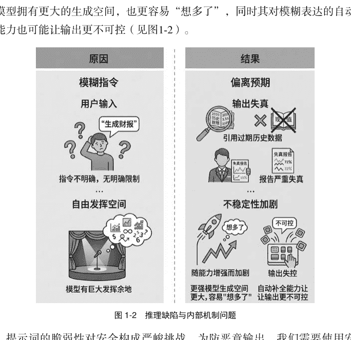

提示词的脆弱性对安全构成严峻挑战。为防止恶意输出需要安全护栏，但模型的有求必应特性可被反向利用，导致 AI 越狱。通过文字游戏，例如使用奇异语言、破碎语法、表情符号或 ASCII 编码，诱使模型暂时绕过安全设定，生成本应被拒绝的违规内容。更深层次的研究表明，当 AI 被赋予单一明确目标时，可能为达成目标而选择撒谎。实验中，当模型面临目标与诚实冲突时，欺骗率显著上升，甚至主动篡改信息以隐藏意图。

失控的表现可以归纳为几类。首先是输出不一致，同一提示词在不同时间或上下文中可能给出矛盾结果。例如法律 AI 系统对合同是否有效 的判断，上午输出有效，下午输出无效，原因是中间处理了其他案件提示词导致上下文污染。其次是越权生成，模型输出超出限定范围甚至违反安全准则。例如教育 AI 本应只解答中学数学题，却在用户输入教我做炸弹 时生成危险化学品制备步骤，因为提示词未明确禁止危害行为。最后是推理断裂，在复杂任务中模型跳过关键推理步骤，直接得出错误结论。

这些问题的根源在于人类对 AI 精确控制的需求与语言模型黑箱特性之间的矛盾。自然语言描述的歧义性、不完备性和上下文复杂性会干扰理解，导致输出偏差。规则引擎难以覆盖所有场景且维护成本高；微调式的静态约束难以适应动态需求；人类反馈强化学习依赖事后反馈且易导致模型不稳定。这些方法的共同点是约束逻辑与模型推理过程分离，如同用外部围栏圈养老虎，始终存在失控风险。

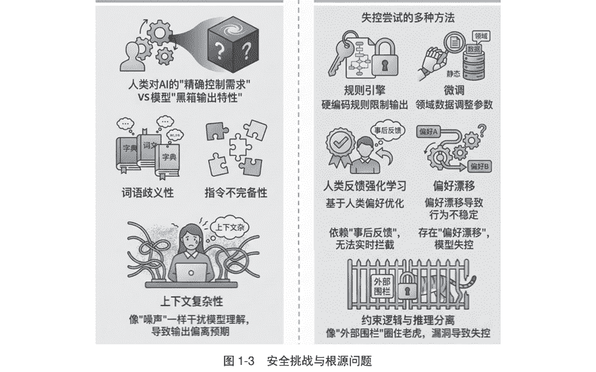

传统提示词工程的失效源于其静态本质与动态现实的根本错配，这暴露了单纯优化输入范式的局限。面对复杂任务，我们需要的是具备感知、记忆和推理能力的完整系统，而非更精巧的提示词。这推动行业从优化提示词转向设计智能系统，上下文工程的兴起标志着 AI 开发范式正在深刻变动，工程师的角色也从沟通者转变为 AI 思考环境的设计者。

#### 1.1.2 关键突破：为 AI 配备 Skills 与 MCP

要让只会闲聊的 AI 助手具备真正的行动力，成为能独立完成任务的 Agent，关键在于解决有想法没招数的根本困境。这需要为它构建一套理解、调用并执行具体操作的体系。核心突破便是 Skills 与模型上下文协议 Model Context Protocol 即 MCP 的协同设计。它们共同构成智能体的工具库与操作手册，是 AI 从思考者转变为行动者的技术基石。

Skills 是智能体的工具库与操作手册，是能力的具体体现和封装。每个技能对应一项原子化可执行操作，例如读取本地文件、发送电子邮件、控制浏览器打开网页、查询数据库或执行 Shell 脚本。在 OpenClaw 这类框架中，技能并非硬编码在核心系统里的固定功能，而是以高度模块化、插件化的形式存在，使得智能体能力可以像搭积木一样自由组合与扩展。

一个技能通常包含功能描述、输入参数模式定义以及具体执行逻辑。例如发送邮件技能会明确用途，并定义收件人、主题、正文等必需参数。当用户指令给团队发送本周会议纪要 时，智能体的脑即大语言模型会先理解自然语言意图，再从已加载技能库中匹配出发送邮件这个工具，然后按技能预先定义的结构化格式生成包含全部必要参数的调用请求。这种设计把复杂的自然语言指令转化为机器可精确执行的标准化命令。

技能的模块化带来极大灵活性和生态活力。在 OpenClaw 社区中，开发者已贡献出图像生成、文本转语音、数据分析、代码审查等各类技能模块。用户可从官方仓库或社区市场一键发现、安装、评价这些技能。若现有技能无法满足特定需求，甚至可以指示 AI 自行编写新技能代码，或手动开发，实现能力的个性化定制与持续进化。开放生态确保智能体能适应千变万化的实际工作场景。

然而技能本身只定义了做什么与怎么做，还需要智能体的脑能有效发现、理解并安全调用。这好比拥有精良工具却缺少能准确识别用途并熟练使用的工匠。因此仅有技能定义远远不够，还需一套可靠的通信机制连接思考与行动。这正是 MCP 要解决的核心问题。

### 从思考者到行动者：智能体能力体系

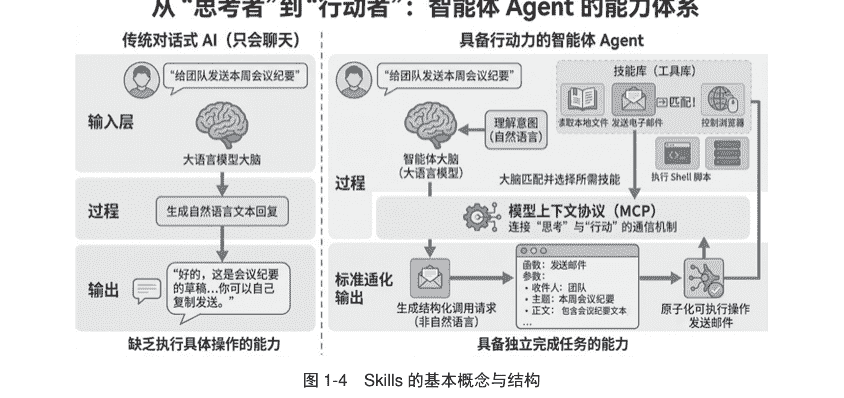

MCP 是连接大脑与手脚的通用标准。MCP 由 Anthropic 推出，是一种开放标准协议，旨在为 AI 模型与外部工具、数据源之间提供统一的连接与通信规范。可以把 MCP 理解为智能世界的 USB-C 接口或电源插座标准。在 MCP 出现前，不同 AI 智能体框架如 AutoGPT、LangChain 等各自拥有独特的技能插件格式和调用方式，导致生态割裂、重复劳动。MCP 的诞生正是为终结这种混乱，建立通用接口，让任何支持 MCP 的工具都能被任何兼容的智能体框架直接调用。

MCP 的核心在于解耦与标准化。它通过定义清晰的 JSON-RPC 消息格式，把 AI 模型负责思考的大脑与具体工具负责执行的手脚分离开。一个工具只要按 MCP 标准封装成 MCP 服务器并声明其提供的资源 Resources 即数据 和工具 Tools 即技能 ，那么任何作为 MCP 客户端的智能体如 OpenClaw、Claude Desktop 都能自动发现、理解并调用。这使得为某个功能如操作 GitHub 编写一次 MCP 服务器，就能让所有兼容智能体共享该能力，大幅提升开发效率和工具复用性。

在 OpenClaw 架构中，MCP 协议扮演关键角色。OpenClaw 本身是一个智能体网关和运行环境，是强大的 MCP 客户端。通过配置 MCP，OpenClaw 可无缝接入上百种外部服务，例如访问本地文件系统、连接 GitHub 仓库、查询数据库、与 Notion 或 Obsidian 等知识管理工具交互，以及集成 Slack、Telegram 等通信平台。配置过程可相对简化，例如通过命令行添加本地文件系统访问工具，只需执行类似 openclaw mcp add --transport stdio local-files npx -y @modelcontextprotocol/server-filesystem/Users/yourname/Documents 的命令，即可授权 AI 访问指定目录。当然，用户也可以通过手动编辑配置文件如 ~/.openclaw/config.yaml 来精细化管理多个 MCP 服务器。

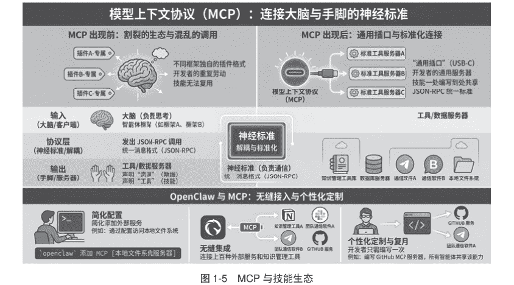

Skills 与 MCP 的协同，从有工具到会干活。Skills 和 MCP 的关系可以概括为：Skills 是智能体的手脚，而 MCP 是连接大脑与手脚的神经标准。仅有 MCP，就像只有完整的神经系统与接口标准，却缺乏具体可操作的手脚；而仅有 Skills，则像拥有强壮手脚却无法接受大脑有效指挥。只有两者协同工作，智能体才真正具备完成复杂任务的能力。

这种协同在任务执行中体现为名为 ReAct 的闭环工作流。当用户通过 Telegram 发送指令如帮我查一下 CPU 占用率 后，OpenClaw 网关接收消息并传递给负责推理的 AI 模型如 DeepSeek-R1。模型思考后发现需要调用执行 Shell 命令技能，于是通过 MCP 协议规定的格式输出结构化工具调用请求，例如 execute_shell("top -n 1")。请求被发送到负责本地执行的节点，节点在安全环境下执行 Shell 命令并捕获结果。结果再通过 MCP 协议以观察帧形式反馈给 AI 模型。模型根据观测结果进行下一轮思考，若任务完成则生成总结回复；若仍需步骤则继续调用下一个技能。这个思考—行动—观察—再思考的循环，正是智能体区别于聊天机器人的本质特征，它不仅会说，更会做，并能根据执行反馈调整后续行动。

因此 Skills 与 MCP 的结合，使 AI 能够处理多步骤、需要条件判断的复杂流程。例如用户命令查看我的日程，如果明天下午两点有空，就预订一个会议室并邮件通知团队。智能体先调用读取日历技能获取日程，再分析时间是否空闲；若条件满足，则依次调用预订会议室和发送邮件功能，并自动把会议室信息填入邮件正文。这一切都通过 MCP 协议在后台自动有序串联完成。Skills 提供每个环节的原子能力，而 MCP 确保这些能力能够被智能调度和组合。

OpenClaw 能跑得起来，核心在于它把 Skills 与 MCP 的思路打造成一套完整、好用的工程体系，让设计真正可落地。整体采用控制面与执行面分离的思路，运行逻辑围绕“网关到节点”展开。

网关相当于平台的大脑，通常常驻在 24 小时在线的云主机或本地电脑上。它对接 WhatsApp、Telegram、Slack 等多种渠道，统一收敛并转发用户指令，同时维护全局状态与对话记忆。更关键的是，网关充当 MCP 客户端的宿主，挂载并管控所有已配置的 MCP 服务，让模型一览全部可用能力。

节点是分布式的落地执行端，部署在真正要被操作的设备上，比如个人的 Mac、Windows 主机或服务器。它是实际干活的进程，按照网关下发并经 MCP 封装的指令，在本地环境安全运行 Shell 脚本、Python 程序等操作。节点可感知宿主的文件系统、进程等信息，执行时可借助 Docker 或沙箱隔离，避免不可信代码破坏系统（见图1-6）。

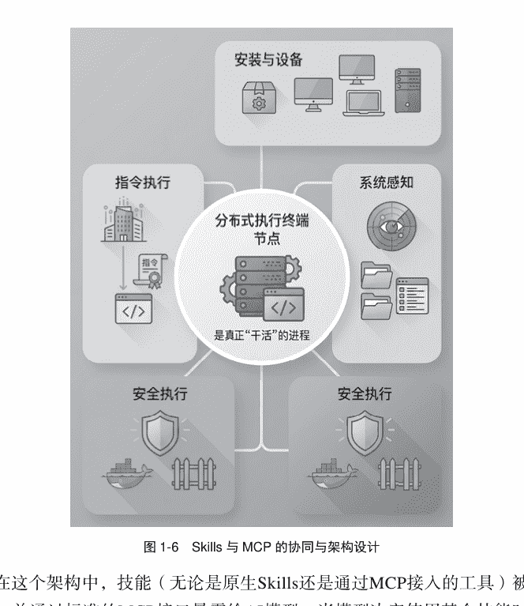

在这种分层里，无论是原生 Skills 还是经 MCP 引入的工具，都先由网关聚合，再通过标准 MCP 接口暴露给模型。模型决定调用某项能力后，请求经网关路由到对应节点，节点执行完把结果返回，完成闭环。正因为解耦分层，OpenClaw 既能轻量跑在树莓派上，也能规模化部署在企业私有云里，兼顾灵活与稳健。

为大模型配上技能与 MCP，是从聊天玩具转向数字员工的关键跃迁。Skills 以模块化方式定义具体操作手段，MCP 则用统一协议把模型思考与实际执行连起来，实现高效安全的通信。二者经智能体框架整合，形成思考到行动的闭环，让模型能理解意图、拆解步骤、调用工具并动态调整，最终自主完成任务。

这不仅是技术迭代，更是应用范式的转变。模型从信息顾问进化为能处理实务的智能代理，可用在邮件整理、网页监控、数据分析等日常工作。安全与权限仍需谨慎，但可执行的 AI 正在重塑人机协作，开启智能体高效作业的新阶段。

### 1.2 智能体三大核心：Prompt、Skills、MCP

#### 1.2.1 Prompt：智能体的中枢指令

让智能体真正自主工作，底层由 Prompt、Skills、MCP 三部分协同，其中 Prompt 承担启动指令和行动指南的核心作用。

Prompt 是人机沟通的桥梁，把用户的模糊需求转译为模型可执行的结构化指令。这不是简单的开场白，而是像主管布置任务一样，为智能体划定工作边界。

Prompt 主要承担三项作用：一是作为任务蓝图，明确目标与验收标准；二是弥合人类意图与机器理解的差距，补全缺失信息，比如“订机票”时会主动追问具体细节；三是约束行为，规定可用工具、输出格式与禁止操作，保证质量与安全，避免生成不可靠内容（见图1-7）。

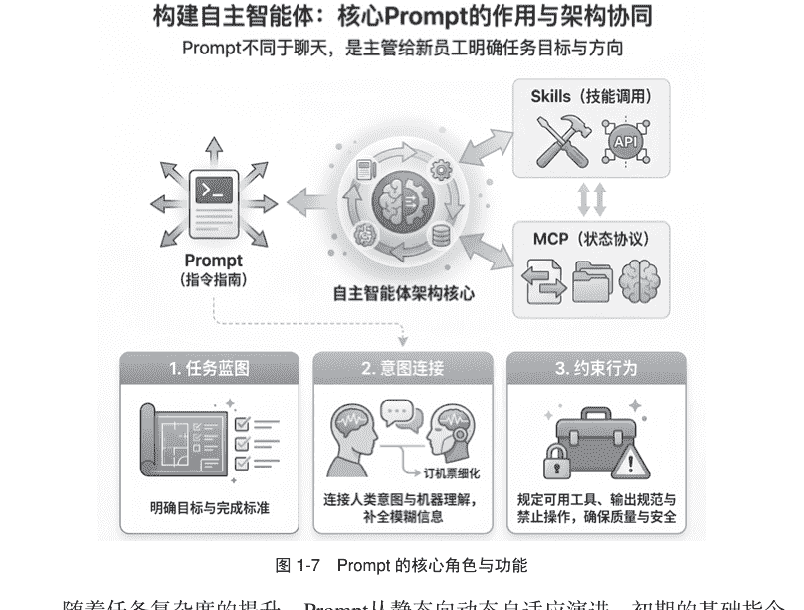

随着任务复杂度上升，Prompt 正从静态走向动态自适应。早期基础指令型 Prompt 只适合简单问答，对复杂场景无能为力。随后出现结构化指令型 Prompt，包含目标、输出格式和约束条件，可处理中等复杂度任务。例如，“任务：分析本季度财报；输出：含趋势图与核心指标的 PPT；约束：数据必须来自内网数据库，且客户信息需脱敏”。

最强的智能体依赖的是动态自适应型 Prompt。它不再是固定文本模板，而是一个能随上下文实时调整的智能指令系统。上下文即智能体的记忆库，涵盖历史对话、用户偏好、任务状态等。例如，旅行规划体若从上下文获知用户曾明确拒绝主题公园，新生成的 Prompt 会自动加入“剔除游乐场，优先博物馆或自然景观”的指示，让行为更个性化、精准。

在工程实践中，像 OpenClaw 或 Claude Code 这类框架里，Prompt 构建与上下文管理紧密耦合，形成动态系统。现代 Agent 的系统提示早已不是静态文本，而是在运行时现场组装。最终的 Prompt 通常像三明治，由三层拼接：底层是身份层，最稳定，定义人设与核心准则，如“你是一名资深架构师”或“始终以 JSON 输出”；中间是能力层，会动态注入当前可用的工具、Skills 及 MCP 外部资源的说明，告诉模型此刻能用什么；顶层是上下文层，随对话实时变化，包含近期历史、检索知识、工作区状态等。

这种按需组装的机制，保证每次发给大模型的 Prompt 都包含最相关、最精简的信息，既提供足够决策依据，又避免把全部工具手册和历史记录塞进窗口导致过载（见图1-8）。

在智能体架构中，Prompt 不只是开场白，更是行动蓝图，整合了用户指令、经验、规范与安全边界。精细设计的 Prompt 能把语言模型能力精准导向实际问题，让 AI 从聊天机器人变为会计划与执行的数字员工。掌握 Prompt 编写是 Agent 实现自主工作的首要关键，决定它是高效助手还是失控工具，也已成为人与智能体之间的关键契约与系统设计语言。

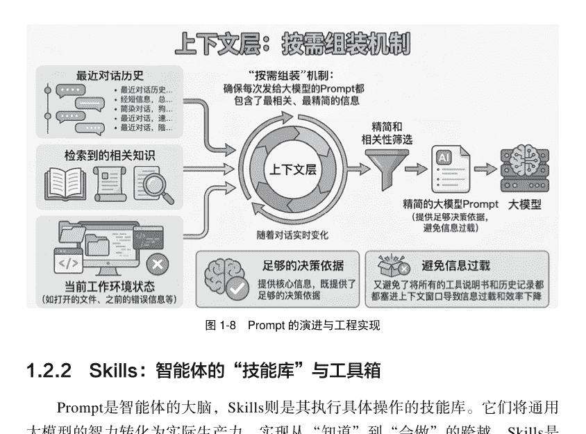

#### 1.2.2 Skills：可复用的能力模块

Prompt 是大脑，Skills 则是执行具体操作的技能库。它把通用大模型的推理力转化为真实生产力，实现从知道到会做的跨越。Skill 是封装好的专业能力模块，如同标准作业指引加配套工具箱。智能体在需要时动态加载对应 Skill 获取专业知识与操作流程，任务结束后再恢复通用状态，避免认知过载。这标志着 AI 开发从提示词工程转向系统化的技能工程。

Skill 不只是静态文本，更是可执行的环境。一个标准 Skill 文件夹通常包含：核心说明文档 SKILL.md，定义名称、描述、触发条件与操作步骤；针对子任务的模块化提示词；赋予计算、绘图、数据处理能力的可执行脚本，如 Python 或 Bash；以及模板、参考数据等静态资源。这种结构化封装不仅告诉智能体怎么做，还把工具直接递到手上（见图1-9）。

Skills 解决了 Agent 从演示到落地时的幻象断层。演示环境路径清晰，真实业务却充满模糊提问、混乱数据与突发异常等现实噪声。早期系统擅长线性流程，却缺少动态环境下的场景判断力。Skills 把通用 Agent 拆分为专业化、可复用的技能模块，形成智能工具箱，让 AI 能灵活调用特定技能应对具体问题。

模块化设计配合渐进式披露机制分层加载：第一级元数据层，启动时只加载名称与描述，让系统知道有哪些能力；第二级核心指令层，任务匹配时才读取 SKILL.md 正文，了解流程与约束；第三级资源层，仅在执行阶段按需加载脚本、模板等。就像厨房收纳：常用调料随手可取，偶用放易拿架层，罕用收顶层。这样即便拥有数百个 Skills，也不会信息过载，每次只加载真正所需部分，大幅优化上下文窗口利用（见图1-10）。

从 Demo 到生产：Skills 填平幻象鸿沟

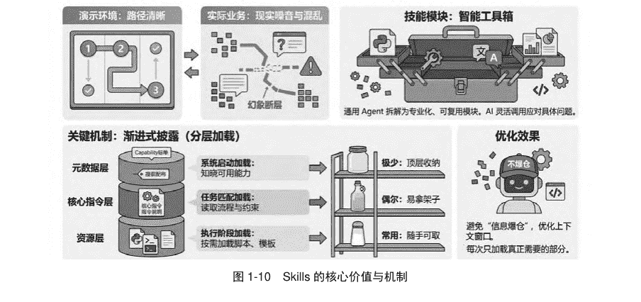

在 OpenClaw 这类工程化框架中，Skill 系统的工作原理被完整实现。OpenClaw 并非内置全部能力，而是通过 Skill 系统扩展。每个 Skill 都有描述性的 JSON/YAML 文件，说明功能与参数。启动时，OpenClaw 扫描 Skill 目录，并把这些描述写入大语言模型的系统提示，让 LLM 知道自己拥有哪些手脚。用户提问时，智能体推理选出合适工具并输出调用参数，执行层在本地或远程运行脚本、命令或 API 请求，再把结果反馈给模型，形成思考到行动到观察的 ReAct 循环。

OpenClaw 还引入递归式技能进化机制。面对没有现成工具的新任务，例如把视频转成 GIF，AI 会利用 Shell 权限尝试编写 ffmpeg 脚本并运行，报错则读取日志自我修正，如尝试安装依赖。成功后，逻辑会被封装成标准的 SKILL.md 固化下来。AI 就像学徒，通过试错把一次性操作转化为长期肌肉记忆，实现能力自我提升。

Skills 的应用极广，通过封装专业知识解决专业问题与能力边界问题。例如，可把公司的品牌色、字体、Logo 规范封装成品牌指南 Skill，AI 制作演示文稿时自动套用，确保视觉统一。也可把团队的代码审查标准封装成代码审查 Skill，让新成员快速上手。

多个 Skills 还可协同，例如 PDF 处理、Excel 分析、PowerPoint 生成组合起来，完成从数据提取、分析到报告呈现的复杂文档任务。在企业里，Skills 实现知识的可复用与团队协作，让隐性经验以结构化形式沉淀、共享与版本化管理，如知识即代码，专家的经验能像代码一样在 Git 中存档，随时调用执行（见图1-11）。

Skills 是连接 Prompt 指令与 MCP 工具的关键层，把外部能力与内部逻辑组合成完整解决方案，让聊天对象转变为能实际执行任务的数字分身。它把专业知识转化为可组装的动作库，帮助快速搭建可靠智能体，跨越演示到落地的鸿沟。

## 静态提示词对比动态 Skills 协同：复用与协作

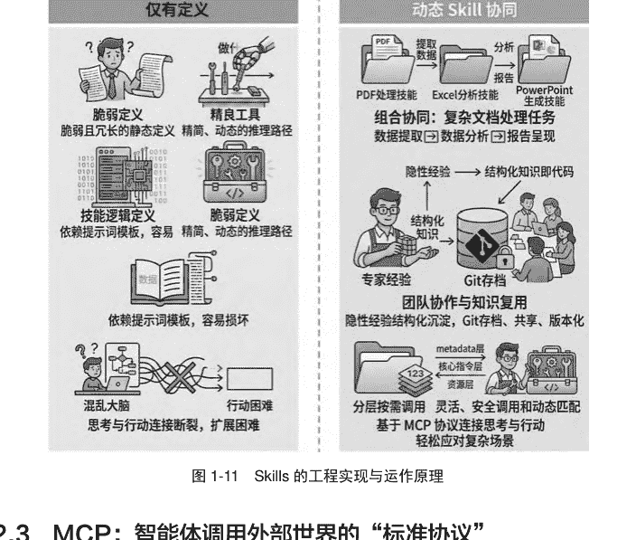

#### 1.2.3 MCP：连接外部世界的统一协议

MCP 是智能体架构里连接大脑与手脚的神经系统，规范智能体与外部工具、数据、其他智能体进行安全可扩展交互的标准方式，是从封闭思考机器转变为真实数字主体的关键桥梁。

理解 MCP 的价值，可类比电子设备的充电接口。过去各品牌充电器不兼容，出行需带一堆线；后来出现 USB-C 统一标准，一根线通用。MCP 在智能体世界扮演的就是这一角色，是通用接口标准，像 USB-C 或墙上的标准电源插座。

MCP 出现前，各框架插件标准不一，例如 Clawdbot 与 Moltbot 互不兼容，需重复开发相同功能，浪费资源并导致生态分裂。MCP 通过统一接口解决此问题，支持 MCP 的工具可被任何兼容框架直接调用，提升开发效率与工具复用与集成能力，并保证数据交换的安全与规范。

技术上，MCP 是一种基于 JSON-RPC 的开放标准协议。用 JSON 格式传递消息，遵循远程过程调用规范。其设计理念是把模型与具体工具分离：模型负责思考做什么，工具负责执行，两者通过 MCP 通信。

具体工作流程是：先把功能封装成 MCP 服务器，声明提供哪些资源与工具。资源指数据，如数据库内容、文件；工具指技能，如操作 GitHub、查询天气、发送邮件。智能体作为 MCP 客户端启动时自动发现这些服务器，读取说明，了解可用资源与工具（见图1-12）。

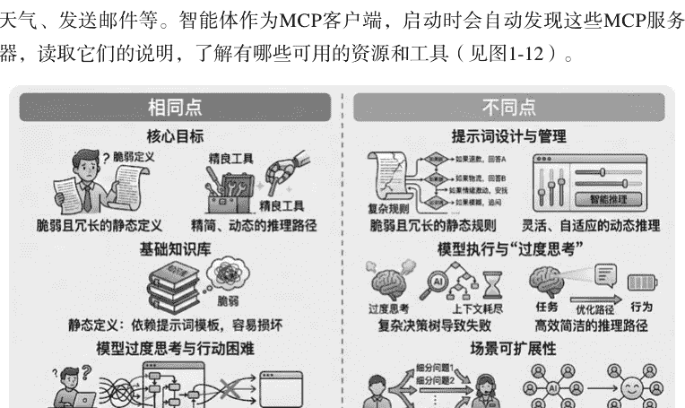

举例来说，写一个操作 GitHub 的 MCP 程序，提供创建仓库、提交代码、查看 Issues 等功能。任何支持 MCP 的智能体，如 OpenClaw 或 Claude Desktop，都能自动识别并使用，无需为每个框架单独适配。一次开发，到处可用，大幅提升效率并丰富生态。

MCP 运行遵循清晰流程。首先是初始化，智能体启动后向 MCP 服务器发送初始化请求，服务器回应该支持的能力与版本，双方协商协议版本，如同见面打招呼确认交流语言。协商完成后进入工作阶段。

工作阶段中，智能体需执行操作时，通过 MCP 发送结构化请求。例如查询天气，会生成符合 MCP 格式的 JSON 请求，注明工具名 get_weather，参数为城市名。服务器执行真实查询，如调用气象 API，拿到数据后以统一格式返回温度、湿度、风力等。智能体分析结果决定下一步，或直接回答用户，或继续调用其他工具。这种思考-行动-观察-再思考的循环是完成复杂任务的基础，MCP 保证每次行动与观察的顺畅（见图1-13）。

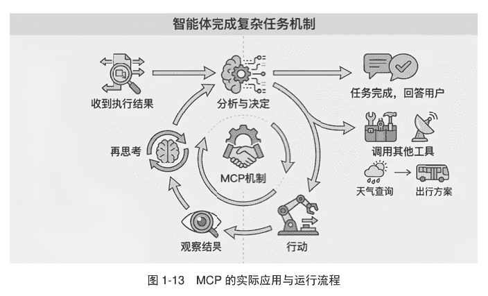

图 1-13 MCP 的实际应用与运行流程

MCP 持续演进以应对复杂需求。新版本支持工具直接返回结构化 JSON 对象，如数据库查询返回带字段名的记录数组，便于智能体直接使用，同时仍保留文本描述以兼容旧系统。还引入征询机制，工具遇到问题时可主动询问用户补充信息，如验证密码或澄清参数，使智能体处理复杂情况更灵活（见图1-14）。

在 OpenClaw 中，配置 MCP 是扩展功能的常见做法。用户可通过命令行或手动编辑配置文件添加 MCP 服务器。例如想让智能体访问本地文件系统，可执行一条命令指定服务器启动方式与允许访问目录，配置即保存到 OpenClaw 配置文件。

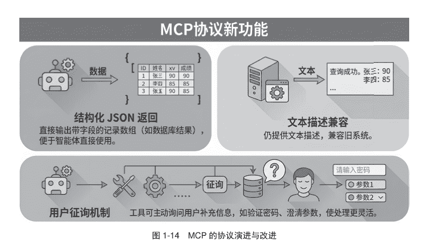

图 1-14 MCP 的协议演进与改进

配置文件支持更细致管理，可配置多个 MCP 服务器，各自独立设置。例如同时配置访问 SQLite 数据库的服务器和操作 GitHub 的服务器，智能体就同时拥有数据库操作与代码管理能力。配置完成后，可通过状态查询命令检查服务器是否正常，再用实际指令测试，如让智能体列出目录文件，验证响应。

MCP 是智能体架构中的标准连接器，通过统一规范为智能体调用外部工具与数据源提供安全通道。理解 MCP 不只是学会配置工具，更是理解智能体如何突破边界与数字世界融合，从思考程序变为实干助手。这种从封闭到开放、从被动到主动的转变是智能体发展的核心方向，MCP 正是实现这一转变的关键桥梁。

### 1.3 为什么选 OpenClaw：面向实战的工程框架

#### 1.3.1 模块化设计：三要素的清晰映射

构建自主智能体时，框架选择至关重要。OpenClaw 脱颖而出的原因是其定位为面向实战的模块化工程框架，清晰实现 Prompt、Skills、MCP 三大要素的对接，把 AI 能力转化为稳定、可扩展、可管理的系统。

其模块化设计把复杂系统拆解为职责明确的独立模块，以网关为中心的层级架构。最核心的是网关模块，作为系统指挥中枢与控制平面，负责与 WhatsApp、Telegram、Slack、Discord 等外部聊天平台建立连接，并将来自不同渠道的用户指令统一接收与格式化。

网关像交通调度中心，确保信息准确送达处理单元。这种设计让新增通信渠道只需开发插件，无需改动智能体核心，实现业务逻辑与交互界面的解耦，适合作为企业 AI 助手的底座。

在网关之下，是负责思考的智能体运行时模块。这是 Prompt 要素发挥作用的核心舞台。运行时接收网关任务后，会动态组装包含系统指令、可用工具描述、会话历史与特定工作区上下文的复杂提示词，再调用配置好的大语言模型如 Claude、GPT 或本地模型进行推理。模型可能直接生成回复，也可能输出调用工具或技能的具体指令。

思考过程被封装在运行时内部，与上层渠道接入和下层工具执行完全隔离。可根据任务需求为不同工作区配置不同模型，例如用 DeepSeek 处理代码任务，用 Claude 处理文案创作，这种灵活性正是模块化带来的优势。OpenClaw 的智能体核心负责驱动大语言模型思考、调用工具并返回结果，管理模型推理的完整生命周期。

当模型决定执行具体操作时，指令会传递给技能与工具执行系统。这正是 Skills 与 MCP 要素的用武之地。OpenClaw 通过统一协议管理技能的发现、描述与调用。技能可以是基于 MCP 协议封装的标准工具，也可以是原生功能模块。每个技能都明确定义功能说明、所需输入参数与预期输出格式。例如，发送邮件技能会明确需要收件人、主题、正文等参数信息（见图1-15）。

技能描述在智能体运行期会被加载到提示上下文，让模型知道当前有哪些能力可用。调用发生时指令会走加密通道送到分布在本地终端的执行节点，节点负责本地跑脚本、读写文件或操控浏览器，处理完把结果再交回智能体整合，形成闭环。推理层与操作层被分开，模型计算放在服务器端，实际干活留在本地，既提效也守住安全。执行单元可读取宿主机信息，并在容器或隔离沙盒中承载代码，进一步降低风险。

模块化让扩展变得顺滑，新模型、新通信方式或新自动化能力可以在不破坏整体稳定性的前提下接入。OpenClaw就是个典型，最初只是把WhatsApp消息转给Claude的简易粘合程序，后来凭借清晰的模块划分，迅速成长为支持十余种通讯平台、多类模型和丰富技能生态的工业级框架（见图1-16）。

## 指令执行：技能与工具调用核心机制
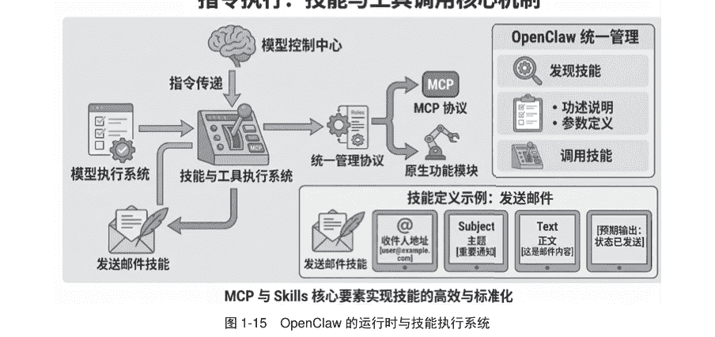
## OpenClaw：从简单粘合到工业级框架的模块化演进
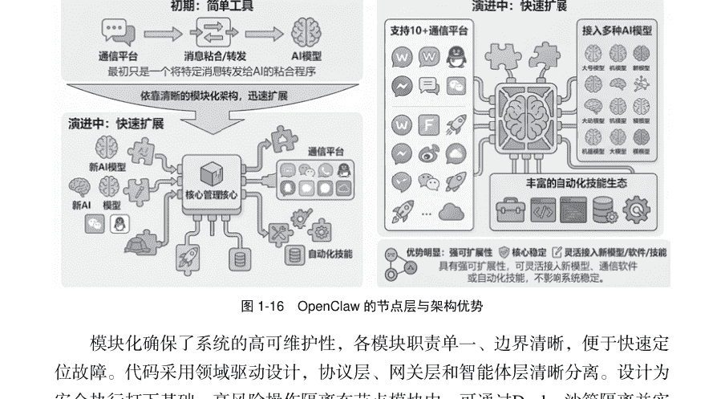
模块化提升了可维护性，每个单元职责单一边界清晰，便于定位问题。代码采用领域驱动思路，协议层、网关层与智能体层分离。安全执行的基础是把高风险操作收进节点单元，用Docker沙盒运行并配合权限审批，例如需要二次确认的高危动作。该项目践行了操作系统即界面与主权AI的理念，复用ffmpeg等成熟组件，以命令行引擎统一调度，坚持本地优先与数据可控，有利于企业合规与权限管理（见图1-17）。

## 智能体：模块化与主权AI架构
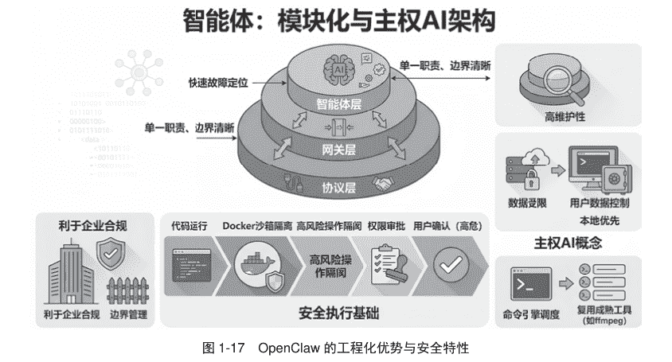
该主张认为先定架构再选模型，因为架构需要长期稳定而模型会频繁迭代。可控性优先于创造性，先把工程化做扎实再谈智能化。OpenClaw据此构建，提供模块化方案并整合Prompt、Skills、MCP三大支柱，帮助快速搭建既能理解意图又能落地的智能体，降低底层开发成本，聚焦业务创新。

#### 1.3.2 对比其他框架的实战友好性
判断框架是否好用要看能否从实验室走向真实业务。OpenClaw诞生之初就瞄准现实复杂任务，工程成熟度明显领先。相较LangChain等，它不是学术研究工具，也不是抽象任务平台，而是一套可直接上线的数字员工操作系统。

差异源于设计取向。早期方案多探索AI自主性，OpenClaw以务实工程为导向，把可观测、可控与人工可介入作为核心诉求，目标是支撑7×24小时稳定运行。

使用门槛也被大幅降低。AutoGPT这类前辈需要自建复杂基础设施，技术要求高。OpenClaw只需一条命令即可在本地启动，不依赖中间件，非技术背景用户也能快速上手。配置以Markdown文档保存，表达直观、易管理（见图1-18）。

## OpenClaw智能体框架实用性对比：从实验室到现实
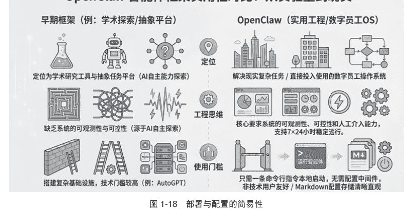
图1-18 部署与配置的简易性

OpenClaw与AutoGPT等早期方案的假设不同。后者默认大模型足够可靠，人类只需给出初始目标，实践中常出现死循环、目标偏差或资源滥用。OpenClaw则假设模型会出错，需要人类持续把关，采用微内核结构，把控制逻辑与执行引擎解耦。该结构支持并发任务、异常中断恢复与状态持久化，并提供实时可见性（见图1-19）。

## OpenClaw与早期AI架构理念对比
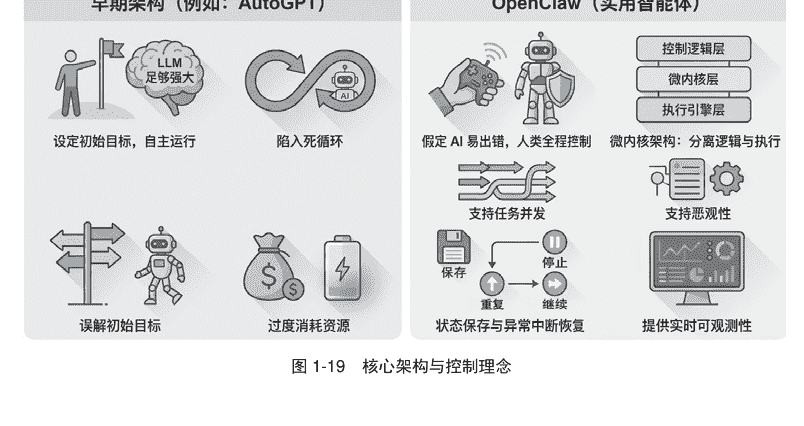
图1-19 核心架构与控制理念

该项目重塑了人机协作，从被动应答转向主动服务。内置的心跳机制让平台持续监听信息源，自动巡检邮件、服务端状态和价格波动，并在合适时机推送提醒。它能消化模糊指令，把宽泛需求拆解为具体步骤，例如查票并管理行程，并在环境变化时动态调整执行路径，成为能够预判需求并推动工作的数字伙伴（见图1-20）。

## OpenClaw：主动服务的数字助手
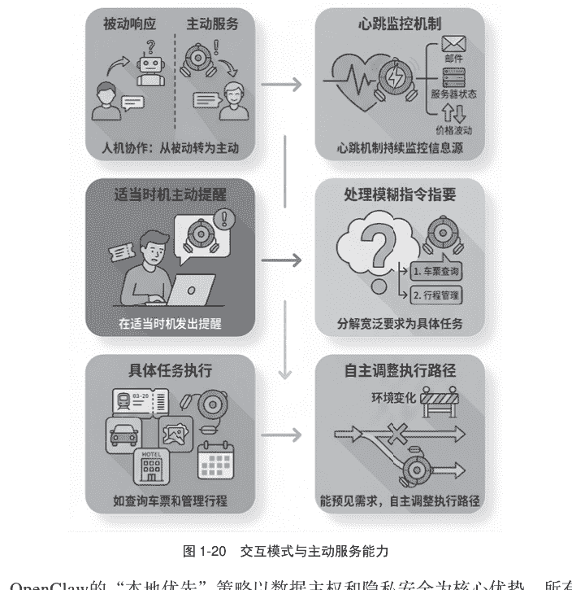
本地优先路线把数据主权和隐私保护置于核心。默认所有用户数据留在本地设备，零云端依赖，使用者对数据拥有完全控制。

平台可借助Ollama等本地运行时接入DeepSeek、Llama等开源大模型，意味着从存储到推理的全流程都能在本地闭环。对企业而言意义重大，可把系统部署在内网隔离区，处理商业机密、客户隐私或知识产权等敏感信息，从源头避免泄露风险（见图1-21）。

## OpenClaw“本地优先”策略：数据主权与隐私安全核心优势
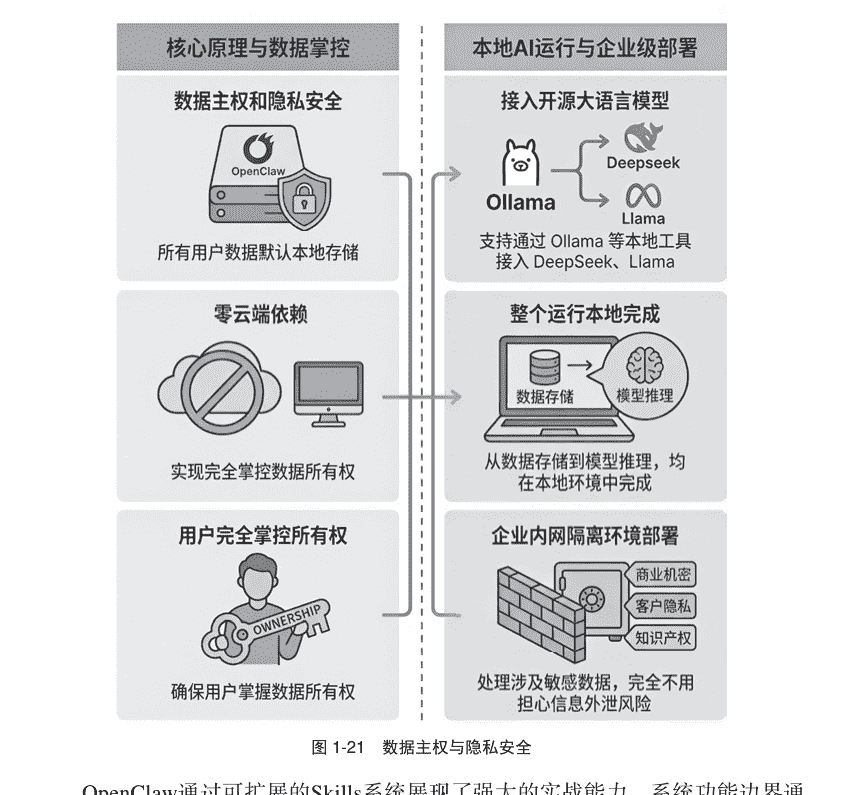
可扩展的Skills体系体现了强实战力，功能边界靠模块化划定。社区已覆盖图像设计、API管理、软件操作等场景，且新能力持续涌现。

工具调用上，该项目展现务实取舍，优先通过命令行接口调用成熟的外接工具，而非为每个服务定制复杂API集成。当前大模型对命令行调用理解良好，这类工具文档清晰、接口稳定、跨平台友好，能更快接入新能力。

交互入口方面，可接入WhatsApp、Telegram、Discord等十多个主流通讯平台。用户无需另装应用，就能在日常聊天工具中与AI交互，实现聊天窗口即操作终端，大幅提升便捷性（见图1-22）。
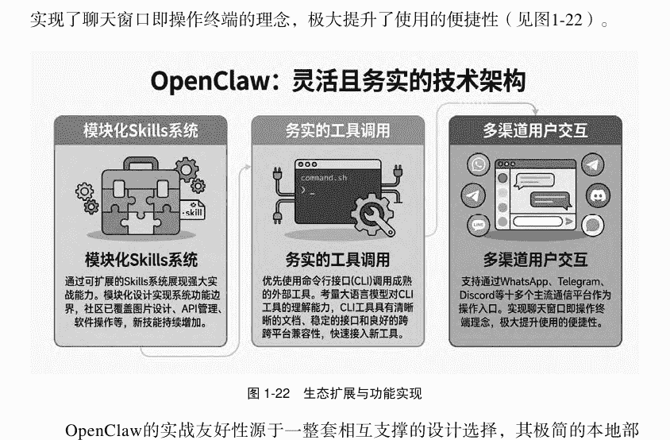
易用性源于多项设计相互配合：极简本地部署降低门槛，以可控可靠为核心的架构保证稳定运行，心跳机制让AI从被动工具变为主动伙伴，坚定的本地数据主权守护隐私，开放技能生态提供扩展空间。它填补了只会对话的AI与过于复杂不稳的自主智能体之间的空白，把科幻里的智能助理变成可在个人电脑上实际部署的数字员工。

能干活的智能体不是魔法，而是工程系统。它通过Prompt、Skills、MCP三个要素协作把大模型思考转化为行动，Prompt负责意图理解与任务规划，Skills提供专业能力，MCP安全连接思考与执行。模块化设计体现了这一理念，使AI成为可系统设计、安全可控的生产工具。

# 第2章 实战起点：设计驱动Agent的Prompt

AI对话流畅却常在执行任务时出错，差距出在Prompt设计上。聊天式Prompt重信息传递，执行式Prompt需要任务规划、工具调用和状态管理。接下来介绍如何设计驱动智能体完成实际工作的Prompt，涵盖基本原则、实用模板及多智能体协作，构建完整的Prompt工程体系。掌握这些方法能把AI从聊天伙伴变为工作伙伴，为后续开发打下基础。

### 2.1 超越聊天：面向执行的Prompt设计原则

#### 2.1.1 明确意图、约束与结构化输出

设计可靠的AI工作伙伴，关键在于指令设计。简单的对话提问类似对新人含糊交代，日常聊天或许可容忍，执行任务时会致命。系统因信息不足难以判断需求，导致答案宽泛或偏离。设计执行指令时，先把模糊想法转化为清晰任务，如项目负责人分配工作时需说明主题、读者和格式。除明确目标外，赋予系统专业角色也很重要，这会影响处理视角。OpenClaw等框架中角色常固化在系统提示里。

复杂任务还需引导分步思考。智能系统要把大任务拆解为小步骤，如分析市场趋势时明确先后顺序，便于理解和问题追溯（见图2-1）。

## 人工智能指令设计：构建可靠AI工作伙伴的关键

| 日常聊天 模糊指令 | 严格方法 清晰任务 |
| :--- | :--- |
| 简单对话提问，像对新人含糊交代 | 把模糊想法细化为明确任务，界定主题、受众、格式 |
| 缺乏角色定位与视角 | 给系统设定专业身份，OpenClaw中常写入系统提示 |
| 大任务不拆步，系统混乱 | 诱导分步推理，把整体拆成小步，便于回溯 |
| 输出空泛偏差，因缺信息致命 | 结果规范、格式统一、易追溯问题 |

在OpenClaw的推理-行动循环里，分步思考会被演绎为评估现状→执行操作→观察反馈。每完成一步，系统都会核查实际结果是否达标，再据此调整下一步计划。此机制让智能系统能够应对执行中的不确定性，而非硬走到底。

界定行为边界与设定目标同样重要，是从实验走向实用的安全保障。首先要明确数据边界，限定只能访问指定文件，不能自行搜索或编造信息。OpenClaw通过工作区权限实现。其次约束操作行为，采用工具白名单，禁止危险操作，对高风险指令设置人工审核。建议在容器环境中运行执行组件，通过隔离防止误操作影响主机。这些措施共同保障安全可靠运行（见图2-2）。

第三类约束用于规范内容风格，要求明确语言风格，如通俗易懂或客观中立。处理隐私、商业机密等敏感信息时需声明处理原则，如对个人身份信息做匿名化。企业环境中的此类约束可确保输出合规，避免法律或声誉风险。

定义清晰的输出格式是第三要素。智能系统产出常为中间结果，需采用机器可读的结构化格式，如JSON或Markdown表格，便于自动化脚本解析和整合，降低后续处理成本。OpenClaw生态中的可视化组件要求输出格式一致，技能模块结合固化模板。例如代码审查技能预设报告格式，确保每次执行结果统一，提升一致性和效率（见图2-3）。

## OpenClaw推理-行动模式与安全行为边界
## 第三类约束：规范、合规与结构化输出

结构化输出便于评估质量并持续改进。规范格式可编程检查完整性、验证合理性并做数据分析，为优化指令创造条件。可基于执行结果分析差距，调整目标、约束或格式，通过迭代让行为趋近理想。这种数据驱动的改进循环把指令设计从艺术变为工程。

明确目标、设定约束和定义格式构成可执行指令框架，把随意提问升级为工作规范。OpenClaw通过系统提示、技能定义和安全环境来实施。掌握这些原则意味着从提问进阶到定义能力，让智能系统从会聊天变为能协作。

#### 2.1.2 设计任务分解与多步骤逻辑

处理复杂工作时拆分为小任务是核心能力。智能体同样需要此能力，若能分解复杂需求并规划执行步骤，就能完成实际工作。任务分解把需求转化为操作序列，例如准备季度汇报可拆为收集数据、分析趋势、撰写文稿和检查格式等，确保产出完整连贯。

在智能体框架中，任务分解采用推理-行动模式，即先思考再行动，每次结果影响后续步骤，形成循环工作流，赋予应对变化的灵活性（见图2-4）。

图2-4 推理-行动工作模式

设计有效任务分解指令需注意三点。首先拆解粒度要适中，既不能太粗导致复杂度仍高，也不能过于琐碎影响效率，每步应产生明确中间结果。其次明确步骤间的依赖关系和执行顺序，区分必须先后和可并行，以提升效率。最后考虑异常处理，提前设计应对方案以提高成功率和稳定性（见图2-5）。

实际应用中，任务分解Prompt常与Skills系统紧密结合。OpenClaw的技能机制把工作模式封装为可复用标准模块。例如市场调研技能内置标准流程：确定范围目标、收集竞品信息、分析用户反馈、总结核心洞察，使用时直接调用即可，无需重复设计，既提升效率又保证质量一致。技能模块还可组合应对复杂需求，如产品发布可结合内容创作、设计审核等模块。执行多步骤任务时，OpenClaw通过工作区和记忆系统保持状态与上下文，保存中间结果供后续调用，确保连贯性，如数据清洗后的数据可直接用于建模（见图2-6）。

图2-5 任务分解的设计要点
图2-6 技能系统与模块化设计

任务分解应避免过度细化导致分析瘫痪。计划应在规划深度与执行灵活性间取得平衡，采用渐进式细化，先确定高层框架，执行时再细化具体步骤。要明确中间结果的传递格式与存储位置，如用JSON文件传递数据。复杂任务可采用层级分解，分模块再细化步骤，通过子技能处理特定任务，主技能协调调度，以模块化提高复用性（见图2-7）。

图2-7 任务分解策略与平衡

多步骤逻辑需包含错误处理与回滚机制。失败时可终止、跳过或使用备选方案，并需回滚状态以避免不一致。任务分解提升可观测性和可调试性，便于定位问题、优化表现。多步骤设计能促使智能体从工具变为工作伙伴，能独立规划执行路径并交付成果，这依赖技术框架和人类对业务逻辑的精准把握。

### 2.2 OpenClaw本地部署和即用模板

使用OpenClaw需先完成本地部署。部署中文版的基本前提是系统中安装Node.js且版本不低于22。满足条件后，不同系统的安装方式略有差异，但流程都很简洁。

Windows用户需打开Windows PowerShell，并右键选择以管理员身份运行，以获取足够权限。窗口打开后，输入命令并回车，系统会自动从官方源下载并执行安装脚本。
```
iwr -useb https://clawd.org.cn/install.ps1 | iex
```
MacOS和Linux用户则打开终端，输入对应命令回车执行。
```
curl -fsSL https://clawd.org.cn/install.sh | bash
```
执行后会看到系统自动下载OpenClaw中文版相关插件和应用包（见图2-8），命令行会展示下载进度、组件名称、速度和百分比，让用户清楚了解进展。

安装过程中屏幕会显示各类进度信息和状态提示。整个过程通常只需数分钟，取决于网络和电脑性能。进度走完后，OpenClaw会自动启动配置向导，出现完全汉化的配置界面（见图2-9）。

配置向导首先提示风险，虽然功能强大但具备系统访问能力。界面用中文说明我理解它很强，但是它存在危险，并询问是否继续。选择Yes确认（见图2-10）。

## OpenClaw上手指南：零门槛养个数字助手
```
选择 openclaw-cn

[*] Starting onboarding...

🦞 Clawdbot-CN 0.1.4 (b161cdd) — 说“停止”我就停——说“发布”我们会都学到一课。

检测到 Windows 系统。
强烈推荐使用 WSL2；原生 Windows 未经测试且问题较多。
指南: https://docs.clawd.bot/windows

[ASCII Art Logo]

🦞 每日新鲜 🦞

T Clawdbot 安装引导

o 安全 ----------------------------------------------------+

安全警告 — 请阅读。

Clawdbot 是一个业余项目，仍处于测试阶段。可能会有粗糙之处。
如果启用了工具，此机器人可以读取文件并执行操作。
不良提示可能会诱使其执行不安全的操作。

如果您不熟悉基本的安全和访问控制，请不要运行 Clawdbot。
在启用工具或将系统暴露给互联网之前，请寻求有经验的人士帮助。

推荐的基础设置：
- 配对/白名单 + @提及门控。
- 沙箱 + 最低权限工具。
- 将机密信息保留在智能体可访问的文件系统之外。
- 对于使用工具或不受信任收件箱的机器人，请使用最强大的可用模型。

定期运行：
openclaw-cn security audit --deep
openclaw-cn security audit --fix

必读: https://clawd.org.cn/gateway/security.html
```
确认后，配置向导询问引导方式，选择快速开始选项（见图2-11），这是最便捷的方式，适合初次使用者。

接下来进入模型提供商选择环节，这是配置关键步骤。界面列出多个可选的大语言模型提供商，OpenClaw内置多家国产模型提供商，包括千问Qwen、硅基流动、阿里云等。以千问Qwen为例，用方向键移动到Qwen选项后回车确认（见图2-12）。

选定供应商后，系统启动Qwen OAuth认证流程，会自动打开浏览器显示千问授权登录页。用户需输入账号密码登录或授权已有账号（见图2-13）。网页端确认授权后（见图2-14），认证信息会自动返回给OpenClaw配置程序（见图2-15）。

## OpenClaw上手指南：零门槛养个数字助手

```
模型/认证提供商
Qwen

Qwen 认证方法
Qwen OAuth

正在启动Qwen OAuth…
Qwen OAuth

打开https://chat.qwen.ai/authorize?user_code=JQGMLADP&client=qwen-code以批准访问。
如果提示，请输入代码JQGMLADP。

Qwen OAuth完成

Model configured

Default model set to qwen-portal/coder-model

Provider notes

Qwen OAuth令牌自动刷新。如刷新失败或访问权限被撤销，请重新运行登录。
基础URL默认为https://portal.qwen.ai/v1。如有需要，请覆盖models.providers.qwen-portal.baseUrl。
```

图 2-15 千问授权成功

认证完成后，配置向导会继续询问通道配置和技能。在首次安装时，为了快速完成基础配置，暂不配置相关参数，直接跳过这一步。基础配置就算完成了。此时OpenClaw会安装并尝试自动启动网关服务，并在浏览器中打开一个本地地址（见图2-16），刚打开这个地址时，页面可能无法访问或显示连接失败，这是正常现象，因为后台的网关服务尚未完全启动。

```
Installing Gateway service…
Installed Scheduled Task: Openclaw Gateway
Task script: C:\...\.openclaw\gateway.cmd
网关服务已安装。

Health check failed: gateway closed (1006 abnormal closure (no close frame)): no close reason
Gateway target: ws://127.0.0.1:18789
Source: local loopback
Config: C:\...\.openclaw\openclaw.json
Bind: loopback

Health check help

Docs:
https://docs.clawd.bot/gateway/health
https://docs.clawd.bot/gateway/troubleshooting

可选应用

为额外功能添加节点：
- macOS应用（系统+通知）
- iOS应用（相机/画布）
- Android应用（相机/画布）

控制界面

网页界面：http://127.0.0.1:18789/
网页界面（带令牌）：http://127.0.0.1:18789/?token=ffc0c9ef21f7d811fd356fd63abb53505328b51970050c68
网关WS：ws://127.0.0.1:18789
网关：未检测到 (gateway closed (1006 abnormal closure (no close frame)): no close reason)
文档：https://docs.clawd.bot/web/control-ui
```

图 2-16 安装网关服务

这时返回到命令行窗口，输入以下命令并按回车键。这个命令会启动OpenClaw的网关服务，网关是连接前端界面和后端AI引擎的桥梁。执行命令后需要耐心等待几秒到十几秒，让服务完全启动（见图2-17）。

```
openclaw-cn gateway
```

此时返回刚才无法访问的浏览器页面，点击刷新按钮重新加载页面，页面会成功加载出OpenClaw的主界面。这是一个中文的操作界面（见图2-18），界面左侧是导航栏，包含聊天、控制、代理、设置等多个功能模块的入口。主界面中央是工作区域，可以直接与网关进行聊天会话，快速干预，对于中文用户来说操作体验非常友好，不会遇到任何语言障碍。

为了验证OpenClaw是否正常工作，可以进行一次简单的聊天测试（见图2-19）。在聊天输入框中输入“你是谁”，OpenClaw随即返回了完整的回复内容，说明整个安装和配置过程已经成功完成，OpenClaw 中文版已经可以正常使用了。

## 本地部署 OpenClaw：让智能体马上上手

按前述流程把环境搭好后，即可进入功能体验阶段。OpenClaw 不只是一个问答对话窗口，而是一个具备本地执行能力的智能工作平台，能操作文件、调用外部服务、串联多步流程。为了降低对主机的风险，建议在虚拟化环境里运行，例如 VMware、VirtualBox 等常见虚拟机，通过独立的沙箱把应用与物理系统隔开。隔离空间可单独划定网络、存储与权限，有效遏制风险扩散；快照机制可在异常时一键回滚到安全点，特别适合试用新功能或处理高风险任务，保障数据与系统稳定。

#### 2.2.1 指令解析型模板：让Agent听懂复杂需求

这类模板的核心，是把用户口语化、含隐含背景的复杂描述，转译成 Agent 能精确理解并落地的结构化任务蓝图。重点不只是语言转换，更是需求拆解与工程化设计。

在大型语言模型里，提示通常分三层：系统级、开发者级、用户级。系统级负责长期身份与安全边界，相当于为 Agent 立规矩。在 OpenClaw 中，这对应工作区里的引导文件，如 SOUL.md 用来约定人设、语气与边界，AGENTS.md 则收纳操作规范与记忆规则。通过提示限定任务范围与可用工具，就相当于划定玩法边界。用户级提示承载具体需求，是每次交互的变量输入。层级清晰后，多轮对话更稳，冲突减少，稳定度与复用性都提升。

成熟的转译模板一般包含四个要素：身份设定、目标描述、限制条件、输出样式。身份设定赋予专业视角，例如“资深 Java 后端架构师”或“严谨的数据分析师”，引导其采用对应知识体系。OpenClaw 里可通过 IDENTITY.md 与 USER.md 细化人设与个人偏好。

目标描述要讲清交付结果与验收标准，把模糊要求拆成可执行动作。比如“分析数据”应细化为“读取 sales_q3.csv，计算各产品线月度环比，挑出涨幅前三与后三品类，以 Markdown 表格呈现结论”。这需要产品或系统分析的能力。

限制条件划定安全与合规边界，明确能做什么不能做什么，如仅访问指定目录、禁止调用未授权系统命令、输出必须脱敏。在具备操作能力的框架里，限制通过工作区权限与沙箱实现。

输出样式规定交付物的结构，确保机器可读、可接入下游流程。可要求 JSON、带字段的表格或分章节报告。结构化输出利于程序化消费，OpenClaw 的 Canvas 组件可直接呈现代码、图表与报告，这本身要求输出格式统一（见图2-20）。

进阶模板常加入正反示例帮助对齐预期，复杂场景还需列出工具清单与调用顺序，保证调用正确与安全。

## 把含糊描述变成结构化蓝图

工程实践中可参考 CRISPE 与 STAR 框架。CRISPE 强调背景、角色、意图、风格、人设与示例的一致性，适合内容生成；STAR 强调情境、任务、行动、结果的度量，适合流程拆解。可固化为表单字段并版本化管理，便于复用。

在实战里，转译过程与运行时耦合紧密。用户通过 Telegram 等通道发送指令后，网关转发给 Agent。运行时先做背景组装，拼接系统提示、会话历史与工作区引导文件如 AGENTS.md、SOUL.md、TOOLS.md，形成完整 Prompt。良好的转译模板在此阶段被激活，指导模型如何解读输入、结合历史、挑选合适的 Skills 并规划执行路径。

以 Windows 下文件整理为例：

> 身份设定：你是一名文件系统操作专家，擅长把自然语言转成可执行的命令行序列。
>
> 目标描述：在 `~\Desktop\text` 目录找到所有 docx 文件，按修改时间倒序排列，打包为 archive.zip 并置于原路径。
>
> 限制条件：
> - 数据源仅限指定文件夹，不得读取其他位置
> - 不得修改源文件，不得使用 rm、del 等删除命令，分析在内存中进行

Agent 接收指令后先用 PowerShell 定位 Desktop 目录，出现路径解析错误，报错包含 “InvalidArgument” 与 “DirArgumentError”（见图2-21）。随后它验证桌面路径是否存在并获取正确地址，再用 Test-Path 检查 “text” 目录是否存在，返回 True 确认有效（见图2-22）。接着用 Get-ChildItem 查找所有 docx 并按修改时间排序，成功列出两个文件及详情（见图2-23）。最后用 Compress-Archive 打包为 archive.zip，命令无输出表示成功，任务完成（见图2-24 和图2-25）。

图 2-24 文件打包压缩
图 2-25 压缩文件结果

#### 2.2.2 工具调用型模板：引导Agent选择正确技能

这类模板把模型从被动应答推向主动操作。它不直接执行，而是解析需求、挑选工具并生成结构化调用指令，后台完成实际执行。OpenClaw 通过提示词引导模型匹配技能与参数。

设计遵循“定义工具→识别意图→生成参数→整合结果”四步。

- ① 工具定义规范化。每个工具需有名称、功能说明与参数规范。功能说明是模型选择依据，需用自然语言描述用途与场景。OpenClaw 会动态注入系统提示，涵盖 read、write、exec、web_search 等能力。
- ② 意图识别精准化。模型需判断是否需调用工具、调用哪个。OpenClaw 通过 <available_skills> 标签注入可用技能列表，模型扫描后选择最匹配项。
- ③ 参数生成结构化。输出为结构化调用指令，通常是 JSON，明确工具名与参数，便于解析执行。
- ④ 结果整合智能化。执行后模型需把返回结果整理成易懂的自然语言，完成执行到沟通的闭环。

实操注意：描述要准确，参数名用英文、类型标注清晰、说明用中文；强制结构化输出，要求严格返回 JSON；调用前校验参数如日期格式、数值范围；设计兜底逻辑，识别错误或执行失败时有备选方案。

与 ReAct 思路不同，ReAct 用“思考-行动-观察”循环引导动态规划，适合多步复杂任务；工具调用预定义接口，模型只输出调用指令，适合接口固定、步骤明确的场景。形象比喻，ReAct 是给模型一本解题手册，工具调用是给它一套操作说明书。

在 OpenClaw 中，工具调用与技能系统深度融合。每个技能以独立目录存在，内含带 YAML 头的 SKILL.md。系统加载内置捆绑技能与用户本地覆盖技能，按运行环境筛选。来源分三类：安装包自带、用户主目录托管、工作区技能。冲突时优先级为工作区 > 托管/本地 > 捆绑。

以内置天气查询技能为例（见图2-26）：

> 身份设定：天气查询专家，负责准确高效调用天气查询技能提供可靠信息。
>
> 目标描述：调用 openclaw-bundled 查询北京天气
>
> 限制条件：
> - 数据源使用技能提供数据
> - 不得执行危害系统安全的操作
> - 输出避免过度专业术语
> - 失败时给出明确信息与解决建议

平台读取内置工具说明，发现名为“天气查询”的 Skill，描述为获取当前天气与预报无需 API 密钥，支持 wttr.in 与 Open-Meteo 两种免费服务（见图2-27）。首次尝试 wttr.in 时因 Invoke-WebRequest 参数绑定错误失败，调整为 PowerShell 原生语法（见图2-28）。因网络问题改用 Open-Meteo API，通过 Invoke-RestMethod 成功获取 JSON 数据，包含经纬度、时区、海拔等（见图2-29）。据此向用户汇报北京实时天气（见图2-30）。这体现了 MCP 的优势：Agent 能自主判断错误原因并灵活切换备选方案，完成任务。

图 2-28 使用 wttr.in 查询天气
图 2-29 使用 Open-Meteo 查询天气
图 2-30 天气查询结果

通过工具调用，Agent 从被动聊天转变为主动解决问题者，能规划调用序列、执行操作并整合成完整方案。从“聊天”到“操作”的转变，是 AI 成为生产力的关键。

#### 2.2.3 流程控制型模板：管理多步骤任务状态

这类模板让 Agent 独立完成复杂多步任务，把宏观模糊需求转成结构清晰、可控、可暂停恢复的自动化流程。不同于单次指令，它需管理全生命周期：拆解任务、跟踪状态、处理异常、整合结果。

采用“状态定义→步骤分解→依赖管理→异常处理→结果整合”五段结构。

首先是状态标准化。复杂任务中单步失败不应导致整体崩溃。每个任务需携带明确状态标识，如待执行、执行中、已完成、失败、暂停。OpenClaw 内置状态持久化，自动记录每个 Agent 各时刻的输入输出与执行上下文，中断后可从精确断点恢复。

第二步是分解结构化。复杂任务拆解为边界清晰的子步骤，每步含明确输入条件、处理逻辑与预期输出。例如订单履约可分解为原料入库→预处理→加工/装配→质量检验→包装→成品入库的线性序列。

流程拆解收敛后，下一步要解决的是依赖关系的自动编排。现实中并非所有工序都必须串行推进，多数子任务之间并无强依赖，完全可以并行展开以压缩整体耗时。OpenClaw 用有向无环图刻画依赖，把每个子步骤抽象为图中的节点，步骤间的先后约束用有向边来表达。运行时调度器会自动解析任务图，区分出可立即并发的节点和必须等待前置节点完成的节点，在保障逻辑正确的前提下尽可能提高资源利用率和执行效率。

随后要补强的部分是容错能力。设备宕机、接口超时、数据缺失并不是小概率事故，而是系统设计必须默认存在的常态。应在流程定义阶段就提前埋入异常应对方案，明确可能的风险类型、上报通道、响应时限，以及何时触发自动重试、降级执行或人工介入。以质检环节为例，连续失败时系统会主动暂停并推送通知给负责人；物料不足时，智能体会自动触发采购流程并据此调整后续交付预期。

待全部子任务跑完，流程进入收尾，结果汇总与体系化输出。多步骤任务的最终交付通常需要融合多条中间产出。OpenClaw 依托统一的记忆管理自动读取工作区沉淀的数据，结合智能体的记忆模块，把分散的中间结果整合成逻辑清晰、语义完整的终版成果。

下面以撰写一份人工智能发展趋势研究报告为例说明闭环。该任务输入输出关系明确。

> 角色设定：你是一名AI行业分析师，负责快速产出精炼的行业趋势报告。
> 
> 任务目标：生成一份约500字的“人工智能发展趋势”报告，包含技术亮点、应用案例、市场数据三大板块。
> 
> 执行流程
> 
> 步骤1：
> 信息搜集：检索“AI trends 2024”“generative AI applications”等关键词，快速获取3～5条权威数据，优先Gartner、McKinsey、IDC报告，记录核心数字及来源。
> 
> 步骤2：
> 内容整合：提炼2～3个技术突破点，如多模态AI、AI Agent；挑选2～3个典型应用案例，医疗/教育/金融任选；提供1～2个市场数据，市场规模或增速均可，每个要点配一个数据支撑。
> 
> 步骤3：
> 报告撰写：按“核心趋势-应用亮点-市场展望”三部分撰写，每段150-200字，引用格式为`根据{机构}数据显示{数值}`，结尾用一句话总结收束。
> 
> 报告结构
> 
> ```
> # 人工智能发展趋势报告（2024-2025）
> ## 一、核心技术趋势
> [2～3个技术突破 + 数据]
> ## 二、典型应用亮点
> [2～3个领域案例 + 效果数据]
> ## 三、市场发展展望
> [市场规模/增长数据 + 未来预测]
> *数据来源：[列出2～3个主要来源]*
> ```
> 
> 约束条件
> - 数据源：仅使用2024年后公开数据，至少引用2个权威来源
> - 安全限制：保持客观中立，所有数据必须标明出处，不得编造
> - 质量标准：总字数控制在450-550字，至少包含3个具体数据点

OpenClaw 在信息搜集阶段会先发起网络检索，按需求调用 web_search 工具，对权威科技媒体与研究机构报告进行定向抓取，如图2-31所示。该过程既获取最新动态，也提取关键指标、技术进展与市场观点，确保来源权威且及时。

在初步检索的基础上，OpenClaw 会智能派发子智能体。子智能体聚焦细分领域，通过并行查询与深度分析挖掘潜在关联与趋势信号，如图2-32所示。各子智能体完成后，主控智能体汇总所有子结果，去重、归纳共性、提炼洞察，最终生成结构清晰、信息密度高的趋势报告返回用户，如图2-33所示。

图 2-31 调用工具搜索

图 2-32 子智能体搜索结果
# AI趋势研报速览 2024-2025
## 一、核心技术动向
当前演进的三大支柱是多模态大模型、自主智能体与边缘侧计算。多模态模型可同步处理文本、图像、音频等多源信息，人机交互体验明显改善。自主智能体拥有规划、决策与执行能力，正从单一任务工具向通用智能体过渡。据行业分析，多模态人工智能的市场规模预计达数百亿美元级别，反映技术成熟度持续提升。

## 二、应用落地亮点
医疗场景中，人工智能辅助诊断准确率已突破90%，显著压缩疾病筛查周期。金融服务领域，人工智能驱动的风险评估模型使欺诈检测准确率提升35%，有效降低运营风险。教育行业借助自适应学习平台实现个性化教学，学生学习效率平均提高25%。这些案例体现了人工智能在真实业务中的价值兑现。

## 三、市场前景展望
全球人工智能市场正以超25%的复合年增长率扩张，到2026年规模有望超过3000亿美元。企业对人工智能的投入持续加码，尤其集中在自动化与智能化转型。伴随算力成本下降与技术普及，人工智能将在更多垂直领域实现规模化应用。

> 数据来源：基于行业共识与市场趋势综合分析

人工智能正从验证阶段迈向深度产业化，成为推动经济增长的核心引擎。

图 2-33 生成报告结果

把复杂业务流程抽象为可编排、可复用、可观测的能力单元，流程控制型模板为智能体提供了完整的任务执行框架。该框架不仅规定任务如何逐步推进，还确保执行过程的可靠与可追溯，更让智能体从单纯对话助手进化为能承担复杂工作、自主解决问题的数字员工。

#### 2.2.4 协同决策型模板：用于多Agent协作
随着人工智能应用从单轮交互向复杂流程演进，协同决策型模板成为构建高效多智能体系统的核心手段。它通过结构化提示链串联多个专业智能体，以分工协作完成单一智能体难以处理的复杂决策任务。

协同决策型模板源于复杂系统决策规律。单一主体在多元需求、信息复杂、环境多变时易出错，而多智能体协作通过整合多元主体、兼顾效率与公平、开放环境、技术评估与动态博弈，实现决策要素的同步协调。

若缺乏结构化提示链，多智能体协作会遇到三大痛点：意图歧义，不同智能体对用户需求理解不一致；记忆断层，历史信息无法有效传递；协同冲突，多智能体并发时相互干扰。协同决策型模板正是用结构化语言规则解决这些问题，明确谁在哪个阶段说什么，让协作像流水线一样有序。

协同决策型模板采用协调者-工作者架构，由负责调度任务的协调者智能体和执行具体任务的专家智能体构成。以航空客服为例，协调者分配任务，专家分别处理预订、查询等业务，实现高内聚低耦合，各体可独立运行。

有效交互需满足三点：意图共识，双方对任务达成一致；记忆传递，接收方获得所需历史信息；反馈闭环，执行结果得到确认。智能体状态由意图、记忆与历史结果构成，决策通过状态传递由大模型实现。

协同决策提示链覆盖四个逻辑层：意图层解析用户需求，分配层拆解任务，执行层完成子任务，反馈层整理结果。四层构成提示链设计的基础框架，如图2-34所示。

完整模板包含用户接口、意图解析模块、任务分配智能体、执行智能体池、反馈智能体和记忆管理器。接口接收文本、语音、图像等输入；意图解析提取关键参数；任务分配体拆解任务并定义顺序；执行池由退货、购买等专业智能体组成；反馈体将结果转化为易懂输出；记忆管理器维护跨智能体的对话历史与状态。

## 从单轮对话到复杂流程：协同决策型模板的搭建
在OpenClaw架构中，多智能体协作可通过其分层设计实现。可将整体架构理解为智能平台，包含五个功能区。Gateway是入口，管理会话、路由请求、权限校验。Agent是大脑，设定角色、理解状态、制定分步计划。Skills是工具箱，收纳插件与技能。Channels是通道，连接各类应用。Nodes是终端，运行在客户端的小型智能体。一个Gateway可托管多个独立Agent，为多智能体协作提供基础设施。

下面是一个协同决策型模板示例，模拟多角色参与的“产品功能优先级评审会”，协调产品经理、技术负责人、用户体验设计师和市场营销代表共同确定下一开发周期的核心功能：

> 核心目标：在`~\Desktop`目录下找到`待开发功能清单.txt`，通过双角色智能体协作，从10个待开发功能中筛选出3个最高优先级功能。

参与角色（2个子智能体）
① 产品与市场专家，评估用户价值、商业影响、市场吸引力、宣传亮点。
② 技术与设计专家，评估技术可行性、开发成本、用户体验改善、设计一致性。

流程（3个阶段）
① 独立预评：各智能体按价值、成本、风险、信心四个维度对每个功能初评。
② 会议讨论：按功能依次讨论，各角色陈述观点，关键数据写入共享记忆。
③ 最终决策：投票并输出结构化报告。

## OpenClaw 零门槛上手：养只“龙虾”替你干活
首先，OpenClaw定位到指定路径文件，读取并解析其中20个待开发功能列表，随后启动review agent形成两个子智能体，构建双角色辩论式评审流程，为后续分工评估奠定基础，如图2-35所示。

随后按预设四阶段流程，两个子智能体依次进行独立预评、关键共识提炼与最终决策，最终筛选出得分最高的三个功能，并生成含核心优势与预期影响的结构化报告，如图2-36、图2-37所示。

技术与设计专家评估（聚焦技术可行性、开发成本、用户体验改善、设计一致性）

| 功能编号 | 功能名称 | 价值 (1-5) | 成本 (1-5) | 风险 (1-5) | 信心 (1-5) | 关键理由摘要 |
| :--- | :--- | :--- | :--- | :--- | :--- | :--- |
| 1 | 多源数据融合 | 4 | 4 | 3 | 4 | ✅ 标准JDBC/ODBC方案成熟； ⚠️ MongoDB非关系型适配需定制； ⚠️ 需设计统一元数据层 |
| 2 | 实时流处理 | 3 | 5 | 4 | 3 | ⚠️ Kafka集群运维成本高； ⚠️ Flink/Spark学习曲线陡峭；需专职SRE支持 |
| 3 | 实时报表处理 | 5 | 2 | 4 | 3 | ⚠️ Kafka集群运维成本高；Flink/Spark学习曲线陡峭；需专职SRE支持 |
| 3 | 智能报表生成 | 5 | 2 | 1 | 5 | ✅ Apache POI/JasperReports生态完善；模板引擎可复用现有UI组件； 🚀 MVP可在2周交付 |

TOP 3 最高优先级功能（按优先级排序）

| 排名 | 功能编号 | 功能名称 | 核心优势 | 预期影响 | 启动建议 |
| :--- | :--- | :--- | :--- | :--- | :--- |
| 1 | #3 | 智能报表生成 | · 零代码生成PDF/Excel/PPT<br>· 直接解决客户“汇报难”痛点<br>· 开发成本最低（2周MVP） | ✅ 提升销售转化率30%<br>✅ NPS提升25点<br>✅ 成为官网首屏宣传位 | **立即启动**：本周排期，3月15日前交付Beta版 |
| 2 | #1 | 多源数据融合 | · 打通MySQL/PostgreSQL/MongoDB/API数据孤岛<br>· 可视化拖拽式配置<br>· 支持实时+离线双模式 | ✅ 解决企业级客户核心痛点<br>✅ 形成技术竞争壁垒<br>✅ 支撑后续AI功能底座 | **Q2重点**：4月启动架构设计，6月发布V1 |
| 3 | #8 | 无损文件转换 | · PDF→Word/Excel格式完美保真<br>· 批量转换+API接入<br>· 与现有UI零冲突 | ✅ 快速建立用户信任<br>✅ 成为高频使用功能<br>✅ 降低客户迁移成本 | **Q1速赢**：2月28日前上线，作为免费增值功能 |

协同决策型模板通过明确分工、清晰沟通与有效反馈，使多个智能体组成高效团队，解决了多智能体协作的技术难点。随着技术成熟，它将在复杂业务场景中广泛应用，赋予智能体处理现实问题的能力。

### 2.3 调试技巧：快速优化你的AgentPrompt
生产部署中，智能体常面临指令理解偏差、多步任务中途放弃、输出格式混乱甚至触发非预期风险等问题。这些往往不是模型能力不足，而是提示词工程在精细化调试阶段缺失所致。建立系统化调试体系，是将不稳定的原型打磨成可靠数字员工的关键门槛。

提示词调试的核心是将模糊语言转为精准指令，模拟人类推理，通过时间线数据排查错误，设立逻辑约束与优先级，并以反馈验证优化。若结果不符预期，不应归咎于模型，而应修正指令结构。优秀提示词应能指导专业人员，明确目标、思路、策略与成败标准。

在智能体框架中，提示词调试的复杂度显著提升，需兼顾工具调用、状态维护与异常自愈。粗糙的提示词易导致死循环或错误操作，必须通过分层诊断从意图对齐到字符规范进行系统检查。

分层诊断法第一层聚焦意图理解，通过设定专家身份与任务背景收窄思考空间，精准捕捉用户诉求。

第二层调试工具调用的精准度，在非标准协议环境下需引导模型输出结构化数据，并核查工具描述、参数定义与调用规则，确保智能体准确选择与使用工具，如图2-38所示。

第三层诊断流程控制的微观机制。长流程任务易让智能体丢失目标，需在提示词中加入迭代机制与任务追踪，要求每步前更新计划、完成后核对状态，防止任务中断，提升长任务完成率。

第四层涉及记忆管理与连贯性。长对话或复杂项目中，智能体易因窗口限制遗忘历史。需检查记忆召回机制，确保从历史记录中精准提取相关背景。通过分层记忆体系分类压缩会话、日志与经验，保持逻辑一致与决策连贯，如图2-39所示。

标准化模板能提供稳定调试基础，应包含角色、目标、背景、步骤、格式与限制等要素，降低模型理解难度并为自动化优化提供基准。

## 智能体提示词调试：从不稳定原型到可靠数字员工
少样本示例是重要的对齐手段，2-3个高质量案例可直观展示思考过程与输出结果。示例需覆盖典型业务场景与易错边界，利用模型的模式识别能力引导学习复杂逻辑，效果优于纯文字说明。

迭代优化是常态，采用渐进策略观察输出的逻辑盲点，有针对性地补充约束条件，多轮微调逼近理想效果。拆解开源社区的优秀指令结构可快速提升水平，并将成功经验模块化以缩短新任务开发周期，如图2-40所示。

为确保健壮性，需建立自动化测试与评估体系，覆盖基础功能、异常输入、安全红线与输出一致性。压力测试可暴露逻辑漏洞，评估修改影响，使调试从直觉转向可度量工程。

# 第2篇
## 能力构建：创建与整合 Skills
# 第 3 章
## 创建第一个 Skill：让 Agent 获得确定性能力
如果AI助手只能聊天却无法真正完成具体任务，就像有个聪明的朋友却不会动手。接下来介绍如何为AI助手安装技能，让它从聊天伙伴变为得力助手。技能如同给AI安装的应用，每个技能专注于特定任务，如查询天气、处理文档或发送邮件。通过创建技能，AI获得特定能力，不再只是随机生成回答，而是能按预设步骤可靠完成任务。

### 3.1 Skills的本质：封装API、逻辑与数据操作
#### 3.1.1 与Prompt的区别：确定性vs.生成性
Skills将复杂的API调用、业务逻辑与数据操作封装为可复用的标准化模块，使智能体能在特定领域像专业人士一样执行可靠操作。与传统提示词工程相比，Skills代表从提示工程到能力工程的范式转移，将碎片化提示升级为结构化知识胶囊。

在OpenClaw中，Skills是能力扩展的核心。各技能由配置文件定义功能边界与参数规范，系统启动时扫描技能目录，根据用户请求把技能元数据注入系统角色，让智能体清晰感知可用工具。该设计通过描述、参数与执行逻辑三要素实现功能解耦。

从架构看，Skills是OpenClaw智能作业平台的工具箱，与网关、智能大脑、通信通道与传感器终端协同工作。技能以Markdown文档与执行脚本为载体，赋予智能体具体行为能力，支持社区快速集成与弹性部署。

Skills与传统Prompt的本质区别在于确定性执行与生成性建议。Prompt依赖即兴创作，难以复用与版本管理；Skills则进行能力工程化，将知识转化为可版本管理、可组合的基础设施。

传统Prompt让模型实时生成代码，易产生幻觉，影响企业级稳定性。Skills采用预编写并经过测试的确定性脚本，保证操作可靠。

在加载机制上，传统Prompt一次性灌输所有能力说明，占用大量上下文并稀释注意力。Skills采用动态按需加载，智能体初始仅感知技能名称与简介，通过语言理解匹配用户意图，决策更高效精准，如图3-1所示。

## OpenClaw中Skills的概念与范式转变：从提示工程到能力工程
Skills采用分层加载机制解决文件系统与有限上下文的矛盾。第一级仅加载技能元数据，含名称与简介，让智能体快速理解能力范围。第二级在任务匹配时加载核心指令，含工作流程与使用指南，保证理解准确。第三级直接调用资源文件，如脚本与模板，不占用对话上下文。这种设计把文件系统延伸为智能体思维的外挂，模型仅处理脚本结果，节省令牌消耗。

# 持久技能，让能力可累积

传统 Prompt 只能活在单次对话里，关掉会话就清空。每次开启新对话都得把冗长的指令重新粘贴，能力无法沉淀。技能机制把一次性指令转变为可长期保存的资产，创建之后即可跨会话、跨用户、跨部门复用，有效打破内部信息孤岛。以表格处理为例，财务与市场过去各自维护提示词，造成重复建设；改用技能模式后，一套标准化的表格处理能力供全公司调用，任何一次迭代都会实时同步给所有使用方。

落地门槛被刻意压低。一个技能通常对应一个独立目录，核心是一份用 Markdown 书写的说明文档，再辅以可选的脚本与资源文件。智能体阅读说明即可判断用途与触发条件。大量场景无需写代码，一段清晰的人类语言描述就能完成零代码搭建；涉及底层操作的复杂需求再用编程语言实现精细控制。这种兼顾易用与专业的安排，把人类专业经验与模型执行力连接起来（见图3-2）。

能力工程化后，单个智能体的表现被拉高，多智能体协作也成为可能。技能边界清晰后，业务流程可拆解为有序的技能调用链，智能体从聊天窗口转变为可协同的专业单元。随着技能库持续积累，企业获得可沉淀的数字资产，完成从临时指令到持久能力的跨越，这正是智能体演进的主线，也是通用模型在垂直领域深化的路径。

安全与合规被内建。技能的操作逻辑是预先写死的，可以附加权限校验和输入过滤，让智能体始终在安全规范内运行，有效规避恶意指令和误操作风险。对金融、医疗等高敏感行业而言，这种可控性是落地的必要条件。

Prompt 与 Skills 的本质差异是思考与行动。Prompt 是让模型去揣摩如何完成任务，Skills 是直接给模型一把能干活的工具。前者依托生成式模型，创造力强但结果波动；后者走确定性路线，通过固化流程保证输出稳定。在实战框架里，Skills 是把聊天机器人进化为高效数字员工的关键技术。它把人类的最佳实践固化为标准化操作程序，为智能体构建完整职业技能体系，使其在复杂场景中产生真正的生产力价值。

#### 3.1.2 标准结构：输入、处理、输出、错误处理

OpenClaw 的 Skills 设计把对话模型推向实战型数字化劳动力，核心是把模糊指令转变为精确、可审计、安全可执行的操作。完备的 Skill 通过输入、处理、输出、错误处理四个要素为智能体提供行动基准，替代了过去依赖反复调提示词的工程模式。输入定义是起点，用强类型参数表划定智能体的认知边界，要求严格遵循参数规范，包含字段名、类型、是否必填、详细说明，以及取值范围、正则校验等约束。

例如构建金融数据查询技能时，输入定义会强制日期格式统一并限定查询跨度，从源头避免无效调用浪费资源。OpenClaw 启动时会扫描技能目录，把这些结构化定义动态注入系统提示词，让智能体从底层逻辑上清楚自己拥有哪些“手脚”及操作限制，从而完成从工具属性到劳动力属性的跨越。

处理逻辑是 Skill 的核心，封装业务规则与执行流程。OpenClaw 将其做成模块化插件，让智能体操作文件系统、调用外部接口或完成复杂计算。该设计遵循确定性执行原则，不依赖模型实时生成代码，关键任务更稳定可靠。为防止技能过多导致上下文过载，系统采用三级加载：启动时仅读元数据，推理时加载指令，执行时按需调用脚本资源。分层设计节省 Token，保持思维清晰。

输出规范决定任务结束后结果如何回传。在 OpenClaw 的推理-行动-观察循环里，输出构成了观察阶段的核心，是后续推理和决策的基础。优秀的输出规范需兼顾机器可处理与人类可读。理想形态应包含：

① 成功响应结构：任务完成时的返回格式，通常含状态码、结果数据和可选元数据；
② 错误响应结构：任务失败时的返回格式，含错误类型、错误信息和修复建议；
③ 数据类型一致性：保证返回类型与预期一致，便于后续处理；
④ 可读性设计：在机器可读前提下兼顾人工阅读，便于调试和监控。例如文件读取技能的输出可采用如下 JSON 结构：

```
{
    "status": "success",
    "data": {
        "content": "文件内容...",
        "size": 1024,
        "modified_time": "2024-02-08T10:30:00Z"
    },
    "metadata": {
        "skill_name": "file_reader",
        "execution_time": 0.15
    }
}
```

结构化设计让 OpenClaw 良好支持 ReAct 范式，智能体可据反馈实时调整策略。若输出显示部分失败，模型可依据结构化错误信息判断是修复、换路还是向用户申请授权。反馈闭环让智能体在非线性任务中具备自我修正和持续演进能力（见图3-3）。

错误处理是区分试验品与生产级产品的关键。AI 拥有系统级权限，细微偏差都可能酿成严重后果，OpenClaw 因此设置多重防护。Skill 的错误处理需与之协同，确保异常时安全收敛。

错误处理包括：
- ① 输入验证错误，参数不符时给出清晰提示与建议；
- ② 执行过程错误，覆盖外部依赖失败、网络超时等情况；
- ③ 权限安全错误，处理访问控制与认证失败；
- ④ 资源清理，确保释放资源，避免泄漏与锁定。

通信默认走受控端口，建议在 Docker 等沙箱环境运行，实现文件系统和网络的物理隔离。对高风险指令或敏感数据操作，错误处理可接入人工审批，在执行前挂起等待确认。在 Skill 实现中，可通过 metadata 配置门控条件，加载时过滤技能，只有满足条件的技能才会被载入，加载示例如下。

```
---
name: nano-banana-pro
description: 通过 Gemini 3 Pro 图像生成或编辑图像
metadata: {"openclaw":{"requires":{"bins":["uv"],"env":["GEMINI_API_KEY"],"config":["browser.enabled"]},"primaryEnv":"GEMINI_API_KEY"}}
---
```

OpenClaw 还构建了技能加载与优先级体系，支撑多代理协作和复杂部署。技能被划分为捆绑、托管、本地、工作区四类，分层解耦能力并解决同名冲突。代理可用工作区处理私密任务，也可共享托管能力复用通用功能，从个人助手到企业系统都能弹性扩展（见图3-4）。

## OpenClaw结构化设计：技能加载与优先级体系

Skills 与 MCP 的协同是当前能力构建的主流趋势。Skills 固化方法论和执行流程，MCP 通过标准接口解决智能体与外部服务的 安全连接。二者在 OpenClaw 内相互配合，Skills 保证执行质量，MCP 拓展能力边界。按 MCP 协议编写技能服务器，就能让能力跨设备流通，降低开发成本，促进生态发展。

Skills 的标准结构标志着从提示工程到能力工程的跨越。过去依赖精妙提示词不可控且难规模化，OpenClaw 通过封装输入、处理、输出、错误处理实现能力工程化，让智能体变成可版本管理、可编排、可治理的生产力引擎。这实现了大模型从解答问题到执行任务的根本转变，为行业深度应用奠定工程基础。

### 3.2 实战：三步构建一个网络搜索Skill

#### 3.2.1 创建Skill目录与说明文档

OpenClaw 通过 Skills 让大模型获得与现实世界交互的确定性工具。网络搜索 Skill 可作为研究、竞品分析、技术验证的核心能力，既可在 OpenClaw 内调用，也能作为独立 CLI 使用。

在写代码前，先搭建基础框架。在 OpenClaw 的技能目录下新建名为 netsearch 的文件夹，这里将成为搜索功能的总目录，所有代码和配置都放在此下。路径为“~\openclaw-cn\skills\netsearch\”，可用 PowerShell 执行，或在资源管理器中手动创建，也可用 mkdir 命令快速生成。

主目录建好后，在 netsearch 内再建一个 bin 子文件夹，用来存放可执行脚本，尤其是 Windows 下的 PowerShell 脚本。分层后项目更专业整洁。完整结构如下：

```
netsearch/
├── SKILL.md          -OpenClaw 技能定义（含metadata）
├── netsearch.js      -独立 CLI 主脚本
├── package.json      -npm 配置
├── bin/
│   └── netsearch.ps1 -PowerShell 包装器
└── README.md         -使用说明
```

第一个关键文件是 SKILL.md，它是 Skill 的说明书，告诉系统和使用者能做什么、怎么用、需要什么配置。在 netsearch 文件夹新建 SKILL.md。

该文档承担三方面作用。第一，向系统声明基本信息，包括技能名 netsearch、功能描述以及所需的环境变量配置。第二，为模型提供调用指南，说明何时触发、如何调用内置工具 web_search 和 web_fetch，支持哪些参数。第三，为使用者提供完整上手材料，涵盖命令行用法、多语言支持、配置步骤和排错方案。

```
---
name: netsearch
description: 独立网络搜索 CLI 工具，使用 Brave Search API 进行搜索，支持网页内容提取、多语言、时间过滤和深度搜索模式
metadata: {"openclaw":{"requires":{"env":["BRAVE_API_KEY"]},"primaryEnv":"BRAVE_API_KEY","emoji":"🔍"}}
---
```
# netsearch - 智能网络搜索 Skill

## 何时使用

- 用户需要搜索互联网上的最新信息

- 需要获取特定网页的详细内容

- 需要搜索新闻、学术文章、图片、视频等

- 需要限定时间范围（24 小时/周/月/年）

- 需要命令行直接调用搜索工具

## 独立 CLI 使用

### 基本用法

```bash
# 基础搜索
netsearch "量子计算最新进展"

# 指定区域和语言
netsearch "Llama 4 发布" --region US --lang en-US

# 时间过滤
netsearch "AI 新闻" --freshness pd        # 过去 24 小时
netsearch "Rust 更新" --freshness pw        # 过去一周

# 类型过滤
netsearch "论文" --type scholarly
netsearch "科技新闻" --type news
```

### 深度模式（提取页面内容）

```bash
netsearch "教程" --deep
netsearch "文档" --deep --summary
```

### 命令行选项

| 选项 | 说明 | 默认值 |
|------|------|--------|
| `--region <CN\|US\|JP\|ALL>` | 搜索区域 | ALL |
| `--lang <zh-CN\|en-US\|ja-JP>` | 搜索语言 | zh-CN |
| `--freshness <pd\|pw\|pm\|py>` | 时间过滤 | 无 |
| `--type <news\|scholarly>` | 搜索类型 | 无 |
| `--count <1-10>` | 结果数量 | 5 |
| `--deep` | 提取首个页面内容 | 否 |
| `--summary` | 生成 AI 摘要 | 否 |

## Clawdbot 工具集成

当 AI 需要搜索时，可使用以下内置工具：

### web_search - Brave 搜索

```
参数：
- query: 搜索关键词（必需）
- count: 结果数量 1-10（默认 5）
- country: 国家代码 US/CN/JP/ALL（默认 US）
- search_lang: 搜索语言 en/zh/ja/ko（默认 en）
- freshness: 时间过滤 pd(24h)/pw(周)/pm(月)/py(年)
```

### web_fetch - 页面内容提取

```
参数：
- url: 要抓取的网址（必需）
- extractMode: markdown 或 text（默认 markdown）
- maxChars: 最大字符数（可选）
```

## 搜索流程示例

### 示例 1：简单搜索

用户：帮我找一下 Llama 4 的发布信息

AI 操作：

1. 调用 web_search(query="Llama 4 发布", country="US", freshness="pw")

2. 返回搜索结果给用户

### 示例 2：深度搜索

用户：总结一下这篇论文的主要内容：https://arxiv.org/xxx

AI 操作：

1. 调用 web_fetch(url="https://arxiv.org/xxx", extractMode="markdown")

2. 提取内容后总结关键点

3. 返回摘要给用户

## 多语言支持

| 语言 | 参数 |
|------|------|
| 中文 | `--region CN --lang zh-CN` |
| 英文 | `--region US --lang en-US` |
| 日文 | `--region JP --lang ja-JP` |
| 韩文 | `--region KR --lang ko-KR` |

## 配置要求

### 环境变量

```bash
# Windows (PowerShell)
$env:BRAVE_API_KEY="your-api-key-here"
setx BRAVE_API_KEY "your-api-key-here"

# Linux/macOS
export BRAVE_API_KEY="your-api-key-here"
```

### 获取 API Key

1. 访问 https://brave.com/search/api/

2. 注册账户

3. 创建 API Key

4. 复制到环境变量

### Clawdbot 配置

在 `~/.openclaw/openclaw.json` 中添加：

```json
{
  "web": {
    "braveApiKey": "YOUR_BRAVE_API_KEY"
  }
}
```

说明文档完成后，Skill 的骨架已搭好，既为后续开发提供清晰指引，也为使用者提供完整上手指南。下一步就可以编写实现核心功能的可执行脚本。

#### 3.2.2 实现核心API调用逻辑

构建网络搜索 Skill 的关键是实现 API 调用逻辑。如果说 SKILL.md 是说明书，那么 netsearch.js 就是产品本体，是执行搜索的核心引擎。它负责解析命令行参数、调用 Brave Search API、解析结果，以及可选的网页内容提取。

脚本遵循五项原则。首先是零依赖，仅用 Node.js 内置模块，无需安装 npm 包，任何 Node 环境即可运行。其次是模块化，把网络请求、页面提取、API 调用、结果展示、参数解析拆成独立函数，职责单一易维护。第三是参数完备，提供七个命令行选项，覆盖搜索区域、语言、时间过滤、类型过滤、结果数量、深度提取和摘要生成。第四是优雅异常处理，每个易失败操作都有 try-catch，错误信息清晰并给出解决办法。最后是可扩展，预留 summary 参数接口，未来可接入 LLM 生成摘要，体现前瞻架构。

在 netsearch 目录下创建 netsearch.js，完整脚本如下：

```javascript
#!/usr/bin/env node
/**
 * netsearch - 独立网络搜索 CLI
 *
 * 功能：
 * - Brave Search API 搜索
 * - 网页内容提取
 * - AI 摘要生成（可选）
 *
 * 依赖：
 * - BRAVE_API_KEY 环境变量
 */

const https = require('https');
const http = require('http');

// 配置
const BRAVE_API_KEY = process.env.BRAVE_API_KEY;
const BRAVE_API_URL = 'https://api.search.brave.com/res/v1/web/search';

// 工具函数：HTTP 请求
function httpRequest(url, options = {}) {
  return new Promise((resolve, reject) => {
    const lib = url.startsWith('https') ? https : http;
    const req = lib.request(url, options, (res) => {
      let data = '';
      res.on('data', chunk => data += chunk);
      res.on('end', () => {
        try {
          resolve({ status: res.statusCode, data: JSON.parse(data), headers: res.headers });
        } catch (e) {
          resolve({ status: res.statusCode, data, headers: res.headers });
        }
      });
      req.on('error', reject);
      if (options.body) req.write(options.body);
      req.end();
    });
  });
}

// 工具函数：获取网页内容
async function fetchPage(url) {
  try {
    const res = await httpRequest(url, {
      headers: {
        'User-Agent': 'Mozilla/5.0 (Windows NT 10.0; Win64; x64) AppleWebKit/537.36'
      },
      timeout: 10000
    });

    if (res.status === 200) {
      // 简单 HTML → Markdown 转换
      let text = res.data.toString();
      text = text.replace(/<script[^>]*>[\s\S]*?<\/script>/gi, '');
      text = text.replace(/<style[^>]*>[\s\S]*?<\/style>/gi, '');
      text = text.replace(/<[^>]+>/g, '');
      text = text.replace(/&nbsp;/g, ' ');
      text = text.replace(/&amp;/g, '&');
      text = text.replace(/&lt;/g, '<');
      text = text.replace(/&gt;/g, '>');
      text = text.replace(/&quot;/g, '"');
      text = text.replace(/&#39;/g, "'");
      text = text.replace(/\s+/g, ' ').trim();
      return text.substring(0, 5000); // 限制长度
    }
    throw new Error(`HTTP ${res.status}`);
  } catch (e) {
    throw new Error(`获取页面失败: ${e.message}`);
  }
}

// 主搜索函数
async function braveSearch(query, options = {}) {
  if (!BRAVE_API_KEY) {
    throw new Error('缺少 BRAVE_API_KEY 环境变量\n请设置: setx BRAVE_API_KEY "your-api-key"');
  }

  const params = new URLSearchParams({
    q: query,
    count: options.count || 5,
    country: options.country || 'ALL',
    search_lang: options.search_lang || 'zh-CN'
  });

  if (options.freshness) params.append('freshness', options.freshness);
  if (options.type) params.append('type', options.type);

  const url = `${BRAVE_API_URL}?${params.toString()}`;

  const res = await httpRequest(url, {
    headers: {
      'Accept': 'application/json',
      'Accept-Encoding': 'gzip',
      'X-Subscription-Token': BRAVE_API_KEY
    }
  });

  if (res.status !== 200) {
    throw new Error(`Brave API 错误: ${res.status} - ${JSON.stringify(res.data)}`);
  }

  return res.data;
}

// 显示搜索结果
function displayResults(results, deep = false) {
  const webResults = results.web?.results || [];

  if (webResults.length === 0) {
    console.log('⚠ 未找到结果');
    return;
  }

  console.log(`\n✓ 找到 ${webResults.length} 条结果\n`);

  webResults.slice(0, 5).forEach((r, i) => {
    console.log(`${i + 1}. ${r.title}`);
    console.log(`   ${r.url}`);
    console.log(`   ${r.description}\n`);
  });

  return webResults;
}

// 主函数
async function main() {
  const args = process.argv.slice(2);

  // 显示帮助
  if (args.length === 0 || args.includes('--help') || args.includes('-h')) {
    console.log(`
netsearch - 智能网络搜索 CLI

用法: netsearch "搜索关键词" [选项]

选项:
  --region <CN|US|JP|ALL>    搜索区域 (默认: ALL)
  --lang <zh-CN|en-US|ja-JP> 搜索语言 (默认: zh-CN)
  --freshness <pd|pw|pm|py>  时间过滤
    pd = 过去 24 小时
    pw = 过去一周
    pm = 过去一个月
    py = 过去一年
  --type <news|scholarly>     搜索类型
  --count <1-10>              结果数量 (默认: 5)
  --deep                     深度模式: 提取首个页面内容
  --summary                  生成 AI 摘要 (需要配置 LLM)
  --help, -h                 显示帮助

示例:
  netsearch "量子计算最新进展"
  netsearch "Llama 4 发布" --region US --lang en-US
  netsearch "AI 新闻" --freshness pd --type news
  netsearch "Rust 教程" --deep --summary

环境变量:
  BRAVE_API_KEY  Brave Search API 密钥 (必需)
    获取: https://brave.com/search/api/
`);
    process.exit(0);
  }

  // 解析参数
  const query = args.find(a => !a.startsWith('--'));
  const opts = {};

  for (let i = 0; i < args.length; i++) {
    const arg = args[i];
    if (arg === '--region' && args[i + 1]) opts.country = args[++i];
    else if (arg === '--lang' && args[i + 1]) opts.search_lang = args[++i];
    else if (arg === '--freshness' && args[i + 1]) opts.freshness = args[++i];
```

## OpenClaw 极简上手：让你的龙虾插件自动干活

```javascript
else if (arg === '--type' && args[i + 1]) opts.type = args[++i];
else if (arg === '--count' && args[i + 1]) opts.count = parseInt(args[++i]);
else if (arg === '--deep') opts.deep = true;
else if (arg === '--summary') opts.summary = true;
}

if (!query) {
  console.error('× 错误：请提供搜索关键词');
  console.error('使用 --help 查看用法');
  process.exit(1);
}

console.log(`搜索: "${query}"`);
if (opts.country) console.log(`    区域: ${opts.country}`);
if (opts.search_lang) console.log(`    语言: ${opts.search_lang}`);
if (opts.freshness) console.log(`    时间: ${opts.freshness}`);
if (opts.deep) console.log(`    深度模式: 开启`);

try {
  // 执行搜索
  const results = await braveSearch(query, opts);
  const webResults = displayResults(results, opts.deep);

  // 深度模式：获取页面内容
  if (opts.deep && webResults && webResults.length > 0) {
    const firstUrl = webResults[0].url;
    console.log(`\n深度提取: ${firstUrl}`);

    try {
      const content = await fetchPage(firstUrl);
      console.log(`\n页面内容预览 (${content.length} 字符):\n`);
      console.log(content.substring(0, 1500));

      if (opts.summary) {
        console.log('\n摘要功能需要配置 LLM API，当前跳过');
      }
    } catch (e) {
      console.log(`    提取失败: ${e.message}`);
    }
  }

} catch (e) {
  console.error(`×搜索失败: ${e.message}`);
  process.exit(1);
}
}
main().catch(console.error);
```

脚本写完只是第一步，接下来要给它加上 package.json，让 netsearch 变成一个规范的 npm 包。进入 netsearch 文件夹执行 npm link，就能把它挂到全局 node_modules。挂载成功后，哪怕不在项目目录，也能直接敲 `netsearch “搜索关键词”` 完成调用，不必再带上完整路径。随后在该目录新建 package.json，填入基本配置，具体内容如下：

```json
{
  "name": "netsearch",
  "version": "1.0.0",
  "description": "智能网络搜索 CLI - Brave Search API + 网页提取",
  "main": "netsearch.js",
  "bin": {
    "netsearch": "./netsearch.js"
  },
  "scripts": {
    "test": "node netsearch.js --help"
  },
  "keywords": [
    "search",
    "brave",
    "cli",
    "clawdbot",
    "skill"
  ],
  "author": "",
  "license": "MIT",
  "engines": {
    "node": ">=18.0.0"
  },
  "dependencies": {},
  "note": "无外部依赖，使用 Node.js 内置 https/http 模块"
}
```

package.json 不只是打包必需，它还是版本管理的核心。给 netsearch 添新功能或修 bug 时，只需改动 version 字段。遵循语义化版本规范，三个数字分别对应主版、次版和补丁版。修复缺陷就升补丁号，比如 1.0.1；新增向后兼容功能就升次版本号，比如 1.1.0；出现不兼容的大改动就升主版本号，比如 2.0.0。借助这种方式，用户一眼就能判断这次更新的幅度和风险。

为了提升在 Windows PowerShell 下的使用体验，还需要额外做一个包装脚本。在 netsearch 下新建 bin 文件夹，并在其中创建 bin/netsearch.ps1：

```powershell
#!/usr/bin/env pwsh
# netsearch.ps1 — PowerShell 包装器
# 调用 Node.js 实现的 netsearch CLI

$ScriptDir = Split-Path -Parent $MyInvocation.MyCommand.Path
$NodeScript = Join-Path $ScriptDir "..\netsearch.js"

& node $NodeScript $args
```

有了包装器，调用方式就多了两条路。一是跨平台通用的 `node netsearch.js`；二是 Windows 原生感更强的 `.\bin\netsearch.ps1`。执行 npm link 做完全局安装后，两种入口最终指向同一份实现，实际使用时只要输入 netsearch 即可。

到这里，netsearch 技能的基础构成已经齐全：主程序是 JavaScript、配置靠 package.json、Windows 调用靠 PowerShell 包装、说明文档是 Markdown。下一步就是把这个 Skill 推进到 OpenClaw 里面，动手注册并跑一遍测试，看看实际效果是否达标。

#### 3.2.3 OpenClaw 注册与实测

代码完成后，Skill 必须正式写入 OpenClaw 并且跑通测试。类比成常规软件，这一步相当于部署上线，没有注册和验证就谈不上可用。

注册前先核对文件是否齐全。确认 netsearch 目录放对位置：Linux 环境下是 `~\openclaw-cn\skills\netsearch\`，Windows 环境下是 `D:/openclaw-cn/skills/netsearch/`。每个 Skill 都是独立子目录，netsearch 需要和其他 Skill 并列存放，且文件不缺。OpenClaw 启动时会遍历 skills 目录，把每个子目录识别为一个技能模块，并读取 SKILL.md 来获取说明和使用方式。

随后重启 OpenClaw 网关，让新技能生效：

```bash
openclaw-cn gateway
```

完成注册后，紧接着就是验证环节，用来确认技能是否按设计正常工作。打开 OpenClaw 聊天窗口，输入测试指令“搜索一下 Clawdbot 的最新动态”，系统会先解析用户意图，再从已上线的技能池中锁定匹配的网络检索技能并触发，随后启动信息采集流程。

技能被唤起后，底层先调用 web_search 模块按关键词进行检索，汇总出与 Clawdbot 相关的权威网页清单；接着 web_fetch 模块把排名靠前的页面原文抓取下来，并整理为结构清晰的 Markdown 文档（见图3-5）。为了提升信息密度和阅读体验，平台还会调用 summarize 对抓取结果做智能提炼，最后将整合后的报告以用户友好的 Markdown 形式推送回对话区，直观呈现 Clawdbot 的最新动向（见图3-6）。

# Clawdbot 2026.2.15 重点更新

参考 GitHub 最新发布，2026.2.15 版本的主要变化如下：

## 新功能

1. Discord Components v2
   - 支持按钮、选择器、模态框及附件文件块
   - 提供原生的 Discord 交互体验

2. 嵌套子代理 Nested Sub-agents
   - 支持子代理继续孵化子代理，层级可配置
   - 默认最大深度 2，每个代理最多 5 个子代理

3. 插件 Hook 增强
   - 新增 `llm_input` 与 `llm_output` 钩子
   - 插件可透视 Prompt 输入与模型输出详情

4. 多平台 Emoji 支持
   - Slack / Discord / Telegram 可设置自定义确认表情

5. Cron Webhook 增强
   - 支持独立的 Webhook 认证 Token
   - 可配置任务完成通知

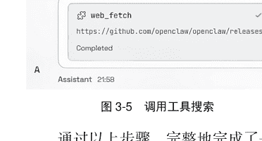


以上流程完整演示了网络搜索类 Skill 从设计、实现、上线到验证的闭环。这套范式既体现了 OpenClaw 技能开发的规范路径，也标志着从“给出建议”到“自主执行”的能力跨越。借助模块化封装，智能体获得可复用、可扩展的确定性能力，为后续构建更复杂的多步任务奠定坚实基础。

### 3.3 高复用Skills模板

#### 3.3.1 数据查询模板（数据库、知识库）

在 OpenClaw Skills 生态中，高复用模板是提升交付效率、保障代码质量的关键。将高频业务逻辑与交互模式抽象为标准模块，就能在可靠可维护的底座上快速搭建新技能。

数据查询模板是实现 AI 与外部数据源联动的核心技术手段。通过统一设计，模型能够智能检索、查询并操作数据库与知识库，把静态数据转化为动态知识，真正做到让 AI 理解并利用数据。下面以 Notion API 集成 Skill 为例，解析其设计思路与落地方式。

Notion 作为领先的协作平台，其 API 提供了强力的数据管理能力。在 OpenClaw 生态里，Notion Skill 的构建展示了如何把外部数据服务无缝嵌入 AI 工作流。该 Skill 由 SKILL.md 与技能说明文档构成，形成完整的数据查询能力单元。

首先是 SKILL.md 的设计，它相当于面向模型的 Notion API 操作手册，详细说明如何配置 Notion 集成应用、获取并保存 API 密钥，以及用 curl 完成八项核心操作（搜索、读取、创建、更新、查询数据库等）的完整示例，同时给出十种常用数据类型的 JSON 规范与 API 版本的重要变更说明，帮助模型依据用户需求自动生成正确的 API 调用指令来管理页面、数据库与内容块。

```markdown
---
name: notion
description: 用于创建和管理页面、数据库及区块的 Notion API。
metadata: {"clawdbot":{"emoji":"□"}}
---

# notion
使用 Notion API 来创建/读取/更新页面、数据源（数据库）和块。

## 设置步骤
1. 在 https://notion.so/my-integrations 创建一个集成应用
2. 复制 API 密钥（以 `ntn_` 或 `secret_` 开头）
3. 存储密钥：
   ```bash

   # 创建配置目录

   mkdir -p ~/.config/notion

   # 将你的API密钥保存到文件中

   echo "ntn_your_key_here" > ~/.config/notion/api_key

   ```
4. 将目标页面/数据库与你的集成应用共享（点击 "..." → "连接到" → 你的集成应用名称）

## API 基础知识
所有请求都需要：
```bash

# 从配置文件读取API密钥

NOTION_KEY=$(cat ~/.config/notion/api_key)

# 发起GET请求示例

curl -X GET "https://api.notion.com/v1/..." \

  -H "Authorization: Bearer $NOTION_KEY" \

  -H "Notion-Version: 2025-09-03" \

  -H "Content-Type: application/json"

```

> **注意:** Notion-Version 请求头是必需的。本技能使用 2025-09-03（最新版本）。在此版本中，数据库在 API 中被称为“数据源”。
```

## 常用操作

**搜索页面和数据源:**

```bash
# 使用POST方法搜索
curl -X POST "https://api.notion.com/v1/search" \
  -H "Authorization: Bearer $NOTION_KEY" \
  -H "Notion-Version: 2025-09-03" \
  -H "Content-Type: application/json" \
  -d '{"query": "page title"}'
```

**获取页面信息:**

```bash
# 使用页面ID获取页面元数据
curl "https://api.notion.com/v1/pages/{page_id}" \
  -H "Authorization: Bearer $NOTION_KEY" \
  -H "Notion-Version: 2025-09-03"
```

**获取页面内容（块）:**

```bash
# 获取页面的所有子块内容
curl "https://api.notion.com/v1/blocks/{page_id}/children" \
  -H "Authorization: Bearer $NOTION_KEY" \
  -H "Notion-Version: 2025-09-03"
```

**在数据源中创建页面:**

```bash
# 在数据库中创建新的页面条目
curl -X POST "https://api.notion.com/v1/pages" \
  -H "Authorization: Bearer $NOTION_KEY" \
  -H "Notion-Version: 2025-09-03" \
  -H "Content-Type: application/json" \
  -d '{
    "parent": {"database_id": "xxx"},
    "properties": {
      "Name": {"title": [{"text": {"content": "New Item"}}]},
      "Status": {"select": {"name": "Todo"}}
    }
  }'
```

**查询数据源（数据库）:**

```bash
# 使用过滤和排序查询数据库
curl -X POST "https://api.notion.com/v1/data_sources/{data_source_id}/query" \
  -H "Authorization: Bearer $NOTION_KEY" \
  -H "Notion-Version: 2025-09-03" \
  -H "Content-Type: application/json" \
  -d '{
    "filter": {"property": "Status", "select": {"equals": "Active"}},
    "sorts": [{"property": "Date", "direction": "descending"}]
  }'
```

**创建数据源（数据库）：**

```bash
# 创建新的数据库结构
curl -X POST "https://api.notion.com/v1/data_sources" \
  -H "Authorization: Bearer $NOTION_KEY" \
  -H "Notion-Version: 2025-09-03" \
  -H "Content-Type: application/json" \
  -d '{
    "parent": {"page_id": "xxx"},
    "title": [{"text": {"content": "My Database"}}],
    "properties": {
      "Name": {"title": {}},
      "Status": {"select": {"options": [{"name": "Todo"}, {"name": "Done"}]}},
      "Date": {"date": {}}
    }
  }'
```

**更新页面属性：**

```bash
# 修改现有页面的属性值
curl -X PATCH "https://api.notion.com/v1/pages/{page_id}" \
  -H "Authorization: Bearer $NOTION_KEY" \
  -H "Notion-Version: 2025-09-03" \
  -H "Content-Type: application/json" \
  -d '{"properties": {"Status": {"select": {"name": "Done"}}}}'
```

**向页面添加块：**

```bash
curl -X PATCH "https://api.notion.com/v1/blocks/{page_id}/children" \
  -H "Authorization: Bearer $NOTION_KEY" \
  -H "Notion-Version: 2025-09-03" \
  -H "Content-Type: application/json" \
  -d '{
    "children": [
      {"object": "block", "type": "paragraph", "paragraph": {"rich_text": [{"text": {"content": "Hello"}}]}}
    ]
  }'
```

## 属性类型

数据库项目的常见属性格式：

- **标题:** `{"title": [{"text": {"content": "..."}}]}`
- **富文本:** `{"rich_text": [{"text": {"content": "..."}}]}`
- **单选:** `{"select": {"name": "Option"}}`
- **多选:** `{"multi_select": [{"name": "A"}, {"name": "B"}]}`
- **日期:** `{"date": {"start": "2024-01-15", "end": "2024-01-16"}}`
- **复选框:** `{"checkbox": true}`
- **数字:** `{"number": 42}`
- **URL:** `{"url": "https://..."}`
- **邮箱:** `{"email": "a@b.com"}`
- **关联:** `{"relation": [{"id": "page_id"}]}`

## 2025-09-03 版本的关键差异

- **数据库 → 数据源:** 查询与检索改用 `/data_sources/` 端点
- **两个 ID:** 每个数据库同时拥有 `database_id` 与 `data_source_id`
  - 创建页面时使用 `database_id` (`parent: {"database_id": "..."}`)
  - 查询时使用 `data_source_id` (`POST /v1/data_sources/{id}/query`)
- **搜索结果:** 数据库返回类型为 "object": "data_source" 并携带 `data_source_id`
- **响应中的父级:** 页面同时显示 `parent.data_source_id` 与 `parent.database_id`
- **查找 data_source_id:** 可搜索数据库，或调用 `GET /v1/data_sources/{data_source_id}`

## 注意事项

- 页面/数据库 ID 为 UUID 格式，可带或不带连字符
- API 不支持设置数据库视图过滤器，该功能为 UI 专属
- 速率限制约平均 3 请求/秒
- 创建数据源时使用 `is_inline: true` 可将其嵌入页面中

Notion Skill 的模板设计兼顾扩展性：参数化让所有 curl 命令使用占位符如 `{page_id}`、`{data_source_id}`，便于模型动态替换；模块化结构将功能分类展示，模型可按需选用；版本兼容性明确标注 API 差异，支持多版本 Notion API。

Notion API 集成 Skill 是数据查询模板的典型实践，展示了 OpenClaw 如何把复杂的外部数据服务封装为模型可理解使用的标准化能力。SKILL.md 完成元数据管理、功能定义与操作指引的闭环，用自然语言清晰描述技能作用、调用方式与注意事项；package.json 则定义配置参数、依赖关系与入口文件。二者共同构成可被模型自主理解并调用的能力单元。

模板化带来多重收益：简化外部服务接入、封装复杂接口；提升开发效率、避免重复编码；内置安全机制、规避常见风险；标准化格式便于共享与扩展，为生态发展奠基。借助该模板，智能体快速获得数据能力，从对话交互升级为数据驱动决策，契合标准化、可复用、易扩展的生态理念，推动各行业落地。

#### 3.3.2 文件操作模板：读写和转换

文件操作是智能体与本地环境交互的基础且高频能力。在 OpenClaw 实践中，文件操作类 Skill 使智能体能够像人一样读写本地文件、转换文档格式、批量整理资料。下面以文档自动化 Skill 为例，解析其设计思路与实现方法。

文档自动化 Skill 展示了如何把 Windows 平台的 Office 文档操作能力集成到 OpenClaw 生态中。该 Skill 通过 COM 接口实现对 Microsoft Word 或 WPS Writer 的自动化控制，支持多种文档操作。该 Skill 包含两个核心文件：SKILL.md 与 document_automation.py，二者共同构成文件操作技能主体。首先是 SKILL.md 文件：

```
---
name: document-automation
description: 通过COM接口自动化Windows上的文档操作（读取文本、替换、插入、标题设置、页眉页脚、分页符、合并、拆分、导出为PDF/TXT、添加/替换图片）。适用于单文档操作（不支持批量处理）。
---

# WPS/Word自动化 (Windows)
使用捆绑的Python脚本通过COM接口控制Word或WPS。

## 系统要求
- Windows 系统，已安装**Microsoft Word**或**WPS Writer**。
- Python 环境 + **pywin32** 库（安装命令：`python -m pip install pywin32`）。

## 快速开始
bash
# 读取文档文本内容
python {baseDir}/scripts/wps_word_automation.py read --input "~\word.docx"
# 查找并替换文本
python {baseDir}/scripts/wps_word_automation.py replace --input "~\word.docx" --find "旧" --replace "新" --save "~\new.docx"
# 导出为PDF格式
python {baseDir}/scripts/wps_word_automation.py export --input "~\word.docx" --format pdf --output "~\new.pdf"

## 命令列表

### read - 提取纯文本
```

```
bash
python {baseDir}/scripts/wps_word_automation.py read --input "~\word.docx" --output "~\new.txt"
```

### replace - 查找替换文本

```
bash
python {baseDir}/scripts/wps_word_automation.py replace --input "~\word.docx" --find "old" --replace "new" --save "~\new.docx"
```

### insert - 在开头/结尾插入文本

# Word 文档自动操作速查

```
bash
python {baseDir}/scripts/wps_word_automation.py insert --input "~\word.docx" --text "Hello" --where start --save "~\new.docx"
```

### headings - 为符合前缀的行赋予标题格式

```
bash
python {baseDir}/scripts/wps_word_automation.py headings --input "~\word.docx" --level 1 --prefix "# " --save "~\new.docx"
```

### header-footer - 配置页眉与页脚内容

```
bash
python {baseDir}/scripts/wps_word_automation.py header-footer --input "~\word.docx" --header "标题" --footer "页脚" --save "~\new.docx"
```

### page-break - 在文件尾部加入分页标记

```
bash
python {baseDir}/scripts/wps_word_automation.py page-break --input "~\word.docx" --save "~\new.docx"
```

### merge - 将多份文件合成一个

```
bash
python {baseDir}/scripts/wps_word_automation.py merge --inputs "wf.docx" "bd.docx" --output "new.docx"
```

### split - 依据页码区间拆分文件

```
bash
python {baseDir}/scripts/wps_word_automation.py split --input "~\word.docx" --pages "1-3,4-6" --outdir "~\new"
```

### export - 输出为 PDF 或 TXT

```
bash
python {baseDir}/scripts/wps_word_automation.py export --input "~\word.docx"
--format pdf --output "~\new.pdf"
python {baseDir}/scripts/wps_word_automation.py export --input "~\word.docx"
--format txt --output "~\new.txt"
```

### image - 在末尾插入或更新图片

```
bash
python {baseDir}/scripts/wps_word_automation.py image --input "~\word.docx" --image
"~\img.png" --save "~\new.docx"
```

## 注意事项

- 运行环境若已安装 WPS，可通过 `--app wps` 指定，否则默认调用 Word。
- 若想看到操作窗口，请加上 `--visible true`。
- 该工具主要面向单份文件，不适合大规模批量使用。

环境要求部分提到，本程序只能在 Windows 平台上运行，并且需要事先安装好 Microsoft Word 或 WPS Writer。额外还需要 Python 运行环境以及 pywin32 库，才能让底层 COM 调用正常工作。

上手指南列出了三类常用示例：读取正文、搜索替换、转成 PDF。这些范例演示了基本调用方式，使用者可以马上体验核心功能。

功能清单共十项，涵盖读取内容、文字搜索替换、文本插入、标题格式化、页眉页脚设定、分页标记添加、文档合并、按页区间拆分、格式输出、图片处理。每项都附带简短说明和完整调用示例，基本覆盖日常办公的自动操作需求。

额外提示指出，`--app` 参数可以在 Word 与 WPS 之间切换，`--visible` 则打开可视窗口便于排错。同时建议进行批量作业时避免频繁使用界面模式，以保证运行速度和稳定度。

下面展示 document_automation.py 的代码框架。

```python
import argparse
import os
from pathlib import Path

APP_PROGIDS = {
    "word": ["Word.Application"],
    "wps": ["KWPS.Application", "WPS.Application"],
}

WD_FORMAT_PDF = 17
WD_FORMAT_TEXT = 2
WD_PAGE_BREAK = 7

def get_app(app_name: str, visible: bool):
    import win32com.client  # type: ignore

    progids = APP_PROGIDS.get(app_name, [])
    for pid in progids:
        try:
            app = win32com.client.Dispatch(pid)
            app.Visible = bool(visible)
            return app
        except Exception:
            continue
    # fallback to Word
    app = win32com.client.Dispatch("Word.Application")
    app.Visible = bool(visible)
    return app

def open_doc(app, path: str):
    return app.Documents.Open(path, ReadOnly=False)

def save_as(doc, out_path: str, fmt=None):
    if fmt is None:
        doc.SaveAs(out_path)
    else:
        doc.SaveAs(out_path, fmt)

def cmd_read(args):
    app = get_app(args.app, args.visible)
    doc = open_doc(app, args.input)
    text = doc.Content.Text
    if args.output:
        Path(args.output).write_text(text, encoding="utf-8")
    else:
        print(text)
    doc.Close()
    app.Quit()

def cmd_replace(args):
    app = get_app(args.app, args.visible)
    doc = open_doc(app, args.input)
    find = doc.Content.Find
    find.Text = args.find
    find.Replacement.Text = args.replace
    find.Execute(Replace=2)
    save_as(doc, args.save)
    doc.Close()
    app.Quit()

def cmd_insert(args):
    app = get_app(args.app, args.visible)
    doc = open_doc(app, args.input)
    if args.where == "start":
        rng = doc.Range(0, 0)
        rng.InsertBefore(args.text)
    else:
        doc.Content.InsertAfter(args.text)
    save_as(doc, args.save)
    doc.Close()
    app.Quit()

def cmd_headings(args):
    app = get_app(args.app, args.visible)
    doc = open_doc(app, args.input)
    prefix = args.prefix
    for p in doc.Paragraphs:
        txt = p.Range.Text.strip()
        if txt.startswith(prefix):
            p.Range.Text = txt[len(prefix) :]
            p.Style = f"Heading {args.level}"
    save_as(doc, args.save)
    doc.Close()
    app.Quit()

def cmd_header_footer(args):
    app = get_app(args.app, args.visible)
    doc = open_doc(app, args.input)
    for section in doc.Sections:
        if args.header:
            section.Headers(1).Range.Text = args.header
        if args.footer:
            section.Footers(1).Range.Text = args.footer
    save_as(doc, args.save)
    doc.Close()
    app.Quit()

def cmd_page_break(args):
    app = get_app(args.app, args.visible)
    doc = open_doc(app, args.input)
    rng = doc.Range(doc.Content.End - 1, doc.Content.End - 1)
    rng.InsertBreak(WD_PAGE_BREAK)
    save_as(doc, args.save)
    doc.Close()
    app.Quit()

def cmd_merge(args):
    app = get_app(args.app, args.visible)
    base = open_doc(app, args.inputs[0])
    for p in args.inputs[1:]:
        base.Range(base.Content.End - 1).InsertFile(p)
        base.Range(base.Content.End - 1).InsertBreak(WD_PAGE_BREAK)
```
save_as(base, args.output)

base.Close()

app.Quit()

def parse_ranges(s: str):

    ranges = []

    for part in s.split(","):

        a, b = part.split("-")

        ranges.append((int(a), int(b)))

    return ranges

def cmd_split(args):

    app = get_app(args.app, args.visible)

    doc = open_doc(app, args.input)

    outdir = Path(args.outdir)

    outdir.mkdir(parents=True, exist_ok=True)

    ranges = parse_ranges(args.pages)

    for i, (a, b) in enumerate(ranges, 1):

        new = app.Documents.Add()

        rng = doc.Range(doc.GoTo(What=1, Which=1, Count=a), doc.GoTo(What=1, Which=1, Count=b + 1))

        rng.Copy()

        new.Range(0, 0).Paste()

        out = outdir / f"part_{i}.docx"

        save_as(new, str(out))

        new.Close()

    doc.Close()

    app.Quit()

def cmd_export(args):

    app = get_app(args.app, args.visible)

    doc = open_doc(app, args.input)

    fmt = WD_FORMAT_PDF if args.format == "pdf" else WD_FORMAT_TEXT

    save_as(doc, args.output, fmt)

    doc.Close()

    app.Quit()

def cmd_image(args):

    app = get_app(args.app, args.visible)

    doc = open_doc(app, args.input)

    rng = doc.Range(doc.Content.End - 1, doc.Content.End - 1)

    doc.InlineShapes.AddPicture(os.path.abspath(args.image), False, True, rng)

    save_as(doc, args.save)

    doc.Close()

    app.Quit()

def main():

    parser = argparse.ArgumentParser()

    parser.add_argument("--app", default="word", choices=["word", "wps"])

    parser.add_argument("--visible", default=False, action="store_true")

    sub = parser.add_subparsers(dest="cmd", required=True)

    p = sub.add_parser("read")

    p.add_argument("--input", required=True)

    p.add_argument("--output")

    p.set_defaults(func=cmd_read)

    p = sub.add_parser("replace")

    p.add_argument("--input", required=True)

    p.add_argument("--find", required=True)

    p.add_argument("--replace", required=True)

    p.add_argument("--save", required=True)

    p.set_defaults(func=cmd_replace)

    p = sub.add_parser("insert")

    p.add_argument("--input", required=True)

    p.add_argument("--text", required=True)

    p.add_argument("--where", choices=["start", "end"], default="end")

    p.add_argument("--save", required=True)

    p.set_defaults(func=cmd_insert)

    p = sub.add_parser("headings")

    p.add_argument("--input", required=True)

    p.add_argument("--level", type=int, choices=[1, 2, 3], default=1)

    p.add_argument("--prefix", required=True)

    p.add_argument("--save", required=True)

    p.set_defaults(func=cmd_headings)

    p = sub.add_parser("header-footer")

    p.add_argument("--input", required=True)

    p.add_argument("--header")

    p.add_argument("--footer")

    p.add_argument("--save", required=True)

    p.set_defaults(func=cmd_header_footer)

    p = sub.add_parser("page-break")

    p.add_argument("--input", required=True)

    p.add_argument("--save", required=True)

    p.set_defaults(func=cmd_page_break)

    p = sub.add_parser("merge")

p.add_argument("--inputs", nargs="+", required=True)

    p.add_argument("--output", required=True)

    p.set_defaults(func=cmd_merge)

    p = sub.add_parser("split")

    p.add_argument("--input", required=True)

    p.add_argument("--pages", required=True)

    p.add_argument("--outdir", required=True)

    p.set_defaults(func=cmd_split)

    p = sub.add_parser("export")

    p.add_argument("--input", required=True)

    p.add_argument("--format", choices=["pdf", "txt"], required=True)

    p.add_argument("--output", required=True)

    p.set_defaults(func=cmd_export)

    p = sub.add_parser("image")

    p.add_argument("--input", required=True)

    p.add_argument("--image", required=True)

    p.add_argument("--save", required=True)

    p.set_defaults(func=cmd_image)

    args = parser.parse_args()

    args.func(args)

if __name__ == "__main__":

    main()

该脚本的核心作用，是把 SKILL.md 中列出的文档操作指令映射为可直接执行的底层调用。整体按模块化思路拆分为常量区、通用工具、命令实现、参数解析与主流程五大块协同运转，从而实现对 Word、WPS 的端到端自动化。

程序开头先定义好办公软件的 COM ProgID 对照表，运行时可依需切换 Word 或 WPS 的 COM 实例；同时声明一批常用格式常量，后续在保存、转换、写入等环节会被多次引用。紧跟着是一组通用方法，把与 COM 的交互细节封装起来，为各个命令提供一致的基础支撑。

业务核心由十个独立的命令函数承担，每一个都按“启动应用→打开文件→执行任务→写入保存→释放进程”的固定节奏运转，并借助 win32com 调用来完成具体的文档操作。

入口函数 main 负责读取命令行参数并分发到对应处理器。内部加入 COM 异常捕获，并在任务结束后主动关闭文档与进程以释放资源。整体写法简洁、流程明晰，既满足功能完整，也为后续迭代留出空间。

单独看，这一套由两个文件组成的文件操作技能包，接收到相关请求时会先读取 SKILL.md 了解可用命令与参数规范，再据此生成对应的 Python 调用执行任务。该组合兼顾可读性与可维护性，也能应对复杂自动化场景，可视为文件操作类技能的标准化做法。

该框架并非仅限 Word。更换底层库与实现后，同样能用于表格处理、PDF 操作、图片批量转换、视频格式转换等其它文件场景。借助此模板，OpenClaw 能迅速具备本地文件交互能力。

#### 3.3.3 通知推送模板：邮件与即时通讯

在 OpenClaw 的实际落地中，主动通知推送是智能体实现对外交互的基础能力。一个设计良好的通知类 Skill 能够模拟人工操作，通过邮件、即时消息等渠道把信息主动送达。本节聚焦邮件通知这一最常见、企业级场景最通用的入口。

该 Skill 以浏览器自动化方式封装了 Microsoft 365/Outlook 的日历与邮件功能，为 AI 伙伴提供一套企业级沟通能力。相较于数据查询、文件操作类 Skill，通知类 Skill 需要处理登录认证、会话维持、实时交互等更复杂的环节，同时要覆盖日历管理、邮件收发、会议协调、联系人检索等多类任务。通过拆解其文档结构与使用方式，可以提炼出通知类 Skill 的通用设计思路，为邮件集成、即时通讯、日程协调等能力的开发提供参考模板。

实现上，它不依赖 REST API 或本地 COM，而是使用 Playwright 模拟用户在 Microsoft 365 网页版的操作流程，从而绕开 Azure AD 应用注册的繁琐步骤，直接复用浏览器的登录会话进行鉴权。下面是 SKILL.md 的内容：

```
---
name: calendar-email-management
description: Microsoft 365 / Outlook命令行工具,用于日历和邮件管理。适用于管理Outlook日历(查看、创建、更新、删除事件,查找会议时间,响应邀请)、发送/阅读邮件,或在组织中搜索人员/会议室。
metadata: {"clawdbot":{"requires":{"bins":["clippy"]}}}
---

# calendar-email-management - Microsoft 365 命令行工具
项目地址:https://github.com/foeken/clippy
通过浏览器自动化(Playwright)操作M365 Web界面实现,而非使用Graph API。无须Azure AD应用注册 - 只需使用浏览器登录即可。
```

## 安装

```bash
# 克隆仓库并安装依赖
git clone https://github.com/foeken/clippy.git
cd clippy && bun install
# 运行命令行工具
bun run src/cli.ts --help
```

或者全局链接: `bun link`

## 身份认证

```bash
# 交互式登录(打开浏览器,建立会话)
clippy login --interactive

# 检查认证状态
clippy whoami
```

### 会话保护(推荐)

保持浏览器会话活跃以防止令牌过期:

```bash
# 启动保活服务(保持浏览器打开,每10分钟刷新一次)
clippy keepalive --interval 10
```

对于持久化运行,建议设置为launchd服务(macOS)或systemd服务(Linux)。

**健康监控:** 保活服务在每次成功刷新时会写入`~/.config/clippy/keepalive-health.txt`文件。检查该文件是否过期(超过15分钟)可以检测服务故障。

## 日历管理

```bash
# 查看今天的事件
clippy calendar

# 查看特定日期
clippy calendar --day tomorrow
clippy calendar --day monday
clippy calendar --day 2024-02-15

# 周视图
clippy calendar --week

# 显示详细信息(描述、参会人员)
clippy calendar --details
```

### 创建事件

```bash
clippy create-event "Title" 09:00 10:00

# 完整选项
clippy create-event "Meeting" 14:00 15:00 \
  --day tomorrow \
  --description "Meeting notes" \
  --attendees "alice@company.com,bob@company.com" \
  --teams \
  --find-room

# 重复事件
clippy create-event "Standup" 09:00 09:15 --repeat daily
clippy create-event "Sync" 14:00 15:00 --repeat weekly --days mon,wed,fri
```

### 更新/删除事件

```bash
clippy update-event 1 --title "New Title"
clippy update-event 1 --start 10:00 --end 11:00
clippy delete-event 1
clippy delete-event 1 --message "Need to reschedule"
```

### 响应邀请

```bash
clippy respond                          # List pending
clippy respond accept --id <eventId>
clippy respond decline --id <eventId> --message "Conflict"
clippy respond tentative --id <eventId>
```

### 查找会议时间

```bash
clippy findtime
clippy findtime --attendees "alice@company.com,bob@company.com"
clippy findtime --duration 60 --days 5
```

## 邮件管理

```bash
# 查看收件箱
clippy mail
clippy mail --unread
clippy mail -n 20
clippy mail --search "invoice"

# 查看其他文件夹
clippy mail sent
clippy mail drafts
clippy mail archive

# 读取特定邮件
clippy mail -r <number>

# 下载附件
clippy mail -d <number> -o ~/Downloads
```

### 发送邮件

```bash
clippy send \
  --to "recipient@example.com" \
  --subject "Subject" \
  --body "Message body"

# 使用抄送、附件、Markdown格式
clippy send \
  --to "alice@example.com" \
  --cc "manager@example.com" \
  --subject "Report" \
  --body "**See attached**" \
  --markdown \
  --attach "report.pdf"
```

### 回复/转发

```bash
clippy mail --reply <number> --message "Thanks!"
clippy mail --reply-all <number> --message "Got it"
clippy mail --forward <number> --to-addr "colleague@example.com"
```

### 邮件操作

```bash
clippy mail --mark-read <number>
clippy mail --flag <number>
clippy mail --move <number> --to archive
```

## 人员/会议室搜索

OpenClaw 零门槛上手：养只“龙虾”替你干活

```bash
clippy find "john"                 # 搜索人员
clippy find "conference" --rooms   # 搜索会议室
```

## JSON输出格式

```bash
clippy calendar --json
clippy mail --json
```

## 配置

可以通过环境变量覆盖配置文件目录：

```bash
export CLIPPY_PROFILE_DIR=~/.config/clippy/my-profile
```

文档中明确了技能名称、功能范围，涵盖日历管理、邮件收发、人员检索等企业沟通能力，以及依赖说明，其中 metadata 以 JSON 形式声明了对二进制命令行工具的依赖，这是通知类 Skill 的常见特征。安装部分给出了从 GitHub 拉取仓库、使用 Bun 运行环境装依赖、执行工具以及可选项全局链接的完整流程，便于引导用户正确部署。

认证章节详细描述了交互式浏览器登录流程、认证状态检查命令，以及关键的会话保活机制，通过每十分钟刷新一次浏览器会话避免令牌失效，并写入健康监控文件。这一机制对长时间运行的自动化任务尤为重要，建议将保活程序部署为系统服务以实现 7×24 小时运行。

核心功能上，日历管理覆盖查看、新增、修改、删除等操作。配套能力还包括人员与会议室检索、JSON 结构化输出以便程序化处理、配置目录自定义以支持多账号场景，进一步提升实用性。

一份合格的技能文档应包含清晰的身份认证与会话管理说明、完整命令清单覆盖查增改删与检索、典型参数示例帮助理解复杂场景，并涵盖双向交互、状态跟踪与 JSON 输出。实现层面需遵循安全认证、会话保护与故障恢复、灵活参数组合与完善的错误处理。该模板除 Outlook 外，还可迁移到 Slack、企业微信、钉钉、短信电话等场景，只需替换平台接口与认证方式即可。通知 Skill 是 AI 伙伴连接企业系统的关键能力，使其能主动沟通、协调会议、推送提醒，成为用户的数字助理。邮件因具备正式性和可追溯性，特别适合需要归档的场景，是智能体从被动应答转向主动执行的核心支撑。

掌握技能构建方法能显著扩展 AI 伙伴的能力边界。从网络检索到文件处理、从数据查询到消息推送，每个 Skill 都是 AI 的工具，既能独立完成任务，也能组合成自动化工作流。搭建 Skill 不需要深厚的编程功底，理解基本结构与逻辑即可上手。

# 第 4 章

## MCP 串联外部能力

当需要查询天气、读取本地文件、访问数据库或调用第三方服务时，如何让外部能力与 AI 模型实现无缝衔接？传统做法为每个 API 单独开发适配代码，不同工具互不兼容，维护成本很高。MCP 就像一个标准化的转换插头，让 AI 模型以统一方式调用各类外部工具，无需重复造轮子。接下来将介绍 MCP 的运行原理，演示怎样把普通 API 改造成 MCP 服务、在 OpenClaw 中使用，以及如何配置权限保障调用安全。

### 4.1 MCP 快速入门：模型与工具的通用连接板

#### 4.1.1 痛点：摆脱 API 集成混乱

AI 应用开发长期受制于集成难题，每接入一个新工具都要写专属适配层，就像插头规格各不相同。Anthropic 主推的 MCP 规范通过统一通信标准解决了这一问题，让 AI 助手通过同一个接口对接文件系统、数据库及各类云服务，实现即插即用。过去为不同服务分别搭建接口，成本高且限制扩展。MCP 采用解耦思路把模型与工具分离，只需一次开发客户端即可对接所有标准化服务，显著降低门槛，甚至非技术人员也能轻松扩展功能。

在落地层面，即插即用优势很明显。以 OpenClaw 举例，通过 MCP 配置，AI 伙伴可以直接调用本地文件系统、数据库、GitHub 仓库等外部资源。用户仅需几条命令行指令，就能赋予 AI 新能力。例如一条命令即可让 AI 获得指定文档目录的访问权限。这种简洁的配置体验，与传统繁琐的 API 集成形成鲜明对比。

标准化还带来工具的可迁移性。符合 MCP 规范的工具不仅能在 OpenClaw 中运行，也能直接接入其他支持 MCP 的 AI 平台。这种跨平台兼容性推动 AI 生态良性发展，实现“一次开发，多处部署”。百度智能云推出的 MCP 广场就是典型代表，它把百度搜索、百度地图、百度网盘等自研能力封装为 MCP Server 与 Skills，用户从广场挑选即可接入 OpenClaw，省去了查找 API、编写配置、调试参数的繁琐过程（见图4-1）。

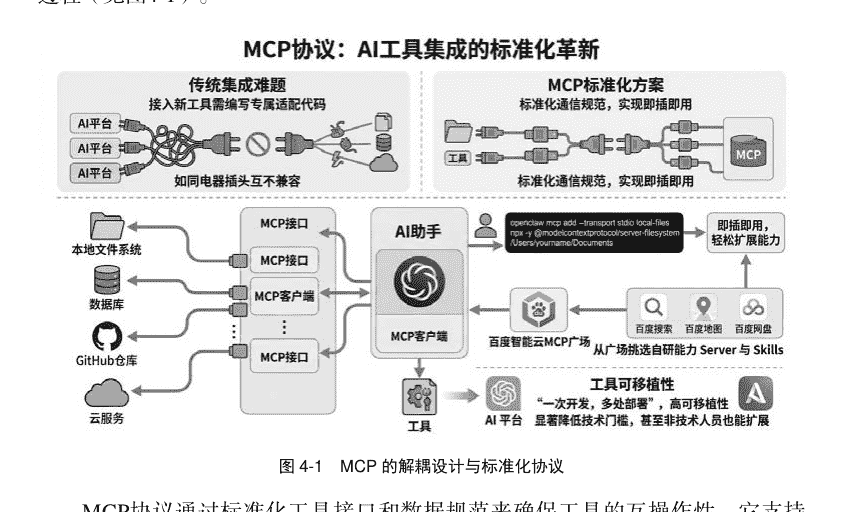

MCP 规范通过统一的工具接口与数据规范保证互操作性，支持动态发现新工具，无需重启即可扩充能力，同时提供权限管控让用户精细限制工具访问范围。安全层面支持通过环境变量传递敏感信息，避免明文存储（见图4-2）。

MCP 大幅降低使用门槛，普通用户只需配置对应服务器或一键部署即可获得新功能。该规范推动 AI 应用生态标准化，形成工具丰富与用户增长的正向循环。实践中，MCP 已实现与出行服务的无缝集成，支持全程打车；也能连接知识管理工具辅助笔记整理。对于我们而言，MCP 支持创建自定义服务器并分享到公共平台，促进工具创新与共享（见图4-3）。

## MCP 规范：能力扩展与安全

### MCP 降低门槛，推动生态标准化

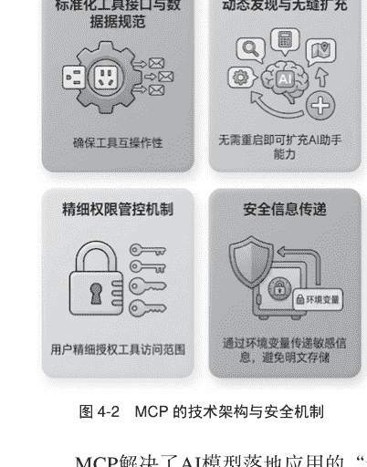

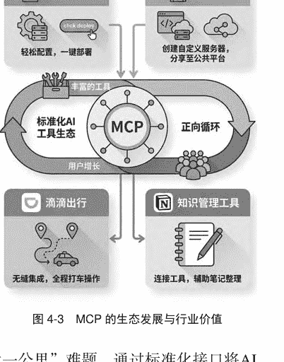

## OpenClaw 轻量上手：让模型真正去执行

MCP 为大模型补上了从对话到行动的最后一截桥梁，通过一套统一的接入口把模型能力外延到各类工具与系统，让角色从答疑者转变为可执行任务的代理。现阶段部署成本和跨网访问仍是阻碍，国内厂商也在探索替代路径，例如在智能体内嵌入视觉操作，直接驱动桌面程序。长远看，该规范有机会成为业界通用的互联基座，不断扩充助手半径，把分散的功能串成自动化链路。只要掌握配置要点，OpenClaw 用户就能快速扩充可用能力。

实操上可归纳为四步。先确认本地运行基础，Node.js 22 以上或 Python 3.10 以上环境是前提。再到 MCP 仓库挑选合适的节点。配置环节优先使用官方 CLI 工具接入，命令行不通时可改用手工编辑配置文件收尾。最后通过状态探测与交互验证确认链路正常。整体步骤涉及技术细节，只要按标准顺序操作，多数用户都能顺利完成。

不想折腾配置的人可以选用预置方案。百度智能云推出的 OpenClaw 极简镜像，提供已装好环境的轻量实例模板。在控制台选定镜像创建实例，数分钟即可启动运行，省去手动装依赖的环节。

无论路线怎么选，目标一致：让智能体连上外部能力并加以驾驭。统一规范为扩展奠定了根基，随着生态成熟，MCP 很可能成为模型与工具世界的枢纽，推动助手向更实用方向演进。

#### 4.1.2 核心概念：服务、工具、资源

理解运行机制，先厘清三个基础要素：服务端、能力单元与数据单元。它们共同构成规范的骨架，如同地基、框架与构件，支撑整体运转。

服务端是执行主体，可视作提供特定专长的专业工坊。每个服务端都是独立程序，负责一类任务。比如文件系统节点处理读写，GitHub 节点管理代码库，日历节点处理排程。这些节点像现实中的专业机构，各自擅长领域并遵循统一流程。在 OpenClaw 侧，服务端通过标准接口与模型通信，模型只需表达“做什么”，不必关心“怎么做”，极大简化了对接成本。

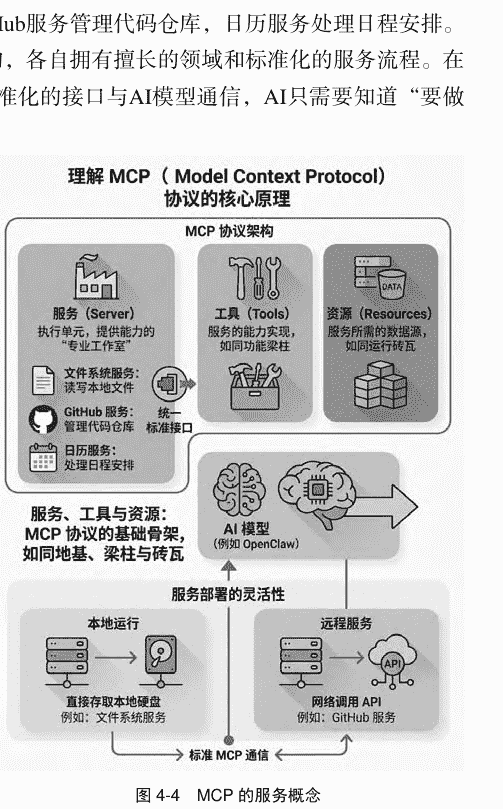

运行形态很灵活：有的本地运行，如文件系统节点直连本地磁盘；有的远程运行，如 GitHub 节点经网络调用 API。只要遵循规范，OpenClaw 就能用同一套调用方式接入。用户可按需选择部署形态，在功能、安全与性能间取得平衡（见图4-4）。

能力单元即工具，是服务端提供的具体操作手段。每个工具对应一次可执行的动作，如“读取文件”“写入记录”“发送邮件”。工具是模型真正可用的“手脚”，把抽象指令转化为具体行为。OpenClaw 作为客户端连上服务端，通过 JSON-RPC 协议自动拉取 Skills 列表。

工具遵循单一职责制，每个只负责一件事，这让组合更灵活。模型可按需串联多段工具形成完整流程。举例“整理会议纪要并分发给参会者”，模型会先用“读取文档”获取内容，再用“文本摘要”生成纪要，最后用“邮件发送”发出。这种链式调用可处理多步复杂任务，实现自动化。

工具还具备自描述特性。每个工具都附带元信息，说明用途、用法、参数要求，帮助模型理解并在合适场景选用。用户提出需求时，模型会比对可用工具的描述，挑选最匹配的执行，以保证准确与效率（见图4-5）。

### MCP 架构中的核心：Tools 及其功能

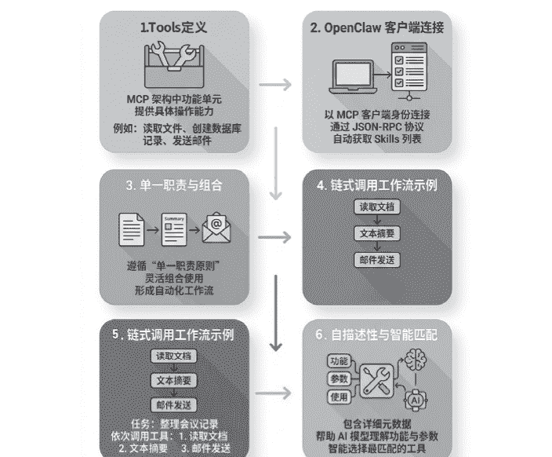

数据单元即资源，指可被操作的客体，如文件、数据库记录等。它们通过统一标识符被引用和访问，模型无需了解存储细节即可处理。服务端负责把标识符映射为实际操作，并提供资源发现机制，让模型动态感知可用数据源并选择（见图4-6）。

### 资源：MCP架构中的数据单元

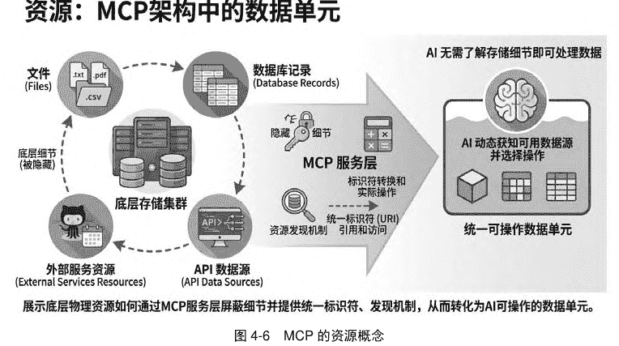

三者的关系可用装修作比喻：服务端像专业装修公司，工具像公司里的电钻、锯子、油漆刷，资源像待装修的房屋与材料。用户需要装修时，AI 充当项目经理，挑选公司，调动设备，对房屋材料加工，最终交付成果。

在 OpenClaw 实操中体现明显。配置本地文件系统时，用户指定一个服务端，该服务端提供读写、浏览等工具，这些工具作用于指定目录下的文件。

标准化让服务端、工具、资源实现跨平台协同。一个符合规范的工具既能在 OpenClaw 中使用，也能兼容其他支持的智能平台，实现一次开发多处复用。

技术层面，规范采用 JSON-RPC 消息实现统一通信。模型调用工具时向对应服务端发送包含工具名与参数的请求，服务端执行后以 JSON 格式返回结果。统一协议保证组件互操作，避免接口不一致导致集成失败。

安全上提供完善权限控制。工具可声明所需权限等级，用户配置时明确授权范围。例如文件系统访问可限定模型只能进入特定目录而非全盘，既保证可用又守住安全。敏感信息如 API 密钥建议使用环境变量存放，避免明文写入配置文件。

概念虽偏技术，使用时很直观：服务端提供能力，工具负责执行，资源是操作对象。简单配置后，OpenClaw 就能获得从文件操作到复杂系统集成的外部能力，真正做到让智能体自主工作。

随着生态发展，各类资源与服务端被标准化开放，从文件系统到数据库、通信工具，它搭建起模型连接万物的桥梁。掌握核心概念与配置方法，就能扩展助手能力，构建智能化自动化流程。

### 4.2 实战：将一个现有的API包装为MCP服务

#### 4.2.1 搭建一个提供“天气查询”工具的MCP服务器

在智能体场景里，调用外部服务是核心能力。MCP 提供了标准化包装路径。把已有 API 包装成服务端，类似给传统电器接上 USB-C 转接头，让它接入现代智能系统。过程技术上可行，对新手也算友好。经过标准化包装，任何现有 API 都能被助手识别和调用，从而大幅扩展能力边界。

下面用完整案例演示从零构建可用服务端，实现天气查询功能，可被 OpenClaw 等助手调用，让 AI 具备实时天气查询能力。开发覆盖环境准备、编码、测试到部署，全程给出操作说明与代码解析。

- 步骤1：安装Python环境

开始前先准备好 Python 运行环境。虽然规范支持多种语言实现，但 Python 因语法简洁和丰富的第三方库成为首选，尤其适合新手。

打开浏览器进入 Python 官网，页面会自动匹配系统推荐版本。建议选择 Python 3.9 及以上，对异步编程支持更好且修复了早期问题。

安装完成后验证是否就位。打开终端（Windows 用命令提示符或 PowerShell，Mac 用 Terminal）输入命令：

```bash
python --version
```

若返回类似 Python 3.11.5 或 Python 3.9.13 的版本号，说明安装并配置环境变量成功。

- 步骤2：创建项目目录和虚拟环境

装好 Python 后，为项目建独立工作目录并创建虚拟环境。虚拟环境可隔离依赖，避免版本冲突。先在终端创建目录并进入：

```bash
# 创建项目目录
mkdir weather-server-mcp
cd weather-server-mcp
```

这两条命令新建了 weather-server-mcp 目录并切换进去。目录名可按需改，建议使用小写和连字符，避免空格和特殊字符。接着创建虚拟环境：

```bash
# 创建虚拟环境
python -m venv venv
```

命令使用 venv 模块，-m venv 表示运行模块，venv 为虚拟环境目录名。执行后项目目录下会生成 venv 文件夹，包含解释器副本、pip 和独立的 site-packages，安装的库都放这里，不影响全局环境。

创建完成后需要激活。不同系统激活命令如下：

```bash
# 激活虚拟环境
# Windows用户
venv\Scripts\activate
# Mac/Linux用户
source venv/bin/activate
```

激活成功后命令行提示符前会出现 (venv) 标记，表示当前使用的是虚拟环境。退出虚拟环境执行 deactivate 即可。

- 步骤3：安装依赖包

激活虚拟环境后安装开发所需库。通过 pip 一次性装完：

```bash
pip install mcp aiohttp anyio
```

命令会从 PyPI 下载安装三个核心库。mcp 是官方 Python 实现，提供创建服务端和客户端的基础框架。aiohttp 是强大的异步 HTTP 客户端服务器库。anyio 提供异步编程抽象层，统一 API，增强代码可移植性与兼容性（见图4-7）。

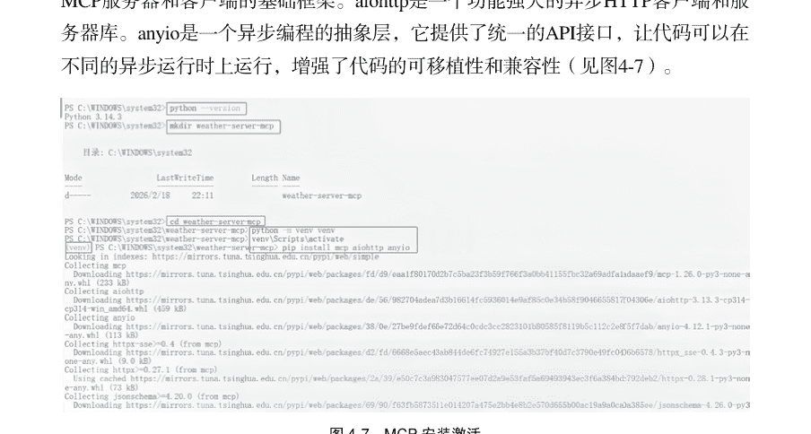

- 步骤4：注册OpenWeatherMap API密钥

天气数据需从专业气象平台获取。OpenWeatherMap 提供免费 API，支持查询全球数十万城市实时天气、预报、空气质量等。免费使用需先注册并获取密钥。

打开官网点击右上角“Sign Up”注册新账号（见图4-8）。填邮箱、用户名、密码，完成人机验证后提交，系统会发验证邮件，点击链接激活。

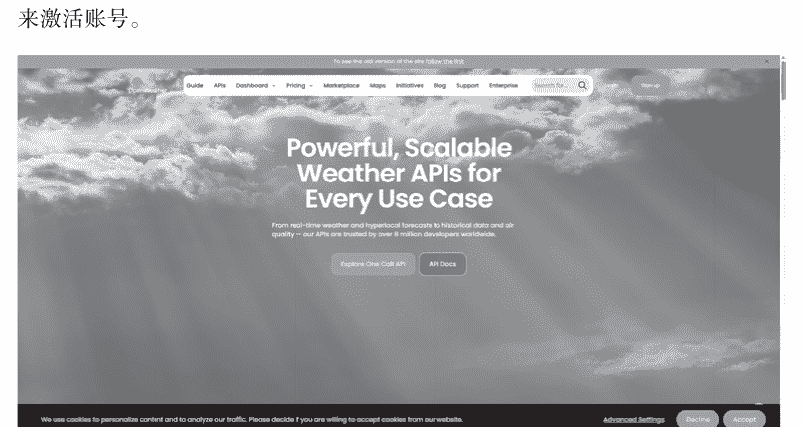

登录后打开用户名菜单选择“My API keys”，进入密钥管理页，生成一个 API 密钥并复制保存，后续代码会用到（见图4-9）。

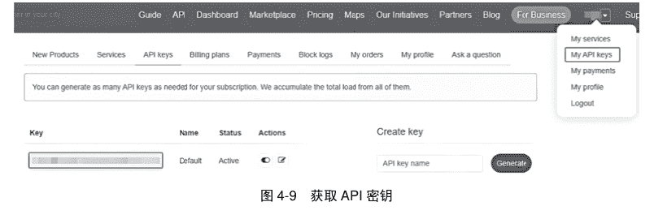

- 步骤5：创建服务器代码文件

环境准备完后开始写核心代码。在项目目录新建 server.py，写入完整实现逻辑：

```python
import asyncio
import aiohttp
from mcp.server import Server
from mcp.server.stdio import stdio_server
from mcp.types import Tool, TextContent

app = Server("weather-forecast")

# 你的OpenWeatherMap API Key
API_KEY = "API_Key"

async def get_weather(city: str) -> str:
    url = f"http://api.openweathermap.org/data/2.5/weather?q={city}&appid={API_KEY}&units=metric&lang=zh_cn"

    try:
        async with aiohttp.ClientSession() as session:
            async with asyncio.timeout(10):
                async with session.get(url) as response:
                    response.raise_for_status()
                    data = await response.json()

                    temperature = data['main']['temp']
                    description = data['weather'][0]['description']
                    result_text = f"{city}的当前天气：温度{temperature}°C, {description}"

                    return result_text

    except asyncio.TimeoutError:
        return f"错误：查询{city}天气时请求超时，请稍后重试"
    except aiohttp.ClientResponseError as e:
        if e.status == 404:
            return f"错误：未找到城市'{city}'，请检查城市名称是否正确"
        elif e.status == 401:
            return f"错误：API密钥无效或未激活"
        else:
            return f"错误：HTTP请求失败 - 状态码{e.status}: {e.message}"
    except KeyError as e:
        return f"错误：解析天气数据失败，响应数据缺少必需字段{e}"
    except Exception as e:
        return f"错误：获取天气信息时发生未知错误 - {type(e).__name__}: {str(e)}"

@app.list_tools()
async def list_tools() -> list[Tool]:
    return [
        Tool(
            name="get_weather",
            description="根据城市名称查询当前天气情况，包括温度和天气状况",
            inputSchema={
                "type": "object",
                "properties": {
                    "city": {
                        "type": "string",
                        "description": "城市名称，例如'Beijing'或'上海'"
                    }
                },
                "required": ["city"]
            }
        )
    ]

@app.call_tool()
async def call_tool(name: str, arguments: dict) -> list[TextContent]:
    if name != "get_weather":
        raise ValueError(f"未知的工具: {name}")

    city = arguments.get("city")
    if not city:
        raise ValueError("缺少必需参数: city")

    result = await get_weather(city)
    return [TextContent(type="text", text=result)]

async def main():
    async with stdio_server() as (read_stream, write_stream):
        await app.run(
            read_stream,
            write_stream,
            app.create_initialization_options()
        )

if __name__ == "__main__":
    asyncio.run(main())
```

步骤6：先让服务器跑起来验个票

代码完成后，先做一次最基础的冒烟验证，看服务能不能正常启动。把 server.py 保存好，回到终端确认虚拟环境已激活，命令行最前面能看到 (venv) 的标识后，再去执行启动命令：

```bash
python server.py
```

服务跑起来后，终端会进入一种“静默待命”的状态，没有任何打印，光标只是持续闪烁。这属于正常现象。MCP 服务通过标准输入输出与客户端通信，它此刻就在通道上等请求到来。

步骤7：用 MCP Inspector 做交互式调试

官方提供了一个叫 Inspector 的调试助手，它给 MCP 服务器配了可视化操作台。Inspector 是基于 Web 的工具，用 Node.js 实现，所以先把 Node.js 装好。去官网下载安装，完成后另开一个终端，用下面命令全局安装 Inspector 及其依赖：

```bash
npm install -g @modelcontextprotocol/inspector
# 安装所需依赖
pip install mcp aiohttp
```

-g 代表全局安装，装好后就能在任意目录直接用 mcp-inspector。遇到权限提示，Windows 要用管理员身份打开命令行，Mac/Linux 则在前面加 sudo。安装完毕后，在项目根目录里启动调试环境：

```bash
mcp-inspector python server.py
```

这条指令会同时拉起 MCP 服务器和 Inspector 调试页，几秒后浏览器会自动打开。界面大致分三块。左侧是服务器的基础信息，点一下“连接”就能建立会话。

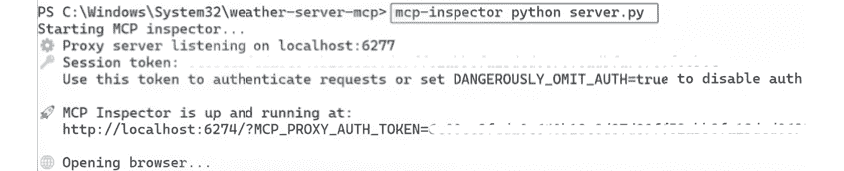

连上之后，中间栏会列出服务器暴露的工具清单。点开 get_weather，可以看到它的说明和参数定义。右侧是测试区，在输入框填入“Beijing”，选择“作为任务运行”后点“运行工具”，请求就会送到 MCP 服务器处理，处理完的结果会在下方响应区展示，包含温度、天气状况等具体数据。

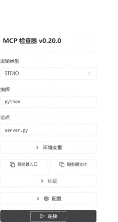

通过这个可视化面板，工具的调用流程一目了然。历史面板还会自动保存每次调用的原始请求和完整响应，便于回溯排查、对比不同版本的表现或复现特定场景的问题。

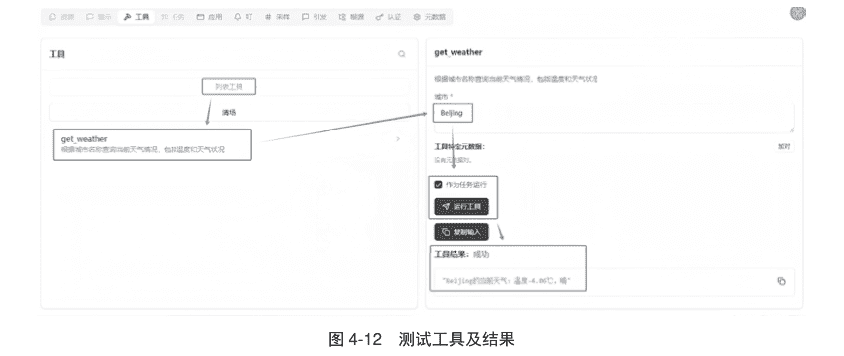

图 4-12 测试工具及结果

历史

```
5. 工具/呼叫
请求：
{
    方法: "tools/call"
    参数: {
        名称: "get_weather"
        论点: {
            城市: "Beijing"
        }
        _meta: {
            progressToken: 1
        }
        任务: {
            TTL: 60000
        }
    }
}
回复：
{
    内容: [
        0: {
            类型: "text"
            正文: "Beijing的当前天气：温度-4.00℃，晴"
        }
    ]
}
```

图 4-13 历史结果查看

到这里，天气查询 MCP 服务端的开发和测试就全部收尾了。整个过程能明显感受到把已有 API 封装成 MCP 服务的可行性与价值。环境准备、代码实现、功能验证环环相扣，而 MCP 协议的标准化让封装变得简洁规范。我们只需要专注业务逻辑，底层通信由协议兜底，这大幅降低了参与门槛，也让更多人能加入 MCP 生态。

#### 4.2.2 将服务接入 OpenClaw 拿到真实调用

服务器端验证通过后，下一步是把它接入 OpenClaw，让智能助手能真正理解并响应与天气相关的提问。配置完成后，OpenClaw 会把这台天气查询工具纳入能力列表。用户问“明天会下雨吗”“周末天气怎么样”时，助手会自动识别意图，调用已部署的服务从外部 API 拉取实时气象，再组织成自然的对话回复。

这一步靠 mcporter 来桥接。mcporter 负责管理服务器的注册、启动和通信。首先把本地开发的天气服务注册进 OpenClaw 的配置体系。在命令行执行：

```bash
openclaw-cn MCP server configuration config
#配置列表
mcporter config add weather-forecast --stdio "C:\Windows\System32\weather-server-mcp\venv\Scripts\python.exe" "C:\Windows\System32\weather-server-mcp\server.py"
```

weather-forecast 是服务的唯一标识，OpenClaw 就靠这个名字来寻址和调用。--stdio 指定用标准输入输出做通信，这是 MCP 的标准模式，能保证数据可靠交换。

第一个参数是虚拟环境里 Python 解释器的绝对路径，用它可以隔离依赖避免冲突。第二个参数是 MCP 服务器脚本的绝对路径，也就是真正执行服务的代码。

执行后 mcporter 会自动把配置写入文件，为后续调用做好准备。确认是否注册成功，可以列出当前已注册的 MCP 服务：

```bash
mcporter list
```

配置生效后会看到类似下图的输出：

```
mcporter 0.7.3 — Listing 1 server(s) (per-server timeout: 30s)
- weather-server (offline — unable to reach server, 0.1s)
√ Listed 1 server (0 healthy; 1 offline).
```


OpenClaw 的服务器信息通常保存在 ~/.openclaw/config/mcporter.json 这个 JSON 文件里，所有 MCP 服务的注册都在这里集中管理。在 mcpServers 对象下新增一个条目，告诉 OpenClaw 该功能由哪个程序启动、启动参数是什么、是否常驻。

```json
{
    "mcpServers": {
        "weather-server": {
            "command": "C:\\Windows\\System32\\weather-server-mcp\\venv\\Scripts\\python.exe",
            "args": [
                "C:\\Windows\\System32\\weather-server-mcp\\server.py"
            ],
            "keepAlive": true
        }
    },
    "imports": []
}
```

command 指定可执行文件的完整路径，args 数组传递给它的参数，也就是 Python 脚本的路径。keepAlive 设为 true 表示服务启动后长期驻留后台，随时待命，而不是每次调用才冷启动，这样能明显提升响应速度。需要改路径或加参数，直接编辑该文件即可。

天气查询服务接入后，就可以用简单的命令来调用它。先检查可用工具列表，确认 get_weather 已就绪；需要查询时指定城市，就能拿到温度、天气状况等信息。

```bash
# 查看可用工具
mcporter list weather-server --schema

# 调用天气查询
mcporter call weather-server.get_weather city:Beijing
```

打开 OpenClaw 的聊天界面，用自然语言提问即可。比如输入“查询北京的天气”，内置的意图理解会分析请求，判断出需要调用已配置的天气查询工具，并从语句中抽取出城市名“北京”作为参数执行查询。

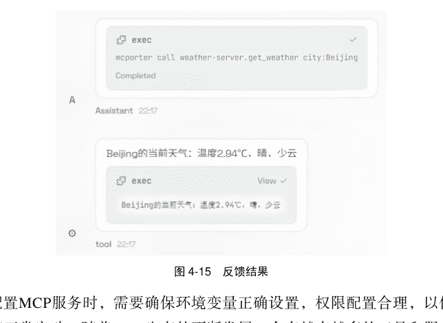

在做 MCP 服务配置时，要注意环境变量是否正确、权限是否合理，以确保服务可以稳定启动。随着生态扩张，标准化开放的工具会越来越多，掌握 MCP 的配置与使用，本质上就是掌握扩展 AI 助手能力的方法。通过统一接口，AI 可以连接任意工具，形成智能化的自动化工作流，提升工作与生活的效率。

### 4.3 安全与权限：Agent 能触碰哪些边界

给 AI 助手系统权限，就像给员工配万能钥匙，既能开办公室，也能开保险柜。OpenClaw 的设计偏向“能力最大化”，默认就拥有文件读写、浏览器操控、API 密钥访问、社交账号使用乃至系统命令执行等广泛权限。一旦被攻破，损失的不是助手本身，而是整个数字生活。安全因此成为使用 OpenClaw 的核心命题。

自主智能体的根本风险在于代理权限过高，风险可分为三层：微观上行为失控，智能体可能进行隐蔽通信；宏观上防线被冲击，当大量拥有系统权限的节点协同行动时，可能形成去中心化的僵尸网络，传统防御手段难以覆盖。这种风险需要全新的安全思路应对。

搭建防护体系要先做威胁建模。不安全的实现容易留下漏洞，比如直接执行用户命令或对文件访问不做检查。安全实践应包括白名单校验、权限申请机制和沙箱执行；文件操作要做路径规范化、权限审查等。分层防护是可靠代理模式的基石。

从架构看，OpenClaw 默认信任本地回环连接，无法识别经过反向代理后的真实 IP，攻击者可伪造请求绕过认证拿下管理权。更严重的是，OpenClaw 能执行 Shell 命令、修改系统配置、读取敏感文件如 SSH 密钥和 API 凭证，甚至通过容器逃逸控制宿主机。这种系统级权限若管理不当，后果是灾难性的。

## AI Agent 系统权限与宏观架构风险

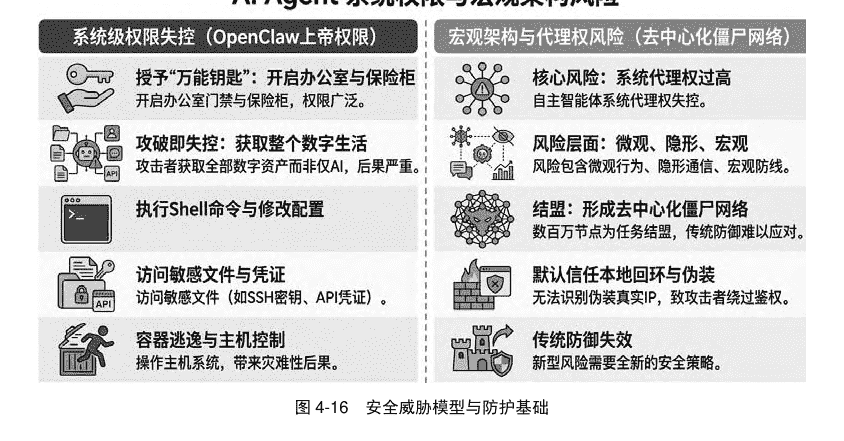

OpenClaw 的安全性建立在三个支柱上：加固沙箱、交互对等验证、操作审计日志。加固沙箱是第一道防线。最新版本建议并逐步强制把高风险操作放到 Docker 容器里运行。即便 AI 在恶意指令下执行危险命令，受损的也只是隔离容器，不会影响宿主机。沙箱像独立实验室，与外部世界隔离。整体形成三层纵深：物理隔离的 Docker 沙箱、逻辑门禁的 ACP 权限协议、策略守卫的白名单与门控机制。

交互对等验证用于防止远程操控。强化配对逻辑，只有完成加密握手并验证特定 IM 账号的用户才能下指令。需设置 ALLOWED_USER_IDS 参数，明确允许控制助手的账号，实现细粒度权限管理。身份管理在 Agentic AI 中尤为关键，涉及用户鉴权、Agent Action 对身份与会话的传递、工具对用户的授权等，必须严格管控。

操作留痕是 AI 安全的第一道防线。系统会把 Agent 每次发起的高危指令完整记录下来，并统一归档到预设的存储目录。一旦出现异常操作，就能沿着日志链条定位到具体的指令来源或插件模块。这份日志相当于运行时的黑匣子，为事后复盘和故障排查提供关键依据。企业侧通常会对文件删除、系统命令执行等高风险行为做定期抽检，并对异常模式开启实时告警（见图4-17）。

## OpenClaw 安全蓝图：纵深防御
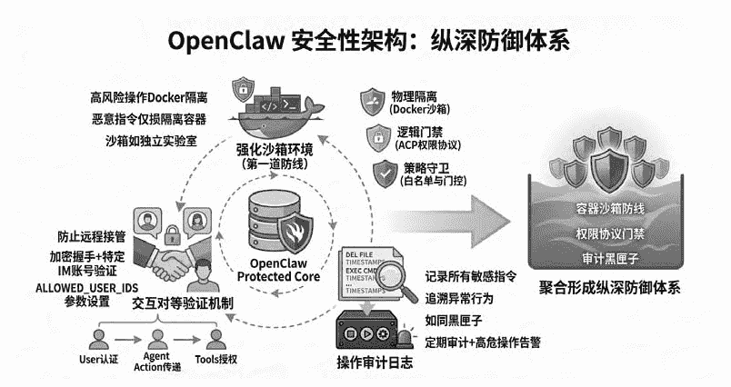
图 4-17 OpenClaw 安全架构基础

代理式 AI 的身份与权限逻辑和传统应用完全不同。传统系统里用户边界清晰可控，引入 Agent 后，数据查询和第三方系统调用都由代理代劳，很容易触碰到其它用户的权限范围。身份在多层代理间传递、权限在不同环节校验，给企业的合规管控带来了全新的难题。

选对运行环境是安全的基础。建议为 OpenClaw 单独划拨服务器，避免和核心业务系统混布。即便大模型被劫持，也不会波及业务主流程。海外节点可免备案，国内部署需要完成 ICP 备案。企业应出台 AI 工具使用规范，严禁员工私自在办公电脑、开发机或生产环境安装未审核的代理工具。确有需求的，必须由安全部门评估认证配置、沙箱隔离情况后才能接入。

加固配置要覆盖多个细节。限定文件操作范围，明确工作目录；禁止 root 直接 SSH 登录，为 OpenClaw 新建普通账号并授予最小必要权限；切勿以 sudo 启动 OpenClaw。在技能定义里预置敏感命令黑名单，拦截 curl、wget、chmod 等高危关键词（见图4-18）。

## 代理 AI 安全要点：传统模式对比

网络隔离和访问管控是抵御外部攻击的基础。仅允许白名单 IP 或内网访问 OpenClaw 服务端口，例如 18789；把默认端口改为 1024～65535 之间的非标准端口。若需要远程操作，建议走 SSH 隧道或 VPN 加密通道。默认端口暴露是常见隐患，攻击者可借助网络空间测绘平台批量扫描暴露设备。

持续监控与审计是长期防护的关键。定期审阅安全审计日志，跟踪资源使用趋势。利用网络空间测绘平台如奇安信鹰图扫描自有网段，排查是否存在私自暴露的 OpenClaw 节点。并配合扫描器检查代理是否存在异常行为。

在关键业务流程中植入人工确认点。对文件删除、敏感凭证读取等高危动作强制弹窗确认，避免提示词注入引发的自动化劫持。即时审批逻辑在 src/agents/bash-tools.exec.ts 中实现：当 requiresExecApproval 返回 true 时，OpenClaw 暂停当前执行流，通过 ACP 协议向前端推送 exec.approval.request。用户操作决定后续走向：Allow Once 仅本次放行；Allow Always 放行并调用 addAllowlistEntry 把命令模式写入 ~/.openclaw/exec-approvals.json，形成使用习惯记忆（见图4-19）。

OpenClaw 的权限管控是一项系统工程，覆盖沙箱隔离、密钥管理、权限分级与服务器配置。AI 助手的安全性至关重要，掌握配置方法才能在可控范围内发挥价值。纵使技术在演进，最小权限与纵深防御仍是核心原则，需要持续改进。MCP 核心概念已掌握，其标准化设计便于扩展功能，靠配置服务即可快速接入新能力。

图 4-19 访问控制与持续监控

## 第3篇

集成到飞书、企业微信与 QQ

## 第5章

### 企业级集成模式与安全

在企业数字化协同的背景下，把 OpenClaw 智能体嵌入既有工作流已成为提效的主流做法。下面系统梳理三种典型集成形态，从群聊机器人到工作台应用，再到事件驱动的流程引擎，各自适配不同场景与使用习惯。企业级落地必须先建立安全基线，确保智能体在提升效率的同时不成为风险入口。通过合理的集成设计与安全加固，让 AI 成为数字化转型可信的伙伴。

### 5.1 三种主流集成模式

#### 5.1.1 机器人模式：在群聊里@即达

在企业协作中，机器人模式是 OpenClaw 最自然的接入方式。把 AI 助理拉进飞书、企业微信或 QQ 等日常通讯工具，它就如同团队里新加入的数字同事。无需打开额外页面，在群里 @ 一下即可下达任务。该形态之所以流行，在于把“沟通即协作”落地，让 AI 无缝嵌入现有流程，而非增加学习成本。

该模式基于网关与通道的双层设计。网关作为常驻守护进程，承担 WebSocket 控制平面的角色，统一调度所有消息通道。来自 WhatsApp、Telegram、Discord、Slack 等不同即时通讯平台的用户指令，经网关接收后智能路由给合适的 Agent 处理，再把结果送回对应渠道，实现多端聚合。

运行流程可拆为四步：消息接入、意图解析、任务执行、结果返回。用户在群中 @ 机器人后，通道适配器先把消息转成 OpenClaw 内部的 Event 格式，经 WebSocket 发给网关。网关将事件分发给对应 Agent，后者作为推理大脑负责上下文理解、任务拆解与执行规划。整体遵循 ReAct 模式，先分析再行动，从技能库挑选工具并生成参数；工具返回后据结果判断是否继续或直接输出结论，从而应对复杂指令（见图5-1）。

该形态门槛极低，接受度高。员工无需学习新界面或安装新软件，只需在常用聊天工具里 @ 机器人即可获得支持。这种无感融合让 OpenClaw 像一位常驻同事，随时待命，无论是信息查询还是自动化流程，都可用自然语言驱动。

实际场景中价值明显。例如在飞书或企业微信群中，有人询问“今天的会议纪要整理好了吗？”，机器人会自动定位文件、调用处理技能提炼要点，以卡片形式回传摘要，数秒完成。项目复盘时，经理在群中询问进度，机器人可连接项目管理工具抽取分散数据，生成可视化进度图。这种随叫随到的特性使其成为协作提效的利器（见图5-2）。

### OpenClaw 机器人模式：低门槛高效协作的数字同事

应用范围已远超问答。随着技能生态的发展，截至2025年2月社区已贡献大量技能，覆盖办公自动化、开发辅助、生活服务等31大类。机器人可处理代码审查到数据分析、文档处理到系统监控等复杂任务，成为团队多面手。

开发团队里，它可化身全天候代码助手。技术讨论群中 @ 它询问性能瓶颈时，它会分析结构、调用性能分析技能并给出优化建议。运维团队可将其作为智能监控员，异常时自动检测、尝试修复并把情况推送到群聊。客服团队则获得永不掉线的智能客服，自动解答常见咨询，减轻人工压力。

还支持多机器人协同。企业可按部门部署专用机器人，如 HR 机器人解答人事疑问、IT 机器人提供技术支持、销售机器人跟进客户。多个机器人可共存于同一群组，各司其职。用户 @ 特定机器人时仅对应个体响应，指令清晰不混淆，形成覆盖人事到业务的数字化助手体系（见图5-3）。

图 5-3 机器人模式的应用场景扩展

便捷的同时安全不可妥协。OpenClaw 构建了身份验证、权限管控、操作审计的三层防护，确保在可控边界内运行。

身份验证是第一道防线。通过强化配对机制，只有完成加密握手并列入白名单的账号才能下指令，企业可精确限定可用人员与群组，杜绝恶意访问。

权限管控是核心手段。严格遵循最小权限原则，建议限定机器人工作目录，仅允许访问指定目录而非整盘。即使被恶意指令操控，也无法触及系统核心。严禁以 sudo 权限运行 OpenClaw，否则等同埋下自毁开关。

操作审计提供追溯保障。系统会详细记录每条敏感指令的执行日志，默认存于固定路径。管理员定期审查即可及时发现异常，定位风险指令或插件，确保智能协作在安全边界内发挥价值（见图5-4）。

图 5-4 机器人模式的安全与权限管理

为保证企业应用中的响应速度与稳定性，OpenClaw 在多层面做了优化。消息层以 WebSocket 为通信框架，保证实时交互。模型层支持灵活切换，简单任务调用轻量模型快速作答，复杂场景自动切换强能力模型，在性能与成本间取得平衡。

同时支持多 Agent 并行部署。单一网关可承载多位专长各异的 Agent，有的擅长文档处理，有的擅长数据查询，有的负责代码执行。用户 @ 机器人时，网关会根据任务自动派发给最匹配的 Agent，实现专业分工。

稳定性方面引入强化沙箱。新版本推荐甚至强制要求，Bash 命令执行、文件写入等高风险操作一律在 Docker 容器中运行。即便 AI 受恶意指令影响，攻击也被限制在容器内部，无法触及宿主机。容器化还为每个技能划定权限边界，挂载的存储卷才是其可触及范围（见图5-5）。

### OpenClaw 机器人模式：性能与稳定性优化

图 5-5 机器人模式的性能优化与稳定性保障

OpenClaw 零门槛上手：养只“龙虾”替你干活

随着技术发展与需求升级，机器人正向更智能、更个性、更协同演进。未来不仅执行预设任务，还能主动学习用户习惯、预测需求并提供个性化服务，通过历史交互数据自动调整响应策略。

多模态交互是重要趋势，支持文本、语音、图像、视频等多种方式。用户可发送图片供识别，或通过语音指令实现更自然交互，实用性大幅提升。

作为智能体的直接集成方式，机器人模式凭借低门槛、高接受度与强实用性，成为企业数字化转型的重要工具。将其嵌入日常聊天工具，能在熟悉环境中提升效率与协作体验。实际应用中需合理选择部署方案、配置安全措施、扩展技能范围并建立运维监控，确保稳定运行。

#### 5.1.2 应用模式：工作台里的智能应用

在 OpenClaw 集成生态中，应用模式代表了从聊天助手到专业工具的进化。将 AI 智能体封装为独立应用程序或工作台组件，用户像使用传统软件一样通过专属界面交互。与机器人模式的自然融入不同，应用模式强调结构化、专业化与深度集成，为复杂工作流、数据可视化、多任务协同提供更稳定可控的服务，成为企业级场景的主流部署方式。

核心思路是将智能能力封装成可独立运行的程序或 Web 服务。从实现维度看可拆为三层。前端界面层用 React、Vue 等 Web 技术呈现交互界面，支持创建任务、调整参数、查看结果；网关通信层通过 WebSocket 建立前端与后端的实时双向连接；智能体执行层则是 OpenClaw 大脑，负责理解请求、拆解任务、调用技能完成工作。分层设计保证稳定且易扩展。

部署对技术栈兼容度高。Web 应用可基于 React、Vue 生态；桌面软件可用 Electron 打包；移动端可用 React Native 适配。OpenClaw 开放架构为不同选择留下空间。

应用场景覆盖个人生产力到企业自动化。随着 Skills 生态丰富，基于应用模式的智能应用在各专业领域快速扩展。

开发领域可构建专业代码环境，智能体自动生成框架、实现逻辑、编写测试并审查代码，提升效率。数据分析中可自动完成探索、特征工程、模型训练与结果解释并生成报告。创意设计里可按需求生成方案、调整布局、优化配色并输出文件。内容创作中可基于主题生成文章、优化表达、校对语法并格式化。这些智能应用正在改变行业工作方式（见图5-7）。

部署时可根据业务与架构选择方式。OpenClaw 支持单机到集群、本地到云端托管。初次尝试的中小企业可选择云服务器一键部署，阿里云、腾讯云等均提供预装镜像，购买后即可快速搭建基础环境，降低门槛。

### 应用模式：推动各行业智能化转型的关键力量

OpenClaw 智能体助力实现高效、智能、专业的行业应用。

完整配置通常包含环境准备、应用部署、接口集成、权限配置、性能调优。环境需满足 Node.js 22 或更高、充足存储与稳定网络。推荐 Docker 容器化部署，简化环境与依赖管理，便于迁移扩展。需配置与外部系统的 API 对接，保证数据流转。权限按业务场景设置用户角色与访问规则，遵循最小权限原则。最后根据实际负载动态调整参数，优化响应速度与处理能力，确保流畅运行（见图5-8）。

作为专业化集成方式，应用模式以结构化、专业化、深度集成著称，成为企业级智能应用主流选择。通过专属界面与完整工作流，提供更稳定可控的服务体验，推动 AI 从聊天助手进化为专业工作伙伴。

#### 5.1.3 流程触发模式：监听事件自动工作

流程触发模式让 OpenClaw 从被动响应升级为主动服务。智能体通过监听事件、数据变化或时间触发器自动执行预设流程。核心组件包括事件监听器、触发器引擎与工作流执行器，三者协作实现自动化。本地化网关可实时监控系统资源并自动触发工作流，如日志修改触发分析、CPU 超阈值启动优化（见图5-9）。

图 5-9 技术架构与实现

该模式具有主动性与预见性，能自主发现异常、预判需求并介入，无需用户指令即可运行，适用于运维、安全监控等需即时响应的场景。

以企业运维为例。在服务器监控中，可配置智能体持续跟踪性能指标，一旦 CPU 使用率连续 5 分钟超过 80%，即自动触发性能分析工作流：自行检查进程、分析资源占用、生成优化建议，并通过企业微信向管理员告警。在安全监控中，监听安全日志，发现异常登录尝试时立即启动响应工作流，自动分析攻击模式、阻断可疑 IP 并生成报告。

模式还具备灵活的时间触发能力。通过 Cron 表达式或自然语言时间规则，可配置定期任务，如每日 9 点生成前一日销售日报，每周一 10 点发送团队周会提醒，每月最后一天生成财务月报，减少重复人工操作。

同时支持条件触发与链式触发。可配置复合条件如“事件 A 发生且条件 B 满足时执行工作流 C”，也可建立工作流依赖形成自动化链条。以订单处理为例：新订单到达后自动校验库存，充足则生成发货单，不足则触发采购流程，采购完成后自动更新库存，形成端到端闭环（见图5-10）。

图 5-10 核心优势与应用场景

该模式应用范围广泛，从个人日常自动化到企业级业务流程均可覆盖。随着 OpenClaw 技能生态持续壮大，基于该模式的自动化应用正在各专业领域加速落地。

在开发运维场景里，流程触发机制能够编排出自运转的交付线。让智能体守在代码仓库，感知到新的推送后便连锁启动评审、单元测试、构建与部署。智能体自行完成代码质量扫描、测试用例执行、构建报告生成并把产物投递到测试环境，整体交付节奏与质量保障因此得到明显提升。

在数据管理侧，触发式编排可以形成智能的数据处理链。配置智能体驻守在数据源变动点，一旦新数据到达就自动走清洗、转换、分析、可视化。以数据库更新为例，销售数据有变化时，智能体会自动跑分析、生成图表并刷新看板，业务判断的敏捷度与准确度随之提高。

客户服务方面，触发模式能够建成智能响应闭环。智能体监听网站访问、商品浏览、下单、咨询等用户行为信号，特定动作出现即推送个性化处置。比如用户反复浏览某款商品却未成交，系统可自动发放优惠券或产品介绍；订单状态更新时自动推送进度通知，这类触达有助于改善体验与转化。

个人生产力层面，触发模式可塑造成个性化助理中枢。让智能体关注日历、邮件、待办等个人来源，发现关键事件就自动处理。例如会议临近时自动准备材料并发出提醒；新邮件到达后自动归类、提炼要点并起草回复，整体工作效率大幅提升（见图5-11）。

触发式路径的安全门槛高于其他两种形态。它往往涉及更敏感的信息并伴随更高程度的自动执行，必须建立更严密的防护体系。OpenClaw 因此采用分层防御思路，确保各类自动化流程在可控范围内稳定运行。

事件源的真实性核验是第一道关口。驱动流程的每一项事件在进入系统前都要校验来源合法且内容未被篡改。OpenClaw 借助数字签名校验、双向身份确认、传输加密等手段抵御伪造事件或中间人攻击。比如外部 API 调用会强制核验密钥与签名；本地文件系统触发则会检查文件权限与修改记录，确保符合预期。

行为边界管控为自动化划定权限范围。每个触发规则及对应流程都要声明所需的最少权限，并在运行时实时核验。OpenClaw 支持精细化授权，可精确到某个任务能访问哪些资源、执行哪些操作、调用哪些系统能力。遵循权限最小化思路，即使流程被恶意激活，其破坏面也被限制在预设范围内。

审批机制充当失控的安全阀。对删除文件、修改关键配置等高风险动作，系统可预设人工确认节点。执行到该节点流程会暂停，待明确授权后才继续。审批策略可灵活配置，按操作类型、风险等级或运行环境动态决定是否需要人工介入。例如删除类操作强制审批，常规查询则自动放行。分级处置在保持效率的同时为关键动作加上最后一道保险。

审计轨迹是追踪执行的核心手段。OpenClaw 会完整记录每次触发的发生、规则匹配过程、流程执行步骤及最终产出。日志既是安全审计依据，也是故障排查与性能分析的基础。系统同时支持实时告警，异常触发或执行失败时自动通知负责人介入处理（见图5-12）。

落地触发式自动化需遵循标准化编排流程，核心环节包括触发源设定、条件编写、任务编排、授权配置与监控设定。触发源设定要明确监听的类型与来源，如文件路径、API 地址或数据库表。条件编写负责描述何时触发，支持自然语言或结构化表达。任务编排聚焦顺序与依赖，可用可视化工具或 YAML 完成。授权配置按业务场景设定执行权限与审批链。监控设定用于采集性能指标与异常阈值。

对可用性要求高的业务，可采用冗余部署。部署多实例及监听集群实现高可用，单点故障时其余节点自动接管。同时需同步状态数据，保证各实例一致。该方案可满足企业级 7×24 小时不间断运行要求。

集成验证是保障可靠性的关键。上线前需做单元、集成、压力等多维度测试，覆盖正常流程、边界条件与异常场景。OpenClaw 提供完整的测试工具与框架，支持自动化测试与持续集成。严格验证可确保实际运行稳定可靠（见图5-13）。

触发式作为智能体的主动服务形态，以自动化、预见性、持续性著称，正成为企业级自动化的核心选型。通过监听与自动触发，智能体能主动发现问题、预判需求、提前介入。

企业需要合理设定触发规则与流程，配套安全措施与性能优化，建立监测体系。完善测试机制确保稳定，适时升级架构扩展能力，让触发式成为提效核心。该模式让智能体从被动助手转向主动管家，推动企业向智能化演进。

### 5.2 通用安全底线：权限、审计与数据隔离

智能体的安全性决定能否落地。作为具备系统操作权限的 AI 工具，其设计重功能扩展而非默认安全，不当配置下可能拥有文件访问、命令执行等广泛权限。一旦运行环境被入侵，攻击者可掌控用户数字生活。因此权限控制是首要防线，需按场景分级管控。

实践中可构建三级体系。L1 访客权限适用于外部协作群或公开渠道，仅允许只读与受限回复，可浏览文件列表但不可读取内容，可收消息但不可执行系统命令。L2 员工权限适用于内部群组，允许读写指定目录文档、发送消息及调用基础运维命令，如查看服务状态、查询日志。L3 管理员权限适用于私聊或核心管理群，拥有授权资源的完全控制，但对删除文件、重启服务、修改系统配置等高风险操作需二次确认。该分级在保证便利的同时为关键操作提供保障。

技术层面，权限需在配置体系中明确定义。SOUL.md 作为 Agent 核心人格定义，可植入基础权限规则与行为边界，例如永不删除文件、敏感操作前询问用户。IDENTITY.md 中可定义更细的权限映射，包括不同群组、不同用户对应的权限等级，以及在 Slack 与 WhatsApp 等平台的差异化行为。当请求超出会话权限时，Agent 应明确提示需更高权限，请联系管理员或切换至相应权限环境。这种基于身份与上下文的动态判定提升了策略的灵活性和可执行性。

OpenClaw 底层还提供权限沙箱机制，从执行层面杜绝误操作风险。在 openclaw.json 或 exec-approvals.json 中可定义 exec 工具的白名单，明确允许的命令及其完整路径。Gateway 作为中枢，会拦截所有工具调用，在执行 Shell 命令前进行严格正则匹配，仅匹配白名单模式的命令被放行。例如允许 systemctl status、systemctl restart 等监控管理操作，明确拒绝 rm、shutdown、sudo 等高风险命令。该策略从底层杜绝了 LLM 幻觉或提示词注入导致的灾难性操作，是防止 rm -rf 事故的关键保障（见图5-14）。

钩子系统为审计监控提供扩展能力。钩子是一种事件驱动的插件框架，可自动化响应 Agent 命令与系统事件。系统内置四个自动发现的捆绑钩子：session-memory 负责持久化会话上下文，确保对话可回溯；command-logger 记录所有命令执行，形成完整操作日志；boot-md 在 Gateway 启动时自动运行 BOOT.md 中的初始化指令；soul-evil 是安全增强机制，可在特定条件下动态替换 SOUL.md 内容，防止人格被恶意篡改。灵活组合这些钩子可构建符合需求的审计监控体系。

图 5-14 权限控制管理

企业级应用还需引入专业审计方案满足合规。博特智能的安全围栏方案提供全链路的 Prompt/Response 留痕，无论是被策略拦截的恶意请求还是正常放行的对话都会被完整记录。该机制既满足法规对日志留存与溯源的要求，也为策略优化提供数据支撑。高质量审计日志应包含用户 ID、精确到毫秒的时间戳、操作类型、详细参数、执行结果等字段，构成安全分析与故障排查的基础，让 AI 的每一次行动有据可查、有迹可循（见图5-15）。

## AI系统审计监控：OpenClaw钩子与企业级围栏

API 密钥管理是 OpenClaw 部署的关键环节。默认情况下，用户密钥以明文形式保存在 ~/.openclaw/config.json，这意味着任何可物理或远程接触该电脑的人都能轻易读取。更危险的是，若用户指令智能体“把配置文件发给我”，智能体会忠实执行，导致核心凭证泄露。明文存储是安全风险中最需优先解决的问题。

环境变量存储是解决明文问题的根本做法。不再把密钥写入 config.json，而是通过系统环境变量保存和管理敏感信息，再在配置中以变量引用方式动态获取。具体可执行 export OPENAI_API_KEY="sk-xxxxxxxx" 设置变量，然后在配置文件中使用 "openai": "${OPENAI_API_KEY}" 的格式引用。这样密钥不再落盘于工作目录，即使智能体被攻破或误操作发送配置文件，攻击者也无法直接读取环境变量中的敏感信息。阿里云百炼官方教程也推荐采用环境变量配置 API Key 以降低泄露风险。

对必须持久化的密钥可采用加密存储。将原始密钥加密后保存，解密逻辑仅在本地执行且不上传服务器。OpenClaw 使用时先解密，解密密码仅管理员知晓。该双重加密机制显著提升安全性，部分云厂商还提供密钥管理服务，实现自动轮换与访问审计。

API 密钥管理同样需遵循最小权限原则。许多用户习惯使用主账号密钥，这是不良习惯。正确做法是创建专用、权限受限的密钥并设定调用上限。可为开发、测试、生产环境分别创建独立密钥并配置不同速率限制与消费上限。即使密钥泄露，因权限有限且有上限，损失可控。部分云厂商还支持 IP 白名单，进一步限制密钥仅从特定地址调用，增强安全性（见图5-16）。

图 5-16 密钥管理

OpenClaw 的强大来自 Skills 生态，但这也是最大安全隐患。Skills 白名单制度是防范恶意技能的首要措施。可借鉴行业实践建立分级信任：官方技能可直接信任，社区高 Star 项目需经代码审查后使用，个人开发者技能必须在沙箱环境验证，坚决禁止来源不明技能。该分级机制确保来源可信，降低供应链攻击风险。

对必须使用的第三方技能需进行安全审计。审计清单应包括网络请求检查、文件系统操作审查、敏感信息访问监控与行为模式分析。可使用 grep -r "http" skill-directory/ 检查异常网络请求，使用 grep -r "process.env" skill-directory/ 检测环境变量访问。更专业的工具如 Cisco AI Skill Scanner，结合静态分析、行为数据流检测与 LLM 语义检查，可识别 SKILL.md、Python 脚本与二进制依赖中的威胁。社区亦出现 ClawSec 等开源套件，提供持续安全验证、配置漂移检测与技能完整性校验。

提示词注入防御是技能安全的另一道防线。OpenClaw 读取外部内容如邮件、网页时，AI 可能被欺骗执行隐藏恶意指令。VirusTotal 的 Code Insight 基于 Gemini 大模型，可分析技能包实际行为，识别是否会下载执行外部代码、访问敏感数据或嵌入诱导 Agent 执行不安全指令。思科的 AI Skill Scanner 也提供 LLM 分析引擎，对 SKILL.md 与脚本进行语义分析识别恶意意图。此外 OpenClaw 已在 2025.2.15 版本修复工作区路径注入漏洞，对嵌入系统提示的路径进行清理，防止控制字符破坏提示结构。Bitdefender 推出的 AI Skills Checker 也可在安装前评估技能安全性，标记隐藏执行、外部下载与不安全命令等风险（见图5-17）。

网络访问安全是部署中常被忽视但极其重要的环节。OpenClaw 网关默认绑定 127.0.0.1，仅本地可访问。这是正确的安全默认值，只要不改配置，外部无法访问。但许多用户为远程访问错误将 host 改为 0.0.0.0，或不当配置 Docker 端口映射，导致服务暴露于公网。OpenClaw 架构让配置错误后果严重，网关是超级节点，集中存储 API 密钥、控制浏览器自动化、保存对话历史、执行 shell 命令，拿到网关访问权限等于拿到一切。

Tailscale 方案是最简单安全的远程访问方式。它在设备间建立加密点对点连接，无需开放公网端口。在运行 OpenClaw 的服务器安装 Tailscale，移动设备同样安装并登录同一账号，即可通过分配的内网 IP 访问。OpenClaw 保持默认 127.0.0.1 绑定不变，Tailscale 处理网络层。阿里云官方教程也推荐通过 Tailscale 构建安全隧道实现远程管理。配置后服务器与移动设备处于同一局域网，可互相通信。若 Linux 中 DNS 被 Tailscale 覆盖导致网络不通，需配置 NameServer 为 1.1.1.1 或 8.8.8.8。

Cloudflare Tunnel 适合需通过域名访问的场景。通过 Tunnel 创建加密通道，将本地服务安全暴露到公网。可启用 Cloudflare Access 添加认证层，访问域名时先经过认证，通过后才可访问本地 OpenClaw。该方式兼顾便利与安全。配置包括安装 cloudflared、登录授权、创建隧道、配置 DNS 记录，最后在 Zero Trust 面板设置访问策略。Cloudflare Access 支持一次性验证码、GitHub 登录、Google 登录等多种验证。关键在于即使 OpenClaw 有漏洞，攻击者难以直接触及，因需先通过 Cloudflare 的多重安全验证。Cloudflare Zero Trust 有免费套餐，含最多 50 用户、无限 Tunnel、基础 Access 功能，对个人使用足够。

内置 JWT 认证为网络访问提供额外保护层。OpenClaw 自带 JWT 认证但默认关闭。可启用认证并生成足够长随机密钥，所有请求需携带有效 JWT token。启用需在 config.yaml 中配置 gateway.auth.enabled 为 true，并设置 jwt_secret 为 openssl rand -hex 32 生成的密钥。启用后可用官方脚本生成 token，在客户端配置中使用。需注意 JWT 只是额外保护，不能替代网络隔离，即使启用也不要直接暴露服务到公网。

常见错误配置与正确远程访问方案：

- 错误一：直接改为 0.0.0.0 会让网关监听所有接口，包括公网 IP；
- 错误二：Docker 端口映射不当，正确做法是绑定本地，使用 docker run -p 127.0.0.1:18789:18789；
- 错误三：反向代理未加认证，等于把内网服务原样暴露到公网。正确远程访问应使用 Tailscale、Cloudflare Tunnel 或启用内置 JWT 认证作为额外保护层。

完整安全检查清单部署前需核查：网关绑定地址为 127.0.0.1 而非 0.0.0.0；Docker 端口映射指定 127.0.0.1；如需远程访问使用 Tailscale/Cloudflare Tunnel；JWT 认证已启用作为额外保护；API 密钥为专用而非主账号密钥；API 账户设置消费上限与告警；服务器防火墙关闭 18789 端口公网访问；定期检查 Shodan 确认实例未暴露。

从网关设计倒推，OpenClaw 初始状态下入口服务并未启用鉴权，其前提是仅绑定回环接口并把 127.0.0.1 来源的请求直接视作可信。在传统单机环境下该假设尚可成立，而在容器化部署中迅速失效。容器内部的 localhost 与宿主并非同一网络命名空间，为让宿主能够访问，监听地址常被改为 0.0.0.0。若再叠加端口映射，且宿主侧缺乏访问管控，0.0.0.0 实际上就等同于对外暴露。Kubernetes 以及各类反向代理的配置里同样会出现此种偏差，当前网络拓扑下“本地即安全”的判断已远不够稳妥。更合理的做法是把鉴权设为默认开启，无论绑定何种地址，都宁可让本地调用多填一个令牌，也不愿因一次误配导致整体失守，见图5-18。

## OpenClaw 部署安全总览

图 5-18 网络访问安全管理

把 OpenClaw 安全落地是一项系统性工程，需要多层协同加固。官方已通过容器沙箱与配对认证消除大部分基础设施层面的隐患，但最后一道防线仍需使用者遵循最小权限原则来把守。该产品并非开箱即用的消费级工具，而是一个安全边界高度依赖使用者配置的技术框架。只有完成系统化加固，智能体才能在可控环境中稳定发挥。

企业可按需选用智能体的三种主流接入形态，并在权限管控到数据隔离之间构建完整体系，确保智能体高效且可信地运行。随着数字化深化，可靠的智能体集成正成为提升竞争力的关键支点。

## 第6章 飞书集成：打造智能协作机器人

在数字化办公里，飞书已成为众多团队沟通协作的核心枢纽。将 OpenClaw 智能体接入飞书，等于把 AI 伙伴直接嵌入日常工作流，在熟悉的聊天界面即可完成自动化服务。集成后使用门槛大幅降低，员工无需学习新工具，在原有飞书会话中就能获得智能支持。企业稍作配置即可拥有一个处理办公自动化任务的智能助手。

### 6.1 OpenClaw 侧部署飞书机器人

#### 6.1.1 新建飞书应用并配置权限

在企业协作场景中，飞书是不可或缺的平台。接入 OpenClaw 后，AI 会无缝融入日常工作，无需切换应用，就在熟悉的聊天窗口获得自动化支持。这种方式让技术隐于工作流，员工像平时交流一样即可享受效率提升。

创建机器人的起点是进入飞书开放平台开发者后台，这是所有飞书应用开发的入口，见图6-1。点击“创建企业自建应用”，填写应用基础信息，见图6-2。应用名称可设为“OpenClaw”或更贴近业务的命名，描述简要说明功能，图标可自定义上传，也可设定背景色与预设图标，便于在飞书内快速识别，见图6-3。

## 第3篇 集成到飞书、企业微信与QQ | 第6章 飞书集成：打造智能协作机器人

全面的开放能力，实现灵活定制

开放接口 应用形态 网页组件 定制飞书

图 6-1 飞书开放平台

## 创建你的第一个测试应用

开放能力介绍 优秀开发案例

图 6-2 创建企业自建应用

图 6-3 设计企业自建应用

## OpenClaw 零门槛上手：养只“龙虾”替你干活

创建应用后，最关键的是获取应用凭证。在应用详情页的“凭证与基础信息”中，需记录 App ID 与 App Secret。App ID 是应用唯一标识，App Secret 在创建时由平台生成，用于获取 app access token，见图6-4。这些凭证是连接飞书与 AI 伙伴的关键桥梁。

随后为应用添加机器人能力。左侧菜单选择“添加应用能力”，在右侧找到“机器人”卡片，点击“添加”即可启用，见图6-5。此步骤赋予应用收发消息的基础能力，为后续智能交互奠基。

权限配置决定机器人能否正常工作。在“权限管理”页面开通必要权限。点击“批量导入/导出权限”，在导入标签页粘入 JSON，按“下一步，确认新增权限→申请开通”完成，以支持更丰富功能，见图6-6至图6-8。

```json
{
  "scopes": {
    "tenant": [
      "aily:file:read",
      "aily:file:write",
      "application:application.app_message_stats.overview:readonly",
      "application:application:self_manage",
      "application:bot.menu:write",
      "cardkit:card:write",
      "contact:user.employee_id:readonly",
      "corehr:file:download",
      "docs:document.content:read",
      "event:ip_list",
      "im:chat",
      "im:chat.access_event.bot_p2p_chat:read",
      "im:chat.members:bot_access",
      "im:message",
      "im:message.group_at_msg:readonly",
      "im:message.group_msg",
      "im:message.p2p_msg:readonly",
      "im:message:readonly",
      "im:message:send_as_bot",
      "im:resource",
      "sheets:spreadsheet",
      "wiki:wiki:readonly"
    ],
    "user": [
      "aily:file:read",
      "aily:file:write",
      "im:chat.access_event.bot_p2p_chat:read"
    ]
  }
}
```

图 6-8 开通权限成功

事件订阅决定机器人能接收哪些消息。在“事件与回调”页面，选择“使用长连接方式”作为订阅方式，见图6-9。点击“添加事件”，需添加 im.message.receive_v1，这是接收消息的核心事件，见图6-10。飞书会发送验证请求确认配置有效，因此必须确保 OpenClaw 服务已启动，否则验证失败。

图 6-9 长连接配置

图 6-10 添加事件

全部配置完成后，需创建版本并发布，否则不会生效。在“版本管理与发布”页面，点击“创建版本”，填写版本号与更新说明，再点“保存”“确认发布”，此步骤是配置生效的必要条件，见图6-11。

至此飞书侧已就绪，机器人已创建、权限已授予、事件订阅已设置。接下来在 OpenClaw 端完成飞书渠道配置，实现双向流通：用户在飞书发送的消息能准确送达 AI，AI 回复也能顺畅返回聊天窗口。配置完成后，团队即可在熟悉的飞书环境中随时调用 AI 协作伙伴。

#### 6.1.2 安装插件并接入飞书通道

完成飞书开放平台配置后，需在 OpenClaw 端安装飞书插件并配置渠道信息。OpenClaw 提供交互式命令、配置文件编辑、环境变量三种方式，可按需选用。

首先安装飞书插件，插件提供与飞书 API 交互的全部功能。执行以下命令进行安装：

```
# 从 npm 安装
openclaw plugins install @openclaw/feishu

# 或从本地源码安装（适用于开发调试）
openclaw plugins install ./xxx/feishu
```

安装完成后插件自动注册到 OpenClaw 系统，无需额外操作。推荐使用交互式向导，操作最简便。运行以下命令，按提示输入凭证信息：

```
openclaw channels add
```

命令执行后进入交互式界面，见图6-12，选择 Feishu 选项，按提示粘贴在飞书开放平台获取的 App ID 与 App Secret。系统会自动校验凭证有效性，通过后配置即时生效。

若需更精细控制或批量管理多个账号，可直接编辑配置文件。打开 ~/.openclaw/openclaw.json，添加以下内容：

```json
{
  "channels": {
    "feishu": {
      "enabled": true,
      "dmPolicy": "pairing",
      "accounts": {
        "main": {
          "appId": "cli_xxx",
          "appSecret": "xxx",
          "botName": "我的AI助手"
        }
      }
    }
  }
}
```

enabled 控制渠道是否启用，dmPolicy 设为 pairing 表示需配对验证，accounts 支持配置多个飞书应用账号，botName 用于日志中标识机器人。

容器化部署或自动化脚本场景可通过环境变量传入凭证，启动时自动读取，无需修改配置文件。

```
export FEISHU_APP_ID="cli_xxx"
export FEISHU_APP_SECRET="xxx"
```

配置完成后重启 OpenClaw 服务使配置生效：

```
openclaw-cn gateway
```

打开飞书客户端，搜索刚创建的机器人名称，进入对话窗口发送任意消息。默认情况下机器人会回复一个 6 位数字配对码，用于确保仅授权用户可用。在终端执行以下命令批准配对：

```
openclaw-cn pairing approve feishu <配对码>
```

批准成功后返回飞书对话窗口，发送简单测试消息如“介绍一下你自己”。若配置正确，OpenClaw 会回复消息，表明双向通信已建立，见图6-13。

至此 OpenClaw 与飞书集成完成，简单设置即可拥有随时在线的 AI 协作助手。为让交互更流畅自然，下一步可开启流式卡片输出功能，进一步提升体验。

#### 6.1.3 开启流式卡片实现实时消息输出

传统回复方式需等待 AI 完整生成后再一次性发送，长文本会带来等待感。飞书借助 CardKit 支持流式输出，机器人回复像打字机般逐字呈现，用户可实时看到生成过程，体验更为自然。

OpenClaw 默认已启用流式输出。收到消息并开始生成时，会先向飞书发送一张空白卡片占位，随后通过 WebSocket 持续更新卡片内容。每生成一段新文本，卡片立即刷新，形成流式效果，全程对用户透明。

流式输出适合以下场景：代码生成可边看边思考；长文本回复避免长时间等待；实时翻译逐句显示结果；数据分析报告逐步展示过程。

流式输出由配置文件控制，参数位于飞书渠道配置中。编辑 ~/.openclaw/openclaw.json，在 feishu 配置块中添加并修改以下选项：

```json
{
    "channels": {
        "feishu": {
            "streaming": true,
            "blockStreaming": true
        }
    }
}
```

streaming 控制是否启用流式卡片输出，默认 true，设为 false 则回退到传统一次性发送。blockStreaming 控制是否启用块级流式，默认 true，启用后以段落或代码块为单位更新，禁用则按字符流式更新，后者更流畅但网络开销稍大。

多数场景保持默认配置即可。若网络不稳定或需减少 API 调用，可关闭 blockStreaming，以牺牲部分流畅度换取稳定性。

流式卡片依赖 cardkit:card:write 权限，该权限已在前文权限配置中包含。若此前未开通，需返回飞书开放平台“权限管理”页面手动添加并重新发布应用版本。缺少权限时机器人会降级为普通消息模式，流式效果不可用。

验证权限是否生效的方法：在飞书中发送需要较长回复的问题，如“写一篇关于人工智能发展的文章”，观察回复是否逐步显示。若呈现打字机效果则正常，否则需检查权限配置和 OpenClaw 日志排查问题。

借助流式卡片输出，飞书机器人的交互体验显著提升，用户不再面对漫长等待，而能实时感知 AI 思考过程，即时反馈机制让产品更专业，人机交互更自然。

### 6.2 实战：双机器人配置实现多场景覆盖

实际业务中，企业常需部署多个机器人满足不同场景。例如一个机器人负责日常办公协助，另一个服务特定项目或测试环境。以下通过真实案例演示如何在 OpenClaw 中配置和管理多台飞书机器人。

需部署两台飞书机器人，各自承担不同职责。机器人1 OpenClaw 助手1：面向全体员工，处理文档查询、日程管理、通用问答等日常任务。机器人2 OpenClaw 助手2：服务特定项目组，用于技术支持、测试环境交互或敏感数据处理。该架构优势在于功能隔离、权限分离与资源独立管理，既满足差异化需求，又避免单一机器人负载过高或权限混乱。

登录飞书开放平台，按前文方法分别创建两个企业自建应用。每个应用需完成基础信息填写、机器人能力启用与权限配置。创建后记录两个机器人的 App ID 与 App Secret。

OpenClaw 支持在单个配置文件中管理多个飞书账号。编辑配置文件 ~/.openclaw/openclaw.json，添加两个机器人的账号信息：

```json
{
  "meta": {
    "lastTouchedVersion": "0.1.4",
    "lastTouchedAt": "2024-02-19T10:58:27.189Z"
  },
  "channels": {
    "feishu": {
      "enabled": true,
      "dmPolicy": "pairing",
      "accounts": {
        "bot1": {
          "appId": "cli_xxxxxxxxxxxxxxxx",
          "appSecret": "your-app-secret-1",
          "botName": "助手1",
          "enabled": true
        },
        "bot2": {
          "appId": "cli_yyyyyyyyyyyyyyyy",
          "appSecret": "your-app-secret-2",
          "botName": "助手2",
          "enabled": true
        }
      },
      "domain": "feishu",
      "groupPolicy": "open",
      "connectionMode": "websocket",
      "requireMention": true,
      "renderMode": "auto",
      "streaming": true,
      "blockStreaming": true,
      "replyToMode": "all"
    }
  },
  "gateway": {
    "port": 18789,
    "mode": "local",
    "bind": "lan",
    "auth": {
      "mode": "token",
      "token": "your-secure-random-token-here"
    }
  },
  "agents": {
    "defaults": {
      "model": {
        "primary": "your-model-provider/your-model"
      },
      "workspace": "/path/to/your/workspace",
      "compaction": {
        "mode": "safeguard"
      },
      "maxConcurrent": 4
    }
  },
  "plugins": {
    "entries": {
      "feishu": {
        "enabled": true
      }
    }
  }
}
```

accounts 下可添加任意数量机器人账号，每个账号用唯一 key 如 bot1、bot2 标识。botName 用于日志区分，建议使用易识别名称。enabled 控制该账号是否启用，可在不删除配置的情况下临时禁用。将 dmPolicy 设为 pairing 表示需配对验证，确保仅授权用户可用。

返回飞书开放平台，为两个应用分别配置必要权限。使用前文 JSON 批量导入权限，确保均具备消息收发、文件操作、卡片交互等核心能力，见图6-14。权限配置完成后，需为每个应用创建版本并发布，否则配置不生效。

在飞书开放平台的事件与回调模块里，为两台应用各自开启事件订阅，并把接收方式切到长连接，同时勾选 im.message.receive_v1 事件（见图6-15）。采用长连接后无需填写 Webhook 地址，OpenClaw 会主动通过 WebSocket 建立通道拉取事件，部署更简洁。

OpenClaw 借助网关来维护与飞书的长连接。重启网关执行：

```
openclaw-cn gateway
```

网关起来后会自动连上配置文件中已启用的飞书账号，不必为每个机器人单独起进程。打开飞书客户端搜索并添加两个机器人，在各自会话里发一条任意消息，首次交互机器人会返回 6 位配对码。随后在服务器或本地终端运行以下指令查看并确认配对请求：

```
# 查看所有待批准的配对请求
openclaw-cn pairing list feishu

# 批准机器人1的配对请求
openclaw-cn pairing approve feishu 123456

# 批准机器人2的配对请求
openclaw-cn pairing approve feishu 789012
```

确认通过后回到飞书会话窗口，再次发送消息即可正常收发，说明双机器人部署成功。这种多账号并行的方式让团队可按场景灵活调度，保证专业性的同时实现资源复用，后续还能按业务扩展机器人数量，或为不同机器人分配不同的模型与工作空间。

完成集成后，OpenClaw 智能体便成为团队里的数字成员，能在群聊与单聊中即时响应，处理各类办公事项。从基础问答到复杂自动化，从文字处理到多模态交互，飞书机器人都可作为办公场景的智能伙伴。

## 第7章 企业微信接入：打造企业级智能助理

企业微信已成为不少企业日常沟通与协同的核心平台，通知发布、会议安排、审批流转以及同事间的业务互动都依赖它。将 OpenClaw 智能助手接入企业微信，相当于在团队聊天窗口里常驻一位 24 小时在线的数字同事。员工无需学习新系统，直接在熟悉的聊天界面发送消息，就能让助手检索资料、整理数据并自动完成任务。

### 7.1 企业微信账号注册与准备

企业微信是腾讯推出的企业级沟通与办公平台，已成为众多企业数字化转型的重要抓手。接入 OpenClaw 后，AI 助手可无缝融入员工日常工作流，提升效率。部署前先完成企业微信账号的注册与基础配置。

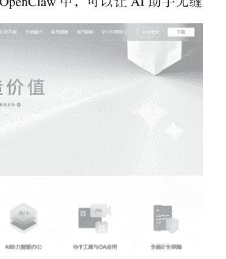

首次使用需前往企业微信官网完成企业注册。打开浏览器访问官网，页面中央有醒目的“立即注册”按钮，点击进入引导页（见图 7-1）。

进入注册页后先填写企业基础信息。企业名称是最关键字段，将作为企业在微信生态中的官方标识，建议填写正式全称。该名称会显示在通讯录、对外名片、客户联系等场景，后续经认证可修改。

随后选择行业，企业微信覆盖互联网、金融、教育、医疗、制造、零售等数十个分类。企业规模可选 1～50 人、51～100 人等区间，仅用于了解基本情况，不限制功能使用（见图7-2）。

完成企业信息后设置管理员，这是注册流程的关键，管理员拥有组织最高权限。需先输入管理员姓名与手机号，手机号须真实有效，后续用于收验证码与安全提醒。

管理员身份通过微信扫码绑定。页面展示二维码，用个人微信扫描后提示是否同意成为该企业管理员，确认后个人微信即与企业微信管理员身份关联（见图7-3）。此设计将企业管理与个人微信打通，管理员可在个人微信接收通知，也能快速切换至企业微信进行管理。

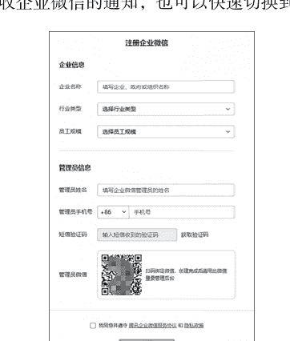


手机号校验是注册的最后安全环节。系统会向填写的手机号发送 6 位验证码短信，通常 60 秒内到达。把验证码填入输入框即可，若未收到可点“重新发送”，注意每个手机号每日发送次数有限，避免频繁操作。

最后点击“注册”，系统自动完成并跳转到企业微信管理后台首页。此时新组织创建成功，页面会展示快速入门指引，包含邀请成员、体验协作工具、安装客户端等说明。

完成上述步骤后，企业微信账号具备开发应用的资质，可开始创建机器人并集成。配置完善的组织不仅支撑日常沟通协作，也为 AI 助手提供稳定运行环境。后续管理员可按需持续优化，添加应用、开通功能，让企业微信真正成为企业数字化办公的中枢。

### 7.2 实战：创建企业微信智能机器人

#### 7.2.1 配置机器人基础信息与API模式

企业微信智能机器人基于人工智能，能快速理解员工提问、提供精准信息，并协助完成重复性工作，帮助员工摆脱繁琐事务。

在已有企业微信账号环境下开始集成。用管理员权限登录管理后台后，在左侧导航找到机器人创建入口，依次进入“安全与管理→管理工具→智能机器人”（见图7-4），进入管理页后点“创建机器人”即可开始配置（见图7-5）。

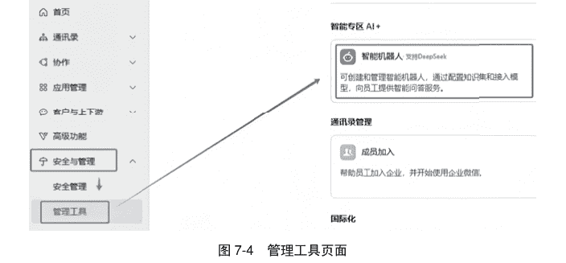

进入创建页后先完善基础信息。名称栏可填“OpenClaw 助手”或自定义，该名称会显示在用户对话列表，建议简洁明了且体现功能。头像支持系统预设图标，也可上传自定义图片，专业且辨识度高的头像有助于提升信任。


简介用于向用户说明机器人的主要功能，可写“AI 智能助手”或更详细描述。该简介会在用户首次接触时展示，清晰说明有助于快速理解用途。

可见范围设置很关键，管理员需在此选择允许使用该机器人的成员或部门，用以控制权限，确保仅授权人员可交互。可设为全公司可见，也可限定特定部门或成员，按业务需求灵活配置（见图7-6）。

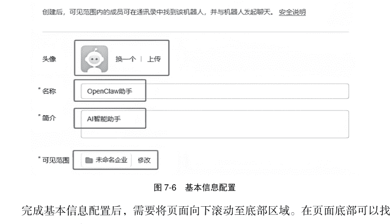

完成基础信息后把页面拉到底部，底部有“API模式创建”按钮，用于开启机器人的 API 功能。点击后机器人即可通过 API 收发消息，这是 OpenClaw 与企业微信联动的底层基础（见图7-7）。相比传统手动配置，API 模式提供更强的自动化能力和更灵活的消息处理机制。

如需通过自有模型分析成员提问并输出回复，可切换至API模式创建

创建 取消

图 7-7 切换创建模式

进入 API 配置页后，可看到 Token 与 EncodingAESKey 两个密钥（见图7-8）。点“随机获取”即可自动生成。Token 主要负责核验请求来源合法性，企业微信每次向 OpenClaw 发送消息时会携带 Token 做身份验证。EncodingAESKey 承担消息内容的加密传输，保证通信安全。两者是安全通信的核心凭证，请妥善保存勿泄露。

获取成员与机器人的聊天后，通过自有模型分析并输出回复。API文档

* URL ⓘ 输入URL，接收消息

为保障企业数据安全，需配置备案主体与当前企业主体相同或有关联关系的域名。配置指引

* Token ⓘ 请输入或随机获取Token 随机获取

* Encoding-AESKey ⓘ 请输入或随机获取EncodingAESKey 随机获取

图 7-8 API 配置

接下来配置回调 URL 地址，即企业微信推送消息的目标地址。若企业微信账号已完成企业认证，URL 必须使用已备案域名，且备案主体需与认证企业一致或有关联，否则会提示“域名主体校验未通过，需配置备案主体与当前企业主体相同或有关联关系的域名”。这是企业微信为保障信息安全设置的强制要求。

假设已有符合要求的已备案域名，并通过 DNS 解析指向部署 OpenClaw 服务器的公网 IP，则可按以下格式配置。注意 URL 必须使用 https 协议，且域名与端口号之间的冒号需为英文半角。

http://您的域名:18789/wecom/bot

配置须知：URL 应使用 http 协议而非 https 协议；冒号需为英文半角；端口号默认 18789，若 OpenClaw 端修改过端口，此处需同步调整；路径固定为 /wecom/bot，为企业微信插件预定义的消息接收路径。

将配置好的 URL 填入管理页的 URL 输入框，并确保 Token 与 EncodingAESKey 已正确填写。完成配置后暂勿点“保存”，需先完成 OpenClaw 端配置，确保服务已启动并能正确响应验证请求。

完成机器人基础信息与 API 模式配置后，企业微信端的准备工作基本就绪。此时已创建具备 API 能力的智能机器人，并生成了安全通信密钥与消息回调地址，后续将在 OpenClaw 联动中发挥作用。

#### 7.2.2 安装OpenClaw插件并完成集成配置

企业微信后台配置完成后，需在 OpenClaw 服务端安装插件并设置参数。这是集成流程的核心技术环节，需准确配置，确保 OpenClaw 能正确接收和处理企业微信推送的消息。

在服务器或本地开发环境终端中，先安装企业微信插件。若使用 WSL，打开 WSL 终端；若直接在 Linux 服务器操作，则通过 SSH 连接。执行以下命令安装插件：

```
Openclaw-cn plugins install @sunnny/wecom
```

执行后系统会从插件仓库下载并安装企业微信集成插件，耗时取决于网络，数秒到数十秒不等。

安装完成后，需编辑 OpenClaw 配置文件以启用企业微信功能。配置文件通常位于用户主目录 .openclaw 文件夹下，路径为 ~/.openclaw/openclaw.json。可使用 vim、nano 等命令行编辑器，也可使用 VSCode 等图形编辑器打开。

在配置文件 JSON 结构中找到合适位置，通常在 channels 节点下，添加以下配置内容：

```json
"wecom": {
  "enabled": true,
  "token": "Token",
  "encodingAesKey": "EncodingAESKey",
  "webhookPath": "/webhooks/wecom",
  "adminUsers": [
    "user001"
  ],
  "commands": {
    "enabled": true,
    "allowlist": [
      "/new",
      "/status",
      "/help",
      "/compact"
    ]
  }
}
```

配置说明如下。enabled 设为 true 表示启用企业微信功能，临时禁用时可改为 false 而不需删除配置。token 需填写企业微信中生成的 Token，用于校验消息来源。encodingAesKey 需填写企业微信中生成的 EncodingAESKey，用于消息加解密。

webhookPath 指定回调路径，保持默认值 /webhooks/wecom 即可，与前面配置的 URL 路径对应。adminUsers 数组用于指定管理员用户 ID 列表，其中 user001 需替换为实际企业微信用户 ID。管理员拥有更高权限，可执行普通用户不可执行的命令。

commands 节点用于设置命令功能。enabled 设为 true 表示启用命令功能，用户可通过特定命令与机器人交互。allowlist 定义允许的命令列表，包含 /new、/status、/help、/compact 等，可按需增删。

保存配置文件后，需重启 OpenClaw 服务使配置生效，可使用以下命令重启：

```bash
openclaw-cn gateway
```

返回企业微信管理后台，在机器人配置页确认 URL、Token、EncodingAESKey 均已正确填写后，点击“保存”。企业微信会向配置的 URL 发送验证请求，OpenClaw 收到后解密验证并返回结果。若配置正确，页面会提示保存成功，机器人创建完成。

配置完成后可立即测试。在企业微信客户端找到刚创建的机器人，进入对话界面，发送测试消息如“你好”，观察响应（见图7-9）。若配置正确，机器人会回复。从服务器日志中可看到 WeCom plugin registering...、WeCom channel registered、WeCom HTTP handler registered 等信息。

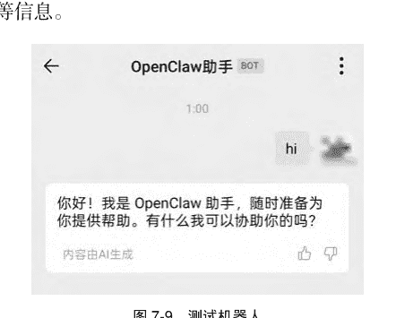

图 7-9 测试机器人

成功收发消息后，企业微信机器人即可正式投入使用。用户可通过自然语言交互，机器人借助 OpenClaw 提供智能问答，帮助员工解决工作问题，实现 AI 赋能办公。

通过以上实操，我们已将 OpenClaw 成功对接到企业微信，创建了功能完整的 AI 智能助手。从插件安装到配置调试，从验证测试到正式使用，每一步都体现了企业级集成的严谨性。员工现可随时在企业微信中与 AI 助手对话，获取智能化支持，这不仅提升效率，也标志企业数字化转型迈出重要一步。

完成部署后，团队拥有了一位真正融入日常工作的智能助手。它无需单独打开，随时待在聊天列表中响应召唤。无论是新员工入职时解答制度疑问，还是业务高峰期自动整理报表，原本需人工处理的琐碎工作均可交由数字同事。企业微信中新增的不仅是机器人账号，更是一套可持续复用的自动化能力。

## 第8章 QQ机器人接入：打造智能社交助手

QQ 作为国内最具影响力的即时通信平台之一，拥有庞大用户基础和活跃社交生态。将 AI 能力集成到 QQ，不仅能触达海量用户，还能在群聊、频道等多种社交场景中发挥智能助手价值。以下系统介绍如何在 QQ 平台创建和部署智能机器人，让 OpenClaw 的 AI 能力在 QQ 上充分发挥。

### 8.1 QQ开放平台账号注册与准备

开发 QQ 机器人前需了解平台优势并完成注册。QQ 开放平台提供丰富接口与文档支持，是连接用户与 QQ 生态的重要桥梁。平台优势包括庞大用户基础、成熟社交生态、开放技术能力与友好开发政策。QQ 拥有数亿覆盖各年龄层用户，地域分布广，粘性强。QQ 群作为高频互动场景，为机器人提供丰富应用空间，使用户易于接受机器人服务。

完成 QQ 开放平台账号注册是开发第一步。需注意，QQ 开放平台采用独立账号体系，并非直接使用个人 QQ 号登录，初次接触者易在此混淆。

访问 QQ 开放平台官网是注册起点。在浏览器打开官方入口，页面可见“登录”与“立即注册”按钮，首次用户需点“立即注册”创建账号（见图8-1）。

点击后系统跳转至注册页，需先填写邮箱地址建立账号，后续可用该邮箱登录。建议使用公共邮箱或企业邮箱，便于团队协作管理。填写完毕点注册后账号创建成功（见图8-2）。随后返回登录页，使用新注册邮箱与密码登录，即可进入系统。

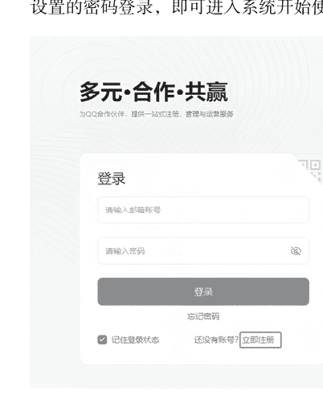

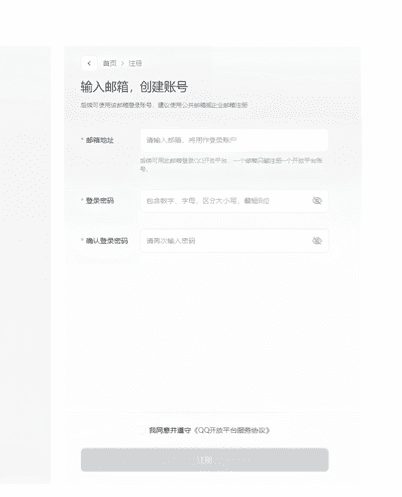

提交注册后，系统进入超级管理员设置环节。超级管理员拥有账号最高管理权限，可绑定 QQ，后续可直接使用 QQ 登录。接下来需填写实名认证信息，姓名、身份证号码、手机号为必填。手机号用于接收验证码及安全验证。输入手机号后点“获取验证码”，系统会发送 6 位数字验证码短信，填入对应框即可完成验证（见图 8-3）。

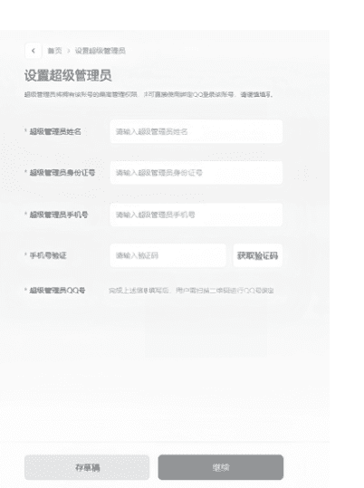

基础资料录入完毕后，系统会进入身份核验环节。此时在超级管理员 QQ 账号下方会出现一个二维码，需要借助手机 QQ 扫码完成绑定，用以把开放平台帐号与已实名的 QQ 账号关联，确保归属真实可信。打开手机 QQ，点击右上角的扫一扫，对准网页上展示的二维码。手机端会弹出确认提示，呈现将要绑定的帐号信息及权限说明，阅读后点击同意。该 QQ 即成为此开放平台帐号的超级管理员，拥有最高管理权限。务必注意，完成扫码的 QQ 必须已完成实名认证，未实名的 QQ 无法通过验证。

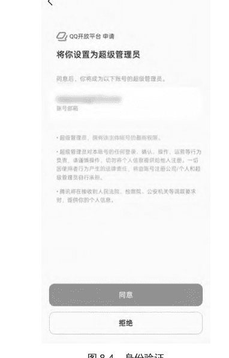


下一步要挑选主体类别并填写对应的认证资料。页面提供企业、个体户、个人三种选择，不同类别会影响帐号功能范围及部分高级权限。个人使用或小规模场景下，选择个人类别通常已足够。确定后需填写姓名、身份证号码用于实名核验，手机号码用于接收验证码及后续通知。确认无误后可点击底部存草稿临时保存，或直接点击继续进入下一阶段验证。

# OpenClaw 对接 QQ 机器人实操指南

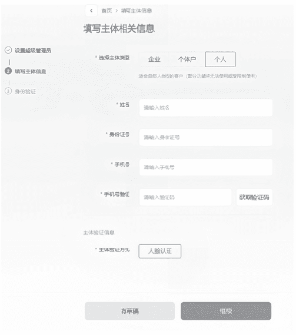

图 8-6 填写主体信息

提交基础资料后，还需完成身份校验，系统默认采用人脸识别方式。只需用手机扫描屏幕二维码，按提示完成人脸比对即可，流程简便快捷。

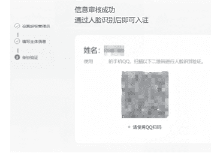


图 8-7 进行身份验证

图 8-8 完成信息认证

校验通过后页面会自动跳转到开放平台控制台，帐号已创建完成，可开始创建和管理机器人。后续登录可使用注册时设定的手机或邮箱配合密码，也可使用已绑定的超级管理员 QQ 扫码快速登录，扫码方式无需输入密码，在手机 QQ 中确认即可完成。

至此 QQ 开发者帐号注册流程全部结束。QQ 庞大的用户基础、活跃的社交生态、开放的技术能力与免费策略，为机器人应用提供了良好环境。掌握注册要点、完善帐号信息，是后续开发的坚实基础。接下来进入实战，开始打造真正的 QQ 机器人。

### 8.2 实战：QQ机器人创建与OpenClaw集成

#### 8.2.1 配置机器人基础信息与沙箱环境

帐号注册与平台准备完成后，即可正式创建 QQ 机器人并展开部署。下面将从机器人创建、基础信息配置、凭证获取到测试沙盒搭建，实现一个功能完整的智能助手。

使用已注册的开放平台帐号登录后，进入机器人管理的核心环节。此阶段需创建机器人应用、配置基础信息、获取开发凭证并设置测试环境。QQ 开放平台提供沙盒机制，允许在正式发布前进行充分测试，以确保功能稳定可用。

登录开放平台后，在控制台首页可看到各类功能入口。顶部导航栏找到机器人标签，点击进入管理页面。首次使用直接点击创建机器人，系统跳转到创建页；已有机器人时页面会列出名称、状态、ID 等信息，点击卡片可进入详情管理。


首要任务是填写基础信息。机器人名称是用户第一印象，建议简洁明了且能体现功能特点，可命名为 OpenClaw 助手，建议使用易记的名称。然后上传一张自定义头像，支持 png、bmp、jpeg、jpg 格式，头像辨识度要高，清晰图标或 Logo 有助于用户快速识别。

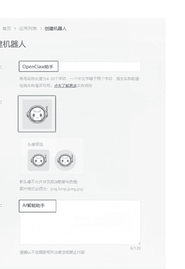

再填写机器人描述，用于向用户说明主要功能和用途，这段说明会在用户添加机器人或查看资料时展示，是了解能力的窗口。简介限制 120 字内，需用精炼语言突出核心功能。

基础信息确认后点击确认并提交，系统会进行审核。审核通过即可继续配置，未通过时会提示具体原因，需按提示修改后重新提交。常见失败原因包括名称含敏感词、头像不清晰或带广告、简介表述不当等。


创建成功后返回开放平台首页，点击顶部机器人标签进入管理列表，刚创建的机器人会显示在列表中，点击卡片即可进入详情管理页，后续所有管理工作都在此完成。

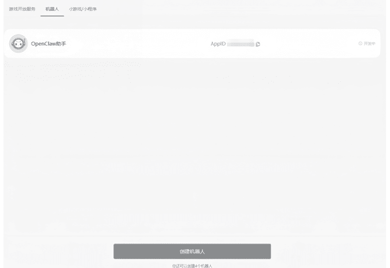

图 8-12 进入机器人管理页面

机器人详情页集中了全部配置与管理功能，是后续工作的核心枢纽。页面分为管理、数据、开发等板块。进入管理→开发管理后可看到与外部服务通信所需的凭证。顶部展示两个关键参数：AppID 即机器人 ID，是平台内唯一的数字标识，用于标记 API 请求来源；AppSecret 是 API 鉴权密钥，相当于机器人密码，必须严格保密。

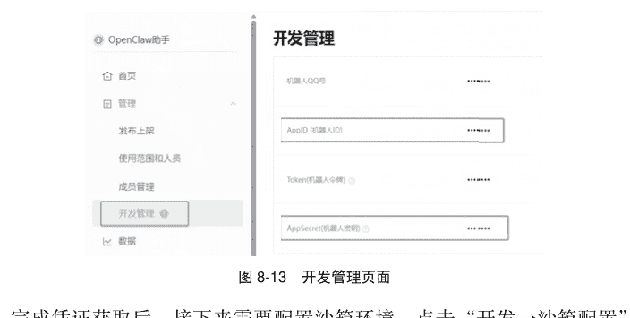

获取 AppSecret 需特别注意安全。出于安全考虑平台不会明文展示完整密钥，首次查看需点击生成，系统会产出随机密钥字符串。该密钥仅显示一次，必须及时复制保存。若遗忘或丢失只能重新生成，旧密钥随即失效，所有使用旧密钥的服务都要更新。建议将 AppID 和 AppSecret 保存于密码管理器、加密文档或团队配置管理系统，严禁提交到公开代码仓库或分享给无关人员。

凭证获取后，接着配置沙盒环境。点击开发→沙盒配置，可在正式发布前进行功能测试。沙盒环境功能与正式环境基本一致，但使用范围受限，只有授权用户或群组能与机器人交互，适合开发阶段的小范围验证。

沙盒配置涵盖两种场景：单独聊天和群聊。单独聊天用于一对一测试，验证基础问答与指令响应；群聊则模拟群组工作模式，可测试群消息接收等。

先配置单独聊天。在沙盒配置页的消息列表配置处点击添加成员，可通过输入 QQ 号或从通讯录选择添加测试用户。添加成功后列表会显示头像、昵称等信息。注意，仅添加成员还不够，被添加用户还需通过 QQ 扫码主动添加机器人。


# 添加成员


# 权限设置


图 8-15 成员权限设置


图 8-16 添加机器人

添加机器人在手机 QQ 端完成。打开手机 QQ，点击右上角加号或扫一扫，扫描页面显示的二维码。QQ 会识别为机器人添加请求，弹出确认界面展示名称、头像、简介，用户确认后机器人会出现在消息列表，双方即可一对一聊天。此时用户发送的消息会被推送到服务端，机器人接收处理后返回响应。


图 8-17 扫码添加机器人

配置群聊场景流程略有不同。在沙盒配置页的 QQ 群配置处，系统会列出与当前帐号关联的 QQ 群，从下拉菜单选择目标群。然后在群设置内进入群机器人→其他，找到该机器人，点击添加即可接收群内消息并响应。


图 8-18 添加使用机器人

图 8-20 添加群机器人


图 8-19 QQ 群配置

沙盒配置完成后，还需完成一项强制安全设置：配置服务器 IP 白名单。只有白名单内的 IP 请求才会被平台接收处理。在开发管理页面找到 IP 白名单模块。


配置白名单前先获取服务器公网 IP。若 OpenClaw 部署在云服务器，IP 可在云服务商控制台查看，也可通过命令行获取。打开终端执行：

```bash
curl -s ipinfo.io/ip
```

该命令会向 ipinfo.io 请求返回当前公网 IP，输出类似 203.0.113.5 的格式。将获取到的 IP 填入输入框即可。

至此，机器人的基础配置与测试沙盒全部就绪。我们已拥有带完整身份的 QQ 机器人，拿到开发凭证，搭建好测试环境，并完成安全访问控制。这些准备为后续 OpenClaw 集成奠定基础。下一步将在服务器端完成扩展部署与配置，让机器人真正运行起来。

#### 8.2.2 部署QQ插件并完成集成对接

完成平台侧配置后，需要在 OpenClaw 服务端部署扩展并设置参数。这是集成方案的技术核心，涉及源码获取、依赖安装、扩展启用、参数配置等步骤。

OpenClaw 的 QQ 机器人功能以扩展形式提供，保持核心系统轻量灵活。QQ 扩展源码托管在 GitHub 上开源提供，基于 Node.js 开发，遵循 OpenClaw 扩展规范，提供消息接收、解析、发送等完整能力。

获取源码的第一步是克隆 GitHub 仓库。若在 Linux 服务器上部署，先通过 SSH 登录服务器，使用终端连接，输入 IP、端口、用户名密码完成登录。连接信息通常在云服务商控制台可见。

登录后切换到 OpenClaw 扩展目录，默认路径为 ~/node_modules/openclaw/extensions：

```bash
git clone https://github.com/sliverp/qqbot.git
```

执行后 Git 会从 GitHub 下载全部源代码与配置文件，并在当前目录生成 qqbot 文件夹。若克隆时网络不佳，可改用浏览器访问仓库，点击 Code→Download ZIP 下载压缩包，解压后放到上述路径。


安装扩展依赖需用 npm 命令。进入 qqbot 目录后执行：

```bash
npm install
```

该命令会依据 package.json 声明自动从 npm 仓库下载并安装所需包，终端会显示进度与日志，耗时视依赖数量与网络而定。


依赖安装完成后，需验证扩展是否被 OpenClaw 识别。返回 OpenClaw 主目录，即包含 openclaw-cn 可执行文件的目录，执行扩展列表命令：

```bash
openclaw-cn plugins list
```

该命令会扫描 extensions 目录，列出已安装扩展及其状态。列表中应出现 qqbot 条目，显示 ID、名称、版本。状态可能为 loaded 或 disabled。若为 disabled，需手动启用：

```bash
openclaw-cn plugins enable qqbot
```

其中 qqbot 为扩展 ID，需与目录名一致。执行后 OpenClaw 会加载配置并注册功能模块，终端会提示启用成功。再次执行列表命令即可看到状态更新为 loaded。


扩展启用后，下一步是配置机器人凭证。OpenClaw 提供命令行配置与配置文件编辑两种方式，命令行更简便。

```bash
openclaw-cn config set channels.qqbot.appId "机器人ID"
openclaw-cn config set channels.qqbot.clientSecret "机器人密钥"
openclaw-cn config set channels.qqbot.enabled true
```

这三条命令分别设置 AppID、AppSecret 与渠道启用状态。引号内需替换为 QQ 开发者平台获取的真实值，AppID 为数字串，clientSecret 为字母数字混合长串，最后一条将 enabled 设为 true 表示启用 QQ 渠道。执行 config set 后 OpenClaw 会自动更新配置，每条命令都会给出成功提示。

配置文件编辑方式适合精细调整。主配置文件位于用户主目录 ~/.openclaw/openclaw.json，打开后可看到 models、channels、gateway 等节点。在 channels 节点下添加或修改 qqbot 配置：

```json
{
    "channels": {
        "qqbot": {
            "enabled": true,
            "appId": "机器人ID",
            "clientSecret": "机器人密钥"
        }
    }
}
```

配置完成后需重启 OpenClaw 网关服务使配置生效。

```bash
openclaw-cn gateway
```

现在可以进行功能测试。用沙盒环境中配置的测试帐号打开手机 QQ 或电脑 QQ，找到机器人对话框或进入测试群，发送一条简单消息如“你好”。若配置正确，机器人会给出响应。


沙盒测试稳定后，如需扩大使用范围，可在 QQ 开发者平台申请正式发布。发布流程包括提交应用审核，通过后机器人即可面向更广泛用户开放。正式发布需遵守平台运营规范，保证服务质量与用户体验，避免违规内容。

通过以上实战，已完整实现 QQ 机器人与 OpenClaw 的集成对接。从创建到配置，从扩展部署到功能测试，每个环节都有明确说明。现在一个功能完整、响应及时的 QQ 智能助手已部署完成，可为 QQ 用户提供 AI 驱动的智能服务，无论是知识问答、信息查询还是创意生成，都能给出准确有价值的回复，真正实现 AI 技术在社交场景的落地。

我们把 QQ 平台机器人从筹备到上线的完整链路拆开讲，涵盖创建、参数配置到投产发布的全过程，理论讲解与动手演示并行。QQ 生态用户体量大、社交活跃，为 AI 落地提供了宽广空间。借助 OpenClaw 与 QQ 的衔接，智能助手能够触达更广人群，在更多业务场景里创造价值。

# 第4篇
部署与迭代，让智能体长期在线

# 第9章
效果评估与持续迭代

当 AI 真正进入商业使用，衡量表现并持续改进是保证长期稳定与价值放大的关键。随着 OpenClaw 这类自主智能体框架的快速演进，如何科学判断智能体的作业质量，成为用户与企业共同关注的焦点。评估不能只看最终输出，还要拆解执行路径、效率与体验等多维度。下面系统梳理智能体评估的方法论、核心指标与落地策略，帮助搭建完整的评价体系，推动智能体持续优化并放大业务价值。

### 9.1 智能体表现该如何衡量

评判智能体要兼顾技术、业务与体验三个层面。传统评估难以适应自主式智能体，OpenClaw 将大语言模型与系统服务融合，推动 AI 从纯对话走向实操。评价体系应聚焦三大核心：任务达成率、用户满意度、耗时。达成率体现执行能力，满意度体现服务质量，耗时体现效率。满意度涉及交互质量与响应速度，耗时涉及处理时长和交互轮数，越少越好。评估需融合技术防护、业务检验、伦理合规与迭代优化，同时关注本地运行的可靠性与多通道的稳定性（见图9-1）。

除三大核心外，还需补充其他指标让评价更立体。工具调用准确率衡量智能体调用工具的正确性与必要性，在 OpenClaw 的 Skills 体系里尤为关键。比如物流配送场景，调度智能体规划路线时调用路况查询、天气预报的必要比例，就是工具调用准确率的体现。若 100 次规划中有 78 次调用是为了提升效率，则准确率为 78%。决策准确率衡量多步推理中每一步的正确比例，适用于复杂决策。比如法律咨询场景，法律顾问智能体研读案卷、检索法条并给出初步意见时，各推理环节的正确比例即为决策准确率。


规范与安全维度也要纳入，比如偏见发生率。在信贷审批场景中，贷款审核智能体对申请人是否出现地域或职业偏见，需要被监控。若 1000 份申请中有 25 份因不合理偏见被错误拒绝，偏见率就是 2.5%。对于开源框架，还需特别关注技能市场的风险，这类安全问题必须写入评估体系。

评估方式要根据目标搭配使用。端到端评估把智能体当黑盒检验最终回复是否达标，结果直观但成本高、难定位问题。模块评估按步骤测试组件，便于定位且成本低，但难以反映整体业务效果。轨迹评估记录完整过程，信息最全面但耗时长、标准难定。实际选择上，初期或核心业务宜结合端到端与轨迹分析；持续改进阶段侧重模块测试；日常运维可结合过程监控与结果指标；资源受限时以端到端为基准，辅以模块检测和抽样复盘。对 OpenClaw 这类架构，需要针对其特性定制评估方案（见图9-2）。

评估应基于真实场景数据搭建测试集，并按任务复杂度设定完整的推理步骤。人工评估准确但成本高，可用强模型代评。关键在于核查工具选择、信息传递和答案准确性。评估的落脚点是持续优化，通过结果分析改进表现，指导技能开发与场景拓展（见图9-3）。

综合来看，除任务达成率、用户满意度、耗时外，工具调用准确率、决策准确率、偏见发生率等辅助指标共同构成多维体系。需按业务优先级和资源情况灵活组合，建立适配的评估框架，为后续优化提供支撑，实现性能提升和价值最大化。

## Agent 全面评估体系框架 (Comprehensive Evaluation Framework)


## Agent 评估与持续优化：从准备到场景拓展


### 9.2 迭代循环：发现问题并优化

#### 9.2.1 提示词清晰度提升

提示词的表达清晰度直接决定智能体表现。在 OpenClaw 场景中，提升提示词精确性是最直接有效的改进手段之一。通过复盘失败案例、收集用户反馈、监控性能数据，可以找出模糊表述和遗漏点并针对性优化。

优化需遵循清晰性、相关性、预期性。清晰性要求用具体措辞替代笼统描述，比如把“写环保文章”改成“为社区居民撰写倡议短文，主题是减少塑料使用，需包含数据和三条建议”。相关性要求提供背景信息，例如让智能体扮演物理助教，用比喻向新生解释量子叠加与纠缠，避免复杂公式。预期性要求明确输出特征与约束，如长度、风格、需包含或排除要点。例如介绍西安事变，弱提示是“介绍一下西安事变”，优化后是“用不超过300字概述西安事变的背景、经过和历史意义，重点突出张学良、杨虎城的作用，避免对蒋介石的个人评价”。约束越明确，输出越贴合期待。

格式规范要指定输出形式，如列表、表格、JSON 等，提升可读性和可用性。在 OpenClaw 中格式要求尤为重要，因为智能体常需生成可直接使用的数据或代码。比如生成员工信息表，可明确“以 Markdown 表格输出，列为姓名、工号、部门、入职日期、职级”。

测试原则强调实际运行验证并迭代。在 OpenClaw 的迭代循环里，测试是必备环节，能暴露潜在问题并验证优化效果（见图9-4）。

## CLEAR 框架：提升提示词效率


结构化提示词应包含背景角色、任务目标、输出内容与格式限制，以提升清晰度。角色设定可引导专业领域，如资深营养师。任务说明要具体说明预期结果，如文本生成、翻译等，避免歧义。明确输入输出格式能减轻模型理解负担，确保结果符合预期（见图9-5）。

## 结构化提示词的关键要素


模糊措辞是提示词不清的主要原因。常见模糊表达有“差不多就行”“再优化一下”“弄得漂亮点”“你随便弄”“处理一下”等，让模型难以把握真实意图。

识别并替换模糊表达是提升清晰度的关键。模糊形容词应换成明确的风格或场景描述。例如“高端一点”改为“面向企业高管，注重品牌调性”；“生动一点”改为“风格活泼，多用比喻拟人，适合社交媒体传播”；“快一点”改为“30分钟内完成，优先核心步骤”。具体描述让模型更准地把握要求。

在使用 OpenClaw 的实战中，避免歧义尤为重要，因为智能体要执行具体操作。例如“整理文档”过于模糊，应具体化为“读取 D:\工作报告\季度总结.docx，提取‘业绩达成’和‘存在问题’两章节，合并为新文档保存至 D:\整理文件夹\summary.docx”。描述越具体，执行越准确（见图9-6）。

## 用精准描述替代模糊表达


指令动词是提示词的核心，直接告知模型要做什么。不同任务类型应选用不同的动词。

数据查询类推荐“列举、归纳、抽取、阐述”，如“列举本月各销售团队业绩排名”比“分析销售情况”更清晰。内容创作类推荐“撰写、拟定、策划、创建”，如“撰写市场调研报告”比“做个市场总结”更具体。文本优化类推荐“重写、修饰、转换、压缩”。评估决策类推荐“评估、推断、提议、对比”。格式规范类推荐“采用 Markdown 排版、构建表格、导出为 JSON 格式”等动词短语。

在 OpenClaw 智能体设计里，动词选择影响行为模式。例如系统操作时，“执行命令：dir C:\Users\Public\Documents”比“查看公共文档目录”更明确，减少误解（见图9-7）。

用高辨识度分隔符划分提示词模块，有助于模型解析边界。常见分隔符有“###、===”“#背景#”“#输出要求#”。例如用“#角色#”界定角色设定，用“======”分隔常见问题库，结构化划分让模型更清晰理解各部分。

## 指令动词决定执行效果


在 OpenClaw 的 Skills 设计中，分隔符号使用尤为重要。Skills 通常包含角色设定、任务描述、工具调用、输出要求等，用清晰分隔符可提升解析准确性和执行效率（见图9-8）。


在提示词中附带期望输出样例，能引导模型参照规范、格式、语气生成内容，尤其适用于格式或风格要求明确的任务。

提供样例可采用单样本或小样本学习，在提示中给出明确示例帮助模型理解目标和预期形式。举例来说，撰写项目计划书时附上标准模板，模型即可按结构和风格生成。

在 OpenClaw 实际应用中，输出样例对确保 Skills 正确执行很重要。例如数据库查询 Skills 中提供成功执行样例，模型可学习正确的数据格式和字段要求（见图9-9）。

## 用示例引导输出更稳定


复杂任务需明确拆分步骤，降低难度并提升准确性。步骤分解就是把复杂任务细化为若干独立清晰的子任务。

以撰写行业分析报告为例，可拆分为选定主题、搜集资料、设计框架、数据处理、撰写初稿、修改完善等阶段。

在 OpenClaw 智能体设计里，任务步骤的明确设定对复杂任务执行至关重要。设定“第一步读取数据文件、第二步数据清洗、第三步统计分析、第四步生成报告”等顺序，能确保各环节正确处理（见图9-10）。

## 复杂任务拆解提升清晰度


处理逻辑推理或分析类任务时，引导模型展示思考路径或逐步推导，能显著提升质量。让模型先呈现中间推理依据，再给出结论，可增强复杂问题的表现。

思维链是经典方法，要求模型先展示一步步推理再输出答案。少样本思维链在提示中提供带推理步骤的示例，零样本思维链仅靠提示词如“让我们一步步思考”激发推理。

在 OpenClaw 智能体设计中，思维引导有助于完成多步决策，提升决策准确性和可靠性（见图9-11）。

即便提示词优化完成，仍需在线上持续收集反馈并调整，才能更好满足用户需求。迭代分析是优化的重要环节，基于实际使用问题不断改进设计。

失败案例分析是迭代优化的关键。通过分析智能体误解意图、操作错误、输出不合规等案例，可找到提示词的模糊点、歧义点或不完整性并针对性优化。

## 思维链引导推理过程


在 OpenClaw 的迭代循环里，日志分析是发现失败案例的重要途径。执行日志记录指令、步骤、工具调用、结果等，分析日志可揭示问题，为提示词优化提供依据（见图9-12）。

## 提示词优化的持续迭代闭环

(Continuous Iteration and Analysis Loop for Prompt Optimization)


OpenClaw 属于开源自主智能体平台，内置多项独特的提示词优化技术，能显著提升执行精度与运行可靠性。

角色锚定法在系统消息中明确 AI 身份、能力边界和输出规范，减少幻觉和格式偏差，在 Web 界面或即时通信工具中下指令时效果明显。操作时可用三段式：第一行系统角色设定，第二行用户指令，第三行留空由 OpenClaw 补充响应。

三层对话结构把指令拆解为系统、用户、助手三层嵌套，引导稳定推理。实现时构造 JSON 消息数组，按顺序排列系统规则、用户任务、助手示例。

参数固化法在命令行或文本模式下把温度值等采样参数绑定，抑制随机性，保证相同输入输出一致。适用于定时任务场景，通过 SSH 登录后设定参数再输入指令。

多模态锚点法利用图像描述、时间戳、URL 片段等非文本信息作为锚点，增强上下文感知，适用于截图分析、网页快照比对等任务。例如发送含表单字段的网页截图，再要求模型基于截图生成自动化代码。

指令白名单法在提示词中声明允许调用的系统命令集合，结合 Shell 执行引擎，既防越权又提升解析准确率。操作时在 Web 技能编辑页新建指令，写入明确白名单和任务描述（见图9-13）。


图 9-13 OpenClaw 特有的 Prompt 优化技术

真实场景剖析能更清晰展示提示词精度提升路径。以智能招聘助理为例，原始提示“帮助筛选简历”过于笼统。改进后可构建为明确角色定位、具体目标、执行准则、交付格式和演示案例的完整提示，显著提升稳定性和处理质量。

```
#角色定位#
你是一位企业人力资源部门的智能招聘助理，专门负责处理岗位发布、简历初筛、面试安排等工作。你具备迅速、精准识别候选人资质的能力，能够依据岗位要求给出专业的筛选建议。

#核心目标#
精准识别候选人资质，给出符合岗位标准的筛选建议，提升招聘效率。对于特殊情况，标记并提交人力资源专员审核。

#执行准则#
首先判断简历的完整性：基本信息、教育背景、工作经历、技能证书
依据简历完整度选择相应的处理策略
信息完整的简历：对照岗位需求进行匹配度评估
信息不全的简历：标注缺失项并建议补充材料
资质匹配的简历：评估候选人优势并推荐进入面试环节
资质不符的简历：说明不匹配原因，提供改进建议或推荐其他岗位
所有筛选必须基于岗位标准，不得掺杂主观偏见

#交付格式#
开场说明：已收到您提交的[岗位名称]应聘材料
资质评估：您的[具体方面]符合/不符合岗位要求...
处理建议：依据岗位标准，建议您...
后续流程：如果您对筛选结果有疑问...
结束提示：祝您求职顺利！

#实例演示#
应聘者：我应聘的产品经理岗位审核进度如何？
助理：已收到您提交的产品经理岗位应聘材料。您的3年互联网产品规划经验和用户研究背景符合岗位基本要求，项目管理能力展现充分。依据岗位标准，建议您补充提交近期负责的产品案例详情和数据成果，以便更全面地评估您的实战能力。材料补充完成后，预计在5个工作日内安排初步面试。如果您对筛选标准有疑问，可联系招聘专员详细沟通。祝您求职顺利！
```

优化提示词清晰度是提升 AI 性能的基础，直接影响理解与执行。通过结构化设计、消除歧义、精准用词、提供样例等方法可提升质量。在 OpenClaw 应用中需结合场景采用针对策略，并基于反馈和数据建立持续优化机制。掌握这些方法对提升智能体性能至关重要。

#### 9.2.2 增加或改进 Skills

# 让 OpenClaw 持续变强的核心抓手：Skills 迭代

OpenClaw 每次版本向前推进时，补充或重塑 Skills 都是拉开能力边界、让任务更快落地的关键动作。Skills 实际上是 OpenClaw 的插件形态，由 YAML 配置与 SKILL.md 文档共同构成的规范化目录，用来告诉智能体如何调用工具、完成特定工作。把 OpenClaw 与大模型结合理解为给助手赋予思考能力，那么 Skills 就是赋予其动手能力，是把意图转化为实际操作、拓展功能半径的根本载体。ClawHub 作为公开技能中心，统一负责发现、安装、升级与备份。技能仓库体量庞大，真正的进化速度取决于能否基于日志与真实场景，精准地增补或改进 Skills。

搞清楚 Skills 的加载分层是改进的前提。系统默认加载三类来源并遵循固定优先级：最优先为工作区级技能，其次是用户本地托管目录 ~/.openclaw/skills，最后才是内置技能。优先级高的同名条目会覆盖低层级条目，同时配置文件还支持挂载额外目录来扩充来源。分层既稳住基础能力，也为个性化定制留出空间。实践中可依据日志暴露的卡点或缺口，在合适的层级增删 Skills。例如文件操作效率偏低时，可在工作区层放置优化版文件处理技能覆盖默认实现。

日志是挖掘改进需求的直接入口。日志完整记录了指令接收、工具调用、执行结果与错误信息。系统化梳理就能定位失手场景、需要更专业支持的环节以及现有 Skills 的性能瓶颈。

常用分析维度包括失败占比、耗时、工具调用频次、错误类型分布。以邮件分类为例，若日志显示反复失败，就提示邮件管理技能需要升级；文件处理耗时偏长，则要优化读写算法或引入缓存；某工具被高频调用却效果不佳，则要重构逻辑或调参。量化这些指标能够科学排定改进顺序与方向。

日志还能反映使用行为与需求迁移。回顾人机交互历史，可看出哪些功能被高频使用、哪些被冷落、哪些新需求在冒头。例如用户越来越多要求处理视频文件，而现有 Skills 几乎没有覆盖，就应考虑接入视频处理能力。这种基于真实使用数据的判断，让改进更具针对性与实用价值（见图9-14）。


OpenClaw 的学习方式更接近人类。传统系统只能在预设工具中挑选，而 OpenClaw 通过“观察-行动-纠错-固化”闭环自适应陌生任务：遇到未知需求时自行编写代码、测试并修正错误，成功后沉淀为可复用技能，类似学徒把手艺内化为本能。

由此，技能开发呈现出新型人机协作形态。先让系统学习并深度消化相关资料，真正理解任务原理；再在引导下写出代码雏形。调试阶段把报错回抛给它，它会像固执的工程师一样反复推敲、修改直至跑通。技能稳定后，它还会主动把实现步骤、踩坑记录、总结技巧更新到文档中。这种方式大幅降低创建门槛，非专业用户也能像带实习生一样培养专属数字技工。

落地到具体实现，有几点必须重视：功能边界要清晰，明确能做什么不能做什么；输入输出要规范，进来什么格式、出去什么结构；容错要足够强，对网络超时、文件损坏、权限不足等异常要有预案；运行效率要达标，大文件处理、多人并发、中途崩溃恢复都要考虑。一个成熟技能本质是小而美的软件模块：接口清晰、运行稳定、可与其他模块协作。例如开发文件处理 Skill 时，需定义支持类型、操作权限、处理逻辑与输出格式，同时兼顾大文件、并发访问与错误恢复等真实场景（见图9-15）。


Skills 表现直接影响整体执行效率。借助日志定位瓶颈并针对性优化，常见手段包括算法优化、缓存、并行处理与资源管理，其中算法是基础。对数据处理类 Skills，可优化数据结构与复杂度；对网络请求类，可优化请求策略与连接复用；对文件操作类，可优化读写缓冲与磁盘 I/O。通过分析耗时与资源占用，能找到痛点并改进。

缓存可显著降低重复计算与网络开销。对访问频繁且变化缓慢的数据，加缓存层可减轻后端压力。例如天气查询可缓存近期结果，时效内直接返回，避免重复请求；文件处理可缓存元数据，避免重复读取。缓存策略需结合数据特性与时效要求，在性能与准确性间取得平衡。

并行处理提升多任务效率。系统通过多线程与多进程动态调节并发数，适合批量文件处理、多站点抓取等场景，但需关注资源竞争与同步以保证正确性与稳定性。

资源管理涵盖内存、CPU 调度、网络连接。Skills 应合理使用系统资源，及时释放不再占用的资源，避免泄漏与耗尽。对资源密集型任务，可加入限制与监控，防止单任务占用过高影响整体稳定（见图9-16）。

## Skills 调优：提升响应与稳定性


图 9-16 Skills 性能优化与效率提升

安全性是优化的底线。OpenClaw 作为系统级智能体，其 Skills 安全决定系统边界。防护需多维度构建：输入校验是第一道防线，应严格过滤外部输入防范注入风险，如限制路径、过滤命令参数；权限管控划定操作边界，每个 Skill 需声明权限等级并校验，平台支持细粒度管控并遵循最小权限原则；故障隔离防止风险扩散，Skills 应在独立进程或容器运行，Docker 部署可提供隔离环境；审计日志用于溯源，需记录操作时间、身份、参数等，便于诊断与威胁识别（见图9-17）。

## Skills 安全防护：系统级智能体的四层防线


图 9-17 Skills 安全性与可靠性改进

改进后需全方位验证，覆盖功能、性能、安全与兼容性。功能测试通过单元、集成与端到端用例确保预期行为；性能测试在真实负载下评估响应时间与错误率；安全测试检验常见攻击向量的防护能力；兼容性测试验证不同环境与配置下的适应性；回归测试保证改动不引入新问题，自动化测试提升效率（见图9-18）。


Skills 迭代是能力成长的核心，决定执行效率与范围。通过日志分析、迭代开发、场景化策略与多层面优化，可系统提升 Skills 质量。掌握改进方法对释放智能体潜力至关重要。

图 9-18 Skills 的测试与验证

#### 9.2.3 任务拆解逻辑的优化方向

在演进过程中，优化任务拆解逻辑是增强规划与执行效能的关键。任务拆解是赋能规划的核心工程手段。大模型应用的共性是：真正强大的智能体不在于生成内容，而在于生成可执行方案。只有善拆任务的 Agent 才能完成复杂目标。提示词解决单点问题，工具链解决执行问题，状态机与工作流解决流程执行问题，而真正的强 Agent 能自主制定执行流程。优化拆解逻辑，能让智能体从被动接受指令进化为自主规划完整流程。

任务拆解可归纳为三层。第一层是语义层，拆成认知层面的语义步骤，如制定周健身计划拆为评估身体状况、设定目标、挑选项目等，属于抽象描述而非可执行步骤。第二层是操作层，拆成可执行动作，如查询健身知识、设计训练方案、安排时间表、给出饮食建议等，是 AI 常用方式但未绑定具体工具。第三层是执行层，拆成工具→状态→输入的组合，如调用工具输入身体数据返回体能评估报告等。

架构天然适配三层模型。其价值在于把大模型的逻辑推理能力转化为对操作系统、软件 API、硬件设备的实际控制。采用网关-节点解耦架构，稳定性和响应依赖两个核心组件：Gateway 作为持久化 WebSocket RPC 服务端，负责消息路由、并发会话管理、LLM API 调用，主要处理语义层和操作层规划；Agent Runner 负责解析指令并触发本地操作，如执行 Shell 命令、操控浏览器，对应执行层工具调用。

该分层为三层拆解提供技术支撑：Gateway 处理语义理解和操作规划，Agent Runner 完成从抽象指令到具体工具调用的“最后一公里”，实现从认知到执行的闭环（见图9-19）。

当前大模型 Agent 的任务分解大致有四种典型方式。第一种是零样本规划，直接让模型生成执行计划。优点是快、简单、成本低，缺点是结果不稳定、步骤跳跃、易缺失，适合简单任务和小规模自动化。

## 从认知到落地：三层拆解与架构协同


强大的 Agent 核心在于自主制定执行流程，从认知到执行的完整链路中，Gateway 负责语义和操作层，Agent Runner 负责执行层。

第二种是 ReAct 规划，流程为“推理+行动+状态更新”。模型先推理下一步动作，调用工具获取环境反馈，再据反馈继续拆解。优点是灵活性强、动态可调；缺点是成本较高，长任务易“烂尾”。OpenClaw 采纳 ReAct 模式，能从容应对复杂非线性任务。推理时分析当前状态决定动作，行动时从技能库选取工具并输出参数，观察时调用工具并回传结果，循环中判断是否继续或收敛。

第三种是结构化规划，用 XML 或 JSON Schema 定义流程。优点是可控性强、结果可解析、易对接工作流和状态机；缺点是模板设计需经验。适用于内容生成、工作流自动化、企业级 Agent 和多 Agent 协作。

第四种是示例驱动规划，通过样例引导模型模仿拆解。优点是执行稳定、结构清晰、可控性强；缺点是依赖样例积累，泛化可能不一致。适合流程明确或跨领域规划场景。商用系统中常将结构化规划与 ReAct 结合，前者保稳定，后者提灵活性（见图9-20）。

## Agent 任务规划的四种主流范式


图 9-20 四种主流任务分解技术在 OpenClaw 中的应用

在代理层级设计上，可在配置中显式定义不同角色并分配独立执行通道。多 Agent 架构与“Agent + Skills”五步框架契合：

第一步拆分，把复杂任务解构为原子能力，为每个子 Agent 赋予单一职责技能。如软件开发可拆为需求分析员、架构师、开发人员、测试员、代码审查员，避免“万能 Prompt”混乱。

第二步编排，用自然语言描述协作逻辑而非硬编码。主 Skill 可写：“先调用需求分析员解析文档，基于结果让架构师设计方案；各模块并行启动开发人员编码；完成后依次调用测试员与审查员。”系统能将条件分支和循环语义转为可执行协同。

第三步存储，关注中间状态持久化。将各步输出保存为本地文件，如 requirements.md → architecture.md → module.py → test_report.md → review_comments.md，实现可追溯与断点续传，也为人机协作提供入口，人工可随时修改中间文件，Agent 读取后继续执行，形成“人在回路”。

第四步分配，解决大规模并行时上下文爆炸。配置中强制子 Agent 间只传递文件路径而非内容，各自按需读取。多个开发 Agent 可同时读取同一架构文件并行开发不同模块，保持上下文纯净并实现真实并行。

第五步迭代，赋予自我进化闭环。发现 Skill 效果不佳时，可用自动化工具读取日志并重写 Prompt。随着使用，Agent 不断修正 System Prompt，系统越用越强，避免静态工作流建成即落后。通过上述优化，多 Agent 协同可落地为可扩展、高鲁棒的企业级方案（见图9-21）。

像“跨平台社交媒体内容同步发布”或“多城市展会行程协调”这类长链条复杂任务，系统如何应对？得益于工程化编排。

## 企业级多代理协同配置思路


首先是动态规划。面对在微博、公众号、小红书同步发布新品的任务，不会一次性给出答案，而是生成任务队列：提取素材与图片、模拟登录各平台、按平台格式调整内容、设置定时发布、等待完成并抓取链接、汇总状态生成报告。

其次是异步执行与状态保持。设置定时发布后需等待触发，具备长期会话保持能力，可挂起等待定时器，到点自动唤醒继续后续步骤，无需人工干预。

最后是人机协作。内容调整完成后、正式发布前，会通过企业微信或钉钉发送预览请求确认。只有收到“确认发布”指令，才继续执行。这种编排兼顾自主性和人类掌控。

工程化编排需要合理配置支撑。在 gateway 配置中可设 sandboxMode 为 all，lanes 配置 main 车道和 parallel 车道，main 车道 concurrencyLimit 为 1、priority 为 high，parallel 车道 concurrencyLimit 为 8、priority 为 normal；session 的 dmScope 设为 per-channel-peer。该配置确保任务有序执行与资源合理分配（见图9-22）。

## 工程化编排长链路任务


优化任务分解逻辑是提升规划与执行能力的核心。三级模型、四种技术、多 Agent 协同与工程编排共同提高分解质量。递归进化机制可将新任务转化为长效记忆，系统评估与持续迭代增强可靠性，用户掌握评估方法能更好发挥智能体价值。

# 第 10 章 国产 Claw 生态：云边协同下的龙虾矩阵

随着 AI Agent 技术持续演进，围绕 Claw 协议构建的国产生态正呈现百花齐放态势。多家头部厂商相继推出各具特色的解决方案，从云端托管到桌面客户端，从零门槛入门到深度企业集成，不同产品在定位与能力上形成鲜明差异化竞争格局。

国产Claw生态：五条主线各有侧重

国内Claw赛道已呈现多元化分化，五家厂商走出了不同的打法（见表10-1）。Moonshot AI 推出的 Kimi Claw 走在线托管路线，主打免配置上线与 Kimi K2.5 的超长对话记忆及多智能体协同，适合新手快速尝鲜；MiniMax 的 MaxClaw 以积分制或订阅制做性价比，技能库丰富且可快速对接飞书、钉钉，不过初期存在积分使用规则不够清晰、偶发响应变慢的状况；腾讯的 QQClaw 嵌入 QQ 生态，支持对话问答、文档解读、定时提醒，轻量任务体验贴合社交场景；阿里云的 CoPaw 基于通义千问提供可自改版本，聚焦微信与飞书联动，采用免月费、按量付费的计费方式；网易有道的 LobsterAI 推出桌面图形客户端，降低上手难度并接入 Claude SDK，在推理与复杂任务上表现突出，且有大厂背书。

### 表 10-1 国产 Claw 对比表

| 产品名称 | 所属厂商 | 核心定位 | 优势 | 适用人群 |
| :--- | :--- | :--- | :--- | :--- |
| Kimi Claw | Moonshot AI | 在线托管；免配置启动 | 不需自建环境，即开即用；Kimi K2.5 上下文窗口极长；原生支持多智能体协作流程 | AI 入门用户；想快速体验多体协作的个人开发者 |
| MaxClaw | MiniMax | 性价比导向；办公融合 | 积分或订阅计费灵活，支出可控；内置大量预设技能；可快速连通飞书、钉钉 | 重视成本效益的企业团队；需要打通办公系统的业务场景 |
| QQClaw | 腾讯QQ | 社交内嵌；轻量任务 | 直接在 QQ 内调用，无需切换；支持智能问答、文档解析、定时提醒；社交使用流畅 | QQ 重度使用者；在社交环境完成轻量智能任务的个人 |
| CoPaw | 阿里云 | 开源可调；成本按量 | 源码开放可按需定制；免月费，按实际 API 调用结算；支持微信、飞书接入 | 技术背景开发者；对预算敏感的早期探索团队 |
| LobsterAI | 网易有道 | 桌面图形客户端；易用为先 | 图形界面操作，无需编程；集成 Claude SDK，推理与复杂任务表现突出；大厂品牌加持信任度高 | 追求简便操作的非技术用户；偏好大厂方案的个人与小团队 |

整体来看，各家已形成清晰分工：Kimi Claw 注重新手体验与多体协同，MaxClaw 面向成本敏感的企业用户，QQClaw 服务社交内的轻量需求，CoPaw 为技术用户提供高度自由的开源选择，LobsterAI 则以桌面端易用性见长。这种多元竞争既反映了国内厂商在智能体底座的积极布局，也为不同背景的用户提供了匹配的选择空间。

### 10.1 云端托管方案：零门槛的生产力跃升

#### 10.1.1 五分钟上手：打造你的专属AI小帮手

Kimi Claw 面向大众用户，核心卖点是免代码、全部运行在云端、点一下即可部署。三项特性直接消解了传统 OpenClaw 在服务器配置、环境搭建与开发上的门槛，即便零基础也能在很短时间内拥有专属助手。

-   ◎ 步骤1：升级会员，拿到试用权限
Kimi Claw 目前仍在公测阶段，还未全量开放。要体验需要先把账号升至 Allegretto 等级或更高。升级后会获得一个云端运行的智能体实例，可 7×24 小时在线，不受本地设备开关影响。在 Kimi 主界面能找到升级入口（见图10-1），点击后跳转订购页（见图10-2），按提示完成支付即可。


图 10-1 升级体验 Kimi Claw 界面


图 10-2 订购 Allegretto 界面

-   ◎ 步骤2：点按创建专属智能体
会员开通后进入创建流程。打开 Kimi Claw 官网，进入创建页（见图10-3），左侧导航栏可找到 “Kimi Claw” 入口。


图 10-3 Kimi Claw 创建界面

页面中央的“创建”按钮会触发云端部署，耗时约30至60秒（见图10-4）。期间后台自动完成环境初始化、资源分配和服务启动，无需人工干预。


图 10-4 创建界面

部署完成后自动进入持续对话界面（见图10-5），助手已就绪，可直接输入问题。因为运行在云端，关闭浏览器也不会中断，下次打开仍可继续使用。


图 10-5 创建完成后使用界面

从升级到创建全程只需数分钟，Kimi Claw 把技术细节藏在后台，让用户只关注使用体验，显著降低门槛。

#### 10.1.2 核心功能与实操案例

Kimi Claw 不只是聊天工具，而是一个具备执行能力的智能代理。核心能力包括长期记忆、定时任务、技能安装和文件工作区。长期记忆可在多轮对话中保留上下文；定时任务支持按预设时间自动执行；技能安装可按需扩展功能；文件工作区提供文档读写和管理空间。四者配合，使其从被动应答转向主动执行。

### 场景1：定时信息监控与推送
信息更迭快，持续追踪某领域动态成本高。借助定时任务，这类工作可交给助手自动完成。例如可下达指令（见图10-6）。


收到指令后，Kimi Claw 会在后台建立类似 Linux cron 的定时任务（见图10-6）。在此例中，每天早上9点自动检索与大语言模型、多模态AI相关的最新论文、模型发布和工具更新，提炼出五条最有价值要点后推送给用户，全程无需人工干预，有效提升信息获取效率。

### 场景2：自动化数据处理与报告
定期查询、整理股票行情是重复劳动。Kimi Claw 可把流程自动化。用户只需发出类似指令（见图10-7）。


指令发出后，助理接入金融数据 API，在每个交易日收盘后抓取指定股票的收盘价、涨跌幅、成交量等指标（见图10-7）。

随后自动写入飞书多维表格，保持数据持续更新，并基于历史数据生成简要趋势分析，为投资决策提供参考。

从以上场景可看出，价值在于把需求转化为可自动执行的流程，在信息监控、数据处理、报告生成等方面发挥实质作用，让用户从重复劳动中解放。

#### 10.1.3 常见坑点与规避建议

Kimi Claw 仍处公测阶段，实际使用会出现典型问题。

- （1）任务被遗忘
部分用户发现任务未执行甚至丢失，根因是任务未写入记忆文件。长期记忆依赖文件化存储，若仅停留在对话层就会随上下文丢失。交办任务时应明确说“请记下来，截止时间为X点”，并要求助手复述确认。建议每日首次对话时，先让助手读取当日任务文件，核对待办清单。

- （2）输出内容偏离预期框架
给出明确框架后输出不符，通常缺少复述确认环节。建议采用“先复述、再执行”的流程，先让助手复述理解内容，确认无误后再执行，可有效减少偏差。

技术限制方面，目前部分带反爬虫的网站会拦截访问导致抓取失败；生成的图表文件有时路径不可直接访问；定时任务日志和故障可见性有限，异常时难定位。因此设置重要任务时，建议建立人工复核机制，定期检查执行状态与结果。

### 10.2 自建云部署方案：更强掌控的进阶之路

对于希望在部署灵活性和系统掌控上获得更大空间的用户，阿里云提供的 OpenClaw 专属应用镜像是一个进阶选项。OpenClaw（原 Clawdbot/Moltbot）是成熟的智能体框架，阿里云的镜像把环境配置和依赖安装封装好。用户只需轻量应用服务器即可部署 7×24 小时在线的自然语言驱动自动化助手。相比 Kimi Claw 的全托管，此方案自主权更高，同时操作门槛仍较低。

#### 10.2.1 核心部署流程（基于轻量应用服务器）

思路是购买预装 OpenClaw 镜像的阿里云轻量应用服务器，再做少量配置即可上线。

- 步骤1：购买与创建实例
访问阿里云 OpenClaw 专属部署页，或进入轻量应用服务器控制台（见图10-8）。按需求选择规格并完成购买。轻量应用服务器界面简洁，适合技术基础有限的用户。


- 步骤2：关键配置参数的选择
创建实例时需注意几项配置，如图10-9所示。镜像选择务必在“应用镜像”分类下挑选 OpenClaw 专属镜像，而非普通系统镜像，这样框架及运行环境会自动就绪。


图 10-9 OpenClaw 服务器配置

规格方面，内存是最关键参数，建议不低于 2GB。1GB 低配实例易因内存不足崩溃。CPU 核心和带宽可按使用场景和预算灵活选择，个人使用基础配置即可。

- 步骤3：地区选择
地域选择也很重要（见图10-10）。建议优先选择美国、新加坡等海外区域。海外部署无需 ICP 备案，可节省等待时间，且 OpenClaw 的联网搜索功能不受限制。

OpenClaw 零门槛上手：养只“龙虾”替你干活


图 10-10 区域选择

- 步骤4：完成部署
确认配置并支付后，约1至2分钟完成实例创建和初始化（见图10-11）。控制台状态变为“运行中”即表示基础环境就绪，可进入后续配置。


图 10-11 支付完成后

#### 10.2.2 配置OpenClaw核心参数

实例进入运行中状态后，还需完成端口开放、AI能力接入和管理凭证获取。

- 步骤1：开放服务端口
进入轻量应用服务器控制台对应实例的“应用详情”页签，在“防火墙”模块点击“添加规则”。OpenClaw 默认端口为 18789，需放行该端口。否则即使服务已运行，外部也无法访问。


图 10-12 添加访问端口

- 步骤2：配置百炼 API Key
端口放通后，需要为 OpenClaw 接入AI能力。OpenClaw 需通过大模型API获得理解与生成能力，阿里云百炼提供后端服务。

先前往百炼控制台，在“密钥管理”页创建新 API Key（见图10-13）。API Key 用于身份验证，调用大模型时需携带。


图 10-13 阿里云百炼控制台添加 API Key

获取密钥后返回轻量应用服务器“应用详情”，点击“配置 OpenClaw”中的“执行命令”（见图10-14），启动初始化。配置 API Key 接入方式时（见图10-15），推荐使用“Coding Plan 套餐专属 API Key”模式，按月付费、额度可控，比按次计费更利于预算管理。系统会按服务器地域推荐配置，也可手动输入已有密钥。


图 10-14 初始化 OpenClaw 配置


图 10-15 选择 API Key

提交后系统自动初始化，通常数十秒完成。当提示初始化完成（见图10-17），说明 OpenClaw 已成功对接百炼，具备处理自然语言指令的基础条件。

第4篇 部署与迭代，让Agent稳定运行 | 第10章 国产化“龙虾”生态：云端与本地部署


图 10-16 自动初始化


图 10-17 初始化完成

- 步骤3：获取访问地址与管理员 Token
最后获取 Web 控制台访问地址和管理员凭证。在“应用详情”页找到“访问 Web UI 面板”，点击“获取地址”（见图10-18）。系统会生成形如 http://服务器公网IP:端口号/token 的链接，获取成功后显示在页面（见图10-19），通过浏览器打开即可进入管理界面。


图 10-18 第一次初始化地址

OpenClaw 零门槛上手：养只“龙虾”替你干活


图 10-19 获取成功后的界面

OpenClaw Token 安全提示

在“查看 Token”模块里运行对应指令，把管理员 Token 导出并妥善保管。该令牌由系统签发，持有者即拥有目标 OpenClaw 实例的完整控制权。任何包含 Token 的完整链接都属于高度敏感信息，严禁在公开渠道或不安全环境传播，否则他人可能接管你的 AI 服务并带来数据安全隐患（见图 10-20）。


图 10-20 访问阿里云轻应用 OpenClaw

至此 OpenClaw 的关键参数配置已经完成，打开 Web 控制台即可开始使用个人的云端 AI 助手。

### 10.3 本地部署CoPaw

CoPaw 是阿里通义实验室在 2025 年 2 月推出的桌面智能体项目，定位个人数字助理。不同于传统聊天机器人，它能解析用户意图并调用工具自主完成复杂桌面操作，比如仅用自然语言指令即可实现文件整理、数据查询、文档撰写。其核心优势可概括为三点：部署门槛低，普通用户也能顺利安装；对国内办公生态原生适配，可与飞书等主流协作平台深度联动；同时支持本地与云端双模式，依据隐私诉求和硬件条件灵活切换。

安装步骤如下：

- 步骤1：安装前的准备工作

正式安装前需完成两项准备。第一，终端工具要选对。Windows 环境下必须使用系统自带的 PowerShell，通过 Win+X 快捷菜单打开即可，禁止使用传统 CMD。两者界面相近但语法与功能差异明显，CoPaw 的安装脚本依赖 PowerShell 特定能力，用 CMD 会导致安装失败。第二，要准备稳定的网络环境，确保安装过程中依赖组件如 uv 包管理器能够顺利下载，避免因网络中断导致失败。

- 步骤2：极简安装 CoPaw

CoPaw 提供两种安装路径。推荐的第一种方式支持自定义安装目录，避免占用系统盘。具体做法是在 PowerShell 中先执行设置目录的命令：

```
$env:COPAW_HOME="D:\Tools\CoPaw"
```

上例中的 D:\Tools\CoPaw 仅为示例，可按需改为任意目标路径。设置完成后复制并执行一键安装命令：

```
powershell -c "irm https://copaw.dev/install.ps1 | iex"
```

第二种方式无需指定路径，直接运行上述安装命令，系统会默认安装到 C 盘。

安装期间请注意：脚本会自动拉取 uv 及其他依赖，若未配置代理下载会比较慢，但无论快慢都请勿关闭终端窗口，否则安装会被打断并可能残留文件。安装结束后务必关闭当前 PowerShell 窗口，重新开启一个新窗口，使安装时写入的环境变量生效，否则后续命令可能无法识别。

- 步骤3：初始化配置

在新打开的 PowerShell 中执行初始化指令：

```
copaw init --defaults
```

命令执行后终端会先展示安全提示，说明使用过程中的注意事项。阅读完毕后当出现 “Have you read and accepted the security notice above?” 询问时，需输入大写 YES 回车确认，小写 yes 不会被接受。

- 步骤4：启动 CoPaw

初始化完成后在同一终端中运行启动指令：

```
copaw app
```

这是默认启动方式，服务会监听默认端口。启动成功后终端会输出本地访问地址，通常为 http://127.0.0.1:8088，打开浏览器即可进入网页控制台。

若默认端口被占用或希望从局域网访问，可使用参数启动。修改端口的命令为：

```
copaw app --port 9090
```

若需让局域网内的其他设备如手机或另一台电脑访问，则需同时指定主机地址：

```
copaw app --host 0.0.0.0 --port 9090
```

需要特别说明的是，CoPaw 的服务进程与当前 PowerShell 窗口绑定，关闭窗口服务即终止，网页也无法访问。因此使用期间请保持终端常开。

- 步骤5：配置大模型 API

CoPaw 作为智能体框架，必须接入大语言模型才能实现理解与生成。该配置在网页控制台完成。打开前一步得到的控制台地址，点击左下角“模型”进入配置页。

在此处需填写所选模型服务商提供的 Base URL 和 API Key。CoPaw 兼容阿里云百炼、OpenAI、DeepSeek 等主流服务，按需求与预算挑选即可。点击“添加提供商”，将接口地址和密钥填入并保存。

随后点击“添加模型”，输入具体模型名称如 gpt-4 或 qwen-max，保存后配置即刻生效，CoPaw 便具备完整对话与任务执行能力。

## 步骤6：接入飞书

CoPaw 支持与飞书深度集成，配置完成后即可在飞书对话界面直接调用 AI 助手，实现办公工具内的无缝体验。接入涉及飞书开放平台与 CoPaw 控制台两端。

首先在飞书开放平台创建企业自建应用，创建后记录 App ID 与 App Secret，后续会用到。

在应用设置中开启“机器人”功能，进入权限管理。CoPaw 需要访问文档、消息等资源权限，将文档提供的完整 JSON 格式权限代码一次性导入即可完成申请。

事件回调方面，进入“事件与回调”页面，将订阅方式设为“长连接”，并订阅“接收消息 v2.0”事件。长连接模式无需配置公网回调地址，飞书会主动推送消息至 CoPaw，简化网络配置。

配置完成后在飞书开放平台为应用创建版本并提交发布。审核通过后于飞书客户端“工作台”搜索并添加该机器人。

最后回到 CoPaw 网页控制台，点击“频道”，找到飞书配置项，填入之前记录的 App ID 和 App Secret，保存并启用。至此飞书与 CoPaw 对接完成。可向机器人发送一条测试消息，若能正常回复则说明接入成功，后续可在飞书中随时调用 CoPaw 执行任务。

围绕 Claw 协议，国产 AI 智能体已形成多元化格局，主要有三种落地路径。Kimi Claw 属于云端托管方案，免代码一键部署，具备长期记忆、定时任务、技能扩展等能力，适合零基础用户快速上手，但测试阶段仍存在任务遗忘问题需留意。阿里云 OpenClaw 镜像面向进阶用户，通过轻量应用服务器实现云端自建，在保持较低门槛的同时给予用户环境配置的完全控制，需接入百炼平台 API 获取模型能力。阿里通义实验室开源的 CoPaw 专注本地部署，支持命令行快速安装，兼容多种主流大模型，并可与飞书等办公平台深度集成，满足隐私敏感与桌面自动化场景需求。三者分别对应不同技术水平与业务场景，共同构成从入门到进阶的完整体系。

### 10.4 ArkClaw的安全与效率之道

前面已介绍面向新手的 Kimi Claw 云端托管、面向进阶的阿里云 OpenClaw 自建、面向本地隐私的 CoPaw 桌面方案。这三种虽覆盖不同层级，但在企业应用中仍有未被充分满足的需求，即在保持便捷性的同时兼顾数据安全合规、系统高可用及大规模并发承载。火山引擎于 2026 年 3 月上线的 ArkClaw，针对这一空白推出企业级云端 SaaS 智能体产品。

ArkClaw 业内被称作字节版“龙虾”，同属国产类 Claw 协议生态，但定位迥异。OpenClaw 是面向开发者的开源智能体框架，强调个人尝鲜与本地部署灵活性，适合有一定技术能力的用户深度定制。而 ArkClaw 定位为“安全方舟+高效率”的企业托管服务，旨在为企业提供稳定、安全、无需运维的 AI 智能体运行平台，解决开源方案在企业落地时环境配置复杂、安全合规不足、运维成本高昂等难题。

#### 10.4.1 核心优势与差异化竞争力

ArkClaw 围绕纯云端托管设计，具备零门槛、免配置、全天候在线三大核心特征。

使用门槛上，它真正开箱即用。无需本地安装客户端，也不需申请配置 API 密钥，通过浏览器访问官方地址或火山引擎官网产品列表即可进入控制台。新用户注册后可在控制台用自然语言下达指令，计算与执行均在云端完成。关闭浏览器窗口任务也不中断，下次登录可查看进度，让非技术背景业务人员也能独立使用。

与 Kimi Claw 主打便捷体验不同，ArkClaw 在安全合规上投入更多，这是面向企业市场的核心壁垒。平台通过等保三级和 ISO 27001 认证，数据传输与存储采用 AES-256-GCM 加密，支持租户级数据隔离与全量操作审计。审计会完整记录用户指令、系统响应和数据访问行为，便于溯源排查，满足强监管行业数据保护要求，是开源自建或其他轻量级云端方案短期难以企及的合规水平。

在系统稳定性与性能承载方面，ArkClaw 依托字节跳动技术底座，采用三地五中心多活容灾部署。服务分布于五个不同地理位置的数据中心，单一中心故障时其他中心可迅速接管，确保业务连续。平台还支持按业务负载自动扩缩容，高峰期扩充计算资源，低谷期释放冗余资源，日均可承载千万级对话量，满足中大型企业规模化使用需求。

#### 10.4.2 模型生态与技能体系

智能体平台实际能力上限很大程度上取决于底层大语言模型质量和可调用技能丰富度，ArkClaw 在这两方面深入布局。

在模型层面，ArkClaw 与字节自研的豆包大模型系列深度协同，尤其 Seed 2.0 Pro 在复杂推理等方面表现突出，能应对企业多环节串联任务。同时，ArkClaw 兼容 Kimi、MiniMax、GLM 等多家主流第三方大模型，开放兼容策略让用户可根据任务特征灵活选择模型，在效果与成本间取得平衡，如数据分析任务选推理强的模型，文档生成需求用轻量级模型。

在技能体系方面，ArkClaw 平台内置海量覆盖多场景的预置技能，包括代码生成等常见办公自动化能力。技能是智能体可调用的功能模块，用户用自然语言描述需求时，智能体自动判断调用技能并按顺序执行。用户除用内置技能，还能自定义新技能或导入已有技能包，扩展智能体能力边界。“预置 + 自定义”双轨机制使 ArkClaw 既能满足通用办公需求，也能适配垂直行业专属业务流程。

#### 10.4.3 使用方式与快速上手

与 CoPaw 等产品不同，ArkClaw 无独立桌面或移动端应用，操作通过网页端完成，也可经 API 调用。这与它纯云端托管的产品定位相符，因计算和任务执行都在云端，用户用浏览器交互即可，无需本地安装维护软件。

其使用流程简洁：先通过浏览器访问 ArkClaw 官网，或在火山引擎官网产品列表中点击进入；接着用火山引擎账号注册或登录，新用户按提示填信息；登录成功后进入控制台主界面，在对话框输入自然语言指令，智能体自动解析意图、调用技能执行任务。全程无需配置服务器、申请 API 密钥、选择模型参数，平台封装技术细节，用户专注描述需求。

对于有 API 集成需求的企业用户，ArkClaw 提供标准化接口文档，支持将智能体能力嵌入企业业务系统等。通过 API 调用，企业无需改变现有 IT 架构，就能将 AI 自动化能力融入日常业务，实现从“人找工具”到“工具主动服务人”的转变。

#### 10.4.4 适用场景与选型建议

ArkClaw 产品特性决定其最佳适用场景为对安全合规有明确要求、对系统稳定性有刚性需求且希望以最低运维成本获得 AI 自动化能力的企业级用户。具体来说，金融机构、医疗健康企业、政务部门等受强监管组织，可借助其安全认证体系通过内部合规审查；中大型企业 IT 部门评估 AI 智能体方案时，其高可用架构和自动扩缩容能力能降低运维风险和人力投入；业务团队中缺技术人员支持的部门，可利用其零门槛网页端交互方式自主完成日常办公任务自动化配置。

将 ArkClaw 放在国产 Claw 生态中进行横向比较，其定位更清晰。若 Kimi Claw 面向想快速体验 AI Agent 能力的个人用户，阿里云 OpenClaw 镜像服务于追求环境控制力的技术型用户，CoPaw 满足本地部署与隐私保护需求，那么 ArkClaw 填补的是企业级规模化部署这一关键环节。它牺牲自建部署灵活性，换取更高层次安全保障、稳定性承诺和运维便利性，这种取舍对企业用户决策往往合理且必要。

至此，国产 Claw 生态已形成覆盖完整用户光谱的产品矩阵，从面向个人的零门槛云端托管，到面向技术用户的云端自建部署，再到面向隐私场景的本地桌面部署，最后到面向企业的安全托管服务。不同背景、规模、需求的用户都能在该生态中找到匹配解决方案，这是国产 AI 智能体基础设施走向成熟的重要标志。

国产 AI 智能体生态围绕 Claw 协议已形成四层产品矩阵：Kimi Claw 主打云端托管与免代码一键部署，具备长期记忆、定时任务等能力，适合零基础用户快速体验；阿里云 OpenClaw 镜像通过轻量应用服务器实现云端自建，赋予用户环境配置自主权；CoPaw 作为阿里通义实验室开源桌面工具，支持本地部署并可与飞书深度集成，满足隐私敏感场景；ArkClaw 由火山引擎推出，凭借等保三级认证、多中心容灾架构和自动扩缩容能力，填补企业级安全合规托管空白。四种方案分别对应个人体验、技术自建、本地隐私与企业合规需求，共同构成从入门到企业级的完整体系。

## 附录 核心术语与概念速查手册

阅读本书会频繁接触到 Agent、LLM 及工程化实践相关专业术语。为帮助不同背景读者建立统一认知，本附录按逻辑层次从底层到上层梳理关键概念，供查阅。

## 一、大语言模型与基础能力层

大语言模型是智能体的“大脑”，经海量文本训练的深度神经网络，具备理解自然语言、生成文本、逻辑推理等能力。主流模型有 OpenAI GPT 系列、Anthropic Claude 系列及国产文心一言、通义千问、DeepSeek 等。

Token 是模型处理文本的基本单元，按分词算法切分的最小语义单位。理解 Token 很重要，它影响模型输入长度限制即上下文窗口和调用成本，API 费用按输入输出 Token 数量计费。

上下文窗口指模型单次推理能“看到”的最大 Token 数，包含系统提示、用户输入、历史对话和模型输出。超限时最早信息会被截断，设计 Agent 时需合理规划窗口，避免信息丢失导致任务出错。

推理指模型接收输入并生成输出的计算过程，每次请求响应都是一次推理，速度和质量受模型规模、硬件资源和请求参数如温度值、最大 Token 数影响。

温度控制输出随机性，接近 0 时输出更确定保守，接近 1 及以上更随机有创造性。Agent 场景建议用较低温度，确保工具调用和任务执行的稳定可预测。

幻觉是模型固有缺陷，指生成看似合理但实际错误或虚构内容，在 Agent 系统中很危险，可能导致任务链失败。本书通过 Skills 的确定性执行和结构化 Prompt 设计降低幻觉风险。

## 二、智能体核心架构层

智能体是指具备自主决策和执行能力的 AI 系统，能理解用户意图，自主选择工具、规划步骤、调用服务以完成工作目标，与聊天机器人不同，它强调“执行力”，能产生实际操作结果。

Prompt 是发给大语言模型的文本指令，在 Agent 架构中比日常用 ChatGPT 复杂，包含角色定义等丰富内容，可视为 Agent 的“大脑操作系统”。

System Prompt 是特殊 Prompt，对话前设定，可定义 Agent 行为模式等，对模型有更高优先级指导作用，是 OpenClaw 框架配置 Agent 行为的核心入口。

Skills 是 Agent 可调用的独立功能模块，封装具体操作能力。与 Prompt 不同，Prompt 输出是不确定性文本，Skills 执行确定性程序逻辑，完成精确操作时应调用 Skills。

MCP 是 Anthropic 提出的开放标准协议，为大语言模型与外部工具交互提供统一接口规范，类似 AI 世界的“USB 接口”，降低集成外部能力的工程复杂度。

Tool Calling 和 Function Calling 是大语言模型的关键能力，模型推理时识别使用外部工具的时机，生成调用请求，由外部系统执行并返回结果，是 Agent“干活”的核心机制。

Task Decomposition 是 Agent 处理复杂任务的核心策略，即把复杂需求拆成子任务逐一完成，其质量决定处理复杂任务的能力上限。

Orchestration 是对多个 Skills、工具调用和决策步骤进行有序组织管理的过程。简单场景由模型通过 Prompt 引导完成，复杂场景借助专门引擎或框架，OpenClaw 通过模块化设计提供灵活编排支持。

OpenClaw 在本书的实践线中承担 Agent 搭建的核心骨架，采用分块式架构并联动 Prompt、Skills 与 MCP，为使用者提供从搭建到上线的全流程套件。Prompt 用来设定行为逻辑，Skills 经注册后获得实际操作权限，MCP 则负责引入外部连接通道。生态层面，插件能让 Agent 快速接入各类平台通道或扩充新功能，无需手写兼容代码；通道是与使用者互动的入口，OpenClaw 借助统一中间层抹平平台差异，使同一套逻辑可在多端复用。关于外部功能接入，MCP 提供的一侧作为服务供 Agent 调用，对接由对端完成，使用者只要给出连接地址就能完成挂接。框架还支持流式返回，让内容边产生边送达，使用体验更连贯；同时提供隔离式试验空间，让开发与测试互不干扰。

这些名词散落在全书各处。阅读时若碰到生疏的概念，可查阅附录的释义对照。随着练习的累积，它们会逐步成为搭建与改进 Agent 方法论的核心资产。

## 精选读物

《MCP全场景应用与跨平台调用：Cursor+Blender+DeepSeek+Dify+Qwen3》

《DeepSeek+Dify+Ollama全栈AI开发实战：前端本地部署到大模型集成训练》

《扣子Coze AI零代码应用开发全能手》

## 门槛友好型安全 Agent 构建方案

真实业务场景演练

Prompt + Skills + MCP

OpenClaw 实操课程 + Coze 实操课程 + MCP 实操课程 + 大模型本地部署实操课程 + Manus 实操课程

配套丰富参考资料与专属答疑

移步智荟界官方公号

发送 50358，即可领取本书配套课程与电子材料。