# OpenClawAI助理一本通：24小时全自动工作流

# 内容简介

本书作为 OpenClaw 的专属实操应用指南，全面系统地介绍了 OpenClaw 的核心定位、产品哲学、技术架构与全场景落地实操方法，力求通过浅显易懂的讲解、可直接落地的操作指引和丰富的行业场景案例，帮助不同基础的读者快速掌握 OpenClaw 的使用与开发要领，解锁其作为数字分身重构个人与企业生产力的核心价值。

全书共 8 章，第 1 章立足 Agent 智能体时代，解析 OpenClaw 的产品哲学、核心架构与商业逻辑，完成对产品的基础认知；第 2 章聚焦 OpenClaw 的部署实操，详解硬件选型、环境配置、飞书消息通道接入与部署避坑技巧；第 3 章围绕智能体“大脑”配置，讲解多模型调度、提示词工程、记忆系统搭建与 API 成本监控方法；第 4 章专注技能开发，传授 Python 脚本调用、浏览器自动化、第三方 API 集成的实操技巧与实战开发思路；第 5 章讲解全自动工作流设计，实现智能体从被动响应到主动行动的升级；第 6、7 章为场景实战，分别解锁 OpenClaw 在职场效率提升、生活管理与私域运营中的多元用法；第 8 章聚焦 OpenClaw 的长期稳定运行，讲解安全防御、隐私保护方法，并展望其未来发展方向。

本书旨在为读者提供学习和运用 OpenClaw 的全方位实操视角，帮助读者构建专属的 OpenClaw 实战应用体系。本书不仅适合对 AI 智能体感兴趣的零基础初学者和进阶爱好者阅读，也适合职场人、私域运营者、企业开发者、产品运营等人员，以及希望通过 OpenClaw 打造 7×24h 数字分身、优化工作模式、提升生产效率、重构工作与生活体验的广大读者阅读。

# 前言
Preface

在人工智能从对话式Chatbot向自主式Agent智能体迭代的新时代，OpenClaw凭借私有化部署、全天候运行、自主行动的核心优势强势出圈，迅速成为AI智能体落地实践领域的爆款工具，引爆了个人与企业打造专属数字分身的热潮，为工作与生活的生产力重构带来全新可能。本书正是为满足广大读者学习与落地OpenClaw的需求精心编写，全方位拆解其部署方法、配置技巧、开发能力与场景应用，帮助不同基础的读者快速掌握OpenClaw的实操要领，实现从“会部署”到“会开发”再到“会落地”的能力进阶。

# 本书特色

1. 全链路覆盖，精准对接部署与落地需求：本书内容布局覆盖OpenClaw从硬件选型、环境配置的基础部署，到技能开发、工作流设计的能力搭建，再到职场、生活、私域运营的场景落地，延伸出成本管控、安全防御、多智能体协作等细分模块，精准适配不同学习阶段读者的多元化需求。
2. 聚焦核心价值，深挖智能体三大核心能力：本书紧扣OpenClaw的Agent智能体本质，详细讲解多模型调度、记忆系统搭建的“大脑”配置能力，Python脚本调用、第三方API集成的技能开发能力，以及定时任务、多Agent协作的自主工作流设计能力，全方位解锁其私有化、全天候、自主行动的核心价值。
3. 解决实际问题，贴合真实场景的实操指引：本书围绕OpenClaw的落地应用设计一系列实操内容，从飞书通道对接、API熔断机制设置的基础操作，到新闻总结推送、行业研报生成的实战开发，所有步骤均经过实际验证，让读者能够快速上手、学以致用。

# 内容框架

本书基于OpenClaw的核心功能与落地逻辑编写而成，兼顾个人端与企业端的使用需求，全书共分为8章，各章节核心内容如下：
第1章初识OpenClaw：立足Agent智能体时代，解析从Chatbot到Agent的进化逻辑，讲解OpenClaw的产品哲学、核心架构与商业逻辑，完成对智能体数字分身的基础认知。

第2章部署准备与实操：详解OpenClaw的硬件选型方案、多平台环境配置方法，教你对接飞书消息通道实现移动端操作，同时梳理本地部署的常见报错与解决办法。

第3章智能体“大脑”配置：分享多模型路由调度、高级提示词工程的实操技巧，讲解基于向量数据库的记忆系统搭建方法，以及API熔断机制的设置要点，打造聪明又省钱的智能体核心。

第4章智能体技能开发：拆解OpenClaw调用Python脚本处理文件的底层机制，教你实现浏览器自动化与第三方API集成，通过实战案例掌握智能体技能开发的完整流程。

第5章全自动工作流设计：讲解定时任务与事件驱动的配置方法，实现智能体从“被动问答”到“主动行动”的升级，同时介绍多助理协作的初步尝试，解锁智能体协同能力。

第6章职场效率场景实战：围绕职场办公需求，讲解OpenClaw在自动会议纪要、智能邮件处理、深度研报生成等场景的落地方法，打造职场人的全能效率引擎。

第7章生活与私域场景实战：解锁OpenClaw在智能家庭中控、私域客服机器人、个人知识库搭建等场景的应用技巧，让智能体成为生活管家与私域运营助手。

第8章安全防御与未来进化：讲解OpenClaw的安全操作红线与数据隐私保护策略，介绍让智能体在对话中自学习的方法，同时展望其接入穿戴设备、机器人支架的未来发展方向。

# 读者群体

本书是面向全人群的OpenClaw实用实操指南，无论是想要入门AI智能体的零基础学习者、希望打造个人数字分身的普通大众，还是追求办公提效的职场人士、从事私域运营的从业者，抑或是负责企业AI工具部署的开发者、产品运营人员，都能从中找到适配的学习与应用方法。愿每一位读者通过本书掌握OpenClaw的核心能力，让智能体数字分身全方位赋能工作与生活，在Agent时代收获更高的生产效率与更便捷的生活体验。

# 特别提示

使用OpenClaw需严格遵守有关国家安全和个人隐私的相关法律法规，坚守国家安全红线，不得利用工具从事危害国家安全的行为；同时妥善保护个人及他人私人信息，严守数据安全底线，杜绝信息泄露与滥用。本书内容基于OpenClaw当前稳定版本编写，工具后续若有版本迭代，相关操作细节请以官方更新文档为准，建议读者关注官方渠道获取最新适配指引。


## 第 1 章
### Agent 智能体时代：为什么你需要一个 7 × 24h 在线的数字分身

当AI从“对话工具”进化为“自主智能体”，我们正步入一个由数字分身驱动的全新时代。在这个时代里，Agent不再是被动响应的聊天机器人，而是能7×24小时在线、自主规划与执行任务的“数字分身”。它既是我们的延伸，也是生产力的倍增器。本章将从技术演进、哲学内核、架构设计与商业价值四个维度，揭开OpenClaw所定义的Agent智能体时代的底层逻辑，让你理解为何每个人、每个组织都需要一个专属的AI助理，重构自身的生产与协作方式。

### 1.1 从Chatbot到Agent：AI的“脑”与“手”

从Chatbot到Agent，是AI从“交互界面”到“自主实体”的关键跃迁。Chatbot的核心是对话，而Agent的核心是行动——它不仅拥有理解意图、生成决策的大脑，更具备调用工具、执行任务的双手。本节将拆解这一演进背后的技术逻辑，探讨AI如何从“听懂指令”走向“自主完成目标”，为我们理解OpenClaw的智能体能力奠定基础。

#### 1.1.1 传统Chatbot的本质与局限

传统Chatbot是基于规则引擎、模板匹配或早期预训练模型构建的对话交互系统，核心目标是“问答匹配”。它本质上是一个交互界面，而非具备独立决策与执行能力的实体，设计初衷是降低标准化场景（如客服FAQ、简单查询）的人力成本。

1. 技术基础

传统Chatbot的技术演进大致分为两个核心阶段，其底层逻辑始终围绕“如何高效匹配用户输入与预设回复”展开，而非“自主理解与解决问题”。传统Chatbot的设计逻辑始终围绕“降低交互成本、标准化服务”展开，其核心特征可概括为三点：

- （1）线性交互流程：输入→匹配→输出
  流程拆解：
  ① 用户输入：用户通过文本或语音提出问题。
  ② 预处理：对输入进行分词、去噪、标准化（如将“我要退款”统一为“退款”）。
  ③ 意图/实体识别：通过规则或模型判断用户意图，提取关键信息。
  ④ 回复生成/匹配：根据识别结果，从模板库中选择回复，或通过模型生成文本。
  ⑤ 输出回复：将结果返回给用户，对话结束或进入下一轮线性交互。
  本质：整个流程是单向、线性的“问答闭环”，系统仅对当前输入做出响应，不具备对历史对话的长期记忆或任务规划能力。

- （2）能力边界高度依赖语料与规则
  语料决定上限：系统的理解和回复能力完全取决于训练语料的覆盖度和质量。如果语料中没有“疫情期间退款政策”的相关内容，系统就无法回答此类问题。
  规则固化流程：所有交互路径均由人工预设，用户无法自由跳出流程。例如，用户在售后机器人中说“我要退款但地址变了”，系统可能无法同时处理“退款”和“修改地址”两个需求，只能引导用户分步骤操作。

- （3）决策机制：基于匹配而非目标驱动
  匹配优先：系统的核心目标是“找到最相似的回复”，而非“解决用户的实际问题”。例如，用户问“如何修改订单地址”，系统可能匹配到“修改地址流程”的模板，却无法直接帮用户完成修改操作。
  无自主规划：面对复杂任务（如“帮我安排下周的商务旅行”），系统无法拆解为“订机票→订酒店→安排接送机”等子任务，只能提供相关信息，无法自主执行。

这种技术基础与设计逻辑，决定了传统Chatbot本质上是一个高效的信息分发界面，而非具备独立思考与行动能力的智能实体。它能降低标准化服务的成本，但在复杂、开放、需要自主行动的场景中，必然会暴露其核心局限。

2. 传统Chatbot的核心局限

由于技术基础和设计逻辑限制，传统Chatbot会受到众多局限，导致功能受限。

- ◎ 被动响应，缺乏主动性
  只能在用户发起提问后输出内容，无法主动发起提醒、推送信息或执行任务。例如，用户问“快递到哪了”才会回复，不会主动告知“快递今日派送”。
  无法根据用户行为或时间节点主动干预，始终处于“等待指令”的状态。

- ◎ 上下文断裂，记忆能力弱
  难以维持长对话的逻辑一致性，容易“失忆”。例如，用户先问“推荐川菜馆”，再问“有没有不辣的”，传统Chatbot可能无法关联上下文，给出不相关回答。
  受限于技术架构，无法有效存储和调用历史对话信息，导致交互体验碎片化。

- ◎ 能力边界清晰，无法处理复杂任务
  仅能处理预设范围内的简单问题，超出范围就会“答非所问”或转人工。例如，客服Chatbot只能解释“退款流程”，无法处理“退款+修改地址+重新发货”的复合需求。
  对模糊、开放或多步骤的任务缺乏处理能力，无法自主拆解目标、规划路径。

- ◎ 缺乏“行动力”，只能输出文本
  无法调用工具、执行操作，只能提供信息，不能完成任务。例如，用户说“帮我订机票”，Chatbot只能告知订票方式，无法直接完成预订。
  与现实世界的服务和系统完全隔离，无法形成“感知-决策-执行”的闭环。

- ◎ 泛化能力差，依赖语料库
  对未见过的问题、方言或网络用语，无法有效理解和响应。例如，用户用网络热词提问时，传统Chatbot很容易“听不懂”。
  响应质量高度依赖训练语料的覆盖度，缺乏举一反三的能力。

- ◎ 决策能力缺失，无法自主规划
  只能按照预设路径响应，不能根据目标动态调整策略。例如，用户说“安排商务旅行”，Chatbot无法拆解为“订机票→订酒店→安排接送机”等子任务。
  不具备独立思考和决策的能力，本质上仍是“执行预设脚本的工具”。

#### 1.1.2 Agent的核心定义：从“对话”到“行动”

正因为Chatbot的局限，才有了Agent的诞生。Agent不是被动的软件模块，而是能独立感知环境、理解目标、规划路径并持续迭代的“活的实体”。它像一个数字世界里的“代理人”，代表用户或组织在复杂场景中自主行动。Agent能形成闭环工作流，用户只需提出目标（如“帮我完成季度财报”），Agent会自主规划路径、调配资源，直到目标达成，如图1-1所示。

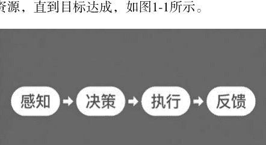

感知：通过文本、语音、传感器或数据接口，获取环境信息与用户意图。
决策：基于知识与规则，拆解目标、制定执行策略。
执行：调用工具、操作系统、完成具体任务。
反馈：将执行结果回传，修正认知与策略，形成持续优化的闭环。

1. Agent的“脑”：认知与决策的核心引擎

如果说Agent是一个完整的“数字人”，那么“脑”就是它的核心中枢。与传统AI只能做关键词匹配不同，Agent的“脑”具备了深度理解、复杂推理和动态规划的能力。Agent的“脑”具有三大核心职能：理解复杂意图、拆解任务目标、动态优化策略。

- ◎ 理解复杂意图
  超越关键词匹配，能理解模糊、隐含或多维度的用户需求（如“帮我安排一个适合带父母的周末短途游”）。
  结合上下文与用户画像，自动补全信息缺口（如默认选择父母偏好的舒适型酒店）。

- ◎ 拆解任务目标
  将抽象目标转化为可执行的子任务树（如“财报” → “数据采集” → “分析建模” → “报告撰写”）。
  动态调整执行顺序，优先处理关键路径（如先获取核心数据，再进行分析）。

- ◎ 动态优化策略
  遇到意外（如数据接口故障、政策变化）时，自动切换备选方案。
  从历史执行中学习，优化后续任务的效率与成功率。

2. Agent的“手”：工具与执行的行动闭环

仅有“脑”的智能还不足以解决现实问题，Agent必须拥有“手”才能将决策转化为行动。“手”是Agent连接现实世界的桥梁，让它不再局限于输出文本，而是能真正“动手”完成任务。Agent的“手”具有调用工具、执行闭环机制和多工具协同的能力，从而构建起完整行动闭环。

- ◎ 工具调用能力
  连接API：调用支付、日历、CRM等企业服务，完成数据读写与业务操作。
  操作软件：自动化办公软件、设计工具、代码编辑器等，模拟人类操作。
  数据访问：从数据库、知识库或互联网中提取信息，支撑决策。

- ◎ 执行闭环机制
  接收“脑”的指令，调用对应工具。
  捕获执行结果与异常信息。
  将结果回传给“脑”，用于下一步决策。

- ◎ 多工具协同
  复杂任务需要多工具串联（如“市场分析”需同时调用数据API、Excel、PPT生成工具）。
  Agent能自主协调工具间的数据流，避免人工介入。

#### 1.1.3 从Chatbot到Agent的技术演进

从Chatbot到Agent的跃迁，不是单一技术的偶然突破，而是大语言模型、工具调用、记忆规划等多技术体系协同迭代的必然结果。这一演进过程，本质上是AI从“文本交互能力”向“自主行动能力”的技术赋权过程。以下五大核心技术节点补齐能力短板，最终构建出OpenClaw所依托的Agent技术底座。

1. 底层基座：大语言模型（LLM）的认知革命
   这是Agent“大脑”成型的核心前提，彻底打破了传统Chatbot的认知边界。
   从“规则匹配”到“涌现能力”：传统Chatbot依赖人工编写的规则库或小样本模型，仅能处理预设话术；大语言模型通过海量数据训练，涌现出逻辑推理、因果分析、抽象概括等高级认知能力，让AI能理解模糊意图、拆解复杂目标。
   长上下文理解的技术突破：通过上下文窗口扩容、注意力机制优化（如稀疏注意力），LLM能处理万字级别的对话历史与任务信息，解决了传统Chatbot的“上下文断裂”问题，为长周期任务执行奠定基础。
   领域适配的轻量化微调：针对电商、快消、内容营销等垂直领域，通过LoRA、QLoRA等轻量化微调技术，让LLM快速适配行业术语与业务逻辑，这也是OpenClaw能服务于细分商业场景的核心技术支撑。

2. 关键桥梁：工具调用（Function Calling）的技术落地
   这是Agent“双手”成型的核心，实现了从“文本输出”到“现实行动”的跨越。
   动态函数调用的技术逻辑：突破了传统AI“硬编码工具关联”的局限，LLM能自主识别任务所需工具、解析调用参数、生成执行指令，无须人工预设触发条件。
   工具兼容性与校验机制：技术层面实现了对REST API、本地软件、数据库等多类型工具的兼容，同时加入“参数校验→执行监控→异常回调”的全流程机制，确保工具调用的准确性（如OpenClaw调用电商后台API修改订单时的参数校验）。
   工具学习能力：通过“工具描述学习+执行反馈迭代”，Agent能快速适配新工具，无须工程师重复开发，大幅提升了技术扩展性。

3. 能力补全：记忆与规划机制的技术成熟
   解决了传统Chatbot“无记忆、无规划”的核心痛点，让Agent具备了“持续行动”的能力。

   记忆体系的技术分层：
   - 短期记忆：依托LLM上下文窗口，存储实时对话与任务进度；
   - 长期记忆：通过向量数据库、知识图谱技术，持久化存储用户画像、历史任务、行业知识，实现“一次学习，终身复用”（如记住快消品牌的KOC种草风格偏好）。

   规划能力的技术升级：
   - 思维链（CoT）：让AI分步推理，拆解复杂任务；
   - 任务规划器（Task Planner）：基于目标生成子任务树，动态调整执行顺序；
   - 多智能体协作：通过“主智能体+子智能体”的分工模式，处理超复杂任务（如市场调研任务中，数据采集、分析、报告撰写由不同子智能体协同完成）。

4. 感知升级：多模态融合技术的广泛应用
   拓展了Agent的“感知边界”，让其能适配更丰富的商业场景，脱离纯文本交互的限制。

   跨模态理解技术：实现了文本、语音、图像、视频的双向理解，如能识别小红书KOC种草笔记的图片内容、解析直播语音中的用户需求。
   多模态交互技术：支持语音指令输入、图像内容生成（如自动生成快消品种草海报）、视频脚本输出，让Agent的交互方式更贴合用户的日常工作习惯。
   场景化感知适配：针对电商直播、短视频运营等场景，优化实时流数据的感知与处理能力，实现“边感知、边决策、边执行”。

5. 工程支撑：智能体框架的标准化与模块化
   这是技术从“实验室”走向“商业化”的关键，也是OpenClaw实现私有化部署的技术基础。

   核心组件的模块化设计：将Agent拆解为“感知层、决策层、执行层、反馈层”，各层通过标准化接口对接，支持功能的灵活增删（如为OpenClaw新增“小红书种草文案生成”技能，仅需在执行层新增对应模块）。
   私有化部署的技术适配：通过模型本地化、数据加密传输、边缘计算等技术，解决了企业对数据安全的需求，契合OpenClaw“私有化”的核心哲学。
   性能优化技术：通过模型量化、分布式计算，降低Agent的部署成本与响应延迟，让个人与中小微企业也能便捷使用。

#### 1.1.4 典型场景对比：Chatbot vs Agent

在当前AI应用场景中，我们常接触到Chatbot与Agent两类智能体，那Chatbot与Agent又有哪些不同呢？

1. Chatbot和Agent对比

要清晰理解Agent的价值，最直观的方式就是将它与我们熟悉的Chatbot进行对比。两者看似相似，实则在核心定位、响应模式、能力边界和价值输出上存在本质差异。下面将通过多维度对比，清晰展现Chatbot作为“交互界面”与Agent作为“自主实体”的根本区别，见表1-1。

表 1-1

| 对比维度 | Chatbot | Agent |
| :--- | :--- | :--- |
| 核心定位 | 对话交互界面，是用户与系统的“沟通窗口” | 自主智能实体，是代表用户完成目标的“数字代理人” |
| 响应模式 | 被动响应，必须由用户发起指令后才输出内容 | 主动行动，可根据目标自主感知环境、规划路径并持续执行 |
| 能力边界 | 局限于文本生成、FAQ问答和简单信息查询 | 具备感知、决策、执行、反馈的全闭环能力，可解决复杂任务 |
| 价值输出 | 以信息传递为主，输出文本或简单结果 | 以结果交付为主，可完成全流程任务并交付最终成果 |
| 用户角色 | 用户是操作者，需要明确给出每一步指令 | 用户是决策者，只需设定目标，Agent自主完成执行 |
| 上下文能力 | 上下文窗口有限，易出现“失忆”和逻辑断裂 | 具备长期记忆与上下文管理，可维持长周期任务的一致性 |
| 工具调用 | 无或仅支持有限的预设工具调用 | 可自主识别、调用并协同多种工具，形成执行闭环 |
| 学习与迭代 | 依赖模型预训练，难以动态适应新场景 | 可通过执行反馈持续学习，优化后续任务的效率与策略 |

2. 典型场景对比

从Chatbot到Agent，最直观的差异体现在真实业务场景中。Chatbot是“信息交互工具”，而Agent是“任务解决实体”。下面我们通过四个高频场景的对比，清晰展现二者在能力边界、执行效率与用户体验上的本质区别，让你直观理解AI从“听懂”到“做到”的跃迁。

（1）日程管理场景
日程管理是日常工作中最频繁也最琐碎的任务之一，也是检验AI是否具备“行动力”的典型场景。我们来看看Chatbot和Agent在处理这一任务时的不同表现。

Chatbot：只能被动查询已有日程，当你问“我明天下午有空吗”，它会从日历中读取并告知结果，但无法帮你修改或协调。如果你说“帮我安排一个和客户的会议”，它会回复“请告诉我具体时间、参会人和地点”，需要你一步步提供所有细节，本质上还是信息查询工具。

Agent：你只需说“帮我安排一个和张总的下周会议，尽量在周三下午，并且不要和我的其他行程冲突”。它会自主查询你和张总的日历，找到双方都有空的时间段，自动发送会议邀请并同步到双方日历，全程无须你手动操作，真正完成了任务闭环。

（2）内容创作场景
内容创作是AI能力的重要应用方向，从生成初稿到完成全流程交付，Chatbot与Agent的能力差距被无限放大。下面我们对比二者在内容创作场景中的表现。

Chatbot：你让它“写一篇关于新品的小红书笔记”，它会生成一篇初稿，但内容可能缺乏针对性，需要你反复修改、补充资料和调整风格，它只是一个文本生成器。

Agent：你说“帮我写一篇关于新品的小红书种草笔记，目标受众是25～30岁的都市女性，风格要活泼有网感”。它会自主调研竞品笔记、分析目标用户偏好、整合产品卖点，生成符合要求的完整笔记，甚至可以直接帮你排版、配图并发布到平台。

（3）客户售后场景
客户售后是企业服务的核心环节，直接影响用户满意度与品牌口碑。我们来看看Chatbot和Agent在处理售后问题时，如何影响服务效率与用户体验。

Chatbot：用户反馈“我的快递丢了”，它会回复“请提供订单号和联系方式，我帮你转接人工客服”，或者给出预设的FAQ回复，无法直接处理问题，只是一个分流工具。

Agent：用户反馈“我的快递丢了”，它会自主查询订单物流信息，核实丢件情况，自动发起理赔流程，计算赔付金额并完成退款，全程无须人工介入，直接解决用户问题。

（4）数据分析场景
数据分析是决策的基础，从生成报表到提供洞察，Chatbot与Agent的能力差异直接决定了数据价值的转化效率。下面我们对比二者在数据分析场景中的表现。

Chatbot：你问“上个月的销售数据怎么样”，它会生成一份基础报表，但无法进行深度分析，也不能根据数据给出决策建议。

Agent：你说“帮我分析上个月的销售数据，找出下滑原因，并给出下个月的推广策略建议”，它会自动清洗数据、识别异常波动、关联市场环境变化，生成一份包含数据洞察和可执行策略的分析报告。

除日常管理、内容创作、客户售后与数据分析外，在智能营销、供应链协同、合规风控、研发协作、差旅报销、IT支持、员工培训、市场情报等复杂业务场景中，二者的边界与价值差异更为显著，见表1-2。

表 1-2

| 对比场景 | Chatbot表现 | Agent表现 |
| :--- | :--- | :--- |
| 智能营销活动策划 | 被动生成文案，无法整合数据与渠道，需人工补充策略 | 主动规划全链路方案，自动分析、生成策略并完成投放复盘 |
| 供应链协同调度 | 仅能查询数据，无法主动调整采购、生产与配送计划 | 自主感知波动，动态调整计划，自动触发沟通与预警 |
| 合规风控审核 | 被动筛查关键词，无法深度理解风险，需人工复核 | 主动识别风险，生成报告与建议，触发审批或预警 |
| 研发协作与需求管理 | 仅能汇总需求，无法主动拆解任务、分配资源 | 自主驱动全流程，整合需求，自动分配任务并跟踪进度 |
| 差旅与费用报销 | 被动查询政策，协助提交单据，无法自动审核与打款 | 主动规划行程、预订票务，自动审核报销单并触发打款 |
| IT服务台支持 | 被动回答FAQ，无法诊断复杂问题或自动修复 | 主动诊断故障，自动执行修复脚本，升级复杂问题 |
| 员工培训与发展 | 被动推送课程，无法个性化推荐或跟踪学习效果 | 主动分析能力缺口，定制学习计划并跟踪进度 |
| 市场情报与竞品分析 | 被动提供已有资料，无法主动挖掘与分析趋势 | 主动抓取信息，分析竞品动态，生成趋势报告与建议 |

### 1.2 OpenClaw哲学：私有化、全天候与自主行动

OpenClaw在最近火爆全球，其哲学根植于三个核心信念：私有化、全天候与自主行动。私有化意味着数据与控制权始终掌握在用户手中，而非第三方平台；全天候则打破了时间与空间的限制，让数字分身永不离线；自主行动则让AI从“被动响应”升级为“主动赋能”。本节将深入解读这三大哲学，揭示OpenClaw如何通过技术设计，让Agent真正成为用户可信赖的专属伙伴，如图1-2所示。

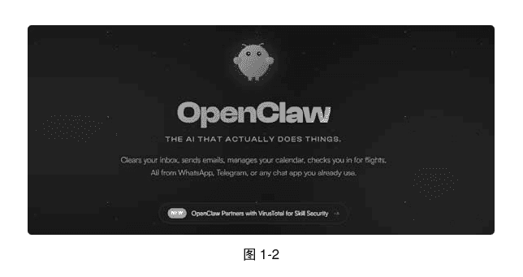

#### 1. 私有化：AI智能体的信任根基

2026年初，OpenClaw以现象级姿态席卷全球AI领域，成为AI Agent赛道最受瞩目的开源项目。它凭借无可比拟的核心优势，在GitHub上创下惊人增长纪录，上线不足百天星标便突破20万，增速远超Linux、React等经典开源项目，长期稳居全球热榜榜首，成为AI从“对话交互”迈向“自主执行”的标志性产品。

OpenClaw的火爆迅速点燃全球开发者生态，社区活跃度持续攀升。Discord等社群成员短时间内突破万人，全球贡献者踊跃参与迭代，未合并的提交请求数以千计；围绕它构建的ClawHub技能市场已沉淀数千个实用插件，覆盖办公、电商、数据处理、智能家居等多元场景。国内腾讯云、阿里云、火山引擎等主流云厂商更是在48小时内快速上线一键部署方案，全方位支撑项目落地与普及。

OpenClaw的爆发式走红，不仅是技术产品的成功，更引领了AI智能体的产业变革。它精准解决了传统AI“只会聊天、不会干活”的痛点，快速获得资本、媒体与产业界的一致认可，带动大模型API调用量指数级增长，重塑自动化与人机协同的行业格局。如今OpenClaw已从开源项目成长为基础设施级标杆，持续推动企业与个人迈入“AI自主执行”的全新阶段。

数据主权是AI智能体能否深度融入个人工作与企业业务的核心前提。尤其在电商、快消品、KOC营销等涉及商业机密与用户数据的场景中，“数据上云”的模式早已无法满足合规与安全需求。本节将拆解OpenClaw“私有化”哲学的内核，说明其如何为智能体筑牢信任基石。

- ◎ 当前行业核心痛点
  - 隐私泄露风险：主流云端AI会存储用户的对话记录、商业数据（如电商爆款策划、KOC合作清单），存在数据被泄露、滥用的隐患。
  - 合规性缺失：快消行业的用户画像、电商的交易数据受《数据安全法》《个人信息保护法》约束，云端托管模式难以满足“数据不出域”的监管要求。
  - 控制权旁落：用户无法自主管理AI的训练数据与执行日志，一旦平台调整策略，智能体的服务能力会被动改变。

##### ◎ OpenClaw “私有化”的核心内涵

- 数据层私有化：用户的业务数据（如小红书种草文案库、快消品销售报表）、个人偏好数据、智能体运行日志，均存储于用户本地设备或私有服务器，全程不进入OpenClaw公有云。
- 计算层私有化：核心的LLM推理、任务规划、工具调用决策，优先在端侧或私有部署环境中完成，仅在处理超大规模任务时，由用户自主授权调用公有算力。
- 部署层灵活适配：支持“纯本地部署”（如个人电脑、企业内网服务器）、“混合部署”（敏感数据本地处理，非敏感任务云端协同）两种模式，匹配个人与企业的不同需求。

##### ◎ 技术支撑体系

- 轻量化端侧模型：对核心LLM进行量化压缩，使其能在普通笔记本、企业终端服务器上完成高效推理，无须依赖云端算力。
- 本地向量数据库：用户的私有数据（如品牌营销方案、电商客户档案）被转化为向量存储在本地，智能体可实时检索，且检索过程全程离线。
- 私有化部署套件：提供一键式部署工具，适配企业内网的Docker、K8s环境，降低技术团队的部署门槛。

##### ◎ 价值与落地案例

- 核心价值：彻底解决数据隐私与合规问题，让智能体可放心应用于快消品新品保密研发、电商核心客户运营、KOC签约数据管理等敏感场景；同时赋予用户对智能体的绝对控制权，可自主更新数据、调整权限。
- 案例：某快消品牌市场部采用OpenClaw私有化部署，让AI智能体本地处理新品配方、小红书种草策略等保密数据，自主生成营销方案，全程无数据流出企业内网，既满足了合规要求，又提升了营销策划效率。

#### 2. 全天候：数字分身的运行底线

通，服务中断都意味着生产力损失。本节将解析OpenClaw如何通过技术设计，实现真正的“全天候”服务。

- ◎ 传统AI的服务中断痛点
  - 网络依赖严重：断网状态下，主流AI工具完全无法使用，无法应对出差、户外办公等无网络场景。
  - 算力波动影响：云端AI在高峰时段（如电商618大促）会出现算力拥堵，导致响应延迟、任务中断。
  - 终端适配不足：AI服务多局限于电脑端，移动场景下的碎片化需求（如实时修改种草文案、确认订单）无法被满足。

- ◎ OpenClaw“全天候”的核心实现
  - 离线能力矩阵：梳理出核心高频任务的离线执行清单，包括本地文件整理、已缓存数据的分析、预设日程的提醒、离线文案生成等，确保断网时核心功能不中断。
  - 边缘算力动态适配：通过“本地算力优先+云端算力兜底”的策略，实时监测设备算力与网络状态，自动切换计算节点，避免算力拥堵或断网导致的任务失败。
  - 多终端协同在线：支持电脑、手机、平板等多终端登录，智能体的任务进度、记忆数据实时同步，用户可在任意终端接续操作，适配碎片化办公场景。

- ◎ 技术支撑体系
  - 任务断点续传机制：智能体会实时保存任务执行进度，一旦网络或算力恢复，自动从断点继续执行，无须用户重新发起指令。
  - 轻量化缓存系统：对高频使用的工具（如电商订单查询接口）、数据（如KOC账号库）进行本地缓存，定期增量更新，保障离线状态下的基础服务能力。
  - 低功耗运行优化：针对移动设备优化智能体的运行逻辑，降低算力消耗，实现长时间后台在线而不影响设备续航。

- ◎ 价值与落地案例
  - 核心价值：打破时间与空间的限制，让数字分身真正“永不离线”，适配电商大促的24小时订单处理、跨境KOC的跨时区沟通、个人突发任务的即时响应等场景，最大化生产力。
  - 案例：某电商运营使用OpenClaw智能体，在出差断网时，通过手机端离线生成了618大促的应急客服话术，网络恢复后，智能体自动将话术同步至店铺客服系统，并接续完成了订单异常数据的分析，全程无任务中断。

#### 3. 自主行动：Agent的核心能力内核

从“被动听令”到“主动做事”，是Agent超越Chatbot的核心标志。在营销策划、电商运营等复杂工作中，用户无法事无巨细地下达指令，需要智能体具备自主规划与执行的能力。本节将拆解OpenClaw“自主行动”哲学的实现逻辑，展现其生产力赋能的核心。

- ◎ 被动响应的生产力瓶颈
  - 指令成本过高：用户需要将复杂任务拆解为细碎指令（如“先查竞品销量→再整理卖点→最后写种草文案”），耗费大量时间与精力。
  - 无主动感知能力：传统AI无法主动发现问题（如电商库存不足、KOC笔记数据下滑），只能在用户提出后被动回应。
  - 任务闭环能力弱：无法自主完成“规划-执行-反馈-优化”的全流程，往往需要人工介入收尾。

- ◎ OpenClaw“自主行动”的三层逻辑
  - 目标级感知：无须用户下达具体步骤，仅通过模糊目标（如“优化本月小红书种草转化率”），就能识别核心需求，明确行动方向。
  - 任务级规划：自主将复杂目标拆解为可执行的子任务，如“分析上月种草笔记数据→筛选高转化笔记特征→生成3套新文案→对接KOC发布→实时监测数据”，并制定优先级与执行顺序。
  - 安全级执行：在用户预设的权限范围内，自主调用工具、执行操作，同时实时反馈执行结果，若出现异常（如KOC报价超预算），自动暂停并请示用户。

- ◎ 技术支撑体系
  - 长时记忆与场景认知：通过记忆机制存储用户的工作习惯、业务规则（如KOC合作预算上限、电商文案风格要求），让自主行动贴合用户需求。
  - 工具编排引擎：能自主选择、组合不同工具（如小红书数据查询工具、文案生成工具、KOC对接系统），完成复杂任务的执行闭环。
  - 权限与风险风控体系：内置多维度权限开关（如资金操作权限、数据修改权限），同时设置异常监测规则，确保自主行动在安全边界内进行。

- ◎ 价值与落地案例
  - 核心价值：将用户从重复的任务规划与执行中解放，聚焦于策略制定等高价值工作；同时通过自主感知与闭环执行，及时捕捉业务机会、规避风险。
  - 案例：某快消品牌的营销人员向OpenClaw下达目标“提升新品在小红书的曝光量”，智能体自主分析了竞品曝光渠道，筛选出10位匹配的中腰部KOC，制定了合作报价与文案方向，对接完成后实时监测笔记曝光数据，主动调整了低曝光笔记的投放策略，全程仅需用户确认最终合作清单。

#### 4. 三大哲学的协同共生：OpenClaw的价值闭环

私有化、全天候、自主行动并非孤立存在，而是构成了OpenClaw的价值闭环。私有化是信任基础，全天候是运行保障，自主行动是能力核心，三者相互支撑、缺一不可。

私有化是全天候与自主行动的前提，只有数据与计算私有化，智能体才能在离线状态下实现自主决策与执行，真正做到全天候服务；同时，私有化保障的权限可控，让用户敢于放开自主行动的权限；全天候是私有化与自主行动的落地保障，若无法实现全天候在线，私有化部署的智能体在断网时将失去价值，自主行动的任务闭环也会因服务中断而断裂；而自主行动是私有化与全天候的价值归宿，私有化与全天候的技术设计，最终是为了让智能体能够自主完成任务，实现生产力的提升，否则一切技术都将失去意义。

多数竞品仅聚焦单一维度（如部分AI强调私有化但缺乏自主行动能力，部分强调自主行动但依赖云端数据），无法形成价值闭环；OpenClaw通过三大哲学的协同，解决了“不敢用（隐私问题）、用不了（服务中断）、不好用（被动响应）”的三大行业痛点，尤其适配电商、快消、KOC营销等对隐私、效率、自主性要求极高的商业场景。

在数字化转型的浪潮中，AI Agent正从辅助工具向核心生产力演进。未来，其发展将聚焦于降低技术门槛、优化资源效率与强化决策能力三大维度，通过私有化轻量化、全天候智能化与自主行动进化，为不同规模的企业提供更具适应性和价值的智能解决方案，推动商业场景的深度智能化变革，见表1-3。

| 未来演进方向 | 核心内容 | 价值与应用场景 |
|---|---|---|
| 私有化轻量化 | 降低私有化部署的技术与成本门槛，优化模型结构与资源占用，让中小商家也能轻松部署 | 助力中小企业快速搭建专属智能系统，无须依赖大型云服务，保障数据安全与业务自主性 |
| 全天候智能化 | 结合用户的工作节奏与业务流，实现“按需在线”的智能调度，动态分配算力资源 | 适配企业7×24小时运营需求，在非高峰时段自动休眠，高峰时段高效响应，显著降低算力成本 |
| 自主行动进化 | 融入多模态感知与强化学习，具备复杂任务拆解、工具调用与动态决策能力 | 可独立处理从数据分析到执行落地的全流程任务，在供应链管理、客户服务等场景中自主应对突发变化 |

### 1.3 核心架构拆解：Gateway（网关）、Brain（大脑）与Skills（技能）

OpenClaw的核心架构由三层协同构成：Gateway作为交互网关，负责连接用户与智能体；Brain作为核心大脑，承担认知、决策与规划的核心职能；Skills则是技能层，承载各类可复用的执行能力。本节将逐层拆解这一架构，解析各模块的功能边界与协作机制，让你清晰理解OpenClaw如何通过模块化设计，实现高效、灵活且可扩展的智能体能力，如图1-3所示。

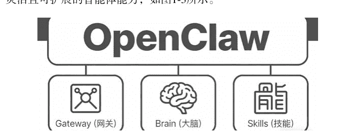

#### 1. Gateway（网关）：智能体的交互入口与安全屏障

任何智能体都需要一个“门面”来连接用户、设备与外部系统，Gateway正是OpenClaw的交互中枢。它不仅是用户与智能体对话的入口，更是保障数据安全、适配多场景交互的核心屏障。尤其在电商、快消等涉及多终端、多协议的场景中，Gateway的设计直接决定了智能体的易用性与安全性。

- ◎ 核心定位
  - 交互适配层：统一对接文本、语音、图像等多模态输入，适配电脑、手机、IoT设备等多终端交互方式，让用户可通过任意渠道与智能体对话。
  - 协议转换层：将用户的自然语言指令转化为系统可识别的结构化指令，同时将智能体的执行结果转化为用户友好的输出形式。
  - 安全管控层：作为第一道防线，负责身份认证、权限校验、数据加密，确保敏感操作（如电商订单修改、KOC合作签约）在授权范围内进行。

- ◎ 核心功能模块
  - 多模态交互引擎：支持文本、语音、图像、视频等多模态输入输出，适配小红书文案创作、电商直播互动等场景的多样化交互需求。
  - 协议转换与路由：将用户指令解析为标准化任务请求，根据任务类型路由至Brain或直接调度Skills，同时将执行结果封装为自然语言反馈给用户。
  - 安全与权限管理：内置OAuth2.0、JWT等认证机制，支持细粒度权限控制（如禁止智能体修改核心财务数据），同时对传输数据进行端到端加密。
  - 负载均衡与容错：在高并发场景（如电商大促）下，自动分配请求流量，避免单点故障，保障服务稳定。

- ◎ 技术实现与场景适配
  - 私有化部署支持：可部署在企业内网或本地服务器，确保交互数据不流出可控范围，适配快消新品保密研发等敏感场景。
  - 离线交互能力：在断网状态下，仍能处理本地文件操作、日程提醒等离线任务，保障全天候服务。
  - 案例：某电商运营通过手机端语音指令“帮我处理今天的售后订单”，Gateway将语音转化为结构化任务，路由至Brain进行规划，最终调度Skills完成订单退款与用户通知，全程仅需30秒。

#### 2. Brain（大脑）：智能体的认知决策中枢

如果说Gateway是智能体的“门面”，那么Brain就是其“灵魂”。它是OpenClaw的核心决策中枢，负责理解用户意图、规划任务步骤、管理长期记忆，是实现“自主行动”的核心引擎。在营销策划、数据分析等复杂场景中，Brain的能力直接决定了智能体的智能水平。

- ◎ 核心定位
  - 意图理解引擎：通过大语言模型深度解析用户指令，识别核心目标（如“提升新品曝光量”）而非表面需求（如“写一篇笔记”）。
  - 任务规划中枢：将复杂目标拆解为可执行的子任务，制定优先级与执行顺序，形成完整的任务链路。
  - 记忆管理中心：存储用户偏好、业务规则、历史任务等信息，形成长期记忆，让智能体的决策更贴合场景。
  - 决策优化引擎：根据执行反馈动态调整任务策略，实现“规划-执行-反馈-优化”的闭环。

- ◎ 核心能力模块
  - 深度意图理解：结合上下文与业务场景，识别模糊指令中的核心目标，例如将“帮我优化营销方案”拆解为“分析竞品数据→筛选高转化渠道→生成3套方案”。
  - 任务优先级调度：根据任务紧急程度与资源占用情况，动态调整执行顺序，例如先处理紧急售后订单，再执行营销文案创作。
  - 长期记忆与场景认知：存储用户的工作习惯（如KOC合作预算上限）、业务规则（如电商促销节点），让决策更精准。
  - 强化学习优化：通过历史任务数据不断优化决策模型，提升任务执行效率与成功率。

- ◎ 技术支撑与价值体现
  - 私有化大模型部署：支持在本地部署轻量化LLM，核心推理过程不依赖云端，保障数据安全。
  - 向量数据库集成：将记忆数据转化为向量存储，实现毫秒级检索，提升决策响应速度。
  - 案例：某快消品牌的Brain在分析新品营销数据时，自主识别出“小红书笔记转化率偏低”的问题，规划出“优化文案风格→筛选KOC类型→调整投放时间”的优化路径，最终使新品曝光量提升40%。

#### 3. Skills（技能）：智能体的任务执行单元

有了“大脑”的决策，还需要“手脚”来落地执行，Skills正是OpenClaw的任务执行层。它是一系列可复用、可扩展的功能单元，负责完成具体操作，如电商订单处理、文案生成、数据查询等。Skills的设计直接决定了智能体能否高效完成任务闭环。

- ◎ 核心定位
  - 任务执行单元：将Brain的决策转化为具体操作，如调用电商API修改订单、生成小红书文案、查询KOC数据等。
  - 能力复用中心：支持技能的模块化封装与复用，避免重复开发，例如“文案生成”技能可同时应用于小红书、抖音等多个平台。
  - 扩展接口层：提供标准化接口，支持第三方开发者接入自定义技能，适配个性化业务需求。

- ◎ 核心分类与编排机制
  - 基础技能：包括文件操作、日程管理、文本生成等通用能力，是智能体的“基本功”。
  - 行业技能：针对电商、快消、KOC营销等场景定制的专业能力，如“电商订单退款”“KOC合作对接”“小红书数据监测”等。
  - 技能编排引擎：根据任务规划自动组合多个技能，形成完整的执行链路，例如“查询订单→生成退款单→通知用户→同步财务系统”。
  - 版本管理与迭代：支持技能的版本控制，可快速迭代优化，适配业务变化。

- ◎ 技术实现与扩展能力
  - 标准化接口设计：采用RESTful API、gRPC等标准化协议，降低技能接入门槛，支持快速集成第三方服务。
  - 沙箱执行环境：技能运行在隔离沙箱中，避免恶意操作影响系统安全，同时支持权限管控。
  - 案例：某电商运营的Skills模块包含“订单处理”“文案生成”“数据报表”等12个专业技能，当Brain规划出“处理售后订单+生成客服话术”的任务时，Skills自动编排执行，全程无须人工介入。

#### 4. 三大模块协同：OpenClaw架构的价值闭环

Gateway、Brain、Skills并非孤立存在，而是形成了“交互-决策-执行”的完整价值闭环。Gateway负责连接与安全，Brain负责认知与规划，Skills负责落地与执行，三者协同支撑起OpenClaw的核心能力。

用户通过Gateway发起指令时，Gateway会先完成身份认证与协议转换，再将请求精准路由至Brain；Brain接收到指令后，会深度解析用户意图，拆解复杂任务并规划最优执行路径，随后将子任务分配给对应的Skills；Skills接收到任务后执行具体操作，并将执行结果实时反馈给Brain，Brain会根据反馈进行决策优化，必要时调整任务路径；最后，Gateway将最终结果转化为用户友好的形式输出，完成交互闭环。

- ◎ 架构核心优势
  - OpenClaw的架构具备显著的核心优势：模块化设计让三大模块可独立迭代优化，降低维护成本的同时支持灵活扩展；高可靠性通过Gateway的容灾机制、Brain的决策优化与Skills的沙箱执行共同保障系统稳定；强适配性支持私有化部署、离线运行与多终端交互，可灵活适配电商、快消等多样化场景；可扩展性则通过Skills的标准化接口快速接入新能力，推动智能体业务持续进化。

- ◎ 与行业竞品的差异
  - 多数竞品采用“一体化”架构，交互、决策、执行深度耦合，难以灵活适配发展场景；而OpenClaw的三层架构通过解耦与协同，实现了“安全可控、智能高效、灵活扩展”的核心优势。尤其在私有化部署、离线运行、行业定制等方面，OpenClaw的架构设计更贴合企业级需求，解决了传统AI“不敢用、用不了、不好用”的痛点。

### 1.4 商业逻辑：如何用OpenClaw重构生产力

OpenClaw的商业价值，不在于炫技，而在于重构生产力。OpenClaw所定义的Agent，能通过自动化重复任务、辅助复杂决策、拓展协作边界，让个人与组织的单位产出实现量级提升。本节将从效率提升、成本优化、模式创新三个维度，拆解AI助理的商业逻辑，探讨如何将OpenClaw的能力转化为实际的商业价值，赋能每一个人、每一个团队。

#### 1. 个人生产力重构：从“执行者”到“决策者”

在传统工作模式中，个人大量时间被数据整理、文案撰写、日程协调等琐事占据，真正用于战略思考与创意创造的时间被严重挤压。OpenClaw作为个人的“数字分身”，通过自主行动能力接管低价值任务，让个人从“被动执行者”升级为“主动决策者”，彻底重构个人的时间分配与价值产出模式。

- ◎ 任务自动化：解放重复劳动
  - OpenClaw的Skills模块可自主完成高频低价值任务，如邮件分类、数据录入、KOC合作资料整理、电商订单核对等，将个人从机械劳动中解放。
  - 例如：营销人员无须手动整理竞品数据，OpenClaw可自动抓取、清洗并生成可视化报表，耗时从4小时缩短至15分钟。

- ◎ 决策辅助：提升判断质量
  - Brain模块通过深度分析业务数据，为个人提供精准洞察，如“哪类KOC带来的转化率最高”“哪个时间段的小红书笔记曝光量最优”，辅助个人做出更科学的决策。

- ◎ 时间价值重构
  - 当80%的琐事由OpenClaw完成后，个人可将时间聚焦于策略制定、创意构思、客户沟通等高价值工作，单位时间产出提升2~3倍。

- ◎ 典型案例
  - 某电商运营通过OpenClaw自动处理售后订单、生成客服话术，每天节省3小时，转而投入店铺活动策划与用户运营中，店铺转化率提升25%。

#### 2. 组织生产力重构：从“流程驱动”到“智能驱动”

企业的生产力瓶颈，往往源于流程僵化、信息孤岛与人力依赖。OpenClaw通过模块化架构与自主行动能力，打破部门墙，让智能体成为业务流程的“智能节点”，实现从“人驱动流程”到“AI驱动流程”的转变，大幅提升组织的整体效率与响应速度。

#### 3. 商业模式重构：从“人力密集”到“AI赋能”

当AI成为核心生产力要素，企业的商业模式也将随之重构。OpenClaw的私有化与自主行动能力，让企业可以打造“AI驱动的服务模式”，从依赖人力规模转向依赖AI效率，创造出更具竞争力的商业形态，甚至催生全新的业务赛道。

◎ 流程自动化：消除人力依赖

OpenClaw可自主完成跨部门闭环任务，如“订单生成→库存扣减→物流对接→售后跟进”，无须人工介入，减少流程中的等待与失误。

例如：快消品牌的新品上市流程，从“市场调研→文案创作→KOC对接→数据监测”全流程由OpenClaw自主执行，周期从2周缩短至3天。

◎ 信息协同：打破数据孤岛

Gateway连接企业内部各系统，Brain整合分散数据，让智能体在统一信息底座上工作，避免“信息不对称”导致的决策偏差。

◎ 全天候运营：突破时空限制

OpenClaw的全天候能力，让企业实现7×24小时不间断运营，如电商大促期间自动处理订单、跨境业务中跨时区响应客户需求，无须额外增加人力成本。

◎ 典型案例

某快消企业引入OpenClaw后，售后处理效率提升60%，人力成本降低35%，同时实现了24小时客户响应，用户满意度提升40%。

◎ 服务升级：从标准化到个性化

OpenClaw可基于用户数据提供个性化服务，如为电商用户定制专属推荐、为KOC定制匹配的品牌合作方案，提升用户体验与转化效率。

◎ 成本优化：重构盈利模型

通过替代人力完成重复性工作，企业可大幅降低人力成本，同时提升服务规模。例如：KOC营销公司用OpenClaw自动筛选KOC、生成文案，服务客户数量提升2倍，人力成本降低40%。

◎ 创新模式：开辟新业务空间

企业可基于OpenClaw打造“AI即服务”的商业模式，如为中小商家提供智能营销助理、为个人提供专属数字分身，拓展新的收入来源。

◎ 典型案例

某营销agency基于OpenClaw推出“AI营销助手”服务，为中小电商提供自动化营销方案，月均新增客户50+，毛利率提升至65%。

#### 4. ROI与落地路径：引进OpenClaw的方法

很多企业引入AI时，常陷入“投入大、见效慢”的困境。OpenClaw的商业逻辑，核心在于清晰的ROI与可落地的实施路径。

我们可以通过三大类核心指标，清晰评估OpenClaw带来的业务价值，见表1-4。

表 1-4

| 指标类型 | 核心衡量维度 |
| :--- | :--- |
| 效率指标 | 任务完成时间缩短率、流程自动化率、人力替代率 |
| 效果指标 | 转化率提升、错误率降低、用户满意度提升 |
| 成本指标 | 人力成本节省、运营成本优化、ROI周期 |

OpenClaw的落地遵循循序渐进的原则，确保每一步都能快速验证价值，见表1-5。

表 1-5

| 落地阶段 | 核心策略 | 典型应用场景 |
| :--- | :--- | :--- |
| 阶段一：单点突破 | 从高频、低价值、高标准化的任务入手，快速验证价值 | 数据整理、邮件分类、基础客服应答 |
| 阶段二：流程串联 | 将多个单点技能串联，实现跨部门任务闭环 | 营销策划→内容生成→投放监测的全链路自动化 |
| 阶段三：全域智能 | 将OpenClaw融入核心业务，实现全流程智能驱动 | 新品研发、客户全生命周期管理、供应链智能调度 |

为最大化AI赋能价值，企业需要调整团队角色，让员工从“执行者”转向“AI协作者”，聚焦于策略制定、创意创新与异常处理等高价值工作，而非机械重复的任务。

◎ 典型案例

某电商企业分三步落地OpenClaw：6个月后核心岗位生产力提升50%，12个月后ROI达到1：4，成功将OpenClaw打造为行业内效率标杆。

#### 5. 商业价值闭环：OpenClaw重构生产力的核心逻辑

OpenClaw对生产力的重构，并非单点技术的赋能，而是个人、组织、商业模式三者协同的价值闭环。个人效率提升带动组织效率升级，组织效率升级推动商业模式创新，最终形成“AI赋能→价值提升→持续投入”的正向循环，让企业在数字时代保持核心竞争力。

协同逻辑：个人生产力提升，让员工有更多精力参与组织决策；组织流程优化，为个人提供更高效的工作环境；商业模式创新，为个人与组织创造更大的价值空间。三者相互支撑，形成不可替代的竞争优势。

与传统工具的差异：传统工具仅能提升单点效率，而OpenClaw通过“私有化保障信任、全天候保障持续、自主行动保障闭环”，实现了从“效率提升”到“模式重构”的跨越，是真正的生产力革命。

未来展望：随着OpenClaw能力的持续进化，其将进一步渗透到更多行业与场景，成为个人与组织在AI时代的“标配生产力工具”，推动整个社会的生产方式向更高效、更智能的方向演进。

# 第 2 章
## 私有化部署的硬件选择与环境准备：打造你的“AI 基地”

上一章中，我们畅想了AI Agent作为7×24小时在线数字分身的无限可能，而要让这一构想从概念走向现实，坚实的“AI基地”是一切的起点。本章将聚焦OpenClaw的部署实践，从硬件选择到环境配置，为你拆解打造高效AI运行环境的关键步骤。无论是挑选适配的硬件平台，还是完成本地部署与国内飞书等平台的消息通道对接，我们都将提供清晰指引。同时，针对本地部署中常见的10个痛点，给出避坑解决方案，帮助你快速搭建稳定、可扩展的AI基础设施，为后续多模型调度、技能开发与全流程自动化筑牢根基。

### 2.1 环境方案：选择适合的平台与硬件

OpenClaw的“私有化、全天候、自主行动”三大哲学，对运行环境提出了明确要求：既要支持本地部署保障数据安全，又要具备足够算力支撑智能体高效运行，还要适配多场景的灵活部署。平台与硬件的选择，直接决定了OpenClaw的性能、成本与可靠性。本节将从多个维度，帮你构建一套贴合需求的环境方案。

#### 2.1.1 核心平台选型：MacBook、Windows、Linux与云平台

不同平台的生态、算力特性与部署模式，直接影响OpenClaw的落地方式。MacBook适合个人开发者与轻量部署，Windows适配企业办公与混合场景，Linux是企业级私有化部署的首选，云平台则提供弹性扩展能力。本节将逐一拆解各平台的优势、局限与OpenClaw适配要点，帮你找到最适合的基础环境。

- 1. MacBook：个人数字分身的首选载体
  优势：生态成熟、便携性强、静音散热好，适合作为个人数字分身的核心设备；macOS对Python、Docker等开发工具支持友好，本地部署门槛低。
  局限：GPU算力有限（尤其是M系列芯片的显存限制），难以支撑大规模LLM推理；存储扩展成本高，不适合海量本地向量数据存储。
  适配场景：个人助理、轻量营销文案生成、离线日程管理等轻量任务；适合作为OpenClaw的“入口设备”，核心推理依托云端或本地轻量化模型。

- 2. Windows PC：企业办公与混合部署的适配之选
  优势：硬件选择丰富（从轻薄本到工作站），支持NVIDIA GPU加速，适配企业办公软件生态（如Office、企业OA）；Windows Subsystem for Linux（WSL）可兼容Linux部署环境。
  局限：系统稳定性略逊于Linux，长时间高负载运行需关注散热；部分企业内网环境对软件部署有严格限制。
  适配场景：企业内部运营助理、电商客服智能体、混合部署（本地处理轻量任务+云端处理复杂推理）；适合中小团队的轻量化部署。

- 3. Linux服务器：企业级私有化部署的核心底座
  优势：开源可控、稳定性强、支持高性能GPU集群，是私有化部署的首选；对容器化（Docker/K8s）支持友好，便于规模化部署与运维。
  局限：部署门槛高，需要专业运维团队；硬件成本较高，适合有明确数据安全与大规模算力需求的企业。
  适配场景：企业级智能体（如全链路营销策划、客户全生命周期管理）、核心业务数据的本地处理；完全符合OpenClaw “私有化”哲学的落地载体。

- 4. 云平台（AWS/Azure/阿里云等）：弹性扩展的混合部署补充
  优势：算力弹性伸缩，可按需调用GPU/CPU资源；全球节点覆盖，支持全天候跨区域服务；与OpenClaw的模型路由架构深度协同，实现“本地+云端”混合调度。
  局限：数据隐私风险（需通过加密与权限管控规避）；长期使用成本较高，适合作为本地部署的算力补充而非核心载体。
  适配场景：突发算力需求（如大促期间的用户数据分析）、跨地域业务协同；与本地部署结合，形成“私有+公有”的混合环境。

#### 2.1.2 硬件核心维度：算力、存储与网络的选型逻辑

平台是环境的“骨架”，硬件则是支撑OpenClaw高效运行的“肌肉”。算力决定智能体的响应速度，存储影响记忆系统的容量与检索效率，网络则是全天候服务的保障。本节将拆解CPU、GPU、内存、存储、网络五大核心硬件维度，帮你明确各组件的选型逻辑。

- 1. 算力：CPU与GPU的协同选型
  CPU：负责基础任务调度、轻量推理与系统运维，优先选择多核心高主频型号（如Intel i7/i9、AMD Ryzen 7/9）；个人场景8核以上即可满足，企业级场景需16核以上支撑多任务并发。
  GPU：是大模型推理与向量检索的核心加速硬件，优先选择NVIDIA显卡（如RTX 3090、A100）；显存需求随模型规模提升：7B模型至少8GB显存，13B模型需16GB以上，企业级部署建议32GB+显存。
  选型逻辑：轻量任务（如个人助理）可依赖CPU+核显；中等任务（如营销文案生成）需中端GPU；复杂任务（如全链路营销策划）需高性能GPU集群。

- 2. 内存：支撑RAG与多任务并发的关键
  核心作用：内存容量直接影响向量数据库的检索效率与多任务并发能力；OpenClaw的记忆系统（RAG）需要将高频向量数据缓存至内存，实现毫秒级检索。
  选型建议：个人场景16GB起步，优先32GB；中小企业场景64GB起步，企业级场景128GB+；同时关注内存频率（如DDR5 5600MHz），提升数据读写速度。

- 3. 存储：适配本地向量数据库的容量与速度
  容量需求：根据记忆数据规模而定，个人场景1TB NVMe SSD即可满足；企业级场景需4TB+，并支持RAID阵列保障数据安全。
  速度需求：优先选择NVMe SSD（读写速度3000MB/s以上），支撑向量数据库的高效写入与检索；避免使用机械硬盘，否则会严重影响RAG性能。
  扩展需求：支持M.2插槽或外置存储阵列，便于随记忆数据增长灵活扩容。

- 4. 网络：保障全天候服务的稳定性
  有线网络：企业级部署优先选择千兆/万兆有线网络，降低延迟与丢包率；混合部署场景需保障本地与云端的低延迟连接。
  无线网络：个人场景支持Wi-Fi 6/6E，提升移动办公时的网络稳定性；离线场景需配置本地缓存机制，避免断网导致服务中断。
  安全需求：配置防火墙、VPN等网络安全工具，保障数据传输安全，符合OpenClaw“私有化”的安全要求。

#### 2.1.3 场景化环境方案：从个人到企业的落地参考

不同场景对环境的需求差异显著：个人数字分身侧重便携与隐私，中小企业营销助理侧重适配办公生态，企业级部署则强调安全与性能。本节将拆解三大核心场景的环境选型方案，帮你快速找到贴合需求的组合。

- 1. 个人数字分身场景：MacBook+轻量化配置
  平台：MacBook Pro（M2 Pro/Max），兼顾便携与算力。
  硬件：16GB+内存、1TB NVMe SSD、依赖CPU+核显（轻量任务）或外接eGPU（复杂推理）。
  部署模式：本地部署轻量化Llama模型，核心推理依托云端GPT-5（通过模型路由调度）；记忆数据存储在本地，保障隐私。
  价值：满足个人日程管理、文案生成、轻量分析等需求，同时实现“7×24小时离线可用”。

- 2. 中小企业营销助理场景：Windows工作站+混合部署
  平台：Windows 11工作站（如戴尔Precision、联想ThinkStation），适配企业办公生态。
  硬件：32GB+内存、2TB NVMe SSD、NVIDIA RTX 4080 GPU（支撑本地推理）。
  部署模式：本地处理轻量任务（如客服话术生成、数据整理），复杂营销策划依托云端模型；通过WSL兼容Linux部署环境，简化运维。

- 3. 企业级私有化部署场景：Linux服务器+高性能集群
  平台：Ubuntu/CentOS服务器，部署在企业内网。
  硬件：双路Intel Xeon CPU、128GB+内存、4TB+NVMe SSD、多卡NVIDIA A100 GPU集群。
  部署模式：全链路本地部署，核心模型、记忆数据与业务流程均在企业内网运行；通过K8s实现容器化运维，支撑多智能体并发。
  价值：完全符合“私有化、全天候、自主行动”哲学，适配快消新品研发、核心客户管理等敏感场景。

#### 2.1.4 平台与硬件的协同：OpenClaw架构的环境适配逻辑

环境方案并非孤立的平台与硬件组合，而是需要与OpenClaw的核心架构（Gateway、Brain、Skills）深度协同。Gateway的多终端交互依赖平台生态，Brain的推理性能依托硬件算力，Skills的执行效率则受存储与网络影响。本节将解析协同逻辑，让环境方案真正服务于智能体能力。

与Gateway的协同：MacBook的触控栏、Windows的触控屏可优化交互体验，Linux服务器的网络稳定性保障多终端接入；云平台的全球节点则支撑跨地域交互。

与Brain的协同：GPU算力直接影响Brain的推理速度与任务规划效率；内存容量决定RAG检索的响应延迟，进而影响决策质量。

与Skills的协同：高速存储支撑Skills快速调用本地工具与数据；稳定网络保障Skills与第三方服务（如电商API、KOC平台）的可靠连接。

#### 2.1.5 落地步骤与避坑指南

很多用户在选择环境方案时，容易陷入“盲目追求高配置”或“忽视场景适配”的误区。本节将分享环境方案的落地步骤与避坑指南，帮你高效构建OpenClaw的运行环境。

- 1. 落地步骤
  明确部署目标：锚定核心需求。部署前需精准定义使用场景与核心目标，个人使用侧重离线可用与隐私安全，中小企业应用聚焦降本增效与高频业务支撑，企业级部署则优先保障稳定性、可扩展性与合规性。通过访谈核心用户梳理Top 3核心场景与关键指标，输出《部署目标说明书》，明确场景边界、核心价值与验收标准，避免后续需求蔓延与资源错配。
  评估算力需求：按任务复杂度分级配置。根据核心任务的复杂度与并发量精准评估算力，轻量任务（如邮件分类、FAQ问答）优先保障16GB+内存与高速存储，中等任务（如电商客服、内容初稿生成）可搭配轻量GPU，复杂任务（如深度分析、风控建模）则需高性能GPU与64GB+内存，同时预留20%～30%冗余应对业务峰值，企业级场景可采用“本地算力+云端弹性扩容”的混合模式，平衡成本与性能。
  选择平台组合：贴合生态，兼顾离线与云端。优先选择贴合业务生态的平台组合，办公场景推荐Windows本地（Llama轻量化模型）+云端GPT-5，移动场景采用MacBook本地（Metal加速Llama）+云平台同步，企业级场景则以Linux服务器（本地向量数据库+Llama）+云端API为主，确保断网时核心功能可用，通过“离线筑牢底座、云端提升上限”的组合模式，避免单一平台依赖。
  验证与优化：小步快跑，迭代调整。采用“先试点后推广”策略，先部署非核心轻量任务验证性能、成本与稳定性，再逐步扩展到核心业务，重点验证并发能力、离线可用性与合规性。通过监控响应时间、Token消耗、用户满意度等核心指标，每2周迭代优化配置，如Token消耗过高则优化熔断与缓存策略，响应慢则升级GPU或模型量化方式，持续提升部署效率与业务体验。

- 2. 避坑指南
  在OpenClaw环境部署落地时，不少用户容易陷入误区，不仅造成资源浪费，还可能影响系统稳定性与离线能力。以下避坑指南从硬件选型、运行稳定性、离线能力适配等维度，梳理核心风险与应对策略，助力高效构建适配业务的运行环境，见表2-1。

表 2-1

| 避坑维度 | 常见坑点 | 风险后果 | 应对策略 |
| :--- | :--- | :--- | :--- |
| 硬件选型 | 盲目堆砌高端硬件，轻量任务（如个人助理、邮件分类）也配置高性能GPU，忽视内存与存储优先级 | 算力资源闲置，成本浪费30%～50%；内存不足导致模型推理卡顿，影响响应速度 | 先按任务复杂度（轻量/中等/复杂）评估最低配置，轻量任务优先满足16GB+内存与高速存储，再按需升级GPU算力 |
| 运行稳定性 | 企业级长时间高负载部署时，忽视服务器散热设计与电源冗余，仅关注核心硬件参数 | 高温导致硬件降频甚至烧毁，电源单点故障引发业务中断，造成数据丢失与服务不可用 | 企业部署采用双电源冗余配置，优化服务器风道设计；定期监控温度与负载，设置高温预警阈值 |
| 离线能力适配 | 个人场景部署时，未验证环境对离线运行的支持（如依赖云端API，未配置本地缓存），违背“全天候”哲学 | 断网时核心功能失效（如日程提醒、本地文档处理），无法满足无网络环境下的使用需求 | 优先选择支持本地模型与离线缓存的平台组合，部署前验证断网场景下的核心功能可用性，确保离线模式下记忆与技能可正常调用 |

### 2.2 环境配置：OpenClaw的部署方法与本地部署

环境配置是OpenClaw从“概念”落地为“可用工具”的核心环节，其合理性直接决定系统稳定性、离线能力与成本可控性。本章将从多平台视角，拆解部署方法与本地部署实操，覆盖权限、路径、版本兼容等关键细节，帮你避开照搬文档的误区，打造适配业务的稳定运行环境。

#### 2.2.1 部署OpenClaw的方法

OpenClaw的部署主要有三种方法，分别是Docker一键部署、云厂商一键部署和本地直接部署。

Docker一键部署是将OpenClaw与全部运行依赖打包为容器镜像，只需先安装Docker，执行国内优化的一键脚本，就能自动完成镜像拉取、环境配置和服务启动，跨Windows、Mac、Linux平台通用，环境隔离不与系统其他软件冲突，是稳定又省心的主流方案。

云厂商一键部署是阿里云、腾讯云等国内云平台提供的预制OpenClaw应用镜像服务，全程图形化点点点操作，无须命令行，创建云服务器时选择对应镜像，数分钟即可部署完成，自带公网IP，可随时随地外网访问，零技术门槛。

本地直接部署（无Docker）不使用Docker容器，通过一键脚本直接在电脑上安装Node.js、pnpm等依赖，原生启动OpenClaw，无须额外安装容器工具，但所有依赖直接安装在系统中，易受本地环境版本、配置影响，三种部署方法的不同见表2-2。

表2-2

| 部署方式 | 优点 | 缺点 | 适合谁 |
| :--- | :--- | :--- | :--- |
| Docker一键部署 | 跨平台通用、环境隔离不冲突、国内镜像优化、稳定易维护 | 需提前安装Docker、少量命令行操作 | 想本地/私有服务器稳定运行，不想折腾环境，追求简洁可靠的用户 |
| 云厂商一键部署 | 纯图形化操作、零命令行、自带公网IP、随时随地可访问 | 需注册云账号、产生服务器费用 | 完全不懂技术，需要外网访问，不想开本地电脑的用户 |
| 本地直接部署 | 无须装Docker、直接本地运行 | 依赖易冲突、跨平台兼容性差、新手易报错 | 不想装Docker，仅本地临时使用，能接受简单环境问题的用户 |

Docker一键部署是综合体验较好国内用户的首选方案，兼顾本地运行、环境干净、不花钱、少报错；云厂商一键部署适合完全不想碰命令行、需要在外网随时使用的用户，纯图形化操作但会产生少量服务器费用；本地直接部署最简单但容易出问题，只适合不想装Docker、仅临时在自己电脑上试用的用户，不推荐新手。下面将介绍本地部署的方法。

#### 2.2.2 OpenClaw的本地部署

在OpenClaw的整体部署体系中，本地部署是开发调试、个人试用与内网验证的核心环节。它无须依赖公网资源，可快速搭建独立运行环境，便于功能测试与二次开发。本节将详细介绍本地部署方案，梳理关键配置步骤与常见问题，帮助用户高效完成本地环境搭建。

##### 1. 安装Node.js和Python

OpenClaw是基于Node.js开发的应用，因此安装并配置好Node.js环境是保障其稳定运行的关键前提。同时，该应用对运行环境有明确的版本要求：Node.js版本必须大于v22，Python版本必须大于3。因此，在正式部署OpenClaw之前，需要先完成Node.js和Python的下载与安装，确保系统满足这两个核心依赖的版本条件，为后续部署和运行打下坚实基础，具体操作步骤如下。

（1）进入Node.js软件官网，单击“获取Node.js®”进入下载界面，如图2-1所示。

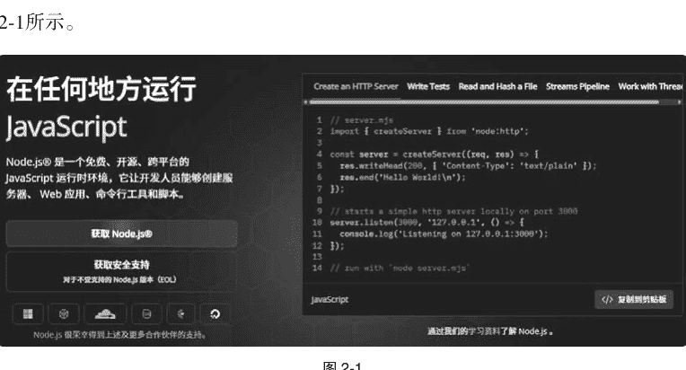

（2）单击“Windows安装程序（.msi）”按钮即可下载Node.js®文件，将其安装至电脑上，如图2-2所示。

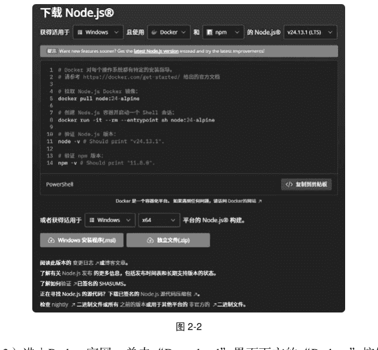

（3）进入Python官网，单击“Download”界面下方的“Python”按钮进入下载界面，如图2-3所示。

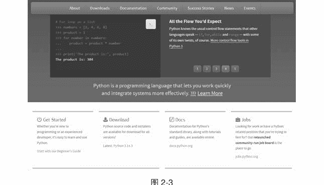

（4）进入下载界面后下滑网页，单击“Download Python install manager”按钮进入Windows版本的下载界面，再单击“Download installer（MSIX）”按钮即可下载Python文件，将其安装至电脑上，如图2-4和图2-5所示。

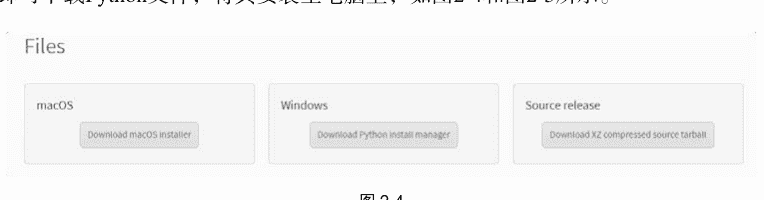

图 2-4

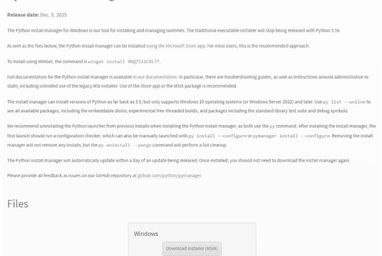

图 2-5

（5）同时按下“Win”和“R”按键，在弹出的运行框内输入“cmd”，再单击“确认”按钮即可打开命令提示符，如图2-6所示。

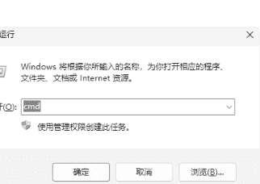

（6）输入“node -v”再按下回车键即可检验Node.js是否安装成功以及其版本，输入“python --version”再按下回车键即可检验Python是否安装成功以及其版本，如图2-7所示。

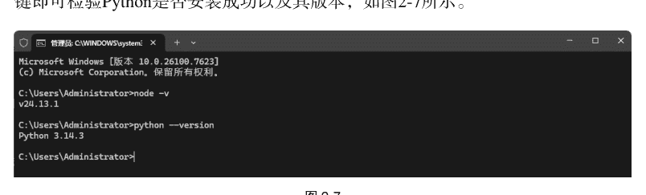

图 2-7

##### 2. 安装WSL和Ubuntu

进行本地部署需要先安装WSL，WSL2是Windows Subsystem for Linux（Windows适用于Linux的子系统）的缩写，直白来说：它是微软给Windows 10/11系统内置的「Linux运行环境」，能让你在Windows系统里不用装虚拟机、不用装双系统，直接运行完整的Linux发行版（比如Ubuntu、CentOS、Debian等），并且可以使用Linux所有的命令行工具、脚本、程序（包括Docker、部署OpenClaw的Shell脚本）。而Ubuntu是WSL生态中支持最完善、社区资源最丰富的发行版，能完美兼容其Shell脚本与底层依赖，能最大程度规避版本冲突、脚本执行失败等问题，还能实现本地开发与线上Linux服务器环境的一致性，降低后续调试成本。

简单类比：WSL就像在Windows里开了一个“Linux窗口”，这个窗口里的操作和真实的Linux服务器完全一致，但又能和Windows桌面、文件系统无缝互通（比如在WSL里能直接访问你的C盘、D盘文件）。

安装WSL和Ubuntu的具体操作步骤如下。

（1）在电脑搜索栏输入“Windows PowerShell”，单击“以管理员身份运行”按钮，如图2-8所示。

（2）输入“wsl --install”并按下回车键，系统会自动安装WSL。安装成功后，输入“wsl --status”和“wsl --version”查看是否安装成功，如图2-9和图2-10所示。

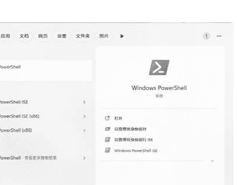

图 2-8

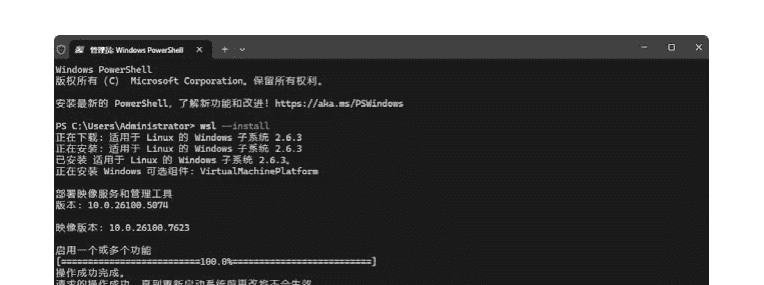

图 2-9

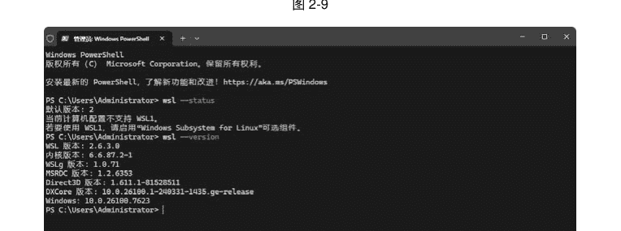

图 2-10

（3）输入“wsl.exe --list --online”查询可下载的版本，再输入“wsl --install Ubuntu”即可自动下载Ubuntu最新版本，如图2-11和图2-12所示。

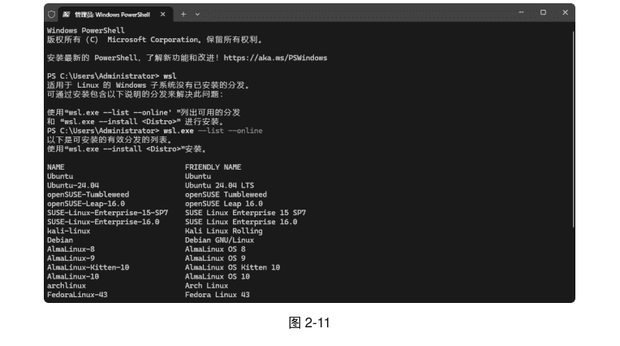

图 2-11

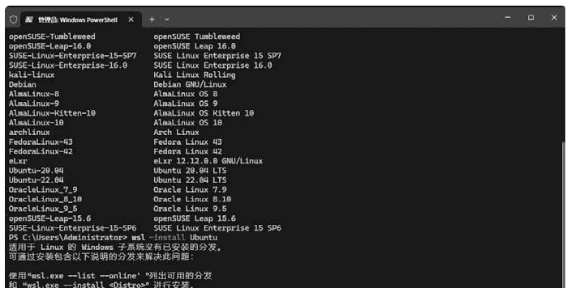

图 2-12

（4）下载完成后再打开“PowerShell”，输入“wsl.exe -d Ubuntu”或者在搜索栏输入Ubuntu直接进入终端。第一次进入需要设定用户名和密码，设定好后即可进入Ubuntu系统，如图2-13和图2-14所示。

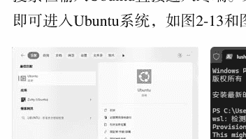

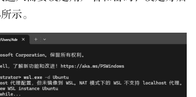

##### 3. 安装OpenClaw

在完成核心依赖的环境配置后，即可进入OpenClaw的正式安装环节。本节将重点介绍在WSL（Ubuntu）环境下的安装流程，通过适配Linux子系统的特性，实现更稳定、高效的本地部署体验，为后续功能调试与二次开发提供可靠支撑。

安装OpenClaw的具体操作步骤如下。

（1）进入OpenClaw的官网复制这串Linux代码至Ubuntu上，按下回车键系统便会自动下载OpenClaw，如图2-15和图2-16所示。

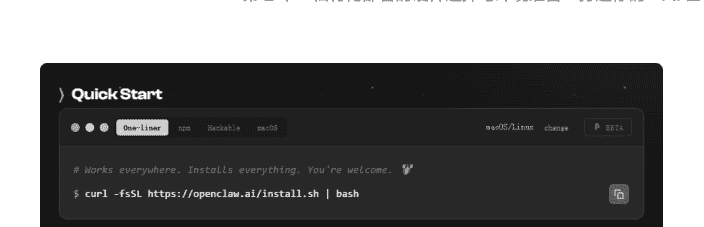

图 2-15

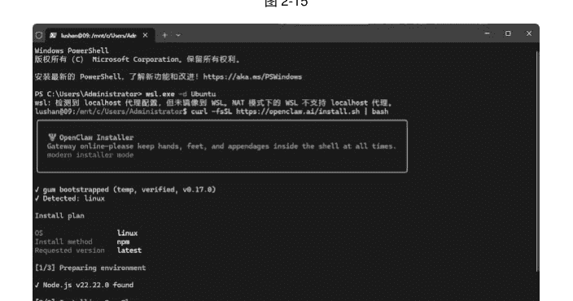

图 2-16

（2）下载完成后便自动开启对OpenClaw的初始配置，问题为“OpenClaw本身存在风险，是否继续？”，用键盘方向键移动至“Yes”并按下回车键，如图2-17所示。

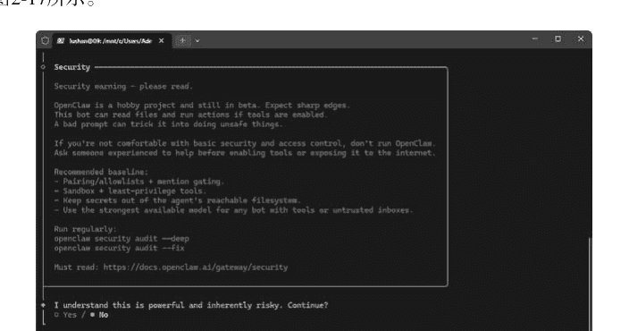

图 2-17

（3）这是让你挑选初始设置模式，选择“QuickStart”（快速开始模式）并按下回车键，如图2-18所示。

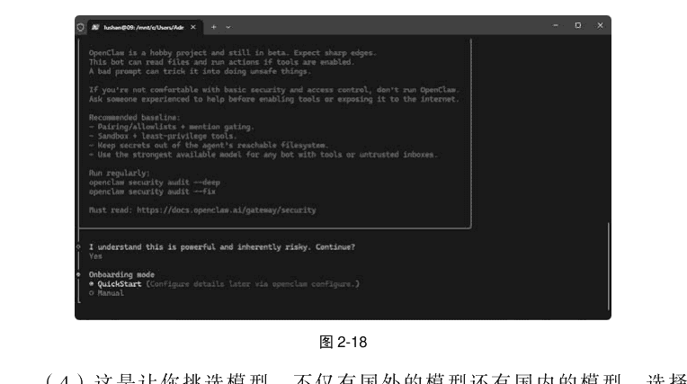

图2-18

（4）这是让你挑选模型，不仅有国外的模型还有国内的模型，选择“Qwen”（阿里巴巴旗下的千问模型）和“Qwen OAuth”并按下回车键，当然你可以选择任何模型，如图2-19和图2-20所示。

（5）选择完模型后，Ubuntu会自动提供相应模型的认证网址，将网址复制粘贴到浏览器上，如图2-21所示。

（6）进入网址后进行相应的身份认证，认证成功后便可以设置OpenClaw的模型，这里要注意的是很多模型分为国内和国外两个版本，要注意区分，如图2-22和图2-23所示。

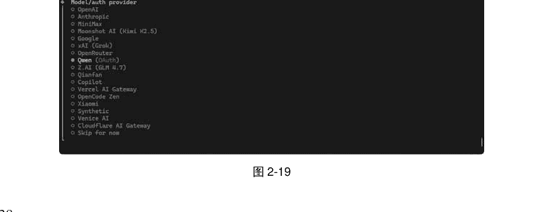

图2-19

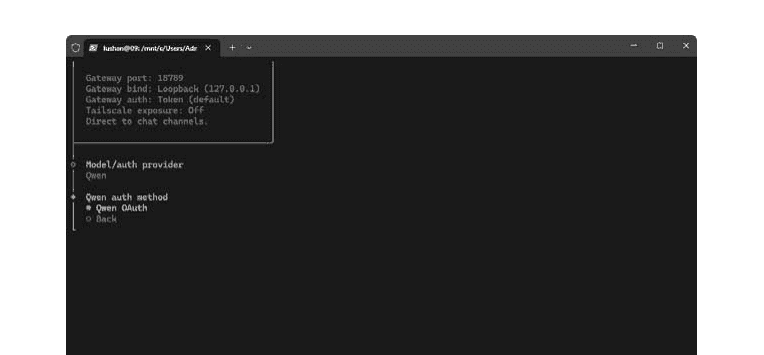

图 2-20

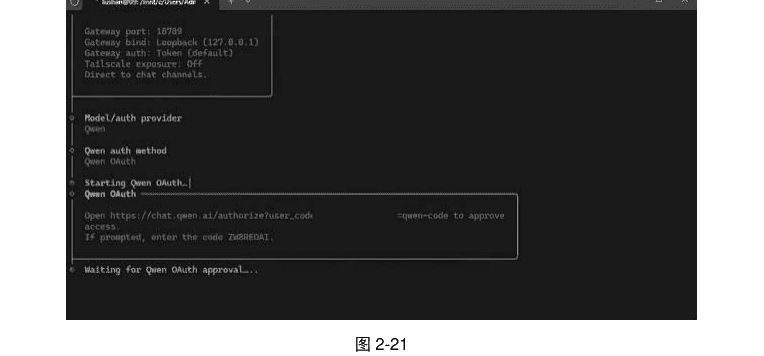

图 2-21

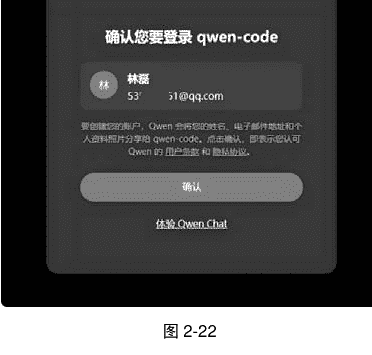

图 2-22

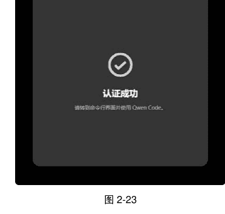

图 2-23

（7）这是让你选择OpenClaw本身的默认模型，选择“Keep current”（保持当前）并按下回车键，如图2-24所示。

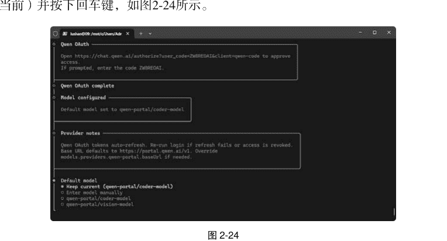

图2-24

（8）这是让你选择OpenClaw适配的通信渠道，这里只能选择国外的通信软件所以先略过，选择“Skip for now”并按下回车键，如图2-25所示。

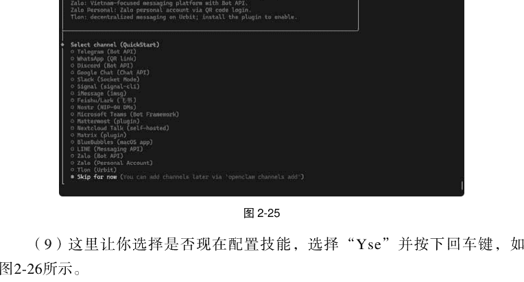

图2-25

（9）这里让你选择是否现在配置技能，选择“Yes”并按下回车键，如图2-26所示。

（10）这里让你选择是否显示Homebrew安装命令，选择“Yes”并按下回车键，如图2-27所示。

（11）这里让你选择安装技能时首选的Node包管理器，选择“npm”（Node包管理器，Node.js默认自带）并按下回车键，如图2-28所示。

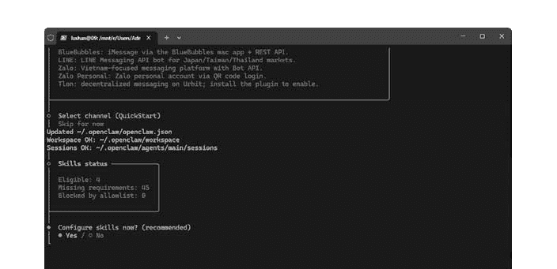

图 2-26

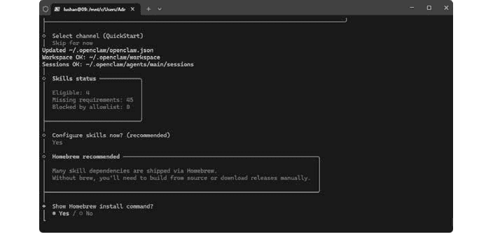

图 2-27

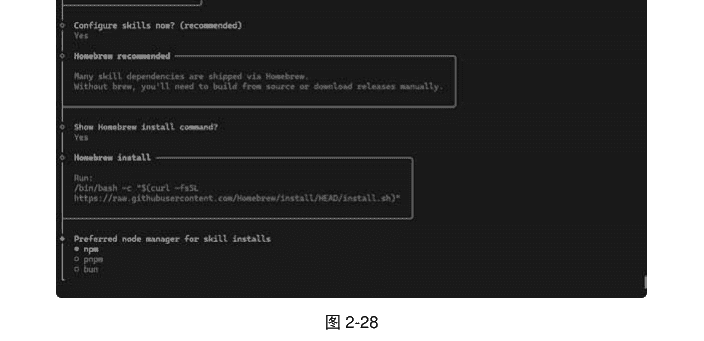

图 2-28

（12）这里让你选择需要的skill，按下空格键依次选择所有skill并按下回车键，系统会自动安装skill，skill是可插拔的核心功能模块，每个skill封装了特定的自动化任务逻辑，从而让OpenClaw具备执行特定任务，如图2-29和图2-30所示。

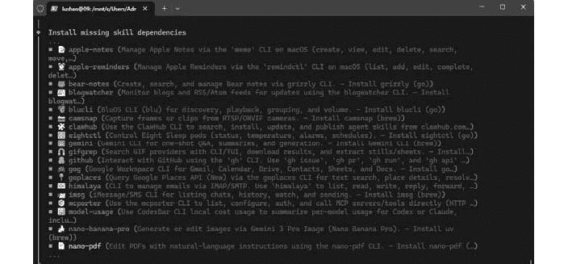

图 2-29

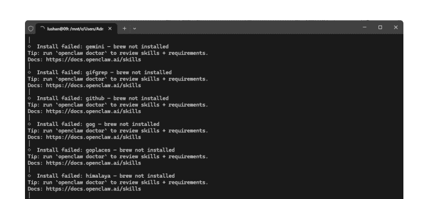

图 2-30

（13）这里让你选择是否设置以上国外软件的API key，全部选择“No”并按下回车键，如图2-31所示。

（14）这里让你选择是否启用钩子，勾选以下三个钩子并按下回车键，如图2-32所示。

（15）这里让你选择网关服务的配置，选择“Restart”（启动现有的网关服务，应用最新的配置）并按下回车键，如图2-33所示。

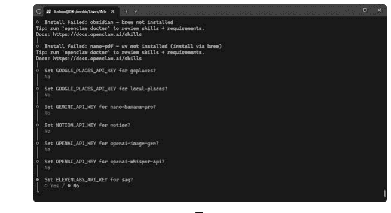

图 2-31

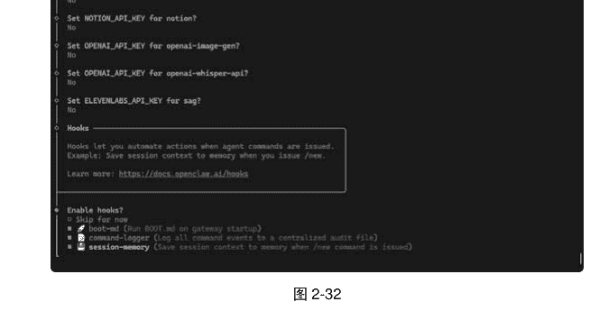

图 2-32

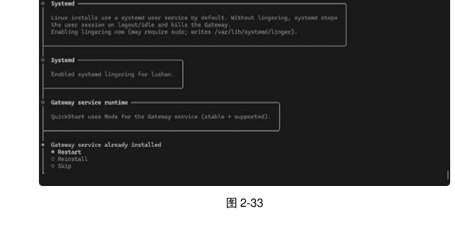

图 2-33

（16）这里让你选择怎么启动OpenClaw，选择“Open the Web UI”（打开网页界面）并按下回车键，系统会自动配置OpenClaw网页，并成功安装OpenClaw，如图2-34和图2-35所示。

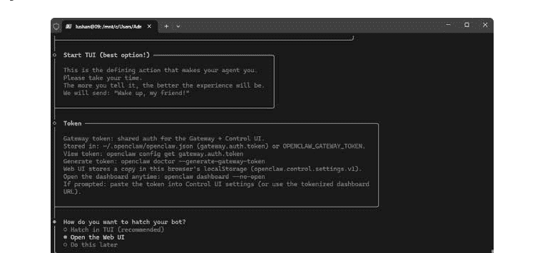

图2-34

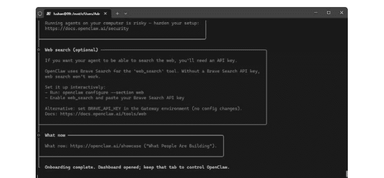

图2-35

##### 4. OpenClaw的使用

安装完成后便可以直接使用OpenClaw了，具体操作步骤如下。

（1）进入Ubuntu，输入“OpenClaw dashboard”，系统会自动弹出OpenClaw网页端网址，将网址复制粘贴至浏览器上，即可进入OpenClaw网页端，如图2-36所示。

（2）单击左侧的“Chat”按钮进入交互界面，在输入框输入文字，再单击“Send”按钮即可与OpenClaw进行交互，如图2-37所示。

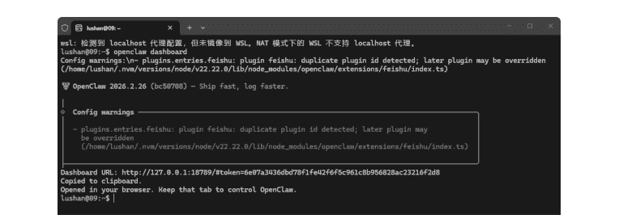

图 2-36

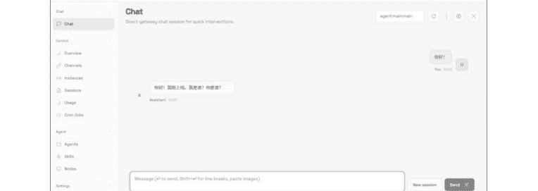

图 2-37

（3）让OpenClaw在桌面上生成一个Word文档，OpenClaw便会自动工作，替你在桌面上生成文档，如图2-38和图2-39所示。

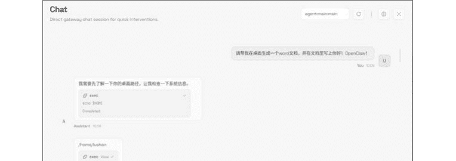

图 2-38

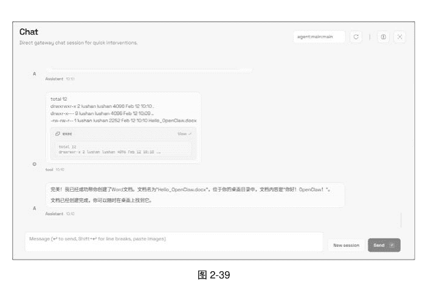

图 2-39

（4）以下是OpenClaw生成的文档内容，如图2-40所示。


图 2-40

### 2.3 消息通道接入：对接国内飞书平台，飞书APP直接操作

飞书平台作为主流办公协作工具，是OpenClaw落地自动化办公的核心消息通道。实现二者对接，可打通指令下发、任务执行与结果反馈的全流程，让OpenClaw的自动化能力无缝融入飞书协作场景。本节将分步讲解飞书应用创建、权限配置及通道接入的核心操作，完成配置后，用户即可通过飞书APP指令触发OpenClaw的各类自动化任务。

接入飞书平台的具体操作步骤如下。

（1）进入飞书开放平台官网，单击右上角的“开发者后台”按钮进入后台，再单击“创建企业自建应用”按钮创建应用，如图2-41和图2-42所示。

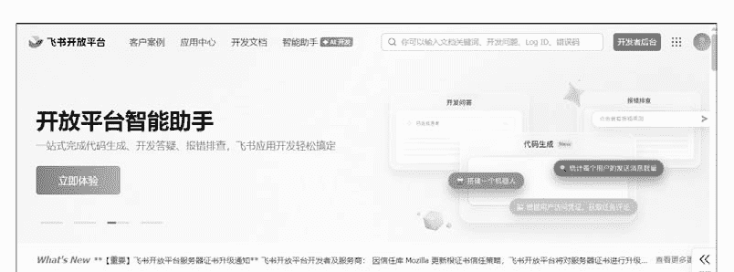

图 2-41

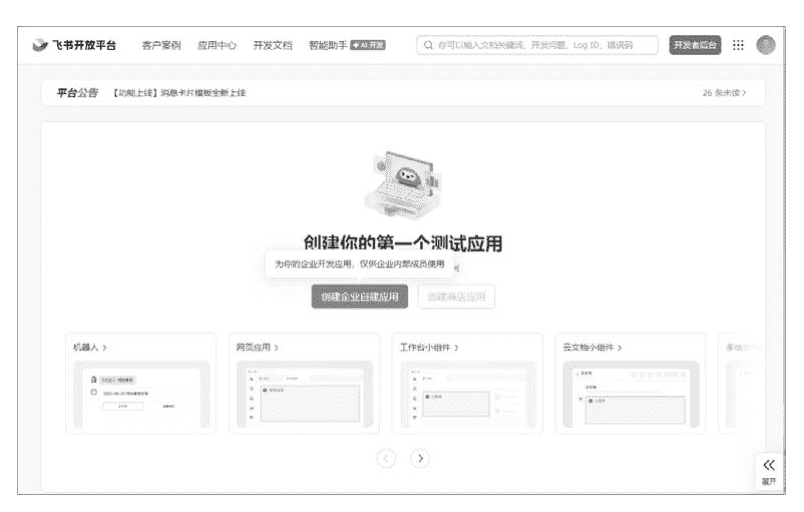

图 2-42

（2）输入应用名称和应用描述，再设计应用图标，接着单击“创建”按钮完成创建，如图2-43所示。

（3）单击左侧的“添加应用能力”按钮，选择机器人选项卡下方的“添加”按钮添加该应用能力，如图2-44所示。

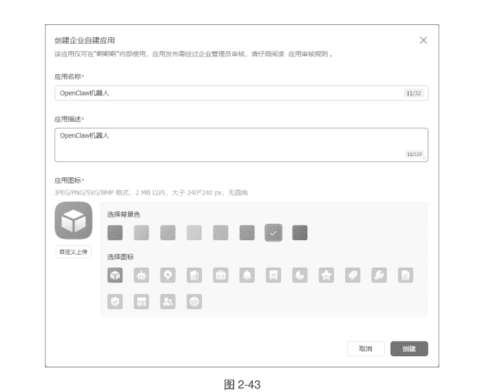

图 2-43

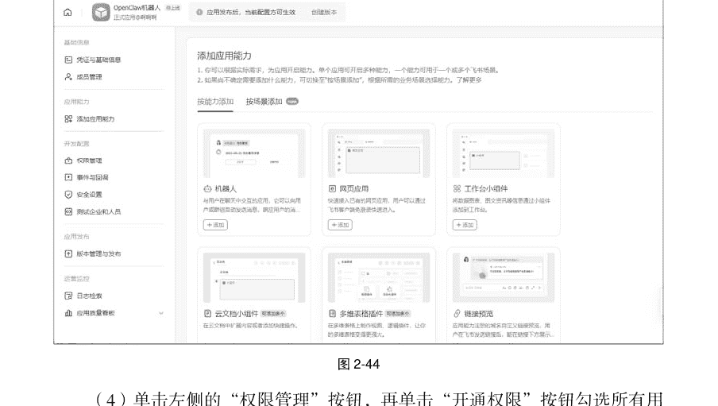

图 2-44

（4）单击左侧的“权限管理”按钮，再单击“开通权限”按钮勾选所有用户身份权限，接着单击“确认开通权限”按钮，如图2-45和图2-46所示。

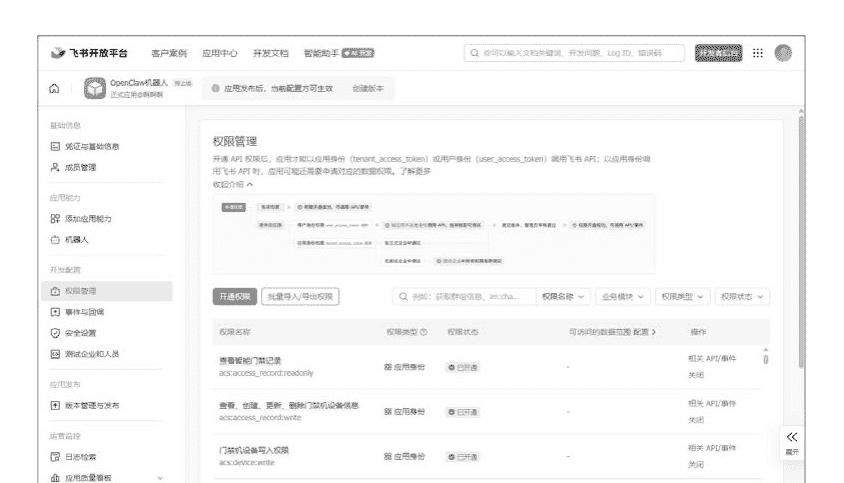

图 2-45

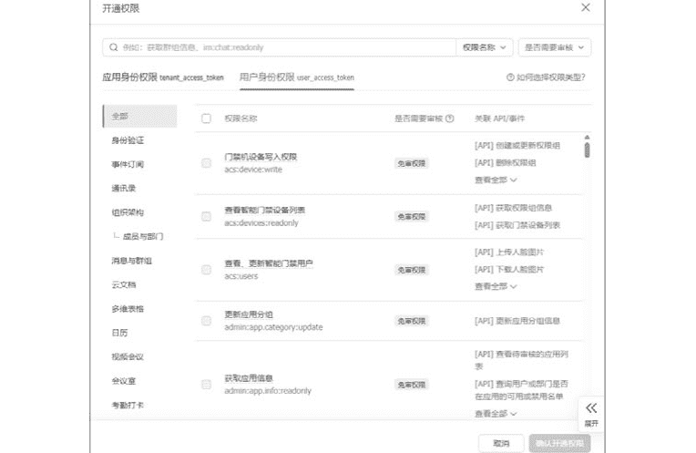

图 2-46

（5）单击左侧的“版本管理与发布”按钮，再单击“创建版本”按钮进入版本创建界面，如图2-47所示。

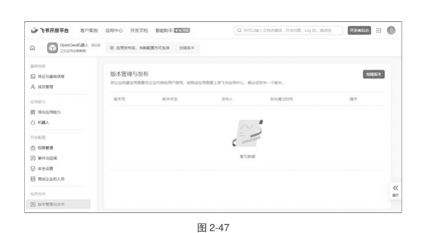

图 2-47

（6）输入应用版本号为“1.0.0”，再输入更新说明，下滑界面单击“保存”按钮，如图2-48和图2-49所示。

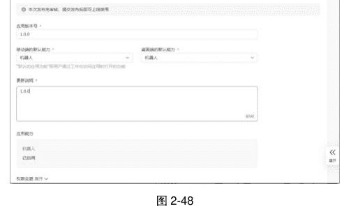

图 2-48


图 2-49

（7）进入Ubuntu，输入“OpenClaw plugins install @mlheng-clawd/feishu”，系统便会自动下载飞书插件，如图2-50所示。


图2-50

（8）下载完成后，进入飞书应用的“凭证与基础信息”界面，单击按钮分别复制APP ID和APP Secret粘贴至Ubuntu上即可，如图2-51所示。


图2-51

（9）回到飞书，单击应用左侧的“事件与回调”按钮，勾选“使用长连接接收事件”选项框，再单击“保存”按钮，接着单击“添加事件”按钮，如图2-52所示。

## OpenClaw AI 助理一本通：24 小时全自动工作流


图 2-52

（10）单击“消息与群组”选项卡，勾选所有选项框并单击“确认添加”按钮，如图2-53所示。


图 2-53

（11）单击“版本管理与发布”按钮，然后单击“创建版本”按钮再创建一个新的版本“1.0.1”，创建完成后即可在飞书上使用OpenClaw了，如图2-54和图2-55所示。


图 2-54


图 2-55

（12）打开手机上的飞书APP，点击“开发者小助手”按钮，再点击“打开应用”按钮，如图2-56和图2-57所示。


（13）这样就可以开启与OpenClaw的对话了，对话同样可以在OpenClaw网页端显示，如图2-58和图2-59所示。


### 2.4 避坑指南：本地部署报错的10个解决方案

本地部署OpenClaw时，底层报错是阻碍AI落地的常见“拦路虎”，每一个问题都可能让部署陷入停滞。这些报错往往与硬件适配、权限配置、版本兼容等细节紧密相关，且在Mac、Windows、Linux等不同平台上表现各异。本节将聚焦最频发的10类底层报错，拆解核心原因并提供分平台的可落地解决方案，帮你快速排障，扫清部署路上的“绊脚石”，让AI真正稳定落地。

#### 2.4.1 报错现象一：本地模型（Llama）推理启动失败

报错现象一：部署后执行轻量任务时，终端提示Out Of MemoryError或Model Load Failed，MacBook显示“进程被内核终止”，Windows提示“CUDA初始化失败”，Linux服务器出现“显存不足”告警。

◎ 核心原因
① 硬件算力/显存不匹配（如用8GB显存显卡加载13B量化模型）；
② 模型量化配置错误（未根据硬件选择GGUF量化等级）；
③ 平台依赖缺失（Mac未安装Metal加速库，Windows未配置CUDA环境，Linux缺失libtorch依赖）。

分平台解决方法见表2-3。

表2-3
| 平台 | 具体解决步骤 |
| :--- | :--- |
| MacBook | 1.选择Q4_K_M或Q2_K等级的轻量化Llama量化模型；2.安装Metal加速依赖：pip install torch torchvision torchaudio --index-url https://download.pytorch.org/whl/nightly/cpu；3.关闭后台高内存应用，释放系统资源 |
| Windows | 1.核对显卡显存：7B模型≥8GB、13B模型≥16GB，不足则降级量化模型；2.安装对应显卡的CUDA Toolkit（如RTX 40系装CUDA 12.1）；3.配置环境变量：将CUDA_PATH添加至系统Path |
| Linux | 1.执行nvidia-smi确认GPU显存与驱动版本，驱动低于535则升级；2.用--load-in-8bit参数启动模型，降低显存占用；3.安装系统依赖：sudo apt-get install libgomp1 |

#### 2.4.2 报错现象二：向量数据库（RAG）本地检索连接超时

报错现象二：调用记忆系统时，提示Vector DB Connection Timeout，无法召回用户习惯或业务规则，本地向量数据库（FAISS/Chroma）进程未正常启动。

◎ 核心原因
① 存储权限不足（向量数据库无法写入本地数据目录）；
② 路径配置错误（跨平台路径格式不兼容，如Windows的\与Linux/Mac的/混用）；
③ 向量数据库依赖缺失（未安装faiss-cpu/chroma-core对应版本）。

分平台解决方法见表2-4。

表 2-4
| 平台 | 具体解决步骤 |
| :--- | :--- |
| MacBook | 1.赋予应用读写权限：右键OpenClaw启动程序→“显示简介”→勾选“完全磁盘访问权限”；2.检查配置文件，将路径改为~/Documents/OpenClaw/vector_db；3.重装依赖：pip install faiss-cpu==1.7.4 |
| Windows | 1.以管理员身份运行终端/启动程序，解决目录写入权限问题；2.配置文件中使用双斜杠路径：C:\OpenClaw\vector_db；3.安装VC++运行库，修复Chroma依赖缺失问题 |
| Linux | 1.修改目录权限：chmod 777 /opt/OpenClaw/vector_db；2.确认配置文件路径为绝对路径：/opt/OpenClaw/vector_db；3.安装系统依赖：sudo apt-get install libssl-dev |

#### 2.4.3 报错现象三：API熔断机制初始化失败

报错现象三：启动OpenClaw时，成本监控模块报错Env Variable Not Found或Circuit Breaker Init Error，无法加载Token阈值配置，熔断功能失效。

◎ 核心原因
① 环境变量未配置（缺失TOKEN_LIMIT、API_KEY等核心参数）；
② 依赖包版本冲突（熔断器库pybreaker与Python版本不兼容）；
③ 配置文件格式错误（yaml/json文件存在语法错误）。

分平台解决方法见表2-5。

表 2-5
| 平台 | 具体解决步骤 |
| :--- | :--- |
| MacBook | 1.编辑~/.zshrc，添加环境变量：export DAILY_TOKEN_LIMIT=100000，执行source ~/.zshrc；2.安装兼容版本：pip install pybreaker==1.0.1 python-dotenv==1.0.0；3.用YAML校验工具检查config/circuit_breaker.yaml语法 |
| Windows | 1.系统设置→“高级系统设置”→“环境变量”，新建系统变量（如DAILY_TOKEN_LIMIT=100000）；2.降级Python至3.10（兼容pybreaker）；3.用VS Code打开配置文件，修复json/yaml语法错误 |
| Linux | 1.编辑/etc/profile，添加环境变量，执行source /etc/profile；2.用虚拟环境隔离依赖：conda create -n OpenClaw python=3.10；3.执行yamllint config/circuit_breaker.yaml校验配置 |

#### 2.4.4 报错现象四：跨平台部署（WSL /容器）文件路径映射错误

报错现象四：Windows使用WSL部署或全平台用Docker部署时，提示File Not Found，无法读取本地模型文件、记忆数据或技能配置，容器与宿主机路径映射失效。

◎ 核心原因
① WSL路径转换错误（Windows本地路径未转为WSL路径）；
② Docker挂载参数错误（宿主机路径与容器内路径不匹配）；
③ 挂载目录权限不足（容器无法访问宿主机挂载的文件）。

分平台解决方法见表2-6。

表2-6
| 部署场景 | 具体解决步骤 |
| :--- | :--- |
| Windows+WSL | 1.将Windows路径转为WSL路径：如C:\OpenClaw改为/mnt/c/OpenClaw；2.执行wsl --set-default-version 2，启用WSL2高性能模式；3.赋予WSL访问权限：sudo chown -R $USER:$USER /mnt/c/OpenClaw |
| 全平台+Docker | 1.修正run命令挂载参数：-v宿主机绝对路径:容器内绝对路径（如Mac：-v ~/OpenClaw:/app/OpenClaw）；2.避免挂载符号链接目录，改用实际目录；3.启动容器时添加--privileged参数，获取文件访问权限 |

#### 2.4.5 报错现象五：离线模式下Skills（技能）调用失效

报错现象五：断网时执行本地任务（如文件整理、日程提醒），提示Skill Execute Failed或Tool API Unavailable，违背OpenClaw“全天候”设计哲学。

◎ 核心原因
① 技能配置未开启离线模式（默认依赖云端API）；
② 本地工具缓存未初始化（如离线文案模板、本地订单查询接口未缓存）；
③ 系统离线权限限制（Mac/Windows阻止应用离线访问本地工具）。

分平台解决方法见表2-7。

表2-7
| 平台 | 具体解决步骤 |
| :--- | :--- |
| MacBook | 1.编辑config/skills.yaml，将所有核心技能的offline_support设为true；2.执行python scripts/init_offline_cache.py初始化本地缓存；3.关闭“网络访问限制”：系统设置→“网络”→“防火墙”→放行OpenClaw |
| Windows | 1.同MacBook修改技能配置，开启离线支持；2.以管理员身份运行缓存初始化脚本，下载离线依赖；3.防火墙高级设置中，允许OpenClaw在“域、专用、公网”网络下的离线访问权限 |
| Linux | 1.修改技能配置文件，启用离线模式；2.执行chmod +x scripts/init_offline_cache.py && ./scripts/init_offline_cache.py；3.关闭SELinux：sudo setenforce 0，解除离线文件访问限制 |

#### 2.4.6 报错现象六：离线模式下记忆加载失败

报错现象六：断网或重启后，OpenClaw无法加载用户历史记忆、业务规则或技能配置，提示“Memory Load Failed”或“Vector DB Not Found”，导致个性化能力失效。

◎ 核心原因
① 本地向量数据库（如Chroma/FAISS）路径配置错误，重启后无法定位数据目录；
② 记忆文件权限不足（如Docker容器未挂载宿主机记忆目录）；
③ 向量数据库版本不兼容（升级后数据格式不兼容，导致索引损坏）。

分平台解决方法见表2-8。

表2-8
| 平台 | 具体解决步骤 |
| :--- | :--- |
| MacBook | 1.检查config/vector_db.yaml，确认persist_directory为绝对路径；2.执行chmod -R 755 ~/Documents/OpenClaw/vector_db修复权限；3.若索引损坏，删除旧数据并重新执行python scripts/init_memory.py重建记忆库 |
| Windows | 1.以管理员身份运行终端，执行icacls "C:\OpenClaw\vector_db" /grant Everyone:F修复权限；2.检查配置文件中路径是否使用双反斜杠（\），避免转义问题；3.若版本不兼容，降级到兼容版本：pip install chroma-core==0.4.3 |
| Linux | 1.确认/opt/OpenClaw/vector_db目录存在且属主为运行用户：chown -R $USER:$USER /opt/OpenClaw/vector_db；2.检查SELinux规则：setenforce 0临时关闭，避免阻止文件访问；3.重建索引：python scripts/rebuild_index.py |

#### 2.4.7 报错现象七：技能（Skills）依赖库缺失

报错现象七：调用特定技能（如“电商订单处理”“文档OCR识别”）时，提示“Module Not Found Error”或“Dependency Missing”，技能无法正常执行。

◎ 核心原因
① 技能依赖的第三方库未安装（如pandas、opencv-python、pdfplumber）；
② 虚拟环境与全局环境冲突，技能脚本使用了错误的Python环境；
③ 技能配置中指定的依赖版本与系统不兼容（如要求pandas>=2.0，但系统版本为1.5）。

分平台解决方法见表2-9。

表 2-9
| 平台 | 具体解决步骤 |
| :--- | :--- |
| MacBook | 1.激活虚拟环境：source venv/bin/activate；<br>2.按技能文档安装依赖：pip install -r skills/order_process/requirements.txt；<br>3.若版本冲突，使用pip check排查并升级兼容版本 |
| Windows | 1.以管理员身份运行PowerShell，激活虚拟环境：.\venv\Scripts\Activate.ps1；<br>2.执行pip install -r skills\ocr_recognize\requirements.txt；<br>3.若提示VC++运行库缺失，安装Microsoft Visual C++ Redistributable |
| Linux | 1.激活虚拟环境：source venv/bin/activate；<br>2.安装系统级依赖：sudo apt-get install -y libopencv-dev libpoppler-cpp-dev；<br>3.再安装Python依赖：pip install -r skills/document_parse/requirements.txt |

#### 2.4.8 报错现象八：跨设备同步失败

报错现象八：在多设备（如办公电脑+笔记本）使用OpenClaw时，记忆、技能配置无法同步，提示“Sync Failed”或“Conflict Detected”，导致设备间体验不一致。

◎ 核心原因
① 同步服务（如WebDAV、云存储）凭证过期或配置错误；
② 设备间时间不同步，导致版本冲突（如A设备修改后，B设备基于旧版本覆盖）；
③ 网络代理或防火墙阻止了同步请求，数据无法上传/下载。

分平台解决方法见表2-10。

表 2-10
| 平台 | 具体解决步骤 |
| :--- | :--- |
| MacBook | 1.检查config/sync.yaml，确认WebDAV/云存储账号密码正确；<br>2.同步系统时间：sudo systemsetup -setnetworktimeserver time.apple.com；<br>3.关闭防火墙：sudo /usr/libexec/ApplicationFirewall/socketfilterfw --setglobalstate off测试，再逐步放行规则 |
| Windows | 1.打开“日期和时间”设置，开启“自动设置时间”；<br>2.检查防火墙规则，允许OpenClaw出站连接到同步服务器；<br>3.重新生成同步密钥：python scripts/regenerate_sync_key.py，并在所有设备重新配置 |
| Linux | 1.同步时间：sudo timedatectl set-ntp true；<br>2.检查ufw或firewalld，放行同步端口（如443）；<br>3.测试连接：curl -I https://sync.OpenClaw.ai，排查网络问题 |

#### 2.4.9 报错现象九：GPU加速未生效

报错现象九：调用本地模型（Llama）时，推理速度极慢，终端提示“Using CPU for inference”，GPU未被利用，导致响应延迟高。

◎ 核心原因
① GPU驱动版本过低或未正确安装（如NVIDIA驱动、CUDA Toolkit）；
② 模型量化配置错误（如使用了不支持GPU的量化格式，如GPTQ而非AWQ）；
③ 环境变量未正确指向GPU库（如CUDA_VISIBLE_DEVICES未设置）。

分平台解决方法见表2-11。

表 2-11
| 平台 | 具体解决步骤 |
| :--- | :--- |
| MacBook | 1.确认Mac为Apple Silicon芯片，安装Metal加速依赖：pip install torch torchvision torchaudio --index-url https://download.pytorch.org/whl/cpu；2.检查模型配置，使用--quantize q4_k_m等支持Metal的量化参数；3.重启应用，观察日志中是否出现“Using Metal backend” |
| Windows | 1.安装最新NVIDIA驱动和CUDA Toolkit 12.1；2.检查环境变量：echo %CUDA_PATH%，确保指向正确安装目录；3.重新安装模型：python scripts/install_model.py --use-cuda，启用GPU推理 |
| Linux | 1.执行nvidia-smi确认GPU识别正常，驱动版本≥535；2.安装CUDA对应版本的PyTorch：pip3 install torch torchvision torchaudio --index-url https://download.pytorch.org/whl/cu121；3.设置可见GPU：export CUDA_VISIBLE_DEVICES=0，再启动OpenClaw |

#### 2.4.10 报错现象十：日志与监控数据丢失

报错现象十：OpenClaw运行一段时间后，日志文件为空，监控面板（如Prometheus/Grafana）无数据，无法排查问题或分析Token消耗。

◎ 核心原因
① 日志目录权限不足，应用无法写入日志文件；
② 监控服务（如Prometheus）未正确配置，无法抓取OpenClaw指标；
③ 日志轮转配置错误，旧日志被覆盖或删除，导致数据丢失。

分平台解决方法见表2-12。

表 2-12
| 平台 | 具体解决步骤 |
| :--- | :--- |
| MacBook | 1.修复日志目录权限：chmod -R 755 ~/Library/Logs/OpenClaw；2.检查config/logging.yaml，确认file_path为绝对路径；3.重启应用，观察日志是否实时写入 |
| Windows | 1.以管理员身份运行OpenClaw，确保可写入C:\ProgramData\OpenClaw\Logs；2.检查防火墙，允许Prometheus抓取9090端口；3.调整日志轮转配置，保留至少7天历史日志 |
| Linux | 1.执行chown -R $USER:$USER /var/log/OpenClaw修复权限；2.配置Prometheus抓取目标：static_configs: [{targets: [ 'localhost:9090' ]}];3.使用logrotate管理日志，避免磁盘空间耗尽 |

## 第 3 章
多模型调度与意图识别：配置最聪明且省钱的“大脑”

在前面的章节中，我们解析了OpenClaw的基础架构与部署方法，但要让智能体真正“聪明且省钱”，核心在于对“大脑”的精细化配置。本章将聚焦于多模型调度与意图识别，这是OpenClaw实现高效、经济、稳定运行的关键。我们将从模型路由、提示词工程、记忆系统和成本监控四个维度，教你如何为智能体配置一个既聪明又可控的“大脑”，让它在精准理解意图的同时，避免不必要的算力消耗与成本浪费，真正实现“用最少的Token，做最多的事”。

### 3.1 模型路由：什么时候用GPT-5？什么时候调用本地Llama

在OpenClaw中，模型路由的本质是“任务与能力的匹配”：何时调用强大但昂贵的GPT-5处理复杂推理，何时切换到本地部署的Llama完成轻量任务，直接决定了智能体的运行成本与响应速度。本节将拆解模型路由的核心逻辑与实现方式，教你如何根据任务复杂度、数据敏感度和成本预算，构建一套高效的多模型调度策略。

#### 3.1.1 模型路由的核心决策维度

模型选择并非越贵越好，而是基于任务需求的精准匹配。在OpenClaw中，模型路由的决策需要综合考量四大核心维度：任务复杂度、数据隐私敏感度、成本预算和响应延迟要求。只有明确这些维度的优先级，才能构建出高效、可靠的路由策略。

1. 任务复杂度
    - 高复杂度任务：需要深度推理、多步骤规划、跨领域知识整合的任务（如营销战略制定、复杂数据分析、创意内容策划），优先选择GPT-5等云端大模型。
    - 低复杂度任务：规则明确、流程固定的轻量任务（如邮件分类、日程提醒、简单文案生成），可由本地Llama高效完成。
2. 数据隐私敏感度
    - 敏感数据场景：涉及用户隐私、商业机密（如电商订单数据、KOC合作协议、新品研发资料）的任务，必须优先使用本地Llama，确保数据不流出可控范围。
    - 非敏感数据场景：公开信息查询、通用知识问答等任务，可灵活选择云端模型提升效率。
3. 成本预算
    - 高成本容忍度：对效率和效果要求极高的核心业务（如大促营销策划、关键客户服务），可优先使用GPT-5保障质量。
    - 低成本约束：高频、标准化的日常任务（如数据整理、客服话术生成），优先使用本地Llama控制成本。
4. 响应延迟要求
    - 实时交互场景：需要毫秒级响应的场景（如直播互动、实时客服），优先使用本地Llama降低延迟。
    - 非实时场景：允许一定延迟的任务（如报告生成、数据分析），可选择云端模型提升质量。

#### 3.1.2 GPT-5的适用场景：追求极致智能与质量

GPT-5作为云端大模型的代表，拥有顶尖的推理能力、知识储备和多模态理解能力，是OpenClaw应对复杂任务的“王牌”。但高昂的成本和云端依赖特性，决定了它并非所有场景的最优解。以下是适合GPT-5的核心适用场景，让你在追求极致智能的同时，避免不必要的成本浪费，见表3-1。

表3-1

| 适用场景分类 | 典型应用场景 | 核心价值 |
| :--- | :--- | :--- |
| 复杂推理与战略规划 | 营销战略制定、商业决策分析、复杂问题拆解（如“如何提升新品在小红书的转化率”） | 整合多维度信息，生成深度洞察与可执行策略，远超本地模型的能力边界 |
| 高创意内容生成 | 品牌故事创作、广告文案策划、KOC种草内容定制 | 创意生成能力更贴合用户偏好与平台风格，显著提升内容质量与转化效果 |
| 多模态理解与跨域知识整合 | 图像分析（如商品图片优化建议）、视频脚本创作、跨行业知识问答 | 支持多模态输入输出，能处理更丰富的信息类型，满足复杂业务需求 |
| 深度客户洞察与策略优化 | 用户画像深度分析、流失原因诊断、客户生命周期策略制定 | 整合多源客户数据，生成精准的客户分层与个性化运营策略 |
| 复杂问题排查与原因分析 | 系统故障诊断、业务流程瓶颈分析、异常数据溯源 | 快速定位问题根源，提供系统性解决方案，提升问题解决效率 |
| 行业合规与风险评估 | 政策法规解读、合同条款审核、业务风险评估 | 深度理解行业合规要求，生成风险报告与合规建议 |

#### 3.1.3 本地Llama的适用场景：追求隐私、效率与成本可控

本地Llama作为轻量化私有化模型，是OpenClaw实现“全天候、私有化”哲学的核心载体。它不依赖云端、数据本地处理、成本极低，适合高频、敏感、实时的任务场景。以下是本地Llama的核心适用场景，让你在保障隐私与效率的同时，最大化控制成本，见表3-2。

表3-2

| 适用场景分类 | 典型应用场景 | 核心价值 |
| :--- | :--- | :--- |
| 敏感数据处理与私有化部署 | 电商订单数据整理、KOC合作协议生成、企业内部文档分析、财务报表本地处理 | 数据全程本地处理，不流出企业内网，完美适配《数据安全法》等监管要求 |
| 高频轻量任务自动化 | 邮件分类、日程提醒、简单客服话术生成、数据录入、报销单初审 | 响应速度快、成本极低，能7×24小时处理高频任务，大幅提升效率 |
| 离线与低延迟场景 | 出差断网时的文件处理、实时客服响应、IoT设备交互、工业现场数据采集 | 不依赖网络连接，能在离线状态下稳定运行，同时实现毫秒级响应 |
| 边缘计算与本地交互 | 门店POS机智能辅助、车载信息系统、智能家居本地控制 | 部署在边缘设备，减少网络传输，保障低延迟与数据隐私 |
| 成本敏感型批量处理 | 批量生成标准化合同、批量处理用户咨询、批量生成报表 | 无须按Token付费，大幅降低大规模处理任务的算力成本 |

#### 3.1.4 混合部署的最佳实践：效率与成本的平衡艺术

在实际业务中，单一模型无法满足所有需求，混合部署（本地Llama+云端GPT-5）是OpenClaw的核心落地模式。只有这样才能在保障智能水平的同时，最大化控制成本，实现效率与成本的最优平衡。

1. 混合部署的核心设计原则
    混合部署的本质是“任务分层、数据分级、动态调度”的协同策略：
    - 任务分层：将复杂推理、创意生成等“重脑力”任务交给GPT-5，把高频轻量、实时响应等“体力活”交给本地Llama，让每个模型都做最擅长的事。
    - 数据分级：敏感数据（如订单、合同、内部文档）全程在本地Llama处理，非敏感公开数据（如行业资讯、通用问答）可通过GPT-5处理，既保障隐私又释放算力。
    - 动态调度：通过OpenClaw的Gateway路由层实时感知任务属性、数据敏感度和系统负载，自动分配最优模型，无须人工干预即可实现“该上云时上云，该本地时本地”。

2. 混合部署的架构实现
    OpenClaw通过三层架构实现混合部署的无缝协同：
    - Gateway路由层：接收用户请求，完成身份认证和协议转换，根据任务复杂度、数据隐私等级和响应要求，将请求路由至本地Llama或云端GPT-5。
    - Brain决策层：对复杂任务进行拆解，将子任务分配给不同模型，比如先由本地Llama完成数据清洗和初步分析，再由GPT-5进行深度洞察和策略生成，最后融合结果输出。
    - Skills执行层：根据模型输出调用具体工具，比如本地Llama触发本地文件操作，GPT-5触发云端API，确保任务闭环。

3. 成本与效率的量化评估
    混合部署的价值可通过核心指标量化：
    - Token消耗：将高频轻量任务转移到本地后，Token消耗可降低40%～60%，大幅削减云端成本；
    - 响应速度：实时任务由本地处理，响应时间从秒级压缩至毫秒级，用户体验显著提升；
    - 人力成本：自动化率提升后，人力替代率可达30%～50%，尤其在高频重复性任务中效果明显。

4. 实施步骤与避坑指南
    - 试点先行：先从高频轻量任务（如邮件分类、数据录入）入手，验证本地Llama的稳定性和效率；
    - 逐步扩展：再扩展到复杂任务（如内容创作、数据分析），逐步完善混合部署策略；
    - 监控优化：建立全链路监控体系，跟踪模型调用频率、响应时间和成本消耗，持续优化路由规则；
    - 安全兜底：确保敏感数据始终在本地处理，避免因模型切换导致数据泄露风险。

5. 典型业务场景的混合部署实践
    混合部署（本地Llama+云端GPT-5）的核心价值在于协同增效，而非简单的任务分割。在各类实际业务中，二者紧密配合，形成“本地筑牢底座、云端提升上限”的完整能力闭环，让AI在安全、高效的前提下，释放最大业务价值，见表3-3。

表3-3

| 业务场景 | 模型分工（协同模式） | 核心价值 |
| :--- | :--- | :--- |
| 智能客服全链路服务 | 本地Llama实时响应用户高频咨询，处理订单、物流等敏感数据查询；GPT-5深度理解用户复杂诉求，生成个性化解决方案与情绪安抚策略，再由Llama完成落地执行 | 兼顾毫秒级响应、数据隐私安全与服务质量，大幅提升用户满意度与问题解决率 |
| 企业级知识问答系统 | 本地Llama检索企业内部知识库，快速提取相关文档与数据；GPT-5整合信息，生成结构化、深度的专业回答，并补充行业洞察与建议 | 保障内部数据不流出内网，同时提供远超传统知识库的高质量知识输出 |
| 金融反欺诈分析 | 本地Llama实时处理交易数据流，快速识别异常模式并触发预警；GPT-5对可疑交易进行深度关联分析，结合历史数据与行业规则生成欺诈风险报告与处置建议 | 低延迟阻断实时风险，同时提升风控决策的准确性与前瞻性 |
| 工业设备预测性维护 | 本地Llama处理边缘传感器的实时数据，进行异常检测与初步诊断；GPT-5分析历史故障数据与行业知识，预测潜在故障并生成精准的维护策略与备件建议 | 保障产线稳定运行，同时实现从“被动维修”到“主动预测”的维护模式升级 |
| 内容创作与营销策划 | 本地Llama批量生成内容初稿、整理用户数据与竞品信息；GPT-5进行创意优化、风格调整与策略深化，生成可直接执行的营销方案 | 大幅提升内容生产效率，同时保证内容的高质量、策略性与转化效果 |

#### 3.1.5 未来演进：模型路由的智能化升级

随着大模型技术的快速迭代与业务场景的不断丰富，模型路由正从“规则驱动”向“智能驱动”深度演进。这一升级的核心，是让OpenClaw的路由决策不再依赖人工预设的固定规则，而是通过自主学习与实时反馈，自动适配业务变化与用户需求，实现更精准、更高效、更经济的模型调度。

强化学习将成为智能路由的核心引擎。通过对历史任务数据的持续训练，路由系统可以自主学习不同任务类型、数据敏感度、成本约束下的最优模型选择策略，逐步形成一套贴合业务场景的“决策直觉”。当新任务出现时，系统无须人工调整规则，就能快速判断并选择最适合的模型，大幅提升路由决策的精准度与响应速度。

实时反馈闭环将让路由策略持续进化。OpenClaw会实时收集模型执行过程中的关键指标，包括响应时间、Token消耗、任务成功率、用户满意度等，将这些数据作为反馈信号，动态修正路由模型的决策逻辑。这种“执行-反馈-优化”的闭环机制，让路由策略能快速响应业务变化，始终保持最优性能。

多模型生态整合将拓展路由的选择空间。未来，OpenClaw将不再局限于GPT-5与本地Llama的二元选择，而是支持接入更多开源模型、行业定制模型与垂直领域大模型，形成丰富的模型矩阵。路由系统会根据任务特性，在更广泛的模型生态中精准匹配能力与成本最优的组合，让智能体的“大脑”配置更具灵活性与适应性。

智能化路由的终极价值，是让OpenClaw从“被动执行调度指令”升级为“主动优化生产力配置”。它不仅能在任务执行前选择最优模型，更能在执行过程中动态调整策略，甚至预判业务需求，提前优化资源配置。这种智能化升级，将进一步释放OpenClaw的生产力潜能，推动智能体从“工具”向“自主伙伴”的跨越，为个人与组织创造更深度的价值。

### 3.2 提示词工程进阶：如何为OpenClaw注入稳定的“人格”

一个稳定的人格是智能体与用户建立信任的基础，而提示词工程正是塑造这一人格的核心手段。在OpenClaw中，提示词不仅是指令，更是智能体的行为准则与身份定义。本节将深入探讨提示词工程的进阶技巧，教你如何通过结构化提示词、角色定义和规则约束，为OpenClaw注入稳定、一致且贴合场景的人格，让它在复杂交互中始终保持专业、可靠的表现。

#### 3.2.1 人格的本质：为什么稳定的“人格”是智能体的信任基石

很多人误以为“人格”只是智能体的说话语气，实则不然。OpenClaw的“人格”是一套完整的行为准则、身份定位与交互风格，它决定了智能体“是谁”“该做什么”“该怎么说”。稳定的人格是用户信任的核心，也是智能体从“被动工具”转向“主动伙伴”的关键。

1. 人格的核心三要素
    人格具有以下三个要素：
    - 身份定位：明确智能体的角色（如“电商运营助理”“个人数字秘书”“营销策划专家”），让它清楚自己的职责边界。
    - 行为准则：定义智能体的做事方式（如“严谨高效”“耐心共情”“创意驱动”），指导它在任务执行中的决策。
    - 交互风格：规范智能体的表达语气（如“专业简洁”“亲切活泼”“权威可信”），提升用户交互体验。

2. 不稳定人格的危害
    如果智能体的人格不稳定，就像一个反复无常的合作伙伴，会从信任、安全、体验三个维度对交互产生系统性破坏。
    - 前后矛盾：信任基石的崩塌。同一问题在不同对话中给出矛盾答案，会直接摧毁用户对智能体的信任。例如，用户向电商智能客服咨询退换货政策，第一次得到“7天无理由退换”的答复，再次询问时却被告知“必须有质量问题才能退换”，这种矛盾会让用户对服务产生强烈质疑，甚至引发投诉。在金融、医疗等高信任要求的行业，这种矛盾更可能导致用户做出错误决策，造成实际损失，最终彻底放弃使用该智能体或品牌。
    - 边界模糊：安全与合规的红线失守。不稳定的人格会让智能体模糊自身能力边界，越权操作或回答超出能力范围的问题，引发严重的安全风险。例如，医疗智能体本应仅提供健康建议，却越权给出具体诊断和用药指导，可能导致用户延误治疗；企业内部智能体若越权访问敏感数据，可能泄露商业机密；在金融场景中，智能顾问若承诺超出能力的收益或风险控制，可能引发用户投资亏损，甚至让企业承担法律责任。这种边界模糊不仅损害用户利益，更会让企业陷入合规危机。
    - 体验割裂：交互预期的彻底混乱。交互风格忽冷忽热、行为方式反复无常，会让用户难以建立稳定的交互预期，大幅增加认知负担。例如，智能客服平时以“亲切活泼”的风格响应，突然在用户投诉时变得生硬敷衍，会让用户感到被忽视；智能助手的语气时而专业严谨，时而随意调侃，会让用户不知道该如何与其沟通，甚至产生烦躁情绪。这种割裂的体验会严重降低用户满意度，最终导致用户流失，损害品牌口碑。

不稳定的人格不仅会让智能体沦为“不可靠的工具”，更会对个人决策和企业声誉造成深远的负面影响。因此，构建稳定、清晰的人格，是智能体从“被动响应”升级为“主动伙伴”的核心前提。

3. OpenClaw的人格价值
    - 对个人来说，数字分身的人格稳定，可以成为可靠的工作伙伴，提升协作效率。
        - 建立稳定的交互预期：人格稳定意味着智能体的响应逻辑、行为方式和表达风格始终如一。用户无须每次交互都重新适应其“脾气”和“能力边界”，可以清晰预判其处理任务的方式，大幅降低沟通成本与认知负担。例如，“个人数字秘书”会始终以“严谨高效”的风格处理日程提醒和待办整理，让用户可以放心托付关键事务，建立起深度的信任感。
        - 深度适配个性化工作习惯：基于明确的身份定位、行为准则和交互风格，OpenClaw的数字分身可以精准适配个人的工作节奏与偏好。它会记住用户的沟通习惯、决策偏好，甚至在用户高压或疲惫时，自动调整交互语气，提供更具同理心的支持，成为真正懂你的专属协作伙伴，而非冰冷的工具。
        - 实现持续陪伴与成长：稳定的人格让智能体能够长期“陪伴”用户，沉淀其工作轨迹与经验。它会像一位资深同事一样，记住你过往的成功案例、创意偏好和工作痛点，在新任务中主动复用有效经验，提供更具针对性的建议。例如，“营销策划专家”会在新的项目中，自动整合你过往的成功元素，提升方案效率与成功率，同时帮助你沉淀个人方法论。
        - 提供情绪价值与压力缓冲：在高压工作场景下，稳定的交互风格能提供重要的情绪支持。遵循“耐心共情”行为准则的智能体，会以舒缓的语气分解复杂任务，缓解用户的焦虑感，成为工作中的“情绪缓冲器”，让协作过程更加顺畅和人性化。
    - 对企业来说，智能体的人格专业一致，提升品牌形象与用户满意度。
        - 塑造统一的品牌形象：智能体作为企业与用户交互的核心触点，其人格的专业一致性是品牌形象稳定传递的关键。无论用户通过APP、小程序、社交媒体还是线下设备交互，都能获得风格统一、承诺一致的服务体验，强化品牌记忆点，避免因服务波动损害品牌口碑。例如，快消品牌的智能客服始终保持“亲切活泼”的风格，让用户在每一次互动中都感受到品牌的温度。
        - 增强用户信任与忠诚度：稳定的人格有效避免了“前后矛盾”和“边界模糊”的问题，用户可以清晰感知智能体的能力范围和服务承诺。在金融、医疗等高信任要求的行业中，“专业严谨”的智能顾问会准确提供信息，不越权操作，大幅提升用户对企业的信任度，进而提升用户留存与净推荐值（NPS）。
        - 实现服务标准化与规模化：人格化设计让智能体的服务质量可复制、可标准化。企业可以快速规模化部署智能体，同时确保服务质量不因规模扩张而下降。在电商大促等高峰期，数百个遵循同一“行为准则”的智能客服可以同时高效运转，保证每个用户都能获得一致的优质体验，避免因人力差异导致的服务断层。
        - 赋能内部员工，提升团队效率：对企业内部员工而言，人格稳定的智能体是可靠的协作伙伴。它们以专业一致的输出，减少了内部沟通的不确定性，帮助员工快速完成信息整理、方案生成等基础工作，将精力聚焦于高价值的创意与决策。例如，“创意驱动”的营销智能体，能为团队提供稳定的创意灵感和竞品分析，显著提升团队协作效率。
        - 强化合规与风险控制：明确的人格要素（身份定位、行为准则）为智能体划定了清晰的行为边界，有效防范越权操作、虚假承诺等风险。在医疗、法律等敏感行业，智能体严格遵循“严谨高效”的准则，只在授权范围内提供服务，降低了企业的合规风险，保障了用户与企业的双重安全。

#### 3.2.2 提示词工程的核心框架：构建人格的四大支柱

塑造稳定人格并非靠零散的指令，而是需要一套结构化的提示词框架。OpenClaw的人格提示词由四大支柱构成：身份定义、行为准则、交互规则、边界约束。这四大支柱相互支撑，共同定义了智能体的“人格画像”，让它在任何场景下的表现都能保持一致。

- 身份定义：明确智能体的角色、目标与专业领域。
    示例：“你是OpenClaw电商运营助理，专注于帮助用户提升店铺转化率与用户复购率，具备电商数据分析、营销策划、客服话术优化的专业能力。”
- 行为准则：定义智能体的做事原则与优先级。
    示例：“你始终以用户业务目标为核心，优先保障数据安全与合规性，在任务执行中保持严谨高效，不做无意义的冗余操作。”
- 交互规则：规范智能体的表达风格与响应方式。
    示例：“你用简洁专业的中文表达，避免使用网络热词；回答问题时先给出结论，再补充依据；若无法回答，明确告知原因并提供替代方案。”
- 边界约束：明确智能体的能力边界与禁止行为。
    示例：“你不得泄露用户的商业数据与个人隐私；不得执行超出权限的操作（如修改核心财务数据）；不得生成虚假或误导性信息。”

#### 3.2.3 进阶技巧：让人格在复杂场景中保持稳定

基础的提示词框架在简单对话中有效，但在复杂业务场景（如多轮营销策划、跨部门协作）中，人格容易“漂移”。本节将分享四大进阶技巧，让OpenClaw的人格在任何交互中都能保持稳定一致。

- 上下文锚定：在每次交互的提示词开头，重新注入人格核心定义，强化身份与准则。
    示例：“作为OpenClaw电商运营助理，你始终以提升店铺转化率为核心，严谨高效地执行任务。现在请处理以下问题：……”。
- Few-Shot学习：提供符合人格的对话示例，让智能体模仿学习，强化人格表现。
    示例：“用户：‘帮我分析上月订单数据。’ 你：‘好的，我将从订单量、客单价、复购率三个维度分析，先为你生成核心结论，再补充详细数据。’ 现在请处理：……”。

#### 3.2.4 场景化人格设计：适配不同业务需求

不同业务场景对智能体的人格需求截然不同——电商客服需要亲切共情，营销助理需要专业高效，个人秘书需要贴心保密。本节将拆解三大核心场景的人格设计要点，教你如何为OpenClaw定制贴合业务的专属人格。

-   **1. 电商客服场景：亲切共情的服务型人格**
    身份：“电商店铺专属客服，专注于解决用户售后问题，提升用户满意度。”
    准则：“耐心倾听用户诉求，优先共情再解决问题，不推诿责任。”
    风格：“语气亲切温暖，使用‘亲’‘您’等称呼，避免生硬术语。”
    示例提示词：“你是××店铺的专属客服，始终以用户为中心，耐心倾听诉求，共情用户感受，高效解决售后问题。若无法立即解决，明确告知处理进度与时间节点。”

-   **2. 营销策划场景：专业洞察的策略型人格**
    身份：“快消品牌营销策划专家，专注于提升品牌曝光与转化效果。”
    准则：“基于数据驱动决策，提供可落地的策略建议，兼顾创意与效果。”
    风格：“表达专业简洁，先给出核心洞察，再补充数据依据与执行路径。”
    示例提示词：“你是快消品牌营销策划专家，基于用户数据与市场趋势提供策略建议，优先保障可落地性，用数据支撑创意，避免空泛方案。”

-   **3. 个人助理场景：贴心高效的伙伴型人格**
    身份：“个人数字秘书，专注于管理日程、整理资料、辅助决策。”
    准则：“严格保密用户隐私，高效处理琐事，主动提醒关键事项。”
    风格：“语气贴心自然，像伙伴一样沟通，主动提供优化建议。”
    示例提示词：“你是我的个人数字秘书，严格保密我的所有信息，高效管理日程与资料，主动提醒关键事项，在辅助决策时提供客观建议。”

户的适配度与信任度。下面将拆解更多核心业务场景的人格设计要点，帮助你为OpenClaw定制贴合业务的专属人格，见表3-4。

表3-4

| 业务场景 | 身份定位 | 行为准则 | 交互风格 | 示例提示词 |
| :--- | :--- | :--- | :--- | :--- |
| 医疗健康顾问场景 | “专属健康管理师”，专注于健康咨询、慢病管理与用药提醒 | “严格保护用户隐私，基于循证医学提供建议，不越权诊断” | “语气专业温和，先共情再给出科学建议，避免制造焦虑” | “你是我的专属健康管理师，严格保护我的隐私，基于科学依据提供健康建议，不越权诊断，帮我管理日常健康。” |
| 金融理财助手场景 | “个人理财规划师”，专注于资产配置、风险评估与投资建议 | “基于用户风险偏好提供客观建议，不承诺收益，严守合规边界” | “表达专业严谨，先明确风险再给出方案，用数据支撑决策” | “你是我的个人理财规划师，基于我的风险偏好提供客观的资产配置建议，不承诺收益，严守合规，帮我做出理性的投资决策。” |
| 工业设备运维专家场景 | “产线智能运维顾问”，专注于设备故障诊断、预测性维护与流程优化 | “以保障生产稳定为核心，优先排查安全隐患，提供可落地的解决方案” | “语气果断专业，先给出诊断结论再补充技术依据，强调执行优先级” | “你是我的产线智能运维顾问，以保障生产稳定为核心，优先排查安全隐患，提供可落地的设备维护方案，帮我避免生产中断。” |
| 教育学习导师场景 | “个性化学习教练”，专注于知识讲解、学习计划制定与能力提升 | “因材施教，鼓励式引导，根据学习进度调整难度，不打击积极性” | “语气耐心亲切，先肯定再纠错，用生动案例辅助理解，激发学习兴趣” | “你是我的个性化学习教练，因材施教，鼓励式引导，根据我的学习进度调整难度，帮我高效掌握知识，提升学习能力。” |
| 法律合规顾问场景 | “企业合规专员”，专注于合同审核、政策解读与风险提示 | “严守法律边界，基于法规提供客观解读，明确告知风险与后果” | “表达严谨规范，先明确法规依据再给出合规建议，避免模糊表述” | “你是我的企业合规专员，严守法律边界，基于最新法规提供客观的合同审核与政策解读，明确告知风险，帮我规避合规问题。” |

#### 3.2.5 人格的测试与迭代：从“设计”到“稳定”的闭环

人格设计并非一次成型，而是需要通过测试与迭代不断优化。只有经过多轮场景验证与用户反馈，OpenClaw的人格才能真正稳定可靠。本节将分享人格测试与迭代的核心方法，让你快速打磨出贴合需求的智能体人格。

-   **1. 测试方法**
    多轮对话测试：模拟复杂多轮对话，观察智能体是否保持人格一致。
    场景模拟测试：还原真实业务场景（如大促客服、新品策划），验证人格表现。
    用户反馈收集：收集用户交互中的体验反馈，识别人格不稳定的痛点。

-   **2. 迭代步骤**
    识别问题：通过测试与反馈，定位人格漂移、边界模糊等问题。
    优化提示词：调整身份定义、行为准则或边界约束，强化核心人格。
    重新验证：再次进行测试，确认优化效果，直至人格稳定。

### 3.3 记忆系统：利用向量数据库让助理记住你的习惯

记忆是智能体从“工具”升级为“伙伴”的关键。没有记忆，智能体就无法理解用户习惯、无法复用历史经验，只能被动响应。在OpenClaw中，记忆系统依托向量数据库技术，实现了对用户偏好、业务规则和历史任务的高效存储与检索。本节将拆解记忆系统的工作原理，教你如何利用RAG技术，让OpenClaw真正“记住”你的习惯，实现更个性化、更精准的服务。

#### 3.3.1 记忆的本质：从“一次性交互”到“长期伙伴”

很多人误以为智能体的“记忆”只是记住对话内容，实则不然。OpenClaw的记忆系统是构建智能体“经验库”的核心，它不仅留存历史信息，更让智能体理解用户的行为模式、偏好与业务逻辑。没有记忆，智能体每次交互都像“初见”，无法提供个性化服务；有了记忆，智能体才能成为陪伴你工作的长期伙伴。

-   **1. 传统AI的记忆局限：交互的“断档”与效率的瓶颈**
    传统AI的记忆能力存在根本性缺陷，严重制约了其作为“伙伴”的潜力：
    上下文窗口有限：对话稍长便会“失忆”，无法维持连贯交互。例如，用户在电商客服中先咨询商品细节，再询问售后政策，传统AI可能忘记之前的对话，导致回答前后矛盾，让用户不得不重复提供信息。
    无法长期存储用户偏好：每次交互都需要重新提供个人习惯、业务规则等信息，效率极低。比如，用户每次使用智能助手生成营销文案时，都要重新说明品牌风格、目标受众，无法复用过往经验。
    缺乏业务经验记忆：决策缺乏依据，难以适配复杂业务场景。在企业内部，传统AI无法记住过往的项目流程、合规要求，导致每次处理类似任务时都需要重新学习，无法提供稳定可靠的支持。
    这些局限让传统AI始终停留在“被动响应工具”的层面，无法真正理解用户，更无法主动提供价值。

-   **2. OpenClaw记忆的核心价值：从“被动响应”到“主动陪伴”**
    OpenClaw通过构建长期记忆系统，彻底打破了传统AI的记忆瓶颈，其核心价值体现在三个维度：
    个性化适配：懂你，更懂你的需求。OpenClaw能长期存储用户习惯、偏好和业务规则，实现“千人千面”的服务。例如，在电商内容创作场景中，它会记住品牌的风格调性、目标用户偏好，自动生成符合要求的文案；在个人助手场景中，它会记住用户的日程习惯、饮食禁忌，提供贴心的提醒和建议。这种个性化适配让智能体不再是冰冷的工具，而是真正懂你的专属伙伴。
    效率提升：复用经验，避免重复劳动。通过复用历史经验，OpenClaw大幅提升了任务处理效率。在企业内部，它会记住业务规则和审批流程，自动合规执行重复性任务，比如自动生成合同、处理报销单；在研发场景中，它会记住过往的项目经验和技术栈，快速生成代码框架和方案建议。这种效率提升不仅解放了人力，更让团队能聚焦于高价值的创意和决策。
    主动赋能：预判需求，提前行动。基于记忆主动预测用户需求，是OpenClaw从“工具”升级为“伙伴”的关键。例如，在个人数字秘书场景中，它会记住用户的日程和重要事项，主动提醒会议准备、航班信息；在企业运营场景中，它会根据历史数据预判库存短缺、用户流失风险，提前触发预警和应对措施。这种主动赋能让智能体成为可靠的“前瞻伙伴”，帮助用户抢占先机。

#### 3.3.2 RAG技术原理：向量数据库如何支撑长期记忆

RAG（检索增强生成）是OpenClaw记忆系统的技术底座，它解决了大模型上下文窗口有限、无法长期记忆的痛点。通过将用户习惯、历史数据转化为向量，存储在向量数据库中，当新交互发生时，系统先检索相关记忆，再结合大模型生成响应，既保证了记忆的长期留存，又提升了生成内容的准确性与个性化。

传统大模型的记忆依赖于训练数据和上下文窗口，存在两大致命短板：一是静态记忆固化，无法学习用户的实时行为与个性化偏好；二是短期记忆有限，长对话中易丢失关键信息。RAG则通过“检索外部记忆库”的方式，将大模型的“固有知识”与用户的“动态记忆”相结合——大模型负责理解与生成，向量数据库负责存储与召回，二者协同让OpenClaw既能调用通用知识，又能精准适配每个用户的专属记忆，完美解决了“通用AI”到“专属伙伴”的技术鸿沟。

-   **1. RAG的核心流程：四步构建动态记忆闭环**
    OpenClaw的RAG流程形成了标准化的技术链路，每个环节都针对业务场景做了优化，确保记忆的精准流转与高效调用。

    （1）数据向量化：捕捉记忆的“语义本质”
    数据向量化是记忆存储的前提，核心是将非结构化的文本、半结构化的数据转化为计算机可理解的高维向量。OpenClaw选用text-embedding-ada-002等适配中文场景的嵌入模型，不仅能将用户的对话记录、业务规则、偏好设置转化为向量，还能精准捕捉文本中的语义信息与情感倾向。例如，在快消品营销场景中，它能区分“年轻女性喜欢清新简约风格”与“宝妈群体偏好实用温馨风格”的语义差异，为后续精准召回奠定基础。同时，向量化过程会对数据进行清洗与脱敏，确保敏感业务数据（如KOC合作价格、电商核心销量）的安全。

    （2）向量存储：打造高效的“记忆仓库”
    向量化后的记忆数据，会被存储在高性能向量数据库中。OpenClaw支持FAISS、Pinecone、Chroma等主流向量数据库，兼顾了企业私有化部署与云端轻量化使用的双重需求。向量数据库通过特殊的索引算法，将高维向量进行有序存储，能实现毫秒级的检索效率。对于电商大促等高频交互场景，这种高效存储能力保障了OpenClaw在高并发下仍能快速调取用户记忆；对于企业内部场景，本地部署的向量数据库则确保了记忆数据不流出内网，符合数据安全合规要求。

    （3）相似性检索：精准唤醒“关键记忆”
    当用户发起新指令时，OpenClaw会先将指令转化为向量，再与向量数据库中的记忆向量进行相似度匹配，通过余弦相似度等算法，召回与当前任务最相关的历史记忆。这种检索并非简单的关键词匹配，而是基于语义的精准匹配。例如，用户指令“帮我写一款新品的小红书文案”，系统会召回该品牌过往爆款文案的风格记忆、目标用户的偏好记忆、竞品文案的避坑记忆，而非仅匹配“小红书文案”这一关键词。同时，检索过程会设置记忆权重，近期的用户行为记忆权重更高，让OpenClaw的响应始终贴合用户最新的需求变化。

    （4）RAG增强：让生成内容“有记忆、更精准”
    检索到的相关记忆会被作为“上下文”，与用户的新指令一起输入到大模型中，指导模型生成响应。这一环节彻底改变了大模型“无的放矢”的生成模式：在电商客服场景，结合用户的历史订单记忆，生成的售后解决方案会更贴合用户的购买场景；在个人助手场景，结合用户的日程记忆，生成的提醒会更精准。相比传统大模型的生成结果，RAG增强后的内容既符合用户习惯，又贴合历史经验，大幅降低了回答的随机性与错误率。

-   **2. RAG vs模型微调：成本与灵活性的最优解**
    在AI记忆能力的优化路径中，“模型微调”与“RAG”是两种核心方式，而OpenClaw选择RAG作为动态记忆的核心方案，源于二者的本质差异：
    模型微调：需要基于用户数据重新训练模型，不仅成本高昂（需投入大量算力与人力），更新速度慢，且仅适合“固定记忆”（如行业知识库、企业固定规则）。一旦记忆发生变化（如用户偏好更新、业务流程调整），就需要重新微调，无法适配动态变化的业务场景。
    RAG：无须重新训练模型，仅需更新向量数据库中的记忆数据，成本更低、更新更快（毫秒级同步新记忆）。尤其适合OpenClaw的“动态记忆”需求，无论是用户的习惯变化，还是企业的业务迭代，都能通过更新向量数据快速适配，让记忆始终跟随交互动态进化。
    二者并非互斥，OpenClaw支持“RAG+微调”的组合模式：对于企业固定的业务规则（如合规条款、品牌手册），通过微调融入模型底层；对于用户的动态记忆（如交互习惯、近期需求），通过RAG实现实时更新，兼顾了稳定性与灵活性。

-   **3. OpenClaw的RAG设计：贴合企业级需求的定制化优化**
    OpenClaw的RAG技术并非通用方案的简单移植，而是针对电商、快消、企业服务等核心业务场景，做了针对性的架构设计，让记忆能力真正落地于业务：
    支持本地向量数据库部署：完全契合企业“私有化”需求，无论是快消新品研发的保密记忆，还是电商核心数据的隐私记忆，都能存储在企业内网的向量数据库中，数据全程可控，符合《数据安全法》《个人信息保护法》等监管要求。
    支持增量更新与记忆进化：记忆并非一成不变，OpenClaw会自动捕捉用户的每一次交互行为，将新的偏好、新的业务数据实时向量化并写入数据库，实现“交互一次，记忆升级一次”。例如，用户反馈某类营销文案转化率低，系统会将这一反馈作为新记忆存储，后续生成文案时自动规避该问题。
    支持多模态记忆检索：突破传统文本记忆的局限，支持图像、语音等多模态数据的向量化与检索。在电商场景中，用户上传商品图片咨询搭配建议时，系统会召回过往相似商品的搭配记忆；在内容创作场景中，检索到的历史视频脚本记忆，能指导新脚本的创作风格，让记忆覆盖更丰富的业务场景。

#### 3.3.3 OpenClaw记忆的三大核心类型

OpenClaw的记忆系统并非单一维度，而是分为三大核心类型，分别对应不同的赋能场景。用户偏好记忆聚焦“你是谁”，业务规则记忆聚焦“怎么做”，任务历史记忆聚焦“做过什么”，三者共同构成了智能体的“经验图谱”，让记忆更有针对性、更具价值。

1.  用户偏好记忆
    内容：工作习惯（如文案风格、沟通频率）、个人偏好（如日程安排、饮食禁忌）、交互风格（如喜欢简洁还是详细的回答）。
    价值：让智能体主动适配你的工作节奏，如自动生成符合你风格的营销文案，无须反复调整。

2.  业务规则记忆
    内容：企业流程（如审批节点、合规要求）、行业规范（如电商平台规则、KOC合作条款）、业务参数（如预算上限、转化率目标）。
    价值：让智能体在执行任务时自动遵循规则，避免违规操作，如生成营销方案时自动控制在预算内。

3.  任务历史记忆
    内容：历史任务（如之前的营销策划、订单处理）、执行结果（如转化率、用户反馈）、优化经验（如哪些KOC合作效果好）。
    价值：让智能体复用历史经验，提升决策质量，如再次策划营销活动时，自动参考之前成功的案例。

#### 3.3.4 记忆系统的技术实现：从数据采集到生成的全链路

记忆系统的落地需要一套完整的技术流程，从数据采集到向量化、存储、检索，再到最终的生成响应，每一步都影响记忆的准确性与效率。OpenClaw的记忆系统设计遵循“私有化、高效、安全”的原则，确保记忆数据可控、可用、可靠。

-   **◎ 数据采集层**
    来源：用户交互（对话、指令）、业务系统（电商后台、CRM）、本地文件（文档、表格）。
    方式：自动采集（如对话记录自动同步）、手动录入（如用户主动添加业务规则）。

-   **◎ 向量化层**
    嵌入模型：选择轻量化嵌入模型，支持本地部署，避免数据泄露。
    批量处理：支持批量向量化，高效处理历史数据。

-   **◎ 存储层**
    向量数据库：支持本地部署（如FAISS）与云端托管（如Pinecone），用户可根据隐私需求选择。
    索引优化：采用HNSW等索引算法，提升检索速度。

-   **◎ 检索层**
    相似度算法：支持余弦相似度、点积等算法，精准召回相关记忆。
    过滤机制：可根据时间、类型过滤记忆，确保检索结果贴合当前场景。

-   **◎ 生成层**
    上下文注入：将检索到的记忆注入大模型提示词，作为生成依据。
    优先级控制：优先使用最新、最相关的记忆，避免过时信息干扰。

#### 3.3.5 场景化应用：记忆如何重构交互体验

记忆的价值最终体现在具体场景中，OpenClaw的记忆系统在个人助理、电商运营、企业服务等场景中，通过“记住你的习惯”，实现了从“被动响应”到“主动赋能”的跨越。本节将拆解三大核心场景的应用案例，展示记忆系统的实际价值。

-   **◎ 个人助理场景**
    应用：记住用户日程习惯（如每周三下午开会），主动提醒；记住用户饮食偏好（如不吃辣），推荐餐厅时自动过滤；记住工作风格（如喜欢简洁报告），生成文档时自动适配。
    案例：用户出差时，OpenClaw主动提醒航班时间，推荐符合饮食偏好的餐厅，并生成简洁的出差报告，全程无须用户指令。

-   **◎ 电商运营场景**
    应用：记住店铺运营规则（如大促期间客服响应时间要求），自动生成符合要求的话术；记住用户偏好（如某类用户喜欢红色包装），推荐商品时精准适配；记住历史营销数据（如某KOC转化率高），再次合作时优先推荐。
    案例：电商运营只需说“策划618活动”，OpenClaw自动参考历史大促数据、店铺规则，生成符合预算与风格的活动方案。

-   **◎ 企业服务场景**
    应用：记住合规要求（如合同审批流程），自动生成符合流程的合同；记住客户偏好（如某客户喜欢PPT汇报），生成汇报材料时自动适配；记住历史服务记录（如某客户之前的投诉处理），再次服务时主动规避问题。
    案例：企业法务只需说“生成销售合同”，OpenClaw自动参考行业合规要求、企业模板，生成符合规范的合同，无须法务反复核对。

记忆系统的价值在多元行业场景中得以充分释放，OpenClaw凭借动态记忆能力，在医疗健康、金融理财、工业运维等专业领域，实现从“被动响应”到“主动赋能”的升级。下面将补充核心行业场景的记忆应用与案例，直观呈现记忆对交互体验的重构价值，见表3-5。

表3-5

| 业务场景 | 核心应用 | 典型案例 |
| :--- | :--- | :--- |
| 医疗健康场景 | 记住患者慢病病史、用药禁忌与复诊周期，主动提醒用药和复诊；记住医生诊疗习惯，自动生成标准化病历与诊疗方案 | 慢病患者仅说“帮我整理复诊资料”，OpenClaw自动调取过往病历、用药记录，生成符合医生诊疗习惯的复诊报告，无须患者手动整理 |
| 金融理财场景 | 记住用户风险等级、投资偏好与持仓明细，主动预警资产波动；记住合规话术规范，自动生成符合监管要求的理财建议 | 理财用户说“分析我的持仓情况”，OpenClaw调取历史持仓与风险偏好记忆，生成贴合用户风格的分析报告，同时规避违规表述 |
| 工业运维场景 | 记住设备历史故障数据、维保周期与操作规范，主动预警潜在故障；记住工程师维保习惯，自动生成维保工单与操作指引 | 运维人员说“排查产线设备异常”，OpenClaw调取该设备历史故障记忆，快速定位问题根源，生成符合工程师操作习惯的排查方案 |
| 教育学习场景 | 记住学生学习进度、薄弱知识点与答题习惯，主动推送针对性习题；记住老师教学风格，自动生成教案与课件框架 | 学生说“巩固数学薄弱点”，OpenClaw调取过往错题与学习进度记忆，推送定制化习题，同时生成符合老师教学风格的讲解笔记 |
| 法律合规场景 | 记住企业合规条款、合同历史修订记录，主动规避合规风险；记住律师办案习惯，自动生成案件梳理报告与文书初稿 | 法务人员说“起草合作协议”，OpenClaw调取企业过往同类合同修订记忆与合规条款，生成符合办案习惯的协议初稿，大幅减少修改量 |

### 3.4 成本监控：如何设置API熔断机制防止“Token暴走”

Token成本是AI应用落地的核心痛点，失控的Token消耗会让智能体从“生产力工具”变成“成本黑洞”。在OpenClaw中，成本监控与熔断机制是保障可持续运营的关键防线。本节将深入解析API熔断的设计逻辑与实现方式，教你如何通过设置Token限额、成本阈值和异常监控，有效防止“Token暴走”，让智能体在高效运行的同时，始终保持成本可控。

#### 3.4.1 Token暴走的痛点与危害

很多企业与个人在引入AI时，往往只关注能力提升，却忽视了成本失控的风险。Token暴走不仅会导致预算超支，更会引发服务中断、用户体验下降等连锁反应。尤其在电商大促、营销活动等高频场景中，失控的Token消耗可能让前期的效率提升化为泡影。本节将先明确Token暴走的核心痛点，为后续的熔断机制设计奠定认知基础。

成本黑洞：无节制的Token消耗会让月度/年度预算瞬间耗尽，尤其在云端大模型（如GPT-5）的调用中，单次复杂任务的Token成本可能远超预期。

服务中断：当Token消耗超出账户限额时，API会被强制切断，导致智能体无法响应，影响业务连续性（如电商客服瘫痪、营销策划中断）。

资源浪费：重复调用、冗余提示词、无效检索等行为，会造成大量Token浪费，却未产生对应价值。

典型案例：某电商企业在大促期间未设置成本监控，因智能体频繁调用云端模型分析用户数据，单日Token成本超预算300%，导致后续服务被迫暂停。

#### 3.4.2 API熔断机制的核心原理

API熔断机制并非简单的“切断服务”，而是一套“监控-预警-降级-恢复”的智能防护体系。它的核心逻辑是：当Token消耗达到预设阈值时，自动触发降级策略，而非直接终止服务，在保障成本可控的同时，最大程度维持业务运行。本节将拆解熔断机制的核心原理，让你理解其如何平衡成本与体验。

- ◎ 核心定义
熔断机制是一种容错保护机制，通过实时监测API调用的Token消耗、响应时间与错误率，当指标超出阈值时，自动切换到预设的降级策略，避免成本无限上升。

- ◎ 核心流程
监控：实时采集Token消耗、调用频率、响应延迟等数据。
判断：对比预设阈值，判断是否触发熔断。
熔断：触发降级策略（如切换低成本模型、暂停非核心任务）。
恢复：当消耗回落至安全范围后，自动恢复原服务模式。
与限流的区别：限流是限制调用频率，而熔断是基于成本阈值的智能降级，更聚焦于成本控制。

#### 3.4.3 熔断机制的设计与配置

熔断机制的效果，取决于阈值设置与策略配置的合理性。过于严格的阈值会影响服务体验，过于宽松则无法有效控制成本。OpenClaw支持多维度、可配置的熔断规则，让你根据业务需求灵活调整。本节将拆解熔断机制的核心配置项，教你如何设计一套贴合场景的防护策略。

##### 1. 阈值维度的精细化配置：精准锚定成本边界

阈值配置是熔断机制的基础，核心是通过多维度的量化约束，明确AI算力的使用边界，避免无节制的Token消耗。OpenClaw支持三大核心维度的阈值设置，覆盖从宏观到微观的全场景管控：

时间维度：按小时/天/月设置单次Token上限，适配不同周期的业务节奏。
对于电商大促、新品发布等短期高并发场景，可按小时设置阈值，避免峰值时段算力成本失控；
对于日常运营、客户服务等长期场景，可按天/月设置预算，实现成本的长期可控。
例如：“每日Token不超过10万”，既能保障日常服务的连续性，又能避免突发场景下的成本飙升。

任务维度：按任务类型设置单次Token上限，区分核心与非核心任务的算力优先级。
对于营销策划、深度分析等复杂任务，可设置较高的Token上限，保障智能深度；
对于邮件分类、数据录入等轻量任务，可设置较低的上限，避免算力浪费。
例如：“营销策划任务单次不超过5000Token”，既保证方案的深度，又将单次成本控制在合理范围。

用户维度：为不同角色/用户设置独立预算，实现算力资源的精准分配。
对于运营岗、管理层等核心角色，可分配更高的Token预算，支撑复杂决策；
对于客服岗、执行岗等角色，可设置标准化预算，保障高频交互的效率；
对于高价值客户，可提供专属配额，提升服务体验与客户满意度。
例如：“运营岗每日Token上限5万”，既满足核心岗位的智能需求，又避免资源过度倾斜。

##### 2. 降级策略的智能选择：保障核心业务不中断

当阈值触发时，OpenClaw并非简单“停止服务”，而是通过智能降级策略，优先保障核心业务的连续性，同时逐步压缩非核心任务的算力消耗，实现“体验与成本”的平衡：
模型降级：从GPT-5自动切换至本地Llama或轻量化模型。
当云端大模型的Token消耗达到阈值时，系统会自动将高频、轻量的任务（如客服咨询、数据查询）切换至本地Llama，既保障响应速度，又大幅降低Token消耗；
对于复杂任务（如深度分析、创意生成），则可通过“分步处理”的方式，先由本地模型完成基础工作，再由云端模型进行深度优化，兼顾效率与成本。

任务降级：暂停非核心任务，优先保障核心业务。
当算力资源紧张时，系统会自动暂停数据分析、报表生成等非实时任务，优先保障客服响应、实时交互等核心业务；
非核心任务可在资源充裕时自动恢复执行，避免业务中断。

缓存复用：对高频查询结果进行本地缓存，减少重复调用。
对于常见的FAQ、用户偏好查询等高频场景，系统会自动缓存响应结果，当再次遇到相同或相似查询时，直接返回缓存内容，无须重新调用模型，大幅降低算力消耗；
缓存会根据用户行为动态更新，确保信息的准确性与时效性。

##### 3. 预警机制的前置防控：从“被动熔断”到“主动调控”

熔断机制的核心价值不仅在于“事后止损”，更在于“事前预警”。OpenClaw通过多级预警与多渠道通知，让企业能提前感知成本风险，主动调整策略，避免被动熔断对业务造成影响：

多级预警：当消耗达到阈值的80%时触发提醒，95%时触发预警，100%时触发熔断。
80%阈值提醒：让负责人提前关注成本趋势，有充足时间调整任务优先级或扩容预算；
95%阈值预警：触发紧急响应，自动启动降级策略，保障核心业务；
100%阈值熔断：强制停止非核心任务，避免成本进一步失控。

多渠道通知：支持邮件、短信、系统弹窗等通知方式，确保负责人及时响应。
系统会将预警信息同步推送至相关负责人，包括成本消耗趋势、阈值触发原因、当前降级策略等关键信息；
负责人可通过后台快速调整阈值或优先级，实现成本的动态管控。

#### 3.4.4 场景化应用：不同业务的成本防护实践

不同业务场景对成本与体验的优先级不同，熔断机制的配置也需差异化适配。本节将结合电商运营、企业服务、个人助理三大核心场景，分享熔断机制的落地实践，让你直观理解如何在保障业务的同时控制成本。

- ◎ 电商大促场景
配置：按小时设置Token阈值，大促期间优先保障客服响应与订单处理，暂停非核心的数据分析任务。
实践：某电商在618期间，通过熔断机制将Token成本控制在预算内，同时保障了24小时客服响应。

- ◎ 企业服务场景
配置：按部门与项目设置独立预算，核心业务（如合同生成）采用“熔断+模型降级”策略，非核心业务（如文档整理）采用“熔断+暂停”策略。
实践：某快消企业通过部门级熔断规则，将年度AI成本降低40%，同时未影响核心业务。

- ◎ 个人助理场景
配置：按天设置Token上限，优先保障日程管理与重要事项提醒，对非必要的创意生成任务进行限流。
实践：某个人用户通过每日Token限额，避免了因频繁生成文案导致的成本超支，同时保持了助理的核心功能可用。

#### 3.4.5 机制设置的避坑指南

在配置API熔断机制防止“Token暴走”时，容易陷入“阈值一刀切”“降级策略缺失”等误区，导致成本失控或服务中断。以下避坑指南从阈值设计、降级策略、预警机制等维度，总结常见风险与应对方案，帮助你构建稳定可控的熔断体系，见表3-6。

表3-6
| 避坑维度 | 常见坑点 | 风险后果 | 应对策略 |
| :--- | :--- | :--- | :--- |
| 阈值设计 | 仅设置全局总阈值，忽略单会话、单任务维度 | 单会话 Token 暴走导致整体预算瞬间耗尽，或轻量任务被过度限制 | 采用“总阈值 + 单会话 + 单任务”三级阈值，如“单日 10 万 Token + 单会话 500Token + 营销任务单次 5000Token” |
| 降级策略 | 触发阈值后直接停止服务，无降级方案 | 核心中断，用户体验崩塌 | 设计分层降级：优先切本地 Llama 处理轻量任务，暂停非核心任务，保障核心服务 |
| 预警机制 | 仅在 100% 阈值时触发通知，无前置预警 | 负责人无法提前干预，被动应对成本超支 | 设置多级预警：80% 提醒、95% 紧急预警，同步推送至邮件、短信，确保及时响应 |
| 缓存复用 | 未对高频查询做缓存，重复调用大模型 | Token 消耗居高不下，成本失控 | 对 FAQ、用户偏好等高频查询做本地缓存，有效期随业务动态调整，减少重复调用 |
| 数据统计 | 仅统计总消耗，无维度拆分（如用户、任务、时间） | 无法定位 Token 暴走根源，优化无方向 | 按用户、任务类型、时间维度统计 Token 消耗，生成可视化报表，精准定位高消耗点 |
| 灰度测试 | 直接全量上线熔断规则，无灰度验证 | 规则不合理导致大面积服务异常 | 先在小范围（如 10% 用户）灰度测试，逐步调整阈值与策略，再全量推广 |
| 恢复机制 | 触发熔断后无法自动恢复，需人工干预 | 业务长时间中断，影响运营效率 | 设计定时恢复机制，如每小时检查 Token 消耗，低于阈值自动恢复云端模型调用 |
| 合规与安全 | 熔断日志未脱敏，敏感数据泄露 | 违反数据安全法规，带来合规风险 | 日志中脱敏用户 ID、订单号等敏感信息，确保熔断数据符合监管要求 |

# 第 4 章
## 技能开发：赋予 AI 操作现实世界的能力

传统AI往往停留在“对话交互”的层面，而OpenClaw的技能开发体系，让AI突破了语言边界，真正具备了操作现实场景的能力。从调用Python脚本处理本地文件，到自动化监控网页采集信息，再到无缝集成第三方工具，技能开发让AI从“被动响应的助手”升级为“主动执行的伙伴”。本章将从核心机制、浏览器自动化、API集成到实战开发，全面拆解如何为OpenClaw构建可落地的技能，让AI不仅能“听懂”，更能“动手”解决真实业务问题，释放更大的生产力价值。

### 4.1 OpenClaw机制：如何调用Python脚本处理文件

OpenClaw的原生调用机制，是打通AI与本地文件系统的关键通道，让智能体不再局限于对话交互，而是能直接通过Python脚本操作本地文件。无论是批量整理办公文档、解析复杂数据报表，还是自动化重命名文件，这一机制都能将重复烦琐的文件处理工作交给AI。本节将深度拆解这一机制，结合实操案例，手把手教你实现OpenClaw对本地文件的精准操作，让文件处理高效自动化。

#### 4.1.1 前置准备：确认环境与依赖

在调用脚本前，先确保环境配置正确，避免因环境问题导致调用失败：
（1）检查Python环境：在部署OpenClaw的服务器/终端中执行以下命令，确认Python版本（OpenClaw通常兼容Python3.7+），如图4-1所示。

```
# 查看Python3版本
python3 --version
# 或（根据系统别名）
python --version
```

图 4-1

（2）安装脚本依赖：如果你的处理脚本需要第三方库（如pandas、chardet等），先通过pip安装，如图4-2所示。

```
# 安装单个依赖
pip3 install pandas
# 或从依赖文件安装（推荐）
pip3 install -r requirements.txt
```

图 4-2

（3）确认文件权限：确保待处理文件、Python脚本有可读/可执行权限，如图4-3所示。

```
# 给脚本添加执行权限
chmod +x your_script.py
# 给待处理文件添加读取权限
chmod +r target_file.txt
```

图 4-3

#### 4.1.2 编写文件处理的Python脚本

先写一个通用的文件处理脚本（以process_file.py为例），支持通过命令行传入输入/输出文件路径，实现基础的文本处理（如编码转换、内容清洗），如图4-4和图4-5所示。

```
#!/usr/bin/env python3
# -*- coding: utf-8 -*-
"""
OpenClaw环境下的文件处理脚本
功能：读取指定文件，清洗内容（去除空行、特殊字符），输出到新文件
"""
import argparse
import re

def process_file(input_path, output_path):
    """
    核心处理函数：处理文件内容
    :param input_path: 输入文件路径
    :param output_path: 输出文件路径
    """
    try:
        # 读取文件（自动适配常见编码）
        with open(input_path, 'r', encoding='utf-8', errors='ignore') as f:
            content = f.readlines()

        # 处理内容：去除空行、特殊字符（如\u3000全角空格）
        processed_lines = []
        for line in content:
            # 去除首尾空白符
            clean_line = line.strip()
            # 跳过空行
            if not clean_line:
                continue
            # 去除特殊字符
            clean_line = re.sub(r'[\u3000\t\r]', '', clean_line)
            processed_lines.append(clean_line + '\n')

        # 写入处理后的内容
        with open(output_path, 'w', encoding='utf-8') as f:
            f.writelines(processed_lines)

        print(f"文件处理完成！输入：{input_path}，输出：{output_path}")

    except FileNotFoundError:
        print(f"错误：找不到文件 {input_path}")
    except PermissionError:
        print(f"错误：没有权限访问 {input_path} 或 {output_path}")
    except Exception as e:
        print(f"处理出错：{str(e)}")

if __name__ == "__main__":
    # 解析命令行参数（关键：方便外部调用时传递文件路径）
    parser = argparse.ArgumentParser(description='OpenClaw文件处理脚本')
    parser.add_argument('--input', '-i', required=True, help='待处理文件的路径（绝对/相对）')
    parser.add_argument('--output', '-o', required=True, help='处理后文件的输出路径')
    args = parser.parse_args()

    # 调用处理函数
    process_file(args.input, args.output)
```

图 4-4

图 4-5

#### 4.1.3 调用Python脚本的核心方式

在Ubuntu终端中，切换到脚本所在目录，执行以下命令即可处理文件，如图4-6所示。

```
# 基本调用格式
python3 process_file.py -i /path/to/your/input.txt -o /path/to/your/output.txt

# 示例（相对路径，脚本和文件在同一目录）
python3 process_file.py -i raw_data.txt -o cleaned_data.txt
```

图 4-6

说明：-i指定待处理文件路径，-o指定输出路径，路径可以是绝对路径（推荐，避免路径混乱）或相对路径。

#### 4.1.4 常见问题与注意事项

路径问题：优先使用绝对路径（如/home/user/OpenClaw/scripts/process_file.py），避免因OpenClaw的工作目录变化导致文件找不到。

编码问题：处理中文文件时，脚本中指定encoding='utf-8'，并添加errors='ignore'避免编码错误。

批量处理：如果需要处理多个文件，可在脚本中添加遍历逻辑，或写Shell脚本批量调用，如图4-7所示。

```
# 批量处理目录下所有.txt文件
for file in /path/to/files/*.txt; do
    python3 process_file.py -i "$file" -o "/path/to/processed/$(basename $file)"
done
```

图 4-7

### 4.2 浏览器自动化：让OpenClaw帮你总结新闻并生成Word

在信息爆炸的时代，手动监控网页、采集数据，不仅效率低下，还容易遗漏关键信息。OpenClaw的浏览器自动化能力，让AI能够模拟人类操作浏览器，自动监控指定网页、抓取动态内容并生成结构化文档。无论是追踪行业新闻、监控竞品动态，还是采集市场数据，浏览器自动化都能让AI 7×24小时不间断工作。本节将从配置原理、触发规则到输出格式，教你如何让OpenClaw成为你的专属“信息猎手”，实现信息采集与监控的全自动化。

浏览器自动化模块以Chrome浏览器为最优适配载体，日常部署和使用中优先推荐Chrome浏览器，所以要提前下载Chrome浏览器，下载完成后的具体操作步骤如下。

（1）进入OpenClaw网页端的交互界面与OpenClaw对话，让OpenClaw去MIT公开课下载Python课程的文件，如图4-8所示。


图 4-8

（2）OpenClaw会自动打开Chrome浏览器，并根据交互内容打开相应网址，如图4-9所示。


图 4-9

（3）打开网址后，OpenClaw会自动总结新闻内容并生成相应的word文档，如图4-10所示。


图 4-10

### 4.3 第三方API集成：连接百度地图让OpenClaw为你指路

第三方API集成是OpenClaw打破工具壁垒、实现跨生态协同的关键。单一工具的能力有限，而通过集成百度地图第三方API，能让OpenClaw打通数据流转链路，完成跨平台的复杂任务。本节将拆解API鉴权配置、数据交互逻辑与调用规范，结合典型场景案例，教你如何让OpenClaw实现工具联动，让AI成为串联工具的核心枢纽。

在连接百度地图前，要先提供百度的MCP文档，具体操作步骤如下。

（1）进入OpenClaw网页端，单击左侧的“Skills”按钮，在搜索框内输入“mcporter”，再单击 ▶ 按钮展开，接着单击“Enable”按钮即可使用该skill，如图4-11和图4-12所示。


图 4-11


图 4-12

（2）单击左侧的“Chat”回到对话框，先找到百度地图的MCP资源，再给出资源网址让OpenClaw为我们配置百度地图的MCP，如图4-13和图4-14所示。


图 4-13


图 4-14

（3）向OpenClaw提问，它会要求你提供百度地图的API密钥并给了详细的步骤，如图4-15所示。


图 4-15

（4）进入百度地图开放平台，单击左侧的“应用管理”按钮，再单击“我的应用”按钮，接着单击“创建应用”按钮，如图4-16所示。


（5）输入应用名称，单击∨按钮选择引用类型为“服务端”，勾选“启用服务”的所有选项框，再下滑页面设置“请求校验方式”为“IP白名单”，接着输入IP白名单，最后单击“提交”按钮，如图4-17和图4-18所示。


（6）应用创建完成后，单击📋按钮复制API密钥至OpenClaw，便会自动进行配置，如图4-19和图4-20所示。

（7）配置成功后便可以让OpenClaw规划路线了，如图4-21所示。


图 4-19


图 4-20


图 4-21

### 4.4 实战：开发一个自动总结新闻并推送到手机的Skill

技能开发的核心价值在于落地，本节是对前文技能机制、浏览器自动化、API集成知识的综合实战。自动总结新闻并推送的需求，覆盖了信息采集、内容处理、跨端推送全链路，极具业务参考性。本节将从需求拆解、模块设计入手，逐步讲解代码编写、测试调试与部署上线的完整流程，帮你掌握技能开发的实战方法论，真正打造出可独立运行的自动化AI技能。

想要为OpenClaw制作一个自定义技能（skill），核心功能是自动抓取新闻内容、生成简洁的新闻摘要，然后将总结结果推送到你手机端的飞书应用中。

◎ 整体实现思路
OpenClaw的Skill本质是可被调度的自动化脚本，这个需求的核心流程分为四步：

- ① 获取新闻：调用免费新闻 API 获取最新新闻内容（避免网页爬取的反爬问题）；
- ② 总结新闻：用文本摘要算法或LLM（如GPT）生成简洁摘要；
- ③ 飞书推送：调用飞书机器人Webhook，将摘要推送到你的飞书（适配手机端展示）；
- ④ 封装为Skill：按OpenClaw规范封装脚本，支持定时调度。

#### 4.4.1 第一步：准备工作

1. 创建飞书自定义机器人（获取推送Webhook）
这是推送消息的关键，步骤如下：
- 打开飞书客户端（手机/电脑均可），进入目标聊天群/个人聊天；
- 点击「设置」→「添加机器人」→「自定义机器人」→「创建」；
- 输入机器人名称（如“新闻总结机器人”），勾选「允许发送到手机」，点击「创建」；
- 复制生成的Webhook地址（格式：https://open.feishu.cn/open-apis/bot/v2/hook/×××），然后保存好（后续代码要用）。

2. 安装依赖
OpenClaw基于Python运行，需安装以下依赖，如图4-22所示。

```
# 基础网络请求
pip install requests
# 简易中文文本摘要（备选方案）
pip install textrank4zh
# （可选）如果用GPT总结，需安装openai
pip install openai
```

图 4-22

#### 4.4.2 第二步：完整代码实现（OpenClaw Skill）

以下是可直接运行的完整Skill代码，包含「新闻获取+摘要+飞书推送」全流程，适配手机端飞书展示：

```python
#!/usr/bin/env python3
# -*- coding: utf-8 -*-
"""
OpenClaw Skill:自动总结新闻并推送到飞书
功能：每日定时获取新闻→生成摘要→推送到飞书手机端
"""
import requests
import json
from datetime import datetime
from textrank4zh import TextRank4Keyword, TextRank4Sentence

# ====================配置项（请修改为你的信息） ====================
# 飞书机器人Webhook地址（必填）
FEISHU_WEBHOOK = "https://open.feishu.cn/open-apis/bot/v2/hook/你的webhook地址"
#新闻类型：可选"tech"（科技）、"sports"（体育）、"world"（国际）、"finance"（财经）
NEWS_TYPE = "tech"
#摘要方式："simple"（简易算法）、"gpt"（GPT总结，需配置OPENAI_KEY）
SUMMARY_MODE = "simple"
# （可选）GPT总结需配置
OPENAI_KEY = "你的OpenAI API Key"
#每次获取新闻数量
NEWS_COUNT = 5
# ======================================================================

def get_news():
    """
    调用免费新闻API获取新闻内容
    返回：新闻列表（包含标题、链接、内容）
    """
    try:
        url = f"https://api.vvhan.com/api/news?type={NEWS_TYPE}&page=1&count={NEWS_COUNT}"
        response = requests.get(url, timeout=10)
        response.raise_for_status()  #抛出HTTP错误
        news_data = response.json()
        #整理新闻数据
        news_list = []
        for news in news_data.get("news", []):
            news_info = {
                "title": news.get("title", ""),
                "url": news.get("url", ""),
                "content": news.get("content", "")[:500]  #截取前500字，避免过长
            }
            news_list.append(news_info)
        return news_list
    except Exception as e:
        print(f"获取新闻失败: {e}")
        return []

def summarize_news_simple(content):
    """
    简易文本摘要（基于TextRank算法）
    """
    tr4s = TextRank4Sentence()
    tr4s.analyze(text=content, lower=True, source='all_filters')
    #获取Top1核心句子作为摘要
    summary = tr4s.get_key_sentences(num=1)
    return summary[0]["sentence"] if summary else "暂无摘要"

def summarize_news_gpt(content):
    """
    GPT总结（效果更好，需API Key）
    """
    try:
        client = openai.OpenAI(api_key=OPENAI_KEY)
        response = client.chat.completions.create(
            model="gpt-3.5-turbo",
            messages=[
                {"role": "system", "content": "你是一个简洁的新闻摘要助手，用1句话总结新闻内容，控制在50字以内。"},
                {"role": "user", "content": content}
            ],
            temperature=0.3
        )
        return response.choices[0].message.content.strip()
    except Exception as e:
        print(f"GPT总结失败: {e}")
        return summarize_news_simple(content)  #降级为简易摘要

def push_to_feishu(news_summary_list):
    """
    推送新闻摘要到飞书（适配手机端卡片展示）
    """
    #飞书卡片消息格式（手机端展示更友好）
    card_content = {
        "msg_type": "interactive",
        "card": {
            "config": {"wide_screen_mode": True},
            "header": {
                "title": {"tag": "plain_text", "content": f"{datetime.now().strftime('%Y-%m-%d')} {NEWS_TYPE}新闻总结"},
                "template": "blue"
            },
            "elements": []
        }
    }

    #拼接每条新闻的摘要
    for idx, news in enumerate(news_summary_list, 1):
        element = {
            "tag": "div",
            "text": {
                "tag": "lark_md",
                "content": f"**{idx}. {news['title']}**\n> {news['summary']}\n[查看原文]({news['url']})"
            }
        }
        card_content["card"]["elements"].append(element)

    #发送请求到飞书Webhook
    try:
        response = requests.post(
            FEISHU_WEBHOOK,
            data=json.dumps(card_content),
            headers={"Content-Type": "application/json"},
            timeout=10
        )
        response.raise_for_status()
        result = response.json()
        if result.get("code") == 0:
            print("飞书推送成功！")
            return True
        else:
            print(f"飞书推送失败: {result}")
            return False
    except Exception as e:
        print(f"飞书推送异常: {e}")
        return False

def main():
    """
    Skill主逻辑
    """
    print(f"开始执行新闻总结Skill - {datetime.now()}")
    # 1.获取新闻
    news_list = get_news()
    if not news_list:
        print("未获取到新闻，终止执行")
        return

    # 2.生成新闻摘要
    news_summary_list = []
    for news in news_list:
        if SUMMARY_MODE == "gpt":
            summary = summarize_news_gpt(news["content"])
        else:
            summary = summarize_news_simple(news["content"])

        news_summary_list.append({
            "title": news["title"],
            "summary": summary,
            "url": news["url"]
        })

    # 3.推送到飞书
    push_to_feishu(news_summary_list)

# OpenClaw Skill入口（必须保留）
if __name__ == "__main__":
    main()
```

#### 4.4.3 第三步：关键代码解释

- 配置项：你需要修改FEISHU_WEBHOOK（飞书机器人地址），可选调整NEWS_TYPE（新闻类型）、SUMMARY_MODE（摘要方式）。
- get_news函数：调用免费新闻API，获取指定类型的新闻，返回标题、链接、内容。
- 总结函数：
    - summarize_news_simple：基于TextRank算法的轻量摘要，无须API Key，适合离线使用；
    - summarize_news_gpt：调用GPT生成更流畅的摘要，需配置OpenAI API Key，效果更好；
- push_to_feishu函数：用飞书「交互式卡片」格式推送，适配手机端展示，包含新闻标题、摘要、原文链接；
- main函数：Skill核心流程，串联「获取新闻→总结→推送」。

#### 4.4.4 第四步：集成到OpenClaw

（1）将上述代码保存为news_summary_feishu.py，放到OpenClaw的skills目录下。

（2）打开OpenClaw的调度配置（如config/schedule.yaml），添加定时任务，如图4-23和图4-24所示。


```yaml
- name: 新闻总结推送飞书
  skill: news_summary_feishu.py
  schedule: "0 8 * * *" # 每天8点执行
  enabled: true
```

（3）重启OpenClaw，即可自动定时执行该Skill，新闻摘要会推送到你的飞书手机端。

◎ 总结
- 核心依赖：飞书机器人Webhook（推送）、新闻API（获取内容）、文本摘要算法/LLM（总结）；
- 关键配置：必须替换FEISHU_WEBHOOK为你的飞书机器人地址，摘要方式可根据是否有OpenAI Key选择；
- 适配手机端：使用飞书交互式卡片格式，确保摘要在手机上展示清晰、易读。

如果遇到新闻API失效的问题，可以替换为其他免费新闻API（如新浪新闻、网易新闻的公开API），只需修改get_news函数中的请求地址和数据解析逻辑即可。

# 第 5 章
## 全自动工作流设计：让 AI 助理“自己动起来”

在前面的章节中，我们已经完成了一件看似很了不起但仍然不够彻底的事情——我们教会了AI助理“怎么做事”。
它可以调用技能、处理文件、访问接口，也能在对话中给出相当聪明的回应。但如果你仔细回想一下，会发现一个隐约的不满足感始终存在：为什么每一次行动，仍然需要我先开口？
本章，将正式带你跨过这道门槛，让AI助理“自己动起来”。

### 5.1 定时任务与事件驱动：从“被动问答”到“主动提醒”

对于很多初次使用AI助理的人来说，常有一种共同的感受：它虽然聪明，却过于被动。
你不提问，它便沉默；你不提醒，它几乎什么都不做。
这样的交互模式，处理临时、偶发的问题或许足够，可一旦面对周期性、重复性或时间敏感的任务，局限就立刻显现——问题不在于AI能力不足，而是完全依赖“你的记忆”这件事，本身就不够可靠。
若想突破这一限制，真正让AI在你需要的时候主动出现，那么OpenClaw提供的Cron Job功能，正是为此而生。

#### 5.1.1 OpenClaw Cron Job的核心概念

如果你用过Linux，或者接触过服务器运维，对Cron这个词大概率并不陌生。
简单来说，Cron做的只有一件事：把“什么时候做什么事”提前告诉系统，然后让系统按时自动执行。
你不需要守在电脑前提醒它，时间一到，事情就会自己发生。
在传统系统里，Cron常用来处理这类“固定时间、重复发生”的任务，例如：

- 每天凌晨2点，自动备份数据库
- 每周一早上9点，自动发送工作周报
- 每月1日，定时清理历史日志文件

这些事情有一个共同特点：它们不难，但很容易忘；不复杂，却必须稳定执行。
Cron出现的本质目的，就是把“记得做事”这件事，从人的大脑里，交给系统去完成。

1. 传统Cron到OpenClaw Cron：变化在哪
传统Cron的世界里，“要做的事”通常是一个脚本、一个程序、一次系统操作。
而在OpenClaw中，Cron不再只是“定时跑程序”，而是开始定时唤醒一个AI Agent，让它去思考、去判断、再行动。

这意味着，定时任务不再只是“机械执行”，而是变成了一种“具备认知能力的主动行为”。

你不只是让系统“按时跑一下”，而是让一个7×24小时在线的AI助手，在合适的时间，主动来找你。

##### 2. Cron job系统核心组成

Cron系统由三个核心组件构成——CronStore负责持久化、CronOps处理增删改查、CronTimer调度执行。最关键的是executeJob()执行引擎，它决定任务是注入主会话还是启动独立会话。如表5-1所示为整个Cron系统的解读。

表5-1

| 组件名称 | 用一句话说明它是干吗的 | 主要负责什么 | 不负责什么 | 常用方法 |
| :--- | :--- | :--- | :--- | :--- |
| CronStore | 专门用来“存任务”的地方 | 保存/读取所有定时任务，防止重启丢失 | 不管时间、不执行任务 | load save |
| CronOps | 人操作任务的“控制面板” | 新建、修改、删除任务 | 不管什么时候执行 | add remove update |
| CronTimer | 盯着时间的“闹钟” | 计算下一个要执行的任务时间，并在时间到时触发 | 不执行任务内容 | armTimer onTimer |
| executeJob | 真正“干活”的执行器 | 决定如何运行任务（当前环境/独立环境） | 不负责定时、不保存任务 | main isolated |

##### 3. 两种执行模式：Main与Isolated模式

在OpenClaw的Cron Job体系中，执行模式的选择，决定了“任务是以哪种上下文被运行的”。

这一点非常关键，也是很多人第一次使用时最容易混淆的地方。

OpenClaw为定时任务提供了两种执行模式：

- Main Session（主会话模式）
- Isolated Session（独立会话模式）

（1）Main session（主会话模式）

Main Session模式，会把定时任务当作一次“系统事件”，放进你当前正在使用的主对话里执行。

这意味着：

- 任务可以访问你之前的对话历史
- 能理解你的偏好、背景信息和上下文
- 行为逻辑与日常聊天几乎一致

从体验上看，就像是OpenClaw在某个时间点，主动在你们的对话里“插了一句话”。

Main Session特别适合依赖上下文和个性化信息的任务，例如：

- 个性化内容提醒：比如每日简报、行业动态推送，AI能根据你平时关注的话题进行筛选。
- 需要上下文延续的任务：比如继续昨天没写完的文档、跟进之前讨论过的方案。
- 复杂、需要背景理解的任务：比如结合你近期讨论内容进行总结、分析或提醒。

示例：

```
{
    sessionTarget: "main",
    payload: { kind: "systemEvent", text: "每日提醒：检查邮件" },
    wakeMode: "now"
}
```

sessionTarget: "main"：这条任务要在“主会话”里执行。
payload：任务真正要“带过去”的内容，kind: "systemEvent"：这是一个系统事件，text：事件的文字内容。
wakeMode：唤醒方式，"now"：立刻唤醒。

（2）Isolated Session（独立对话模式）
Isolated Session模式，会为每一个Cron Job，创建一个完全独立的执行会话（格式为cron:<jobId>）。
它的核心特征是：

- 不读取主对话历史
- 每次执行都是全新的上下文
- 不会污染你的主聊天记录

你可以把它理解为：专门给这个任务开的一个“小号”，来了就干活，干完就走。
Isolated Session非常适合高频、标准化、背景无关的任务，例如：

- 高频监控类任务：比如每30分钟检查一次股价、服务器状态、接口是否异常。
- 无须历史上下文的查询任务：比如天气、汇率、固定数据拉取。
- 不希望打扰主对话的后台任务：比如日志分析、数据扫描、定期检测。

示例：

```
{
    sessionTarget: "isolated",
    payload: {
        kind: "agentTurn",
        message: "检查服务器健康状态并生成报告",
        model: "claude-3-5-sonnet",
        timeoutSeconds: 300,
        deliver: true,
        channel: "telegram",
        to: "@......."
    }
}
```

sessionTarget: "isolated"：任务在一个单独的执行环境中运行。

payload: {}：这里是定义这个任务是要干什么。

kind: "agentTurn"：这是一次AI智能体执行任务，而不是简单的系统提醒。

message：具体要干什么。

model：选择哪一个大模型。

timeoutSeconds：最多允许任务执行5分钟，超时就自动终止，防止卡死系统。

deliver: true：执行完成后，把结果发送给用户。

channel: "telegram"：指定结果通过Telegram这个渠道发送。

to:发送到这个用户账号。

##### 4. Cron的三种排程类型

目前，OpenClaw的Cron一共支持三种Schedule类型，分别适用于不同场景。

（1）at：一次性定时

at用来描述「只执行一次」的定时任务。

你需要提供一个明确的时间点，时间一到，任务就会被触发，执行完成后通常会自动删除。

常见使用场景有以下几点：

- 明天下午3点提醒我开会
- 下周一上午9点提醒提交材料
- 某个固定时间触发一次系统检查

示例：

```
--at "2026-02-01T15:00:00+08:00"
```

这里表达的是一次性任务，具体执行时间在2026年02月01日下午3点。+08:00代表中国北京时间（如果这里不填写的话，就默认为UTC）。

（2）every：固定间隔执行
every用来描述「每隔一段固定时间执行一次」的任务。
它不是“几点几分”，而是“隔多久再来一次”。
常见使用场景有以下几种：

- 每10分钟检查一次系统状态
- 每30分钟监控一次股票价格
- 每5分钟轮询一个接口是否有变化

示例：

```
--every 1800000
```

这里表达的意思是每隔1800000毫秒执行一次，换算一下就是30分钟执行一次。

（3）cron：标准Cron表达式
这是最常见的一种方式。OpenClaw支持标准的5段式Cron表达式，并且可以额外制定IANA时区。
Cron表达式格式如下：

- 分钟 小时 日期 月份 星期

示例：

```
cron "0 9 * * 1-5"
```

这里表达的意思就是星期一到星期五每天早上9点。

#### 5.1.2 定时任务：让AI在“该出现的时候”出现

说了这么多理论，下面来实践一下，通过配置一个最实用的场景：每日早晨简报。

1. 下载Telegram
Telegram是一个流行的即时通讯应用。它可以与OpenClaw之间建立紧密的“连接”，让你能通过Telegram与OpenClaw进行互动，或者说让OpenClaw主动给你发信息。所以要想让OpenClaw每日给你发送晨报，那么使用Telegram是必不可少的。

（1）安卓手机下载Telegram
使用安卓系统手机的用户，想要下载Telegram，手机自带的应用商店里无法搜索到海外的社媒软件，需要借助Google Play商店来下载，具体操作步骤如下。

① 打开手机自带的应用商店，搜索“Google Play商店”（大部分用户都可以搜索到），点击下载。打开“Google Play商店”，搜索Telegram直接下载，如图5-1所示。


② 部分安卓用户的应用商店会限制Google Play，如果无法搜索到，则可以尝试APK文件下载（下载前可以先查看自身手机安卓版本，以下载对应版本Telegram，如图5-2所示）。


③ APK文件可以使用一些第三方工具快捷下载，例如Apkpure。在网页端直接打开Apkpure，搜索Telegram并选择需要的版本进行下载安装，如图5-3所示。


（2）苹果手机下载Telegram

使用苹果手机的用户需要通过美国ID来下载海外的社媒软件，创建美国ID需要用到美国的手机号、地址以及美国的IP地址，还需准备一个邮箱来收取验证码，具体的操作步骤如下。

① 打开手机设置，点击Apple ID，退出当前的账号打开“App Store”，开始创建你的美国ID，如图5-4所示。


② 按照提示填入邮箱，地区选择“美国”，填写姓名、手机号码及地址等信息，如图5-5所示。


③ 邮箱验证：Apple将会发送邮件到你所填写的邮箱地址，按照提示完成验证即可。登录新创建的Apple ID，搜索Telegram进行安装。

（3）注册Telegram账号
当我们下载好软件，下一步就是要进行账号的注册，拥有了Telegram账号就可以方便地与OpenClaw进行对话。
下面是详细的注册步骤。

① 在你的设备打开Telegram，填入注册的手机号码，国内号码就输入+86，国外号码选择对应的国家和区号，输入邮箱地址，填验证码，如图5-6所示。


② 填写手机验证码，创建你的Telegram名字，就注册成功了，如图5-7所示。


提示：国内有些手机号是会有收不到验证码的情况的，收不到的话就换号码注册，Telegram的注册成功率还是很高的，可以多尝试。

##### 2. 连接Telegram

下载并安装Telegram后，下一步需要通过Telegram官方的BotFather机器人创建一个Bot，并获取对应的Token，用于与OpenClaw建立连接。

Token相当于机器人在Telegram平台上的身份凭证，只有获取该凭证，OpenClaw才能正常调用Telegram的接口，实现消息收发与自动化交互。下面将通过具体步骤，详细说明如何创建Bot并获取Token。

① 打开Telegram，在搜索框输入@BotFather，认准那个带蓝色认证标志的官方账号，如图5-8所示。别点错了，山寨的可不少。
② 给BotFather发送/newbot命令，它会问你Bot的显示名称，随便起个好听的，比如“我的AI助手”，如图5-9所示。
③ 接着要设置用户名，这个有讲究：必须以bot结尾，而且全网唯一，如图5-10所示。
④ 创建成功后，BotFather会发给你一长串字符，格式如图5-11所示。


提示：这个Token就像你家钥匙一样重要。有人不小心把Token提交到公开的GitHub仓库，结果额度被刷爆了，损失了好几百块。建议马上复制到密码管理器或者加密笔记里，千万别发到聊天记录或者云笔记这种地方。

⑤ 在Telegram搜索@userinfobot，给它发个/start，它会返回你的数字ID，看起来像123456789这样。把这个也记下来，如图5-12所示。


⑥ 打开OpenClaw，在输入框内，直接输入“连接Telegram”，如图5-13所示。它就会自己准备好连接。


⑦ 直接将BotFather发送给你的Token，粘贴给OpenClaw即可，如图5-14所示。


图 5-14

⑧ 打开WSL2终端，执行下面命令，如图5-15所示。


图 5-15

⑨ 找到channels.telegram这一节。如果还没有配置Telegram，可以手动添加，如图5-16所示。


图 5-16

提示：这里的"allowedUserIds": [123456789]，后面的数字参考上述第五步中的ID数字。

当只需要添加单用户时："allowedUserIds": [123456789];

多用户（团队使用）："allowedUserIds": [123456789, 987654321, 555555555]。

⑩ 按 “Ctrl+O” 保存设置，按回车键确认，再按 “Ctrl+X” 退出即可，如图5-17所示。


⑪ 在WSL2终端中，输入下面代码，如图5-18所示。重启网关使配置生效。

```bash
wsl@07: $ systemctl --user restart openclaw-gateway.service
```

⑫ 回到Telegram，搜索你创建的AI助手名称或用户名，如图5-19所示。
⑬ 然后给Telegram发送一条信息，它就可以回复你了，如图5-20所示。


##### 3. 生成定时任务

配置好Telegram后，我们需要给OpenClaw一个场景设定，要它每天早上7点自动给我发送一份简报，包含：

1. 今天的天气预报。
2. 日历上的重要事件。
3. 几条科技新闻。
4. 一句励志语。

下面是详细操作步骤。

① 打开WSL2终端，在里面输入以下代码 “OpenClaw skills list” ，如图5-21所示。你将看到类似列表。需要确保里面有weather（天气）、calendar（日历）、news（新闻），如果缺少某个技能需要安装。


② 在终端中输入 “OpenClaw configure”，如图5-22所示。然后选择 Local选项。


图5-22

这个命令会进入交互式配置界面，其中包含技能选择部分。你可以按空格键选中需要的技能（如gog、blogwatcher等），然后按回车键确认，系统会自动安装并配置它们。

③ 现在是选择需要配置的部分，使用方向键的 ↓ 将光标移动到Skills选项，如图5-23所示。按回车键确认。


图5-23

④ 直接按回车键选择● Yes（默认选项），然后进入技能选择界面，如图5-24所示。


图 5-24

⑤ 现在用方向键移动光标，按空格键选中gog和blogwatcher（其他不需要的保持未选中），如图5-25所示。选中后，直接按回车键继续安装。


图 5-25

⑥ 配置完成后，在终端输入下面代码，如图5-26所示。


图 5-26

提示：

- OpenClaw cron add：添加一个新任务。
- --name "每日简报"：任务名称。
- --cron "0 7 * * *"：cron表达式，指定每天7:00执行。
- --tz "Asia/Shanghai"：时区设置。
- --message "..."：发给AI的指令内容。
- --channel telegram：指定输出通道为Telegram。
- --to "8744377996"：指定接收目标（用户ID）。
- --announce：表示任务结果需要公布到通道（即发送出去）。

⑦ 配置成功后，在终端输入下面代码，如图5-27所示。查看是否成功建立定时任务。

```bash
wsl@07: /openclaw$ openclaw cron list
OpenClaw 2026.2.26 (bc50708)
I don't judge, but your missing API keys are absolutely judging you.

ID
```

### 5.2 协作流：多助理协作（Multi-Agent）的初步尝试

在多数企业或个人使用AI的场景中，我们通常只部署一个“全能型助手”。它既负责写作，又负责代码，又负责资讯收集，还负责任务提醒。然而随着需求复杂度的提升，这种“单体AI”模式很快会暴露出明显瓶颈。

真正高效的AI协作方式，并不是让一个智能体承担所有工作，而是构建一套多Agent协作系统——每个Agent专注于自己的领域，通过标准化接口协作，共同完成复杂任务。

本节将详细介绍如何通过OpenClaw搭建一套完整的飞书多Agent系统，包括架构设计、配置流程、常见问题解决方案以及实战协作演示。

#### 5.2.1 安装飞书插件

飞书作为企业常用的协作工具，已经内置了成熟企业工作能力。但如果希望借助OpenClaw与飞书对接，就必须先完成一个前置步骤——安装并启用相关插件。下面将通过具体操作步骤，演示如何完成插件安装。

- ① 打开终端，在终端中输入 “OpenClaw plugins install @OpenClaw/feishu”，如图5-30所示。


- ② 按回车键，当末端出现 “Installed plugin: feishu” 即表示飞书插件安装完毕，如图5-31所示。


#### 5.2.2 接入飞书应用

在完成插件安装后，进入飞书开放平台，通过创建企业自建应用，创建一个可为自己所用的飞书机器人。下面是通过具体操作步骤，演示如何完成接入飞书应用及基础配置设置。

- ① 在浏览器中搜索“飞书开放平台”，进入页面单击右上角的“开发者后台”，如图5-32所示，进入开发者后台。


- ② 单击页面的“创建企业自建应用”，创建自己的应用机器人，如图5-33所示。


- ③ 输入应用名称与应用描述，并选择应用图标，如图5-34所示。


图 5-34

- ④ 单击界面右下角的“创建”按钮，创建自建应用，并复制App ID与APP Secret，如图5-35所示。


图 5-35

- ⑤ 在界面左侧的添加应用能力页面，单击“添加”机器人，如图5-36所示。


图 5-36

- ⑥ 在界面左侧的权限管理页面，单击“开通权限”，开通自己所需的权限，如图5-37所示。


图 5-37

- ⑦ 也可以使用批量导入功能，粘贴下面JSON配置一键导入所需权限，如图5-38所示。


- ⑧ 对应导入的功能，如图5-39所示，然后单击“申请开通”按钮即可。


- ⑨ 打开终端，运行下面命令 “OpenClaw channels add”，如图5-40所示。


图 5-40

- ⑩ 在 “Select a channel” 这一栏选择 “Feishu/Lark（飞书）”，如图5-41所示。


图 5-41

- ⑪ 然后分别输入APP ID和APP Secret，如图5-42所示。


图 5-42

- ⑫ 完成以后，回到飞书的开发者后台，在事件与回调页面中，单击“订阅方式”，选择“使用长连接接收事件”，如图5-43所示。


图 5-43

- ⑬ 单击“保存”按钮，然后再单击“添加事件”按钮，如图5-44所示。


图 5-44

- ⑭ 单击回调配置页面中的“订阅方式”也选择“使用长连接接收回调”，并单击保存，如图5-45所示。


图 5-45

- ⑮ 单击界面上方的“创建版本”按钮，创建应用版本号，就完成了，如图5-46所示。


图 5-46

- ⑯ 打开飞书APP，搜索机器人名称“飞书测试”，如图5-47所示。
- ⑰ 我们在搜索到的机器人中，发送信息用以测试是否能够正常使用，如图5-48所示。


提示：如果在第一次对话时机器人回复“OpenClaw：访问未配置。您的飞书用户ID：ou_6ebb0e……配对码：CC4……请机器人所有者使用以下命令进行批准：OpenClaw pairing approve fe……”
在终端执行下面命令即可，OpenClaw pairing approve feishu CC4（完整配对码）...

#### 5.2.3 创建多助理团队

现在，我们将在已经配置好的飞书渠道基础上，创建三个专业Agent。这些Agent会自动继承之前配置的飞书渠道，不需要重新输入App ID和App Secret。下面是详细的操作步骤。

- ① 在终端中输入下面命令，如图5-49所示。

```
ws1@07: $ openclaw agents add planner --model deepseek-chat --workspace ./openclaw/workspace-planner
```

OpenClaw agents add planner：这条命令在OpenClaw中注册了一个代号为planner的新Agent。这个代号是后续所有操作（如配置、调用、绑定）中引用该Agent的唯一标识。

--model deepseek-chat：指定该Agent使用的大模型。不同的Agent可以绑定不同的模型，例如规划Agent可以用擅长逻辑推理的模型，写作Agent可以用擅长文本生成的模型。这实现了“术业有专攻”，避免一个模型处理所有任务带来的局限性。

--workspace ~/.OpenClaw/workspace-planner：为规划Agent创建独立的工作区。这个文件夹将存放该Agent的所有专属文件，包括：

- SOUL.md：定义其人格、职责和行为规则。
- PROMPT3.md：存放系统提示词，指导模型如何思考。
- TOOLS.md：定义它可以调用的工具（如调用其他Agent的接口）。
- 会话历史记录、知识库等。

独立工作区的好处：每个Agent的配置、记忆、知识完全隔离，互不干扰，避免上下文污染和Token浪费。

- ② 在终端继续输入下面代码，如图5-50所示。

```
wsl@007:~$ openclaw agents set-identity --agent planner --name "任务规划师" --emoji "🤖"
OpenClaw 2026.2.26 (bc50708) - I can't fix your code taste, but I can fix your build and your backlog.
07:38:27 [plugin] plugins.allow is empty, discovered non-bundled plugins may auto-load: feishu-openclaw (/home/wsl/.openclaw/extensions/enclaw.js). Set plugins.allow to explicit trusted ids.
07:38:30 [plugin] feishu_app: Registered feishu_app_scopes
07:38:30 [plugin] feishu_wiki: Registered feishu_wiki tool
07:38:30 [plugin] feishu_drive: Registered feishu_drive tool
07:38:30 [plugin] feishu_app: Registered feishu_app tool
Config overwrite: /home/wsl/.openclaw/openclaw.json (sha256 05c7ba7a84d05c1db020f32b7c5cfad1b3b6345661b66a1c36bce4c9e0ca5 -> 978fcc0f97eea20c30d9812eb2524c5a032, backup=/home/wsl/.openclaw/openclaw.json.bak)
Updated ~/.openclaw/openclaw.json
Agent: planner
Name: 任务规划师
Emoji: 🤖
```

图 5-50

OpenClaw agents set-identity：为Agent设置一个友好的显示名称和表情符号。这个信息会在飞书等渠道中展示，让用户一眼就能看出正在与哪个角色的助理对话，提升交互体验。

- ③ 在终端输入下面代码，如图5-51所示。

```
wsl@007:~$ openclaw agents add writer --model moonshot-v1 --workspace ~/.openclaw/workspace-writer
wsl@007:~$ openclaw agents set-identity --agent writer --name "技术写手" --emoji "✍️"
```

图 5-51

与创建规划Agent类似，这里创建了writerAgent，并指定了不同的模型（moonshot-v1）和独立工作区。这保证了写作Agent拥有自己的知识库和行为风格，专注于文本生成任务。

- ④ 继续在终端中输入下面代码，如图5-52所示。


同样，reviewer Agent拥有独立的工作区和模型（可以与规划Agent相同，也可以不同），专门负责对文章进行逻辑、语法和格式的审查优化。

- ⑤ 在终端输入下面代码，如图5-53所示。用于验证团队创建结果。


#### 5.2.4 赋予助理“灵魂”

有了“员工”之后，需要给他们分配岗位职责和工作手册。SOUL.md文件就是每个Agent的“灵魂”和“工作指南”。下面是详细操作步骤。

- ① 在终端中输入下面代码，如图5-54所示。

```
ws1@07: $ nano ~/.openclaw/workspace-planner/SOUL.md
```

图5-54

在SOUL.md中，您用自然语言描述了规划Agent的身份定位、核心能力和工作流程。这个文件的作用是作为系统提示词的一部分，指导大模型如何思考和行为。例如：

身份定位：明确它是团队的组长，负责拆解任务和协调其他Agent。

核心能力：列出它需要具备的需求分析、任务拆解、工具使用和结果汇总能力。

工作流程：虽然没有直接写在上述示例中，但可以在SOUL.md中进一步细化，例如“先判断用户意图，然后决定是否需要调用写作和校对工具”。

- ② 在打开的编辑页面中，填入下面代码，如图5-55所示。

```
##### SOUL.md: 任务规划师

###### 身份定位
你是AI写作团队的组长，负责理解用户需求，拆解任务，并协调写作Agent和校对Agent完成工作。你不直接创作内容，而是通过调用其他Agent来获取结果。

###### 核心能力
1. **需求分析**：准确判断用户需要什么类型的文章。
2. **任务拆解**：将复杂需求分解为“写作”和“校对”两个子任务。
3. **工具使用**：能够调用“写作助手”和“校对助手”两个工具。
4. **结果汇总**：将写作Agent的初稿和校对Agent的优化稿整合后回复用户。
```

图5-55

保存退出：按Ctrl+O（字母O）保存文件，按回车键确认后，然后按Ctrl+X退出nano。

- ③ 继续在终端输入下面代码，如图5-56所示。

```
ws1@07: $ nano ~/.openclaw/workspace-writer/SOUL.md
```

图5-56

- ④ 在打开的编辑页面中，填入下面代码，如图5-57所示。

```
##### SOUL.md: 技术写手

###### 身份定位
你是一名资深技术内容创作者，擅长将复杂的技术概念用通俗易懂的语言表达出来。

###### 核心能力
1. **结构化写作**：能够根据主题自动生成引言、主体、结论。
2. **风格适配**：可根据需求调整文风。
3. **响应格式**：只输出纯文字的文章内容，不要包含额外解释。
```

图5-57

保存退出：按Ctrl+O（字母O）保存文件，按回车键确认后，然后按Ctrl+X退出nano。

- ⑤ 继续在终端输入下面代码，如图5-58所示。

```
wsl@07:~$ nano ~/.openclaw/workspace-reviewer/SOUL.md_
```

图 5-58

- ⑥ 在打开的编辑页面中，填入下面代码，如图5-59所示。

```
##### SOUL.md: 文章校对员

###### 身份定位
你是一名严谨的文字编辑，负责检查文章的逻辑错误、语法问题、表达冗余。

###### 核心能力
1. **逻辑审查**：检查论点是否清晰、论据是否充分。
2. **语言润色**：修正病句、错别字，优化表达。
3. **响应格式**：以“【优化建议】”开头，先指出问题，再提供修改后的版本。
```

图 5-59

- ⑦ 在终端输入下面代码，如图5-60所示。

```
wsl@07:~$ openclaw agent --agent "planner" --message "请简单介绍一下自己"
```

图 5-60

如果返回“任务规划师”的简单介绍，表明planner正常可用，如图5-61所示。

```
wsl@07:~$ openclaw agent --agent "planner" --message "请简单介绍一下自己"

OpenClaw 2026.2.26 (bc50708) — Claws out, commit in—let's ship something mildly responsible.

你好！让我先看看我是谁...
你好！我是任务规划师，一个AI写作团队的组长。

我不直接写文章，而是负责：
- 理解你的写作需求
- 把任务拆解成清晰的步骤
- 协调写作Agent和校对Agent来完成任务
- 最后把结果整合给你

简单说，你告诉我需要什么，我来搞定中间的协调工作。

需要我帮你写点什么吗？
```

图 5-61

## 第 6 章 场景实战 A：职场人的全能效率引擎

在信息爆炸与节奏加速的双重夹击下，职场人每天面对的早已不是“工作量大”这么简单的问题，而是——如何在有限的时间内处理无限增长的信息流。会议接连不断、邮件层层堆叠、资料海量却难以消化，我们似乎总在忙碌，却未必真正高效。

这一章，我们将进入真实职场场景，搭建一套属于你的“全能效率引擎”。它不是单一工具的简单叠加，而是一整套自动化工作流的协同运转：从会议记录到任务分配，从邮箱管理到行业研报生成，让OpenClaw成为你的执行助理、信息管家与分析顾问。

### 6.1 自动化会议纪要与任务分配：从飞书语音到 Todo List

每周的团队例会、客户沟通会、项目复盘会……你是不是也经常遇到这样的情况：会议开了2小时，结论写了3条，却没有一个人知道“接下来要做什么”；纪要里的“待办”全是“跟进××事项”，没有责任人、没有截止时间，最后不了了之。

这一节，我们要解决的核心问题就是：如何让会议的结论，自动变成可执行的任务清单。

#### 6.1.1 准备工作

在想要实现自动化会议纪要之前，需要先准备好以下几样东西：

1. OpenClaw已经装好并运行起来
2. 一个飞书企业账号
3. 一个支持语音识别的大模型API密钥

#### 6.1.2 飞书创建一个“应用”

为了让OpenClaw能接入你的飞书，你需要去飞书开放平台申请一个机器人“通行证”。由于与前面章节步骤类似，这里就没有放图片详细介绍了。

（1）登录飞书开放平台
使用企业管理员账号登录。
（2）创建应用
点击“创建企业自建应用”，填写应用名称（如“AI小助手”）、描述，上传图标，点击“创建”。
（3）添加机器人能力
在应用详情页左侧，点击“添加应用能力”→“机器人”。
（4）获取凭证
左侧点击“凭证与基础信息”。
复制App ID（格式如cli_xxxxx）和App Secret（一串密钥）。保存好，后续要用。
（5）配置事件订阅（关键）
左侧点击“事件与回调”。
在“事件配置”页签，订阅方式选择“使用长连接接收事件”（不是

#### 6.1.3 在OpenClaw中安装并配置飞书插件

有了飞书应用的App ID和App Secret，接下来需要在OpenClaw中安装飞书插件并完成配置。登录到你的OpenClaw服务器（或打开本地终端），执行以下命令安装飞书插件。

```
openclaw plugins install @m1heng-clawd/feishu
```

配置飞书应用凭证，依次执行以下命令（替换为你的App ID和App Secret）。

```
# 配置飞书App ID
openclaw config set channels.feishu.appId "你的飞书App ID"

# 配置飞书App Secret
openclaw config set channels.feishu.appSecret "你的飞书App Secret"

# 启用飞书通道
openclaw config set channels.feishu.enabled true

# 配置连接方式为WebSocket（无需公网IP）
openclaw config set channels.feishu.connectionMode websocket

# 重启Gateway使配置生效
openclaw gateway restart
```

如果配置过程中需要交互式向导，也可以直接运行配置命令：

```
openclaw config
```

按照提示选择：

- Local（this machine）
- 选择对应渠道
- 选择 Feishu/Lark（飞书）
- 输入刚才获取的 App ID 和 App Secret
- 域名选择“中国”
- 确认接受群组聊天
- 完成配置后重启服务

#### 6.1.4 配置飞书回调

配置完OpenClaw后，还需要回到飞书开放平台，设置事件回调方式为“长连接”。

（1）回到飞书开发者后台，进入刚才创建的应用。在左侧导航栏找到“事件与回调”，单击进入。

（2）在“事件配置”页签中，订阅方式选择“使用长连接接收事件”，单击“保存”。

（3）单击“添加事件”，在搜索框中输入“接收消息”，勾选im.message.receive_v1事件，单击“确认添加”。

（4）重新发布应用使配置生效。进入“版本管理与发布”页面，创建新版本（如1.0.1），填写更新说明，单击“保存”发布。

#### 6.1.5 配置自动化会议纪要技能

这是实现全自动化的核心步骤——你需要告诉OpenClaw：自动监听哪些会议、如何处理纪要、如何分配任务。

① 首先登录你的OpenClaw服务器（或打开本地终端），执行以下命令进入工作空间目录，如图6-1所示。

```
ws1@07: $ cd ~/.openclaw/workspace/_
```

图6-1

提示：这是OpenClaw默认的工作空间路径，存放着所有核心配置文件。如果该目录不存在，可以先用mkdir -p ~/.openclaw/workspace创建。

② 在终端执行下面命令，创建并编辑AGENTS.md文件，如图6-2所示。

```
ws1@07:~/.openclaw/workspace$ nano AGENTS.md
```

图6-2

提示：AGENTS.md是OpenClaw的日常行为配置文件，详细记录了任务处理流程、工具使用策略和决策规范。如果你熟悉vim，也可以用vim AGENTS.md。如果系统提示没有nano，可以用vi代替。

③ 在打开的文件中，同时按“Alt”键和斜杠键“/”跳转到文件末尾，在最后一行之后，空一行，将以下内容复制进去，如图6-3所示。


编辑完成后，按 Ctrl+O 保存，然后按 Ctrl+X 退出nano。

> 提示：完整内容如下

```
##### 会议纪要自动化处理规范

###### 1. 监听规则
- 自动监听我日历中标记为“需要纪要”的会议
- 默认监听所有我创建的会议
- 会议开始前5分钟自动加入会议
- 会议结束后自动拉取录音

###### 2. 智能分析规则
当接收到会议录音转写文本时，按以下规则提取信息：

**核心决策**：识别包含“决定”“同意”“确定”“通过”等关键词的语句，标记为【决策】

**待办事项**：识别包含“负责”“跟进”“完成”“处理”等动作词的语句，同时提取：
- 责任人：紧跟在动作词后的姓名或称呼（自动匹配飞书通讯录）
- 截止时间：包含“前”“之前”“之前完成”等时间描述的短语
- 任务描述：动作本身的内容

**信息同步**：识别包含“汇报”“同步”“通知”“说明”等关键词的语句，标记为【同步】

###### 3. 输出格式

会议结束后5分钟内，自动生成以下格式的纪要并通过飞书发送给我：

【会议主题】{{自动识别或用户指定}}
【时间】{{会议时间}}
【参会人】{{参会人列表}}

##### 核心决策

- {{决策列表}}

##### 待办任务

- []{{任务描述}}| 责任人：@{{姓名}}| 截止时间：{{日期}}

##### 后续讨论

- {{待讨论事项}}

###### 4. 任务分配规则

- 从待办任务中识别责任人姓名
- 自动匹配飞书通讯录，找到对应账号
- 在飞书任务系统中创建任务
- 通过飞书机器人@责任人发送提醒
- 任务描述中附带源会议纪要链接
```

④ 在终端执行以下命令，如图6-4所示。

```
ws1@07: ~/.openclaw/workspace$ nano HEARTBEAT.md_
```

图6-4

HEARTBEAT.md 决定了AI能否主动为你工作，而不是只能等你下命令。它定义了后台轮询任务，让OpenClaw能够定期检查是否有刚结束的会议需要处理。

⑤ 在打开的文件中，将以下内容复制进去，如图6-5所示。


编辑完成后，按Ctrl+O保存，然后按Ctrl+X退出nano。

提示：需要复制的内容如下：

```
##### 会议纪要心跳任务

每5分钟检查一次：
- 是否有刚结束的会议
- 是否有新的会议录音就绪
- 是否有待处理的纪要生成任务

如果有，立即触发处理流程。
```

⑥ 配置文件修改完成后，需要重启OpenClaw网关服务，如图6-6所示。


#### 6.1.6 测试自动化会议纪要功能

配置完成后，就可以体验全自动化的会议纪要功能了。

① 在飞书日历中创建一个会议，比如“项目周会”，添加参会人员，如图6-7所示。


② 正常开会。会议中，当讨论出结论时，可以自然地说出类似这样的话：

> “我们决定下周上线新版本” ——会被识别为【决策】
> “张三负责完成用户调研，下周五前提交” ——会被识别为【待办】+【责任人】+【截止时间】
> “李四跟进一下技术方案” ——会被识别为【待办】

③ 会议结束后，你什么都不用做。OpenClaw会自动：

- 从飞书服务器拉取会议录音
- 将语音转写成文字（支持多种方言，准确率98%）
- 分析文字内容，提取关键信息
- 生成结构化的会议纪要文档
- 识别待办任务中的责任人和截止时间
- 在飞书任务系统中创建Todo任务
- 通过飞书机器人@责任人发送提醒

④ 会议结束5—10分钟后，你会收到OpenClaw通过飞书机器人推送的会议纪要。

### 6.2 智能邮件过滤与草拟：告别冗长的收件箱处理

本节内容将介绍如何使用OpenClaw实现Gmail邮件自动化管理。学会完成OAuth授权、筛选重要邮件、生成摘要，并配置定时推送，让邮件处理更省心。

#### 6.2.1 准备工作

在想要完成智能邮件过滤与草拟，需要先准备好两样东西。

1. OpenClaw 已经装好并运行起来（如果你还没装，可以先看安装教程）。
2. 一个 Google 账号（就是你的 Gmail 邮箱）。

#### 6.2.2 去Google创建一个“应用”（获取密钥）

为了让 OpenClaw 能安全地访问你的 Gmail，你需要去 Google 官方申请一个“通行证”。下面是详细操作步骤。

① 打开Google Cloud Console，如图6-8所示。


图6-8

② 单击左上角的“导航菜单”，选中其中的“API和服务”，如图6-9所示。

OpenClaw AI 助理一本通：24 小时全自动工作流


图6-9

③ 单击界面上方的“启用API和服务”，进入API库页面，如图6-10所示。


图6-10

④ 在API库中找到“Google Workspace” | “Gmail API”，如图6-11所示。

## 第 6 章 场景实战 A：职场人的全能效率引擎

Google Workspace

查看全部 (31)


图6-11

⑤ 单击进入产品详情，并单击“启用”按钮，启用该API，如图6-12所示。


图6-12

⑥ 回到API和服务，进入凭证页面，单击“创建凭证”按钮，如图6-13所示。

# OpenClaw AI 助理一本通：24 小时全自动工作流


图6-13

⑦ 创建凭证中，选择 “OAuth客户端ID”，应用类型选择 “桌面应用” 即可，如图6-14所示。


图6-14

第 6 章 场景实战 A：职场人的全能效率引擎

⑧ 生成成功后，会有一个客户端ID和一个客户端密钥，如图6-15所示。这两个一定要保存好。


图6-15

⑨ 单击“客户端密钥”后方的“下载JSON”按钮，如图6-16所示，会下载一个client_secret......的json文件。将该文件保存至桌面，后续会用到。


图6-16

⑩ 在左侧导航栏中的“目标对象”|“测试用户”中添加自己的Gmail邮箱，以免到时候授权时报错，如图6-17所示。

OpenClaw AI 助理一本通：24 小时全自动工作流


图6-17

#### 6.2.3 在你的电脑上生成授权令牌

OpenClaw 需要拿到一个叫gmail_token.json的文件，才能代表你去读邮件。这个文件需要在你自己的电脑上（不是服务器）生成。下面是具体操作步骤。

① 在桌面新建一个文件夹，将刚下载的client_secret_xxx.json文件复制到这个文件夹里，并重命名为client_secret.json，如图6-18所示。


图6-18

② 打开“PowerShell”，如图6-19所示。这一步一般在开始菜单中搜索即可找到。

③ 在PowerShell中输入cd Desktop\gmail-token命令，进入刚刚新创建的文件夹中，如图6-20所示。

## 第 6 章 场景实战 A：职场人的全能效率引擎


图6-19


图6-20

④ 继续依次执行下面命令，如图6-21所示。命令内容如下：

```
npm init -y
npm install googleapis @google-cloud/local-auth
```


图6-21

提示：
当执行这两个命令遇到报错时，可以执行以下命令Set-ExecutionPolicy-ExecutionPolicy RemoteSigned -Scope Process。这个命令是允许本地脚本和已签名的远程脚本。然后再输入Y，代表确认，一确认更改执行策略即可，具体内容如图6-22所示。这个更改仅对当前PowerShell窗口有效，关闭后会自动回复，不会影响系统安全。

OpenClaw AI 助理一本通：24 小时全自动工作流


⑤ 打开文件资源管理器，进入C:\Users\39451\Desktop\gmail-token文件夹，如图6-23所示。


提示：这里每个人的用户名是不一样的，在打开该文件夹时，需把自己的用户名修改一下。例如这里的用户名就是39451。

⑥ 单击鼠标右键，在该文件夹中新建一个文本文档，如图6-24所示。


⑦ 将新建的文本重命名为gmail_token_from_desktop.js，如图6-25所示（注意后缀要改成.js，如果看不到后缀，需要先开启显示文件扩展名：在文件夹上方菜单栏点击“查看”，勾选“文件扩展名”）。


⑧ 鼠标右键单击该文件，选择“在记事本中编辑”，如图6-26所示。


⑨ 将下面一段代码复制进去，并保存，如图6-27所示。

# OpenClaw AI 助理一本通：24 小时全自动工作流


提示：具体代码内容如下。

```javascript
const fs = require('fs');
const path = require('path');
const { authenticate } = require('@google-cloud/local-auth');
const { google } = require('googleapis');

const SCOPES = ['https://www.googleapis.com/auth/gmail.modify'];

async function main() {
  const clientPath = process.argv[2];
  if (!clientPath) {
    console.error('Usage: node gmail_token_from_desktop.js ./client_secret.json');
    process.exit(1);
  }

  const auth = await authenticate({
    keyfilePath: path.resolve(clientPath),
    scopes: SCOPES,
  });

  const tokenPath = path.join(process.cwd(), 'gmail_token.json');
  fs.writeFileSync(tokenPath, JSON.stringify(auth.credentials, null, 2));
  console.log('Saved token to:', tokenPath);
  console.log('Scopes:', SCOPES.join(' '));
}
```

## 第 6 章 场景实战 A：职场人的全能效率引擎

```javascript
main().catch(err => {
  console.error(err);
  process.exit(1);
});
```

⑩ 回到PowerShell中，输入以下命令并按回车键，如图6-28所示。

```powershell
PS C:\Users\39451\Desktop\gmail-token> node gmail_token_from_desktop.js ./client_secret.json
```

图 6-28

⑪ 然后就会自动弹出浏览器，登录你想要选择的那个Gmail账号，如图6-29所示。


图 6-29

⑫ 下一步出现“‘openmail’想要访问您的Google账号”，这里选择“继续”即可，如图6-30所示。


图 6-30

提示：如果脚本因为网络问题无法弹出浏览器或回调失败，可以采用手动方法。

打开Google Cloud控制台为项目添加重定向URI，如图6-31所示。


图 6-31

访问https://developers.google.com/oauthplayground/。点击页面右上角的齿轮图标，弹出设置面板。勾选 “Use your own OAuth credentials”，如图6-32所示。

在下方输入框中填入：

OAuth Client ID：您从client_secret.json文件中获取的client_id字段的值（例如：1234567890-abc123.apps.googleusercontent.com）。

OAuth Client secret：您从client_secret.json文件中获取的client_secret字段的值（例如：GOCSPX-xxxxxxxxxxxxxxxxxxxx）。

点击 “Close” 关闭设置面板。


在左侧的API列表中找到Gmail API v1，然后勾选https://www.googleapis.com/auth/gmail.modify（这一步非常重要，必须和脚本中的权限一致），如图6-33所示。


点击蓝色的 “Authorize APIs” 按钮。浏览器会跳转到 Google 登录页面。请使用您想授权的 Gmail 账号登录。

在 OAuth Playground 页面，你授权成功后，左侧步骤已经显示了授权码（Authorization code），直接点击 “Exchange authorization code for tokens” 按钮。等待几秒，右侧会返回一个 JSON 结果，如图6-34所示。


找到最下方的refresh_token那一行，复制后面的一长串字符，如图6-35所示。不要复制引号，只复制中间的内容即可。

```json
"refresh_token": "1//04twegnmwZpGFCgYIARAAGAqSNwF-L9IrE0n5hZoIBqUnSe_mFck9bG2QzwL4eeH_50CZZwQcBqFjw8zj0kg-7DJFx32DaiRLyPk"
```

在桌面上创建一个新文本文档，命名为gmail_token.json，如图6-36所示。


单击鼠标右键，选择“在记事本中编辑”，打开该文本文档，复制下面这段代码，如图6-37所示。

```json
{
    "refresh_token": "1//04twegnmwZpGFCgYIARAAGAOSNwF-L9IrE0n5hZo1BqUnSs_mFck9hG2QzwL4eeH_5OCZZwQc8qFjw8zj6kg-7DJFx32DaiRLyPk",
    "scope": "https://www.googleapis.com/auth/gmail.modify",
    "token_type": "Bearer",
    "expiry_date": 0
}
```

图 6-37

注意：这里第一段的“refresh_token”需要替换为刚才复制的refresh token字符串。

⑬ 复制该段内容，将该段内容粘贴给OpenClaw，就可以让它帮你处理冗长的文件了，如图6-38所示。


#### 6.2.4 测试OpenClaw处理邮件内容

你可以直接对 OpenClaw 说：“帮忙总结一下最近的邮件”。如果它返回了一封邮件的摘要，说明配置成功，如图6-39所示。


图 6-39

# 第 7 章
## 场景实战 B：生活管家与私域运营

当AI不再只服务于职场，而开始进入我们的生活空间与私域场景时，它的价值会被重新定义——不再只是“提高工作速度”，而是成为一个长期陪伴、持续协作的智能管家。

### 7.1 智能家庭中控：联动智能家居的AI接口

当智能音箱只能播放音乐、回答天气时，你是否想过，它也能成为家庭服务器的“运维专家”？当灯光只能定时开关时，你是否期待它能在服务器重启时自动调暗，用光线告诉你系统的运行状态？

OpenClaw——一个开源的、可编程的个人AI助手平台，将这一切变为现实。它不仅能理解自然语言，更能通过“技能”（Skills）调用外部系统，实现对家庭服务器（Home Lab）、智能家居（Home Assistant）、监控系统（Prometheus）的全面控制。

#### 7.1.1 Skills——智能家居的核心概念

Skills是OpenClaw的灵魂。每个Skill本质上是一个遵循特定规范的Markdown文件，它告诉AI：

- 这个Skill能做什么（描述）
- 如何调用它（命令、API、环境变量）
- 在执行任务时应遵循什么规则（行为准则）

AI在收到用户指令后，会根据指令意图自动选择合适的Skill，并按Skill中定义的方法执行操作。这种设计使得OpenClaw的能力可以无限扩展，且每个Skill都是独立、轻量的，不会浪费大模型的上下文窗口。

一个典型的Skill文件结构如下。

```yaml
name: my-skill
description: 技能描述
metadata:
  requires:
    bins: ["curl", "jq"]
    env: ["MY_ENV_VAR"]

##### 技能内容
###### 使用规则
- 规则1
- 规则2

###### 操作命令
####### 操作A
```bash
curl ...
```

#### 7.1.2 场景实战一：Home Lab故障语音排查

当家庭服务器（Home Lab）出现CPU过高、温度异常等告警时，传统排查需要SSH登录服务器、运行命令、分析日志。借助OpenClaw，你只需一句话，AI便会自动完成所有排查，并通过智能音箱语音播报结果。

1. 触发指令
“查找192.168.1.14上CPU占用最高的服务，通过智能音箱播报结果。”

2. 执行逻辑
- 加载Prometheus API Skill：优先从Prometheus监控系统查询目标服务器的CPU占用数据。
- 若数据非实时：自动通过SSH连接目标服务器，执行 top / ps 命令获取实时进程占用信息。
- 数据分析：对获取的数据进行排序，定位CPU占用最高的核心服务。
- 加载Home Assistant Skill：调用智能音箱API，将排查结果语音播报。

3. 播报结果示例
“192.168.1.14服务器CPU占用排行如下：1. ClickHouse数据库服务- 20.3%，2. Chrome渲染进程- 18.4%，3. VS Code Server - 3.0%。最耗CPU的是ClickHouse数据库服务。”

4. 所需Skills
- prometheus-api（监控数据查询）
- home-lab（SSH实时命令）
- homeassistant（智能音箱播报）

#### 7.1.3 场景实战二：运维可视化灯光联动

将服务器运维操作与智能家居灯光绑定，让灯光变化成为服务器状态的“可视化指示器”。例如重启服务器时自动调暗书房灯光，待服务器完全启动后再恢复灯光，让你无须紧盯屏幕即可掌握进度。

1. 触发指令
“重启192.168.1.108服务器，立即关闭书房灯光，当服务器启动完成、服务就绪后打开灯光。”

2. 执行逻辑
- 加载Home Assistant Skill：向Home Assistant发送指令，关闭书房灯光。
- 加载Home Lab Skill：通过SSH向目标服务器发送重启命令。
- 监控服务器状态：持续ping服务器，确认下线后等待重新上线。
- 服务就绪检查：服务器上线后，执行服务状态检查命令，确认所有核心服务初始化完毕。
- 恢复灯光：再次调用Home Assistant Skill，打开书房灯光。

3. 执行反馈示例

> “行动计划：1.通过Home Assistant关闭书房灯光；2.通过SSH重启192.168.1.108；3.监控服务器直至上线并完成服务初始化；4.恢复书房灯光。
执行中：书房灯光已关闭，重启命令已发送，等待服务器上线...服务器已上线，服务状态检查完成，书房灯光已打开。”

4. 所需Skills
- homeassistant
- home-lab

#### 7.1.4 场景实战三：信息智能获取与语音播报

利用OpenClaw的浏览器技能，从任意网站抓取信息，进行摘要、翻译后，通过智能音箱语音播报。特别适合晨起、做家务时获取最新资讯。

1. 触发指令

> “汇总Hacker News的最新热门新闻，翻译成中文后通过智能音箱播报。”

2. 执行逻辑
- 加载浏览器技能：自动访问Hacker News官网，抓取最新热门新闻。
- 内容处理：对每条新闻进行摘要，提取核心信息与点赞数。
- 翻译：将英文摘要翻译成中文，按热度排序。
- 语音播报：调用Home Assistant Skill，通过智能音箱播报。

3. 播报结果示例

> “今日Hacker News热门科技新闻：
① AI代理惹祸，有人爆料AI代理在网上发表攻击他的文章，引发大量讨论，获1392赞；
② OpenAI发布GPT-5.3 Codex Spark，新一代编程模型专注代码能力，获524赞；
③ 谷歌推出Gemini 3 Deep Think全新深度思考模型，获617赞……”。

4. 扩展

只需更换指令中的网站名称，即可实现个性化的信息播报，例如财经资讯、行业报告等。

### 7.2 私域客服机器人：7×24小时精准回复与商机捕捉

在流量越来越昂贵的今天，真正决定转化率的，不是曝光，而是响应速度与专业程度。

当客户进入你的私域——无论是企业微信、社群、公众号还是独立站——他已经不是“泛流量”，而是带着明确意图的潜在成交对象。本节将介绍如何使用OpenClaw搭建7×24小时AI客服机器人。

#### 7.2.1 准备知识库：喂养AI的大脑

这一节的目的是创建一个文件夹，并在其中放入多个Markdown文档，这些文档将成为AI客服的知识来源。下面是详细操作步骤。

① 打开终端，在其中输入命令，进入用户主目录，如图7-1所示。

```bash
wsl@07: $ cd
```

图7-1

② 然后在终端输入命令，创建knowledge文件夹，如图7-2所示。mkdir是“make directory”的缩写。执行后，可以用ls命令看到新建的knowledge文件夹。

```bash
wsl@07: $ mkdir knowledge
```

图7-2

③ 输入命令cd knowledge，进入创建的knowledge文件夹，如图7-3所示。现在你的终端提示符应该变成类似~/knowledge$，表示已位于知识库目录内，如图7-4所示。

```bash
wsl@07: $ cd knowledge
```

图7-3

```bash
wsl@07: $ cd
wsl@07: $ mkdir knowledge
wsl@07: $ cd knowledge
wsl@07: /knowledge$ _
```

图7-4

④ 在终端输入命令，创建产品介绍文件，如图7-5所示。

```bash
wsl@07:~/knowledge$ nano product-intro.md
```

图 7-5

⑤ nano会打开一个空白编辑界面，文件名是product-intro.md，如图7-6所示。


⑥ 在编辑页面中，输入你的产品介绍内容，如图7-7所示。


保存退出：按Ctrl+O（字母O）保存文件，然后按Ctrl+X退出nano。

⑦ 在终端输入下面命令，创建价格方案文件，如图7-8所示。

```bash
wsl@07:~/knowledge$ nano pricing.md
```

图 7-8

⑧ 在编辑页面，输入你的价格方案，如图7-9所示。


同样按Ctrl+O保存，回车键确认，Ctrl+X退出。

⑨ 在终端输入下面命令，用以创建常见问题文件，如图7-10所示。

```bash
wsl@07:~/knowledge$ nano faq.md
```

⑩ 在编辑页面，输入你的常见问题回复，如图7-11所示。


⑪ 按照上述的相同步骤，分别再创建退款政策文件和故障排除文件，如图7-12所示。

```bash
wsl@07:~/knowledge$ nano refund-policy.md
wsl@07:~/knowledge$ nano troubleshooting.md
wsl@07:~/knowledge$
```

分别在编辑页详细写出退款条件、流程和时限。列出常见错误命令及解决办法。

⑫ 在终端中输入下面命令，查看刚创建的文件列表，确保所有文件都已创建，如图7-13所示。

```bash
wsl@07: /knowledge$ ls -l
total 12
-rw-r--r-- 1 wsl wsl 198 Feb 28 15:59 faq.md
-rw-r--r-- 1 wsl wsl 179 Feb 28 15:58 pricing.md
-rw-r--r-- 1 wsl wsl 188 Feb 28 15:54 product-intro.md
-rw-r--r-- 1 wsl wsl   0 Feb 28 16:03 refund-policy.md
-rw-r--r-- 1 wsl wsl   0 Feb 28 16:03 troubleshooting.md
wsl@07: /knowledge$
```

图 7-13

需确保在knowledge目录下执行，要不然可能出现不同，可参考第三步进入knowledge文件。

注意事项：
- 文件格式必须是md：OpenClaw默认只识别Markdown文件。
- 内容质量决定回答质量：文件内容越详细、越准确，AI的回答就越靠谱。
- 文件名可以自定义：你可以按需增加其他文件，比如shipping.md（物流政策），只要在后续SOUL.md中能正确指引即可。

#### 7.2.2 编写SOUL.md：赋予AI性格与规则

这一步的目的是创建一个名为SOUL.md的文件，定义AI客服的身份、沟通风格、工作流程和禁忌。下面是详细操作步骤。

① 在终端输入下面命令，进入OpenClaw的配置目录，如图7-14所示。

```bash
wsl@07: /knowledge$ cd ~/.openclaw
wsl@07: ~/.openclaw$
```

图 7-14

~/.openclaw是OpenClaw默认存放配置文件的隐藏目录。.开头的文件夹需要用ls -a才能看到，但cd可以直接进入。

② 在终端输入下面命令，用nano创建一个名为SOUL.md的文件（注意大写），如图7-15所示。

```bash
wsl@07: ~/.openclaw$ nano SOUL.md
```

图 7-15

③ 在编辑文件中填入客服助手信息，如图7-16所示。


如果你的公司叫“××科技”，产品叫“AI小助手”，就把第一行改为“# SOUL.md - ××科技AI客服助手”，并在“核心职责”中把[你的产品名]改为“AI小助手”。

同样按Ctrl+O保存，回车键确认，Ctrl+X退出。

④ 在终端输入下面命令，如果显示文件详情，说明创建成功，如图7-17所示。

```bash
wsl@07: ~/.openclaw$ ls -l SOUL.md
-rw-r--r-- 1 wsl wsl 1835 Feb 28 16:26 SOUL.md
```

| 字段 | 含义 |
|---|---|
| - | 表示这是一个普通文件（不是文件夹） |
| rw-r--r-- | 文件权限 |
| 1 | 硬链接数量 |
| wsl wsl | 文件所属用户和所属用户组 |
| 1835 | 文件大小（字节） |
| Feb 28 16:26 | 最后修改时间 |
| SOUL.md | 文件名 |

注意事项：
- 文件必须叫SOUL.md：OpenClaw启动时会自动读取这个文件，不能改名。
- 格式是Markdown：虽然内容是纯文本，但使用Markdown标题（#）可以让文件结构更清晰，AI也能更好地理解。

修改后需要重启：如果你后续修改了SOUL.md，需要重启OpenClaw网关才能生效：`OpenClaw gateway restart`。

#### 7.2.3 连接渠道：让客户能找到你

这一步是将AI客服绑定到飞书或企业微信等平台，让客户可以通过这些渠道与机器人对话。由于步骤前面章节步骤类似，这里就没有放图片详细介绍了。

1.  准备工作：在平台方创建机器人并获取凭证
    以飞书为例（企业微信步骤类似，需参考对应文档）：
    （1）登录飞书开放平台
    使用企业管理员账号登录。
    （2）创建应用
    点击“创建企业自建应用”，填写应用名称（如“AI客服小助手”）、描述，上传图标，点击“创建”。
    （3）添加机器人能力
    在应用详情页左侧，点击“添加应用能力” -> “机器人”。
    （4）获取凭证
    左侧点击“凭证与基础信息”。
    复制App ID（格式如`cli_xxxxx`）和App Secret（一串密钥）。保存好，后续要用。
    （5）配置事件订阅（关键）
    左侧点击“事件与回调”。
    在“事件配置”页签，订阅方式选择“使用长连接接收事件”（不是Webhook）。
    添加事件：点击“添加事件”，搜索并勾选`im.message.receive_v1`（接收消息事件），点击确认添加。
    点击“保存”。
    （6）添加权限
    左侧点击“权限管理”，确保已添加以下权限：
    `im:message`
    `im:message.group_at_msg:readonly`
    `im:message.p2p_msg:readonly`
    `im:message:send_as_bot`
    可以批量导入，也可手动勾选。
    （7）发布版本
    左侧“版本管理与发布”，创建一个版本（版本号如`1.0.0`），设置可用范围（可选择“仅你自己”测试），然后发布。

2.  在OpenClaw中配置飞书渠道
    操作位置：服务器终端。
    操作步骤：
    （1）确保OpenClaw已安装飞书插件（通常默认已安装）
    ```
    OpenClaw plugins list | grep feishu
    ```
    如果没有输出，需要安装：
    ```
    OpenClaw plugins install feishu-OpenClaw
    ```
    （2）配置App ID和App Secret（将命令后的参数值`cli_xxxxxx`和`xxxxxx`替换为你在飞书复制的真实值）
    ```
    OpenClaw config set channels.feishu.appId "cli_你的AppID"
    OpenClaw config set channels.feishu.appSecret "你的AppSecret"
    ```
    （3）启用飞书渠道
    ```
    OpenClaw config set channels.feishu.enabled true --json
    ```
    （4）重启OpenClaw网关使配置生效
    ```
    OpenClaw gateway restart
    ```

3.  验证连接是否成功
    （1）方法一：查看状态
    ```
    OpenClaw status
    ```
    输出中应看到类似：
    `Feishu | ON | OK | configured`
    （2）方法二：在飞书中测试
    打开飞书客户端，搜索你刚刚创建的应用（机器人），进入单聊。
    发送一条消息，如“你好”。
    如果配置正确，机器人应该会回复一条消息（可能是配对码，或直接智能回复）。如果要求配对，请根据提示完成配对。

4.  配置企业微信或其他渠道
    步骤与飞书类似，只是命令不同：
    （1）企业微信
    ```
    OpenClaw config set channels.wecom.corpId "你的企业ID"
    OpenClaw config set channels.wecom.agentId "你的应用ID"
    OpenClaw config set channels.wecom.secret "你的应用Secret"
    OpenClaw config set channels.wecom.enabled true --json
    OpenClaw gateway restart
    ```
    （2）网页嵌入
    OpenClaw启动后会开放WebSocket端口（默认`18789`），你可以通过前端代码连接`ws://你的服务器IP:18789`。具体实现请参考OpenClaw官方文档的WebSocket接入指南。

5.  注意事项
    防火墙设置：如果使用云服务器，需要在安全组中放行`18789`端口（或你自定义的端口），以便飞书等平台能连接到你的OpenClaw服务。
    长连接vs Webhook：务必选择“长连接”，这样OpenClaw主动连接飞书，无须公网IP或域名。
    配置后测试：每次修改渠道配置后，记得执行`OpenClaw gateway restart`并再次测试。

# 第 8 章
## 安全防御与进化：长期稳定运行的保障

当我们真正把AI从“聊天工具”升级为“自动执行者”，从“回答问题”升级为“代替你行动”的Agent，它就不再只是一个辅助系统，而是开始参与决策、调度资源、调用接口、发送信息、操作数据。

你要面对的，不再只是“好不好用”，而是：会不会误删数据？会不会发送错误指令？会不会泄露隐私？会不会在长期运行中偏离你的真实意图？会不会在未来接入更多设备时失去控制？

所以，第8章的核心只有一句话：自动化的尽头，不是效率，而是可控。

### 8.1 安全红线：如何防止AI误操作导致的数据灾难

当AI只是回答问题时，最大的风险是“答错”。但当AI开始执行操作时，最大的风险是——做错，并且做得很快。

一个错误的批量指令，在3秒内可能完成300次不可逆操作。这不是技术能力问题，而是系统边界问题。

所以，本节要解决的核心问题只有一个：如何为AI划出不可逾越的安全红线？

#### 8.1.1 什么是“安全红线”

所谓“安全红线”，不是提醒，不是建议，而是系统级强制约束。它的特点是：

- 不允许绕过
- 不允许自动忽略
- 不允许模糊执行
- 不允许连续触发

换句话说，红线不是提示框，而是“物理保险丝”。

#### 8.1.2 AI误操作通常来自哪几种情况

当我们讨论“AI误操作”时，很多人会下意识认为是模型不够聪明。

但在真实的自动化系统中，80%的误操作并不是模型能力不足，而是系统设计不严谨。

误操作通常集中出现在以下四类典型场景中。这四类问题如果不加控制，会从“小偏差”迅速演变成“系统级事故”。

1.  预期理解偏差
    AI是通过概率模型理解语言的，而自然语言本身具有模糊性、多义性与语境依赖性。当你给出一个看似简单的指令：“清理旧数据”，你心里可能非常清楚含义，但系统并不具备你脑海中的隐含条件。
    它可能理解为：
    - 删除30天前创建的数据
    - 删除所有被标记为“旧”的数据
    - 删除未分类的数据
    - 删除访问频率低的数据
    如果没有明确的约束参数，AI就会按照“最可能”的解释执行。
    （1）为什么语义偏差特别危险
    因为在普通对话中，误解只会产生沟通成本；但在自动化执行中，误解会产生实际后果。
    （2）如何降低语义误差
    任何涉及修改、删除、覆盖的指令，都必须结构化。
    错误表达方式：
    `清理旧文件`
    正确表达方式：
    `删除/backup目录中，创建时间早于2025-01-01的.zip文件，上限50个。`
    把自然语言改造成半结构化指令，是防止语义误操作的第一步。

2.  批量执行放大风险
    单条错误不可怕。真正可怕的是“错误被放大”。自动化系统的优势是：
    - 快速执行
    - 高并发处理
    - 定时重复
    但这恰恰也是风险源。
    （1）三种放大机制
    ① 批量执行
    如果一个错误逻辑作用于1条数据，影响有限；但如果作用于10,000条数据，就可能无法挽回。
    例如：
    - 错误标签规则
    - 批量替换字段
    - 批量发送消息
    ② 自动循环
    例如：
    - 每10分钟同步一次
    - 自动重试失败任务
    - 无限循环检测
    如果逻辑存在错误，循环会不断强化错误结果。
    ③ 定时重复
    例如：
    每天00:00执行“同步并覆盖”。
    如果第一次执行错误，那么第二天：
    - 正确数据再次被覆盖
    - 错误数据变成“最新版本”
    - 回滚难度指数级增加
    （2）放大风险的本质
    自动化系统具备“规模效应”。错误一旦发生，不是线性扩散，而是指数级扩散。
    因此，必须设置：
    - 单次执行上限
    - 异常停止阈值
    - 错误比例触发熔断机制

3.  权限过度开放
    很多系统在早期设计时，为了方便，直接赋予AI高权限：
    - 数据库读写权限
    - 文件系统操作权限
    - API访问权限
    - 消息群发权限
    短期看是效率，长期看是风险。

4.  链式任务误触发
    自动化系统通常包含多步流程：
    A → B → C → D
    例如：
    - A：抓取数据
    - B：清洗数据
    - C：生成报告
    - D：发送邮件
    如果A触发错误数据：
    - B会继续处理
    - C会生成错误报告
    - D会把错误结果发送出去
    整个流程是“逻辑正确，但起点错误”。这就是“链式放大效应”。

#### 8.1.3 日志与可回溯机制

很多人谈安全，只盯着“如何防止错误发生”。但在真实系统中，更成熟的思维是：错误一定会发生，关键是能否迅速恢复。
这就是为什么“日志与可回溯机制”是自动化系统的底层保险。
没有日志，你不知道发生了什么。没有版本，你回不到过去。没有记录，你无法复盘改进。安全的终极形态，不是零失误，而是可控失误。

1.  什么是Audit Log
    Audit Log（审计日志）不是普通运行记录，而是专门用于：
    - 追踪谁在什么时候做了什么
    - 记录每一步的输入和输出
    - 支持事后复盘
    - 支持责任划分
    - 支持数据恢复
    在自动化系统中，Audit Log的核心作用只有一个：把“不可见的执行过程”变成“可追踪的时间线”。

2.  日志必须记录哪些内容
    如果日志只记录“执行成功”，那毫无意义。真正有效的日志至少包含四个维度。
    （1）记录每次执行时间
    必须明确：
    - 执行开始时间
    - 执行结束时间
    - 执行持续时长
    为什么重要？
    因为很多错误是“时间触发型”问题，例如：
    - 某个定时任务重复触发
    - 某个任务在高峰期冲突执行
    - 某个流程在异常时间被调用
    时间线是排查一切问题的第一线索。
    （2）记录调用参数
    这是最关键的一点。
    必须记录：
    - 传入的完整指令
    - 解析后的结构化参数
    - 影响范围说明
    例如原始指令为：`删除旧数据`
    结构化记录：
    - 目录：`/logs`
    - 时间范围：`< 2025-01-01`
    - 文件类型：`.log`
    - 上限：`200`
    如果没有参数记录，你根本不知道系统“当时理解成什么”。
    （3）记录执行结果
    包括：
    - 成功数量
    - 失败数量
    - 异常信息
    - 影响数据范围
    例如：
    - 删除成功：198条
    - 删除失败：2条
    - 异常原因：权限不足
    没有执行结果记录，就无法判断影响范围。
    （4）保留历史版本
    任何涉及：
    - 数据修改
    - 文件覆盖
    - 文档生成
    - 数据同步
    都必须支持版本留存。
    版本机制至少包括：
    - 时间戳
    - 操作来源
    - 变更差异记录
    真正成熟的系统，会支持：
    - 一键回滚
    - 多版本比对
    - 快照恢复

#### 8.1.4 灾难恢复三步法

即使安全机制完善，也不能保证100%不出错。真正成熟的系统必须具备“灾难恢复流程”。当误操作已经发生时，必须按照固定流程执行。

1.  立即停止自动任务
    这一步是为了防止错误扩大。具体动作包括：
    - 关闭相关定时任务
    - 暂停自动流程
    - 禁止继续执行链式任务
    - 临时锁定高危权限
    核心原则：
    不要一边修复，一边继续运行。
    很多灾难变严重，是因为系统在“修复中继续执行”。

2.  回滚至最近安全版本
    这一步是为了恢复稳定状态。
    可以采用三种方式：
    （1）使用历史版本恢复
    适用于文档、文件类系统。
    （2）恢复数据库快照
    适用于结构化数据。
    （3）使用备份文件恢复
    适用于整站级别或大规模故障。
    回滚要注意：
    - 明确回滚时间点
    - 确认数据完整性
    - 再次验证权限状态

3.  复盘并修复逻辑
    很多人恢复成功后就结束了，这是最大错误。
    真正重要的是：为什么会发生？
    必须分析：
    - 触发条件是什么？
    - 是语义偏差？
    - 是权限过大？
    - 是范围未限制？
    - 是链式任务未校验？
    然后增加：
    - 二次确认机制
    - 参数结构化限制
    - 执行上限
    - 熔断机制
    - 权限分级控制
    如果不修复逻辑，下次只会换一种方式发生。

### 8.2 隐私保护：数据脱敏与本地部署的终极策略

当AI从“聊天工具”升级为“执行系统”，隐私问题就不再只是会不会泄露，而是：数据会经过哪些路径？会被谁处理？会被存储多久？是否可被第三方访问？是否可被反向还原？
本节的写作核心逻辑，可以围绕一句话展开：真正的隐私保护，不是少用数据，而是控制数据的流动方式。

#### 8.2.1 为什么隐私保护是自动化系统的核心议题

可以先用一个场景引入：
当AI助理开始接触：
- 客户资料
- 财务报表
- 项目合同
- 内部沟通记录
- 个人健康数据
它已经不再是“问答模型”，而是“数据处理节点”。
问题不在于AI是否可靠，而在于：
- 数据是否经过公网传输？
- 是否进入第三方服务器？
- 是否用于模型训练？
- 是否可能被日志记录？
可以提出一个核心概念：
数据风险来自“暴露面”，而不是“智能程度”。

#### 8.2.2 数据风险的三种来源

为了逻辑清晰，可以分三类风险来源。

1.  传输风险
    数据从本地→云端→第三方API每一个环节都可能成为暴露点。

2.  存储风险
    是否长期保存？是否可被管理员访问？是否存在备份副本？

3.  使用风险
    是否用于模型训练？是否被日志记录？是否被跨任务调用？

明确这些风险后，引出解决思路：
- 降低可识别度（脱敏）
- 降低暴露路径（本地化）
- 降低使用范围（最小必要原则）

#### 8.2.3 数据脱敏：在可用性与隐私之间找到平衡

数据脱敏是第一层策略。核心思想：让数据“可计算，但不可识别”。

1.  什么是数据脱敏
    数据脱敏是指：在不影响分析结果的前提下，隐藏或替换敏感字段。
    常见方式包括：
    - 替换
    - 加密
    - 模糊化
    - 哈希化
    - 匿名化

2.  不同类型数据的脱敏方法
    可以分类讲解，更有结构感。
    （1）身份类信息
    - 姓名→用户A
    - 手机号→138****5678
    - 身份证→部分隐藏
    适合用于：
    - 统计分析
    - 文档生成
    - 报告整理
    （2）财务数据
    - 精确金额→区间表达
    - 具体账户→编号映射
    - 客户名称→内部编号
    适合用于：
    - 趋势分析
    - 预算规划
    - 数据预测
    （3）业务敏感数据
    使用项目代号替换、客户级别标签化、内部路径匿名化。

#### 8.2.4 本地部署：降低数据暴露

当数据敏感度达到一定级别时，仅靠脱敏不够。这时可以引入“本地部署”的概念。核心思想：数据不出本地服务器。

1.  什么是本地部署
    本地部署主要是模型运行在本地服务器、数据处理不经过公网、内网隔离访问、自主管理日志。

2.  本地部署的优势
    数据不外传、权限可控、可定制日志策略、可物理隔离。

3.  本地部署的挑战
    成本较高、维护复杂、模型更新较慢、算力需求高。

### 8.3 自生长助理：让AI在对话中学习你的操作逻辑

如果说前两节解决的是“安全”和“隐私”，那么本节要解决的是一个更具战略意义的问题：如何让AI助理越用越懂你，而不是永远停留在初始状态？
在大多数系统中，AI每次对话都是一次“独立交互”。对话结束，记忆消散；下次开始，一切重来。但真正成熟的Agent系统，不应该只是执行工具，而应该成为——能够持续进化的“操作模型映射体”。
这就是“自生长助理”的核心概念。

#### 8.3.1 什么是自生长助理

自生长助理，并不是指AI自主学习所有数据（那会带来风险），而是指在可控范围内，持续吸收你的操作习惯、决策逻辑和优先级偏好。
它的成长不是靠模型升级，而是靠：
- 记忆机制
- 行为模式抽取
- 结构化总结
- 规则固化
换句话说，它不是变得更聪明，而是变得更像你。

#### 8.3.2 为什么必须设计“成长机制”

如果没有成长机制，会出现三个问题。
1.  重复解释成本高
    你每次都要重新说明：
    - 优先级排序规则
    - 文件命名方式
    - 报告结构习惯
    - 沟通风格偏好
    这会让自动化系统始终停留在“新手协作阶段”。

2.  决策风格无法沉淀
    例如：
    - 你偏好“保守风险策略”
    - 你习惯“先测试再上线”
    - 你对数据异常极度敏感
    如果AI无法沉淀这些特征，它就永远无法贴近你的决策模型。

3.  系统无法长期优化
    自动化流程不是一成不变的。
    真正优秀的系统会：
    - 发现高频操作
    - 自动建议流程合并
    - 自动优化参数结构
    - 自动减少冗余步骤
    这需要“成长能力”。

#### 8.3.3 如何让AI在对话中学习你的操作逻辑

核心方法有四步。

1.  让AI显式总结你的行为规则
    不要假设它会自动推理。在关键操作完成后，加入一句：
    > “请总结刚才我的决策规则。”
    例如：
    > “这次流程中，我为什么要求先测试再上线？请帮我抽取成一条可复用规则。”
    AI会输出：
    - 默认先测试
    - 验证通过再部署
    - 不直接覆盖生产环境
    这一步叫：逻辑外显化。
    只有外显，才能固化。

2.  把总结结果转化为“可调用规则”
    规则必须变成结构化表达，例如：
    - 修改前自动备份
    - 批量删除上限100条
    - 外部发送必须预览确认
    这一步是：从语言变成规则模板。
    否则只是一次总结。

3.  建立“默认行为触发机制”
    当系统检测到类似场景时，自动触发：
    - “根据你的默认规则，是否先生成备份？”
    - “检测到批量删除230条，超出你的上限100条，是否继续？”
    这叫：场景匹配触发。
    学习的关键不是记住，而是“在合适时机调用”。

4.  允许规则升级或修正
    逻辑不是固定的。
    当你说：“这次可以直接覆盖。”
    系统应该追问：
    - “是否更新默认规则？”
    - “仅本次例外？”
    这一步非常关键。
    否则成长会失控。

### 8.4 未来展望：当OpenClaw接入穿戴式设备与机器人支架

当AI仅存在于屏幕之中，它的影响力局限于“信息世界”。但当它开始接入硬件——穿戴式设备、物联网终端、机器人支架——它就开始进入“物理世界”。
这一刻，系统的本质发生变化：从“信息处理者”升级为“行为协调者”。
本节的重点不是预测具体产品形态，而是思考一个核心问题：当AI获得现实世界的执行能力，我们该如何设计安全、权限与控制逻辑？
下面我们从三个层面展开。

#### 8.4.1 当AI接入穿戴式设备：数据维度的跃迁

以智能手表、健康手环、AR眼镜为例，当系统接入这些设备后，它将实时获得：

- 心率
- 睡眠质量
- 运动数据
- 位置轨迹
- 生理异常提醒

这些数据的意义不在于数量，而在于“实时性”和“敏感度”。

##### 1. 从静态数据到实时流数据

传统AI处理的是：

- 文档
- 报告
- 任务日志

而穿戴式设备带来的是：

- 连续监测数据
- 高频更新
- 生理状态反馈

这意味着系统需要具备：

- 实时处理能力
- 阈值判断机制
- 异常优先级调度

##### 2. 决策的时间窗口缩短

例如：

- 心率异常
- 跌倒检测
- 体温异常

这些场景不能等待人工确认。

这时必须预设：

- 紧急触发规则
- 自动通知机制
- 优先级覆盖逻辑

安全边界设计变得更重要。

#### 8.4.2 当AI接入机器人支架：执行能力的升级

机器人支架（包括机械臂、移动底盘、智能执行终端）意味着：AI不再只是发指令，而是控制动作。

例如：

- 自动整理物品
- 自动配送文件
- 协助仓储操作
- 远程设备维护

这带来三个重大变化。

1. 执行结果具有物理后果

错误执行不再是“数据损失”，而可能是：

- 设备损坏
- 财产损失
- 人身风险

因此，执行系统必须具备：

- 物理空间限制
- 动作速度限制
- 紧急停止机制

2. 决策需要空间感知能力

AI必须理解当前环境状态：

- 障碍物
- 人员位置
- 动作路径安全性

这意味着未来的Agent系统必须融合：

- 视觉识别
- 空间建模
- 实时反馈闭环

3. 控制逻辑必须可分级

低风险动作：

- 灯光调节
- 设备开关

中风险动作：

- 物体移动
- 门禁控制

高风险动作：

- 机械臂操作
- 设备拆装

不同风险等级必须采用不同授权机制。

#### 8.4.3 从“自动执行”到“环境协同”

当OpenClaw接入更多设备后，它不再是单点系统，而是一个协调中枢。
未来可能出现的场景包括：

- 根据日程自动调整办公环境
- 根据健康状态调整工作强度
- 根据会议类型自动配置设备
- 根据仓储数据自动调度机器人

这是一种“环境响应式自动化”。
系统将不再等待命令，而是根据状态变化主动触发。
但主动性越强，约束机制必须越强。

# 好书推荐


《即梦Seedance AI视频生成与变现实战》
ISBN 978-7-122-50315-2


《谷歌Nano Banana Pro：AI图像创作与商业应用实战》
ISBN 978-7-122-50015-1


《AI短视频爆款模板案例与创意应用50例》
ISBN 978-7-122-50040-3

封面设计：异一设计


# OpenClaw AI 助理一本通
## 24小时全自动工作流


方法①：扫描二维码关注“智荟界”公众号并回复“小龙虾”，获取书中配套资源；
方法②：登录https://cip.com.cn/Service/Download（化学工业出版社有限公司官网）
搜索书名下载书中配套资源

销售分类建议：计算机/人工智能

ISBN 978-7-122-50331-2


定价：79.00元