# OpenClaw 7×24 数字替身实操手册

# 内容概要

本书以 OpenClaw 为对象，围绕产品定位、设计思路、技术构成以及从装配到落地的完整路径展开系统化说明。语言上力求通俗易懂，每一步都能直接复用，并结合多行业案例帮助不同基础的读者快速上手、进行二次开发，挖掘其对个人与企业产出效率的放大效应。

全书共八篇。起篇围绕智能体浪潮展开，厘清 OpenClaw 的哲学主张、架构逻辑与商业价值，建立初步认知；第二篇讲上线实施，涵盖硬件甄选、运行环境搭建、飞书消息通道对接和常见坑位规避；第三篇聚焦智能体核心调校，涉及多模型编排、提示词打磨、记忆层搭建与接口费用管控；第四篇讲技能开发，覆盖 Python 脚本调用、网页自动操作、第三方接口接入的方法论；第五篇讲无人化流程搭建，推动智能体由被动应答转向主动执行；第六、七篇为实战案例，分别对应办公提效、生活管理与私域经营的多样玩法；第八篇谈长期运维，涉及风控、安全与未来走向。

本书提供从学习到落地的完整视角。适合关注 AI 智能体的初学者与进阶玩家、职场人士、私域经营从业者、企业开发者与产品运营，以及希望借助 OpenClaw 搭建不间断数字替身、优化工作方式、提升产出效率、重塑工作生活体验的广大读者。

# 前言

Preface

AI 正从会聊天的助手向能自主行动的智能体迁移。凭借本地部署、持续在岗、自主决策等属性，OpenClaw 在落地赛道迅速走红，点燃了打造专属数字分身的热潮，为生产力重构打开新空间。本书围绕学习与落地展开，对部署、配置、开发与场景应用做了全景拆解，助力读者由“会装”到“会做”再到“会用”。

# 本书特色

1. 全流程覆盖，贴合部署与落地需求。内容从硬件选型、环境配置的基础搭建，到技能开发、流程设计的进阶构建，再到办公、生活、私域的场景实践，并延伸出成本管理、安全防护、多体协同等细分议题，适配不同学习阶段。
2. 聚焦核心价值，深挖智能体三大能力。紧扣智能体本质，详解大脑配置的多模型路由与记忆体系、动手能力的脚本调用与接口集成、自主流程的定时任务与多体协同设计，充分发挥本地化、全天候、自主行动的优势。
3. 问题导向，贴近真实场景。从飞书通道对接、API熔断设置的基础操作，到资讯摘要推送、行业报告生成的实战开发，均经实测，帮助读者迅速上手并转化。

# 内容框架

本书结合核心功能与落地逻辑编写，兼顾个人与企业使用，共分 8 章：

第1章初识 OpenClaw：基于智能体时代，解析聊天工具向智能体的演进，介绍产品哲学、架构与商业逻辑，完成对数字替身的基础认知。

第2章部署准备与实操：详解硬件方案、多平台环境配置，指导飞书消息通道接入实现移动操作，并梳理本地部署常见报错及解决办法。

第3章智能体“大脑”配置：分享多模型路由调度、高级提示词技巧，讲解基于向量库的记忆体系搭建及 API熔断设置要点，打造高效省钱的核心。

第4章智能体技能开发：拆解调用 Python 脚本处理文件的底层机制，实现浏览器自动化与第三方接口集成，通过案例掌握技能开发全流程。

第5章全自动工作流设计：讲解定时任务与事件驱动配置，推动智能体从“被动问答”到“主动行动”，并初步尝试多助手协作释放协同能力。

第6章职场效率场景实战：围绕办公需求，讲解自动会议纪要、智能邮件处理、深度报告生成等落地方法，构建职场全能效率引擎。

第7章生活与私域场景实战：解锁智能家庭中控、私域客服机器人、个人知识库搭建等应用技巧，让智能体成为生活管家与私域运营助手。

第8章安全防御与未来进化：讲解安全操作红线与数据私隐保护策略，介绍对话自学习方法，并展望接入穿戴设备、机器人载体的未来方向。

# 读者群体

本书面向全人群的 OpenClaw 实用手册。无论是入门 AI 智能体的新手、想打造个人数字替身的普通用户，追求办公提效的职场人士、私域运营从业者，还是负责企业 AI 工具部署的开发者、产品运营，都能找到适配方法。愿读者通过本书掌握核心能力，让数字替身全面赋能工作与生活，在智能体时代收获更高效率与更便捷体验。

# 特别提示

使用 OpenClaw 须严格遵守国家安全与个人私隐相关法律法规，坚守安全底线，不可从事危害国家安全的行为；同时妥善保管个人及他人隐私信息，严守数据安全，杜绝泄露与滥用。本书基于当前稳定版本编写，后续版本迭代请以官方更新文档为准，建议关注官方渠道获取最新适配指引。

## 第 1 章

### 智能体时代：为什么需要一个长期在线的数字替身

当 AI 从“对话工具”升级为“自主智能体”，由数字替身驱动的新时代已至。智能体不再是被动回应的聊天程序，而是可持久在线、自主规划并执行任务的“数字替身”，既是个人延伸也是生产力放大器。本章从技术演进、哲学内核、架构设计与商业价值四个维度，揭示 OpenClaw 所定义的智能体时代底层逻辑，帮助理解为何个人与组织都需要专属 AI 助理来重构生产与协作。

### 1.1 从Chatbot到Agent：AI的“脑”与“手”

从 Chatbot 到 Agent，是 AI 从交互界面向自主实体的关键跨越。Chatbot 核心在对话，Agent 核心在行动，它既拥有理解意图、生成决策的“脑”，也具备调用工具、执行任务的“手”。本节拆解演进背后的技术逻辑，探讨 AI 如何由“听懂指令”走向“自主完成目标”，为理解 OpenClaw 的智能体能力奠基。

#### 1.1.1 传统Chatbot的本质与局限

传统 Chatbot 基于规则引擎、模板匹配或早期预训练模型构建，对话交互系统以“问答匹配”为目标。本质上是交互界面，而非具备独立决策与执行能力的实体，初衷是降低标准化场景的人力成本。

1. 技术基础

传统 Chatbot 的演进围绕“如何高效匹配输入与预设回复”展开，而非“自主理解与解决问题”。其设计逻辑以降低交互成本、服务标准化为主，核心特征可归纳为：

- （1）线性交互流程：输入→匹配→输出

  流程如下：
  ① 用户输入问题；
  ② 预处理分词、去噪、标准化；
  ③ 意图/实体识别；
  ④ 从模板库匹配或模型生成回复；
  ⑤ 输出并结束或进入下一轮线性交互。

  本质是单向线性的“问答闭环”，仅对当前输入响应，缺乏长期记忆与任务规划。

- （2）能力边界高度依赖语料与规则

  语料决定上限：理解和回复能力受训练语料覆盖度限制。
  规则固化流程：交互路径人工预设，用户难以跳出流程，复合需求需分步引导。

- （3）决策机制：基于匹配而非目标驱动

  匹配优先而非解决问题。例如给出流程说明却无法执行操作。
  无自主规划，面对复杂任务只能提供信息，无法拆解执行。

这种基础决定了传统 Chatbot 是高效的信息分发界面，在复杂、开放、需自主行动的场景会暴露局限。

2. 传统Chatbot的核心局限

受技术与设计限制，传统 Chatbot 存在诸多短板：

- ◎ 被动响应，缺乏主动性。仅在用户提问后输出，无法主动提醒或执行。
- ◎ 上下文断裂，记忆薄弱。长对话易失忆，历史信息难以调用，体验碎片化。
- ◎ 能力边界清晰，难处理复杂任务。超出预设范围即答非所问或转人工。
- ◎ 缺乏行动力，只能输出文本。无法调用工具完成真实任务。
- ◎ 泛化能力差，依赖语料库。对新问题、方言、网络用语理解不佳。
- ◎ 决策能力缺失，无法自主规划。只能按预设路径响应，不具备动态策略调整。

#### 1.1.2 Agent的核心定义：从“对话”到“行动”

正因 Chatbot 的局限，Agent 应运而生。Agent 是能独立感知环境、理解目标、规划路径并持续迭代的“活实体”，如同数字世界的代理人，代表用户或组织在复杂场景中自主行动。用户只需下达目标，Agent 自主规划路径、调配资源直至达成，如图1-1所示。

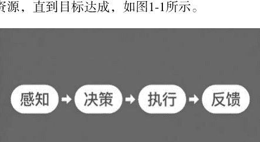
感知：通过文本、语音、传感器或数据接口，获取环境信息与用户意图。
决策：基于知识与规则，拆解目标、制定执行策略。
执行：调用工具、操作系统、完成具体任务。
反馈：将执行结果回传，修正认知与策略，形成持续优化的闭环。

1. Agent的“脑”：认知与决策的核心引擎

“脑”是 Agent 的中枢。与传统 AI 仅做关键词匹配不同，Agent 的“脑”具备深度理解、复杂推理与动态规划能力，核心职能包括理解复杂意图、拆解任务目标、动态优化策略。

- ◎ 理解复杂意图
  可处理模糊、隐含、多维度需求，结合上下文与用户画像自动补全信息缺口。
- ◎ 拆解任务目标
  将抽象目标转化为可执行子任务树，动态调整执行顺序，优先关键路径。
- ◎ 动态优化策略
  遇异常时自动切换备选方案，从历史执行中学习优化效率与成功率。

2. Agent的“手”：工具与执行的行动闭环

“手”连接现实世界，让决策转化为行动。具备工具调用、执行闭环与多工具协同能力。

- ◎ 工具调用能力
  连接 API 完成数据读写与业务操作；自动化办公软件、设计工具、代码编辑器等；访问数据库、知识库或互联网获取信息。
- ◎ 执行闭环机制
  接收指令调用工具，捕获结果与异常，回传至“脑”用于下一步决策。
- ◎ 多工具协同
  复杂任务需多工具串联，Agent 自主协调数据流，减少人工介入。

#### 1.1.3 从Chatbot到Agent的技术演进

从 Chatbot 到 Agent 的跃迁是多技术协同迭代的结果，本质是 AI 由文本交互能力向自主行动能力的赋权。五大技术节点构建了 OpenClaw 的底座。

1. 底层基座：大语言模型（LLM）的认知革命
   这是“大脑”成型前提，打破传统认知边界。
   由规则匹配转向涌现能力，具备逻辑推理、因果分析、抽象概括，能理解模糊意图与拆解复杂目标。
   长上下文理解技术突破，支持万字级历史与任务信息处理。
   领域适配轻量化微调，如 LoRA/QLoRA，提升垂直场景服务能力。

2. 关键桥梁：工具调用（Function Calling）的技术落地
   “双手”成型的核心，实现从文本输出到现实行动。
   动态函数调用，LLM 自主识别所需工具、解析参数、生成指令。
   兼容 REST API、本地软件、数据库，并加入参数校验、执行监控、异常回调。
   工具学习能力，通过描述学习与反馈迭代快速适配新工具。

3. 能力补全：记忆与规划机制的技术成熟
   解决无记忆、无规划痛点。
   记忆分层：短期记忆依托上下文窗口，长期记忆通过向量数据库、知识图谱持久化用户画像与历史任务。
   规划升级：思维链 CoT 分步推理，任务规划器生成子任务树，多智能体协作处理超复杂任务。

4. 感知升级：多模态融合技术的广泛应用
   拓展感知边界，适配更丰富场景。
   跨模态理解与交互，支持文本、语音、图像、视频的双向处理。
   场景化感知适配，针对电商直播、短视频运营等实现实时流数据的感知决策执行闭环。

5. 工程支撑：智能体框架的标准化与模块化
   技术商业化关键，也是私有化部署基础。
   模块化设计拆分为感知、决策、执行、反馈层，通过标准接口灵活增删功能。
   私有化部署适配，模型本地化、数据加密、边缘计算满足安全需求。
   性能优化，模型量化、分布式计算降低成本与延迟。

#### 1.1.4 典型场景对比：Chatbot vs Agent

从应答到闭环：Chatbot 与 Agent 的能力分水岭

在AI产品的真实使用场景里，我们同时会接触到对话式助手和自主代理。两者都能交互，但工作范式完全不同。其一是信息传递的窗口，其二是可以替用户把事情做成的数字分身。厘清这条分界，才能理解为什么一种只能回答，一种可以交付闭环结果。

1. 定位与能力的多维对比
判定自主代理的价值，最直观的做法是把它与熟悉的对话助手并排观察。乍看相近，但在底层逻辑、行动方式、能力上限和交付形态上差异显著。下面用多维度表格呈现对话助手作为交互层、自主代理作为执行体的根本分野，见表1-1。

表 1-1

| 对比维度 | Chatbot | Agent |
| :--- | :--- | :--- |
| 核心定位 | 交流界面，扮演用户与系统之间的沟通桥梁 | 自主智能主体，充当代替用户达成目标的数字代表 |
| 响应模式 | 被动等待，必须在用户发出指令后才产生输出 | 主动推进，可依目标自行感知环境、制定路径并持续运行 |
| 能力边界 | 局限于文本生成、FAQ应答与基础信息检索 | 具备感知、判断、执行、反馈的闭环能力，能处理复杂任务 |
| 价值输出 | 以信息传递为主，提供文本或简易结果 | 以交付成果为核心，可全流程完成任务并交出终态 |
| 用户角色 | 用户是操作方，需明确告知每一步动作 | 用户是决策方，只需设定目标，代理自行完成执行 |
| 上下文能力 | 窗口有限，易出现遗忘与逻辑断裂 | 拥有长期记忆与上下文管理，能维持长周期一致性 |
| 工具调用 | 无或仅支持少量预设工具 | 能够自主识别、调用并协同多种工具形成闭环 |
| 学习与迭代 | 依赖预训练，难以快速适应新场景 | 可基于执行反馈持续学习，优化后续效率与策略 |

2. 真实业务中的迁移差距
从应答到执行，最清晰的差异体现在具体业务上。对话助手更像信息工具，自主代理则是任务解决主体。下面以四个高频场景作对照。

（1）日程管理
日程是高频琐事，也是检验行动力的典型场景。
对话式助手：仅能读取已有安排。问“明天有空吗”，它会查日历告知空档；说“帮我约客户开会”，它会追问时间、参会人、地点，本质仍是查询。
自主代理：你只给出目标“帮我下周约张总见面，优先周三下午且不冲突”。它会自行查询双方日历、找到重叠时段、发出邀请并同步到双方账号，全程无需人工干预。

（2）内容创作
从初稿到上线，差距会被放大。
对话式助手：让它“写一篇新品小红书笔记”，能产出初稿，但针对性不足，需要你反复补充资料和调风格，本质是文本生成器。
自主代理：你说“帮我写篇面向25-30岁都市女性的新品种草笔记，风格活泼有网感”。它会先调研竞品笔记、拆解用户偏好、提炼卖点，产出完整稿件，还可排版配图并直接发布。

（3）客户售后
服务效率直接影响口碑。
对话式助手：用户说“我的快递丢了”，它会回复“请提供订单号和联系方式，转人工”，或给出预设FAQ，问题无法真正解决。
自主代理：同样反馈后，它会调取物流信息、核实丢件、自动发起理赔、核算赔付并完成退款，全程无需人工介入。

（4）数据分析
从报表到决策，看执行深度。
对话式助手：问“上月销售怎么样”，能生成基础报表，做不到深度归因，也无法给出行动建议。
自主代理：你说“帮我分析上月销售下滑原因，并给出下月推广策略”。它会清洗数据、捕捉异常波动、关联市场变化，输出含洞察与可执行方案的分析报告。

除上述场景外，在智能营销、供应链协同、合规风控、研发协作、差旅报销、IT支持、员工发展、市场情报等复杂业务中，二者差异更明显，见表1-2。

表 1-2

| 对比场景 | Chatbot表现 | Agent表现 |
| :--- | :--- | :--- |
| 智能营销活动策划 | 被动产出文案，缺乏数据渠道整合，需人工补齐策略 | 主动设计全链路方案，自主分析并生成策略，完成投放复盘 |
| 供应链协同调度 | 仅能查询数据，无法主动调整采购生产与配送计划 | 自行感知波动，动态调整计划并自动触发沟通预警 |
| 合规风控审核 | 被动筛查关键词，难以深度理解风险，需人工复核 | 主动识别风险，生成报告与建议并触发审批或预警 |
| 研发协作与需求管理 | 仅能汇总需求，无法主动拆解任务与分配资源 | 自主驱动全流程，整合需求并自动分配任务跟踪进度 |
| 差旅与费用报销 | 被动查询政策，协助提交单据，无法自动审核打款 | 主动规划行程预订票务，自动审核报销单并触发打款 |
| IT服务台支持 | 被动回答FAQ，无法诊断复杂问题或自动修复 | 主动诊断故障，自动执行修复脚本并升级复杂问题 |
| 员工培训与发展 | 被动推送课程，无法个性化推荐或跟踪学习效果 | 主动分析能力短板，定制学习计划并跟踪完成度 |
| 市场情报与竞品分析 | 被动提供存量资料，无法主动挖掘与分析趋势 | 主动抓取信息，分析竞品动态并生成趋势报告与建议 |

1.2 OpenClaw哲学：私有可控、永在线与主动执行
OpenClaw近期获得关注，根基在于三条信念：私有化、全天候与自主行动。私有化让数据与控制权留在用户手中；全天候打破时空限制，分身不离线；自主行动把AI从被动应答推向主动赋能。本节拆解这三大主张，揭示其如何让代理成为可信赖的专属伙伴，如图1-2所示。

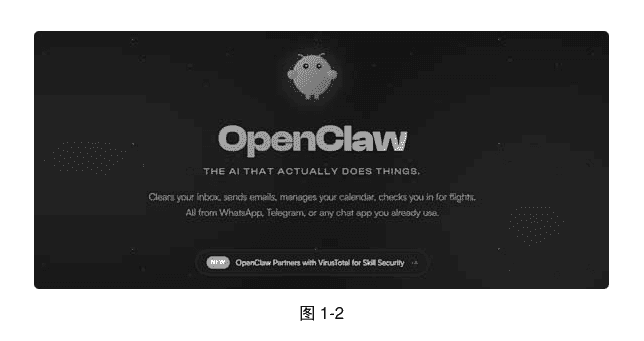

1. 私有化：信任的起点
2026年初，OpenClaw以爆发式姿态进入公众视野，成为Agent赛道最受瞩目的开源项目。上线不足百天GitHub星标突破20万，增速远超Linux、React等经典开源项目，长期位居热榜。Discord社群成员短时间内破万，全球贡献者活跃，未合并PR以千计。ClawHub技能市场已沉淀数千插件，覆盖办公、电商、数据处理、智能家居等多领域。国内腾讯云、阿里云、火山引擎等主流云厂商48小时内上线一键部署方案，加速落地。

这波热度不仅是产品成功，更推动了产业变革。它精准回应了传统AI“只会聊天、不会干活”的痛点，获得资本、媒体与产业界的认可，推动大模型API调用量指数级增长。如今它已从开源项目成长为基础设施级标杆，推动企业与个人迈入AI自主执行阶段。

数据主权是智能体深度融入个人与企业业务的前提。电商、快消、KOC营销等场景涉及商业机密与用户数据，数据上云模式难以满足合规与安全。以下拆解OpenClaw私有化哲学的内核。

- 当前行业痛点
  - 隐私泄露风险：主流云端AI会保存对话记录与商业数据，如爆款策划、KOC合作清单，存在泄露滥用隐患。
  - 合规性缺失：用户画像、交易数据受《数据安全法》《个人信息保护法》约束，云端托管难以满足数据不出域要求。
  - 控制权旁落：用户无法自主管理训练数据与执行日志，平台策略变动会牵动服务能力。

- OpenClaw私有化的核心内涵
  - 数据层私有化：业务数据、个人偏好、运行日志均存于本地设备或私有服务器，不上公有云。
  - 计算层私有化：大模型推理、任务规划、工具调用决策优先在端侧或私有环境完成，大规模任务经用户授权后才调用公有算力。
  - 部署层灵活适配：支持纯本地部署与混合部署，兼顾个人与企业不同需求。

- 技术支撑体系
  - 轻量化端侧模型：量化压缩核心大模型，使其可在普通笔记本、企业终端服务器高效推理。
  - 本地向量数据库：私有数据转为向量离线存储，检索全程本地完成。
  - 私有化部署套件：一键式工具适配企业内网Docker、K8s，降低部署门槛。

- 价值与落地
价值在于彻底解决隐私合规问题，让智能体可用于新品保密研发、核心客户运营、KOC签约数据管理等敏感场景，同时用户可自主更新数据与权限。
案例：某快消品牌市场部采用私有化部署，AI本地处理新品配方、小红书种草策略等保密数据，自主生成营销方案，全程数据不离开内网，合规同时提升效率。

2. 全天候：数字分身的运行底线
服务中断意味着生产力损失。本节解析OpenClaw如何实现真正意义上的全天候服务。

- 传统AI中断痛点
  - 网络依赖严重：断网即不可用，无法应对出差、户外办公。
  - 算力波动影响：云端高峰期拥堵，导致延迟、任务中断。
  - 终端适配不足：多局限于电脑端，移动碎片需求难以满足。

- OpenClaw永在线核心实现
  - 离线能力矩阵：梳理高频任务离线执行清单，如本地文件整理、缓存数据分析、预设日程提醒、离线文案生成。
  - 边缘算力动态适配：本地算力优先、云端兜底，实时监测设备与网络状态自动切换。
  - 多终端协同在线：电脑、手机、平板可登录，任务进度与记忆实时同步，随时接续操作。

- 技术支撑体系
  - 任务断点续传：实时保存执行进度，恢复后自动续跑，无需重发指令。
  - 轻量化缓存系统：高频接口、数据本地缓存，定期增量更新，保障离线可用。
  - 低功耗运行优化：移动设备运行逻辑优化，后台常驻不伤续航。

- 价值与落地
价值在于打破时空限制，适配电商大促24小时订单处理、跨境KOC跨时区沟通、突发任务即时响应。
案例：某电商运营出差断网时，用手机端离线生成618应急客服话术。网络恢复后，智能体自动同步至店铺客服系统并接续分析订单异常，全程无中断。

3. 自主行动：代理的能力内核
从“听令”到“做事”是代理超越对话机器人的标志。复杂工作下用户无法逐条拆解指令，需要自主规划执行能力。

- 被动响应的瓶颈
  - 指令成本高：复杂任务需拆成细碎指令，耗时耗力。
  - 无主动感知：无法自行发现库存不足、笔记数据下滑等异常。
  - 闭环能力弱：规划执行反馈需人工收尾。

- OpenClaw主动执行的三层逻辑
  - 目标级感知：用户只给模糊目标，如“优化本月小红书种草转化率”，系统即识别核心需求。
  - 任务级规划：自动拆解为可执行子任务，如分析数据、筛选特征、生成文案、对接KOC、监测数据，并排序执行。
  - 安全级执行：在预设权限内自主调用工具、执行操作，实时反馈结果，异常时自动暂停并请示用户。

- 技术支撑体系
  - 长时记忆与场景认知：存储工作习惯与业务规则，如预算上限、文案风格。
  - 工具编排引擎：自主选择组合小红书数据查询、文案生成、KOC对接等工具，完成闭环。
  - 权限与风险风控：内置资金、数据修改等权限开关，异常监测确保在安全边界运行。

- 价值与落地
价值在于解放用户从重复规划执行中，聚焦高价值决策，同时及时捕捉机会规避风险。
案例：营销人员下达目标“提升新品小红书曝光量”，智能体自主分析渠道、筛选10位中腰部KOC、制定报价与文案、对接后实时监测并调整投放策略，用户仅确认最终清单。

4. 三大哲学的协同共生
私有化、永在线、主动执行构成价值闭环，缺一不可。私有化是信任基础与主动执行的前提，永在线是落地保障，主动执行是价值归宿。多数竞品只聚焦单一维度，OpenClaw通过三者协同解决“不敢用、用不了、不好用”三大痛点，尤其适配对隐私、效率、自主性要求高的电商、快消、KOC营销场景。

未来演进将聚焦降本增效与决策增强，见表1-3。

| 未来演进方向 | 核心内容 | 价值与应用场景 |
|---|---|---|
| 私有化轻量化 | 降低部署门槛与成本，优化模型结构与资源占用 | 中小商家可自建专属智能系统，保障数据安全与业务自主 |
| 永在线智能化 | 按工作节奏与业务流实现按需在线，动态分配算力 | 适配7×24运营，高峰高效、非高峰休眠，降低成本 |
| 主动执行进化 | 融入多模态感知与强化学习，提升拆解、调用、决策能力 | 独立完成数据分析到执行落地，在供应链、客服等场景自主应对变化 |

1.3 核心架构拆解：网关、大脑与技能层如何协同工作
OpenClaw架构由三层构成：Gateway负责接入与交互、Brain承担认知决策、Skills承载可复用执行能力。本节逐层拆解模块功能与协作机制，解析其如何通过模块化实现高效可扩展，如图1-3所示。

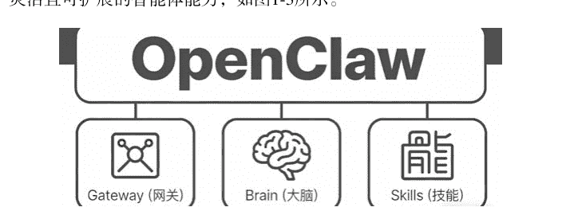

1. Gateway网关：交互入口与安全屏障
智能体需要一个统一门面连接用户、设备与外部系统，Gateway即交互中枢，也是安全防线，尤其在多终端多协议场景下直接决定易用性与安全性。

- 核心定位
  - 交互适配层：统一对接文本、语音、图像等多模态输入，适配电脑、手机、IoT等多种终端，让用户任一渠道接入。
  - 协议转换层：将自然语言指令转为系统可识别的结构化指令，同时把执行结果转译为用户友好的输出形式。

- 前置安检层：作为最外层的守门人，完成身份校验、权限审核、信息加密等基础工作，保证电商订单变更、KOL 合作签约等敏感操作只能在授权范围内触发。

- ◎ 核心功能模块

  - 多模态交互中枢：统一收口文字、语音、图像、视频的输入输出，满足小红书文案创作、电商直播互动等对交互形态要求多元的场景。
  - 指令转译与分发：把用户口令解析成规范的任务单，按类型送往大脑规划或直接调用执行单元，并把运行结果用自然语言回传。
  - 鉴权加解密体系：内置 OAuth2.0、JWT 等机制，支持细粒度权限设定，例如禁止智能体触碰核心财务数据，同时对传输链路做端到端加密。
  - 弹性分流与容错：在大促等高并发时自动均衡流量，避免单点失效，保持服务稳定。

- ◎ 技术落地与场景适配

  - 私有化部署可选：可装在企业内网或自有服务器，确保交互数据不出可控边界，适配快消新品保密研发等高敏感场景。
  - 离线作业能力：断网时仍能处理本地文件操作、日程提醒等任务，实现全天候可用。
  - 案例：某电商运营用手机语音说“帮我处理今天的售后订单”，入口层先把语音转成结构化任务，交给大脑规划，再由执行层完成退款与客户通知，全程约30秒。

#### 2. Brain 大脑：智能体的认知决策中枢

如果说 Gateway 是门面，Brain 就是灵魂。它是 OpenClaw 的核心决策中心，负责读懂用户意图、拆解任务步骤、管理长期记忆，是实现自主行动的关键引擎。在营销策划、数据分析等复杂场景里，Brain 的水平直接决定智能体的智能上限。

- ◎ 核心定位

  - 意图解析引擎：依托大语言模型深度解读指令，抓住真实诉求如“提升新品曝光量”，而非表面说法如“写一篇笔记”。
  - 任务拆解中枢：把复杂目标拆成可落地的子任务，确定优先级与执行顺序，形成完整链路。
  - 记忆管理中心：沉淀用户偏好、业务规则、历史任务，形成长期记忆，让决策更贴合场景。
  - 策略优化引擎：依据执行反馈动态调整方案，形成“规划-执行-反馈-优化”闭环。

- ◎ 核心能力模块

  - 深度意图理解：结合上下文与业务背景，洞察模糊指令的核心诉求，例如把“帮我优化营销方案”拆解为“分析竞品数据→筛选高转化渠道→生成三套方案”。
  - 任务优先级调度：按紧急程度与资源占用动态调整顺序，例如先处理紧急售后订单，再做营销文案创作。
  - 长期记忆与场景认知：记住用户工作习惯如 KOL 合作预算上限、电商促销节点等，使判断更精准。
  - 强化学习优化：用历史任务数据持续优化决策模型，提升执行效率与成功率。

- ◎ 技术支撑与价值体现

  - 本地大模型部署：支持本地部署轻量化 LLM，核心推理不依赖公网，保障数据安全。
  - 向量数据库集成：把记忆数据转成向量存储，实现毫秒级检索，加快决策响应。
  - 案例：某快消品牌的大脑在分析新品营销数据时，自主发现“小红书笔记转化率偏低”，规划出“优化文案风格→筛选创作者类型→调整投放时间”的改进路径，新品曝光最终提升40%。

#### 3. Skills 技能：智能体的任务执行单元

有了大脑决策还需要落地执行，Skills 即 OpenClaw 的行动层。它由一系列可复用、可扩展的功能单元组成，负责具体操作如电商订单处理、文案生成、数据查询等。Skills 的设计决定智能体能否高效闭环。

- ◎ 核心定位

  - 任务执行单元：把大脑的决策转化为实际操作，如调用电商 API 改单、生成社区文案、查询 KOL 数据等。
  - 能力复用中心：支持技能模块化封装与复用，避免重复开发，例如“文案生成”技能可通用至多个平台。
  - 扩展接口层：提供标准化接口，支持第三方开发者接入自定义技能，适配个性化业务需求。

- ◎ 核心分类与编排机制

  - 基础技能：文件操作、日程管理、文本生成等通用能力，是智能体的基本功。
  - 行业技能：面向电商、快消、创作者营销等场景定制的专业能力，如“电商订单退款”“创作者合作对接”“社区数据监测”等。
  - 技能编排引擎：按任务规划自动组合多项技能，形成完整执行链路，例如“查询订单→生成退款单→通知用户→同步财务系统”。
  - 版本管理与迭代：支持技能版本控制，可快速迭代优化以匹配业务变化。

- ◎ 技术实现与扩展能力

  - 标准化接口设计：采用 RESTful API、gRPC 等标准协议，降低接入门槛，便于快速集成第三方服务。
  - 沙箱执行环境：技能在隔离沙箱中运行，防止恶意操作影响系统安全，同时可做权限管控。
  - 案例：某电商运营的技能集包含“订单处理”“文案生成”“数据报表”等12个专业技能，当大脑规划出“处理售后订单+生成客服话术”的任务时，技能自动编排执行，全程无需人工干预。

#### 4. 三大模块协同：OpenClaw 架构的价值闭环

Gateway、Brain、Skills 并非独立存在，而是构成“交互-决策-执行”的完整价值闭环。Gateway 负责连接与安全，Brain 负责认知与规划，Skills 负责落地与执行，三者协同支撑核心能力。

用户通过入口层发起指令时，先完成身份认证与协议转换，再将请求精准路由至大脑；大脑解析意图后拆解复杂任务并规划最优路径，随后把子任务分配给对应技能；技能执行后把结果实时回传大脑，大脑据反馈优化决策，必要时调整路径；最后入口层把结果转为用户友好的形式输出，完成交互闭环。

- ◎ 架构核心优势

  - 模块化设计使三大模块可独立迭代，降低维护成本并支持灵活扩展；高可靠性由入口层容灾、大脑决策优化与技能沙箱执行共同保障；强适配性支持本地化部署、离线运行与多终端交互，可灵活适配电商、快消等多种场景；可扩展性则通过技能标准化接口快速接入新能力，推动智能体业务持续进化。

- ◎ 与行业竞品的差异

  - 多数竞品采用一体化架构，交互、决策、执行深度耦合，难以灵活适配；OpenClaw 的三层解耦架构实现了安全可控、智能高效、灵活扩展。尤其在本地化部署、离线运行、行业定制上，更贴合企业级需求，解决了传统 AI“不敢用、用不了、不好用”的痛点。

### 1.4 商业逻辑：如何用 OpenClaw 重构生产力

OpenClaw 的商业价值不在于炫技，而在于重构生产力。平台定义的 Agent 能自动化重复任务、辅助复杂决策、拓展协作边界，让个人与组织的单位产出实现量级提升。本节从效率提升、成本优化、模式创新三维度拆解 AI 助理的商业逻辑。

#### 1. 个人效能改造：从执行者到决策者

传统模式下，个人大量时间耗在数据整理、文案撰写、日程协调等琐事上，战略思考与创意时间被挤压。OpenClaw 作为个人“数字分身”，接管低价值任务，让个人从被动执行升级为主动决策，重构时间分配与价值产出。

- ◎ 任务自动化：解放重复劳动

  - 技能模块可自主完成高频低值任务，如邮件分类、数据录入、创作者合作资料整理、电商订单核对等。
  - 例如：营销人员无需手工整理竞品数据，平台可自动抓取、清洗并生成可视化报表，耗时由4小时缩短至15分钟。

- ◎ 决策辅助：提升判断质量

  - 大脑通过深度分析业务数据提供精准洞察，如“哪类创作者转化率最高”“哪个时段笔记曝光最优”，辅助科学决策。

- ◎ 时间价值重构

  - 当80%琐事由平台承担，个人可聚焦策略制定、创意构思、客户沟通等高价值工作，单位时间产出提升2~3倍。

- ◎ 典型案例

  - 某电商运营借助平台自动处理售后订单、生成客服话术，每天节省3小时，转而投入店铺活动策划与用户运营，店铺转化率提升25%。

#### 2. 组织效能改造：从流程驱动到智能驱动

企业生产力瓶颈常源于流程僵化、信息孤岛与人力依赖。平台以模块化架构与自主行动能力打破部门墙，成为业务流程的智能节点，实现从“人驱动流程”到“AI 驱动流程”的转变。

#### 3. 商业模式改造：从人力密集到 AI 赋能

当 AI 成为核心生产要素，企业商业模式随之重构。平台的本地化与自主行动能力让企业打造“AI 驱动的服务模式”，从依赖人力规模转向依赖 AI 效率。

◎ 流程自动化：消除人力依赖
平台可自主完成跨部门闭环任务，如“订单生成→库存扣减→物流对接→售后跟进”，无需人工介入，减少等待与失误。
例如：快消品牌新品上市流程从“市场调研→文案创作→创作者对接→数据监测”全流程自主执行，周期由2周压缩至3天。

◎ 信息协同：打破数据孤岛
入口层连接企业内部各系统，大脑整合分散数据，使智能体在统一信息底座上工作，避免信息不对称导致决策偏差。

◎ 全天候运营：突破时空限制
平台实现7×24小时不间断运营，如电商大促自动处理订单、跨境业务跨时区响应客户，无需额外人力。

◎ 典型案例
某快消企业引入平台后，售后处理效率提升60%，人力成本降低35%，实现24小时客户响应，用户满意度提升40%。

◎ 服务升级：从标准化到个性化
平台可基于用户数据提供个性化服务，如为电商用户定制专属推荐、为创作者匹配品牌合作方案，提升体验与转化。

◎ 成本优化：重构盈利模型
通过替代人力完成重复性工作，企业大幅降低人力成本并提升服务规模。例如创作者营销公司用平台自动筛选创作者、生成文案，服务客户数提升2倍，人力成本降40%。

◎ 创新模式：开辟新业务空间
企业可基于平台打造“AI 即服务”模式，如为中小商家提供智能营销助理、为个人提供专属数字分身，拓展新收入来源。

◎ 典型案例
某营销 agency 依托平台推出“AI 营销助手”服务，为中小电商提供自动化营销方案，月均新增客户50+，毛利率提升至65%。

#### 4. ROI 与落地路径：引进 OpenClaw 的方法

企业引入 AI 易陷入“投入大、见效慢”的困境。商业逻辑核心在于清晰 ROI 与可落地路径。

我们可通过三大类核心指标评估业务价值，见表1-4。

表 1-4

| 指标类型 | 核心衡量维度 |
| :--- | :--- |
| 效率指标 | 任务完成时间缩短率、流程自动化率、人力替代率 |
| 效果指标 | 转化率提升、错误率降低、用户满意度提升 |
| 成本指标 | 人力成本节省、运营成本优化、ROI 周期 |

落地遵循循序渐进原则，确保每步快速验证价值，见表1-5。

表 1-5

| 落地阶段 | 核心策略 | 典型应用场景 |
| :--- | :--- | :--- |
| 阶段一：单点突破 | 从高频、低价值、高标准化的任务入手，快速验证价值 | 数据整理、邮件分类、基础客服应答 |
| 阶段二：流程串联 | 将多个单点技能串联，实现跨部门任务闭环 | 营销策划→内容生成→投放监测的全链路自动化 |
| 阶段三：全域智能 | 将平台融入核心业务，实现全流程智能驱动 | 新品研发、客户全生命周期管理、供应链智能调度 |

为最大化 AI 赋能，企业需调整团队角色，让员工从“执行者”转向“AI 协作者”，聚焦策略制定、创意创新与异常处理等高价值工作。

◎ 典型案例
某电商企业分三步落地平台：6个月后核心岗位生产力提升50%，12个月后 ROI 达1:4，成功成为行业效率标杆。

#### 5. 商业价值闭环：OpenClaw 重构生产力的核心逻辑

平台对生产力的重构并非单点赋能，而是个人、组织、商业模式三者协同的价值闭环。个人效率提升带动组织升级，组织升级推动模式创新，最终形成“AI 赋能→价值提升→持续投入”的正向循环。

协同逻辑：个人生产力提升让员工有更多精力参与组织决策；组织流程优化为个人提供更高效工作环境；商业模式创新为个人与组织创造更大价值空间。三者相互支撑，形成不可替代竞争优势。

与传统工具差异：传统工具仅提升单点效率，平台通过“本地化保障信任、全天候保障持续、自主行动保障闭环”，实现从“效率提升”到“模式重构”的跨越，是真正的生产力革命。

未来展望：随着能力持续进化，平台将进一步渗透更多行业与场景，成为个人与组织在 AI 时代的标配生产力工具，推动社会生产方式向更高效、更智能演进。

# 第 2 章

## 私有化部署的硬件选型与环境准备：搭建你的 AI 基地

上一章我们畅想了 AI Agent 作为7×24小时在线数字分身的无限可能，要让构想落地，坚实的“AI 基地”是起点。本章聚焦 OpenClaw 部署实践，从硬件选型到环境配置拆解打造高效运行环境的关键步骤。无论是挑选适配硬件平台，还是完成本地部署与国内飞书等平台的消息通道对接，均提供清晰指引。同时针对本地部署中常见的10个痛点给出避坑方案，帮助快速搭建稳定、可扩展的 AI 基础设施，为后续多模型调度、技能开发与全流程自动化筑牢根基。

### 2.1 环境方案：选择适合的平台与硬件

OpenClaw 的“私有化、全天候、自主行动”三大哲学，对运行环境提出明确要求：既要支持本地部署保障数据安全，又要具备足够算力支撑智能体高效运行，还要适配多场景灵活部署。平台与硬件选择直接决定性能、成本与可靠性。

#### 2.1.1 核心平台选型：MacBook、Windows、Linux 与云平台

不同平台生态、算力特性与部署模式直接影响落地方式。MacBook 适合个人开发者与轻量部署，Windows 适配企业办公与混合场景，Linux 是企业级私有化首选，云平台提供弹性扩展。本节逐一拆解各平台优势、局限与适配要点。

- 1. MacBook：个人数字分身的首选载体

  优势：生态成熟、便携、静音散热好，适合作为个人数字分身核心设备；macOS 对 Python、Docker 等开发工具支持友好，本地部署门槛低。
  局限：GPU 算力有限，尤其 M 系列芯片显存受限，难以支撑大规模 LLM 推理；存储扩展成本高，不适合海量本地向量数据存储。
  适配场景：个人助理、轻量营销文案生成、离线日程管理等轻量任务；可作为 OpenClaw 入口设备，核心推理依托云端或本地轻量化模型。

- 2. Windows PC：企业办公与混合部署的适配之选

  优势：硬件选择丰富，从轻薄本到工作站均可；支持 NVIDIA GPU 加速，适配企业办公软件生态；WSL 可兼容 Linux 部署环境。
  局限：系统稳定性略逊于 Linux，长时间高负载需关注散热；部分企业内网对软件部署有严格限制。
  适配场景：企业内部运营助理、电商客服智能体、混合部署；适合中小团队轻量化部署。

- 3. Linux 服务器：企业级私有化部署的核心底座

  优势：开源可控、稳定性强、支持高性能 GPU 集群，是私有化部署首选；对容器化支持友好，便于规模化部署与运维。
  局限：部署门槛高，需专业运维团队；硬件成本较高，适合有明确数据安全与大规模算力需求的企业。
  适配场景：企业级智能体、全链路营销策划、客户全生命周期管理等核心业务数据本地处理；完全契合 OpenClaw 私有化哲学。

- 4. 云平台（AWS/Azure/阿里云等）：弹性扩展的混合部署补充

  优势：算力弹性伸缩，可按需调用 GPU/CPU；全球节点覆盖，支持全天候跨区域服务；与 OpenClaw 模型路由架构深度协同，实现本地+云端混合调度。
  局限：数据隐私风险，需通过加密与权限管控规避；长期使用成本较高，宜作为本地部署算力补充。
  适配场景：突发算力需求、跨地域业务协同；与本地部署结合形成私有+公有混合环境。

#### 2.1.2 硬件核心维度：算力、存储与网络的选型逻辑

平台是环境的骨架，硬件是支撑高效运行的肌肉。算力决定响应速度，存储影响记忆容量与检索效率，网络保障全天候服务。

- 1. 算力：CPU 与 GPU 的协同选型

  CPU：负责基础任务调度、轻量推理与系统运维，优先选多核心高主频型号如 Intel i7/i9、AMD Ryzen 7/9；个人场景8核以上即可，企业级需16核以上支撑多任务并发。
  GPU：大模型推理与向量检索的核心加速硬件，优先选 NVIDIA 显卡如 RTX 3090、A100；显存需求随模型规模提升：7B 模型至少8GB 显存，13B 模型需16GB 以上，企业级部署建议32GB+。
  选型逻辑：轻量任务可依赖 CPU+核显；中等任务如营销文案生成需中端 GPU；复杂任务如全链路营销策划需高性能 GPU 集群。

- 2. 内存：支撑 RAG 与多任务并发的关键

内存配置要点
内存容量决定了 OpenClaw 能否快速完成向量查找以及同时处理多少任务。记忆模块采用检索增强生成，常用向量必须常驻内存，才能实现毫秒级命中。

选型建议：个人使用 16GB 可起步，更推荐 32GB；中小团队建议从 64GB 开始；企业级建议 128GB 及以上；同时要看频率，DDR5 5600MHz 能明显提升读写吞吐。

- 3. 存储：匹配本地向量库的容量与速度
容量规划：按记忆数据体量来定，个人侧 1TB NVMe 固态基本够用；企业侧建议 4TB 起步，并用磁盘阵列保障数据安全。
性能要求：优先选 NVMe 固态，顺序读写最好超过 3000MB/s，才能支撑向量库的高速写入与查询；机械盘会拖慢检索体验，建议不用。
扩展预留：保留 M.2 插槽或外置存储阵列，便于数据增长时灵活扩容。

- 4. 网络：保障服务长期稳定
有线网络：企业部署优先千兆甚至万兆有线，降低时延与丢包；混合部署要保证本地与云端链路低延迟。
无线网络：个人场景支持 Wi-Fi 6/6E，提升移动办公稳定性；离线环境需配置本地缓存，避免断网中断服务。
安全需求：部署防火墙、VPN 等工具，保护传输安全，符合 OpenClaw 私有化要求。

#### 2.1.3 场景化环境方案：从个人到企业的落地参考
不同场景诉求差异明显：个人数字分身看重便携与隐私，中小企业营销助理侧重办公生态适配，企业级部署强调安全与性能。下面拆解三种典型组合，便于快速匹配。

- 1. 个人数字分身场景：MacBook 加轻量化配置
平台：MacBook Pro M2 Pro/Max，兼顾便携与算力。
硬件：内存 16GB 及以上、1TB NVMe 固态，轻量任务依赖 CPU 与核显，复杂推理可外接 eGPU。
部署模式：本地运行轻量 Llama 小模型，核心推理经模型路由调度到云端 GPT-5；记忆数据留在本地，保障隐私。
价值：满足日程管理、文案生成、轻量分析等需求，同时实现 7×24 小时离线可用。

- 2. 中小企业营销助理场景：Windows 工作站加混合部署
平台：Windows 11 工作站，如戴尔 Precision、联想 ThinkStation，适配企业办公生态。
硬件：内存 32GB 及以上、2TB NVMe 固态、NVIDIA RTX 4080 GPU，支撑本地推理。
部署模式：本地处理客服话术生成、数据整理等轻量任务，复杂营销策划交由云端模型；借助 WSL 兼容 Linux 环境，降低运维复杂度。

- 3. 企业级私有化部署场景：Linux 服务器加高性能集群
平台：Ubuntu/CentOS 服务器，部署于企业内网。
硬件：双路 Intel Xeon CPU、内存 128GB 及以上、4TB 以上 NVMe 固态、多张 NVIDIA A100 GPU 组成集群。
部署模式：全链路本地化，核心模型、记忆数据与业务流程均在内网运行；以 K8s 实现容器化运维，支撑多智能体并发。
价值：完全契合私有化、全天候、自主行动理念，适配快消新品研发、核心客户管理等敏感业务。

#### 2.1.4 平台与硬件的协同：OpenClaw 架构的环境适配逻辑
环境方案不是堆砌硬件，而是要与 OpenClaw 核心架构 Gateway、Brain、Skills 深度配合。Gateway 的多端交互依赖平台生态，Brain 的推理能力依托算力，Skills 的执行效率受存储与网络制约。

与 Gateway 的协同：MacBook 触控栏、Windows 触控屏可优化交互体验，Linux 服务器网络稳定性保障多终端接入；云平台全球节点支撑跨地域交互。
与 Brain 的协同：GPU 算力直接影响推理速度与任务规划效率；内存大小决定 RAG 检索响应延迟，进而影响决策质量。
与 Skills 的协同：高速存储支撑 Skills 快速调用本地工具与数据；稳定网络保证 Skills 与第三方服务如电商 API、KOC 平台的可靠连接。

#### 2.1.5 落地步骤与避坑指南
选型时容易陷入盲目高配或忽视场景适配。下面给出落地步骤与常见风险应对。

- 1. 落地步骤
明确部署目标：先锚定核心需求。部署前应精准定义使用场景与目标，个人侧重离线可用与隐私，中小企业侧重降本增效与高频业务支撑，企业级侧重稳定、可扩展与合规。访谈核心用户提炼 Top 3 场景与关键指标，形成《部署目标说明书》，厘清边界、价值与验收标准，避免需求蔓延。
评估算力需求：按任务复杂度分级。轻量任务如邮件分类、FAQ 问答，16GB 以上内存加高速存储即可；中等任务如电商客服、内容初稿可配轻量 GPU；复杂任务如深度分析、风控建模需高性能 GPU 加 64GB 以上内存，并预留 20%～30% 冗余应对峰值。企业级可采用本地算力加云端弹性扩容的混合模式。
选择平台组合：贴合生态，兼顾离线与云端。办公场景推荐 Windows 本地 Llama 轻量化模型加云端 GPT-5；移动场景用 MacBook 本地 Metal 加速 Llama 加云端同步；企业级以 Linux 服务器本地向量库加 Llama 加云端 API 为主，确保断网时核心功能可用，形成“离线筑底、云端提效”的组合。
验证与优化：小步快跑。先试点非核心轻量任务，验证性能、成本与稳定性，再逐步推广到核心业务。重点检验并发能力、离线可用性与合规性。每两周监测响应时间、Token 消耗、用户满意度等指标迭代优化，例如 Token 消耗高则优化熔断与缓存，响应慢则升级 GPU 或采用模型量化。

- 2. 避坑指南
表 2-1

| 避坑维度 | 常见坑点 | 风险后果 | 应对策略 |
| :--- | :--- | :--- | :--- |
| 硬件选型 | 盲目上高配，轻量任务也配顶级 GPU，却轻视内存存储 | 算力闲置成本增加三到五成，内存不够引发卡顿拖慢响应 | 按任务轻中重先定最低配置，轻量应用优先保证 16GB+内存与高速盘，再视需升级 GPU |
| 运行稳定性 | 高负载下只看核心参数，忽略散热和电源冗余 | 高温导致降频或损坏，电源单点故障会中断业务、丢失数据 | 采用双电源冗余，改善风道，定期监测温载并设置高温告警 |
| 离线能力适配 | 未验证离线运行，过度依赖云端 API 且缺少本地缓存 | 断网时日程提醒、本地文档等功能不可用 | 选择支持本地模型与缓存的方案，部署前测试断网场景可用性 |

### 2.2 环境配置：OpenClaw 的部署方法与本地部署
环境配置是 OpenClaw 从概念到可用工具的关键，直接影响稳定性、离线能力与成本可控性。本章拆解多平台部署方法与本地实操细节。

#### 2.2.1 部署 OpenClaw 的方法
OpenClaw 主要有三种部署方式：Docker 容器化安装、云服务商预制镜像、本地原生安装。

Docker 容器化把 OpenClaw 及全部运行依赖打包为容器镜像，安装 Docker 后执行国内优化的自动化脚本即可自动完成镜像拉取、环境配置与服务启动，跨 Windows、Mac、Linux 通用，环境隔离不干扰系统，是主流稳定方案。

云服务商预制镜像是阿里云、腾讯云等提供的预置应用镜像服务，全程图形化操作，无需命令行，创建云服务器时选择对应镜像即可数分钟完成部署，自带公网 IP，可随时外网访问，技术门槛低。

本地原生安装不使用 Docker，通过一键脚本直接在主机安装 Node.js、pnpm 等依赖，原生启动 OpenClaw，无需容器工具，但依赖安装在系统内，易受本地版本与配置影响。

表2-2

| 部署方式 | 优点 | 缺点 | 适合谁 |
| :--- | :--- | :--- | :--- |
| Docker 一键部署 | 跨平台通用、环境隔离、国内镜像加速、维护简便 | 需预装 Docker、涉及少量命令行 | 追求本地或私有服务器稳定运行、希望少折腾的用户 |
| 云厂商一键镜像 | 图形化操作、免命令行、自带公网 IP、可随时访问 | 需注册账号并产生费用 | 技术门槛低、需外网访问、不想本地开机的人群 |
| 本地直装 | 无需 Docker、直接在主机运行 | 依赖冲突风险高、兼容性差、易报错 | 只想临时体验、暂不装 Docker 的用户，新手慎用 |

#### 2.2.2 OpenClaw 的本地部署
本地部署是开发调试、个人试用与内网验证的核心，无需依赖公网资源，可快速搭建独立环境。下面介绍在 WSL Ubuntu 下的实操流程。

##### 1. 安装 Node.js 和 Python
OpenClaw 基于 Node.js 开发，稳定运行需要 Node.js 大于 v22，Python 大于 3，先完成这两个依赖的安装。

（1）进入 Node.js 官网，点击获取按钮打开下载页面，如图2-1所示。
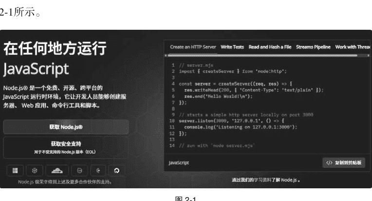
（2）点击 Windows 安装程序（.msi）下载并安装到电脑，如图2-2所示。
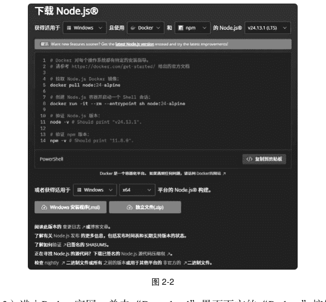
（3）进入 Python 官网，点击 Download 下方 Python 进入下载页，如图2-3所示。
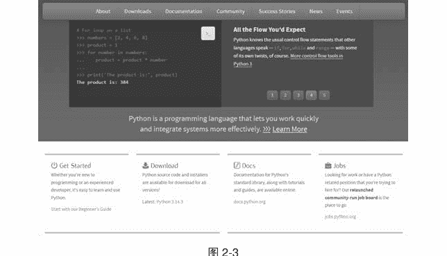
（4）下滑页面点击 Download Python install manager 进入 Windows 下载页，再点击 Download installer（MSIX）下载安装文件，如图2-4和图2-5所示。
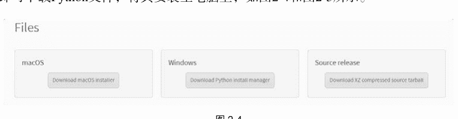
图 2-4
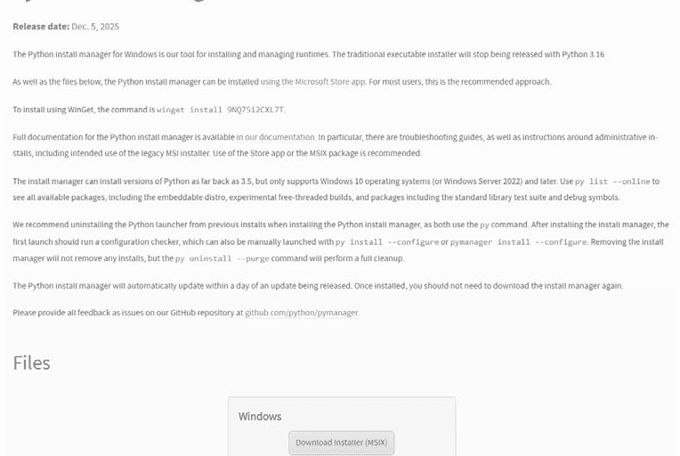
图 2-5
（5）同时按 Win 和 R，在运行框输入 cmd 打开命令提示符，如图2-6所示。
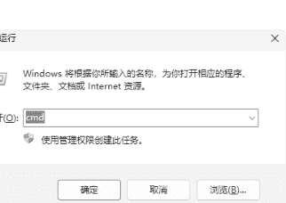
（6）输入 node -v 回车检验 Node.js 版本，输入 python --version 回车检验 Python 版本，如图2-7所示。
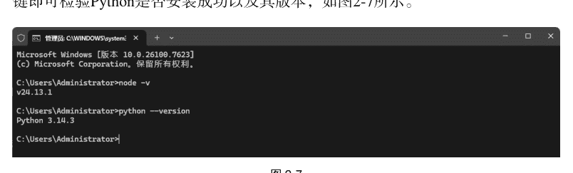
图 2-7

##### 2. 安装 WSL 和 Ubuntu
WSL2 即 Windows Subsystem for Linux，让 Windows 10/11 可直接运行完整 Linux 发行版，无需虚拟机。Ubuntu 是社区最成熟的选择，能兼容 Shell 脚本与底层依赖，降低冲突风险。

（1）在开始菜单搜索 Windows PowerShell，右键以管理员身份运行，如图2-8所示。
（2）输入 wsl --install 回车自动安装 WSL。安装完成后输入 wsl --status 和 wsl --version 检查状态，如图2-9和图2-10所示。
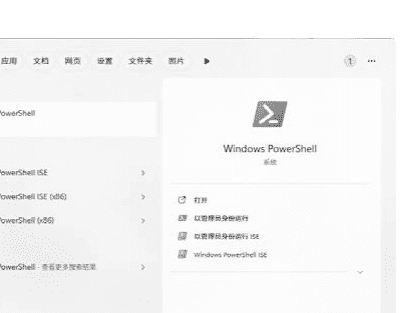
图 2-8
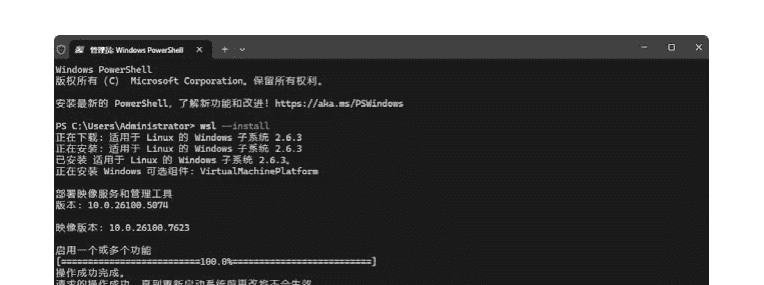
图 2-9
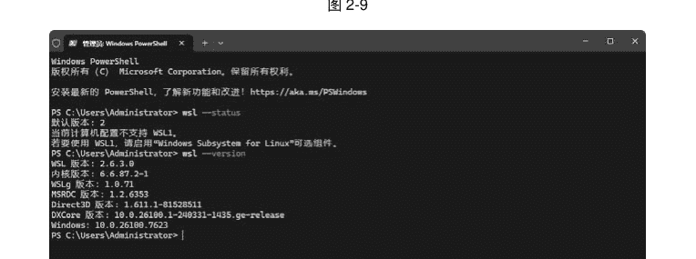
图 2-10
（3）输入 wsl.exe --list --online 查看可选版本，再输入 wsl --install Ubuntu 自动下载最新版，如图2-11和图2-12所示。
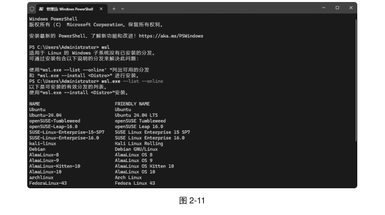
图 2-11
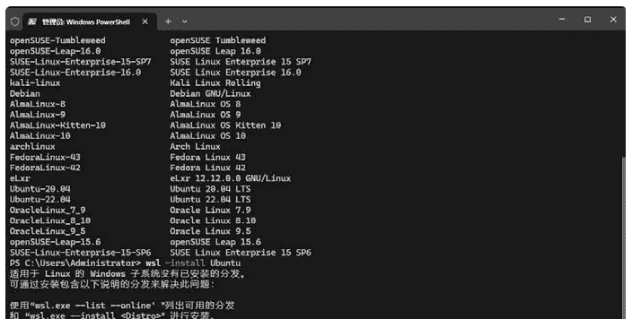
图 2-12
（4）完成后打开 PowerShell，输入 wsl.exe -d Ubuntu 或直接搜索 Ubuntu 进入终端。首次进入需设置用户名与密码，完成即可进入系统，如图2-13和图2-14所示。
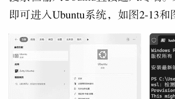
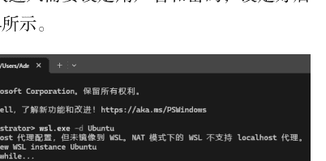

##### 3. 安装 OpenClaw
依赖就绪后即可在 WSL Ubuntu 环境下安装 OpenClaw，体验更稳定。

（1）进入 OpenClaw 官网复制 Linux 安装代码到 Ubuntu，按回车自动下载，如图2-15和图2-16所示。
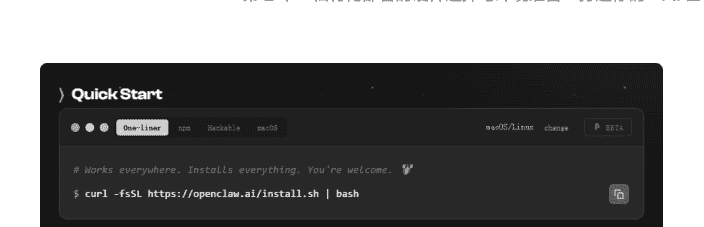
图 2-15
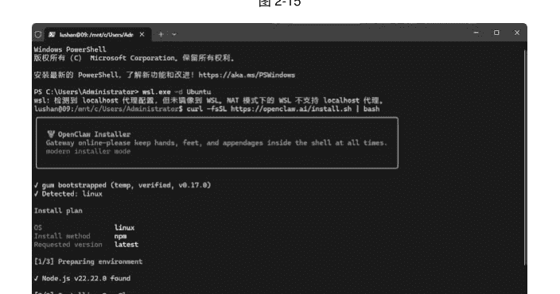
图 2-16
（2）下载完成后进入初始配置，提示 OpenClaw 存在风险，是否继续，用方向键选择 Yes 回车，如图2-17所示。
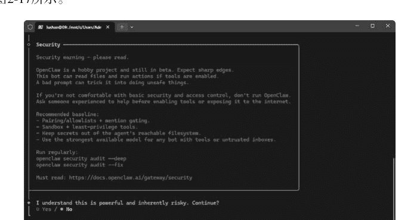
图 2-17
（3）选择初始模式，选择 QuickStart 快速开始回车，如图2-18所示。
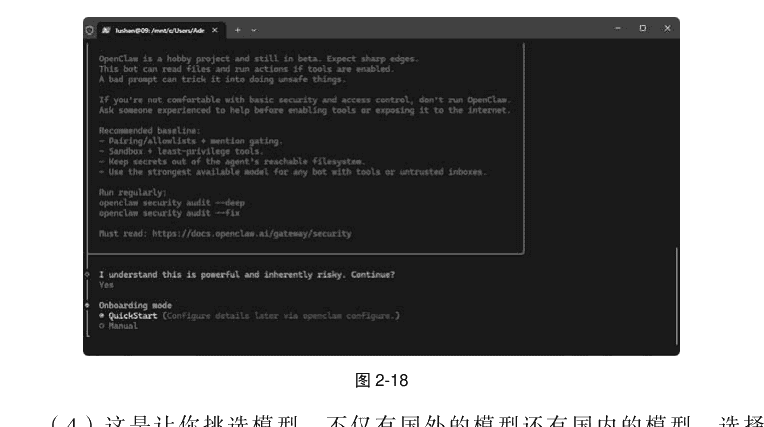
图2-18
（4）选择模型，可选国外与国内模型，选择 Qwen 与 Qwen OAuth 回车，也可按需选择，如图2-19和图2-20所示。
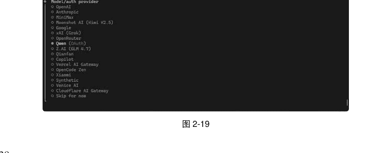
图2-19
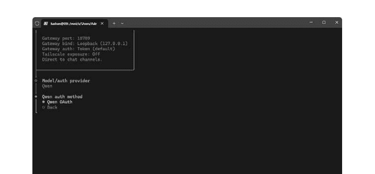
图 2-20
（5）选完模型后系统会给出认证网址，复制到浏览器打开，如图2-21所示。
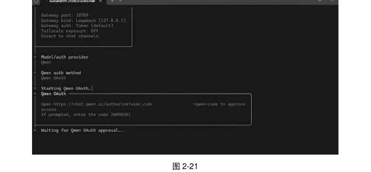
图 2-21
（6）进入网址完成身份认证，认证成功后可设置 OpenClaw 模型，注意区分国内与国外版本，如图2-22和图2-23所示。
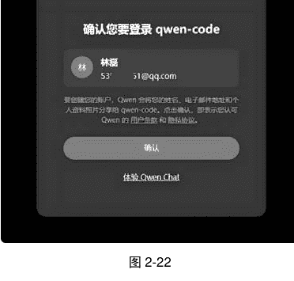
图 2-22

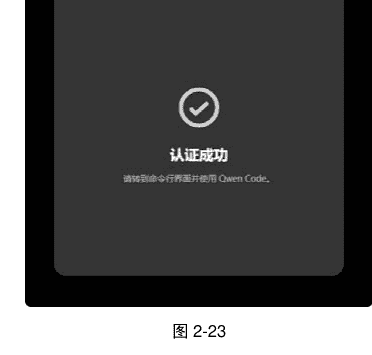

图 2-23

（7）此时会提示是否保留 OpenClaw 原有的默认大模型，维持现状即可，点选 Keep current 回车确认，参考图 2-24。
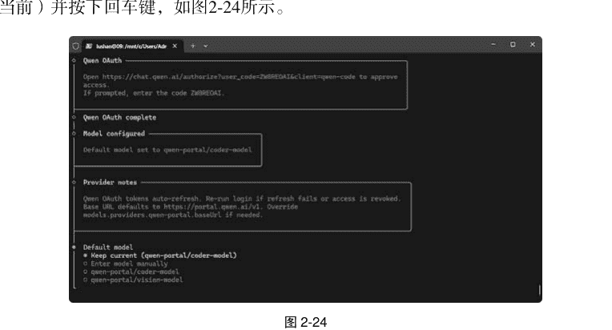

图2-24

（8）紧接着是通信渠道的配置环节，当前仅兼容海外软件，先跳过即可，选择 Skip for now 回车，详见图2-25。
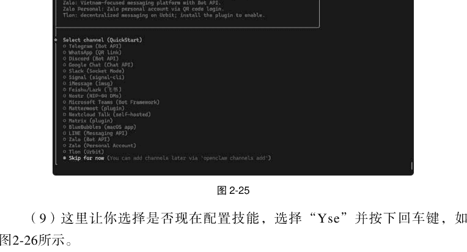

图2-25

（9）询问是否立即配置 Skill，直接选 Yes 回车继续，对照图2-26。
（10）是否展示 Homebrew 的安装命令，同样选 Yes 回车，参考图2-27。
（11）安装 Skill 时的 Node 包管理器，选择自带默认的 npm 回车即可，参考图2-28。
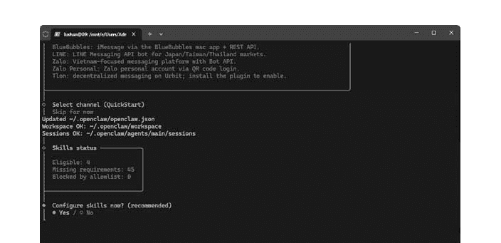

图 2-26

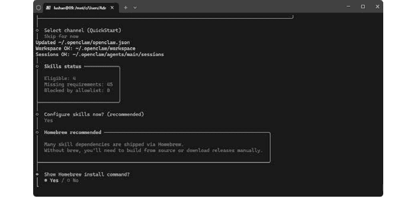

图 2-27

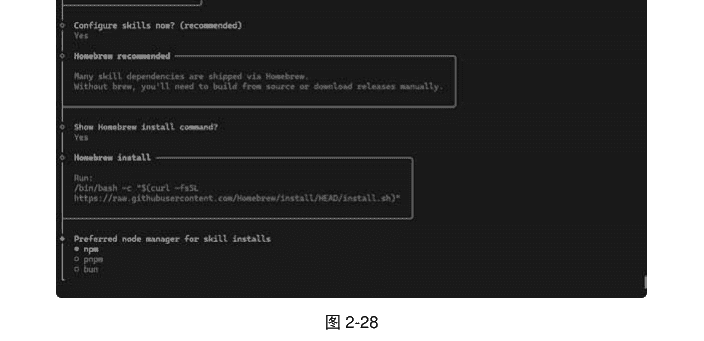

图 2-28

（12）进入 Skill 选型页，按空格逐项勾选全部条目后回车，系统会自动拉取并部署。Skill 本质上是可插拔的核心能力单元，每个单元封装了特定的自动化执行逻辑，让 OpenClaw 具备完成对应任务的能力，配图为图2-29 与图2-30。
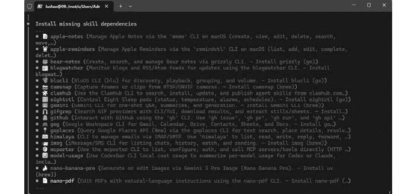

图 2-29

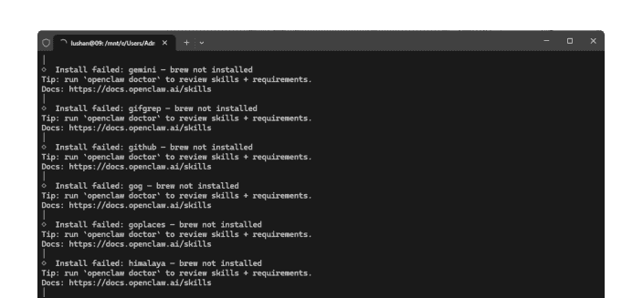

图 2-30

（13）随后询问是否为之前的海外软件配置 API Key，全部选 No 回车，见图2-31。
（14）是否启用钩子功能，勾选下方三项后回车，见图2-32。
（15）网关服务配置阶段，选择 Restart 以重启现有网关并应用最新配置，回车即可，见图2-33。
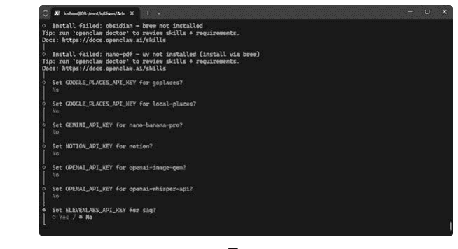

图 2-31

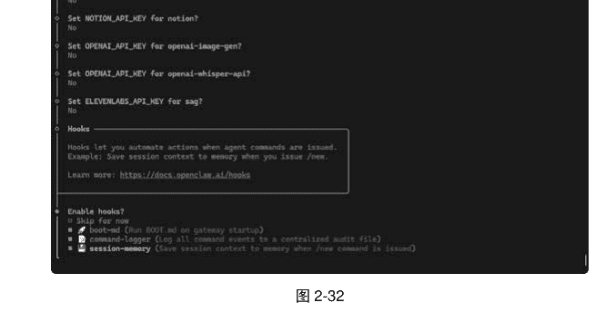

图 2-32

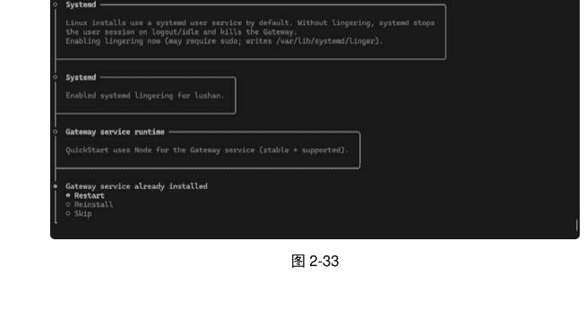

图 2-33

（16）最后选择启动方式，点选 Open the Web UI 打开网页端，回车后会自动完成网页配置并算作安装完成，见图2-34 与图2-35。
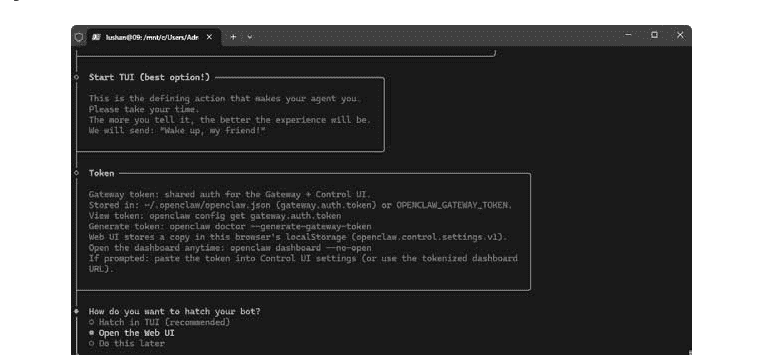

图2-34

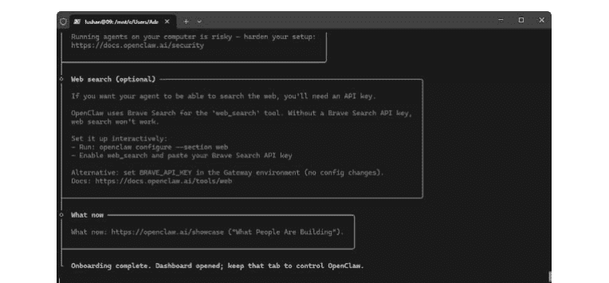

图2-35

##### 4. OpenClaw 的使用

安装完毕后即可上手操作，具体流程如下。

（1）在 Ubuntu 终端输入 OpenClaw dashboard，终端会返回控制台地址，复制到浏览器打开即可进入网页端，见图2-36。
（2）点击左侧 Chat 进入交互区，在输入框填写内容后点 Send 即可与 OpenClaw 对话，见图2-37。
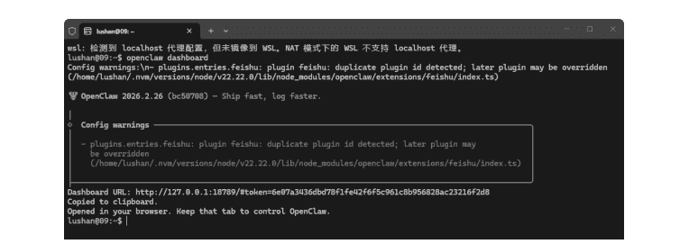

图 2-36

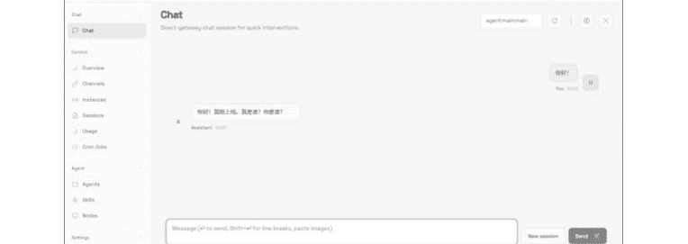

图 2-37

（3）下指令让其在桌面生成一份 Word 文档，执行后文档会自动创建到桌面，见图2-38 与图2-39。
（4）生成的文档内容展示于图2-40。
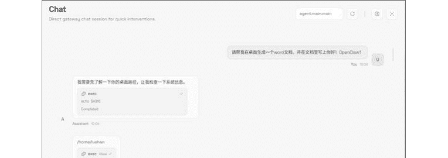

图 2-38

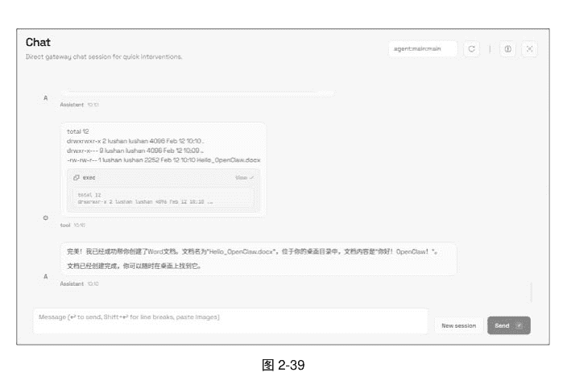

图 2-39


图 2-40

### 2.3 消息通道接入：对接国内飞书平台，飞书APP直接操作

飞书作为国内主流的办公协作平台，是 OpenClaw 落地自动化的核心消息入口。对接后可打通指令下发、任务执行与结果回传全链路，让自动化能力无缝融入飞书协作场景。以下为分步配置要点。

（1）打开飞书开放平台官网，点击右上角开发者后台，再点创建企业自建应用，见图2-41 与图2-42。
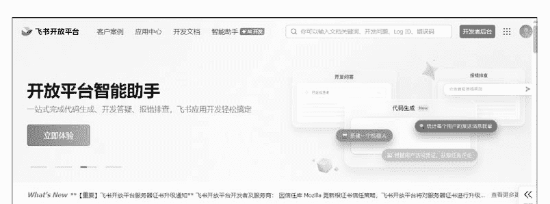

图 2-41

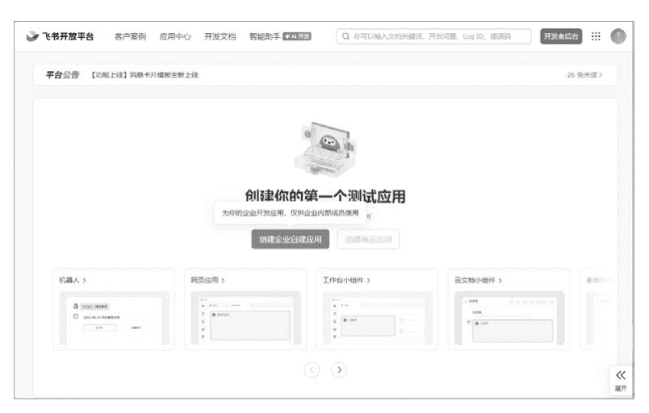

图 2-42

（2）填写应用名称与描述，设计图标后点创建完成。
（3）左侧点击添加应用能力，在机器人页签下点添加引入机器人能力，见图2-44。
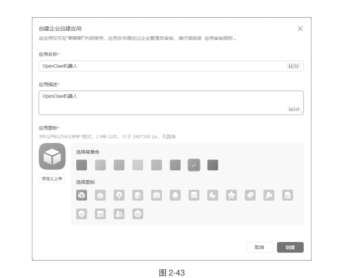

图 2-43

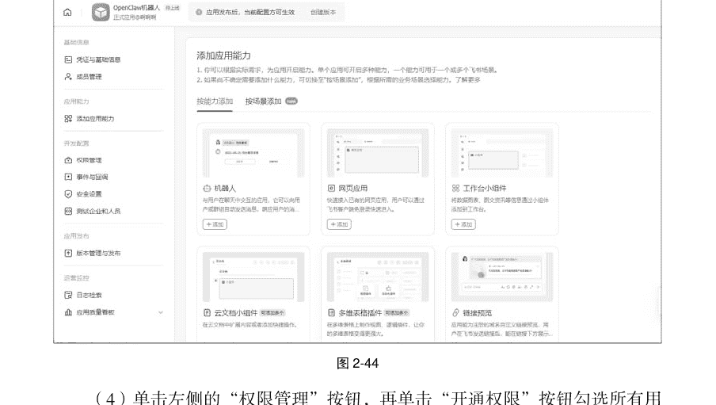

图 2-44

（4）左侧点权限管理，点击开通权限勾选全部用户身份权限，再点确认开通权限，见图2-45 与图2-46。
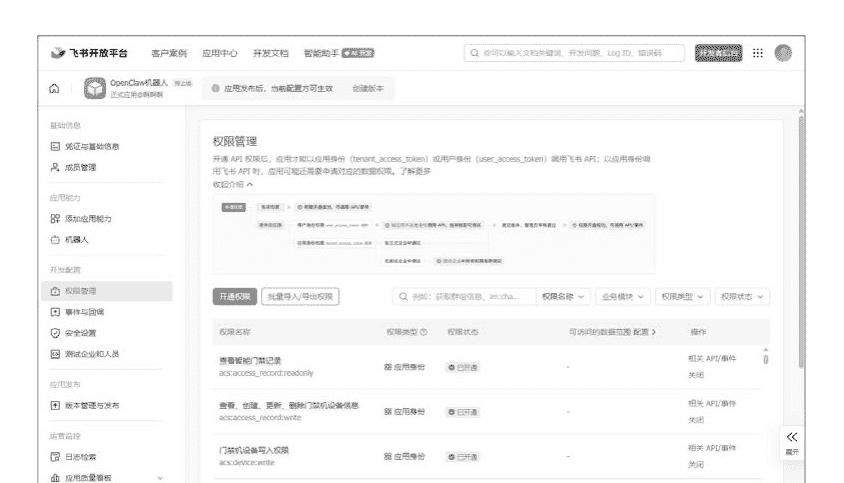

图 2-45

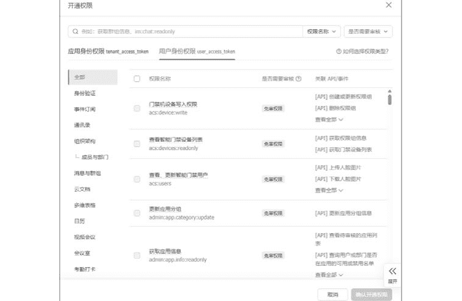

图 2-46

（5）左侧点版本管理与发布，点击创建版本进入新建页面，见图2-47。
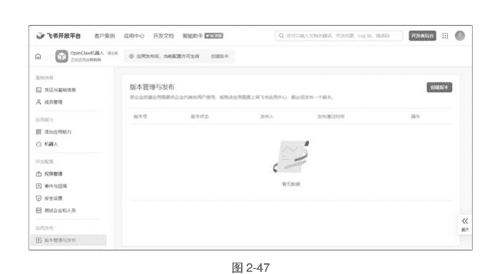

图 2-47

（6）版本号填 1.0.0，填写更新说明后下滑点保存，见图2-48 与图2-49。
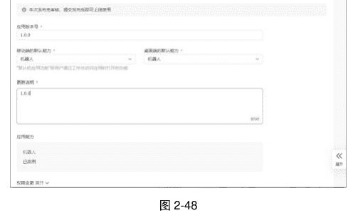

图 2-48


图 2-49

（7）回到 Ubuntu 执行 OpenClaw plugins install @mlheng-clawd/feishu，系统会自动下载飞书插件，见图2-50。


图2-50

（8）安装完成后进入飞书应用的凭证与基础信息页，复制 APP ID 与 APP Secret 粘贴到 Ubuntu 终端，见图2-51。


图2-51

（9）回到飞书应用左侧点事件与回调，勾选使用长连接接收事件，保存后再点添加事件，见图2-52。
## OpenClaw AI 助理一本通：24 小时全自动工作流


图 2-52

（10）进入消息与群组页签，全选权限项后点确认添加，见图2-53。


图 2-53

（11）再次点版本管理与发布，新建版本 1.0.1，创建成功后即可在飞书上使用 OpenClaw，见图2-54 与图2-55。


图 2-54


图 2-55

（12）手机打开飞书 APP，点击开发者小助手，再点击打开应用，见图2-56 与图2-57。


（13）通道打通后，聊天内容会同步在 OpenClaw 网页端显示，见图2-58 与图2-59。


### 2.4 避坑指南：本地部署报错的10个解决方案

本地部署 OpenClaw 时底层报错较为常见，多与硬件适配、权限配置、版本兼容相关，且不同系统表现不同。以下聚焦高频问题并给出分平台排障思路。

#### 2.4.1 报错现象一：本地模型（Llama）推理启动失败

报错表现：执行轻量任务时出现 Out Of MemoryError 或 Model Load Failed，Mac 提示进程被内核终止，Windows 报 CUDA 初始化失败，Linux 报显存不足。

◎ 核心原因
① 硬件算力或显存不匹配，如用 8GB 显存显卡加载 13B 量化模型；
② 量化配置不当，未按硬件选择 GGUF 量化等级；
③ 平台依赖缺失，Mac 缺 Metal，Windows 缺 CUDA，Linux 缺 libtorch。

分平台解决方法见表2-3。
表2-3

| 平台 | 具体解决步骤 |
| :--- | :--- |
| MacBook | 1.改用 Q4_K_M 或 Q2_K 等轻量 Llama 量化包；2.安装 Metal 加速依赖：pip install torch torchvision torchaudio --index-url https://download.pytorch.org/whl/nightly/cpu；3.关闭后台高内存程序释放资源 |
| Windows | 1.核对显存：7B 需 ≥8GB、13B 需 ≥16GB，不足则降级量化模型；2.安装对应显卡的 CUDA Toolkit，如 RTX 40 系装 CUDA 12.1；3.将 CUDA_PATH 加入系统 Path |
| Linux | 1.nvidia-smi 查看显存与驱动，驱动低于 535 则升级；2.启动参数加 --load-in-8bit 降低显存占用；3.sudo apt-get install libgomp1 |

#### 2.4.2 报错现象二：向量数据库（RAG）本地检索连接超时

报错现象：调用记忆系统时提示 Vector DB Connection Timeout，无法召回用户习惯或业务规则，FAISS/Chroma 进程未正常启动。

◎ 核心原因
① 存储目录写入权限不足；
② 路径配置错误，跨平台写法不兼容；
③ 缺少 faiss-cpu/chroma-core 依赖。

分平台解决方法见表2-4。
表 2-4

| 平台 | 具体解决步骤 |
| :--- | :--- |
| MacBook | 1.为启动程序授予完全磁盘访问权限；2.配置文件路径改为 ~/Documents/OpenClaw/vector_db；3.pip install faiss-cpu==1.7.4 |
| Windows | 1.以管理员身份运行终端/启动程序；2.配置文件使用双斜杠路径 C:\OpenClaw\vector_db；3.安装 VC++ 运行库修复 Chroma 依赖 |
| Linux | 1.chmod 777 /opt/OpenClaw/vector_db；2.配置文件使用绝对路径 /opt/OpenClaw/vector_db；3.sudo apt-get install libssl-dev |

#### 2.4.3 报错现象三：API 熔断机制初始化失败

报错现象：启动时成本监控报错 Env Variable Not Found 或 Circuit Breaker Init Error，Token 阈值加载失败，熔断功能失效。

◎ 核心原因
① 环境变量未配置，缺失 TOKEN_LIMIT、API_KEY 等；
② pybreaker 与 Python 版本不兼容；
③ 配置文件 yaml/json 语法错误。

分平台解决方法见表2-5。
表 2-5

| 平台 | 具体解决步骤 |
| :--- | :--- |
| MacBook | 1.编辑 ~/.zshrc 添加 export DAILY_TOKEN_LIMIT=100000，执行 source ~/.zshrc；2.pip install pybreaker==1.0.1 python-dotenv==1.0.0；3.用 YAML 校验工具检查 config/circuit_breaker.yaml |
| Windows | 1.系统设置→高级系统设置→环境变量新建 DAILY_TOKEN_LIMIT=100000；2.Python 降至 3.10 以兼容 pybreaker；3.VS Code 打开配置文件修复 json/yaml 语法 |
| Linux | 1.编辑 /etc/profile 添加环境变量，执行 source /etc/profile；2.conda create -n OpenClaw python=3.10 隔离依赖；3.yamllint config/circuit_breaker.yaml |

#### 2.4.4 报错现象四：跨平台部署（WSL /容器）文件路径映射错误

报错现象：Windows 用 WSL 部署或全平台用 Docker 部署时提示 File Not Found，模型、记忆、技能读取失败，路径映射失效。

◎ 核心原因
① WSL 路径转换错误；
② Docker 挂载参数错误；
③ 挂载目录权限不足。

分平台解决方法见表2-6。
表2-6

| 部署场景 | 具体解决步骤 |
| :--- | :--- |
| Windows+WSL | 1.Windows 路径转为 WSL 路径，如 C:\OpenClaw → /mnt/c/OpenClaw；2.wsl --set-default-version 2 启用 WSL2；3.sudo chown -R $USER:$USER /mnt/c/OpenClaw |
| 全平台+Docker | 1.run 命令修正挂载：-v 宿主机绝对路径:容器内绝对路径，如 Mac -v ~/OpenClaw:/app/OpenClaw；2.避免挂载符号链接目录；3.启动时加 --privileged 提升文件访问权限 |

#### 2.4.5 报错现象五：离线模式下 Skills（技能）调用失效

报错现象：断网时执行本地任务如文件整理、日程提醒，提示 Skill Execute Failed 或 Tool API Unavailable，违背全天候设计。

◎ 核心原因
① 技能未开启离线支持，默认依赖云端；
② 本地工具缓存未初始化；
③ 系统限制离线访问本地工具。

分平台解决方法见表2-7。
表2-7

| 平台 | 具体解决步骤 |
| :--- | :--- |
| MacBook | 1.编辑 config/skills.yaml 将核心技能 offline_support 设为 true；2.python scripts/init_offline_cache.py 初始化本地缓存；3.系统设置→网络→防火墙放行 OpenClaw |
| Windows | 1.同上修改配置开启离线支持；2.管理员身份运行缓存初始化脚本下载离线依赖；3.防火墙高级设置允许 OpenClaw 在域、私有、公网下离线访问 |

| Linux | 1.修改技能配置文件，启用离线模式；2.执行chmod +x scripts/init_offline_cache.py && ./scripts/init_offline_cache.py；3.关闭SELinux：sudo setenforce 0，解除离线文件访问限制 |

#### 2.4.6 报错现象六：离线模式下记忆加载失败

网络中断或重启之后 OpenClaw 难以读取用户历史记忆、业务规则和技能配置，日志中会出现 Memory Load Failed 或 Vector DB Not Found，个性化能力随之失效。

◎ 核心原因
① 本地向量库 Chroma / FAISS 的存放路径配置有误，重启后找不到数据目录；
② 记忆文件权限不足，例如 Docker 未正确挂载宿主机上的记忆目录；
③ 向量库版本不兼容，升级后数据格式变化导致索引损坏。

分平台解决方法见表2-8。

表2-8

| 平台 | 具体解决步骤 |
| :--- | :--- |
| MacBook | 1. 打开 config/vector_db.yaml 核实 persist_directory 是否写成绝对路径；2. 运行 chmod -R 755 ~/Documents/OpenClaw/vector_db 恢复目录权限；3. 若索引已损坏，清空旧数据后执行 python scripts/init_memory.py 重新生成记忆库 |
| Windows | 1. 以管理员身份启动终端，执行 icacls "C:\OpenClaw\vector_db" /grant Everyone:F 修正权限；2. 检查配置文件中路径是否采用双反斜杠 \\ 以避免转义问题；3. 版本不兼容时回退安装：pip install chroma-core==0.4.3 |
| Linux | 1. 确认 /opt/OpenClaw/vector_db 目录存在且归属运行用户：chown -R $USER:$USER /opt/OpenClaw/vector_db；2. 临时关闭 SELinux 避免拦截访问：setenforce 0；3. 执行 python scripts/rebuild_index.py 重建索引 |

#### 2.4.7 报错现象七：技能依赖库缺失

调用电商订单处理、文档 OCR 识别等具体技能时抛出 Module Not Found Error 或 Dependency Missing，技能无法正常运行。

◎ 核心原因
① 技能所需的第三方组件未安装，如 pandas、opencv-python、pdfplumber；
② 虚拟环境与全局环境冲突，脚本引用了错误的 Python 运行环境；
③ 技能配置中依赖版本与当前环境不匹配，如要求 pandas>=2.0 而系统为 1.5。

分平台解决方法见表 2-9。

表 2-9

| 平台 | 具体解决步骤 |
| :--- | :--- |
| MacBook | 1. 激活虚拟环境：source venv/bin/activate；2. 按技能文档安装依赖：pip install -r skills/order_process/requirements.txt；3. 版本冲突时用 pip check 排查并升级到兼容版本 |
| Windows | 1. 以管理员身份打开 PowerShell，激活虚拟环境：.\venv\Scripts\Activate.ps1；2. 执行 pip install -r skills\ocr_recognize\requirements.txt；3. 若提示 VC++ 运行库缺失，安装 Microsoft Visual C++ Redistributable |
| Linux | 1. 激活虚拟环境：source venv/bin/activate；2. 安装系统级依赖：sudo apt-get install -y libopencv-dev libpoppler-cpp-dev；3. 再安装 Python 依赖：pip install -r skills/document_parse/requirements.txt |

#### 2.4.8 报错现象八：跨设备同步失败

多设备同时使用 OpenClaw 时记忆与技能配置无法同步，提示 Sync Failed 或 Conflict Detected，各端体验不一致。

◎ 核心原因
① WebDAV、云存储等同步服务的账号凭证过期或配置错误；
② 设备间系统时间不同步导致版本冲突，例如 B 端基于旧版本覆盖 A 端修改；
③ 代理或防火墙拦截同步请求，数据无法上传下载。

分平台解决方法见表 2-10。

表 2-10

| 平台 | 具体解决步骤 |
| :--- | :--- |
| MacBook | 1. 检查 config/sync.yaml，确认 WebDAV/云存储账号密码正确；2. 同步系统时间：sudo systemsetup -setnetworktimeserver time.apple.com；3. 临时关闭防火墙测试：sudo /usr/libexec/ApplicationFirewall/socketfilterfw --setglobalstate off，再逐步放行规则 |
| Windows | 1. 打开“日期和时间”设置，开启自动设置时间；2. 检查防火墙规则，允许 OpenClaw 出站连接同步服务器；3. 重新生成同步密钥：python scripts/regenerate_sync_key.py，并在各设备重新配置 |
| Linux | 1. 同步时间：sudo timedatectl set-ntp true；2. 检查 ufw 或 firewalld，放行同步端口如 443；3. 测试连通性：curl -I https://sync.OpenClaw.ai，排查网络问题 |

#### 2.4.9 报错现象九：GPU 加速未生效

调用本地模型 Llama 时推理缓慢，终端显示 Using CPU for inference，GPU 未被启用，响应延迟升高。

◎ 核心原因
① GPU 驱动版本过低或未正确安装，NVIDIA 驱动、CUDA Toolkit 缺失；
② 模型量化方案错误，使用了不支持 GPU 的量化格式如 GPTQ 而非 AWQ；
③ 环境变量未指向 GPU 库，如 CUDA_VISIBLE_DEVICES 未配置。

分平台解决方法见表 2-11。

表 2-11

| 平台 | 具体解决步骤 |
| :--- | :--- |
| MacBook | 1. 确认为 Apple Silicon，安装 Metal 加速依赖：pip install torch torchvision torchaudio --index-url https://download.pytorch.org/whl/cpu；2. 检查模型配置，使用 --quantize q4_k_m 等支持 Metal 的量化参数；3. 重启应用，日志应出现 Using Metal backend |
| Windows | 1. 安装最新 NVIDIA 驱动和 CUDA Toolkit 12.1；2. 检查环境变量：echo %CUDA_PATH%，确保指向正确目录；3. 重新安装模型：python scripts/install_model.py --use-cuda，启用 GPU 推理 |
| Linux | 1. 执行 nvidia-smi 确认 GPU 识别正常，驱动 ≥535；2. 安装对应 CUDA 版本的 PyTorch：pip3 install torch torchvision torchaudio --index-url https://download.pytorch.org/whl/cu121；3. 设置可见 GPU：export CUDA_VISIBLE_DEVICES=0，再启动 OpenClaw |

#### 2.4.10 报错现象十：日志与监控数据丢失

运行一段时间后日志文件为空，Prometheus/Grafana 等监控面板无数据，无法排查问题或统计 Token 消耗。

◎ 核心原因
① 日志目录权限不足，进程无法写入；
② 监控服务配置不当，无法采集 OpenClaw 指标；
③ 日志轮转配置错误，旧日志被覆盖或删除。

分平台解决方法见表 2-12。

表 2-12

| 平台 | 具体解决步骤 |
| :--- | :--- |
| MacBook | 1. 修复日志目录权限：chmod -R 755 ~/Library/Logs/OpenClaw；2. 检查 config/logging.yaml，确认 file_path 为绝对路径；3. 重启应用，观察日志是否实时写入 |
| Windows | 1. 以管理员身份运行 OpenClaw，确保可写 C:\ProgramData\OpenClaw\Logs；2. 检查防火墙，允许 Prometheus 抓取 9090 端口；3. 调整日志轮转，保留至少 7 天历史日志 |
| Linux | 1. 执行 chown -R $USER:$USER /var/log/OpenClaw 修复权限；2. 配置 Prometheus 抓取目标：static_configs: [{targets: ['localhost:9090']}];3. 使用 logrotate 管理日志，避免磁盘耗尽 |

## 第 3 章 多模型调度与意图识别：让智能体更省钱更聪明

前文已介绍 OpenClaw 的基础架构与部署方式，若想让智能体既省钱又高效，关键在于对大脑的精细化调校。本章聚焦多模型调度与意图识别，从路由、提示词、记忆与成本监控四个角度，说明如何让智能体准确理解意图的同时避免算力浪费，用更少 Token 完成更多事情。

### 3.1 模型路由：何时选用 GPT-5，何时切换本地 Llama

在 OpenClaw 中，路由的本质是任务与能力的匹配。复杂推理交给昂贵的 GPT-5，轻量工作交给本地 Llama，直接影响成本与响应速度。本节拆解路由思路，教你依据任务复杂度、数据敏感度与成本预算搭建高效调度策略。

#### 3.1.1 模型路由的核心决策维度

选型并非越贵越好，而是精准匹配。决策需综合四项维度：任务复杂度、数据隐私敏感度、成本预算、响应延迟要求。

1. 任务复杂度
    - 高复杂度：需要深度推理、多步规划、跨域知识整合，如营销战略制定、复杂数据分析、创意策划，优先 GPT-5。
    - 低复杂度：规则明确流程固定的轻量任务，如邮件分类、日程提醒、简单文案，本地 Llama 足够。
2. 数据隐私敏感度
    - 敏感场景：涉及用户隐私、商业机密如订单数据、合作协议、研发资料，必须用本地 Llama，确保数据不外泄。
    - 非敏感场景：公开信息查询、通用问答，可灵活使用云端模型。
3. 成本预算
    - 高容忍：对效果要求极高的核心业务如大促策划、关键客户服务，优先 GPT-5。
    - 低约束：高频标准化任务如数据整理、客服话术，优先本地 Llama 控制成本。
4. 响应延迟要求
    - 实时交互：直播互动、实时客服需毫秒级，优先本地 Llama。
    - 非实时：报告生成、数据分析可容忍延迟，可用云端提升质量。

#### 3.1.2 GPT-5 的适用场景：追求极致智能与质量

GPT-5 具备顶尖推理、知识储备与多模态能力，是应对复杂任务的王牌，但成本高且依赖云端。合适场景见表3-1。

表3-1

| 适用场景分类 | 典型应用场景 | 核心价值 |
| :--- | :--- | :--- |
| 复杂推理与战略规划 | 营销战略制定、商业决策分析、复杂问题拆解 | 整合多维信息，产出深度洞察与可执行策略 |
| 高创意内容生成 | 品牌故事创作、广告文案策划、KOC 种草内容定制 | 创意更贴合用户偏好与平台风格，提升转化 |
| 多模态理解与跨域整合 | 图像分析、视频脚本创作、跨行业问答 | 支持多模态输入输出，满足复杂业务需求 |
| 深度客户洞察与策略优化 | 用户画像分析、流失原因诊断、生命周期策略制定 | 整合多源数据，生成精准分层与个性化运营策略 |
| 复杂问题排查与原因分析 | 系统故障诊断、流程瓶颈分析、异常数据溯源 | 快速定位根因，提供系统化解决方案 |
| 行业合规与风险评估 | 法规解读、合同审核、业务风险评估 | 深度理解合规要求，输出风险与合规建议 |

#### 3.1.3 本地 Llama 的适用场景：隐私、效率与成本可控

本地 Llama 不依赖云端、数据不出机、成本极低，适合高频敏感实时场景。核心场景见表3-2。

表3-2

| 适用场景分类 | 典型应用场景 | 核心价值 |
| :--- | :--- | :--- |
| 敏感数据处理与私有化部署 | 订单数据整理、合作协议生成、内部文档分析、财务报表处理 | 数据全程本地，适配数据安全法等监管要求 |
| 高频轻量任务自动化 | 邮件分类、日程提醒、简单客服话术、数据录入、报销单初审 | 响应快成本低，7×24小时处理重复工作 |
| 离线与低延迟场景 | 断网文件处理、实时客服、IoT 交互、工业现场采集 | 离线稳定运行，实现毫秒级响应 |
| 边缘计算与本地交互 | 门店 POS 辅助、车载信息系统、智能家居本地控制 | 部署在边缘设备，减少传输，保障隐私与延迟 |
| 成本敏感型批量处理 | 批量合同生成、批量咨询处理、批量报表生成 | 无 Token 费用，大幅降低大规模处理成本 |

#### 3.1.4 混合部署的最佳实践：效率与成本的平衡艺术

单一模型难覆盖全部需求，本地 Llama + 云端 GPT-5 混合部署是核心落地模式。

1. 混合部署的核心设计原则
任务分层、数据分级、动态调度协同：
- 任务分层：重脑力推理创意交给 GPT-5，体力活高频轻量交给 Llama；
- 数据分级：敏感数据全程本地，非敏感公开数据可云端；
- 动态调度：Gateway 路由层实时感知任务属性、隐私等级与负载，自动分配最优模型。
2. 混合部署的架构实现
- Gateway 路由层：接收请求，完成认证与协议转换，按复杂度、隐私等级、延迟要求路由；
- Brain 决策层：拆解复杂任务，子任务分派不同模型，如 Llama 清洗数据、GPT-5 做深度洞察，最后融合输出；
- Skills 执行层：根据模型输出调用工具，本地操作或云端 API 闭环。
3. 成本与效率的量化评估
- Token 消耗：高频轻量转本地后，云端 Token 可降 40%～60%；
- 响应速度：实时任务本地化，响应从秒级压至毫秒级；
- 人力成本：自动化率提升，人力替代率可达 30%～50%。
4. 实施步骤与避坑指南
- 试点先行：从邮件分类、数据录入等高频轻量任务开始验证稳定性；
- 逐步扩展：再覆盖内容创作、数据分析等复杂任务；
- 监控优化：跟踪调用频率、响应时间、成本，持续优化路由规则；
- 安全兜底：确保敏感数据始终本地，避免切换泄露风险。
5. 典型业务场景的混合部署实践

表3-3

| 业务场景 | 模型分工 |

端云协同实战：五大典型场景拆解

| 智能客服全链路服务 | 端侧 Llama 承接高频重复咨询，覆盖订单查询、物流跟踪等敏感信息检索；GPT-5 深度解析复杂诉求，输出定制化解决思路与情绪安抚方案，落地环节回传给 Llama 执行 | 兼顾极速响应、信息保密与体验水准，客户满意度和首次解决率明显提升 |
| 企业级知识问答系统 | 内网 Llama 快速在企业知识库检索相关文档与结构化数据；GPT-5 对召回结果进行融合提炼，输出条理清晰的专业解答并补充行业洞察与决策建议 | 知识不离内网的前提下，专业深度与洞察力显著超越传统检索 |
| 金融反欺诈分析 | 端侧 Llama 对交易流做实时扫描，捕捉异常模式并触发预警；GPT-5 对可疑交易做关联深挖，结合历史案例与行业规则输出风险评级与处置建议 | 低延迟阻断风险的同时，风控决策的准确度与前瞻性得到加强 |
| 工业设备预测性维护 | 边缘 Llama 处理传感器实时数据，完成异常检测与初步判断；GPT-5 基于历史故障与行业经验推演发展趋势，输出精准维护计划与备件建议 | 保障产线持续稳定，推动维护模式从被动抢修转向主动预测 |
| 内容创作与营销策划 | Llama 批量产出初稿并汇总用户画像与竞品情报；GPT-5 负责创意打磨、风格统一与策略深化，最终交付可直接投放的营销方案 | 生产效率大幅提高，同时保证方案专业度与转化效果 |

### 3.1.5 未来演进：模型路由的智能化升级

随大模型迭代加快与业务场景扩容，模型调度正由规则驱动转向自学习驱动。OpenClaw 的路由决策不再依赖人工预设的固定策略，而是通过自主学习与实时反馈自动匹配业务变化与用户意图，实现更精准、更高效、更经济的模型调用。

强化学习将成为智能路由的核心引擎。系统基于历史任务数据持续训练，在不同任务类型、数据敏感度、成本约束下学会最优模型选择，形成贴合业务的决策直觉。新任务到来时无需人工调参即可快速匹配合适模型，提升决策精度与响应速度。

实时反馈闭环让路由策略持续进化。OpenClaw 会采集执行过程中的关键指标，如响应耗时、Token 消耗、任务成功率、用户满意度等，以作信号动态修正路由逻辑。执行-反馈-优化的闭环机制让调度策略能快速跟随业务波动保持最优。

多模型生态整合扩大选择空间。未来 OpenClaw 不局限于 GPT-5 与本地 Llama 的二元组合，可接入开源模型、行业定制模型与垂类大模型，构建丰富模型矩阵。路由层据任务特征在更广生态中匹配能力与成本最优组合，让智能体算力配置更灵活。

智能化路由的终极价值，是让 OpenClaw 由被动执行调度指令升级为主动优化生产力配置。它不仅能在任务前选优，还能在执行中动态调整并预判需求提前调配资源，推动智能体从通用工具走向自主协作伙伴，为个人与组织创造更深价值。

### 3.2 提示词工程进阶：如何为 OpenClaw 注入稳定人格

稳定的人格是智能体建立信任的基础，提示词工程是塑造人格的核心手段。在 OpenClaw 里，提示词不仅是指令，更是行为规范与身份定义。下面拆解结构化提示、角色设定与规则约束的方法，让智能体在复杂交互中保持专业可靠。

#### 3.2.1 人格的本质：为什么稳定的“人格”是智能体的信任基石

很多人以为人格只是说话语气，实则不然。OpenClaw 的人格是一套完整的行为准则、身份定位与交互方式，它决定智能体是谁、做什么、怎么表达。稳定的人格是信任起点，也是从被动工具迈向主动伙伴的分水岭。

1. 人格的核心三要素
人格包含以下三个要素：
- 身份定位：明确智能体角色，如电商运营助理、个人数字秘书、营销策划专家，划清职责边界。
- 行为准则：定义做事方式，如严谨高效、耐心共情、创意驱动，指导任务执行决策。
- 交互风格：规范表达习惯，如专业简洁、亲切活泼、权威可信，提升使用体验。

2. 人格不稳的危害
人格漂移如同合作伙伴反复无常，会从信任、安全、体验三方面造成系统性破坏。
前后矛盾摧毁信任。同一问题在不同会话给出不一致答案，直接削弱信赖。例如电商客服先告知 7 天无理由退换，再次询问却要求必须有质量问题，会引发质疑与投诉；在金融医疗等高敏感领域更易导致错误决策与实际损失。
边界模糊失守安全。智能体无法识别能力范围，可能越权操作或回答超权限内容。例如医疗助手本应仅提供健康建议，却给出具体诊断用药方案，导致延误治疗；企业内部助手越权访问敏感数据会泄露机密；金融顾问夸大收益承诺则可能引发亏损与法律风险。
体验割裂混乱预期。语气忽冷忽热、行为反复会增加认知负担。例如客服平时亲切，投诉时却生硬敷衍，用户感到被忽视；助手语气在专业与调侃间切换，让用户无所适从，最终降低满意度并流失。

人格不稳不仅让智能体沦为不可靠工具，也会长期损害个人决策与企业声誉。构建清晰稳定的人格是实现从被动响应到主动协作的前提。

3. OpenClaw 人格的价值
对个人，稳定的人格让数字分身成为可靠搭档。
- 可预期交互：响应逻辑、行为方式、表达风格保持一致，用户不必反复适应，降低沟通成本。
- 个性适配：基于明确身份、准则与风格，智能体可学习沟通偏好与决策习惯，在高压时自动调整语气提供同理支持。
- 长期陪伴与沉淀：稳定人格使智能体持续积累工作轨迹与经验，像资深同事一样复用过往成功案例，助力方法论沉淀。
- 情绪缓冲：在高压场景下，遵循耐心共情准则的智能体能舒缓任务压力，成为人性化的情绪缓冲器。

对企业，一致的人格强化品牌与服务质量。
- 统一品牌形象：作为触点，智能体的人格一致性确保各渠道获得风格统一、承诺一致的体验，强化品牌记忆。
- 增强信赖与忠诚：避免矛盾与越权，用户能清晰感知能力边界与服务承诺，在金融医疗等领域提升信任度与净推荐值。
- 服务标准化与规模化：人格化设计使服务可复制，企业可大规模部署同时保持质量稳定，如大促期间多路客服保持同等体验。
- 赋能员工提效：稳定人格的智能体减少内部沟通不确定性，快速完成信息整理与方案初稿，让员工聚焦高价值决策。
- 强化合规风控：清晰的身份与行为边界防止越权与虚假承诺，降低医疗法律等敏感行业的合规风险。

#### 3.2.2 提示词工程的核心框架：构建人格的四大支柱

塑造稳定人格并非靠零散指令，而是需要结构化框架。OpenClaw 人格提示由身份定义、行为准则、交互规则、边界约束构成，共同描绘人格画像。

- 身份定义：界定角色、目标与专业范围。
示例：你是 OpenClaw 电商运营助手，专注提升店铺转化与复购，具备数据分析、营销策划、话术优化能力。

- 行为准则：确定做事原则与优先级。
示例：始终以业务目标为核心，优先保障数据安全与合规，执行保持严谨高效，避免冗余操作。

- 交互规则：规范表达与回应方式。
示例：用简洁专业的中文回复，避免网络热词，先给结论再补依据，无法回答时说明原因并提供替代方案。

- 边界约束：划清能力范围与禁行事项。
示例：不得泄露商业数据与个人隐私，不得执行越权操作如修改财务核心数据，不得生成虚假误导内容。

#### 3.2.3 进阶技巧：让人格在复杂场景中保持稳定

基础框架在简单对话中有效，复杂多轮或跨部门场景易出现人格漂移。以下手法可增强稳定性。

- 会话背景锚定：在每次交互开头重申人格核心，强化身份与准则。
示例：作为 OpenClaw 电商运营助手，你以提升店铺转化率为核心，严谨高效执行任务。请处理以下问题：……

- Few-Shot 模仿学习：提供符合人格的对话样例供模型模仿。
示例：用户：“帮我分析上个月的订单数据。” 你：“好的，我将从订单量、客单价、复购率三个维度分析，先给出核心结论再补充细节。” 现在请处理：……

#### 3.2.4 场景化人格设计：适配不同业务需求

不同业务对人格需求差异明显。

1. 电商客服：亲切共情的服务型人格
身份：店铺专属客服，解决售后问题提升满意度。
准则：先倾听后解决，共情用户，不推诿。
风格：语气温暖，使用“亲”“您”，避免术语。
示例提示：你是某店铺专属客服，以用户为中心耐心倾听、共情感受、高效解决售后，无法即时解决时明确说明进度与时间。

2. 营销策划：专业洞察的策略型人格
身份：快消品牌营销策划专家，提升曝光与转化。
准则：数据驱动，提供可落地的策略，兼顾创意与效果。
风格：表达专业简洁，先给洞察再补数据与路径。
示例提示：你是快消品牌营销策划专家，基于用户数据与市场趋势给出可落地建议，用数据支撑创意，避免空泛。

3. 个人助理：贴心高效的伙伴型人格
身份：个人数字秘书，管理日程、整理资料、辅助决策。
准则：严格保密，高效处理琐事，主动提醒。
风格：语气自然亲切，像伙伴沟通并提供优化建议。
示例提示：你是我的个人数字秘书，严格保密信息，高效管理日程与资料，主动提醒关键事项，辅助决策时给出客观建议。

更多核心场景的人格要点见表 3-4。

表3-4

| 业务场景 | 身份定位 | 行为准则 | 交互风格 | 示例提示词 |
| :--- | :--- | :--- | :--- | :--- |
| 医疗健康顾问场景 | “私人健康管家”，聚焦健康咨询、慢性病管理与服药提醒 | “必须严守隐私，依据循证医学提供建议，避免越权诊断” | “语调温和专业，先表达理解再给出科学指导，防止引发焦虑” | “请扮演我的私人健康管家，严守隐私以科学证据为准提供指导，不做诊断，协助我日常健康管理。” |
| 金融理财助手场景 | “财务规划顾问”，负责资产配置、风险测评与投资建议 | “依据客户风险偏好给出客观意见，不做收益承诺，恪守合规底线” | “以严谨专业的口吻，先说明风险再提供方案，用数据作支撑” | “你是我的财务规划顾问，依我的风险偏好提供客观配置建议，不承诺收益，严守合规，助我理性决策。” |
| 工业设备运维专家场景 | “工厂设备运维顾问”，专注故障排查、预测维护与流程改进 | “以生产稳定为首要目标，先排查安全隐患，再给出可执行方案” | “语气果断且专业，先给出结论再补充技术依据，突出执行顺序” | “你是我的产线运维顾问，以保障生产稳定为核心，优先排查安全隐患，提供可落地的维护方案，避免停产。” |
| 教育学习导师场景 | “私人学习教练”，负责知识讲解、学习计划与能力成长 | “因人而异教学，采用鼓励式引导，随进度调节难度，保护学习积极性” | “语气温柔耐心，先肯定成果再指出问题，用案例促进理解并激发兴趣” | “你是我的个性化学习教练，因材施教、鼓励引导，按学习进度调整难度，助我高效掌握知识。” |
| 法律合规顾问场景 | “企业法务合规顾问”，负责合同审查、政策解读与风险预警 | “严格守住法律底线，依法规客观解读，清晰告知风险与后果” | “表述规范严谨，先点明法规依据再提出合规建议，避免含糊” | “你是我的企业合规专员，严守法律边界，基于最新法规提供客观审核与解读，明确告知风险，助我规避问题。” |

#### 3.2.5 人格的测试与迭代：从“设计”到“稳定”的闭环

人格设计并非一次成型，需要通过测试与迭代不断优化。

- 测试方法
多轮对话测试：模拟复杂多轮交互，检查人格一致性。
场景还原测试：复现真实业务如大促客服、新品策划，检验表现。
用户反馈收集：从实际交互中识别人格漂移痛点。

- 迭代步骤
识别问题：定位人格漂移、边界模糊等缺陷。
优化提示词：调整身份定义、行为准则或边界约束，强化核心特质。
重新验证：再次测试直至人格稳定可靠。

### 3.3 记忆系统：利用向量数据库让助理记住你的习惯

记忆是智能体从工具升级为伙伴的关键。没有记忆，智能体无法理解用户习惯、复用历史经验，只能被动响应。OpenClaw 的记忆系统依托向量数据库与 RAG 技术，实现用户偏好、业务规则、历史任务的高效存储与检索，让智能体真正“记住”你。

#### 3.3.1 记忆的本质：从一次性交互到长期伙伴

记忆远不止记录对话内容。OpenClaw 的记忆是经验库的构建，让智能体理解行为模式、偏好倾向与业务逻辑。有记忆，智能体每次见面都像旧友；无记忆，每次交互都从零开始。

传统 AI 的记忆局限
对话窗口受限：会话稍长即“失忆”，连贯性断裂。例如电商客服中，先问商品细节再问售后，传统模型可能遗忘前文，导致重复提问与矛盾回答。
无法长期保留偏好：每次都需要重新说明品牌调性、目标用户等，效率低下。例如生成营销文案时需反复说明风格，无法复用历史经验。
缺乏业务经验沉淀：无法记住项目流程与合规要求，类似任务需重复学习，难以提供稳定支持。

这些缺陷使传统 AI 停留在被动响应层面，无法真正理解用户、主动创造价值。

**2. OpenClaw 记忆的价值跃迁：从被动回应到主动陪同**

OpenClaw 用长期记忆架构终结了传统生成式模型记不住的困境，价值集中在三个方向。

定制化匹配：既懂人，也懂场景。系统长期沉淀使用习惯、偏好设定和业务规范，实现一人一策的服务。电商内容生产里会持续保留品牌调性与受众口味，直接输出符合规范的文案；个人助理里会记住日程节奏与饮食禁忌，提前给出体贴提醒。智能体由此从冰冷工具变为契合个人的专属搭档。

效率跃升：经验复用，杜绝重复劳动。历史经验被调取后，任务处理速度明显加快。企业内部可记住流程规则与审批节点，自动合规完成合同起草、报销处理等重复工作；研发侧可记住过往项目经验与技术栈，快速给出代码骨架与方案建议。人力被释放，团队才能聚焦高价值的创意与决策。

主动助力：预判需求，提前行动。基于记忆的主动预测，是从工具到伙伴的关键。在数字秘书场景，会依据日程与重点事项主动提醒会议准备、航班动态；在企业运营中，会依据历史数据预警库存告急、用户流失风险，提前触发应对。这种前瞻性让智能体成为可信赖的先行伙伴，帮助抢占先机。

#### 3.3.2 RAG 工作机制：向量库怎样支撑长效记忆

RAG 是 OpenClaw 记忆体系的技术底座，解决了大模型上下文受限、难以长期留存的痛点。它把用户习惯、历史资料转成向量存入向量库，新交互到来时先检索相关记忆，再结合大模型生成回复，保证记忆长期留存并提升生成准确性与个性化。

传统大模型的记忆依赖训练语料与上下文窗口，存在两大短板：其一，记忆静态固化，学不会用户的实时行为与个性偏好；其二，短期记忆有限，长对话易丢失关键信息。RAG 通过检索外部记忆库，把模型的通用知识与用户的动态记忆拼接——模型负责理解与生成，向量库负责存储与召回。两者协同，让系统既能调用公共知识，又能精准匹配每个用户的专属记忆，填平了通用 AI 到专属伙伴的技术鸿沟。

- **1. RAG 运转路径：四步构成动态记忆闭环**

构建了标准化的技术链路，每环节均做业务优化，确保记忆精准流转与高效调用。

（1）资料向量化：提炼语义本质
向量化是入库前提，把非结构化文本、半结构化资料变成机器可用的高维向量。选用适配中文的嵌入模型，可把对话记录、业务规则、偏好设定转成向量，并捕捉语义与情感倾向。如快消营销里，能区分“年轻女性偏爱清新简约”与“宝妈群体偏爱实用温馨”的语义差异，为后续精准召回奠基。向量化过程同步清洗与脱敏，保障 KOC 合作价格、电商核心销量等敏感数据的平安。

（2）向量存储：搭建高效记忆仓库
向量化后的记忆存入高性能向量数据库。兼容 FAISS、Pinecone、Chroma 等主流库，同时满足企业私有化部署与云端轻量使用的需求。借助特殊索引算法，高维向量有序存储后可实现毫秒级检索。电商大促等高频场景因此能高并发下快速调取记忆；企业内网本地部署则确保记忆数据不出网，符合合规要求。

（3）相似性检索：唤醒关键记忆
用户发出新指令时，系统先将其转成向量，再与库中记忆向量做相似度匹配，通过余弦相似度等算法召回最相关的历史记忆。这不是关键词匹配，而是语义级精准匹配。比如指令“帮我写一款新品的小红书文案”，系统会召回该品牌过往爆款风格、目标人群偏好、竞品避坑经验，而非仅匹配“小红书文案”。检索时对记忆加权，近期行为权重更高，保证响应始终贴合最新需求。

（4）RAG 增强：让生成有记忆更精准
检索到的记忆作为上下文与新指令一起输入大模型，指导生成。这一机制改变了大模型无的放矢的模式。电商客服结合历史订单记忆，售后方案更贴合购买场景；个人助手结合日程记忆，提醒更精准。相较传统生成，RAG 增强后的内容更合用户习惯、更依历史经验，随机性和错误率显著下降。

- **2. RAG 与再训练：成本与灵活性的平衡点**
在记忆能力优化上，再训练与 RAG 是两条主线，选择 RAG 作为动态记忆核心源于本质差异。

模型再训练：需基于用户数据重训模型，算力与人力成本高昂，更新慢，且只适合固定记忆如行业知识库、企业固定规则。记忆一旦变化就要重调，难适配动态业务。

RAG：无需重训模型，只需更新向量库中的记忆数据，成本更低、更新更快，毫秒级同步新记忆。用户习惯变化、企业业务迭代都能通过更新向量数据快速适配，记忆始终随交互进化。

两者可共存。支持 RAG+再训练组合：企业固定的业务规则如合规条款、品牌手册，用再训练沉到模型底层；用户的动态记忆如交互习惯、近期需求，用 RAG 实时更新，兼顾稳定与灵活。

- **3. RAG 定制化：贴合企业级需求的优化**
并非通用方案搬运，而是针对电商、快消、企业服务等核心场景做的架构定制。

支持本地向量库部署：完全契合私有化需求，快消新品研发保密记忆、电商核心隐私数据都能存于企业内网向量库，全程可控，满足《数据安全法》《个人信息保护法》等监管要求。

支持增量更新与记忆进化：记忆会随交互生长。系统自动捕捉每次交互，把新偏好、新业务数据实时向量化写入库，实现“交互一次，记忆升级一次”。例如用户反馈某类营销文案转化率低，系统会把反馈沉为新记忆，后续生成时自动规避。

支持多模态记忆检索：突破文本局限，支持图像、语音等多模态向量化与检索。电商场景用户上传商品图咨询搭配，系统会召回过往相似商品的搭配记忆；内容创作场景可检索历史视频脚本记忆，指导新脚本风格，让记忆覆盖更广业务场景。

#### 3.3.3 三类记忆构成经验图谱
记忆系统并非单一维度，而是分为三大类型，分别对应不同赋能场景。用户偏好记忆回答“你是谁”，业务规则记忆回答“怎么做”，任务历史记忆回答“做过什么”，三者共同形成智能体的经验图谱。

1. 用户偏好记忆
内容：工作习惯如文案风格、沟通频率；个人偏好如日程安排、饮食禁忌；交互风格如偏好简洁或详细。
价值：让智能体主动适配工作节奏，如自动生成符合个人风格的营销文案，无需反复调整。

2. 业务规则记忆
内容：企业流程如审批节点、合规要求；行业规范如电商平台规则、KOC 合作条款；业务参数如预算上限、转化率目标。
价值：执行任务时自动遵循规则，避免违规，如生成营销方案时自动控在预算内。

3. 任务历史记忆
内容：历史任务如过往营销策划、订单处理；执行结果如转化率、用户反馈；优化经验如哪些合作效果好。
价值：复用历史经验提升决策质量，再次策划活动时自动参考成功案例。

#### 3.3.4 技术全链路：从采集到生成的闭环
落地依赖完整技术流程，从采集到向量化、存储、检索再到生成，每一步都影响准确性与效率。遵循“私有化、高效、安全”原则，确保数据可控可用可靠。

- **◎ 数据采集层**
来源：用户交互即对话指令、业务系统如电商后台 CRM、本地文件如文档表格。
方式：自动采集对话记录同步、手动录入用户主动添加业务规则。

- **◎ 向量化层**
嵌入模型：选用轻量化嵌入模型，支持本地部署避免数据泄露。
批量处理：支持批量向量化，高效处理历史数据。

- **◎ 存储层**
向量数据库：支持本地部署如 FAISS 与云端托管如 Pinecone，用户按隐私需求选择。
索引优化：采用 HNSW 等索引算法，提升检索速度。

- **◎ 检索层**
相似度算法：支持余弦相似度、点积等，精准召回相关记忆。
过滤机制：可按时间、类型过滤记忆，确保结果贴合当前场景。

- **◎ 生成层**
上下文注入：将检索记忆注入大模型提示词，作为生成依据。
优先级控制：优先使用最新最相关的记忆，避免过时信息干扰。

#### 3.3.5 场景化应用：记忆重塑交互体验
记忆的价值最终体现在具体场景，通过“记住习惯”，实现从被动响应到主动赋能的跨越。

- **◎ 个人助理场景**
应用：记住用户日程习惯如每周三下午开会主动提醒；记住饮食偏好如不吃辣，推荐餐厅时自动过滤；记住工作风格如喜欢简洁报告，生成文档时自动适配。
案例：用户出差时，系统主动提醒航班时间，推荐符合饮食偏好的餐厅，并生成简洁出差报告，全程无需指令。

- **◎ 电商运营场景**
应用：记住店铺运营规则如大促客服响应时限，自动生成合规话术；记住用户偏好如某类用户喜红色包装，推荐商品精准适配；记住历史营销数据如某 KOC 转化率高，再次合作时优先推荐。
案例：运营只需说“策划 618 活动”，系统自动参考历史大促数据与店铺规则，生成符合预算与风格的活动方案。

- **◎ 企业服务场景**
应用：记住合规要求如合同审批流程，自动生成合规合同；记住客户偏好如某客户习惯 PPT 汇报，生成材料时自动适配；记住历史服务记录如某客户过往投诉处理，再次服务时主动规避问题。
案例：法务说“生成销售合同”，系统自动参考行业合规要求与企业模板，产出规范合同，无需反复核对。

记忆价值在多元行业充分释放，凭借动态记忆在医疗健康、金融理财、工业运维等专业领域实现从被动响应到主动赋能的升级。

| 业务场景 | 核心应用 | 典型案例 |
| :--- | :--- | :--- |
| 医疗健康场景 | 记住患者慢病病史、用药禁忌与复诊周期，主动提醒用药和复诊；记住医生诊疗习惯，自动生成标准化病历与诊疗方案 | 慢病患者仅说“帮我整理复诊资料”，系统自动调取过往病历、用药记录，生成符合医生诊疗习惯的复诊报告，无须患者手动整理 |
| 金融理财场景 | 记住用户风险等级、投资偏好与持仓明细，主动预警资产波动；记住合规话术规范，自动生成符合监管要求的理财建议 | 理财用户说“分析我的持仓情况”，系统调取历史持仓与风险偏好记忆，生成贴合用户风格的分析报告，同时规避违规表述 |
| 工业运维场景 | 记住设备历史故障数据、维保周期与操作规范，主动预警潜在故障；记住工程师维保习惯，自动生成维保工单与操作指引 | 运维人员说“排查产线设备异常”，系统调取该设备历史故障记忆，快速定位问题根源，生成符合工程师操作习惯的排查方案 |
| 教育学习场景 | 记住学生学习进度、薄弱知识点与答题习惯，主动推送针对性习题；记住老师教学风格，自动生成教案与课件框架 | 学生说“巩固数学薄弱点”，系统调取过往错题与学习进度记忆，推送定制化习题，同时生成符合老师教学风格的讲解笔记 |
| 法律合规场景 | 记住企业合规条款、合同历史修订记录，主动规避合规风险；记住律师办案习惯，自动生成案件梳理报告与文书初稿 | 法务人员说“起草合作协议”，系统调取企业过往同类合同修订记忆与合规条款，生成符合办案习惯的协议初稿，大幅减少修改量 |

### 3.4 成本管控：用熔断机制防住用量失控

调用开销是 AI 落地的核心痛点，失控的消耗会让智能体从生产力工具变成成本黑洞。成本监控与熔断机制是可持续运营的关键防线。本节解析 API 熔断的设计逻辑与实现，教你通过用量限额、费用阈值和异常监控防止“用量暴走”，让智能体高效运行的同时成本可控。

#### 3.4.1 用量失控的痛点与危害
很多企业引入 AI 时只盯能力提升，忽视成本失控风险。用量失控不仅导致预算超支，还会引发服务中断、体验下降等连锁反应，尤其在电商大促、营销高峰期，失控消耗会抵消效率提升。

成本黑洞：无节制消耗会让月度年度预算瞬间耗尽，尤其在云端大模型调用中，单次复杂任务费用可能远超预期。
服务中断：消耗超出账户限额时 API 被强制切断，智能体无法响应，影响业务连续性如电商客服瘫痪、营销策划中断。
资源浪费：重复调用、冗余提示词、无效检索造成大量用量浪费，却无对应价值。
典型案例：某电商企业大促期间未设成本监控，因智能体频繁调用云端模型分析用户数据，单日费用超预算 300%，后续服务被迫暂停。

#### 3.4.2 API 熔断机制的核心原理
API 熔断不是简单切断服务，而是一套“监控-预警-降级-恢复”的智能防护体系。核心逻辑是消耗达到阈值时自动触发降级策略，而非直接终止服务，在控成本的同时最大程度维持业务运行。

- ◎ 核心定义
熔断是一种容错保护机制，通过实时监测 API 调用的用量消耗、响应时间与错误率，指标超出阈值时自动切换预设降级策略，避免成本无限上升。

- ◎ 核心流程
监控：实时采集用量消耗、调用频率、响应延迟等数据。
判断：对比预设阈值，判断是否触发熔断。
熔断：触发降级策略如切换低成本模型、暂停非核心任务。
恢复：消耗回落至安全范围后自动恢复原服务模式。
与限流的区别：限流是限制调用频率，熔断是基于费用阈值的智能降级，更聚焦成本控制。

#### 3.4.3 熔断机制的设计与配置
熔断效果取决于阈值设置与策略配置的合理性。过严影响体验，过松无法控本。支持多维度可配置熔断规则，可按业务需求灵活调整。

##### 1. 阈值维度的精细化配置：精准锚定成本边界
阈值配置是熔断基础，通过多维量化约束明确算力使用边界，避免无节制消耗。支持三大维度阈值设置，覆盖宏观到微观全场景。

时间维度：按小时天月设置单次用量上限，适配不同周期节奏。
电商大促、新品发布等短期高并发可按小时设阈，避免峰值成本失控；日常运营、客户服务等长期场景可按天月设预算，实现长期可控。
例如“每日用量不超过 10 万”，既保障日常连续性，又避免突发飙升。

任务维度：按任务类型设置单次用量上限，区分核心与非核心算力优先级。
营销策划、深度分析等复杂任务可设较高上限保障智能深度；邮件分类、数据录入等轻量任务设较低上限避免浪费。
例如“营销策划任务单次不超过 5000 用量”，保证深度同时控制单次成本。

用户维度：为不同角色用户设置独立预算，实现算力精准分配。
运营岗、管理层等核心角色可分配更高用量预算支撑复杂决策；客服岗、执行岗设标准化预算保障高频交互效率；高价值客户可提供专属配额提升体验。
例如“运营岗每日用量上限 5 万”，满足核心岗位需求又避免资源过度倾斜。

##### 2. 降级策略的智能选择：保障核心业务不中断
阈值触发时，并非简单停止服务，而是通过智能降级优先保障核心业务连续性，同时压缩非核心任务算力消耗，实现体验与成本平衡。

模型降级：从 GPT-5 自动切换至本地 Llama 或轻量化模型。
云端大模型用量消耗达阈值时，系统自动将高频轻量任务如客服咨询、数据查询切换至本地 Llama，保障响应速度并大幅降低消耗；复杂任务如深度分析、创意生成可采用分步处理，先由本地模型完成基础工作，再由云端模型深度优化，兼顾效率与成本。

任务降级：暂停非核心任务，优先保障核心业务。
算力资源紧张时，系统自动暂停数据分析、报表生成等非实时任务，优先保障客服响应、实时交互等核心业务；

资源宽松时，之前因限流暂停的非核心链路会自动恢复，避免出现业务断点。

缓存复用：把高频查询的应答留在本地，减少对大模型的重复调用。
在 FAQ、用户偏好等高频场景下，系统会自动将模型返回的结果沉淀到本地缓存；再次遇到相同或近似的问题时，直接从缓存读取答案，无需再走推理，算力开销大幅下降。缓存并非一成不变，会跟随用户行为动态刷新，保证信息的新鲜与准确。

##### 3. 预警前置：从被动熔断转向主动调控
熔断的价值不止于事后止损，更在于事前感知。OpenClaw 通过分级预警和多渠道触达，让企业提前觉察成本风险、主动调整策略，避免被动熔断冲击业务：

分级预警：消耗达到阈值 80% 时提醒，95% 时预警，100% 时熔断。
80% 提醒：给负责人留出观察窗口，提前审视成本走势并调整任务优先级或扩容预算；
95% 预警：触发应急响应，自动启用降级方案，优先保证核心业务可用；
100% 熔断：强制停止非核心任务，防止成本继续失控。

多渠道通知：支持邮件、短信、系统弹窗等，确保负责人及时响应。
预警信息会同步推送给相关负责人，包含成本趋势、触发原因、当前降级策略等要点；负责人可在后台快速修改阈值或优先级，实现成本的动态管控。

#### 3.4.4 场景落地：各业务线的成本防护实操
不同业务对成本与体验的侧重点不同，熔断配置也需差异化。下面结合电商运营、企业服务、个人助理三类典型场景，说明熔断的落地做法，帮你理解如何在保障业务的同时控制成本。

- ◎ 电商大促场景
配置：按小时设 Token 上限，大促期间优先保障客服响应与订单处理，暂停非核心的数据分析任务。
实践：某电商在 618 期间借助熔断将 Token 费用控制在预算内，同时实现 24 小时客服在线响应。

- ◎ 企业服务场景
配置：按部门与项目划分独立预算，核心业务如合同生成采用“熔断+模型降级”，非核心业务如文档整理采用“熔断+暂停”。
实践：某快消企业通过部门级熔断规则，年度 AI 成本同比降低 40%，核心业务未受影响。

- ◎ 个人助理场景
配置：按天设 Token 上限，优先保障日程管理与重要事项提醒，对非必要的创意生成任务做限流。
实践：某个人用户通过每日 Token 额度，避免了频繁生成文案导致的超支，同时助理的核心功能保持可用。

#### 3.4.5 配置避坑清单
在配置 API 熔断防止 Token 失控时，容易出现阈值一刀切、降级缺失等问题，导致成本失控或服务中断。以下从阈值设计、降级策略、预警机制等角度梳理常见风险与对策，助你搭建稳定可控的熔断体系，见表 3-6。

表3-6

| 避坑维度 | 常见坑点 | 风险后果 | 应对策略 |
| :--- | :--- | :--- | :--- |
| 阈值设计 | 只设全局总阈值，忽略会话与任务粒度 | 单会话失控瞬间耗尽总预算，或轻量任务被过度限流 | 采用总阈值+单会话+单任务三层控制，例如单日 10 万 Token + 单会话 500 Token + 营销任务单次 5000 Token |
| 降级策略 | 触及阈值后直接停服，无降级路径 | 核心服务中断，用户体验崩塌 | 设计分层降级：先切换本地 Llama 处理轻量任务，暂停非核心任务，保障核心服务持续运行 |
| 预警机制 | 仅在 100% 时通知，缺乏前置提示 | 负责人来不及干预，只能被动应对超支 | 设置多级预警：80% 提醒、95% 紧急预警，并通过邮件、短信等渠道同步 |
| 缓存复用 | 高频查询不缓存，反复调用大模型 | Token 消耗居高不下，成本失控 | 对 FAQ、用户偏好等高频查询做本地缓存，有效期随业务动态调整，减少重复调用 |
| 数据统计 | 仅统计总消耗，不做维度拆分 | 难以定位 Token 失控根源，优化缺少依据 | 按用户、任务类型、时间维度统计 Token 消耗，输出可视化报表，精准定位高消耗点 |
| 灰度测试 | 熔断规则直接全量上线，未做验证 | 规则不当导致大面积异常 | 先在小范围如 10% 用户灰度测试，调优后再全量推广 |
| 恢复机制 | 熔断后需人工介入才能恢复 | 业务长时间中断，影响运营效率 | 设计定时自检恢复，如每小时检查消耗，低于阈值自动恢复云端模型调用 |
| 合规与安全 | 熔断日志未脱敏，敏感数据泄露 | 违反数据安全法规，带来合规风险 | 日志中对用户 ID、订单号等敏感字段做脱敏，确保数据符合监管要求 |

# 第 4 章

## 技能开发：让 AI 真正动手操作现实世界
传统 AI 多局限于对话交互，而 OpenClaw 的技能体系让 AI 跳出语言限制，具备操作真实场景的能力。从调用 Python 脚本处理本地文件，到自动化监控网页采集信息，再到无缝集成第三方工具，技能开发将 AI 从“被动回应的助手”升级为“主动执行的伙伴”。本章从核心机制、浏览器自动化、API 集成到实战开发，拆解如何为 OpenClaw 构建可落地的技能，让 AI 既能“听懂”也能“动手”，释放更大生产力价值。

### 4.1 OpenClaw 机制：如何调用 Python 脚本处理文件
OpenClaw 的原生调用机制是打通 AI 与本地文件系统的关键，让智能体能直接通过 Python 脚本操作本地文件。无论是批量整理办公文档、解析复杂报表，还是自动化重命名文件，这一机制都能把重复繁琐的工作交给 AI。本节结合实操案例，手把手演示如何实现对本地文件的精准自动化操作。

#### 4.1.1 前置准备：确认环境与依赖
调用脚本前先确认环境配置，避免因环境问题导致失败：

（1）检查 Python 环境：在部署 OpenClaw 的服务器/终端执行命令，确认 Python 版本，OpenClaw 通常兼容 Python3.7+，如图4-1 所示。
```
# 查看Python3版本
python3 --version
# 或（根据系统别名）
python --version
```
图 4-1

（2）安装脚本依赖：如果处理脚本需要第三方库如 pandas、chardet 等，先通过 pip 安装，如图4-2 所示。
```
# 安装单个依赖
pip3 install pandas
# 或从依赖文件安装（推荐）
pip3 install -r requirements.txt
```
图 4-2

（3）确认文件权限：确保待处理文件、Python 脚本具备可读/可执行权限，如图4-3 所示。
```
# 给脚本添加执行权限
chmod +x your_script.py
# 给待处理文件添加读取权限
chmod +r target_file.txt
```
图 4-3

#### 4.1.2 编写文件处理的 Python 脚本
先写一个通用文件处理脚本以 process_file.py 为例，支持通过命令行传入输入/输出路径，实现基础文本处理如编码转换、内容清洗，如图4-4 和图4-5 所示。
```
#!/usr/bin/env python3
# -*- coding: utf-8 -*-
"""
OpenClaw环境下的文件处理脚本
功能：读取指定文件，清洗内容（去除空行、特殊字符），输出到新文件
"""
import argparse
import re

def process_file(input_path, output_path):
    """
    核心处理函数：处理文件内容
    :param input_path: 输入文件路径
    :param output_path: 输出文件路径
    """
    try:
        # 读取文件（自动适配常见编码）
        with open(input_path, 'r', encoding='utf-8', errors='ignore') as f:
            content = f.readlines()

        # 处理内容：去除空行、特殊字符（如\u3000全角空格）
        processed_lines = []
        for line in content:
            # 去除首尾空白符
            clean_line = line.strip()
            # 跳过空行
            if not clean_line:
                continue
            # 去除特殊字符
            clean_line = re.sub(r'[\u3000\t\r]', '', clean_line)
            processed_lines.append(clean_line + '\n')

        # 写入处理后的内容
        with open(output_path, 'w', encoding='utf-8') as f:
            f.writelines(processed_lines)

        print(f"文件处理完成！输入：{input_path}，输出：{output_path}")

    except FileNotFoundError:
        print(f"错误：找不到文件 {input_path}")
    except PermissionError:
        print(f"错误：没有权限访问 {input_path} 或 {output_path}")
    except Exception as e:
        print(f"处理出错：{str(e)}")

if __name__ == "__main__":
    # 解析命令行参数（关键：方便外部调用时传递文件路径）
    parser = argparse.ArgumentParser(description='OpenClaw文件处理脚本')
    parser.add_argument('--input', '-i', required=True, help='待处理文件的路径（绝对/相对）')
    parser.add_argument('--output', '-o', required=True, help='处理后文件的输出路径')
    args = parser.parse_args()

    # 调用处理函数
    process_file(args.input, args.output)
```
图 4-4
图 4-5

#### 4.1.3 调用 Python 脚本的核心方式
在 Ubuntu 终端切换到脚本所在目录，执行命令即可处理文件，如图4-6 所示。
```
# 基本调用格式
python3 process_file.py -i /path/to/your/input.txt -o /path/to/your/output.txt

# 示例（相对路径，脚本和文件在同一目录）
python3 process_file.py -i raw_data.txt -o cleaned_data.txt
```
图 4-6
说明：-i 指定待处理文件路径，-o 指定输出路径，推荐使用绝对路径以避免路径混乱，也可使用相对路径。

#### 4.1.4 常见问题与注意事项
路径问题：优先使用绝对路径如 /home/user/OpenClaw/scripts/process_file.py，避免因 OpenClaw 工作目录变化导致找不到文件。
编码问题：处理中文文件时脚本中指定 encoding='utf-8'，并加上 errors='ignore' 防止编码错误。
批量处理：需要处理多个文件可在脚本中加入遍历逻辑，或编写 Shell 脚本批量调用，如图4-7 所示。
```
# 批量处理目录下所有.txt文件
for file in /path/to/files/*.txt; do
    python3 process_file.py -i "$file" -o "/path/to/processed/$(basename $file)"
done
```
图 4-7

### 4.2 浏览器自动化：让 OpenClaw 帮你总结新闻并生成 Word
信息爆炸的时代，手动监控网页采集数据效率低且易遗漏。OpenClaw 的浏览器自动化能力可模拟人工操作浏览器，自动监控指定网页、抓取动态内容并生成结构化文档。无论是追踪行业新闻、监控竞品动态，还是采集市场数据，都能实现 7×24 小时不间断工作。本节从配置原理、触发规则到输出格式，讲解如何让 OpenClaw 成为专属“信息猎手”。

浏览器自动化模块以 Chrome 为最优载体，部署时优先推荐 Chrome，下载完成后操作如下。

（1）进入 OpenClaw 网页端交互界面与系统对话，让其去 MIT 公开课下载 Python 课程文件，如图4-8 所示。

图 4-8

（2）系统会自动打开 Chrome 浏览器，并根据对话内容打开对应网址，如图4-9 所示。

图 4-9

（3）打开网址后，系统会自动总结新闻内容并生成 Word 文档，如图4-10 所示。

图 4-10

### 4.3 第三方 API 集成：连接百度地图让 OpenClaw 为你指路
第三方 API 集成是 OpenClaw 打破工具壁垒、实现跨生态协同的关键。单一工具能力有限，集成百度地图 API 可打通数据流转链路，完成跨平台复杂任务。本节拆解 API 鉴权配置、数据交互逻辑与调用规范，结合典型场景说明如何让 OpenClaw 成为串联工具的核心枢纽。

连接百度地图前先提供百度的 MCP 文档，具体步骤如下。

（1）进入 OpenClaw 网页端，单击左侧“Skills”按钮，在搜索框输入“mcporter”，单击 ▶ 展开后单击“Enable”按钮启用该 skill，如图4-11 和图4-12 所示。

图 4-11

图 4-12

（2）单击左侧“Chat”返回对话框，先找到百度地图的 MCP 资源，再给出资源网址让系统为我们配置百度地图的 MCP，如图4-13 和图4-14 所示。

图 4-13

图 4-14

（3）向系统提问，它会要求提供百度地图的 API 密钥并给出详细步骤，如图4-15 所示。

图 4-15

（4）进入百度地图开放平台，单击左侧“应用管理”，再单击“我的应用”，接着单击“创建应用”，如图4-16 所示。


（5）输入应用名称，单击∨ 选择引用类型为“服务端”，勾选“启用服务”的所有选项，下滑页面将“请求校验方式”设为“IP 白名单”，输入 IP 白名单，最后单击“提交”，如图4-17 和图4-18 所示。


（6）应用创建完成后，单击📋按钮复制 API 密钥至 OpenClaw，会自动完成配置，如图4-19 和图4-20 所示。

图 4-19

图 4-20

（7）配置成功后即可让系统规划路线，如图4-21 所示。

图 4-21

### 4.4 实战：开发一个自动总结新闻并推送到手机的 Skill
技能开发的核心在于落地，本节综合前文的技能机制、浏览器自动化、API 集成知识。自动总结新闻并推送的需求覆盖信息采集、内容处理、跨端推送全链路，具有很强的业务参考性。下面从需求拆解、模块设计到代码编写、测试调试与部署上线，展示技能开发的实战方法论。

为 OpenClaw 制作一个自定义 skill，核心功能是自动抓取新闻、生成简洁摘要，然后推送到手机端飞书应用。

◎ 整体实现思路
OpenClaw 的 Skill 本质是可调度的自动化脚本，该需求流程分为四步：
- ① 获取新闻：调用免费新闻 API 获取最新内容，避免网页爬取的反爬问题；
- ② 总结新闻：用文本摘要算法或 LLM 如 GPT 生成简洁摘要；
- ③ 飞书推送：调用飞书机器人 Webhook，将摘要推送到飞书适配手机展示；
- ④ 封装为 Skill：按 OpenClaw 规范封装脚本，支持定时调度。

#### 4.4.1 第一步：准备工作
1. 创建飞书自定义机器人，获取推送 Webhook

飞书推送的基础准备

要让新闻摘要自动到达飞书，首要工作是建好机器人通道，具体流程如下：

- 在手机或桌面端启动飞书，进入想要接收推送的目标群组或私聊窗口；
- 在会话内打开配置入口，按顺序进入 新建机器人 → 自建机器人 → 开始创建；
- 给机器人起一个易识别的名字，比如新闻摘要机器人，并勾选允许推送到手机端后点击确认；
- 复制系统生成的 Webhook 链接，格式类似 https://open.feishu.cn/open-apis/bot/v2/hook/×××，妥善保存，后续代码会用到该地址。

2. 运行环境准备

OpenClaw 以 Python 为基础，需要先装好相关依赖包，如图 4-22 所示。

```
# 基础网络请求
pip install requests
# 简易中文文本摘要（备选方案）
pip install textrank4zh
# （可选）如果用GPT总结，需安装openai
pip install openai
```

图 4-22

#### 4.4.2 第二步：完整代码实现（OpenClaw Skill）

下面是可直接运行的完整 Skill 源码，覆盖新闻获取、摘要生成和飞书推送全链路，并针对飞书移动端做了展示适配：

```python
#!/usr/bin/env python3
# -*- coding: utf-8 -*-
"""
OpenClaw Skill:自动总结新闻并推送到飞书
功能：每日定时获取新闻→生成摘要→推送到飞书手机端
"""
import requests
import json
from datetime import datetime
from textrank4zh import TextRank4Keyword, TextRank4Sentence

# ====================配置项（请修改为你的信息） ====================
# 飞书机器人Webhook地址（必填）
FEISHU_WEBHOOK = "https://open.feishu.cn/open-apis/bot/v2/hook/你的webhook地址"
#新闻类型：可选"tech"（科技）、"sports"（体育）、"world"（国际）、"finance"（财经）
NEWS_TYPE = "tech"
#摘要方式："simple"（简易算法）、"gpt"（GPT总结，需配置OPENAI_KEY）
SUMMARY_MODE = "simple"
# （可选）GPT总结需配置
OPENAI_KEY = "你的OpenAI API Key"
#每次获取新闻数量
NEWS_COUNT = 5
# ======================================================================

def get_news():
    """
    调用免费新闻API获取新闻内容
    返回：新闻列表（包含标题、链接、内容）
    """
    try:
        url = f"https://api.vvhan.com/api/news?type={NEWS_TYPE}&page=1&count={NEWS_COUNT}"
        response = requests.get(url, timeout=10)
        response.raise_for_status()  #抛出HTTP错误
        news_data = response.json()
        #整理新闻数据
        news_list = []
        for news in news_data.get("news", []):
            news_info = {
                "title": news.get("title", ""),
                "url": news.get("url", ""),
                "content": news.get("content", "")[:500]  #截取前500字，避免过长
            }
            news_list.append(news_info)
        return news_list
    except Exception as e:
        print(f"获取新闻失败: {e}")
        return []

def summarize_news_simple(content):
    """
    简易文本摘要（基于TextRank算法）
    """
    tr4s = TextRank4Sentence()
    tr4s.analyze(text=content, lower=True, source='all_filters')
    #获取Top1核心句子作为摘要
    summary = tr4s.get_key_sentences(num=1)
    return summary[0]["sentence"] if summary else "暂无摘要"

def summarize_news_gpt(content):
    """
    GPT总结（效果更好，需API Key）
    """
    try:
        client = openai.OpenAI(api_key=OPENAI_KEY)
        response = client.chat.completions.create(
            model="gpt-3.5-turbo",
            messages=[
                {"role": "system", "content": "你是一个简洁的新闻摘要助手，用1句话总结新闻内容，控制在50字以内。"},
                {"role": "user", "content": content}
            ],
            temperature=0.3
        )
        return response.choices[0].message.content.strip()
    except Exception as e:
        print(f"GPT总结失败: {e}")
        return summarize_news_simple(content)  #降级为简易摘要

def push_to_feishu(news_summary_list):
    """
    推送新闻摘要到飞书（适配手机端卡片展示）
    """
    #飞书卡片消息格式（手机端展示更友好）
    card_content = {
        "msg_type": "interactive",
        "card": {
            "config": {"wide_screen_mode": True},
            "header": {
                "title": {"tag": "plain_text", "content": f"{datetime.now().strftime('%Y-%m-%d')} {NEWS_TYPE}新闻总结"},
                "template": "blue"
            },
            "elements": []
        }
    }

    #拼接每条新闻的摘要
    for idx, news in enumerate(news_summary_list, 1):
        element = {
            "tag": "div",
            "text": {
                "tag": "lark_md",
                "content": f"**{idx}. {news['title']}**\n> {news['summary']}\n[查看原文]({news['url']})"
            }
        }
        card_content["card"]["elements"].append(element)

    #发送请求到飞书Webhook
    try:
        response = requests.post(
            FEISHU_WEBHOOK,
            data=json.dumps(card_content),
            headers={"Content-Type": "application/json"},
            timeout=10
        )
        response.raise_for_status()
        result = response.json()
        if result.get("code") == 0:
            print("飞书推送成功！")
            return True
        else:
            print(f"飞书推送失败: {result}")
            return False
    except Exception as e:
        print(f"飞书推送异常: {e}")
        return False

def main():
    """
    Skill主逻辑
    """
    print(f"开始执行新闻总结Skill - {datetime.now()}")
    # 1.获取新闻
    news_list = get_news()
    if not news_list:
        print("未获取到新闻，终止执行")
        return

    # 2.生成新闻摘要
    news_summary_list = []
    for news in news_list:
        if SUMMARY_MODE == "gpt":
            summary = summarize_news_gpt(news["content"])
        else:
            summary = summarize_news_simple(news["content"])

        news_summary_list.append({
            "title": news["title"],
            "summary": summary,
            "url": news["url"]
        })

    # 3.推送到飞书
    push_to_feishu(news_summary_list)

# OpenClaw Skill入口（必须保留）
if __name__ == "__main__":
    main()
```

#### 4.4.3 第三步：关键代码解释

- 参数区：必须把 FEISHU_WEBHOOK 换成自己的机器人地址，NEWS_TYPE 新闻类别和 SUMMARY_MODE 摘要策略可按需修改。
- get_news 函数：调用免费新闻接口，按指定类别拉取资讯，返回标题、链接与正文。
- 摘要模块：
    - summarize_news_simple：基于 TextRank 的轻量摘要，无需 API Key，适合离线环境；
    - summarize_news_gpt：调用大模型生成更流畅的摘要，需配置 OpenAI API Key，效果更佳。
- push_to_feishu 函数：使用飞书交互式卡片格式发送，适配手机阅读，包含标题、摘要和原文链接。
- main 函数：串联获取、摘要、推送，完成 Skill 的主流程。

#### 4.4.4 第四步：集成到 OpenClaw

（1）把上述代码保存为 news_summary_feishu.py，放到 OpenClaw 的 skills 目录下。

（2）打开 OpenClaw 的调度配置文件，例如 config/schedule.yaml，新增定时任务，如图 4-23 和图 4-24 所示。


```yaml
- name: 新闻总结推送飞书
  skill: news_summary_feishu.py
  schedule: "0 8 * * *" # 每天8点执行
  enabled: true
```

（3）重启 OpenClaw 后，Skill 会按计划自动执行，摘要结果推送到飞书手机端。

◎ 总结

- 核心依赖三件套：飞书机器人 Webhook 用于推送、新闻 API 用于抓取内容、摘要算法或 LLM 用于提炼信息；
- 关键配置是 FEISHU_WEBHOOK 必须换成自己的地址，摘要方案可根据是否拥有 OpenAI Key 来选择；
- 手机端适配要点是采用飞书交互式卡片，让摘要在移动端清晰易读。

若所用的新闻 API 失效，可替换为新浪、网易等平台的免费接口，只需在 get_news 中修改请求地址和解析逻辑即可。

# 第 5 章

## 让 AI 助理自动化运行

前几章我们已教会 AI 助理如何执行具体任务。它能调用技能、处理文件、访问接口，也能给出灵敏的对话回复。但仔细体会会发现一个缺口：每次行动都得等用户先发起指令。

本章聚焦突破这一限制，让 AI 具备自我驱动的能力。

### 5.1 定时与事件驱动：从被动应答到主动提醒

初次使用者普遍感觉：AI 很聪明，却偏向被动。不提问就沉默，不提示就停滞。

这种交互面对临时问题够用，但对周期性、重复性或强时效任务就会力不从心。症结不在能力，而在过度依赖人的记忆。

要让 AI 在恰当时机主动出现，OpenClaw 的 Cron Job 功能正是解决方案。

#### 5.1.1 OpenClaw Cron Job 核心概念

熟悉 Linux 或运维的人对 Cron 不陌生。

其思路很简单：提前告诉系统何时做什么，由系统准时执行。无需人工守候，时间到任务自动启动。

在传统系统里，Cron 常用于：

- 每天凌晨 2 点自动备份数据库
- 每周一上午 9 点自动发送周报
- 每月 1 日定时清理历史日志

这些任务都不复杂，却易被遗忘。Cron 的价值在于把“记得执行”从大脑转移到系统。

1. 传统 Cron 到 OpenClaw Cron 的差异

传统 Cron 执行的是脚本或程序。

在 OpenClaw 中，Cron 定时唤醒的是一名具备推理能力的 AI Agent，判断后再行动。

定时任务因此从机械执行升级为带认知的自主行为。不是让系统按时跑一下，而是让 7×24 在线的 AI 助手在合适时机主动联系你。

##### 2. Cron job 系统核心组成

Cron 系统由四个部分构成，CronStore 负责持久化、CronOps 负责增删改查、CronTimer 负责调度，executeJob 执行引擎决定运行环境。如表 5-1 所示为整体解读。

表5-1

| 组件名称 | 用一句话说明它是干吗的 | 主要负责什么 | 不负责什么 | 常用方法 |
| :--- | :--- | :--- | :--- | :--- |
| CronStore | 任务的持久化存储区 | 保存和读取所有定时任务，保证重启不丢失 | 不计算时间、不执行任务 | load save |
| CronOps | 任务操作的控制面板 | 新建、修改、删除任务 | 不决定执行时机 | add remove update |
| CronTimer | 盯时间的闹钟 | 计算下次触发时间，到点触发 | 不执行任务内容 | armTimer onTimer |
| executeJob | 真正干活的执行器 | 决定任务以主会话还是独立会话运行 | 不负责调度、不保存任务 | main isolated |

##### 3. 两种执行模式：Main 与 Isolated 模式

OpenClaw 为定时任务提供两种运行上下文，选择直接影响行为。

- Main Session 主会话模式
- Isolated Session 独立会话模式

（1）Main session 主会话模式

Main Session 会把定时任务当作系统事件注入当前主对话中执行。

这意味着任务可读取之前的对话历史，理解偏好与背景，行为更接近日常聊天。

就像在某个时间点，OpenClaw 主动在对话里“插了一句话”。

适用场景包括：

- 个性化提醒，如每日简报、行业动态，依据常关注的话题筛选
- 需要上下文延续的任务，如续写昨天的文档、跟进之前的方案
- 依赖背景理解的复杂任务，如基于近期讨论做总结或提醒

示例：

OpenClaw 自动化调度与协作实战

```
{
    sessionTarget: "main",
    payload: { kind: "systemEvent", text: "每日提醒：检查邮件" },
    wakeMode: "now"
}
```

主会话执行时，sessionTarget 参数写成 "main"，表示该任务在主对话中运行。payload 用来携带实际要传递的数据，其中 kind 标记为 "systemEvent" 说明触发类型是系统事件，text 字段存放事件的具体文字。wakeMode 控制唤醒时机，取值为 "now" 时要求立即唤醒。

Isolated Session 独立对话模式

Isolated Session 会为每个 Cron Job 单独生成一个隔离的执行环境，标识形如 cron:<jobId>。典型特征为不读取主对话历史、每次运行都以全新上下文启动、主聊天记录不会被干扰。可理解为给本次任务开一个临时子号，完成即退出。

该模式适合高频标准化且不依赖历史的场景，例如每隔数十分钟巡检股价、服务器状态或接口异常；无需上下文的查询如天气、汇率或固定数据拉取；以及不希望干扰主会话的后台处理，如日志分析、数据扫描或定期检测。

示例：

```
{
    sessionTarget: "isolated",
    payload: {
        kind: "agentTurn",
        message: "检查服务器健康状态并生成报告",
        model: "claude-3-5-sonnet",
        timeoutSeconds: 300,
        deliver: true,
        channel: "telegram",
        to: "@......."
    }
}
```

sessionTarget 填 "isolated" 代表任务在独立环境中执行。payload 用来声明任务意图。kind 设为 "agentTurn" 表示由智能体完成一次操作而非纯系统提醒。message 写明具体指令，model 指定模型，timeoutSeconds 限制最长 5 分钟避免卡死。deliver 为 true 时结果会推送给用户，channel 选 telegram 指定 Telegram 通道，to 填目标账号。

##### 4. Cron 的三种排程类型

OpenClaw 的 Cron 支持三种 Schedule，对应不同需求。

（1）at 一次性定时
at 用来描述只触发一次的任务。需要给出明确的时间点，到点后通常自动清理。常见用途有第二天下午提醒开会、下一周一上午提醒提交材料、或在某固定时刻执行一次系统自检。

示例：

```
--at "2026-02-01T15:00:00+08:00"
```

该示例定义一个一次性任务，执行时刻为 2026年02月01日下午3点，+08:00 为中国北京时间，未填写时默认 UTC。

（2）every 固定间隔
every 描述以固定时长重复的任务，关注间隔而非具体点位。典型用法是每10分钟检查系统状态、每30分钟监控股价、每5分钟轮询接口变化。

示例：

```
--every 1800000
```

含义为每隔 1800000 毫秒即 30 分钟执行一次。

（3）cron 标准表达式
最常用的方式，支持标准的 5 段式表达式并可额外指定 IANA 时区。格式为 分钟 小时 日期 月份 星期。

示例：

```
cron "0 9 * * 1-5"
```

表示周一至周五每天早上9点运行。

#### 5.1.2 定时任务 让 AI 在合适时出现

下面以每日晨报为例演示落地。

1. 获取 Telegram 客户端
Telegram 可与 OpenClaw 建立稳定连接，实现主动推送。晨报需要该通道。

安卓端安装
安卓自带商店常搜不到海外应用，先安装 Google Play 商店再搜索 Telegram 安装，示意图为图5-1。

若商店受限，可通过 APK 安装，先确认系统版本再下载对应包，示意图为图5-2。

APK 也可通过第三方站点如 Apkpure 获取，网页端搜索并安装，示意图为图5-3。


苹果端安装
苹果端需使用美国 Apple ID。创建流程需美国手机号、地址、IP 及收验证码邮箱。操作步骤见图5-4、图5-5。


完成验证后登录新 ID 搜索 Telegram 安装。

注册账号
安装后需注册。打开 Telegram 填入手机号，国内为 +86，国外按区号，填邮箱并输入验证码，见图5-6。

输入验证码后设置昵称即完成，见图5-7。

提示国内部分号码可能收不到验证码，可更换号码重试。

##### 2. 连接 Telegram
安装后需用 BotFather 创建机器人并获取 Token，OpenClaw 借此调用 Telegram 接口。

打开 Telegram 搜索 @BotFather，注意带蓝色认证标识的官方账号，见图5-8。
给 BotFather 发送 /newbot，设置显示名称，见图5-9。
设置用户名须以 bot 结尾且全局唯一，见图5-10。
创建成功后会返回一串 Token，见图5-11。


提示 Token 相当于身份凭证，切勿公开。曾有案例泄露到 GitHub 导致额度被刷，建议存入密码管理器。

在 Telegram 搜索 @userinfobot 发送 /start，获取数字 ID，形式如 123456789，见图5-12。

在 OpenClaw 输入连接 Telegram，系统准备连接，见图5-13。

将 BotFather 发来的 Token 粘贴给 OpenClaw，见图5-14。

图 5-14
打开 WSL2 终端执行对应命令，见图5-15。

图 5-15
定位到 channels.telegram 段，未配置时可手动添加，见图5-16。

图 5-16
提示 allowedUserIds 中的数字即前述 ID。单用户写法为 [123456789]，多用户可写 [123456789,987654321,555555555]。
按 Ctrl+O 保存，确认后按 Ctrl+X 退出，见图5-17。

在 WSL2 终端执行重启网关命令使配置生效，见图5-18。
```bash
wsl@07: $ systemctl --user restart openclaw-gateway.service
```
返回 Telegram 搜索刚创建的助手名称，见图5-19。发送消息即可交互，见图5-20。


##### 3. 生成定时任务
连接完成后为 OpenClaw 配置场景：每天 7 点推送简报，内容包括当日天气、日历重要事项、科技新闻及一句励志语。

在 WSL2 终端执行技能列表命令，确认 weather、calendar、news 是否存在，见图5-21。

执行配置命令，选择 Local，见图5-22。

图5-22
进入交互式配置后将光标移至 Skills 确认，见图5-23。

图5-23
选择 Yes 进入技能选择界面，见图5-24。

图 5-24
用方向键选中 gog 与 blogwatcher 后回车安装，见图5-25。

图 5-25
配置完成后执行添加定时任务命令，见图5-26。

图 5-26
提示参数含义：新建任务、名称、cron 表达式 0 7 * * * 表示每日7点、时区 Asia/Shanghai、消息内容、输出通道 telegram、目标用户 ID、announce 表示结果推送。
执行查看任务命令确认是否创建成功，见图5-27。
```bash
wsl@07: /openclaw$ openclaw cron list
OpenClaw 2026.2.26 (bc50708)
I don't judge, but your missing API keys are absolutely judging you.

ID
```

### 5.2 协作流 多助理协作初步尝试

常规使用多为单一全能助手，随着需求复杂，单体模式瓶颈明显。更高效的做法是构建多 Agent 协作体系，各智能体分工协作通过标准接口完成复杂任务。

本节介绍基于 OpenClaw 搭建飞书多 Agent 系统的流程。

#### 5.2.1 安装飞书插件
飞书插件是 OpenClaw 对接飞书的前提。

在终端执行插件安装命令，见图5-30。

回车后出现 Installed plugin: feishu 表示安装完成，见图5-31。


#### 5.2.2 接入飞书应用
插件就绪后进入飞书开放平台创建企业自建应用。

浏览器搜索飞书开放平台，进入开发者后台，见图5-32。

点击创建企业自建应用，见图5-33。

填写应用名称、描述并选择图标，见图5-34。

图 5-34
点击创建并复制 App ID 与 APP Secret，见图5-35。

图 5-35
在左侧添加应用能力页面点击添加机器人，见图5-36。

图 5-36
在权限管理页面开通所需权限。


图 5-37

- ⑦ 批量授权时可套用 JSON 模板，复制下面配置即可一次性载入所需权限，详见图5-38。


- ⑧ 导入完成后对应的功能会显现，如图5-39，点选“申请开通”按钮即可。


- ⑨ 打开终端并执行指令 “OpenClaw channels add”，示意见图5-40。


图 5-40

- ⑩ 在 “Select a channel” 列表中挑选 “Feishu/Lark（飞书）”，参考图5-41。


图 5-41

- ⑪ 随后分别填入 APP ID 与 APP Secret，见图5-42。


图 5-42

- ⑫ 提交后回到飞书开发者后台，进入事件与回调页面，将订阅方式改为“使用长连接接收事件”，如图5-43所示。


图 5-43

- ⑬ 点“保存”后，再按“添加事件”，如图5-44。


图 5-44

- ⑭ 在回调配置页同样把订阅方式设为“使用长连接接收回调”，保存后生效，如图5-45。


图 5-45

- ⑮ 最后点击顶部“创建版本”生成新版本号，至此配置结束，如图5-46。


图 5-46

- ⑯ 启动飞书 App，搜索机器人名称“飞书测试”，见图5-47。
- ⑰ 在找到的机器人里发送一条消息，验证交互是否正常，如图5-48。


提示：如果首次对话机器人返回“OpenClaw：访问未配置。您的飞书用户ID：ou_6ebb0e……配对码：CC4……请机器人所有者使用以下命令进行批准：OpenClaw pairing approve fe……”

在终端运行下面指令即可，OpenClaw pairing approve feishu CC4（完整配对码）...

#### 5.2.3 创建多助理团队

在已完成的飞书通道之上，可继续新建三位专业 Agent。它们会自动沿用既有的飞书通道，无需重复提供 App ID 与 App Secret。具体步骤如下。

- ① 在终端输入下方命令，如图5-49所示。

```
ws1@07: $ openclaw agents add planner --model deepseek-chat --workspace ./openclaw/workspace-planner
```

OpenClaw agents add planner：该命令在 OpenClaw 中注册代号为 planner 的新 Agent，后续所有配置、调用、绑定都以此代号为准。

--model deepseek-chat：指定该 Agent 使用的核心大模型，不同角色可选用不同模型，如规划类偏向推理，写作类偏向生成，实现各司其职。

--workspace ~/.OpenClaw/workspace-planner：为规划 Agent 创建单独工作区，该目录保存其专属文件：

- SOUL.md：定义人格、职责与行为规范。
- PROMPT3.md：保存系统提示词，指导思考方式。
- TOOLS.md：定义可调用工具与接口。
- 对话历史、知识库等。

独立工作区的好处是各 Agent 的配置、记忆、知识互不干扰，防止上下文污染和 Token 浪费。

- ② 随后在终端输入下方代码，如图5-50所示。

```
wsl@007:~$ openclaw agents set-identity --agent planner --name "任务规划师" --emoji "🤖"
OpenClaw 2026.2.26 (bc50708) - I can't fix your code taste, but I can fix your build and your backlog.
07:38:27 [plugin] plugins.allow is empty, discovered non-bundled plugins may auto-load: feishu-openclaw (/home/wsl/.openclaw/extensions/enclaw.js). Set plugins.allow to explicit trusted ids.
07:38:30 [plugin] feishu_app: Registered feishu_app_scopes
07:38:30 [plugin] feishu_wiki: Registered feishu_wiki tool
07:38:30 [plugin] feishu_drive: Registered feishu_drive tool
07:38:30 [plugin] feishu_app: Registered feishu_app tool
Config overwrite: /home/wsl/.openclaw/openclaw.json (sha256 05c7ba7a84d05c1db020f32b7c5cfad1b3b6345661b66a1c36bce4c9e0ca5 -> 978fcc0f97eea20c30d9812eb2524c5a032, backup=/home/wsl/.openclaw/openclaw.json.bak)
Updated ~/.openclaw/openclaw.json
Agent: planner
Name: 任务规划师
Emoji: 🤖
```

图 5-50

OpenClaw agents set-identity：为 Agent 设置友好的展示名与表情符号，该信息会在飞书等渠道展示，帮助用户快速识别对话角色，提升体验。

- ③ 在终端输入下方代码，如图5-51所示。

```
wsl@007:~$ openclaw agents add writer --model moonshot-v1 --workspace ~/.openclaw/workspace-writer
wsl@007:~$ openclaw agents set-identity --agent writer --name "技术写手" --emoji "✍️"
```

图 5-51

创建逻辑与规划 Agent 相同，此处新建 writerAgent，并指定不同模型 moonshot-v1 与独立工作区，保证写作 Agent 拥有专属知识库与行为风格，聚焦文本生成任务。

- ④ 继续在终端输入下方代码，如图5-52所示。


同理，reviewer Agent 拥有独立工作区与模型，模型可与规划 Agent 相同也可不同，主要负责文章的逻辑、语法与格式优化。

- ⑤ 在终端输入下方代码，如图5-53。用于核验团队创建结果。


#### 5.2.4 赋予助理“灵魂”

有了“员工”后，还需分配岗位职责与操作手册。SOUL.md 就是每个 Agent 的“灵魂”与“工作指南”。操作如下。

- ① 在终端输入下方代码，如图5-54。

```
ws1@07: $ nano ~/.openclaw/workspace-planner/SOUL.md
```

图5-54

在 SOUL.md 中用自然语言描述规划 Agent 的定位、核心能力与工作流程。该文件作为系统提示词的一部分，指导大模型思考与行为。例如：

定位：明确其为团队组长，负责任务拆解与协调其他 Agent。
核心能力：需求分析、任务拆解、工具使用、结果汇总。
工作流程：可在 SOUL.md 中进一步细化，例如先判断用户意图，再决定是否调用写作与校对工具。

- ② 在打开的编辑页面填入下方内容，如图5-55。

```
##### SOUL.md: 任务规划师

###### 身份定位
你是AI写作团队的组长，负责理解用户需求，拆解任务，并协调写作Agent和校对Agent完成工作。你不直接创作内容，而是通过调用其他Agent来获取结果。

###### 核心能力
1. **需求分析**：准确判断用户需要什么类型的文章。
2. **任务拆解**：将复杂需求分解为“写作”和“校对”两个子任务。
3. **工具使用**：能够调用“写作助手”和“校对助手”两个工具。
4. **结果汇总**：将写作Agent的初稿和校对Agent的优化稿整合后回复用户。
```

图5-55

保存退出：按 Ctrl+O 保存，按回车确认，再按 Ctrl+X 退出 nano。

- ③ 继续在终端输入下方代码，如图5-56。

```
ws1@07: $ nano ~/.openclaw/workspace-writer/SOUL.md
```

图5-56

- ④ 在打开的编辑页面填入下方内容，如图5-57。

```
##### SOUL.md: 技术写手

###### 身份定位
你是一名资深技术内容创作者，擅长将复杂的技术概念用通俗易懂的语言表达出来。

###### 核心能力
1. **结构化写作**：能够根据主题自动生成引言、主体、结论。
2. **风格适配**：可根据需求调整文风。
3. **响应格式**：只输出纯文字的文章内容，不要包含额外解释。
```

图5-57

保存退出：按 Ctrl+O 保存，按回车确认，再按 Ctrl+X 退出 nano。

- ⑤ 继续在终端输入下方代码，如图5-58。

```
wsl@07:~$ nano ~/.openclaw/workspace-reviewer/SOUL.md_
```

图 5-58

- ⑥ 在打开的编辑页面填入下方内容，如图5-59。

```
##### SOUL.md: 文章校对员

###### 身份定位
你是一名严谨的文字编辑，负责检查文章的逻辑错误、语法问题、表达冗余。

###### 核心能力
1. **逻辑审查**：检查论点是否清晰、论据是否充分。
2. **语言润色**：修正病句、错别字，优化表达。
3. **响应格式**：以“【优化建议】”开头，先指出问题，再提供修改后的版本。
```

图 5-59

- ⑦ 在终端输入下方代码，如图5-60。

```
wsl@07:~$ openclaw agent --agent "planner" --message "请简单介绍一下自己"
```

图 5-60

若返回“任务规划师”的简要介绍，说明 planner 已正常可用，如图5-61。

```
wsl@07:~$ openclaw agent --agent "planner" --message "请简单介绍一下自己"

OpenClaw 2026.2.26 (bc50708) — Claws out, commit in—let's ship something mildly responsible.

你好！让我先看看我是谁...
你好！我是任务规划师，一个AI写作团队的组长。

我不直接写文章，而是负责：
- 理解你的写作需求
- 把任务拆解成清晰的步骤
- 协调写作Agent和校对Agent来完成任务
- 最后把结果整合给你

简单说，你告诉我需要什么，我来搞定中间的协调工作。

需要我帮你写点什么吗？
```

图 5-61

## 第 6 章 场景实战 A：职场人的全能效率引擎

在信息过载与节奏加快的局面下，职场人面临的已非单纯工作量问题，而是如何在有限时间内消化不断增长的信息流。会议密集、邮件堆积、资料繁多难以消化，看似忙碌却未必高效。

本章将进入真实职场情境，搭建专属的“全能效率引擎”。它不是单一工具的简单叠加，而是一整套自动化工作流的协同运转：从会议纪要到任务分配，从邮箱整理到行业研报生成，让 OpenClaw 成为执行助理、信息管家与分析顾问。

### 6.1 自动化会议纪要与任务分配：从飞书语音到 Todo List

每周的团队例会、客户沟通会、项目复盘会，常出现这样的状况：会议开了两小时，结论只有三条，却没人清楚下一步该做什么；纪要里的待办多是“跟进某某事项”，缺少负责人、缺少截止时间，最后不了了之。

本节要解决的核心问题是：把会议结论自动转化为可执行的任务清单。

#### 6.1.1 准备工作

实现自动化会议纪要前，需先准备好以下几项：

1. OpenClaw 已安装并正常运行
2. 一个飞书企业账号
3. 支持语音识别的大模型 API 密钥

#### 6.1.2 飞书创建一个“应用”

让 OpenClaw 接入飞书，需先在飞书开放平台申请一个机器人通行证。流程与前文类似，此处简述要点。

（1）登录飞书开放平台

使用企业管理员账号登录。

（2）创建应用

点击“创建企业自建应用”，填写应用名称如“AI 小助手”、描述，上传图标后创建。

（3）添加机器人能力

在应用详情页左侧，点击“添加应用能力”→“机器人”。

（4）获取凭证

左侧点击“凭证与基础信息”。

复制 App ID，格式如 cli_xxxxx，和 App Secret，妥善保存，后续配置需要。

（5）配置事件订阅

左侧点击“事件与回调”。

在“事件配置”页签，订阅方式选择“使用长连接接收事件”，不是

#### 6.1.3 在 OpenClaw 中安装并配置飞书插件

拿到飞书应用的 App ID 与 App Secret 后，需在 OpenClaw 中安装飞书插件并完成配置。登录 OpenClaw 服务器或本地终端，执行安装命令。

```
openclaw plugins install @m1heng-clawd/feishu
```

配置应用凭证，依次执行以下命令，将占位符替换为自己的 App ID 与 App Secret。

```
# 配置飞书App ID
openclaw config set channels.feishu.appId "你的飞书App ID"

# 配置飞书App Secret
openclaw config set channels.feishu.appSecret "你的飞书App Secret"

# 启用飞书通道
openclaw config set channels.feishu.enabled true

# 配置连接方式为WebSocket（无需公网IP）
openclaw config set channels.feishu.connectionMode websocket

# 重启Gateway使配置生效
openclaw gateway restart
```

如想走交互式向导，也可直接运行配置命令：

```
openclaw config
```

按提示选择：

- Local（this machine）
- 选择对应渠道
- 选择 Feishu/Lark（飞书）
- 输入刚获取的 App ID 和 App Secret
- 域名选择“中国”
- 确认接受群组聊天
- 完成后重启服务

#### 6.1.4 配置飞书回调

OpenClaw 配置完毕后，还需回到飞书开放平台设置事件回调为“长连接”。

（1）回到开发者后台，进入刚创建的应用，左侧导航找到“事件与回调”。

（2）在“事件配置”页签，订阅方式选“使用长连接接收事件”，点击“保存”。

（3）点击“添加事件”，搜索“接收消息”，勾选 im.message.receive_v1 事件，确认添加。

（4）重新发布应用使配置生效。进入“版本管理与发布”页面，创建新版本如 1.0.1，填写更新说明，点击“保存”发布。

#### 6.1.5 配置自动化会议纪要技能

这是实现全自动化的关键——告诉 OpenClaw 监听哪些会议、如何处理纪要、如何分配任务。

① 先登录 OpenClaw 服务器或打开本地终端，执行命令进入工作空间目录，如图6-1。

```
ws1@07: $ cd ~/.openclaw/workspace/_
```

图6-1

提示：这是 OpenClaw 默认工作空间路径，存放核心配置文件。若目录不存在，可先用 mkdir -p ~/.openclaw/workspace 创建。

② 在终端执行下面命令，创建并编辑 AGENTS.md 文件，如图6-2。

```
ws1@07:~/.openclaw/workspace$ nano AGENTS.md
```

图6-2

提示：AGENTS.md 存放 OpenClaw 的日常行为配置，记录了任务处理流程、工具选用策略与决策规范。若熟悉 Vim，也可用 Vim 编辑该文件；若系统提示未找到 nano，可改用 vi。

③ 载入文件后，同时按下 Alt 与 / 即可跳至末尾，在最后一行空一行后把下方片段粘贴进去，参考图6-3。


修改完成后先按 Ctrl+O 写入，再按 Ctrl+X 退出 nano。

> 提示：完整内容如下

```
##### 会议纪要自动化处理规范

###### 1. 监听规则
- 自动监听我日历中标记为“需要纪要”的会议
- 默认监听所有我创建的会议
- 会议开始前5分钟自动加入会议
- 会议结束后自动拉取录音

###### 2. 智能分析规则
当接收到会议录音转写文本时，按以下规则提取信息：

**核心决策**：识别包含“决定”“同意”“确定”“通过”等关键词的语句，标记为【决策】

**待办事项**：识别包含“负责”“跟进”“完成”“处理”等动作词的语句，同时提取：
- 责任人：紧跟在动作词后的姓名或称呼（自动匹配飞书通讯录）
- 截止时间：包含“前”“之前”“之前完成”等时间描述的短语
- 任务描述：动作本身的内容

**信息同步**：识别包含“汇报”“同步”“通知”“说明”等关键词的语句，标记为【同步】

###### 3. 输出格式

会议结束后5分钟内，自动生成以下格式的纪要并通过飞书发送给我：

【会议主题】{{自动识别或用户指定}}
【时间】{{会议时间}}
【参会人】{{参会人列表}}

##### 核心决策

- {{决策列表}}

##### 待办任务

- []{{任务描述}}| 责任人：@{{姓名}}| 截止时间：{{日期}}

##### 后续讨论

- {{待讨论事项}}

###### 4. 任务分配规则

- 从待办任务中识别责任人姓名
- 自动匹配飞书通讯录，找到对应账号
- 在飞书任务系统中创建任务
- 通过飞书机器人@责任人发送提醒
- 任务描述中附带源会议纪要链接
```

④ 在命令行终端里运行下面这条指令，见图6-4。

```
ws1@07: ~/.openclaw/workspace$ nano HEARTBEAT.md_
```

图6-4

HEARTBEAT.md 决定 OpenClaw 是主动工作还是被动等待。它定义了一套后台轮询机制，让系统能定期检查是否有刚结束的会议需要处理。

⑤ 在已打开的文档中粘贴以下内容，示例如图6-5。


保存与退出仍按 Ctrl+O 再 Ctrl+X。

提示：需要粘贴的完整文本如下：

```
##### 会议纪要心跳任务

每5分钟检查一次：
- 是否有刚结束的会议
- 是否有新的会议录音就绪
- 是否有待处理的纪要生成任务

如果有，立即触发处理流程。
```

⑥ 配置修改完成后，需要重启 OpenClaw 网关服务，位置见图6-6。


#### 6.1.6 测试自动化会议纪要功能

配置完成即可体验全自动纪要。

① 在飞书日历里创建会议，例如“项目周会”，并添加参会者，参考图6-7。


② 正常开会。当谈及结论时，可自然地说：

> “我们决定下周发布新版本” ——会被判定为【决策】

> “张三负责完成用户调研，下周五前提交” ——会被判定为【待办】+【责任人】+【截止时间】

> “李四跟进一下技术方案” ——会被判定为【待办】

③ 会议结束后无需操作，OpenClaw 将自动：

- 从飞书服务器获取会议录音
- 转写为文字，支持多种方言，准确率约98%
- 分析文本提取关键信息
- 生成结构化纪要文档
- 识别待办任务的责任人与截止时间
- 在飞书任务系统创建 Todo
- 通过飞书机器人 @ 责任人发送提醒

④ 会议结束 5 至 10 分钟后，你会收到 OpenClaw 通过飞书机器人推送的纪要。

### 6.2 智能邮件过滤与草拟：告别冗长的收件箱处理

本节讲解如何借助 OpenClaw 实现 Gmail 邮件自动化管理。掌握 OAuth 授权、重要邮件筛选、摘要生成与定时推送，可让邮件处理更轻松。

#### 6.2.1 准备工作

实现智能邮件过滤，需提前准备两样：

1. OpenClaw 已安装并运行中，未安装者可先阅读安装教程。
2. 一个可用的 Google 账号，即 Gmail 邮箱。

#### 6.2.2 去Google创建一个“应用”（获取密钥）

为让 OpenClaw 安全访问 Gmail，需在 Google 官方申请授权凭证。操作步骤如下。

① 打开 Google Cloud Console，见图6-8。


图6-8

② 点开左上角“导航菜单”，选择“API 和服务”，见图6-9。

OpenClaw AI 助理一本通：24 小时全自动工作流


图6-9

③ 在顶部点击“启用 API 和服务”，进入 API 库页面，见图6-10。


图6-10

④ 在 API 库中找到“Google Workspace”下的“Gmail API”，见图6-11。

## 第 6 章 场景实战 A：职场人的全能效率引擎

Google Workspace

查看全部 (31)


图6-11

⑤ 进入详情页点击“启用”按钮开启该 API，见图6-12。


图6-12

⑥ 返回“API 和服务”，进入凭据页面，点击“创建凭据”按钮，见图6-13。

# OpenClaw AI 助理一本通：24 小时全自动工作流


图6-13

⑦ 在创建凭据中选择“OAuth 客户端 ID”，应用类型选“桌面应用”即可，见图6-14。


图6-14

第 6 章 场景实战 A：职场人的全能效率引擎

⑧ 生成成功后会得到客户端 ID 与客户端密钥，请妥善保存，见图6-15。


图6-15

⑨ 点击客户端密钥旁的“下载 JSON”按钮，见图6-16，会下载 client_secret... 的 json 文件，保存到桌面备用。


图6-16

⑩ 在左侧导航的“目标对象 | 测试用户”中加入自己的 Gmail 邮箱，避免授权时报错，见图6-17。

OpenClaw AI 助理一本通：24 小时全自动工作流


图6-17

#### 6.2.3 在你的电脑上生成授权令牌

OpenClaw 需要一个 gmail_token.json 才能代表你读取邮件，该文件必须在本地电脑生成。下面是具体流程。

① 在桌面新建文件夹，将刚下载的 client_secret_xxx.json 复制进去并改名为 client_secret.json，见图6-18。


图6-18

② 打开 PowerShell，开始菜单搜索即可找到。

③ 在 PowerShell 输入 cd Desktop\gmail-token 进入刚才创建的文件夹，见图6-20。

## 第 6 章 场景实战 A：职场人的全能效率引擎


图6-19


图6-20

④ 依次执行下面命令，见图6-21。命令内容如下：

```
npm init -y
npm install googleapis @google-cloud/local-auth
```


图6-21

提示：

若执行时报错，可先运行 Set-ExecutionPolicy -ExecutionPolicy RemoteSigned -Scope Process 允许本地脚本和已签名的远程脚本，然后输入 Y 确认。该改动仅对当前 PowerShell 窗口有效，关闭后自动恢复，不影响系统安全。

OpenClaw AI 助理一本通：24 小时全自动工作流


⑤ 打开文件资源管理器，进入 C:\Users\39451\Desktop\gmail-token 文件夹，见图6-23。


提示：这里每个人的用户名不同，打开时需把自己的用户名替换。例如此处用户名为 39451。

⑥ 在该文件夹右键新建文本文档，见图6-24。


⑦ 将新建文本重命名为 gmail_token_from_desktop.js，注意后缀改为 .js，若看不到后缀，先在“查看”中勾选“文件扩展名”，见图6-25。


⑧ 右键选择“在记事本中编辑”，见图6-26。


⑨ 将下面代码复制进去并保存，见图6-27。

# OpenClaw AI 助理一本通：24 小时全自动工作流


提示：具体代码内容如下。

```javascript
const fs = require('fs');
const path = require('path');
const { authenticate } = require('@google-cloud/local-auth');
const { google } = require('googleapis');

const SCOPES = ['https://www.googleapis.com/auth/gmail.modify'];

async function main() {
  const clientPath = process.argv[2];
  if (!clientPath) {
    console.error('Usage: node gmail_token_from_desktop.js ./client_secret.json');
    process.exit(1);
  }

  const auth = await authenticate({
    keyfilePath: path.resolve(clientPath),
    scopes: SCOPES,
  });

  const tokenPath = path.join(process.cwd(), 'gmail_token.json');
  fs.writeFileSync(tokenPath, JSON.stringify(auth.credentials, null, 2));
  console.log('Saved token to:', tokenPath);
  console.log('Scopes:', SCOPES.join(' '));
}
```

## 第 6 章 场景实战 A：职场人的全能效率引擎

```javascript
main().catch(err => {
  console.error(err);
  process.exit(1);
});
```

⑩ 回到 PowerShell，输入以下命令回车，见图6-28。

```powershell
PS C:\Users\39451\Desktop\gmail-token> node gmail_token_from_desktop.js ./client_secret.json
```

图 6-28

⑪ 浏览器会自动弹出，要求登录要授权的 Gmail 账号，见图6-29。


图 6-29

⑫ 随后出现“‘openmail’想要访问您的 Google 账号”，选择“继续”即可，见图6-30。


图 6-30

提示：如果脚本因网络问题无法弹出浏览器或回调失败，可采用手动方式。

在 Google Cloud 控制台为项目添加重定向 URI，见图6-31。


图 6-31

访问 https://developers.google.com/oauthplayground/。点击右上角齿轮图标打开设置面板，勾选 “Use your own OAuth credentials”，见图6-32。


在下方输入框填入：

OAuth Client ID：从 client_secret.json 文件中获取的 client_id 字段值，例如 1234567890-abc123.apps.googleusercontent.com。

OAuth Client secret：从 client_secret.json 文件中获取的 client_secret 字段值，例如 GOCSPX-xxxxxxxxxxxxxxxxxxxx。

点击 “Close” 关闭面板。

在左侧 API 列表找到 Gmail API v1，勾选 https://www.googleapis.com/auth/gmail.modify，权限必须与脚本一致，见图6-33。


点击蓝色 “Authorize APIs” 按钮，浏览器会跳转到 Google 登录页，使用目标 Gmail 账号登录。

授权成功后左侧会显示授权码，点击 “Exchange authorization code for tokens” 按钮，右侧返回 JSON 结果，见图6-34。


找到最底部的 refresh_token 行，复制其中一长串字符，不要包含引号，见图6-35。

```json
"refresh_token": "1//04twegnmwZpGFCgYIARAAGAqSNwF-L9IrE0n5hZoIBqUnSe_mFck9bG2QzwL4eeH_50CZZwQcBqFjw8zj0kg-7DJFx32DaiRLyPk"
```

在桌面新建文本文档，命名为 gmail_token.json，见图6-36。


右键“在记事本中编辑”，打开文档后粘贴下面这段代码，见图6-37。

```json
{
    "refresh_token": "1//04twegnmwZpGFCgYIARAAGAOSNwF-L9IrE0n5hZo1BqUnSs_mFck9hG2QzwL4eeH_5OCZZwQc8qFjw8zj6kg-7DJFx32DaiRLyPk",
    "scope": "https://www.googleapis.com/auth/gmail.modify",
    "token_type": "Bearer",
    "expiry_date": 0
}
```

图 6-37

注意：这里第一段的“refresh_token”需替换为刚才复制的 refresh token 字符串。

⑬ 把这段文字原样复制后发送给 OpenClaw，就能让它自动拆解并处理长篇材料，效果可参见图6-38。


#### 6.2.4 邮件内容处理校验

直接向 OpenClaw 发出指令：“请把近期收到的邮件做个概括”。若返回内容能够对邮件做出精简概括，则证明部署已生效，对应图6-39。


图 6-39

# 第 7 章

## 实战案例 B：居家助手与私域经营

当人工智能从办公场景延伸到日常起居与私域经营时，角色定位随之改变——不再单纯追求效率提升，而是转变为能够长期相伴、持续合作的数字管家。

### 7.1 家庭中枢控制：把 AI 接入智慧家居

当语音音箱仅限于播放曲目、查询天气时，你是否曾设想它能兼任家庭机房的运维顾问？灯光若仅能按时开闭，未免可惜——在主机重启期间自动降低亮度，用光影传递系统状态，这才体现真正的联动。

OpenClaw 是一款开源且可自定制的专属 AI 助手框架，能把上述设想落地。它既能解析口语化表达，又可借助 Skill 调用外部程序，实现对家庭实验室 Home Lab、Home Assistant、Prometheus 等系统的统一操控。

#### 7.1.1 Skill：构建可扩展智慧家居的基石

Skill 可以看成 OpenClaw 核心组件。每一个 Skill 本质上是一份遵循约定格式的 Markdown 说明，向模型声明三点信息：

- 该 Skill 的功能范围与说明
- 触发方式，包括指令、接口或环境参数
- 执行过程中需要遵守的行为准则

用户下达请求后，系统会基于意图来自动匹配合适的 Skill 并按其中定义的流程运行。这种模块化架构使 OpenClaw 的功能能够持续扩展，而单个 Skill 体积轻巧、相互独立，不会消耗主模型的处理容量。

下面展示一个标准 Skill 文件框架。

```yaml
name: my-skill
description: 技能描述
metadata:
  requires:
    bins: ["curl", "jq"]
    env: ["MY_ENV_VAR"]

##### 技能内容
###### 使用规则
- 规则1
- 规则2

###### 操作命令
####### 操作A
```bash

curl ...

```

#### 7.1.2 场景实战一：Home Lab故障语音排查

当家庭服务器（Home Lab）出现CPU过高、温度异常等告警时，传统排查需要SSH登录服务器、运行命令、分析日志。借助OpenClaw，你只需一句话，AI便会自动完成所有排查，并通过智能音箱语音播报结果。

1. 触发指令
“查找192.168.1.14上CPU占用最高的服务，通过智能音箱播报结果。”

2. 执行逻辑
- 加载Prometheus API Skill：优先从Prometheus监控系统查询目标服务器的CPU占用数据。
- 若数据非实时：自动通过SSH连接目标服务器，执行 top / ps 命令获取实时进程占用信息。
- 数据分析：对获取的数据进行排序，定位CPU占用最高的核心服务。
- 加载Home Assistant Skill：调用智能音箱API，将排查结果语音播报。

3. 播报结果示例
“192.168.1.14服务器CPU占用排行如下：1. ClickHouse数据库服务- 20.3%，2. Chrome渲染进程- 18.4%，3. VS Code Server - 3.0%。最耗CPU的是ClickHouse数据库服务。”

4. 所需Skills
- prometheus-api（监控数据查询）
- home-lab（SSH实时命令）
- homeassistant（智能音箱播报）

#### 7.1.3 场景实战二：运维可视化灯光联动

将服务器运维操作与智能家居灯光绑定，让灯光变化成为服务器状态的“可视化指示器”。例如重启服务器时自动调暗书房灯光，待服务器完全启动后再恢复灯光，让你无须紧盯屏幕即可掌握进度。

1. 触发指令
“重启192.168.1.108服务器，立即关闭书房灯光，当服务器启动完成、服务就绪后打开灯光。”

2. 执行逻辑
- 加载Home Assistant Skill：向Home Assistant发送指令，关闭书房灯光。
- 加载Home Lab Skill：通过SSH向目标服务器发送重启命令。
- 监控服务器状态：持续ping服务器，确认下线后等待重新上线。
- 服务就绪检查：服务器上线后，执行服务状态检查命令，确认所有核心服务初始化完毕。
- 恢复灯光：再次调用Home Assistant Skill，打开书房灯光。

3. 执行反馈示例

> “行动计划：1.通过Home Assistant关闭书房灯光；2.通过SSH重启192.168.1.108；3.监控服务器直至上线并完成服务初始化；4.恢复书房灯光。
执行中：书房灯光已关闭，重启命令已发送，等待服务器上线...服务器已上线，服务状态检查完成，书房灯光已打开。”

4. 所需Skills
- homeassistant
- home-lab

#### 7.1.4 场景实战三：信息智能获取与语音播报

利用OpenClaw的浏览器技能，从任意网站抓取信息，进行摘要、翻译后，通过智能音箱语音播报。特别适合晨起、做家务时获取最新资讯。

1. 触发指令

> “汇总Hacker News的最新热门新闻，翻译成中文后通过智能音箱播报。”

2. 执行逻辑
- 加载浏览器技能：自动访问Hacker News官网，抓取最新热门新闻。
- 内容处理：对每条新闻进行摘要，提取核心信息与点赞数。
- 翻译：将英文摘要翻译成中文，按热度排序。
- 语音播报：调用Home Assistant Skill，通过智能音箱播报。

3. 播报结果示例

> “今日Hacker News热门科技新闻：
① AI代理惹祸，有人爆料AI代理在网上发表攻击他的文章，引发大量讨论，获1392赞；
② OpenAI发布GPT-5.3 Codex Spark，新一代编程模型专注代码能力，获524赞；
③ 谷歌推出Gemini 3 Deep Think全新深度思考模型，获617赞……”。

4. 扩展

只需更换指令中的网站名称，即可实现个性化的信息播报，例如财经资讯、行业报告等。

### 7.2 私域客服机器人：7×24小时精准回复与商机捕捉

在流量越来越昂贵的今天，真正决定转化率的，不是曝光，而是响应速度与专业程度。

当客户进入你的私域——无论是企业微信、社群、公众号还是独立站——他已经不是“泛流量”，而是带着明确意图的潜在成交对象。本节将介绍如何使用OpenClaw搭建7×24小时AI客服机器人。

#### 7.2.1 准备知识库：喂养AI的大脑

这一节的目的是创建一个文件夹，并在其中放入多个Markdown文档，这些文档将成为AI客服的知识来源。下面是详细操作步骤。

① 打开终端，在其中输入命令，进入用户主目录，如图7-1所示。

```bash

wsl@07: $ cd

```

图7-1

② 然后在终端输入命令，创建knowledge文件夹，如图7-2所示。mkdir是“make directory”的缩写。执行后，可以用ls命令看到新建的knowledge文件夹。

```bash

wsl@07: $ mkdir knowledge

```

图7-2

③ 输入命令cd knowledge，进入创建的knowledge文件夹，如图7-3所示。现在你的终端提示符应该变成类似~/knowledge$，表示已位于知识库目录内，如图7-4所示。

```bash

wsl@07: $ cd knowledge

```

图7-3

```bash

wsl@07: $ cd

wsl@07: $ mkdir knowledge

wsl@07: $ cd knowledge

wsl@07: /knowledge$ _

```

图7-4

④ 在终端输入命令，创建产品介绍文件，如图7-5所示。

```bash

wsl@07:~/knowledge$ nano product-intro.md

```

图 7-5

⑤ nano会打开一个空白编辑界面，文件名是product-intro.md，如图7-6所示。


⑥ 在编辑页面中，输入你的产品介绍内容，如图7-7所示。


保存退出：按Ctrl+O（字母O）保存文件，然后按Ctrl+X退出nano。

⑦ 在终端输入下面命令，创建价格方案文件，如图7-8所示。

```bash

wsl@07:~/knowledge$ nano pricing.md

```

图 7-8

⑧ 在编辑页面，输入你的价格方案，如图7-9所示。


同样按Ctrl+O保存，回车键确认，Ctrl+X退出。

⑨ 在终端输入下面命令，用以创建常见问题文件，如图7-10所示。

```bash

wsl@07:~/knowledge$ nano faq.md

```

⑩ 在编辑页面，输入你的常见问题回复，如图7-11所示。


⑪ 按照上述的相同步骤，分别再创建退款政策文件和故障排除文件，如图7-12所示。

```bash

wsl@07:~/knowledge$ nano refund-policy.md

wsl@07:~/knowledge$ nano troubleshooting.md

wsl@07:~/knowledge$

```

分别在编辑页详细写出退款条件、流程和时限。列出常见错误命令及解决办法。

⑫ 在终端中输入下面命令，查看刚创建的文件列表，确保所有文件都已创建，如图7-13所示。

```bash

wsl@07: /knowledge$ ls -l

total 12

-rw-r--r-- 1 wsl wsl 198 Feb 28 15:59 faq.md

-rw-r--r-- 1 wsl wsl 179 Feb 28 15:58 pricing.md

-rw-r--r-- 1 wsl wsl 188 Feb 28 15:54 product-intro.md

-rw-r--r-- 1 wsl wsl   0 Feb 28 16:03 refund-policy.md

-rw-r--r-- 1 wsl wsl   0 Feb 28 16:03 troubleshooting.md

wsl@07: /knowledge$

```

图 7-13

需确保在knowledge目录下执行，要不然可能出现不同，可参考第三步进入knowledge文件。

注意事项：
- 文件格式必须是md：OpenClaw默认只识别Markdown文件。
- 内容质量决定回答质量：文件内容越详细、越准确，AI的回答就越靠谱。
- 文件名可以自定义：你可以按需增加其他文件，比如shipping.md（物流政策），只要在后续SOUL.md中能正确指引即可。

#### 7.2.2 编写SOUL.md：赋予AI性格与规则

这一步的目的是创建一个名为SOUL.md的文件，定义AI客服的身份、沟通风格、工作流程和禁忌。下面是详细操作步骤。

① 在终端输入下面命令，进入OpenClaw的配置目录，如图7-14所示。

```bash

wsl@07: /knowledge$ cd ~/.openclaw

wsl@07: ~/.openclaw$

```

图 7-14

~/.openclaw是OpenClaw默认存放配置文件的隐藏目录。.开头的文件夹需要用ls -a才能看到，但cd可以直接进入。

② 在终端输入下面命令，用nano创建一个名为SOUL.md的文件（注意大写），如图7-15所示。

```bash

wsl@07: ~/.openclaw$ nano SOUL.md

```

图 7-15

③ 在编辑文件中填入客服助手信息，如图7-16所示。


如果你的公司叫“××科技”，产品叫“AI小助手”，就把第一行改为“# SOUL.md - ××科技AI客服助手”，并在“核心职责”中把[你的产品名]改为“AI小助手”。

同样按Ctrl+O保存，回车键确认，Ctrl+X退出。

④ 在终端输入下面命令，如果显示文件详情，说明创建成功，如图7-17所示。

```bash

wsl@07: ~/.openclaw$ ls -l SOUL.md

-rw-r--r-- 1 wsl wsl 1835 Feb 28 16:26 SOUL.md

```

| 字段 | 含义 |
|---|---|
| - | 表示这是一个普通文件（不是文件夹） |
| rw-r--r-- | 文件权限 |
| 1 | 硬链接数量 |
| wsl wsl | 文件所属用户和所属用户组 |
| 1835 | 文件大小（字节） |
| Feb 28 16:26 | 最后修改时间 |
| SOUL.md | 文件名 |

注意事项：
- 文件必须叫SOUL.md：OpenClaw启动时会自动读取这个文件，不能改名。
- 格式是Markdown：虽然内容是纯文本，但使用Markdown标题（#）可以让文件结构更清晰，AI也能更好地理解。

修改后需要重启：如果你后续修改了SOUL.md，需要重启OpenClaw网关才能生效：`OpenClaw gateway restart`。

#### 7.2.3 连接渠道：让客户能找到你

这一步是将AI客服绑定到飞书或企业微信等平台，让客户可以通过这些渠道与机器人对话。由于步骤前面章节步骤类似，这里就没有放图片详细介绍了。

1.  准备工作：在平台方创建机器人并获取凭证
    以飞书为例（企业微信步骤类似，需参考对应文档）：
    （1）登录飞书开放平台
    使用企业管理员账号登录。
    （2）创建应用
    点击“创建企业自建应用”，填写应用名称（如“AI客服小助手”）、描述，上传图标，点击“创建”。
    （3）添加机器人能力
    在应用详情页左侧，点击“添加应用能力” -> “机器人”。
    （4）获取凭证
    左侧点击“凭证与基础信息”。
    复制App ID（格式如`cli_xxxxx`）和App Secret（一串密钥）。保存好，后续要用。
    （5）配置事件订阅（关键）
    左侧点击“事件与回调”。
    在“事件配置”页签，订阅方式选择“使用长连接接收事件”（不是Webhook）。
    添加事件：点击“添加事件”，搜索并勾选`im.message.receive_v1`（接收消息事件），点击确认添加。
    点击“保存”。
    （6）添加权限
    左侧点击“权限管理”，确保已添加以下权限：
    `im:message`
    `im:message.group_at_msg:readonly`
    `im:message.p2p_msg:readonly`
    `im:message:send_as_bot`
    可以批量导入，也可手动勾选。
    （7）发布版本
    左侧“版本管理与发布”，创建一个版本（版本号如`1.0.0`），设置可用范围（可选择“仅你自己”测试），然后发布。

2.  在OpenClaw中配置飞书渠道
    操作位置：服务器终端。
    操作步骤：
    （1）确保OpenClaw已安装飞书插件（通常默认已安装）
    ```

    OpenClaw plugins list | grep feishu

    ```
    如果没有输出，需要安装：
    ```

    OpenClaw plugins install feishu-OpenClaw

    ```
    （2）配置App ID和App Secret（将命令后的参数值`cli_xxxxxx`和`xxxxxx`替换为你在飞书复制的真实值）
    ```

    OpenClaw config set channels.feishu.appId "cli_你的AppID"

    OpenClaw config set channels.feishu.appSecret "你的AppSecret"

    ```
    （3）启用飞书渠道
    ```

    OpenClaw config set channels.feishu.enabled true --json

    ```
    （4）重启OpenClaw网关使配置生效
    ```

    OpenClaw gateway restart

    ```

3.  验证连接是否成功
    （1）方法一：查看状态
    ```

    OpenClaw status

    ```
    输出中应看到类似：
    `Feishu | ON | OK | configured`
    （2）方法二：在飞书中测试
    打开飞书客户端，搜索你刚刚创建的应用（机器人），进入单聊。
    发送一条消息，如“你好”。
    如果配置正确，机器人应该会回复一条消息（可能是配对码，或直接智能回复）。如果要求配对，请根据提示完成配对。

4.  配置企业微信或其他渠道
    步骤与飞书类似，只是命令不同：
    （1）企业微信
    ```

    OpenClaw config set channels.wecom.corpId "你的企业ID"

    OpenClaw config set channels.wecom.agentId "你的应用ID"

    OpenClaw config set channels.wecom.secret "你的应用Secret"

    OpenClaw config set channels.wecom.enabled true --json

    OpenClaw gateway restart

```
    （2）网页嵌入
    OpenClaw启动后会开放WebSocket端口（默认`18789`），你可以通过前端代码连接`ws://你的服务器IP:18789`。具体实现请参考OpenClaw官方文档的WebSocket接入指南。

5.  注意事项
    防火墙设置：如果使用云服务器，需要在安全组中放行`18789`端口（或你自定义的端口），以便飞书等平台能连接到你的OpenClaw服务。
    长连接vs Webhook：务必选择“长连接”，这样OpenClaw主动连接飞书，无须公网IP或域名。
    配置后测试：每次修改渠道配置后，记得执行`OpenClaw gateway restart`并再次测试。

# 第 8 章
## 安全防御与进化：长期稳定运行的保障

当我们真正把AI从“聊天工具”升级为“自动执行者”，从“回答问题”升级为“代替你行动”的Agent，它就不再只是一个辅助系统，而是开始参与决策、调度资源、调用接口、发送信息、操作数据。

你要面对的，不再只是“好不好用”，而是：会不会误删数据？会不会发送错误指令？会不会泄露隐私？会不会在长期运行中偏离你的真实意图？会不会在未来接入更多设备时失去控制？

所以，第8章的核心只有一句话：自动化的尽头，不是效率，而是可控。

### 8.1 安全红线：如何防止AI误操作导致的数据灾难

当AI只是回答问题时，最大的风险是“答错”。但当AI开始执行操作时，最大的风险是——做错，并且做得很快。

一个错误的批量指令，在3秒内可能完成300次不可逆操作。这不是技术能力问题，而是系统边界问题。

所以，本节要解决的核心问题只有一个：如何为AI划出不可逾越的安全红线？

#### 8.1.1 什么是“安全红线”

所谓“安全红线”，不是提醒，不是建议，而是系统级强制约束。它的特点是：

- 不允许绕过
- 不允许自动忽略
- 不允许模糊执行
- 不允许连续触发

换句话说，红线不是提示框，而是“物理保险丝”。

#### 8.1.2 AI误操作通常来自哪几种情况

当我们讨论“AI误操作”时，很多人会下意识认为是模型不够聪明。

但在真实的自动化系统中，80%的误操作并不是模型能力不足，而是系统设计不严谨。

误操作通常集中出现在以下四类典型场景中。这四类问题如果不加控制，会从“小偏差”迅速演变成“系统级事故”。

1.  预期理解偏差
    AI是通过概率模型理解语言的，而自然语言本身具有模糊性、多义性与语境依赖性。当你给出一个看似简单的指令：“清理旧数据”，你心里可能非常清楚含义，但系统并不具备你脑海中的隐含条件。
    它可能理解为：
    - 删除30天前创建的数据
    - 删除所有被标记为“旧”的数据
    - 删除未分类的数据
    - 删除访问频率低的数据
    如果没有明确的约束参数，AI就会按照“最可能”的解释执行。
    （1）为什么语义偏差特别危险
    因为在普通对话中，误解只会产生沟通成本；但在自动化执行中，误解会产生实际后果。
    （2）如何降低语义误差
    任何涉及修改、删除、覆盖的指令，都必须结构化。
    错误表达方式：
    `清理旧文件`
    正确表达方式：
    `删除/backup目录中，创建时间早于2025-01-01的.zip文件，上限50个。`
    把自然语言改造成半结构化指令，是防止语义误操作的第一步。

2.  批量执行放大风险
    单条错误不可怕。真正可怕的是“错误被放大”。自动化系统的优势是：
    - 快速执行
    - 高并发处理
    - 定时重复
    但这恰恰也是风险源。
    （1）三种放大机制
    ① 批量执行
    如果一个错误逻辑作用于1条数据，影响有限；但如果作用于10,000条数据，就可能无法挽回。
    例如：
    - 错误标签规则
    - 批量替换字段
    - 批量发送消息
    ② 自动循环
    例如：
    - 每10分钟同步一次
    - 自动重试失败任务
    - 无限循环检测
    如果逻辑存在错误，循环会不断强化错误结果。
    ③ 定时重复
    例如：
    每天00:00执行“同步并覆盖”。
    如果第一次执行错误，那么第二天：
    - 正确数据再次被覆盖
    - 错误数据变成“最新版本”
    - 回滚难度指数级增加
    （2）放大风险的本质
    自动化系统具备“规模效应”。错误一旦发生，不是线性扩散，而是指数级扩散。
    因此，必须设置：
    - 单次执行上限
    - 异常停止阈值
    - 错误比例触发熔断机制

3.  权限过度开放
    很多系统在早期设计时，为了方便，直接赋予AI高权限：
    - 数据库读写权限
    - 文件系统操作权限
    - API访问权限
    - 消息群发权限
    短期看是效率，长期看是风险。

4.  链式任务误触发
    自动化系统通常包含多步流程：
    A → B → C → D
    例如：
    - A：抓取数据
    - B：清洗数据
    - C：生成报告
    - D：发送邮件
    如果A触发错误数据：
    - B会继续处理
    - C会生成错误报告
    - D会把错误结果发送出去
    整个流程是“逻辑正确，但起点错误”。这就是“链式放大效应”。

#### 8.1.3 日志与可回溯机制

很多人谈安全，只盯着“如何防止错误发生”。但在真实系统中，更成熟的思维是：错误一定会发生，关键是能否迅速恢复。
这就是为什么“日志与可回溯机制”是自动化系统的底层保险。
没有日志，你不知道发生了什么。没有版本，你回不到过去。没有记录，你无法复盘改进。安全的终极形态，不是零失误，而是可控失误。

1.  什么是Audit Log
    Audit Log（审计日志）不是普通运行记录，而是专门用于：
    - 追踪谁在什么时候做了什么
    - 记录每一步的输入和输出
    - 支持事后复盘
    - 支持责任划分
    - 支持数据恢复
    在自动化系统中，Audit Log的核心作用只有一个：把“不可见的执行过程”变成“可追踪的时间线”。

2.  日志必须记录哪些内容
    如果日志只记录“执行成功”，那毫无意义。真正有效的日志至少包含四个维度。
    （1）记录每次执行时间
    必须明确：
    - 执行开始时间
    - 执行结束时间
    - 执行持续时长
    为什么重要？
    因为很多错误是“时间触发型”问题，例如：
    - 某个定时任务重复触发
    - 某个任务在高峰期冲突执行
    - 某个流程在异常时间被调用
    时间线是排查一切问题的第一线索。
    （2）记录调用参数
    这是最关键的一点。
    必须记录：
    - 传入的完整指令
    - 解析后的结构化参数
    - 影响范围说明
    例如原始指令为：`删除旧数据`
    结构化记录：
    - 目录：`/logs`
    - 时间范围：`< 2025-01-01`
    - 文件类型：`.log`
    - 上限：`200`
    如果没有参数记录，你根本不知道系统“当时理解成什么”。
    （3）记录执行结果
    包括：
    - 成功数量
    - 失败数量
    - 异常信息
    - 影响数据范围
    例如：
    - 删除成功：198条
    - 删除失败：2条
    - 异常原因：权限不足
    没有执行结果记录，就无法判断影响范围。
    （4）保留历史版本
    任何涉及：
    - 数据修改
    - 文件覆盖
    - 文档生成
    - 数据同步
    都必须支持版本留存。
    版本机制至少包括：
    - 时间戳
    - 操作来源
    - 变更差异记录
    真正成熟的系统，会支持：
    - 一键回滚
    - 多版本比对
    - 快照恢复

#### 8.1.4 灾难恢复三步法

即使安全机制完善，也不能保证100%不出错。真正成熟的系统必须具备“灾难恢复流程”。当误操作已经发生时，必须按照固定流程执行。

1.  立即停止自动任务
    这一步是为了防止错误扩大。具体动作包括：
    - 关闭相关定时任务
    - 暂停自动流程
    - 禁止继续执行链式任务
    - 临时锁定高危权限
    核心原则：
    不要一边修复，一边继续运行。
    很多灾难变严重，是因为系统在“修复中继续执行”。

2.  回滚至最近安全版本
    这一步是为了恢复稳定状态。
    可以采用三种方式：
    （1）使用历史版本恢复
    适用于文档、文件类系统。
    （2）恢复数据库快照
    适用于结构化数据。
    （3）使用备份文件恢复
    适用于整站级别或大规模故障。
    回滚要注意：
    - 明确回滚时间点
    - 确认数据完整性
    - 再次验证权限状态

3.  复盘并修复逻辑
    很多人恢复成功后就结束了，这是最大错误。
    真正重要的是：为什么会发生？
    必须分析：
    - 触发条件是什么？
    - 是语义偏差？
    - 是权限过大？
    - 是范围未限制？
    - 是链式任务未校验？
    然后增加：
    - 二次确认机制
    - 参数结构化限制
    - 执行上限
    - 熔断机制
    - 权限分级控制
    如果不修复逻辑，下次只会换一种方式发生。

### 8.2 隐私保护：数据脱敏与本地部署的终极策略

当AI从“聊天工具”升级为“执行系统”，隐私问题就不再只是会不会泄露，而是：数据会经过哪些路径？会被谁处理？会被存储多久？是否可被第三方访问？是否可被反向还原？
本节的写作核心逻辑，可以围绕一句话展开：真正的隐私保护，不是少用数据，而是控制数据的流动方式。

#### 8.2.1 为什么隐私保护是自动化系统的核心议题

可以先用一个场景引入：
当AI助理开始接触：
- 客户资料
- 财务报表
- 项目合同
- 内部沟通记录
- 个人健康数据
它已经不再是“问答模型”，而是“数据处理节点”。
问题不在于AI是否可靠，而在于：
- 数据是否经过公网传输？
- 是否进入第三方服务器？
- 是否用于模型训练？
- 是否可能被日志记录？
可以提出一个核心概念：
数据风险来自“暴露面”，而不是“智能程度”。

#### 8.2.2 数据风险的三种来源

为了逻辑清晰，可以分三类风险来源。

1.  传输风险
    数据从本地→云端→第三方API每一个环节都可能成为暴露点。

2.  存储风险
    是否长期保存？是否可被管理员访问？是否存在备份副本？

3.  使用风险
    是否用于模型训练？是否被日志记录？是否被跨任务调用？

明确这些风险后，引出解决思路：
- 降低可识别度（脱敏）
- 降低暴露路径（本地化）
- 降低使用范围（最小必要原则）

#### 8.2.3 数据脱敏：在可用性与隐私之间找到平衡

数据脱敏是第一层策略。核心思想：让数据“可计算，但不可识别”。

1.  什么是数据脱敏
    数据脱敏是指：在不影响分析结果的前提下，隐藏或替换敏感字段。
    常见方式包括：
    - 替换
    - 加密
    - 模糊化
    - 哈希化
    - 匿名化

2.  不同类型数据的脱敏方法
    可以分类讲解，更有结构感。
    （1）身份类信息
    - 姓名→用户A
    - 手机号→138****5678
    - 身份证→部分隐藏
    适合用于：
    - 统计分析
    - 文档生成
    - 报告整理
    （2）财务数据
    - 精确金额→区间表达
    - 具体账户→编号映射
    - 客户名称→内部编号
    适合用于：
    - 趋势分析
    - 预算规划
    - 数据预测
    （3）业务敏感数据
    使用项目代号替换、客户级别标签化、内部路径匿名化。

#### 8.2.4 本地部署：降低数据暴露

当数据敏感度达到一定级别时，仅靠脱敏不够。这时可以引入“本地部署”的概念。核心思想：数据不出本地服务器。

1.  什么是本地部署
    本地部署主要是模型运行在本地服务器、数据处理不经过公网、内网隔离访问、自主管理日志。

2.  本地部署的优势
    数据不外传、权限可控、可定制日志策略、可物理隔离。

3.  本地部署的挑战
    成本较高、维护复杂、模型更新较慢、算力需求高。

### 8.3 自生长助理：让AI在对话中学习你的操作逻辑

如果说前两节解决的是“安全”和“隐私”，那么本节要解决的是一个更具战略意义的问题：如何让AI助理越用越懂你，而不是永远停留在初始状态？
在大多数系统中，AI每次对话都是一次“独立交互”。对话结束，记忆消散；下次开始，一切重来。但真正成熟的Agent系统，不应该只是执行工具，而应该成为——能够持续进化的“操作模型映射体”。
这就是“自生长助理”的核心概念。

#### 8.3.1 什么是自生长助理

自生长助理，并不是指AI自主学习所有数据（那会带来风险），而是指在可控范围内，持续吸收你的操作习惯、决策逻辑和优先级偏好。
它的成长不是靠模型升级，而是靠：
- 记忆机制
- 行为模式抽取
- 结构化总结
- 规则固化
换句话说，它不是变得更聪明，而是变得更像你。

#### 8.3.2 为什么必须设计“成长机制”

如果没有成长机制，会出现三个问题。
1.  重复解释成本高
    你每次都要重新说明：
    - 优先级排序规则
    - 文件命名方式
    - 报告结构习惯
    - 沟通风格偏好
    这会让自动化系统始终停留在“新手协作阶段”。

2.  决策风格无法沉淀
    例如：
    - 你偏好“保守风险策略”
    - 你习惯“先测试再上线”
    - 你对数据异常极度敏感
    如果AI无法沉淀这些特征，它就永远无法贴近你的决策模型。

3.  系统无法长期优化
    自动化流程不是一成不变的。
    真正优秀的系统会：
    - 发现高频操作
    - 自动建议流程合并
    - 自动优化参数结构
    - 自动减少冗余步骤
    这需要“成长能力”。

#### 8.3.3 如何让AI在对话中学习你的操作逻辑

核心方法有四步。

1.  让AI显式总结你的行为规则
    不要假设它会自动推理。在关键操作完成后，加入一句：
    > “请总结刚才我的决策规则。”
    例如：
    > “这次流程中，我为什么要求先测试再上线？请帮我抽取成一条可复用规则。”
    AI会输出：
    - 默认先测试
    - 验证通过再部署
    - 不直接覆盖生产环境
    这一步叫：逻辑外显化。
    只有外显，才能固化。

2.  把总结结果转化为“可调用规则”
    规则必须变成结构化表达，例如：
    - 修改前自动备份
    - 批量删除上限100条
    - 外部发送必须预览确认
    这一步是：从语言变成规则模板。
    否则只是一次总结。

3.  建立“默认行为触发机制”
    当系统检测到类似场景时，自动触发：
    - “根据你的默认规则，是否先生成备份？”
    - “检测到批量删除230条，超出你的上限100条，是否继续？”
    这叫：场景匹配触发。
    学习的关键不是记住，而是“在合适时机调用”。

4.  允许规则升级或修正
    逻辑不是固定的。
    当你说：“这次可以直接覆盖。”
    系统应该追问：
    - “是否更新默认规则？”
    - “仅本次例外？”
    这一步非常关键。
    否则成长会失控。

### 8.4 未来展望：当OpenClaw接入穿戴式设备与机器人支架

当AI仅存在于屏幕之中，它的影响力局限于“信息世界”。但当它开始接入硬件——穿戴式设备、物联网终端、机器人支架——它就开始进入“物理世界”。
这一刻，系统的本质发生变化：从“信息处理者”升级为“行为协调者”。
本节的重点不是预测具体产品形态，而是思考一个核心问题：当AI获得现实世界的执行能力，我们该如何设计安全、权限与控制逻辑？
下面我们从三个层面展开。

#### 8.4.1 当AI接入穿戴式设备：数据维度的跃迁

以智能手表、健康手环、AR眼镜为例，当系统接入这些设备后，它将实时获得：

- 心率
- 睡眠质量
- 运动数据
- 位置轨迹
- 生理异常提醒

这些数据的意义不在于数量，而在于“实时性”和“敏感度”。

##### 1. 从静态数据到实时流数据

传统AI处理的是：

- 文档
- 报告
- 任务日志

而穿戴式设备带来的是：

- 连续监测数据
- 高频更新
- 生理状态反馈

这意味着系统需要具备：

- 实时处理能力
- 阈值判断机制
- 异常优先级调度

##### 2. 决策的时间窗口缩短

例如：

- 心率异常
- 跌倒检测
- 体温异常

这些场景不能等待人工确认。

这时必须预设：

- 紧急触发规则
- 自动通知机制
- 优先级覆盖逻辑

安全边界设计变得更重要。

#### 8.4.2 当AI接入机器人支架：执行能力的升级

机器人支架（包括机械臂、移动底盘、智能执行终端）意味着：AI不再只是发指令，而是控制动作。

例如：

- 自动整理物品
- 自动配送文件
- 协助仓储操作
- 远程设备维护

这带来三个重大变化。

1. 执行结果具有物理后果

错误执行不再是“数据损失”，而可能是：

- 设备损坏
- 财产损失
- 人身风险

因此，执行系统必须具备：

- 物理空间限制
- 动作速度限制
- 紧急停止机制

2. 决策需要空间感知能力

AI必须理解当前环境状态：

- 障碍物
- 人员位置
- 动作路径安全性

这意味着未来的Agent系统必须融合：

- 视觉识别
- 空间建模
- 实时反馈闭环

3. 控制逻辑必须可分级

低风险动作：

- 灯光调节
- 设备开关

中风险动作：

- 物体移动
- 门禁控制

高风险动作：

- 机械臂操作
- 设备拆装

不同风险等级必须采用不同授权机制。

#### 8.4.3 从“自动执行”到“环境协同”

当OpenClaw接入更多设备后，它不再是单点系统，而是一个协调中枢。
未来可能出现的场景包括：

- 根据日程自动调整办公环境
- 根据健康状态调整工作强度
- 根据会议类型自动配置设备
- 根据仓储数据自动调度机器人

这是一种“环境响应式自动化”。
系统将不再等待命令，而是根据状态变化主动触发。
但主动性越强，约束机制必须越强。

# 好书推荐


《即梦Seedance AI视频生成与变现实战》
ISBN 978-7-122-50315-2


《谷歌Nano Banana Pro：AI图像创作与商业应用实战》
ISBN 978-7-122-50015-1


《AI短视频爆款模板案例与创意应用50例》
ISBN 978-7-122-50040-3

封面设计：异一设计


# OpenClaw AI 助理一本通
## 24小时全自动工作流


方法①：扫描二维码关注“智荟界”公众号并回复“小龙虾”，获取书中配套资源；
方法②：登录https://cip.com.cn/Service/Download（化学工业出版社有限公司官网）
搜索书名下载书中配套资源

销售分类建议：计算机/人工智能

ISBN 978-7-122-50331-2


定价：79.00元
```