# Python驱动的LLM优化实战：从理论到落地

# 推荐序 扎根AI底座 携手向未来

AI正在重写当代社会的运行规则。量子算力、基因编辑、智慧城市、数字外交等议题，在智能技术的推动下发生范式跃迁。面对这轮变革，既要有全局观，也要夯实学科根基。北大社推出的“人工智能与人类未来丛书”应时而生，在思想阐释和应用落地上都为转型提供了重要参照。

丛书最鲜明的气质是溯源。业界常追逐调参的即时红利，而《人工智能大模型数学基础》等基础性著作则系统梳理了支撑智能系统的线性代数、概率统计、微积分等计算脉络，把卷积核讲成张量空间的映射，把损失函数还原为变分法的最优控制。这套把工程现象拉回数学本质的写法，让认知更完整，也为原创留下空间。书中提出的“数学考古”视角，引导读者重走高斯、牛顿等先驱的思路，在微分流形里读懂Transformer架构，在泛函空间里体会LLM的涌现规律。

实践层面，丛书确立了“代码即理论”的表达范式。《人工智能大模型：动手训练大模型基础》等实战手册放弃概念堆砌，以PyTorch生态下上百段可运行示例呈现，把反向传播落到矩阵求导，把注意力机制显化为概率图推断。《DeepSeek源码深度解析》由团队逐层拆解国产LLM的核心设计，从分布式训练的参数同步策略到混合专家的动态路由，每个关键点都配工业级实现。这种剖解式呈现让读者既能把握整体蓝图，又能吃透核心模块的具体做法。

丛书始终关照中国及全球的长远福祉。算力竞赛白热化之际，《Python大模型优化策略：理论与实践》系统梳理了模型压缩、量化训练、稀疏计算等关键手段，为突破算力壁垒提供方法论。《DeepSeek图解：大模型是怎样构建的》借助大量可视化图表，把万亿参数训练过程转译成可感知的动力学系统，显著拉低技术门槛。这些探索既呼应十四五规划对底层技术突破的部署，也为构建自主可控的技术生态储备人才。

作为AI发展的见证者和建设者，我欣喜于本丛书的三重价值：学术上搭建起从数学基础到技术前沿的完整链条；产业上架起从理论创新到工程转化的桥梁；战略上回应了新时代科技自立自强的国家诉求。本书既可作高校培养复合型人才的立体教材，也能为企业攻克技术瓶颈提供参考，同时是公众理解AI的必读书目。

站在智能时代的关键节点，我们更需要兼具理论厚度与实践智慧的启蒙之作。愿本丛书点燃更多探索者的思想火花，共同描绘AI赋能文明进步的美好蓝图。

**于剑**

北京交通大学人工智能研究院院长
交通数据分析与挖掘北京市重点实验室主任
中国人工智能学会副秘书长兼常务理事
中国计算机学会人工智能与模式识别专委会荣誉主任

# 前言 出发准备

**技术前景何在**

LLM调优已成为AI研究的核心议题之一。伴随深度学习与ML的快速演进，尤其在NLP、CV、语音感知等方向取得突破，GPT、BERT、Vision Transformers以及自监督模型等大规模网络展现出强劲能力与广泛用途。这类网络通常含有数十亿乃至上百亿可训练参数，算力与存储需求随之激增。如何高效完成训练、调优、部署与调用，已成为行业亟待破解的关键问题。

从研究视角看，挑战远不止架构改良，还涉及硬件算力、算法设计、数据处理等多个维度的协同。学界在算法提效、分布式训练、推理加速等方面持续探索。混合精度、剪枝、蒸馏、量化等手段，均能明显削减资源占用并提升实际推理效率与精度。未来伴随硬件迭代和算法成熟，模型规模将进一步扩张，优化能力将成为推动其发展的核心驱动。

LLM的应用几乎渗透所有智能场景，包括自动驾驶、医疗健康、金融服务、智能家居等。在自动驾驶中，深度神经网络需实时处理海量传感器流，高效优化可缓解算力压力并提升响应速度与安全裕度；在医疗健康中，基于深度学习的网络已在疾病筛查、个体化治疗方案生成等环节释放巨大潜力。优化不仅提升模型表现，也降低运行成本，让智能技术在更多真实环境中落地。LLM优化既是技术难题，也是挖掘未来应用潜力的过程。随着持续创新，相关技术将加速各行业的数字化进程，为社会带来更多智能化红利。

**写作过程中的体会**

大规模模型训练与调优，尤其在算力受限时，挑战格外突出。传统小模型可在本地完成训练调试，但随着规模扩大，时间与资源消耗呈指数级增长，对开发者构成严峻考验。本书撰写期间，我在整理理论的同时，亲身参与实践项目，深刻体会到技术攻关的艰辛与乐趣。通过反复试验、调试与迭代，逐步掌握在大规模计算环境下高效训练、进行多维度优化并把方法落地到真实业务的能力。相信随硬件进步与优化策略的不断完善，LLM优化将打开更广阔空间。希望本书能为读者提供实用参考，在优化道路上取得持续进展。

**本书亮点**

◆ 项目代码：提供可运行实例，帮助理解算法机理。
◆ 内容新颖：所涉及软件库多采用官网最新版本讲解。
◆ 经验总结：系统归纳作者多年AI实战经验。
◆ 内容实用：以大量案例驱动，贴合工程实战需求。
◆ 赠送PPT：配套教学PPT，便于教师授课。
◆ 校企合作：紧密结合校企联合案例，基于真实业务需求，确保知识点的可用性。

**本书覆盖内容**

本书先介绍ML与DL基础，引导读者认识Transformer及其在NLP与图像处理中的应用。随后深入探讨训练与优化技巧，包括学习率调度、早停机制、正则化与批归一化等。书中还介绍LLM调用与优化基础，详细讲解预训练模型的选择、获取与迁移学习运用。通过练习与Python实现，帮助读者掌握优化策略在训练过程中的具体运用。

本书共分三部分，14章。

优化算法基础：
# 第一章 机器学习和深度学习概述
# 第二章 Transformer模型与大模型概述
# 第三章 模型训练与优化技巧
# 第四章 模型调用与优化基础
# 第五章 大模型优化概述
# 第六章 常用的优化算法概述
优化算法进阶：
# 第七章 遗传算法
# 第八章 多目标优化与遗传算法进阶
# 第九章 蚁群算法
# 第十章 鲸鱼优化算法
# 第十一章 萤火虫优化算法
# 第十二章 神经网络优化算法
优化算法与大模型：
# 第十三章 大模型与优化应用实践
# 第十四章 DeepSeek的介绍与使用

**适宜读者**

◆ 对优化算法与LLM感兴趣的技术从业者。
◆ 需将相关技术应用于工程与研究的工程师和研究人员。
◆ 希望了解该领域应用的学生。
◆ 渴望深入探究LLM与优化的技术爱好者与开发者。

**致谢**

本书成书期间，得益于烟台理工学院、山东商务职业学院领导与同事的鼓励，特纳科技（烟台）有限公司闫家硕总经理、烟台大山数据有限公司许强博士、山东灵动鲸软件科技有限公司彭洪浩总经理提供了大量实验案例。北京大学出版社编辑团队以专业理念、严谨态度和细节追求保障了书的质量，特此感谢。

感谢各位读者的启发与支持，感谢家人的默默陪伴！感谢女儿刘沛萌带来的欢乐，她激励我持续探索人工智能的应用，也祝愿天下小朋友健康快乐成长！

因时间仓促与作者水平有限，书中难免有疏漏错误，敬请指正。

本书提供交流群及配套代码、课件、实验素材、演示视频等资源，邮件联系：cvdeeplearning@qq.com。

**温馨提示：**

资源获取方式为扫描封底二维码，关注“博雅读书社”微信公众号，进入资源下载专区，输入第77页的下载码后按提示操作。

资源下载码：250716

# 第一章
# 机器学习与深度学习概览

本书为读者提供ML与DL的系统入门，帮助建立基础概念并理解其实际应用。本章从基本原理出发，逐步展开关键思想与技术要点，结合理论与动手实践，帮助读者形成扎实的知识框架。

**本章要点如下。**

（1）机器学习概览：掌握基本概念、主要分支及典型应用。
（2）深度学习基础：理解核心思想与常见网络结构。
（3）实践练习：借助Scikit-learn与PyTorch构建基础模型，通过操作加深理解。
（4）Python实现：提供简化的代码示例，便于快速上手。

注意：内容虽属基础，建议具备一定Python编程基础后再学习，以提升理解效率。

## 1.1 机器学习概述

机器学习是通过数据驱动的方式构建模型，使其具备自动预测或分类能力，并在众多领域得到广泛使用。

### 1.1.1 机器学习的定义与基本概念

机器学习可概括为“计算机系统借助经验持续提升自身性能的过程”。该过程涉及数据、特征、模型和算法四个核心要素。

数据是机器学习的基础，类似于学习者需要教材与练习。数据来源包括互联网、传感器、数据库等。数据集是指用于训练、验证与测试的结构化集合，通常划分为训练集、验证集与测试集。训练集用于模型学习，相当于通过大量练习掌握知识；验证集用于调参与模型选择，以改善性能；测试集用于评估最终泛化能力，保证在真实场景中的表现。

特征是描述样本属性的变量。例如描述一位朋友会提到身高、体重、兴趣等。机器学习中特征可以是数值型如年龄、收入，也可以是类别型如性别、职业。特征工程对于模型效果至关重要。

模型是基于数据模式建立的数学函数，用于对新样本进行预测或分类。不同任务需要不同模型，如回归问题用线性回归，分类问题用逻辑回归、支持向量机，复杂模式用神经网络。

算法是训练模型的具体方法。例如线性回归用于寻找输入与输出间的线性关系。算法相当于不同的学习策略，如通过反复练习或归纳规律。常用算法包括线性回归、逻辑回归、决策树、SVM、K-近邻、朴素贝叶斯、随机森林和神经网络等。

### 1.1.2 机器学习的分类

按学习方式可分为监督学习、无监督学习、半监督学习和强化学习。

（1）监督学习。
监督学习使用带标签数据训练，模型在已知正确答案的情况下学习输入输出映射。如做数学题时对照答案不断修正方法。常见方法有线性回归、逻辑回归、SVM、神经网络等。典型用途包括垃圾邮件识别、肿瘤良恶性判断、房价预测等。

（2）无监督学习。
无监督学习使用无标签数据，目标是发现数据内在结构与模式。如拥有大量客户购买记录但无分类标签，希望模型自动分组。常用方法有聚类如K均值、降维如主成分分析等。广泛应用于客户分群、图像压缩、市场细分等。监督学习与无监督学习的对比，如图1-1所示。左图展示分类问题，算法根据带标签数据学习决策边界，对新样本进行分类；右图展示聚类问题，无需标签，依据数据自身相似性形成若干群体。

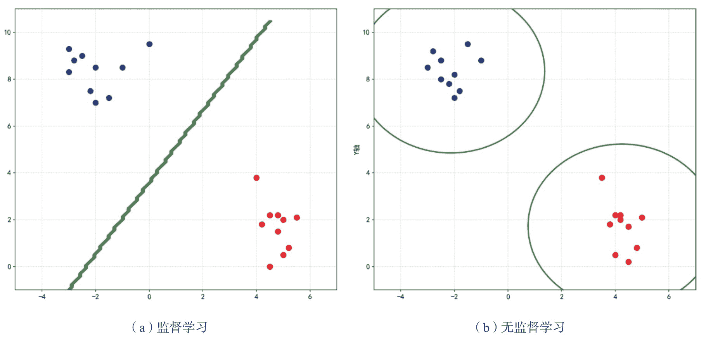

图1-1 监督学习与无监督学习的对比

（3）半监督学习。
半监督学习结合少量标签数据与大量无标签数据，适用于标注成本高的场景。如大量图像中仅小部分已标注，通过半监督方法可利用无标签数据提升学习效果。常见于文本分类、图像识别等。

（4）强化学习。
强化学习通过与环境交互并最大化累积奖励来调整策略。如训练机器人行走，每次正确步伐给予奖励，逐步形成行走能力。广泛用于游戏AI、机器人控制等。模型通过试错与策略优化，在动态环境中做出最优决策。

### 1.1.3 机器学习的应用领域

机器学习已渗透多个行业。

图像识别方面，可自动标记上传照片中的物体，如社交平台自动添加“猫”标签。技术在安防、医疗影像分析等领域发挥作用。图1-2展示了基于机器学习的图像目标检测实例。

语音识别方面，可将语音转为文字，其核心是模型学习音频信号与文字间的映射，被广泛应用于Siri、Google Assistant等语音助手。图1-3展示了ChatGPT语音助手。

自然语言处理用于理解与生成人类语言，如机器翻译将英文译为中文，需要理解原文含义并生成准确译文。NLP还用于文本分类、情感分析、智能客服等。

金融预测中，模型通过历史股价与相关数据预测走势，辅助投资决策并控制风险。

医疗诊断中，模型可辅助医生分析医学影像，发现早期病变，提高诊断准确性并节省时间。

图1-2 基于机器学习对图像进行目标检测的应用实例

图1-3 ChatGPT语音助手

### 1.1.4 机器学习的基本流程

典型流程包括以下环节。

（1）数据收集。
需获取大量相关数据，可来自数据库、互联网、传感器等。数据质量与数量直接影响模型效果。数据形式多样，如表格、图像、文本等，常见表格型数据如图1-4所示。

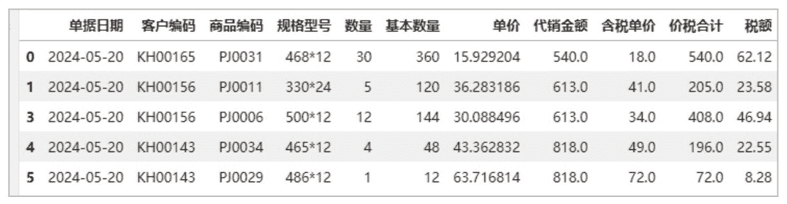

图1-4 常见的表格型数据

（2）数据预处理。
原始数据常含噪声与缺失，需清洗与修复。如房价预测中需处理缺失的房间数信息并剔除异常值。预处理是训练效果的关键基础。

（3）特征提取与选择。
从原始数据中提取有用特征并筛选，有助于提升性能与训练效率。如信用评分模型中特征包括收入、信用记录、贷款历史等。

（4）模型选择。
依据问题性质选择合适算法与模型。如分类任务可选决策树、SVM或神经网络。合理选择是关键。

（5）模型训练。
使用训练集训练模型，使其学习数据规律，类似学生通过做题掌握知识。训练本质是参数优化，通过不断调整提高预测准确度。训练过程可视为对数据的拟合，如图1-5所示。

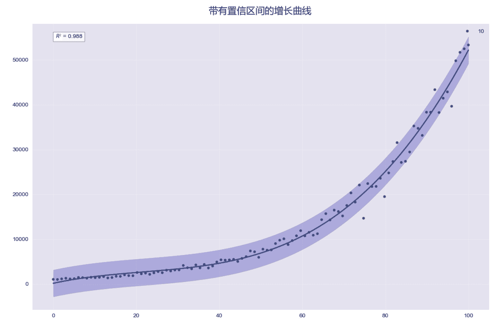

图1-5 对数据进行拟合

（6）模型评估。
用验证集评估性能并调整参数，发现不足并改进。

（7）模型测试。
用测试集检验最终表现，确保泛化能力。

（8）模型部署。
将训练好的模型上线到网站、移动应用等，为用户提供服务。

### 1.1.5 常见的机器学习算法

机器学习模型花样繁多，各有擅长的场景和短板。下面把几类常用算法的核心特点和典型用法做一梳理。

（1）线性回归
线性回归属于回归型任务，核心是找输入特征与目标变量之间的线性对应关系，用来做房价、股价之类的数值预测。思路直观、计算开销小，是回归任务里的入门基石。

（2）逻辑回归
逻辑回归主要解决分类问题，特别是二分类。它学习特征到类别的映射，给出样本属于某类的概率，常用于垃圾邮件判别、肿瘤良恶性判断等。虽然名字带“回归”，本质仍是分类方法。

（3）决策树
决策树通过对特征做一系列条件判断，生成树状结构来做预测，既能分类也能回归。模型可读性强、解释方便，但容易出现过拟合。常用剪枝来控制复杂度，或者借助随机森林等集成手段提升稳定性。

（4）SVM
支持向量机面向分类任务，目标是找到能让类别间隔最大的超平面，在高维情形下表现稳健，适合复杂边界的分类。对应的回归变体是支持向量回归 SVR，可用于回归问题。

（5）KNN
K 近邻不做显式训练，直接靠新样本与训练集中样本的距离来投票或取均值，完成分类或回归。实现简单、无训练阶段，但预测时要遍历全部训练样本，计算成本较高，更适合小规模数据。

（6）朴素贝叶斯
朴素贝叶斯基于贝叶斯定理做分类，假设各特征条件独立，常用在文本分类、情感分析等领域。算法轻量高效，对高维数据友好，但独立性假设在实际中并不总是成立。

（7）随机森林
随机森林是集成学习代表，聚合多棵决策树的投票结果，增强泛化能力，可用于分类与回归，并有效抑制过拟合。引入随机采样提升多样性，使得整体更稳健。

神经网络由多层神经元组成，能够捕捉数据中的复杂模式与特征，广泛应用于图像识别、语音识别、自然语言处理等任务，是深度学习的技术根基，通过层层传递逐步提炼高级表征。

## **1.2 深度学习基础**

深度学习作为机器学习的一个分支，凭借强大的数据处理与特征学习能力近年备受关注。这一波发展得益于大数据积累、算力提升以及算法创新。下面介绍其基本概念、常用网络结构和应用方向。

### **1.2.1 深度学习的基本概念**

深度学习可看作对人脑学习的模拟。想象一个由大量神经元构成的网络，每个神经元都是一个小型计算单元。众多单元协同工作，就能从海量数据里自动发现有用特征与规律，解决复杂问题。

该思路可追溯到 20 世纪 50 年代的神经网络雏形，最初的模型很简单，仅能处理基础任务。随着算力与数据规模增长，深度学习自 2012 年后快速突破。典型标志是 Hinton 团队用卷积神经网络 CNN 在 ImageNet 竞赛取得突出成绩，从此深度学习在实践中展现出强劲潜力。

神经网络的基本单元是神经元，接收输入、经激活函数处理后输出结果。一个完整网络由输入层、隐藏层、输出层构成。

（1）输入层
输入层负责接收外部信息。在图像识别里，每个节点可对应一个像素值。

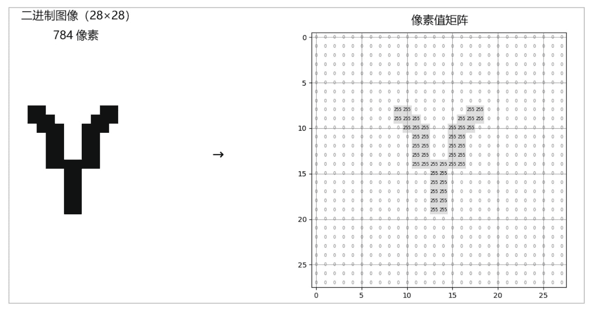

图 1-6 识别手写字母 Y 时以像素值为输入层节点

（2）隐藏层
隐藏层通过多层神经元的计算逐步抽取特征，每层承担不同程度的抽象。

（3）输出层
输出层给出最终预测，例如手写数字识别中各节点对应 0 到 9。

数据进入网络后，先经输入层传到隐藏层，再逐层计算到输出层，这一过程称为前向传播。前向传播 alone 无法优化参数，需借助反向传播根据预测与真实的误差反向调整权重，逐步降低误差。

深度学习的一大优势是自动特征提取，传统机器学习常需人工设计边缘、颜色等特征，而深度网络能自行学习复杂高维表征。另一个优势是强大的非线性表达能力，通过非线性激活函数实现对复杂关系的建模，在图像、语音、自然语言等任务上表现突出。

（1）图像识别
以猫狗照片分类为例，传统方法需手工提取边缘、颜色直方图等特征。深度学习可用 CNN 自动学习特征。CNN 由卷积层、池化层和全连接层组成，逐步提炼图像表征，如图 1-7 所示。卷积层类似滤波器提取边缘、纹理等低级特征，池化层做降采样压缩维度，全连接层整合特征完成分类。模型会自动学会区分猫与狗。

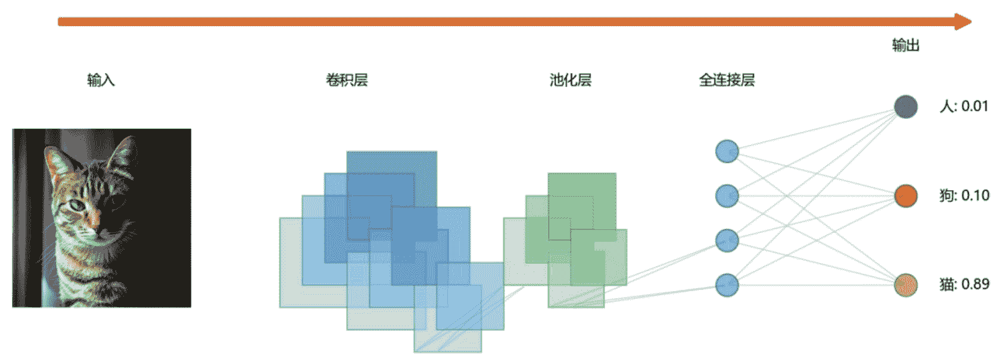

图 1-7 CNN 提取图像特征

（2）NLP
情感分析要判断文本是正面还是负面。传统做法依赖词频、词向量等手工特征。深度学习借助循环神经网络 RNN 或 Transformer 可自动捕捉语义。RNN 能处理序列并记忆时间依赖，Transformer 通过自注意力机制更好地建模上下文关系，在大规模文本上训练后即可实现准确分类。

### **1.2.2 神经网络的基本原理**

以坐标分类为例，点（1,1）、（-1,1）、（-1,-1）、（1,-1）分别落在四个象限，给出新点（2,2）可直观判断其属第一象限。如何让机器具备这种判断？

下面用两层网络来演示。典型结构如图 1-9 所示。

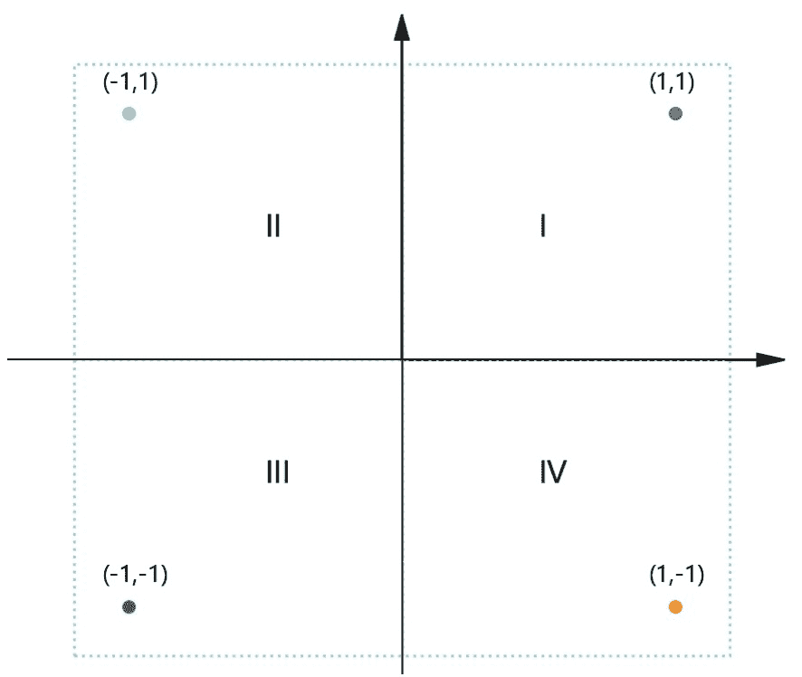

图 1-8 分类任务

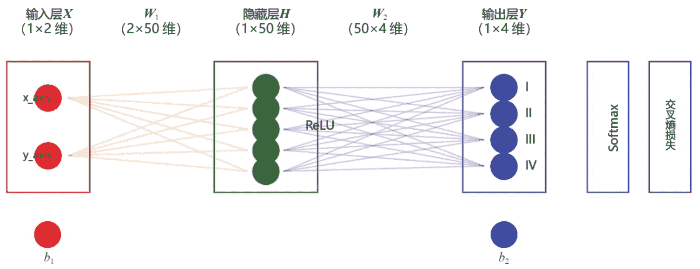

图 1-9 两层神经网络的一种典型结构

（1）输入层
数据如坐标点（1,1）进入网络的入口。特征个数决定输入节点数，例如灰度图每个像素即一个特征。

（2）从输入层到隐藏层
输入与隐藏之间由权重矩阵 *W*[1] 与偏置向量 *b*[1] 连接。由输入 *X* 到隐藏输出 *H* 的过程是仿射变换，其表达式为

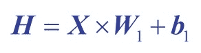

其中，× 表示矩阵乘法。

设隐藏层为 50 个神经元，则 *W*[1] 尺寸为（输入维度 × 50），*b*[1] 为（1 × 50），输出 *H* 为（1 × 50）。

（3）从隐藏层到输出层
隐藏到输出同样通过 *W*[2] 与 *b*[2] 做仿射变换

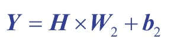

其中 *W*[2] 尺寸为（隐藏维度 × 输出维度），*b*[2] 为（1 × 输出维度）。

（4）激活层
为获得非线性能力，每层线性变换后需加入非线性激活函数。常用函数如图 1-10 所示。

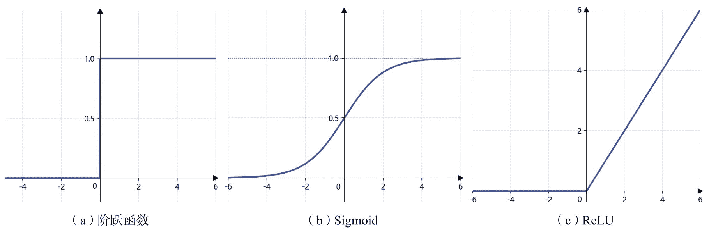

图 1-10 三种常用的非线性激活函数

阶跃函数输出离散不连续，梯度优化中较少使用。Sigmoid 把数值压缩到（0,1），常用于二分类输出，但大输入时梯度趋近零易出现梯度消失且计算较重。ReLU 在正区间恒为 1，计算简单缓解梯度消失，但在负区间梯度为零可能导致神经元死亡。

若仅做线性叠加，多层网络表达能力会退化为单层线性模型，因此激活层必不可少。加入激活后的两层结构如图 1-11 所示。

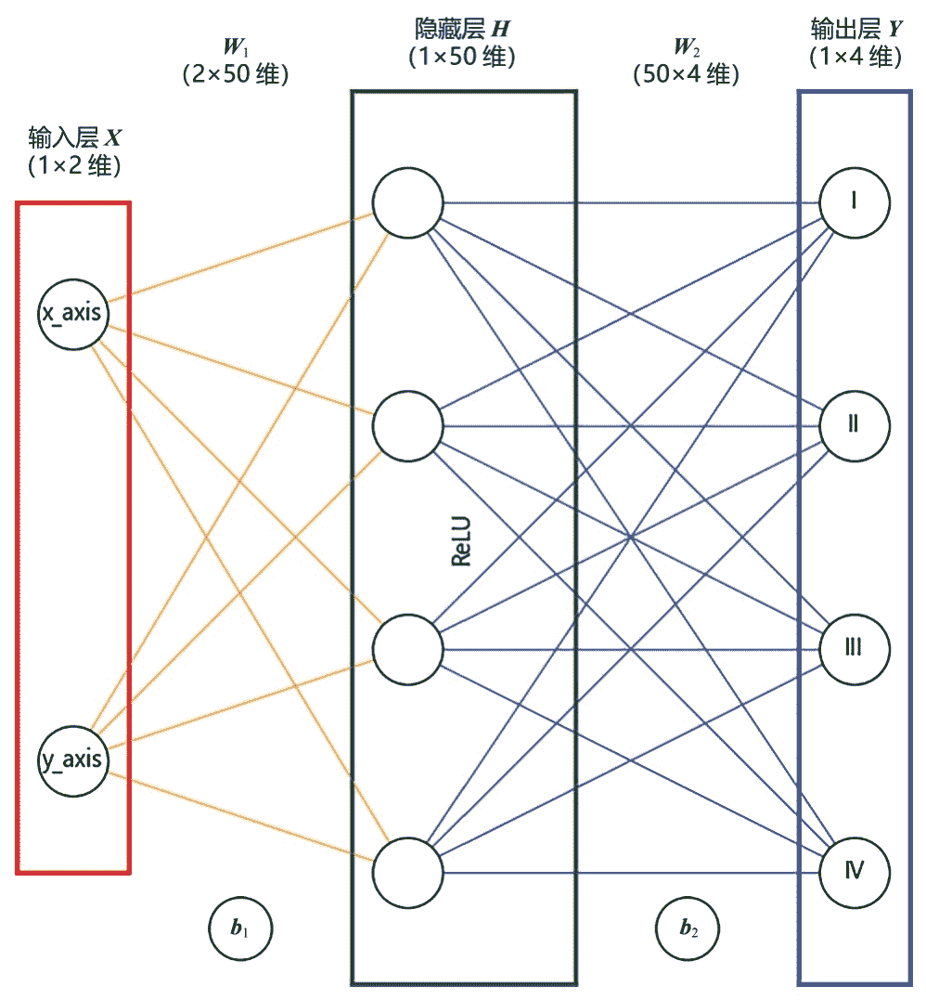

图 1-11 添加激活层的两层神经网络结构

（5）输出归一化
分类时输出层常用 Softmax 将原始值转为概率分布，各值在（0,1）内且和为 1。

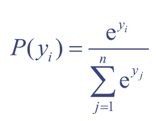

其中 *P*(*y*[i]) 表示第 i 类的预测概率，*y*[i] 为输出神经元的 Logits。

例如输出向量（3,1,0.1,0.5）经 Softmax 后约变为（90%,5%,2%,3%），既能选概率最大类别，也能衡量置信度。

（6）损失函数 交叉熵损失
Softmax 后的概率分布需用损失函数衡量与真实标签的差距。分类常用交叉熵损失：

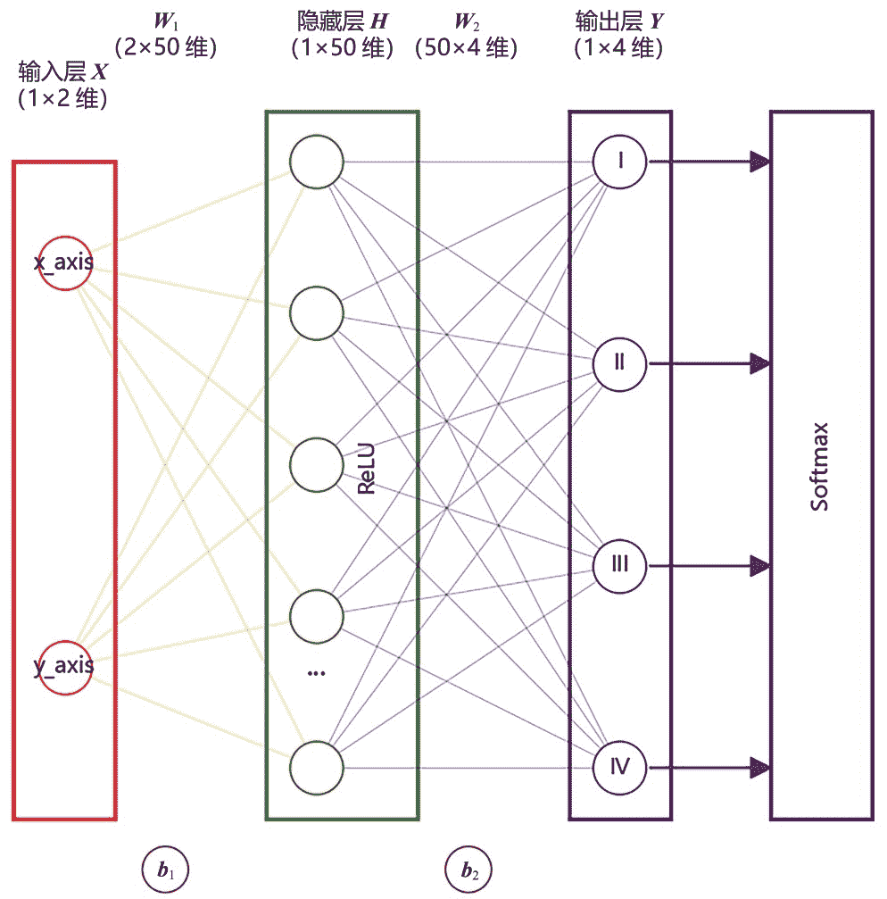

图 1-12 添加输出归一化之后的神经网络结构

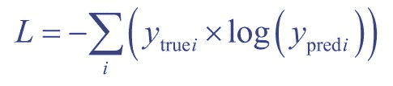

二分类情形也称二元交叉熵。预测越接近真实，损失越小，训练目标即最小化该损失。

（7）反向传播与参数优化
前向传播由线性变换与非线性激活组成，输出经 Softmax 转概率并用交叉熵量化误差。反向传播以梯度下降为核心，计算损失对权重 *W* 与偏置 *b* 的梯度并反向更新参数，使损失不断下降。即使网络包含数百万参数，其优化原理与上述两层网络一致。

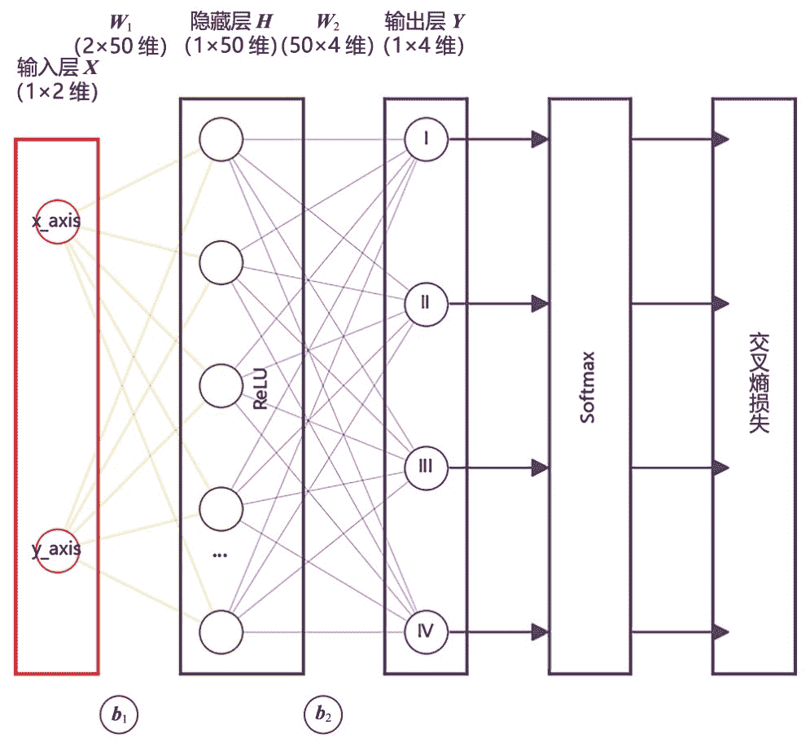

图 1-13 添加交叉熵损失后的神经网络结构

### **1.2.3 常见的神经网络结构**

不同结构适配不同任务。

（1）全连接神经网络 FCNN
FCNN 的每层神经元都与下一层全部相连，结构简单，适用于基础分类与回归，如手写数字识别。28×28 像素图像经输入层后逐层全连接最终输出 0 到 9。但在高维数据上计算量较大，通常用于小规模数据。

（2）CNN
CNN 专注图像处理，通过卷积层、池化层和全连接层提取空间特征。卷积核在图像上滑动提取局部特征如边缘、角点，池化层降低维度保留关键信息。类比显微镜调焦与图像压缩，CNN 在自动驾驶、医疗影像等领域应用广泛。

（3）RNN
RNN 用于处理序列数据，如时间序列、文本、语音。每个单元接收当前输入与上一时刻输出，具有记忆能力。长序列易出现梯度消失或爆炸，LSTM 与 GRU 通过记忆单元和门控机制改善长依赖建模。

（4）生成对抗网络 GAN
GAN 由生成器与判别器构成对抗训练。生成器尝试造假数据，判别器判断真伪，二者博弈提升生成质量。可用于图像生成、风格迁移与数据增强。

（5）Transformer 模型
Transformer 核心为自注意力层与前馈网络。自注意力计算序列内元素间的权重，捕捉长距离依赖；前馈网络对特征进一步变换，在机器翻译等 NLP 任务中表现优异。

Transformer 像一位长文本的关联猎手，在阅读时能迅速捕捉句子间的隐性联系，帮助读者形成整体认知。该结构在多个自然语言处理评测中表现突出，带动了智能客服、多语种翻译、内容生成等方向的进展，ChatGPT 就是在这种架构之上构建的。

### **1.2.4 深度学习的实际应用**
深度学习在理论之外已渗入日常，手机功能到科学研究均可见其身影。

（1）图像识别。
上传照片后平台自动为好友加标签，正是这类能力的体现。卷积神经网络擅长视觉任务，能够自行抽取边缘、颜色、纹理等表征再做判别。
自动驾驶是典型场景，CNN 需辨认车道内的行人、其他车辆及指示标志，为驾驶决策提供依据。
医学影像同样受益。医生借助深度学习系统解读 X 光、CT、MRI，可提前发现癌变或其他病征。以肺部 X 光为例，训练好的 CNN 能定位异常阴影，助力更早的肺癌筛查，为干预争取时间。

（2）NLP。
自然语言处理让机器具备读懂、撰写、互译人语的能力，进而实现智能对话和文本自动化。如向语音助手说出“播放今日新闻”，识别模块先把语音转写，NLP 模型解析意图后触发播放，整条链路依赖深度学习。
机器翻译是另一主战场。借助 Transformer 等结构，文本可在不同语种间顺畅迁移。Google 翻译依托深度学习，可实现中英文的高质量互换，对跨文化沟通与国际协作意义重大。

（3）强化学习。
游戏 AI 的突破同样引人关注。Google DeepMind 研发的围棋程序 AlphaGo 曾击败世界冠军李世石，如图 1-14 所示，印证了深度学习与强化学习结合的强大潜力。

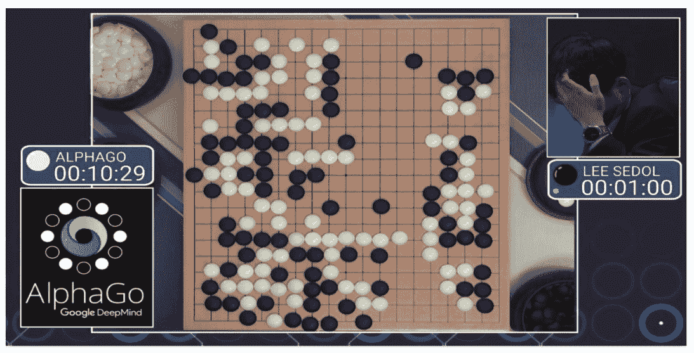

图 1-14 AlphaGo 击败世界围棋冠军

（4）自动驾驶。
自动驾驶被视为极具前景的方向之一。无人车需要实时感知周遭环境并产出安全指令，以确保行驶安全。
这类车辆配备摄像头、激光雷达、毫米波雷达等传感器，会产生海量数据。深度学习系统负责解析信息，辨识道路上的行人、车辆、交通标志等。

（5）语音识别和生成。
语音处理是重要应用领域。现在常见的语音助手用于发短信、检索信息或播放音乐，均依赖语音识别技术。
以 Amazon Echo 与 Google Home 为例，内置的深度学习系统经大量语音数据训练，可把用户指令准确认转为文字并触发操作。
在语音合成侧，深度学习同样表现亮眼。如 Google 的 WaveNet 能产出高度拟人的语音，与真人发声几乎无异，这类技术不仅改善体验，也拓宽了人机交互边界。

（6）金融和商业应用。
深度学习在金融与商业领域的渗透很深。通过分析大规模交易数据与市场动向，模型可输出高精度的预测与决策，助企业与投资者做出更审慎的选择。
在股市预测中，模型可综合历史股价、财报、新闻等信息推断未来走势。这既有助于优化投资组合，也能降低风险、提升收益。

### **1.2.5 深度学习的挑战与未来发展**
成果显著的同时，瓶颈依然存在。

（1）数据需求量大。
训练深度模型通常需要海量数据，数据的质量与规模直接影响效果。在部分垂直领域，获取高质量的大规模集仍是难题。

（2）计算资源消耗高。
模型训练与推理对算力要求很高，尤其在大规模神经网络上。GPU、TPU 等加速硬件的出现缓解了部分压力，但成本依然不低。

（3）模型解释性差。
深度学习模型常被视作“黑箱”，内部机理难以解释与理解。对医疗、金融等高风险领域构成挑战，需要更透明、可解释的方案。

即便存在这些限制，前景依然可期。随着数据积累、算力提升与算法创新，深度学习将在更多场景释放能力。未来有望出现更智能的机器人、更精准的医学诊断、更高效的自动驾驶系统，以及更多基于深度学习的创新应用。

## **1.3 实践练习：用 Scikit-learn 和 PyTorch 实现基础模型**
本节通过动手实操加深对机器学习与深度学习的理解，使用 Scikit-learn 与 PyTorch 构建基础模型。

### **1.3.1 用 Scikit-learn 实现基础机器学习模型**
Scikit-learn 是 Python 生态中简洁且功能完备的机器学习工具箱，提供了多种算法与工具。下面以简单分类任务为例，用 Scikit-learn 构建分类器识别鸢尾花种类。

Scikit-learn 内置了鸢尾花数据集 Iris Dataset，可直接调用。该集包含 150 条样本，每条含 4 项特征：花萼长、花萼宽、花瓣长、花瓣宽，目标是把鸢尾花划分为 Setosa、Versicolor、Virginica 三类。代码 1-1 展示了数据集的加载与可视化。

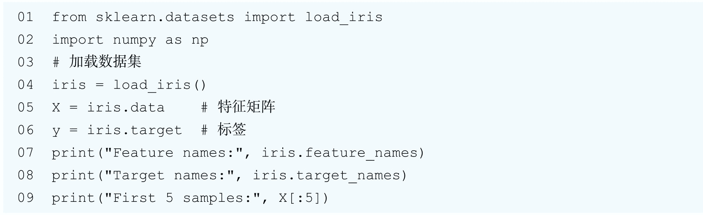

输出结果如下：

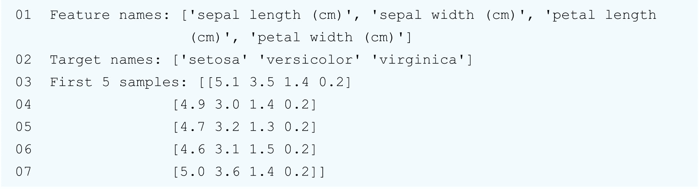

代码 1-1 中，使用 load_iris() 读取数据，并把特征与标签分别存入 X 与 y，随后输出特征名、标签名及前五个样本。

为评估效果，需将数据划分为训练集与测试集，训练后再用测试集检验准确性，如代码 1-2 所示。

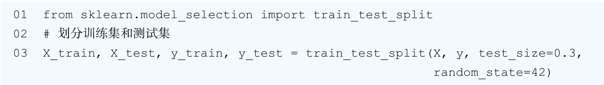

代码 1-2 使用 train_test_split() 把数据切分为训练集与测试集，其中 30% 作为测试集。

本次练习选用 KNN 分类器进行分类。KNN 是一种简易而实用的算法，通过计算样本间距离进行判别，如代码 1-3 所示。

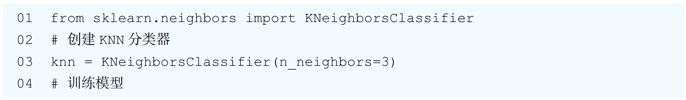

代码 1-3 创建了 KNN 分类器，并用训练集数据对其进行拟合。

训练后需在测试集上评估表现，采用准确率作为指标，如代码 1-4 所示。

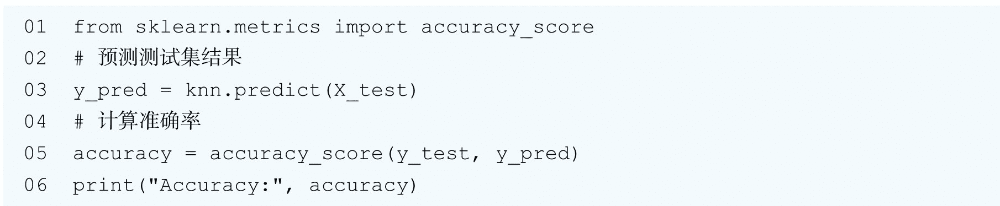

输出结果如下：

代码 1-4 使用训练好的模型预测测试集，并计算准确率。该指标表示正确分类样本占总样本的比例。

实际使用中可通过调节超参数提升性能。例如对 KNN 可尝试不同的邻居数 n_neighbors 选出最优值，如代码 1-5 所示。

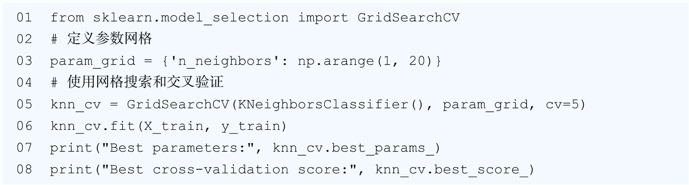

代码输出结果如下。

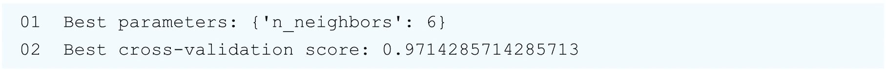

代码 1-5 使用网格搜索 GridSearchCV 与交叉验证选择最优 KNN 超参数。交叉验证通过多次划分训练集与验证集评估模型稳定性与泛化能力。

完成以上步骤，一个基础分类任务即可收尾。Scikit-learn 的易用性让开发者能快速上手并实现各类机器学习算法。

### **1.3.2 用 PyTorch 实现基础深度学习模型**
PyTorch 是流行度很高的深度学习框架，提供了灵活的张量运算与强大的自动微分，适合搭建与训练深度模型。接下来借助 PyTorch 搭建一个简单的神经网络来分类手写数字 MNIST。

下面使用 PyTorch 内置工具加载 MNIST 数据集，这是一个经典的手写数字分类集，含 60000 张训练图与 10000 张测试图，如代码 1-6 所示。

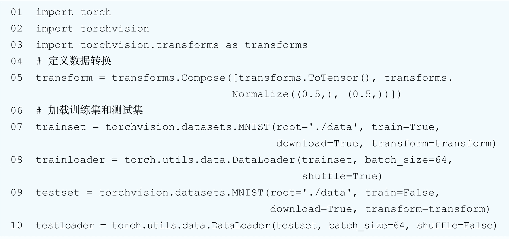

代码 1-6 定义了数据转换，把图像转为张量并做标准化，随后加载 MNIST 训练集与测试集。DataLoader 用于分批加载数据，提升训练时的读取效率。

下面定义一个含一个隐藏层的简单全连接网络 FCNN。PyTorch 支持灵活的网络定义，可按任务需求调整结构，如代码 1-7 所示。

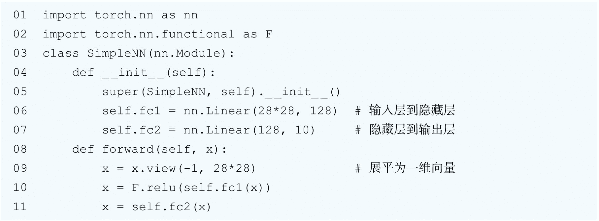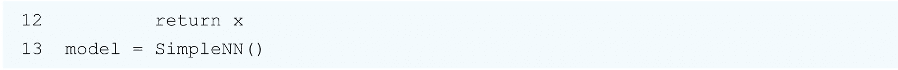

代码 1-7 定义了一个含两个全连接层的神经网络。输入层把 28×28 像素图像展平成一维向量，经隐藏层与输出层处理后输出 10 类概率分布。

下面定义交叉熵损失函数与随机梯度下降 SGD 优化器。损失函数衡量预测与真实的差距，优化器用于更新参数以最小化损失，如代码 1-8 所示。

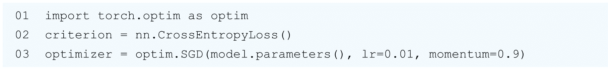

代码 1-8 定义了交叉熵损失与 SGD 优化器。学习率 lr 与动量 momentum 是优化器的关键超参数，可根据具体情况调整。

下面开始训练神经网络。每个 Epoch 会把整个训练集前向传播一次并反向传播更新参数，如代码 1-9 所示。

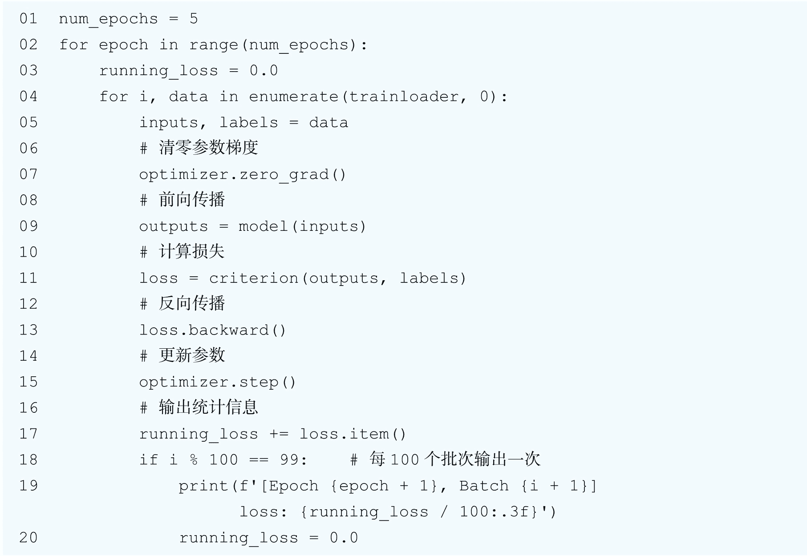

代码输出结果如下。

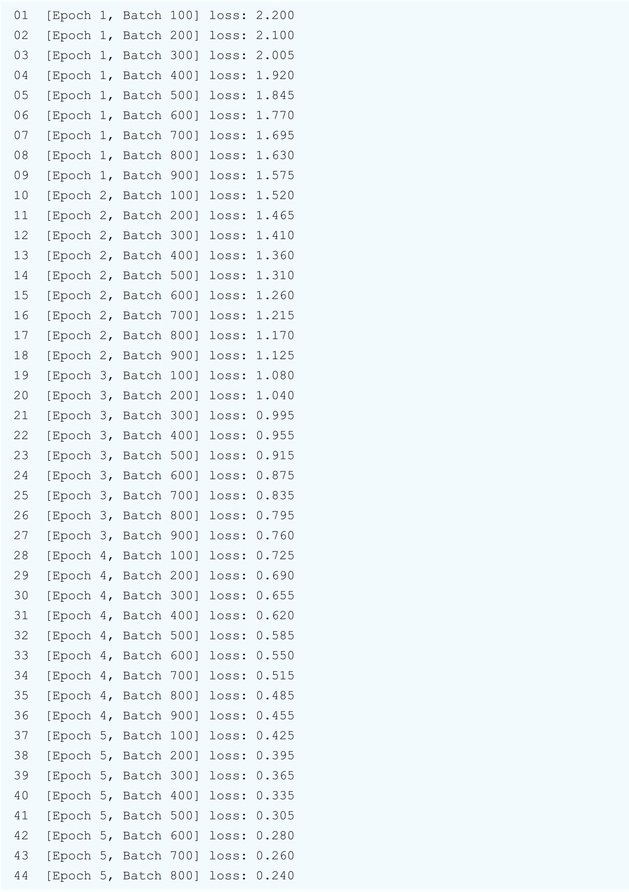

代码 1-9 循环训练了 5 个 Epoch。每个 Epoch 中，训练数据分批输入模型，计算损失后通过反向传播更新参数。每 100 个批次输出平均损失以监控训练过程。

训练完成后，需评估模型在测试集上的表现，计算准确率，如代码 1-10 所示。

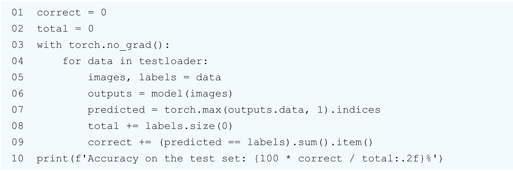

输出结果如下：

代码 1-10 中关闭了梯度计算，使用训练好的模型预测测试样本并计算准确率。

实际应用中可通过多种方式优化与扩展模型。例如增加层数或神经元数量，使用更复杂的优化器如 Adam，或引入正则化技术如 Dropout 防止过拟合，如代码 1-11 所示。

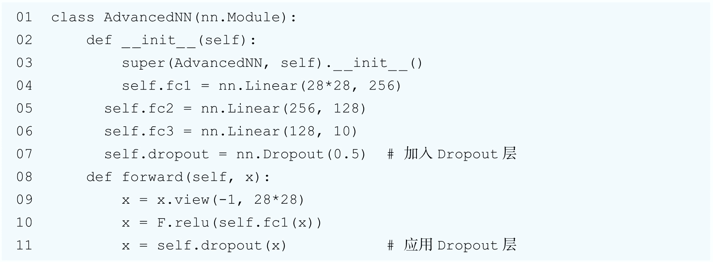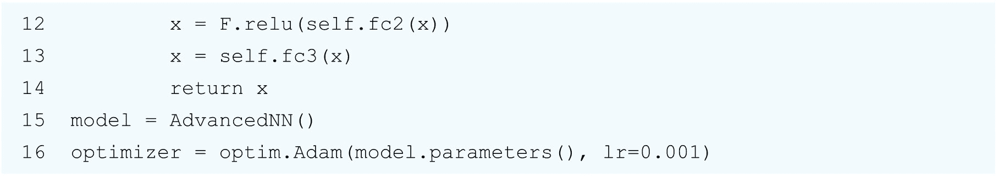

代码 1-11 定义了一个更复杂的神经网络，使用 Adam 优化器训练并加入 Dropout 层以降低过拟合风险。

通过这些练习，读者应能全面了解如何用 Scikit-learn 与 PyTorch 实现基础机器学习与深度学习模型。无论是简单分类还是复杂神经网络训练，这些工具都能帮助快速上手并在实际项目中应用所学知识。

## **1.4 Python 语言实现：简化的机器学习和深度学习模型**
本部分用 Python 实现简化的机器学习与深度学习模型，帮助读者更好理解理论并学会在项目中应用。本节分别展示使用 Scikit-learn 与 PyTorch 实现简化模型的方法。

### **1.4.1 简化的机器学习模型**
首先借助 Scikit-learn 实现一个简化机器学习模型。以线性回归预测房价为例。假设现在有一个简单数据集，包含一些房屋面积与对应价格。目标是训练一个线性回归模型，根据房屋面积预测价格。为此，创建一个包含面积与价格的简单数据集，如代码 1-12 所示。

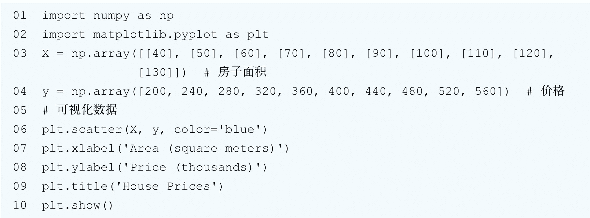

房屋面积-价格散点图如图 1-15 所示。

代码 1-12 创建了一个包含房屋面积与价格的数据集，并使用 Matplotlib 库可视化数据。这有助于直观观察数据分布特征。

接下来，使用 Scikit-learn 的线性回归模型训练数据，如代码 1-13 所示。

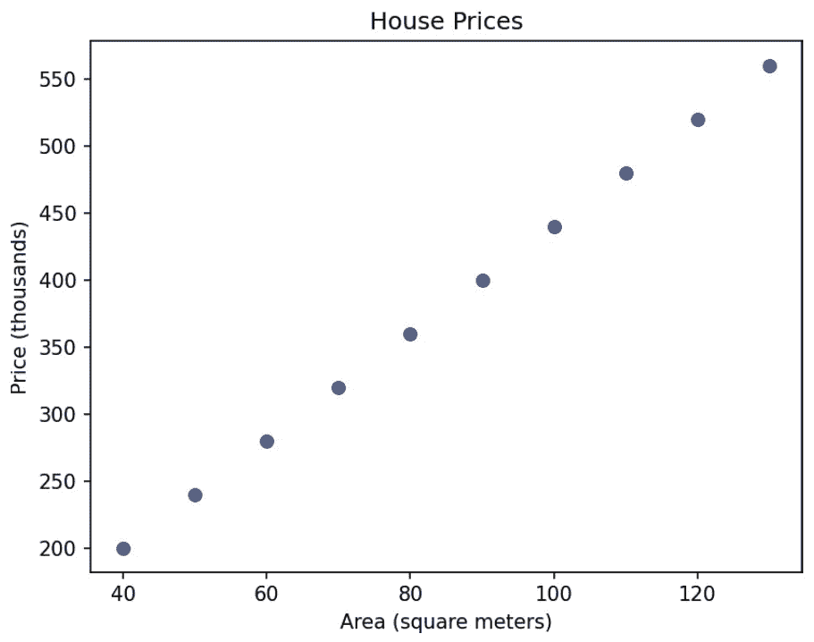

图 1-15 房屋面积-价格散点图

**代码 1-13 创建和训练线性回归模型**

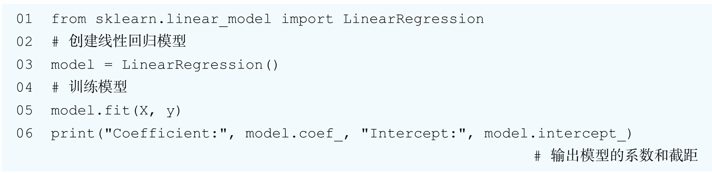

输出结果如下：

代码 1-13 创建了一个线性回归模型，并使用数据集对其进行训练。训练完成后，输出了模型的系数与截距，以便了解模型的具体形式。

使用训练好的模型进行预测，并将预测结果进行可视化，如代码 1-14 所示。

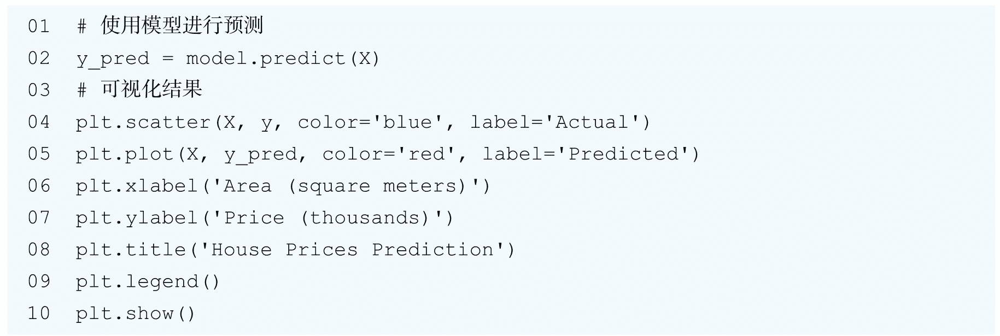

房价预测结果如图 1-16 所示。

代码 1-14 使用模型预测房价，并将实际值与预测值进行对比。预测曲线与实际数据点基本吻合，说明线性回归模型拟合效果不错。

### **1.4.2 简化的深度学习模型**
接下来，用 Python 实现一个简化深度学习模型，构建一个带有 Dropout 层的多层感知器 MLP，用于解决经典的 MNIST 数据集中手写数字图像分类问题。

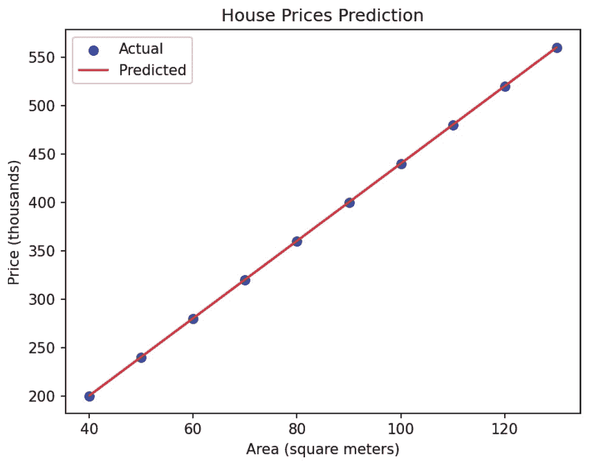

图 1-16 房价预测结果

导入所需库并加载 MNIST 数据集，如代码 1-15 所示。

**代码 1-15 导入库和加载数据集**

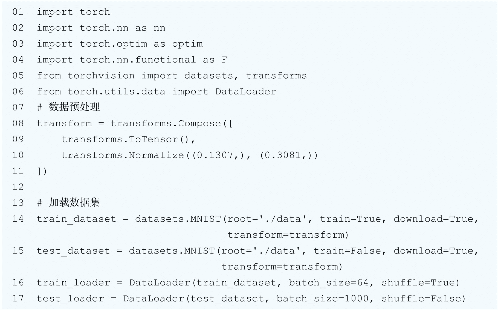

代码 1-15 首先导入 PyTorch 相关库并加载 MNIST 数据集，其次对数据进行标准化处理，并创建训练集与测试集的数据加载器。

定义一个包含 Dropout 层的 MLP 模型，如代码 1-16 所示。

**代码 1-16 定义带有 Dropout 层的 MLP 模型**

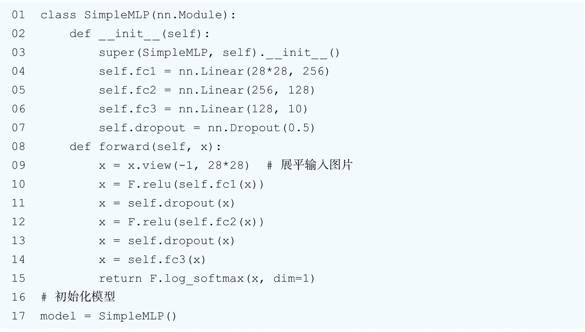

代码 1-16 定义了一个简单的 MLP 模型，其中包含两个全连接层与一个输出层，并在两个全连接层之后添加了 Dropout 层以防止过拟合。forward 方法定义了数据的前向传播方式。

接下来，定义损失函数与优化器，如代码 1-17 所示。

**代码 1-17 定义损失函数和优化器**

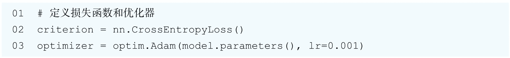

代码 1-17 使用了交叉熵损失函数与 Adam 优化器来训练模型。

接下来，编写训练与测试模型的代码，如代码 1-18 所示。

**代码 1-18 训练和测试模型**

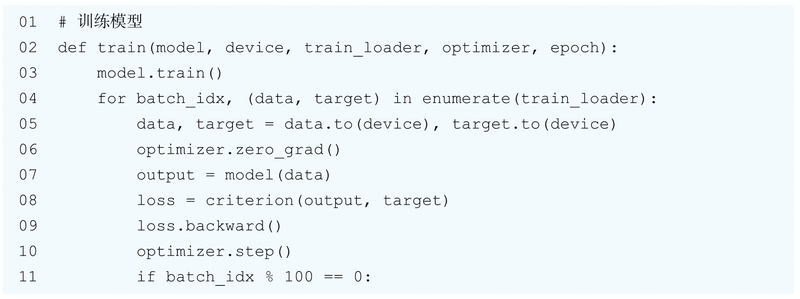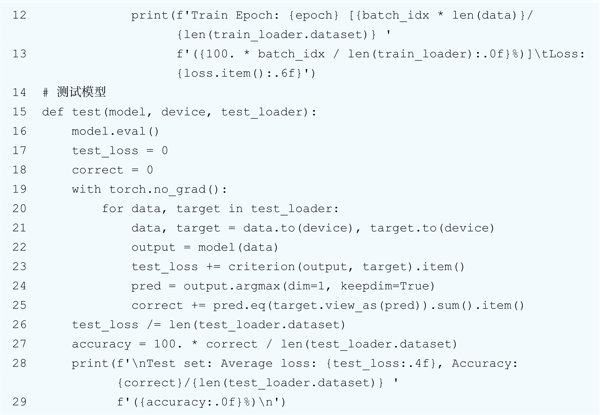

运行训练与测试过程，如代码 1-19 所示。

**代码 1-19 运行训练和测试过程**

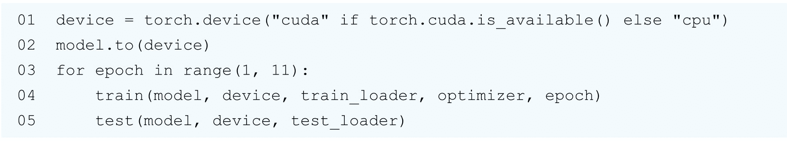

代码输出结果如下。

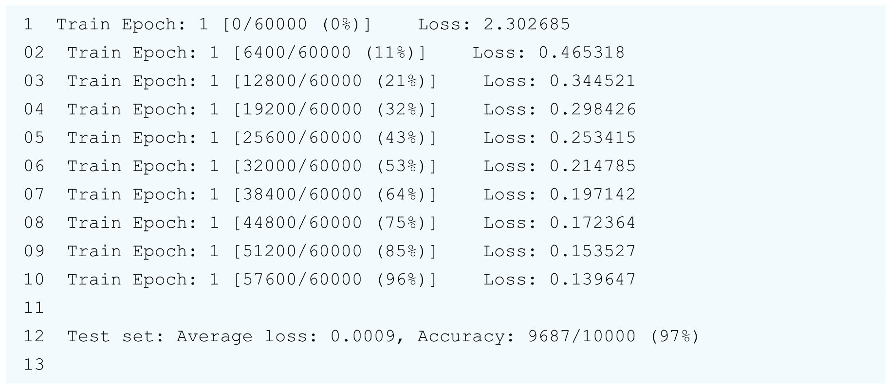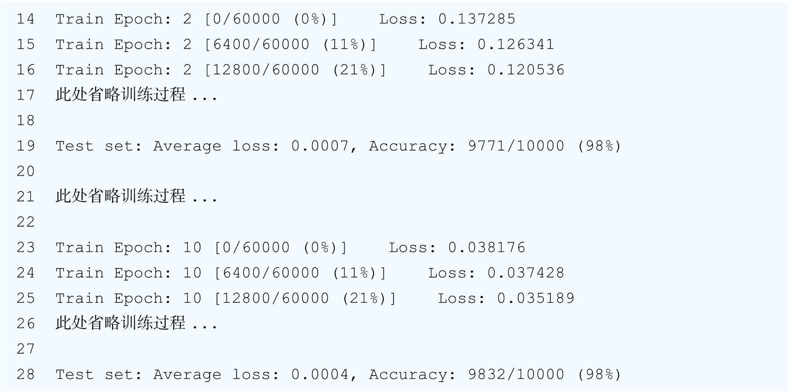

代码 1-19 说明了如何依据硬件情况自动挑选执行设备，GPU 可用时启用，否则降级到 CPU，并在所选设备上进行十个训练轮次。每个轮次结束时均会输出测试集的平均损失与正确率。

依此流程可得到一个精简的深度学习示例，以 MNIST 手写数字数据集进行训练与测试。该示例清晰呈现了借助 PyTorch 从模型搭建到训练再到评估的完整链路。

# 第二章
# Transformer 架构与大模型全景

在深度学习领域，Transformer 因卓越的表现备受关注，尤其在自然语言处理任务中优势明显，典型场景包括机器翻译、文本分析、问答系统等。该架构由 Google 于 2017 年提出，关键特点在于处理长文本时具备较高的并行效率与训练速度，同时在复杂数据上保持较好的稳定性。除了 NLP，其在序列预测、图像处理、语音识别等多个方向也取得良好效果，为 ChatGPT 等大型语言模型的发展提供了技术基础。本章将围绕自注意力、编码器、解码器展开，阐释其运行原理与典型应用。

本章要点如下。

（1）自注意力机理的核心思路。
（2）Transformer 编码器与解码器的原理及构成。
（3）大模型的定义与落地场景。
（4）实践：借助 Hugging Face 与 Transformers 库实现文本生成。
（5）Python 实践：Transformer 在 NLP 与图像处理中的典型应用。

## 2.1 Transformer 核心原理剖析
本节先拆解自注意力，随后说明位置编码在架构中的补足作用，二者是理解 Transformer 的关键。

### 2.1.1 自注意力机理
**1. 时序数据初识**

在进入架构细节前，先厘清时序的含义。时序指按时间先后顺序排列的一组观测，每个观测对应一个明确的时间点。这类数据常用于刻画随时间演化的现象，比如股价波动、气候变化、销售额变化等。时序数据通常具有两大特征。

（1）相邻时刻之间存在内在关联。
以股市举例，股价变动不是孤立的。若股价连续上涨且增速加快，往往会吸引更多资金跟进，推动价格进一步上升；反之持续下跌容易引发恐慌性抛售，加速跌势。价格走势与历史记录之间紧密耦合。

（2）序列长度可能不固定。
在 NLP 的一些任务里，输入文本的长度差异很大。例如“我今天很开心”与“今天真是一个令人难过的日子”长度不同。若模型无法应对可变长度，就需要通过填充等手段统一格式。

**2. 循环神经网络**

以机器翻译为例，把日常英语转为中文需要一个能处理有序结构的基础模型。语言中词的顺序对语义至关重要，这种有序词列本质上是时序数据，采用序列处理方式可保留相对位置信息，无需额外调整。循环神经网络正是处理此类问题的常用选择。循环神经网络是一种可处理序列的神经网络，信息在每一步沿链式结构传递，实现递归式计算。

循环网络的典型特点是具备记忆能力，且各循环单元共享参数。它不仅适用于翻译，还可用于语音识别、情感分析等任务。

针对时序数据的两个核心难点，循环网络提供如下思路。

（1）借助隐藏状态保留先前的上下文。
（2）利用递归结构处理变长序列，并以统一参数集适应不同长度输入。

循环网络之所以有效，是因为它既关注当前输入，也依赖前一时刻的隐藏状态。每一步的输出受即时输入与历史记忆共同影响。简化的循环网络结构如图 2-1 所示。

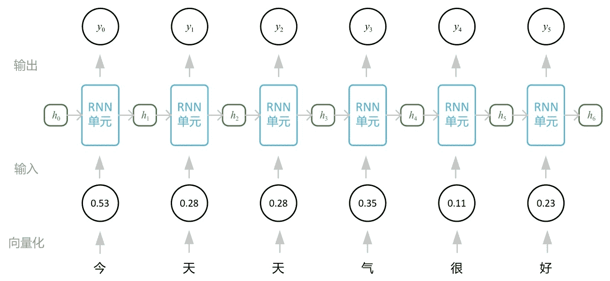

图 2-1 简单的 RNN 网络结构

**3. 自注意力概念**

Transformer 的核心正是自注意力。它为捕捉时序内部相关性提供了全新思路。在这类数据中，不同时刻的观测往往相互影响。传统循环网络借助递归与隐藏状态建模相关性，但存在局限。尽管后续改进缓解了梯度爆炸、梯度消失并增强了长程依赖能力，循环网络仍依赖逐时刻的隐藏状态更新，在极长序列上效率受限。为此 Transformer 引入自注意力，使模型能更灵活地建模序列任意位置间的关联。

理解自注意力可借鉴人类视觉注意的方式，如图 2-2 所示。

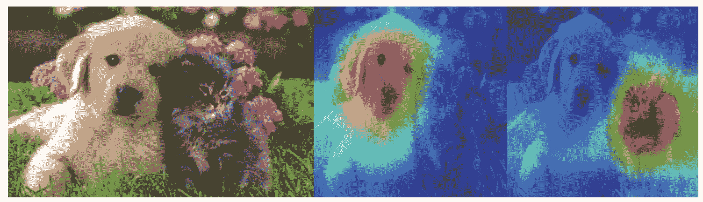

图 2-2 人类视觉中的注意力机制

观察图像时，视线会先被主要目标吸引。以图 2-2 为例，若目标是“狗”，视线会倾向左侧；若寻找“猫”，注意力则转向右侧。这种分配体现了大脑对图像局部区域的关联判断，即“狗”与左侧区域的联系，“猫”与右侧区域的联系。

Transformer 借鉴了这一思路，用以建模时序数据的依赖。在 Transformer 中称为自注意，它让序列中的每个元素都能和其他所有元素交互，获得全局视角。在计算时，每个输入的表示会根据它与其他元素的关联程度被调整。图 2-2 展示的是输入到输出的注意力连接，而自注意力关注的是输入元素之间的相互关系，例如小狗的鼻子与其眼睛的关联。

在自然语言翻译中，自注意力至关重要，它能揭示不同时刻数据间的依赖。可视化结果清晰地呈现了词语间的内在联系，如图 2-3 所示。

以一句待译英文“I've got a few friends.”为例，Transformer 的译文为“我有一些朋友。”图 2-3 显示了训练后模型中的自注意力热力图，其中“a few”与“一些”被高亮，说明二者相关性很强，这证实了注意力机制在机器翻译中的有效性。

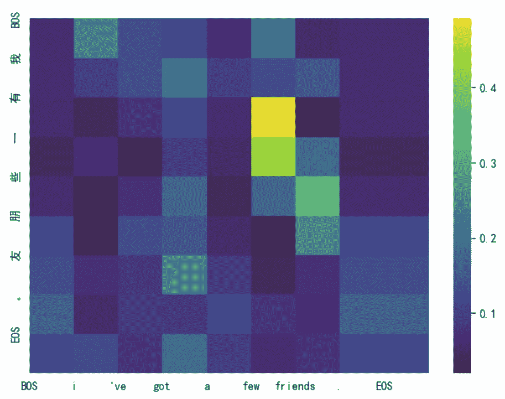

图 2-3 实际应用中的自注意力机制

这种能力让模型更灵活地处理长距离依赖，不受循环网络中梯度问题的制约。每个词的表征可通过与全部词语的交互来更新，实现对整段序列的全局理解。该机制在机器翻译、文本摘要和问答等任务中展现出强大且灵活的表现。

自注意力的核心由查询 Query Q、键 Key K 与值 Value V 构成。

（1）查询。
查询可看作对序列某一位置的探询，代表当前位置的需求，用于衡量序列中其他元素与当前位置的关联。查询与所有键的交互决定了当前元素对他人的关注权重。

例如在图书馆检索资料，查询就是检索请求。在自注意力中，查询用于定位与之相关的内容。

（2）键。
键是序列每个元素的标识，可理解为查询定位用的标签。每个键与查询进行匹配，匹配度越高，其对应的值对当前查询越重要，即当前元素应更关注该键所指信息。

例如在图书馆，键相当于书目的索引。在自注意力中，每个位置生成一个键供查询匹配。

（3）值。
值承载序列每个元素的具体信息。当查询与键的相似度被计算后，值会按此相似度加权求和，形成各位置的输出表示。

例如在图书馆，找到书目后阅读内容获取信息。在自注意力中，值包含真实信息，一旦键与查询匹配，对应的值就参与最终输出的构建。

自注意力的计算可概括为以下步骤。

（1）输入序列经三组不同的线性变换分别生成 Q、K、V 三组向量，通常是权重矩阵乘法，如图 2-4 所示。

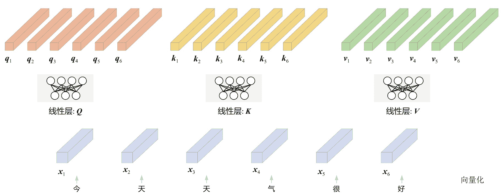

图 2-4 Q,K,V 三组向量的生成

（2）计算每个查询向量与全部键向量之间的匹配分数，再通过 Softmax() 转化为概率，表示各元素对序列中其他元素的关注程度，其公式为

注意力的计算过程如图 2-5 所示。

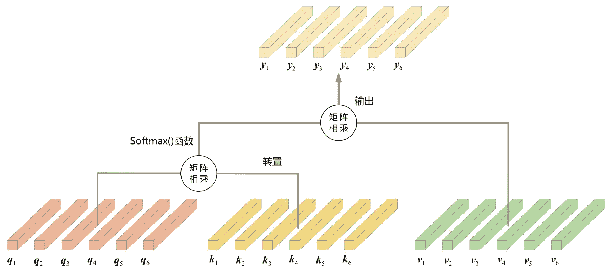

图 2-5 注意力的计算过程

经过查询与键的匹配及 Softmax 映射，相关程度被转成概率分布，相似度高的特征被保留，相似度低的特征被抑制，映射后的矩阵即注意力分数矩阵。将该矩阵与值相乘，可得到加权后的值。值代表序列各位置的真实信息，与注意力分数相乘后，重要内容被保留，不重要内容被削弱。

注意力的计算，如代码 2-1 所示。

**代码 2-1 注意力的计算**

自注意力机制支持多层堆叠。通过叠加自注意力层，高相关特征被持续保留，低相关特征被持续抑制。每一层关注输入序列不同部分间的关系，提取更高级特征。随着层数增加，模型能捕捉更精细、更复杂的关联。这种分层结构有助于模型更好地把握数据内部的联系，提升性能。

### 2.1.2 多头自注意力机制
Transformer 中的自注意力以多头自注意力的形式实现。这是传统自注意力的扩展，允许模型同时学习多组不同的注意力权重。每个注意力头独立学习对应权重后，再将各头的输出合并，形成更全面的序列表示。多头设计让模型可在不同抽象层级和关注点上对输入进行编码，增强对信息的理解深度。

如图 2-6 所示，多头自注意力的流程分为：先把数据切分为多个子部分，每个子部分对应一个注意力头，头数可按设计需求设定，但需保证维度可被头数整除；随后每个子部分独立应用自注意力公式进行计算；最后把所有头的输出拼接合并，形成综合表示，包含对输入序列的多角度编码信息。

图 2-6 多头自注意力机制

多头自注意力机制的实现，如代码 2-2 所示。

**代码 2-2 多头自注意力机制**

### 2.1.3 位置编码
位置编码的目的是为输入注入位置信息。自注意力本身对顺序不敏感，无法区分“今天不一定下雨”与“今天一定不下雨”的语义差异。为补足这一缺陷，需要位置编码提供顺序线索。Transformer 采用三角函数生成位置编码，计算公式如下：

其中，pos 表示序列索引；i 表示维度索引。维度为偶数时使用正弦函数，奇数时使用余弦函数。图 2-7 是序列长度 256、维度 512 的三角函数位置编码可视化，纵轴为序列长度，横轴为维度，可见不同位置的编码表示各不相同。

图 2-7 三角函数位置编码的可视化

得到位置编码后，将其与原始序列相加，作为多头自注意力的输入，公式如下：

其中，x 为输入嵌入序列；PE 为位置编码；x′ 为最终输入特征。

位置编码的实现，如代码 2-3 所示。

**代码 2-3 位置编码**

## 2.2 编码器与解码器结构
Transformer 由编码器和解码器构成，这种设计使其能同时把握输入序列的全局上下文，并将其与目标序列的生成过程结合，输出准确的目标语言序列。在翻译任务中，编码器把源语言语义编码为上下文表征，解码器则利用这些表征生成译文。Transformer 整体结构如图 2-8 所示。左侧为编码器，对输入做位置编码后映射为特征向量；右侧为解码器，利用编码器输出的上下文与自身自注意力生成输出序列。

图 2-8 Transformer 模型结构

### 2.2.1 编码器
Transformer 的编码器由四部分组成，结构如图 2-9 所示。

（1）输入部分 Inputs。
输入部分包含两个子模块：输入嵌入 Input Embedding 与位置编码 Positional Encoding。

输入嵌入把输入数据转为更高维格式，以统一维度并为后续处理做准备。在 NLP 任务中，输入嵌入通常指词嵌入，它把词索引转为向量，使语义相近的词在特征空间中更接近。

图 2-9 Transformer 模型的编码器结构

在输入嵌入基础上，模型把位置编码加入序列，以保留元素在序列中的位置信息。

（2）多头自注意力机制。
Transformer 通过多头自注意力识别和提取序列中元素间的相关性，从而捕捉并利用这些特征增强表达能力。

（3）残差结构与标准化 Add & Norm。
Transformer 借鉴 ResNet 的残差连接思想，将模块输出与输入相加，以缓解深层网络中的梯度消失或爆炸问题，促进深层残差信息的学习。在标准化方面，Transformer 采用层标准化 Layer Normalization 而非批标准化 Batch Normalization，层标准化对单个样本内特征做标准化，计算每个特征的均值和方差；批标准化则是对整批特征执行相同操作。

（4）前馈神经网络 Feed Forward。
前馈神经网络是 Transformer 中的全连接层，对自注意力输出做进一步非线性变换。该网络对序列每个位置的特征向量执行线性变换与非线性激活，帮助模型学习更高层次的表征，增强整体建模能力。

编码器的实现，如代码 2-4 所示。

**代码 2-4 编码器**

### 2.2.2 解码器
解码器与编码器相近，其结构如图 2-10 所示，核心区别在于解码器有两个输入，且自注意力采用掩码多头自注意力与交叉多头自注意力。

（1）解码器的输入。
解码器有两个输入，如图 2-11 所示，第一个是已生成的部分输出序列，第二个是编码器的输出。以文本问答为例，用户提问后，模型先把问题送入编码器，通过自注意力转为特征向量。随后解码器以特定起始指令和编码器输出的特征序列为输入，逐步生成回答。例如针对“今天天气怎么样”，模型先生成“不”，再基于已有结果和特征序列继续生成“错”，直至遇到结束标记 <end>，完成生成。

（2）掩码多头自注意力机制 Masked Multi-head Attention。
掩码多头自注意力是解码器中的一种特殊自注意力。加入掩码的目的是确保训练时模型只能访问当前位置及其之前的信息，避免信息泄露，防止模型提前看到未来信息。在训练阶段，若要生成句子的第一个词，若模型能看到整个句子，它可能直接根据全文选择最合适的首词，而非依据真实场景下应知的上下文。这违背了自回归生成性质，也会导致训练与推理行为不一致。

图 2-10 Transformer 模型的解码器结构

图 2-11 解码器的输入示例

加入掩码的方式是对注意力分数矩阵进行遮盖，具体如下所示。

掩码自注意力实质上是将注意力矩阵填充为下三角矩阵。当注意力矩阵与 V 相乘时，v[1] 与第一行相乘，仅获得自身注意力；计算 v[2] 时，其注意力包含自身与之前时刻的注意力，以此类推。掩码多头自注意力正是通过这种方式避免了注意力机制中的信息泄露。

（3）交叉多头注意力：解码器与编码器的信息桥梁

交叉多头注意力常被理解为 Transformer 内部不同模块间的交互式注意。在机器翻译这类任务里，编码器负责理解源句，解码器负责生成目标句，两者必须不断对话。借助这种机制，解码器在每一步生成时都能‘看到’编码器对整段输入的完整表征。具体来说，生成一个词时，解码器以自身当前状态发起查询，去匹配编码器输出序列的相关位置，通过交叉注意力层完成对齐，从而依据源侧上下文挑选最合适的下一个词。整体流程如图 2-12 所示。

在这种结构下，查询向量 Q 由解码器提供，键 K 与值 V 则源自编码器。解码器先把自身输入映射成 Q，再与编码器侧的 K 计算相似度得到注意力权重矩阵，随后用该权重对编码器的 V 加权求和，得到融合信息后的输出。正是这种设计让两个异构信息源得以高效交互。除了在序列到序列解码器中广泛使用，交叉多头注意力在多模态融合任务里也十分常见，能帮助模型把文本、图像、语音等不同模态的信息汇聚起来，提升复杂场景的处理能力。

图 2-12 交叉多头自注意力机制

解码器部分的工程实现可参考代码 2-5。

**代码 2-5 解码器**

把编码器和解码器串联起来，就构成完整的 Transformer 整体架构，示例如代码 2-6。

**代码 2-6 完整的 Transformer 模型**

## **2.3** **何为大模型 与 典型应用场景**

### **2.3.1** **大模型的本质特征**

大模型通常指基于深度神经网络搭建、参数规模极为庞大的系统，体量从百亿级一路攀升到万亿级。构建它们的初衷是提升表达与预测能力，从而应对更复杂的数据与任务。借助海量训练语料，模型能够捕捉深层模式与特征，形成较强的泛化能力，对未见数据也能作出较为可靠的推断，目前已渗透到自然语言处理、视觉理解、语音识别和推荐等多个方向。

大模型通常具有以下特征。

（1）参数规模庞大。大模型的参数计数可达数百亿乃至数万亿。举例来说，OpenAI 于 2023 年 3 月发布的 GPT-4，其参数规模被报道达到 1.8 万亿。

（2）训练语料需求巨大。模型需要基于 TB 级别、来源多样的数据集进行训练，才能覆盖广泛的知识与模式。

（3）计算开销极高。训练与推理都依赖高性能算力，通常要借助 GPU 集群或专用 TPU。

### **2.3.2** **大模型在各领域的落地**

大模型的应用主要集中在自然语言、计算机视觉、多模态等方向。

（1）NLP。自然语言处理方向，大模型能够撰写文章、故事、新闻稿等，如图 2-13 所示，也能提炼文档摘要与关键点。此外可搭建智能对话系统，从海量文本中抽取答案回应用户提问，ChatGPT 3.5 即为典型代表。

（2）计算机视觉。视觉领域也在借鉴语言大模型的思路，涌现出规模化的视觉模型。SAM 即为代表作之一。

图 2-13 ChatGPT 的故事生成

SAM 采用 Transformer 架构，配合提示工程可灵活适配不同分割需求。它在数百万张图像和十亿级掩膜之上完成训练，能对任意提示生成可用分割掩膜，如图 2-14 所示。

图 2-14 SAM 图像分割

（3）多模态融合。2024 年发布的 GPT-4o 是典型代表，兼具文本、音频、图像的任意输入输出能力，如图 2-15 所示。相较于前代模型，其在视觉与音频理解上的表现明显提升，跨模态交互更加流畅。

图 2-15 GPT-4o 多模态问答

## **2.4** **实战：基于 Hugging Face Transformers 实现文本生成**

Hugging Face 专注于大模型研发，其开源的 Transformers 库已成为业界标配。该库收录了 BERT、GPT-2、T5 等众多预训练模型，覆盖文本分类、命名实体识别、生成、翻译等多种 NLP 任务。

平台上开源的大模型遍布多个领域，涵盖文本生成、问答、图像生成、分割、检测等，如图 2-16 所示。

图 2-16 Hugging Face 中开源的大模型

以文本生成为例，首先在左侧任务栏点选 Text Generation，右侧会列出相关模型。若想生成中文，可在搜索框输入 chinese 筛选。结合硬件条件与任务规模挑选模型，演示中选用一个体量较小的模型，如图 2-17 所示。

进入模型详情页，如图 2-18 所示，点击 Files 标签即可跳转到文件下载界面。

图 2-17 Hugging Face 模型的选择

图 2-18 模型介绍页面

将所需文件下载到本地并依说明部署，项目结构与示例代码见图 2-19，运行后即可获得结果。

图 2-19 项目结构与代码示例

模型的输入如下。
什么是大模型？

模型的输出如下。
大模型是指基于数学方法构建的、能够模拟现实世界复杂现象及其内在关系的理论框架。这类模型在解释自然现象方面具有重要作用，如可用于研究地震机制、火山活动规律以及地震波传播特性等。基于大模型的预测功能，研究人员能够对未来潜在事件进行科学预判，从而为决策提供理论依据。

以地震波传播为例，大模型能够精准预测地震波在不同介质中的传播速率。通过监测地震波传播过程中微小的参数变化（如振幅衰减或波形畸变），研究者可评估这些变化对建筑物抗震性能的影响，进而为防灾减灾提供数据支持。

此外，大模型在火山学研究中也展现出独特价值。通过量化火山喷发过程中释放的能量与喷出物质量，该模型不仅有助于解析单次喷发事件的影响范围，更能为研究地球地质演化历史提供关键参数。

综上，通过 Hugging Face Transformers 库实现了中文文本的生成。

## **2.5** **Python 实战：Transformer 在 NLP 与图像中的部署**

Transformer 在自然语言与图像处理中都得到广泛应用，不同任务下结构会做针对性调整。

**1.NLP：机器翻译**

Transformer 最早为机器翻译而生，先准备英中平行语料，每条样本包含一对英文原文与中文译文。

（1）添加标识符。用 <BOS> 标记句首，<EOS> 标记句尾，处理后变为 <BOS>Hi<EOS><BOS>嗨<EOS>。

（2）构建词典并将文本向量化。遍历语料中所有词与字符组成词典，并加入特殊符。常见特殊符四类：**<BOS>：**句子开始。**<EOS>：**句子结束。**<PAD>：**填充位。**<UNK>：**未知单词。建表完成后，按词在词典中的索引把文本映射为数字序列，例如 <BOS>Hi<EOS> 对应 (2,1882,3)。

（3）构建 Transformer 模型。PyTorch 已提供 Transformer 的基础构件，只需做少量封装即可完成定义，具体见代码 2-7。

**代码 2-7 Transformer 模型的定义与封装**

（4）训练 Transformer 模型。用准备好的数据驱动模型优化，机器翻译常用 KLDivLoss 即相对熵来度量预测分布与真实分布的差异。计算损失后通过优化器更新参数，细节此处略过。

（5）模型预测。训练完成后采用逐步迭代的方式生成译文，流程见代码 2-8。

**代码 2-8 机器翻译的预测环节**

先把源句 src 送入编码器，提取语义特征得到 memory；随后把 memory 与 <BOS> 一并送入解码器，借助交叉注意力关联源信息并产生首个词；之后将 <BOS> 与已生成词拼接，再与 memory 共同输入解码器，逐步生成后续词。如此循环直到输出 <EOS> 或达到最大长度，整体流程如图 2-20 所示。

图 2-20 机器翻译的预测环节

模型在测试集上已能基本实现精准翻译，结果见图 2-21。

图 2-21 模型翻译结果

**2.图像处理：图像分类**

Transformer 也可迁移到视觉任务，如图像分类。

视觉版的 Transformer 称为 ViT，它只保留编码器部分，并通过块嵌入和类标记两大技巧实现迁移，结构如图 2-22 所示。

图 2-22 ViT 的结构

（1）块编码。图像是二维矩阵，直接展平成序列会导致维数爆炸，例如 224×224 的图展平后长度达 50176，计算负担过重。ViT 将图像切分为 14×14 个 16×16 的小块，再分别展平，从而控制序列长度。

（2）分类标记。为实现分类，ViT 在块序列前额外加入一个可学习的标记位。如序列原本 196 个，加入后变为 197。该标记在自注意力中与各块交互，聚合全局特征用于最终分类。

ViT 的实现见代码 2-9。

**代码 2-9 ViT 的实现**

训练 10 个 epoch 后测试集准确率达到 63.41%，如图 2-23 所示。若需提升，可增大模型维度、加深编码器或调整结构。

图 2-23 ViT 的训练结果

# **第三章**

# **模型训练与优化关键技巧**

模型训练与优化是深度学习的核心环节。整个过程涉及众多超参数调优，且必须防范过拟合，避免模型在训练集上表现优异却在未知数据上失效，这也是常见挑战。

**本章的主要知识点如下。**

（1）学习率调度策略。

（2）早停策略。

（3）正则化。

（4）批标准化。

（5）模型参数初始化技巧。

（6）实践练习：用 Python 语言实现高效训练策略。

（7）Python 语言实现：优化技巧在模型训练中的应用。

## **3.1** **学习率调度方法**

### **3.1.1** **学习率的核心作用**

学习率是控制每次迭代参数更新幅度的重要超参数，其取值直接决定收敛速度与最终效果。

训练目标是通过梯度下降等优化算法最小化损失，损失衡量预测与真实值的差距。每次迭代依据梯度调整参数，学习率决定了沿最优方向迈出的步伐大小，示意图见图 3-1。

图 3-1 通过学习率控制下降步幅

学习率过大时，参数更新步伐过猛，损失值在接近最优时剧烈震荡甚至回升，导致难以稳定收敛，训练可能发散。

学习率过小则更新极为缓慢，训练趋于稳定但耗时过长，且容易被困在局部最优，难以跳出。

用下山作比，步伐过大易失控，步伐过小则缓慢。更合理的做法是平坦处大步前进，陡峭处放慢脚步，这正对应训练初期用大学习率快速逼近，后期减小学习率精细收敛。

### **3.1.2** **如何动态调整学习率**

学习率衰减是训练中常用的动态调节手段，通过随训练进程逐步减小学习率来平衡速度与稳定性。

训练早期大学习率有助于快速进入较优区域，后期若保持不变易在最优点附近震荡。逐步衰减可以在逼近最优时做精细调整，降低损失，同时让权重更新更稳健，提升泛化并降低过拟合风险。

学习率衰减的优势如下。

（1）提高模型收敛的稳定性。初期大步快速接近，后期小步精细调整，最终稳定落点。

（2）避免振荡与过拟合。后期衰减避免在最优点徘徊，减少噪声干扰，让模型更稳健。

（3）提高模型的泛化能力。小步调整使模型更贴合数据本质，在测试集上表现更可靠。

实践中，先用大学习率快速进入较好区域，再逐步衰减以精细收敛。PyTorch 内置多种衰减策略，可按需求选用。

PyTorch 中常用的学习率衰减策略如下。

**1.StepLR**。StepLR 是最简洁的衰减方式，每隔 step_size 个 epoch 将学习率乘以 gamma。其代码如下。

其中，各参数含义如下。

**optimizer：**待调度的优化器实例。

**step_size：**每隔多少 Epoch 衰减一次学习率。

学习率衰减的核心控制量是 gamma，它决定每次下调的倍数，通常取一个小于 1 的小数，比如 0.1。

StepLR 的更新规律最直观的方式就是用折线图呈现，如图 3-2 所示。

图 3-2 StepLR 的学习率变化

**2. ExponentialLR**

ExponentialLR 采用指数式衰减，每走一个 Epoch，当前学习率就会乘以一个固定的系数 gamma。其实现片段如下。

主要参数解释如下。
**optimizer：** 要做学习率衰减的优化器。
**gamma：** 每个 Epoch 的衰减因子。

把 ExponentialLR 的变化画出来，可以得到图 3-3。

**3. CosineAnnealingLR**

图 3-3 ExponentialLR 的学习率变化

CosineAnnealingLR 利用余弦退火的思路，在设定的总周期内逐步降低学习率，很适合周期性训练。通过调节周期，还能在训练后期让学习率小幅回升，帮助模型跳出局部最优。调用形式如下。

参数含义：
**optimizer：** 目标优化器。
**T_max：** 学习率下降一个完整周期的步数。

其学习率走势可视化为图 3-4。

**4. OneCycleLR**

图 3-4 CosineAnnealingLR 的学习率变化

OneCycleLR 是相对较新的调度策略，训练前期快速拉高学习率，随后缓慢回落，目的是更快找到较好的局部解。

整个周期可拆成两段：升温期和降温期。升温期从较低起点爬升到峰值 max_lr，降温期再从峰值平缓下降。这样的轨迹让模型在损失面上探索更广，促进收敛并提升最终性能。使用方式如下。

参数说明：
**optimizer：** 需要调整学习率的优化器。
**max_lr：** 训练过程中允许的最高学习率。
**total_steps：** 总训练步数，一般为 epochs * len(train_loader)。
**epochs：** 总 Epoch 数，若未给出 total_steps 则必须指定。
**steps_per_epoch：** 每个 Epoch 的步数，若未给出 total_steps 则必须指定。
**pct_start：** 整个计划里从初始值升到最大值所占的比例。

图 3-5 OneCycleLR 的学习率变化

OneCycleLR 的变化曲线即图 3-5 所示。

**5. LambdaLR**

LambdaLR 允许用户传入一个自定义函数来决定学习率如何随时间变化。示例如下。

代码里以 Epoch 为自变量，构造了一个随 0.95 的 Epoch 次方衰减的策略。

自定义后的变化如图 3-6。

**6. ReduceLROnPlateau**

ReduceLROnPlateau 会监控指定的指标，比如验证集损失，一旦指标不再改善就降低学习率。实现代码如下。

图 3-6 自定义的学习率变化

参数含义：
**optimizer：** 学习率将被调整的优化器。
**mode:** 选择监控指标的最小值 min 或最大值 max。
**factor：** 学习率乘上的衰减系数。
**patience：** 允许指标停滞的 Epoch 数量。
**threshold：** 判断指标是否算有显著变化的阈值。
**cooldown：** 每次更新后的冷却轮数。
**min_lr：** 学习率的下限。

根据任务需求挑选合适的调度方式是提升训练效率的关键。合理的学习率衰减不仅能加速收敛，还能降低过拟合风险，提升泛化表现。

## 3.2 早停策略

### 3.2.1 过拟合

过拟合是指模型在训练集上表现优异，但在未见过的数据上表现大幅下滑的现象。模型记住了训练样本的噪声和细节，而非数据背后的通用规律。正常与过拟合的决策边界对比见图 3-7。

图 3-7 正常情况与过拟合情况的分类边界对比

图 3-7 正常情况与过拟合情况的分类边界对比（续）

理解过拟合要抓住两件事：拟合训练数据和泛化到新数据。训练时损失会不断下降，但过度追求训练集拟合就会导致模型记住异常点，泛化能力受损。

常见成因：
（1）模型复杂度过高。参数量远超样本量时，网络能把噪声也完全拟合，深度网络尤其易现。
（2）训练数据不足。样本量少、分布不广时，模型难以学到普遍规律。
（3）训练时间过长。即便模型适中，长时间训练也会逐渐记忆噪声。
（4）数据噪声过多。测量误差、录入错误等会被当作信号学习。

实践中常把数据分为训练集和验证集。若训练集指标持续提升而验证集指标开始回落，就可判定出现过拟合。

### 3.2.2 运用早停策略防止过拟合

Early Stopping 通过在训练中跟踪验证集表现，适时中断训练，避免过度拟合，从而提升新数据上的泛化能力。

训练初期损失通常下降，随着轮次增加，验证损失会先到最低点再回升，说明模型开始丧失泛化能力。早停的核心思想是在验证损失触底后立即停止。

具体做法是每轮结束后检查验证指标。若指标在一段时间内不再改善，就终止训练。

常用设置：
（1）监控指标。默认监控验证损失，也可用验证准确率等。
（2）耐心 Patience。验证指标停滞后允许继续训练的最大轮数，超过则停止。
（3）最小变化量 Min Delta。判定改善是否有效的最小阈值，避免抖动误停。
（4）恢复最佳权重。停止时回滚到验证表现最好的那一轮的权重。

代码 3-1 早停策略的实例

为验证效果，对图 3-7 中出现过拟合的模型重新训练并加入早停，训练曲线如图 3-8。

图 3-8 加入早停策略的训练效果

早停在长周期、高复杂度模型训练中应用广泛，适用于图像分类、NLP、语音识别等监督任务。它能在提升效率的同时抑制过拟合。实际使用时需合理选择验证集并调参，才能发挥最佳效果。

## 3.3 正则化

正则化的本质是对参数施加约束防止模型过于复杂。常见做法有 L1 和 L2 正则化。L1 通过惩罚绝对值让参数稀疏，L2 通过惩罚平方让参数保持较小。

### 3.3.1 L1 正则化

L1 正则化也称 Lasso，通过在损失中加入参数绝对值之和的惩罚项来约束模型。

*L* (*θ*) = *L*0 + *λ* Σ|*θ*[i]|

其中 *L*(*θ*) 为正则化后损失，*L*0 为原始损失，*λ* 为强度系数，*θ*[i] 为第 i 个参数。

L1 的特点是产生稀疏解，很多参数会被压缩到零，从而实现特征选择，对高维数据和可解释性要求高的场景很有价值。由于绝对值在零点不可导，优化会稍复杂。

PyTorch 并未内置 L1，需自行实现：

### 3.3.2 L2 正则化

L2 正则化即岭回归，通过对权重平方求和进行惩罚来遏制过拟合。

*L*(*θ*) = *L*0 + *λ* Σ*θ*[i]²

惩罚随参数增大而增大，迫使模型使用更小的权重，降低复杂度并提升数值稳定性。与 L1 不同，L2 不会把权重置零，特征不会被剔除，过强的正则又可能导致欠拟合。

PyTorch 中可通过优化器的 weight_decay 参数直接实现：

对图 3-7 的过拟合模型加入 L2 后重新训练，效果如图 3-9，可见复杂度被有效控制。

图 3-9 引入 L2 正则化后的训练效果

### 3.3.3 Dropout 正则化

Dropout 在训练时随机以概率 p 丢弃部分神经元输出，减少网络对特定路径的依赖，从而提升泛化能力，尤其在大规模网络中效果明显。

传统网络所有单元同时工作，容易过度依赖某些特征。Dropout 在每次前向传播中随机屏蔽一部分单元，迫使网络学习更鲁棒的表示。测试时对保留单元的输出做 1/(1-p) 缩放，保持期望一致。

带 Dropout 的结构示意如图 3-10。

图 3-10 加入 Dropout 的神经网络

PyTorch 实现如下：

其中 p 为丢弃概率。

在图 3-7 的过拟合模型上加入 Dropout 后再训练，训练表现如图 3-11，模型复杂度得到抑制，过拟合得到缓解。

图 3-11 加入 Dropout 正则化后的训练效果

## 3.4 批标准化

# 批标准化：让训练更稳更快

批标准化是深度学习里非常主流的归一化操作。它的核心任务是把每一层的输入分布拉回到相对稳定的状态，从而让梯度下降走得更顺畅，降低对初始值的依赖，提升泛化能力。因为它是对小批量数据一起做规整，也弱化了对单个样本的过度依赖，进而起到一定的防过拟合作用。

训练时前层的参数在不断更新，会导致后层看到的输入分布也在漂移，这就是内部协变量偏移。批标准化通过对每层的输入做归一化，把分布锚定下来，减少了这种漂移带来的收敛波动。它还对小批量做了统一映射，使异常值的影响被削弱。

批标准化只引入两个可学习参数，缩放因子 γ 和平移因子 β。整体思路是对每个小批量做归一化，让均值贴近 0、方差贴近 1，再通过可学习参数恢复表达能力。具体流程可以拆成三步。

第一步算批次统计量。对每个特征通道，算出当前批的均值 µ 和方差 σ²。第二步做标准化。用批均值和批方差把数据归一化，得到中间结果

其中 ε 是一个极小的常数，用来避免除零。第三步做缩放和平移。把归一化后的结果用 γ 和 β 调整，得到最终输出

训练阶段和推理阶段的使用方式不一样。训练时靠当前小批量实时计算均值方差；推理时没有批量可供统计，于是会用训练过程中累积的均值期望和方差无偏估计来替代。PyTorch 里这一套逻辑已经被封装好

参数 hidden_size 对应隐藏层的输出维数。加入批标准化后，训练曲线通常会更平滑，模型复杂度得到控制，过拟合倾向明显缓解

图 3-12 加入批标准化后的训练效果

## **3.5** **模型参数初始化技巧**

参数初始化直接决定了网络能否顺利收敛以及最终效果好不好。初始化不当很容易出现梯度消失或梯度爆炸，让训练难以推进。因此设计合理的初始化方案对深度网络至关重要。

常见做法有零初始化、随机初始化、Xavier 初始化、Kaiming 初始化、正交初始化和预训练初始化。

**1.零初始化**
把所有权重都设为零。对偏置来说是可行的，因为偏置只是一个常数偏移。但权重全零会让网络丧失表达差异，深度网络里所有神经元反向传播得到的梯度完全相同，参数同步更新，网络对称性无法打破，最终退化成等价的单神经元，学不到有效特征。

**2.随机初始化**
最基础的破对称手段，给每个权重一个很小的随机值，让不同神经元走不同的学习路径。常见实现有两种。均匀分布把权重放在区间 [-a, a] 内采样，a 一般取 0.01 或 0.001。正态分布则以均值 0、小标准差如 0.01 采样。随机值过大容易炸梯度，过小容易让梯度消失，所以直接用随机初始化并不总是稳妥。

**3.Xavier 初始化**
由 Xavier Glorot 和 Yoshua Bengio 提出，目标是让信号在前向和反向传播时方差保持稳定，从而避免梯度消失爆炸。它的初始化尺度能使输入输出的方差大致相等，特别适合 Sigmoid、tanh 这类饱和激活函数。

**4.Kaiming 初始化**
针对 ReLU 家族设计。ReLU 会把负值截断，导致一半神经元输出为零，信号方差会改变。Kaiming 在 Xavier 的基础上对权重方差做修正，保证经过 ReLU 之后方差仍然平衡，训练更稳定。

**5.正交初始化**
假设权重矩阵接近正交，先从标准正态分布随机采样，再用 QR 分解正交化。这种方式有助于保持不同层之间的信号和信息流动，避免梯度在某些方向过度集中，在 CNN 中效果尤其明显。

**6.预训练初始化**
直接复用在大规模数据上训练好的模型参数，再在目标任务上微调。这是迁移学习的常用做法，例如用 ImageNet 预训练权重初始化下游模型。收敛更快，效果更好，在目标数据量有限时优势更突出。

不同任务和激活函数适配的初始化不同。早期纯随机初始化容易不稳定，Xavier、Kaiming 等方法在多种场景下更可靠。随着模型越来越大，正交初始化和预训练初始化提供了更优的启动方式。

## **3.6** **实践练习：用 Python 语言实现高效训练策略**

高效训练体现在架构设计和训练迭代两个层面。在网络结构里可以加入 Dropout、批标准化层等结构，如代码 3-2 所示。

**代码 3-2 神经网络中的高效训练策略**

在迭代层面则常用 L2 正则化、学习率衰减等，如代码 3-3 所示。

**代码 3-3 迭代过程中的高效训练策略**

加入这些策略后，过拟合风险下降，训练效率和稳定性都会提升。

## **3.7** **Python** **语言实现：优化技巧在模型训练中的应用**

本节以 CIFAR-10 为例，训练一个 CNN，对比加不加优化技巧的差异。

首先导入依赖库并定义数据集，如代码 3-4 所示。

**代码 3-4 导入依赖库并定义数据集**

随后定义常规 CNN，并在其中嵌入批标准化层与 Dropout 层，如代码 3-5 所示。

**代码 3-5 定义 CNN**

模型、损失函数、优化器初始化时，为优化器加入 L2 正则化和学习率衰减，如代码 3-6 所示。

**代码 3-6 初始化模型、损失函数与优化器**

训练循环中每一轮都执行学习率衰减，如代码 3-7 所示。

**代码 3-7 迭代训练**

训练结束后保存模型和历史指标，如代码 3-8 所示。

**代码 3-8 保存模型与历史指标**

分别训练原始模型和加入优化技巧的模型，得到验证集损失和准确率对比图，如图 3-13 所示。

图 3-13 加入优化技巧前后模型的验证集损失与准确率的效果对比

从图中可见，后期优化模型的准确率更高、损失更低，且准确率仍在上升、损失仍在下降，说明优化技巧带来了更高效、更稳定的训练。

# **第四章**

# **模型调用与优化基础**

在大模型落地时，模型调用是用户与模型交互的核心环节。随着模型规模不断攀升，调用和部署的难度也显著增加。大模型不仅体量庞大，推理时对内存、存储和算力的需求也很高。

本章将围绕大模型调用的概念、技术挑战和常用优化策略展开。

**本章的主要知识点如下。**

（1）模型调用概述。
（2）大模型的选择与量化。
（3）迁移学习基础。
（4）实践练习：用 Transformers 库调用预训练模型。
（5）Python 语言实现：利用预训练模型进行基础应用。

## **4.1** **模型调用概述**

模型调用指在应用中加载训练好的深度学习模型并进行推理预测。大模型通常指参数数十亿甚至更多的模型，能力很强但也带来计算和内存的挑战。

### **4.1.1** **模型调用的步骤**

**1.大模型的加载**

把磁盘或云端保存的模型文件读入内存的过程。加载耗时且占内存，在资源受限设备上更突出。常见加载方式有：

（1）预加载。应用启动时一次性把所需模型全部载入内存。响应极快，适合对延迟要求极高的实时场景，但内存占用巨大，多模型时容易溢出。

（2）按需加载。只在请求到来时才从存储加载模型，能节省内存，但首次调用会有延迟。常结合后台预热或缓存来缓解。

（3）分布式加载。把模型拆分到多节点并行加载，加快整体加载速度，提升吞吐。常配合分布式推理使用。

（4）模型分片。对超大规模模型按规则切分成若干片段，分节点存储和加载，推理时按需调取，避免一次性载入全部参数。

**2.模型推理**

加载完成后对输入做前向计算得到预测。大模型的推理计算量很大，需要硬件加速或软件优化。GPU、TPU、FPGA 等加速器通过并行计算显著提升速度，远超 CPU。

模型量化把权重从浮点转为低精度整数表示，降低存储和计算开销，加快推理。常见做法包括权重量化、激活量化和混合精度训练。

图 4-1 CPU 与 GPU 在处理深度学习任务时的计算速度对比

### **4.1.2** **大模型调用的分类**

云端调用与本地调用是两类主流部署方式。

**1.云端模型调用**

通过远程服务器或云平台的 API 调用来完成推理。用户无需自建算力，按需使用平台提供的 GPU、TPU 等资源。操作简单，按量计费，适合算力不足或需要弹性扩缩容的场景。缺点是网络延迟、服务稳定性受外部影响，且数据传输可能带来带宽成本和隐私风险。

**2.本地模型调用**

模型在本地设备或自有服务器上运行。对低延迟、高隐私要求强的场景更有利，但需要强大的本地硬件和运维成本。尽管云端调用普及，本地部署在实时性和数据安全上仍不可替代。

本地运行大模型最直观的好处，是摆脱了网络波动的限制。推理全在本地完成，不用连外网，也不用担心云服务不稳定，对强实时性场景非常关键。医疗影像判读、金融反欺诈、产线设备监控等，都要求数据在本地立刻得到可靠结果，本地调用能保证响应速度和准确度不受外界干扰。而且长期来看，自托管能把云调用的费用降下来，尤其适合高频大规模推理的业务。

当然，把大模型搬回家跑，硬件门槛也不低。深度学习推理基本离不开 GPU 或 TPU 这类加速器，本地配置跟不上，速度会慢到难以使用甚至跑不起来。模型本身占内存和存储的量也很大，对算力受限的边缘设备和嵌入式设备是明显挑战。

综合来看，云端调用和本地调用各有擅长。选型时要结合实际业务需求、算力资源和运营成本来权衡延迟、网络环境、安全性和计算资源，找到最适配的落地方式。

### 4.1.3 大模型调用平台
大模型的落地离不开开源平台的支撑。Hugging Face 目前是开发者使用最广的 AI 平台之一，对 NLP 和深度学习生态的开放发展起到了关键推动作用。它为全球研究者、工程师提供高效易用的开发部署环境，平台里模型库的规模如图 4-2 所示。除了海量预训练模型和工具，平台还拥有一个活跃、高度协作的社区，促进知识共享和技术交流。

平台的核心能力包括庞大的预训练模型库、丰富的数据集和统一 API。Hugging Face Hub 让用户能方便地浏览、下载和上传开源模型，为社区提供集中化的模型管理与分享入口。它支持大规模存储，并通过多版本和元数据标注帮助用户快速定位最合适的模型。开放与协作的机制加速了前沿技术的迭代。

在整个生态里，Transformers 库的影响力最大。它提供统一接口，让开发者几行代码就能调用各种预训练深度模型，特别适合文本分类、命名实体识别、情感分析、文本生成、机器翻译等 NLP 任务。库的设计追求简洁高效，极大降低了使用门槛。

库内覆盖当前主流架构，如 BERT、GPT、T5 等。

◆ BERT 家族在问答和情感分析等任务上效果突出。
◆ GPT 家族在文本生成和对话任务上优势明显。
◆ T5 和 BART 系列在多任务学习和生成类任务中展现出很强的灵活性和性能。

这些模型在理论上取得突破的同时，也推动了 NLP 技术的大规模普及。

文本预处理在 NLP 中不可或缺。Transformers 自带的 Tokenizer 大幅简化了这一环节。它把自然语言转成模型可读的表示，涵盖分词、编码、解码等步骤。模型对输入格式有严格要求，Tokenizer 通过自动化处理和词汇表管理、特殊符号添加等细节，减轻了开发者负担，特别适合大批量文本处理。

库本身对用户友好，兼容 PyTorch 和 TensorFlow 两大框架。Hugging Face 还提供加速算力和 API 等基础设施，助力更高效的训练与部署。

图 4-2 Hugging Face 中的模型库

## 4.2 大模型的选择与量化
调用大模型的起点是按设备条件挑选合适规模的模型并下载。下面以 Qwen2.5 在英伟达 GPU 上的本地调用为例说明选型与下载思路。

### 4.2.1 选择适合的模型
本地部署时，GPU 显存决定了能装下多大的模型，直接划定参数量的上限。

显存大小与模型参数量的关系深刻影响部署和训练效率。随着模型越做越大，GPT-3、DALL·E 等的规模已达数十亿到上百亿参数。训练或推理这类模型必须有充足显存。显存负责存放计算中间数据、参数和临时结果，容量决定可处理的样本量和模型规模。理解二者关系是实践的关键。查询英伟达 GPU 显存的方式如图 4-3 所示，命令行输入如下命令。

查询结果显示，GPU 型号为 NVIDIA GeForce RTX 3060,GPU 总显存为 6144 MiB，即 GPU 显存为 6 GB。

图 4-3 查询英伟达 GPU 显存的方法

显存需求可从几个维度分析。深度学习参数常用 FP32 或 FP16 存储。FP32 占 4 字节，FP16 占 2 字节。以 FP32 计，1 亿参数约需 4 GB 显存，换成 FP16 则降到约 2 GB。

Qwen2.5 是阿里巴巴推出的大模型系列，预训练和后训练均有提升。相比前作，预训练数据从 7 万亿 Token 扩充到 18 万亿 Token，整体能力明显增强。在长文本处理、数学推理、代码生成等基准上表现领先。系列提供多种规模以适配不同场景，基本架构如图 4-4 所示。性能提升得益于长文本微调、混合训练和强化学习等技术。

图 4-4 Qwen2.5 模型的基本架构

Qwen2.5 提供 0.5B 至 72B 参数的 NLP 版本。参数越多能力越强，但显存消耗也越大。经过优化实测，6GB 显存的 RTX 3060 可稳定部署 3B 参数的 Qwen2.5。

### 4.2.2 模型量化
模型量化是将计算精度从浮点降到更低位数的技术，通过压缩存储和计算需求来提速。对本地部署的大模型尤其重要，能在保持较高性能的前提下降低推理复杂度和内存占用，提升响应。

核心思路是把权重和激活值从浮点转成低精度整数，减少存储和运算。深度学习常用 32 位浮点，量化后多用 INT8 或 INT16。8 位整数仅需 32 位浮点 1/4 的空间，对算力受限环境是重要优化。

实践中主要有两种做法：训练后量化 PTQ 和量化感知训练 QAT。

训练后量化在模型训练完直接量化，无需重训。实现简单，适合对精度要求不苛刻的场景。量化过程把浮点权重和激活转成低精度整数，推理时使用整数运算。缺点是可能带来精度损失，尤其在复杂任务上。常配合量化校准等后处理来缓解。

量化感知训练则在训练阶段就引入量化模拟。模型在每层计算中模拟低精度效果，反向传播时优化量化误差，最大程度保留精度。优点是量化后性能更好，代价是训练成本更高，需要更多时间和资源。

量化也伴随挑战。精度损失是首要问题，浮点转整数会丢失信息，高精度任务容错低。选择量化方案同样关键，常见的权重量化和激活量化常结合使用以最大化压缩效果。量化不是简单数值转换，还需调策量化策略、位宽、缩放因子等，经过实验验证才能在不明显下降精度的前提下获得最佳效果。

硬件兼容性也需要注意。不同平台对量化支持不同，有的对 INT8 优化更好，有的更擅长 INT16。云端部署时要考虑目标硬件能力，例如 TPU 对 8 位整数支持优异，英伟达 GPU 更偏向 16 位整数。针对硬件优化的量化策略能充分发挥性能。量化后可部署更大参数的模型，推理更快。

将 Qwen2.5-3B 部署到 RTX 3060，输入提示词“请介绍什么是大模型”，得到以下结果。

在计算精度为 32 位浮点数时，模型回复与推理用时如下。 

模型回复：

◆ 大模型是指具有强大计算能力和复杂算法的模型，通常用于 NLP、图像识别、语音识别等领域。大模型可以处理大量的数据，并通过深度学习等技术进行训练，从而实现更准确、更高效的预测和决策。大模型的发展和应用，为人工智能领域带来了巨大的变革和进步。

◆ 推理用时：37.5 秒

在计算精度为 16 位浮点数时，模型回复与推理用时如下。 

模型回复：

◆ 大模型是指具有强大计算能力和复杂算法的模型，通常用于 NLP、图像识别、语音识别等领域。大模型可以处理大量的数据，并通过深度学习等技术进行训练，从而实现更准确、更高效的预测和决策。大模型的出现，为人工智能的发展带来了新的机遇和挑战。

◆ 推理用时：4.6 秒

测试显示，16 位与 32 位的推理语义相近，但用时和显存占用大幅下降。

## 4.3 迁移学习基础
迁移学习是深度学习中的高效手段，让模型借助在某任务上预训练的参数，提升在相关任务上的学习效率和效果。它既能减少数据和算力消耗，也能增强新任务的适应性，在图像、文本等领域都有广泛价值。

### 4.3.1 基本概念与发展背景
迁移学习旨在跨任务、跨领域共享知识。核心思想是从源域学到的知识迁移到目标域，尤其在目标域数据稀缺时更具意义。它的兴起与传统机器学习对标注数据的强依赖有关。很多实际场景如医学影像分析、金融风险预测，数据获取昂贵困难，数据稀缺成为瓶颈。迁移学习通过复用源任务信息，降低对目标任务大量标注的依赖。

动机源于人类学习方式。人们常把已掌握的知识迁移到相似新任务，减少学习成本。研究始于 90 年代，随着深度学习兴起而加速。早期做法多为在 ImageNet 等大规模数据上预训练，再微调到新任务，利用已学到的特征提取能力快速适应小样本。

迁移学习的关键难题是源任务与目标任务的差异。理想情况下两者应有一定相似或共享特征，包括输入类型、特征空间、标签分布等。如何度量相似度、有效转移和调整知识，是核心问题。

近年应用不断扩展，除视觉和 NLP 外，已进入医学、金融、语音识别等行业。医学上可利用公开 X 光、MRI 数据预训练的模型，辅助罕见病诊断；金融上可把不同市场的预测模型共享，提升新市场精度。

### 4.3.2 工作原理与分类
迁移学习的流程可概括为：先利用源任务大数据预训练，学习通用表征；再把预训练模型迁移到目标任务，在少量目标数据上微调参数，使模型更好地贴合目标特征。

常见策略包括：

（1）微调方法：将源任务预训练模型的部分或全部参数迁移到目标任务，按目标数据调整。通常固定靠近输入的层，靠近输出的层更新幅度更大。广泛用于图像分类、目标检测、语义分割等。

（2）特征提取：使用源模型前几层学到的通用特征，如边缘、纹理等，固定这些层，在其基础上训练目标专属层。适合数据量小的场景。

（3）多任务学习：同时训练多个相关任务，让模型共享有用信息。适用于任务间关联强的场景，如语音识别与情感分析联合训练。

成功与否取决于源目标相关性。若特征空间差异大，效果受限。标签空间完全不同时迁移可能失效，需采用领域适应或自监督等更精细方法处理分布差异。

### 4.3.3 大模型的微调
迁移学习在大模型上通常分两步：先在海量数据上预训练，再在特定任务数据上微调。对 GPT、BERT 这类大模型，微调能用相对少量标注数据完成任务适配。预训练提供通用模式理解，微调保留整体表征能力的同时提升特定任务表现。

为提升效率，出现了 LoRA、低秩适应和 P-Tuning 等方法。

1.LoRA
LoRA 是一种面向大规模预训练模型的高效微调方案，如图 4-5 所示。其原理是对参数做低秩近似，减少需要更新的参数量，从而在资源受限情况下实现高效微调。目标是在保持原模型性能的同时大幅降低微调成本。

### LoRA 低秩微调：用极少参数完成任务适配

老派的全量微调做法是把预训练模型每一层的权重全部重新学习一遍。面对 BERT、GPT 这类参数以亿计的巨模，算力与显存需求都非常高。实际观察发现，多数下游任务并不需要动全局，只需微调一部分能力即可达成目标。LoRA 正是基于这一观察提出的方法，在原模型之上叠加低秩结构，仅训练极少的附加参数。

图 4-5 LoRA 微调

其核心在于把全连接层的权重更新视为可低秩近似的问题，从而大幅压缩可学习参数。具体思路是用两个小矩阵的乘积来表示微调过程中的权重变化，而非直接改动原始权重。

假设某层预训练权重为 *W*∈R^{d×m}，d 为输入维度，m 为输出维度。经典方式是用梯度得到增量 ΔW，更新后得到：

其中 *W’* 为更新后的权重，ΔW 携带梯度信息。

LoRA 则引入低秩矩阵 *A*∈R^{d×r} 和 *B*∈R^{r×m} 来近似该增量，表达为：

这里 r 为秩，通常远小于 d、m，因而 *A* 与 *B* 的参数总量远小于 *W*。训练时仅需优化这两个小矩阵，等价关系为：

r 的大小决定了可训练参数的规模。相比全参数微调，LoRA 通过低秩近似将训练量压至很低，训练更快、显存更省。

该方案在大模型资源受限场景下表现突出。以 BERT、GPT、T5 为例，LoRA 能在保持接近全量微调的效果同时，大幅削减计算与存储开销，在算力有限设备上部署时优势尤为明显，已成为处理大规模预训练模型的重要手段。

## 2.P-Tuning 提示词微调

P-Tuning 提出另一条高效适配思路。它不修改模型本体，而是学习一组任务专属的提示，引导模型产出符合目标任务的输出，如图 4-6 所示。相较全量更新，这种方式显著节省算力与存储。

图 4-6 P-Tuning 微调

传统微调会解冻整个预训练模型，用目标数据反向传播更新全部参数，成本高、耗时长。P-Tuning 的核心是冻结模型主体，仅学习少量提示相关参数，让模型行为发生改变。换言之，用提示来“指挥”模型，而非重写模型。

工作流程为：先让语言模型在海量通用语料上完成预训练，获得宽泛知识；随后为具体任务设计可学习的提示，并在任务数据上微调这些提示。模型权重保持不变，因而计算消耗大幅下降，仍能在新任务上取得不错表现。

实现层面采用连续提示机制。整个预训练大模型的权重在微调阶段被冻结，不参与更新。新增一个轻量的提示编码器 Prompt Encoder，负责把一组抽象的伪提示令牌，如图 4-6 中的 [*P*[0]]…[*P*[m]]，映射成密集向量 *h*[0]…*h*[m]。生成的软提示会与原始文本词向量拼接，形成完整输入序列，再送入冻结模型进行预测。

损失根据预测结果计算，反向传播的梯度仅用于更新提示编码器，预训练模型参数始终不动。通过不断调整编码器，模型学会生成能最大程度引导正确答案的提示向量。

该方法已衍生出多个变体。P-Tuning v2 将提示从离散文本扩展到嵌入向量，提升了复杂任务的适应性，并优化了多任务学习效率。Prefix-Tuning 则把提示作为模型输入的前缀进行调节，更精细地控制上下文信息，使输出更准确。

P-Tuning 在情感分析、文本分类、命名实体识别、机器翻译等 NLP 任务上表现稳定，尤其适合数据稀缺或算力受限的场景。实践中它常与 LoRA 等技术结合，进一步放大在大模型上的效果。

除 LoRA 与 P-Tuning 外，社区还在探索渐进式学习率、逐层冻结、阶段式参数调节等策略，目标都是在特定任务上兼顾泛化与细节。微调技术的演进让迁移学习在真实业务中更灵活高效，小样本与多任务场景的落地门槛持续降低。

## 4.4 本地实操：Transformers 调用 Qwen2.5-0.5B

本节演示在 RTX 3060 上本地部署 Qwen2.5-0.5B。先到 Hugging Face 模型库搜索 Qwen，选择目标仓库，进入 Model card 查看模型简介。

图 4-7 Qwen2.5-0.5B 模型的基本介绍

切换到 Files and versions，查看模型文件列表并下载到本地新建的 Qwen2.5-0.5B 目录。

图 4-8 Qwen2.5-0.5B 模型中的所有文件

config.json 充当模型配置文件，Transformers 会据此构建模型结构，不同量级模型的配置各不相同，文件内容如下。

generation_config.json 记录生成时的特殊标识符索引和超参数，内容如下。

merges.txt、tokenizer.json、vocab.json 与文本向量化密切相关，Transformers 可据此构建词表；tokenizer_config.json 保存向量化规则和对话模板，用于构建分词器并实现文本向量化。

Qwen2.5 的对话模板提供结构化交互格式，通过预定义占位符引导模型生成符合流程的回复。不同模型可使用不同模板，指定模板对生成质量至关重要。

Qwen2.5-0.5B 使用的对话格式如下。

其中 role 区分用户与模型，用户输入为 user，模型生成为 assistant。对话模板还支持 system 元消息，用于设定语气、风格等，默认内容为：“You are Qwen, created by Alibaba Cloud. You are a helpful assistant.”。

一轮完整对话示例如下。

下载完成后即可调用权重进行推理，代码 4-1 所示。

运行输出如下。

模型对“请介绍什么是大模型”给出了清晰解释。至此，用 Transformers 在本地调用预训练模型的目标达成。

## 4.5 Python 实战：搭建多轮对话 PyQt 界面

下面基于预训练模型实现多轮对话，并用 PyQt 构建交互界面。连续对话的关键是维护 messages 列表，两轮对话的示例结构如下。

将 messages 按对话模板拼接成字符串，结果如下。

随后分词，得到序列如下。

分词后的序列即模型真实输入，每个词对应词表索引。从模板可见，它默认预置了下一轮的开头：<|im_start|>assistant\n。模型会基于完整历史续写，直到生成结束符 <|im_end|> 标志本轮结束。

界面设计上，用 QTextEdit 显示聊天记录，QLineEdit 供用户输入，QPushButton 触发发送。在 Transformers 调用基础上构建 PyQt 应用，代码 4-2 所示。

启动后会生成可视化窗口，用户可直接输入提示词，模型实时回复，如图 4-9 所示。

图 4-9 大模型连续对话应用界面

# 第五章

# 大模型优化概述

随着模型规模膨胀，单纯调用预训练模型已难以满足复杂应用需求。训练与优化面临算力消耗、训练时长拉长、性能瓶颈等挑战。如何高效优化大模型，成为提升效率与精度的核心课题。

本章围绕大模型优化展开，先介绍基本概念与重要性，再深入梯度下降及其变种、超参数优化等技术，结合理论与实践帮助读者在项目中应用优化策略。

本章主要内容：

（1）大模型优化的基本概念及常见挑战。
（2）梯度下降法及其变种在优化中的应用与优劣。
（3）学习率、批量大小等超参数优化策略。
（4）Python 实现梯度下降法的实践练习。
（5）优化算法在图像分类任务中的应用示例。

注意：阅读本章前建议已掌握第四章中预训练模型调用、迁移学习及 Transformers 实践内容，否则可先回顾相关知识以便更好理解本章优化技术。

## 5.1 大模型优化的基本概念

模型规模不断扩大，优化问题逐渐成为制约性能提升的关键。大模型在多个领域展现强能力，但复杂结构与海量参数带来巨大计算压力。本节介绍大模型的特征与实际优化难题。

### 5.1.1 大模型的定义与背景

大模型指参数量极大、结构复杂的深度学习模型，参数可达数亿至数千亿，通过深层网络捕捉多层次特征，在广泛任务中表现优异。其典型特征如下。

（1）参数规模庞大：如 GPT-3 拥有 1750 亿参数，BERT-large 约 3.4 亿参数。海量参数使模型能处理复杂模式。
（2）结构复杂：通常包含数十层甚至上百层，每层提取不同层次特征。
（3）计算资源需求高：训练与推理依赖多卡分布式，耗时数周甚至数月，耗电量巨大。
（4）训练数据规模巨大：BERT 使用数百亿字文本，GPT-3 使用数万亿字文本。
（5）应用领域广泛：覆盖 NLP、计算机视觉、语音识别、推荐系统等，整体表现优于传统小模型。

大模型概念可追溯至 AI 早期设想。20 世纪 50 年代，艾伦·图灵在《计算机器与智能》中提出图灵测试，用对话判断机器是否具备智能。测试原理如图 5-1 所示。

图 5-1 图灵测试的基本原理

随着算力与数据增长，AI 迎来多次突破。早期感知器仅能做简单二分类。80 年代反向传播推动 MLP 与神经网络发展。2006 年 Geoffrey Hinton 提出深度信念网络，标志深度学习兴起，随后 CNN、RNN 在图像与 NLP 取得突破，但仍属中小型模型。

大模型崛起得益于 GPU、TPU 的普及。2017 年 Vaswani 等提出的 Transformer 以并行计算与注意力机制推动大模型发展，迅速成为 NLP 主流架构。图 5-3 为 Transformer 结构图。

大模型浪潮：机遇与隐忧并存

图 5-2 深度信念网络示意图

在 Transformer 架构引领下，一批基于大规模预训练的模型相继面世，其中 OpenAI 的 GPT 家族与 Google 的 BERT 家族最具代表性。它们在复杂任务上展现出惊人能力的同时，也把算力开销、训练时长等议题推向了公众视野。

当下 AI 应用加速扩散，头部科技公司纷纷加码投入以打造更强模型。2023 年 OpenAI 推出 GPT-4，已被广泛用于智能客服、自动内容创作等场景。GPT-3 与 GPT-4 在参数体量上的差异，可在图 5-4 中直观看出。

图 5-3 Transformer 模型结构图

图 5-4 GPT-3 模型与 GPT-4 模型的参数规模对比

与此同时，Google 的 PaLM 与 DeepMind 的 AlphaFold 也取得突出进展。PaLM 在文本理解与生成任务上表现优异，AlphaFold 则在蛋白质结构预测上实现突破，对生物医药发展产生深远影响。AlphaFold 的预测结果示意见图 5-5。

值得指出的是，大模型的影响远超科研与工程范畴，在社会经济层面同样作用明显。2024 年初，部分国家已开始尝试借助大模型辅助政策制定与公共服务优化；而在金融预测、供应链管理等商业场景中，其价值也在持续凸显。

图 5-5 AlphaFold 模型对蛋白质结构进行的预测

然而，随着落地范围扩大，围绕伦理与社会后果的争论愈发激烈。数据隐私、系统安全、算法偏见等议题成为焦点。业内专家普遍建议，在推进技术发展的同时，必须强化社会影响评估，并建立完善的法律与伦理框架以保障健康发展。

### **5.1.2** **大模型在实际应用中的挑战**

大模型潜力巨大，但在部署与使用环节仍面临多重现实难题，涉及算力需求、训练周期、过拟合与泛化权衡、可解释性匮乏、能源环境成本以及数据隐私安全等。厘清这些瓶颈并寻求对策，对推动规模化应用至关重要。

由于参数规模庞大，大模型对计算资源的渴求非常高。以 GPT-3 为例，其参数达 1750 亿，训练时往往需数百台高性能 GPU 并行运行。

OpenAI 训练 GPT-3 时动用 Microsoft Azure 的超算集群，数万块 GPU 运行数周才完成。如此巨大的算力需求推高了研发门槛，使中小企业与研究机构难以承受。此外，电力消耗同样惊人，据估算，训练一个 GPT-3 量级模型可能耗电数百兆瓦时，相当于一座中型城市的日常用电总量。

针对资源压力，研究者提出了若干缓解手段。模型压缩技术如剪枝与量化可减少参数量以降低计算负担；知识蒸馏则通过大模型指导小模型训练，让轻量模型继承大部分能力，同时大幅节省算力。

庞大模型与海量数据也导致训练周期拉长。以 BERT-large 为例，在 Wikipedia 与 BookCorpus 等大规模语料上预训练，通常耗时数周，即便借助多卡并行，时长仍是关键限制。

冗长的训练周期抬高了成本，也拖慢迭代节奏。在金融预测、实时推荐等快速变化场景中，模型需频繁刷新以适应新数据与市场，训练时间过长会削弱其响应与适应能力。

为加速训练，混合精度训练通过采用半精度浮点等降低精度来提升速度，同时尽可能保留性能；分布式训练把任务拆分到多节点并行执行；在线学习则让模型上线后持续自适应，减少重复全量训练的需要。

大模型具备极强的拟合能力，能在训练集上达到很高精度，但也易陷入过拟合，即在训练数据上表现优异而在新样本上泛化不足。大模型容易记住噪声或无关细节，这些信息对新数据预测无益。

例如在图像分类中，模型可能依托训练图集的特定背景色或光照条件，导致在背景或光照不同的测试图上失准。对此，常采用 L2 正则化与 Dropout 等手段提升泛化。L2 正则化通过在损失中加入参数平方和项抑制过拟合，Dropout 则随机屏蔽部分神经元以避免对特定组合过度依赖。Dropout 层的工作原理如图 5-6 所示。

图 5-6 Dropout 层原理示意图

数据增强也是一种有效策略，通过旋转、裁剪、翻转等方式扩充训练样本多样性。交叉验证则通过多子集轮换训练与验证，辅助判断是否存在过拟合。

大模型常被形容为“黑箱”，内部决策难以追溯，这在医疗诊断、金融分析等高风险领域尤其棘手。若模型给出治疗建议却无法解释，医生难免存疑；若模型预测股价上涨却说不清依据，投资者也难以采信，进而制约其落地价值。

为提升可解释性，研究者引入 LIME 与 SHAP 等方法。LIME 通过构建局部可解释的代理模型来近似复杂模型的决策，SHAP 基于 Shapley 值量化各输入特征对预测的贡献。借助这些技术，大模型在关键决策场景中的可信度得到一定改善。LIME 的可视化示意见图 5-7。

图 5-7 LIME 可解释性技术可视化示意

训练与推理的高算力需求带来显著的能源与环境压力。据估算，训练一个 GPT-3 级模型可能排放数百吨二氧化碳，接近一辆燃油车全生命周期排放。在气候与可持续发展备受关注的背景下，这一问题愈发突出。

降低环境影响的思路包括提升算法能效、使用太阳能、风能等绿色能源为数据中心供电，以及采用高效制冷技术。模型压缩、剪枝与量化也在保持性能的前提下减少计算量，从而节约能源。这些举措有助于兼顾可持续性与运营成本。大模型的能耗概览如图 5-8。

大模型训练依赖海量数据，其中常包含个人敏感信息或商业机密，如何在保护隐私前提下完成训练，已成为技术与法律的共同难题。医疗患者记录、金融交易流水等若泄露，后果严重。

近年出现的联邦学习与差分隐私提供了应对路径。联邦学习允许模型在本地设备上分别训练，仅上传参数更新，避免原始数据集中。差分隐私则通过向数据添加噪声，使单条记录无法被追溯，从而保护隐私。

图 5-8 大模型的能源消耗

这些方案虽缓解了隐私风险，却也带来新权衡：联邦学习的通信开销较大，差分隐私的噪声可能削弱模型性能与训练效率，如何在隐私保护与模型效果间取得平衡，仍需深入研究。

### **5.1.3** **大模型优化的核心问题**

在优化大模型时，研究者通常要处理一系列关乎效率、性能与稳定性的核心难题。把握并解决这些问题是提升模型实用性的关键。

**1.梯度消失与梯度爆炸问题**

梯度消失与梯度爆炸是深度网络反向传播中的典型困境。梯度在层间传递时可能骤降至接近零，或骤增至极大，导致参数更新失效或模型失稳。

在深层网络中，多次乘法会使梯度趋近于零，前层参数几乎无法更新。对大模型而言，因层数更多，梯度消失更严重，模型难以学习长程依赖。例如训练数十层的 LSTM 时，前层参数更新停滞，序列远端信息难以被捕捉。

相反，梯度爆炸使梯度值急剧放大，参数更新过大，损失剧烈波动甚至发散，常源于过大初始化权重或不合适的激活函数。训练深度 CNN 时选用不当的激活函数或初始化策略，就可能引发损失不收敛。

缓解手段包括批归一化稳定梯度、采用 Xavier 等合理初始化、以及在网络中引入残差连接或跳跃连接，以改善梯度流动。

**2.过拟合与欠拟合的平衡**

过拟合指模型在训练集表现优异而在测试集表现下滑，通常因模型过于复杂而记住了噪声；欠拟合则指模型在训练与测试上均表现不佳，多因容量不足或训练不足所致。

参数众多的模型容易过拟合。若过度记忆训练细节，泛化能力受损。常用对策有正则化、早停与数据增强。例如在自然语言处理任务中，模型可能在训练集上完美判别情感，却因依赖特定细节在新句上失效。

欠拟合常见于模型结构简单或训练时间过短。增大网络容量、增加训练时长往往能改善。以图像分类为例，层数少、参数不足的模型难以捕捉复杂视觉模式，导致错误率高。三种拟合状态的对比见图 5-9。

实践中需通过结构设计、训练策略与超参数调优的精细权衡，让模型既能拟合训练数据，又具备良好泛化。

图 5-9 模型的三种拟合状态的对比

**3.模型训练的不稳定性**

使用复杂结构与大数据集时，训练过程常出现不稳定，表现为损失不下降、参数波动剧烈或不同随机种子下结果差异大，这会增加成本与风险。

不收敛可能源于学习率不当、模型过于复杂或优化方法与数据不匹配。训练生成对抗网络时，若生成器与判别器进展失衡，整体可能无法收敛，生成质量低下。

过高的学习率也会导致损失剧烈震荡，难以稳定下降。常用的稳定手段包括学习率衰减、使用 Adam、RMSProp 等更稳健的优化器，以及采用 Leaky ReLU 等更稳定的激活函数。

**4.超参数调优的复杂性**

大模型包含学习率、批量大小、正则化系数、层数与神经元数目等大量超参数，其设定对最终性能影响巨大，却难以快速确定。

模型对超参数敏感，微小改动就可能显著改变收敛速度甚至导致训练失败。在图像识别中，不同学习率调度策略对 CNN 效果差异明显，不当设置易使模型陷入局部最优。超参数的概率分布如图 5-10。

由于训练本身成本高昂，网格搜索或随机搜索等调参方式在大模型上耗时极长，反复试验会严重消耗算力。

AutoML 技术通过自动化搜索与调优，减少人工试错成本，并在一定程度上提升最终性能，已成为应对超参数复杂性的重要方向。

图 5-10 超参数的概率分布

## **5.2** **梯度下降法及其变种**

在梳理大模型优化的核心难点之后，本节聚焦于其中关键的优化技术——梯度下降法及其衍生方法。梯度下降法通过迭代调整参数以最小化损失函数，是深度学习训练的基石。随着模型规模扩大，传统方法在收敛速度与稳定性上受限，因而衍生出随机梯度下降、动量法、Adagrad、RMSProp、Adam 等改进算法。下文将系统介绍基本原理与主要变种在大模型中的作用。

### **5.2.1** **梯度下降法的基本原理**

梯度下降法的核心是通过不断修正参数，使损失函数逐渐逼近最小值，从而提升预测精度。

损失函数用于量化模型输出与真实目标的差距。在监督学习中，它衡量预测误差，为优化提供方向。以线性回归为例，均方误差是常用指标，其为所有样本误差平方的平均，最小化它可使预测更贴近真实。

梯度下降法依据损失函数对参数的梯度进行更新。梯度指向损失上升最快的方向，沿反方向更新参数可降低损失。该过程类似在山坡上寻找最低点。梯度下降法的可视化说明见图 5-11。

图 5-11 梯度下降法的可视化描述

在神经网络中，参数更新可表示为

其中 *θ*[t] 为第 t 次迭代的参数，*α* 为学习率，∇[*θ*]*J*(*θ*) 为损失关于参数的梯度。迭代进行时，损失逐步下降。

学习率的选择至关重要。过大步长可能越过最优解导致不收敛，过小则收敛缓慢甚至陷入局部最优。因此合适的学习率是成功训练的关键。学习率大小对拟合效果的影响如图 5-12 所示。

图 5-12 学习率大小的调整对模型拟合的影响

在工程实践里，学习率衰减几乎成了提升收敛质量的通用做法。思路很简单，训练前期给一个相对大的步长，让模型迅速走出平坦区；接近最优区域时再把步长收小，让参数做更精细的微调。拿图像分类举例，前期大步长能让网络快速抓住边缘、纹理这类基础模式，后期小步长则帮助权重做精细雕琢，最终把准确率往上拉。

梯度下降的收敛行为始终是优化环节的关注点。收敛说白了就是迭代足够多次后，损失是否能稳定下来并逼近理想值。现实中的损失面远不是理想凸面，深度网络更是常出现多个局部极值和鞍点，单纯的梯度下降就容易卡在次优点上。为此出现了动量、RMSProp、Adam 等改进方案，它们在更新时利用额外信息或改变更新规则，既加快了下降速度，也降低了掉进局部陷阱的概率。

以动量为例，它让当前步的更新不仅看本次梯度，还会参考之前积累的方向感，整体推力更连贯，在深层网络里收敛优势明显。Adam 则把动量的思想和自适应学习率结合起来，在保持稳定性的同时兼顾效率，已经成为复杂模型训练的主流选择。

梯度下降作为基础框架，核心任务就是不断调参以压低损失。随着网络规模变大，原版方法的短板愈发明显，于是各种变体应运而生，它们在速度、稳定性和最终效果上都有明显改进，成了大规模神经网络的实用工具。

### **5.2.2** **随机梯度下降法**
在深度学习训练中，随机梯度下降法因迭代快、适合大数据而被广泛使用。全批量梯度下降需要等整批数据算完梯度才更新，而随机梯度下降每次只挑一个样本做前向和反向，更新立刻进行。这种即时更新大幅缩短了单步耗时，梯度里的随机噪声反倒有助于跳出局部极值。图 5-13 展示了随机梯度下降法拟合曲线示意图。

图 5-13 随机梯度下降法拟合曲线示意图

单样本带来的梯度方差很大，损失曲线会出现明显锯齿，靠近最优时随机扰动可能反而拖慢收敛。为了兼顾效率和平稳，实际训练多用小批量随机梯度下降。该方法在保留随机性的同时把一次迭代的样本数扩大到几十上百，比如 32、64 或 128。先对小批量求平均梯度再更新，既能利用硬件并行提升吞吐，又能平滑噪声让收敛更稳。

典型流程是：从训练集随机抽取一小批，完成前向得到平均损失；反向传播算出平均梯度；按预设学习率更新参数。如此循环，直到达到设定的轮数或验证集不再提升。后期常配合学习率衰减、动量或自适应优化器如 Adam、RMSProp 来抑制震荡。

小批量的具体取值要看任务和算力。视觉任务里 32 到 256 很常见，这个区间既保证速度又维持足够稳定。小批量随机梯度下降至今仍是训练中最常用的优化器。

值得强调的是，尽管随机性会带来波动，但它在海量数据上的效率和灵活性使其不可替代。通过合理调节学习率与批量大小，能有效提升稳定性和最终效果。

### **5.2.3** **动量法**
随机梯度下降虽快但在震荡和收敛速度上仍有局限。尤其在非凸、曲折的损失面上，梯度方向频繁变化会导致收敛迟缓。动量法正是为缓解这一问题而提出的一种改进策略。

核心思想是引入累积效应，把历史更新方向叠加到当前梯度上。类比物理里的动量，物体的运动状态既受当前外力影响，也受之前惯性影响。引入这种惯性可以削弱谷底的来回震荡，在平坦或弯折区域加速前行。图 5-14 展示了动量法拟合曲线示意图。

图 5-14 动量法拟合曲线示意图

动量法的更新公式为

其中，*v* *[t]*表示动量项； *β*是动量系数，通常设置为 0.9～0.99;∇*[θ]* *J* ( *θ**[t]* ) 为当前梯度； *α*为学习率； *θ**[t]*为当前参数。通过累积效应，参数更新兼顾当下与历史信息，使轨迹更顺滑高效。

在深层网络优化中，动量能明显改善传统随机梯度下降的不稳定。传统方法在损失谷底附近容易左右摇摆，而动量提供持续推力，帮助更快找准方向。

例如训练深层 CNN 时，损失面常包含多个局部最优和鞍点，普通方法容易在这些区域徘徊。动量可以让模型更快穿越，避开不良驻点，朝全局更优的方向前进。

动量还提升了鲁棒性。当学习率偏大时，普通下降可能步子迈过头导致震荡，动量因带入历史信息而让更新更平滑，即便步长较大也能保持较好收敛。

动量系数*β*的选择很关键。取值偏高时累积效应强，适合相对平缓的损失面；取值偏低时更新更灵活，适合陡峭复杂地形。通常 0.9～0.99 在大多数任务上表现不错，具体数值仍需结合任务特性调参。

在图像识别、语音识别、自然语言处理等任务中，动量法普遍能加快训练并提升最终精度。以 CNN 为例，动量常让模型在更短时间内收敛，对大模型效果尤为明显。训练 ResNet 这类深网时，动量有助于快速通过前几层的鞍点，加速整体收敛；在语言模型里，动量也能抑制梯度震荡，让长序列处理更稳定。

总体来看，动量法通过历史信息累积提供了更稳定高效的更新方式，其在复杂模型上的广泛成功体现了重要价值。

### **5.2.4** **AdaGrad、RMSProp** **与** **Adam**
动量法虽能加速，但在不同参数间学习率固定仍会限制进一步优化。于是出现了 AdaGrad、RMSProp、Adam 等自适应算法，它们根据参数历史调整步长，让训练更好地适应数据特性。

（1）AdaGrad 算法的原理与应用。
AdaGrad 是自适应学习率的早期代表，会为每个参数单独维护步长。频繁被更新的参数学习率会逐渐缩小，稀疏特征因此得到更精细处理，在文本等稀疏数据上优势明显。图 5-15 展示了 AdaGrad 算法拟合曲线示意图。

AdaGrad 算法的更新公式为

其中，*G**[t]*[,]*[i]*为累积的历史梯度平方和；*[∫]*是一个小常数，用于避免除零错误。

在文本分类里，某些词极其稀疏却很重要。AdaGrad 会自动给这些特征保留更大步长，帮助模型捕捉有效信号，提升分类效果。

图 5-15 AdaGrad 算法拟合曲线示意图

缺点是学习率会随时间单调衰减，训练久了步长可能变得极小，导致后期几乎无法继续优化。为此出现了 RMSProp。

（2）RMSProp 算法的改进与作用。
RMSProp 用指数加权移动平均来限制历史梯度平方和的累积，避免步长过度缩小。保留自适应优势的同时，解决了长期训练的学习率衰减问题。图 5-16 展示了 RMSProp 算法拟合曲线示意图。

RMSProp 算法的更新公式为

其中，表示梯度平方的指数加权平均；*β*通常设置为 0.9;*∫*是防止除零错误的小常数。

RMSProp 在目标非平稳、梯度变化频繁的场景表现好，比如训练 RNN 时梯度波动明显，自适应调整能提高稳定性和收敛速度。

图 5-16 RMSProp 算法拟合曲线示意图

（3）Adam 算法的综合优势。
Adam 融合了动量的一阶矩估计和 RMSProp 的二阶矩估计，既利用梯度均值提供方向惯性，又用梯度方差自适应缩放步长。更新更平滑、更稳。

Adam 算法的更新公式为

其中，*m**[t]*和*v**[t]*分别表示梯度的一阶矩和二阶矩；为偏差修正后的估计值；*β*[1]和*β*[2]分别控制一阶矩和二阶矩的衰减率，通常设置为 0.9 和 0.999。

在复杂模型和大数据上，Adam 兼具快收敛、稳性和强适应性。例如图像生成任务中，它能让 GAN 训练路径更平稳；在机器翻译等 NLP 任务里，自适应能力帮助模型更好地学习语言规律。

（4）自适应优化算法的实际应用。
AdaGrad 适合稀疏数据，RMSProp 擅长非平稳分布，Adam 则以综合性能成为大多数任务的首选。这些算法通过动态调整学习率，提升收敛效率并增强对不同任务的适应力，为训练复杂深度模型提供了有力支撑。

## **5.3** **超参数优化**
了解了各类优化算法后会发现，算法效果高度依赖超参数设定。学习率、批量大小、正则化系数等都在训练前人工指定，它们决定参数如何更新、模型如何学习。因此，如何科学选择超参数是提升性能的关键一环。

### **5.3.1** **超参数的定义与重要性**
在深度学习里，超参数是训练开始前设定的控制变量，如学习率、批次大小、正则化强度等。它们与通过数据学习得到的模型参数不同，后者是模型要拟合的东西，前者是训练策略本身。

以学习率为例，设得过高可能导致损失发散，设得过低则训练缓慢难以收敛。批次大小影响梯度估计的稳定性和计算开销，偏大更稳但吃资源，偏小更新频繁但噪声多。正则化系数则调控模型复杂度，帮助避免过拟合。

超参数还深刻影响泛化能力。通过调节正则化等设置，可以控制模型对训练集的记忆程度，让其在未见数据上保持准确。例如在图像分类中，合适的批量大小能在稳定性和速度间取得平衡。

实际调参并不容易，不同超参数相互作用，组合空间巨大。手动尝试在大型模型上几乎不可行。因此系统化的超参数优化成为研究热点。

比如在自然语言生成任务中，研究者需要在学习率、词向量维度、LSTM 隐藏单元数等多个维度上寻找最佳组合，以获得更流畅、更准确的文本输出。

总体而言，超参数决定了模型如何学习、如何泛化，是高效训练和实战落地的关键。

### **5.3.2** **常见的超参数优化方法**
超参数数量多且相互耦合，如何高效搜索成为核心问题。常用方法包括网格搜索、随机搜索、贝叶斯优化和进化算法，各有侧重。

网格搜索是最直观的做法。对每个超参数设定候选值，穷举所有组合。优点是简单可控，理论上能覆盖最优解。缺点是计算量随维度指数增长，不适合参数多或取值范围大的场景。例如调 CNN 的学习率、批量、核大小、层数，组合爆炸很快不可行。

随机搜索则在超参数空间随机采样评估。相比穷举，它用更少的尝试就能覆盖更广区域。实践表明在高维空间中，随机搜索常比网格搜索更快接近最优，尤其当少数参数主导性能时。图 5-17 展示了网络搜索与随机搜索的示意图。

图 5-17 网络搜索与随机搜索的示意图

图 5-17 网络搜索与随机搜索的示意图（续）

在 NLP 中，随机搜索被广泛用于探索词嵌入维度、隐藏单元数、学习率等组合，能在有限时间内找到较好配置。

贝叶斯优化基于概率模型进行智能搜索。它先用高斯过程等代理模型拟合超参数与性能关系，再用采集函数挑下一个最有潜力的点采样。每次迭代都会更新模型，逐步聚焦高绩效区域，避免无效探索。

在图像分类任务里，贝叶斯优化常用于寻找学习率、正则化系数、网络深度等最优值，相比传统搜索能更快收敛，节省大量算力。

借鉴自然选择思想构建的优化范式，对付非线性、高维、解析困难的超参数搜寻任务十分在行。该范式复现了筛选、重组与突变等自然现象，使解空间里的参数组合逐步迁移到更优区域。

大致流程可归纳为三步：先随机抽取一批初始解形成解群体；再以训练表现作为评价值保留表现靠前的解；随后借助重组与突变制造新解，循环迭代直至解的质量趋于饱和。其显著特点是对复杂解空间具备较强适应性与全面探索能力。

以遗传算法 Genetic Algorithm,GA 为例，在大体量神经网络的超参调优里效果突出。对学习率、网络拓扑、正则系数等多个变量开展演化式搜索，往往能在庞大解域中锁定性能领先的组合，从而明显提升预测精度与泛化水平。

超参寻优是提升深度学习系统表现的关键环节，不同策略各有侧重。网格遍历直观易懂，适合小范围穷举；随机采样灵活且效率可观，适合宽阔解域的快速侦察；贝叶斯优化借助代理模型实现省时的全局定位；而演化类方法在结构复杂解域的全面搜索上更具竞争力。实际选型应结合任务特性与算力限制做出权衡。

## **5.4** **Python 实战：梯度下降从零实现**

在理解梯度下降及其变体之后亲手编码，是加深直觉的高效途径。实操能让参数更新逻辑、目标值下降轨迹以及步长、批规模等可调因子的影响变得具体可感。

**1. 下行方法的入门实现**

以简易线性回归演示核心思路。设样本由输入特征 x 与目标 y 构成，模型任务是调节参数 θ 使均方误差最小。损失的表达式为

其中 y_hat 为模型预测值；m 代表样本总量。下行的依据是沿损失梯度更新参数，更新公式为

其中 α 控制步长。

借助 NumPy 在 Python 中落实该流程，先准备数据并初始化参数，再迭代让损失不断减小，如代码 5-1 所示。

**代码 5-1 线性回归模型的梯度下行**

在代码 5-1 里，梯度下行逐步调整 θ[0] 和 θ[1]，让模型更好地贴合数据。

代码输出结果如下。

**2. 步长不同的收敛表现**

在代码 5-1 的基础上更换步长，观察损失的收敛行为，如代码 5-2 所示。对比不同步长下损失随迭代的变化曲线，能直观看出步长对收敛速度与稳定性的作用。

**代码 5-2 不同步长下梯度下行的收敛性对比**

代码输出结果如图 5-18 所示，能清晰看出步长对损失收敛过程的作用。

图 5-18 不同学习率下梯度下降的收敛性对比

**3. 下行方法的延伸应用**

梯度下行不仅限于线性回归，还可推广到 MLP、CNN 等非线性模型。在这些复杂模型里，随机梯度下行、动量法、Adam 等变种更常见，用于应对大数据与复杂结构。

例如训练一个简易 MLP 时可用随机梯度下行优化参数。代码 5-3 用 Python 实现了一个两层网络并以随机梯度下行训练。

**代码 5-3 简单多层神经网络的随机梯度下行**

通过上述实践，可以更深入体会梯度下行及其变种在复杂模型优化中的实际表现，看到参数随训练逐步收敛的过程。

代码输出结果如下。

无论是线性回归还是复杂神经网络，梯度下行都通过不断调整参数优化损失。落地时合理选定可调因子如步长，并配合合适的变种，能明显提升收敛速度和最终性能。

## **5.5** **Python 实战：优化器在图像分类中的落地演示**

在深度学习任务里，图像分类是最常见的场景之一。它能让计算机自动识别图像，从而支撑人脸识别、物体检测、自动驾驶等应用，优化算法的选取直接决定训练效率和分类精度。本节以 Python 为例，演示从数据准备到模型训练的完整流程。

**1.数据准备与预处理**

图像分类通常依赖 CIFAR-10、MNIST 或 ImageNet 等大规模数据集。为让模型学得好泛化好，数据需要标准化、增强和划分。

先导入库并加载数据集，这里以 CIFAR-10 为例。该集包含 10 类共 60000 张 32×32 的彩色图，其中 50000 张训练、10000 张测试。数据准备与处理，如代码 5-4 所示。

**代码 5-4 数据准备与处理**

代码 5-4 先定义预处理流程，包括随机水平翻转、随机裁剪和标准化，再用 DataLoader 加载训练集和测试集，设定 batch 大小与是否打乱。预处理既丰富样本多样性，也能抑制过拟合，提升泛化。

**2.模型定义与优化器的选择**

图像分类常用 CNN 提取特征并分类。下面定义一个简易 CNN，并选用合适的优化器。这里以 Adam 为例，如代码 5-5 所示。

**代码 5-5 模型定义与优化算法的选择**

代码 5-5 里模型包含两个卷积层、一个最大池化层和两个全连接层。优化器选用 Adam，学习率设为 0.001，损失函数用交叉熵。Adam 能自适应调整学习率，在图像分类里表现稳定，是常用选择。

**3. 模型训练与测试**

模型搭建与优化器确定后，进入训练与验证，如代码 5-6 所示。每轮训练中，模型按批次损失更新参数，优化器迭代调整权重使损失下降。每轮结束后在测试集上评估准确率。

**代码 5-6 模型训练与测试**

代码输出结果如下。

在代码 5-6 里，训练过程中每 100 个批次打印一次损失，便于观察收敛。训练结束后在测试集上计算准确率，作为性能衡量。

整体流程覆盖预处理、建模、优化器选择、训练与测试。Adam 通过动态学习率提供稳定高效的更新，让模型快速收敛，在图像分类上效果良好。

**4.落地时的优化策略**

落地时，优化器的选择与调参需要实验。不同任务与数据对优化器的需求不同，若出现梯度消失或爆炸，可考虑动量法或 RMSProp 等更稳健的方案。此外学习率衰减也能帮助后期稳定收敛。

例如采用学习率衰减可在后期精细微调。通过每隔若干轮降低学习率，模型在逼近最优解时以更小步长调整，避免越过最优点，从而提升分类精度。使用学习率衰减策略进行优化，如代码 5-7 所示。

**代码 5-7 使用学习率衰减策略进行优化**

代码 5-7 里用 StepLR 每 5 个训练周期把学习率降为原来的 0.1 倍。该策略在训练大型网络时很有效，能让收敛更平滑。

本节展示了在图像分类任务里如何用 Python 实现优化算法并通过策略调整提升性能。优化器的选取与调参直接关系到收敛速度和最终表现，合理策略既加速训练，也提高准确度和鲁棒性。

# **第六章**

# **优化算法全景概览**

第五章深入介绍了大模型优化的基础，包括梯度下行及其变种、超参优化等核心技术。读者已掌握深度学习里大模型优化的重要性与实操难点，学会用多种策略提升模型性能与效率。

但优化算法的版图远不止梯度下行。遗传算法、蚁群算法 Ant Colony Optimization,ACO 等同样在复杂问题上展现出强大潜力，它们在深度学习之外的路径优化、多目标优化 Multi-objective Optimiaztion,MOO 等场景也有不可替代的作用。

本章将视野从大模型优化扩展到更广的算法体系，带你了解进化算法、生物智能算法、智能搜索算法及神经网络优化算法的原理与典型应用场景。通过理论结合实践，帮助你在解决复杂优化问题时更有方法。

**本章的主要知识点如下。**

（1）进化类算法：介绍进化类算法的基本概念和应用，探讨如何模拟自然界的自然选择过程来寻找最优解。

（2）生物智能算法：通过模仿生物群体的行为模式，如蚁群和蜂群，来解决复杂优化问题。

（3）智能搜索算法：介绍基于启发式搜索策略的智能算法，探讨其在优化问题中的优势和局限。

（4）神经网络算法：结合深度学习中的神经网络结构，探讨如何利用神经网络优化算法来解决非线性和高维度的优化问题。

（5）实践练习与 Python 实现：通过代码示例，读者将动手实现这些算法，并理解它们在实际中的应用。

注意：在开始本章的学习之前，建议读者复习第五章中关于大模型优化的基本概念和技巧，这将有助于更好地理解和应用即将介绍的各种优化算法。

## **6.1** **进化算法**

进化算法是一类受生物进化过程启发的优化方法，因全局搜索能力和强适应性，被广泛用于复杂优化问题。它通过模拟选择、交叉、变异等操作不断迭代逼近最优解，适用于非线性、高维、无需梯度信息的复杂搜索空间。下面详细介绍其基本概念、原理、常见变种及优缺点。

### **6.1.1** **进化类算法核心概念**

进化算法源于达尔文的自然选择理论与遗传学，模拟生物进化中的选择、交叉、变异和遗传等机制，在复杂搜索空间中寻找全局最优。该类算法对问题假设较少，适用于非线性、多峰、离散或连续等多种情形。图 6-1 展示了进化算法流程图。

运行过程可视为解的持续优化迭代。先通过随机或启发式方式初始化一组候选解，称为群体 Population。群体中的每个解称为个体 Individual，代表一个潜在解。初始化后进入迭代，每轮评估个体的适应度，适应度由适应度函数 Fitness Function 计算，其设计依据具体问题，用于衡量解的质量。

选择是关键环节，目标是从当前群体中挑出适应度高的个体繁殖下一代。常用方法有轮盘赌选择 Roulette Wheel Selection 见图 6-3、锦标赛选择 Tournament Selection 和排名选择 Rank Selection 等。这些方法保证高适应度个体被选中概率更大，同时保留一定随机性以维持多样性。

交叉和变异用于产生新个体，模拟遗传重组与基因突变。交叉把两个或多个个体的特征组合生成新个体，常见形式有单点交叉 Single-Point Crossover、多点交叉 Multl-Point Crossover 或均匀交叉 Uniform Crossover。变异在新个体中引入随机扰动，增加多样性，防止陷入局部最优。两者共同探索未开发空间，赋予算法全局搜索能力。

图 6-1 进化算法流程图

例如旅行商问题 Travelling Salesman Problem,TSP 旨在寻找访问所有城市一次并返回起点的最短路径。用进化算法可随机生成多条路径作为个体，适应度定义为路径总长。算法通过选择较短路径的个体进行交叉与变异产生新路径，经多次迭代逐步逼近最短路径。

进化算法适应性强，无需目标函数导数信息，适合黑箱优化。但计算成本较高，收敛较慢，且对群体规模、交叉率 Crossover Probability、变异率 Mutation Probability 等参数敏感。实际应用中需依据问题特点调整参数，或与其他方法结合提升效率。

进化算法以模拟演化提供灵活强大的优化手段，原理简洁富有启发性，既能探索全局最优，也能适应解空间多样性，已成为优化研究的重要工具。

### **6.1.2** **遗传算法**

遗传算法是一种基于生物进化原理的全局搜索优化方法，其理论根源是达尔文的自然选择与生物进化。它遵循“适者生存”原则，在复杂搜索空间中进行有效探索，不依赖目标函数梯度，适合处理非线性、多峰、离散、连续等难题，在工程设计、机器学习、路径规划等领域应用广泛。

核心思想是通过选择、交叉和变异不断优化种群中的个体，使群体解向全局最优靠近。每轮迭代中适应度高的个体被选中繁殖，交叉与变异产生新个体以丰富多样性。这种多样性让遗传算法在寻找全局最优时鲁棒性强，不易陷入局部最优。遗传算法的工作流程，如图 6-2 所示。

首先，创建初始种群。算法开始时随机或启发式构造一组初始解构成种群。种群规模影响收敛速度与搜索能力，规模过小易缺多样性导致早熟，规模过大则增加计算负担。因此合理设定规模是有效运行的前提。

图 6-2 遗传算法的工作流程

其次，计算适应度。适应度函数用于评判每个个体解的优劣，是遗传算法的关键。函数依据优化目标设计，输出表示个体适应性或质量。通常与目标函数相关，在多目标或约束复杂问题中设计会更复杂。适应度高的个体在后续选择中保留概率更大。

遗传算法每轮迭代先决定谁留下再决定怎么混血。筛选的本质是用适应值给每条染色体打分，分数越高越容易被挑中当父代，同时保留一定随机扰动防止种群过早收敛。市面上常用的挑选逻辑有三类。

轮盘赌是按比例抽签，适应值占总和的份额越大，在轮盘上摊的面积越大，被抽中的概率也就越高，如图 6-3 所示。锦标赛是随机拉几条染色体同台竞技，适应值最好的留下复制资格。排名法则先按适应值把群体排个序，再依据名次赋予不同的选中权重。无论哪种策略，核心都是既让强者基因扩散，也给弱者留条生路，平衡开采与探索。

图 6-3 轮盘赌选择

筛选结束进入重组阶段，交叉与变异负责制造新解。交叉就是两条父代染色体交换片段，模拟自然界的重组，方式分通用型和排序专用型。

**1.单点交叉**
单点交叉在两条染色体上随机挑一个断点，切断后互换断点右侧的片段再拼接。操作最简单，交换块偏大混合粒度粗，但在对染色体结构敏感的任务里破坏相对小。图 6-4 展示了单点交叉示意图。

图 6-4 单点交叉示意图

**2.两点交叉**
两点交叉随机确定两个断点，只把中间那段基因互换。图 6-5 展示了两点交叉示意图。

图 6-5 两点交叉示意图

**3.多点交叉**
多点交叉即广义交叉，可在染色体上指定若干断点并交换断点之间的片段。图 6-6 展示了多点交叉示意图。操作关键在于断点集合的随机性，当只剩一个断点时就退化为单点情形。

图 6-6 多点交叉示意图

**4.部分匹配交叉**
部分匹配交叉 Partially-Mapped Crossover, PMX 专为 TSP 等排序优化打造，能保证子代不出现重复基因。流程如下。

（1）选择交换区域：在两条父代染色体上随机取相同位置的两个交叉点，圈出交换区间，如图 6-7 所示。

图 6-7 选择交换区域

（2）交换基因片段：把父代在区间内的片段直接互换，如图 6-8 所示。

图 6-8 交换基因片段

（3）冲突解决：互换后可能出现重复，PMX 会把区间内两条父代同位置的基因配对记录，形成映射，再递归替换冲突位置。如图 6-9 所示，父代 1 区间为 5-8-1-7，父代 2 对应为 2-3-4-5，映射为 5↔2、8↔3、1↔4、7↔5。若子代其它位置出现已在区间出现的基因，就沿映射链追溯直至得到未出现的基因，右侧箭头示意了映射与递归替换的过程。

图 6-9 冲突解决

最终处理结果，如图 6-10 所示。

图 6-10 最终处理结果

**5.均匀交叉**
均匀交叉 Uniform Crossover 以概率 p 决定每个位点是否交换。子代在每个位置都有可能继承父代 1 或父代 2 的基因，如图 6-11 所示。相比其它方法，均匀交叉探索范围更广，信息融合也更充分。

图 6-11 均匀交叉示意图

**6.顺序交叉**
顺序交叉 Order Crossover, OX 的思路是：先在两条父代上随机定起点与终点；把父代 1 在区间内的基因原样搬到子代 1 的对应位置；再按父代 2 中剩余基因出现的先后顺序填补子代 1 的空位。另一子代同理生成，构造方式天然保证无重复。

（1）随机选一对父代染色体基因的起止点，位置相同，如图 6-12 所示。

图 6-12 随机选择交叉起止点

（2）生成子代染色体，使被选中的位置基因与父代对应一致，如图 6-13 所示。

图 6-13 生成的子代染色体

（3）把步骤（1）中被选中的基因在另一父代中的位置找出来，再按顺序把其余基因插入子代中，如图 6-14 所示。

图 6-14 子代染色体插入

顺序交叉效果如图 6-15 所示。

图 6-15 顺序交叉效果

**7.基于位置的交叉**
基于位置的交叉 Position-based Crossover, PBX 在两条父代中随机挑若干不连续的位点，把父代 1 在这些位点上的基因直接复制到子代 1 的相同位点，再用父代 2 中未出现的基因按顺序填入空位。另一个子代同理。PBX 与 OX 的差异在于所选位点可以不连续。

（1）同位基因选择：从一对父代染色体中随机挑若干基因位点，可不连续，如图 6-16 所示，保证两条染色体在相同位置上操作。

图 6-16 随机选择几个不同位置的基因

（2）子代染色体部分构建：把父代 1 被选中的基因按原位置复制到子代 1，对应位置一致，如图 6-17 所示。

图 6-17 子代染色体生成过程

（3）子代染色体部分生成：在步骤（1）已定的固定位置上，先复制父代 1 的基因，其余位置留空；再从父代 2 首位开始扫描，遇到子代中尚未出现的基因就按出现顺序填入空位。最终得到子代序列，其中蓝色基因保持父代 1 的绝对位置，粉色基因继承父代 2 的相对顺序，如图 6-18 所示。

图 6-18 子代染色体插入生成新的子代染色体

PBX 示意图，如图 6-19 所示。

图 6-19 PBX 示意图

**8.基于顺序的交叉**
基于顺序交叉 Order-Based Crossover, OBX 随机挑选父代 1 的若干基因，先在父代 2 中定位这些基因，再用父代 2 中未被选中的基因按原顺序搭起子代框架，最后把父代 1 被选中的基因按其在父代 1 中的顺序填入剩余空位。互换父代角色可得到另一个子代。OBX 与 PBX 的关键区别是 OBX 的框架来源于父代 2 未选基因的相对顺序，而 PBX 依赖被选基因在父代 1 中的绝对位置。

（1）位置选择：在两条父代染色体上随机选择相同数量且位置一一对应的基因位点，可不连续，如图 6-20 所示。

图 6-20 随机选择几个不同位置的基因

（2）基于父代染色体 2 的子代初步生成：先在父代 2 中定位父代 1 被选中的那些基因，再用父代 2 中未被选中的基因按原顺序生成子代基础框架，如图 6-21 所示。

图 6-21 子代染色体初步生成

（3）基于父代染色体 1 的基因补全：将父代 1 被选中的基因按其在父代 1 中的顺序依次填入步骤（2）子代的剩余空位，完成子代 1 生成，如图 6-22 所示。

图 6-22 完成子代染色体 1 的生成

OBX 示意图，如图 6-23 所示。

图 6-23 OBX 示意图

**9.循环交叉**
循环交叉 Cycle Crossover, CX 从一个父代染色体随机挑一个起始基因，在另一父代中找到相同基因，然后回到第一个父代以该基因所在位置为起点继续追踪，直至回到初始基因形成闭环。闭环内的基因从第一个父代复制到子代，其余位置由第二个父代补齐。互换父代角色即可生成另一子代。如图 6-24 所示，CX 只需一个随机起点即可通过循环确定多段交叉位点。

图 6-24 循环交叉示意图

**10.子路径交换交叉**
子路径交换交叉 Subtour Exchange Crossover, SEX 仅在其中一个父代上随机选取一组基因，并在另一父代中定位这些基因，保持未选基因位置不变，仅交换被选基因的顺序，一次性生成两个子代。如图 6-25 所示，其特点是对单一父代进行选择与重组。

图 6-25 子路径交换交叉示意图

**6.1.3 差分进化：种群差分驱动的优化引擎**
差分进化 Differential Evolution, DE 是一种基于种群的全局优化算法，由 Storn 和 Price 于 1997 年提出。它在连续优化问题上表现突出，通过种群内部成员的差分来构造变异，再经选择更新种群。与传统遗传算法不同，DE 的变异直接来源于成员间的差异，搜索更具导向性，鲁棒性强，广泛应用于工程优化、机器学习参数调优等领域。

DE 主要包含初始化、变异、交叉、选择四个环节，图 6-26 展示了流程图。

首先是种群初始化。随机在解空间内生成 N 个成员构成初始群体，每个成员为代表解的向量。种群规模 N 影响搜索广度，规模越大候选解越多但计算开销也越高。DE 的初始化通常直接在变量范围内均匀采样，不依赖复杂启发式。

其次是变异操作。每个目标成员通过抽取种群中三个互不相同的成员 x[1]、x[2]、x[3] 按公式生成变异向量：

其中缩放因子 F 控制差分幅度，一般取 0~2。基于种群差分的变异比随机变异更具引导性，F 的取值可在全局探索与局部精细间调节。

再次是交叉操作。通过交叉率控制目标成员与变异向量间基因的交换，随机保留一个位置必定来自变异向量，其余位置以交叉率决定来源。该环节引入随机性，维持解的多样性。

图 6-26 差分进化算法流程图

最后是选择操作。依据适应度函数评估新成员，若新成员更优则替换原成员进入下一代，否则保留原成员。选择保证种群单调改进，逐步逼近全局最优。

DE 的优势在于假设较少，适用于非线性、多峰、连续等复杂问题，在高维场景中表现稳定，常用于神经网络超参数与结构搜索。局限性也明显：计算复杂度随种群增大而上升；对缩放因子 F 和交叉率敏感，需要反复调参；在适应度梯度平缓时收敛可能较慢，需要更多迭代。

**6.2 生物智能算法总览**
**6.2.1 生物智能算法简介**
生物智能算法是一类受自然行为启发的计算范式，通过模拟生物在觅食、繁殖、协作等活动中的群体智能来求解复杂优化问题。其核心在于成员信息有限却能通过局部交互与环境反馈，在群体层面涌现高度优化的行为。算法强调协作、自适应与鲁棒性，在高维、非线性、多目标任务中优势突出。

这类算法源于对自然现象的观察。例如蚂蚁觅食时通过信息素标记路径，后续个体依据浓度选择方向，群体最终形成最优路线。粒子群优化则模拟鸟群飞行，每只粒子依据邻居位置与速度调整自身策略，逐步靠近最优目标。简单个体规则在群体中叠加，往往能产生超越个体的集体智慧。

分布式计算是群体智能优化范式得以运转的底层支撑。在这类模型里，蚂蚁、粒子、蜜蜂等基本操作单元各自独立运行，只依据邻域信息遵循局部规则完成自组织，不需要中心调度。这种去中心化结构让算法在面对海量数据与高维空间时，能够绕开传统集中式求解容易出现的瓶颈。同时因为个体间相互协作，整体呈现出很强的容错与鲁棒特质，即便部分单元偏离了较优轨迹，群体仍能凭借其余单元的有效贡献自我修正，逐步回到理想状态。这种自适应与自修复的特性，使其在不确定或动态变化的环境里具备明显优势。

以网络路由优化为例，流量模式瞬息万变，固定路由策略难以匹配。通过模拟蚂蚁或蜜蜂觅食的机制，让路径分配在执行过程中实时迁移，就能有效提升整体吞吐。这种源于自然群体行为的自适应能力，是常规优化手段难以企及的。

当然该类方法也存在边界。首先种群规模与迭代轮次往往较大，依靠反复的局部探索逼近全局最优，对超大规模或计算成本高昂的问题会带来显著开销。其次搜索过程天然带有随机性，如何避免过早陷入局部最优仍是研究焦点，常见的改进思路包括动态信息素更新、种群规模调整等，从而增强整体探测能力。

总体来看，仿生群体智能为复杂优化提供了一种有效范式，兼具自适应、去中心化与鲁棒性，在高维多目标和动态任务上潜力突出。融合不同模型的长处并针对具体问题定制改进，正是推动该方向发展的关键。

### **6.2.2 典型生物智能算法**
研究进程中形成多组经典模型，它们分别借鉴不同生物行为求解优化问题，各有机制与适用边界。下面聚焦蚁群、粒子群、蜂群以及模拟退火等代表。

**1.蚁群算法**
蚁群是最早且影响广泛的仿生方法，灵感来自蚂蚁觅食，主要用于组合优化。觅食时单只蚂蚁没有全局地图，它们通过释放信息素标记路线，并倾向选择浓度更高的路径。经过的蚂蚁越多信息素越强，形成正反馈；信息素随时间挥发则形成负反馈。决策时虽偏向高浓度路径，但仍保留一定随机探测，从而引导群体收敛到近似最优路线。蚁群算法流程，如图 6-27 所示。

核心在于信息素更新与随机选择的配合。初期各条路信息素相近，选择带有随机性；随着迭代，优质路径信息素累积，吸引更多蚂蚁，群体逐步避开局部陷阱并趋向全局最优。应用覆盖 TSP、网络路由等路径规划与组合优化场景。

**2.粒子群优化算法**
粒子群源自鸟群飞行。鸟群不依赖个体全局认知，而是通过成员间信息交换调整整体方向。在算法中，每个粒子对应一个候选解，通过不断修正速度与位置探索最优。粒子既参考自身历史最好位置，也参考群体历史最好位置，因而收敛加快。粒子群优化算法流程，如图 6-28 所示。

其特点是收敛快且实现简洁，无需像蚁群那样设计复杂路径选择与信息素更新，仅靠速度位置更新规则以及个体最优与群体最优的加权组合即可高效搜索解空间。特别适合连续函数优化，常用于神经网络训练、图像处理和工程设计优化。

**3. 蜂群算法**
蜂群模拟蜜蜂觅食与舞蹈通讯。蜜蜂通过舞蹈传递食物源位置与质量信息，其他蜜蜂据此选择新的觅食方向。算法中个体蜜蜂进行局部搜索找到潜在解，再通过信息共享实现全局优化。蜂群在多目标优化中适应性强，适用于资源分配、生产调度等复杂场景。蜂群算法流程，如图 6-29 所示。

图 6-27 蚁群算法流程

图 6-28 粒子群优化算法流程

尽管机制不同，这些方法共同体现了仿生智能的核心思想：靠个体协作、信息共享与自适应行为解决复杂优化，并在高度复杂、不确定的问题上展现出效率与鲁棒性。

例如，蚁群可用于物流网络路径规划，通过信息素累积寻找最短配送路线；粒子群常用于机器学习模型参数优化，靠调整学习步长与惯性权重提升训练效果；蜂群在资源调度中模拟觅食行为优化分配方案；模拟退火则多用于工业设计优化，帮助在多约束设计空间中找到更优解。

图 6-29 蜂群算法流程图

### **6.2.3 算法性能分析**
仿生群体算法在不同问题上的表现各有优劣，理解利弊与适用边界对选型至关重要。下面从优点、缺点与适用场景展开。

**1.优点**

（1）较强的整体探测能力。
相较于传统梯度下降类方法，仿生算法依托群体协作不易困于局部最优。蚁群通过信息素逐步累积强化优质路径指引；粒子群靠粒子间信息交换实现大范围探索；蜂群融合局部与全局搜索，在多目标问题上寻优能力突出。图 6-30 展示了蚁群靠信息素累积找最优路径的过程。

（2）自适应性强。
算法能随问题规模与复杂度变化灵活调整策略。如物流配送中交通波动时，蚁群可动态更新信息素浓度实时修正路径；粒子群可调节惯性权重与学习率，在收敛速度与精度间取得平衡。这种自适应使其在动态优化中优势明显。

（3）实现相对简单。
多数算法基于简洁的个体交互规则，无需复杂数学推导或高精度数值计算。粒子群仅需速度位置更新和最优权重调整即可完成优化，比梯度下降的偏导计算或遗传算法的交叉变异更易落地，适合先验知识不足时快速求解。

图 6-30 蚁群算法积累信息素寻找最优路径的示意图

**2.缺点**

（1）计算开销较大。
群体协同搜索需要较大规模个体与多次迭代才能保证收敛。高维场景下问题更明显。大规模组合优化中蚁群需大量蚂蚁遍历解空间；粒子群的粒子数与迭代次数直接决定效率与精度，资源受限时易受制约。

（2）易陷入局部最优。
尽管整体探测能力强，在极复杂问题中仍可能过早收敛。蚁群可能因早期路径偶然积累过多信息素导致后续蚂蚁过度依赖；粒子群可能因个体最优吸引而聚集于局部区域。为此提出动态衰减、扰动等改进，但会增加复杂度。

（3）适用性问题。
对线性或凸优化问题，基于导数的梯度下降、牛顿法等通常收敛更快，而仿生算法因随机搜索本质收敛较慢。选型时需匹配问题类型。

**3.适用场景**
算法的优势集中在非线性、多目标、动态且解空间不连续或多峰值的问题。

（1）在供应链多目标优化中，可通过群体协作平衡目标权重，满足多重约束。
（2）在网络路由、图像处理、神经网络训练等领域，能动态调整搜索策略应对不确定性。
（3）在复杂城市交通实时调度中，传统方法难以处理突发状况，蚁群通过信息素动态调整自适应选路，提升运行效率。
（4）粒子群在图像分割与神经网络超参数调优中表现良好，可在多维空间快速定位优配置。

总体上，仿生群体算法凭借整体探测、自适应与易实现，已成为复杂优化的重要工具，但高计算成本与特定问题的局限仍需改进。实际应用中需结合问题特点权衡性能与资源消耗。

## **6.3 智能搜索算法框架**
在了解仿生群体算法后，本节探讨智能搜索算法。仿生算法模仿自然行为，智能搜索则更多依赖启发式与经验策略，旨在平衡全局探索与局部开发，避免陷入局部最优并加速收敛，在多目标与大规模问题中展现不同优势。

### **6.3.1 智能搜索算法概述**
智能搜索是一类基于启发式策略进行全局与局部搜索的优化方法，专为传统算法难以处理的海量、非线性、非凸问题设计。与仿生算法不同，它依赖明确的搜索规则、启发式引导与反馈机制，动态调整搜索路径以逼近最优解。算法具有较强的适应性与鲁棒性，尤其在不确定环境中表现突出。

其核心是启发式策略与局部搜索的结合。传统局部搜索易陷入局部最优，图 6-31 展示了局部最优与全局最优。以模拟退火为例，算法模仿金属退火过程，初期允许较大随机跳跃以跳出局部最优，随温度下降逐步收敛，兼顾随机扰动与精细搜索，灵活性极高。

禁忌搜索通过禁忌列表避免重复搜索路径，将已访问解暂时标记为禁忌，从而拓展新区域，避免循环，适合快速求解大规模组合优化如 TSP 或物流路径规划。

相较于传统方法，智能搜索不依赖目标函数的可微性或凸性，适用范围更广。梯度类方法在不规则多峰问题上易失效，而智能搜索通过全局与局部结合能在复杂解空间高效探索。

差分进化是另一代表，通过种群个体间的差分操作生成新解并用选择操作推动进化，擅长非线性非凸全局优化，与遗传算法相似但机制更简洁。

该类算法广泛应用于神经网络超参数优化、自动化设计与制造的资源分配工序安排、机器人路径规划等复杂任务，帮助快速找到避障最短路径并提升执行效率。

智能搜索通过启发式、局部与全局的融合，有效弥补传统优化在复杂问题上的不足，在非线性、非凸、多目标与大规模场景中发挥重要作用。

图 6-31 局部最优与全局最优示例图

### **6.3.2 典型的智能搜索算法**
在智能搜索领域，模拟退火、禁忌搜索与差分进化因高效灵活而广受认可，各有工作原理与适用场景。

模拟退火源于物理退火现象，通过高温下大范围随机探索逐步降温精细化搜索。温度控制搜索范围，初期高温允许大扰动避免局部最优，后期低温趋于局部精调。在 TSP 中，初期允许大路径扰动跳出局部，随后收敛至更优解。但降温速度需谨慎：过快易早熟，过慢浪费计算。

禁忌搜索算法流程，如图 6-32 所示。通过禁忌列表记录近期访问解并暂时禁止回访，防止循环并拓展解空间。在物流路径优化与制造排产中，可快速跳过劣质方案，提升效率。其灵活性体现在禁忌长度可调以控制搜索深度与广度，但在高维问题上仍可能耗时，与其他算法结合常能提升性能。

差分进化是一种基于种群进化的智能搜索方法。核心思想是通过个体间的差分操作生成新的候选解，并通过选择操作更新种群，逐渐逼近全局最优解。其优势在于实现简单且全局搜索能力强，特别适用于处理连续函数优化问题。在差分进化中，每个个体表示一个潜在解，算法通过不断更新种群中的个体，使其逐步向最优解进化。差分进化算法流程，如图 6-33 所示。

该方法的工作机制主要包括三个步骤：差分变异、交叉操作和选择操作。首先，在差分变异过程中，算法随机选取种群中的三个个体，生成一个新的变异向量，该向量代表种群中的新解。其次，通过交叉操作将变异向量与当前个体进行组合，生成新的候选解。最后，选择操作根据适应度函数确定是否接收新的候选解，只有当新的解优于当前解时，才会被接收并替代原来的个体。通过这种方式，差分进化能够在解空间中进行全局探索，并不断优化解的质量。

图 6-32 禁忌搜索算法流程

图 6-33 差分进化算法流程

模拟退火靠退火过程跳出局部最优，禁忌搜索靠禁忌列表避免重复，差分进化靠个体差分逐步进化。合理选择或组合这三种方法，可显著提升复杂优化的搜索效率与解质量。

## **6.4 神经网络算法框架**

面对千头万绪的优化难题，智能搜索类方法正在成为一种高效的探索手段。它能在庞大的解空间里快速逼近满意解，比起暴力穷举，靠启发式规则大幅压缩了试探次数，加快了收敛节奏。路径规划、组合调度、模型超参调优等场景里都能见到它的身影。随着算力攀升和数据体量膨胀，传统搜索在高维复杂任务面前力不从心，而神经网络凭借出色的非线性映射与自学习特征的能力，在优化领域展现出明显优势。它不仅能啃下传统方法难以处理的难题，也为数据驱动的应用提供了可行路径。下面就从原理和落地角度，展开神经网络在优化中的价值。

### **6.4.1** **神经网络核心概念**

人工神经网络借鉴了生物神经系统的组织方式，以神经元为基本计算单元。生物体内，神经元通过突触相互连通，完成信息的传递与整合。人工系统模拟了这一机制，用以实现对输入数据的非线性映射和复杂处理。

整体架构通常由输入层、若干隐藏层与输出层堆叠而成。输入层负责接纳外部信号，隐藏层在加权求和后经激活函数转换，提炼出更高阶的表征，最后输出层按任务需求给出结果。层数与宽度的设计要匹配问题的复杂度，隐藏层越多，网络捕捉复杂模式的能力越强，这也是深度网络的由来。

**1.前向与反向传播机制**

学习过程围绕前向传播和反向传播展开。

前向传播时，样本从输入层逐层向前流动，每个单元基于接收值的加权和输入激活函数后产生输出，最终在输出层形成预测。反向传播则针对误差进行校正。它把预测与真实标签的差距以损失函数量化，再沿链式法则回传，逐层修正权重，通过梯度下降不断迭代，直至损失收敛到最小，模型性能达到稳定。

**2.常用激活函数**

激活函数把线性变换变为非线性，是网络获得表达力的关键。下面三种是典型代表，其曲线如图 6-34 所示。

**阶跃函数：**最原始的开关型函数，以0为分界输出0或1。它虽能做二值分类，但不可导且输出不连续，实用性受限，逐渐被可导的连续函数如ReLU与Sigmoid取代。

（1）Sigmoid 函数：输出落在0到1之间，常用于二分类。缺点是在两端梯度极小，容易出现梯度消失，导致训练变慢。

（2）ReLU 函数：当前最主流的激活之一，负值置零，正值保持不变。它有效缓解了梯度消失，但在训练中可能出现“死亡神经元”，即单元长期不被激活。

图 6-34 三种常见的激活函数

不同任务对激活函数的偏好不同。以图像分类为例，隐藏层多选用ReLU，得益于其计算快且梯度衰减轻；输出层则常用Softmax，将多类得分转为概率分布。

举例来说，手写数字识别任务中，输入层对应图像像素，隐藏层通过加权和与激活提取边缘、纹理等特征，输出层给出0到9十类概率。前向过程把像素逐层抽象为特征，反向过程不断微调权重，使预测逼近真实标签。引入ReLU后网络能捕捉非线性模式，反向传播则确保参数持续优化。该类分类范式广泛应用于图像、语音与自然语言处理等领域。

神经网络的基础概念为更复杂的结构奠定理论根基，也为工程落地提供支撑。接下来将梳理几种主流结构及其适用场景。

### **6.4.2** **经典网络架构概览**

随着研究深入，针对不同数据形态出现了多种专用结构，全连接、CNN、RNN、自编码器等在分类、回归、特征抽取与时序分析中各有建树。

**1.全连接神经网络**

这是最基础的形式，层内每个单元都与前一层所有单元相连。密集连接让信息充分流通，能学习输入间的复杂关联，常用于图像分类、文本分类与回归预测。典型结构如图 6-35 所示。

图 6-35 典型的全连接神经网络模型

以图像分类为例，像素经多层线性变换与非线性激活后输出类别概率。全连接虽能刻画相关性，但参数随层数和单元数激增，容易训练慢且过拟合，对高维图像任务效率不足，这促成了CNN等更高效方案的兴起。

**2.CNN**

CNN专为视觉任务设计，核心是卷积层与池化层。它采用局部连接与权重共享，参数量大幅下降，同时保留空间结构信息。

卷积核在图像上滑动提取局部特征，如边缘、纹理等，多层堆叠逐步形成从低层到高层的抽象表示。池化层降低特征图分辨率，减少计算并提升鲁棒性。

CNN在图像分类、目标检测与分割上优势明显，如ImageNet竞赛中表现远超传统方法，广泛应用于计算机视觉。

**3.RNN**

RNN为时序数据而生，具备记忆能力。不同于前馈网络，它保留上一时刻的状态，能建模序列中的时间依赖。

在文本生成、时序预测等任务中，RNN可依据前文预测后续词。基础RNN存在梯度消失，难以捕捉长程依赖。为此提出LSTM与GRU，通过门控机制调节信息流动，更好地保存长距离上下文，如在机器翻译中实现更准确的语义转换。

**4.自编码器**

自编码器是一种无监督模型，由编码器与解码器构成。编码器把输入压缩到低维隐空间，解码器再重建原始数据，通过最小化重建误差学习有效表征，可用于降维与特征提取。

实践中，自编码器常用于图像去噪与降维，保留主要信息剔除噪声。也衍生出生成式变体如VAE，能合成与训练数据相似的新样本，在生成模型中潜力可观。

以CNN识别手写数字为例，卷积层用不同核提取局部线条与边缘，池化层降维提速，多层卷积逐步抽象出高层语义，最后经全连接层输出类别概率，精准捕捉空间结构，提升识别精度。

不同架构在不同问题上各有所长。全连接适合简单分类回归，CNN主导视觉，RNN覆盖时序与语言。随着结构创新，神经网络正向更复杂的场景持续扩展。

## **6.5** **实践练习：用 Python 完成元启发式约束优化**

本节目标是在不使用梯度信息的前提下，用遗传算法GA与粒子群优化PSO两种经典元启发式方法求解带双重不等式约束的二维最小化问题，要求结果与梯度法SLSQP同一量级。

动机在于工程实践中，目标函数往往是黑箱、含离散布尔变量、存在大量局部极值，依赖梯度的解析优化器容易失效，而全局搜索的元启发式方法更具鲁棒性。

目标与可行域如下：

可行域由两条不等式构成：

并加显式下界 x[0]>=0，x[1]>=0。SLSQP可得近似最优 f*≈2.864835，x*≈(0.3714,0.9285)。

后续分别用GA与PSO复现该解。

GA与PSO原始文献未区分合法与非法解，只关注个体在空间中的移动、选择、交叉与变异。若需限制在可行域，可采用罚函数、修复策略、可行性优先准则或约束嵌入编码等。罚函数法最通用，为违例解增加惩罚项参与适应度评估。可行性优先如Deb规则，确保可行解优先于不可行解，加速找到首个可行点。修复策略对特定约束做投影或截断，高效但需定制。

本练习采用动态罚函数结合Deb可行性优先：罚系数随迭代缓慢增大，既避免初期可行解稀缺时的过度惩罚，也在后期强化约束满足。代码可在Jupyter中运行，需先安装Deap库。

复制到单元格后按 Shift+Enter即可开始演化。

**代码 6-1 遗传算法实现约束优化——动态罚函数与Deb可行性优先**

默认随机种子下输出类似：

若偏好PSO，可选用pyswarms，安装命令如下。

PSO实现更简洁，只需更新位置与速度。

**代码 6-2 粒子群优化实现约束优化——固定罚函数**

典型输出如下。

两种方法均能获得可行解并逼近全局最优，PSO参数更少、调参更省心。

GA约200代约一万次函数评估，PSO约150代约九千次，而SLSQP十余次迭代即可收敛。代码不依赖梯度，对非光滑函数与离散变量稳健。若引入整型开关或噪声评估，SLSQP会失效，而GA与PSO几乎无需改动，这正是元启发式的核心优势。

使用罚函数需注意技巧：（1）采用自适应罚系数，避免初期过度惩罚；（2）可行性优先可加速得到首个可行解；（3）对简单几何约束，修复算子通常比罚函数更高效。

对于含数十上百约束且变量类型混合的大规模工程问题，往往需混合罚函数与修复算子，甚至引入代理模型或局部精修，才能在有限算力下获得满意解。

至此，元启发式约束优化的建模、罚函数设计、GA与PSO实现及与梯度法的对比已完整呈现。更换评估函数与迭代逻辑后，可复用于差分进化、模拟退火或蚁群等算法。

## **6.6 Python 语言实现：约束寻优问题**

实际优化常需借助编程工具进行数值求解。Python生态丰富的优化库能高效处理复杂约束。本节以Python为例，演示如何解决不同类型的约束寻优并评估性能。

**1.约束寻优的基本概念**

优化目标是在满足约束的前提下使目标函数最小或最大。约束可为等式或不等式，反映资源、物理等现实限制。标准形式为

其中f(x)为目标，gi(x)为不等式约束，hj(x)为等式约束，常见于工程、经济与物流等领域。

**2.Python中的优化工具**

SciPy的optimize模块提供minimize函数，支持线性与非线性约束。

**代码 6-3 minimize函数调用**

输出结果如下。

示例中目标为f(x0,x1)=x0²+x1²，等式约束x0+x1=1，不等式约束x0>=0.5，调用minimize可在满足约束下求得最小值。

**3.非线性约束求解**

实际约束多为非线性，SciPy同样适用。代码 6-6展示非线性情形求解。

**代码 6-4 求解带非线性约束的优化问题**

输出结果如下。

目标为f(x0,x1)=(x0-1)²+(x1-2.5)²，不等式约束x0-2x1+2>=0，等式约束 -x0 -x1 +6=0，经minimize可得可行最优解。

**4.性能评估与结果分析**

求解后需验证有效性，关注目标值变化、约束满足度与收敛速度。常用指标包括收敛时间、最优解精度与约束违例程度。可借助Matplotlib绘制目标值下降曲线，直观评估收敛行为。

**代码 6-5 Matplotlib库使用示例**

运行后得到目标函数值下降曲线，如图 6-36 所示。

图6-36能够很直观地看到，随着迭代次数累积，目标函数数值一路下探并最终趋于平缓，这一走势说明求解过程正在逐步逼近最优区域。

用 Python 来搭建带约束的寻优方案，可以让研究者更清楚地把握算法的运行逻辑，也能通过动手编程加强对实际问题的解决能力。SciPy 提供的优化工具箱能够快速处理多种优化类型，在约束条件较为复杂的情况下尤其表现突出。

图 6-36 Matplotlib 库模拟的目标函数值下降曲线

面向更复杂的优化需求，可以尝试把遗传式搜索、粒子群等启发式方法融合使用以提升求解能力；对于大规模任务，则可以探索并行或分布式手段来改善效率与收敛速度。

# **第七章**

### **遗传算法**

本章以基因进化式的寻优思路为线索做系统讲解，先从概念层面切入，再细化挑选、重组、变异三大动作以及评价函数的构造方法。配合编程实操，读者可以自行搭建一个简易原型，掌握其运行机理与落地要点。同时介绍 Python 环境下的高效使用方式，并通过案例说明其在不同领域的应用效果。

**本章的主要知识点如下。**

（1）遗传算法简介：了解基本概念、演进脉络及其在各领域的典型应用。
（2）选择、交叉和变异操作：深入学习三大核心操作的实现思路。
（3）适应度函数设计：掌握如何构造有效的评价函数以引导演化方向。
（4）实践练习：通过具体实例完整实现流程并进行结果分析与可视化。
（5）Python 语言实现简单遗传算法：在 Python 中编写核心代码并探索实际应用。

注意：在开始本章学习前，建议复习第六章中关于进化类算法、生物智能算法、智能搜索以及神经网络优化的基础概念，有助于更好地理解后续内容。

## **7.1** **遗传算法简介**

作为进化优化的重要分支，遗传算法借鉴生物进化机制，在处理复杂寻优问题时展现出显著优势。该方法通过模拟族群的挑选、重组与突变，能够在巨大搜索空间中高效探索并优化潜在解。它已广泛应用于工程设计、路径规划、机器学习等方向，并在多目标与非线性优化中显示出较强适应性。为建立基础，本节先从定义与核心概念讲起。

### **7.1.1** **遗传算法的定义与核心概念**

遗传算法是一种基于自然选择与遗传学原理的全局优化方法，适用于解决复杂优化与搜索问题。该方法由约翰·霍兰德在 20 世纪 60 年代提出，核心是通过模拟生物进化中的选择、重组和突变，逐步提升解的质量，最终逼近或达到最优。

其思想根源于达尔文的适者生存理论，适应性更高的个体更易繁衍。算法同样依据适应度挑选高质量个体作为父代，再经重组与突变产生子代，使族群在解空间中不断演化出更优解。这一迭代过程持续提升整体适应度，增强在复杂搜索空间中的探索能力。图 7-1 展示了流程。

在该方法中，潜在解被编码为染色体或基因序列构成族群。编码方式直接影响搜索效率与表达能力，常见方式有二进制编码、实数编码和符号编码。例如连续函数优化常用实数编码，组合优化问题则更适合符号编码。

运行可概括为以下步骤。

（1）族群初始化：随机生成一定规模的个体构成初始族群，每个个体对应一个可行解，编码依问题而定。

图 7-1 遗传算法的流程

（2）适应度评估：用评价函数对个体打分，分数反映解的好坏。评价函数的设计对性能至关重要，通常直接对应优化目标。

（3）选择操作：依据适应度挑选部分个体作为父代，常用方法有轮盘赌、锦标赛选择和排名选择。该过程保留优秀基因的同时维持多样性，避免过早陷入局部最优。

（4）交叉操作：交换父代部分基因产生子代，方式包括单点交叉、多点交叉和均匀交叉。不同方式对多样性与搜索效率影响不同。

（5）变异操作：以一定概率随机改变子代部分基因，引入新变异，增加多样性，防止陷入局部最优。

图 7-2 单点交叉

（6）族群更新：将子代引入族群形成新一代，通常采用精英策略保留最优个体，确保最优解不丢失。迭代直至达到最大次数或适应度收敛。

该方法在多个领域应用广泛。以旅行商问题为例，算法通过随机城市排列构成初始族群，用路径总长度评估适应度，选择优良路径进行重组与突变，逐代优化路径。工程设计中可用于优化机械结构材料分布与参数，提升强度与耐用性；机器学习中可用于模型参数优化和特征选择，提升预测精度与泛化能力。

尽管能力强劲，性能很大程度上取决于参数设置和评价函数设计。族群规模、交叉率、变异率等对收敛速度和解的质量影响显著。评价函数需准确反映目标与约束，设计不当会降低效果。合理调参和精心设计评价函数是提升性能的关键。

遗传算法通过模拟生物进化，凭借全局搜索能力和较强适应性，成为优化研究与实践的重要工具。随着计算与理论发展，其应用范围将进一步扩展。

### **7.1.2** **遗传算法的基本原理与机制**

基本原理源于自然选择与遗传学，其核心是通过族群迭代演化逐步提升个体适应度，从而逼近最优解。主要环节包括编码、评价、选择、重组和突变，相互配合驱动族群向最优方向发展。

（1）编码是基础步骤，将潜在解转化为便于操作的基因序列。常见有二进制、实数和符号编码。例如旅行商问题中城市顺序可编码为染色体，便于后续操作。

（2）评价是关键环节，通过评价函数衡量个体在当前环境中的优劣。评价值通常与优化目标相关，最小化问题常取目标值的倒数。旅行商问题中评价可定义为路径总距离的倒数，距离越短评价越高。

（3）选择用于从当前族群中挑出高评价个体作为父代。常见方法包括轮盘赌、锦标赛和排名选择。轮盘赌按评价比例分配选中概率，锦标赛随机抽取若干个体择优。两种方法在保留优秀基因的同时维持多样性，避免过早收敛。

（4）交叉实现基因重组，促进多样性和优良基因组合。单点交叉随机选定分割点交换父代基因片段，生成新子代，可有效结合父代优点。

（5）突变以低概率进行，保持多样性且不破坏已形成的好组合。常见方式有位翻转变异、基因替换和插入。二进制编码中位翻转变异将 0 变 1 或 1 变 0，增加基因多样性。

图 7-3 位翻转变异

（6）族群更新常采用精英策略保留部分最优个体，保证最优解传递并提高收敛速度。迭代至满足预设终止条件后输出最终解。

在航空航天设计中，该方法可优化飞机结构参数，提升气动性能与燃油效率。机器学习中可优化神经网络结构与参数，提高预测精度与泛化能力。此外在生物信息学、图像处理等领域也取得显著成果。总体而言，通过编码、评价、选择、重组、突变等环节实现高效求解，具备广阔应用潜力。

## **7.2 选择、交叉和变异操作**

核心机制由选择、重组和突变共同构成。选择负责筛选高评价个体以传递优秀基因；交叉通过基因重组增加多样性并组合优良片段；突变引入随机扰动防止过早陷入局部最优。深入理解并优化这些操作是提升性能的关键。

### **7.2.1 选择操作**

选择负责从当前族群中挑选评价较高的个体作为父代，直接影响收敛速度和解的质量。设计时需兼顾收敛效率与族群多样性，避免过早收敛。

**1. 选择操作的基本原理**

选择依据评价结果，以更高概率保留高评价个体参与后续重组和突变，使优良基因在下一代中更易出现，同时维持一定多样性以增强全局搜索。

**2. 常用选择方法**

常用轮盘赌选择、锦标赛选择和排名选择。

（1）轮盘赌选择。

轮盘赌选择，也称比例选择，按个体评价占比分配选中概率。具体步骤为：

①计算每个个体的评价。
②求族群评价总和。
③个体评价除以总和得到选中概率。
④生成 [0,1] 随机数，按累计概率抽取个体。

该方法实现简单，能反映相对优势，但在个体评价差异大时易过度选择优良个体，降低多样性。

图 7-4 轮盘赌选择

（2）锦标赛选择。

从族群中随机抽取若干个体组成锦标赛组，选出评价最高的作为父代，反复进行直至选够所需数量。锦标赛规模越大选择压力越大收敛越快，规模越小则更有利于保持多样性。该方法实现简单且适应性强。

（3）排名选择。

先按评价对个体排序，再按排名分配选中概率，通常采用线性或非线性分配。基于排名而非绝对评价值，可避免评价差异过大导致的选择失衡，更均衡地保留优秀个体并维持多样性。

**3. 选择方法的比较与应用**

不同方法适用于不同场景。轮盘赌适合评价分布均匀的问题，差异大时易偏差；锦标赛可通过调整组规模灵活控制选择压力，适合平衡收敛与多样性；排名选择对评价极端值不敏感，适合需要稳定收敛和多样性的场景。

实际应用中常需根据问题调整。例如旅行商问题中，若族群包含多种路径排列，轮盘赌会让短路径更容易被选中，但可能过早主导族群。锦标赛通过调节组规模可在保持压力的同时维持多样性，更利于全局搜索。机器学习参数优化如 SVM 核参数与惩罚参数寻优时，锦标赛选择也能保留高精度组合的同时维持参数多样性，避免陷入单一局部最优。

图 7-5 TSP 示意图

### **7.2.2 交叉操作**

交叉模拟生物基因重组，将父代优良特性传递给子代并探索新组合，增强全局搜索能力。

**1. 交叉操作的基本原理**

交叉在父代间交换部分基因片段生成子代，有助于混合优良基因形成潜在更优解，同时增加族群多样性，防止过早陷入局部最优。方法选择与参数设置对探索能力和收敛速度影响显著。

**2. 交叉方法的比较与选择**

单点交叉操作简单效率高，适用于基因关键位相对均匀的问题。多点交叉通过多次交换更全面混合基因，适合需要较高多样性的场景。均匀交叉按位独立交换，基因多样性更高，适合需要广泛搜索复杂空间的问题。实际应用中需根据问题调整交叉点数和交换概率。

**3. 实例分析**

（1）旅行商问题。

设两个父代路径为示例，通过单点交叉在第 4 位交换，会产生重复访问城市的不合法解。为避免重复，可采用 PMX 方法保持城市顺序并确保合法性，采用该方法可生成合法且优化的子代路径。

通过 PMX，交叉既保留父代优点又保证解的合法性，提升旅行商问题优化效果。

（2）机器学习模型参数优化。

优化 SVM 的 γ 与 C 参数时，可将不同组合的部分信息重组。例如父代 1 为 γ=0.1, C=1，父代 2 为 γ=0.5, C=10，经均匀交叉可生成 γ=0.1, C=10 和 γ=0.5, C=1 等新组合，从而在连续参数空间中更全面地探索最优区域。

遗传算法实战：让变异与适应度真正“跑起来”

交叉算子是遗传算法里推动进化的核心引擎，通过把父代个体的基因片段重新组合，把已验证的有效片段传递下去，同时把种群多样性拉开。不同的交叉策略各有脾气和擅长场景，选对方法并把相关参数调准，是决定优化效果能不能起飞的关键。只要设计和落地得当，算法就能在庞大复杂的解空间里兼顾广撒网式探索与精细化挖掘，攻克各种棘手优化难题。

### **7.2.3 变异操作**

变异在遗传算法里承担“搅局者”与“补血剂”的双重角色。它以随机扰动基因序列的方式注入新鲜血脉，避免种群过早固化在局部最优，并让搜索范围更开阔。这一机制模仿了自然界的基因突变，通过对个体染色体的微调维持活力，增强应变能力。

**1.变异操作的基本原理**

变异建立在随机性之上，以很小的概率挑中部分基因位点做微小改动，从而诞生新的基因型，扩充种群多样性。一次随机的基因扰动能打破原有组合的僵局，把搜索引向更广的解域，提升碰到全局最优的可能。

变异的设计必须权衡。概率设得过高，种群会被过度随机化，优良片段被打散，收敛会变慢；概率设得过低，又引入不了足够的新鲜度，容易卡在局部。合适的突变率和恰当的扰动方式，是让算法稳定运行的前提。

**2.常用的变异方法**

不同编码对应不同扰动手段，位翻转、基因替换、基因插入是三种常用操作。

（1）位翻转变异。

二进制编码里最常用的扰动手段，具体做法是：

① 按预设突变率逐位判定是否翻转。

② 若判定翻转，则把0变1、1变0。

例如个体11001010在突变率0.1下经随机判定后，可能把第3位0翻成1，得到11101010。

优点是实现简洁，对二进制问题友好；缺点是翻转过度会破坏已有的好组合，高概率时适应度可能骤降。

（2）基因替换变异。

适用于实数编码和符号编码，步骤为：

① 随机挑中一个基因位点。

② 用新生成的随机值覆盖原值。

例如实数个体[2.5, 3.7, 1.2, 4.8]选中第二个基因3.7替换为5.1后变为[2.5, 5.1, 1.2, 4.8]。

它能快速引入连续空间的新取值，探索能力强；但扰动幅度过大易让适应度崩盘，幅度过小则多样性不足。

（3）基因插入变异。

主要用于符号编码和排列编码，具体为：

① 在个体中随机抽取一个基因。

② 把它搬到序列里的另一个随机位置。

例如排列 A-B-C-D-E-F-G-H，若抽取C并插入第6位，得到 A-B-D-E-F-C-G-H。

该操作擅长调整顺序，对TSP这类路径问题有效；位置选得不准也会打乱关键片段，影响整体表现。

**3.变异方法的比较与选择**

表现取决于编码方式与问题特性。位翻转适合二进制；基因替换适合实数、符号；基因插入适合排列。对TSP而言，插入操作能有效重排路径；参数寻优里，替换操作可快速组合新参数。突变率的调试要结合问题复杂度与搜索空间大小，以获得更好的优化效果。

**4. 实例分析**

在TSP中，变异是开辟新路线的重要手段。种群里多条不同排列的路径，经基因插入扰动后城市顺序被重新编排，例如 A-B-C-D-E-F-G-H 经扰动后变为 A-B-D-E-F-C-G-H，从而探索更多组合，压缩路径长度。

在机器学习参数优化里，变异用来生成新参数组合。优化SVM核参数与惩罚参数时，用基因替换可把核参数从0.1换成0.5，或把惩罚参数从1换成10，寻找更优配置，提升预测精度与泛化水平。

变异作为遗传算法的核心环节，通过持续注入多样性维系种群活力与搜索力。合理设计能避免局部陷阱，强化全局搜索。选准方法并配好参数，是提升性能的关键。

## **7.3 适应度函数设计**

适应度函数是遗传算法的“裁判”，设计的好坏直接决定搜索效率与最终质量。它给每个个体打分，指导选择，进而驱动种群向最优演化。好的适应度既能忠实反映目标，又能兼顾多样性与收敛速度，是算法提效的基石。

### **7.3.1 适应度函数的定义**

适应度函数的核心任务是对个体在特定问题上的适配程度进行量化评价，指引进化方向。它把基因序列映射为一个数值，衡量解决问题的优劣。这个数值决定个体被选中的概率，也影响交叉、变异的效果，在整个流程中起决定作用。

具体到最小化问题，适应度一般与目标值反向，目标越小适应度越高；最大化问题则同向，目标越大适应度越高。如此可优先保留表现更好的个体，推动种群向最优靠拢。

构建时必须贴合具体问题。以TSP为例，适应度常取路径总距离的倒数，距离越短分数越高；在机器学习参数优化里，适应度常取验证集准确率，以此提升模型性能。

**1.适应度函数的重要性**

（1）指导选择操作：分数高意味着竞争力强，被选为父代的概率更大，利于优良基因积累与传递，加快收敛。

（2）平衡探索与利用：设计合理可兼顾多样性与利用已有好基因。多峰问题里，适应度需引导算法同时关注多个潜力区域。

（3）影响收敛速度与解的质量：设计精良可快速逼近最优并保持稳定；设计不当则收敛缓慢或陷入局部。

（4）适应性与鲁棒性：应能应对不同规模、复杂度及动态变化的问题，保持算法稳定有效。

**2.适应度函数的基本要求**

（1）与优化目标一致：需真实反映核心目标，如资源分配的效率、路径规划的长度与时间成本等。

（2）单调性：数值变化方向必须与优化优劣严格一致。若方向颠倒，遗传算法会被误导。例如最小化问题若直接把目标值作为适应度，且选择规则为适应度越大越优，则目标更小的优质个体因分数低而被淘汰，劣质个体反被扩增。优秀基因流失，种群性能数代内下降，迭代曲线震荡停滞，最终浪费计算且无法收敛。

（3）可计算性高：评估应简洁高效，避免成为大规模或复杂评估的瓶颈。

（4）适应性与扩展性：便于在多目标或动态场景下调整。

（5）稳定性：不同演化阶段应保持一致标准，避免剧烈波动导致不稳定。

（6）公平性：对所有个体公正评估，避免过度偏袒或低估影响整体优化。

### **3.**

## TSP

在TSP里目标是找到经过所有城市且总距离最短的闭合回路。典型适应度可定义为路径总距离的倒数：

该定义让短路径获得更高分数，在选择中被优先保留。为保证合法性，可引入罚函数对重复访问的城市进行惩罚：

其中*P*为罚值，若出现重复访问则取较大正数，显著拉低该路径分数。

**4. 机器学习模型参数优化**

此场景下适应度常与性能指标挂钩。例如优化SVM核参数与惩罚参数时，适应度可定义为验证集准确率：

算法由此优先保留表现好的参数组合，提升泛化与预测精度。为防止过拟合，可把适应度设计为准确率与模型复杂度的加权差：

其中*α*和*β*为权重，在性能与复杂度间取得平衡，避免过拟合。

适应度函数是评价机制的核心，设计质量直接影响算法表现。合理构建能准确映射目标并引导种群进化。面对多目标与动态问题，设计需更高效稳定。

### **7.3.2 适应度函数的构建方法**

构建方式直接影响搜索效率与优化效果。依据问题性质，常用基于目标函数的构建与多目标构建。图7-6展示了适应度函数Sphere函数的基准测试示意图。

图 7-6 适应度函数（Sphere 函数）的基准测试示意图

**1.单目标最小化问题**

适应度通常与目标值反比，确保目标越小适应度越高。形式为

其中*f*(*x*)为目标值，*x*为基因序列。分母加1可避免目标为0时分母为0，并把适应度限制在(0,1]便于比较。

**2.单目标最大化问题**

适应度与目标值正比，目标越大分数越高。形式为

为防止目标过大导致分数失衡，可做缩放或标准化。

**3.路径规划问题**

以最短路径为例，适应度可定义为总长度的倒数：

短路径分数更高，被选概率增大，推动种群向最优路径演化。

### **7.3.3 适应度评价与选择方法**

适应度评价与选择是决定算法表现的两大支柱。评价量化个体优劣，选择据此决定基因能否进入下一代。二者配合得当才能高效引导进化。

适应度归一化是重要预处理，把分数统一到如[0,1]区间，消除量纲差异，避免极值导致选择失效。线性归一化最常用，公式为

其中*F*[min]、*F*[max]为种群最小最大适应度。举例，5个个体分数2、4、6、8、10归一化后变为0、0.25、0.5、0.75、1.0，便于公平比较。

当分数分布不均时，线性方法会丢失信息。此时可用非线性归一化，如对数变换：

对数归一化能更好保留相对关系，适用于跨度大且呈指数分布的场景。

归一化统一尺度、提升稳定性与收敛速度，增强选择敏感性。但线性方法受极端值影响，非线性在大种群上计算成本较高。

选择压力影响收敛速度与多样性。高压力下优质个体更容易被选中，收敛快但多样性易丧失；低压力保持多样性，利于全局搜索但收敛慢。可通过调整锦标赛规模、动态改变压力、引入适应度共享等方式调节。

在资源分配优化中，高压力优先保留利用率高成本低的个体，快速收敛到高效方案；低压力则保留部分次优个体，探索更多配置。在路径规划中，高压力迅速得到短路径，低压力兼顾长度、时间与安全等多目标，保持解的多样性。

筛选强度的高低会直接牵动遗传搜索的走向。把力度拉得过大，优秀个体很快就能垄断繁殖权，迭代收敛会明显提速、耗时也被压缩下来，但群体差异会迅速被耗尽，算法很容易过早锚定在局部峰值，整体的全局探测能力随之下滑。若把力度放得过松，族群能够保留更丰富的差异，搜索面更开阔，避开局部陷阱的机会提升，代价是收敛节奏变慢、计算开销增大，实用效率也会下降。因此在具体落地时，需要结合问题的复杂程度与优化诉求，对挑选强度做差异化调节，才能在速度与探索之间取得可接受的平衡。

适应度评估与择优机制是遗传算法的双核心，两者相互牵制共同决定搜索质量与效率。对适应度做归一化，能够把不同量纲的得分拉到同一基准，保证选择过程更公平、更稳定；对挑选压力进行调控，则能在收敛快慢与多样性保持之间找到合适的折中，既放大全局探索的潜力，又避免过早固化。吃透这两环的设计逻辑并加以合理配置，是提升算法表现、攻克复杂优化难题的关键所在。随着理论推进和应用场景扩宽，适应度与选择的组合手段会愈发多样、精细，也将持续推动遗传算法在更多高难度问题上的落地。

## **7.4 实践练习：零基础搭建一个简易遗传算法**
为了把概念转化为手感，本节安排一次完整实操，带你从零搭建一个基础版遗传算法。流程覆盖建模与编码、核心环节实现、结果解读与可视化。完成这一轮后，能对遗传算法的运行机理形成整体把握，也能直观体会其在实际优化任务中的效用。

**1. 选定示例优化任务**
落点选在函数值最大化。我们采用一个经典的单目标问题，下面这个非线性目标：

其定义域为 [0,1]，内部包含多个局部极值点，很适合用来检验搜索能力。目标是找到一个 x，使 f(x) 达到峰值。

**2. 编码策略**
由于解空间是连续的，使用实数编码最为直接。每个个体由一个实数 x 表示，取值范围限制在 [0,1]。这种表示简洁高效，适合连续优化任务。
编码示例如下。

**3. 核心流程落地**
遗传算法的骨架包括种群初始化、适应度计算、择优、交叉、变异和停止判据。下面给出要点与关键代码。

（1）种群初始化
随机生成若干个体构成初始族群，每个个体的基因 x 在 [0,1] 内均匀抽样。
**代码 7-1 种群初始化**

（2）适应度计算
计算每个个体的适应值，即目标函数 f(x) 的数值。
**代码 7-2 适应度计算**

（3）挑选操作
采用轮盘赌策略，按个体适应值占总体适应值的比例决定被选概率。
**代码 7-3 挑选操作**

（4）交叉环节
采用线性交叉，用随机权重对两条父个体进行线性组合，产生两条新子代。
**代码 7-4 交叉环节**

（5）变异环节
采用高斯扰动，在基因上叠加随机噪声，并将结果钳制回 [0,1] 范围。
**代码 7-5 变异环节**

（6）停止条件配置
设定最大迭代次数与适应度收敛阈值。当达到最大迭代次数，或连续若干代最优适应值的变动小于阈值时停止。
**代码 7-6 停止条件配置**

**4. 结果分析与可视化**
运行过程中记录每代族群的最优适应度，结束后绘制收敛曲线并展示最终解。
**代码 7-7 绘制收敛曲线**

**代码 7-8 实践练习示例代码**

运行结果示例如下。

运行后得到的收敛曲线如图 7-7 所示。通过本次演练，读者已掌握问题定义与编码、种群初始化、适应度评估与择优、交叉、变异以及终止条件的设定。亲手实现并可视化一个简易遗传算法，进一步加深了对工作机制的理解，为后续更复杂的实现奠定基础。

图 7-7 收敛曲线
接下来将详细说明如何用 Python 构建遗传算法的核心功能，包括环境准备与库导入、核心代码编写、运行测试、结果展示与分析以及代码优化与扩展。通过具体实例，读者能够熟练掌握编程实现，并在实际项目中灵活运用所学理论。

## **7.5 Python 实战：用遗传算法求解 TSP**
本节用 Python 演示如何解决旅行商问题，相较于函数最大化，TSP 属于组合优化，解空间与编码要求更为复杂。

**1. 环境准备与库导入**
确认已安装 NumPy 与 Matplotlib。

在脚本中导入所需库。

**2. 遗传算法实现的核心代码**
下面给出解决 TSP 的核心实现，涵盖种群初始化、适应度计算以及择优、交叉、变异等操作。
**代码 7-9 遗传算法实现的核心代码**

**3. 算法运行与测试**
执行代码 7-9，算法会自动运行，输出最优路径、总长度及终止信息，并绘制收敛曲线和最优路径图。
代码运行结果如下。

**4. 结果展示与分析**
绘制的 TSP 收敛曲线，如图 7-8 所示。绘制的 TSP 最优路径，如图 7-9 所示。

图 7-8 TSP 收敛曲线

图 7-9 TSP 最优路径

**5. 结果分析**
从收敛曲线可看出，前几代适应度迅速提升，随后趋于平稳，说明算法逐步收敛。最终输出的最优路径 [0, 2, 3, 6, 7, 4, 5, 1] 对应的总长度为 20.4500，验证了算法的有效性与准确性。

**6. 代码优化与扩展**
为提升性能与适用性，可做如下改进。
（1）增加选择方法的多样性
除轮盘赌外，可引入锦标赛选择或排序选择，提升择优的公平性与效率。
（2）实现多点交叉与不同变异方式
引入部分映射交叉或顺序交叉，以及均匀变异，增强遗传操作的多样性与有效性。
（3）应用遗传算法解决其他类型优化问题
遗传算法不仅适用于 TSP，还可广泛用于参数优化、组合优化等领域。
（4）并行化遗传算法
利用多核或分布式资源并行评估族群和执行遗传操作，提升大规模问题的运行效率。
（5）自适应参数调节
动态调整种群规模、交叉率和变异率，提升自适应性。例如初期采用较高变异率以增加多样性，随迭代推进逐步降低变异率以加速收敛。

示例优化：引入精英保留
**代码 7-10 精英策略函数**

在主循环中直接把精英个体保留到下一代。
**代码 7-11 将精英个体保留到下一代的实现**

引入精英保留可确保最优个体不被破坏，从而提升收敛速度与解的质量。

通过本节，读者已掌握用 Python 实现简易遗传算法并求解 TSP 的方法，了解种群初始化、适应度评估、择优、交叉、变异和终止条件的完整流程，并能通过可视化评估性能。进一步的优化与扩展将为解决更复杂问题提供坚实基础。

# **第八章**
# **多目标优化与遗传算法进阶**
本章聚焦多目标优化与遗传算法的进阶内容。首先介绍多目标优化的基础概念与理论框架，探讨其应用价值与挑战。其次以经典 TSP 为例，阐述遗传算法在多目标优化中的具体应用方法。再次讨论算法性能调优手段，帮助优化参数、提升搜索效率与鲁棒性。通过实际编程练习，读者将动手实现一个简易多目标遗传算法，深入理解其机制并掌握操作技巧。最后结合 Python 展示多目标优化与性能调优的具体实现，助力在实际项目中灵活应用。

**本章的主要知识点如下。**
（1）多目标优化简介：了解基本概念、理论基础及其在各领域的应用。
（2）遗传算法在实际问题中的应用（TSP）：深入学习其在多目标优化中的方法与实现策略。
（3）遗传算法的性能调优：掌握参数调整、选择方法优化及并行计算等技术。
（4）实践练习：实现一个简单的多目标遗传算法：动手完成各步骤并进行结果分析与可视化。
（5）Python 语言实现：多目标优化和遗传算法性能调优：在 Python 环境中编写核心代码，探索实际应用与优化方法。

注意：在开始本章学习前，建议复习第七章关于遗传算法基本概念、核心操作及适应度函数设计的内容，这有助于更好地理解即将介绍的多目标优化与进阶知识。

## **8.1 多目标优化简介**
多目标优化在现代优化理论与应用中占据重要地位，能够有效处理现实世界中多个相互冲突的目标。为了全面理解其核心概念与理论基础，下面将探讨基本定义、关键理论及相关方法。

### **8.1.1 多目标优化的基本概念与理论基础**
多目标优化旨在同时兼顾两个或多个相互冲突的目标函数。与单目标优化不同，它不追求单一最优解，而是寻求一组在各目标间取得平衡的帕累托最优解集，供决策者根据偏好选择。

在数学上，多目标优化问题通常表述为

其中，F(x) 是由 m 个目标函数 f[1], f[2], …, f[m] 组成的目标向量；x 为决策变量；Ω 为可行解空间。每个目标代表一个优化标准，通常相互冲突。例如工程设计中既要性能优异又要成本低廉，两者难以兼得。

**1. 帕累托最优与帕累托前沿**
一个解被称为帕累托最优，当且仅当不存在其他可行解在所有目标上都不劣，且至少在一个目标上更优。换言之，帕累托最优解无法通过改善某一目标而不损害另一目标来进一步优化。
所有帕累托最优解构成的集合称为帕累托前沿。它展示了目标空间中不同目标的权衡关系。例如汽车设计中，前沿可能呈现速度、燃油效率与安全性之间的取舍，决策者可据此挑选合适的方案。

**2. 目标冲突与权衡**
多目标优化的核心挑战在于处理目标间的冲突。当多个目标互相牵制时，优化需要在它们之间寻找合理平衡。例如建筑设计需权衡美观、功能与成本，提升美观可能增加成本，追求低成本又可能影响功能。权衡不仅依赖算法能力，也需要决策者参与。通过分析帕累托前沿，决策者可理解目标关系，按实际需求选择最合适的方案。

**3. 常见的多目标优化方法**
（1）加权和法
最常用的方法之一，通过为各目标赋权，将多个目标线性组合为单一综合目标：

其中 w[i] 为第 i 个目标的权重，满足 w[i] ≥ 0 且 。调整权重可探索不同权衡，但难以处理非凸帕累托前沿，且需预先确定权重，实践中不易。
（2）ε-约束法（ε-Constraint Method）
将部分目标作为约束，选一个主要目标优化，其他目标转化为不等式约束：

通过调整 ε[i] 可生成不同帕累托最优解，能处理非凸前沿，但在高维目标空间中选取 ε[i] 较为复杂。
（3）进化多目标优化算法（EMOA）
利用进化计算模拟自然选择与遗传变异，生成并优化帕累托前沿。这类算法全局搜索能力强，适应性好，适用于复杂多目标问题。典型代表包括 NSGA-II、MOEA/D 等。
以 NSGA-II 为例，通过非支配排序和拥挤距离维护解集的多样性和分布性。非支配排序将解分为不同前沿，拥挤距离衡量同一前沿内解的间隔，确保帕累托前沿覆盖整个目标空间。该方法既能有效寻找帕累托最优解，又能保持多样性，适用场景广泛。图 8-1 展示了 NSGA-II 的基本流程。

以航空航天火箭设计为例，需权衡重量、成本与推力。减轻重量可提升载荷但可能增加成本，提高推力会增强性能却可能增加燃料消耗。多目标优化可构建包含多个帕累托最优解的解集，展示不同设计在三者间的权衡。决策者可根据任务需求和预算选择方案，如预算充足时选推力较大的设计，成本受限时选更轻更经济的设计。

图 8-1 NSGA-II 算法基本框架流程
这一实例体现了多目标优化在复杂工程设计中的价值，通过系统优化多个冲突目标，提供一组平衡且具现实意义的解决方案，帮助决策者在复杂设计中做出最优选择。

深入理解多目标优化的基本概念与理论基础，掌握帕累托最优解的内涵，认识目标冲突与权衡的重要性，并熟悉常见方法，为后续学习遗传算法在多目标优化中的深入应用奠定坚实基础。

### 8.1.2 多目标优化：落地场景与瓶颈解析

在当代科研与产业实践中，多目标优化已从理论概念演变为支撑复杂决策的核心方法论。从硬件研发到资产配置，从供应链协同到生态治理，几乎所有需要权衡的现实问题都可抽象为多目标形式。区别于单目标求解，多目标方法强调在不可兼得的指标间寻找可接受的折中，并输出一批可供选择的非支配解集。

工程研发是最直观的试验场。设计人员常需同时兼顾效能、成本、重量与能耗。以航空航天为例，火箭总体方案要在结构质量、推力水平与制造成本三者间取舍。减重利于提升运载与燃油经济性，却可能推升材料与工艺难度。多目标求解能描绘出不同取舍下的可行 Frontier，为方案评审提供量化依据。图 8-2 展示了基于多种群差分进化算法的火箭弹自力弹射多目标约束优化设计效果对比。

图 8-2 基于多种群差分进化算法的火箭弹自力弹射多目标约束优化设计效果对比

运输与供应链同样高度依赖多目标思维。路径规划要在交付时效、运费支出与服务可靠性间平衡；仓储管理则要在持有费用、客户满意度与库存周转间协调。同步考量这些相互牵制的维度，能帮助企业得到兼顾效率与体验的调度与补货策略。

金融组合构建是另一经典。投资者既想放大预期收益，又想压低波动风险。单一目标建模只能片面取优，多目标建模可生成一条权衡曲线，投资人依据自身风险偏好挑选契合的组合，从而提升决策的合理性与组合韧性。

环境与可持续发展领域也离不开此思路。能源系统要在效率、碳排放与经济性间抉择；污染治理要在减排力度、投入预算与产线稳定间找平衡。系统化的权衡有助于产出既绿色又可行的方案。

医疗与生物工程的相关需求在增长。药物研发要兼顾疗效强度、副作用风险与研发投入；医院运营要兼顾诊疗质量、床位周转与财务压力。多目标支持可提升研发命中率与资源配置效率。

落地时仍存在明显阻力。

其一是目标维度的膨胀。随着指标数量增加，可行域呈指数扩张，搜索難度与算力需求同步上升，如图 8-3 所示。目标间往往存在非线性耦合，传统求解器难以维持解集的多样性与均匀分布。

图 8-3 高维目标空间多目标优化高复杂度示意图

其二是计算负担。多目标问题需要评估海量候选，函数调用次数随规模激增，求解耗时显著。进化类方法依赖迭代与种群演化，进一步放大资源消耗，效率提升是推广前提。

其三是冲突不可避免。性能提升常伴随成本上升，成本压缩又可能牺牲品质。算法需具备动态自适应能力，才能在矛盾指标间捕捉有实践价值的平衡点。

其四是偏好嵌入困难。算法输出的是解集而非单一答案，如何把决策者的优先级、业务约束融入搜索过程，直接影响结果可用性。常用的融合手段包括权重调节、参考点牵引以及多准则决策理论等。

其五是不确定与动态。需求波动、环境变化会使先前最优失效。鲁棒且适应性强的求解框架，才能在扰动下保持稳定。

汽车整车开发可作例证。燃油经济性、排放指标、安全水平与制造成本相互制约。减重可降低油耗却可能抬高成本并影响安全。多目标方法能够产出一族反映各指标权衡关系的方案，设计师结合市场定位筛选，同时须应对高维冲突与偏好整合，通常借助进化多目标算法高效探索。

总体来看，多目标优化在工程、物流、金融、环境、医疗等领域价值突出，但高维复杂性、计算成本、冲突处理、偏好融合与不确定性等挑战仍需持续攻关。

## 8.2 遗传算法解决 TSP 的实践路径

在理解多目标概念与约束后，接下来观察遗传算法如何切入此类难题。遗传算法作为典型的全局搜索范式，能处理目标冲突并挖掘多样化解。本节以旅行商问题为载体，说明其在单目标与多目标情境下的实现思路。

### 8.2.1 TSP 介绍

TSP 是运筹学与组合优化的标志性难题，本质是寻找一条经过所有节点并返回起点的闭合路径，使总长度最小，如图 8-4 所示。随着城市规模扩大，可行解数量指数增长，求解难度急剧攀升。该问题在物流配送、芯片布线、基因序列比对等领域具有直接映射价值，因而极具现实意义。

图 8-4 TSP 示意图

在标准设定下，各点间距离或费用已知，目标是最小化总路程。问题被归类为 NP-hard，目前尚无能在多项式时间内求解任意规模实例的精确算法。其难点不仅在于解的数量庞大，更在于解的非独立性：局部改动可能导致整体长度大幅波动。

实际应用中常出现变体，例如运输方式选择、费用差异、时间窗口限制等约束，进一步提升复杂度。正是这种普遍性，使 TSP 成为评测优化算法性能的基准平台。

传统精确方法如枚举、分支定界、动态规划在小规模时可行，但大规模下时间呈指数膨胀。因此启发式与近似算法成为主流。遗传算法凭借模拟生物进化的选择、交叉、变异机制，在大空间中具备较强的全局探索能力。适应度函数的设计至关重要，它需准确反映解的优劣并具备良好导向性，直接影响算法收敛行为。

TSP 也为多目标优化提供了理想试验场。多目标旅行商问题 MOTSP 除路径长度外，还需兼顾时间、成本、能耗等指标。算法需同时处理冲突目标并输出 Pareto 前沿，为决策者提供多选择。

图 8-5 计算复杂性理论中问题的分类示意图

### 8.2.2 遗传算法在旅行商问题中的应用

遗传算法模拟自然选择过程，通过种群迭代逐步逼近优质解。TSP 的编码通常采用排列表示，例如 5 个城市的解可记为 [2,4,1,5,3]，表示访问顺序并返回起点。该编码保证城市不重复且覆盖完整，便于遗传操作保持合法性。

图 8-6 TSP 的城市与路径示意图

适应度常基于总路径长度反向定义，路径越短适应度越高，常用倒数或归一化形式以增强选择压力。种群初始化可随机生成以保证多样性，也可引入最近邻等启发式构造高质量种子，加速收敛。

核心流程包括选择、交叉、变异，如图 8-7 所示。选择环节优先保留高适应度个体，轮盘赌按适应度比例抽样，锦标赛则在随机子集里挑选最优，均能推动种群向优解演化。

图 8-7 遗传算法流程框架

交叉是创造新解的关键，TSP 中需避免城市重复。PMX、顺序交叉、循环交叉等方法通过基因片段交换并借助映射修复重复，保证子代合法并继承父代优良片段。

变异用于维持多样性，防止早熟。交换变异随机调换两城市位置，插入变异将城市移至新位置，局部扰动即可产生新路径并扩大搜索范围。

终止条件通常设为最大迭代次数或种群收敛阈值，需根据问题规模平衡时间与精度。实践中常与局部搜索如 2-opt、3-opt 结合，对每代个体进行精细化优化；并行计算也可显著降低大规模实例的求解时间。

例如在 50 城市的实例中，遗传算法借助多样化初始种群与有效遗传操作，能在有限时间内得到接近最优的高质量路径。交叉探索不同组合，变异引入新变体，适应度评估不断筛选，最终收敛到一组短路径解，体现了全局搜索与实战价值。

### 8.2.3 遗传算法在多目标 TSP 中的实现策略

多目标优化比单目标更复杂，需要在冲突目标间实现权衡并保持解集分布。多目标 TSP 不仅最小化里程，还可能最小化时间与成本等。遗传算法需引入非支配排序与拥挤距离等机制，以维护多样性并获取广泛 Pareto 前沿。

数学上，多目标问题可表述为

其中 *F*(*x*) 为目标向量，包含 *m* 个目标函数 *f*1(*x*)…*f*m(*x*)；*x* 为决策变量。对 MOTSP，目标可分别对应总长度、总时间与总成本。

**1. 非支配排序**
在多目标遗传算法中，非支配排序用于筛选优良解。若解 *x*⁽¹⁾ 在所有目标上不劣于 *x*⁽²⁾ 且至少在一个目标上更优，则称 *x*⁽¹⁾ 支配 *x*⁽²⁾。若一个解不被任何其他解支配，则其为非支配解，属于 Pareto 最优集。图 8-8 展示了非支配排序流程。

非支配排序：逐层剥离出 Pareto 前沿

图 8-8 非支配排序流程图

非支配排序的核心思路是把整个种群按支配关系拆成若干层级。最顶层收纳的是种群中没有被任何其他个体支配的解，这一批个体构成了第一道 Pareto 前沿；随后被第一层支配的个体组成第二层，层层递推。这种分层方式既保留了解集的层次秩序，也为多样性提供了天然保障。

拿双目标规划举例，目标 f1 代表路径长度，f2 代表耗时。有的方案在里程上占优，有的方案在时间上更省。靠支配关系排序，算法会同时把两类特性不同的解留下，让后续的交叉与变异能在两个优化方向上继续探索。

2.拥挤距离：让前沿保持稀疏而均匀

在分层的基础上，拥挤距离用来调节 Pareto 前沿内部的分布密度。它衡量一个解在目标空间里与邻居的相对远近，数值越大说明该解所在的区域越空旷，越值得保留。

对任一解 x[i]，其拥挤距离 d[i] 的计算公式为

其中 f[j](x[i+1]) 和 f[j](x[i-1]) 分别指在目标 f[j](x) 上与 x[i] 相邻解的目标取值；分母是目标 f[j](x) 的最大值与最小值。通过这项度量，算法能避免解群堆积在局部区域，使 Pareto 集既宽又散。

3.多目标 TSP 中交叉与变异的适配做法

多目标场景下，交叉不再只是基因拼接，还要在不同目标间求平衡。挑选父本时常用互补策略，比如把路径长度表现好的个体和成本表现好的个体配对，让子代在多项指标上更均衡。PMX、顺序交叉等经典算子仍适用，它们在保持路径合法性的同时促进基因重组。

变异的价值在多目标里更突出，随机扰动 helps 跳出局部并扩大搜索面。针对具体目标，可对变异施加权重，优先改动与该目标关联强的路径片段，从而提升在该维度上的优化力度。

4.何时收敛，如何从前沿选解

多目标 TSP 的停止条件不再只看最大迭代次数，更看 Pareto 前沿的演化。连续多轮迭代前后沿变化微弱，说明种群趋于稳定，就可以输出最终解集。

Pareto 前沿提供的是一个解族，而非单一最优。决策者可按业务偏好挑选，比如物流中一个解在里程与成本间取舍平衡，另一个解更强调时效。多样化的前沿让求解更灵活、更贴合实际需求。

## 8.3 性能调优：让遗传算法跑得更快更稳

前文介绍了单目标与多目标 TSP 下的遗传算法实现，以及非支配排序、拥挤距离等方法。它们保证了复杂问题下解集的多样性与质量。要在更大规模、更高维情形下提效，参数与机制的调优就显得关键。合适的调优能加速收敛并提升解的质量。下面聚焦参数调整、选择优化与并行手段。

### 8.3.1 关键参数怎么定

遗传算法的表现很大程度上取决于核心参数的设定，尤其在多目标问题里。

种群规模决定探索广度。规模越大，搜索范围越宽，找到全局解的概率越高，但计算负担也随之上升。实际中常在几十到几百之间权衡，需结合问题难度与算力。

选择压力影响优良个体的保留比例。压力高时收敛快，但易导致多样性骤降而陷入局部；压力低则收敛缓慢。轮盘赌和锦标赛是常用手段。轮盘赌里个体 i 被选中的概率 P[i] 为

其中 f[i] 为适应度，N 为种群规模。锦标赛则从随机抽取的 k 个个体里挑最优进入下一代。

交叉率控制基因重组频率，通常设在 0.6～0.9 之间。高交叉利于跳出局部，但过高会破坏已有优良结构。多目标 TSP 里 PMX 与顺序交叉仍是常用选择。

变异率负责注入新基因，一般取 0.01～0.1，过低探索不足，过高搜索失稳。TSP 常见做法有交换变异与插入变异。

适应度函数本身也很重要，多目标时常把多个目标线性加权得到可比较标尺，例如

其中 α、β、γ 为权重，对应 f1、f2、f3。配合非支配排序与拥挤距离，可使获得的 Pareto 前沿既丰富又均匀。

算法收敛轨迹如图 8-9。横轴 k 为迭代代数，上部曲线 x(k) 记录当前最优解，下部显示对应适应度值 F(x(k))。随着迭代进行，x(k) 的波动收敛，适应度在高位小幅震荡，说明算法接近稳定且仍保留探索能力。

图 8-9 最优估计和适应度函数的收敛过程

调参手段上，小规模问题可用经验法或网格搜索。大规模场景下，贝叶斯优化与自适应遗传算法更主流。前者为参数空间建概率模型，按后验分布指引采样，在有限评估内逼近最优；后者实时监测多样性与收敛速率，动态调整交叉率、变异率等，保持探索与利用的平衡。

例如求解 50 城市的多目标 TSP，用贝叶斯优化把种群规模限定在 100～500，交叉率 0.7～0.9，变异率 0.01～0.05，最终找到能在保持多样性的同时显著加快收敛并提升解质的参数组合。

系统调优种群规模、选择压力、交叉率、变异率，是提升多目标 TSP 等复杂问题求解效率的关键，需理论指导与实验验证结合。随着自动化调优成熟，遗传算法在多目标领域的实用性将进一步增强。

### 8.3.2 并行计算如何加速进化

问题规模增大时，适应度评估、选择、交叉、变异的计算负担成为瓶颈。并行技术通过分布式计算与并行评估大幅提速。

遗传算法天然适合并行，多次操作间依赖少，可分别投放到不同计算单元。常见的并行模型有三种。

1.全局并行模型

主从模型最常见。主节点负责种群生成与任务调度，从节点负责个体适应度评估。适应度评估在多目标下尤其耗时，每个个体需计算多个目标值，如目标函数 f(x) 为向量

其中 m 为目标个数。通过分发给多个从节点，可显著缩短整体耗时。图 8-10 比较了全局并行与点对点架构。

图 8-10 全局并行模型与点对点模型的分布式计算架构对比

优点是实现简便，缺点是主节点调度开销随规模与节点数增大而成为瓶颈，通信开销也需权衡。

2.岛模型

种群被划分为若干子种群，各自独立进化，定期迁移优良个体以交换信息。设总规模为 N，子种群数 p，则每个子种群约含  个体。子种群进化可写为

其中  为第 i 个子种群第 t 代解集，G 表示选择、交叉、变异。迁移时从 X[i] 选优个体到 X[k]，扩展为

迁移机制在保持子群多样性的同时防止全局最优过早丢失，适合大规模多目标 TSP。

3.细胞模型

强调局部交互。个体排布在网格中，仅与其邻居进行选择、交叉、变异。局部化交互维持多样性且易并行。

进化限制在邻域内，可表示为

其中 N(x[i][t]) 为个体邻居集合。细胞模型能产生更多差异解，利于多目标前沿的分布保持。

4.并行计算的实际应用与优化效果

以数百城市、同时优化长度、时间、成本的 TSP 为例，全局并行可快速完成大量候选解的评估，岛模型则通过多子群并行加快收敛并保持多样性。

加速比 S[p] 定义为单处理器时间 T[1] 与 p 处理器时间 T[p] 之比

理想情况下 S[p]≈p，实际受通信与调度开销限制。近年 GPU 并行也成为主流，通过大规模线程同时执行评估与算子，在大规模问题上比传统 CPU 并行更具优势。

合理设计并行策略，结合高性能计算，可在更短时间内获得高质量 Pareto 解集，提升全局搜索能力。

## 8.4 实战：手写一个多目标遗传算法

下面梳理实现一个简易多目标遗传算法的流程，帮助把理论落地。

1.怎么编码个体

编码直接影响效率。常用二进制、实数、路径编码。供应链优化同时最小化成本与运输时间时，可用实数编码把每个决策变量映射为实数值，既精细又利于保持多样性。

2.初始种群生成

初始种群需覆盖解空间。通常随机在变量允许范围内采样生成。若掌握领域知识，可对部分个体做启发式初始化，以提升起点质量。常见规模如 100。

3.适应度函数设计

多目标下需多条适应度。双目标示例为最小化成本 f1 与最大化效率 f2。可把 f2 转为最小化处理，再借助非支配排序识别 Pareto 前沿个体。

4.交叉和变异操作

交叉产生新个体。单点交叉随机选点切分父本并交换后段基因，能有效融合优良片段。变异引入扰动，如实数编码的高斯变异在基因上加小噪声。变异率需谨慎，过高不稳定，过低探索不足。

5.Pareto 前沿的构建

Pareto 前沿是不可被支配的解集合。通过逐对比较目标值判定支配关系：若 A 在所有目标上不劣于 B 且至少一目标更优，则 A 支配 B。迭代筛选即可得到完整前沿。

6.终止条件设定

停止策略的设计决定了算力消耗与优化效果之间的平衡点。常见的中止方式主要有三种：为演化过程设定上限轮数、判断目标函数改善值是否跌破预设阈值、以及观察非支配解集是否在连续数轮中保持静止。

本节试验将最大演化轮数设为 100，并约定当非支配集合在相邻 10 轮内未发生明显位移时提前结束运行。如此既能让搜索充分展开，又可避免无效空转。

下面以一个简化的 Python 案例说明如何搭建双准则遗传求解流程。案例取自供应链场景，同时兼顾成本压低与运输时长压缩。

**代码 8-1 多目标遗传算法的 Python 代码实现：供应链优化示例**

示例 8-1 提供了一套面向成本与时长的多准则遗传求解骨架，以下逐块说明其思路。

init_pop 在 0 到 10 的区间内随机采样构建初始群体，每个解由 5 个决策变量构成，对应供应链的不同参数。群体规模取 100，以维持必要多样性。

calculate_fitness 为每个解计算两项指标，成本取基因值之和，运输时长取基因值平方之和。两者存在冲突，体现了典型多准则优化的矛盾性。

selection 基于非支配排序择优，挑出不被其他解支配的个体形成当前非支配集，仅这些个体可作为父本，以此保留优质基因。

交叉在两条父串上随机选定断点交换基因片段生成子代；变异则对子代部分基因做微小扰动，引入新变异以提升群体多样性。

genetic_algorithm 将初始化、指标评估、择优、交叉变异与群体更新串联成完整循环。每轮提取当前非支配集，并在最多 100 轮迭代中逐步逼近理想边界。

借助 Matplotlib 对得到的非支配集进行散点可视化，见图 8-11，每个点对应一个非支配解，能直观反映成本与时长之间的取舍。

代码运行结果如下。

从实现可见，多准则遗传搜索随迭代不断逼近非支配边界。随着轮次推进，群体逐渐集中在边界附近，展现出良好的多准则探索能力。

图 8-11 多目标遗传算法的 Pareto 前沿：成本与运输时间的权衡关系

落地时超参数对表现影响显著。群体规模越大，多样性越好、全局寻优能力越强，但计算消耗随之上升。恰当的交叉率与变异率能在探索与利用间取得平衡，避免过早陷入局部最优。

调节这些超参数可进一步提升优化效果。配合并行计算还能明显缩短运行时间，提升在大规模问题上的适用性。

上述练习展示了多准则遗传优化的基本搭建思路，读者可在此基础上拓展到更复杂的准则组合，或融合其他优化技术以增强效果。

## 8.5 多目标遗传算法的性能调优实战

为体现多准则遗传优化的实用价值，本节用 Python 代码演示在多准则场景下如何进行性能调优。通过调节群体规模、交叉率、变异率等关键超参数，可明显改善搜索效率和解的质量。

在多准则问题中，不同准则常相互冲突，例如成本与时间难以同时最小化。单一解很难同时最优，需要得到一组解，即非支配前沿，用来刻画准则间的权衡。

初始群体的质量直接影响最终结果。保持多样化的初始群体有助于更全面地覆盖解空间，因此应在变量定义域内随机生成。若条件允许，可加入启发式构造的优质个体，加快收敛。

群体生成后，通过交叉和变异驱动进化。交叉将两个父代的基因信息混合产生新子代；变异则随机扰动基因值引入新变异，避免过早收敛。通常交叉率设得较高以保证开发能力，变异率可随代数动态降低以减少后期随机性。

目标评估是多准则优化的核心。对每个个体分别计算各准则表现，在双准则情形下即成本值和时间值。算法依据这些值做非支配排序，每代都能得到当前群体的非支配前沿。

调优环节至关重要。群体越大，多样性越强、全局搜寻越充分，但计算成本也越高；群体过小容易快速收敛到局部最优，解的质量受限。因此需根据问题复杂度选择合适的规模。

交叉率决定信息传递强度。较高的交叉率促进信息交换、加速进化，过低则可能导致群体停滞。变异率负责引入新基因防止陷入局部最优，但过高会破坏已有的优质结构。实践中常采用动态策略：前期变异率较高以加强探索，后期逐步降低以强化开发。

为进一步提速，可引入并行计算，将目标评估和进化操作分发到多核上执行。常见的岛模型并行化方式既能保持群体多样性、避免早熟，又能利用并行硬件提升效率。

以下是对应的 Python 实现。

**代码 8-2 多目标优化中遗传算法的 Python 代码实现及性能调优示例**

代码运行结果如下。

上述代码说明了如何用遗传算法处理多准则问题，并通过调节群体规模、交叉率和变异率实现性能调优。图 8-12 展示了优化过程中解在成本与时间间的平衡分布，如图 8-12 所示。合理的调优能让算法更有效地逼近非支配前沿，得到符合不同权衡偏好的解集。

图 8-12 多目标遗传算法的 Pareto 前沿：成本与时间的优化关系

实际应用中，调优往往需要针对具体问题做参数实验。若目标更多或决策变量维度更高，可适度增大群体规模和迭代次数，以保证解空间的充分探索。并行计算在处理大规模复杂问题时优势更为明显，能显著加速整体运行。

# 第九章

## 蚁群算法

本章聚焦蚁群算法的原理和在路径优化中的落地应用。从信息素更新机制切入，解析算法核心操作与性能优化思路，并以路径优化任务为例展示实现过程与应用潜力。通过编程练习，读者可亲手实现蚁群算法基础版本，并借助 Python 进一步优化性能，为解决实际问题积累经验。

**本章核心要点如下。**

（1）蚁群算法简介：把握基本概念与理论来源，分析其应用价值与适用边界。

（2）信息素更新机制：剖析信息素的传播、更新策略及参数对效果的影响。

（3）蚁群算法在路径优化中的应用：以 TSP 为例学习落地实现与优化技巧。

（4）实践练习：动手实现简易蚁群算法，掌握基本步骤与验证方法。

（5）Python 语言实现蚁群算法的优化与应用：用 Python 复现算法，探索调优方法与场景。

注意：在进入本章前，建议回顾第七章和第八章中关于进化算法和多目标优化的内容，特别是遗传算法流程和适应度函数设计。这些基础有助于更深入理解蚁群算法原理及其与遗传算法的异同。

## 9.1 蚁群算法简介

在优化研究中，自然界提供了大量灵感。蚁群算法源自蚂蚁觅食行为的群体智能范式，通过模拟信息素的传播与挥发，展现出强大的全局搜索能力和动态适应性。相较于传统方法，它在路径规划、网络优化等领域具有独特优势与灵活性。本节从基本概念出发介绍理论基础与运行机制，并结合典型应用场景为后续学习铺垫。

### 9.1.1 蚁群算法的基本概念

蚁群算法模拟蚂蚁觅食过程的群体智能优化方法，由意大利学者 Dorigo 及其团队在 20 世纪 90 年代初提出。其灵感来自蚂蚁在寻找食物时通过释放和感知信息素协调群体行为的现象。单只蚂蚁行为简单，但信息素的累积和变化能让整个群体高效找到食物源的最短路径。该思想被抽象为求解组合优化问题的重要工具。

蚂蚁觅食的核心在于群体协作与正反馈。蚂蚁选择路径的概率受路径上信息素浓度影响，浓度越高越容易被选中。被选中的路径信息素越累积，吸引的蚂蚁越多，形成正反馈循环，从而逐步强化最优路径。正是这种动态调整，使蚁群能在复杂环境中找到全局最优或近似最优解。

为形式化该行为，蚁群算法引入人工蚂蚁、信息素轨迹和启发式信息三个要素。人工蚂蚁是模拟个体的抽象主体，在解空间中移动并通过信息素与其他个体协作。信息素轨迹是蚂蚁在路径上留下的标记，用于引导后续选择；启发式信息是基于问题特性的额外指引，加速搜索。例如在 TSP 中，启发式信息可取城市间距离，距离越短优先级越高。

图 9-2 蚁群算法流程

蚂蚁在路径选择过程中通过信息素的分泌和感知协作，逐步优化路径选择，如图 9-1 所示。图 9-1 形象展示了蚂蚁依据信息素浓度决定移动方向，并通过不断强化短路径最终形成最优路线，体现了群体智慧的本质。

图 9-1 蚁群觅食行为示意图

与传统优化方法相比，蚁群算法具有显著的全局搜索能力和灵活性。在 TSP、背包问题、车辆路径规划 VRP 等经典问题上表现突出。以 TSP 为例，目标是找到遍历所有城市且总长度最短的回路。蚁群算法通过大量蚂蚁协同搜索，把复杂规划分解为局部选择。每只人工蚂蚁从起点出发，依据信息素浓度和距离选择下一个城市，直至完成一轮旅行。随着迭代，信息素逐渐集中于较优路径，最终收敛到最优或近似最优解。

信息素更新机制是算法的关键。每轮迭代后，路径信息素会挥发，避免早期信息过度主导；同时根据蚂蚁路径长度和数量新增信息素，动态调整搜索方向。该机制既防止陷入局部最优，也保持持续探索。如图 9-3 所示，蚂蚁通过信息素释放与感知协同优化路径。图 9-3 展示了蚂蚁依据信息素浓度动态调整策略，低浓度路径逐步被放弃，短路径因累积更多信息素而吸引更多蚂蚁。该正反馈引导蚁群逐渐收敛。图 9-3 清晰说明了挥发与增量的平衡对搜索效率和结果的影响。

图 9-3 蚁群信息素动态更新示意图

蚁群算法不仅优化能力强，还具备良好的可扩展性和适应性。通过调整更新规则或融合其他启发式方法，可适配各类优化问题。近年来，其应用已从路径优化扩展到网络路由、任务调度、分布式控制等领域。

蚁群算法以生物启发的视角和群体协作机制，在优化领域占据重要位置。它不仅提供了求解复杂问题的有效工具，也揭示了简单规则如何驱动复杂系统的高效运行。

### 9.1.2 蚁群算法应用场景

蚁群算法自提出以来，凭借群体智能机制和全局搜索能力，在多领域得到广泛应用。

在路径规划领域表现卓越。以 TSP 为例，要求找到访问所有城市一次并返回起点的最短回路。精确算法在大规模实例上复杂度极高，而蚁群算法通过信息素累积能在合理时间内得到近似最优解，使其在物流配送、车辆路径规划等实际场景中效果显著。

在网络路由优化方面同样出色。动态网络环境下，传统静态路由难以快速适应拓扑变化。蚁群算法模拟蚂蚁在节点间移动并更新信息素，可动态调整路由策略，实现数据包高效传输。例如在移动自组织网络 MANET 中，被用于设计自适应路由协议，提升鲁棒性和传输效率。

在生产调度领域也有广泛应用。合理调度对提升生产效率至关重要。蚁群算法模拟蚂蚁在任务与资源间的分配，能有效解决作业车间调度问题 JSSP。研究表明，在多工序多约束场景下，它能找到高质量调度方案，显著提升系统效率。

此外，蚁群算法在图像处理、数据挖掘、组合优化等领域也有应用。图像分割中，通过模拟蚂蚁在像素间移动与信息素更新实现有效分割；数据挖掘中用于特征选择和聚类，帮助从海量数据中提取价值信息；在组合优化中凭借全局搜索能力找到近似最优解。

与其他优化算法相比，蚁群算法具有分布式计算模型，鲁棒性强、适应性好，能应对动态环境。信息素正反馈加速收敛，提升求解效率。其随机性和多样性策略有助于避免局部最优，增强全局搜索。然而，它在连续优化问题上表现不佳，且对参数设置敏感。实际应用中需结合问题特性合理调参，或与其他算法融合以发挥最大优势。

总体来看，蚁群算法作为群体智能优化方法，凭借独特机制和强适应性，在众多复杂优化问题中展现出广阔前景。随着研究深入，它有望在更多场景中发挥关键作用。

## 9.2 信息素更新机制

在蚁群算法运行中，信息素贯穿始终，既是协作媒介，也是驱动探索与开发的核心力量。通过传播与更新，算法能动态调整路径选择，逐步收敛至最优或近似最优解。为保证高效与鲁棒，信息素的设计与管理需精细化，尤其在初始分配与后续更新上。本节聚焦信息素的基本概念与初始化，为深入理解其作用奠定基础。

### 9.2.1 信息素的作用与初始化

信息素的作用与初始化直接决定搜索行为和最终优化效果。它不仅是个体间沟通的桥梁，也是路径选择的关键依据。浓度动态变化模拟群体智慧，形成有效探索与解优化过程。

**1.信息素的作用**

自然界中，蚂蚁通过在路径上分泌信息素吸引同伴沿相同路线移动，形成间接通信。正反馈机制是群体合作的基础，能快速引导群体找到高效食物源。在蚁群算法中，该机制被抽象为路径选择依据，信息素浓度代表路径优先级，浓度越高被选中的概率越大。

在蚁群算法中，蚂蚁选择路径的概率通常由以下公式决定：

记 *P*[i][j] 为蚂蚁由节点 i 转移到节点 j 的转移概率； 对应 i→j 这段路径上的信息素强度； 代表启发式线索，通常与路段长度 *d*[i][j] 成反比；参数 α 与 β 分别用以权衡信息素和启发式线索在决策中的影响力。

凭借信息素的沉积与刷新，蚁群算法在探索与利用之间找到了平衡点。一方面，信息素越浓的路径越容易被后续蚂蚁选中，优先度被不断放大，这体现了局部深挖的特点；另一方面，信息素会随时间自然衰减，避免某条路径被过度加固，从而为其他路线的尝试保留空间。这一过程常用挥发与更新表达式刻画：

式中 *ρ* 为挥发系数，0<*ρ*<1；∆*τ*[i][j] 为 i→j 路段本次新增的信息素，通常与路径质量挂钩。

以旅行商问题为例，蚂蚁在城市间穿行时会留下信息素，距离更短的优质路段更容易被重复踏足，信息素强度因此累积。久而久之，信息素会集中在相对最优的环路上，引导更多个体跟随，最终实现解的收敛。而挥发机制则起到保险作用，防止前期就被强化带来的局部最优陷阱，维持解空间的多样性。

**2. 信息素的起步设定**

信息素初始化是蚁群启动的第一步，也是后续搜索的基石。合理的起步值能在早期提供均匀的探索基础，降低陷入局部最优的风险。最常见的做法是均值初始化，即把所有可行路径的信息素设成同一水平，保证初始阶段蚂蚁没有偏好，能在全域内均衡试探。

数学上，若可行路径集合为 *P*={*p*[1],*p*[2],Λ,*p*[n]}，初始浓度可写成

其中 *τ*[i][j] 表示 i→j 路段的信息素量，*τ*[0] 为设定的常数，通常取较小的正值。如此设定可确保初期对各条路径一视同仁，避免搜索过早局部化。

*τ*[0] 的大小需要谨慎拿捏。取值过高，随机选择可能让少数路径过早积累大量信息素，抑制其他分支的探索，导致早熟收敛；取值过低，路径间差异难以显现，选择近乎随机，收敛速度受影响。经验上常按下式调节

其中 *n* 为问题规模，*L*[avg] 为随机路径的平均长度。该设定在保持初期随机性的同时给予适度引导。

在实际问题中，初始化常借助先验启发式改进。例如物流配送中，已知距离更短或成本更低的路段可赋予更高的起初信息素，使算法初期就向有利方向倾斜。图 9-4 展示了信息素传播与路径优化的演进过程，在图中信息素浓度作为优先级指标动态变化，正反馈与启发式起步结合可更高效地利用已知路网信息，提升优化效率。初始浓度的合理分配配合后续动态刷新，能在全局探索的同时快速逼近最优。

图 9-4 蚁群算法的信息素传播与路径优化过程

除均匀与启发式起步外，动态初始化也具价值。它在运行中依据当前搜索表现回溯调整初始值：表现好的路径提升初始浓度，表现差的路径下调，以減少无效计算。该方法在带有时间约束的调度等复杂场景中往往能带来明显增益。

**3. 初始化策略的落地考量**

初始化设计要在探索效率与计算开销间权衡，过于繁复的起步会增加额外负担。物流中结合地理位置做启发式初始化可大幅缩小初期搜索范围；网络路由中随拓扑变化动态调节初始值，能更好地应对环境波动。

仅靠初始信息素无法完成复杂优化，运行中的动态更新才是决定性的。它通过迭代反馈不断重塑路径吸引力，引导群体逐步收敛。初始化提供起点，更新提供方向，二者紧密配合才能发挥蚁群算法的优势。

在交通流量优化里，初始信息素可优先分配给已知高流量路段，迅速锁定高效路线；在制造调度中，则可依据机器可用性与任务优先级设定初始值，加快找到优质排程。结合问题特性选择合适的起步策略，可显著提升算法适应性与鲁棒性。

### 9.2.2 信息素的动态挥发与更新机制

信息素的衰减与补充是蚁群运行的核心环节，决定路径选择和全局优化效果。挥发削弱旧信息，防止过早强化；更新注入新信息，实时反映路径优劣，二者协同实现局部深挖与全局探索的平衡。

**1. 信息素挥发**

挥发模拟自然界中化学物质随时间消散的特性，常用公式为

其中 *τ*[i][j] 为 i→j 路段当前信息素，*ρ* 为挥发率，0<*ρ*<1。挥发削弱历史记忆，使选择更偏向新发现的优质路径，避免早期路径被过度固化。

*ρ* 的取值影响明显。*ρ* 过小，历史信息保留过久，容易陷入局部最优；*ρ* 过大，信息消散过快，历史贡献被抹除，收敛变慢。如图 9-5 所示，信息素浓度随迭代递减，形象体现了 *ρ* 作用下的动态衰减，有助于保持全局探索能力。

图 9-5 进化次数与动态信息素强度关系图

**2. 信息素更新**

挥发后，通过新增信息素体现路径质量，更新式为

新增量 ∆*τ*[i][j] 通常定义为

第 *k* 只蚂蚁在 i→j 上释放的量写作

其中 *Q* 为总量控制常数，*L*[k] 为该蚂蚁构建路径的总长。路径越短，释放越多，形成正反馈，优质路段信息素快速累积。

**3 更新示例**

以 TSP 为例，某蚂蚁走完 *A*→*B*→*C*→*D*→*A*，总长 *L*[k]=50，取 *Q*=100。此时在 *A*→*B* 段留下的增量为

同理其余段亦获得对应增量。多只蚂蚁共同作用，优质路径的信息素逐步堆积，引导后续选择趋向全局最优。

**4. 局部更新与全局更新**

为增强全局搜索能力，更新常分为两种。局部更新只针对单次迭代走过的路径；全局更新基于运行中发现的最优路径进行强化。全局更新式为

其中 *t*, *L*^(best) 为当前迭代或全局最优长度。该机制持续加固最优路径，加速收敛。

**5. 参数影响与应用优化**

挥发率 *ρ* 决定旧信息的保留程度，增量因子 *Q* 控制新信息的影响范围，二者需结合问题规模与复杂度调优，以在探索与开发间取得最佳平衡。

在动态网络路由中，可随拓扑变化频率调整挥发速度；在生产调度中，可引入任务优先级权重影响增量计算。这种灵活调参扩大了蚁群算法在不同领域的适用范围。

总体看，挥发与更新构成蚁群路径优化的核心引擎，通过动态评估与优胜劣汰，有效平衡探索能力与收敛速度。

### 9.2.3 启发式线索与路径选择规则

启发式因子与选择规则是影响蚁群性能的关键。启发式因子注入领域知识，加速收敛；选择规则融合信息素与启发式，动态平衡探索与开发。

**1 启发式因子的设计与作用**

启发式因子刻画路径的即时优越性，按问题特性计算。在路径规划中常用长度或成本衡量。TSP 里常取倒数形式

其中 *η*[i][j] 为 i 与 j 间启发式值，*d*[i][j] 为距离。路径越短，*η* 越大，被选概率越高。

启发式能在初期提供先验指引，提升搜索效率。设计时需结合具体场景，如物流中可融合成本、拥堵、天气等多维属性。

**2 路径选择规则的建模**

蚂蚁在节点 i 的转移概率综合信息素与启发式

其中 *P*[i][j] 为 i→j 的概率，*τ*[i][j] 为信息素，*η*[i][j] 为启发式，α、β 分别为二者权重，allowed 为未访问节点集合。

α 增大时选择更依赖信息素，强化利用；β 增大时更依赖启发式，增强初期随机探索。失衡会导致早熟或效率低下。

**3 实例解析：TSP 中的选择**

设蚂蚁位于 i，可选 j、k、l。信息素 *τ*[i][j]=0.6、*τ*[i][k]=0.3、*τ*[i][l]=0.2；距离 *d*[i][j]=2、*d*[i][k]=3、*d*[i][l]=4；启发式 *η*[i][j]=0.5、*η*[i][k]=0.33、*η*[i][l]=0.25。取 α=1、β=2，则

计算得 *P*[i][j]≈0.52，即选择城市 j 的概率约 52%，因其距离短且信息素高，成为最优倾向。图 9-6 展示了 TSP 中路径逐步构建的过程。

图 9-6 蚁群算法在 TSP 中的路径构建过程

**4 协同作用**

启发式提供基于问题特性的方向感，信息素通过正反馈动态调整优先级。二者配合使算法初期快速探索，后期逐步收敛。在生产调度、网络路由等场景中，灵活调整启发式输入与参数，可使蚁群更好地适配各类优化需求。

## 9.3 蚁群算法在路径优化中的实践

蚁群算法的核心是通过信息素与启发式协同引导搜索，但要实现高效优化，还需动态调整参数与策略。结合混合策略与全局优化思想，可进一步提升性能。本节聚焦 TSP，揭示其在复杂组合问题中的适应性与效率。

### 9.3.1 TSP 的求解流程

TSP 是蚁群的典型应用，目标是在访问所有城市后回到起点且总里程最短。蚁群通过初始化、选择与更新三步实现分布式求解。

**1. 算法初始化**

初始化需确定城市集合、信息素矩阵与启发式。

设城市集合为 *C*[1],*C*[2],…, *C*[n]，距离矩阵中 *d*[i][j] 表示 i 与 j 的距离。初始信息素设为相同值

为蚂蚁提供短路径直觉。

**2. 路径选择规则**

蚂蚁从随机起点出发，逐步构建完整环路。每一步按概率选择未访问城市

该机制在历史信息素与局部启发式间取得平衡，既利用已知优质段，又保留探索新段的能力。

**3. 信息素更新**

路径构建后执行挥发与补充。挥发式为

随后按路径质量增加信息素。若第 *k* 只蚂蚁路径长为 *L*[k]，其在 i→j 段的增量为

所有蚂蚁增量累加得到总更新

这种自我强化的环路会让优质通路的信息素持续累积，之后轮次里被蚁群挑中的概率自然提升。

**4. 收敛与路线精进**
随着迭代推进，信息素会不断向最优通路汇聚，指引整体行程逼向最短距离。为了避免过早卡在次优解，工程上常搭配下面三种手段。

（1）启发式权重的动态切换。起步阶段把启发式因子的权重拉大，扩大探索范围；步入后期逐步收小权重，让已验证的好路线占据主导。

（2）保留随机跳跃。让一部分个体不完全听从信息素和启发式的指引，以一定概率随机尝试未访问的路径，延缓初期对少数路线的过度集中。

（3）局部精修配合。每一轮迭代结束后，用 2−opt 或 3−opt 等邻域搜索对当前解做微调。

在复杂寻路场景里，蚁群凭借信息素的累积与蒸发实现全局搜索。每只个体依据路上的信息素水平和启发线索在解空间试探，优路的信息素不断叠加，被选概率持续上扬，多轮后逐渐逼近全局最优。蒸发机制则维持多样性，防止过早锁定局部最优。

**5. 案例演示**
设问题包含 5 个城市，距离矩阵为

经过初始化与迭代优化，算法在数轮后即可得到一条总长度最小的闭合行程，如*C*[1]→*C*[3]→*C*[5]→*C* [4]→*C* [2]→*C*[1] 。

通过初始化、路径构建与信息素更新，蚁群算法能够有效求解 TSP。优势在于对路径信息的动态响应与对问题特性的适配。若想进一步提速寻优，就需要在具体问题上调参和改策略，才能更快抵达全局最优。

### **9.3.2 落地挑战与改进思路**

蚁群算法在路径优化上表现突出，但在落地时仍受效率、精度和适应性的制约。针对易陷入局部最优、全局搜索不足以及动态环境适应差等难点，研究者提出了一系列改进思路。

**1. 局部最优困境及对策**
蚁群容易被早期占优的路径强化。迭代过程中，少数路线因先发优势被不断放大，选择面收窄，多样性下降，在空间复杂或规模大的问题上尤为明显。图 9-7 展示了局部最优解和全局最优解示意图。

（1）信息素挥发的动态调节。
调节挥发系数*ρ*是常见做法。算法前期采用较低的挥发系数保留更多历史信息，强化全局探索；后期提高挥发系数削弱劣质路径，加速收敛。

图 9-7 局部最优解与全局最优解示意图

（2）引入随机扰动。
在转移规则中加入一定概率的随机跳转，以非信息素驱动的方式访问未访问路径，打破过度强化，提升全局搜索质量。

（3）多群体协同。
把蚁群拆分为若干子群，各自在不同解空间区域独立搜索，再通过共享最优路径的信息素实现协同，有效降低单一群体陷入局部最优的风险。

**2. 参数动态调优增强全局探索**
信息素权重*α*、启发式权重*β*、挥发系数*ρ*和信息素总量*Q*直接决定选择与更新行为。固定参数难以应对复杂或变化环境，动态调参成为关键。

（1）基于进化的参数调节。
利用遗传算法或粒子群优化在每轮迭代后对参数组合进行选择与优化，生成适配当前解空间的参数权重，显著提升搜索效率与解的质量。

（2）阶段性权重切换。
不同阶段采用不同配置。早期增大*β*强化对短路线的偏好，增强探索；后期提高*α*强化信息素的引导作用，促进收敛。

（3）自适应调节。
依据信息素分布自适应变化。当各路径水平差异较小时提升*β*以扩大探索；当分布趋于集中时提高挥发系数以进一步打磨已知优质路径。

**3. 应对动态环境的策略**
实际场景常伴随实时变化，如网络流量的波动或物流的临时插单，传统蚁群难以快速响应。

（1）增量式信息素更新。
环境变化时仅对受影响路径进行信息素修正，无需全局重算，大幅降低计算开销并加快响应。

（2）滚动优化窗口。
把整体问题切分为若干时间窗口，在每个窗口内基于当前状态重规划，同时继承上一轮的部分信息素分布，保持连续性。

（3）引入预测模型。
借助机器学习预测环境演化趋势，将预测结果融入启发式因子的计算，例如预测未来流量分布以提前调整路由选择。

**4. 案例：动态物流配送**
以动态物流配送为例，初始规划为*A*→*B*→*C*→*D*→*A*，因交通突变导致*B*→*C*成本上升。此时采用增量式信息素更新，仅对*B*→*C*的水平进行修正，其余路径保持不变。结合滚动优化窗口限定受影响区域，最终路径更新为 *A*→*C*→*D*→*B*→*A*。该策略在变化环境下能快速适应，同时维持计算效率。

蚁群算法在路径优化中具备较强的适应性与灵活性，但仍面临局部最优、参数敏感和动态适应不足等问题。通过动态信息素更新规则、参数优化和动态适应策略的结合，可明显增强全局搜索能力，拓宽其在复杂问题中的应用范围，为网络路由、生产调度等领域提供技术支撑。

## **9.4 实践：从零搭建简易蚁群求解器**

TSP 仍是组合优化的经典难题。目标是设计一条经过所有城市且总里程最短的闭合路线。随着城市增多，可行解呈指数增长，暴力搜索不可行。研究者转向启发式与元启发式方法，其中蚁群算法通过模拟蚂蚁觅食的群体智慧，为 TSP 等问题提供有效解法。

自然界中蚂蚁通过释放信息素形成自组织的路径网络。个体行为简单，群体协作高效。蚂蚁觅食时随机选路并留下信息素，路径越短往返越快，信息素越浓，吸引更多个体。反馈机制不断强化好路、削弱差路。蚁群算法正是将这一过程数学化，用于求解复杂优化问题。

本练习通过模拟数据生成、路径选择、信息素更新与动态优化，理解蚁群原理并验证效果。

数据结构设计对性能至关重要。TSP 的基础是城市间距离关系。第一步是随机生成城市的二维坐标，再据此计算欧氏距离。图 9-8 展示了 10 个随机城市的分布及其距离关系。每个点代表一个城市并编号，两两连线标注欧氏距离。

图 9-8 城市分布与距离关系

城市间距离矩阵是对称二维矩阵，元素由公式

计算。路径距离反映空间分布，也为启发式因子提供依据。启发式因子定义为距离倒数，使短路径更具吸引力。

算法还需初始化信息素矩阵。初始时所有路径信息素设为相同的小正值，体现初期随机搜索的特性。均匀的信息素为早期探索提供灵活性。

蚁群的核心是路径选择。每一轮迭代，每只蚂蚁从随机起点出发，依次挑选下一个城市直至形成完整闭合路径。选择基于概率，由信息素水平和启发式因子共同决定。

例如在 10 城市实例中，蚂蚁位于城市*A*时，选择城市*B*的概率既与*A*→*B*的信息素相关，也与相对距离相关。机制使算法逐步收敛。

信息素动态更新是优化的关键。挥发与增量共同实现探索与开发的平衡。图 9-9 展示某次迭代后不同路径的信息素变化，直观体现优质路径强化与劣质路径削弱。

图 9-9 信息素更新过程示意图

图中城市分布在二维平面，用直线连通。颜色深浅与线条粗细表示信息素水平。短路径因增量强化吸引力上升，长路径因挥发逐渐减弱。

信息素更新的数学表达如下。

（1）信息素挥发。
每轮后所有路径信息素按比例衰减，避免过度强化导致局部最优。挥发公式为

其中*ρ*为挥发率。

（2）信息素增量。
根据蚂蚁路径长度对路径进行奖励，路径越短增量越大，公式为

其中*Q* 为常数，*L* 为路径长度。

图 9-9 的变化说明了动态平衡。优质路径信息素持续增强吸引更多蚂蚁，劣质路径渐趋淡化，推动收敛。

例如路径*A*长度 100，路径*B*长度 200，则*A*的增量为*B*的两倍。多轮后*A*被选概率显著高于*B*，最终优质路径占优。

实验中使用蚁群求解 10 城市 TSP。初期信息素均匀，选择随机性强。随着迭代，优质路径信息素累积，选择集中。

实验验证了参数影响。例如挥发率从 0.1 提升到 0.5 时，全局探索增强但收敛变慢；降至 0.1 时收敛加快但解质量下降。合理的参数调优对实际应用至关重要。

蚁群通过模拟觅食群体智慧，在 TSP 等优化问题中展现出强适应性。其核心是信息素动态反馈与概率路径选择，在全局探索和局部开发间取得平衡。计算复杂度较高在大规模问题上仍是挑战。

未来可探索混合优化、专用的启发式规则以及与深度学习的结合，进一步拓展应用边界。

通过本次练习，我们深入理解了蚁群的核心思想，并以实验验证了其在路径优化中的实际效果。尽管灵感源于自然，其解决复杂优化问题的潜力使其在优化领域占据重要地位。

## **9.5 Python 实战：蚁群算法完整实现**

蚁群算法以生物启发的群体智能著称，在路径规划中表现优异。通过模拟信息素传递过程，算法能动态调整路径方案，逐步逼近全局最优。本节以 Python 实现蚁群算法并在 TSP 上验证。实现涵盖初始化、路径构建、信息素更新与可视化分析。

**1.算法实现的关键环节**

实现需围绕核心机制展开。以下逐步介绍关键步骤并以 Python 呈现。

（1）数据结构与问题初始化。
实现前需构建数据结构存储问题信息。TSP 主要需要：

①城市与距离矩阵。
距离矩阵是路径规划基础，通常用对称矩阵表示。

示例：5 个城市的距离矩阵如下。

**代码 9-1 城市距离矩阵的初始化**

代码生成以下数据结构供后续使用。

distance_matrix：存储城市间距离的二维 NumPy 数组。

pheromone_matrix：存储初始信息素值的二维 NumPy 数组。

heuristic_matrix：存储启发式因子的二维 NumPy 数组，通常为距离倒数。

②信息素矩阵初始化。
信息素矩阵是算法核心，表示路径重要性。初始值一般设为较小常数，保证搜索随机性。

**代码 9-2 信息素矩阵和启发式因子的初始化**

（2）启发式因子。
启发式因子通常基于距离，定义为距离倒数。

（3）蚂蚁的初始化。
每只蚂蚁从随机城市出发，按选择规则逐步构建访问一次且闭合的完整路径。

**2. 路径构建规则**

蚂蚁依据信息素水平和启发式因子选择下一城市。选择概率模型为：

其中*τ*[*i*][*j*]为*i*→*j*信息素水平；*η*[*i*][*j*]为启发式因子；*α*为信息素权重；*β*为启发式权重；*P*[*i*][*j*]为转移概率。

代码实现如下。

**代码 9-3 选择下一个城市的函数**

**3.信息素更新机制**

信息素更新分为挥发与增量两部分。

（1）信息素挥发。
防止早期路径过度累积，降低局部最优风险。公式为

其中*ρ*∈[0,1]。

（2）信息素增量。
反映路径优劣，路径越短增量越大。公式为

其中*L*[*k*]为第*k*只蚂蚁路径总长，*Q*为常量。

完整更新代码如下。

**代码 9-4 信息素更新函数**

**4.迭代流程与终止条件**

迭代包括初始化、路径选择、信息素更新，多轮后逐步收敛。

**代码 9-5 蚁群算法的主函数**

运行结果如下。

**5. 运行与结果可视化**

调用函数求解 TSP，并用 Matplotlib 绘制最优路径。

**代码 9-6 代码可视化显示**

以上步骤使蚁群算法在 TSP 中成功应用。核心机制逐一实现，并结合可视化分析展示优化结果，为扩展与性能优化奠定基础。

图 9-10 蚁群算法求解 TSP 的最优路径可视化

# **第十章**

### **鲸鱼优化算法**

气泡网捕食启发的群体寻优策略

前面几章已经梳理了遗传、蚁群等经典智能寻优方法的思路并做了编程演练。随着问题维度、非线性程度和多极值特性上升，传统手段在效率与精度上往往捉襟见肘，全局最优的获取也变得困难。新一代受自然与生物行为启发的计算方法因此受到关注，其中以座头鲸气泡网捕食为灵感的鲸群优化方法 Whale Optimization Algorithm，WOA 以结构简洁、迭代高效的特点在多个复杂场景下表现突出。

WOA 将鲸群围猎、气泡网收紧与螺旋逼近的动态过程抽象为数学搜索行为，在宽泛探测与精细打磨之间自适应切换。本章以 WOA 为主线，系统介绍核心理论、实现要点与典型用途。从基本原理切入，解析觅食行为的数学化过程，重点展开螺旋式迭代与收敛包围两大操作，随后结合实例说明如何调参、改进与落地。

**本章要点**

（1）鲸群优化概览：理解 WOA 的理论来源与建模逻辑，明确其在寻优任务中的定位。
（2）觅食行为模拟：掌握螺旋式迭代与收敛包围的实现差异与细节。
（3）改进与应用：归纳方法的长处与短板，总结常见的提效手段。
（4）动手练习：实现一个简化版 WOA，初步探测其适用边界。
（5）Python 编码：基于真实案例编写代码，完成参数调试与性能评估。

提示：进入本章前建议回顾第九章蚁群信息素更新与路径优化的内容，有助于理解 WOA 中的探索与利用权衡；同时复习第七章遗传方法与第八章多目标优化的知识，有助于建立对智能优化的整体认知。

## **10.1** **鲸群优化入门**

在智能优化的发展脉络中，从自然行为提炼计算模型始终是重要方向。WOA 正是这一思路的典型代表。该方法由 Mirjalili 等人在 2016 年首次提出，灵感来自座头鲸捕猎时形成的气泡网。座头鲸围着猎物制造环形气泡，将活动范围逐步压缩，再以螺旋轨迹逼近完成捕食。图 10-1 展示了这种螺旋状气泡网的形成过程，体现了精准捕猎与动态调整的结合。这种高效灵活的捕食方式，为复杂优化问题中的广泛探测与精细打磨提供了自然启示。WOA 正是基于该行为构建数学模型，用于处理非线性、多峰、多维的寻优难题。

图 10-1 座头鲸捕食过程螺旋状气泡网示意图

WOA 的基本思想是将座头鲸的捕食过程转化为解空间的搜索过程。优化问题可视为在多维空间中寻找目标函数最优点的任务，每个候选解对应空间中的一个点。算法先随机初始化鲸群，即一组初始解，随后通过模拟螺旋逼近与包围收紧等行为对解进行迭代更新，直至收敛到全局最优。

WOA 的核心由两部分组成：螺旋式迭代与收敛包围。螺旋式迭代模拟鲸鱼绕猎物做螺旋运动的逼近方式，其数学表达为

其中，*X* (*t*+1) 表示下一代位置；*D* 为个体与当前最优解的距离；*b* 控制螺旋形状；*l* 为[-1,1]区间的随机数；*X*^* 为种群当前最优位置。该机制让算法在猎物附近做精细搜索，提升局部精度。

收敛包围模拟气泡网逐步收紧的过程，通过参数 *A* 与 *C* 调节搜索强度：

其中，*a* 随迭代线性递减；*r* 为[0,1]随机数。随着 *A* 范围的变化，算法可在早期偏向整体探测，后期转向局部精修。

得益于结构简单、易实现的特点，WOA 在多类任务中得到验证。在复杂函数优化中，它能降低陷入局部最优的风险；在特征选择中，可从高维数据中筛选关键特征，提升机器学习模型效果；在工业优化如物流路径、结构设计等领域也表现出较强适应性。以物流路径优化为例，WOA 能有效降低运输成本并提高配送效率，为工程落地提供支持。

WOA 也有局限。面对高维或复杂目标函数时，早期探索性强可能导致收敛缓慢；部分情况下会过早收敛到局部最优。为此出现了多种改进，如与粒子群优化混合、采用自适应参数策略等，在保持原有特性的同时增强鲁棒性与收敛速度。

近年来，WOA 在理论与应用上持续发展。研究侧重于改进螺旋与收缩机制以增强搜索能力；应用已扩展至能源调度、医学图像处理等多个领域，体现出跨领域的适应性与价值。

WOA 以直观的生物行为建模为复杂优化提供新思路。接下来将深入其核心机制的实现细节，并通过案例展示其功能与前景。

## **10.2** **模拟鲸鱼觅食行为**

WOA 的实现依赖对座头鲸捕食行为的数学抽象，主要由螺旋式迭代与收敛包围构成。前者负责目标附近的精准逼近，后者负责大范围的动态搜索。两者协同使算法在整体探测与局部精修间保持平衡。下面分别展开说明。

### **10.2.1** **螺旋式迭代**

螺旋式迭代源自座头鲸围绕猎物形成螺旋气泡网的轨迹。通过数学建模，将这种自然现象转化为解的动态调整方式，实现逐步收敛与局部精修。

在数学上，当前解围绕种群最优解按螺旋轨迹靠近，表达式为

其中，*X* (*t*+1) 为下一代位置；*X*^* 为当前最优； 表示个体与最优解的距离；*b* 为螺旋形状控制参数；*l* 为[-1,1]随机数，引入路径随机性。

式中 *D*⋅*e*^b^l 与 cos(2π*l*) 分别控制路径收缩与螺旋特性。前者通过指数函数调节逼近速度，后者模拟环绕轨迹，保证在逼近的同时保留多样性，避免过早陷入局部最优。图 10-2 展示了该机制的几何形态，解从当前位置(*X*,*Y*)沿螺旋路径逐步靠近最优点(*X*^*,*Y*^* )。

图 10-2 螺旋更新机制的几何特性示意图

参数 *b* 与 *l* 决定路径形态。*b* 较小时轨迹集中，利于局部开发；*b* 较大时范围更广，利于整体探测。以目标函数为例：

该函数是非线性多峰问题。假设初始解为(3,4)，最优为*X*^*=(0,0)，迭代中解沿螺旋逐步靠近，可跳过邻近局部最优并保持多样性。

实际计算中，指数项控制步长递减，螺旋项保持多方向搜索。参数 *b* 常用范围[0.1,2]，早期取较大值增强探测，后期减小以加速收敛。随机数 *l* 增加路径多样性，均匀分布提供更宽随机性，正态分布更适合精细搜索。

螺旋式迭代的优势是动态调整能力强，在非线性多峰问题中适应性好。不足在于随机性可能带来收敛不稳定，且 *b* 的选择对性能影响显著，不当设置易导致搜索过窄或过散。

### **10.2.2** **收敛包围机制**

收敛包围源自座头鲸捕食时气泡网范围逐步缩小的行为，通过动态调节搜索范围实现从整体到局部的过渡。与螺旋式迭代侧重精细逼近不同，该机制更强调种群分布的调节。

图 10-3 直观展示了其几何特性。目标点*X*^* 在中心，初始解随机分散。随着迭代，解逐层向中心集中，形成半径递减的同心环，实现早期广泛探测、后期集中打磨。

图 10-3 收缩包围机制的几何特性

数学模型通过 *A* 与 *C* 控制方向与幅度：

其中 *D* 定义为

参数 *A* 与 *C* 为

这里 *a* 随迭代线性递减，用于控制收敛节奏；*r* 为[0,1]随机数，增加路径随机性。

  

*A* 的取值决定搜索模式。图 10-4 显示不同取值下的路径与分布。当 时，解更新幅度大，利于跳出局部；当 1 时，解逐步向最优靠近，进入精细开发。随着迭代 *A* 线性递减，保证从探测到打磨的平滑切换。参数 *C* 的随机性进一步避免固定方向搜索。

图 10-4 参数*A*在不同取值范围下对搜索路径和解分布的影响

几何上，初始阶段解分布稀疏，覆盖范围广；后期随 *A*、*C* 减小，解向目标点收敛，形成同心圆收缩，最终聚焦最优区域。

在高维多峰问题中，该机制表现突出。例如物流路径规划目标函数包含大量局部最优，收敛包围可在初期覆盖多个区域，后期收敛至全局最优附近。神经网络超参数优化中，初期大范围搜索候选的学习率与权重衰减组合，后期精细锁定最优参数，提升训练效果。

优势在于动态平衡探测与打磨，随机设计提升多样性。局限是随机数可能导致早期路径不稳定，线性递减的 *a* 在动态问题中灵活性不足。

常见改进包括：采用指数或对数递减替代线性递减，如 *a*(*t*)=*a*[0]⋅e^−*k^t*；根据种群集中度动态调整 *r* 范围；与粒子群等算法混合，提升高维性能。

收敛包围为优化提供有效的范围自适应策略，但在参数设置与问题特性上敏感，改进后在动态与多目标场景中具有更广前景。

### **10.2.3** **整体探测与局部精修的平衡**

在优化中，兼顾整体探测与局部精修是衡量算法性能的关键。整体探测保证解空间充分覆盖，避免早熟；局部精修保证精度，提升收敛质量。WOA 通过参数动态调节将两者结合，形成灵活高效的框架。

 

鲸鱼优化：先撒网后收束

图10-5 把一次迭代里探索与利用的转换画了出来。起步是粗放撒网阶段，解点铺满整个可行域，浅蓝色点示意，此时随机性占主导，保证覆盖够充分。迭代推到过渡带，解群往目标星标 X* 靠拢，蓝色点显示分布在收紧。尾声进入精细打磨，解高度堆在最优邻域，深蓝色点呈现，步幅被压小，通过更细腻的路径微调逼近最优。

图 10-5 全局搜索与局部开发的动态平衡示意图

在该机制里，系数 A 与 C 联合支撑广域探测。C 给搜索方向加入扰动，防止一直走同一方向；A 负责调节搜索跨度，决定何时由粗放转精细。图 10-5 正是这一切换的可视化印证。

具体来看，当 |A| 大于 1 时，算法以当前最优 X* 为参照做远距离扰动，类似座头鲸先大范围扫查猎物。种群因此分散在可行域的不同区域，为后续精修提供多样备选。比如求解多峰函数

时，广域探测可在多个局部极值附近同时布点，为局部开发奠定基础。如图 10-5 所示，探索主导期解的分布兼具随机性和广度。

随着迭代累积，算法逐步转向局部细化，目标是对当前最优进行精确逼近。此时 A 被压到小于 1，个体围绕 X* 收缩聚集。局部路径更新以螺旋更新为主，其表达式为

其中代表当前个体与最优解的距离；e^b l 控制收缩幅度；b 决定螺旋形态；cos(2πl) 模拟螺旋轨迹，增强路径多样性。

该机制借助指数项的递减调节逼近速度，同时用螺旋项保持对目标邻域的探索。在多峰问题中，局部细化既能捕捉最优，也能避免单一路径早熟。

鲸鱼优化算法通过让系数 A 线性递减实现探索与开发的动态平衡。A 的表达式为

 

其中 a 随迭代递减的控制量；r 为 0 到 1 的随机数。初期 a 较大，保证 |A| 大于 1，强化广域探索；后期 a 减小，使 |A| 小于 1，增强局部精度的能力。

这一动态调节的核心体现在两个层面。

（1）在探索阶段，种群分布分散、随机性强，可充分覆盖可行域。
（2）在开发阶段，种群逐步收缩至目标点附近，通过精细搜索提升解的质量。

例如在函数优化任务中，这种平衡既能规避局部极值，又能高效逼近全局最优。

以典型多峰值函数为例，假设目标函数为

其可行域存在多个局部极值。优化初期，算法利用广域探索能力随机生成种群，广泛覆盖不同区域。此时解分布随机性强，用浅蓝色点示意，可有效跳过局部极值，保持多样性。随着迭代增加，A 逐渐减小，分布范围收窄。中期蓝色点显示部分解开始向目标点 0,0 靠拢，但仍保留一定探索性，避免陷入局部极值区。最终在局部细化阶段，深蓝色点显示种群高度集中在目标点附近，通过精细搜索实现精准逼近。

图 10-6 多峰优化问题演变示意图

图 10-6 清晰展示了动态优化过程：等高线图中分布着多个局部极值与全局最优，叠加的初期、中期、最终解分布直观反映了从全局探索到局部细化的转变。解轨迹逐步向目标点靠近，体现了系数 A 与搜索机制的协同。

尽管算法在多数问题上表现优异，探索与开发的协调仍存在局限，主要有两点。

（1）初期随机性过强：广域探索阶段的高随机性可能导致搜索路径不稳，影响解质量。
（2）参数调节不够灵活：线性递减的 A 难以适应某些复杂优化问题。

针对局限，可探索的改进方向有。

（1）引入非线性参数调节：用指数递减或对数递减替代线性递减，使参数调整更灵活，增强过渡效果。
（2）自适应机制：根据种群分布状态动态调整参数，如通过分析种群方差或解的集中度，实现更智能的策略切换。
（3）混合优化方法：结合粒子群优化、遗传算法等中的搜索策略，提升全局探索与局部精度的能力。

鲸鱼优化算法通过螺旋更新与收缩包围的协同，实现了探索与开发的动态平衡。这一设计既提升了全局搜索能力，又增强了局部精细度，使其在多峰值问题中表现突出。

## **10.3 算法优化与应用**

鲸鱼优化算法凭借模拟座头鲸气泡网捕食的独特机制，在优化领域展现出较强的适应性与效率。然而结构相对简单，也带来了易陷局部最优、收敛速度不足等局限。因此深入剖析优缺点，不仅有助于理解核心机制，也为性能改进与实际应用提供参考。在此基础上探索提升方法及应用价值尤为关键。

### **10.3.1 鲸鱼优化算法的优缺点分析**

鲸鱼优化算法通过模拟座头鲸的气泡网捕食行为，在优化问题中展现出全局探索与局部开发相结合的独特优势。这种源于自然的算法凭借结构简单、适应性强的特性，广泛应用于多目标优化、非线性优化及高维复杂问题。然而和大多数元启发式算法一样，其表现受限于设计机制，尤其在某些问题中简单性反而成为局限。因此深入剖析优缺点有助于理解适用范围，为进一步改进提供思路。

**1.优点：灵活的机制与广泛的适用性**

鲸鱼优化算法的最大优势在于机制简洁而灵活。核心是通过收缩包围和螺旋更新两种简单行为实现解的动态搜索。收缩包围通过动态调整搜索范围，使个体在全局探索中不断接近最优解；螺旋更新则通过非线性路径完成对目标点的精细逼近。这样的设计降低了复杂度，易于理解与实现，也便于在多种问题中快速应用。

例如螺旋更新的数学表达式为

其中指数项 e^b l 控制解逼近目标点的幅度；螺旋项 cos 2π l 则在路径上引入多样性。这使得算法在局部开发中不仅能逼近最优解，还能避免过早收敛到次优解。

系数 A 的递减机制进一步增强了适应性。A 的递减能在优化过程中实现全局探索与局部开发的平衡：初期通过随机性探索更大可行域，后期逐步向目标点集中。这种逐步转变的设计非常适合处理多峰值优化问题，能够有效避免陷入局部最优。同时由于种群智能特性，其性能在高维可行域中尤为突出。例如在连续与离散优化中，通过调整参数或结合其他算法，鲸鱼优化算法可以灵活适配不同目标函数。

另一个显著优点是随机性设计。通过引入随机参数 r 和 C，算法在初期种群解分布具有较高多样性。这种随机性不仅提升了全局搜索能力，还降低了搜索路径的重复性，为算法带来更高鲁棒性。

**2.缺点：收敛速度与参数依赖性**

尽管算法在探索与开发结合上表现突出，简单机制设计也带来一定局限。

（1）收敛速度较慢。
由于全局探索阶段依赖较大随机性，种群在可行域中频繁进行无效搜索，尤其在目标函数复杂或维度较高时，容易导致收敛延缓。例如在优化过程中，目标函数值下降缓慢，难以快速逼近全局最优。相比之下，粒子群优化与遗传算法表现出更高收敛速度。对于某些高维问题，鲸鱼优化算法可能需要较多迭代次数才能接近全局最优，带来较高计算成本。

如图 10-7 所示，鲸鱼优化算法、粒子群优化算法和遗传算法在同一目标函数上的收敛曲线对比直观体现这一问题。从图中可见，鲸鱼优化算法的收敛曲线下降速度明显慢于其他两种算法，尤其在优化初期和中期，目标函数值下降幅度较小。尽管最终能够稳定收敛，但效率仍显不足。粒子群与遗传算法的曲线则展现出较快下降趋势，能够在较少迭代次数内逼近全局最优值红色虚线标注。这表明随机搜索阶段路径方向性不足可能是收敛较慢的原因之一。

（2）局部开发机制有限。
螺旋更新机制通过固定几何轨迹逼近最优解，尽管在规则性较强的目标函数上表现良好，但在复杂可行域中，其路径设计往往难以适应目标点附近的多样化特征。例如当目标函数具有复杂几何特征或多个局部最优点时，螺旋路径可能无法覆盖目标点周围全部信息，导致解在局部区域停滞，难以进一步逼近全局最优。

鲸鱼优化算法在局部开发阶段的解分布与其他算法相比存在明显差异。图 10-8 中展示了目标函数曲线的局部区域及三种算法的解分布情况。从图中可见，鲸鱼优化算法的解蓝色点集中于局部区域，未能摆脱次优解限制，而粒子群优化算法绿色点和遗传算法橙色点的解则更接近全局最优点红色星标。这表明局部开发机制受限于固定路径约束，缺乏对复杂目标函数的适应性，而粒子群与遗传算法则通过多样化搜索策略在局部阶段表现出更高效率与灵活性。

图 10-7 收敛曲线对比图

图 10-8 局部开发阶段的解分布图

算法性能还高度依赖参数设置。A 的线性递减策略在动态优化或实时应用中显得不够灵活，可能导致探索与开发过渡处理不当。例如递减速率过快可能导致全局探索不足；递减速率过慢则可能降低局部开发效率。同样种群规模的选择对搜索能力与效率影响显著，规模过小可能导致可行域覆盖不足，规模过大则增加计算开销。

鲸鱼优化算法的种群个体间缺乏协作性。与粒子群或遗传算法相比，个体更新主要依赖当前最优解，而种群中其他个体的信息并未被充分利用。这种设计虽降低了复杂度，但在种群多样性不足时可能导致过早收敛，特别是在局部最优点较多的可行域中表现尤为明显。

**3.实例分析：局限性的表现**

以典型目标函数 f x = x⁴−16x²+5x 为例，该函数具有多个局部极值点。初期，算法能够通过全局探索找到多个优质解区域，种群解分布较广。然而后期，由于螺旋更新路径单一性和局部开发有限性，部分个体解可能停留在局部极小值如 x=−2 附近，而无法有效跳到全局最优点。这种表现突显了局部开发能力的不足，也表明螺旋更新机制在复杂问题中的适应性有待提高。

针对这些不足，未来的改进可集中在增强灵活性与提高收敛效率上。例如在参数调节上可尝试引入非线性递减或自适应策略，使探索与开发切换更符合具体问题需求。同时通过引入种群个体间协作机制，如借鉴粒子群中的信息共享方法，增强种群整体搜索能力，提升算法性能。

鲸鱼优化算法在理论与实践中都展现出显著优势，其优缺点的分析为改进算法提供了清晰方向。通过引入更灵活的机制设计与更高效的参数调节方法，应用前景将更加广泛。

### **10.3.2 提高算法性能的常用方法**

提高优化算法性能是计算智能领域的重要课题，而鲸鱼优化算法的独特机制为其在多目标优化、复杂可行域探索等场景提供了强大潜力。然而性能不足限制了适用范围。通过对参数调节、种群多样性、自适应搜索机制及混合策略的改进，不仅可以克服不足，还能拓展应用边界。

**1.参数动态调节机制**

在鲸鱼优化算法中，参数设置对全局探索与局部开发的动态平衡具有决定性作用。特别是系数 A 的递减机制，通过动态控制搜索范围，实现从广域探索到局部收敛的自然过渡是提升性能的关键。然而经典线性递减策略 A = 2 a r − a，其中 a 线性递减在某些复杂问题中可能显得过于简单，尤其在高维场景中难以提供足够灵活性。线性递减在初期提供稳定全局探索，但在后期可能导致局部开发深度不足，从而错失全局最优。

为解决这一问题，非线性递减策略逐渐被引入，如指数递减和对数递减。通过调整参数 a 的衰减速率，使算法能够更灵活适应不同搜索阶段。指数递减策略公式为

其中 a init 为初始值；k 为控制递减速率的常数；t 为迭代次数。指数递减在初期下降较快，能够保留強大全局搜索能力，而在后期逐渐趋于平缓，从而增强对局部区域的开发。同样对数递减策略通过慢速开始逐步加速衰减，在早期保留更大搜索随机性，在后期增强收敛精度。

如图 10-9 所示，不同递减策略的特点通过曲线清晰展现。线性递减曲线蓝色表现为均匀下降，递减速度恒定，过渡缺乏灵活性。而指数递减曲线绿色初期快速下降，适合大范围全局搜索，后期趋于平缓以加强局部开发。对数递减曲线橙色则相反，在初期缓慢下降保留更多随机性，后期迅速衰减以提高搜索精度。这些非线性递减策略在复杂目标函数中表现尤为突出，如优化目标函数 f x = x⁴−16x²+5x 时，非线性递减能够显著提高收敛精度与效率。

图 10-9 不同参数递减策略对比

通过不同递减策略的对比可以看出非线性策略在动态调节搜索能力方面的优越性。结合算法不同阶段特点，适当选择递减方式是提升性能的关键。

同时随机参数 C 的设计也影响搜索路径多样性。通过逐步缩小 C 的取值范围如从 0,2 调整到 0,1，可以显著减少搜索路径随机性，提升搜索精度。这一改进在局部开发阶段表现尤为突出，因为它能够增强解在最优解附近的探索深度，进一步提高解的质量。

**2.种群多样性增强策略**

在优化运行过程中，随着迭代次数增加，种群解逐渐向当前最优解集中，这种现象虽提高局部开发效率，但也容易导致种群多样性丧失，从而陷入局部最优。为此动态种群更新成为提升多样性的重要手段。例如可在每隔若干轮迭代后，将种群中表现较差的个体重新随机初始化。更进一步，通过混沌序列初始化种群，可以提升初始种群分布质量。混沌序列如 Logistic 映射：

其中 r 为混沌因子。利用混沌序列初始化种群，不仅可以增加解的随机性，还能够确保种群在搜索初期覆盖更广可行域，降低陷入局部最优的概率。

如图 10-10 所示，展示了种群多样性动态变化过程及改进后的效果。在算法初始阶段浅蓝色点，通过混沌序列生成的种群分布广泛且随机，覆盖了解空间大部分区域，具有较高多样性。随着迭代进行，种群解逐渐向当前最优解附近集中蓝色点，此时种群多样性下降，导致解探索范围明显缩小。为避免解陷入局部最优区域，动态种群更新机制在迭代过程中引入部分随机解，形成改进后种群绿色点，有效扩展了解分布范围，使其覆盖多个潜在高质量区域。

动态种群更新机制与混沌初始化的结合方法在多峰值目标函数与高维优化问题中表现出显著优势。通过保持种群多样性，不仅能够提升可行域探索能力，还能够有效增强算法跳出局部最优的概率。特别是在解决复杂问题时，这一方法大大提高了全局探索与局部开发的协作效果，为优化算法改进提供了重要实践支持。

图 10-10 种群多样性动态变化的过程及改进后的效果

**3.自适应搜索机制设计**

全局探索与局部开发的动态平衡是优化算法性能改进的核心问题。在鲸鱼优化算法中，全局探索主要依赖系数 A 与种群随机性，而局部开发则通过螺旋更新机制实现。尽管设计简洁，但在处理复杂目标函数时，可能由于过于固定路径导致搜索效率下降。为此引入自适应搜索策略成为改进方向。通过动态监测种群分布特性如种群适应度的方差，可以判断解的集中程度并实时调整搜索强度。当适应度方差较大时，应增强全局探索力度以扩大解探索范围；当适应度方差较小时，应增加局部开发比重以提升搜索精度。定义适应度方差公式为

其中 N 为种群规模，f X i 为第 i 个个体的适应度值；f 为种群适应度均值。这一指标能够有效反映种群搜索状态，为动态调整提供依据。

方差轨迹读懂鲸鱼优化的进化节奏

图10-11 呈现了迭代推进时种群适应度离散程度的变化走势。整条曲线被划分为三段特征区：起步阶段以黄色标出、以广度探索为主；中间阶段用蓝色标识、探索与开采并重；收尾阶段用绿色标出、进入精细化打磨。开局时离散程度较高，说明个体解在解空间里分布较为松散，方法主要做大范围扫荡；步入中间段离散程度逐步收敛，行为在广度扫描与深度挖掘间取得平衡；到后期离散程度趋于平缓，种群向优区收拢，策略集中在局部精修。

图 10-11 种群适应度方差随迭代次数的变化趋势

图 10-11 上用红色点标出了阶段转换位置，这些点正好落在方差走势出现明显拐弯处。抵达该节点，搜索取向由偏全局逐步转向偏局部，各阶段实现无缝衔接。这种自适应转换增强了方法的灵活性，让资源投放能随搜索需求动态调整，进而整体表现得到提升。

借助实时跟踪适应度离散程度，鲸鱼寻优在多峰地形与复杂高维任务上展现出更强的韧性与稳定性。该改进在求解效率与解的精确性之间取得不错平衡，为新型寻优方法的设计与工程落地提供参考。

**4.混合优化算法**

单一思路往往存在盲区，融合他法优势可以弥补鲸鱼寻优在特定阶段的短板。如把遗传方法的交叉与变异引入广度探索期，可显著提升种群多样性与探索效率；局部开采期融合粒子群的速度更新机制，则能强化解向最优逼近的能力。以复杂的非单目标问题为例，混合方案将鲸鱼寻优的广度探测特长与 NSGA-Ⅱ 的非支配解集处理方式结合，既保证非支配解的均匀覆盖，又强化了解集的多样性。

动态寻优环境对鲸优化提出了更高要求。现实中目标常随时间演化，固定策略难以应对解空间的变动。可行做法是监测目标波动幅度并据此调整搜索策略。波动剧烈时增大随机性或部分重初始化个体，提升应变能力；波动平缓时强化局部开采力度，维持解的稳定。该思路在实时任务中尤其关键，如物流路径、能源调度等场景，目标频繁变化时动态调整的鲸鱼寻优能明显提升效率与鲁棒性。

实践显示上述改进在多个应用中效果突出。图像处理的特征挑选问题中，粒子群与鲸鱼寻优的混合方案可有效剔除冗余特征并提高分类精度；电力系统寻优中，多群体协作机制加速收敛并规避局部最优。这些改进拓宽了鲸鱼寻优的应用边界，为复杂寻优问题提供更多解法。

提升表现的手段多样，包括参数寻优、种群多样性增强、自适应策略引入以及混合方法设计等，均在理论上得到支撑并在实践中表现优异。未来可进一步探索更高效的动态调节机制，以及在高维动态问题中的表现，推动其在科研与工程中的广泛使用。

### **10.3.3 鲸鱼优化算法的扩展与应用**

寻优研究不仅关注性能提升，更要强调适应性与鲁棒性。鲸鱼寻优作为新兴群体智能方法，凭借简洁有效的搜索机制在复杂问题中潜力可观。随着规模与复杂度的增长，基础机制需通过扩展来应对动态环境、多目标与高维挑战，这些扩展涵盖机制创新与具体实现。

动态寻优问题指目标随时间或环境变化，常见于物流路径、能源负荷管理等。传统固定机制难以快速跟进变化，导致收敛变慢或解质下降。因此引入动态调整策略是重要改进方向。

动态调整的核心是依据目标变化幅度与趋势实时优化搜索参数与解分布。假设扰动可建模为

其中 *g*(*x*,*t*) 表示时间*t* 带来的扰动。可引入记忆机制记录历史趋势并据此自适应更新。当 *g*(*x*,*t*) 变化较大时重置部分解或扩大搜索步长以增强全局能力；当变化趋于平稳时加强局部开采以保持稳定性。此外设计“应急种群”机制，在突变时随机初始化部分解以探测新高潜力区，能显著提升动态环境下的适应性。

多目标寻优涉及多个相互冲突的目标，如制造中成本与质量的权衡。此时目标是一个帕累托非支配解集。鲸鱼寻优的多目标扩展主要聚焦收缩包围与螺旋更新的重构。

多目标场景下适应度需重新定义。可将适应度与帕累托前沿上的分布均匀性与多样性关联，定义多目标适应度为

其中 *w*[1]、*w*[2] 为权重；Diversity 表多样性；Uniformity 表均匀性。引入帕累托排序与拥挤距离计算如 NSGA-Ⅱ 的机制，可改善解集分布，提升多目标性能。

图 10-12 展示了多目标寻优中非支配解集的演化过程及最终逼近帕累托前沿的情况，横轴为目标1成本，纵轴为目标2质量，不同颜色标注优化轨迹，黑色实线为理论帕累托前沿

（1）红色点：初始解集稀疏且远离前沿。
（2）橙色点：中期解集逐渐靠近前沿，但均匀性与多样性仍不足。
（3）绿色点：末期解集紧密分布于前沿，均匀性与多样性显著提升。

图 10-12 多目标优化中的 Pareto 前沿图

基于帕累托排序与拥挤距离的改进明显提升了多目标表现，尤其在工业生产、资源分配等需权衡多目标的场景中，可提供一系列均衡解供决策参考。

多目标鲸鱼寻优可通过分层搜索将种群引导至不同帕累托区域，并在解稀疏区加强探索。如能源调度问题中，均匀分布的解能提供更灵活的调度方案，更好平衡实际需求。

高维寻优是智能方法的重大挑战，维度升高导致解空间复杂度指数增长，易出现维度灾难。分解与协作策略是提升高维处理能力的重要手段。

核心是将高维问题拆分为若干低维子问题。设目标函数 *f* (*x*[1],*x*[2],…,*x*[n]) 可分解为

其中 *f*[i](*x*[i]) 与子维度相关。种群可划分为子种群，各自优化子目标，通过解共享协作并最终聚合为全局最优。该策略降低计算复杂度同时保持精度。

为进一步提升协作效率，可设计种群间动态任务分配机制，根据各子种群进展实时调整搜索目标，使资源分配更合理。该机制在航空航天结构设计等复杂工程中效果明显，子种群分别优化气动性能与结构强度后协作实现整体最优。

混合寻优是另一重要方向，核心是结合不同方法的优势分阶段发挥长处。如将遗传算法交叉变异引入全局搜索阶段以避免早熟；局部阶段结合粒子群速度更新加速收敛。在工业生产调度中，遗传算法早期广泛搜索后由鲸鱼寻优的螺旋更新精细开发，可提升解质量并缩短收敛时间。

未来研究可聚焦：

（1）动态调整机制：探索基于深度学习的动态调节，如利用深度强化学习预测函数变化趋势并优化搜索策略调整。
（2）高维降维寻优：研究基于神经网络的降维方法，将高维搜索映射到低维空间并结合鲸鱼寻优的全局能力。
（3）实时寻优与分布式计算：设计分布式框架，通过多节点并行加速优化并增强实时适应性。

这些工作将进一步提升鲸鱼寻优的理论价值与应用广度。

## **10.4** **实践练习：实现一个简单的鲸鱼优化算法**

元启发式方法通过模拟自然行为构建通用搜索机制。鲸鱼寻优以座头鲸气泡网捕食为灵感，在工程寻优与超参数调优中具竞争力。其核心思想是通过数学建模实现解空间的动态探索与收敛。

方法包含两个核心行为：螺旋路径更新与收缩包围。前者模拟鲸绕猎物旋转逼近，后者模拟逐步收紧包围。螺旋更新的数学表达为

该设计强化局部开采能力，使方法能在特定区域精细搜索，但非线性特性对多样性保护较弱，单独使用易早熟。图 10-13 展示了螺旋路径更新示意图。

图 10-13 螺旋路径更新示意图

为弥补不足，引入收缩包围行为，通过动态调整位置逐步逼近当前最优。关键向量 *A* 与 *C* 定义为

其中向量 *a* 随迭代线性递减，*r* 为 [0,1] 均匀随机向量。位置更新公式为

该机制通过递减收缩因子逐步约束搜索，使方法向优良区域集中，收敛速度随之提升，但在多峰问题中全局能力可能不足，易陷入局部最优。

为兼顾探索与开采，引入概率切换机制。以随机数 *p*~*U*(0,1) 决定行为：*p*<0.5 执行收缩包围，*p*≥0.5 执行螺旋更新。该设计增强鲁棒性，使方法能适应不同解空间结构。

实现需解决初始化与最优解更新两大问题。初始化通常用随机数保证多样性。若解空间上下界为 [*X*[min],*X*[max]]，第*i*个体第*j*维初始位置可表示为

该方式使种群覆盖主要区域，为后续寻优奠基。最优解动态更新依赖适应度比较，持续选取当前最优并更新全局最优。

验证常用 Sphere 函数与 Rastrigin 函数。Sphere 为单峰函数

最优解位于原点，适合测试收敛速度。Rastrigin 为复杂多峰函数

用于评估全局搜索与跳出局部最优能力。实验中可绘制收敛曲线观察效率，多次运行取均值评估稳定性。

尽管性能良好，局限性仍存在。高维复杂问题中表现受种群规模与迭代次数制约，规模大提升探索但增加计算成本；后期在平坦适应度区域收敛变慢。

改进策略包括混沌初始化增强多样性、引入 Lévy 飞行提升跳跃能力、动态调整螺旋参数增强灵活性等，可在一定程度上拓展应用潜力。

未来发展可能聚焦与其他技术的融合，如与深度学习结合优化神经网络结构参数，或在多目标场景中利用帕累托排序提升多样性与分布质量。分布式高效实现也是值得探索的方向。

鲸鱼寻优以简洁结构与灵活搜索在元启发式领域占有一席之地，进一步提升需结合问题特性与领域知识进行定制设计。

## **10.5 Python 语言实现：鲸鱼优化算法**

鲸鱼寻优通过模拟座头鲸气泡网捕食实现全局搜索与局部开采的结合，在复杂问题中展现出强探索能力、简单实现与良好适应性。本节介绍其 Python 实现。

核心模拟两种行为：螺旋更新与收缩包围。流程从随机初始化开始，结合搜索策略迭代更新位置逐步逼近最优。个体更新方式如下。

（1）收缩包围机制。模拟包围猎物，逐步缩小搜索范围逼近最优，公式为

其中 *X*^* 为当前最优解，*A*、*C* 为动态参数。

（2）螺旋更新机制。模拟围绕猎物的螺旋运动，公式为

其中 *D* 为当前解与最优解距离，*b*、*l* 控制螺旋形状。

全局搜索通过增加随机性覆盖解空间，局部开采通过 *A* 递减增强精度，实现广度与深度的兼顾。

完整 Python 代码实现如下，涵盖初始化、螺旋更新、收缩包围与收敛监控。

**代码 10-1 鲸鱼优化算法实现**

代码输出结果如下。

**1.参数调优**

（1）种群规模与迭代次数。规模增大提升全局能力但增加计算负担，迭代次数需在效果与效率间权衡。
（2）动态参数 *A*。线性递减策略简单有效，对高维复杂问题可尝试非线性递减如指数或对数形式以获更优性能。

**2.收敛分析**

通过收敛曲线观察优化趋势，见图 10-14。若早期即趋于平稳，可能陷入局部最优，可通过动态种群更新或混沌初始化改善。

图 10-14 鲸鱼优化算法收敛曲线

本节通过 Python 实现了鲸鱼寻优算法并给出调优建议。借助动态参数调整与混合策略，方法在多类寻优问题中表现良好。未来可引入更多自适应机制与多群体协作模型以进一步提升性能。

# **第十一章**

# **萤火虫优化算法**

在第十章中，我们已深入剖析鲸鱼优化算法的原理、捕食行为模拟过程，以及如何用该自然启发式算法求解优化问题。通过理论分析与编程实践，读者理解了算法的工作机制并掌握了不同场景下的应用方法，为学习更具挑战性的优化算法奠定了基础。

光引力寻优：萤火虫算法进阶实战

当优化任务的维度与约束不断膨胀时，单一方法很难兼顾探索与收敛。萤火虫算法 Firefly Algorithm, FA 正是依托光强互吸这一仿生机制，在全局寻优任务中体现出较强的探索潜力。它与鲸鱼算法同源于自然观察，都把夜间萤火虫靠光聚集的行为抽象为搜索策略，因而在多目标、含约束以及复杂系统类问题里获得不错的实战表现。

本章围绕 FA 的进阶使用展开。先从底层机理和牵引函数的构建思路入手，厘清个体在求解过程中的角色；再介绍性能提升的主线，说明如何借助参数调节、策略改进与并行计算来加快搜索；最后以 Python 为载体，完成一个简易版 FA 的编码与调优，确保方法能在真实场景落地。

**本章要点概览。**

（1）FA 总览：掌握基本原理、牵引函数设计思路及其在全局优化中的定位。
（2）牵引与位置刷新：通过具体表达式学习如何依据光强和牵引力更新个体位置，驱动整体寻优。
（3）调优与落地：探讨提升性能的手段，并展示算法在路径规划等多个领域的实践案例。
（4）动手练习：基于实例实现基础版 FA，并分析优化过程与结果。
（5）Python 实现：在 Python 环境中完成完整实现，结合实际案例体会优势与局限。

提示：进入本章前，建议先回顾第十章关于鲸鱼优化算法的概念与实现，有助于更顺畅地理解 FA 的运行方式，为进阶应用打下基础。

## 11.1 萤火虫优化算法总览

本节从背景与运行机制切入，阐明 FA 的核心思想。算法灵感源自萤火虫夜间发光吸引同类的生物现象，这一自然启发为全局优化提供了新的视角。随后解析基础架构，聚焦牵引函数的构造，它决定了个体间相互作用的强弱与整体优化的驱动力。

### 11.1.1 背景与运行原理

萤火虫优化算法是一种受萤火虫闪烁行为启发的启发式方法，由英国学者 Xin-She Yang 于 2008 年提出。设计思路来自萤火虫在黑暗中通过发光吸引异性交配的现象。Yang 将这种闪烁模式抽象为求解复杂优化问题的数学模型，展示了如何用自然界的简单行为应对高维问题，并在缺乏明确数学模型时仍能逼近全局最优。

在算法里，每只萤火虫的闪烁与其环境中其他个体的亮度紧密相关。它会根据信号强度即周围萤火虫的亮度来调整自身位置，逐步靠近全局最优。亮度对应目标函数的适应度，通常亮度越高解的质量越好。萤火虫通过“亮度牵引”在解空间中搜索，更亮的个体能够吸引周围较暗的个体靠近，从而实现全局探索。

亮度是决定牵引力大小的关键。亮度越高对其他个体的吸引越大。算法中亮度一般与目标函数适应度成正比。若目标越小越好，则函数值越低的解亮度越高。适应度越小的萤火虫，其位置越接近全局最优。亮度与适应度的关系为

其中，*I*[i]是编号为 i 的萤火虫的亮度；*x*[i]是该个体的位置；*f* (*x*[i])是目标函数值。随着迭代，萤火虫会向亮度更高的区域移动，逐步收敛。

个体间的相互牵引是核心机制。牵引力不仅取决于亮度，也受相对距离影响。在该模型里，牵引力随距离递减：距离近的牵引力强，移动更快；距离远的牵引力弱，移动更慢。

位置更新可由下式描述：

其中，*x*[i](*t*)和*x*[j](*t*)分别是编号 i 和 j 的萤火虫在时刻 t 的位置；*r*[i][j]是两者间的欧几里得距离；*β*[0]是最大吸引力常数；*γ*控制吸引力随距离增长的衰减速率；*α*是随机扰动因子；rand 为随机数。公式表明运动受两部分影响：一是基于亮度差和距离的吸引作用，二是引入的随机扰动，用以避免过早陷入局部最优。

该吸引机制很大程度上再现了自然界生物相互作用的模式。与传统梯度下降不同，萤火虫算法无需求导，可处理更复杂高维问题。其全局搜索能力较强，因为每只萤火虫都会被感知范围内最亮个体引导，避免局部陷阱。相对而言局部开发能力偏弱，需要多次迭代逐步逼近最优。

启发式算法正是为应对高计算复杂度问题而生。它不依赖问题的具体数学模型，而是模拟自然启发规则，利用随机性和局部搜索寻找近似最优解。萤火虫算法作为典型代表，在函数优化、路径规划、机器学习特征选择等任务中表现良好。其优势在于能较好平衡全局搜索与局部开发，通过自适应调整参数和策略获得更精准解。

### 11.1.2 核心思想拆解

FA 是群体智能领域的重要成果，灵感源于萤火虫通过光信号交互的行为模式。算法模拟群体在环境中的动态，以光强为媒介实现个体交互，逐步引导群体向最优解靠拢。图 11-1 形象呈现了从自然灵感到算法原理的转化：图 11-1（a）模拟自然界萤火虫通过光信号相互吸引，而图 11-1（b）则抽象为解空间中个体的动态分布与优化过程。

算法凭借独特的数学建模和高效搜索，在路径优化、函数优化、特征选择等复杂场景表现突出。图 11-1（a）中萤火虫以光强为信号逐步靠近更亮个体，该行为被抽象为亮度与吸引力的关系。图 11-1（b）展示了解空间中个体逐步向全局最优靠近的动态，实现高效全局搜索。

自然界中萤火虫发光具有吸引配偶、建立领域、协作导航等生物学功能。在算法中被抽象为亮度与吸引力的变化。亮度代表目标函数优劣，吸引力描述交互强度。亮度定义决定优化目标，吸引力通过光强衰减与随机扰动结合，保证全局搜索与局部开发的平衡。

图 11-1 萤火虫优化算法的动态模拟

数学建模中，吸引力函数为随距离递减的非线性函数，其式为

其中，*β*[0]为最大吸引力；*γ*为吸引力衰减因子；*r*为个体间欧几里得距离。该式体现两点：吸引力随距离增大而衰减，模拟光强的物理特性；衰减速率由*γ*控制，调节全局与局部开发的灵活性。*γ*较小时衰减慢，算法更偏向大范围探索；*γ*较大时衰减快，有助于局部精细开发。

位置更新是迭代核心，通过吸引力驱动的方向偏移与随机扰动结合，实现群体位置优化。其表达为

等式右侧第一项为当前位置，第二项为吸引力驱动的偏移，第三项为随机扰动。吸引力将个体引向亮度更高的邻居，随机扰动则保障解空间多样性。随机扰动因子*α*大小直接影响性能：过小易过早陷入局部，过大则破坏收敛。实践中常采用动态衰减调节*α*，在不同迭代阶段实现探索与开发的平衡。

在算法中，亮度被定义为目标函数值的映射，直接决定优化方向。函数优化中亮度与目标值成正比或反比。路径规划中亮度可由路径总长、避障距离、平滑度等多指标加权得到。该灵活性使算法能适应多种优化问题。

以多峰函数 Rastrigin 为例，该函数局部极值分布复杂，是测试优化性能的经典案例。二维空间中解空间存在大量局部极值，传统方法易被困住。萤火虫算法借助吸引力与随机扰动，能逐步将群体引导至全局最优附近。

图 11-2 展示了 Rastrigin 函数的三维结构与算法动态收敛。图中每只萤火虫的位置代表候选解，亮度由函数值决定。迭代中亮度低的个体向亮度高的个体移动，形成逐步收敛。通过合理调节吸引力参数与扰动强度，群体最终聚集于全局最优区，充分体现算法在复杂空间中跳出局部最优的能力。

图 11-2 Rastrigin 函数的三维曲面结构与萤火虫优化算法的动态收敛示意图

FA 因高效全局搜索与简单实现，在路径规划、特征选择、参数调优等领域广泛应用。例如路径规划中，每个萤火虫代表一条候选路径，亮度由路径长度、避障距离等综合确定。通过模拟交互，算法能在复杂环境中快速找到优化路径。在特征选择中，个体的位置映射为特征子集，亮度由预测精度和特征数量共同决定，实现高维数据有效筛选。

尽管表现优异，高维复杂问题仍存在局限。当局部极值密集时，需要更多迭代才能跳出局部。此外随机扰动强度对性能影响显著，如何动态调节以适应不同阶段仍需研究。

针对挑战，已有改进思路。例如与遗传算法或粒子群算法混合以增强全局能力。分布式计算框架可显著提升高维问题的计算效率。未来研究可探索在多目标和动态优化中的表现，通过自适应调节吸引力参数与亮度机制，进一步提升通用性与适应性。

## 11.2 吸引建模与迭代更新

在掌握基本原理后，本节进一步探讨关键机制——吸引力函数与位置更新机制。二者共同构成动态迭代的核心。吸引力函数量化个体间交互强度，是驱动向更优解移动的主要动力；位置更新则借助吸引力与随机扰动的结合，确保全局搜索与局部开发的平衡。接下来分析吸引力函数的数学建模及其影响，并讨论解空间中的位置调整策略。

### 11.2.1 吸引力函数定义

吸引力函数是萤火虫算法的核心组件，用于量化个体间交互强度，并通过吸引力与距离的关系引导向更优位置移动。其设计源于自然界光强随距离递减的物理规律，通过数学建模成为平衡全局搜索与局部开发的关键。合理的设计可提升搜索效率，增强在复杂解空间中的适应性。

在算法中，吸引力函数通常以距离为变量，定义为随距离递减的非线性函数，其形式为

其中，*β*[0]表示最大吸引力；*γ*为控制衰减速率的参数，即衰减因子；*r*表示两只萤火虫间的欧几里得距离。该式揭示两个重要性质。

（1）吸引力强度随距离增大而指数递减，模拟自然界光强衰减。
（2）通过调节*γ*可控制衰减速率，从而影响全局搜索与局部开发能力。*γ*较小时吸引力衰减慢，交互范围扩展，利于全局搜索；*γ*较大时衰减快，算法更注重局部开发。该特性为不同类型优化问题提供调节手段。

图 11-3 展示了吸引力函数*β*(*r* )随距离变化的曲线，直观呈现不同*γ*对衰减速度的影响。随着*γ*增大，衰减显著加快；*γ*较小时变化缓慢。基于此，*γ*的选择应根据问题性质调整：在复杂全局任务中，较小*γ*增强探索；在精细局部优化中，较大*γ*提高收敛精度。

图 11-3 也展示了萤火虫在解空间中的移动过程。吸引力函数决定了每只萤火虫受其他个体影响的强度与方向，即亮度更高的萤火虫对邻近个体吸引更强，驱动其靠近更优解。吸引力与随机扰动的结合增强了解空间探索多样性，使算法能在复杂任务中有效跳出局部最优并逐步收敛。

吸引力函数与亮度的关系也很关键。亮度通常与目标函数相关，最小化问题中目标值越小亮度越高。亮度高的萤火虫对应更优解，其吸引力对周围影响更强。函数通过将亮度与距离结合，形成动态交互机制，使算法以较优解为中心进行局部开发，同时保持一定全局探索。

以路径规划为例，吸引力函数的设计显著影响性能。每个萤火虫的位置代表一条候选路径，亮度由总长度、障碍物距离、平滑度等综合决定。较优路径对应亮度更高，吸引力函数引导其他个体靠近，从而优化全局解。此时*γ*的选择至关重要。*γ*过大作用范围过小，群体易过早集中于局部路径，失去探索能力；*γ*过小交互范围过大，收敛速度变慢。研究表明，动态调整*γ*，初期取值较小增强全局搜索，后期逐步增大强化局部开发，可有效提升收敛效率与解的质量。图 11-4 展示了算法在二维路径规划中的应用。

图 11-3 吸引力函数随距离变化的曲线

图 11-4 萤火虫优化算法在二维路径规划中的应用

除路径规划外，吸引力函数在特征选择中也体现灵活性。每个萤火虫的位置可表示一个特征子集，亮度由模型预测精度与特征数量共同决定。吸引力函数通过亮度与距离结合，引导个体在特征空间中搜索更优组合。此时需权衡搜索广度与解质量，通过调节*γ*和*β*[0]提高对高维数据的筛选能力。

吸引力函数设计也存在局限。

（1）高维挑战：在高维优化中，欧几里得距离可能不可靠。维度升高时点对间距离趋同，导致吸引度函数控制力下降。应对策略包括使用曼哈顿距离、余弦相似度等替代度量，或进行降维预处理，以增强在高维空间的有效性。
（2）动态适应性：引入随迭代增加的动态衰减因子*γ*是另一思路，以适应从全局探索到局部开发的转变。

随机性在设计中也起重要作用。单纯依赖亮度和吸引力易导致群体陷入局部最优，随机扰动可增加多样性，帮助跳出局部。位置更新公式中吸引力与随机扰动共同作用，其形式为

其中， *β* ( *r*[i][j] )是吸引力函数定义的交互强度； *α*是随机扰动因子；rand 是随机数。吸引力驱动个体向亮度更高的萤火虫靠近，随机扰动增强解多样性。该结合在函数优化、多目标优化及动态环境优化中表现良好。

### 11.2.2 位置更新机制

位置更新机制是萤火虫算法的动态核心，通过吸引力驱动和随机扰动的结合控制解空间中的移动。该机制不仅决定个体间交互模式，也直接影响全局探索与局部开发的平衡。相较于吸引力函数的静态特性，位置更新更动态灵活，使算法能在复杂解空间中逐步逼近最优解。位置更新的数学表达式为

在坐标迭代式里，*x*[i](*t*) 代表第 *i* 只个体在第 *t* 次轮次的坐标；*β*(*r*[i][j]) 用来刻画因光强差异产生的定向拉扯；*α* 控制随机抖动的幅度，rand 为 0~1 区间的均匀抽样，为搜索提供不确定性。等式右端可拆为三项：保留自身上一轮坐标、叠加牵引带来的位移、再加上随机抖动修正。

图 11-5 以二维 Rastrigin 曲面为底，展示了虫群按迭代式在二维搜索域内逐步移动的情形。底图色阶反映目标函数的高低，深色区函数值更低、解更优；红色星号标出全局最佳点。不同色彩的轨迹与标记点对应各个体行进路径及其随轮次的修正。

从图 11-5 可见，早期轮次虫群很分散，几乎对整个解域做粗略扫描。此时随机抖动占主导，其不确定性让个体敢于开拓新区域，避免过早陷入局部坑。随着轮次推进，牵引机制逐渐主导，低光强个体被高光强个体拉拽，整体轨迹由离散游荡转向集中收敛，最终聚拢在全局最佳邻域。

图 11-5 萤火虫在二维解空间中基于位置更新公式的动态移动示意图

图 11-5 既呈现了牵引与位移的配合，也点出 FA 在 Rastrigin 上的特点：定向牵引与随机抖动结合，算法既能挣脱局部陷阱，又能实现较快且稳定的收敛。这种特性让它在高维复杂任务面前依旧保持不错的适应性。

牵引是坐标更新的核心驱动，靠光强差把个体往更亮的方向带。算法中光强直接对应适应度，物理意义即解的好坏。牵引强度随间距变化：距离越近牵引越强，距离越远影响越弱。这种距离依赖的设计保证了局部精细搜索的效率，也防止了远距离个体间的干扰。解域中光强更高的区域即品质更好的区域，牵引会让虫群逐步往这些区域汇聚，形成动态的收敛态势。比如在函数寻优里，光强偏低的个体每次迭代都会调整坐标靠近更亮的区域，从而不断拉近与全局最佳的距离。

随机抖动给更新机制注入必要的随机性，核心目标是提升解域探索的多样性，在多峰问题里价值尤其突出。面对多个局部极值时，仅靠牵引很容易让群体过早坍缩到某个局部坑，丧失全局探测效率。随机抖动通过改变移动方向和步长，给算法提供跳出局部坑的能力，同时拓宽探索广度。

以 Rastrigin 为例，见图 11-6，其解域布满周期性分布的局部极值，对传统方法构成挑战。图 11-6 展示了加入随机扰动后虫群的动态探测过程。寻优早期，随机抖动赋予个体更大的探测半径，群体能在解域中广泛铺开而非扎堆；迭代后期，个体逐步向更优解靠拢，同时借助随机抖动规避局部极值区。该机制显著提高了寻得全局最佳的概率，也维持了搜索的多样性和灵活性。

图 11-6 随机扰动对跳出局部最优的作用

图 11-6 清晰显示早期轮次中虫群分布均匀，在随机抖动与牵引共同作用下，慢慢收敛到 Rastrigin 的全局最佳点。这说明引入随机抖动不仅提升了全局探测能力，也为复杂优化提供了强有力的支撑。

不过随机抖动的强度需要适度把控，否则会反噬性能。若 *α* 太大，移动会过度随机，牵引的引导作用被稀释，算法难以稳定下来；若 *α* 太小，随机性不足，群体容易被困在局部坑里出不来。折中办法通常是动态调节：前期 *α* 偏大强化全局探索，后期 *α* 逐渐减小确保精细收敛。这种动态策略在函数优化、路径规划等实际场景中效果明显。

坐标更新在不同任务里的表现体现了它的灵活与适应性。在路径规划中，坐标更新可理解为对路径节点坐标的动态调整。每只萤火虫的位置代表一条候选路径，其光强由路径长度、避障能力、平滑性等指标综合决定。光强更高的路径会吸引其他个体靠近，迭代中路径不断优化，最终既满足最短距离又能有效避障，实现全局最优选择。

在高维优化里，坐标更新的效率会受解域复杂性制约。高维不仅增加计算负担，还可能使牵引衰减效应不均匀，收敛变慢。随机抖动在高维的表现也不同，抖动范围可能覆盖不足，导致收敛性下降。应对办法包括在更新里引入多种抖动分布，如高斯分布或柯西分布，增强搜索能力；同时借助分布式计算框架降低计算压力，也是高维优化的常用手段。

尽管坐标更新赋予了算法动态调整能力，其设计仍有局限。比如当目标函数变化平缓时，光强差异可能不足以形成明显的牵引梯度，个体间交互减弱。针对这种情况，可以加入局部增强模块，结合牵引函数与随机抖动进行改进，例如动态调节牵引强度或在个体更新中引入自适应搜索策略，进一步提升搜索效率。

总体来看，坐标更新通过牵引驱动与随机抖动的有机结合，为萤火虫优化在复杂解域的高效探索与开发提供了支撑。其动态特性让算法在多种优化问题中表现优异，也为后续改进留下广阔空间。无论是参数微调还是与其他算法融合，坐标更新机制在未来优化研究中都具备重要潜力。

### **11.2.3** **算法流程**

萤火虫优化通过一系列动态迭代实现解域的探索与开发，流程抽象了自然界萤火虫的交互，同时展现了算法在复杂问题上的灵活性与适应性。从种群初始化到最终收敛，每一步都围绕优化目标展开，既强调全局探索，又兼顾局部精细。

算法从随机初始化种群开始。每只萤火虫在解域获得一个随机位置，通常由变量上下界限制分布范围。初始化的多样性直接影响前期搜索能力。若分布过于集中，覆盖不足，容易陷入局部最优；分布均匀则能提供更广的初始条件。部分改进版本会引入拉丁超立方采样等分布策略，进一步提升种群代表性。图 11-7 展示了算法架构图。

初始化后进入光强计算。光强是衡量适应度的核心指标，与目标函数值直接关联。最小化问题里光强通常与目标函数值成反比，函数值越低光强越高。光强的定义既反映个体优劣，也为后续牵引计算提供量化依据。例如在路径规划中，目标函数可设为路径总长度与避障距离的加权和，光强随路径质量提升而增加，从而引导个体向更优路径靠拢。

图 11-7 算法框架图

在光强计算基础上进行牵引计算，这是萤火虫间交互的关键。牵引函数描述交互强度，同时受光强差异和空间距离影响。较亮个体对较暗个体牵引更强，且随距离增大而衰减。该关系常通过指数衰减函数建模，公式为

其中，*β*[0] 表示最大牵引；*γ* 为衰减因子；*r* 为个体间的欧几里得距离。牵引设计的意义在于既能全局覆盖，又能在局部聚焦高亮区域。在优化 Rastrigin 函数时，解域中大量局部最优容易让种群聚集，如图 11-8 所示。该函数多峰特性对优化构成挑战。通过动态调整牵引，萤火虫能有效跳出局部极值区，逐步向全局最优解靠拢，图 11-8 中绿色星标即为全局最优。图中不同颜色代表函数值高低，蓝色为低值优解区，红色为高值区。萤火虫的轨迹线显示种群从随机初始化到最终聚集于全局最优的动态过程，直观体现了搜索能力与收敛特性。

图 11-8 Rastrigin 函数解空间与萤火虫优化算法的动态收敛过程

坐标更新是算法迭代的核心，依靠牵引驱动与随机抖动的结合实现移动。位置更新公式为

其中，*x*[i](*t*) 和 *x*[j](*t*) 分别为第 *i*、*j* 只萤火虫在迭代 *t* 的位置；等式右边第一项是当前位置，第二项是牵引驱动的方向偏移，第三项是随机扰动。牵引促使个体靠近更亮个体，随机抖动提供搜索多样性，二者配合既能聚焦高亮区，又避免过早收敛丧失全局探索。

随机扰动因子 *α* 的调节对性能影响显著。早期较大 *α* 可扩大搜索范围，避免陷入局部最优；后期逐步减小 *α* 有助于提升解的精度。这种动态调节在众多实际应用中被证明能显著提高稳定性和搜索效率。

随着迭代进行，种群逐渐向高亮区域集中，整体光强提升，个体间距离缩小。算法最终依据终止条件停止，常见条件为达到最大迭代次数或目标函数变化幅度低于设定阈值。过程中种群多样性逐步降低，光强靠近最优，个体间牵引趋于平衡。

在路径优化中，该动态过程可直观呈现。初始阶段萤火虫随机分布于不同路径，光强基于路径长度和避障距离计算。优化过程中个体逐步向更亮路径靠拢，同时借助随机扰动探索其他区域，提升最终路径质量。结合图 11-8 可清晰看到种群从随机分布到最优路径的聚集过程。

参数设置是影响性能的关键。例如 *β*[0] 决定牵引强度，*γ* 决定衰减速度。对高维复杂问题，静态参数难以兼顾全局与局部，此时可引入动态调节，如随迭代减小 *α* 或依据种群分布自适应调整 *γ*，以进一步提升效率。

整体来看，FA 在光强计算、牵引评估和坐标更新的基础上实现了全局搜索与局部开发的平衡。通过合理参数设置与动态调节，算法能适应多种优化任务，在路径规划、函数优化、特征选择等领域展现强劲潜力。随机性与确定性的结合既提供跳出局部最优的能力，也保障最终解的质量与收敛速度。

## **11.3 算法优化与应用**

萤火虫优化作为一种智能优化方法，性能很大程度上取决于参数选择与机制优化。参数的动态调节不仅能提升收敛速度，还能增强全局搜索能力，避免陷入局部最优。算法结构灵活，为多种实际场景应用提供了广阔空间。通过优化参数可更好匹配问题特性，而在路径优化、特征选择、多目标优化等领域的实际应用则进一步体现了其潜力。

下面从参数优化入手，讨论如何通过调节随机抖动因子、牵引参数等关键要素改善性能，为落地应用奠定基础。

### **11.3.1 参数优化**

参数优化是萤火虫优化成功应用的关键环节。算法性能受参数设置直接影响，核心参数包括随机扰动因子 *α*、最大牵引 *β*[0] 与牵引衰减因子 *γ*，它们在不同阶段各有分工又相互作用，形成动态平衡。合理优化这些参数不仅提升适应性，也能显著改善复杂任务表现。

随机扰动因子 *α* 是增强探索的重要工具。它在坐标更新里引入随机噪声，增加种群不确定性，从而提升多样性。*α* 较大时个体分布更广，覆盖范围更大；*α* 较小时种群倾向于精细开发当前局部解。

实际应用中 *α* 的动态调整策略尤为重要。通常初期 *α* 较大，帮助种群跳出局部最优、增加多样性；后期逐渐减小 *α*，促使其向高亮区域集中以加速收敛。该策略可通过线性衰减或指数衰减实现。图 11-9 展示了两种典型动态调整曲线。线性衰减以均匀速率逐步降低 *α*，适合对扰动减小过程要求平稳的任务；指数衰减初期下降快后期趋稳，更适合需要快速精细开发的场景。

图 11-9 两种典型动态调整曲线

例如在路径规划中，早期大扰动有助于探索多种路径可能性，后期小扰动则帮助优化路径形状和避障方案。这种从广撒网到精准打击的策略是随机扰动因子优化的核心目标。

最大牵引 *β*[0] 是关键参数，直接决定个体间牵引强度，影响种群收敛速度与分布特性。如图 11-10 所示，当 *β*[0] 较小如 0.5 时，较亮个体对周围牵引较弱，种群保持一定多样性，能探索更广解域，但收敛可能较慢，难以在有限迭代内找到全局最优。

图 11-10 不同最大吸引力*β*[0]设置对种群收敛行为的影响

随 *β*[0] 增大至 1.0，牵引增强，较亮个体能吸引更多成员靠近，种群在收敛速度与多样性间取得较好平衡，逐步聚集到低值区域同时保持一定全局搜索能力。

当 *β*[0] 增至 2.0 时，牵引增强使个体迅速集中到最亮区域，加速收敛，但容易过早丧失多样性而陷入局部最优，尤其在复杂解域中会削弱全局搜索。

图 11-10 清晰展示了不同 *β*[0] 下的动态分布：第1代所有实验种群均随机分布；第20代，*β*[0]=2.0 的种群开始迅速集中，而 *β*[0]=0.5 的种群仍较分散；第50代，*β*[0]=2.0 的种群几乎全部聚集于全局最优点附近，而 *β*[0]=0.5 的种群仍保留多样性，分布于若干局部最优附近。

因此 *β*[0] 的取值需结合任务需求。解域复杂、需要更多全局探索时，建议采用较小 *β*[0] 以增强多样性；解域简单、局部开发需求强时，可选用较大 *β*[0] 以加快收敛。此外动态调整 *β*[0] 也有效，如初期较小以扩大搜索范围，后期逐步增大以强化局部开发，在复杂问题中效果更好。

牵引衰减因子 *γ* 控制牵引随距离衰减的速率，是平衡全局搜索与局部开发的核心。*γ* 较小时牵引衰减慢，交互范围大，增强全局搜索，使种群覆盖更广，但可能导致分散效率降低。*γ* 较大时牵引衰减快，交互范围缩小，种群倾向局部开发，适合收敛阶段。常见优化策略是初期取较小 *γ* 以增强全局搜索，随迭代逐步增大 *γ* 使种群专注局部并提高精度。在高维解域中 *γ* 选择尤为关键，过大范围浪费计算，过小范围易错失更优解。

参数间并非独立，而是相互制约。*α* 与 *β*[0] 的平衡决定搜索模式：*α* 大而 *β*[0] 小时随机性主导，种群可能过度分散，收敛效率下降；*β*[0] 大而 *α* 小时牵引主导，群体易过早失去多样性而陷入局部最优。*γ* 的调整也需与 *β*[0] 匹配，以确保交互范围适中。实践中参数优化常结合实验与理论，通过大量试探确定最佳组合，并在运行中动态调整以适应解域变化。

在具体任务中，参数优化需结合场景。例如特征选择里，*α* 调节决定搜索特征子集的范围，牵引参数优化影响子集质量。研究表明动态调整 *α* 与 *β*[0] 可显著提高分类器准确率：早期较大 *α* 帮助探索更多特征组合，后期减小 *α* 并增大 *β*[0] 使种群集中于更优子集。路径规划中，*γ* 的设置决定全局搜索能力，较小 *γ* 有助于发现较短路径，较大 *γ* 则利于在最终路径附近精细调整。

近年来，自适应参数优化方法不断涌现。例如利用机器学习模型预测种群状态并动态调参，或借助遗传算法、贝叶斯优化等全局搜索方法自动调节参数。这些技术在提升效率的同时，进一步拓展了萤火虫优化的适用范围。

萤火虫寻优体系的参数微调往往起到决定性作用。随机扰动的幅值、上限吸引力以及吸引力衰减速率的配合，若能恰当组合，寻优品质会明显提升，也让该方法在不同任务类型里呈现出更强的适应性与挖掘深度。若再叠加更精细的自适应逻辑与智能化调节思路，其在高维场景、多目标权衡以及动态演化的优化问题中的价值将进一步放大。

### **11.3.2 实际应用**

萤火虫搜索因结构简洁、寻优效率可观，在各类复杂优化任务中具备较好的通用性。作为群体智能的代表，其优势集中在探索与利用的协同、参数的灵活性以及扰动随进程自演化的特征。基于这些特质，路线寻优、特征筛选与模型超参调优、多目标求解等场景下均能看到较好表现。下面以典型场景梳理其实际效果、差异化价值，并客观指出适用边界与局限。

路线寻优是最典型的用法，常见于机器人自主导航、交通网络规划、物流配送等。这类任务通常需要在多重约束下得到耗时最少或成本最低的路径，同时兼顾避障安全、轨迹平滑等附加要求。

在求解路线时，算法先用一个统一的评价式把总里程、障碍间距等要素映射为单一分值。每只萤火虫对应一条候选轨迹，亮度与综合表现呈反向关系，亮度越高代表轨迹越优，其他个体受其牵引逐步靠近，从而实现路径的迭代改进（见图 11-11）。

图 11-11 路径优化选择示意图

例如在需动态避障的机器人导航中，障碍位置会实时变化，要求算法快速响应并重新规划。

萤火虫方法可先放大随机扰动，让种群在解空间广泛撒网，发现多条可行路线；后期增强引力，种群逐渐向高亮个体收敛，最终逼近全局最优。实验显示，在环境动态变化的情境下，其表现优于传统遗传算法和粒子群方法，尤其在应对移动障碍时灵活性更强。

在物流配送路线设计中，方法可同时兼顾成本与时效。把总里程和时间限制的加权和作为评测式，即可生成满足时限且成本最低的多套方案。吸引力参数的灵活调节，使策略能在不同权重偏好下自适应切换，为决策提供更多选择空间。

需要指出的是，寻路场景下的表现受解空间规模与参数设定制约。对大型复杂网络，若种群规模不足则易搜索不充分；参数不当则可能过早陷入次优。

在机器学习中，特征选择与超参调优是模型提效的两大支柱。前者通过剔除冗余特征提升泛化并降低计算，后者则在复杂参数空间寻找最优配置。萤火虫方法的全局探测特性和对复杂空间的适应性，使其成为两类问题的合适工具。

特征选择时，每只萤火虫编码一个特征子集，亮度由预测性能与特征个数加权综合决定。通过吸引机制，个体向更优子集靠拢，随机扰动则维持多样性，防止早熟。

例如基因表达数据的分析中，维度常达上万且特征间存在强相关。方法能够在高维空间中有效探查，挑选对分类贡献最大的特征，从而提升准确率并大幅压缩特征量。

超参调优方面，方法同样适应性强。以支持向量机为例，性能高度依赖惩罚系数 C 与核参数 γ。通过把参数映射为位置，以交叉验证准确率或损失作亮度度量，方法可在高维参数空间快速收敛。相较网格搜索或随机搜索，群体智能特性显著减少计算开销并提高稳定性。

在深度学习超参优化中，方法同样适用。如 CNN 的学习率、网络深度、卷积核尺寸等，均可通过动态调节引力与扰动实现先广后精的搜索，先粗筛可行组合再精细化最优区，适合多超参协同优化任务。

多目标优化广泛存在于工程与决策中，如资源分配、产品设计、物流调度等。目标间常相互冲突，单一解难以兼顾，故生成 Pareto 前沿是核心诉求。

萤火虫方法的多目标扩展优势在于表达形式灵活和解集多样性控制。通过重新定义亮度与引力，可自然迁移到多目标场景。此时亮度由多目标综合值决定，引力受亮度与距离共同影响，从而引导种群在解空间不同区域分布，产生多样化的 Pareto 解集。

以物流成本与时间的权衡为例，方法通过动态调整引力参数和亮度加权，可在解空间生成一组平衡方案。对比 NSGA-Ⅱ 等经典多目标遗传算法，萤火虫方法在解的分布均匀性和计算效率上具有一定优势。

在工程设计中，如风力涡轮机叶片的气动性能与结构强度权衡，方法可生成多套满足约束的候选方案，供设计人员挑选。

尽管如此，多目标场景下也存在挑战。当目标数目增多时，亮度综合方式难以完全反映解的质量，可能影响前沿的质量与多样性。复杂情形下常需结合 Pareto 排序或聚类等手段进一步提升效果。

总体来看，萤火虫优化方法在路径寻优、特征选择与超参调优、多目标求解等领域具备较强适应性与实用价值。但其效果受问题复杂度、参数配置和解空间特性影响显著。未来结合领域知识、智能调参策略及与其他优化方法的融合，有望在更复杂的实际问题中发挥更大作用。

## **11.4 实践练习：实现萤火虫优化算法**

萤火虫优化方法源于自然界发光行为的启发式思想，核心是利用亮度差异驱动个体移动，从而逐步逼近最优解。本节目标是实现一个基础版本，测试其在 Rastrigin 函数上的收敛行为，并通过可视化观察动态演化过程与最终结果。

**1.评测函数的设定**

在萤火虫优化方法中，评测式用于评价个体优劣。本练习选用 Rastrigin 函数作为测试基准。其表达式为

其中， n 是解空间的维度； x[i] 是第 i 维变量。该函数局部极值众多，全局最优在原点 x=0，多峰特性使其成为检验全局搜索能力的理想对象。

**代码 11-1 定义目标函数：Rastrigin 函数**

**2.种群初始化**

方法基于群体，需在可行域内随机生成初始位置。每只萤火虫的位置代表一个候选解，亮度由评测式决定。初始化范围由问题上下界确定，其多样性直接影响全局探索能力。

**代码 11-2 种群初始化：生成初始解**

代码输出如果如下。

**3.亮度计算**

亮度是衡量个体优劣的关键。对最小化问题，亮度通常取目标值的反比，使函数值越小亮度越高。为避免数值过大导致亮度过低，常对目标值加 1 后取反比。

**代码 11-3 亮度计算：适应度评价**

代码输出结果如下。

**4.位置更新规则**

个体移动由引力与随机扰动共同驱动。引力受亮度差与距离影响，公式为

其中， β[0] 为最大吸引力； γ 为衰减因子； r 为欧氏距离。随机扰动提供探索能力。位置更新公式为

**代码 11-4 位置更新规则：吸引力与随机扰动**

代码输出结果如下。

**5.萤火虫优化算法的整体实现**

整合初始化、亮度计算、位置更新与扰动调整，构建完整框架。

**代码 11-5 构建完整算法：萤火虫优化框架**

**6.算法测试与可视化**

在 Rastrigin 函数上运行方法，观察收敛曲线与种群分布。

**代码 11-6 测试算法：运行与结果分析**

代码输出结果如图 11-12 所示。

图 11-12 Rastrigin 函数的等高线图与萤火虫种群分布

可视化显示种群逐步向全局最优聚集，收敛曲线也体现了性能随迭代的改善。

## **11.5 Python 语言实现与案例分析**

萤火虫优化方法因结构简洁、全局搜索能力强，被广泛用于实际优化问题。本节以路径规划与特征选择为例，通过代码实现与实验对比，探讨参数设置对性能的影响，并分析优势与局限。

**1.萤火虫优化算法在路径规划中的应用**

路径规划目标是寻找起点到终点的最优轨迹，兼顾长度最短、避障与平滑度。路径可抽象为候选解，通过亮度与引力机制逐步逼近最优。

假设解空间为二维平面，起点终点固定，障碍已知。评测式综合路径长度、最近障碍距离与平滑度：

其中， L(path) 为路径长度； D(path) 为最近障碍距离； S(path) 为平滑度； w[1],w[2],w[3] 为权重。

**代码 11-7 路径规划目标函数和算法实现**

代码输出结果如图 11-13 所示。

图 11-13 基于萤火虫优化算法的路径规划结果

**2.萤火虫优化算法在特征选择中的应用**

特征选择旨在从高维数据中挑选子集，提升分类精度并降低维度。

评测式定义为分类准确率与特征数量的综合：

**代码 11-8 特征选择目标函数和算法实现**

代码输出结果如图 11-14 所示。

图 11-14 萤火虫算法优化过程示意图

影响性能的关键参数包括：

α：控制全局探索与局部开发的平衡。

β：影响种群收敛速度。

γ：调节吸引力随距离的衰减速率。

总体来看，萤火虫方法在路径规划与特征选择中展现出良好适应性和全局优化能力，但参数敏感性和计算复杂度仍需优化以提升工程实用性。

# **第十二章**

## **神经网络优化算法**

深度学习中优化算法是提升模型性能的核心驱动，是训练不可或缺的一环，决定了网络能否高效学习数据中的复杂模式。从基础梯度下降到进阶优化方法，每一步都影响精度与效率。本章将系统介绍神经网络优化原理，从基本概念入手，重点讨论梯度下降，并探索通过学习率等超参调节提升训练效率的手段。

**本章主要内容如下。**

（1）优化算法与损失函数：理解优化在训练中的作用及损失函数如何评估模型。

（2）梯度下降法：掌握梯度下降思想，包括前向传播、反向传播与参数更新。

（3）高级优化算法：学习 Momentum、RMSprop、Adam 和 AdamW 等主流方法的原理与改进。

（4）实践与对比：用 NumPy 手动实现梯度下降，并通过 PyTorch 对比不同优化器的效果。

## **12.1 神经网络优化算法简介**

本节介绍神经网络基础及其中优化方法。

### **12.1.1 神经网络简介**

神经网络源于感知机，是深度学习的核心概念，通常指全连接网络。其模拟人脑神经元连接方式，由多层节点构成复杂计算体系。各节点通过权重相连形成信息处理网络，可从大量数据中挖掘模式，实现预测与分类。

构建思路是将多个线性模型叠加，并引入非线性激活函数提升表达能力，从而捕捉复杂关系。图 12-1 展示了神经元基本构成，说明权重与激活函数如何处理输入信号。该机制使其在图像识别、语音处理和自然语言理解等领域广泛应用，随着数据与算力提升，能力持续扩展。

图 12-1 神经元结构示意图

每个神经元本质执行线性计算，类线性回归，但通过激活函数引入非线性，使网络能处理更复杂模式。

神经网络主要由三部分组成。

（1）输入层。起点，接收并处理输入信号。各节点对应一个输入特征，形成特征矩阵。

（2）隐藏层。位于输入与输出之间，是网络核心，负责深入分析与特征提取。节点数与层数可按任务调整，若缺失则退化为线性模型。

（3）输出层。最终环节，根据内部计算生成预测。设计取决于任务，分类任务节点数等于类别数，回归任务节点数等于目标数。

分层架构使网络逐层抽象特征，实现高级处理与精确预测，在分类、回归、模式识别等任务中表现优异。网络计算公式为

图 12-2 神经网络的分层结构

其中， X 表示输入； W[1]、 W[2]、 W[3] 分别表示输入层与隐藏层 1、隐藏层 1 与隐藏层 2、隐藏层 2 与输出层之间的权重矩阵； b[1]、 b[2]、 b[3] 分别表示输入层与隐藏层 1、隐藏层 1 与隐藏层 2、隐藏层 2 与输出层之间的偏置向量； f 表示每一层的激活函数； Softmax 表示输出层的概率映射。简单神经网络的实现，如代码 12-1 所示。

**代码 12-1 简单的神经网络**

【从零拆解神经网络训练：一张图看懂梯度下降到Momentum】

以代码 12-1 为例，当输入维度为 2、输出维度为 3 时，整个网络的参数规模能够推算出来，整体包含 47 组权重和偏置。

训练的本质其实就是用大量带标签样本，借助优化手段不断刷新模型内部的 47 组权重和偏置，让网络的预测结果逐步贴近真实标签。

为了把原理讲透，下面用鸢尾花数据集演示一个简易模型的训练过程，如图 12-3 所示。鸢尾花共有四个可观测特征：花萼长度、花萼宽度、花瓣长度、花瓣宽度。数据集中包含三个品种：山鸢尾、变色鸢尾、维吉尼亚鸢尾。任务目标是根据四个特征判断样本归属。为了便于可视化，仅保留前两个特征花萼长度与花萼宽度，按 7:3 划分训练与测试，并对数据做标准化处理。

图 12-3 鸢尾花数据集可视化

可视化后能看出，Setosa 的样本聚类相当分明，分类难度不大；而 Versicolor 与 Virginica 在特征空间里重叠明显，区分起来更棘手。接下来基于这份预处理后的数据，结合可视化来讲解网络的工作方式。

### **12.1.2 优化算法简介**
优化算法的作用是调节模型系数，使目标值被压到最小或拉到最大。在机器学习与深度学习里，它决定了训练时参数如何一步步逼近最优解。

**1.损失函数**
损失函数也叫代价函数或目标函数，用来衡量模型输出与真实值的差距，是监督学习的核心工具，用于评价性能并指引系数更新。

常见特性如下：
（1）非负性：数值始终不小于零，用来反映误差大小。
（2）零值：预测完全等于真实时取到最小值零。
（3）可导性：能求导，以便使用梯度下降等方法。
（4）对称性：通常对高估与低估惩罚一致。
（5）可分解性：多样本时可写成总和或平均，便于整体使用。

不同任务选用不同的度量。设样本数为 *n*，预测为 *y*̂、标签为 *y*，回归任务常采用均方误差：

分类任务常采用交叉熵：

选择哪种度量取决于任务类型与具体需求，比如对异常值的敏感程度。训练就是通过不断缩小度量值来提升预测精度。

**2.优化算法**
神经网络的优化是一类用于训练网络的技术，通过调整权重和偏置减小误差来提高精度。它们都源于梯度下降思想，按误差对参数的梯度来更新数值。因为网络的误差曲面通常是非凸的，存在多处局部最优，算法设计需要避免掉进较差的局部解。

与传统优化相比，主要差异是：
（1）目标函数特性：网络处理的是高度非线性、非凸的复杂曲面；传统方法多处理线性、二次或凸函数，局部最优即全局最优。
（2）参数规模与维度：网络参数可达百万到数十亿，搜索空间超高维；传统方法多在低中维。
（3）计算资源需求：网络训练需要大量 GPU/CPU 算力与显存，传统方法资源需求低。

梯度下降是主流方案。核心是用一阶导数即梯度确定下降方向，思路直观、实现简便，只需算出梯度并据此更新系数。普适性强，可用于各类可导目标。目标为凸函数时可保证收敛到全局最小；即使是非凸，也能找到满足实际需求的局部最小或鞍点。

## **12.2 梯度下降与训练**
梯度下降是神经网络最常用的优化手段，下面详细说明实现思路。

为更清晰展开梯度下降与反向传播的细节，下面继续以鸢尾花数据集为例做可视化演示。鸢尾花为三分类任务，故选用交叉熵度量。为了便于观察，构建了一个无隐藏层的极简网络，如图 12-4 所示。

图 12-4 简易神经网络

### **12.2.1 前向传播与损失函数**
前向传播描述数据在网络中流动并产生预测的流程。起点是输入层，原始数据由此处进入，随后逐层传递至隐藏层。每个隐藏层由多个神经元组成，对输入做加权求和并经激活函数非线性变换。激活函数引入非线性，使网络能拟合复杂映射。每层都含有可学习的权重与偏置，训练中不断调整以减小预测与真实标签的差距。数据流经全部隐藏层后到达输出层生成预测。输出层的形式依任务而定，分类任务常用 Softmax 输出各类别概率分布。前向传播过程如图 12-5 所示。

图 12-5 前向传播过程

提升性能的关键是让预测与真实标签高度一致。网络给出预测后，需要量化手段衡量匹配程度，这就是度量函数。度量是衡量预测准确性的核心指标，直接量化误差。

推理阶段网络仅做前向传播得到结果。训练阶段前向结束后必须计算度量值。该数值客观反映预测质量，为后续用优化算法调整权重提供依据。

总之，前向传播负责生成预测，度量函数负责量化准确性。通过优化算法迭代调参，网络学习数据内在规律，预测精度逐步提升。整个训练是一个持续迭代的优化过程，目标是让输出尽可能贴近真实标签，从而获得良好泛化能力。

### **12.2.2 反向传播**
反向传播是训练人工神经网络的常用优化方法。从度量函数出发，自后向前逐层求导获取梯度，如图 12-6 所示。

图 12-6 反向传播

其目的就是利用计算得到的梯度更新权重与偏置，使误差最小化，文中为简化暂时忽略偏置。理解的关键在于建立权重与误差的关联。在图 12-4 的网络中，输入维 2、输出维 3，权重矩阵形状为 2×3，可拆分为 3 个二维向量 *W*[1]、*W*[2]、*W*[3]，分别决定三个类别的输出。每个向量可视为二维平面上的坐标，对应一组权重取值。经过前向与度量计算，每个 *W* 都对应一个度量值。因此可构造三维坐标系，*x*、*y* 轴为权重取值空间，*z* 轴为度量值。遍历取值空间即可得到权重与度量的映射，如图 12-7 所示。

图 12-7 权重取值与损失值的映射关系

把权重与度量可视化有助于直观把握二者关系。该关系通常呈凹形曲面，表明存在至少一点使度量达到全局最小。

初始化时权重一般随机赋给。对于单层简单网络，二维权重空间容易辨认全局最小点。但在深层复杂网络中，参数空间庞大，穷举搜索不可行。

不过在点附近计算梯度是可行的。在三维里梯度可看作斜率。通过评估权重向量周围的梯度，把它视作斜面，沿斜坡向下移动即可逐步逼近最小值，如图 12-8 所示。

图 12-8 通过计算坡度靠近损失最小值点

反向传播本质上是逐层计算梯度的过程。为方便求导，可把网络看作函数运算：

其中 pred 为网络输出，*φ* 为网络，*W* 为权重，*X* 为输入。交叉熵度量可写为：

于是交叉熵成为关于 *W* 与 *X* 的多元函数。求 *W* 的梯度即对 *W* 求偏导：

多层网络的求导借助链式法则逐层进行。

### **12.2.3 梯度下降**
梯度下降就是沿梯度反方向逐步更新权重，使误差下降。常见实现是随机梯度下降 SGD。SGD 把数据集划分为若干不重复的小批量，每次更新使用一个小批量做前向与反向。遍历完所有小批量算一次迭代，训练通常需要多次迭代才收敛。

更新公式可写为：

其中 *W* 为待更新参数，*α* 为学习率，grad 为已算出的梯度。因为参数是逐步变化的，需要学习率控制更新幅度。梯度下降需多次迭代才能完成，鸢尾花数据集的迭代过程如图 12-9 所示。

图 12-9 鸢尾花数据集梯度下降迭代过程

图 12-9 鸢尾花数据集梯度下降迭代过程（续）

迭代中权重持续调整，误差随之逐步降低，可通过可视化观察不同训练阶段的表现。

训练中常记录第 1 轮、第 10 轮、第 50 轮等关键迭代点的动态与分类效果，图 12-10、图 12-11、图 12-12 分别展示了这些时点的梯度变化与分类边界演化。

图 12-10 第 1 轮迭代的梯度下降和分类情况

图 12-11 第 10 轮迭代的梯度下降和分类情况

图 12-12 第 50 轮迭代的梯度下降和分类情况

执行梯度下降时学习率的设定至关重要。若学习率过大，权重更新过快，下降方向不稳定，如图 12-13 所示；若学习率过小，步长极短，降低误差所需迭代次数增多，还可能陷入局部最优，如图 12-14 所示。

图 12-13 学习率过大时的梯度下降

图 12-14 学习率过小时的梯度下降

图 12-14 学习率过小时的梯度下降（续）

为取得平衡，需仔细监控学习率，使更新既不激进也不保守。合适的学习率让梯度下降平稳地沿梯度方向前进，逐步逼近最小值。实践中常采用学习率衰减策略，随着迭代推移逐渐减小学习率，前期快速收敛，后期精细逼近最优。

PyTorch 已内置 SGD 接口，调用代码如下：

## **12.3 算法优化与应用**

### **12.3.1 Momentum 优化算法**
Momentum 是一种在梯度下降基础上发展出的优化技术，旨在加速训练并提升稳定性。它借鉴物理学动量概念，模拟物体在受力下的运动，使参数在空间中更快收敛。

标准梯度下降仅依赖当前步的梯度信息。Momentum 在此基础上引入动量项，即历史梯度的加权平均，使参数更新同时考虑当前与历史梯度，产生惯性效应。

参数更新规则为：

其中 *v*[t] 为 *t* 时刻的动量项，*γ* 为动量系数常用 0.9，*α* 为学习率，grad*[t]* 为 *t* 时刻梯度，*W*[t] 为 *t* 时刻参数。

加入动量后，算法能更快跨越误差曲面上的平坦区，加速收敛；同时减少梯度方向的随机波动，使训练更稳定，有助于跳出小的局部最小值。

Momentum 在深度学习中应用广泛，尤其适合大规模网络，常作为 RMSprop、Adam 等现代优化器的核心组件。它在保留梯度下降优点的同时提升效率与稳定性，合理调参后可帮助网络更快达到高质量解。

PyTorch 已将 Momentum 集成在 SGD 中，调用方式如下：

代码输出结果如下。

只需为 SGD 指定参数 momentum=0.9 即可启用 Momentum。

### **12.3.2 RMSprop 优化算法**
RMSprop，即 Root Mean Square Propagation，是 Geoffrey Hinton 在 Coursera 深度学习课程中提出的自适应学习率优化算法。它旨在解决 SGD 在训练深层网络时学习率需手动调、易陷入局部最优或鞍点等问题。

核心思想是为每个参数维护一个随时间衰减的平方梯度指数加权移动平均，用该值自适应调整学习率。

更新步骤如下：
先初始化平方梯度缓存 *s*[0]=0。
更新移动平均：

其中 *β* 接近 1，通常取 0.999。
计算调整后的学习率：

其中 *ε* 为极小常数，防止分母为零。
最后更新参数：

通过为每个参数自适应学习率，RMSprop 有助于缓解深层网络中的梯度消失或爆炸问题，实现相对简单且调参需求少。

该方法适用于图像分类、语音识别、自然语言处理等多种深度学习任务，可作为 SGD 的有效替代，特别在需要自适应学习率的场景。RMSprop 通过平方梯度的指数加权移动平均提升训练效率与稳定性。尽管存在超参数选择与额外计算开销的不足，其简洁有效使其在深度学习领域广泛使用。

使用 RMSprop 优化器，只需调用 PyTorch 中的 RMSprop 接口，代码如下：

### 12.3.3 Adam优化器深度拆解

Adam，即 Adaptive Moment Estimation，自适应矩估计，是一种在深度学习训练中广受欢迎的梯度下降变体，由 Diederik P. Kingma 与 Jimmy Ba 于2014年提出。它融合了 Momentum 的加速思想与 RMSProp 的自适应思想，能够为每个参数独立调整学习率。

Adam 的关键在于同时追踪梯度的一阶矩估计和二阶矩估计，从而让学习率自适应变化。这种设计让它对初始学习率的选取不太敏感，也能贴合不同参数各自的统计特性。参数更新流程如下。

先算梯度的一阶矩估计，也就是动量项：

其中 *β*₁ 用来控制动量的衰减，通常取 0.9。

再算梯度的二阶矩估计：

这里 *β*₂ 一般设为 0.999。

随后对两个矩估计进行偏差校正：

最后完成参数更新：

兼具动量与 RMSProp 优点，Adam 通常收敛迅速，在多个任务与模型上表现稳定，调参负担也相对较轻。

得益于自适应与快速收敛的特质，Adam 在深度学习里被大量用于图像分类、自然语言处理等各类复杂模型的训练，成为简化训练流程的强力工具。虽然存在显存消耗偏大、超参数仍需精细挑选的缺点，但其性能与易用性让它长期位居首选优化器之列。

在 PyTorch 中调用 Adam 非常直接，示例代码如下。

### 12.3.4 AdamW权重衰减优化

AdamW 是在 Adam 基础上引入权重衰减 Weight Decay 的改进版，由 Facebook AI Research 团队于2017年提出，目的在于解决传统 Adam 在训练时权重更新与梯度下降方向不一致的问题。

在深度学习里，权重衰减常作为正则化手段防止过拟合。老式的 Adam 做法是把权重衰减与优化步骤分开执行，这容易导致更新方向产生偏差。

AdamW 的思路是把权重衰减直接嵌入到 Adam 的更新公式中，让梯度信息与衰减项在同一轮更新里协同作用，保证方向一致性。

与 Adam 不同之处体现在更新阶段，AdamW 的更新表达式为：

其中 *λ* 为权重衰减系数，常用 0.01，可根据模型表现微调以避免过拟合。

AdamW 适用于图像分类、NLP、强化学习等多种场景，尤其在需要正则化提升泛化时优势明显。它既保留了 Adam 的自适应学习率，又加入了权重衰减的正则效果，有助于提升泛化与训练稳定性。代价是多了一个超参数与一定的计算开销，但整体性能仍使其在业界广泛采用。

PyTorch 中通过 AdamW 接口即可使用，调用示例如下。

## 12.4 手写实现简易神经网络优化

为了更直观体会梯度下降的运行机制，本练习不使用 PyTorch 内置的 SGD，而是借助 NumPy 手写实现。实验选用鸢尾花数据集，搭建一个仅含输入层与输出层的单层线性网络。

首先导入所需库，如代码12-2所示。

**代码12-2 导入依赖库**

接着加载数据并完成划分、标准化、one-hot 编码等预处理，如代码12-3所示。

**代码12-3 数据集预处理**

然后定义模型、损失函数与准确率评估指标，方便后续复用，如代码12-4所示。

**代码12-4 模型、损失、准确率定义**

最后定义训练函数，在其中实现梯度下降更新，如代码12-5所示。

**代码12-5 训练函数定义**

训练过程中指标变化如图12-15所示。

图12-15 训练过程中的指标变化

经过梯度下降优化后，测试集准确率持续上升，损失持续下降，说明网络已学习到数据规律，输出趋于正确。

## 12.5 PyTorch 对比多种优化器

为探究不同优化器的实际效果，本节基于 PyTorch 在 MNIST 手写数字识别任务上，对 SGD、Momentum、RMSprop、Adam、AdamW 进行对比。

首先导入依赖库，如代码12-6所示。

**代码12-6 导入依赖库**

随后设定训练超参数并加载数据集，如代码12-7所示。代码12-7 定义超参数并加载数据集

再定义网络结构、损失函数与优化器，如代码12-8所示。

**代码12-8 定义模型、损失与优化器**

最后定义训练与评估流程并执行，如代码12-9所示。

**代码12-9 定义训练与评估函数**

至此 SGD 的代码完成，其他优化器只需修改如下位置即可替换。

Momentum 优化器参数：

RMSprop 优化器参数：

Adam 优化器参数：

AdamW 优化器参数：

多组实验在测试集上的损失与准确率对比分别如图12-16、图12-17所示。

图12-16 测试集损失对比

图12-17 测试集准确率对比

从两图可见，SGD 与 RMSprop 收敛偏慢，前几轮损失偏高、准确率偏低。其中 RMSprop 损失更低、准确率更高，但波动较大、稳定性较差。Momentum、Adam、AdamW 表现更优，收敛更快。其中 Adam 与 AdamW 的收敛速度快于 Momentum。值得注意的是，AdamW 的损失并非最低，却获得了最高的准确率。

不同优化器各有特点，实际选用时需结合任务特性并适当调参。

# 第十三章
# 大模型优化实战

第十二章系统梳理了神经网络优化算法的原理、技巧与应用，读者掌握了提升模型性能的核心方法。理论结合实践为后续攻坚奠定了基础。

然而随着模型规模持续膨胀，优化难题也在升级。大模型优化不仅受限于算力资源，还要兼顾可解释性、安全性与线上调优等多元需求。学习大模型优化应用实践，对把握现代算法、应对现实挑战至关重要。

本章聚焦大模型优化的实战，从可解释性与安全性切入，剖析应用中的难点与解法。通过案例学习如何对大模型进行任务适配的微调，以及如何借助优化策略释放性能，同时展望前沿研究与发展方向。

**本章要点如下。**

1. 大模型的可解释性与安全性：掌握解释方法、潜在风险及应对策略。
2. 大模型的前沿研究与未来发展：了解最新进展与可能走向。
3. 大模型微调技术：学会让大模型适配特定任务的关键步骤。
4. 大模型性能优化技巧：通过参数、算法与硬件配置提升效率。
5. 大模型在优化项目中的应用。
6. 实践练习：利用 Hugging Face Transformers 库微调大模型并应用于优化项目。
7. Python 实现：编写微调代码，探索特定领域的优化应用。

## 13.1 可解释性与安全性解析

深入大模型优化应用前，必须先厘清可解释性与安全性。随着规模扩大，模型内部结构与决策过程愈发复杂，形成“黑箱”。一方面，可解释性能帮助用户理解行为，提升医疗、金融等高风险场景的信任度；另一方面，数据隐私泄露、对抗攻击等安全风险威胁系统稳定与社会经济安全。本节围绕这两个核心议题展开，为后续优化提供基础。

### 13.1.1 可解释性核心议题

在大模型日益规模化并进入高风险领域的背景下，可解释性成为人工智能的关键课题。相较传统机器学习，大模型凭借复杂结构与海量参数拥有更强预测与泛化能力，但也让决策过程难以直观追踪，带来信任与伦理问题。

可解释性指揭示模型决策机制或预测结果背后逻辑的能力。通常分为全局可解释性与局部可解释性。全局方法旨在整体把握模型行为，局部方法聚焦单个输入的预测过程解读，二者各有侧重与挑战。

全局可解释性关注整体结构与特征表示，从宏观理解模型行为。例如 Transformer 可通过分析注意力权重分布，观察模型对不同输入特征的关注分配。图13-1展示了 Transformer 基本结构，包含编码器、解码器、位置编码、多头自注意力、前馈网络等关键组件。该设计让模型能捕捉长距离依赖并进行多层次特征抽象。

图13-1 Transformer 模型结构示意图

不过全局方法的复杂度随模型规模增长而放大。以 BERT 为例，多层自注意力参数庞大，仅解析权重分布就很困难，更别说追踪其对输出的具体影响。注意力虽提供关注分布的直观线索，但多头多层叠加后全面解读仍是难题。

结合图13-1可看出，全局方法适合分析模型一般行为与特征表示，如文本生成中句法语义的捕捉。但面对具体样本时，细节不足往往需辅以局部方法。

局部可解释性更适合单样本解读，常依赖输入扰动技术，如 SHAP 与 LIME。SHAP 基于 Shapley 值理论，计算各特征对输出的边际贡献，理论最优但计算成本高，尤其高维输入时更明显。如图13-2(b)所示，条形图清晰呈现各特征对预测的正负贡献大小。

LIME 则在样本邻域生成扰动数据，用局部线性模型近似复杂决策，效率更高但精度受扰动分布与参数影响。如图13-2(a)所示，条长与颜色直观反映特征在当前样本上的正负作用。两者在高度非线性场景下仍难以完全还原内部机制。

图13-2 LIME 和 SHAP 可解释性可视化示例

实践中两者常结合使用。例如 NLP 任务先用全局注意力分析语义关注点，再用 SHAP/LIME 解析单条输入的预测依据。医疗风险预测中，全局分析可揭示关键生物标志物权重，局部分析可解释个体患者的个性化依据，为临床提供更可信支持。

尽管进展明显，挑战仍存。首先是效率与精度的权衡，SHAP 计算昂贵，LIME 线性近似在强非线性下失真。其次需适配不同领域需求，金融要求结果高度可追溯，自动驾驶则强调实时性。

同时还需应对社会层面问题，如如何让非专业用户理解解释结果、防止解释方法被滥用、在提升可解释性的同时保护隐私与性能。

未来研究可能更多融合因果推断等理论，为解释提供更坚实基础；针对特定领域开发定制化解释工具也将成为趋势，如医学影像结合专家知识的解释框架。平衡可解释性与性能也是重点，通过模块化或部分简化提升可行性。

大模型可解释性既具挑战也前景广阔。随着应用普及，突破可解释性不仅提升技术价值，更是扩大落地的基石。

### 13.1.2 安全风险与挑战

大模型的安全性是当前人工智能亟待解决的重大难题，尤其在处理敏感数据与高风险决策时更为突出。随着规模快速增长，能力提升伴随诸多隐患，主要包括数据隐私泄露、对抗性攻击、模型不确定性以及恶意使用等。

大模型安全隐患全览

在关乎大模型可靠性的议题里，训练数据隐私外泄是最常被讨论的痛点。构建超大规模模型离不开海量高质量语料，而这些语料里往往混杂着姓名、病历、银行流水等高度敏感的信息。一旦防护不到位，这类信息就可能在训练过程中被模型“记住”，并在后续生成时被复现。学界已有实验显示，通过精细设计的提问，LLM 可以把训练集中的隐私片段原样吐出，在开放式生成场景下尤为明显。有些系统甚至能精准回溯本应被遗忘的个人地址或姓名。

目前的主流应对方案大致两类。差分隐私的做法是在训练阶段向梯度或输出注入可控噪声，让单个样本对最终参数的影响在统计意义上难以被区分，其核心表达涉及仅相差一条记录的两个数据集 D 与 D′，以及衡量保护强度的隐私预算 ε。

联邦学习则让原始数据保留在本地终端，仅上传本轮训练产生的模型更新，原始素材不离开设备，从而降低集中泄露的概率。两种思路都有实效，但在高维、长序列任务里往往伴随明显的能力损失。

另一类突出威胁来自对抗性攻击。攻击者只需要在输入上施加肉眼几乎无法察觉的微扰，就能让模型给出错误判断。视觉分类里，一点点噪声就能把“猫”错判成“狗”；自然语言里，替换几个词即可误导分类器或情感分析。图 13-3 归纳了三种典型形态：推理时借助扰动绕过防御的规避攻击、在训练集里埋入恶意样本的投毒攻击、以及通过大量查询反推内部参数或训练内容的提取攻击。

图 13-3 对抗性攻击示意图

现实案例也相当直观，研究人员曾在停车标志上贴上小贴纸，就让自动驾驶视觉系统把“停车”认成“限速”。常用的防御手段之一是对抗训练，即在训练阶段混入对抗样本来增强鲁棒性，但这会显著拉长训练时长和算力开销。梯度掩蔽通过限制对外暴露的梯度信息来降低攻击成功率，可面对更强的攻击时效果比较有限。

不确定性量化也是安全短板。深度网络本质上是概率系统，输出必然带有不确定性，但现行大模型很少显式报告置信质量，容易在高置信度下出现错误。医疗诊断里，模型可能对某个病例表现得十分笃定，实际却完全失误，可能引发严重后果。

缓解思路包括引入贝叶斯神经网络，把权重视作分布来估计预测的不确定性；也广泛使用深度集成，通过训练多组模型并对结果做平均来提升不确定性估计的稳定性。两种方法都有帮助，却对算力要求较高。

除了技术层面，恶意滥用同样危险。大模型能生成逼真的文本、图像和音频，也能被用来制造假新闻、钓鱼邮件或 Deepfake 视频。语言模型可批量编造虚假报道，图像模型可伪造政客讲话，在选举期间误导舆论。技术社区提出模型水印和滥用检测来追溯内容来源和生成模型，但要真正落地仍需与法律法规协同。

总体看，大模型安全是多层次问题，既需要算法层面的创新，也需要伦理、法律与社会治理的配合。隐私保护、对抗防御、不确定性建模仍是技术核心；应用端则必须建立更严格的使用规范，以保障可信度。

## **13.2 大模型的前沿研究与未来发展**

随着落地场景不断扩大，大模型能力的跃升既来自规模扩张，也来自方法创新。但效率、适配和可靠性仍是瓶颈。研究者正围绕架构改进、成本控制和泛化增强展开探索，取得了一批关键进展。下面聚焦当下技术走向与方法创新。

### **13.2.1 大模型当前的技术进展**

近些年，架构、优化策略与应用场景的演进深刻改变了大模型生态。稀疏注意力、提示学习以及分布式训练的成熟，提高了效率与性能，也为多模态和资源受限环境打开了空间，同时也带来了资源需求激增和复杂度上升的挑战。

架构层面的突破集中在稀疏注意力和模型压缩。Transformer 的自注意力能捕捉长距离依赖，但传统全连接注意力的计算量是 O(n²)，序列变长时成本急剧上升。为此出现了稀疏注意力，Longformer 用局部窗口限制注意力范围，Reformer 结合可逆表示与局部敏感哈希把复杂度压到 O(n log n)。如图 13-4 所示，全注意力要对每个位置与其他所有位置计算相似度，矩阵非常稠密；稀疏注意力只在邻域内计算，大幅节省资源。

图 13-4 稀疏注意力与全注意力机制的对比
这让长文本处理更顺畅，也在生成任务中更好地保留上下文。

在参数高效微调方面，重点是如何在减少开销的同时提升任务适应性。全量微调需要更新全部参数，存储与计算压力很大。适配器在每层之间插入小型子网络只训练插入部分，低秩自适应 LoRA 则对权重矩阵做低秩分解，仅更新低秩分量。在自然语言推理任务中，LoRA 可把可训练参数降到原模型约 1%，性能基本保持。类方法让多任务部署更灵活。

提示学习的兴起让任务适配更简便。无需改动参数，仅通过设计输入模板就能调用预训练能力完成下游任务。AutoPrompt 通过自动搜索离散模板实现迁移，P-tuning 引入连续化的 Prompt 表示，在少样本情况下表现突出。其流程可概括为三步：先把原文与提示模板拼接，再让预训练模型在模板引导下推理，最后输出分类、生成或填空结果。

图 13-5 Prompt Learning 与传统微调流程对比
相比传统微调，提示学习显著降低计算与存储需求，并在医疗、法律等高风险低样本领域展现潜力。

优化层面，分布式训练与混合精度训练成为支撑。Megatron-LM 融合流水线并行与张量并行，可高效训练千亿参数模型；DeepSpeed 的 ZeRO 技术把显存需求降低约 10 倍。混合精度训练结合 FP16 与 FP32，既保持数值稳定又降低显存，OpenAI 在 GPT-3 训练中即因此大幅缩短时间。

多模态学习拓展了能力边界。CLIP 通过对比学习联合训练文本与图像，可基于文本检索图像；DALL·E 能根据文本生成高质量图像。核心在于捕捉跨模态语义关联，但对多模态数据和算力的高依赖仍是推广障碍。

低资源场景下压缩技术尤为关键。量化把参数从 FP32 压缩到 FP8，剪枝去除冗余权重，知识蒸馏把大模型知识迁移到小模型。DistilBERT 通过蒸馏把 BERT 体积减半，性能仅小幅下降，适合移动与嵌入式部署。

总体来看技术进步明显，但资源消耗、数据依赖与透明度仍是难题。未来需要在能力提升与架构创新间寻求平衡，多模态与提示学习将为跨领域应用提供更多可能。

### **13.2.2 技术挑战**

大模型快速发展带来进步，也伴随计算、存储与伦理等交织的难题。规模化成本最直观，社会伦理进一步放大复杂性。

模型规模化与训练成本是最严峻障碍。参数从百万级扩展到千亿级，训推需求指数增长。GPT-3 含 1750 亿参数，训练费用达数百万美元且能耗巨大，限制了学术与中小企业的参与，也带来环境压力。图 13-6 展示了规模与成本的指数关系。

图 13-6 模型规模化与训练成本的指数关系示意图

硬件依赖是瓶颈。分布式训练虽可分摊压力，但大模型梯度同步带来带宽开销，随层数与序列长度增长而恶化。

为降本，混合精度训练被广泛使用，FP16 计算在不明显损失性能下降低显存并加速。稀疏性技术也关键，稀疏矩阵分解把权重 W 近似为 UV^T，降低计算与存储；稀疏注意力把非零元素限制在局部，复杂度从 O(n²) 降到 O(n log n) 或更低。

图 13-7 稀疏注意力机制与稀疏矩阵分解示意图
如图 13-7 所示，这些方法大幅减少冗余操作，为更大模型训练提供支撑。

存储需求同样突出。参数与中间激活值的保存都是压力。张量分解把多维权重拆为低秩子张量，剪枝则移除冗余连接。过度剪枝会伤性能，动态剪枝据输入特性自适应调整策略，成为折中方案。

社会影响与伦理问题日益显著。训练数据中的偏见会被放大。司法风险评估模型可能因数据偏差对特定族群或性别不利。技术上提出公平性约束与均等机会指标，可在损失函数中抑制对敏感特征的偏差，但常需以部分性能换取公平。

隐私保护也是伦理难题。大模型可能复述训练集中的电话、地址等私人信息。差分隐私通过训练时加噪声限制单个样本影响，核心公式中隐私预算越小保护越强但性能可能下降。实际部署仍面临开销与性能权衡。

规模化与伦理相互关联。参数越多数据需求越大，偏见与泄露风险同步上升。如何在数据获取与隐私间平衡，成为关键议题。

解决挑战需协同推进。资源优化如混合精度、稀疏设计、动态剪枝持续提升效率；多模态架构探索带来泛化潜力；社会层面需数据伦理规范、透明度与公平性评估；跨学科交流将提供新思路。只有在性能、效率与社会责任间平衡，AI 才能更广泛惠及各领域。

## **13.3 大模型微调技术**

预训练与实际任务间存在差距，直接使用往往表现不佳。微调技术可充分利用预训练知识，在小规模数据上高效学习，提升实用性与灵活性，是从通用预训练走向具体应用的关键环节，也属当前研究重点。

### **13.3.1 微调的必要性**

在通用预训练模型的大规模应用中，微调不可或缺。预训练在大规模语料上学习通用知识，为下游任务奠基。但预训练目标与下游任务在数据分布、任务形式、语言表达上存在差异，直接套用难以满足特定需求，这就催生了微调的迫切性。

从通用到垂直：微调驱动大模型的落地进阶

把在海量通用语料上完成预学习的基座模型，再拿来用任务专属数据做一轮精细化校准，模型与真实需求之间的落差会被迅速拉近，实际业务中的表现也随之明显提升。图 13-8 描绘的就是这一两步逻辑：先在语言语料库等大规模通用集合上形成泛化表征，随后进入微调阶段，用领域文本等特定样本对参数做定向修正，使能力贴合具体任务。从泛化到定制，本质上是知识在不同数据分布与目标之间做高效搬运。

图 13-8 任务适配与效率优化的关键流程图

从左向右看，通用数据先经预训练得到通用特征模型，随后在微调环节借助特定任务数据完成优化，最终产出适配目标任务的微调后模型。这一路径既体现了预训练与微调的协同，也清晰呈现了从大规模语料到具体领域任务的知识流动。

通用表征的建立多依赖无监督或自监督目标。语言模型通过预测下一个词学习上下文关联，视觉模型通过分类任务构建图像表征。但这类通用目标与下游落地需求往往存在语义鸿沟。GPT 这类模型在宽泛语料上具备很强的理解生成能力，可在电子健康记录、法律文本解读等专业场景中难以捕捉领域特有的语义模式。引入带标注的领域数据进行微调后，模型才能真正对齐真实需求。

以法律文本分析为例，经过调优的模型对复杂法律术语和逻辑关系的识别更精准，准确率与可用性同步提升。

从研发成本看，微调性价比很高。相比从零训练，微调复用了预训练阶段积累的知识，下游只需对少量参数或小批量数据做增量训练即可。算力与时间成本大幅压缩，适应性同步增强。低资源语言翻译是典型案例，先用通用语言模型打底再微调，可减少对大规模平行语料的依赖，译文质量明显改善。这类高效迁移对预算有限的团队和垂直行业尤其友好。

如图 13-9 所示，微调实现路径大致可分为两类：全量参数微调和参数高效微调，如 LoRA、Adapter 等。全量参数微调会更新全部权重，效果通常最好但算力与存储开销也最高，适合资源充裕的场景。参数高效微调则锁定主体参数，只训练少量模块，计算与存储成本显著下降，更适合受限环境。图中直观对比了两种方式的参数激活差异，下方柱状图也清晰展示了参数高效方案在算力消耗上的优势。

图 13-9 全参数微调与参数高效微调的对比示意图

微调与少样本学习的结合在高成本行业尤为关键。医疗、法律、金融等领域的数据获取受成本、时间、伦理限制。微调让模型即便在少量标注下也能充分利用预训练积累完成迁移。医学影像分析里，预训练模型仅用少量标注的 CT 或 MRI 就能实现较高的癌症分类精度。少样本微调大幅降低了数据采集与标注负担，同时保证快速适配。

微调的技术体系也在持续丰富，以匹配不同资源条件。传统全量参数微调更新所有参数，效果最强但成本高。参数高效方案只优化部分参数，例如 LoRA 通过低秩分解在权重矩阵中插入可训练的微型模块，用公式 *W*′=*W* +*UV* ^T 表示，其中 *W* 是原始权重，*U* 与 *V* 是可学习的低秩矩阵。该方式在不改动原权重的前提下快速适配新任务，显著节省算力和存储。

Adapter 则在各层之间插入轻量任务模块，仅训练新增结构并保留预训练参数完整。这种设计便于多任务并存，不同任务对应不同 Adapter，可在同一基座上切换部署。在推荐系统中，通过微调 Adapter 模块，预训练模型能迅速贴合特定用户行为，提升个性化。

预训练与微调的配合是当前深度学习的核心理念。预训练提供宽泛的知识表示，赋予模型通识理解能力；微调在此基础上做专项优化。以机器翻译为例，预训练语言模型已有基础语义建模能力，微调阶段借助目标语言对数据增强翻译效果。这种协同缩短了开发周期，也提升了跨领域迁移能力。

协同效果的好坏与预训练任务设计密切相关。研究发现，预训练目标与下游任务越相似，微调所需数据和算力越少；任务差异越大，则可能需要多阶段或联合微调来弥补鸿沟。

跨领域成功案例进一步说明了微调的必要性。遥感图像分类里，模型先在自然图像上学习通用视觉特征，再用少量高分辨率卫星影像微调以精准识别地形。金融数据分析中，基座模型用历史市场数据形成宏观模式，再用特定公司财务数据微调以评估财务健康。

总体来看，微调的价值体现在三方面：缩小预训练与下游差距实现任务适配，降低计算与数据成本实现效率优化，提供多样化方法以支撑灵活落地。无论资源充足还是受限，微调都不可替代，随着方法演进与预训练的深化，大模型的应用边界正被不断拓宽。

### 13.3.2 微调方法

微调方法在大型预训练模型落地中起着关键作用，既要适配下游任务，又要权衡算力资源与性能之间的关系。全参数微调与参数高效微调是两条主要技术路径，它们在资源需求、任务适应性和灵活性方面各有特点。通过深入探讨可以更清楚地理解其在不同场景中的适用性及发展方向。

全参数微调是一种传统且直观的方式，核心是通过更新模型全部参数，使其从预训练任务完全过渡到特定下游任务。该方法最大化地利用了预训练模型的知识基础，同时赋予模型高度的适应能力。例如，在医学文本分析中，预训练模型可能使用通用语言数据进行训练，而下游任务需要模型理解复杂的医学术语或特定的诊断逻辑。全参数微调通过优化所有权重，全面调整模型的表征能力，从而在此类高复杂度的任务中表现出优越性。

然而，全参数微调的高计算成本和存储需求限制了其在资源受限场景中的广泛应用。以参数规模达到千亿级别的模型为例，每次微调都需要对模型的所有权重进行更新，这不仅要求大规模的存储容量来保存任务特定的模型副本，还会带来高昂的计算代价。此外，随着模型规模的进一步扩展，这种资源的存储需求呈现非线性增长，使全参数微调难以适应大规模、多任务的应用环境。

为了解决这些问题，参数高效微调方法应运而生。该方法通过冻结模型的大部分参数，仅优化与特定任务相关的部分模块，实现了资源使用效率与模型性能的平衡。其中，LoRA、Adapter 和 Prefix-Tuning 是三种代表性的技术路径。

LoRA 技术的核心思想基于低秩矩阵分解，它通过在预训练模型的权重矩阵上引入低秩调整矩阵来捕捉任务特定的特征。具体而言，LoRA 技术将原始权重矩阵分解为两个较小的低秩矩阵，并通过优化这些矩阵实现对任务的适配。这种方法在不直接修改模型原始权重的情况下，显著减少了需要训练的参数数量。例如，在一个拥有千亿参数的预训练模型中，LoRA 技术通常只需优化几百万个参数即可完成微调。这种高效性特别适用于低资源场景，例如，在翻译低资源语言时，LoRA 技术可以在极少的计算成本下显著提升模型的翻译质量。此外，LoRA 技术的调整矩阵可以在任务完成后移除，保持了模型的通用性，从而减少了存储压力。

图 13-10 LoRA 技术的低秩矩阵分解示意图

Adapter 技术采用了一种模块化的设计理念，通过在模型的各层之间插入轻量级的任务特定模块，实现参数的高效微调。Adapter 模块通常由少量的全连接层组成，其输入是模型中间层的隐藏状态，输出则用于特定任务的优化目标。Adapter 技术的显著特点是其独立性：每个任务对应一个独立的 Adapter 模块，而底层的预训练模型参数则保持冻结状态。这种设计非常适合多任务学习场景，如在一个统一的模型上同时处理翻译、问答和情感分析等任务。不同任务的 Adapter 模块可以分别加载，从而避免了全参数微调对模型的重复更新。此外，Adapter 模块大小可以根据任务需求灵活调整，从而兼顾不同任务的性能与资源需求。

Prefix-Tuning 技术则更加轻量化，其核心在于通过优化输入前缀嵌入而非模型参数来实现对下游任务的适配。前缀是一组与输入序列相关的可训练向量，这些向量在预训练模型的输入中起到引导作用，通过优化这些向量可以实现对任务的高效适配。这种方法特别适用于生成任务。例如，在文本生成、摘要生成和对话系统中，Prefix-Tuning 技术能够在保持模型整体结构不变的情况下，显著提高生成质量。由于 Prefix-Tuning 技术的优化范围局限于前缀嵌入，其存储和计算成本极低，甚至可以在单一设备上高效完成微调任务。这种极端轻量化的设计使其成为参数高效微调方法中的重要补充。

尽管参数高效微调方法在资源受限场景中表现优异，但其性能在某些复杂任务中可能略逊于全参数微调方法，尤其当任务与预训练数据分布差异较大时，这种性能差距会更显著。例如，LoRA 技术和 Adapter 技术的优化范围受限于任务相关模块，当预训练模型的通用性不足时，仅更新少量参数可能难以充分适配任务需求。此外，参数高效微调方法的具体实现需要根据任务和场景进行调整，如 Adapter 模块的位置选择与结构设计，Prefix-Tuning 技术前缀长度的设置等，均会对最终效果产生显著影响。

未来的发展方向可以集中在以下几个方面。

首先，如何进一步降低微调的资源消耗，如通过更高效的低秩分解方法或更智能的模块设计，进一步压缩参数规模。

其次，在多任务学习场景中，如何设计更加通用的参数高效微调框架，使同一模型能够无缝适配多种任务，而无须为每个任务单独微调。

最后，将全参数微调与参数高效微调方法相结合，通过动态选择需要更新的模块，实现性能与效率的最佳平衡。例如，动态微调技术可以根据任务的复杂性自适应调整更新的参数范围，从而在性能与资源需求之间取得平衡。

微调方法的持续创新不仅在模型优化中扮演着关键角色，也为模型在实际应用中的普及提供了更多可能性。通过平衡计算需求、存储压力与性能表现，微调技术正在推动预训练模型从实验室走向更广阔的应用场景。

## 13.4 大模型性能优化技巧

随着大规模预训练模型的广泛应用，其性能优化成为研究与实践中的重要议题。无论是在模型开发阶段，还是在部署与推理过程中，如何平衡计算效率与性能表现，是现代人工智能技术必须面对的核心挑战。大模型的庞大参数量和复杂结构，虽然赋予了其强大的学习和泛化能力，但同时也带来了高昂的计算和存储成本，尤其在实际场景中，对硬件资源的需求往往成为限制其大规模应用的主要障碍。

性能优化并不仅仅是对模型计算效率的提升，也涉及模型结构的调整、推理速度的优化及在保持性能的同时减少资源占用的策略。针对这一目标，研究人员提出了多种优化技术，包括模型压缩、分布式推理及硬件加速等。这些技术不仅在降低计算成本上卓有成效，还为实际部署中的大规模应用提供了更多可能性。接下来，我们将从具体的基本策略入手，深入探讨模型优化的核心方法及其实践。

### 13.4.1 模型优化的基本策略

在大规模预训练模型的实际应用中，如何在计算资源有限的情况下保持甚至提升模型的性能，已成为研究人员关注的核心议题。模型优化的目标不仅仅是减少计算和存储需求，同时还需要确保性能的保留率，甚至在特定场景下实现性能提升的目标。这些优化策略涵盖了从模型结构调整到推理过程加速的多个层面。以下将系统阐述剪枝、量化、知识蒸馏和推理优化等核心方法，分析其特点及协同作用。

剪枝是模型压缩的传统方法之一，通过去除模型中的冗余参数或结构，以减少计算量和存储需求。早期的剪枝方法主要集中在非结构化剪枝上，通过删除权重值接近零的神经网络连接来优化模型。然而，非结构化剪枝的随机性限制了其对现代硬件的支持，因为非结构化稀疏性会导致实际计算中的低效利用。近年来，结构化剪枝逐渐成为主流，通过移除完整的神经元、通道或层，以更好地适应硬件的计算特性。例如，在 CNN 中，通道剪枝直接删除不重要的卷积通道，不仅减少了参数量，还显著提升了推理速度。

图 13-11 剪枝的优化流程图

在 Transformer 模型中，剪枝方法的应用日益广泛。例如，Attention Head Pruning 是一种针对多头自注意力机制的优化策略。通过分析注意力头的贡献，研究人员可以移除不重要的注意力头，同时保持任务性能。这种方法不仅降低了计算复杂度，还减少了对显存需求，使模型能够在低资源环境中高效运行。此外，动态剪枝方法进一步提升了剪枝的灵活性，它允许模型在推理时根据输入的特性动态跳过某些计算，从而实现更高效的资源利用。例如，在 NLP 任务中，模型可以动态决定哪些注意力头或层是必要的，而无须固定剪枝比例。

量化方法通过将模型的权重和激活值从高精度表示如 FP32 降低到低精度表示如 INT8 或 INT4，显著减少了存储需求和计算复杂度。量化的核心在于用更低的数值精度表示模型，同时尽可能减小由此带来的性能损失。常见的量化方法包括后量化和量化感知训练。后量化是一种直接的方法，通常在模型训练完成后将权重和激活值量化为低精度；而量化感知训练在训练过程中引入量化操作，使模型更好地适应低精度表示，从而保留更高的性能。

以混合精度训练为代表的量化扩展方法，通过在模型的不同部分采用不同的数值精度实现性能与效率的平衡。例如，在 Transformer 架构中，Attention 模块可以用 FP16 进行加速，而优化器部分则保持 FP32 以确保数值稳定性。近年来，结合量化技术的硬件加速工具如 NVIDIA TensorRT 进一步提升了量化的应用价值，通过将模型的 FP32 运算转换为 INT8，实现了显著的推理加速效果。例如，使用量化后的 BERT 模型，可以将推理时间缩短 50%以上，同时性能损失控制在 1%以内。

知识蒸馏通过复杂模型即教师模型向轻量化模型即学生模型传递知识，成为一种重要的优化策略。教师模型生成的软标签或中间特征作为学生模型的监督信号，使学生模型能够在小规模参数的情况下实现接近教师模型的性能。知识蒸馏的优势在于其灵活性和普适性，教师模型和学生模型的结构可以完全不同。例如，在 NLP 领域，LLM 如 GPT-3 可以通过知识蒸馏训练小型模型如 DistilBERT，以显著降低推理成本。

知识蒸馏也常与其他优化策略结合使用。例如，在模型量化的基础上应用知识蒸馏方法，可以有效缓解低精度计算带来的性能下降。此外，剪枝后模型的性能损失也可以通过知识蒸馏的方式恢复。例如，在图像分类任务中，ResNet 模型通过知识蒸馏恢复了剪枝后损失的性能，使剪枝和知识蒸馏协同实现了更高效的模型压缩。

推理优化是针对模型实际部署的一项重要策略，其目标是提高运行效率，减少延迟和资源消耗。分布式推理优化通过将计算任务划分到多个设备或节点上执行，以解决单一设备的存储和计算瓶颈。例如，在大规模 Transformer 推理中，流水线并行和张量并行被广泛应用。流水线并行通过将模型分层分配到不同设备上，显著减少了设备间通信的开销；张量并行则将单个计算任务分解为更小的张量操作，分布到多个 GPU 中执行，从而提高了并行效率。

重要的推理优化策略还包括动态计算。动态计算允许模型根据输入的特点有选择地执行某些模块。例如，在文本生成任务中，对于简单的句子，模型可以动态跳过部分计算，从而减少推理时间。此外，裁剪模型如 TinyBERT 或 MobileBERT 通过设计更高效的结构，从根本上减少推理过程中的计算量。

### 13.4.2 硬件加速

硬件加速技术是性能优化的基础支撑。现代深度学习硬件如 GPU、TPU、FPGA 和优化框架如 ONNX、TensorRT 通过专用设计和高效编译，为模型优化提供了强有力的支持。例如，TensorRT 通过融合层操作、优化计算图和内存复用，显著提高了推理速度。此外，异构计算架构将计算任务分配到不同硬件单元如 CPU 和 GPU，通过任务分配的优化实现资源的高效利用。结合量化和硬件加速，可以进一步提升模型的推理性能，为低延迟场景提供了可行的解决方案。

从剪枝、量化到知识蒸馏和推理优化，再到硬件加速，这些模型优化策略构成了完整的优化体系。它们不仅可以独立使用，还可以结合形成更高效的优化方案。例如，量化与知识蒸馏结合、剪枝与推理优化联合，已经在多种场景中展现出良好的性能。未来，随着硬件技术的进步和算法的持续创新，动态优化与自适应优化技术有望成为模型优化的新方向，从而进一步推动大模型在低资源环境中的普及和应用。

## 13.5 大模型在优化项目中的应用

随着大模型优化技术的不断发展，其在实际项目中的应用场景日益广泛。从 NLP 到计算机视觉，再到科学计算与优化问题，大模型的强大能力正在为各个领域的研究和实践带来新的突破。然而，仅依靠大模型的默认结构和参数往往难以直接满足特定项目的需求。通过模型优化技术，将大模型的能力高效迁移到具体任务中，已成为关键手段。在实际应用中，这些优化方法不仅能够显著降低资源开销，还能在特定任务中实现超越预期的性能。接下来，我们将以典型应用场景为切入点，探讨大模型优化在实际项目中的具体应用方式和表现。

### 13.5.1 实际应用

大规模预训练模型在实际项目中的广泛应用已成为人工智能技术发展的重要趋势。经过优化后的模型不仅能适应高复杂度任务，还能在低资源环境中展现出卓越的表现。大模型的能力经过剪枝、量化、知识蒸馏等优化技术的调整后，能够在 NLP、计算机视觉、科学计算与优化问题求解等领域，发挥高效作用。这些技术协同作用不仅提升了模型性能，还显著降低了计算成本和存储开销。

自然语言处理方向，压缩调优后的大模型已经在跨语言翻译、长文本生成、情感识别与对话系统等常规任务中进入实战阶段。跨语言互译是最直观的切入点。过去的方案高度依赖海量双语平行语料的监督训练，而像 mBERT、XLM-R 这类先学会跨语言通用表征、再用少量目标语数据做增量适配的预训练体系，在低资源语对上更稳。举例到冰岛语到斯瓦希里语的互译，先用知识蒸馏把大语言模型的推理能力迁移到轻量子网络，再叠加量化方法压缩存储与推理开销，就能在算力有限的环境下交付可用且高质量的结果。

长文本生成的质效同样受益于优化。GPT 在产出长篇材料时配合剪枝与分布式推理，能明显降低计算复杂度，同时保持文本的自然与连贯，ChatGPT 用户界面，如图 13-12 所示。在对时延敏感的客服对话里，动态剪枝让模型在处理简单提问时自动跳过冗余计算模块，响应时长明显缩短，满足低延迟需求。

图 13-12 ChatGPT 用户界面

图 13-13 ViT 架构的预训练模型示意图

计算机视觉是优化技术的高频落地域。目标检测与实例分割同时追求精度与实时性，经剪枝与知识蒸馏改造的大模型适配力更强。目标检测方面，Faster R-CNN 或 YOLO 系列在高分辨率图像上常被计算瓶颈拖慢。基于 Vision Transformer 的预训练模型，见图 13-13，经剪枝剔除不重要连接，再以知识蒸馏迁移能力到轻量化版本，可大幅降低推理成本。自动驾驶是典型场景，轻量化的 ViT 能在车载嵌入式硬件上快速识别行人与车辆，并减少内存占用。实例分割方面，剪枝后的轻量模型在精度基本不变的前提下，推理速度提升接近一倍，契合工业级部署需求。

科学计算对算力极度敏感，优化后的大规模模型在此类任务中潜力明显。分子结构预测中，AlphaFold 等巨型模型借助剪枝大幅减少计算量，同时保持对分子三维构象的高精度预测。气候建模里，量化技术通过低精度计算加快模拟，同时维持对环境变量预测的准确度。两种手段结合降低了科研门槛，加速进展。药物研发中，剪枝模型可迅速生成候选分子结构，便于高效筛选；气候建模中，优化模型产出的高分辨率预测为环境保护与灾害应对提供依据。

### 13.5.2 组合优化求解
在组合优化求解上，大模型优化提供了新思路。TSP 与 VRP 是典型的组合问题，规模扩大时求解复杂度急剧上升。传统启发式虽能给出近似解，却难以应对大规模场景。将强化学习与预训练大模型结合后，求解效率明显提升。如 Transformer 在 TSP 上的应用，借助剪枝与动态计算剔除冗余操作，加快解空间搜索。知识蒸馏还让优化后的模型能在低资源设备上高效运行，为物流与交通的大规模规划提供支撑。智能物流配送中，优化后的大模型可实时规划路径，降低运输时间与成本。

优化手段的协同在实践中更显价值。量化与知识蒸馏配合可进一步提效。文本生成任务里，量化后的 GPT 叠加知识蒸馏，既压缩存储，又维持长文本的高质量。剪枝与分布式推理结合也能在视觉任务中平衡性能与效率，例如在分布式环境下，剪枝后的目标检测模型在嵌入式硬件上接近实时运行。多种优化技术综合使用，让大模型从云端到边缘都能自如适配。

展望未来，优化技术将在更多领域绽放。随着动态优化与自适应优化的成熟，剪枝、量化、知识蒸馏有望更智能化，以应对动态场景与跨任务需求。实时对话生成中，动态剪枝与自适应量化可依据输入复杂度实时调节计算量，实现性能与效率的最优权衡。同时，硬件演进也将带来新机会，比如量子计算与大模型优化的结合，或为科学计算与优化求解带来革命性变化。

总体来看，大模型优化在复杂场景下的适应性与易用性都得到验证。从 NLP 到科学计算，这些技术正在重塑智能应用的形态，为各行业提供强劲支撑。

## 13.6 Hugging Face 微调与优化实战路线
搭建与部署大规模预训练模型时，Hugging Face Transformers 为研究者提供了一个高效且功能完备的平台。作为 NLP 领域的核心工具，它不仅支持快速加载与微调各类预训练模型，还构建了 Model Hub、Datasets、Trainer API 等完整生态，大幅降低开发与部署门槛。接下来系统介绍如何用该库完成微调，从环境搭建、数据准备、模型训练、优化应用到案例演示，形成一条完整流程。

Hugging Face Transformers 可无缝接入 PyTorch 与 TensorFlow 等深度学习框架，为大规模微调提供效率保障。环境搭建是第一步，需确保硬件、框架与依赖齐全。

**1.部署必要工具**
执行如下指令完成 Hugging Face Transformers 及其相关依赖的安装。

按需安装 PyTorch 或 TensorFlow。

若需分布式训练，可额外安装 Accelerate，它简化了多设备与分布式训练的配置。

**2.硬件配置**
大模型微调离不开 GPU 支持。安装 NVIDIA CUDA 工具包与驱动，确保框架可正确识别显卡。

若进行分布式训练，建议采用多 GPU 或 TPU 环境。

**3.Hugging Face 生态工具**
**Model Hub：**模型共享社区，提供数千个开源预训练模型，如 BERT、GPT-2、RoBERTa 等，可直接下载微调。

**Datasets 模块：**支持标准化数据集如 IMDB、SQuAD、GLUE 等的加载与处理。

**Trainer API：**高度封装的训练框架，简化训练循环、评估与优化流程。

注：其模块化设计使其成为复杂模型任务的首选，尤其适合新手与工程师快速上手。

数据预处理对微调效果影响显著，Hugging Face 的 Datasets 模块提供便捷的处理能力，可快速加载与整理各类任务数据。

**4.载入数据集**
使用 datasets.load_dataset() 可直接获取社区标准数据集。例如加载 IMDB 数据集。

**代码 13-1 加载 IMDB 数据集**

该集通常包含训练集、验证集与测试集，可通过字典形式访问。

**5.分词与格式化**
借助模型对应的分词器对文本进行切分与格式化，使其符合模型输入规范。

**代码 13-2 分词与格式化**

分词器会自动完成截断与填充，生成等长输入序列。

**6.数据切分**
对数据集进行训练与验证划分。例如将 IMDB 按 80∶20 比例拆分。

**代码 13-3 数据划分**

微调是 Hugging Face 的核心能力，Trainer API 提供简便接口，可快速完成训练与验证。

**7.载入预训练模型**
从 Model Hub 下载预训练模型并接入任务。例如为情感分类加载 BERT。

**代码 13-4 加载预训练模型**

**8.设定训练参数**
使用 TrainingArguments() 配置学习率、轮数、批大小等超参。

**代码 13-5 设置训练参数**

**9.训练与验证**
借助 Trainer 接口完成全流程。

**代码 13-6 训练与验证**

微调完成后，可用剪枝与量化进一步提效。例如借助 PyTorch 量化工具将模型转为低精度。

**代码 13-7 模型优化**

**10.案例**
以 IMDB 情感分类为例展示微调与优化落地。

（1）任务说明：IMDB 包含影评及其正负情感标签，目标是将 BERT 微调用于二分类。

（2）优化手段：
① 剪枝：通过 Attention Head Pruning 去除贡献小的注意力头，降低计算量。
② 量化：将模型从 FP32 转为 INT8，提升推理速度。

（3）性能表现：优化前 BERT 在验证集准确率约 91%，推理时延约 50 ms/条。

**代码 13-8 模型测试**

代码输出结果如下。

优化后准确率下降约 1%，推理时间降至 30 ms/条，存储需求减少约 40%。

Hugging Face Transformers 通过整合预训练模型、数据工具与高效训练框架，简化了微调流程。结合剪枝、量化等手段，可在大算力受限场景下高效训练与部署。随着工具持续演进，其对多模态学习、动态剪枝、自适应微调等复杂任务的支持也在增强，有望成为推动大模型普及的关键力量。

## 13.7 Python 案例：大模型微调与领域优化
随着深度学习生态成熟，Python 已成为大模型微调与优化的主流语言。其灵活的生态覆盖模型开发、训练、优化与部署全链路。依托 Hugging Face Transformers，可高效实现大规模预训练模型的微调，并结合剪枝、量化等技术适配实际场景需求。下面以代码与实例说明完整流程，并探讨资源受限环境下的优化实践。

**1.数据加载与预处理**
数据是微调的基础，合理预处理能提升效率与效果。以 IMDB 为例，展示加载与预处理流程。

**代码 13-9 IMDB 数据加载与分词处理**

代码加载 IMDB 并使用 BERT 分词器将文本转为模型可接受格式，分词后进行截断与填充，保证序列长度一致。

**2.模型加载与任务配置**
微调需先载入预训练模型并配置任务。以情感二分类为例。

**代码 13-10 加载预训练模型并配置分类任务**

AutoModelForSequenceClassification 是 Hugging Face 提供的分类接口，指定 num_labels=2 将模型适配为 IMDB 情感分类。

**3.训练参数配置与微调**
合理设置超参对收敛与性能至关重要。以下采用 Trainer 接口完成训练。

**代码 13-11 训练参数配置与微调过程**

Trainer 自动处理训练循环、评估与保存，代码量大幅减少。学习率、批量大小、权重衰减等需依据任务调优。

**4.模型优化**
微调后通常需进一步优化以适配推理资源限制。以下展示动态量化流程。

**代码 13-12 优化模型（动态量化）**

动态量化后模型体积更小，适合部署到边缘或移动设备，且无需校准数据，灵活性更高。

**5.优化模型推理**
需在推理阶段验证优化后效果。以下代码演示对输入文本进行情感分类。

**代码 13-13 优化后模型的推理与测试**

代码输出结果如下。

示例文本输入后得到预测结果，量化优化显著提升推理速度，同时保持可接受精度。

在 IMDB 情感分类任务中，优化前后的性能对比见表 13-1。

表 13-1 模型性能对比

结果表明量化技术在资源受限场景下具有较高实用价值。

上述实现充分展示了 Hugging Face Transformers 在文本分类中的优势，其应用远不止于此，还可扩展至：

（1）机器翻译：使用 MarianMT 模型进行特定语言对翻译。
（2）文本生成：基于 GPT 微调，优化长文本生成性能。
（3）多模态任务：借助 CLIP 处理图文匹配。

未来，动态剪枝、自适应量化等优化技术结合分布式训练工具如 Accelerate，将持续提升微调与优化效率，推动 Hugging Face 从 NLP 拓展至多模态与跨领域任务。

通过 Python 与 Hugging Face Transformers，大规模预训练模型的微调与优化变得高效可行。合理配置数据、模型与优化策略，可显著提升性能并降低资源需求。本节呈现的数据加载到模型部署的完整链路，为实际应用提供了清晰实践指引，其灵活可扩展性也使其适用于多样任务与资源条件，进一步促进人工智能落地普及。

# 第十四章

# DeepSeek 的介绍与使用
DeepSeek 凭借颠覆性与高性价比，成为继 ChatGPT 之后备受关注的 AI 产品。作为一项突破性技术，DeepSeek 以强劲性能与广泛应用潜力推动各行业变革，涵盖智能对话、内容创作到复杂任务解决。本章将介绍 DeepSeek 的基本概念与使用技巧，帮助读者全面了解并熟练运用这一前沿技术。

**本章的主要知识点如下。**

（1）DeepSeek 的简介。

（2）DeepSeek 的使用技巧。

（3）DeepSeek 的应用集成。

（4）实践练习：DeepSeek 实现游戏代码开发。

（5）Python 语言实现：DeepSeek API 调用。

## 14.1 DeepSeek 概览

### 14.1.1 DeepSeek 是什么
DeepSeek，即深度求索，是一家聚焦通用人工智能技术研发的中国科技公司，成立于 2023 年 7 月，由知名量化资管机构幻方量化创立。总部位于杭州，并在北京设有研发中心。公司致力于打造高性能、低成本的大语言模型及相关技术，推动 AI 普惠发展。

核心技术包括混合专家 MoE 模型与多头潜在注意力 MLA 机制，显著提升模型计算效率与推理能力。已发布多个模型，如 DeepSeek-V3、DeepSeek-R1 及多模态模型 Janus-Pro。其中 DeepSeek-V3 为通用模型，参数规模达 6710 亿，在多项评测中超越主流开源模型；DeepSeek-R1 专注数学、代码与自 NPL 任务。

DeepSeek 在底座层面做了不少有意思的改动，其中就包括多 Token 预测 MTP 与稀疏注意力这两项机制。MTP 在训练时让模型同时往前看多个 Token，生成能力被拉满的同时计算也更省。稀疏注意力则只聚焦真正相关的 Token，降低算力消耗，也让泛化与鲁棒性更好。训练素材方面，代码、数学证明、多语言文献都被纳入，体量非常庞大。训练策略上采用 8 阶段渐进式，把上下文从 4K 一路拉伸到 128K，配合 FP8 混合精度在 H800 集群上跑，算力利用率能到 92% 左右。

### **14.1.2** **为什么选DeepSeek**
挑选 DeepSeek 的核心逻辑，集中在技术创新、成本优势、开源生态、中文适配与多模态能力这几块。

其一，自研的 MoE 架构与 MLA 机制让计算效率和推理能力明显提升。实测来看，效果已能与国际一线模型平齐，部分任务上甚至更强。比如 MMLU、MMLU-Pro、GPQA 这类教育类评测，DeepSeek-V3 就跑赢了众多主流开源模型，在图 14-1 所示的对比里，还在多个维度超过了 GPT-4o 和 Claude-3.5-Sonnet。

其二，训推成本非常低。DeepSeek-R1 的训练花费约 557.6 万美元，比起 GPT-4 这类动辄数十亿美元的项目要低很多，资源受限也能玩转高性能。

其三，开源策略很开放。DeepSeek-R1、DeepSeek-V3 等模型都已开源，门槛降低后全球开发者可以一起参与、一起迭代，AI 的普及速度被明显推快。同时模型对中文语境做了深度打磨，语法、文化理解更到位，中文输出更自然准确，在国内的使用体验优势突出。

图 14-1 DeepSeek-V3 模型基准测试表现示意图

其四，多模态能力不弱。像 Janus-Pro 这类多模态模型，在图像描述生成、音频转文字等任务上表现扎实。

### **14.1.3** **如何使用DeepSeek**
上手 DeepSeek 大致有三种常见路径。

（1）网页端和移动端。
智能助手已上线网页与 App。普通用户直接打开网页或下载客户端就能体验对话、文本生成等基础功能，上手零成本。

（2）API 调用。
通过 DeepSeek API 开放平台申请 API key，就能在代码里调用模型，比如用 Python 发起请求。适合把能力嵌入自有产品，实现复杂自动化。需要注意的是，API 调用通常按量计费。

（3）本地部署。
借助 Ollama 等工具可以把模型拉到本地。用户在 Ollama 里找到 DeepSeek-R1，用 ollama run 命令启动即可。适合对隐私、安全要求高或需要离线运行的场景。缺点是显存需求大，绝大多数设备只能跑小尺寸模型，效果很难追上云端。

## **14.2** **DeepSeek的使用技巧**

### **14.2.1** **选择适合的模型**
目前常用的是 DeepSeek-V3 与 DeepSeek-R1。

（1）DeepSeek-R1。
这是 DeepSeek 团队首个以推理为主的模型，重心放在数学、代码和 NLP。研发过程分多阶段，初版 R1-Zero 用大规模强化学习训练，推理很强但可读性差、语言风格不统一。后续引入多阶段训练与冷启动数据，并在强化学习前做铺垫，再结合监督微调 SFT 与强化学习联合优化，质量明显提升。适合需要高精度复杂推理的场景，例如数学求解、代码生成等。

（2）DeepSeek-V3。
通用型大语言模型，总参数 6710 亿，激活参数 370 亿，同样基于 MoE 与 MLA，效率与推理能力兼顾。训练分为预训练与后训练，预训练在 14.8 万亿条高质量多样化 Token 上完成且非常稳定，随后执行两阶段上下文扩展，把最大窗口从 4K 拉到 128K。后训练阶段用监督微调和强化学习再度打磨。

基准表现优异，已超越不少主流开源模型。适用范围广，包括知识问答、长文本创作、代码生成、数学求解等。并且通过知识蒸馏吸收了 DeepSeek-R1 系列的推理能力，推理水准进一步提升。

聊天界面里，勾选“深度思考”就会调用 DeepSeek-R1，未勾选则默认走 DeepSeek-V3，如图 14-2。做数学、代码或逻辑推理这类硬推理任务时优先 R1；做内容创作、多语翻译、智能客服这类大体量 NLP 任务时优先 V3。预算紧张时，V3 的 API 单价低且多模态处理效率高，性价比更突出。

图 14-2 “深度思考”选项

### **14.2.2** **联网搜索**
模型上线后知识会逐渐过时，无法实时刷新。联网搜索正好补上这一短板。开启后 DeepSeek 能即时抓取网络最新信息，给出更准更及时的答案。图 14-3 的例子很典型，问“今天的日期是多少”时不联网会答不上来并提示搜索，联网后立刻给出准确日期并附黄历，还区分了美式英语和英式英语的表达差异。

联网搜索让信息检索的时效性和准确性大幅提升。叠加自然语言理解能力，就能精准抓住用户意图，从海量信息里快速挑出最相关内容，甚至预判潜在需求，把搜索从“人找信息”推向“信息找人”。

图 14-3 联网搜索

### **14.2.3** **提问技巧**
提问方式直接决定回答质量，几个实操要点如下。

（1）明确目标：说清楚要完成什么任务，任务类型、范围和期望结果，避免模糊笼统。
（2）提供背景：补充相关上下文，让模型更好理解需求。
（3）结构化提问：用“背景+需求+约束条件”来组织。
①背景：“我正在做一个面向年轻专业人士的电商网站…”
②需求：“…用户登录时卡顿需要解决。”
③约束：“…用户很在意界面简洁和交互效率。”
（4）指定格式/风格（可选）：明确想要报告、列表、代码、字数、语气或 JSON、表格等输出形式。
（5）用词具体：少用“好些”“大概”这类模糊词，用精确描述。
（6）分步提问：复杂问题先问核心，再逐层追问细化。

提问示例对比见表 14-1。

## **14.3** **DeepSeek的应用集成**

### **14.3.1** **申请API key**
API key 是在官网外调用服务的凭证，也是计费统计的依据。申请流程是访问 DeepSeek 官网，点击左上角“API 开放平台”，如图 14-4 所示。

进入后选择 API keys，弹出“创建 API key”对话框，在名称栏填入自定义名称，点击创建即可获得个人密钥，如图 14-5 所示。

图 14-4 进入 API 开放平台

图 14-5 创建 API key

务必妥善保管 API key，避免泄露导致资源被盗用或产生费用风险。

### **14.3.2** **将DeepSeek接入PyCharm**
接入后开发者可以用 NLP 能力做智能写码与分析，比如选中一段代码让模型解释，或直接改写优化，如图 14-6 所示，能明显缩短编写调试时间。

具体操作：在 PyCharm 插件市场安装 Continue，安装完成后在右侧边栏添加 DeepSeek 模型，填入 API key 即可，如图 14-7 所示。

借助模型可以在 PyCharm 里更快发现潜在问题、获取优化建议，提升代码可读性与可维护性，降低 bug 风险，同时还能给出符合规范的写法提示。

图 14-6 直接选中代码与 DeepSeek 交互

图 14-7 在 Continue 插件中添加 DeepSeek 模型

### **14.3.3** **DeepSeek与Cline结合**
Cline 是一款面向编程的 AI 插件，通过智能补全、错误检测与修复提升开发效率和代码质量，支持 Python、JavaScript、Java、C++ 等语言，能与主流 IDE 无缝衔接。

它依托上下文提供精准代码建议，实时发现错误并给出修复方案，大幅减少调试成本。接入 DeepSeek 等大模型后，项目开发的整体效率会再上一层。

集成步骤：打开 VS Code，扩展商店搜索安装 Cline；打开 Cline 设置页，将模型配置为 DeepSeek，如图 14-8 所示。

得益于全面的项目支持、灵活的模型选择、高性价比、人机协作和多模态能力，Cline 已成为开发者社区里很受欢迎的工具。

图 14-8 在 Cline 中配置 DeepSeek 模型

## **14.4** **实践练习：DeepSeek实现游戏代码开发**
不熟悉 HTML 也能用 DeepSeek 快速做出五子棋小游戏。

（1）输入提示词：“请帮我用 HTML 生成一款五子棋小游戏的代码，所有代码都保存在 HTML 文件中”，如图 14-9 所示。
（2）把生成的代码粘贴到 HTML 文件并用浏览器打开，即可运行，效果如图 14-10 所示。

图 14-9 利用 DeepSeek 生成五子棋小游戏的代码

图 14-10 DeepSeek 开发的五子棋小游戏

## **14.5** **Python语言实现：DeepSeek API调用**
程序员可通过 API 把 DeepSeek 的能力嵌入开发流程，下面演示 Python 调用方式。

**1.安装依赖库**

Requests 是 Python 最常用的第三方库之一，用来发送网络请求并获取响应。

**2.API 调用代码示例**
用 Python 实现 DeepSeek API 调用，参考代码 14-1。注意把申请好的 API key 填入字符串中。

**代码 14-1** **DeepSeek API 调用**

控制台输出如下。

返回内容为 JSON 格式，模型真正的回复位于 message 字段下的 content 中，可按需解析其他字段。