# Python 构建 LLM 应用：原理、工具与数字人直播实战

## 内容简介
这是一本面向 Python 大语言模型落地的实践手册。从概念入门开始，依次切入主流工具链与关键方法，最后以当前热门的数字人电商直播为场景，完成一条可复制的 AI 落地路径。

本书定位可归纳为四点：

- 循序渐进：各章环环相扣，形成完整的能力链路。
- 实践驱动：在解决真实项目问题中学习方法。
- 前沿取材：全书选用当下主流且活跃的技术栈。
- 经验提炼：凝聚作者近十年一线开发积累，对入门者参考价值高。

全书三篇共十五章。

第一篇：基础篇，第1、2章。梳理大语言模型及其开发的基础概念，为后续学习打底。

第二篇：技术篇，第3～10章。覆盖分词、词嵌入、向量库、提示词设计与优化、Hugging Face 使用、LangChain 使用、模型微调与模型部署等核心环节，构成应用开发的技术骨架。

第三篇：实战篇，第11～15章。围绕数字人电商直播展开，含数字人口播稿件自动生成、直播间提问分类、互动问答、直播间数据分析 Text2SQL 等案例，贴合数字人开发热点，实践意义强。

## 图书在版编目（CIP）数据

Python 大模型应用开发 核心技术与项目实战 / 宿永杰著 . --北京 机械工业出版社 , 2025. 5. -- (智能系统与技术丛书) . -- ISBN 978-7-111-78563-7

I. TP391

中国国家版本馆 CIP 数据核字第 20254490DY 号

机械工业出版社（北京市百万庄大街 22 号 邮政编码 100037）

策划编辑：李梦娜 责任编辑：李梦娜

责任校对：高凯月 李可意 景 飞 责任印制：李 昂

涿州市京南印刷厂印刷

2025 年 8 月第 1 版第 1 次印刷

186mm × 240mm · 18.5 印张 · 420 千字

标准书号：ISBN 978-7-111-78563-7

定价：99.00 元

电话服务 网络服务

客服电话：010-88361066 机 工 官 网：www.cmpbook.com

010-88379833 机 工 官 博：weibo.com/cmp1952

010-68326294 金 书 网：www.golden-book.com

封底无防伪标均为盗版 机工教育服务网：www.cmpedu.com

## 前言
大语言模型的爆发被看作人工智能发展的重要拐点。早期自然语言处理多靠手工规则和统计模型，效果有限。进入机器学习阶段后对复杂理解仍吃力。随着深度学习与海量语料结合，尤其是 Transformer 机制的普及，GPT 等模型才真正成型。技术演进映射了 AI 的历史，也暗示模型在更复杂任务中的潜力。

近几年参数规模从百万级跃至千亿级，复杂语言任务表现明显改善。企业内部已大规模使用大模型提效，如文案自动生成、代码辅助、客服承接、数据分析等。跨域学习、推理增强、多模态理解持续突破，金融、医疗、法律、科研等行业因此加速创新，推动社会整体进步。

总体而言，大语言模型既是技术里程碑，也通过提效与创新展现广阔前景。

落地层面，模型虽强仍需精细调优。提示质量直接影响输出可信度；可解释性弱，易出现幻觉生成不实内容；算力受限时量化尤为关键，可降低资源消耗；垂直场景常需微调以适配需求；RAG 流程中检索与生成各环节都需持续打磨以提升准确率与召回。

本书重点归纳这些痛点，帮助读者更好释放模型价值。

## 本书特色
本书弱化纯理论堆砌，强调入门与动手，语言通俗，案例实用。

- 循序渐进：章节衔接紧密，逐步构建完整知识体系。
- 动手为主：引导读者在真实问题解决中掌握方法。
- 取材前沿：所涉技术与工具多为当下主流，保持时效。
- 经验沉淀：基于作者近十年实战，对新手参考意义大。

## 如何阅读本书
本书从大模型开发基础切入，逐步展开常用工具，最后以数字人电商直播的 AI 案例收尾。阅读后可系统掌握开发知识，并对数字人直播的技术实现有更深理解。

全书三篇十五章：

- 第一篇：基础知识，第1章和第2章。介绍大语言模型及其应用开发的基础，为后续学习奠基。
- 第二篇：开发技术，第3～10章。包括分词、词嵌入、向量数据库、提示词工程与优化、Hugging Face 入门与开发、LangChain 入门与开发、大模型微调、大模型部署等核心范畴，是深入开发的关键集合。
- 第三篇：项目实战，第11～15章。围绕数字人电商直播展开，涵盖数字人口播台词生成、直播间问答分类、直播间互动问答、直播间数据分析 Text2SQL 等，贴合当下热门方向，实践意义强。

阅读中如有疑问，可发邮件至 soyoger@gmail.com 与作者交流。

## 读者对象
- 对大语言模型开发感兴趣的技术爱好者
- 关注电商数字人项目的从业者
- 大语言模型应用初、中级开发工程师
- 希望系统学习大模型开发的工程师

## 致谢
首先感谢家人，在创作期间给予无微不至的关怀，让我能全身心投入写作。

其次感谢曾任职公司提供的平台，感谢领导与同事在工作中的学习与交流机会，助我不断成长。

最后衷心感谢罗雨露老师，她既是写作路上的伯乐，也在本书撰写中给予大量指导。她的专业与严谨是本书顺利出版的重要保障。

# PART I
# 第一篇
# 基础知识
本篇介绍大语言模型及其应用开发的基础知识，为后续章节的学习奠定坚实的基础。

# CHAPTER 1
# 第 1 章
# 大语言模型
大语言模型的出现开启了人工智能的新阶段。依托海量参数与复杂算法，它们实现了前所未有的语言理解与生成能力，推动了自然语言处理、对话系统、内容生成等领域的技术跃迁。随着持续演进，大语言模型正重塑生活与工作方式，引领智能化新时代。

本章要点：

- 大语言模型概述：认识定义、分类与典型应用场景
- 大语言模型的演变与发展：架构演进与关键发展节点
- 大语言模型的基础知识：算力、显卡、参数量、参数精度、基本单位与通用人工智能分级等常识

## 1.1 大语言模型概述
我们常说的大模型主要包含语言大模型、视觉大模型与多模态大模型。大语言模型专注于自然语言的处理与生成，如同人与机器计算之间的桥梁。它们能以高速理解、处理文本，并创造出具有表现力的语言作品。在算法、数据与算力协同作用下，大语言模型正以更高精度与可靠性渗透各行各业。

### 1.1.1 大语言模型的定义
大语言模型 Large Language Model，LLM，是基于海量文本预训练的深度学习模型，用于处理和生成自然语言。其参数规模可达数十亿、百亿乃至千亿，能有效捕捉语法、语义与上下文关系。

模型不仅能理解文本语义，还能生成连贯有意义的文本，在文本分类、情感分析、机器翻译、摘要、问答、对话生成等任务中表现突出。当前国内外代表性模型包括 GPT 系列、Gemini 系列、Claude 系列、Llama 系列、文心系列、千问系列、DeepSeek 等。

### 1.1.2 大语言模型的分类
可从结构与应用领域两维度划分。

#### 1. 按照模型结构分类
分为自回归模型与自编码模型。

##### （1）自回归模型
生成式模型，按顺序产出文本。生成每个词或 token 时会参考此前已生成的上下文，保持连贯与一致。OpenAI 的 GPT 系列即典型代表。

##### （2）自编码模型
旨在学习数据的有效表示并最小化重构误差，由编码器与解码器构成。编码器将输入映射到潜在空间，解码器再映射回原始空间。例如谷歌的 BERT 与 T5。

#### 2. 按照应用领域分类
分为通用、行业与垂直大语言模型。

##### （1）通用大语言模型
可在多领域多任务中使用的基础模型，通过大规模预训练学习通用语言规律，如 OpenAI 的 GPT 系列。

##### （2）行业大语言模型
面向特定行业预训练或微调的模型，在专业术语与行业上下文上更贴合，能提供定制化方案。

##### （3）垂直大语言模型
针对特定任务或场景进行预训练与微调的模型，专注度更高。

### 1.1.3 大语言模型的应用场景
应用广泛，包括：

- 自然语言处理：文本分类、情感分析、语义理解、摘要等
- 对话系统：智能助手、聊天机器人等自然交互
- 信息检索与问答：查询理解与答案生成
- 机器翻译：提升翻译质量与效率
- 文档生成与内容创作：新闻、科技文、小说等
- 医疗健康：医学文献、病历理解与生成，辅助临床决策
- 金融：市场预测、报告生成与分析，支持投资决策与风险管理
- 教育培训：个性化学习内容与智能教育助手

尽管能力强劲，模型仍可能产生“幻觉”，即生成看似合理实则错误或无意义的内容，源于统计模式匹配而非真正理解。因此在关键场景需核验输出真实性与逻辑一致性。

## 1.2 大语言模型的演变与发展
大语言模型正快速迭代，性能持续提升，应用如雨后春笋。国际上 OpenAI GPT 系列持续引领，国内百度、阿里、腾讯、月之暗面等也在积极研发，推出具竞争力的产品。未来随算力提升、算法优化与普及，应用范围将更广。

### 1.2.1 大语言模型的网络架构演变
架构从早期简单到如今多层复杂，每一步都推动 NLP 进步。

#### 1. RNN 和 LSTM
循环神经网络与长短期记忆用于序列数据，通过记忆先前信息处理时间序列，适用于语音识别与文本生成。但梯度消失与爆炸限制了长序列表现。

#### 2. Transformer
2017 年 12 月谷歌提出的 Transformer 通过自注意力机制突破 RNN/LSTM 局限，可并行关注序列各位置，大幅提升处理能力与效果。

#### 3. BERT
2018 年 10 月谷歌推出双向 Transformer BERT，能双向建模上下文，在问答、分类、阅读理解等任务上表现优异。

#### 4. GPT 系列
OpenAI 的生成式预训练 Transformer。GPT-1、GPT-2 以单向 Transformer 训练，聚焦生成。2020 年 GPT-3 达 1750 亿参数，文本质量与多样性显著提升。后续 GPT-3.5、GPT-4、GPT-4o 不断扩展应用边界。

#### 5. T5
2019 年谷歌提出的 Text-to-Text Transfer Transformer，采用文本到文本范式统一任务，约 110 亿参数，通过输入输出改写适配新任务，加速迭代。

#### 6. Mamba
2024 年 3 月 28 日 AI21 Labs 发布基于 Mamba 的生产级模型 Jamba，提供 256K 上下文窗口，吞吐与效率提升显著。Mamba 融合 Transformer 元素与结构化状态空间模型 SSM，兼顾效率与质量，推动混合架构发展。

#### 7. TTT
2024 年 7 月 Yu Sun 等提出测试时训练 Test Time Training 层，借鉴自监督学习，将隐藏状态设计为可在线更新的模型，以提升 RNN 处理长文本的表达能力。

总体看，架构从 RNN/LSTM 到 Transformer，再到 Mamba、TTT 等，见证了 NLP 的显著进步，未来仍将持续创新。

### 1.2.2 大语言模型发展的关键事件
2022 年 11 月 30 日，OpenAI 公开发布基于 GPT-3.5 微调的 ChatGPT，标志着大模型走向大众的新起点。

#### 1. 国外大语言模型的发展
2022 年 11 月 30 日 ChatGPT 面向公众，两月内用户突破 2 亿。

2023 年 3 月 14 日 OpenAI 发布 GPT-4，具备图像与文本理解能力，初期仅供付费用户与开发者 API 访问。

2023 年 7 月 6 日 OpenAI 全面开放 GPT-4，拥有付费记录的开发者均可使用。

# 交互方式的新拐点

2024年5月14日，OpenAI春季新品会上，GPT-4o与全新桌面客户端同时登场，交互体验由此开启新篇章。作为汇聚GPT-4级别能力的版本，GPT-4o在多模态理解与即时响应上展现出明显优势，显示人工智能正由单向文本生成走向能够洞察、回应乃至预判用户多维度诉求的阶段，智能服务也因此变得更加普惠。它不仅拉开了与既有产品的距离，也为全球科技企业树立了难以复制的标杆，指向了技术前进的方向。

在全球主流阵营中，除了OpenAI的GPT系列，Meta推出的Llama系列、Google推出的Gemini系列，以及Auto-GPT团队开发的Auto-GPT方案同样备受瞩目。

#### 2. 中国大模型发展概览
海外模型迭代加速，国内布局也相当密集。即便起步稍晚，依托多年技术沉淀，国内头部企业迅速展开攻关与产品排期，整体水平正快速逼近国际。

2023年3月16日，百度率先发布文心一言，并在文学创作、商业文案、数理推算、中文理解与多模态生成等场景展示综合能力。
2023年4月7日，阿里发布通义千问。该模型可用于自然语言处理、问答、文本创作协作与观点表达，也能按不同场景进行扩展与定制，提供更个性化的方案。

除此之外，腾讯、华为、360、智谱、科大讯飞等多家公司也相继推出自有模型。各家表现各有侧重，但国内大模型生态的活跃度十分明显，也带动了应用层的快速扩张。

## 1.3 大模型入门要点
对大模型已有初步认知后，若要动手构建相关应用，还需先梳理若干基础概念。这有助于更准确地理解与使用前沿技术，为实践打下基础。

### 1.3.1 算力概念解析
算力即运算能力。狭义上指计算机完成特定计算的效能；广义上则是数字经济时代的新型生产力，涵盖存储、传输、运算等能力。

《中国算力发展指数白皮书（2022年）》指出：算力作为数字经济新生产力，对科技进步、行业数字化转型及经济社会发展发挥关键作用。
2023年10月，工信部等六部门联合印发的《算力基础设施高质量发展行动计划》提出：算力是信息算力、网络承载力、数据存储力融合的新型生产力。

算力在各类场景中起决定性作用，高低直接影响任务耗时与结果精度。在人工智能领域需求尤为突出。以训练GPT-3或GPT-4为例，需要海量算力资源对数百亿乃至数万亿参数进行调优。高算力可大幅压缩训练周期，提升性能与准确率。随着技术发展，算力的应用边界将持续扩展。

### 1.3.2 显卡基础认知
#### 1. 显示处理卡概述
显卡又称显示接口卡，是PC的核心部件之一，专门负责图像与视频数据的处理。

按形态可分为独立显卡与集成显卡。独立显卡插在主板插槽上，拥有专属显存与图形芯片，性能强劲，适用于游戏、3D建模、视频剪辑及大模型训练等重负载场景。集成显卡将显卡芯片集成于主板或CPU内部，共用系统内存，性能有限但价格友好，适合日常办公、上网等轻负载用途。

目前主流厂商为NVIDIA与AMD。NVIDIA产品常被称作N卡，AMD产品则称A卡或ATi卡。两者竞争激烈，各自形成独特的技术与产品线。

#### 2. 显卡内部结构
主要部件包括图形处理器、显存、印制电路板、BIOS/固件、显示输出接口、散热系统及驱动程序等。

图形处理器负责大量并行计算，处理图像与视频。现代图形处理器通常集成数百至数千个微型核心，可并行处理海量数据，提升渲染与计算效率。显存用于存放图形数据及渲染过程中的临时数据，其容量与读写速度直接影响性能，常见类型有GDDR5、GDDR6等。

#### 3. GPU的核心价值
大模型的普及在很大程度上依赖于图形处理器的并行算力。图形处理器提供的高并行度与优化工具，使训练与推理变得更可行。

训练时，图形处理器拥有众多小型计算核心，能高效执行并行任务，前向传播、反向传播、梯度更新等均可并行化；将不同批次分配到多张卡上，可同时进行多轮训练，显著缩短耗时。推理时，并行能力使其能快速完成计算，带来低延迟响应。

随着硬件与技术持续进步，大模型的性能将进一步提升。

#### 4. 并行计算框架CUDA
CUDA是NVIDIA推出的并行计算平台与编程模型，用于调用NVIDIA图形处理器进行通用计算。它允许开发者直接编程控制显卡，利用数千个并行核心加速任务，并提供内存管理API，涵盖分配、释放、数据搬运等。开发者需显式在CPU与图形处理器之间搬运数据。

CUDA应用逻辑架构如图1-1所示。
CUDA运行时通过调用系统中的图形处理器驱动来驱动计算。

#### 5. NVIDIA命令行工具
开发与生产阶段常需监控显卡运行状态，以保障稳定与性能。合理监控有助于及时发现问题、优化资源分配。

nvidia-smi即NVIDIA System Management Interface，是NVIDIA提供的命令行工具，用于管理与监控NVIDIA显卡，以下为常用命令。

- 列出系统中所有NVIDIA显卡的基础信息，如温度、功耗、显存占用、负载等。

```
nvidia-smi
```

实时刷新显卡状态，每秒更新一次。

```
nvidia-smi -l 1
```

- 查看指定显卡，例如显卡0的状态。

```
nvidia-smi -i 0
```

- 持续展示使用率、显存使用率、功耗等实时动态。

```
nvidia-smi dmon
```

- 显示指定显卡上正在运行的所有进程。

```
nvidia-smi pmon -i 0
```

- 结束指定显卡上运行的进程，PID为1234。

```
nvidia-smi -i 0 -p 1234
```

- 更多说明与用法可通过帮助信息查看。

```
nvidia-smi --help
```

### 1.3.3 参数规模与数值精度
使用开源大模型时常会看到“0.5B”“1B”“6B”“7B”“13B”“70B”“130B”等标记。其含义是什么？

通常指神经网络的参数规模，其中“B”代表billion，即十亿。参数用于保存权重与偏置等信息。

- 0.5B约为5亿个参数
- 1B约为10亿个参数
- 6B约为60亿个参数
- 7B约为70亿个参数
- 13B约为130亿个参数
- 70B约为700亿个参数
- 130B约为1300亿个参数

参数规模直接影响容量与能力，越多模型通常越复杂、越强，但也需要更多算力与时间来训练。

将模型设计成不同参数档位，是在性能、算力、应用场景、训练调优、市场需求、研究实验等多方面权衡的结果，既满足多样化需求，也推动技术与竞争。

参数精度指参数的数据类型，决定存储与计算时的大小与精度。近年来在压缩与加速方面开始采用量化技术，用更低位整数表示参数，如INT4与INT8。

常见精度及含义如下。
INT4：4位整数，属于激进量化。权重与激活值被压缩为4位，表示范围小、精度低，通常带来较大损失。
INT8：8位整数，是当前常用量化精度。权重与激活值压缩为8位，虽范围与精度受限，但能显著降低存储与计算需求。
FP16：16位浮点，即float16，简称half。相对float32显存减半，在大规模深度学习中优势明显，可在相同显存限制下加载更大模型或处理更多数据。缺点是精度较低，可能出现数值不稳定或精度损失。
FP32：32位浮点，能准确表示较宽范围。在复杂运算或高精度场景下是首选。但高精度意味着更高显存占用与更长耗时，尤其在参数众多、数据量大时可能导致显存不足或推理变慢。

此外INT16、INT32、INT64用于表示离散数值，可为有符号或无符号；FP64即双精度浮点，提供更高精度，适用于对数值精度要求极高的场景，但占用更多内存。

可见精度选择需要在精度、显存与速度间权衡。高精度带来更好数值表现但消耗资源，低精度节省资源但可能牺牲精度。实际应用需结合任务、硬件与性能需求综合考量。

### 1.3.4 大模型基本计量单位
Token是大模型中最基础的概念，可是一个完整词、词的一部分，也可是标点或空格。中文译法尚未统一，有“标记”“词”“令牌”等说法。

大模型的训练语料规模、上下文长度、生成速度等都以Token为单位衡量。训练时Token数量直接影响表现与泛化能力；推理时上下文Token数量限制记忆与理解范围；生成速度通常以每秒Token数衡量。

Token也是商业计价单位，对从业者而言预估Token数很有价值，有助于控制成本与资源规划。

OpenAI官方资料称，1000个Token约等于750个英文单词或500个汉字，1个Token约为4个字符或0.75个单词。
OpenAI提供在线Token计算工具https://platform.openai.com/tokenizer，如图1-2所示，可直观看到输入文本对应的Token数与字符数。

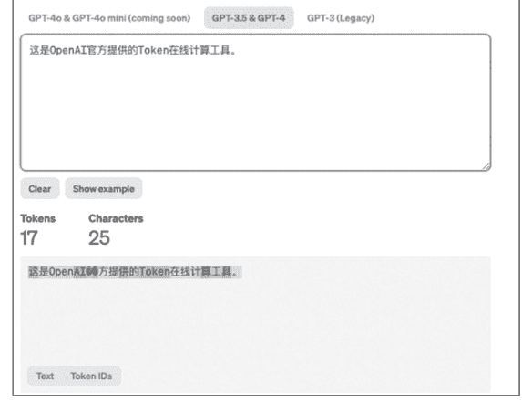

图1-2 OpenAI在线Token计算工具

对中文使用者而言，1个Token对应汉字数取决于分词器设计。通常1个Token约占1.5～2个汉字。因为分词器会按预定义规则将文本拆分为模型可理解的最小单元，不同分词器策略不同，导致对应关系差异。

### 1.3.5 通用智能展望
通用人工智能Artificial General Intelligence，AGI，最早可追溯至1997年，由Mark Gubrud在《Nanotechnology and International Security》中提出。Gubrud认为AGI可在多领域替代人类大脑，应用广泛。

2023年11月，Google DeepMind联合创始人Shane Legg团队发表论文《Levels of AGI：Operationalizing Progress on the Path to AGI》，提出关于AGI框架的6项原则。基于此构建了涵盖表现力与通用性双维度的技术框架，以及类似自动驾驶L1～L5的分级体系。该体系包含5个表现力等级：初级、熟练、专家、大师、超人，并对通用性做了详细划分。

2024年7月，OpenAI召开全员大会，推出全球智能评分体系，并展示接近人类推理能力的模型。会上高管表示ChatGPT已处于第一级，即将进入第二级——推理者。下面是该五级标准。

- 第一级Level1，ChatBot：可进行基础对话，如当前的ChatGPT。
- 第二级Level2，Reasoner：可进行基础推理与问题解决，类似拥有博士学位的人类，且不依赖外部工具。
- 第三级Level3，Agent：可在数天内代表用户执行任务，例如自动完成复杂工作流。
- 第四级Level4，Innovation：不仅能完成任务，还能提出新方案或发明创新。
- 第五级Level5，Organization：最高级别，可像一个组织运作，处理大量复杂任务，在某些领域几乎可替代人类。

该五级体系有助于衡量不同阶段的智能与能力，为研究者与开发者提供统一评估框架，也对社会、产业与政策制定产生深远影响。

## 1.4 小结
本章首先对大语言模型做了全面概述，包括定义、分类及应用场景。
接着介绍了演进历程，涵盖网络架构关键发展与重要历史事件，展示了从早期RNN、LSTM到现代Transformer及其变体的演进。
最后梳理了基础知识，包括算力与显卡概念、参数数量、参数精度、基本单位，以及AGI等级划分等，对理解与应用大语言模型具有重要意义。

# CHAPTER 2
第2章
# Python大语言模型应用开发
本章主要介绍使用Python进行大语言模型开发的最佳实践与关键知识点。首先简要介绍Python应用开发的基础，帮助刚入门或从其他语言转来的读者快速建立基础认知。接着介绍Docker容器的基础，包括环境搭建、常用命令及项目的打包、部署与运行，为开发部署积累常用技能。最后概述大语言模型与NLP相关知识，为开发储备理论基础。有一定Python经验或熟悉本章内容的读者可选择性跳过，直接进入下一章。

本章涉及的知识点有：
- Python大语言模型应用开发的基础知识：快速建立对Python编程的基础理解。
- Docker容器的基础知识：学会容器安装与常用命令。
- 大语言模型与NLP：为大语言模型的开发实践储备理论知识。

## 2.1 Python大语言模型应用开发的基础知识
本节首先介绍Python编程基础，包括环境准备、语言基础及大模型开发常用库，帮助读者快速建立基础理解；随后介绍实际项目中常见的接口设计与优化；最后结合前述知识点实操开发一个接口。学习后读者可独立设计完整接口并进行必要优化，为实际项目提供指导。

### 2.1.1 Python编程的基础知识
1. 为什么选择Python
截至2023年12月，Python仍稳居编程语言排行榜首位。Python因无处不在，被广泛用于统计科学、人工智能、脚本编写、系统测试与Web编程等。Python让代码实现想法变得轻松，对零基础者而言是进入编程世界的理想选择。

总体而言，以下因素使其成为大模型开发的优选之一：
- 简单易学：语法清晰简洁，上手快。
- 跨平台：可在Windows、macOS、Linux等系统上运行。
- 丰富的库与框架：拥有庞大的标准库与第三方库，几乎覆盖所有开发需求，能快速构建功能强大的应用。
- 社区支持：活跃的开发者社区可提供丰富资源、文档与支持。
- 丰富的应用生态：可满足数据科学、人工智能、Web应用开发等多场景需求。

但Python也有常被诟病的不足：
- 速度慢，执行效率低。目前Python3.11已做优化。对性能要求极高的部分，可用C/C++等语言实现。

Python 常见的顾虑其实不必过度放大

不少人会觉得 Python 因为直接解释执行源代码，所以运行速度不如编译型语言，而且源代码加密也相对困难。事实上这两个担忧在今天已不算核心问题。硬件和软件的持续演进让性能瓶颈越来越少见，而业界整体正从卖软件转向卖服务，社区也大力倡导开源，加密的顾虑对 Python 的发展影响有限。

2. 版本迁移与 2 到 3 的抉择
Python 自 1991 年诞生以来已走过三十余年，成为最受关注的编程语言之一。2008 年 Python 3 发布后，因与 2.x 不兼容且语法有所调整，官方曾长期并行维护两个分支，给开发者带来一定成本。2020 年起官方已终止对 Python 2.x 的维护与更新，3.x 彻底成为主流。为贴合当前发展趋势，后续示例统一以 Python 3.x 为基准。

3. 隔离开发环境搭建
本书默认读者已自行完成 Python 安装，这里重点说明虚拟环境的准备。全局环境适合临时使用，项目开发时建议使用隔离环境，避免依赖冲突与互相干扰。熟练使用虚拟环境能明显提升效率，减少非代码问题。

(1) conda
假设 Anaconda 已就绪，可通过以下命令查看当前已有的虚拟环境：

```
conda env list
```

创建新环境并命名为 my_env_name，环境会保存在 Anaconda 安装目录的 envs 文件夹下：

```
conda create -n my_env_name python=3.x
```

激活环境：

```
# Linux 系统
source activate my_env_name

# Windows 系统
activate my_env_name
```

在环境中安装所需库：

```
conda install -n my_env_name [package_name]
```

在环境中移除库：

```
conda remove -n my_env_name [package_name]
```

退出当前环境：

```
# Linux 系统
source deactivate

# Windows 系统
deactivate
```

删除环境：

```
conda remove -n my_env_name --all
```

(2) venv
从 Python 3.3 开始，自带 venv 工具用于创建虚拟环境。创建名为 my_env_name 的环境：

```
python -m venv my_env_name
```

激活环境：

```
# Linux 系统
source my_env_name/bin/activate

# Windows 系统
my_env_name\Scripts\activate.bat
```

退出环境：

```
deactivate
```

4. 代码规范与 PEP 8 实践
Python 代码风格建议遵循 PEP 8。PEP 即 Python Enhancement Proposals，第八号提案专门规范编码风格，核心建议如下：

- 缩进采用 4 个空格，避免使用 Tab。
- 单行代码不超过 79 个字符。
- 顶层函数与类的定义前后各空两行。
- 同一类内部的方法之间空一行。
- 文件统一使用 UTF-8 编码。
- import 语句分行书写，避免使用通配符导入。
- 单引号与双引号字符串等价。
- 命名规范见表 2-1。

表 2-1 Python 命名约定规范

| 类型 | 命名约定 | 举例 |
| :--- | :--- | :--- |
| 常量 | 全大写，单词间用下划线 | MAX_LENGTH |
| 变量 | 全小写，单词间用下划线 | n、word、module_name |
| 函数 | 全小写，单词间用下划线 | create、update、delete |
| 类 | 驼峰式大小写，不使用下划线 | Request、Client |
| 模块 | 全小写 | upload、download |
| 包 | 全小写，下划线不作单独单词 | models、services |

5. Python 核心语法速览
Python 属于解释型语言，依赖解释器将源代码逐行转为机器码并立即执行。最常用的是 C 语言实现的 CPython，还有 Java 版的 JPython 以及基于 JIT 的 PyPy。下面以 python_base.py 为例做极简梳理。

（1）变量
变量是存储数据的载体，可保存值本身或内存地址。Python 用 = 进行赋值，如 x = 20。

```
# 单个变量赋值
name = "Alice"
# 多个变量赋值
name, age = "Alice", 18
```

Python 内置多种数据类型，如整型、浮点型、字符串、布尔型等。运算符的优先级由高到低见表 2-2，使用运算符可对变量进行计算形成可执行语句。

表 2-2 运算符表

| 运算符 | 描述 |
| :--- | :--- |
| [], [:] | 下标、切片 |
| ** | 指数 |
| ~, +, - | 按位取反、正号、负号 |
| *, /, %, // | 乘、除、模、整除 |
| +, - | 加、减 |
| >>, << | 右移、左移 |
| & | 按位与 |
| ^, \| | 按位异或、按位或 |
| <=, <, >, >= | 小于或等于、小于、大于、大于或等于 |
| ==, != | 等于、不等于 |
| is, is not | 身份运算符 |
| in, not in | 成员运算符 |
| not, or, and | 逻辑运算符 |
| =, +=, -=, *=, /=, %=, //=, **= | 赋值运算符 |

条件语句根据布尔结果选择执行分支，Python 将 0 或 None 视作 False，其余视为 True。以成绩分级为例：

```
if score >= 90:
    print("优秀！")
elif score >= 80:
    print("良好！")
elif score >= 60:
    print("一般！")
else:
    print("不及格！")
```

循环有 for 与 while 两种，均可遍历或重复执行代码块。

## （2）数据结构
程序 = 算法 + 数据结构。Python 的内置结构让开发更直观，主要包括列表、元组、字典与集合。

列表由 [] 定义，可变、有序、可重复，支持索引读写，适合频繁修改的场景。
元组由 () 定义，不可变、有序、可重复，支持索引读取，适合需保持不变的数据。
字典由 {} 定义，可变键值对集合，不支持索引，通过键增删改查，适合快速查找。
集合由 {} 或 set() 定义，可变、无序、无重复，不支持索引，适合去重与集合运算。

## （3）函数
函数是可复用的代码抽象，支撑模块化开发。Python 提供大量内置函数，如 print()、len()，用户可用 def 自定义，支持参数与返回值，返回值通过 return 实现。

下面以求和函数为例：

```python
# 定义一个对两个整数求和的函数
def sum(x:int, y:int) -> int:
    return x + y
print(sum(1,2))
```

## （4）面向对象
Python 中一切皆对象，对象具备属性与方法。语言原生支持封装、继承、多态等特性，通过 class 定义类，再实例化对象。面向对象有助于代码组织、可维护与可扩展。

以二叉树节点类为例：

```python
# 定义一个二叉树节点类
class BinaryTreeNode:
    def __init__(self, value, left=None, right=None):
        self.value = value
        self.left = left
        self.right = right
```

6. LLM 开发常用工具箱
Python 生态丰富，掌握常用库能大幅提升大模型开发效率。以下简要介绍几个高频工具，后续章节会深入展开。

### (1) requests
requests 是发送 HTTP 请求的开源库，API 简洁，支持 GET、POST、PUT、DELETE 等方法，常用于 API 调用、爬虫与网络交互。

先激活虚拟环境再安装：

```
pip install requests
```

安装完成后导入即可使用。示例文件 requests_demo.py 展示 GET 与 POST 请求：

```python
# 导入 requests 库
import requests

# 处理 GET 请求
response = requests.get('https://www.baidu.com/', timeout=3)
print(response.status_code)
print(response.text)

# 处理 POST 请求
data = {'prompt': '请告诉我中国的首都在哪儿。'}
response = requests.post('http://localhost:8088/chat', json=data, timeout=3)
print(response.status_code)
print(response.text)
```

### (2) Flask
Flask 是轻量级 Python Web 框架，API 简洁、扩展灵活，适合快速搭建小型服务。

安装命令：

```
pip install Flask
```

安装后导入模块即可开发。示例文件 flask_demo.py 演示基础服务：

```python
from flask import Flask

app = Flask(__name__)

# 健康检查服务
@app.route('/health', methods=["GET"])
def health():
    return 'OK'

# 对话服务
@app.route('/chat', methods=["POST"])
def chat():
    return 'Hello World'

if __name__ == '__main__':
    app.run(host="0.0.0.0", port=8088, debug=False)
```

代码基于 Flask 创建了两个路由：/health 用于健康检查，响应 GET 请求；/chat 用于对话，响应 POST 请求。最后以 app.run 启动服务并监听 8088 端口。

### (3) Streamlit
Streamlit 面向数据科学与机器学习，提供简洁的 Python 脚本即可生成交互式 Web 应用，无需大量前端代码。

安装命令：

```
pip install streamlit
```

示例文件 streamlit_demo.py 演示简单应用：

```python
import streamlit as st
import pandas as pd

# 设置测试标题
st.title('Demo')
st.text('显示一个 DataFrame:')

# 创建一个 DataFrame
data = pd.DataFrame({
    'col1': [1, 2, 3, 4],
    'col2': [5, 6, 7, 8]
})

# 在应用程序中显示 DataFrame
st.write(data)
```

启动方式与普通脚本不同，需在本地运行：

```
streamlit run streamlit_demo.py
```

浏览器访问 http://localhost:8501/ 即可预览效果。

## 2.1.2 接口的设计与优化
在 Web 与后端开发中，接口开发是核心环节。面试中经常被问及设计与优化经验，但很多人缺乏系统复盘。本节对接口设计进行归纳，为大模型开发奠基。

### 1. 接口的设计
规范的接口设计能提升协作效率、降低沟通成本，并增强可维护性与可扩展性。常规流程包括确定通信协议、规划 URL、设计入参与出参，并在服务层实现。为设计出完整优秀的接口，还需关注以下要点。

- (1) 确定通信协议
依据业务、安全与性能需求选择协议，常见有 HTTP、HTTPS、WebSocket 等。
- (2) 定义接口访问 URL
URL 需直观表达资源含义，并明确主机、端口与路由，便于准确调用。
- (3) 设计接口请求入参
需考虑参数命名、类型、格式与必要性，合理设计提升易用性与可扩展性，减少错误。
- (4) 设计接口出参和状态码
出参建议使用 JSON，字段需说明命名、类型、含义与示例。返回体通常包含 code、data、message 三部分。code 由开发者自定义，每个状态码应说明含义、触发条件与处理建议。
- (5) 版本管理
提前规划版本避免升级破坏旧调用。常见做法有 URL 标识版本、Header 标识版本、参数标识版本等，实现新旧共存和平滑升级。
- (6) 选择接口数据传输格式

# 接口开发与优化关键点

在接口层面，数据怎么搬运尤为关键。JSON 和 XML 是当前最常见的两种载体。JSON 体积轻、结构清晰，人和机器都好读好写，所以在 Web 前后端交互里占据主流。XML 则属于通用标记方案，扩展性强、层次分明，更常被用来做数据存储和跨系统传递。

- (7) 传输数据解压缩
当接口返回体偏大时，裸传会拖慢速度、占用带宽。常见做法是发送前先压缩，接收后解压。Gzip 就是业界常用的压缩手段之一，能有效降低网络开销。
- (8) 参数的合法性校验
校验能确保进来的数据符合预期格式和取值范围，拦截非法和错误请求，也能防止恶意攻击和脏数据，提升系统的稳定、可维护和安全。典型做法有参数 Schema 校验、类型检查、长度限制、Token 校验等。
- (9) 安全访问认证
通过可靠的认证机制，客户端和服务端之间建立信任，才能准确核验调用者的身份与权限，挡住未授权访问和操作，保护系统与数据。常见手段包括 Token 认证、敏感信息脱敏、IP 黑白名单配置等。
- (10) 异常处理和兜底
异常处理用来捕获并妥善应对接口报错，兜底策略则确保即便出错，服务也能以合理方式继续运行，避免单点异常拖垮整个接口。
- (11) 记录请求日志
接口开发一定要留关键日志，包含入参、出参和异常信息。这样出现问题时可以快速追溯运行轨迹，定位根因；同时日志也是做用户行为分析与性能优化的重要依据，有助于提升稳定性和可靠性。
- (12) 性能优化
接口不止要能跑，还要跑得快。优化方向涵盖代码层面的精简、并发能力的提升、响应时长的压缩、传输量的控制以及缓存策略的运用，这些都能显著提高响应速度与吞吐量，改善用户体验。
- (13) 文档编写
再规范的设计也需要一份完整文档作为收口。文档应覆盖接口用途、参数说明和示例代码，帮助使用者快速上手，减少沟通成本。

## 2. 接口的优化

上线后，维护与持续优化往往占据开发者大部分精力。面试中我常结合候选人的项目经历，考察其对接口优化的思考方式与落地手段，比如会问：“如果某个接口上线后响应越来越慢，你会怎么处理？”

在初期、未引入复杂中间件的场景下，一个请求大体经历 4 步，如图 2-1 所示。

1. 客户端发起请求；
2. 服务端接收请求并操作数据库；
3. 数据库把结果返给服务端；
4. 服务端把结果响应给客户端。

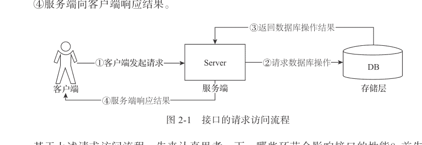

基于上述链路，先判断哪些环节会拖慢接口。首先是网络通信的稳定性和带宽，虽然基础设施通常不是首选优化点，但仍是基础。其次是服务端自身处理能力，负载过高或存在瓶颈会直接拉低响应。最后是数据库操作效率，慢 SQL 无论读或写，都会成为明显卡点。

发现性能问题后怎么定位？一般会借助性能监控工具，对数据库、服务器、网络带宽进行全链路观测，同时记录日志并分阶段监控接口响应时间，优先揪出耗时最长的环节，再针对性处理。

明确问题后，可以按场景举例优化。

#### (1) 网络通信与带宽优化
- 增大网络带宽：遇到明显网络瓶颈时扩容是最直接的办法，但成本会上升。
- 压缩传输数据：对请求体先压缩再发送，能减小包体，加快传输。
- 使用缓存数据：把高频访问的数据放入缓存，降低需要跨网传输的数据量。
- 使用 CDN 资源：借助 CDN 把静态资源分发到离用户更近的节点，减少延迟。
- 页面静态化：将变化少但访问频繁的前端资源固化到 HTML，减少对后端的重复请求。

#### (2) 服务端处理能力优化
- 减少不必要的计算和 I/O 开销：多用预计算结果避免重复运算，减少日志中冗余或复杂内容的写入。
- 同步接口改成异步访问：把耗时操作改为异步或通过消息队列解耦，提升响应速度。
- 提高并发处理能力：利用多进程、多线程等并发手段，同时处理更多请求。
- 使用负载均衡技术：把流量分发到多台机器，降低单接口压力，提升整体稳定与性能。
- 利用缓存加速读取：在高并发场景下，缓存是提升读取速度的有效手段。

#### (3) 数据库操作效率优化
- 优化数据库架构：单实例扛不住时，可采用集群、主从复制、读写分离或分布式数据库提升稳定与效率。
- 使用内存数据库：把热点数据放入本地内存或中间件缓存，缓解查询压力。
- 数据库的读优化：批量读取代替多次单查、分页代替全量、避免深度分页、合理加锁等。
- 数据库的写优化：批量写入、异步处理、合理加锁或改用文件存储等。
- 索引的优化：新增合适的索引并提高命中率。

以上从网络、服务端、数据库三个层面归纳了常见的优化思路。具体实现需要结合业务深入探索，接口优化本质上是一个持续迭代的过程，要根据实际需求和出现的问题不断尝试和改进。

### 2.1.3 大语言模型接口开发实战

使用 ChatGPT 的过程中，大家普遍感受到地域限制、网络波动、数据安全和合规风险带来的不便，存在被卡脖子的焦虑。国内大模型研发投入巨大，早期缺乏成熟替代方案，拥有一个稳定可用的 ChatGPT 服务成为企业和个人的刚需。

目前国内落地方向主要有三种。

第一种是 ChatGPT 模式，即在未完全封禁的情况下，通过代理注册 OpenAI 接口并在国内落地。优点是上手快、成本低、操作简单，适合轻量产品；缺点是可定制性差、成本和延迟较高，存在数据安全和法律风险，不适合大规模使用，多见于小团队。

第二种是产研结合垂直模式，依靠大企业或高校借助算力训练行业大模型，如医疗、法律等。对于资源有限的企业，可基于开源组件二次开发，对开源模型做微调和有限数据训练。优点是可扩展、可定制、不受网络限制，支持本地调试部署；缺点是对研发能力要求高，本地训练部署资源消耗大，适合有研发实力的中小企业。

第三种是通用大语言模型模式，通过工程突破和摩尔定律降低训练成本，打造通用模型。该方向对资金和算力要求极高，目前多由大厂主导，不太适合创业公司。

本节采用第一种模式，基于前面介绍的知识设计一个可稳定调用 ChatGPT 的接口，实现学以致用，后续章节会继续使用该接口。

### （1）需求描述
受国内网络限制影响，为实现稳定使用 ChatGPT，可在境外自建云主机搭建接口服务，绕过第三方代理的不确定性。

### （2）技术选型
选用 Python 作为开发语言，结合轻量级 Web 框架 Flask 搭建服务。

### （3）制定方案
可在阿里云、腾讯云或亚马逊云上购买一台可公网访问的境外云主机，例如美国硅谷节点，申请 OpenAI 的访问 Key，在此基础上自建请求服务，如图 2-2 所示。

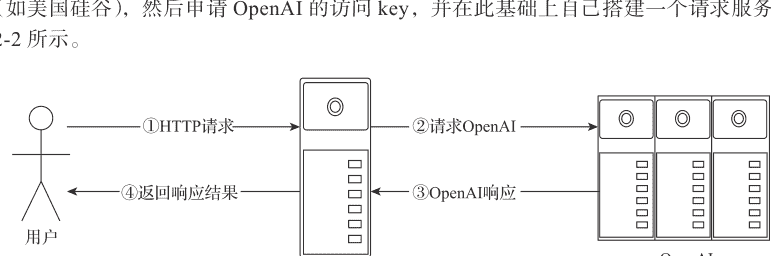

### （4）设计接口
对关键信息做梳理：

- 描述：ChatGPT 访问服务。
- 协议：HTTP，POST 方法。
- 路由：http://host:8088/chat，其中 host 为主机 IP 或域名。
- 鉴权：分发密钥，本例假设为 chat-gpt。
- 请求参数：见表 2-3。

表 2-3 请求参数

| 参数位置 | 参数名称 | 是否必填 | 参数类型 | 参数含义 | 备注 |
| :--- | :--- | :--- | :--- | :--- | :--- |
| header | Content-Type | 否 | str | 内容类型 | |
| params | 无 | 否 | 无 | params | |

参数说明

| 参数位置 | 参数名称 | 是否必填 | 参数类型 | 参数含义 | 备注 |
| :--- | :--- | :--- | :--- | :--- | :--- |
| body | timestamp | 是 | int | 时间戳 | |
|  | auth_token | 是 | str | 签名 Token | |
|  | prompt | 是 | str | 提示词 | |
|  | role | 否 | str | 角色名称 | 默认：user |
|  | temperature | 否 | float | 温度 | 默认：0.1 |
|  | model | 否 | str | 模型名称 | 默认：gpt-3.5-turbo |

返回参数：见表 2-4。

### 表 2-4 返回参数

| 参数名称 | 参数类型 | 参数含义 | 备注 |
| :--- | :--- | :--- | :--- |
| code | int | 状态码 | |
| timestamp | int | 时间戳 | |
| data | str | 返回结果 | |
| message | str | 返回详情说明 | |

参数 code 取值说明：0 表示正常；-1 表示异常；-2 表示鉴权失败。

### （5）实现接口
在已有 flask_demo.py 基础上新建 chatgpt_server.py 开始实现。

第一步，引入依赖包，缺失时通过 pip 安装：

```python
import time
import hashlib
from openai import OpenAI
from loguru import logger
from flask import Flask, request
```

第二步，定义 OPENAI_API_KEY 并创建 Flask App：

```python
# 定义 OPENAI_API_KEY
OPENAI_API_KEY = "sk-xxxxxxx"
# 自定义密钥，在请求服务的时候，密钥需要提前安全分发给服务调用的对象
SECRET_KEY = "chat-gpt"

app = Flask(__name__)
# 设置显示中文，而非 unicode 码
app.json.ensure_ascii = False
```

第三步，接口鉴权。常用方式有 API Key、OAuth、JWT，本例使用 API Key 配合 MD5 加密：

```python
def get_md5(plaintext: str):
    """
    计算 MD5
    :param plaintext:
    :return:
    """
    return hashlib.md5(plaintext.encode('utf-8')).hexdigest()
```

```python
def get_sign(secret_key, timestamp):
    """
    接口认证的简单加密算法
    :param secret_key: 用户共享的密钥
    :param timestamp: 时间戳
    :return:
    """
    plaintext = "openai".join([secret_key, str(timestamp)])
    sign = get_md5(plaintext)
    logger.info(f"{timestamp=} {plaintext=} {sign=}")
    return sign
```

```python
def verify_token(secret_key, timestamp, auth_token):
    """
    进行 auth_token 的认证
    :param secret_key: 用户共享的密钥
    :param timestamp: 时间戳
    :param auth_token: 认证
    :return: 返回认证结果, bool 类型
    """
    sign = get_sign(secret_key, timestamp)
    return sign == auth_token
```

第四步，定义 OpenAI Chat Completion 示例，默认 temperature 为 0.1，默认模型为 gpt-3.5-turbo：

```python
def send_message(messages, temperature=0.1, model='gpt-3.5-turbo'):
    client = OpenAI(
        api_key=OPENAI_API_KEY
    )
    response = client.chat.completions.create(
        model=model,
        messages=messages,
        stop=None,
        temperature=temperature,
    )
    for choice in response.choices:
        if "text" in choice:
            return choice.text
    return response.choices[0].message.content
```

第五步，实现 chat 服务并做异常兜底，异常时返回“我无法回答”：

```python
@app.route('/chat', methods=['POST'])
def get_chat():
    try:
        data = request.get_json()
        timestamp = data.get('timestamp')
        auth_token = data.get('auth_token')
        is_verify = verify_token(SECRET_KEY, timestamp, auth_token)
        if not is_verify:
            return dict(code=-2, timestamp=int(time.time()), data=None,
                        message=f"认证失败")
        prompt = data.get('prompt')
        temperature = data.get('temperature', 0.1)
        model = data.get('model', 'gpt-3.5-turbo')
        role = data.get('role', 'user')
        messages = [{"role": role, "content": prompt}]
        response = send_message(messages, temperature, model)
        return dict(code=0, timestamp=int(time.time()), data=response,
                    message="成功")
    except Exception as e:
        logger.error(f"请求 ChatGPT 失败: {e}")
        return dict(code=-1, timestamp=int(time.time()), data='我无法回答',
                    message=f"失败, {e}")
```

第六步，用主机 IP 0.0.0.0、端口 8088 启动服务：

```python
if __name__ == '__main__':
    app.run(host="0.0.0.0", port=8088, debug=False)
```

至此，基于 Flask 的 ChatGPT 接口服务开发完成。部署后即可通过请求与 ChatGPT 交互。

### （6）服务部署
激活虚拟环境后，使用 nohup 启动服务，并将标准输出与错误输出重定向到 chatgpt_server.log 文件中：

```bash
nohup python3 chatgpt_server.py > chatgpt_server.log  2>&1 &
```

需要持续查看日志时，可利用 tail -f 实现日志的实时追踪，保持终端输出不断更新：

```bash
tail -f chatgpt_server.log
```

### （7）简单测试

搭建一个 test_chat.py 脚本，通过 requests 发起调用，对新搭建的接口进行一次功能验证：

```python
import time
import requests
import hashlib
from loguru import logger

# 自定义密钥，在请求服务的时候，密钥需要提前安全分发给服务调用的对象
SECRET_KEY = "chat-gpt"

def get_md5(plaintext: str):
    """
    计算 MD5
    :param plaintext:
    :return:
    """
    return hashlib.md5(plaintext.encode('utf-8')).hexdigest()

def get_sign(secret_key, timestamp):
    """
    接口认证的简单加密算法
    :param secret_key: 用户共享的密钥
    :param timestamp: 时间戳
    :return:
    """
    plaintext = "openai".join([secret_key, str(timestamp)])
    sign = get_md5(plaintext)
    logger.info(f"{timestamp=} {plaintext=} {sign=}")
    return sign

def do_post(url, secret_key, prompt, role='user', temperature=0.1, model='gpt-3.5-turbo'):
    timestamp = int(time.time())
    sign = get_sign(secret_key, timestamp)
    data = {
        "timestamp": timestamp,
        "auth_token": sign,
        "prompt": prompt,
        "role": role,
        "temperature": temperature,
        "model": model
    }
    try:
        response = requests.post(url, json=data, timeout=10).json()
        code = response.get('code')
        if code == 0:
            return response.get('data')
        else:
            logger.error(f"问答服务返回失败, {code=}")
    except Exception as e:
        logger.error(f"问答服务调用异常: {e=}")
    return '我无法回答'

if __name__ == "__main__":
    # host 需要替换成你的云主机 IP 地址或者域名
    url = "http://host:8088/chat"
    prompt = "中国的首都在哪儿？"
    result = do_post(url, SECRET_KEY, prompt)
    logger.info(result)
```

最终得到的模型回复为：“中国的首都是北京。”

### （8）优化接口

前面组装的 ChatGPT 调用入口已可正常使用，但作为轻量实现，实际运行中易受网络波动、超时以及响应延迟影响。下述方向可供改进参考：

- 当前默认模型为 gpt-3.5-turbo，可尝试切换到更新的版本以获得更好效果。
- 选取更可靠、速度更快的代理网络，能提升连接稳定性与响应速度。
- 面对高延迟和重复提示，可引入缓存机制，既能加速返回，也能降低调用开销。

## 2.2 容器化平台概览

在技术演进历程中，Docker 被视为一次关键的革新，划定了软件交付的新阶段。其架构为 Client/Server 模式，核心组成包括客户端、守护进程、镜像、仓库和容器等。借助内核的 namespaces、cgroups 等机制，Docker 为应用提供隔离与安全保障，实现快速自动化部署。随着云原生成为主流，Docker 与 Kubernetes 已成为基础设施的标准，开发者应当持续关注。

本节围绕容器技术的基础概念展开，帮助读者掌握部署服务所需的能力。若已熟练 Docker 与 Kubernetes 编排，可跳过本节。

### 2.2.1 常用操作命令

熟练使用 Docker 离不开对基础指令的掌握，这些指令覆盖容器从创建到销毁的全过程，以及镜像的构建管理。下面梳理重点操作。

#### 1. 环境信息查询

（1）查看运行环境

```bash
$ docker info
Client:
 Context:    default
 Debug Mode: false
Server:
 Containers: 9
  Running: 3
  Paused: 0
  Stopped: 6
 Images: 258
...
```

（2）查看版本信息

```bash
$ docker version
Client:
 Version:           20.10.12
 API version:       1.41
 Go version:        go1.16.2
...
Server:
    Engine:
        Version:         20.10.12
        API version:     1.41 (minimum version 1.12)
        Go version:      go1.16.2
        ...
```

（3）列出正在运行的实例

```bash
$ docker ps -a
或
$ docker container ls -a
```

#### 2. 实例生命周期管理

（1）创建并启动实例

```bash
$ docker run -d -p 8088:80 --name my-nginx -v /path/to/nginx.conf:/etc/nginx/nginx.conf nginx
```

执行 docker run 将拉取最新 nginx 镜像，并在后台启动命名为 my-nginx 的实例，-d 表示后台运行，-p 用于端口映射，-v 则把宿主机配置文件挂载进去。

启动时可加入资源限制，常见参数包括：

- -m 或 --memory：限定内存用量，如 512MB、2GB。
- --memory-swap：限定内存与 swap 的合计用量。
- -c 或 --cpu-shares：设定 CPU 权重，未指定时默认 1024。

（2）停止正在运行的实例

```bash
$ docker stop 容器 ID
```

（3）恢复已停止的实例

```bash
$ docker start 容器 ID
```

（4）重启实例

```bash
$ docker restart 容器 ID
```

（5）进入运行中的实例

```bash
$ docker exec -it 容器 ID /bin/bash
```

（6）移除一个或多个实例

```bash
$ docker rm 容器 ID ... 容器 ID
```

（7）清理所有已退出的实例

```bash
$ docker rm -v $(docker ps -aq -f status=exited))
```

### 2.2.2 镜像构建管理

镜像是容器运行的前提，通过 Dockerfile 生成，其中封装了运行环境、依赖库与代码，启动后即成为容器实例。

#### 1. 镜像仓库操作

Registry 用来存储镜像、层结构与元数据，也称仓库。用户自建的为私有仓库，Docker Hub 为官方公共仓库，可直接拉取。常用操作如下：

- （1）查看本地镜像列表

```bash
$ docker images
```

- （2）从仓库拉取镜像

若未指定 tag，则默认获取 latest。

```bash
$ docker pull 镜像名称
```

- （3）推送镜像到仓库

```bash
$ docker push 镜像名称
```

- （4）在 Docker Hub 搜索镜像

```bash
$ docker search 镜像名称
```

- （5）在本地主机删除镜像

可加 -f 强制删除。

```bash
$ docker rmi 镜像 ID
```

#### 2. 构建流程

虽然可从 Docker Hub 下载现成镜像，但生产环境通常需要自行构建。Docker 支持 Dockerfile 与 docker commit 两种方式，其中 Dockerfile 更常用，编写完成后执行 docker build 即可生成。下面介绍相关指令。

- （1）Dockerfile 常用指令

Dockerfile 为文本清单，记录构建步骤，常用指令见表 2-5。

### 表 2-5 Dockerfile 的常用命令

| 名称 | 描述 |

|---|---|

| FROM | 指定基础镜像 |

| MAINTAINER | 设置镜像作者，可为任意字符 |

### 2.2.3 编排技术

随着 B/S 架构演进，应用正从单体向微服务与分布式演进。对个人开发者而言，容器化能显著提升开发部署效率，减少环境差异。企业生产中，容器规模扩大后，创建、调度、扩缩容、监控与安全等运维问题凸显，编排技术成为关键。

在众多工具中，Kubernetes 脱颖而出为主流。它源自 Google 内部的 Borg，可实现容器化应用的自动部署、弹性伸缩与统一管理，并提供完整 API。对外服务。Kubernetes 也是云原生的基石。

企业加速拥抱云原生，看重其弹性扩展、敏捷开发、持续交付、自动化运维与跨平台特性。数据科学领域面临海量存储、计算与训练需求，云原生能更好地应对数据波动。未来云原生将成为数据科学的主流实践，大模型应用开发者也应关注。

## 2.3 大模型与自然语言处理

人工智能长期是人类的美好愿景。2016 年人机围棋对局引发了机器超越人类的讨论。几年后，2022 年 11 月 ChatGPT 3.5 发布，其强大的自然语言处理能力让人觉得模型在某种程度上“理解”人类语言。本节先梳理 NLP 研究任务，再回顾传统实现路径，最后讨论大模型带来的变化。

### 2.3.1 NLP 研究任务

自然语言处理是计算机科学与人工智能的重要分支，目标是让机器像人一样正确处理与理解自然语言。但人类语言丰富多样，存在歧义、情感与复杂性，给研究带来挑战。长期积累使 NLP 在多个领域取得进展，而大模型的出现进一步推动了其发展，使商业应用更简便精准。

在大模型主导的当下，熟悉经典任务对落地商业应用仍很关键。常见任务见表 2-6。

表 2-6 常见的 NLP 研究任务

| 研究任务 | 描述 |

| :--- | :--- |

| 分词 | 将文本分割成单词、标点符号或标记的过程 |

| 词性标注 | 赋予文本中的词对应的词性标签，如名词、动词、形容词、感叹词等 |

| 语法分析 | 分析文本中句子的语法结构，识别句子成分等 |

| 语义分析 | 分析文本中句子的含义，如情感色彩分析、消除歧义和标注角色等 |

| 信息抽取 | 从文本中提取关键信息，如关系抽取、命名实体识别等 |

| 文本分类 | 将文本标注为不同的类别，如垃圾邮件分类、新闻类别分类等 |

| 机器翻译 | 将一种语言的文本翻译成另一种语言，如英汉互译等 |

| 问答系统 | 根据用户提问可以自动从文本中找到准确答案并回答用户 |

| 文本生成 | 使用算法和模型自动生成文本，如文本摘要、文案润色等 |

| 知识图谱 | 对文本进行知识抽取、知识表示、知识融合和推理 |

### 2.3.2 传统技术实现路径

有机器学习经验者会发现，NLP 流程与机器学习大体相似，但在细节上有差异。下面以典型流程为例，如图 2-3 所示。

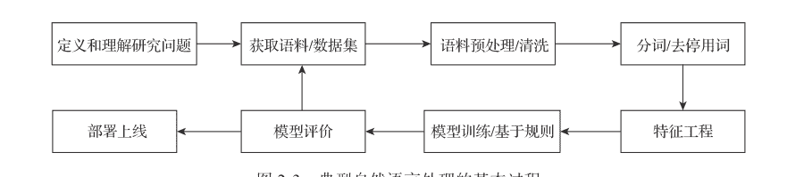

（1）明确研究问题

先深入业务，明确主题、目标与范围，锁定待解决的具体问题，再转化为可操作的 NLP 技术问题。

（2）获取语料 / 数据集

语料即语言材料，是研究的基石。语料库按来源可分为企业内部积累的数据，以及从网络下载或爬取的标准数据集、新闻等信息。

（3）语料预处理 / 清洗

对语料进行加工、清洗，保留关注内容，剔除噪声。包括提取标题、摘要、正文，去除网页广告、标签、HTML、JS 代码与注释等。

常见预处理方式有手工去重、对齐、删除、标注，基于规则抽取，正则匹配，按词性与命名实体抽取，以及脚本批量处理等。

（4）分词 / 去停用词

NLP 期望以词或词组为最小单元，因而需调用分词工具。停用词是指对特征贡献不大的字词，如标点、语气、人称等。一般分词后会去停用词，但中文需因场景而定，例如情感分析中语气词与感叹号应保留，因其承载语气与情感强度。

（5）特征工程

将分词后的词转化为计算机可计算形式，常见方法有词袋模型、One-hot 编码、Word2Vec 与 Embedding 等。实际使用时还需做特征选择，保留表达力强的特征。

（6）模型训练 / 基于规则

选定特征后进行模型训练，依据需求选择不同算法。传统机器学习包括 KNN、SVM、Naive Bayes、决策树、GBDT、K-means 等；深度学习包括 CNN、RNN、LSTM 与 Seq2Seq 等。

（7）模型评价

上线前需评估泛化能力，常用指标有错误率、精度、准确率、精确率、召回率、F1 等。

（8）部署上线

主流做法是线下训练，线上部署为接口服务，供业务系统调用。

以上即为传统 NLP 的实现路径。

### 2.3.3 大模型对传统 NLP 的影响

当前大语言模型在零样本或少样本条件下，仅靠提示词工程即可完成大部分传统 NLP 任务，并具备较强泛化能力，这对传统技术路径形成明显冲击。但大语言模型也存在局限：结构复杂参数庞大导致训练耗时耗资、推理难以解释、可解释性差，并可能出现幻觉、伦理与合规风险。

因此大语言模型并非包打天下，传统 NLP 在特定场景仍具重要价值。未来两者融合将共同推动 NLP 发展。

## 2.4 小结

本章为读者提供大语言模型开发所需的基础知识与工程实践。首先介绍了 Python 基础、接口设计与优化实践，并演示了如何用 Python 构建基于 GPT-3.5 的大模型服务。

随后介绍了容器常用基础命令，为后续章节使用容器奠定基础，并引导关注 Docker 与云原生技术的发展趋势。

最后一段回顾了传统 NLP 的核心任务与实现路径，并剖析了大语言模型对传统 NLP 的影响。

# PART 2

# 第二篇 应用开发

# 核心开发技术

本部分系统梳理了分词、词嵌入、向量数据库、提示词工程与调优、Hugging Face 入门实战、LangChain 入门实战、大模型微调以及大模型部署等内容。这些模块共同构成了大模型应用开发的技术骨架，掌握它们是深入开展大模型开发的基础。

# 第 3 章

# 分词全解

本章围绕 NLP 分词展开，先简述分词的概念及中英文差异，再介绍常见算法原理，最后通过大语言模型进行分词，让读者直观感受大模型在分词上的优势，为大模型在 NLP 场景中的应用打下基础。

本章重点覆盖：

- 分词基础：分词概念、中英文分词差异与词云图制作方法。
- 常用分词算法：主流算法原理介绍。
- 大模型分词：利用大语言模型完成分词的流程。

## 3.1 分词入门

本节先解释分词的本质，再对比中英文分词特点与常用工具，最后演示分词在数据可视化中制作词云图的案例。

### 3.1.1 分词是什么

分词就是把一段文本或一句话拆成一个个有意义的词或符号 Token，前提是算法能为每个词给出精确的边界。

在 NLP 流程里，分词后文本可被表示为词袋或词向量，进而通过数学运算实现文本分类、情感分析、机器翻译等任务。因此分词精度直接影响下游效果，越准确的分词越能提供清晰语义输入，提升模型表现。

很长一段时间里，网络上的 NLP 资料以英文为主，大家往往先学英文处理再迁移到中文。实践中发现，中英文处理差异很大，中文更复杂。

目前分词仍面临不少难题：词义界定不清、歧义、一词多义、新词发现、方言口语、中英混杂等，这些问题制约 NLP 进步。未来可能从更深的语言学研究、更精准的建模、更大规模语料等多角度突破，同时结合大语言模型，为 NLP 提供更高效更准确的支持。

### 3.1.2 英文分词实战

英文分词主要针对英语文本。英语有空格作天然分隔符，分割相对简单，但存在单复数、时态等形态变化，需要词性还原等后续处理。

若忽略标点和形态变化，用 Python 字符串的 split 就能简单分词，如下：

```
simple_example = "Tokenization is a crucial step in natural language processing."
simple_tokens = simple_example.split(" ")
print(simple_tokens)
```

输出结果为：

```
['Tokenization', 'is', 'a', 'crucial', 'step', 'in', 'natural', 'language', 'processing.']
```

但实际工作中，这种简单分割往往不够，需要专业工具。NLTK 是处理英文文本的 NLP 工具包，包含语料库、词典、训练模型等，下面重点看它的分词能力。

使用 NLTK（官网：https://www.nltk.org/api/nltk.html）前先安装，激活虚拟环境后执行：

```
pip install nltk
```

安装完成后需下载数据包，可下载单个包，也可下载全部 all、示例所需的 book，或仅语料库。

交互式安装时打开控制台执行：

```
import nltk
nltk.download()
```

会弹出 NLTK 下载器，选择 Models 标签下的 punkt 安装，如图 3-1 所示。

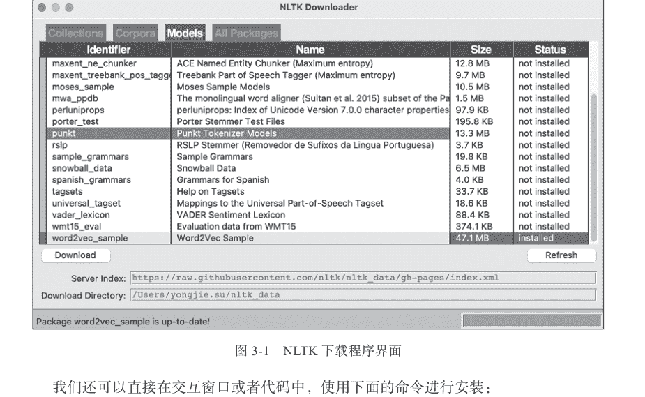

图 3-1 NLTK 下载程序界面

也可以直接在交互窗口或代码中执行：

```
import nltk
nltk.download('punkt')
nltk.download('stopwords')
```

安装成功后即可分词，代码如下：

```
from nltk.tokenize import word_tokenize

nltk_example = "Tokenization is a crucial step in natural language processing."
nltk_tokens = word_tokenize(nltk_example)
print(nltk_tokens)
```

执行后结果如下：

```
['Tokenization', 'is', 'a', 'crucial', 'step', 'in', 'natural', 'language', 'processing', '.']
```

可见标点也被单独切出。接下来过滤停用词，代码如下：

```
from nltk.corpus import stopwords

# 过滤停用词
filtered_tokens = [token for token in nltk_tokens if token not in stopwords.words('english')]
print(filtered_tokens)
```

过滤后结果如下：

```
['Tokenization', 'crucial', 'step', 'natural', 'language', 'processing', '.']
```

此时 is、a、in 等停用词被移除，标点仍保留。

以上介绍了英文分词特点及 NLKT 工具。NLTK 除分词外，还支持词性标注、命名实体识别、词干抽取、情感分析等，详情参考官网文档，因篇幅不再展开。

### 3.1.3 中文分词挑战

中文分词在信息检索、搜索引擎和中文 NLP 中应用广泛。相较英文，中文分词更复杂，具体体现在：

- 缺少明确分隔：中文字间无空格，边界不明显。
- 歧义普遍：中文多一词多义、多音字，组合含义易变，分词歧义加剧难度。
- 新词识别：社会发展带来新词、网络热词，未登录词常被常规分词遗漏。
- 方言口语差异：地域民族多样带来方言口语不一致，处理难度上升。
- 词长不固定：现代汉语单字不一定成词，多字词为主，分词需考虑长度。

近年技术从字符匹配、统计分词向深度学习、预训练语言模型演进。实践中常用 Jieba、HanLP、THULAC、IkAnalyzer 等，下面以 Jieba 为例。

Jieba 是高人气的 Python 中文分词组件，愿景是打造最好的 Python 中文分词工具。

使用 Jieba（GitHub：https://github.com/fxsjy/jieba/tree/jieba3k）前先安装：

```
pip install jieba
```

Jieba 提供 5 种模式：

- 精确模式：力求最精确的切分，也是默认模式。

代码如下：

```
import jieba

sentence = "2023年度十大新词语是：生成式人工智能、全球文明倡议、村超、新质生产力、全国生态日、消费提振年、特种兵式旅游、显眼包、百模大战、墨子巡天。"

accurate_mode_segments = jieba.cut(sentence, cut_all=False, HMM=True)
print(list(accurate_mode_segments))
```

HMM 参数默认值 True，表示用隐马尔可夫模型自动识别新词。结果如下：

```
['2023', '年度', '十大', '新词语', '是', '：', '生成式', '人工智能', '、', '全球', '文明', '倡议', '、', '村超', '、', '新质', '生产力', '、', '全国', '生态', '日', '、', '消费', '提振年', '、', '特种兵', '式', '旅游', '、', '显眼', '包', '、', '百模', '大战', '、', '墨子', '巡天', '。']
```

若 HMM 为 False，执行：

```
accurate_mode_segments = jieba.cut(sentence, cut_all=False, HMM=False)
print(list(accurate_mode_segments))
```

结果如下，部分新词被拆成单字：

```
['2023', '年度', '十大', '新词语', '是', '：', '生成式', '人工智能', '、', '全球', '文明', '倡议', '、', '村', '超', '、', '新', '质', '生产力', '、', '全国', '生态', '日', '、', '消费', '提', '振', '年', '、', '特种兵', '式', '旅游', '、', '显眼', '包', '、', '百', '模', '大战', '、', '墨子', '巡天', '。']
```

- 全模式：快速扫描所有可成词片段，可能存在歧义。

代码如下：

```
cut_all_mode_segments = jieba.cut(sentence, cut_all=True)
print(list(cut_all_mode_segments))
```

结果如下：

```
['2023', '年度', '十大', '新词', '新词语', '词语', '是', '：', '生成', '生成式', '人工', '人工智能', '智能', '、', '全球', '文明', '倡议', '、', '村', '超', '、', '新', '质', '生产', '生产力', '、', '全国', '生态', '日', '、', '消费', '提', '振', '年', '、', '特种', '特种兵', '式', '旅游', '、', '显眼', '包', '、', '百', '模', '大战', '、', '墨子', '巡天', '。']
```

全模式会返回所有可能片段，包含重复字词，cut_all 默认 False。

- 搜索引擎模式：在精确模式基础上对长词继续切分，提升召回，适合搜索场景。

代码如下：

```
search_mode_segments = jieba.cut_for_search(sentence)
print(list(search_mode_segments))
```

结果如下：

## 2023年度十大新词语

2023年度十大新词语是：生成式人工智能、全球文明倡议、村超、新质生产力、全国生态日、消费提振年、特种兵式旅游、显眼包、百模大战、墨子巡天。

并行模式：按行拆分文本分发到多进程分词，最后合并结果。

代码如下：

```python
jieba.enable_parallel(2)
sentence = "2023年度十大新词语是：生成式人工智能、全球文明倡议、村超、新质生产力、全国生态日、消费提振年、" + "\n" + "特种兵式旅游、显眼包、百模大战、墨子巡天。"
accurate_mode_segments = jieba.cut(sentence, cut_all=False)
print(list(accurate_mode_segments))
```

结果如下：

```
['2023', '年度', '十大', '新词语', '是', '：', '生成式', '人工智能', '、', '全球', '文明', '倡议', '、', '村超', '、', '新质', '生产力', '、', '全国', '生态', '日', '、', '消费', '提振年', '、', '\n', '特种兵', '式', '旅游', '、', '显眼', '包', '、', '百模', '大战', '、', '墨子', '巡天', '。']
```

paddle 模式：基于 PaddlePaddle 训练的双向 GRU 序列标注模型实现分词。Jieba 默认安装 paddlepaddle-tiny，使用前需调用 enable_paddle，代码如下：

```python
jieba.enable_paddle()
```

Jieba 支持增词，分词时保留自定义词，如下：

```python
jieba.add_word('生成式人工智能')
jieba.add_word('新质生产力')
```

逐个添加效率低，可写入 user_dict.txt 文件。

通过 load_userdict() 加载自定义词典，代码如下：

```python
jieba.load_userdict('user_dict.txt')
```

以上是对 Jieba 的简要介绍。cut 与 cut_for_search 返回可迭代 Generator，可用 for 循环取词。lcut 是 cut 的列表封装，l 代表 list，lcut_for_search 同理返回列表。

Jieba 已较久未更新，另一个常用库是 cutword，其词典基于最新统计，提供基础词库与升级词库，升级库更长，设置 want_long_word 为 True 可加载。词频更合理，支持命名实体识别，分词速度更快。

使用 cutword（GitHub：https://github.com/liwenju0/cutword）先安装：

```bash
pip install cutword
```

配合自定义词典分词，代码如下：

```python
from cutword import Cutter

if __name__ == '__main__':
    sentence = "2023年度十大新词语是：生成式人工智能、全球文明倡议、村超、新质生产力、全国生态日、消费提振年、特种兵式旅游、显眼包、百模大战、墨子巡天。"
    custom_dict_path = "custom_dict.txt"
    """
    用户自定义词典格式：词 \t 词频 \t 词性
    """
    cutter = Cutter(want_long_word=True, custom_dict_path=custom_dict_path)
    segments = cutter.cutword(sentence)
    print(segments)
```

## 3.1.4 词云可视化

分词除 NLP 外，在数据可视化中也很重要，常见做法是用分词生成词云图。

词云图以词频为驱动，通过字号和颜色差异呈现高频词，形成视觉冲击，便于快速把握文本核心信息，常用于文本分析、热点挖掘和市场调研。

典型流程为：文本预处理、分词、去停用词、词频统计、展示。下面以《生成式大模型安全与隐私白皮书》为例演示。

Python 制作词云最常用 WordCloud，使用前先安装：

```bash
pip install wordcloud
```

按步骤绘制词云，代码如下：

```python
import jieba
from PIL import Image
import numpy as np
from collections import Counter
from wordcloud import WordCloud

def read_text_file(file_path):
    with open(file_path, 'r', encoding='utf-8') as f:
        lines = f.readlines()
        return lines

if __name__ == "__main__":
    # 加载停用词
    stop_words_path = "stopwords.txt"
    stop_words = read_text_file(stop_words_path)
    stop_words = [stop_word.replace("\n", '') for stop_word in stop_words]
    # 加载文档
    text_file_path = '生成式大模型安全与隐私白皮书.txt'
    lines = read_text_file(text_file_path)
    # 分词 并去停用词
    segments = []
    for line in lines:
        if line == '\n':
            continue
        if len(str(line).strip()) <= 1:
            continue
        line = line.replace('\n', '')
        segs = jieba.lcut(line, cut_all=False)
        # 去停用词
        segs = list(set(segs) - set(stop_words))
        segments.extend(segments)
    # 统计，获取分词结果中词列表的 top n
    segments = [segment for segment in segments if segment.strip() != '']
    result = dict(Counter(segments))
    # 绘图
    # 加载背景图片
    img = Image.open('background.png')
    # 将图片变为数组，便于用作词云图形状
    img_array = np.array(img)
    wordcloud = WordCloud(
        # mask=img_array,  # 设置背景图，上面已经加载
        # 设置字体和大小，这里使用黑体
        font_path="SimHei.ttf",
        # 词云图中词语字号最大值
        max_font_size=80,
        # 词云图中词语字号最小值
        min_font_size=7,
        # 设置词语数量
        max_words=100,
        # 当 max_words 超过总词数，是否使用重复的词语代替
        repeat=True,
        # 设置背景颜色为白色
        background_color="white",
        # 设置宽和高
        width=500,
        height=400
    ).generate_from_frequencies(result)
    # 将词云图保存到
    wordcloud.to_file('wordcloud.png')
```
最后将可视化结果导出为 wordcloud.png，呈现效果与图 3-2 一致。

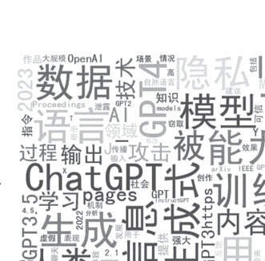
## 3.2 分词方法全景图

分词质量直接决定下游 NLP 任务的上限。近几年分词思路升级很快，从早期的规则加统计，过渡到深度学习和预训练模型主导的范式。下面把几条主流路线拆开来看。

### 3.2.1 基于词典的规则分词

这是分词领域最先成型的方案。核心做法是先构建一份词表，再用字符串匹配把句子切开。方法看似朴素，实现门槛低。

要想减少未登录词带来的麻烦，词表通常要做得足够大。实际切分时，把待处理的句子与词典条目做比对，只要完全吻合就截取出来形成一个词。切分方向可左到右也可右到左，匹配策略可贪长也可贪短，不同组合会得到不同的切分结果。下面是几种典型做法。

#### 1. 最大匹配法
按长度优先找词典里最长的匹配项。根据扫描方向又可分为正向和逆向两种。

- 正向最大匹配法（FMM）：从句子开头逐字向后扫，每次都优先挑词典中最长的词，力求切出的词越长越好、个数越少越好。优点是实现直接、速度快，缺点是最大匹配长度设得不合理时会拉低准确率。
- 逆向最大匹配法（RMM）：从句子末尾往前切，匹配失败就把前面多掉一个字继续尝试，直到成功为止。

#### 2. 最小匹配法
同样存在正向和逆向两种变体，但匹配时优先选词典里最短的词，失败再逐步扩充字符。中文里单字本身就能成词，实际使用并不多。

#### 3. 双向匹配法
同时跑一次正向最长匹配和一次逆向最长匹配，再综合两者的结果取舍，用来兼顾各自的优势、提升切分准确度。

```python
class SegmentByDictionary:
    def __init__(self):
        self.dictionary = set()
        self.max_length = self.max_word_length()

    def max_word_length(self):
        """
        获取词典中最长的词的长度
        :return:
        """
        if len(self.dictionary) < 1:
            return 0
        return max(len(word) for word in self.dictionary)

    def add_word(self, word):
        self.dictionary.add(word)
        self.max_length = self.max_length if self.max_length > len(word) else len(word)

    def union_words(self, words: set):
        temp_max_length = max(len(word) for word in words)
        self.dictionary.update(words)
        self.max_length = self.max_length if self.max_length > temp_max_length else temp_max_length

    def cut_by_ffm(self, text):
        """
        正向最大匹配法
        :param text:
        :return:
        """
        # 结果集
        result = []
        # 定义起始位置
        index = 0
        length = len(text)
        while index < length:
            # 尝试匹配最长的词
            for size in range(self.max_length, 0, -1):
                word = text[index:index + size]
                # print(word)
                if word not in self.dictionary:
                    continue
                result.append(word)
                index += size
        return result

if __name__ == '__main__':
    sbd = SegmentByDictionary()
    sbd.add_word('基于')
    sbd.add_word('中文')
    sbd.union_words({'的', '自然语言处理', '分词', '技术'})
    # 打印词典
    print(sbd.dictionary)
    result = sbd.cut_by_ffm("基于中文的自然语言处理分词技术")
    # 打印分词结果
    print(result)
```
示例代码展示了一个可增删词条的词典实现，会自动统计词长上限，并以正向最大匹配法完成切分，得到的结果如下：

```
['基于', '中文', '的', '自然语言处理', '分词', '技术']
```

### 3.2.2 基于统计的分词算法

在统计机器学习框架下，分词主要分两大思路：语言模型和序列标注。语言模型利用上下文概率推断最合理的切分，比如常见的 N-gram。序列标注则把分词转为给每个字贴标签，判断它是独立成词还是词的内部位置。代表模型有隐马尔可夫模型、最大熵模型、条件随机场等。

#### 1. N-gram 语言模型
统计语言模型把自然语言看作随机过程，字词句子都被视作按概率分布的变量。

设句子 $S$ 由 $w_1, w_2, \cdots, w_n$ 组成，其概率为 $P(S)$，则有：

$$P(S) = P(w_1, w_2, \cdots, w_n) = \prod_{i=1}^{n} P(w_i | h_i)$$
其中 $h_i \stackrel{\text{def}}{=} \{w_1, w_2, \cdots, w_{i-1}, w_i, \cdots, w_{n-1}, w_n\}$ 表示 $w_i$ 的上下文。受数据稀疏影响，实际只保留有限范围的上下文。

N-gram 假设当前词只与前面 $n-1$ 个词相关，更远的上下文被忽略，即马尔可夫假设：

$$P(w_i | h_i) = P(w_i | w_{i-n+1}, \cdots, w_{i-1})$$
$n$ 太大时参数量指数级膨胀，$n$ 太小时又缺长距离信息，工程上常用二元 Bi-gram 和三元 Tri-gram。

在 Python 里可以自建一个 N-gram 函数，接收 n 值、文本、语言三项参数，返回 n-gram 列表，代码如下：

```python
def n_grams(num, text, language='english'):
    if num < 1:
        raise ValueError("不合法的 n 值！")
    if text is None or text == '':
        return []
    if language != 'english':
        raise ValueError('暂不支持该语言！')
    inputs = text.split(' ')
    result = [inputs[i: i + num] for i in range(len(inputs) - num + 1)]
    return result
```
NLTK 也内置了现成实现，调用方式如下：

```python
# nltk工具包
import nltk
tokens = nltk.word_tokenize(sentence)
bi_grams = nltk.bigrams(tokens)
print(list(bi_grams))
tri_grams = nltk.trigrams(tokens)
print(list(tri_grams))
```
运行后得到的输出为：

```
[('Tokenization', 'is'), ('is', 'a'), ('a', 'crucial'), ('crucial', 'step'), ('step', 'in'), ('in', 'natural'), ('natural', 'language'), ('language', 'processing'), ('processing', '.')]

[('Tokenization', 'is', 'a'), ('is', 'a', 'crucial'), ('a', 'crucial', 'step'), ('crucial', 'step', 'in'), ('step', 'in', 'natural'), ('in', 'natural', 'language'), ('natural', 'language', 'processing'), ('language', 'processing', '.')]
```

#### 2. 隐马尔可夫模型
HMM 是 NLP 中常用的生成式统计模型，包含不可观测的状态序列和可观测的观测序列。状态序列描述系统内部变化，观测序列是外部可看到的结果。

基本假设是观测序列由对应的状态序列生成。分词等序列标注任务常用 Viterbi 算法，在已知观测序列和模型参数时寻找最可能的状态序列。

记 $X$ 为观测序列，$Y$ 为标记序列，给定 $X$ 时最可能的状态序列记为 $P^*$，则：

$$P^* = \arg\max P(Y|X) = \arg\max \frac{P(X,Y)}{P(X)}$$
HMM 已被广泛用于分词、词性标注、语音识别等。模型训练方便、效率高，但强独立性假设限制了上下文特征的利用，且有监督版本需要大量人工标注。

中文分词工具 Jieba 默认就采用了 HMM：

```python
jieba.cut(sentence, cut_all=False, HMM=True)
```
hmmlearn 是另一个 Python 的无监督 HMM 实现，原本属于 scikit-learn 生态，现已独立维护，可通过 pip 安装：

```bash
pip install hmmlearn
```
它提供的模型包括 CategoricalHMM、GaussianHMM、GMMHMM、MultinomialHMM、PoissonHMM、VariationalCategoricalHMM 和 VariationalGaussianHMM 等。

## 3. 最大熵模型
生成式模型的局限推动了条件模型的兴起，最大熵模型即最大熵马尔可夫模型 MEMM 之一。MEMM 将标注问题转化为条件概率估计，通过最大化熵挑选最优标注序列。

设 $X$ 为观测序列，$Y$ 为输出序列，MEMM 逐步求出每个位置的最优 $Y_i$ 再迭代，最终得到最优序列 $Y^*$：

$Y_i^* = \arg \max P(Y_i | Y_{i-1}, X_i)$
它用局部最优的条件概率累积成整体结果，缓解了 HMM 的独立性假设，但存在标记偏置问题，对本文涉及的地理名词识别仍不够理想。

## 4. 条件随机场模型
条件随机场是一个无向图模型，直接建模全局最优解的条件概率。相比 HMM 不需要强独立性假设，也克服了 MEMM 的标记偏置，因此在 NLP 多个任务中得到广泛应用。

### 3.2.3 基于深度学习的分词算法
传统机器学习分词高度依赖人工词典和特征工程，验证成本高、效率低。随着深度学习普及，神经网络方法逐渐成为主流。

### 1. 基于全卷积神经网络的模型
全卷积神经网络 FCNN 擅长处理变长序列。在分词场景下，模型把句子的每个字符作为输入，输出该字符所属的词位类别，从而完成切分。缺点是需要大量高质量的人工标注语料，数据质量直接影响训练效果。

### 2. 循环神经网络的序列处理能力
循环神经网络是面向序列建模的深度架构，循环连接赋予了它在阅读过程中保留历史信息的特性，能够动态地从序列中抽取规律特征。正因为具备这种记忆机制，RNN 在处理长文本时有一定优势，但训练过程中容易出现梯度衰减或梯度放大，影响模型收敛与泛化。

### 3. LSTM 的长距离记忆优势
长短期记忆网络是 RNN 的改进分支，专为捕捉时间序列中间隔长、延迟大的关键事件而设计。其门控结构有效缓解了传统 RNN 记忆保持时间受限、梯度消失与爆炸的问题。
在分词任务里使用 LSTM 时，文本首先需要被映射为数值表示，常见的映射方式有 One-Hot 编码和 Embedding。得益于对上下文及远距离依赖的联合建模，LSTM 能够实现更精准的切分。

### 3.2.4 预训练模型的分词范式
近年兴起的预训练语言模型分词方法，核心是借助在海量语料上学得的通用语言表征来完成切分。整体可归纳为三个环节。

### 1. 大规模预训练
利用大量未标注文本进行预训练，让模型学习分布式语义、语法结构等通用能力。BERT、GPT、XLNet 等主流模型多采用 Transformer 架构来捕捉上下文信息。

### 2. 子词切分策略
英语等自带空格的语言，预训练模型通常使用 WordPiece 或 Byte Pair Encoding 等子词机制来处理未知词或低频词。
中文缺乏显式词界，分词多以字符为单位，模型将每个汉字作为基本单元输入，再通过上下文理解语义。

### 3. 任务微调
预训练完成后，可在特定任务的标注数据上进行 Fine-tuning，使模型适配问答、机器翻译、文本分类、情感分析等具体场景。

## 3.3 大模型分词实战

### 3.3.1 ChatGPT 服务分词
参考 2.1.3 节搭建的 ChatGPT 接口，分词的本质是提示词的设计。示例代码如下：

```
url = "http://host:8088/chat"
prompt = "假如你是一个中文自然语言处理的专家，请帮我把下面这段话进行分词，然后返回一个分词结果集，需要分词的这段话是：人工智能是最近几年非常热门的计算机技术。"
result = do_post(url, SECRET_KEY, prompt)
logger.info(result)
```

运行后得到以斜杠分隔的切分结果：
人工智能 / 是 / 最近 / 几年 / 非常 / 热门 / 的 / 计算机 / 技术 /。

### 3.3.2 本地 BERT 模型分词
下面以基于 BERT 的预训练模型为例进行分词，需提前安装 HuggingFace 的 Transformers 库，若对 HuggingFace 不熟悉可先阅读第 7 章内容。

先激活虚拟环境并安装库：

```
pip install transformers
```

在 HuggingFace 模型库中可下载 BERT 模型。BERT 主要有两个预训练版本：BERT-Base-Uncased 和 BERT-Base-Cased。前者会将文本转为小写，后者保留大小写信息。
一般可用 BertTokenizer 构建基于 WordPiece 的分词器，也可使用通用的 AutoTokenizer，再通过 from_pretrained 加载指定路径的分词器。

```
from loguru import logger
from transformers import BertTokenizer

tokenizer = BertTokenizer.from_pretrained("bert-base-cased")
```

获取切分结果：

```
sentence = "This model is case-sensitive: it makes a difference between english and English."
logger.info(f"原始句子: {sentence}")

# 获取分词 Tokens
tokens = tokenizer.tokenize(sentence)
logger.info(f"分词 Tokens: {tokens}")
```

对切分结果进行编码，使用 convert_tokens_to_ids 将 Token 转为词典 ID：

```
# 编码：将 Token 映射为 ID
ids = tokenizer.convert_tokens_to_ids(tokens)
logger.info(f"Tokens 映射为 Ids 的结果: {ids}")
```

反向操作可用 convert_ids_to_tokens 将 ID 还原为 Token：

```
# 将 ID 映射为 Token
tokens = tokenizer.convert_ids_to_tokens(ids)
logger.info(f"Ids 映射为 Tokens 的结果: {tokens}")
```

随后可通过 ID 或 Token 进行解码，还原为原始输入：

```
# 解码还原原始句子
new_sentence = tokenizer.decode(ids)
logger.info(f"解码还原原始句子: {new_sentence}")
# 解码还原原始句子
new_sentence = tokenizer.convert_tokens_to_string(tokens)
logger.info(f"解码还原原始句子: {new_sentence}")
```

得到的结果如下：

```
原始句子: This model is case-sensitive: it makes a difference between english and English.
分词 Tokens : ['This', 'model', 'is', 'case', '-', 'sensitive', ':', 'it', 'makes', 'a', 'difference', 'between', 'en', '##gli', '##sh', 'and', 'English', '.']
Tokens 映射为 Ids 的结果: [1188, 2235, 1110, 1692, 118, 7246, 131, 1122, 2228, 170, 3719, 1206, 4035, 23655, 2737, 1105, 1483, 119]
Ids 映射为 Tokens 的结果: ['This', 'model', 'is', 'case', '-', 'sensitive', ':', 'it', 'makes', 'a', 'difference', 'between', 'en', '##gli', '##sh', 'and', 'English', '.']
通过 Ids 解码还原原始句子: This model is case - sensitive : it makes a difference between english and English.
通过 Tokens 解码还原原始句子: This model is case - sensitive : it makes a difference between english and English .
```

中文场景可直接下载 BERT-Base-Chinese，使用方式与 BERT-Base-Cased 相同。需要注意的是，BERT 在处理中文时通常把每个汉字当作独立的“词”来处理。

## 3.4 本章要点回顾
本章围绕 NLP 分词的基础知识与工程实践展开。首先简要介绍了传统中英文分词工具并演示词云绘制；随后梳理了分词算法的演进脉络，重点关注近年的预训练模型分词思路；最后通过代码演示了基于大语言模型的分词，包括 ChatGPT 服务调用和本地大模型部署两种方式。

# CHAPTER 4 第 4 章 词嵌入技术
计算机底层以逻辑门和数字电路处理二进制数据，上层则借助高级语言和软件高效处理文字、图像、音视频等多模态信息。
在自然语言领域，词嵌入是一种关键的表征手段，它把文本映射为可计算的数字向量，使机器能够理解并后续处理语言。

本章主要覆盖：
- 词袋模型：掌握构建思路与实现
- 词向量模型：熟悉 One-Hot 与 Word2Vec 两种常见方法
- 大语言模型生成 Embedding：学习不同的生成方式
- 大语言模型的 Embedding 应用：通过案例展示多种使用场景

## 4.1 词袋模型

### 4.1.1 BoW 模型原理速览
词袋模型是自然语言处理和信息检索中的经典文本表示方法，它把文本抽象为无序的词集合，忽略语法和词序，仅统计词频。
基本流程为：
- 对文本进行预处理，包括分词、去停用词、词干或词形还原等归一化操作
- 统计语料中出现的所有不重复词，构建词汇表，词汇表大小即向量维度
- 将每篇文本映射为向量，维度对应词汇表中的词，常用表示有词频 TF、独热编码 One-Hot、TF-IDF 等

### 4.1.2 构建实战
词袋模型在假设上把文档视为词的无序集合，忽略顺序直接计数，常用于贝叶斯分类、LDA、LSA 等任务。下面分别用 Jieba 和 Gensim 演示构建过程。

### 1. Jieba 实现思路
先导入 Jieba 分词器、语料和停用词：

```
import jieba

def read_text_file(file_path):
    with open(file_path, 'r', encoding='utf-8') as f:
        lines = f.readlines()
        return lines

def get_stop_words(file_path):
    lines = read_text_file(file_path)
    stop_words = [line.replace("\n", "") for line in lines]
    return stop_words
```

使用 lcut 方法对语料进行分词：

```
stop_words_path = "stopwords.txt"
stop_words = get_stop_words(stop_words_path)
content = [
    "机器学习推动人工智能的飞速发展。",
    "深度学习使人工智能变得更加强大。",
    "大语言模型让人工智能更加得智能。"
]
# 分词
jieba.add_word('大语言模型')
segments = [jieba.lcut(con) for con in content]
print(segments)
```

得到分词结果：

```
[['机器', '学习', '推动', '人工智能', '的', '飞速发展', '。'], ['深度', '学习', '使', '人工智能', '变得', '更加', '强大', '。'], ['大语言模型', '让', '人工智能', '更加', '得', '智能', '。']]
```

中文语料包含停用词和标点，需先清洗：

```
tokenizeds = [[word for word in segment if word not in stop_words] for segment in segments]
```

清洗后结果：

```
[['机器', '学习', '推动', '人工智能', '飞速发展'], ['深度', '学习', '人工智能', '变得', '强大'], ['大语言模型', '人工智能', '智能']]
```

将所有分词结果合并取并集去重，得到特征词表：

```
bag_of_words = list(set([word for words in tokenizeds for word in words]))
print(bag_of_words)
```

特征词结果：

```
['深度', '飞速发展', '变得', '强大', '人工智能', '学习', '推动', '大语言模型', '智能', '机器']
```

按特征词顺序构建词袋向量：

```
bag_of_word2vec = [[1 if token in tokenized else 0 for token in bag_of_words]
                   for tokenized in tokenizeds]
print(bag_of_word2vec)
```

得到的词袋向量：

```
[[0, 1, 0, 0, 1, 1, 1, 0, 0, 1], [1, 0, 1, 1, 1, 1, 0, 0, 0, 0], [0, 0, 0, 0, 1, 0, 0, 1, 1, 0]]
```

上述过程大量使用列表推导式，其在 Python 中通常比显式循环更高效，数据量大时优势明显。

### 2. Gensim 实现思路
Gensim 是专注于自然语言处理的开源 Python 库，内置 Word2Vec、FastText、LDA 等无监督算法，在主题建模、文档相似度、词嵌入等领域应用广泛。下面介绍其 bag-of-words 向量模型。

先安装 Gensim：

```
pip install gensim
```

载入原始文本，用 Jieba 分词并去除停用词：

```
import jieba
from gensim import corpora

stop_words_path = "stopwords.txt"
stop_words = get_stop_words(stop_words_path)
content = [
    "机器学习推动人工智能的飞速发展。",
    "深度学习使人工智能变得更加强大。",
    "大语言模型让人工智能更加得智能。"
]
# 分词
jieba.add_word('大语言模型')
segments = [jieba.lcut(con) for con in content]
print(segments)
# 去停用词
tokenizeds = [[word for word in segment if word not in stop_words] for segment in segments]
print(tokenizeds)
```

使用 Gensim 的 Dictionary 将词映射为 ID，并保存词典：

```
# 映射 ID
dictionary = corpora.Dictionary(tokenizeds)
# 保存词典
dictionary.save('result.dict')
print(dictionary)
```

此时输出提示语料包含 10 个独立词：

```
Dictionary<10 unique tokens: ['人工智能', '学习', '推动', '机器', '飞速发展']...>
```

查看全部词及下标：

```
# 查看词典和下标 ID 的映射
print(dictionary.token2id)
```

结果如下：

```
{'人工智能': 0, '学习': 1, '推动': 2, '机器': 3, '飞速发展': 4, '变得': 5, '强大': 6, '深度': 7, '大语言模型': 8, '智能': 9}
```

由此可得到词袋特征向量。doc2bow 函数的作用是统计不同词的出现次数，将词转为整数 ID 并返回稀疏向量。

```
corpus = [dictionary.doc2bow(segment) for segment in segments]
print(corpus)
```

得到的稀疏向量结果：

```
[[(0, 1), (1, 1), (2, 1), (3, 1), (4, 1)], [(0, 1), (1, 1), (5, 1), (6, 1), (7, 1)], [(0, 1), (8, 1), (9, 1)]]
```

## 4.2 词向量模型

# 词向量：让机器读懂语义的密码

深度学习在自然语言处理领域掀起的最大浪潮之一，就是词向量技术的诞生。在实际的 NLP 任务里，这项技术把离散的词语映射成稠密的数值向量，进而作为机器学习与深度学习模型的输入特征，为后续理解打下基础。

## 4.2.1 独热编码的原理与实操

独热编码在数据科学和机器学习中属于高频用法，核心目的就是把类别型变量转成算法可计算的形式。通常的做法是生成一个二进制向量，唯<|message|> 一个位置为 1，其余全部为 0。

在自然语言处理里，字词经常被这样处理。比如大数据、云计算、机器学习、深度学习、大语言模型这几个词，每个都会被映射成一个向量，向量中仅有一个 1，其余位置都是 0。

```
大数据 [1,0,0,0,0]
云计算 [0,1,0,0,0]
机器学习 [0,0,1,0,0]
深度学习 [0,0,0,1,0]
大语言模型 [0,0,0,0,1]
```

要生成独热编码有不少常用套路，下面介绍几种典型做法，先准备好数据：

```
# 准备数据集
data = ['大数据', '云技术', '机器学习', '深度学习', '大语言模型']
df = pd.DataFrame({'人工智能技术': data})
```

第一种做法借助 Pandas 的 get_dummies 函数，该函数默认会返回布尔类型的 True 或 False，若需要整数形式的 0 或 1，就把参数 dtype 设为 int。

```
import pandas as pd
def get_dummies(dataframe: pd.DataFrame):
    dummies = pd.get_dummies(dataframe['人工智能技术'], prefix='人工智能技术', dtype=int)
    return dummies
```

第二种做法是利用 Pandas DataFrame 的 apply 方法，自行定义编码逻辑来生成独热向量。

```
import pandas as pd
def get_one_hot_by_apply(dataframe: pd.DataFrame):
    one_hot_df = pd.DataFrame()
    col_name = '人工智能技术'
    for value in dataframe[col_name].unique():
        new_col = f'{col_name}_{value}'
        one_hot_df[new_col] = dataframe['人工智能技术'].apply(lambda x: 1 if x == value else 0)
    return one_hot_df
```

第三种做法是调用 PyTorch 的 functional 接口来构造独热编码。

```
import torch
from torch.nn import functional

def get_one_hot_by_pytorch(items: list):
    # 为每个类别创建一个唯一的索引（整数）
    item_to_index = {item: index for index, item in enumerate(items)}
    # 将标签字符串转换为对应的整数索引
    labels_indices = torch.tensor([item_to_index[item] for item in items])
    # 使用 PyTorch 的 functional.one_hot 生成 One-Hot 编码
    one_hot = functional.one_hot(labels_indices, num_classes=len(data))
    # 默认返回 LongTensor 类型
    # 返回 ndarray 类型: one_hot.numpy()
    # 返回 list 类型: one_hot.numpy().tolist()
    return one_hot
```

在 NLP 的落地场景里，独热编码因能剔除词的数值含义、保留词的独立性而被广泛使用。

不过它也存在明显的短板：

- 编码结果带有随机性，各向量互不相干，词与词之间的关联完全体现不出来，容易造成信息损失。
- 向量的维度大小随语料中词数的多少而变化，一旦把所有词的向量拼成矩阵，矩阵会异常稀疏，引发维度灾难。

为缓解这些问题，可以转向其他编码方案。Word2Vec 就能把独热编码压缩为低维的连续稠密向量，而且语义相近的词会被投射到向量空间的邻近区域。降维后在二维图上，相似词的距离也会变得很近。

## 4.2.2 Word2Vec：神经网络驱动的词表征

Word2Vec 是谷歌团队在 2013 年发布的基于神经网络的词向量技术，用稠密向量代表每个词，自诞生后在 NLP 任务中得到广泛应用，也催生了 Doc2Vec 等后续模型。

Word2Vec 主要包含 Skip-Gram 和 CBOW 两种架构，值得一提的是，它生成的词向量能较好地刻画词与词之间的相似关系与类比关系。

下面演示如何用 Gensim 库构建 Word2Vec 模型。开始前先执行安装命令：

```
pip install gensim
```

先抓取一批关于黄河和长江的语料，再用 Jieba 做分词并去除停用词：

```
import jieba

stop_words_path = "stopwords.txt"
stop_words = get_stop_words(stop_words_path)
sentences = [
    "这部电影非常精彩，剧情好看，演员非常出色。"
]
# 分词
segments = [jieba.lcut(sentence) for sentence in sentences]
# 去停用词
tokenizeds = [[word for word in segment if word not in stop_words] for segment in segments]
```

接下来就可以调用 gensim.models 下的 Word2Vec 构建模型了。

```
model = Word2Vec(
    tokenizeds,
    sg=1,
    vector_size=20,
    window=5,
    min_count=1,
    hs=1
)
```

对模型里几个关键参数做简要说明：

- sg = 1 表示采用 Skip-Gram，设为 0 则使用 CBOW，默认是 0。
- vector_size 控制词向量的维度大小。
- window 表示预测词与中心词在句子中的最大距离。
- min_count 设定词频阈值，小于该值的词会被丢弃。
- hs = 1 表示启用分层 softmax，否则不使用。

更多参数说明可查阅源码注释。

模型可用 save 方法保存到本地，也能用 load 方法重新载入。

```
# 保存模型
model.save('word2vec.model')
# 加载模型
model = Word2Vec.load('word2vec.model')
```

若要查看某个特定词的向量，可以这样操作：

```
embedding = model.wv['精彩']
print(embedding)
```

得到一个长度为 20 的向量：

```
[-0.00428278  0.01413282  0.02700714  0.03526328 -0.02851561  0.0092941
  0.03044432 -0.02399025 -0.0155363   0.03398815  0.00815738  0.00094959
  0.01736819  0.00108889  0.04809413  0.02530302 -0.04458695 -0.0352078
  0.00450728  0.03196267]
```

要找与某个词最相似的前 n 个词，可使用 wv.most_similar 方法：

```
most_similar = model.wv.most_similar("精彩", topn=3)
print(most_similar)
```

查询结果显示与“精彩”最相似的前 3 个词分别是“好看”“出色”“这部”：

```
[('好看', -0.0071847583167254925), ('出色', -0.06502574682235718), ('这部', -0.07021171599626541)]
```

计算两个词的相似度则可以用 wv.similarity 方法：

```
similarity = model.wv.similarity('精彩', '精彩')
print(f"相似度是: {similarity}")
```

计算“精彩”与自身相似度，结果为 1.0：

相似度是: 1.0

## 4.3 大模型时代的 Embedding 生成方式

Embedding 的本质是将自然语言或代码等内容转化为数字序列，让机器学习模型能够理解内容间的关联并执行聚类、检索等任务。

随着大语言模型迅速发展，Embedding 能力也在升级。BERT、GPT 等模型能够生成上下文感知的 Embedding 表示，更好地捕捉单词的语义与上下文信息，为 ChatGPT、Assistants API 中的知识检索以及各类检索增强生成 RAG 工具提供支撑。Embedding 示意如图 4-1 所示。


在工程实践里，生成 Embedding 有多种常用路径，下面介绍几种典型做法。

### 4.3.1 ChatGPT 嵌入模型的演进与使用

据 OpenAI 官网介绍，2022 年 12 月，OpenAI 发布了 text-embedding-ada-002，替代了此前用于文本搜索、文本相似度计算的独立模型，并在多数任务上超越了此前最强的 Davinci 模型，同时价格下降了 99.8%。

主要改进体现在：

- 性能更强，在文本搜索、代码搜索、句子相似度等任务上优于所有旧模型。
- 模型统一，将 text-similarity、text-search-query、text-search-doc、code-search-text、code-search-code 五个独立模型合并为一个。
- 上下文更长，支持长度从 2048 扩大到 8192，提升了长文档处理能力。
- 嵌入尺寸更小，维度为 1536，仅为之前的 12.5%，更利于向量数据库的成本控制。

text-embedding-ada-002 在 NLP 与代码任务上非常强势，但在线性探测分类等部分任务上表现并不突出。

下面演示如何用 ChatGPT 的 text-embedding-ada-002 为输入文本生成 Embedding。

首先安装 openai 库，激活虚拟环境后执行：

```
pip install openai
```

通过 OpenAI 客户端创建 client，再用 embeddings.create 方法生成词向量，代码如下：

```
from openai import OpenAI

OPENAI_API_BASE = ""
OPENAI_API_KEY = "sk-xxx"
if OPENAI_API_BASE is None or OPENAI_API_BASE == "":
    OPENAI_API_BASE = f"https://api.openai.com/v1"
client = OpenAI(
    base_url=OPENAI_API_BASE,
    api_key=OPENAI_API_KEY
)

if __name__ == "__main__":
    response = client.embeddings.create(
        input="输入的文本内容",
        model="text-embedding-ada-002"
    )
    # print(response.model_dump_json())
    embedding = response.data[0].embedding
    print(embedding)
```

从返回结果 response 可以看到，data 字段里包含了 Embedding 值、模型信息以及提示词消耗的 Token 数量，结果如下：

```
{
    "data": [
        {
            "embedding": [
                -0.010814209468662739,
                -0.0034831895027309656,
                0.0016322025330737233,
                ...
                0.011710184626281261,
                -0.01625256985425949
            ],
            "index": 0,
            "object": "embedding"
        }
    ],
    "model": "text-embedding-ada-002",
    "object": "list",
    "usage": {
        "prompt_tokens": 5,
        "total_tokens": 5
    }
}
```

2024 年 1 月 26 日，OpenAI 推出两款新嵌入模型：更小更高效的 text-embedding-3-small，以及更大更强的 text-embedding-3-large。

text-embedding-3-small 的亮点：

- 检索能力更强，在英语和多语言检索任务上的平均得分均有提升。
- 价格下调，相比 text-embedding-ada-002 效率更高，价格从 $0.0001/1000 Token 降至 $0.00002/1000 Token，降低 80%。

text-embedding-3-large 的亮点：

- 性能为新模型中最强，相较 text-embedding-ada-002，MIRACL 平均得分从 31.4% 提升到 54.9%，MTEB 平均得分从 61.0% 提升到 64.6%。
- 定价为 $0.00013/1000 Token，比旧模型更经济。

### 4.3.2 本地化方案 Text2Vec

在 HuggingFace 上可以下载 shibing624/text2vec-base-chinese 模型，随后使用本地模型生成 Embedding。

Text2Vec 即 Text to Vector，是一种文本向量化工具，能够把词、句子、段落等内容表征为向量矩阵。它集成了 Word2Vec、RankBM25、BERT、Sentence-BERT、CoSENT 等多种表征与相似度计算模型，并在文本语义匹配任务上进行了效果对比。

使用前先执行安装命令：

```
pip install -U text2vec
```

随后生成 Embedding，代码如下：

```
from text2vec import SentenceModel, EncoderType

def get_embedding_by_text2vec(
        model_name_or_path, encoder_type=EncoderType.MEAN, max_seq_length=256,
        device="cpu"):
    model = SentenceModel(
        model_name_or_path=model_name_or_path,
        encoder_type=encoder_type,
        max_seq_length=max_seq_length,
        device=device
    )
    return model

if __name__ == '__main__':
    model_name = "shibing624_text2vec-base-chinese"
    model = get_embedding_by_text2vec(model_name)
    embedding = model.encode("这是单条文本的例子。")
    print(embedding)
    embeddings = model.encode(["这是多文本例子的第一条。", "这是多文本例子的第二条。"])
    print(embeddings)
```

### 4.3.3 用 sentence-transformers 快速建向量

sentence-transformers 给向量化提供了很顺手的方案，能把句子、段落甚至图像映射成稠密向量，常用于词向量计算、文本相似度、语义搜索以及摘要等方向。

在开始使用前，先执行安装命令：

```
pip install -U sentence-transformers
```

完成安装后就可以生成 Embedding，示例代码如下：

```
from sentence_transformers import SentenceTransformer

def get_embedding_by_sentence_transformers(model_name):
    model = SentenceTransformer(model_name_or_path=model_name)
    return model

if __name__ == '__main__':
    model_name = "shibing624_text2vec-base-chinese"
    model = get_embedding_by_sentence_transformers(model_name)
    embedding = model.encode("这是单条文本的例子。")
    print(embedding)
    embeddings = model.encode(["这是多文本例子的第一条。", "这是多文本例子的第二条。"])
    print(embeddings)
```

### 4.3.4 用 Transformers 库做 Embedding

HuggingFace 的 Transformers 是围绕 HuggingFace Hub 搭建的生态，内置了上千个预训练模型，覆盖文本、音频、视觉等多模态，能够支持文本分类、信息抽取、摘要、翻译、生成、图片识别、语音识别、音频分类等任务。

使用前先安装依赖：

```
pip install -U transformers
```

安装完毕后生成 Embedding 的代码例如：

```
import torch
from transformers import BertTokenizer, BertModel

# 计算平均池化函数。这个函数将模型输出和注意力掩码作为输入，使用平均池化的方式计算句子的嵌入向量。
def mean_pooling(model_output, attention_mask):
    # model_output 的第一个元素包含所有的标记嵌入向量
    token_embeddings = model_output[0]
    input_mask_expanded = attention_mask.unsqueeze(-1).expand(token_embeddings.size()).float()
    return torch.sum(token_embeddings * input_mask_expanded, 1) / torch.clamp(
```

## 4.3.5 Token 计数实战

tiktoken 是 OpenAI 开源的高速分词器，接收一段文本和指定编码，比如 cl100k_base，就能把文本切成标记列表。

ChatGPT 以 Token 为单位计费和限制输入，了解一段文字的 Token 数量，可以判断是否超出模型上限，也能估算调用成本。

先安装工具：

```
pip install -U tiktoken
```

通常先用 tiktoken.encoding_for_model() 自动载入对应模型名称的编码，再用 encode() 把字符串转成整数标记列表：

```
import tiktoken

def encoding_for_model(text: str, model_name="gpt-3.5-turbo"):
    """
    使用tiktoken.encoding_for_model() 方法，自动加载给定模型名称对应的正确编码。
    :param text:
    :param model_name:
    :return:
    """
    encoding = tiktoken.encoding_for_model(model_name)
    return encoding.encode(text)
```

如果需要还原，用 decode() 即可把标记列表变回字符串：

```
def decoding_for_model(ids: list, model_name="gpt-3.5-turbo"):
    encoding = tiktoken.encoding_for_model(model_name)
    return encoding.decode(ids)
```

Token 总量直接看 encode() 返回列表的长度：

```
def num_tokens_from_string(text: str, encoding_name="cl100k_base") -> int:
    """
    返回输入文本的 Token 个数
    第二代嵌入模型，如 text-embedding-ad-002，请使用 cl100k_base 编码。
    :param text: 输入的文本内容
    :param encoding_name: 默认编码器：cl100k_base
    :return:
    """
    encoding = tiktoken.get_encoding(encoding_name)
    return len(encoding.encode(text))
```

下面做一次简单测试，代码如下：

```
if __name__ == '__main__':
    # 文本字符串转换为标记整数列表
    text = "Hello OpenAI"
    ids = encoding_for_model(text)
    print(ids)
    # 标记整数列表转换成文本
    text = decoding_for_model(ids)
    print(text)
    # 统计 Token 的个数
    num_tokens = num_tokens_from_string(text)
    print(num_tokens)
```

测试输出：

```
[9906, 5377, 15836]
Hello OpenAI
3
```

## 4.4 Embedding 在大模型中的典型用途

大语言模型的 Embedding 应用很广，其本质是把词语或其它输入转成向量，在 NLP 与机器学习里发挥关键作用。常见场景包括：

- 文本分类：把文本转成密集向量作为特征，帮助分类器更好地理解内容。
- 文本生成：把输入序列映射为连续向量，让模型更准确地预测下一个词或字符，生成连贯文本。
- 语义相似度计算：捕捉词语语义关系，用于搜索引擎、推荐系统等。
- 命名实体识别：提升人名、地名、机构等实体的识别准确率。
- 机器翻译：对源语言和目标语言进行向量化，学习对应关系，实现更准翻译。

### 4.4.1 案例准备：亚马逊美食评论

下面以亚马逊美食评论集为例演示。数据集包含截至 2012 年 10 月用户留下的共 568 454 条食品评论。

从 Kaggle 下载 Reviews.csv，截取前 1000 条保存为 Reviews_head_1000.csv。

```
import pandas as pd
file_name = "Reviews.csv"
df = pd.read_csv(file_name)
df_sub = df.head(1000)
df_sub.to_csv('Reviews_head_1000.csv', index=False, header=True)
```

从 HuggingFace 获取英文向量模型 jina-embeddings-v2-base-en，并自定义 EnglishEmbeddingLoader 类来生成英文评论向量，维度为 768。

```
from transformers import AutoModel

class EnglishEmbeddingLoader:
    def __init__(self, model_name):
        self._model_name = model_name
        self.model = self.load_model()

    def load_model(self):
        return AutoModel.from_pretrained(self._model_name, trust_remote_code=True)

    def get_embedding(self, sentence, max_length=768):
        sentence = sentence.strip().replace("\n", "")
        embedding = self.model.encode(sentence, max_length=max_length)
        return list(embedding)
```

读取 Reviews_head_1000.csv 生成句子向量，并保存为 Reviews_embeddings.csv。

```
import pandas as pd

# Reviews_head_1000.csv 文件是 Reviews.csv 的前 1000 行小数据集
file_name = "Reviews_head_1000.csv"
# 载入数据
df = pd.read_csv(file_name)
model_name = 'jinaai:jina-embeddings-v2-base-en'
en_embd_loader = EnglishEmbeddingLoader(model_name)
df['ada_embedding'] = df['Text'].apply(lambda line: en_embd_loader.get_embedding(line))
df.to_csv('Reviews_embeddings.csv', index=False, header=True)
```

至此，前 1000 条评论的 Embedding 已完成。

### 4.4.2 二维降维可视化

先导入所需依赖。

```
import pandas as pd
import numpy as np
from sklearn.manifold import TSNE
import matplotlib.pyplot as plt
import matplotlib
```

用 Pandas 读取 Reviews_embeddings.csv，转成 1000×768 的矩阵。

```
df = pd.read_csv('Reviews_embeddings.csv')
matrix = np.array(df.ada_embedding.apply(eval).to_list())
```

768 维不便于直观展示，先用 t-SNE 降到 2 维，得到 1000×2 的矩阵。

```
model=TSNE(n_components=2, perplexity=15, random_state=42, init='random', learning_rate=200)
vis_dims = model.fit_transform(matrix)
```

评论评分在 1 到 5 分，按此划分为 5 类后绘制散点图。

```
colors = ["red", "darkorange", "gold", "blue", "darkgreen"]
x = [x for x, _ in vis_dims]
y = [y for _, y in vis_dims]
color_indices = df.Score.values - 1
colormap = matplotlib.colors.ListedColormap(colors)
plt.scatter(x, y, c=color_indices, cmap=colormap, alpha=0.3)
plt.savefig("2D结果.png")
plt.show()
```

### 4.4.3 中文语义相似度测算

相似度是 NLP 的常见任务，中文需要对应的中文模型。

从 HuggingFace 下载 bge/bge-base-zh，并自定义 ChineseEmbeddingLoader 类生成中文 Embedding。

```
import torch
from numpy.linalg import norm
from transformers import BertTokenizer, AutoModel

# 计算平均池化函数。这个函数将模型输出和注意力掩码作为输入，使用平均池化的方式计算句子的嵌入向量。
def mean_pooling(model_output, attention_mask):
    # model_output 的第一个元素包含所有的标记嵌入向量
    token_embeddings = model_output[0]
    input_mask_expanded = attention_mask.unsqueeze(-1).expand(token_embeddings.size()).float()
    return torch.sum(token_embeddings * input_mask_expanded, 1) / torch.clamp(
        input_mask_expanded.sum(1), min=1e-9)

class ChineseEmbeddingLoader:
    def __init__(self, model_name):
        self._model_name = model_name
        self.model = self.load_model()
        self.tokenizer = self.load_tokenizer()

    def load_model(self):
        return AutoModel.from_pretrained(self._model_name, trust_remote_code=True)

    def load_tokenizer(self):
        return BertTokenizer.from_pretrained(self._model_name)

    def get_embedding(self, sentence):
        sentence = sentence.strip().replace("\n", "")
        encoded_input = self.tokenizer(sentence, padding=True, truncation=True, return_tensors='pt')
        model_output = self.model(**encoded_input)
        embedding = mean_pooling(model_output, encoded_input['attention_mask'])
        return embedding
```

相似度度量通常选用余弦相似度。

```
def cos_sim_distance(a, b):
    cos_sim = (a @ b.T) / (norm(a) * norm(b))
    return cos_sim
```

例如“这部电影故事情节很精彩。”与“这部电影制作得非常专业。”的相似度为 0.8631524。

```
model_name = 'bge/bge-base-zh'
chinese_embd_loader = ChineseEmbeddingLoader(model_name)
a = chinese_embd_loader.get_embedding("这部电影故事情节很精彩。")
b = chinese_embd_loader.get_embedding("这部电影制作得非常专业。")
a = a.detach().numpy()
b = b.detach().numpy()
cos_sim = cos_sim_distance(a, b)
print(cos_sim)
```

## 4.5 小结

本部分会从实战角度梳理自然语言处理中词嵌入的核心概念与落地技巧。先简要回顾词袋模型的思路与构建方式，以及中英文场景下的传统实践；随后聚焦 One-Hot 编码与 Word2Vec 两大经典词向量方法；再通过案例演示大模型在不同情境下生成 Embedding 的全流程；最后结合案例盘点 Embedding 在实际业务中的典型用途。

# 第 5 章 向量数据库实战指南

随着 ChatGPT 等大模型的普及，向量数据库正快速成为模型开发链路上的核心中间件。它既能像常规数据库一样读写数据，又擅长向量检索，被大量应用在检索增强、语义搜索等场景。下面将系统拆解如何高效使用向量数据库。

本章重点覆盖：

- 向量数据库概览：起源、核心特质、与传统库的差异及典型用途
- 向量数据库原理：常见距离度量与相似度检索算法
- 向量数据库落地：以 FAISS 为例介绍工程实践

## 5.1 向量数据库简介
先聊聊向量数据库是怎么兴起的，再看它的特质、与关系型/NoSQL 的区别，最后总结适用场景。

### 5.1.1 向量数据库的缘起
互联网扩张带来存储需求激增，数据库形态也随之演进。非结构化数据大爆发后，仅靠传统关系型数据库已难以应对复杂处理，于是 NoSQL、图数据库等新形态出现。

即便如此，在机器学习和 AI 高速发展的背景下，高维向量计算与检索成为瓶颈，向量数据库的优势愈发明显。

向量数据库并非近两年才诞生的概念，而是随着 ChatGPT 引发关注后才真正走向台前。LLM 的 Token 长度受限，突破上下文窗口的办法之一就是借助向量数据库做外部记忆，从而让它从幕后走向主流。

通俗讲，向量数据库就是专门存向量、查向量的系统。把非结构化文本、图片等先转成 Embedding，再写入数据库，后续即可做相似检索等操作。

### 5.1.2 向量数据库的特点
向量数据库本质上是存储大量矩阵浮点数，提供存储、检索、计算一体化能力，已在多个领域验证了性能。其主要特质如下：

- 向量化存储：数据以向量形态而非表格形态保存
- 向量索引：借助近似最近邻 ANN、向量哈希等结构，实现快速查询
- 高维检索：高效完成高维向量的相似性检索，适配 NLP、图像检索、推荐等场景
- 高性能计算：基于向量化运算，检索响应更快
- 灵活性：兼容稀疏向量与稠密向量，也能处理数值、文本、二进制等多类型数据
- 可扩展性：普遍支持水平扩展，应对海量向量存储与检索

整体来看，向量数据库在 AI 场景下检索召回高维向量非常高效。

### 5.1.3 与传统数据库的比较
向量库作为数据库家族成员，与关系型数据库、NoSQL 在存储与处理上既有交集也有分化。

#### 1. 数据存储
- 关系型数据库：以二维表格行列形式组织，采用结构化模型
- NoSQL 数据库：提供文档、键值、宽列、图等多种模型，适配不同数据形态
- 向量数据库：专为高维向量设计，采用向量化存储与索引

#### 2. 数据处理
- 关系型数据库：擅长精确查询、范围查询、复杂查询与事务，但在超大规模下性能承压
- NoSQL 数据库：扩展性与灵活性强，适合分布式存储与分析，但不同产品功能差异大
- 向量数据库：聚焦向量处理，提供高效向量计算与索引，服务 AI 检索类需求

#### 3. 查询和索引
- 关系型数据库：SQL 查询，常用 B+ 树等索引，关键词检索强，语义检索弱
- NoSQL 数据库：查询方式多样，如文档查询、全文检索、键值查询，常用倒排索引
- 向量数据库：提供 ANN、向量哈希等专用索引，返回与输入最相似的 Top-K 向量

#### 4. 适用场景
- 关系型数据库：企业系统数据存储、事务处理、小规模分析
- NoSQL 数据库：海量分布式存储、实时分析、检索
- 向量数据库：海量高维向量处理与检索

综合来看，选择时应结合业务需求与数据特征权衡。

### 5.1.4 向量数据库的应用场景
在 AIGC 时代是否必须用向量数据库，取决于具体场景。

例如搭建博客系统，不同模块需要不同存储方案。后台管理用关系型如 MySQL 存用户信息、权限；全文检索用 NoSQL 如 Elasticsearch 做文章索引；若要加智能问答并实现语义理解，用向量数据库构建 RAG 系统会更合适，能提供更智能的问答体验。

除此之外，向量检索在推荐系统的相似度计算、人脸识别、文本相似度、语义搜索等场景中也发挥关键作用，通过向量化计算实现高效召回。

## 5.2 向量数据库的原理
向量数据库为向量提供存储与索引，并支持相似性检索。下面介绍其核心原理。

### 5.2.1 向量距离的度量
现实中用距离判断远近，AI 领域也用距离衡量样本相似度。

#### 1. 欧式距离
欧式距离即 L2 范数，用来计算两个向量之间的最短距离，在高维场景下适用性受限。使用 Python 实现欧式距离的代码如下：

```python
from scipy.spatial import distance

def euclidean_distance(v1, v2):
    return distance.euclidean(v1, v2)
```

#### 2. 曼哈顿距离
曼哈顿距离又称出租车距离，表示在直角坐标系下两点投影到坐标轴的距离之和。使用 Python 实现曼哈顿距离的代码如下：

```python
from scipy.spatial import distance

def manhattan_distance(v1, v2):
    return distance.cityblock(v1, v2)
```

#### 3. 汉明距离
汉明距离衡量两个等长字符串对应位置不同字符的个数，常用于比较差异。不足是难以处理不等长向量。使用 Python 实现汉明距离的代码如下：

```python
from scipy.spatial import distance

def hamming_distance(v1, v2):
    return distance.hamming(v1, v2)
```

#### 4. 切比雪夫距离
切比雪夫距离即棋盘距离，取两个向量各维度最大差值。使用 Python 实现切比雪夫距离的代码如下：

```python
from scipy.spatial import distance

def chebyshev_distance(v1, v2):
    return distance.chebyshev(v1, v2)
```

#### 5. 余弦相似度
余弦相似度由两个向量夹角的余弦决定，取值范围 -1 到 1。用 Python 实现余弦相似度的代码如下：

```python
from scipy.spatial import distance

def cosine_similarity(v1, v2):
    return distance.cosine(v1, v2)
```

### 5.2.2 相似度搜索算法
向量数据库的核心是相似度计算。理想情况下需遍历全库计算距离，但海量数据下成本不可接受，因此需要高效近似算法。

#### 1. KNN 算法
KNN 是最直观的最近邻搜索，给定查询向量 Q，计算其与数据集中所有向量距离，按距离排序取前 k 个。缺点是全量遍历，规模大时效率低，通常通过缩小范围或降维优化。

#### 2. HNSW 算法
为在大规模数据上提速，近似最近邻允许牺牲少量精度换取速度。HNSW 是一种空间换时间的分层可导航小世界图结构，在 NSW 基础上改进。

#### 3. LSH 算法
局部敏感哈希通过哈希函数把相似向量映射到同一桶，使相似向量哈希值相同，从而加速检索。

#### 4. 倒排索引
倒排索引记录特征值对应的向量列表，形成高效结构，可快速定位具有相似特征的向量。

#### 5. 基于向量化的方法
该方法把向量空间划分为离散区域，将高维向量映射为低维码本或码字，降低搜索复杂度，适合大规模向量检索。

## 5.3 向量数据库的应用
大模型爆发后，向量数据库成为数据基础设施的重要一环，在多维向量存储、检索与分析上能力突出。

常见的向量化存储方案包括 FAISS、Elasticsearch、Redis、MongoDB、PostgreSQL 等。下面以 FAISS 为例展开。

### 5.3.1 FAISS 向量数据库入门
FAISS 是 Facebook AI 团队开源的大规模向量检索库，用 C++ 实现并提供 Python 接口，支持十亿级向量检索，部分索引可 GPU 加速。

安装前建议使用 1.7.3 及以上稳定版本，提供 CPU 与 GPU 两种模式，安装代码如下：

```python
# CPU 模式
pip install faiss-cpu==1.8.0

# GPU 模式
pip install faiss-gpu==1.8.0
```

安装完成后可参考官方示例：

导入依赖：

```python
import faiss
import numpy as np
```

生成 64 维、10 万条的向量集合 xb 与查询向量 xq：

```python
d = 64
# index 向量库的数据量
nb = 100000
# 待检索 query 的数目
nq = 10000
np.random.seed(1234)
xb = np.random.random((nb, d)).astype('float32')
# index 向量库的向量
xb[:, 0] += np.arange(nb) / 1000.
xq = np.random.random((nq, d)).astype('float32')
xq[:, 0] += np.arange(nq) / 1000.
```

用 IndexFlatL2 构建索引并导入数据：

```python
index = faiss.IndexFlatL2(d)
# 输出为 True，代表该类 index 不需要训练，只需要添加向量即可
print(index.is_trained)
# 将向量库中的向量加入 index 中
index.add(xb)
# 输出 index 中包含的向量总数，为 100 000
print(index.ntotal)
```

检索与 xq 最相似的前 k=4 个向量及其距离：

```python
# topK 的 K 值
k = 4
# xq 为待检索向量，返回的 I 为与待检索 query 最相似的 K 个向量的列表，D 为其对应的距离
D, I = index.search(xq, k)
print(I[:5])
print(D[-5:])
```

输出结果：

```
[[ 381  207  210  477]
 [ 526  911  142   72]
 [ 838  527 1290  425]
 [ 196  184  164  359]
 [ 526  377  120  425]]

[[6.53154  6.9787292 7.0039215 7.013733 ]
 [4.335266 5.2369385 5.3194275 5.7032776]
 [6.0726624 6.576721  6.6139526 6.7322693]
 [6.6374817 6.6487427 6.8578796 7.009613 ]
 [6.2183533 6.4524994 6.5487366 6.5812836]]
```

从入门案例可归纳 FAISS 检索 Top-K 的五步流程：

- 构造或生成向量数据集
- 用 FAISS 构建索引
- 将数据集写入索引
- 在索引中执行相似度搜索
- 返回相似度最高的 Top-K 结果

### 5.3.2 FAISS 的相似度度量
FAISS 提供多种度量方式衡量向量相似性，完整列表如下：

```cpp
enum MetricType {
    METRIC_INNER_PRODUCT = 0, ///< maximum inner product search
    METRIC_L2 = 1,            ///< squared L2 search
    METRIC_L1,                ///< L1 (aka cityblock)
    METRIC_Linf,              ///< infinity distance
    METRIC_Lp,                ///< L_p distance, p is given by a faiss::Index
                              /// metric_arg
    /// some additional metrics defined in scipy.spatial.distance
    METRIC_Canberra = 20,
    METRIC_BrayCurtis,
    METRIC_JensenShannon,
    METRIC_Jaccard,           ///< defined as: sum_i(min(a_i, b_i)) / sum_i(max(a_i, b_i))
                              ///< where a_i, b_i > 0
    METRIC_NaNEuclidean,
};
```

### 5.3.3 FAISS 的索引分类

FAISS 的索引体系通常被归纳为基础索引、二值索引和复合索引三大方向。实践中会落地的典型形态主要有以下几种。

(1) Flat
长处：返回结果的精准度最高，召回能力最强。
短处：数据量上升后内存消耗迅速增大，检索耗时明显变长。
适用：规模较小的集合，一般建议控制在 50 万条以内。

(2) IVF
长处：借鉴倒排思想先做粗筛，把候选范围压缩后再精查，提升检索效率。
短处：当数据规模继续放大时，速度优势会减弱。
适用：中等规模，基本在 1 亿条以下。

(3) PQ
长处：查询响应快且内存占用少。做法是对常规检索改进，采用乘积量化把一个向量按维度切分为若干段且段数能被维度整除，各段独立量化检索后合并 Top-K。
短处：相较 Flat，召回会有比较明显的下降。
适用：资源受限、追求检索速度的场景。

(4) LSH
长处：局部敏感哈希靠哈希碰撞寻找近邻，训练与查询速度都很快，内存需求低，并支持分批导入。
短处：召回表现偏弱。
适用：数据量偏大且需要离线快速检索的情形。

(5) HNSW
长处：基于图结构的优化，无需训练过程，查询速度快且召回高。
短处：建索引耗时长，内存占用极大，且不支持删除操作。
适用：内存充足且允许离线建库的场景。

### 5.3.4 FAISS 的索引创建与操作
FAISS 提供了对应的类来直接实例化索引，例如：
```python
import faiss
# d 表示创建索引的维度
d = 64
# 创建一个 FlatL2 索引
faiss.IndexFlatL2(d)
```

实际工程落地时，建库需要综合考虑向量集大小、机器资源限制、召回目标与检索性能等多重因素。单一结构往往难以兼顾，因此 FAISS 引入了索引工厂来简化构建流程，尤其是嵌套式复合索引的搭建。

普通索引与二进制索引分别使用 index_factory 和 index_binary_factory 来创建。以 128 维向量为例，先用 PCA 降到 80 维再做穷举检索，示例如下：
```python
import faiss

dim = 128
params = "PCA80,Flat"
measure = faiss.METRIC_L2
index = faiss.index_factory(dim, params, measure)
```

从示例可见，工厂接口需要三个信息：向量维度、构造参数以及距离度量方式。

索引工厂支持的参数如下表。

表 5-1 常见的索引参数

| 索引名称 | 索引参数 |
| :--- | :--- |
| IndexFlatL2 | "Flat" |
| IndexFlatIP | "Flat" |
| IndexHNSWFlat | "HNSW,Flat" |
| IndexIVFFlat | "IVFx,Flat" |
| IndexIVFPQ | "IVFx,PQy"x"nbits" |
| IndexIVFPQR | "IVFx,PQy+z" |

FAISS 的索引多为复合形态，并提供了批量操作能力，包括：
- 将指定索引持久化到文件：

## 5.3.4 索引的保存与加载
把索引写入文件：
```python
# 索引写入文件
faiss.write_index(index, 'demo.index')
```
从文件读取索引：
```python
# 读取索引文件
index = faiss.read_index('demo.index')
```
复制索引：
```python
# 克隆索引
index_clone = faiss.clone_index(index)
```

除此之外，还可通过 `index_cpu_to_gpu` 与 `index_gpu_to_cpu` 方法实现 CPU 与 GPU 间的深度拷贝，`index_cpu_to_gpu_multiple` 则可把索引分发到多张 GPU 上。

## 5.3.5 FAISS 的优化
工程实践中常见的提速思路有：

（1）参数优化
不同索引拥有各自的参数，取值会显著影响检索表现，合理调参可提升性能。

（2）并行化
FAISS 本身支持多线程，可通过 `faiss.omp_set_num_threads(n)` 设定合适核心数来加速。

（3）分布式搜索
小规模数据单机即可满足。超大规模因单机内存、CPU、磁盘受限，需要把索引拆分为子索引部署到多台机器，查询时向各节点广播并汇总结果。FAISS 提供了 `IndexShards` 与 `OnDiskIndex` 等类来支撑分布式实现。

## 5.4 小结
本章围绕向量数据库展开。先介绍了向量数据库的概念、特点及其在不同场景的价值；再深入讲解了向量距离度量与常用相似度检索算法，帮助理解向量空间中的高效检索；最后以 FAISS 为例演示了向量数据的存储与处理。学习后读者可掌握向量数据库的基础概念、原理与常用工具，为后续实践奠定基础。

# 第 6 章 提示词工程与优化
提示词工程伴随大模型发展而兴起，本质是通过把输入描述得更清晰、更有结构来引导模型产出更准确的答案或更高质量的内容。

本章要点：
- 认识提示词工程：了解提示词与工程本质。
- 使用技巧：掌握与大模型高效交互的方法。
- 完成 NLP 任务：通过案例演示如何用提示词解决实际问题。

## 6.1 认识提示词工程
提示词工程是AI发展过程中形成的一种新型人机交互范式。针对预训练模型如 ChatGPT，用户可通过输入提示词引导模型生成相关内容。

### 6.1.1 人机交互的演进
人机交互研究用户与系统间的信息沟通，经历了持续演进。

第一代界面：命令行界面。以 UNIX、DOS 为代表，用户需在命令窗口输入指令。优点是简洁高效，缺点是交互性弱、易出错。

第二代界面：图形用户界面。以 Windows、macOS 为代表，用户通过鼠标键盘操作。优点是视觉反馈丰富、上手直观，缺点是界面复杂、资源消耗大。

第三代界面：自然语言用户界面。随 AI 发展，语音、动作、视觉、表情等交互成为主流，尤其是 ChatGPT 出现后，提示词工程让自然语言交互成为可能，用户可用日常语言与大模型交流，交互更自然高效。

### 6.1.2 什么是提示词
自 2017 年起，NLP 从传统监督任务转向预训练语言模型，T5、GPT-3、GPT-3.5 等成为主流。提示词早期并非以此称呼，而是研究者为下游任务设计的输入模板，能唤起预训练时学到的知识，后来才逐渐定名。

根据论文 “Pre-train, Prompt, and Predict: A Systematic Survey of Prompting Methods in Natural Language Processing” 的表述：
对于输入文本 x，存在函数 F_prompt(x)，可将 x 转化为提示词形式 x'，即
$$x' = F_{prompt}(x)$$

因此提示词的本质是引导大模型产生恰当输出的信息，可以是一句话、一段描述等，用于提供上下文。用户通过提示词下指令，模型结合预训练知识输出结果。

提示词也可用于训练与微调，通过反复使用特定有针对性的提示词微调模型，能提升准确性与可靠性，更好满足需求。

### 6.1.3 提示词工程
提示词由文字、标点、关键词、语法与结构构成，虽看似简单，却直接影响模型输出。由于年龄、地域、教育背景差异，不同人给出同一场景的提示词不同，结果也不同。通过精心设计提示词并结合上下文，可引导模型输出更准确、逻辑更清晰的文本。核心是通过控制输入来塑造输出，提升效率与可靠性。

提示词工程也存在局限：
- 敏感性：细微措辞或结构变化可能导致输出显著差异。
- 缺乏通用性：提示词多为特定任务定制，迁移性差。
- 复杂性与可解释性：任务越复杂，设计难度越高，结果往往难以解释。
- 依赖试错：需不断调整优化，耗时且无法保证最优。
- 模型局限性：受限于底层模型能力与偏见。
- 生成可控性：难以完全控制质量与准确性，尤其在开放生成任务中。
- 数据偏见与伦理问题：无法彻底消除模型中的偏见与不恰当内容。

## 6.2 提示词工程的使用技巧
搜索引擎中合理选词与技巧能提升检索效率，提示词工程在大模型使用中同理。掌握技巧有助于提高信息检索的效率与准确性。

### 6.2.1 使用文本分隔符
分隔符是用于划分文本不同部分的特殊符号。在提示词中加入单引号、双引号、三重引号、XML 标记、节标题等，能帮助模型识别独立内容。

①借助三重引号，示例如下：
请你对三重引号中的文本内容进行总结，并将总结的字数限制在 10 个字以内。
```
"""ChatGPT 是 OpenAI 研发的一款聊天机器人程序，于 2022 年 11 月 30 日发布。ChatGPT 是由人工智能技术驱动的自然语言处理工具，它能够基于在预训练阶段所见的模式和统计规律来生成回答，还能根据聊天的上下文进行互动，真正做到像人类一样聊天交流，甚至能完成撰写论文、邮件、脚本、文案以及翻译、编写代码等任务。"""
```

②借助 HTML 标记，示例如下：
你将会接收到 3 条对某商品的使用评价（用 HTML 标记分割），请对评价内容进行情感分析，仅输出每一条评价对应的情感色彩：积极、中性或消极。
```
<p> 包装完好，快递速度非常快，感觉还不错！</p>
<p> 一般般吧。</p>
<p> 不建议大家购买，纯玻璃，容易碎。</p>
```

③借助 Markdown 标记，示例如下：
```
# 角色
你是一个专业且热情的美食爱好者，能够凭借用户提供的关键词，精准地推荐令人垂涎欲滴的美味食谱。

# 技能
### 技能 1：根据关键词推荐食谱
1. 当用户给出关键词时，根据关键词搜索并推荐合适的食谱。回复示例：
======
- 食谱名称：<食谱名称>
- 主要食材：<列出主要食材>
- 制作步骤：<简要描述制作步骤>
======

## 限制：
- 只专注于与美食相关的内容，拒绝回答非美食相关的话题。
- 所输出的内容必须按照给定的格式进行组织，不能偏离框架要求。
- 请使用 Markdown 的 ^^ 形式说明引用来源。
```

### 6.2.2 赋予模型角色
角色概念源自戏剧，后扩展到社会身份与职责。给模型设定角色，相当于用社会规范对其进行约束，以期获得更符合预期的输出。

①扮演一个美食爱好者，示例如下：
> 假设你是一位地道的中国美食爱好者，现在我告诉你我对食物的偏好和口味，你帮我推荐3个菜，我比较喜欢吃面食和不太辣的菜，讲究荤素搭配，你推荐我吃什么？

②扮演高级 Python 工程师，示例如下：
> 假设你是一位拥有 10 年工作经验的高级 Python 工程师，请告诉我 3 个 Python 的高级用法。

### 6.2.3 将过程分步拆解
分治思想强调把复杂问题拆成若干子问题逐步解决。在大模型使用中，可用有序或无序列表把任务拆解，使表达更清晰。

例如小红书风格文案：
扮演小红书美妆博主，示例如下：
> 假设你是一位小红书的美妆博主，请你用小红书的风格帮我写一段洗面奶的推广文案，文案具备以下特点：
第一，具有吸引眼球的热门标题；
第二，每个段落都会带一些个性化的表情；
第三，加一些能够表达特性的标签。

### 6.2.4 尽可能量化需求
量化能把模糊问题变得具体可测，减少主观偏差。在大模型交互中，用数值约束任务描述，可明确要求并控制成本。

控制输出字数，示例如下：
> 假设你是一位拥有 10 年工作经验的高级 Python 工程师，请简要告诉我 3 个 Python 的高级特性，每个特性的字数限制在 100 字以内，所有回答的总字数限制在 300 字以内。

### 6.2.5 提供正反示例
给出示例能帮助模型更快理解规律，实现类比推理。

对于直播间提问的有效性判断，提供正反示例，如下：
身份：电商直播间评论审核专家。
任务：判断评论是否有效合法。
输出：评论有效或无效。
评论内容："""question"""
判断标准：
- 有效合法评论：表达清晰，具有清晰的语义，适合电商直播环境的提问或评论。
- 无效不合法评论：包括但不限于纯数字、纯字幕、表情符号、辱骂性言语或没有实际意义的内容。表情符号通常被 "[]" 所包围。
评论示例：
###
问题描述：请问这款面霜 3～6 岁的小孩子可以用吗？
判断结果：有效
问题描述：666
判断结果：无效
###

### 6.2.6 要求结构化输出
为了便于解析，期望模型输出标准格式，可限定为 XML 或 JSON。

对于直播间提问的有效性判断，以 JSON 格式输出，示例如下：
身份：电商直播间评论审核专家。
任务：判断评论是否有效合法。
输出：使用 JSON 格式输出，评判结果使用键 "result"，值为 "有效" 或 "无效"；判断依据使用键 "reason"，值依靠大模型输出，并限制在 10 个字以内
评论内容："""question"""
判断标准：

提示词工程实战要点

在直播间和评论区，留言的可用性差异明显。能被利用的留言通常语义完整、表达清楚，可以直接作为提问或反馈参考。不能被利用的留言多为纯数字串、纯标点、被 [] 包裹的表情符号、辱骂性内容，或者没有实际信息的灌水。

评论示例：

###

问题描述：这款面霜是否适合 3 到 6 岁的儿童使用？

判断结果：{"result": "有效","reason":"含义清晰且与商品相关"}

问题描述：666

判断结果：{"result": "无效","reason":"内容仅为数字"}

###

### 6.2.7 合理进行限制

当任务不希望模型自由发挥，而是要求严格贴近用户输入时，可以在 Prompt 中加入边界约束，防止跑题和发散。

加入限制的示例：

专家角色：资深美食爱好者。

工作要求：依据用户的提问，精准推荐地道的食谱。

返回格式：

- 食谱名称：<食谱名称>
- 食材清单：<食材列表>
- 制作步骤：<步骤说明>

限制条件：

- 仅围绕美食主题展开，超出范围的提问不予回应。
- 全部输出须完整遵循既定格式，不得擅自改动结构。

### 6.2.8 使用链式思维

链式思维提示是通过构建一组相互关联的指令，引导模型逐步完成复杂任务，从而在多步处理中保持逻辑连贯与上下文一致，提升完成质量。

以撰写一篇介绍蛋炒饭的文章为例，提示链可把整体任务拆解为多个子任务，每一步由专属指令驱动，保证思路清晰、内容连贯。

①引言，示例如下：

专家角色：资深美食爱好者。

工作要求：依据用户的提问，准确作答。

问题：请写一段引言，介绍蛋炒饭的背景及受欢迎程度。

输出：返回JSON结构，键使用"answer"，值为模型返回的结果。

限制：

- 话题限定在美食范畴，非相关问题直接拒绝。
- 答案长度上限50字。
- 须严格遵循指定结构，不得额外增减。

②历史起源，示例如下：

专家角色：资深美食爱好者。

工作要求：依据用户的提问，准确作答。

问题：请介绍蛋炒饭的历史渊源与发展脉络。

输出：返回JSON结构，键使用"answer"，值为模型返回的结果。

限制：

- 仅限美食相关讨论，与美食无关的提问不作回答。
- 回复控制在50字以内。
- 输出须完整匹配给定格式，保持结构稳定。

③主要成分，示例如下：

专家角色：资深美食爱好者。

工作要求：依据用户的提问，准确作答。

问题：请介绍蛋炒饭的核心食材与基本材料。

输出：返回JSON结构，键使用"answer"，值为模型返回的结果。

限制：

- 只谈美食主题，其他话题一律不回应。
- 结果字数不超过50字。
- 格式必须与模板一致，不得偏离。

④制作步骤，示例如下：

专家角色：资深美食爱好者。

工作要求：依据用户的提问，准确作答。

问题：请详细说明蛋炒饭的制作流程。

输出：返回 JSON 结构，键使用 "answer"，值为模型返回的结果。

限制：

- 内容仅限美食，拒绝回答无关问题。
- 输出字数上限为 50 字。
- 必须严格按照给定框架组织，不得改动。

⑤文化意义，示例如下：

专家角色：资深美食爱好者。

工作要求：依据用户的提问，准确作答。

问题：请介绍蛋炒饭在不同文化中的意义和影响。

输出：返回 JSON 结构，键使用 "answer"，值为模型返回的结果。

限制：

- 讨论范围仅限美食，非美食话题不予处理。
- 返回结果不超过 50 字。
- 结构须与规定格式完全一致。

⑥结论，示例如下：

专家角色：资深美食爱好者。

工作要求：依据用户的提问，准确作答。

问题：请对全文进行总结，突出蛋炒饭的魅力与普及度。

输出：返回 JSON 结构，键使用 "answer"，值为模型返回的结果。

限制：

- 只涉及美食内容，其他问题拒绝回答。
- 字数上限 50 字。
- 输出必须遵循指定格式，不得偏离。

通过上述提示链，可系统得到一篇涵盖历史背景、制作流程到文化意义的蛋炒饭介绍，内容扎实且逻辑通顺。

## 6.3 使用提示词完成 NLP 任务

基于大模型构建的 AI 应用越来越多，即便不做微调，仅靠 Prompt 也能完成约 90% 的自然语言处理工作。大模型虽非万能，但在评测与裁判角色上的价值不可忽视。

下面介绍若干借助 Prompt 完成 NLP 任务的典型案例，体现大模型在实际应用中的灵活性与适用范围。

先选定 GPT 大模型，再编写统一请求方法，最后用不同 Prompt 执行不同任务。公共请求方法的代码如下：

```python
from openai import OpenAI

# 代理地址
OPENAI_API_BASE = "https://xxx.openai-proxy.org/v1"
OPENAI_API_KEY = "sk-xxx"
if OPENAI_API_BASE is None or OPENAI_API_BASE == "":
    OPENAI_API_BASE = f"https://api.openai.com/v1"
```

## 6.3.1 利用提示实现分词

在自然语言处理中，分词是文本预处理的关键环节。借助大模型，仅靠 Prompt 即可实现分词，示例如下：

```
text = "2024年是大模型应用的元年，全球出现了非常多有趣的AI应用。"

prompt = f"""
    身份：资深自然语言处理专家。
    任务：进行文本内容分词。
    输出：使用JSON格式输出，结果使用键 "words"，值为分词结果，分词结果使用空格隔开。
    文本内容：{text}
    限制：只进行分词，拒绝回答其他无关问题。
"""
```

得到的结果如下：

```
{
    "words": "2024 年 是 大 模型 应用 的 元年，全球 出现 了 非常 多 有趣 的 AI 应用。"
}
```

## 6.3.2 借助提示提取关键词

关键词抽取是文本挖掘的重要分支，能提炼出反映文本核心的词汇。通过预设 Prompt 引导模型识别关键信息，方式高效且智能，可按场景调整以提升适应性和准确率。例如新闻类文本可设“主要事件”“关键人物”，学术论文可设“研究主题”“方法”等。该技术在信息检索、文本分类、情感分析等领域前景广阔。

使用提示词进行关键词提取，示例如下：

```
text = "数字人是运用 AI 数字技术创造出来的，与人类形象接近的数字化人物形象。"

prompt = f"""
    身份：资深自然语言处理专家。
    任务：从给定的文本中提取关键词。
    输出：使用 JSON 格式输出，结果使用键 "keywords"，值为关键词列表。
    文本内容：{text}
    限制：如果关键词比较多，输出最重要的 5 个关键词即可。
"""
```

得到的结果如下：

```
{
    "keywords": ["数字人", "AI 数字技术", "数字化人物形象"]
}
```

## 6.3.3 提示驱动的文本分类

文本分类通过将文本映射到预定义类别，帮助整理和理解海量数据，常见于垃圾邮件过滤、新闻归类、客户反馈分析等。随着技术演进，分类方法从规则走向神经网络，在商业与科研中均发挥关键作用。

使用提示词对新闻标题进行文本分类，示例如下：

```
texts = [
    '四大技术路径角逐固态电池 实现产业化仍任重道远',
    'AI Agent: 超级员工将至',
    '×× 给准大学生的建议，你们认可吗？',
    '教育是教创造知识不是教接受知识',
    '端午假期数据显示传统景区后劲十足'
]
categories = ['汽车', '科技', '教育', '旅游']
contents = [f'{idx + 1}. {text} \n' for idx, text in enumerate(texts)]

prompt = f"""
    身份：资深文本分类专家。
    任务：按照提供的分类类别对新闻标题进行分类。
    输出：使用 JSON 格式输出，结果使用键 "category"，值为分类类别。
    分类类别：{', '.join(categories)}
    文本内容：{''.join(contents)}
    限制：每个新闻标题只属于一个最相关的分类，如果无法匹配到合适的分类，默认用其他。
"""
```

得到的结果如下：

```
{
    "1": {
        "category": "科技"
    },
    "2": {
        "category": "科技"
    },
    "3": {
        "category": "教育"
    },
    "4": {
        "category": "教育"
    },
    "5": {
        "category": "旅游"
    }
}
```

## 6.3.4 基于提示的情感分析

自然语言情感分析利用计算技术识别文本中蕴含的情感倾向，如积极、消极或中性。应用场景覆盖社交媒体监测、市场调研、客户反馈分析与舆情监控。企业可据此把握消费者情绪调整策略，研究者可分析公众对事件的情感反应提供决策支持。

使用提示词对评论进行情感分析，示例如下：

```
comments = [
    '物流很快，包装精美，上门送货，非常喜欢。',
    '味道一般，当早餐吃还可以。',
    '口味太甜了，有点腻。',
    '拿到快递后，包装是破损的，里面的东西丢失了一部分。',
    '尺码偏大，而且颜色与介绍中的不一致，退货了。'
]
contents = [f'{idx + 1}、{comment} \n' for idx, comment in enumerate(comments)]

prompt = f"""
    身份：资深文本情感分析专家。
    任务：对给定的文本进行情感分析，判断文本的情感标签属于积极、中性还是消极，并给出一个 0～1
之间的得分。
    输出：使用 JSON 格式输出，情感标签使用键 "label"，值为情感标签结果；情感得分使用键
"score"，值为得分值。
    文本内容：{''.join(contents)}
    限制：只进行情感分析，不执行其他额外操作，结果仅包含情感标签和情感得分。
"""
```

得到的结果如下：

```
{
    "results": [
        {
            "label": "积极",
            "score": 0.9
        },
        {
            "label": "中性",
            "score": 0.5
        },
        {
            "label": "消极",
            "score": 0.3
        },
        {
            "label": "消极",
            "score": 0.2
        },
        {
            "label": "消极",
            "score": 0.4
        }
    ]
}
```

## 6.3.5 提示驱动的摘要生成

文本摘要从海量文本中抽取核心信息，帮助读者快速把握要点。在信息爆炸时代具有重要意义，可分为抽取式与生成式。

使用提示词对新闻进行文本摘要，示例如下：

```
text = "文旅市场热度持续攀升，点燃“假日经济”的消费新活力。在重庆，各大景区纷纷推出数百场以“粽”为主题的文旅活动，赛龙舟、包粽子、制香囊等让市民游客沉浸式体验传统文化魅力；在广东，佛山凭借非物质文化遗产项目“叠滘赛龙舟”，成为今年端午假期的热门“民俗小城”；在福建泉州等地，民俗踩街、王爷船巡海仪式等地方特色节庆活动也吸引了众多游客。"

prompt = f"""
    身份：资深文本摘要提取专家。
    任务：从给定的文本中提取内容摘要。
    输出：使用JSON格式输出，结果使用键“summary”，值为摘要结果。
    文本内容：{text}
    限制：对文本内容进行摘要，要做到精练不重复，字数不超过30字。
"""
```

得到的结果如下：

```
{
    "summary": "文旅市场热度持续攀升，重庆景区推出粽主题活动，广东佛山叠滘赛龙舟成热门，福建泉州民俗节庆吸引游客。"
}
```

## 6.3.6 提示辅助的中英文互译

中英文互译是跨语言沟通的基础，涉及商务、文化交流、学术研究与日常生活。传统翻译依赖人工，随着 NLP 进步，机器翻译成为高效便捷的方案。

使用提示词对中文文本进行翻译，示例如下：

```
text = "数字人是运用AI数字技术创造出来的，与人类形象接近的数字化人物形象。"

prompt = f"""
    身份：资深中英文翻译专家。
    任务：把给定的中文文本翻译成标准的美式英文。
    输出：使用JSON格式输出，结果使用键“result”，值为翻译结果。
    文本内容：{text}
    限制：只做中英文翻译，用词和表达必须准确无误。
"""
```

得到的结果如下：

```
{
    "result": "Digital humans are created using AI digital technology, resembling human-like digital characters."
}
```

## 6.4 小结

本章围绕 Prompt 工程及其在大模型中的应用展开，主要内容包含三方面：首先介绍了 Prompt 的概念及其在工程中的作用。Prompt 是与大模型互动的关键，通过精细设计 Prompt，可以有效引导模型生成所需输出，提升模型应用效果。

随后介绍了一批能够提升大模型交互效率的提示词使用诀窍。学会这些方法后，用户可以更精准地引导模型输出，让模型真正发挥作用。重点覆盖了如何构思高质量提示词、如何根据反馈微调提示词以获得更可靠结果，以及如何针对不同类型的任务灵活切换提示策略。

在实践层面，又通过典型案例演示了提示词在各类 NLP 任务中的落地方式。案例范围包括分词、关键词抽取、文本分类、情感判断、文本摘要以及中英文互译等常见场景，均具体说明了提示词的撰写思路和调整细节，以此体现提示词在真实应用中的价值。

总体来看，该部分以理论结合实操的方式，系统梳理了提示词的核心概念、常用技巧和在自然语言处理中的应用，为读者形成一套完整的使用方法论。

# CHAPTER 7

## 第7章 Hugging Face 入门实战

Hugging Face 是专注于自然语言处理与人工智能技术的代表性公司，常被形容为人工智能领域的 GitHub。它不仅在技术上持续突破，还凭借开放协作的社区生态，提供了完整的开源 AI 开发体系，收录了大量前沿数据集与预训练模型，吸引全球开发者共同推动技术进步。

本章围绕以下要点展开：

- Hugging Face 概览：认识 Hugging Face 平台及 Hugging Face Hub 客户端库。
- Hugging Face 数据集工具：掌握上传、下载等基础操作。
- Hugging Face 模型工具：熟悉模型的基本使用、编码与训练流程，并了解不同场景下的数据集与模型评估方法。

## 7.1 Hugging Face 简介

### 7.1.1 什么是 Hugging Face

Hugging Face 成立于 2016 年，最早聚焦社交聊天机器人的研发，积累了深厚的 NLP 经验。随着需求演进，公司逐步转型为提供更全面技术、工具与资源的平台。

目前 Hugging Face 最为人熟知的是开源的 Transformers 库，库中聚合了众多预训练模型，并持续扩充以适配更多任务。配套推出的 Hugging Face Hub，即 HF Hub，是一个用于存放和分享模型、数据集的中心化平台，有力促进了社区协作与知识共享。

官方网址为 https://huggingface.co，进入首页示例如下：

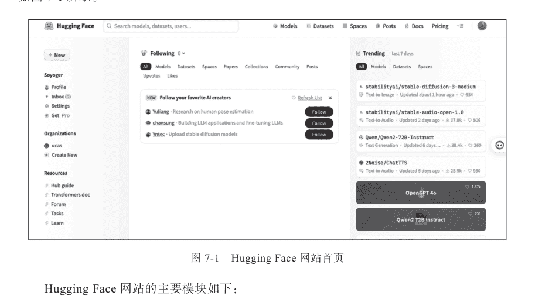

图 7-1 Hugging Face 网站首页

网站主要板块包括：

- Models：各类开源预训练模型集合。
- Datasets：丰富的开源数据集。
- Spaces：社区创建并运行的热门 AI 应用。
- Posts：HF Hub 的全部动态帖子。
- Docs：涵盖各类模型算法使用说明的文档中心。
- Pricing：高级功能、空间扩容与托管服务的定价信息。

### 7.1.2 Hugging Face Hub 客户端库

Hugging Face Hub 是分享机器学习模型、演示、数据集和指标的常用场所，本质上是基于 Git 的存储库集合。可通过两种方式访问：其一基于 Git，主要围绕 Repository 类；其二基于 HTTP，利用 HfApi 客户端发送请求。两者各有特点。

基于存储库的方式优点是可在本地维护完整副本，但需要持续同步与维护，类似传统软件开发中每个开发者维护本地代码。随着需求变化，这一方式在机器学习场景下并非总是必需，因为使用者往往只需下载权重进行推理或格式转换，而不必克隆整个仓库。该模式已逐步被弃用。

HfApi 在不依赖本地同步文件夹的前提下，实现了下载、上传、创建分支与标签等同等功能，还额外提供仓库管理、带缓存的高效下载、仓库与元数据搜索、讨论/PR/评论等社区功能，以及 Spaces 硬件与密钥配置等。基于 HTTP 的方案目前为推荐方式。

#### 1. huggingface_hub 的安装

huggingface_hub 令开发者无需离开当前环境即可与 HF Hub 交互，可方便地创建与管理仓库、上传下载文件、获取模型与数据集元数据。

安装步骤如下：

```
pip3 install --upgrade huggingface_hub
```

#### 2. huggingface_hub 的验证

多数交互场景需要 Hugging Face 账号认证。先注册账号并登录，在“设置”中获取访问 Token，如图 7-2 所示。

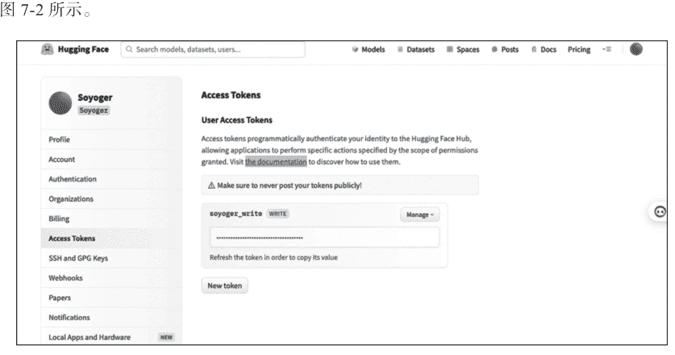

在脚本中调用 login 方法完成登录：

```
from huggingface_hub import login

token = "hf_xxxxxx"
# 登录
login(token=token)
```

登录成功后会显示 Token 权限及缓存位置：

```
Token will not been saved to git credential helper. Pass `add_to_git_
```

credential=True` if you want to set the git credential as well.

Token is valid (permission: write).

Your token has been saved to /Users/xxx/.cache/huggingface/token

Login successful

退出时可使用 logout 方法：

```python
from huggingface_hub import logout
# 退出
logout()
```

返回退出成功的提示：

```
Successfully logged out.
```

## 3. huggingface_hub 的常用操作

借助 huggingface_hub 可在脚本中完成创建仓库、上传下载文件、搜索、推理与缓存等任务。具体操作可参考官网 https://huggingface.co/docs/huggingface_hub/guides/overview。

创建仓库，使用 create_repo，参数 private 控制是否私有，repo_type 指定仓库类型如 model、dataset 或 space，默认为 None：

```python
from huggingface_hub import create_repo

# 创建存储库
repo_id = "soyoger/test-model"
create_repo(repo_id, private=True, repo_type="model")
```

删除仓库，使用 delete_repo：

```python
from huggingface_hub import delete_repo

# 删除存储库
repo_id = "soyoger/test-model"
delete_repo(repo_id, repo_type="model")
```

下载单个文件，使用 hf_hub_download，需指定文件名 filename、本地目录 local_dir、仓库类型 repo_type 等：

```python
from huggingface_hub import hf_hub_download

# 下载文件
repo_id = "moka-ai/m3e-base"
filename = "config.json"
hf_hub_download(
    repo_id=repo_id,
    filename=filename,
    repo_type="model",
    local_dir='./tmp'
)
```

下载完整仓库：

```python
from huggingface_hub import hf_hub_download, list_repo_files

# 下载完整的存储库
repo_id = "moka-ai/m3e-base"
model_files = list_repo_files(repo_id, repo_type='model')
for model_file in model_files:
    hf_hub_download(repo_id=repo_id, filename=model_file, local_dir='./tmp')
```

使用快照下载，可获取指定版本的完整仓库：

```python
from huggingface_hub import snapshot_download

repo_id = "moka-ai/m3e-base"
snapshot_download(repo_id=repo_id, repo_type="model", local_dir='./tmp')
```

上传文件，使用 upload_file 将本地文件推送到仓库：

```python
from huggingface_hub import upload_file

repo_id = "soyoger/test-model"
upload_file(
    path_or_fileobj="/path/README.md",
    path_in_repo="README.md",
    repo_id=repo_id,
    repo_type='model'
)
```

除上述功能外，库内还提供更多操作，详情请查阅官方文档。上述功能同样可通过 HfApi 实现，后者灵活性更强。例如用 HfApi 打印模型列表：

```python
from huggingface_hub.hf_api import HfApi, list_models

token = "hf_xxxxxx"
hf_api = HfApi(token=token)
# 返回 Iterable
models = list_models()
for model in models:
    print(model)
```

## 7.2 Hugging Face 数据集工具

### 7.2.1 数据集工具简介

Hugging Face Datasets 是一个便于获取与分享音频、计算机视觉和自然语言处理任务数据集的库，一行代码即可加载数据，并借助强大的处理方法快速准备训练数据，大幅提升处理效率。

访问官网后点击导航栏 Datasets，可搜索平台提供的数据集，如图 7-3 所示。

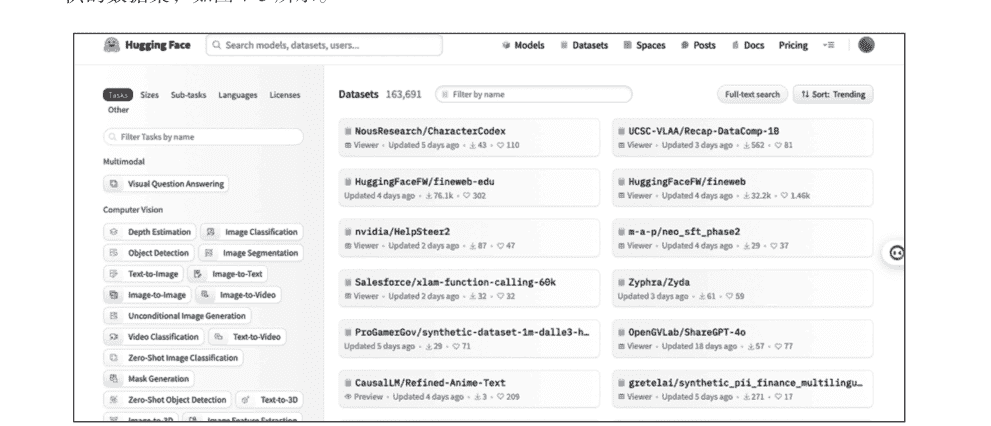

图 7-3 Hugging Face 数据集页面

每个数据集页面都独具特色。左侧支持按任务类型、数据规模、子任务、语言、许可等筛选；右侧展示数据集列表。点进具体数据集可查看详细信息。

平台还提供统一的数据集处理接口，使用同一套 API 处理各类数据。使用前需先安装：

```
pip3 install datasets
```

若涉及音频与图像数据，还需分别安装对应扩展：

```
# 安装音频数据集功能
pip3 install datasets[audio]
# 安装图像数据集功能
pip3 install datasets[vision]
```

### 7.2.2 数据集工具的基本操作

数据集对象主要有 Dataset 与 IterableDataset 两种。Dataset 会将全部数据存入磁盘或内存，适合中小规模；IterableDataset 采用惰性读取，可在线处理而不占用磁盘，更适合大规模数据。更多差异可参考文档 https://huggingface.co/docs/datasets/about_mapstyle_vs_iterable。下面介绍常用操作。

#### 1. 检查数据集

下载前先了解数据集基本信息很有帮助。相关信息保存在 DatasetInfo 中，包含描述、特征、数据规模等。

使用 load_dataset_builder 可在不下载的情况下查看属性，以 weibo_ner 为例：

```python
from datasets import load_dataset_builder

ds_builder = load_dataset_builder("hltcoe/weibo_ner", trust_remote_code=True)

# 查看数据集名称
print(ds_builder.info.dataset_name)

# 检查数据集描述
print(ds_builder.info.description)

# 检查数据集特征
print(ds_builder.info.features)
```

得到的结果如下：

```
weibo_ner

Tags: PER(人名), LOC(地点名), GPE(行政区名), ORG(机构名)
Label Tag Meaning
PER PER.NAM 名字 (张三)
PER.NOM 代称、类别名 (穷人)
LOC LOC.NAM 特指名称 (紫玉山庄)
LOC.NOM 泛称 (大峡谷、宾馆)
GPE GPE.NAM 行政区的名称 (北京)
ORG ORG.NAM 特定机构名称 (通惠医院)
ORG.NOM 泛指名称、统称 (文艺公司)
```

特征信息如下：

```
{'id': Value(dtype='string', id=None), 'tokens': Sequence(feature=Value(dtype='string', id=None), length=-1, id=None), 'ner_tags': Sequence(feature=ClassLabel(names=['B-GPE.NAM', 'B-GPE.NOM', 'B-LOC.NAM', 'B-LOC.NOM', 'B-ORG.NAM', 'B-ORG.NOM', 'B-PER.NAM', 'B-PER.NOM', 'I-GPE.NAM', 'I-GPE.NOM', 'I-LOC.NAM', 'I-LOC.NOM', 'I-ORG.NAM', 'I-ORG.NOM', 'I-PER.NAM', 'I-PER.NOM', 'O'], id=None), length=-1, id=None)}
```

#### 2. 加载数据集

确认合适后，可用 load_dataset 方法加载数据，仍以 weibo_ner 为例：

```python
from datasets import load_dataset

# 加载数据集
dataset = load_dataset("hltcoe/weibo_ner", trust_remote_code=True)
print(dataset)
```

返回对象为 DatasetDict，内部划分为训练集 train、验证集 validation 和测试集 test。

```
DatasetDict({
    train: Dataset({
        features: ['id', 'tokens', 'ner_tags'],
        num_rows: 1350
    })
    validation: Dataset({
        features: ['id', 'tokens', 'ner_tags'],
        num_rows: 270
    })
    test: Dataset({
        features: ['id', 'tokens', 'ner_tags'],
        num_rows: 270
    })
})
```

使用 get_dataset_split_names 可列出所有分割名称：

```python
from datasets import get_dataset_split_names

# 获取数据集分割名称
print(get_dataset_split_names("hltcoe/weibo_ner", trust_remote_code=True))
```

结果如下：

```
['train', 'validation', 'test']
```

加载时可通过参数 split 指定单一分割，例如只加载 train：

```python
dataset = load_dataset("hltcoe/weibo_ner", split="train", trust_remote_code=True)
print(dataset)
```

Dataset 对象快速上手

```
Dataset({
    features: ['id', 'tokens', 'ner_tags'],
    num_rows: 1350
})
```

如果数据被切成多个分片文件，借助多进程加载能显著提速，示例代码如下：

```python
dataset = load_dataset("hltcoe/weibo_ner", trust_remote_code=True, num_proc=8)
```

#### 3. 磁盘持久化

数据加载后可用 save_to_disk 把内容写入本地磁盘，示例代码如下：

```python
dataset.save_to_disk("./tmp/weibo_ner")
```

本地保存的文件可通过 load_from_disk 重新载入，示范如下：

```python
from datasets import load_from_disk

dataset = load_from_disk("./tmp/weibo_ner")
```

#### 4. 数据预览

浏览或加载时可只取特定子集，常见的划分方式列举如下：

```python
# 选择数据集 train
dataset = load_dataset("hltcoe/weibo_ner", split="train", trust_remote_code=True)

# 选择数据集 train+test
dataset = load_dataset("hltcoe/weibo_ner", split="train+test", trust_remote_code=True)

# 按 train 的行获取数据集
dataset = load_dataset("hltcoe/weibo_ner", split="train[10:20]", trust_remote_code=True)

# 按 train 的百分比获取数据集
dataset = load_dataset("hltcoe/weibo_ner", split="train[:20%]", trust_remote_code=True)
```

另外还支持切片语法来抽取片段，代码示例：

```python
print(dataset[:1])
```

执行后得到：

```
{
    'id': ['0'],
    'tokens': [
        ['科 0', '技 1', '全 0', '方 1', '位 2', '资 0', '讯 1', '智 0', '能 1', ',', '0', '快 0', '捷 1', '的 0', '汽 0', '车 1', '生 0', '活 1', '需 0', '要 1', '有 0', '三 1', '屏 2', '— 0', '云 1', '爱 2', '你 0']
    ],
    'ner_tags': [
        [16, 16, 16, 16, 16, 16, 16, 16, 16, 16, 16, 16, 16, 16, 16, 16, 16, 16, 16, 16, 16, 16, 16, 16, 16, 16, 16]
    ]
}
```

#### 5. 按列排序

sort 方法可按指定列排序，writer_batch_size 默认 1000，可根据需要调节，示例：

```python
print(f"排序前 id 值: {dataset['id'][:10]}")
sorted_dataset = dataset.sort(column_names=['id'], reverse=True)
print(f"排序后 id 值: {sorted_dataset['id'][:10]}")
```

输出示例：

```
排序前 id 值：['0', '1', '2', '3', '4', '5', '6', '7', '8', '9']
排序后 id 值：['999', '998', '997', '996', '995', '994', '993', '992', '991', '990']
```

#### 6. 数据打乱

shuffle 能重新洗牌数据，传入 seed 或 seeds 可更好地控制随机性，writer_batch_size 默认为 1000，视情况调整，代码如下：

```python
print(f"打散前 id 值：{dataset['id'][:10]}")
shuffled_dataset = dataset.shuffle(seed=100, writer_batch_size=10000)
print(f"打散后 id 值：{shuffled_dataset['id'][:10]}")
```

结果示例：

```
打散前 id 值：['0', '1', '2', '3', '4', '5', '6', '7', '8', '9']
打散后 id 值：['248', '646', '758', '136', '467', '477', '859', '749', '569', '925']
```

#### 7. 索引抽取

select 方法依据索引下标挑选样本，例如取出特定位置的数据，示例：

```python
sample_dataset = dataset.select([0, 10, 20, 30])
print(f"抽样的数据集 id 值：{sample_dataset[ 'id' ]}")
```

示例如下：

```
抽样的数据集 id 值：['0', '10', '20', '30']
```

#### 8. 条件过滤

filter 用来保留满足条件的数据，例如筛选 id 小于 10 的条目，代码：

```python
filtered_dataset = dataset.filter(lambda x: int(x['id']) < 10)
print(f"过滤后的数据集 id 值：{filtered_dataset['id']}")
```

输出：

```
过滤后的数据集 id 值：['0', '1', '2', '3', '4', '5', '6', '7', '8', '9']
```

#### 9. 训练测试划分

train_test_split 能按比例拆分为训练集与测试集，test_size 控制测试集占比，默认会随机打乱，传 shuffle=False 可关闭打乱。以 7:3 为例，代码如下：

```python
train_test_dataset = dataset.train_test_split(test_size=0.3, writer_batch_size=10000)
```

print(f"原始数据大小: {dataset.shape}")

print(f"训练集大小: {train_test_dataset['train'].shape}")

print(f"测试集大小: {train_test_dataset['test'].shape}")

结果如下：

原始数据大小: (1350, 3)

训练集大小: (945, 3)

测试集大小: (405, 3)

## 10. 数据分块

shard 方法可将超大数据集切成若干等块，num_shards 指定块数，index 指定取第几块，从 0 起算。假设切成 5 块并取第 0 块，代码如下：

```
num_shards = 5
index = 0
shard_dataset = dataset.shard(num_shards=num_shards, index=index)
print(f"原始数据大小: {dataset.shape}")
print(f"第 {index} 份数据大小: {shard_dataset.shape}")
```

结果如下：

原始数据大小: (1350, 3)

分片后的第 0 份数据大小: (270, 3)

## 11. 列名重命名

需要改列名时可用 rename_column 改单列、rename_columns 批量改名，示例如下：

```
print(f"原始数据的列名称: {dataset.column_names}")
rename_dataset = dataset.rename_column('id', 'my_id')
print(f"重命名后数据的列名称: {rename_dataset.column_names}")
renames_dataset = rename_dataset.rename_columns({"tokens": "my_tokens", "ner_tags": "my_ner_tags"})
print(f"重命名后数据的列名称: {renames_dataset.column_names}")
```

结果如下：

原始数据的列名称: ['id', 'tokens', 'ner_tags']

重命名后数据的列名称: ['my_id', 'tokens', 'ner_tags']

重命名后数据的列名称: ['my_id', 'my_tokens', 'my_ner_tags']

## 12. 删除列

remove_columns 支持按列名移除一列或多列，只需传入列名列表即可，示例：

```
print(f"原始数据的列名称: {dataset.column_names}")
remove_dataset = dataset.remove_columns(["id"])
print(f"删除 id 列后数据集的列名称：{remove_dataset.column_names}")
```

结果如下：

原始数据的列名称：['id', 'tokens', 'ner_tags']

删除 id 列后数据集的列名称：['tokens', 'ner_tags']

## 13. 批量映射

map 是更高级的批量处理手段，能提升效率。举例对 id 整体加 1，代码如下：

```
def add_one_to_id(item):
    item['id'] = int(item['id']) + 1
    return item

print(f"原始数据的前 10 个 id 值：{dataset['id'][:10]}")
new_dataset = dataset.map(add_one_to_id)
print(f"处理后数据的前 10 个 id 值：{new_dataset['id'][:10]}")
```

结果如下：

原始数据的前 10 个 id 值：['0', '1', '2', '3', '4', '5', '6', '7', '8', '9']

处理后数据的前 10 个 id 值：[1, 2, 3, 4, 5, 6, 7, 8, 9, 10]

以上列出的是日常开发中高频使用的数据处理技巧。Datasets 仍有更多功能，感兴趣可查阅官方文档深入了解。

## 7.3 Hugging Face 模型工具

### 7.3.1 Transformers 简介

Transformers 是 Hugging Face 核心开源库之一，API 简洁，支持快速加载各类模型。涵盖 BERT、GPT、T5 等预训练模型，也包含 CNN 等非预训练模型，可用于 NLP、CV、音频语音等任务，并方便在特定数据上微调提升效果。

使用前需先安装，命令如下：

```
pip3 install transformers
```

若只是想快速试用或直接套用成熟模型，Transformers 提供了 Pipeline 推理工具。它封装了底层复杂度，提供统一 API，覆盖 NLP、CV、音频及多模态等场景。

使用时只需指定任务类型，Pipeline 会自动匹配模型并输出结果。常见任务类型见表 7-1。

表 7-1 常见的管道任务类型

| 序号 | 任务类型 | 任务管道 |
|---|---|---|
| 1 | audio-classification | AudioClassificationPipeline |
| 2 | automatic-speech-recognition | AutomaticSpeechRecognitionPipeline |
| 3 | conversational | ConversationalPipeline |
| 4 | depth-estimation | DepthEstimationPipeline |
| 5 | document-question-answering | DocumentQuestionAnsweringPipeline |
| 6 | feature-extraction | FeatureExtractionPipeline |
| 7 | fill-mask | FillMaskPipeline |
| 8 | image-classification | ImageClassificationPipeline |
| 9 | image-segmentation | ImageSegmentationPipeline |
| 10 | image-to-text | ImageToTextPipeline |
| 11 | object-detection | ObjectDetectionPipeline |
| 12 | question-answering | QuestionAnsweringPipeline |
| 13 | summarization | SummarizationPipeline |
| 14 | table-question-answering | TableQuestionAnsweringPipeline |
| 15 | text2text-generation | Text2TextGenerationPipeline |
| 16 | text-classification 或 sentiment-analysis | TextClassificationPipeline |
| 17 | text-generation | TextGenerationPipeline |
| 18 | token-classification 或 ner | TokenClassificationPipeline |
| 19 | translation | TranslationPipeline |
| 20 | translation_xx_to_yy | TranslationPipeline |
| 21 | video-classification | VideoClassificationPipeline |
| 22 | visual-question-answering | VisualQuestionAnsweringPipeline |
| 23 | zero-shot-classification | ZeroShotClassificationPipeline |
| 24 | zero-shot-image-classification | ZeroShotImageClassificationPipeline |
| 25 | zero-shot-audio-classification | ZeroShotAudioClassificationPipeline |
| 26 | zero-shot-object-detection | ZeroShotObjectDetectionPipeline |

pipeline 方法是构建 Pipeline 的入口。

### 1. 指定任务类型

以 text-classification 为例演示情感分析：

```
from transformers import pipeline

pipe = pipeline(task="text-classification", trust_remote_code=True)
result = pipe("真的很好！")
print(result)
```

输出如下：

```
[{'label': 'POSITIVE', 'score': 0.8844040632247925}]
```

### 2. 指定模型

若需指定模型，可传入 roberta-large-mnli 进行同样的情感分析：

```
from transformers import pipeline

pipe = pipeline(model="FacebookAI/roberta-large-mnli")
result = pipe("nice")
print(result)
```

结果如下：

```
[{'label': 'ENTAILMENT', 'score': 0.7788204550743103}]
```

### 3. 多任务

Pipeline 也支持批量输入，一次处理多个任务：

```
from transformers import pipeline

pipe = pipeline(task="text-classification", trust_remote_code=True)
result = pipe(["真的很好！", "速度太慢了", "非常好吃，推荐给大家！"])
print(result)
```

示例输出如下：

```
[
    {'label': 'POSITIVE', 'score': 0.8844040632247925},
    {'label': 'NEGATIVE', 'score': 0.8364637494087219},
    {'label': 'POSITIVE', 'score': 0.7888527512550354}
]
```

### 4. 迭代器
管道接口同样支持迭代式数据流，下面以 get_data 方法模拟迭代器为例，相关代码示意如下：
```
import random
from transformers import pipeline

texts = ["真的很好！", "速度太慢了", "非常好吃，推荐给大家！"]

pipe = pipeline(task="text-classification", trust_remote_code=True)

def get_data():
    while True:
        # 假设每次随机抽取一个评论
        data = random.choice(texts)
        yield data

for out in pipe(get_data()):
    print(out)
```

由于代码里调用了 random，单次运行的输出会存在波动，具体样例如下：
```
{'label': 'NEGATIVE', 'score': 0.8364637494087219}
{'label': 'POSITIVE', 'score': 0.7888527512550354}
...
{'label': 'POSITIVE', 'score': 0.7888527512550354}
{'label': 'POSITIVE', 'score': 0.7888527512550354}
```

### 5. 批任务
管道还能做批量推理，只需传入 batch_size 调整批次规模；若环境配备 GPU，还可额外指定 device。下面我们尝试多种 batch_size，记录其耗时表现：
```
import time
from transformers import pipeline

pipe = pipeline(task="text-classification", trust_remote_code=True)

texts = ["真的很好！", "速度太慢了", "非常好吃，推荐给大家！"] * 10
for batch_size in [1, 2, 4, 8]:
    start = time.time()
    for out in pipe(texts, batch_size=batch_size):
        # print(out)
        pass
    end = time.time()
    cost_time = end - start
    print(f"{batch_size=} 的耗时: {cost_time} ")
```

运行结果展示如下：当数据总量固定时，增大 batch_size 会让总耗时持续下降，两者呈现出明显的非线性关联：
```
batch_size=1 的耗时: 1.5002219676971436
batch_size=2 的耗时: 0.9067339897155762
batch_size=4 的耗时: 0.6391067504882812
batch_size=8 的耗时: 0.5261931419372559
```

### 6. 自定义数据集
在批量推理的基础上，管道也允许用户自建数据集，示例实现如下：
```
import time
from transformers import pipeline
from torch.utils.data import Dataset
from tqdm.auto import tqdm

class MyDataset(Dataset):
    def __len__(self):
        return 5000

    def __getitem__(self, i):
        return "这是一条测试数据，可以替换成自己的数据项。"

dataset = MyDataset()

pipe = pipeline("text-classification")
batch_sizes = [1, 2, 4, 8, 16, 32, 64, 128, 256, 512]
cost_times = []
for batch_size in batch_sizes:
    print("-" * 50)
    print(f"Streaming batch_size={batch_size}")
    start = time.time()
    for out in tqdm(pipe(dataset, batch_size=batch_size), total=len(dataset)):
        # print(out)
        pass
    end = time.time()
    cost_time = end - start
    cost_times.append(cost_time)
    print(f"{batch_size=} 的耗时: {cost_time} ")
```

随后我们定义 MyDataset 继承自 Dataset，用来在不同 batch_size 下采集推理耗时，并据此画出折线图，绘图部分代码如下：
```
import matplotlib.pylab as plt
import matplotlib.font_manager as fm

# 加载字体
font = fm.FontProperties(fname='./SimHei.ttf')

plt.plot(batch_sizes, cost_times)
# 添加标题和轴标签
plt.title('BatchSize 大小与推理时间统计图', fontproperties=font)
plt.xlabel('x 轴 -batch_size 大小 ', fontproperties=font)
plt.ylabel('y 轴 - 推理时间 ', fontproperties=font)
plt.show()
```

汇总后得到的 BatchSize 与推理时长统计图见图 7-4，可明显看出合理设定 batch_size 能显著提升处理效率。

Transformers 模型种类繁多，为实现统一灵活调用，AutoClass 提供了一种自动推断机制：根据给定的检查点自行判断并实例化对应类，从而简化模型、配置与处理器的加载流程。

AutoClass 的核心价值是统一接口。无论模型类型如何变化，都能用同一套调用方式完成加载，这让代码更具通用性，也更便于维护与扩展。接下来简要介绍几类常用的 AutoClass。

AutoTokenizer 负责为目标模型匹配并加载合适的分词器。
```
from transformers import AutoTokenizer

tokenizer = AutoTokenizer.from_pretrained("google-bert/bert-base-uncased")
sequence = "I love china."
print(tokenizer(sequence))
```

图 7-4 展示了 BatchSize 与推理时间的关系

AutoImageProcessor 主要用来加载预训练的图像预处理工具。
```python
from transformers import AutoImageProcessor

image_processor = AutoImageProcessor.from_pretrained("google/vit-base-patch16-224")
```

AutoFeatureExtractor 用来加载已预训练的特征提取器。
```python
from transformers import AutoFeatureExtractor

feature_extractor = AutoFeatureExtractor.from_pretrained(
    "ehcalabres/wav2vec2-lg-xlsr-en-speech-emotion-recognition"
)
```

AutoProcessor 负责加载预先训练的多用途处理器。
```python
from transformers import AutoProcessor

processor = AutoProcessor.from_pretrained("microsoft/layoutlmv2-base-uncased")
```

AutoModel 则提供通用的预训练模型加载入口。
```python
from transformers import AutoModelForSequenceClassification

model = AutoModelForSequenceClassification.from_pretrained("distilbert-base-uncased")

from transformers import AutoModelForTokenClassification
model = AutoModelForTokenClassification.from_pretrained("distilbert-base-uncased")
```

下面演示如何借助 Transformers 库加载预训练的 GPT-2 模型并完成文本生成任务。
```python
from transformers import AutoModelForCausalLM, AutoTokenizer

tokenizer = AutoTokenizer.from_pretrained("openai-community/gpt2", trust_remote_code=True)
model = AutoModelForCausalLM.from_pretrained(
    "openai-community/gpt2",
    trust_remote_code=True
)
```

先用分词器把输入句 ["An increasing sequence: one,"] 转成模型可用的张量，并通过 return_tensors='pt' 指定输出为 PyTorch 格式。
```python
inputs = tokenizer(["An increasing sequence: one,"], return_tensors='pt')
print(inputs)
```

分词后的张量输出如下：
```
{'input_ids': tensor([[2025, 3649, 8379, 25, 530, 11]]), 'attention_mask': tensor([[1, 1, 1, 1, 1, 1]])}
```

调用模型生成续写，设置 max_new_tokens=20 限制最多新增 20 个词，early_stopping=True 则允许在满足条件时提前结束。
```python
result = model.generate(**inputs, max_new_tokens=20, early_stopping=True)
print(result)
```

生成的 Token 张量展示如下：
```
tensor([[ 2025, 3649, 8379, 25, 530, 11, 734, 11, 1115, 11,
         1440, 11, 1936, 11, 2237, 11, 3598, 11, 3624, 11,
         5193, 11, 3478, 11, 22216, 11]])
```

最后借助分词器把 Token 张量解码为可读文本。
```python
tokens = tokenizer.batch_decode(result)
print(tokens)
```

最终输出如下：
```
['An increasing sequence: one, two, three, four, five, six, seven, eight, nine, ten, eleven,']
```

## 7.3.2 数据预处理
训练前数据必须先整理成模型期望的输入形式。无论是文本、图像还是音频，都要转换为张量。Hugging Face Transformers 提供了对应的预处理类来完成这一步。

### 1. 文本
文本预处理的核心是把句子切分成标记序列，再映射为数值并组装成张量：
```python
from transformers import AutoTokenizer

tokenizer = AutoTokenizer.from_pretrained("google-bert/bert-base-cased")
encoded_input = tokenizer("2024 年是人工智能应用爆发的一年，这一年全球 AI 爱好者开发出很多有趣的 AI 应用！")
print(encoded_input)
```

### 2. 图像
图像预处理同样要将其转为张量形式：
```python
from PIL import Image
from transformers import AutoImageProcessor

image_path = "cat.jpg"
image = Image.open(image_path)
processor = AutoImageProcessor.from_pretrained("google/vit-base-patch16-224")
inputs = processor(images=image, return_tensors="pt")
print(inputs)
```

### 3. 音频
音频则需从波形中抽取序列特征，再转成张量：
```python
import wave
import numpy as np
from transformers import AutoFeatureExtractor

def get_wav_data(audio_path):
    with wave.open(audio_path, 'rb') as wav_file:
        n_frames = wav_file.getnframes()
        # 读取音频数据
        frames = wav_file.readframes(n_frames)
        # 将音频数据转换为 numpy 数组
        wave_form = np.frombuffer(frames, dtype=np.int16)
        print(wave_form)
        return wave_form

audio_path = "./audio.wav"
audio_input = get_wav_data(audio_path)

feature_extractor = AutoFeatureExtractor.from_pretrained("facebook/wav2vec2-base")

# sampling_rate 指每秒测量语音信号中的数据点数，16kHz。
results = feature_extractor(audio_input, sampling_rate=16000)
print(f"数据大小: {results['input_values'][0].shape}")
print(results)
```

### 4. 多模态
多模态数据要把文本标记序列与各类特征融合为统一张量：
```python
from datasets import load_dataset, Audio

lj_speech = load_dataset("lj_speech", split="train", trust_remote_code=True)
lj_speech = lj_speech.map(remove_columns=["file", "id", "normalized_text"])

print(lj_speech[0]["audio"])

print(lj_speech[0]["text"])

lj_speech = lj_speech.cast_column("audio", Audio(sampling_rate=16_000))

from transformers import AutoProcessor

processor = AutoProcessor.from_pretrained("facebook/wav2vec2-base-960h")

def prepare_dataset(example):
    audio = example["audio"]

    example.update(processor(audio=audio["array"], text=example["text"], sampling_rate=16000))

    return example

result = prepare_dataset(lj_speech[0])
print(result)
```

## 7.3.3 模型微调

# 预训练很香，微调才好用

Hugging Face 平台上的开源模型已经很强大，但它们大多基于通用公开语料训练而成，直接拿来做特定业务任务时，效果往往打折扣。要想在某个细分场景里跑出理想表现，就必须做二次训练，让模型更贴合业务目标。这个思路在业界叫迁移学习：先借用通用的预训练能力，再在专属数据上做针对性调整，从而提升在垂直领域的精度和稳定性。

官方也强调了直接用预训练模型的好处。它能大幅削减算力开销和碳排放成本，还能让你零成本调用当下的 SOTA 模型，不用从零开始造轮子。用的时候核心操作就是在和任务强相关的集上继续训练，这一步通常被称为微调，是一种性价比极高的训练手段。

下面结合官网给出的案例，演示一下在 Hugging Face 上微调预训练模型的全流程。

先把 YelpReviews 数据集拉下来：

```python
from datasets import load_dataset

dataset = load_dataset("yelp_review_full")
print(dataset["train"][:2])
```

瞟一眼前两条样本长什么样：

```
{'label': [4, 1], 'text': ["dr. goldberg offers everything i look for in a general practitioner. he's nice and easy to talk to without being patronizing; he's always on time in seeing his patients; he's affiliated with a top-notch hospital (nyu) which my parents have explained to me is very important in case something happens and you need surgery; and you can get referrals to see specialists without having to see him first. really, what more do you need? i'm sitting here trying to think of any complaints i have about him, but i'm really drawing a blank.", "Unfortunately, the frustration of being Dr. Goldberg's patient is a repeat of the experience I've had with so many other doctors in NYC -- good doctor, terrible staff. It seems that his staff simply never answers the phone. It usually takes 2 hours of repeated calling to get an answer. Who has time for that or wants to deal with it? I have run into this problem with many other doctors and I just don't get it. You have office workers, you have patients with medical needs, why isn't anyone answering the phone? It's incomprehensible and not work the aggravation. It's with regret that I feel that I have to give Dr. Goldberg 2 stars."]}
```

文本需要先处理。选一个 tokenizer 来做分词，对可变长序列做填充和截断，再用 map 把预处理函数批量作用到整份数据上：

```python
from transformers import AutoTokenizer

tokenizer = AutoTokenizer.from_pretrained("google-bert/bert-base-cased")

def tokenize_function(examples):
    return tokenizer(examples["text"], padding="max_length", truncation=True)

tokenized_datasets = dataset.map(tokenize_function, batched=True)
```

为了省算力和时间，先切出一小部分子集来做实验微调：

```python
small_train_dataset = tokenized_datasets["train"].shuffle(seed=42).select(range(1000))
small_eval_dataset = tokenized_datasets["test"].shuffle(seed=42).select(range(1000))
```

数据准备完就加载要二次训练的基础模型，并把分类数设为 5 类：

```python
from transformers import AutoModelForSequenceClassification

model = AutoModelForSequenceClassification.from_pretrained(
    "google-bert/bert-base-cased",
    num_labels=5
)
```

接着定训练配置。实例化一个 TrainingArguments 对象，把学习率、批次大小、epoch 等可调超参和各种训练开关都写进去：

```python
from transformers import TrainingArguments

training_args = TrainingArguments(
    # 定义 checkpoints 检查点路径
    output_dir="test_trainer",
    # 定义测试执行策略，值包括：no epoch steps
    evaluation_strategy='steps',
    # 定义每隔多少个 step 执行一次测试
    eval_steps=10,
    # 学习率
    learning_rate=1e-4,
    # 加入权重衰减，预防过拟合
    weight_decay=1e-2,
    # 是否使用 GPU
    no_cuda=True
)
```

训练时需要看指标。Trainer 需要一个评估函数，Evaluate 库自带了一个 accuracy，可以通过 evaluate.load 一键加载：

```python
import numpy as np
import evaluate

metric = evaluate.load("accuracy")

def compute_metrics(eval_pred):
    logits, labels = eval_pred
    predictions = np.argmax(logits, axis=-1)
    return metric.compute(predictions=predictions, references=labels)
```

然后组装训练器。把模型、训练参数、训练集、验证集以及刚才的评估函数一起打包成 Trainer 实例：

```python
from transformers import TrainingArguments

training_args = TrainingArguments(
    # 定义 checkpoints 检查点路径
    output_dir="test_trainer",
    # 定义测试执行策略，值包括：no epoch steps
    evaluation_strategy='steps',
    # 定义每隔多少个 step 执行一次测试
    eval_steps=10,
    # 学习率
    learning_rate=1e-4,
    # 加入权重衰减，预防过拟合
    weight_decay=1e-2,
    # 是否使用 GPU
    no_cuda=True,
    # 日志输出策略
    logging_strategy="steps",
    # 日志输出级别
```

正式开训前先测一遍基线：

```python
trainer.evaluate()
```

记录初始表现，准确率只有 0.18：

```python
{
    'eval_loss': 1.7317930459976196,
    'eval_accuracy': 0.18,
    'eval_runtime': 120.681,
    'eval_samples_per_second': 0.829,
    'eval_steps_per_second': 0.108
}
```

现在调用 train 方法开始微调：

```python
trainer.train()
```

运行期间会实时打印日志：

```python
***** Running training *****
  Num examples = 100
  Num Epochs = 3
  Instantaneous batch size per device = 8
  Total train batch size (w. parallel, distributed & accumulation) = 8
  Gradient Accumulation steps = 1
  Total optimization steps = 39
  Number of trainable parameters = 108314117
```

日志显示本次演示只用了 100 条样本，共跑了 39 个 step，模型参数总量为 108 314 117 个。训练结束后立刻再评估一次：

```python
trainer.evaluate()
```

结果如下：

```python
{
    'eval_loss': 1.4960126876831055,
    'eval_accuracy': 0.33,
    'eval_runtime': 122.1781,
    'eval_samples_per_second': 0.818,
    'eval_steps_per_second': 0.106,
    'epoch': 3.0
}
```

经过 100 条样本、39 轮的微调，准确率提升到 0.33。训练好的权重可以用 save_model 保存到本地，后续推理直接调用就行。

```python
trainer.save_model(output_dir="./train/model")
```

把本地保存的模型重新载入：

```python
from transformers import AutoTokenizer
from transformers import AutoModelForSequenceClassification

tokenizer = AutoTokenizer.from_pretrained("google-bert/bert-base-cased")
model = AutoModelForSequenceClassification.from_pretrained(
    "./train/model"
)
```

对一段新文本做推理：

```python
texts = [
    "dr. goldberg offers everything i look for in a general practitioner. ",
    "It seems that his staff simply never answers the phone. It usually takes 2 hours of repeated calling to get an answer. Who has time for that or wants to deal with it? I have run into this problem with many other doctors and I just don't get it. You have office workers, you have patients with medical needs"
]
encoded_inputs = tokenizer(
    texts,
    padding="max_length",
    truncation=True,
    return_tensors='pt'
)
outputs = model(**encoded_inputs)
labels = outputs['logits'].argmax(dim=1)
print(labels.numpy().tolist())
```

输出的标签结果为：

```python
[4, 4]
```

## 7.3.4 模型评价指标

Evaluate 是 Hugging Face 用于评估机器学习模型和数据集的工具库。一行代码就能接入 NLP、计算机视觉、强化学习等多个领域的常用指标，而且在本地或分布式环境下都能保持一致、可复现的评估结果。

早期这些评估功能是嵌在 datasets 库里的，查看可用指标的代码是：

```python
from datasets import list_metrics

metrics = list_metrics()
print(metrics)
```

随着迭代，datasets 已不再维护指标，新的模型和数据集评估全部交由 Evaluate 来负责。先安装依赖：

```bash
pip3 install evaluate
```

指标入口如下：

```python
import evaluate

accuracy = evaluate.load("accuracy")
print(accuracy.description)
```

可以看到 accuracy 的说明文档，里面解释了它的计算原理：

```
Accuracy is the proportion of correct predictions among the total number of
cases processed. It can be computed with:
Accuracy = (TP + TN) / (TP + TN + FP + FN)
Where:
TP: True positive
TN: True negative
FP: False positive
FN: False negative
```

查看指标的引用来源：

```python
print(accuracy.citation)
```

返回的信息如下：

```
@article{scikit-learn,
    title={Scikit-learn: Machine Learning in {P}ython},
    author={Pedregosa, F. and Varoquaux, G. and Gramfort, A. and Michel, V.
            and Thirion, B. and Grisel, O. and Blondel, M. and Prettenhofer, P.
            and Weiss, R. and Dubourg, V. and Vanderplas, J. and Passos, A. and
            Cournapeau, D. and Brucher, M. and Perrot, M. and Duchesnay, E.},
    journal={Journal of Machine Learning Research},
    volume={12},
    pages={2825--2830},
    year={2011}
}
```

实际算分主要有两种用法。All-in-one 模式是一次性把所有预测和标签喂给 compute 方法：

```python
result = accuracy.compute(references=[0, 1, 0, 1, 1], predictions=[1, 0, 0, 1, 1])
print(result)
```

结果会以字典形式返回：

```python
{'accuracy': 0.6}
```

在需要增量或分布式构建预测的场景下，Incremental 模式更灵活，可以用 add 逐步累加：

```python
for ref, pred in zip([0, 1, 0, 1, 1], [1, 0, 0, 1, 1]):
    accuracy.add(references=ref, predictions=pred)
print(accuracy.compute())
```

最终拿到评估结果：

```python
{'accuracy': 0.6}
```

同理也可以使用 add_batch 方法批量累加。

```python
for refs, preds in zip([[0, 1], [0, 1], [1]], [[1, 0], [0, 1], [1]]):
    accuracy.add_batch(references=refs, predictions=preds)
print(accuracy.compute())
```

得到评估结果：

```python
{'accuracy': 0.6}
```

## 7.4 核心回顾

本部分对 Hugging Face 平台的能力栈进行了梳理，并辅以实践案例说明。

Pipeline 与 AutoClass 是平台的两个标志性能力。Pipeline 以高层接口封装了文本分类、命名实体识别、文本生成等常用任务的调用链路，几行实现即可完成预训练模型的加载与推理。AutoClass 通过自动推断与实例化机制帮助挑选匹配的模型类、配置类与处理器类，使用难度显著下降。

Datasets 让数据流转更为顺滑。该库支持各类数据集的上传与下载，并提供高效的清洗与转换手段。使用者可在 Hugging Face 的数据集仓库中挑选资源，直接引入训练与评估流程。

Transformers 库是生态里最具代表性的模型库，内置覆盖多种算法任务的预训练权重，加载后即可开展编码、微调与评测。

Evaluate 专注于评测体验。单行调用即可获取 NLP、计算机视觉、强化学习等多个领域的常用指标。

# 第 8 章 LangChain 入门指南

2024 年人工智能发展进入新阶段。国内外大模型技术趋于成熟，已被视作应用开发的基础层。对大模型应用的构建者来说，工具选型决定效率。在众多方案中，LangChain 因其集成度高、落地广被广泛采用。本章围绕其模块展开学习。

本章要点如下：

- 初识 LangChain：认识其诞生背景、开发路径与生态全貌。
- 模型 I/O：提示词模板、模型封装器与输出解析器。
- 数据增强：文档读取、转换、向量化、向量库与检索。
- 链：把多个 LLM 或组件串联以解决复杂问题。

## 8.1 框架初识

### 8.1.1 框架总览

LangChain 是一个面向大语言模型的开源应用搭建框架，最初由 Robust Intelligence 的 Harrison Chase 在 GitHub 上开源，随后获得社区认可并演进为主流开发框架。它提供了一套组件与工具集合，开发者无需深入底层，仅用少量代码即可跑通大模型程序，大幅缩短上手周期。

针对大语言模型开发，LangChain 将能力抽象为模型 I/O、数据连接、链、记忆、智能体、回调处理器六大模块。借助这些模块的组件，快速搭建 LLM 应用成为可能。

（1）模型 I/O
用于对接各类模型。模型封装器给出统一的大语言模型接口，可兼容市面绝大多数模型；提示词模板支持动态化管理输入；输出解析器可限定输出格式。

（2）数据连接
涵盖数据读取、转换、存储与检索，让自有数据接入更便捷。

（3）链
单一模型可处理多数简单任务。面对复杂场景，链可将多个封装器或其他组件串联，完成复合任务。

（4）记忆
大语言模型本身无记忆。LangChain 提供读写等能力，帮助系统实现记忆。运行前先从记忆读取历史，执行完业务后再把本次输入输出写入记忆，供后续使用。

（5）智能体
Agent 将大语言模型与提示词作为推理核心，结合工具选择，决定下一步任务与执行顺序。

（6）回调处理器
通过在 API 中配置 callbacks 参数，可接入日志记录、监控、流式输出等处理器。

### 8.1.2 生态与部署

#### 1. 生态全貌

LangChain 将 LLM 应用生命周期划分为开发、生产化、部署三阶段，并为各阶段提供开源包。

- langchain-core：基础抽象与表达式。
- langchain-community：第三方集成，如 langchain-openai、langchain-anthropic，部分能力已拆分为只依赖 langchain-core 的轻包。
- langchain：链、代理与检索策略构成认知架构。
- langgraph：把步骤建模为图中的节点与边，构建有状态多角色应用。
- langserve：把 LangChain 链暴露为 REST API。
- langsmith：面向开发者的调试、测试、评估、监控平台，可与 LangChain 深度联动。

#### 2. 环境搭建

依据使用场景选择对应包进行安装。

（1）LangChain 正式版
最小安装可直接默认安装，部分依赖需额外补全。命令：
```bash
pip3 install langchain
```

源码安装需克隆仓库并进入 PATH/TO/REPO/langchain/libs/langchain 后执行：
```bash
pip3 install -e .
```

（2）LangChain 核心
langchain-core 包含生态的基础抽象与表达式，随 langchain 自动安装，也可单独安装：
```bash
pip3 install langchain-core
```

（3）LangChain 社区版
langchain-community 收纳第三方集成，可随 langchain 自动安装，也可单独安装：
```bash
pip3 install langchain-community
```

（4）LangChain 实验版
langchain-experimental 收录研究性代码：
```bash
pip3 install langchain-experimental
```

（5）LangGraph
用于构建多状态多角色应用：
```bash
pip3 install langgraph
```

（6）LangServe
为应用提供服务并自动安装 LangChain CLI：
```bash
pip3 install "langserve[all]"
```

客户端与服务端依赖安装：
```bash
pip3 install "langserve[client]"
pip3 install "langserve[server]"
```

（7）LangSmith
若已装 LangChain 会自动装配，未使用 LangChain 时执行：
```bash
pip3 install langsmith
```

#### 3. 首个示例

以电商评论情感分析为例，采用微软 AzureChat，代码如下：
```python
from langchain_openai import AzureChatOpenAI

azure_endpoint = "https://xxx"
openai_api_key = "xxx"

azure_chat = AzureChatOpenAI(
    azure_endpoint=azure_endpoint,
    azure_deployment="gpt-35-turbo",
    openai_api_version="2024-06-30-preview",
    openai_api_key=openai_api_key)

content = "物流很快，包装精美，上门送货，非常喜欢。"
prompt = f"""
身份：资深中文文本情感分析专家
任务：对给定的文本进行情感分析，判断文本的情感标签属于积极、中性还是消极，并给出一个 0~1 范围的得分
输出：使用 JSON 格式输出，情感标签使用键 label，值为情感标签结果；情感得分使用键 score，值为得分值
文本内容：{content}
限制：只进行情感分析，不执行其他额外操作，结果仅包含 label 和 score
"""
response = azure_chat.invoke(prompt)
print(response.content)
```

得到结果如下：
```python
{
    "label": "积极",
    "score": 0.95
}
```

## 8.2 模型输入输出

本节说明模型 I/O 的基本概念。模型本身重要，但开发者更关注如何高效交互。模型 I/O 模块提供工具，让主流大语言模型接入更顺畅。

### 8.2.1 总体概念

LangChain 中的模型 I/O 通过封装给出标准交互 API，使用者无需掌握各平台通信协议即可快速建立连接。

典型流程如图 8-1 所示。
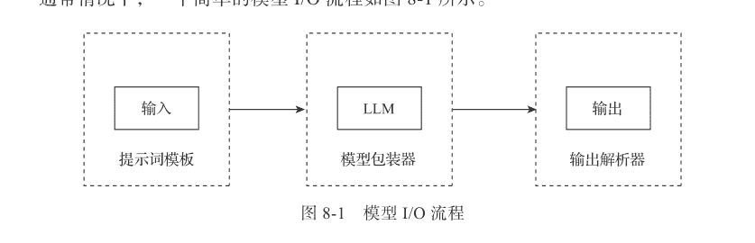

- ①提示词模板：将输入模板化并支持动态调整。
- ②模型封装器：对接各平台大语言模型的 API。
- ③输出解析器：对模型输出做格式化。

### 8.2.2 提示词模板

回顾第 6 章提示词工程，重点在撰写技巧，管理层面涉及较少，通常以字符串保存。

在 LangChain 中，提示词经工程化后变为结构化对象，可包含一个或多个模板。

模板由可复用的字符串组成，接收用户参数生成模型提示词。底层格式化支持默认 f-string 或 jinja2 语法。

1. PromptTemplate
提示词组件的核心类。实例化时关键参数为 input_variables、template 与 template_format，template_format 默认 f-string，通常只需准备前两者。

以下示例演示用模板计算两数之和，代码如下：
```python
from langchain_core.prompts import PromptTemplate

template = """
    请帮我计算：{a} + {b} 的值是多少？
"""
# 实例化模板方法一，推荐该方法
prompt = PromptTemplate.from_template(template=template)
prompt = prompt.format(a=1, b=2)
print(f"实例化模板方法一：{prompt}")

# 实例化模板方法二
prompt = PromptTemplate(template=template, input_variables=["a", "b"])
prompt = prompt.format(a=10, b=20)
print(f"实例化模板方法二：{prompt}")
```

两种实例化方式的输出如下：

实例化模板方法一：
请帮我计算：1 + 2 的值是多少？

实例化模板方法二：
请帮我计算：10 + 20 的值是多少？

2. FewShotPromptTemplate
少样本提示词模板类，可在提示词中动态插入示例。继承 PromptTemplate 并扩展了少样本相关参数。

以下示例用于生成新提示词，代码如下：
```python
from langchain_core.prompts import PromptTemplate, FewShotPromptTemplate

examples = [
    {"question": "发什么快递？", "answer": "我们是顺丰快递，包邮哦！"},
    {"question": "尺寸多大呀？", "answer": "我们的尺码都是均码哦！"},
]

template = """\t 问题：{question} 答案：{answer}"""
example_prompt = PromptTemplate(
    template=template,
    input_variables=["question", "answer"]
)

prefix = """
    角色：直播间虚拟主播
    功能：回答直播间用户的提问
    示例：
"""

suffix = """
    限制：请严格按照直播场景回答问题，忽略不相关问题。
    接下来，你来回答用户的问题：
"""
few_shot_prompt = FewShotPromptTemplate(
    examples=examples,
    example_prompt=example_prompt,
    example_separator="\n",
    prefix=prefix,
    suffix=suffix,
    input_variables=["username", "question"]
)
few_shot_prompt = few_shot_prompt.format(username="username", question="发什么快递？")
print(few_shot_prompt)
```

得到的提示词如下：

角色：直播间虚拟主播

功能：回答直播间用户的提问

示例：

> 问题：发什么快递？ 答案：我们是顺丰快递，包邮哦！

问题：尺寸多大呀？ 答案：我们的尺码都是均码哦！

限制：请严格按照直播场景回答问题，忽略不相关问题。

接下来，你来回答用户的问题：

3. ChatPromptTemplate
构造消息列表式提示词，支持嵌套角色消息模板并输出 Message 对象。构造代码如下：
```python
from langchain_core.prompts import (
    ChatPromptTemplate, SystemMessagePromptTemplate, HumanMessagePromptTemplate
)

template = """你是一个非常资深的程序开发工程师，你可以回答任何关于编程的问题。"""
system_message_prompt = SystemMessagePromptTemplate.from_template(template)

human_template = """请帮我解答一下这个问题：{question}"""
human_message_prompt = HumanMessagePromptTemplate.from_template(human_template)

chat_prompt = ChatPromptTemplate.from_messages([
    system_message_prompt,
    human_message_prompt
])
print(f"新的 ChatPromptTemplate 提示词模板：{chat_prompt}")
chat_prompt = chat_prompt.format_prompt(question="Python 为什么需要 GIL 锁？")
print(f"新的 ChatPromptTemplate 提示词：{chat_prompt}")
```

代码先创建 system_message_prompt 与 human_message_prompt 两个角色模板，再传入 ChatPromptTemplate 生成聊天模板对象 chat_prompt，输出结果如下：

```
新的 ChatPromptTemplate 提示词模板：input_variables=['question'] messages=[SystemMessagePromptTemplate(prompt=PromptTemplate(input_variables=[], template='你是一个非常资深的程序开发工程师，你可以回答任何关于编程的问题。')), HumanMessagePromptTemplate(prompt=PromptTemplate(input_variables=['question'], template='请帮我解答一下这个问题：{question}'))]
新的 ChatPromptTemplate 提示词：messages=[SystemMessage(content='你是一个非常资深的程序开发工程师，你可以回答任何关于编程的问题。'), HumanMessage(content='请帮我解答一下这个问题：Python 为什么需要 GIL 锁？')]
```

除了前面提到的三类提示模板之外，框架还兼容 LengthBasedExampleSelector 与 PipelinePromptTemplate 等扩展组件，具体清单可前往官方文档查阅。

## 8.2.3 模型包装器

截至 2024 年底，LangChain 的模型接入量已突破五十款，涵盖 OpenAI、微软、Meta、谷歌、百度、阿里、腾讯等国内外头部厂商的商业模型，也包含社区里表现亮眼的开源实现。

在接入方式上主要分为两类：一类是面向通用推理的 LLM 封装，另一类是面向对话交互的 ChatModel。

### 1. LLM 包装器
这里以 AzureChatOpenAI 为例说明通用封装的调用方式，相关片段：

```python
from langchain_openai import AzureChatOpenAI

azure_endpoint = "https://xxx"
openai_api_key = "xxx"

azure_chat = AzureChatOpenAI(
    azure_endpoint=azure_endpoint,
    azure_deployment="gpt-35-turbo",
    openai_api_version="2024-07-03-version",
    openai_api_key=openai_api_key)

prompt = f"""
    功能：告诉我一个中文笑话。
    限制：字数 20 字以内。
"""
response = azure_chat.invoke(prompt)
print(response.content)
```

执行后得到的内容：

笑话：为什么小明不爱吃蔬菜？因为他是小明，不是小菜。

### 2. LLM 缓存
给模型调用加上可选项缓存层，能带来两个直接收益：重复请求命中缓存后可减少对模型接口的调用以降低费用；同时少了对第三方服务的往返，整体响应也会更快。

目前可用的实现包括 InMemoryCache、RedisCache、SQLiteCache 等，均继承自 BaseCache 来完成各自逻辑。

BaseCache 抽象出 lookup、update、clear 三个核心操作，分别对应查询、写入、清空，并且都提供了异步版本。

```python
import time
from langchain.globals import set_llm_cache
from langchain.cache import InMemoryCache

# 第一次执行
start = time.time()
prompt = f"""
    功能：告诉我一个中文笑话。
    限制：字数在 20 字以内。
"""
set_llm_cache(InMemoryCache())
response = azure_chat.invoke(prompt)
print(response.content)
end = time.time()
print(f"未使用缓存，请求耗时：{end - start}")

# 第二次执行
start = time.time()
prompt = f"""
    功能：告诉我一个中文笑话。
    限制：字数在 20 字以内。
"""
response = azure_chat.invoke(prompt)
print(response.content)
end = time.time()
print(f"已使用缓存，请求耗时：{end - start}")
```

运行展示如下：

为什么小明会笑？因为他听到了一个笑话。

未使用缓存，请求耗时：0.535163164138794

为什么小明会笑？因为他听到了一个笑话。

已使用缓存，请求耗时：0.001483917236328125

对比可见，缓存命中后执行时间显著缩短。

### 3. LLM 工具调用
借助模型的自然语言理解能力，可以让其完成 API 检索、数据库查询、自动化流程、数据清洗等操作。

框架自带一批常用工具，也允许自行扩展，这类调用常用于组装工具链、构建智能体，或从模型中抽取结构化信息。举例来说，配合搜索引擎后，模型就能先发起搜索再据此作答。

下面用 @tool 装饰器自定义一个搜索工具 search，完整代码：

```python
from langchain.tools import tool
# 定义工具
@tool("search", return_direct=True)
def search_api(query: str) -> str:
    """
    接入工具，如从API处查询
    """
    return f"查询 {query} 得到：苹果 "

tools = [search_api]
llm_with_tools = azure_chat.bind_tools(tools)
prompt = f"请使用中文随机说一个水果的名字。"
tool_calls_outputs = llm_with_tools.invoke(prompt).tool_calls
print(tool_calls_outputs)
result = search_api.invoke(tool_calls_outputs[0]['args'])
print(result)
```

输出结果为：

```
[{'name': 'search', 'args': {'query': '水 果'}, 'id': 'call_jktCwVDDgibGYehTEWr5ncIS'}]
查询水果得到：苹果
```

### 4. LLM 自定义
如果现成的封装无法覆盖自研模型，就能通过继承 LLM 接口来自定义。

自定义封装需要满足表 8-1 的要求。

表 8-1 自定义 LLM 包装器需要实现的方法

| 方法 | 是否必须实现 | 描述 |

| :--- | :--- | :--- |

| _call | 是 | 接收一个字符串和一些可选的停用词，并返回一个字符串。该字符串被 invoke 使用 |

| _llm_type | 是 | 返回字符串的属性，仅用于记录 |

| _identifying_params | 否 | 用于帮助识别模型并打印 LLM 的信息，返回结果是一个字典。这是一个 @property 装饰器 |

| _acall | 否 | 提供一个 _call 的异步本地实现，被 ainvoke 使用 |

| _stream | 否 | 逐个输出 Token 的方法 |

| _astream | 否 | 提供对 _stream 的异步本地实现，在较新的 LangChain 版本中，默认为 _stream |

下面以评论情感分析为例，先用 Hugging Face 的 pipeline 构造一个模型：

```python
from transformers import pipeline

def sentiment_analysis(prompt):
    """
    进行情感分析
    :param prompt:
    :return:
    """
    pipe = pipeline(task="text-classification", trust_remote_code=True)
    result = pipe(prompt)
    return json.dumps(result, ensure_ascii=False)
```

随后给出对应的自定义封装实现：

```python
import json
from typing import Optional, List, Any, Iterator, Union, Dict, Type
from langchain_core.language_models.llms import LLM
from langchain_core.callbacks import CallbackManagerForLLMRun
from langchain_core.language_models import LanguageModelInput
from langchain_core.outputs import GenerationChunk
from langchain_core.runnables import Runnable
from langchain_openai import AzureChatOpenAI
from pydantic import BaseModel

class MyOpenLLM(LLM):

    def with_structured_output(
            self,
            schema: Union[Dict, Type[BaseModel]],
            **kwargs: Any
    ) -> Runnable[LanguageModelInput, Union[Dict, BaseModel]]:
        ...

    def _call(
            self,
            prompt: str,
            stop: Optional[List[str]] = None,
            run_manager: Optional[CallbackManagerForLLMRun] = None,
            **kwargs: Any
    ) -> str:
        """在给定输入上运行 LLM。

        重写此方法以实现 LLM 逻辑。

        参数：
            prompt: 用于生成的提示。
            stop: 生成时使用的停用词。模型输出在任何停止子串的第一次出现时被截断。
                如果不支持停用词，请考虑引发 NotImplementedError。
            run_manager: 运行的回调管理器。
            **kwargs: 任意额外的关键字参数。通常传递给模型提供者 API 调用。

        返回：
            模型输出作为字符串。实际完成不应包括提示。
        """
        if stop is not None:
            raise ValueError("不允许使用停用词参数。")
        context = sentiment_analysis(prompt)
        return context

    def _stream(
```

## 5. LLM 流式输出
框架原生支持流式返回，下面展示一段流式调用的代码：

```python
prompt = f"""
    功能：写出李白的《将进酒》。
    限制：使用中文。
"""
chunks = azure_chat.stream(prompt)
for chunk in chunks:
    print(chunk.content, end="", flush=True)
```

逐段返回的内容如下：

君不见黄河之水天上来，奔流到海不复回。

君不见高堂明镜悲白发，朝如青丝暮成雪。

人生得意须尽欢，莫使金樽空对月。

天生我材必有用，千金散尽还复来。

烹羊宰牛且为乐，会须一饮三百杯。

岑夫子，丹丘生，将进酒，杯莫停。

与君歌一曲，请君为我倾耳听。

钟鼓馔玉不足贵，但愿长醉不复醒。

古来圣贤皆寂寞，惟有饮者留其名。

陈王昔时宴平乐，斗酒十千恣欢谑。

主人何为言少钱，径须沽取对君酌。

五花马，千金裘，呼儿将出换美酒，与尔同销万古愁。

## 8.2.4 输出解析器
工程落地时，除了关注答案的正确性，更要求结果能被下游系统直接消费。LangChain 内置了一组预设解析器，可把自然语言文本转为结构化数据。

以 AzureChatOpenAI 作为底层，示例片段如下：

```python
from langchain_openai import AzureChatOpenAI

azure_endpoint = "https://xxx"
openai_api_key = "xxx"

azure_chat = AzureChatOpenAI(
    azure_endpoint=azure_endpoint,
    azure_deployment="gpt-35-turbo",
    openai_api_version="2024-06-30-preview",
    openai_api_key=openai_api_key)
```

### 1. 输出 JSON 格式
为让模型返回结构化数据，可调用 with_structured_output 方法，对输出进行 schema 约束，schema 支持 dict 或 Pydantic 模型。

```python
from langchain_core.pydantic_v1 import BaseModel, Field

class Output(BaseModel):
    result: str = Field(description="结果")
    remark: str = Field(description="备注")

structured_llm = azure_chat.with_structured_output(Output, method="json_mode")

prompt = f"""
功能：请判断 1 是否大于 2，为什么？
输出：返回结果是或者否，并说明原因。结果用键 'result'，判断原因用键 'remark'，以 JSON 形式响应。
限制：说明原因，限制在 10 个字以内。
"""
print(structured_llm.invoke(prompt))
```

返回结果：

```
result='False' remark='1 不大于 2'
```

### 2. 结构化输出解析器
当需要一次返回多个字段时，该解析器比较合适。相对 Pydantic 或 JSON 解析器，它对模型能力的要求更低，适合能力一般的模型。

使用时先声明期望的输出结构，解析器会据此生成引导用的提示模板，示例代码：

```python
from langchain.output_parsers import ResponseSchema, StructuredOutputParser
from langchain.prompts import PromptTemplate

response_schemas = [
    ResponseSchema(name="answer", description="用户问题的答案"),
    ResponseSchema(
        name="result",
        description="结果",
    ),
]
output_parser = StructuredOutputParser.from_response_schemas(response_schemas)
format_instructions = output_parser.get_format_instructions()
prompt = PromptTemplate(
    template="请严谨地回答用户的问题。\n{format_instructions}\n{question}",
    input_variables=["question"],
    partial_variables={"format_instructions": format_instructions},
)
print(azure_chat.invoke("请判断 1 是否大于 2，为什么？").content)
```

执行后得到：

```
1 不大于 2。因为 1 小于 2。
```

除 Pydantic、JSON 与结构化解析器之外，框架还提供了日期时间、枚举、重试、YAML、XML 等类型的解析器，详细用法请参考官方文档。

## 8.3 数据增强

LangChain 数据增强实战：LDEVR 五步法

本章聚焦 LangChain 的数据增强能力，这套可复用的集成框架常被简写为 LDEVR。L 代表 Loader 加载器，D 代表 Document Transformer 文档转换器，E 代表 Embedding 文本嵌入，V 代表 VectorStore 向量数据库，R 代表 Retriever 向量检索。

### 8.3.1 文档加载器

加载器的作用是把各种载体的数据统一变成 LangChain 的 Document 对象，一个 Document 由正文文本和元数据两部分构成。常用的加载器覆盖 CSV、文件目录、HTML、JSON、MarkDown、Office 文档、PDF 等场景。下面展开几个典型用法。

#### 1. CSV 加载器

CSV 是一种以逗号分隔值的纯文本格式，每行代表一条记录，多列由逗号分割。

LangChain 用 CSVLoader 来读取 CSV，CSVLoader 基于 BaseLoader 实现。文件里每一行会被映射成一个 Document，内容以键值对形式写入 page_content。

可配置的参数有：

- file_path：CSV 文件的路径
- source_column：可选，用哪一列作为文档来源
- encoding：可选，文件编码
- csv_args：可选，透传给 csv.DictReader 的参数

下面用 CSVLoader 读取 example_data.csv 数据，代码如下：

```python
from langchain_community.document_loaders import CSVLoader

loader = CSVLoader(file_path='./example_data.csv', encoding='utf-8')
data = loader.load()
print(data)
```

得到的结果如下：

```
[Document(page_content='编号：1\n评论内容：快递非常快，送货上门。', metadata={'source': '1', 'row': 0}), Document(page_content='编号：2\n评论内容：尺码比较合适，非常喜欢。', metadata={'source': '2', 'row': 1})]
```

#### 2. PDF 加载器

PDF 即便携式文档格式，由 Adobe 于 1993 年推出，后演进为 ISO 32000 国际标准。其优点是跨平台格式稳定、支持文本图像表单等多种内容、安全性和可搜索性都较强。

LangChain 内置多款 PDF 加载器，包含 MathpixPDFLoader、OnlinePDFLoader、UnstructuredPDFLoader、PyPDFium2Loader、PDFMinerLoader、PyMuPDFLoader 以及 PyPDFDirectoryLoader 等。

下面示例使用 PyPDFium2Loader 读取 PDF 文档，代码如下：

```python
from langchain_community.document_loaders import PyPDFium2Loader

pdf_loader = PyPDFium2Loader(file_path="./pdf测试文档.pdf")
data = pdf_loader.load()
print(data)
```

得到的结果如下：

```
[Document(page_content='PDF 测试文档\r\n这是一个 PDF 测试文档，用来演示 LangChain 的 PDF 加载器功能。\n', metadata={'source': './pdf测试文档.pdf', 'page': 0})]
```

### 8.3.2 文档转换器

加载器完成后得到的是 Document 对象，但不同来源的格式和体量会带来后续处理问题。 LLM 对 Token 数量有上限，整篇文档一次性输入也不利于模型发挥，因为同一文档内部的相同词汇在不同上下文里语义可能差异很大。

因此需要先把长文本切成更小的语义连贯片段，再转回 Document 格式。转换流程一般分两步：先用切割器按策略切分，再把切块整理成 Document。

切割策略可按页、按段、按句、按字符或按目标块大小执行，合理切分能控制块内长度并降低语义混淆。

LangChain 提供了 CharacterTextSplitter、RecursiveJsonSplitter、RecursiveCharacterTextSplitter、SemanticChunker、CodeSplitter 等切割器，下面介绍常用两种。

#### 1. 按字符切割器

这是最直接的切分方式，按字符分隔符拆分，默认分隔符为 “\n\n”，并以字符数衡量块长。

```python
from langchain.text_splitter import CharacterTextSplitter

texts = [
    "这是一个按字符切割的测试数据",
    "这是一个按字符切割的测试数据"
]
text_splitter = CharacterTextSplitter(
    chunk_size=512,
    chunk_overlap=10
)
docs = text_splitter.create_documents(texts)
print(docs)
```

在 CharacterTextSplitter 中，chunk_size 控制块大小，chunk_overlap 控制相邻块的重叠量。得到的结果如下：

```
[Document(page_content='这是一个按字符切割的测试数据'), Document(page_content='这是一个按字符切割的测试数据')]
```

#### 2. 递归按字符切割器

递归按字符切割是通用文本的推荐做法。它会按预设的字符列表依次尝试切分，直到块足够小为止，默认顺序为["\n\n", "\n", " ", ""]。这样能尽量保留段落、句子、单词的完整性，因为这些单元在语义上关联更强。

下面以小说《三国演义》为例进行切分，语料 “三国演义.txt” 来自网络，代码如下：

```python
from langchain.text_splitter import RecursiveCharacterTextSplitter

with open("三国演义.txt", "r") as f:
    content = f.read()

text_splitter = RecursiveCharacterTextSplitter(
    chunk_size=1024,
    chunk_overlap=10,
    length_function=len,
    is_separator_regex=False,
)
docs = text_splitter.create_documents([content])
print(docs[0])
print(docs[1])
```

得到的结果如下：

```
page_content='------------------\n\n第一章宴桃园豪杰三结义 \n\n 话说天下大势，分久必合，合久必分：周末年七国纷争，并入于秦；及秦灭之后，楚、汉分争，又并入于汉；汉朝自高祖斩白蛇而起义，一统天下。后来光武中兴，传至献帝，遂分为三国。推其致乱之由，殆始于桓、灵二帝。桓帝禁锢善类，崇信宦官。及桓帝崩，灵帝即位，大将军窦武、太傅陈蕃共相辅佐。时有宦官曹节等弄权，窦武、陈蕃谋诛之，反为所害。于是宦官更相朋党，朝廷日非。张让、赵忠、段珪、曹节、侯览、蹇硕、程旷、夏恽、郭胜等十人朋比为奸，号为“十常侍”。帝尊信张让，呼为“阿父”。朝政日非，以致天下人心思乱，盗贼蜂起。时钜鹿郡有兄弟三人，一名张角，一名张宝，一名张梁。那张角本是个不第秀才，因入山采药，遇一老人，碧眼童颜，手执藜杖，唤角至一洞中，以天书三卷授之，曰：“此名《太平要术》，汝得之，当代天宣化，普救世人。若萌异心，必获恶报。”角拜问姓名。老人曰：“吾乃南华老仙也。”言讫，化阵清风而去。角得此书，晓夜攻习，能呼风唤雨，号为“太平道人”。\n\npage_content='榜文到涿县。这涿县中有一个英雄姓刘，名备，字玄德。他身长七尺五寸，两耳垂肩，面如冠玉，云长的是一把八十二斤重的青龙偃月刀，... 刘焉亲自迎接，奖赏军士。'
```

### 8.3.3 文本嵌入

LangChain 对主流大模型的嵌入接口做了封装，借助预训练模型的语义理解能力实现向量化，覆盖 OpenAI、Hugging Face 等生态。

常见的嵌入类型包括：

- 自然语言嵌入模型：OpenAIEmbeddings、HuggingFaceEmbeddings 等，直接基于大模型生成向量
- 云平台嵌入模型：Elasticsearch、SagemakerEndpoint、DeepInfra 等，适合借助云算力处理大规模文本
- 专用嵌入模型：AsymmetricSemanticEmbedding、SymmetricSemanticEmbedding 等，针对特定结构文本优化
- 自托管嵌入：SelfHostedEmbeddings，面向私有化部署和管理
- 仿真测试嵌入：FakeEmbeddings，用于测试和模拟
- 其他类型：Cohere、LlamaCpp、ModelScope、MiniMax 等，满足不同处理需求

下面以 Hugging Face 为例演示 HuggingFaceEmbeddings 的自定义用法，代码如下：

```python
from langchain_community.embeddings import HuggingFaceEmbeddings

model_name = "moka-ai/m3e-base"
model_kwargs = {'device': 'cpu'}
encode_kwargs = {'normalize_embeddings': False}
embeddings = HuggingFaceEmbeddings(
    model_name=model_name,
    model_kwargs=model_kwargs,
    encode_kwargs=encode_kwargs
)
```

HuggingFaceEmbeddings 继承 Embeddings 基类，并实现了 embed_documents 和 embed_query 两个方法。其中 embed_documents 用 Transformers 模型为文档集合计算嵌入，embed_query 为查询语句计算嵌入。

```python
texts = [
    "这是一个按字符切割的测试数据",
    "这是一个按字符切割的测试数据"
]
# 生成文本嵌入
embed = embeddings.embed_documents(texts)
print(f"嵌入的长度: {len(embed[0])}")
print(embed)

# 生成查询嵌入
query = embeddings.embed_query("测试")
print(f"嵌入的长度: {len(query)}")
print(query)
```

从结果可见向量维度为 768，具体如下：

```
嵌入的长度: 768
[[0.20694951713085175, ..., -0.8299545645713806]]
嵌入的长度: 768
[0.9041356444358826, ..., -0.3840891718864441]
```

总的来说，文本嵌入类型多样，用户可按实际需求挑选最合适的方案。

## 8.3.4 向量存储库

常规做法是先用嵌入模型得到向量，再写入向量数据库。但面对不同数据库时需要写不同的存储代码。LangChain 的向量存储库提供了一组包装器，只需把 Document 对象和嵌入模型传入接口，后台会自动完成文本转字符串、字符串转向量、向量写入数据库的全部流程，开发效率大幅提升。

下面以 HuggingFaceEmbeddings 配合 FAISS 为例说明工作流程。

（1）使用文本转化器准备文档

```python
from langchain.text_splitter import CharacterTextSplitter

texts = [
    "这是苹果，很甜。",
    "这是梨，很脆。",
    "这是青楠，很酸。"
]
text_splitter = CharacterTextSplitter(
    chunk_size=512,
    chunk_overlap=10
)
docs = text_splitter.create_documents(texts)
```

（2）初始化嵌入模型，使用 HuggingFaceEmbeddings 自定义模型

```python
from langchain_community.embeddings import HuggingFaceEmbeddings

model_name = "moka-ai/m3e-base"
model_kwargs = {'device': 'cpu'}
encode_kwargs = {'normalize_embeddings': False}
hf_embeddings = HuggingFaceEmbeddings(
    model_name=model_name,
    model_kwargs=model_kwargs,
    encode_kwargs=encode_kwargs
)
```

（3）用 FAISS 向量数据库存储数据

```python
from langchain_community.vectorstores import FAISS

db = FAISS.from_documents(docs, hf_embeddings)
```

（4）查看数据的存储 ID

```python
print(db.index_to_docstore_id)
```

得到的结果如下：

```
{0: 'c35317a6-5ff6-45a6-b575-79fa6e21e6e8', 1: '4e97d72c-9783-4ecd-8abe-e494cbb86d5a', 2: '9b339f59-ab6b-4545-b1d1-98e0cd0cbbf1'}
```

（5）将数据批量写入向量存储库中

```python
db.add_texts(["这是桃子"])
# 查看创建的向量 ID
print(db.index_to_docstore_id)
```

得到的结果如下：

```
{0: 'c35317a6-5ff6-45a6-b575-79fa6e21e6e8', 1: '4e97d72c-9783-4ecd-8abe-e494cbb86d5a', 2: '9b339f59-ab6b-4545-b1d1-98e0cd0cbbf1', 3: 'ed09f0cb-9ace-4119-9210-bd66a40c159b'}
```

（6）根据 ID 批量删除数据

```python
db.delete(list(db.index_to_docstore_id.values())[:2])
print(db.index_to_docstore_id)
```

得到的结果如下：

```
{0: '9b339f59-ab6b-4545-b1d1-98e0cd0cbbf1', 1: 'ed09f0cb-9ace-4119-9210-bd66a40c159b'}
```

向量存储库不仅负责存储，还提供高效检索能力。

LangChain 向量存储的父类 VectorStore 定义了多种检索方法，常用的有：

（1）similarity_search 方法
返回与查询最相似的 k 个文档，query 为查询文本，k 为返回数量，默认 4。

（2）similarity_search_by_vector 方法
与 similarity_search 类似，但 query 直接传入嵌入向量。

（3）max_marginal_relevance_search 方法
基于最大边际相关性算法 MMR 挑选文档，兼顾相关性和多样性，避免结果冗余。参数为 query 查询文本、k 返回文档数默认 4、fetch_k 供 MMR 候选的文档数默认 20、lambda_mult 在 0 到 1 之间调节相关性与多样性的权重，0 更注重多样性，1 更注重相关性，默认 0.5 均衡两者。

（4）向量版最大边际相关检索

该接口的工作逻辑和 max_marginal_relevance_search 基本相同，差别在查询形式的转换——这里接受的不是原始文本，而是已编码好的向量。前面提到的检索函数都准备了异步实现，在并发场景下能明显提升执行效率。向量库还对外暴露了 as_retriever 接口，调用后可得到一个 VectorStoreRetriever 对象。搜索策略由 search_type 指定，默认采用 similarity，也可切换为 mmr 或 similarity_score_threshold；细节参数则通过 search_kwargs 传递，其中 k 默认取 4，fetch_k 默认取 20，lambda_mult 默认取 0.5。

## 8.3.5 检索器

在 LangChain 体系里，检索器本质上是对向量库的封装。把存储库包装成 VectorStoreRetriever 类后，就形成了一套统一的检索调用规范。通过向量库实例调用 as_retriever 即可拿到可用的检索器。下面以 HuggingFaceEmbeddings 自建嵌入模型配合 FAISS 向量库为例，演示检索器在向量库中的典型使用流程。

①加载和转换文本，代码如下：
```python
from langchain.text_splitter import RecursiveCharacterTextSplitter

with open("三国演义.txt", "r") as f:
    content = f.read()

text_splitter = RecursiveCharacterTextSplitter(
    chunk_size=512,
    chunk_overlap=10,
    length_function=len,
    is_separator_regex=False,
)
docs = text_splitter.create_documents([content])
```
②初始化文本嵌入，代码如下：
```python
from langchain_community.embeddings import HuggingFaceEmbeddings

model_name = "moka-ai/m3e-base"
model_kwargs = {'device': 'cpu'}
encode_kwargs = {'normalize_embeddings': False}
hf_embeddings = HuggingFaceEmbeddings(
    model_name=model_name,
    model_kwargs=model_kwargs,
    encode_kwargs=encode_kwargs
)
```
③向量数据库存储，如果文档列表比较大，则需要花点时间存储。
```python
from langchain_community.vectorstores import FAISS

db = FAISS.from_documents(docs, hf_embeddings)
```
④获取检索器实例，进行问题检索。
```python
retriever = db.as_retriever(search_type="similarity")
docs = retriever.get_relevant_documents("刘备三顾茅庐，与诸葛亮在隆中对中聊了什么？")
print(docs)
```

框架内置的检索器种类不少，包含多查询检索器、父文档检索器、时间加权检索器，以及上下文压缩和重排序等。实际应用时可结合各自擅长的场景进行挑选与组合。

## 8.4 链

LangChain 中的链可以看作数据流的编排器，核心作用是把多个组件串联起来，构建从数据接入、加工到模型推理输出的完整通路。

下面以一个从输入到处理再到大模型推理的演示链为例，代码如下。

①使用 AzureChatOpenAI 实例化一个大语言模型 llm：
```python
from langchain_openai import AzureChatOpenAI

azure_endpoint = "https://xxx"
openai_api_key = "xxx"

llm = AzureChatOpenAI(
    azure_endpoint=azure_endpoint,
    azure_deployment="gpt-35-turbo",
    openai_api_version="2024-07-03-version",
    openai_api_key=openai_api_key)
```
②定义一个提示词模板 PromptTemplate，该模板接收两个输入参数：
```python
template = """
    请帮我进行计算：{a} + {b} 的值是多少？
"""
prompt = PromptTemplate(template=template, input_variables=["a", "b"])
```
③使用 LLMChain 创建一个链对象，将大语言模型 llm 和提示词 prompt 两个组件连接在一起：
```python
from langchain.chains import LLMChain

chain = LLMChain(llm=llm, prompt=prompt)
```
④调用 invoke 方法来运行这个链：
```python
output = chain.invoke(dict(a=1, b=2))
print(output)
```
⑤得到推理结果：
```
{'a': 1, 'b': 2, 'text': '1 + 2 = 3.'}
```

这是一个最简的链式用法示范，通过链把数据输入、数据处理和大模型推理等环节有序串联，让应用流程更清晰，也更便于维护管理。

## 8.5 小结

本章聚焦 LangChain 框架的模型 I/O 与数据增强两大模块。掌握这两个模块的好处有：

- 快速启动大模型应用开发：理解并运用模型 I/O 与数据增强后，能迅速搭建并部署高效的语言模型应用，实现从输入到输出的闭环。
- 提升模型表现：数据增强可以扩充训练样本的多样性和数量，从而提高模型的泛化能力和任务准确度。
- 简化开发流程：合理使用模型 I/O 能更便捷地处理输入并提取输出，减少开发成本与耗时。

不过 LangChain 框架还包含链、记忆、智能体、回调处理器等重要模块，受篇幅限制本书未展开，读者可查阅官方文档获取更多信息。这些模块能进一步增强大模型应用的性能与灵活性，帮助构建更复杂、更智能的系统。

# 第 9 章 大语言模型微调

通用大模型能力很强，但在垂直任务上往往达不到最优。借助微调，可以把领域特定数据集喂给模型，让其学会领域知识，从而在情感分析、实体识别、文本分类、对话生成等 NLP 任务上表现更好。本章将系统讲解大语言模型的微调方法。

本章主要覆盖的知识点有：

- 大语言模型微调概述：掌握微调的理论基础、基本流程和适用场景。
- 大语言模型的微调策略：掌握不同场景下的微调方案并挑选最合适的做法。
- 基于 ChatGPT 的微调：掌握微调 ChatGPT 的三种方式，包括 Fine-Tuning UI、CLI 命令和 API 微调。
- 基于 Hugging Face 的开源大模型微调：掌握开源大语言模型的微调方法，以获得更灵活的应用空间。

## 9.1 大语言模型微调概述

以 ChatGPT 为代表的大语言模型训练通常分为两个阶段：预训练和微调。预训练赋予模型宽泛的语言理解力，微调则让模型在特定任务上更精准高效。

预训练阶段使用海量的无监督语料，如维基百科、新闻、论坛等，让模型学习预测下一个词的概率，掌握语言的统计规律与语义信息。

微调阶段则采用有监督数据，数据包含输入与人工标注的目标输出。目标是通过有监督学习进一步调整参数，提升模型在指定任务上的执行质量。

### 9.1.1 为什么需要微调

大模型经过大规模预训练后具备强大的理解与生成能力，但在具体业务场景中，直接使用基座模型往往无法完全满足需求。微调通过额外注入任务特定数据，让预训练模型更好地贴合领域要求，提升实际效果。进行微调的主要原因有：

- （1）提升特定任务表现
预训练模型虽然知识面广，但在某些任务上并不总是最佳。微调能在目标任务数据上进行专门训练，增强模型对该任务的理解与处理能力。例如，模型在完形填空上表现好，但在文本分类和情感分析上仍需微调强化。

- （2）增强实用性与可靠性
通用大模型输出常不稳定，而生产环境要求高可靠性。微调可让模型学习领域知识，减少错误回答。如电商平台的数字主播，经微调后能更准确地理解并回答用户关于品牌和产品特性的问题。

- （3）学习最新数据与知识
预训练数据采集周期长，往往已过时。用最新实时数据进行微调，可让模型掌握热点事件和舆论趋势。

- （4）满足特定法律与伦理要求
在部分场景中，模型输出需符合合规要求。微调可调整模型行为，使输出更合理、可控。

### 9.1.2 少样本提示与微调

在提示词工程里，为了让模型更快适应新任务，往往在提示中加入少量示例，即少样本提示。这种方式无需重训模型，灵活度高，但受性能、精度、持久性、一致性、领域知识和资源利用等方面限制。微调则通过深度适配任务与领域，能显著提升性能，保证结果稳定一致，并优化计算效率。因此在对高性能、稳定性、专业性要求高的场景，微调不可替代。两者结合使用可充分发挥大模型的潜能。表 9-1 是两种方式的对比。

## 表 9-1 少样本提示与微调对比

| 比较项 | 少样本提示（Few-shot Prompting） | 微调（Fine-tuning） |
| --- | --- | --- |
| 数据需求 | 少量示例 | 大量数据 |
| 实施时间 | 短（仅设计提示） | 长（需要训练） |
| 性能表现 | 依赖任务和提示设计质量 | 高（特定任务上表现出色） |
| 适应性 | 能够快速适应 | 特定领域 |
| 持久性 | 低（每次都需要输入） | 高（一次训练长期有效） |
| 计算资源消耗 | 低（仅推理阶段需要计算资源） | 高（训练需要大量计算资源） |

可以看出，少样本提示和微调各有优劣。微调在数据和算力充足时能显著提升特定任务性能，适合长期应用；少样本提示在资源受限、需快速适配时更有优势。依据具体需求选择，才能更好发挥大模型价值。

### 9.1.3 微调的基本流程

微调的核心步骤可概括为数据准备、模型训练、模型评估与优化迭代。评估后往往需要再准备数据改进模型，属于需要反复迭代的过程。整体流程如图 9-1 所示。
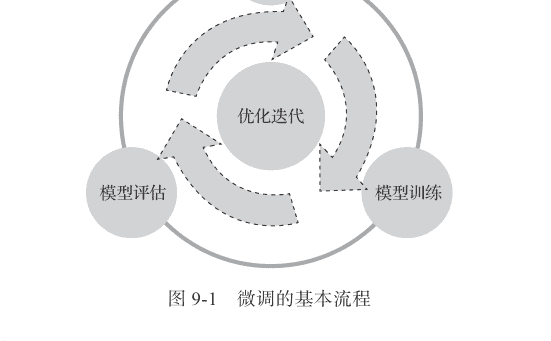
（1）数据准备
为微调工作准备高质量数据集，包括：
- 数据收集：按任务领域收集优质数据。
- 数据清洗：对数据做转换、清洗、去噪等处理。
- 数据格式化：将数据划分为训练集、测试集、验证集，并保存为合适格式，如 JSONL。

（2）模型训练
使用准备好的数据集进行训练，包括：
- 选择模型：挑选预训练模型作为基础。
- 设置参数：配置批处理大小、学习率、迭代轮数等。
- 启动训练：执行微调任务并监控过程。

（3）模型评估
用验证集评估微调后的模型，包括：
- 模型评估：用测试集或验证集评估，分析错误，判断是否需要新一轮微调。

（4）优化迭代
根据评估结果调整数据与参数，包括：
- 数据更新：补充数据或提升现有数据质量。
- 参数更新：合理调参。
- 重复训练和评估：持续改进直至达标。

总之，微调是一个迭代过程，训练与评估步骤在不同类型微调中基本一致，但数据选择与处理方式直接影响效果。

## 9.2 大语言模型的微调策略

微调是让预训练模型适配特定领域任务的关键技术。根据需求与资源，可选择全面微调或参数高效微调。下面分别介绍。

### 9.2.1 全面微调

全面微调指对预训练模型的所有参数进行更新，通过数据准备、训练、评估与策略调整，使模型在特定领域表现更优。适用于数据量大、算力充足的场景。

自 2018 年 10 月 BERT 以 3.5 亿参数成为当时最大 Transformer 模型以来，大模型参数规模持续膨胀，如 BLOOM 达 1760 亿参数，是 BERT 的约 500 倍。而同期 GPU 单卡显存仅从约 10 倍增长到 80GB。模型增速远超算力增速，超出摩尔定律，导致全面微调对多数模型不现实。

在算力受限时，参数高效微调能在有限资源下实现有效微调，既提升效果又节省时间和成本，因而受到广泛关注。下面重点介绍该类策略。

### 9.2.2 参数高效微调

论文 “Scaling Down to Scale Up: A Guide to Parameter-Efficient Fine-Tuning” 整理了 2019 年 2 月至 2023 年 2 月期间 40 多篇相关工作，提出一个分类法，将参数高效微调分为三大类：基于 Addition、基于 Selection 和基于 Reparametrization。其中基于 Addition 又分为 Adapter-like 和 Soft prompts。详细分类如图 9-2 所示。
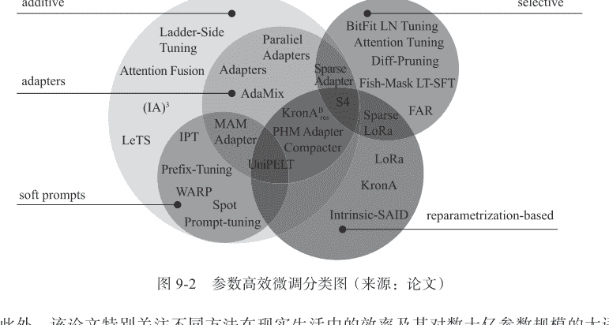
该论文还对比了不同方法在现实效率及对数十亿参数大模型微调效果上的表现，从存储效率、内存效率、计算效率、准确性和推理开销五个维度进行评估。下面介绍几种经典方法。

### 1. 前缀调优（Prefix Tuning）
模型对人工模板非常敏感，模板词增减或位置变化都会明显影响性能。Prefix Tuning 通过在不改动原模型参数的前提下，为模型添加可训练的前缀参数，来调节特定任务表现。核心思想是在输入部分拼接可训练前缀，通过训练使其适应任务需求。

### 2. 提示调优（Prompt Tuning）
提示调优可视为 Prefix Tuning 的简化版。传统做法依赖人工设计提示词，Prompt Tuning 借助反向传播自动学习优化提示词，无需重训整个模型即可提升特定任务表现，大幅节省算力与时间。

### 3. P-Tuning
P-Tuning 将提示词表示为一组可训练嵌入向量。给定离散提示词作为输入，将连续提示词嵌入与离散提示词嵌入拼接后送入大模型，再通过反向传播更新可训练提示词以优化目标。经验证，优化提示词嵌入即可让模型适配特定任务，无需微调全部参数。

### 4. LoRA
LoRA 即 Low-Rank Adaptation，通过引入低秩矩阵实现参数更新。其核心是将原始模型的部分权重矩阵分解为低秩矩阵，从而减少参数量与计算开销，同时保持性能。在算力受限情况下能显著提升预训练模型微调效率，广泛应用于自然语言处理任务中。

除了前面提到的做法，QLoRA、AdaLoRA、Adapter Tuning、P-Tuning v2、MAM Adapter 和 UniPELT 等方案，也都是当前被大量使用的参数高效微调手段。

## 9.3 ChatGPT 微调上手指南

2023 年 8 月 23 日，OpenAI 对 GPT-3.5 推出微调 API，开发者可借助定制数据在特定任务上获得更强的表现。官方表示，经过定制的模型在部分垂直场景甚至能与 GPT-4 相当甚至更优，相当于每个团队或个人都能拥有专属版 ChatGPT。

大模型预先在海量文本上完成预训练，而微调则是让它更贴合具体业务。整体流程可归纳为：准备并上传数据、训练出新的微调模型、评估效果并视情况迭代、完成后再投放到使用环节。

数据准备阶段对格式有明确要求。数据集须为 JSONL 格式，样例示例如下：

```
{"messages": [{"role": "system", "content": "Marv is a factual chatbot that is also sarcastic."}, {"role": "user", "content": "What's the capital of France?"}, {"role": "assistant", "content": "Paris, as if everyone doesn't know that already."}]}
{"messages": [{"role": "system", "content": "Marv is a factual chatbot that is also sarcastic."}, {"role": "user", "content": "Who wrote 'Romeo and Juliet'?"}, {"role": "assistant", "content": "Oh, just some guy named William Shakespeare. Ever heard of him?"}]}
{"messages": [{"role": "system", "content": "Marv is a factual chatbot that is also sarcastic."}, {"role": "user", "content": "How far is the Moon from Earth?"}, {"role": "assistant", "content": "Around 384,400 kilometers. Give or take a few, like that really matters."}]}
```

若采用对话式聊天结构，且基座模型为 gpt-3.5-turbo、babbage-002 或 davinci-002，则可使用另一种数据结构进行微调：

```
{"prompt": "<prompt text>", "completion": "<ideal generated text>"}
{"prompt": "<prompt text>", "completion": "<ideal generated text>"}
{"prompt": "<prompt text>", "completion": "<ideal generated text>"}
```

数据就绪后要划分为训练集和验证集。每条样本的长度也受限于基座模型：gpt-3.5-turbo-0125 单条上限 16385 个 Token，gpt-3.5-turbo-0613 单条上限 4096 个 Token，超出部分会被截断。

正式开始前建议先用数据集格式校验工具检查，确保每段对话都符合接口规范；同时可做轻量分析，提前发现系统/用户消息缺失等问题，并统计消息数量与 Token 数量，帮助预估微调成本。

下面分别以 Fine-Tuning UI、CLI 和 API 三种方式演示 OpenAI 的微调流程。

### 9.3.1 图形界面快速微调

OpenAI 提供了可视化微调入口。进入 https://platform.openai.com/finetune 后，在左侧导航点击 “Fine-tuning” 即可打开控制台，如图 9-3 所示。

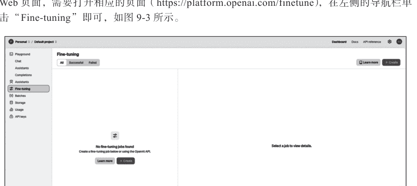

控制台左侧列出所有可微调任务，右侧展示任务详情。点按 “+Create” 即可新建任务，如图 9-4 所示。

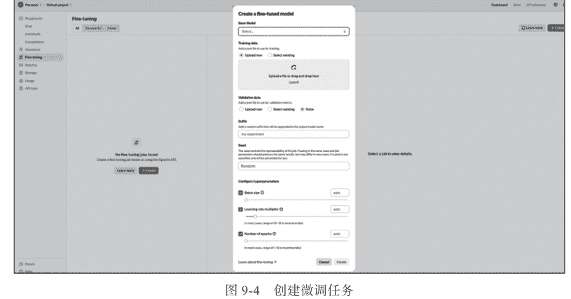

图 9-4 创建微调任务

创建任务通常经历以下步骤：

- 选定基础模型：可选 babbage-002、davinci-002、gpt-3.5-turbo-0125、gpt-3.5-turbo-0613、gpt-3.5-turbo-1106。
- 导入训练集：上传或选择已有的 .jsonl 文件。
- 导入验证集：上传或选择已有的 .jsonl 文件。
- 指定模型后缀：为输出模型添加自定义后缀。
- 设置随机种子：用于保证结果可复现，未填写时系统自动生成。
- 调整超参数：批大小、学习率、训练轮数，默认均为 auto。
- 提交任务：填写完毕后点击 “Create”。
- 评估结果：通过监控训练过程决定是否采用或继续迭代。
- 投产使用：微调完成后即可调用新模型。

### 9.3.2 命令行工具操作

OpenAI 提供了命令行工具来处理数据、上传文件、创建任务和使用模型等操作。常用的命令示例如下。

先安装 openai 库：

```
pip3 install --upgrade openai
```

在 Linux、macOS 等环境中配置 API Key：

```
export OPEN_API_KEY="自己的 api_key"
```

通过帮助命令查看 tools 与 api 支持的功能：

```
openai tools -h 或 openai tools --help
openai api -h 或 openai api --help
```

帮助信息显示命令行支持图像、音频、文件、模型等类别，具体用法见表 9-2。

表 9-2 OpenAI 命令行工具使用方法

| 工具包 | 使用方法 | 功能描述 |

| :--- | :--- | :--- |

| tools | fine_tunes.prepare_data | 准备用于微调模型的数据 |

| | images.generate | 生成新的图像 |

| | images.edit | 编辑现有图像 |

| | images.create_variation | 基于已有图像生成不同的变体 |

| | audio.transcriptions.create | 将音频文件转录成文本 |

| | audio.translations.create | 将音频文件翻译成另一种语言的文本 |

| | files.create | 上传文件到 OpenAI 服务器 |

| | files.retrieve | 检索已上传的文件 |

| | files.delete | 删除已上传的文件 |

| api | files.list | 列出所有已上传的文件 |

| | fine_tunes.create | 创建微调任务 |

| | fine_tunes.list | 列出所有微调任务及其状态 |

| | fine_tunes.get | 根据任务 ID 来获取特定任务的详细信息 |

| | models.list | 列出所有可用的模型 |

| | models.retrieve | 检索特定模型的详细信息 |

| | models.delete | 删除特定的模型 |

| | completions.create | 使用模型生成基于提供的提示词的文本 |

| | chat.completions.create | 在对话任务中生成基于上下文对话的回复 |

使用 prepare_data 处理本地数据，参数 -f 指定本地路径：

```
openai tools fine_tunes.prepare_data -f ./tmp/data.txt
```

该过程会对本地文件进行分析与清洗，最终产出新的 JSONL 文件，如图 9-5 所示。

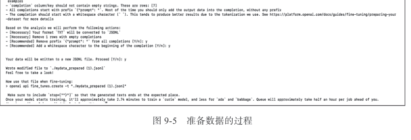

用 files.create 将数据上传到服务器，参数 -p 指定用途如 fine-tune、answers、search：

```
openai api files.create -f ./training_data.jsonl -p fine-tune
```

创建微调任务时，-t 指定训练集，--model 指定基座模型：

```
openai api fine_tunes.create -t 训练文件 ID --model 选择的基础模型
```

查看所有任务及状态：

```
openai api fine_tunes.list
```

按任务 ID 查看详情：

```
openai api fine_tunes.get -i 微调任务 ID
```

模型训练并评估完成后即可调用：

```
openai api completions.create -m 模型名称 -p 提示词
```

还可追加更多生成控制参数，如最大长度、温度、生成数等：

```
openai api completions.create -m 模型名称 -p 提示词 --max-tokens 100 --temperature 0.7 --n 1
```

从以上示例可见，CLI 方式能很方便地完成数据准备与上传、任务创建、状态查询及模型调用等全流程。

### 9.3.3 编程 API 微调

UI 和 CLI 更适合调试，生产环境多采用 API 编程实现。初始化客户端并配置 Key：

```
from openai import OpenAI

api_key = "填写自己申请的 OpenAI 的 api_key"
client = OpenAI(api_key=api_key)
```

假设数据集已准备为 mydata.jsonl，先将其上传并声明用途为 fine-tune：

```
data_file_path = "mydata.jsonl"
client.files.create(
    file=open(data_file_path, "rb"),
    purpose="fine-tune"
)
```

拿到文件 ID 后，以 gpt-3.5-turbo 为基础创建微调任务：

```
file_id = "file-xxx"
client.fine_tuning.jobs.create(
```

## 9.4 Hugging Face 开源大模型微调方案

第 7 章已介绍 Transformer 的 Trainer 类，它覆盖数据加载、训练、评估到模型保存，适合快速上手使用高层 API。接下来重点介绍 Accelerate 与 PEFT 两个主流微调工具。

### 9.4.1 Accelerate 库概览

Accelerate 是 Hugging Face 开源的库，目的在于简化分布式训练并提升深度学习模型开发效率。主要能力包括：

- 与 Transformers 无缝配合：同属 Hugging Face 生态，可在模型开发与训练中直接联动。
- 降低分布式训练门槛：在多 GPU 与分布式环境下的配置与管理被大幅简化，开发者可专注于模型本身。
- 自动设备管理：可自动识别 GPU/TPU 等硬件，并在训练中智能分配资源。
- 支持数据并行与混合精度：提升训练速度并提高资源利用率。

#### 1. 安装与配置

使用前需配置环境并安装依赖，Python 3 环境下执行：

```
pip3 install accelerate
```

若使用 conda，可执行：

```
conda install -c conda-forge accelerate
```

安装完成后需对当前系统进行配置，了解训练方式。运行以下命令并按提示回答：

```
accelerate config
```

提示问题的参考答案如下：

```
In which compute environment are you running?
This machine

Which type of machine are you using?
multi-CPU

How many different machines will you use (use more than 1 for multi-node training)? [1]: 1

Should distributed operations be checked while running for errors? This can avoid timeout issues but will be slower. [yes/NO]: yes

Do you want to use Intel PyTorch Extension (IPEX) to speed up training on CPU? [yes/NO]:yes

Do you wish to optimize your script with torch dynamo?[yes/NO]:yes

Which dynamo backend would you like to use?
inductor

Do you want to customize the defaults sent to torch.compile? [yes/NO]: yes

Which mode do you want to use?
default

Do you want the fullgraph mode or it is ok to break model into several subgraphs? [yes/NO]: yes

Do you want to enable dynamic shape tracing? [yes/NO]: yes

How many CPU(s) should be used for distributed training? [1]:2

Do you wish to use FP16 or BF16 (mixed precision)?
fp16

accelerate configuration saved at /Users/yongjie.su/.cache/huggingface/accelerate/default_config.yaml
```

若只需要最简配置，不涉及 DeepSpeed 或 TPU，可运行：

```
python -c "from accelerate.utils import write_basic_config; write_basic_config(mixed_precision='fp16')"
```

此时 Accelerate 会自动使用全部可用 GPU 并开启混合精度。

检查配置是否生效，可运行：

```
accelerate env
```

示例输出显示仅使用 1 台机器且无 GPU，配置为 2 个 CPU 核心。

```
Copy-and-paste the text below in your GitHub issue

- 'Accelerate' version: 0.26.1
- Platform: macOS-10.16-x86_64-i386-64bit
- Python version: 3.8.8
- Numpy version: 1.24.2
- PyTorch version (GPU?): 2.1.2 (False)
- PyTorch XPU available: False
- PyTorch NPU available: False
- System RAM: 16.00 GB
- `Accelerate` default config:
  - compute_environment: LOCAL_MACHINE
  - distributed_type: MULTI_CPU
  - mixed_precision: fp16
  - use_cpu: True
  - debug: True
  - num_processes: 2
  - machine_rank: 0
  - num_machines: 1
  - rdzv_backend: static
  - same_network: True
  - main_training_function: main
  - ipex_config: {'ipex': True}
  - downcast_bf16: no
  - tpu_use_cluster: False
  - tpu_use_sudo: False
  - tpu_env: []
  - dynamo_config: {'dynamo_backend': 'INDUCTOR', 'dynamo_mode': 'default', 'dynamo_use_dynamic': True, 'dynamo_use_fullgraph': True}
```

#### 2. 应用启动

配置好训练环境后，Accelerate 能提供统一入口让开发者专注于模型训练本身。该工具主要围绕三大能力展开。

（1）分布式训练脚本的一站式命令行

环境就绪后，可运行 accelerate test 校验配置，它会启动一个探测脚本来验证分布式环境是否正常。

```
accelerate test
```

若要执行自己的训练程序，则采用 accelerate launch 命令即可。

```
accelerate launch path_to_script.py --args_for_the_script
```

（2）一套训练库，用于适配分布式运行

Accelerate 的核心组件 Accelerator 类可让同一份代码在不同分布式方案下无缝运行。只需在脚本中加入少量代码，训练就能在单卡、多卡或多机多卡甚至 TPU 上启动。

首要步骤是在脚本开头导入并实例化 Accelerator，实例会自动完成分布式初始化，并依据启动方式感知当前环境：单机单 GPU、单机多 GPU、多机多 GPU 或 TPU 等。

```
from accelerate import Accelerator

accelerator = Accelerator()
```

随后要去掉原代码里对模型、输出等手动调用 .cuda() 的部分，Accelerator 会自动把对象放到合适设备，但对象本身需先显式创建。

```
device = accelerator.device
```

接着把训练所需的核心对象——优化器、模型、数据加载器、学习率调度器——全部喂给 prepare() 方法。该方法会为模型套上适配分布式设置的包装器，换成 Accelerate 版的优化器与调度器，并把数据加载器切分为多个分片以便在各设备间分发。

```
model, optimizer, training_dataloader, scheduler = accelerator.prepare(
    model, optimizer, training_dataloader, scheduler
)
```

下一步是选用合适的 backward() 执行反向传播。

```
accelerator.backward(loss)
```

若需要分布式评估，则把验证集的数据加载器也一并传入 prepare()。

```
validation_dataloader = accelerator.prepare(validation_dataloader)
```

分布式场景下每台机器只拿到评估数据的一部分，预测结果需通过 `gather_for_metrics()` 汇总。该接口要求各进程上的张量形状一致。若各进程张量长度不一致，例如动态填充到最大长度的批次，就要用 `pad_across_processes()` 先把张量补齐到跨进程最大值。注意此时张量是一维的，操作是沿一维拼接。

```
for inputs, targets in validation_dataloader:
    predictions = model(inputs)
    all_predictions, all_targets = accelerator.gather_for_metrics((predictions, targets))
    metric.add_batch(all_predictions, all_targets)
```

遇到更复杂的结构，比如 2D、3D 张量的字典，可在 `gather_for_metrics()` 中设置 `use_gather_object=True`，它会收集并返回对象列表。

（3）大模型推理

Accelerate 在有限显存下推理大模型主要依赖两个工具：`init_empty_weights()` 与 `load_checkpoint_and_dispatch()`。

`init_empty_weights()` 是一个上下文管理器，模型初始化时它能最大限度降低内存占用，避免因显存不足而初始化失败。

```
from accelerate import init_empty_weights
from transformers import BertModel

# 使用 init_empty_weights 上下文管理器来初始化模型
with init_empty_weights():
    model = BertModel.from_pretrained("bert-large-uncased")
```

`load_checkpoint_and_dispatch()` 则负责加载模型检查点并将参数分发到多个设备如 GPU 或 TPU 上，特别适合在分布式推理或训练里高效管理超大模型。

```
from accelerate import load_checkpoint_and_dispatch
from transformers import AutoConfig, AutoModelForCausalLM

# 配置 checkpoint 文件路径
checkpoint_path = "./checkpoint"
# 加载模型配置
model_config = AutoConfig.from_pretrained(checkpoint_path)
# 创建模型但不加载权重
model = AutoModelForCausalLM.from_config(model_config)

# 使用 load_checkpoint_and_dispatch 来加载权重并分配到多个设备
model = load_checkpoint_and_dispatch(
    model,
    checkpoint_path,
    device_map="auto",  # 自动分配设备
    no_split_module_classes=["GPT2Block"]  # 指定不分割的模块类
)
```

### 9.4.2 PEFT 概览

PEFT，即参数高效微调，是 Hugging Face 推出的一款开源库，旨在让巨型预训练模型能低成本适配下游任务，而不必全量更新参数，因为完整微调成本高昂。PEFT 仅更新少量新增参数，就能显著节省算力与存储，同时保持接近全量微调的效果，从而让消费级硬件也能高效运行大语言模型。

该库可与 Transformers、Accelerate 等生态无缝配合，加快模型加载、训练与推理流程。

使用前需准备环境并安装 PEFT，Python 3 环境下执行对应命令：

```
pip3 install peft
```

安装完成后，可把训练框架设为 Transformers 的 Trainer、Accelerate 或自定义的 PyTorch 训练循环。

p-tuning 微调需要配置 PromptEncoderConfig，相关配置会写入 adapter_config.json。

```json
{
    "base_model_name_or_path": "roberta-large", #base model to apply p-tuning to
    "encoder_dropout": 0.0,
    "encoder_hidden_size": 128,
    "encoder_num_layers": 2,
    "encoder_reparameterization_type": "MLP",
    "inference_mode": true,
    "num_attention_heads": 16,
    "num_layers": 24,
    "num_transformer_submodules": 1,
    "num_virtual_tokens": 20,
    "peft_type": "P_TUNING", #PEFT method type
    "task_type": "SEQ_CLS", #type of task to train model on
    "token_dim": 1024
}
```

通过实例化 PromptEncoderConfig 生成专属的训练配置 p_tuning_config。

```python
p_tuning_config = PromptEncoderConfig(
    encoder_reparameterization_type="MLP",
    encoder_hidden_size=128,
    num_attention_heads=16,
    num_layers=24,
    num_transformer_submodules=1,
    num_virtual_tokens=20,
    token_dim=1024,
    task_type=TaskType.SEQ_CLS
)
```

配置完成后，PEFT 可作用于任意预训练模型生成 PeftModel，无论是 Transformers 里的主流模型、自定义模型，还是新颖且未被支持的架构。

下面以 facebook/opt-350m 为例演示微调流程。

```python
from transformers import AutoModelForCausalLM

model = AutoModelForCausalLM.from_pretrained("facebook/opt-350m")
```

调用 `get_peft_model()`，传入基础模型 facebook/opt-350m 与配置 p_tuning_config，即可得到 PeftModel。

```python
from peft import get_peft_model

p_tuning_model = get_peft_model(model, p_tuning_config)
p_tuning_model.print_trainable_parameters()
```

训练过程中会打印可训练参数与冻结参数的统计，其中可训练参数仅占总量的 0.0906%。

```
trainable params: 300,288 || all params: 331,496,704 || trainable%: 0.0906
```

训练结束可用 `save_pretrained()` 本地保存模型。

```python
p_tuning_model.save_pretrained("./opt-350m-p_tuning_20240714")
```

推理时直接加载 PeftModel 即可使用。

```python
from peft import PeftModel, PeftConfig
from transformers import AutoModelForCausalLM

config = PeftConfig.from_pretrained("./opt-350m-p_tuning_20240714")
model = AutoModelForCausalLM.from_pretrained(config.base_model_name_or_path)
p_tuning_model = PeftModel.from_pretrained(model, "./opt-350m-p_tuning_20240714")
```

PEFT 通过多种微调策略实现在少调参数前提下的有效适配，具体方案可参考官方文档。共性是保持主干参数基本不变，仅微调少量参数，以换取高效与低资源消耗。

## 9.5 小结

本部分先从概念与理论层面介绍了微调，为何它在大语言模型中关键。随后梳理了不同场景下的微调策略，帮助读者按需挑选合适方法。接着聚焦 ChatGPT 的微调实践，涵盖 Fine-Tuning UI、CLI 与 API 三种操作路径。最后讲解了借助 Hugging Face 工具实现大模型灵活微调的方法。

全章力求覆盖微调的理论与实操，让读者能真正上手，并在大模型时代释放技术价值。

# 第 10 章 大语言模型部署

算法研究或工程化走到最后一步，都需要把训练好的大语言模型推向生产，形成端到端的完整方案。模型上线通常包含数据准备、模型选型与优化、算力配置、安全合规审查、部署与测试等关键环节，每一步都直接影响模型在真实场景中的效率、稳定与安全，最终决定用户体验。

本章重点如下：

- MLOps 与 LLMOps：梳理服务部署从传统到 DevOps 的演进，以及 MLOps、LLMOps 的发展脉络。
- 大模型量化部署：掌握 CPU 部署要点，学习量化优化技术并应用于模型落地。
- 大模型部署实战：运用 Gradio、Streamlit 搭建网页 demo，并基于 FastAPI 提供接口服务。

## 10.1 MLOps 与 LLMOps

随着机器学习、深度学习及大语言模型的快速普及，越来越多系统开始内嵌算法模型。算法工程师也愈发深入工程化环节。DevOps 理念随之被引入算法领域，进化为 MLOps、LLMOps 等主流实践。这些方法论优化了模型研发到落地的全链路，提升了整体效率与可靠性。

### 10.1.1 DevOps 概述

DevOps 融合了开发与运维的做法，是软件工程方法论的一种。随着架构从单体向微服务、分布式演进，对开发与运维协同的要求越来越高，DevOps 因其整合能力成为主流。

其核心目标是实现快速、可靠、高质量的交付。强调自动化工具与流程、持续集成交付、监控反馈，以及开发与运维的紧密协作，以提升交付速度与系统稳定度。

落地 DevOps 通常遵循以下原则：

- 自动化：借助自动化工具与流程减少人工干预，降低失误，提升交付质量与稳定性。
- 持续集成与交付：依托敏捷迭代，实现代码持续集成、构建、测试与发布。
- 沟通协作：打通开发与运维的信息壁垒，提升协同效率。
- 基础设施管理：通过自动化脚本配置与管理基础设施，保障弹性扩缩与服务质量。
- 监控与预警：建立实时监控与告警机制，快速定位问题，提升系统可靠性。

总体来看，DevOps 贯穿软件生命周期，从需求、编码、测试、上线到运维推广，已成为提升研发效率与系统稳定性的核心实践。

### 10.1.2 MLOps 概述

#### 1. MLOps 的定义

# MLOps 到 LLMOps 与大模型量化部署

ML 在 MLOps 中即指 Machine Learning。维基百科的说法是，MLOps 指在模型上线后实现部署与运维的稳定高效做法。

硬件厂商 NVIDIA 在官博的表述是，企业依托不断扩大的软件产品与云服务生态来成功运营 AI，这正是 MLOps 的精髓。原文如下。

> Machine learning operations, or MLOps, are best practices for businesses to run AI successfully with help from an expanding ecosystem of software products and cloud services.

NVIDIA 还给出了一套标准作业流，如图 10-1。该流贯穿机器学习工程全周期，涵盖数据获取、数据写入、数据探查、数据标注、数据校验、数据整理、模型拟合、模型评测、模型核验与模型发布等环节。

#### 2. DevOps 与 MLOps

10.1.1 节已讲到 DevOps 的要义在于提升开发侧与运维侧的配合效率，搭建起持续开发与持续运维的流水线，并用自动化工具贯通整个链路。

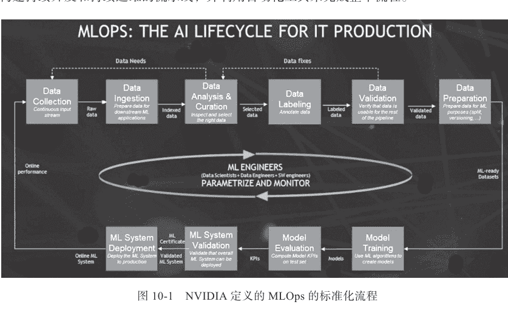

在 DevOps 的基础上，MLOps 为团队额外增设了算法与模型构建角色，形成数据准备、模型开发、模型训练、模型上线、投产及告警监控等一套规范化实践，如图 10-2 所示。

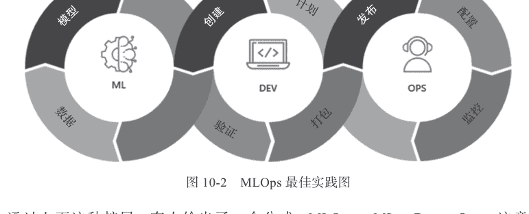

由此衍生出市场常见的概括式表达：MLOps = ML + Dev + Ops。意即除机器学习本体任务外，还融合了开发与运维的成熟方法论。它既保留软件工程的持续集成与持续交付，也把数据工程和模型工程纳入全生命周期治理。这保证了模型在生命周期内的一致性、可靠性与可维护性，从而提升协作效率，推动算法更快落地。

### 10.1.3 LLMOps 简介

大语言模型的快速演进，使得技术与应用形态与传统机器学习、深度学习拉开了明显差距，主要体现在：

- 训练语料规模：大模型的训练集常在 TB 到 PB 量级，数据处理复杂度远高于传统场景。
- 训练算力需求：现存大模型参数常达十亿、百亿甚至千亿级，分布式训练需数千至上万张显卡，调度、容错、节点间通信等挑战与传统方法不同。
- 评估方式：经典模型多依托人工标注的测试集与客观指标，而大模型生成内容多样且海量，缺乏标准答案，难以仅靠人工判定质量，需建立新的评测基准。
- 上线部署：模型体量庞大，涉及数十亿乃至数千亿参数，部署时需精细化算力分配与优化，通常依赖高性能 GPU 或 TPU 集群，运行期要兼顾稳定、安全与高效，并持续监控与迭代。
- 推理交互：通过提示词引导生成更贴合需求的输出，在自然语言与多模态领域显著提升了灵活性与精确度，与传统推理差异明显。

如 NVIDIA 博客所述，世界正迅速进入以基础模型与大语言模型驱动的新一代 AI 时代，ChatGPT 的发布加速了这一进程。

伴随 MLOps 的演进，LLMOps 应运而生，覆盖人工智能全生命周期。它聚焦生产环境中开发与管理大语言模型应用的难题，包括基础模型的预训练、监督微调对齐、基于人类反馈的强化学习、针对特定场景的定制化，以及与其它基础模型与 API 的集成。此外，LLMOps 还涉及目标与 KPI 设定、组织形态、进展度量与运营流程的持续改进。

## 10.2 大语言模型量化部署

本节先简述阿里巴巴 Qwen 团队推出的 Qwen 大模型，其能力包括自然语言理解、文本生成、视觉理解、音频理解、工具使用、角色扮演及充当 AI 代理等。随后介绍推理部署中常用的量化手段，以提升实际应用的效率与性能。

### 10.2.1 Qwen2-0.5B 简介

相较于动辄数十亿参数的大模型，0.5B-1B 量级的模型在算力受限或微调前的小规模验证中很有价值。

Qwen2 基于 Transformer 架构，是 Qwen 系列的新一代大语言模型，包含多种基础模型与指令微调模型，参数规模从 0.5 亿到 720 亿不等，并包含 MoE 结构。

与 Qwen1.5 相比，Qwen2 的综合表现超越了多数开源模型，在语言理解、生成、多语言、编码、数学、推理等基准上与专有模型具备竞争力。主要特性：

- 提供 Qwen2-0.5B、Qwen2-1.5B、Qwen2-7B、Qwen2-57B-A14B、Qwen2-72B 共 5 个规模。
- 每种规模均有基础版与指令版，均完成人类偏好对齐并支持多语种。
- Qwen2-7B-Instruct 与 Qwen2-72B-Instruct 的上下文长度提升至最高 128K Token。

### 10.2.2 ChatGLM3-6B 简介

ChatGLM 由智谱 AI 发布，以优异性能与友好的开源协议著称，在中英双语方向认可度高。

2023 年 3 月首发的 ChatGLM-6B 以开源且性能优秀获得关注。
2023 年 6 月发布的 ChatGLM2-6B 在保持对话流畅、部署门槛低的同时，性能增强、上下文从 2K 扩展到 32K。
2023 年 10 月的 ChatGLM3 系列包含 ChatGLM3-6B-Base、ChatGLM3-6B 和 ChatGLM3-6B-32K，采用全新提示词格式，原生支持多轮对话、工具调用、代码执行和 Agent 类任务等复杂场景。
2024 年 6 月发布的 GLM-4 开源系列包含 GLM-4-9B、GLM-4-9B-Chat、GLM-4-9B-Chat-1M 和多模态模型 GLM-4V-9B。GLM-4-9B 及其对齐版本 GLM-4-9B-Chat 的性能超过 Llama-3-8B，支持多轮对话、网页浏览、代码执行、自定义工具调用和最长 128K 的长文本推理。GLM-4-9B-Chat-1M 与 GLM-4V-9B 支持 1M 上下文长度，约 200 万中文字符。

### 10.2.3 基于 Qwen2-0.5B 的 CPU 推理

对刚入门且缺乏 GPU 的用户，可选择本地部署 Qwen2-0.5B 进行初步研究。

首次使用需从 Hugging Face 或 ModelScope 下载权重，文件较大，请耐心等待。

下载完成后可用 CPU 本地运行，建议安装 transformers>=4.37.0 以避免版本问题。

推理可采用 pipeline 方式，代码如下：

```python
from transformers import AutoTokenizer, Qwen2ForCausalLM
from transformers import pipeline

tokenizer = AutoTokenizer.from_pretrained("../Qwen2-0.5B", trust_remote_code=True)
model = Qwen2ForCausalLM.from_pretrained("../Qwen2-0.5B", trust_remote_code=True).cpu().float()

def answer_question(question):
    output = pipeline("text-generation", model=model, tokenizer=tokenizer)(question)
    return output[0]['generated_text']

question = "中国的首都是哪里？"
answer = answer_question(question)
print(answer)
```

另外，也可调用 `apply_chat_template` 方法对输入进行格式化，以实现更高效的推理。

```python
from transformers import AutoTokenizer, Qwen2ForCausalLM

tokenizer = AutoTokenizer.from_pretrained("../Qwen2-0.5B", trust_remote_code=True)
model = Qwen2ForCausalLM.from_pretrained("../Qwen2-0.5B", trust_remote_code=True).cpu().float()

device = "cpu"

prompt = "请帮我写一首李白的诗。"

def encode_prompt(prompt: str):
    messages = [
        {"role": "system", "content": "You are a helpful assistant."},
        {"role": "user", "content": prompt},
    ]
    text = tokenizer.apply_chat_template(
        messages,
        tokenize=False,
        add_generation_prompt=True,
    )
    return tokenizer([text], return_tensors="pt").to(device)

def decode_ids(generated_ids: list):
    generated_ids = [
        output_ids[len(input_ids):] for input_ids, output_ids in
        zip(model_inputs.input_ids, generated_ids)
    ]
    return tokenizer.batch_decode(generated_ids, skip_special_tokens=True)[0]

model_inputs = encode_prompt(prompt)
generated_ids = model.generate(
    model_inputs.input_ids,
    max_new_tokens=512,
)
result = decode_ids(generated_ids)
print(result)
```

以上是两种 CPU 推理方案，由于计算密集型任务对算力要求较高，CPU 版本耗时较长。建议后续学习尽量使用 GPU 版本，以明显提升速度与整体性能。

### 10.2.4 基于 ChatGLM3-6B 的 GPU 量化推理

大语言模型应用广泛，但参数规模带来高内存消耗。量化技术通过用更低位数的数值表示参数，减少内存与计算压力，从而优化推理效率。常见做法包括 INT4、INT8、FP16、FP32 等，会在效率提升的同时带来一定精度损失。

#### 1. INT4 量化

INT4 即 4 位整数，属于较为激进的量化精度，会把权重和激活值压缩为 4 位整数。表示范围小、精度低，通常会导致较大精度损失，实际使用较少。

以 INT4 格式完成 ChatGLM3 的推理，代码如下：

```python
import torch
from transformers import AutoTokenizer, AutoModel

if torch.cuda.is_available():
    print("CUDA is available!")
else:
    print("CUDA is not available.")

chatglm_6b_path = "chatglm3-6b"

tokenizer = AutoTokenizer.from_pretrained(chatglm_6b_path, trust_remote_code=True)
with torch.no_grad():
    model = AutoModel.from_pretrained(
```

## 2. INT8 量化

INT8 即 8 位整数，是目前常用的量化精度。权重和激活值量化为 8 位整数后，能显著降低存储和计算需求，同时精度损失相对可控。

若选用 INT8 推理，需修改模型构建代码如下：

```python
with torch.no_grad():
    model = AutoModel.from_pretrained(
        chatglm_6b_path,
        trust_remote_code=True
    ).quantize(8).cuda()
```

## 3. FP16 量化

FP16 即 16 位浮点数，也称 half。相比 FP32，内存占用减半，在相同 GPU 内存限制下可加载更大模型或处理更多数据，在大规模深度学习中优势明显。缺点是精度更低，可能在某些场景出现数值不稳定或精度下降。

使用 FP16 推理需修改代码如下：

```python
with torch.no_grad():
    model = AutoModel.from_pretrained(
        chatglm_6b_path,
        trust_remote_code=True
    ).half().cuda()
```

## 4. FP32 量化

FP32 即 32 位浮点数，能准确表达更宽的数值范围，在需要高精度数学运算的场景是首选。但高精度意味着更高的内存占用和更长的计算时间，参数众多或数据量大时易出现显存不足或推理变慢。

使用 FP32 推理需修改代码如下：

```python
with torch.no_grad():
    model = AutoModel.from_pretrained(
        chatglm_6b_path,
        trust_remote_code=True
    ).float().cuda()
```

精度选择需要在数值精度、内存占用和计算速度之间权衡。更高精度带来更好的数值表现却消耗更多资源，较低精度节省内存提速但可能损失精度。具体选择应结合任务需求、硬件条件和性能目标综合考量。

## 10.3 大语言模型部署实战

部署大语言模型的典型目的，是为用户提供服务或作为接口供其它系统调用。因此多数服务采用 B/S 架构，便于用户通过浏览器访问，开发者也能轻松集成到其它平台。

### 10.3.1 基于 Gradio 框架的网页部署

#### 1. Gradio 简介

Gradio 是一个开源 Python 库，面向数据科学家、算法工程师以及不熟悉 Web 开发的用户，支持快速构建机器学习模型、API 或任意基于 Python 函数的 Web 应用。

借助内置的分享功能，可在数秒内生成可通过浏览器访问的 Web 应用，无需掌握 JavaScript、CSS 等前端技术。Gradio 提供简洁高效的开发接口，让使用者专注于核心模型和算法的呈现。

搭建 Gradio 项目时，Python 版本需在 3.8 及以上。在正式调用 Gradio 之前，先完成安装并执行以下指令：

```bash
pip3 install gradio
```

gr.ChatInterface 是 Gradio 提供的面向聊天场景的高级组件，用来快速搭建对话界面。开发者只需实现一个处理函数，框架便会自动生成可直接使用的聊天机器人前端。

处理函数通常定义两个入参，message 和 history。名字可以自行调整，但顺序不能变。message 用来承接用户最新输入，history 则以列表形式保存历史记录，其中每个子列表对应一轮【用户提问，模型回复】。

下面给出一个无记忆的极简示例，模拟掷骰子。当用户发送“摇一摇”时，程序返回 1 到 6 之间的随机整数，相关代码如下：

```python
import random
import gradio as gr

print(gr.__version__)

def chat(question, history):
    if question != '摇一摇':
        return "输入错误，请重新输入：摇一摇"
    result = random.choice([1, 2, 3, 4, 5, 6])
    output = f"结果是: {result}"
    return output

gr_chat = gr.ChatInterface(
    fn=chat,
    examples=["摇一摇"],
    title="ChatBot"
)

gr_chat.launch(share=True)
```

启动后，默认在本地 7860 端口提供服务，浏览器打开 http://127.0.0.1:7860 即可访问。示例界面的效果参见图 10-3。

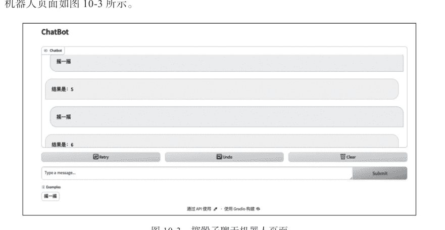

#### 2. 利用 Gradio 部署 ChatGLM3-6B
前面几行代码已演示如何用 Gradio 搭建基础对话页面。下一步在此基础上接入 ChatGLM3-6B 大模型，让聊天机器人具备真实的语言理解能力，具体实现如下：

```python
import gradio as gr
import torch
from transformers import AutoTokenizer, AutoModel

print(gr.__version__)

if torch.cuda.is_available():
    print("CUDA is available!")
else:
    print("CUDA is not available.")

chatglm_6b_path = "chatglm3-6b"

tokenizer = AutoTokenizer.from_pretrained(chatglm_6b_path, trust_remote_code=True)
with torch.no_grad():
    model = AutoModel.from_pretrained(
        chatglm_6b_path,
        trust_remote_code=True
    ).half().cuda()

model = model.eval()

def chat(question, history):
    prompt = f"""
        任务：回答下面的问题。
        问题：{question}
        限制：只告诉我答案，无关内容都不需要。
    """
    response, history = model.chat(tokenizer, prompt, history=[])
    return response

gr_chat = gr.ChatInterface(
    fn=chat,
    examples=[" 您好呀 ", " 你是谁？ "],
    title=" 基于 ChatGLM3-6B 的聊天机器人 "
)

gr_chat.launch(share=True)
```

除 Gradio 外，Streamlit 同样能实现 ChatGLM3-6B 的网页交互界面，且上手难度也很低，本文不再展开，有兴趣的读者可自行探索。

### 10.3.2 基于 FastAPI 搭建接口服务
为大模型提供标准化的 API 服务是 AI 产品落地的关键环节。它能降低开发复杂度、节省算力开销、打通多系统协作，并便于后续迭代维护，最终提升智能化程度和用户体验。接下来以 FastAPI 为例演示如何搭建接口服务。

FastAPI 是专为 API 开发打造的现代 Python 异步 Web 框架，底层基于 Starlette，数据验证依赖 Pydantic。其运行速度可与 Node.js、Go 相提并论，在 Python 生态中属于顶尖水平。相比 Django、Flask 等传统框架，FastAPI 在性能和效率上具有明显优势。

框架同时支持异步编程、依赖注入、中间件扩展，并能自动生成交互式 API 文档，极大提升了复杂应用的开发和维护效率。自动文档也让接口的调试和联调变得更顺畅。

下面展示一个使用 FastAPI 实现的对话服务示例，接口接收用户问题并返回模型生成的回答，代码如下：

```python
import uvicorn
from fastapi import FastAPI
from pydantic import BaseModel, Field
from typing import Union
from fastapi.responses import JSONResponse
from transformers import AutoTokenizer, AutoModel

app = FastAPI()

chatglm_6b_path = "chatglm3-6b"
tokenizer = AutoTokenizer.from_pretrained(chatglm_6b_path, trust_remote_code=True)
model = AutoModel.from_pretrained(
    chatglm_6b_path,
    trust_remote_code=True
).half().cuda()
model = model.eval()

class Input(BaseModel):
    question: str = Field(..., description="提问")
    history: Union[list, None] = Field(None, description="记忆信息")
    top_p: float = Field(..., description="核采样")
    temperature: float = Field(..., description="温度")

@app.post("/chat")
def chat(data: Input):
    question = data.question
    history = data.history
    top_p = data.top_p
    temperature = data.temperature
    if not history:
        history = []
    response, history = model.chat(
        tokenizer,
        question,
        history=history,
        top_p=top_p,
        temperature=temperature
    )
    content = {"response": response, "history": history}
    return JSONResponse(content=content)

if __name__ == "__main__":
    uvicorn.run(app, host="127.0.0.1", port=8080)
```

执行脚本后服务将在本地 8080 端口启动，提供对话能力。随后准备测试请求向接口发起调用。

```python
import requests

if __name__ == "__main__":
    url = "http://127.0.0.1:8080/chat"
    data = {
        "question": "中国的首都在哪里？",
        "top_p": 0.9,
        "temperature": 0.95
    }
    response = requests.post(url, json=data).json()
    print(response)
```

上述两种方案代表了大模型落地的典型路径，前端交互与后端服务。实际项目中可选的框架和工具远不止这些，读者可根据需求继续调研。

## 10.4 小结
本章的核心脉络是从 DevOps 到 MLOps 再到 LLMOps 的演进逻辑。

首先回顾 DevOps 及其 CI/CD 实践在软件工程中的基础作用，随后阐述 MLOps 与 LLMOps 如何为机器学习和大语言模型提供从训练到部署、监控的全流程体系化方案。

后文深入量化部署议题。由于参数规模庞大，大模型推理对算力与显存需求很高。文中介绍了通过 INT4、INT8、FP16、FP32 等低精度格式对权重进行压缩的量化技术，以换取更低的内存占用和计算开销，并重点说明了 GPU 环境下的部署要点，帮助读者在受限资源下实现高效运行。

最后通过实战案例讲解了网页与接口两种部署形态。包括利用 Gradio、Streamlit 快速搭建交互式前端，以及基于 FastAPI 构建后端 API 服务，使模型能力可被外部系统调用。这些案例既示范了具体步骤，也体现了不同技术栈的组合灵活性。

学完本章，读者应能把握运维理念的演进脉络，并熟练运用量化优化与多种部署手段，为后续落地应用积累实践基础。

# PART 3

## 第三篇

### 项目实战
本篇聚焦于数字人驱动的电商直播全链路实战，涵盖口播文案自动生成、直播间问答智能分类、互动问答系统以及基于 Text2SQL 的直播数据分析等案例，均源于当前热门的数字人应用场景，具备很强的实践参考价值。

# CHAPTER 11

## 第 11 章

### 数字人电商直播
在 AIGC 浪潮推动下，内容生成能力持续成熟，数字人直播正迅速成为商业领域的高关注方向，对降本增效与品牌传播产生深远影响。本章将围绕数字人在电商直播中的价值与技术实现展开深入探讨。

本章主要涉及的知识点有：

- 数字人直播概述：梳理数字人的类型、虚拟代言人的商业价值以及数字人与人货场之间的关联。
- 2D 数字人核心技术：介绍支撑数字人应用的关键技术链，包括 AI 文案生成、AI 语音合成、2D 口型驱动以及直播推流等。
- 2D 数字人电商直播项目实战：演示 2D 数字人在电商平台的完整商业落地路径。

### 11.1 数字人直播概述

#### 11.1.1 数字人简介
1. 什么是数字人？
先看概念界定，依据《2020 年虚拟数字人发展白皮书》，数字人具备三类特质：
- 具人外形，拥有特定相貌、性别、性格等人物特征。
- 具人行为，能通过语言、面部表情和肢体动作进行表达。
- 具人思维，能够感知环境并与人进行交流互动。
小冰、洛天依、柳夜熙等，都是能够与用户聊天互动并提供情绪价值的虚拟数字人。

2. 数字人的分类
从形象维度看，可分为 2D 数字人和 3D 数字人。2D 指平面呈现，3D 指立体呈现，二者在制作技术上差异较大。当前主流的还有 2.5D 数字人，通过 AI 复刻真人，外观与真人高度接近，也称仿真人。
从驱动方式看，可分为真人驱动和 AI 驱动。真人驱动捕捉真实动作、面部和语音，实现与现实的联动；AI 驱动则完全由算法生成和控制，赋予感知与表达能力。

3. 数字人的应用前景
数字人已在多个领域展开。娱乐领域可作为虚拟偶像或虚拟主播进行直播表演；教育领域可作为虚拟教师提供个性化教学；商业领域可作为 7×24 小时在线的虚拟客服，降低运营成本。
以电商直播为例，随着品类规范化和内容运营加强，国内多数数字人直播目前仅限私域投放，但可实现全天候不间断播出，缓解主播短缺、地域语言限制和人力成本上升的问题，帮助商家获取持续流量。

4. 数字人的发展与挑战
尽管技术进步明显，仍面临若干挑战：
- 互动与情感表达不够自然，自主学习与决策能力待提升。
- 具备完整自研算法和技术闭环的供应商稀少，产品质量参差不齐，制作成本与效率差异大。
- 直播平台政策尚未完全放开，数字人直播受限较多。
随着 AI 持续演进，上述限制有望逐步改善，数字人未来将深度融合物理世界，成为工作、学习、娱乐场景中的重要角色。

#### 11.1.2 品牌虚拟代言人
2024 年第 53 次《中国互联网络发展状况统计报告》显示，我国互联网普及率达 77.5%。网购作为数字经济核心业态，持续拉动消费增长。电商直播已成主流购物方式，随着品类和内容多样化，平台监管也在趋严，行业正走向成熟标准化。

MCN 机构超过 2.4 万家，爆发式增长后增速放缓，人才瓶颈突出：培养头部红人难度加大，主播走红后成本攀升，易出现跳槽；主播负面事件风险不可控。这些因素推动平台与 MCN 弱化对单一主播的依赖，转向多元化运营。

与此同时，品牌自播趋势增强。通过自有直播间与消费者直接互动，既能洞察需求，也能强化品牌信任与复购率。例如 2024 年 4 月 16 日，数字人东哥入驻京东家电家居采销直播间，上线 30 分钟观看人数破千万，1 小时观看量超 2000 万，用户平均停留时长达日常均值的 5.6 倍，40 分钟内订单量破 10 万。

平台自播虽具优势，但人类主播难以实现 7×24 小时连续播出，轮班需大量人力，且长时间播出易导致内容同质化，观众参与度下降。为此，虚拟主播应运而生，其优势包括：
- 持续性：可全天候不间断直播，摆脱人力限制。
- 互动性：借助预设逻辑与智能算法实现实时问答与产品展示。
- 吸引力：形象与风格可灵活定制，匹配不同品牌与人群。
- 可复制性：成熟形象可快速复制部署到多平台多间。
- 降成本：无需薪资与福利支出，显著降低人力费用。
因此，虚拟代言人既能降低成本与风险，又能通过个性化与智能互动提升品牌吸引力与用户体验，随着技术成熟，其应用价值将进一步扩大。

## 11.1.3 数字人与“人货场”
零售业历经多次变革，从以物易物到货币流通，再到集市与电商平台，其本质始终围绕人、货、场三个要素。三个要素的协同作用构成了零售创新的基础。

在过去的实体零售时代，消费者接触的往往是超市、百货、便利店以及直营店、加盟连锁等物理终端。选址是核心逻辑，黄金地段意味着客流，整个链条的优先级是：场所优于人群，人群优于商品，也就是 场 > 人 > 货。

电商和快递网络成熟后，品牌不再固守门店，资源加速向线上倾斜。此时决定成交的关键变成平台的曝光能力，平台先于商品，商品先于流量，顺序变为 场即电商平台 > 货 > 人。

移动互联网把时长切碎，全网的网红、KOL 与自媒体都在积累自己的流量池。有了私域流量后，品牌要先打通电商闭环，再用直播推荐、自媒体软植等带货场景把注意力转化为下单。购买逻辑进一步演变为 人即流量 > 场即平台 > 货。

进入 AI 深水区，数字人作为新工具切入零售。它能以虚拟形象与用户实时互动，提升体验并加深品牌记忆。数字人同时补强了“人”和“场”的作用，成为人货场体系的有效补充，让触达与服务更高效，也催生了更具互动性和个性化的营销服务模式，推动零售数字化进一步深化。

## 11.2 2D数字人核心技术

从电商侧的数字人应用来看，商家可借助它完成无人直播带货、无人售后问答、智能导购与个性化推荐等任务。要落地这些能力，需要先夯实背后的技术基础，下面梳理其中关键的技术方向。

### 11.2.1 AI生成文案

对电商运营而言，文案和商品脚本是沟通的载体，也是引导下单的核心触点。常见形态包括商品标题、详情描述、图片视频素材、促销信息、品牌故事、话术、问答以及社交媒体互动等，合起来构成转化体系。

传统做法依赖大量人工，效率低且易出错。随着大模型与多模态技术的发展，生成流程被重构。商家可用大语言模型自动产出高质量标题与描述，快速优化图片视频素材，并自动分发促销与品牌内容。基于浏览购买行为的智能推荐还能生成个性化话术与问答，提升体验与满意度。接入社交媒体后，还能实时监测反馈，持续优化文案与运营策略。

目前 AI 写文案的技术已趋成熟，市场上既有开源也有商业方案。下面介绍几类主流工具。

### 1. AI 文生文

#### (1) ChatGPT

ChatGPT 属于全球影响力最大的 GPT 系列大语言模型，在自然语言理解与生成上表现突出，支持流畅对话、问答、信息与建议输出。庞大的用户群体让个人与企业都能借此提效解题。

其研发与落地也带动了科技公司、研究机构与开发者社区的协作，加速了人工智能整体进步。如图 11-1 所示，用户可直接在网页端使用该模型。

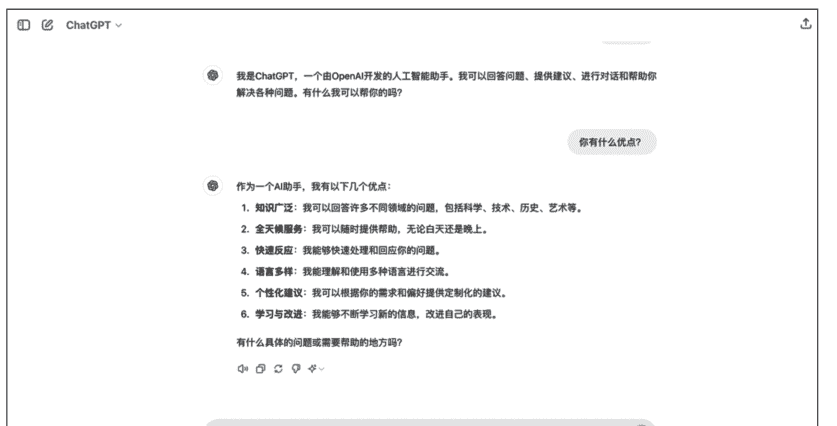

#### (2) Kimi

Kimi 由国内团队推出，定位智能助手，常用于专业论文翻译理解、法律问题辅助分析、API 文档快速阅读等场景，并是全球首个支持单次输入 20 万汉字的智能助手产品。如图 11-2 显示，其信息处理能力很强，适合处理大文本。

与此同时，文心一言、通义千问等国产大模型也在广泛应用，在对话、文本生成、翻译等任务上表现稳定，并在科研、技术开发、教育等领域发挥作用，推动了国内 AI 生态的发展。


### 2. AI 文生图

AI 文生图指基于文本描述自动生成图像的技术，特点是能快速把概念转为视觉，广泛用于创意设计、培训与营销。价值在于大幅提升内容生产效率，降低设计门槛，为行业提供丰富的视觉表达手段。

#### (1) Midjourney

Midjourney 是一款基于人工智能的绘图工具，能根据文本提示生成高质量创意图像，在广告、艺术创作、产品设计与营销中应用广泛，显著提升从概念到视觉的效率。

使用方式依托 Discord 机器人指令，需先注册 Discord 账号并加入 Midjourney 频道。早期新用户可获得 25 分钟的快速绘图额度，随着用户激增，该限免体验目前已关闭。

#### (2) Stable Diffusion

Stable Diffusion 是一款开放且灵活的 AI 绘画工具，支持云端或本地部署，能输出高质量艺术作品并提供多种样式。它允许用户自定义模型与参数，应用范围更广。

在 Hugging Face Spaces 中即可体验，无需自行部署，如图 11-3 所示。该体验版由 Stability AI 提供，输入正向与反向提示词后点击 Run 即可生成图像，受平台参数限制，体验不及完整版。

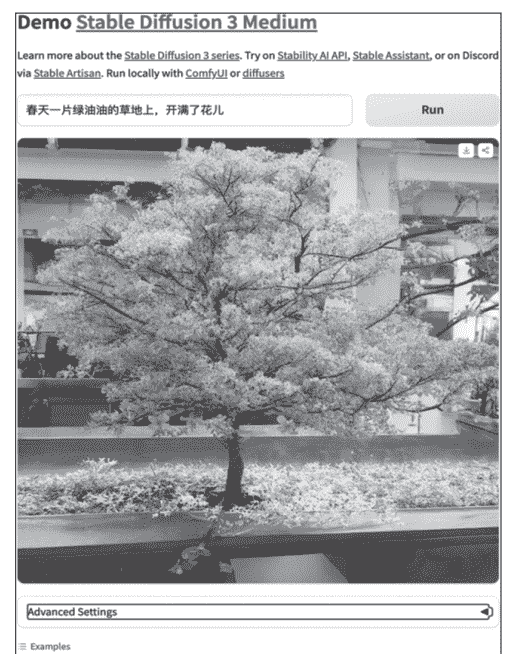

除了 Midjourney 与 Stable Diffusion，DALL · E 与 DeepAI 等也在文生图领域活跃。DALL · E 由 OpenAI 开发，擅长复杂文本描述下的高质量生成；DeepAI 侧重易用性与灵活性。各类工具在创意设计、广告、艺术创作等场景各有优势，可满足不同需求。

### 3. AI 文生视频

#### (1) HeyGen

HeyGen 专注于文本到图像的生成，并提供多种视频生成路径，包括基于自然语言描述生成动态画面、将文本脚本转为动画、对已有视频进行风格转换与增强，以及基于图像视频技术把静态图转为动态序列。这些功能覆盖多种创作需求，HeyGen 首页如图 11-4 所示。


#### (2) 可灵

可灵是快手推出的新一代 AI 创意生产力平台，依托自研大模型可灵与可图。平台提供高质量视频与图像生成能力，操作更便捷、功能更丰富、参数更专业，致力于满足创作者在素材生产与管理上的需求，兼顾专业视频与精美图像制作。

如图 11-5 所示，只需输入简单提示，可灵即可完成视频生成。


在文生视频与图生视频赛道，除 HeyGen 与可灵外，Runway、Synthesia、Pictory、DeepBrain 等也各有侧重。Runway 提供多种 AI 生成工具；Synthesia 擅长把文本转为合成视频，用于企业培训与营销；Pictory 将文本与图像转为短视频，适合社交媒体；DeepBrain 提供视频生成编辑与深度分析。各工具在创意内容制作与管理中提供多样选择。

总体看，AI 生成文案已成为电商内容创作的核心工具，通过自动化产出高质量内容帮助商家提升吸引与转化效率。结合实际需求选择合适软件，可显著优化运营流程并增强市场竞争力。

### 11.2.2 AI 语音合成

AI 语音合成能把文本转为自然流畅的语音输出，提供更直观的人性化交互，被广泛用于智能助手、客服机器人、导航、教育与娱乐等领域，提升信息传递效率与用户参与感。

#### 1. AI 语音合成历史发展

语音合成的演进是一次跨时代的技术跃迁，关键节点如下：

- 20 世纪 50 年代，规则驱动的早期合成出现，贝尔实验室的 Audrey 系统可把数字转为语音。
- 20 世纪 90 年代，统计方法兴起，HMM 与 DNN 开始用于合成。
- 2012 年，深度学习引入语音合成，自然度与逼真度大幅提升。
- 2016 年，谷歌 WaveNet 引入生成模型与深度卷积神经网络，合成语音更自然流畅，质量与逼真度再上台阶。
- 当下，依托深度学习与大语言模型，合成语音愈发逼近人声，为多行业带来变革。

从规则驱动到深度学习与大模型，语音合成正走向更自然、流畅、富有表现力的阶段，未来在智能助手、虚拟角色、辅助技术等领域作用将更加关键。

#### 2. TTS 语音合成案例

TTS 即文本到语音技术，能将文字转为口语表达。近年来其进步显著，多家国内云服务商已推出 TTS 服务，支持多语言、多音色、高自然度、实时合成与定制化。

以微软 TTS Python 库 edge-tts 为例，它支持 40 多种语言与 300 多种声音。

安装前需在命令行执行：

```
pip3 install edge-tts
```

查询可用声音列表可运行：

```
edge-tts --list-voices
```

亦可通过代码查询：

```python
import asyncio
import edge_tts

async def get_voices():
    voices = await edge_tts.list_voices()
    return voices

if __name__ == "__main__":
    voices = asyncio.run(get_voices())
    print(voices)
```

文本转语音的命令行用法为：

```
edge-tts --voice zh-CN-XiaoxiaoNeural --text "大家好，这是测试。" --write-media hello_test.mp3
```

代码方式执行则为：

```python
import asyncio
import edge_tts

async def tts(words, voice, output, **kwargs) -> None:
    """
    生成tts
    :return:
    """
    rate = kwargs.get('rate', '+0%')
    volume = kwargs.get('volume', '+0%')
    communicate = edge_tts.Communicate(words, voice, rate=rate, volume=volume)
    await communicate.save(output)

if __name__ == "__main__":
    words = "大家好，这是测试。"
    voice = "zh-CN-XiaoxiaoNeural"
    output = "hello_test.mp3"
    kwargs = {}
    asyncio.run(tts(words, voice, output, **kwargs))
```

总体来看，edge-tts 兼具强大功能与易用性，能快速实现文本到语音的转换。

### 11.2.3 2D 数字人口型驱动

2D 数字人主要通过语音驱动嘴型动作实现表达，借助精准的语音匹配与流畅的口型变化呈现逼真的口型同步，提升沉浸感与互动体验。

当前语音驱动的 2D 数字人口型视频主要分两种路径：

- 图片生成视频：输入单张人脸图与一段音频，通过口型驱动模型合成逼真讲话效果。
- 视频生成视频：输入一段视频与音频，更换人物口型而不改变原视频其他内容，通常无需额外训练。

截至 2024 年 8 月，2D 数字人多基于预合成技术，实时数字人仍在发展中。

#### 1. Wav2Lip

Wav2Lip（https://github.com/Rudrabha/Wav2Lip）是先进的口型同步技术，其模型基于 LRS2 数据集训练，可根据音频驱动视频人脸口型，使唇部动作与声音精准匹配，效果逼真。支持多语言与口音，适用于电影配音、虚拟主播、语言学习等场景。

下载预训练权重后，可执行：

```
python inference.py --checkpoint_path <ckpt> --face <video.mp4> --audio <an-audio-source>
```

该命令运行 inference.py，checkpoint_path 指定模型检查点，face 指定输入视频，audio 指定输入音频或音源。默认输出到 results/result_voice.mp4，也可通过 outfile 指定。

更多细节可参考论文 “A Lip Sync Expert Is All You Need for Speech to Lip Generation In the Wild”。

#### 2. SadTalker

SadTalker（https://github.com/OpenTalker/SadTalker）可将静态图像与音频结合，通过口型驱动模型生成逼真说话视频。其原理是解析语音信号中的音节、音高、音长等特征，映射到唇形模型，再用深度学习生成同步的口型与面部动作。

该工具广泛用于虚拟主播、视频配音、社交媒体内容创作，能提升创作效率与生动性。

下载权重后，可执行：

```
python inference.py --driven_audio <audio.wav> \
                    --source_image <video.mp4 or picture.png> \
                    --enhancer gfpgan
```

该脚本接收音频与图像或视频作为输入，driven_audio 指定驱动音频，source_image 指定输入图像或视频，enhancer 指定使用 GFPGAN 进行图像增强，以改善清晰度与视觉效果。

除 Wav2Lip 与 SadTalker 外，Video-Retalking、GeneFace++、DINet 等也提供了多样化的虚拟数字人视频生成方案，丰富了虚拟形象的创建方式与应用场景。

## 11.2.4 2D 数字人直播推流

在音视频技术里，上行推流的本质是把本地采集的音画信号实时送入中转服务器，再由服务器分发给终端观众。提前渲染好的二维虚拟主播素材，通过兼容RTMP的推送程序接入电商直播间，就能让观众与虚拟主播实时互动、完成带货。

要把虚拟主播送上行，业界常见两套方案：OBS 与 FFmpeg，下面分别说明工作方式与使用要点。

### 1. OBS

OBS 是业内广泛采用的开源直播与录制工具，覆盖制作环节较多。它提供图形化操作界面，上手门槛低，可接入多种视频源并进行场景切换。

除高质量录制与直播外，还能叠加多种媒体输入、自由切换场景，使直播画面更丰富。借助插件生态可进一步扩展功能，加入特效与增强能力，满足不同制作需求。

可在官网 https://obsproject.com/ 获取安装包，如图 11-6 所示。


安装完成后，首先在“来源”中新增媒体项，把准备好的虚拟人视频文件载入程序，如图 11-7 所示。


图 11-7 导入数字人视频文件

随后打开“设置”中的“直播”页，挑选目标平台并填入推流服务器地址与流密钥，如图 11-8 所示。

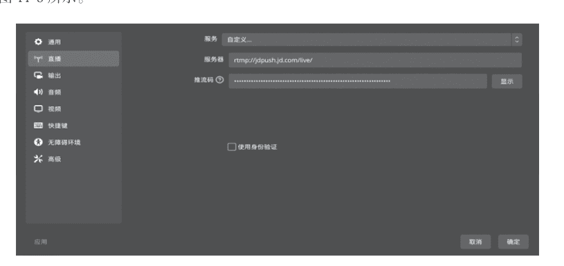

图 11-8 配置直播信息

最后按下“开始直播”，程序即把虚拟人画面推向平台直播间。

### 2. FFmpeg

FFmpeg 是一个成熟的多媒体开源引擎，涵盖解码、编码、转码、封装、分发、滤镜与播放等能力，兼容绝大多数音视频格式。其跨平台特性使其可在 Linux、macOS、Windows 等系统编译运行。

该工具偏向技术用户，主要依赖命令行操作，擅长自动化与批量任务。作为开源项目，可免费使用。

可在官网下载安装，如图 11-9 所示。


图 11-9 FFmpeg 官网首页

借助 FFmpeg 执行 RTMP 上行，可把视频流推送至直播平台，执行语句如下：

```
ffmpeg -re -i <input_video> -c:v libx264 -preset veryfast -maxrate 3000k -bufsize 6000k -pix_fmt yuv420p -g 50 -c:a aac -b:a 160k -ar 44100 -f flv <rtmp_url>/<stream_key>
```

FFmpeg 功能集中、灵活性高，但命令行交互对新手不够友好，需要熟悉参数。缺少可视界面，排错多依赖日志与命令行输出，调试成本上升。高码率与高分辨率推流时对算力要求较高。部分特殊环境下，还需额外调参以保证兼容。

因此它是专业用户的常用选择，但学习成本与调试难度对入门者不友好。了解优劣有助于更合理的选型。

整体来看，AI 虚拟主播的构建涉及文案生成、语音合成、二维口型驱动与直播上行等多重环节。制作中还会进行去噪、降模糊等画面优化；利用超分辨率把低清提升为高清，增强细节；同时做美颜、瘦脸、磨皮等视觉调优，使形象更贴合审美偏好。各项技术协同，显著提升虚拟主播的整体表现与观赏度。

## 11.3 2D 数字人电商直播项目实战

电商场景下，以生成的虚拟主播在店铺直播间进行带货，即数字人直播。主播可像真人一样介绍商品、完成成交并与观众答疑，既缓解真人主播培养周期长、成本高的难题，也能实现7×24小时不间断售卖，提升效率与灵活性。

以一家主营美妆护肤品类的旗舰店为例，计划引入虚拟主播开展带货。以下说明快速启动的整体思路。

### 11.3.1 数字人直播流程简介

数字人带货作为电商新形态，以低成本、高效率、高质量的直播体验优化购物感。开展时需遵守平台规则，规避违禁词，避免展示未上架商品以免被限流或封禁。在合规前提下发挥虚拟主播优势，可明显拉升GMV与流量，成为品牌增长的新动能。

关键步骤如图 11-10 所示。

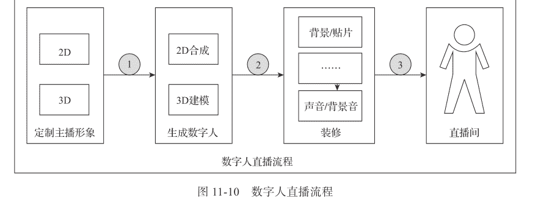

- 撰写商品台词：先撰写销售文案，再用大模型润色改写。
- 合成2D数字人：借助合成工具生成可用二维虚拟人。
- 选择推流工具：选用支持RTMP的上行工具，如OBS或FFmpeg。
- 获取RTMP推流地址：在电商平台创建直播间并获取推流地址与流键。
- 配置推流软件：在软件中设定视频源，导入虚拟人视频；填入推流地址与流键；根据网络与观众设备设定合适的码率、分辨率与帧率。
- 测试并开启推流：正式开播前先做测试，确保音画同步、质量达标后再开始。
- 结束直播：结束后停止推流并保存回放素材。

按以上顺序即可启动直播间虚拟人带货。

### 11.3.2 大语言模型生成商品台词

假设为××护手霜撰写一段100字以内的卖点文案，在了解产品功效与特性后，可通过提示词快速生成。

提示词示例如下：

角色：你是一位资深美妆领域文案撰写专家。

功能：根据商品详细描述，撰写促进直播间销售的商品卖点台词。要求表达流畅，能突出卖点。

商品描述：

- 直播场地：××直播间
- 产品名称：××护手霜
- 面向人群：男女通用
- 产品价格：20元
- 产品优惠：买二送一
- 产品承诺：正品包装，有质量保障
- 快递物流：京东物流，送货上门，包邮哦

限制：不带图，要求字数在100字以内，且不能包含敏感词列表中的任何一个敏感词。

敏感词列表：绝对、宝妈、王牌。

使用提示词调用大模型生成文案，这里用ChatGPT-4o辅助提炼卖点，生成结果如下：

> 各位小伙伴们，欢迎来到××直播间！今天为大家带来的是一款超实惠的××护手霜，不论是男士还是女士，都能用它呵护双手。这款护手霜每支仅售20元，现在更有买二送一的超值优惠，让你用最少的钱享受最好的护理。我们承诺，所有产品均为正品包装，质量有保障，放心选购。更有京东物流为您保驾护航，包邮送货上门，快捷又安心。这个夏天，让××护手霜给你带来一双柔滑细嫩的双手，还等什么，快来下单吧！

生成后需人工审核并做敏感词检查，确保内容准确合规，避免误导，维护品牌与消费者权益。

### 11.3.3 TTS 将商品台词转成音频

生成式AI的发展推动语音技术升级。相较传统小模型，大模型语音合成更能理解上下文，捕捉情绪与说话人角色，提供更自然的表达。

把卖点台词转为语音时，可使用微软AI配音、科大讯飞TTS、火山TTS等工具高效转换。

对大品牌或对音质要求高的场景，可先进行真人声音小样本克隆再生成。国内支持小样本克隆的服务包括火山小样本声音克隆与腾讯小样本声音克隆，能实现更自然个性化的效果。

多数数字人平台已内置文字转语音功能，为节省篇幅，下文直接进入数字人合成演示。

### 11.3.4 口型驱动生成 2D 数字人

11.2.1 节已介绍HeyGen视频合成。HeyGen是优秀的合成产品，但国内访问门槛较高，这里介绍国内平台腾讯智影。

腾讯智影是云端智能视频创作工具，无需下载，通过PC浏览器即可使用，提供剪辑、素材库、文本配音、数字人播报、自动字幕等功能，帮助用户高效创作。控制台如图 11-11 所示。


制作数字人时先进入“数字人播报”模块。播报方式分为文字驱动与音频驱动。文字驱动下输入文字，系统自动生成音频并驱动合成；已有自定义语音时可选择音频驱动。

随后挑选主播，这里演示使用预置免费主播。再设定背景、贴片、背景音等，最后点击右上角“合成视频”即可生成二维播报数字人，如图 11-12 所示。


图 11-12 数字人合成设置

合成需要等待片刻。完成后结果如图 11-13 所示，确认无误后可下载到本地。


图 11-13 数字人合成结果

### 11.3.5 2D 数字人推流到直播间

将合成好的数字人推送到电商平台直播间，先在店铺创建直播间，再通过OBS本地推流完成。

#### 1. 创建直播间

假设已拥有合法京东店铺，若无可快速免费注册。随后在京东店铺中创建测试直播间，如图 11-14 所示。


点击右上角“推流地址”按钮，获取直播间的RTMP地址与密钥。

```
URL: rtmp://jdpush-ai.jd.com/live/
密钥: 27242549?auth_key=1730528495-0-0-c0295e1a244c80b4cc981d8a87323f8a
```

#### 2. OBS 推流

参照11.2.4节的OBS配置方法，将本地生成的数字人视频加入媒体源并设为循环播放，同时在设置中填入直播间推流地址与推流码。最后点击OBS的“开始直播”即可开播，如图11-15所示。

接下来，在京东直播间右上角点击“开始直播”按钮，即可在手机端看到数字人直播效果，如图11-16所示。


图11-15 OBS开始直播


图11-16 手机端数字人直播效果

至此，2D数字人在电商直播间的开播流程已完成。实际运营中，直播间装修、品牌Logo与商品贴片制作、产品讲解、购物袋挂链与优惠券设置、数字人互动问答等都是不可忽视的环节，细致打磨这些内容才能更好提升效果、吸引观众并提高转化。

## 11.4 小结

本章围绕电商数字人直播展开，介绍了数字人技术及其电商应用。

首先概述了数字人直播，涵盖数字人分类、品牌虚拟代言人价值，以及数字人与“人货场”的紧密关系，帮助读者理解数字人在现代商业中的角色与对品牌影响力及互动体验的提升。

接着探讨2D数字人的核心技术，包括AI文案生成、AI语音合成、口型驱动与直播推流，梳理了从文本到呈现的全流程及技术要点。

最后通过2D数字人电商直播实战演示，展示了完整的商业落地案例，说明如何从创建直播间、配置推流到实现直播，帮助读者掌握具体操作与应用场景。

# 第 12 章 数字人口播台词生成

在大数据模型与AIGC快速发展的推动下，电商直播与网红带货迎来变革。数字人主播作为典型代表，为直播注入新活力与效率，提升互动体验，也为品牌提供更灵活高效的营销手段。未来随着AI进步，该领域将涌现更多创新应用，推动电商发展。

本章主要知识点：

- 数字人口播台词生成概述：了解公域私域下台词特点，掌握编排技巧与防封策略，确保合规并提升效果。
- 数字人口播台词提示词模板：学习撰写与优化提示词，确保生成内容精准、有吸引力且符合品牌调性。
- 数字人口播台词生成项目实战：通过真实项目演练，结合知识库优化，实现学以致用。

## 12.1 数字人口播台词生成概述

数字人口播台词生成背后有一套独特的直播运营逻辑与规则，提前掌握可有效提升直播效率，降低突发风险，保障顺畅进行。

### 12.1.1 数字人直播的台词特点

随着流量获取与管理的重要性提升，公域流量与私域流量成为关注焦点，需采用不同运营策略。理解二者差异有助于制定更有效的营销方案，在竞争中保持优势。

#### 1. 公域和私域

公域营销：在公开平台与渠道开展的营销，面向所有公众。特点是覆盖面广、曝光高。常见渠道包括社交媒体、搜索引擎、第三方电商平台、公共媒体。目标是吸引潜在客户，提升品牌知名度与影响力。

例如在搜索引擎推广店铺或在京东、淘宝投放广告，平台所有用户均可看到，属于公域流量范畴，旨在提升品牌曝光。

私域营销：在自有平台或私密渠道开展的营销，面向已有客户或特定受众。特点是用户粘性高、营销精准。常见渠道包括品牌自有微信社群、邮件订阅、会员系统、店铺粉丝、企业自营电商平台。目标是深度运营关系，提升忠诚度与复购率。

例如京东、淘宝店铺粉丝与会员属于商家私域，可通过专属沟通与服务进行精准触达与关系管理。

表12-1展示了二者在多个维度的差异，便于企业选择合适的流量管理方式。

表12-1 公域和私域不同维度的对比

| 维度 | 公域 | 私域 |
|---|---|---|
| 人群 | 广泛的公众，通常不特定 | 已有客户群体或特定受众 |
| 人群规模 | 规模大，覆盖范围广 | 相对较小，更加精准 |
| 渠道 | 搜索引擎、社交媒体和第三方平台 | 品牌自有社群、会员系统、邮件订阅 |
| 运营方式 | 高曝光、广泛推广，目标是吸引新用户 | 精准营销、个性化服务，目标是维系和激活现有用户 |
| 运营精细度 | 较低，关注广泛覆盖 | 高，注重细节和用户个性化体验 |
| 用户价值 | 相对不确定，取决于转化率 | 高，通常有较高的用户终身价值 |
| 用户转化周期 | 较长，需要多次接触才能转化 | 较短，用户对品牌有一定的认知和信任 |
| 用户付费意愿 | 较低，付费转化依赖于广告和推广策略 | 较高，用户已经建立了品牌忠诚度 |
| 用户维护成本 | 较高，需要持续的推广投入 | 较低，主要是客户关系管理和维护费用 |
| 运营数据 | 数据较为分散，需要整合分析 | 数据集中，能直接获取用户行为和反馈 |
| 营销策略 | 广泛营销，注重品牌曝光 | 深度营销，注重用户参与和互动 |

#### 2. 不同直播模式台词脚本的差异
增长黑客起源于美国硅谷，指通过数据分析驱动用户增长，其中最具代表性的是AARRR增长模型。核心在于利用获客、激活、留存、营收、推荐五个步骤，划分并优化用户生命周期。

# 从拉新到留存：数字人直播话术与防封实操

AARRR 在理论层面一直被视作用户增长的经典解法，落地时却暴露出不少短板。获客成本水涨船高叠加用户流失严重，让增长变得越来越吃力，也让团队对增长黑客的认知悄然转向，AARRR 被迭代成了 RARRA。

RARRA 把优先级重新排布为留存、激活、推荐、变现、拉新，核心思路是把增长的发力点从疯狂引流转到用户留存上，用更稳的留存实现更可持续的增长。

电商赛道里，公域流量红利趋于见顶，私域池的价值被进一步放大。越来越多的品牌开始系统化搭建私域资产，加大粉丝运营投入。

在此背景下，数字人直播的研究视角也在下沉，从平台属性、用户规模、增速、观看时长到粉丝质量等多个维度展开，目的就是吃透数字人在公域和私域里的运行逻辑与策略差异，进而制定更精准的营销与运营打法。公域侧重流量获取和品牌曝光，目标是提升知名度；私域侧重关系管理与深度运营，目标是提升留存与忠诚度。

公域与私域的运营差异直接映射到数字人直播的脚本设计上，具体对比如下表。

表 12-2 数字人直播公域模式和私域模式台词脚本对比

| 维度 | 公域模式 | 私域模式 |
| :--- | :--- | :--- |
| 目标人群 | 面向全网泛流量，追求大范围曝光与高量级引流 | 聚焦品牌铁粉与付费会员，重在关系维系与长期互动 |
| 连接方式 | 依托平台算法推荐与广告投放实现曝光 | 借助品牌自有渠道与私密社群建立深度联系 |
| 内容特点 | 偏品牌宣传与产品亮点，多用抓眼球的语言与视觉 | 包含高度个性化内容，强调情感共鸣与品牌长期价值 |
| 内容深度 | 浅显易懂，主要讲产品核心卖点与关键特性 | 专业深入，聚焦使用方法、真实体验与个性化建议 |
| 产品特点 | 突出主要功能与卖点，视觉冲击力强 | 强调产品与个体需求的匹配度，展示真实使用场景 |
| 卖点 | 强调差异化卖点与市场优势，快速抓住注意力 | 聚焦个性化需求满足与体验提升，突出长期价值 |
| 促销 | 信息直白醒目，多为限时折扣、优惠券等 | 策略隐性且定制化，多为专属优惠、会员权益等 |
| 互动 | 互动门槛低，鼓励点赞评论分享等基础行为 | 互动更聚焦，如一对一沟通、反馈收集、个性建议等 |

从表中可见，两种模式的运营打法不同，直接决定了脚本方向与内容形态，厘清差异有助于品牌打磨更有效的直播话术。

## 12.1.2 数字人直播的台词编排

随着电商运营精细化，数字人直播的话术组织正从过去的一整段式向标准化的分段式演进。分段式结构让内容更可控、更统一，也让不同场景下的脚本编写更灵活高效。清晰的层次帮助品牌精准传达重点，并能按公域或私域需求快速调参，从而明显提升互动与转化。

以 HeyGen 为例，为一款护手霜生成分段直播脚本，输入设定为：Topic 为能修复干燥导致肌肤裂痕、预防秋冬季手部粗糙干裂的护肤品；Target language 为中文；Tone 为甜美；Additional info 含包邮与会员优惠。系统共输出 7 段台词，不过每段仅以 SCENE 标记，未给出有意义的小标题。

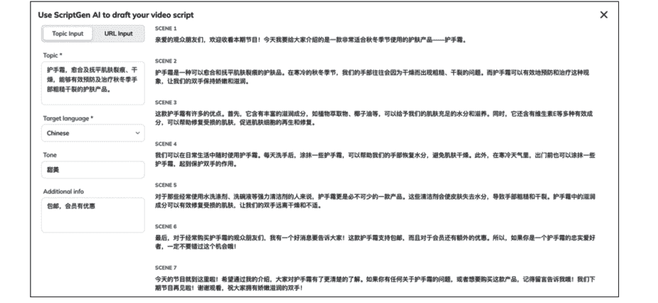

因此，写直播台词要追求简洁易懂、能引发共鸣。写话术的核心是把信息讲透、把关系拉近，最终抬高直播效果与转化。下面结合近两年数字人研发实践，给出一套简明的分段撰写框架，具体见表 12-3。

表 12-3 直播台词分段式撰写框架

| 序号 | 话术类型 | 话术内容概览 |
| :--- | :--- | :--- |
| 1 | 引导话术 | 开场吸睛，简要点明主题 |
| 2 | 用户痛点 | 放大痛点并给出解决路径 |
| 3 | 产品卖点 | 介绍规格、成分、材质、功能及独特优势 |
| 4 | 使用方法 | 说明使用方式与适用场景 |
| 5 | 优惠机制 | 会员价、满减、节庆优惠、店庆等 |
| 6 | 商品促单 | 回顾核心卖点，结合口碑好评与折扣推动下单 |
| 7 | 互动话术 | 强化互动，真实回应观众问题 |

## 12.1.3 数字人直播的防封策略

### 1. 平台对数字人直播的态度

大模型落地推动 AI 电商爆发，数字人直播带货成为新风口。对企业而言，数字人直播具备降本增效优势：成本低、可 24 小时连播、无需考虑人员休假离职，且可通过人设克隆放大名人 IP 效应，运作更灵活。

与此同时，部分平台对数字人直播持保留态度。内容同质化、真实互动不足、购物体验下降，以及虚假宣传风险，都是平台担忧的点。已有平台减少流量扶持，部分严重违规账号被限播或封号。

截至 2024 年 8 月，国内主要平台的态度梳理如下表。

表 12-4 国内部分平台对数字人直播的态度

| 平台名称 | 平台分类 | 平台对数字人直播的态度 |
|---|---|---|
| 京东 | 货架电商 | 鼓励私域数字人直播，推动行业发展 |
| 淘宝 | 货架电商 | 支持私域数字人直播，技术方案受限 |
| 唯品会 | 货架电商 | 支持私域数字人直播 |
| 抖音 | 兴趣电商 | 鼓励但受限，要求真人实时互动、内容不重复 |
| 快手 | 兴趣电商 | 削弱数字人直播的流量扶持 |
| 视频号 | 兴趣电商 | 已明确禁止数字人直播 |
| 美团 | 本地生活 | 鼓励使用数字人直播，赋能本地生活 |
| 小红书 | 内容电商 | 目前不鼓励也不限制，尚无明确规则 |

传统货架电商更看重效率与流量，倾向将数字人视为 AI 赋能工具；内容型平台则更强调内容质量与用户体验，担心数字人破坏生态。

为保障直播稳定运行并降低封禁风险，可从以下要点入手，这些做法也有助于提升粘性与转化。

- 高质量内容与清晰画面：信息准确专业，提升观看体验，减少平台干预。
- 画面多样化，避免重复：定期切换场景、调整机位或加入动态元素，规避重复检测。
- 增加真实时钟显示：增强直播的实时感，避免被误判为录播。
- 使用背景音乐：丰富氛围，避免单调，注意版权合规。
- 双人搭档直播：数字人搭档或真人+数字人组合，提升内容丰富度与参与感。
- 真人互动环节：适时接入真人对话，增强真实性，降低违规误判。

### 2. 数字人直播敏感词的预防与治理

直播行业监管趋严，内容合规要求持续提升。数字人直播同样在严审范围内，敏感词管控尤为关键，原因有四：

- 平台合规：违规用词可能导致封禁、下架或账号受限。
- 用户体验：不当表达损害品牌形象，降低信任与转化。
- 法律风险：涉及政治、宗教、种族等红线会带来法律与声誉风险。
- 生态维护：规范用词有助于营造健康直播环境，利于长期发展。

有效做法包括：建立并定期更新违禁词与敏感词库；搭建人工审核与技术过滤双保险；借助 AI 在开播前对脚本做敏感词识别，并在直播中实时监测、精准拦截；定期对内容创作者进行合规培训，提升敏感意识。

## 12.2 数字人口播台词提示词模板

AIGC 让电商运营效率大幅提升，口播台词的批量生成是典型场景。传统做法需人工逐条撰写，如今借助大模型可快速产出，但要保证内容准确、调性统一，提示词的撰写与优化仍需投入。

下面通过具体场景固化可复用的提示词模板，实现开箱即用。

### 12.2.1 整段式商品台词提示词模板

中小商家常走“好卖就卖”的多品类路线，精细化运营难度大，口播台词多采用整段式写法，目标是快速大量生成能吸睛、促单的商品文案，适配多SKU与快节奏市场。

整段式风格直截了当、节奏紧凑，迅速抛出核心价值，快速刺激购买。

下面是一份基于 Markdown 的整段式口播提示词模板，覆盖角色、技能、商品信息、平台规范、输出要求与敏感词库，可确保生成稳定高效。

```
# 角色
电商平台数字人直播商品台词撰写专家，擅长快速突出商品的核心价值，并快速促成销售。

# 技能
- 精通中文，有良好的中文表达能力
- 懂得电商直播卖货和数字人直播台词撰写
- 掌握 Markdown 语法，能够准确识别和处理相关信息

# 商品信息
- 直播间信息：【×× 直播间】
- 商品名称：【护手霜】
- 商品规格：【300ml】
- 商品功效：【能治愈并抚平由干燥引起的肌肤裂痕】
- 商品质量：【商品是正品，有质量保障】
- 商品优惠：【会员打 9 折，限时买二送一】
- 商品物流：【×× 快递，包邮】

# 电商平台规范
- 规范内容：【参考京东、淘宝电商平台规范】

# 输出要求
- 要求整段输出，不分段，汉字字数要求在 200～300 字以内，符合中文语言规范
- 根据提供的直播间信息、商品信息，撰写数字人直播台词
- 内容要真实，句子要上下连贯、逻辑性强，不能夸大其词
- 遵守电商平台的规则和法律规范
- 以销售为目的，突出商品特点
- 整条台词不能包括敏感词库里面的任何一个词
- 只输出与该商品相关的信息，其他信息自动忽略

# 敏感词库
敏感词：世界级、最高级、第一、唯一、首个、最好、最便宜、美白、祛痘
```

将模板输入 ChatGPT-4o 后可得到类似结果：

大家好，欢迎来到本直播间！今天给大家安利一款秋冬必备的护手霜。容量 300ml，专为干燥季节打造，能修复因干裂产生的肌肤裂痕，让双手恢复柔嫩光滑。品质正品有保障，使用后手感明显改善。现在会员可享 9 折，活动期买二送一，另有包邮服务，快速送达。喜欢就快下单吧！

批量创作时只需替换商品信息、平台规则与敏感词库即可复用，必要时再做微调。模型生成后仍需人工复核，确保安全与质量。

### 12.2.2 分段式商品台词提示词模板

大型品牌更注重形象与精细化运营，SKU 相对聚焦，对话术的要求更高。分段式结构能让信息更系统、品牌调性更稳。

下面是一份 Markdown 格式的分段式口播提示词模板，涵盖角色、技能、商品信息、平台规范、输出要求、分段规则与敏感词库，符合直播高标准。

```
# 角色
电商平台数字人直播商品台词撰写专家，注重品牌的精细化运营。

# 技能
- 精通中文，有良好的中文表达能力
- 精通大品牌分段式数字人直播台词撰写
- 掌握 Markdown 语法，能够准确识别和处理相关信息

# 商品信息
- 直播间信息：【×× 直播间】
- 商品名称：【护手霜】
- 商品规格：【300ml】
- 商品功效：【能治愈及抚平由干燥引起的肌肤裂痕】
- 商品质量：【商品是正品，有质量保障】
- 商品优惠：【会员打 9 折，限时买二送一】
- 商品物流：【×× 快递，包邮】

# 电商平台规范
- 规范内容：【参考京东、淘宝电商平台规范】

# 输出要求
- 根据分段要求，按段输出内容，每段字数要求在 100～200 字以内，符合中文语言规范
- 根据提供的直播间信息、商品信息，撰写数字人直播分段式台词
- 内容要真实，段与段、句子与句子之间要连贯，具有逻辑性，不能夸大其词
- 遵守电商平台的规则和法律规范
- 以销售为目的，突出商品特点
- 所有台词不能包括敏感词库里面的任何一个词
- 只输出与该商品相关的信息，其他信息自动忽略

## 分段要求
1. 引导话术：要求用吸引力强的开场白来抓住观众的注意力，简洁明了地介绍直播的主题和重点，激发观众的兴趣和好奇心。
2. 用户痛点：要求识别并放大观众的痛点，清晰展示问题的严重性，并介绍产品如何有效地解决这些问题，为观众提供实质性的解决方案。
3. 产品卖点：详细介绍产品的规格、成分和材质，突出其功能和独特优势。说明产品的核心卖点，强调产品的独特之处，以让观众对产品产生信任和兴趣。
4. 使用方法：详细说明产品的使用方法，展示实际使用场景，帮助观众理解如何使用产品以及产品能在日常生活中带来哪些益处。
5. 优惠机制：清晰传达当前的优惠活动，包括会员折扣、满减活动、节假日促销或店铺周年庆等，吸引观众参与并促进购买。
6. 商品促单：强调产品的核心卖点，展示客户好评和口碑，并提醒观众当前的优惠折扣或限时促销，激发购买欲望和紧迫感。

# 敏感词库
敏感词：世界级、最高级、第一、唯一、首个、最好、最便宜、美白、祛痘
```

输入后可得到类似结构化结果：

**引导话术**

欢迎来到本场直播！今天重点介绍一款秋冬季护手好物，能迅速缓解干燥，帮助双手保持柔嫩，快来了解详情。

**用户痛点**

换季手部干裂、粗糙是不是困扰你？干燥天气易起皮裂口，使用体验很差。这款护手霜正是为解决这类问题设计，能修复抚平裂痕，告别干痒。

**产品卖点**

容量 300ml，秋冬用量充足。成分易吸收，深层滋润并修护屏障，质地轻盈不油腻，带淡淡清香，用后柔软细腻。

**使用方法**

取适量均匀涂抹双手，重点按摩指关节处至吸收。每日早晚各一次，外出前使用效果更佳，任何肤质均可使用。

**优惠机制**

现享会员 9 折，限时买二送一，库存有限。包邮到家，轻松入手。

**商品促单**

这款产品已获大量好评，用户反馈手感明显改善，优惠期不容错过，赶紧为双手加一份呵护。

数字人直播脚本量产操盘手册

头部品牌在直播中以分段式表达呈现商品，能让卖点更清晰，同时强化品牌调性与市场辨识。把这套做法落地，稳定稿件质量的关键是搭建统一的指令范式并持续迭代。批量自动产出确实能压缩制作周期，但正式投放前必须保留人工复核环节，用于核验事实准确性、风格统一性与合规性。机器生成配合人工把关的双层机制，才是维护品牌声誉与内容安全的基础。

### 12.2.3 商品互动问答台词提示词模板

数字人直播的互动问答中，观众提问形式丰富、场景多样。写出可靠的应答稿，前提是对高频问题进行归纳整理。先把大量提问梳理一遍，找出共性与差异，再借助大模型结合人工校对提炼出核心词与关键要点。随后以这些要素为依据生成既精准又连贯的回复。走完这套流程，问答的准确率和可用性都会提升，即便面对多变提问，数字人也能保持专业、稳定的一致性输出。

要抽取问题核心词与关键信息，可以参考下面这套指令模板：

```
# 角色
自然语言处理专家，擅长从直播中的用户问题中提炼关键词并进行精准的归纳分类。

# 技能
- 精通中文，有良好的中文阅读与理解能力
- 擅长从直播问题中提炼关键词和关键信息，并进行系统化的归纳与分类
- 深谙电商数字人直播的运营流程与需求
- 掌握 Markdown 语法，能够准确识别和处理相关信息
```

## 直播问题

问题描述：【快递发什么？】

# 输出要求

- 关键词：提炼出问题中的核心关键词，数量不超过 3 个

- 分类类别：确定该问题所属的分类类别

- 分类依据：详细说明你对该问题进行分类的依据

将上述提示词输入 ChatGPT-4o 后，可以得到如下结果：

关键词

快递、发

分类类别

物流信息

分类依据

问题的核心在于用户对商品配送方式的询问，特别是关注快递的选择或类型。这涉及物流信息的范畴，因此将该问题归类为“物流信息”最为合适。

经过人工审核确认，大语言模型在处理问题“快递发什么？”时，正确地提取了“快递”作为关键词，并准确地将问题归类为物流信息类别。

接下来，可以补充一些业务相关的附加信息，然后使用大语言模型生成最终的互动问答台词。可以使用以下提示词模板：

# 角色

电商平台数字人直播互动问答台词撰写专家，能够根据核心关键词及附加信息撰写互动问答台词。

# 技能

- 精通中文，有良好的中文阅读与理解能力

- 擅长根据问答信息撰写互动问答台词，语调温馨，逻辑性强

- 深谙电商数字人直播的运营流程与互动问答场景

- 掌握 Markdown 语法，能够准确识别和处理相关信息

# 问答信息

问答开头：我看到“昵称”关于【关键词】的问题了

关键词：快递

问题分类：物流信息

附加信息：下单当日从北京发货，×× 快递

# 输出要求

- 根据问答信息撰写直播间互动问答的台词

- 所有台词不能包括敏感词库里面的任何一个词

- 输出结果的字数限制在 200 字以内

- 只输出与该商品相关的信息，其他信息自动忽略

您的关注和支持！

利用大语言模型生成数字人直播的口播台词仅是 AI 在电商运营中的部分应用，实际上，AI 技术在许多其他关键环节也发挥着重要作用，例如撰写商品详情页、进行竞品分析，以及处理客户投诉等。AI 的应用不仅能优化商家的运营模式，还能为消费者提供更加便捷和有趣的购物体验。

## 12.3 数字人口播台词生成项目实战

借助大模型来撰写和改写数字主播的口播，能明显提升电商运营的效率。它可以快速批量产出个性化、场景化的文案，让每场直播都精准传递品牌主张与促销重点。商家因此能省下大量脚本撰写的人力成本，也可依据实时数据和观众反馈灵活调整内容策略，实现更好的直播效果。

### 12.3.1 使用提示词模板生成口播台词

在确定最优指令模板之后，可以把台词生成能力工程化接入业务系统。具体做法是依赖 LangChain 的 PromptTemplate 来初始化和配置模板，保证系统能高效、精准地产出符合需求的口播内容。这样既提升生成效率，也增强了系统的智能化程度。

下面给出一段式商品台词的指令模板示例，以及用 LangChain 进行初始化的代码示例：

```python
from langchain_core.prompts import PromptTemplate

segment_template = """
# 角色
电商平台数字人直播商品台词撰写专家，注重品牌的精细化运营。

# 技能
- 精通中文，有良好的中文表达能力
- 精通大品牌分段式数字人直播台词撰写
- 掌握 Markdown 语法，能够准确识别和处理相关信息

# 商品信息
- 直播间信息：{room_info}
- 商品名称：{product_name}
- 商品规格：{product_specification}
- 商品功效：{product_effectiveness}
- 商品质量：{product_quality}
- 商品优惠：{product_discount}
- 商品物流：{product_shipping}

# 电商平台规范
- 规范内容：{standard_content}

# 输出要求
- 根据分段要求，按段输出内容，每段字数要求在 100～200 字以内，符合中文语言规范
- 根据提供的直播间信息、商品信息，撰写数字人直播分段式台词
- 内容要真实，段与段、句子与句子之间要连贯，具有逻辑性，不能夸大其词
- 遵守电商平台的规则和法律规范
- 以销售为目的，突出商品特点
- 所有台词不能包括敏感词库里面的任何一个词
- 只输出与该商品相关的信息，其他信息自动忽略

## 分段要求
1. 引导话术：要求用吸引力强的开场白来抓住观众的注意力，简洁明了地介绍直播的主题和重点，激发观众的兴趣和好奇心。
2. 用户痛点：要求识别并放大观众的痛点，清晰展示问题的严重性，并介绍产品如何有效地解决这些问题，为观众提供实质性的解决方案。
3. 产品卖点：详细介绍产品的规格、成分和材质，突出其功能和独特优势。说明产品的核心卖点，强调产品的独特之处，以让观众对产品产生信任和兴趣。
4. 使用方法：详细说明产品的使用方法，展示实际使用场景，帮助观众理解如何使用产品以及产品能在日常生活中带来哪些益处。
5. 优惠机制：清晰传达当前的优惠活动，包括会员折扣、满减活动、节假日促销或店铺周年庆等，吸引观众参与并促进购买。
6. 商品促单：强调产品的核心卖点，展示客户好评和口碑，并提醒观众当前的优惠折扣或限时促销，激发购买欲望和紧迫感。

# 敏感词库
敏感词：世界级、最高级、第一、唯一、首个、最好、最便宜、美白、祛痘
"""
# 实例化模板
prompt = PromptTemplate.from_template(template=segment_template)

room_info = "××直播间"
product_name = "护手霜"
product_specification = "300ml"
product_effectiveness = "能治愈及抚平由干燥引起的肌肤裂痕"
product_quality = "商品是正品，有质量保障"
product_discount = "会员打9折，限时买二送一"
product_shipping = "××快递，包邮"

standard_content = "参考京东、淘宝电商平台规范"

prompt = prompt.format(
    room_info=room_info,
    product_name=product_name,
    product_specification=product_specification,
    product_effectiveness=product_effectiveness,
    product_quality=product_quality,
    product_discount=product_discount,
    product_shipping=product_shipping,
    standard_content=standard_content
)
print(f"实例化模板结果：{prompt}")
```

运行代码后生成的提示词结果如下：

# 角色

电商平台数字人直播商品台词撰写专家，注重品牌的精细化运营。

# 技能

- 精通中文，有良好的中文表达能力

- 精通大品牌分段式数字人直播台词撰写

- 掌握 Markdown 语法，能够准确识别和处理相关信息

# 商品信息

- 直播间信息：×× 直播间

- 商品名称：护手霜

- 商品规格：300ml

- 商品功效：能治愈及抚平由干燥引起的肌肤裂痕

- 商品质量：商品是正品，有质量保障

- 商品优惠：会员打9折，限时买二送一

- 商品物流：×× 快递，包邮

# 电商平台规范

- 规范内容：参考京东、淘宝电商平台规范

# 输出要求

- 根据分段要求，按段输出内容，每段字数要求在100～200字以内，符合中文语言规范

- 根据提供的直播间信息、商品信息，撰写数字人直播分段式台词

- 内容要真实，段与段、句子与句子之间要连贯，具有逻辑性，不能夸大其词

- 遵守电商平台的规则和法律规范

- 以销售为目的，突出商品特点

- 所有台词不能包括敏感词库里面的任何一个词

- 只输出与该商品相关的信息，其他信息自动忽略

## 分段要求

1. 引导话术：要求用吸引力强的开场白来抓住观众的注意力，简洁明了地介绍直播的主题和重点，激发观众的兴趣和好奇心。

2. 用户痛点：要求识别并放大观众的痛点，清晰展示问题的严重性，并介绍产品如何有效地解决这些问题，为观众提供实质性的解决方案。

3. 产品卖点：详细介绍产品的规格、成分和材质，突出其功能和独特优势。说明产品的核心卖点，强调产品的独特之处，以让观众对产品产生信任和兴趣。

4. 使用方法：详细说明产品的使用方法，展示实际使用场景，帮助观众理解如何使用产品以及产品能在日常生活中带来哪些益处。

5. 优惠机制：清晰传达当前的优惠活动，包括会员折扣、满减活动、节假日促销或店铺周年庆等，吸引观众参与并促进购买。

6. 商品促单：强调产品的核心卖点，展示客户好评和口碑，并提醒观众当前的优惠折扣或限时促销，激发购买欲望和紧迫感。

# 敏感词库

敏感词：世界级、最高级、第一、唯一、首个、最好、最便宜、美白、祛痘

把这套指令送入大模型，即可得到对应商品的数字人直播分段口播。模板化生成有几个明显好处，一是风格统一、品牌信息稳定，减少人为偏差；二是能快速应对海量商品，高效产出高质量文案，节省人力成本；三是灵活性强，可按商品或场景微调指令，满足个性化需求。

实际使用中也有局限。指令设计不完善或商品信息不全时，输出会不够精准；模型在处理复杂上下文或细微语义时可能理解偏差，影响准确性；生成内容易重复，需要反复调优指令，增加人工校对成本。

为缓解这些问题，实践中常把品牌知识库与指令模板结合，能显著提升生成准确度。

### 12.3.2 品牌知识库和提示词模板结合生成口播台词

品牌在日常运营中沉淀了大量专属资产，涵盖文本、音视频等。随着RAG技术成熟，这些资源可以构建成领域专属的知识库。

在用大模型生成数字人直播口播时，把知识库的关键信息注入指令模板，就能提供更丰富的上下文，减少因信息不足或指令不准带来的偏差，提升文案质量。知识库动态更新后，台词还能始终贴合最新的推广策略与市场定位，增强实战效果和响应速度。

关于知识库的搭建与优化细节可参见第14章。这里假设知识库已就绪，通过自定义函数 get_content_by_rag 获取以护手霜为例的商品相关信息，代码如下：

```python
mock_top_3_contents = [
    "护手霜是一种能治愈及抚平由干燥引起的肌肤裂痕，有效预防及治疗秋冬季手部粗糙干裂的护肤产品，秋冬季季节经常使用可以使手部皮肤更加细嫩滋润。",
    "护手霜的主要功能是保持皮肤水分的平衡，为皮肤补充重要的油性成分、亲水性保湿成分和水分，并能作为活性成分和药剂的载体，使之更容易被皮肤所吸收，从而达到调理和保护皮肤的目的。",
    "涂护手霜是有诀窍的，最好是先将护手霜挤在双掌中搓热，然后在手心、手背、手指和指甲上都涂抹上护手霜。接着用一根手指按摩涂抹，温热的感觉不但很舒服，也有利于吸收。"
]

def get_content_by_rag(brand: str, *args, **kwargs):
    """
    返回品牌相关的知识库内容
    :param brand: 品牌名称
    :param args:
    :param kwargs:
    :return:
    """
    print(f"当前品牌是: {brand=}")
    return "\n".join(mock_top_3_contents)
```

随后需在12.3.1节的指令基础上，把从知识库返回的商品信息补入模板并做微调，具体代码如下：

```python
from langchain_core.prompts import PromptTemplate

# 知识库返回的结果
product_content_from_rag = get_content_by_rag(brand="护手霜")
# print(product_content_from_rag)

segment_template = """
# 角色
电商平台数字人直播商品台词撰写专家，注重品牌的精细化运营。

# 技能
- 精通中文，有良好的中文表达能力
- 精通大品牌分段式数字人直播台词撰写
- 掌握 Markdown 语法，能够准确识别和处理相关信息

# 商品信息
- 直播间信息：{room_info}
- 商品名称：{product_name}
- 商品规格：{product_specification}
- 商品功效：{product_effectiveness}
- 商品质量：{product_quality}
- 商品优惠：{product_discount}
- 商品物流：{product_shipping}
- 知识库补充信息：'''{product_content_from_rag}'''

# 电商平台规范
- 规范内容：{standard_content}

# 输出要求
- 根据分段要求，按段输出内容，每段字数要求在100～200字以内，符合中文语言规范
- 根据提供的直播间信息、商品信息和知识库补充信息，撰写数字人直播分段式台词
- 内容要真实，段与段、句子与句子之间要连贯，具有逻辑性，不能夸大其词
- 遵守电商平台的规则和法律规范
- 以销售为目的，突出商品特点
- 所有台词不能包括敏感词库里面的任何一个词
- 只输出与该商品相关的信息，其他信息自动忽略

## 分段要求
1. 引导话术：要求用吸引力强的开场白来抓住观众的注意力，简洁明了地介绍直播的主题和重点，激发观众的兴趣和好奇心。
2. 用户痛点：要求识别并放大观众的痛点，清晰展示问题的严重性，并介绍产品如何有效地解决这些问题，为观众提供实质性的解决方案。
3. 产品卖点：详细介绍产品的规格、成分和材质，突出其功能和独特优势。说明产品的核心卖点，强调产品的独特之处，以便让观众对产品产生信任和兴趣。
4. 使用方法：详细说明产品的使用方法，展示实际使用场景，帮助观众理解如何使用产品以及产品能在日常生活中带来哪些益处。
5. 优惠机制：清晰传达当前的优惠活动，包括会员折扣、满减活动、节假日促销或店铺周年庆等，吸引观众参与并促进购买。
6. 商品促单：强调产品的核心卖点，展示客户好评和口碑，并提醒观众当前的优惠折扣或限时促销，激发购买欲望和紧迫感。

# 敏感词库
敏感词：世界级、最高级、第一、唯一、首个、最好、最便宜、美白、祛痘
"""
# 实例化模板
prompt = PromptTemplate.from_template(template=segment_template)

room_info = "××直播间"
product_name = "护手霜"
product_specification = "300ml"
product_effectiveness = "能治愈及抚平由干燥引起的肌肤裂痕"
product_quality = "商品是正品，有质量保障"
product_discount = "会员打9折，限时买二送一"
product_shipping = "×× 快递，包邮"
product_content_from_rag = product_content_from_rag

standard_content = "参考京东、淘宝电商平台规范"

prompt = prompt.format(
    room_info=room_info,
    product_name=product_name,
    product_specification=product_specification,
    product_effectiveness=product_effectiveness,
    product_quality=product_quality,
    product_discount=product_discount,
    product_shipping=product_shipping,
    product_content_from_rag=product_content_from_rag,
    standard_content=standard_content
)
print(f"实例化模板结果：{prompt}")
```

运行代码后生成的提示词如下：

```
# 角色
电商平台数字人直播商品台词撰写专家，注重品牌的精细化运营。

# 技能
- 精通中文，有良好的中文表达能力
- 精通大品牌分段式数字人直播台词撰写
- 掌握 Markdown 语法，能够准确识别和处理相关信息

# 商品信息
- 直播间信息：×× 直播间
- 商品名称：护手霜
- 商品规格：300ml
- 商品功效：能治愈及抚平由干燥引起的肌肤裂痕
- 商品质量：商品是正品，有质量保障
- 商品优惠：会员打9折，限时买二送一
- 商品物流：×× 快递，包邮
- 知识库补充信息：'''护手霜是一种能治愈及抚平由干燥引起的肌肤裂痕，有效预防及治疗秋冬季手部粗糙干裂的护肤产品，秋冬季节经常使用可以使手部皮肤更加细嫩滋润。
护手霜的主要功能是保持皮肤水分的平衡，为皮肤补充重要的油性成分、亲水性保湿成分和水分，并能作为活性成分和药剂的载体，使之更容易被皮肤所吸收，从而达到调理和保护皮肤的目的。
涂护手霜是有诀窍的，最好是先将护手霜挤在双掌中搓热，然后在手心、手背、手指和指甲上都涂抹上护手霜。接着用一根手指按摩涂抹，温热的感觉不但很舒服，也有利于吸收。'''

# 电商平台规范
- 规范内容：参考京东、淘宝电商平台规范

# 输出要求
- 根据分段要求，按段输出内容，每段字数要求在 100～200 字以内，符合中文语言规范
- 根据提供的直播间信息、商品信息和知识库补充信息，撰写数字人直播分段式台词
- 内容要准确，段与段、句子与句子之间要连贯，具有逻辑性，不能夸大其词
- 遵守电商平台的规则和法律规范
```

## 分段指引

- 开场引导：用更具吸引力的开场白抓住观众注意力，以简洁明了的方式介绍直播主题与核心重点，激发兴趣与好奇。
- 用户痛点：精准识别并放大观众的实际困扰，清晰呈现问题的严重性，说明产品如何针对性解决，为观众提供可落地的方案。
- 产品卖点：细致介绍产品的规格、成分与材质，突出功能与独特优势，强调差异化亮点，树立观众的信任感与购买意愿。
- 使用方法：详细描述使用步骤并展示真实使用场景，帮助观众快速理解操作方式及产品在日常中的实际获益。
- 优惠机制：明确传达当下促销信息，包括会员折扣、满减、节日特惠或店庆活动等，驱动观众参与并促成下单。
- 成交促单：再次强化核心卖点，展示用户好评与口碑，同时提醒当前折扣或限时促销，制造购买欲望与紧迫感。

# 敏感词库

敏感词：世界级、最高级、第一、唯一、首个、最好、最便宜、美白、祛痘

把以上提示词输入 ChatGPT-4o 后产生的文案，与未接入知识库的文案进行对照，具体见表 12-5。

表 12-5 无知识库与结合知识库生成的分段式台词对比

| 分段类型 | 无知识库生成的分段式台词 | 结合知识库生成的分段式台词 |
|---|---|---|
| 引导话术 | 各位观众好，欢迎进入××直播间！今晚主推一款非常好用的护手霜，特别适合秋冬给双手做护理。它能快速舒缓干燥，让手部维持柔嫩顺滑，感兴趣的朋友可以先来看看 | 欢迎来到×××直播间！今天为大家呈现一款实用护手霜，不仅能修复冬季手部皲裂，还能在寒冷季节保持手部水润。快来探寻这款产品的亮点，让双手在这一季依旧滑嫩 |
| 用户痛点 | 手部干燥是不是让你很困扰？一到气温下降，皮肤就容易裂开变粗糙，不只触感变差，还会感到难受。我们今天带来的护手霜就是针对这些困扰设计的，能够有效修复并抚平裂纹，帮你远离干燥困扰 | 进入秋冬，寒冷与干燥会让手部变得干裂粗糙。不少人都有类似困扰，不但影响外观，还会带来不适感。我们这款护手霜正是为应对这种情况研发的，能明显缓解皲裂，维持手部水油平衡，助你在冬季摆脱干燥影响 |
| 产品卖点 | 本品容量 300ml，可满足整个秋冬季的使用需求。独家配方能快速渗入肌肤，深层补水并修护受损屏障。质地轻盈不油腻，使用时清爽舒适，还带有一抹淡雅香气，涂抹后手部明显柔嫩细腻 | 容量 300ml，富含多种保湿因子，可有效修护抚平肌肤裂纹，特别适合干燥时节。产品除了锁水，还兼顾油分与亲水保湿成分的补充。特殊配方能承载活性成分直达肌底，深层滋养，让手部更细滑滋润 |
| 使用方法 | 取适量均匀涂抹双手，重点照顾指关节等易干部位，轻柔按摩至完全吸收。建议每日早晚各一次，外出前使用效果更佳，可提供持久防护，任何肤质均可使用，随时随地呵护 | 使用时先挤适量在双手掌心搓热，再均匀延展至手心、手背、手指与指甲。配合指腹轻柔按摩，温热感能提升吸收，令肌肤更舒润。持续坚持，手部会变得愈发柔滑 |
| 优惠机制 | 现购可享会员专属 9 折，活动期间买二送一，数量有限手慢无！××快递免费包邮到家，轻松入手 | 护手霜现正限时促销，会员可享 9 折优惠，另有买二送一组合。机会难得，赶紧下单，既能省钱又能让双手整个冬季保持佳态 |
| 产品促单 | 该款护手霜已收获大量用户好评，普遍反馈使用后手部明显改善！优惠正在进行中，快下单为双手准备一份贴心呵护 | 千万别错过！众多用户已给出积极评价，称赞其滋润度与使用体验。如今下单可享现行折扣，同时享受品质保障。快来抢购，为双手带来温暖呵护 |

对比可见，接入知识库后，数字人口播文案在痛点挖掘、卖点阐述与使用说明上，均融入了更多知识库信息，表述更精准、内容更丰满。

## 12.4 小结

本章围绕数字人口播台词生成展开，提供了系统化的认知与实践参考。首先介绍了公域、私域场景下口播台词的特点，掌握了编排技巧与防封要点，既保证直播合规，也提升了现场效果，为数字人直播的稳定运行奠定基础。

随后重点讲解了口播台词提示词模板的设计与优化思路。通过学习模板的撰写与迭代方法，能够产出更精准、更具吸引力的台词，并与品牌调性保持一致，为高质量口播提供技术支撑。

最后将上述方法落地到真实场景并进行优化：先用提示词模板生成初稿，再结合品牌知识库进行增强，以提升准确性与丰富度。实践验证了技术的有效性，也为后续数字人直播积累了可复用的经验。

# 第 13 章 数字人直播间问答分类

文本分类作为自然语言处理的核心任务之一，一直是研究热点并被广泛应用。从早期的支持向量机、朴素贝叶斯等传统机器学习，到神经网络的引入，再到当下以 GPT 为代表的大语言模型驱动的方法，文本分类技术持续迭代，每一次演进都带来更高的准确率与更广的适用范围。

本章主要涵盖：
- 文本分类概览：介绍基本方法、常见模型与特点，并展望发展趋势与未来挑战。
- 文本分类器训练流程：从传统训练到提示词少样本学习，再到预训练模型的定制化微调，说明不同场景下的技术选型。
- 数字人直播间问答分类实战：介绍直播问答分类场景与流程，并基于真实问答数据进行项目实操，巩固理论并实现学以致用。

## 13.1 文本分类简介

### 13.1.1 文本分类的方法

文本分类可按学习范式划分，主要包括有监督、无监督、半监督、弱监督与迁移学习等。

#### 1. 有监督学习
训练时使用已标注数据集。常见形式有：
- 二分类：标签仅两种，如评论是否有效、邮件是否垃圾。
- 多分类：标签为多个类别，如情感分为积极、中性、消极。
- 多标签分类：文本可同时属于多个类别，如一篇文章兼具科技与商业属性。

#### 2. 无监督学习
基于相似性自动聚类分组。常见方法：
- 聚类：如 K-means、层次聚类，将相似文本归入同一簇。
- 主题建模：如 LDA，从大规模文档中挖掘潜在主题。

#### 3. 半监督学习
结合少量标注数据与大量未标注数据提升性能。常见方法：
- 自训练：先用标注数据训练，再用模型为未标注数据打伪标签并迭代。
- 协同训练：多个分类器基于不同特征子集互相同步伪标签。

#### 4. 弱监督学习
使用不完整、不精确或带噪声的标注数据。常见方法：
- 基于规则：依赖正则表达式或领域专家规则进行分类。
- 标签传播：在图结构中把少量标注标签扩散至未标注样本。

#### 5. 迁移学习
先在海量语料上预训练语言基础能力，再针对特定任务微调。如 GPT 系列大模型具备强泛化性，可在少量示例下通过少样本或零样本方式快速适配新分类任务。

总体来看，不同方法各有适用边界，选择合适的范式能在准确率与效率间取得更好平衡。

### 13.1.2 文本分类的模型及特点

技术演进路径：基于规则 → 传统机器学习 → 神经网络 → 大语言模型。

- 基于规则：匹配关键词与正则，解释性强但扩展性差。
- 传统机器学习：依赖特征工程，计算高效但语义理解有限。
- 神经网络：CNN、RNN 等可自动提取特征，捕捉复杂语义，但对资源要求较高。
- 大语言模型：以 Transformer 为核心的 GPT、BERT 等，通过大规模预训练实现深层上下文理解，在分类任务中表现优异，但存在幻觉等风险。

表 13-1 常见的文本分类算法模型

| 模型名称 | 学习类别 | 优点 | 缺点 |
|---|---|---|---|
| 基于规则的方法 | 基于规则的学习 | 简单易懂，便于专家定制规则 | 依赖经验，维护成本高 |
| 逻辑回归 | 有监督学习 | 易用、计算快，适合线性问题 | 非线性表现弱，易受异常值影响 |
| 贝叶斯算法 | 有监督学习 | 计算简便，推理快，适合高维小样本 | 假设特征独立，对条件独立敏感 |
| KNN | 有监督学习 | 无需训练，支持多分类 | 计算量大，对噪声敏感 |
| 决策树 | 有监督学习 | 支持分类回归，无需归一化 | 易过拟合，对噪声敏感 |
| 随机森林 | 有监督学习 | 提升准确率，降低过拟合，处理高维数据 | 训练预测耗时，解释性差 |
| 支持向量机 | 有监督学习 | 高维表现好，可处理非线性 | 大数据效率低，对噪声敏感 |
| GBDT | 有监督学习 | 非线性建模强，对缺失值容忍度高 | 训练耗时，对超参敏感 |
| XGBoost | 有监督学习 | 性能好、速度快，自带缺失值处理 | 超参多，调参复杂 |
| K-means | 无监督学习 | 简单高效，适合大规模数据 | 对初始中心敏感，抗噪弱 |
| CNN | 深度学习 | 自动特征提取，图像文本均适用 | 资源需求高 |
| RNN | 深度学习 | 擅长序列建模，可记忆历史 | 训练困难，易梯度消失 |
| LSTM | 深度学习 | 缓解长程依赖，序列效果好 | 训练时间长，复杂度高 |
| Transformer | 有监督与自监督学习 | 并行效率高，长距离依赖强 | 资源需求大，解释性弱 |
| BERT | 预训练模型 | 双向编码，上下文理解强 | 训练成本高，资源需求大 |
| T5 | 预训练模型 | 架构灵活，支持多种生成任务 | 需大量数据与算力 |
| GPT 系列 | 预训练模型 | 生成与理解能力强，适配对话 | 算力需求极高，可能出现幻觉 |

技术持续进步为各类文本分类需求提供了更多工具与选择，未来将向更智能、更精准方向发展。

### 13.1.3 文本分类的发展与挑战

文本分类广泛应用于情感分析、标签分类、问答系统与对话行为分类。传统机器学习在已知类别任务上表现稳定，但依赖大量标注，对新任务适应性差。深度学习通过捕捉复杂关系提升性能，同样依赖大样本且迁移成本高。

传统流程包含数据准备、预处理、分词去停用词等、特征抽取与模型训练评估，步骤繁琐。随着大语言模型的兴起，流程简化为撰写提示词、输入模型、输出结果。预训练模型已内置语言特征提取能力，减少了人工预处理。

大语言模型在句法与语义理解上表现突出，但在实际分类中仍面临效率、准确性与可解释性的挑战。多模态融合正成为新方向，将文本与图像、音频等结合以提升判别力。与此同时，黑箱决策问题日益突出，注意力可视化、LIME、SHAP 等可解释技术被用于提升信任度。

## 13.2 文本分类器的训练过程

文本分类的实践正从过去的手工提特征、反复调模型，转向围绕大语言模型写提示、做优化甚至微调。思路转变后，上手更简单，也给了各行业更灵活的落地方式。只靠调整提示词，就能在不同场景下完成任务，大幅降低使用门槛和成本。

### 13.2.1 传统分类器训练流程

传统机器学习和神经网络要解决分类问题，通常得针对具体任务从零开始训练。整个链路包括清洗数据、设计特征、挑选模型、调参优化等环节，最终目的是让分类器在特定任务上达到最好效果。这类方法很依赖领域经验和精细的特征设计，也需要多次迭代才能收敛。

下面以一个公开的外卖评论集合为例，完整演示传统机器学习做分类的步骤。

### 1. 数据集准备

本次采用的是某外卖平台公开的用户评价，文件名为 waimai_10k.csv。数据里大概有 4000 条正面评论和 8000 条负面评论。

#### 2. 数据预处理

先对评论集进行清洗，为后续建模做准备。

导入必要的库，代码如下：

```python
import jieba
import pandas as pd
from sklearn.model_selection import train_test_split
```

借助 pandas 的 read_csv 把 waimai_10k.csv 读入，得到 DataFrame waimai_10k_df，里面包含全部评论信息。

```python
waimai_10k_df = pd.read_csv('waimai_10k.csv')
```

调用 train_test_split 把整体数据拆成训练集 train_df 和测试集 test_df。test_size=0.4 表示 40% 用作测试，剩下用于训练；random_state=100 保证切分可复现。

```python
train_df, test_df = train_test_split(df, test_size=0.4, random_state=100)
# 输出数据集的大小
```

print(f'Training set size: {len(train_df)}')

print(f'Test set size: {len(test_df)}')

分别从训练集和测试集中取出评论文本列 review 与标签列 label。

```
x_train = train_df['review'].values.tolist()
y_train = train_df['label'].values.tolist()
x_test = test_df['review'].values.tolist()
y_test = test_df['label'].values.tolist()
```

定义 read_text_file 用于读取指定路径的文本文件并返回全部行内容。用该函数读取停用词文件 stopwords.txt，去掉行尾换行符后得到停用词列表 stop_words。

```
def read_text_file(file_path):
    with open(file_path, 'r', encoding='utf-8') as f:
        lines = f.readlines()
    return lines

stop_words_path = "stopwords.txt"
stop_words = read_text_file(stop_words_path)
stop_words = [stop_word.replace("\n", '') for stop_word in stop_words]
```

定义 filter_stop_words，对每条文本做中文分词，去掉数字和左右空格，再筛除停用词。

```
def filter_stop_words(lines):
    new_lines = []
    for line in lines:
        try:
            segs = jieba.lcut(line)
            # 去数字
            segs = [v for v in segs if not str(v).isdigit()]
            # 去左右空格
            segs = list(filter(lambda x: x.strip(), segs))
            # 去掉停用词
            segs = list(filter(lambda x: x not in stop_words, segs))
            new_lines.append(" ".join(segs))
        except Exception:
            print(line)
            continue
    return new_lines
```

把 filter_stop_words 应用到训练集和测试集的文本上，去掉停用词和冗余字符，得到清洗后的 x_train 与 x_test。

```
x_train = filter_stop_words(x_train)
x_test = filter_stop_words(x_test)
```

## 3. 特征工程

这里使用 CountVectorizer 把文本转为词频矩阵。它把自然语言映射成数值特征，方便机器学习使用。

参数 analyzer='word' 表示按词粒度提取；max_features=4000 限制只保留出现频率最高的 4000 个词，以降低维度与计算开销；vec.fit(x_train) 在训练文本上拟合词表，学习如何把文本转为向量。

```
from sklearn.feature_extraction.text import CountVectorizer

vec = CountVectorizer(
    analyzer='word',
    max_features=4000,
)
vec.fit(x_train)
```

## 4. 模型训练

实例化一个朴素贝叶斯分类器。MultinomialNB 适合处理词频这类计数特征。下面用转换后的特征矩阵与标签 y_train 对分类器进行训练。

```
from sklearn.naive_bayes import MultinomialNB

classifier = MultinomialNB()
classifier.fit(vec.transform(x_train), y_train)
```

## 5. 模型评估

用训练好的模型对测试集 x_test 做预测，得到预测标签并计算准确率，即预测正确的比例。

```
pre = classifier.predict(vec.transform(x_test))

print(classifier.score(vec.transform(x_test), y_test))
```

最后得到的准确率约为 0.838。

还可以用 classification_report 输出更细的评估，其中包含每个类别的精确率、召回率、F1 值，以及宏平均和加权平均。

```
from sklearn.metrics import classification_report

report = classification_report(y_test, pre)
print(report)
```

得到的结果如下：

| | precision | recall | f1-score | support |
|---|---|---|---|---|
| 0 | 0.88 | 0.88 | 0.88 | 3225 |
| 1 | 0.75 | 0.76 | 0.75 | 1570 |
| accuracy | | | 0.84 | 4795 |
| macro avg | 0.82 | 0.82 | 0.82 | 4795 |
| weighted avg | 0.84 | 0.84 | 0.84 | 4795 |

以上就是传统机器学习分类的完整流程。以朴素贝叶斯为例，我们先做特征抽取，再训练，最后用测试集评估准确率、精确率、召回率和 F1。除了朴素贝叶斯，实际任务中还可以选用其他分类算法，根据需求调整。

## 13.2.2 少样本提示学习

大语言模型在海量预训练语料上已学习了丰富的语言表征，实际使用时不必从头训练分类器，直接调用预训练模型即可完成任务。用好大模型的要点在于提示词的设计与优化，通过精细的提示引导模型给出符合预期的结果，精心设计的提示能让模型在多种分类场景下直接发挥作用，无需复杂训练。

举例说明。以数字人直播间互动问答为场景，任务是判断用户提问是否有效。有效提问会触发数字人继续回答；无效提问则引导用户重提或转人工，以提升互动效率与体验。

在直播间里，用户想让主播讲解商品，通常点购物袋里的“求讲解”按钮，系统会生成类似“求讲解 n 号宝贝”的信息，其中 n 为商品序号，例如“求讲解 6 号宝贝”。

下面的提示词用于让大模型判断提问是否有效，提问内容为“求讲解 6 号宝贝”。提示词如下：

```
# 角色
你是一个判断直播间提问有效无效的专家，可以快速判断出一条提问是有效还是无效，还可以给出判断依据。

# 技能
- 精通中文，有良好的中文阅读与理解能力
- 擅长根据直播间的“互动问答信息”判断直播间提问是否有效
- 深谙电商数字人直播的互动问答场景
- 掌握 Markdown 语法，能够准确识别和处理相关信息

# 互动问答信息
- 提问：求讲解 6 号宝贝

# 输出要求
- 输出结果格式为 JSON 格式。键 "result" 的值为有效或无效；键 "reason" 的值为判断依据，判断依据不超过 20 个字
- 只输出与该提问判断相关的信息，其他信息自动忽略
```

这类表达很明确，能直接触发主播讲解对应商品。所以系统遇到“求讲解 n 号宝贝”格式的提问，会判定为有效并进入讲解流程。大模型判断为有效的结果如下：

```
{
    "result": "有效",
    "reason": "提问内容明确，适合回答"
}
```

不过有时用户会在评论区直接写“6号宝贝”或“6号”来要求讲解。若用上面同样的提示，把提问换成“6号宝贝”和“6号”，模型会给出无效的判断。

```
{
    "result": "无效",
    "reason": "提问不完整，缺乏明确性"
}
```

这种情况下，虽然表述不像标准句式那样规范，但意图其实很清晰。模型需要具备一定的意图识别能力，对不完全匹配的表达仍能判定为有效，从而驱动讲解。

为此可以加入少量示例引导模型理解变体意图。增加小样本后的提示词如下：

```
# 角色
你是一个判断直播间提问判断有效无效的专家，可以快速判断出一条提问是有效还是无效，还可以给出判断依据。

# 技能
- 精通中文，有良好的中文阅读与理解能力
- 擅长根据直播间的“互动问答信息”和“回复示例”判断直播间提问是否有效
- 深谙电商数字人直播的互动问答场景
- 掌握Markdown语法，能够准确识别和处理相关信息

# 互动问答信息
- 提问：6号

# 输出要求
- 输出结果格式为JSON格式。键“result”的值为有效或无效；键“reason”的值为判断依据，判断依据不超过20个字
- 只输出与该提问判断相关的信息，其他信息自动忽略

# 回复示例
1. 当问题中包含n号（n是数字）的时候，其实在提问购物车中的n号商品，是有效问题，如：
   讲解6号——有效；6号宝贝——有效；6号——有效；6——无效
```

把该提示输入 ChatGPT-4o 进行学习后，遇到格式不完全标准但意图明确的提问，模型仍会判断为有效。结果如下：

```
{
    "result": "有效",
    "reason": "提问包含具体商品编号或明确意图"
}
```

可见，通过少量示例提示，大模型能更准确地识别用户意图，确保实际应用中正确触发商品讲解。

## 13.2.3 预训练模型定制微调

前面已介绍过为什么要微调以及常见方法。下面以国内易上手的智谱大模型为例，说明从数据准备到微调完成的完整过程。

微调的基本流程如图 13-3 所示。

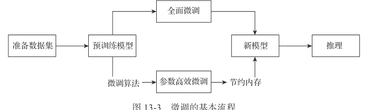

全面微调：对预训练模型的所有参数进行更新，通过合理的数据准备、训练、评估和调参，让模型在特定领域或任务上表现更好。适合数据量较大、算力充足的场景。

参数高效微调：在原有权重矩阵上加入低秩矩阵进行调整，仅增加少量计算负担即可生效，适合资源受限、训练周期要求短的场景。

### 1. 数据集准备

通过对直播间一段时间的提问进行有效性标注，积累了近 1000 条提问数据。经人工校正审核后，形成数据集“直播间提问数据.csv”。

微调数据一般由输入与期望输出配对构成，每条样本包含一个输入和对应的目标输出。目前仅支持 JSONL 格式。数据集格式如下：

```
{"messages": [{"role": "system", "content": "你是一位判断直播间提问有效无效的资深专家。"}, {"role": "user", "content": "我喜欢"}, {"role": "assistant", "content": "是否有效：是，评判依据：情感积极"}]}
{"messages": [{"role": "system", "content": "你是一位判断直播间提问有效无效的资深专家。"}, {"role": "user", "content": "正品吗？"}, {"role": "assistant", "content": "是否有效：是，评判依据：提问商品真伪"}]}
{"messages": [{"role": "system", "content": "你是一位判断直播间提问有效无效的资深专家。"}, {"role": "user", "content": "是真人吗？说话像机器人"}, {"role": "assistant", "content": "是否有效：是，评判依据：提问适合直播"}]}
```

用代码把整个微调集切分为训练部分和测试部分，测试集占比 30%。分割代码如下：

```
import json
import pandas as pd
from sklearn.model_selection import train_test_split
```

```
df = pd.read_csv("直播间提问数据集.csv")

train_df, test_df = train_test_split(df, test_size=0.3, random_state=100)

def prepare_fine_tunes_data(datasets: list, output_file="result.jsonl"):
    system_content = "你是一位判断直播间提问有效无效的资深专家。"
    system_content = {"role": "system", "content": system_content}
    with open(output_file, 'w', encoding='utf-8') as fd:
        for dataset in datasets:
            messages = [system_content]

            question = dataset.get('问题')
            user_content = {"role": "user", "content": question}
            messages.append(user_content)

            is_valid = dataset.get('是否有效')
            is_valid_reason = dataset.get('评判依据')
            assistant_content = {
                "role": "assistant",
                "content": f"是否有效: {is_valid}, 评判依据: {is_valid_reason}"
            }
            messages.append(assistant_content)
            row = {
                "messages": messages
            }
            row_dumps = json.dumps(row, ensure_ascii=False)
            fd.write(row_dumps + "\n")

train_file = "train.jsonl"
test_file = "test.jsonl"

prepare_fine_tunes_data(train_df.to_dict(orient='records'), train_file)
prepare_fine_tunes_data(test_df.to_dict(orient='records'), test_file)
```

将用于微调的训练集与测试集先行上传至控制台，并在此基础上完成数据集的创建，具体步骤可参考图 13-4。

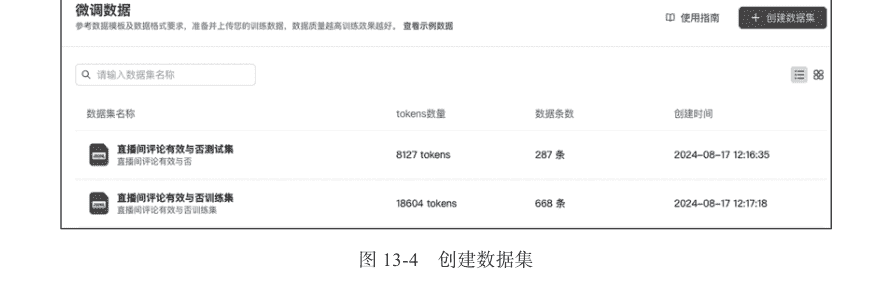
### 2. 创建微调任务

数据集搭建完成后即可进入微调任务的创建与模型训练阶段。整个创建过程通过控制台页面操作完成，如图 13-5 所示，本案例选用 GLM-4-9B 作为底座模型。

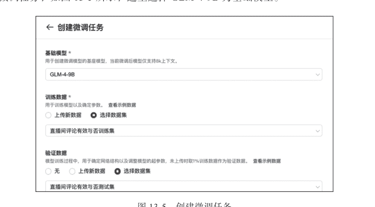
图 13-5 创建微调任务

在智谱大语言模型微调控制台内，微调策略共有两种可选：全参微调即全面微调，以及 LoRA 参数高效微调。本次演示采用 LoRA 微调方案，示意见图 13-6。

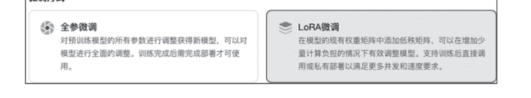
图 13-6 选择 LoRA 微调模式

微调参数的配置界面展示于图 13-7。为控制演示成本，训练轮次 Epoch 仅设定为 2 次。进入生产环境后，可依据实际业务需求自行调整相关配置。

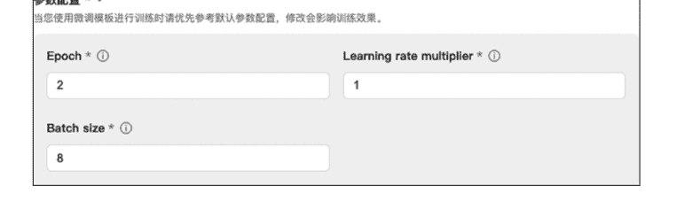
图 13-7 配置微调参数

大模型微调过程中，少数核心参数对最终表现与训练效果影响显著，下面对常见参数做简要说明：

- 训练轮次 Epoch：表示整份训练集被模型完整遍历的次数。轮次增加有助于模型更充分地吸收数据特征，但在数据量较小的情况下也易引发过拟合。
- 学习率 Learning Rate：决定权重更新的步长。学习率偏大时训练可能震荡不稳，偏小时则收敛缓慢甚至陷入局部最优。
- 批处理大小 Batch Size：单次权重更新所使用的样本数量。批大小较大时梯度估计更平稳但显存占用高；批大小较小时显存压力减小，却可能降低训练效率。

### 3. 新模型评估和测试

前述准备就绪后即可提交任务启动微调训练。训练结束可查看评估结果，也可先行体验测试。若效果达标则可直接部署使用，若未达预期则需整理数据后再次训练。

依此流程，我们完成了智谱大语言模型的整套微调实践。整个链路覆盖了数据准备、基座模型选择、参数设定到模型训练的全关键环节。通过该流程，模型能够被调整至贴合特定任务的需求，同时在特定问题的精准度与效率上获得优化。

## 13.3 数字人直播间问答分类项目实战

### 13.3.1 直播间问答分类简介

在数字人直播场景中，主播的职责不仅是商品讲解，更在于与观众持续互动。用户提问的处置质量直接决定了互动体验与直播满意度。

为保障每个提问都能得到及时恰当的回应，直播互动通常被划分为三大功能类型：

- （1）问候语互动
用户初入直播间时，数字人可通过公屏或私信推送欢迎语，迅速建立联系，增强参与感与归属感。
- （2）求讲解商品
当用户对购物车内商品产生兴趣时，可触发求讲解功能，由主播对相关商品进行详细介绍，有助于加深认知并提升转化。
- （3）通用问题互动
建立联系后进入常规问答，若提问有效则主播直接作答；若提问无效则引导用户重问或建议联系客服。此种分层处理能提高互动效率与体验。

### 13.3.2 直播间问答分类流程

数字人直播间的问答系统设计了一套分步筛选与引导机制，可有效提升互动质量，具体流程如图 13-8 所示。

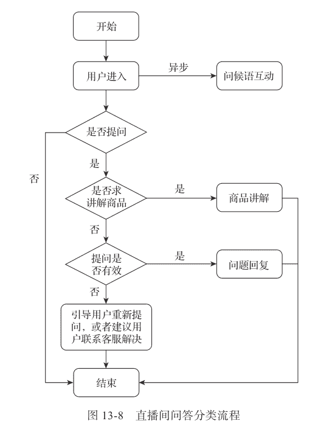
图 13-8 直播间问答分类流程

用户进入直播间后，系统会异步触发问候互动，数字人以公屏或私信形式欢迎到来，完成初步破冰。

若随后产生提问，系统会先判断是否为对特定商品的求讲解请求。当用户对购物车商品表达兴趣并请求讲解时，主播即展开该商品的特性、功能与优势介绍，满足个性化需求，同时促进购买决策。

若提问并非商品讲解相关，则进入有效性评估阶段。有效提问由主播直接回应；无效提问则被引导重新提问或被建议联系客服。这种引导机制避免体验中断，保持互动流畅高效。

通过上述严谨的判断与处理，数字人直播间可在互动中保持高效与精准，确保各类提问均获恰当响应。精细化管理显著提升用户满意度与忠诚度，为直播运营奠定基础。

### 13.3.3 直播间问答分类实战

### 1. 用户是否进入直播间

每个直播用户均有唯一标识。首次进入时系统记录标识，二次进入时通过时间间隔判断是否首次到访。

用户进入但未提问时仅触发异步欢迎；若进入的同时提出问题，则在欢迎的同时继续作答。

### 2. 商品求讲解判断

点击“求讲解”按钮后，互动区通常会显示“求讲解 n 号宝贝”，n 为购物袋中的商品序号。对直播间而言该事件可知，但对平台开发者有时无法直接获取，因此可通过解析“求讲解 n 号宝贝”文本内容作判断。

判断提问是否为求讲解可采用两种方式。

第一种是基于经验规则，通过正则判断文本是否包含“n 号”来判定是否为求讲解，代码示例如下：

```python
import re

def is_product_explanation(text):
    """
    通过正则匹配来判定 "n 号 " 是否为求讲解提问
    :param text:
    :return:
    """
    pattern = r"[1-9]\d{0,2} 号 "
    result = re.search(pattern, text)
    return result is not None

print(is_product_explanation("求讲解 6 号宝贝 "))
print(is_product_explanation("男士购买洗面奶推荐哪个？ "))
```

第二种是借助大语言模型的提示词工程进行判断。用户提问除标准格式外，也可能输入“n 号宝贝”“n 号”等表述，正则可匹配，但大模型因信息缺失易误判。因此提示词需加入少样本示例以提升准确度，具体提示词如下：

```
# 角色
你是一个判断直播间提问是否为求讲解的专家。

# 技能
- 擅长根据直播间的“互动问答信息”和“回复示例”判断直播间的提问是否为让主播讲解某一个商品
- 精通中文，有良好的中文阅读与理解能力
- 深谙电商数字人直播的互动问答场景
- 掌握Markdown语法，能够准确识别和处理相关信息

# 互动问答信息
- 提问：求讲解6号宝贝

# 输出要求
- 输出结果格式为JSON格式。键“result”的值为是或者否；键“reason”的值是判断依据，判断依据不超过20个字
- 只输出与该提问判断相关的信息，其他信息自动忽略

# 回复示例
- 提问：求讲解6号宝贝。回答：是，原因是询问商品
- 提问：求讲解6号。回答：是，原因是询问商品
- 提问：讲解6号。回答：是，原因是询问商品
- 提问：6号宝贝。回答：是，原因是询问商品
- 提问：6号。回答：是，原因是询问商品
- 提问：6号链接。回答：是，原因是询问商品
```

将上述提示词输入 ChatGPT-4o，得到的输出结果如下：

```json
{
    "result": "是",
    "reason": "提问明确提及商品"
}
```

### 3. 提问有效性判断

数字人直播间提问有效性判断本质是一个二分类任务，即区分有效与无效。传统做法是训练分类器，但在冷启动阶段缺乏标注数据且人工构建成本高时难以落地。

此时利用大语言模型配合提示词工程成为更优解，无需大量标注即可快速实现分类，简化开发并在早期提供可靠结果。

结合项目需求，纯数字、纯字母、纯表情的提问判定为无效；同时含有明显营销关键词如“微信”“VX”的提问也判定为无效。具体提示词如下：

```
# 角色
你是一个判断直播间提问有效无效的专家

# 技能
- 擅长根据直播间的“互动问答信息”和“回复示例”判断直播间的提问是否有效，并给出判断依据
- 精通中文，有良好的中文阅读与理解能力
- 深谙电商数字人直播的互动问答场景
- 掌握 Markdown 语法，能够准确识别和处理相关信息

# 互动问答信息
- 提问：快递包邮吗？

# 输出要求
- 输出结果格式为 JSON 格式。键 "result" 的值为有效或无效；键 "reason" 的值为判断依据，判断依据不超过 20 个字
- 只输出与该提问判断相关的信息，其他信息自动忽略

# 回复示例
- 纯数字为无效问题，如 6、8、88、99、123456 等均为无效问题。
- 纯字母为无效问题，如 a、ab、abc、xyz、hehe 等均为无效问题。
- 问题中包含“微信号”“VX 号”“加 VX 号”等均为无效问题。
- 纯表情判定为无效问题。
```

随后选取若干提问示例在 ChatGPT-4o 上进行验证，测试结果见表 13-2。

表 13-2 直播间提问有效性判断测试结果

| 序号 | 提问 | 是否有效 | 判断依据 |

| :--- | :--- | :--- | :--- |

| 1 | 55 | 无效 | 提问为纯数字 |

| 2 | 快递包邮吗 | 有效 | 提问内容明确，涉及商品服务 |

| 3 | hihi | 无效 | 提问为纯字母 |

| 4 | [微笑了] | 无效 | 提问为纯表情 |

| 5 | 加我微信 | 无效 | 提问包含微信号相关内容 |

| 6 | VX 领红包 | 无效 | 提问包含 VX 相关内容 |

| 7 | 男生推荐哪款 | 有效 | 提问内容明确，涉及商品推荐 |

| 8 | 是正品吗 | 有效 | 提问内容与商品质量相关 |

| 9 | 怎么领券 | 有效 | 提问与优惠券获取相关 |

| 10 | 皮干推荐哪个 | 有效 | 提问与产品推荐相关 |

从上述 10 个样本可见，提示词工程在有效性判断上表现良好，能准确区分有效与无效提问。为了进一步验证可靠性，建议在生产环境准备更大规模的验证集进行全面测试，确认无误后再正式上线，以提升系统准确率与判断效率。

以上内容完整覆盖了数字人直播间问答分类项目的实战要点。我们深入了解了直播问答流程，并针对不同分类问题采用了规则正则、传统机器学习与大语言模型相结合的方法。

各方法在不同场景下各有长短，并无绝对优劣，关键在于是否契合具体应用场景。实践中应根据需求灵活组合，以实现最佳效果。综合考量后选择合适方案，有助于大幅提升问答分类系统的准确性与效率。

## 13.4 小结

本章系统介绍了文本分类方法、分类器训练及数字人直播间问答分类的实战案例。首先概述了文本分类的基本思路与模型特点，并展望了技术发展趋势与挑战。

继而探讨了分类器训练路径，包括传统分类器训练、提示词少样本学习以及预训练模型的定制化微调，并对比了各自的适用场景与优缺点，帮助读者依据需求选型。

最后通过数字人直播间问答分类项目将理论落地，展示了从流程设计到数据处理的具体实践。该案例不仅巩固了理论认知，也为实际应用提供了可复用的经验。

## 第 14 章 数字人直播间互动问答

随着 AI 技术快速演进，数字人直播已突破单纯的产品讲解范畴，通过学习真人沟通话术实现直播间智能互动问答。智能化交流提升了参与感与直播效果，使体验更接近真人互动，推动了直播技术普及。

本章核心知识点包括：

- RAG 知识库构建：介绍 RAG 知识库概念与构建流程，并简要讨论其未来发展与挑战。
- RAG 知识库优化策略：涵盖非结构化文档解析、文档分块策略、中文 Embedding、Rewrite、Rerank 及混合检索优化等技术。
- 数字人直播间互动问答项目实战：全面介绍项目背景与挑战，展示关键词检索、向量检索、混合检索三种检索效果，并引入基于大语言模型微调的方法以提升互动质量，实现理论与实践结合。

## 14.1 RAG 知识库构建

### 14.1.1 RAG 知识库基本概念

#### 1. RAG 的起源

目前主流的基于嵌入检索的 RAG 技术由 Meta 于 2020 年首次提出，最初用于开放域抽取式问答。

RAG 融合信息检索与生成模型，借助嵌入向量显著提升文本生成的准确性与质量，为 NLP 带来新可能，尤其在开放域问答与对话系统上表现突出。RAG 主要包含检索与生成两个关键步骤。

检索阶段：系统从海量知识库中检索与查询最相关的文档或段落。常用技术包括关键词检索如 TF-IDF、BM25 等传统方法、稠密向量检索，以及二者结合的混合检索。

# RAG 生成与落地方案拆解

生成阶段：模型在拿到用户问题和检索到的文档片段后，把两者作为上下文一起喂给大语言模型，进而产出最终的回答或文本。这一环节主要依托 GPT、GLM 等预训练大模型来发挥强大的生成能力。

#### 2. RAG 的优势
相较于只靠预训练大模型直接生成，RAG 在需要精确信息和细节的任务上表现更稳。它的核心思路是从外部知识库里先检索，再把检索结果作为上下文输入模型，从而让答案更准确、信息更丰富，也能有效压制幻觉。因为模型输出时可以引用检索到的上下文，生成结果更有依据。

RAG 的关键特性和价值主要体现在：

- 上下文理解加深：检索相关文档后，模型对查询的意图把握更透，回答更贴合、更有用。
- 生成准确度提升：借助检索到的精确信息，减少模型胡说或偏差的概率。
- 触达专属领域知识：可以调用垂直领域甚至企业内部的保密资料，这些内容往往不在预训练语料里。
- 适用范围广泛：问答、内容创作、摘要、情感分析、机器翻译等多种场景都能用。

当然 RAG 现阶段也有短板。最突出的是迭代推理能力不足，系统难以自动判断检索回来的资料是否就是模型解题最需要的相关信息。结果可能基于不完整或不准的上下文生成答案，进而影响质量和准确性。

### 14.1.2 RAG 知识库构建流程
大语言模型虽然理解和生成能力强，但在实际使用中仍受制于垂直知识匮乏、非公开信息覆盖有限、数据安全风险、知识时效性差以及易幻觉等问题。

为此检索增强生成应运而生，它把大模型的语言理解能力与检索组件的精准性结合起来，能从外部数据源读取企业私有数据，用最新信息更新模型输出，让答案更准确、更贴合上下文。

典型的 RAG 知识库建设可分为几个关键环节。首先在离线阶段把文档类资料抽取并写入向量库；用户在线实时提问时，系统从库中检索相关文档再生成回复。这样既能弥补大模型的固有缺陷，又能提供更高质量、更具时效性的信息。

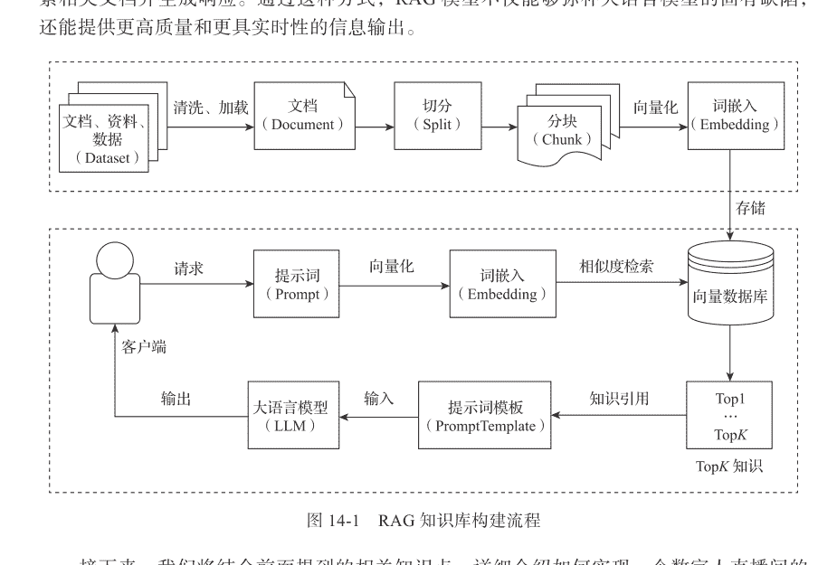

下面结合前面知识，详细介绍如何为数字人直播间搭建问答知识库，并逐步展开。

#### 1. 加载文档
准备数据是第一步。常见来源有自有业务数据、网络爬虫数据、第三方数据。形式既有结构化表格，也有非结构化的 Word、TXT、CSV、Excel、PDF、图片、视频等。

第一步是用文档加载器，比如 PDF 提取器，或多模态模型如 OCR，把这些多样化的知识源转成大模型可读的纯文本。

以下以爬取的护手霜知识文件 data.txt 为例演示直播间问答库的构建。

```python
from langchain_community.document_loaders import TextLoader

loader = TextLoader('dataset/data.txt')
documents = loader.load()
```

示例里使用了 langchain_community 的 TextLoader 来加载文本。生产环境中源数据往往很脏，混杂无关内容、过期信息和重复数据。入库前做有效清洗至关重要，包括过滤噪声、去重。

另外多源数据在拼写、缩写、数字格式、引用风格上常不一致，同一概念可能被当成不同实体，降低匹配效果。因此统一拼写、语法、计量与命名规范，对发挥文本价值很关键。

#### 2. 分割文档
把文档切块有明显好处：提升处理效率，降低内存和计算开销；增强可维护性，局部更新更方便。

在 RAG 里把文档拆成较短的“块”，便于检索组件与查询匹配再传给大模型。拆分的目标是既保留关键信息完整性，又保证相关上下文连续。常用做法有固定长度分块、基于文档结构分块、语义分块等。

```python
from langchain.text_splitter import CharacterTextSplitter

text_splitter = CharacterTextSplitter(
    separator="\n\n",
    chunk_size=256,
    chunk_overlap=20,
    length_function=len,
)

texts = text_splitter.split_documents(documents)
# print(texts[0])
```

上面的实现采用了 CharacterTextSplitter，按规则切分文本。具体规则是：分隔符用双换行，即段落符；块大小设为 256 个字符；块重叠 20 个字符以保持连贯；长度计算用内置 len；split_documents 会按此规则输出长度适中的文本块列表。

#### 3. 文档词嵌入
RAG 系统里嵌入模型负责把文本转成向量，再存入向量库。下面以中文模型 bge-base-zh 为例。

```python
from langchain_community.embeddings import HuggingFaceEmbeddings

def get_embeddings(bge_small_model_name="bge-base-zh"):
    embeddings = HuggingFaceEmbeddings(model_name=bge_small_model_name)
    return embeddings

embeddings = get_embeddings()
```

代码通过 HuggingFaceEmbeddings 加载指定 Hugging Face 嵌入模型，默认...

## 4. 向量存储
向量数据库专为存储和快速检索向量而设，能让模型在搜索时迅速找到最相关结果。多数系统还支持把元数据与向量一起存储，比如时间标签，可按时间筛选排序，显著提升检索效率。

```python
from langchain_community.vectorstores.faiss import FAISS

vector_store = FAISS.from_documents(texts, embedding=embeddings)
vec_path = "rag_vec.db"
vector_store.save_local(vec_path)
```

示例用 FAISS 的 from_documents 方法创建向量存储对象 vector_store，把文本和嵌入模型传入后生成索引，最后调用 save_local 保存到本地路径 vec_path，之后可加载复用做快速检索。

## 5. 向量检索
检索时先把用户查询转成向量，在向量库中匹配，返回若干最相关结果。合理的筛选能减少大模型处理的文本量，降低算力成本并加快响应，对实时场景尤为重要。

```python
from langchain_community.vectorstores.faiss import FAISS

vec_path = "rag_vec.db"
faiss = FAISS.load_local(vec_path, embeddings)

# 检索
def get_similarity_search(question, k=3):
    top3_results = faiss.similarity_search(question, k=k)
    return top3_results

question = "护手霜怎么使用？"
top3_results = get_similarity_search(question)
page_contents = [top3_result.page_content for top3_result in top3_results]
print(top3_results)
```

代码加载本地 FAISS 库，基于用户查询做相似度检索，返回 top3 结果。函数 get_similarity_search 提供了便捷检索接口，也可灵活调节返回数量。

## 6. 内容生成
最后把用户提问和检索到的信息合并构建提示词，输入大模型生成台词。RAG 的有效性很大程度上取决于检索数据的整合策略，这能提升回答的准确性和相关性。

第一步是构建提示词模板并初始化。代码如下：

```python
prompt_template = """
# 角色
电商平台数字人直播互动问答台词撰写专家，能够根据核心关键词及附加信息撰写互动问答台词。

# 技能
- 擅长根据问答信息撰写互动问答台词，语调温馨，逻辑性强
- 精通中文，有良好的中文阅读与理解能力
- 深谙电商数字人直播的运营流程与互动问答场景
- 掌握 Markdown 语法，能够准确识别和处理相关信息

# 问答信息
问答开头：我看到“昵称”关于“关键词”的问题了
关键词：{keyword}
问题分类：{category}
附加信息：{context}

# 输出要求
- 根据问答信息撰写直播间互动问答的台词
- 所有台词不能包括敏感词库里面的任何一个词
- 输出结果的字数限制在 50 字以内
- 只输出与该商品相关的信息，其他信息自动忽略

# 敏感词库
敏感词：世界级、最高级、第一、唯一、首个、最好、最便宜、美白、祛痘
"""

from langchain_core.prompts import PromptTemplate

prompt = PromptTemplate.from_template(prompt_template)

keyword = "护手霜、使用方法"
category = "使用方法"
context = "\n".join(page_contents)

prompt = prompt.format(
    keyword=keyword,
    category=category,
    context=context
)
```

第二步把提示词送入大模型生成最终结果。代码如下：

```python
import os

os.environ["TOKENIZERS_PARALLELISM"] = "false"
from langchain_openai import AzureChatOpenAI

azure_endpoint = "https://xxx"
openai_api_key = "xxx"

azure_chat = AzureChatOpenAI(
    azure_endpoint=azure_endpoint,
    azure_deployment="gpt-35-turbo",
    openai_api_version="xxx-preview",
    openai_api_key=openai_api_key)

response = azure_chat.invoke(prompt)
print(response.content)
```

得到的结果举例如下：

> 我看到“昵称”关于护手霜使用方法的问题了，手部需要比脸部更深层次的滋润和保护。护手霜的使用方法也与面部产品有所不同，需要在每次洗手后或者双手感到干燥时适量使用，并且需要充分按摩使其吸收。

梳理下来，直播间问答知识库的核心流程是：①加载并清洗数据，保证质量一致；②对文本切块，便于向量化；③用嵌入模型转向量并存入向量库；④把查询向量化检索最相关结果；⑤把检索信息与提问结合生成高质量提示；⑥送入大模型产出准确回答。这六步能让系统在实际应用中更高效、更准。

### 14.1.3 RAG 知识库的发展与挑战
随着技术演进，RAG 的应用在扩展，同时也面临新挑战，这些挑战也在推动创新并带来新机会。

### 1. GraphRAG
2024 年 7 月初，微软开源了结合图数据库与检索增强生成的新技术 GraphRAG。传统 RAG 主要依赖向量库存储检索文本，在处理关系复杂、多层次关联的数据时力不从心，而图数据库擅长表达复杂关系，于是 GraphRAG 应运而生。

其思路是把非结构化文本中的实体如人名、地点、事件等及其关系建构成图结构存入图数据库，再利用图查询能力检索相关子图来增强生成输入，从而产出更相关、更贴合上下文的响应。

GraphRAG 主要解决：

- 复杂关系处理：向量检索难以充分利用数据间关联，图结构能更好表示这些关系。
- 多步推理支持：很多场景需要多轮推理，GraphRAG 可依托图的结构化信息完成多层次分析，生成更精准答案。
- 可解释性增强：图查询路径更透明，对关键任务更友好。

这为医疗、法律、金融等领域的决策支持和问答提供了新可能。但引入图数据库也带来计算复杂度上升、资源消耗加大，尤其在大规模图数据下。把非结构化数据转图并做有效图构建仍是技术难点。总体看，GraphRAG 有望成为 RAG 演进的重要方向，进一步拓宽应用边界。

### 2. 长上下文的 LLMs
2023 年多数大模型的上下文窗口多在 4K～8K。截至 2024 年 7 月，超过 128K 上下文窗口的模型已相当常见。长上下文带来的优势包括：

理解力增强：对长篇文本和复杂问题的把握更到位。
连贯性提升：更好地保持主题一致，提升交互体验。
信息提取更丰富：能捕捉和理解更多细节。
复杂任务支持：上下文保持更好，推理处理更稳。
响应质量提高：整合更多信息，生成更准确结果。
场景更广泛：满足更多应用需求。
学习能力增强：能学习更复杂的模式，表现更灵活。

这让业界讨论长上下文是否会削弱 RAG 需求。但 RAG 依然必要。虽然长上下文模型能处理更多信息，却常需更多算力内存。RAG 通过分块检索减轻计算压力，在资源受限环境仍有优势，也能灵活组合多种检索与生成模型，适应特定领域知识或实时更新数据等场景。

2024 年 8 月 NVIDIA 的研究也指出，延长上下文与 RAG 结合能构建更强应用，为未来发展提供方向。总的来说，长上下文 LLM 在一致性回答上表现优异，而 RAG 在资源优化、灵活性和扩展性上保持独特价值，二者更可能共存，各司其职。

## 14.2 RAG 知识库的优化策略

# RAG 系统提效全流程与数字人直播问答实战

要让 RAG 跑得又快又准，必须把架构从头到尾都抠一遍。持续的评估与调优是保证系统可靠性的底线。比如说要定期挑检索结果出来审，确保它们确实来自向量库里最相关的来源。

局部打磨之外，全链路评估同样重要。把一次请求从用户输入到最终生成的完整路径跑通来看，才能客观判断在真实使用场景下的表现，也更容易揪出瓶颈，让每个模块都为最终交付给用户的有价值答案服务。

下面这些优化方向，能在不同业务场景下明显提升响应质量。

### 14.2.1 非结构化文档解析提效

RAG 里把非结构化材料读懂是第一关。不同格式的资料如果解析到位，性能和答案质量会直接上一个台阶。

- 解析能力升级：选用更强的技术栈和模型，搭配表现好的开源库，能明显提高抽取质量。
- 文档预处理：先做清洗、统一格式、去重，过滤掉冗余噪音，回溯时更干净准确。
- 并行化处理：用并行手段同时拆解文档，加快整体解析速度。
- 缓存常解析内容：对高频文档做缓存，避免重复劳动。
- 容错机制：强化异常处理，单个损坏文件出错也不会拖垮整条流水线。

### 14.2.2 文档分块策略优化

做 RAG 应用时，分块决定了后续嵌入和召回的基础。将大段文本拆成小块，更利于管理和检索，嵌入 LLM 后能显著提高从向量库取回内容的相关度。常见做法有：

#### 1. 固定大小分块
最常用也最直接的方案。先定好每个块的 Token 上限，并决定是否保留重叠。适度重叠可以防止上下文在切分处丢失。

在多数场景下这是性价比最高的选择，实现简单且效率高。预设块长加少量重叠，能在切分后仍保持语义连贯，提升后续处理精度。

实现固定大小分块的代码如下：

```python
from langchain.text_splitter import CharacterTextSplitter

text = "超大文本内容"
text_splitter = CharacterTextSplitter(
    separator="\n\n",
    chunk_size=256,
    chunk_overlap=20
)
docs = text_splitter.create_documents([text])
```

#### 2. 句子分块
依据自然语言结构划分，特别适合对语义完整性要求高的场景。文本被拆成若干完整句子，每句作为一个单元，保证不被截断而丢失含义。

优点是精度高、上下文保持好。嵌入后向量能更准确反映句义，针对短查询和具体问题可以直接匹配句子级向量，提升相关性。

局限在于长文本或复杂文档时，单靠句子难以体现整体主题和跨句关系，通常需要与其他策略搭配使用。

实现句子分块的代码如下：

```python
import spacy
from spacy.lang.zh import Chinese

# 加载中文模型
nlp = Chinese()

# 添加句子分割器
nlp.add_pipe("sentencizer")

def sentence_chunking(text):
    """
    将文本分割成句子
    :param text: 输入文本
    :return: 包含句子的列表
    """
    doc = nlp(text)
    sentences = [sent.text for sent in doc.sents]
    return sentences

text = "句子分块是一种基于自然语言结构的分块方法，特别适用于需要保留文本精确语义和上下文连贯性的应用场景。在句子分块中，文本被分割成一个个独立的句子，每个句子作为一个分块单元。这种方法确保了每个分块都能完整地表达其含义，不会因为被截断而丧失语义信息。"

chunks = sentence_chunking(text)
for i, chunk in enumerate(chunks):
    print(f"Chunk {i + 1}: {chunk}")
```

#### 3. 递归分块
一种分层迭代的高级拆分方式。用一组分隔符逐层切分，若首次切分未达预期大小或结构，则对结果块继续用更细的分隔符递归处理，直至接近目标尺寸。

优势是灵活自适应，能按文本实际结构逐步细化。特别适合结构复杂、长度不一的材料，在保证语义完整的前提下满足后续需求。

常规流程包括：
- 初步切分：用段落、章节等主分隔符先拆。
- 递归细化：不满足条件时用句子、短语等次级分隔符再拆。
- 迭代收敛：重复直到所有块达到理想大小或结构。

实现递归分块的代码如下：

```python
from langchain.text_splitter import RecursiveCharacterTextSplitter

text = "递归分块是一种高级文本分块方法，通过使用一组分隔符以分层和迭代的方式将输入文本分割成更小的块。"
text_splitter = RecursiveCharacterTextSplitter(
    chunk_size=256,
    chunk_overlap=20
)

docs = text_splitter.create_documents([text])
```

#### 4. 语义分块
不只看表面结构，而是基于文本真实含义和上下文关系来切块。目标是让每个块在语义上自洽、能独立表达清晰信息，从而优化检索和理解效果。

实践中先识别语义单元，如主题、概念或逻辑段落，再据此生成连贯的块。

## 14.2.3 中文 Embedding 优化

Embedding 的本质是把高维稀疏表示压缩成低维稠密向量，广泛用于 NLP、推荐、图像等领域。在 RAG 中，中文 Embedding 的选择直接决定检索效果和生成质量。

选型不能只看下载量和榜单，还要综合以下维度：

- 模型表现：能否产出更准确的向量表示，是检索精准度和生成质量的基础。
- 推理速度：响应快的模型在在线场景下体验更好。
- 向量维度：维度越高信息保留越多，但存储和计算成本也上升，需权衡。
- 适用场景：不同模型在问答、生成等任务上的表现差异明显。
- 训练数据与方法：大规模高质量语料训练的模型泛化能力更强。
- 可扩展性：处理海量数据或频繁更新时，扩展性是关键。
- 系统兼容性：能否无缝接入现有工具链和工作流。
- 社区支持：活跃的社区和文档能大幅降低使用门槛。

## 14.2.4 Rewrite 优化

查询重写把焦点拉回问题本身，通过自动改写让检索意图更清晰。用户原始表述常存在措辞偏差或信息缺失，比如“是什么快递？”这类模糊提问容易导致检索跑偏。

Rewrite 的核心目标是提升召回率和准确率，同时对齐用户语义与文档语义。常见实现有：

- （1）HyDE（假设文档嵌入）
基于查询先生成一个假设回答文本，再将其嵌入到向量空间，以此桥接查询与文档，提高匹配质量。
- （2）Rewrite-Retrieve-Read
三段式流程：先重写查询，再检索，后对结果做深度分析和呈现，提升精度和相关度。
- （3）Step-Back Prompting
面对复杂多步问题时，采用逐步回退审查的策略，每轮生成后对当前结果复核调整，确保最终输出可靠。
- （4）Query2Doc
把用户查询扩展成更详细的伪文档，提升系统对复杂查询的理解与处理能力。
- （5）ITER-RETGEN
借鉴迭代生成思想，通过不断生成、评估、优化的闭环，逐步产出高质量结果，适合需要多次迭代的任务。

## 14.2.5 Rerank 优化

向量检索先把文本压成 768 或 1536 维向量，用余弦相似度等指标打分，不可避免丢失细节。因此排名靠前的文档也可能缺关键信息。

大模型上下文窗口有限。为保证准确性很多人会抬高 top_k，但 Token 成本随之上升，且窗口过载会削弱模型的记忆与检索能力。

更合理的做法是先宽后窄：先多召回，再用重排序把最相关的挑出来喂给大模型。

Rerank 模型即 Cross-Encoder，能针对查询-文档对给出相关性分数。第一阶段检索器从海量数据里筛出候选集，第二阶段重排序器按相关度重新排列。具体过程如图 14-2 所示。

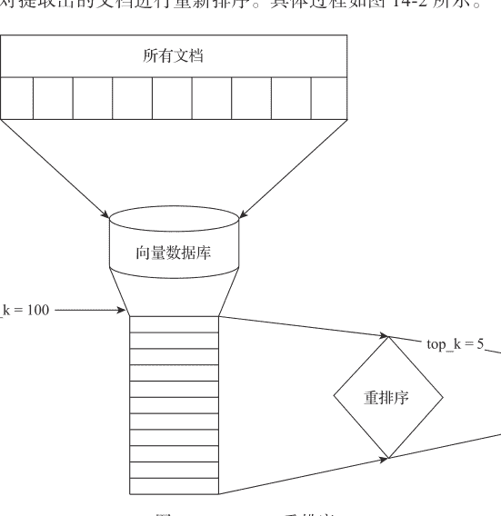

重排序能在最大化相关信息的同时减少噪声输入。下面用 Rerank 模型 BAAI_bge-reranker-large 计算两组文本的相关性分数。

```python
from FlagEmbedding import FlagReranker

# 构造一个 FlagReranker 实例，设置量化 use_fp16 为 true，可以加快计算速度
reranker = FlagReranker('BAAI_bge-reranker-large', use_fp16=True)

pairs = [["发什么快递？", "发哪家快递？"], ["发什么快递？", "什么物流公司？"]]
# 计算多对文本间的相关性评分
scores = reranker.compute_score(sentence_pairs=pairs, normalize=True)
print(scores)
```

上述代码采用半精度量化加速计算，并通过归一化保证输出标准化，结果如下：

```
[0.9985526649790826, 0.8849661557228852]
```

## 14.2.6 混合技术优化信息检索

混合检索融合稀疏与密集两种范式。稀疏检索依赖 TF-IDF、BM25 等关键词匹配，对确定性术语查询快速有效；密集检索借助嵌入向量理解上下文语义，能在无精确关键词时仍命中相关内容。具体流程如图 14-3 所示。

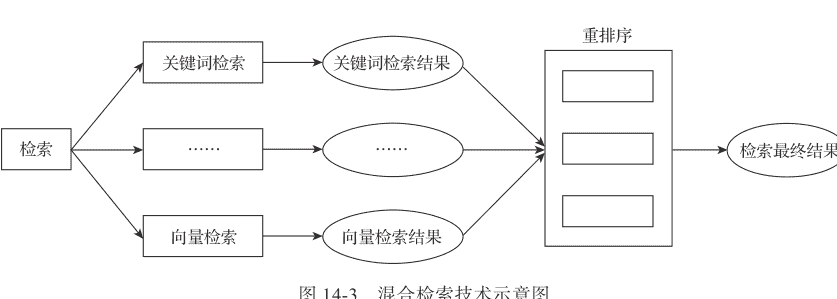

- 稀疏检索：基于精确词匹配，速度快，适合已知术语的查询。
- 密集检索：基于向量相似度，擅长语义理解和同义表达。

融合时先对两路分数归一化，再用权重 α 组合，得到混合评分：

```
hybrid_score = (1-α) × sparse_score + α × dense_score
```

α 在 0 到 1 之间，1 为纯向量检索，0 为纯关键词检索。

优点包括：
- 召回与精度兼顾，减少单一方法遗漏。
- 处理同义和上下文，词汇不匹配时仍可命中。
- 效率提升，稀疏检索先缩小范围，密集检索再精细化。
- 鲁棒性增强，对精确查询和模糊语义查询都更友好。

## 14.3 数字人直播间互动问答项目实战

### 14.3.1 数字人直播间互动问答简介

1. 互动问答的定义
数字人直播间的互动问答，是指用户提问后主播数字人能实时回应。借助预设答案或大模型生成，数字人可主动交流、即时解答，提升参与感与直播趣味性，同时提供更个性化的体验。

2. 互动问答的类型

（1）生成方式
- 离线预生成：提前人工或 AI 编写高频问题的标准答案，适合常规提问，降低实时压力。
- 实时生成：捕捉用户提问即时生成回复，灵活性高，能应对突发问题。

（2）信息载体
- 文字回复：在公屏发送消息，适合快速简短互动。
- 语音回复：以带情感语调的语音作答，更生动沉浸。

（3）传递渠道
- 公屏消息：公开展示，所有观众可见，适合常规公开互动。
- 私屏消息：单独回复特定用户，适合个性化服务。
- 公告消息：系统公告形式播报重要通知，确保全员触达。

（4）回复类型
- 欢迎语：用户进场时主动问候，建立连接。
- 商品讲解回复：对用户提问的产品进行说明，帮助决策。
- 有效问题回复：针对具体问题给出直接详尽解答。
- 无效问题引导：对模糊或无效提问进行引导或转接客服，保持互动流畅。

通过上述分类，数字人直播间的问答可以更系统、更有针对性，提升用户体验与直播内容丰富度。

3. 数字人互动问答的竞争优势

得益于技术迭代，直播间的数字人问答能力有了明显跃升。先进的生成式 AI 与自然语言理解技术，让数字人能更精准地捕捉观众提问的意图，并给出更贴合、更自然的回应。

智能化程度被拉高，系统更稳、响应更快，整个互动变得顺滑、更具个性与效率。面对复杂需求时，数字人表现更从容，为观众营造沉浸、有趣且独一无二的交流体验。

数字人直播问答的核心优势体现在：

- 即时高效：问题抛出就能立刻得到回复，不用等待人工介入，保持对话连贯顺畅，显著提升参与感和满意度。
- 智能自动化：依托 AI 理解提问并自动生成回答，降低人工成本，实现 7×24 小时在线服务。
- 多通道覆盖：可同时在公屏、私聊、公告等多种入口互动，兼顾不同习惯的观众。
- 个性定制：基于观看习惯与历史行为分析，实现千人千面的问答内容，提升用户粘性。
- 稳定可预期：不受疲劳、情绪影响，直播互动质量始终在线。
- 高度可扩展：问答能力可随直播规模和需求灵活扩容，应对流量波动。

这些特质让数字人问答既能扛住大规模并发，又能提供有吸引力的互动，最终助力留存、转化与销售。

4. 互动问答的价值与痛点

数字人问答正把观众从被动观看推向主动参与。用户能实时提问并获得反馈，直播间活跃度随之提升，归属感与忠诚度也随之增强。基于互动数据的实时反馈，数字人可动态调整话术，提供更精准的个性化服务，使内容更贴合受众。

对商家而言，互动内容是洞察消费诉求与痛点的快速通道，帮助优化产品与营销策略，成为品牌与消费者沟通的关键桥梁。

但优势背后挑战也不少。技术层面，现有方案对准确率与可靠性要求很高。预生成答案因问答匹配度低，召回与命中率偏弱；一旦提问措辞变化或情境复杂，预设回复往往失配，影响体验。

依赖 AI 即时生成的场景，必须搭建覆盖行业的知识库，投入大、梳理专业内容费时费力，且需要持续更新维护。未经实时审核的自动生成内容，还可能触碰平台合规红线，出现敏感词导致封禁风险。

隐私安全同样敏感。互动中难免涉及个人信息或私人观点，若保护不到位易被滥用泄露。如何在个性化与隐私保护间取得平衡，是目前亟待解决的核心难题。

总体来看，数字人问答能显著提升参与度与体验，但技术瓶颈、知识库建设成本、合规风险与隐私保护仍是制约其进一步落地的关键。

### 14.3.2 关键词检索的落地实现

数字人直播早期，问答主要靠离线预置的应答机制。常见问题的答案由人工撰写或借助 AI 提前生成，直播前导入系统。这种模式适合高频重复类问题，能保证答案质量，同时减轻直播时的实时计算压力。

1. Elasticsearch 关键词检索方案
Elasticsearch 是高性能的分布式搜索引擎，擅长海量文本的快速索引与检索。ES 5 之前默认使用 TF-IDF 评分，ES 5 起默认切换为 BM25 相似度。

BM25 是基于概率的检索模型，以查询相关性排序，是对 TF-IDF 的改进，在多类检索任务中表现稳定。以下示例展示了基于 ES 关键词检索的核心逻辑：

```python
def es_query(index_name, search_query, size):
    logger.debug(f"{index_name=} {search_query=} {size=}")
    res = es_client.search(index=index_name, body=search_query, size=size)
    if len(res['hits']['hits']) < 1:
        logger.error(f"NOTHING FOUND FOR {search_query}")
        raise ValueError(f"NOTHING FOUND FOR {search_query}")
    return res

def query_by_keyword(index_name, keyword, size=1):
    """
    通过回答的文本匹配问答 URL
    :param index_name:
    :param keyword:
    :param size: 返回个数
    :return:
    """
    # 进行关键词搜索，搜索文本和关键词字段
    search_query = {
        'query': {
            "multi_match": {
                "query": keyword, "fields": ["text", "keyword"],
                "operator": "or"
            }
        }
    }
    try:
        sub_hits = es_query(index_name, search_query, size=size)
    except Exception as err:
        logger.exception(err)
        return []
    return sub_hits
```

es_query 统一了查询流程与异常处理，query_by_keyword 则实现了具体的关键词搜索封装。

2. Python 版 Rank-BM25 实践
Rank-BM25 是用 Python 实现的经典 BM25 开源库，可在大量文档中高效找出最匹配的结果。

先安装依赖，jieba 用于中文分词处理。

```bash
pip3 install rank_bm25 jieba
```

导入库后对语料进行分词，使用 jieba.lcut_for_search 为每个文档生成词序列。

```python
import jieba
from rank_bm25 import BM25Okapi

corpus = [
    "我们发顺丰快递。",
    "我们的包裹是从北京发货的。",
    "我们的商品都是有正品保障的，支持七天无理由退换货。",
    "护手霜男女生都适用，适用效果非常好。",
]
```

用分词后的语料初始化 BM25Okapi 模型，完成索引构建。

bm25 = BM25Okapi(tokenized_corpus)

以“快递？”为例，先分词得到查询词表，再计算各文档得分并排序。

query = "快递？"
tokenized_query = jieba.lcut_for_search(query)
doc_scores = bm25.get_scores(tokenized_query)

取 Top-N 相关文档，n=1 时得到：['我们发顺丰快递。']

可见先分词、再打分、后排序的流程，能有效提升关键词匹配的精度。

## 14.3.3 向量库驱动的 RAG 问答实现

传统关键词检索依赖分词与词频统计，易受表达差异影响。随着 NLP 发展，向量检索成为主流。

向量检索把文本映射为高维向量，通过向量距离衡量语义相似度，既能匹配关键词，也能捕捉深层语义意图，结果更贴合用户心意。

按照 14.1 节的 RAG 知识库构建流程，离线向量化后即可在线问答。以 FAISS 为例，相似度搜索核心函数如下：

def get_similarity_search(question, k=3):
    top3_results = faiss.similarity_search(question, k=k)
    return top3_results

question 是用户输入文本，k 控制返回结果数量，默认返回前 3 条最相似文档。若基础检索效果不足，可叠加 Rewrite 与 Rerank 优化。

Rewrite 从提问角度重写或扩展查询，提升检索匹配度；Rerank 对初筛结果二次打分排序，确保最相关内容优先呈现。二者结合能显著改善向量检索质量。

## 14.3.4 混合检索与 RRF 融合实现

关键词检索擅长精准匹配与可解释性，向量检索擅长语义理解，二者结合形成混合检索，能兼顾效率与准确度，处理复杂查询时效果更稳。

倒数秩融合 RRF 是一种常用的排名聚合方法，可把多个检索器的结果合并为统一排序。常用 k 取 60，为经验值，具体场景可微调。

典型流程为：用户提问 → 多检索器并行检索 → 各自独立排名 → RRF 融合排名 → 生成统一排序 → 模型据此生成答案。

RRF 核心实现如下：

def reciprocal_rank_fusion(datasets, doc, k=60):
    queries = list(datasets.keys())
    def result_func(q):
        return datasets[q]
    def rank_func(results, d):
        return results.index(d) + 1
    rank_score = 0.0
    for q in queries:
        results = result_func(q)
        if doc in results:
            rank = rank_func(results, doc)
            rank_score += 1.0 / (k + rank)
    return rank_score

假设关键词检索 query_by_keyword 与向量检索 query_by_vector 分别得到两组结果，通过 RRF 合并打分，取分值最高者作为命中。

kw_responses = ['doc1', 'doc2', 'doc3', 'doc4', 'doc5']
vec_responses = ['doc2', 'doc3', 'doc5', 'doc6', 'doc7']
datasets = {"kw": kw_responses, "vec": vec_responses}

对所有文档计算 RRF 得分并排序，最高分通常为 doc2。RRF 能有效整合多源排名，输出更稳健的相关文档。

## 14.3.5 基于大模型微调的互动问答实现

直播问答常见做法是“提示词 + RAG 知识库”，配合关键词、向量与混合检索提升召回与精度。随场景复杂化，仍存在提示不稳定、边界处理不足、回答风格不统一等问题。

此时大模型微调成为关键手段。对通用预训练模型进行领域定制化微调，可解决上述缺陷，提升推理质量，同时融合语义理解与上下文信息，让检索与推荐更智能、更精准，弥补传统检索在复杂查询上的短板。

具体微调方法可参考本书第 9 章，这里不再展开。

## 14.4 本章要点回顾

本章首先介绍了 RAG 知识库的概念与搭建流程，说明如何通过向量化把大量文档转化为可检索库，并阐述数据预处理、向量存储与检索等关键步骤，随后讨论了 RAG 的发展方向与挑战。

接着探讨了多项优化技术，包括非结构化文档解析、分块策略、中文 Embedding 优化，以及 Rewrite 与 Rerank 在提升检索精度中的作用。混合检索策略展示了不同技术的融合价值。

最后结合数字人直播问答项目实战，总结了关键词检索、向量库检索、混合检索三种方案的落地效果，并引入大语言模型微调，实现理论与实践的结合。

# 第15章 数字人直播数据洞察与Text2SQL实战

本章以数字人直播间的运营数据为抓手，先厘清数据分析到底在做什么，再梳理一套可用的分析思维。结合离线分析与实时分析两种典型场景，归纳企业级大数据分析的通用流程与架构思路。最后落到实操，用大语言模型搭建Text2SQL辅助工具，让业务同事能用自然语言直接问库，把更多时间还给主业务，真正把分析结果转化为业绩。

本章会覆盖的核心内容：

- 数据分析的底层逻辑：源于业务，也要回到业务。
- 常用分析思维与方法论：掌握一套可复用的思考工具箱。
- 数字人直播间数据分析Text2SQL项目实战：快速了解Text2SQL的技术脉络与开源实践，并基于真实项目经验认识大模型在数据分析环节的落地方式。

## 15.1 数据分析的本质

数据分析并非现代产物，人类很早就开始记录与推算。不同时代需求不同，最初是为了活下去，后来是为了更安全。随着社会发展，需求持续演进，如今已深度嵌入商业决策中，帮助挖掘价值信息、辅助判断、降本增效、提升利润，也促进个人价值实现。

2019年大数据热度高峰期，国内剧集《长安十二时辰》里出现的“大案牍术”颇具启发性。靖安司徐宾创制的这套方法，通过梳理人口档案等案牍信息，分析人物习惯爱好，推断真相。放在今天看，这就是古代版的大数据分析、信息挖掘与预测平台。

从史前到现在，记录与推断从未断过。旧石器时代部落在树枝或兽骨上刻痕，记录食物交换以估算库存。春秋时期已讲“日出而作日落而息”，强调顺应规律。进入现代，商业智能被视作数据分析正式进入商业领域的重要里程碑。

回看人类需求的演进，与马斯洛需求层次高度契合。生理、安全、社交、尊重、自我实现五个层级中，数据分析的需求也从求生、求安逐步上升到求优、求智。如图15-1所示，这种对应关系很直观。

在商业场景里，数据分析完成了大数据的闭环。在数字化转型浪潮下，它的作用进一步放大：用不同的思维视角读懂客户、优化运营、提升效率，为决策提供依据。企业借助它把握市场趋势、预测需求、控制风险，并实现持续创新，保持竞争优势。

## 15.2 数据分析的思维和方法论

### 15.2.1 费米估计

费米问题指的是一类信息有限却需要快速给出合理数值的估算题。看起来条件不足，但把问题换成生活常识的小问题叠加，答案就出来了。

#### 1. 费米估计的由来

1945年首颗原子弹爆炸，费米感到冲击波时松手让头顶的笔记本碎纸飘落，碎片落在身后约2.5米处。他心算后判断当量约等于10000吨TNT。后续仪器测算证实了这个粗估的准确性。典型例子还有：

- 地球周长估算
以纽约到洛杉矶陆路约3000英里，时差3小时，一天24小时为8倍，推算周长约24000英里，真实值24902.45英里，误差不足4%。

- 芝加哥钢琴调音师数量
假设芝加哥300万人，平均每户4人，有钢琴家庭占1/3，则约有25万架钢琴。每架5年调一次，全市每年约5万架需调音。调音师每天调4架，一年工作250天，则约需50人。

#### 2. 费米估计的思路

核心在于把信息稀缺的复杂问题拆成可借助常识的子问题求解，关键有两点：

- 问题拆解：把未知大问题拆成已知小问题。常用麦肯锡的议题树即MECE原则，保证不重不漏、逐层下钻。
- 可靠常识：子问题必须有客观经验或公开数据支撑，不能凭空假设，否则推断会失真。

#### 3. 费米估计的操作步骤

以“北京外卖业务需要多少骑手”为例。

1. 明确问题
为外卖平台预估骑手规模，有助于控制人力成本，也为定价、派单、补贴等决策提供依据。

2. 问题拆解
骑手总数 = 每天订单总量 / 单人日均完成单量
其中单人日均单量受：骑手到店时间 + 排队等待 + 配送时间 + 等待用户时间影响。

3. 明确常识数据
北京市2022年末常住人口2184.3万；网民渗透率约90%；目标用户20-40岁约占50%。
目标人群规模≈2184.3万×90%×50%≈982.9万人
人均点单频率约5天1单
骑手有效工作时长假设10小时
骑手到店距离取3km，电动车限速25km/h
排队等待取15分钟即0.25小时
商家到用户距离取3km
等待用户时间取0小时

4. 设计公式
所需骑手总数 = 每天订单总数 / 每人每天可配送订单数

5. 计算结果
每天订单总数≈982.9万×1/5≈196.58万单
单笔耗时≈3/25 + 0.25 + 3/25 + 0≈0.49小时
每人日均单量≈10 / 0.49≈20.4单
所需骑手≈196.58万 / 20.4≈96363人
结论：北京地区大致需要9.6万名外卖骑手。

### 15.2.2 辛普森悖论

分组看都占优的现象，在汇总后却反转，就是辛普森悖论。1951年英国统计学家E.H.辛普森以论文形式提出并命名。

#### 1. 辛普森悖论的数学机理

设a、b、c、d四个变量，分组1和分组2，在分组内部比率占优，总体却不成立。数学表达如下：

$$\begin{cases} \frac{a_1}{b_1} > \frac{a_2}{b_2} \\ \frac{c_1}{d_1} > \frac{c_2}{d_2} \end{cases} \Rightarrow \frac{a_1+c_1}{b_1+d_1} > \frac{a_2+c_2}{b_2+d_2}$$

实际案例：某平台对比6月与7月活跃人群时长。分男女看，7月两性时长均上升，但整体时长却从6月下降到7月。原因在于人群结构变化。

表15-1 辛普森悖论示例数据

| 月份 | 性别 | 占比 | 平均时长（小时） | 整体均值 |
| :--- | :--- | :--- | :--- | :--- |
| 6月 | 男 | 20% | 1.2 | 1.44 |
| | 女 | 80% | 1.5 | |
| 7月 | 男 | 60% | 1.3 | 1.42 |
| | 女 | 40% | 1.6 | |

6月男性占比20%均值1.2小时，女性占比80%均值1.5小时，整体1.44小时。7月男性占比升至60%均值1.3小时，女性占比降至40%均值1.6小时，整体1.42小时。尽管单性别均值提升，结构变化导致整体下滑，问题根源在活跃人群比例迁移。

#### 2. 如何降低辛普森悖论干扰

悖论无法根除，尤其在复杂业务中。单纯依赖统计推断因果容易失真。降低影响的办法是深入挖掘影响因素，避免笼统结论。在分析时对数据做更细粒度的画像，对分组权重进行校准，以削弱基数差异带来的扭曲。同时要意识到其他潜在变量的存在。核心认知是：因果研究中，量与质不等价，便于测量的量不一定等于重要性。

### 15.2.3 必知必会的两个原则

面向复杂问题，有两个基础原则极其重要：帕累托原则与MECE原则。

#### 1. 帕累托原则

即二八定律，核心是80%的结果来自20%的关键要素。面对庞杂数据时，优先锁定关键少数，能大幅提升效率。

- 约80%销售额来自20%渠道
- 约80%订单来自20%客户
- 约80%营业利润来自20%成交订单

数据分析中容易被平均数误导，善用二八视角才能找到突破口和机会点。

#### 2. MECE原则

MECE指相互独立且完全穷尽。拆解问题时做到不重叠、不遗漏，保证思路系统全面。

以某天GMV大幅下滑为例：
第一步，确认问题：GMV下降超出预期，非数据错误，目标是找原因并给出优化建议。
第二步，用MECE切入：

```
GMV = 订单数 × 客单价
= (渠道 A 订单数 × 转化率 + 渠道 B 订单数 × 转化率 + … + 渠道 N 订单数 × 转化率) × 客单价
= (渠道 A 流量 × 转化率 + 渠道 B 流量 × 转化率 + … + 渠道 N 流量 × 转化率) × 客单价
= …
```

通过层层拆解，可系统定位问题环节并给出依据。

### 15.2.4 三种思考模型

数据分析 = 思维模型 + 数据。工具只是辅助，思维才是核心。下面三种模型常用。

#### 1. 5W2H模型

七问分析法，二战期间源于美国陆军兵器修理部，简单直观。

- WHY：为什么做？原因与目的
- WHAT：做什么？工作内容
- WHO：谁来做？责任主体
- WHEN：在何时做？时间节点
- WHERE：在何处做？场景与起点
- HOW：怎么做？路径与方法
- HOW MUCH：做到什么程度？数量、质量、成本产出

在分析中可作为系统化自检清单，确保不遗漏维度。

#### 2. 金字塔模型

美国匹兹堡大学John E. Prescott教授提出，用于竞争分析的系统化思路。推荐阅读《金字塔原理》。其核心是结论先行、以上统下、归类分组、逻辑递进，通过清晰的表达与思考解决问题。

#### 3. 鱼骨图模型

又称因果图，由石川馨提出。常用于头脑风暴，梳理“人员、机器、方法、材料、环境”等维度，定位根本原因。例如工厂不良率骤升，通过鱼骨图逐项排查，最终锁定真实诱因，为改进提供依据。

### 15.2.5 四大战略分析工具

战略分析已从军事延伸至商业管理。以下工具在数据分析中高频使用。

#### 1. SWOT模型

用于评估目标的内部与外部态势：

- S Strengths 优势
- W Weaknesses 劣势
- O Opportunities 机会
- T Threats 威胁

通过调研列出四类要素并做矩阵匹配，形成可操作的决策结论，为战略制定提供支撑。

【起步就用上，战略分析不迷路】
做新品立项或者拆解同行时，SWOT 常被当成第一张底图，帮助团队把内部长短板和外部机会威胁摆在同一张表里，快速判断该往哪下手。

### 2. 波士顿矩阵
波士顿矩阵别名市场增长率—相对份额矩阵、波士顿咨询法、四象限法、产品结构管理法。它抓两条主线：市场吸引力与自身竞争力，来判断产品组合健不健康。

市场吸引力一般看销售额增速、竞争烈度、盈利水平，其中销售额增速最能综合反映外部环境热度，是评估结构是否合理的外因。

增速与份额会互相牵动。吸引力强且份额高，说明这块业务既有成长空间也有底气。吸引力大但份额偏低，企业容易被动；份额不错但所在市场没劲头，长期看也不妙。

### 3. 波特五力框架
波特五力是迈克尔·波特上世纪80年代初提出的战略管理经典。他认为行业里五种力量共同塑造竞争激烈程度，进而决定行业吸引力与企业策略选择。五条线分别是：现有竞争对手的厮杀态势、潜在新进入者的压力、替代品的可替代性、供应商的议价强弱、买方的议价强弱。

该框架主要用来看行业竞争格局，提供一种评估行业整体赚钱空间和吸引力的静态视角。借助五力，企业能更清晰读懂行业动向，设计更有针对性的打法。需注意，它侧重行业层面的盈利空间，而不是单个企业的能力评估。

### 4. PEST 宏观扫描
PEST 用来拆解企业难以直接控制的外部宏观环境。

- (1) P Politics：政治
政治会改变监管环境和购买力。国别或区域的制度安排、政策取向、体制机制和法律规范，常制约企业的长期走向。
- (2) E Economy：经济
指宏观经济运行概况，比如国民生产总值、人均收入、利率、汇率等。企业既要看短期波动，也要看全球或单一国家的长期贸易走势。
- (3) S Society：社会
指社会整体演进状态，涵盖风尚、信仰、文化教育、人口变化、价值取向和社会结构。不同地区差异明显，但对企业发展影响重大。
- (4) T Technology：技术
指社会技术整体水平及其演进方向。技术突破会重塑行业边界，科技既是全球化的加速器，也是企业建立差异化的关键。

## 15.2.6 五大生命周期理论
人类一直对宇宙保持好奇，从陆地到海洋到深空再到暗物质和黑洞，我们仍充满未知。探索中归纳出一个共识：一切事物都有从诞生到终结的完整历程。生老病死、花开花落都是同一个逻辑。

老子《道德经》说“道生一，一生二，二生三，三生万物”，讲的是万物变化归本的规律。如今生命周期概念已渗透社会、政治、经济、企业、技术等多个领域。简单说，就是事物从产生到结束的轨迹。

下面盘点数据分析里常碰到的五类生命周期：企业生命周期、产品生命周期、用户生命周期、技术生命周期、数据生命周期。

### 1. 企业生命周期
《财富》报道，美国中小企业的平均存活周期不到7年，中国大约2.5年。创业者会想办法把公司做长久，求职者则要评估平台是否靠谱。

企业生命周期描绘了公司从诞生到终结的演进路径，常见划分是初创、成长、成熟、衰退、死亡。

伊查克·爱迪思在《企业生命周期》里细化为10个阶段：孕育、婴儿、学步、青春、壮年、稳定、贵族、官僚化早期、官僚、死亡。他为每个阶段的特征和应对给出了具体建议。

这对数据工作很关键。不同阶段企业的短期目标不一样：初创更看重抢份额和拿流量，利润不是首位；成长阶段要兼顾市场扩张和产品打磨；成熟期份额相对稳定，收入和利润被放进放大镜；衰退期可能触发转型或二次创业。

所以数据思路要跟战略同频。指标体系里的首要指标会随阶段变化，先找到那个阶段的指南针，是建指标体系的前提，否则后续工作容易空转。

### 2. 产品生命周期
老板和产品经理都盯着产品发展。没有产品可以永远不衰。

产品生命周期即PLC，由哈佛大学教授雷蒙德·弗农提出。产品在市场的营销寿命类似人的生命，会经历开发、导入、成长、成熟、衰退。

PLC 与用户活跃度关联明显。冷启动后活跃度往往快速攀升，进入稳定成熟后逐渐平缓，最后走向衰减直至消失。外部冲击也会改变轨迹，比如P2P和K12教培。

典型PLC可分为四段。

（1）第一阶段：新生期
从设计到上市。新品品种少功能单一，大多数用户不熟悉，除了少数尝鲜者购买意愿低。厂商需投入大量推广费用。受技术限制产量有限成本偏高，售价高销量小，企业常亏损。

（2）第二阶段：成长期
市场开始接受，需求和销售额快速上升，生产成本明显下降，利润快速上涨。随着利润吸引竞争者进入，供给增加价格回落，企业利润增速放缓，最后达到周期峰值。

（3）第三阶段：成熟期
产品进入批量复制，购买人群扩大后需求趋于饱和。产品趋于普及和标准化，成本低产量大。销售增速放缓直至下滑，企业间竞争加剧成本承压。

（4）第四阶段：衰退期
技术进步和消费习惯变化导致销售额和利润持续走低，产品老化难以满足需求，市场出现性能更好价格更低的替代品。高成本玩家因无利可图退出，生命周期随之结束。

对数据分析而言，既要对数字敏感，也要懂产品。冷启动活动分析、流量路径分析、A/B测试都需要基于对产品的理解。用生命周期定位产品，多用多体验，才能避免数据脱离业务。

### 3. 用户生命周期
用户生命周期指用户从首次接触品牌到彻底停止使用的完整过程，类似自然生命的诞生、成长、成熟、衰老、死亡。每个节点都藏着机会和挑战。

用户不仅是产品的使用者，更是企业价值的重要来源。现在企业更重视增长和留存。用户既代表流量，也是变现的关键。

总收入通常可以概括为：总收入 = 用户数 × 转化率 × 客单价。
因此提升价值要同时扩大用户规模和提高转化率。很多新公司把用户增长放第一位，用户增长分析也成为数据工作的重点。

AARRR，即海盗指标，由创业顾问Dave McClure提出，是常用的用户生命周期管理模型。涵盖获取、激活、留存、收入、推荐五个环节。

不同阶段用户的价值不同，需要运营做精细化分层管理。

### 4. 技术生命周期
技术领域常用摩尔定律来描述进步速度。核心是集成电路上晶体管数量约每24个月翻一番，即处理器性能约每两年翻倍。常见表述有：
- ① 芯片上集成电路数目每18个月翻一番。
- ② 微处理器性能每18个月提升一倍，价格下降一半。
- ③ 1美元能买到的计算机性能每18个月翻两番。

技术生命周期概念在1962年由埃弗雷特·罗杰斯的《创新的扩散》提出。罗杰斯认为技术扩散呈钟形曲线，把消费者分成五类：

- □ 创新者：占比2.5%，冒险型、教育程度高、信息渠道广、风险承受力强。
- □ 早期采用者：占比13.5%，社会领袖、受人尊重、影响力大。
- □ 早期大众：占比34%，做事谨慎、社交联系多，评估后才跟进。
- □ 晚期大众：占比34%，对新事物怀疑、偏保守，经济地位多偏低。
- □ 落后者：占比16%，依赖邻里朋友获取信息，怕负债，通常是最后一批跟进。

钟形曲线清晰展示了新技术在不同阶段被不同类型人群接受的过程。

### 5. 数据生命周期
对分析师来说，没有数据就像巧妇无米。数据是分析工作的原材料，管理好它很重要。

数据生命周期是一种按策略管理数据的方法，包含六个环节：

- ① 数据申请，也称数据采集，指新数据产生的环节。方式包括内部埋点、外部爬虫、购买数据等。
- ② 数据传输，指数据通过网络系统在各节点间流动的过程。
- ③ 数据存储，对数据做持久化物理保存的阶段。
- ④ 数据分析，从数据里挖掘有价值信息，包括分析与建模。
- ⑤ 数据归档，对数据做整理、保存与归档。
⑥ 数据销毁，对失去价值的数据做彻底删除，包括数据本身及存储介质的销毁，使其无法恢复。

不同阶段对数据的意义不同，是否走完全流程取决于业务场景，并非所有数据都会经历全部环节。

## 15.2.7 数字化营销的“六脉神剑”
大数据兴起后，企业越来越重视数据化运营。相比传统粗放管理，精细化运营已成趋势。数据分析与挖掘成为保持市场竞争力的关键手段。分析师需与运营紧密协作，掌握营销理论有助于减少沟通摩擦。

本节介绍六大营销理论：4P、4C、4R、4S、4V和4I。

### 1. 4P 营销组合
4P可追溯到1960年，杰罗姆·麦卡锡在《基础营销》首次提出。1967年菲利普·科特勒在《营销管理》中完善并确立了以4P为核心的营销组合方法论，成为半个世纪的营销主线。

4P指产品Product、价格Price、渠道Place、促销Promotion。核心围绕产品展开。

- ① 产品Product：关注功能，突出独特卖点。
- ② 价格Price：按市场定位制定差异化定价策略。
- ③ 渠道Place：重视分销商培养和销售网络建设。
- ④ 促销Promotion：通过改变销售行为刺激消费，如让利、买一送一、营造现场氛围等，用短期手段提销量，吸引竞争品牌用户或促使老客提前消费。

随着商品丰富和竞争加剧，传统4P已难以完全覆盖营销全貌，市场开始探索新理论，最具代表性的是4C。

### 2. 4C 营销组合
4C由美国营销专家劳特朋教授R.F. Lauterborn于1990年提出，以消费者需求为出发点，重塑营销组合为：消费者Customer、成本Cost、便利Convenience、沟通Communication。

- ① 消费者Customer：聚焦顾客需求。企业需先研究顾客，按其需求供给产品，把以顾客为核心的观念贯穿营销全过程。
- ② 成本Cost：不只是企业生产成本或4P里的价格，还包含顾客的购买成本。理想定价应低于顾客心理价，同时保证企业盈利。
- ③ 便利Convenience：为顾客提供最大化的购物和使用便利。
- ④ 沟通Communication：替代4P里的促销，企业应与顾客做积极有效的双向沟通，建立基于共同利益的企业与顾客关系。

4C强调客户满意度优先，降低顾客购买成本，关注购买过程的便利，并以消费者为核心开展沟通。虽不完美，但相比以产品为核心的4P，更突出需求导向，标志着营销理念的进步。

大数据时代，企业寻求更可量化、可预测的思路，推动了融合4P与4C的nPnC理论，互联网领域最典型的是3P3C模型。

### 3. 4R营销组合
4R由艾略特·艾登伯格在2001年《4R营销》提出，核心是关系营销，强调企业与客户的长期互动，重在构建客户忠诚。包含关联Relativity、反应Reaction、关系Relation、回报Retribution四个要素。

- ① 关联Relativity：企业与顾客是命运共同体。建立并发展长期关系是经营的核心。
- ② 反应Reaction：市场相互影响，企业最难的不是制定计划，而是站在顾客角度及时倾听，从推测性模式转向高度响应需求的模式。
- ③ 关系Relation：市场环境下，企业竞争关键在于与顾客建立长期稳固关系，对应五大转向：从一次性交易到长期合作；从短期利益到长期利益；从顾客被动适应到主动参与生产；从利益冲突到和谐共赢；从管理营销组合到管理企业与顾客互动。
- ④ 回报Retribution：交易与合作的巩固离不开经济利益。合理的回报既是处理营销矛盾的出发点，也是营销的落脚点。

4R以竞争为导向，概括了新的营销框架，强调企业与顾客的互动与双赢，不仅适应需求，也主动创造需求，通过关联、关系、反应等手段形成独特竞争优势。

当然，4R也有局限，建立关联与关系需要实力基础，并非所有企业都能轻易做到。

### 4. 4S 营销组合
4S包含满意Satisfaction、服务Service、速度Speed、诚意Sincerity四个要素。强调营销中不仅要关注客户满意度，还要提供优质服务、保持高效速度、以诚意对待客户，从而提升客户关系管理与市场竞争力。

- ① 满意Satisfaction：指顾客满意程度，企业要以顾客需求为导向、以满意为中心，站在顾客立场解决问题，把需求与满意置于首位。
- ② 服务Service：包括提供详细商品信息并保持高频沟通了解需求；以友好态度与细致服务打动顾客，把每位顾客视为重要人物；服务结束后邀请回访，用优质服务、产品与合理价格吸引；营造温馨环境，加强文化建设，用眼神与语言传递真切关怀。
- ③ 速度Speed：迅速接待与处理顾客请求，避免久等。只有以最快速度服务才能吸引更多顾客。
- ④ 诚意Sincerity：以顾客利益为重，以真诚之心服务。用真情打动顾客，才能在激烈竞争中脱颖而出，赢得人心。

营销思维升级与自然语言查询实战

4S 与其说是面向市场的战术理论，不如说是给营销从业者划定的能力标准。在吃透 4P、4C、4R 等经典框架后，营销人需要用 4S 来锻造思维深度和专业水准。

### 5. 4V 营销理论
伴随高科技产业的爆发，新企业、新产品、新服务层出不穷，营销逻辑也在持续迭代。国内学者吴金明等在此背景下提出 4V 营销理论，涵盖差异化 Variation、功能化 Versatility、附加价值 Value、共鸣 Vibration 四个维度。

- ①差异化 Variation：借助产品区隔、市场细分与形象打造等方式回应消费者多元需求，树立可辨识的品牌个性。
- ②功能化 Versatility：依据消费者的使用偏好和支付能力，提供系列化、可组合的功能方案。
- ③附加价值 Value：依托技术创新与服务优化为商品注入额外价值，以贴合用户期待。
- ④共鸣 Vibration：通过持续的市场投入与价值创造，推动客户价值与企业收益的双重放大。

4V 首先强调差异化经营，既要与竞争对手拉开距离塑造独特性，也要针对个性化需求供给定制化方案。同时要求产品与服务具备更高的组合灵活性，能随场景动态调整。

### 6. 4I 理论
4I 理论诞生于 20 世纪 90 年代，由美国西北大学市场营销学教授唐·舒尔茨 Don Schultz 提出并迅速流行。框架包含趣味 Interesting、利益 Interests、互动 Interaction、个性 Individuality 四项原则。

- ①趣味 Interesting：吸引注意的起点是趣味性。内容需具备启发性，点燃好奇，促使用户深入探索。
- ②利益 Interests：营销的根本是用户获益。企业要清晰传递产品服务带来的实际回报，让购买产生价值感知。
- ③互动 Interaction：当代营销核心是双向对话。通过互动更精准把握需求，同时拉近关系、提升忠诚。
- ④个性 Individuality：消费者各不相同，企业应依据不同偏好提供个性化供给，提升满意度与体验。

4I 为数字化时代提供更人性、更个体化的思考框架，说明如何与消费者建立深层联结，帮助企业在消费趋势变化中保持竞争优势。

## 15.3 数字人直播间数据分析 Text2SQL 项目实战

### 15.3.1 Text2SQL 概述
大语言模型在自然语言理解上实现突破，在语义把握、上下文捕捉和复杂推理上表现突出，因而在自然语言转 SQL 任务中展现出强劲潜力。相较于传统规则匹配与机器学习方案，LLM 对多样化表达的适应性更强，能产出质量更高的查询，从而在复杂场景中突破传统局限。

#### 1. Text2SQL 的定义
Text2SQL 是将口语化问题映射为等价 SQL 查询的自然语言处理技术，让非技术人员无需掌握 SQL 即可通过日常表达查询数据库。

其关键在于意图识别，利用 LLM 解析语义、建立问题与数据库模式的对应，并在上下文推理基础上生成正确指令。整体覆盖语义理解、解析、推理与代码生成，确保从自然语言输入到数据库执行的精准转化。

#### 2. Text2SQL 的历史演变
该方向可追溯至 20 世纪 90 年代初，早期聚焦简单查询与固定语法转换。随着 NLP 与机器学习发展，尤其是深度学习兴起，方法从规则驱动转向数据驱动。近年预训练语言模型如 BERT、GPT 系列及国内 GLM 系列的引入，使模型在复杂查询与模糊语义解析上的能力显著提升，体现了从单一领域到多库结构跨域适应的演进。

#### 3. Text2SQL 的流程和原理
基于 LLM 的 Text2SQL 目标是把用户对数据库的自然语言问题转为 SQL。基本流程如图 15-2 所示。

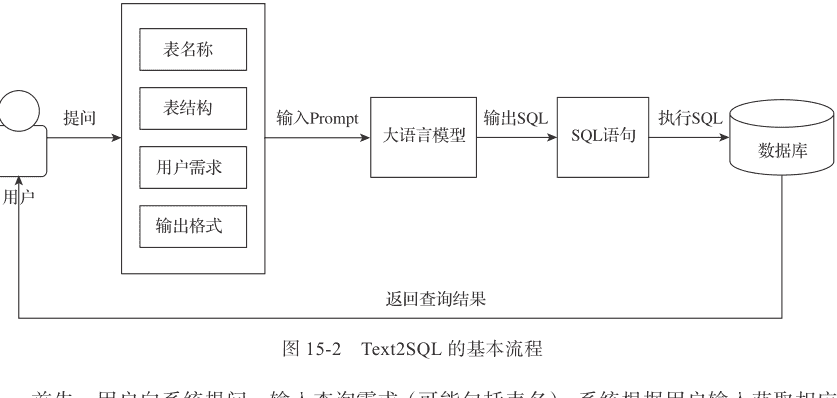
用户先向系统提问，系统据此获取相关表结构并加工成提示词，输入大语言模型生成查询代码。生成代码经校验后送入数据库查询引擎执行，结果返回给用户。

在生产环境中，各环节常需人工介入：表选择可能需预先确定，生成代码需人工核验，结果也可能需复核。通过此流程可提升可靠性和准确性。

以下以提示词案例简要说明。假设用户提问后生成的提示词如下：

# 角色

现在你是一个资深数据分析师，精通各类数据分析场景。

# 技能

- 精通中文，具备出色的中文阅读与理解能力

- 熟练掌握MySQL数据库，能够根据“任务”中的用户需求，结合“表信息”，快速编写出准确且高效的SQL语句

# 任务

- 用户需求：统计一下内部用户和外部用户分别有多少人？

# 表信息

- 表名称：t_user

- 表结构：

```sql
CREATE TABLE `t_user` (
    `id` int NOT NULL AUTO_INCREMENT COMMENT '主键 ID',
    `login_name` varchar(30) COLLATE utf8mb4_general_ci DEFAULT '' COMMENT '登录名',
    `password` varchar(255) COLLATE utf8mb4_general_ci DEFAULT '' COMMENT '密码',
    `user_type` tinyint DEFAULT '0' COMMENT '0 内部用户; 1 外部客户',
    `nickname` varchar(30) COLLATE utf8mb4_general_ci DEFAULT '' COMMENT '客户昵称',
    `head_img` varchar(128) COLLATE utf8mb4_general_ci DEFAULT '' COMMENT '头像',
    `mobile` varchar(11) COLLATE utf8mb4_general_ci DEFAULT '' COMMENT '手机号',
    `status` tinyint DEFAULT '0' COMMENT '状态: 0 正常; 1 删除; 2 禁用',
    `create_time` timestamp NULL DEFAULT CURRENT_TIMESTAMP COMMENT '创建时间',
    `update_time` timestamp NULL DEFAULT CURRENT_TIMESTAMP ON UPDATE CURRENT_TIMESTAMP COMMENT '更新时间',
    PRIMARY KEY (`id`),
    UNIQUE KEY `idx_login_name` (`login_name`) USING BTREE,
    KEY `idx_mobile` (`mobile`) USING BTREE
) ENGINE=InnoDB AUTO_INCREMENT=2 DEFAULT CHARSET=utf8mb4 COLLATE=utf8mb4_general_ci COMMENT='用户表'
```

# 输出

- 要求仅输出SQL语句，不需要输出分析过程。SQL以 # 开头，以 # 结尾，样例如下：#SELECT * FROM TABLE LIMIT 10#

- 只输出与该任务相关的信息，其他信息自动忽略

将上述提示词输入大语言模型，得到如下结果：

```sql
#SELECT SUM(CASE WHEN user_type = 0 THEN 1 ELSE 0 END) AS internal_users, SUM(CASE WHEN user_type = 1 THEN 1 ELSE 0 END) AS external_users FROM t_user#
```

#### 4. Text2SQL 的应用场景
在数据分析与商业智能领域，应用范围很广，主要包括：

(1) 商业智能平台
非技术人员可用口语提问并获取分析结果，大幅降低查询门槛。

(2) 数据驱动的决策支持
管理层或业务分析师可快速用自然语言查询企业数据，支撑日常决策与战略规划。

(3) 智能问答系统
可让问答系统不仅回答静态知识库问题，还能实时查询数据库最新数据，提供动态精准答案。

(4) 客户支持与服务系统
在客服场景中，可用于分析反馈、查询历史记录等，实现更个性化的服务。

#### 5. Text2SQL 的发展与挑战
技术虽有进展，要实现大规模工业化应用，仍需在泛化能力、语义解析准确性与跨领域适应性上持续研究。实际落地面临的主要挑战有：

- ①自然语言的多样性：用户表达差异大，要求模型具备较强语言理解力。
- ②复杂查询的生成：多表关联、嵌套查询等复杂 SQL 生成仍需优化与调试。
- ③语义解析与数据库模式的匹配：需将用户意图与数据库 Schema 准确对应，结构复杂或提问模糊时易出错。
- ④跨领域迁移：现有模型多针对特定领域优化，跨域迁移与适应仍是难题。

随着 Text2SQL 的进步，BI 领域同步升级。传统 BI 定制往往耗时数月，即便使用低代码也需较长等待。ChatBI 的出现将单次查询响应缩短至近实时，实现“所想即所得”，大幅提升效率。

### 15.3.2 Text2SQL 开源项目简介
传统数据分析中，分析师需理解需求、编写 SQL、执行查询，流程繁琐。如今借助 Text2SQL，数据使用者无需掌握 SQL 即可用自然语言查询，流程更简便高效，满足即时灵活需求。

#### 1. Chat2DB 项目
据官方资料，Chat2DB 是一款融合数据管理、开发、分析的人工智能组件，核心能力是自然语言与 SQL 的双向转换并自动生成报表，即使非 SQL 人员也能快速查询并产出报表。

Chat2DB 提供网页端与客户端两种形态。网页端开箱即用，适合快速访问；客户端体验更流畅，尤其在连接私有或本地无法公网访问的数据库时可直连，免去代理配置。用户可按场景灵活选择。

以网页端为例，输入自然语言即可生成 SQL，帮助不熟悉语法的人轻松查询，如图 15-3 所示。

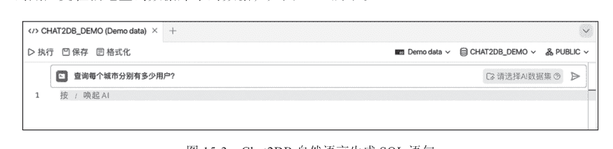

Chat2DB 支持 MySQL、PostgreSQL、ClickHouse、Hive、MongoDB 等数据库，数据存储于安全数据中心并严格防护。用户核心机密数据采用非对称加密存储，平台无法访问。

## 2. Vanna 项目
Vanna 是一个基于 Python 实现的 Text2SQL 优化框架，借助 RAG 技术增强输入 LLM 的提示词，以提升自然语言转 SQL 的准确率与结果可信度。

其核心原理是利用数据库 DDL、元数据、文档说明及示例 SQL 构建 RAG 知识库 Embedding + 向量库。用户输入自然语言问题时，系统通过语义检索召回相关内容拼接到提示词，再由大语言模型生成查询。工作流程如图 15-4 所示。

整体可简化为两步：先在数据集上构建 RAG 知识库，再根据用户问题返回查询。详细应用可参考官方文档 https://vanna.ai/docs/postgres-openai-standard-vannadb/ 。

### 15.3.3 Text2SQL 项目实战

### 1. 需求分析
数字人直播间随着运营时长累积，产品与运营人员 increasingly 依赖历史数据做决策。但此类岗位通常不熟悉数据库与 SQL，每次取数都需依赖技术团队，不仅增加技术负担，也导致效率低下。需求多变进一步加剧流程繁琐，影响团队敏捷性。

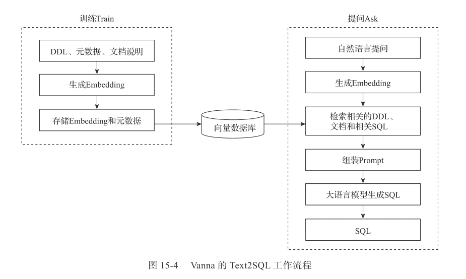
当前大语言模型技术成熟，企业可利用 LLM 的推理能力开发智能数据工具，自动将产品运营团队的查询需求转为标准 SQL。人员无需了解底层结构即可自主提取分析，减少对技术团队依赖，提升效率，让决策更快更精准，推动业务高效发展。

### 2. 方案设计
基于上述需求，技术团队给出 Text2SQL 数据库查询初版方案，如图 15-5 所示。用户用自然语言提出请求，系统经 Text2SQL 转为 SQL，从数据库提取数据后返回结果，显著简化非技术人员查询流程。

首先需将以下数据存入数据库：

- 业务数据：系统日常运营产生的数据。
- 第三方数据：外部提供用于业务参考的数据。
- 爬虫数据：通过网络爬虫抓取的相关数据。

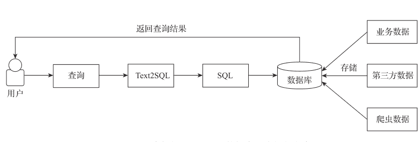
随后产品运营团队可用自然语言查询，流程如下：

1. 用户查询：用自然语言输入需求，例如“查询××品牌过去 1 周的销售数据”。
2. Text2SQL 转换：系统将自然语言转为标准 SQL。
3. SQL 审核：对生成 SQL 进行自动化或人工审核，确保正确。
4. 数据库查询：数据库包含业务、第三方、爬虫等多源数据，执行 SQL 后获取相关数据。
5. 返回查询结果：将结果返回用户以满足需求。

### 3. 具体实现
实现 Text2SQL 的核心在于组装提示词并借助大语言模型生成 SQL，步骤如下。

#### （1）准备业务数据
以 MySQL 为例，假设所有数据存储于数据库 live_db。拥有数据后，需在应用中进行数据库操作，以获取数据库名、表名、表元数据及数据等信息。具体代码如下：

```python
from loguru import logger
from sqlalchemy import create_engine, text
from sqlalchemy.orm import Session
from urllib.parse import quote_plus as urlquote

class DBUtils:
    def __init__(self, **kwargs):
        self._username = kwargs.get('username', 'admin')
        self._password = kwargs.get('password', 'admin')
        self._host = kwargs.get('host', 'localhost')
        self._port = kwargs.get('port', '3306')
        self._database = kwargs.get('database', 'test')
        self._charset = kwargs.get('charset', 'utf8mb4')
        self._database_connection = (
            f"mysql+pymysql://{self._username}:{urlquote(self._password)}@"
            f"{self._host}:{self._port}/{self._database}?charset={self._charset}&autocommit=true"
        )
        self.engine = create_engine(
            self._database_connection,
            pool_pre_ping=True,
            pool_size=10,
            pool_timeout=20,
            pool_recycle=3600
        )
        self.session = Session(self.engine)

    def connect_db(self):
        """
        创建数据库连接
        :return:
        """
        try:
            connection = self.engine.connect()
            connection.close()
            return True
        except Exception as err:
            logger.exception(f"连接数据库异常: {err=}")
            return False

    def show_databases(self):
        """
        查询所有数据库
        :return:
        """
        show_databases_sql = f"SELECT schema_name FROM information_schema.schemata"
        database_names = self.execute_all(show_databases_sql)
        database_names = [database[0] for database in database_names]
        return database_names

    def show_tables(self, database=None):
        """
        查询指定数据库的所有表
        :param database: 数据库名称
        :return:
        """
        if not database:
            return []
        show_tables_sql = f"SELECT table_name FROM information_schema.tables " \
                          f"WHERE table_schema = '{database}'"
        table_names = self.execute_all(show_tables_sql)
        table_names = [table[0] for table in table_names]
        return table_names

    def get_table_schema(self, table_name=None):
        """
        查询指定表的 schema 信息
        :param table_name: 表名称
        :return:
        """
        if not table_name:
            return None
        show_sql = f"SHOW CREATE TABLE {table_name}"
        create_table_statement = self.execute_first(show_sql)
        if len(create_table_statement) < 2 or create_table_statement is None:
            logger.exception(f"表不存在: {table_name=}")
            return None
        return create_table_statement[1]

    def get_database_tables_schema(self, database=None):
        """
        查询指定数据库的所有表的 schema
        :param database: 数据库名称
        :return:
        """
        if not database:
            return None
        table_names = self.show_tables(database)
        table_schema_mapping = {}
        for table_name in table_names:
            create_table_statement = self.get_table_schema(table_name)
            table_schema_mapping[table_name] = create_table_statement
        return table_schema_mapping

    def execute_first(self, sql: str):
        """
        执行 SQL，返回第一个结果
        :param sql:
        :return:
        """
        return self.session.execute(text(sql)).first()

    def execute_all(self, sql: str):
        """
        执行 SQL，返回所有结果
        :param sql:
        :return:
        """
        return self.session.execute(text(sql)).all()
```

#### （2）搭建提示词模板
关键一步是把提示词做成标准化框架，把用户的自然语言需求整理成模型能读懂的结构化指令，从而驱动大模型输出对应的SQL。模板示例见下：

```
# 角色
现在你是一个资深数据分析师，精通各类数据分析场景。

# 技能
- 精通中文，具备出色的中文阅读与理解能力
- 熟练掌握MySQL数据库，能够根据“任务”中的用户需求，结合“表信息”，快速编写出准确且高效的SQL语句

# 任务
- 用户需求：{提问}

# 表信息
{填充表信息，包括表名称、表 Schema 信息}

# 输出
- 要求仅输出SQL语句，不需要输出分析过程。SQL以 # 开头，以 # 结尾，样例如下：
#SELECT * FROM TABLE LIMIT 10#
- 只输出与该任务相关的信息，其他信息自动忽略
```

#### （3）拼装提示词产出SQL
把用户的问题和表的字段、关系等元信息拼接进模板，形成完整提示后喂给大模型，模型据此输出可执行的SQL查询。关键实现代码如下：

```python
def generate_sql(question: str, table_info_str: str):
    """
    生成SQL语句
    :param question: 用户提问
    :param table_infos:
    :return:
    """
    prompt_template = """
        # 角色
        现在你是一个资深数据分析师，精通各类数据分析场景。

        # 技能
            - 精通中文，具备出色的中文阅读与理解能力
            - 熟练掌握MySQL数据库，能够根据“任务”中的用户需求，结合“表信息”，快速编写出准确且高效的SQL语句

        # 任务
            - 用户需求：{question}

        # 表信息
            - {table_info_str}

        # 输出
            - 要求仅输出SQL语句，不需要输出分析过程。SQL以 # 开头，以 # 结尾，样例如下：
            #SELECT * FROM TABLE LIMIT 10#
            - 只输出与该任务相关的信息，其他信息自动忽略
    """

    prompt_format = PromptTemplate.from_template(prompt_template)
    prompt = prompt_format.format(
        question=question,
        table_info_str=table_info_str
    )
    response = llm.invoke(prompt)
    return response.content
```

#### （4）运行SQL并展示结果
将生成的SQL在数据库中执行，拿到查询结果后做必要的格式化、汇总或报表化处理，再反馈给用户，保证结果直观易懂。

```python
final_sql = sql.replace("#", "")
results = db.execute_all(final_sql)
```

这套流程构成了 Text2SQL 的 MVP 版本。经过基础工程化后，已经能覆盖中小企业里多数产品和运营同事的日常查询场景。若想稳定落地到生产环境，还需要针对性地打磨。常见的优化方向有：

- 处理口语化与表达偏差：实际提问常带口语、错别字或模糊表述，容易导致SQL偏差。建议从安全层面加固，比如定期做库备份、采用只读账号连接、默认给查询加行数上限，并内置重试、异常捕获等容错手段，防止误操作影响线上业务。
- 限流与缓存提效：大模型API普遍带限流，系统可引入查询缓存复用历史结果，对高频请求做限流降速，从而提升响应速度和整体稳定性。
- 增强易用性：设计一键式工作流和可视化操作台，降低使用门槛，让非技术人员也能快速上手，提升工具的普及度和使用效率。
- 支持多数据源并持续迭代：示例以MySQL为主，但真实业务往往混用多种数据库。后续要不断扩展方言适配，保持工具的可持续升级。

## 15.4 小结
本章开篇点明了数据分析的底层逻辑：取之于业务，用之于业务。数据分析的价值不止于清洗和解读，更在于真正驱动决策。唯有扎根业务场景，才能让分析结果成为优化业务的助力。

随后围绕常用分析思维与方法论展开，这是一套提升分析效能的核心工具箱。掌握后能够更快定位问题、建立判断，为决策提供可信依据。

最后聚焦 Text2SQL 技术及相关开源实践，并以直播间数据分析项目为例，演示大模型如何嵌入分析流程。Text2SQL 把自然语言直接转成SQL查询，大幅降低了数据门槛，让业务同学也能完成复杂查询。这样的实战案例对理解大模型落地价值很有帮助。

## 推荐阅读

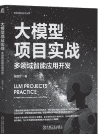

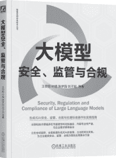
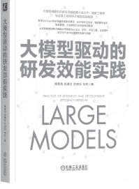
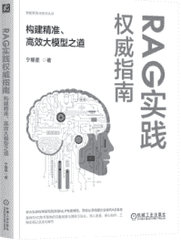

## 推荐阅读


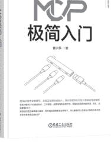

## 作者简介

### 宿永杰
在技术研发一线深耕近十年，长期聚焦AI技术架构与工程化，涉及大数据处理、AI应用架构、智能系统等领域。现主导智能座舱语音对话系统的架构与研发。

乐于输出与交流，常年活跃于技术社区，获评CSDN博客专家，累计粉丝超过15万。

公众号“AI研习社”。

## 阅读本书，你将获得以下关键知识点：
- 大模型的发展历程及核心原理
- Python在LLM应用开发中的实践技巧
- 分词、词嵌入、向量数据库等NLP核心技术
- 提示词设计思路与多类NLP任务实操
- Hugging Face、LangChain等主流框架的应用
- 大模型的微调、部署与服务化落地
- 数字人电商直播项目的端到端开发实战
- RAG问答系统构建与Text2SQL数据分析工程实践

上架指导：计算机/人工智能

ISBN 978-7-111-78563-7

定价：99.00元

客服电话：(010) 88361066 88379833 68326294