# Stable Diffusion AI绘图实战手册

## 书籍概览
本书共提供八十余个可复现的实战范例、一百三十多分钟的同步视频讲解、两百三十多组效果素材、五百余张全流程配图，并附赠一百五十五页PPT课件与一万五千余条绘画关键词，帮助读者系统掌握文本生成图像、图像生成图像、提示词编写、模型微调与插件调用等关键能力，让AI绘画的学习曲线更平缓、产出更高效。

全书采用双线推进结构。
技能线从安装部署、界面认识、文生图方法、图生图方法、提示词用法、模型使用、高阶处理到插件应用，再到网页版使用要点，由浅入深梳理AI绘画的核心技术。
案例线覆盖人像、风光、建筑、二次元、游戏、插画、动漫、产品、海报、动物、植物、文字等创作方向，每个范例均配二维码，扫码即可手机观看演示，零基础也能跟练。

本书适合对Stable Diffusion绘画感兴趣的AI绘画爱好者、AI画师、绘画讲师、游戏原画师、插画师、设计师、电商美工、影视制作人员阅读，也可作为AI培训机构与职业院校的参考用书。

## 图书在版编目数据
Stable Diffusion AI绘画教程：文生图+图生图+提示词+模型训练+插件应用 / 龙飞编著. —北京：化学工业出版社，2024.1

ISBN 978-7-122-44336-6

Ⅰ. ①S… Ⅱ. ①龙… Ⅲ. ①图像处理软件-教材 Ⅳ. ①TP391.413

中国国家版本馆CIP数据核字（2023）第200354号

责任编辑：李 辰 孙 炜
责任校对：王鹏飞
封面设计：异一设计
装帧设计：盟诺文化
出版发行：化学工业出版社（北京市东城区青年湖南街13号 邮政编码100011）
印 装：北京宝隆世纪印刷有限公司
710mm × 1000mm 1/16 印张14¼ 字数330千字 2024年1月北京第1版第1次印刷
购书咨询：010-64518888
网 址：http://www.cip.com.cn
售后服务：010-64518899
定 价：98.00元
版权所有 违者必究

## 前言
党的二十大报告把“实施科教兴国战略，强化现代化建设人才支撑”单列部署，提出科技是第一生产力、人才是第一资源、创新是第一动力。人工智能正成为落实该战略的重要抓手，培养AI人才、推动技术应用对经济社会发展意义重大。

与此同时，AI绘画在艺术创作领域持续升温，Stable Diffusion作为主流的图像生成技术受到广泛关注。本书意在提供系统且实用的SD技术指引与案例解析，帮助读者驾驭这一创作工具，实现创意落地。

市场方面，AI绘画赛道持续扩容。Technavio预测到2025年全球市场规模将达百亿美元，Stable Diffusion作为最受欢迎的生成技术之一份额持续提升。社交媒体与新媒体的普及进一步扩大参与人群，为技术发展带来更广阔空间。

编者在调研中发现，现有SD图书在新手引导与实践环节存在不足。因此本书力求构建更完整、更细致的教程，降低入门门槛。

本书特色
- 10大主题覆盖基础、模型训练、插件应用等，共计108个知识点，内容全面实用
- 八十余个实战案例搭配一百三十多分钟视频，讲解清晰便于理解
- 五百余张插图图文并茂，趣味案例激发学习兴趣

特别提示
- 版本更新：本书截图基于当时界面，后续功能与画面可能调整，请以思路举一反三学习。本书使用版本为1.5.2
- 模型与插件：AI绘画中模型与插件的作用大于提示词，需配合合适的大模型、VAE、Lora及插件才能得到正确效果。参数查看方法见本书8.2.5节
- 提示词使用：提示词亦称关键词或咒语，SD支持中英文，推荐使用英文以获得更精准结果；语法有严格要求，详见正文。相同提示词在不同参数下结果会不同

学习时请重视动手实践，创作需尊重知识产权，遵守相关法律法规与安全规范。

本书由龙飞编著，苏高、胡杨等参与编写。不足之处敬请指正，交流微信：2633228153。

编著者

# 第1章

## 13个入门要点，快速上手Stable Diffusion
Stable Diffusion是当前热门的AI图像生成工具，对初学者而言掌握难度较大。本章汇总13个入门要点，帮助快速完成部署并开始创作。

Stable Diffusion AI绘画教程：文生图+图生图+提示词+模型训练+插件应用

## 1.1 本地环境搭建与部署
Stable Diffusion是一款基于深度学习的开源图像生成模型，可根据任意文本描述生成高质量高分辨率逼真图像。下文介绍配置需求、安装流程及基础设置技巧。

### 1.1.1 运行配置需求
Stable Diffusion是目前最受青睐的AI绘画工具，运行流畅、效果出色。若想本地使用，需先核查硬件是否达标。

不同分支版本要求略有差异，具体以对应版本为准。最低配置如下。
- 1. 操作系统：Windows、macOS
- 2. 显卡：NVIDIA显卡，显存不低于6GB
- 3. 内存：不低于16GB DDR4或DDR5
- 4. 安装空间：12GB以上，推荐固态硬盘

若追求更高分辨率与更好出图效果，建议升级硬件。如搭载10GB显存的RTX 3080，或更新的RTX 4080、RTX 4090分别提供16GB与24GB显存。图1-1为2023年8月桌面显卡性能梯队示意，越靠上性能越强价格也越高。

官方暂不支持AMD与Intel显卡，但已有社区分支提供支持，安装相对复杂。若无高性能GPU，也可使用网页版SD，无硬件门槛。

例如北京奇点星宇科技研发的LiblibAI，为AI绘画原创模型平台，基于SD扩散模型，可根据文本提示快速生成高质量高匹配度图像，如图1-2所示。线上版通常需付费，购买会员可提升生成次数与质量。

图1-1 2023年8月桌面显卡性能天梯图（部分）
图1-2 LiblibAI在线Stable Diffusion功能

### 【技巧总结】：Stable Diffusion推荐配置
- 1. 操作系统：Windows 10或Windows 11
- 2. 处理器：64位多核心，如13代以上Intel i5/i7，或AMD Ryzen 5/Ryzen 7
- 3. 内存：32GB及以上
- 4. 显卡：NVIDIA GeForce RTX 4060Ti 16GB版、RTX 4070、RTX 4070Ti、RTX 4080或RTX 4090
- 5. 安装空间：品牌SSD硬盘，可用空间500GB以上
- 6. 电源：建议额定功率750W以上大品牌电源
笔记本使用时需注意散热，运行期间GPU易满载升温。

### 1.1.2 安装流程
随着AI绘画软件的增多，Stable Diffusion凭借监督深度学习算法广受好评。下面以Windows 10为例说明安装步骤。

#### 1. 下载程序包
从官方网站或其他可信渠道下载Stable Diffusion程序包，文件名通常为Stable Diffusion或sd-xxx.zip/tar.gz，xxx为版本号。下载后解压至安装目录，如图1-3所示。

#### 2. 安装Python环境
Stable Diffusion基于Python开发，需先安装Python解释器。可从官网下载，安装时注意版本需3.6以上，如图1-4所示。

#### 3. 安装依赖项
确保以下依赖已安装。
- 1. PyTorch：开源Python机器学习库，提供张量与自动微分等能力，适合深度学习
- 2. NumPy：Python数值计算扩展，提供高效ndarray与科学计算函数
- 3. pillow：Python图像处理库，支持多格式图像读写与操作
- 4. scipy：Python科学计算库，提供数学、统计、工程工具
- 5. tqdm：Python进度条库，便于长循环进度提示

确认Python可用后，使用pip安装：pip install torch numpy pillow scipy tqdm

Stable Diffusion AI绘画教程：文生图+图生图+提示词+模型训练+插件应用

亦可使用B站创作者“秋葉 aaaki”分享的整合安装包，一键完成本地部署。运行“启动器运行依赖 -dotnet-6.0.11.exe”后点安装，等待控制台窗口保持打开，稍后浏览器自动弹出即表示基础软件就绪，如图1-5所示。

图1-5 点击安装按钮

### 【技巧总结】：安装注意事项
- 1. SD模型库复杂，安装运行占用内存、显存、存储较高，需确认硬件达标
- 2. 安装前关闭可能干扰的程序或进程
- 3. 理论上4GB显存N卡甚至CPU可运行，但速度极慢不推荐
- 4. 安装目录建议避开C盘，所在磁盘预留100GB以上空间

### 1.1.3 【实战】：启动Stable Diffusion
启动方式取决于版本与安装方案。以整合安装包为例说明。

扫码看教学视频
步骤01 打开安装目录，进入sd-webui-aki-v4文件夹，双击“A启动器.exe”，如图1-6所示。

图1-6 双击“A启动器.exe”图标

> ★ 专家提醒 ★
> 原版SD用户可在命令提示符进入程序包目录，使用命令：python run_diffusion.py --config_file=config.yaml运行。

步骤02 打开“绘世”启动器主界面，点击“一键启动”按钮，如图1-7所示。

图1-7 点击“一键启动”按钮

步骤03 弹出控制台窗口，等待命令执行完成，如图1-8所示。

图1-8 控制台窗口

步骤04 片刻后浏览器自动打开Stable Diffusion WebUI页面，如图1-9所示。也可从控制台复制URL后的IP地址在浏览器打开。

图1-9 Stable Diffusion WebUI页面

### 1.1.4 【实战】：更新版本
AI绘画技术持续迭代，SD也会频繁更新。下文以整合安装包为例演示升级。

扫码看教学视频
步骤01 打开绘世启动器，左侧点击“版本管理”，在“稳定版”选择最新版本，点击“切换”，如图1-10所示。

图1-10 点击“切换”按钮

步骤02 弹出提示框，点击“确定”，如图1-11所示，即可完成升级。

图1-11 点击“确定”按钮

### 1.1.5 【实战】：提升Stable Diffusion的速度

以 RTX 4070 为例，在没有任何加速手段开启的状态下，把迭代步数拉到 150，Stable Diffusion 的渲染速度大概只能维持在 16 it/s 左右，见图 1-12。

图 1-12 查看默认情况下的出图速度

想让本地推理更快，可以试着关闭系统里的硬件加速 GPU 计划，实测提速幅度在四成到半成之间，具体操作如下。

- 1. **步骤 01** 在 Windows 10 桌面空白处右键，菜单中点选显示设置，如图 1-13 所示。

- 2. **步骤 02** 进入设置窗口后切到显示页面，里面找到图形设置链接并打开，如图 1-14 所示。

图 1-13 选择显示设置命令

图 1-14 单击图形设置超链接

**步骤03** 进入图形设置后，找到硬件加速 GPU 计划对应的开关并关闭，如图 1-15 所示。

**步骤04** 关闭后如图 1-16 所示，重启电脑设置才会生效。

### 【知识扩展】：绘图时出现的 it/s 代表什么

it/s 就是每秒迭代次数，it 代表迭代，s 代表秒。它衡量的是模型每秒能完成多少次迭代，也就是推理快慢的直观指标。比如 50 it/s，说明一秒钟完成 50 次迭代。

## 1.2 Stable Diffusion 的常见云端部署方式

随着云计算普及，把 Stable Diffusion 放到云上运行已经很成熟，能让更多人免装环境直接用。本节介绍几种常用的云端方案，只需在网页输入文本描述就能得到图像。

### 1.2.1 【实战】：在官网直接绘图

官方网站操作直观，功能齐全，既展示基于该技术的产品，也提供在线绘画入口，流程如下。

## Stable Diffusion AI绘画教程：文生图+图生图+提示词+模型训练+插件应用

步骤01 打开官网，在底部 Prompt 输入框里填入想要的提示词，如图 1-17 所示。

步骤02 点 Generate image 按钮，就能迅速得到对应结果，效果如图 1-18 所示。

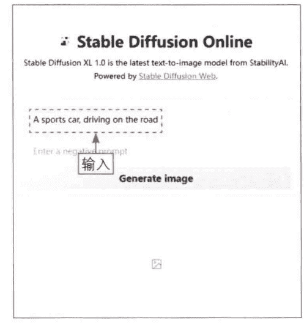

【知识扩展】：与 Midjourney 相比的优势

和另一款主流工具 Midjourney 对比，该模型有以下长处。

- 1. 免费开源：Midjourney 需在 Discord 登录并付费；Stable Diffusion 有大量免费安装包，可本地一键安装，生成内容仅自己可见，隐私性更好。
- 2. 生态丰富：开源特性带来众多免费的高质量预训练模型和插件，例如 ControlNet 可提取轮廓、人形骨架、深度图，帮助精细控制动作、手势和构图。还支持 Inpainting 和 Outpainting 做局部修改和扩图，部分功能 Midjourney 暂时没有。

### 1.2.2 通过飞桨部署 Stable Diffusion

飞桨是百度推出的产业级深度学习平台，涵盖训练、推理框架、模型库和开发套件，具有自主开放的特点。图 1-19 为飞桨上的公开项目页面。

在飞桨上启动运行环境需要算力，最强的 V100 四卡约 8 点算力/小时，日常使用 1 点或 4 点算力/小时即可。

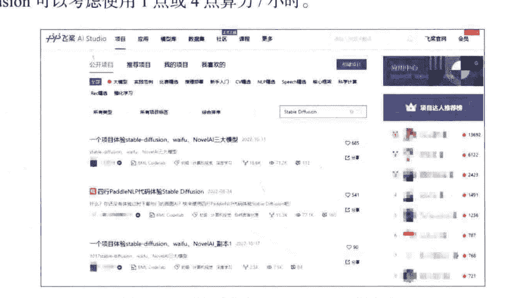

图 1-19 飞桨平台上的 Stable Diffusion 公开项目

> 【知识扩展】：V100 四卡是什么？
>
> V100 是 NVIDIA 面向 AI、深度学习和虚拟现实的高端专业卡。
>
> 四卡即单台机器搭载 4 块 V100，每块 32GB HBM2 显存和 5120 个 CUDA 核心。
>
> 多卡通过 NVLink 实现高速互联和并行计算，为大规模训练和推理提供强算力。

### 1.2.3 在阿里云上部署 Stable Diffusion

阿里云是阿里巴巴的云计算服务商，主打安全稳定和助力数字化转型。

平台提供部署所需的基础设施，可创建云服务器并在其中安装软件。图 1-20 为阿里云的云服务器页面。

购买后通过远程桌面连入，安装配置相关环境，部署完成即可用服务器 IP 或域名访问服务。

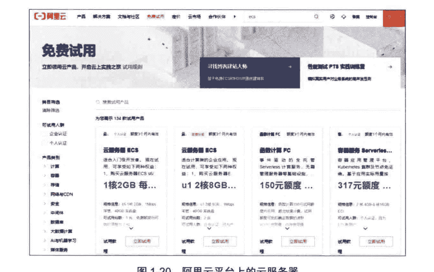

### 1.2.4 在腾讯云上部署 Stable Diffusion

腾讯云提供服务器、数据库、存储、网络、安全等服务。图 1-21 为腾讯云的 GPU 云服务器。

购买时可自定义方案，建议选 GPU 类型以提升出图速度，也可选就近地域，镜像推荐 Windows Server 数据中心版 64 位中文，其余保持默认。

随后在控制台点服务器链接完成验证登录。默认网页连接体验一般，Windows 用户可用远程桌面，macOS 用户可用 Microsoft Remote Desktop 连接。

最后配置本地 WebUI，需下载 Chrome、NVIDIA 显卡驱动和 WebUI 压缩包。解压后运行启动器，打开 A 启动器.exe，点击一键启动即可进入操作界面，在云端使用绘图。

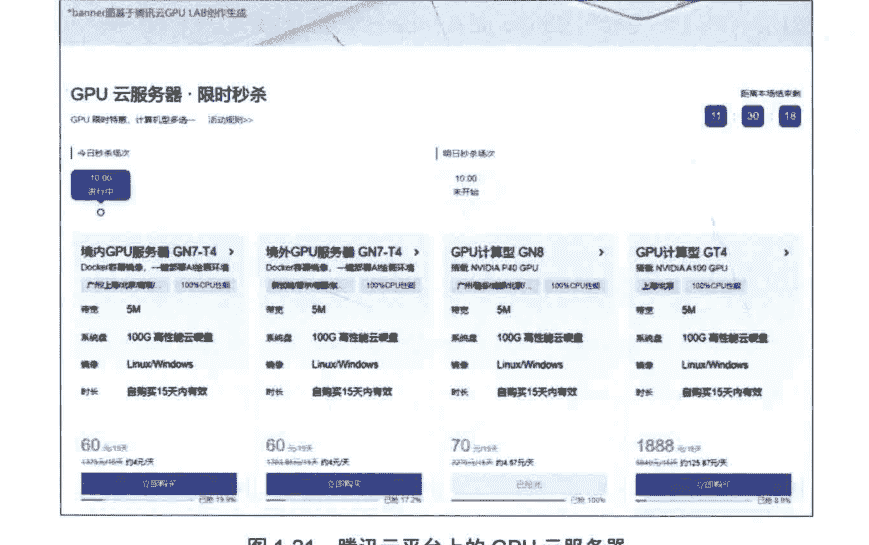

### 1.2.5 用 Colab 云部署 Stable Diffusion

Colab 是谷歌的在线编程平台，支持浏览器中写运行 Python，并提供免费 GPU 加速。先打开 Notebook，进入页面后选择代码执行程序 | 更改运行时类型，如图 1-22 所示。

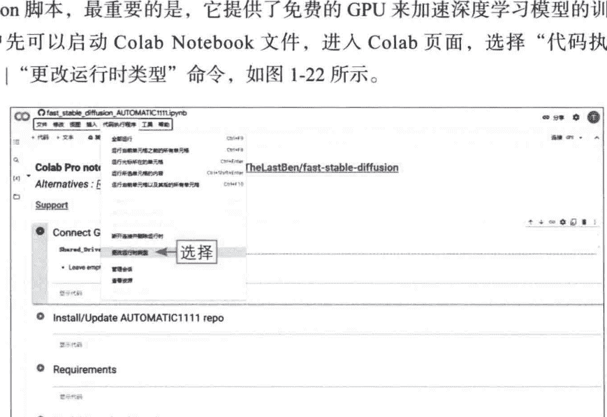

弹出对话框后把硬件加速器设为 T4 GPU，点击保存，如图 1-23 所示。

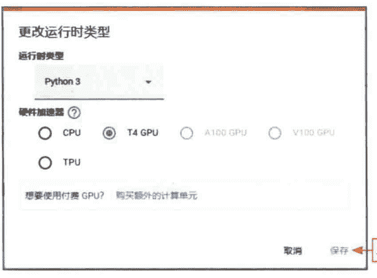

按图 1-24 顺序依次点 ▶ 运行代码，每段运行完会显示 Done，再继续下一步。

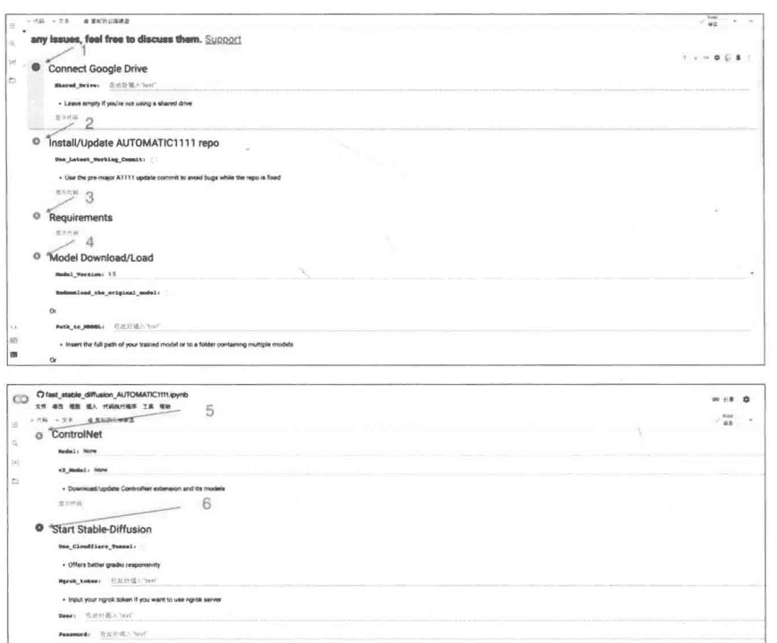

全部完成后，在 Start Stable Diffusion 下方会出现 WebUI 访问链接，如图 1-25 所示。点开链接即可启动。

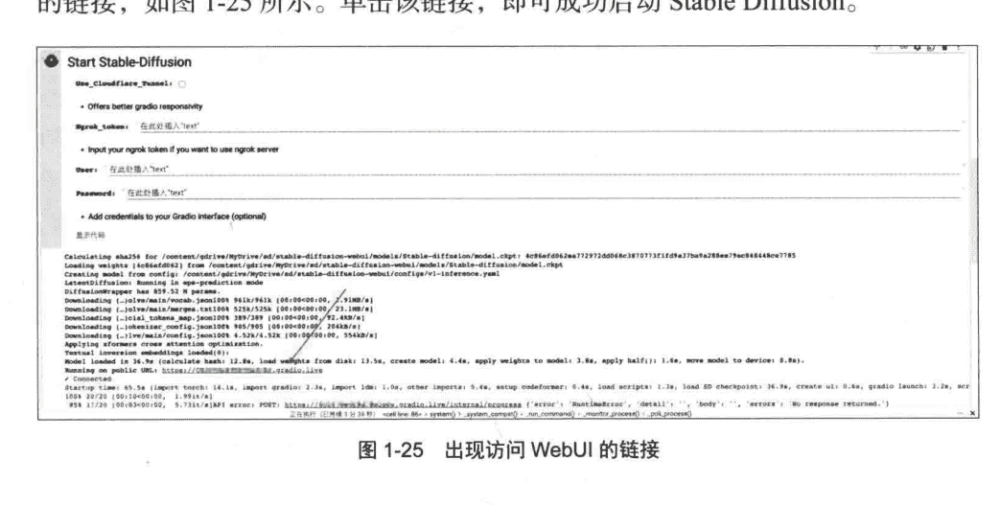

## 1.3 认识 Stable Diffusion 的 WebUI 界面

作为强大的生成模型，官方 WebUI 提供了友好可视化的交互。输入文字提示词，几秒即可看到基于描述的精美画面，同时支持采样方法、尺寸等多项参数调节，更好掌控风格。

总的来说这是一个实用工具，设计师和普通用户都能通过它体验模型的魅力。

### 1.3.1 理解成像原理

模型基于潜在扩散模型 LDMs，内部逻辑类似墨汁滴入清水后逐渐扩散且不可逆的过程。算法先把图像编码到潜在空间，在该空间逐步扩散加噪到指定步数，再通过反向扩散去噪解码为最终图像。

这种方式能在潜在空间高效学习和扩散，生成高质量结果，同时结合条件机制和感知压缩等技术，进一步提升质量和多样性。

从使用者角度看，外部逻辑是：以大模型即底模作为素材库，用文字描述作为指令，参数作为控制变量，协同生成图像。好比点菜，大模型是食材，提示词是点单，参数是烹饪手法，三者配合才好吃。

### 1.3.2 【实战】：快速做出一张满意的图片

使用该工具绘画很便捷，输入一段描述即可在数秒内生成精美图片。下面演示一个简易流程。

步骤01 进入 CIVITAI 主页，在 images 页面挑选喜欢的图片，点右下角 ① 按钮，如图 1-26 所示。

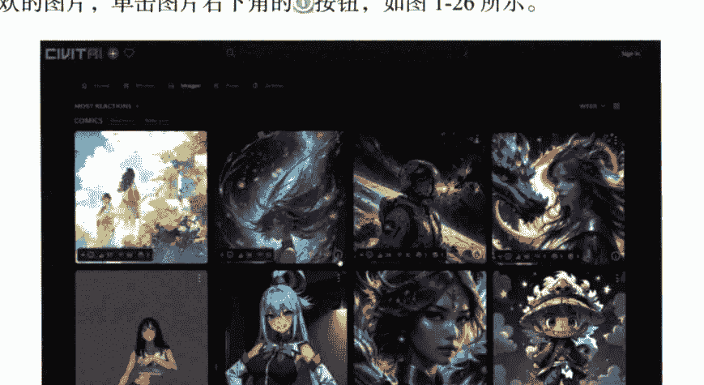

图 1-26 单击图片右下角的①按钮

> ★ 专家提醒 ★
>
> CIVITAI 专注 AI 生成内容，自研 Diffusion 模型可生成多模态图像视频等。除了公共模型，还支持上传数据微调优化，提升生成质量。

步骤02 弹出信息面板后，点 Prompt 右侧的 Copy prompt 按钮，如图 1-27 所示，即可复制正向提示词。

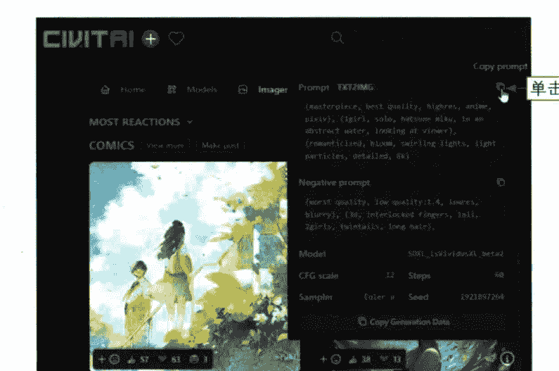

图 1-27 单击 Copy prompt 按钮

步骤03 把复制的提示词粘贴到正向提示词框，按同样方式复制 Negative prompt 填入反向提示词框，同时根据信息面板中的生成数据设置相关参数，如图 1-28 所示。

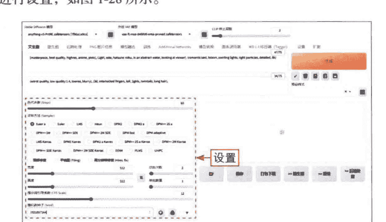

图 1-28 填入提示词并设置文生图参数

**步骤04** 点生成按钮即可得到图像，效果如图 1-29 所示。不同主模型会导致效果差异。

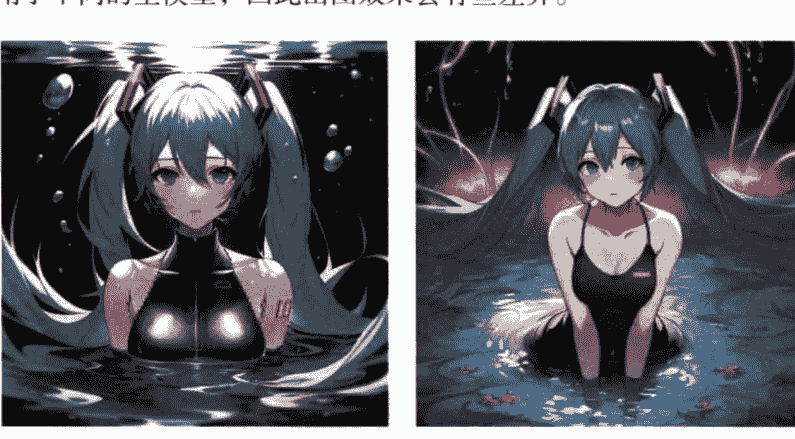

图 1-29 生成相应的图像效果

### 1.3.3 WebUI 页面布局

可以把 WebUI 想象成一间配备先进绘画工具的工作室。图 1-30 为基本布局。

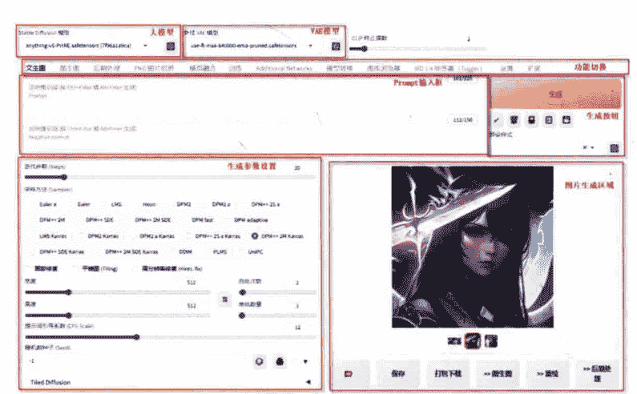

图 1-30 Stable Diffusion 的 WebUI 页面基本布局

其中大模型可看作模型学习的数据包，只有学习过的内容才能按提示词绘制。每个大模型有各自特点和适用场景，可按需选择。

图片生成区用于展示结果，可看到每一步迭代图像。其余区域后续章节详解。

## 本章小结

本章介绍了入门基础，包括本地配置与部署要点，如配置要求、安装流程、启动与更新；云端部署平台，如官网、飞桨、阿里云、腾讯云、Colab；WebUI 认识，如成像逻辑、快速上手制作图片、页面布局等。学习后能更好地部署使用。

## 课后习题

为巩固知识，安排如下练习。

- 1. 用官网在线生成一张风景图，效果如图 1-31 所示。
- 2. 生成一张卡通风格插图，效果如图 1-32 所示。

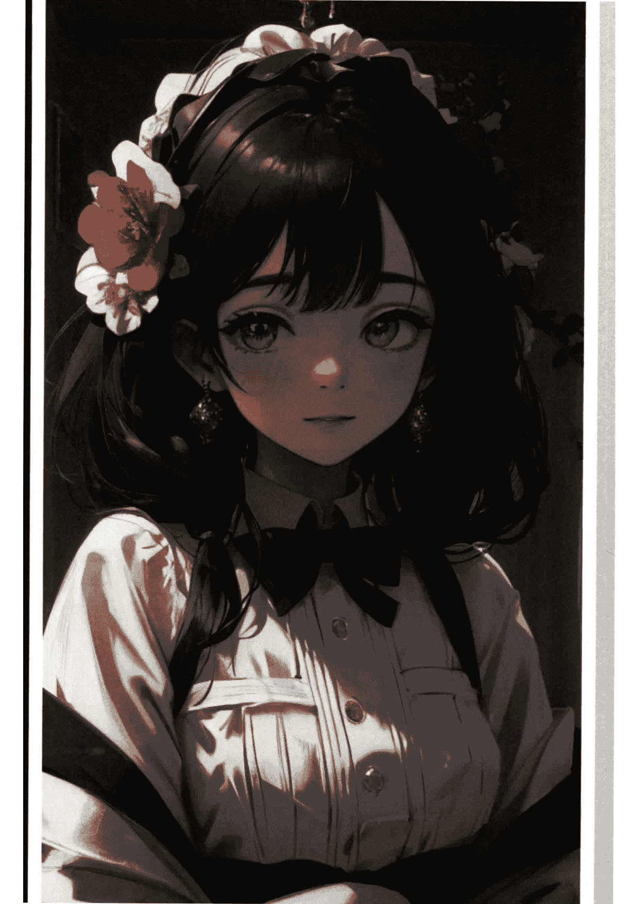

# 第2章

## 12 个文生图技巧，让图像更加生动

作为领先的生成模型，其强大的图像生成能力激发创作灵感，尤其能通过简短文本生成精美生动画面，为创作提供便利。

## 2.1 看懂文生图的核心参数

该工具能通过文字生成各式图像，但参数较多，新手不易掌握。了解关键参数作用与设置方法，有助于结果更符合预期。

### 2.1.1 【实战】：设置迭代步数

迭代步数 Steps 指生成所需的步数，可理解为控制图像精细程度，数值越高细节越丰富，但耗时也增加；数值越低速度更快但质量下降。

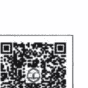

下面介绍设置方法。

**步骤01** 在文生图页面输入提示词，选择合适的采样方法，并把迭代步数设为 5，点生成，可看到人物图像非常模糊面部不完整，如图 2-1 所示。

Stable Diffusion 参数实战精讲

图 2-1 Steps 设为 5 步时的图像呈现

**步骤02** 固定前一张图的随机种子，把迭代步数 Steps 调成 30，其余选项不动后点生成，画面清晰度明显提升，整体构图也完整了，见图 2-2。

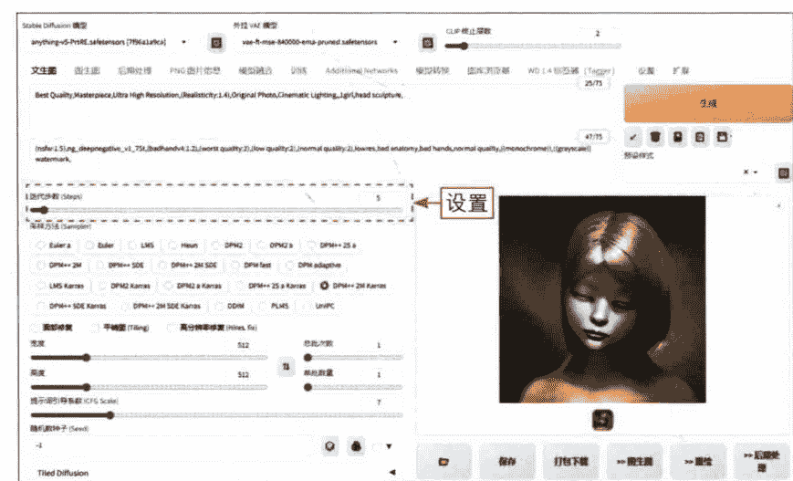
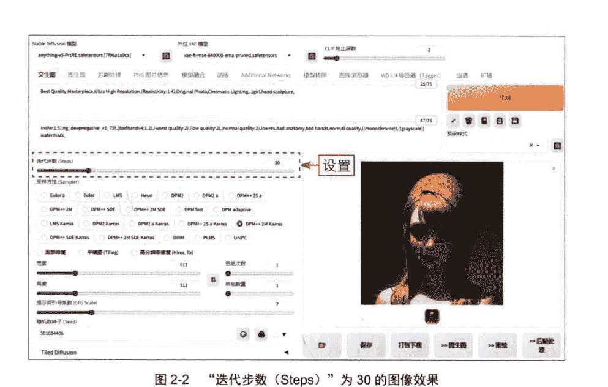
图 2-2 Steps 调到 30 后的图像呈现

【技巧总结】：迭代步数怎么调
Stable Diffusion 的 Steps 本质是分阶段渲染，先用一个提示词搭框架，再逐步细化。图 2-3 对比了不同步数下的效果。
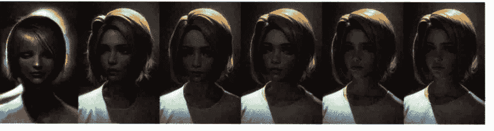
图 2-3 不同步数下的效果对比

先让主体成型，再叠加细节做光影和材质优化。分阶段渲染对光照、场景的美术理解要求较高，才能得到可信的画面。
每次迭代都是在上一次结果上继续去噪。一般把 Steps 放在 18～30 之间，质量比较稳定。若数值过低，图像容易生成不完整，关键细节缺失。
若数值过高，耗时会大幅拉长，而画质的边际收益很小，只是对细节做轻微打磨，得不偿失。

### 2.1.2 【实战】：设置采样方法
采样可以理解为去噪的方式，SD 提供了二十多种 Sampler，就像二十多位画家，各自去噪逻辑不同。常见类型的概括如下：

- 速度快：Euler 系列、LMS 系列、DPM++2M、DPM fast、DPM++2M Karras、DDIM 系列。
- 质量高：Heun、PLMS、DPM++ 系列。
- 标签利用率高：DPM2 系列、Euler 系列。
- 动画风格：LMS 系列、UniPC。
- 写实风格：DPM2 系列、Euler 系列、DPM++ 系列。

综合速度与效果，常用 DPM++ 2M Karras，具体操作：

步骤01 在文生图页面输入提示词，在采样方法区勾选 DPM++ 2M Karras，其余设置参考图 2-4。
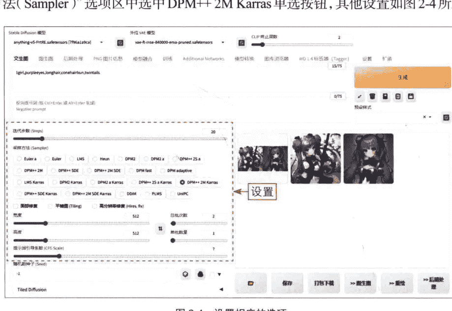
图 2-4 选项设置示意

> ★ 专家提醒 ★
Sampler 为 SD 等生成模型提供更真实可靠的随机采样能力，从而得到更逼真的图像。

步骤02 点生成，即可使用 DPM++ 2M Karras 采样出图，效果见图 2-5。
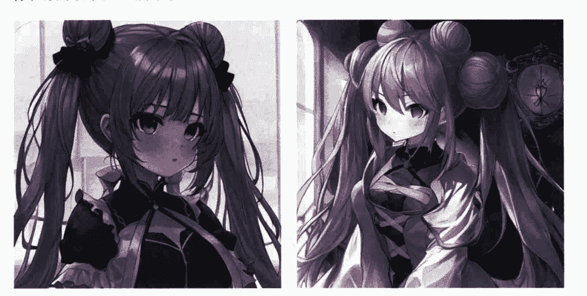
图 2-5 采样后的图像效果

【知识扩展】：三种常用采样器
除 DPM++ 2M Karras 外，Euler a、DPM++2S a Karras、DDIM 也常用，效果见图 2-6。
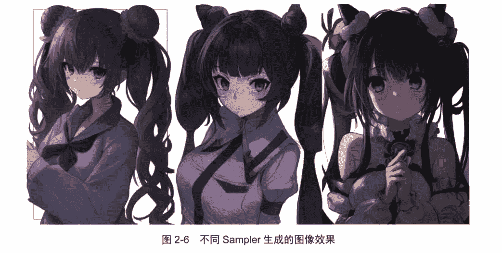
图 2-6 不同采样器效果对比

❶ Euler a 生成速度最快，但在高细节和高步数下容易出现不可控抖动，如人脸扭曲、细节崩坏。适合图标、二次元或小场景。
❷ DPM++2S a Karras 能产出高质量图像，适合写实人像或复杂场景，且步数越高细节刻画越好。
❸ DDIM 效率高，随着步数增加细节可叠加。但要注意图的类型，上图可见 DDIM 生成动漫人像时手部会出现变形。

### 2.1.3 面部修复与高分辨率修复的作用
面部修复可避免“脸崩”。动漫类一般不勾选，真实世界照片建议勾选。注意面部修复与高分辨率修复 Hires.fix 不要同时开启。图 2-7 为开启面部修复后的效果。
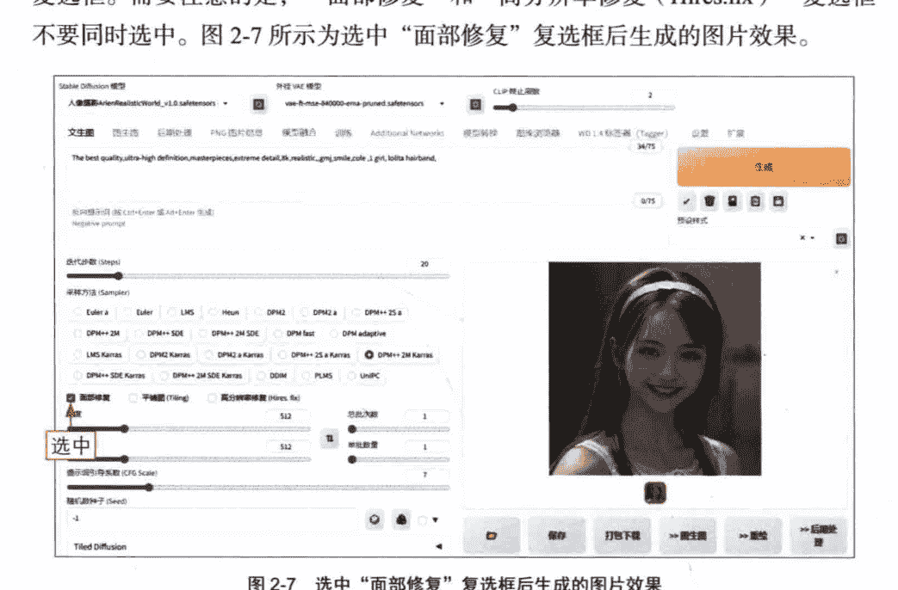
开启 Hires.fix 后，先以较小分辨率生成初稿，再放大，在不改构图的前提下优化细节。SD 会按设定的宽高与放大倍率等比放大。

显存较小的显卡可用 Hires.fix，先用 512×512 生成，再把放大倍数设为 2，得到 1024×1024 的图且占用可控，如图 2-8。
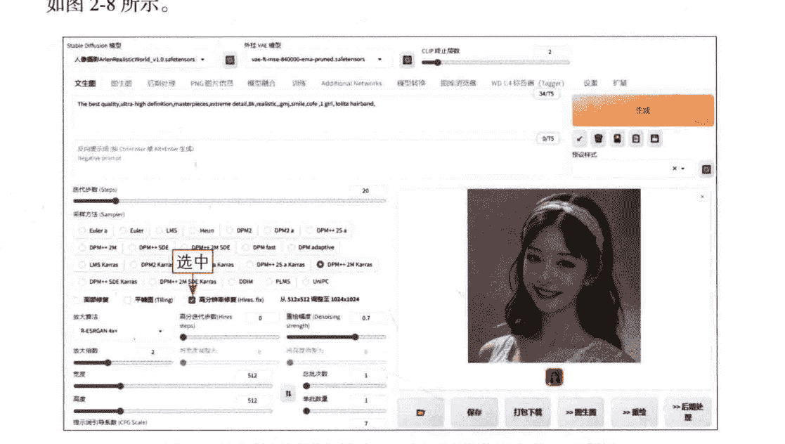

【技巧总结】：高分辨率修复设置要点
在 Hires.fix 区域，以下设置关键：
1. 放大算法：动漫建议 R-ESRGAN 4x+，真实照片建议 R-ESRGAN 4x+ Anime6B。
2. 高分迭代步数 Hires steps：通常保持 0，直接沿用原图。
3. 重绘幅度 Denoising strength：一般 0.4～0.7，自行微调，数值过高会偏离原图太多。

### 2.1.4 【实战】：设置图片尺寸
图片尺寸即分辨率，决定细节还原与质量。

步骤01 在文生图页输入提示词，将宽度设为 1024、高度设为 768，生成 1024×768 的横图，其余设置见图 2-9。
步骤02 点生成，即可得到横向图像，效果见图 2-10。
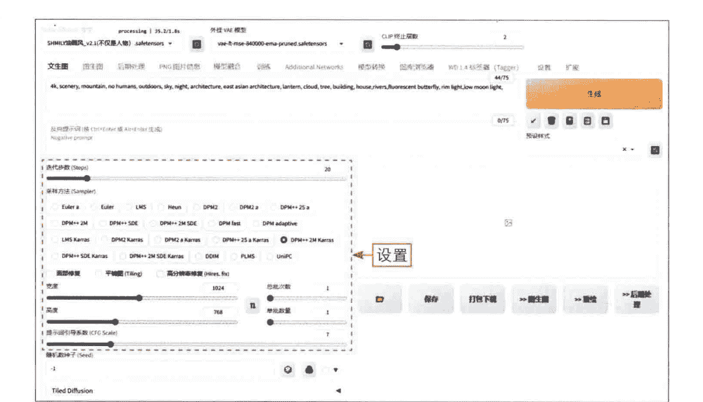
图 2-9 尺寸选项设置
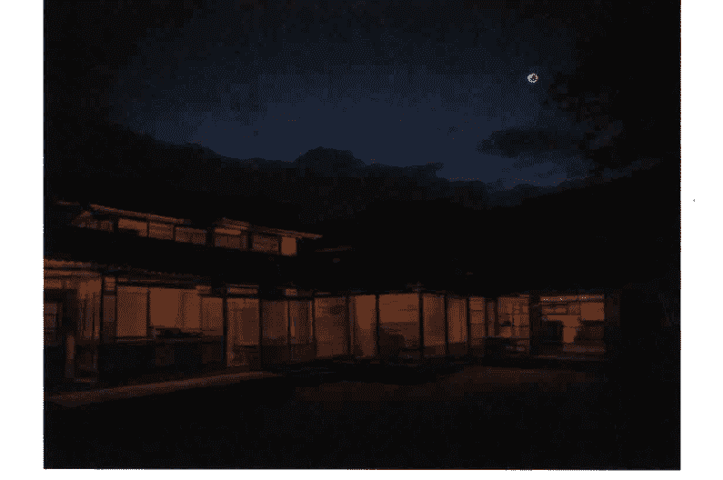
图 2-10 生成的图像效果

【技巧总结】：分辨率设置注意点
❶ 8GB 显存建议尽量用 512×512，否则画面过小难以表现，过大易爆显存。爆显存指数据量超出显存导致出错、帧率骤降甚至崩溃。显存大于 8GB 可适当提高。
❷ 尺寸要与提示词匹配，如 512×512 易出大头像。也可固定一侧在 512～768 之间，另一侧调高。
❸ 真实人像全身照需在提示词加入 full body，并把分辨率设为 512×768 才更容易得到全身。

### 2.1.5 【实战】：设置总批次数与单批数量
总批次数是显卡一张一张顺序画；单批数量是同时画多张，效果通常较差。

步骤01 在文生图页输入提示词，将总批次数设为 6，即一次循环出 6 张，其余设置见图 2-11。
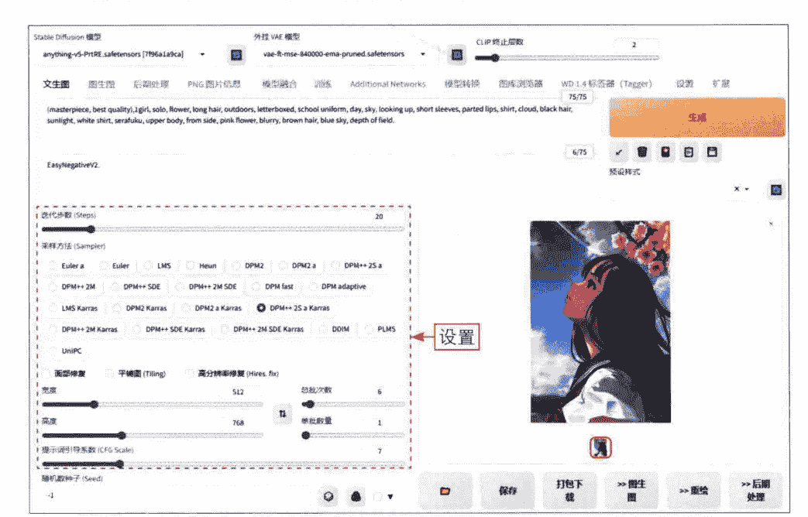
步骤02 点生成，可同时得到 6 张图，且差异较大，效果见图 2-12。
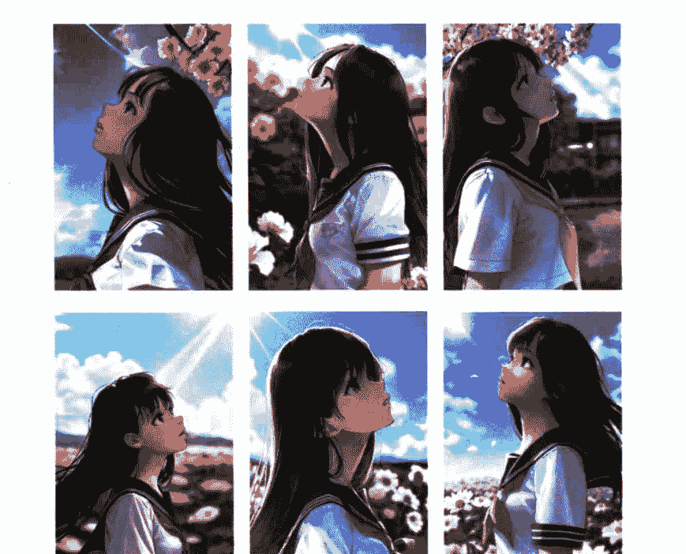
图 2-12 生成 6 张差异大的图像

步骤03 保持提示词不变，将总批次数设为 2、单批数量设为 3，即每批出 3 张，共两批，如图 2-13。
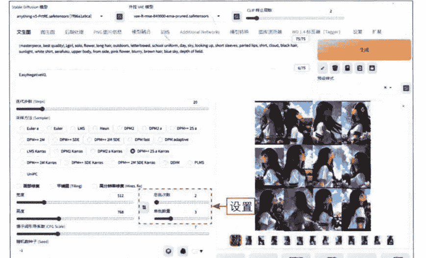
图 2-13 总批次数与单批数量参数

步骤04 点生成，可得 6 张图，同批之间相似度较高，整体质量也偏低，如图 2-14。
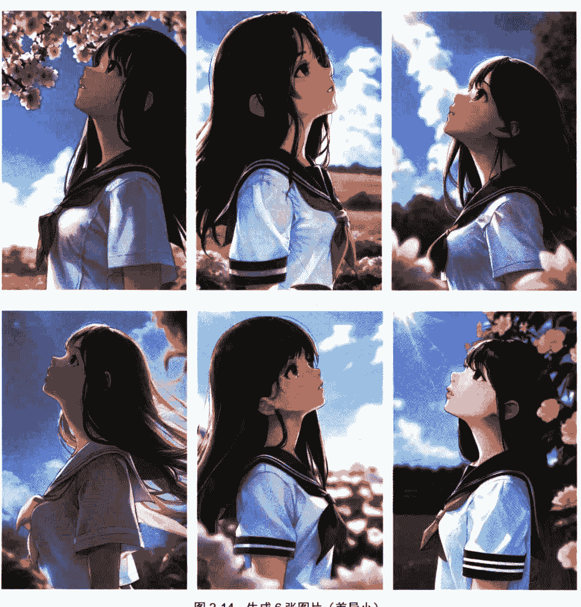

【技巧总结】：批次数设置思路
显卡配置高时可用单批数量提速并保持一定质量；配置有限时建议提高总批次数，每批只出 1 张，尽可能把每张画好。

★ 专家提醒 ★
SD 出图默认随机，俗称抽卡，需要反复生成挑出最好的一张。

### 2.1.6 【实战】：设置提示词引导系数
CFG Scale 用来调节提示词对绘画的引导强度，取值 0～30，数值越高越贴近提示词。

步骤01 在文生图页输入提示词，将 CFG Scale 设为 2，表示提示词关联度低，其余设置见图 2-15。
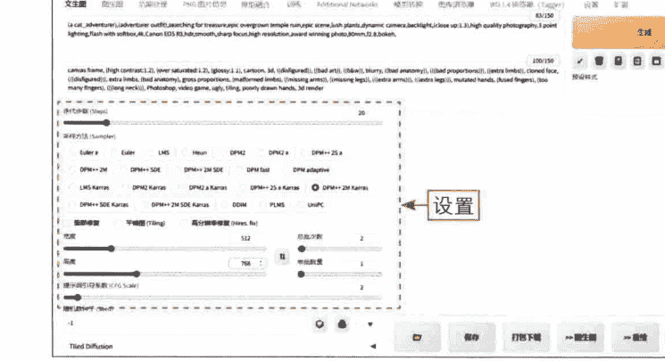
图 2-15 选项设置示意
步骤02 点生成，图像内容与提示词关联不大，效果见图 2-16。
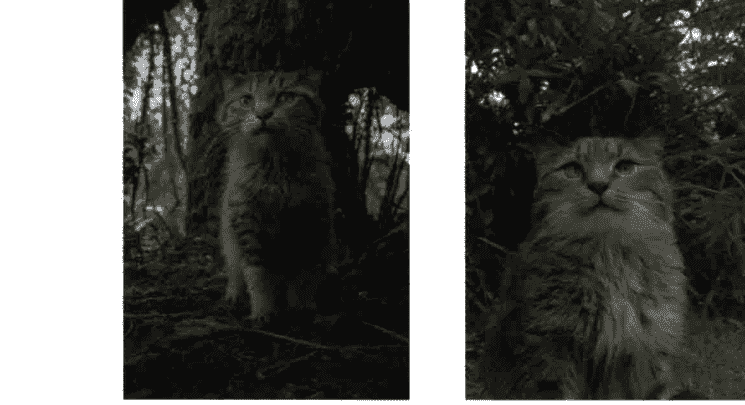
图 2-16 低 CFG 生成效果

步骤03 保持其余设置，CFG Scale 改为 10，表示关联度高，如图 2-17。
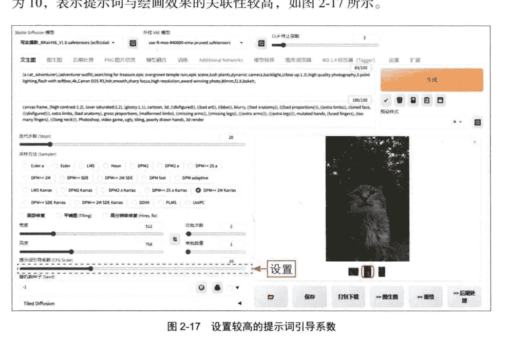
步骤04 点生成，图像更贴合提示词，光影更突出、虚实对比更明显，效果见图 2-18。
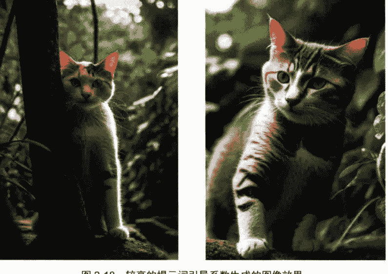

【技巧总结】：CFG Scale 调节建议
建议 7～12 之间，过低会让色彩饱和度下降，过高则易出现粗线条或过度锐化，甚至失真。

## 2.2 掌握随机数种子的用法
在 SD 中，随机数种子 Seed 可看作图像的唯一编码，帮助复制与微调。Seed 设为 -1 时随机生成；复制并填入已有图的 Seed，后续出图会基本一致。

### 2.2.1 【实战】：设置随机数种子
绘图时遇到满意的图，可复制并锁定其种子，让后续结果更可控。

步骤01 在文生图页输入提示词，Seed 默认 -1 表示随机，其余设置见图 2-19。
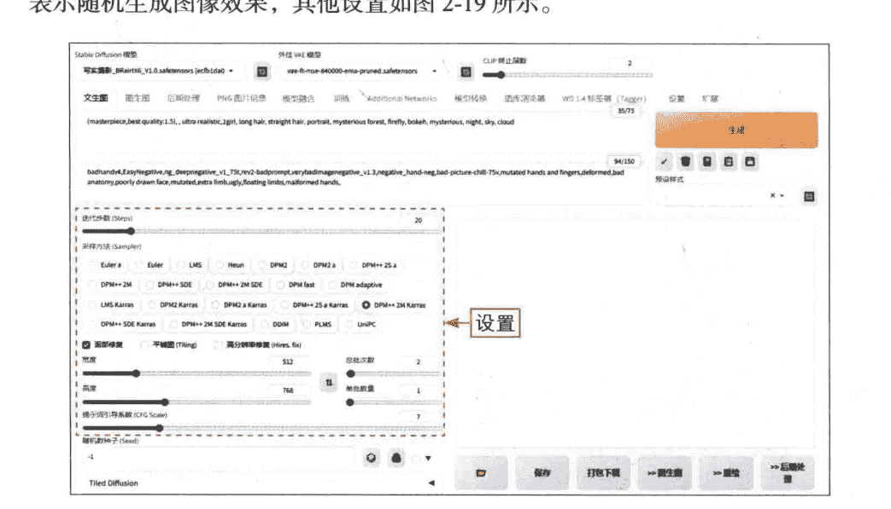
步骤02 点生成，每次都会产生新种子，结果各不相同，效果见图 2-20。
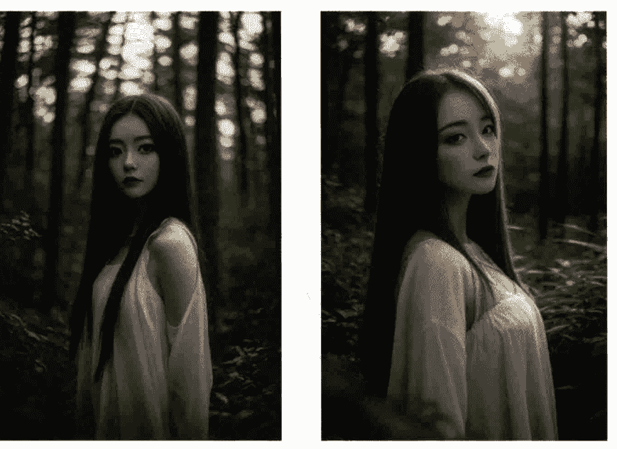
图 2-20 Seed 为 -1 时的随机效果

步骤03 选一张图，从下方信息复制 Seed 值填入文本框，如图 2-21。
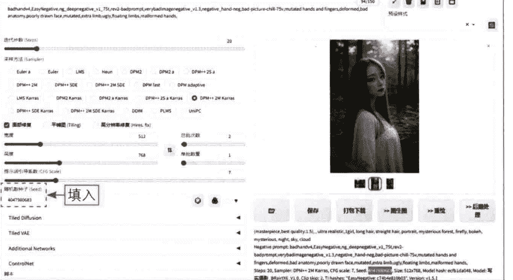
图 2-21 填入 Seed 值
步骤04 点生成，后续图像会保持一致，多次结果相同，效果见图 2-22。
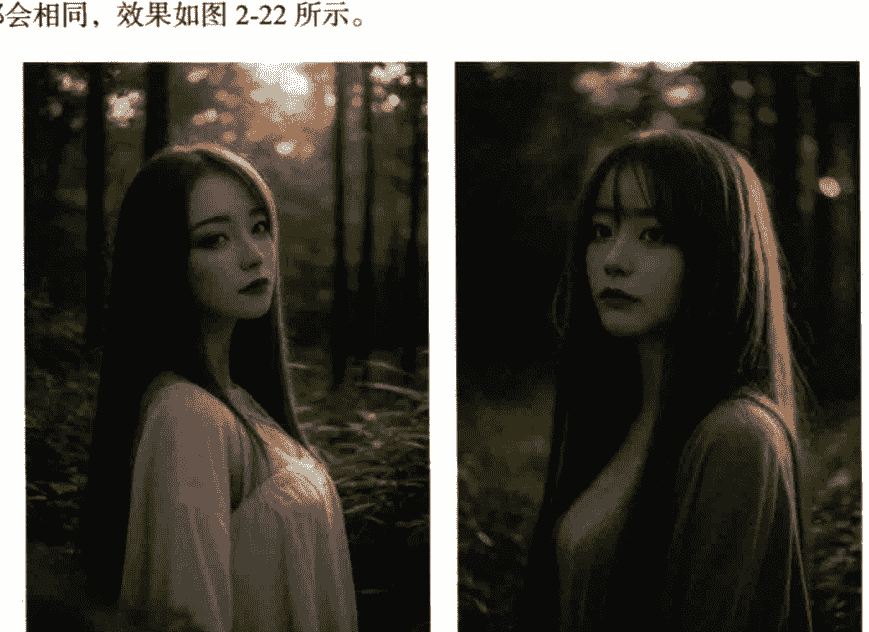
图 2-22 固定 Seed 后的出图效果

【技巧总结】：随机数种子要点
Seed 由 64 位整数表示，相同输入会得到相同图像。文本框右侧的 🔄 按钮可重置为 -1，恢复随机。

### 2.2.2 【实战】：修改变异随机种子
除 Seed 外，还可使用变异随机种子 diff seed 控制出图。每步扩散使用不同种子，产生在原图上叠加变化的效果。
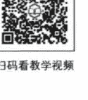

步骤01 在上一例基础上，勾选 Seed 右侧复选框展开选项，diff seed 保持 -1，将变异强度设为 0.21，如图 2-23。
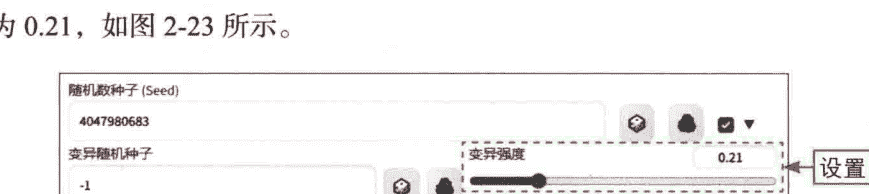
图 2-23 变异强度设置

> ★ 专家提醒 ★
变异强度 diff intensity 表示新旧图差异度。0 则完全相同，1 则完全不同。

步骤02 点生成，新图与原图接近，仅有细微差别，效果见图 2-24。
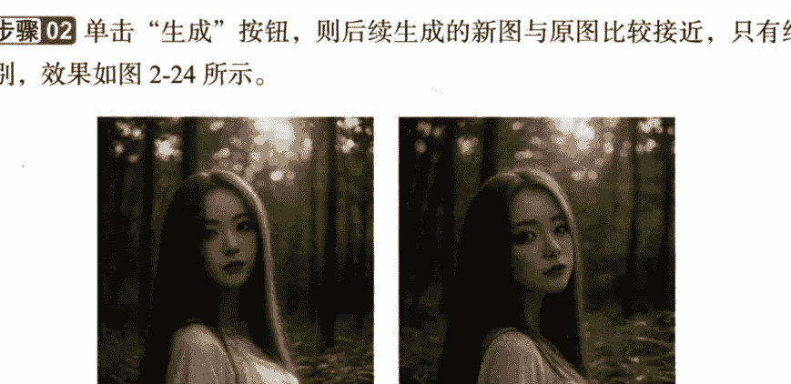
图 2-24 与原图接近的新图

步骤03 将变异强度改为 0.5，其余不动，如图 2-25。
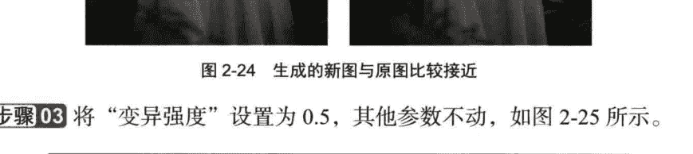
图 2-25 修改后的变异强度

步骤04 点生成，新图与原图差异更大，如图 2-26。强度越大，变异影响越大，可按需调节相似度。
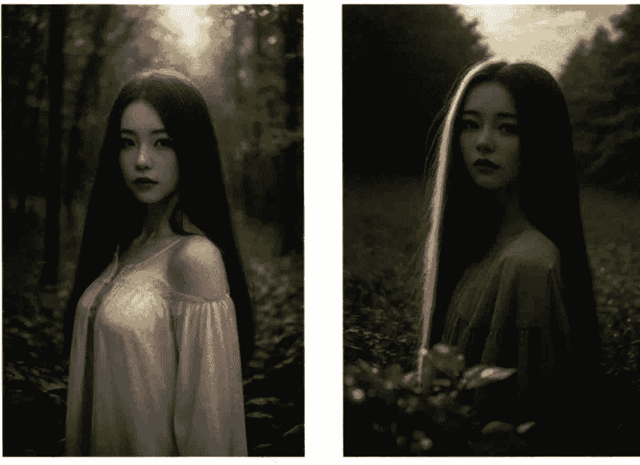
图 2-26 变异强度提高后的效果

【技巧总结】：变异随机种子要点
1. diff seed 为 0 时完全按 Seed 生成，即复制原图，相同 Seed 结果相同。
2. diff seed 为 1 时完全按变异种子生成，与原图差异大，每次都会有新结果。

### 2.2.3 【实战】：融合不同的图片效果
利用 Seed 与 diff seed 可融合不同图像风格，具体流程如下：
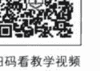
扫码看教学视频
步骤01 进入 PNG 图片信息页，在来源区点“点击上传”，如图 2-27。
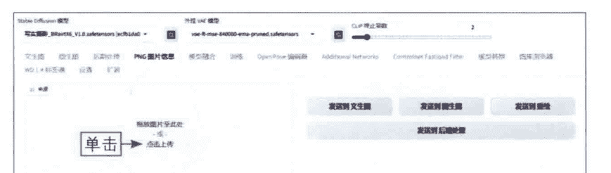
图 2-27 点击上传
步骤02 选择素材图像上传，右侧显示提示词等数据，命名为图 1，点“发送到文生图”，如图 2-28。
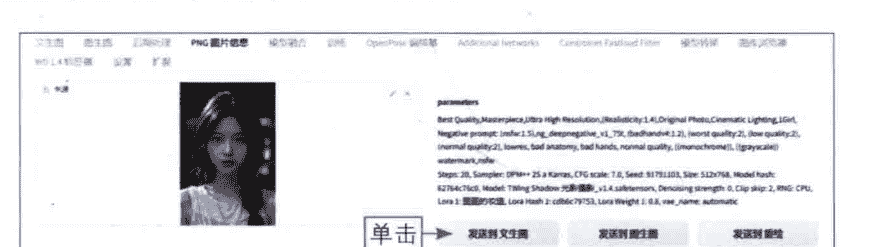
图 2-28 发送到文生图
步骤03 进入文生图页，点 🔄 重置种子，点生成，如图 2-29。
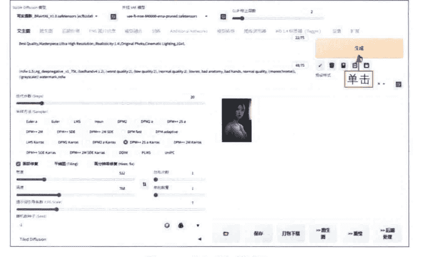
图 2-29 点击生成
步骤04 生成新图命名为图 2，复制其 Seed 值填入 Seed 文本框，如图 2-30。
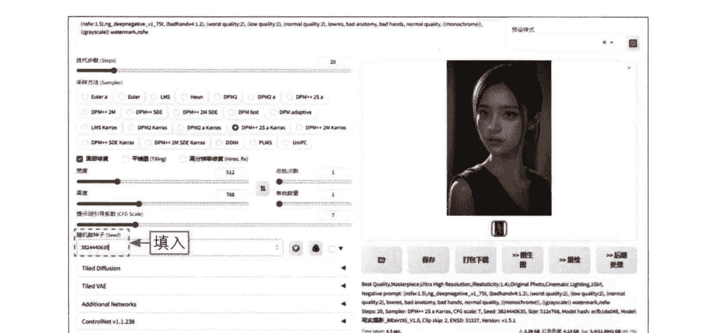
图 2-30 在 Seed 文本框填入图 2 的值

第五步，先打开“PNG 图片信息”页面，把图1的 Seed 拷贝出来填进“变异随机种子”输入框，将“变异强度”改为0.2，点击“生成”按钮，即可产出对应的画面，如图2-31所示。

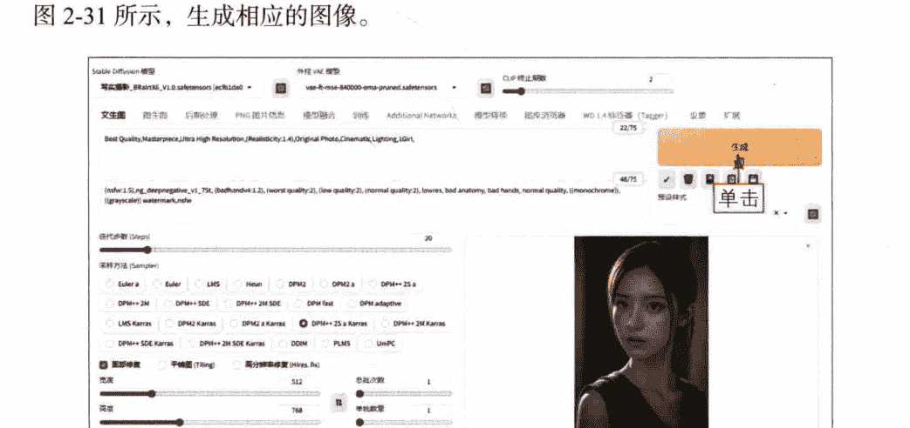

图 2-31 单击“生成”按钮

## 第2章 文生图12式，让画面更鲜活

第六步，把“变异强度”调至0.8，再点一次“生成”得到新结果。把源图和两组效果图集中呈现做对照，见图2-32。

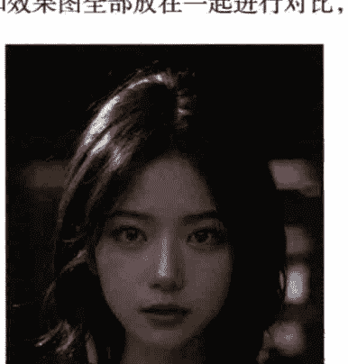

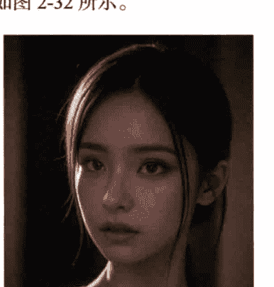

图2-32 对比原图和效果图

**【技巧要点】：变异强度如何影响画面融合**

上例固定了图2的 Seed，图1作为可变影响源。对比图2-32可明显看出，变异强度0.2时，图2仅略带图1的风格痕迹；强度调到0.8时，图2的整体风格几乎被图1主导。

### 2.2.4 随机种子尺寸该怎么用

随机种子尺寸用得不多，其本质是让不同分辨率下、同一种子生成的画面保持相似性。比如先用512×512生成一张人像，可见面部出现扭曲，被称为“脸崩”，见图2-33。原因是该分辨率承载不了过多的面部细节。

随后用512×1024分辨率再生成一张人像，见图2-34，并在图信息中复制该Seed。

在此基础上，锁定图2-33的Seed，把图2-34的Seed填入“变异随机种子”，变异强度设为0.5，“从宽度中调整种子”设512，“从高度中调整种子”设1024，点击生成。得到的人像见图2-35，面部和手部的扭曲明显减轻。

**【知识补充】：随机种子尺寸的实用价值**

对于显存有限的用户，这个功能很实用：先用512×512低成本试图，再生成1024高的人物全身照。

## 2.3 精通 X/Y/Z 图表的使用

Stable Diffusion里的X/Y/Z图表用于可视化三维参数关系，共三个坐标轴代表三个变量，可同时观察最多三组参数对出图的影响。

> ★ 专家提示 ★
> 具体来说，X轴与Y轴决定网格的行列数，Z轴决定批量大小。在三轴上分别设定参数，就能批量生成多组组合图。

### 2.3.1 【实战】：不同采样器的效果对比

借助X/Y/Z图表，很容易横向比较不同采样器的出图表现，具体步骤如下。

第一步，在“文生图”界面输入提示词，点击生成，得到一张卡通图，见图2-36。

图 2-36 生成一张卡通图片

第二步，锁定该图的Seed，在“脚本”下拉菜单里选择“X/Y/Z 图表”，如图2-37。

图 2-37 选择“X/Y/Z 图表”选项

第三步，展开后出现X/Y/Z plot区域，点击“X轴类型”下拉框，如图2-38所示。

第四步，下拉选择“Sampler”，把X轴设为采样器。点右侧“X轴值”按钮，在列表里删掉不需要的采样器，保留要对比的即可，如图2-39所示。

第五步，点击生成，就能在同一提示词下清晰看到6种采样器各自的效果，见图2-40。

**【技巧要点】：用 X/Y/Z 图表快速挑采样器**

通过图表对比，可快速看出不同参数组合的差别。例如图中6种采样器的结果显示，部分采样器不适合画动漫，人手易变形，据此就能挑选出最合适的采样器。

### 2.3.2 【实战】：不同模型的出图对比

在上例基础上，设置Y轴类型，即可同时比较采样器和模型对出图的影响，操作如下。

第一步，在X/Y/Z plot区域点开“Y轴类型”下拉，选择“模型名”选项，如图2-41所示。

第二步，点击“Y轴值”按钮，在弹出列表中剔除不需要的模型，保留要对比的模型，如图2-42所示。

第三步，点击生成，即可在同一提示词下看到6个采样器×4个模型的组合效果，见图2-43。

**【技巧要点】：灵活互换三轴参数**

在X/Y/Z plot选项区，通过轴互换可更灵活地呈现数据，帮助理解变量关系，具体如下。

- 点击“X/Y轴互换”，X与Y互换位置，原在X的变量移到Y，原在Y的移到X，可反向展示两变量关系，便于对比。
- 点击“Y/Z轴互换”，Y与Z互换，原Y变量到Z，原Z变量到Y，可从不同维度呈现第三变量，便于分析三者关系。
- 点击“X/Z轴互换”，X与Z互换，原X变量到Z，原Z变量到X，同样能换个角度观察第三变量和另外两个变量的关系。

图2-43 6种不同采样方法和4种不同模型分别生成的图像效果对比

> ★专家提示★
> X/Y/Z图表只支持英文显示，模型名含中文会乱码。若在意显示，可把模型名改成纯英文，但不推荐修改，以免模型管理混乱。

## 本章小结

本章围绕Stable Diffusion文生图展开，涵盖基础参数设定，包括步数、采样器、面部修复、放大修复、尺寸、总批次、单批张数、引导系数等；种子使用，包括固定种子、变异种子、融合多图效果；以及X/Y/Z图表的应用，如横向比较采样器、比较模型等。学完本章，能更熟练地操作文生图流程。

## 课后习题

鉴于本章内容重要，下面安排练习，帮助回顾和巩固所学。

- 1. 使用 Stable Diffusion 生成 800 × 600 分辨率的横图，效果如图 2-44 所示。

图 2-44 800×600 分辨率的横图效果

- 2. 使用 Stable Diffusion 以不同的提示词引导系数出图，效果对比如图 2-45 所示。

扫码看教学视频

图 2-45 以不同的提示词引导系数的出图效果对比

# 第 3 章 图生图14技，打造独特色艺术作品

图生图大幅提升了Stable Diffusion的可控性和画质，让创作风格更具个人特色，能产出富有创意的数字艺术作品。本章重点介绍图生图的AI绘画技巧，为创作独特艺术作品提供灵感与方法。

## 3.1 掌握图生图的绘图技巧

图生图是一种基于深度学习的图像生成方式，可将一张原图转化为相关的新图，广泛用于计算机图形、视觉艺术等领域。下面介绍Stable Diffusion图生图的绘图技巧，并通过案例演示如何获得独特有趣的效果。

### 3.1.1 了解图生图的主要功能

Stable Diffusion的图生图功能允许用户上传一张图片，并通过文本描述输出修改后的新图，相关示例见图3-1。

图生图打破了纯随机生成的局限，为图像创作提供更多可能性，进一步增强了Stable Diffusion在数字艺术创作等领域的应用价值。

> 【知识扩展】：图生图功能的主要特点
> Stable Diffusion图生图功能的主要特点如下。
> - 1. 基于输入原图生成，保留主要样式与构图。
> - 2. 支持添加文本提示词，引导生成方向，如改风格、增强细节等。
> - 3. 可分步渲染逐步优化和增强图像细节。
> - 4. 借助原图内容，明显改善和控制生成效果。
> - 5. 可模拟不同艺术风格，并通过文本描述进行风格迁移。
> - 6. 可用于批量处理大量图片，自动完成优化和修改。

### 3.1.2 【实战】：设置缩放模式

当原图与目标尺寸不一致时，可通过“缩放模式”选择处理方式，让出图更合理，具体操作如下。

步骤01 进入Stable Diffusion的“图生图”页面，选择一个写实大模型，在下方“图生图”选项卡中点击“点击上传”链接，如图3-2所示。

步骤02 弹出“打开”对话框，选择所需素材图像，如图3-3所示。

步骤03 点击“打开”按钮，即可上传原图，如图3-4所示。

步骤04 在页面下方设置生成参数，在“缩放模式”区默认选中“仅调整大小”单选按钮，如图3-5所示。

步骤05 在上方Prompt输入框输入提示词，点击“生成”按钮，如图3-6所示。

图 3-6 单击“生成”按钮

步骤06 执行后，使用“仅调整大小”模式生成新图，此时模型会把图像缩放到用户设定的目标分辨率，若宽高不匹配则横纵比会失真，主体会被拉伸，效果见图3-7。

图 3-7 “仅调整大小”模式生成的图像效果

步骤07 在下方修改参数，在“缩放模式”区选中“裁剪后缩放”单选按钮，如图3-8所示。

步骤08 点击“生成”，使用“裁剪后缩放”模式生成新图，此时模型会自动调整大小使目标分辨率被完全填满，多余部分被裁剪，效果见图3-9。

步骤09 在“缩放模式”区选中“缩放后填充空白”单选按钮，如图3-10所示。

步骤10 点击“生成”，使用“缩放后填充空白”模式生成新图，此时模型会把图像缩放到目标分辨率内，并用图像颜色自动填充空白区域，效果见图3-11。

### 3.1.3 【实战】：设置重绘幅度

在Stable Diffusion中，重绘幅度用于控制图生图时重新绘制的强度。数值小则变化柔和，数值大则改变更剧烈。下面介绍设置方法。

- 1. 步骤01 进入“图生图”页面，上传一张原图，如图3-12所示。
- 2. 步骤02 在下方设置“重绘幅度”为0.02、“总批次数”为2，如图3-13所示，Denoising Strength越小，新图越贴近原图。

图 3-12 上传一张原图

图 3-13 设置相应的参数

- 3. 步骤03 点击“生成”按钮，可生成两张新图，但因重绘幅度过小，新图与原图几乎无差别，效果见图3-14。

图 3-14 两张新图与原图几乎无差别

步骤04 将“重绘幅度”调至0.8，再次点击“生成”，可生成两张新图，较大的Denoising Strength使变化非常大，效果见图3-15。

图3-15 两张新图的变化非常大

**【技巧总结】：重绘幅度的设置技巧**

图3-16展示了不同重绘幅度值生成的图像对比。

图3-16 不同“重绘幅度（Denoising Strength）”值生成的图像效果对比

Stable Diffusion AI绘画教程：文生图+图生图+提示词+模型训练+插件应用

从图3-16可见，重绘幅度低于0.5时新图接近原图；超过0.7后AI创作自由度明显增大。因此可根据需求调整重绘幅度，达到想要的效果。

重绘幅度，也就是常说的 Denoising Strength，是 Stable Diffusion 里作用最广的调节手段之一，既能完成图像增强、色彩校正、破损修复这类修图任务，也能驱动风格化生成。做轻微的色调微调或局部色彩修正时，数值一般要调小，保证与原图贴合；当需要大幅改变画面内容、做彻底的风格转换时，则要把数值调大，让模型有更大的改写空间。

### 3.1.4 实战 循环图生图渐进换风格
利用偏低的重绘幅度进行反复迭代，可以把一张图慢慢推向目标风格。下面是最常用的循环流程。

步骤01 打开图生图界面，上传作为起点的原图，选用二次元类大模型并填入对应的提示词，如图3-17所示。

> ★ 专家提醒 ★

重绘幅度拉高后，模型会更专注于细节的重建与保留，输出通常更清晰也更细腻。这种用法适合对细节保真要求很高的修复、超分场景。

步骤02 在下方参数区把重绘幅度 Denoising Strength 设为 0.2，其他参数保持如图3-18的设定。数值越小，新图越贴近输入原图。

步骤03 点“生成”，得到的第一版效果如图3-19，新图与原图相似度很高，风格化痕迹不明显。

图3-18 各类参数设置

图3-19 首轮生成结果

步骤04 在生成区把刚得到的新图拖进图生图输入区，如图3-20所示，让它成为下一轮的重绘参考。

图3-20 把新图拖入图生图选项卡

**步骤05** 再次点击“生成”，以上一轮结果为基础迭代，得到如图3-21的效果，二次元特征开始明显。

**步骤06** 多次重复步骤04～步骤05的往返操作，即可把真人照片逐步转化为二次元风格，最终效果如图3-22所示。

图3-21 第二轮迭代结果

图3-22 真人转二次元的完成效果

> ★ 专家提醒 ★

除了控制重绘强度，Denoising Strength 还会影响成品质感。数值偏低时模型更在意整体一致性，画面往往更平滑、偏模糊，适合降噪或需要整体风格迁移的情形。

合理搭配重绘幅度，就能获得更符合预期的生成结果和更精准的图像处理效果。

### 3.1.5 实战 用图生图快速做头像
通过图生图的反复微调，能轻松做出多种风格头像，操作简单且参数可控。下面以动漫头像为例。

**步骤01** 进入图生图页面，上传源图，选择动漫风格的大模型，输入合适的提示词，如图3-23所示。

**步骤02** 将重绘幅度设为 0.65，其余参数参考图3-24。该数值下新图既保持接近原图的信息，又有不错的画质。

**步骤03** 展开 ControlNet 面板，再次上传原图，其余设置如图3-25，主要作用是辅助真人向动漫风格转换。

**步骤04** 点击“生成”，即可得到动漫风格的头像，将真人照片变成卡通头像，效果如图3-26所示。

图3-26 真人照片转动漫头像效果

## 3.2 局部重绘精细掌控
局部重绘是图生图里面向区域编辑的功能，只改动指定范围，其余部分保持不动。它让 AI 绘画更具创造性和灵活性，可以胜任多种局部处理需求。

### 3.2.1 实战 局部重绘实现换脸
该功能允许只对特定区域进行改动，其余区域不变。常见用法是仅修改人脸，实现换脸或面部微调，具体做法如下。

**步骤01** 进入图生图，选择写实类大模型，切换到局部重绘标签，上传一张原图，如图3-27所示。

**步骤02** 点右上角工具，拖动滑块把笔刷调大，如图3-28所示。

**步骤03** 用笔刷涂抹人物的脸部，生成所需蒙版区域，如图3-29所示。

**步骤04** 在下方参数区把采样方法设为 DPM++ 2M Karras，总批次数设为 2，如图3-30所示，便于生成逼近真人的面部。

**步骤05** 点击“生成”，人脸部分会有较大变化，其他区域保持原样，效果如图3-31所示。

图3-31 换脸效果展示

### 3.2.2 蒙版模糊调节技巧
蒙版模糊相当于 Photoshop 的羽化，控制边缘的柔和程度。数值越小，重绘区的细节和边界保留越好；数值越大，边缘越柔，受影响范围越广，对比见图3-32所示。

图3-32 不同蒙版模糊值的对比效果

它的作用是让重绘区与原图过渡更自然，避免生硬割裂。通过调节模糊值，可让边缘硬脆或柔和，使局部改动更融洽。

【知识扩展】：蒙版模糊的典型场景
在人脸交换或面部调整等需要精细过渡的场合，合适的模糊值很关键。小数值保留细节和边缘，大数值则让改动区更顺滑地融入整体。

### 3.2.3 双模式蒙版怎么选
局部重绘提供两种蒙版模式：重绘蒙版内容 Paint-Mask 与重绘非蒙版内容 Invert-Mask，用来决定改动范围。

勾选“重绘蒙版内容”时，只有蒙版内部会被重绘，外部保持不变，适合对画面特定区域进行修改。例如在小狗上画蒙版并调整提示词，就能把小狗变成兔子，效果如图3-33所示。

图3-33 蒙版内小狗变兔子

勾选“重绘非蒙版内容”时，如图3-34所示，只有蒙版外部会被重绘，内部保持不变。

该模式适合把特定效果作用于背景等非蒙版区。例如用蒙版保护住小狗主体，反转后改提示词即可只更换小狗所在的背景，效果如图3-35所示。

### 3.2.4 蒙版填充四种模式详解
蒙版区域内容处理决定重绘区的初始像素，有填充、原图、潜空间噪声、空白潜空间四种，如图3-36所示，用于控制内外填充方式，进而影响效果。

下面把重绘幅度统一设为 0.2 来观察四种方式的差异，对比见图3-37所示。

图3-36 四种蒙版内容处理方式

图3-37 四种方式的生成对比

- 1. 填充：对重绘区做极度模糊处理，再让 AI 降噪生成。
- 2. 原图：在原图基础上对局部重绘，适合仅做细微布局调整。
- 3. 潜空间噪声：先给蒙版区铺满马赛克式噪声再降噪，变化幅度最大。
- 4. 空白潜空间：根据周边色调生成相似纯色块再重绘，效果接近填充。

【技巧总结】：如何挑选蒙版填充方式
- 想做轻微微调，选“原图”。
- 想做较大改动，选“填充”或“空白潜空间”。
- 想在空白处无中生有创作，选“潜空间噪声”。

### 3.2.5 重绘参考范围设置
重绘区域决定 AI 参考的像素范围。选“整张图片”，AI 会参考全部像素做局部重绘，效果如图3-38所示；选“仅蒙版区域”，AI 只参考蒙版内部，可能会出现重影，效果如图3-39所示。

一般建议默认用“整张图片”，耗时虽多但不易乱画。只有当局部占比极小时，才可改用“仅蒙版区域”。

若选“仅蒙版区域”，还需调节“仅蒙版区域下边缘预留像素”，如图3-40所示。该值类似蒙版模糊，数值越大，AI 会参考越多的周边像素，效果对比见图3-41所示。

图3-40 仅蒙版区域下边缘预留像素设置

图3-41 不同预留像素值的效果对比

## 3.3 图生图进阶玩法大揭秘
本节介绍涂鸦、涂鸦重绘、上传蒙版和批量处理等高阶用法，助你做出更独特、更有艺术感的图像。

### 3.3.1 实战 涂鸦功能定制画面
涂鸦允许在指定涂抹区按提示词生成内容，自由度很高，具体流程如下。

步骤01 进入图生图，选择写实类大模型，切换到涂鸦标签，上传原图，如图3-42所示。

步骤02 用笔刷在人物眼部涂出眼睛形状的蒙版，如图3-43所示。

步骤03 输入提示词来控制要绘制的内容，如图3-44所示。

**步骤04** 把高度设为 768，让新图尺寸与原图一致，其余参数如图3-45所示。

**步骤05** 点击“生成”，即可得到眼镜图像，效果如图3-46所示。

图3-45 对应参数设置

图3-46 生成的眼镜效果

> ★ 专家提醒 ★

涂鸦后若不改动其他参数，未被涂鸦的区域仍会发生一定程度变化。

【技巧总结】：修改涂鸦颜色
在涂鸦标签里点🎨按钮打开拾色器，可更换笔刷颜色，如图3-47所示。被涂区域会随颜色变化，但颜色改变可能带来较大影响，甚至改变人物姿态。

图3-47 笔刷颜色选择

### 3.3.2 实战 涂鸦重绘换衣颜色
涂鸦重绘即涂鸦加局部重绘的结合体，能精准修改多个元素而不动整图。下面演示更换衣服颜色。

**步骤01** 进入图生图，选择写实类大模型，切换到涂鸦重绘标签，上传原图，如图3-48所示。

**步骤02** 将笔刷颜色设为黄色，在人物衣服上涂抹生成蒙版，如图3-49所示。

**步骤03** 输入提示词 Yellow dress，下方设置采样方法和总批次数，其余保持默认，如图3-50所示。

## 第3章 图生图14招打造独特艺术

步骤 04 点击“生成”，人物衣服颜色变为黄色，效果如图3-51所示。

### 技巧总结 修改蒙版透明度
在涂鸦重绘的生成参数区有“蒙版透明度”选项，用来控制重绘的透明程度。例如把天空涂成蓝色并分别设置不同透明度，效果对比见图3-52所示。

随着透明度升高，蒙版内图像越透明，达到 100 时完全透明。

该选项有两个用途：一是当作颜色滤镜调整整体色调氛围；二是做局部上色，比如为头发上色，蒙版与效果如图3-53所示。

图3-53 头发局部上色示例

### 3.3.3 实战 上传蒙版精准重绘
前面局部重绘和涂鸦都靠手涂蒙版，精度有限。Stable Diffusion 提供了“上传重绘蒙版”功能，可直接上传黑白图作为蒙版，在 Photoshop 里用选区绘制后导入，精准度更高。

> ★ 专家提醒 ★

> 提示：制作蒙版时务必输出纯黑白图，禁止保留透明通道。若带了透明，Stable Diffusion 在重绘时会产生硬边方块，无法严丝合缝地贴合目标。

接下来以沙发换色为例，演示上传式重绘蒙版的工作流，比起涂鸦局部涂抹更直观。

第一步 启动 Photoshop，选择 文件 > 打开，将源图调入，参见图3-54。

第二步 在工具栏取 快速选择工具，对沙发区域进行抠选，形成选区，参见图3-55。

第三步 把前景色和背景色重置为默认，按 Ctrl+Delete 将选区内部填成白色，参见图3-56。

第四步 按 Shift+Ctrl+I 反向选区，再按 Alt+Delete 把其余区域填成黑色，最后按 Ctrl+D 取消选区，参见图3-57。

第五步 将蒙版存为 PNG，打开 SD 的图生图界面，选择写实风格的大模型，切到 上传重绘蒙版 选项卡，一并导入原图和遮罩，参见图3-58。

第六步 在下面的蒙版模式区勾选 重绘蒙版内容，其余参数参考图3-59。请留意，此功能与前面介绍的局部重绘逻辑不同，蒙版里白色代表待改写区，黑色代表保留区，所以一定要选对这个单选。

第七步 在提示词框输入 Beige sofa，点击生成，沙发颜色即可被替换为米色，效果见图3-60。

### 3.3.4 局部重绘的批量处理

批量操作可同时处理多组遮罩对应的图片，前提是先设定好输入文件夹、输出文件夹等路径，参见图3-61。

路径中不能出现中文或特殊符号，否则 SD 会报错；而且每组原图和蒙版的文件名需要完全一致，示例见图3-62。配置完成后即可一次性重绘多张，大幅提升局部重绘效率。

## 本章小结

本章围绕 Stable Diffusion 图生图展开，从基础认知到进阶玩法做了系统梳理。包括图生图常用技巧：缩放模式、重绘强度、循环图生图、头像制作；局部重绘要点：人物换脸、蒙版模糊调节、两种蒙版模式、四大蒙版区域处理方式、两种重绘区域设定方法；进阶应用：涂鸦定制、涂鸦重绘修改衣物颜色、上传重绘蒙版完成沙发换色、批量局部重绘。掌握这些内容，能更熟练地驾驭 SD 的图生图体系。

## 课后习题

为帮助巩固，布置如下练习。

- 1. 用图生图把真人照片转为动漫风格，效果见图3-63。

扫码看教学视频

图 3-63 动漫人物效果

- 2. 用局部重绘在画面上绘制一顶帐篷，效果见图3-64。

扫码看教学视频

图 3-64 绘制帐篷效果

# 第4章 14 招提示词技巧，解锁 SD 万能词库

在 Stable Diffusion 里进行文生图或图生图时，输入的描述词直接决定生成结果。不断尝试不同的词组组合与参数搭配，就能挖掘更多创意空间。

## 4.1 掌握提示词的基本用法

在 SD 中，提示词也叫做 tag 或 Prompt，网络上常被戏称为“咒语”。它是一段用来引导生成方向和内容的文本，可以是关键词、短语或完整句子，用以描述画面风格、主题、色彩、质感等。描述越精准，模型输出越贴合预期。

### 4.1.1 提示词的 5 大书写公式

SD 的提示词分为正向和反向，上方输入框为正向，下方为反向，参见图4-1。

表面看提示词很长，实际上遵循一个简洁的公式：画面质量 + 画面风格 + 画面主体 + 画面场景 + 其他元素，具体说明如下。

- 1. 画面质量：常作为开头的通用描述。
- 2. 画面风格：涵盖绘画风格、构图方式等。
- 3. 画面主体：人物、物体等细节。
- 4. 画面场景：环境、点缀元素等细节。
- 5. 其他元素：视角、特色、光线、插件等。

### 4.1.2 【实战】：输入正向提示词

正向提示词 Positive Prompt 用于指引模型生成符合需求的结果，可完整描述图像信息。操作流程如下。

步骤 01 进入 SD 的文生图页面，按上述公式填入正向提示词，参见图4-2。请注意按 Enter 换行不影响解析。

图 4-2 输入相应的正向提示词

步骤 02 调整生成参数后点击生成，会得到符合描述的图像，但背景偏糊、整体质量一般，效果见图4-3。

图 4-3 使用正向提示词直接生成的图像效果

### 【技巧总结】：书写正向提示词的注意事项

- 用具体明确的语言表达想要的内容，避免模糊抽象的词。
- 视需要组合多个提示词，覆盖更宽的画面范围。
- 可额外加入修饰语或补充信息，增强引导力度。

生成结果会受提示词、模型性能与训练数据等多因素影响，有时即便提示词正确，仍可能出现偏差。

### 4.1.3 【实战】：输入反向提示词

反向提示词 Negative Prompt 用来描述不希望出现的特征或元素，帮助模型剔除特定内容。下面在前例基础上加入反向提示词进行优化。

扫码看教学视频

步骤 01 在文生图页面输入相应的反向提示词，参见图4-4。

图 4-4 输入相应的反向提示词

步骤 02 点击生成，图像仍符合描述，且画面质量有所提升，效果见图4-5。

图 4-5 加入反向提示词后生成的图像效果

### 【技巧总结】：书写反向提示词的注意事项

反向提示词能让模型更精准地满足需求，避免不必要的元素出现。但它也会限制生成空间，使用时需权衡。

### 4.1.4 【实战】：保存与调用提示词

找到满意的提示词后可保存，下次直接调用。操作如下。

步骤 01 在文生图页面生成按钮下方点击 将当前提示词储存为预设样式，参见图4-6。

步骤 02 弹出提示框，在 Style name 输入框填写 古典半身女孩，参见图4-7，点击确定。

步骤 03 刷新页面，清空提示词并恢复默认参数，在预设样式列表中选择刚建的样式，参见图4-8。

步骤 04 无需手动输入，直接点击生成，SD 会自动加载该预设的提示词并输出图像，效果见图4-9。

图4-9 通过保存的提示词生成相应的图像

### 4.1.5 编辑预设的提示词内容

打开 SD 安装目录下的 styles.csv 文件，直接编辑预设提示词内容，参见图4-10。保存后，预设样式会同步更新。

图4-10 编辑预设的提示词内容

## 4.2 掌握提示词的语法格式

SD 的提示词可以用自然语言或逗号分隔的单词书写，灵活性很高，关键是掌握正确语法。

### 4.2.1 提示词权重的增强与减弱

提示词权重 Prompt Weight 控制对应词对结果的影响，数值越大影响越强。词的位置也有先后，越靠前影响越大。通常先写整体画风，再写局部细节，最后控制光影。单纯堆砌词效果不佳，需借助语法精细调节。

1. 加权：增强权重

使用小括号 “()” 可把内部词权重提升 1.1 倍，支持嵌套。例如 “(blonde hair)” 表示金发权重提升 1.1 倍，“((blonde hair))” 则提升 1.21 倍。

嫌括号麻烦，也可写 “(blonde hair: 1.6)” 指定倍数。

大括号 “{}” 可提升 1.05 倍，支持嵌套但不支持带数字写法。实务中小括号更常用。

2. 降权：减弱权重

中括号 “[]” 可把内部元素权重除以 1.1，相当于降低。降权同样支持嵌套，但不支持 “[blonde hair: 0.8]” 写法。如需方便微调，用小括号加数字更快捷。

### 4.2.2 提示词的混合语法格式

混合语法可把多个词组合，实现更复杂的画面。格式为 “A AND B”，用大写 AND 连接。

也可使用 “|” 代替 AND，表示逻辑或，两个元素会交替出现，达到融合效果。

例如想做黄发渐绿，可写 “yellow hair | green hair” 或 “yellow hair AND green hair”。SD 会按黄一步绿一步的方式循环绘制。

> ★ 专家提醒 ★

> 混合语法也支持加权，如 “(yellow hair: 1.3) | (green hair:1.2)”，竖杠表示融合，无需让两个元素的权重之和为 100%。

### 4.2.3 【实战】：生成黄绿混合的人物发色

用混合语法制作黄绿混色发色，步骤如下。

步骤01 进入文生图页面，输入正向提示词，用混合语法控制发色，参见图4-11。

步骤02 调整参数后点击生成，可得到黄绿混合的发色，效果见图4-12。

图 4-12 生成黄色和绿色混合的人物发色效果

步骤 03 若想黄色更突出、绿色更淡，可为对应词加权修改，参见图4-13。

步骤 04 再次生成，头发中黄色更明显、绿色相对减少，效果见图4-14。

图 4-13 修改提示词

图 4-14 改变黄色和绿色头发比例的效果

### 4.2.4 渐变语法的 3 种常用格式

渐变语法使用 “:” 符号，按指定权重融合两个元素，常用写法有三类。

- ❶ “[from:to:when]”。例如 “[yellow:green:0.6] hair”，表示前 60% 步数画黄色，后 40% 步数画绿色，生成黄绿渐变发色，效果见图4-15。

图 4-15 黄绿渐变的发色效果

- ❷ “[to:when]”。例如 “[yellow hair:0.2]”，表示最后 20% 步数画黄色头发，前期不画。
- ❸ “[from::when]”。例如 “[yellow hair::0.2]”，表示前 20% 步数画黄色头发，后期不画。

> ★专家提醒★

when 小于 1 时表示迭代步数占总步数的比例；大于 1 时表示在前多少步渲染为 A，之后为 B。建议让提示词权重总和控制在 100% 以内，超过可能导致 AI 失控。

### 4.2.5 【实战】：生成猫和狗的混合生物

在多个提示词间加入竖杠 “|” 可实现交替验算，例如生成猫狗混血生物。

扫码看教学视频

步骤01 进入文生图页面，选择写实类大模型，输入正向提示词，表示用交替验算循环绘制两个描述的内容，参见图4-16。

图4-16 输入相应的正向提示词

步骤02 调整参数后点击生成，即可得到猫和狗的混合生物，效果见图4-17。

图4-17 生成猫和狗的混合生物效果

【技巧总结】：快速调整提示词权重的方法

在词条输入区域，先用鼠标选中目标提示词，随后保持 Ctrl 不松手，利用上方向键或下方向键，就能即时提升或降低该词的权重，操作示意见图4-18。

### 4.2.6 实战拆解：提示词矩阵怎么用
有时某个提示词在 A 模型上效果炸裂，换到 B 模型却直接失效；也有情况是删掉一个看似可有可无的词，画面却出现明显变化，却说不清改变源自哪里。
这种时候就可以借助提示词矩阵来追根溯源。它的最终呈现和 X/Y/Z 图表一样会输出一组对比图，但底层逻辑与配置方式完全不同。
提示词矩阵的核心是观察不同词组轮换组合时对成图的影响，多组词之间用“|”隔开。下面按步骤演示具体用法。

步骤 01 打开文生图界面，输入正向提示词先生成一张基准图，把当前的 Seed 复制下来并锁定，如图4-19所示。

步骤 02 在界面底部的脚本菜单里找到并选中“提示词矩阵”，开启该脚本，如图4-20所示，启用该功能。

图4-20 提示词矩阵选项位置
步骤 03 点一下生成按钮，就会一次性产出矩阵对比图，如图4-21所示，各种词组组合的效果一目了然，便于快速锁定最优配比。

图4-21 提示词矩阵对比图示例
【技巧总结】提示词矩阵的工作原理
在矩阵里，最前面的那串提示词会作为公共基础，出现在所有格子里；后面用“|”分隔的词组则会被轮流插入。第一行第一列是仅使用基础提示词的结果；第一行第二列额外加入了“blonde hair/金发”；第二行第一列额外加入了“blue eyes/蓝色眼睛”；第二行第二列则是两种词组同时生效。透过这样的排列，能直观看出不同提示词叠加后的交互差异。

## 4.3 反推提示词实战技巧
做 AI 绘画时经常碰到这样的困境：看到一张很惊艳的作品，按着对方给的 Prompt 和模型去复现就是差口气；更常见的是作品根本没附带任何提示词，根本不知道该怎么写描述。
这时就可以用反推提示词的思路。反推属于图生图的功能，原理是上传参考图让系统自动解析出文字描述，再结合模型生成相似画风。下面介绍几种常用的反推方法。

### 4.3.1 实战：CLIP 反推提示词
CLIP 反推是基于上传图片生成一段自然语言描述来模拟原图提示词，具体流程如下。
步骤 01 进入图生图页面，把原图上传后，点击“CLIP 反推提示词”按钮，示意见图4-22。

图4-22 CLIP 反推按钮位置
步骤 02 等待一段时间后，正向框里就会填入反推得到的描述。把这段文字复制到文生图里并生成，画面元素基本能对上，但因模型与参数不同，风格与细节仍会存在偏差，见图4-23。

图4-24 对比了原图与 CLIP 反推后生成的图像。总体来看，CLIP 倾向于输出口语化、较长的句子，控制力相对偏弱，主体内容能保留，但画风差异明显。

### 4.3.2 实战：DeepBooru 反推提示词
DeepBooru 更偏向关键词堆砌，反推出来的词表更完整，但成图质量还需要打磨。下面继续用同一张素材和 CLIP 做对比，操作步骤如下。
步骤 01 进入图生图，上传原图后点“DeepBooru 反推提示词”，得到一串关键词列表，呈现方式和我们日常写的提示词很像，如图4-25所示。

图4-25 DeepBooru 反推结果示例
步骤 02 把反推词复制到文生图生成，元素覆盖度很高，但构图容易跑偏，加上模型参数不匹配，画面会产生明显变形，见图4-26。

图4-26 DeepBooru 反推成图效果

### 4.3.3 实战：Tagger 反推提示词
WD 1.4 标签器是目前口碑不错的反推插件，识别精度高于 DeepBooru。以下仍以 4.3.1 节的素材为例，对比三种工具的差异。
步骤 01 打开 WD 1.4 标签器页面，上传原图后，系统会自动生成标签并展示在右侧文本框，同时给出分析，点击“发送到文生图”，如图4-27所示。

步骤 02 跳转到文生图后，提示词已自动填入，直接生成即可，整体还原度明显优于前两种工具，如图4-28所示。

## 本章小结
本章围绕 Stable Diffusion 的提示词展开，先讲基础用法，比如五大写法、正反向提示词的填写与保存、预设编辑；再讲语法层面，包括权重增减、混合语法、渐变格式以及提示词矩阵；最后讲反推技巧，涵盖 CLIP、DeepBooru、Tagger 三种方式。学完后，你对提示词的写法与语法会更熟练。

## 课后习题
鉴于本章内容很关键，下面布置两道练习，帮助巩固复习。
- 1. 在 Stable Diffusion 中通过正向提示词生成一张狮子头像，效果如图 4-29 所示。

扫码看教学视频
图4-29 狮子头像示例
- 2. 使用 Stable Diffusion 的交替验算提示语法格式，生成一种狮子与老虎混合的卡通形象图片，效果如图 4-30 所示。

图4-30 狮虎混合卡通效果

# 第5章

## 8 个模型技巧，提升作品精致度
用 Stable Diffusion 创作时，模型、提示词、参数三者共同决定成图质量。本节聚焦模型层面的操作，好的底模是画质精美的前提。

## 5.1 模型基础入门
很多新手装好软件就直接抄 Prompt，结果图和教程差很多，根源往往是模型选错了。模型直接决定成图风格与上限，下面先讲模型的基础认知与安装方法。

### 5.1.1 认识大模型
大模型即经过大规模数据训练的深度学习模型，能输出高质量、多风格的图像，其背后依赖海量数据与复杂网络架构。
图5-1展示了 Stable Diffusion 模型下拉菜单，列出本地已安装的大模型，可在此挑选使用。

图5-1 模型下拉列表
大模型是成图的核心，能驾驭多种风格输出，同时也支持反推提示词实现图生图的相似风格生成。

### 5.1.2 实战：一键下载安装大模型
初次安装后默认只有 anything-v5-PrtRE.safetensors [7f96a1a9ca] 这一个二次元向大模型。若想拓展画风，需要额外添加模型。大模型也称 checkpoint，常见后缀为 .safetensors 或 .ckpt，体积通常在 3GB 到 5GB 之间。下面演示一键安装流程。
步骤 01 启动绘世启动器，点击左侧“模型管理”，默认进入 Stable Diffusion 模型页，列表中都是大模型，选中目标后点“下载”，如图5-2所示。

图5-2 下载按钮位置
步骤 02 弹出命令行后按 Enter 确认，系统会自动开始下载，底部可看到进度与速度，如图5-3所示。

图5-3 下载进度显示
步骤 03 下载完成后，在模型下拉框右侧点“刷新”，即可看到新安装的大模型，如图5-4所示。

图5-4 已安装模型列表

### 5.1.3 手动下载安装模型
除了启动器内下载，也可以在 CIVITAI、LiblibAI 等站点自行获取。以 LiblibAI 为例，进入模型广场后可通过缩略图挑选模型，如图5-5所示。

图5-5 模型广场选择
进入详情页后，点击右侧“下载模型”按钮即可获取文件，如图5-6所示。

下载完成后要放到指定目录才能被识别。大模型存放到 sd-webui-aki\sd-webui-aki-v4\models\Stable-diffusion，如图5-7所示；Lora 模型存放到 sd-webui-aki\sd-webui-aki-v4\models\Lora，如图5-8所示。

【技巧】为模型添加缩略图
在模型文件夹里放一张该模型的出图样张，并把图片文件名与模型文件名保持一致，模型菜单就能显示对应的缩略图，如图5-9所示，选择更直观。

图5-9 模型缩略图显示效果

### 5.1.4 实战：切换大模型
成图质量最终取决于大模型，选择合适的底模是关键。下面演示如何切换。
步骤 01 打开文生图页面，默认模型为 anything-v5-PrtRE.safetensors [7f96a1a9ca]，先输入提示词，如图5-10所示。

图5-10 提示词输入界面
步骤 02 调整好参数后点击生成，画面会呈现二次元风格，如图5-11所示。
# 第5章 8个模型使用技巧，快速提高作品精美度

图5-11 二次元风格出图
步骤 03 选择采样器后，在模型下拉列表中换成一个写实类大模型，如图5-12所示。切换模型需要加载时间，可在控制台查看进度，加载完毕才能生效。

图5-12 选择写实大模型
步骤 04 等待加载完成后再点生成，就能得到写实摄影风格的画面，如图5-13所示。同样的提示词，不同底模结果天差地别。

图5-13 写实摄影风格效果

### 5.1.5 实战：外挂 VAE 模型
外挂 VAE 即变分自编码器，负责把图像编码到潜在空间再解码回图像，用于提升色彩与细节。下面介绍如何启用。
步骤 01 进入文生图，输入提示词，其余参数参考图5-14。

图5-14 参数设置界面
步骤 02 直接生成，此时未启用外挂 VAE，色彩偏淡，如图5-15所示。

图5-15 未使用 VAE 的效果
步骤 03 在外挂 VAE 下拉列表中挑选合适的 VAE 模型，如图5-16所示。

图5-16 VAE 模型选择
步骤 04 再点生成，画面色彩明显更饱满，像加了调色滤镜，不再发灰，见图5-17。
【拓展】VAE 工作原理
VAE 由编码器和解码器构成。编码器把图片压缩成低维潜在表征供 U-Net 处理，解码器则把潜在表征还原成图片。训练时编码器提取数据分布，推理时主要用到解码器把去噪后的潜在向量转回图像。

图5-17 使用 VAE 后的效果

## 5.2 Lora 模型使用技巧
Lora 全称是 Low-Rank Adaptation of Large Language Models，即大模型的低秩适配，取自首字母。

Lora 最初是为大语言模型量身打造的微调方案。直接对超大模型做全量微调，算力消耗高、耗时长、成本也高，性价比并不理想。Lora 的做法是把原始大模型冻结不动，在外部挂一个体积很小的微调插件来完成适配。这样既省钱又快，而且插件化的形式上手门槛很低。

后来实践证明，Lora 在绘画大模型上同样很能打，尤其擅长锁定画风、锁定人物、锁定动作等特征。于是它的使用场景迅速从语言迁移到绘画，成为当下很火的 AI 绘图工具。本节就围绕 Stable Diffusion 中的 Lora 模型展开使用技巧。

### 5.2.1 【实战】：快速上手 Lora 模型
只要是图片里能识别到的特征，Lora 都可以抓取并训练。典型用途包括复刻人脸、固化某种绘画风格、固定特定姿势等。

扫码看教学视频

Lora 模型的数量多到让人眼花。以 LiblibAI 为例，进入“模型广场”后，模型缩略图左上角会带有 LORA 标识，这就代表是 Lora 模型。也可以在筛选栏点选 LORA 标签进行集中查看，如图 5-18 所示。

操作后即可列出全部 Lora 模型，从中挑一个喜欢的进入详情，如图 5-19 所示。

进入详情页，点击右侧的“下载模型”按钮，如图 5-20 所示，即可把选中的 Lora 模型拉下来。

图 5-20 单击“下载模型”按钮

下载完成后，把模型文件放到 sd-webui-aki\sd-webui-aki-v4\models\Lora 目录下，同时把效果图也放在该文件夹，如图 5-21 所示。

图 5-21 下载并保存 Lora 模型

安装完毕后，就能在 Stable Diffusion 中调用。具体流程如下。

**步骤 01** 打开“文生图”页面，填入提示词，其他参数按图 5-22 设置。

图 5-22 设置相应的参数

**步骤 02** 点“生成”，此时未启用 Lora，画面比较平庸，与描述的契合度不高，如图 5-23 所示。

图 5-23 没有使用 Lora 模型的效果

**步骤 03** 在“生成”按钮下方点“显示/隐藏扩展模型”，打开扩展区，切到 Lora 选项卡后点“刷新”，如图 5-24 所示。

图 5-24 单击“刷新”按钮

**步骤 04** 刷新后会看到刚装好的 Lora，先填上对应的触发词，再选中该 Lora 模型把它加到正向提示词里，如图 5-25 所示。注意，有触发词的 Lora 必须带上触发词才能把元素点亮。

图 5-25 选择相应的 Lora 模型

**步骤 05** 再次点“生成”，启用 Lora 后的效果明显更贴合古典建筑的设计气质，如图 5-26 所示。

图 5-26 使用 Lora 模型后的效果

### 5.2.2 Lora 权重调参指南
Lora 的权重可以在提示词里调节，具体建议可参考模型介绍页的说明，如图 5-27 所示。

图 5-27 Lora 模型介绍中的建议权重说明

权重别超过 1，否则画面容易崩。想提升出图质量，0.8 到 0.9 是比较稳的区间；如果只想淡淡带一点元素特征，可把权重调到 0.4 ～ 0.6。

### 5.2.3 【实战】：多 Lora 混搭玩法
不同 Lora 对不同底座模型的干扰程度不一样，需要自己多试。下面是混用的操作方式。

**步骤 01** 进入“文生图”页面，输入提示词并加上合适的 Lora 参数，其他设置见图 5-28 所示。

**步骤 02** 在 Lora 选项卡里再挑一个 Lora，加入第二个 Lora 参数并调整权重，如图 5-29 所示。注意两个 Lora 的权重相加最好不超过 1。

**步骤 03** 多点几次“生成”，可以看到画面既保留人像写真的质感，又带上了一点暖色调，如图 5-30 所示。

图 5-30 生成相应的图像效果

**【技巧总结】：调整 Lora 缩略图大小**
若觉得缩略图太大影响操作，可进入“设置”页面，切到“扩展模型”选项卡，修改“额外网络的卡片宽度”“额外网络的卡片高度”“卡片文本比例”等参数，如图 5-31 所示，即可自由调节大小。

图 5-31 设置 Lora 模型的缩略图大小参数

## 本章小结
本章介绍了 Stable Diffusion 模型的基础与实操，涵盖认识底座大模型、一键下载安装、手动下载安装、切换大模型、外挂 VAE、使用 Lora、Lora 权重设置、Lora 混用等要点。学完后能更熟练地驾驭 Stable Diffusion 的模型体系。

## 课后习题
为帮助巩固本章内容，下面安排两道练习。

- 1. 用二次元风格的底座大模型生成一张图片，效果如图 5-32 所示。

图 5-32 二次元风格的图片效果

- 2. 用真实摄影类风格的 Lora 模型生成一张图片，效果如图 5-33 所示。

扫码看教学视频

图 5-33 真实摄影类风格的图像效果

# 第6章 十大进阶玩法，图像质感全面提升
Stable Diffusion 不只是生成工具，还是一套完整的 AI 图像处理流水线。它能把普通素材通过多轮处理变成细节丰富、艺术感强的作品。本章带来 10 个进阶处理功能，帮助你把成片质量再往上推一层。

## 6.1 后期处理全攻略
在“后期处理”页面提供“单张图片”“批量处理”“批量处理文件夹”三栏，通过调节参数可快速放大、修复图像。下面是具体做法。

### 6.1.1 【实战】：一键放大画质
在“单张图片”标签下调节“缩放倍数”即可放大，步骤如下。

**步骤 01** 进入“后期处理”页的“单张图片”，点“点击上传”链接，如图 6-1 所示，弹出打开对话框选择原图。

**步骤 02** 点“打开”后，原图会上传到界面，如图 6-2 所示。

**步骤 03** 在下方的 Upscaler 1 下拉里选择 R-ESRGAN 4x+，这是偏写实类画面的常用放大算法，如图 6-3 所示。

图 6-3 选择 R-ESRGAN 4x+ 选项

**步骤 04** Upscaler 2 与 Upscaler 1 作用相同，常用于叠加放大，建议保持“无”，如图 6-4 所示。

图 6-4 选择“无”选项

**步骤 05** 将“缩放比例”设为 2，表示放大两倍，如图 6-5 所示。

图 6-5 设置“缩放比例”参数

**步骤 06** 点“生成”，原图会被放大两倍，效果如图 6-6 所示。

图 6-6 将原图放大 2 倍的效果

### 6.1.2 【实战】：修复模糊的人脸
在“单张图片”标签下，通过“GFPGAN 可见程度”可修复人脸，数值越高越清晰，但与原图的相似度会下降。

**步骤 01** 在“后期处理”-“单张图片”里上传一张原图，如图 6-7 所示。

图 6-7 上传一张原图

**步骤 02** 把“GFPGAN 可见程度”调到 1，即最大修复强度，如图 6-8 所示。

图 6-8 设置“GFPGAN 可见程度”参数

**步骤 03** 点“生成”，人脸会明显变清晰，原图与结果对比见图 6-9。

图 6-9 原图与效果图对比

### 6.1.3 【实战】：优化人脸图像
“CodeFormer 可见程度”适合画面极糊甚至损坏的人脸，能修复出高质且接近原貌的效果。

扫码看教学视频

**步骤 01** 在“后期处理”-“单张图片”里上传原图，如图 6-10 所示。

图 6-10 上传一张原图

**步骤 02** 将“CodeFormer 可见程度”设为 1，修复力度拉满，如图 6-11 所示。

图 6-11 设置“CodeFormer 可见程度”参数

**步骤 03** 点“生成”，人脸瑕疵得到优化，对比见图 6-12。

图 6-12 原图与效果图对比

# 第6章 十大进阶玩法，图像质感全面提升

### 6.1.4 【实战】：批量处理图像
“批量处理”标签可一次性放大或修复多张图，步骤如下。

步骤 01 在“后期处理”-“批量处理”里上传两张原图，切到“缩放到”选项卡，宽度高度都设为 1024，Upscaler 1 选 R-ESRGAN 4x+，偏写实效果，如图 6-13 所示。

图 6-13 设置相应的参数

步骤 02 点“生成”，即可完成批量放大，效果如图 6-14 所示。

图 6-14 批量放大图像效果

### 6.1.5 【实战】：批量处理文件夹
“批量处理文件夹”标签可指定输入输出目录，批量处理整目录下的图片。

步骤 01 在该标签页设置好“输入目录”和“输出目录”，如图 6-15 所示。

图 6-15 设置相应的“输入目录”和“输出目录”

步骤 02 在下方把“缩放比例”设为 2、Upscaler 1 选 R-ESRGAN 4x+，确定算法与倍数，如图 6-16 所示。

图 6-16 设置相应的放大算法和倍数

步骤 03 点“生成”，目标文件夹内所有图片会被批量放大，效果如图 6-17 所示。

图 6-17 批量放大目标文件夹中的所有图像效果

【知识扩展】：R-ESRGAN 4x+ 放大算法的原理
R-ESRGAN 4x+ 能在放大的同时保留细节连贯性。工作方式是把图像切成小块，用生成式对抗网络做局部演算，再统一拟合。相比系统自带的其他算法，它更高效，能增加纹理细节，提升画质，特别适合低分辨率素材的增强。

## 6.2 模型优化方法集锦
不同的模型能提升生成质量、多样性和创造力。对模型做优化可以增强生成能力与表现力，让画面更逼真细腻。本节介绍合并、转换、创建嵌入式模型等常见方法。

### 6.2.1 【实战】：合并模型
合并模型即用加权混合把多个学习模型融合成一个综合模型，给每个模型分配权重后融合。

步骤01 进入“模型融合”页面，在“模型 A”下拉中挑选一个二次元风格的底座大模型，如图 6-18 所示。

图 6-18 选择一个二次元风格的大模型

步骤02 在“模型 B”下拉中挑选一个国风人像写实摄影类的大模型，并把“自定义名称（可选）”填为“二次元国风人像”，如图 6-19 所示。

步骤03 点“融合”按钮开始合并，并显示进度，如图 6-20 所示。

图 6-19 设置“自定义名称（可选）”

图 6-20 显示合并进度

步骤 04 合并完成后，右侧会显示输出路径，生成的新模型已自动放到 Stable Diffusion 的主模型目录内，如图 6-21 所示。

图 6-21 查看合并后的模型路径

步骤05 打开文生图工作区，在Stable Diffusion模型下拉框里指定前一步融合完成的大模型，随后在提示词区填入所需描述词，参考图6-22。

图6-22 提示词填写示例

步骤06 调整采样器设置，反复点击生成按钮，就能得到兼具二次元质感与国风韵味的人像成图，效果见图6-23。

图6-23 二次元与国风融合人像效果

【核心技巧】：模型融合参数设置要点

在模型合并界面里，各参数的实用用法如下。

- 1. 模型A B C：一次操作至少融合两款模型，最多可同时叠加三款。
- 2. 自定义名称（可选）：建议为融合模型命名时把参与模型及各自占比带入，比如 Anything_v4.5_0.5_3Guofeng3_0.5。若不手动命名，系统会默认沿用模型A的原文件名，并覆盖原文件。
- 3. 融合比例M：模型A的权重为(1-M)×100%，模型B的权重为M×100%。
- 4. 融合算法：提供“原样输出（结果=A）”“加权求和（结果=A×(1-M)+B×M）”“差额叠加（结果=A+(B-C)×M）”三种模式。两模型融合时优先选用加权求和，三模型融合时只能使用差额叠加。
- 5. 模型格式：.ckpt为传统默认格式，.safetensors可视为升级版，生成速度更快且免受反序列化攻击威胁。
- 6. 存储半精度float16模型：降低数值精度来压缩显存占用。
- 7. 复制配置文件：点选A、B或C单选按钮即可一键复制对应模型的配置文件。
- 8. 嵌入VAE模型：把当前VAE嵌入模型中，类似给画面加滤镜，但会增加模型体积。
- 9. 删除键名匹配正则表达式的权重：想剔除模型内部的特定元素时，可通过正则匹配对应的键值进行删除。

### 6.2.2 【实战】：模型格式转换操作

Stable Diffusion目前支持.ckpt与.safetensors两种序列化格式。.ckpt是基于pickle打包，可能夹带恶意代码，存在安全隐患；.safetensors采用NumPy保存，仅保留张量数据，无代码风险，加载更快更安全。下面演示如何把.ckpt转为.safetensors。

步骤01 进入Stable Diffusion的模型转换页面，从模型下拉列表挑选要转换的大模型，填入自定义名称，并在模型格式选项组里仅勾选safetensors，如图6-24所示。

图6-24 勾选safetensors格式

步骤02 按下运行按钮，系统开始转换并实时展示转换速率与预计时长，如图6-25。

图6-25 转换进度与速度显示

步骤03 等待片刻后转换完成，界面会给出新模型的保存路径，如图6-26。

图6-26 转换后模型路径提示

【知识补充】：.ckpt与.safetensors的区别

.ckpt文件通常使用pickle序列化，能把Python对象转成二进制保存，方便存储与传输。

.safetensors则是基于NumPy的张量存储格式。NumPy是Python科学计算常用库，擅长处理多维数组与矩阵。张量是多维数组，可表达图像、文本、语音等多种数据。safetensors把张量以NumPy格式保存，便于跨程序跨平台共享。

### 6.2.3 【实战】：创建嵌入式模型

嵌入式模型指把模型植入硬件或系统，实现实时或离线推理。优化与集成过程往往需要多次迭代调试。下面演示在Stable Diffusion中创建嵌入式模型的方法。

步骤01 进入训练页面的创建嵌入式模型标签页，将名称设为moxing1，每个词元的向量数设为6，如图6-27。

图6-27 参数设置界面

步骤02 点击创建嵌入式模型按钮，右侧会显示保存路径，表示创建成功，如图6-28。

图6-28 嵌入式模型创建成功提示

【知识补充】：每个词元的向量数是什么

在Stable Diffusion中，词元向量数取决于预训练模型的结构和输入特征。通常语言预训练模型采用Transformer架构，每个词元会映射为固定长度的向量。

Transformer里，每个词元被拆分为单词序列，每个单词用向量表示。向量长度各不相同，经填充后统一长度。

对于文本或图像输入，各输入同样会被转为向量序列，既可以是文本词元向量，也可以是图像像素向量。图像输入一般借助卷积神经网络等技术提取特征向量。

### 6.2.4 【实战】：图像预处理

做好图像预处理能提升训练效率与稳定性，也能改善生成质量。下面演示预处理操作流程。

步骤01 在Stable Diffusion根目录新建train文件夹，并在其中创建三个子文件夹，命名建议与嵌入式模型保持一致便于区分，如图6-29。

步骤02 打开最后一个子文件夹，内部再建两个图像文件夹，如图6-30，并把需要训练的图片放入mongxinglin文件夹。

图6-29 三个子文件夹结构

图6-30 两个图像文件夹结构

步骤03 在训练页面切换到图像预处理标签页，源目录填入mongxinglin文件夹路径，目标目录填入mongxinglout文件夹路径，底部同时勾选创建水平翻转副本和用BLIP生成自然语言标签，点预处理即可看到进度条，如图6-31。

图6-31 预处理进度显示

步骤04 右侧出现Preprocessing finished提示即表示预处理完成，如图6-32。

图6-32 预处理成功提示

【知识补充】：BLIP是什么

基本语言推理范式BLIP是自然语言处理与推理模型，可为文本生成描述性标签。生成效果受数据集质量、预处理质量和模型参数设置影响，使用时需结合具体情况做优化调整。

### 6.2.5 模型训练流程

完成6.2.3与6.2.4后再开始训练。在训练页面的训练标签页，选择前面创建的嵌入式模型，数据集目录填入mongxinglout路径，提示词模板选择subject_filewords.txt，最大步数设为10000，勾选预览时从文生图标签页读取参数，参数界面如图6-33。

图6-33 训练参数设置

随后进入文生图页面，选择合适的大模型并输入简短提示词，如图6-34。然后返回训练页面，点击训练嵌入式模型按钮开始训练，耗时较长。

训练过程中每500步右侧会展示预览图。若效果满意可点中止，若不满意可继续。常规情况下10000步左右能得到不错效果，配置一般的电脑可能要30000步。10000步大约需要一个半小时。

训练结束后，在扩展模型里切换到嵌入式T.I. Embedding标签页即可查看训练好的嵌入式模型，如图6-35。之后在文生图或图生图时直接调用即可绘图。

## 本章回顾

本章围绕Stable Diffusion的高级处理与模型训练展开，涵盖图像放大、人脸修复与优化、批量图像与文件夹处理、模型合并、格式转换、嵌入式模型创建、图像预处理以及模型训练方法等。学习完本章，能更好地掌握后期处理技巧与训练思路。

## 练习题

鉴于本章内容的重要性，下面通过练习帮助回顾与巩固。

- 1. 用Stable Diffusion把图像放大两倍，效果如图6-36。

扫码看教学视频

图6-36 放大效果展示

- 2. 用Stable Diffusion修复模糊人脸，效果如图6-37。

扫码看教学视频

图6-37 人脸修复效果

# 第7章 SD扩展应用：9个实用插件技巧

Stable Diffusion的扩展插件可提供更多功能与更精细的绘画控制，支撑更复杂的图像生成与处理。这些插件在原有算法上进行扩展改进，适配不同需求，让AI绘画更灵活多样。

Stable Diffusion AI绘画教程：文生图+图生图+提示词+模型训练+插件应用

## 7.1 ControlNet插件使用全攻略

ControlNet是基于Stable Diffusion的扩展插件，能提供更灵活细致的图像控制。掌握其用法可更好地实现创意控制，让AI作品更生动逼真。

### 7.1.1 【实战】：ControlNet插件安装步骤

ControlNet的原理是通过控制神经网络模块的输入条件来调节网络行为。简单说，它能基于上传图片提取特征，引导AI按该特征生成想要的图片，这就是其强大之处。

使用秋叶整合包安装的Stable Diffusion，通常在文生图页面下方就能看到ControlNet插件，如图7-1。

图7-1 ControlNet插件位置

若未看到，则需重新下载安装，具体如下。

1. 步骤01 进入Stable Diffusion的扩展页面，切换到可下载标签，点加载扩展列表按钮，如图7-2。

2. 步骤02 加载后在搜索框输入ControlNet，如图7-3，在列表中找到对应插件，点击右侧安装按钮即可自动安装。注意本机已装过插件，列表中不会再显示。

图7-2 加载扩展列表按钮

图7-3 搜索ControlNet

安装完成后需重启Stable Diffusion WebUI。若本地启动，需重启启动器；若云端部署，需暂停后重新开启。

### 7.1.2 【实战】：ControlNet模型下载与安装

首次装好ControlNet后，模型下拉列表是空的，因为ControlNet模型需单独下载。下面介绍下载安装方法。

扫码看教学视频

步骤01 在huggingface网站进入ControlNet模型下载页，点击对应模型栏的Download file按钮，如图7-4，即可下载。注意必须下载扩展名为.pth的文件，大小约1.45GB。

图7-4 Download file按钮

步骤02 下载完成后把模型文件放到sd-webui-aki\sd-webui-aki-v4\models\ControlNet文件夹中，即完成安装，如图7-5。

图7-5 模型存放位置

安装完成后重启Stable Diffusion WebUI，即可在列表中看到已安装的ControlNet模型。

【技巧要点】：ControlNet模型数量设置

初次安装通常只有一两个模型。如需更多，可进入设置页面，切换到ControlNet标签，调整多重ControlNet最大模型数量参数，如图7-6。最多可开启10个，但过多可能导致显卡崩溃，日常4~5个即可。

### 7.1.3 【实战】：ControlNet功能校验

安装完成后可检验功能是否正常，具体操作如下。

步骤01 展开ControlNet插件区域，上传一张原图，如图7-7。

步骤02 在下方控制类型区选中Canny硬边缘单选按钮，点击Run preprocessor运行预处理程序，如图7-8。

图 7-8 运行预处理按钮位置

**步骤 03** 预处理执行完毕后，原图的右侧会同步呈现一张黑白线稿，这就说明 ControlNet 已成功载入并生效，具体效果可参照图 7-9。

图 7-9 预处理生成的黑白线稿

### 7.1.4 【实战】：快速提取线稿轮廓

ControlNet 自带的预处理器种类超过二十种，每类又可细分出四十多款，其中最具代表性的线稿类包括 Canny 硬边缘、Lineart 线稿、SoftEdge 软边缘、Scribble 涂鸦等。这类预处理器的核心作用是捕捉画面中的线条与轮廓特征，具体操作流程如下。

扫码看教学视频

步骤 01 先展开 ControlNet 面板，将需要处理的原图导入系统，如图 7-10 所示。

图 7-10 导入原始素材

步骤 02 在下方“控制类型”区里勾选“Lineart（线稿）”，随后按下 Run preprocessor 按钮即可得到对应的线稿结果，见图 7-11。

图 7-11 点击预处理运行

**步骤 03** 勾选“启用”选项，挑选一款二次元风格的底模，输入对应描述词，反复点击“生成”按钮，就能依据原图的姿势生成二次元效果图，最终呈现如图 7-12。

图 7-12 基于原图的二次元生成效果

## 7.2 其他扩展插件上手指南

Stable Diffusion 的扩展生态非常丰富，功能各异，能够显著提升出图质量与工作效率。下面挑选几款高频实用的插件，说明其使用要点。

### 7.2.1 【实战】：一键自动翻译提示词

Stable Diffusion 的提示词大多为英文，对英文不熟的用户不太友好，好在可以用自动翻译插件来解决。下面是具体操作步骤。

扫码看教学视频

**步骤 01** 进入“扩展”页面，切换到“可下载”标签，点击“加载扩展列表”后搜索 prompt-all，再点击对应插件右侧的“安装”按钮，如图 7-13。

图 7-13 安装插件按钮

**步骤 02** 安装完成后切换到“已安装”标签，点击“应用更改并重启”按钮，如图 7-14，重启 WebUI。

**步骤 03** 重启后打开“文生图”页面，可在提示词输入框下方看到自动翻译插件，点击“设置”齿轮⚙，在弹出栏中点击“翻译接口”🌐，如图 7-15，可选择百度、有道等翻译接口。

**步骤 04** 在插件右侧的“请输入新关键词”框中输入中文提示词，例如“1个女孩”，按【Enter】确认后系统会自动译成英文并填入主输入框，如图 7-16。

**步骤 05** 用同样方式输入其它正向与反向提示词，多次点击“生成”即可得到对应图像，效果见图 7-17。

图 7-17 翻译后生成的图像

### 7.2.2 【实战】：人脸细节修复与优化

ADetailer 能够自动修复低显存环境下生成的人物全身照脸部畸变问题，安装方式参照前文。下面介绍其使用方法。

扫码看教学视频

**步骤 01** 进入“文生图”页面，输入提示词点击“生成”，得到初始图像，效果如图 7-18。

图 7-18 初始生成图像

步骤 02 固定下方图像的 Seed 值，展开 ADetailer 面板，勾选“启用 After Detailer”，开启人脸修复，如图 7-19。

图 7-19 启用人脸修复选项

步骤 03 再次点击“生成”，系统会对人脸进行二次修复，细节更丰富，原图与修复后对比见图 7-20。

图 7-20 人脸修复前后对比

### 7.2.3 【实战】：物体色彩精准分离

当提示词中颜色描述过多时，不同物体容易串色。使用 Cutoff 插件可以很好隔离色彩，避免相互污染。下面是操作方法。

扫码看教学视频

**步骤 01** 打开“文生图”页面，输入提示词点击“生成”，得到图像，效果如图 7-21。

**步骤 02** 固定 Seed 值，展开 Cutoff 面板，勾选“启用”，在“分隔目标提示词（逗号分隔）”框中填入需要隔离的词，如图 7-22。

**步骤 03** 再次点击“生成”，即可得到规范了物体色彩的图像，原图与规范后对比见图 7-23。

图 7-23 色彩规范前后对比

【技巧总结】：从网址安装插件

除在“扩展-可下载”中搜索外，还可切换到“从网址安装”标签，在“扩展的 git 仓库网址”框中粘贴插件下载链接，点击“安装”按钮，如图 7-24，即可快速完成安装。

图 7-24 安装按钮位置

### 7.2.4 【实战】：画质无损放大

Ultimate SD Upscale 是一款热门的放大插件，它先把图像切成小块分别放大再拼接，特别适合显存受限的电脑。操作如下。

扫码看教学视频

**步骤 01** 进入“图生图”页面，上传原图，选择生成时使用的底模，并输入与原图一致的提示词，如图 7-25。

**步骤 02** 在下方设置与原图相同的采样器和重绘尺寸，同时把“迭代步数”设为 30、“重绘幅度”设为 0.25，以提升生成质量，如图 7-26。

**步骤 03** 在最下方的“脚本”下拉框中选择 Ultimate SD upscale，展开插件设置，将“目标尺寸类型”设为 Scale from image size、“放大算法”设为 ESRGAN_4x、“类型”设为 Chess，以减少伪影，如图 7-27。

步骤 04 点击“生成”按钮，即可得到放大后约两倍的图像，效果如图 7-28。

图 7-28 放大后效果

### 7.2.5 【实战】：锁定画面比例

Aspect Ratio Helper 可以固定生成图像的宽高比，如 2：3、16：9 等，锁定后修改其中一个数值，另一个会自动联动。下面是使用方法。

扫码看教学视频

步骤 01 进入“文生图”页面，选择合适的写实底模和采样器，输入提示词，如图 7-29。

图 7-29 提示词输入界面

**步骤 02** 在下方将“宽度”设为 1024，点击右侧“关”按钮，在弹出列表中选择 16：9，系统会自动调整“高度”，使比例变为 16：9，如图 7-30。

图 7-30 选择比例选项

**步骤 03** 点击“生成”按钮，即可得到宽高比为 16：9 的图像，效果如图 7-31。

图 7-31 固定比例生成效果

## 本章回顾

本章围绕 Stable Diffusion 的扩展插件展开，涵盖 ControlNet 的下载安装、模型加载、功能验证以及线稿生成；并介绍了其它实用插件，包括自动翻译、人脸修复、色彩隔离、无损放大、比例锁定等，帮助提升绘图质量与效率。

# 第7章 SD扩展实战：9个插件高效技巧

本章系统介绍了 ControlNet 的使用流程，以及自动翻译、人脸优化、色彩控制、无损放大、比例固定等扩展应用。通过学习，读者能更熟练地运用 Stable Diffusion 的插件体系。

## 课后练习

为巩固本章内容，下面提供两道练习题帮助回顾与补充。

1. 使用 ControlNet 生成线稿轮廓图，原图与线稿效果对比见图 7-32。

扫码看教学视频

图 7-32 原图与线稿对比

2. 使用 Stable Diffusion 生成 3:2 比例的图像，效果见图 7-33。

扫码看教学视频

图 7-33 3:2 比例图像效果

159

# 第8章 网页版SD：10个绘图实用技巧

随着 AI 绘图需求增长，越来越多的平台推出网页版 Stable Diffusion，方便用户快速创作。本章以 LiblibAI 在线版为例，讲解网页 SD 的使用要点。

Stable Diffusion AI 绘画教程：文生图+图生图+提示词+模型训练+插件应用

## 8.1 网页版SD绘图功能全解析

LiblibAI 在线版界面与本地版基本一致，支持文生图、图生图、后期处理等功能，下面介绍具体操作。

### 8.1.1 【实战】：文生图快速上手

通过在线版的“文生图”功能，输入提示词即可让 AI 生成对应图片，操作如下。

步骤 01 进入 LiblibAI 首页，点击右上角“在线 Stable Diffusion”按钮，如图 8-1。

步骤 02 进入“文生图”页面，选择一款写实类底模（可提前加入模型库），输入提示词，如图 8-2。

步骤 03 点击“打开模型预览”展开预览区，在 Lora 选项卡中选择对应 Lora，并在下方设置合适的采样器和尺寸参数，如图 8-3。

图 8-3 参数设置界面

步骤 04 点击“生成图片”按钮，即可得到图像，效果如图 8-4。

图 8-4 生成图像效果

【技巧总结】：将模型加入个人模型库

可在 LiblibAI 的“模型广场”选择喜欢的模型，进入详情页后点击“加入模型库”按钮，如图 8-5，即可收藏。之后在“Stable Diffusion 模型（CHECKPOINT）”下拉列表或 Lora 选项卡中即可调用。

图 8-5 加入模型库按钮

### 8.1.2 【实战】：图生图风格迁移

使用“图生图”功能无需专业经验，只需上传参考图并设置参数即可自动生成作品，具体如下。

使用“图生图”无需专业背景，提供一张参考图并调整参数即可自动产出数字作品。

步骤 01 进入在线版“图生图”页面，上传原图，选择写实底模，输入提示词，如图 8-6。

图 8-6 提示词输入

**步骤02** 在下方“图生图”选项卡中，将尺寸设为与原图一致，并把“重绘幅度”调至 0.5，以尽量保持原风格，如图 8-7。

图8-7 参数设置

**步骤03** 点击“生成图片”按钮，即可得到与原图风格相近的图像，效果如图 8-8。

图8-8 风格迁移效果

### 8.1.3 【实战】：涂鸦蒙版局部绘制

在线版的“涂鸦”功能支持在图像局部进行绘制，丰富细节，具体操作如下。

扫码看教学视频

**步骤01** 在“图生图”页面切换到“涂鸦”选项卡，上传原图，在人物脸部涂出口罩形状的蒙版，如图 8-9。

**步骤02** 将“采样方法（Sampler method）”设为 DPM++ 2S a Karras、“生成批次（Batch count）”设为 2、“重绘幅度（Denoising）”设为 0.7，采用写实风格，提升 AI 创作自由度，如图 8-10。

**步骤03** 在提示词框内填入 mask（口罩），按下生成图片，人物面部就会自动加上口罩，呈现效果见图8-11。

### 8.1.4 【实战】局部重绘精准修改

局部重绘是AI绘图里常用的能力，可以只刷新画面局部，其他区域保持原样。下面按流程演示具体用法。

**步骤 01** 进入图生图界面，切到局部重绘标签，上传源图，用画笔在灯具区域涂出蒙版，参考图8-12。

**步骤 02** 把采样器调成 DPM++ 2S a Karras，重绘强度设为0.8，分辨率与原图保持一致，选择写实风格的画法，并适当放开AI的创作自由度，具体参数如图8-13。

**步骤 03** 在提示词栏输入 lamps and lanterns（灯具），点击生成图片，即可把原图中的灯具替换掉，效果见图8-14。

### 8.1.5 【实战】图像放大操作

LiblibAI在线版的Stable Diffusion也内置了后期处理模块，支持按设定倍数调整成片尺寸，方便适配不同场景使用，下面是操作步骤。

- 步骤 01 打开后期处理页面，上传需要放大的源图，示意如图8-15。

- 步骤 02 在下方 scale by 区域，把 Resize 设为2，Upscaler 1 选择 R_ESRGAN_4X 放大算法，让结果更趋写实，参数如图8-16。

- 步骤 03 点生成图片，就能得到两倍尺寸的输出，效果如图8-17。

## 8.2 网页版SD高级设置详解

本部分教你如何善用网页版Stable Diffusion的进阶参数，掌握后能更精准地掌控画面并提升成片质量。

### 8.2.1 【实战】主模型切换实操

在LiblibAI线上版里，不用本地下载就能在线添加、收藏或删除主模型，切换几乎零等待，方便快速尝试不同风格。下面示范具体流程。

步骤01 打开文生图页面，使用默认主模型，填入提示词，其余参数不动，点击生成即可出图，参考图8-18。

图 8-18 使用默认的主模型生成图像

> ★ 专家提醒 ★

在LiblibAI网站查看图片详情页时，点击在线生成，一键回填主模型、提示词、步数、尺寸等全部参数，迅速复刻同款效果。

步骤02 在 Stable Diffusion 模型（CHECKPOINT）下拉菜单里挑一个写实类模型，点模型名旁的星标即可收藏，见图8-19。

**步骤03** 切到星标模型标签，就能看到已收藏的模型清单，选择需要的即可，图8-20。

**步骤04** 底部把采样方法改成 DPM++ 2M Karras，风格会更偏向写实摄影，点击生成后用新模型出图。对比图8-21可见，默认模型的人像偏糊细节不足，换模型后画面更清晰逼真。

### 8.2.2 【实战】VAE模型配置

LiblibAI在线版也支持配置VAE模型，能有效提升画面的精致感，具体步骤如下。

**步骤 01** 进入文生图，选择写实主模型并填好提示词及其他参数后，在VAE下拉框里挑选合适的VAE模型，见图8-22。

图 8-22 选择相应的 VAE 模型

**步骤 02** 点击生成，即可出图。启用VAE后，画面灰蒙感减弱，色彩更鲜亮，结果如图8-23。

图 8-23 配置 VAE 模型生成的图像效果

### 8.2.3 【实战】Lora模型使用

Lora像主模型的插件，不改动原模型就能用少量数据训练出特定风格或角色。下面演示网页版如何配置。

扫码看教学视频

**步骤 01** 打开文生图，选写实主模型，填入提示词并设置参数，点击生成，基准图如图8-24。

图 8-24 生成相应的图像

**步骤 02** 点开模型预览，切换到Lora标签选择目标Lora，并在正向提示词前加上对应的触发词，示意如图8-25。

图 8-25 添加相应的 Lora 模型触发词

**步骤03** 再次点击生成。加入Lora后，成片清晰度提升，细节也更饱满，前后对比见图8-26。

图 8-26 配置 Lora 模型前后的出图效果对比

### 8.2.4 【实战】ControlNET插件应用

LiblibAI在线版集成了Lora和ControlNet两大核心功能。Lora负责把主体或场景固化成模型，ControlNet则用来精细掌控画面构成。下面演示ControlNet的使用。

扫码看教学视频

**步骤01** 进入文生图页面，选定写实主模型，输入提示词并调整其他参数，如图8-27。

图 8-27 设置相应的生成参数

**步骤 02** 展开底部的ControlNet区域，上传一张参考图用于控制人物姿势，见图8-28。

**步骤 03** 勾选启用和允许预览，激活ControlNet。在预处理器下拉框选择 openpose（OpenPose 姿态），让生成人物复刻参考图的姿势，图8-29。

**步骤 04** 点击 Run preprocessor，系统会解析动作，参考图被转化为火柴人线稿，圆点代表关键关节，见图8-30。

**步骤 05** 点击生成，成品姿势几乎完全还原参考图，效果见图8-31。

### 8.2.5 【实战】PNG信息读取

查看PNG信息能反推一张图的生成参数，使用频率很高。下面介绍具体做法。

步骤 01 进入PNG图片信息页面，把源图拖到image区域，系统会自动解析参数并在右侧展示，如图8-32。

图 8-32 显示图片的生成参数信息

步骤 02 点发送到文生图，会自动跳转并填入原图的提示词与参数，再次点击生成即可复现，效果如图8-33。

图 8-33 以原图的生成参数信息生成相应的图像

【技巧总结】PNG信息查看要点

只有上传用Stable Diffusion生成的原生图片，右侧才会显示对应参数。非SD生成或已被二次编辑保存过的图片，可能无法读取。

参数主要包括：正向提示词、反向提示词、Steps、Sampler、CFG Scale、Seed、Size、Model（主模型、Lora模型）、CLIP终止层数。

## 本章小结

本章梳理了网页版Stable Diffusion的核心用法，涵盖文生图、图生图、涂鸦、局部重绘、图像放大、主模型切换、VAE/Lora配置、ControlNet使用及PNG参数读取等。学完后能更熟练地驾驭网页版SD。

## 课后习题

为帮助巩固本章内容，下面安排简单回顾练习。

- 1. 用网页版SD的文生图功能绘制一张卡通人物头像，参考效果图8-34。

扫码看教学视频

图 8-34 卡通人物头像效果

# 第8章 网页版SD十个技巧轻松上手AI绘图

- 2. 在网页版SD中加载合适的Lora模型，绘制科技感机甲美少女，参考图8-35。

扫码看教学视频

图 8-35 科技感机甲美少女图像效果

# 第9章

## 8个SD绘画案例带你成为AI绘画高手

本章精选8个SD绘画实战案例，帮助你快速掌握AI绘画核心思路，从原理到操作都能学到，从多种风格到关键技巧，让你逐步成为AI绘画高手。

Stable Diffusion AI绘画教程：文生图+图生图+提示词+模型训练+插件应用

## 9.1 【案例】真人照片转二次元头像

本案例主要用Stable Diffusion的图生图功能，把真人照片转为二次元风格动漫头像，原图与效果对比见图9-1。

下面介绍真人转头像的操作流程。

- 1. **步骤 01** 打开图生图页面，上传源照片，参考图9-2。

- 2. **步骤 02** 在页面上方 Stable Diffusion 模型下拉列表中，选择一个二次元风格的大模型，如图9-3。

180

# 第9章 8个SD绘画案例，助你成为AI绘画高手

- **步骤03** 在页面下方把迭代步数 Steps 设为30、采样方法 Sampler 设为 DPM++ SDE Karras，让细节更丰富精细，如图9-4。

- **步骤04** 在页面下方勾选面部修复，并把重绘幅度设为0.5，让新图更贴近原图，如图9-5。

- **步骤05** 在页面上方输入合适的反向提示词，避免低画质，单击生成按钮，即可把真人照片转为动漫头像，如图9-6。

Stable Diffusion AI绘画教程：文生图+图生图+提示词+模型训练+插件应用

## 9.2 【案例】生成油画风格作品

本案例演示如何用Stable Diffusion生成油画效果，可调整风格与质感使其更贴近油画特征，最终效果如图9-7。

下面介绍生成油画风格的操作流程。

- 步骤 01 进入文生图页面，选择一个油画风格的大模型，如图9-8。

- 步骤 02 输入合适的正向提示词和反向提示词，描述主体并排除 unwanted 内容，如图9-9。

182

# 第9章 8个SD绘画案例，助你成为AI绘画高手

- **步骤03** 在页面下方把迭代步数 Steps 设为36、采样方法 Sampler 设为 DPM++ 2M Karras，让细节更丰富精细，如图9-10。

- **步骤04** 把总批次数设为2、提示词引导系数 CFG Scale 设为4，一次出两张并降低提示词关联度，勾选面部修复提升人脸效果，如图9-11。

- **步骤05** 展开ADetailer插件区，勾选启用 After Detailer，设置 After Detailer 模型为 hand_yolov8n.pt，对人物手部进行修复，如图9-12。单击生成，即可得到相应图像。

Stable Diffusion 全能绘画指南：从文生图到插件实战

## 9.3 【案例】：绘制纯线稿黑白图

本示例演示如何让 Stable Diffusion 仅输出轮廓线条，得到黑白线稿。适用于插画草图、素描稿等创作，最终呈现如图 9-13。

下面按步骤说明线稿的生成流程。

- 步骤 01 打开文生图界面，选用偏向国风人像的基础模型，参考如图 9-14 所示。

- 步骤 02 填写正面提示词描述主体，负面提示词屏蔽不需要的元素，具体见图 9-15 所示。

# 第9章 八个 SD 绘画实战案例，快速提升 AI 作画水平

- 步骤 03 点击生成按钮下方的显示/隐藏扩展模型，展开后进入 Lora 标签，挑选合适的线稿 Lora，如图 9-16 所示。

图 9-16 线稿 Lora 的选择界面

- 步骤 04 系统会自动在正面提示词末尾加上 Lora 参数，建议把权重调至 0.6 以弱化影响，见图 9-17 所示。

图 9-17 Lora 权重设置示例

- 步骤 05 将底部参数中的迭代步数设为 28，可获得更细腻的细节，见图 9-18 所示。

图 9-18 迭代步数参数设置

Stable Diffusion AI 绘画教程：文生图、图生图、提示词、模型训练与插件应用

- 步骤 06 把宽高都改为 768 提升画布尺寸，如图 9-19 所示。反复点击生成，就能得到黑白线稿效果。

图 9-19 宽高参数调整

## 9.4 【案例】：为线稿自动填色

本示例说明如何借助 Stable Diffusion 为线稿上色，把仅有轮廓的图变成色彩饱满、细节丰富的作品，原图与上色后对比见图 9-20 所示。

图 9-20 原图与成品对比

下面介绍给线稿图上色的操作流程。

- 步骤 01 进入文生图页面，在 Stable Diffusion 模型下拉列表中挑选一个二次元国风人像类的大模型，如图 9-21 所示。

# 第9章 八个 SD 绘画实战案例，快速提升 AI 作画水平

- 步骤 02 填写正面提示词描述主体，负面提示词排除不需要的内容，具体见图 9-22 所示。

- 步骤 03 在页面下方把采样方法设为 DPM++ 2M Karras、宽度 450、高度 675、提示词引导系数 7.5，以调整尺寸并提升真实感，如图 9-23 所示。

> ★ 专家提醒 ★

DPM++ 2M Karras 采样方式在提示词适配、色彩表现和采样容错上较为均衡，适合多数绘画场景。

# Stable Diffusion AI 绘画教程：文生图、图生图、提示词、模型训练与插件应用

- 步骤 04 展开 ControlNet 插件区，上传源图并勾选启用和允许预览，如图 9-24 所示。

图 9-24 启用与预览选项

- 步骤 05 在控制类型区选择 Lineart 单选按钮，点击 Run preprocessor 按钮，如图 9-25 所示。

图 9-25 运行预处理器

- 步骤 06 执行后即可得到对应线稿轮廓，效果如图 9-26 所示。点击生成按钮，系统会自动完成上色。

# 第9章 八个 SD 绘画实战案例，快速提升 AI 作画水平

图 9-26 生成的线稿轮廓效果

## 9.5 【案例】：生成航拍摄影照片

本示例演示如何用 Stable Diffusion 制作航拍风格照片，模拟无人机视角带来独特景观，成品如图 9-27 所示。

图 9-27 最终航拍效果

# Stable Diffusion AI 绘画教程：文生图、图生图、提示词、模型训练与插件应用

下面说明航拍照片的生成方法。

- **步骤 01** 进入文生图页面，选择一个写实类的大模型，如图 9-28 所示。

- **步骤 02** 填写正面提示词和负面提示词描述主体并排除干扰项。注意在正面提示词中加入触发词 aerial photography，如图 9-29 所示。

- **步骤 03** 点击生成按钮下方显示/隐藏扩展模型，展开后切换到 Lora 选项卡，选择合适的航拍 Lora 模型，如图 9-30 所示，即可在正面提示词后添加 Lora 参数。

# 第9章 八个 SD 绘画实战案例，快速提升 AI 作画水平

- **步骤 04** 在页面下方设置迭代步数 30、采样方法 DPM++ 2M SDE Karras、宽度 1024、高度 768，使画面为横图并提升真实感，如图 9-31 所示。点击生成即可得到航拍照片。

图 9-31 参数设置界面

## 9.6 【案例】：生成写实人像照片

本示例介绍如何用 Stable Diffusion 生成逼真的肖像照，让 AI 摄影更具真实感，效果如图 9-32 所示。

图 9-32 成品效果

# Stable Diffusion AI 绘画教程：文生图、图生图、提示词、模型训练与插件应用

下面说明写实人像的制作流程。

- **步骤 01** 进入文生图页面，选择一个人像摄影类的大模型，如图 9-33 所示。

- **步骤 02** 填写正面提示词和负面提示词描述主体并排除不需要内容，以增强人像真实感，如图 9-34 所示。

- **步骤 03** 勾选面部修复，并设置迭代步数 30、采样方法 DDIM、宽度 512、高度 768，使画面为竖图并提升面部细节，如图 9-35 所示。

# 第9章 八个 SD 绘画实战案例，快速提升 AI 作画水平

- **步骤 04** 点击生成按钮得到写实人像效果，再点击发送到后期处理按钮，如图 9-36 所示。

图 9-36 发送到后期处理

- **步骤 05** 进入后期处理页，设置缩放比例为 4、Upscaler 1 为 R-ESRGAN 4x+，点击生成，如图 9-37 所示，即可用写实放大算法将图像放大 4 倍。之后可重复操作生成另一张。

图 9-37 后期处理参数

Stable Diffusion AI 绘画教程：文生图、图生图、提示词、模型训练与插件应用

## 9.7 【案例】：生成炫彩 3D 动漫作品

本示例演示如何用 Stable Diffusion 制作炫彩 3D 动漫，呈现奇幻、科幻、冒险等多种主题，画面极具魅力，效果如图 9-38 所示。

图 9-38 最终效果

下面说明生成炫彩 3D 动漫的操作。

- 1. **步骤 01** 进入文生图页面，选择动漫风格类大模型，如图 9-39 所示。

- 2. **步骤 02** 填写正面提示词和负面提示词描述主体并排除干扰，利用通用起手式提示词提升画面质量，如图 9-40 所示。

- 3. **步骤 03** 在页面下方设置迭代步数 30、采样方法 DPM++ 2M Karras、宽度 512、高度 768，使画面为竖图并提升真实感，如图 9-41 所示。多次点击生成即可得到 3D 动漫效果。

194

# 第9章 八个 SD 绘画实战案例，快速提升 AI 作画水平

## 9.8 【案例】：生成小清新风格的漫画作品

本示例介绍如何用 Stable Diffusion 生成小清新漫画，以简洁清新可爱的画风营造青春活力氛围，效果如图 9-42 所示。

# Stable Diffusion AI 绘画教程：文生图、图生图、提示词、模型训练与插件应用

下面说明小清新漫画的制作流程。

1. **步骤 01** 进入文生图页面，选择二次元风格大模型，如图 9-43 所示。

2. **步骤 02** 填写正面提示词和负面提示词描述主体并排除干扰，加入小清新元素，并在正面提示词后添加小清新画风 Lora 参数，如图 9-44 所示。

**步骤 03** 在页面下方设置迭代步数 30、采样方法 DPM++ SDE Karras、宽度 512、高度 768，使画面为竖图并提升精细度，如图 9-45 所示。多次点击生成即可得到小清新漫画效果。

图9-45 参数设置示例

# 第 10 章

## 8 个 SD 商业案例，教你画出专业的 AI 作品

本章通过 8 个 Stable Diffusion 商业绘画案例，介绍如何生成专业级 AI 作品，涵盖艺术、设计、广告、电商等领域，帮助你在商业场景中取得更多机会。

# Stable Diffusion AI 绘画教程：文生图、图生图、提示词、模型训练与插件应用

## 10.1 【案例】：生成创意商业插画

本示例介绍如何用 Stable Diffusion 生成创意商业插画，通过视觉形象传递信息与情感，吸引关注并留下印象，成品如图 10-1 所示。

图 10-1 成品效果

下面说明制作流程。

步骤 01 进入文生图页面，选择偏写实类大模型，填写正面提示词和负面提示词描述主体并排除干扰，如图 10-2 所示。

图 10-2 提示词输入界面

步骤 02 点击生成按钮下方显示/隐藏扩展模型，展开后切换到 Lora 选项卡，选择合适 Lora，如图 10-3 所示，即可在正面提示词后添加 Lora 参数以控制画风。

# 第10章 8个SD商业案例，教你画出专业的AI作品

图 10-3 Lora 选择界面

步骤 03 在页面下方设置迭代步数 25、采样方法 DPM++ 2M Karras、宽度 512、高度 768，使细节更丰富精细，并勾选面部修复以提升人物面部效果，如图 10-4 所示。点击生成即可得到图像。

图 10-4 面部修复选项

## 10.2 【案例】：制作酷炫二维码

传统黑白二维码单调，难以满足个性化审美。本示例介绍如何用 Stable Diffusion 制作酷炫二维码，让你的二维码在众多中脱颖而出，效果如图 10-5 所示。

# Stable Diffusion AI 绘画教程：文生图、图生图、提示词、模型训练与插件应用

下面说明制作方法。

**步骤 01** 进入文生图页面，选择写实类大模型，填写正面提示词和负面提示词描述主体并排除干扰，同时加入增强赛博朋克色调的 Lora 参数，如图 10-6 所示。

**步骤 02** 在页面下方设置迭代步数 25、采样方法 DPM++ 2M Karras、提示词引导系数 20，使细节更丰富精细，且 CFG 值越高二维码格子变形越大，隐藏越自然，如图 10-7 所示。

**步骤 03** 展开 ControlNet 插件区，在 ControlNet Unit 0 选项卡中上传二维码原图，如图 10-8 所示。

**步骤 04** 在页面下方勾选启用和完美像素模式，在控制类型区选择局部重绘单选按钮，选择合适预处理器和模型，并设置控制权重 0.35，以平衡有效性与美观，如图 10-9 所示。

# 第10章 8个SD商业案例，教你画出专业的AI作品

图 10-7 参数设置

图 10-8 上传二维码原图

图 10-9 ControlNet Unit 0 参数

# Stable Diffusion AI 绘画教程：文生图、图生图、提示词、模型训练与插件应用

**步骤 05** 在 ControlNet 插件区切换到 ControlNet Unit 1 选项卡，再次上传相同二维码原图，如图 10-10 所示。

图 10-10 再次上传原图

**步骤 06** 在页面下方勾选启用和完美像素模式，在控制类型区选择局部重绘单选按钮，选择合适预处理器和模型，并设置控制权重 0.5、引导介入时机 0.3、引导终止时机 0.7，微调引导时机使画面更美观，如图 10-11 所示。多次点击生成即可得到酷炫二维码。

图 10-11 ControlNet Unit 1 参数

## 10.3 【案例】：制作汽车产品广告

本示例介绍如何用 Stable Diffusion 制作汽车产品广告，用精美图片展示车身特点，更易赢得信任并激发购买欲，效果如图 10-12 所示。

# 第10章 8个SD商业案例，教你画出专业的AI作品

图 10-12 成品效果

下面说明制作流程。

**步骤 01** 进入文生图页面，选择写实类通用大模型，填写正面提示词和负面提示词描述主体并排除干扰，同时加入专门绘制跑车的 Lora 参数，如图 10-13 所示。

图 10-13 提示词输入

# Stable Diffusion AI 绘画教程：文生图、图生图、提示词、模型训练与插件应用

**汽车广告图快速出图参考**
在页面底部把 Steps 设为 30、Sampler 选 DPM++ 2M Karras、画布 Width 1024、Height 576、Batch Size 2，这样细节更细腻且得到横版构图，示意见图10-14。点击 Generate 即可一次性产出两张汽车产品广告图。

## 10.4 案例·立体艺术字制作
本单元演示如何用 SD 生成具有空间感的美术字，通过厚度和光影让品牌更醒目，成片效果见图10-15。

# 第10章 商业AI绘画八大实战
下面是立体艺术字的工作流程。

**步骤 01** 打开文生图工作区，选用写实底模，填写正向描述与负向排除词，明确主体并剔除干扰，提升真实度，如图10-16。

**步骤 02** 在底部设置 Steps 50、Sampler DPM++ 2M Karras、Width 1024、Height 576、CFG Scale 10，画面保持横向且提示词控制力增强，细节更饱满，如图10-17。

**步骤 03** 展开 ControlNet 面板，在 Unit 0 导入文字底图，如图10-18。

**步骤 04** 勾选 Enable 与 Perfect Pixel，在 Control Type 选择 Tile 分块，配对合适的 Preprocessor 与 Model，Control Weight 0.75、Start 0.3、End 0.7，微调引导节奏兼顾有效性与美观，如图10-19。执行 Generate 可得到立体艺术字效果。

图10-18 文字底图导入
图10-19 参数配置参考

# Stable Diffusion AI绘画教程：文生图+图生图+提示词+模型训练+插件应用

## 10.5 案例·室内装修效果图
本单元介绍用 SD 制作室内渲染图，通过真实光照、材质与色彩模拟，提供可预期的卧室视觉预览，效果见图10-20。

扫码观看教学视频

# 第10章 商业AI绘画八大实战
室内效果图的操作要点如下。

**步骤 01** 进入文生图，选择室内设计通用底模，输入正向描述与负向排除词，锁定主体并去除杂项，获得更逼真的表现，如图10-21。

**步骤 02** 点击 Generate 下方的显示/隐藏扩展模型，切换到 LoRA 标签，选择对应室内设计的 LoRA 权重，如图10-22，可在正向描述后追加权重参数以控制风格。

图10-22 室内设计 LoRA 权重选择

**步骤 03** 底部设置 Steps 36、Sampler DPM++ 2M Karras、Width 576、Height 1024、Batch Size 2，细节更丰富且输出竖版，如图10-23。生成后可同时获得两张室内装修图。

图10-23 参数配置参考

## 10.6 案例·杂志海报插画
本单元展示如何用 SD 制作杂志海报插画，强化视觉抓力并传达刊物主题与价值观，效果见图10-24。

# 第10章 商业AI绘画八大实战
海报插画的制作流程如下。

**步骤 01** 进入文生图，选用二次元底模，填写正向描述与负向排除词，定义主体并提升质感，如图10-25。

> ★ 专家提醒 ★
> 本案例使用动物 LoRA，主要用于柯基生成，适配水下、户外、室内及机甲等场景，动物比例还原精准。该 LoRA 触发词为 MG keji，推荐基模 chosen mix。

**步骤 02** 在 Generate 下方打开扩展模型，切换至 LoRA 标签，选择对应动物 LoRA 权重，如图10-26，可在正向描述后添加参数生成柯基。

**步骤 03** 底部设置 Steps 22、Sampler DDIM、Width 768、Height 1024，保持竖版构图且细节更清晰，如图10-27。点击 Generate 即可得到海报插画。

## 10.7 案例·玉石工艺品
本单元介绍用 SD 设计兼具风格与美感的玉石制品，适用于生产与创作参考，效果见图10-28。

玉石工艺品的制作步骤如下。

**步骤 01** 进入文生图，选择写实底模，输入正向描述与负向排除词，同时在提示中加入专画玉石工艺品的 LoRA 权重，如图10-29。

**步骤 02** 底部设置 Steps 35、Sampler DPM++ SDE Karras，画面细节更丰富，如图10-30。多次执行 Generate 可筛选出满意的玉石效果图。

# Stable Diffusion AI绘画教程：文生图+图生图+提示词+模型训练+插件应用

## 10.8 案例·为服装绘制 AI 模特
本单元讲解如何为服装生成 AI 模特，更好呈现穿搭效果并吸引关注，成品见图10-31。

图10-31 成片预览

为服装添加模特的操作如下。

步骤 01 进入图生图，选择写实底模，填写正向描述与负向排除词，并加入生成可爱风格人物的 LoRA 权重，使模特与服饰更协调，如图10-32。

图10-32 提示词输入示例

步骤 02 切换至上传重绘蒙版标签，分别导入服装原图与对应蒙版，如图10-33。

## 第10章 商业AI绘画八大实战

图10-33 服装原图与蒙版导入

步骤 03 底部设置 Mask Mode 为重绘蒙版内容、Sampler DPM++ SDE Karras、Denoise 0.95，以获得更大变化，并保持尺寸与原图一致，如图10-34。

图10-34 参数配置参考

步骤 04 展开 ControlNet 面板，在 Unit 0 导入服装原图，勾选 Enable 与 Perfect Pixel，Control Type 选择 Canny 硬边缘，用于锁定服饰轮廓不变，如图10-35。

图10-35 Canny 硬边缘选择

步骤 05 切换到 Unit 1，导入人物姿态图，勾选 Enable 与 Perfect Pixel，Model 设为 control_openpose-fp16 [9ca67cc5]，用于固定姿势，如图10-36。多次 Generate 即可得到 AI 模特效果。

图10-36 模型参数设置

# Stable Diffusion AI绘画教程：文生图+图生图+提示词+模型训练+插件应用

加入本书读者群获取更多素材

- 方式1：扫描二维码加入QQ群：931158743，获取书中配套资源；
- 方式2：登录https://cip.com.cn/Service/Download化学工业出版社有限公司官网搜索书名下载书中配套资源

“手机摄影构图大全”微信公众号
“构图君（龙飞）”个人微信号

销售分类建议：计算机/人工智能
ISBN 978-7-122-44336-6
定价：98.00元