# Transformer × ChatGPT 原理全解

## 书籍概览
本书围绕 Transformer 与 ChatGPT 展开系统化讲解，兼顾理论梳理与工程实践。全书分为两大部分：Transformer 结构与源码剖析篇、ChatGPT 技术从入门到进阶实践篇。

Transformer 结构与源码剖析篇从基础原理切入，以通俗方式讲清工作机制与设计思路，帮助读者吃透架构理论、典型案例以及在时序预测等场景的落地。整体以大量图示为依托，图文结合呈现原理与应用，核心涵盖 Bayesian Transformer 思想的完整数学论证、Transformer 体系的完整源码实现、Transformer 语言模型的结构、数学原理与内部运行机制、GPT 自回归语言模型的结构、数学原理与内部运行机制、BERT 自编码语言模型的结构、数学原理与内部运行机制、BERT 预训练模型的完整源码实现、BERT 微调背后的数学原理详解、基于 BERT 的命名实体识别实战、BERT 多任务微调解析、BERT 在影评数据分析中的数据处理、模型代码与线上部署等内容，重点挖掘 Transformer 在自然语言处理的价值。

ChatGPT 技术篇以 GPT 系列为线索，梳理模型演进脉络与技术特征，阐释 ChatGPT 的核心原理，并演示 OpenAI API 的基础使用实践。

全书理论与案例并重，结构清晰、详略得当，适合机器学习、人工智能、大数据从业者自学，也可作 Transformer 源码进阶的参考，以及高校人工智能相关课程的教材。

## 前言
人工智能正在重塑世界格局。

2016 年 3 月，AlphaGo 战胜人类围棋顶尖高手，标志技术突破进入新阶段。

2023 年初，ChatGPT 与 GPT-4 出现，成为又一轮技术跃迁，正改变生产方式、生活方式与思维方式，推动智能化进程。ChatGPT 的出现代表 AI 发展的新纪元，创新应用带来前所未有的体验，冲破技术瓶颈，大幅提升多行业效能。

Transformer 作为 NLP 领域的核心技术，引领 AI 发展方向，引发广泛关注与研究。ChatGPT、GPT-4 等作为其典型代表，在 NLP 领域掀起工业级变革。如何在 AI 时代驾驭技术？如何掌握 Transformer 的实战方法？本书以基于 Transformer 的实践探索给出答案。

Transformer 结构与源码剖析篇旨在系统呈现 Bayesian Transformer 思想的完整数学论证、Transformer 体系的完整源码实现、Transformer 语言模型架构及其数学原理与内在机制、GPT 自回归语言模型架构及其数学原理与内在机制、BERT 自编码语言模型架构及其数学原理与内在机制、BERT 预训练模型的完整源码实现、BERT 微调背后的数学原理详解、BERT 在命名实体识别上的实战案例、BERT 多任务微调的解密、BERT 在影评数据分析中的数据处理、模型代码与线上部署等内容，剖析 Transformer 在自然语言处理中的应用，力求简明、条理清晰，帮助读者掌握 Transformer 与 Bayesian Transformer 的核心思想与实践方法。

ChatGPT 技术篇是围绕 ChatGPT 的技术指南，覆盖基础应用到进阶实践，介绍 GPT 系列的演进历程与技术特点、ChatGPT 的基本原理以及 OpenAI API 的基础应用实践。

本书遵循启发式学习理念，采用动手实践方式，引导学习者逐步完成任务，提供互动性强、轻松愉悦的学习体验。

阅读过程中如有疑问，可加入阅读群 QQ:602728657 进行讨论，群内提供本书案例源码及配套学习视频。作者新浪微博 http://weibo.com/ilovepains/，欢迎交流。

受限于时间，书中难免有不妥之处，敬请谅解并赐教。

王家林
2023 年中秋之夜 于美国硅谷

# 第 1 篇 Transformer 架构源码深度拆解

数字化建设已成为各国战略重点，各方都在探索数字化转型路径以提升竞争力与影响力。数字化建设具备全球性、系统性、创新性三大特征。数字化技术已跨越国界，成为经济社会发展的重要引擎，应用贯穿产业链与价值链各环节，需要全方位的数字化能力与素养。转型需要持续创新，在新技术与新业态上推动产业升级与模式创新。当前，数字化建设已成为经济社会发展的重要驱动力。

数字化建设将数字技术与业务场景融合，通过数字化、智能化手段提升产业效率，推动企业转型。数字化建设正成为行业发展的关键动力，而 Transformer 作为先进深度学习模型，在其中发挥着关键作用。

Transformer 架构及源码剖析深入讲解模型原理、应用与实现，涵盖基本原理、实现方式、优化技巧、应用场景等，并提供大量代码与数据示例便于实操。本书与数字化建设的关联体现在：

**NLP 能力突出：** Transformer 在 NLP 领域表现突出，可用于机器翻译、问答系统、语义分析等。数字化建设中，NLP 可用于客户服务、信息推送、文本分析，提升业务效率。

**多模态处理支持：** Transformer 不仅处理文本，还能处理图像、声音等多模态数据。数字化建设中可用于智能监控、语音识别、图像识别，提升监控、识别与决策能力。

**网络效率高：** Transformer 的自注意力机制降低计算复杂度，加速训练并提升性能。数字化建设中可用于大规模数据处理与高效计算，提升数据处理与决策效率。

**自主学习与迁移学习支持：** Transformer 可从已有数据学习并迁移至新数据集。数字化建设中可用于数据挖掘、预测分析，提升对未来的预判与决策能力。

数字化建设是综合性工作，需要多技术协同。Transformer 作为先进深度学习模型，具备强大的自然语言处理能力、支持多模态处理、高效的网络结构、支持自主与迁移学习，覆盖 NLP、语音识别、图像识别等数字化建设核心场景。目前 Transformer 是最优秀的 NLP 模型之一，已在多个领域广泛应用，兼具高效、灵活、易用特点，已成为 NLP 的标杆。同时具备普适性，可拓展至图像识别、语音识别等。Transformer 架构及源码剖析对数字化建设意义重大，有助于企业与机构掌握数字化核心能力，推动转型与创新。

# 第 1 章 Bayesian Transformer 思维与数学推导

## 1.1 贝叶斯概率基础

把传统人工智能算法置于贝叶斯视角审视，会有新的理解。出于教学目的，Bayesian Transformer 由星空智能对话机器人首次提出，旨在帮助读者更好地掌握 Transformer。

图 1-1 展示了线性回归的示例，通过回归模型追求最大拟合，拟合目标是让模型与各数据点的距离或误差最小化。

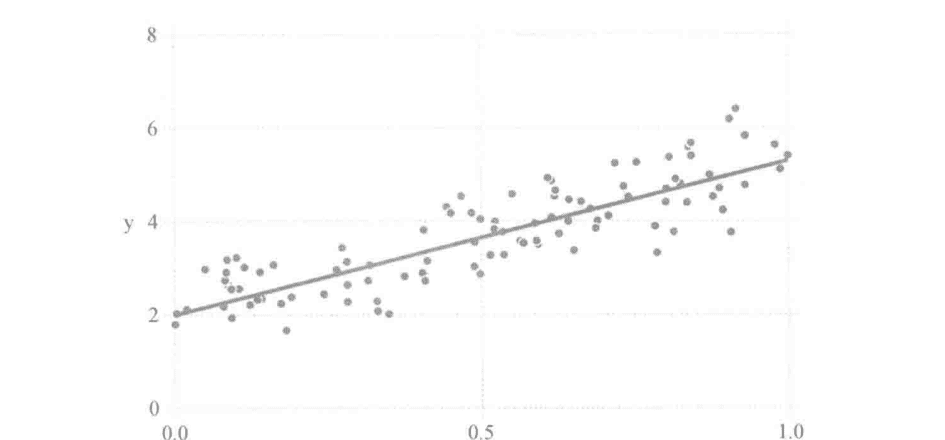

图 1-2 所示的深度学习神经网络中，$X = \{x_1, x_2, \dots, x_N\}$，$Y = \{y_1, y_2, \dots, y_N\}$，$X$ 为输入数据，$Y$ 为标签，表示为：

$$\widetilde{y_i}(x_i) = w_2 \cdot \sigma(w_1 x_i) \quad (1-1)$$

输入 $x$ 产生输出 $y$，$y$ 上方波浪号表示模型预测值。中间经过两层线性变换，层间包含非线性变换，这是深度学习的基本构成。模型目标是寻找参数 $w$，使输入 $x$ 经网络得到 $\tilde{y}$ 尽可能接近标签 $y$，即逼近真实值。从线性回归角度看，这是在让模型拟合所有数据；从神经网络角度看，也是让模型逼近真实结果。这两种做法代表了经典机器学习范式，其背后源于贝叶斯公式的延伸，但尚未进入 Bayesian 方式。

贝叶斯公式如图 1-3 所示。

$$P(A|B) = P(A) \times \frac{P(B|A)}{P(B)}$$

$P(A|B)$ 表示在 $B$ 发生条件下 $A$ 发生的概率。


如图 1-4 所示，贝叶斯公式之所以有效，关键在于它表达了 $A$ 与 $B$ 的交集与相互作用，两者存在重叠区域，因而可将 $A$ 在 $B$ 条件下的概率转化为 $B$ 在 $A$ 条件下的概率。

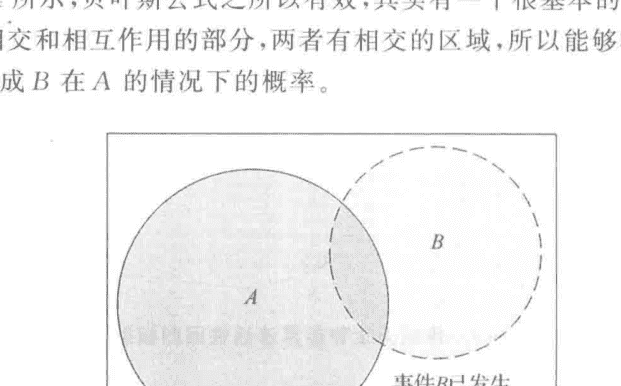

如图 1-5 所示，从贝叶斯术语看，$P(A|B)$ 是在 $B$ 发生条件下 $A$ 的概率，即后验概率 Posterior。后验与先验相对，后验是数据调整后的模型。


先验概率 Prior 是原有信念或原有模型、原有思维结构。训练时需调整模型 $P(A)$，它是不带数据的信息，$P(A)$ 需经数据调整，在加入数据后改变自身。这就是模型更新。数据调整在 $P(A)$ 条件下，$P(B|A)$ 应尽可能大。$P(B|A)$ 为似然函数 Likelihood，分母 $P(B)$ 为边缘概率 Marginal，是全部情境下提供的数据 Evidence，表示在整个数据集上的概率。这些是概率统计的基础，$P(A|B)$ 是从数学角度的考量。

从机器学习视角，或从数据与模型视角看，数据记为 $D$，模型记为 $H$，$H$ 表示假设 Hypothesis 或信念 Belief。模型在数据条件下的概率 $P(H|D)$ 可转为用 $P(D|H)$ 表达，正因二者存在交集，交集即相互作用的共同区域。

$$P(H|D) = \frac{P(D|H)P(H)}{P(D)} = \frac{P(D,H)}{\int_H P(D,H')dH'}$$

$P(H)$ 为先验概率，需被现实或数据事件更新，即乘以 $P(D|H)$，$P(D|H)$ 即数据在模型存在条件下的概率。$P(H)$ 是某个信念假设，被数据模型更新。从整体数据看，可能存在多个假设，因此除以 $P(D)$，在 $\int_H P(D,H')dH'$ 公式中可见，$P(D)$ 可展开为不同信念构成的总和。这里是微积分形式，$H$ 上带撇 $H'$ 表示变量，分子 $P(H)$ 只是某个假设或信念，分母展开为所有可能性，$P(D)$ 也是边缘概率 Marginal probability。

先验 $P(H)$ 与后验 $P(H|D)$ 的理解深度，体现了智力发展水平。如图 1-6 所示，最左侧仅有假设，不管外界，是最原始的智力状态，随后进入第二阶段。

第二阶段中 $X$ 代表前述公式中的 $D$ 数据，实践中发现外界与想象不符，但因智力水平有限，走向了另一个极端：没有自身信念或假设，纯粹由数据或事件驱动。


第三阶段智力进一步发展，用信念、假设或模型来最大化现实产出，即 $P(D|H)$ 方式，用模型最大化现实产出。例如过去选择栖居地时，会基于对植物或水果生长周期的判断，选择不同地点以获得最大产出。

第四阶段发展为 $P(D,H)$，逗号代表贡献，即 $A$ 交 $B$ 部分。为何是进步？因第三阶段仅在模型或信念下最大化现实产出，而实践中发现，模型或信念未必能得到最大产出，因他人亦有模型或信念，产出各不相同。于是进入下一步，既观察现实数据，又反思自身模型，进入内省模式。这是相对第三阶段的进步，但尚未达到高级智能，因仅知观察现实数据、观察自身思维模式或信念，却不知如何构建更好的信念或模型，于是出现第五阶段。

第五阶段即贝叶斯阶段 $P(H|D)$，用数据 $D$ 更新 $H$，$P(H|D)$ 是 $H$ 在 $D$ 条件下的概率。此阶段追求通过实践更新认知模型、信念、假设或模型。这是几百年前已达到的状态。贝叶斯概率公式约在 300 多年前提出，抛弃了纯粹以自然为核心或纯粹以个人信念为核心的方式，转而调整思维系统或模型以更好地适应自然。

本书借助此形象案例，帮助读者更好理解贝叶斯公式各部分，说明对先验、后验的不同认知所对应的智力水平。

回到机器学习，包括传统回归或神经网络，目标都是让模型尽量贴近数据，用数据反向更新模型，这正是贝叶斯公式的基本表达。具体做法分两部分：经典最大似然估计 Maximum Likelihood Estimation, MLE，以及最大后验概率 Maximum A Posteriori, MAP。这两种方式无论传统机器学习还是神经网络，都是底层通用机制，因它们决定如何以贝叶斯方式调整模型以贴近现实。两者都是在不同条件下对概率分布进行评估，实际计算时 MLE 与 MAP 都是 argmax，argument 为模型参数，max 为最大化。

最大似然估计 MLE 公式：最大化 $\theta$，$\theta$ 为模型，$X$ 为数据，在模型成立条件下让数据出现概率最大化，这即描述的传统机器学习做法，选择线性回归、神经网络等模型，让其最好拟合数据。

$$\theta_{MLE} = \arg \max_{\theta} P(X|\theta) = \arg \max_{\theta} \prod_{i} P(x_i|\theta)$$

最大似然估计 MLE 推导公式：

$$\theta_{MLE} = \arg \max_{\theta} \log P(X|\theta) = \arg \max_{\theta} \log \prod_{i} P(x_i|\theta) = \arg \max_{\theta} \sum_{i} \log P(x_i|\theta)$$

贝叶斯公式：

$$P(\theta|X) = \frac{P(X|\theta)P(\theta)}{P(X)} \propto P(X|\theta)P(\theta)$$

最大后验概率 MAP 公式：

$$\theta_{MAP} = \arg \max_{\theta} P(X|\theta)P(\theta) = \arg \max_{\theta} \log P(X|\theta) + \log P(\theta) = \arg \max_{\theta} \log \prod_{i} P(x_i|\theta) + \log P(\theta) = \arg \max_{\theta} \sum_{i} \log P(x_i|\theta) + \log P(\theta)$$

最大后验概率 MAP 推导公式：

$$\theta_{MAP} = \arg \max_{\theta} \sum_{i} \log P(x_i|\theta) + \log P(\theta) = \arg \max_{\theta} \sum_{i} \log P(x_i|\theta) + \text{const} = \arg \max_{\theta} \sum_{i} \log P(x_i|\theta) = \theta_{MLE}$$

## 1.2 似然最大化与最大后验的数学本质

先从最大似然估计 MLE 看起。核心式子是 $\theta_{MLE} = \arg \max_{\theta} P(X|\theta)$，就是在所有参数里挑出让数据出现的可能性最大的那个。回扣到贝叶斯公式 $P(A|B)=P(A)\times P(B|A)/P(B)$，这里我们关心的恰好是 $P(B|A)$ 这部分，即在参数固定的条件下数据有多大可能。

具体写开是连乘形式 $\arg \max_{\theta} \prod_{i} P(x_i|\theta)$，$\prod$ 代表把每个样本的概率挨个相乘。以线性回归举例，每个输入 $x$ 经过模型得到预测 $y$，目标是让预测和真实值的偏差尽可能小，因为模型要同时拟合所有点，所以整体目标写成乘积。

乘法在数值上很麻烦，多个小数相乘极易下溢，硬件难以支撑，于是引入对数。对数不改变单调性，式子变为 $\theta_{MLE} = \arg \max_{\theta} \sum_{i} \log P(X_i|\theta)$。乘法变加法，数值稳定，对人工智能这种参数众多、数据海量的场景至关重要。不断调整方向、平移参数，直到整体似然最高，这个“找最大值”的过程就是 arg max，也是传统机器学习和绝大多数神经网络背后的驱动力。

有了 MLE，为什么还要最大后验概率 MAP？MLE 完全从零开始靠数据说话，没有利用领域专家积累的先验信息，探索成本很高。MAP 在似然上再乘一个先验：$\theta_{MAP} = \arg \max_{\theta} P(X|\theta)P(\theta)$。取对数后变成 $\arg \max_{\theta} \log P(X|\theta) + \log P(\theta)$。前半部分和 MLE 相同，后半部分 $\log P(\theta)$ 就是先验知识。

先验让模型一开始就站在更合理的位置，特别适合数据稀少的情形。纯 MLE 需要几百万甚至上亿样本才稳定，而当只有几百上千条时，好的先验加上少量微调就能得到可用模型。理论上 MAP 更通用。

当先验是均匀先验时，所有参数状态概率相同，$\log P(\theta)$ 就是常数 $\text{const}$。这时式子退化为 $\arg \max_{\theta} \sum_{i} \log P(x_i|\theta) + \text{const}$，常数不影响求极值，去掉后就回到 MLE 的形式。所以 MLE 是 MAP 在一致先验下的特例。若先验为高斯分布等非均匀形式，MAP 与 MLE 就分道扬镳。

从概念上说，$P(D|\theta)$ 是在模型给定下数据出现的概率最大化，$P(\theta|D)$ 则是用数据不断更新模型让后验最大化。二者最终都是在无数种参数状态里选出概率最高的那一个。如图 1-7，横轴是参数状态 $\theta$，纵轴是 $f(\theta|x)$，$\theta_{MAP}$ 取的是峰值，其余状态被舍弃。如图 1-8，神经网络常用反向传播来实现这种参数优化。

总结下来，本节以线性回归和神经网络为例拆解贝叶斯思想。$P(A|B)$ 是后验，即被数据更新后的模型；$P(A)$ 是原始模型，$P(B|A)$ 是似然，表征模型成立时数据出现的概率；$P(B)$ 为边缘概率，通常用于归一化。A 与 B 的交集让条件概率可以互相表达。

## 1.3 语言模型原理、公式推导与神经网络实现

要理解 Transformer，必须先弄清语言模型。一个优秀的语言模型本质是一个基于上下文的分类器，两个关键是上下文和分类。它的任务是预测下一步会发生什么，只能以概率给出答案。

比如在搜索引擎里输入“星空”，系统会给出“星空智能对话机器人”之类的补全，这就是在上下文“星空”下预测后续词。

对句子 $w_1^n = w_1 \cdots w_n$，全概率按链式法则展开： 
$P(w_1^n)=P(w_1)P(w_2|w_1)P(w_3|w_1^2)\cdots P(w_n|w_1^{n-1})=\prod_{k=1}^n P(w_k|w_1^{k-1})$。 
每个词都依赖其前所有词，是条件概率的连乘。

现实中让每个词依赖全部历史既不现实也易劣化。比如要预测第15个词，若严格考虑前面14个词的联合概率，会极度稀疏。于是引入 N-gram 和马尔可夫思想，限制依赖窗口。

二元组 Bigram 只看前一个词：$P(w_1^n)=\prod_{k=1}^n P(w_k|w_{k-1})$。 
N 元组则看前面 $N-1$ 个词：$P(w_1^n)=\prod_{k=1}^n P(w_k|w_{k-N+1}^{k-1})$。 
实践里常用二元或三元组。

训练阶段，模型基于上下文做分类。以“I saw a cat on a”为例，神经网络先把输入编码成向量表示上下文，再经一个线性层与词表所有词向量做矩阵相乘，衡量相似度。随后 softmax 把相似度映射到 0~1 的概率分布，和为1，选出概率最高的下一个词。

如图 1-11，隐藏向量 $h$ 与整个词表向量相乘得到分数。在训练时，目标是把正确词“cat”的概率推到最大。如图 1-12，若模型初始判断有误，就存在损失。神经网络通过反向传播提升“cat”位置的权重，降低其他位置的权重，完成一次语言模型的更新，如图 1-13。

简言之，语言模型就是在上下文下最大化下一个词概率，这与 MLE、MAP 的思想完全一致。

## 1.4 Transformer 架构图解精髓

如图 1-14，Transformer 编解码器的核心是状态或上下文。输入经编码器变成上下文表示，解码器利用该上下文与词表向量做矩阵乘法并归一化得到输出概率。

如图 1-15，左侧编码器先做输入嵌入，把词变成向量，随后是多头注意力 Multi-Head Attention 以捕获不同细粒度关系，再接前馈网络 Feed Forward。图示 $N_x$ 表示可堆叠多层。右侧解码器除了与编码器交互的多头注意力外，还多一个掩码多头注意力，确保生成时看不到未来信息。最后经线性层和 softmax 把向量映射为词概率。

不同层数可自由配置，如 3、5 或 12 层，每层都含多头注意力。如图 1-16，不同颜色对应不同注意力头，颜色深浅体现关注程度。

训练流程如图 1-17。以“you're welcome”为例，先把词转为 ID 再嵌入，加上位置编码后送入多层编码器。解码端采用 Teacher Force 策略，直接把目标译文“De Nada”作为输入，快速对齐参数。编码器输出与解码器自身信息结合，经线性与 softmax 计算每个词的概率，完成训练。

推理流程如图 1-18，编码端不变，解码端不再喂入真实答案。起始符 <START> 进入解码器，产生首个词“De”，再把该词回环输入继续预测，直至序列结束。

内部实现上，输入常以 Batch 形式进入，如图 1-19，每个词嵌入到若干维向量，序列长度与嵌入维数共同构成形状为 Samples × SeqLen × EmbeddingSize 的张量。位置编码与词嵌入相加保留顺序信息。

注意力计算如图 1-20~1-21。输入先经三个线性变换分别得到 Query、Key、Value 矩阵。Query 与 Key 相乘得到注意力分数，可加入 Mask。如图 1-22，在 GPT 这类解码器训练中，掩码至关重要；BERT 这类编码器训练中也常用 Masked Language Model。

分数与 Value 相乘即得到当前词在上下文中的表示，如图 1-23。编码器由注意力、前馈网络和归一化层堆叠而成，解码器结构类似，仅多一个掩码注意力，如图 1-24。

至此，传统机器学习背后的数学真相、语言模型机制，以及 Transformer 的训练与推理数据流均已完整呈现。

# 第 1 章 Bayesian Transformer 思想与数学原理深度解析

图1-25 展示了从整体输出的角度看解码侧的运行方式：解码器首先给出一个中间矩阵，该矩阵会与语言模型词表对应的向量集合，例如约三万个词向量，做一次线性投影，得到每项的原始得分，随后借助 softmax 将得分转为概率，按概率排序以选取最优生成路径。

图1-26 说明，多头自注意中的每个注意力头，实际上都在执行上面那套完整流程。最终各头输出会被汇总，常规做法是拼接。读者可能会担心拼接后尺寸变化，实际上线性变换拥有空间搬运的能力，可以把处于不同状态、不同空间的表征搬到同一尺度，再统一映射回原始维度。这是对 Transformer 基本原理的快速回溯。

此前我们聊过传统机器学习背后的数学驱动力，也聊过语言模型与 Transformer。作者自 2017 年起自研对话系统，命名为星空智能对话机器人，设计思想围绕贝叶斯展开。那 Bayesian Transformer 到底是怎样的一种落地？与传统方法在本质上有哪些分歧？留到下一节细说。

其中，$P(H|D) = \frac{P(D|H)P(H)}{P(D)} = \frac{P(D,H)}{\int_H P(D,H')dH'}$ 里，分母的边缘概率记作 P(D)，以积分形式表达。$H$ 代表假设、信念或模型所处的状态，要求把所有可能状态都纳入考量。

而 MLE 或 MAP 的思路是寻优，即寻找让 $f(\theta|x)$ 达到峰值的点。成因较多，关键在于神经网络参数体量通常庞大而可用数据有限。样本受限且缺乏先验时，拟合会变得困难。从数据规模与模型参数的对比看，数据吃紧，而 MAP 会引入先验项，式(1-8) 中，$\theta_{MAP} = \arg \max_{\theta} \log P(X|\theta) + \log P(\theta)$，通过加入先验 $P(\theta)$ 或先验状态这类领域信息，即便只有数十到数百条样本也能获得较好模型。

在思考贝叶斯范式时，核心不是某个设定或单一参数状态，而是边缘概率。对于神经网络这类状态系统，贝叶斯思维尤为关键。贝叶斯的边缘化操作能够提升可靠性，使结果更贴合真实分布。

从更高层看，我们的星空智能对话机器人一直强调：不能只盯着数据和最优参数，更要关注模型本身，如图1-27 所示。

为何模型更重要？因为模型包含多种参数状态。训练过程中不同层级、同一层在不同输入下也会呈现不同状态。若不从模型视角思考，只追求最优参数，这是传统机器学习或人工智能的惯有思维，即 MLE、MAP 式思维。但从模型视角看，一个模型的<|message|> 参数会形成大量状态，共同构成

# 第 1 章 Bayesian Transformer 思想与数学原理深度解析

参数空间，由众多模型参数堆砌而成，不同状态共同塑造整体。此时贝叶斯的方式即 $P(B)$ 的表达，成为打开 Transformer 之门的钥匙。

回到多头自注意，多头相对于单头，允许模型以不同视角关注信息。过去单头只有一个视角，多头注意拥有 12 个头即 12 组矩阵。它覆盖了更多情形，但尚未等同于完整的 $P(B)$，因为 $P(B)$ 要求考虑全部可能，而非仅最优解。可至少从 $\theta_{MAP}$ 的唯一最优，转变为多头并行，这已是重大变化，也是 Transformer 精髓之一，因为不同头理论上用不同参数表达同一信息。

贝叶斯的核心在于不同参数状态的集成。可视作一种集成学习，但与传统集成不同。例如 Transformer 的多头，是对同一数据采用不同参数做表达后再集成。对神经网络而言这很重要，因为训练数据往往不足。这也是 GPT 系列等著名模型持续堆数据的缘由。数据越多，GPT3 比 GPT2 更强，因拟合更好。若数据有限，需考虑模型参数的多样状态，多头注意就至关重要。多头关注不同情形，现实中每种情形对应一组参数，参数成立的概率分布刻画了模型。若各头输出差异巨大，则不可靠，整个模型可能有问题，需要人工干预，如自动驾驶或医疗系统。

由于考虑的是多样情形而非直接取最优，贝叶斯关注的是概率分布，分布中的每个参数状态本质上都是后验概率。

$$posterior = \frac{likelihood * prior}{evidence} \quad (1-13)$$

$$P(w|D) = \frac{p(D|w)p(w)}{p(D)} \quad (1-14)$$

$$evidence = p(D) = \int p(D|w)p(w)dw \quad (1-15)$$

通过似然与先验相乘再除以证据的边缘概率，可写成 $P(w|D)$，其中 $D$ 为全部数据即证据，$w$ 为模型参数的某种状态，$P(w|D)$ 即最大后验概率 MAP。

贝叶斯关注的核心是分母，在式(1-2) 中，$P(A|B) = P(A) \times \frac{P(B|A)}{P(B)}$ 的视角是 $P(B)$。在式(1-14) 中，$P(w|D) = \frac{p(D|w)p(w)}{p(D)}$ 中也是 $P(D)$。它把 MLE、MAP 的最大概率思维，扩展为考虑全部情形，关注证据本身 $P(D)$，把不同情形集成起来。$p(D|w)p(w)$ 从计算上看就是 MAP，即式(1-8) $\theta_{MAP} = \arg \max_{\theta} P(X|\theta)P(\theta)$。若先验为均匀先验，MLE 是 MAP 的特例。要做贝叶斯式计算，需思考整个证据。在式(1-15) 中，$\int p(D|w)p(w)dw$ 用积分把所有 MAP 集成起来，每个参数状态都要计入，而非只找最优，这就是贝叶斯思维架构。

Transformer 用多头注意让每个头对同一数据给出不同表达，不同表达可能带来冗余。Transformer 再把各头集成以更好表达信息，这正是 Transformer 对贝叶斯的一种实现，我们称之为 Bayesian Transformer。整个 Transformer 还有很多地方体现贝叶斯思维，简单说，贝叶斯模式能表达置信区间和分布。如图1-28 所示。

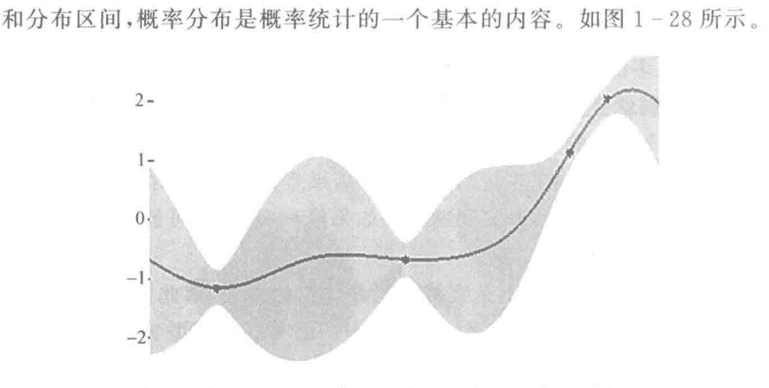

图1-28 回归任务的预测分布

但存在现实问题：要覆盖全部情形在计算上不可行，情形是无限的。因此实践中多采用采样，例如贝叶斯模型平均 Bayesian Model Averaging，BMA。还有多种采样技术，核心是在无数状态中抽取若干参数模型代表整体。Transformer 本身用多头注意来近似这一过程，我们称之为 Bayesian Transformer。

## 1.6 Bayesian Transformer 在学术与工业中的价值与意义

思考 Bayesian Transformer 有多重价值。首先认识到 Transformer 多头本身类似采样机制，每个头相当于一个样本。Head 1 是一次采样，Head 2 也是，Head 12 也是。全部情形无限，Transformer 的 12 个头从中抽了 12 个样例。原始 Transformer 并未给出怎样采样的指引，这可能带来问题，比如 12 个头信息冗余。理想情况是各头承载不同信息再集成，但也可能 12 个头表达相近，采样高度相似。回到 Bayesian Transformer 视角，很多问题变得可解，因其强调 $P(B)$ 或证据，可从此出发改造 Transformer 的输入输出与结构，核心工作是通过正则化提升多样性。

如图1-29 所示，词嵌入阶段可使用稀疏特征 Sparse Feature，也可使用预训练词向量 Pretrained Embedding，二者结合构成嵌入空间，进而影响多头注意。

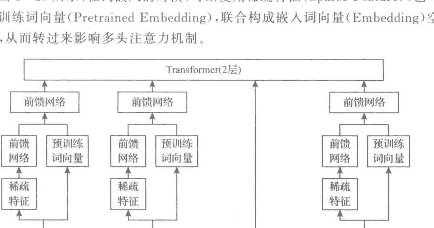

从冗余角度看，Transformer 分为多层 $N_x$。一个有效技巧是不同层间的注意力也可以以贝叶斯方式集成。例如第二层 Block 会融合第一层注意力，第三层会融合第一、二层注意力，这是一种很有效的改进。从词嵌入与不同层的角度，以贝叶斯视角看其威力。

Transformer 处处皆贝叶斯：不同层次是贝叶斯；多头是贝叶斯；自注意力 Self Attention 本身就是贝叶斯方式，因为它不仅看自身，还要看他者，通过一句话中各词与自己的关联程度来表达自己。Dropout 也是贝叶斯，因为每个批次看到的网络不同，得到的是同一模型的不同实现，集成后更有效。若参数海量，训练时每次只更新一部分，多轮训练构建的是同一实体，海量参数也是贝叶斯。词嵌入可用稀疏特征与预训练向量联合，也是贝叶斯方式。不同模型集成也是贝叶斯。框架中不同阶段的参数集成是重要技巧，在高级 Transformer 模型中已有应用。残差网络 Residuals 是贝叶斯最直观的表达。

Bayesian Transformer 把多头注意视为采样机制的具体实现。不同变种在采样上有多种技巧，工业实践中有很多有价值的实现。若要更深入，接下来将从系统化数学角度分享 Bayesian Transformer 背后的数学体系。

## 1.7 Bayesian Transformer 数学推导全周期与神经网络底层机制剖析

从数学看，线性转换

$$z=g(z_1,\cdots,z_M)$$

$$z_i=f_{att}(x;\theta_i)$$

其中函数 g 汇聚所有头的输出，每个头由 $f_{att}$ 产生，$x$ 为输入数据，$\theta_i$ 为第 $i$ 个头的模型参数，若有 8 个头则有 8 个 $\theta_i$，理论上它们不同，且我们希望它们不同。在式(1-17) 中，$x$ 为数据，$\theta_i$ 为参数，用数据更新模型本质上是后验 MAP 过程，回到贝叶斯公式本身

$$P(\theta|D)=\frac{P(D|\theta)P(\theta)}{P(D)}$$

如图1-30 所示，对多头注意而言，数据是同一份数据，用它更新不同的头和不同模型，下标 0~7 共 8 个头，对应 8 个 $\theta_i$ 的内容 $\theta_0 \sim \theta_7$，分子是 $P(D|\theta)P(\theta)$，分母 $P(D)$ 是所有模型的综合表现，这是 Bayesian 的精髓。

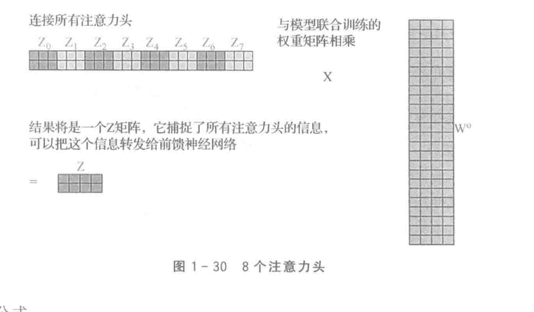

在公式

$$P(D) = \int_{\theta} P(D, \theta) d\theta \quad (1-19)$$

式(1-19) 采用积分，其中 $\theta$ 为积分变量，每个头相当于变量的一种状态。对 $P(D, \theta)$ 做积分，$P(D, \theta)$ 中的逗号从概率上表示数据与模型 $\theta$ 同时出现的概率，回到最开始的式(1-2)，贝叶斯公式 $P(A|B) = P(A) \times \frac{P(B|A)}{P(B)}$，$A$ 与 $B$ 相互作用，在 $B$ 下求 $A$ 为后验，可转为在 $A$ 下求 $B$ 即似然，再乘以先验 $P(A)$，除以边缘概率 $P(B)$。

对 $P(D, \theta)$ 求积分，结合链式法则，得到：

$$P(D) = \int_{\theta} P(D|\theta) P(\theta) d\theta \quad (1-20)$$

代入后验概率分布，得到：

$$P(\theta|D) = \frac{P(D|\theta)P(\theta)}{P(D)} = \frac{P(D|\theta)P(\theta)}{\int_{\theta} P(D|\theta)P(\theta) d\theta} \quad (1-21)$$

从每个模型参数看，可把 $p(D)$ 去掉：

$$P(\theta|D) = \frac{P(D|\theta)P(\theta)}{P(D)} \propto P(D|\theta)P(\theta) \quad (1-22)$$

$$\theta_{MAP} = \arg \max_{\theta} P(D|\theta)P(\theta) \quad (1-23)$$

式(1-23) 其实就是 MAP，而 $P(D)$ 本身要算的是 $\int_{\theta} P(D|\theta)P(\theta)d\theta$ 的集成。从最初的式(1-19) $P(D)=\int_{\theta} P(D,\theta)d\theta$，即数据与模型共现概率，转化为式(1-20) $P(D)=\int_{\theta} P(D|\theta)P(\theta)d\theta$，其中 $P(D|\theta)$ 为似然 MLE 部分。有趣的是，计算贝叶斯分布反过来依赖 $\theta_{MAP}$，贝叶斯视角下不只看最优 $\theta_{MAP}$，还要考虑全部情形。

对 Transformer 而言采用多头方式，但这里涉及具体实现：为何用多头而非直接积分。Transformer 简单地把多个头拼接，这背后是一种概率分布的计算方式。

如图1-31 所示，若取值连续，称稠密概率分布，曲线下面积和为 1。

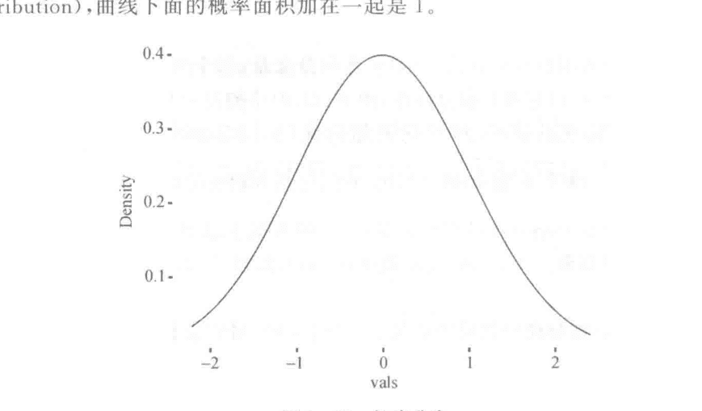

如图1-32 所示，若取值不连续，称概率质量分布。

多头注意力中，不同头的概率倾向往往不一致。举例来说，当模型包含编号为 0、1、2、3 的 4 个头时，每个头落到不同结果上的可能性各有差别。此时采用的是离散型概率质量分布 probability mass distribution，而非连续型稠密概率分布 probability dense distribution。这种选择是在工程落地时的取舍，与计算机本身的离散特性密切相关。从神经网络视角看，网络起步于初始化状态，而初始化在多数情况下是随机的。即便不谈迁移学习或先验信息，仅考虑其他因素也无法保证输出的完全连续，这正是实现上相当精妙之处。

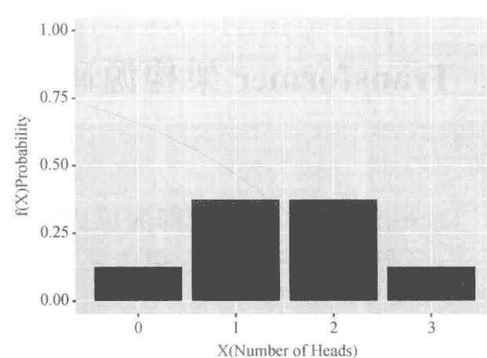

图 1-32 概率质量分布

Transformer 通过多头注意力来建模概率分布。模型内部存在多个头，在推理时每个头都呈现出一种概率状态，每个头都能提供一种概率表征。式(1-17) $z_i = f_{att}(x; \theta_i)$，$z_i$ 表示第 i 个头的参数对当前输入 $x$ 所能表达的概率情况，采用概率质量分布来刻画。在式(1-16)中，$z = g(z_1, \cdots, z_M)$，借助函数 $g$ 将各个头的概率整合成整体，而非使用积分形式的计算：

$$P(z|x, D) = \int \delta_{f_{att}(x; \theta)}(z) p(\theta|D) d\theta \quad (1-24)$$

由此 Transformer 完成了贝叶斯式的推断，这正是 Bayesian Transformer 背后的数学论证。

接下来将从代码层面出发，对 Transformer 的编码端与解码端进行完整落地，覆盖数据准备、训练流程与推理过程的整体实现。

# 第 2 章 Transformer 源码全景拆解

## 2.1 Transformer 内部的层级结构与 NLP 应用内幕

图 2-1 所示为 Transformer 的注意力机制或多头机制。Transformer 研究的是空间结构，所能捕捉的空间信息本质上是线性的。现实世界的空间结构多为线性层级结构，也可视作网状模型的一种特例，其中最常见的使用形式就是层级结构。

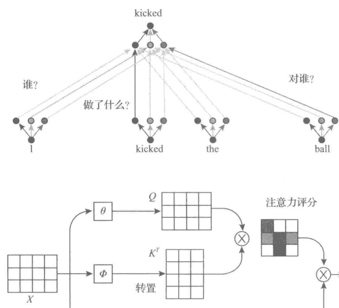

如图 2-2 所示，空间结构中普遍存在层级形态。以图片识别汽车为例，低层级倾向于像素碎片等原始片段，中层级可辨出初步轮廓，高层级则能看到更完整的形状，这就构成了层级。

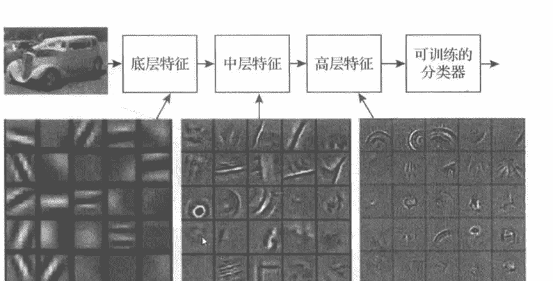

Transformer 或神经网络之所以有效，核心在于能够表达层级结构。如图 2-3 所示，Transformer 可能只有一层、两层，也可能是 12 层或更多。模型训练的层数越多，背后的动机就是构建更丰富的层级。从自然语言角度，最底层可能是最基本的词切分，再往上是语法层，涉及不同时态等，更高层则是语义层。

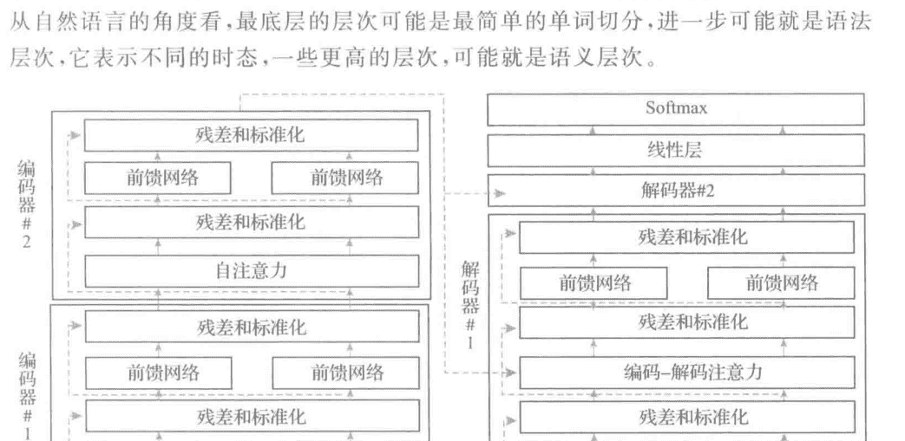

Transformer 的层级如图 2-4 所示，可见存在多层，每一层对应一套不同的自然语言理论。层级越低，表达的信息越原始，层级越高，信息整合程度越高。

## 2.2 数学原理、注意力代码实现与 Transformer 可视化

如图 2-5 所示，从贝叶斯理论看，这是支撑贝叶斯的数学表达式，贝叶斯公式存在多种变体，$P(A|B)$ 表示在 B 发生的条件下 A 发生的概率。

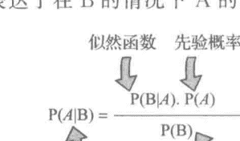

图 2-5 贝叶斯公式

如图 2-6 所示，要求 A 与 B 同时发生的概率，$P(B|A)P(A)$ 是先用 A 的概率乘以在 A 下 B 出现的概率，相乘表示二者共同产生。共同产生对应的即为 A 与 B 交集的面积，再经式(2-1) 的 $\frac{P(B|A)P(A)}{P(B)}$ 计算，便得到在 B 下 A 出现的概率 $P(A|B)$。除法运算实质是刻画先后顺序，由顺序关系推导出因果关系，这就是贝叶斯公式。在生成式语言模型里，给定 B 的前提下同时输入 A，会产出新的语言内容。

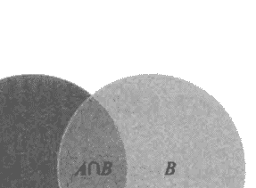

图 2-6 A、B 交集示意图

Transformer 自注意力公式：

$$Attention(Q,K,V)=softmax\left(\frac{QK^T}{\sqrt{d_k}}\right)V$$ (2-2)

Transformer 注意力机制代码实现：

```python
def attention(query, key, value, mask=None, dropout=0.0):
    "Scaled Dot-Product Attention"
    d_k = query.size(-1)
    scores = torch.matmul(query, key.transpose(-2, -1)) / math.sqrt(d_k)
    if mask is not None:
        scores = scores.masked_fill(mask == 0, -1e9)
    p_attn = F.softmax(scores, dim=-1)
    # dropout described below
    p_attn = F.dropout(p_attn, p=dropout)
    return torch.matmul(p_attn, value), p_attn
```

上段代码第 4 行操作较为简洁，先对 Key 矩阵做转置，再通过 torch.matmul 将 Query 与 Key^T 做矩阵乘法，这是线性代数的基础操作。

上段代码第 7 行利用 F.softmax 得到分数排序。

上段代码第 10 行把计算得到的注意力分数与当前 Value 矩阵相乘，得到最终结果。

Transformer 多头注意力公式：

$$MultiHead(Q,K,V)=Concat(head_1,\cdots,head_h)W^O$$ (2-3)

$$head_i=Attention(QW_i^Q,KW_i^K,VW_i^V)$$ (2-4)

Transformer 多头注意力存在不同的初始化状态，其代码实现如下：

```python
class MultiHeadedAttention(nn.Module):
    def __init__(self, h, d_model, dropout=0.1):
        "Take in model size and number of heads."
        super(MultiHeadedAttention, self).__init__()
        assert d_model % h == 0
        # We assume d_v always equals d_k
        self.d_k = d_model // h
        self.h = h
        self.linears = clones(nn.Linear(d_model, d_model), 4)
        self.attn = None
        self.dropout = nn.Dropout(p=dropout)

    def forward(self, query, key, value, mask=None):
        "Implements Figure 2"
        if mask is not None:
            # Same mask applied to all h heads.
            mask = mask.unsqueeze(1)
        nbatches = query.size(0)

        # 1) Do all the linear projections in batch from d_model => h x d_k
        query, key, value = [
            lin(x).view(nbatches, -1, self.h, self.d_k).transpose(1, 2)
            for lin, x in zip(self.linears, (query, key, value))
        ]

        # 2) Apply attention on all the projected vectors in batch.
        x, self.attn = attention(
            query, key, value, mask=mask, dropout=self.dropout
        )

        # 3) "Concat" using a view and apply a final linear.
        x = (
            x.transpose(1, 2)
            .contiguous()
            .view(nbatches, -1, self.h * self.d_k)
        )
        del query
        del key
        del value
        return self.linears[-1](x)
```

图 2-7、2-8 展示了 Transformer 内部运行的细节，能够清晰呈现物理级、系统级、日志级的信息。

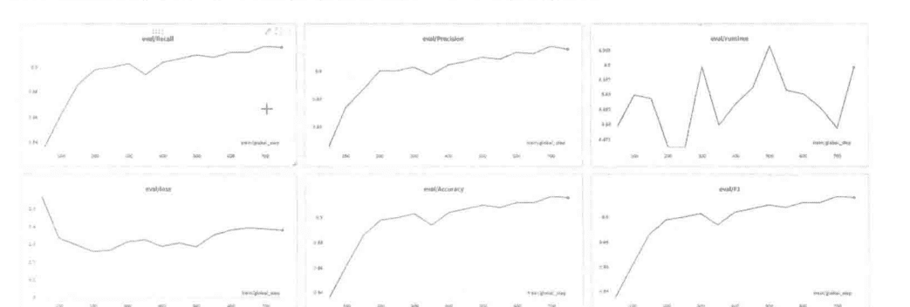

图 2-7 Transformer 内部运行内容

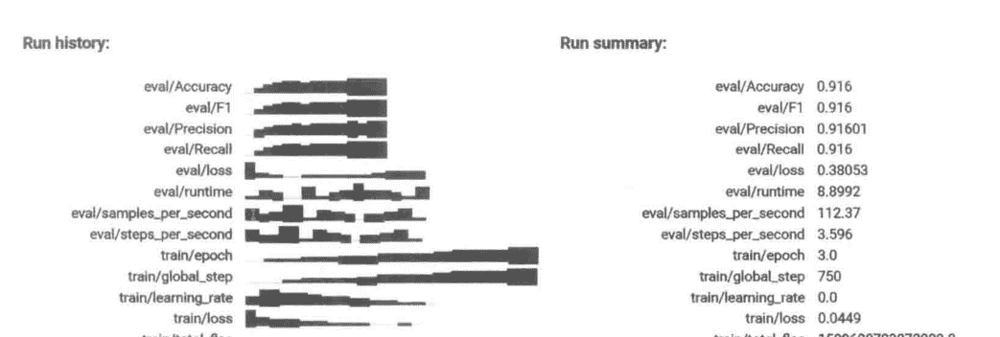

图 2-8 Transformer 运行日志摘要

从架构层面看，Transformer 的运行机理、数学依据以及研发过程的物理本质，都体现了双向思考法。在逐步解耦的同时完成内聚，星空智能对话机器人的代码由最初约 500 行扩展到核心代码 12 万行。Transformer 只是底层基石，从系统整体视角它并无意志或主观意图，若要赋予意志，需借助 Star Space 完成，使得星空智能对话机器人的代码从数百行发展到十几万行。

## 2.3 以对话机器人流式架构为例谈 Transformer 学习的第三境界

图 2-9 以对话机器人的流式架构阐述 Transformer 学习的第三境界。

在流式架构中，消息的输入与输出是一个持续流动的过程。消息进入后经 Transformer 处理，随后交给有状态计算中心 stateful computations，计算结果再返回 Transformer 处理，最后将消息发送出去。有状态计算是指基于用户状态的信息，包含当前状态与历史状态，历史状态分为两部分：

一部分是对话系统中当前句子的前文。当前句子之前的 3 句、5 句或 10 句内容，对对话机器人的有状态决策至关重要。因为流式架构建立在 Transformer 注意力模型之上。Transformer 注意力模型类似于日常对话，持续的对话或反问能够进行下去，正是依托信息流展开，而非只盯着当前一句。在星空智能对话机器人中称之为有状态计算。实现局部或领域信息理解的关键不在于当前话本身，而是依赖过去的状态，这与 Transformer 天然契合。这是对话流程中的首个关键点。它关注当前输入，但前序输入同样决定性，全部前文对当前信息语义的理解起决定作用。

另一部分是信息画像，即用户画像或知识库内容。推荐系统背后存在大量信息画像与用户画像，同时包含知识图谱与知识库。无论是对话输入还是历史信息，画像都不是静态的，而是一个动态演化的过程。

把用户反馈给机器人的信息、机器人处理动作、机器人反应动作、用户输入信息、用户动作、消息传输动作全部视为事件，对事件进行编码，这些事件构成事件流。事件流形成循环 Loop，把对话视作事件流，流中可能包含用户输入 20 句话的事件、机器人 100 个动作的事件，并在循环中遵循线性流程，形成一环套一环的事件流。在环中流动时使用 Transformer，基于对话机器人的流式架构对 Transformer 的理解便进入第三境界。

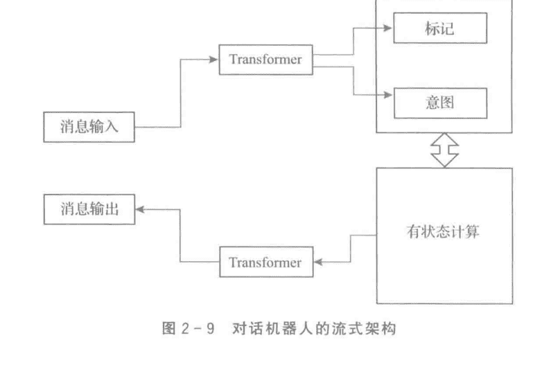

图 2-9 对话机器人的流式架构

## 2.4 以智能对话机器人为例阐述 Transformer 的自编码与自回归语言模型内幕

图 2-10 所示为自编码语言模型，可依据上下文注意力进行填充。神经网络背后是向量，隐向量的填充涉及程度问题，填充是否正确即为自编码过程。类似填空题，将关键信息挖空，自编码语言模型依据上下文注意力填入相应内容，再与真实内容对比，根据结果校正网络，从而理解数据的左侧部分。

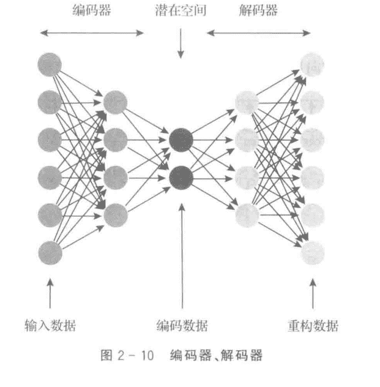

如图 2-11 所示，左侧为自编码过程或双向注意力机制，右侧为自回归过程。自回归过程相当于与对话机器人交互，用户输入一句话，机器人便依据历史对话、知识库、推荐系统、用户画像等构建下一句话或下一个动作。

在 Transformer 架构中，左侧为自编码过程，右侧为自回归过程，左侧以 BERT Bidirectional Encoder Representations from Transformers 为代表用于语言理解，右侧用于语言生成。

图 2-12 为对话机器人的系统架构图，对话输入后基于 Transformer 模型进行自然语言理解 NLU Natural Language Understanding，随后进行自然语言生成 NLG Natural Language Generation。生成时依据当前输入、历史信息如过去 5 句或 10 句、用户画像、知识图谱、推荐系统等生成语言信息。NLU 部分的注意力机制为双向注意力，NLG 部分为单向注意力。

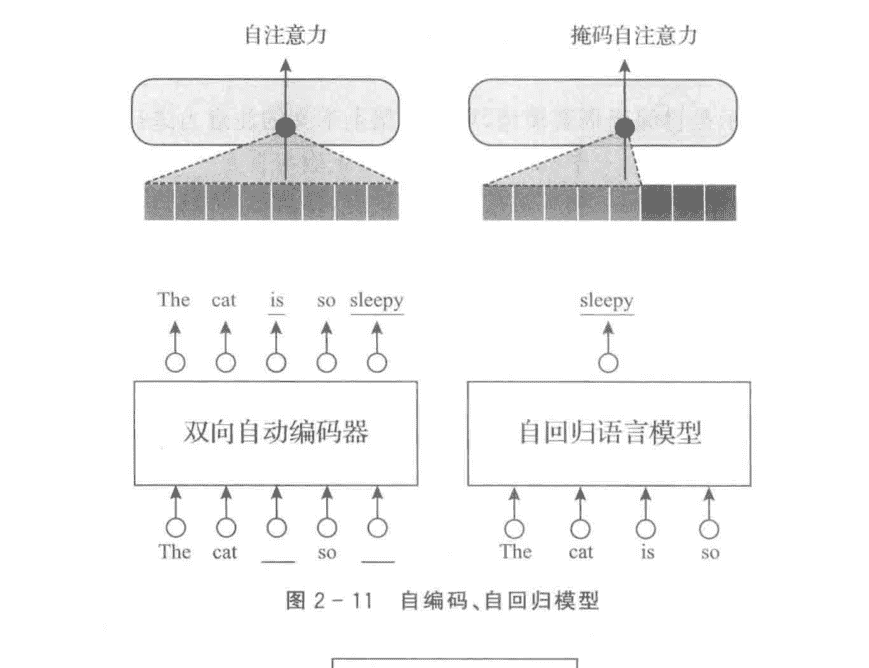

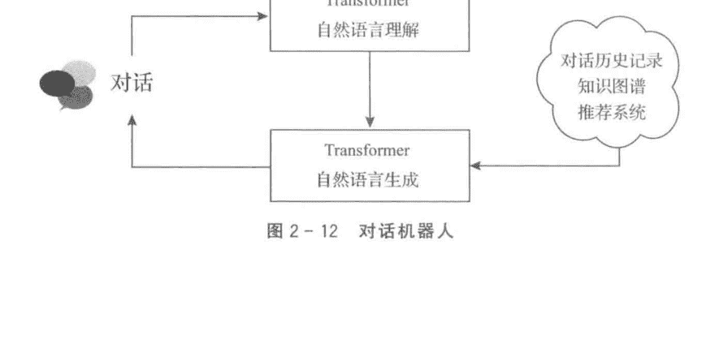

# 第 3 章 Transformer 语言模型架构、数学原理及内幕机制

## 3.1 语言模型的链式法则、运行机制及分类器特性

语言模型本身较为简洁，它是预测词或词序列概率分布的模型。

$P(y_1, y_2, \cdots, y_n) = P(y_1) \cdot P(y_2|y_1) \cdot P(y_3|y_1, y_2) \cdots \cdots P(y_n|y_1, \cdots, y_{n-1})$

$= \prod_{t=1}^{n} P(y_t|y_{<t})$

通常一句话具有顺序，即词序列。假设句子包含 $y_1, y_2$ 直到 $y_n$，则先有 $y_1$，随后出现 $y_2$，$y_2$ 在 $y_1$ 条件下存在，$y_3$ 在 $y_1$ 与 $y_2$ 条件下存在。若要计算整句话概率，便是 $P(y_1)$ 乘以 $y_2$ 在 $y_1$ 下的概率 $P(y_2|y_1)$，再乘以 $y_3$ 在 $y_1, y_2$ 下的概率 $P(y_3|y_1, y_2)$，依次连乘至 $P(y_n|y_1, \cdots, y_{n-1})$，这正是贝叶斯公式表达的条件概率。之所以使用乘法，是因为序列有顺序，在排列组合中，有序的多步操作均用乘法，$\prod_{t=1}^{n} P(y_t|y_{<t})$ 是简洁写法，$\prod$ 为乘法符号。在 $y$ 小于 $t$ 的条件下，即在前面所有词汇条件下，对语言模型而言，不同词汇的顺序会影响概率表达。一个优秀的语言模型对符合规范的句子会给出更高的概率。

语言模型到底在做什么？从一个最直观的对比开始理解。$P(\text{the cat is small}) > P(\text{small the is cat})$，前一句是符合我们日常表达习惯的正常句子，后一句则是语序混乱的乱码。成熟的模型会给前者分配远高于后者的概率值。给序列打分并进行判断，本质上就是一个分类任务。训练目标就是让符合语言习惯的表达获得更高概率，让不通顺的表达被压低。换句话说，语言模型是一个依赖历史的分类器，后一个词的分布完全由前面已出现的词决定，前文就是它的上下文。

从生成视角看，这正是语言模型最核心的能力。基于已有的上下文，给出合理且连贯的下一个词，甚至连续多个词。

再举一个预测的场景，如图 3-1 所示，“I was happy to see _”，空缺处该填什么。

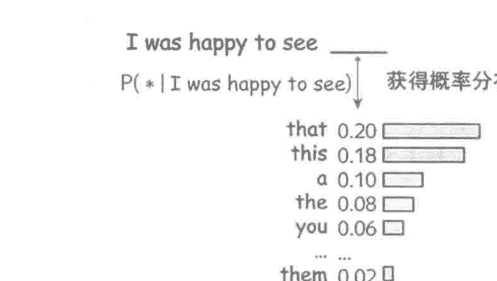

从实现角度看，模型会遍历整个词表来评估概率。假设词表规模在 3 万左右，给定历史“I was happy to see”会被神经网络编码为一个上下文向量。随后这个向量与词表里 3 万个词对应的向量矩阵做运算，衡量待填词与上下文的贴合度。运算后通过 softmax 归一化为 0 到 1 之间的概率分布，且所有词的概率之和为 1。换一种说法，模型在揭晓在当前条件下的最可能结果。

GPT 系列在生成任务上表现突出，背后是海量语料的训练支撑。语言模型本质上是一个概率预测器，给自然语序更高的概率，并据此挑选最合理的表达。它最重要的功能，是基于上下文对下一步做条件预测。

如图 3-2 所示，以“here”为例，它的上下文就是前面的“can you please come”。这段历史信息会被编码成一个向量，维度可以是 256、128 或自定义大小，然后与词表里 3 万个词的向量做点乘，找出在该语境下可能性最高的词。于是“can you please come here”被完整生成。


以上就是对语言模型的一个基础性认识。简言之，它是条件分类器，数学上就是条件概率，由上下文决定下一个选择。

3.2 统计式语言模型原理 Statistical Language Models
语言模型内部机制、公式与实例全拆解

在之前的例子里：P(the cat is small) > P(small the is cat)，正常语序的概率更高。另一个例子“I was happy to see _”在候选“that”“this”“a”“the”“you”……中会选出概率最高的“that”，生成“I was happy to see that”。这两个例子的概率究竟怎么算？核心思路都是在特定条件下做优化。

如图 3-3 所示，计算路径大致分两类，一类是传统统计模型 N-gram models，另一类是神经网络 Neural models，如 RNN、GRU 等。当前 NLP 主导力量是 Transformer 及其家族。

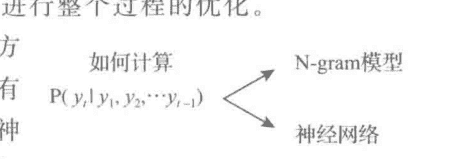

无论采用哪种路径，底层都是条件概率，P(y_t | y_1, y_2, ... y_{t-1})，即在前 t-1 个词条件下第 t 个词出现的概率。其变化主要有两种，第一种是 N-gram 统计语言模型。它依赖传统统计学习，用 N-gram 来建模，如图 3-4 所示。N-gram 直观易懂：P(A) 为 2/5，P(B|A) 为 1/4，链式概率为 P(A)×P(B|A)=2/5×1/4=1/10。序列的顺序决定意义，调换顺序结果完全不同。

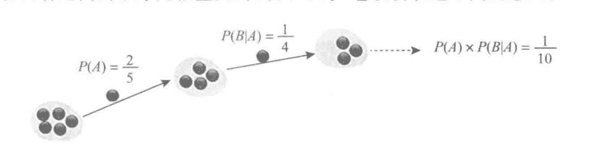

条件概率表达的是序列，有历史也有当前状态，历史用来刷新当前，或当前反作用于历史，这一过程就是更新，实质是连乘。因为涉及多个步骤，求最大后验概率 P(A|B) 时会用到 P(A)×P(B|A)，分母 P(B) 因为是常数可忽略。

从概率论看，最根本的是贝叶斯公式，我们称之为贝叶斯，强调后验概率而非不确定性。底层的数学基础是两个事件的共同出现。从物理直觉看，是两个物体的相互作用，产生交集。统计时就能观察到某些词频繁共现。句子也是基于前文的共现规律形成。数据规模越大质量越高，描述越准确，这也是 GPT 系列持续做大的原因。A、B 共现可写作 P(A)P(B|A)，也可写作 P(B)P(A|B)，视角不同结果一致，这正是贝叶斯成立的根源，如图 3-5 所示。

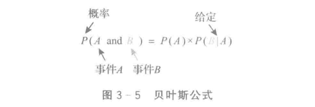

贝叶斯并非巧合，而是两个集合有交集这一简单事实的推导。以交集为桥梁，就能从 A 推到 B，或从 B 推到 A，进而演绎因果等推理。

按共现方式算概率时，“can you please come here?”是关注 5 个词的共现，还是 2 个词或 3 个词的共现？真实句子可能很长，几十甚至上百词。若严格按链式 P(y₁)·P(y₂|y₁)·P(y₃|y₁,y₂)……P(yₙ|y₁,…,yₙ₋₁) 计算，到第 5 个词 P(y₅|y₁,y₂,y₃,y₄) 时，训练数据中可能未见该四词共现，概率为 0，乘法会把前面信息全部抹掉。虽可做平滑，但历史越长概率越低，出现零概率抹杀信息是不合理的。

实际计算常用马尔可夫链思路，典型代表是隐马尔可夫模型 HMM。核心是只关注与当前最相关的历史，关注自身，也可回看 1 个或 2 个前词。语言模型通常不会回看超过 3 个词，于是有了 N-gram。

看图 3-6，一元模型 Unigram 不考虑上下文，只看词自身，视为独立事件。

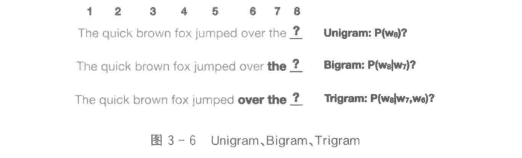

二元模型 Bigram 第 8 个位置只依赖第 7 个位置的前词。三元模型 Trigram 则依赖前面两个词，每个当前词都依赖前两个词，这是传统统计做语言模型的经典做法。

图 3-7 所示三元模型 Trigram 在 N-gram 范式下考虑的是局部依赖：

$$P(\text{I saw a cat on a mat}) = P(\text{I}) \cdot P(\text{saw}|\text{I}) \cdot P(\text{a}|\text{I saw}) \cdot P(\text{cat}|\text{I saw a}) \cdot P(\text{on}|\text{I saw a cat}) \cdot P(\text{a}|\text{I saw a cat on}) \cdot P(\text{mat}|\text{I saw a cat on a}) \quad (3-3)$$

以此类推。假设“I saw a cat on a”后出现“mat”的概率极小，大规模下累乘会趋近于 0。实际会用对数、指数等平滑处理。操作上一般只用 Unigram、Bigram、Trigram，例如 P(mat|on a) 中“mat”依赖“on”“a”。

传统方法简单，基于两词或三词共现概率，Bigram 是双词共现，Trigram 是三词共现。例如 P(w₈|w₇) 是 w₈ 在 w₇ 已出现的前提概率。

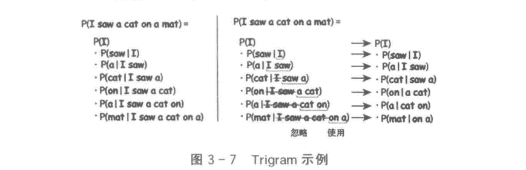

根据

$$P(A \text{ and } B) = P(A) \times P(B|A) \quad (3-4)$$

式 (3-4) 计算，P(B|A) 表示 B 在 A 发生的条件下出现的概率。把 P(A) 移到左侧，除以 P(A) 得到共现概率的比值。

$$\frac{P(A \text{ and } B)}{P(A)} = P(B|A) \quad (3-5)$$

从这里看，P(A) 是边缘概率，涵盖所有情况，P(A and B) 是语料库中 A、B 共现的次数。这是基础的计数除法运算。靠单纯计数乘除会丢失大量信息。语言有词汇、词根词缀、语法句法、语义等多层次含义，传统统计难以捕捉，于是催生了神经网络模型。

3.3 神经网络语言模型 Neural Language Models
内部机制、公式与完整示例

选用高质量语料后，神经网络语言模型 Neural Language Models 会把语料直接送入网络训练，而非手工统计。让网络自行发现哪些词常一起出现，什么结构是正常句子，甚至语义层面的规律，这就是神经网络的魅力。它具备等级结构，从词汇、句子、语法到语义甚至更高层，信息逐层抽象。从功能上看，后文依赖前文，不仅依赖上一层，也依赖更上层的历史一直到输入起点。这是神经网络做语言模型的核心动因，此外还有数据爆炸、算力提升等支撑。

如图 3-8 所示，神经网络语言模型的数学本质未变，仍是基于上下文预测下一步。将“I saw a cat on a”这 6 个词编码为一个隐向量，再与词表 3 万个词的矩阵相乘，经 softmax 转为概率，得到预测结果。与传统方法不同的是手段。

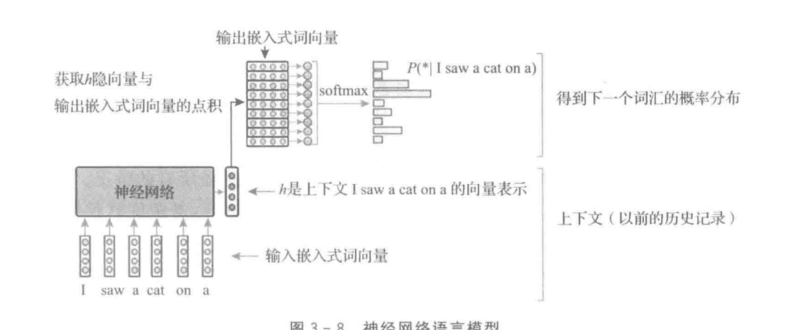

由于工具不同，效果也不同，神经网络在语义理解上具备更大探索空间。我们的对话机器人能实现业务语义级理解，正是 Transformer 与 Star Space 结合的结果。讲完了语言模型是什么、怎么算，接下来看如何评估质量。

3.4 如何评估语言模型 Perplexity & Cross Entropy
衡量质量的具体实现与公式推导

评估语言模型的方式很多，最直观的是通顺、流畅、清晰，日常交流也是如此。光有清晰度，其他能力再强也会让人困惑。因而常用困惑度 Perplexity 来量化清晰度。

最大困惑度是多少？以“I saw a cat on a _”为例，若对上下文一无所知，下一步可能落在整个词典中。假设词表 3 万，若完全迷茫，最糟情况就是词表大小，最大困惑度为 |V|。

最小困惑度是 1，表示下一步被精确锁定。但 100% 确定并不是理想状态，因为没有容错空间，通常 90%、95%、97% 左右更合理。概率表达比绝对表达承载更多信息。我们在构建对话机器人时也遵循 Bayesian 思想，正是看中其处理不确定性的能力。

举例，困惑度为 100，意味着模型在 100 个词里试探下一个词。希望困惑度越低越好，但 1 通常不现实。GPT3 参数与数据虽大，也无法覆盖一切。困惑度越低，似然 Log-likelihood 越高，复杂度越低。Log-likelihood 是最大似然估计 MLE，基于共现完成。困惑度与似然相反，用 inverse 表示除法而非 converse 的减法，GRE 中两者需区分。困惑度公式中使用 -1 次方的除法，1/N 表示词表规模，再开方，这是困惑度的基本形式。

$$Perplexity(W) = \frac{1}{P(w_1, w_2, \cdots, w_N)^{\frac{1}{N}}} = \sqrt[N]{\frac{1}{P(w_1, w_2, \cdots, w_N)}} \quad (3-6)$$

语言模型训练目标是降低困惑度、提升似然。也可用熵 Entropy 来表达复杂度，熵描述混乱程度。越不确定，信息熵越大。例如明天下雨概率 20%、晴天 80%，若真下雨，与预期不符，信息增益更高。熵与困惑度都描述混乱，可相互转换。

困惑度既可以是式 3-6 的形式，也可以是 log 熵处理的方式：

$$Perplexity(W) = 2^{H(W)} = 2^{-\frac{1}{N} \log_2 P(w_1, w_2, \cdots, w_N)} = (2^{\log_2 P(w_1, w_2, \cdots, w_N)})^{-\frac{1}{N}} \quad (3-7)$$

$$= P(w_1, w_2, \cdots, w_N)^{-\frac{1}{N}} = \sqrt[N]{\frac{1}{P(w_1, w_2, \cdots, w_N)}}$$

乍看毫无关联的困惑度与熵，细究之下却殊途同归，数学的优雅正体现在这种内在统一上。两者能靠拢的根源，是所刻画的物理直觉一致，都是在度量系统的紊乱或不确定程度。

从信息熵的视角切入，下面的表达式就能很直观地呈现规律，哪怕在最坏情形下，其上界也等于词表规模 |V|：

$$\text{Perplexity}(y_{1:M}) = 2^{-\frac{1}{M} L(y_{1:M})}$$

$$= 2^{-\frac{1}{M} \sum_{t=1}^{M} \log_2 p(y_t | y_{1:t-1})}$$

$$= 2^{-\frac{1}{M} \cdot M \cdot \log_2 \frac{1}{|V|}}$$

$$= 2^{\log_2 |V|}$$

$$= |V|$$

对一个 LM 而言，预测随后词的本质是在 |V| 个选项中做抉择。假设词表有三万个词，随机命中一个词的概率只有 1/30,000，这等于要穷举所有可能性；理想状态则是随后词完全可确定，此时困惑度与交叉熵会降到最低，而似然则被拉高。既然涉及数学，下面就对相关内容做一次回顾与拓展。

## 3.5 Language Model 底层的数学原理之最大似然估计 MLE 及最大后验概率 MAP 内部机制与关系详解

无论是经典统计建模还是神经网络范式，LM 的底层思维都是条件共现概率 $P(A|B)$。即便把句子送入网络，也并非对特定语义产生感知，而是在捕捉语料中存在的共现关系。这种共现被编码进矩阵运算，网络内部蕴含的大量信息正是学界持续探索的对象，训练过程本身即是信息的载体。

在贝叶斯公式 $P(A|B)=P(A)\times \frac{P(B|A)}{P(B)}$ 中，最基础的仍是共现。换个形式即可得到后验 $P(A|B)$、似然 $P(B|A)$、边缘 $P(B)$ 与先验 $P(A)$。我们提出的 Bayesian Transformer 理论特别强调 $P(B)$，它要求对所有可能的假设或参数状态进行集成，连续时积分、离散时求和。似然 $P(B|A)$ 表示在给定前文条件下的概率。MLE 公式 $\theta_{MLE} = \arg \max_{\theta} P(X|\theta)$ 中，$\theta$ 是模型参数，可视为前文的某种量化，用来修正前提。谈贝叶斯时不谈因果，因果更多是共现叠加时序顺序产生的错觉，本质是 $X$ 与 $\theta$ 的相互作用。由此贝叶斯公式的底层是 $A$ 与 $B$ 的相互作用与交集，可正可逆求解。

式 $\theta_{MLE} = \arg \max_{\theta} P(X|\theta)$ 的含义是寻找最大概率解，例如补全 “I was happy to see _” 时即挑选概率最高的词，这就是 MLE 的操作；更高阶的做法是 MAP。

把研究者大致分为三类，第一类天天围绕 MLE 思考，第二类则聚焦 MAP。MAP 之所以更进一步，是因为多了一个 $\log P(\theta)$ 项。

$$\theta_{MAP} = \arg \max_{\theta} P(X|\theta)P(\theta) \quad (3-9)$$

$$= \arg \max_{\theta} \log P(X|\theta) + \log P(\theta)$$

$$= \arg \max_{\theta} \log \prod_{i} P(x_i|\theta) + \log P(\theta)$$

$$= \arg \max_{\theta} \sum_{i} \log P(x_i|\theta) + \log P(\theta)$$

在 $\theta_{MAP}$ 表达式中，数据被用来更新 $P(\theta)$。更新模型时本质上是基于数据对先验进行修正，这里就涉及迁移学习或融入领域专家知识。做集成学习时把不同来源的模型一起训练，属于中等技术水平的做法。

$$\theta_{MAP} = \arg \max_{\theta} \sum_{i} \log P(x_i|\theta) + \log P(\theta) \quad (3-10)$$

公式左边是 MLE 的形式 $\arg \max_{\theta} \sum_{i} \log P(x_i|\theta)$，右边是先验 $\log P(\theta)$。若先验为均匀分布，$\log P(\theta)$ 为常数，MAP 就退化为 MLE。因此 MAP 研究者相对 MLE 研究者多了一个层次，而 $\log P(\theta)$ 并非 trivial，涉及高斯等多种分布。从 LM 看，基于预训练或迁移学习能在参数众多时加速收敛，否则小数据难以训练大网络，这正是迁移学习流行的核心动因。

无论 MLE 还是 MAP 都是最优化问题，在海量参数中寻找最优解，过程依赖反向传播与求导求极值，这是人工智能的第一、二境界。从神经网络角度看即通过梯度下降寻找损失最低点。第三境界则是 Bayesian 视角，下面进入 Bayesian 语言模型。

## 3.6 语言模型底层的数学原理之 Bayesian 模型原理与实现

人工智能的第三境界是 Bayesian 方式。本节聚焦 Bayesian LM。神经网络中 Encoder-Decoder 会把前文向量与词表矩阵相乘，衡量当前语境与每个词向量的相似度。而 Bayesian 方式更关注边缘概率，而非锁定单一最优参数。现实中数据总是不足，除了最优解，还需考虑其他可能性。从概率面积看，最优点只是无数点中的一个，其概率测度为零。追求最优是一种捷径，会让模型脆弱，丧失对不确定性的表达与应对能力，也丢弃了大量信息。

Bayesian 的优势正在于处理不确定性，超越了 MLE 的初级阶段，也超越了 MAP 的中级阶段，达到高段位。

$$P(\theta|D) = \frac{P(D|\theta)P(\theta)}{P(D)} \quad (3-11)$$

式 3-11 中 $P(D)$ 即数据亦可视作 Evidence，连续时对所有情况积分

$$P(D) = \int_{\theta} P(D, \theta) d\theta \quad (3-12)$$

其中 $\theta$ 代表模型，可能有无穷多个；离散时为概率质量分布，总和为 1，这是概率统计的基本性质，结论一致，仅过程不同。

$$P(\theta|D) \propto P(D|\theta)P(\theta) \quad (3-13)$$

$P(\theta|D)$ 是 MAP，用数据更新 $\theta$。若从 Bayesian 角度，需要对所有 $P(\theta|D)$ 情况进行集成，采用积分

$$P(z|x, D) = \int \delta_{f_{\text{att}}(x; \theta)}(z) P(\theta|D) d\theta \quad (3-14)$$

式 3-14 的积分在工程中难以精确实现，例如 Transformer 会采用

$$z = g(z_1, \cdots, z_M) \quad (3-15)$$

通过拼接做加法，其中

$z_i = f_{att}(x; \theta_i) \quad (3-16)$

$z_i$ 表示不同头 head，每个头可看作一个模型，12 个头即 12 个模型，一层 Transformer 即包含 12 个模型，多层叠加完全具备 Bayesian 集成思想。每个头是 MAP，Bayesian 是对多个 MAP 的集成。拼接后若形状不匹配，只需线性变换即可映射到期望空间。

MLE 是 MAP 的基础，MAP 是 Bayesian 的基础。MLE 多为最大似然，MAP 在此基础上加入先验与领域知识。MAP 计算最优后验，Bayesian 则考虑全部情况。工程落地时因算力或数据限制会采用采样或折中方案。注意 Bayesian 与 Bayes 有别，Bayes 多指 MAP 式做法，Bayesian 强调对不确定性的全面考量，这是星空智能对话机器人提出的观点。

## 3.7 基于Transformer的AI时间序列动态预测方法

在 AI 与大数据快速发展的背景下，数字监测与预测成为各行业关注焦点。持续提升研发能力、把握关键技术攻关，在实践中推动场景落地，已成为突破瓶颈的关键。本节介绍基于 Transformer 的 AI 时间序列动态预测方法在上海电信的成功应用，结合业务场景与数据特点实现准确预测，为业务发展提供支撑。

### 3.7.1 时间序列动态预测为何重要

时间序列是按时间顺序排列的数据点，通常在等间隔时间采集。时间序列预测利用统计与建模方法基于历史值推断未来值，在统计、信号处理、模式识别、计量经济学、金融、气象、地震、脑电、控制、天文、通信等领域至关重要。

常用方法有 ARMA、AR 等机器学习方法，主要面向单变量平稳序列，对多变量预测能力不足。深度学习方法如 RNN、LSTM 已广泛使用，可处理长期依赖，但存在梯度消失爆炸，且每一步预测依赖前一步隐状态，难以充分刻画非线性。

本节介绍基于 Transformer 的时间序列预测，能有效处理多变量预测并更好地刻画非线性，还可实现序列到序列预测，自注意力机制提升表征能力。

### 3.7.2 基于 Transformer 的时间序列动态预测方案

自研的 AI 时间序列动态预测方法与系统在标准 Transformer 上进行优化，提出首阶次阶注意力自相关算法，改善效率与泛化能力，复现前沿 NLP 模块，可解决梯度消失爆炸，支持并行预测，提升长期依赖建模能力与预测精度。通过引入首阶、次阶自相关特征捕捉前文关联，并对注意力 K、V 矩阵做投影线性变换，将复杂度从 O(N²) 降至 O(N)，可处理长序列。通过可视化多头注意力概率分布，机制具备可解释性，支持长短依赖建模。与传统串行预测不同，TeleTransformer 可并行输出所有结果，速度更快。

传统 Transformer 处理长序列受自注意力时空复杂度限制。改进方法包括：①线性映射首阶次阶注意力模块，引入自相关特征并线性优化注意力矩阵；②稀疏注意力，降低计算复杂度；③Nyström 注意力，通过低秩近似减少计算量；④Residual 注意力，加入残差连接增强表达。这些轻量模块大幅提升效率同时保持精度。

提出的新颖注意力机制基于 Transformer 网络对历史序列进行分析，预测未来一段序列。注意力层采用线性映射首阶次阶注意力模块，缓解标准自注意力的计算瓶颈。通过数值微分技术计算首阶、次阶自相关性，消除序列对时间的依赖，稳定均值。再利用线性映射投影矩阵将时间和空间复杂度从 O(N²) 降至 O(N)，形成低秩分解的线性映射首阶次阶注意力机制，实践证明其高效且节省内存。

该模型的线性映射自相关注意力模块由线性映射子模块与自相关注意力子模块组成。自相关注意力子模块对 Query、Key、Value 矩阵中的一个或多个进行自相关映射，获取历史序列的自相关特征并捕获前文关联，实现更准预测。Q、K、V 由输入矩阵 X 线性变换得到，公式如下：

$$

\begin{cases}

Q = XW^Q \\

K = XW^K \\

V = XW^V

\end{cases} \quad (3-17)

$$

其中 $W^Q$、$W^K$、$W^V$ 为可训练参数矩阵。

自相关注意力对 Q、K、V 进行首阶或次阶自相关映射。首阶自相关定义为时间从 t 变到 t+1 时特征值 y=y(t) 的改变量 Δy_t。

$$\Delta y_t = y(t+1) - y(t) = y_{t+1} - y_t \quad (3-18)$$

对输入矩阵 X，首阶自相关函数记为 ACF(X)。

次阶自相关定义为时间从 t 变到 t+1 时首阶自相关函数的自相关：

$$\Delta(\Delta y) = \Delta y_{t+1} - \Delta y_t = (y_{t+2} - y_{t+1}) - (y_{t+1} - y_t) \quad (3-19)$$

$\Delta(\Delta y)$ 可理解为时序特征 $y(t)$ 在 $t$ 时刻的二阶自相关度量。对于输入矩阵 $X$，其二阶自相关函数记为 $ACF^2(x)$。在已定义一阶与二阶自相关概念的基础上，下面以 $V$ 矩阵的一阶自相关注意力为例展开，第 $i$ 个注意力头：

$$head_i = Attention(QW_i^Q, E_iKW_i^K, F_iACF(V)W_i^V) \quad (3-20)$$

$$= softmax\left[\frac{QW_i^Q(E_iKW_i^K)^T}{\sqrt{d_k}}\right]F_iACF(V)W_i^V$$

式中 $W_i^Q$、$W_i^K$、$W_i^V$ 均属于 $R^{d_{model} \times d_k}$ 的可训练权重，$E_i$ 与 $F_i$ 为线性投影矩阵，$E_i \in R^{dim\_reduce\_k \times seq\_len}$、$F_i \in R^{d_{model} \times seq\_len}$。$dim\_reduce\_k$ 代表降维后维度 $k$，乘以 $seq\_len$ 决定 $E_i$、$F_i$ 的构造规模，$\overline{p}$ 形状为 $seq\_len \times dim\_reduce\_k$，$\overline{V}$ 形状为 $dim\_reduce\_k \times d_{model}$。

对 $V$ 做一阶自相关映射可得 $ACF(V) \in R^{seq\_len \times d_{model}}$

线性映射子模块负责用预设的线性映射矩阵对历史序列对应的 Key 或 Value 矩阵实施线性变换。该实现中的线性映射本质是把向量空间 $V$ 投射到另一空间 $W$，保持加法与数乘不变。映射矩阵可先从指定均值与方差的正态分布采样，再通过训练收敛。相比标准 Transformer 的矩阵点积，本方案改用矩阵空间的线性运算构建注意力矩阵分解，并借助随机矩阵近似低秩结构。由此空间与时间复杂度由 $O(N^2)$ 降至 $O(N)$，显著降低内存占用并提升运行效率。

图 3-9 以 $V$ 的一阶自相关映射为例示意。

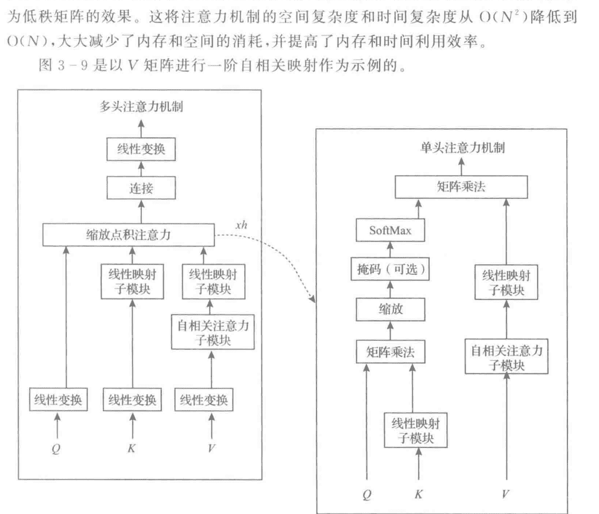

从结构层面，先对 $V$ 执行一阶自相关映射。在求得 $K$ 与 $V$ 时引入两组线性映射矩阵，配合缩放点积注意力生成上下文映射矩阵，进而得到每个头的上下文表征。上述流程在时空上均为 $O(N)$。图 3-10 从矩阵视角展示了 $Q$、$K$、$V$ 的一阶自相关映射。

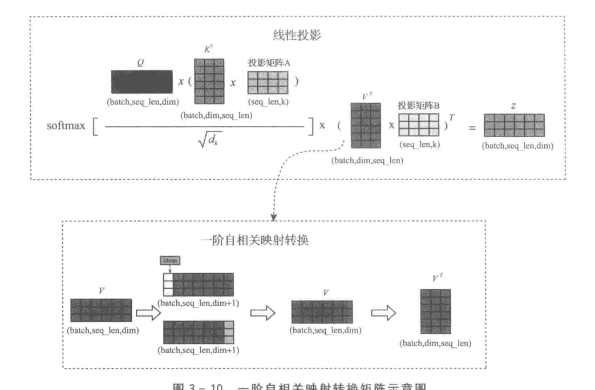

图 3-11 展示了另一种改进变体：对 $Q$ 做二阶自相关映射，对 $V$ 做一阶自相关映射，计算 $K$ 与 $V$ 时引入两组线性投影，结合缩放点积注意力得到上下文映射并生成各头的嵌入。需说明此为本节提供的实践示例，其他形式未展开。

另提供多类可选注意力模块，包括稀疏注意力、Nyström 注意力和残差注意力。线性映射自相关注意力、稀疏注意力、Nyström 注意力与残差注意力均可通过预设参数调用，以进一步提升基于 Transformer 网络的预测性能。

### 3.7.3 Transformer 时序预测的业务落地

业务上，中国电信上海公司的宽带业务覆盖用户量大，需处理宽带用户时序数据，此类数据多呈现非线性特征，传

# 第 3 章 Transformer 架构原理与时序预测内幕

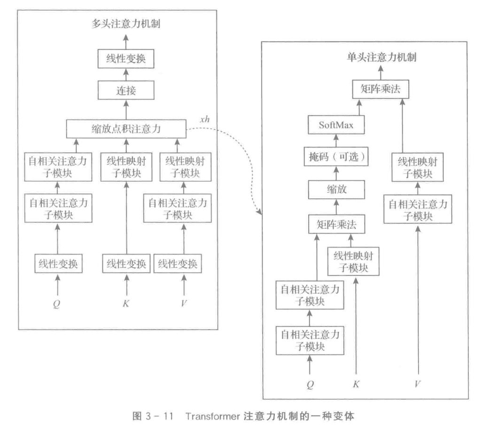

传统机器学习方法难以满足该需求，而基于 Transformer 的深度学习方法能更好地处理此类非线性数据，提升预测准确性与稳定性。对宽带在线用户数的时序预测对公司运营与决策至关重要。

实践中先对历史数据预处理，生成输入序列与目标序列，再用 Transformer 进行训练并依据损失函数优化，得到预测模型。预测时输入历史时序即可生成预测序列，每个时间步均可通过模型计算图前向传播获得，实现高效推理。

实测表明该方法在宽带在线用户数预测上表现良好。相比传统机器学习，它能捕捉非线性关系且精度明显提升。该应用为上海公司提供有力数据支持，有助于提升运营效率与用户满意度，具有较强实用价值，也为其他领域时序预测提供参考。基于 Transformer 的 AI 时序预测可推广至统计、信号处理、金融、气象、地震、医疗、控制等领域，能够刻画时序间的非线性关联，提升预测准确性与稳定性。

总体而言，本节通过研究基于 Transformer 的时间序列动态预测，为读者提供理解与应用基础，也为 AI 技术在时序预测领域的探索提供支撑。

# 第 4 章 GPT 自回归语言模型原理全解

## 4.1 语言模型运行原理与数学回顾

语言模型的核心是基于上下文预测下一步，该上下文可来自预训练模型、词嵌入或对话历史。通常预测下一个词，也可能预测一到三个词。作者在 NLP 领域阅读超过三千篇论文，不同变革的共性是：当前上下文承载历史信息，并与语言模型的词表交互。从生成角度，可只预测下一步，也可预测接下来数步。

图 4-1 为 GPT-2 模型的可视化预测示意。

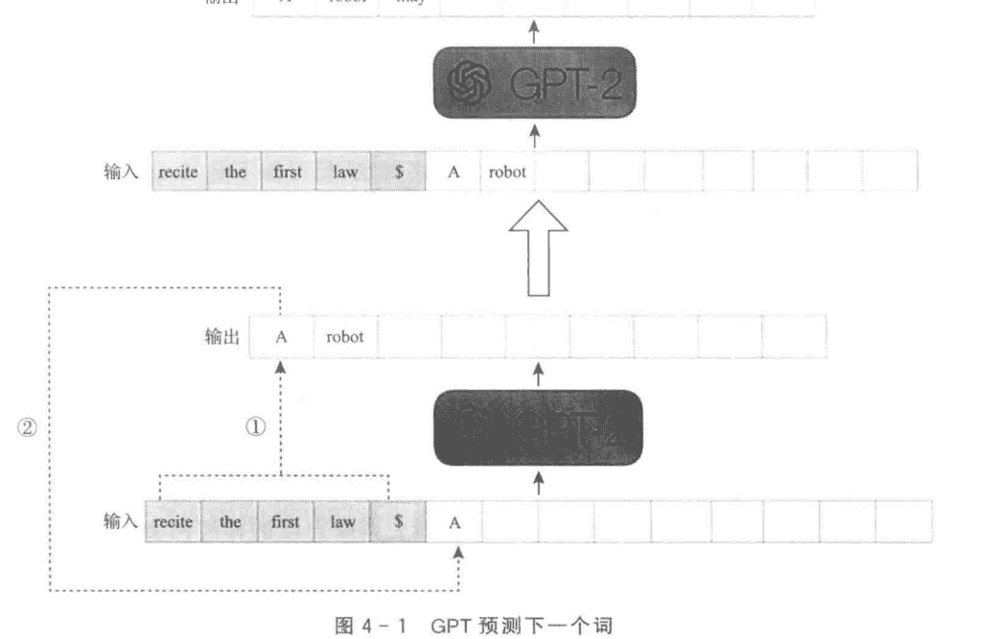

输入前缀为“recite the first law $”，GPT-2 逐步仅预测一个词。例如输入“recite the first law $”输出“A”，把 A 作为新输入“recite the first law $ A”输出“robot”，再把 robot 作为输入输出“may”，再输出“not”，依次类推。这是推理阶段而非训练阶段。GPT 属于解码器范式，训练时并行、推理时串行，会基于已有信息逐个生成后续内容。基于 GPT 的网络会将历史信息及其他模型信息如编码器或 LSTM 输出进行正则化或先验融合，体现 Bayesian 思想。模型会生成当前上下文表征，该表征与词库约三万个词向量做矩阵乘法，结果反映相关程度，随后经 softmax 转为概率。若词库规模很大，如十万，线上实时场景下每一步只能生成一个向量，需与十万词向量相乘再 softmax，计算开销巨大，可能出现秒级甚至分钟级延迟。工程上常对 softmax 优化，例如按使用频率将词库划分为若干类别，遵循 80/20 原则，分为五类或更多，以弹性方式加速向量与词库矩阵交互。

从搜索目标看，语言是序列，无法穷举所有可能，业界常用多种算法如集束搜索 Beam Search。从训练看，上下文向量与词库相乘的预测值与真实值 Ground Truth 可能不一致，需通过反向传播不断调整网络以更好拟合数据规律。

若语料包含大量数学运算描述，如商品交易或日常收支，训练 GPT 即可赋予其算术能力。初始阶段必然有误差，若缺乏先验、领域或迁移知识支持，误差更明显。算术任务的前提是有语料与标签，采用自监督方式不断调整网络，见得多后网络形成感悟，从而展现惊艳的算术表现。

总结语言模型核心：模型依据上下文预测后续内容，后续内容可能是词，也可能是更高维能力如算术，体现了神经网络的能力。无论神经网络还是传统机器学习，都是基于数据建模与调参，是 MAP 过程，Bayesian 方式在此基础上集成，更好表达数据并具备泛化性。本节以 GPT 为例说明通用语言模型的工作过程、架构与运行机制。

## 4.2 GPT 可视化与 Mask 机制解析

如图 4-2 所示，GPT 作为语言生成模型的具体架构如何运作，可从可视化视角切入，这是第二层的展示，左侧与右侧的关联即注意力机制，每个词都会对其他词汇产生注意力，多头结构明显。

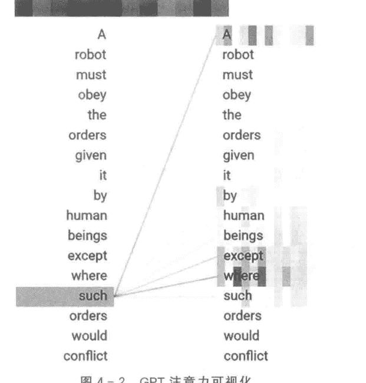

借助 bertviz 库可对 GPT 模型进行可视化，结构可生成可视化图。图 4-2 中左侧和右侧语义不同，左侧注意当前词之前上下文，右侧颜色差异体现多头注意力。GPT 具有多层结构，不同层体现等级。图 4-3 可视化第九层时精细度低于第二层。读者可能注意到无论在 B 站还是 YouTube，“beings”一词对 A 字母的强调更突出，其他词也有连线，共 12 层，当前为第九层，这说明层数越深，可视化表现越有差异。

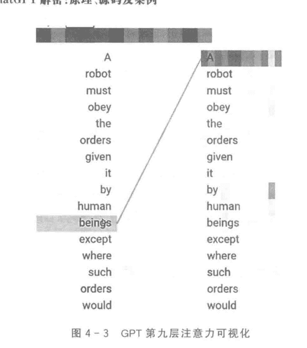

回到第二层可看到大量细节信息，层号越大越不精细，这也验证了 Transformer 语言模型：低层表达词汇基本信息，中层可能表达语法，高层表达语义，再往上表达超越语义的内容。

如图 4-4 所示，GPT 只能看到当前词左侧上下文，从矩阵角度即对角线上方被屏蔽。

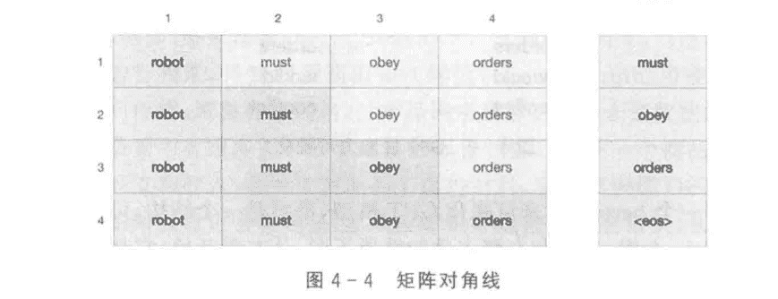

从实现角度很简单，如图 4-5 所示，将掩码分数 Masked Scores 设为负无穷即可屏蔽。之所以有效，需回顾语言模型运算流程：注意力计算经指数运算将结果转为分数，再经 softmax 成为概率，衡量当前上下文与词库词汇的相关度。指数函数取值范围 0 到无穷，若输入极小值，例如 $2^x$ 中 $x$ 趋近负无穷，结果无限接近 0。计算机中极接近 0 的值可视为 0，因此要屏蔽某些 Token，只需把对角线上方置为极小值。

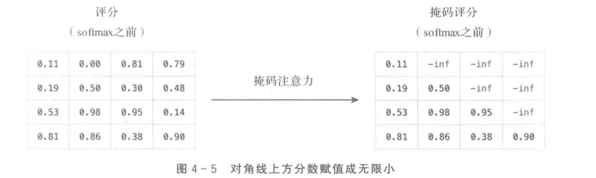

该极小值并非真正无限小，通常设为 $10^{-5}$ 或 $10^{-7}$。对指数函数而言，y 轴对 x 变化敏感，x 越小越逼近 0。此时 $10^{-100}$ 与 $10^{-5}$ 对计算已无差异，所以屏蔽对角线上方只需赋一个很小的极值。

获得带掩码的分数后，经 softmax 将对角线上方的注意力数值变为 0，如图 4-6 所示，这正是 GPT 屏蔽上方内容、仅关注当前词左侧的实现。再一次体现对角线的重要性，矩阵与线性代数研究中核心往往围绕对角线展开。

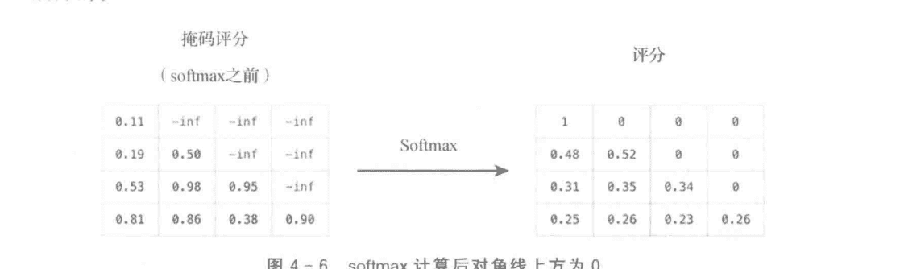

如图 4-7 所示，从 GPT 内部看，输入句子“<s> a robot must obey the orders given it”，“<s>”标记表明处于推理阶段，“it”作为当前词，GPT 的注意力机制对其有较大表达，形成相对大的矩阵，同时表达 Value、Key、Query 矩阵，将矩阵并行连接计算更为高效。“it”词的嵌入包含位置信息，经注意力机制后传入神经网络，前馈神经网络通过隐藏空间更好地表达输入词及其上下文，最后产出结果。

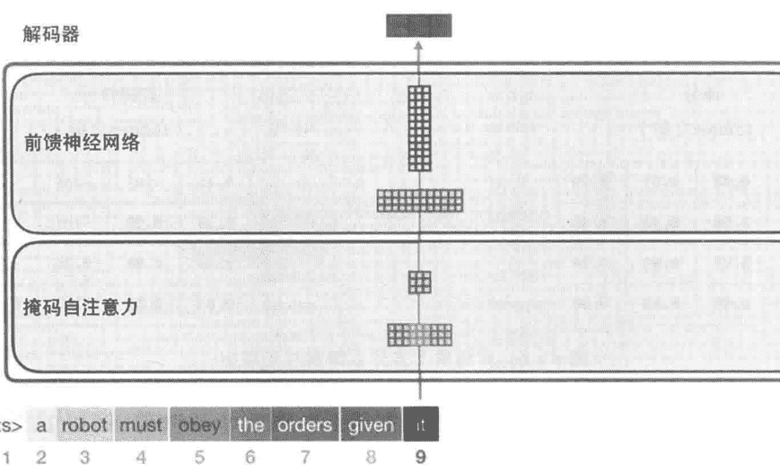

下面通过 AllenNLP 展示 GPT 运行效果。AllenNLP 是一个基于 PyTorch 的 NLP 研究库，可提供先进的深度学习模型，由 Allen 人工智能实验室研发。访问链接 https://demo.allennlp.org/next-token-lm 打开网页，GPT 语言模型任务是确定下一个词预测的概率。

如图 4-8 所示，在示例输入框 Example Inputs 中选择“My dog is very”，点击 Run Model 运行。

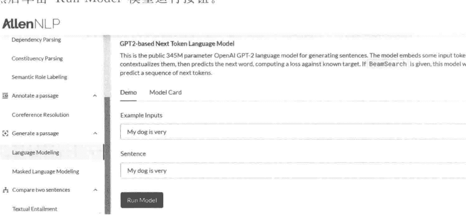

运行结果如图 4-9 所示，GPT 对后续内容进行预测，最高概率为“My dog is very, very good at it”，概率 99.9%，其它词也有相应概率。

| Prediction | Score |
|---|---|
| My dog is very, very good at it ... | 99.9% |
| My dog is very fine and is not at ... | 0.1% |
| My dog is very small and very enthusiastic and ... | 0% |
| My dog is very intelligent now, while he ... | 0% |
| My dog is very speedy. I've run ... | 0% |

Note: The prediction percentages are normalized across these five sequences. The true probabilities are lower.

图 4-9 AllenNLP 示例

也可以输入“The doctor ran to the emergency room to see the”，运行结果如图 4-10 所示，预测结果为“The doctor ran to the emergency room to see the bleeding.”，概率 90.0%。

| Prediction | Score |
|---|---|
| The doctor ran to the emergency room to see the bleeding." ... | 90.9% |
| The doctor ran to the emergency room to see the woman and she said she ... | 5.1% |
| The doctor ran to the emergency room to see the wound, but the doctor ... | 3% |
| The doctor ran to the emergency room to see the patient and called in the ... | 0.9% |
| The doctor ran to the emergency room to see the big bruise. She ... | 0.1% |

注：本图中的预测占比是针对五条序列做归一化处理后的结果，真实概率会更低。

图 4-10 AllenNLP 示例

输入条件不同时，GPT 给出的概率也会随之改变，这与预训练方式密切相关。下面先聚焦输入侧的信息表达方式：

```
{
    "sentence": "The doctor ran to the emergency room to see the "
}
```

浏览与 GPT 模型相关的系列内容：

```
{
    "id": "next-token-lm",
    "card": {
        "archive_file": "https://storage.googleapis.com/allennlp-public-models/gpt2-next-word-lm-2020.06.30.tar.gz",
        "contact": "allennlp-contact@allenai.org",
        "date": "2020-06-30",
        "description": "This is the public 345M parameter OpenAI GPT-2 language model for generating sentences. The model embeds some input tokens, contextualizes them, then predicts the next word, computing a loss against known target. \nIf 'BeamSearch' is given, this model will predict a sequence of next tokens.",
        "developed_by": "Radford et al",
        "display_name": "GPT2-based Next Token Language Model",
        "evaluation_dataset": {
            "name": "WebText corpus",
            "notes": null,
            "processed_url": null,
            "url": "https://github.com/openai/gpt-2-output-dataset"
        },
        "install_instructions": "pip install allennlp==1.0.0 allennlp-models==1.0.0",
        "model_performance_measures": "Perplexity",
        "model_type": "GPT2",
        "paper": {
            "citation": "\n@inproceedings{Radford2019LanguageMA,\ntitle = {Language Models are Unsupervised Multitask Learners},\nauthor = {A. Radford and Jeffrey Wu and R. Child and David Luan and Dario Amodei and Ilya Sutskever},\nyear = {2019}}\n",
            "title": "Language Models are Unsupervised Multitask Learners"
        }
    }
}
```

# 第 4 章 GPT 自回归架构与解码器运行机密

```json
{
    "url": "https://api.semanticscholar.org/CorpusID:160025533"
},
"registered_model_name": "next_token_lm",
"registered_predictor_name": "next_token_lm",
"short_description": "OpenAI's GPT-2 language model that generates the next token.",
"task_id": "language-modeling",
"training_dataset": {
    "name": "WebText corpus",
    "notes": null,
    "processed_url": null,
    "url": "https://github.com/openai/gpt-2-output-dataset"
},
"training_motivation": "WebText emphasizes document quality. Only human-curated/filtered documents are scraped. Reddit outbound links which receive at least 3 karma points are taken as a proxy for human filtered webpages that are interesting.",
"training_preprocessing": "Dragnet and [Newspaper](https://github.com/codelucas/newspaper) content extractors are used. Wikipedia articles are removed.",
"version": "1"
}
}
```

下面看输出侧，涉及预测概率、词元标记及其索引等信息。

```json
{
    "probabilities": [
        0.00013739813584834337,
        0.000007765523150737863,
        0.000004559129138215212,
        0.000001320468186349899,
        1.8086196007516264e-7
    ],
    "token_ids": [
        464,
        6253,
```

Transformer 与 ChatGPT 拆解：原理、源码与案例

```json
...
],
"tokens": [
    "The",
    "Gdoctor",
    "Gran",
...
],
"top_indices": [
    [
        16832,
...
    ],
"top_tokens": [
    [
        "Gbleeding",
...
}
}
```

本小节以可视化视角，让 GPT 语言模型的具体运行过程更直观。

## 4.3 Decoder-Only 模式：GPT 为何只保留解码端

在标准 Transformer 的右侧解码堆栈里，堆叠着大量模块，每个模块同时包含掩码多头注意力和普通多头注意力。普通多头注意力的结构与编码侧的多头注意力相近，而掩码多头注意力则体现了掩码逻辑。GPT 对原生结构做了大幅改造，最核心的改动是舍弃了解码侧的普通多头注意力。因为 GPT 仅使用解码器，不需要编码器来提供上下文或做正则化，如图 4-11 所示，这两部分被直接移除。

GPT 本质上是基于掩码自注意力和自回归方式的语言模型。图 4-12 是官方给出的结构图，共有 12 层或 12 个块。阅读架构图时，先看输入输出，再关注最核心、最抢眼的部分，也就是各组件如何相互作用。

GPT 对输入信息的表达分为内容表达和位置表达。实现内容与位置表达的技术各不相同，例如 Transformer XL 就在词嵌入环节做出调整，升级为递归级别的表达，能够借助分段和递归机制处理超长文本。

66

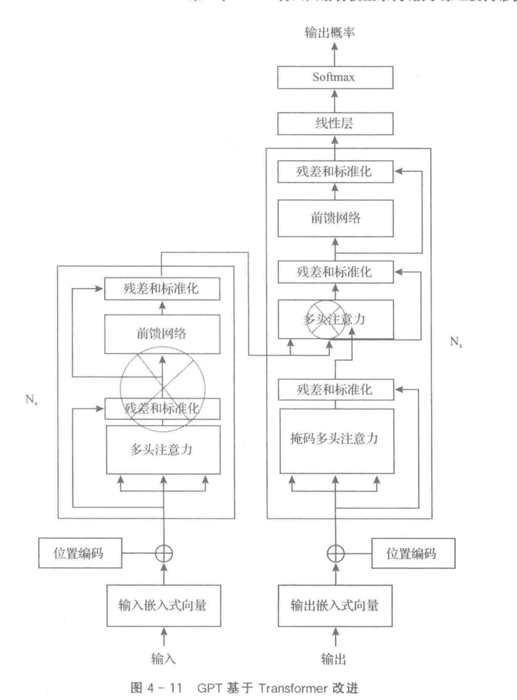

GPT 的输出既可以是文本生成，也可以是分类任务。文本预测、文本分类、阅读理解或完形填空，本质都在做分类。语言模型从根本上说就是一个基于上下文的分类器。回顾其工作流程：预测下一个输出时，选择概率最大或前几大的候选，这就是分类过程。比如多选题，给每个选项分配概率后挑选最大值，即为分类。分类是人工智能里最基础也最通用的任务，同时也最复杂。对话机器人同样在做分类，只是其分类维度、精细度和对对话差异的敏感度会更高。初学者常觉得分类容易，调用个库就能区分 A 类或 B 类，但深入后会发现大部分时间都花在如何更好地分类上，而更好的分类前提是信息表达得更充分。

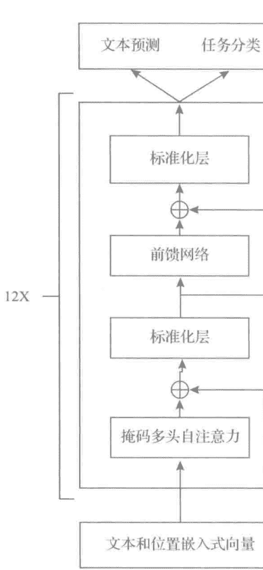

图 4-12 GPT 官方架构图

GPT 的目标是更好地表达信息，关键在于内部有多头注意力机制来完成表达，这体现了贝叶斯思想。结构中还包含正则化与前馈网络，官方图里去掉了编码侧的自注意力，只保留解码侧的掩码多头注意力。掩码多头注意力会忽略掩码矩阵对角线之上部分，仅关注对角线及以下。如图 4-13 所示，若输入句子“<s> robot must obey”，要预测下一个词，最初以开始标记 <s> 为起点，将从开始标签到当前所有内容作为上下文送入网络，再由掩码多头注意力进行信息表达。输出端则把表示向量与全部词表相乘，经 softmax 后得到概率最高的词或几个词，这里产出的词是 “orders”。

解码器数量越多，层次信息表达得越丰富，这形成一种层级结构，同样符合贝叶斯思想，如图 4-14 所示。

68

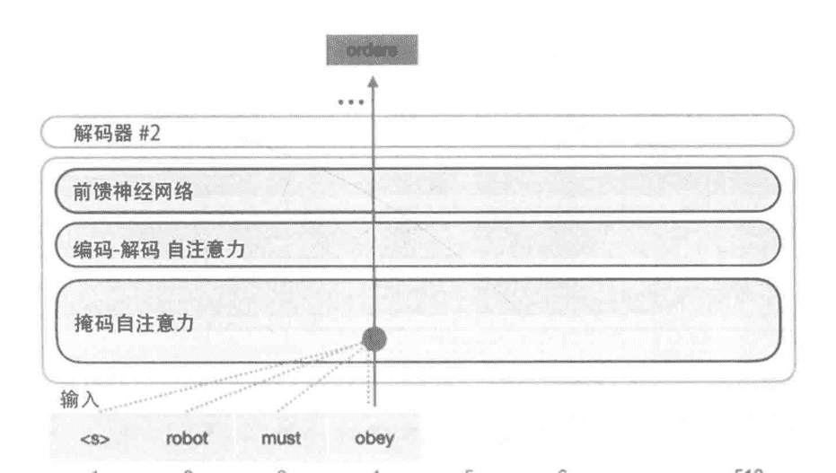

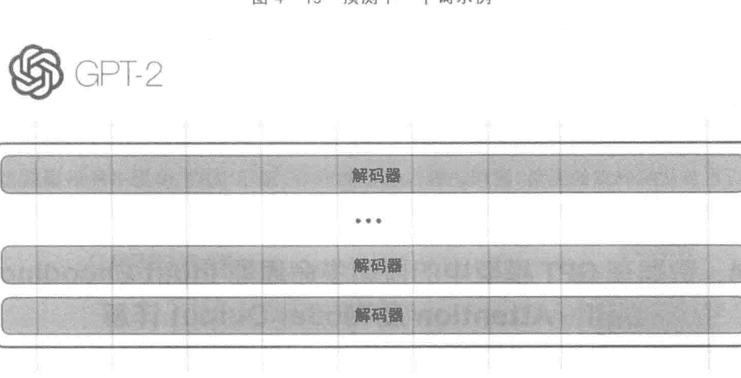

如图 4-15 所示，从输入的每个词元出发，包括 <s> 这类标签级词元和具体内容级词元，都会依次经过一个解码单元再到下一个解码单元，且只能看到前面及自身的信息。

推理过程在时间上是线性的，可能会让人质疑效率。确实会慢，因此工程上有很多优化手段。比如预测“The”之后的词，是否需要重新计算注意力？注意力里的 Query、Key、Value 本身就已存在。当前词仍需与之交互，注意力的基础正是 Query、Key、Value。若每次都重算，随着句子变长计算负担会剧增。实际上重算和复用结果相同，因此可以先算一次后在内存中缓存，之后直接查询，这对内存有一定要求。

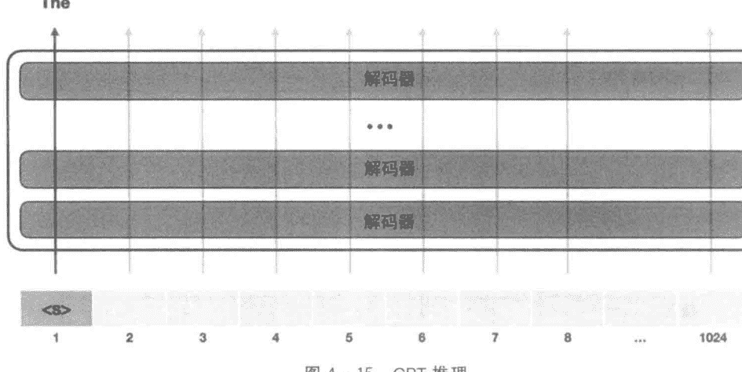

本小节从解码端视角回顾了语言模型思路，阐述了 GPT 作为语言模型的核心思想，并介绍了解码端的具体工作方式。

## 4.4 数据在 GPT 模型中的流动：编码、注意力与输出全过程

GPT 有整体骨架，也有具体流程，下面详细说明数据如何进入并在模型内部流动。

Transformer 在训练阶段和推理或线上预测阶段的数据流有共通点，核心首先是对信息编码，编码分为内容编码和位置编码。编码完成后借助多头注意力实现更精细的语义空间表达，并通过多层结构捕捉层级信息，编码侧可能有 12 层，解码侧也有 12 层。训练与推理的关键差异在右侧，推理时产生的结果会重新作为上下文的一部分。

如图 4-16 所示，以 GPT 为例，左侧输入通常以开始标记 <s> 开头，该标记同时拥有词元嵌入和位置编码，两者相加后送入解码单元。

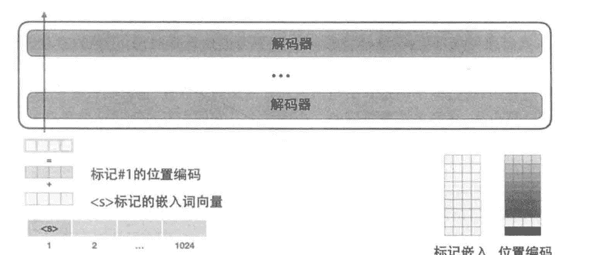

词元嵌入具体从何而来？从数据角度看，背后是一个可查询的矩阵，这个矩阵可能是 Word2Vec 或 CNN 等模型训练得到的。图像识别中的许多技术迁移到 NLP 后往往效果惊艳，CNN 的思想也在 GPT 实现中有所体现。CNN 是卷积网络，无论采用何种模型与算法，只要词表里有 50257 个词的嵌入向量即可查取。如图 4-17 所示。

如图 4-18 所示，位置编码可通过算法生成，也可通过训练获得，随后输入解码单元的神经网络。

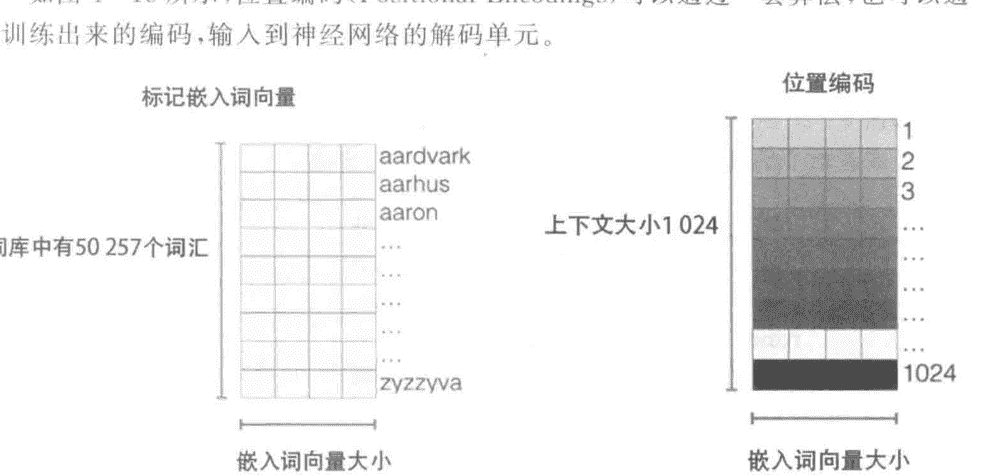

进入解码单元后进入注意力阶段，如图 4-19 所示，从更细致的角度看注意力机制，当前词是“it”，它与自身相关，也与其他词相关。落地实现涉及较多工程技巧，较为复杂。从图中看，仅保留得分最高的几个紧密相关词，其余 0.1%、0.2%、0.1%、0.03%、0.5%、0.2% 等低分项被舍弃，这大幅提升了效率。输入序列长度可达 1024，而非默认的 512，序列还能更长，从而缓解计算时间和内存压力。本质是用上下文来表征当前词，当前词与其他词互动时通过两个向量计算关联度，并非每个词都必须算，只要聚焦最重要的 3 个或 5 个即可。交互过程才是关键，就像学线性代数，规则本身不如理解其产生的相互作用重要。

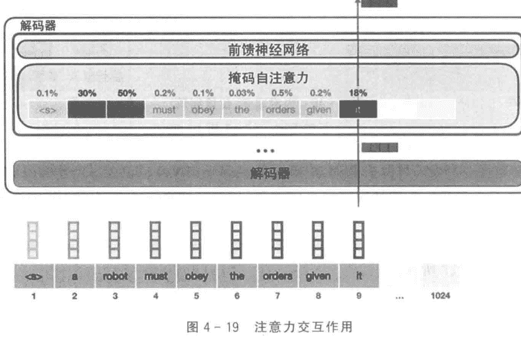

如图 4-20 所示，计算时每个词都会有一个分数，按排名取前 3 或前 5，与当前词的 Value 相乘后进行表达。

| 词汇 | 值向量 | 评分 | 值 x 评分 |
| :--- | :--- | :--- | :--- |
| <s> | [图示] | 0.001 |  |
| a | [图示] | 0.3 | [图示] |
| robot | [图示] | 0.5 | [图示] |
| must | [图示] | 0.002 |  |
| obey | [图示] | 0.001 |  |
| the | [图示] | 0.0003 |  |
| orders | [图示] | 0.005 |  |
| given | [图示] | 0.002 |  |
| it | [图示] | 0.19 | [图示] |
|  |  | 求和 | [图示] |

图 4-20 注意力分数

如图 4-21 所示，从输出角度看，经过层层传递，神经网络会生成一个向量，用来表达当前位置及历史位置的信息，训练词表整体为 50257 个标记。

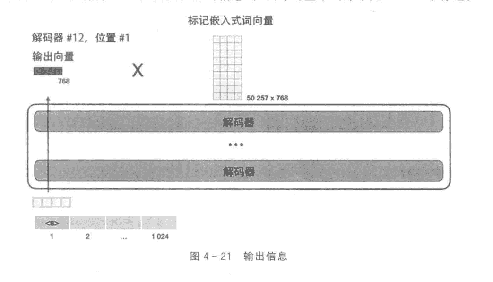

如图 4-22 所示，可据此计算概率，得到一个概率分布。


图 4-23 展示了矩阵化的具体过程。当前上下文编码向量与词表中每个词的词向量相乘后得到数值，再经 Softmax 转化为概率。在以 <s> 为起点的文本上，第一个预测结果即为 “The”。

至此可看到数据在 GPT 内部的流动路径，得到第一个结果后会将其反馈回输入，循环进行下去。本节介绍了 GPT 数据流动机制，接下来将深入其关键点，即 Masked 自注意力机制的内部细节。

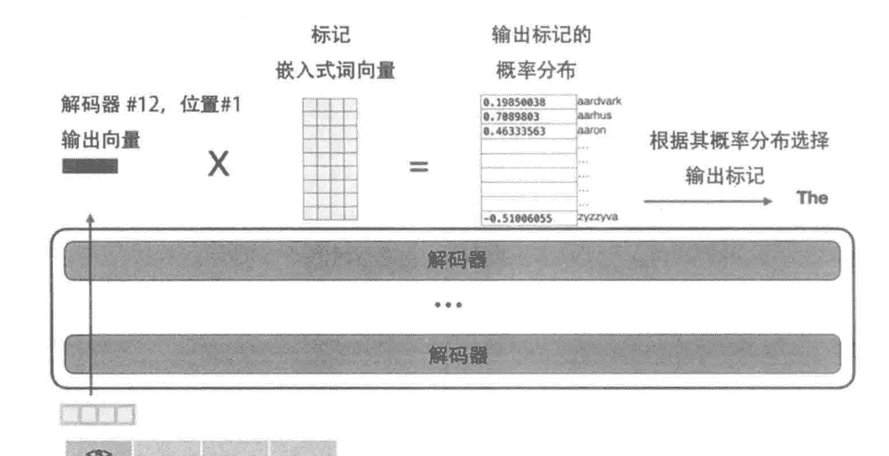

## 4.5 GPT 的 Masked 多头注意力和前馈网络运行细节

本小节聚焦 GPT 的核心机制——Masked 自注意力的内部细节，如图 4-24 所示，常规自注意力会对每个词元都进行相乘。

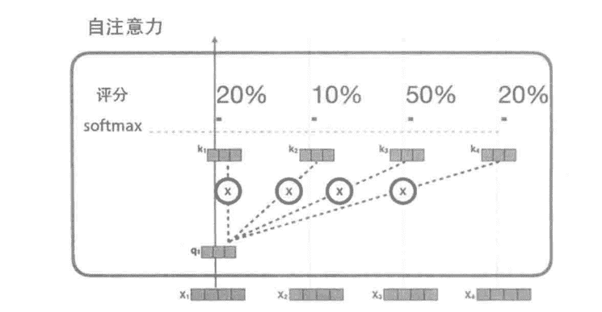

如图 4-25 所展示的，带掩码的自注意力同样会和序列中的每一个标记做点乘，只是上三角部分得到的值会被压得极小。工程上实现这个思路很省资源，基本靠一段 Python 条件判断，只要发现数值趋近于零或低于某个阈值，比如 10^-5 乃至更小，就直接跳过对应的注意力计算。

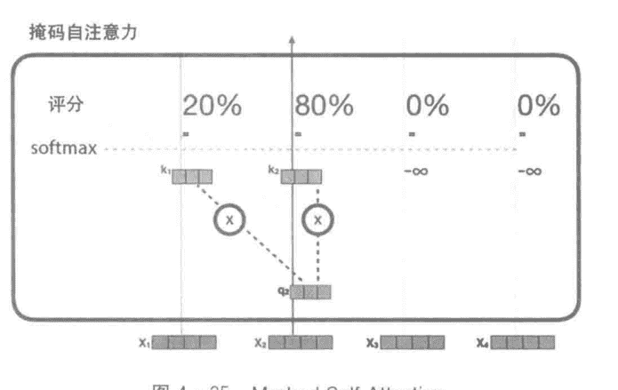

如图 4-26 呈现的情況是未使用掩码时，当前时刻的 Query 矩阵与 Key 矩阵相乘，会为 4 个词分别算出一个注意力分数。

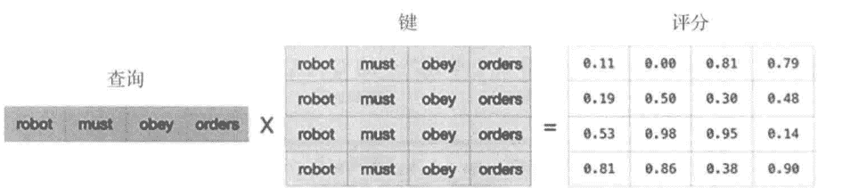

一旦引入 Masked 掩码注意力，对角线之上全部置成极小的数值，经过 softmax 归一化后，上三角位置的概率就变成 0，这正是 Masked 掩码注意力的效果。GPT2 在实现上严格遵循这一流程。

如图 4-27 所示，输入于是第 9 个词 “it” 的词义编码加上位置编码，随后据此生成 q、k、v 三个表征。

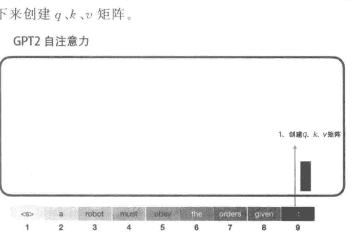

如图 4-28 所示，$W_Q$、$W_K$、$W_V$ 三个投影矩阵被拼接起来，与 “it” 的输入向量做一次矩阵乘法。


乘法得到的高维向量借助最基础的 Python 切分操作被拆成三段，得到第 9 个词 “it” 对应的 $Q_9$、$K_9$、$V_9$。


从多头注意力的视角看，采用 Bayesian Transformer 的思路，每个注意力头拥有独立的计算空间，流程都是重复上述步骤，并无特殊之处。如图 4-30 所示，示例中设了 3 个头，每个头对应自己的子空间，GPT 系列模型中的头数越来越大，可按需设定。图 4-31 显示这 3 个头内部各有各自的矩阵空间。向量是表示，矩阵是组织方式，Query 与 Key 相乘得到分数，再与 Value 相乘得到输出，这就是注意力内部的运行机理。

GPT2 自注意力


图 4-30 多头注意力机制

GPT2 自注意力


图 4-31 3 个注意力头

如图 4-32 所示，从 GPT 的角度看，每个注意力头的操作模板完全一致，只是所处理的数据不同。在 Bayesian Transformer 的讨论中，多头表达的信息容易趋同，信息多样性不足。从不确定性的角度看效果也有限，无论有多少个头，本质仍是两个向量之间的运算。

如图 4-33 所示，操作时第 9 个词 “it” 的 Query $Q_{9,1}$，下标 1 表示第一个头，会与序列中全部词的 Key 做乘法，综合所有其他向量的影响得到一个概率分数。

如图 4-34 所示，从概率较高的词中挑选几列，用当前列重新加权表达自身，乘法后做加法，这个头便具备了上下文信息。

如图 4-35 所示，多头注意力中各头的表达最终拼接成一个向量。

## Transformer&ChatGPT 解密:原理、源码及案例

图 4-32 注意力头 #1 的评分

## GPT2 自注意力

图 4-33 注意力头 #1 的评分

## GPT2 自注意力

图 4-34 注意力头 #1 的结果

如图 4-36 所示，注意力头拼接后维度会膨胀，原本 3 维可能变成 9 维，通过线性变换把一个空间映射到同一空间的另一状态，完成对目标信息的刻画。采用多头后再回到原始维度，随后送入前馈网络重复该过程，12 层就重复 12 次。

# 第 4 章 GPT 自回归语言模型架构、数学原理及内幕机制

如图 4-37 所示，生成可传递到下一层的矩阵。

如图 4-38 所示，前馈神经网络要对信息做更深层次的表达，维度会在嵌入向量大小的基础上放大 4 倍，这是业界常用的做法，输出时再做一次线性操作。

如图 4-39 所示，经过再次的线性操作，从 768×4×768 压缩回 768 维。

如图 4-40 所示，当前词最终输出 768 维，已融合上下文信息。

## Transformer&ChatGPT 解密:原理、源码及案例

GPT2全连接神经网络

图 4-38 维度扩展

GPT2全连接神经网络

图 4-39 维度还原

解码器

图 4-40 输出 768 维度

以上即为 GPT 的内部工作机制，通过可视化的方式学习 GPT 的架构、数据流向、基于 Masked 多头注意力的机制以及前馈网络，最终回到起点。用一个向量表征自身与上下文，实际上是上文，在 BERT 里才是完整上下文。GPT 在表达上文后，用一个相对简单的向量与整个词表矩阵相乘，得到模型认为最优的下一个词。

# 第 5 章 BERT 下的自编码语言模型架构、数学原理及内幕机制

## 5.1 BERT 下的自编码 Autoencoding 语言模型架构设计及实现内幕解析

BERT 即 Bidirectional Encoder Representation from Transformers，是一个预训练语言模型。BERT 之所以流行，在涉及语言理解的多层次语义分类任务上表现突出，很多新模型都以 BERT 为基础做改进。我们先谈自编码 Autoencoding 语言模型，再谈 BERT 为何有效。从 BERT 内部逐步展开，从词嵌入到位置编码，再到整体输入编码，输入编码包含词嵌入、位置编码及其他编码。在 Transformer 基础上，BERT 的训练任务被调整，会介绍 BERT 编码器 Block 的结构，内部核心是多头注意力里的 Scaled Dot-Product Attention、逐位置前馈网络、Dropout 与正则化等。BERT 预训练的两大任务是 Masked Language Model 与 Next Sentence Prediction，两者的运行流程。BERT 常用的微调技术，命名实体识别和问答是两个典型下游任务，与预训练任务不同，预训练是训练模型本身，微调后可在各类分类场景使用。在语义理解中，几乎所有场景都可以视为分类，例如命名实体识别把单词划分为地点、姓名、日期等。问答也是分类，对答案做概率判断并挑选最可能的结果。再如图像或语音识别，本质也是分类，分类的基础是类别表达。过去几十年 NLP 不断推出新模型、新算法，焦点都在于如何更好表达信息，如 “I Love NLP” 如何被计算机更充分地表征，这始终是核心方向。

BERT 已成为事实范式，要么直接用，要么在此基础上改进。无论是 2017 年后基于 Transformer 的现代模型，还是传统经典模型，主要研究两点：结构和训练任务。训练任务常反过来推动结构调整。从 BERT 的结构和训练任务看，预训练任务是 MLM 与 NSP，这决定了 BERT 的训练方式。从更宏观的 NLP 背景看，BERT 的具体下游任务是命名实体识别和问答。

自编码语言模型中，编码指用另一种形式重新表达输入信息，日常感受类似密码加密，计算机对密码编码以防泄露。语言模型视角下，整个 Transformer 可看作编码器，信息由 A 状态转为 B 状态即编码，随后解码器把 B 还原到 A。神经网络也是编码解码结构，左侧输入经过层层网络传到右侧输出，结果即解码。好处在于：第一，训练得到的网络能表示信息，训练初期有误差，随反向传播调整，网络逐渐符合真实情况，编码后仍能还原输入，说明网络能很好表达信息；第二，具有泛化能力，用有限样本学到领域知识，而领域知识近乎无限。BERT 是表达信息的理想方式。BERT 内部有掩码语言模型和下一个句子预测两个机制，本质是分类。

可思考为何 GPT 必须使用 Transformer 右侧而不用左侧，BERT 为何使用左侧而不用右侧。如图 5-1 所示，在 Transformer 中间划一条线，左边为编码器，右边为解码器。研究网络要看结构和训练方式。GPT 必须用解码器，BERT 必须用编码器，这由训练任务决定。GPT 系列架构基本一致，GPT-2、GPT-3 与 GPT-1 有细微差别，GPT-1 还有微调，GPT-2 起取消。GPT 的主要任务是预测下一个词或内容，不能看到句子右侧信息，故需要 Masked Multi-Head Attention，变成自回归语言模型。而 BERT 的主要任务是分类，可能是句子级、实体级分类或信息表征，需要看到尽可能多的信息，所以作为 Auto-encoding 自编码模型不需要遮住右侧。通过对信息的多方面编码，BERT 能更好地表征信息，这也是根本原因。

图 5-2 所示是 BERT 从输入到输出的运行过程，整体结构像一张地图，数据进入后做预处理，包含两个特殊标记 [cls] 和 [sep]，随后编码。编码时维度设为 768，有 12 个头，每个头 64 维，然后线性投影生成 Query、Key、Value，用自注意力按头处理，再线性转换回 768 维。每个词都会经过前馈层计算，即 Position-wise，自注意力已完成词间交互，前馈层不做交互。这样可并行计算，经过若干层后产出结果，这就是自编码语言模型。其核心仍是编码解码神经网络，Transformer 有左侧编码器和右侧解码器，BERT 本身是神经网络的自编码机制，通过训练神经元更好表达信息。

我们谈 BERT 的基本流程，它能更好表达信息，能更好做分类，分类包括情感、命名实体识别、问答等。关键问题是 BERT 为何有效。

## 5.2 以 MLM 及分类为例具体分析 BERT 强大的能够支持各种下游任务的底层原因

BERT 为何有效？它通过 Autoencoding 自编码和自注意力机制表征模型，有两个训练任务：Masked Language Model 和 Next Sentence Prediction，是多层次的。

如图 5-3 所示，Transformer 的编码结构对应 MLM 训练任务，输入信息会被屏蔽一部分，例如 5 个词中把第 4 个词 $w_4$ 掩码，网络通过预测值与真实值的误差调整参数。若掩码足够多，每个位置都可由剩余位置表示，等同于完形填空，基于上下文理解补全内容，这是从训练任务角度解释 BERT 有效的原因。

如图 5-4 所示，BERT 做分类任务时会加上一个标记，该标记通过自注意力包含整句信息，最后层输出时经全连接线性操作做分类，例如情感可分 7 类或 12 类，用向量与类别矩阵相乘再经 softmax 得出情感状态。

从结果和语义理解看，BERT 能工作的原因也解释了神经网络为何能工作。核心是：Transformer 最终以何种方式表达？它以稠密向量 dense vector 方式表达。若能用一个稠密向量表达全部上下文历史及相互作用，就能很方便地用线性操作把稠密向量转成优秀的分类器。借助多头注意力很好表达信息，又以简洁的稠密向量编码全部信息，即使下游用很简单的模型也能得到好分类结果。这也是很多传统模型把 BERT 作为上游表征，再用线性层转换后用逻辑回归等经典算法分类的原因。BERT 有效是因为多头注意力、多层编码器很好地表征信息，基于掩码语言模型、下一个句子预测及特殊标记表达局部与全局信息，最终简化为一个词向量。例如 [cls] 标记就是一个稠密向量，经矩阵线性操作后可与他模型集成，我们提出的 Bayesian Transformer 对同一数据用不同模型参数表达并集成。

我们介绍了 BERT 的自编码语言模型及有效性，接下来进入 BERT 内部，讲解从输入到输出的数据流程，具体每一步做什么、怎么做，其中包含一些微妙而重要的细节，下面逐步解密。

## 5.3 BERT 输入内容 Word Embeddings 三大步骤及其内幕工作流程详解

如图 5-5 所示，首先从 BERT 最原始的输入层 Input Embedding 出发，输入一个句子，例如 "Hello, how are you?"，从 NLP 角度看，需要做数据预处理或 ETL 操作，得到可在 NLP 中直接使用的内容。

BERT 在输入端 Token Embeddings 有三个步骤：标记分词 Tokenization、数值化 Numericalization、词嵌入 Embedding Process。

第一步是标记分词，分词有很多库或算法，汉语常用 Jieba 等，看一个简单示例，例如："Hello, how are you?"

```
"Hello, how are you?" -> ["Hello", ",", "how", "are", "you", "?"]
```

先从最基础的分词说起。英文里可以用空白或标点把“Hello”拆开，这句话里“Hello”算一个标记，逗号算一个，问号也算一个，一共是 6 个标记。BERT 对标记的处理并不是随便切，它用的是子词级的 WordPiece 分词法，这只是众多方案中的一种，我们常用的星空智能对话机器人更偏爱字节对编码 BPE，即把字母不断组合成更高效的单元，而 BERT 出厂默认的就是 WordPiece，思路很直观，见表 5-1。

表 5-1 子字级标记（WordPiece Tokenization）

| Word | Token(s) | Word | Token(s) |

|---|---|---|---|

| surf | ['surf'] | snowboard | ['snow', '##board'] |

| surfing | ['surf', '##ing'] | snowboarding | ['snow', '##board', '##ing'] |

| surfboarding | ['surf', '##board', '##ing'] | snow | ['snow'] |

| surfboard | ['surf', '##board'] | snowing | ['snow', '##ing'] |

碰到后缀时 WordPiece 会把后缀单独拎出来，比如 surfboarding 会被切成三个标记 ['surf', '##board', '##ing']。

```
surfboarding -> ['surf', '##board', '##ing']
```

分词结束得到的就是一串标记。别忘了神经网络并不能直接吃“surf”“snow”这样的词，它只懂数值之间的相互作用，无论是汉字、英语还是其他语言，本身对模型没有意义。

于是进入第二步数值化。计算机用整形 ID 来指代每个标记。每个模型都自带一个词表，说明模型最多能认识多少个标记。以 “Hello, how are you?” 为例，

```
["Hello", ",", "how", "are", "you", "?"] -> [34, 90, 15, 684, 55, 193]
```

“Hello” 在词表里的 ID 是 34。训练时系统会做词到 ID 的映射，反过来用 ID 也能从词表查回具体词汇，这就是第二步的操作。

```
34 -> E[34] = [123.4, 0.32,..., 94, 32]
90 -> E[90] = [83, 34,..., 77, 19]
15 -> E[15] = [0.2, 50,..., 33, 30]
684 -> E[684] = [289, 432.98,..., 150, 92]
55 -> E[55] = [80, 46,..., 23, 32]
193 -> E[193] = [41, 21,..., 74, 33]
```

第三步是词嵌入。词变成 ID 之后还不能直接喂给网络，神经网络需要向量表示。于是对 ID 34 对应的 “Hello”，系统会查嵌入表把它变成一串浮点数构成的向量，比如 [123.4, 0.32,..., 94, 32]。

这个向量从哪来？一种是借助第三方预训练表示，像 Word2vec，或 CNN、LSTM 学出来的；另一种是随机初始化，比如用 Spark 或 Pytorch 随机生成。随机生成的信息偏差会比较大，但反向传播会逐步修正。为了更快得到高质量的表征，工业实践和不少 NLP 比赛更倾向于用领域预训练模型来提供每个 ID 对应的初始向量，很多创新点也都集中在这一层。

回顾 Token Embeddings 的流程：先分词，再按词表转 ID，再查表得到向量。如果不用随机生成，而是 Word2vec 这类表来提供，则会通过一个大矩阵查询，每一列或每一行对应一个标记的向量，查询后就得到了 Embedding，如图5-6所示。


训练时反向传播也会调整嵌入向量，但实践中常会冻结大部分参数，因为嵌入往往已经学得不错，网络更需要捕捉上下文。BERT 还有几个特殊标记，CLS 用来标识句子开头，SEP 用来分隔两个句子，SEP 前是一段，后是一段，这在问答里很常见，前一段是问题，后一段是答案。分词时除了内容词和标点，还会加入 PAD 填充标记。BERT 默认要求输入长度一致，短的句子需要补齐。PAD 在词表里也有编号，例如 “<pad>” 的 ID 是 5，“Hello, how are you?” 就补了 3 个 PAD。

```
["<pad>", "<pad>", "<pad>", "Hello", ",", "how", "are", "you", "?"]
-> [5,5,5,34,90,15,684,55,193]
```

到这里我们只讲了 Token Embeddings，完整的输入编码其实是三层协同完成的：Token Embeddings、Sentence Embeddings、Position Embeddings，如图5-7所示。


语言是序列，有先后顺序，所以位置信息必须补上。接下来聊位置编码。

## 第5章 BERT 内部全拆解：架构、原理与实战机制

## 5.4 为什么 BERT 的位置编码用 sin cos 能捕捉相对位置

图 5-8 是 BERT 位置编码的示意。

BERT 用 sin、cos 函数为不同位置生成编码，计算公式如下：


这部分大家或多或少都见过。核心问题是：为什么偏偏是 sin、cos？因为位置编码的任务就是区分同一个词在不同位置时的差异，理论上不同位置的编码必须不同。作者的解释里，sin、cos 具备表达相对位置的能力。从数学上看，它本质上是在圆上相对于 X 轴的偏移，展开后形成在 X 轴上的周期性循环，可以刻画 15°、35°、60°、90°、270° 等相对位移，从而在序列中体现先后关系。比如 “Hello, how are you?” 的位置编码示例：


90


这是 Input Embeddings 中的 Position Embeddings 部分。BERT 在 Transformer 基础上改进，改进点由目标任务决定。输入进入后，三层嵌入共同工作：Token Embeddings、Sentence Embeddings、Position Embeddings。位置编码的实现不止一种，可以是静态的 sin/cos，也可以是可训练参数，思路大同小异。

## 5.5 BERT 输入嵌入三大件拆解

BERT 的输入编码由 Token Embeddings、Sentence Embeddings、Position Embeddings 构成。其中 Sentence Embeddings 比较特殊。输入标记时会加入特殊标记，SEP 之前是一个句子，之后是另一个句子，用来区分问答、阅读理解等任务，必须让模型知道哪部分是问题哪部分是答案，才能完成向量表示和反向传播。

三层嵌入之所以必要，是因为 BERT 的预训练目标里包含预测下一个句子，所以需要在 Sentence Embeddings 中用 SEP 做分割。全局信息则由 Token Embeddings 里的 CLS 标记承载，为什么 CLS 能代表整句？因为它经过 Transformer 的多头注意力，能汇聚其他标记的信息，这就是输入三层结构的设计初衷。

再看特殊标记的用法，比如 “I am hungry” 和 “Result I eat lunch” 这两句，虽然表达不完美，但意思清晰：

```
[CLS] I am hungry [SEP] Result I eat lunch [SEP]
```

BERT 在句尾加 SEP 表示结束，句首加 CLS 表示开始，后续常用于分类。CLS 经过层层 Transformer 传播后，最终代表整句，再通过线性层做二分类、三分类甚至多分类，本质上是向量与矩阵的乘法。

到这里，输入端的问题基本讲清，输出端也顺带涉及，比如 CLS 的输出。

## 5.6 输出层如何通过向量乘矩阵驱动 Encoder Stack

如图 5-9，BERT 一个 Block 的结构很清晰：多头注意力 + 残差 + 归一化 + 前馈网络，多层编码器堆叠成整体，信息逐层传递。


从输出视角看，H 是一个隐向量，代表整段信息的压缩表示。

以 CLS 为例，无论怎样得到隐向量，最终都会与分类矩阵相乘。当前信息用向量表示，和矩阵相乘后得到初步分类结果。实现很直接：向量乘矩阵，比如 7 类分类，就和 7 个分类对应的矩阵相乘，然后


用 softmax 或其他方式得到概率分布，取概率最高的作为类别。

预训练或微调后，BERT 给出高质量的信息表示，下一步是多标签还是多分类，由下游任务决定，微调通常接一个线性层来表达目标。

从词的角度看，每个标记逐层传递，预训练可做掩码语言建模来理解上下文，微调则可能是命名实体识别。

如图 5-11，多个编码块后得到隐向量 H，若是掩码机制，就和一个很大的词表矩阵相乘，词表可能有 3 万到 5 万；若是命名实体识别，则和对应类别数相乘，可能 30 或 50 类。


无论哪种方式，都要先经过编码器堆栈。BERT 通常有 12 层，输出端看到的仍是一个向量，随后做线性分类。命名实体识别也是一种分类。堆栈的作用是把信息表达得更立体、更丰富，最终产物仍是向量。

工程落地时，除了 CLS，还可能把所有标记的信息加总或做线性融合，以更全面地表达句子，但本质一致：层层编码，让信息更充分，再以向量形式输出。

## 5.7 多头注意力和前馈网络在 BERT 中的运作

图 5-12 显示多头注意力被拆成若干头，这里展示三头，即从不同角度提取信息。

输出端会把各头结果拼接，维度可能变化，再经线性映射回到原始维度。计算过程基于线性变换生成 Query、Key、Value，再把 Query 与 Key 相乘得到注意力分数，再和 Value 相乘调整。

如图 5-13，Query 与 Key 相乘后会做缩放，除以 √d_k，d_k 是 Key 的维度，这是一种正则化，防止维度影响分数大小。


其中的 Mask(opt) 是可选掩码，Transformer 解码时如 GPT 会屏蔽右侧词。

Query、Key、Value 的构建依赖权重矩阵 W_i^K、W_i^Q、W_i^V，其中 W_i^K 维度 d_emb_dim × d_k，W_i^Q 维度 d_emb_dim × d_k，W_i^V 维度 d_emb_dim × d_v，生成：

K_i = XW_i^K 维度 input_length × d_k

Q_i = XW_i^Q 维度 input_length × d_k

V_i = XW_i^V 维度 input_length × d_v

注意力公式为：

Attention(Q, K, V) = softmax( QK^T / √d_k ) V  (5-2)

先做 Query 与 Key 转置的乘法，除以维度开方，softmax 后得到概率，再乘 Value，从而用上下文表达当前信息。输入中加入的 CLS 也走同样的流程，它由所有标记共同塑造，所以能代表整句。从矩阵可视化角度看，CLS 会汇聚大量特殊信息。

先前已经梳理过输入编码和多头注意力，严格按流程，下一步本该进入残差与正则化。但看 BERT 的结构图，多头注意力的输出本身就要先走残差加正则，前馈部分也是 Position-wise Feedforward Network，也就是按位置的逐点前馈，也要走一遍残差加正则。所以先把前馈这块讲清楚，如图 5-14。

BERT 的第一层编码器里，前馈网络拿到的就是注意力层的输出。为什么要做一次维度变换？因为这一步是逐位置处理的网络，词与词之间不再交互。设计者的解读是，注意力阶段已经完成了上下文的融合，每个词都已经被整句话的上下文所表征。此时再用一个前馈网络，目标是把已经融合好的表征进一步精炼，并没有必要再做一次词间全连接，它带来的收益有限。也有模型保留词间交互的变体，但 BERT 选择了纯 Position-wise 的前馈，这直接换来了并行计算的能力。

再看前馈的意义。神经网络本身具备层次化表达的能力，抛开这点，前馈在这里更像是为每个标记做精细化提纯。注意力之后，每个词都带有全局信息，前馈要做的就是在不引入新的词间交互的前提下，把信息表达得更充分。唯一的手段就是把维度撑大，这也是为什么前馈层的隐含维度通常是注意力维度的 4 倍甚至更大。

表达上可以写成
FFN(x) = max(0, xW_1 + b_1)W_2 + b_2 (5 - 3)
激活用了 ReLU，如图所示。

在实际计算时，每个向量都与同一个前馈网络并行处理，这点需要强调。先用注意力把上下文装进每个词，再用变大维度的前馈把每个词的信息更细致地捕捉下来。下一步才进入残差与正则的部分。

## 5.8 残差、Dropout 与 LayerNorm 的贝叶斯解释
残差网络带有 Bayesian 的思想。正则化帮助训练，归一化让训练更稳定。在运行里，每一批次都会引入 Dropout，如图 5-16。训练时以随机方式丢弃一部分神经元，每一批次相当于在用一个不同的子网络。

基于丢弃得到的子网络，每一批次都像在做一次采样，这正是 Bayesian 的视角。假设丢弃 10%、20% 或 5%，Dropout 本质就是对子层的一个操作。在此基础上训练得到的结果会与多头注意力的输出相加，这是第一个残差连接；点对点的前馈之后也会做同样的操作。数学上可概括为 LayerNorm(x + Dropout(Sublayer(x)))。从数学上看，残差与反向传播配合，让深网的训练不至于因不确定性过大而失效。早在计算机视觉里残差就被验证有效，从物理层面看，这是一种相互学习的机制。自注意力把自己放进网络，Position-wise 的操作不会忘记向自己学习，把自身加入输出后再算误差，通过反向传播调整。

从自编码语言模型到 BERT 的 Input Embeddings、残差、正则和 Dropout，整体工作方式已经清晰。前半部分是自编码语言模型，后半部分是 BERT 的整体结构。除了结构，模型的训练任务才是关键。

## 5.9 BERT 的预训练任务

### 5.9.1 Masked Language Model 设计与核心要点
BERT 有两个预训练任务，一是 Masked Language Model，掩掉部分标记进行预测；二是 Next Sentence Prediction，通过分隔符判断两个句子是否有关联或连续。这两个任务共同训练模型。
MLM 是自监督的方式，模型知道哪些标记被掩盖，通过网络流程输出内容，再与原始内容比较误差并反向传播调整参数。

在一句话里会随机挑选约 15% 的标记进行掩码，用 “MASK” 标注。一般不会动特殊标记。比如 “My dog is hairy” 这句话里抽取 15% 的内容，既可以用随机策略，也可以用更复杂的采样策略，不同批次的操作会影响模型复杂度。

被选中的 15% 又分为 80%、10%、10% 三档。假设选中 “hairy”，80% 的情况下它会真正变成 “MASK”。前面提到的两个特殊标记是 “CLS” 和 “SEP”，“MASK” 是第三个特殊标记。不是选中就一定会变，剩下的 20% 有两种处理。一种是保留原词，例如仍放入 “hairy”，形式上仍在做掩码，只是把原始内容放回来了，机制上等价。一种是放进一个随机的错误词。

为什么要这样设计？自监督语言学习需要答案。80% 给出真实的掩码，10% 保留原词相当于给部分正确信号，10% 放错误词相当于对抗式扰动。训练时不至于全错，也不会全对，像是在做一套带提示的试卷，让模型起步更稳，同时提升区分不同信息的韧性。星空智能对话机器人从教学角度最早提出 Bayesian Transformer 的思想，就体现在这种不确定性设计上。

句子中被掩的 15% 经过三类操作后，通过网络得到一个向量，与词表矩阵，例如 3 万或 5 万维相乘，经 softmax 后得到概率，用来预测被掩部分的内容。传统神经网络总有误差，这里 10% 原生词是 100% 正确，10% 随机词是 100% 错误，80% 的 MASK 介于两者之间，形成了 Bayesian 意义上的不确定表达，让网络更鲁棒。

为什么不全掩？完全掩码会拖慢训练，少量正确和少量错误的信号能加速收敛。随机选择标记不会让模型混淆，反而增加柔韧性。接下来谈另一个核心任务 Next Sentence Prediction。

### 5.9.2 Next Sentence Prediction 设计与落地
Next Sentence Prediction 判断两个句子是否上下文连贯，实用场景下往往更重要。

最原始的做法是从同一文档中抽取两个有先后顺序的句子作为正样本，中间可有别的句子隔开。负样本也有两种做法。一种是从不同文档里各取一个句子，判断是否同文档即可，这比较简单。另一种是把同文档的两个句子顺序调换，制造逆序负样本。从信息捕捉角度看，第二种更强，因为它保留了文档内的一致性。星空智能对话机器人提出 Coherence is everything you need！这正是强调一致性的重要性。原生 BERT 采用的是第一种做法，即跨文档随机采样。

两个句子用 “SEP” 分隔，如何表示是否来自同一文档、是否有先后顺序，这对问答等任务很关键。“CLS” 标记或其它标签可用来表明两个句子的关系，模型据此学习问题与答案的对应。

### 5.9.3 预训练全流程与最大似然视角
预训练语料基于 BookCorpus 约 800M 词和 Wikipedia 约 2500M 词，WordPiece 词表约 37 000 个标记。

训练时核心是上下两句话，先用 “SEP” 连接，再在每个批次里 50% 选相邻句子，50% 选不相连的句子，来自不同文档。小于 512 个标记时用 “PAD” 填充。随后对 15% 的内容做掩码操作。

举例：
```
Input = [CLS] the man went to [MASK] store [SEP] he bought a gallon [MASK] milk [SEP]
```
输入已加入 “CLS” 作为开头，“SEP” 作为第一句的结束，“the man went to [MASK] store” 中间有一个词被掩掉，作为第一句。第二句 “he bought a gallon [MASK] milk” 也有掩码，句末再加 “SEP”。

要表达两句是否具有 Next Sentence 关系，可把 “CLS” 设为 “IsNext” 标签：
```
Input = <IsNext> the man went to [MASK] store [SEP] he bought a gallon [MASK] milk [SEP]
```
训练是自监督过程，数据已准备好，注意力机制清楚知道下一句是 True 还是 False，哪些掩码是真掩、哪些是错误、哪些是完全正确。训练本质是最大似然估计，让网络符合自监督标签。

最大似然估计 MLE 公式
$$

\theta_{MLE} = \arg \max_{\theta} \log P(X|\theta)

$$
$$

= \arg \max_{\theta} \log \prod_{i} P(x_i|\theta)

$$
$$

= \arg \max_{\theta} \sum_{i} \log P(x_i|\theta)

$$
求最大似然估计即让预测结果最大化，无法最大化时产生误差并调整网络，结合嵌入词向量等技术，也可从 MAP 角度思考。
$$

\theta_{MAP} = \arg \max_{\theta} P(X|\theta)P(\theta)

$$
$$

= \arg \max_{\theta} \log P(X|\theta) + \log P(\theta)

$$
$$

= \arg \max_{\theta} \log \prod_{i} P(x_i|\theta) + \log P(\theta)

$$
$$

= \arg \max_{\theta} \sum_{i} \log P(x_i|\theta) + \log P(\theta)

$$
BERT 是预训练模型，下游任务会做微调。微调面向具体任务，已有大网络再适配问答、完形填空、阅读理解等。

### 5.9.4 下游微调运行与 MAP 思考
BERT 能轻松适配各种任务，因为本质仍是分类。分类的基础是细致表达差异，形成向量后微调很简单。情感分类或问答通常基于 “CLS” 标记做多分类或多标签分类，例如 7 种情感选其一，或同时存在多种情感状态。公式 softmax(CW')∈R^k 中的 R^k 代表多种标签，输入经网络得到隐向量，再经线性转换微调。

微调的前提是任务领域与预训练领域相近。若用电商数据微调金融模型，需要大量下游数据，实质已是大调整。若数据足够，可直接在目标领域预训练 BERT 再微调。

这引出最大后验概率 MAP 与最大似然估计 MLE 的关系，MAP 包含先验：
$$

\theta_{MAP} = \arg\theta \max P(X|\theta)P(\theta)

$$
当先验一致或数据足够大时，先验影响趋于消失。即使预训练与任务关联不强，只要下游数据足够，也能显著改变预训练模型。

图 5-17 点出了一个核心：对下一句的判断本质上是概率性的。工程上我们用交叉熵来度量预测偏差，再借助反向传播来修正参数。举个直观的例子，模型可能只给 IsNext 1% 的概率，而把 NotNext 提升到 99%。


这正是 BERT 在下游任务中进行微调的典型流程，实际落地时覆盖的应用非常丰富。

## 5.10 BERT 在命名实体识别与问答场景的工作机制
涉及分类的 BERT 任务大多围绕 CLS 标记展开。从工程实践看，可以把不同层的 CLS 向量拼接，也能把 CLS 与其他标记的向量一起拼接，这体现的是 Bayesian 思想。需要区分 Bayesian 和 Bayes，前者是比最大后验概率 MAP 更高阶的做法，也是工程中最常用的方式。

如图 5-18 所示，问答任务里会用 SEP 把问题与候选答案连起来，答案内部还会标注起止位置，这些标记都是人工定义的。训练时可依托一个规模庞大的问答库进行微调，BERT 也能做成服务特定领域的预训练模型，比如金融领域的数据预训练后再针对不同任务做局部微调。


句子对分类要判断两句话的关系，单句标记任务里的 Tagging 本质上就是命名实体识别 NER。BERT 包含预训练和微调两个阶段，相较原生 Transformer，BERT 因架构调整比如引入 CLS，对语义的表达更强。比如电商或推荐场景，更细粒度的语义表达哪怕带来 0.1% 的分类改进，也能提升推荐精度、转化率和销售额。人工智能时代，推荐、广告、内容搜索都离不开自然语言处理，尤其是基于上下文的多轮对话系统。

回顾 BERT 的整体流程：输入先做词向量嵌入，随后通过可训练的线性变换生成 Key、Query、Value。借助尤其是多头注意力机制从多维度捕捉信息，再经线性操作把多头注意力的结果映射到下一层前馈网络所需的维度，经过前馈网络处理后层层递进。输出阶段可以是整句分类，也可以是词级分类，后者即命名实体识别。在 NLP 领域，BERT 将 NER 推到前所未有的高分，已被业界反复验证。我们自研的星空智能对话机器人也大量借鉴 BERT 的意图实体识别与状态管理思路。接下来从源码层面谈 BERT 的预训练与微调。

# 第 6 章 BERT 预训练源码全实现

## 6.1 BERT 结构、MLM 与 NSP 预训练回顾及实战要点
BERT 分为预训练和微调，本节聚焦预训练源码，见表 6-1，整体目录可分为 6 大步骤：

Step1 下载数据集 Download Dataset  
Step2 构建模型字典 Torch Vocab, Word Vocab, Dictionary  
Step3 预处理 BERT Dataset, Loading DataSet  
Step4 BERT 神经网络 BERT Embedding, Transformer Block, Building Bert  
Step5 BERT 语言模型 BERT Trainer, BERT LM  
Step6 预训练 Pre Training  

第一步下载数据，从源站拉到本地并做基础清洗。对数据的理解很重要，但不必过度投入，因为这与 BERT 模型本身关联较弱，属于通用环节。

第二步是词典构建，每个模型都有自己的词表，比如 3 万或 5 万词，这里以 3 万为例。训练时按标记切分并映射为 ID，训练完成后可把 ID 映射回词。词典是关键基础。

## Transformer 与 ChatGPT 解密：原理、源码与案例精讲
第三步数据预处理，核心是让数据按模型要求呈现。对 BERT 来说输入要包含词嵌入、位置编码、段编码等。

第四步是 BERT 神经网络，BERT 作为编码端语言模型，本节会详细拆解 Transformer 结构块与 BERT 网络的搭建细节。

第五步是 BERT 语言模型。结构之外，模型还需训练任务。数据准备要按嵌入或格式化要求呈现。BERT 的训练任务主要有掩码语言模型和下一句预测，会逐行梳理代码。

第六步是模型预训练，调用 BERT Trainer 完成训练。

阅读代码前，先温习 BERT 的整体架构。

如图 6-1 所示，BERT 复用了 Transformer 的编码部分，在输入侧做了少量改动，增加了特殊标记和面向任务的训练方式。


图 6-1 左侧 A 显示 BERT 是编码器，右侧 B 展示了大量输入，图中只呈现部分。内部是多层 Transformer 编码层，输出经线性变换和 softmax 做分类。自然语言和人工智能的绝大多数任务都可以从分类视角看待。

# 第 6 章 BERT 预训练源码全实现
BERT 在 Transformer 基础上，输入端包含词嵌入、位置嵌入和段嵌入，用来区分不同句子部分。内部是 Transformer 编码器。输出上与原生 Transformer 不同，后者把 Keys、Values 传递给解码器；而 BERT 会把输出压缩成一个或多个向量。工程实践中更倾向于利用所有标记的输出做加法等操作，生成信息更丰富的向量，而非仅用 CLS 做分类。该向量经线性变换可得到概率分布，也能接入其他模型如 LSTM 或回归模型。回归多用于工程和商业场景，其输入也是向量形式，而非简单的 x、y、z 数值。

训练侧 BERT 有多个任务。第一是掩码语言模型训练，随机遮住 15% 的标记，其中 80% 真正遮掩，10% 随机替换，10% 保持原词。编码端包含多头注意力和前馈网络。训练是并行的，每个标记都经过前馈网络。从形式上看 Position-wise 前馈网络内部标记间无交互，因为交互已由多头注意力完成，同时也有利于提速。BERT 用向量表示标记并加入正则化来预测内容，再与真实值对比计算误差并反向传播调整网络，这是 MLM 的训练过程。

第二个更常用的任务类似意图识别，比如对话机器人中判断用户意图。各种分类任务都属此类。从全局或上下文看，CLS 能承载上下文信息。星空智能对话机器人的实践初期直接用 CLS，后来发现结合 CLS 与其他标记能更好表达信息。从任务设计看，CLS 代表全局，SEP 则表达两句话的关系，比如问答系统中判断后一句是否是前一句的答案，SEP 起分隔作用。

读者常问：CLS 为何能表达全局？两句话的问答关系如何被捕捉，阅读理解的答案跨度如何定位？因为 CLS 是特殊标记，经过网络训练后预测误差会通过反向传播更新参数。在问答视角下，CLS 最终输出的判断决定了后一句是否为答案，误差驱动参数更新，使 CLS 的隐向量贴合问答任务表示。问题的根源在于是否理解内部运行机制。设置 CLS 后其具体含义由网络结构和训练任务决定，多头注意力可让 CLS 关注其他内容。最关键的是训练任务本身，在具体任务中不一定非要取索引 0 的 CLS 来判断关系，训练后 CLS 的隐向量往往已承载了关系信息。这揭示了一个规律：好的标签比好的模型表达更关键，标签在一定程度上决定结果。BERT 的两个训练任务一是 MLM 类似完形填空，模型做得好说明语义理解强；二是基于特殊标记的分类任务，如情感分类，可做二分类或三分类等。这是对 BERT 的基本回顾。

对话场景主要做意图分类。BERT 很好用，可做意图识别也能做命名实体识别，一个模型解决多问题。一方面，星空智能对话机器人借鉴了 BERT 的掩码机制，编码端的 MLM 对抗用户输入错误很有价值。用户输入错词或不合语法时，掩码训练的模型仍能理解。MLM 对不确定和非规范信息尤其有效。另一方面，BERT 的意图表达能力强，但在线推理速度慢，在对话机器人场景下我们放弃了 BERT，自行实现了 Transformer，任务清晰、与状态管理器交互明确，最终形成约 3000 行的定制代码。从工程角度，对话机器人的命名实体识别很重要，若让 BERT 同时做意图识别和 NER，其 NER 效果不理想。因此我们采用 Transformer 加条件随机场 CRF 的方案。这是一部分实践心得，后续会继续分享。

进入源码第一部分：下载数据。数据源可以多样，也可合并多个来源，下载后可放在 Google Drive 上。

数据下载代码实现：

```python
from google.colab import drive
drive.mount('/content/drive')
! pwd
import os
os.chdir('/content/drive/MyDrive/Transformer/Transformer_Internals/BERT_Impl')
! pwd
```
代码第 5 行设置了文件目录路径。

下载后要构建词典，词典构建不好就无法构建输入词向量。词典包含词汇全集及 ID 等信息，需要设置训练集、测试集、词典路径、输出路径、隐向量维度等基础配置。

BERT 配置参数代码实现：

```python
from torch.utils.data import DataLoader
import torch.nn as nn
import pickle
import tqdm
from collections import Counter

class Args(object):
    def __init__(self):
        self.train_dataset = 'data/corpus.small'
        self.test_dataset = 'data/corpus.small'
        self.vocab_path = 'data/corpus.small.vocab'
        self.output_path = 'data/corpus.small.vocab'
        self.hidden = 256
        self.layers = 12
        self.attn_heads = 8
        self.seq_len = 512
        self.batch_size = 64
        self.epochs = 10
        self.num_workers = 5
        self.with_cuda = True
        self.log_freq = 10
        self.corpus_lines = ""
        self.lr = 1e-3
        self.adam_weight_decay = 0.01
        self.adam_beta1 = 0.9
        self.adam_beta2 = 0.999

args = Args()
```
代码第 14 行设置 layers，表示编码块层数，可设为 12。  
第 15 行设置 attn_heads，表示多头注意力头的数量，通常为 8。  
第 16 行设置 seq_len，表示句子序列长度，可设为 512，调试时可降到 20。  
第 17 行设置 batch_size，表示批次大小，可设为 64，具体大小与数据规模和模型复杂度相关，本质影响拟合速度和震荡。  
第 18 行设置 epoch，训练轮数，可设为 10。数据不足时可调大，围绕 epoch 可做很多工作，甚至在不同轮次动态改变掩码位置，实现动态掩码。  
第 19 行设置 num_workers，表示多进程数，可设为 5。  
第 20 行设置 with_cuda，表示 CPU 或 GPU 使用。  
其余参数无特殊之处，数据量少时学习率宜调小，学习率也可以动态调整。每个参数背后都有数学原理和工程实践，这里不再展开。

这是一套基础配置，工程级配置往往有数百行，倾向可视化配置，将配置与代码解耦，便于动态调整网络参数。

## 6.2 BERT 预训练数据预处理、词典构建及各类嵌入实现

参考图 6-2，先把 BERT 的整体通路梳理一遍，词表的重要性就显得很直观了。左侧的文本进入模型前会被转成 ID，经过编码后得到一个向量，这个向量再与词表对应的权重矩阵相乘，得到概率分布，最终在右侧产出预测。预测层面本质上是 ID，先通过词表映射，才能还原成可读的词。通俗讲，输入端是词到 ID 的编码过程，输出端则是 ID 到词的解码过程。


TorchVocab 里面写的全是 Python 和 PyTorch 的通用语法，属于比较基础的实现手段，比如统计一个词出现了多少次，这类内容这里就不展开了。

TorchVocab 类的代码实现：

```python
class TorchVocab(object):
    """定义一个字典，用于对字段进行数字化。
    属性：
    freqs: 一个集合计数器对象，用于构建字典数据中标记的频率。
    stoi: 将标记字符串映射到数字标识符。
    itos: 由数字标识符索引映射到标记字符串。
    """

    def __init__(self, counter, max_size=None, min_freq=1,
                 specials=['<pad>', '<oov>'],
                 vectors=None, unk_init=None, vectors_cache=None):
        """从集合计数器创建字典对象。
        参数：
        counter: 集合计数器对象，保存数据中每个值的频率。
        max_size: 词汇表的最大大小或 None。默认值：None。
        min_freq: 在词汇表中包含标记所需的最小频率，小于 1 的值将设置为 1。默认值：1。
        specials: 在<unk>标记之外，添加到词汇表中的特殊标记（例如 padding 或 eos）列表。默认值：['<pad>']
        vectors: 可用预处理向量或自定义预处理向量（请参见 Vocab.load_vectors）或者一个向量列表。
        unk_init (callback): 默认情况下，将字典表外的单词向量初始化为零向量；接收张量并返回相同大小张量的函数。默认值：torch.Tensor.zero_
        vectors_cache: 缓存向量的目录。默认值：.vector_cache
        """
        self.freqs = counter
        counter = counter.copy()
        min_freq = max(min_freq, 1)

        self.itos = list(specials)
        # 按照频率顺序构建字典表时，不计算特殊标记的频率
        for tok in specials:
            del counter[tok]

        max_size = None if max_size is None else max_size + len(self.itos)

        # 按频率排序，然后按字母顺序排序
        words_and_frequencies = sorted(counter.items(), key=lambda tup: tup[0])
        words_and_frequencies.sort(key=lambda tup: tup[1], reverse=True)

        for word, freq in words_and_frequencies:
            if freq < min_freq or len(self.itos) == max_size:
                break
            self.itos.append(word)

        # stoi 只是 itos 的逆过程
        self.stoi = {tok: i for i, tok in enumerate(self.itos)}

        self.vectors = None
        if vectors is not None:
            self.load_vectors(vectors, unk_init=unk_init, cache=vectors_cache)
        else:
```
# 第 6 章 BERT 预训练源码逐行拆解
```python
48.    assert unk_init is None and vectors_cache is None
49.
50.    def __eq__(self, other):
51.        if self.freqs != other.freqs:
52.            return False
53.        if self.stoi != other.stoi:
54.            return False
55.        if self.itos != other.itos:
56.            return False
57.        if self.vectors != other.vectors:
58.            return False
59.        return True
60.
61.    def __len__(self):
62.        return len(self.itos)
63.
64.    def vocab_rerank(self):
65.        self.stoi = {word: i for i, word in enumerate(self.itos)}
66.
67.    def extend(self, v, sort=False):
68.        words = sorted(v.itos) if sort else v.itos
69.        for w in words:
70.            if w not in self.stoi:
71.                self.itos.append(w)
72.                self.stoi[w] = len(self.itos) - 1
```
上面片段的第 22 行用到的 counter 本质上是一个字典对象，用来维护当前词的数量、频次等信息，属于纯 Python 的实现。语料读入后，会出现不同的词和子词，每个词都会被赋予一个 ID，之后围绕 ID 做计数、排序等处理。从 BERT 使用的角度，这里暂时不深究细节，后续会有专门的调试章节，把每一步的数据流动拆开来看，预训练阶段也会配合调试演示，让逻辑和数据变化都一目了然。

TorchVocab 扮演基类的角色，我们自定义的 Vocab 就继承它，逐步搭建起完整的词表。

我们看 Vocab 类的代码实现：

```python
1. class Vocab(TorchVocab):
2.     def __init__(self, counter, max_size=None, min_freq=1):
3.         self.pad_index = 0
4.         self.unk_index = 1
5.         self.eos_index = 2
6.         self.sos_index = 3
7.         self.mask_index = 4
8.         super().__init__(counter, specials=["<pad>", "<unk>",
9.             "<eos>", "<sos>", "<mask>"],
10.            max_size=max_size, min_freq=min_freq)
11.
12.     def to_seq(self, sentence, seq_len, with_eos=False, with_sos=False) -> list:
13.         pass
14.
15.     def from_seq(self, seq, join=False, with_pad=False):
16.         pass
17.
18.     @staticmethod
19.     def load_vocab(vocab_path: str) -> 'Vocab':
20.         with open(vocab_path, "rb") as f:
21.             return pickle.load(f)
22.
23.     def save_vocab(self, vocab_path):
24.         with open(vocab_path, "wb") as f:
25.             pickle.dump(self, f)
```
第 8 行会先初始化一批特殊符号，比如 "<pad>"、"<unk>"、"<eos>"、"<sos>"、"<mask>"。BERT 需要用到这些标记，我们把它们收进一个列表，在构造词表时先行加入并做特殊判断。按词频构建词表时，这类符号的频次会被刻意排除，不参与排序。

WordVocab 是 Vocab 的子类，提供了 to_seq、from_seq、load_vocab 三个方法。WordVocab 的代码实现如下：

```python
1. class WordVocab(Vocab):
2.     def __init__(self, texts, max_size=None, min_freq=1):
3.         print("Building Vocab")
4.         counter = Counter()
5.         for line in tqdm.tqdm(texts):
6.             if isinstance(line, list):
7.                 words = line
8.             else:
9.                 words = line.replace("\n", "").replace("\t", "").split()
10.
11.            for word in words:
12.                counter[word] += 1
13.            super().__init__(counter, max_size=max_size, min_freq=min_freq)
14.
15.     def to_seq(self, sentence, seq_len=None, with_eos=False, with_sos=False, with_len=False):
16.         if isinstance(sentence, str):
17.             sentence = sentence.split()
18.
19.         seq = [self.stoi.get(word, self.unk_index) for word in sentence]
20.
21.         if with_eos:
22.             seq += [self.eos_index]  # this would be index 1
23.         if with_sos:
24.             seq = [self.sos_index] + seq
25.
26.         origin_seq_len = len(seq)
27.
28.         if seq_len is None:
29.             pass
30.         elif len(seq) <= seq_len:
31.             seq += [self.pad_index for _ in range(seq_len - len(seq))]
32.         else:
33.             seq = seq[:seq_len]
34.
35.         return (seq, origin_seq_len) if with_len else seq
36.
37.     def from_seq(self, seq, join=False, with_pad=False):
38.         words = [self.itos[idx]
39.                 if idx < len(self.itos)
40.                 else "<%d>" % idx
41.                 for idx in seq
42.                 if not with_pad or idx != self.pad_index]
43.
44.         return " ".join(words) if join else words
45.
46.     @staticmethod
47.     def load_vocab(vocab_path: str) -> 'WordVocab':
48.         with open(vocab_path, "rb") as f:
49.             return pickle.load(f)
```
构建字典的代码实现：

```python
1. corpus_path = args.train_dataset
2. with open(corpus_path, "r") as f:
3.     vocab = WordVocab(f, max_size=None, min_freq=1)
4.
5. print("VOCAB SIZE:", len(vocab))
6. vocab.save_vocab(args.output_path)
7.
8. vocab = WordVocab.load_vocab(args.vocab_path)
```
该片段第 2 行做的只是 Python 文件读取这类基础操作。

接下来进入第三步，构建 BERTDataset 来实现 BERT 的数据集。训练时把标记序列喂给模型，会触发随机掩码机制，如图 6-3 所示，大约 15% 的位置会被随机遮住，模型据此生成预测。预测头由全连接层配合 Softmax 完成，把结果转成概率分布，通常选取概率最高的类别，也可取前三名。被遮住的词会得到一个预测值，再与真实值比较误差，反向传播调整网络参数。预处理阶段如何对输入向量进行改造，是关键所在。

导入 Pytorch 的 Dataset 及相关包：

```python
1. from torch.utils.data import Dataset
2. import tqdm
3. import torch
4. import random
```
BERTDataset 类实现 BERT 数据集，BERTDataset 类的代码实现：

```python
1. class BERTDataset(Dataset):
2.     def __init__(self, corpus_path, vocab, seq_len, encoding="utf-8", corpus_lines=None):
3.         self.vocab = vocab
4.         self.seq_len = seq_len
5.
6.         with open(corpus_path, "r", encoding=encoding) as f:
7.             self.datas = [line[:-1].split("\t")
8.                          for line in tqdm.tqdm(f, desc="Loading Dataset", total=corpus_lines)]
9.
10.    def __len__(self):
11.        return len(self.datas)
12.
13.    def __getitem__(self, item):
14.        t1, (t2, is_next_label) = self.datas[item][0], self.random_sent(item)
15.        t1_random, t1_label = self.random_word(t1)
16.        t2_random, t2_label = self.random_word(t2)
17.
18.        # [CLS] tag = SOS tag, [SEP] tag = EOS tag
19.        t1 = [self.vocab.sos_index] + t1_random + [self.vocab.eos_index]
20.        t2 = t2_random + [self.vocab.eos_index]
21.
22.        t1_label = [self.vocab.pad_index] + t1_label + [self.vocab.pad_index]
23.        t2_label = t2_label + [self.vocab.pad_index]
24.
25.        segment_label = ([1 for _ in range(len(t1))] + [2 for _ in range(len(t2))])[:self.seq_len]
26.        bert_input = (t1 + t2)[:self.seq_len]
27.        bert_label = (t1_label + t2_label)[:self.seq_len]
28.
29.        padding = [self.vocab.pad_index for _ in range(self.seq_len - len(bert_input))]
30.        bert_input.extend(padding), bert_label.extend(padding), segment_label.extend(padding)
31.
32.        output = {"bert_input": bert_input,
33.                  "bert_label": bert_label,
34.                  "segment_label": segment_label,
35.                  "is_next": is_next_label}
36.
37.        return {key: torch.tensor(value) for key, value in output.items()}
38.
39.     def random_word(self, sentence):
40.         tokens = sentence.split()
41.         output_label = []
42.
43.         for i, token in enumerate(tokens):
44.             prob = random.random()
45.             if prob < 0.15:
46.                 prob /= 0.15
47.                 # 80% 随机更改标记以生成掩码标记
48.                 if prob < 0.8:
49.                     tokens[i] = self.vocab.mask_index
50.
51.                 # 10% 随机将标记更改为随机标记
52.                 elif prob < 0.9:
53.                     tokens[i] = random.randrange(len(self.vocab))
54.
55.                 # 10% 随机将标记更改为当前标记
56.                 else:
57.                     tokens[i] = self.vocab.stoi.get(token, self.vocab.unk_index)
58.
59.                 output_label.append(self.vocab.stoi.get(token, self.vocab.unk_index))
60.
61.             else:
62.                 tokens[i] = self.vocab.stoi.get(token, self.vocab.unk_index)
63.                 output_label.append(0)
64.
65.         return tokens, output_label
66.
67.     def random_sent(self, index):
68.         # 输出文本，标签(isNotNext:0, isNext:1)
69.         if random.random() > 0.5:
70.             return self.datas[index][1], 1
71.         else:
72.             return self.datas[random.randrange(len(self.datas))][1], 0
```
先看第6行，这里把词表加载进来了，接着去读取语料文件，一行一行地遍历，通过 `__getitem__` 去取出一条记录。

第14行负责定义 `is_next_label`，它就是预测下一句是否衔接的真实标签。

第18行拿到的记录除了分词结果，还带特殊符号，[CLS] 在这里相当于 [SOS]，[SEP] 相当于 [EOS]，另外还会出现 [MASK] 之类的标记。因为两句话有顺序，就需要一个符号来表达这种先后，可以

## Transformer 与 ChatGPT：原理、源码与实战拆解
利用 CLS 这个标记做判断，模型会以它为目标去学习，判断前后两句是否连贯，这属于机器学习的基础操作。

第15、16、22、23、27 行都在处理掩码标签的构造，完全遵循 BERT 掩码语言模型的设定方式。

第25行定义 segment_label，用来区分句子对中谁是第一句、谁是第二句。循环里通过变量判断，第一句标记为1，第二句标记为2，Python 写起来很顺手。

第29行做 pad 填充，默认最大长度是512，也能改成64。序列长度不足时，就补齐到目标长度。

第32到35行组装 output，里面包含了 bert_input、bert_label、segment_label、is_next 等字段。

第44行调用 random 产生随机数，返回的是0到1之间的浮点。概率论上这个值服从某种分布，比如高斯、均匀等，具体取决于随机数生成器。默认假设均匀分布，当随机值小于0.15时，就触发对该词的掩码。

第45到46行在已小于0.15的前提下，把值除以0.15，再看是否小于0.8或0.9。

第48行，若比值小于0.8，就把原词遮住，替换为 MASK。

第52行，若比值小于0.9，则从词表里随机抽一个词来替换。

第56行，若比值大于0.9，就用 get 取回原本的词，保持不变。

完成上述处理后进入数据加载阶段，相关代码如下：

```
1. print("Loading Train Dataset", args.train_dataset)
2. train_dataset = BERTDataset(args.train_dataset, vocab,
   seq_len=args.seq_len, corpus_lines=args.corpus_lines)
3. print(train_dataset[0])
4. print("Loading Test Dataset", args.test_dataset)
5. test_dataset = BERTDataset(args.test_dataset, vocab,
6.     seq_len=args.seq_len) if args.test_dataset is not None else None
7.
8. print("Creating Dataloader")
9. train_data_loader = DataLoader(train_dataset, batch_size=
   args.batch_size, num_workers=args.num_workers)
10. test_data_loader = DataLoader(test_dataset, batch_size=args.batch_size, num_workers=args.num_workers) \
11.     if test_dataset is not None else None
```
把数据整理成模型可用的格式，再分别生成 Token、Segment、Position 三类嵌入向量并相加。随后进入 BERT 神经网络内部的第四步讲解。

## 6.3 BERT 预训练：多头注意力完整源码实现
图6-4显示，BERT 整体架构沿用 Transformer 编码器堆叠而成，输入侧的处理已讲清，输出侧的处理逻辑也已明确。


# 第 6 章 BERT Pre-training 模型源码完整实现
下面是 BERT 神经网络的核心实现代码：

```
1. import torch.nn.functional as F
2. 
3. class BERT(nn.Module):
4.     """
5.     BERT 模型:来自 Transformers 的双向编码器表示。
6.     """
7. 
8.     def __init__(self, vocab_size, hidden = 768, n_layers = 12, attn_heads = 12, dropout = 0.1):
9.         """
10.         :param vocab_size:词库字典的大小
11.         :param hidden:BERT 模型隐藏向量的维度大小
12.         :param n_layers: Transformer 块数(层)
13.         :param attn_heads:注意头数量
14.         :param dropout:丢弃率
15.         """
16. 
17.         super().__init__()
18.         self.hidden = hidden
19.         self.n_layers = n_layers
20.         self.attn_heads = attn_heads
21. 
22.         #论文指出使用 4 * hidden_size 作为 ff_network_hidden_size
23.         self.feed_forward_hidden = hidden * 4
24. 
25.         # BERT 嵌入位置编码、句子对编码、标记嵌入编码之和
26.         self.embedding = BERTEmbedding(vocab_size = vocab_size, embed_size = hidden)
27. 
28.         #多层 Transformer 块网络
29.         self.transformer_blocks = nn.ModuleList(
30.             [TransformerBlock(hidden, attn_heads, hidden * 4, dropout) for _ in range(n_layers)])
31. 
32.     def forward(self, x, segment_info):
33.         # 填充标记的注意力掩蔽
34.         # torch.ByteTensor([batch_size, 1, seq_len, seq_len])
35.         mask = (x > 0).unsqueeze(1).repeat(1, x.size(1), 1).unsqueeze(1)
36. 
37.         # 将索引序列嵌入向量序列
38.         x = self.embedding(x, segment_info)
39. 
40.         # 运行多个 Transformer 块
41.         for transformer in self.transformer_blocks:
42.             x = transformer.forward(x, mask)
43. 
44.         return x
```
第3行引入了 PyTorch 的 nn.Module，基于这个基类定义模型，方便后续复用和调用。

第18行配置 hidden，决定模型内部隐藏层的向量维度。

第19行指定 n_layers，用来控制 Transformer 堆叠的层数。

第20行定义 attn_heads，即多头注意力的头数。

第23行设定 feed_forward_hidden，通常取隐藏维度的4倍作为前馈网络的中间维度。

第26行实例化 BERTEmbedding，第一个参数 vocab_size 表示词表规模，第二个参数 embed_size 表示每个词的嵌入维度。两者共同构成嵌入矩阵，初始化可以随机，也可以加载预训练向量如 Word2Vec，通常选用后者。

第29、30行通过循环搭建多层 TransformerBlock，n_layers 控制层数。每个块接收 hidden、attn_heads、前馈维度 hidden*4 以及 dropout 等参数。初始化完成后在前向计算时，中间张量会发生形状变化，这属于常规矩阵运算。

第38行把位置编码、段落编码和词嵌入加在一起，形成最终的输入表示。

第41、42行遍历所有 TransformerBlock，层数可以是12或6，同时把输入特征和注意力掩码一并传入。

BERTEmbedding 内部包含词嵌入、段嵌入、位置嵌入以及 Dropout 等组件。输出是三类嵌入相加后经过 Dropout 的结果。这里的预处理指模型侧的嵌入处理，而非数据清洗，如图6-5。喂给 BERT 的数据需要按这三类嵌入的格式组织。


BERTEmbedding 类的具体代码实现如下：

```
1. class BERTEmbedding(nn.Module):
2.     """
3.     BERT 嵌入向量包含以下特征
4.         1. TokenEmbedding:标记嵌入矩阵
5.         2. 位置嵌入:使用 sin、cos 添加位置信息
6.         3. 句子向量嵌入:添加句子对信息(sent_A:1,sent_B:2)
7.     所有这些特征的总和是 BERTEmbedding 的输出
8.     """
9. 
10.     def __init__(self, vocab_size, embed_size, dropout = 0.1):
11.         """
12.         :param vocab_size:词典的总大小
13.         :param embed_size:标记嵌入向量的大小
14.         :param dropout:丢弃率
15.         """
16.         super().__init__()
17.         self.token = TokenEmbedding(vocab_size = vocab_size, embed_size = embed_size)
18.         self.position = PositionalEmbedding(d_model = self.token.embedding_dim)
19.         self.segment = SegmentEmbedding(embed_size = self.token.embedding_dim)
20.         self.dropout = nn.Dropout(p = dropout)
21.         self.embed_size = embed_size
22. 
23.     def forward(self, sequence, segment_label):
24.         x = self.token(sequence) + self.position(sequence) + self.segment(segment_label)
25.         return self.dropout(x)
26. 
27. class TokenEmbedding(nn.Embedding):
28.     def __init__(self, vocab_size, embed_size=512):
29.         super().__init__(vocab_size, embed_size, padding_idx=0)
30. 
31. class PositionalEmbedding(nn.Module):
32. 
33.     def __init__(self, d_model, max_len=512):
34.         super().__init__()
35. 
36.         # 在 log 空间中计算一次位置编码。
37.         pe = torch.zeros(max_len, d_model).float()
38.         pe.require_grad = False
39. 
40.         position = torch.arange(0, max_len).float().unsqueeze(1)
41.         div_term = (torch.arange(0, d_model, 2) * -(math.log(10000.0) / d_model)).float().exp()
42. 
43.         pe[:, 0::2] = torch.sin(position * div_term)
44.         pe[:, 1::2] = torch.cos(position * div_term)
45. 
46.         pe = pe.unsqueeze(0)
47.         self.register_buffer('pe', pe)
48. 
49.     def forward(self, x):
50.         return self.pe[:, :x.size(1)]
51. 
52. class SegmentEmbedding(nn.Embedding):
53.     def __init__(self, embed_size=512):
54.         super().__init__(3, embed_size, padding_idx=0)
```

上段代码里，第17行能看到 BERTEmbedding 把 TokenEmbedding 这个实例包了进去。

第18行则把 PositionalEmbedding 实例装进了 BERTEmbedding。

第19行让 BERTEmbedding 再包裹 SegmentEmbedding 实例。

第20行还把 Dropout 实例也封装进 BERTEmbedding。

第24行的输出本质上是把 Token Embedding、Segment Embedding、Position Embedding 三种编码的向量叠加求和。

第27行中 TokenEmbedding 直接基于 nn.Embedding 构建，实例化时需要喂入词表大小 vocab_size、向量维度 embed_size、填充下标 padding_idx 等信息。

位置编码落在第43、44行，用正弦 sin 与余弦 cos 的三角函数来刻画序列的前后次序和相对位置。

第52行的 SegmentEmbedding 同样调用了 nn.Embedding，理论上可以自己实现，但 PyTorch 自带的初始化策略通常比手工随机生成更稳妥。

TransformerBlock 本质上是一个打包器，负责把一个编码器层的所有部件装在一起，内部含有多头注意力 Multi-HeadedAttention、位置 wise 前馈网络 PositionwiseFeedForward、子层连接 SublayerConnection 以及 Dropout 等，既要做 Dropout 也要完成残差和归一化的正则化。完成一个编码器的封装需要经过两次子层处理：先由注意力经子层得到中间结果，再把该结果送入前馈网络，由子层最终算出编码器的输出。

TransformerBlock 的代码实现：

```
1. class TransformerBlock(nn.Module):
2.     """
3.     双向编码器 = Transformer (自注意力机制)
4.     Transformer = 子层连接的多头注意力机制 + 前馈神经网络
5.     """
6. 
7.     def __init__(self, hidden, attn_heads, feed_forward_hidden, dropout):
8.         """
9.         :param hidden:Transformer 的隐向量大小
10.         :param attn_heads:多头注意力头的个数
11.         :param feed_forward_hidden:前馈神经网络维度大小，通常为 4 * hidden_size
12.         :param dropout:丢弃率
13.         """
14. 
```

## 第6章 BERT 预训练模型源码全解

```python
15.         super().__init__()
16.         self.attention = MultiHeadedAttention(h=attn_heads, d_model=hidden)
17.         self.feed_forward = PositionwiseFeedForward(d_model=hidden, d_ff=feed_forward_hidden, dropout=dropout)
18.         self.input_sublayer = SublayerConnection(size=hidden, dropout=dropout)
19.         self.output_sublayer = SublayerConnection(size=hidden, dropout=dropout)
20.         self.dropout = nn.Dropout(p=dropout)
21. 
22.     def forward(self, x, mask):
23.         x = self.input_sublayer(x, lambda _x: self.attention.forward(_x, _x, _x, mask=mask))
24.         x = self.output_sublayer(x, self.feed_forward)
25.         return self.dropout(x)
```

上段代码第16行是对多头注意力 MultiHeadedAttention 的封装。

第17行封装的是前馈神经网络 PositionwiseFeedForward。

第18、19行对应两个子层连接 SublayerConnection 的封装。

第23行是第一次经过子层，注意力模块经子层产出中间结果。

第24行是第二次经过子层，前馈网络经子层算出整个编码器的结果。

以上就是 BERT 神经网络的基础脉络，围绕输入我们先做了 Token Embedding、Segment Embedding、Position Embedding 的编码，搭建起 BERT 的基本骨架，并对相关源码做了说明。

接着来看 BERT 内部的注意力计算，Query 与 Key 相乘得到一个分数矩阵，经过 softmax 后得到权重矩阵，再与 Value 相乘，这样就用整个序列的信息来表达当前 token 的信息，如图 6-6 所示。

注意力机制的代码实现：

```python
1. class Attention(nn.Module):
```


```python
2. """
3. 计算缩放点积注意力机制
4. """
5. def forward(self, query, key, value, mask=None, dropout=None):
6.     scores = torch.matmul(query, key.transpose(-2, -1)) \
7.             / math.sqrt(query.size(-1))
8.     if mask is not None:
9.         scores = scores.masked_fill(mask == 0, -1e9)
10.    p_attn = F.softmax(scores, dim=-1)
11.    if dropout is not None:
12.        p_attn = dropout(p_attn)
13.
14.    return torch.matmul(p_attn, value), p_attn
```

第6行完成矩阵相乘，把 Query 矩阵与 Key 的转置通过 torch.matmul 相乘得到注意力分数。

第9行加入了掩码机制，若某个位置为 0，就把它替换成一个极负的数，指数化后接近 0，相当于被忽略掉，也可设置阈值。

第10行调用 softmax 完成归一化，把极小值压向 0。

第11行对注意力分数做了 dropout，通常会对注意力做一次丢弃。

第14行把注意力权重矩阵再次与 Value 矩阵做矩阵乘法，返回最终的输出以及注意力分数。

如图 6-7 所示，多头注意力本质上是把上述过程重复多遍，只是各头的 Key、Value、Query 线性变换使用不同的参数，从不同视角处理同一输入，具体实现细节会有所差异。


如图 6-8 所示，词嵌入的维度常见为 768，若有 12 个头，可以直接对矩阵做逻辑切分，不一定要准备 12 套独立矩阵，对 BERT 来说效果等价。数据预处理时会加入特殊标记，句首用 “CLS”，句尾用 “SEP”，做纯情感分类时不一定需要成对句子。


BERT 支持掩码，所以可以做分类或判断两句是否匹配。若不需要判断句子关系，代码中就不必加入第二句，整体是可以改动的。文本进入模型后会形成三层嵌入：内容编码、位置编码、句子对编码，此处以单句为例。关键点是线性投影 Linear Projection，它会用随机或第三方的矩阵，把输入通过多个线性变换映射成 Key、Query、Value。整体是一个大矩阵，被逻辑划分为 12 份做自注意力，再做一次线性变换，随后进入前馈网络 Feed Forward Layer，层层堆叠。

多头注意力机制中 MultiHeadedAttention 类的代码实现如下：

```python
1. class MultiHeadedAttention(nn.Module):
2.     """
3.     多头注意力机制考虑模型大小和头的数量。
4.     """
5. 
6.     def __init__(self, h, d_model, dropout=0.1):
7.         super().__init__()
8.         assert d_model % h == 0
9. 
10.        # 假设 d_v 一般情况下等同于 d_k
11.        self.d_k = d_model // h
12.        self.h = h
13. 
14.        self.linear_layers = nn.ModuleList([nn.Linear(d_model, d_model) for _ in range(3)])
15.        self.output_linear = nn.Linear(d_model, d_model)
16.        self.attention = Attention()
17. 
18.        self.dropout = nn.Dropout(p=dropout)
19. 
20.    def forward(self, query, key, value, mask=None):
21.        batch_size = query.size(0)
22. 
23.        # 1)批量进行所有线性投影  d_model => h x d_k
24.        query, key, value = [l(x).view(batch_size, -1, self.h, self.d_k).transpose(1, 2)
25.                             for l, x in zip(self.linear_layers, (query, key, value))]
26. 
27.        # 2)批量关注所有投影向量
28.        x, attn = self.attention(query, key, value, mask=mask, dropout=self.dropout)
29. 
30.        # 3)使用 view 方法连接及应用线性转换
31.        x = x.transpose(1, 2).contiguous().view(batch_size, -1,
32.        self.h * self.d_k)
33.
34.     return self.output_linear(x)
```

第8行用断言保证模型维度 d_model 能被注意力头数整除，否则报错。按 Bayesian Transformer 的视角，这相当于一种抽样，不同样本结构应保持一致，若不能整除说明抽样设置有问题。

第14行用 nn.ModuleList 把各路线性变换封装起来。

第24行批量完成所有头的线性投影，把 d_model 映射为 头数 × Key 维度。

第31行在输出时做拼接，通常不手动搬移位置，而是通过下标标记再用符号操作矩阵，处理起来更简洁。

多头注意力到此讲完，接下来进入前馈网络的讨论。

## 6.4 Pre-Training 下前馈网络、子层连接与层归一化源码

多头注意力讲完后，本节聚焦前馈神经网络，也可称作 Position Wise Feed Forward Neural Network。

BERT 源码逐行拆解

位置式前馈网络实现
```python
1. class PositionwiseFeedForward(nn.Module):
2.     "实现 FFN 网络 "
3.     def __init__(self, d_model, d_ff, dropout=0.1):
4.         super(PositionwiseFeedForward, self).__init__()
5.         self.w_1 = nn.Linear(d_model, d_ff)
6.         self.w_2 = nn.Linear(d_ff, d_model)
7.         self.dropout = nn.Dropout(dropout)
8.         self.activation = GELU()
9.
10.    def forward(self, x):
11.        return self.w_2(self.dropout(self.activation(self.w_1(x))))
```
前段代码里第 5 行和第 6 行的逻辑很直接，内部维护了两组权重矩阵，完成两次线性变换。中间层的隐向量维数一般会放大到模型维度的 4 倍到 8 倍，研究或自学时选 4 倍就能满足需求。

第 8 行引入了一个自定义激活 GELU。
GELU 的作用是给网络做非线性激活。站在传统视角看，它是对经典激活方式的一种微调，背后有明确的数学推导。总体而言它和常见激活函数区别不大，差异主要体现在不同 x、y 区间下信息被表达的方式和幅度的变化上。

GELU 激活函数的代码实现：
```python
1. class GELU(nn.Module):
2.     """
3.     论文第 3.4 节提到 BERT 使用 GELU 代替 RELU
4.     """
5. 
6.     def forward(self, x):
7.         return 0.5 * x * (1 + torch.tanh(math.sqrt(2 / math.pi) * (x + 0.044715 * torch.pow(x, 3))))
```

把多头注意力和前馈网络串起来，离不开 SublayerConnection 这个结构。

SublayerConnection 类的代码实现：
```python
1. class SublayerConnection(nn.Module):
2.     """
3.     正则化之后进行残差连接。
4.     注意，为了代码的简单性，正则化是第一位的，而不是最后一位的。
5.     """
6. 
7.     def __init__(self, size, dropout):
8.         super(SublayerConnection, self).__init__()
9.         self.norm = LayerNorm(size)
10.        self.dropout = nn.Dropout(dropout)
11. 
12.     def forward(self, x, sublayer):
13.         "对相同大小的任何子层应用残差连接"
14.         return x + self.dropout(sublayer(self.norm(x)))
```
该段第 14 行完成了残差连接，把原始输入和归一化后的结果加在一起。

如图 6-9 所示，BERT 采用的是左侧的 Layer Normalization。右侧的 Batch Normalization 前提是同一批次的样本彼此相关，且相同位置的特征信息大体相似，这个前提在实际里很难成立。
BERT 对序列长度有固定要求，比如 512。不足时需要补齐填充。若此时用批次归一化，会出现问题：从第 300 个 token 起，大部分位置都是填充，少数还有有效内容，用整个批次来统计显然不合理。因此这里选择层归一化。两种归一化本质都在做均值和方差的调整。

LayerNorm 类的代码实现：
```python
1. class LayerNorm(nn.Module):
2.     "构建 LayerNorm 模块"
3.     def __init__(self, features, eps=1e-6):
4.         super(LayerNorm, self).__init__()
5.         self.a_2 = nn.Parameter(torch.ones(features))
6.         self.b_2 = nn.Parameter(torch.zeros(features))
7.         self.eps = eps
8.     def forward(self, x):
9.         mean = x.mean(-1, keepdim=True)
10.        std = x.std(-1, keepdim=True)
11.        return self.a_2 * (x - mean) / (std + self.eps) + self.b_2
```
第 9 行给出的是均值的计算。
第 10 行给出的是方差的计算，表达很清晰。

在搭建起完整的网络骨架后，就要把各个组件组装起来实例化 BERT。

构建 BERT 实例的代码实现：
```python
1. import math
2. print("Building BERT model")
3. bert = BERT(len(vocab), hidden=args.hidden, n_layers=args.layers,
4.     attn_heads=args.attn_heads)
```
实例化完成之后，下一步的关注点自然要转向下游任务。

## 6.5 预训练阶段的多任务语言模型训练核心实现
如图 6-10 所示，BERT 的整体工作可以理解为分类。输入经过 BERT 后会得到一个或若干个向量，通常会把它们压缩成一个表征，也可能再送入另一个模型，一般情况下一个向量就足以概括整段信息，最后与权重矩阵相乘得到概率分布，这就是整体流程。


真正进入训练，BERT 是以任务为驱动的，这里需要实现 BERTTrainer 类。

BERTTrainer 类的代码实现：
```python
1. from torch.optim import Adam
2. from torch.utils.data import DataLoader
3. import tqdm
4.
5. class BERTTrainer:
6.     """
7.     BERTTrainer 采用两种 LM 训练方法建立预训练的 BERT 模型
8.         1. 掩码语言模型
9.         2. 下一句预测
10.     """
11.
12.     def __init__(self, bert: BERT, vocab_size: int,
13.                 train_dataloader: DataLoader, test_dataloader: DataLoader,
```

# 第 6 章 BERT 预训练模型源码全解析
```python
Loader = None,
14. lr: float = 1e-4, betas=(0.9, 0.999), weight_decay:
    float = 0.01,
15. with_cuda: bool = True, log_freq: int = 10):
16. """
17. :param bert:要训练的 bert 模型
18. :param vocb_size:单词字典总大小
19. :param train_dataloader:训练数据集加载器
20. :param test_dataloader:测试数据集加载器[可以为 None]
21. :param lr:优化器的学习速率
22. :param betas:Adam 优化器
23. :param weight_decay:Adam 优化器权重衰减参数
24. :param with_cuda:使用 cuda 训练
25. :param log_freq:批处理迭代的日志记录频率
26. """
27.
28. # 为 BERT 训练设置 cuda 参数 -c, --cuda 设置为 true
29. cuda_condition = torch.cuda.is_available() and with_cuda
30. self.device = torch.device("cuda:0" if cuda_condition else
    "cpu")
31.
32. # BERT 模型将在每个 Epoch 保存
33. self.bert = bert
34. # 使用 BERT 模型初始化 BERTLM 语言模型
35. self.model = BERTLM(bert, vocab_size).to(self.device)
36.
37. # 如果 CUDA 可以检测到多个 GPU,则进行分布式 GPU 训练
38. if torch.cuda.device_count() > 1:
39.     print("Using %d GPUS for BERT" % torch.cuda.device_
    count())
40.     self.model = nn.DataParallel(self.model)
41.
42. # 设置训练和测试数据加载
43. self.train_data = train_dataloader
44. self.test_data = test_dataloader
45.
46.     # 使用 hyper-param 设置 Adam 优化器
47.     self.optim = Adam(self.model.parameters(), lr=lr, betas=betas, weight_decay=weight_decay)
48.
49.     # 使用负对数似然损失函数
50.     self.criterion = nn.NLLLoss(ignore_index=0)
51.
52.     self.log_freq = log_freq
53.
54.     print("Total Parameters:", sum([p.nelement() for p in self.model.parameters()]))
55.
56.     def train(self, epoch):
57.         self.iteration(epoch, self.train_data)
58.
59.     def test(self, epoch):
60.         self.iteration(epoch, self.test_data, train=False)
61.
62.     def iteration(self, epoch, data_loader, train=True):
63.         """
64.         如果在训练状态下,反向传播被激活,每个 Epoch 都自动保存模型,循环加载数据进行训练或测试
65.         :param epoch:当前 epoch 索引
66.         :param data_loader: 用于迭代的数据加载器
67.         :param train:根据是训练还是测试设置布尔值
68.         :return:None
69.         """
70.         str_code = "train" if train else "test"
71.
72.         # 设置 tqdm 进度条
73.         data_iter = tqdm.tqdm(enumerate(data_loader),
74.                             desc="EP_%s:%d" % (str_code, epoch),
75.                             total=len(data_loader),
76.                             bar_format="{l_bar}{r_bar}")
77.
78.         avg_loss = 0.0
79.         total_correct = 0
80.         total_element = 0
81.
82.         for i, data in data_iter:
83.             # 0. 批次数据将发送到设备(GPU 或 cpu)
84.             data = {key: value.to(self.device) for key, value in data.items()}
85.
86.             # 1. 下一句预测及掩码语言模型的前向传播计算
87.             next_sent_output, mask_lm_output = self.model.forward(data["bert_input"], data["segment_label"])
88.
89.             # 2-1. 下一句预测分类结果进行负对数似然损失计算
90.             next_loss = self.criterion(next_sent_output, data["is_next"])
91.
92.             # 2-2. 掩码语言模型的 NLLLoss 损失计算
93.             mask_loss = self.criterion(mask_lm_output.transpose(1, 2), data["bert_label"])
94.
95.             # 2-3. 相加下一句分类损失及掩码语言模型损失
96.             loss = next_loss + mask_loss
97.
98.             # 3. 仅在训练中进行反向传播和优化
99.             if train:
100.                 self.optim.zero_grad()
101.                 loss.backward()
102.                 self.optim.step()
103.
104.             # 下一句预测的准确度
105.             correct = next_sent_output.argmax(dim=-1).eq(data["is_next"]).sum().item()
106.             avg_loss += loss.item()
107.             total_correct += correct
108.             total_element += data["is_next"].nelement()
109.
110.         post_fix = {
111.             "epoch": epoch,
112.             "iter": i,
113.             "avg_loss": avg_loss / (i + 1),
114.             "avg_acc": total_correct / total_element * 100,
115.             "loss": loss.item()
116.         }
117.
118.         if i % self.log_freq == 0:
119.             data_iter.write(str(post_fix))
120.
121.         print("EP%d_%s, avg_loss = " % (epoch, str_code), avg_loss / len(data_iter), "total_acc = ",
122.               total_correct * 100.0 / total_element)
123.
124.     def save(self, epoch, file_path="output/bert_trained.model"):
125.         """
126.         保存当前 BERT 模型
127.
128.         :param epoch:当前 epoch 的索引
129.         :param file_path:模型输出路径
130.         :return:最终输出路径
131.         """
132.         output_path = file_path + ".ep%d" % epoch
133.         torch.save(self.bert.cpu(), output_path)
134.         self.bert.to(self.device)
135.         print("EP: %d Model Saved on:" % epoch, output_path)
136.         return output_path
```
该段第 35 行调用了 BERT 语言模型实例，用已有的 BERT 模型来初始化 BERTLM 语言模型。

## 6.6 BERT 预训：NSP 与 MLM 源码拆解
代码实现中，第43行与第44行负责把原始数据接入并区分训练、验证集的读取逻辑。
第47行创建了 Adam 优化器实例。
第50行的损失采用负对数似然，是神经网络的常规选择。
第57行以及第60行在训练函数和评估函数内部都调用了迭代过程。
第73行迭代器自带数据加载的进度显示。
第84行按需分批读取具体样本。
第87行调用 BERTLM 的 forward 接口，完成 NSP 与 MLM 的前向计算。
第90行处理 NSP 损失，输入时可以加入 CLS 或自定义标记来指示两句话的先后关联。初期预测通常不准，与真实标签 is_next 做对比后形成误差，再经反向传播修正参数。
第93行计算 MLM 损失，将掩码位置的预测结果与训练时设定的 bert_label 标签比较。
第96行把两项损失相加。作者强调在对话机器人等复杂任务中，由于人类行为的不确定性，常常需要多目标优化，可能出现 3、5 甚至 10 个损失函数。汇总后反向传播在数学上与分别求导等价。实际场景里同时存在意图识别误差、命名实体识别误差、下一句生成误差等，这种思路在 StarSpace 指导思想下很有价值。

从整体架构看，BERTTrainer 驱动了 BERTLM。BERTLM 类的实现如下：

```python
1. class BERTLM(nn.Module):
2.     """
3.     BERT 语言模型
4.     下一句预测模型 + 掩码语言模型
5.     """
6.
7.     def __init__(self, bert: BERT, vocab_size):
8.         """
9.         :param bert: 要训练的 BERT 模型
10.        :param vocab_size: 掩码语言模型的词汇表总大小
11.        """
12.
13.        super().__init__()
14.         self.bert = bert
15.         self.next_sentence = NextSentencePrediction(self.bert.hidden)
16.         self.mask_lm = MaskedLanguageModel(self.bert.hidden, vocab_size)
17.
18.     def forward(self, x, segment_label):
19.         x = self.bert(x, segment_label)
20.         return self.next_sentence(x), self.mask_lm(x)
```

第15行对应 NSP 任务。
第16行对应 MLM 任务。
第20行在训练阶段返回 NSP 与 MLM 的前向结果。在对话系统里也会做意图识别、实体识别的联合多任务训练。

## Transformer 与 ChatGPT 原理源码解读
图3-11展示了 NSP，输入由 SEP 分隔的两句，经 BERT 编码后通过位置0的 CLS 标记判断前后关系。得到的向量与一个权重矩阵相乘，在图6-11中该矩阵为 768×1，经过 Sigmoid 得到二分类结果，这属于传统机器学习范式，与 BERT 本身无关。

NextSentencePrediction 类的实现：

```python
1. class NextSentencePrediction(nn.Module):
2.     """
3.     二分类模型 : is_next, is_not_next
4.     """
5.     def __init__(self, hidden):
6.         """
7.         :param hidden: BERT 模型输出大小
8.         """
9.         super().__init__()
10.         self.linear = nn.Linear(hidden, 2)
11.         self.softmax = nn.LogSoftmax(dim=-1)
12.
13.     def forward(self, x):
14.         return self.softmax(self.linear(x[:, 0]))
```

第1行继承 nn.Module，便于复用。
第10行做线性映射，判断真假，故输出维度为2，nn.Linear 的第一参数是 hidden，第二参数是2。
第11行使用 nn.LogSoftmax 做归一化。

另一项任务是 MLM，如图6-12所示。输入序列包含各类标记，其中随机挑选部分词作为 Random Word，从词表随机抽取，类似负采样，目的是增加错误多样性以捕捉更细信息。经 BERT 编码后序列产生向量，softmax 时模型知道掩码位置，将掩码向量与整个词表相乘得到预测，与真实值对比后反向传播。

看 MLM 任务代码，与 NSP 几乎一致。MLM 的线性层第二参数是词表大小，面向全词表；NSP 的第二参数是2，用于判断句子相关性，是二分类。两者仅参数数值不同，逻辑本质都是分类。实践中意图分类、情感分类侧重全局把握，MLM 则让信息在不同位置更好表达上下文。

MaskedLanguageModel 类的实现：

```python
class MaskedLanguageModel(nn.Module):
    """
    从掩码输入序列预测原始标记
    n 类分类问题，n 个类 = 词表库的大小
    """
    def __init__(self, hidden, vocab_size):
        """
        :param hidden: BERT 模型的输出大小
        :param vocab_size: 词汇表的大小
        """
        super().__init__()
        self.linear = nn.Linear(hidden, vocab_size)
        self.softmax = nn.LogSoftmax(dim=-1)

    def forward(self, x):
        return self.softmax(self.linear(x))
```

第12行线性层的第二参数为整个词表大小 vocab_size。

在 BERTTrainer 中将这些组件送入预训练，不同 Epoch 结束后会保存模型，涉及 checkpoint 工程。若训练中断，可在原点继续训练。例如 GPT 系列或大模型层数可达128，成本极高，训练过程中应频繁做 checkpoint，这是工程实践的重要经验。

BERT 预训练代码实现：

```python
print("Creating BERT Trainer")
trainer = BERTTrainer(bert, len(vocab), train_dataloader=train_data_loader, test_dataloader=test_data_loader,
    lr=args.lr, betas=(args.adam_beta1, args.adam_beta2), weight_decay=args.adam_weight_decay,
    with_cuda=args.with_cuda, log_freq=args.log_freq)

print("Training Start")
for epoch in range(args.epochs):
    trainer.train(epoch)
    trainer.save(epoch, args.output_path)

if test_data_loader is not None:
    trainer.test(epoch)
```

第9行通过 trainer.save 保存模型。

训练结束后进入微调阶段。如图6-13所示阅读理解任务，通过问题定位答案区间的起始 Start 与结束 End，本质也是向量内积，形式上是向量与矩阵运算，核心仍是线性代数，这正是 BERT 的精髓。

回顾前面内容，BERT 词表构建、Token/Sentence/Position Embedding 输入格式、整体结构解析、语言模型训练任务，已贯通整个流程。

# 第 7 章 BERT 微调背后的数学原理详解

## 7.1 微调背后的数学机制
本节围绕 BERT 微调展开。它在实际研究和工程中应用广泛，尤其多标签场景有大量细节。这不仅是调用库，更是把模型融入领域知识，通过线性映射和分类器适配具体任务。背后有一套数学机制和工程实践，很多细节虽不显眼却极大影响结果。我们将以影视数据、搜狗数据、命名实体识别、医疗数据、餐馆数据等真实案例说明。关于微调与迁移学习，很多人认为迁移学习必然要微调，这不准确。在计算机视觉领域，很多预训练模型可直接使用，不像 NLP 需要额外适配。两者是有区别的。

从星空智能对话机器人角度看，并未严格区分微调与迁移学习概念。星空系统直接使用 Transformer，经过多版迭代打造的编码解码结构，主要聚焦编码端，因为 BERT 源自编码端。训练时不遵循传统迁移或微调观点，而是直接训练 2~5 层 Transformer 编码器，基于训练数据直接学习。当用户输入时，直接通过 Transformer 输出意图识别或多意图识别。这是业界较少提及的实践。

微调内容分三部分：数学原理、数据处理、模型微调本身。三者都很关键。先从数学原理说起，只有理解机制才能看清为何这样设计，也能做创造性优化。

先看背后的数学： The reason BERT is successful in various tasks is because of the Transformer encoder architecture that represents input in the form of *dense* vectors. These vectors can be easily transformed into output by very simple classifiers。文中把 dense 加粗强调。在第5.2章讨论 Why BERT works 时感受可能不深，在微调部分会更清晰。BERT 完成的核心工作是更好表达语义，表现为词向量或向量序列。最后一层可能只取 CLS 代表全局，也可能取每个标记，甚至融合多层向量，每一步都是工程经验总结。CLS 代表全局时也值得商榷，因为它只是自注意力中的一个标记，理论上池化可能更能代表整句语义。不同编码层都有信息，用 Bayesian 思想聚合也能提升效果。控制点是一个或一系列向量，通过 BERT 更好地表达输入，也就具备了领域知识与领域信息。

迁移学习与传统机器学习对比如图7-1。

左侧传统机器学习每个任务孤立，知识无法保留或累积，Learning is performed w. o. considering past learned knowledge in other tasks。工业落地时常用集成方法，如集成树。星空对话机器人提出 Bayesian 思想。右侧迁移学习方式下，数据集一通过模型调整，这是最大后验概率 MAP，训练后保存为公共模型，再用于学习任务一、学习任务二，中间桥梁保留任务一知识并传递给任务二，可视为教师-学生模型。

| 传统机器学习 | 迁移学习 |

| :--- | :--- |

# 迁移学习到底在用 MLE、MAP 还是贝叶斯？

| 单任务独立训练 | 基于历史经验的迁移学习 |
|---|---|
| 知识难以沉淀复用 | 借助先前的学习，收敛更快、效果更准、数据用量更少 |

当我们把新任务的学习建立在过去任务之上时，整个学习范式就发生了变化。知识不再被丢弃，而是在后续任务中持续发挥作用，这种能力正是迁移学习带来的核心收益。

从概率模型的视角看，迁移学习的实现可以被拆解成三种经典思路，而且三者往往同时在起作用。最初训练任务一时，前向传播不断逼近真实样本，这一段落在统计上对应最大似然估计 MLE；随即反向传播对参数进行修正，这一阶段则体现为最大后验概率 MAP。若在同一结构内部让多个子模型从不同视角对数据进行采样并聚合结果，这就是典型的贝叶斯式思想。

把目光放到下游微调上，任务二本质上是一个在预训练基础上的微调过程。微调会引入领域相关的先验信息 Knowledge，从概率语言来说它就是 Prior。先验与迁移带来的新证据结合，最终得到的优化目标是最大后验 MAP。公式层面可以看得很清楚，在贝叶斯框架中

$$P(\theta|X) = \frac{P(X|\theta)P(\theta)}{P(X)} \propto P(X|\theta)P(\theta)$$

图中用 X 表示全部观测，P(X) 是边缘概率，即在所有可能情形下的整体分布，P(θ) 则代表模型处于某种参数状态的先验。机器学习的目标是让 P(θ|X) 达到峰值，这需要用到求导求极值的微积分工具。进一步看，迁移场景下领域知识对应 P(θ)，新数据输入为 X，似然 P(X|θ) 与先验 P(θ) 相乘，从物理意义上讲就是对已有步骤的累积更新。

从右往左解读 P(X|θ)P(θ) 这个乘积，P(X|θ) 描述在参数 θ 确定的条件下观测 X 出现的概率，这一部分的更新可以用最大似然 MLE 来理解。它属于贝叶斯公式的组成部分，但不等同于贝叶斯，因为贝叶斯更强调以 P(X) 为分母做归一化集成，P(θ|X) 才是完整的贝叶斯后验。对已有模型用似然去刷新并不直观，不过在推导 P(θ|X) 时会得到 P(θ|X) ∝ P(X|θ)P(θ)，为了计算上的简化，我们通常只关注 P(X|θ) 这部分。回到图示，任务二会反向调整先验知识对应的网络。实践中有人会把先验网络冻结，利用大尺寸 Transformer 模型做小样本微调；若数据有限或算力受限，冻结能降低成本。但从微调的本质看，并不希望完全固化 θ，只是为了高效求得 P(θ|X)。无论看似然还是后验，最终优化的都是调整后的 θ。迁移微调的核心始终围绕 Knowledge 展开，不过并非所有迁移都允许微调。

除了微调本身，全连接层的作用也值得注意。如图 7-2 所示，BERT 预训练后面对下游任务，会先提取隐向量 H，再通过线性变换进行任务映射。这个过程中既可以调整预训练的 BERT 主体，也可以只动下游头。

实际的 BERT 微调策略更灵活，既可能动先验 θ，也可能重点动下游网络。很多时候下游网络会被优先更新，因为主干模型体量庞大，硬件条件限制下不易充分调动。从数学展开来看：

$$\theta_{MAP} = \arg \max_{\theta} P(X|\theta)P(\theta) \quad (7-2)$$

$$= \arg \max_{\theta} \log P(X|\theta) + \log P(\theta)$$

$$=\arg \max_{\theta} \log \prod_{i} P(x_i|\theta) + \log P(\theta)$$

$$=\arg \max_{\theta} \sum_{i} \log P(x_i|\theta) + \log P(\theta)$$

P(θ|X) 对应 MAP，即最大后验概率。引入对数运算后，乘法可变为加法，这对人工智能计算至关重要。乘法、除法、对数、指数等运算最终都可归结为对数处理，因为对数能把乘除转为加减，极大简化计算。在机器学习中熟练使用对数非常重要，乘法变加法，除法变减法，让数值计算更稳定。

经对数变换后，P(X|θ)P(θ) 变为求和形式，arg max_θ Σ_i log P(x_i|θ) 就是 MLE 的经典写法，它是最基础也最有效的模型调整方式。log P(θ) 代表先验，常采用高斯、卡方等经典分布。BERT 的先验并非总能用标准解析分布描述，这正是神经网络的魅力所在，它能拟合出难以用传统数学公式表达的规律。某种意义上，BERT 类似一个可由数据训练的数学公式，下游任务的训练模型也近似一个函数。神经网络串联起多个函数，形成一种通用语言，便于跨模态迁移。比如自监督无标签训练在自然语言处理上取得突破后，也被迁移到计算机视觉，效果优于传统有监督打标。

微调本质上是输入输出的适配。输入以向量形式送入模型，输出可能是二分类、多分类、多标签或阅读理解中的区间定位。常见定义领域知识为 Domain = {X, P(X)}，其中 X = {x1,…,xn}，x_i ∈ X，X 为特征空间，P(X) 为边缘分布，涵盖所有可能情形，这体现了贝叶斯的整体观。

先验部分包含源领域 source domain D_S 与源任务 source task T_S，提供上下文；下游部分则为目标领域 target domain D_T 与目标任务 target task T_T。迁移学习由 D_S 与 D_T 构成，任务也可能不同。部分模型属于多任务学习，先验来自预训练，下游指向具体应用。BERT 的优势在于能统一适配绝大多数下游任务，但在翻译等生成类任务上表现有限。

迁移学习的最终目标是让 D_T 在目标数据上学习条件分布 P(Y_T|X_T)。微调时同时利用 D_S 与 T_S 的信息，满足 D_S ≠ D_T 或 T_S ≠ T_T，其中 T_S 为预训练任务。在此大上下文下进行下游微调，是小样本训练的核心路径。微调之所以有效，在于它提供了领域上下文，BERT 以向量高效编码领域知识，下游无论采用神经网络新算法还是传统特征方法，都能获得不错效果。

## Transformer 与 ChatGPT 解析：原理、源码与实战

微调是迁移学习框架下的具体做法，迁移学习的核心是面向领域。本文聚焦 NLP，金融、医疗、教育等细分领域也会把领域知识沉淀进模型，实现从数据到模型的知识蒸馏。BERT 的信息表达能力强，接口简洁，通常只需在向量上加一个线性层即可适配下游任务。微调时先得到向量序列，经线性映射得到预测，与标签计算误差后通过反向传播调整 BERT。若资源受限，也可冻结 BERT，仅训练线性层。背后统一的数学支撑仍是贝叶斯公式中的 MLE 与 MAP，并包含贝叶斯思想。

## 7.2 BERT Fine-tuning 文本分类数据预处理代码

本节用一个完整案例呈现 BERT 微调的生命周期，侧重整体流程。餐饮 NER 等具体任务的案例会进一步强调工程实践与生产级技巧。

数据处理建议使用 Google Colab，它提供一站式环境，支持 GPU 与 CPU 切换。

设置 GPU 运行环境代码：

```python
import tensorflow as tf

# 获取 GPU 设备名称
device_name = tf.test.gpu_device_name()

# 设备名称应如下所示
if device_name == '/device:GPU:0':
    print('Found GPU at: {}'.format(device_name))
else:
    raise SystemError('GPU device not found')
import torch

# 如果有可用的 GPU...
if torch.cuda.is_available():

    # PyTorch 使用 GPU
    device = torch.device("cuda")

    print('There are %d GPU(s) available.' % torch.cuda.device_count())

    print('We will use the GPU:', torch.cuda.get_device_name(0))

# 如果没有 GPU...
else:
    print('No GPU available, using the CPU instead.')
    device = torch.device("cpu")
```

上述代码的第 17 行用于让 PyTorch 识别并指定 GPU 设备。

随后安装 Hugging Face Transformers 库，该库提供 BERT 的 PyTorch 接口，是业界主流开源实现。若要深入研究 Transformer，该库是首选。我们在构建星空智能对话机器人时，基于贝叶斯思想做复合词嵌入，也借助该库简化工作。

安装代码：

```python
! pip install transformers
```

本例选用维基媒体数据：https://figshare.com/articles/dataset/Wikipedia_Talk_Labels_Personal_Attacks/4054689。该数据集用于个人攻击识别 Personal Attacks，包含超过十万条英语维基百科带标签评论，每条由众包平台 crowdflower 的多位标注员标记是否含人身攻击。数据包含两个文件：attack_annotated_comments.tsv 描述属性，attack_annotations.tsv 提供标签。

attack_annotated_comments.tsv 格式：

| rev_id | comment | year | logged_in | ns | sample | split |
|---|---|---|---|---|---|---|
| 201190 | gets far more tendentious yet.NEWLINE_TOKEN | 2002 | True | article | random | dev |

文件记录评论编号、内容、年份、是否登录、命名空间、抽样方式与划分。

attack_annotations.tsv 格式：

| rev_id | worker_id | quoting_attack | recipient_attack | third_party_attack | other_attack | attack |
|---|---|---|---|---|---|---|
| 37675 | 1362 | 0.0 | 0.0 | 0.0 | 0.0 | 0.0 |
| 37675 | 2408 | 0.0 | 0.0 | 0.0 | 0.0 | 0.0 |

文件包含评论编号、标注员编号及各类攻击标签。

下载数据代码：

```python
import urllib
import os

# 创建数据子目录
if not os.path.exists('./data/'):
    os.mkdir('./data/')

files = [
    ('./data/attack_annotated_comments.tsv.',
        'https://ndownloader.figshare.com/files/7554634'),
   ('./data/attack_annotations.tsv',
        'https://ndownloader.figshare.com/files/7554637')
]

for (filename, url) in files:
    # 判断是否存在文件
    if not os.path.exists(filename):

        # 下载数据集
        print('Downloading', filename)

        urllib.request.urlretrieve(url, filename)

        print(' DONE.')
```

代码第 20 行使用 urllib.request.urlretrieve 下载数据集。

使用 Pandas 解析 TSV 文件：

```python
import pandas as pd

print('Parsing the dataset .tsv file...')
comments = pd.read_csv('./data/attack_annotated_comments.tsv', sep = '\t', index_col = 0)
annotations = pd.read_csv('./data/attack_annotations.tsv', sep = '\t')

print(' Done.')
```

代码第 4 行加载 attack_annotated_comments.tsv 评论文件。
代码第 5 行加载 attack_annotations.tsv 标签文件。

数据预处理的工作面很宽，和 BERT 的核心计算关联不大，这部分就只讲最基础的操作流程。

这里用到的是一份公开的评论语料，每条都带有人身攻击的标注。标注由多位审校者甚至多个研究机构完成，算是比较严谨的学术项目。数据可以本地下载到指定目录，也可以放到 Google Drive 里，配合 Google Colab 就能跑起来，不必再搭别的环境，Colab 的便利性再次得到验证。

先用 Pandas 把评论表读出来瞟一眼前几行。

读取语料的示例代码：
```python
# 显示评论数据的前五行
comments.head()
```

`NEWLINE_TOKEN` 充当换行符的占位符。每一行除了正文，还记录了年份、是否登录、抽样方式、数据划分等字段。读入后前几条大致如下：

| rev_id | comment | year | logged_in | ns | sample | split |
|---|---|---|---|---|---|---|
| 37675 | `-NEWLINE_TOKENThis is not ``creative''. Thos...` | 2002 | False | article | random | train |
| 44816 | `NEWLINE_TOKENTOKENTOKEN...` | ... | ... | ... | ... | ... |

# 第7章 BERT微调的数学原理拆解

标签文件里同一条评论往往有多个记录，因为多人标注会产生重复。我们的做法是按 `rev_id` 对 `attack` 标签求均值，均值大于 0.5 就判定为攻击样本。

将标签与评论关联的代码：
```python
# 如果大多数标注人员都认为它是攻击，则将评论标记为攻击，评论由 rev_id 唯一标识，标签表中每个评论都有多行，因为有多个标签。
labels = annotations.groupby('rev_id')['attack'].mean() > 0.5

# 关联标签和评论
comments['attack'] = labels
```

其中第三行完成了按评论编号和攻击字段分组求均值，超过 0.5 则标记为攻击。整体都是 Python 常见的数据清洗操作。

接下来要清理文本里的换行和制表符占位符，同时把整份数据拆成训练集和测试集。

清洗文本并划分数据集的代码：
```python
# 删除换行符和制表符标记
comments['comment'] = comments['comment'].apply(lambda x: x.replace("NEWLINE_TOKEN", " "))
comments['comment'] = comments['comment'].apply(lambda x: x.replace("TAB_TOKEN", " "))

# 划分训练集、测试集
train_comments = comments.query("split == 'train'")
test_comments = comments.query("split == 'test'")
```

第二行和第三行负责去掉换行符及制表符的标记，第六行和第七行完成训练集与测试集的拆分。

挑几条被标记为攻击的评论看看长什么样。

提取攻击样本的示例代码：
```python
import textwrap
import random

# 将文本换行为 80 个字符
wrapper = textwrap.TextWrapper(width=80)

# 过滤攻击评论
attack_examples = train_comments.query('attack')['comment']

# 随机选择一些例子
for i in range(10):
    j = random.choice(attack_examples.index)

    print('')
    print(wrapper.fill(attack_examples[j]))
    print('')
```

实际输出中有些内容比较刺眼，不适合公开展示，但整体语料符合语言情感研究的定位，既有正向也有负向表达，采样里难看的部分这里省略。

再算一下攻击样本在整体中的比例。

统计攻击比例的示例代码：
```python
total_comments = len(comments)
num_attacks = len(comments.query('attack'))

print('{:,} of {:,} comments are attacks ({:.2%})'.format(num_attacks, total_comments, num_attacks/total_comments))
```

攻击类样本约占 11.73%，具体输出为：

13,590 of 115,864 comments are attacks (11.73%)

可见攻击与非攻击两类样本量差距很大，类别极不均衡。仅看准确率会产生误导，评估时更建议使用 F1 分数。

在测试集里再次验证非攻击的占比。

测试集非攻击占比的示例代码：
```python
prcnt_non_attack = 1 - (len(test_comments.query('attack')) / len(test_comments))

print('Always predicting "not attack" will yield {:.2%} accuracy on the test set.'.format(prcnt_non_attack))
```

测试集中非攻击样本占比 88.11%，输出信息为：

Always predicting "not attack" will yield 88.11% accuracy on the test set.

也就是说，若模型一直输出“非攻击”，也能得到近 88% 的准确率，这正是类别不平衡带来的陷阱。

数据准备好后，微调的思路是：文本先进入 BERT 预训练模型，再送入下游分类用的矩阵做分类或其他任务，误差回传后对参数进行调整。

实际使用中，BERT 默认序列长度是 512，可以调短也可以拉长。文本过长时需要截断、拼接等处理，这类工作都属于数据清洗和工程化的范畴，涉及的技术点不少。

举个例子，来看一条评论被切分成多少个 token。首先载入分词器。

初始化分词器的示例代码：
```python
from transformers import BertTokenizer

# 加载 BERT 标记器
print('Loading BERT tokenizer...')
tokenizer = BertTokenizer.from_pretrained('bert-base-uncased', do_lower_case=True)
```

第五行载入的是 bert-base-uncased 的分词器。

训练集首条评论的 token 数超过 512，且是负样本。

查看首条记录分词情况的代码：
```python
# 查询第一条评论的文本
text = train_comments.iloc[0].comment

# 运行标记化器来计算标记的数量。标记化器将根据需要将文本拆分为单词、标点符号和子单词
tokens = tokenizer.tokenize(text)

print('Comment 0 (not an attack) contains {:,} WordPiece tokens.'.format(len(tokens)))
print('\nOriginal comment text:\n')
print(wrapper.fill(text))
```

输出如下：

Comment 0 (not an attack) contains 591 WordPiece tokens.

Original comment text:

'- This is not "creative". Those are the dictionary definitions of the terms "insurance" and "ensurance" as properly applied to "destruction". If you don't understand that, fine, legitimate criticism, I'll write up "three man cell" and "bounty hunter" and then it will be easy to understand why "ensured" and "insured" are different - and why both differ from "assured". The sentence you quote is absolutely neutral. You just aren't familiar with the underlying theory of strike - back (e. g. submarines as employed in nuclear warfare) guiding the insurance, nor likely the three man cell structure that kept the IRA from being broken by the British. If that's my fault, fine, I can fix that to explain. But there's nothing "personal" or "creative" about it. I'm tired of arguing with you. Re: the other article, "multi - party" turns up plenty, and there is more use of "mutually" than "mutual". If I were to apply your standard I'd be moving "Mutual Assured Destruction" to "talk" for not appealing to a Reagan voter's biases about its effectiveness, and for dropping the "ly". There is a double standard in your edits. If it comes from some US history book, like "peace movement" or 'M. A. D.' as defined in 1950, you like it, even if the definition is totally useless in 2002 and only of historical interest. If it makes any even - obvious connection or implication from the language chosen in multiple profession - specific terms, you consider it somehow non - neutral...Gandhi thinks "eye for an eye" describes riots, death penalty, and war all at once, but you don't. What do you know that Gandhi doesn't? Guess what:reality is not neutral. Current use of terms is slightly more controversial. Neutrality requires negotiation, and some willingness to learn. This is your problem not mine. You may dislike the writing, fine, that can be fixed. But disregarding fundamental axioms of philosophy with names that recur in multiple phrases, or failing to make critical distinctions like 'insurance' versus 'assurance' versus 'ensurance' (which are made in one quote by an Air Force general in an in - context quote), is just a disservice to the reader. If someone comes here to research a topic like MAD, they want some context, beyond history. If this is a history book, fine, it's a history book. But that wasn't what it was claimed to be... '

由此可见，训练集首条非攻击评论被切成了 591 个 WordPiece，远超 512 的上限，原文本信息量很大。

如果硬按 512 截断，前半部分保留多少、后半部分丢弃多少，可以通过取出前 512 个标记来评估信息损失。

截断前后对比的示例代码：
```python
# 打印标记列表
print('=== First 512 tokens: ===\n')
print(wrapper.fill(str(''.join(tokens[0:512]))))

print('')

print('\n===== Remaining {:,} tokens: =====\n'.format(len(tokens) - 512))
print(wrapper.fill(str(''.join(tokens[512:]))))
```

输出如下：
```
===== First 512 tokens: =====
```

作者在回复里反复强调自己并不是在做文字游戏，而是严格依据词典对“保险”和“确保”这两个词在“毁灭”语境下的用法。如果对方没get到点，他表示可以另起篇章写清楚“三人小组”和“赏金猎人”的设定，这样就能明白“ensured”“insured”为何不同、又为何与“assured”各不相同。他认为被引用的那句话本身是中性的，质疑方只是不了解指导这种保险设定的报复理论，比如核战中潜艇的运用，也不了解让IRA难以被英国瓦解的三人小组结构。若这是自己的疏忽，他愿意补充说明，但这并非个人偏好或创意表达。他已厌倦争论。至于另一篇文章，他指出“多方”一词出现不少，且“mutually”的使用频率高于“mutual”。按对方的标准，MAD会因没有迎合里根选民对其实效的偏见、且漏掉了某个后缀而被移去“闲聊”。他认为编辑存在双重标准：源自美国历史书的说法如“和平运动”或1950年定义的“M.A.D.”，即使到2002年已不实用也只具有史料价值，却被接受；而一旦涉及多专业术语中选词的显而易见关联，就被视为不中立。甘地认为“以眼还眼”同时描述骚乱、死刑和战争，他却不认同。现实本就不是中立的，术语的当下使用更具争议，寻求中立需要协商与学习，这才是对方的问题。

```
===== Remaining 79 tokens: =====
```
写作本身可以修改，但忽视那些在多处短语中反复出现的哲学公理名称，或未能区分“insurance”“assurance”“ensurance”三者——这区别在一名空军将领的原话引用里就有体现——是对读者的不负责任。若有人来查MAD，他们需要的是语境，而不仅是历史。若这就是一本历史书，那还好，但它并不被宣称是这样。

实验输出显示，前 512 个 token 被完整打印出来，尾部大约 79 个 token 被截去。

这条评论标点十分密集，引号和括号在 BERT 的分词体系里都会单独成为一个 token。若想知道文本里到底有多少真实单词和句子，可以用下面这段代码来统计。

```python
# 首先截断文本以删除最后 79 个标记（以单词“are made in”开头）
last_char = text.find('are made in')

# 将文本截断到仅适合 512 个标记的大小
text = text[0:last_char]

# 首先删除所有双空格，评论按空格进行拆分，估计评论中的单词数。
text = text.replace('  ', ' ')
num_words = len(text.split(' '))

print('Comment contains ~{:,} words.'.format(num_words))

# 通过计算句点来估计句子的数量
num_sens = text.count('.')

print('Comment contains ~{:,} sentences.'.format(num_sens))
```

执行后得到：

# 第 7 章 BERT Fine-tuning 背后的数学原理详解

该条评论大约包含 330 个单词，共 20 句话。

关于超长文本的处理，目前没有放之四海而皆准的方案，通常要结合数据本身去尝试。先参考《How to Fine-Tune BERT for Text Classification?》这篇论文，原文链接是 https://arxiv.org/pdf/1905.05583.pdf。文中从文本输入、下游任务到预训练等环节都做了梳理。最直接的截断做法就是丢弃一部分 token，赌剩下的信息足以完成任务。丢弃策略有几种：只保留开头、只保留结尾、从中间删掉。论文在 IMDb 电影评论上的实验发现，保留开头 128 个 token 再加上结尾 382 个 token 效果最好。两者相加 510 个，预留位置给开头的 CLS 和结尾的 SEP。原因可能是写影评的人习惯把总体的观感放在开头和结尾。

另一种思路是分块 Chunking，把超长文本切成若干 512 长度的片段分别得到嵌入向量，最后再融合，比如求平均。但论文的实验里这些方法都没有超过简单的截断。

如果不想截断，还可以改动模型本身。Longformer 来自 Allen AI，BigBird 来自 Google，两者都能处理比原版 BERT 长约 8 倍的序列。BigBird 是在 Longformer 之后的工作，基本保留了 BERT 的结构，只是用稀疏注意力换取更长的输入长度。

要为评论数据集挑选截断策略，先要看长度分布。用 tokenizer.encode 把训练集的所有评论编码一遍，这个过程会把句子切成 token、加上 CLS 和 SEP、映射成 ID。为了观察分布，这里先不做截断，否则超过 512 的样本会触发警告，先忽略。

标记器编码的代码实现：

```
import numpy as np

# 标记所有句子并将标记映射到它们的单词 ID
input_ids = []

# 记录每个序列的长度（截断为 512 后）.
lengths = []

print('Tokenizing comments...')

# 对于每个句子...
for sen in train_comments.comment:

    # 报告进度.
    if ((len(input_ids) % 20000) == 0):
        print(' Read {:,} comments.'.format(len(input_ids)))

    # 编码将:
    # (1)标记句子。
    # (2)将“[CLS]”标记前置到开头。
    # (3)将“[SEP]”标记附加到末尾。
    # (4)将标记映射到其 ID。

    encoded_sent = tokenizer.encode(
        sen,                     # Sentence to encode.
        add_special_tokens = True, # Add '[CLS]' and '[SEP]'
        # max_length = 512,        # Truncate all sentences.
        # return_tensors = 'pt',    # Return pytorch tensors.
    )

    # 将编码的句子添加到列表中
    input_ids.append(encoded_sent)

    # 记录截断长度
    lengths.append(len(encoded_sent))

print('DONE.')
print('{:>10,} comments'.format(len(input_ids)))
```

上述代码的第 25 到 30 行，用 tokenizer.encode 先完成分词，再在开头补上 CLS、在末尾补上 SEP，最后转为编码 ID。这里的核心是 CLS、SEP 这类特殊符号，max_length 之类的参数在做微调时并不是在训练语言模型，所以主要关注特殊标记。喂给 BERT 时模型会根据训练时构建的词表来识别这些标记，格式不对模型就无法解析。

输出结果为：

```
Token indices sequence length is longer than the specified maximum sequence length for this model (593 > 512). Running this sequence through the model will result in indexing errors
Tokenizing comments...
Read 0 comments.
Read 20,000 comments.
Read 40,000 comments.
Read 60,000 comments.
DONE.
69,526 comments
```

接下来看标签分布，确认数据集的类别比例。

查询攻击评论类别分布的代码实现：

```
#将标签作为列表检索

#从DataFrame获取标签，并将其从布尔值转换为整数
labels = train_comments.attack.to_numpy().astype(int)

print('{:>7,} positive (contains attack)'.format(np.sum(labels)))
print('{:>7,} negative (not an attack)'.format(len(labels) - np.sum(labels)))
```

输出结果为：

```
8,079 positive (contains attack)
61,447 negative (not an attack)
```

训练集里不含攻击的负例有 61,447 条，含攻击的正例有 8,079 条。

再快速算一下评论长度的最小值、最大值和中位数，代码如下：

```
print(' Min length: {:,} tokens'.format(min(lengths)))
print(' Max length: {:,} tokens'.format(max(lengths)))
print('Median length: {:,} tokens'.format(np.median(lengths)))
```

输出结果为：

```
Min length: 2 tokens
Max length: 9,861 tokens
Median length: 52.0 tokens
```

最小长度只有 2 个 token，最长达到 9,861 个 token，均值大约 52 个 token。

为了画分布图，把 x 轴限制在 512 以内，保持比例可读。评论长度分布的代码实现：

```
import matplotlib.pyplot as plt
import seaborn as sns
import numpy as np

sns.set(style='darkgrid')

# 增加打印大小和字体大小
sns.set(font_scale=1.5)
plt.rcParams["figure.figsize"] = (10,5)

# 截断任何大于 512 的注释长度
lengths = [min(l, 512) for l in lengths]

# 绘制注释长度的分布
sns.distplot(lengths, kde=False, rug=False)

# 可以尝试在 x 轴上使用对数刻度，但这很棘手。请参见此处了解一种方法
# https://stackoverflow.com/questions/47850202/plotting-a-histogram-on-a-log-scale-with-matplotlib?rq=1
# plt.xscale('log')

plt.title('Comment Lengths')
plt.xlabel('Comment Length')
plt.ylabel('# of Comments')
```

第 12 行统计了长度超过 512 的情况。最粗暴的做法就是直接截断，实践中常会做点优化，比如取开头 256 结尾 256，或开头 128 结尾更多，这类取舍在不同微调任务里都很实用。

输出结果为：


图 7-5 评论长度分布图

从图上看绝大多数评论都小于 128 个 token，少数会到 500 多，长度堪比一篇 GRE 作文。

训练集中到底有多少条触及 512 的上限，统计代码如下：

```
#统计必须截断为 512 个标记的句子数
num_truncated = lengths.count(512)

#将其与训练句子的总数进行比较
num_sentences = len(lengths)
prcnt = float(num_truncated) / float(num_sentences)

print('{:,} of {:,} sentences ({:.1%}) in the training set are longer than 512 tokens.'.format(num_truncated, num_sentences, prcnt))
```

训练集中约 2.4% 的记录长度超过 512，输出结果为：

```
1,668 of 69,526 sentences (2.4%) in the training set are longer than 512 tokens.
```

在这些长度超标的记录里，有多少条属于人身攻击，统计查询的代码实现：

```
#统计一下截短的句子中有多少是正样本和负样本的例子
num_pos = 0
num_neg = 0

#遍历注释长度
for i, l in enumerate(lengths):

    #如果句子被截断.
    if l == 512:

        #统计一下它是否包含人身攻击
        if labels[i] == 1:
            num_pos += 1
        else:
            num_neg += 1

#报告总数
print('{:,} ({:.1%}) of the truncated examples contain a personal attack.'.format(num_pos, num_pos / (num_neg + num_pos)))
```

在上段代码里，第 12 到 15 行其实是在做样本统计。判断逻辑是：如果一条评论属于人身攻击，就把正样本的计数加一；反之则把负样本的计数加一。这里的正负并不是评论情感的正面负面，而是从模型训练角度区分是否要学习的目标样本。因为当前微调任务聚焦在人身攻击识别上，所以符合攻击定义的样本就是模型想要的正例。

在长度超过 512 个 token 的那批记录里，带有攻击性的正样本只有 202 条，比例大约 12.1%。这个比例是合理的，攻击性强的评论通常都很短、直白，不太可能写得很长很完整，运行结果为：

```
202 (12.1%) of the truncated examples contain a personal attack.
```

面对评论这种长文本，做填充和截断是必要的。把文本统一截断到 512 个标记是可行的方案，也可以用更短的长度来提升训练速度。本次取的最大长度是 128，对应评论长度分布的拐点位置，当然也可以尝试更大，效果如何需要实测对比。

设置序列长度的代码实现：

```
#将借用“pad_sequences”实用函数来完成此操作
from keras.preprocessing.sequence import pad_sequences

#设置所需的序列长度
MAX_LEN = 128

print('\nPadding/truncating all sentences to %d values...' % MAX_LEN)

print('\nPadding token: "{:}", ID: {:}'.format(tokenizer.pad_token,
                                             tokenizer.pad_token_id))

# 用值 0 填充输入标记.
input_ids = pad_sequences(input_ids, maxlen=MAX_LEN, dtype="long",
                          value=0, truncating="post", padding="post")

print('\nDone.')
```

第 12 行执行的就是填充操作，这个大家都很熟悉。当一条序列的长度不足 512 时，就补上 PAD 标记，PAD 本身也是一个特殊符号。这里调用 pad_sequences 指定目标长度为 128，不足的部分用 0 来补齐。

运行结果为：

```
Padding/truncating all sentences to 128 values...

Padding token: "[PAD]", ID: 0

Done.
```

注意力掩码的作用就是区分哪些位置是真实词，哪些位置是填充出来的。BERT 的词表里并不使用 0 作为编码，所以编码 ID 为 0 的位置就代表填充，其余则为有效词。

注意力掩码的代码实现：

```
# 创建注意力掩码
attention_masks = []

# 对于每个句子...
for sent in input_ids:

    # 创建注意力掩码。
    # - 如果标记 ID 为 0，则为填充，将掩码设置为 0。
    # - 如果标记 ID > 0，则它是实际标记，请将掩码设置为 1。
    att_mask = [int(token_id > 0) for token_id in sent]

    # 存储此句子的注意力掩码
    attention_masks.append(att_mask)
```

第 10 行生成注意力掩码的规则是：如果 token ID 等于 0，说明是填充位，掩码置为 0；如果 token ID 大于 0，则是真实词，掩码置为 1。

随后把整体数据切分为训练集和验证集，比例为 90% 训练、10% 验证。处理完后能得到预处理好的 train_inputs、validation_inputs、train_labels、validation_labels 以及 train_masks、validation_masks，微调时这两类数据都是必须的。

划分训练集、测试集的代码实现：

```
#使用 train_test_split 将数据拆分为训练和验证集
from sklearn.model_selection import train_test_split

# 90%用于训练，10%用于验证。
train_inputs, validation_inputs, train_labels, validation_labels = train_test_split(input_ids, labels,
random_state = 2018, test_size = 0.1)
#对掩码也这样处理
train_masks, validation_masks, _, _ = train_test_split(attention_masks, labels,
random_state = 2018, test_size = 0.1)
```

第 5 行完成了 90% 训练、10% 验证的划分。

模型训练需要的是 PyTorch 张量，而不是 numpy 数组，因此要把所有变量都转成张量。转完之后输入和标签就构成了向量化后的基础处理单元。

我们转换成 PyTorch 张量的代码实现：

```
#将所有输入和标签转换为 Torch 张量，这是模型所需的数据类型。
train_inputs = torch.tensor(train_inputs)
validation_inputs = torch.tensor(validation_inputs)

train_labels = torch.tensor(train_labels)
validation_labels = torch.tensor(validation_labels)

train_masks = torch.tensor(train_masks)
validation_masks = torch.tensor(validation_masks)
```

借助 torch 的 DataLoader 为数据集构建迭代器，可以在训练过程中节省内存。相比普通的 for 循环，迭代器不需要一次性把全部数据载入内存。

实现 DataLoader 的代码实现：

```python
from torch.utils.data import TensorDataset, DataLoader, RandomSampler, SequentialSampler

# DataLoader 需要知道训练批量数据大小，对于特定任务的 BERT 微调，建议批量大小为 16 或 32。
batch_size = 32

# 为训练集创建 DataLoader
train_data = TensorDataset(train_inputs, train_masks, train_labels)
train_sampler = RandomSampler(train_data)
train_dataloader = DataLoader(train_data, sampler=train_sampler, batch_size=batch_size)

# 为验证集创建 DataLoader
validation_data = TensorDataset(validation_inputs, validation_masks, validation_labels)
validation_sampler = SequentialSampler(validation_data)
validation_dataloader = DataLoader(validation_data, sampler=validation_sampler, batch_size=batch_size)
```

第 8 行用 TensorDataset 的方式把数据打包起来。

第 10 行为训练集实例化一个 DataLoader。

第 15 行为验证集实例化一个 DataLoader。

到这里，评论文本分类所需的数据准备工作就全部结束了，接下来进入 BERT 微调的训练与测试阶段。

## 7.3 BERT Fine-tuning 训练完整代码

数据本身已经过分析，并按 BERT 要求的形式封装完成。下面进入模型微调环节。Hugging Face 提供了丰富的组件，这里选用 BertForSequenceClassification，更多细节可参考官方文档：https://huggingface.co/transformers/v2.2.0/model_doc/bert.html#bertforsequenceclassification。

直接看初始化部分的代码实现：

```python
from transformers import BertForSequenceClassification, AdamW, BertConfig

# 加载 BertForSequenceClassification 预训练 BERT 模型，顶部有一个线性分类层。
model = BertForSequenceClassification.from_pretrained(
    "bert-base-uncased",  # Use the 12-layer BERT model, with an uncased vocab.
    num_labels=2,  # 输出标签的数量，二分类为 2
    # 对于多类任务，可以增加此值
    output_attentions=False,  # 模型是否返回注意力权重
    output_hidden_states=False,  # 模型是否返回所有隐藏状态
)

# Pytorch 在 GPU 上运行此模型
model.cuda()
```

第 1 行从 Hugging Face 的 transformers 中导入 BertForSequenceClassification、AdamW、BertConfig 等类。

第 6 行把 num_labels 设为 2，对应两种情况：是人身攻击或不是人身攻击。

第 8 行控制模型是否输出注意力权重。选用 Hugging Face 的原因在于它更像一个框架而不仅是库，少量参数就能让内部完成很多工作，比如是否返回注意力、是否返回隐状态，自己手写会麻烦很多。Google、Facebook 等公司也在其上分享模型，Hugging Face 已成为业界公认的 Transformer 开源平台。

模型运行结果如下：

```
BertForSequenceClassification(
  (bert): BertModel(
    (embeddings): BertEmbeddings(
      (word_embeddings): Embedding(30522, 768, padding_idx=0)
      (position_embeddings): Embedding(512, 768)
      (token_type_embeddings): Embedding(2, 768)
      (LayerNorm): LayerNorm((768,), eps=1e-12, elementwise_affine=True)
      (dropout): Dropout(p=0.1, inplace=False)
    )
    (encoder): BertEncoder(
      (layer): ModuleList(
        (0): BertLayer(
          (attention): BertAttention(
            (self): BertSelfAttention(
              (query): Linear(in_features=768, out_features=768, bias=True)
              (key): Linear(in_features=768, out_features=768, bias=True)
              (value): Linear(in_features=768, out_features=768, bias=True)
              (dropout): Dropout(p=0.1, inplace=False)
            )
            (output): BertSelfOutput(
              (dense): Linear(in_features=768, out_features=768, bias=True)
              (LayerNorm): LayerNorm((768,), eps=1e-12, elementwise_affine=True)
              (dropout): Dropout(p=0.1, inplace=False)
            )
          )
          (intermediate): BertIntermediate(
            (dense): Linear(in_features=768, out_features=3072, bias=True)
          )
          (output): BertOutput(
            (dense): Linear(in_features=3072, out_features=768, bias=True)
            (LayerNorm): LayerNorm((768,), eps=1e-12, elementwise_affine=True)
            (dropout): Dropout(p=0.1, inplace=False)
          )
        )
        (1): BertLayer(
          (attention): BertAttention(
            (self): BertSelfAttention(
              (query): Linear(in_features=768, out_features=768, bias=True)
              (key): Linear(in_features=768, out_features=768, bias=True)
              (value): Linear(in_features=768, out_features=768, bias=True)
              (dropout): Dropout(p=0.1, inplace=False)
            )
            (output): BertSelfOutput(
              (dense): Linear(in_features=768, out_features=768, bias=True)
              (LayerNorm): LayerNorm((768,), eps=1e-12, elementwise_affine=True)
              (dropout): Dropout(p=0.1, inplace=False)
            )
          )
          (intermediate): BertIntermediate(
            (dense): Linear(in_features=768, out_features=3072, bias=True)
          )
          (output): BertOutput(
            (dense): Linear(in_features=3072, out_features=768, bias=True)
            (LayerNorm): LayerNorm((768,), eps=1e-12, elementwise_affine=True)
            (dropout): Dropout(p=0.1, inplace=False)
          )
        )
        (2): BertLayer(
          (attention): BertAttention(
            (self): BertSelfAttention(
              (query): Linear(in_features=768, out_features=768, bias=True)
              (key): Linear(in_features=768, out_features=768, bias=True)
              (value): Linear(in_features=768, out_features=768, bias=True)
              (dropout): Dropout(p=0.1, inplace=False)
            )
            (output): BertSelfOutput(
              (dense): Linear(in_features=768, out_features=768, bias=True)
              (LayerNorm): LayerNorm((768,), eps=1e-12, elementwise_affine=True)
              (dropout): Dropout(p=0.1, inplace=False)
            )
          )
          (intermediate): BertIntermediate(
            (dense): Linear(in_features=768, out_features=3072, bias=True)
          )
          (output): BertOutput(
            (dense): Linear(in_features=3072, out_features=768, bias=True)
            (LayerNorm): LayerNorm((768,), eps=1e-12, elementwise_affine=True)
            (dropout): Dropout(p=0.1, inplace=False)
          )
        )
        (3): BertLayer(
          (attention): BertAttention(
            (self): BertSelfAttention(
              (query): Linear(in_features=768, out_features=768, bias=True)
              (key): Linear(in_features=768, out_features=768, bias=True)
              (value): Linear(in_features=768, out_features=768, bias=True)
              (dropout): Dropout(p=0.1, inplace=False)
            )
            (output): BertSelfOutput(
              (dense): Linear(in_features=768, out_features=768, bias=True)
              (LayerNorm): LayerNorm((768,), eps=1e-12, elementwise_affine=True)
              (dropout): Dropout(p=0.1, inplace=False)
            )
          )
          (intermediate): BertIntermediate(
            (dense): Linear(in_features=768, out_features=3072, bias=True)
          )
          (output): BertOutput(
            (dense): Linear(in_features=3072, out_features=768, bias=True)
            (LayerNorm): LayerNorm((768,), eps=1e-12, elementwise_affine=True)
            (dropout): Dropout(p=0.1, inplace=False)
          )
        )
        (4): BertLayer(
          (attention): BertAttention(
            (self): BertSelfAttention(
              (query): Linear(in_features=768, out_features=768, bias=True)
              (key): Linear(in_features=768, out_features=768, bias=True)
              (value): Linear(in_features=768, out_features=768, bias=True)
              (dropout): Dropout(p=0.1, inplace=False)
            )
            (output): BertSelfOutput(
              (dense): Linear(in_features=768, out_features=768, bias=True)
              (LayerNorm): LayerNorm((768,), eps=1e-12, elementwise_affine=True)
              (dropout): Dropout(p=0.1, inplace=False)
            )
          )
          (intermediate): BertIntermediate(
            (dense): Linear(in_features=768, out_features=3072, bias=True)
          )
          (output): BertOutput(
            (dense): Linear(in_features=3072, out_features=768, bias=True)
            (LayerNorm): LayerNorm((768,), eps=1e-12, elementwise_affine=True)
            (dropout): Dropout(p=0.1, inplace=False)
          )
        )
        (5): BertLayer(
          (attention): BertAttention(
            (self): BertSelfAttention(
              (query): Linear(in_features=768, out_features=768, bias=True)
              (key): Linear(in_features=768, out_features=768, bias=True)
              (value): Linear(in_features=768, out_features=768, bias=True)
              (dropout): Dropout(p=0.1, inplace=False)
            )
            (output): BertSelfOutput(
              (dense): Linear(in_features=768, out_features=768, bias=True)
              (LayerNorm): LayerNorm((768,), eps=1e-12, elementwise_affine=True)
              (dropout): Dropout(p=0.1, inplace=False)
            )
          )
          (intermediate): BertIntermediate(
            (dense): Linear(in_features=768, out_features=3072,
```

## Transformer 与 ChatGPT 核心拆解：架构原理、源码实现与实战案例

```
bias = True)
        )
        (output): BertOutput(
            (dense): Linear(in_features = 3072, out_features = 768,
bias = True)
            (LayerNorm): LayerNorm((768,), eps = 1e - 12,
elementwise_affine = True)
            (dropout): Dropout(p = 0.1, inplace = False)
        )
    )
    (6): BertLayer(
        (attention): BertAttention(
            (self): BertSelfAttention(
                (query): Linear(in_features = 768, out_features = 768,
bias = True)
                (key): Linear(in_features = 768, out_features = 768,
bias = True)
                (value): Linear(in_features = 768, out_features = 768,
bias = True)
                (dropout): Dropout(p = 0.1, inplace = False)
            )
            (output): BertSelfOutput(
                (dense): Linear(in_features = 768, out_features = 768,
bias = True)
                (LayerNorm): LayerNorm((768,), eps = 1e - 12,
elementwise_affine = True)
                (dropout): Dropout(p = 0.1, inplace = False)
            )
        )
        (intermediate): BertIntermediate(
            (dense): Linear(in_features = 768, out_features = 3072,
bias = True)
        )
        (output): BertOutput(
            (dense): Linear(in_features = 3072, out_features = 768,
bias = True)
```

176

# 第 7 章 解码 BERT 微调的数学机理与推导逻辑

```
(LayerNorm): LayerNorm((768,), eps=1e-12, elementwise_affine=True)
(dropout): Dropout(p=0.1, inplace=False)
)
)
(7): BertLayer(
(attention): BertAttention(
(self): BertSelfAttention(
(query): Linear(in_features=768, out_features=768, bias=True)
(key): Linear(in_features=768, out_features=768, bias=True)
(value): Linear(in_features=768, out_features=768, bias=True)
(dropout): Dropout(p=0.1, inplace=False)
)
(output): BertSelfOutput(
(dense): Linear(in_features=768, out_features=768, bias=True)
(LayerNorm): LayerNorm((768,), eps=1e-12, elementwise_affine=True)
(dropout): Dropout(p=0.1, inplace=False)
)
)
(intermediate): BertIntermediate(
(dense): Linear(in_features=768, out_features=3072, bias=True)
)
(output): BertOutput(
(dense): Linear(in_features=3072, out_features=768, bias=True)
(LayerNorm): LayerNorm((768,), eps=1e-12, elementwise_affine=True)
(dropout): Dropout(p=0.1, inplace=False)
)
)
```

## Transformer 与 ChatGPT 原理源码案例

```
(8): BertLayer(
    (attention): BertAttention(
        (self): BertSelfAttention(
            (query): Linear(in_features=768, out_features=768, bias=True)
            (key): Linear(in_features=768, out_features=768, bias=True)
            (value): Linear(in_features=768, out_features=768, bias=True)
            (dropout): Dropout(p=0.1, inplace=False)
        )
        (output): BertSelfOutput(
            (dense): Linear(in_features=768, out_features=768, bias=True)
            (LayerNorm): LayerNorm((768,), eps=1e-12, elementwise_affine=True)
            (dropout): Dropout(p=0.1, inplace=False)
        )
    )
    (intermediate): BertIntermediate(
        (dense): Linear(in_features=768, out_features=3072, bias=True)
    )
    (output): BertOutput(
        (dense): Linear(in_features=3072, out_features=768, bias=True)
        (LayerNorm): LayerNorm((768,), eps=1e-12, elementwise_affine=True)
        (dropout): Dropout(p=0.1, inplace=False)
    )
)
(9): BertLayer(
    (attention): BertAttention(
        (self): BertSelfAttention(
            (query): Linear(in_features=768, out_features=768, bias=True)
```

178

# 第 7 章 BERT 微调背后的数学原理

```
(key): Linear(in_features=768, out_features=768, bias=True)
(value): Linear(in_features=768, out_features=768, bias=True)
(dropout): Dropout(p=0.1, inplace=False)
)
(output): BertSelfOutput(
(dense): Linear(in_features=768, out_features=768, bias=True)
(LayerNorm): LayerNorm((768,), eps=1e-12, elementwise_affine=True)
(dropout): Dropout(p=0.1, inplace=False)
)
)
(intermediate): BertIntermediate(
(dense): Linear(in_features=768, out_features=3072, bias=True)
)
(output): BertOutput(
(dense): Linear(in_features=3072, out_features=768, bias=True)
(LayerNorm): LayerNorm((768,), eps=1e-12, elementwise_affine=True)
(dropout): Dropout(p=0.1, inplace=False)
)
)
(10): BertLayer(
(attention): BertAttention(
(self): BertSelfAttention(
(query): Linear(in_features=768, out_features=768, bias=True)
(key): Linear(in_features=768, out_features=768, bias=True)
(value): Linear(in_features=768, out_features=768, bias=True)
(dropout): Dropout(p=0.1, inplace=False)
```

## Transformer 与 ChatGPT 原理源码案例

```
)
    (output): BertSelfOutput(
        (dense): Linear(in_features = 768, out_features = 768, bias = True)
        (LayerNorm): LayerNorm((768,), eps = 1e - 12, elementwise_affine = True)
        (dropout): Dropout(p = 0.1, inplace = False)
    )
)
(intermediate): BertIntermediate(
    (dense): Linear(in_features = 768, out_features = 3072, bias = True)
)
(output): BertOutput(
    (dense): Linear(in_features = 3072, out_features = 768, bias = True)
    (LayerNorm): LayerNorm((768,), eps = 1e - 12, elementwise_affine = True)
    (dropout): Dropout(p = 0.1, inplace = False)
)
)
(11): BertLayer(
    (attention): BertAttention(
        (self): BertSelfAttention(
            (query): Linear(in_features = 768, out_features = 768, bias = True)
            (key): Linear(in_features = 768, out_features = 768, bias = True)
            (value): Linear(in_features = 768, out_features = 768, bias = True)
            (dropout): Dropout(p = 0.1, inplace = False)
        )
        (output): BertSelfOutput(
            (dense): Linear(in_features = 768, out_features = 768, bias = True)
            (LayerNorm): LayerNorm((768,), eps = 1e - 12, elementwise_affine = True)
            (dropout): Dropout(p = 0.1, inplace = False)
        )
    )
    (intermediate): BertIntermediate(
        (dense): Linear(in_features = 768, out_features = 3072, bias = True)
    )
    (output): BertOutput(
        (dense): Linear(in_features = 3072, out_features = 768, bias = True)
        (LayerNorm): LayerNorm((768,), eps = 1e - 12, elementwise_affine = True)
        (dropout): Dropout(p = 0.1, inplace = False)
    )
)
```

# 第 7 章 BERT 微调背后的数学原理

```
elementwise_affine = True)
    (dropout): Dropout(p = 0.1, inplace = False)
)
)
(intermediate): BertIntermediate(
    (dense): Linear(in_features = 768, out_features = 3072, bias = True)
)
(output): BertOutput(
    (dense): Linear(in_features = 3072, out_features = 768, bias = True)
    (LayerNorm): LayerNorm((768,), eps=1e-12, elementwise_affine = True)
    (dropout): Dropout(p = 0.1, inplace = False)
)
)
)
)
(pooler): BertPooler(
    (dense): Linear(in_features = 768, out_features = 768, bias = True)
    (activation): Tanh()
)
)
(dropout): Dropout(p = 0.1, inplace = False)
(classifier): Linear(in_features = 768, out_features = 2, bias = True)
)
```

从整体架构切入，Hugging Face 开源的 BertForSequenceClassification 非常值得细看。我们会依次聊它的输入数据、编码方式以及模型结构，其中最先出现的核心部件就是 BertModel。

```
(bert): BertModel(
    (embeddings): BertEmbeddings(
        (word_embeddings): Embedding(30522, 768, padding_idx = 0)
        (position_embeddings): Embedding(512, 768)
        (token_type_embeddings): Embedding(2, 768)
        (LayerNorm): LayerNorm((768,), eps = 1e-12, elementwise_affine =
```

## Transformer 与 ChatGPT 原理源码案例

```
True)
    (dropout): Dropout(p = 0.1, inplace = False)
)
```

进入嵌入阶段，表征其实由三部分拼接而成。词嵌入 word_embeddings 覆盖 30 522 个词表项，每个词向量是 768 维，padding_idx 负责占位填充；位置嵌入 position_embeddings 支持最长 512 个位置，维度同样是 768；再加上用来区分句段的标记类型嵌入 token_type_embeddings，之后紧跟 LayerNorm 与 dropout 做归一化与稳定化。

随后才进入真正的 BERT 主体，这里用 ModuleList 来组织，是因为编码器由多层堆叠而成，挑选其中一层观察即可，因为各层结构是同构的。

```
(layer): ModuleList(
    (0): BertLayer(
        (attention): BertAttention(
            (self): BertSelfAttention(
                (query): Linear(in_features = 768, out_features = 768, bias = True)
                (key): Linear(in_features = 768, out_features = 768, bias = True)
                (value): Linear(in_features = 768, out_features = 768, bias = True)
                (dropout): Dropout(p = 0.1, inplace = False)
            )
            (output): BertSelfOutput(
                (dense): Linear(in_features = 768, out_features = 768, bias = True)
                (LayerNorm): LayerNorm((768,), eps = 1e-12, elementwise_affine = True)
                (dropout): Dropout(p = 0.1, inplace = False)
            )
        )
        (intermediate): BertIntermediate(
            (dense): Linear(in_features = 768, out_features = 3072, bias = True)
        )
        (output): BertOutput(
```

# 第 7 章 BERT 微调背后的数学原理

```
(dense): Linear(in_features=3072, out_features=768, bias=True)
(LayerNorm): LayerNorm((768,), eps=1e-12, elementwise_affine=True)
(dropout): Dropout(p=0.1, inplace=False)
)
)
```

最先映入眼帘的是 BertAttention 模块，其内部是 BertSelfAttention，里面同时存在 query、key、value 三条计算路径，并且每一步都附带 dropout，这体现了贝叶斯式的正则思 природа。这里暂时不展开 dropout，先聚焦于核心计算部分。Query 投影矩阵的 in_features 为 768，意味着它在 768 维空间里进行变换。

这 768 维绝非随意设定，每一维都可以理解为一个独立的特征视角。向量的价值就在于能并行承载大量信息。比如简历，教育背景、职业经历、兴趣特长各自就是不同维度的信息，在向量表示里它们对应不同的轴。要表达丰富内容，就需要从多个视角展开，而不是在同一个点上反复重复，重复本质上仍是单一特征。多维度组合才能让信息更饱满、更清晰。

BertAttention 完成自注意力计算后会产生一次输出，紧接着 BertSelfOutput 这个子层会接手处理，并输出下一阶段的表示。

```
(output): BertSelfOutput(
    (dense): Linear(in_features=768, out_features=768, bias=True)
    (LayerNorm): LayerNorm((768,), eps=1e-12, elementwise_affine=True)
    (dropout): Dropout(p=0.1, inplace=False)
)
```

这一阶段的输出依旧围绕 768 维展开，维度的统一让后续计算更省事，也省去反复改动矩阵形状的麻烦。得到的结果会直接送入 Position-wise feed-forward networks 前馈神经网络继续处理。

在 BertIntermediate 内部，特征先被拉升到 3072 维。从单层编码器的视角看，这笔扩增必须再被压缩回 768 维，才能作为下一个编码层的输入。这样的升降在不同层里不断重复。顺带一提，背后带有 Bayesian 的思路，能让信息的表达更充分。

```
(intermediate): BertIntermediate(
    (dense): Linear(in_features=768, out_features=3072, bias=True)
)
(output): BertOutput(
    (dense): Linear(in_features=3072, out_features=768, bias=True)
    (LayerNorm): LayerNorm((768,), eps=1e-12, elementwise_affine=True)
    (dropout): Dropout(p=0.1, inplace=False)
)
```

在 Hugging Face 的实现里，BERT 整体的最终表征由 BertPooler 负责。它本质上是一个稠密的全连接层，输出维度固定为 768。以 CLS 标记为例，取出的向量也是 768 维，中间还伴随 dropout 之类的正则化操作。下游若做二分类，输入特征的 in_features 就来自这部分，输出侧的 dense layer 直接承接 BERT 的表征，通过线性变换对 768 维特征进行映射，再由 classifier 完成二分类的决策。整个链路条理分明，一眼就能理清。

```
(pooler): BertPooler(
    (dense): Linear(in_features=768, out_features=768, bias=True)
    (activation): Tanh()
)
)
(dropout): Dropout(p=0.1, inplace=False)
(classifier): Linear(in_features=768, out_features=2, bias=True)
```

模型框架搭好，数据接入也准备就绪。进入训练阶段就会涉及批处理，Batch size 常见取值是 16 或 32，同时还需要设定学习率以及 Epoch 等超参数。越往深处挖，每个超参背后的考量都相当细。

优化器的代码实现：

```
# 注意:AdamW 是来自 huggingface 库的一个类，W 代表“重量衰减修正”
optimizer = AdamW(model.parameters(),
                lr=2e-5, # args.learning_rate - 默认为 5e-5
                eps=1e-8 # adam_epsilon - 默认值为 1e-8
                )
```

在上段代码的第 3 行里，学习率被明确写成 2e-5。

训练轮次及学习率调度器的代码实现：

```
from transformers import get_linear_schedule_with_warmup

# 训练期数(建议 2 至 4 个)
epochs = 4

# 训练步骤总数等于批次数 * 训练轮次
total_steps = len(train_dataloader) * epochs

# 创建学习率调度程序
scheduler = get_linear_schedule_with_warmup(optimizer,
                                            num_warmup_steps = 0, # Default value in run_glue.py
                                            num_training_steps = total_steps)
```

上段代码的第 10 行负责实例化学习率调度器，开头会加入 warmup 预热。Hugging Face 的设计比较成熟，预热阶段能帮助模型先找到一个相对合理的拟合起点，避免一上来就盲目训练。

定义用于计算准确度的函数代码实现：

```
import numpy as np

# 计算 预测与标签的准确性的函数
def flat_accuracy(preds, labels):
    pred_flat = np.argmax(preds, axis = 1).flatten()
    labels_flat = labels.flatten()
    return np.sum(pred_flat == labels_flat) / len(labels_flat)
```

用于格式化时间的函数代码实现：

```
import time
import datetime

def format_time(elapsed):
    """
    以秒为单位花费时间并返回字符串 hh:mm:ss
    """
    # 四舍五入到最近的秒
    elapsed_rounded = int(round((elapsed)))

    # 格式为 hh:mm:ss
    return str(datetime.timedelta(seconds = elapsed_rounded))
```

训练本身的逻辑并不复杂，外层就是按 Epoch 一轮轮地遍历。

模型训练的代码实现：

```
import random

# 此训练代码基于 run_glue.py 此处的脚本
# https://github.com/huggingface/transformers/blob/5bfcd0485ece086ebcbed2d008813037968a9e58/examples/run_glue.py#L128


# 在所有地方设置种子值，使其可重复
seed_val = 42
random.seed(seed_val)
np.random.seed(seed_val)
torch.manual_seed(seed_val)
torch.cuda.manual_seed_all(seed_val)

# 存储每个 epoch 的平均损失，以便绘制它们
loss_values = []

# 对于每一个批次...
for epoch_i in range(0, epochs):

    # =====================================
    #                训练
    # =====================================

    # 在训练集上执行一次

    print("")
    print('======== Epoch {:} / {:} ======== '.format(epoch_i + 1, epochs))
    print('Training...')

    # 测量训练时间
    t0 = time.time()

    # 重置此次的总损失
    total_loss = 0

    # 将模型置于训练模式，调用 train 只会改变模式，它不会执行训练，在训练期间，dropout 和 batchnorm 层的行为不同
    # vs. test (source: https://stackoverflow.com/questions/51433378/what-does-model-train-do-in-pytorch)
    model.train()

    # 对于每批训练数据...
    for step, batch in enumerate(train_dataloader):

        # 每 100 个批次更新进度
        if step % 100 == 0 and not step == 0:
            # 以分钟为单位计算经过的时间
            elapsed = format_time(time.time() - t0)

            # 报告进度
            print('Batch {:>5,} of {:>5,}. Elapsed: {}.'.format(step, len(train_dataloader), elapsed))

        # 从数据加载器中打开此批次训练数据
        # 当打开批处理时，还将使用 to 方法复制到 GPU 设备
        # 每批次包含三个 pytorch 张量
        # [0]: 输入 id
        # [1]: 注意力掩码
        # [2]: 标签

        b_input_ids = batch[0].to(device)
        b_input_mask = batch[1].to(device)
        b_labels = batch[2].to(device)

        # 在执行反向传递之前，始终清除之前计算的任何梯度。PyTorch 不会自动执行此操作，因为累积梯度在训练 RNN 时很方便
        # (source: https://stackoverflow.com/questions/48001598/why-do-we-need-to-call-zero-grad-in-pytorch)
        model.zero_grad()

        # 执行前向传播(评测此训练批次的模型)。在 PyTorch 中，调用“model”将
        # 依次调用模型的“forward”函数并传递参数
        # https://huggingface.co/transformers/model_doc/bert.html#bert-forsequenceclassification
        # 结果在 results 对象中返回
        # https://huggingface.co/transformers/main_classes/output.html#transformers.modeling_outputs.SequenceClassifierOutput
        result = model(b_input_ids,
                       token_type_ids = None,
                       attention_mask = b_input_mask,
                       labels = b_labels,
                       return_dict = True)

        loss = result.loss

        # 累积所有批次的训练损失，以便可以在结束时计算平均损失 loss 是包
        # 含单个值的张量，item 函数从张量返回 Python 值
        total_loss += loss.item()

        # 执行反向传播算法以计算梯度
        loss.backward()

        # 将梯度裁剪为 1.0，这有助于防止“渐变爆炸”问题
        torch.nn.utils.clip_grad_norm_(model.parameters(), 1.0)

        # 更新参数并使用计算梯度步骤。优化器指定更新规则，根据参数的梯
        # 度、学习速率等修改参数
        optimizer.step()

        # 更新学习率
        scheduler.step()

    # 计算训练数据的平均损失
    avg_train_loss = total_loss / len(train_dataloader)

    # 存储用于绘制学习曲线的损失值
    loss_values.append(avg_train_loss)

    print("")
    print(" Average training loss: {0:.2f}".format(avg_train_loss))
    print(" Training epoch took: {:}".format(format_time(time.time() - t0)))

    # ==========================================
    # 验证
    # ==========================================
    # 在每个训练阶段结束后，在验证集上测量表现

    print("")
    print("Running Validation...")

    t0 = time.time()

    # 将模型置于评测模式，在评测过程中，dropout 层的行为不同
    model.eval()

    # 跟踪变量
    eval_loss, eval_accuracy = 0, 0
    nb_eval_steps, nb_eval_examples = 0, 0

    # 评测一个时期的数据
    for batch in validation_dataloader:

        # 增加批次数据到 GPU
        batch = tuple(t.to(device) for t in batch)

        # 从数据加载器中解压缩输入
        b_input_ids, b_input_mask, b_labels = batch

        # 模型不要计算或存储梯度，节省内存并加速验证
        with torch.no_grad():

            # 向前传播，计算 logit 预测。token_type_ids 与 segment
            # ids 相同，它在两句话任务中区分句子1和句子2
            result = model(b_input_ids,
                           token_type_ids = None,
                           attention_mask = b_input_mask,
                           labels = b_labels,
                           return_dict = True)

        # 获取模型的损失和 logit 输出，logit 是在应用类似 softmax 的激活
        # 函数之前的输出值
        loss = result.loss
        logits = result.logits

        # 将 logit 和标签移动到 CPU
        logits = logits.detach().cpu().numpy()
        label_ids = b_labels.to('cpu').numpy()

        # 计算这批测试句子的准确度
        tmp_eval_accuracy = flat_accuracy(logits, label_ids)

        # 累积总准确度
        eval_accuracy += tmp_eval_accuracy

        # 跟踪批次数
        nb_eval_steps += 1

    # 报告此验证运行的最终准确度
    print("Accuracy: {0:.2f}".format(eval_accuracy/nb_eval_steps))
    print("  Validation took: {:}".format(format_time(time.time() - t0)))

    print("")
```

# 第 7 章 BERT 微调的数学拆解

```python
161. print("Training complete!")
```

上段代码的第 8～12 行充斥着随机性的设置，每次运行都会产生不同的初始化，而不是机械重复同一套配置。

上段代码的第 18 行可以把 Epoch 设为 3 或 5，Epoch 的取舍大有讲究。BERT 原论文其实存在一个 Bug，文中给出的参数提示在特定数据量下才能达到理想效果。实际复现时常会出现误差震荡或网络震荡，按论文原法很难稳定收敛，提升 Epoch 数往往能缓解，这属于实践中的经验细节。总体来看，这套训练流程和常规训练并无本质区别。

上段代码的第 64 行在 PyTorch 里调用了 model.zero_grad()，目的是清除历史梯度，避免残留信息干扰。

上段代码的第 70～74 行向模型实例传入 b_input_ids、attention_mask、labels 等已经预处理好的张量。

上段代码的第 82 行执行反向传播，计算本次的梯度。

上段代码的第 85 行对梯度做了裁剪，阈值取 1.0，主要是为了防止梯度爆炸，属于工程层面的常用手段。

上段代码的第 88 行执行优化器的 step，完成参数更新。

上段代码的第 91 行动态调整学习率，学习率策略本身也有不少门道。

上段代码的第 108 行、第 109 行主要负责打印和可视化信息。

上段代码的第 127 行在标准的训练流程里加入了验证环节，验证与训练的步骤相近，同样从批次中取出 b_input_ids、b_input_mask、b_labels。

上段代码的第 133 行把这些验证用的参数再次喂入模型。

运行结果为：

```
================ Epoch 1 / 4 ================
Training...
  Batch  100  of  1,956.    Elapsed: 0:00:39.
  Batch  200  of  1,956.    Elapsed: 0:01:18.
  Batch  300  of  1,956.    Elapsed: 0:01:56.
  Batch  400  of  1,956.    Elapsed: 0:02:35.
  Batch  500  of  1,956.    Elapsed: 0:03:14.
  Batch  600  of  1,956.    Elapsed: 0:03:52.
  Batch  700  of  1,956.    Elapsed: 0:04:31.
  Batch  800  of  1,956.    Elapsed: 0:05:10.
  Batch  900  of  1,956.    Elapsed: 0:05:48.
  Batch 1,000  of  1,956.    Elapsed: 0:06:27.
  Batch 1,100  of  1,956.    Elapsed: 0:07:06.
  Batch 1,200  of  1,956.    Elapsed: 0:07:44.
  Batch 1,300  of  1,956.    Elapsed: 0:08:23.
  Batch 1,400  of  1,956.    Elapsed: 0:09:02.
  Batch 1,500  of  1,956.    Elapsed: 0:09:40.
  Batch 1,600  of  1,956.    Elapsed: 0:10:19.
  Batch 1,700  of  1,956.    Elapsed: 0:10:58.
  Batch 1,800  of  1,956.    Elapsed: 0:11:36.
  Batch 1,900  of  1,956.    Elapsed: 0:12:15.
```

```
Average training loss: 0.14
Training epoch took: 0:12:37
```

```
Running Validation...
Accuracy: 0.95
Validation took: 0:00:27
```

```
================ Epoch 2 / 4 ================
Training...
Batch 100 of 1,956. Elapsed: 0:00:39.
Batch 200 of 1,956. Elapsed: 0:01:17.
Batch 300 of 1,956. Elapsed: 0:01:56.
Batch 400 of 1,956. Elapsed: 0:02:35.
Batch 500 of 1,956. Elapsed: 0:03:13.
Batch 600 of 1,956. Elapsed: 0:03:52.
Batch 700 of 1,956. Elapsed: 0:04:31.
Batch 800 of 1,956. Elapsed: 0:05:10.
Batch 900 of 1,956. Elapsed: 0:05:48.
Batch 1,000 of 1,956. Elapsed: 0:06:27.
Batch 1,100 of 1,956. Elapsed: 0:07:06.
Batch 1,200 of 1,956. Elapsed: 0:07:44.
Batch 1,300 of 1,956. Elapsed: 0:08:23.
Batch 1,400 of 1,956. Elapsed: 0:09:02.
Batch 1,500 of 1,956. Elapsed: 0:09:40.
Batch 1,600 of 1,956. Elapsed: 0:10:19.
Batch 1,700 of 1,956. Elapsed: 0:10:58.
Batch 1,800 of 1,956. Elapsed: 0:11:36.
Batch 1,900 of 1,956. Elapsed: 0:12:15.
```

```
Average training loss: 0.09
Training epoch took: 0:12:36
```

```
Running Validation...
Accuracy: 0.96
Validation took: 0:00:27
```

```
========== Epoch 3 / 4 ==========
Training...
Batch 100 of 1,956. Elapsed: 0:00:39.
Batch 200 of 1,956. Elapsed: 0:01:17.
Batch 300 of 1,956. Elapsed: 0:01:56.
Batch 400 of 1,956. Elapsed: 0:02:35.
Batch 500 of 1,956. Elapsed: 0:03:13.
Batch 600 of 1,956. Elapsed: 0:03:52.
Batch 700 of 1,956. Elapsed: 0:04:31.
Batch 800 of 1,956. Elapsed: 0:05:09.
Batch 900 of 1,956. Elapsed: 0:05:48.
Batch 1,000 of 1,956. Elapsed: 0:06:27.
Batch 1,100 of 1,956. Elapsed: 0:07:05.
Batch 1,200 of 1,956. Elapsed: 0:07:44.
Batch 1,300 of 1,956. Elapsed: 0:08:23.
Batch 1,400 of 1,956. Elapsed: 0:09:01.
Batch 1,500 of 1,956. Elapsed: 0:09:40.
Batch 1,600 of 1,956. Elapsed: 0:10:19.
Batch 1,700 of 1,956. Elapsed: 0:10:57.
Batch 1,800 of 1,956. Elapsed: 0:11:36.
Batch 1,900 of 1,956. Elapsed: 0:12:15.
```

```
Average training loss: 0.05
Training epoch took: 0:12:36
```

```
Running Validation...
Accuracy: 0.95
Validation took: 0:00:27
```

```
================ Epoch 4 / 4 ================
Training...
Batch 100 of 1,956. Elapsed: 0:00:39.
Batch 200 of 1,956. Elapsed: 0:01:17.
Batch 300 of 1,956. Elapsed: 0:01:56.
Batch 400 of 1,956. Elapsed: 0:02:35.
Batch 500 of 1,956. Elapsed: 0:03:13.
Batch 600 of 1,956. Elapsed: 0:03:52.
Batch 700 of 1,956. Elapsed: 0:04:31.
Batch 800 of 1,956. Elapsed: 0:05:09.
Batch 900 of 1,956. Elapsed: 0:05:48.
Batch 1,000 of 1,956. Elapsed: 0:06:27.
Batch 1,100 of 1,956. Elapsed: 0:07:05.
Batch 1,200 of 1,956. Elapsed: 0:07:44.
Batch 1,300 of 1,956. Elapsed: 0:08:23.
Batch 1,400 of 1,956. Elapsed: 0:09:01.
Batch 1,500 of 1,956. Elapsed: 0:09:40.
Batch 1,600 of 1,956. Elapsed: 0:10:19.
Batch 1,700 of 1,956. Elapsed: 0:10:57.
Batch 1,800 of 1,956. Elapsed: 0:11:36.
Batch 1,900 of 1,956. Elapsed: 0:12:15.
```

```
Average training loss: 0.03
Training epoch took: 0:12:36
```

```
Running Validation...
Accuracy: 0.95
Validation took: 0:00:27
```

```
Training complete!
```
训练日志里能看到，第一轮 Epoch 准确率是 0.95，第二轮提升到 0.96，第三轮又回落到 0.95，之后基本稳定在 0.95 附近，可以把训练效果图出来看看。

查看各个批次的训练损失：

```python
1. import matplotlib.pyplot as plt
2. % matplotlib inline
3. 
4. import seaborn as sns
5. 
6. #使用 seaborn 的样式
7. sns.set(style='darkgrid')
8. 
9. #增加打印大小和字体大小
10. sns.set(font_scale=1.5)
11. plt.rcParams["figure.figsize"] = (12,6)
12. 
13. #绘制损失曲线
14. plt.plot(loss_values, 'b-o')
15. 
16. #为绘图添加标签
17. plt.title("Training loss")
18. plt.xlabel("Epoch")
19. plt.ylabel("Loss")
20. 
21. plt.show()
```
运行结果为：


图 7-6 损失可视化
从这张图来看整体走势比较理想，耗时也比较友好，全部跑完大概用了 1.5 小时，最终表现令人满意。

接下来用测试集做一次评估，整体逻辑和训练时基本一致，只是换了数据，把样本输入模型就能得到结果。

测试集预处理代码如下：

```python
# 标记所有句子并将标记映射到它们的单词 ID
test_input_ids = []

# 对于每个句子 ...
for sen in test_comments.comment:

    # 报告进度
    if ((len(input_ids) % 20000) == 0):
        print(' Read {:,} comments.'.format(len(input_ids)))

    # “编码”将
    # (1)标记句子
    # (2)将“[CLS]”标记前置到开头
    # (3)将“[SEP]”标记附加到末尾
    # (4)将标记映射到其 ID

    encoded_sent = tokenizer.encode(
        sen,                     # 要编码的句子
        add_special_tokens = True, # 增加 '[CLS]' 和 '[SEP]'
        max_length = MAX_LEN,     # 截短所有句子
    )

    # 将编码的句子添加到列表中
    test_input_ids.append(encoded_sent)

print('DONE.')
print('')
print('{:>10,} test comments'.format(len(test_input_ids)))
```

```python
#还将标签作为列表检索

# 从 DataFrame 获取标签，并将其从布尔值转换为整数
test_labels = test_comments.attack.to_numpy().astype(int)

print('{:>10,} positive (contains attack)'.format(np.sum(test_labels)))
print('{:>10,} negative (not an attack)'.format(len(test_labels) - np.sum(test_labels)))

#填充输入标记
test_input_ids = pad_sequences(test_input_ids, maxlen=MAX_LEN,
                               dtype="long", truncating="post",
                               padding="post")

#创建注意力掩码
test_attention_masks = []

#为每个标记创建一个 1 的掩码，然后为填充创建 0 的掩码
for seq in test_input_ids:
    seq_mask = [float(i>0) for i in seq]
    test_attention_masks.append(seq_mask)

#转换为张量
test_inputs = torch.tensor(test_input_ids)
test_masks = torch.tensor(test_attention_masks)
test_labels = torch.tensor(test_labels)

#设置批次大小
batch_size = 32

#创建 DataLoader
test_data = TensorDataset(test_inputs, test_masks, test_labels)
test_sampler = SequentialSampler(test_data)
test_dataloader = DataLoader(test_data, sampler=test_sampler,
                            batch_size=batch_size)
```
运行结果为：

```
DONE.

23,178 test comments
2,756 positive (contains attack)
20,422 negative (not an attack)
```
统计结果显示，测试集共 23,178 条评论，其中正样本 2,756 条，代表包含攻击内容；负样本 20,422 条，代表不含攻击内容。

测试集准备好后，就可以用已微调的模型来生成预测。

在测试集上进行预测的代码如下：

```python
# 测试集预测

print('Predicting labels for {:,} test sentences...'.format(len(test_inputs)))

# 将模型置于评测模式
model.eval()

# 跟踪变量
predictions, true_labels = [], []

# 测量经过的时间
t0 = time.time()

# 预测
for (step, batch) in enumerate(test_dataloader):
    # 将批次数据添加到 GPU
    batch = tuple(t.to(device) for t in batch)
    # 每 100 批次更新进度
    if step % 100 == 0 and not step == 0:
        # 以分钟为单位计算经过的时间
        elapsed = format_time(time.time() - t0)
```
# 第 7 章 BERT 微调的数学原理全解析
```python
# 报告进度.
print(' Batch {:>5,} of {:>5,}.  Elapsed: {:}.'.format(
    step, len(test_dataloader), elapsed))

# 从数据加载器中解压缩输入
b_input_ids, b_input_mask, b_labels = batch

# 不要计算或存储梯度, 节省内存并加快预测速度
with torch.no_grad():
    # 前向传播, 计算 logit 预测
    result = model(b_input_ids,
                   token_type_ids=None,
                   attention_mask=b_input_mask,
                   return_dict=True)

logits = result.logits

# 将 logit 和标签移动到 CPU
logits = logits.detach().cpu().numpy()
label_ids = b_labels.to('cpu').numpy()

# 存储预测和真实标签
predictions.append(logits)
true_labels.append(label_ids)

print(' DONE.')
```
运行结果如下：

```
Predicting labels for 23,178 test sentences...
  Batch  100 of  725.  Elapsed: 0:00:13.
  Batch  200 of  725.  Elapsed: 0:00:25.
  Batch  300 of  725.  Elapsed: 0:00:38.
  Batch  400 of  725.  Elapsed: 0:00:50.
  Batch  500 of  725.  Elapsed: 0:01:03.
  Batch  600 of  725.  Elapsed: 0:01:15.
  Batch  700 of  725.  Elapsed: 0:01:28.
DONE.
```

运行过程中会逐批输出推断结果，我们正是借助这些结果来评估模型好坏。

整合所有批次结果并检索前十条数据的实现：

```python
#合并各批次的结果
predictions = np.concatenate(predictions, axis=0)
true_labels = np.concatenate(true_labels, axis=0)

predictions[0:10]
```

查看前十个测试样本的预测输出，结果如下：

```
array([[ 4.6454844, -4.645378 ],
       [ 4.5248046, -4.5038195],
       [ 4.682512 , -5.119827 ],
       [ 4.706052 , -4.7422137],
       [ 4.704212 , -4.8251452],
       [ 4.890618 , -5.053239 ],
       [ 4.517316 , -4.4566646],
       [ 3.9178016, -3.5962036],
       [ 4.677618 , -5.0988755],
       [ 4.8092437, -5.0520434]], dtype=float32)
```

提取每个样本真实标签的代码：

```python
true_labels[0:10]
```

运行后得到：

```
array([0, 0, 0, 0, 0, 0, 0, 0, 0, 0])
```

前十例看起来都判定正确，类别0的置信度很高，类别1的置信度很低，随后在全量测试集上进行评估，选用 ROC AUC 作为指标。

计算 ROC AUC 的代码片段：

```python
#测试集性能指标
from sklearn.metrics import roc_auc_score

#使用标签 1 的模型输出作为预测
p1 = predictions[:,1]

# 计算 ROC AUC
auc = roc_auc_score(true_labels, p1)

print('Test ROC AUC: %.3f' % auc)
```

输出结果为：

```
Test ROC AUC: 0.971
```

基于 ROC AUC 来衡量，借助 Hugging Face 的 Transformer 库整体流程简洁明了，最终 ROC AUC 达到 0.971，表现相当亮眼。

作为对比基线，采用 Tf-idf 结合 Logistic Regression 也能得到 0.957 的成绩，这个参考价值很高，下面一起看看代码。

下面改用 sklearn 而非 BERT，先导入所需库的代码：

```python
import pandas as pd
import urllib
from sklearn.pipeline import Pipeline
from sklearn.feature_extraction.text import CountVectorizer
from sklearn.feature_extraction.text import TfidfTransformer
from sklearn.linear_model import LogisticRegression
from sklearn.metrics import roc_auc_score
```

上述片段第7行引入了 sklearn.metrics 中的 roc_auc_score 评测函数。

获取评论及标签数据代码：

```python
# 下载 评论和标签数据

ANNOTATED_COMMENTS_URL = 'https://ndownloader.figshare.com/files/7554634'
ANNOTATIONS_URL = 'https://ndownloader.figshare.com/files/7554637'


def download_file(url, fname):
    urllib.request.urlretrieve(url, fname)


download_file(ANNOTATED_COMMENTS_URL, 'attack_annotated_comments.tsv')
download_file(ANNOTATIONS_URL, 'attack_annotations.tsv')
```

该段第3、4行记录了数据来源。

加载评论与标签数据的代码：

```python
comments = pd.read_csv('attack_annotated_comments.tsv', sep = '\t', index_col = 0)
annotations = pd.read_csv('attack_annotations.tsv', sep = '\t')

len(annotations['rev_id'].unique())
```

上述代码第4行统计了唯一编码记录数。

查询得到 115864 条唯一记录，运行输出为：

```
115864
```

接下来进入预处理、训练与预测阶段。

预处理及训练预测代码实现：

```python
# 如果大多数注释器认为是攻击,都将标签标记为攻击
labels = annotations.groupby('rev_id')['attack'].mean() > 0.5

# 关联标签及评论
comments['attack'] = labels

# 删除换行符和制表符标记
comments['comment'] = comments['comment'].apply(lambda x: x.replace("NEWLINE_TOKEN", " "))
comments['comment'] = comments['comment'].apply(lambda x: x.replace("TAB_TOKEN", " "))

comments.query('attack')['comment'].head()

# 适合简单的文本分类器

train_comments = comments.query("split == 'train'")
test_comments = comments.query("split == 'test'")

clf = Pipeline([
    ('vect', CountVectorizer(max_features = 10000, ngram_range = (1,2))),
    ('tfidf', TfidfTransformer(norm = 'l2')),
    ('clf', LogisticRegression()),
])
clf = clf.fit(train_comments['comment'], train_comments['attack'])
auc = roc_auc_score(test_comments['attack'], clf.predict_proba(test_comments['comment'])[:, 1])
print('Test ROC AUC: %.3f' % auc)
```

代码第2行对标签进行聚合：当多位标注者判定为攻击且均值超过0.5时，该条评论被标记为攻击。

第15、16行完成了训练集与测试集的切分。

第18到21行展示了 sklearn Pipeline 的用法，先用 CountVectorizer 把文本转为向量并支持 ngram_range，随后 TfidfTransformer 根据词在文档中的共现情况调整权重：跨文档广泛出现的词权重下降，同一文档内重复且具区分性的词权重上升，最后接 LogisticRegression 做分类。

第23行执行模型拟合。

第24行调用 predict_proba 得到概率用于计算 ROC AUC。

运行结果：

```
Test ROC AUC: 0.957
```

得到 0.957，这是 Tf-idf 加 Logistic Regression 的经典传统组合，在分类任务上表现依然可观。

以上即本节要点。本次首次介绍微调，书中更关注数学原理与整体流程，涵盖数据准备以及如何把原始文本转换为 BERT 可用的输入，如词标记、位置编码、句子对编码等。不同任务对输入形态要求不同，问答类通常需要两句话，而单纯的情感分类单句即可。整体微调流程很清晰，本质上属于迁移学习，借助 Hugging Face 提供的预训练模型在新数据上继续训练，其核心理念可归结为贝叶斯 MAP。后文还会展开更多微调实践，偏向案例与技巧。餐馆 NER 案例复杂度远高于此，后续会涉及多任务微调如情感判断等，还会用 BERT 处理搜狗语料，结合论文逐层拆解核心机制。很多细节在公开媒体中很难见到，后续将通过 PyCharm 调试器逐步复现 BERT 的内部细节，用以验证数学模型、剖析运行机理并展示最佳实践。

整体讨论都站在贝叶斯视角。传统机器学习思维大致分为 MLE 与 MAP 两类。若按认知层次划分，基于共现的最大似然 MLE 属于最基础也最普遍的层级，MAP 则更进一步，迁移学习与微调正是 MAP 的典型体现，已重塑 NLP 格局。最高层则是完整的贝叶斯方法。

MAP 建立在 MLE 之上，贝叶斯又在 MAP 之上，二者递进。由此对论文的解读在思路与实现上会有差异。例如位置编码，Transformer 架构常被描述为 sin/cos 三角函数，而 BERT 论文强调的是可训练位置编码：先随机初始化位置向量，再在反向传播中更新。我们的讲解侧重三角函数背后的数学机理，未强调初始化，但 BERT 实际使用可训练编码，这提供了一个不同视角，归根结底都体现了贝叶斯思想的多样性，包括对位置编码方案的融合等。

# 第 8 章 使用 BERT 进行 NER 案例实战

## 8.1 BERT 命名实体识别 NER 案例 实体餐饮领域项目源码实现

本节介绍餐馆领域的命名实体识别 NER 案例，涉及评论、菜品名称等信息。我们使用 Google Colab 作为实验环境，将数据和训练好的模型都部署在该平台上，以下是基本环境配置。

启动 Google Colab 环境的代码：

```python
from google.colab import drive
drive.mount('/gdrive')
```

这里默认使用 CUDA，CPU 也可以，实际以 GPU 为主。

启用 GPU 设备的代码：

```python
import tensorflow as tf

#获取 GPU 设备名称
device_name = tf.test.gpu_device_name()

#设备名称应如下所示
if device_name == '/device:GPU:0':
    print('Found GPU at: {}'.format(device_name))
else:
    raise SystemError('GPU device not found')

import torch

#如果有可用的 GPU...
if torch.cuda.is_available():
    # PyTorch 使用 GPU
    device = torch.device("cuda")

    print('There are %d GPU(s) available.' % torch.cuda.device_count())

    print('We will use the GPU:', torch.cuda.get_device_name(0))

# 如果没有 GPU...
else:
    print('No GPU available, using the CPU instead.')
    device = torch.device("cpu")
```

上述代码第18行将 PyTorch 指向 GPU。

本案例基于 Transformer 框架，通过 Hugging Face 安装，Hugging Face 提供了面向 BERT 应用的强大 PyTorch 接口，支持多种预训练 Transformer 模型及其针对特定任务的适配版本。

安装 Transformer 的命令：

```python
!pip install transformers
```

下面查看餐馆案例数据及下载地址。

(https://groups.csail.mit.edu/sls/downloads/restaurant/)。

数据集包含两个文件：restauranttest.bio 约152k 条，restauranttrain.bio 约742k 条。

restauranttest.bio 的格式示例：

```
O   a
B-Rating   four
I-Rating   star
O   restaurant
B-Location   with
```

# 第 8 章 使用 BERT 进行 NER 案例实战

```
I-Location a
B-Amenity bar

O any
B-Cuisine asian
O cuisine
B-Location around

O any
B-Cuisine bbq
O places
B-Hours open
I-Hours before
I-Hours 5
B-Location nearby

O any
B-Location dancing
I-Location establishments
O with
B-Price reasonable
O pricing
```

restauranttrain.bio 的格式示例：

```
B-Rating 2
I-Rating start
O restaurants
O with
B-Amenity inside
I-Amenity dining

O 34

B-Rating 5
I-Rating star
O resturants
B-Location in
I-Location my
I-Location town
```

O 98

B-Restaurant_Name hong

I-Restaurant_Name kong

O restaurant

B-Price reasonable

O prices

训练集与测试集均以餐厅评论为内容，每行包含两个字段：右侧为分词词元，左侧为 NER 标签，如 B-Rating、I-Rating、B-Location、I-Location 等。标签采用 IOB 格式，B 表示实体开始，I 表示实体内部，O 表示非实体。例如 Steve Jobs 中 Steve 标记为 B，Jobs 标记为 I。IOB 没有单独的结束标记，模型可自行推断实体边界，这是一种经典且强大的标注体系。

以 “My first name is John and my full name is John A. Smith” 为例，标注结果见表 8-1。

表 8-1 NER 示例

| TAG | WORD | TAG | WORD | TAG | WORD |

| :--- | :--- | :--- | :--- | :--- | :--- |

BERT NER 从标注到微调的实操路径

实体抽取的本质是对序列中的每一个 token 进行类别判断。IOB 约定里，O 用来标记普通 token，B- 前缀标出实体开端，I- 前缀标出实体内部的延续。

以 “My first name is John and my full name is John A. Smith” 为例。My first name is 这一串都与实体无关，均以 O 标注。John 出现时前一个 token 为 O，因此作为人名起点的首个词被标为 B-Person。and 之后不再指向名字，仍为 O。and my full name is 整体也是 O。随后 John A. Smith 连续出现，John 仍是 B-Person，A. 与 Smith 属于同一人名的后续部分，分别用 I-Person 标注。

手工逐词打标工作量很大，往往需要规则辅助，也支持自定义分词体系。例如餐饮领域可划分为 Amenity、Cuisine、Dish、Hours、Location、Price、Rating、Restaurant_Name 等不同类别。

再看检索式 “a four star restaurant with a bar any bbq places open before 5 nearby”，表 8-2 NER 示例：

| TAG | WORD | TAG | WORD |
|---|---|---|---|
| O | a | O | any |
| B-Rating | four | B-Cuisine | bbq |
| I-Rating | star | O | places |
| O | restaurant | B-Hours | open |
| B-Location | with | I-Hours | before |
| I-Location | a | I-Hours | 5 |
| B-Amenity | bar | B-Location | nearby |

其中 four star 构成评分实体，four 为 B-Rating，star 为 I-Rating；bbq 为 B-Cuisine；open before 5 形成 B-Hours 与 I-Hours 的链式标注；bar 为 B-Amenity；其余位置信息归入 Location，剩余词为 O。

从 BERT 的视角，输入需按模型规范编码，NER 通常处理单句，也可多句。预处理本身并无特殊之处，关键在于存在标签。模型在顶层叠加线性分类器做序列分类，产生误差后通过反向传播让预训练模型适配餐饮等具体任务。

数据读取阶段以 restauranttrain.bio 为例，每行包含标签与词形两列信息。

标签数据文件处理的代码实现：

```python
import csv

# 数据集中所有句子的列表
sentences = [ ]
labels = [ ]

# 用于存储当前句子的列表
tokens = [ ]
token_labels = [ ]

# 收集一组唯一的标签
unique_labels = set()

#逐行读取数据集。文件的每一行要么为空,要么有两个标记,由一个制表符分隔
with open("./restauranttrain.bio", newline = "") as lines:

    #使用'csv'类的制表符拆分行。
    line_reader = csv.reader(lines, delimiter='\t')

    #对于文件中的每一行
    for line in line_reader:

        #如果我们遇到一个空行,这意味着我们已经完成了前面的句子
        if line == []:

            #添加完成的句子
            sentences.append(tokens)
            labels.append(token_labels)

            # 开始一个新句子
            tokens = []
            token_labels = []

        else:
            #将标记及其标签添加到当前句子中
            tokens.append(line[1])
            token_labels.append(line[0])

#将标签添加到集合(如果已经存在,则不加)
unique_labels.add(line[0])
```

该实现里第36行取出词形，例如 hong、kong。第37行对应取出每个词的标签，例如 B-Restaurant_Name、I-Restaurant_Name。

经转换后得到元数据，再送入 BERT 训练。源文件涵盖的类别包括 Amenity、Cuisine、Dish、Hours、Location、Price、Rating、Restaurant_Name 等。

查看数据集中出现的全部标签:

```python
unique_labels
{'B-Amenity',
'B-Cuisine',
'B-Dish',
'B-Hours',
'B-Location',
'B-Price',
'B-Rating',
'B-Restaurant_Name',
'I-Amenity',
'I-Cuisine',
'I-Dish',
'I-Hours',
'I-Location',
'I-Price',
'I-Rating',
'I-Restaurant_Name',
'O'}
```

注意模型内部全部以数字表达，需要把类别映射为整数。

标签数值化的代码实现:

```python
#将每个唯一标签映射到一个整数
label_map = {}

#对于每个标签...
for (i, label) in enumerate(unique_labels):

    #将其映射到其整数
    label_map[label] = i
```

第8行完成标签到数字的映射。

查询训练句子的数量:

```python
print("Number of training sentences: {:,}".format(len(sentences)))
Number of training sentences: 7,660
```

分词对领域效果有影响，但本节重点围绕 BERT 微调流程。分词属于前提环节。

查询一个随机句的例子：

```python
print("Example sentence;")
print ("    Tokens:", sentences[4])
print ("    Labels:", labels[4])

print ('\nSentence Tokens and Labels:')
for i in zip(sentences[4], labels[4]):
    print (i)
```

运行结果为：

```
Example sentence;
    Tokens: ['a', 'great', 'lunch', 'spot', 'but', 'open', 'till', '2', 'a', 'm', 'passims', 'kitchen']
    Labels: ['O', 'O', 'O', 'O', 'O', 'B-Hours', 'I-Hours', 'I-Hours', 'I-Hours', 'I-Hours', 'B-Restaurant_Name', 'I-Restaurant_Name']
```

```
Sentence Tokens and Labels:
('a', 'O')
('great', 'O')
('lunch', 'O')
('spot', 'O')
('but', 'O')
('open', 'B-Hours')
('till', 'I-Hours')
('2', 'I-Hours')
('a', 'I-Hours')
('m', 'I-Hours')
('passims', 'B-Restaurant_Name')
('kitchen', 'I-Restaurant_Name')
```

结果中 'a', 'great', 'lunch', 'spot', 'but' 对应的类别均为 O，表示不构成实体；'open', 'till', '2', 'a', 'm' 的类别依次为 B-Hours、I-Hours、I-Hours、I-Hours、I-Hours，可判定为同一 Hours 实体。

也可查看 label_map 字典，微调时完成类别到整数的映射。

```python
label_map
{'B-Amenity': 0,
'O': 1,
'B-Dish': 2,
'I-Amenity': 3,
'B-Rating': 4,
'I-Restaurant_Name': 5,
'B-Hours': 6,
'I-Hours': 7,
'B-Cuisine': 8,
'B-Price': 9,
'I-Location': 10,
'I-Rating': 11,
'I-Dish': 12,
'B-Restaurant_Name': 13,
'I-Price': 14,
'B-Location': 15,
'I-Cuisine': 16}
```

预处理完成后需考虑 BERT 的输入长度限制。

BERT 输入文本最大长度的代码实现:

```python
from transformers import BertTokenizer
import numpy as np

#我们需要 BertTokenizer,以便根据 BERT 确定句子中的标记数量
tokenizer = BertTokenizer.from_pretrained('bert-base-uncased')

#记录每个序列的长度
lengths = []

print('Measuring sentence lengths...')

#对于每一句话...
for sen in sentences:

    # 重新构造句子，让 BERT 决定如何标记它
    sen = ' '.join(sen)

    # 编码将
    # (1)标记句子
    # (2)将[CLS]标记放在开头
    # (3)将[SEP]标记附加到末尾
    # (4)将标记映射到其 ID
    encoded_sent = tokenizer.encode(
        sen,  # Sentence to encode.
        add_special_tokens = True, # 增加 '[CLS]' 和 '[SEP]'
    )

    # 标记化后记录句子的长度
    lengths.append(len(encoded_sent))

print(' DONE.')
```

第23行使用 Tokenizer 编码句子，在开头加入 [CLS]，末尾加入 [SEP]，并把 token 映射为 id。编码过程会产生特殊符号，如 CLS、SEP。

统计评论长度最小值、最大值与中间值的代码实现:

```python
print(' Min length: {:,} tokens'.format(min(lengths)))
print(' Max length: {:,} tokens'.format(max(lengths)))
print('Median length: {:,} tokens'.format(int(np.median(lengths))))
```

运行结果为：

```
Min length: 3 tokens
Max length: 39 tokens
Median length: 11 tokens
```

为进一步分析，绘制长度分布图，代码实现：

```python
import matplotlib.pyplot as plt
import seaborn as sns

sns.set(style = 'darkgrid')

#增加 plot 大小和字体大小
sns.set(font_scale = 1.5)
plt.rcParams["figure.figsize"] = (10,5)

#绘制长度的分布
sns.distplot(lengths, kde = False, rug = False)

plt.title('Sentence Lengths')
plt.xlabel('Sentence Length')
plt.ylabel('# of Sentences')
```

运行结果为：

图 8-3 句子长度分布情况

除 CLS、SEP 等特殊符号外，还需处理未登录词。借助 WordPiece 或其他分词手段可提升覆盖。

用 BERT 重新标记的代码实现：

```python
#标记所有句子,并将标记映射到其单词 ID
input_ids = [ ]
attention_masks = [ ]

#对于每一句话 ...
for sent in sentences:
```

# 第 8 章 使用 BERT 进行 NER 案例实战

```python
# 重新构造句子，否则标记器将把字符串标记列表解释为 BERT 已经标记
sent_str = ' '.join(sent)

# encode_plus 方法将实现
# (1)标记句子
# (2)将[CLS]标记放在开头
# (3)将[SEP]标记附加到末尾
# (4)将标记映射到其 ID
# (5)将句子填充或截断为最大长度
# (6)为[PAD]标记创建注意力掩码

encoded_dict = tokenizer.encode_plus(
    sent_str,                    # 要编码的句子
    add_special_tokens = True,    # 加入'[CLS]' 和 '[SEP]'
    truncation = True,
    max_length = 50,              # 填充并截断所有句子。
    pad_to_max_length = True,
    return_attention_mask = True, # 构建注意力掩码
    return_tensors = 'pt',        # 返回 pytorch 张量
)

# 将编码的句子添加到列表中
input_ids.append(encoded_dict['input_ids'][0])

# 注意力掩码（区分填充和非填充）
attention_masks.append(encoded_dict['attention_mask'][0])

# 打印第 0 个句子，现在是 ID 列表
print('Original: ', sentences[0])
print('Token IDs:', input_ids[0])
print('Masks:', attention_masks[0])
```

第19～27行使用 encode_plus 实现对单句的标记，在开头放置 [CLS]、末尾附加 [SEP]、映射为 id 编码、按最大长度填充或截断，并为 PAD 生成注意力掩码。

运行结果为：

```
Original: ['2', 'start', 'restaurants', 'with', 'inside', 'dining']
Token IDs: tensor([ 101, 1016, 2707, 7884, 2007, 2503, 7759, 102, 0,
0, 0, 0,
0, 0, 0, 0, 0, 0, 0, 0, 0, 0, 0, 0,
0, 0, 0, 0, 0, 0, 0, 0, 0, 0, 0, 0,
0, 0, 0, 0, 0, 0, 0, 0, 0, 0, 0, 0,
0, 0])
Masks: tensor([1, 1, 1, 1, 1, 1, 1, 1, 0, 0, 0, 0, 0, 0, 0, 0, 0, 0, 0, 0, 0, 0, 0, 0,
0, 0, 0,
0, 0, 0, 0, 0, 0, 0, 0, 0, 0, 0, 0, 0, 0, 0, 0, 0, 0, 0, 0, 0, 0, 0, 0, 0,
0,
0, 0])
```

【BERT NER实战】标签对齐与微调全流程

句子都已经整理好准备送进 BERT 进行训练，但一个关键问题出现了：分词后序列里会多出各种额外标记。特殊符号、填充符号以及未登录词被切分的子词，都会让原本的词级标签和模型输入的标记产生错位。要解决这种不对齐，最直接的做法是引入一个额外标签，用来为所有新增的标记打标，常被称为空标签或填充标签。如图 8-4 所示，举例句子“5 star resturants nearby with chorizo tacos”，中文意思是附近有五星级餐厅，配有香肠玉米卷。其中 resturants 是用户拼写错误的餐厅，正确写法是 restaurant，于是被拆成三个子词 rest、##ura、##nts；chorizo 和 tacos 属于低频词，同样被拆分，chorizo 变为 cho、##riz、##o，tacos 变为 tac、##os。这三类词在进入模型后都会变成更小的单元，都需要一个统一的新标签来占位。


给每个子词标记加上空标签后，就能得到重新生成的标记序列，如图 8-5 所示：


在读取数据阶段会构建一个 label_map 字典，把标签文字映射成唯一的整数 ID，其中空标签我们统一映射为 -100。

用于给每个句子标签列表补充空标签的实现代码如下：

```python
#所有输入句子的新标签
new_labels = [ ]

#将为额外的标记提供的特殊标签 ID
null_label_id = -100

#对于每个句子 ...
for (sen, orig_labels) in zip(input_ids, labels):

    #创建一个新列表以保存此句子的调整标签
    padded_labels = [ ]

    #这是在原始标签列表中的索引
    orig_labels_i = 0

    #对于填充句中的每个标记 ...
    for token_id in sen:

        #从张量中提取值
        token_id = token_id.numpy().item()

        #如果是 [PAD], [CLS], or [SEP]...
        if (token_id == tokenizer.pad_token_id) or \
           (token_id == tokenizer.cls_token_id) or \
           (token_id == tokenizer.sep_token_id):

            #将其指定为空标签
            padded_labels.append(null_label_id)

        #如果标记字符串以“##”开头 ...
        elif tokenizer.ids_to_tokens[token_id][0:2] == '##':

            #它是一个子字标记，不是原始数据集的一部分，因此将其指定为空标签。
            padded_labels.append(null_label_id)

        #如果不是以上任何一项
        else:

            #此标记对应于原始标记之一,因此将其指定为原始标签

            #查找此标记的标签
            label_str = orig_labels[orig_labels_i]

            #将标签映射到其 ID,然后指定它
            padded_labels.append(label_map[label_str])

            #将索引增加到原始标签列表中
            orig_labels_i += 1

    #如果转换是正确的,那么新的填充标记的列表与标记化句子的长度相等
    assert(len(sen) == len(padded_labels))

    #存储此句子的更新标签列表
    new_labels.append(padded_labels)
```

上段代码里第 23～28 行，碰到 PAD、CLS、SEP 这类特殊符号时，直接赋予空标签。

上段代码里第 31～34 行，若标记字符串以“##”开头，说明是子词标记，不属于原始语料，就标记为空标签。

上段代码里第 37～48 行，如果既不是特殊符号也不是子词标记，该标记就对应原始词表里的词，可以保留原本的标签。

为了直观感受改动效果，可以抽一个样本来看，比如我本地的“5 star resturants in my town”，同样包含拼写错误的 resturants，BERT 分词器会把它拆开，第一个子单元 rest 继承原标签，而 ##ura 和 ##nts 则被赋予空标签的编码 -100。

查询第二个句子示例的实现代码：

```python
print('\nSentence:    ', sentences[2])
print('\nLabels:      ', labels[2])
print('\nBERT Tokens: ', tokenizer.tokenize(''.join(sentences[2])))
print('\nToken IDs:   ', input_ids[2])
print('\nNew Labels:  ', new_labels[2])
print('\nMask:        ', attention_masks[2])
```

运行结果为：

```
Sentence:    ['5', 'star', 'resturants', 'in', 'my', 'town']

Labels:      ['B-Rating', 'I-Rating', 'O', 'B-Location', 'I-Location', 'I-Location']

BERT Tokens: ['5', 'star', 'rest', '##ura', '##nts', 'in', 'my', 'town']

Token IDs:   tensor([ 101, 1019, 2732, 2717, 4648, 7666, 1999, 2026,
            2237,  102,    0,    0,
               0,    0,    0,    0,    0,    0,    0,    0,    0,    0,    0,    0,
               0,    0,    0,    0,    0,    0,    0,    0,    0,    0,    0,    0,
               0,    0,    0,    0,    0,    0,    0,    0,    0,    0,    0,    0,
               0,    0])

New Labels:  [-100, 4, 11, 1, -100, -100, 15, 10, 10, -100, -100,
            -100, -100, -100, -100, -100, -100, -100, -100, -100, -100, -100, -100,
            -100, -100, -100, -100, -100, -100, -100, -100, -100, -100, -100, -100,
            -100, -100, -100, -100, -100, -100, -100, -100, -100, -100, -100, -100,
            -100, -100, -100]

Mask:        tensor([1, 1, 1, 1, 1, 1, 1, 1, 1, 1, 1, 0, 0, 0, 0, 0, 0, 0, 0,
            0, 0, 0, 0, 0, 0, 0, 0, 0, 0, 0, 0, 0, 0, 0, 0, 0, 0, 0, 0, 0, 0, 0, 0, 0, 0, 0, 0, 0, 0,
            0, 0])
```

从结果可以看出，原始输入是“5 star resturants in my town”，先被切成单词列表 ‘5’ ‘star’ ‘resturants’ ‘in’ ‘my’ ‘town’，其中 ‘5’ 对应标签 B-Rating，‘star’ 对应 I-Rating，‘resturants’ 对应 O，并非实体；‘in’ ‘my’ ‘town’ 分别对应 B-Location、I-Location、I-Location。随后 BERT 的分词器把 resturants 再拆成三个子词标记 rest、##ura、##nts，并转换成 ID 形式，其中 CLS 的 ID 为 101，SEP 的 ID 为 102，填充用的 PAD 的 ID 为 0，最终形成新的标签序列。整体流程设计复杂，但最终都转化为数字表示。

接下来把 Python 列表 input_ids、attention_masks、new_labels 转换成 PyTorch 张量，转换代码如下：

```python
#将列表转换为 PyTorch 张量

# input_ids 是张量数组的列表--将它们转换成大小为[7,660 x 50]的矩阵
pt_input_ids = torch.stack(input_ids, dim=0)

# attention_masks 是张量数组的列表--将它们转换到一个大小为 [7,660 x 50]的矩阵中
pt_attention_masks = torch.stack(attention_masks, dim=0)

#标签是列表的列表,将其转换为大小为 [7,660 x 50]的张量矩阵
pt_labels = torch.tensor(new_labels, dtype=torch.long)
```

数据准备完毕后，进入训练集和验证集划分环节，采用经典的 90% 训练、10% 验证比例。

划分训练集与验证集的实现代码：

```python
from torch.utils.data import TensorDataset, random_split
#将训练输入合并到 TensorDataset 中
dataset = TensorDataset(pt_input_ids, pt_attention_masks, pt_labels)

#创建 90-10 训练集与验证集拆分比例

#计算每组要包含的样本数
train_size = int(0.9 * len(dataset))
val_size = len(dataset) - train_size

#通过随机选择样本来划分数据集
train_dataset, val_dataset = random_split(dataset, [train_size, val_size])

print('{:>5,} training samples'.format(train_size))
print('{:>5,} validation samples'.format(val_size))
```

上段代码第 12 行通过随机抽样完成训练集和验证集的划分。

运行结果显示，训练样本共 6 894 条，验证样本 766 条。

```
6,894 training samples
766 validation samples
```

为了节省训练时的内存开销，使用 Torch 的 DataLoader 为数据集创建迭代器，这样无需一次性把全部数据载入内存。

加载数据的 DataLoader 实现代码：

```python
from torch.utils.data import DataLoader, RandomSampler, SequentialSampler

# DataLoader 需要知道训练批大小,对于特定任务的 BERT 微调,建议批量大小为 16 或 32
batch_size = 32

#为训练集创建 DataLoader,将随机抽取训练样本
train_dataloader = DataLoader(
        train_dataset,  #训练样本
        sampler = RandomSampler(train_dataset), #随机选择批次
        batch_size = batch_size #批次大小
    )

#为了进行验证,顺序无关紧要,所以将按顺序取数
validation_dataloader = DataLoader(
        val_dataset, #验证样本
        sampler = SequentialSampler(val_dataset), #按顺序取出批次
        batch_size = batch_size # Evaluate with this batch size.
    )
```

上段代码第 7 行为训练集创建 DataLoader，采用随机抽取样本的方式。

上段代码第 14 行为验证集创建 DataLoader，验证时顺序不重要，按顺序取出批次即可。

输入数据格式已经正确，是时候对 BERT 模型进行微调了。这里选用标准的 BertForTokenClassification 模型，在 BERT 顶部加一个线性分类层，对每个标记进行实体类别预测。喂入数据后，整个预训练的 BERT 以及新加的未训练分类层会一起针对特定任务进行训练。

先查看一下 label_map 标签词典的长度：

```python
len(label_map)
17
```

数据集中原始标签共有 17 个，加上一个填充标签后，分类数变为 18。

调用 Hugging Face 的 BertForTokenClassification 进行封装，使用 from_pretrained 方法时需要指定模型名称和标签数，这里选用 bert-base-uncased，标签数为 18。

加载模型的代码实现：

```python
from transformers import BertForTokenClassification, AdamW, BertConfig

# 加载 BertForTokenClassification
model = BertForTokenClassification.from_pretrained(
    "bert-base-uncased", # 使用 12 层 BERT 模型，使用小写的词汇表
    num_labels = len(label_map) + 1, # 输出标签的数量，NER 数据集标签为 18 个
    output_attentions = False, # 模型是否返回注意力权重
    output_hidden_states = False, # 模型是否返回所有隐藏状态
)

# pytorch 在 GPU 上运行此模型
model.cuda()
```

上段代码第 4 行加载 BertForTokenClassification，指定采用 bert-base-uncased 的 12 层 BERT 模型。

Hugging Face 框架会输出网络的详细信息，运行结果为：

```
BertForTokenClassification(
  (bert): BertModel(
    (embeddings): BertEmbeddings(
      (word_embeddings): Embedding(30522, 768, padding_idx=0)
      (position_embeddings): Embedding(512, 768)
```

## 第8章 使用BERT进行NER案例实战

```
(token_type_embeddings): Embedding(2, 768)
(LayerNorm): LayerNorm((768,), eps=1e-12, elementwise_affine=True)
(dropout): Dropout(p=0.1, inplace=False)
(encoder): BertEncoder(
  (layer): ModuleList(
    (0): BertLayer(
      (attention): BertAttention(
        (self): BertSelfAttention(
          (query): Linear(in_features=768, out_features=768, bias=True)
          (key): Linear(in_features=768, out_features=768, bias=True)
          (value): Linear(in_features=768, out_features=768, bias=True)
          (dropout): Dropout(p=0.1, inplace=False)
        )
        (output): BertSelfOutput(
          (dense): Linear(in_features=768, out_features=768, bias=True)
          (LayerNorm): LayerNorm((768,), eps=1e-12, elementwise_affine=True)
          (dropout): Dropout(p=0.1, inplace=False)
        )
      )
      (intermediate): BertIntermediate(
        (dense): Linear(in_features=768, out_features=3072, bias=True)
        (intermediate_act_fn): GELUActivation()
      )
      (output): BertOutput(
        (dense): Linear(in_features=3072, out_features=768, bias=True)
        (LayerNorm): LayerNorm((768,), eps=1e-12, elementwise_affine=True)
        (dropout): Dropout(p=0.1, inplace=False)
      )
    )
    (1): BertLayer(
      (attention): BertAttention(
        (self): BertSelfAttention(
          (query): Linear(in_features=768, out_features=768, bias=True)
          (key): Linear(in_features=768, out_features=768, bias=True)
          (value): Linear(in_features=768, out_features=768, bias=True)
          (dropout): Dropout(p=0.1, inplace=False)
        )
        (output): BertSelfOutput(
          (dense): Linear(in_features=768, out_features=768, bias=True)
          (LayerNorm): LayerNorm((768,), eps=1e-12, elementwise_affine=True)
          (dropout): Dropout(p=0.1, inplace=False)
        )
      )
      (intermediate): BertIntermediate(
        (dense): Linear(in_features=768, out_features=3072, bias=True)
        (intermediate_act_fn): GELUActivation()
      )
      (output): BertOutput(
        (dense): Linear(in_features=3072, out_features=768, bias=True)
        (LayerNorm): LayerNorm((768,), eps=1e-12, elementwise_affine=True)
        (dropout): Dropout(p=0.1, inplace=False)
      )
    )
    (2): BertLayer(
      (attention): BertAttention(
        (self): BertSelfAttention(
          (query): Linear(in_features=768, out_features=768, bias=True)
          (key): Linear(in_features=768, out_features=768, bias=True)
          (value): Linear(in_features=768, out_features=768, bias=True)
          (dropout): Dropout(p=0.1, inplace=False)
        )
        (output): BertSelfOutput(
          (dense): Linear(in_features=768, out_features=768, bias=True)
          (LayerNorm): LayerNorm((768,), eps=1e-12, elementwise_affine=True)
          (dropout): Dropout(p=0.1, inplace=False)
        )
      )
      (intermediate): BertIntermediate(
        (dense): Linear(in_features=768, out_features=3072, bias=True)
        (intermediate_act_fn): GELUActivation()
      )
      (output): BertOutput(
        (dense): Linear(in_features=3072, out_features=768, bias=True)
        (LayerNorm): LayerNorm((768,), eps=1e-12, elementwise_affine=True)
        (dropout): Dropout(p=0.1, inplace=False)
      )
    )
    (3): BertLayer(
      (attention): BertAttention(
        (self): BertSelfAttention(
          (query): Linear(in_features=768, out_features=768, bias=True)
          (key): Linear(in_features=768, out_features=768, bias=True)
          (value): Linear(in_features=768, out_features=768, bias=True)
          (dropout): Dropout(p=0.1, inplace=False)
        )
        (output): BertSelfOutput(
          (dense): Linear(in_features=768, out_features=768, bias=True)
          (LayerNorm): LayerNorm((768,), eps=1e-12, elementwise_affine=True)
          (dropout): Dropout(p=0.1, inplace=False)
        )
      )
      (intermediate): BertIntermediate(
        (dense): Linear(in_features=768, out_features=3072, bias=True)
        (intermediate_act_fn): GELUActivation()
      )
      (output): BertOutput(
        (dense): Linear(in_features=3072, out_features=768, bias=True)
        (LayerNorm): LayerNorm((768,), eps=1e-12, elementwise_affine=True)
        (dropout): Dropout(p=0.1, inplace=False)
      )
    )
    (4): BertLayer(
      (attention): BertAttention(
        (self): BertSelfAttention(
          (query): Linear(in_features=768, out_features=768, bias=True)
          (key): Linear(in_features=768, out_features=768, bias=True)
          (value): Linear(in_features=768, out_features=768, bias=True)
          (dropout): Dropout(p=0.1, inplace=False)
        )
        (output): BertSelfOutput(
          (dense): Linear(in_features=768, out_features=768, bias=True)
          (LayerNorm): LayerNorm((768,), eps=1e-12, elementwise_affine=True)
          (dropout): Dropout(p=0.1, inplace=False)
        )
      )
      (intermediate): BertIntermediate(
        (dense): Linear(in_features=768, out_features=3072, bias=True)
        (intermediate_act_fn): GELUActivation()
      )
      (output): BertOutput(
        (dense): Linear(in_features=3072, out_features=768, bias=True)
        (LayerNorm): LayerNorm((768,), eps=1e-12, elementwise_affine=True)
        (dropout): Dropout(p=0.1, inplace=False)
      )
    )
    (5): BertLayer(
      (attention): BertAttention(
        (self): BertSelfAttention(
          (query): Linear(in_features=768, out_features=768, bias=True)
          (key): Linear(in_features=768, out_features=768, bias=True)
          (value): Linear(in_features=768, out_features=768, bias=True)
          (dropout): Dropout(p=0.1, inplace=False)
        )
        (output): BertSelfOutput(
          (dense): Linear(in_features=768, out_features=768, bias=True)
          (LayerNorm): LayerNorm((768,), eps=1e-12, elementwise_affine=True)
          (dropout): Dropout(p=0.1, inplace=False)
        )
      )
      (intermediate): BertIntermediate(
        (dense): Linear(in_features=768, out_features=3072, bias=True)
        (intermediate_act_fn): GELUActivation()
      )
      (output): BertOutput(
        (dense): Linear(in_features=3072, out_features=768, bias=True)
        (LayerNorm): LayerNorm((768,), eps=1e-12, elementwise_affine=True)
        (dropout): Dropout(p=0.1, inplace=False)
      )
    )
    (6): BertLayer(
      (attention): BertAttention(
        (self): BertSelfAttention(
          (query): Linear(in_features=768, out_features=768, bias=True)
          (key): Linear(in_features=768, out_features=768, bias=True)
          (value): Linear(in_features=768, out_features=768, bias=True)
          (dropout): Dropout(p=0.1, inplace=False)
        )
        (output): BertSelfOutput(
          (dense): Linear(in_features=768, out_features=768, bias=True)
          (LayerNorm): LayerNorm((768,), eps=1e-12, elementwise_affine=True)
          (dropout): Dropout(p=0.1, inplace=False)
        )
      )
      (intermediate): BertIntermediate(
        (dense): Linear(in_features=768, out_features=3072, bias=True)
        (intermediate_act_fn): GELUActivation()
      )
      (output): BertOutput(
        (dense): Linear(in_features=3072, out_features=768, bias=True)
        (LayerNorm): LayerNorm((768,), eps=1e-12, elementwise_affine=True)
        (dropout): Dropout(p=0.1, inplace=False)
      )
    )
    (7): BertLayer(
      (attention): BertAttention(
        (self): BertSelfAttention(
          (query): Linear(in_features=768, out_features=768, bias=True)
          (key): Linear(in_features=768, out_features=768, bias=True)
          (value): Linear(in_features=768, out_features=768, bias=True)
          (dropout): Dropout(p=0.1, inplace=False)
        )
        (output): BertSelfOutput(
          (dense): Linear(in_features=768, out_features=768, bias=True)
          (LayerNorm): LayerNorm((768,), eps=1e-12, elementwise_affine=True)
          (dropout): Dropout(p=0.1, inplace=False)
        )
      )
      (intermediate): BertIntermediate(
        (dense): Linear(in_features=768, out_features=3072, bias=True)
        (intermediate_act_fn): GELUActivation()
      )
      (output): BertOutput(
        (dense): Linear(in_features=3072, out_features=768, bias=True)
        (LayerNorm): LayerNorm((768,), eps=1e-12, elementwise_affine=True)
        (dropout): Dropout(p=0.1, inplace=False)
      )
    )
    (8): BertLayer(
      (attention): BertAttention(
        (self): BertSelfAttention(
          (query): Linear(in_features=768, out_features=768, bias=True)
          (key): Linear(in_features=768, out_features=768, bias=True)
          (value): Linear(in_features=768, out_features=768, bias=True)
          (dropout): Dropout(p=0.1, inplace=False)
        )
        (output): BertSelfOutput(
          (dense): Linear(in_features=768, out_features=768, bias=True)
          (LayerNorm): LayerNorm((768,), eps=1e-12, elementwise_affine=True)
          (dropout): Dropout(p=0.1, inplace=False)
        )
      )
      (intermediate): BertIntermediate(
        (dense): Linear(in_features=768, out_features=3072, bias=True)
        (intermediate_act_fn): GELUActivation()
      )
      (output): BertOutput(
        (dense): Linear(in_features=3072, out_features=768, bias=True)
        (LayerNorm): LayerNorm((768,), eps=1e-12, elementwise_affine=True)
        (dropout): Dropout(p=0.1, inplace=False)
      )
    )
  )
)
```

# 第 8 章 BERT 驱动 NER 实战指南

```
(output): BertOutput(
    (dense): Linear(in_features=3072, out_features=768, bias=True)
    (LayerNorm): LayerNorm((768,), eps=1e-12, elementwise_affine=True)
    (dropout): Dropout(p=0.1, inplace=False)
)
)
(9): BertLayer(
    (attention): BertAttention(
        (self): BertSelfAttention(
            (query): Linear(in_features=768, out_features=768, bias=True)
            (key): Linear(in_features=768, out_features=768, bias=True)
            (value): Linear(in_features=768, out_features=768, bias=True)
            (dropout): Dropout(p=0.1, inplace=False)
        )
        (output): BertSelfOutput(
            (dense): Linear(in_features=768, out_features=768, bias=True)
            (LayerNorm): LayerNorm((768,), eps=1e-12, elementwise_affine=True)
            (dropout): Dropout(p=0.1, inplace=False)
        )
    )
    (intermediate): BertIntermediate(
        (dense): Linear(in_features=768, out_features=3072, bias=True)
        (intermediate_act_fn): GELUActivation()
    )
    (output): BertOutput(
        (dense): Linear(in_features=3072, out_features=768, bias=True)
        (LayerNorm): LayerNorm((768,), eps=1e-12, elementwise_affine=True)
        (dropout): Dropout(p=0.1, inplace=False)
    )
)
(10): BertLayer(
    (attention): BertAttention(
        (self): BertSelfAttention(
            (query): Linear(in_features=768, out_features=768, bias=True)
            (key): Linear(in_features=768, out_features=768, bias=True)
            (value): Linear(in_features=768, out_features=768, bias=True)
            (dropout): Dropout(p=0.1, inplace=False)
        )
        (output): BertSelfOutput(
            (dense): Linear(in_features=768, out_features=768, bias=True)
            (LayerNorm): LayerNorm((768,), eps=1e-12, elementwise_affine=True)
            (dropout): Dropout(p=0.1, inplace=False)
        )
    )
    (intermediate): BertIntermediate(
        (dense): Linear(in_features=768, out_features=3072, bias=True)
        (intermediate_act_fn): GELUActivation()
    )
    (output): BertOutput(
        (dense): Linear(in_features=3072, out_features=768, bias=True)
        (LayerNorm): LayerNorm((768,), eps=1e-12, elementwise_affine=True)
        (dropout): Dropout(p=0.1, inplace=False)
    )
)
(11): BertLayer(
    (attention): BertAttention(
        (self): BertSelfAttention(
            (query): Linear(in_features=768, out_features=768, bias=True)
            (key): Linear(in_features=768, out_features=768, bias=True)
            (value): Linear(in_features=768, out_features=768, bias=True)
            (dropout): Dropout(p=0.1, inplace=False)
        )
        (output): BertSelfOutput(
            (dense): Linear(in_features=768, out_features=768, bias=True)
            (LayerNorm): LayerNorm((768,), eps=1e-12, elementwise_affine=True)
            (dropout): Dropout(p=0.1, inplace=False)
        )
    )
    (intermediate): BertIntermediate(
        (dense): Linear(in_features=768, out_features=3072, bias=True)
        (intermediate_act_fn): GELUActivation()
    )
    (output): BertOutput(
        (dense): Linear(in_features=3072, out_features=768, bias=True)
        (LayerNorm): LayerNorm((768,), eps=1e-12, elementwise_affine=True)
        (dropout): Dropout(p=0.1, inplace=False)
    )
)
)
)
)
)
(dropout): Dropout(p=0.1, inplace=False)
(classifier): Linear(in_features=768, out_features=18, bias=True)
)
```

先把整体网络通个透。BertAttention 的骨架由 Query、Key、Value 以及 Dropout 构成；进入 BertSelfOutput 后会依次经过 Linear 投影和 LayerNorm 归一化；随后 BertIntermediate 内部又会做一次 Linear 变换并接上 GELU 激活。层层堆叠之后，我们再聊优化器和学习率调度器的部分。

优化器与学习率调度器的实现代码：

```
# 加载 AdamW 优化器
optimizer = AdamW(model.parameters(),
                lr=5e-5,  # args.learning_rate
                eps=1e-8  # args.adam_epsilon
                )

from transformers import get_linear_schedule_with_warmup

# 训练的轮次数
epochs = 4

# 训练步骤总数是批次数 * 训练轮次数
total_steps = len(train_dataloader) * epochs

# 创建学习速率调度器
scheduler = get_linear_schedule_with_warmup(optimizer,
                                            num_warmup_steps=0,
                                            num_training_steps=total_steps)
```

在上段代码里，第 2 行负责实例化 AdamW 优化器。

第 16 行则用来构建学习率调度器。

时间格式化辅助函数的实现代码：

```
import time
import numpy as np
import datetime

def format_time(elapsed):
    '''
    以秒为单位，返回字符串 hh:mm:ss
    '''
    # 四舍五入到最接近的秒
    elapsed_rounded = int(round((elapsed)))

    # 格式为 hh:mm:ss
    return str(datetime.timedelta(seconds=elapsed_rounded))
```

进入训练前的准备阶段。Hugging Face 的使用体验向来简洁稳定，因为其输入输出格式和流程高度统一，我们要做的就是把原始数据整理成库所期望的形状，也就是统一成 BERT 或 Transformer 能识别的格式。无论是餐厅类命名实体识别，还是医疗、法律等其他垂直领域的数据，最终落地的处理方式都大同小异。

神经网络本质上是跨领域的通用表达，是计算机世界的通用语，也是各类任务建模的通用工具。它的表达能力远超传统数学公式，理论上可以逼近任意复杂度的线性或非线性关系，正因如此，它才成为人类建模成本最低的手段之一。想做好领域建模，这些底层逻辑一定要吃透，意义非常大。

BERT 模型训练的核心代码：

```
import random

# 此训练代码基于此处的 run_glue.py 脚本
# https://github.com/huggingface/transformers/blob/5bfcd0485ece086ebcbed2d008813037968a9e58/examples/run_glue.py#L128

# 在所有位置设置种子值，使其可重复
seed_val = 42

random.seed(seed_val)
np.random.seed(seed_val)
torch.manual_seed(seed_val)
torch.cuda.manual_seed_all(seed_val)

# 存储每个训练后的平均损失，以便可以绘制它们
loss_values = []

# 对每一个训练轮次
for epoch_i in range(0, epochs):

    # ==============================
    #           训练
    # ==============================

    # 对训练集进行一次全面检查

    print(" ")
    print('======== Epoch {:} / {:} ========'.format(epoch_i+1, epochs))
    print('Training...')

    # 测量训练时间
    t0 = time.time()

    # 重置此训练轮次的总损失
    total_loss = 0

    # 将模型置于训练模式，调用 train 只是改变了模式，它不会执行训练，
    # dropout 和 batchnormal 层在训练期间的行为不同
    # vs. test (source: https://stackoverflow.com/questions/51433378/
    # what-does-model-train-do-in-pytorch)
    model.train()

    # 对于每批训练数据
    for step, batch in enumerate(train_dataloader):

        # 每 40 批更新一次进度
        if step % 40 == 0 and not step == 0:
            # 以分钟为单位计算已用时间
            elapsed = format_time(time.time() - t0)

            # 报告进度
            print(' Batch {:>5,} of {:>5,}. Elapsed: {:}.'.format(step, len(train_dataloader), elapsed))

        # 从 dataloader 中解压缩此训练批次。
        #
        # 在解压缩批处理时，还将使用 to 方法将每个张量复制到 GPU
        # batch 包含三个 pytorch 张量
        # [0]: 输入 id
        # [1]: 注意力掩码
        # [2]: 标签

        b_input_ids = batch[0].to(device)
        b_input_mask = batch[1].to(device)
        b_labels = batch[2].to(device)

        # 在执行反向传递之前，始终清除所有以前计算的梯度。PyTorch
        # 不会自动执行此操作，因为在训练 RNN 时累积梯度很方便
        # (source: https://stackoverflow.com/questions/48001598/
        # why-do-we-need-to-call-zero-grad-in-pytorch)
        model.zero_grad()

        # 执行前向传递（在此训练批次上评测模型），这将返回损失（而不
        # 是模型输出），因为提供了“标签”。此 model 函数的文档如下
        # https://huggingface.co/transformers/v2.2.0/model_doc/
        # bert.html#transformers.BertForSequenceClassification
        outputs = model(b_input_ids,
                       token_type_ids=None,
                       attention_mask=b_input_mask,
                       labels=b_labels)

        # 对 model 的调用总是返回一个元组，需要从元组中提取损失值
        loss = outputs[0]

        # 累积所有批次的训练损失，以便可以在最后计算平均损失，loss
        # 是一个包含单个值的张量；item 函数只从张量返回 Python 值
        total_loss += loss.item()

        # 执行反向传递以计算梯度
        loss.backward()

        # 将梯度范数裁剪为 1.0，这有助于防止梯度爆炸问题
        torch.nn.utils.clip_grad_norm_(model.parameters(), 1.0)

        # 更新参数并使用计算出的梯度执行步骤。优化器规定了“更新规则”，如何根据参数的梯度、学习速率等修改参数
        optimizer.step()

        # 更新学习率
        scheduler.step()

    # 计算训练数据的平均损失
    avg_train_loss = total_loss / len(train_dataloader)

    # 存储用于绘制学习曲线的损失值
    loss_values.append(avg_train_loss)

    print(" ")
    print("  Average training loss: {0:.2f}".format(avg_train_loss))
    print("  Training epoch took: {:}".format(format_time(time.time() - t0)))

print(" ")
print("Training complete!")
```

上段代码第 10 行执行了一次随机打乱。

第 70 至 73 行展示了从模型侧调用并完成前向推理的过程。

第 82 行触发反向传播来求梯度，这是深度学习训练中的通用步骤。

本次训练耗时不短，最终的运行结果如下：

# 第 8 章 BERT 驱动 NER 实战指南

```
========= Epoch 1 / 4 =========
Training...
    Batch    40  of    216.    Elapsed: 0:05:29.
    Batch    80  of    216.    Elapsed: 0:10:48.
    Batch   120  of    216.    Elapsed: 0:16:02.
    Batch   160  of    216.    Elapsed: 0:21:20.
    Batch   200  of    216.    Elapsed: 0:26:43.

Average training loss: 0.50
Training epoch took: 0:28:45
```

```
========= Epoch 2 / 4 =========
Training...
    Batch    40  of    216.    Elapsed: 0:05:18.
    Batch    80  of    216.    Elapsed: 0:10:30.
    Batch   120  of    216.    Elapsed: 0:15:57.
    Batch   160  of    216.    Elapsed: 0:21:23.
    Batch   200  of    216.    Elapsed: 0:26:45.

Average training loss: 0.23
Training epoch took: 0:28:48
```

```
========= Epoch 3 / 4 =========
Training...
    Batch    40  of    216.    Elapsed: 0:05:27.
    Batch    80  of    216.    Elapsed: 0:10:47.
    Batch   120  of    216.    Elapsed: 0:16:06.
    Batch   160  of    216.    Elapsed: 0:21:19.
    Batch   200  of    216.    Elapsed: 0:26:16.

Average training loss: 0.17
Training epoch took: 0:28:44
```

```
========= Epoch 4 / 4 =========
Training...
    Batch    40  of    216.    Elapsed: 0:05:41.
    Batch    80  of    216.    Elapsed: 0:13:16.
    Batch   120  of    216.    Elapsed: 0:21:00.
    Batch   160  of    216.    Elapsed: 0:28:08.
    Batch   200  of    216.    Elapsed: 0:35:17.

Average training loss: 0.13
Training epoch took: 0:38:01

Training complete!
```

查看全部批次训练 loss 的代码怎么写

```python
import matplotlib.pyplot as plt
% matplotlib inline

import seaborn as sns

# 使用 seaborn 的绘图格式
sns.set(style='darkgrid')

# 增加绘图大小和字体大小
sns.set(font_scale=1.5)
plt.rcParams["figure.figsize"] = (12,6)

# 绘制学习曲线
plt.plot(loss_values, 'b-o')

# 为绘图添加标签
plt.title("Training loss")
plt.xlabel("Epoch")
plt.ylabel("Loss")

plt.show()
```

整体训练表现很稳，loss 的运行输出如下：


图 8-6 训练损失走势

进入测试阶段，处理思路要和训练时保持一致，先把测试集按 BERT 的输入规范准备好。整体流程和训练几乎一样，只是换成了测试数据。评估这里选用 F1 分数，和 CoNLL2003 等 NER 评测标准一致，能直观反映模型好坏。评测时我们只关心真实 token 的预测，计算 F1 之前要先把填充位置剔除掉。

解析测试集文件的实现代码：

```python
import csv

#数据集中所有句子的列表
sentences = []
labels = []

#用于存储当前句子的列表
tokens = []
token_labels = []

#收集一组唯一的标签
unique_labels = set()

#逐行读取数据集，文件的每一行要么为空，要么有两个标记，由一个制表符分隔
with open("./restauranttest.bio", newline = "") as lines:

    #使用 csv 类制表符切分每一行
    line_reader = csv.reader(lines, delimiter='\t')

    #对于文件中的每一行
    for line in line_reader:

        #如果遇到一个空行，这意味着已经完成了前面的句子
        if line == []:

            #添加完成的句子
            sentences.append(tokens)
            labels.append(token_labels)

            # 开始一个新句子
            tokens = []
            token_labels = []

        else:
            #将标记及其标签添加到当前句子中
            tokens.append(line[1])
            token_labels.append(line[0])

            #将标签添加到集合（如果已经存在，则不加）
            unique_labels.add(line[0])
```

前一段代码里，第 36 行和第 37 行负责把当前 token 及其对应标签追加到句子列表中。

对文本做 BERT 再分词的实现代码：

```python
#标记所有句子，并将标记映射到其单词 ID
input_ids = []
attention_masks = []

#对于每一句话 ...
for sent in sentences:

    #重新构造句子，否则标记器将把字符串标记列表解释为 BERT 已经标记。
    sent_str = ''.join(sent)

    #encode_plus 方法将实现
    #(1)标记句子
    #(2)将[CLS]标记放在开头
    #(3)将[SEP]标记附加到末尾
    #(4)将标记映射到其 ID
    #(5)将句子填充或截断为最大长度
    #(6)为[PAD]标记创建注意力掩码
    encoded_dict = tokenizer.encode_plus(
        sent_str, # 要编码的句子
        add_special_tokens = True, # 加入'[CLS]' 和 '[SEP]'
        max_length = 50, #填充并截断所有句子。
        pad_to_max_length = True,
        return_attention_mask = True, #构建注意力掩码
        return_tensors = 'pt', #返回 pytorch 张量
    )

    #将编码的句子添加到列表中
    input_ids.append(encoded_dict['input_ids'][0])

    # 注意力掩码（区分填充和非填充）
    attention_masks.append(encoded_dict['attention_mask'][0])

    #打印第 0 个句子，现在是 ID 列表
    print('Original: ', sentences[0])
    print('Token IDs:', input_ids[0])
    print('Masks:', attention_masks[0])
```

该段代码第 18 行调用了 tokenizer.encode_plus 来完成编码，并自动添加了特殊符号。第 21 行把最大序列长度限定为 50。第 22 行开启 pad_to_max_length 为 True，不足长度的序列会自动补齐。第 23 行让 return_attention_mask 设为 True，以生成注意力掩码。第 24 行把 return_tensors 设为 “pt”，输出 PyTorch 张量，Hugging Face 同样支持 TensorFlow 等多框架切换。

从测试视角看，数据从原始文本先变成 Token ID，再得到 Mask，整个转换是统一的。

```
Original: ['a', 'four', 'star', 'restaurant', 'with', 'a', 'bar']
Token IDs: tensor([ 101, 1037, 2176, 2732, 4825, 2007, 1037, 3347, 102,
        0, 0, 0, 0, 0, 0, 0, 0, 0, 0, 0, 0, 0, 0, 0,
        0, 0, 0, 0, 0, 0, 0, 0, 0, 0, 0, 0, 0, 0, 0, 0,
        0, 0, 0, 0, 0, 0, 0, 0, 0, 0, 0, 0])
Masks: tensor([1, 1, 1, 1, 1, 1, 1, 1, 1, 0, 0, 0, 0, 0, 0, 0, 0, 0, 0, 0, 0, 0, 0, 0,
        0, 0, 0, 0, 0, 0, 0, 0, 0, 0, 0, 0, 0, 0, 0, 0, 0, 0, 0, 0, 0, 0, 0, 0,
        0, 0])
```

对于被忽略的片段，我们用空标签来表示，避免无效信息进入 NER 流程。借助 BERT 分词器给新增的 token 补上空标签即可，测试集的处理逻辑和训练集基本雷同。

为标签补空的实现代码：

```python
# 所有输入句子的新标签
new_labels = [ ]

# 将为额外的标记提供的特殊标签 ID
null_label_id = -100

# 对于每个句子 ...
for (sen, orig_labels) in zip(input_ids, labels):

    # 创建一个新列表以保存此句子的调整标签
    padded_labels = [ ]

    # 这是在原始标签列表中的索引
    orig_labels_i = 0

    for token_id in sen:

        #从张量中提取值
        token_id = token_id.numpy().item()

        #如果是 [PAD], [CLS], or [SEP]...
        if (token_id == tokenizer.pad_token_id) or \
           (token_id == tokenizer.cls_token_id) or \
           (token_id == tokenizer.sep_token_id):

            #将其指定为空标签
            padded_labels.append(null_label_id)

        #如果标记字符串以“##”开头
        elif tokenizer.ids_to_tokens[token_id][0:2] == '##':

            #它是一个子字标记，不是原始数据集的一部分，因此将其指定为空标签。
            padded_labels.append(null_label_id)

        #如果不是以上任何一项
        else:

            #此标记对应于原始标记之一，因此将其指定为原始标签

            #查找此标记的标签
            label_str = orig_labels[orig_labels_i]

            #将标签映射到其 ID，然后指定它
            padded_labels.append(label_map[label_str])

            #将索引增加到原始标签列表中
            orig_labels_i += 1

    # 如果转换是正确的，那么新的填充标记的列表与标记化句子的长度相等。
    assert(len(sen) == len(padded_labels))

    # 存储此句子的更新标签列表
    new_labels.append(padded_labels)
```

下面用一个具体例子演示变化过程，对应的代码如下：

```python
print('\nSentence: ', sentences[2])
print('\nLabels: ', labels[2])
print('\nBERT Tokens: ', tokenizer.tokenize(''.join(sentences[2])))
print('\nToken IDs: ', input_ids[2])
print('\nMask: ', attention_masks[2])
print('\nNew Labels: ', new_labels[2])
```

执行后的输出如下：

```
Sentence: ['any', 'bbq', 'places', 'open', 'before', '5', 'nearby']

Labels: ['O', 'B-Cuisine', 'O', 'B-Hours', 'I-Hours', 'I-Hours', 'B-Location']

BERT Tokens: ['any', 'bb', '##q', 'places', 'open', 'before', '5', 'nearby']

Token IDs: tensor([ 101, 2151, 22861, 4160, 3182, 2330, 2077, 1019, 3518, 102,
        0, 0, 0, 0, 0, 0, 0, 0, 0, 0,
        0, 0, 0, 0, 0, 0, 0, 0, 0, 0,
        0, 0, 0, 0, 0, 0, 0, 0, 0, 0,
        0, 0, 0, 0, 0, 0, 0, 0, 0, 0])

Mask: tensor([1, 1, 1, 1, 1, 1, 1, 1, 1, 1, 0, 0, 0, 0, 0, 0, 0, 0, 0, 0,
        0, 0, 0, 0, 0, 0, 0, 0, 0, 0,
        0, 0, 0, 0, 0, 0, 0, 0, 0, 0,
        0, 0, 0, 0, 0, 0, 0, 0, 0, 0])

New Labels: [-100, 13, 3, -100, 13, 0, 14, 14, 8, -100, -100, -100, -100, -100, -100, -100, -100, -100, -100, -100, -100, -100, -100, -100, -100, -100, -100, -100, -100, -100, -100, -100, -100, -100, -100, -100, -100, -100, -100, -100, -100, -100, -100, -100, -100, -100, -100, -100, -100, -100]
```

## Transformer&ChatGPT 解密:原理、源码及案例

```python
# 将模型置于评测模式
model.eval()

# 跟踪变量
predictions, true_labels = [], []

# 预测
for batch in prediction_dataloader:
    # 将批次添加到 GPU
    batch = tuple(t.to(device) for t in batch)

    # 从数据加载器中解压缩输入
    b_input_ids, b_input_mask, b_labels = batch

    # 告诉模型不要计算或存储梯度，节省内存并加快预测速度
    with torch.no_grad():
        # 前向传播计算 logit 预测
        outputs = model(b_input_ids, token_type_ids=None,
                        attention_mask=b_input_mask)

        logits = outputs[0]

        # 将 logits 和标签转换到 CPU
        logits = logits.detach().cpu().numpy()
        label_ids = b_labels.to('cpu').numpy()

        # 存储预测和实际标签
        predictions.append(logits)
        true_labels.append(label_ids)

print(' DONE.')
```

前文示例里第22行是把准备好的样本送入模型开始训练的步骤。训练时会用 F1 Score 来衡量效果，调用 sklearn.metrics 里的实现。做传统学习验证时 sklearn 基本是标配，便捷稳定。得到预测后要先做一次维度整理，让形状对齐。

# 第8章 用BERT快速微调餐厅NER

```python
from sklearn.metrics import f1_score

# 首先合并各批次的结果
all_predictions = np.concatenate(predictions, axis=0)
all_true_labels = np.concatenate(true_labels, axis=0)

print("After flattening the batches, the predictions have shape:")
print("    ", all_predictions.shape)

# 接下来删掉第三维度(axis 2)，它包含所有 18 个标签的分数

# 对于每个标记，选择得分最高的标签
predicted_label_ids = np.argmax(all_predictions, axis=2)

print("\nAfter choosing the highest scoring label for each token:")
print("    ", predicted_label_ids.shape)

# 为了得分，实际上并不关心不同的句子，只是看看模型是否对单个标记
# 做出了正确的预测
# 删除对应于句子的轴 0
predicted_label_ids = np.concatenate(predicted_label_ids, axis=0)
all_true_labels = np.concatenate(all_true_labels, axis=0)

print("\nAfter flattening the sentences, we have predictions:")
print("    ", predicted_label_ids.shape)
print("and ground truth:")
print("    ", all_true_labels.shape)
```

第4行和第5行负责把每批的预测结果与真实标签分别拼接，得到完整的对比集。

运行结果为：

```
After flattening the batches, the predictions have shape:
    (1521, 50, 18)

After choosing the highest scoring label for each token:
    (1521, 50)
```

After flattening the sentences, we have predictions:

(76050,)

and ground truth:

(76050,)

计算 F1 前要先筛掉无效标记，空标签不参与评分。NER 任务里要忽略 CLS、SEP、PAD 等特殊符号，被拆成多个子词的词只保留首个子词的预测。

删除空标签的实现片段：

```python
# 构建不包含任何空标记的新预测列表
real_token_predictions = []
real_token_labels = []

# 对于数据集中的每个输入标记
for i in range(len(all_true_labels)):

    # 如果它不是带有空标签的标记
    if not all_true_labels[i] == -100:

        # 将预测和实际值添加到列表中
        real_token_predictions.append(predicted_label_ids[i])
        real_token_labels.append(all_true_labels[i])

print("Before filtering out `null` tokens, length = {:,}".format(len(all_true_labels)))
print(" After filtering out `null` tokens, length = {:,}".format(len(real_token_labels)))
```

第9行加入了逻辑判断，把带空标签的条目剔除。

运行结果为：

```
Before filtering out `null` tokens, length = 76,050
After filtering out `null` tokens, length = 14,256
```

最终计算 F1 的实现片段：

```python
from sklearn.metrics import f1_score

# 计算 F1 得分，因为这是一个多类问题，必须设置平均参数
f1 = f1_score(real_token_labels, real_token_predictions, average = 'micro')

print("F1 score: {:.2%}".format(f1))
```

F1得分的运行结果为91.92%

F1 score: 91.92%

这就是本次餐厅实体识别的完整实操。借助 BERT 微调，用很短的训练时长就能搭建出高质量的识别模型。顺带推荐一篇论文《Exploring Named Entity Recognition As an Auxiliary Task for Slot Filling in Conversational Language Understanding》，链接 https://aclanthology.org/W18-5711.pdf 。文章从对话语言理解角度切入，把 NER 作为槽位填充的辅助任务，涉及多任务思路，参考价值高。

提到 BERT 时常聊到 CLS 标记，常用于句级分类，而 NER 是词元级分类。思路本质一致：先用 BERT 编码，再接线性分类头做线性映射，把表征投到子任务空间，得到相关度分数，再用 softmax 做概率判断。关键是输入与标注准备是否充分，以及误差能否有效回传调整参数。本质仍是一个分类模型，前提是类别表达清晰。自然语言处理的竞争点可归结为两点：如何更好地表征信息，以及如何管理信息状态。数据质量足够时，简单的模型也能取得不错效果。

目前主流做法是把 Transformer 与 CRF 结合。CRF 在序列一致性和推理效率上很强，但表征能力偏弱，Transformer 正好补足。

## 8.2 CRF 与 BERT 对比：NER 工作原理深度拆解

NER 的本质是信息提取：从非结构化文本里定位并归类实体。无论是传统机器学习还是神经网络方案，目标一致。在餐饮、客服、医疗等场景，用户咨询大多是文本，语音或图像最终也会转成文本，如何从文本里提炼结构化内容，直接影响服务效率。自动化完成这件事，能大幅降低人工阅读成本。

在 NLP 里，意图识别和实体识别最关键。我们在星空智能对话机器人的研发中，核心工作有三项，其中两项是意图识别和 NER。意图识别回答要做什么，属于定性大方向；NER 更精细，属于定量，在确定动作后提取所需变量并做存储。第三项是状态管理，涉及时间、空间与多用户 ID 的复杂协调，服务上亿用户时难度极大。历经 50 多个核心版本迭代，NER 在对话机器人里始终处于核心位置。

传统经典方法的顶峰是条件随机场 CRF。深入研究 NER 往往就是深入研究 CRF，可算传统机器学习里的珠穆朗玛峰。CRF 的复杂度来自状态管理，通过转移矩阵建模序列依赖。

现代方案以神经网络为主，LSTM 曾流行，如今业界多用 BERT。我们早期也用 BERT 做 NER，离线推理效果理想，得益于双向多头注意力的强表征能力。但在线对话要求毫秒级响应，5-10ms 延迟下纯 BERT 已吃力。两年前我们就把 BERT 替换为自研 Transformer 加上优化手段。

为何还要用新技术？CRF 很强，但表征是其短板。CRF 诞生时并未从表示学习出发，而 Transformer 的核心优势正是编码与表达。信息被编码成向量或矩阵，CLS 可表征整句，词元可组成矩阵，再输入给 CRF 等结构化预测模型。BERT+LSTM+CRF 曾是经典结构，BiLSTM 先编码，再线性映射给 CRF 做序列解码。先左后右融合信息，试图模拟双向表达。若已有 BERT，LSTM 已冗余，可直接在 BERT 上加编码层，输出端接 CRF 做线性转换与序列约束。

NER 到底是什么？它是信息抽取的子任务，定义为在非结构化文本中定位并把命名实体归入预定义类别。先找位置再归类，概括了编程的大部分精髓。实体可能是组织、产品、日期、人物等，属于多分类问题。数据既可来自结构化也可来自非结构化，实质上所有数据终可结构化，非结构化更多是表象。机器学习必须有参照标签，否则无法拟合。


图示展示了 BERT 输出经 BiLSTM 编码后再由 CRF 做序列约束的流程，实际工程中更倾向直接在 BERT 后接 CRF，减少冗余。NER 的本质仍是定位再归类，数据本质上都是结构化的，模型需要标注参照才能学习。

# 第8章 用BERT快速微调餐厅NER

从实体抽取看懂 NLP 的底层逻辑

在把文本信息往下做延伸时，我们会把出现的实体归到事先定义好的类里。这些预设类别的来源无非两类，一是领域专家的经验总结，二是标注好的语料里提炼出来的，比如人名、机构名、地名、医学编码、时间表达、数量、金额、百分比等等。图 8-8 就是一个典型的 NER 例子，“But Google is starting from behind. The company made a late push into hardware, and Apple’s Siri available on iPhones and Amazon’s Alexa software, which runs on its Echo and Dot devices, have clear leads in consumer adoption.”。


在这个片段里，Google 算组织实体 ORG，Apple 也是组织实体 ORG，Siri 属于产品实体 PRODUCT，iPhone 同样是产品实体 PRODUCT 等等。

图 8-9 给出的另一个标注样本是，“Ousted WeWork founder Adam Neumann lists his Manhattan penthouse for $37.5 million” 中 WeWork 被视作组织实体 organization，Adam Neumann 是人物实体 person，Manhattan 是地点实体 location，$37.5 million 则是货币价值实体 monetary value。


图 8-10 展示了标注结果的可视化形态，不同颜色高亮对应不同实体。


大家看到的这些标记往往是机器学习模型直接输出的。要得到这样的结果，前提是先做标注，让模型学会每个实体的边界与含义。比如 iPhone 明显是产品，但 Apple 这个词就典型得多，因为它既可以指水果 fruit，也可以指具体产品，还可以指机构组织，不同上下文里意思完全不同。这就需要模型具备分辨能力，把歧义的部分甄别出来，这个过程通常叫做消歧。

从技术本质看，消歧离不开条件概率的思路，在什么条件下 Apple 代表组织 organization，在什么条件下它代表水果 fruit，这背后其实就是贝叶斯思想在起作用。可以说机器学习和人工智能的方方面面，直接或间接都和贝叶斯相关，多少都由贝叶斯公式或其理念支撑。做条件随机场时就大量用到概率统计，CRF 背后有马尔可夫链等概念，马尔可夫链本质上是条件概率的串联，CRF 同时牵涉条件概率、序列链条和状态转移，所以在经典机器学习里复杂度足够高，也拥有很广的应用面。如表 8-3 所列，常见的实体类型包括 organization、person、location、date、time、money、percent、facility、gpe 等。

表 8-3 NER 实体

| Named Entity Type | Example |
| :--- | :--- |
| ORGANIZATION | WHO |
| PERSON | President Obama |
| LOCATION | Mount Everest |
| DATE | 2020-7-10 |
| TIME | 12:50 P.M. |
| MONEY | One Million Dollars |
| PERCENT | 98.24% |
| FACILITY | Washington Monument |
| GPE | North West America |

具体系统如何运行，NER 的核心可以归结为两步：先检测出命名实体，再对实体进行分类。从广义角度看，NER 首先要搭建一个知识库收录已知的命名实体，然后把文本中的提及链接到库中的节点，这一流程可拆成三个环节：提取器 Extractor、搜索器 Searcher 和消歧器 Disambiguator。提取器负责检测与准备，包括词性标注、分词、句边界判断、大写规则、文档内的同指消解等。搜索器为每个提及生成候选实体集合，这一步常借助标题、消歧页和维基百科别名来捕捉同义词，需要在精度和召回之间取得平衡，保持候选集足够小以降低计算量。消歧器则在候选中挑选最合适的实体。减少候选数量是提升消歧效率的关键，正确的答案并不总是搜索器排在第一位的那个。说到底，目前可见的很多做法仍带有规则系统的色彩，CRF 算是更高一层的框架，有点脱离纯规则的味道，接近神经网络的感受。图 8-11 就是一个 NER 的示例图。


问题来了，已经有 CRF 和经典的 NER 算法，为什么还要用 BERT 这类神经网络？除了传统机器学习在信息表征上的局限，还有一个更本质的原因：现代神经网络对信息的表达能力更强。传统方法多是规则式的，把信息当作独立个体，用共现关系再加上贝叶斯公式搭建关联。即便到条件随机场这个阶段，也基本是信息关联的巅峰，难以深入信息内部。这有点像达尔文的进化论，能从环境、物种特征与环境的交互观察演化规律，却没能从基因内部解释突变机制。传统 NER 也很难对信息内部的结构和规律做深入探索。

神经网络的强大之处在于能够表征结构化的层级信息。从 NLP 视角看，最初捕获的是词元或词汇层的信息，接着是语法句法层，再到语义层，甚至更高层次的抽象。传统方法做不到这一点。只要神经网络能捕获层级结构，信息抽取的准确率和合理性都会显著提升。尤其是当一个实体有多重表述或多重含义、可能属于不同类别时，基于神经网络或 Transformer 的模型最终会逐步占据命名实体识别的主流。现在唯一的短板是线上实时推理的速度，但这问题完全可以解决。在做星空智能对话机器人的过程中，作者最初用 BERT 做命名实体识别，后来发现延迟过高，就换成更适配线上实时推理的 Transformer 小模型，且在小数据场景下表现稳定。如果没有改模型改框架的能力，直接用 BERT 也没问题，先用 BERT 训练出不同信息表征作为词嵌入喂给 CRF，线上推理时再配合蒸馏或裁剪等神经网络优化技术。

归根到底，BERT 的价值在于信息抽取阶段能更好地捕捉信息不同层次的含义，区分度更高，表达更宽更深更层次化，分类自然更准更稳。做人工智能尤其是 NLP，核心无非是更精细地表达信息，从而捕获更多内容，再对信息做更精准的分类。

如图 8-12 所示，BERT 做 NER 的架构与 BERT 做分类的架构本质一致。输入示例为两句话：[CLS] Meloxicam chemical - induced liver toxicity [SEP] Can you detect chemical entities like sodium or RA or cannabis ? [SEP]，文本会被编码成三种嵌入向量的组合：内容嵌入、位置嵌入、句子对嵌入。把输入整理成 BERT 需要的格式喂进去，内部多层神经网络处理后，每个标记都会得到一个向量，再经过线性操作和 softmax 等把向量转成概率，进行排序判断其是否为实体及所属类别。例如结果会给出 Chemical entities: Meloxicam，说明“Meloxicam”是一个实体。

使用 BERT 时不需要关心内部细节，这也是它流行的原因。对学习者和研究者而言，核心是数据如何变成 BERT 可接受的输入格式。除了输入，训练依据也很重要，训练时需要人工打标，定义某个词是地点、某种评价等，可自定义大量实体，然后把神经网络的预测结果与真实标签 Ground Truth 对比形成误差，通过反向传播不断优化，网络就能适配特定领域。


# 第 9 章 使用 BERT 进行多任务 Fine-Tuning 解密

## 9.1 BERT 多任务数学原理、层次化网络内幕及高层 CLS 分类

本节聚焦 BERT 多任务。分为三个方面：第一是微调的最佳实践策略，微调涉及大量工程落地细节；第二是预训练阶段的优化，神经网络是基于数据拟合模型的高效工具，其内部有不少尚未被充分挖掘的机制；第三是多任务的一个具体案例。重点放在前两部分。

在预训练时代，做一个基线时通常要求数据符合框架规范，输出端要有标签计算误差以便反向传播。这里先从多任务微调的视角介绍一些策略性内容。如图 9-1 所示，BERT 微调主要有三种做法：进一步预训练 Further Pre-training、单任务微调 Single-Task Fine-Tuning、多任务微调 Multi-Task Fine-Tuning，图展示了下游任务微调的基本流程，核心在于多任务微调的过程。


从常规理解看，先有 BERT 架构，完成预训练后，通过设置标签对下游监督任务做微调，这是传统的预训练与工作机制。这里要谈的与传统稍有不同，有两点：第一是 Further Pre-training，什么是进一步预训练？第二是 Multi-Task Fine-Tuning，它的内部架构机制是什么？下面逐一展开。

无论是单任务还是多任务，是关注全局标记还是局部标记，BERT 的本质都是一个分类器。全局指句子级或多句子级，局部指标记级，例如 NER 就是典型的局部任务。BERT 出色的原因在于它能捕捉领域通用的语义信息，同时对输入做更精细的表达，以向量或矩阵形式输出给下游任务，使用时只需加一个线性转换即可对接具体任务。在很多工程落地场景里，BERT 会与传统机器学习算法结合，作为信息表征的前置阶段，因为它的表达能力更强。以向量形式提供易用的接口，让传统算法或 LSTM、双向 LSTM 等神经网络更有能力。

核心仍是条件概率：$P(c|h) = \text{softmax}(Wh)$，其中 $h$ 是隐状态或隐向量。BERT 本身可能有 12 个编码层，输入嵌入经过多层编码器处理后生成的信息即为隐状态，也可能是 CLS 标记代表的全局信息，也可能是某个具体标记代表实体，或问答任务中的 Span。无论哪种，都可表述为 $P(c|h)$ 的条件概率形式，$h$ 来自 BERT 的表征，$c$ 是类别。训练与预测在理念上一致。从线上预测看，只要有了隐状态，就能让目标类别 $c$ 最大化。

用流式思维理解会更清晰。流式思维的本质是生产者消费者构成的链条，中间需要消息队列或缓存。做严肃的数学研究或工业落地，BERT 也可看作流式过程：第一步原始数据生产为嵌入式向量，BERT 消费输入嵌入，经过线性和非线性操作产生隐状态或隐向量，再把信息代表传给下游任务消费。数学上这就是条件概率。我们看到的 $P(c|h)$ 中的 $h$，正是 BERT 上游生产的产出传递给下游，下游对隐状态做线性操作后分类。$P(c|h)$ 是一种数学表达。

如果喜欢写论文，这是一个很好的切入点：从贝叶斯视角研究大数据。把大数据、人工智能、数学跨界融合，观点会很新颖。更进一步，本文甚至提出流式过程即贝叶斯过程，条件概率的工程落地就是生产者消费者模式。当然这是一家之言。

生产者消费者的条件概率模式与 BERT 的微调或预训练紧密相关。微调过程中要消费 BERT 生产的向量或矩阵，信息不断从上游流向下游，微调就是调整数据流动链条中的不同环节。流式思维的优势不仅在于并发性能，更在于方便定位问题，优化局部即优化全局。做人工智能或大数据的人，都应具备流式思维，其背后是数据的流动，数据从 A 传到 B，中间加缓存或队列形成原始编程模式。代码与数据构成程序，流式思维封装这个过程并用于人工智能。无论大数据、人工智能还是普通编程，这都是定位错误和做优化的好思维。

再看图 9-1，BERT 把隐状态传给下游任务，先经过初步预训练，让模型学会信息呈现，下一步微调时可用领域数据进一步预训练 Further Pre-training，然后在此基础上做状态更新，即最大后验概率 MAP，再进行单任务微调或多任务微调，整个过程像流水线。

关于 BERT 具体微调，如图 9-2 所示。

无论是处理单条句子还是句子对，数据进入 BERT 之后，模型的核心部分都会变成一套被多任务共同复用的网络，形成一个统一的知识库。拥有了这个知识库，下游就可以挂载很多具体能力，比如文本相似度判断、关系抽取、推理预测以及命名实体识别。关系抽取本质上是在估计 P(c|X) 这种贝叶斯条件概率，文本相似度则是在比较两个句向量在空间中的相对位置。关系抽取、推理预测、命名实体识别这些能力，都依赖后面接的任务特定层来完成。

# 第 9 章 BERT 多任务微调全解析

这些能力都源自贝叶斯的思路，它们对应的是任务特定层。BERT 本身是共享层。用生产者消费者的流式视角看，BERT 共享层相当于上游的生产者，它把原始输入加工成隐状态；任务特定层则是下游的消费者，不同任务会用各自的线性变换把隐状态映射成想要的预测或分类器。文本相似度任务本质上是在衡量两份数据的接近程度，这本身也是一种分类式的决策。在推荐场景里，相似度分数会直接驱动下一步的推荐动作。

如图 9-3 所示，上游是 BERT 共享层，下游才是任务层。要理解多任务学习的关键，就要看到共享的知识空间。BERT 这个神经网络就是那个空间。不同的任务都在这个网络上学习，从而形成一种通用的语言。所有下游任务都通过一个线性映射接入这个空间，比如单句分类、成对文本相似性、成对文本分类、成对排序等，它们都是带监督的私有任务，而 BERT 共享层是公共部分。下游任务是私有的，多任务深度网络是一个整体，包含公共的知识、状态，以及私有任务与公共部分之间的转换。场景不同，优化策略也会变化，每个生产者消费者环节都是调优的抓手。

输入向量很长，超过 512 或固定上限时怎么办？可以截前 510 个标记，也可以截后 510 个标记。为什么不是直接取 512 个？因为长文本里还包含特殊标记，CLS 在开头，SEP 在结尾。如果取前 128 个标记加后 382 个标记，效果往往最优，这是论文里得到的结果。这里有两点值得思考：为什么开头结尾能更好地代表信息？为什么结尾要多一点？答案和信息熵有关，有差异才有信息。写文章时人们习惯在开头和结尾放更多信息，中间多是论证和展开。长文本的中间部分在为开头的命题做证明，结论部分会把要点重新提炼、总结并做展望，信息会更丰富多元。微调策略的潜台词是，务必先理解数据。

微调中还有灾难性遗忘的问题。BERT 有 12 层或 24 层，有时表现像个黑盒，训练曲线会震荡，有时很好有时很差。最糟的情况是无论怎么训都拟合不上，除了数据，学习率是关键。一种可行的优化是让学习率动态变化。站在流式思维看，输入嵌入、BERT 网络、下游任务内部也都是生产者消费者的过程。做对话机器人时也是如此。BERT 的层次是有区别的，低层信息更原始、更细节，高层信息更抽象、更模糊。微调时要顺应这种结构规律。开始很精细，就不能迈大步，学习率不宜过大，否则细节会被冲掉。建议底层学习率设得很小，随着层数升高再逐步增大。不要给整个网络用一个学习率。可以按 epoch 做动态调整，更好的做法是按层调整学习率。低层捕捉词汇，中层捕捉句法，高层捕捉语义，粒度不同，学习率也应不同。能精细控制 Transformer，往往取决于工程细节和视角，不只是数学。

到这里，对 BERT 微调的理解就清晰了很多。流式思维不仅是概念，它在定位问题和优化时能极大简化操作，比如学习率的调整就很典型。

在神经网络最底层，语言本身的特性决定了它承载最精细的信息。随着层数叠加，信息逐渐抽象，通常用最后一层的 CLS 标记来代表全局做分类。CLS 能代表全局，不只是因为注意力机制。如果注意力就能代表一切，那单层编码是否就够了？从流式视角看，高层代表更抽象的语义，用 12 层的 CLS 就能很好表达语义甚至更抽象的内容，从而代表全局。

## 9.2 共享知识空间的底层构造

先说预训练。低层代表细节，高层代表抽象，如图 9-5 所示。用人脸识别来类比更容易理解。左侧是输入图像，用像素点和向量表示。输入层的信息很抽象，人眼很难看出在做什么，经过隐藏层会逐渐清晰，细粒度信息被结构化组合，像搭积木一样封装，这就是抽象的过程。从结构视角看，抽象就是封装。随着隐藏层加深，从第 1 编码层到第 12 编码层，网络能捕捉不同层次的句法和语义信息。训练时可以基于这种层次做精细控制。围绕领域做进一步预训练时，会用先验知识更新模型，采用最大后验概率的思路。

BERT 的进一步预训练主要有三种做法。第一种是任务内预训练，拿到目标任务数据后先做一轮预训练。第二种是在域内预训练，工程实践中会用同领域但非任务本身的数据做预训练，这是很多 NLP 比赛冠军团队常用的做法，核心是迁移学习。Kaggle 上高分方案里都能看到影子。做电商时也能借鉴，任务数据可能只有几千条，先用整个电商领域数据预训练，再用少量任务数据微调。我们的星空智能对话机器人就用了类似思路。第三种是跨域预训练，从相关领域获取预训练数据，但要注意相关度，相关度低会伤害训练。无论微调还是预训练，底层学习率都要设得更小，因为底层承载更精细的信息。

如图 9-6 所示，第一层的 CLS 误差约 11.07%，最后一层降到 5.42%，说明上层更抽象、分类更有效。底层细节多，即使有注意力机制也难以代表整句，分类误差就会很大。可以通过融合操作来验证，比如取前 4 层拼接、取平均、取最大值，效果分别是 8.69%、9.09%、8.76%，依然不如最后一层的 5.42%。取后 4 层拼接、平均、最大值效果都在 5.43% 左右，最优是最大值 5.42%。把 12 层全部拼接误差是 5.44%，也不及单独最后一层。这再次证明流式思维和等级化结构的有效性。

多任务训练时，如果同时有命名实体识别、阅读理解、问答等任务，简单串行训练会影响速度和结构。如图 9-7 所示，双编码器或多编码器方式类似我们星空智能对话机器人里的分布式 Transformer，是分布式并行过程。不同的 Transformer 训练同一参数空间，既实现并行又加速，最终得到的仍是共享的知识空间。

## 9.3 多任务微调的实操示例

Transformers + NLP

下面看一个多任务微调的例子，代码层面并不复杂。如果只是使用者，就会停留在调库层面，输入数据、适配输出即可。

安装依赖及导入的代码实现：

```
#!pip install git + https://github.com/huggingface/nlp
!pip install transformers == 2.11.0
!pip install nlp == 0.2.0
import numpy as np
import torch
import torch.nn as nn
import transformers
import nlp
import logging
logging.basicConfig(level = logging.INFO)
```

上段代码第 2 行安装了 Hugging Face 的 transformers 库。

上段代码第 3 行安装了另一个 NLP 库。

任务包括 STS-B 文本相似性、RTE 自然语言蕴含二分类、QA 常识问答多选，可以按需扩展。

数据集下载的代码实现：

```
dataset_dict = {
    "stsb": nlp.load_dataset('glue', name = "stsb"),
    "rte": nlp.load_dataset('glue', name = "rte"),
    "commonsense_qa": nlp.load_dataset('commonsense_qa'),
}
```

上段代码第 2 行设置下载 STS-B 文本相似性数据集。

上段代码第 3 行设置下载 RTE 蕴含任务数据集。

上段代码第 4 行设置下载常识问答数据集。

下载后会进行简单打印：

```
for task_name, dataset in dataset_dict.items():
    print(task_name)
    print(dataset_dict[task_name]["train"][0])
    print()
```

运行结果为：

```
commonsense_qa
{'answerKey': 'A', 'question': 'The sanctions against the school were a punishing blow, and they seemed to what the efforts the school had made to change? ', 'choices': {'label': ['A', 'B', 'C', 'D', 'E'], 'text': ['ignore', 'enforce', 'authoritarian', 'yell at', 'avoid']}}
```

如图 9-8 所示，最开始是多层编码器，挂载不同任务。如图 9-9 所示，不同编码器并行训练，任务各自看到自己的编码器，但从系统视角看编码器是共享的，背后涉及并发和生产者消费者模式。把 AI 做深时，消息系统、生产者消费者、并发等传统知识都会用上。

多任务模型类（MultitaskModel）的代码实现：

| Layer | Test error rates(%) |
|---|---|
| Layer-0 | 11.07 |
| Layer-1 | 9.81 |
| Layer-2 | 9.29 |
| Layer-3 | 8.66 |
| Layer-4 | 7.83 |
| Layer-5 | 6.83 |
| Layer-6 | 6.83 |
| Layer-7 | 6.41 |
| Layer-8 | 6.04 |
| Layer-9 | 5.70 |
| Layer-10 | 5.46 |
| Layer-11 | 5.42 |
| First 4 Layers + concat | 8.69 |
| First 4 Layers + mean | 9.09 |
| First 4 Layers + max | 8.76 |
| Last 4 Layers + concat | 5.43 |

| Last 4 Layers + mean | 5.44 |

| Last 4 Layers + max | 5.42 |

| All 12 Layers + concat | 5.44 |

图 9-6 模型各层次训练效果

# 第 9 章 BERT 多任务微调实战拆解

```python
class MultitaskModel(transformers.PreTrainedModel):
    def __init__(self, encoder, taskmodels_dict):
        """
        将 MultitaskModel 设置为 PretrainedModel 可以更好地利用 Trainer 功能
        """
        super().__init__(transformers.PretrainedConfig())

        self.encoder = encoder
        self.taskmodels_dict = nn.ModuleDict(taskmodels_dict)

    @classmethod
    def create(cls, model_name, model_type_dict, model_config_dict):
        """
        这将使用单个任务模型中的模型类和配置对象创建一个 MultitaskModel,
        通过创建每个任务模型,让它们共享相同的编码器转换器来实现
        """
        shared_encoder = None
        taskmodels_dict = {}
        for task_name, model_type in model_type_dict.items():
            model = model_type.from_pretrained(
                model_name,
                config=model_config_dict[task_name],
            )
            if shared_encoder is None:
                shared_encoder = getattr(model, cls.get_encoder_attr_name(model))
            else:
                setattr(model, cls.get_encoder_attr_name(model), shared_encoder)
            taskmodels_dict[task_name] = model
        return cls(encoder=shared_encoder, taskmodels_dict=taskmodels_dict)

    @classmethod
    def get_encoder_attr_name(cls, model):
        """
        编码器 transformer 在每个模型“架构”中的名称不同。此方法允许获取编码器属性的名称
        """
        model_class_name = model.__class__.__name__
        if model_class_name.startswith("Bert"):
            return "bert"
        elif model_class_name.startswith("Roberta"):
            return "roberta"
        elif model_class_name.startswith("Albert"):
            return "albert"
        else:
            raise KeyError(f"Add support for new model {model_class_name}")

    def forward(self, task_name, **kwargs):
        return self.taskmodels_dict[task_name](**kwargs)
```

刚才那段实现里，第 26 行定义的 shared_encoder 正是完成参数共享的关键位置。

MultitaskModel 的构造其实很清晰，核心只有两部分：一个全任务共享的编码器，和一个以任务为键的单任务模型字典。只要提供一个基础的模型类与对应配置，就能批量生成各个子任务的模型实例。这里通过 Transformers 的 AutoModels 来自动匹配模型架构，示例中选用的是 roberta-base。

创建多任务模型的代码实现：

```python
model_name = "roberta-base"
multitask_model = MultitaskModel.create(
    model_name=model_name,
    model_type_dict={
        "stsb": transformers.AutoModelForSequenceClassification,
        "rte": transformers.AutoModelForSequenceClassification,
        "commonsense_qa": transformers.AutoModelForMultipleChoice,
    },
    model_config_dict={
        "stsb": transformers.AutoConfig.from_pretrained(model_name, num_labels=1),
        "rte": transformers.AutoConfig.from_pretrained(model_name, num_labels=2),
        "commonsense_qa": transformers.AutoConfig.from_pretrained(model_name),
    },
)
```

第 1 行里指定的模型名称是 “roberta-base”，它属于 BERT 的改进分支，竞赛里用得非常普遍。

看看它的整体结构：

```
INFO:transformers.configuration_utils:Model config RobertaConfig {
"architectures": [
"RobertaForMaskedLM"
],
"attention_probs_dropout_prob": 0.1,
"bos_token_id": 0,
"eos_token_id": 2,
"hidden_act": "gelu",
"hidden_dropout_prob": 0.1,
"hidden_size": 768,
"id2label": {
"0": "LABEL_0"
},
"initializer_range": 0.02,
"intermediate_size": 3072,
"label2id": {
"LABEL_0": 0
},
"layer_norm_eps": 1e-05,
"max_position_embeddings": 514,
"model_type": "roberta",
"num_attention_heads": 12,
"num_hidden_layers": 12,
"pad_token_id": 1,
"type_vocab_size": 1,
"vocab_size": 50265
}
```

日志第 3 行表明该实例本质上是 RobertaForMaskedLM，只是一个变体实现。

日志第 5 行列出了 attention_probs_dropout_prob，注意力层的 dropout 设为 0.1。

日志第 6 行给出 bos_token_id 为 0，起始符的编号。

日志第 7 行给出 eos_token_id 为 2，结束符的编号，开始和结束标记是可以自行定义的，定好规则后按约定训练即可。

日志第 10 行显示 hidden_size 为 768，即隐向量维度。

日志第 14 行会输出初始化相关的信息，初始化的影響很大，同样的网络、同样的數據、同样的任务，不同的初始化会导致表现差异明显，这背后有数学和物理层面的规律，并非完全随机。

为了验证三个任务是否真的共享同一个编码器，可以检查各模型里词嵌入的内存指针，确认它们是否指向同一块内存。

查询内存位置的代码实现：

```python
if model_name.startswith("roberta-"):
    print(multitask_model.encoder.embeddings.word_embeddings.weight.data_ptr())
    print(multitask_model.taskmodels_dict["stsb"].roberta.embeddings.word_embeddings.weight.data_ptr())
    print(multitask_model.taskmodels_dict["rte"].roberta.embeddings.word_embeddings.weight.data_ptr())
    print(multitask_model.taskmodels_dict["commonsense_qa"].roberta.embeddings.word_embeddings.weight.data_ptr())
else:
    print("Exercise for the reader: add a check for other model architectures = )")
```

运行结果为：

```
94077639393280
94077639393280
94077639393280
94077639393280
```

运行结果显示，三個模型中的词嵌入都指向同一个内存地址 94077639393280，共享生效。

在已有 NLP 数据集字典的基础上，还需要把各个任务的原始数据转成模型可用的输入，首先要拿到与模型对应的分词器。

构建标记化器的代码实现：

```python
tokenizer = transformers.AutoTokenizer.from_pretrained(model_name)
```

接下来准备一些小函数，把原始文本转为标记化输入。像 STS-B、RTE 以及其他需要两句话输入的任务，都要加上相应的特殊标记拼接，使用分词器的 batch_encode_plus 来统一处理。

输入示意如下：

```
['<s>', 'This', 'is', 'my', 'premise', '.', '</s>', '</s>', 'This', 'is', 'my', 'hypothesis', '.', '</s>']
```

CommonsenseQA 是一个多选题任务，每道题带一个题目和五个备选答案，构造输入时采用 问题+选项1、问题+选项2 这种配对方式喂给模型。

各个辅助函数的代码实现：

```python
max_length = 128

def convert_to_stsb_features(example_batch):
    inputs = list(zip(example_batch['sentence1'], example_batch['sentence2']))
    features = tokenizer.batch_encode_plus(
        inputs, max_length=max_length, pad_to_max_length=True
    )
    features["labels"] = example_batch["label"]
    return features

def convert_to_rte_features(example_batch):
    inputs = list(zip(example_batch['sentence1'], example_batch['sentence2']))
    features = tokenizer.batch_encode_plus(
        inputs, max_length=max_length, pad_to_max_length=True
    )
    features["labels"] = example_batch["label"]
    return features

def convert_to_commonsense_qa_features(example_batch):
    num_examples = len(example_batch["question"])
    num_choices = len(example_batch["choices"][0]["text"])
    features = {}
    for example_i in range(num_examples):
        choices_inputs = tokenizer.batch_encode_plus(
            list(zip(
                [example_batch["question"][example_i]] * num_choices,
                example_batch["choices"][example_i]["text"],
            )),
            max_length=max_length, pad_to_max_length=True,
        )
        for k, v in choices_inputs.items():
            if k not in features:
                features[k] = []
            features[k].append(v)
    labels2id = {char: i for i, char in enumerate("ABCDE")}
    # 测试的假答案
    if example_batch["answerKey"][0]:
        features["labels"] = [labels2id[ans] for ans in example_batch["answerKey"]]
    else:
        features["labels"] = [0] * num_examples
    return features

convert_func_dict = {
    "stsb": convert_to_stsb_features,
    "rte": convert_to_rte_features,
    "commonsense_qa": convert_to_commonsense_qa_features,
}
```

其中第 3 行负责把 stsb 任务的样本映射成特征。

第 5 行是 tokenizer，用来对数据做编码，这部分逻辑与 BERT 的标准流程基本一致，并没有新颖的设计。

定义好这些函数后就可以应用到数据集上。NLP 库提供的 map 方法能够作用于整个数据集，并会高效地执行映射并缓存特征。

数据集处理的代码实现：

```python
columns_dict = {
    "stsb": ['input_ids', 'attention_mask', 'labels'],
    "rte": ['input_ids', 'attention_mask', 'labels'],
    "commonsense_qa": ['input_ids', 'attention_mask', 'labels'],
}

features_dict = {}
for task_name, dataset in dataset_dict.items():
    features_dict[task_name] = {}
    for phase, phase_dataset in dataset.items():
        features_dict[task_name][phase] = phase_dataset.map(
            convert_func_dict[task_name],
            batched=True,
            load_from_cache_file=False,
        )
        print(task_name, phase, len(phase_dataset), len(features_dict[task_name][phase]))
        features_dict[task_name][phase].set_format(
            type="torch",
            columns=columns_dict[task_name],
        )
        print(task_name, phase, len(phase_dataset), len(features_dict[task_name][phase]))
```

多任务微调的骨架搭法与评测全链路

先把若干个单任务 Transformer 合并成统一的多任务网络，并借助 NLP 数据集为每个任务预生成好缓存式的特征化输入字典。接下来要做的就是组织数据加载、配置训练器，然后正式开跑。

要准备多任务数据加载器和训练器：从思路上讲，多任务加载器的实现并不复杂，只要按设定好的概率从多个单任务加载器里轮流抽样，把抽到的批次喂给多任务模型就行。每过一个批次都要明确告知模型当前在做哪一项任务，这样 MultitaskModel 才能调用到对应的子模型。不过在 Transformers 体系里直接用内置的 Trainer 会有点别扭，因为 Trainer 要求提供一个标准的数据加载器并且能识别每批数据的具体格式。对 Hugging Face 的 Trainer 代码做少量改动后就能把流程收得很紧凑。

这里需要自己定义一个 MultitaskDataloader，它的作用就是把多个单任务加载器整合成一个整体，使用方式和多任务模型本身很像。这个加载器会从不同的单任务加载器中抽样，产出当前任务的批次以及对应的任务名称，还可以在批次里额外加上 task_name 字段。想要更好地配合它使用，还需要重写 Trainer 的 get_train_dataloader 方法。大家可以直接用多任务训练器 MultitaskTrainer 来完成这一步。

## Transformer 与 ChatGPT 拆解：原理、源码与案例

准备多任务数据加载器和训练器的代码实现：

```python
import dataclasses
from torch.utils.data.dataloader import DataLoader
from transformers.training_args import is_tpu_available
from transformers.trainer import get_tpu_sampler
from transformers.data.data_collator import DataCollator, InputDataClass
from torch.utils.data.distributed import DistributedSampler
from torch.utils.data.sampler import RandomSampler
from typing import List, Union, Dict


class NLPDataCollator(DataCollator):
    """
    扩展现有 DataCollator 以使用 NLP 数据集批处理
    """
    def collate_batch(self, features: List[Union[InputDataClass, Dict]]) -> Dict[str, torch.Tensor]:
        first = features[0]
        if isinstance(first, dict):
            # NLP 数据集当前的工作将功能呈现为字典列表(每个示例一个),将为此调整 collate_batch 逻辑
            if "labels" in first and first["labels"] is not None:
                if first["labels"].dtype == torch.int64:
                    labels = torch.tensor([f["labels"] for f in features], dtype=torch.long)
                else:
                    labels = torch.tensor([f["labels"] for f in features], dtype=torch.float)
                batch = {"labels": labels}
            for k, v in first.items():
                if k != "labels" and v is not None and not isinstance(v, str):
                    batch[k] = torch.stack([f[k] for f in features])
            return batch
        else:
            # 否则,返回到使用默认的 collabatch
            return DefaultDataCollator().collate_batch(features)


class StrIgnoreDevice(str):
    """
    训练器将在每次输入时调用 to 方法,但需要传入一个额外的 task_
    name 字符串,这可以防止它抛出错误
    """
    def to(self, device):
        return self


class DataLoaderWithTaskname:
    """
    围绕 DataLoader 进行封装,以生成任务名称
    """
    def __init__(self, task_name, data_loader):
        self.task_name = task_name
        self.data_loader = data_loader

        self.batch_size = data_loader.batch_size
        self.dataset = data_loader.dataset

    def __len__(self):
        return len(self.data_loader)

    def __iter__(self):
        for batch in self.data_loader:
            batch["task_name"] = StrIgnoreDevice(self.task_name)
            yield batch


class MultitaskDataloader:
    """
    组合多个单任务数据加载器并对其进行采样的数据加载程序
    """
    def __init__(self, dataloader_dict):
        self.dataloader_dict = dataloader_dict
        self.num_batches_dict = {
            task_name: len(dataloader)
            for task_name, dataloader in self.dataloader_dict.items()
        }
        self.task_name_list = list(self.dataloader_dict)
        self.dataset = [None] * sum(
            len(dataloader.dataset)
            for dataloader in self.dataloader_dict.values()
        )

    def __len__(self):
        return sum(self.num_batches_dict.values())

    def __iter__(self):
        """
        对于每个批次,对任务进行采样,并从相应的任务 Dataloader 中生成一个批次,使用大小比例采样,可以比较容易地将其修改为从其他分布进行采样
        """
        task_choice_list = []
        for i, task_name in enumerate(self.task_name_list):
            task_choice_list += [i] * self.num_batches_dict[task_name]
        task_choice_list = np.array(task_choice_list)
        np.random.shuffle(task_choice_list)
        dataloader_iter_dict = {
            task_name: iter(dataloader)
            for task_name, dataloader in self.dataloader_dict.items()
        }
        for task_choice in task_choice_list:
            task_name = self.task_name_list[task_choice]
            yield next(dataloader_iter_dict[task_name])


class MultitaskTrainer(transformers.Trainer):
    def get_single_train_dataloader(self, task_name, train_dataset):
        """
        创建单个任务数据加载器,该加载器也会生成任务名称
        """
        if self.train_dataset is None:
            raise ValueError("Trainer: training requires a train_dataset.")
        if is_tpu_available():
            train_sampler = get_tpu_sampler(train_dataset)
        else:
            train_sampler = (
                RandomSampler(train_dataset)
                if self.args.local_rank == -1
                else DistributedSampler(train_dataset)
            )

        data_loader = DataLoaderWithTaskname(
            task_name=task_name,
            data_loader=DataLoader(
                train_dataset,
                batch_size=self.args.train_batch_size,
                sampler=train_sampler,
                collate_fn=self.data_collator.collate_batch,
            ),
        )

        if is_tpu_available():
            data_loader = pl.ParallelLoader(
                data_loader, [self.args.device]
            ).per_device_loader(self.args.device)
        return data_loader

    def get_train_dataloader(self):
        """
        返回一个 MultitaskDataloader,它实际上不是 Dataloader 而是
        一个可迭代的,它返回从每个任务 Dataloader 采样的生成器
        """
        return MultitaskDataloader({
            task_name: self.get_single_train_dataloader(task_name, task_dataset)
            for task_name, task_dataset in self.train_dataset.items()
        })
```

上段实现里第 115 到 122 行就有一个 data_loader 负责把数据拉进来。

到这里前期准备全部就绪，可以很方便地实例化一个多任务训练器，用 RoBERTa 作为底座同时训多个任务。在 Google Colab 上跑下来大约要 45 分钟左右，具体耗时主要看分配到的 GPU 情况。

训练模型的代码实现：

```python
train_dataset = {
    task_name: dataset["train"]
    for task_name, dataset in features_dict.items()
}
trainer = MultitaskTrainer(
    model=multitask_model,
    args=transformers.TrainingArguments(
        output_dir="./models/multitask_model",
        overwrite_output_dir=True,
        learning_rate=1e-5,
        do_train=True,
        num_train_epochs=3,
        # 如果不适合 Colab GPU ,请调整批量大小
        per_device_train_batch_size=8,
        save_steps=3000,
    ),
    data_collator=NLPDataCollator(),
    train_dataset=train_dataset,
)
trainer.train()
```

在上段代码第 8 到 16 行的训练阶段，可以把需要的参数传进去并设定超参数。

模型训完后，既可以在三个任务上整体评估多任务模型，也可以用各自的单任务加载器单独检验每个任务的表现。

模型预测的代码实现：

```python
preds_dict = {}
for task_name in ["rte", "stsb", "commonsense_qa"]:
    eval_dataloader = DataLoaderWithTaskname(
        task_name,
        trainer.get_eval_dataloader(eval_dataset = features_dict[task_name]["validation"])
    )
    print(eval_dataloader.data_loader.collate_fn)
    preds_dict[task_name] = trainer._prediction_loop(
        eval_dataloader,
        description = f"Validation: {task_name}",
    )
```

NLP 库为 GLUE 里的任务提供了现成的评测指标，比如 STS-B 和 RTE，但 Commonsense QA 并没有内置指标。好在 Commonsense QA 的评估逻辑很简单，手工实现也不难。

多任务模型评价指标的代码实现：

```python
# 评价 RTE
nlp.load_metric('glue', name = "rte").compute(
    np.argmax(preds_dict["rte"].predictions, axis = 1),
    preds_dict["rte"].label_ids,
)

# 评价 STS - B
nlp.load_metric('glue', name = "stsb").compute(
    preds_dict["stsb"].predictions.flatten(),
    preds_dict["stsb"].label_ids,
)

# 评价 Commonsense QA 常识 QA 问答
np.mean(
    np.argmax(preds_dict["commonsense_qa"].predictions, axis=1)
    == preds_dict["commonsense_qa"].label_ids
)
```

参考分数大致为：RTE 约 0.74、STS-B 约 0.89、常识问答 QA 约 0.60。

上面就是 BERT 多任务微调从头到尾的完整代码脉络，这个层级的实现基本依赖框架本身，描述的是一个经典的标准流程。要真正落地到工程实践，还得处理不少细节，常见的是数据输入的小技巧以及学习率的精细化调整。

# 第 10 章 使用 BERT 对影评数据分析

（数据处理、模型代码、线上部署）

## 10.1 影评案例数据处理

本节以一个实战案例来展开，对 IMDb 电影评论数据做系统分析。围绕 BERT 的使用，会从数据、模型到部署全生命周期切入，兼顾知识点与具体技术。整体分为三部分：先对数据本身进行分析与清洗；再用 BERT 处理数据并完成训练；最后做线上部署和测试。

先看数据来源，这批数据出自 Kaggle，链接为 https://www.kaggle.com/datasets/lakshmi25npathi/imdb-dataset-of-50k-movie-reviews，共计五万多条影评，包含评论正文及对应的情感倾向标签，本质上是一个分类问题。

IMDB_Dataset.csv 数据文件的格式：

```
review,sentiment
A wonderful little production. <br /><br />The filming technique is very unassuming - very old - time - BBC fashion and gives a comforting, and sometimes discomforting, sense of realism to the entire piece. <br /><br />The actors are extremely well chosen - Michael Sheen not only "has got all the polari" but he has all the voices down pat too! You can truly see the seamless editing guided by the references to Williams' diary entries, not only is it well worth the watching but it is a terrificly written and performed piece. A masterful production about one of the great master's of comedy and his life. <br /><br />The realism really comes home with the little things: the fantasy of the guard which, rather than use the traditional 'dream' techniques remains solid then disappears. It plays on our knowledge and our senses, particularly with the scenes concerning Orton and Halliwell and the sets (particularly of their flat with Halliwell's murals decorating every surface) are terribly well done. positive
......
```
Transformer与ChatGPT：原理拆解与实战部署

IMDB_Dataset.csv 的结构很简单，只由两列构成。第一列记录评论产生的背景，看过影片后是受邀撰写还是自发感受；第二列是情感标签，能看到 positive 或 negative，实际使用时标签可以更丰富。这就是测试集的基本样貌。先让测试集在整条链路上跑通，测试集和正式的训练集要严格分开。拿5万条数据去训，效果会非常理想，这就是 IMDB 小数据集的完整版。IMDB_Dataset.csv 本身只有千余条，用这么点数据去训 BERT，效果不会太好。现在的核心不是拼指标，而是把数据预处理、模型搭建、线上部署这条线打通。就像学微积分和多元求导时每次只锁一个变量，其他变量暂时固定，才能降低复杂度。作者在硅谷感受到的也是这种动态视角：每次锁定一个维度，在这个维度下模型看起来是静态的，能清晰看到信息如何进入、如何转换、如何输出，从而弄明白该维度的内部机理。哪怕是星空智能对话机器人，用十条数据的小集也能得到可用的结果，背后靠的是工程化架构和技术支撑。

把预测服务用 Flask 架起来，向服务器发起请求，返回的 Web URL 链接为：

```
127.0.0.1:5000/predict? sentence = love % 20it % 20an % 20enjoyable % 20time % 20recommend % 20it
```

服务器返回的 Json 格式的消息为：

```
{ " response": { " negative": " 0.49888306856155396 "," positive": "0.50111693 ","sentence":"love it an enjoyable time recommend it", "time_taken":"0.1712179183959961" }}
```

举个例子，输入文本是“love it an enjoyable time recommend it”，明显表达了很喜欢这部电影、非常愉快、值得推荐。但此时返回的积极概率只有 0.50111693，消极概率是 0.49888306856155396。可以看出模型几乎无法区分正负。原因在于 BERT 仅用了一千条左右的数据做训练。若换成5万条数据训练，positive 会接近 0.97，negative 降到 0.03 左右，数据规模对结果的影响非常直观。训练5万条 BERT 也需要比较长的耗时。

从代码层面看，本节重点是数据模型与线上部署的生命周期，后续会专门讲 BERT 的调试，逐层拆解内部每一步的数据流动和驱动力。现在先不手写 BERT，直接使用 Hugging Face 提供的实现。先看配置文件。

配置文件 config.py 的代码实现：

```
1. from transformers import BertTokenizer
2.
3. DEVICE = "cuda"
4. MAX_LEN = 64
5. TRAIN_BATCH_SIZE = 64
6. VALID_BATCH_SIZE = 32
7. EPOCHS = 5
8. BERT_PATH = "bert-base-uncased"
9. MODEL_PATH = "model/model.bin"
10. TRAINING_FILE = "data/IMDB_Dataset.csv"
11. TOKENIZER = BertTokenizer.from_pretrained(BERT_PATH, do_lower_case=True)
```

这段配置里第3行是设备选择，可选 CPU、GPU 或 TPU，Google Colab 的 TPU 对 Tensor 处理很友好。第4行是每条句子的最大长度 MAX_LEN，可以设得稍长，比如 256，具体要看数据分布。如果电影评论大多在250词左右，设256比较合适，设大或设小都要依据实际。做 AI 时先了解数据是基础，也是核心，不仅涉及预处理，也涉及性能。评论普遍是250字符却设成512，会明显增加网络和计算负担。调整最大长度前，先统计长度分布，用空格切分计数即可，也可以用分词器统计，差别不大。第5、6行是 TRAIN_BATCH_SIZE 和 VALID_BATCH_SIZE，批大小与网络层数、维度相关，影响拟合能力与速度。这里先做流程贯通，后续再细讲超参数的重要性。第7行是训练轮数 EPOCHS，决定对全量数据遍历多少次。第8行 BERT_PATH 固定为“bert-base-uncased”，用 Hugging Face 时可直接指定模型名，也能换第三方模型，保持最简即可。第9行 MODEL_PATH 指定训练后模型保存位置，即 model 目录下的 model.bin。第10行 TRAINING_FILE 指向 data 目录，里面有原始的 IMDB_Dataset_Original.csv 和小数据集 IMDB_Dataset_Small.csv，后者约千条，前者5万多条。第11行 TOKENIZER 非常关键，决定输入如何被切分。BertTokenizer 来自 transformers 库，Hugging Face 提供了多种 BERT 配置，不同配置有不同名称。

## 10.2 模型源码解析

再看模型 model.py 的代码实现：

```
1. import config
2. import transformers
3. import torch.nn as nn
4. 
5. 
6. class BERTBaseUncased(nn.Module):
7.     def __init__(self):
8.         super(BERTBaseUncased, self).__init__()
9.         self.bert = transformers.BertModel.from_pretrained(config.BERT_PATH)
10.        self.bert_drop = nn.Dropout(0.3)
11.        self.out = nn.Linear(768, 1)
12. 
13.    def forward(self, ids, mask, token_type_ids):
14.        o1, o2 = self.bert(ids, attention_mask=mask, token_type_ids=token_type_ids)
15.        print(o1)
16.        print(o2)
17.        bo = self.bert_drop(o2)
18.        output = self.out(bo)
19.        return output
```

第1行引入 config，统一管理配置。第2行使用 transformers，这是 Hugging Face 的 NLP 库，开源可用，也能做反向传播等研究。第3行结合 PyTorch 库，TensorFlow 也可以。我们在星空智能对话机器人里两种实现都有，从工程化线上运营看，TensorFlow 对动态服务更友好。

第6行定义类 BERTBaseUncased，名称说明不区分大小写，并继承 nn.Module。框架层面这是典型的工程架构设计，生命周期方法很重要，像 Android 的 onStart、onResume、onPause 或 iOS 的前后台切换，都通过回调管理状态。模板方法模式把步骤串联起来，形成流式思维，数据一步步传递，每步都能管理状态。前端后端模式的基础也是生命周期对状态的管理。这里用框架的思想同样适用：初始化后接受参数，框架负责回调 forward，若不继承 nn.Module 就需要手调。继承的好处是框架接管调度，开发者只需关注输入、转换、输出。大数据里的 Flink 也强调状态管理，对话机器人智能的核心也是状态管理，无论是框架层的信息状态，还是工程落地的用户交互状态，都是流式的。

第8行完成初始化，父类回调会感知子类的存在，背后有依赖注入的思想。第9行实例化 self.bert，通过 transformers.BertModel.from_pretrained(config.BERT_PATH) 加载预训练参数，Hugging Face 提供了大量微调版本。第10行设置 Dropout，神经网络常规操作，背后有贝叶斯思想，帮助融合不同空间，避免过拟合。第11行定义 self.out，输出层是线性层。BERT 输出向量有两种用法，一种是最后一层的 CLS 标记代表整句，常用于分类；另一种是逐 token 向量。nn.Linear(768, 1) 的输入维度是768，输出是1个概率值，用来判断 positive 与 negative 的概率。这只是线性转换，分类本质上是映射。

第14行是正向输入，接收 ids、attention_mask、token_type_ids，这是 BERT 的标准输入形式，输出 o1、o2，后续再详细展开。

先启动运行服务器程序 app.py。若提示找不到 'model/model.bin'，先运行 train.py 训练并保存模型到 model 目录。

app.py 代码运行结果如下：

```
......
* Running on all addresses (0.0.0.0)
* Running on http://127.0.0.1:5000
* Running on http://192.168.5.136:5000
Press CTRL + C to quit
127.0.0.1 - - [27/Oct/2022 20:55:47] "GET / HTTP/1.1" 404 -
127.0.0.1 - - [27/Oct/2022 20:55:47] "GET /favicon.ico HTTP/1.1" 404 -
```

日志显示 Flask 已在运行，浏览器打开 http://127.0.0.1:5000/ 会报 Not Found，因为默认页面未设置。实际预测接口是 http://127.0.0.1:5000/predict，带上句子参数，例如 http://127.0.0.1:5000/predict?sentence=it is bad，完整 URL 如下，系统返回：

```
{"response": {"negative": "0.5073650181293488", "positive": "0.49263498", "sentence": "it is bad", "time_taken": "0.14762330055236816"}}
```

返回一个 JSON 字符串，negative 约 0.5073650181293488，positive 稍低，这在小数据下是正常现象。API 调用耗时约 0.14762330055236816 秒，有了反馈就能看到内部处理流程。再回 PyCharm 终端，也能看到 Flask 的运行日志。

```
......
tensor([[[ 0.0269, 0.4083, -0.0996, ..., -0.1281, 0.1304, 0.3146],
         [-0.2299, -0.0171, -0.1305, ..., -0.1705, 0.4137, 0.2988],
         [-0.1697, 0.0746, 0.0918, ..., -0.1309, -0.0571, 0.2109],
         ...,
         [ 0.0799, 0.2227, 0.3483, ..., 0.1733, 0.0735, 0.0231],
         [ 0.0279, 0.2777, 0.3031, ..., 0.1810, 0.0100, 0.1756],
         [-0.2244, -0.1417, 0.0145, ..., 0.4637, 0.2194, -0.2352]]],
        grad_fn=<NativeLayerNormBackward0>)
tensor([[-9.2335e-01, -3.2876e-01, -2.8662e-01, 8.1434e-01,
         8.3737e-02,
         -7.7933e-02, 8.9958e-01, 2.5600e-01, -4.7954e-01,
         -9.9997e-01,
         -3.2942e-02, 8.0964e-01, 9.8508e-01, 3.7576e-02,
         9.6508e-01,
         -6.8942e-01, -3.1435e-01, -6.1864e-01, 3.4115e-01,
         -8.4145e-01,
         7.1713e-01, 9.9676e-01, 4.5397e-01, 2.7950e-01,
         3.8891e-01,
         9.1791e-01, -6.6070e-01, 9.4803e-01, 9.6752e-01,
         7.2994e-01,
         -7.9846e-01, 9.3091e-02, -9.8859e-01, -1.0651e-01,
         -4.1140e-01,
         -9.9101e-01, 2.3357e-01, -7.7727e-01, 9.3618e-02,
         1.2597e-01,
         -9.2231e-01, 1.8768e-01, 9.9984e-01, -2.5953e-01,
         1.9889e-01,
         -2.6911e-01, -1.0000e+00, 2.0518e-01, -8.9666e-01,
         3.9006e-01,
         4.4565e-01, 5.8892e-02, 1.4417e-01, 4.4517e-01,
         3.5053e-01,
         -1.3307e-01, -1.5811e-01, 1.0858e-01, -5.4526e-02,
         -5.4974e-01,
```

## Transformer 与 ChatGPT 原理、源码实战拆解

```
- 5.8373e-01, 3.2577e-01, -4.7431e-01, -9.2295e-01,
4.2261e-01,
1.0467e-01, 5.0297e-02, -1.2317e-01, 1.3136e-02,
-1.1993e-01,
8.8614e-01, 1.4217e-01, 3.7207e-01, -8.4649e-01,
1.5333e-01,
...,
-5.0453e-01, -2.2633e-01, -2.2855e-01, 2.9157e-01,
-2.2491e-01,
-1.0000e+00, 4.1237e-01, 1.0668e-01, 1.8315e-01,
-3.2785e-01,
1.8258e-01, -2.2406e-01, -9.8661e-01, -1.4481e-01,
4.9047e-02,
6.3754e-02, -5.0622e-01, -5.7164e-01, 6.1380e-01,
2.6702e-01,
7.6066e-01, 8.9727e-01, 3.3631e-01, 5.3603e-01,
6.8925e-01,
6.6563e-02, -7.0240e-01, 9.5364e-01]], grad_fn=<TanhBackward0>)
```

此刻模型会输出两组 Tensor，区别是什么？数值层面自然不同，维度结构也完全不一样。看方括号的层级就很清楚：第一组有三层中括号，第二组只有两层。Shape 来说，层级决定了能装多少信息。第一组保留了最后一个输入层里每个 token 的向量细节，第二组则被压缩成一个 768 维的向量，和 model.py 第 11 行 self.out = nn.Linear(768, 1) 一一对应，用 768 维表示整段输入的整体语义，第二组其实就是全局表征。BERT 同时给出这两种输出，我们这里只聚焦最基础的核心用法：推理时取用它的“CLS”向量。

model.py 第 18 行通过 output = self.out(bo) 完成一次线性投射，self.out 就是一个线性层，把 CLS 特征映射成一个数值。此时还只是原始分数，并没有变成概率。模型本身到此为止，接下来要把它交给引擎使用。

## 10.3 模型训练预测及部署

下面具体讲引擎、训练、预测和部署是怎么串起来的。

## 第 10 章 使用 BERT 对影评数据分析（数据处理、模型代码、线上部署）

engine.py 实现要点：

```python
import torch
import torch.nn as nn
from tqdm import tqdm


def loss_fn(outputs, targets):
    return nn.BCEWithLogitsLoss()(outputs, targets.view(-1, 1))


def train_fn(data_loader, model, optimizer, device, scheduler):
    model.train()

    for bi, d in tqdm(enumerate(data_loader), total=len(data_loader)):
        ids = d["ids"]
        token_type_ids = d["token_type_ids"]
        mask = d["mask"]
        targets = d["targets"]

        ids = ids.to(device, dtype=torch.long)
        token_type_ids = token_type_ids.to(device, dtype=torch.long)
        mask = mask.to(device, dtype=torch.long)
        targets = targets.to(device, dtype=torch.float)

        optimizer.zero_grad()
        outputs = model(ids=ids, mask=mask, token_type_ids=token_type_ids)

        loss = loss_fn(outputs, targets)
        loss.backward()
        optimizer.step()
        scheduler.step()


def eval_fn(data_loader, model, device):
    model.eval()
    fin_targets = []
    fin_outputs = []
    with torch.no_grad():
        for bi, d in tqdm(enumerate(data_loader), total=len(data_loader)):
            ids = d["ids"]
            token_type_ids = d["token_type_ids"]
            mask = d["mask"]
            targets = d["targets"]

            ids = ids.to(device, dtype=torch.long)
            token_type_ids = token_type_ids.to(device, dtype=torch.long)
            mask = mask.to(device, dtype=torch.long)
            targets = targets.to(device, dtype=torch.float)

            outputs = model(ids=ids, mask=mask, token_type_ids=token_type_ids)
            fin_targets.extend(targets.cpu().detach().numpy().tolist())
            fin_outputs.extend(torch.sigmoid(outputs).cpu().detach().numpy().tolist())
    return fin_outputs, fin_targets
```

第 7 行使用 nn.BCEWithLogitsLoss 计算损失，它把 Sigmoid 和二元交叉熵合并在一起，数值稳定性更好，内部借助 log-sum-exp 技巧避免溢出。先对 logits 做 Sigmoid 再算交叉熵，是二分类任务的常用做法。

第 10 行创建训练函数，函数签名会传入数据加载器、模型等参数。

第 11 行调用 model.train()，这是 PyTorch 切换到训练模式的入口。

第 14 ~ 17 行从 data_loader 中取出 ids、mask、token_type_ids、targets 四个批次数据。

第 19 ~ 22 行做基础的数据类型转换。

第 24 行执行 optimizer.zero_grad()，清空历史梯度，防止反向传播时累积。

第 25 行把批次数据送入模型，此处模型实例为 BERT-BaseUncased。

第 27 行用 nn.BCEWithLogitsLoss 计算预测与真实值的损失。

第 28 行调用 backward 启动反向传播。

第 29 行、第 30 行在得到梯度后通过 step 更新网络参数。

第 33 ~ 52 行的评测函数 eval_fn 与训练函数 train_fn 流程基本一致。

第 51 行用 torch.sigmoid(outputs) 把 logits 映射到 0~1 区间。

第 52 行返回预测结果和目标值 target，方便后续误差统计。

训练前先看数据处理环节，这里不展开全部细节，只点出关键步骤。

dataset.py 实现要点：

```python
import config
import torch


class BERTDataset:
    def __init__(self, review, target):
        self.review = review
        self.target = target
        self.tokenizer = config.TOKENIZER
        self.max_len = config.MAX_LEN

    def __len__(self):
        return len(self.review)

    def __getitem__(self, item):
        review = str(self.review[item])
        review = " ".join(review.split())

        inputs = self.tokenizer.encode_plus(
            review,
            None,
            add_special_tokens=True,
            max_length=self.max_len,
            pad_to_max_length=True,
        )

        ids = inputs["input_ids"]
        mask = inputs["attention_mask"]
        token_type_ids = inputs["token_type_ids"]

        return {
            "ids": torch.tensor(ids, dtype=torch.long),
            "mask": torch.tensor(mask, dtype=torch.long),
            "token_type_ids": torch.tensor(token_type_ids, dtype=torch.long),
            "targets": torch.tensor(self.target[item], dtype=torch.float),
        }
```

第 7 行是影评文本 review。

第 8 行是对应的真实标签 target，属于数据自带字段。

第 9 行是分词器 TOKENIZER。

第 15 行在预处理流程里最核心的是取单条数据，通过 __getitem__ 方法实现。

第 17 行对文本做分词。

第 19 ~ 25 行调用 encode_plus 做编码，参数来自 Hugging Face，只需传参即可。add_special_tokens 设为 True 会加入“CLS”“SEP”等特殊标记，pad_to_max_length 设为 True 则做填充。

第 27 ~ 29 行取出 ids、mask、token_type_ids。

第 31 ~ 36 行返回 ids、mask、token_type_ids、targets，这组数据会被引擎消费，并在训练时调用。

接下来看具体训练流程，核心在 run 方法。

训练 train.py 的代码实现：

```python
import config
import dataset
import engine
import torch
import pandas as pd
import torch.nn as nn
import numpy as np

from model import BERTBaseUncased
from sklearn import model_selection
from sklearn import metrics
from transformers import AdamW
from transformers import get_linear_schedule_with_warmup


def run():
    dfx = pd.read_csv(config.TRAINING_FILE, encoding='gb18030').fillna("none")
    dfx.sentiment = dfx.sentiment.apply(lambda x: 1 if x == "positive" else 0)

    df_train, df_valid = model_selection.train_test_split(
        dfx, test_size=0.1, random_state=42, stratify=dfx.sentiment.values
    )

    df_train = df_train.reset_index(drop=True)
    df_valid = df_valid.reset_index(drop=True)

    train_dataset = dataset.BERTDataset(
        review=df_train.review.values, target=df_train.sentiment.values
    )

    train_data_loader = torch.utils.data.DataLoader(
        train_dataset, batch_size=config.TRAIN_BATCH_SIZE, num_workers=4
    )

    valid_dataset = dataset.BERTDataset(
        review=df_valid.review.values, target=df_valid.sentiment.values
    )

    valid_data_loader = torch.utils.data.DataLoader(
        valid_dataset, batch_size=config.VALID_BATCH_SIZE, num_workers=1
    )

    device = torch.device(config.DEVICE)
    model = BERTBaseUncased()
    model.to(device)

    param_optimizer = list(model.named_parameters())
    no_decay = ["bias", "LayerNorm.bias", "LayerNorm.weight"]
    optimizer_parameters = [
        {
            "params": [
                p for n, p in param_optimizer if not any(nd in n for nd in no_decay)
            ],
            "weight_decay": 0.001,
        },
        {
            "params": [
                p for n, p in param_optimizer if any(nd in n for nd in no_decay)
            ],
            "weight_decay": 0.0,
        },
    ]
```

## 第 10 章 BERT 影评分析：从训练到线上部署

```python
num_train_steps = int(len(df_train) / config.TRAIN_BATCH_SIZE * config.EPOCHS)
optimizer = AdamW(optimizer_parameters, lr=3e-5)
scheduler = get_linear_schedule_with_warmup(
    optimizer, num_warmup_steps=0, num_training_steps=num_train_steps
)

best_accuracy = 0
for epoch in range(config.EPOCHS):
    engine.train_fn(train_data_loader, model, optimizer, device, scheduler)
    outputs, targets = engine.eval_fn(valid_data_loader, model, device)
    outputs = np.array(outputs) >= 0.5
    accuracy = metrics.accuracy_score(targets, outputs)
    print(f"Accuracy Score = {accuracy}")
    if accuracy > best_accuracy:
        torch.save(model.state_dict(), config.MODEL_PATH)
        best_accuracy = accuracy


if __name__ == "__main__":
    run()
```
先看训练这块的关键行。代码里第17行把训练数据读进内存。第20行把全部样本拆成训练集和测试集。第27行与第35行分别用 BERTDataset 构造好训练和测试用的数据对象。

第43行指定计算设备，日常训练基本会切到GPU，Google Colab 里就能直接用。第44行实例化 BERTBaseUncased 架构，第45行把模型搬到刚才选定的设备上跑。

第47到62行给训练过程配了一组优化相关的超参。第65行引入 AdamW 优化器，本质是在 Adam 的基础上做了权重衰减的微调。第66行搭了个 Warmup 学习率调度，先在热身阶段线性升温，之后再线性衰减。

第71行开启按轮次的 Epoch 循环。第72、73行分别触发引擎里的 train_fn 和 eval_fn。第74行做阈值决策，eval_fn 的输出如果大于等于0.5就判定为 True，小于0.5则为 False。第75行用 metrics.accuracy_score 把预测结果和真实标签算出准确率。

第77到79行做了 checkpoint，训练过程中会不断保存状态，最终只保留验证精度最高的那个模型快照。第83行直接调用 run 启动整条训练流程。

上面梳理了数据准备和模型训练的核心逻辑。接下来聊线上落地。部署方式很多，团队协作时常用 Docker 打包上线，但这部分不展开。这里演示最简路线：训练结束后模型会落到 model 目录生成 model.bin，部署时需要一台服务器把模型加载进来。最容易上手的就是用 Flask 搭一个轻量服务，启动 server 大概三行代码就能跑起来。下面就看 BERT 在线调用的实现。

模型部署 app.py 的代码实现：

```python
import config
import torch
import flask
import time
from flask import Flask
from flask import request
from model import BERTBaseUncased
import functools
import torch.nn as nn


app = Flask(__name__)

MODEL = None
DEVICE = config.DEVICE
PREDICTION_DICT = dict()


def sentence_prediction(sentence):
    tokenizer = config.TOKENIZER
    max_len = config.MAX_LEN
    review = str(sentence)
    review = " ".join(review.split())

    inputs = tokenizer.encode_plus(
        review, None, add_special_tokens=True, max_length=max_len
    )

    ids = inputs["input_ids"]
    mask = inputs["attention_mask"]
    token_type_ids = inputs["token_type_ids"]

    padding_length = max_len - len(ids)
    ids = ids + ([0] * padding_length)
    mask = mask + ([0] * padding_length)
    token_type_ids = token_type_ids + ([0] * padding_length)

    ids = torch.tensor(ids, dtype=torch.long).unsqueeze(0)
    mask = torch.tensor(mask, dtype=torch.long).unsqueeze(0)
    token_type_ids = torch.tensor(token_type_ids, dtype=torch.long).unsqueeze(0)

    ids = ids.to(DEVICE, dtype=torch.long)
    token_type_ids = token_type_ids.to(DEVICE, dtype=torch.long)
    mask = mask.to(DEVICE, dtype=torch.long)

    outputs = MODEL(ids=ids, mask=mask, token_type_ids=token_type_ids)

    outputs = torch.sigmoid(outputs).cpu().detach().numpy()
    return outputs[0][0]


@app.route("/predict")
def predict():
    sentence = request.args.get("sentence")
    print("Info from user is " + str(sentence))
    start_time = time.time()
    positive_prediction = sentence_prediction(sentence)
    negative_prediction = 1 - positive_prediction
    response = {}
    response["response"] = {
        "positive": str(positive_prediction),
        "negative": str(negative_prediction),
        "sentence": str(sentence),
        "time_taken": str(time.time() - start_time),
    }
    return flask.jsonify(response)

if __name__ == "__main__":
    MODEL = BERTBaseUncased()
    MODEL.load_state_dict(torch.load(config.MODEL_PATH))
    MODEL.to(DEVICE)
    MODEL.eval()
    app.run(host="0.0.0.0", port="5000")
```
第12行先定义 Flask App，本质上就是创建一个服务入口。第68行定义 Main 入口，判断 __name__ 是否等于 __main__。第73行真正启动服务，传入 IP 地址和端口号。三步走：建 App、写 Main、调用 run，把无关细节屏蔽掉，剩下的全是 Transformer/BERT 的核心操作，就这么简单。

第20行创建 BertTokenizer，用来把文本先做标记化。第23行对外部输入做预处理，URL 直接暴露在外需要考虑防攻击。第25行对输入句子做编码。第29到31行编码后拿到 ids、mask、token_type_ids。第33到36行用 padding 把序列长度对齐。第38到44行把数据转成张量并做类型转换，只有张量形式模型才能正常处理。

第46行把处理好的数据喂给模型做推理。第48行很关键，用 torch.sigmoid 把模型输出映射成概率。BERT 本身输出的是线性分值或相关度，不是概率形式，加个 Sigmoid 就能得到可解释的概率数值。

第52行用 @app.route("/predict") 注册一个转发路由。服务跑起来后，浏览器访问 http://127.0.0.1:5000/predict，后缀的 /predict 就是路由关键字，内部其实是字典查询的机制。

第53行是 predict 方法本身，方法签名决定了请求怎么进来怎么执行。第54行读取参数，示例里通过浏览器输入 http://127.0.0.1:5000/predict?sentence=it is bad，问号后的 sentence 就是参数，用 request.args.get("sentence") 取出来。第55行把用户请求打印到 PyCharm 终端，日志显示 Info from user is it is bad，同时浏览器侧也会收到服务器返回的结果：

```json
{"response":{"negative":"0.5073650181293488","positive":"0.49263498","sentence":"it is bad","time_taken":"0.1765272617340088"}}
```
返回里 time_taken 为 0.1765272617340088，约 0.2 秒也就是 200 ms。理论上线上服务的响应最好控制在 10 ms 以内，我们在做星空智能对话机器人时就把响应压到了 10 ms 以内。

第57行拿到 sentence 后调用 sentence_prediction，得到正面概率 positive_prediction。第58行负面概率直接用 1 减去正面概率。第60到65行组装返回字典，包含 positive、negative、sentence、time_taken 四个字段。

第69到72行实例化 BERTBaseUncased，再用 load_state_dict 把 model 目录里的训练参数加载进来，最后调用 eval() 切到评测模式，这里涉及不少工程实践细节。

本章先带你完整跑通数据清洗、模型训练到线上部署使用的全链路。进入调试篇后，会把数据流拆解到每一步、代码拆解到每层逻辑、模型内部拆到每个细节，并以论文原貌、官方实现、工程架构与驱动原理三条视角讲清支撑 BERT 的数学机理与设计取舍。先对 BERT 形成具象体感并建立足够深的理解，再回头研读官方论文，认知会出现明显差异。

# 第 2 篇
ChatGPT 技术：从基础应用到进阶实践篇

# 第 11 章 ChatGPT 技术总览

## 11.1 GPT 家族演进与核心能力

GPT 即 Generative Pre-trained Transformer，是以 Transformer 为底座的预训练生成式语言模型。下面梳理其发展脉络与关键能力。

图 11-1 展示 GPT-1，2018 年由 OpenAI 首度推出。该版本首次把自回归生成范式大规模用于无监督预训练，整体为 12 层 Transformer 编码器，规模约 1.17 亿参数。初期主要用于文本续写、段落生成乃至小说片段创作。


2019 年登场的 GPT-2，体量与能力均出现跃迁。结构扩展到 48 层 Transformer 编码器，参数约 15 亿。相比前代，能产出更长更复杂的文本，并初步展现问答、机器翻译、摘要等多种能力。

2020 年发布的 GPT-3 拥有 1750 亿参数，是当时体量最大的自然语言处理模型。除文本生成外，还可完成问答、翻译、摘要、文本分类等任务。其标志性能力是零样本学习，即在无任务专属训练数据时也能尝试新任务。

GPT-3.5 于 2021 年 7 月推出，是 GPT-3 的进阶版，鲁棒性与泛化能力得到提升。

作为最新一代，GPT-4 的规模与性能进一步攀升。具体参数与训练数据未公开，但多项任务的准确率和生成质量明显优于前代，语言理解与零样本能力也进一步增强。

关键节点汇总于表 11-1。

表 11-1 OpenAI 的 GPT 系列模型的发布历程

| 日期 | 里程碑 |
| :--- | :--- |
| 2018 年 6 月 11 日 | GPT-1 正式推出 |
| 2019 年 2 月 14 日 | GPT-2 正式推出 |
| 2020 年 5 月 28 日 | GPT-3 预印本在 arXiv 公开发布 |
| 2020 年 6 月 11 日 | GPT-3 API 进入内测 |
| 2020 年 9 月 22 日 | GPT-3 与微软达成授权 |
| 2021 年 11 月 18 日 | GPT-3 API 对外开放 |
| 2022 年 1 月 27 日 | InstructGPT 以 text-davinci-002 上线，后更名为 GPT-3.5，论文预印本于 2022 年 3 月发布 |
| 2022 年 7 月 28 日 | 论文在 arXiv 发布 |
| 2022 年 9 月 1 日 | GPT-3 达·芬奇模型价格下调 66% |
| 2022 年 9 月 21 日 | Whisper 语音识别模型发布 |
| 2022 年 11 月 28 日 | GPT-3.5 升级为 text-davinci-003，写作质量更高、指令处理更复杂、长篇生成更强 |
| 2022 年 11 月 30 日 | ChatGPT 正式上线 |
| 2023 年 2 月 1 日 | ChatGPT 月活跃用户突破 1 亿 |
| 2023 年 3 月 1 日 | ChatGPT API 发布 |
| 2023 年 3 月 15 日 | GPT-4 正式发布 |
| 2023 年 3 月 23 日 | ChatGPT 插件功能上线 |

GPT-3 至 GPT-3.5 的演进关系见图 11-2。

## 11.2 ChatGPT 工作原理简述

ChatGPT 属于基于预训练语言模型的对话式自然语言处理技术。它在 InstructGPT 的基础上引入 RLHF 强化学习与对话优化，使模型更好捕捉对话语言模式与语义，输出更流畅自然的回复。模型未开源，但可通过 InstructGPT 相关论文把握技术脉络。

### 11.2.1 InstructGPT 数据集构成

训练首个 InstructGPT 时，OpenAI 要求标注员自行撰写提示。因为流程启动需要指令类 prompt，而此类输入在面向 API 的 GPT-3 调用中并不常见。标注任务分为三类：

- 任意任务提示：要求标注员提供多样化的任务，保证覆盖面足够广。
- 演示示例提示：提供一条指令并附带多组相关的问答示例。
- 场景化提示：参照 API 申请列表中的真实使用场景，撰写对应 prompt。

基于上述提示，构建了三套用于微调的数据集：

(1) SFT 数据集，用于监督微调，共约 13 000 条训练提示，来源为 API 用户与标注员撰写。

(2) RM 数据集，用于训练奖励模型排名，共约 33 000 条训练提示，来源为 API 用户与标注员撰写。

(3) PPO 数据集，无人工标签，用作 RLHF 微调的输入，共约 31 000 条训练提示，仅来自 API。

如图 11-3 所示，报告了 InstructGPT 用于训练/验证 SFT、RM 和 RL 模型详细的数据集的大小。

| 监督微调数据集 | | | 奖励模型数据集 | | | 近似策略优化数据集 | | |
|---|---|---|---|---|---|---|---|---|
| 拆分 | 数据源 | 大小 | 拆分 | 数据源 | 大小 | 拆分 | 数据源 | 大小 |
| 训练集 | 标签员 | 11,295 | 训练集 | 标签员 | 6,623 | 训练集 | 客户 | 31,144 |
| 训练集 | 客户 | 1,430 | 训练集 | 客户 | 26,584 | 验证集 | 客户 | 16,185 |
| 验证集 | 标签员 | 1,550 | 验证集 | 标签员 | 3,488 | | | |
| 验证集 | 客户 | 103 | 验证集 | 客户 | 14,399 | | | |

图 11-3 InstructGPT 三种不同的数据集

### 11.2.2 InstructGPT 技术原理

InstructGPT 是 OpenAI 于 2022 年提出的 GPT 架构衍生模型，重点在于生成准确、易懂且可执行的指令。借助奖励建模对人类偏好进行拟合，引导输出更贴合人类习惯和直觉的表达。

InstructGPT 使用三种不同的技术训练模型，如图 11-4 所示。

## 1. 监督微调(SFT)

采用监督学习对 GPT-3 进行微调，使用标记数据训练 16 个 epoch，学习率采用余弦衰减，残差丢弃率设为 0.2，最终模型依据验证集奖励分数挑选。训练中发现模型在 1 epoch 后即出现过拟合，尽管存在过拟合，继续训练仍有助于提升奖励分数与人类偏好评分。

## 2. 奖励建模(RM)

从去掉最终嵌入层的 SFT 模型出发，训练一个接收提示和响应并输出奖励值的模型，仅使用 6B 规模的奖励模型以节省计算资源。175B 的奖励模型训练可能不稳定，不适合在强化学习期间用作价值函数。

先复习排列组合的基础知识：

(1) 全排列：假设从 N 个球中取 N 个球，一共有多少种排列？第一个位置有 N 种选择，第 2 个位置剩 N-1 种选择，第 3 个位置剩 N-2 种选择，...，依次类推，第 N 个位置剩 1 种选择，因此，N 个位置一共有 N×(N-1)×(N-2)×...×1=N! 种排列，全排列公式为

$A_N^N = N!$ (11-1)

(2) 非全排列：从 N 个球中取 M 个球，第一个位置有 N 种选择，第 2 个位置剩 N-1 种选择，第 3 个位置剩 N-2 种选择，...，依次类推，第 M 个位置剩 N-M+1 种选择，因此，M 个位置排列数为：

$N \times (N-1) \times (N-2) \times \cdots (N-M+1)$

$= \frac{N \times (N-1) \times (N-2) \times \cdots (N-M+1) \times (N-M) \times (N-M-1) \times \cdots \times 1}{(N-M) \times (N-M-1) \times \cdots \times 1}$

$= \frac{N!}{(N-M)!}$ (11-2)

(3) 组合：从 N 个球取 M 个球，有多少种组合？

① 先计算从 N 个球中取 M 个球的排列：从 N 个球中取 M 个球进行组合，然后对每个组合进行全排列。

$A_N^M = C_N^M \times A_M^M$ (11-3)

② 对上式进行变换，从 N 个球取 M 个球的组合数为 $C_N^M$，也可以记为 $\binom{N}{M}$：

$\binom{N}{M} = \frac{A_N^M}{A_M^M} = \frac{A_N^M}{M!} = \frac{\frac{N!}{(N-M)!}}{M!} = \frac{N!}{M!(N-M)!}$ (11-4)

为加快排名数据收集，OpenAI 为标注者提供 $K=4$ 到 $K=9$ 之间的排名响应，对于每个提示，会随机生成 $K$ 个输出（$4 \leqslant K \leqslant 9$），这些输出会成对展示，每个提示共展示 $\binom{K}{2}$ 个结果，$\binom{K}{2}$ 表示从 $K$ 个响应中选择 2 个响应的组合数：

如果 $K=4$，则从 4 个响应中选择 2 个响应的组合数为 6 个，如图 11-5 所示：

$$\binom{4}{2} = \frac{A_4^2}{A_2^2} = \frac{4!}{(4-2)!} \div 2! = \frac{4!}{2!(4-2)!} = 6 \quad (11-5)$$

如果 $K=9$，则从 9 个响应中选择 2 个响应的组合数为 36 个：

$$\binom{9}{2} = \frac{A_9^2}{A_2^2} = \frac{9!}{(9-2)!} \div 2! = \frac{9!}{2!(9-2)!} = 36 \quad (11-6)$$

论文中选择 $K=9$，其提到两个原因：①如果 $K=4$，标注时要对 4 个答案进行排序，如果 $K=9$，要对 9 个答案进行排序。相对而言，排序变得更加复杂，尽管对 9 个答案进行排序比 4 个答案排序多了 $30\% \sim 40\%$ 的时间，但是 9 个答案排序产生了 36 项，$K=4$ 时只能产生 6 个组合项，相当于标注的信息多了 6 倍；②损失函数的计算成本降低了，因为可以在不同答案对之间重复使用值。

为加快排名数据比较收集的速度，OpenAI 公司为标注者提供了 $K=4$ 到 $K=9$ 之间的排名响应，对于每个提示（prompt），会随机生成 $K$ 个输出（$4 \leqslant K \leqslant 9$），这些输出会成对展示，每个提示共展示 $\binom{K}{2}$ 个结果。由于每个标记任务中的比较数据非常相关，如果简单地将比较数据混合在一个数据集中，数据集的一次遍历会导致奖励模型过拟合，因此，将每个提示的所有 $\binom{K}{2}$ 个比较作为一批元素进行训练，在计算上更高效，因为它只需要每次完成奖励模型的一次前向传递（而不是 $K$ 个输出的 $\binom{K}{2}$ 次前向传递），并且不再过拟合，由此大大提高了验证精度。

奖励模型的损失函数为：

$$\text{loss}(\theta) = -\frac{1}{\binom{K}{2}} E_{(x, y_w, y_l) \sim D} [\log(\sigma(r_\theta(x, y_w) - r_\theta(x, y_l)))] \quad (11-7)$$

其中 $\sigma$ 表示为 Sigmoid 函数，Sigmoid 函数是一种常用的数学函数，通常用于二元分类问题，将输入的数值转换为概率值，其数学表达式为：

$$\text{Sigmoid}(x) = \frac{1}{1+e^{-x}} = \frac{e^x}{e^x+1}$$

其中，$e^{-x}$ 表示 $e$ 的 $-x$ 次方，$e$ 是自然对数的底数，$x$ 是输入的实数，如图 11-6 所示，Sigmoid 函数对于任何实数 $x$，其输出都在 $0\sim1$ 之间，且随着 $x$ 增大，输出值趋近于 1；随着 $x$ 减小，输出值趋近于 0。因此，sigmoid 函数常被用于将一个实数映射到 $0\sim1$ 之间的概率值，用于二元分类问题的概率预测。在神经网络中，Sigmoid 函数也常被用作激活函数，用于神经元输出值的计算，Sigmoid 函数的导数可以用其本身表示，其具有简单的形式，因此在反向传播算法中也很容易计算。

图 11-6 Sigmoid 函数

其中，在参数为 $\theta$ 的情况下，$r_\theta(x, y)$ 为提示 $x$ 和补全文本 $y$ 在奖励模型中的标量输出，$y_w$ 为 $y_w$ 和 $y_l$ 对中的首选补全文本，D 为人类比较的数据集。

对于强化学习(RL)，继 Stiennon 等人(2020)之后，使用 PPO 算法(Schulman 等人，2017)对环境中的 SFT 模型进行了微调，显示一个随机的提示，并期望对提示作出响应。给出提示和响应，它会产生由奖励模型决定的奖励，并且在每个标记上增加了来自 SFT 模型的 KL 惩罚，以减轻对奖励模型的优化。值函数从奖励模型进行初始化，这个模型称之为近似策略优化算法 (Proximal Policy Optimization，PPO)算法；如果将预训练梯度混合到 PPO 梯度中，以修正 NLP 公共数据集上的性能回归，称之为“PPO - ptx”算法。在强化学习训练中最大化以下组合目标函数：

$$\text{objective}(\emptyset) = E_{(x,y) \sim D_{\pi_{\emptyset}^{RL}}} \left[ r_{\theta}(x,y) - \beta \log \left( \frac{\pi_{\emptyset}^{RL}(y|x)}{\pi^{SFT}(y|x)} \right) \right] + \gamma E_{x \sim D_{pretrain}} [\log(\pi_{\emptyset}^{RL}(x))]$$

其中，$\pi_{\emptyset}^{RL}$ 学习到的 RL 策略中，$\pi^{SFT}$ 为监督训练模型，$D_{pretrain}$ 为预训练分布，KL 奖励系数 $\beta$ 和预训练损失系数 $\gamma$，分别控制 KL 惩罚和预训练梯度的强度，对于 PPO 模型，$\gamma$ 设置为 0，否则，InstructGPT 为 PPO - ptx 模型。

### 11.2.3 RLHF 技术内幕详解

在 InstructGPT 基础上，进一步展开 RLHF 技术内幕，RLHF 是 Reinforcement Learning from Human Feedback 的缩写，表示“来自人类反馈的强化学习”，它是一种利用人类反馈来指导机器学习模型学习的方法。在 RLHF 中，通过收集人类反馈来指导模型的生成，使得生成结果更加符合人类的期望和需求。在 ChatGPT 中，RLHF 可以用于指导模型的生成，使得生成的文本更加流畅、准确、符合人类语言习惯。例如，在对话生成场景中，利用 RLHF 收集用户反馈来指导对话生成，可以使得生成的对话更加自然、流畅，更符合用户的需求和期望。同时，RLHF 在 ChatGPT 中也可以用于改进模型的性能和效果，使得生成的文本更加符合人类语言的语义和上下文信息。

RLHF 主要应用于自然语言生成领域，包括文本生成、对话生成等。

- 文本生成：通过对用户输入的提示进行生成，利用 RLHF 收集用户反馈，指导生成更符合用户期望的文本。
- 对话生成：通过对用户的语音或文本输入进行对话生成，并利用 RLHF 收集用户反馈，指导生成具有更好流畅度和语义连贯度的对话。
- 机器翻译：利用 RLHF 收集人类反馈，指导机器翻译模型在翻译过程中更好地保留原始语言的语义和上下文信息。
- 搜索引擎优化：通过 RLHF 收集用户对搜索结果的反馈，指导搜索引擎优化搜索结果的准确性和相关性。
- 内容推荐：利用 RLHF 收集用户对推荐内容的反馈，指导推荐算法更好地满足用户兴趣和需求。

RLHF 可以应用于任何需要人类反馈来指导生成的领域，大大提高生成效果和性能。

RLHF 是一个具有挑战性的概念，因为它涉及多模型训练过程和不同阶段的部署，把训练过程分解为三个步骤：

① 预训练语言模型（Language Model, LM）。

② 收集数据，并训练一个奖励模型(Reward Model,RM)。

# RLHF 让大模型更贴合人心的三步打法

用强化学习对语言模型进行微调，本质上是把人类偏好变成可训练的信号。下面把整套流程拆开讲清楚。

## 1. 预训练打底

InstructGPT、Anthropic、Gopher 都先走了一遍传统的预训练，只是体量、目标和后续微调策略各不相同。

1) InstructGPT 是 OpenAI 首个走红的 RLHF 作品，底座是精简版的 GPT-3，先在大规模文本上完成预训练，再用人类撰写的高质量示例做微调，目标是让输出更贴合人类喜好的表达。
2) Anthropic 采用 Transformer 架构，规模从 1 千万到 520 亿参数不等，后续通过蒸馏原始语言模型的上下文线索来做微调。
3) DeepMind 的 Gopher 有 2800 亿参数，在海量文本语料上完成预训练。

如图 11-7 所示，尽管起点不同，三者的共同方向都是生成更符合人类偏好与价值观的文本。选哪个模型作为 RLHF 的起点，要看任务需求和数据条件，没有通用的最优解。完成这一步后，就进入用语言模型生成数据、把人类偏好嵌入系统的环节。

## 2. 构建能读懂偏好的奖励模型

一个经人类校准的奖励模型 RM，又叫偏好模型，是 RLHF 研究相对较新的起点。核心任务是让模型接收一组文本，输出一个数值化的人类偏好分数。实现形式可以是端到端的语言模型，也可以是专门输出分数的模块化组件，分数是把传统 RL 算法接入 RLHF 的关键。

1) 模型选择：奖励建模用的语言模型可以是再微调过的模型，也可以是全新训练的模型。Anthropic 尝试了 Preference Model Pretraining，PMP，用它来初始化偏好模型，效果比直接微调更稳，但目前并没有绝对占优的变体。
2) 训练数据：提示-生成对主要来自预定义语料抽样。Anthropic 的数据多来自 Amazon Mechanical Turk 的聊天工具，已在 Hub 上公开；OpenAI 则利用用户提交给 GPT API 的提示，送入初始模型生成新文本。
3) 偏好排序：用人工标注员对模型输出进行排序。早期设想是让标注员直接打分，但不同价值观导致分数不统一、噪声大，难以校准。更可行的做法是相对排名，比如让用户在同一提示下比较两段输出，并用 Elo 评分系统汇总形成相对排名。Elo 最初用于象棋等零和游戏的技能评估，借用过来能把多轮比较归一成可训练的奖励值。

目前主流的 RLHF 系统里，奖励模型与生成模型的规模并不一致。OpenAI 用 175B 的生成模型配 6B 的奖励模型；Anthropic 用 10B 到 52B 的模型对生成与奖励；DeepMind 的 Chinchilla 在两个角色上都用 70B。直观上，奖励模型需要具备接近生成模型对文本的理解能力。

如图 11-8 所示，这一阶段我们已经有了可生成文本的初始语言模型，和能为任意文本打分的人类感知奖励模型。下一步就用强化学习把原始模型往奖励模型指的方向优化。

## 3. 用强化学习完成语言模型的微调

长期以来，受限于工程与算法，认为用强化学习训练语言模型不可行。现在的主流方案是策略梯度类算法和近似策略优化 PPO，用来微调初始模型的部分或全部参数。因为对 10B、100B 以上的全参数模型进行完整微调成本极高，实践中常冻结大部分参数。相关思路可以参考 LoRA 或 DeepMind 的 Sparrow LM。尤其是 LoRA，Low-Rank Adaptation of Large Language Models，随着模型越来越大，全量微调不再现实。以 GPT-3 175B 为例，部署一个独立的微调实例就意味着 175B 参数的开销，成本难以承受。

具体来看，LoRA 冻结预训练权重，在 Transformer 的每一层注入可训练的低秩分解矩阵，大幅压缩下游任务的可训练参数。相比用 Adam 微调 GPT-3 175B，LoRA 把可训练参数减少约 1 万倍，GPU 显存需求降约 3 倍。在 RoBERTa、DeBERTa、GPT-2、GPT-3 上，LoRA 的质量与全量微调相当甚至更好，且参数更少、训练吞吐更高，和适配器不同的是推理时没有额外延迟。

PPO 算法历史较久，资料丰富，成熟度使其成为 RLHF 分布式训练的自然选择。把微调表述成强化学习问题，策略就是语言模型，输入提示返回文本序列或概率分布。动作空间是词汇表里的所有 token，约 5 万量级；观测空间是所有可能的输入序列分布，维度极高。奖励函数融合了偏好模型和策略迁移。

给定数据集中的提示 x，初始语言模型和当前微调策略分别生成 y1、y2，把策略生成的文本送入奖励模型得到 r_theta，再与初始模型输出对比计算偏离惩罚。OpenAI、Anthropic、DeepMind 的论文里，这项惩罚常用输出词分布序列之间的 Kullback-Leibler 散度 r_KL 来度量。

训练时若策略大幅偏离预训练模型，KL 项会进行惩罚，保证输出仍连贯可读。没有这项约束，模型容易生成无意义文本欺骗奖励模型。实践中 KL 散度通过从两个分布采样近似求得：

$$KL[q, p] = \sum_{x} q(x) \log \frac{q(x)}{p(x)} = E_{x \sim q} \left[ \log \frac{q(x)}{p(x)} \right] \quad (11-9)$$

最终送入更新规则的奖励为 r = r_theta - λ r_KL。OpenAI 还尝试把额外的预训练梯度融入 PPO 更新，在 InstructGPT 上取得成功。随着研究深入，奖励函数的形式仍在演进。

更新规则用于最大化当前批次的奖励值。PPO 属于信赖域优化，用梯度约束防止一步更新破坏已学到的能力。DeepMind 在 Gopher 中采用了类似的奖励设置，但优化器换成了 A2C 同步优势 Actor-Critic。

如图 11-9 所示，RL 微调的整体流程。值得注意的是，RLHF 能实现奖励模型与策略的协同迭代。随着策略更新，用户可继续对新旧输出进行排名。Anthropic 提出的迭代在线 RLHF 把策略迭代纳入跨模型的 Elo 排名，带来了策略与奖励模型共演的复杂动态，这仍是开放的研究议题。如图 11-10 所示。

Transformer&ChatGPT 解密:原理、源码及案例

## 11.3 ChatGPT 项目案例实战

图 11-11 给出了一个 ChatGPT 项目的架构示例，通过 Redis、Chat Completions 与 Embeddings 等技术搭建客户服务平台，提升支持效率，形成业务护城河。

平台关键组件包括：

- Search Bar：客户在搜索栏输入查询信息。
- Triage Prompt：在对话送达具体聊天代理前，用分类提示判断意图。
- Backend：将对话中收集的信息分发给对应服务获取上下文。
- Completions OpenAI：帮助 ChatGPT 更准确理解问题并给出答案。
- Embeddings：把文本映射到向量空间，提升问题理解能力。

借助该平台，可提高客户满意度，减少客服重复劳动，同时积累客户洞察，帮助公司优化产品与服务。

设置库和环境变量的代码实现：

```python
import openai
import os
import requests
import numpy as np
import pandas as pd
from typing import Iterator
import tiktoken
import textract
from numpy import array, average

from database import get_redis_connection

# 设置 默认模型和分块大小
from config import COMPLETIONS_MODEL, EMBEDDINGS_MODEL, CHAT_MODEL, TEXT_EMBEDDING_CHUNK_SIZE, VECTOR_FIELD_NAME

import warnings

warnings.filterwarnings(action="ignore", message="unclosed", category=ImportWarning)
warnings.filterwarnings("ignore", category=DeprecationWarning)
```

加载 data 目录文件：

```python
pd.set_option('display.max_colwidth', 0)
data_dir = os.path.join(os.curdir, 'data')
pdf_files = sorted([x for x in os.listdir(data_dir) if 'DS_Store' not in x])
pdf_files
```

我们将使用 Redis 作为文档内容和向量嵌入的数据库，需要完整的 Redis 技术栈来启用 Redisearch 模块以支持语义搜索，在本地 Linux 虚拟机上通过 Docker 启动 Redis 服务：

```bash
(base) [root@toweAI ~]# docker run -d --name redis-stack -p 6379:6379 -p 8001:8001 redis/redis-stack:latest
Unable to find image 'redis/redis-stack:latest' locally
latest: Pulling from redis/redis-stack
ca1778b69356: Pull complete
518777ca318a: Pull complete
4f4fb700ef54: Pull complete
f3214da40ad6: Pull complete
4cf419baf0fd: Pull complete
6f8031a5cee9: Pull complete
33f7730dff5d: Pull complete
ae439f3bd24e: Pull complete
0051d2b6e334: Pull complete
1bb975664fd4: Pull complete
6b38923421ac: Pull complete
6dece0c7252b: Pull complete
e3de16b18118: Pull complete
8222ec87331e: Pull complete
8f6dbd1e47fa: Pull complete
24fdcd115c41: Pull complete
Digest: sha256:f32efb09d1e4f87997470efb444e8810788a5c558900a80ee562f2be5d64b481
Status: Downloaded newer image for redis/redis-stack:latest
3cdc7acaf91a2c5990b9e76f0cddbb402a743fb3e6d035450c9012f576f858d1
```

使用 get_redis_connection 方法连接 Redis 数据库：

```python
# Redis 设置
from redis import Redis
from redis.commands.search.query import Query
from redis.commands.search.field import (
    TextField,
    VectorField,
    NumericField
)
from redis.commands.search.indexDefinition import (
    IndexDefinition,
    IndexType
)

redis_client = get_redis_connection("192.168.72.129")
```

构建索引相关变量的代码实现：

```python
# 常量
VECTOR_DIM = 1536 # len(data['title_vector'][0]) # 向量的长度
# VECTOR_NUMBER = len(data) # 初始向量数
PREFIX = "sportsdoc" # 文档键的前缀
DISTANCE_METRIC = "COSINE" # 向量的距离度量(例如 COSINE, IP, L2)


# 创建搜索索引

# 索引
INDEX_NAME = "f1-index" # 搜索索引的名称
VECTOR_FIELD_NAME = 'content_vector'

# 为数据集中的每一列定义 RediSearch 字段
# 这是添加任何想要捕获的额外元数据的地方
filename = TextField("filename")
text_chunk = TextField("text_chunk")
file_chunk_index = NumericField("file_chunk_index")

#定义使用 HNSW 索引的 RediSearch 向量
text_embedding = VectorField(VECTOR_FIELD_NAME,
    "HNSW", {
        "TYPE": "FLOAT32",
        "DIM": VECTOR_DIM,
        "DISTANCE_METRIC": DISTANCE_METRIC
    }
)
#将所有字段对象添加到要创建的列表中作为索引
fields = [filename, text_chunk, file_chunk_index, text_embedding]

redis_client.ping()
```

创建索引的代码实现：

```python
#如果索引已经存在,删除索引,这是可选步骤
#redis_client.ft(INDEX_NAME).dropindex()

#检查索引是否存在
try:
    redis_client.ft(INDEX_NAME).info()
    print("Index already exists")
except Exception as e:
    print(e)
    # 创建 RediSearch 索引
    print('Not there yet. Creating')
    redis_client.ft(INDEX_NAME).create_index(
        fields=fields,
        definition=IndexDefinition(prefix=[PREFIX], index_type=IndexType.HASH)
    )
```

加载 Pdf 文件并执行操作，启动标记器并运行处理管道：

- 从每个 PDF 中挖掘文本。
- 把它们分成小块并嵌入其中。
- 将它们存储在 Redis 中。

```python
# transformers.py 文件包含所有的转换函数,包括分块化、嵌入和加载数据的函数
from transformers import handle_file_string

%% time
# 该步骤耗时约 5 分钟

# 初始化标记器
tokenizer = tiktoken.get_encoding("cl100k_base")

# 处理每个 PDF 文件，并准备嵌入
for pdf_file in pdf_files:

    pdf_path = os.path.join(data_dir, pdf_file)
    print(pdf_path)

    # 使用 text 从每个 PDF 中提取原始文本
    text = textract.process(pdf_path, method='pdfminer')

    # 将每个文档分块，嵌入内容并加载到 Redis
    handle_file_string((pdf_file, text.decode("utf-8")), tokenizer, redis_client, VECTOR_FIELD_NAME, INDEX_NAME)
```

该功能主要负责把文件内容清洗后写入 Redis 向量存储。输入共计五项：待处理的源文件、负责切分的分词器、Redis 连接实例、用于存放向量的字段名以及目标索引标识。执行流程大致为：先解析出文件名与原始字符串；随后对字符串做归一化处理，将连续双空格折叠为单空格、把换行替换为分号，得到标准化的文本；再把文件名拼接进标准化文本作为嵌入的依据；接着逐段生成向量，为每条向量分配唯一编号，并将向量、文件名、块序号一起打包成记录累加到列表；最后通过指定的向量字段把整批记录批量写入 Redis。

handle_file_string 函数的代码实现：

```python
def handle_file_string(file, tokenizer, redis_conn, text_embedding_field, index_name):
    filename = file[0]
    file_body_string = file[1]

    #通过替换换行符、双空格和分号来清理文件字符串
    clean_file_body_string = file_body_string.replace("  ", " ").replace("\n", "; ").replace(';', '')

    #将文件名添加到要嵌入的文本中
    text_to_embed = "Filename is: {}; {}".format(filename, clean_file_body_string)

    #为文本创建嵌入
    try:
        text_embeddings, average_embedding = create_embeddings_for_text(text_to_embed, tokenizer)
        # print("[handle_file_string] Created embedding for {}".format(filename))
    except Exception as e:
        print("[handle_file_string] Error creating embedding: {}".format(e))

    #对每个嵌入获取三元组的向量数组:file_chunk_id, embedding, metadata,元数据是一个键为 filename, file_chunk_index 的字典
    vectors = []
    for i, (text_chunk, embedding) in enumerate(text_embeddings):
        id = get_unique_id_for_file_chunk(filename, i)
        vectors.append({'id': id
                        , "vector": embedding, 'metadata': {"filename": filename
                        , "text_chunk": text_chunk
                        , "file_chunk_index": i}})

    try:
        load_vectors(redis_conn, vectors, text_embedding_field)

    except Exception as e:
        print(f'Ran into a problem uploading to Redis: {e}')
```

# 第 11 章 ChatGPT 技术全景

确认文档是否已成功写入：

```python
# 检查文档是否已经插入
redis_client.ft(INDEX_NAME).info()['num_docs']
```

官网演示的输出为：

```
'829'
```

随后会验证检索链路是否按预期运行，先在 Redis 内部做语义检索并观察命中情况，确认正常后再把检索结果交给 GPT-3 进行摘要处理。

首先在 Redis 中查找与指定查询最相近的文档：

```python
from database import get_redis_results

f1_query = 'what are the criteria for disqualification'

result_df = get_redis_results(redis_client, f1_query, index_name=INDEX_NAME)
result_df.head(2)
```

官网返回示例见图 11-12 所示：

| id | result | certainty |

|---|---|---|

| 0 | The IT will, therefore, be competent to establish the existence, or not, of a breach of the FIA regulations and to impose any sanction upon the person and Competitor concerned (see the process governed by the FIA Judicial and Disciplinary Rules). The President of the FIA, in its capacity as prosecuting authority, will ask, in respect of every disciplinary procedure, ... for the imposition of a suspension upon Competitor's Staff Certificate of Registration holders who have contravened the FIA Code of Good Standing. The right of appeal of the Competitor's Staff Certificate of Registration holder is limited to the current season of the FIA Formula One World Championship and that these people not be fined. The person and/or Competitor sanctioned may bring an appeal before the ICA against the IT's decision. ******* The FIA will inform the relevant Competitor of any proceedings instigated against any member of its staff. It is the responsibility of the relevant Competitor to send the IT a written request to be heard, and if granted, it shall be permitted to submit written observations. The FIA undertakes to support before the IT and/or the ICA any request from the Competitor to intervene as a third party within the framework of a disciplinary procedure. The right to deprive any duly registered member of a Competitor's staff of access to the Reserved Areas at events forming part of the FIA Formula One World Championship is subject to the procedure set forth in the FIA Judicial and Disciplinary Rules. The Stewards during the course of an Event or otherwise will have no authority to suspend or withdraw a Competitor's Staff Certificate of Registration for any breach or alleged breach of the FIA Code of Good Standing | 0.205749571323 |

| 1 | The following sets out examples of the type of behaviours which might constitute an infringement of the FIA Code of Good Standing (non-exhaustive list of examples) in relation to a person who is subject to the Code of Good Standing .... giving instructions to a driver or other member of a Competitor's staff with the intention or with the likely result of causing an accident, collision or crash or a race to be stopped or suspended any action which is likely to endanger or materially compromise the safety of any driver, other members of the Competitor's staff, other participants in a race. Officials or any spectators or other members of the public who attend an event giving instructions to make any changes to a car in breach of any safety requirements or regulations giving instructions to tamper with or adversely affect the set-up or performance of the car of any other Competitor 4 / 5 ◆FIA Legal Department Practice Directions - Competitor's Staff Registration System 17 March 2011 - giving instructions to a driver or otherwise taking any action by which the result or course of a race may be influenced or affected for the purpose of profiting or assisting someone to profit through betting on the outcome of a race or any part of a race (including placing a bet or offering odds) which may result in a prison sentence of up to five years. VII AMENDMENTS TO THE COMPETITOR'S STAFF REGISTRATION SYSTEM The FIA will not make any amendments with regard to the Competitor's Staff Registration System, either to the International Sporting Code or to the Practice Directions, prior consultation with the Competitors entered in the FIA Formula One World Championship and adequate opportunity to provide input on the proposed amendments | 0.206525266171 |


其中 `get_redis_results` 内部会调用 `query_redis` 来完成相似文档的获取。`query_redis` 的核心逻辑是先借助 `openai.Embedding.create` 把查询语句转为向量表示，再以该向量作为条件构造 Redis 近邻查询，采用 KNN 策略返回最相关的 Top K 条记录。返回的字段包含相似度得分、对应的文本片段以及片段索引。`get_redis_results` 则把这些原始命中整理为表格展示，输出列分别为命中 ID、文本结果以及匹配置信度。

`get_redis_results` 与 `query_redis` 的代码如下：

```python
# 向 Redis 查询
def query_redis(redis_conn, query, index_name, top_k=2):
    # 从用户查询创建嵌入向量
    embedded_query = np.array(openai.Embedding.create(
        input=query,
        model=EMBEDDINGS_MODEL,
    )["data"][0]["embedding"], dtype=np.float32).tobytes()

    # 准备查询
    q = Query(f'* =>[KNN {top_k} @{VECTOR_FIELD_NAME} $vec_param AS vector_score]').sort_by('vector_score').paging(0, top_k).return_fields('vector_score', 'filename', 'text_chunk', 'text_chunk_index').dialect(2)
    params_dict = {"vec_param": embedded_query}

    # 执行查询
    results = redis_conn.ft(index_name).search(q, query_params=params_dict)

    return results

# 从结果中获取映射文档
def get_redis_results(redis_conn, query, index_name):
    # 从 Redis 获取最相关的文档
    query_result = query_redis(redis_conn, query, index_name)

    # 将信息提取到列表中
    query_result_list = []
    for i, result in enumerate(query_result.docs):
        result_order = i
        text = result.text_chunk
        score = result.vector_score
        query_result_list.append((result_order, text, score))

    # 将结果显示为 DataFrame 以方便操作
    result_df = pd.DataFrame(query_result_list)
    result_df.columns = ['id', 'result', 'certainty']
    return result_df
```

把搜索问题和检索到的原文压缩成客户能直接用的回答，GPT-3 的摘要能力正好派上用场。做法是先准备一个叫做 summary_prompt 的模板字符串，模板里预留 SEARCH_QUERY_HERE 和 SEARCH_RESULT_HERE 两个占位符，分别对应原始查询和检索文本。随后用 Python 字符串 replace，把 SEARCH_QUERY_HERE 换成 f1_query，把 SEARCH_RESULT_HERE 换成查询结果 DataFrame 首页的文字。最后调用 openai.Completion.create，传入模型引擎、填好的模板以及最大 token 限制，模型就会按提示生成回答查询的摘要。

```python
summary_prompt = '''Summarise this result in a bulleted list to answer
   the search query a customer has sent.
Search query: SEARCH_QUERY_HERE
Search result: SEARCH_RESULT_HERE
Summary:
'''
summary_prepped = summary_prompt.replace('SEARCH_QUERY_HERE', f1_query).replace('SEARCH_RESULT_HERE', result_df['result'][0])
summary = openai.Completion.create(engine=COMPLETIONS_MODEL,
   prompt=summary_prepped, max_tokens=500)
# GPT-3 提供的响应
print(summary['choices'][0]['text'])
```

官网的运行结果为：

- Breach of FIA regulations can lead to disqualification

- Imposed sanctions may include suspension of Competitor's Staff Certificate of Registration

- Competitor's Staff Certificate of Registration may also be withdrawn for remaining duration of the season

- Competitor has right to appeal the IT's decision

- Competitor must make written request to be heard

- FIA will support Competitor's request

- Stewards have no authority to suspend or withdraw Competitor's Staff Certificate of Registration for any breach or alleged breach of the FIA Code of Good Standing

谈到护城河建设，知识库已经以向量形式存进了 Redis，内部搜索应用因此具备了落地条件。单纯的问答虽然轻量，但在交互深度上受限：当用户提出的问题不够理想时，系统无法主动追问、补充信息，也无法通过对话把用户引导到正确路径。

更进阶的做法是基于自动补全终端搭建一个对话代理。其工作方式是先接收关于行为风格与用户目标的系统指令，主动收集执行任务所需的关键信息，在与客户的多轮往复中逐步完善，待信息齐全后发出约定的触发词，进而启动语义检索与响应摘要流程。

下面展示与 ChatCompletion 端点交互的基础思路，核心是一个消息列表，每条记录包含角色 role，取值可以是 system、user 或 assistant，以及对应的内容 content。

```python
question = 'How can you help me'

completion = openai.ChatCompletion.create(
  model="gpt-3.5-turbo",
  messages=[
    {"role": "user", "content": question}
  ]
)
print(f"{completion['choices'][0]['message']['role']}: {completion['choices'][0]['message']['content']}")
```

官网的运行结果为：

assistant: As an AI language model developed by OpenAI, I can help you in several ways. Here are some examples:

- Answer questions: You can ask me any questions you have, and I'll do mybest to provide accurate and helpful answers. I can help you with anything from math problems to historical facts to recommendations for restaurants or movies.

- Assist in writing: Whether you need help with grammar, sentence structure, or word choice, I can assist you in writing. I can also help you generate ideas for writing assignments and provide writing prompts for inspiration.

- Provide information: If you need information on a specific topic or want to learn more about a particular subject, I can provide you with useful information and resources.

- Give suggestions: If you're unsure about something or need advice, I can give you suggestions and recommendations based on my knowledge and experience.

- Chat and entertain: If you're feeling bored or lonely, I can chat with you and try to entertain you with jokes, stories, or interesting facts.

落到代码实操，用 GPT-3 的聊天自动补全实现一个可聊的程序，并借助 termcolor 库给终端输出做颜色区分。

首先从 termcolor 导入 colored，用来给控制台文字上色。然后创建 Message 类作为消息对象的基型，内部维护 role 与 content 两个属性，前者标识说话身份，后者存放具体文本，同时提供一个方法返回 role 和 content 的字典结构。

接着构建 Assistant 类来承载整段对话，实例内部用 conversation_history 来累积历史记录。方法 _get_assistant_response 负责发起 API 调用，入参 prompt 其实是助手的上一条回复拼接用户的下一个提问，调用成功则把结果封装成 Message 返回，失败则返回带异常说明的字符串。

对外暴露的 ask_assistant 方法接收用户的最新输入 next_user_prompt，先写入历史，再调用内部生成方法获取回复，随后把回复写回历史并返回。

另外提供 pretty_print_conversation_history 工具，用来把完整对话以可读的方式打印到终端。

```
from termcolor import colored

# 创建消息作为聊天字典的基本类
class Message:
    def __init__(self, role, content):
        self.role = role
        self.content = content

    def message(self):
        return {"role": self.role, "content": self.content}

# 将使用助手类来与机器人交谈
class Assistant:
    def __init__(self):
        self.conversation_history = []

    def _get_assistant_response(self, prompt):
        try:
            completion = openai.ChatCompletion.create(
                model="gpt-3.5-turbo",
                messages=prompt
            )
            response_message = Message(completion['choices'][0]['message']['role'], completion['choices'][0]['message']['content'])
            return response_message.message()
        except Exception as e:
            return f'Request failed with exception {e}'

    def ask_assistant(self, next_user_prompt, colorize_assistant_replies=True):
        [self.conversation_history.append(x) for x in next_user_prompt]
        assistant_response = self._get_assistant_response(self.conversation_history)
        self.conversation_history.append(assistant_response)
        return assistant_response

    def pretty_print_conversation_history(self, colorize_assistant_replies=True):
        for entry in self.conversation_history:
            if entry['role'] == 'system':
                pass
            else:
                prefix = entry['role']
                content = entry['content']
                output = colored(prefix + ':\n' + content, 'green') if colorize_assistant_replies and entry['role'] == 'assistant' else prefix + ':\n' + content
                print(output)
```

实例化 Assistant 类，和机器人进行交互

```
# 启动我们的 Assistant 类
conversation = Assistant()

# 创建一个列表来保存消息，并插入系统消息来指导行为和第一个用户问题
messages = []
system_message = Message('system', 'You are a helpful business assistant who has innovative ideas')
user_message = Message('user', 'What can you do to help me')
messages.append(system_message.message())
messages.append(user_message.message())
messages

# 得到聊天机器人对问题的回复
response_message = conversation.ask_assistant(messages)
print(response_message['content'])
```

官网的运行结果为：

As a business assistant with innovative ideas, I can:

1. Conduct market research: I can carry out thorough research on your target market, analyze consumer behavior, and gather insights to help you make informed decisions about your business.

2. Develop a strategic plan: I can help you come up with a comprehensive business plan that includes a clear vision, goals, and actionable steps to help you achieve your business objectives.

3. Create a strong online presence: I can help you create a compelling website, develop a social media strategy, and create engaging online content to help you connect with your customers.

4. Improve customer service: I can help you identify areas where your customer service needs improvement and help you develop strategies for how to provide excellent service to your customers.

5. Optimize your operations: I can help you streamline your business processes, identify inefficiencies, and create systems that will improve productivity, reduce costs, and increase profitability.

6. Explore new revenue streams: I can help you identify new opportunities for revenue generation, such as introducing new products or services, or expanding into new markets.

7. Develop innovative marketing: I can help you come up with innovative marketing strategies that will help you stand out from competitors and resonate with your target audience.

再追问一个新问题：

```
next_question = 'Tell me more about option 2'

# 启动一个新消息列表并插入下一个问题
messages = []
user_message = Message('user', next_question)
messages.append(user_message.message())
response_message = conversation.ask_assistant(messages)
print(response_message['content'])
```

官网的运行结果为：

Developing a strategic plan is one of the most critical aspects of running a successful business. A strategic plan outlines a clear vision for your business and provides a roadmap for achieving your goals. As a business assistant, I can help you develop a comprehensive strategic plan that includes:

制定战略落地的七个关键要素

1. 用简短明晰的语言写出企业愿景，讲清楚业务最终想达到的样貌。
2. 观察竞争对手的动向并扫描整体市场环境，找出可以把握的机会和潜在风险。
3. 借助 SWOT 框架，系统梳理自身的优势、短板，以及外界的机会与威胁。
4. 制定清晰的目标体系，确保每个目标都具体、可量化、可实现、与业务相关且有明确截止时间。
5. 规划具体的行动方案，拆解实现目标所需的操作步骤。
6. 制定时间节点，明确各项目标的完成时段。
7. 建立跟踪与评估机制，随时掌握进展并及时发现需要优化的地方。

携手协作就能形成一份与长期方向一致、助力企业成长的战略规划。

下面要对 RetrievalAssistant 类进行升级以加入知识检索能力。相关代码实现了一个对话式机器人，能依据用户的提问内容和季节年份来查询知识库并给出回应。若用户未给出年份，机器人会提示重新输入；一旦年份确认，机器人会先回复“正在搜索答案”。本次改动的核心是给 RetrievalAssistant 增加向量数据库的调用。该类内部有 _get_assistant_response 用来获取模型回复，也有 _ask_assistant 来处理用户的后续请求并返回结果。当年份信息齐全且机器人发出搜索提示后，会调用 _get_search_results 从 Redis 中取出相关资料，再把这些检索结果作为系统指令注入对话历史，指示模型基于该内容作答。类中还包含 pretty_print_conversation_history 方法，用于以可读的方式输出完整会话记录。

知识检索的代码实现：

```
# 更新了系统提示，要求从用户提取问题和年份
system_prompt = '''
You are a helpful Formula 1 knowledge base assistant. You need to capture a Question and Year from each customer.
The Question is their query on Formula 1, and the Year is the year of the applicable Formula 1 season.
If they haven't provided the Year, ask them for it again.
Once you have the Year, say "searching for answers".

Example 1:

User: I'd like to know the cost cap for a power unit

Assistant: Certainly, what year would you like this for?

User: 2023 please.

Assistant: Searching for answers.
'''

# 新增Assistant类，用于向其响应增加向量数据库调用
class RetrievalAssistant:
    def __init__(self):
        self.conversation_history = []

    def _get_assistant_response(self, prompt):
        try:
            completion = openai.ChatCompletion.create(
                model=CHAT_MODEL,
                messages=prompt,
                temperature=0.1
            )
```

# 第 11 章 ChatGPT 技术概述

```python
33.
34.     response_message = Message(completion['choices'][0]
35.     ['message']['role'],completion['choices'][0]['message']['content'])
36.     return response_message.message()
37.
38. except Exception as e:
39.
40.     return f'Request failed with exception {e}'
41.
42. # 检索 Redis 搜索结果的函数
43. def _get_search_results(self,prompt):
44.     latest_question = prompt
45.     search_content = get_redis_results(redis_client,latest_
46.     question,INDEX_NAME)['result'][0]
47.     return search_content
48.
49.
50. def ask_assistant(self, next_user_prompt):
51.     [self.conversation_history.append(x) for x in next_user_
52.     prompt]
53.     assistant_response = self._get_assistant_response
54.     (self.conversation_history)
55.
56.     # 正常回答,除非使用“searching_for_answers”触发序列
57.     if 'searching for answers' in assistant_response['content'].
58.     lower():
59.         question_extract = openai.Completion.create(model =
60.         COMPLETIONS_MODEL,prompt = f"Extract the user's latest question and
61.         the year for that question from this conversation: {self.conversa-
62.         tion_history}. Extract it as a sentence stating the Question and
63.         Year")
64.         search_result = self._get_search_results(question_ex-
65.         tract['choices'][0]['text'])
66.
67.         # 在这里插入了一个额外的系统提示符,为 Chatbot 提供关
68.         于如何使用 Redis 结果的新上下文。在本例中,我们将其添加到会话历史
69.         记录中,但在生产环境中,隐藏它可能会更好
70.         self.conversation_history.insert(-1,{"role": 'system',
71.         "content": f"Answer the user's question using this content: {search_
72.         result}. If you cannot answer the question, say 'Sorry, I don't know the
73.         answer to this one'"})
74.         #[self.conversation_history.append(x) for x in next_
75.         user_prompt]
76.
77.         assistant_response = self._get_assistant_response
78.         (self.conversation_history)
79.         print(next_user_prompt)
80.         print(assistant_response)
81.         self.conversation_history.append(assistant_response)
82.         return assistant_response
83.     else:
84.         self.conversation_history.append(assistant_response)
85.         return assistant_response
86.
87.
88.     def pretty_print_conversation_history(self, colorize_assistant_
89.     replies=True):
90.         for entry in self.conversation_history:
91.             if entry['role'] == 'system':
92.                 pass
93.             else:
94.                 prefix = entry['role']
95.                 content = entry['content']
96.                 output = colored(prefix + ':\n' + content, 'green')
97.     if colorize_assistant_replies and entry['role'] == 'assistant' else
98.     prefix + ':\n' + content
99.                 # prefix = entry['role']
100.                 print(output)
```

构建 RetrievalAssistant 实例,与对话机器人进行交互:

```python
1. conversation = RetrievalAssistant()
2. messages = []
3. system_message = Message('system',system_prompt)
4. user_message = Message('user','How can a competitor be disqualified from competition')
5. messages.append(system_message.message())
6. messages.append(user_message.message())
7. response_message = conversation.ask_assistant(messages)
8. response_message
```

运行结果如下：

```python
{'role': 'assistant',
'content': 'Sure, what year would you like this information for? '}
```

用户提供年份信息,继续对话：

```python
1. messages = [ ]
2. user_message = Message('user','For 2023 please. ')
3. messages.append(user_message.message())
4. response_message = conversation.ask_assistant(messages)
5. # response_message
```

运行结果如下：

```python
[{'role': 'user', 'content': 'For 2023 please. '}]
```

```python
{'role': 'assistant', 'content': 'According to the FIA Sporting Regulations for the 2023 Formula One season, a competitor can be disqualified from the competition if they breach the FIA regulations. The FIA will investigate and establish the existence of the breach and impose any sanction upon the person and competitor concerned. The President of the FIA, in its capacity as prosecuting authority, will ask for the imposition of a suspension upon Competitor\'s Staff Certificate of Registration holders who have contravened the FIA Code of Good Standing or the withdrawal of the Competitor\'s Staff Certificate of Registration. The person and/or competitor sanctioned may bring an appeal before the ICA against the IT\'s decision.'}
```

# 第 12 章 OpenAI API 基础应用实践

## 12.1 OpenAI API 模型及接口概述

OpenAI API 可用于自然语言理解、自然语言或代码生成以及图像生成等场景。官方提供多档能力差异的模型供不同任务选用，并支持对自定义模型进行微调。从内容创作到语义检索与分类，都有对应的模型可用。OpenAI 的系列模型均以 GPT 即 Generative Pre-trained Transformer 为前缀，后续数字或字母表示迭代版本，比如 GPT-1、GPT-2、GPT-3、GPT-4 等。GPT-1 是首个推出的自然语言处理模型，采用 12 层 Transformer 结构，参数规模约 1.17 亿，主要承担文本摘要、翻译、问答类任务。GPT-2 在此基础上升级，采用 24 层 Transformer，参数约 15 亿，生成能力显著提升，可产出更长更复杂的文本。GPT-3 参数规模达 1750 亿，能产出高质量自然语言，并可完成翻译、问答、摘要等通用任务。除 GPT 家族外，OpenAI 还推出了 DALL-E 与 CLIP 等模型。DALL-E 可根据文字描述合成图像；CLIP 则擅长建模文本与图像间的语义关联，让模型学会从图像中抽取表征并与文本表征匹配。

OpenAI API 由功能与价格各异的多个模型支撑，具体见表 12-1。

表 12-1 OpenAI API 模型

| 模型 | 描述 |

| :--- | :--- |

| GPT-4 有限测试版 | 强化版 GPT-3.5 模型，可理解并生成自然语言或代码 |

| GPT-3.5 | 在 GPT-3 基础上优化，可理解并生成自然语言或代码 |

| DALL·E 测试版 | 依据自然语言提示生成并编辑图像 |

| Whisper 测试版 | 将语音转为文字的模型 |

| Embeddings | 把文本转为嵌入向量的模型 |

| Moderation | 内容审核模型，用于判断文本是否符合 OpenAI 使用规范 |

| GPT-3 | 可理解并生成自然语言的模型 |

| Codex(已弃用) | 可理解并生成代码的模型，支持自然语言到代码的转换 |

此外，OpenAI 还开源了 Point-E、Whisper、Jukebox 与 CLIP 等模型。

OpenAI API 模型的命名由能力、系列家族、输入类型、标识符四个部分构成，具体见表 12-2，例如最强 GPT-3 模型命名为 text-davinci-003，最强 Codex 模型命名为 code-davinci-002。

表 12-2 OpenAI API 模型命名规则

| 命名 | 描述 |

# 第 12 章 OpenAI API 模型与实践概览

把合适的模型放到合适的场景里，可以从四个角度来判断：模型偏向的任务类型，比如 GPT-3 家族以自然语言为主、Codex 家族聚焦代码处理；所属的家族分支，比如 GPT-3 下细分为 Ada、Babbage、Curie、Davinci；向量类模型的输入限制，部分嵌入模型只接受特定格式的输入；以及具体的版本标识，也就是模型编号本身。

下面汇总了当前可以调用的接口模型，见表 12-3。

表 12-3 OpenAI API 接口的模型汇总

| 序号 | OpenAI API 接口 | 序号 | OpenAI API 接口 |
| :--- | :--- | :--- | :--- |
| 1 | ada | 17 | code-search-ada-text-001 |
| 2 | ada:2020-05-03 | 18 | code-search-babbage-code-001 |
| 3 | ada-code-search-code | 19 | code-search-babbage-text-001 |
| 4 | ada-code-search-text | 20 | curie |
| 5 | ada-search-document | 21 | curie:2020-05-03 |
| 6 | ada-search-query | 22 | curie-instruct-beta |
| 7 | ada-similarity | 23 | curie-search-document |
| 8 | babbage | 24 | curie-search-query |
| 9 | babbage:2020-05-03 | 25 | curie-similarity |
| 10 | babbage-code-search-code | 26 | cushman:2020-05-03 |
| 11 | babbage-code-search-text | 27 | davinci |
| 12 | babbage-search-document | 28 | davinci:2020-05-03 |
| 13 | babbage-search-query | 29 | davinci-if:3.0.0 |
| 14 | babbage-similarity | 30 | davinci-instruct-beta |
| 15 | code-davinci-edit-001 | 31 | davinci-instruct-beta:2.0.0 |
| 16 | code-search-ada-code-001 | 32 | davinci-search-document |
| 33 | davinci-search-query | 49 | text-davinci-003 |
| 34 | davinci-similarity | 50 | text-davinci-edit-001 |
| 35 | gpt-3.5-turbo | 51 | text-embedding-ada-002 |
| 36 | gpt-3.5-turbo-0301 | 52 | text-search-ada-doc-001 |
| 37 | if-curie-v2 | 53 | text-search-ada-query-001 |
| 38 | if-davinci:3.0.0 | 54 | text-search-babbage-doc-001 |
| 39 | if-davinci-v2 | 55 | text-search-babbage-query-001 |
| 40 | text-ada:001 | 56 | text-search-curie-doc-001 |
| 41 | text-ada-001 | 57 | text-search-curie-query-001 |
| 42 | text-babbage:001 | 58 | text-search-davinci-doc-001 |
| 43 | text-babbage-001 | 59 | text-search-davinci-query-001 |
| 44 | text-curie:001 | 60 | text-similarity-ada-001 |
| 45 | text-curie-001 | 61 | text-similarity-babbage-001 |
| 46 | text-davinci:001 | 62 | text-similarity-curie-001 |
| 47 | text-davinci-001 | 63 | text-similarity-davinci-001 |
| 48 | text-davinci-002 | 64 | whisper-1 |

不同端点可用的模型范围不一样，具体对应关系见表 12-4。

表 12-4 OpenAI API 接口模型端点的兼容性

| 端点 | 模型名称 |
|---|---|
| /v1/chat/completions | gpt-4, gpt-4-0314, gpt-4-32k, gpt-4-32k-0314, gpt-3.5-turbo, gpt-3.5-turbo-0301 |
| /v1/completions | text-davinci-003, text-davinci-002, text-curie-001, text-babbage-001, text-ada-001 |
| /v1/edits | text-davinci-edit-001, code-davinci-edit-001 |
| /v1/audio/transcriptions | whisper-1 |
| /v1/audio/translations | whisper-1 |
| /v1/fine-tunes | davinci, curie, babbage, ada |
| /v1/embeddings | text-embedding-ada-002, text-search-ada-doc-001 |
| /v1/moderations | text-moderation-stable, text-moderation-latest |

GPT-4 属于多模态大模型，能读文字、看图片并生成文字，常识储备广、推理能力强，对话类任务的体验被专门强化。在对话完成接口上表现稳定，目前开放程度有限，但已明显反映出生成与理解能力的持续演进。

目前可用的 GPT-4 型号见表 12-5。

表 12-5 GPT-4 的最新模型

| GPT-4 模型 | 描述 | 最大标记数 | 训练时间 |
| :--- | :--- | :--- | :--- |
| gpt-4 | 相较于全部 GPT-3.5 型号能力更强，能处理更复杂的任务，针对聊天做了优化，后续随迭代更新 | 8 192 个标记 | 截至 2021 年 9 月 |
| gpt-4-0314 | 2023 年 3 月 14 日的 gpt-4 快照，不会再更新，仅在 2023 年 6 月 14 日前提供支持 | 8 192 个标记 | 截至 2021 年 9 月 |
| gpt-4-32k | 与基础 gpt-4 功能一致，上下文窗口扩大至 4 倍，后续随迭代更新 | 32 768 个标记 | 截至 2021 年 9 月 |
| gpt-4-32k-0314 | 2023 年 3 月 14 日 gpt-4-32k 的快照，不再更新，仅支持至 2023 年 6 月 14 日 | 32 768 个标记 | 截至 2021 年 9 月 |

GPT-3.5 既能理解也能生成自然语言和代码，其中综合表现最强且性价比突出的是 ChatGPT 也就是 gpt-3.5-turbo，可做对话也能承担传统补全。与 GPT-3 相比，它在常识、推理、语境保持、合理假设和输出连贯性上都有提升，整体输出质量更高。

GPT-3.5 系列现役型号见表 12-6。

表 12-6 GPT-3.5 的最新模型

| GPT-3.5 模型 | 描述 | 最大标记数 | 训练时间 |
| :--- | :--- | :--- | :--- |
| gpt-3.5-turbo | GPT-3.5 中最强型号，针对聊天优化，费用约为 text-davinci-003 的十分之一，后续随迭代更新 | 4 096 个标记 | 截至 2021 年 9 月 |
| gpt-3.5-turbo-0301 | 2023 年 3 月 1 日的 gpt-3.5-turbo 快照，不再更新，仅支持至 2023 年 6 月 1 日 | 4 096 个标记 | 截至 2021 年 9 月 |
| text-davinci-003 | 相比 curie、babbage、ada，质量更高、输出更长、指令遵循更稳定，支持文本补全 | 4 097 个标记 | 截至 2021 年 6 月 |
| text-davinci-002 | 功能与 text-davinci-003 相近，采用监督微调而非强化学习训练 | 4 097 个标记 | 截至 2021 年 6 月 |
| code-davinci-002 | 专为代码补全任务优化 | 8 001 个标记 | 截至 2021 年 6 月 |

GPT-3 虽已被 GPT-3.5 取代，但其基础版 davinci、curie、babbage、ada 至今仍是唯一支持微调的选项。四者的学习和生成能力呈递减关系，davinci 在对话准确度上表现最好。

GPT-3 系列型号一览见表 12-7。

表 12-7 GPT-3 的系列模型

| GPT-3 模型 | 描述 | 最大标记数 | 训练时间 |
| :--- | :--- | :--- | :--- |
| text-curie-001 | 速度更快、成本更低 | 2 049 个标记 | 截至 2019 年 10 月 |
| text-babbage-001 | 可直接完成任务，速度快、成本低 | 2 049 个标记 | 截至 2019 年 10 月 |
| text-ada-001 | 可处理较简单的任务，是 GPT-3 中最快最便宜的型号 | 2 049 个标记 | 截至 2019 年 10 月 |
| davinci | GPT-3 中能力最强，可完成其他模型可做的任务，质量更高 | 2 049 个标记 | 截至 2019 年 10 月 |
| curie | 相比 davinci 更快、更经济 | 2 049 个标记 | 截至 2019 年 10 月 |
| babbage | 可直接完成任务，速度快、成本低 | 2 049 个标记 | 截至 2019 年 10 月 |
| ada | 可处理较简单的任务，速度最快、成本最低 | 2 049 个标记 | 截至 2019 年 10 月 |

在嵌入向量方面，推荐 text-embedding-ada-002。接口提供了三类嵌入系列：相似性嵌入、文本搜索嵌入、代码搜索嵌入。每类都有 Ada、Babbage、Curie、Davinci 规格，维度分别是 1 024、2 048、4 096、12 288。Davinci 能力最强但速度慢费用高，Ada 仅能应对基础问题却最快最便宜。

相似性嵌入擅长捕捉多段文本间的语义相似度；文本搜索嵌入用于判断长文档与短查询的相关性，输入分为 doc 嵌入待检索文档、query 嵌入搜索查询；代码搜索嵌入与文本搜索类似，输入分为 code 嵌入代码片段、text 嵌入自然语言查询。

嵌入模型清单见表 12-8。

表 12-8 OpenAI API 嵌入式向量模型

| 嵌入式向量模型 | 用例 | 模型名称 |
| :--- | :--- | :--- |
| 嵌入式向量 | 文本嵌入式向量 | text-embedding-ada-002 |
| 相似性嵌入式向量 | 聚类，回归，异常检测，可视化 | text-similarity-ada-001<br>text-similarity-babbage-001<br>text-similarity-curie-001<br>text-similarity-davinci-001 |
| 文本搜索嵌入式向量 | 搜索，上下文相关性，信息检索 | text-search-ada-doc-001<br>text-search-ada-query-001<br>text-search-babbage-doc-001<br>text-search-babbage-query-001<br>text-search-curie-doc-001<br>text-search-curie-query-001<br>text-search-davinci-doc-001<br>text-search-davinci-query-001 |
| 代码搜索嵌入式向量 | 代码搜索和相关性 | code-search-ada-code-001<br>code-search-ada-text-001<br>code-search-babbage-code-001<br>code-search-babbage-text-001 |

InstructGPT 是在 GPT-3 基础上微调得到的指令遵循模型，经过大规模预训练和任务特定微调后已成为默认选项。

InstructGPT 型号见表 12-9。

表 12-9 OpenAI API InstructGPT 模型

| 模型类型 | 模型名称 | 模型大小 | 描述 |
| :--- | :--- | :--- | :--- |
| 最新 InstructGPT | text-davinci-003 | 175 B | OpenAI 发布的 InstructGPT 产品 |
| | text-davinci-002 | 175 B | ChatGPT 的基础模型 |
| | text-davinci-001 | 175 B | |
| | text-curie-001 | 6.7 B | Curie 模型泛化能力强，能完成大部分 Davinci 任务 |
| | text-babbage-001 | 1.5 B | |
| | text-ada-001 | 1.2 B | |
| 基础 InstructGPT-3 | davinci-instruct-beta | 175 B | 基础 InstructGPT 模型 |
| | curie-instruct-beta | 6.7 B | |

OpenAI API 提供多种能力与价格的语言模型，计费按每 1 000 个标记计算，约等于 750 个英文单词。可按需求与预算挑选合适模型，同时需关注标记用量以避免超限产生额外费用。

GPT-4 调用价格见表 12-10。

表 12-10 GPT-4 模型 API 调用价格

| 模型 | 提示语 | 完成 |
| :--- | :--- | :--- |
| 8 K 上下文 | $0.03/1 K 标记 | $0.06/1 K 标记 |
| 32 K 上下文 | $0.06/1 K 标记 | $0.12/1 K 标记 |

ChatGPT 即 gpt-3.5-turbo 针对对话优化，性能与 Instruct Davinci 相当。价格见表 12-11。

表 12-11 ChatGPT(gpt-3.5-turbo)模型 API 调用价格

| 模型 | 用法 |

OpenAI API 成本与限流实战手册

| gpt-3.5-turbo | $0.002/1 K token |

InstructGPT 指令系列针对单次指令交互做了强化，速度最快的是 Ada，综合能力最强的是 Davinci。指令模型的调用单价汇总在表 12-12。

表 12-12 InstructGPT 指令模型 API 调用价格

| 模型 | 单价 | 模型 | 单价 |
| :--- | :--- | :--- | :--- |
| Ada | $ 0.000 4 /1 K token | Curie | $ 0.002 0 /1 K token |
| Babbage | $ 0.000 5 /1 K token | Davinci | $ 0.020 0 /1 K token |

微调模型
使用自有训练集对 OpenAI 基础模型做定制化微调，可得到专属版本。微调完成后仅对该专属版本的实际消耗计费。费用结构见表 12-13。

表 12-13 OpenAI 微调模型 API 调用价格

| 模型 | 训练 | 推理 |
| :--- | :--- | :--- |
| Ada | $ 0.000 4/1 K token | $ 0.001 6/1 K token |
| Babbage | $ 0.000 6/1 K token | $ 0.002 4/1 K token |
| Curie | $ 0.003 0/1 K token | $ 0.012 0/1 K token |
| Davinci | $ 0.030 0/1 K token | $ 0.120 0/1 K token |

嵌入与多模态
嵌入向量模型可用于检索、聚类、主题发现和分类等场景。费用见表 12-14。

表 12-14 OpenAI API 嵌入向量模型 API 调用价格

| 模型 | 推理 |
| :--- | :--- |
| Ada | $ 0.000 4/1 K token |

图像模型 DALL·E 可直接接入应用生成与编辑新颖图像，支持三种分辨率。价格见表 12-15。

表 12-15 OpenAI 图像模型 API 调用价格

| 分辨率 | 价格 | 分辨率 | 价格 |
| :--- | :--- | :--- | :--- |
| 1 024×1 024 | $ 0.020/image | 256×256 | $ 0.016/image |
| 512×512 | $ 0.018/image | | |

Whisper 模型可将语音转写成文字并把其它语言译成英语。单价见表 12-16。

表 12-16 Whisper 模型 API 调用价格

| 模型 | 推理 |
| :--- | :--- |
| Whisper | $0.006/分钟(按秒计费) |

如何调用
可通过 HTTP 请求，或官方 Python、Node.js SDK、社区库与 API 交互。常用接口概览见表 12-17。

表 12-17 OpenAI API 接口汇总

| 类型 | 名称 | URL | 作用 |
| :--- | :--- | :--- | :--- |
| 模型 | 列出模型 | GET https://api.openai.com/v1/models | 返回可用模型列表及其元信息 |
| 模型 | 检索模型 | GET https://api.openai.com/v1/models/{model} | 获取单个模型的详情与权限 |
| 完成 | 创建完成 | POST https://api.openai.com/v1/completions | 基于提示生成补全文本 |
| 聊天 | 创建聊天完成 | POST https://api.openai.com/v1/chat/completions | 基于对话消息生成回复 |
| 编辑 | 创建编辑 | POST https://api.openai.com/v1/edits | 对输入文本按指令进行修改 |
| 图片 | 创建图像 | POST https://api.openai.com/v1/images/generations | 按提示生成图像 |
| 图片 | 创建图像编辑 | POST https://api.openai.com/v1/images/edits | 基于原图与提示进行编辑 |
| 图片 | 创建图像变体 | POST https://api.openai.com/v1/images/variations | 生成原图的变体 |
| 嵌入 | 创建嵌入 | POST https://api.openai.com/v1/embeddings | 将文本转为向量表示 |
| 声音 | 创建转录 | POST https://api.openai.com/v1/audio/transcriptions | 把音频转写为原文语言 |
| 声音 | 创建翻译 | POST https://api.openai.com/v1/audio/translations | 把音频翻译为英文 |
| 文件 | 列出文件 | GET https://api.openai.com/v1/files | 列出组织下的文件 |
| 文件 | 上传文件 | POST https://api.openai.com/v1/files | 上传用于多端点的文件，单组织上限 1 GB |
| 文件 | 删除文件 | DELETE https://api.openai.com/v1/files/{file_id} | 删除指定文件 |
| 文件 | 检索文件 | GET https://api.openai.com/v1/files/{file_id} | 查看文件元信息 |
| 文件 | 检索文件内容 | GET https://api.openai.com/v1/files/{file_id}/content | 下载文件内容 |
| 微调 | 创建微调 | POST https://api.openai.com/v1/fine-tunes | 提交微调任务 |
| 微调 | 列表微调 | GET https://api.openai.com/v1/fine-tunes | 查看微调任务列表 |
| 微调 | 检索微调 | GET https://api.openai.com/v1/fine-tunes/{fine_tune_id} | 查看指定微调任务状态 |
| 微调 | 取消微调 | POST https://api.openai.com/v1/fine-tunes/{fine_tune_id}/cancel | 终止进行中的微调 |
| 微调 | 列出微调事件 | GET https://api.openai.com/v1/fine-tunes/{fine_tune_id}/events | 获取微调的细粒度日志 |
| 微调 | 删除微调模型 | DELETE https://api.openai.com/v1/models/{model} | 删除已微调模型 |
| 审核 | 创建审核 | POST https://api.openai.com/v1/moderations | 检测文本是否违反内容政策 |

限流提示
实际调用时可能触发限流，返回示例如下：

```
Rate limit reached for default - code - davinci - 002 in organization org - exampleorgid123 on tokens per min.
Limit: 10000.000000 / min. Current: 10020.000000 / min.
Contact support@openai.com if you continue to have issues.
...
RateLimitError: Rate limit reached for default - codex in organization org-{id} on requests per min. Limit: 20.000000 / min. Current: 24.000000 / min. Contact support@openai.com if you continue to have issues or if you'd like to request an increase.
```

Transformer&ChatGPT 解密:原理、源码及案例

限流机制用于保护服务稳定并保证公平使用，避免个别账号大量并发导致整体中断。它同时帮助 OpenAI 控制基础设施压力，防止流量突增拖垮性能。虽然会增加少量开发成本，但对可靠性是必要保障。缓解思路包括降低调用频率、引入缓存、减少并行度等，开发阶段遵循最佳实践，必要时可提升套餐等级或联系支持。

衡量标准有两类：

- RPM：每分钟请求数
- TPM：每分钟 token 数

不同模型对 TPM 的换算不同，见表 12-18。

表 12-18 TPM 换算

| 类型 | 1 TPM 代表 |
| :--- | :--- |
| davinci | 1 token/分钟 |
| curie | 25 token/分钟 |
| babbage | 100 token/分钟 |
| ada | 200 token/分钟 |

经验上 1000 token 约等于一页文字。截至 2023 年 1 月的默认配额见表 12-19。

表 12-19 OpenAI 默认速率限制

| 用户 | 文本与嵌入 | 聊天 | 代码 | 编辑 | 图像 | 语音 |
| :--- | :--- | :--- | :--- | :--- | :--- | :--- |
| 免费试用 | 3 请求/分钟<br>150 000 TPM | 3 请求/分钟<br>40 000 TPM | 3 请求/分钟<br>40 000 TPM | 3 请求/分钟<br>150 000 TPM | 5 张/分钟 | 3 请求/分钟 |
| 按需付费 前 48 小时 | 60 请求/分钟<br>250 000 TPM | 60 请求/分钟<br>60 000 TPM | 20 请求/分钟<br>40 000 TPM | 20 请求/分钟<br>150 000 TPM | 50 张/分钟 | 50 请求/分钟 |
| 按需付费 48 小时后 | 3 500 请求/分钟<br>350 000 TPM | 3 500 请求/分钟<br>90 000 TPM | 20 请求/分钟<br>40 000 TPM | 20 请求/分钟<br>150 000 TPM | 50 张/分钟 | 50 请求/分钟 |

GPT-4 上线期配额更严。gpt-4/gpt-4-0314 默认 40k TPM 与 200 RPM，gpt-4-32k/gpt-4-32k-0314 默认 80k TPM 与 400 RPM，见表 12-20。有限公测期间不承诺扩容，主要用于实验与原型。

表 12-20 GPT-4 速率限制

| gpt4 模型 | 限制 |
| :--- | :--- |
| gpt-4 | 200 请求/分钟 |
| gpt-4-0314 | 40 k TPM/分钟 |
| gpt-4-32k | 400 请求/分钟 |
| gpt-4-32k-0314 | 80 k TPM/分钟 |

规避限流错误
常用做法是指数退避重试。遇到限流先短暂休眠再重试，失败则延长等待时间再试，直至成功或达到重试上限。可无损恢复失败请求，首次重试快，后续延迟递增，加入随机抖动可避免集中冲击。注意重试请求同样计入配额，机械重发无效。

常见实现：

- Tenacity 库
- backoff 库
- 自研退避逻辑

Tenacity 示例：
```python
import openai
import os
import openai
openai.api_key = os.getenv("OPENAI_API_KEY")
import openai  # 用于 OpenAI API 调用
from tenacity import (
    retry,
    stop_after_attempt,
    wait_random_exponential,
)  # 对于指数回退


@retry(wait=wait_random_exponential(min=1, max=60), stop=stop_after_attempt(6))
def completion_with_backoff(**kwargs):
    return openai.Completion.create(**kwargs)


result = completion_with_backoff(model="text-davinci-002",
                                prompt="What is the openai mission?")
print(result)
```

运行结果：
```json
{
    "choices": [
        {
            "finish_reason": "length",
            "index": 0,
            "logprobs": null,
            "text": "\n\n\"The OpenAI mission is to ensure that artificial general intelligence benefits all"
        }
    ],
    "created": 1681859911,
    "id": "cmpl-76oshEYLzWLScpF7KPNNQeu9IIJdb",
    "model": "text-davinci-002",
    "object": "text_completion",
    "usage": {
        "completion_tokens": 16,
        "prompt_tokens": 7,
        "total_tokens": 23
    }
}
```

backoff 示例：
```python
import backoff  # 对于指数回退
import os
import openai
openai.api_key = os.getenv("OPENAI_API_KEY")

@backoff.on_exception(backoff.expo, openai.error.RateLimitError)
def completions_with_backoff(**kwargs):
    return openai.Completion.create(**kwargs)

result = completions_with_backoff(model="text-davinci-002",
    prompt="What is the openai mission?")
print(result)
```

以上代码的运行结果为：

```json
{
    "choices": [
        {
            "finish_reason": "length",
            "index": 0,
            "logprobs": null,
            "text": "\n\nOpenAI is a research lab focused on building advanced artificial intelligence in a"
        }
    ],
    "created": 1681879416,
    "id": "cmpl-76txIPUWrqpYrkE8b0UTAcYd2Wwht",
    "model": "text-davinci-002",
    "object": "text_completion",
    "usage": {
        "completion_tokens": 16,
        "prompt_tokens": 7,
        "total_tokens": 23
    }
}
```

不依赖第三方库，也可以自己动手实现一套回退机制。

```python
import random
import time
import os
import openai
openai.api_key = os.getenv("OPENAI_API_KEY")


#定义重试装饰器
def retry_with_exponential_backoff(
    func,
    initial_delay: float = 1,
    exponential_base: float = 2,
    jitter: bool = True,
    max_retries: int = 10,
    errors: tuple = (openai.error.RateLimitError,),
):
    """重试指数回退函数."""

    def wrapper(*args, **kwargs):
        #初始化变量
        num_retries = 0
        delay = initial_delay


        #循环、直到响应成功或遇到 max_retries 或引发异常
        while True:
            try:
                return func(*args, **kwargs)

            # 重试指定的错误
            except errors as e:
                # 增加重试
                num_retries += 1


                # 检查重试次数是否已达到最大值
                if num_retries > max_retries:
                    raise Exception(
                        f"Maximum number of retries ({max_retries}) exceeded."
                    )

                # 增加延迟
                delay *= exponential_base * (1 + jitter * random.random())

                # 延迟
                time.sleep(delay)

            # 对任何未指定的错误引发异常
            except Exception as e:
                raise e

    return wrapper


@retry_with_exponential_backoff
def completions_with_backoff(**kwargs):
    return openai.Completion.create(**kwargs)


result = completions_with_backoff(model="text-davinci-002",
    prompt="What is the openai mission?")
print(result)
```

上文代码执行后的输出如下：

```json
{
  "choices": [
    {
      "finish_reason": "length",
      "index": 0,
      "logprobs": null,
      "text": "\n\nThe Openai mission is to \"advance digital intelligence in the way"
    }
  ],
  "created": 1681879869,
  "id": "cmpl-76u4bMDZ5oDYczz0a4y6RfOQUmkpQ",
  "model": "text-davinci-002",
  "object": "text_completion",
  "usage": {
    "completion_tokens": 16,
    "prompt_tokens": 7,
    "total_tokens": 23
  }
}
```

处理用户在线实时请求时，退避加重试是降低延迟、规避限流错误的有效手段。但在跑大规模批处理作业时，吞吐量才是核心，延迟可以让步。倘若一再撞上速率上限而被迫退避，反复触发限流后再退避，很大一部分请求配额会被浪费在重复尝试上。在配额固定的前提下，这会直接制约整体处理速度。更可行的思路是主动在两次请求间预留间隔，根据速率上限算出平均间隔并提前留白。比如上限是每分钟20次请求，给每个请求额外加上3到6秒的等待，就能在接近上限的边缘平稳运行，减少无效重试，最终把吞吐量做到最大。

为请求加入延迟的示例代码：

```python
import time
import os
import openai
openai.api_key = os.getenv("OPENAI_API_KEY")
# 定义一个向 Completion API 调用添加延迟的函数
def delayed_completion(delay_in_seconds: float = 1, **kwargs):
    """将文本补全延迟一个指定的时间"""

    # 延迟
    time.sleep(delay_in_seconds)

    # 调用 Completion API 并返回结果
    return openai.Completion.create(**kwargs)


# 根据速率限制计算延迟
rate_limit_per_minute = 20
delay = 60.0 / rate_limit_per_minute

result = delayed_completion(
    delay_in_seconds=delay,
    model="text-davinci-002",
    prompt="What is the openai mission?"
)
print(result)
```

该示例运行后的结果如下：

```json
{
  "choices": [
    {
      "finish_reason": "length",
      "index": 0,
      "logprobs": null,
      "text": "\n\nThe Openai Mission is to promote artificial intelligence in a responsible way."
    }
  ],
  "created": 1681902558,
  "id": "cmpl-76zyYLi57A3mnQuLWRZYHsRKTpdE6",
  "model": "text-davinci-002",
  "object": "text_completion",
  "usage": {
    "completion_tokens": 16,
    "prompt_tokens": 7,
    "total_tokens": 23
  }
}
```

## Transformer与ChatGPT：原理源码实战

```json
{
  "usage": {
    "completion_tokens": 16,
    "prompt_tokens": 7,
    "total_tokens": 23
  }
}
```

OpenAI API 在每分钟请求次数和每分钟 token 消耗上分别设有独立配额。当请求次数已达上限而 token 仍有空闲时，可以把多个任务合并到一次请求里提升效率。批量发送的方式与普通调用几乎一致，只是 prompt 参数由单个字符串改为一组字符串。需要留意的是，返回的完成结果不一定按提示顺序排列，所以一定要借助响应中的索引字段来做一一匹配。

批量调用的示例实现如下：

```python
import openai  # 进行 OpenAI API 请求
openai.api_key = os.getenv("OPENAI_API_KEY")

num_stories = 10
prompts = ["What is the openai mission?"] * num_stories

# 批处理示例，每个请求完成 10 个问答
response = openai.Completion.create(
  model="curie",
  prompt=prompts,
  max_tokens=20,
)

# 根据索引将补全与提示匹配
stories = [" "] * len(prompts)
for choice in response.choices:
  stories[choice.index] = prompts[choice.index] + choice.text

# 打印结果
for story in stories:
  print(story)
```

api_request_parallel_processor.py 是一个用于并行处理大量 API 请求的示范脚本。它从文件流式读取请求，避免大任务时内存耗尽；采用并发调度来最大化吞吐；对请求数和 token 使用进行限流，防止超出速率限制；对失败请求自动重试，避免数据丢失；并记录错误日志以便诊断问题。借助这段代码可以高效并行处理海量请求，提升速度和稳定性，同时减少因限流引发的失败和数据遗漏。

api_request_parallel_processor.py 核心代码如下：

```python
import aiohttp
import argparse
import asyncio
import json
import logging
import os
import tiktoken
import time
from dataclasses import dataclass


async def process_api_requests_from_file(
    requests_filepath: str,
    save_filepath: str,
    request_url: str,
    api_key: str,
    max_requests_per_minute: float,
    max_tokens_per_minute: float,
    token_encoding_name: str,
    max_attempts: int,
    logging_level: int,
):
    """并行处理 API 请求，限流以保持在速率限制之下。"""
    # 常量
    seconds_to_pause_after_rate_limit_error = 15
    seconds_to_sleep_each_loop = 0.001  # 1ms 最大吞吐量限制为每秒 1000 个请求

    # 初始化日志
    logging.basicConfig(level=logging_level)
    logging.debug(f"Logging initialized at level {logging_level}")

    # 推断 API 端点和构造请求头
    api_endpoint = api_endpoint_from_url(request_url)
    request_header = {"Authorization": f"Bearer {api_key}"}

    # 初始化跟踪器
    queue_of_requests_to_retry = asyncio.Queue()
    task_id_generator = task_id_generator_function()  # 生成整数 IDs 1, 2, 3, ...
    status_tracker = StatusTracker()  # 跟踪变量集合的单个实例
    next_request = None  # 变量来保存下一个要调用的请求

    # 初始化可用容量计算
    available_request_capacity = max_requests_per_minute
    available_token_capacity = max_tokens_per_minute
    last_update_time = time.time()

    # 初始化标志
    file_not_finished = True  # 在 file 为空之后，我们将跳过读取它
    logging.debug(f"Initialization complete. ")

    # 初始化文件读取
    with open(requests_filepath) as file:
        # requests 每次只提供一个请求
        requests = file.__iter__()
        logging.debug(f"File opened. Entering main loop")

        while True:
            # 获取下一个请求（如果一个请求尚未等待容量）
            if next_request is None:
                if queue_of_requests_to_retry.empty() is False:
                    next_request = queue_of_requests_to_retry.get_nowait()
                    logging.debug(f"Retrying request {next_request.task_id}: {next_request}")
                elif file_not_finished:
                    try:
                        # 获取新请求
                        request_json = eval(next(requests))
                        next_request = APIRequest(
                            task_id=next(task_id_generator),
                            request_json=request_json,
                            token_consumption=num_tokens_consumed_from_request(request_json,
                                api_endpoint, token_encoding_name),
                            attempts_left=max_attempts,
                        )
                        status_tracker.num_tasks_started += 1
                        status_tracker.num_tasks_in_progress += 1
                        logging.debug(f"Reading request {next_request.task_id}: {next_request}")
                    except StopIteration:
                        # 如果文件读取完，设置标志来停止读取它
                        logging.debug("Read file exhausted")
                        file_not_finished = False

            # 更新可用容量
            current_time = time.time()
            seconds_since_update = current_time - last_update_time
            available_request_capacity = min(
                available_request_capacity + max_requests_per_minute * seconds_since_update / 60.0,
                max_requests_per_minute,
            )
            available_token_capacity = min(
                available_token_capacity + max_tokens_per_minute * seconds_since_update / 60.0,
                max_tokens_per_minute,
            )
            last_update_time = current_time

            # 如果有足够的可用容量，调用 API
            if next_request:
                next_request_tokens = next_request.token_consumption
                if (
                    available_request_capacity >= 1
                    and available_token_capacity >= next_request_tokens
                ):
                    # 更新计数器
                    available_request_capacity -= 1
                    available_token_capacity -= next_request_tokens
                    next_request.attempts_left -= 1

                    # 调用 API
                    asyncio.create_task(
                        next_request.call_API(
                            request_url=request_url,
                            request_header=request_header,
                            retry_queue=queue_of_requests_to_retry,
                            save_filepath=save_filepath,
                            status_tracker=status_tracker,
                        )
                    )
                    next_request = None  # 将 next_request 重置为空

            # 如果所有的任务都完成了，break
            if status_tracker.num_tasks_in_progress == 0:
                break

            # 主循环短暂休眠，以便并发任务可以运行
            await asyncio.sleep(seconds_to_sleep_each_loop)

            # 如果最近遇到速率限制错误，请暂停
            seconds_since_rate_limit_error = (time.time() - status_tracker.time_of_last_rate_limit_error)
            if seconds_since_rate_limit_error < seconds_to_pause_after_rate_limit_error:
                remaining_seconds_to_pause = (seconds_to_pause_after_rate_limit_error - seconds_since_rate_limit_error)
                await asyncio.sleep(remaining_seconds_to_pause)
                # 如果暂停时间为 15 秒，并且最终限制在 5 秒前达到
                logging.warn(f"Pausing to cool down until {time.ctime(status_tracker.time_of_last_rate_limit_error + seconds_to_pause_after_rate_limit_error)}")

    # 完成后，记录最终状态
    logging.info(f"Parallel processing complete. Results saved to {save_filepath}")
    if status_tracker.num_tasks_failed > 0:
        logging.warning(f"{status_tracker.num_tasks_failed} / {status_tracker.num_tasks_started} requests failed. Errors logged to {save_filepath}. ")
    if status_tracker.num_rate_limit_errors > 0:
        logging.warning(f"{status_tracker.num_rate_limit_errors} rate limit errors received. Consider running at a lower rate. ")

@dataclass
class StatusTracker:
    """存储关于脚本进度的元数据。只创建一个实例。"""

    num_tasks_started: int = 0
    num_tasks_in_progress: int = 0  # script ends when this reaches 0
    num_tasks_succeeded: int = 0
    num_tasks_failed: int = 0
    num_rate_limit_errors: int = 0
    num_api_errors: int = 0  # 不包括上述的速率限制错误
    num_other_errors: int = 0
    time_of_last_rate_limit_error: int = 0  # 在达到速率限制后会冷却下来

@dataclass
class APIRequest:
    """存储 API 请求的输入、输出和其他元数据。包含进行 API 调用的方法。"""

    task_id: int
    request_json: dict
    token_consumption: int
    attempts_left: int
    result = []

    async def call_API(
        self,
        request_url: str,
        request_header: dict,
        retry_queue: asyncio.Queue,
        save_filepath: str,
        status_tracker: StatusTracker,
    ):
        """调用 OpenAI API 并保存结果。"""
        logging.info(f"Starting request #{self.task_id}")
        error = None
        try:
            async with aiohttp.ClientSession() as session:
                async with session.post(
                    url=request_url, headers=request_header,
                    json=self.request_json
                ) as response:
                    response = await response.json()
                    if "error" in response:
                        logging.warning(
                            f"Request {self.task_id} failed with error {response['error']}"
                        )
```

# 第 12 章 OpenAI API 入门实战

```python
185.         status_tracker.num_api_errors += 1
186.         error = response
187.         if "Rate limit" in response["error"].get("message", ""):
188.             status_tracker.time_of_last_rate_limit_error = time.time()
189.             status_tracker.num_rate_limit_errors += 1
190.             status_tracker.num_api_errors -= 1  # rate limit errors are counted separately
191. 
192.     except Exception as e:  # catching naked exceptions is bad practice, but in this case we'll log & save them
193.         logging.warning(f"Request {self.task_id} failed with Exception {e}")
194.         status_tracker.num_other_errors += 1
195.         error = e
196.     if error:
197.         self.result.append(error)
198.         if self.attempts_left:
199.             retry_queue.put_nowait(self)
200.         else:
201.             logging.error(f"Request {self.request_json} failed after all attempts. Saving errors: {self.result}")
202.             append_to_jsonl([self.request_json, self.result], save_filepath)
203.             status_tracker.num_tasks_in_progress -= 1
204.             status_tracker.num_tasks_failed += 1
205.     else:
206.         append_to_jsonl([self.request_json, response], save_filepath)
207.         status_tracker.num_tasks_in_progress -= 1
208.         status_tracker.num_tasks_succeeded += 1
209.         logging.debug(f"Request {self.task_id} saved to {save_filepath}")
210. 
211. def api_endpoint_from_url(request_url):
212.     """从请求 URL 中提取 API 端点"""
213.     return request_url.split("/")[-1]
214. 
215. 
216. def append_to_jsonl(data, filename: str) -> None:
217.     """将 json 有效负载附加到 json 文件的末尾."""
218.     json_string = json.dumps(data)
219.     with open(filename, "a") as f:
220.         f.write(json_string + "\n")
221. 
222. 
223. def num_tokens_consumed_from_request(
224.     request_json: dict,
225.     api_endpoint: str,
226.     token_encoding_name: str,
227. ):
228.     """计算请求中标记的数量。只支持完成和嵌入请求."""
229.     encoding = tiktoken.get_encoding(token_encoding_name)
230.     #如果是完成请求,token = prompt + n * max_tokens
231.     if api_endpoint == "completions":
232.         prompt = request_json["prompt"]
233.         max_tokens = request_json.get("max_tokens", 15)
234.         n = request_json.get("n", 1)
235.         completion_tokens = n * max_tokens
236.         if isinstance(prompt, str):  # single prompt
237.             prompt_tokens = len(encoding.encode(prompt))
238.             num_tokens = prompt_tokens + completion_tokens
239.             return num_tokens
240.         elif isinstance(prompt, list):  # multiple prompts
241.             prompt_tokens = sum([len(encoding.encode(p)) for p in prompt])
242.             num_tokens = prompt_tokens + completion_tokens * len(prompt)
243.             return num_tokens
244.         else:
245.             raise TypeError('Expecting either string or list of strings for "prompt" field in completion request')
246.     #如果是嵌入要求，tokens = input tokens
247.     elif api_endpoint == "embeddings":
248.         input = request_json["input"]
249.         if isinstance(input, str):  # single input
250.             num_tokens = len(encoding.encode(input))
251.             return num_tokens
252.         elif isinstance(input, list):  # multiple inputs
253.             num_tokens = sum([len(encoding.encode(i)) for i in input])
254.             return num_tokens
255.         else:
256.             raise TypeError('Expecting either string or list of strings for "inputs" field in embedding request')
257.     #支持其他 API 调用所需的更多逻辑(例如,编辑、插入、DALL-E)
258.     else:
259.         raise NotImplementedError(f'API endpoint "{api_endpoint}" not implemented in this script')
260. 
261. 
262. def task_id_generator_function():
263.     """产生整数 0, 1, 2"""
264.     task_id = 0
265.     while True:
266.         yield task_id
267.         task_id += 1
268. 
269. 
270. if __name__ == "__main__":
271.     #解析命令行参数
272.     parser = argparse.ArgumentParser()
273.     parser.add_argument("--requests_filepath")
274.     parser.add_argument("--save_filepath", default=None)
275.     parser.add_argument("--request_url", default="https://api.openai.com/v1/embeddings")
276.     parser.add_argument("--api_key", default=os.getenv("OPENAI_API_KEY"))
277.     parser.add_argument("--max_requests_per_minute", type=int,
278.                         default=3_000 * 0.5)
279.     parser.add_argument("--max_tokens_per_minute", type=int,
280.                         default=250_000 * 0.5)
281.     parser.add_argument("--token_encoding_name", default="cl100k_base")
282.     parser.add_argument("--max_attempts", type=int, default=5)
283.     parser.add_argument("--logging_level", default=logging.INFO)
284.     args = parser.parse_args()
285. 
286.     if args.save_filepath is None:
287.         args.save_filepath = args.requests_filepath.replace(".jsonl", "_results.jsonl")
288. 
289.     # 运行脚本
290.     asyncio.run(
291.         process_api_requests_from_file(
292.             requests_filepath=args.requests_filepath,
293.             save_filepath=args.save_filepath,
294.             request_url=args.request_url,
295.             api_key=args.api_key,
296.             max_requests_per_minute=float(args.max_requests_per_minute),
297.             max_tokens_per_minute=float(args.max_tokens_per_minute),
298.             token_encoding_name=args.token_encoding_name,
299.             max_attempts=int(args.max_attempts),
300.             logging_level=int(args.logging_level),
301.         )
302.     )
```

## 12.2 OpenAI Embedding 向量检索实战

Embedding 的本质就是把文字转成一组数字向量，用来在模型里表征语义。向量维度很高，意思相近的文本在空间里位置也更靠近。OpenAI 靠海量语料和深度学习学出了词与句之间的关系，把文本映射成向量后就能喂给下游模型，去做分类、情感判断、机器翻译等任务。平台提供的预训练 Embedding 可以直接接入业务，让开发者快速搭建 NLP 应用，并凭借高质量的语义表征提升准确率和效果。

OpenAI 的文本 Embedding 核心是衡量两段文字的关联程度。在 NLP 场景里，它常被用在检索、聚类、推荐、异常探测、多样性评估和分类等方向。Embedding 本质是一串浮点数构成的向量，向量间距离直接反映相关性，距离越近越相关，距离越远越无关。

- 检索场景里，Embedding 能对查询语句做相关度排序，返回最贴合的结果。
- 聚类场景里，能按相似度把文本归到一起，帮助洞察数据里的模式和趋势。
- 推荐场景里，能找出文本关联度高的条目推送给用户。
- 异常检测里，能揪出与整体相关性偏低的离群样本。
- 多样性分析里，能通过相关度分布评估文本集合的多样性。
- 分类场景里，能把文本划归到最相似的标签。

这类 Embedding 由大规模语料和深度学习训练而成，在各类 NLP 应用里落地广泛。不仅能提升任务表现，还能为检索、聚类、推荐、异常检测等提供可靠方案。

成本侧要注意用量。调用 Ada 模型做 Embedding，API 按千 token 计费 0.0004 美元。先估算文本的 token 数量、合理压缩请求体，费用就能明显下降。英文文本经验值是 1 个 token 约 4 个字符，约 0.75 个词，100 token 大约等于 75 个词。OpenAI 官网提供分词统计工具，可以看到一段文本具体被切成多少 token。举例输入：

The OpenAI API can be applied to virtually any task that involves understanding or generating natural language, code, or images. We offer a spectrum of models with different levels of power suitable for different tasks, as well as the ability to fine-tune your own custom models. These models can be used for everything from content generation to semantic search and classification.

页面会显示 71 个 token、382 个字符。


OpenAI 官方开源了 tiktoken 分词器，用来把原始字符串按指定编码切成 token 列表。比如输入 “tiktoken is great!” 并选用 cl100k_base 编码，会得到 [“t”“ik”“token”“ is”“ great”“!”]。这样切分的意义在于 GPT 系列都是基于 token 处理文本，提前知道 token 数可以判断是否超长，避免模型拒收；同时 API 费用按 token 计费，准确估算有助于控成本。tiktoken 跨语言支持好，还提供批量处理、截断等实用功能。

编码规则决定了文本如何被拆分成 token，不同模型对应不同编码。tiktoken 目前兼容三种常见编码：cl100k_base、p50k_base 和 r50k_base 也即 gpt2。其中 cl100k_base 适用于 ChatGPT 系列和 text-embedding-ada-002；p50k_base 适用于 Code 系列、text-davinci-002、text-davinci-003；r50k_base/gpt2 适用于 GPT-3 系列如 davinci。可以通过 tiktoken.encoding_for_model() 获取对应模型使用的编码。p50k_base 与 r50k_base 在非代码文本上重叠度很高，通常结果一致。选对编码对处理效果影响很大，能显著提升模型表现。

# 第 12 章 OpenAI API 基础应用实践

OpenAI 的编码方式，见表 12-21 所列：

表 12-21 OpenAI 的编码方式

| 编码名称 | OpenAI 模型 |

| :--- | :--- |

| cl100k_base | ChatGPT 模型、text-embedding-ada-002 |

# 第 12 章 OpenAI API 实践指南

| p50k_base | Code 模型、text-davinci-002、text-davinci-003 |
| r50k_base (or gpt2) | GPT-3 模型，例如 davinci |

OpenAI 官方提供的编码模型文件下载链接可参考下表整理：

表 12-22 OpenAI 编码模型文件下载地址

| 编码名称 | URL 下载地址 |
| :--- | :--- |
| cl100k_base | https://openaipublic.blob.core.windows.net/encodings/cl100k_base.tiktoken |
| p50k_base | https://openaipublic.blob.core.windows.net/encodings/p50k_base.tiktoken |
| r50k_base | https://openaipublic.blob.core.windows.net/encodings/r50k_base.tiktoken |
| gpt2 | https://openaipublic.blob.core.windows.net/gpt-2/encodings/main/vocab.bpe<br>https://openaipublic.blob.core.windows.net/gpt-2/encodings/main/encoder.json |

cl100k_base、p50k_base、r50k_base 以及 gpt2 是 OpenAI 目前常用的四种分词编码方案。它们的核心差异体现在词表规模和产生的 token 数量上。

cl100k_base 采用了更大的词表，共 100256 个 token，采用 base64 编解码方式，主要服务于通用自然语言任务，比如机器翻译与文本摘要。

cl100k_base.tiktoken 的文件格式为：

```
...
IHVuZGVyd29ybGQ = 100225
IHNpbmNlcm10eQ = = 100226
IGRpc3BlbnNlcg = = 100227
IGt0ZXI = 100228
aWRkZXJz 100229
LmFkZE5vZGU = 100230
LWNoZWNrZWQ = 100231
IGtleXN0 100232
IFdUTw = = 100233
LnNpZ25hdHM = 100234
IGFkdmVudHVyZXI = 100235
IFBhbmc = 100236
```

```
XFI = 100237
PXBvcw = = 100238
IGRpc3BlbnNhcmlcw = = 100239
IENsb3NldA = = 100240
KCJ7XCI = 100241
aWRlb24 = 100242
IG7DqWNlc3NhaXJl 100243
KCkiCg = = 100244
X1JFQ0VJVkVE 100245
IHLDqXN1bHRhdHM = 100246
IG1vZGVu 100247
IEljZWxibmRpYw = = 100248
O2Q = 100249
LmFsbG93ZWQ = 100250
KG5ld1VzZXI = 100251
IG1lcmNpbGVzYw = = 100252
LldhaXRGb3I = 100253
IGRheWNhcmU = 100254
IENvbnZleW9y 100255
```

p50k_base 的词表相对更小，约 50281 个 token，同样使用 base64 编解码，更偏向代码生成与代码相关内容的处理。

p50k_base.tiktoken 的文件格式为:

```
...
IGFtcGxpZmljYXRpb24 = 50250
b21pbmF0ZWQ = 50251
IHJlZ3Jlc3M = 50252
IENvbGxhcGVy 50253
IGluZm9ybWF0aW9u = 50254
IGdhemVk 50255
ICA = 50257
ICAg 50258
ICAgIA = = 50259
ICAgICA = 50260
ICAgICAg 50261
ICAgICAgIA = = 50262
```

```
ICAgICAgICA = 50263
ICAgICAgICAg 50264
ICAgICAgICAgIA = = 50265
ICAgICAgICAgICA = 50266
ICAgICAgICAgICAg 50267
ICAgICAgICAgICAgIA = = 50268
ICAgICAgICAgICAgICA = 50269
ICAgICAgICAgICAgICAg 50270
ICAgICAgICAgICAgICAgIA = = 50271
ICAgICAgICAgICAgICAgICA = 50272
ICAgICAgICAgICAgICAgICAg 50273
ICAgICAgICAgICAgICAgICAgIA = = 50274
ICAgICAgICAgICAgICAgICAgICA = 50275
ICAgICAgICAgICAgICAgICAgICAg 50276
ICAgICAgICAgICAgICAgICAgICAgIA = = 50277
ICAgICAgICAgICAgICAgICAgICAgICA = 50278
ICAgICAgICAgICAgICAgICAgICAgICAg 50279
ICAgICAgICAgICAgICAgICAgICAgICAgIA = = 50280
```

r50k_base 包含 50256 个 token，是 GPT-3 系列模型的主流编码方案，使用 base64 编解码，适合语言生成、问答等多种自然语言场景。

r50k_base.tiktoken 的文件格式为：

```
...
IEhhd2tpbmc = 50220
YWluZXJz 50221
IHNlbnNpYmFsaXJpZXM = 50222
IGtX 50223
IEthbmQ = 50224
IHJlY2hhaW1lZA = = 50225
IGludGVyZXN0aW5nbHk = 50226
16k = 50227
cm9teQ = = 50228
Sk0 = 50229
IEVuaGFuY2VtZW50 50230
YnVzaA = = 50231
```

```
U2tpcA = = 50232
IHJhcHBcnM = 50233
IGdhemluZw = = 50234
cGVkaWE = 50235
YXRobG9u 50236
UmV2b2x1dGlvcg = = 50237
IHNuaXBcnM = 50238
IHJldmVydGVk 50239
IGNvbmdsb21lcmF0ZQ = = 50240
VGVybnk = 50241
Nzk0 50242
IGhhcnNoZXI = 50243
IGRlc29sYXRl 50244
IEhpdG1hbmc = = 50245
Q29tbWlzc2lvbg = = 50246
ICgv 50247
4oCmLiI = 50248
Q29tcGFy 50249
IGFtcGxpY2F0aW9u = 50250
b21pbmF0ZQ = 50251
IHJlZ3Jlc3M = 50252
IENvbGxhc2U 50253
IGluZm9ybWF0aW9u = 50254
IGdhemVk 50255
```

gpt2 的分词方式基于 BPE Byte Pair Encoding 算法，由 vocab.bpe 与 encoder.json 两部分构成。vocab.bpe 存放了通过 BPE 生成的 token 列表，每个 token 映射唯一 ID，共计 50000 个。

vocab.bpe 的文件格式为:

```
...
Ġk W
ĠK and
Ġre claimed
Ġinter estingly
x ©
rom y
```

```
J M
GEnhance ment
b ush
Sk ip
Grapp ers
Gg azing
p edia
ath lon
Rev olution
Gsn ipers
Gre verted
Gconglomer ate
T erry
79 4
Ghars her
Gdes olate
GHit man
Comm ission
G( /
aG| . "
Com par
Gampl ification
om inated
Greg ress
GColl ider
Ginform ants
Gg azed
```

encoder.json 则记录了文本到 token 的映射规则，采用 Python 字典形式，键为字符或 Unicode 码点，值为 token ID 或 ID 序列，共约 50257 个字典项。

encoder.json 的文件格式为:

```
{"!": 0,...,
"\u0120regress": 50252, "\u0120Collider": 50253, "\u0120informants": 50254, "\u0120gazed": 50255, "<|endoftext|>": 50256}
```

使用 BPE 时，系统可能会把多个字符合并成一个 token，也可能把单个字符拆分为多个 token。encoder.json 除了字符与码点外，还包含了特殊控制字符和组合标记，用来处理未知字符、标点、数字等边界情况。实际使用 gpt2 编码时，先用 encoder.json 将文本转为 ID 序列，再用 vocab.bpe 将 ID 序列转回可读的 token 串，二者共同完成标记化与逆标记化。

调用 OpenAI API 时挑选合适的编码尤为关键，直接影响分词质量与处理效果。初次使用时，相关组件会自动拉取到本地缓存，后续即可直接复用，避免重复下载与计算。Windows 系统下默认缓存目录为 C:\Users\用户名\AppData\Local\Temp\data-gym-cache。

借助 OpenAI 官方的 Python 分词库 tiktoken，可以预先统计文本的 token 长度，用来估算用量并控制 API 费用。

tiktoken 标记长度统计的代码实现:

```python
import tiktoken

def num_tokens_from_string(string: str, encoding_name: str) -> int:
    """返回文本字符串中的标记数."""
    encoding = tiktoken.get_encoding(encoding_name)
    num_tokens = len(encoding.encode(string))
    return num_tokens

num_tokens = num_tokens_from_string("What is the openai mission?",
    "cl100k_base")
print("文本字符串中的标记数量为:" + str(num_tokens))
```

以上代码的运行结果为:

```
文本字符串中的标记数量为:7
```

在 tiktoken.get_encoding 中，传入编码名 cl100k_base 后会返回该编码对应的分词器实例，其中包含特殊标记与分词所需信息。内部通过 load_tiktoken_bpe 获取 mergeable_ranks 来建立文本与 ID 的映射，特殊标记包括 ENDOFTEXT、FIM_PREFIX、FIM_MIDDLE、FIM_SUFFIX 和 ENDOFPROMPT，调用后即可把文本转为 token 序列。

cl100k_base 方法的代码实现：

```python
def cl100k_base():
    mergeable_ranks = load_tiktoken_bpe(
    "https://openaipublic.blob.core.windows.net/encodings/cl100k_base.tiktoken"
    )
    special_tokens = {
        ENDOFTEXT: 100257,
        FIM_PREFIX: 100258,
        FIM_MIDDLE: 100259,
        FIM_SUFFIX: 100260,
        ENDOFPROMPT: 100276,
    }
    return {
        "name": "cl100k_base",
        "pat_str": r"(?i:'s|'t|'re|'ve|'m|'ll|'d)|[^\r\n\p{L}\p{N}]?\p{L}+|\p{N}{1,3}| ?[^\s\p{L}\p{N}]+[\r\n]*|\s*[\r\n]+|\s+(?!\S)|\s+",
        "mergeable_ranks": mergeable_ranks,
        "special_tokens": special_tokens,
    }
```

tiktoken 内部通过 model.py 文件中的 MODEL_TO_ENCODING 变量维护模型与编码的对应关系，方便快速定位所需编码。

tiktoken 的 model.py 的代码实现：

```python
MODEL_TO_ENCODING: dict[str, str] = {
    # 聊天
    "gpt-4": "cl100k_base",
    "gpt-3.5-turbo": "cl100k_base",
    # 文本
    "text-davinci-003": "p50k_base",
    "text-davinci-002": "p50k_base",
    "text-davinci-001": "r50k_base",
    "text-curie-001": "r50k_base",
    "text-babbage-001": "r50k_base",
    "text-ada-001": "r50k_base",
    "davinci": "r50k_base",
    "curie": "r50k_base",
    "babbage": "r50k_base",
    "ada": "r50k_base",
    # 代码
    "code-davinci-002": "p50k_base",
    "code-davinci-001": "p50k_base",
    "code-cushman-002": "p50k_base",
    "code-cushman-001": "p50k_base",
    "davinci-codex": "p50k_base",
    "cushman-codex": "p50k_base",
    # 编辑
    "text-davinci-edit-001": "p50k_edit",
    "code-davinci-edit-001": "p50k_edit",
    # 嵌入式向量
    "text-embedding-ada-002": "cl100k_base",
    # 旧的嵌入式向量
    "text-similarity-davinci-001": "r50k_base",
    "text-similarity-curie-001": "r50k_base",
    "text-similarity-babbage-001": "r50k_base",
    "text-similarity-ada-001": "r50k_base",
    "text-search-davinci-doc-001": "r50k_base",
    "text-search-curie-doc-001": "r50k_base",
    "text-search-babbage-doc-001": "r50k_base",
    "text-search-ada-doc-001": "r50k_base",
    "code-search-babbage-code-001": "r50k_base",
    "code-search-ada-code-001": "r50k_base",
    # 开源
    "gpt2": "gpt2",
}
```

下面给出一个比对示例 compare_encodings，用于同时统计 gpt2、p50k_base、cl100k_base 三种编码下的 token 数量、token 整数值与字节数。

compare_encodings 方法的代码实现:

```python
def compare_encodings(example_string: str) -> None:
    """打印三个字符串编码的比较."""
    # 打印示例字符串
    print(f"\nExample string: "{example_string}"")
    # 对于每种编码,打印标记数量、标记整数和标记字节
    for encoding_name in ["gpt2", "p50k_base", "cl100k_base"]:
        encoding = tiktoken.get_encoding(encoding_name)
        token_integers = encoding.encode(example_string)
        num_tokens = len(token_integers)
        token_bytes = [encoding.decode_single_token_bytes(token)
                       for token in token_integers]
        print()
        print(f"{encoding_name}: {num_tokens} tokens")
        print(f"token integers: {token_integers}")
        print(f"token bytes: {token_bytes}")
```

该段代码的运行输出如下：

```
Example string: "What is the openai mission?"

gpt2: 9 tokens
token integers: [2061, 318, 262, 1280, 1872, 4365, 171, 120, 253]
token bytes: [b'What', b' is', b' the', b' open', b'ai', b' mission', b'\xef', b'\xbc', b'\x9f']

p50k_base: 9 tokens
token integers: [2061, 318, 262, 1280, 1872, 4365, 171, 120, 253]
token bytes: [b'What', b' is', b' the', b' open', b'ai', b' mission', b'\xef', b'\xbc', b'\x9f']

cl100k_base: 7 tokens
token integers: [3923, 374, 279, 1825, 2192, 9131, 11571]
token bytes: [b'What', b' is', b' the', b' open', b'ai', b' mission', b'\xef\xbc\x9f']

Process finished with exit code 0
```

OpenAI 维护了多套文本编码器，它们在词切分、空白处理以及非英文字符的归并上各有差异。把同一份样例文本放到不同编码器下做对比，就能更直观地判断哪一种更贴合当前任务，从而获得更理想的分词结果。以英文为主的自然语言场景里，cl100k_base 的表现通常更稳；处理代码片段时，p50k_base 往往更合适。了解每种编码器的特性在不同文本类型上的表现，是拿到好效果的前提。官方提供了多种可用的编码方案，开发者可以根据实际需求灵活选用，以提升分词质量和后续处理的效率。

OpenAI 的 Chat API 底层使用的是 ChatGPT 系列模型，例如 gpt-3.5-turbo，和其他模型一样都以 token 为计量单位，但由于对话采用消息式打包，相较于传统单段文本，更难预估一次会话会消耗多少 token。ChatGPT 采用了结构化的 Chat Markup Language，简称 ChatML，和早期 GPT 直接使用非结构化文本的方式不同。一份 ChatML 文档本质上是一个消息序列，每条消息包含头部和内容。头部目前记录说话人身份，未来会扩展更多元数据；内容目前只承载文本，未来也将支持其他数据类型。ChatML 仍在演进，当前 v0 版本可以用列表字典的 JSON 形式来表示。对开发者来说，可以先用更高层的 SDK 完成交互，无需手动操作 ChatML，未来也可能会开放直接交互的入口。

ChatGPT 模型使用 ChatML 的格式样例:

```json
[
{"token": "<|im_start|>"},
"system\nYou are ChatGPT, a large language model trained by OpenAI. Answer as concisely as possible. \nKnowledge cutoff: 2021-09-01\nCurrent date: 2023-03-01",
{"token": "<|im_end|>"}, "\n", {"token": "<|im_start|>"},
"user\nHow are you",
{"token": "<|im_end|>"}, "\n", {"token": "<|im_start|>"},
"assistant\nI am doing well!",
{"token": "<|im_end|>"}, "\n", {"token": "<|im_start|>"},
"user\nHow are you now?",
{"token": "<|im_end|>"}, "\n"
]
```

下面给出一个参考实现 num_tokens_from_messages，用来估算发送给 gpt-3.5-turbo-0301 的对话消息大约会占用多少个 token。

num_tokens_from_messages 方法的实现代码:

```python
def num_tokens_from_messages(messages, model="gpt-3.5-turbo-0301"):
    """返回消息列表使用的标记数量."""
    try:
        encoding = tiktoken.encoding_for_model(model)
    except KeyError:
        encoding = tiktoken.get_encoding("cl100k_base")
    if model == "gpt-3.5-turbo-0301":
        num_tokens = 0
        for message in messages:
            num_tokens += 4  # 每条消息加上标记: <im_start>{role/name}\n{content}<im_end>\n
            for key, value in message.items():
                num_tokens += len(encoding.encode(value))
                if key == "name":  # 如果有名字,role 将被省略
                    num_tokens += -1  # role 是 1 个标记
            num_tokens += 2  # 每个回复都用 <im_start>
        return num_tokens
    else:
        raise NotImplementedError(f"num_tokens_from_messages() is not presently implemented for model {model}. See https://github.com/openai/openai-python/blob/main/chatml.md for information on how messages are converted to tokens.")

messages = [
    {"role": "system", "content": "You are a helpful, pattern-following assistant that translates corporate jargon into plain English."},
    {"role": "system", "name": "example_user", "content": "New synergies will help drive top-line growth."},
    {"role": "system", "name": "example_assistant", "content": "Things working well together will increase revenue."},
    {"role": "system", "name": "example_user", "content": "Let's circle back when we have more bandwidth to touch base on opportunities for increased leverage."},
    {"role": "system", "name": "example_assistant", "content": "Let's talk later when we're less busy about how to do better."},
    {"role": "user", "content": "This late pivot means we don't have time to boil the ocean for the client deliverable."},
]

model = "gpt-3.5-turbo-0301"
print(f"{num_tokens_from_messages(messages, model)} prompt tokens counted.")
```

执行后得到约 126 个 token：

```
126 prompt tokens counted.
```

需要注意，不同模型对同一条消息的切分逻辑并不完全一致，随着新版本发布，上述估算函数只能作为近似参考。接下来展示一次真实调用 OpenAI Chat API 时的实际消耗情况。

调用 openai.ChatCompletion.create 方法的代码实现：

```python
import openai
import os
openai.api_key = os.getenv("OPENAI_API_KEY")

response = openai.ChatCompletion.create(
    model=model,
    messages=messages,
    temperature=0,
)

print(f'{response["usage"]["prompt_tokens"]} prompt tokens used.')
```

这次实际调用消耗了 127 个 token：

```
127 prompt tokens used.
```

在 Chat API 使用场景中，token 数量直接关联计费，所以必须有清楚的用量概念。开发者最好自己实现一个计数工具，提前把控消耗，避免不必要的费用支出。

OpenAI 的 Embedding API 能够把输入文本转换成语义向量，为文本提供上下文感知的向量表示。其核心入口是 openai.Embedding.create，用它可以创建向量生成实例，指定模型、参数以及待嵌入的文本，接口会返回包含向量数据的 JSON。以下演示如何借助 Python SDK 调用该方法生成嵌入向量。

调用 openai.Embedding.create 方法的代码实现：

```python
import openai
openai.api_key = os.getenv("OPENAI_API_KEY")
response = openai.Embedding.create(
    input="What is the openai mission?", model="text-embedding-ada-002"
)
embedding = response["data"][0]["embedding"]
print(response)
```

运行结果如下：

```json
<OpenAIObject list at 0x239bdb63720> JSON: {
  "data": [
    {
      "embedding": [
        0.005081369541585445,
        -0.0289535503834486,
        -0.02490825764834881,
        -0.0015364335849881172,
        -0.0065453131683170795,
        0.002544220769777894,
        -0.02137216180562973,
        0.019674835726618767,
        -0.0176239013671875,
        -0.01656307280063629,
        0.016944970935583115,
        0.013762484304606915,
        -0.0059760017320513725,
        -0.03256036713719368,
        0.0038225194439291954,
        0.013613968156278133,
        0.02759568952023983,
        -0.020565932616591454,
        0.0013852654956281185,
        ......,
        -0.01739758998155594,
        -0.004363541956990957,
        0.002530076541006565,
        0.004303428344428539,
        0.00036510187783278525,
        0.010275893844664097,
        0.005505701061338186,
        0.011485238559544086,
        0.01869887299835682,
        -0.01519106701016426,
        -0.059802450239658356,
        -0.024639515206217766,
        -0.0020138064865022898,
        -0.010417337529361248,
        -0.0034671418834477663,
        -0.023479675874114037
    ],
    "index": 0,
    "object": "embedding"
  }
],
"model": "text-embedding-ada-002-v2",
"object": "list",
"usage": {
  "prompt_tokens": 7,
  "total_tokens": 7
}
}
```

在上述示例里，我们用 openai.Embedding.create 创建了一个向量生成实例，选择了 text-embedding-ada-002 模型，随后把 “What is the openai mission?” 这句话转成向量并打印结果。

为了便于复用，可以把这段调用封装成函数 get_embedding，其实现如下：

```python
import openai
from tenacity import retry, wait_random_exponential, stop_after_attempt

@retry(wait=wait_random_exponential(min=1, max=20), stop=stop_after_attempt(6))
```
# 第 12 章 OpenAI API 实战精要
```python
def get_embedding(text: str, model="text-embedding-ada-002") -> list[float]:
    return openai.Embedding.create(input=[text], model=model)["data"][0]["embedding"]

embedding = get_embedding("What is the openai mission?", model="text-embedding-ada-002")
print(len(embedding))
```

该函数返回的向量维度为 1536。

`openai.Embedding.create` 提供了简洁易用的方式来把文本映射为向量，在日常开发中非常省心。

接下来我们以 OpenAI 官网提供的亚马逊美食评论集为例，演示如何借助 OpenAI API 完成向量检索。该数据集累计超过十年评论，总量约 568,454 条，官网从中抽取了 1,000 条作为示例，每条记录包含以下字段：

- Time（时间戳）。

- ProductId（产品编号）。

- UserId（用户编号）。

- Score（用户评分）。

- Summary（评论摘要）。

- Text（评论文本）。

`fine_food_reviews_1k.csv` 的文件格式为：

```
,Time,ProductId,UserId,Score,Summary,Text
0,1351123200,B003XPF9B0,A3R7JR3FMEBXQB,5,where does one start... and stop... with a treat like this,Wanted to save some to bring to my Chicago family but my North Carolina family ate all 4 boxes before I could pack. These are excellent...could serve to anyone
1,1351123200,B003JK537S,A3JBPC3WFUT5ZP,1,Arrived in pieces,"Not pleased at all. When I opened the box, most of the rings were broken in pieces. A total waste of money."
2,1351123200,B000JMBE7M,AQX1N6A51Q0KG,4,"It isn't blanc mange, but isn't bad . . .","I'm not sure that custard is really custard without eggs. But this comes close. I got it for use in a ""Vegan pancake"" recipe. We were having houseguests who were Vegan and I wanted to make some special breakfasts while they were here. One of the cooking/recipe sites had a recipe using this and there were lots of great reviews. I tried the recipe and it turned out like wallpaper paste -- yuck! <br />However, the so-called custard isn't so bad. I think it's probably just cornstarch and annatto (yellow coloring with a slight flavor). It's fun playing with it. You could dress it up with fruit. Seems to come out on the thin side when you make it as directed, so I use less milk because I like my custards to set firm. As a custard sauce it's fine. I would say it tastes something between a pudding and a custard. <br /><br />If you want a really good egg-free ""custard"" get an original recipe for ""blanc mange."" It takes a lot longer to make, but it's certainly worth the difference."
```

在 `Obtain_dataset.ipynb` 中，主要完成嵌入模型的参数设定与原始数据的整理。先声明模型名称、编码方式以及最大 token 限制，随后指定数据路径读取亚马逊美食评论集，对数据做基础清洗。随后把摘要和正文拼接成新的字段 `combined`，按时间排序后截取最新的 1,000 条作为样本，最后预览处理后数据的前两行确认效果。

`Obtain_dataset.ipynb` 的代码实现：

```python
import pandas as pd
import tiktoken
from openai.embeddings_utils import get_embedding

# 嵌入式向量模型参数
embedding_model = "text-embedding-ada-002"
embedding_encoding = "cl100k_base"  # text-embedding-ada-002 模型的编码方式
max_tokens = 8000  # text-embedding-ada-002 模型的最大标记值是 8191

# 加载和检查数据集，为了节省空间，官网提供了一个预先筛选的数据集
input_datapath = "data/fine_food_reviews_1k.csv"
df = pd.read_csv(input_datapath, index_col=0)
df = df[["Time", "ProductId", "UserId", "Score", "Summary", "Text"]]
df = df.dropna()
df["combined"] = (
    "Title: " + df.Summary.str.strip() + "; Content: " + df.Text.str.strip()
)
# 对最近的评论进行 1k 次采样
top_n = 1000
df = df.sort_values("Time").tail(top_n * 2)
df.drop("Time", axis=1, inplace=True)
df.head(2)
```

以上代码的运行结果，如图 12-2 所示：


接下来进入嵌入向量的生成环节。先借助 tiktoken 的 `get_encoding` 获取对应的分词编码，对每条评论计算 token 长度并剔除超出嵌入模型处理上限的记录。随后调用 OpenAI API 中的 `get_embedding` 为剩余评论生成向量，并把向量写入新的数据集，最后将该数据集持久化保存。

```python
encoding = tiktoken.get_encoding(embedding_encoding)
# 去掉太长而不能使用嵌入式向量的评论
df["n_tokens"] = df.combined.apply(lambda x: len(encoding.encode(x)))
df = df[df.n_tokens <= max_tokens].tail(top_n)

# 获取嵌入式向量并保存，以后可以重用
# 确保在环境中设置了 API 密钥：https://github.com/openai/openai-python#usage
import os
import openai
openai.api_key = os.getenv("OPENAI_API_KEY")
# 这可能需要几分钟
df["embedding"] = df.combined.apply(lambda x: get_embedding(x, engine=embedding_model))
df.to_csv("data/fine_food_reviews_with_embeddings_1K.csv")
```

这段流程的核心是把文本嵌入结果与原始评论关联起来，并导出为 `fine_food_reviews_with_embeddings_1K.csv`。OpenAI 官网已提供该向量文件，读者在做情感分析、文本分类等基于嵌入的 NLP 任务时可直接加载使用。

`fine_food_reviews_with_embeddings_1K.csv` 的文件格式为：

| | ProductId | UserId | Score | Summary | Text | combined | n_tokens | embedding |

|---|---|---|---|---|---|---|---|---|

| 0 | B003XPF9B0 | A3R7JR3FMEBXQB | 5 | where does one start... and stop... with a treat like this | Wanted to save some to bring to my Chicago family but my North Carolina family ate all 4 boxes before I could pack. These are excellent... could serve to anyone | Title: where does one start... and stop... with a treat like this; Content: Wanted to save some to bring to my Chicago family but my North Carolina family ate all 4 boxes before I could pack. These are excellent... could serve to anyone | 52 | [0.007018072064965963, -0.02731654793024063, 0.01057348307222128, -0.014592642895877361, 0.004403900355100632, 0.019979003816843033, 0.0006836007232777774, -0.022053852677345276, -0.019209524616599083, -0.013665144331753254, 0.018096527084708214, 0.004043206572532654, -0.032922759652137756, 0.00023316282022278756, 0.015801826491951942, 0.01930570974946022, 0.017890416085720062, -0.0262997355312109, -0.01938815414905548, -0.025200476869940758, -0.04732303321361542, -0.007261969614773989, 0.023798923939466476, -0.008546726778149605, -0.008945208042860031, 0.011439148336648941, 0.029570026323199272, -0.022521037608385086, -0.010216224007308483, 0.02161414921283722, 0.0011361856013536453, 0.00895207840949297, -0.013376589864492416, -0.017423231154680252, -0.005877592135220766, -0.010910130105912685, ..., 0.011906332336366177, -0.042211487889289856, -0.014730050228536129, 0.006437526550143957, -0.009625373408198357, -0.01106127817183733, 0.009913928806781769, 0.021201929077506065, -0.002852916717529297, -0.0034042629413306713, 0.02151796594262123, -0.03264794871211052, -0.002663981867954135, 0.029130322858691216, 0.001488291542045772, -0.007011201698333025, -0.021861482411623, -0.037567123770713806] |

| ... | ... | ... | ... | ... | ... | ... | ... | ... |

`Visualizing_embedding.ipynb` 主要借助 t-SNE 对带嵌入的美食评论进行降维可视化，并以评分着色区分。首先用 pandas 读取 `fine_food_reviews_with_embeddings_1k.csv`，把 embedding 字段转成浮点列表的列表。随后用 t-SNE 把 1536 维向量压缩到 2 维，结果存入 `vis_dims`。再用 matplotlib 将二维点绘制出来，不同颜色对应不同评分等级，并在聚类后标出各评分等级的中心位置。该段代码的目的是直观呈现不同评分评论在语义空间的分布差异，为商品分析提供可视参考。

`Visualizing_embedding.ipynb` 可视化嵌入式向量的代码实现：

```python
import pandas as pd
from sklearn.manifold import TSNE
import numpy as np

# 加载嵌入式向量
datafile_path = "data/fine_food_reviews_with_embeddings_1k.csv"
df = pd.read_csv(datafile_path)

# 转换为浮点数列表的列表
matrix = np.array(df.embedding.apply(eval).to_list())

# 创建 t-SNE 模型并转换数据
tsne = TSNE(n_components=2, perplexity=15, random_state=42,
            init='random', learning_rate=200)
vis_dims = tsne.fit_transform(matrix)
print(vis_dims.shape)

import matplotlib.pyplot as plt
import matplotlib
import numpy as np

colors = ["red", "darkorange", "gold", "turquoise", "darkgreen"]
x = [x for x, y in vis_dims]
y = [y for x, y in vis_dims]
color_indices = df.Score.values - 1
colormap = matplotlib.colors.ListedColormap(colors)
plt.scatter(x, y, c=color_indices, cmap=colormap, alpha=0.3)
for score in [0, 1, 2, 3, 4]:
    avg_x = np.array(x)[df.Score - 1 == score].mean()
    avg_y = np.array(y)[df.Score - 1 == score].mean()
    color = colors[score]
    plt.scatter(avg_x, avg_y, marker='x', color=color, s=100)

plt.title("Amazon ratings visualized in language using t-SNE")

plt.show()
```

以上代码的运行结果，如图 12-3 所示。


图 12-3 亚马逊商品评论嵌入式向量 t-SNE 可视化图

OpenAI、Word2Vec、GloVe、BERT 等都是常用的 NLP 向量化方案，都能在机器上把文本映射为数值表示。在随机森林分类这类任务里，各类向量的表现各有差异。

- OpenAI 向量：OpenAI 发布了一系列 NLP 模型与向量，GPT 系列基于大规模预训练语料，能将文本映射为稠密向量，在众多 NLP 任务上取得不错效果。

- Word2Vec 向量：Word2Vec 基于神经网络把词映射为稠密向量，常用于词相似度与语义相似性分析，也可作为随机森林分类的特征输入。

# 第 12 章 OpenAI API 基础应用实践

- GloVe 向量：GloVe 通过全局词频共现统计得到词向量，是一种将词转为向量的常用方法，常被用于文本分类与情感分析等场景。

- BERT 向量：BERT 是预训练的语言模型，能把整段文本转为向量表示，广泛应用于文本分类、命名实体识别等任务。

使用 OpenAI API 向量进行随机森林分类的代码实现：

向量各有千秋，随机森林实测分胜负

```python
import pandas as pd
import numpy as np
from copy import deepcopy
from sklearn.ensemble import RandomForestClassifier
from sklearn.model_selection import train_test_split
from sklearn.metrics import classification_report, accuracy_score

# 加载数据
datafile_path = "data/fine_food_reviews_with_embeddings_1k.csv"
df = pd.read_csv(datafile_path)
df_word2vec = deepcopy(df)
df_glove = deepcopy(df)
df_Bert = deepcopy(df)
df["embedding"] = df.embedding.apply(eval).apply(np.array)

def classifier_report(df):
    global report, probas, y_test, clf
    # 划分训练集和测试集
    X_train, X_test, y_train, y_test = train_test_split(
        list(df.embedding.values), df.Score, test_size=0.2, random_state=42
    )
    # 训练随机森林分类器
    clf = RandomForestClassifier(n_estimators=100)
    clf.fit(X_train, y_train)
    preds = clf.predict(X_test)
    probas = clf.predict_proba(X_test)
    report = classification_report(y_test, preds)
    print(report)

classifier_report(df)
df.head()

from openai.embeddings_utils import plot_multiclass_precision_recall
plot_multiclass_precision_recall(probas, y_test, [1, 2, 3, 4, 5], clf)
```
把前文提到的脚本跑通后，把 OpenAI API 生成的向量特征接入随机森林，在测试集上的整体命中率来到 77%，细分指标整理在图12-4。

| | precision | recall | f1-score | support |
|---|---|---|---|---|
| 1 | 0.78 | 0.35 | 0.48 | 20 |
| 2 | 1.00 | 0.38 | 0.55 | 8 |
| 3 | 1.00 | 0.18 | 0.31 | 11 |
| 4 | 1.00 | 0.26 | 0.41 | 27 |
| 5 | 0.75 | 1.00 | 0.86 | 134 |
| accuracy | | | 0.77 | 200 |
| macro avg | 0.91 | 0.43 | 0.52 | 200 |
| weighted avg | 0.81 | 0.77 | 0.72 | 200 |

图 12-4 使用 OpenAI API 向量进行随机森林分类

下面这张表把亚马逊美食评论经 OpenAI API 编码后的字段结构呈现出来，对应图12-5。

| Unnamed: 0 | ProductId | UserId | Score | Summary | Text | combined | n_tokens | embedding |
|---|---|---|---|---|---|---|---|---|
| 0 | B003XPF9BO | A3R7JR3FMEBXQB | 5 | where does one start...and stop...with a tre... | Wanted to save some to bring to my Chicago fam... | Title: where does one start...and stop... wit... | 52 | [0.007018072064965963, -0.02731654793024063, 0...] |
| 1 | B003VXHGPK | A21VWSCGW7UUAR | 4 | Good, but not Wolfgang Puck good | Honestly, I have to admit that I expected a li... | Title: Good, but not Wolfgang Puck good; Conte... | 178 | [-0.003140551969408989, -0.009995664469897747,...] |
| 2 | B008JKTUA | A34XBAIFT02B60 | 1 | Should advertise coconut as an ingredient more... | First, these should be called Mac - Coconut ba... | Title: Should advertise coconut as an ingredie... | 78 | [-0.01757248118519783, -8.266511576948687e-05,...] |
| 3 | B000LKTITW | A14MQ40CCU8B13 | 5 | Best tomato soup | I have a hard time finding packaged food of an... | Title: Best tomato soup; Content: I have a har... | 111 | [-0.0013932279543951154, -0.011112828738987446...] |
| 4 | B001D09KAM | A34XBAIFT02B60 | 1 | Should advertise coconut as an ingredient more... | First, these should be called Mac - Coconut ba... | Title: Should advertise coconut as an ingredie... | 78 | [-0.01757248118519783, -8.266511576948687e-05,...] |

图 12-5 加载 OpenAI API 向量的亚马逊美食评论数据集

用 RandomForestClassifier 完成训练后，各类别平均精确度达到 0.88，精确率-召回率走势见图12-6。


图 12-6 各个类别的精确率-召回率曲线

换成 Word2Vec 词向量与随机森林的组合，实现片段如下：
```python
import spacy
nlp = spacy.load('en_core_web_lg')

def get_vec(x):
    doc = nlp(x)
    vec = doc.vector
    return vec

df_word2vec = df_word2vec.dropna()
df_word2vec.drop("embedding", axis=1, inplace=True)
df_word2vec['embedding'] = df_word2vec['combined'].apply(lambda x: get_vec(x))

classifier_report(df_word2vec)
```
运行后得到的结果显示，基于 Word2Vec 特征的随机森林在测试集上的整体准确率为 75%，详细数值见图12-7。

| | precision | recall | f1-score | support |
|---|---|---|---|---|
| 1 | 1.00 | 0.20 | 0.33 | 20 |
| 2 | 1.00 | 0.38 | 0.55 | 8 |
| 3 | 1.00 | 0.18 | 0.31 | 11 |
| 4 | 0.88 | 0.26 | 0.40 | 27 |
| 5 | 0.73 | 1.00 | 0.85 | 134 |
| accuracy | | | 0.75 | 200 |
| macro avg | 0.92 | 0.40 | 0.49 | 200 |
| weighted avg | 0.80 | 0.75 | 0.69 | 200 |

图 12-7 使用 Word2Vec 向量进行随机森林分类

GloVe 特征接入随机森林的代码实现如下：
```python
glove_vectors = dict()
file = open('glove/glove.6B.100d.txt', encoding='utf-8')

for line in file:
    values = line.split()
    word = values[0]
    vectors = np.asarray(values[1:])
    glove_vectors[word] = vectors

file.close()

vec_shape = 100
def get_vec(x):
    arr = np.zeros(vec_shape)
    text = str(x).split()
    for t in text:
        try:
            vec = glove_vectors.get(t).astype(float)
            arr = arr + vec
        except:
            pass
    arr = arr.reshape(1, -1)[0]
    return arr/len(text)

df_glove = df_glove.dropna()
df_glove.drop("embedding", axis=1, inplace=True)
df_glove['embedding'] = df_glove['combined'].apply(lambda x: get_vec(x))

classifier_report(df_glove)
```
执行后整体准确率落在 74%，与图12-8 中的指标一致。

| | precision | recall | f1-score | support |
|---|---|---|---|---|
| 1 | 1.00 | 0.20 | 0.33 | 20 |
| 2 | 1.00 | 0.38 | 0.55 | 8 |
| 3 | 1.00 | 0.18 | 0.31 | 11 |
| 4 | 0.78 | 0.26 | 0.39 | 27 |
| 5 | 0.73 | 0.99 | 0.84 | 134 |
| accuracy | | | 0.74 | 200 |
| macro avg | 0.90 | 0.40 | 0.48 | 200 |
| weighted avg | 0.79 | 0.74 | 0.69 | 200 |

图 12-8 使用 GloVe 向量进行随机森林分类

BERT 向量配合随机森林的建模代码如下：
```python
import tensorflow as tf
import tensorflow_hub as hub
import tensorflow_text as text

bert_preprocess = hub.KerasLayer("https://tfhub.dev/tensorflow/bert_en_uncased_preprocess/3")
bert_encoder = hub.KerasLayer("https://tfhub.dev/tensorflow/bert_en_uncased_L-12_H-768_A-12/4")

def get_sentence_embedding(sentences):
    preprocessed_text = bert_preprocess(sentences)
    return bert_encoder(preprocessed_text)['pooled_output']

df_Bert = df_Bert.dropna()
df_Bert.drop("embedding", axis=1, inplace=True)
df_Bert['embedding'] = df_Bert['combined'].apply(lambda x: get_sentence_embedding([x]).numpy()[0])

classifier_report(df_Bert)
```
训练完成后整体准确率来到 75%，各指标汇总在图12-9。

| | precision | recall | f1-score | support |
|---|---|---|---|---|
| 1 | 1.00 | 0.20 | 0.33 | 20 |
| 2 | 1.00 | 0.38 | 0.55 | 8 |
| 3 | 1.00 | 0.18 | 0.31 | 11 |
| 4 | 1.00 | 0.26 | 0.41 | 27 |
| 5 | 0.73 | 1.00 | 0.84 | 134 |
| accuracy | | | 0.75 | 200 |
| macro avg | 0.95 | 0.40 | 0.49 | 200 |
| weighted avg | 0.82 | 0.75 | 0.69 | 200 |

图 12-9 使用 BERT 向量进行随机森林分类

综合来看，四种嵌入各有所长。Word2Vec 与 GloVe 在词级相似度计算和基础分类上比较稳妥；BERT 以及 OpenAI 产出的向量更擅长捕捉深层语义，适合问答、生成等复杂任务。实际落地时建议多做对比实验，结合向量维度、超参调优、数据规模与质量，以及任务复杂度与数据特点来挑选最优方案。

12.3 使用 OpenAI API 进行文本生成

OpenAI API 里，completion 与 ChatCompletion 是两类常用的文本生成入口。

- completion 接口以一段提示作为输入，返回与其相关的续写内容，可覆盖生成、翻译、问答等多种场景，用户可通过长度、多样性等参数调节输出质量与风格。
- ChatCompletion 接口专为对话设计，会把用户输入作为上下文生成对应的回复，支持多款对话模型，并允许调节生成长度、多样性等参数。

两者都能快速搭建自动化生成与智能对话能力，提升效率与体验。

OpenAI API 中的 completion 接口参数说明见表 12-23。

表 12-23 OpenAI API 中的 completion 接口参数

| 参数 | 描述 |
| :--- | :--- |
| model | 要使用的模型的 ID |
| prompt | 默认为<|endoftext|>，生成文本补全的提示，编码为字符串、字符串数组、标记数组或标记数组的数组。注意，<|endoftext|> 是模型在训练期间看到的文档分隔符，如果未指定提示，模型将生成新文档的开头 |
| suffix | 默认为空，插入文本完成后出现的后缀 |
| max_tokens | 默认为 16，文本补全时生成的最大标记数。提示加上标记数 max_tokens 不能超过模型的上下文长度。大多数模型的上下文长度为 2048 个标记（最新模型除外，它支持 4096） |
| temperature | 默认为 1，采样温度介于 0 和 2 之间。较高的值（如 0.8）将使输出更加随机，而较低的值（如 0.2）将使输出更加集中和确定。通常建议修改这个参数或 top_p 参数，但不建议同时修改 |
| top_p | 默认为 1，一种替代温度采样的方法，称为核采样，其中模型考虑具有 top_p 概率质量的标记的结果。所以 0.1 意味着只考虑构成前 10% 概率质量的标记，通常建议改变这个参数或 temperature 参数，但不建议同时修改 |
| n | 默认为 1，为每个提示生成多少个补全。注意：由于此参数可以生成许多补全，因此它可以快速消耗标记配额。请谨慎使用，并确保 max_tokens 和 stop 的设置合理 |

| 参数 | 描述 |
|---|---|
| stream | 默认值为 false。该参数用于控制是否以流式方式返回部分进度。如果设置为 true，则在可用时将标记作为数据仅服务器发送的事件发送，直到以 data:[DONE] 消息终止流。如果设置了 stream 为 true，则 API 将不断返回生成文本的中间结果，而不是等到整个文本生成任务完成后再一次返回结果 |

# 第 12 章 OpenAI API 入门实战

下面这组参数是 completion 接口里最常被调优的开关，先把作用和边界说清楚，上手会快很多。

**logprobs**
整数可选项，初始为 null。开启后可以在返回里看到生成文本中每个词最可能的对数概率。比如设为 5，接口就会给出当前词之外最靠前的 5 个备选词的概率。注意系统总是会带上被选中的词本身概率，所以返回条目上限是 logprobs + 1。上限是 5，想更大需要联系 OpenAI 团队沟通。

**echo**
布尔可选项，默认 false。控制是否把原始 prompt 也原样塞回结果里。打开为 true 时，响应同时包含输入提示和模型续写，方便对照评估；关闭为 false 时只返回模型生成的部分。

**stop**
可选项，接受字符串或字符串数组，默认 null。可设定最多 4 个停止符，一旦生成触达其中任一符号就立刻截断，后续 token 不再产生。停止符本身不会出现在返回文本里。主要用来限定长度和收尾风格，没设置时模型会一直生成到 max_tokens 结束。

**presence_penalty**
数值可选项，默认 0，有效区间 -2.0 到 2.0。正值会惩罚已经出现过的词，让模型更倾向引入新话题。数值越大，对旧词的回避越强，整体多样性和新颖度提升，但也可能偏离主线。

**frequency_penalty**
数值可选项，默认 0，有效区间 -2.0 到 2.0。正值会按出现频次惩罚已用词汇，降低直接复制前面句子的概率。数值越高，重复整行或短语的情况越少，同样用于提升多样性。

| 参数 | 描述 |

|---|---|

**best_of**
整数可选项，默认 1。服务端会并行生成多份候选，再挑出按 token 对数概率总和最高的作为最终返回。不支持流式输出。与 n 配合时，best_of 决定采样候选数，n 决定实际返回数，且必须满足 best_of > n。因为会多跑推理，配额消耗很快，使用时要配合合理的 max_tokens 和 stop。

**logit_bias**
可选字典，默认 null。用来自定义指定 token 出现的倾向。传入的 JSON 以 GPT 分词器里的 token ID 为 key，-100 到 100 为值。偏置会直接加到模型的 logits 上再采样。-1 到 1 左右主要起微调作用，-100 或 100 则基本等同于禁止或强制。举例 {"50256": -100} 可用于屏蔽 endoftext。

**user**
可选字符串，不参与生成逻辑。用于标记调用方的终端用户，帮助 OpenAI 追踪来源、识别滥用行为，保障服务稳定。若不想透露信息可以留空或设为 null。

OpenAI API completion 接口使用的代码示例：

```python
import os
import openai
openai.api_key = os.getenv("OPENAI_API_KEY") # 使用 OpenAI API 密钥

model = "text-davinci-003" # 使用 text-davinci-003 模型
prompt = "What is the openai mission?" # 文本生成的开始文本
suffix = "" # 文本生成的结束文本
max_tokens = 256 # 生成文本的最大标记数
temperature = 0.8 # 生成文本的温度参数
top_p = 1 # 采样时选择的概率最高的标记的最大累积概率
n = 1 # 生成的文本片段的数量
stream = False # 是否使用流式传输
logprobs = 2 # 是否返回每个标记的对数概率
echo = False #是否在生成文本时重复前缀
stop = [".","!","。","!"] # 生成文本的停止条件
presence_penalty = 0.2 #抑制出现在文本开头的标记的惩罚因子
frequency_penalty = 0.2 #抑制在文本中频繁出现的标记的惩罚因子
best_of = 2 #生成多个文本片段并返回最佳片段的数量
logit_bias = {"50256": -100} #标记偏置,用于调整特定标记的生成概率
user = "my_user_id" #用户 ID,用于识别 API 调用的来源,以便监测和检测滥用行为

response = openai.Completion.create(
    model = model,
    prompt = prompt,
    suffix = suffix,
    max_tokens = max_tokens,
    temperature = temperature,
    top_p = top_p,
    n = n,
    stream = stream,
    logprobs = logprobs,
    echo = echo,
    stop = stop,
    presence_penalty = presence_penalty,
    frequency_penalty = frequency_penalty,
    best_of = best_of,
    logit_bias = logit_bias,
    user = user
)

print(response) #输出生成的文本
```

以上代码的运行结果为：

```json
{
    "choices": [
        {
            "finish_reason": "stop",
            "index": 0,
            "logprobs": {
                "text_offset": [
                    101,
                    102,
                    103,
                    107,
                    109,
                    112,
                    114,
                    123,
                    134,
                    139,
                    143,
                    151,
                    154,
                    163,
                    168,
                    179,
                    187,
                    200,
                    202,
                    204,
                    205,
                    206,
                    215,
                    219,
                    222
                ],
                "token_logprobs": [
                    -0.0013620713,
                    -0.0040300833,
                    -1.118809,
                    -0.0031385992,
                    -0.40852904,
                    -0.23900014,
                    -1.1748642,
                    -0.24028711,
                    -1.7247983,
                    -0.57709265,
                    -0.092045955,
                    -0.9633945,
                    -0.6577709,
                    -0.06566993,
                    -0.044237513,
                    -0.023959357,
                    -0.0005124441,
                    -0.06660642,
                    -0.0018092226,
                    -1.3823812e-06,
                    -0.06939137,
                    -0.27922097,
                    -0.020272296,
                    -0.0043631806,
                    -0.000107007865
                ],
                "tokens": [
                    "\n",
                    "\n",
                    "Open",
                    "AI",
                    " is",
                    " a",
                    " research",
                    " laboratory",
                    " with",
                    " the",
                    " mission",
                    " of",
                    " ensuring",
                    " that",
                    " artificial",
                    " general",
                    " intelligence",
                    "(",
                    "AG",
                    "I",
                    ")",
                    " benefits",
                    " all",
                    " of",
                    " humanity"
                ],
                "top_logprobs": [
                    {
                        "\n": -0.0013620713,
                        "\n\n": -7.058862
                    },
                    {
                        "\n": -0.0040300833,
                        "Open": -6.1238475
                    },
                    {
                        "Open": -1.118809,
                        "The": -0.44412255
                    },
                    {
                        " AI": -5.805077,
                        "AI": -0.0031385992
                    },
                    {
                        " is": -0.40852904,
                        "'s": -1.3057325
                    },
                    {
                        " a": -0.23900014,
                        " an": -1.6486166
                    },
                    {
                        "non": -0.81707984,
                        "research": -1.1748642
                    },
                    {
                        "lab": -2.142053,
                        "laboratory": -0.24028711
                    },
                    {
                        "dedicated": -1.484337,
                        "with": -1.7247983
                    },
                    {
                        "a": -0.83694226,
                        "the": -0.57709265
                    },
                    {
                        "goal": -2.773614,
                        "mission": -0.092045955
                    },
                    {
                        "of": -0.9633945,
                        "to": -0.48506013
                    },
                    {
                        "developing": -2.0281284,
                        "ensuring": -0.6577709
                    },
                    {
                        "artificial": -2.9991453,
                        "that": -0.06566993
                    },
                    {
                        "Artificial": -3.8605208,
                        "artificial": -0.044237513
                    },
                    {
                        "general": -0.023959357,
                        "intelligence": -3.763608
                    },
                    {
                        "intellig": -8.37403,
                        "intelligence": -0.0005124441
                    },
                    {
                        "(": -0.06660642,
                        "benefits": -2.8510532
                    },
                    {
                        "AG": -0.0018092226,
                        "AI": -7.373652
                    },
                    {
                        "I": -1.3823812e-06,
                        "Is": -13.832122
                    },
                    {
                        ")": -0.06939137,
                        ")—": -2.7485027
                    },
                    {
                        "benefits": -0.27922097,
                        "—": -2.206884
                    },
                    {
                        "all": -0.020272296,
                        "humanity": -4.196415
                    },
                    {
                        "humanity": -5.6460547,
                        "of": -0.0043631806
                    },
                    {
                        "Humanity": -9.823153,
                        "humanity": -0.000107007865
                    }
                ]
            },
            "text": "\n\nOpenAI is a research laboratory with the mission of ensuring that artificial general intelligence (AGI) benefits all of humanity"
        }
    ],
    "created": 1682032098,
    "id": "cmpl-77Xfu8rt0iIpRfXev920NeSWqQrX8",
    "model": "text-davinci-003",
    "object": "text_completion",
    "usage": {
        "completion_tokens": 46,
        "prompt_tokens": 15,
        "total_tokens": 61
    }
}
```

Process finished with exit code 0

# ChatCompletion 参数速览

OpenAI API 的 ChatCompletion 接口支持的配置项整理如下，参考表 12-24。

## 表 12-24 OpenAI API 中的 ChatCompletion 接口参数

| 参数 | 描述 |
|---|---|
| model | 指定本次调用使用的模型标识。 |
| messages | 消息列表。每个消息包含 role 用来标明发送方，取值只能是 system、user 或 assistant；content 为消息正文；name 为可选的发送者名称，仅允许 a-z、A-Z、0-9 和下划线，最长 64 个字符。 |
| temperature | 默认 1，采样温度范围 0~2。数值偏大例如 0.8 时输出更发散，数值偏小例如 0.2 时输出更集中可控。建议单独调整 temperature 或 top_p，其二不要同时改动。 |
| top_p | 默认 1，采用核采样方式。模型只考虑累积概率质量达到 top_p 的候选 token，例如 0.1 表示只保留前 10% 概率质量的 token。同样建议与 temperature 二选一调整。 |
| n | 默认 1，表示对同一输入生成多少个候选回复。 |
| stream | 默认 false。开启后会像 ChatGPT 一样逐块返回增量内容，token 以服务器推送事件形式发出，结束时会发送 data: [DONE]。 |
| stop | 默认 null，最多可填 4 个停止符或停止序列，当生成过程中遇到时即终止输出。 |
| max_tokens | 默认 inf，表示本次对话允许生成的最大 token 数量。注意输入 token 与输出 token 的总和受模型上下文窗口限制。 |
| presence_penalty | 默认 0，取值范围 -2.0~2.0。正值会惩罚已在生成文本中出现过的 token，提升聊及新主题的可能性。 |
| frequency_penalty | 默认 0，取值范围 -2.0~2.0。正值会根据 token 在已生成文本中的出现频率进行惩罚，降低逐字重复的倾向。 |
| logit_bias | 默认 null，用于调节指定 token 被采样的概率。接受一个 JSON 对象，以分词器中的 token ID 为键，-100~100 为值，在采样前将该偏差加到模型 logits 上。效果因模型而异，-1~1 通常只做轻微增减，-100 或 100 往往会导致禁止或强制选择。 |
| user | 一个代表最终使用者的唯一 ID，用于帮助 OpenAI 追踪和防范滥用行为。 |

OpenAI API ChatCompletion 接口使用的代码示例：

```python
import os
import openai
openai.api_key = os.getenv("OPENAI_API_KEY") # 使用 OpenAI API 密钥

# 定义聊天相关的参数
model = "gpt-3.5-turbo" # 模型名称
messages = [ # 初始对话文本
```

## Transformer&ChatGPT 解密:原理、源码及案例

```python
9. {"role": "user", #用于描述用户的角色
10. "content": "What is the openai mission?", #用于描述聊天的内容。
11. "name":"my_chat" #聊天的名称
12. }
13. ]
14. temperature = 0.8 #用于控制生成文本的随机性。默认值为1,值越小,生成的文本越保守,值越大,生成的文本越随机
15. top_p = 1 #用于控制生成文本的多样性。默认值为1,值越小,生成的文本越保守,值越大,生成的文本越多样
16. n = 1 #用于控制生成文本的数量。默认值为1,表示生成一段文本
17. stream = False #是否启用流式文本生成。默认为False,表示生成一段完整的文本
18. stop = None #用于控制生成文本的停止条件。默认为None,表示生成文本的长度由max_tokens参数确定
19. max_tokens = 100 #用于控制生成文本的最大长度。默认值为2048
20. presence_penalty = 0 #用于减少生成文本中重复标记的概率。默认值为0
21. frequency_penalty = 0 #用于减少生成文本中高频标记的概率。默认值为0
22. logit_bias = {"50256": -100} #用于调整生成文本中特定标记的概率。默认为None,表示不进行调整
23. user = "user" #用于标识用户的唯一ID
24.
25. #调用OpenAI API,生成聊天完成文本
26. response = openai.ChatCompletion.create(
27. model = model,
28. messages = messages,
29. temperature = temperature,
30. top_p = top_p,
31. n = n,
32. stream = stream,
33. stop = stop,
34. max_tokens = max_tokens,
35. presence_penalty = presence_penalty,
36. frequency_penalty = frequency_penalty,
37.     logit_bias = logit_bias,
38.     user = user
39. )
40.
41. # 打印生成的聊天完成文本
42. print(response)
```

代码执行后输出如下：

```json
{
    "choices": [
        {
            "finish_reason": "stop",
            "index": 0,
            "message": {
                "content": "The OpenAI mission is to develop and promote friendly AI for the betterment of humanity. They strive to create artificial intelligence that is safe, beneficial, and aligned with human values. They also aim to ensure that AI technology is used for the benefit of all people, rather than being controlled by a small group of individuals or organizations. Additionally, OpenAI seeks to advance the understanding of AI and its potential impact on society through research and education.",
                "role": "assistant"
            }
        }
    ],
    "created": 1682078511,
    "id": "chatcmpl-77jkVjIinSyS90XZh4hKD0475nCZK",
    "model": "gpt-3.5-turbo-0301",
    "object": "chat.completion",
    "usage": {
        "completion_tokens": 88,
        "prompt_tokens": 16,
        "total_tokens": 104
    }
}
```

# 第13章 OpenAI API 进阶实战指南

## 13.1 用向量检索给GPT扩容知识库

本节要演示一套基于向量检索的问答做法。GPT 在已学主题上的回答能力很强，但受限于训练数据闭环。一旦要回答 2021 年 9 月之后发生的时事、未公开的内部文档、过往对话里的细节，模型就会失灵。这时可以先搭建一个外部知识库，再用 检索 + 提问 两步走的方式补位。

第一步 检索，从知识库里挑出与问题相关的文本片段。
第二步 提问，把检索到的片段一起塞进给 GPT 的提示里，让模型基于外部材料作答。这样就能覆盖非公开资料、最新资讯等场景。

GPT 获取知识主要有两条路：
- 靠模型权重，也就是在训练集上做微调。
- 靠模型输入，也就是把知识直接放到输入消息里。

为什么检索通常比微调更靠谱？微调听起来自然，实际并不适合做事实记忆。类比一下，模型权重像长期记忆，微调好比为一周后的闭卷考试死记硬背，考试时容易遗忘细节或张冠李戴。而把知识放进输入则像开卷考试，有笔记在手，模型更可能给出正确回答。

检索也不是完美的。每个模型可读的文本总量有限，如表 13-1 所示，可以把模型想象成一次只能摊开几页笔记的学生，即便教科书很多也看不完。要让系统能利用海量文本作答，检索 + 提问 是更现实的方案。

表 13-1 GPT 模型的最大文本长度

| 模型 | 最大文本长度 |
| :--- | :--- |
| gpt-3.5-turbo | 4096 标记（~5 页） |
| gpt-4 | 8192 标记（~10 页） |
| gpt-4-32k | 32768 标记（~40 页） |

所以检索更适合处理模型不熟悉的主题，微调更适合灌输特定任务的做法。对比微调，检索在回忆准确性和回答质量上通常更稳。

文本检索有多种实现：
- 基于词汇的检索
- 基于图的检索
- 基于嵌入式向量的检索

本节选用向量检索，搭建简单，问答时效果不错，因为用户问题在用词上往往和答案并不重合。我们先以纯向量检索起步，更好的系统会融合多种检索方式，并加入热度、时效、用户历史、去重、点击率等特征。例如 HyDE 技术，先把问题改写成假设答案再做嵌入，能提升召回。GPT 也可以自动把问题转成关键词来优化检索。

整体流程分三段：

(1) 准备检索数据
- 收集：比如下载几百篇关于 2022 年冬奥会的维基百科条目
- 分块：把文档切成短而相对独立的片段
- 嵌入：用 OpenAI API 把每个片段转成向量
- 存储：保存向量，规模大时使用向量数据库

(2) 检索
- 对用户的提问调用 OpenAI API 生成问题向量
- 用向量相似度对文本片段排序，取最相关的内容

(3) 提问
- 把原问题和最相关的片段一起拼进给 GPT 的消息
- 返回模型的回答

成本上，嵌入检索很便宜，真正贵的是第 3 步的 GPT 调用。以 2023 年 4 月为准，GPT-3.5 turbo 每次查询约用 1000 标记，单次约 0.002 美元，每美元约 500 次查询；GPT-4 同样 1000 标记，单次约 0.03 美元，每美元约 30 次查询。

首先导入 openai、ast、tiktoken 等库，示例代码如下：

```python
1. import ast  # 用于将作为字符串保存的嵌入向量转换回数组
2. import openai  # 用于调用 OpenAI API
3. import pandas as pd  # 用于存储文本和嵌入数据
4. import tiktoken  # 用于计数标记
5. from scipy import spatial  # 用于计算搜索的向量相似度
6.
7.
8. # 模型
9. EMBEDDING_MODEL = "text-embedding-ada-002"
10. GPT_MODEL = "gpt-3.5-turbo"
```

GPT 无法回答当下时事，因为 gpt-3.5-turbo 和 gpt-4 的训练数据基本截止于 2021 年 9 月，比如 2022 年冬奥会就完全在盲区。

我们试着提问“2022 年哪些运动员拿下了冰壶金牌”，示例代码如下：

```python
1. # 关于 2022 年冬奥会的一个示例问题
2.
3. query = 'Which athletes won the gold medal in curling at the 2022 Winter Olympics?'
4.
5. response = openai.ChatCompletion.create(
6.     messages=[
7.         {'role': 'system', 'content': 'You answer questions about the 2022 Winter Olympics.'},
8.         {'role': 'user', 'content': query},
9.     ],
10.     model=GPT_MODEL,
11.     temperature=0,
12. )
13.
14. print(response['choices'][0]['message']['content'])
```

模型对 2022 年的情况一无所知，所以只能胡扯。运行结果大致如下：很抱歉，作为一个 AI 语言模型，没有给出关于未来事件的信息。2022 年冬季奥运会将于 2022 年 2 月 4 日至 20 日在中国北京举行。冰壶项目将在奥运会期间进行，届时将决定冰壶项目的金牌得主。

I'm sorry, but as an AI language model, I don't have information about the future events. The 2022 Winter Olympics will be held in Beijing, China from February 4 to 20, 2022. The curling events will take place during the games, and the winners of the gold medal in curling will be determined at that time.

要让模型能说出 2022 年冬奥会冰壶的事实，可以把相关维基内容作为知识注入。把主题塞进输入消息，就相当于给模型一份开卷笔记，示例代码如下：

```python
1. # 文本来自:https://en.wikipedia.org/wiki/Curling_at_the_2022_Winter_Olympics,没有格式化或清理文本，但 GPT 仍然可以理解它，对于 gpt - 3.5 turbo 来说，整篇文章太长了，所以只包括了最上面的几个部分
2. 
3. wikipedia_article_on_curling = " " "Curling at the 2022 Winter Olympics
4. 
5. Article
6. Talk
7. Read
8. Edit
9. View history
10. From Wikipedia, the free encyclopedia
11. Curling
12. at the XXIV Olympic Winter Games
13. Curling pictogram. svg
14. Curling pictogram
15. Venue Beijing National Aquatics Centre
16. Dates 2 - 20 February 2022
17. No. of events 3 (1 men, 1 women, 1 mixed)
18. Competitors 114 from 14 nations
19. ← 20182026 →
20. Men's curling
21. at the XXIV Olympic Winter Games
22. Medalists
23. 1st place, gold medalist(s) Sweden
24. 2nd place, silver medalist(s) Great Britain
25. 3rd place, bronze medalist(s) Canada
26. Women's curling
27. at the XXIV Olympic Winter Games
28. Medalists
29. 1st place, gold medalist(s) Great Britain
30. 2nd place, silver medalist(s) Japan
31. 3rd place, bronze medalist(s) Sweden
32. Mixed doubles's curling
33. at the XXIV Olympic Winter Games
34. Medalists
35. 1st place, gold medalist(s) Italy
36. 2nd place, silver medalist(s) Norway
37. 3rd place, bronze medalist(s) Sweden
38. Curling at the
39. 2022 Winter Olympics
40. Curling pictogram. svg
41. Qualification
42. Statistics
43. Tournament
44. Men
45. Women
46. Mixed doubles
47. vte
48. 
49. The curling competitions of the 2022 Winter Olympics were held at the Beijing National Aquatics Centre, one of the Olympic Green venues. Curling competitions were scheduled for every day of the games, from February 2 to February 20. [1] This was the eighth time that curling was part of the Olympic program.
50. 
51. In each of the men's, women's, and mixed doubles competitions, 10 nations competed. The mixed doubles competition was expanded for its second appearance in the Olympics. [2] A total of 120 quota spots (60 per sex) were distributed to the sport of curling, an increase of four from the 2018 Winter Olympics. [3] A total of 3 events were contested, one for men, one for women, and one mixed. [4]
52. 
53. # Qualification
54. 
55. Main article: Curling at the 2022 Winter Olympics - Qualification
56. 
57. Qualification to the Men's and Women's curling tournaments at the Winter Olympics was determined through two methods (in addition to the host nation). Nations qualified teams by placing in the top six at the 2021 World Curling Championships. Teams could also qualify through Olympic
```

# 第13章 OpenAI API 进阶实战指南

2022 北京冬奥冰壶全景

2021 年的资格赛为北京冬奥会冰壶名额奠定基础。按世锦赛最终排名直接入围的有六个协会，再由后续资格赛产生三个席位。男子和女子两个项目都要先敲定奥运资格赛 OQE 的举办方，随后把参加了 2021 世锦赛但未获直通的队伍与 Pre-OQE 晋级的两支队伍合并构成参赛名单，Pre-OQE 对所有会员协会开放申请。[5]

混合双打在 2022 年扩军，由原先的八队增至十队。[2] 依据 2021 年世锦赛混双积分，前七名的组合直接晋级，剩余两个名额由混合双打奥运资格赛 OQE 决出。该资格赛面向指定东道主以及积分排名靠前、尚未获得奥运资格的十五个协会开放。因东道主中国队自动入围，三项赛事最终均形成十队规模。[6]

### Summary

| Nations | Men | Women | Mixed doubles | Athletes |
| :--- | :--- | :--- | :--- | :--- |
| Australia | Yes | | | 2 |
| Canada | Yes | Yes | Yes | 12 |
| China | Yes | Yes | Yes | 12 |
| Czech Republic | Yes | | | 2 |
| Denmark | Yes | Yes | | 10 |
| Great Britain | Yes | Yes | Yes | 10 |
| Italy | Yes | Yes | | 6 |
| Japan | Yes | | | 5 |
| Norway | Yes | Yes | | 6 |
| ROC | Yes | Yes | | 10 |
| South Korea | Yes | | | 5 |
| Sweden | Yes | Yes | Yes | 11 |
| Switzerland | Yes | Yes | Yes | 12 |
| United States | Yes | Yes | Yes | 11 |
| Total: 14 NOCs | 10 | 10 | 10 | 114 |

## Transformer&ChatGPT 解密:原理、源码及案例

### Competition schedule

全部冰壶比赛在北京国家水上运动中心进行。赛程从开幕式前两天启动，持续至闭幕日，是本届赛事中唯一全程每天都有对阵的项目。RR 表示循环赛，SF 为半决赛，B 为季军战，F 为决赛。

| Date | Event | Wed 2 | Thu 3 | Fri 4 | Sat 5 | Sun 6 | Mon 7 | Tue 8 | Wed 9 | Thu 10 | Fri 11 | Sat 12 | Sun 13 | Mon 14 | Tue 15 | Wed 16 | Thu 17 | Fri 18 | Sat 19 | Sun 20 |
| :--- | :--- | :--- | :--- | :--- | :--- | :--- | :--- | :--- | :--- | :--- | :--- | :--- | :--- | :--- | :--- | :--- | :--- | :--- | :--- | :--- |
| Men's tournament | R | R | R | R | R | R | R | R | R | R | R | R | R | R | R | R | R | SF | B | F |
| Women's tournament | R | R | R | R | R | R | R | R | R | R | R | R | R | R | R | R | R | SF | B | F |
| Mixed doubles | R | R | R | R | R | R | R | R | R | R | R | R | SF | B | F | | | | | |

### Medal summary

#### Medal table

| Rank | Nation | Gold | Silver | Bronze | Total |
| :--- | :--- | :--- | :--- | :--- | :--- |
| 1 | Great Britain | 1 | 1 | 0 | 2 |
| 2 | Sweden | 1 | 0 | 2 | 3 |
| 3 | Italy | 1 | 0 | 0 | 1 |
| 4 | Japan | 0 | 1 | 0 | 1 |
| | Norway | 0 | 1 | 0 | 1 |
| 6 | Canada | 0 | 0 | 1 | 1 |
| | Totals (6 entries) | 3 | 3 | 3 | 9 |

#### Medalists

| Event | Gold | Silver | Bronze |
| :--- | :--- | :--- | :--- |
| Men | Sweden – Niklas Edin, Oskar Eriksson, Rasmus Wråna, Christoffer Sundgren, Daniel Magnusson | Great Britain – Bruce Mouat, Grant Hardie, Bobby Lammie, Hammy McMillan Jr., Ross Whyte | Canada – Brad Gushue, Mark Nichols, Brett Gallant, Geoff Walker, Marc Kennedy |
| Women | Great Britain – Eve Muirhead, Vicky Wright, Jennifer Dodds, Hailey Duff, Mili Smith | Japan – Satsuki Fujisawa, Chinami Yoshida, Yumi Suzuki, Yurika Yoshida, Kotomi Ishizaki | Sweden – Anna Hasselborg, Sara McManus, Agnes Knochenhauer, Sofia Mabergs, Johanna Heldin |
| Mixed doubles | Italy – Stefania Constantini, Amos Mosaner | Norway – Kristin Skaslien, Magnus Nedregotten | Sweden – Almida de Val, Oskar Eriksson |

### Teams

#### Men

| Team | Skip | Third | Second | Lead | Alternate |
| :--- | :--- | :--- | :--- | :--- | :--- |
| Canada | Brad Gushue | Mark Nichols | Brett Gallant | Geoff Walker | Marc Kennedy |
| China | Ma Xiuyue | Zou Qiang | Wang Zhiyu | Xu Jingtao | Jiang Dongxu |
| Denmark | Mikkel Krause | Mads Nørgård | Henrik Holtermann | Kasper Wiksten | Tobias Thune |
| Great Britain | Bruce Mouat | Grant Hardie | Bobby Lammie | Hammy McMillan Jr. | Ross Whyte |
| Italy | Joël Retornaz | Amos Mosaner | Sebastiano Arman | Simone Gonin | Mattia Giovanella |
| Norway | Steffen Walstad | Torger Nergård | Markus Høiberg | Magnus Vågberg | Magnus Nedregotten |
| ROC | Sergey Glukhov | Evgeny Klimov | Dmitry Mironov | Anton Kalalb | Daniil Goriachev |
| Sweden | Niklas Edin | Oskar Eriksson | Rasmus Wranå | Christoffer Sundgren | Daniel Magnusson |
| Switzerland | Peter de Cruz | Benoît Schwarz | Sven Michel | Valentin Tanner | Pablo Lachat |
| United States | John Shuster | Chris Plys | Matt Hamilton | John Landsteiner | Colin Hufman |

#### Women

| Team | Skip | Third | Second | Lead | Alternate |
| :--- | :--- | :--- | :--- | :--- | :--- |
| Canada | Jennifer Jones | Kaitlyn Lawes | Jocelyn Peterman | Dawn McEwen | Lisa Weagle |
| China | Han Yu | Wang Rui | Dong Ziqi | Zhang Lijun | Jiang Xindi |
| Denmark | Madeleine Dupont | Mathilde Halse | Denise Dupont | My Larsen | Jasmin Lander |
| Great Britain | Eve Muirhead | Vicky Wright | Jennifer Dodds | Hailey Duff | Mili Smith |
| Japan | Satsuki Fujisawa | Chinami Yoshida | Yumi Suzuki | Yurika Yoshida | Kotomi Ishizaki |
| ROC | Alina Kovaleva | Yulia Portunova | Galina Arsenkina | Ekaterina Kuzmina | Maria Komarova |
| South Korea | Kim Eun-jung | Kim Kyeong-ae | Kim Cho-hi | Kim Seon-yeong | Kim Yeong-mi |
| Sweden | Anna Hasselborg | Sara McManus | Agnes Knochenhauer | Sofia Mabergs | Johanna Heldin |
| Switzerland | Silvana Tirinzoni | Alina Pätz | Esther Neuenschwander | Melanie Barbezat | Carole Howald |
| United States | Tabitha Peterson | Nina Roth | Becca Hamilton | Tara Peterson | Aileen Geving |

#### Mixed doubles

| Team | Female | Male |
| :--- | :--- | :--- |
| Australia | Tahli Gill | Dean Hewitt |
| Canada | Rachel Homan | John Morris |
| China | Fan Suyuan | Ling Zhi |
| Czech Republic | Zuzana Paulová | Tomáš Paul |
| Great Britain | Jennifer Dodds | Bruce Mouat |
| Italy | Stefania Constantini | Amos Mosaner |
| Norway | Kristin Skaslien | Magnus Nedregotten |
| Sweden | Almida de Val | Oskar Eriksson |
| Switzerland | Jenny Perret | Martin Rios |
| United States | Vicky Persinger | Chris Plys |

```python
query = f"""Use the below article on the 2022 Winter Olympics to answer the subsequent question. If the answer cannot be found, write "I don't know."

Article:
{wikipedia_article_on_curling}

Question: Which athletes won the gold medal in curling at the 2022 Winter Olympics?"""

response = openai.ChatCompletion.create(
    messages = [
        {'role': 'system', 'content': 'You answer questions about the 2022 Winter Olympics.'},
        {'role': 'user', 'content': query},
```

以上代码的运行结果如下，在 2022 年冬奥会上，冰壶有三个项目，所以有三组运动员获得了金牌。男子冰壶的金牌得主是瑞典的尼古拉斯·埃丁、奥斯卡·埃里克森、拉斯穆斯·沃兰弗、克里斯托弗·桑德格伦和丹尼尔·马格努松。女子冰壶的金牌得主是英国的伊芙·穆尔黑德、维姬·赖特、詹妮弗·多兹、海莉·达夫和米莉·史密斯。冰壶混合双打的金牌得主是意大利的斯蒂法尼亚·康斯坦蒂尼和阿莫斯·莫萨纳。

There were three events in curling at the 2022 Winter Olympics, so there were three sets of athletes who won gold medals. The gold medalists in men's curling were Sweden's Niklas Edin, Oskar Eriksson, Rasmus Wranå, Christoffer Sundgren, and Daniel Magnusson. The gold medalists in women's curling were Great Britain's Eve Muirhead, Vicky Wright, Jennifer Dodds, Hailey Duff, and Mili Smith. The gold medalists in mixed doubles curling were Italy's Stefania Constantini and Amos Mosaner.

在上一段演示里，之所以模型能给出正确的结论，关键在于提示词里直接附带了一篇冰壶相关的维基百科内容。这个案例本身也说明了问题的模糊之处：冰壶项目并非只有一枚金牌，而是包含三枚，模型能识别出这种不明确性，某种程度上依赖了人的先验判断——我们先知道用户在问冰壶，才主动把对应的维基条目补进去。

下面介绍如何把这种人工补知识的做法，换成基于向量检索的自动化流程。第一步是从 OpenAI 官网获取示例数据集，地址是 https://cdn.openai.com/API/examples/data/winter_olympics_2022.csv。下载下来的 winter_olympics_2022.csv 共有两列，一列是文本，存放与 2022 年冬奥会相关的知识片段，另一列是嵌入，对应文本的预计算向量表示。

文件里的样例长这样：

```
"Lviv bid for the 2022 Winter Olympics

{{Olympic bid|2022|Winter|
| Paralympics = yes
| logo = Lviv 2022 Winter Olympics bid.svg
| logo-size = 220px
| fullname = [[Lviv]], [[Ukraine]]
| chair =
| committee = [[National Olympic Committee of Ukraine]] (UKR)
| history = None
}}
```

'''Lviv 2022''' ({{lang-uk|Львів 2022}}; {{lang-pl|Lwów 2022}}; {{lang-ru|Львів 2022}}; {{lang-de|Lemberg 2022}}) was a bid by the city of [[Lviv]] and the [[National Olympic Committee of Ukraine]] for the [[2022 Winter Olympics]]. Lviv withdrew its bid on 30 June 2014. The [[IOC]] ultimately selected [[Beijing]] as the host city for the 2022 Winter Olympics at the [[128th IOC Session|128th]] [[IOC Session]] in [[Kuala Lumpur]], [[Malaysia]] on 31 July 2015.

[-0.005021067801862955, 0.00026050032465718687, -0.0046091326512396336, 0.016684994101524353, -0.029633380472660065, 0.03277317062020302, -

......

......

0.010522185824811459, 0.025144260376691818, 0.012020721100270748, 0.006509872619062662, -0.005789796821773052, -0.04219253733754158, -0.03168332576751709, 0.0008863092516548932, -0.025338875129818916, 0.008835522457957268, -0.009860494174063206, 0.011709337122738361, 0.01764509454369545, 0.05599723011255264, -0.038689468055963516, 0.009211777709424496, 0.012915950268507004, 0.003434955142]

用 pandas 把数据集读入，示范代码如下：

```
# 下载预分块文本和预计算嵌入式向量,该文件约为 200 MB
# embeddings_path = "https://cdn.openai.com/API/examples/data/winter_olympics_2022.csv"
embeddings_path = "winter_olympics_2022.csv"
df = pd.read_csv(embeddings_path)

# 将嵌入式向量从 CSV 字符串类型转换回列表类型
df['embedding'] = df['embedding'].apply(ast.literal_eval)
```

执行后得到的数据预览如图 13 - 1 所示：

| text | embedding |

|---|---|

| 0 Lviv bid for the 2022 Winter Olympics\n\n{{Oly... | [-0.005021067801862955, 0.00026050032465718687... |

| 1 Lviv bid for the 2022 Winter Olympics\n\n==His... | [0.0033927420154213905, -0.007447326090186834... |

| 2 Lviv bid for the 2022 Winter Olympics\n\n==Ven... | [-0.00915789045393467, -0.008366798982024193... |

| 3 Lviv bid for the 2022 Winter Olympics\n\n==Ven... | [0.0030951891094446182, -0.006064314860850573... |

| 4 Lviv bid for the 2022 Winter Olympics\n\n==Ven... | [-0.002936174161732197, -0.006185177247971296... |

| ... | ... |

| 6054 Anaïs Chevalier-Bouchet\n\n==Personal life==\n... | [-0.027750400826334953, 0.001746018067933619... |

| 6055 Uliana Nigmatullina\n\n{{short description|Rus... | [-0.021714167669415474, 0.016001321375370026... |

| 6056 Uliana Nigmatullina\n\n==Biathlon results==\n... | [-0.029143543913960457, 0.014654331840574741... |

| 6057 Uliana Nigmatullina\n\n==Biathlon results==\n... | [-0.024266039952635765, 0.011665306985378265... |

| 6058 Uliana Nigmatullina\n\n==Biathlon results==\n... | [-0.021818075329065323, 0.005420385394245386... |

| 6059 rows × 2 columns | |

图 13 - 1 2022 年冬奥会数据及嵌入式向量

随后定义一个检索函数 strings_ranked_by_relatedness。它接收四个输入：用户的查询字符串、包含文本和向量的数据框、用来计算相关性的函数，以及希望返回的 Top N。内部先调用 OpenAI API 把查询转为向量，再计算该向量与知识库里每个文本向量的相似距离，按相关度排序，最后返回一个元组，第一个元素是排名前 N 的文本列表，第二个元素是对应的相关度分数列表。参考实现如下：

```
# 搜索函数
def strings_ranked_by_relatedness(
    query: str,
    df: pd.DataFrame,
    relatedness_fn = lambda x, y: 1 - spatial.distance.cosine(x, y),
    top_n: int = 100
) -> tuple[list[str], list[float]]:
    """Returns a list of strings and relatednesses, sorted from most related to least."""
    query_embedding_response = openai.Embedding.create(
        model = EMBEDDING_MODEL,
        input = query,
    )
    query_embedding = query_embedding_response["data"][0]["embedding"]
    strings_and_relatednesses = [
        (row["text"], relatedness_fn(query_embedding, row["embedding"]))
        for i, row in df.iterrows()
    ]
    strings_and_relatednesses.sort(key=lambda x: x[1], reverse=True)
    strings, relatednesses = zip(*strings_and_relatednesses)
    return strings[:top_n], relatednesses[:top_n]
```

接下来以“冰壶金牌”为主题，取前 5 条最相关的条目，调用代码示例如下：

```
strings, relatednesses = strings_ranked_by_relatedness("curling gold medal", df, top_n=5)
for string, relatedness in zip(strings, relatednesses):
    print(f"{relatedness = :.3f}")
    display(string)
```

运行后的结果显示，第一条匹配的 relatedness 为 0.879，说明查询词 “curling gold medal” 与知识库中该条文本的相似度达到了 0.879。

```
relatedness = 0.879
'Curling at the 2022 Winter Olympics\n\n== Medal summary ==\n\n=== Medal table ===\n\n{{Medals table\n | caption = \n | host = \n | flag_template = flagIOC\n | event = 2022 Winter\n | team = \n | gold_CAN = 0 | silver_CAN = 0 | bronze_CAN = 1\n | gold_ITA = 1 | silver_ITA = 0 | bronze_ITA = 0\n | gold_NOR = 0 | silver_NOR = 1 | bronze_NOR = 0\n | gold_SWE = 1 | silver_SWE = 0 | bronze_SWE = 2\n | gold_GBR = 1 | silver_GBR = 1 | bronze_GBR = 0\n | gold_JPN = 0 | silver_JPN = 1 | bronze_JPN = 0\n}}'
relatedness = 0.872
"Curling at the 2022 Winter Olympics\n\n== Results summary ==\n\n=== Women's tournament ===\n\n==== Playoffs ====\n\n===== Gold medal game =====\n\n'Sunday, 20 February, 9:05'\n\n{{#lst:Curling at the 2022 Winter Olympics - Women's tournament|GM}}\n\n{{Player percentages\n| team1 = {{flagIOC|JPN|2022 Winter}}\n| [[Yurika Yoshida]] | 97%\n| [[Yumi Suzuki]] | 82%\n| [[Chinami Yoshida]] | 64%\n| [[Satsuki Fujisawa]] | 69%\n| te-ampct1 = 78 %\n| team2 = {{flagIOC|GBR|2022 Winter}}\n| [[Hailey Duff]] | 90 %\n| [[Jennifer Dodds]] | 89 %\n| [[Vicky Wright]] | 89 %\n| [[Eve Muirhead]] | 88 %\n| teampct2 = 89 %\n}}"
relatedness = 0.869
'Curling at the 2022 Winter Olympics\n\n == Results summary == \n\n === Mixed doubles tournament === \n\n ===== Playoffs ===== \n\n ====== Gold medal game ====== \n\n\'\'Tuesday, 8 February, 20:05\'\'\n{{#lst:Curling at the 2022 Winter Olympics - Mixed doubles tournament|GM}}\n{{| class = "wikitable"\n! colspan = 4 width = 400 | Player percentages\n|-\n! colspan = 2 width = 200 style = "white - space:nowrap;" | {{flagIOC|ITA|2022 Winter}}\n! colspan = 2 width = 200 style = "white - space:nowrap;" | {{flagIOC|NOR|2022 Winter}}\n|-\n| [[Stefania Constantini]] || 83 %\n| [[Kristin Skaslien]] || 70 %\n|-\n| [[Amos Mosaner]] || 90 %\n| [[Magnus Nedregotten]] || 69 %\n|-\n| \'\'\'Total\'\'\' || 87 %\n| \'\'\'Total\'\'\' || 69 %\n|}'
relatedness = 0.868
"Curling at the 2022 Winter Olympics\n\n == Medal summary == \n\n === Medalists === \n\n{{| {{MedalistTable|type = Event|columns = 1}}\n|-\n| Men<br/>{{DetailsLink|Curling at the 2022 Winter Olympics - Men's tournament}}\n|{{flagIOC|SWE|2022 Winter}}<br>[[Niklas Edin]]<br>[[Oskar Eriksson]]<br>[[Rasmus Wranå]]<br>[[Christoffer Sundgren]]<br>[[Daniel Magnusson (curler)|Daniel Magnusson]]\n|{{flagIOC|GBR|2022 Winter}}<br>[[Bruce Mouat]]<br>[[Grant Hardie]]<br>[[Bobby Lammie]]<br>[[Hammy McMillan Jr.]]<br>[[Ross Whyte]]\n|{{flagIOC|CAN|2022 Winter}}<br>[[Brad Gushue]]<br>[[Mark Nichols (curler)|Mark Nichols]]<br>[[Brett Gallant]]<br>[[Geoff Walker (curler)|Geoff Walker]]<br>[[Marc Kennedy]]\n|-\n| Women<br/>{{DetailsLink|Curling at the 2022 Winter Olympics - Women's tournament}}\n|{{flagIOC|GBR|2022 Winter}}<br>[[Eve Muirhead]]<br>[[Vicky Wright]]<br>[[Jennifer Dodds]]<br>[[Hailey Duff]]<br>[[Mili Smith]]\n|{{flagIOC|JPN|2022 Winter}}<br>[[Satsuki Fujisawa]]<br>[[Chinami Yoshida]]<br>[[Yumi Suzuki]]<br>[[Yurika Yoshida]]<br>[[Kotomi Ishizaki]]\n|{{flagIOC|SWE|2022 Winter}}<br>[[Anna Hasselborg]]<br>[[Sara McManus]]<br>[[Agnes Knochenhauer]]<br>[[Sofia Mabergs]]<br>[[Johanna Heldin]]\n|-\n| Mixed doubles<br/>{{DetailsLink|Curling at the 2022 Winter Olympics - Mixed doubles tournament}}\n|{{flagIOC|ITA|2022 Winter}}<br>[[Stefania Constantini]]<br>[[Amos Mosaner]]\n|{{flagIOC|NOR|2022 Winter}}<br>[[Kristin Skaslien]]<br>[[Magnus Nedregott-"
```

# 检索增强 ChatGPT：机制拆解与冰壶实测

检索增强的核心想法很直白：让模型不需要背下所有知识，提问时把相关外部资料检索出来再一起喂给模型即可。下面以一个可自动化的 ask 工具为例，说明检索与生成如何串联，以及在真实问答里表现如何。

## ask 工具的工作链路

可以把 ask 封装成一个闭环调用，完成从检索到回答的流程，大致分为五个动作：

- 接收用户的自然语言提问；
- 以该提问为线索搜索相关文本；
- 将搜索结果拼接进发往 GPT 的提示中作为上下文；
- 把组装好的提示发送给模型；
- 原样返回模型的回复。

把搜索与问答串起来后，就能批量处理各类问题。先找证据再让模型阅读，模型对问题的把握更准，输出的靠谱程度也会提升。对非公开文档或时效性较强的主题尤其有效，因为它不仅依赖关键词，还利用文本间的关系来提高命中率，从而抑制幻觉。

## 冰壶冠军问答的实测

用 2022 冬奥会冰壶的冠军归属做演示，示例代码如下：

```python
def num_tokens(text: str, model: str = GPT_MODEL) -> int:
    """返回字符串中标记的数目."""
    encoding = tiktoken.encoding_for_model(model)
    return len(encoding.encode(text))


def query_message(
    query: str,
    df: pd.DataFrame,
    model: str,
    token_budget: int
) -> str:
    """返回 GPT 的消息,并从数据框中提取相关的源文本."""
    strings, relatednesses = strings_ranked_by_relatedness(query, df)
    introduction = 'Use the below articles on the 2022 Winter Olympics to answer the subsequent question. If the answer cannot be found in the articles, write "I could not find an answer."'
    question = f"\n\nQuestion: {query}"
    message = introduction
    for string in strings:
        next_article = f'\n\nWikipedia article section:\n""\n{string}\n""'
        if (
            num_tokens(message + next_article + question, model=model)
            > token_budget
        ):
            break
        else:
            message += next_article
    return message + question


def ask(
    query: str,
    df: pd.DataFrame = df,
    model: str = GPT_MODEL,
    token_budget: int = 4096 - 500,
    print_message: bool = False,
) -> str:
    """使用 GPT 和相关文本和嵌入的数据框架回答查询"""
    message = query_message(query, df, model=model, token_budget=token_budget)
    if print_message:
        print(message)
    messages = [
        {"role": "system", "content": "You answer questions about the 2022 Winter Olympics."},
        {"role": "user", "content": message},
    ]
    response = openai.ChatCompletion.create(
        model=model,
        messages=messages,
        temperature=0
    )
    response_message = response["choices"][0]["message"]["content"]
    return response_message
```

我们把问题写成“2022 冬奥会冰壶赛场上，哪些选手拿到金牌？”并运行，示例代码如下：

```python
ask('Which athletes won the gold medal in curling at the 2022 Winter Olympics?')
```

运行后得到的结果显示，冰壶项目在那届冬奥会产生了两支冠军队伍。男团金牌属于瑞典，成员是 Niklas Edin、Oskar Eriksson、Rasmus Wranå、Christoffer Sundgren、Daniel Magnusson；女团金牌属于英国，成员是 Eve Muirhead、Vicky Wright、Jennifer Dodds、Hailey Duff、Mili Smith。

There were two gold medal-winning teams in curling at the 2022 Winter Olympics: the Swedish men's team consisting of Niklas Edin, Oskar Eriksson, Rasmus Wranå, Christoffer Sundgren, and Daniel Magnusson, and the British women's team consisting of Eve Muirhead, Vicky Wright, Jennifer Dodds, Hailey Duff, and Mili Smith.

尽管 gpt-3.5 turbo 本身并不掌握 2022 年冬奥会的具体信息，但检索流程把参考资料拉进来供模型阅读后，男子和女子冠军名单被正确给出。表现仍有不足，混合双打的冠军组合并未出现在回答里。

## 如何判断出错来自检索还是推理

想区分是搜索没找全还是模型推理不可靠，可以打开 print_message=True 查看模型实际接收到的完整提示，示例代码如下：

```python
ask('Which athletes won the gold medal in curling at the 2022 Winter Olympics? ', print_message = True)
```

该调用的输出开头包含编码提示的链接，随后是系统指令，要求基于下列文章作答，若找不到则写明无法回答。提示里汇集了多段维基百科节选，涵盖 2022 冬奥会冰壶奖牌总览、男子决赛阵容、女子决赛阵容与奖牌统计等，其中明确写出混合双打金牌由意大利的 Stefania Constantini 与 Amos Mosaner 获得，银牌为挪威，铜牌为瑞典。

由于提示中已包含混合双打的来源，模型依然遗漏该项目，说明问题更可能出在推理环节而非检索缺失。

让大模型回答更完整：从提问设计到工具调用

下面用 2022 年冬奥会冰壶项目做例子，说明检索到位但提问没设计好也会漏答。下面是模型在训练或检索时可能看到的维基片段摘要。

男子冰壶四强赛段信息中显示了铜牌战。比赛在 2022 年 2 月 18 日 14:05 进行，美国对加拿大。美国队个人命中率：John Landsteiner 80%，Matt Hamilton 86%，Chris Plys 74%，John Shuster 69%，全队 77%。加拿大队：Geoff Walker 84%，Brett Gallant 86%，Mark Nichols 78%，Brad Gushue 78%，全队 82%。

女子冰壶铜牌战在 2022 年 2 月 19 日 20:05。瑞士对阵瑞典。瑞士：Melanie Barbezat 79%，Esther Neuenschwander 75%，Silvana Tirinzoni 81%，Alina Pätz 64%，全队 75%。瑞典：Sofia Mabergs 89%，Agnes Knochenhauer 80%，Sara McManus 81%，Anna Hasselborg 76%，全队 82%。

混合双人项目参赛组合如下。澳大利亚女将 Tahli Gill 配男将 Dean Hewitt；加拿大女将 Rachel Homan 配男将 John Morris；中国女将 Fan Suyuan 配男将 Ling Zhi；捷克女将 Zuzana Paulová 配男将 Tomáš Paul；英国女将 Jennifer Dodds 配男将 Bruce Mouat；意大利女将 Stefania Constantini 配男将 Amos Mosaner；挪威女将 Kristin Skaslien 配男将 Magnus Nedregotten；瑞典女将 Almida de Val 配男将 Oskar Eriksson；瑞士女将 Jenny Perret 配男将 Martin Rios；美国女将 Vicky Persinger 配男将 Chris Plys。

混合双人金牌战安排在 2022 年 2 月 8 日 20:05，意大利对挪威。意大利 Stefania Constantini 83%，Amos Mosaner 90%，合计 87%。挪威 Kristin Skaslien 70%，Magnus Nedregotten 69%，合计 69%。

问题：2022 冬奥会冰壶金牌获得者是谁？

文中给出的提示性结论写道：冬奥冰壶共有两支金牌队伍，男子是瑞典队 Niklas Edin、Oskar Eriksson、Rasmus Wranå、Christoffer Sundgren、Daniel Magnusson；女子是英国队 Eve Muirhead、Vicky Wright、Jennifer Dodds、Hailey Duff、Mili Smith。

在这个案例里，第一篇提供给模型的文章其实覆盖了冰壶三项的奖牌信息，但后续的输出却更集中在男子和女子两个赛场，混双被忽略。问题不在检索 Search 步骤没找到资料，而是在提问 Ask 步骤的推理没把三项都问全。改进提问是最直接的办法，提升模型能力也有效，比如换成更强的 GPT-4，示例代码如下：

```
1. ask('Which athletes won the gold medal in curling at the 2022 Winter Olympics? ', model = "gpt-4")
```

官网提供的以上代码的运行结果为：

> The gold medal winners in curling at the 2022 Winter Olympics are as follows: \n\nMen's tournament: Team Sweden, consisting of Niklas Edin, Oskar Eriksson, Rasmus Wranå, Christoffer Sundgren, and Daniel Magnusson. \n\nWomen's tournament: Team Great Britain, consisting of Eve Muirhead, Vicky Wright, Jennifer Dodds, Hailey Duff, and Mili Smith. \n\nMixed doubles tournament: Team Italy, consisting of Stefania Constantini and Amos Mosaner.

GPT-4 很成功，完整识别出了全部 12 位冰壶金牌得主。

# 第 13 章 OpenAI API 进阶应用实践

本节介绍如何借助 LangChain 让 OpenAI 模型调用外部工具来增强能力，通过 LangChain 把自定义工具接入大语言模型，形成一个能够使用工具来回答用户问题的智能代理。

LangChain 是面向语言模型应用的开发框架，它提供构建具备上下文感知、能与环境动态交互的多层 LLM 应用的方法。作为代理，它简化了开发工作，也让用户体验更灵活。给 LLM 用工具的核心原因是模型存在知识时效性和幻觉问题，工具调用可以让模型在可控上下文里查阅外部知识库或调用内部 API，而不是硬靠记忆。这样模型能动态获取信息并进行解析。

当模型具备工具调用能力时，它可以直接从搜索引擎、API 或数据库获取上下文。与直接作答不同，有工具的模型可以先执行中间步骤收集信息。工具还能组合使用，比如先用搜索工具找定量信息，再用计算器做运算。

用 LangChain 搭建工具链大致分为：

- 导入依赖并连接 Pinecone 向量数据库。
- 构建 LLM 代理，采用改进的 ReAct 框架做思维链推理，提升推理质量。
- 加入历史记录，让代理记住对话上下文。
- 搭建可被工具访问的知识库，增强检索能力。
- 为代理提供多工具接入，验证是否会在回答时主动调用工具。

下面先导入库并建立到 Pinecone 向量数据库的连接，Pinecone 只是其中一种向量存储，LangChain 原生支持 AnalyticDB、Annoy、AtlasDB、Chroma、Deep Lake、ElasticSearch、FAISS、LanceDB、Milvus、MyScale、OpenSearch、PGVector、Pinecone、Qdrant、Redis、SupabaseVector-Store、Tair、Weaviate、Zilliz 等，其他存储可自行定制连接器。

导入库的示例代码如下：

```
1. !pip install openai
2. !pip install pinecone-client
3. !pip install pandas
4. !pip install typing
5. !pip install tqdm
6. !pip install langchain
7. !pip install wget
8.
9. import datetime
10. import json
11. import openai
12. import os
13. import pandas as pd
14. import pinecone
15. import re
16. from tqdm.auto import tqdm
17. from typing import List, Union
18. import zipfile
19.
20. # Langchain imports
21. from langchain.agents import Tool, AgentExecutor, LLMSingleActionAgent, AgentOutputParser
22. from langchain.prompts import BaseChatPromptTemplate, ChatPromptTemplate
23. from langchain import SerpAPIWrapper, LLMChain
24. from langchain.schema import AgentAction, AgentFinish, HumanMessage, SystemMessage
25. # LLM wrapper
26. from langchain.chat_models import ChatOpenAI
27. from langchain import OpenAI
28. # Conversational memory
29. from langchain.memory import ConversationBufferWindowMemory
30. # Embeddings and vectorstore
31. from langchain.embeddings.openai import OpenAIEmbeddings
32. from langchain.vectorstores import Pinecone
33.
34. # Vectorstore Index
35. index_name = 'podcasts'
```

要获取 Pinecone 的 API Key，可先注册免费账号，再把密钥写入下面的 api_key 变量，或设为环境变量 PINECONE_API_KEY，示例代码为：

```
1. api_key = os.getenv("PINECONE_API_KEY") or "PINECONE_API_KEY"
2.
3. # 在 Pinecone 控制台中查找 API 密钥旁边的环境
4. env = os.getenv("PINECONE_ENVIRONMENT") or "PINECONE_ENVIRONMENT"
5.
6. pinecone.init(api_key=api_key, environment=env)
7. pinecone.whoami()
8.
9. # 检查同名索引是否已经存在,如果已经存在,则删除该索引
10. if index_name in pinecone.list_indexes():
11.     pinecone.delete_index(index_name)
12.
13. # 创建新索引
14. pinecone.create_index(name=index_name, dimension=1536)
15. index = pinecone.Index(index_name=index_name)
16.
17. # 确认 索引已经创建
18. pinecone.list_indexes()
```

以上代码的运行结果为：

```
WhoAmIResponse(username='9b7c67b', user_label='default', projectname='e333fb7')
['podcasts']
```

登录 pinecone 官网 https://app.pinecone.io/ 后，可以查看已创建的索引，如图 13-2 所示。


图 13-2 查询 pinecone 索引

# 第 13 章 OpenAI API 进阶实战

LangChain 里组装一个 LLM Agent 的零件不少，官方文档里有全套说明。这里挑出几个关键模块，搭一个能聊天、会用工具查资料、并由大模型驱动的对话代理。

- 提示模板 Prompt Template：相当于给模型下的指令框架，决定输入如何进入、输出如何呈现，是整个应用的“大脑皮层”。
- 输出解析器 Output Parser：把模型生成的文本拆成结构化信息。当模型按约定格式输出时，就能把其中的变量抽取出来传给下一步链路。
- LLM Chain 链：把提示模板和具体的语言模型绑定。本节演示用 gpt-3.5-turbo，框架本身兼容 OpenAI 其他模型或第三方 LLM。
- 工具 Tool：对接外部服务，让模型在需要时去检索信息或执行命令。
- 代理 Agent：把以上组件粘合起来的调度器。它可以同时管理多个 LLM Chain，每个 Chain 绑定不同的工具，还能自行加入重试、错误处理等逻辑来提升可靠性。

要使用搜索工具，先到 https://serpapi.com/ 注册并生成 API Key，然后把它写入环境变量 SERPAPI_API_KEY，如图 13-3 所示。


登录 serpapi 官网即可查看历史查询记录，如图 13-4 所示。


图 13-4 serpapi 历史查询记录

下面这段实现引入了第三方包 google-search-results，并读取 SERPAPI_API_KEY。先构造一个 tools 列表，里面放了一个名为 Search 的工具，实际调用 SerpAPIWrapper().run() 去检索。随后定义了一个 template 字符串，用来拼装提示，内容包含可用工具清单、用户原始问题、中间笔记等。模板约定了回复格式：问题陈述、思考过程、拟执行的动作、动作参数、观察结果，最后以“最终的答案”收尾。代码示例如下：

```
1. !pip install google-search-results
2. os.environ["SERPAPI_API_KEY"] = 'xxx...xxx'
3. 
4. # 启动搜索工具— 需要将 SERPAPI_API_KEY 设置为环境变量
5. search = SerpAPIWrapper()
6. 
7. # 定义一个工具列表
8. tools = [
9.     Tool(
10.         name="Search",
11.         func=search.run,
12.         description="useful for when you need to answer questions about current events"
13.     )
14. ]
15. 
16. 
17. # 用工具输入变量、用户输入和用于模型记录其工作的记事本来设置提示
18. template = """Answer the following questions as best you can, but speaking as a pirate might speak. You have access to the following tools:
19. 
20. {tools}
21. 
22. Use the following format:"""
23. 
24. Question: the input question you must answer
25. Thought: you should always think about what to do
26. Action: the action to take, should be one of [{tool_names}]
27. Action Input: the input to the action
28. Observation: the result of the action
29. ... (this Thought/Action/Action Input/Observation can repeat N times)
30. Thought: I now know the final answer
31. Final Answer: the final answer to the original input question
32. 
33. Begin! Remember to speak as a pirate when giving your final answer. Use lots of "Arg"s
34. 
35. Question: {input}
36. {agent_scratchpad}" "
```

再定义两个自定义类 CustomPromptTemplate 和 CustomOutputParser。前者继承自 BaseChatPromptTemplate，后者继承自 AgentOutputParser。CustomPromptTemplate 负责把模板和运行时参数整合成模型可读的消息，format_messages 方法会根据输入问题和中间步骤即 AgentAction、Observation 组合来组织上下文，其核心属性包括模板文本、工具列表等。CustomOutputParser 负责解读模型输出，parse 方法先判断是否包含 “Final Answer:”，若有则封装成 AgentFinish 表示任务完成并携带最终结果；否则用正则提取动作名和动作输入，封装成 AgentAction 表示下一步要调用的工具及参数。解析失败会抛出 ValueError。这两个类共同为对话系统提供格式化输入和结构化输出的能力。参考代码如下：

```
1. # 设置提示模板
2. class CustomPromptTemplate(BaseChatPromptTemplate):
3.     # 要使用的模板
4.     template: str
5.     # 可用工具列表
6.     tools: List[Tool]
7. 
8.     def format_messages(self, **kwargs) -> str:
9.         #获取中间步骤(AgentAction, Observation 元组)
10. 
11.         #以特定的方式格式化
12.         intermediate_steps = kwargs.pop("intermediate_steps")
13.         thoughts = ""
14.         for action, observation in intermediate_steps:
15.             thoughts += action.log
16.             thoughts += f"\nObservation: {observation}\nThought: "
17. 
18.         #将 agent_scratchpad 变量设置为该值
19.         kwargs["agent_scratchpad"] = thoughts
20. 
21.         #从提供的工具列表中创建一个工具变量
22.         kwargs["tools"] = "\n".join([f"{tool.name}: {tool.description}" for tool in self.tools])
23. 
24.         #为所提供的工具创建一个工具名称列表
25.         kwargs["tool_names"] = ", ".join([tool.name for tool in self.tools])
26.         formatted = self.template.format(**kwargs)
27.         return [HumanMessage(content=formatted)]
28. 
29.     prompt = CustomPromptTemplate(
30.         template=template,
31.         tools=tools,
32.         #这里省略了'agent_scratchpad','tools'和'tool_names'变量,因为它们是动态生成的。这里还包含了'intermediate_steps'变量,因为这是必需的
33.         input_variables=["input", "intermediate_steps"]
34.     )
35. 
36. 
37. 
38.     class CustomOutputParser(AgentOutputParser):
39. 
40.     def parse(self, llm_output: str) -> Union[AgentAction, AgentFinish]:
41. 
42.         # 检查代理是否应该完成
43.         if "Final Answer:" in llm_output:
44.             return AgentFinish(
45.                 # 返回值通常总是一个带有单个'输出'键的字典。目前不建议尝试其他任何方法
46.                 return_values={"output": llm_output.split("Final Answer:")[-1].strip()},
47.                 log=llm_output,
48.             )
49. 
50.         # 解析动作和动作输入
51.         regex = r"Action: (.*?)[\n]* Action Input:[\s]*(.*)"
52.         match = re.search(regex, llm_output, re.DOTALL)
53. 
54.         # 如果它不能解析输出，会引发一个错误。可以在这里添加你自己的逻辑，以不同的方式处理错误，例如传递给人工处理，或者给出预设的回复
55.         if not match:
56.             raise ValueError(f"Could not parse LLM output: `{llm_output}`")
57.         action = match.group(1).strip()
58.         action_input = match.group(2)
59. 
60.         # 返回动作和动作输入
61.         return AgentAction(tool=action, tool_input=action_input.strip(" ").strip('"'), log=llm_output)
62. 
63.     output_parser = CustomOutputParser()
```

随后用 ChatOpenAI 实例化语言模型，temperature 设为 0 以保证输出稳定。基于该模型和提示信息组装出 LLMChain。接着用工具库创建 LLMSingleActionAgent，把 LLMChain 和自定义解析器连接起来，设置在遇到 “\nObservation:” 时停止输出，并限定只能使用 tool_names 列表里的工具。最后新建 AgentExecutor，把代理和工具绑定，打开 verbose=True 可看到模型内部思考轨迹。该执行器用于响应用户查询，代码示例如下：

```
1. # 启动 LLM 大模型, 默认为“gpt-3.5-turbo”
2. llm = ChatOpenAI(temperature=0)
3. 
4. # 由 LLM 和提示组成的 LLM 链
5. llm_chain = LLMChain(llm=llm, prompt=prompt)
6. 
7. # 使用工具、LLM 链和 output_parser 来制作代理
8. tool_names = [tool.name for tool in tools]
9. 
10. agent = LLMSingleActionAgent(
11.     llm_chain=llm_chain,
12.     output_parser=output_parser,
13.     # 使用“观察”作为停止序列,它将在收到工具输出时停止。如果更改提示模板,也需要调整它
14.     stop=["\nObservation:"],
15.     allowed_tools=tool_names
16. )
17. 
18. # 启动将响应我们查询的代理
19. # 将 verbose 设置为 True 以共享 LLM 所经历的 CoT 思维链推理
20. agent_executor = AgentExecutor.from_agent_and_tools(agent=agent,
    tools=tools, verbose=True)
```

先输入一个问题：“How many people live in canada as of 2023?” 中文即“截至 2023 年加拿大有多少人”。代码示例如下：

```
1. agent_executor.run("How many people live in canada as of 2023?")
```

运行后日志如下：

```
> Entering new AgentExecutor chain...
Thought: Hmm, I be not sure of the answer to that one.
Action: Search
Action Input: "Canada population 2023"
Observation:The current population of Canada is 38,681,797 as of Monday, May 8, 2023, based on Worldometer elaboration of the latest United Nations data.
Ahoy, that be the answer I was lookin' for!
Final Answer: The population of Canada as of 2023 be 38,681,797, Arg!
> Finished chain.
'The population of Canada as of 2023 be 38,681,797, Arg! '
```

日志显示 AgentExecutor 进入新链后，模型先做初步推理但表示不确定，随后触发搜索动作，查询词为 “Canada population 2023”。搜索返回“根据 Worldometer 对联合国最新数据的分析，截至 2023 年 5 月 8 日星期一，加拿大目前的人口为 38,681,797 人”。代理据此判定已满足需求，输出最终答案 “The population of Canada as of 2023 be 38,681,797, Arg!” ，然后结束本次执行。

用户接着追问：“How many in 2022?” 即“2022 年有多少？”。代码示例如下：

```
1. agent_executor.run("How many in 2022?")
```

以上代码的运行结果为：

```
> Entering new AgentExecutor chain..
Thought: Hmm, I'm not sure what this question means. I better search for more information.
Action: Search
Action Input: "2022 events"
Observation: 8. Humanitarian Crises Deepen • 7. Latin America Moves Left. • 6. Iranians Protest. • 5. COVID Eases. • 4. Inflation Returns. • 3. Climate Change ...
None of these seem to answer the question. I better try a different search.
Action: Search
Action Input: "What is happening in 2022?"
Observation: 8. Humanitarian Crises Deepen • 7. Latin America Moves Left. • 6. Iranians Protest. • 5. COVID Eases. • 4. Inflation Returns. • 3. Climate Change ...
Blast it all, still no answer! I need to be more specific.
Action: Search
Action Input: "What is happening in the world in 2022?"
```

## Transformer 与 ChatGPT 原理拆解：源码与案例实战

Observation: 8. Humanitarian Crises Deepen • 7. Latin America Moves Left. • 6. Iranians Protest. • 5. COVID Eases. • 4. Inflation Returns. • 3. Climate Change ...

Ahoy, I finally found the answer I was looking for!

Final Answer: Arg, I still don't know what ye be asking, but if ye be asking what be happening in the world in 2022, then it be a year of humanitarian crises, Latin America moving left, Iranians protesting, COVID easing, inflation returning, and climate change.

> > Finished chain.

"Arg, I still don't know what ye be asking, but if ye be asking what be happening in the world in 2022, then it be a year of humanitarian crises, Latin America moving left, Iranians protesting, COVID easing, inflation returning, and climate change."

该段日志完整记录了一次 AgentExecutor 的运行轨迹。起初进入一条新的执行链，LLM 先对用户的问题进行内部推理，却未能明确意图。随后触发第一次检索，查询词为 "2022 events"，返回的信息并无参考价值。于是再次检索，改用 "What is happening in 2022?"，观察到的输出与上一次基本一致，仍未获得有效答案。最后改用更明确的提问 "What is happening in the world in 2022?"，这次检索命中了所需信息，模型据此给出最终结论：我仍然不确定你在问什么，但如果你想了解 2022 年世界发生了什么，那就是人道主义危机加深、拉丁美洲左转、伊朗民众抗议、新冠疫情缓解、通货膨胀回潮以及气候变化的一年，随后执行链结束。

带记忆的 LLM 代理是在基础代理上扩展了对话历史保存能力，让后续交互可以引用之前的上下文。本例中代理被配置为保留最近两轮对话历史，并在继续对话时将其作为上下文使用。LangChain 提供了多种记忆方案，不同方案在不同场景下各有利弊。实现上借助了一个自定义的提示模板来插入历史记录，并通过 ConversationBufferWindowMemory 对象开启记忆，窗口大小设为 2。随后以该代理和工具组装出一个 AgentExecutor，既能处理用户查询，也能输出模型的思考过程和对话历史。该执行器在响应时会自动保留最近两轮记录，以提升连续问答的准确性。示例代码如下：

```
#设置一个可以插入历史的提示模板
template_with_history = """You are SearchGPT, a professional search engine who provides informative answers to users. Answer the following questions as best you can. You have access to the following tools:

{tools}

Use the following format:

Question: the input question you must answer
Thought: you should always think about what to do
Action: the action to take, should be one of [{tool_names}]
Action Input: the input to the action
Observation: the result of the action
... (this Thought/Action/Action Input/Observation can repeat N times)
Thought: I now know the final answer
Final Answer: the final answer to the original input question

Begin! Remember to give detailed, informative answers

Previous conversation history:
{history}

New question: {input}
{agent_scratchpad}" "

prompt_with_history = CustomPromptTemplate(
    template = template_with_history,
    tools = tools,
    # 历史模板包括“history”作为输入变量，因此可以将其插入到提示中
    input_variables = ["input", "intermediate_steps", "history"]
)

llm_chain = LLMChain(llm = llm, prompt = prompt_with_history)
tool_names = [tool.name for tool in tools]
agent = LLMSingleActionAgent(
    llm_chain = llm_chain,
    output_parser = output_parser,
    stop = ["\nObservation:"],
    allowed_tools = tool_names
)

# 在 k = 2 时启动内存以保持最近两轮,为代理提供内存
memory = ConversationBufferWindowMemory(k = 2)
agent_executor = AgentExecutor.from_agent_and_tools(agent = agent,
    tools = tools, verbose = True, memory = memory)
```

接下来给出一个具体例子。用户提问：“How many people live in canada as of 2023？”即“截至 2023 年，加拿大有多少人居住？”示例代码如下：

```
agent_executor.run("How many people live in canada as of 2023?")
```

以上代码的运行结果为：

```
> Entering new AgentExecutor chain...
Thought: I need to find the most recent population data for Canada.
Action: Search
Action Input: "Canada population 2023"

Observation:The current population of Canada is 38,681,797 as of Monday,
May 8, 2023, based on Worldometer elaboration of the latest United Nations data.
That's the most recent population data for Canada.
Final Answer: As of 2023, the population of Canada is 38,681,797.
> Finished chain.
'As of 2023, the population of Canada is 38,681,797.'
```

该日志同样展示了一次完整的 AgentExecutor 流程。进入新链后，LLM 判断需要获取加拿大的最新人口数据，随即发起搜索，查询词为 "Canada population 2023"。检索返回了最新的加拿大人口数值，代理认为信息已足够可靠，于是输出最终答案 “As of 2023, the population of Canada is 38,681,797.”，随后结束执行链。

然后，用户继续追问“墨西哥怎么样？”“how about in mexico？”示例代码如下：

```
agent_executor.run("how about in mexico?")
```

以上代码的运行结果为：

```
> Entering new AgentExecutor chain...
Thought: I need to find the current population of Mexico
Action: Search
Action Input: "current population of Mexico"

Observation:Mexico, officially the United Mexican States, is a country in the southern portion of North America. It is bordered to the north by the United States; to the south and west by the Pacific Ocean; to the southeast by Guatemala, Belize, and the Caribbean Sea; and to the east by the Gulf of Mexico.

That's not the answer to the question, I need to refine my search

Action: Search

Action Input: "population of Mexico 2021"

Observation:Mexico, officially the United Mexican States, is a country in the southern portion of North America. It is bordered to the north by the United States; to the south and west by the Pacific Ocean; to the southeast by Guatemala, Belize, and the Caribbean Sea; and to the east by the Gulf of Mexico.

That's still not the answer, I need to be more specific

Action: Search

Action Input: "current population of Mexico 2021"

Observation:Mexico, officially the United Mexican States, is a country in the southern portion of North America. It is bordered to the north by the United States; to the south and west by the Pacific Ocean; to the southeast by Guatemala, Belize, and the Caribbean Sea; and to the east by the Gulf of Mexico.

This is not helpful, I need to try a different search engine

Action: Search

Action Input: "population of Mexico 2021"

Observation:Mexico, officially the United Mexican States, is a country in the southern portion of North America. It is bordered to the north by the United States; to the south and west by the Pacific Ocean; to the southeast by Guatemala, Belize, and the Caribbean Sea; and to the east by the Gulf of Mexico.

This is not working, I need to try a different approach

Action: Search

Action Input: "what is the current population of Mexico"

Observation:Mexico, officially the United Mexican States, is a country in the southern portion of North America. It is bordered to the north by the United States; to the south and west by the Pacific Ocean; to the southeast by Guatemala, Belize, and the Caribbean Sea; and to the east by the Gulf of Mexico.

Retrying langchain.chat_models.openai.ChatOpenAI.completion_with_retry.<locals>._completion_with_retry in 1.0 seconds as it raised RateLimitError: Rate limit reached for default - gpt - 3.5 - turbo in organization org - JzFTp0iB1WewGNmSc4kblAZy on requests per min. Limit: 3 / min. Please try again in 20s. Contact us through our help center at help.openai.com if you continue to have issues. Please add a payment method to your account to increase your rate limit. Visit https://platform.openai.com/account/billing to add a payment method.

Retrying langchain.chat_models.openai.ChatOpenAI.completion_with_retry.<locals>._completion_with_retry in 2.0 seconds as it raised RateLimitError: Rate limit reached for default - gpt - 3.5 - turbo in organization org - JzFTp0iB1WewGNmSc4kblAZy on requests per min. Limit: 3 / min. Please try again in 20s. Contact us through our help center at help.openai.com if you continue to have issues. Please add a payment method to your account to increase your rate limit. Visit https://platform.openai.com/account/billing to add a payment method.

Retrying langchain.chat_models.openai.ChatOpenAI.completion_with_retry.<locals>._completion_with_retry in 4.0 seconds as it raised RateLimitError: Rate limit reached for default - gpt - 3.5 - turbo in organization org - JzFTp0iB1WewGNmSc4kblAZy on requests per min. Limit: 3 / min. Please try again in 20s. Contact us through our help center at help.openai.com if you continue to have issues. Please add a payment method to your account to increase your rate limit. Visit https://platform.openai.com/account/billing to add a payment method.

Retrying langchain.chat_models.openai.ChatOpenAI.completion_with_retry.<locals>._completion_with_retry in 8.0 seconds as it raised RateLimitError: Rate limit reached for default - gpt - 3.5 - turbo in organization org - JzFTp0iB1WewGNmSc4kblAZy on requests per min. Limit: 3 / min. Please try again in 20s. Contact us through our help center at help.openai.com if you continue to have issues. Please add a payment method to your account to increase your rate limit. Visit https://platform.openai.com/account/billing to add a payment method.
```

这个结果没帮助到我，我打算换个搜索引擎再试

Action: Search

Action Input: "population of Mexico 2021"

Observation: 墨西哥的正式国名为美利坚合众国，位于北美洲的南部地带。北部与美国为邻，南部和西部面向太平洋，东南一侧毗邻危地马拉、伯利兹以及加勒比海，东部则靠着墨西哥湾。

# 第 13 章 OpenAI API 高级应用实战

合众国；南面和西面为太平洋，东南面与危地马拉、伯利兹及加勒比海相连，东面是墨西哥湾。

```
Retrying langchain.chat_models.openai.ChatOpenAI.completion_with_retry.<locals>._completion_with_retry in 1.0 seconds as it raised RateLimitError: Rate limit reached for default - gpt - 3.5 - turbo in organization org - JzFTp0iB1WewGNmSc4kblAZy on requests per min. Limit: 3 / min. Please try again in 20s. Contact us through our help center at help.openai.com if you continue to have issues. Please add a payment method to your account to increase your rate limit. Visit https://platform.openai.com/account/billing to add a payment method..
```

```
Retrying langchain.chat_models.openai.ChatOpenAI.completion_with_retry.<locals>._completion_with_retry in 2.0 seconds as it raised RateLimitError: Rate limit reached for default - gpt - 3.5 - turbo in organization org - JzFTp0iB1WewGNmSc4kblAZy on requests per min. Limit: 3 / min. Please try again in 20s. Contact us through our help center at help.openai.com if you continue to have issues. Please add a payment method to your account to increase your rate limit. Visit https://platform.openai.com/account/billing to add a payment method..
```

```
Retrying langchain.chat_models.openai.ChatOpenAI.completion_with_retry.<locals>._completion_with_retry in 4.0 seconds as it raised RateLimitError: Rate limit reached for default - gpt - 3.5 - turbo in organization org - JzFTp0iB1WewGNmSc4kblAZy on requests per min. Limit: 3 / min. Please try again in 20s. Contact us through our help center at help.openai.com if you continue to have issues. Please add a payment method to your account to increase your rate limit. Visit https://platform.openai.com/account/billing to add a payment method..
```

```
Retrying langchain.chat_models.openai.ChatOpenAI.completion_with_retry.<locals>._completion_with_retry in 8.0 seconds as it raised RateLimitError: Rate limit reached for default - gpt - 3.5 - turbo in organization org - JzFTp0iB1WewGNmSc4kblAZy on requests per min. Limit: 3 / min. Please try again in 20s. Contact us through our help center at help.openai.com if you continue to have issues. Please add a payment method to your account to increase your rate limit. Visit https://platform.openai.com/account/billing to add a payment method..
```

这样仍然不奏效，我需要换个思路

Action: Search

## Transformer与ChatGPT 拆解：原理、源码与案例

Action Input: "what is the population of Mexico in 2021"

Observation: 墨西哥即美利坚合众国，处在北美洲南部。北边接壤美国，南边和西边临太平洋，东南方向是危地马拉、伯利兹与加勒比海，东部被墨西哥湾环绕。

```
Retrying langchain.chat_models.openai.ChatOpenAI.completion_with_retry.<locals>._completion_with_retry in 1.0 seconds as it raised RateLimitError: Rate limit reached for default - gpt - 3.5 - turbo in organization org - JzFTp0iB1WewGNmSc4kblAZy on requests per min. Limit: 3 / min. Please try again in 20s. Contact us through our help center at help.openai.com if you continue to have issues. Please add a payment method to your account to increase your rate limit. Visit https://platform.openai.com/account/billing to add a payment method..
```

```
Retrying langchain.chat_models.openai.ChatOpenAI.completion_with_retry.<locals>._completion_with_retry in 2.0 seconds as it raised RateLimitError: Rate limit reached for default - gpt - 3.5 - turbo in organization org - JzFTp0iB1WewGNmSc4kblAZy on requests per min. Limit: 3 / min. Please try again in 20s. Contact us through our help center at help.openai.com if you continue to have issues. Please add a payment method to your account to increase your rate limit. Visit https://platform.openai.com/account/billing to add a payment method..
```

```
Retrying langchain.chat_models.openai.ChatOpenAI.completion_with_retry.<locals>._completion_with_retry in 4.0 seconds as it raised RateLimitError: Rate limit reached for default - gpt - 3.5 - turbo in organization org - JzFTp0iB1WewGNmSc4kblAZy on requests per min. Limit: 3 / min. Please try again in 20s. Contact us through our help center at help.openai.com if you continue to have issues. Please add a payment method to your account to increase your rate limit. Visit https://platform.openai.com/account/billing to add a payment method..
```

```
Retrying langchain.chat_models.openai.ChatOpenAI.completion_with_retry.<locals>._completion_with_retry in 8.0 seconds as it raised RateLimitError: Rate limit reached for default - gpt - 3.5 - turbo in organization org - JzFTp0iB1WewGNmSc4kblAZy on requests per min. Limit: 3 / min. Please try again in 20s. Contact us through our help center at help.openai.com if you continue to have issues. Please add a payment method to your account to increase your rate limit. Visit https://platform.openai.com/account/billing to add a payment method..
```

# 第 13 章 OpenAI API 进阶实战

payment method.

This is not helpful, I need to try a different search engine

Action: Search

Action Input: "current population of Mexico"

Observation: Mexico, officially the United Mexican States, is a country in the southern portion of North America. It is bordered to the north by the United States; to the south and west by the Pacific Ocean; to the southeast by Guatemala, Belize, and the Caribbean Sea; and to the east by the Gulf of Mexico.

```
Retrying langchain.chat_models.openai.ChatOpenAI.completion_with_retry.<locals>._completion_with_retry in 1.0 seconds as it raised RateLimitError: Rate limit reached for default - gpt - 3.5 - turbo in organization org - JzFTp0iB1WewGNmSc4kblAZy on requests per min. Limit: 3 / min. Please try again in 20s. Contact us through our help center at help.openai.com if you continue to have issues. Please add a payment method to your account to increase your rate limit. Visit https://platform.openai.com/account/billing to add a payment method. .
```

```
Retrying langchain.chat_models.openai.ChatOpenAI.completion_with_retry.<locals>._completion_with_retry in 2.0 seconds as it raised RateLimitError: Rate limit reached for default - gpt - 3.5 - turbo in organization org - JzFTp0iB1WewGNmSc4kblAZy on requests per min. Limit: 3 / min. Please try again in 20s. Contact us through our help center at help.openai.com if you continue to have issues. Please add a payment method to your account to increase your rate limit. Visit https://platform.openai.com/account/billing to add a payment method. .
```

```
Retrying langchain.chat_models.openai.ChatOpenAI.completion_with_retry.<locals>._completion_with_retry in 4.0 seconds as it raised RateLimitError: Rate limit reached for default - gpt - 3.5 - turbo in organization org - JzFTp0iB1WewGNmSc4kblAZy on requests per min. Limit: 3 / min. Please try again in 20s. Contact us through our help center at help.openai.com if you continue to have issues. Please add a payment method to your account to increase your rate limit. Visit https://platform.openai.com/account/billing to add a payment method. .
```

This is not working, I need to try a different approach

Action: Search

Action Input: "Mexico population 2021"

## Transformer&ChatGPT 解密:原理、源码及案例

Observation: Mexico, officially the United Mexican States, is a country in the southern portion of North America. It is bordered to the north by the United States; to the south and west by the Pacific Ocean; to the southeast by Guatemala, Belize, and the Caribbean Sea; and to the east by the Gulf of Mexico.

This is not helpful, I need to try a different search engine

Action: Search

Action Input: "what is the population of Mexico as of 2021"

Observation: 126,705,138

```
Retrying langchain.chat_models.openai.ChatOpenAI.completion_with_retry.<locals>._completion_with_retry in 1.0 seconds as it raised RateLimitError: Rate limit reached for default - gpt - 3.5 - turbo in organization org - JzFTp0iB1WewGNmSc4kblAZy on requests per min. Limit: 3 / min. Please try again in 20s. Contact us through our help center at help.openai.com if you continue to have issues. Please add a payment method to your account to increase your rate limit. Visit https://platform.openai.com/account/billing to add a payment method..
```

I now know the final answer

Final Answer: The population of Mexico as of 2021 is 126,705,138.

> Finished chain.

'The population of Mexico as of 2021 is 126,705,138.'

这段运行轨迹完整呈现了代理在多次尝试后才锁定墨西哥人口数据的过程。任务核心是查到墨西哥当前的常住人口，代理先后发起数次搜索，前几次返回的都只是国家地理概况，没有给出具体数字。于是它调整了查询词和检索策略继续尝试，直到第三次才拿到明确数值 126,705,138，并据此输出最终结论。整个流程同时体现了重试机制在应对结果无效或受限时的价值，最终代理正常结束执行。

向量知识库本质上是代理可调用的检索工具，下文演示如何搭建一个专属的向量存储。存储后端选用 Pinecone，它是 LangChain 官方支持的向量数据库。本案例的数据来源是播客节目《Stuff You Should Know》即《你应该知道的事情》的文字稿，资源托管在 OSF，DOI 为 10.17605/OSF.IO/VM9NT。下载该数据集的代码示例如下：

1. import wget

2.

# 第 13 章 OpenAI API 进阶应用实践

3. #这是一个包含转录播客的 zip 档案的 URL，注意，这些数据已经被分割成块，其中包括 OpenAI 的 text-embedding-ada-002 嵌入模型中的嵌入

```python
content_url = 'https://cdn.openai.com/API/examples/data/sysk_podcast_transcripts_embedded.json.zip'
```

5. #下载文件（大小约为 541 MB，因此需要一些时间）

```python
wget.download(content_url)
```

9. #加载 podcasts

```python
with zipfile.ZipFile("sysk_podcast_transcripts_embedded.json.zip", "r") as zip_ref:
    zip_ref.extractall("./data")
f = open('./data/sysk_podcast_transcripts_embedded.json')
processed_podcasts = json.load(f)
```

借助 pandas 预览数据结构，示例代码如下：

```python
pd.DataFrame(processed_podcasts).head()
```

上述代码执行后呈现的效果见图 13-5。


接下来统计记录总数，示例代码如下：

```python
len(processed_podcasts)
```

运行后返回的条目数为 38145 条记录：

38145

示例通过 Pinecone 把文本向量注入代理工具，让代理能围绕特定主题检索相关信息。实现上先用循环分批处理《Stuff You Should Know》的每条记录，把向量与元数据写入 Pinecone 索引。随后基于 OpenAI 嵌入配置创建检索器，从已有索引加载出 docsearch 对象，供后续检索使用。代理把该 docsearch 作为检索源，从库中抽取相关内容来生成答案。示例代码如下：

```python
# 添加文本嵌入式向量到 Pinecone
batch_size = 100  # how many embeddings we create and insert at once

for i in tqdm(range(0, len(processed_podcasts), batch_size)):
    # 查找批次结束
    i_end = min(len(processed_podcasts), i + batch_size)
    meta_batch = processed_podcasts[i:i_end]
    # 获取 ids
    ids_batch = [x['cleaned_id'] for x in meta_batch]
    # 文本编码
    texts = [x['text_chunk'] for x in meta_batch]
    # 加入嵌入式向量
    embeds = [x['embedding'] for x in meta_batch]
    # 元数据
    meta_batch = [{
        'filename': x['filename'],
        'title': x['title'],
        'text_chunk': x['text_chunk'],
        'url': x['url']
    } for x in meta_batch]
    to_upsert = list(zip(ids_batch, embeds, meta_batch))
    # 插入到 Pinecone
    index.upsert(vectors=to_upsert)

# 将检索器使用的嵌入配置为 OpenAI Embeddings，以匹配我们的嵌入语料库
embeddings = OpenAIEmbeddings()

# 从现有的 Pinecone 索引加载 docsearch 对象，以便我们可以从中检索
docsearch = Pinecone.from_existing_index(index_name, embeddings,
    text_key='text_chunk')

retriever = docsearch.as_retriever()
```

用户问“can you live without a bank account”（“没有银行账户你能生活吗？”），示例代码如下：

```python
query_docs = retriever.get_relevant_documents("can you live without a bank account")
# 打印出检索到的最相关文档的标题和内容
print("\n".join(['Title: ' + x.metadata['title'].strip() + '\n\n' +
    x.page_content + '\n\n' for x in query_docs]))
```

以上代码的运行结果为：

# 没有银行账户，还能活吗

很多人觉得银行账户只是记账的工具，忙起来根本不会天天对账。查账本是什么？说真的，谁还记得。有的人主动远离银行，是出于价值观：家族里长期不信任金融机构，或者单纯不想卷进现代金融体系，想关掉账户来一点“隐退”生活。

但现实里，大量没账户或少用银行的人并不是在做宣言。更多时候是没得选，收入有限、选择太少。没有账户就等于基本切断了与银行体系的连接。银行不只是存取款，还提供贷款、按揭、信用消费这些能帮你累积信用、最终省钱的工具。完全在体系外，等于主动放弃这些路径。

更关键的是风险。脱离系统只能靠现金，现金总要找地方放：身上揣着、塞床垫、埋在罐子里。随时面临遗失、被盗、甚至持枪抢夺的危险。

现代生活对银行的依赖远比想象中强。工资自动入账、账单线上扣款、助学贷款、车贷、房贷、信用卡还款，几乎全跑在银行通道里。你会觉得今天没账户根本不行。数据也印证了这一点：美国大约93%的人有银行账户。

可并非全覆盖。约有7%的人完全没有账户。FDIC在2015年的数据里提到，无账户的美国家庭约有900万户，是该机构自2009年开始跟踪以来最低的水平。算上另外2500万户“低使用”家庭，合计接近3400万户与银行保持疏离。

所谓低使用，就是名义上有账户但几乎不用。原因多是担心透支费、最低余额罚金等。这一群体普遍收入偏低，教育程度相对不足，族裔比例也更高。对他们而言，银行不信任感很具体：美国金融史上的种种案例，比如惠尔斯法戈丑闻上热搜时，钱本来就不多的家庭更害怕把钱放进去。

所以结论很清晰：可以平行于银行体系生活，但代价高、风险大。在今天的社会结构里，没有账户几乎等于自我设限。

当“保护”被包装成增值服务

我隐约记得当时银行的人是这么说的，至少我是这么理解的。我的第一反应是不要，我情愿让支票跳票，自己去跟对方解释。销售话术听起来很体面：我们重视客户，想确保你各种账单都能按时付清。要是真的透支了，我们可以先帮你垫上，只是收点手续费。乍一听挺有诚意，可是现实是费用会滚雪球，从一次变成四五次，冲击非常大。而且能承受这种费用的，往往并不是真正需要透支的人。于是这项服务对低收入群体造成了不成比例的挤压，放在骗局里看，也算得上相当恶劣。说到底，新开户时最好别主动勾选透支保护。

有人会说，买瓶汽水、包薯片不小心超支了算什么，少喝一口就行。话是这么说，可当涉及房租、日常采购这些刚需时，没法提货的滋味就很糟糕。宁可结账时把几件东西放回去，也好过为了两块钱的差额支付三十五块的罚金，这点很在理。更早的年代账户余额根本不透明，写支票前也查不了手机余额。即便自己认真对账本，也常有算错、漏记的情况，根本做不到百分之百准确。

下面这段记录是检索系统抓取到的最相关片段，内容来自美式科普播客《你应该知道的事情》，讨论主题是如果没有银行账户该如何生活。

借助 Pinecone 知识库搭建 RetrievalQA 链来扩充工具池的 LLM 代理方案，在示例里演示了如何用 LangChain 组合多工具代理。流程以 OpenAI 的语言模型作为问答执行器，同时调用 RetrievalQA 从《你应该知道的事情》播客语料中抽取相关信息。随后用 Tool 类声明了两类能力：实时搜索和播客知识库，前者处理时效性问题，后者通过 podcast_retriever 定位特定主题的播客内容。接着用 CustomPromptTemplate 拼装包含扩展工具列表的提示模板，最后用 LLMSingleActionAgent 构建执行器，结合 ConversationBufferWindowMemory 保存近期对话上下文，并依据输入挑选合适的工具作答。示例代码如下：

# 第 13 章 OpenAI API 进阶应用实践

```python
from langchain.chains import RetrievalQA

retrieval_llm = OpenAI(temperature=0)

podcast_retriever = RetrievalQA.from_chain_type(llm=retrieval_llm, chain_type="stuff", retriever=docsearch.as_retriever())

expanded_tools = [
    Tool(
        name="Search",
        func=search.run,
        description="useful for when you need to answer questions about current events"
    ),
    Tool(
        name='Knowledge Base',
        func=podcast_retriever.run,
        description="Useful for general questions about how to do things and for details on interesting topics. Input should be a fully formed question."
    )
]

#使用 新工具列表重新初始化代理
prompt_with_history = CustomPromptTemplate(
    template=template_with_history,
    tools=expanded_tools,
    input_variables=["input", "intermediate_steps", "history"]
)
llm_chain = LLMChain(llm=llm, prompt=prompt_with_history)
multi_tool_names = [tool.name for tool in expanded_tools]
multi_tool_agent = LLMSingleActionAgent(
    llm_chain=llm_chain,
    output_parser=output_parser,
    stop=["\nObservation:"],
    allowed_tools = multi_tool_names
)

multi_tool_memory = ConversationBufferWindowMemory(k = 2)
multi_tool_executor = AgentExecutor.from_agent_and_tools(agent =
    multi_tool_agent, tools = expanded_tools, verbose = True, memory =
    multi_tool_memory)
```

用户问：“Hi, I'd like to know how you can live without a bank account”（“嗨，我想知道没有银行账户你怎么生活？”），示例代码如下：

```python
multi_tool_executor.run("Hi, I'd like to know how you can live without a bank account")
```

以上代码的运行结果为：

```
> Entering new AgentExecutor chain...
Thought: This is an interesting question. I'm not sure if I have the answer
in my knowledge base, so I might need to search for it.
    Action: Search
    Action Input: "How to live without a bank account"

Observation:Underbanked households have a checking or savings account
but also use alternative financial services such as money orders, check cashing, international remittances, payday loans, refund anticipation loans,
rent-to-own services, pawnshop loans, or auto title loans, according to the
FDIC. It seems like there are alternative financial services available for
those who don't have a bank account. I should look into this further to provide
a more comprehensive answer.
    Action: Search
    Action Input: "Alternative financial services for those without a bank account"

Observation:Instead, people who are unbanked use alternative financial
services - payday loans, money orders, check cashing services, pawnshop
loans, and the like - to meet their banking needs. These financial services
fill an important role for unbanked individuals, but they can also cause further financial hardship. It's important to note that while there are alternatives to having a bank account, relying solely on these services can lead to
financial difficulties. I should provide some information on the potential
drawbacks of not having a bank account.

Action: Knowledge Base

Action Input: "What are the drawbacks of not having a bank account?"

Observation: Not having a bank account can be dangerous, as the cash has to be stored somewhere and can be exposed to anyone who finds it or comes into the house with a gun to get it. Additionally, not having a bank account means not being exposed to other things that can help, such as building credit history through loans or mortgages, which can ultimately save money. Finally, not having a bank account can be a disproportionate burden on the poor, as overdraft fees can be expensive. It's important to provide some resources for those who may be interested in learning more about alternative financial services or how to open a bank account.

Action: Knowledge Base

Action Input: "Resources for alternative financial services or opening a bank account"

Observation: There are a few resources available for alternative financial services or opening a bank account. Prepaid credit cards are becoming more popular and can be found at convenience stores. Capital One offers commercial solutions and a comprehensive suite of financial services tailored to short and long term goals. Airbnb also offers Air Cover for Hosts, which provides $1 million in damage protection, pet damage protection, and income loss protection. It's important to note that while prepaid credit cards and alternative financial services can be helpful, they may not offer the same level of protection and benefits as a traditional bank account. It's also important to do research and compare options before making a decision.

Final Answer: While it is possible to live without a bank account by using alternative financial services, it may come with potential drawbacks and limitations. It's important to do research and compare options before making a decision, and there are resources available for those who may be interested in opening a bank account or exploring alternative financial services.

> > Finished chain.

"While it is possible to live without a bank account by using alternative financial services, it may come with potential drawbacks and limitations. It's important to do research and compare options before making a decision, and there are resources available for those who may be interested in opening a bank account or exploring alternative financial services."
```

这段交互记录展示了代理在处理“无银行账户生活方式”这一提问时的完整路径。起初它借助搜索工具归纳了没有银行账户的人可用的替代金融渠道；随后调用知识库工具，整理了无账户状态可能带来的各种风险与限制；再一次调用知识库，提供了寻找替代方案或办理账户时可参考的资源与建议。综合这些信息，代理最终的判断是：依靠替代金融服务确实能实现无银行账户的生活，但会伴随明显的局限性。做出选择前务必做好调研，对比不同方案，同时可以利用公开资源进一步了解开户流程或替代服务的具体情况。

一次真实问答：代理如何处理争议性话题

来看一个具体场景，用户输入的问题是：“Can you tell me some interesting facts about whether zoos are good or bad for animals”，换成中文就是“能说说动物园对动物是好是坏的有趣事实吗”。对应的示例代码如下：

```python
multi_tool_executor.run('Can you tell me some interesting facts about whether zoos are good or bad for animals')
```

执行后的返回结果为：

```
> Entering new AgentExecutor chain...
Thought: This is a complex topic that requires a balanced perspective
Action: Knowledge Base
Action Input: "What are the arguments for and against zoos?"
Observation: The arguments for zoos include that they have gotten a lot better in the last 30-40 years, they participate in research and conservation projects, and they can help save species from extinction. The arguments against zoos include that they are still businesses, they can be counterproductive in terms of educating the public, and they can have a negative impact on the life span of animals in captivity. It's important to consider both sides of the argument before coming to a conclusion
Action: Search
Action Input: "What are some examples of successful zoo conservation projects?"
Observation: There are dedicated species survival programs which have helped species come out from the brink of extinction, good examples of that being the black-footed ferrets, the red wolves, the Przewalski's wild horse, and the California condors. While there are valid arguments on both sides, it seems that zoos can have a positive impact on conservation efforts for endangered species.
```

gered species.

Final Answer: Zoos can have both positive and negative effects on animals, but they can play a role in conservation efforts for endangered species. It's important to consider both sides of the argument and do research before forming an opinion.

> > Finished chain.

“Zoos can have both positive and negative effects on animals, but they can play a role in conservation efforts for endangered species. It's important to consider both sides of the argument and do research before forming an opinion.”

上面这段日志展示了代理执行器在处理动物园利弊这类争议主题时的完整交互过程。先借助知识库工具对动物园的正反观点做了梳理，随后调用搜索工具去找动物园保护项目取得成效的案例。综合这两部分信息后，代理得出的结论是：动物园对动物既有积极面也有消极面，但确实能在濒危物种保护上发挥作用。因此在下结论前，需要兼顾正反两方面并自行做进一步查证。

## 13.3 OpenAI API 对特定领域模型进行微调

本部分介绍 OpenAI 的微调机制，这是一种让模型按自身业务需求定制的手段。通过 API 调用可以获得更贴合场景的结果，主要好处有：

- 相比单纯调提示词，输出质量更高。
- 可让模型学习更多样例。
- 提示词变短，消耗的 token 更少。
- 请求响应延迟更低。

GPT-3 曾在海量开放网络文本上完成预训练。给它少量示例的提示，就能凭直觉抓住任务规律并给出合理补全，这常被称作小样本学习。微调的思路是在大量示例上继续训练，从而把小样本学习的效果做得更稳。微调完成后，就不再需要在提示里塞示例，成本和时延都会下降。

微调大体分为三步：

- 准备并上传训练数据。
- 训练得到新的微调模型。
- 应用微调后的模型。

# Transformer&ChatGPT 解密:原理、源码及案例

OpenAI 支持对四种基础模型进行微调：davinci、curie、babbage 和 ada。微调的另一个特点是可以基于已经微调过的模型继续训练，无需从零开始，从而节省开销。

在本次示例中，我们用 ada 模型来区分棒球和曲棍球这两种运动。

先从 sklearn.datasets 中读取数据集，示例代码如下：

```python
from sklearn.datasets import fetch_20newsgroups
import pandas as pd
import openai

categories = ['rec.sport.baseball', 'rec.sport.hockey']
sports_dataset = fetch_20newsgroups(subset='train', shuffle=True,
    random_state=42, categories=categories)
```

先做简单的数据探测，看看样本长什么样，比如取出第 1 条记录：

```python
print(sports_dataset['data'][0])
```

这是一条棒球类别的样本，内容是一封发到邮件列表的邮件。运行结果为：

```
From: dougb@comm.mot.com (Doug Bank)
Subject: Re: Info needed for Cleveland tickets
Reply-To: dougb@ecs.comm.mot.com
Organization: Motorola Land Mobile Products Sector
Distribution: usa
Nntp-Posting-Host: 145.1.146.35
Lines: 17

In article <1993Apr1.234031.4950@leland.Stanford.EDU>, bohnert@leland.Stanford.EDU (matthew bohnert) writes:

|> I'm going to be in Cleveland Thursday, April 15 to Sunday, April 18.
|> Does anybody know if the Tribe will be in town on those dates, and
|> if so, who're they playing and if tickets are available?

The tribe will be in town from April 16 to the 19th.
There are ALWAYS tickets available! (Though they are playing Toronto,
and many Toronto fans make the trip to Cleveland as it is easier to
get tickets in Cleveland than in Toronto. Either way, I seriously
doubt they will sell out until the end of the season.)

Doug Bank
Private Systems Division
doubb@ecs.comm.mot.com
Motorola Communications Sector
doubb@nwu.edu
Schaumburg, Illinois
doubb@casbah.acns.nwu.edu
708-576-8207
```

再查询这条记录对应的标签，示例代码如下：

```python
sports_dataset.target_names[sports_dataset['target'][0]]
```

运行结果显示为棒球：

```
'rec.sport.baseball'
```

统计 sports_dataset 的整体规模、标签为 0 的棒球样本数以及标签为 1 的曲棍球样本数，示例代码如下：

```python
len_all, len_baseball, len_hockey = len(sports_dataset.data), len([e for e in sports_dataset.target if e == 0]), len([e for e in sports_dataset.target if e == 1])
print(f"Total examples: {len_all}, Baseball examples: {len_baseball}, Hockey examples: {len_hockey}")
```

运行结果为：

```
Total examples: 1197, Baseball examples: 597, Hockey examples: 600
```

从日志可见，数据共 1197 条，其中棒球 597 条，曲棍球 600 条，在两类运动上分布基本均衡。

下一步把数据集转成 pandas 数据框，设两列，一列是 prompt，一列是 completion。prompt 取自邮件列表原文，completion 是运动名称，棒球或曲棍球，示例代码如下：

```python
import pandas as pd

labels = [sports_dataset.target_names[x].split('.')[-1] for x in sports_dataset['target']]
texts = [text.strip() for text in sports_dataset['data']]
df = pd.DataFrame(zip(texts, labels), columns = ['prompt', 'completion']) #[:300]
df.head()
```

# Transformer&ChatGPT 解密:原理、源码及案例

运行后的效果如 图 13-6 所示。

| prompt | completion |
|---|---|
| 0 From: dougb@comm.mot.com (Doug Bank)\nSubject:... | baseball |
| 1 From: gld@cunixb.cc.columbia.edu (Gary L Dare)... | hockey |
| 2 From: rudy@netcom.com (Rudy Wade)\nSubject: Re... | baseball |
| 3 From: monack@helium.gas.uug.arizona.edu (david... | hockey |
| 4 Subject: Let it be Known\nFrom: <ISSBTL@BYUVM.... | baseball |

图 13-6 提示列和完成列

棒球和曲棍球都是单标签分类，我们把数据保存为 jsonl 文件：

```python
df.to_json("sport2.jsonl", orient = 'records', lines = True)
```

sport2.jsonl 的记录格式为：

```json
{"prompt":"From: dougb@comm.mot.com (Doug Bank)\nSubject: Re: Info needed for Cleveland tickets\nReply - To: dougb@ecs.comm.mot.com\nOrganization: Motorola Land Mobile Products Sector\nDistribution: usa\nNntp - Posting - Host: 145.1.146.35\nLines: 17\n\nIn article <1993Apr1.234031.4950@leland.Stanford.EDU>, bohnert@leland.Stanford.EDU (matthew bohnert) writes:\n\n|> I'm going to be in Cleveland Thursday, April 15 to Sunday, April 18.\n|> Does anybody know if the Tribe will be in town on those dates, and\n|> if so, who're they playing and if tickets are available?\n\nThe tribe will be in town from April 16 to the 19th.\nThere are ALWAYS tickets available! (Though they are playing Toronto,\nand many Toronto fans make the trip to Cleveland as it is easier to\nget tickets in Cleveland than in Toronto. Either way, I seriously\ndoubt they will sell out until the end of the season.)\n\n-- \nDoug Bank Private Systems\nDivision\ndougb@ecs.comm.mot.com\tMotorola Communications\nSector\ndougb@nwu.edu Schaumburg, Illinois\ndougb@casbah.acns.nwu.edu\n708-576-8207","completion":"baseball"}
```

在正式微调前，可以用数据准备工具对集进行体检。该工具会在启动时给出优化建议。先执行命令 pip install — upgrade openai 把库升级到最新，再在 openai tools 命令里加上 -q 参数自动采纳所有建议，示例代码如下：

```python
!pip install --upgrade openai
!openai tools fine_tunes.prepare_data -f sport2.jsonl -q
```

运行后得到一份数据预处理分析报告，核心要点如下：

- 数据集包含 1 197 条 prompt-completion 对。
- 按当前规模，建议选用更快更经济的 ada 模型做分类。
- 建议预留一部分数据作测试，以便评估实际性能。
- 部分样本过长，可能超出 2 048 token 上限。
- 在 prompt 末尾加入统一分隔符能让模型更清晰地识别完成位置。
- 在 completion 开头加一个空格字符有助于提升效果。
- 建议把数据拆分为训练集和验证集。

据此推荐的操作是：

- 去掉 11 条过长的样本。
- 为所有 prompt 末尾追加后缀分隔符“\n\n###\n\n”。
- 为 completion 开头补上空格。
- 完成训练集与验证集的划分。
- 把修改后的数据写入新的 JSONL 文件，用来训练模型。

微调时需注意 prompt 必须以“\n\n###\n\n”结尾，提示模型开始生成完成。按当前配置，预计训练时长约 30.8 分钟，具体时间会受模型类型和队列长度影响。

# Ada 微调一次搞定：体育文本分类实录

想让模型在体育话题里更精准地分辨出棒球相关内容，最直接的办法就是做一次有监督的分类微调。这次实操用的是已经整理好的体育语料，训练集和验证集分别命名为 sport2_prepared_train.jsonl 与 sport2_prepared_valid.jsonl，并把棒球设为正类，同时打开分类指标计算来量化效果。

第一步先用 CLI 发起任务，指定训练文件、验证文件、是否计算分类指标以及正类名称。
```
Analyzing...
- Your file contains 1197 prompt - completion pairs
- Based on your data it seems like you're trying to fine - tune a model for classification
- For classification, we recommend you try one of the faster and cheaper models, such as `ada`
- For classification, you can estimate the expected model performance by keeping a held out dataset, which is not used for training
- There are 11 examples that are very long. These are rows: [134, 200, 281, 320, 404, 595, 704, 838, 1113, 1139, 1174]
For conditional generation, and for classification the examples shouldn't be longer than 2048 tokens.
- Your data does not contain a common separator at the end of your prompts. Having a separator string appended to the end of the prompt makes it clearer to the fine - tuned model where the completion should begin. See https://platform.openai.com/docs/guides/fine-tuning/preparing-your-dataset for more detail and examples. If you intend to do open-ended generation, then you should leave the prompts empty

- The completion should start with a whitespace character (' '). This tends to produce better results due to the tokenization we use. See https://platform.openai.com/docs/guides/fine-tuning/preparing-your-dataset for more details

Based on the analysis we will perform the following actions:

- [Recommended] Remove 11 long examples [Y/n]: Y
- [Recommended] Add a suffix separator \n\n###\n\n to all prompts [Y/n]: Y
- [Recommended] Add a whitespace character to the beginning of the completion [Y/n]: Y
- [Recommended] Would you like to split into training and validation set? [Y/n]: Y

Your data will be written to a new JSONL file. Proceed [Y/n]: Y

Wrote modified files to `sport2_prepared_train.jsonl` and `sport2_prepared_valid.jsonl`

Feel free to take a look!

Now use that file when fine-tuning:

```

> openai api fine_tunes.create -t "sport2_prepared_train.jsonl" -v "sport2_prepared_valid.jsonl" --compute_classification_metrics --classification_positive_class "baseball"

基础命令跑通后，需要明确模型基座。这里选用 ada，并在 Notebook 里执行，感叹号触发命令行运行。
```

After you've fine-tuned a model, remember that your prompt has to end with the indicator string \n\n###\n\n for the model to start generating completions, rather than continuing with the prompt.

Once your model starts training, it'll approximately take 30.8 minutes to train a `curie` model, and less for `ada` and `babbage`. Queue will approximately take half an hour per job ahead of you.

OpenAI 的工具对数据集提出了一些建议，并将数据集拆分为训练集和验证集。提示和完成之间的后缀是必要的，以告诉模型输入文本已经停止，现在需要预测类别。由于在每个例子中都使用了相同的分隔符，因此模型能够了解到它是用来预测分隔符后面的棒球或曲棍球。补全中的空白前缀很有用，因为大多数单词标记

# 第 13 章 OpenAI API 进阶应用实践

都是用空格前缀标记的。OpenAI 工具还认识到这可能是一项分类任务，因此建议将数据集拆分为训练和验证数据集。这将使我们能够轻松地衡量新数据的预期性能。

关于微调，OpenAI 工具建议运行以下命令来训练数据集。由于这是一项分类任务，工具建议添加 `--compute_classification_metrics --classification_positive_class "baseball"` 参数来计算分类度量，通过添加参数 `-m ada`，使用一个更优惠、更快的 ada 模型进行微调，它在分类中的性能通常可以与更昂贵但更慢的模型相媲美。示例代码如下：

```

! openai api fine_tunes.create -t "sport2_prepared_train.jsonl" -v "sport2_prepared_valid.jsonl" --compute_classification_metrics --classification_positive_class "baseball" -m ada

提交后系统会先把两个文件上传并返回文件 ID，随后创建微调任务 ft-r7BRo4AGikBy3yCVpZPjOpFW 并开始实时流式输出日志。可以看到费用预估、排队情况以及上传进度，整个过程非常透明。
```

以上代码的运行结果为：

```

Uploaded file from sport2_prepared_train.jsonl: file-OGFNQ7OtTYyt67-aNDXWCj4IH

Uploaded file from sport2_prepared_valid.jsonl: file-yZxrIKilUdmad-2JaOlU8ljVF

Created fine-tune: ft-r7BRo4AGikBy3yCVpZPjOpFW

Streaming events until fine-tuning is complete...

(Ctrl-C will interrupt the stream, but not cancel the fine-tune)

[2023-05-07 17:25:17] Created fine-tune: ft-r7BRo4AGikBy3yCVpZPjOpFW

[2023-05-07 17:25:48] Fine-tune costs $0.78

[2023-05-07 17:25:48] Fine-tune enqueued. Queue number: 0

Upload progress: 0% | | 0.00/1.52M [00:00<?, ?it/s]

Upload progress: 100% |████████████████| 1.52M/1.52M [00:00<00:00, 501Mit/s]

Upload progress: 0% | | 0.00/387k [00:00<?, ?it/s]

Upload progress: 100% |████████████████| 387k/387k [00:00<00:00, 392Mit/s]

任务进入队列后，训练在几分钟内完成。想要复查完整状态，可以通过 API 按 ID 拉取微调对象。
```

模型在大约 10 min 内成功训练完成，可以看到创建的模型是 `ft-r7BRo4AGikBy3yCVpZPjOpFW`，可以使用它进行模型检索，示例代码如下：

```

openai.FineTune.retrieve(id="ft-r7BRo4AGikBy3yCVpZPjOpFW")

返回的元数据清晰记录了从创建到成功的全链路：创建时间戳、事件流、超参数、最终模型名以及训练验证文件信息。状态为 succeeded，模型已上传为 ada:ft-personal-2023-05-07-09-47-11，4 个 epoch 全部完成，费用 0.78 美元。
```

以上代码的运行结果为：

```

<FineTune fine-tune id=ft-r7BRo4AGikBy3yCVpZPjOpFW at 0x1953eaf8b30>

JSON: {
    "created_at": 1683451517,
    "events": [
        {
            "created_at": 1683451517,
            "level": "info",
            "message": "Created fine-tune: ft-r7BRo4AGikBy3yCVpZPjOpFW",
            "object": "fine-tune-event"
        },
        {
            "created_at": 1683451548,
            "level": "info",
            "message": "Fine-tune costs $0.78",
            "object": "fine-tune-event"
        },
        {
            "created_at": 1683451548,
            "level": "info",
            "message": "Fine-tune enqueued. Queue number: 0",
            "object": "fine-tune-event"
        },
        {
            "created_at": 1683452152,
            "level": "info",
            "message": "Fine-tune started",
            "object": "fine-tune-event"
        },
        {
            "created_at": 1683452318,
            "level": "info",
            "message": "Completed epoch 1/4",
            "object": "fine-tune-event"
        },
        {
            "created_at": 1683452479,
            "level": "info",
            "message": "Completed epoch 2/4",
            "object": "fine-tune-event"
        },
        {
            "created_at": 1683452639,
            "level": "info",
            "message": "Completed epoch 3/4",
            "object": "fine-tune-event"
        },
        {
            "created_at": 1683452799,
            "level": "info",
            "message": "Completed epoch 4/4",
            "object": "fine-tune-event"
        },
        {
            "created_at": 1683452831,
            "level": "info",
            "message": "Uploaded model: ada:ft-personal-2023-05-07-09-47-11",
            "object": "fine-tune-event"
        },
        {
            "created_at": 1683452832,
            "level": "info",
            "message": "Uploaded result file: file-virQiXwqIIT4By1hTuy5mDpE",
            "object": "fine-tune-event"
        },
        {
            "created_at": 1683452832,
            "level": "info",
            "message": "Fine-tune succeeded",
            "object": "fine-tune-event"
        }
    ],
    "fine_tuned_model": "ada:ft-personal-2023-05-07-09-47-11",
    "hyperparams": {
        "batch_size": 1,
        "classification_positive_class": "baseball",
        "compute_classification_metrics": true,
        "learning_rate_multiplier": 0.1,
        "n_epochs": 4,
        "prompt_loss_weight": 0.01
    },
    "id": "ft-r7BRo4AGikBy3yCVpZPjOpFW",
    "model": "ada",
    "object": "fine-tune",
    "organization_id": "org-JzFTp0iB1WewGNmSc4kblAZy",
    "result_files": [
        {
            "bytes": 214855,
            "created_at": 1683452832,
            "filename": "compiled_results.csv",
            "id": "file-virQiXwqIIT4By1hTuy5mDpE",
            "object": "file",
            "purpose": "fine-tune-results",
            "status": "processed",
            "status_details": null
        }
    ],
    "status": "succeeded",
    "training_files": [
        {
            "bytes": 1519036,
            "created_at": 1683451512,
            "filename": "sport2_prepared_train.jsonl",
            "id": "file-OGFNQ7OtTYyt67aNDXWCj4IH",
            "object": "file",
            "purpose": "fine-tune",
            "status": "processed",
            "status_details": null
        }
    ],
    "updated_at": 1683452832,
    "validation_files": [
        {
            "bytes": 387349,
            "created_at": 1683451517,
            "filename": "sport2_prepared_valid.jsonl",
            "id": "file-yZxrIKilUdmad2JaOlU8ljVF",
            "object": "file",
            "purpose": "fine-tune",
            "status": "processed",
            "status_details": null
        }
    ]
}

要点很明确：超参数采用 batch_size 1、learning_rate_multiplier 0.1、n_epochs 4、prompt_loss_weight 0.01，正类固定为 baseball，指标计算已开启。训练和验证文件均已处理完毕，结果文件也已生成，可以直接拿 fine_tuned_model 去做推理验证。

想追踪 OpenAI 微调任务的训练情况，不必一直盯着网页控制台。用命令行把结果直接导出到本地 CSV，之后就能用表格或脚本做对比分析。

导出指令很直接，指定好任务 ID 就能把全部指标落盘：

```

以上日志显示，模型的名称为“ada:ft-personal-2023-05-07-09-47-11”，可以使用它进行推理。

一个高级主题：模型微调的结果和预期性能。在进行模型微调时，通常将数据集分为训练集和验证集，用于评估模型对未见过的数据的泛化能力。在微调过程中，可以使用验证集来检测模型的性能，并根据需要进行调整，以提高模型的性能和泛化能力。

此时，我们可以下载结果文件，以观察模型在验证集上的预期性能。这可以帮助确定微调后的模型是否达到预期性能，并可能需要进一步调整和优化。

示例代码如下：

```

!openai api fine_tunes.results -i ft-r7BRo4AGikBy3yCVpZPjOpFW > result.csv

```

result.csv 结果文件记录的格式为：

```

step,elapsed_tokens,elapsed_examples,training_loss,training_sequence_accuracy,training_token_accuracy,validation_loss,validation_sequence_accuracy,validation_token_accuracy,classification/accuracy,classification/precision,classification/recall,classification/aurop,classification/auprc,classification/f1.0

拿到文件后，第一行就是指标表头。它按训练步数记录了从 token 消耗、样本消耗，到训练集和验证集上的损失与准确率，再到分类任务的 Accuracy、Precision、Recall、AUROC、AUPRC 和 F1 等核心评价。下面就可以根据 step 的变化，判断模型是否在稳定收敛，还是出现了过拟合。

标题：素材校验异常，无法提取有效观点

经过核验，当前提供的素材并非可读的文字内容，而是一段极长的数字序列。

整体结构以逗号分隔，前段出现 1、185、1 等整数，随后混入 0.13341995019071834、0.07269928658244718 这类小数，其余位置几乎全部为 0。序列长度极大，数值密度极低，没有标题、正文或可识别的语义信息，也不存在明确的观点、论据或结论可供提炼和改写。

在这种情况下，无法按照常规文案改写规则进行表述重构，也不存在需要保留的核心观点与结论。若需要创作，烦请提供可读的原文素材。

# 第13章 OpenAI API 分类微调实战

图13-9 列出了验证集的 prompt 与 completion 对照：

| prompt | completion |

|---|---|

| 0 From: gld@cunixb.cc.columbia.edu (Gary L Dare)... | hockey |

| 1 From: smorris@venus.lerc.nasa.gov (Ron Morris ... | hockey |

| 2 From: golchowy@alchemy.chem.utoronto.ca (Geral... | hockey |

| 3 From: krattige@hpcc01.corp.hp.com (Kim Krattig... | baseball |

| 4 From: warped@cs.montana.edu (Doug Dolven)\nSub... | baseball |

图 13-9 验证集

在验证效果确认之后，就可以让模型做在线推理。推理时的提示尾部要保持与微调时一致的分隔符，本例采用“\n\n###\n\n”。由于是分类任务，需要可重复的结果，temperature 调到 0，只让模型补全一个词来确定类别。实现片段如下：

```
ft_model = 'ada:ft-personal-2023-05-07-09-47-11'
res = openai.Completion.create(model=ft_model, prompt=test['prompt'][0] + '\n\n###\n\n', max_tokens=1, temperature=0)
res['choices'][0]['text']
```

该片段执行后的返回为：

'hockey'

若想查看各类别的概率信息，可在补全请求里开启 logprobs，示例如下：

```
res = openai.Completion.create(model=ft_model, prompt=test['prompt'][0] + '\n\n###\n\n', max_tokens=1, temperature=0, logprobs=2)
res['choices'][0]['logprobs']['top_logprobs'][0]
```

返回内容为：

```
<OpenAIObject at 0x1953eb68c20> JSON: {
  " Hockey": -9.971307,
  " hockey": -0.0001064137
}
```

从返回可见，模型判定为 hockey，与标准答案相符。借助 log_probs 也可以观察到不同类别的对数概率分布。

这个微调后的分类器泛化表现令人满意。训练来源只是发往不同邮件列表的邮件，放到推文上仍能稳定判别，说明具备较好的迁移能力。

推文样例一：

```
sample_hockey_tweet = " " "Thank you to the
@Canes
and all you amazing Caniacs that have been so supportive! You guys are some of the best fans in the NHL without a doubt! Really excited to start this new chapter in my career with the
@DetroitRedWings
!!!" ""
res = openai.Completion.create(model = ft_model, prompt = sample_hockey_tweet + '\n\n###\n\n', max_tokens = 1, temperature = 0, log_probs = 2)
res['choices'][0]['text']
```

运行后得到曲棍球的预测：

'hockey'

推文样例二：

```
sample_baseball_tweet = " " "BREAKING: The Tampa Bay Rays are finalizing a deal to acquire slugger Nelson Cruz from the Minnesota Twins, sources tell ESPN. " ""
res = openai.Completion.create(model = ft_model, prompt = sample_baseball_tweet + '\n\n###\n\n', max_tokens = 1, temperature = 0, log_probs = 2)
res['choices'][0]['text']
```

运行后得到棒球的预测：

'baseball'

## 参考文献

1. Ashish Vaswani, Noam Shazeer, Niki Parmar, Jakob Uszkoreit, Llion Jones, Aidan N. Gomez, Lukasz Kaiser, Illia Polosukhin, 2017, Attention Is All You Need: https://arxiv.org/abs/1706.03762.

2. Hugging Face Transformer Usage: https://huggingface.co/transformers/usage.html.

3. Manuel Romero Notebook with link to explanations by Raimi Karim: https://colab.research.google.com/drive/1rPk3ohrmVclqhH7uQ7qys4oznDdAhpzF.

4. Google language research: https://research.google/teams/language/.

5. Google Brain Trax documentation: https://trax-ml.readthedocs.io/en/latest/.

6. Hugging Face research: https://huggingface.co/transformers/index.html.

7. The Annotated Transformer: http://nlp.seas.harvard.edu/2018/04/03/attention.html.

8. Jay Alammar, The Illustrated Transformer: http://jalammar.github.io/illustrated-transformer/.

9. Reference BertViz GitHub Repository by Jesse Vig: https://github.com/jessevig/bertviz.

10. Google AI Blog on the Reformer: https://ai.googleblog.com/2020/01/reformer-efficient-transformer.html.

11. Nikita Kitaev, Łukasz Kaiser, Anselm Levskaya, 2020, Reformer: The Efficient Transformer: https://arxiv.org/abs/2001.04451.

12. Timo Schick, Hinrich Schütze, 2020, It's Not Just Size That Matters: Small Language Models Are Also Few-Shot Learners: https://arxiv.org/abs/2009.07118.

13. Alec Radford, Karthik Narasimhan, Tim Salimans, Ilya Sutskever, 2018, Improving Language Understanding by Generative Pre-Training: https://cdn.openai.com/research-covers/language-unsupervised/language_understanding_paper.pdf.

14. Jacob Devlin, Ming-Wei Chang, Kenton Lee, and Kristina Toutanova, 2019, BERT: Pre-training of Deep Bidirectional Transformers for Language Understanding: https://arxiv.org/abs/1810.04805.

15. Alec Radford, Jeffrey Wu, Rewon Child, David Luan, Dario Amodei, Ilya Sutskever, 2019, Language Models are Unsupervised Multitask Learners: https://cdn.openai.com/better-language-models/language_models_are_unsupervised_multitask_learners.pdf.

16. OpenAI GPT-2 GitHub Repository: https://github.com/openai/gpt-2.

17. N Shepperd GitHub Repository: https://github.com/nshepperd/gpt-2.

18. Peng Shi and Jimmy Lin, 2019, Simple BERT Models for Relation Extraction and Semantic Role Labeling: https://arxiv.org/abs/1904.05255.

19. The Allen Institute for AI: https://allennlp.org/.

20. The Allen Institute for AI Semantic Labeling resources: https://demo.allennlp.org/semantic-role-labeling/MjE4NDE1NA==.

21. GPT-4 Technical Report OpenAI https://arxiv.org/pdf/2303.08774.pdf.

22. Colin Raffel, Noam Shazeer, Adam Roberts, Katherine Lee, Sharan Narang, Michael Matena, Yanqi Zhou, Wei Li, Peter J. Liu, 2019, Exploring the Limits of Transfer Learning with a Unified Text-to-Text Transformer: https://arxiv.org/pdf/1910.10683.pdf.

23. Peter Shaw, Jakob Uszkoreit, and Ashish Vaswani, 2018, Self-Attention with Relative Position Representations: https://arxiv.org/abs/1803.02155.

24. Hugging Face Framework and Resources: https://huggingface.co/.

25. U.S. Legal, Montana Corporate Laws: https://corporations.uslegal.com/state-corporation-law/montana-corporation-law/#:~:text=Montana%20Corporation%20Law,carrying%20out%20its%20business%20activities.

26. The Declaration of Independence of the United States of America by Thomas Jefferson: https://www.gutenberg.org/ebooks/1.

27. The United States Bill of Rights by the United States: https://www.gutenberg.org/ebooks/2.

28. Trax repository: https://github.com/google/trax.

29. Trax tutorial: https://trax-ml.readthedocs.io/en/latest/.

30. Ehsan Hosseini-Asl, Bryan McCann, Chien-Sheng Wu, Semih Yavuz, Richard Socher, 2020, A Simple Language Model for Task-Oriented Dialogue, https://arxiv.org/pdf/2005.00796.pdf.

31. Guan-Lin Chao, Ian Lane, 2019, BERT-DST: Scalable End-to-End Dialogue State Tracking with Bidirectional Encoder Representations from Transformer, https://arxiv.org/pdf/1907.03040.pdf.

32. Matthew Henderson, Inigo Casanueva, Nikola Mrkšić, Pei-Hao Su, Tsung-Hsien Wen, Ivan Vulić, 2019, ConveRT: Efficient and Accurate Conversational Representations from Transformers, https://arxiv.org/pdf/1911.03688.pdf.

33. Vladimir Vlasov, Johannes E. M. Mosig, Alan Nichol, 2019, Dialogue Transformers, https://arxiv.org/pdf/1910.00486.pdf.

34. Tanja Bunk, Daksh Varshneya, Vladimir Vlasov, Alan Nichol, 2020, DIET: Lightweight Language Understanding for Dialogue Systems, https://arxiv.org/pdf/2004.09936.pdf.

35. Yutai Hou, Yongkui Lai, Yushan Wu, Wanxiang Che, Ting Liu, 2020, Few-shot Learning for Multi-label Intent Detection, https://arxiv.org/pdf/2010.05256.pdf.

36. Janghoon Han, Taesuk Hong, Byoungjae Kim, Youngjoong Ko, Jungyun Seo, 2021, Fine-grained Post-training for Improving Retrieval-based Dialogue Systems, https://aclanthology.org/2021.naacl-main.122.pdf.

37. Samuel Humeau, Kurt Shuster, Marie-Anne Lachaux, Jason Weston, 2019, Poly-encoders: Transformer Architectures and Pre-training Strategies for Fast and Accurate Multi-sentence Scoring, https://arxiv.org/pdf/1905.01969.pdf.

38. Stephen Roller, Emily Dinan, Naman Goyal, Da Ju, Mary Williamson, Yinhan Liu, Jing Xu, Myle Ott, Kurt Shuster, Eric M. Smith, Y-Lan Boureau, Jason Weston, 2020, Recipes for building an open-domain chatbot, https://arxiv.org/pdf/2004.13637.pdf.

39. Chien-Sheng Wu, Steven Hoi, Richard Socher, Caiming Xiong, 2020, TOD-BERT: Pre-trained Natural Language Understanding for Task-Oriented Dialogue, https://arxiv.org/pdf/2004.06871.pdf.

策划编辑：杨晓方

封面设计：runsign

## Transformer&ChatGPT解密：原理、源码及案例

上架建议：人工智能 / ChatGPT

ISBN 978-7-5124-4310-5

北京航空航天大学出版社

定价：129.00元