# Transformer全景：从机理到工程实践

## 撰者概况
陈喆，Ten Tennessee Tech University 博士，2011 年起任东北大学副教授。产业经历覆盖 UT斯达康、意法半导体等。曾任东北大学物联网工程研究所副所长，挂职无锡滨湖国家传感信息中心副主任，并赴 North Carolina State University 访学。研究方向涵盖 ML、认知无线电与信号处理。多次被学生评为“我最喜爱的老师”，主讲课程多次获“我最喜爱的专业课程”。著有《深度强化学习原理与实践》《机器学习原理与实践》微课版，合编《物联网无线通信原理与实践》。

## 书目导读
当下 LLM 与多模态大模型的主干仍是 Transformer。本书以原理为主线、以落地为辅线，系统梳理序列监督学习、序列聚合、attention、Transformer 层及三大典型结构，并在 NLP、CV、信号处理、推荐、深度强化学习等场景演示如何借助该体系完成文本判别与生成、机器翻译、语音识别与合成、图像判别与描述、视频判别与预测等任务。实践部分以 47 个递进实验为载体，引导读者用 PyTorch 独立复现方法与结构。

本书可作相关专业本科生与研究生的参考书，也适合工业从业者、科研人员与大模型爱好者阅读。

## 序言
It's more likely than not that you live in a simulation.

Elon Musk

We are almost certainly living in a simulation.

Nick Bostrom

LLM 与多模态大模型正在重塑生产与生活方式，而 Transformer 仍是当前的主流范式。

Transformer 推出至今已七年，系统拆解其机理的出版物仍然稀少，更少有兼顾原理、实操与应用的体系化教材。为此，本书在论文《Attention is not all you need anymore》《Interpretation of the Transformer and improvement of the Extractor》以及教材《机器学习原理与实践（微课版）》《深度强化学习原理与实践》的基础上展开。

阅读前提为高等数学、线性代数、概率论与数理统计，熟悉 Python、NumPy、Matplotlib 编程，已接触线性回归、逻辑回归、ANN 等 ML 基础。若尚不系统，建议先读《机器学习原理与实践（微课版）》清华大学出版社 2022 版前两章，并参考《深度强化学习原理与实践》清华大学出版社 2024 版。

全书共七章。
第1章概览 DL 与 Transformer，为 PyTorch 编程奠基。
第2章聚焦序列监督学习，含序列预测与序列生成，并介绍 RNN。
第3章探讨可变长序列的聚合方式，如基于标量投影的聚合、选择性聚合，由此引出 attention 与 multi-head attention。
第4章为核心，讲解面向 attention 序列预测网络的样本组织、Transformer 层中的前馈网络、残差连接、层归一化、Dropout，并介绍 decoder-only、encoder-only、encoder-decoder 三类结构。
第5章以文本判别、文本生成、机器翻译、语音判别、语音转文本为例演示 NLP 应用。
第6章以图像判别、图像描述、视频判别、视频预测为例演示 CV 应用，并介绍 CNN。
第7章以人体活动识别、旅程延长推荐、走迷宫任务为例演示数字信号处理、推荐系统、深度强化学习中的应用。

全书共 47 个实验。若能按提示独立完成，可自评优秀；若在参考附录 A 程序及中文注释后完成，可自评良好。

感谢父母与妻女的持续支持。

陈喆
2024年12月于沈阳

## 第1章 开篇
制造类人智能是长期梦想。在 AI 领域，学界追求 AGI，即让机器具备理解、学习并执行广泛智力任务的能力。AI 是研究如何构建具备理解、学习、推理、规划与决策能力的智能系统的学科。

近年 LLM 与生成式 AI 的突破，重新点燃了对 AGI 的热情。有人认为 AGI 在数十年甚至数年内可实现，也有人认为言之尚早。无论如何，AI 的繁荣正为计算机、数学等学科注入新动能。

### 1.1 从 ML 到 DL
AI 的学习能力由 ML 方法提供。ML 研究如何让计算机像人类一样从数据与环境交互中学习，包含监督学习、无监督学习、强化学习三大范式。ML 模型通过数据或交互建立输入输出映射，目标是泛化到未见样本，或给出行动策略。

ANN 是 ML 的重要分支。按是否含反馈环路，可分为 FNN 与 RNN。FNN 无回路，RNN 有回路。

单隐含层 FNN 理论上可逼近任意函数，但在数据存在规律时参数效率低且易过拟合。为提升效率并降低过拟合，可将宽网络改为深网络，即 DNN。广义上指多隐含层网络，狭义上本书指多隐含层全连接前馈网络。以多隐含层网络进行学习即为 DL。

DL 的核心结构除 DNN 外，还包括 CNN 与 RNN。CNN 擅长处理自变量数量固定的函数，RNN 可处理可变长输入，支持逐个输入变量。

RNN 因反馈环路导致正反向传播路径较长，耗时明显。如何高效拟合可变长函数，成为关键问题。

### 1.2 Transformer 体系
2017 年，Google 的 Ashish Vaswani 等在论文《Attention is all you need》中提出 Transformer。Transformer 是一种无反馈环路的前馈网络，在保持较长计算路径的同时支持可变长输入。

> 论文作者 Jakob Uszkoreit 建议以 Transformer 命名，因其会变换输入数据。作者们曾考虑过 CargleNet，该名源自 convolution、attention、recognition、Google 等词。受披头士《All you need is love》启发，作者 Llion Jones 提出论文标题《Attention is all you need》。

本书称该文为“Transformer 论文”。最初 Transformer 用于机器翻译中的序列转换，可视为序列转换结构。

初始结构为 encoder-decoder，用于 NLP 机器翻译，称为 encoder-decoder 型。encoder-decoder 型适合序列到序列任务，如中译英。

图 1-1 为 encoder-decoder 结构。decoder 输入由 encoder 输出及此前时刻 decoder 输出构成，二者差异主要在 attention，细节见第 4 章。

部分任务如文本生成仅需 decoder，encoder 部分可移除，称为 decoder-only 结构，对应 decoder-only 型。与之对应的是 encoder-only 结构，对应 encoder-only 型。

当前大语言模型多基于 Transformer。GPT 使用 decoder-only，BERT 使用 encoder-only。大语言模型可生成文本，属于生成式 AI。生成式 AI 可生成文本、图像、视频、音频等。OpenAI 于 2024 年 2 月 15 日发布的 Sora 也采用 Transformer 结构。

> OpenAI 于 2022 年 11 月 30 日推出的 ChatGPT，两个月内用户突破 1 亿，成为当时增长最快的消费应用。

Transformer 已广泛应用于 NLP、CV 等领域，第 5 至 7 章将进一步展开。

### 1.3 PyTorch 生态
“机器学习书”中使用 Python、NumPy 编程并用 Matplotlib 绘图。若未安装集成开发环境，可安装 Anaconda Distribution 并使用 Jupyter Notebook，安装包见 anaconda.com。

深度学习需便捷实现反向传播并在 GPU 上运行，“深度强化学习书”使用 PyTorch 实现，本书亦采用 PyTorch。

> PyTorch 由 Meta 开发，基于 Torch，自 2022 年 9 月起由 PyTorch 基金会管理，首版发布于 2016 年 9 月。

如已安装可跳过本节。

#### 1.3.1 PyTorch 的部署
未安装者可参照 pytorch.org/getstarted 在 Anaconda 上部署。为加速运行，推荐在支持 CUDA 的 GPU 上运行。

可先从 developer.nvidia.com/cuda-toolkit-archive 下载并安装 CUDA Toolkit，例如 12.1 版。CUDA 是 NVIDIA 为 GPU 通用计算开发的平台与模型。随后运行 Anaconda Prompt，Windows 11 路径为“开始”→“所有应用”→Anaconda3→Anaconda Prompt，输入相应部署命令：

```
conda install pytorch torchvision torchaudio pytorch-cuda=12.1 -c pytorch -c nvidia
```

如此部署后，PyTorch 程序可在 CPU 与 GPU 上运行。本书后续实验默认按此方案部署。

若无 GPU 或不支持 CUDA，可跳过 CUDA Toolkit，直接在 Anaconda Prompt 输入：

```
conda install pytorch torchvision torchaudio cpuonly -c pytorch
```

此时程序仅能在 CPU 上运行。

部署完成后，可通过“开始”→“所有应用”→Anaconda3→Jupyter Notebook 启动并编写基于 PyTorch 的 Python 程序。

#### 1.3.2 PyTorch 的核心类型
PyTorch 核心数据结构是 tensor，用于存储单一类型元素构成的多维数组。tensor 类似 NumPy 的 ndarray，但支持更多功能，尤其支持 GPU 计算。每个 tensor 有 device 属性，决定分配位置。device 为 cpu 时分配到内存并用 CPU 计算；device 为 cuda 时分配到显存并用 GPU 计算。

PyTorch 的能力大致可分成两类：一类是处理张量的各类操作，另一类是搭建与训练神经网络的组件。下面汇总了本书会反复用到的常用接口，完整参数说明可查阅 pytorch.org 官方文档，更多接口也在那里。与本书配套的实验练习有助于逐步掌握这些工具。为了阅读更直观，示例代码中保留完整的 torch 等包名，未做别名简化。

表1-1 本书涉及的且常用的PyTorch函数（或方法）和类

| 函数（或方法）和类 | 功能说明 |
| :--- | :--- |
| torch.tensor() | 依据输入数据复制生成张量 |
| torch.arange() | 生成等差数列张量 |
| torch.zeros() | 生成全零张量 |
| torch.ones() | 生成全一张量 |
| torch.triu() | 提取矩阵上三角部分 |
| torch.tril() | 提取矩阵下三角部分 |
| torch.clone() | 生成张量的深拷贝 |
| torch.numel() | 返回张量元素总数 |
| masked_fill() | 将满足条件的元素替换为指定值 |
| item() | 把单元素张量转为 Python 数值 |
| tolist() | 转为 Python 列表 |
| detach() | 从计算图分离 |
| torch.log() | 求自然对数 |
| torch.sum() | 求沿指定维或整体求和 |
| torch.pow() | 逐元素求幂 |
| torch.sqrt() | 逐元素开平方 |
| torch.mean() | 求沿指定维或整体均值 |
| torch.std() | 求沿指定维或整体标准差 |
| torch.matmul() | 计算矩阵乘法 |
| torch.cumsum() | 计算沿指定维累积和 |
| torch.sort() | 沿指定维排序 |
| torch.argmax() | 返回沿指定维或整体最大值索引 |
| torch.reshape() | 改变张量形状 |
| torch.transpose() | 交换两维 |
| torch.permute() | 重排多维顺序 |
| torch.unsqueeze() | 在指定位置插入长度为 1 的维度 |
| torch.squeeze() | 去掉长度为 1 的维度 |
| torch.flatten() | 将部分或全部维度展平为一维 |
| torch.unflatten() | 将一维拆分为多维 |
| torch.stack() | 沿新维度拼接等形状张量 |
| torch.cat() | 沿已有维度拼接同形状张量 |
| torch.manual_seed() | 设置随机种子 |
| torch.randn() | 生成服从标准正态分布的张量 |
| torch.multinomial() | 按概率抽样非负整数 |
| torch.randperm() | 生成 0 到 n-1 的随机排列 |
| torch.cuda.is_available() | 检测 CUDA 是否可用 |
| to() | 转换数据类型或在设备间搬运 |
| torch.save() | 将张量或对象写入文件 |
| torch.load() | 从文件读取张量或对象 |
| torch.nn.Linear | 线性仿射变换层 |
| torch.nn.RNN | 循环神经网络层 |
| torch.nn.Conv2d | 二维卷积层 |
| torch.nn.MaxPool2d | 二维最大池化层 |
| torch.nn.Embedding | 嵌入查找层 |
| torch.nn.LayerNorm | 层归一化层 |
| torch.nn.Dropout | Dropout 正则化层 |
| torch.nn.ModuleList | 模块容器列表 |
| torch.nn.functional.relu() | ReLU 激活 |
| torch.nn.functional.sigmoid() | Sigmoid 激活 |
| torch.nn.functional.softmax() | Softmax 激活 |
| torch.nn.functional.one_hot() | 非负整数转独热编码 |
| torch.nn.BCEWithLogitsLoss | 二分类交叉熵损失 |
| torch.nn.CrossEntropyLoss | 多分类交叉熵损失 |
| torch.nn.MSELoss | 均方误差损失 |
| torch.optim.AdamW | AdamW 优化器 |
| torch.nn.parameter.Parameter | 可训练参数 |
| torch.inference_mode | 推理模式上下文管理器 |
| torcheval.metrics.functional.binary_accuracy() | 计算二分类准确率 |
| torcheval.metrics.functional.multiclass_accuracy() | 计算多分类准确率 |

张量的形状由维度数和各维度长度共同决定，通常用一个元组表示。元组长度等于维度数，每个位置的值对应该维的元素个数。比如形状 (3,4) 表示二维张量，第一维包含 3 个位置，第二维包含 4 个位置，总元素数为 12，如图 1-2。注意这里的“维数”与向量中的维数概念不同：张量维数指访问元素所需下标的个数，向量维数指元素个数本身。例如向量 (1,2,3,4,5) 含 5 个元素，维数为 5。实践中，n 维向量常以形状 (n) 的一维张量保存，m×n 矩阵则以形状 (m,n) 的二维张量保存。

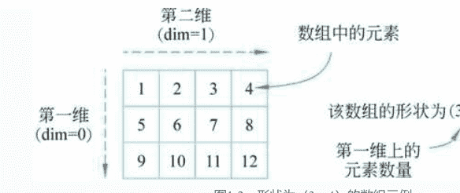

除 GPU 加速外，PyTorch 还自带自动微分，让多层网络的反向传播变得省心。只要给出前向计算的表达式，梯度求解就由框架自动完成，无需手动推导偏导。

#### 1.3.3 PyTorch实践
《机器学习书》中曾用 Python 与 NumPy 实现单隐含层多分类网络，并以轮椅数据验证效果。接下来的一系列实验将同一任务迁移到 PyTorch 实现。数据集与对应的 Jupyter Notebook 可通过二维码获取。


轮椅数据集
> 该数据集用于识别老年人或患者在轮椅上的坐姿。每个样本由轮椅上 3 个压力传感器与 1 个超声波传感器采集，输入维度为 4。压力传感器读数范围 0~1023，超声波传感器范围 0~15cm，分辨率 0.3cm。标签取 1~4 四个整数，1 表示坐姿正常，2 表示偏右，3 表示偏左，4 表示前倾。样本总数 308。

【实验1-1】对轮椅数据输入向量做标准化并划分训练测试集
要点：
- 数据以 308 行 5 列的表格给出，每行对应一个样本，前 4 列为输入，后 1 列为标签，标签取值 {1,2,3,4}。
- 建议随机抽取 200 条作训练集，其余 108 条作测试集。
- 按列标准化 $z_{ij} = \frac{x_{ij} - \mu_j}{\sigma_j}$，其中 $\mu_j$、$\sigma_j$ 为训练集中第 j 维的均值与标准差。
- 用 import torch 引入 PyTorch。
- 借助 torch.tensor() 从已有数据构造张量，可用 dtype 与 device 指定类型与设备。
- 输入向量建议用浮点类型如 torch.float，标签建议用长整型如 torch.long，并把标签映射为 {0,1,2,3}。
- 均值与标准差可用 torch.mean() 与 torch.std()，对矩阵按列运算时 dim=0，按行运算时 dim=1。
- 先用 torch.manual_seed() 固定随机种子，再用 torch.randperm() 打乱索引，保证可复现。
- 通过 torch.cuda.is_available() 判断能否使用 GPU。
- 若要在 GPU 上训练，需把数据搬到显存，张量的 to() 方法可实现迁移。
如遇困难可参考附录 A 的注释程序。

首次在 GPU 上运行，启动会稍慢，因为框架会即时 JIT 编译相关函数与模块。

【实验1-2】用 PyTorch 构建单隐含层多分类网络
要点：
- 隐含层设 8 个神经元，使用 ReLU 激活；输出层 4 个神经元，不加激活。
- 网络可用 torch.nn.Sequential 快速拼接，也可继承 torch.nn.Module 自定义，本书采用继承方式以便扩展。
- 在 __init__ 中创建并初始化各层参数，在 forward 中实现前向计算，反向由框架自动完成。
- 仿射变换用 torch.nn.Linear，激活用 torch.nn.functional.relu()。
- Linear 的权重与偏置默认按均匀分布初始化，一般无需手工干预。
- Linear 的 in_features 对应输入最后一维大小，out_features 对应输出最后一维大小。
- 使用 GPU 时需把模型对象迁移到显存，调用 to() 方法即可。
实现细节见附录 A。

【实验1-3】基于轮椅数据在 PyTorch 中训练上述网络
要点：
- 采用批梯度下降，即每次用全部训练样本更新参数；优化器选用 AdamW，通过 zero_grad 与 step 调用。
- 多分类常用交叉熵损失，用 torch.nn.CrossEntropyLoss 计算。注意其输入应为输出层仿射的原始结果而非 softmax 后结果，这也是输出层不加激活的原因；目标值需为 torch.long 类型，取值 0~c-1，与实验1-1 的标签映射一致。
- 学习率设为 0.1，训练轮次设为 60。
- 迭代顺序：前向 → 计算损失 → backward → optimizer.step。每次 backward 前必须 optimizer.zero_grad 清零梯度，否则梯度会累加。
- 建议调用模型对象而非直接调用 forward，以便触发已注册的钩子。
- 批训练时输入为 200×4 的二维张量。
- 记录每次迭代的损失以便绘图，保存时需从计算图分离，可用 item 或 detach。
- 绘图可用 Matplotlib。

当隐含层为 8、学习率 0.1、轮次 60、随机种子 0 时，损失随迭代的变化如图 1-3。整体上损失随迭代下降，说明训练有效；过程中有波动，因神经网络损失一般非凸。本例未手工给出偏导，却能借助 PyTorch 自动微分完成有效训练。

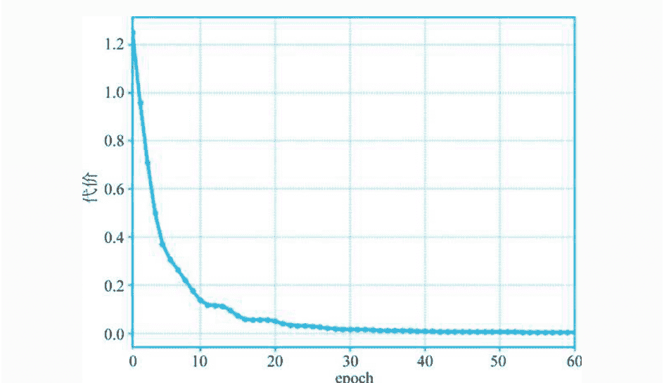
【实验1-4】评估模型在训练集与测试集上的分类准确率
要点：
- 可在每次迭代结束后计算当前模型在训练集和测试集上的准确率并保存，用于后续绘曲线。
- 评估阶段仅需前向计算，可开启 torch.inference_mode 上下文以降低开销。
- 评估前调用 model.eval，训练前调用 model.train，因部分模块在训练与推理时行为不同。
- 测试集 108 个样本输入仍为 108×4 的二维张量，第二维大小不变，网络无需修改。
- 多分类准确率可用 torcheval.metrics.functional.multiclass_accuracy 计算，需先导入 torcheval.metrics。

本实验的准确率曲线如图 1-4。当迭代接近 60 时，训练集准确率达到 1，测试集准确率接近 1。

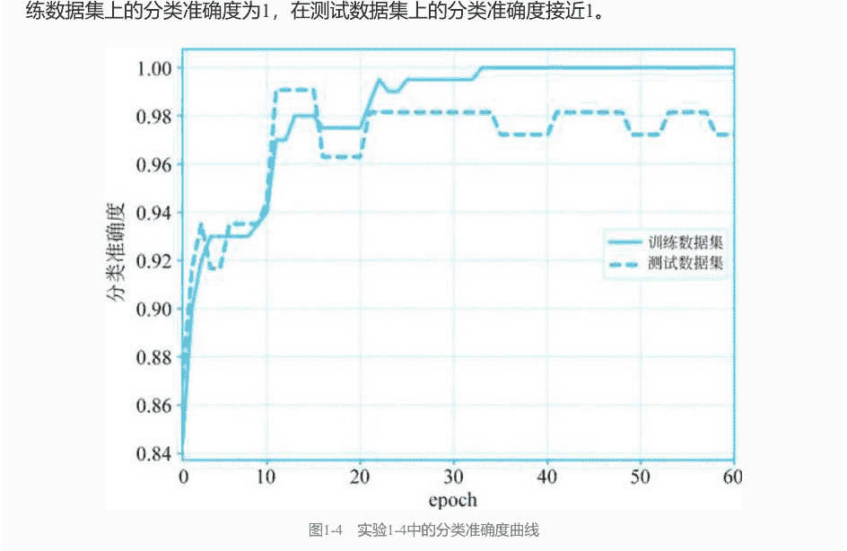

实验1-4所搭建的单层隐藏网络，按手工计算可得参数总数为 4×8+8+8×4+4，合计76个可训练量。PyTorch 框架同样提供了便捷手段来完成同样的统计。

##### 【实验1-5】借助 PyTorch 接口统计单隐藏层多分类模型的规模

提示：

- （1）在实验1-4代码基础上加入一个通用的参数计数函数，便于后续模型复用。
- （2）模型所有可训练量均可通过实例的 parameters() 方法遍历获取。
- （3）torch.numel() 能返回张量元素的总数。
- （4）通过张量的 requires_grad 属性可判断该项是否在训练时会被更新。

若自行编写较为困难，可参考附录A的注释示例。

实验1-5 的统计结果与手工推导一致，均得到 76 个可训练项。

### 1.4 深度神经网络

1.3.3 小节的单隐藏层多分类结构使用了8个隐藏单元。若把这种偏宽的前馈结构改造成偏深的结构，同时保持隐藏单元总数不变，会产生怎样的影响？例如把8个单元拆到两层，每层4个，就形成了深度网络。其效果如何？

##### 【实验1-6】在轮椅数据集上用 PyTorch 训练并评估两层隐藏的多分类深度网络，给出训练集与测试集的正确率。

提示：

- (1) 在单层隐藏模型上再叠加一层隐藏，两层的单元数均设为4。
- (2) 创建第二隐藏层的 torch.nn.Linear 时，注意其 in_features 应等于第一隐藏层 Linear 的 out_features，其 out_features 应等于输出层 Linear 的 in_features。

如独立实现有难度，可参考附录A注释程序。

当两层隐藏单元数均为4、学习率0.1、迭代轮次60、随机种子0时，训练损失随迭代变化如图1-5(a)呈现，训练集与测试集正确率变化如图1-5(b)。迭代接近60次时，该深度网络在两套数据上的正确率均达1。

该深度网络的可训练量为4×4+4+4×4+4+4×4+4，共60个，而1.3.3小节的单层网络有76个。参数更少的情况下，测试集正确率反而更高，说明在轮椅数据及当前设置下，其泛化能力优于偏宽的单层网络。

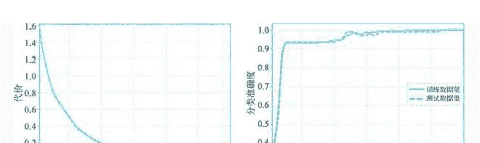

实验1-6中可用于多分类的两层隐藏深度前馈网络整体结构见图1-6。图1-6采用模块化表达以便理解，内部细节被省略。图中每个箭头右侧用元组标注了该位置张量的形状。

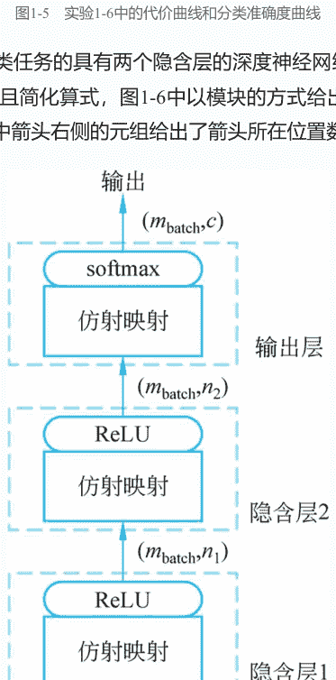

图1-6中涉及的线性加偏置、ReLU、softmax 三个模块的输入输出关系见图1-7。图1-7里箭头旁的元组使用星号表示可变维数。

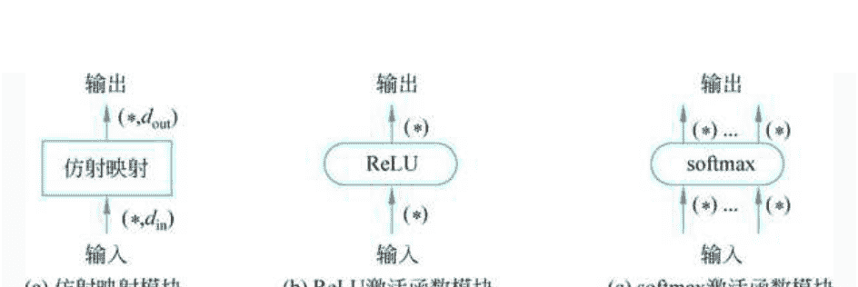

图1-7 (a) 中的线性加偏置模块对应PyTorch中的torch.nn.Linear类。当其输入数组为一维数组时，其输出数组也为一维数组，此时仿射映射的算式如下：

$$y_k^{[\text{affine}]} = \sum_{j=1}^{d_{\text{in}}} w_{j,k} x_j^{[\text{affine}]} + b_k \quad (1-1)$$

式 (1-1) 中，$x_j^{[\text{affine}]}$ 为仿射映射输入数组中的第 j 个元素，j =1, 2, ..., $d_{\text{in}}$，$d_{\text{in}}$ 为一维输入数组中元素的数量；$y_k^{[\text{affine}]}$ 为仿射映射输出数组中的第 k 个元素，k =1, 2, ..., $d_{\text{out}}$，$d_{\text{out}}$ 为一维输出数组中元素的数量；$w_{j,k}$ 为权重；$b_k$ 为偏差；$x_j^{[\text{affine}]}$, $y_k^{[\text{affine}]}$, $w_{j,k}$, $b_k \in \mathbb{R}$。当输入数组的维数更多时，可分别对由输入数组最后一维构成的大小为 $d_{\text{in}}$ 的一维数组使用式 (1-1)。例如，当输入数组为二维数组时，可将由该二维数组最后一维（即矩阵的每一行）构成的大小为 $d_{\text{in}}$ 的一维数组分别代入式 (1-1)，如图1-8 (a) 所示；当输入数组为三维数组时，可将由该三维数组最后一维构成的大小为 $d_{\text{in}}$ 的一维数组分别代入式 (1-1)，如图1-8 (b) 所示。

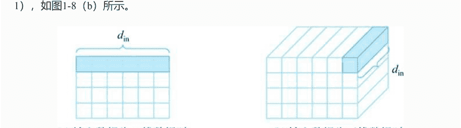

图1-7 (b) 中ReLU激活函数的算式如下：

$$y^{[\text{relu}]} = \max(0, x^{[\text{relu}]}) = x^{[\text{relu}]} [x^{[\text{relu}]} > 0] \quad (1-2)$$

式 (1-2) 中，$x^{[\text{relu}]}$ 为ReLU激活函数的输入，$x^{[\text{relu}]} \in \mathbb{R}$；$y^{[\text{relu}]}$ 为ReLU激活函数的输出，$y^{[\text{relu}]} \in \mathbb{R}$；max (·) 为取最大值函数；方括号为艾弗森括号 (Iverson bracket)，当艾弗森括号内的条件满足时（即括号内的表达式为“真”时）艾弗森括号的返回值为1；否则返回值为0。若ReLU激活函数的输入为数组，则分别对输入数组中的每个元素使用式 (1-2)。

当输入数组为一维数组时，图1-7（c）中softmax激活函数的算式如下，此时其输出数组也为一维数组。

$$y_k^{[softmax]} = \frac{e^{x_k^{[softmax]}}}{e^{x_1^{[softmax]}} + e^{x_2^{[softmax]}} + \cdots + e^{x_{d_{in}}^{[softmax]}}} = \frac{e^{x_k^{[softmax]}}}{\sum_{j=1}^{d_{in}} e^{x_j^{[softmax]}}} \quad (1-3)$$

式（1-3）中，$x_k^{[softmax]}$ 为softmax激活函数一维输入数组中的第 k 个元素，$x_k^{[softmax]} \in \mathbb{R}$；$y_k^{[softmax]}$ 为softmax激活函数一维输出数组中的第 k 个元素，$y_k^{[softmax]} \in (0, 1)$；k = 1, 2, ..., $d_{in}$，$d_{in}$ 为一维输入数组中元素的数量。若softmax激活函数的输入为多维数组，则可对输入数组中的某一维使用式（1-3）。softmax激活函数输出数组的形状与输入数组的形状相同。

回到图1-6的深度网络。第一隐藏层的线性加偏置接收形状为（$m_{batch}$，$d_{input}$）的张量，产生形状为（$m_{batch}$，$n_1$）的张量[此时式（1-1）中的 $d_{in} = d_{input}$，$d_{out} = n_1$]。其中，$m_{batch}$ 为一批样本数，$d_{input}$ 为样本输入向量的维数，$n_1$ 为第一隐藏层单元数。因此，第一隐藏层的ReLU模块的输入和输出都是形状为（$m_{batch}$，$n_1$）的二维张量。该深度网络第二隐藏层的线性加偏置输入是形状为（$m_{batch}$，$n_1$）的二维张量，输出是形状为（$m_{batch}$，$n_2$）的二维张量[此时式（1-1）中的 $d_{in} = n_1$，$d_{out} = n_2$]。其中，$n_2$ 为第二隐藏层单元数。第二隐藏层ReLU模块的输入输出都是形状为（$m_{batch}$，$n_2$）的二维张量。该深度网络输出层线性加偏置输入是形状为（$m_{batch}$，$n_2$）的二维张量，输出是形状为（$m_{batch}$，c）的二维张量[此时式（1-1）中的 $d_{in} = n_2$，$d_{out} = c$]。其中，c 为输出层单元数，也是多分类任务中类别数。输出层softmax模块的输入输出都是形状为（$m_{batch}$，c）的二维张量[对输入数组的最后一维使用式（1-3），其中的 $d_{in} = c$]。

在“机器学习书”中，多分类时神经网络输出层softmax的输出 $y_k^{[softmax]}$ 可被看作网络把当前输入 $x^{[input]}$ 判定为类别 k 的条件概率，即 $y_k^{[softmax]} = p(k|x)$，k ∈ {0, 1, ..., c-1}，p 为概率质量函数。

除ReLU之外，隐藏层的非线性也可以选用其他激活。上述多分类深度网络相比“机器学习书”中的版本多了一层隐藏。当然，深度网络中的隐藏层数还可以继续增加。

### 1.5 本书各章之间的联系

各章依赖关系见图1-9，箭头表示上层建立在下层之上。第2章至第4章侧重 Transformer 原理与实践，第5章至第7章侧重 Transformer 应用与实践。

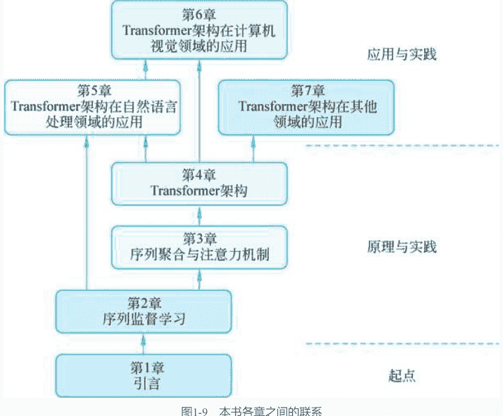

图1-9 本书各章之间的联系

### 1.6 本章小结

机器学习研究如何让计算机等设备具备类人的学习与行动能力。深度学习是其分支，关注如何用多隐藏层网络完成学习任务。相比偏宽的单层网络，偏深的多层网络效率更高，也有助于抑制过拟合。深度学习概念最早出现在20世纪80年代，但直到21世纪第二个十年末在竞赛中胜出才广受关注。

深度学习的基础结构包括深度神经网络、卷积神经网络、循环神经网络等。循环神经网络能处理自变量个数不固定的函数，但因含有反馈环路，正反向传播路径较长。

2017年提出的Transformer既无反馈环路，又能处理自变量个数不固定的函数。结构上可分为编码-解码型、解码型、编码型三种。现有大语言模型大多采用Transformer架构，可生成文本，属于生成式AI的一种。Transformer也被广泛用于计算机视觉等领域。

为方便多层网络反向传播并适配GPU，本书使用PyTorch实现深度学习。本章通过6个实验演示了如何用PyTorch搭建、训练、评估单层多分类网络和两层多分类网络，并在实验基础上把单层前馈网络推广为多层前馈网络，即深度神经网络。

### 1.7 思考与练习

- 1. 简述机器学习中的三种学习范式。
- 2. 循环神经网络与前馈神经网络有何差别？
- 3. 相比于神经网络，深度神经网络有哪些优势？
- 4. 从结构上看，Transformer架构可分为哪几种类型？
- 5. Transformer架构与大语言模型之间有何联系？可在查找资料后作答。
- 6. 如何理解数组的形状？
- 7. 数组的维数与向量维数二者有何区别？
- 8. 为什么可以将多分类深度神经网络输出层softmax激活函数的输出看作概率？
- 9. 参考“机器学习书”2.6.6节（及“深度强化学习书”2.3.1节），写出如图1-6所示的深度神经网络的预测过程计算式。
- 10. 若使用批梯度下降法训练如图1-6所示的深度神经网络，试推导交叉熵代价函数对深度神经网络第一层权重和偏差的偏导数计算式（可参考“机器学习书”2.6.7节及“深度强化学习书”2.3.2节）。
- 11. 自学“深度强化学习书”2.3.3节并查找pytorch.org网站上的相关资料，详述PyTorch如何“自动”完成反向传播。
- 12. 自学“深度强化学习书”2.3.4节，解释为什么深度神经网络可以比神经网络“效率”更高。

## 第2章 序列监督学习

机器学习的数据形式很丰富。其中一类数据由若干按顺序排列的数值或符号组成，例如按时间排列的传感器读数、按顺序出现的字符构成的文本。这类数据称为序列数据。利用序列数据做机器学习任务就叫序列学习。

传感器数据属于时间序列，指按时间先后排列的观测，邻近观测的时间间隔可以相等也可以不等。

除时间序列和文本外，序列数据还包括视频、语音、音频、用户交互、DNA等。从像素按空间顺序排列的角度，图像也可以视为序列。

尽管形式各异，序列中的每个元素都能映射为实数或实向量，相邻符号也能映射为实数或实向量。于是每个序列都可表示为实数序列或向量序列。

序列是有序项的列表，例如（3，1，4，1，5，9）长度为6。本书中序列项为实数或向量，同一序列类型一致。

### 2.1 两种序列监督学习

序列监督学习指用序列数据完成分类或回归等监督任务。样本的输入是输入序列，标注仍为实数或向量。分类时标注为类别整数，回归时标注为实数或向量。不同样本的输入序列长度可以相同也可以不同，长度不一致是序列学习的重要特征。

若把实数看作一维向量，则输入序列的各项都可记为向量。常见情形下序列中各向量的维数相同。于是第 i 个样本可记为（（x<sup>(i)<1></sup>，x<sup>(i)<2></sup>，...，x<sup>(i)<t(i)></sup>），y<sup>(i)</sup>）。其中输入序列为（x<sup>(i)<1></sup>，...，x<sup>(i)<t(i)></sup>），x<sup>(i)<j></sup>∈R<sup>d<sub>input</sub></sup>，d<sub>input</sub>为输入向量维数；j=1,...,t<sup>(i)</sup>，t<sup>(i)</sup>为序列长度；y<sup>(i)</sup>∈R<sup>d<sub>label</sub></sup>为标注向量，d<sub>label</sub>为标注维数。

#### 2.1.1 基于前馈神经网络的序列监督学习

第1章的轮椅数据集中各样本输入向量维数相同，可用神经网络或深度神经网络完成多分类。那么面对长度不一的输入序列，是否仍能使用深度神经网络等前馈网络？

【想一想】能否用深度神经网络等前馈网络完成序列监督学习？

答案是肯定的，可通过在短序列前补零的方式把不等长序列统一到同一长度，从而转化为等长序列处理。

股票指数数据集包含2014—2024年某指数的日涨跌幅，部分数据如图2-1所示，可用于预测涨跌。具体是用连续4~16个交易日的涨跌幅预测下一交易日涨跌。连续4~16日涨跌幅构成长度4~16的实数序列，即向量维数为1的向量序列。为统一长度，可在较短序列前填充0，使填充后长度均为最大长度16，如图2-2所示。

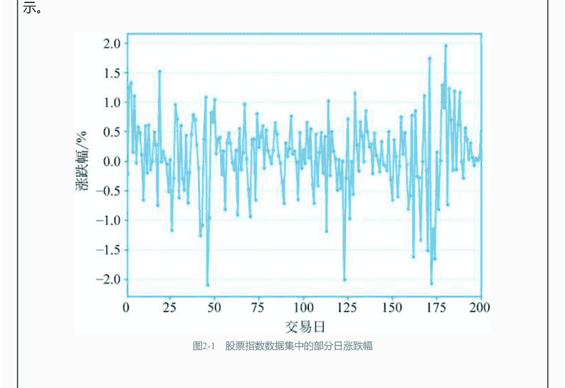

stock_trainset.pt文件包含26 000个训练样本，stock_testset.pt文件包含6487个测试样本。每个样本的输入序列为填充后的连续4~16个交易日的涨跌幅（每个填充后的输入序列的长度都等于最大长度16），样本的标注为下一个交易日的涨跌情况，其取值范围为 {0，1}（0代表“跌”，1代表“涨”）。

可通过下面的实验进一步理解上述问题的答案。实验中使用的股票指数数据集可通过扫描二维码下载。

##### 【实验2-1】深度神经网络能否预测股指涨跌？

提示：

- (1) 本次监督任务是二分类，样本输入是补齐后的等长序列，步长固定为16，标签只有0或1两种。
- (2) 模型可以搭两层隐含层，每层都用16个神经元。
- (3) 训练仍可用批梯度下降，学习率建议取0.01。
- (4) 可用 torch.load() 来读数据文件，例如：

```
x_train,y_train= torch.load('stock_trainset.pt')
```

x_train 保存补齐后的输入序列，形状为（26 000，16）；y_train 保存标签，形状为（26 000）。

- (5) 计算二分类交叉熵可实例化 torch.nn.BCEWithLogitsLoss。
- (6) 二分类准确率可用 torcheval.metrics.functional.binary_accuracy() 得到。

如果自己写程序有难度，可参考附录A的注释示例。

当两层隐含层都设为16个单元、学习率0.01、epoch设为300、随机种子0时，训练损失变化如图2-3（a），训练集和测试集的分类准确率变化如图2-3（b）。结果显示，前馈深度网络可以完成序列监督学习，但前提是把输入先补齐成等长。实测中测试集准确率仅略高于0.5，说明光靠历史涨跌幅很难可靠判断指数方向，影响因素实在太多。

补零对最终计算结果本身没有影响，却会让正向和反向传播白白多做运算。避免填充的一种思路是换成循环神经网络。

#### 2.1.2 基于循环神经网络的序列监督学习

埃尔曼网络是基础的循环结构，在单隐含层前馈网络上加了一条从隐含层回输入的环路。图2-4展示了用于二分类的典型结构。该网只有一层隐含层，反馈存在后，隐含层的输入由当前时刻的网络输入、大小为 d_input 的一维向量，和上一时刻隐含层的输出、大小为 n 的一维向量拼接而成，拼接后的向量长度是 d_input + n，作为仿射变换的输入。仿射输出长度为 n，即隐含层单元数。激活可选用 ReLU 或 tanh 等。隐含层的输出既喂给当前时刻的输出层，也作为下一时刻隐含层的反馈。时刻的递进以时间步为单位。由于第1步没有历史反馈，通常把第1步的反馈初始化为全0的 n 维向量。二分类时输出层只要一个节点，常用 sigmoid。

循环网络每个时刻只接收一个 d_input 维向量，t 个向量需要 t 个时刻才能全部送入，构成长度为 t 的序列 x^{<1>}, x^{<2>}, ..., x^{<t>}。图2-5中的RNN即指图2-4的结构。每个时刻输出层都能产生一个预测值，但二分类里一般只采第 t 步的输出，因为此时序列已完整输入。循环网络对序列长度没有硬性限制，不同长度的样本可共用同一模型，这是相比前馈的优势。

图2-4中的拼接、时延、sigmoid 模块输入输出如图2-6。图2-6（a）拼接把两个数组在某一维首尾相接，若该维大小分别为 d_in1、d_in2，则输出该维大小为 d_in1 + d_in2，其他维保持一致。图2-6（b）时延相当于推迟一个时刻，y^{[delay]<t'>} = x^{[delay]<t'-1>}，t'=2,3,...,t。图2-6（c）sigmoid 形式为 y^{[sigmoid]} = 1/(1+e^{-x^{[sigmoid]}}) = e^{x^{[sigmoid]}}/(e^{x^{[sigmoid]}}+1)，输入为标量时输出在(0,1)，数组则逐元素计算。

从图2-4、图2-5可见，循环网络先用带反馈的隐含层把序列逐项“压缩”到固定大小 n 的向量，最后再送入输出层。按照机器学习书的解释，输出层 sigmoid 的值 \hat{y} 可视作在输入序列 x^{<1>},...,x^{<t>} 下类别1的后验概率 P(y^{<t>}=1|...)=\hat{y}。本质上，循环网络先把变长序列合并成定长向量，再用逻辑回归等方法映射到输出。

下面用上述二分类循环网络做股指涨跌预测。

> 股票指数数据集的 stock_trainset_packed.pt 有26 000个训练样本，stock_testset_packed.pt 有6 487个测试样本。与实验2-1不同，这两个文件中的输入序列没有补齐等长，并以 PackedSequence 对象保存。PyTorch 的 PackedSequence 用来存放长度不同的序列集合。

##### 【实验2-2】RNN版股指涨跌预测实测

提示：

- (1) 分别用 torch.load 读取 stock_trainset_packed.pt 和 stock_testset_packed.pt，返回的第一个数组是输入序列，第二个是标签。
- (2) 隐含层与反馈可用 torch.nn.RNN 实现。
- (3) 创建 RNN 时 input_size 表示序列每一项的元素个数。本数据集每一项是标量，故 input_size 为1。
- (4) hidden_size 为隐含层单元数，本实验可取24。
- (5) 参数 nonlinearity 可设激活，本实验用 ReLU。
- (6) 将 batch_first 设为 True 以适配本实验的输入形状。
- (7) 调用 RNN 后得到的第二个返回值可送入输出层。
- (8) 仍可用批梯度下降训练，已用 PackedSequence 打包不等长序列，学习率可取0.01。

独立实现困难时可参考附录A注释程序。

当隐含层单元24、学习率0.01、epoch600、随机种子0时，训练损失如图2-8（a），训练集与测试集准确率如图2-8（b）。与实验2-1对比，循环网络获得的准确率与深度前馈相当。

前馈和循环在序列监督学习上各有短板：前馈不支持变长，必须补齐，平均长度增加带来额外计算；循环虽免填充，但存在反馈环路导致计算路径变长，序列越长路径越长，且训练时易出现梯度消失，即长序列早期项对梯度的贡献趋近于零，和梯度爆炸，即长序列早期项的梯度绝对值随长度膨胀，导致下降步长失控，损失不降反升。

### 2.2 序列预测

序列监督学习的一个特例是标签恰好是输入序列的下一项。用这样的样本训练的模型就能基于已有项预测下一项，这就是序列预测。更一般地，也可预测序列中任意位置。基于股票连续交易日的涨跌幅预测下一日涨跌幅即是典型例子。

序列预测可视为自监督学习。自监督学习介于监督与无监督之间，能从无标注数据自动生成标签再用监督方式训练。如自编码器就把同一无标注数据同时当输入和标签。

实际中常只用最近不超过1项的上下文来预测下一项，既简化任务，也可从一条长序列切出多个样本。

设已知序列 s^{<1>}, s^{<2>}, ..., s^{<l>}, ...，可切出样本（（s^{<i-t>},...,s^{<i-1>}），s^{<i>}），其中 t 为输入长度，l 为上下文窗口最大长度，i≥2。为方便记法记为（（x^{<1>},...,x^{<t>}），x^{<t+1>}），输入长度 t，标签为 x^{<t+1>}。

> 莫尔斯码用点、划和两种间隔表示字符，可用整数序列0、1、2、3 表示字符间隔、划、点、单词间隔。

取两篇短文的莫尔斯码作为序列，按上法切分得到莫尔斯码数据集。输入序列最大长度为16，标签为下一项。测试集与训练集不重叠。

莫尔斯码数据集I的 morsecode_trainset_packed.pt 含486 568个训练样本，morsecode_testset_packed.pt 含12 315个测试样本。输入序列未补齐，以 PackedSequence 保存。输入是整数序列对应的独热向量序列，标签仍为整数。

##### 【实验2-3】RNN预测莫尔斯码下一个符号

提示：

- (1) 数据集每项取值只有{0,1,2,3}四个类别，对应四种符号，故是4分类序列监督任务。
- (2) 为便于送入RNN，已把整数转成独热向量序列，输入为独热序列，标签保持整数。
- (3) torch.load 返回第一个数组为输入序列，第二个为标签。
- (4) RNN 的 input_size 应为4，因输入每一项是4维独热向量。

实现困难可参考附录A。

当隐含层单元32、学习率0.01、epoch1000、随机种子0时，训练损失如图2-9（a），准确率如图2-9（b）。损失收敛仍较高，一方面模型较简单，另一方面数据集对应关系复杂，因输入序列长度上限为16，从同一长序列切出的样本会出现相同输入对应不同标签的情况，增加拟合难度。

实验2-3标签为类别整数，属于多分类。若标签为实数或向量，输入项同为实数或向量，则序列预测变为回归任务，可用均方误差等损失。

### 2.3 序列生成

对已知序列 s^{<1>}, s^{<2>},...,s^{<t>},...，若每项是非负整数且取值范围为同一有限集，可把切出的样本记为（（x^{<1>},...,x^{<t>}），x^{<t+1>}），其中 x^{<i>}∈{0,...,c-1}，c为取值个数。

此时序列预测即分类任务。多分类里，输出层 softmax 的向量各元素可解释为模型对各类别的概率估计。因此在该情形下，模型输出可视作基于输入序列对下一项取各个可能值的概率分布。若输入为（x^{<1>},...,x^{<t>}），t时刻的预测向量为 \hat{y}^{<t>} = (\hat{y}_1^{<t>}, \hat{y}_2^{<t>},..., \hat{y}_c^{<t>})，c 为类别数，则有

式（2-3） $\hat{y}_j^{<t>} = p(j-1 | x^{<1>}, x^{<2>}, ..., x^{<t>})$ (2-3) 拆开了三层信息。$\hat{y}_j^{<t>}$ 就是时间步 $t$ 的输出分布 $\hat{y}^{<t>}$ 的第 $j$ 个分量；右边是在已知前缀 $x^{<1>}...x^{<t>}$ 的条件下，后继符号 $x^{<t+1>}$ 取 $j-1$ 的条件概率；指标 $j$ 在 $1$ 到 $c$ 之间取值。

需要指出的是，2.2 节里把一条完整序列切成若干训练对的做法，暗含了用变长离散时间马尔可夫链来建模序列规律：任意位置上的元素只受其前面最多 $t$ 个元素影响，与更早的历史无关，$1\le t\le l$，$l$ 即该马尔可夫链的最高阶。

得到 $\hat{y}^{<t>} = (\hat{y}_1^{<t>}, \hat{y}_2^{<t>}, ..., \hat{y}_c^{<t>})$ 后，就能把这组数值当作条件分布，通过随机采样为已有前缀 $x^{<1>},...,x^{<t>}$ 补一个后继 $x^{<t+1>}$，于是得到长度 $t+1$ 的新序列。把刚生成的序列再作为输入送回模型继续推断，就能一步步往后延伸，得到 $t+2$、$t+3$……直到达到预设的最大长度，或尾部出现结束符为止。可知序列生成并非全新任务，它只是把“预测下一步分布”循环应用，形成逐步延展的过程，也因此天生支持长度可变。

【想一想】当已生成的序列长度超过训练时见过的最大长度 $l$ 后，还能继续往后推吗？

训练阶段输入长度被限制在 $l$ 以内，所以推理时为保证可评估性，通常也让输入长度不大于 $l$。超过 $l$ 时常用做法是取生成的尾部 $l$ 项作为新上下文，再继续采样。书中默认生成长度不超过 $l+1$，即上下文已达 $l$ 时只再补一项。

把分布 $\hat{y}^{<t>}$ 变成具体符号有多种策略。最基础的是贪心策略，直接取概率最大的类别：

$x^{\langle t+1 \rangle} = (\arg \max_j \hat{y}_j^{\langle t \rangle}) - 1$  (2-4)

式（2-4）中 $\arg\max$ 取使预测值最大的自变量 $j$，$j=1,2,...,c$。方法简单直观，但每一步都确定取最优，导致结果同质化，多样性不足。

为在保持准确性的同时引入随机性，常在概率头部采样。top-k 方法只保留概率最大的 $k$ 个候选，若这 $k$ 个概率之和小于 $1$，先等比例归一化再按归一化后的概率随机抽取。$k$ 为事先设定的超参。

top-p 方法先把 $c$ 个概率降序排列，累加直到累积和首次超过 $p$，累加所用数量记为 $k$，再按 top-k 的方式在前 $k$ 个候选里采样。$p$ 也是超参，控制累积质量。

下面三个实验在实验 2-3 的循环神经网络基础上分别换用三种采样策略，在莫尔斯码数据集 I 上生成。

##### 【实验 2-4】在实验 2-3 的基础上，使用贪婪方法生成序列。
提示：
- 可手工设定一个不超过 16 的初始序列，取值范围 {0,1,2,3}，在此基础上延展，整体长度不超过 17。
- 模型输入是独热序列，使用 torch.nn.functional.one_hot 把整数转为独热向量。
- 可用 torch.argmax 求最大索引，torch.cat 连接序列，torch.reshape 调整形状。
当初始序列为（0），随机种子为 0 时，得到序列为（0，2，2，2，0，3，0，2，1，1，0，2，2，0，2，1，2）。其中 0 为字符间隔，1 为划，2 为点，3 为单词间隔。

##### 【实验2-5】在实验2-3的基础上，使用top-k 方法生成序列。
提示：
- 可用 torch.nn.functional.softmax 做 softmax，可用 torch.sort 做排序。
- 可用 torch.multinomial 按给定的概率随机抽取，概率和不要求为 1。
- 本实验 k 取 2。
当 k=2、初始序列为（0）、随机种子为 0 时，得到序列为（0，1，1，1，0，1，2，0，2，2，2，0，2，0，2，1，2）。

##### 【实验2-6】在实验2-3的基础上，使用top-p 方法生成序列。
提示：
- 可用 torch.cumsum 计算累积和。
- 本实验 p 取 0.6。
当 p=0.6，初始序列为（0），随机种子为 0 时，得到序列为（0，2，1，2，0，2，2，2，0，3，0，1，2，2，0，2，1）。

### 2.4 本章小结
序列数据在机器学习里很常见，时间序列、文本、视频、语音、音频、用户行为都属于此类，本质是按顺序排列的数值或符号。建模前需要把符号映射成实数或向量。不同序列长度不一，给学习带来挑战。

在序列监督学习中，样本输入长度可能不同。经填充对齐后可用前馈网络处理，也可用循环类网络直接处理不等长输入。循环神经网络借助反馈环路把序列逐项“压缩”成固定维向量，再接回归或分类头。反馈环路让计算路径随长度增长而拉长。

序列预测是序列监督学习的一个特例，标签恰好是输入序列的下一个元素，属于自监督任务，可用循环网络完成。训练好的模型可给出下一步分布。当标签和输入都是有限范围的非负整数时，输出向量可解释为各取值的条件概率。基于该概率用贪心、top-k、top-p 等方式采样，就能从已有前缀不断延展出更长的序列，长度可变且采样带来随机性，这正是序列生成的核心特点。

### 2.5 思考与练习
1. 什么是序列数据？什么是序列？二者之间有何联系？
2. 什么是序列监督学习？它与“机器学习书”中的监督学习相比有何特别之处？
3. 为什么可以使用前馈神经网络完成序列监督学习任务？使用前馈神经网络完成序列监督学习任务有哪些优势与劣势？
4. 给出一个可用于二分类任务的埃尔曼网络。
5. 如何理解循环神经网络？
6. 序列监督学习、序列预测、序列生成三者之间有何联系？
7. 如何理解自监督学习？
8. 为什么说2.2节中的从已知序列中划分出若干样本的方法隐含地使用变长离散时间马尔可夫链？
9. 如何生成一个序列？
10. 简述贪婪方法、top-k 方法以及top-p 方法。

## 第3章 序列聚合与注意力机制
循环神经网络能处理任意长的输入，靠反馈环路把序列逐项融合。本书把把变长序列逐项融合为一个向量的操作叫做序列聚合。

用反馈环路聚合无需填充，可省去填充带来的额外计算，但路径变长会导致训练和推理变慢，并可能出现梯度消失或爆炸。那有没有不用反馈环路的聚合方式？本章先介绍基于标量投影的聚合，再引出选择性聚合。

### 3.1 基于标量投影的序列聚合
先明确聚合的输入。在序列监督学习里，序列项可以是实数或向量，也可以是表示类别的整数。若是实数或向量，可直接作为聚合输入；若是整数类别，需要先独热编码为 c 维独热向量，c 为类别数。c 很大时，还可先用线性映射把独热向量压到低维。再把由独热或低维向量组成的序列送入聚合模块。

也可以跳过独热，直接用查找表把类别整数映射为低维向量，这在 NLP 里称为嵌入 embedding。做嵌入的模块如图3-1，输出维记为 $d_{out}$。

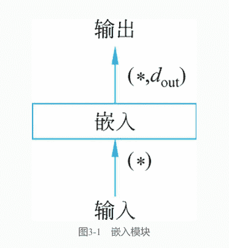
综上，聚合模块的输入可归结为向量序列 $(x^{[agg]<1>}, x^{[agg]<2>}, ..., x^{[agg]<t>})$，其中每个 $x^{[agg]<*>}$ 是 $d_{main}$ 维向量，长度 t 满足 $1\le t\le l$，l 为最大长度。

> 【想一想】如何把向量序列 $(x^{[agg]<1>}, x^{[agg]<2>}, ..., x^{[agg]<t>})$ 合成一个向量？

最直接的做法是逐项相加：

$$y^{[agg]<t>} = x^{[agg]<1>} + x^{[agg]<2>} + \cdots + x^{[agg]<t>} = \sum_{j=1}^{t} x^{[agg]<j>} \quad (3-1)$$
式（3-1）中 $y^{[agg]<t>}$ 为聚合后的向量，维数仍为 $d_{main}$。姑且称之为相加聚合，后面会用实验检验其效果。

> 莫尔斯码数据集II中的morsecode_trainset_padded.pt文件包含486 568个训练样本，morsecode_testset_padded.pt文件包含12 315个测试样本。该数据集中样本的输入序列已被填充至长度为16的等长序列，填充项的值为0。

该集除输入序列和标注外，还提供掩码 {0,1} 表示是否填充，以及位置索引 {0,...,l-1}。l=16。


本章用聚合输出的 $y^{[agg]<t>}$ 喂给多分类逻辑回归即 softmax 回归，在莫尔斯码数据集II上做序列预测。数据集中输入项为类别整数，取值 {0,1,2,...,c-1}，c=4。

##### 【实验3-1】 使用相加聚合及多分类逻辑回归，预测莫尔斯码数据集II中输入序列的下一项。
提示：
- torch.load 返回的第一个数组是输入序列，第二个是标注，第三个是掩码，第四个是位置。第一维样本数，第二维最大长度。
- 可用 torch.nn.Embedding 把类别整数映射为嵌入向量，嵌入维可取4。
- 借助掩码剔除填充项，填充位置掩码为0。
- 元素级乘法可用 * 运算符。
- 用 torch.unsqueeze 增加维度，用 torch.sum 在指定维上求和，注意 keepdim。
当嵌入维为4，学习率0.01，epoch 500，随机种子0时，训练集和测试集准确度曲线如图3-2。该模型准确度约0.44，说明相加聚合可行。和实验2-3的循环网络相比准确度有差距，但参数量仅为其1/37。

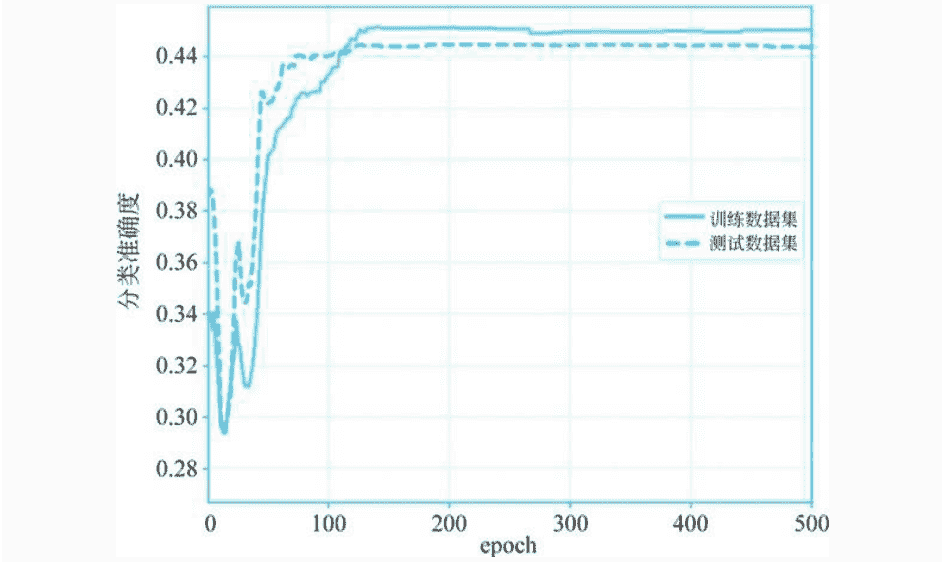
相加聚合看起来能用，但它有局限。

对聚合向量 $y^{[agg]<t>}$ 的第 k 维，有

$$y_k^{[agg]<t>} = \sum_{j=1}^{t} x_k^{[agg]<j>} = \widetilde{x}_k^{[agg]} \cdot \mathbf{1}$$
其中 $\widetilde{x}_k^{[agg]} = (x_k^{[agg]<1>}, x_k^{[agg]<2>}, \dots, x_k^{[agg]<t>})$，$\mathbf{1}=(1,1,\dots,1)$。于是每维都是序列对应位置元素的 t 维向量与全 1 向量的点积。

从几何看，$a\cdot b = \|a\|\|b\|\cos\theta$，其中 $\|a\|\cos\theta$ 是 a 在 b 上的标量投影。所以聚合向量的每一维等于序列各元素在全 1 向量上的标量投影再乘以 $\sqrt{t}$。

> 【想一想】在序列预测里，让 $(x_k^{[agg]<1>},...,x_k^{[agg]<t>})$ 在 $(1,1,...,1)$ 上投影有什么不足？

全 1 向量与排列无关，调换元素顺序不会改变投影大小。于是相加聚合会丢失顺序信息，后续的逻辑回归难以区分不同排列的输入，导致预测性能受限。

序列聚合如何记住顺序

要让多分类逻辑回归能够分辨输入序列中各元素的先后顺序，就不能再用全是1的权重向量做求和。改成一个各分量互不相同的向量，记作 $w^{[agg]}$。这样把 $(x_k^{[agg]<1>}, x_k^{[agg]<2>}, ..., x_k^{[agg]<t>})$ 重新排列后，投影到 $w^{[agg]}$ 上的结果通常会发生变化。从聚合的角度看，这其实是从简单求和变成了加权求和

$y_k^{[agg]<t>} = \tilde{x}_k^{[agg]} \cdot w^{[agg]} = \sum_{j=1}^{t} x_k^{[agg]<j>} w_j^{[agg]}$

其中 $w^{[agg]} = (w_1^{[agg]}, w_2^{[agg]}, ..., w_t^{[agg]})$，$w^{[agg]} \in \mathbb{R}^t$。姑且称之为加权聚合，其计算式为

$y^{[agg]<t>} = w_1^{[agg]} x^{[agg]<1>} + w_2^{[agg]} x^{[agg]<2>} + \cdots + w_t^{[agg]} x^{[agg]<t>} = \sum_{j=1}^{t} w_j^{[agg]} x^{[agg]<j>} \tag{3-2}$

于是可以在实验3-1的模型上再引入一组可学习参数作为 $w^{[agg]}$，在训练中自动确定其取值。

##### 【实验3-2】 使用加权聚合及多分类逻辑回归，预测莫尔斯码数据集II中输入序列的下一项。

提示：
- 可借助 torch.nn.parameter.Parameter 为模型新增权重参数。
- 初始值可用均值0、标准差0.01的高斯噪声生成，torch.randn 可产生标准正态随机数。
- 序列最长为 l，权重参数总数也设为 l，长度为 t 的序列只用到前 t 个。
- 矩阵或向量相乘可用 torch.matmul 或 @。
- 用 torch.transpose 调换数组的两个维度，用 torch.squeeze 去掉大小为1的维度。

在沿用实验3-1设置的情况下，加权聚合在训练集和测试集上的准确率曲线如图3-3。相加聚合被替换后，准确率从约0.44提升到0.5以上，而参数仅多出16个。

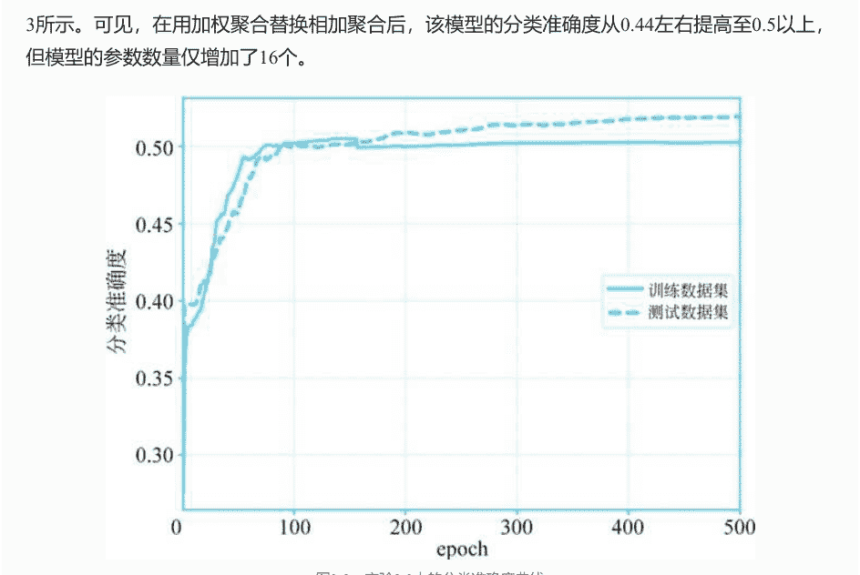

加权聚合带来了提升，准确率还能再往上走吗？

> 【想一想】 引入 $w^{[agg]}$ 后效果明显，但加权聚合本身还有什么可改进的空间？

加权聚合对所有序列共用同一个 $w^{[agg]}$。从投影的角度看，相当于有一个向量固定，另一个向量变化。要改变投影大小，只能靠后者。直觉上，不同序列应该拥有不同的权重向量，同时调动投影的两个向量会更灵活。虽然为每个序列单独保存权重不现实，却可以让机器学习模型为每个序列自动生成权重。暂且称这种方法为自适应加权聚合。

给出一个至多 l 维的权重向量是回归问题，可用多输出线性回归实现。为保证输入维度固定，先把长度补齐到 l 后的序列中每个 $d_{\text{main}}$ 维向量拼接成一个 $l \cdot d_{\text{main}}$ 维向量，如图3-4所示，作为回归器的输入。

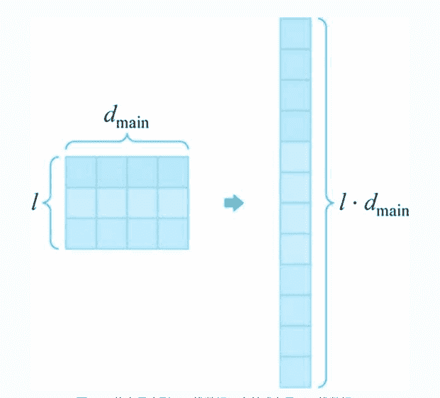

图3-4 将向量序列（二维数组）合并成向量（一维数组）

##### 【实验3-3】 使用自适应加权聚合及多分类逻辑回归，预测莫尔斯码数据集II中输入序列的下一项。

提示：
- (1) 用0向量填补输入序列的空位，长度补至最大长度 l，莫尔斯码数据集II中 $l=16$。
- (2) 将补齐后的各向量拼接成一个向量，可用 torch.flatten，注意 start_dim 与 end_dim。
- (3) 多输出线性回归的输入维为 $l \cdot d_{\text{main}}$，输出维可设为 $l$，后续只用前 t 个。本实验 $d_{\text{main}}$ 仍取4。

当 epoch=1000，其余设置同实验3-2时，训练集和测试集的准确率曲线如图3-5。基于多输出线性回归的自适应加权聚合把准确率进一步推到0.55以上，代价是参数量相比实验3-2约增加了20倍。

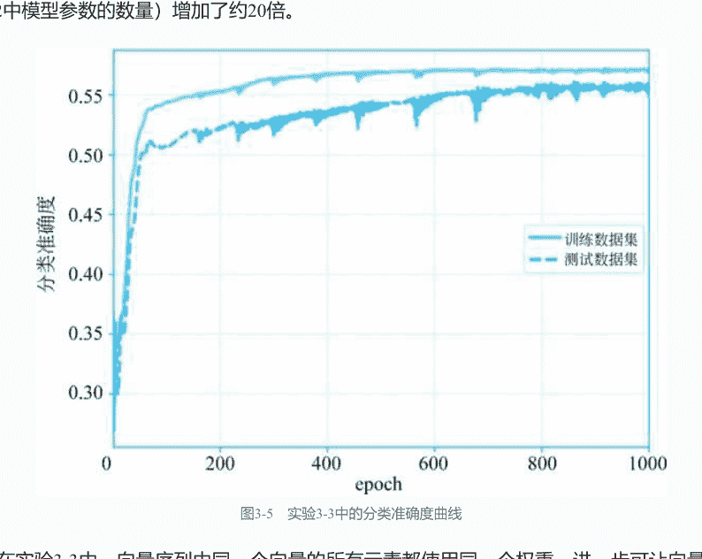

实验3-3中同一向量的所有分量共用一个权重。进一步可为每个向量的每个分量单独生成权重，这会进一步膨胀参数，也更容易过拟合。

##### 【练一练】 为实验3-3中向量序列中每个向量的每个元素都生成一个权重，给出模型此时的参数数量以及分类准确度。

提示：
- 1. 多输出线性回归的输出可以是 $l \cdot d_{\text{main}}$ 维向量。
- 2. 可用 torch.unflatten 把数组的某一维拆回多维，即图3-4的逆过程。

### 3.2 选择性序列聚合

加权聚合和自适应加权聚合的准确率较高，但由于不同长度的序列共用同一个多输出回归模型，导致学到的权重绝对值往往随位置递增，靠前的向量影响被压低。

举例来说，输入“山不在高，有仙则名。”中，第一项“山”对预测下一项“水”很重要，其权重绝对值理应较大，而上述两种聚合却可能给它较小的权重。

> 【想一想】如何缓解权重绝对值与位置强相关的现象？

并非序列中所有项都对预测有帮助，可先挑选出更有帮助的项再做预测，这能简化任务并降低过拟合风险。等价于从向量序列中挑选部分向量。

> 【想一想】怎样从向量序列里挑选出对预测更关键的向量？

多分类任务中常用 softmax 输出概率来选类。序列预测中不知道要选几个向量，但 softmax 输出之和为1，可直接把 softmax 输出作为各向量的权重：权重大即选中，权重小即忽略。softmax 的输入怎么来？可以先用线性回归把每个固定维度的向量映射为实数，得到实数序列，再送入 softmax。

这种用 softmax 产生权重的自适应加权聚合可称为选择性聚合。与标量投影相比，其最大特点是权重之和恒为1，因而具备选择性。

##### 【实验3-4】使用选择性聚合及多分类逻辑回归，预测莫尔斯码数据集II中输入序列的下一项。

提示：
- (1) 可把实验3-3的多输出线性回归换成单输出线性回归，输入为 $d_{\text{main}}$ 维向量。
- (2) 在线性回归后接 softmax，输入为长度 t 的实数序列，$1\le t\le l$。
- (3) 可把实数序列补齐到长度 l，但填充项对应的 softmax 权重应为0，只有输入为 $-\infty$ 时输出才为0，故需把对应位置置为 $-\infty$，可用 tensor 的 masked_fill 实现，通过 float('-inf') 给出。

在与实验3-3相同设置下，模型准确率不及实验3-3，但参数仅41个，而实验3-3有1076个。

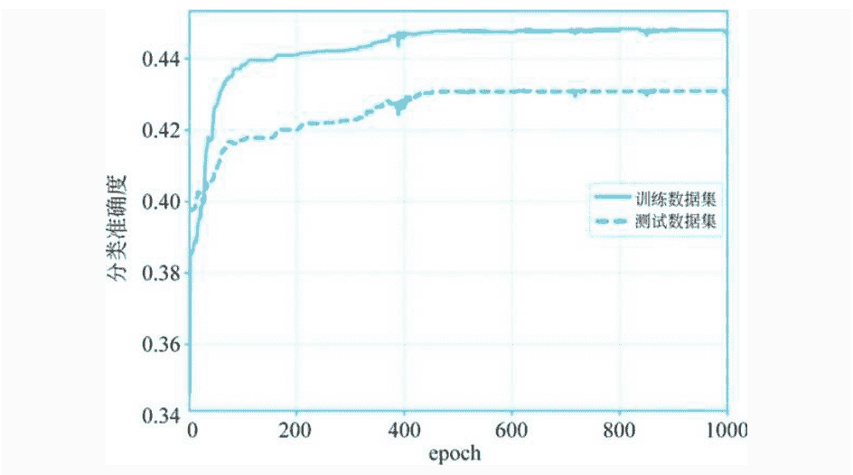

图3-6 实验3-4中的分类准确度曲线

##### 【想一想】 除了引入 softmax 以及参数更少，还有什么原因导致准确率下降？

实验3-4先把各向量映射为实数再 softmax。若向量顺序改变，softmax 输出的权重不变，聚合结果也不变。于是模型无法区分输入序列的不同排列，预测能力受限。

##### 【想一想】 如何让选择性聚合具备区分顺序的能力？

让输入本身携带位置信息。为每个位置 $0$ 到 $l-1$ 定义一个 $d_{\text{main}}$ 维的位置向量，把它与对应项的向量相加后送入选择性聚合。位置向量可通过嵌入模块在训练中学习，也可用周期函数生成。

##### 【实验3-5】 使用输入和向量序列的选择性聚合及多分类逻辑回归，预测莫尔斯码数据集II中输入序列的下一项。

提示：
- (1) 读取填充后的莫尔斯码数据集II文件时，第4个数组即各项位置，取值范围 $\{0,1,...,l-1\}$，$l=16$。
- (2) 仍可用 torch.nn.Embedding 把整数位置映射为向量，位置向量维数需与输入向量相同，便于相加。

在与实验3-4相同设置下，加入位置向量后准确率有所提升，参数量也随之增加。

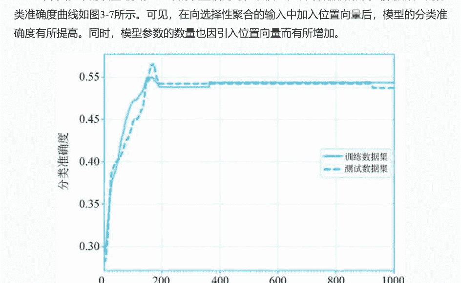

准确率仍与实验3-3有差距。

##### 【想一想】 选择性聚合还能怎么改进？

当前方案中，若某项位置和取值不变，其线性回归输出也不变，不受序列长度或其它项影响。但很多情况下，同一项的“影响力”应随上下文变化。例如“山不在高，有仙则名”时“山”对预测“。”帮助不大，而在“山不在高，有仙则名。”时“山”对预测“水”帮助较大。

> 【想一想】 当序列长度或其它项改变时，如何让该项在 softmax 中的影响力也随之改变？

可在线性回归后加入条件模块，让 softmax 输入随条件变化。理想条件下条件模块输入序列长度和各和向量，但长度不固定会再次引出聚合问题。常用做法是以序列最后一项的和向量作为固定维度的条件输入。条件模块输出实数，可与线性回归输出相乘再送 softmax。为增强表达，可把单输出扩展为多输出，记维数为 $d_{\text{dot}}$，让条件输出与线性回归输出做点积，再输入 softmax。点积等价于标量投影，可把条件理解为改变投影方向和大小。

**【实验3-6】** 使用带有多条件模块的选择性聚合及多分类逻辑回归，预测莫尔斯码数据集II中输入序列的下一项。

提示：
- (1) 条件模块为多输出线性回归，输入为序列最后一项的和向量，输出维 $d_{\text{dot}}$ 可与 $d_{\text{main}}$ 相同。
- (2) 计算条件输出与选择性聚合中多输出线性回归各输出向量的点积，将结果向量输入 softmax。

当 $d_{\text{dot}} = d_{\text{main}}$ 且其它设置同实验3-5时，准确率曲线如图3-8。加入条件模块后准确率继续上升，参数量也随之增加。

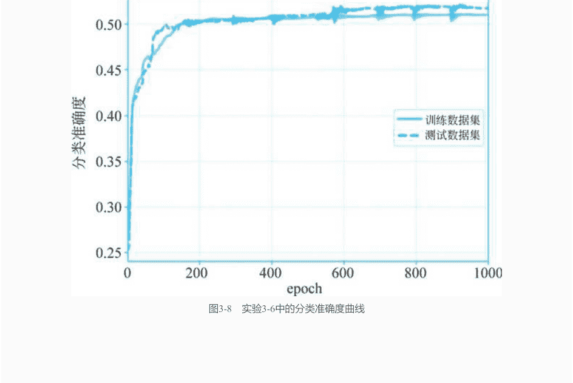

### 3.3 注意力机制与多头注意力机制

从带条件模块的选择性聚合出发，只做三处改动，就能得到 Transformer 通用的注意力机制。首先在加权聚合的前后各挂一个无偏置、输入输出维度都为 d_main 的线性映射；然后把键和查询的点积结果整体缩放 1/√d_main；最后把选择性聚合与条件模块内部原本的线性回归全部换成线性映射。图3-9 就是改造后的图示。在加权聚合两端加线性映射可以提升表达能力，但不是必须的。点积结果除以 1/√d_main 的作用是抵消维度累加带来的幅度膨胀，因为点积本质上是 d_dot 个乘积之和。在 Transformer 的设定里 d_dot 等于 d_main。把回归换成映射，模型结构更简洁。

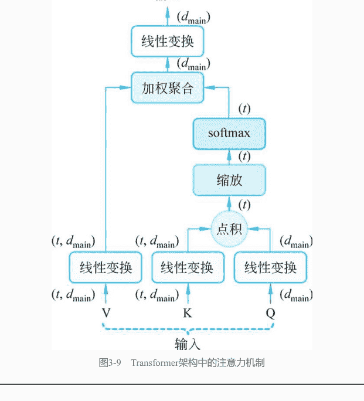

> 有的论文把注意力描述为机器翻译时解码器生成下一个词对源句各词的关注分布，也有论文把它描述为图像描述时模型生成词对输入图像各区域的关注分布。
> 
> 自2019年起，学界围绕“能否用关注度解释注意力”展开了激烈争论。一派认为关注度并不能给出有意义的解释，另一派认为可解释与否取决于可解释性的定义。截至本书成书，争议仍未有定论。

名字里带“注意”并不代表本质，注意力本质仍是带条件模块的选择性聚合。按第3.2节的推导，它是在以输入序列最后一个和向量为条件的前提下，从序列各位置的和向量中挑出对预测下一个符号更有帮助的部分。

图3-9 中箭头旁的元组标出了各模块的张量形状。图中的线性映射是无偏置、进出均为 d_main 维的仿射映射；点积模块计算两个 d_main 维向量的内积；缩放模块把所有元素同乘 1/√d_main；softmax 模块与1.4节相同；加权聚合模块即3.1节的方法，计算式见式3-2。

图3-9 下方三条线性映射的输入在 Transformer 论文里分别叫值向量、键向量、查询向量。本书沿用这个称呼以便表述，但按前文推导，键与查询的名实并不完全对应。当三路映射的输入都来自同一个和向量序列时，这一结构被称为自注意力机制 self-attention mechanism。以下把三路输入简记为 V 路、K 路、Q 路。

**【实验3-7】** 用注意力配合多分类逻辑回归，预测莫尔斯码数据集 II 中序列的下一项。

提示：
- 线性映射可用 torch.nn.Linear 实现，把 bias 设为 False。
- 求平方根可用 torch.sqrt()。

若自行编写有困难，可参考附录 A 的注释程序。

当本实验设置与实验3-6一致时，训练集与测试集的分类准确率曲线见图3-10，表现与实验3-6相近。

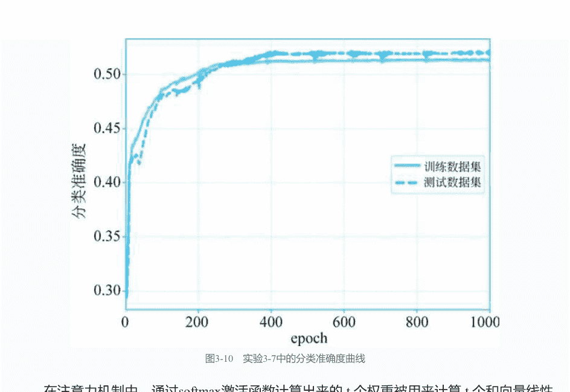

注意力里 softmax 产生的 t 个系数用来对 t 个经左下角线性映射后的和向量做加权求和。方便起见，下面把图3-9 下方三路映射的输出统称为线性映射向量，其中 V 路映射的输出称为 V 路线性映射向量。

图3-9 里，每个 V 路线性映射向量的各分量共享同一个权重。若给每个分量分配独立权重，权重总数会变成 t·d_main，加权和更接近理想向量，对下一项预测更有帮助。但这需要 d_main 对线性映射，而不是图3-9 下方中间与右下角的一对映射，参数量会显著上升。

一种不增参数的折中做法是把每个 V 路线性映射向量的元素分成 h 组，h<d_main，组内元素共用同一权重。这样权重总数降为 t·h。若令 d_head = d_main/h 为正整数，则可把参与点积的 d_main 维 K 路映射向量和 d_main 维 Q 路映射向量各拆成 h 个 d_head 维子向量，用子向量做点积得到 h 组输出，每组仍有 t 个数值。再把这 h 组数值分别送入缩放与 softmax，得到 h 组系数，每组 t 个，共 t·h 个。此时点积维度为 d_head，缩放系数应改为 1/√d_head。此结构称为多头注意力机制 multi-head attention mechanism，h 即头数。

**【实验3-8】** 用多头注意力配合多分类逻辑回归，预测莫尔斯码数据集 II 中序列的下一项。

提示：
- 把 d_main 维向量拆成 h 个 d_head 维向量，可用 torch.unflatten()。
- 本实验头数 h 可取 2。

若自行编写有困难，可参考附录 A 的注释程序。

当本实验设置与实验3-7一致且 h=2 时，训练集与测试集的准确率曲线见图3-11。就当前设置与莫尔斯码数据集 II 而言，多头注意力的准确率与单头注意力相近。

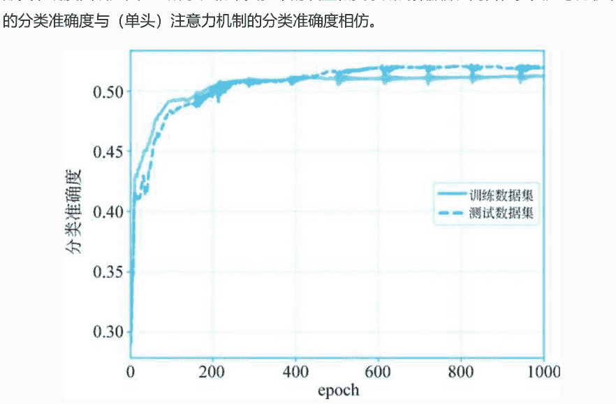

多头注意力有可能提升准确率，但比单头更复杂、计算开销更大。故本书后续实验默认使用单头注意力。

> 【想一想】除增加头数外，还有哪些办法可以提升分类准确度？

第3.2节提到条件模块的输入可用长度固定的和向量序列。注意力目前仅用和向量序列的最后一个向量作为条件，即图3-9 右下角映射的输入。可以考虑用更多历史和向量作为条件，或增加更多条件模块，让模型在预测下一项时能区分更多情境。例如同时使用最后一个和倒数第二个和向量；或再添一个以倒数第二个和向量为输入的条件模块，并把两个模块输出逐元素相乘。

下面在注意力上再加一个条件模块，即再加一个图3-9 右下角的线性映射，其输入为和向量序列的倒数第二个向量，若序列长度为1则使用唯一向量，并把该模块输出与已有模块输出逐元素相乘，乘积作为 Q 路映射向量。

**【实验3-9】** 用增加条件模块的注意力配合多分类逻辑回归，预测莫尔斯码数据集 II 中序列的下一项。

提示：
- 获取倒数第二个和向量时需判断序列长度，长度可通过输入序列各项对应的掩码求和得到。

若自行编写有困难，可参考附录 A 的注释程序。

当本实验设置与实验3-7一致时，训练集与测试集的准确率曲线见图3-12。可看出，为注意力增加额外条件模块有助于提升分类准确度。

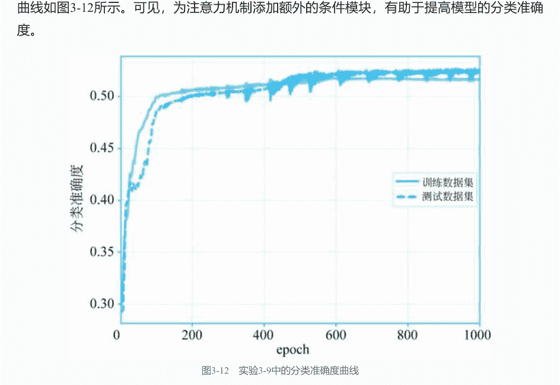

### 3.4 本章小结

序列监督学习中输入序列长度不定，给建模带来挑战。常见策略是先把可变长序列聚合，再用线性回归、逻辑回归或前馈网络完成任务。本章聚焦不含反馈环路的序列聚合，包括基于标量投影的聚合与选择性聚合，并由此引出 Transformer 的注意力与多头注意力。

聚合前，可把代表类别的整数通过嵌入映射为向量，使各聚合方法的输入统一为向量序列。相加聚合把序列中各向量直接相加，简单但无法区分排列顺序。把和改为加权和得到加权聚合；再用多输出线性回归为每个序列自动生成权重向量，形成自适应加权聚合。

基于标量投影的加权聚合与自适应加权聚合在分类任务上能取得较高准确率，但更偏好使用靠后的向量来预测下一项。为更公平地对待序列中每个向量，可用 softmax 自动从向量序列中挑选部分向量，softmax 输入为各向量经仿射映射得到的实数序列，这就是选择性聚合。可把向量序列换成向量与位置向量的和向量序列，以区分不同排列。输入长度变化时，可引入条件模块，让其输出与仿射映射输出相乘再送入 softmax，从而调节各项影响力。条件模块输入常取序列最后一项对应的和向量，该乘积也可推广为点积。本质上，序列聚合是从向量序列中提取特征。

对带条件模块的选择性聚合稍作改动即可得到 Transformer 的注意力，故注意力实质上是带条件模块的选择性聚合。在不增加参数前提下，可把 V 路映射输出的元素分组并为每组生成独立系数，这就是多头注意力。除扩展为多头，还可在注意力中加入更多条件模块以提升分类准确度。注意力机制是 Transformer 的核心。

### 3.5 思考与练习

- 1. 谈一谈你对序列聚合的理解。
- 2. 什么是嵌入？如何理解嵌入？
- 3. 画出欧几里得三维空间中一个向量在另一个向量上的标量投影。
- 4. 为什么说相加聚合不能区分向量序列中各个向量的排列顺序？
- 5. 加权聚合方法有何优势与不足？
- 6. 结合3.1节中的练一练，分析自适应加权聚合方法的优势与不足，并分析产生不足的原因。
- 7. 如何理解选择性聚合方法？为什么说选择性聚合方法能够公平地对待向量序列中的每一个向量？
- 8. 如何表示序列中的每一项在序列中的位置？在查找资料后说明可以使用哪些方法给出位置向量。
- 9. 如何理解选择性聚合方法中的条件模块？为什么可以将条件模块的输出与选择性聚合方法中仿射映射的输出相乘？为什么该乘积可以扩展为点积？
- 10. 为什么说注意力机制实质上是一种带有条件模块的选择性聚合方法？谈一谈你对注意力机制的理解。
- 11. 多头注意力机制与注意力机制有何差别？
- 12. 解释为什么在注意力机制中再添加一个条件模块能够提高模型的性能（例如分类准确度）。

## 第4章 Transformer架构

用注意力聚合向量序列时无需反馈环路。但第3章实验使用的是填充到等长的集合，填充项也参与计算，导致开销较大。

此外，第2章从单个较长已知序列 s^{<1>}, s^{<2>},...,s^{<l>},... 中切分样本时，样本间输入常存在包含关系。例如样本输入 (s^{<i-t>},...,s^{<i-1>}) 的子序列 (s^{<i-t>},...,s^{<i-2>}) 也会出现在另一样本中。莫尔斯码数据集 II 即采用此种切分，训练时不可避免重复计算。

为减少不必要的与重复计算，特别是训练阶段的冗余，需要更高效地组织序列预测任务的训练样本。

### 4.1 使用样本组训练序列预测模型

非必要计算源于填充项，重复计算源于样本输入间的包含关系。为避免填充与包含，可把具有包含关系的样本合并为一个样本组 (s^{<i-t>},...,s^{<i-1>}) , (s^{<i-t+1>},...,s^{<i>})，如图4-1所示。其中样本组的输入序列为 s^{<i-t>}…s^{<i-1>}，标注序列为 s^{<i-t+1>}…s^{<i>}。可见各样本组的输入之间不再包含，且输入长度一致，无需填充。

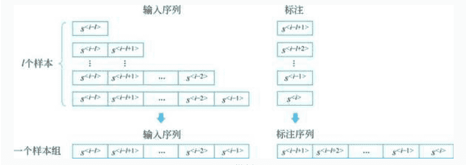

为简化记法，任一样本组记为 ((x^{<1>},x^{<2>},...,x^{<l-1>},x^{<l>}), (x^{<2>},x^{<3>},...,x^{<l>},x^{<l+1>}))。其中第一部分为输入序列，第二部分为标注序列，l 为长度，x^{<k>}∈R^{d_in}。形式上类似单个样本，但样本组本质是多个样本的组合，训练时应视作一个整体：((x^{<1>}),x^{<2>}), ((x^{<1>},x^{<2>}),x^{<3>}), ..., ((x^{<1>},...,x^{<l>}),x^{<l+1>})，如图4-2所示。图中每个三角形的底边表示样本输入，顶点指向标注。样本组提供一小批相关样本，但与梯度下降中的 minibatch 不完全等同，它是序列预测任务中因输入存在特殊关系而构成的“小批”，多个样本组仍可组成一个梯度下降小批。

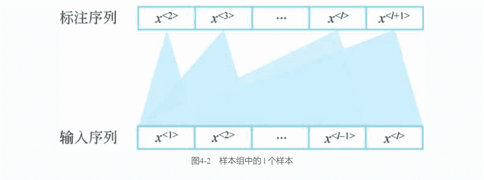

特别地，当 d_input=1 且 x^{<k>}∈Z_n 时，序列预测成为分类任务，类别数为取值数。此时样本组为 ((x^{<1>},...,x^{<l>}), (x^{<2>},...,x^{<l+1>}))。据“机器学习书”，多分类中神经网络 softmax 输出的第 k 个值 \hat y_k 可视为输入样本时被分到第 k 类的概率，即 \hat y_k = p(y=k|x^{(i)})。训练时最大化 p(y^{(1)}|x^{(1)})...p(y^{(m)}|x^{(m)}) 的乘积，等价于最大化 \hat y_{y^{(1)}}^{(1)}·...·\hat y_{y^{(m)}}^{(m)}。其中 m 为样本数，c 为类别数。

因此给定一个样本组，参照最优化问题与图4-2，可写出训练序列预测模型时的最优化表达式：

$$w^*, b^* = \underset{w,b}{\text{maximize}} \ p(x^{<2>}|x^{<1>})p(x^{<3>}|x^{<1>},x^{<2>}) \cdots p(x^{<l+1>}|x^{<1>},x^{<2>},\cdots,x^{<l-1>},x^{<l>}) \quad (4-1)$$

在式（4-1）中，w、b 分别是神经网络待学习的权重系数与偏置项，最优取值记为 w*、b*。对式（4-1）做进一步化简后可得$$w^*, b^* = \underset{w,b}{\text{maximize}} \ p(x^{<2>} \mid x^{<1>}) p(x^{<3>} \mid x^{<1>}, x^{<2>}) \cdots p(x^{<l+1>} \mid x^{<1>}, x^{<2>}, \cdots, x^{<l-1>}, x^{<l>})$$

$$= \underset{w,b}{\text{maximize}} \ \hat{y}_{x^{<1>}}^{(1)} \hat{y}_{x^{<1>, x^{<2>}}}^{(2)} \cdots \hat{y}_{x^{<1>, \cdots, x^{<l>}}}^{(l)}$$

$$= \underset{w,b}{\text{maximize}} \ \ln(\hat{y}_{x^{<1>}}^{(1)} \hat{y}_{x^{<1>, x^{<2>}}}^{(2)} \cdots \hat{y}_{x^{<1>, \cdots, x^{<l>}}}^{(l)})$$

$$= \underset{w,b}{\text{maximize}} \ \sum_{i=1}^{l} \ln \hat{y}_{x^{<1>, \cdots, x^{<i>}}}^{(i)}$$

$$= \underset{w,b}{\text{minimize}} \ -\frac{1}{l} \sum_{i=1}^{l} \ln \hat{y}_{x^{<1>, \cdots, x^{<i>}}}^{(i)} \qquad (4-2)$$

式（4-2）里的 ln 为自然对数，是单调递增的。$\hat{y}_{x^{<1>, \cdots, x^{<i>}}}^{(i)} = p(x^{<i+1>} \mid x^{<1>}, x^{<2>}, \cdots, x^{<i>})$。据此可写出针对单个样本束的代价表达式：

$$J(w,b) = -\frac{1}{l} \sum_{i=1}^{l} \ln \hat{y}_{x^{<1>, \cdots, x^{<i>}}}^{(i)}$$

其形式与多分类任务下小批量损失完全一致。换句话说，用一束样本进行训练，等价于把一条不含填充的输入序列当作一次梯度下降的小批量来使用。若把若干样本束拼成一个训练批量，而该批量中各束的标注序列长度不相等，则求每束代价时应采用：

$$J(w,b) = -\sum_{i=1}^{l} \ln \hat{y}_{x^{<1>, \cdots, x^{<i>}}}^{(i)}$$

把所有束的代价累加后再除以这些束提供的总样本数。

对式（4-1）中概率的连乘再整理，可得

$$p(x^{<2>} \mid x^{<1>}) p(x^{<3>} \mid x^{<1>}, x^{<2>}) \cdots p(x^{<l+1>} \mid x^{<1>}, x^{<2>}, \cdots, x^{<l-1>}, x^{<l>})$$

$$= \frac{p(x^{<1>}) p(x^{<2>} \mid x^{<1>}) p(x^{<3>} \mid x^{<1>}, x^{<2>}) \cdots p(x^{<l+1>} \mid x^{<1>}, x^{<2>}, \cdots, x^{<l-1>}, x^{<l>})}{p(x^{<1>})}$$

$$= \frac{p(x^{<1>}, x^{<2>}, \cdots, x^{<l-1>}, x^{<l>}, x^{<l+1>})}{p(x^{<1>})}$$

$$= p(x^{<2>}, \cdots, x^{<l-1>}, x^{<l>}, x^{<l+1>} \mid x^{<1>}) \qquad (4-3)$$

由式（4-3）可看出，式（4-1）实际是在最大化 $x^{<1>}$ 出现之后，后续序列 $x^{<2>}, \cdots, x^{<l-1>}, x^{<l>}, x^{<l+1>}$ 的后验概率。

图4-3 展示了一种能够处理样本束、融合注意力与多分类逻辑回归的序列预测结构。输入是长度为 l 的样本束序列，每项都是表示类别的整数；输出是该束中每条输入序列对应 c 个类别的概率。为方便称呼，图中把仿射变换加 Softmax 的多分类逻辑回归简称为 Softmax 分类器。序列嵌入部分见图4-4，注意力部分见图4-5。

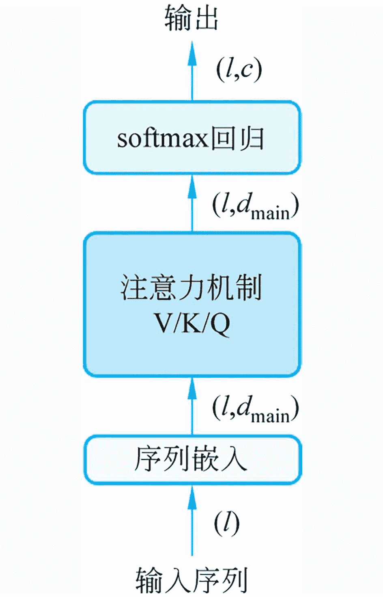

图4-3 一个可用于序列预测任务的支持样本束的神经网络

图4-4 中序列嵌入模块给出的结果即 3.2 节提到的和向量序列，序列长度仍为 l，每个和向量的维度为 $d_{main}$。

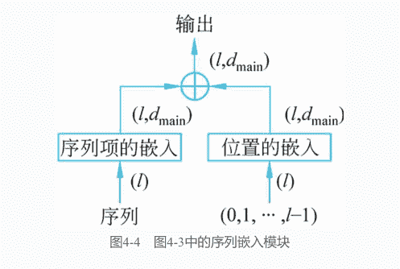

图4-5 的注意力在图3-9 的基础上增加了对样本束序列的支持。样本束本质上是多条样本的打包，所以与 Q 路相连的线性变换会同时对束里某条输入序列的最后一项所对应的和向量做线性映射，该项正好是束输入序列中的某项。此时该变换的输出是一个长度为 1、维度为 $d_{main}$ 的向量序列，形状为（1，$d_{main}$）。紧接着的点积模块会把两个长度皆为 1 的向量序列中任意一对向量做点积，得到形状为（1，1）的二维数组，如图4-6，具体计算见式（4-4）：

$$y_{ij} = q_i \cdot k_j$$ (4-4)

这样做的目的就是对束里的一个样本同步完成点积运算。式（4-4）里，q_i 是 Q 路线性变换得到的长度为 1 的 $d_{main}$ 维向量序列中的第 i 个向量，q_i∈R^{d_{main}}；k_j 是 K 路线性变换得到的长度为 1 的 $d_{main}$ 维向量序列中的第 j 个向量，k_j∈R^{d_{main}}；y_ij 为两者的点积，即点积模块输出数组的第 i 行第 j 列；i，j=1，2，...，l。可看出，计算束中各样本的点积时，K 路的线性变换序列是可以复用的，无需每个样本都重新算一遍，这也是束式输入能省去重复计算的原因之一。

图4-5 的点积模块对输入的两组向量序列中任意配对都做点积，主要是为了方便借助 PyTorch 等框架并行化。实际上后续只用到输出数组的一部分，即下标满足 j≤i 的元素，对应图4-6 中未被阴影覆盖的部分。因为 Q 路对应的样本输入序列的末项，输出二维数组的第 i 行中只有前 i 个元素才是第 i 条样本输入序列的点积结果，如图4-6 虚线框所示，i=1，2，...，l。

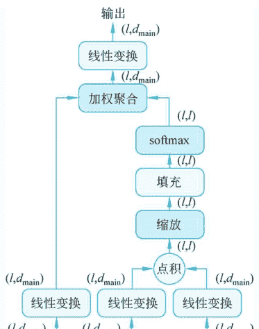

图4-5 图4-3中的注意力机制模块

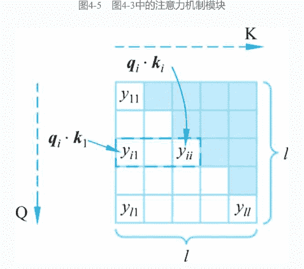

图4-6 图4-5中点积模块的输出数组

为了让那些多余的点积结果不干扰后面加权聚合，图4-5 在 Softmax 之前加了一个填充模块。该模块先让缩放模块把所有元素乘以 $1/\sqrt{d_{main}}$，然后把图4-6 中阴影格的元素置为 $-\infty$。这样 Softmax 求权重时，阴影格对应的权重会变成 0，于是这些多余的点积不会影响聚合结果。

图4-5 的加权聚合模块能够同时对束中 l 条样本输入序列对应的 l 个向量序列进行聚合。聚合时可以复用与 V 路相连的线性变换输出的长度为 l 的 $d_{main}$ 维向量序列，即 V 路的线性变换序列，这也是束式输入减少重复计算的另一个来源。

图4-5 注意力机制的输出形状为（1，$d_{main}$）的二维数组，其中那个 $d_{main}$ 维向量正是用图3-9 的注意力机制对束中某一个样本得到的向量，对应图3-9 中的 t=1，2，...，l。

需要强调的是，训练时用样本束可以避免填充项并降低重复计算，但在推理时通常没有必要把长度为 t 的输入序列，1≤t≤l，当成束序列，因为推理关注的是预测当前输入序列的下一项，而不是预测序列中每个位置的下一项。所以推理时一般只保留图4-5 输出的 t 个 $d_{main}$ 维向量里的最后一个，或只保留图4-3 中 Softmax 分类器模块输出的最后一个 c 维向量。推理阶段可把图4-3、图4-4、图4-5 中的 l 替换为 t。

如何用样本束训练序列预测模型，可以通过实验4-1 来体会。本章实验使用的莫尔斯码数据集 III，可通过扫描二维码下载。


莫尔斯码数据集 III 里的 morsecode_trainset.pt 是一个只包含一条已知序列的训练集，序列长度 30 419，各位置取值仍在 {0，1，2，3}。

morsecode_testset_batched.pt 是一个包含 12 315 个样本的测试集。测试样本与训练集划分出的样本没有重叠，这使得测试样本很难组合成样本束。因此测试集中每条输入序列都被填充到长度 16，填充值 0 置于非填充项之后。为了并行计算，实际长度相同的样本被放在一起构成一个小批，共 16 个小批。各小批按实际长度递增的顺序存放在输入序列数组和标注数组里。

除了输入序列和标注，测试集文件还记录了各小批的样本数，部分小批数量为 0，表示该长度的样本在测试集中不存在。

【实验4-1】使用图4-3 的序列预测神经网络，预测莫尔斯码数据集 III 中输入序列的下一项，采用样本束训练。

##### 提示：
- （1）先从已知序列中切出若干样本束，束的输入序列与标注序列长度均为 16。再把多个样本束作为梯度下降的一个小批，批长可取 1024，可借助 torch.stack（）把多个样本束拼成一个小批。
- （2）用 torch.load（） 读取训练集文件得到的数组是已知序列；读取测试集文件时第一个数组是各小批样本数，第二个数组是样本输入序列，第三个数组是标注。
- （3）可借助三角矩阵实现图4-5 的填充模块，可用 torch.ones（） 和 torch.tril（） ［或 torch.triu（）］ 生成三角矩阵。

若自行编写有困难，可参考附录 A 的注释程序。

当批长取 1024、epoch 数为 200，其余设置与实验3-7 相同，模型在训练集与测试集上的分类准确度曲线如图4-7。准确度与实验3-7 相当。由于训练中使用了样本束小批，本实验的权重与偏置更新频率更高，所以在较小的 epoch 数下就能达到较高准确度。

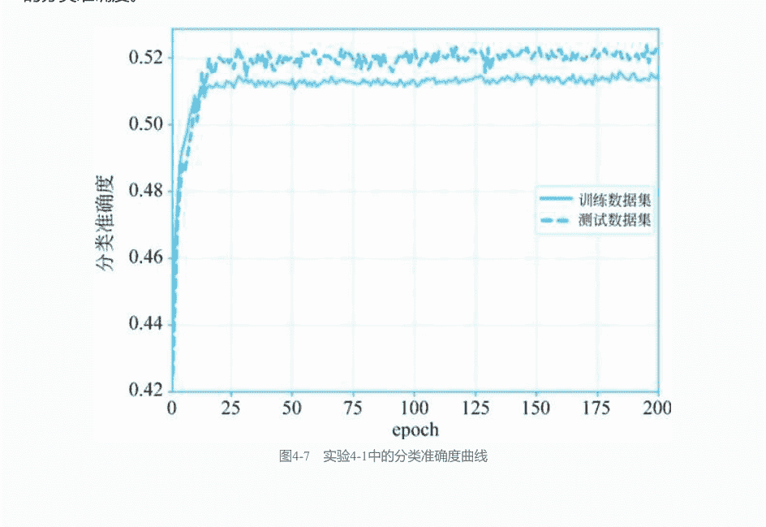

### 4.2 Transformer中的层

把长度不固定的和向量序列用注意力机制聚合成单个聚合向量并做线性变换后，若想提升预测效果，可以考虑增加模型复杂度。

#### 4.2.1 前馈网络

注意力机制的输出是维度固定的向量，而前向网络正好接受这种固定维度的输入。因此可以在注意力之后再接一个前向网络，以注意力输出作为输入、前向输出作为 Softmax 分类器的输入，如图4-8。图4-8 对应样本束训练的情况，推理时可把 l 换成 t。为减少超参数，本书默认该前向网络只有一个隐含层，隐含层节点数为 $4d_{main}$ 并使用 ReLU 激活，尽管该网络可以是任意结构。为避免混淆，下文称之为前向网络。

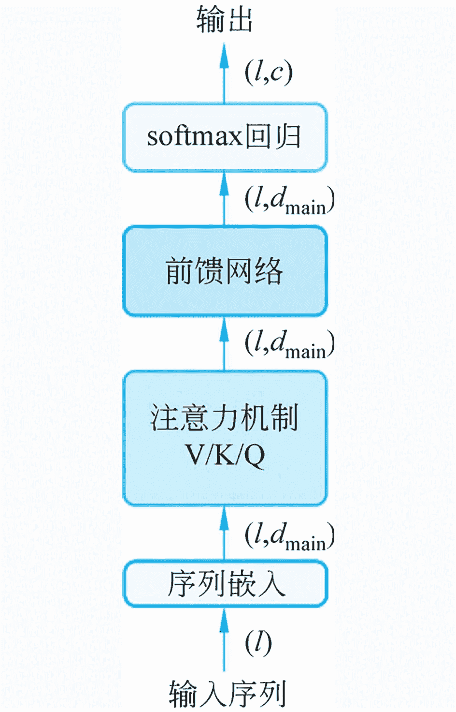

图4-8 加入前向网络后的序列预测神经网络

【实验4-2】使用图4-8 的加入前向网络后的序列预测神经网络，预测莫尔斯码数据集 III 中输入序列的下一项，采用样本束训练。

提示：

前向网络隐含层数量为 1，节点数为 4 $d_{main}$，使用 ReLU 激活。

若自行编写有困难，可参考附录 A 的注释程序。

当前向网络隐含层节点数为 16，其余设置同实验4-1，模型在训练集与测试集上的分类准确度曲线如图4-9。就本设置而言，加入前向网络后参数量几乎翻倍，导致训练过程中出现过拟合。

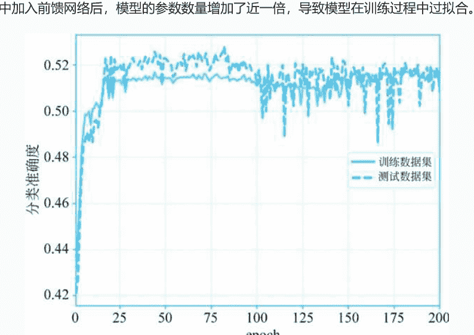

图4-9 实验4-2中的分类准确度曲线

加入前向网络后，网络的隐含层数变多。当隐含层较多时容易出现梯度消失，即反向传播中按链式法则求各层权重偏置的偏导时，乘积中绝对值小于 1 的项增多，导致靠近输入层的偏导绝对值变小，更新步长也随之变小。一个常用的缓解办法是加入残差连接。

#### 4.2.2 残差连接

残差连接是指与神经网络模块并联的旁路，如图4-10（a）。若模块输出为 g（x），x 为输入向量，则加入残差连接后输出为 f（x）+x。通常 f（x）≠g（x），因为此时模块实际拟合的是 g（x）-x。能加入残差连接的前提是模块输出与输入的维度相同。若记加入残差连接后的输出为 y，y=f(x)+x, x∈R^d，则反向传播中模块的偏导数 ∂y/∂x 为 ∂f(x)/∂x+I。其中 ∂f(x)/∂x=(∂f_1/∂x_1, ∂f_1/∂x_2, ..., ∂f_1/∂x_d; ...; ∂f_d/∂x_1, ..., ∂f_d/∂x_d)，I=(δ_ij)_{d×d}。由此可见，当 ∂f(x)/∂x 很小接近 0 时，∂y/∂x 接近 I，因此残差连接有助于增大偏导数值，加快训练。

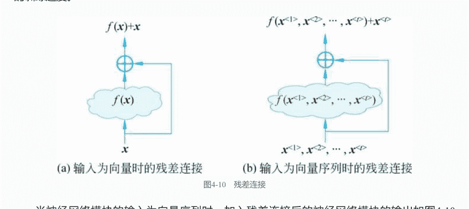

当模块的输入是向量序列时，加入残差连接后的输出如图4-10（b）。类似分析可得，输入为序列时残差连接同样有助于增大偏导数值。

【练一练】证明当神经网络模块的输入为向量序列时，加入残差连接也能够增大偏导数值。

据此，可以为图4-8 中的注意力机制和前向网络分别添加残差连接，如图4-11。同样，图4-11 对应样本束训练的情况，推理时可把 l 替换为 t。

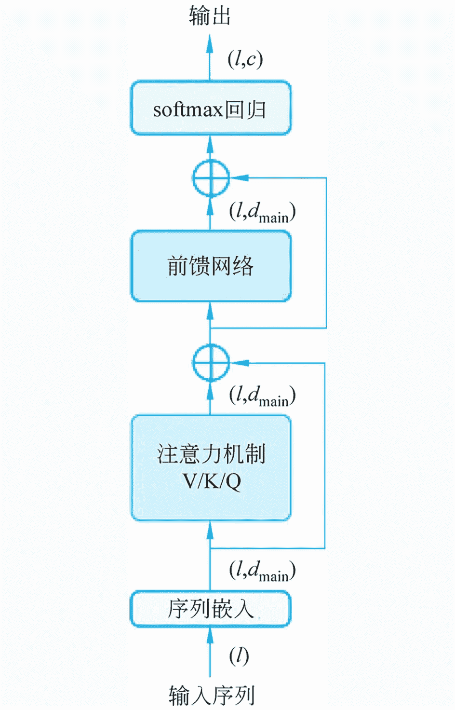

图4-11 加入残差连接后的序列预测神经网络

【实验4-3】使用图4-11 的加入残差连接后的序列预测神经网络，预测莫尔斯码数据集 III 中输入序列的下一项，采用样本束训练。

若自行编写有困难，可参考附录 A 的注释程序。

当本实验设置与实验4-2 相同，模型在训练集与测试集上的分类准确度曲线如图4-12。就本设置而言，加入残差连接后模型在训练中更早出现过拟合。

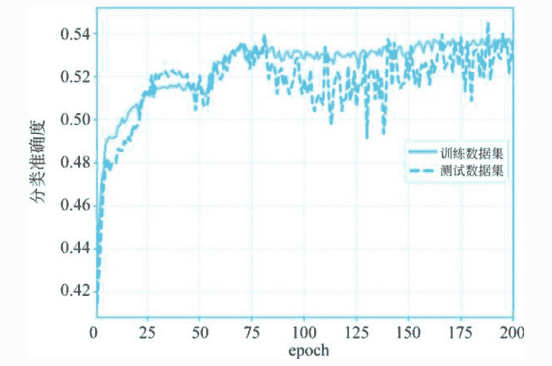

图4-12 实验4-3中的分类准确度曲线

**残差连接让注意力学会“微调”而非“一蹴而就”**

把图4-8里的注意力算子记作 $g^{[attention]}(x^{<1>}, x^{<2>}, ..., x^{<t>})$，前馈算子记作 $g^{[FFN]}(x)$，其中 $(x^{<1>}, x^{<2>}, ..., x^{<t>})$ 是注意力接收的向量序列。带残差的图4-11里，softmax 的输入被写成 
$x^{<t>} + f^{[attention]}(x^{<1>}, x^{<2>}, ..., x^{<t>}) + f^{[FFN]}(x^{<t>} + f^{[attention]}(x^{<1>}, x^{<2>}, ..., x^{<t>}))$。
而没有残差的图4-8里，softmax 的输入只是 $g^{[FFN]}(g^{[attention]}(x^{<1>}, x^{<2>}, ..., x^{<t>}))$。

可见一旦加上残差，注意力和前馈的定位发生了迁移：它们不再直接从整段输入序列一次性拼出softmax所需的目标向量，而是分两步对序列末尾向量 $x^{<t>}$ 做增量式修正，让修正后的向量在softmax里与真实标签对应的权重向量所形成的标量投影乘以权重长度的数值最大化。这里的“修正”本质上就是在原向量上叠加一个增量向量。若注意力算一步、前馈算一步，则整段调整被拆成了两步渐进的过程。

为了可视化这种渐进调整，图4-13复现了实验4-3中的向量轨迹。为了能在二维平面上描绘，实验把 $d_{main}$ 设为2，其他超参不变。图里展示的是输入长度16、序列末项为“划”、下一项标注为“字符间隔”的测试情形。三角形标记对应注意力接收的16维序列里的最后一个向量，加号标记对应送入前馈网络的向量，乘号标记对应送入softmax的向量，4个圆点分别代表softmax中“点”“划”“字符间隔”“单词间隔”四个类别的权重向量。图中的若干加号和乘号来自满足相同条件的多个测试样本。

可以看出，注意力配合其残差连接的功能是：以三角形标记的向量为起点，依据整段输入序列的不同上下文，把起点推移到不同的加号位置。而前馈网络配合其残差连接的功能是：再把这些加号位置的向量进一步推移到各自的乘号位置。落在乘号位置的向量，在图4-13左侧圆点所代表的权重向量上的投影乘以该权重长度的值，相对于右侧另三个圆点对应的值要明显更大，所以softmax把序列下一项判为“字符间隔”的概率被提升。

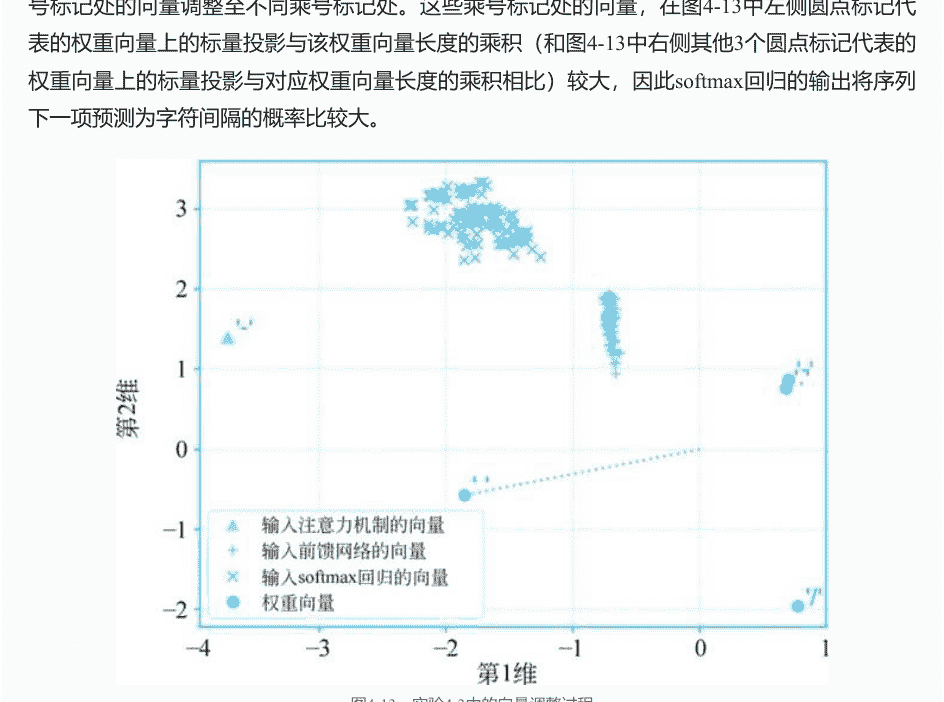

从表达式看，图4-11中softmax的输入是注意力输出、前馈输出与 $x^{<t>}$ 三者相加。直觉上会想把注意力与前馈并联起来做并行计算。但这么做会让前馈的输入从 $x^{<t>} + f^{[attention]}(x^{<1>}, x^{<2>}, ..., x^{<t>})$ 退化为单纯的 $x^{<t>}$。此时softmax输入变为 $x^{<t>} + f^{[attention]}(x^{<1>}, x^{<2>}, ..., x^{<t>}) + f^{[FFN]}(x^{<t>})$。把实验4-3中的两个模块并联后得到的分类准确度曲线如图4-14所示。并联后的准确度略低于串联版本，根源正是前馈的输入信息被简化了。后续实验仍沿用图4-11的串联结构。

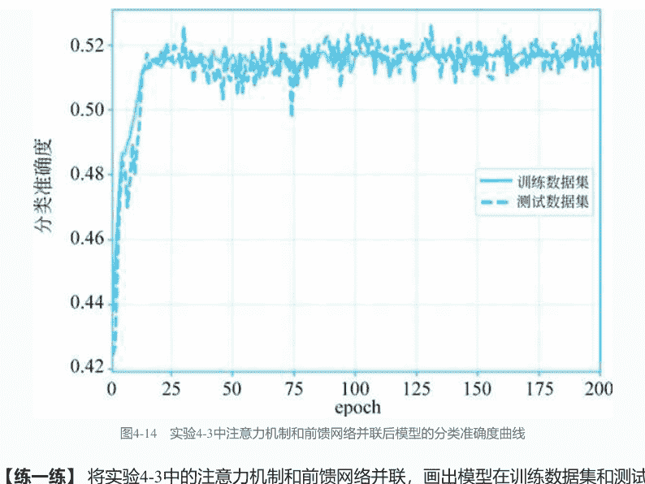
图4-14 实验4-3中注意力机制和前馈网络并联后模型的分类准确度曲线

**【练一练】** 将实验4-3中的注意力机制和前馈网络并联，画出模型在训练数据集和测试数据集上的分类准确度曲线。

引入残差连接有助于提高模型的训练速度。除此之外，是否还有其他方法？

**【想一想】** 在机器学习中，是否还有其他方法可以提高模型的训练速度？

机器学习里常规做法是对样本特征做缩放，比如对每个特征维度做标准化，再把结果喂进模型。这既方便找合适的学习率，也能加速收敛。类比这一思路，深度学习中也可以对网络内部各模块的输入做标准化来提速。

#### 4.2.3 层标准化

对神经网络模块输入做标准化大致分两类：一类是对一批输入向量里的每个维度分别标准化；另一类是对一批输入向量里的每个向量整体分别标准化。前者适合不同元素含义不同的情形，后者适合每个向量整体代表一个语义单元的情形。本章的序列预测任务里，向量序列中的每个向量与输入序列项一一对应，且每项对应一个类别，因此更适配第二种思路。

这种逐向量标准化的做法与层标准化本质相同，只是层标准化最初是为标准化各层中不含偏置的加权和而提出。若把层标准化用于向量序列中的每个向量 $\mathbf{x} = (x_1, x_2, \dots, x_d)$，标准化后 $\tilde{\mathbf{x}} = (\tilde{x}_1, \tilde{x}_2, \dots, \tilde{x}_d)$ 的各元素可由式（4-5）给出：

$$\tilde{x}_i = g_i \frac{x_i - \mu}{\sigma} + b_i \quad (4-5)$$

式（4-5）中，

$$\mu = \frac{1}{d_{\text{main}}} \sum_{j=1}^{d_{\text{main}}} x_j, \quad \sigma = \sqrt{\frac{1}{d_{\text{main}}} \sum_{j=1}^{d_{\text{main}}} (x_j - \mu)^2}$$

$g_i$ 和 $b_i$ 为可训练参数，$i=1, 2, \dots, d_{\text{main}}$。本书中默认关闭该可仿射参数，即令 $g_i=1$、$b_i=0$，于是式（4-5）简化为

$$\tilde{x}_i = \frac{x_i - \mu}{\sigma}$$

> “Transformer论文”里曾把层标准化作用于Transformer层中模块输出与残差和之上，这导致训练不稳定需要预热。后来研究发现，把层标准化作用于模块的输入端即可免去预热。

把层标准化分别加到图4-11中注意力、前馈、softmax的输入上，就得到如图4-15所示的结构。

需要说明的是，层标准化会降低模型复杂度。原因在于，若输入是欧几里得空间中 $d_{\text{main}}$ 维向量，经过层标准化后输出被限制在 $d_{\text{main}}-1$ 维球面上，从而简化了后续模块的输入空间。证明如下。

设输入 $x = (x_1, x_2, \cdots, x_{d_{\text{main}}})$ 的均值和方差分别为

$$\mu = \frac{1}{d_{\text{main}}} \sum_{j=1}^{d_{\text{main}}} x_j$$

$$\sigma = \sqrt{\frac{1}{d_{\text{main}}} \sum_{j=1}^{d_{\text{main}}} (x_j - \mu)^2}$$

标准化后 $\tilde{x} = \frac{x - \mu}{\sigma}$，则有

$$\tilde{x} \cdot \mathbf{1} = \frac{(x - \mu)}{\sigma} \cdot \mathbf{1} = \frac{1}{\sigma} (x \cdot \mathbf{1} - \mu \cdot \mathbf{1}) = \frac{1}{\sigma} \left( \sum_{j=1}^{d_{\text{main}}} x_j - d_{\text{main}} \left( \frac{1}{d_{\text{main}}} \sum_{j=1}^{d_{\text{main}}} x_j \right) \right) = 0$$

且

$$\| \tilde{x} \|_2 = \frac{1}{\sigma} \| x - \mu \|_2 = \frac{1}{\sqrt{\frac{1}{d_{\text{main}}} \sum_{j=1}^{d_{\text{main}}} (x_j - \mu)^2}} \sqrt{\sum_{j=1}^{d_{\text{main}}} (x_j - \mu)^2} = \sqrt{d_{\text{main}}}$$

其中 $\mu = (\mu, \mu, \cdots, \mu) \in \mathbb{R}^{d_{\text{main}}}$，$\mathbf{1} = (1, 1, \cdots, 1) \in \mathbb{R}^{d_{\text{main}}}$。由此可知 $\tilde{x}$ 与 $d_{\text{main}}$ 维 $\mathbf{1}$ 向量正交，且其范数为 $\sqrt{d_{\text{main}}}$。于是 $\tilde{x}$ 位于以原点为中心、半径 $\sqrt{d_{\text{main}}}$ 的 $d_{\text{main}}$ 维球面上，同时又落在过原点且垂直于 $\mathbf{1}$ 的 $d_{\text{main}}-1$ 维超平面上。因此 $\tilde{x}$ 实际位于两者交集的 $d_{\text{main}}-1$ 维球面上。

【实验4-4】使用如图4-15所示的加入层标准化后的序列预测神经网络，预测莫尔斯码数据集III中输入序列的下一项（使用样本组训练模型）。

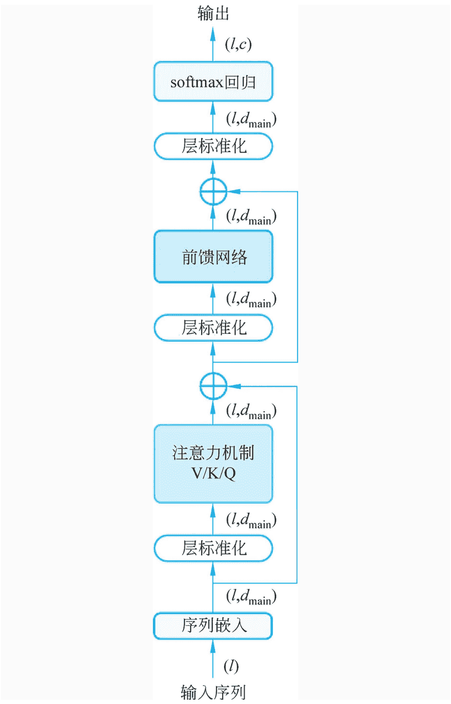

图4-15 加入层标准化后的序列预测神经网络

**提示：**

可使用torch.nn.LayerNorm类实现层标准化，注意其中elementwise_affine参数的设置。

如果独立编写实验程序仍有困难，可参考附录A中经过注释的实验程序。

当本实验设置与实验4-3一致时，训练集和测试集上的分类准确度曲线如图4-16所示。加入层标准化后，模型收敛更快，用更少的epoch就能达到较高准确度。但由于复杂度被压缩，整体峰值准确度略低于实验4-3。

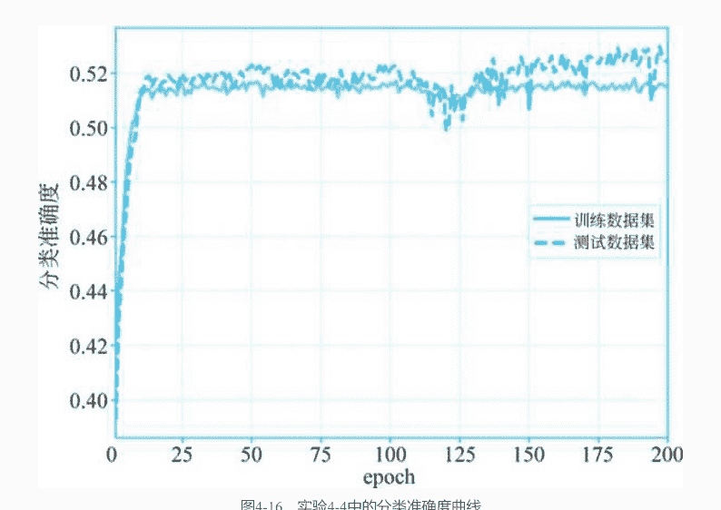

图4-16 实验4-4中的分类准确度曲线

#### 4.2.4 dropout

为抑制过拟合、提升泛化，机器学习常用正则化手段。神经网络里典型的正则化就是dropout。训练时，dropout以概率 $p$ 随机把隐含层节点的输出置零，等价于随机剔除部分节点，迫使网络在不同子结构上学习。推理时dropout关闭，所有节点都参与输出，等价于对训练中所有子网络的集成。训练阶段为保持期望尺度不变，通常把未置零的输出乘以 $1/(1-p)$。正因训练与推理行为不同，实验中需要用eval()和train()切换模式。

把dropout作用于图4-15中序列嵌入模块的输出和向量，以及注意力与前馈模块的输出，得到如图4-17所示的网络。这正是单层解码器型Transformer。从图4-17最下方的dropout到最上方的层标准化之间构成一个Transformer层。

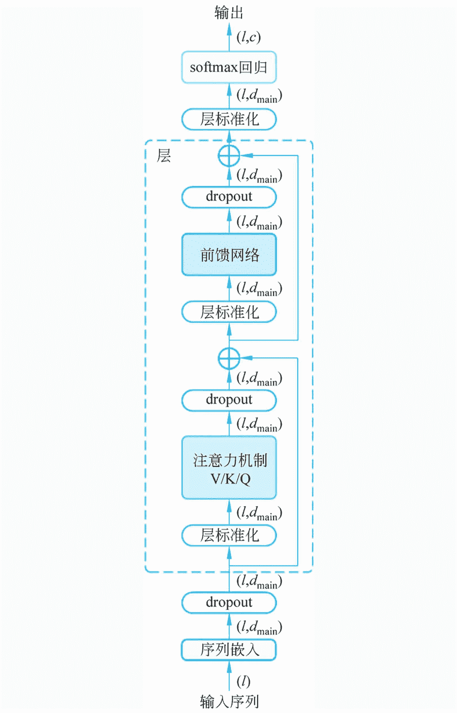

图4-17 加入dropout后的序列预测神经网络

【实验4-5】使用如图4-17所示的加入dropout后的序列预测神经网络，预测莫尔斯码数据集III中输入序列的下一项（使用样本组训练模型）。

提示：

可使用torch.nn.Dropout类实现dropout，p可以取0.1。

如果独立编写实验程序仍有困难，可参考附录A中经过注释的实验程序。

当 $p=0.1$，其余设置与实验4-4相同时，训练集和测试集上的分类准确度曲线如图4-18所示。加入dropout后准确度略有回落。

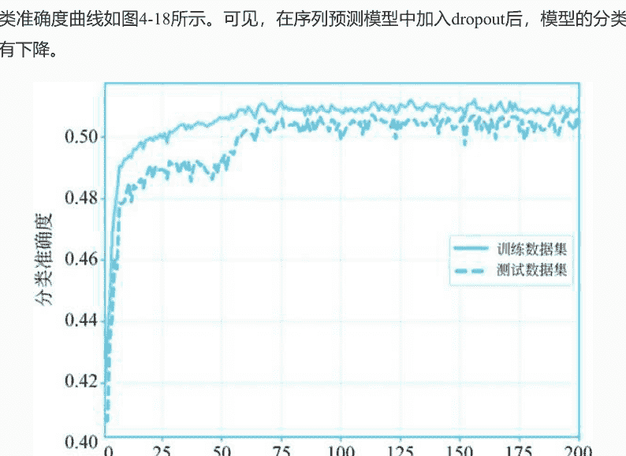

图4-18 实验4-5中的分类准确度曲线

层标准化和dropout并非Transformer不可或缺的组件，实践中可按需取舍。

### 4.3 解码器型Transformer

第1章提到过，把“宽”网络换成“深”网络能在相近效果下减少参数并降低过拟合风险。同样的动机可用来增加4.2.4节中单层解码器Transformer的层数。从向量调整的角度看，增加层数就等于增加调整步数，这有助于更精细地把向量推向理想位置。

具体做法是把多个图4-17所示的层首尾串接，替换掉原来的单层。因为每个层的输入输出形状一致，串接自然成立。

【实验4-6】使用多层解码器型Transformer，预测莫尔斯码数据集III中输入序列的下一项（使用样本组训练模型）。

提示：

- (1) 为了便于代码重用，可将实验4-5中定义神经网络的类拆分为注意力机制、前馈网络、Transformer层以及Transformer等多个类。

- (2) 可使用torch.nn.ModuleList类将多个层的对象保存在一个列表中。

- (3) Transformer的层数可以取6（这也是“Transformer论文”中的设置）。

如果独立编写实验程序仍有困难，可参考附录A中经过注释的实验程序。

当层数设为6，其余设置与实验4-5一致时，分类准确度曲线如图4-19所示。在本设置和莫尔斯码数据集III上，多层解码器Transformer的准确度略高于单层版本。

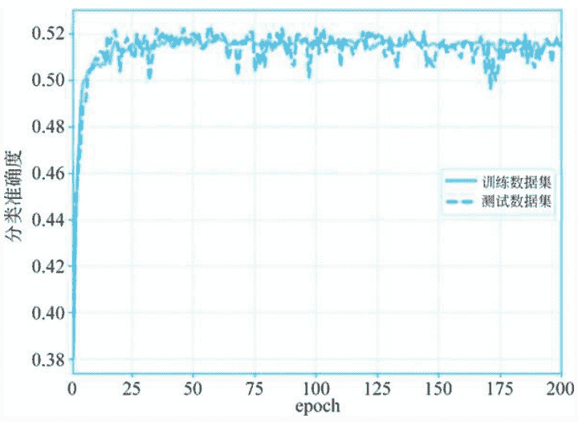

图4-19 实验4-6中的分类准确度曲线

### 4.4 编码器型Transformer

解码器型Transformer把每个样本组当作一小批来处理，天然适配序列预测。在某些序列监督任务里，目标不是预测下一项而是判断整段序列的类别，姑且称为序列分类。例如把“黄元帅苹果”每个字当作一项，预测其类别“水果”就是序列分类。

序列分类中，不同训练样本的输入序列不一定具有包含关系，所以通常无法像序列预测那样用样本组训练。此时模型往往把输入序列视作单个样本的输入序列。3.2节提到，注意力条件模块可以用输入序列最后一项对应的向量作为条件，当然也可以用其他位置的向量。若仍用末项向量，就能沿用解码器型Transformer，只需在训练时把输入序列当作单样本输入。更一般地，若任选输入序列中任一项对应的向量作为条件，就可以用编码器型Transformer来完成序列分类任务。

对照图4-17的示意，单层编码与单层解码在整体骨架上很接近，分歧主要落在注意力单元的具体实现。表面看，编码侧舍去了图4-5里负责填充的那块子模块，解码侧则保留下来，这一点在图4-20中体现得很清楚。从运行机理看，训练时解码器把输入当成一组共享的样本，仅取出序列末尾的表征送进条件查询；编码器无论是在训练还是推理，都把输入视为单独的样本，并依次让序列中每个位置的表征轮流担任查询。

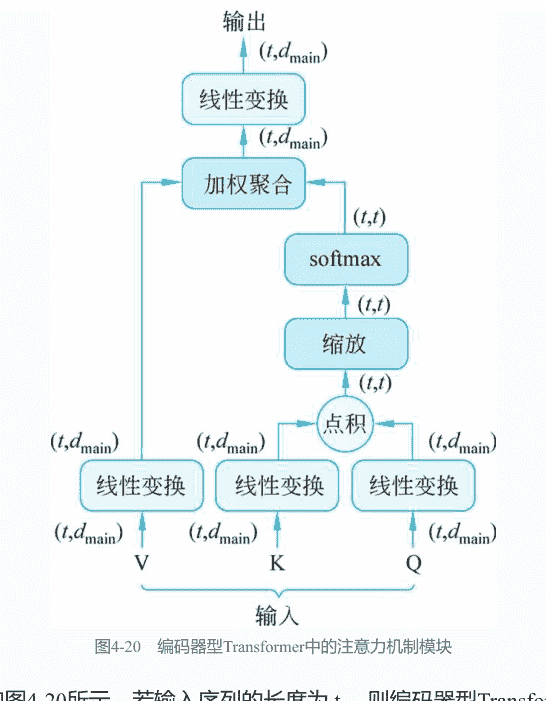

回到图4-20的解释，若序列长度记作 t，编码器的注意力相当于同时启动了 t 个图3-9类型的注意力单元。每个单元都从形状为 (t, d_main) 的同一输入矩阵中抽取一个 d_main 维向量，经 Q 路线性变换后参与计算。t 个单元各自输出一个 d_main 维向量，汇总起来就是尺寸为 (t, d_main) 的结果矩阵。

根据图4-17，编码器接收长度为 t 的输入时，会生成一个 (t, c) 形状的矩阵。矩阵里的每一个 c 维向量，都源自把输入序列的某个位置表征送入条件部分后得到的输出。在序列分类任务里，只要挑出其中任意一个 c 维向量，就能得到该序列落入 c 个类别的概率分布，差异仅是选用了哪个位置的表征作为条件。

把单层编码结构叠加起来，就能形成多层编码体系。

实验4-7 采用编码式架构开展序列预测。莫尔斯码数据集 III 的每一步取值仅限于 {0,1,2,3}，因此该预测本质上等同于分类。为了适配小批量梯度下降，输入序列的长度被统一设为 16。

【实验4-7】借助多层编码结构，对莫尔斯码数据集 III 中输入序列的下一元素进行预测。

### 4.5 编解码器型Transformer

单纯做序列分类时，编码器显得有点大材小用，因为 t 个输出里通常只取一个；但在需要条件引导的预测任务中，它的价值就被放大了。条件序列预测是指输出不仅取决于主输入，还受一个额外给定的条件序列制约。以词为单位举例，已知条件句 “The longest journey begins with a single step”，去推断中文序列 “千里之” 的后续，就是典型的条件预测。

值得强调的是，条件序列与主输入虽然可以直接拼接后送入解码器，但独立保留条件序列更有益：一方面两者的词表可以不一致；另一方面可以把输入的一部分抽出作为条件，从而压缩主序列长度，简化建模。

条件预测需要在同一时间融合主序列与条件序列的表征。条件序列在推理阶段是完整且不变的，恰好适合用编码器来处理。尽管编码器的注意力会对同一组向量进行多次聚合，但每次查询不同，产生的上下文也会有所差异。依据3.2节的分析，这种多样性让模型能够从多个聚合结果中挑选更有利于下一步预测的部分，正是条件任务发挥编码器优势的场景。

而主序列的聚合与下一步的预测仍由解码器负责。核心问题在于如何把编码器与解码器有机结合，以完成条件序列预测。

> 【想一想】怎样把编码侧和解码侧整合起来？

单层编码或解码本质上都是通过注意力完成向量聚合，因而可以再引入一次注意力，将编码后的条件表征与解码器的内部状态连起来，由此形成编解码架构。

单层编解码结构如图4-22所示。为便于理解，图中省略了残差、层归一化与 dropout，但实际实现中包含这些部件。图中 t' 表示编码器接收的条件序列长度，t 表示解码器接收的输入长度。左侧的编码层采用图4-20中无填充的注意力；右侧解码层包含两组注意力：下方一组是图4-5的解码自注意力，用来融合解码器自身的历史；上方一组是跨注意力，采用图4-20的编码式注意力，用来读取编码器输出的 t' 个 d_main 维向量。具体做法是把编码器输出作为 K、V，将下方自注意力的结果作为 Q，即以解码器状态为查询去聚合条件表征。

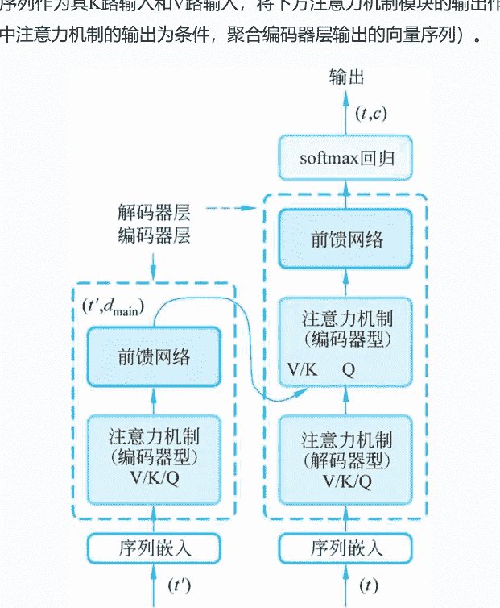

莫尔斯码数据集 III 中的 morsecode_testset_batched_more.pt 也是包含 12 315 个样本的测试文件，它在原版 batched.pt 提供的输入序列、标签和小批量规模的基础上，额外提供了每个样本前 16 步作为条件序列。

在接下来的实验中，已知序列切分出的样本组序列送入解码器，而该组前面的 16 步合并后作为条件序列送入编码器，由编解码结构共同预测样本组序列的下一项。

【实验4-8】采用单层编解码结构，预测莫尔斯码数据集 III 中输入序列的下一项（以样本组方式训练解码模型）。

提示：
- (1) 通过 torch.load 读取 morsecode_testset_batched_more.pt 时，首个返回数组记录各小批量样本数，第二数组为样本输入序列，第三数组为样本输入序列前面的 16 项条件序列，第四数组为标签。
- (2) 可为实验4-7中注意力类的 forward 方法增添参数，以支持分别用不同数组作为 Q、K、V 的输入。
- (3) 可为实验4-7中 Transformer 层类的 __init__ 方法增添参数，用来指定该类包含一个或两个注意力对象。
- (4) 可将实验4-7中的编码式类扩展为编解码式类，并为其 forward 方法增添参数，以同时接受编码输入和解码输入。
- (5) 在从已知序列切分样本组时，也需给出该组的条件序列。
- (6) 学习率可设为 0.001。

若自行编写仍有难度，可参考附录 A 中的注释示例。

在学习率取 0.001、迭代 100 轮且其余设置与实验4-7 相同的情况下，训练集与测试集的准确率变化如图4-23所示。可以看出，借助跨注意力将编码与解码连接起来的编解码结构，在给定条件序列时能够有效预测下一步。

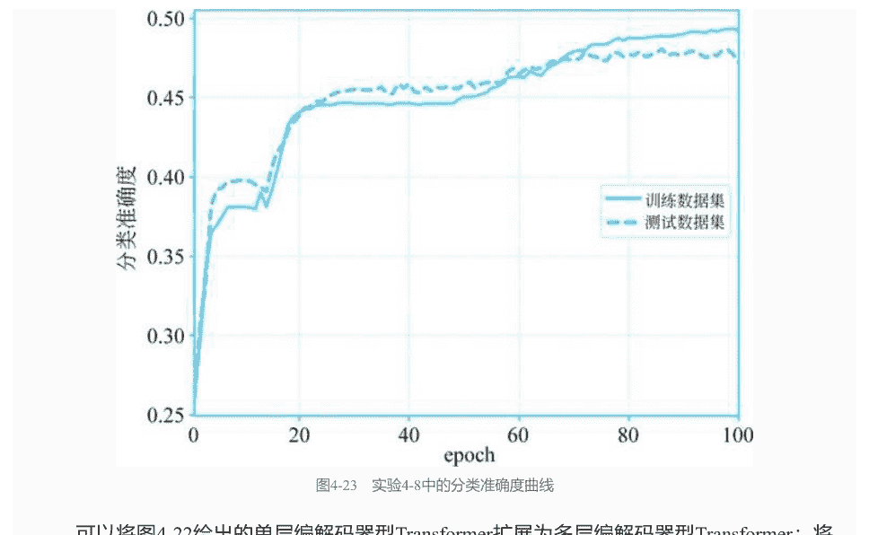

单层编解码结构可以扩展为多层：编码层首尾相连，解码层同样首尾相连，最后一个编码层的输出送入各个解码层的跨注意力，如图4-24 所示，这正是原始 Transformer 论文中的做法。

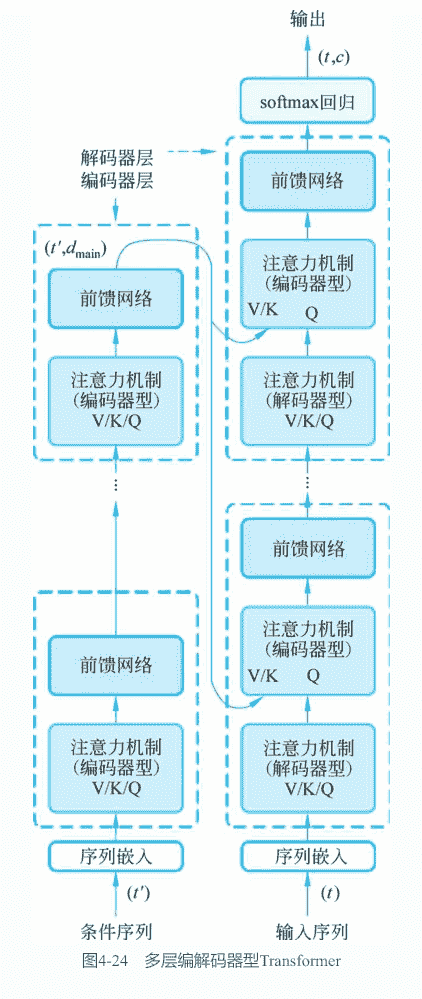

【实验4-9】采用多层编解码结构，预测莫尔斯码数据集 III 中输入序列的下一项（以样本组方式训练解码模型）。

提示：

编码侧和解码侧的层数都可以取 6。

若自行编写仍有难度，可参考附录 A 中的注释示例。

在与实验4-8 相同的设置下，准确率曲线如图4-25 所示。多层结构明显优于单层。

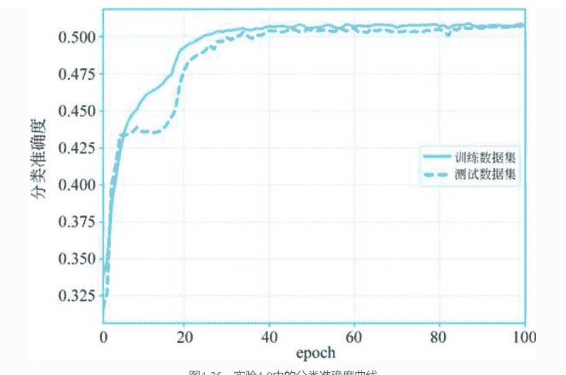

图4-25 实验4-9中的分类准确度曲线

当编码层数与解码层数相等时，也可把各层编码器的输出直接送入对应层的解码跨注意力，如图4-26 所示。这种连线方式让解码器获得更丰富的编码信息，但会使训练变得更困难。

【练一练】采用如图4-26 所示的多层编解码结构，预测莫尔斯码数据集 III 中输入序列的下一项（以样本组方式训练解码模型）。

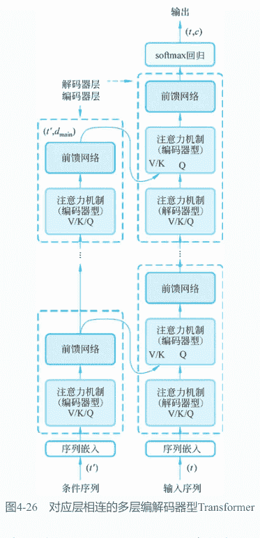

进一步地，也可以省去编码层堆栈，直接把嵌入后的条件向量送入解码器第一层的跨注意力，如图4-27 所示。从第二层开始，解码器只需要自注意力即可。

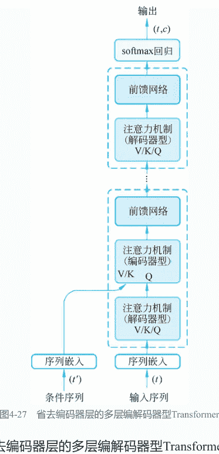

【实验4-10】采用省去编码层的多层编解码结构，预测莫尔斯码数据集 III 中输入序列的下一项（以样本组方式训练解码模型）。

提示：

解码侧的总层数仍可以取 6。

若自行编写仍有难度，可参考附录 A 中的注释示例。

在与实验4-9 相同的配置下，准确率曲线见图4-28。结果显示，去掉编码层后性能基本相当，而参数量大约只有原来的一半。

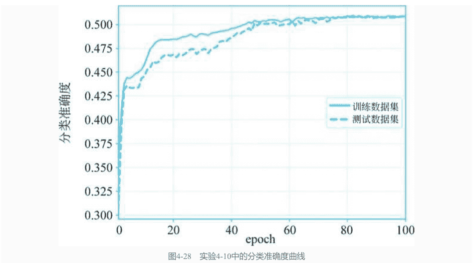

图4-28 实验4-10中的分类准确度曲线

### 4.6 本章小结

为减少重复计算，可把存在包含关系的多个输入序列合并成一个样本组。形式上像单个样本，实质是多个样本的组合。用样本组训练分类模型等价于用一批不含填充的序列做梯度下降。

在样本组注意力里，点积模块输出的是 Q 路与 K 路所有配对的点积构成的矩阵，softmax 前加入填充模块以屏蔽无效计算。为提升预测能力，在注意力与 softmax 回归之间加入前馈网络，通常采用单隐含层结构。为加快训练，给注意力与前馈网络各加一个残差连接，此时可把二者理解为逐步调整序列的最后一个向量，使其在 softmax 上与标签对应的权重投影最大化。二者也可并联。

为进一步提速，对注意力、前馈、softmax 输入的每个向量做层标准化，代价是模型复杂度下降。为防过拟合引入 dropout，随机关掉部分元素以扰动结构。由此得到单层解码型结构。增加层数得到多层解码型结构，适用于序列预测。

序列分类中训练样本输入间不一定有包含关系，通常无法用样本组，可用编码型结构完成。形式上编码侧用无填充注意力，解码侧用带填充注意力。本质上解码侧把输入视为样本组并只用末尾向量作条件，编码侧把输入视为单一样本并让每个位置向量轮流作条件。

条件序列预测里，编码侧聚合条件序列，解码侧聚合输入序列并预测下一步，再用额外注意力桥接二者形成编解码。编码侧与解码侧的连接不唯一：可把最后一个编码层输出送给所有解码层，也可逐层对应，还可省去编码层直接把嵌入后的条件向量送入解码侧第一层。

### 4.7 思考与练习

- 1. 如何理解样本组？什么情况下适合使用样本组？使用样本组有何优势？
- 2. 给出序列分类任务中使用样本组训练模型时的代价函数。该代价函数与使用一小批样本训练模型时的代价函数是否相同？解释为什么相同或者不相同。
- 3. 若让图3-9中的注意力支持样本组，需要做对其做哪些改动？给出做这些改动的原因。
- 4. 在图4-3中的注意和softmax回归之间添加一个前馈网络有何优势与劣势？
- 5. 什么是残差连接？为什么加入残差连接有助于提高模型的训练速度？
- 6. 如何理解图4-11中注意和前馈网络的作用？为什么可以将图4-11中的注意和前馈网络两个模块并联？
- 7. 什么是层标准化？为什么加入层标准化有助于提高模型的训练速度？
- 8. 为什么说加入层标准化会降低模型的复杂度？试画图说明。
- 9. 什么是dropout调整技术？加入dropout是否有助于提高模型的泛化性能？为什么？
- 10. 画出单层解码型Transformer的详细框图。
- 11. 为什么增加单层Transformer中的层数？
- 12. 为什么说解码型Transformer更适用于序列预测任务？如何将解码型Transformer用于序列分类任务？
- 13. 单层编码型Transformer与单层解码型Transformer有何差异？
- 14. 在条件序列预测任务中使用编解码型Transformer与使用解码型Transformer相比有哪些优势？
- 15. 把编码型Transformer和解码型Transformer结合在一起成为编解码型Transformer有哪些方法？

## 第5章 Transformer架构在自然语言处理领域的应用

经过前四章的学习，读者应已掌握 Transformer 架构及其工作机理。Transformer 可处理多种序列监督任务，输入序列可等长也可不等长，还能附带额外的条件序列，条件序列同样允许不等长，因此能完成的机器学习任务相当丰富。

从本章起，将探讨 Transformer 在若干领域的实际应用。第1章提到过，Transformer 最初为解决机器翻译中的序列转换问题而提出。机器翻译即借助计算机把一种语言自动转为另一种语言，属于自然语言处理的重要任务。自然语言处理致力于让计算机理解并运用人类语言，涵盖文本与语音处理等。

除机器翻译外，本章还将探讨如何借助 Transformer 完成文本分类、文本生成、语音分类、语音转文本等自然语言处理任务。

### 5.1 文本分类

文本分类即对文本数据进行类别划分，例如把 “我真的很喜欢学习机器学习” 归为 “积极情感” 类。在机器学习中常以整数如 1 代表该类别。关键问题是如何把一段文本映射为一个输入序列？

> 【想一想】如何将一段文本对应为一个输入序列？

Transformer 入门到实战：从符号化到生成与翻译

Transformer 能处理的输入本质上是整数序列。于是把一段自然语言映射成整数序列就成了第一步。可以把单个字、标点都映射成一个整数，比如“我”对应 5。进一步还能把高频词整体映射，例如“学习”对应 78。这样用更少的整数就能表示更长的文本，也能让一个语义单元对应一个码，而不是被拆成多个码。

这里把字、标点、词统称作 **符号**，也叫词元。符号是不可再分的文本最小块。把整段文字切成符号串的过程叫 **符号化**，反过来把符号串拼回文字叫 **去符号化**。每个符号都有唯一的整数编号，称为 **符号标识**。所有不同符号的集合就是 **词汇表**，词汇表规模等于符号标识的总数。

> SentencePiece 是 Google 推出的一款文本符号化工具，内置 BPE、Byte Pair Encoding 等算法。安装很简单，在 Anaconda Prompt 里执行 pip install sentencepiece 即可。

刘禹锡的《陋室铭》常被用作演示文本，可通过扫描二维码获取原文文件。

### 5.1 文本分类
经符号化后，文本就能变成整数序列，也就是符号标识序列。下面用实验 5-1 来体感这个过程。

##### 【实验5-1】用 SentencePiece 对《陋室铭》做符号化
提示：
- 可用 SentencePieceTrainer.train() 生成词表，参数 vocab_size 控制词表规模，本实验设为 100，model_type='bpe' 指定 BPE。
- 符号化和去符号化分别用 SentencePieceProcessor 的 encode() 与 decode()。

若不愿手写，可参考附录 A 的注释代码。

当词表规模为 100 时，“山不在高，有仙则名。”会被编码成 11，5，97，28，30，26，54，29。序列长度与词表规模相关：大致上词表越大，编码后的序列越短。

> 情感分类是典型的文本分类问题，把文本归到积极、消极或中性等类别。

影评数据来自电影评论，review_trainset.pt 与 review_testset.pt 各含 25 000 条样本。标注只有 0 与 1，0 表示消极，1 表示积极。输入是符号化后的整数序列，最大长度 256，词表规模 5000，即每个位置取值在 0~4999。数据可通过二维码下载。

符号化之后，整数序列即可送入 Transformer 训练与预测。序列分类里模型把输入看成单个样本的序列，编码器型 Transformer 就能完成分类。

##### 【实验5-2】编码器型 Transformer 在影评情感分类上的应用
提示：
- torch.load() 读取文件返回的第一个数组是输入序列，第二个是序列长度，第三个是标签。
- 小批训练需处理变长序列，可在注意力层的 forward 中按长度生成掩码，把超出长度的位置对应注意力权重置零、聚合向量置零。
- 分类依据可取序列末项对应的模型输出向量，用索引数组取出概率分布。
- 本实验学习率取 0.001，隐藏维度 d_main 为 128，批大小 64，Transformer 层数 6，dropout p 取 0.1，训练轮数 10。

如需参考代码，见附录 A。

在学习率 0.001、d_main 128、批大小 64、层数 6、dropout 0.1、epoch 10、最大长度 256 的配置下，训练集与测试集的准确率曲线如图 5-1。可见在情感分类上，Transformer 训练轮数不多就能达到较高准确率。

图5-1 实验5-2中的分类准确度曲线

### 5.2 文本生成
文本生成是基于给定前缀续写更多内容。符号化后的整数序列取值范围有限，属于序列生成任务，解码器型 Transformer 可胜任。训练时解码器把输入视作样本组的序列。

> 童话语料来自童话故事，fairytale_tokenid.pt 包含 215 882 个符号标识，每个标识取值 0~4999，对应词表规模 5000。可扫码下载。

下面两个实验用该语料训练解码器型 Transformer 做下一项预测，并用 top-p 方法采样生成。

##### 【实验5-3】解码器型 Transformer 在童话语料上的序列预测，使用样本组训练
提示：
- 参照 4.1 节从符号标识序列切分样本组，输入长度可取 128。
- 可把序列尾部切出的若干样本组作为测试集，例如 32 000 个。

参考实现见附录 A。

当输入长度 128、测试样本组 32 000，其余设置同实验 5-2 时，训练集与测试集准确率如图 5-2。注意测试样本组与训练样本组可能重叠。若重叠，训练准确率提升也可能拉高测试表现。但图 5-2 中测试准确率并未随训练准确率上升而上升，甚至略降，提示模型已过拟合，尽管轮数不多。

##### 【实验5-4】用实验 5-3 的模型与 top-p 生成符号序列并还原文本
童话语料对应的词表模型 fairytale.model 由 SentencePieceTrainer.train() 生成。

提示：
- 生成长度不必超过 128，top-p 中的 p 可取 0.6。
- 初始序列可随意，例如以“很久很久以前”对应的标识序列开头。

参考代码见附录 A。

本实验生成的文本通顺度有限，主要是因为语料与模型规模都偏小。

**【练一练】** 用更大语料训练更大模型来生成文本。

生成任务中过拟合会让输出更贴近训练文本。大语料下这通常不是致命问题，甚至有助于符合口语习惯。但过拟合会降低多样性，即熵减小。同时大语料也会让构造独立测试集更困难。

### 5.3 机器翻译
机器翻译是源语言到目标语言的序列转换，即把源语句的符号序列映射为目标语句的符号序列。可看作条件序列生成，编码器处理条件序列，解码器在条件下自回归生成。

样本为语句对。经符号化后得到源序列与目标序列。源序列输入编码器。解码器输入与训练标签的构造需要两个特殊符号：序列开始与序列结束，各自有独立标识。解码器输入由开始符接目标序列构成，训练标签由目标序列接结束符构成。这样生成时可以用开始符启动，遇到结束符即停止，解决长度未知问题。训练时解码器仍把输入当作样本组处理。

在条件生成里，编码器输入与解码器输入、标签的取值范围可以不同，机器翻译中源、目标可分别建表。

实验 5-5 尝试把英语译成中文。

> 翻译语料包含 34 118 对语句的符号序列。
> ch_sequence.pt 含 34 118 条中文序列，最大长度 82，含特殊符。输入序列为开始符+中文序列，标签序列为中文序列+结束符，长度相等。
> en_sequence.pt 含 34 118 条英文序列，最大长度 86，条件序列为英文序列+结束符。
> 两文件标识取值 0~2999，词表规模 3000。可扫码下载。

##### 【实验5-5】编解码器型 Transformer 在翻译语料上的条件序列预测
提示：
- torch.load(ch_sequence.pt) 返回输入序列、长度、标签。注意输入视作样本组。
- torch.load(en_sequence.pt) 返回条件序列、长度。
- 可把后 6400 个样本作为测试集。
- 在注意力层基础上支持 Q、K、V 来自不同数组。
- 解码器小批中样本组长度不一，样本数不固定，计算损失时不宜除以样本组数，可把 torch.nn.CrossEntropyLoss 的 reduction 设为 'sum'。
- 标签数组中填充值为 0，可把 ignore_index 设为 0 避免计算填充项。

参考实现见附录 A。

当编码器最大长度 86、解码器最大长度 82、词表 3000、测试样本 6400、epoch 30，其余设置同实验 5-3 时，训练与测试准确率如图 5-3。预测能力看起来不错。

图5-3 实验5-5中的分类准确度曲线

##### 【实验5-6】用实验 5-5 的模型与 top-p 做机器翻译
语言翻译语料中 ch.model 与 en.model 分别是中文、英文文本训练出的 SentencePiece 模型。

提示：在该语料里，开始符标识为 1，结束符标识为 2。

参考代码见附录 A。

在测试集上，部分样本译文较准。例如原文 “anxious students prepared for the upcoming exam” 被译为“焦急的学生准备即将到来的考试”，参考译文为“焦急的学生们为即将到来的考试做着准备”。也有不理想的案例，如 “she watches TV shows” 被译为“她打电视剧表演”，参考为“她看电视节目”。提升总体质量可把 top-p 换成束搜索等更复杂的解码策略。

【试一试】实现束搜索并完成翻译。

可用 BLEU 评估译文与参考译文的相似度，取值 0~1。可用 torcheval.metrics.functional.bleu_score() 计算，并用 jieba 将中文切词。

### 5.4 语音分类
语音处理属于自然语言处理分支，研究语音信号的处理。语音是一段时序信号。

单声道语音可用实数序列表示，长度等于时长×采样率。如 48kHz 下 20s 信号长度达 960000，直接送模型难度很大。因此通常先分帧、加窗、短时傅里叶变换，再把处理后的短序列输入模型。本书用加窗后做 STFT 得到的单边幅度谱作为向量，形成向量序列，即频谱图。帧长 25ms，帧移 10ms，窗函数为汉明窗。

语音分类包括命令识别、语言识别、激活检测、情感分类等。编码器型 Transformer 可用于此任务。实验 5-7 以语音命令识别为例。

##### 【实验5-7】编码器型 Transformer 在语音命令数据集上的分类
语音命令识别可视作多分类，识别命令如“前进”“后退”“停止”。

本实验数据集通过运行 speech_commands_dataset.ipynb 生成并下载，文件可扫码获取。

生成的 sc_trainset.pt 含 20 480 条训练样本，sc_testset.pt 含 2 048 条测试样本。输入序列最大长度 101，每项是 201 维向量，对应 16kHz 采样语音的单边幅度谱。标签取值 0~34，对应 35 条命令。

提示：

实验设置要点回顾

- 调用 torch.load（） 读取 sc_trainset.pt 与 sc_testset.pt 时，返回的三个数组依次对应输入序列、输入序列的长度以及对应的标注。
- 本实验的 Transformer 输入是向量序列而非整数序列，因此不需要对每个元素做词嵌入；只是输入向量的原始维度与模型内部维度不一致，需要借助仿射映射完成维度的对齐。
- 学习率可设为 0.0001。

若自行实现仍有困难，可参考附录 A 中带有详细注释的参考程序。

在序列最大长度取 101、学习率 0.0001、训练轮次 100 且其余配置与实验 5-6 保持一致的条件下，编码器型 Transformer 在训练集与测试集上的分类准确率随轮次变化如图 5-5 所示。结果表明，在当前设置、模型与数据组合下，Transformer 架构在语音分类任务上能够取得相当高的分类准确率。

### 5.5 从语音到文字

实验 5-7 的语音命令识别既属于语音分类，也可看作是较为简单的语音识别。语音识别里更有挑战的目标是语音转文本 Speech-To-Text，STT，即由一段语音生成对应的文字。这是一种序列到序列的映射，可以借鉴机器翻译的做法，用编解码器型 Transformer 来完成。

【实验5-8】在 LJ 语音数据集上用编解码器型 Transformer 实现语音转文本。

LJ 语音数据集

> 数据集共包含 13 100 条语音与文本的配对样本。实验使用的 LJ 数据集可通过运行 ljspeech_dataset.ipynb 中的代码下载并生成，该 notebook 可通过扫描二维码获取。

生成的 lj_trainset.pt 包含 3 200 条训练样本，lj_testset.pt 包含 256 条测试样本。每条样本由两个序列构成：一段语音频谱序列，和一段符号标识序列。频谱序列中的每一帧对应采样率 22 050 Hz 语音信号的单边幅度谱。

语音频谱序列的最大长度为 512，每一帧是 276 维向量。
符号标识序列的最大长度为 73，每一项取值在 {0,1,2,...,99} 中，词表大小为 100。序列首项固定为序列开始符，数值为 1；末项固定为序列结束符，数值为 2。

transcription_100.model 是用 SentencePiece 中的 SentencePieceTrainer.train（） 为本数据集文本构建词表时产生的模型文件。

提示：
- (1) 用 torch.load（） 读取 lj_trainset.pt 和 lj_testset.pt 时，返回的四个数组依次为语音频谱序列、频谱序列长度、符号标识序列、标识序列长度。
- (2) 本实验编码器接收的是语音频谱序列，属于向量序列，无需嵌入，但仍需用仿射映射调整向量维度。
- (3) 训练时解码器的输入序列是不含序列结束符的符号标识序列，即去掉原序列最后一项；监督标签序列是不含序列开始符的符号标识序列，即去掉原序列第一项。
- (4) 推理时可采用 2.3 节的贪心方法生成符号标识序列，再经去符号化映射回文本。

编写有困难时可参考附录 A 的注释程序。

当编码器与解码器的最大序列长度分别设为 512 与 72、词表大小为 100、训练轮次为 300 且其余设置与实验 5-7 相同，模型在训练集与测试集上的分类准确率曲线如图 5-6 所示。曲线是将解码器的输入序列视为样本输入、预测下一个符号视为分类任务得到的。进一步用训练好的模型对语音生成文本，会发现测试集上生成的文本在读音上与参考文本有较多的相似之处，而训练集上生成质量更高，甚至能完全一致。这说明编解码器型 Transformer 能较好地完成语音转文本任务。

语音转文本的性能常用词错误率 Word Error Rate，WER 衡量，WER 越小说明效果越好。

【练一练】用词错误率评估实验 5-8 模型在语音转文本任务上的表现。

提示：可使用 torcheval.metrics.functional.word_error_rate（） 计算词错误率。

实验 5-8 的模型在训练集上的词错误率约为 0.66，在测试集上约为 0.99。

### 5.6 本章要点回顾

自然语言处理是 Transformer 的核心应用场景之一。本章以文本分类、文本生成、机器翻译、语音分类、语音转文本为例，展示了 Transformer 在 NLP 任务中的使用方式。实际应用时需要思考如何把数据映射为整数序列、实数序列或向量序列，并根据任务类型选择编码器型、解码器型或编解码器型结构。

将一段文本转为整数序列，先做符号切分并为每个符号分配整数标识，必要时在前后加上开始符与结束符。嵌入模块可把整数序列映射为 $d_{\text{main}}$ 维向量序列。

语音信号对应的原始实数序列很长，通常先做特征提取压缩为较短的向量序列，再输入 Transformer。此时可借助仿射映射或小型网络将固定维度的输入向量转换到 $d_{\text{main}}$ 维。

编码器型 Transformer 适用于文本分类与语音分类，解码器型适用于文本生成，编解码器型适用于机器翻译与语音转文本。

### 5.7 思考与练习

- 1. 自然语言处理是什么？NLP 领域有哪些可用机器学习方法解决的任务？可查阅资料后作答。
- 2. 什么是符号化？什么是去符号化？如何理解符号的概念？
- 3. 在实验 5-2 中，能否使用模型输出向量序列的第一个向量而非最后一个向量进行分类？原因是什么？
- 4. 通过符号化文本，构建一个至少含 1000 万个符号标识的数据集，用其训练一个解码器型 Transformer 并生成文本。
- 5. 用 Transformer 架构做语音处理有哪些挑战？有哪些可行的解决思路？可查阅资料后作答。
- 6. 尝试用编解码器型 Transformer 实现文本到语音转换 Text To Speech，TTS 任务。

## 第6章 Transformer在计算机视觉中的实践

除自然语言处理外，Transformer 在计算机视觉等领域也展现出很强潜力。计算机视觉关注从图像、视频等视觉输入中提取有意义信息并理解视觉世界。本章将探讨如何用 Transformer 完成图像分类、图像描述、视频分类、视频预测等任务。

### 6.1 图像分类任务入门

图像分类是对图像数据的分类。图像可以是二维的照片，也可以是三维全息图。按表示方式可分为光栅图像与矢量图像，光栅图像尺寸固定，由像素构成。

本书讨论的图像指二维光栅数字图像，含灰度图像与彩色图像。灰度图像每个像素为代表亮度的实数，可用二维矩阵表示，行列对应高度与宽度。常用 8 位无符号整数存储，取值范围 [0,255]。彩色图像每个像素为三维向量，分表表示红绿蓝亮度，可用三维数组表示，元素取值同样在 [0,255]。例如 1920×1080 的彩色图可用形状为（3，1920，1080）的数组表示，共 6 220 800 个元素。

可把三维数组展平成一维直接输入深度神经网络分类，但图像尺寸大时参数量剧增，样本不足容易过拟合影响泛化。

因此在视觉任务里通常先从图像中提取特征并局部聚合，再把聚合结果展平为一维向量输入逻辑回归或神经网络完成分类。这些步骤合起来就形成了卷积神经网络。

图6-1 展示了一个可用于多分类的卷积神经网络。该网络目前只包含一个卷积层与一个聚合层。输入为形状（3，$h_{in}$，$w_{in}$）的三维数组，$h_{in}$、$w_{in}$ 分别为图像高度与宽度，3 为通道数。

卷积层包含仿射映射加 ReLU 激活，把 $3 \cdot h_{\text{kern}} \cdot w_{\text{kern}}$ 维输入向量映射为 $d_{\text{conv}}$ 维输出。$h_{\text{kern}}$、$w_{\text{kern}}$ 为核高宽，$d_{\text{conv}}$ 为超参数。卷积层从输入中切出 $h_{\text{conv}} \cdot w_{\text{conv}}$ 个形状（3，$h_{\text{kern}}$，$w_{\text{kern}}$）的小块，如图6-2，每块展平后输入映射模块，得到形状（$h_{\text{conv}}$，$w_{\text{conv}}$，$d_{\text{conv}}$）的三维数组。为与 PyTorch 输出一致，增加调维模块将其变为（$d_{\text{conv}}$，$h_{\text{conv}}$，$w_{\text{conv}}$）。调维不改变元素，只改变索引，可理解为换个视角看同一数组。该输出即卷积层输出，$d_{\text{conv}}$ 也称输出通道数。

切分时相邻小块在宽度方向相距 $w_{stride}$ 个像素，高度方向相距 $h_{stride}$ 个像素。示例中 $h_{in}=5$，$w_{in}=7$，$h_{kern}=3$，$w_{kern}=3$，$h_{stride}=2$，$w_{stride}=2$，$h_{conv}=2$，$w_{conv}=3$。一般地 $h_{conv}$ 与 $w_{conv}$ 可由算式计算：

$$h_{conv} = \left\lfloor \frac{h_{in} - h_{kern}}{h_{stride}} + 1 \right\rfloor, \quad w_{conv} = \left\lfloor \frac{w_{in} - w_{kern}}{w_{stride}} + 1 \right\rfloor$$

其中 ■ 表示向下取整。切分过程可并行进行。

图6-1 的聚合层对卷积输出做局部聚合，输入形状（$d_{\text{conv}}$，$h_{\text{conv}}$，$w_{\text{conv}}$），输出形状（$d_{\text{conv}}$，$h_{pool}$，$w_{pool}$）。其中

$$h_{\text{pool}} = \left\lfloor \frac{h_{\text{conv}}}{h_{\text{win}}} \right\rfloor, \quad w_{\text{pool}} = \left\lfloor \frac{w_{\text{conv}}}{w_{\text{win}}} \right\rfloor$$

$h_{win}$ 与 $w_{win}$ 为聚合窗口高宽。窗口内 $h_{win} \cdot w_{win}$ 个元素聚合成一个，常使用最大聚合取最大值。聚合层对 $d_{\text{conv}}$ 个二维切片分别聚合。如图6-4，窗口从左上角开始向右移动 $w_{win}$ 个元素，超出右侧则回最左并向下移动 $h_{win}$ 个元素，重复直至超出下边界。聚合层无可训练参数，聚合也可在并行下完成。

聚合层输出经合维展平为一维向量，作为后续分类模型的输入。

在实验 6-1 与实验 6-2 中，先用卷积神经网络在 CIFAR-10 上做图像分类，再用编码器型 Transformer 在同一数据集上做分类。

【实验6-1】用卷积神经网络在 CIFAR-10 上完成图像分类。

> CIFAR-10 共 60 000 样本，其中 50 000 训练、10 000 测试。每样本为 32×32 彩色图像与标注，标注取值为 {0,1,...,9}，对应 10 个类别。

可扫描二维码下载读取数据集的 Jupyter Notebook 参考程序。

提示：
- 1. 程序中使用 torchvision.transforms.ToTensor 将像素值从 [0,255] 缩放至 [0,1]。读取前需导入 torchvision。
- 2. 卷积层可用 torch.nn.Conv2d 实现。参数 in_channels 为输入通道数，本实验为 3；out_channels 为输出通道数即 $d_{\text{conv}}$，可取 8；kernel_size 为核大小，对应 $h_{\text{kern}}$、$w_{\text{kern}}$，可取 5；stride 为切分跨度，对应 $h_{\text{stride}}$、$w_{\text{stride}}$，可取 3。
- 3. 最大聚合层可用 torch.nn.MaxPool2d 实现，参数 kernel_size 为聚合窗口大小，对应 $h_{win}$、$w_{win}$，可取 2。
- 4. 本实验中 $w_{pool}$ 同为 5，若 $d_{\text{conv}}$ 取 8，则一个卷积加一个聚合后的三维数组展平后得到 $d_{\text{conv}} \cdot h_{pool} \cdot w_{pool}=5\times5\times8=200$ 维向量。

$$h_{pool} = \left\lfloor \frac{h_{conv}}{h_{win}} \right\rfloor = \left\lfloor \frac{\left\lfloor \frac{h_{in} - h_{kern}}{h_{stride}} + 1 \right\rfloor}{h_{win}} \right\rfloor = \left\lfloor \frac{\left\lfloor \frac{32 - 5}{3} + 1 \right\rfloor}{2} \right\rfloor = 5$$

- 5. 图6-1 的卷积神经网络可用多分类逻辑回归即 softmax 回归完成。

学习率建议取0.001。 编程遇到困难时，可查看附录A中带注释的参考实现。

当卷积通道数 d_conv 设为8，卷积核高宽 h_kern、w_kern 均为5，步长 h_stride、w_stride 均为3，窗口高宽 h_win、w_win 均为2，批量大小64，学习率0.001，训练轮数20时，训练集与测试集的分类准确率变化如图6-5。模型总参数约2618个。由此可见，卷积神经网络足以高效完成图像分类，且模型规模保持精简。

**【实验6-2】** 在CIFAR-10上用编码器Transformer做图像分类

提示：

### 6.2 图像描述任务

图像描述即为输入图像自动生成自然语言说明。5.2节曾用解码器Transformer生成文本。把图像拆分为若干区域或整体映射为序列项，就能借助编码器-解码器Transformer实现图像描述。

CocoCaptions每个样本包含一张彩色图和多条文字说明，每条说明都可作为该图的描述。


Coco-Captions图像

受样本规模限制，本次只使用部分图像及其首条文字说明。可通过二维码下载部分图像、部分标注以及配套的Jupyter Notebook参考代码。调用数据前需先安装Coco API或pycocotools，安装命令为pip install pycocotools。


Coco-Captions文本标注

相较CIFAR-10，CocoCaptions图像分辨率更高。参考Notebook先用预训练的ResNet-18卷积网络把每张图压缩成1000维特征向量，统一保存为resnet_outputs.pt。


##### 【实验6-3】 用编解码器Transformer在CocoCaptions上做图像描述

提示：

- 1. 通过torch.load读取caption_tokenids.pt，第一个返回数组是符号序列，第二个是对应长度。
- 2. 前32 000条作为训练集，剩余用作测试集。
- 3. 先对每张图的1000维特征做仿射变换并加dropout，得到d_main维向量，作为长度为1的编码器输出。
- 4. 训练时以符号序列的前t-1个作为解码器输入，序列的后t-1个作为目标标签，t为该序列长度。
- 5. 学习率可设0.001，d_main可取256。
- 6. 测试阶段可尝试贪婪解码为图像生成描述。

若自行实现困难，可参考附录A的注释代码。

当解码器层数6、d_main256、解码器最大输入长l87、训练样本32 000、训练轮数30，其他设置同实验6-2时，以解码器输入为样本输入、预测下个符号为分类任务的准确率曲线如图6-7。结果表明，即使编码器被ResNet-18特征提取器替代，编解码器Transformer依然能胜任图像描述。

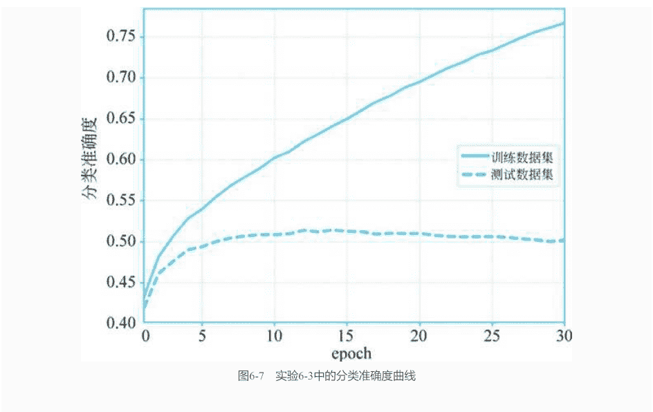

图6-7 实验6-3中的分类准确度曲线

### 6.3 视频分类

数字视频本质上是帧的序列，单帧可视为三维张量，多帧拼接后即为四维张量。

将整段视频映射到单一类别即为视频分类，例如动作识别如跳绳、太极、拉小提琴等。以每帧为一个序列元素，问题转化为序列分类，编码器Transformer可直接处理。

##### 【实验6-4】 基于编码器Transformer的UCF101视频分类

UCF101包含13 320条动作视频，采样率25Hz，每条属于101类动作之一。


通过二维码可获取视频文件、类别标注及配套的Jupyter Notebook处理脚本。


UCF101标注

参考程序先把视频切成64帧的固定片段，再用ResNet-18把每帧映射为1000维向量，于是每个片段变成长度64、维度1000的向量序列。

以该序列为样本输入，对应类别标签取值0~100，作为监督信号。训练集保存为ucf101_resnet_trainset.pt，共9600个样本；测试集保存为ucf101_resnet_testset.pt，共1920个样本。


UCF101参考程序

提示：

- (1) 用torch.load加载ucf101_resnet_trainset.pt或ucf101_resnet_testset.pt时，首个数组为输入序列，第二个为标签。
- (2) 可先把1000维输入向量通过仿射变换投影到d_main维。

编程困难时可参考附录A注释程序。

当Transformer层数6、d_main128、最大序列长l64、训练轮数10，其余参数沿用实验6-3时，训练集和测试集的分类准确率曲线如图6-8。结果说明编码器Transformer足以应对视频分类。

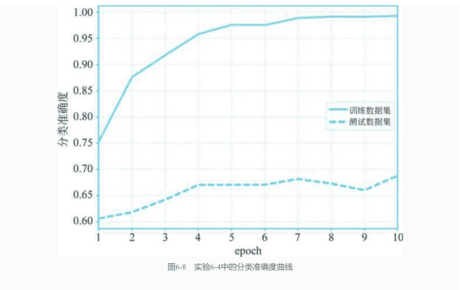

图6-8 实验6-4中的分类准确度曲线

### 6.4 视频预测

视频预测目标是根据已观测帧序列生成后续帧，属于序列预测，可用解码器Transformer实现。

##### 【实验6-5】 用解码器Transformer做Moving MNIST视频预测

Moving MNIST包含10 000段灰度视频，每段有两枚随机数字在0~9范围内随机移动，共20帧，单帧64×64。


通过二维码下载读取与处理Notebook。该脚本把视频转为长度20、每维4096的向量序列，作为样本。训练集mm_trainset.pt含8960段，测试集mm_testset.pt含1024段。

提示：

- 1. 训练时取前19项作解码器输入，后19项作目标序列。
- 2. 可把4096维向量经仿射映射到d_main维。
- 3. 目标为连续向量，元素取值[0,1]，属于回归问题，可选用均方误差等损失。
- 4. 为把输出限制在(0,1)，可在模型输出后接sigmoid，torch.nn.functional.sigmoid即可实现。
- 5. 用matplotlib.pyplot.imshow显示帧，torch.permute可调整维度顺序。

如实现困难请参考附录A注释代码。

在输入最大长度l19、训练轮数100，其余同实验6-4时，训练与测试的RMSE曲线如图6-9。本实验未用卷积层提取特征，而是直接用仿射映射把帧线性投影到d_main维。说明对低分辨率帧，可免去卷积，直接用线性或神经网络映射即可。


图6-9 实验6-5中的均方根误差曲线

### 6.5 本章要点

计算机视觉是Transformer的重要应用场景。本章以图像分类、图像描述、视频分类、视频预测为例展示如何落地。

大尺寸图像或视频帧通常先经卷积层或CNN提取特征，再组织成向量或整数序列输入Transformer。

本质上CNN先用卷积与池化提取聚合特征，再用逻辑回归或神经网络把固定维特征映射为输出。

编码器Transformer适合图像分类与视频分类，解码器Transformer适合视频预测，编码器-解码器Transformer适合图像描述。

### 6.6 思考与练习

- 1. 如何用多维数组表示二维光栅数字图像？
- 2. 如何理解卷积神经网络？举例说明可用于多分类任务的卷积神经网络。
- 3. 除了卷积神经网络，还有哪些可用来从图像或视频帧中提取特征的方法？可在查找资料后作答。
- 4. 使用Transformer架构自行完成一个计算机视觉领域的任务（可自行查找数据集）。

## 第7章 Transformer多领域应用

### 7.1 数字信号处理中的应用

数字信号处理关注离散序列的分析与处理，正因其序列本质，Transformer可用于其上的分类、回归等任务。

> 人体活动识别HAR旨在依据传感器数据判断当前活动如跑、走、跳等，属于分类问题。

RealWorld数据集记录了15名受试者在走、跑、坐、站、躺、跳、上/下楼梯8种状态下，由6类传感器采集的数据，传感器布置于头、臂、腰、腿等部位。

可通过二维码下载数据文件及处理Notebook。本次仅选用加速度计与陀螺仪在走、跑、站、躺4类活动下的数据。加速度计6处、陀螺仪5处，每类传感器均采集x,y,z三轴，采样率约50Hz。


参考程序把数据整理为3000条长度320、维度33的向量序列，每条对应一种活动，相邻向量间隔约1秒。以序列为输入、活动类别0~3为标签，统一保存为sensor_data.pt。


##### 【实验7-1】 编码器Transformer在RealWorld上做活动识别

提示：

- 1. torch.load读取sensor_data.pt返回首个数组为序列，第二个为标签。
- 2. 前2560条作训练集，剩余作测试集。

实现困难时可参考附录A。

当编码器输入最大长l320、d_main16、训练样本2560、测试样本384、训练轮数5，其余同实验6-5时，训练与测试准确率曲线如图7-1。在本设置下，Transformer能达到较高分类精度。


### 7.2 推荐系统中的应用

推荐系统是基于机器学习的信息过滤机制，用于向用户推送商品、服务或内容，如依据听歌历史推荐新歌。

把用户行为按时间排序视为序列，Transformer即可预测未来行为，如下一步购买或浏览，从而实现个性化推荐。

##### 【实验7-2】 解码器Transformer预测旅行下一个城市

> 旅行数据集含41 408条长度2~17的整数序列，取值0~499，对应500个城市。每条序列代表一次旅行的城市轨迹。预测下一个城市即可据此推荐酒店、机票等。

通过二维码下载序列文件。trips_trainset.pt含38 400条用于训练，trips_testset.pt含3 008条用于测试。


旅行数据集

提示：

用torch.load读取trips_trainset.pt和trips_testset.pt，第一个返回数组为序列，第二个为长度。

如编程困难可参考附录A。

当解码器最大输入长l16、d_main128、词表大小500、训练轮数10，其余同实验7-1时，以预测下一项为分类任务的准确率曲线如图7-2。结果显示Transformer在此数据上预测下个城市的准确率较高，可进一步用于酒店与机票的推荐。


图7-2 实验7-2中的分类准确度曲线

### 7.3 深度强化学习中的应用

深度强化学习DRL将深度学习引入强化学习。建模时常采用马尔可夫决策过程MDP描述智能体与环境交互。MDP的一个限制是假设下一状态的概率只由当前状态和当前动作决定，且智能体的动作选择仅依赖于当前状态。

在不少实际场景里，智能体当前步长的动作概率并非单独由此时环境状态决定，历史多步的环境信息以及自己过去的动作轨迹都会共同起作用。另有一类任务，智能体根本无法获得环境的完整信息，只能依赖局部感知。

针对这两种情况，解码器型Transformer可以把当前时刻以及若干历史时刻的环境状态或不完整观测，和历史动作序列一起作为输入，计算出当前时刻各候选动作被采纳的概率。

##### 【实验7-3】解码器Transformer结合蒙特卡洛策略梯度攻克迷宫任务

> 本次迷宫任务沿用《深度强化学习》书中实验5-10的设计，目标是在给定迷宫里从指定入口走到指定出口的最短可达路线，因此可以把智能体视作移动机器人。任务中智能体仅能感知当前位置上下左右四个方向的状态信息，属于部分可观测。动作空间共4个，即向上、向下、向左、向右各挪一步。每走一步奖励为0，到达出口时奖励为1并终止本轮。若在限定步数，例如100步内仍未抵达出口，也会强制结束。


扫描二维码获取迷宫任务及蒙特卡洛策略梯度方法的参考代码。

##### 提示：

- (1) 参考代码已实现了迷宫环境与蒙特卡洛策略梯度的基础框架，只需补充Transformer类的实现即可运行。
- (2) 解码器型Transformer的输入是一个整数序列，长度为奇数且不超过199，共对应最多100步。每一步对应一个时刻，序列中奇数位置存放该时刻的观测编码，取值0到15共16种，对应四方向的2^4种组合；偶数位置存放上一时刻的动作编码，取值0到3分别对应上、下、左、右。
- (3) 因为奇数项和偶数项语义不同，需要采用分别的嵌入方式进行处理。
- (4) 解码器输出是一个向量序列，每个向量代表该时刻四个动作的选取概率，维度为4，序列最长100，常用softmax给出归一化概率。

若自行编写仍有难度，可参考附录A中带注释的示例程序。

当输入序列最大长度 l 设为199，模型主维度 d_main 设为32，折扣因子 γ 设为0.95，训练轮数达到4000次，其余超参与实验7-2一致时，智能体单轮移动步数变化如图7-3所示。可以看到随着训练轮数增加，平均步数整体呈现下降趋势，说明智能体已学会入口到出口的最短路径。由此可见，在部分可观测条件下，Transformer结构能够有效解决该迷宫强化学习问题。


需要说明的是，本实验的智能体没有利用当前观测对可选动作进行预先过滤，即未做到“看到墙就不往墙走”。因此有概率出现撞墙情况，撞墙时位置不动但步数仍计入，相当于浪费一次行动。若加入基于观测的动作筛选机制，在相同设置下可以更快收敛，找到最短路径所需的训练轮数更少，如图7-4所示。


### 7.4 本章小结

Transformer不仅在自然语言处理和计算机视觉中表现突出，还可拓展到数字信号处理、推荐系统、深度强化学习等多个方向。本章以身体活动识别、旅行序列延长推荐、走迷宫三个典型任务为例，展示了具体应用方式。

数字信号处理方面，可先对传感器采集的数字信号进行预处理如下采样，得到更短的向量序列再送入Transformer。

推荐系统方面，可将用户历史行为按时间顺序映射为序列，例如整数序列，再用Transformer预测下一步行为。

深度强化学习方面，可把按时间排列的环境状态或智能体的部分观测，以及历史动作按顺序拼接为序列，输入Transformer进行建模。

其中编码器型Transformer适用于身体活动识别任务，解码器型Transformer适用于旅行延长推荐和走迷宫任务。

当然，Transformer的应用远不止上述列举，更多领域有待读者自行探索尝试并验证。

### 7.5 思考与练习

- 1. 自行设计并训练一个用于本章身体活动识别任务的深度神经网络，对比其与实验7-1模型在参数规模和分类准确率上的差异。
- 2. 选择一个公开推荐数据集，利用Transformer架构实现一个推荐系统任务并验证效果。
- 3. 除实验7-3使用的蒙特卡洛策略梯度外，Transformer还能怎样结合到其他强化学习算法中，请尝试实现。
- 4. 除了循环神经网络和书中介绍的序列聚合方法，还有哪些方式能把变长向量序列映射为定长向量或固定维度表示，尝试建模验证。

## 附录A

实验参考程序及注释

### A.1 第1章实验

【实验1-1】基于PyTorch对轮椅数据集的样本输入向量进行标准化，并随机划分为训练集与测试集。

【实验1-1参考程序】


实验1-1的程序

```
import pandas # 导入 Pandas
import torch # 导入 Torch
# 读取数据集文件
df = pandas.read_csv('wheelchair_dataset.csv')
# 用 tensor 数组保存样本的输入向量和标注
x_data = torch.tensor(df.values[:, :-1], dtype=torch.float)
    # 将 4 维输入向量(表格前 4 列)中元素的数据类型转换为浮点型
y_data = torch.tensor(df.values[:, -1], dtype=torch.long) - 1
    # 将标注(表格第 5 列)的数据类型转换为长整型,并将其取值范围从 {1,2,3,4}转换至 {0,1,2,3}
num_examples = df.values.shape[0] # 数据集中样本的数量
d_input = df.values.shape[1] - 1 # 样本输入向量的维数
# 用来训练、评估神经网络模型的设备
device = 'cuda' if torch.cuda.is_available() else 'cpu'
    # 如果 GPU 可用则使用 GPU,否则使用 CPU
# 随机排列数据集中的样本
torch.manual_seed(0) # 设置 PyTorch 的随机种子
index_example = torch.randperm(num_examples)# 随机排列样本的索引
# 划分数据集
num_train_examples = 200 # 训练样本的数量
x_train = x_data[index_example[:num_train_examples], :].to(device=device)
    # 训练样本的输入向量,迁移至指定设备,x_train 的形状为 (样本数量,向量维数)
y_train = y_data[index_example[:num_train_examples]].to(device=device)
    # 训练样本的标注,迁移至指定设备,y_train 的形状为 (样本数量)
x_test = x_data[index_example[num_train_examples:], :].to(device=device)
    # 测试样本的输入向量,迁移至指定设备,x_test 的形状为 (样本数量,向量维数)
y_test = y_data[index_example[num_train_examples:]].to(device=device)
    # 测试样本的标注,迁移至指定设备,y_test 的形状为 (样本数量)
# 特征缩放(标准化)
mean_x = torch.mean(x_train, dim=0) # 计算训练样本输入向量各维的均值
std_x = torch.std(x_train, dim=0) # 计算训练样本输入向量各维的标准差
x_train = (x_train - mean_x) / std_x # 对训练样本输入向量各维做标准化
x_test = (x_test - mean_x) / std_x # 对测试样本输入向量各维做标准化
```

完整参考程序可扫描二维码下载。

##### 【实验1-2】使用PyTorch构建单隐含层多分类神经网络。

##### 【实验1-2参考程序】


实验1-2的程序

```
...
# 实验中的设置
n_ann = 8  # 神经网络隐含层节点的数量
num_classes = 4  # 数据集中类别的数量
# 定义神经网络
class ann(torch.nn.Module):
    def __init__(self):
        super(ann, self).__init__()
        self.linear_layer1 = torch.nn.Linear(in_features=d_input, out_features=n_ann)  # 隐含层的仿射映射
        self.linear_layer2 = torch.nn.Linear(in_features=n_ann, out_features=num_classes)  # 输出层的仿射映射
    def forward(self, x):
        a_1 = torch.nn.functional.relu(self.linear_layer1(x))  # 隐含层
        z_2 = self.linear_layer2(a_1)  # 输出层仿射映射
        return z_2
# 创建神经网络模型，迁移至指定设备
model = ann().to(device=device)
```

完整参考程序可扫描二维码下载。

【实验1-3】利用轮椅数据集和PyTorch训练上述单隐含层多分类网络。

【实验1-3参考程序】


```
...
import matplotlib.pyplot as plt # 导入matplotlib.pyplot
# 实验中的设置
num_epochs = 60 # epoch的数量
learning_rate = 0.1 # 学习率
# 创建AdamW优化器对象
optimizer = torch.optim.AdamW(model.parameters(), lr=learning_rate)
# 创建用来计算多分类任务中交叉熵代价的对象
loss_function = torch.nn.CrossEntropyLoss()
# 初始化
cost_saved = [] # 用来保存代价的列表
# 训练过程中每个epoch的循环
for epoch in range(num_epochs):
    # 正向传播
    z = model(x_train) # 进行正向传播
    cost = loss_function(z, y_train) # 计算代价
    cost_saved.append(cost.item()) # 保存代价
    # 反向传播
    optimizer.zero_grad() # 偏导数清零
    cost.backward() # 进行反向传播
    optimizer.step() # 更新模型参数
    # 打印训练进展
    if (epoch + 1) % 10 == 0:
        print(f'Training [{epoch+1}/{num_epochs}]: cost = {cost.item():.5f}')
# 画代价曲线
plt.figure(dpi=150) # 新建一个图形(150dpi)
plt.plot(range(1, len(cost_saved) + 1), cost_saved, 'r-o', linewidth=2, markersize=3) # 画曲线
plt.xlabel('Epoch') # 设置横轴标签
plt.ylabel('Cost') # 设置纵轴标签
plt.xlim(1, len(cost_saved)) # 设置横轴范围
plt.grid(axis='both', ls=':') # 显示网格线
plt.show() # 显示图形
```

完整参考程序可扫描二维码下载。

【实验1-4】基于轮椅数据集用PyTorch评估该单隐含层多分类模型，给出训练集和测试集的分类准确率。

##### 【实验1-4参考程序】


实验1-4的程序

```
...
import torcheval.metrics
...
accuracy_train_saved = []
accuracy_test_saved = []
...
# 在训练数据集和测试数据集上评估模型
with torch.inference_mode():
    model.eval()
    z = model(x_train)
    accuracy_train = torcheval.metrics.functional.multiclass_accuracy(z, y_train, num_classes=num_classes)
    accuracy_train_saved.append(accuracy_train.item())
    z = model(x_test)
    accuracy_test = torcheval.metrics.functional.multiclass_accuracy(z, y_test, num_classes=num_classes)
    accuracy_test_saved.append(accuracy_test.item())
    model.train()
...
# 画分类准确度曲线
plt.figure(dpi=150)
plt.plot(range(1, len(accuracy_train_saved)+1), accuracy_train_saved, 'r', linewidth=2, label='Trainset')
plt.plot(range(1, len(accuracy_test_saved)+1), accuracy_test_saved, 'b--', linewidth=2, label='Testset')
plt.xlabel('Epoch')
plt.ylabel('Accuracy')
plt.legend(loc='right')
plt.xlim(1, len(accuracy_train_saved))
plt.grid(axis='both', ls=':')
plt.show()
# 打印最新的分类准确度
print(f'Accuracy on trainset: {accuracy_train_saved[-1]:.5f}')
print(f'Accuracy on testset: {accuracy_test_saved[-1]:.5f}')
```

完整参考程序可扫描二维码下载。

【实验1-5】借助PyTorch提供的函数统计上述单隐含层多分类网络的参数总量。

【实验1-5参考程序】


实验1-5的程序

```
...
#函数:计算模型参数数量
#输入:模型
#返回值:模型参数数量
def count_model_parameters(model):
    total = 0                    #模型参数数量初始值为 0
    for param in model.parameters(): #模型中各个参数数组的循环
        if param.requires_grad:  #检查该组参数是否为模型训练过程中被更新的模型参数
            total += torch.numel(param) #将该参数数组中元素的数量累加至模型参数数量上
    return total
...
print('Number of trainable model parameters:', count_model_parameters(model)) #打印模型参数数量
...
```

完整参考程序可扫描二维码下载。

【实验1-6】使用轮椅数据集和PyTorch训练并评估双隐含层多分类深度神经网络，报告训练集与测试集的准确率。

【实验1-6参考程序】


实验1-6的程序

```
...
n1_dnn = 4 #深度神经网络第一个隐含层中节点的数量
n2_dnn = 4 #深度神经网络第二个隐含层中节点的数量
...
#定义深度神经网络
class dnn(torch.nn.Module):
    def __init__(self):
        super(dnn, self).__init__()
        self.linear_layer1 = torch.nn.Linear(in_features=d_input, out_features=n1_dnn) #第一个隐含层的仿射映射
        self.linear_layer2 = torch.nn.Linear(in_features=n1_dnn, out_features=n2_dnn) #第二个隐含层的仿射映射
        self.linear_layer3 = torch.nn.Linear(in_features=n2_dnn, out_features=num_classes) #输出层的仿射映射
    def forward(self, x):
        a_1 = torch.nn.functional.relu(self.linear_layer1(x)) #第一个隐含层
        a_2 = torch.nn.functional.relu(self.linear_layer2(a_1)) #第二个隐含层
        z_3 = self.linear_layer3(a_2) #输出层
        return z_3
...
```

扫码就能拿到完整参考代码。

### A.2 第2章实验清单

【实验2-1】利用深度神经网络处理股票指数数据，预测指数是上涨还是下跌。

【实验2-1参考程序】


实验2-1代码示例

```
...
# 实验中的设置
n1_dnn = 16  # 深度神经网络第一个隐含层中节点的数量
n2_dnn = 16  # 深度神经网络第二个隐含层中节点的数量
num_epochs = 300  # epoch 的数量
learning_rate = 0.01  # 学习率
...
# 读取数据集
x_train, y_train = torch.load('stock_trainset.pt')  # 读取训练数据集
x_test, y_test = torch.load('stock_testset.pt')  # 读取测试数据集
x_len = x_train.shape[1]  # 输入序列的长度
x_train = x_train.to(device=device)
    # 训练样本的输入序列,迁移至指定设备,x_train 的形状为(样本数量,序列最大长度)
y_train = y_train.to(device=device)
    # 训练样本的标注,迁移至指定设备,y_train 的形状为(样本数量)
x_test = x_test.to(device=device)
    # 测试样本的输入序列,迁移至指定设备,x_test 的形状为(样本数量,序列最大长度)
y_test = y_test.to(device=device)
    # 测试样本的标注,迁移至指定设备,y_test 的形状为(样本数量)
...
# 创建用来计算二分类任务中交叉熵代价的对象
loss_function = torch.nn.BCEWithLogitsLoss()
...
    cost = loss_function(z.squeeze(), y_train)  # 计算代价
...
    accuracy_train = torcheval.metrics.functional.binary_accuracy(z.squeeze(), y_train)
    # 计算训练数据集上的分类准确度
...
    accuracy_test = torcheval.metrics.functional.binary_accuracy(z.squeeze(), y_test)
    # 计算测试数据集上的分类准确度
...
```

完整程序包支持扫码下载。

【实验2-2】基于循环神经网络对股票指数序列建模，实现涨跌方向预测。

【实验2-2参考程序】


```
...
n_rnn = 24 #循环神经网络隐含层中节点的数量
num_epochs = 600 #epoch 的数量
...
x_train, y_train = torch.load('stock_trainset_packed.pt') #读取训练数据集
x_test, y_test = torch.load('stock_testset_packed.pt') #读取测试数据集
...
#定义循环神经网络
class rnn(torch.nn.Module):
    def __init__(self):
        super(rnn, self).__init__()
        self.rnn = torch.nn.RNN(input_size=1, hidden_size=n_rnn, nonlinearity='relu', batch_first=True) #隐含层
        self.linear_output = torch.nn.Linear(in_features=n_rnn, out_features=1) #输出层的仿射映射
    def forward(self, x):
        out_rnn, h_rnn = self.rnn(x) #隐含层,h_rnn 的形状为(1,样本数量,节点数量)
        z = self.linear_output(h_rnn[0, :, :])
        #输出层的仿射映射,仅需使用序列最后一项对应的隐含层输出(由 h_rnn 给出)作为
        #输出层的输入
        return z
...
```

二维码里有全套参考程序可下载。

【实验2-3】用循环神经网络学习莫尔斯码数据集I，预测序列的下一个符号。

【实验2-3参考程序】


实验2-3代码片段

```
...
n_rnn = 32 #循环神经网络隐含层中节点的数量
num_epochs = 1000 #epoch的数量
num_classes = 4 #数据集中类别的数量
...
x_train, y_train = torch.load('morsecode_trainset_packed.pt') #读取训练数据集
x_test, y_test = torch.load('morsecode_testset_packed.pt') #读取测试数据集
...
    self.rnn = torch.nn.RNN(input_size=num_classes, hidden_size=n_rnn,
nonlinearity='relu', batch_first=True) #隐含层
    self.linear_output = torch.nn.Linear(in_features=n_rnn, out_features=num_
classes) #输出层的仿射映射
...
#创建用来计算多分类任务中交叉熵代价的对象
loss_function = torch.nn.CrossEntropyLoss()
    ...
    cost = loss_function(z, y_train) #计算代价
    ...
    accuracy_train = torcheval.metrics.functional.multiclass_accuracy(z, y_
train, num_classes=num_classes) #计算训练数据集上的分类准确度
    ...
    accuracy_test = torcheval.metrics.functional.multiclass_accuracy(z, y_
test, num_classes=num_classes) #计算测试数据集上的分类准确度
    ...
```

扫码获取完整的实验参考程序。

【实验2-4】在实验2-3模型上接贪婪解码策略，完成序列生成。

【实验2-4参考程序】


实验2-4示例代码

```
...
# 实验中的设置
l = 16 # 序列的最大长度
# 初始化
sequence = torch.zeros((1, 1), dtype=torch.long, device=device)
# 序列中仅有一项,该项的值为0(代表字符间隔)
# 将模型置于评估模式
model.eval()
# 生成序列
while sequence.shape[1] <= l: # 当序列长度不超过最大长度时
    # 将序列中的各项转换为 one-hot 向量
    sequence_onehot = torch.nn.functional.one_hot(sequence, num_classes=num_classes).to(dtype=torch.float)
    # 正向传播
    with torch.inference_mode(): # 仅预测模式
        z = model(sequence_onehot) # 进行正向传播
    # 用贪婪方法得到序列下一项的值
    next_item = torch.argmax(z, dim=-1)[0] # 取概率最大的值
    # 将得到的序列下一项加入序列
    sequence = torch.cat((sequence, next_item.reshape((1, -1))), dim=-1)
# 打印生成的序列
print('Generated sequence:', sequence.tolist())
```

整套参考代码扫码即可下载。

【实验2-5】沿用实验2-3的网络，改用 top-k 采样方式生成序列。

【实验2-5参考程序】


```
...
top_k = 2 #top-k中的k
#设置PyTorch的随机种子
torch.manual_seed(0)
...
    #用top-k方法得到序列下一项的值
    probabilities = torch.nn.functional.softmax(z[0, :], dim=-1)
    #计算序列下一项取各个值的概率
    sorted_prob, sorted_index = torch.sort(probabilities, descending=False)
    #升序排列上述概率
    probabilities[sorted_index[:num_classes-top_k]] = 0
    #将排在前面的c-k个较小的概率清零
    next_item = torch.multinomial(probabilities, num_samples=1)
    #归一化余下的k个较大的概率(让这k个较大的概率之和为1)
    #并依照归一化后的概率随机抽取序列下一项的值
...
```

完整实验代码通过二维码获取。

【实验2-6】在实验2-3基础上采用 top-p 采样进行序列生成。

【实验2-6参考程序】


实验2-6代码示例

```
...
top_p = 0.6 #top-p中的p
...
    #用top-p方法得到序列下一项的值
    probabilities = torch.nn.functional.softmax(z[0, :], dim=-1)
    #计算序列下一项取各个值的概率
    sorted_prob, sorted_index = torch.sort(probabilities, descending=False)
    #升序排列上述概率
    cum_prob = torch.cumsum(sorted_prob, dim=-1) #计算概率的累计和
    zeroed_sorted_prob = sorted_prob * (cum_prob >= (1 - top_p))
    #保留累计和不小于1-p的概率,将余下较小的概率清零
    next_item = sorted_index[torch.multinomial(zeroed_sorted_prob, num_samples=1)]
    #归一化保留的若干较大的概率(让这些较大的概率之和为1)
    #并依照归一化后的概率随机抽取序列下一项的值
...
```

参考程序完整版扫码下载。

### A.3 第3章实验清单

【实验3-1】结合加权聚合与多分类逻辑回归，基于莫尔斯码数据集II预测序列下一项。

【实验3-1参考程序】


实验3-1代码片段

```
...
d_main = 4
...
# 读取数据集
x_train, y_train, mask_train, position_train = torch.load('morsecode_trainset_padded.pt')  # 读取训练数据集
x_test, y_test, mask_test, position_test = torch.load('morsecode_testset_padded.pt')  # 读取测试数据集
x_train = x_train.to(device=device)
    # 训练样本的输入序列,迁移至指定设备,x_train的形状为(样本数量,序列最大长度)
y_train = y_train.to(device=device)
    # 训练样本的标注,迁移至指定设备,y_train的形状为(样本数量)
mask_train = mask_train.to(device=device)
    # 训练样本输入序列各项的掩码,迁移至指定设备
    # mask_train的形状为(样本数量,序列最大长度)
position_train = position_train.to(device=device)
    # 训练样本输入序列各项的位置,迁移至指定设备
    # position_train的形状为(样本数量,序列最大长度)
x_test = x_test.to(device=device)
    # 测试样本的输入序列,迁移至指定设备,x_test的形状为(样本数量,序列最大长度)
y_test = y_test.to(device=device)
    # 测试样本的标注,迁移至指定设备,y_test的形状为(样本数量)
mask_test = mask_test.to(device=device)
    # 测试样本输入序列各项的掩码,迁移至指定设备,mask_test的形状为(样本数量,序列最大长度)
position_test = position_test.to(device=device)
    # 测试样本输入序列各项的位置,迁移至指定设备,position_test的形状为(样本数量,序列最大长度)
...
# 定义神经网络
class fnn(torch.nn.Module):
    def __init__(self):
        super(fnn, self).__init__()
        self.emb_input = torch.nn.Embedding(num_embeddings=num_classes, embedding_dim=d_main)  # 输入序列项的嵌入
        self.linear_softmax = torch.nn.Linear(in_features=d_main, out_features=num_classes)  # 输出层的仿射映射
    def forward(self, x, mask, position):
        x_emb = self.emb_input(x)
            # 输入序列项的嵌入,x_emb的形状为(样本数量,序列最大长度,向量维数)
        x_emb = x_emb * mask.unsqueeze(dim=-1)
            # 将输入序列填充项对应的嵌入向量清零
        agg = torch.sum(x_emb, dim=1)
            # 将嵌入向量序列中的各个向量加在一起,agg的形状为(样本数量,向量维数)
        z = self.linear_softmax(agg)  # 输出层的仿射映射,z的形状为(样本数量,类别数量)
        return z
...
    z = model(x_train, mask_train, position_train)  # 进行正向传播
...
```

扫码下载完整实验参考程序。

【实验3-2】采用加权聚合配合多分类逻辑回归，对莫尔斯码数据集II的序列做下一项预测。

【实验3-2参考程序】


```
...
# 定义神经网络
class fnn(torch.nn.Module):
    def __init__(self):
        super(fnn, self).__init__()
        self.emb_input = torch.nn.Embedding(num_embeddings=num_classes, embedding_dim=d_main)  # 输入序列项的嵌入
        self.linear_softmax = torch.nn.Linear(in_features=d_main, out_features=num_classes)  # 输出层的仿射映射
        self.weight = torch.nn.Parameter(torch.randn(1, 1, device=device) * 0.01, requires_grad=True)  # 加权聚合中的权重向量，其形状为(序列最大长度,1)
    def forward(self, x, mask, position):
        x_emb = self.emb_input(x)  # 输入序列项的嵌入，x_emb的形状为(样本数量,序列最大长度,向量维数)
        x_emb = x_emb * mask.unsqueeze(dim=-1)  # 将输入序列填充项对应的嵌入向量清零
        agg = x_emb.transpose(-1, -2) @ self.weight  # 计算向量序列中向量的加权和，agg的形状为(样本数量,向量维数,1)
        z = self.linear_softmax(agg.squeeze(dim=-1))  # 输出层的仿射映射，z的形状为(样本数量,类别数量)
        return z
...
```

完整参考实现扫码就能下载。

【实验3-3】基于自适应加权汇总搭配多分类逻辑回归，对莫尔斯码数据集II的输入序列进行下一项预测。

##### 【实验3-3参考代码】


```python
# 定义神经网络
class fnn(torch.nn.Module):
    def __init__(self):
        super(fnn, self).__init__()
        self.emb_input = torch.nn.Embedding(num_embeddings=num_classes, embedding_dim=d_main)  # 输入序列项的嵌入
        self.linear_softmax = torch.nn.Linear(in_features=d_main, out_features=num_classes)  # 输出层的仿射映射
        self.linear_weight = torch.nn.Linear(in_features=d_main * 1, out_features=1)  # 用来给出加权聚合中权重向量的仿射映射
    def forward(self, x, mask, position):
        x_emb = self.emb_input(x)
        # 输入序列项的嵌入, x_emb 的形状为 (样本数量, 序列最大长度, 向量维数)
        x_emb = x_emb * mask.unsqueeze(dim=-1)
        # 将输入序列填充项对应的嵌入向量清零
        weight = self.linear_weight(x_emb.flatten(start_dim=1, end_dim=2))
        # 计算自适应加权聚合中的权重向量, weight 的形状为 (样本数量, 序列最大长度)
        agg = weight.unsqueeze(dim=1) @ x_emb
        # 计算向量序列中向量的加权和, agg 的形状为 (样本数量, 1, 向量维数)
        z = self.linear_softmax(agg.squeeze(dim=1))
        # 输出层的仿射映射, z 的形状为 (样本数量, 类别数量)
        return z
```

完整参考实现扫码就能下载。

##### 【实验3-4】采用选择性汇总结合多分类逻辑回归，预测莫尔斯码数据集II序列的下一个元素。

##### 【实验3-4参考代码】


实验3-4的源码

```python
# 定义神经网络
class fnn(torch.nn.Module):
    def __init__(self):
        super(fnn, self).__init__()
        self.emb_input = torch.nn.Embedding(num_embeddings=num_classes, embedding_dim=d_main)  # 输入序列项的嵌入
        self.linear_softmax = torch.nn.Linear(in_features=d_main, out_features=num_classes)  # 输出层的仿射映射
        self.linear_weight = torch.nn.Linear(in_features=d_main, out_features=1)  # 用来将向量序列中的向量对应为实数的仿射映射
    def forward(self, x, mask, position):
        x_emb = self.emb_input(x)  # 输入序列项的嵌入, x_emb 的形状为(样本数量, 序列最大长度, 向量维数)
        x_emb = x_emb * mask.unsqueeze(dim=-1)  # 将输入序列填充项对应的嵌入向量清零
        z_weight = self.linear_weight(x_emb).squeeze(dim=-1)  # 将向量序列中的向量对应为实数, z_weight 的形状为(样本数量, 序列最大长度)
        z_weight = z_weight.masked_fill(mask == 0, float('-inf'))  # 将 z_weight 数组中与输入序列填充项对应的元素置为负无穷
        weight = torch.nn.functional.softmax(z_weight, dim=-1)  # 计算选择性聚合中的权重向量, weight 的形状为(样本数量, 序列最大长度)
        agg = weight.unsqueeze(dim=1) @ x_emb  # 计算向量序列中向量的加权和, agg 的形状为(样本数量, 1, 向量维数)
        z = self.linear_softmax(agg.squeeze(dim=1))  # 输出层的仿射映射, z 的形状为(样本数量, 类别数量)
        return z
```

完整参考实现扫码就能下载。

##### 【实验3-5】利用输入向量序列的选择性汇总与多分类逻辑回归，预测莫尔斯码数据集II输入序列的下一项。

##### 【实验3-5参考代码】


实验3-5的源码

```python
# 定义神经网络
class fnn(torch.nn.Module):
    def __init__(self):
        super(fnn, self).__init__()
        self.emb_input = torch.nn.Embedding(num_embeddings=num_classes, embedding_dim=d_main)  # 输入序列项的嵌入
        self.emb_position = torch.nn.Embedding(num_embeddings=1, embedding_dim=d_main)  # 位置的嵌入
        self.linear_softmax = torch.nn.Linear(in_features=d_main, out_features=num_classes)  # 输出层的仿射映射
        self.linear_weight = torch.nn.Linear(in_features=d_main, out_features=1)  # 用来将和向量序列中的向量对应为实数的仿射映射
    def forward(self, x, mask, position):
        x_emb = self.emb_input(x)  # 输入序列项的嵌入, x_emb 的形状为 (样本数量, 序列最大长度, 向量维数)
        pos_emb = self.emb_position(position)  # 位置的嵌入, pos_emb 的形状为 (样本数量, 序列最大长度, 向量维数)
        x_pos_emb = (x_emb + pos_emb) * mask.unsqueeze(dim=-1)  # 将输入序列填充项对应的和向量清零
        z_weight = self.linear_weight(x_pos_emb).squeeze(dim=-1)  # 将和向量序列中的向量对应为实数, z_weight 的形状为 (样本数量, 序列最大长度)
        z_weight = z_weight.masked_fill(mask == 0, float('-inf'))  # 将 z_weight 数组中与输入序列填充项对应的元素置为负无穷大
        weight = torch.nn.functional.softmax(z_weight, dim=-1)  # 计算选择性聚合中的权重向量, weight 的形状为 (样本数量, 序列最大长度)
        agg = weight.unsqueeze(dim=1) @ x_emb  # 计算和向量序列中向量的加权和, agg 的形状为 (样本数量, 1, 向量维数)
        z = self.linear_softmax(agg.squeeze(dim=1))  # 输出层仿射映射, z 的形状为 (样本数量, 类别数量)
        return z
```

完整参考实现扫码就能下载。

##### 【实验3-6】基于带条件模块的选择性汇总及多分类逻辑回归，预测莫尔斯码数据集II输入序列的下一项。

##### 【实验3-6参考代码】


实验3-6的源码

```python
d_dot = d_main

# 定义神经网络
class fnn(torch.nn.Module):
    def __init__(self):
        super(fnn, self).__init__()
        self.emb_input = torch.nn.Embedding(num_embeddings=num_classes, embedding_dim=d_main)  # 输入序列项的嵌入
        self.emb_position = torch.nn.Embedding(num_embeddings=1, embedding_dim=d_main)  # 位置的嵌入
        self.linear_softmax = torch.nn.Linear(in_features=d_main, out_features=num_classes)  # 输出层的仿射映射
        self.linear_weight = torch.nn.Linear(in_features=d_main, out_features=d_dot)  # 和向量序列中向量的仿射映射
        self.linear_weight_cond = torch.nn.Linear(in_features=d_main, out_features=d_dot)  # 条件模块
    def forward(self, x, mask, position):
        x_emb = self.emb_input(x)
        # 输入序列项的嵌入, x_emb 的形状为(样本数量, 序列最大长度, 向量维数)
        pos_emb = self.emb_position(position)
        # 位置的嵌入, pos_emb 的形状为(样本数量, 序列最大长度, 向量维数)
        x_pos_emb = (x_emb + pos_emb) * mask.unsqueeze(dim=-1)
        # 将输入序列填充项对应的和向量清零
        z_weight_vect = self.linear_weight(x_pos_emb)
        # 将和向量序列中的向量仿射映射为点积中的向量
        # z_weight_vect 的形状为(样本数量, 序列最大长度, 点积向量维数)
        z_weight_cond = self.linear_weight_cond(x_pos_emb[:, -1, :])
        # 计算条件模块输出的点积中的向量, z_weight_cond 的形状为(样本数量, 点积向量维数)
        z_weight = (z_weight_vect @ z_weight_cond.unsqueeze(dim=-1)).squeeze(dim=-1)
        # 计算点积, z_weight 的形状为(样本数量, 序列最大长度)
        z_weight = z_weight.masked_fill(mask == 0, float('-inf'))
        # 将 z_weight 数组中与输入序列填充项对应的元素置为负无穷大
        weight = torch.nn.functional.softmax(z_weight, dim=-1)
        # 计算选择性聚合中的权重向量, weight 的形状为(样本数量, 序列最大长度)
        agg = weight.unsqueeze(dim=-1) @ x_emb
        # 计算和向量序列中向量的加权和, agg 的形状为(样本数量, 1, 向量维数)
        z = self.linear_softmax(agg.squeeze(dim=1))
        # 输出层仿射映射, z 的形状为(样本数量, 类别数量)
        return z
```

完整参考实现扫码就能下载。

##### 【实验3-7】借助注意力机制配合多分类逻辑回归，预测莫尔斯码数据集II输入序列的下一项。

##### 【实验3-7参考代码】


实验3-7的源码

```python
# 定义神经网络
class fnn(torch.nn.Module):
    def __init__(self):
        super(fnn, self).__init__()
        self.scaling_coeff = 1.0 / torch.sqrt(torch.tensor(d_main, device=device))  # 注意力机制中的缩放系数
        self.emb_input = torch.nn.Embedding(num_embeddings=num_classes, embedding_dim=d_main)  # 输入序列项的嵌入
        self.emb_position = torch.nn.Embedding(num_embeddings=1, embedding_dim=d_main)  # 位置的嵌入
        self.linear_softmax = torch.nn.Linear(in_features=d_main, out_features=num_classes)  # 输出层的仿射映射
        self.linear_k = torch.nn.Linear(in_features=d_main, out_features=d_main, bias=False)  # K路输入的线性变换
        self.linear_q = torch.nn.Linear(in_features=d_main, out_features=d_main, bias=False)  # Q路输入的线性变换(条件模块)
        self.linear_v = torch.nn.Linear(in_features=d_main, out_features=d_main, bias=False)  # V路输入的线性变换
        self.linear_attention = torch.nn.Linear(in_features=d_main, out_features=d_main, bias=False)  # 注意力机制输出的线性变换
    def forward(self, x, mask, position):
        x_emb = self.emb_input(x)
        # 输入序列项的嵌入, x_emb的形状为(样本数量, 序列最大长度, 向量维数)
        pos_emb = self.emb_position(position)
        # 位置的嵌入, pos_emb的形状为(样本数量, 序列最大长度, 向量维数)
        x_pos_emb = (x_emb + pos_emb) * mask.unsqueeze(dim=-1)
        # 将输入序列填充项对应的和向量清零
        k = self.linear_k(x_pos_emb)
        # K路输入线性变换, k的形状为(样本数量, 序列最大长度, 向量维数)
        q = self.linear_q(x_pos_emb[:, -1, :])
        # Q路输入线性变换, q的形状为(样本数量, 向量维数)
        v = self.linear_v(x_pos_emb)
        # V路输入线性变换, v的形状为(样本数量, 序列最大长度, 向量维数)
        scaled_dotproduct = (k @ q.unsqueeze(dim=-1)).squeeze(dim=-1) * self.scaling_coeff
        # 计算带有缩放系数的点积, scaled_dotproduct的形状为(样本数量, 序列最大长度)
        masked_scaled_dotproduct = scaled_dotproduct.masked_fill(mask == 0, float('-inf'))
        # 将 scaled_dotproduct 数组中与输入序列填充项对应的元素置为负无穷大
        weight = torch.nn.functional.softmax(masked_scaled_dotproduct, dim=-1)
        # 计算序列聚合中的权重向量, weight的形状为(样本数量, 序列最大长度)
        agg = weight.unsqueeze(dim=1) @ v
        # 计算和向量序列中向量的加权和, agg的形状为(样本数量, 1, 向量维数)
        att_out = self.linear_attention(agg)
        # 注意力机制输出线性变换, att_out的形状为(样本数量, 1, 向量维数)
        z = self.linear_softmax(att_out.squeeze(dim=1))
        # 输出层仿射映射, z的形状为(样本数量, 类别数量)
        return z
```

参考实现可扫码获取完整版。

##### 【实验3-8】借助多头自注意力搭配多分类逻辑回归模型，对莫尔斯码数据集II的输入序列做下一步预测。

##### 【实验3-8参考程序】


```
...
h = 2 #多头注意力机制中的头数(组数)
d_head = d_main //h #每组中向量的维数
...
    self.scaling_coeff = 1.0 / torch.sqrt(torch.tensor(d_head, device=device)) #多头注意力机制中的缩放系数
...
    k = self.linear_k(x_pos_emb).unflatten(dim=-1, sizes=(h, d_head))
    #K路输入线性变换、分组,k的形状为(样本数量,序列最大长度,组数,组中向量维数)
    q = self.linear_q(x_pos_emb[:, -1, :]).unflatten(dim=-1, sizes=(h, d_head))
    #Q路输入线性变换、分组,q的形状为(样本数量,组数,组中向量维数)
    v = self.linear_v(x_pos_emb).unflatten(dim=-1, sizes=(h, d_head))
    #V路输入线性变换、分组,v的形状为(样本数量,序列最大长度,组数,组中向量维数)
    scaled_dotproduct = torch.sum(k * q.unsqueeze(dim=1), dim=-1) * self.scaling_coeff
    #计算带有缩放系数的点积,scaled_dotproduct的形状为(样本数量,序列最大长度,组数)
    masked_scaled_dotproduct = scaled_dotproduct.masked_fill(mask.unsqueeze(dim=-1) == 0, float('-inf'))
    #将scaled_dotproduct数组中与输入序列填充项对应的元素置为负无穷大
    weight = torch.nn.functional.softmax(masked_scaled_dotproduct, dim=1)
    #计算序列聚合中的权重向量,weight的形状为(样本数量,序列最大长度,组数)
    agg = torch.sum(weight.unsqueeze(dim=-1) * v, dim=1)
    #计算分组后的和向量序列中向量的加权和,agg的形状为(样本数量,组数,组中向量维数)
    att_out = self.linear_attention(agg.flatten(start_dim=1))
    #注意力机制输出线性变换,att_out的形状为(样本数量,向量维数)
    z = self.linear_softmax(att_out)
    #输出层仿射映射,z的形状为(样本数量,类别数量)
...
```

完整参考代码扫码即可下载。

##### 【实验3-9】在注意力机制中引入条件模块，并结合多分类逻辑回归，预测莫尔斯码数据集II序列的后续元素。

##### 【实验3-9参考程序】


```
...
    self.linear_q2 = torch.nn.Linear(in_features=d_main, out_features=d_main, bias=False)
        #第二个 Q 路输入的线性变换(第二个条件模块)
...
    index = - (mask.sum(dim=-1) > 1).to(dtype=torch.long) - 1
        #和向量序列中倒数第二个向量的索引,index 的形状为(样本数量)
    q2 = self.linear_q2(x_pos_emb[torch.arange(x_pos_emb.shape[0]), index, :])
        #第二个 Q 路输入线性变换,q2 的形状为(样本数量,向量维数)
    scaled_dotproduct = (k @ (q * q2).unsqueeze(dim=-1)).squeeze(dim=-1) * self.scaling_coeff
        #计算带有缩放系数的、两个条件模块输出向量相乘后向量的点积,scaled_dotproduct
        #的形状为(样本数量,序列最大长度)
...
```

实验参考程序的完整版本可通过二维码下载。

### A.4 第四章实验

【实验4-1】采用图4-3所示的序列预测神经网络架构，以样本组方式训练，对莫尔斯码数据集III的输入序列进行下一项预测。

【实验4-1参考程序】


实验4-1配套代码

```
batch_size = 1024 #批长
...
# 读取数据集
sequence_train = torch.load('morsecode_trainset.pt').to(device=device)
    #读取训练数据集,并迁移至指定设备,sequence_train 的形状为(已知序列长度)
test_batchsizes, x_test, y_test = torch.load('morsecode_testset_batched.pt')
    #读取测试数据集
num_train_batches = (sequence_train.shape[0] - 1) //batch_size
    #训练样本组的小批数
num_train_examples = num_train_batches * batch_size
    #训练样本组的数量
num_test_examples = torch.sum(test_batchsizes)
    #测试样本的数量
test_batchsizes = test_batchsizes.to(device=device)
    #各小批中测试样本的数量,迁移至指定设备,test_batchsizes 的形状为(序列最大长度)
x_test = x_test.to(device=device)
    #测试样本的输入序列,迁移至指定设备,x_test 的形状为(样本数量,序列最大长度)
y_test = y_test.to(device=device)
    #测试样本的标注,迁移至指定设备,y_test 的形状为(样本数量)
# 定义神经网络
class fnn(torch.nn.Module):
    def __init__(self):
        super(fnn, self).__init__()
        self.scaling_coeff = 1.0 / torch.sqrt(torch.tensor(d_main, device=device))
            #注意力机制中的缩放系数
        self.lower_tri = torch.tril(torch.ones(l, l, device=device))
            #下三角矩阵
        ...
    def forward(self, x):
        examples, length = x.shape #输入数组各维的大小
        #序列嵌入
        x_emb = self.emb_input(x)
            #输入序列项的嵌入,x_emb 的形状为(样本数量,序列最大长度,向量维数)
        pos_emb = self.emb_position(torch.arange(length, device=device).unsqueeze(dim=0))
            #位置的嵌入,pos_emb 的形状为(1,序列最大长度,向量维数)
        x_pos_emb = x_emb + pos_emb
            #序列项向量与位置向量的和向量,x_pos_emb 的形状为(样本数量,序列最大长度,向量维数)
        #注意力机制
        k = self.linear_k(x_pos_emb)
            #K路输入线性变换,k的形状为(样本数量,序列最大长度,向量维数)
        q = self.linear_q(x_pos_emb)
            #Q路输入线性变换,q的形状为(样本数量,序列最大长度,向量维数)
        v = self.linear_v(x_pos_emb)
            #V路输入线性变换,v的形状为(样本数量,序列最大长度,向量维数)
        scaled_dotproduct = (q @ k.transpose(-1, -2)) * self.scaling_coeff
            #计算带有缩放系数的点积,scaled_dotproduct 的形状为(样本数量,序列最大长度,序列最大长度)
        masked_scaled_dotproduct = scaled_dotproduct.masked_fill(self.lower_tri[:length, :length] == 0, float('-inf'))
            #将 scaled_dotproduct 数组中与输入序列填充项对应的元素(图 4-6 中阴影格元素)置为负无穷大
        weight = torch.nn.functional.softmax(masked_scaled_dotproduct, dim=-1)
            #计算序列聚合中的权重向量,weight 的形状为(样本数量,序列最大长度,序列最大长度)
        agg = weight @ v
            #注意力机制中的加权聚合,agg 的形状为(样本数量,序列最大长度,向量维数)
        att_out = self.linear_attention(agg)
            #注意力机制输出线性变换,att_out 的形状为(样本数量,序列最大长度,向量维数)
        #输出层的仿射映射
        z = self.linear_softmax(att_out)
            #z 的形状为(样本数量,序列最大长度,类别数量)
        return z
        ...
```

```
# 训练过程中每个 epoch 的循环
for epoch in range(num_epochs):
    # 随机排序训练样本组
    index_example = torch.randperm(num_train_examples)
    # 每个训练样本组的输入序列第一项的索引
    index_batch = index_example.reshape((-1, batch_size))
    # 每个小批中的索引, index_batch 的形状为(训练样本组的小批数, 批长)
    # 每小批训练样本组的循环
    for batch in range(num_train_batches):
        # 为当前小批准备样本组的输入序列及标注序列
        x_train_batch = torch.stack([sequence_train[index_batch[batch, i] : index_batch[batch, i] + 1] for i in range(batch_size)])
        # 样本组的输入序列, x_train_batch 的形状为(批长, 序列最大长度)
        y_train_batch = torch.stack([sequence_train[index_batch[batch, i] + 1 : index_batch[batch, i] + 1 + 1] for i in range(batch_size)])
        # 样本组的标注序列, y_train_batch 的形状为(批长, 序列最大长度)
        # 正向传播
        z = model(x_train_batch) # 进行正向传播
        cost = loss_function(z.transpose(-1, -2), y_train_batch) # 计算代价
        ...
    # 在训练数据集上和测试数据集上评估模型
    with torch.inference_mode(): # 仅预测模式
        model.eval() # 将模型置于评估模式
        # 在训练数据集上评估模型
        correct_train = 0 # 被正确分类的训练样本的数量
        for eval_batch in range(num_train_batches): # 每小批训练样本组的循环
            x_eval_batch = torch.stack([sequence_train[eval_batch * batch_size + i : eval_batch * batch_size + i + 1] for i in range(batch_size)])
            # 为当前小批准备输入序列
            y_eval_batch = torch.stack([sequence_train[eval_batch * batch_size + i + 1 : eval_batch * batch_size + i + 1 + 1] for i in range(batch_size)])
            # 为当前小批准备标注序列
            z = model(x_eval_batch) # 进行正向传播
            correct_train += torch.sum(torch.argmax(z, dim=-1) == y_eval_batch)
            # 累加被正确分类的训练样本的数量
        accuracy_train_saved.append(correct_train.item() / (num_train_batches * batch_size * 1))
        # 计算并保存训练数据集上的分类准确度
        # 在测试数据集上评估模型
        correct_test = 0 # 被正确分类的测试样本的数量
        test_start = 0 # 当前小批中第一个测试样本的索引
        for eval_batch in range(1): # 每小批测试样本的循环
            if test_batchsizes[eval_batch] > 0: # 检查当前小批中是否存在测试样本
                test_end = test_start + test_batchsizes[eval_batch]
                # 下一个小批中第一个测试样本的索引
                z = model(x_test[test_start:test_end, :eval_batch+1])
                # 进行正向传播
                correct_test += torch.sum(torch.argmax(z[:, -1, :], dim=-1) == y_test[test_start:test_end])
                # 累加被正确分类的测试样本的数量
                test_start = test_end # 当前小批中第一个测试样本的索引
        accuracy_test_saved.append(correct_test.item() / num_test_examples)
        # 计算并保存测试数据集上的分类准确度
        model.train() # 将模型置于训练模式
        ...
```

完整参考代码扫码即可下载。

【实验4-2】基于图4-8在序列预测网络中接入前馈结构，在莫尔斯码数据集III上训练模型以预测输入序列的下一个元素，采用样本分组训练方式。

##### 【实验4-2程序参考】


```
...
    self.linear_ffn1 = torch.nn.Linear(in_features=d_main, out_features=d_main * 4)  # 前馈网络隐含层的仿射映射
    self.linear_ffn2 = torch.nn.Linear(in_features=d_main * 4, out_features=d_main)  # 前馈网络输出层的仿射映射
...
    # 前馈网络
    ffn_out = self.linear_ffn2(torch.nn.functional.relu(self.linear_ffn1(att_out)))  # ffn_out 的形状为(样本数量,序列最大长度,向量维数)
    # 输出层的仿射映射
    z = self.linear_softmax(ffn_out)  # z 的形状为(样本数量,序列最大长度,类别数量)
...
```

完整参考代码扫码即可下载。

【实验4-3】按照图4-11构建带残差连接的序列预测神经网络，用于莫尔斯码数据集III的下一项序列预测，训练时使用样本组。

##### 【实验4-3程序参考】


实验4-3程序示例

```
...
    #注意力机制的残差连接
    ffn_in = att_out + x_pos_emb
        #ffn_in 的形状为 (样本数量,序列最大长度,向量维数)
    #前馈网络
    ffn_out = self.linear_ffn2(torch.nn.functional.relu(self.linear_ffn1(ffn_in)))
        #ffn_out 的形状为 (样本数量,序列最大长度,向量维数)
    #前馈网络的残差连接
    out = ffn_out + ffn_in
        #out 的形状为 (样本数量,序列最大长度,向量维数) 输出层的仿射映射
    z = self.linear_softmax(out) # z 的形状为 (样本数量,序列最大长度,类别数量)
...
```

完整参考代码扫码即可下载。

【实验4-4】参考图4-15的层归一化增强序列预测网络，在莫尔斯码数据集III上实现输入序列下一步的预测，模型以样本分组进行训练。

【实验4-4程序参考】


实验4-4程序示例

##### 【实验4-5】依据图4-17的Dropout序列预测网络，对莫尔斯码数据集III输入序列的下一项进行预测，训练采用样本分组策略。

##### 【实验4-5程序参考】


实验4-5程序示例

```
...
p_dropout = 0.1  # dropout 中的 p
...
    self.layernorm = torch.nn.LayerNorm(normalized_shape=d_main,
                                        elementwise_affine=False)  # 层标准化
...
    self.dropout = torch.nn.Dropout(p=p_dropout)  # dropout
...
    # 注意力机制
    x_ln = self.layernorm(x_pos_emb)
    # 注意力机制输入层标准化, x_ln 的形状为(样本数量, 序列最大长度, 向量维数)
...
    x_pos_emb_do = self.dropout(x_pos_emb)  # 序列项嵌入输出 dropout
...
    att_out_do = self.dropout(att_out)  # 注意力机制输出 dropout
...
    # 前馈网络
    ffn_in_ln = self.layernorm(ffn_in)
    # 前馈网络输入层标准化, ffn_in_ln 的形状为(样本数量, 序列最大长度, 向量维数)
...
    ffn_out_do = self.dropout(ffn_out)  # 前馈网络输出 dropout
...
    # 输出层的仿射映射
    out_ln = self.layernorm(out)
    # 输出层输入层标准化, out_ln 的形状为(样本数量, 序列最大长度, 向量维数)
...
```

完整参考代码扫码即可下载。

##### 【实验4-6】使用多层解码器型Transformer对莫尔斯码数据集III的输入序列进行下一项预测，训练方式为样本分组模型。

##### 【实验4-6程序参考】


```
...
num_layers = 6  # Transformer的层数
...
# 注意力机制
class Attention(torch.nn.Module):
    def __init__(self):
        super(Attention, self).__init__()
        self.scaling_coeff = 1.0 / torch.sqrt(torch.tensor(d_main, device=device))  # 注意力机制中的缩放系数
        self.lower_tri = torch.tril(torch.ones(1, 1, device=device))  # 下三角矩阵
        self.linear_k = torch.nn.Linear(in_features=d_main, out_features=d_main, bias=False)  # K路输入的线性变换
        self.linear_q = torch.nn.Linear(in_features=d_main, out_features=d_main, bias=False)  # Q路输入的线性变换
        self.linear_v = torch.nn.Linear(in_features=d_main, out_features=d_main, bias=False)  # V路输入的线性变换
        self.linear_attention = torch.nn.Linear(in_features=d_main, out_features=d_main, bias=False)  # 注意力机制输出的线性变换
    def forward(self, x):
        examples, length, dim = x.shape  # 输入数组各维的大小
        k = self.linear_k(x)  # K路输入线性变换,k的形状为(样本数量,序列最大长度,向量维数)
        q = self.linear_q(x)  # Q路输入线性变换,q的形状为(样本数量,序列最大长度,向量维数)
        v = self.linear_v(x)  # V路输入线性变换,v的形状为(样本数量,序列最大长度,向量维数)
        scaled_dotproduct = (q @ k.transpose(-1, -2)) * self.scaling_coeff  # 计算带有缩放系数的点积,scaled_dotproduct的形状为(样本数量,序列最大长度,序列最大长度)
        masked_scaled_dotproduct = scaled_dotproduct.masked_fill(self.lower_tri[:length, :length] == 0, float('-inf'))
        # 将 scaled_dotproduct 数组中与输入序列填充项对应的元素(图 4-6 中阴影格元
        # 素)置为负无穷大
        weight = torch.nn.functional.softmax(masked_scaled_dotproduct, dim=-1)
        # 计算序列聚合中的权重向量,weight 的形状为(样本数量,序列最大长度,序列最大长度)
        agg = weight @ v
        # 注意力机制中的加权聚合,agg 的形状为(样本数量,序列最大长度,向量维数)
        att_out = self.linear_attention(agg)
        # 注意力机制输出线性变换,att_out 的形状为(样本数量,序列最大长度,向量维数)
        return att_out
# 前馈网络
class FFN(torch.nn.Module):
    def __init__(self):
        super(FFN, self).__init__()
        self.linear_ffn1 = torch.nn.Linear(in_features=d_main, out_features=d_main * 4)  # 前馈网络隐含层的仿射映射
        self.linear_ffn2 = torch.nn.Linear(in_features=d_main * 4, out_features=d_main)  # 前馈网络输出层的仿射映射
    def forward(self, x):
        ffn_out = self.linear_ffn2(torch.nn.functional.relu(self.linear_ffn1(x)))
        # ffn_out 的形状为(样本数量,序列最大长度,向量维数)
        return ffn_out
# Transformer 中的层
class TransformerLayer(torch.nn.Module):
    def __init__(self):
        super(TransformerLayer, self).__init__()
        self.att = Attention()  # 注意力机制
        self.ffn = FFN()  # 前馈网络
        self.layernorm = torch.nn.LayerNorm(normalized_shape=d_main, elementwise_affine=False)  # 层标准化
        self.dropout = torch.nn.Dropout(p=p_dropout)  # dropout
    def forward(self, x):
        # 注意力机制
        x_ln = self.layernorm(x)
        # 注意力机制输入层标准化,x_ln 的形状为(样本数量,序列最大长度,向量维数)
        att_out = self.att(x_ln)
        # 注意力机制,att_out 的形状为(样本数量,序列最大长度,向量维数)
        att_out_do = self.dropout(att_out)  # 注意力机制输出 dropout
        # 注意力机制的残差连接
        ffn_in = att_out_do + x  # ffn_in 的形状为(样本数量,序列最大长度,向量维数)
        # 前馈网络
        ffn_in_ln = self.layernorm(ffn_in)
        # 前馈网络输入层标准化,ffn_in_ln的形状为(样本数量,序列最大长度,向量维数)
        ffn_out = self.ffn(ffn_in_ln)
        # 前馈网络,ffn_out的形状为(样本数量,序列最大长度,向量维数)
        ffn_out_do = self.dropout(ffn_out)  # 前馈网络输出dropout
        # 前馈网络的残差连接
        out = ffn_out_do + ffn_in
        # out的形状为(样本数量,序列最大长度,向量维数)
        return out
# Transformer
class Transformer(torch.nn.Module):
    def __init__(self):
        super(Transformer, self).__init__()
        self.layers = torch.nn.ModuleList([TransformerLayer() for _ in range(num_layers)])  # 层列表
        self.emb_input = torch.nn.Embedding(num_embeddings=num_classes, embedding_dim=d_main)  # 输入序列项的嵌入
        self.emb_position = torch.nn.Embedding(num_embeddings=1, embedding_dim=d_main)  # 位置的嵌入
        self.linear_softmax = torch.nn.Linear(in_features=d_main, out_features=num_classes)  # 输出层的仿射映射
        self.layerNorm = torch.nn.LayerNorm(normalized_shape=d_main, elementwise_affine=False)  # 层标准化
        self.dropout = torch.nn.Dropout(p=p_dropout)  # dropout
    def forward(self, x):
        examples, length = x.shape  # 输入数组各维的大小
        # 序列嵌入
        x_emb = self.emb_input(x)
        # 输入序列项的嵌入,x_emb的形状为(样本数量,序列最大长度,向量维数)
        pos_emb = self.emb_position(torch.arange(length, device=device).unsqueeze(dim=0))  # 位置的嵌入,pos_emb的形状为(1,序列最大长度,向量维数)
        x_pos_emb = x_emb + pos_emb
        # 输入序列项向量与位置向量的和向量,x_pos_emb的形状为(样本数量,序列最大长度,向量维数)
        x_layers = self.dropout(x_pos_emb)  # 序列嵌入输出dropout
        # Transformer中的层
        for layer in self.layers:
            x_layers = layer(x_layers)
        # 输出层的仿射映射
        out_ln = self.layerNorm(x_layers)
        # 输出层输入层标准化,out_ln的形状为(样本数量,序列最大长度,向量维数)
        z = self.linear_softmax(out_ln)
        # 输出层的仿射映射,z的形状为(样本数量,序列最大长度,类别数量)
        return z
...
```

完整实验代码扫码就能获取。

##### 【实验4-7】多层编码器 Transformer 预测莫尔斯码III序列的下一个元素

##### 【实验4-7程序参考】


实验4-7程序示例

```
# 注意力机制
class Attention(torch.nn.Module):
    def __init__(self, fill:bool=True):
        super(Attention, self).__init__()
        self.scaling_coeff = 1.0 / torch.sqrt(torch.tensor(d_main, device=device))  # 注意力机制中的缩放系数
        self.lower_tri = torch.tril(torch.ones(1, 1, device=device)) if fill else None  # 下三角矩阵
    ...

# Transformer 中的层
class TransformerLayer(torch.nn.Module):
    def __init__(self, fill:bool=True):
        super(TransformerLayer, self).__init__()
        self.att = Attention(fill=fill)  # 注意力机制
    ...

# Transformer
class Transformer(torch.nn.Module):
    def __init__(self, fill:bool=True):
        super(Transformer, self).__init__()
        self.layers = torch.nn.ModuleList([TransformerLayer(fill=fill) for _ in range(num_layers)])  # 层列表
    ...

# 创建 Transformer 模型,迁移至指定设备
model = Transformer(fill=False).to(device=device)
...
    y_train_batch = torch.stack([sequence_train[index_batch[batch, i] + 1] for i in range(batch_size)])  # 样本的标注,y_train_batch 的形状为(批长)
...
    cost = loss_function(z[:, -1, :], y_train_batch)  # 计算代价
...
    y_eval_batch = torch.stack([sequence_train[eval_batch * batch_size + i + 1] for i in range(batch_size)])  # 为当前小批准备标注
...
    correct_train += torch.sum(torch.argmax(z[:, -1, :], dim=-1) == y_eval_batch)  # 累加被正确分类的训练样本的数量
    accuracy_train_saved.append(correct_train.item() / (num_train_batches * batch_size))  # 计算并保存训练数据集上的分类准确度
...
    # 在测试数据集上评估模型
    eval_batch = 15  # 仅使用输入序列长度为最大长度(16)的测试样本
    test_start = torch.sum(test_batchsizes[:eval_batch])  # 小批中第一个测试样本的索引
    test_end = test_start + test_batchsizes[eval_batch]  # 小批中最后一个测试样本的索引+1
    z = model(x_test[test_start:test_end, :eval_batch+1])  # 进行正向传播
    correct_test = torch.sum(torch.argmax(z[:, -1, :], dim=-1) == y_test[test_start:test_end])  # 被正确分类的测试样本的数量
    accuracy_test_saved.append(correct_test.item() / test_batchsizes[eval_batch].item())  # 计算并保存测试数据集上的分类准确度
...
```

全量参考程序支持扫码下载。

##### 【实验4-8】单层编解码 Transformer 预测莫尔斯码III下一项，解码器采用样本组训练

##### 【实验4-8程序参考】


实验4-8程序示例

```
...
learning_rate = 0.001  # 学习率
...
test_batchsizes, dec_x_test, enc_x_test, y_test = torch.load('morsecode_testset_batched_more.pt')  # 读取测试数据集
num_train_batches = (sequence_train.shape[0] - 1 - 1) // batch_size
# 训练样本组的小批数
dec_x_test = dec_x_test.to(device=device)
# 测试样本的输入序列,迁移至指定设备,dec_x_test 的形状为(样本数量,序列最大长度)
enc_x_test = enc_x_test.to(device=device)
# 测试样本的条件序列,迁移至指定设备,enc_x_test 的形状为(样本数量,条件序列最大长度)
y_test = y_test.to(device=device)
# 测试样本的标注,迁移至指定设备,y_test 的形状为(样本数量)
...
def forward(self, x_q, x_kv):
    examples, length_q, dim = x_q.shape  # 输入数组 x_q 各维的大小
    _, length_kv, _ = x_kv.shape  # 输入数组 x_kv 各维的大小
    k = self.linear_k(x_kv)
    # K 路输入线性变换,k 的形状为(样本数量,K/V 路序列最大长度,向量维数)
    q = self.linear_q(x_q)
    # Q 路输入线性变换,q 的形状为(样本数量,序列最大长度,向量维数)
    v = self.linear_v(x_kv)
    # V 路输入线性变换,v 的形状为(样本数量,K/V 路序列最大长度,向量维数)
    scaled_dotproduct = (q @ k.transpose(-1, -2)) * self.scaling_coeff
    # 计算带有缩放系数的点积,scaled_dotproduct 的形状为(样本数量,序列最大长度,
    # K/V 路序列最大长度)
    masked_scaled_dotproduct = scaled_dotproduct.masked_fill(self.lower_tri[:length_q, :length_q] == 0, float('-inf')) if self.lower_tri is not None else scaled_dotproduct
    # 将 scaled_dotproduct 数组中与输入序列填充项对应的元素(图 4-6 中的阴影格元
    # 素)置为负无穷大(若 fill=True)
...
# Transformer 中的层
class TransformerLayer(torch.nn.Module):
    def __init__(self, fill:bool=True, second_att:bool=False):
        super(TransformerLayer, self).__init__()
        self.att1 = Attention(fill=fill)  # 图 4-22 下方的注意力机制
        # 若 fill =True,则为右侧下方的注意力机制;若 fill =False,则为左侧下方的注意力机制
        self.att2 = Attention(fill=False) if second_att else None
        # 图 4-22 右侧上方的注意力机制(若 second_att=True)
    ...
    def forward(self, x, x2):
        # 图 4-22 下方的注意力机制
        x_ln = self.layernorm(x)
        # 注意力机制输入层标准化,x_ln 的形状为(样本数量,序列最大长度,向量维数)
        att1_out = self.att1(x_ln, x_ln)
        # 注意力机制,att1_out 的形状为(样本数量,序列最大长度,向量维数)
        att1_out_do = self.dropout(att1_out)  # 注意力机制输出 dropout
        # 图 4-22 下方注意力机制的残差连接
        att2_in = att1_out_do + x
        # att2_in 的形状为(样本数量,序列最大长度,向量维数)
        # 图 4-22 右侧上方的注意力机制
        if self.att2 is not None:
            x_q_ln = self.layernorm(att2_in)
            # 注意力机制 Q 路输入层标准化,x_q_ln 的形状为(样本数量,序列最大长度,向量维数)
            x_kv_ln = self.layernorm(x2)
            # 注意力机制 K/V 路输入层标准化,x_kv_ln 的形状为(样本数量,K/V 路序列最大长
            # 度,向量维数)
```

### A.5 第五章实操

【实验5-1】借助 SentencePiece 对《陋室铭》进行分词符号化。

【实验5-1参考程序】


```python
import sentencepiece as spm                # 导入 SentencePiece
# 训练 SentencePiece 模型
spm.SentencePieceTrainer.train(input='5-1_loushiming.txt', model_prefix='loushiming', vocab_size=100, character_coverage=1.0, model_type='bpe')
# 创建 SentencePiece 处理器对象
sp = spm.SentencePieceProcessor(model_file='loushiming.model')
# 符号化
input_text = '山不在高,有仙则名。'
token = sp.encode(input_text)
print('Tokens: ', token)
# 去符号化
output_text = sp.decode(token)
print('Text: ', output_text)
```

扫码即可下载完整的实验参考程序。

【实验5-2】基于编码器结构的 Transformer 在影评语料上实现情感分类。

【实验5-2参考程序】


实验5-2 的实现代码

```python
...
# 实验中的设置
num_epochs = 10 # epoch 的数量
learning_rate = 0.001 # 学习率
vocab_size = 5000 # 词汇表的大小
num_classes = 2 # 数据集中类别的数量
l = 256 # 序列的最大长度
d_main = 128 # 模型中向量的维数
batch_size = 64 # 批长
p_dropout = 0.1 # dropout 中的 p
num_layers = 6 # Transformer 的层数
...
# 读取数据集
x_train, x_len_train, y_train = torch.load('review_trainset.pt')
    # 读取训练数据集
x_test, x_len_test, y_test = torch.load('review_testset.pt')
    # 读取测试数据集
x_train = x_train.to(dtype=torch.long, device=device)
    # 训练样本的输入序列,转换为长整型并迁移至指定设备,x_train 的形状为(样本数量,序列最大长度)
x_len_train = x_len_train.to(dtype=torch.int, device=device)
    # 训练样本输入序列的长度,转换为整型并迁移至指定设备,x_len_train 的形状为(样本数量)
y_train = y_train.to(dtype=torch.long, device=device)
    # 训练样本的标注,转换为长整型并迁移至指定设备,y_train 的形状为(样本数量)
x_test = x_test.to(dtype=torch.long, device=device)
    # 测试样本的输入序列,转换为长整型并迁移至指定设备,x_test 的形状为(样本数量,序列最大长度)
x_len_test = x_len_test.to(dtype=torch.int, device=device)
    # 测试样本输入序列的长度,转换为整型并迁移至指定设备,x_len_test 的形状为(样本数量)
y_test = y_test.to(dtype=torch.long, device=device)
```

扫码即可获取完整的参考实现。

##### 【实验4-9】采用多层编码解码 Transformer 预测莫尔斯码数据集III序列的下一个元素，训练时使用样本分组方式优化解码器。

##### 【实验4-9参考程序】


```python
...
#Transformer
class Transformer(torch.nn.Module):
    def __init__(self):
        super(Transformer, self).__init__()
        self.enc_layers = torch.nn.ModuleList([TransformerLayer(fill=False, second_att=False) for _ in range(num_layers)])  #编码器层列表
        self.dec_layers = torch.nn.ModuleList([TransformerLayer(fill=True, second_att=True) for _ in range(num_layers)])  #解码器层列表
    ...
        #编码器层
        for enc_layer in self.enc_layers:
            enc_x_layers = enc_layer(enc_x_layers, None)
        ...
        #解码器层
        for dec_layer in self.dec_layers:
            dec_x_layers = dec_layer(dec_x_layers, enc_x_layers)
...
```

扫码即可下载完整的实验参考程序。

##### 【实验4-10】在多层编码解码 Transformer 中移除编码器，仅保留解码部分，预测莫尔斯码数据集III序列的下一项，同样采用样本分组训练解码器。

##### 【实验4-10参考程序】


实验4-10 的实现代码

```python
...
# Transformer
class Transformer(torch.nn.Module):
    def __init__(self):
        super(Transformer, self).__init__()
        self.first_layer = TransformerLayer(fill=True, second_att=True)  #第一个解码器层
        self.rest_layers = torch.nn.ModuleList([TransformerLayer(fill=True, second_att=False) for _ in range(num_layers - 1)])  #其余解码器层列表
    ...
    #第一个解码器层
    dec_x_layers = self.first_layer(dec_x_layers, enc_x_layers)
    #其余解码器层
    for dec_layer in self.rest_layers:
        dec_x_layers = dec_layer(dec_x_layers, None)
...
```

扫码即可获取完整参考程序的下载链接。

```python
python
att2_out = self.att2(x_q_ln, x_kv_ln)
#注意力机制,att2_out 的形状为 (样本数量,序列最大长度,向量维数)
att2_out_do = self.dropout(att2_out) #注意力机制输出 dropout
ffn_in = att2_out_do + att2_in       #图 4-22 右侧上方注意力机制的残差连接
else:
    ffn_in = att2_in
...
#Transformer
class Transformer(torch.nn.Module):
    def __init__(self):
        super(Transformer, self).__init__()
        self.enc_layer = TransformerLayer(fill=False, second_att=False)
        #编码器层
        self.dec_layer = TransformerLayer(fill=True, second_att=True)
        #解码器层
        self.enc_emb_input = torch.nn.Embedding(num_embeddings=num_classes,
                                                embedding_dim=d_main) #条件序列项的嵌入
        self.dec_emb_input = torch.nn.Embedding(num_embeddings=num_classes,
                                                embedding_dim=d_main) #输入序列项的嵌入
        self.enc_emb_position = torch.nn.Embedding(num_embeddings=1, embedding_
                                                   dim=d_main) #编码器中位置的嵌入
        self.dec_emb_position = torch.nn.Embedding(num_embeddings=1, embedding_
                                                   dim=d_main) #解码器中位置的嵌入
        ...
    def forward(self, enc_x, dec_x):
        _, enc_length = enc_x.shape          #输入数组 enc_x 各维的大小
        examples, dec_length = dec_x.shape   #输入数组 dec_x 各维的大小
        #编码器中的序列嵌入
        enc_x_emb = self.enc_emb_input(enc_x)
        #条件序列项的嵌入,enc_x_emb 的形状为 (样本数量,条件序列最大长度,向量维数)
        enc_pos_emb = self.enc_emb_position(torch.arange(enc_length, device=
                                                         device).unsqueeze(dim=0))
        #编码器中位置的嵌入,enc_pos_emb 的形状为 (1,条件序列最大长度,向量维数)
        enc_x_pos_emb = enc_x_emb + enc_pos_emb
        #序列项向量与位置向量的和向量,enc_x_pos_emb 的形状为 (样本数量,条件序列最
        #大长度,向量维数)
        enc_x_pos_emb_do = self.dropout(enc_x_pos_emb) #序列项嵌入输出 dropout
        #编码器层
        enc_x_layer = self.enc_layer(enc_x_pos_emb_do, None)
        #解码器中的序列嵌入
        dec_x_emb = self.dec_emb_input(dec_x)
        #输入序列项的嵌入,dec_x_emb 的形状为 (样本数量,序列最大长度,向量维数)
        dec_pos_emb = self.dec_emb_position(torch.arange(dec_length, device=device).unsqueeze(dim=0))
        # 解码器中位置的嵌入, dec_pos_emb 的形状为 (1, 序列最大长度, 向量维数)
        dec_x_pos_emb = dec_x_emb + dec_pos_emb
        # 序列项向量与位置向量的和向量, dec_x_pos_emb 的形状为 (样本数量, 序列最大长度, 向量维数)
        dec_x_pos_emb_do = self.dropout(dec_x_pos_emb)  # 序列嵌入输出 dropout
        # 解码器层
        dec_x_layer = self.dec_layer(dec_x_pos_emb_do, enc_x_layer)
        # 输出层的仿射映射
        out_ln = self.layernorm(dec_x_layer)  # 输出层输入层标准化
...
# 创建 Transformer 模型, 迁移至指定设备
model = Transformer().to(device=device)
...
# 为当前小批准备样本组的输入序列、标注序列以及条件序列
enc_x_train_batch = torch.stack([sequence_train[index_batch[batch, i] : index_batch[batch, i] + 1] for i in range(batch_size)])
# 条件序列, enc_x_train_batch 的形状为 (批长, 条件序列最大长度)
dec_x_train_batch = torch.stack([sequence_train[index_batch[batch, i] + 1 : index_batch[batch, i] + 1 + 1] for i in range(batch_size)])
# 样本组的输入序列, dec_x_train_batch 的形状为 (批长, 序列最大长度)
y_train_batch = torch.stack([sequence_train[index_batch[batch, i] + 1 + 1 : index_batch[batch, i] + 1 + 1 + 1] for i in range(batch_size)])
# 样本组的标注序列, y_train_batch 的形状为 (批长, 序列最大长度)
# 正向传播
z = model(enc_x_train_batch, dec_x_train_batch)  # 进行正向传播
cost = loss_function(z.transpose(-1, -2), y_train_batch)  # 计算代价
...
# 在训练数据集上评估模型
correct_train = 0  # 被正确分类的训练样本的数量
for eval_batch in range(num_train_batches):  # 每小批训练样本组的循环
    enc_x_eval_batch = torch.stack([sequence_train[eval_batch * batch_size + i : eval_batch * batch_size + i + 1] for i in range(batch_size)])
    # 为当前小批准备条件序列
    dec_x_eval_batch = torch.stack([sequence_train[eval_batch * batch_size + i + 1 : eval_batch * batch_size + i + 1 + 1] for i in range(batch_size)])
    # 为当前小批准备输入序列
    y_eval_batch = torch.stack([sequence_train[eval_batch * batch_size + i + 1 + 1 : eval_batch * batch_size + i + 1 + 1 + 1] for i in range(batch_size)])
    # 为当前小批准备标注序列
    z = model(enc_x_eval_batch, dec_x_eval_batch)
    # 进行正向传播
    correct_train += torch.sum(torch.argmax(z, dim=-1) == y_eval_batch)
    # 累加被正确分类的训练样本的数量
accuracy_train_saved.append(correct_train.item() / (num_train_batches * batch_size * 1))
# 计算并保存训练数据集上的分类准确度
# 在测试数据集上评估模型
correct_test = 0  # 被正确分类的测试样本的数量
test_start = 0  # 当前小批中第一个测试样本的索引
for eval_batch in range(1):  # 每小批测试样本的循环
    if test_batchsizes[eval_batch] > 0:  # 检查当前小批中是否存在测试样本
        test_end = test_start + test_batchsizes[eval_batch]
        # 下一个小批中第一个测试样本的索引
        z = model(enc_x_test[test_start:test_end, :], dec_x_test[test_start:test_end, :eval_batch+1])
        # 进行正向传播
        correct_test += torch.sum(torch.argmax(z[:, -1, :], dim=-1) == y_test[test_start:test_end])
        # 累加被正确分类的测试样本的数量
        test_start = test_end  # 当前小批中第一个测试样本的索引
accuracy_test_saved.append(correct_test.item() / num_test_examples)
# 计算并保存测试数据集上的分类准确度
...
```

扫码即可获取完整示例代码。

# 标签转换与批次统计

先把测试集标签统一成长整型并搬到目标设备，y_test 的维度只保留样本数这一个轴。

num_train_batches = x_train.shape[0] // batch_size    # 训练样本的小批数

num_train_examples = num_train_batches * batch_size    # 训练样本的数量

num_test_batches = x_test.shape[0] // batch_size      # 测试样本的小批数

num_test_examples = num_test_batches * batch_size      # 测试样本的数量

...

## 注意力层实现

class Attention(torch.nn.Module):

    def __init__(self, fill: bool = True):

        super(Attention, self).__init__()

        self.scaling_coeff = 1.0 / torch.sqrt(torch.tensor(d_main, device=device))  # 注意力机制中的缩放系数

        self.lower_tri = torch.tril(torch.ones(1, 1, device=device)) if fill else None  # 下三角矩阵

        self.linear_k = torch.nn.Linear(in_features=d_main, out_features=d_main, bias=False)  # K路输入的线性变换

        self.linear_q = torch.nn.Linear(in_features=d_main, out_features=d_main, bias=False)  # Q路输入的线性变换

        self.linear_v = torch.nn.Linear(in_features=d_main, out_features=d_main, bias=False)  # V路输入的线性变换

        self.linear_attention = torch.nn.Linear(in_features=d_main, out_features=d_main, bias=False)  # 注意力机制输出的线性变换

    def forward(self, x, x_lengths):

        examples, length, dim = x.shape  # 输入数组各维的大小

        k = self.linear_k(x)  # K路输入线性变换，k的形状为（样本数量，序列最大长度，向量维数）

        q = self.linear_q(x)  # Q路输入线性变换，q的形状为（样本数量，序列最大长度，向量维数）

        v = self.linear_v(x)  # V路输入线性变换，v的形状为（样本数量，序列最大长度，向量维数）

        scaled_dotproduct = (q @ k.transpose(-1, -2)) * self.scaling_coeff  # 计算带有缩放系数的点积，scaled_dotproduct 的形状为（样本数量，序列最大长度，序列最大长度）

        if x_lengths is not None:  # 若小批中样本组输入序列的长度不一致

            numbers = torch.arange(length, device=device).unsqueeze(dim=0)  # 自然数列，其形状为（1，序列最大长度）

            seq_mask_vector = x_lengths.unsqueeze(dim=-1) > numbers  # 掩码向量，其形状为（样本数量，序列最大长度）

            seq_mask_matrix = seq_mask_vector.unsqueeze(dim=-1) * seq_mask_vector.unsqueeze(dim=1)  # 掩码矩阵，其形状为（样本数量，序列最大长度，序列最大长度）

            seq_mask_matrix = seq_mask_matrix * self.lower_tri[:length, :length] if self.lower_tri is not None else seq_mask_matrix

            # 将 seq_mask_matrix 数组中与输入序列填充项对应的元素（图 4-6 中阴影格元素）清零（若 fill=True）

            masked_scaled_dotproduct = scaled_dotproduct.masked_fill(seq_mask_matrix == 0, float('-inf'))

            # 将 scaled_dotproduct 数组中与 seq_mask_matrix 数组中 0 值元素位置相同的元素置为负无穷大

            weight = torch.nn.functional.softmax(masked_scaled_dotproduct, dim=-1)

            # 计算序列聚合中的权重向量，weight 的形状为（样本数量，序列最大长度，序列最大长度）

            weight = weight.masked_fill(seq_mask_vector.unsqueeze(dim=-1) == 0, 0)

            # 将 weight 数组中与输入序列填充项对应的权重向量清零

        else:  # 若小批中所有样本组输入序列的长度都相等

            masked_scaled_dotproduct = scaled_dotproduct.masked_fill(self.lower_tri[:length, :length] == 0, float('-inf')) if self.lower_tri is not None else scaled_dotproduct

            # 将 scaled_dotproduct 数组中与输入序列填充项对应的元素（图 4-6 中阴影格元素）置为负无穷大（若 fill=True）

            weight = torch.nn.functional.softmax(masked_scaled_dotproduct, dim=-1)

            # 计算序列聚合中的权重向量，weight 的形状为（样本数量，序列最大长度，序列最大长度）

        agg = weight @ v

        # 注意力机制中的加权聚合，agg 的形状为（样本数量，序列最大长度，向量维数）

Transformer 架构拆解与序列生成实战

先从核心计算单元看起。线性注意力把聚合后的特征投到线性层，得到的结果维度保持为 样本数×序列最大长度×向量维数，直接作为该模块的输出。

### 层级结构
TransformerLayer 的初始化带有一个 fill 开关控制因果掩码，内部装配 Attention、FFN、前后归一化与 Dropout。归一化使用 LayerNorm 且关闭可学习仿射参数。

前向时先对输入做层归一化喂给自注意力，随后做丢弃并与原始残差相加得到前馈网络的输入。再次归一化后进入前馈网络，输出再经过丢弃并与上一步的残差相加，最终返回相同形状的张量。

### 编码端整体
Transformer 的构造包含若干层 TransformerLayer，词嵌入表把词表大小映射到 d_main 维，位置嵌入表只设一个位置条目以广播生成位置编码。最后接层归一化和线性映射到类别数。

推理流程先算示例数与长度，词嵌入与位置嵌入相加，再整体丢弃。随后依次经过各层。输出前再做一次层归一化，最后线性映射得到形状为 样本数×序列最大长度×类别数的 logits。

模型实例化时关闭填充掩码并迁移到指定设备。训练时用自然数列索引小批，分别拼装输入序列、长度和标签，完成正向后取最后一个有效位置的 logits 计算损失。

##### 【实验5-3】解码器 Transformer 在童话数据集上的序列预测训练
##### 【实验5-3 参考代码】

实验5-3的程序

测试小批数设为 500。数据集通过 torch.load 读取 fairytale_tokenid.pt 并转为长整型。依据序列长度减一除以 batch_size 得到总小批数，进而得到样本组总数，训练小批为总小批减去测试小批。

训练循环中，每次从索引表取出 batch_size 个起始位置，输入切片取当前位置一 token 作为 x，标签取下一 token 作为 y。模型只接受输入序列，损失在转置后的输出与标签上计算。

完整实验可扫码下载。

##### 【实验5-4】基于 top-p 的童话文本续写生成
##### 【实验5-4 参考代码】

实验5-4的程序

以“很久很久以前”作为起始文本，用 SentencePiece 处理器 fairytale.model 完成符号化。模型在当前序列上做前向预测，通过 top-p 策略采样下一个 token 并拼接到序列尾部，循环直至达到期望长度。最后用处理器解码回文本打印。

完整实验可扫码下载。

##### 【实验5-5】编解码器 Transformer 的条件翻译任务
##### 【实验5-5 参考代码】

实验5-5的程序

该任务使用词表大小 3000，条件序列最大长度 86，解码序列最大长度 82，测试小批数 100。中文输入序列、长度与标签，以及英文条件序列与长度均从 .pt 文件加载并迁移到设备。

注意力模块内部计算缩放系数 1/√d_main，并在需要因果约束时构造下三角矩阵。Query、Key、Value 各自经过线性变换后计算缩放点积，得到注意力分数用于后续加权。

完整实验可扫码下载。

注意力掩码与 Transformer 编解码实现详解

注意力核心里首先要处理序列长度不一致和因果约束。当查询路和键值路的长度在小批里不同时，会先构造一个从 0 开始的自然数列 numbers_kv，用于后续长度比较，形状是 1 行 K/V 路最大长度。若长度信息不存在则不生成。

基于查询长度和键值长度分别得到两路掩码向量。查询掩码通过把长度在最后一维扩展后与自然数列比较得到，键值掩码同理。若长度信息缺失，则默认全 1。两者形状分别是 样本数×序列最大长度 和 样本数×K/V 路序列最大长度。

把两路掩码做外积得到二维掩码矩阵，形状为 样本数×序列最大长度×K/V 路序列最大长度。若启用了因果约束 lower_tri，则用截断后的下三角矩阵与之逐元素相乘，完成填充位置和未来位置的屏蔽。屏蔽后对应位置的点积分数会被置为负无穷，随后在最后一维做 softmax，得到注意力权重。再次用查询掩码把属于填充位置的权重置零，避免无效聚合。

当小批所有样本长度都相等且条件序列长度也相等时，走简化分支。此时仅在 lower_tri 存在时把点积分数中被三角矩阵置零的位置改为负无穷，直接 softmax。得到权重后用矩阵乘法与 V 相乘完成加权聚合，得到 agg。最后经过一个线性映射层得到注意力输出并返回。

TransformerLayer 的构造包含两个注意力模块、一个前馈网络、层归一化和 Dropout。第一个注意力 att1 的 fill 参数由外部传入，负责自注意力；第二个注意力 att2 仅在 second_att 为真时创建，且 fill 固定为 False，用于跨序列交互。向前传播时先对输入做层归一化，经过 att1、Dropout 后与原始输入做残差得到 att2 的输入。

若 att2 存在，则对 att2 输入和第二路输入分别做层归一化，分别作为 Q 路和 K/V 路送入 att2，输出经 Dropout 后再与前一步的残差相加，形成前馈网络的输入。否则直接把 att1 的残差结果作为前馈输入。

整个 Transformer 由编码器层堆叠和解码器层堆叠构成。编码器层使用 fill=False 且不带 second_att，即纯自注意力编码；解码器层使用 fill=True 且 second_att=True，实现带因果掩码的自注意力和编码器-解码器交叉注意。词嵌入和位置嵌入分别使用独立 Embedding，编码器位置表长度 l_enc，解码器位置表长度 l_dec。输出层是一个线性层接词表大小，用于得到 logits。模型内部还包含层归一化和 Dropout。

前向流程先取出编码器输入的词嵌入并加上对应位置嵌入，经 Dropout 后逐层送入编码器堆叠。解码器同理，先做词嵌入加位置嵌入，Dropout 后逐层送入解码器堆叠，每层解码器会同时接收编码器的最终表示。最后对解码器输出做层归一化，再经线性映射得到形状为 样本数×序列最大长度×词表大小的预测分布。

训练时使用 CrossEntropyLoss，忽略索引 0，reduction 为 sum。每个小批会组装条件序列、条件长度、解码器输入、解码器长度和标注序列。模型正向得到预测 z，计算代价后按该批有效 token 总数归一化，记录到 cost_saved。

完整的实验参考程序可扫描二维码下载。

实验5-6 Top-p 采样下的机器翻译实战

使用实验5-5中的编解码模型结合 2.3 节的 top-p 方法，在语言翻译数据集上完成机器翻译任务。

【实验5-6参考程序】


```
...
example_start = num_train_examplegroups          #测试中第一个样本的索引
example_end = example_start + 5                   #测试中最后一个样本的索引+1
sos = 1                                           #序列开始符号标识的值
eos = 2                                           #序列结束符号标识的值
#创建 SentencePiece 处理器对象
sp_ch = spm.SentencePieceProcessor(model_file='ch.model')    #用于中文文本
sp_en = spm.SentencePieceProcessor(model_file='en.model')    #用于英文文本
...
#每个样本的循环
for example in range(example_start, example_end):
    #英文文本符号标识序列(条件序列)
    enc_x = en_sequence[example, :en_sequence_len[example]]
    print('[To be translated]', sp_en.decode(enc_x.tolist()))
    #初始化序列
    dec_x = torch.tensor([sos], device=device)
        #序列中仅有一项,该项为序列开始符号标识
    #生成序列
    while dec_x[-1] != eos and dec_x.shape[0] <= l_dec:
        #当生成的序列下一项不是序列结束符号标识,且序列的当前长度未超过最大长度时
        #正向传播
        with torch.inference_mode():              #仅预测模式
            z = model(enc_x.unsqueeze(dim=0), None, dec_x.unsqueeze(dim=0), None)
                #进行正向传播
...
```

完整参考代码扫码即可获取。

##### 【实验5-7】基于编码器架构的Transformer在语音指令集上的分类实战

##### 【实验5-7参考代码】


实验5-7的代码实现

```
...
# 数据集中的设置
max_length_waveform = 16000  # 语音信号实数序列的最大长度(采样点的数量)
frame_size = 400  # 每帧中采样点的数量
frame_stride = 160  # 以采样点为单位的帧移
max_num_frames = max_length_waveform // frame_stride + 1  # 最大帧数
points_per_frame = frame_size // 2 + 1  # 单边幅度谱向量的维数
# 实验中的设置
learning_rate = 0.0001  # 学习率
num_classes = 35  # 数据集中类别的数量
l = max_num_frames  # 序列的最大长度
...
# 读取数据集
x_train, x_len_train, y_train = torch.load('sc_trainset.pt')  # 读取训练数据集
x_test, x_len_test, y_test = torch.load('sc_testset.pt')  # 读取测试数据集
x_train = x_train.to(device=device)
    # 训练样本的输入序列,迁移至指定设备
    # x_train 的形状为(样本数量,序列最大长度,单边幅度谱向量维数)
x_len_train = x_len_train.to(dtype=torch.int, device=device)
    # 训练样本输入序列的长度,转换为整型并迁移至指定设备,x_len_train 的形状为(样本数量)
y_train = y_train.to(dtype=torch.long, device=device)
    # 训练样本的标注,转换为长整型并迁移至指定设备,y_train 的形状为(样本数量)
x_test = x_test.to(device=device)
    # 测试样本的输入序列,迁移至指定设备
    # x_test 的形状为(样本数量,序列最大长度,单边幅度谱向量维数)
x_len_test = x_len_test.to(dtype=torch.int, device=device)
    # 测试样本输入序列的长度,转换为整型并迁移至指定设备,x_len_test 的形状为(样本数量)
y_test = y_test.to(dtype=torch.long, device=device)
    # 测试样本的标注,转换为长整型并迁移至指定设备,y_test 的形状为(样本数量)
...
# Transformer
class Transformer(torch.nn.Module):
    def __init__(self, fill:bool=True):
        super(Transformer, self).__init__()
        self.layers = torch.nn.ModuleList([TransformerLayer(fill=fill) for _ in range(num_layers)])  # 层列表
        self.linear_input = torch.nn.Linear(in_features=points_per_frame, out_features=d_main)  # 输入序列中向量的仿射映射
    ...
    def forward(self, x, x_lengths):
        examples, length, _ = x.shape  # 输入数组各维的大小
        # 序列嵌入
        x_lin = self.linear_input(x)
            # 序列项的仿射映射,x_lin 的形状为(样本数量,序列最大长度,向量维数)
        pos_emb = self.emb_position(torch.arange(length, device=device).unsqueeze(dim=0))  # 位置的嵌入,pos_emb 的形状为(1,序列最大长度,向量维数)
        x_pos_emb = x_lin + pos_emb
            # 序列项向量与位置向量的和向量,x_pos_emb 的形状为(样本数量,序列最大长度,向量维数)
...
```

全部实验参考代码支持扫码下载。

##### 【实验5-8】借助编解码结构Transformer实现LJ语音库的语音转文字

##### 【实验5-8参考代码】


```
...
# 数据集中的设置
max_num_frames = 512 #最大帧数
max_length_tokenid = 72 #符号标识序列的最大长度
frame_size = 550 #每帧中采样点的数量
frame_stride = 220 #以采样点为单位的帧移
points_per_frame = frame_size //2 + 1 #单边幅度谱向量的维数
# 实验中的设置
num_epochs = 300 #epoch 的数量
learning_rate = 0.0001 #学习率
vocab_size = 100 #词汇表的大小
l_enc = max_num_frames #条件序列的最大长度
l_dec = max_length_tokenid #序列的最大长度
...
# 读取数据集
spect_train, spect_len_train, tokenid_train, tokenid_len_train = torch.load('lj_trainset.pt') #读取训练数据集
spect_test, spect_len_test, tokenid_test, tokenid_len_test = torch.load('lj_testset.pt') #读取测试数据集
spect_train = spect_train.to(device=device)
# 训练数据集单边幅度谱向量序列,迁移至指定设备
# spect_train 的形状为(样本数量,条件序列最大长度,单边幅度谱向量维数)
spect_len_train = spect_len_train.to(dtype=torch.int, device=device)
# 训练数据集单边幅度谱向量序列的长度,转换为整型并迁移至指定设备
# spect_len_train 的形状为(样本数量)
tokenid_train = tokenid_train.to(dtype=torch.long, device=device)
# 训练数据集符号标识序列,转换为长整型并迁移至指定设备
# tokenid_train 的形状为(样本数量,序列最大长度+1)
tokenid_len_train = tokenid_len_train.to(dtype=torch.int, device=device)
# 训练数据集符号标识序列的长度,转换为整型并迁移至指定设备
# tokenid_len_train 的形状为(样本数量)
```

```
python
spect_test = spect_test.to(device=device)
#测试数据集单边幅度谱向量序列,迁移至指定设备
#spect_test 的形状为(样本数量,条件序列最大长度,单边幅度谱向量维数)
spect_len_test = spect_len_test.to(dtype=torch.int, device=device)
#测试数据集单边幅度谱向量序列的长度,转换为整型并迁移至指定设备
#spect_len_test 的形状为(样本数量)
tokenid_test = tokenid_test.to(dtype=torch.long, device=device)
#测试数据集符号标识序列,转换为长整型并迁移至指定设备
#tokenid_test 的形状为(样本数量,序列最大长度+1)
tokenid_len_test = tokenid_len_test.to(dtype=torch.int, device=device)
#测试数据集符号标识序列的长度,转换为整型并迁移至指定设备
#tokenid_len_test 的形状为(样本数量)
...
self.enc_linear_input = torch.nn.Linear(in_features=points_per_frame, out_features=d_main) #单边幅度谱向量序列中向量的仿射映射
...
def forward(self, enc_x, enc_x_lengths, dec_x, dec_x_lengths):
    _, enc_length, _ = enc_x.shape #输入数组 enc_x 各维的大小
    examples, dec_length = dec_x.shape #输入数组 dec_x 各维的大小
    #编码器中的序列嵌入
    enc_x_lin = self.enc_linear_input(enc_x)
    #序列项的仿射映射,enc_x_lin 的形状为(样本数量,条件序列最大长度,向量维数)
    enc_pos_emb = self.enc_emb_position(torch.arange(enc_length, device=device).unsqueeze(dim=0))
    #编码器中位置的嵌入,enc_pos_emb 的形状为(1,条件序列最大长度,向量维数)
    enc_x_pos_emb = enc_x_lin + enc_pos_emb
    #序列项向量与位置向量的和向量
    #enc_x_pos_emb 的形状为(样本数量,条件序列最大长度,向量维数)
...
#创建用来计算多分类任务中交叉熵代价的对象
loss_function = torch.nn.CrossEntropyLoss(ignore_index=0, reduction='sum')
...
    #为当前小批准备样本组的输入序列、标注序列及条件序列
    enc_x_train_batch = torch.stack([spect_train[index_batch[batch, i], :, :] for i in range(batch_size)])
    #条件序列,enc_x_train_batch 的形状为(批长,条件序列最大长度,单边幅度谱向量维数)
    enc_x_len_train_batch = torch.stack([spect_len_train[index_batch[batch, i]] for i in range(batch_size)])
    #条件序列的长度,enc_x_len_train_batch 的形状为(批长)
    dec_x_train_batch = torch.stack([tokenid_train[index_batch[batch, i], :-1] for i in range(batch_size)])
    #样本组的输入序列,dec_x_train_batch 的形状为(批长,序列最大长度)
    dec_x_len_train_batch = torch.stack([tokenid_len_train[index_batch[batch, i]] - 1 for i in range(batch_size)])
    #样本组输入序列的长度,dec_x_len_train_batch 的形状为(批长)
    y_train_batch = torch.stack([tokenid_train[index_batch[batch, i], 1:] for i in range(batch_size)])
    #样本组的标注序列,y_train_batch 的形状为(批长,序列最大长度)
    #正向传播
    z = model(enc_x_train_batch, enc_x_len_train_batch, dec_x_train_batch, dec_x_len_train_batch) #进行正向传播
    cost = loss_function(z.transpose(-1, -2), y_train_batch) #计算代价
    cost_saved.append(cost.item() / torch.sum(dec_x_len_train_batch).item()) #保存代价
...
```

整套实验参考程序扫码即可下载。

### A.6 第6章实验

【实验6-1】采用卷积神经网络在CIFAR-10图像集上进行分类训练

【实验6-1参考代码】


实验6-1对应程序

# Transformer 视觉实战代码合集

```
...
import torchvision # 导入 torchvision
...
conv_n = 8 # 卷积层输出向量的维数
conv_kernel = 5 # 卷积层中核的大小
conv_stride = 3 # 卷积层中的跨度
d_flat = ((((32 - conv_kernel) //conv_stride) + 1) //2) ** 2) * conv_n
# 输出层仿射映射输入向量的维数
...
# 读取数据集
trainset = torchvision.datasets.CIFAR10(root='./', train=True, download=True, transform=torchvision.transforms.ToTensor()) # 读取训练数据集
testset = torchvision.datasets.CIFAR10(root='./', train=False, download=True, transform=torchvision.transforms.ToTensor()) # 读取测试数据集
num_train_batches = len(trainset) //batch_size # 训练样本的小批数
num_train_examples = num_train_batches * batch_size # 训练样本的数量
num_test_batches = len(testset) //batch_size # 测试样本的小批数
num_test_examples = num_test_batches * batch_size # 测试样本的数量
# 定义卷积神经网络
class cnn(torch.nn.Module):
    def __init__(self):
        super(cnn, self).__init__()
        self.conv = torch.nn.Conv2d(in_channels=3, out_channels=conv_n, kernel_size=conv_kernel, stride=conv_stride) # 卷积层的仿射映射
        self.pool = torch.nn.MaxPool2d(kernel_size=2) # 最大聚合层
        self.linear = torch.nn.Linear(in_features=d_flat, out_features=num_classes) # 输出层的仿射映射
    def forward(self, x):
        a_1 = torch.nn.functional.relu(self.conv(x))
        # 卷积层,a_1 的形状为(样本数量, 卷积层输出向量维数, 卷积层输出高度, 卷积层输出宽度)
        a_2 = self.pool(a_1)
        # 最大聚合层, a_2 的形状为(样本数量, 卷积层输出向量维数, 聚合层输出高度, 聚合层输出宽度)
        a_2_flat = torch.flatten(a_2, start_dim=1)
        # 合并 a_2 数组的第二维至最后一维
        # a_2_flat 的形状为(样本数量, 卷积层输出向量维数×聚合层输出高度×聚合层输出宽度)
        z = self.linear(a_2_flat) # 输出层的仿射映射, z 的形状为(样本数量, 类别数量)
        return z
...
# 创建卷积神经网络模型, 迁移至指定设备
model = cnn().to(device=device)
...
x_batch = torch.zeros((batch_size, 3, 32, 32), device=device)
# 用来保存小批中图像的数组
y_batch = torch.zeros(batch_size, dtype=torch.long, device=device)
# 用来保存小批中标注的数组
...
    # 为当前小批准备图像及标注
    for example in range(batch_size):
        image, label = trainset[index_batch[batch, example]] # 读取一个训练样本
        x_batch[example, :, :, :] = image # 保存图像, x_batch 的形状为(批长, 3, 32, 32)
        y_batch[example] = label # 保存标注, y_batch 的形状为(批长)
    # 正向传播
    z = model(x_batch) # 进行正向传播
    cost = loss_function(z, y_batch) # 计算代价
...
```

完整参考实现扫码下载。

##### 【实验6-2】编码器Transformer在CIFAR-10上实现图像分类

##### 【实验6-2参考程序】


实验6-2代码示例

```
...
1 = (((32 - conv_kernel) // conv_stride) + 1) // 2) ** 2    #序列的最大长度
d_main = conv_n                                        #模型中向量的维数
...
#Transformer
class Transformer(torch.nn.Module):
    def __init__(self, fill:bool=True):
        super(Transformer, self).__init__()
        self.layers = torch.nn.ModuleList([TransformerLayer(fill=fill) for _ in range(num_layers)])    #层列表
        self.conv = torch.nn.Conv2d(in_channels=3, out_channels=conv_n, kernel_size=conv_kernel, stride=conv_stride)    #卷积层的仿射映射
        self.pool = torch.nn.MaxPool2d(kernel_size=2)    #最大聚合层
        self.emb_position = torch.nn.Embedding(num_embeddings=1, embedding_dim=d_main)    #位置的嵌入
        self.linear_softmax = torch.nn.Linear(in_features=d_main, out_features=num_classes)    #输出层的仿射映射
        self.layernorm = torch.nn.LayerNorm(normalized_shape=d_main, elementwise_affine=False)    #层标准化
        self.dropout = torch.nn.Dropout(p=p_dropout)    #dropout
    def forward(self, x, x_lengths):
        examples, ch, h, w = x.shape    #输入数组各维的大小
        #序列嵌入
        x = torch.nn.functional.relu(self.conv(x))
        #卷积层,输出数组 x 的形状为(样本数量,卷积层输出向量维数,卷积层输出高度,卷积层输出宽度)
        x = self.pool(x)
        #最大聚合层,输出数组 x 的形状为(样本数量,卷积层输出向量维数,聚合层输出高度,聚合层输出宽度)
        x = x.flatten(start_dim=2).transpose(-1, -2)
        #合并输入数组 x 的第三维至最后一维
        #输出数组 x 的形状为(样本数量,聚合层输出高度×聚合层输出宽度,卷积层输出向量维数)
        length = x.shape[1]    #序列最大长度(聚合层输出高度×聚合层输出宽度)
        pos_emb = self.emb_position(torch.arange(length, device=device).unsqueeze(dim=0))    #位置嵌入,pos_emb 的形状为(1,序列最大长度,向量维数)
        x_pos_emb = x + pos_emb
        #序列项向量与位置向量的和向量,x_pos_emb 的形状为(样本数量,序列最大长度,向量维数)
        ...
        #正向传播
        z = model(x_batch, None)    #进行正向传播
        cost = loss_function(z[:, -1, :], y_batch)    #计算代价
...
```

完整项目代码可通过二维码获取。

##### 【实验6-3】编解码器Transformer完成CocoCaptions图像描述

##### 【实验6-3参考程序】


实验6-3代码示例

```
...
vocab_size = 1000 #词汇表的大小
l_dec = 87 #序列的最大长度
d_main = 256 #模型中向量的维数
num_train_batches = 500 #训练样本的小批数
...
#读取数据集
resnet_outputs = torch.load('resnet_outputs.pt') #读取 ResNet 输出向量
caption_tokenid, caption_len = torch.load('caption_tokenids.pt') #读取符号标识序列

resnet_outputs = resnet_outputs.to(device=device)
#ResNet 输出向量,迁移至指定设备,resnet_outputs 的形状为 (样本数量,1000)
caption_tokenid = caption_tokenid.to(dtype=torch.long, device=device)
#符号标识序列,转换为长整型并迁移至指定设备
#caption_tokenid 的形状为 (样本数量,序列最大长度+1)
caption_len = caption_len.to(dtype=torch.int, device=device)
#符号标识序列的长度,转换为整型并迁移至指定设备,caption_len 的形状为 (样本数量)
...
#Transformer
class Transformer(torch.nn.Module):
    def __init__(self):
        super(Transformer, self).__init__()
        self.dec_layers = torch.nn.ModuleList([TransformerLayer(fill=True,
second_att=True) for _ in range(num_layers)]) #解码器层列表
        self.enc_linear_output = torch.nn.Linear(in_features=1000, out_features=d_main) #编码器输出向量的仿射映射
        self.dec_emb_input = torch.nn.Embedding(num_embeddings=vocab_size, embedding_dim=d_main) #输入序列项的嵌入
        self.dec_emb_position = torch.nn.Embedding(num_embeddings=l_dec, embedding_dim=d_main) #解码器中位置的嵌入
        self.linear_softmax = torch.nn.Linear(in_features=d_main, out_features=vocab_size) #输出层的仿射映射
        self.layernorm = torch.nn.LayerNorm(normalized_shape=d_main, elementwise_affine=False) #层标准化
        self.dropout = torch.nn.Dropout(p=p_dropout) #dropout
    def forward(self, enc_x, enc_x_lengths, dec_x, dec_x_lengths):
        examples, dec_length = dec_x.shape #输入数组 dec_x 各维的大小
```

```
#编码器
enc_x_linear = self.enc_linear_output(enc_x).unsqueeze(dim=1)
    #编码器输出向量的仿射映射,enc_x_linear 的形状为(样本数量,1,向量维数)
enc_x_layers = self.dropout(enc_x_linear)            #编码器输出 dropout
...
#创建用来计算多分类任务中交叉熵代价的对象
loss_function = torch.nn.CrossEntropyLoss(ignore_index=0, reduction='sum')
...
    #为当前小批准备样本组的输入序列和标注序列,以及编码器的输入向量
    enc_x_batch = torch.stack([resnet_outputs[index_batch[batch, i], :] for i
in range(batch_size)])        #编码器的输入向量,enc_x_batch 的形状为(批长,1000)
    dec_x_batch = torch.stack([caption_tokenid[index_batch[batch, i], :-1]
for i in range(batch_size)])
        #样本组的输入序列,dec_x_batch 的形状为(批长,序列最大长度)
    dec_x_len_batch = torch.stack([caption_len[index_batch[batch, i]] - 1 for
i in range(batch_size)])
        #样本组输入序列的长度,dec_x_len_batch 的形状为(批长)
    y_batch = torch.stack([caption_tokenid[index_batch[batch, i], 1:] for i
in range(batch_size)])
        #样本组的标注序列,y_batch 的形状为(批长,序列最大长度)
    #正向传播
    z = model(enc_x_batch, None, dec_x_batch, dec_x_len_batch)  #进行正向传播
        cost = loss_function(z.transpose(-1, -2), y_batch)        #计算代价
        cost_saved.append(cost.item() / torch.sum(dec_x_len_batch).item())
                                                #保存代价
...
```

实验参考程序扫码即得。

##### 【实验6-4】编码器Transformer在UCF101上做视频分类

##### 【实验6-4参考程序】


实验6-4代码示例

```
...
num_classes = 101
l = 64
...
#读取数据集
x_train, y_train = torch.load('ucf101_resnet_trainset.pt') #读取训练数据集
x_test, y_test = torch.load('ucf101_resnet_testset.pt') #读取测试数据集
x_train = x_train.to(device=device)
    #训练样本的输入序列,迁移至指定设备,x_train的形状为(样本数量,序列最大长度,1000)
y_train = y_train.to(dtype=torch.long, device=device)
    #训练样本的标注,转换为长整型并迁移至指定设备,y_train的形状为(样本数量)
x_test = x_test.to(device=device)
    #测试样本的输入序列,迁移至指定设备,x_test的形状为(样本数量,序列最大长度,1000)
y_test = y_test.to(dtype=torch.long, device=device)
    #测试样本的标注,转换为长整型并迁移至指定设备,y_test的形状为(样本数量)
...
#Transformer
class Transformer(torch.nn.Module):
    def __init__(self, fill:bool=True):
        super(Transformer, self).__init__()
        self.layers = torch.nn.ModuleList([TransformerLayer(fill=fill) for _ in range(num_layers)]) #层列表
        self.linear_input = torch.nn.Linear(in_features=1000, out_features=d_main) #输入序列中向量的仿射映射
...
    def forward(self, x, x_lengths):
        examples, length, _ = x.shape #输入数组各维的大小
        #序列嵌入
        x_lin = self.linear_input(x)
            #序列项的仿射映射,x_lin的形状为(样本数量,序列最大长度,向量维数)
        pos_emb = self.emb_position(torch.arange(length, device=device).unsqueeze(dim=0)) #位置嵌入,pos_emb的形状为(1,序列最大长度,向量维数)
        x_pos_emb = x_lin + pos_emb
            #序列项向量与位置向量的和向量,x_pos_emb的形状为(样本数量,序列最大长度,向量维数)
        ...
        #为当前小批准备样本的输入序列和标注
        x_train_batch = torch.stack([x_train[index_batch[batch, i], :, :] for i in range(batch_size)])
            #样本的输入序列,x_train_batch的形状为(批长,序列最大长度,1000)
        y_train_batch = torch.stack([y_train[index_batch[batch, i]] for i in range(batch_size)])
            #样本的标注,y_train_batch的形状为(批长)
        #正向传播
        z = model(x_train_batch, None) #进行正向传播
        cost = loss_function(z[:, -1, :], y_train_batch) #计算代价
        ...
```

全部实验参考代码扫码即可获取。

##### 【实验6-5】基于解码器Transformer的Moving MNIST视频预测

##### 【实验6-5参考实现】


实验6-5源码

```
...
l = 19 #序列的最大长度
d_flat = 64 * 64 #序列中向量的维数
...
#读取数据集
video_frames_trainset = torch.load('mm_trainset.pt').to(device=device)
    #读取训练数据集,迁移至指定设备
    #video_frames_trainset 的形状为(样本数量,序列最大长度+1,4096)
video_frames_testset = torch.load('mm_testset.pt').to(device=device)
    #读取测试数据集,迁移至指定设备
    #video_frames_testset 的形状为(样本数量,序列最大长度+1,4096)
...
#Transformer
class Transformer(torch.nn.Module):
    def __init__(self):
        super(Transformer, self).__init__()
        self.layers = torch.nn.ModuleList([TransformerLayer() for _ in range(num_layers)]) #层列表
        self.linear_input = torch.nn.Linear(in_features=d_flat, out_features=d_main) #输入序列中向量的仿射映射
        self.emb_position = torch.nn.Embedding(num_embeddings=l, embedding_dim=d_main) #位置的嵌入
        self.linear_output = torch.nn.Linear(in_features=d_main, out_features=d_flat) #输出层的仿射映射
        self.layernorm = torch.nn.LayerNorm(normalized_shape=d_main, elementwise_affine=False) #层标准化
        self.dropout = torch.nn.Dropout(p=p_dropout) #dropout
    def forward(self, x):
        examples, length, dim = x.shape #输入数组各维的大小
        #序列项的嵌入
        x_lin = self.linear_input(x)
            #序列项的仿射映射,x_lin 的形状为(样本数量,序列最大长度,向量维数)
        pos_emb = self.emb_position(torch.arange(length, device=device).unsqueeze(dim=0)) #位置嵌入,pos_emb 的形状为(1,序列最大长度,向量维数)
        x_pos_emb = x_lin + pos_emb
            #序列项向量与位置向量的和向量,x_pos_emb 的形状为(样本数量,序列最大长度,向量维数)
        x_layers = self.dropout(x_pos_emb) #序列嵌入输出 dropout
        #Transformer 中的层
        for layer in self.layers:
            x_layers = layer(x_layers)
        #输出层
        out_ln = self.layernorm(x_layers)
            #输出层输入层标准化,out_ln 的形状为(样本数量,序列最大长度,向量维数)
        z = self.linear_output(out_ln)
            #输出层的仿射映射,z 的形状为(样本数量,序列最大长度,4096)
        z_sigmoid = torch.nn.functional.sigmoid(z) #sigmoid 函数
        return z
...
#创建用来计算回归任务中均方误差代价的对象
loss_function = torch.nn.MSELoss()
...
    #为当前小批准备样本组的输入序列和标注序列
    x_train = torch.stack([video_frames_trainset[index_batch[batch, i], :l, :] for i in range(batch_size)])
        #样本的输入序列,x_train 的形状为(批长,序列最大长度,4096)
    y_train = torch.stack([video_frames_trainset[index_batch[batch, i], l:, :] for i in range(batch_size)])
        #样本的标注序列,y_train 的形状为(批长,序列最大长度,4096)
    #正向传播
    z = model(x_train) #进行正向传播
    cost = loss_function(z, y_train) #计算代价
...
```

### A.7 第7章实验

【实验7-1】编码器Transformer在RealWorld数据集上实现人体活动识别

【实验7-1参考实现】


实验7-1源码

```
...
num_classes = 4 #数据集中类别的数量
num_train_batches = 40 #训练样本的小批数
l = 320 #序列的最大长度
d_sensor = 33 #序列中向量的维数
...
#读取数据集
sensor_data, label = torch.load('sensor_data.pt') #读取数据集文件
sensor_data = sensor_data.to(device=device)
    #样本的输入序列,迁移至指定设备,sensor_data 的形状为(样本数量,序列最大长度,33)
label = label.to(dtype=torch.long, device=device)
    #样本的标注,迁移至指定设备,label 的形状为(样本数量)
...
#Transformer
class Transformer(torch.nn.Module):
    def __init__(self, fill:bool=True):
        super(Transformer, self).__init__()
        self.layers = torch.nn.ModuleList([TransformerLayer(fill=fill) for _ in range(num_layers)]) #层列表
        self.linear_input = torch.nn.Linear(in_features=d_sensor, out_features=d_main) #输入序列中向量的仿射映射
    ...
    def forward(self, x, x_lengths):
        examples, length, dim = x.shape #输入数组各维的大小
        #序列嵌入
        x_lin = self.linear_input(x)
            #序列项的仿射映射,x_lin 的形状为(样本数量,序列最大长度,向量维数)
...
    #为当前小批准备样本的输入序列和标注
    x_batch = torch.stack([sensor_data[index_batch[batch, i], :, :] for i in range(batch_size)]) #样本的输入序列,x_batch 的形状为(批长,序列最大长度,33)
    y_batch = torch.stack([label[index_batch[batch, i]] for i in range(batch_size)]) #样本的标注,y_batch 的形状为(批长)
    #正向传播
    z = model(x_batch, None) #进行正向传播
    cost = loss_function(z[:, -1, :], y_batch) #计算代价
...
```

整套实验代码扫码即得。

【实验7-2】解码器Transformer在旅行数据集上做序列预测，判断用户下一个抵达的城市

【实验7-2参考实现】


实验7-2源码

```
...
vocab_size = 500  # 词汇表的大小
l = 16  # 序列的最大长度
...
# 读取数据集
train_sequence, train_sequence_len = torch.load('trips_trainset.pt')
    # 读取训练数据集
test_sequence, test_sequence_len = torch.load('trips_testset.pt')
    # 读取测试数据集
train_sequence = train_sequence.to(dtype=torch.long, device=device)
    # 训练数据集中的序列,转换为长整型并迁移至指定设备
    # train_sequence 的形状为(样本数量,序列最大长度+1)
train_sequence_len = train_sequence_len.to(dtype=torch.int, device=device)
    # 训练数据集中序列的长度,转换为整型并迁移至指定设备
    # train_sequence_len 的形状为(样本数量)
test_sequence = test_sequence.to(dtype=torch.long, device=device)
    # 测试数据集中的序列,转换为长整型并迁移至指定设备
    # test_sequence 的形状为(样本数量,序列最大长度+1)
test_sequence_len = test_sequence_len.to(dtype=torch.int, device=device)
    # 测试数据集中序列的长度,转换为整型并迁移至指定设备
    # test_sequence_len 的形状为(样本数量)
...
# 注意力机制
class Attention(torch.nn.Module):
    def __init__(self):
        super(Attention, self).__init__()
        self.scaling_coeff = 1.0 / torch.sqrt(torch.tensor(d_main, device=device))  # 注意力机制中的缩放系数
        self.lower_tri = torch.tril(torch.ones(l, l, device=device))  # 下三角矩阵
        self.linear_k = torch.nn.Linear(in_features=d_main, out_features=d_main, bias=False)  # K路输入的线性变换
        self.linear_q = torch.nn.Linear(in_features=d_main, out_features=d_main, bias=False)  # Q路输入的线性变换
        self.linear_v = torch.nn.Linear(in_features=d_main, out_features=d_main, bias=False)  # V路输入的线性变换
        self.linear_attention = torch.nn.Linear(in_features=d_main, out_features=d_main, bias=False)  # 注意力机制输出的线性变换
    def forward(self, x, x_lengths):
        examples, length, dim = x.shape  # 输入数组各维的大小
        k = self.linear_k(x)
            # K路输入线性变换,k的形状为(样本数量,序列最大长度,向量维数)
        q = self.linear_q(x)
            # Q路输入线性变换,q的形状为(样本数量,序列最大长度,向量维数)
        v = self.linear_v(x)
            # V路输入线性变换,v的形状为(样本数量,序列最大长度,向量维数)
        scaled_dotproduct = (q @ k.transpose(-1, -2)) * self.scaling_coeff
            # 计算带有缩放系数的点积,scaled_dotproduct 的形状为(样本数量,序列最大长度,序列最大长度)
        if x_lengths is not None:  # 若小批中样本组输入序列的长度不一致
            numbers = torch.arange(length, device=device).unsqueeze(dim=0)
            # 自然数列,其形状为(1,序列最大长度)
            seq_mask_vector = x_lengths.unsqueeze(dim=-1) > numbers
            # 掩码向量,其形状为(样本数量,序列最大长度)
            seq_mask_matrix = seq_mask_vector.unsqueeze(dim=-1) * self.lower_tri[:length, :length]
            # 掩码矩阵,其形状为(样本数量,序列最大长度,序列最大长度)
            # 并将该矩阵中与输入序列填充项对应的元素(图4-6中阴影格元素)清零
            masked_scaled_dotproduct = scaled_dotproduct.masked_fill(seq_mask_matrix == 0, float('-inf'))
            # 将 scaled_dotproduct 数组中与 seq_mask_matrix 数组中 0 值元素位置相同
            # 的元素置为负无穷大
            weight = torch.nn.functional.softmax(masked_scaled_dotproduct, dim=-1)
            # 计算序列聚合中的权重向量,weight 的形状为(样本数量,序列最大长度,序列最大长度)
            weight = weight.masked_fill(seq_mask_vector.unsqueeze(dim=-1) == 0, 0)
            # 将 weight 数组中与"输入序列填充项"对应的权重向量清零
        else:  # 若小批中所有样本组输入序列的长度都相等
            masked_scaled_dotproduct = scaled_dotproduct.masked_fill(self.lower_tri[:length, :length] == 0, float('-inf'))
            # 将 scaled_dotproduct 数组中与输入序列填充项对应的元素(图4-6中阴影格元素)置为负无穷大
            weight = torch.nn.functional.softmax(masked_scaled_dotproduct, dim=-1)
            # 计算序列聚合中的权重向量,weight 的形状为(样本数量,序列最大长度,序列最大长度)
        agg = weight @ v
        # 注意力机制中的加权聚合,agg 的形状为(样本数量,序列最大长度,向量维数)
        att_out = self.linear_attention(agg)
        # 注意力机制输出线性变换,att_out 的形状为(样本数量,序列最大长度,向量维数)
        return att_out
...
# Transformer 中的层
...
def forward(self, x, x_lengths):
    # 注意力机制
    x_ln = self.layernorm(x)
    # 注意力机制输入层标准化,x_ln 的形状为(样本数量,序列最大长度,向量维数)
    att_out = self.att(x_ln, x_lengths)
    # 注意力机制,att_out 的形状为(样本数量,序列最大长度,向量维数)
...
# Transformer
...
def forward(self, x, x_lengths):
    examples, length = x.shape  # 输入数组各维的大小
...
    # Transformer 中的层
    for layer in self.layers:
        x_layers = layer(x_layers, x_lengths)
    ...
    # 为当前小批准备样本组的输入序列及标注序列
    x_train = torch.stack([train_sequence[index_batch[batch, i], :1] for i in range(batch_size)])  # 输入序列,x_train 的形状为(批长,序列最大长度)
    x_len_batch = torch.stack([train_sequence_len[index_batch[batch, i]] - 1 for i in range(batch_size)])  # 输入序列的长度,x_len_batch 的形状为(批长)
    y_train = torch.stack([train_sequence[index_batch[batch, i], 1:] for i in range(batch_size)])  # 标注序列,y_train 的形状为(批长,序列最大长度)
    # 正向传播
    z = model(x_train, x_len_batch)  # 进行正向传播
    cost = loss_function(z.transpose(-1, -2), y_train)  # 计算代价
...
```

完整实现可扫码获取。

【实验7-3】解码器 Transformer + 蒙特卡洛策略梯度实现迷宫深度强化学习

【实验7-3参考程序】


实验7-3程序实现

```
...
# 迷宫任务中的设置
mz_rows = np.shape(mz_maze)[0] - 2  # 迷宫行数
mz_cols = np.shape(mz_maze)[1] - 2  # 迷宫列数
mz_max_steps = 100  # 智能体的最大步数
mz_actions = ['up', 'down', 'left', 'right']  # 行动的名称
mz_num_actions = len(mz_actions)  # 行动的数量
mz_num_observed_vars = 4  # 观测向量中元素的数量
mz_reward_win = 1  # 走出迷宫的奖赏
mz_reward_not_win = 0  # 未走出迷宫的奖赏
...
# 强化学习中的设置
gamma = 0.95  # 折扣率
num_runs = 4000  # 运行次数
# 实验中的设置
learning_rate = 0.001  # 学习率
l = mz_max_steps * 2 + 1  # 序列的最大长度
...
# Transformer
class Transformer(torch.nn.Module):
    def __init__(self):
        super(Transformer, self).__init__()
        self.layers = torch.nn.ModuleList([TransformerLayer() for _ in range(num_layers)])  # 层列表
        self.emb_observed = torch.nn.Embedding(num_embeddings=2**mz_num_observed_vars, embedding_dim=d_main)  # 观测结果的嵌入
        self.emb_action = torch.nn.Embedding(num_embeddings=mz_num_actions, embedding_dim=d_main)  # 行动的嵌入
        self.emb_position = torch.nn.Embedding(num_embeddings=l, embedding_dim=d_main)  # 位置的嵌入
        self.linear_softmax = torch.nn.Linear(in_features=d_main, out_features=mz_num_actions)  # 输出层的仿射映射
        self.layernorm = torch.nn.LayerNorm(normalized_shape=d_main, elementwise_affine=False)  # 层标准化
        self.dropout = torch.nn.Dropout(p=p_dropout)  # dropout
    def forward(self, x):
        examples, length = x.shape  # 输入数组各维的大小
        # 序列项的嵌入
        x_emb = torch.zeros((examples, length, d_main), device=device)  # 用来保存嵌入向量的数组, x_emb 的形状为(批长, 序列最大长度, 向量维数)
        x_emb[:, ::2, :] = self.emb_observed(x[:, ::2])  # 观测结果嵌入, 保存在 x_emb 数组第二维的奇数元素中
        x_emb[:, 1::2, :] = self.emb_action(x[:, 1::2])  # 行动嵌入, 保存在 x_emb 数组第二维的偶数元素中
        pos_emb = self.emb_position(torch.arange(length, device=device).unsqueeze(dim=0))  # 位置嵌入, pos_emb 的形状为(1, 序列最大长度, 向量维数)
        x_pos_emb = x_emb + pos_emb  # 序列项向量与位置向量的和向量, x_pos_emb 的形状为(样本数量, 序列最大长度, 向量维数)
        x_layers = self.dropout(x_pos_emb)  # dropout
        # Transformer 中的层
        for layer in self.layers:
            x_layers = layer(x_layers)
        # 输出层的仿射映射
        out_ln = self.layernorm(x_layers)  # 输出层输入层标准化, out_ln 的形状为(样本数量, 序列最大长度, 向量维数)
        z = self.linear_softmax(out_ln)  # 输出层的仿射映射, z 的形状为(样本数量, 序列最大长度, 行动数量)
        a = torch.nn.functional.softmax(z[:, ::2, :], dim=-1)
...
```

# 模型对历史轨迹与当前步各动作的概率预测

return a

...

# 变量预置

cost_saved = []

steps_saved = np.zeros(num_runs)

# 每个 episodes 的外层迭代

for run in range(num_runs):

    # 重置本轮环境

    maze_init()

    gameover = False

    action_observed_sequence = torch.zeros(0, dtype=torch.long, device=device)

    # 输入序列初始化

    actions = torch.zeros(0, dtype=torch.int, device=device)

    # 奖励记录初始化

    rewards = []

    # 迷宫单步内层循环

    while not gameover:

        # 读取当前状态观测

        o_t = torch.tensor(maze_get_observation(), device=device)

        # 将观测追加到历史序列

        action_observed_sequence = torch.cat((action_observed_sequence, o_t.unsqueeze(dim=0)))

        with torch.inference_mode():

            prob = model(action_observed_sequence.unsqueeze(dim=0))

            # 执行前向计算

        a_t = torch.multinomial(input=prob[0, -1, :], num_samples=1)

        # 基于输出概率采样动作

        actions = torch.cat((actions, a_t), dim=0)

        action_observed_sequence = torch.cat((action_observed_sequence, a_t))

        # 把本次动作加入序列

        # 前进一格迷宫

训练一轮迷宫时，环境接口会按当前动作返回即时奖励和是否结束的标志，奖励被逐个累加到列表里。单轮结束后，本轮的总步数会被写入 steps_saved 用作后续统计。

随后把即时奖励转为折扣累计回报。首先在当前设备上分配一个长度等于步数的零张量，从末尾往开头倒推：累加器先加上本步奖励并写入对应位置，再乘以折扣系数 gamma。完成倒序累加后，奖励列表被显式释放。

开始模型的一次迭代。把本轮观察到的动作序列送入网络做前向，得到动作概率。代价按照《深度强化学习》书中式5-10的定义构造，即负的对数概率与折扣回报的加权和除以步数，算出的标量被记入 cost_saved。

然后是常规的反向传播：先把优化器的梯度清零，再对代价求梯度，最后执行一步参数更新。

进度提示方面，每1000次运行会输出一条日志，包含当前运行序号、总运行次数、最新代价以及本轮步数。

训练全部结束后进行可视化。用每英寸150点的分辨率新建画布，用茎状图绘制所有运行的步数序列，茎线隐藏，仅保留红色圆点标记。横轴标注 Run，纵轴标注 Number of steps，横轴范围设为0到总运行数，纵轴范围设为10到最大步数限制，最后显示图形。

```

完整的实验参考程序可扫描二维码下载。

## 参考文献

[1] VASWANI A, SHAZEER N, PARMAR N, et al. Attention is all you need[C]//Proceedings of the 31st International Conference on Neural Information Processing Systems. New York: Curran Associates Inc., 2017: 6000-6010.

[2] 陈喆. 机器学习原理与实践（微课版）[M]. 北京：清华大学出版社，2022.

[3] 陈喆. 深度强化学习原理与实践[M]. 北京：清华大学出版社，2024.

[4] DIETTERICH T G. Machine learning for sequential data: A review[C]//Structural, Syntactic, and Statistical Pattern Recognition. New York: Springer, 2002: 15-30.

[5] CHEN Z. Attention is not all you need anymore[EB/OL]. (2023-09-19)[2024-06-18]. https://arxiv.org/pdf/2308.07661.

[6] BAHDANAU D, CHO K, BENGIO Y. Neural machine translation by jointly learning to align and translate[C]//Proceedings of the 3rd International Conference on Learning Representations. ICLR, 2015: 1-15.

[7] XU K, BA J, KIROS R, et al. Show, attend and tell: Neural image caption generation with visual attention[C]//Proceedings of the 32nd International Conference on Machine Learning. PMLR, 2015: 2048-2057.

[8] JAIN S, WALLACE B C. Attention is not explanation[C]//Proceedings of the 2019 Conference of the North American Chapter of the Association for Computational Linguistics: Human Language Technologies. Stroudsburg: ACL, 2019: 3543-3556.

[9] WIEGREFE S, PINTER Y. Attention is not explanation[C]//Proceedings of the 2019 Conference on Empirical Methods in Natural Language Processing and the International Joint Conference on Natural Language Processing. Stroudsburg: ACL, 2019: 11-20.

[10] CHEN Z. Interpretation of the Transformer and improvement of the extractor[EB/OL]. (2023-11-21)[2024-06-18]. https://arxiv.org/pdf/2311.12678.

[11] BRODY S, ALON U, YAHAV E. On the expressivity role of LayerNorm in Transformers'attention[C]//Findings of the Association for Computational Linguistics. Stroudsburg: ACL, 2023: 14211-14221.

[12] MAAS A L, DALY R E, PHAM P T, et al. Learning word vectors for sentiment analysis[C]//Proceedings of the 49th Annual Meeting of the Association for Computational Linguistics: Human Language Technologies. Stroudsburg: ACL, 2011: 142-150.

[13] FEDERMANN C, LEWIS W D. The Microsoft Speech Language Translation (MSLT) corpus for Chinese and Japanese: Conversational test data for machine translation and speech recognition[C]//Proceedings of Machine Translation Summit XVI: Research Track. Stroudsburg: ACL, 2017: 72-85.

[14] WARDEN P. Speech Commands: A dataset for limited-vocabulary speech recognition[EB/OL]. (2018-04-09)[2024-06-18]. https://arxiv.org/pdf/1804.03209.

[15] ITO K, JOHNSON L. The LJ speech dataset[DS/OL]. [2024-06-18]. https://keithito.com/LJ-Speech-Dataset/.

[16] KRIZHEVSKY A. Learning multiple layers of features from tiny images[R/OL]. (2009-04-08)[2024-06-18]. https://www.cs.toronto.edu/~kriz/learning-features-2009-TR.pdf.

[17] DOSOVITSKIY A, BEYER L, KOLESNIKOV A, et al. An image is worth 16×16 words: Transformers for image recognition at scale[C]//Proceedings of the 9th International Conference on Learning Representations. ICLR, 2021: 1-21.

[18] LIN T Y, MAIRE M, BELONGIE S, et al. Microsoft COCO: Common objects in context[C]//Computer Vision-ECCV 2014. New York: Springer, 2014: 740-755.

[19] SOOMRO K, ZAMIR A R, SHAH M. UCF101: A dataset of 101 human actions classes from videos in the wild[EB/OL]. (2012-12-03)[2024-06-18]. https://arxiv.org/pdf/1212.0402.

[20] SRIVASTAVA N, MANSIMOV E, SALAKHUTDINOV R. Unsupervised learning of video representations using LSTMs[C]//Proceedings of the 32nd International Conference on International Conference on Machine Learning. PMLR, 2015: 843-852.

[21] SZTYLER T, STUCKENSCHMIDT H. On-body localization of wearable devices: An investigation of position-aware activity[C]//Proceedings of the International Conference on Pervasive Computing and Communications. New York: IEEE, 2016: 1-9.

[22] GOLDENBERG D, LEVIN P. Booking.com multi-destination trips dataset[C]//Proceedings of the 44th International ACM SIGIR Conference on Research and Development in Information Retrieval. New York: ACM, 2021: 2457-2462.

## 写在后面

大模型通常指具有数十亿甚至更多个参数的模型。然而，本书实验中的模型最多只有数百万个参数。这是因为本书有意缩减了实验中模型的参数数量。这一方面是为了便于读者在消费级显卡上运行实验程序；另一方面是为了缩短程序运行时长，以便较快地得到运行结果。尽管如此，在本书讲述的方法基础之上，读者可增大Transformer模型中的层数、模型中向量的维数 $d_{main}$ 等超参数的值（以及增加前馈网络隐含层中节点的数量），以增加模型的参数数量。当然，训练更大的模型时，训练样本的数量也应相应地增加（以避免模型过拟合）。

尽管Transformer是已被证实有效的大模型架构，但“Transformer论文”中提出的Transformer架构并非完美无瑕。其主要局限之一在于其中自注意力机制的时间复杂度（所需的运行时长）和空间复杂度（所需的内存容量）与输入序列长度的平方成正比，这限制了Transformer架构输入序列的最大长度。在过去的几年中，研究人员提出了许多用来降低自注意力机制时间复杂度和空间复杂度的方法，不过基于这些方法的Transformer模型的预测性能往往不及原有自注意力机制的Transformer模型的预测性能。

尽管本书以Transformer架构为例讲解用来构建大模型的深度神经网络，但能够实现大模型的深度神经网络架构并不唯一。因此，更重要的是掌握Transformer架构中各个组成模块的原理及其适用场景。未来的大模型是否还将基于Transformer架构并不重要，重要的是学会根据实际情况和需求自行构建大模型。万变不离其宗，以不变应万变。

忘掉Transformer。

未来，又是崭新的开始。
```