# Vibe 编程：AI 时代的新开发方式

# 内容概要

本书围绕 Vibe 编程这一新范式展开，梳理其技术演进轨迹与落地实践。

先从编程语言从机器码到高级语言的历史脉络切入，说明大模型如何改变人机协作方式。随后拆解三大实践形态：通用大语言模型辅助编程、IDE 内置辅助编程、端到端 Agent 编程，并结合独立开发者与企业级案例，阐释 Vibe 编程如何压缩周期、降低门槛。实操层面覆盖提示词设计、需求拆解、代码评审与优化、工程化治理等方法，并以“小红书内容生成器”全栈项目为例，完整演示环境搭建、需求梳理、后端实现、前端系统开发到上线部署的流程，帮助构建对 AI 友好的工程体系。最后对当前技术边界做客观判断，探讨专业开发者能力迁移路径，以及非技术人群的创新空间。

本书既能帮助专业开发者提升架构能力，也可帮助产品经理、UI/UX 设计师及普通用户理解 AI 编程逻辑，把个人创意转化为可交付的应用。

# 自序

技术浪潮中，编程一直在持续迭代。

从穿孔卡片到结构化编程，从面向对象到函数式，每一次转向都重写了人与机器沟通的规则。今天，我们正进入另一轮变革，Vibe 编程应运而生。它不只是工具更新，更是思维方式的切换，把过去“写指令”的精确模式，变为“表达意图”的对话模式。这一概念由 OpenAI 创始人之一安德烈·卡帕西提出，在生成式 AI 爆发后正迅速重塑开发者的工作习惯与认知模型。

Vibe 编程的内核是解放与赋能。

得益于大模型的进步，开发者不再需要逐行敲代码，而是用自然语言描述目标，与 AI 协同完成从灵感到落地的全链路。ChatGPT、Claude、Cursor 等产品的普及，让编程从少数人专属走向大众可用，门槛下降也带动了跨学科创作。独立开发者借助 AI 快速做出原型，企业则用智能体自动化复杂流程，效率与直觉并重，正成为新的开发常态。

变革中也有挑战。

AI 生成代码的调试难题、性能瓶颈、安全风险，以及对复杂项目的适配能力，都提示我们不能盲目乐观。未来开发者更像问题定义者、系统架构师和跨界整合者。Vibe 编程呼唤一种广度优先的心智，拥抱多学科视角，迎接技术平权的到来。

它可能进一步模糊技术与非技术的边界，让更多人成为创造者。这既是工具升级，也是协作模式的重启。本书试图呈现这一变革的技术基础、应用场景与实践路径，同时正视局限与风险。愿你在代码与意图的对话中，找到自己的节奏。

张斌（Captain）
2025 年 6 月

# 前言

数字经济正在加速重塑产业形态。2023 年起，AI 编程的革新已成为推动升级的核心动力。Vibe 编程以“想即所得”为核心特征，开发者通过对话交互就能把脑中想法变成可运行程序，技术壁垒大幅降低。大量企业与个人开始使用 GitHub Copilot、Cursor、Claude Code、Devin 等产品，Vibe 编程从圈内话题走向大众视野，并催生新的商业生态。

数据印证了其增长速度。Polaris Research 预计到 2032 年 AI 编程工具市场规模将攀升至 271.7 亿美元，成为软件开发的基础设施。2025 年全球 AI 辅助编程市场规模有望突破 250 亿美元，年复合增速保持 35% 以上。从使用端看，Replit 平台有 75% 的用户在上平台前从未写过代码，却借助 AI 助手 ghostwriter 把创意实现。

头部企业与创业团队也在积极布局。谷歌 CEO 公开表示，超过四分之一的新代码由 AI 生成，AI 已深度嵌入其代码体系。Y Combinator 透露，2025 年冬季 Demo Day 的项目中，有四分之一的初创公司代码库 AI 生成占比达 95%，依靠 AI 快速迭代抢占竞争先机。

我们写这本书，是因为亲身经历了这场变化。过去两年里，作为开发者、技术研究者与 AI 产品的重度使用者，我们被新工具与新范式反复冲击，同时也看到大众对 Vibe 编程的误解：有人把它等同于智能补全，有人被概念淹没，有人心动却不知如何入手。

本书尝试以系统、客观、通俗的方式梳理脉络与逻辑，结合真实案例展示个人、团队、企业层面的落地场景。第一章追溯 Vibe 编程诞生背景，理解 AI 如何推动范式迁移。第二章回顾编程语言与工具演进。第三章解析应用生态现状与趋势。第四章聚焦场景与案例。第五章汇总工程化实践方法。第六章从零搭建 AI 全栈应用，指导高效使用工具与方法。第七章讨论生态局限与面临挑战，帮助全面认识机遇与风险。

本书适合有技术基础的开发者，也适合关注 AI 编程趋势的产品经理、UI/UX 设计师，以及对 AI 如何改变创作与工作的普通用户。

如果你是开发者，本书帮助你建立认知框架、避开误区；如果你是产品或设计从业者，本书帮助你发现新机会与效率提升空间；即便你并非技术背景，也能读懂这场变革的底层逻辑。

Vibe 编程的浪潮才起，无论参与、观望还是质疑，了解其真实面貌都是必要的。

# 资源与协作

本书由异步社区 https://www.epubit.com 出品，提供配套资源与后续服务。

提交勘误
作者与编辑已尽力核对内容准确性，但难免有疏漏。欢迎登录异步社区搜索本书，点击“发表勘误”，填写信息后提交。经审核采纳后可获赠 100 积分，用于兑换优惠券、样书或奖品。

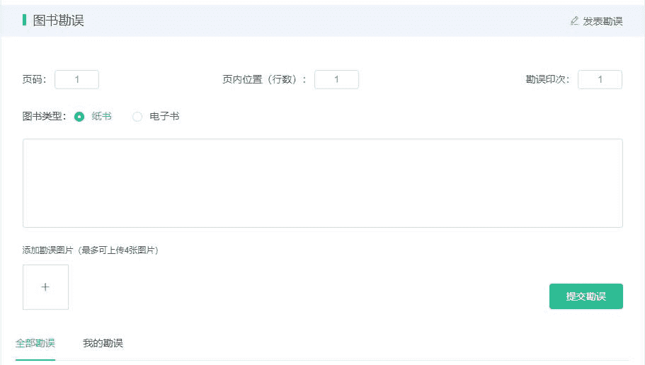

与我们联系
责任编辑邮箱为 liuyasi@ptpress.com.cn。

如有疑问或建议，请发送邮件并在标题注明书名以便快速响应。
如有出版、课程制作、技术审校合作意向，也可联系我们。
学校、培训机构、企业批量采购需求同样欢迎邮件沟通。
若在网络发现异步社区图书的侵权传播，请将相关链接发至邮箱，我们将依法维护作者权益。

关于异步社区与异步图书
异步社区由人民邮电出版社创建，于 2015 年 8 月上线，专注 IT 专业内容的出版与交流，为读者提供优质学习内容，为作者提供出版服务，连接传统出版与数字出版。异步图书是其旗下精品 IT 品牌，涵盖软件开发、大数据、人工智能、测试、前端、网络技术等领域，书封印有异步图书标识。

# 第一章

# 起源

近几十年来，编程长期以命令为核心、以逻辑为驱动，通过逐行代码操控机器执行任务。如今，LLM、自然语言处理、交互式编程等技术的融合，催生出一种更贴近人类思维、更高效灵活的新方式——氛围编程，即 Vibe Coding。

这不只是技术形态变化，更是开发理念与人机关系深层调整。从命令中心转向意图中心，从人适应机器转向机器理解人，Vibe 编程正重新定义编程边界。

本章将逐步解释 Vibe 编程的本质、形成背景与基础，揭示其成为未来开发主流的潜力。

## 1.1 初识 Vibe 编程

2022 年 11 月 OpenAI 推出 ChatGPT，打破了人机交互的固有习惯，用自然语言成为主流交互方式，人机距离被大大拉近。

初期 ChatGPT 仍有局限：训练数据有限、无实时联网、知识面不全。但其语言理解与生成能力已足以应对多数日常问答。也正因如此，大模型生态进化极快，不到三年就从问答迈向多模态与代理式 AI。

自然语言对话普及后，人们对搜索引擎的依赖下降，更多人直接向大模型提问。ChatGPT、字节豆包、阿里通义、腾讯元宝等工具不仅能容忍口语化表达，还能基于语义生成结构清晰的回答，检索效率实现质变。

这种交互效率提升了开发者的期待：不再只是要思路或示例，而是希望 AI 真正参与创作。思考随之出现：当模型能理解“带购物车的商品页”这类日常描述时，编程是否可以摆脱逐行敲键的传统？

于是 Vibe 编程概念诞生。2025 年 2 月，安德烈·卡帕西在社交媒体首次提出该概念，核心是通过大模型让开发更接近自然表达与人机共创。

通俗讲，Vibe 编程像为开发者配备一个技术管家，类似《钢铁侠》里的贾维斯，在需求与实现间搭建桥梁。开发者无需纠结语法、框架选型或底层细节，只需聚焦用户要什么、产品该有什么，细节交由 AI 补全。

依托海量开源代码与架构训练，大模型掌握技术栈与最佳实践，能把模糊需求转化为高质量代码。创意由此快速变为可运行软件，想法到落地的路径被压缩。传统编程是下指令，Vibe 编程是对话，开发者给方向与意图，模型理解上下文并填充细节。

### 1.1.1 从概念到可用产品

传统软件落地通常涉及多环协作：市场调研形成方向，产品经理撰写 PRD，设计师输出原型与视觉，开发团队据此编码。环节越多，协作成本越高，理解偏差也越多。受限于技术能力与需求理解，完整落地稳定系统并不容易。

即便是“点击按钮变色”这种基础功能，传统方式仍需手写 HTML、CSS 与 JavaScript。完全不懂技术的人眼中，这段代码如同天书。复杂系统由无数基础模块堆叠而成，长期以来系统开发能力属于稀缺资源。

生成式 AI 改写了这个局面。开发者的角色从代码锻造者转向功能设计者。无需学习框架、API 或底层原理，只需用自然语言表达需求。例如要求“做一个红色按钮，点击后变蓝”，AI 数秒内就能生成符合规范的代码，甚至补充动画、响应式、无障碍等增强功能。技术壁垒被打破，开发变为创意工具。

### 1.1.2 技术退位 创意上位

Vibe 编程并非否定技术价值，而是让技术成为隐形基础设施。就像使用手机无需关心芯片，未来开发也不必纠结实现细节。持续训练让 AI 承担转换层，把需求映射为实现。

当落地成本接近零，核心竞争力回归创意：如何定义需求、设计体验、规划架构。这是 AI 带来的根本变化，让技术服务创意。

对技术从业者而言，AI 助力从工匠向架构师转型。

资深后端工程师老张过去花三天调考勤日历前端，现在只需对 AI 说：要月份切换的考勤日历、点击日期看打卡记录、迟到姓名标红并对接现有接口。AI 生成 React 组件并匹配 Java 接口，还加入加载动画。老张重心转向优化考勤算法，效率提升约 60%。

对零基础者，AI 让创意变现成为可能。

退休教师王阿姨想做家庭相册 App 供子女共享照片。她告诉 AI 需要上传、登录可见、时间排序、可写评语。AI 引导她细化登录方式、标签分类、年度视频等。她确认微信登录、按旅行节日分类、生成配乐视频。仅用三天，一款带智能排序与视频剪辑的应用初步成型。即便视频生成慢，她只需说“加快速度”，AI 就自动优化压缩算法。

AI 尚无法攻克所有复杂场景，但足以满足大部分日常需求。电商网站、日记 App、小游戏等都能被快速捕捉并生成可用代码。

Vibe 编程的重构在于坐标转移：从关注实现细节转向聚焦价值创造。代码生成像打字一样自然时，产品竞争力取决于对用户洞察与创意挖掘，而非编码能力。

AI 的演进可能引发新一轮生产力变革，如同 Office 曾让办公技能普及，AI 有望成为数字基础设施，让每个人自由把想法变为现实。

## 1.2 从命令式到意图式的转变

20 世纪 50 年代，编程是极具挑战的专业工作。开发者既要精通逻辑，也要理解底层硬件原理。当时编程更像与机器对话的硬件层语言，通过二进制指令直接驱动设备。

编程常态正在被重写

计算机科学一路向前，高级语言的出现把写代码的成本压得越来越低。工具从汇编到高级语言、从命令行到集成开发环境一直在迭代，但软件落地的底层套路却长期稳定：人把需求翻译成机器可执行的逻辑，机器照着跑。几十年里这个做法被固化下来，先把产品诉求拆成业务规则，再把规则写成程序，最后靠工具链串起来。编辑器、语言、协作规范和交付流程全部围绕它运转，形成了行业的默认惯性。

Vibe 编程正在冲击这份默认，把起点和路径拉向意图优先、人机共创的方向。

### **1.2.1 回顾命令式编程**

命令式范式以显式控制流为核心，作者必须逐行写明状态如何变化，靠变量改写、分支判断、内存调度等手段把目标达成。

早期实现对底层依赖极重。以穿孔卡片为例（见图 1-1），每条指令都要以实体孔洞刻在卡片上。人机交互效率很低，也逼着使用者精通寄存器、存储地址、跳转逻辑等底层知识。


图 1-1 穿孔卡片（图片源自维基百科）

技术在演进，Fortran、COBOL 等高级语言让程序员摆脱直接写汇编，随后集成开发环境、版本控制、持续集成/持续交付流水线陆续出现，效率明显提升。然而人定逻辑、机器执行的主线贯穿整个生命周期，即便进入云原生和低代码时代，大多数工作仍围绕它展开。大型项目里跨模块变量依赖、调用栈和并发线程让命令式思维下的开发异常缠手：一点改动往往牵一发而动全身。正是在这种背景下，细节至上的命令式特性逐渐变成明显痛点。

认知负担沉重，状态演进须全程把控，容易陷入调试泥潭。
可维护性差，细节暴露、样板累积，一处改动就可能引发连锁反应。
协作成本攀升，门槛高、冲突多，沟通压力大。
抽象能力受限，流程耦合强，难以沉淀为可复用的上层组件。
测试负担加重，控制流复杂导致成本飙升，边界易被遗漏。

这些问题拖累个人，也拖慢团队迭代。随着业务复杂度上升和交付节奏加快，命令式编程越来越难以同时满足速度与质量。

### **1.2.2 从命令到意图**

针对上述困境，意图式编程开始浮现。核心是把用户意图和业务目标置于中心，而不是盯着每条指令如何执行。通过先声明意图、再由系统生成、随后人机协同的闭环，写作者从繁琐实现中解脱，能把注意力放在我想实现什么上。

在这个范式里，工作不再从敲第一行程序开始，而是从界定目标开始。例如告诉系统我要一个支持注册和登录的流程，平台会识别背后所需的数据结构、业务规则、安全要求并给出初始实现。写作者从底层逻辑的执行者变为目标的设计者，用自然语言或图形建模表达意图，系统则负责生成代码、拼装组件、实时预览等实现层面的事务。

本质变化可归纳为：

由怎么做转向要达成什么，聚焦目标而非路径。
意图可沉淀为可复用模块，促进跨团队共享，抽象能力提升。
业务、产品、研发共享同一语义单元，对齐成本下降。
变更从底层重写变为配置或意图微调，响应更敏捷。

需要强调的是，意图式编程并非只是把编码变快的工具，而是一套重新定义开发过程、重塑认知模式和组织协作方式的体系。这正是 Vibe 编程所倡导的精神：让表达意图成为入口，让开发体验回归创作本质。

### **1.2.3 开发流程对比**

以用户登录功能为例，能更直观看出两种范式的差异。

**1. 传统开发流程**

在命令式模式下，哪怕是常见的登录模块，链条也很长。

需求分析与设计：明确验证方式如用户名密码或 OAuth、数据库结构、安全机制如密码加密、防暴力破解，绘制实体关系图和接口文档。
环境搭建：配置本地环境、数据库、Web 框架，引入加密库如 BCrypt 和鉴权中间件如 Spring Security、Django REST。
后端实现：完成注册登录接口、令牌签发与校验、数据交互层。
前端实现：搭建登录页界面、处理表单事件、对接鉴权。
测试与调试：用接口测试工具验证功能，用单元测试覆盖业务逻辑，还要排查跨域、令牌异常等常见问题。
部署与运维：打包上线、配置 SSL 与安全策略，后续修复漏洞并支撑演进。

整个链条依赖多、专业要求高。加密算法配置、令牌生命周期等细节稍有疏忽就会带来安全或性能风险。多人在一起时，前后端联调、接口变更、需求同步常成为瓶颈。

**2. Vibe 编程开发流程**

在意图式范式下，流程被大幅简化。

意图输入：用自然语言描述目标，例如创建一个支持用户名密码登录的功能，使用 BCrypt 加密，成功后返回 JWT Token。
AI 自动生成：平台生成完整的后端接口、数据库迁移脚本和前端页面组件，并自动补齐符合最佳实践的安全机制。
一键部署：程序可直接发布到主流云平台，SSL 配置与 API 文档同步生成。
智能运维：内置监控能检测异常登录，AI 提示优化建议并修复常见漏洞。

过去需要多角色协作数天才能完成的任务，往往能在一人较短时间内完成，且扩展性好——后续接入 OAuth、双因子验证等只需调整配置，无需大规模重构。

表 1-1 总结了传统开发流程和 Vibe 编程开发流程的差异。

表 1-1 传统开发流程和 Vibe 编程开发流程的差异

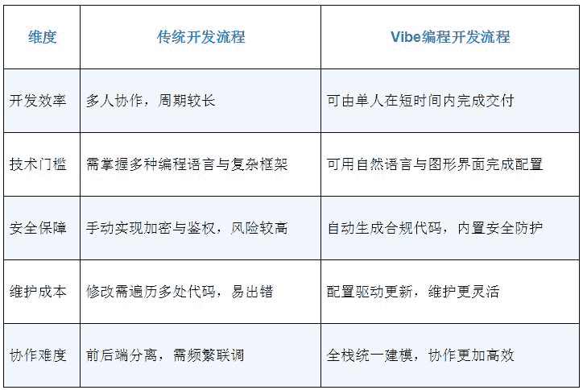

## **1.3 Vibe 编程的基石**

1.2 节从概念层面阐述了以意图为先导、人机共创为核心的新范式。本节聚焦三大驱动力：大型语言模型技术成熟、市场需求催化、开发者核心痛点，解释它们如何共同推动 Vibe 编程兴起。

### **1.3.1 大语言模型技术的成熟**

近几年，大模型从数亿参数跃升到数千亿，性能实现指数级提升。GPT、PaLM 等大规模预训练模型在自然语言理解生成上表现突出，迁移到代码领域后，能依据局部上下文补全函数，也能凭借更长上下文理解项目整体结构，生成复杂业务逻辑、优化程序、实现跨语言转换。对长上下文的处理增强，使模型能在大型代码库中保持命名、结构和逻辑一致，快速定位依赖，为敏捷开发和持续集成提供实质支撑。

算力与平台也在同步进化。GPU/TPU 集群算力攀升、成本下降，云端按需租用成为常态，主流云厂商推出面向大模型训练推理的定制实例。TensorFlow、PyTorch 等框架与分布式训练工具链成熟，保证研发到部署的可控高效。围绕模型的工具生态迅速繁荣，主流 IDE 如 VS Code、JetBrains 系列深度集成 Copilot 等插件，Cursor、Windsurf 等 AI 编程专用 IDE 崛起，提供补全、重构、测试生成等全流程支持。低代码与自动化流程工具也纷纷接入大模型，实现从原型到生产的端到端覆盖。

软硬件、框架与工具的协同，让 Vibe 编程得以高效落地并快速普及，给团队带来前所未有的生产力提升。

### **1.3.2 市场需求的催化**

产品迭代节奏在加速：一周一版甚至每日多版成为常态。在紧的交付窗口里，既要按时上线新功能，又要守住代码质量和系统稳定，对效率提出极高要求。传统人工编写—人工审核—人工测试流程耗时耗力，任一步骤延误都会连环阻塞；提速过度则缺陷频发，过度依赖手工则陷入交付瓶颈。

与此同时，业务场景多样化加剧了研发与业务的协作壁垒。产品经理上午收到市场反馈，下午就要上线临时活动；设计师调整交互后需紧急协同前端；而开发团队常因人手不足或技术栈差异难以迅速响应，导致想法到验证的循环被拉长到数日甚至数周。

低代码无代码在一定程度上降低了门槛，但在深度定制、复杂业务逻辑和性能优化上受限；纯手写代码又难以在短时间内兼顾扩展性与复用，高频迭代下常重新造轮子。

不同行业对合规、安全、性能的要求各异，金融需要严格权限与审计日志，电商需要灵活促销引擎，制造需要实时对接物联网设备。这些复杂场景放大了单一方案的短板，让团队在即插即用与深度定制间为难，技术选型犹豫直接导致启动延迟和成本溢出。

这样的市场环境为 Vibe 编程提供了土壤。它把开发者、产品、设计、测试、运维的意图统一到同一智能引擎中，利用大模型在长上下文分析和生成上的优势，实现从需求文档到可运行代码再到自动化测试与部署脚本的全流程联动。开发者专注核心业务设计，AI 助手在后台完成框架搭建、接口对接、测试用例生成和文档更新，大幅压缩交付周期并保持 CI/CD 的质量标准。无论是临时上线活动还是深度定制垂直方案，都能获得极速响应与专业可控的优化，真正做到快与稳兼得。

### **1.3.3 开发者的核心痛点**

实践中重复性工作无处不在：脚手架生成骨架、初始化模块、配置路由、对接第三方接口、为每个新功能手写单元测试，再加上注释与文档维护，这些模板化操作常占用 30% 至 50% 的日常时间。更麻烦的是，每次引入新技术栈、迁移后端语言或切换前端生态，都要重新配置环境、安装依赖、查阅文档，心智负荷骤增，创新节奏被打断。

环境切换成本在多团队协作时更明显。一个微服务用 Java+Spring Boot，另一个用 Node.js+Express，开发者要在不同项目结构间切换，记住各自构建命令和调试方式，为不同测试框架写脚本。早晨调 A 服务日志，下午写 B 服务 mock API，上下文切换导致效率下降且易出错。

代码库快速迭代时，文档常滞后于实现。新人或外包团队只能读源码理解业务，耗时耗力，形成文档漂移。即便是资深开发者，依赖库微小改动未在文档中注明，也可能花费数小时定位问题，增加排查和回归测试成本。

解决这些痛点需要一种能在熟悉工作流中自动捕捉并同步需求、文档与代码的智能手段。依托更强长上下文能力的大语言模型，Vibe 编程正成为代表。它能在本地 IDE 或 CI/CD 流水线中感知项目全貌，贯通各环节：在脚手架之外生成更贴合业务意图的代码模板，依据最新 API 文档自动调整接口调用；实现后自动补全注释、同步技术文档；在每次拉取请求中生成初步测试用例和安全扫描报告。这种文档+代码+测试的协同机制，减少重复劳动，让团队知识实时同步，打通信息孤岛，使每次迭代都成为有效增量。

大模型技术成熟提供基础，市场对又快又稳交付的需求构筑背景，开发者的核心痛点成为催化剂，三者共同推动 Vibe 编程兴起。

## **1.4 小结**

Vibe 编程并非偶然的技术爆发，而是长期演化积累的必然结果。它所蕴含的范式转变、认知更新与技术跃迁，正深刻改变我们理解编程和构建软件的方式。

要真正理解这场变革，我们需要把时间线拉远，回望软件编程的发展历程，探究它如何从底层一步步演进为今天复杂多元的生态。第二章将带你走进软件编程的历史长河，重新认识编程的起点与未来。

# **第二章**

# **编程方式的演变**

编程曾经是少数专业人士才能掌握的复杂技能，如今正快速演化为可参与的创造方式。从最初对机器逐位控制，到用高级语言构建复杂系统；从命令行繁复操作，到图形化所见即所得，再到低代码与无代码平台兴起，编程方式正经历深刻而持续的变革。

本章从三个维度梳理演变路径：回顾编程语言进化史，探讨语言设计如何驱动创新；聚焦交互方式变迁，从键盘命令到图形界面再到智能助手，揭示人与计算的协作变化；以低代码无代码为例，分析去代码化趋势如何重塑开发生态并拓展参与边界。

理解这些演变，不仅是回顾历史，更是为了看清未来。

## **2.1 编程语言的进化**

早期开发者只能用 0 和 1 组成的二进制指令与硬件对话。20 世纪 50 至 70 年代，汇编语言、Fortran、COBOL 等高级语言相继出现，把助记符、数学符号和自然语言元素带入代码，大幅解放人力。70 至 80 年代，Pascal 的结构化设计与 Smalltalk-80 的面向对象思想革新了软件组织方式。90 年代以后，Java、JavaScript、Python 等语言结合跨平台、异步和简洁哲学，为当今多范式并存的生态奠定基础。

本节沿此脉络，回顾从机器码到现代语言的演进历程。

### **2.1.1 与机器对话**

20 世纪 40 至 50 年代是机器语言时代。作为计算机底层语言，它直接操控硬件实体，CPU 寄存器的电信号流转、内存地址物理映射、I/O 设备端口操作，都依赖二进制指令实现。

当时的开发者如同与电子电路进行原始对话，手段是直接操作二进制代码，0 和 1 的序列构成程序全部内容。每一次计算、每一次存储都需要精确设定这些位，不仅效率低下且极易出错，编程像在迷雾中摸索，艰难而充满挑战。

1946 年 2 月 14 日，ENIAC 在宾夕法尼亚大学启用，这台占地 167 平方米的庞然大物由 17468 个电子管组成，每秒能执行 5000 次加法运算。


图 2-1 ENIAC（图片源自维基百科）

在机器语言时代，工程师编程时需手动插拔多达 2000 根电缆，以搭建不同数据通路：加法运算时电信号需从输入寄存器流经电子耦合器进入 300 位累加器；乘法运算则需唤醒 36 个独立的 4 位乘法单元，每个单元通过继电器矩阵执行布尔运算。这种物理层面的复杂操作意味着，仅仅修改一个数据地址就可能耗费数小时重新配置电缆，若稍有偏差寄存器信号就会紊乱，程序崩溃。

UNIVAC I 被誉为世界上第一台商业化计算机，相较 ENIAC，在程序存储与输入方式上取得突破：将程序与硬件分离、使用穿孔纸带一次性加载指令，使同一套系统能执行不同运算，这标志通用计算走向现实。但是，UNIVAC I 对操作者要求近乎严苛，哪怕只是计算 1 到 100 的累加，也需要编写超过 200 条二进制指令，相当于在 16 列穿孔纸带上打出 4000 多个孔。每个程序都像是一次对硬件架构的定制补丁，无法复制、难以修改。开发流程不仅繁琐，还极度依赖操作者的细致与耐心，效率非常低下。


图 2-2 UNIVAC I（图片源自维基百科）

### **2.1.2 从二进制到符号语言**

20 世纪 50 至 70 年代，编程语言迈出摆脱二进制桎梏的关键一步，进入汇编语言时代，抽象层次首次实现飞跃。通过引入助记符系统，开发者不再需要直接面对繁复的二进制代码，而是可以通过 MOV A、@SRC 这类符号指令操控寄存器与内存，这一转变不仅极大提升了编程效率，也将开发者的注意力从电路层抽离出来，转向更高级的算法与数据操作。

编程从机器码到抽象思维的跨越

1955 年，IBM 为 702 机型推出 Autocoder，这被看作早期汇编器的雏形。它首次把助记符自动转译为机器码，并引入了宏指令等增强手段，比如把操作码 21 写成更易读的 ADD。编程依然紧贴硬件，但这种自动翻译的思路为后来的高级语言提供了技术原型。

1963 年，IBM 在 7094 晶体管机上发布宏汇编器。宏定义在此得到完善，开始支持条件汇编与递归展开。开发者可以声明带参数的宏，并利用仅当为假的 IFF 与仅当为真的 IFT 来控制条件伪操作和迭代伪操作，形成可复用的模板，代码的可维护性和复用性明显提升。


图 2-3 IBM 7094 晶体管计算机（图片作者：ArnoldReinhold）

早期宏汇编器普遍存在命名互相干扰的问题，同一宏名在不同模块里会覆盖彼此，容易产生难定位的错误。到 1970 年，DEC 在 PDP-11 小型机上推出 MACRO-11 汇编器，首次加入 LOCAL 关键字实现宏定义的作用域隔离，有效避免了命名冲突。该机制后来被 NASM 与 GNU 汇编等现代工具继承，推动汇编走向工程化。


图 2-4 PDP-11 迷你计算机（图片作者：Stefan_Kögl）

PDP-8 阵营的 PAL-III 约在 1965 年前后出现，率先加入了一批伪指令，如 DECIMAL、FIELD、EXPUNGE、FIXTAB 等。它们不产生目标码，而是辅助汇编过程、管理位置计数和常量定义，让程序结构更易梳理。

下面以 PAL-III 为代表说明伪指令如何组织代码、定义常量并设定入口：

* 指定数字为十进制（伪指令 DECIMAL）

DECIMAL

* 位置计数与字段管理：设置程序载入地址为 0x1000（FIELD），页内偏移为 0x0（PAGE）

FIELD 1            / 选择字段 1（0x1000–0x17FF）0

*200               / ORG/PAGE，将位置计数器设为所在页的起始地址

* 常量定义（伪指令 EQU / =）

BUFFER = 4096      / 定义 BUFFER 地址为 0x1000（十进制 4096）

* 程序主体

LOADI  BUFFER      / 加载 BUFFER 地址到累加器（示例伪指令，具体视汇编器而定）

* 保留空间，填充零

ZBLOCK  16         / 分配 16 字长的零初始化块

* 条件汇编示例

IFDEF BUFFER       / 若 BUFFER 已定义，则以下内容生效

   TAD BUFFER

ENDIF

* 结束汇编

$

符号化寻址让开发者免于手工计算繁琐的绝对地址，可读性和可维护性得到改善，也为高级语言中变量与作用域概念的形成奠定基础。

在计算机发展的早期，基于 x86 的汇编编程堪称极限操作。以 1981 年发布的 MS-DOS 1.0 引导程序为例，哪怕是一段简短的启动代码，也要求开发者像校对精密仪器般精确操控每个段寄存器与偏移，稍有偏差便会导致系统崩溃。

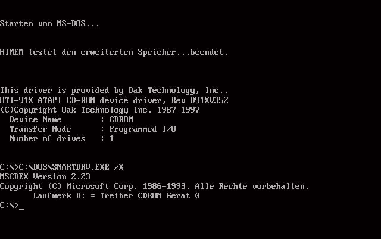

图 2-5 MS-DOS 1.0 引导程序界面（图片源自维基百科）

典型做法是先把数据段地址送入 DS，使后续以 DS 为默认前缀的数据访问定位正确。地址必须手工核算，偏差一点就会让全局变量错位，进而失稳。

MOV AX, @DATA_SEGMENT   ; 将数据段地址加载到 AX 寄存器
MOV DS, AX              ; 将 AX 寄存器的值赋给数据段寄存器 DS

1985 年 Intel 推出 80386，保护模式随之到来。内存寻址权交由操作系统管理，段地址与逻辑地址被分离。程序员不再需要显式配置段寄存器，系统自动完成分配与访问控制，底层寻址的负担被卸下。

即便如此，汇编仍受硬件差异制约，不同处理器的指令集相差很大，跨平台移植困难，寄存器配置与地址映射等细节必须熟练掌握，开发风险高效率低。汇编解决了能否写程序的问题，却难以满足科研与商业建模对更高抽象的迫切需求。

### **2.1.3 高级语言走上舞台**

五十年代起，计算机用途由军方起步逐步扩展到科研和商务，编程需求日趋细分，语言设计从贴近硬件转向贴近问题。高级语言由此出现，解放了思维方式，也标志着软件开发进入以业务与问题求解为核心的新阶段。

**1. Fortran：科学计算的先驱**

1957 年 IBM 发布 Fortran，即 formula translation，开启了真正意义上的高级语言普及时代。它摆脱了直接操作硬件的束缚，允许开发者用接近数学的表达描述算法。

Fortran 面向科学计算，具备循环、分支、函数等抽象结构，并由编译器转成高效机器码。编程重心从输入指令转向求解问题。

1962 年的 FORTRAN IV 在编译技术上取得突破，引入了循环不变量外提等优化。以如下片段为例：

DO 10 I = 1, 100       ; 原始代码：计算数组 A 的值
   A(I) = B + C * I    ; 在表达式 B+C*I 中，**B**是循环不变量，在整个循环过程中保持不变，因此可以提前计算
10 CONTINUE

编译器识别出 B 在循环中不变，将其提前计算。优化后的目标代码大致为：

MOV AX, B              ; 将变量 B 的值加载到 AX 寄存器
ADD AX, C              ; 计算 B+C 的值并保存在 AX
MOV DX, AX             ; 循环不变量 B+C 存入 DX

DO_START:
MOV [A+I], DX          ; 循环体仅执行乘法和存储操作
INC I                  ; 索引变量递增
CMP I, 100             ; 比较索引变量与循环上限
JLE DO_START           ; 若未达上限 100 则继续

循环体指令数减少约 40%，在 IBM 7094 上，矩阵求逆耗时由 2 小时降至 72 分钟。

1978 年的 FORTRAN 77 加入自动向量化，能把数组操作映射为 Cray-1 超级机的向量指令，矩阵乘法等线性代数运算性能提升百倍，推动有限元分析、气象模拟、地震建模等从理论走向工程。至今 Fortran 仍是高性能计算的支柱。

**2. COBOL：商业领域的统一语言**

1959 年在美国国防部推动下诞生的 COBOL，即 common business-oriented language，目标是统一政府与企业的业务信息处理语言，解决开发效率低、维护难、可移植性差的问题。

COBOL 的创新在于首次引入类自然语言风格，非技术人员也能读懂。

01 CHECK-RECORD.  
05 CHECK-NUMBER PIC 9(8) COMP-3.       ; 压缩十进制存储的支票号码（8 位数字）
05 ACCOUNT-NUMBER PIC 9(12) COMP-3.    ; 账户号码（12 位数字，压缩存储）
05 AMOUNT PIC S9(10)V99 SIGN TRAILING. ; 带符号金额，保留两位小数
05 ENDORSEMENT-AREA PIC X(30).         ; 背书区域（30 个字符的字符串）

其结构化语法与业务表单字段一一对应，广泛用于银行、电信、保险。COBOL 还首创数据驱动范式与严格的数据定义体系，编译期即进行格式校验，为 Java、C# 等企业级语言提供了借鉴。

**3. 从算术到业务，语言走向多元**

Fortran 与 COBOL 分别奠定科学计算与商业应用的基础，标志语言设计开始围绕任务展开。前者追求性能与算法表达，后者推动编程去技术化。语言逐渐摆脱对硬件的深度依赖，演变为抽象问题与系统建模的工具，也催生了编译器、抽象模型、数据结构等核心概念，为 C、Pascal、Java 等发展打下基础。

### **2.1.4 结构化与面向对象编程的突破**

集成电路进步使软件规模激增，十万行代码成为常态，线性编程在可读性和可维护性上捉襟见肘。高级语言虽解决了领域建模，但庞大复杂的工程仍需更严谨的逻辑结构与更高层抽象。编程随之从面向过程演进为结构化与面向对象，重塑了组织方式，也确立了现代软件开发范式。

**1. Pascal：结构化编程的标志**

1970 年发布的 Pascal 是结构化编程的典型。语言强调清晰结构、强类型约束与模块化，既适合教学也用于工程。

Pascal 的静态类型检查在编译期通过符号表捕获类型错误，例如：

[LINE 15] ERROR: CANNOT ASSIGN BOOLEAN VALUE 'TRUE' TO INTEGER VARIABLE 'COUNT'

它是最早可在编译时发现大部分类型错误的语言之一，大幅前移质量控制。

1983 年 Borland 的 Turbo Pascal 引入增量编译，以源文件时间戳为依据只重编变更单元，使十万行项目的编译时间从 60 分钟降到 8 分钟。这一思想后来被 Java 的 Jikes 与 C# 的 Roslyn 继承。

模块化方面，Pascal 用 UNIT 封装功能：

UNIT MathUtils;
INTERFACE
FUNCTION Add(a, b: INTEGER): INTEGER;  // 接口声明
IMPLEMENTATION
FUNCTION Add(a, b: INTEGER): INTEGER;  // 接口实现
BEGIN
    Add := a + b;
END;
END.

封装提升复用，也为 C 的头文件、Java 的包系统提供了原型，推动编程从堆砌逻辑转向模块化构建。

**2. Smalltalk：面向对象思想的完整呈现**

1980 年 Smalltalk-80 发布，标志语言从过程分解转向对象建模，核心思想是万物皆为对象。

Smalltalk 把对象定义为封装状态与行为的独立单元，通过消息传递交互。

（1）封装：如 BankAccount 类把余额与转账方法整合为整体。

"BankAccount 是一个封装了余额和操作方法的类"
Object subclass: #BankAccount
    instanceVariableNames: 'balance'   "实例变量：balance（余额）"
    classVariableNames: ''
    category: 'Finance'
"初始化方法：设置初始余额为 0"
BankAccount >> initialize
    "方法 initialize：初始化账户状态"
    balance := 0.
"存款方法：将指定金额加入余额"
BankAccount >> deposit: amount
    "方法 deposit: 接收参数 amount（存款金额），并更新余额"
    balance := balance + amount.
"转账方法：从本账户转出并调用目标账户的存款方法"
BankAccount >> transfer: amount to: otherAccount
    "方法 transfer:to: 
       • amount — 转账金额 
       • otherAccount — 接收转账的 BankAccount 对象
       操作：先检查余额，再执行扣款与对方存款，或抛出错误"
    (balance >= amount)
        ifTrue: [
            balance := balance - amount.  "内聚行为：扣减本账户余额"
            otherAccount deposit: amount  "调用对方的 deposit:方法完成存款"
        ]
        ifFalse: [
            self error: 'Insufficient balance'   "余额不足时抛出错误"
        ].

外部代码只能通过接口访问数据，语言层面提升了安全与一致性。

（2）继承：类层次对现实建模，如 SavingsAccount 继承 BankAccount 并扩展利息。

BankAccount subclass: #SavingsAccount
    instanceVariableNames: 'interestRate'  "新增利率变量"
    classVariableNames: ''
    category: 'Finance'

SavingsAccount >> initiali
    super initialize.  "调用父类初始化方法"
    interestRate := 0.03.  "设置默认年利率%"

SavingsAccount >> calculateInterest
    balance := balance * (1 + interestRate).  "扩展父类功能，计算利息"

is-a 关系使领域概念直观表达，提升复用与开发效率。

（3）多态：抽象父类统一接口，子类按语义实现差异。

AbstractObject subclass: #AbstractAccount  
    instanceVariableNames: ''  
    classVariableNames: ''  
    category: 'Finance'  
AbstractAccount >> withdraw: amount  
    self subclassResponsibility.  "强制子类实现取款方法"  
BankAccount >> withdraw: amount  
    balance := balance - amount.  "普通账户的取款实现"  
CreditAccount >> withdraw: amount  
    (balance + overdraftLimit) >= amount  
        ifTrue: [balance := balance - amount]  "允许透支时的取款实现"  
        ifFalse: [self error: 'Overdraft exceeded'].  

调用 account withdraw: 100 时，系统依据实际对象类型动态绑定逻辑，增强可扩展性。

Smalltalk 还首创模型-视图-控制器 MVC 模式，将数据、展示与交互正交解耦，成为 Java Swing、iOS UIKit、Web MVVM 的理论起点。

**3. 从规则到系统思维**

结构化编程以模块化、类型检查与控制流规范为程序提供清晰秩序，面向对象则赋予语言建模现实世界的能力，推动开发从过程驱动走向对象驱动与架构驱动。

Pascal 与 Smalltalk 分别在可控性与可建模性上实现关键突破，为 C++、Java、Delphi 等奠定理论根基与实践模板，使编程语言从描述算法的工具跃升为构建复杂系统的工具。

### 2.1.5 范式融合与语言分工

九十年代末互联网与分布式计算普及后，软件规模与复杂度同步攀升，单一范式已难以应付多元需求。面向对象、函数式、事件驱动、脚本化等风格开始交织，形成多轨并行的编程面貌。Java、JavaScript、C++、Python 分别在企业后台、Web 全栈、系统底层与数据智能四大赛道形成主导，共同构成当代语言生态的支柱。

**1. Java：跨平台的标杆语言**

1995 年 Sun Microsystems 发布 Java，主张代码写一次可在多端运行，开创了跨平台开发的新思路。

（1）字节码与虚拟机驱动的移植能力。
源码经编译器转为平台无关的 .class 字节码，由 JVM 解释执行，运行期 JIT 将热点代码即时转成本地机器码，实测效率可逼近 C++ 七成左右，例如：
public class HelloWorld {  

    public static void main(String[] args) {  

        // 1.JVM 类加载器（ClassLoader）加载 HelloWorld.class 字节码 

        // 2.JVM 解释器（Interpreter）逐条执行字节码指令

        // 3.如果 System.out.println 及其调用链被频繁执行，即时编译器会将这些“热点”

        //方法编译成本地机器码，这样后续再调用时，可直接运行本地代码，性能大幅提升

        System.out.println("Hello, World!");  

    }  

}
这种分层运行机制让同一份程序在 Windows、Linux、macOS 间流畅切换，长年成为企业系统与嵌入式平台的首选。

（2）工程化取舍带来的语法简化。
Java 在保留面向对象完整性的同时对 C++ 做了收敛：
· 仅允许单继承，借助接口实现多实现，避免菱形继承困扰。
· 内存由垃圾回收器自动管理，降低泄漏风险。
· 异常通过 try-catch-finally 结构化处理，增强健壮性。例如：
try (FileInputStream fis = new FileInputStream("data.csv")) {  

    // 业务逻辑

} catch (IOException e) {  

    logger.error("文件操作异常: {}", e.getMessage());  

}  finally {

    // 无论是否发生异常，都要关闭文件流以释放资源

    if (fis != null) {

        try {

            fis.close();

        } catch (IOException ex) {

            logger.error("关闭文件时发生异常: {}", ex.getMessage());

        }

    }

}

（3）企业架构的基座。
Java EE 现更名为 Jakarta EE，规范了 EJB、Servlet、JSP 等组件，结合 Spring 的依赖注入与控制反转，形成主流企业架构。2008 年 Android SDK 发布后，Java 成为移动开发主力，构建起前端到服务器端的统一语言体系。

（4）持续的性能进化。
Java 8 引入 Lambda 与 Stream API，向函数式表达靠拢；Java 17 推出的 ZGC 能把大堆内存场景的停顿压到 10 ms 以内，满足金融、电信等低时延需求。

**2. JavaScript：从浏览器到全栈**

起初仅作浏览器脚本的 JavaScript 在 2009 年 Node.js 出现后完成后端跨越，成为现代 Web 全栈核心。

（1）事件驱动与异步调度。
Node.js 基于 V8 运行，借助 libuv 实现事件循环，统一调度 I/O、定时器、微任务等异步工作，适配高并发，例如：
// 事件驱动的异步编程示例
document.getElementById("btn").addEventListener("click", () => {  

    fetch("https://api.example.com/data")  

        .then(response => response.json())  

        .then(data => updateUI(data))  

        .catch(error => console.error("请求失败:", error));  

});  
Netflix API 网关基于 Node.js 每日承接约 200 亿次请求，响应常被压缩至 50 ms 以内，体现出其在实时系统中的吞吐优势。

（2）前后端语言统一。
同一语言贯穿浏览器与服务器：
· 前端：React、Vue 等框架以虚拟 DOM 构建交互界面。
· 后端：Express、Koa 等框架支撑高并发 API。
· 跨端：Electron、React Native 实现桌面与移动跨平台。

**3. C++：系统级开发的常青树**

1985 年 Bjarne Stroustrup 提出 C++，在保留 C 高性能前提下加入面向对象与泛型，成为混合范式代表。

（1）运行时多态的实现。
虚函数机制让接口调用与实现解耦，例如：
// 抽象基类 Shape 定义了接口（纯虚函数），子类必须实现 draw()
// virtual 关键字和=0 表示这是一个纯虚函数，使 Shape 成为抽象类
class Shape {
public:
    virtual void draw() = 0;       // 接口：绘制方法，运行时多态入口
    virtual ~Shape() = default;    // 虚析构函数，确保通过基类指针删除时能正确
                                   // 调用子类析构
};
// Circle 继承自 Shape，实现了 draw()方法
class Circle : public Shape {
public:
    void draw() override { // override 明确表示该方法重写了基类的虚函数
        // **具体实现**：在这里绘制一个圆形
    }
};
// 渲染函数，使用基类引用调用 draw()
// 调用时不会静态绑定，而是通过 vtable（虚函数表）进行一次指针跳转，
// 动态决定调用哪一个 draw()实现，实现了接口与实现的解耦
void renderShape(Shape& shape) {
    shape.draw();  //通过 vptr 指向的 vtable 查找正确的函数地址并调用
}
// 内部机制示意：每个多态对象在内存中包含一个隐藏指针 vptr，
// 指向类的 vtable（函数指针数组），vtable 中存放所有虚函数的实际地址，
// renderShape 调用时，编译器生成类似(*shape.vptr->draw)()的代码
// 只有一次间接调用开销

（2）编译期泛型与零开销抽象。
模板允许在编译期为不同类型生成专用实现，实现类型无关且无运行时损耗。以 STL 的 std::vector<T> 为例，其原理与下方简化版一致：
template <typename T> // 模板定义：T 是类型参数，占位符。编译时会根据实际类型生成具体版本
class Vector {
private:
    T* data;          // 泛型指针：指向任意类型 T 的数组
    size_t size;      // 当前存储元素数量
public:
    void push_back(const T& value) {
        // 泛型插入逻辑：支持任意类型的插入，不依赖 T 的具体实现
        // 实际中 std::vector 还会处理容量扩展、动态分配等，这里省略
    }
};
// 编译时实例化：每个 Vector<T>实例都会生成一份独立的类定义（模板展开）
// 下面两行代码将模板“翻译”为两个具体类型的类：int 和 std::string
Vector<int> ints;             // 编译器生成了 data 为 int*、push_back(const int&)
                               // 等实现
Vector<std::string> strings;  // 编译器生成了 data 为 string*
                              // push_back(const std::string&)等实现
// STL 中的 vector 就是完全泛型的容器模板类，功能更全面、安全
std::vector<double> dv;          // 使用泛型模板实例化出 double 类型容器
std::vector<Customer> customers; // 自定义类型也能作为模板参数，类型安全
// 结论：通过 template<typename T>实现的 Vector 类就是泛型容器的一个示例
// 类型参数 T 可被任意类型替代，从而实现代码复用和类型安全的灵活性
这种编译期展开兼顾复用、类型安全与执行效率，是 C++ STL 与 Java Collections 设计的基础。

（3）底层领域的强势占位。
得益于精细内存控制、硬件直达与无额外开销抽象，C++ 长期主导 Windows、Linux 等操作系统、数据库内核及 Unreal Engine 等游戏引擎开发。

**4. Python：数据与 AI 的简洁利器**

1991 年 Guido van Rossum 发布 Python，主张优雅、明确、简洁，成为数据科学与 AI 首选。

（1）语法简洁带来的高表达。
以缩进界定结构，支持列表推导与生成器等语法糖，提升可读性，例如：
# 列表推导式：生成 1~10 的平方
squares = [x**2 for x in range(1, 11)]  
# 生成器：惰性生成大数列，节省内存
large_numbers = (x for x in range(1, 1000000) if x % 3 == 0)  

（2）数据科学工具链。
NumPy 提供接近 C 速度的矩阵运算；pandas 相比原生列表加字典的手工循环，处理效率可提升数倍；Matplotlib、Seaborn 支持出版级可视化定制。例如：
import pandas as pd
data = pd.read_csv("data.csv")  
clean_data = data.dropna().groupby("category").mean()  

（3）AI 生态的主流前端。
Jupyter Notebook 由 IPython 演化而来，专为 Python 交互式计算设计，可混排代码、文本与图表。Python 作为胶水语言能调用 C/C++、Fortran 高性能库，TensorFlow、PyTorch 均以 Python 为前端，配合 Notebook 快速实验与记录。

## 2.2 人机协作的演进轨迹

软件史上人与程序的对话方式不断被重塑。从穿孔介质到命令行，再到图形化与集成平台，编程认知与工作流随之升级。

### 2.2.1 物理介质上的编程雏形
早期编程高度依赖物理载体。
· 穿孔卡片编程。程序员用凿孔机在 16 列纸带上打孔，100 次加法约需 4000 个孔，逻辑修改即意味着重制纸带，改一个地址或耗时数小时。
· 面板手工输入。以 IBM 650 为代表，通过面板二进制开关逐条输入指令，每字节需拨动 8 次并靠指示灯确认，代码本质是电路映射，维护困难。


图 2-6 专用凿孔机（图片源自维基百科）

此时开发者更像与硬件搏斗，调试效率完全受物理操作制约。

### 2.2.2 从行编辑到全屏交互的突破
六十年代分时系统催生字符编辑器，DOS 时代的编辑器成为个人电脑编程主力。

（1）行编辑器代表 EDLIN。
1980 年 Tim Paterson 为 86-DOS 编写 EDLIN，1981 年随 MS-DOS/PC-DOS 1.0 发布。开发者以 10 PRINT "HELLO" 格式逐行输入，修改依赖 E、I、D 等指令，需先 LIST 再用 60 CHANGE 定位错误。线性编辑延续穿孔卡思维，复杂逻辑调整需频繁跳转行号。

（2）商业编辑器突破 WordStar。
1978 年发布的 WordStar 是 DOS 首个商业化全屏编辑器，支持 80 列显示与格式控制。引入块操作 ^KB、^KK 选区与 ^Y 删除，编辑从逐字符转向块级；^KI 模拟打印提供格式预览。
受 DOS 64 KB 内存段限制，大文档易溢出卡顿。WordStar 引入磁盘交换技术，将文档暂存磁盘缓冲区动态加载，并提供 ^QR、^QC 等跨段跳转实现伪分页，在资源受限机上仍可处理上百页文本。

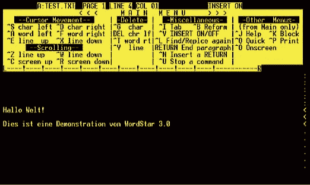
图 2-7 WordStar 3.0 界面截图（图片作者：Plenz）

DOS 编辑器首次实现所见即所得文本编辑，为后续图形界面与现代 IDE 的交互理念奠基。

### 2.2.3 编辑、编译、调试一体化的集成化时代
八十年代图形界面普及，编辑器向多功能平台演进。

（1）Turbo Pascal 的一体化范式。

1983 年 Borland 发布 Turbo Pascal，把代码编辑、编译和调试集中到同一窗口，按下 F9 就能完成编译，还支持设断点、逐行执行和寄存器查看。这样的整合让开发节奏明显加快，常被视作现代集成开发环境的雏形。

（2）智能感知的萌芽：Visual Studio 6.0
1998 年面世的 Visual Studio 6.0 首度搭载 IntelliSense，带来语法提示与自动补全，例如输入 std:: 就会列出全部 C++ STL 容器。右键点选变量可以查看内存地址及映射，同时快速跳转到定义和引用位置。这类交互让跨文件定位和代码理解更顺手，大型项目的构建与维护效率因此提升。

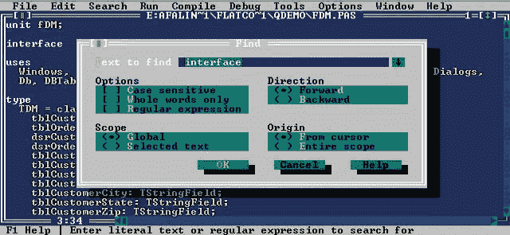

图 2-8 Turbo Pascal 2.0

（3）Java 生态的关键节点
1999 年发布的 Eclipse 凭借插件化架构迅速成为 Java 编程的主流选择，开源社区贡献了大量第三方扩展，Java EE、数据库、构建工具等可在同一环境协同使用。NetBeans 则以可视化设计器和多语言能力著称，成为跨平台开发的代表，其模块化思路影响深远。

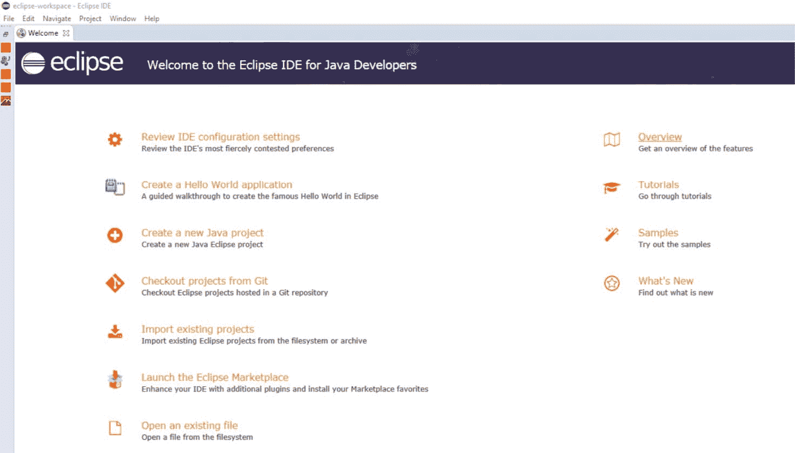

图 2-9 Eclipse 编辑器

一体化编辑器的出现让编辑、编译、调试形成闭环，效率显著提升，也推动了软件流程的标准化。

### 2.2.4 跨平台生态与插件化架构革新
2015 年 Visual Studio Code 上线，开启编辑器新阶段，其架构在灵活性与可扩展性上达到新高度。

（1）语言服务器协议
借助语言服务器协议 LSP 将语言处理逻辑与界面分离，使得 VS Code 能原生支持上百种语言。以 Go 编程为例，可实时捕捉 undeclared name: x 这类未声明变量错误并给出修复建议，把问题前置到编码阶段，有效提高代码质量。

（2）插件架构的极致开放
开发者可用 Node.js 编写扩展，例如 GitLens 实现提交溯源、Docker 插件提供镜像管理。截至 2023 年，VS Code 插件市场已超过 20 万款，覆盖量子计算、前后端框架到低代码平台，形成“轻量核心+插件扩展”的生态形态。

VS Code 作为现代编辑器的标杆，界面简洁（见图 2-10），集合代码编辑、调试与版本控制，通过主题与扩展可实现高度个性化。

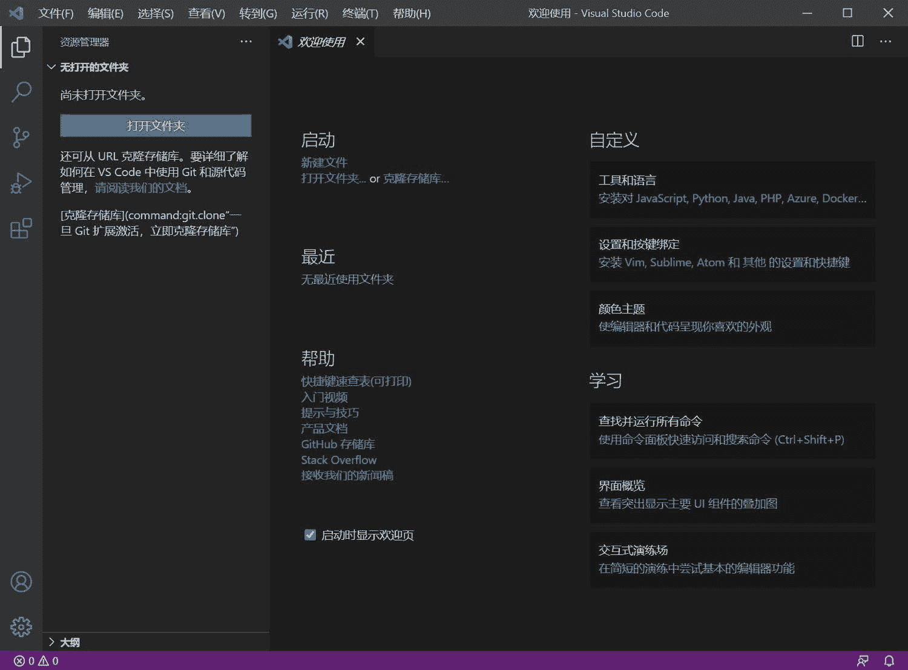

图 2-10 VS Code 编辑器

除 VS Code 外，JetBrains 家族在细分领域持续深耕。IntelliJ IDEA 的 Java 编辑器支持代码折叠、重构预览、依赖注入可视化等深度功能；PyCharm 专注 Python，内置线程并发可视化与 Docker 容器管理，成为数据科学与 AI 应用开发的首选；Xcode 作为苹果官方 IDE，其 Interface Builder 可视化设计器与 Core ML 模型集成显著提升移动应用开发效率。

这一阶段，编辑器从语言驱动工具演变为面向多语言、跨平台、可扩展的开发平台，成为全栈开发者的通用基座。

## 2.3 低代码开发与无代码开发的崛起
企业数字化转型背景下，传统编码模式如同沉重束缚，制约创新。以中等规模企业管理系统为例，从需求分析、架构设计到编码调试，专业团队往往需 3～6 个月。需求变更后修改成本呈滚雪球式上涨，交付周期被一再拉长。同时开发人才供不应求，高额投入招聘与培训后仍难以摆脱人力短缺。

云计算与 AI 的发展推动软件范式从手工编码转向可视化构建。低代码与无代码平台通过图形界面、拖拽操作与预置组件库，大幅降低门槛、提升交付速度。

在此生态之后，Vibe 编程凭借深度语义分析与代码自动生成引擎，在把自然语言需求转为可运行程序的自动化转换领域崭露头角。

### 2.3.1 图灵完备理论体系
理解低代码与无代码的挑战，需回溯图灵完备性这一核心概念。

20 世纪 30 年代，英国数学家艾伦·图灵提出“图灵机”概念，其艺术示意如图 2-11。这一抽象模型用于探讨判定问题：是否存在通用算法判定任意数学命题真伪。

图灵机由无限纸带、读写头和状态控制器构成，按简单规则运行，理论上可模拟任何计算过程。图灵机界定了可计算性边界，为计算机科学奠定理论基石，也成为衡量计算系统能力的重要标准。


图 2-11 图灵机的艺术表示（图片源自维基百科）

随后，20 世纪 40 年代首台通用电子计算机 ENIAC 诞生，虽用于军事计算却具备多任务能力；冯·诺依曼体系结构把程序指令与数据存储合一，以“存储程序”思想使计算机设计更接近图灵机模型。

自 20 世纪 50 年代起，Fortran、LISP、C 等语言相继出现，功能不断扩展并逐步实现图灵完备。进入 21 世纪，伴随互联网、移动与云计算，图灵完备计算能力已广泛普及，量子计算研究也在探索新边界。具备图灵完备的系统理论上可求解所有可计算问题，但在低代码与无代码平台中，如何平衡高效性与通用性仍是难题。

### 2.3.2 早期技术探索
从 20 世纪 80 年代到 21 世纪初，第四代语言 4GL 出现。与传统语言不同，4GL 倡导声明式编程，强调“做什么”，允许以接近自然语言的方式编写程序，减少底层代码量。如数据库操作中用简化的 SQL 替代繁琐底层调用，为低代码开发奠定理论根基。

**延伸阅读**
第四代语言指在编程语言世代分类中位于第三代之上的语言。例如 Clipper、SQL、SAS、MATLAB 皆属此类。

同期可视化编程语言与工具开始兴起，开发者可通过可视界面拖拽组件、设置属性来创建简单应用。功能虽有限，却已显露出低代码通过图形化操作降低门槛的雏形。

例如 Visual Basic（见图 2-12）是经典可视化编程语言，借助直观的图形用户界面设计器，可将按钮、文本框等控件拖到窗体，再用简易 Basic 语言编写事件驱动代码，快速搭建 Windows 应用。

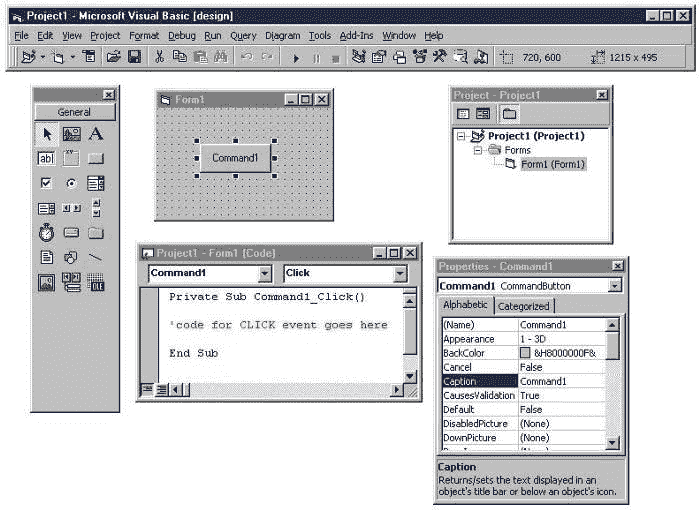

图 2-12 Visual Basic 编辑器

Dreamweaver（见图 2-13）则是网页开发的代表工具，支持“设计”与“代码”双视图。开发者可在可视界面布局网页元素、调整样式，也可在代码视图编写 HTML、CSS、JavaScript。其“行为”面板允许通过简单参数设置实现图片切换、表单验证等交互，无需深入代码逻辑，网页开发效率明显提升。

尽管当时可视化平台功能有限，主要用于中小项目或特定领域，但图形化操作已降低开发门槛，初现低代码雏形。

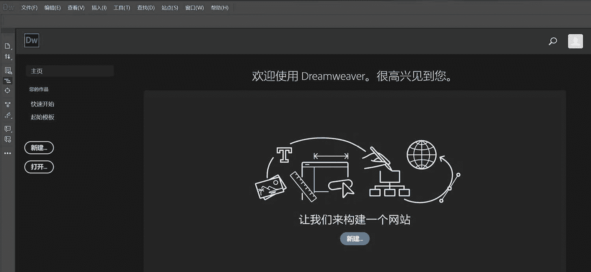

图 2-13 Dreamweaver 工作区

### 2.3.3 概念形成与初步实践
2012 年，Gartner 提出“全民开发”倡议，目标是消除编程门槛让非专业人员参与开发。同年 OutSystems 发布低代码开发平台，凭借可视化界面和预制组件可快速搭建应用，为低代码理念提供实践样本。

2014 年，Forrester 正式提出低代码概念：使用极少量代码或无需代码即可快速开发、配置并部署应用。低代码由此作为独立技术范畴受到关注。

从图灵完备视角看，低代码在复杂算法、高并发场景中受预置组件和可视化限制，难以达到专业语言效率；从非图灵完备视角看，面对高度定制化需求，预置组件也难以满足深度业务逻辑。因此即便热度高企，市场上仍有大量质疑声音。

### 2.3.4 市场发展期
随着企业数字化需求升级，单一低代码难以应对系统集成、数据互通与跨平台部署。2018 年 Gartner 提出 aPaaS 与 iPaaS 概念，为低代码注入新活力。

aPaaS：基于云的一站式可视化开发环境，提供丰富组件库、模板及自动化部署运维能力，让开发者专注业务建模。例如 OutSystems 平台支持拖拽页面组件、配置业务逻辑并一键完成服务器配置与资源分配，缩短 Web 与移动应用开发周期。

iPaaS：聚焦异构系统间数据与流程集成，通过连接器、ETL 引擎与流程编排，实现 ERP、CRM、SCM 等系统的数据互通与业务串联。以 Mendix 为例，其 iPaaS 方案可无缝对接 SAP、Salesforce，实现端到端业务流程优化。

国内也出现简道云、明道云等低代码平台，满足办公自动化与数据管理等基础数字化需求，推动低代码落地。资本市场高度关注，2018 年西门子收购 Mendix，KKR 与高盛投资 OutSystems，为行业注入资金。

但此阶段无论专业开发者还是普通用户，都面临平台功能与复杂业务不匹配、技术锁定与供应商依赖等问题。低代码虽降低门槛，用户仍需一定编程基础才能做出符合企业需求的个性化应用；技术经验不足的普通用户在复杂系统集成与功能扩展中仍困难重重。

### 2.3.5 传统低代码与无代码平台的局限性
传统低代码与无代码平台虽以降低门槛、提升交付效率引发变革，实际应用中仍存在多重局限。

·功能深度与复杂性处理。平台理论上具备一定计算能力，但依赖预置组件库与可视化操作，在处理复杂业务逻辑如金融交易模型、高并发电商实时数据时，难以充分发挥图灵完备潜力，无法满足企业复杂数字化需求，往往需脱离框架回归传统代码。也因设计并非追求完整图灵完备，在大量循环、递归等复杂控制结构场景下能力先天不足，难以应对工业自动化控制、科学计算等需求。

·个性化定制与扩展性。为追求快速开发，平台在一定程度上牺牲了定制灵活性。复杂定制需求下难以高效灵活实现；普通用户因能力有限，即使有自定义功能也难将复杂业务需求转化为有效应用逻辑，导致功能缺失、流程不合理。随着业务发展，平台与新技术新系统集成的难度增加，扩展性问题凸显。

·技术锁定与供应商依赖。企业采用平台后深度依赖其技术架构、工具与生态。不同平台数据格式、开发规范差异导致应用迁移困难。无论是具备完整编程能力的开发者还是依赖可视化工具的业务人员，面对供应商策略调整或经营问题时，都面临应用无法运行、难以升级的风险，缺乏自主解决问题的能力与技术基础。

·性能与安全性。平台生成代码冗余，难以像手写代码那样精细优化性能，在大数据量、高并发请求下易出现响应慢、系统卡顿。从图灵完备理论看，无法充分发挥计算能力实现高性能；从非图灵完备视角看，普通用户缺乏安全意识易引入漏洞，平台出现安全漏洞时企业只能依赖供应商修复，增加数据与业务安全风险。

### 2.3.6 AI 赋能低代码和无代码平台
AI 为低代码与无代码平台注入新活力。

·功能深度拓展。AI 驱动的智能代码生成与优化，使平台在复杂业务场景中具备更强计算能力。例如金融风控场景中，AI 可依历史数据与业务规则自动生成并持续优化风险评估模型，逐步逼近图灵完备系统的高效实现。

·自动化交互代码生成。在物联网设备管理等领域，自然语言处理可根据设备协议与需求描述生成底层采集与分析代码，弥补平台在复杂功能实现上的不足。

·个性化定制与扩展。依托深度语义分析与机器学习，AI 能将自然语言需求转化为符合业务逻辑的定制化组件与流程，显著降低普通用户使用门槛。

在此背景下，Vibe 编程以其 AI 驱动范式将优势进一步放大：从意图深度理解到代码智能生成，构建“意图声明-系统生成-人机协作”闭环，大幅提升开发效率与质量，真正突破传统低代码与无代码平台的边界，为软件开发带来更高效智能的解决方案。

## 2.4 小结
回望编程方式演进，从机器语言到高级语言的抽象，从行编辑器到集成开发环境的交互革新，再到低代码对效率与门槛的双重优化，编程始终在效率、可用性与表达力间寻求平衡。每一次技术跃迁既释放计算能力，也重塑开发者思维。

语言演进带来更强表达力，工具进化改善开发交互，而低代码进一步模糊“编程”与“使用”边界。这些积累共同构成 AI 编程落地的基座——技术已成熟，真正的挑战是如何把 AI 能力嵌入真实开发场景，产出可用、可信、可控的产品体验。

# 第三章
# Vibe 编程应用生态
从技术可能性到实际应用，中间隔着产品化这座桥梁。就像电力发明不等于电器时代到来，AI 技术成熟也不等于 AI 编程时代自动降临。需要合适的产品形态、恰当的交互方式与完善的工具生态，才能让强大技术真正服务日常编程。

本章聚焦 Vibe 编程在不同开发场景的具体形态，从早期通用大语言模型辅助编程，到 IDE 集成辅助编程，再到端到端 Agent 编程，系统梳理 Vibe 编程在实际开发链条中的技术演变与落地趋势。

## 3.1 通用大语言模型辅助编程
通用大语言模型的普及让“对话”成为接触 Vibe 编程最早的入口。开发者通过自然语言与大模型对话，可在不借助复杂工具的情况下直接获取编程建议、代码片段甚至完整方案。这种基于网页端的轻量级“对话式编程”虽仍属基础辅助层面，却对开发效率与体验带来巨大提升。

### 3.1.1 大语言模型问答
最早的对话式辅助编程主要依赖网页端大语言模型聊天窗口，典型代表有 ChatGPT、Claude、Gemini。这些产品界面简洁、支持自然语言输入，用户无需掌握复杂命令，只需用日常表达提出技术问题，模型即可实时生成答案、建议，甚至直接给出代码实现。

核心优势在于“零门槛试错”。无论初学者定位 bug，还是资深开发者快速了解陌生 API，或希望 AI 生成一段算法模板，与大模型的直接对话往往能在数秒内获得有价值反馈。

其实生成式 AI 早期让不少人低估，很多人以为优秀开发者的能力仅体现在技术本身。但检索能力同样是决定效率与问题解决水平的关键。

所谓检索能力，就是遇到问题时能否借助 Google、百度等搜索引擎迅速、准确地定位相关信息并据此高效解决。别小看这项能力，人人会用搜索引擎，但真正能高效解决问题的人不多。常常见到自己搜索半天无果，而请教的“大佬”却能瞬间给出答案，背后除经验积累外，很大程度上依赖信息检索与提炼能力。

善于解决问题的人通常具备两点：一是能从复杂问题中快速提炼核心关键词；二是具备丰富检索经验，懂得用最小信息成本从繁杂结果中筛选出最有用答案。向搜索引擎提问本身就是门学问，而这项基于搜索引擎的检索能力正随生成式 AI 发生巨变。可以说，大语言模型正在取代传统搜索引擎，成为新的知识获取与问题解决入口。对应能力上，过去需提炼关键词去“搜索”，现在需用更自然的语言设计更高质量提示词，让 AI 理解意图并给出最贴近需求的答案。AI 在一定程度上弱化关键词检索依赖，却把“如何清晰、精准地表达问题”变成了解决问题的新核心能力。

这实为人类信息获取方式的递进演变：从“向搜索引擎提问”到“向 AI 提问”。每一次演变本质考验问题表达与信息提炼能力。只是到了 AI 时代，这种能力有了更正式的技术名称——提示词能力。

AI 工具已经大规模进入工作流后，会不会写提示词、怎么让大语言模型给出靠谱答案，已经成了新型开发者的必修课。对话式辅助编程，本质上就是把检索能力和提示词思维放在大模型旁边，让它直接变成可感知的编程伙伴。

### **3.1.2** **大模型编程能力各显神通**
随着底层技术不断成熟，主流通用大模型在代码领域的表现越来越接近专业水准，厂商的竞争点也从单纯写代码，转向代码生成、技术推理和多轮上下文理解的综合能力。

OpenAI 的 GPT 系列就能用 Python、JavaScript 等常见语言产出代码，逻辑推理能力突出，能吃透比较复杂的业务描述并给出相对完整的函数框架或方案初稿。多轮对话时，技术上的连贯性明显，上下文里的代码会在后续交互中持续被优化。

Anthropic 的 Claude 系列更在意安全和稳定性，长上下文保持能力很强。在讲究规范、流程严谨的企业开发里，它更容易遵守预设的开发规范和约束，代码跑偏的概率更低。业内常把它称作最强的编程模型，在 SWE-bench、Codeforces 等多个编程评测中长期排在前面。

Google 的 Gemini 系列则打开了跨模态编程的局面。借着文本、图像、音频的融合能力，它在多媒体开发、数据可视化、前端交互等场景里能给出更立体的方案。相比只有文本输入，Gemini 更适合处理多维度、跨素材的开发需求。

国内阵营也在加速追赶。文心一言、通义千问、DeepSeek 等模型在代码生成上持续突破，尤其在本地化部署和中文支持上优势明显。迭代下来，各家的代码理解、报错修复、性能优化差距在缩小，差别更多体现在特色功能和生态打法上。

### **3.1.3** **对话式编程的甜头与瓶颈**
说实话，对话式辅助编程确实把入门门槛拉低了，技术探索的速度也明显变快。但它的限制同样明显。

早期的对话体验容易出现上下文断层，对整个项目的背景和历史开发脉络缺少持续感知，产出的代码很难直接塞进真实项目，通常还要人工校验和修补。再加上交互多在网页端完成，和主流 IDE 之间来回跳转，整体工作流不够顺滑。

更关键的是，它缺少结构化的协作机制，基本只能服务个人摸索，支撑不了团队级、系统级的连续开发。所以对话式编程虽然打开了 Vibe 编程的大门，但要真正释放 AI 的协作价值，就必须走向更系统、更贴合开发环境的形态，这正是 IDE 集成思路兴起的原因。

## **3.2** **IDE 里的 AI 融合时代**
如果说网页对话是先跳出编辑器问 AI 再跳回来，Vibe 编程在 IDE 里的落地，就是把 AI 能力直接塞进开发主战场。AI 不再是外部助手，而是和代码编辑、调试、运行融为一体，形成更高生产力的闭环。

以前 IDE 主要为人类服务，聚焦编辑、语法检查、调试运行等传统功能。进入 AI 时代后，IDE 正从插件堆砌走向深度 AI 原生设计，成为人和 AI 协同开发的核心阵地。

### **3.2.1** **插件式 AI 如何嵌入编辑器**
Tabnine 算是先行者之一。它用机器学习做语法和函数调用的智能补全，帮助开发者省去重复输入。虽然功能比较单一，复杂场景下效果一般，但它为 AI 与 IDE 的结合开了第一枪。

真正让市场意识到可能性的是 2021 年的 GitHub Copilot。它基于 OpenAI 大模型，覆盖多种主流语言，能根据自然语言注释实时补全代码，甚至主动给出函数结构和多种备选方案。从片段补全到意图理解，AI 在 IDE 里从工具箱变成了搭档，效率和便捷性被大幅拉升。

近几年又出现了不少更体系化、更重协作的 AI 助手。它们的整体功能很强，有些甚至不输原生集成产品，但因为仍然是依托传统 IDE 外挂使用，交互细节和体验一致性上总差一层。

2024 年出现的 Cline 就是典型代表。它和 VS Code 深度绑定，迭代很快。和传统插件不同，Cline 不只做桥接，还内置了模型上下文协议 MCP，能打通自然语言和外部工具的边界。借助 MCP，它可以理解大代码库的结构和业务逻辑，分步规划方案，同时保持对 IDE 的实时感知，每次改动都要开发者明确确认。协作式生成让大团队协作效率提升，也让新人更快上手复杂项目。Cline 还通过 MCP 市场接入大量第三方 MCP Server，指令全靠自然语言下发，开发路径被进一步压缩。它支持接入第三方大模型厂商 API，用成本更低。综合来看，Cline 目前是插件阵营里功能丰富度最接近原生集成产品 Cursor 的存在。

同年思路的 Augment Code 则更偏团队流程和长上下文。它会深入分析代码库、依赖关系和团队最佳实践，帮助开发者在熟悉的 IDE 里快速建立全局认知。用户普遍反馈它很聪明，在上下文理解和流程编排上甚至优于 Cline 和 Cursor，但每月 50 美元的价格让不少人望而却步。

总体看，插件路线有两大趋势：从单点工具走向系统化参与，从单纯补全扩展到协作优化、知识传递和复杂系统理解。

### **3.2.2** **原生 AI 编辑器重塑开发体验**
如果插件是外挂，原生 AI 集成 IDE 就是为 Vibe 编程重塑的开发环境。它从架构、数据流、上下文管理到人机协作模式，都围绕 AI 重新设计。

Cursor 是这个赛道的标志。2023 年发布，基于 VS Code 分支但远不止魔改。它把整个代码库当作 AI 的输入源。和早期插件只看当前窗口或局部上下文不同，Cursor 启动后会自动对项目代码做索引、解析和向量化，生成完整的语义地图。之后的提问、指令、补全请求，都在全局工程视角下给出回答，体验完全不同。

这种深度集成直接拉低了编程门槛。坊间流传 Cloudflare 副总裁的 8 岁孩子，仅靠 Cursor 和 AI，45 分钟就搭出一个聊天机器人应用。虽然是个例，却很形象地说明了 Vibe 编程对专业壁垒的冲击。

在 Cursor 里，实时补全、上下文感知、智能重构、光标预测、多文件协同已经是标配。2025 年发布的 1.0 版本，到本书完稿时最新是 1.2，新增了项目级 Rules 集成、MCP Client 集成、Memories 记忆机制、BugBot 自动审查助手和 Background Agent 等功能，迭代非常快。

Cursor 的出现像投入水面的石头，推动整个行业重视原生 AI IDE。

2024 年的 Windsurf 由 Codeium 团队打造，可看作在 Cursor 基础上的延伸和深化。它保留了多轮对话、全局感知、实时补全等优势，并在 AI 工作流上做了更细腻的打磨。

最值得关注的是多步骤多工具协同能力，打破了传统生成式 AI 单问单答的局限。内置的 Cascade 模块把任务拆成 Chat 模式和 Write 模式，Chat 负责日常对话和问题交流，Write 负责直接生成文件、批量修改、多文件编辑，并在开发者确认后落地到代码层。这样既提速又保留了控制权。Windsurf 还能动态感知开发环境，新增文件、改变量名、重构方法时都会即时更新上下文，让 AI 始终跟上项目最新状态。

### **3.2.3** **两种集成路线的取舍**
在 VS Code 或 JetBrains 里装上 Copilot、Cline、Augment Code，开发者不用换环境就能获得 AI 能力，对团队推广很友好。缺点是 AI 对项目整体的理解依赖手动输入上下文或局部缓存，难以像原生集成那样持续系统地“读懂工程”，而且受限于 IDE 底层架构，扩展偏底层功能比较吃力。

Cursor 和 Windsurf 这类原生产品在工程理解深度、交互顺滑度、可扩展性上都更进一步。全局索引让检索和读取更贴合上下文，原生层面的融合让体验更一致，也不受 IDE 架构限制，定制能力更强，这从 Cursor 的持续功能迭代就能看出。但它们都基于 VS Code 分支，对习惯其他 IDE 的用户需要适应期，甚至有人选择双开，体验并不理想。

值得一提的是，Cline 和 Augment Code 在设计上明显借鉴了 Cursor 的思路；早期的 Windsurf 也受 Cursor 影响，但很快走出自己的路，后来 Cursor 也吸收了 Windsurf 的一些亮点。

## **3.3** **全链路 Agent 编程**
在 IDE 集成之上，端到端 Agent 编程是 Vibe 编程的下一步——不再满足于补全或答疑，而是让 AI 主导完成整个开发链路。

### **3.3.1** **从补全到全自动的跃迁**
端到端意味着围绕一个具体需求，AI 能独立走完软件开发的关键环节：生成代码、实现功能、修复 bug、补测试用例、同步文档，甚至自动部署上线。

相比 IDE 里的 AI 助手只解决局部操作，端到端 Agent 更强调系统级的自主协作。它能主动思考、拆解任务、调度执行，而不是等待开发者宏观把控节奏。

因为要整合推理能力、长上下文存储和各类工具链，目前的主流 Agent 产品多跑在云端，本地化替代还不成熟。

### **3.3.2** **主流 Agent 产品盘点**
Devin 是最早打出“AI 软件工程师”名号的产品，也常被当成标杆，但实际体验和预期仍有差距。

最初它主打全自动端到端开发，能从理解需求到上线交付一气呵成。500 美元/月的定价加上模型不够成熟，让很多开发者却步，反馈普遍认为它智力有限、操作笨拙。

后来产品策略调整，价格降到 20 美元/月起步并支持按量付费，定位也改为 Treat Devin like a junior engineer，像对待初级工程师一样使用，复杂决策仍由人把控。

现在 Devin 呈现出高完成度、低智能密度的特点。模型推理不算顶尖，但流程打磨很完整，只要提示和任务拆解合理，它能完成基础功能开发、简单 bug 修复甚至多步工作流。

它的短板是成本。让 Devin 处理一个 GitHub Issue 可能消耗约 3 个代理计算单元 ACU，每个约 2.25 美元，理解偏差导致反复尝试时费用会迅速飙升。于是不少用户用它做初版生成，再转到 Cursor、Windsurf 等原生 IDE 里精修。

Devin 的优势更多在系统集成。它能直连 Slack、Linear、Jira 等协作工具，任务分发、状态跟踪、结果反馈都能嵌进现有工作流。它还推出了 Confidence Rating 信心分，用来评估任务准备度和成功概率，帮助用户避开低质量输出，节省算力。这种自我反馈设计体现了团队对落地问题的思考。

除了 Devin，赛道里细分玩法很多。

v0 专注前端 UI，用户用自然语言就能快速画出原型。基于 React 和 shadcn/ui 组件体系，生成结果既好看又可用，能无缝接入项目。Vercel 通过工程优化、模板复用和模型微调，把体验打磨得很顺，还在向全栈扩展并支持 GitHub 集成。

Bolt、Replit、Lovable 等主打 idea to App，从想法到应用一站式完成，打通前后端和部署，提供实时预览。Bolt 更偏开发者友好，Replit 主打云端一体化环境，虽号称小白可用，仍会暴露代码和构建错误，主要面向产品经理、设计师和有技术背景的人。Lovable 则进一步降低门槛，面向低技术背景用户。

YouWare 走得更激进，完全隐藏技术细节。用户看不到代码，也不会碰到构建错误，只需描述想法，AI 就会生成可用网站或小工具，甚至会自动屏蔽失败尝试，心智负担极低。它围绕用户生成软件 UGS 设计，让普通人也能参与软件创造。对非技术用户是福音，但对专业开发者来说可控性差，底层是黑盒，技术储备难以发挥，只能像普通人一样用自然语言编程。

在 AI 时代，程序员和 Vibe Coder 这种靠创意驱动开发的人群开始共存。YouWare 这类产品或许撼动不了专业工具链，却可能重塑大众与软件、AI 的关系，让“人人可编程”更接近现实。

对于 YouWare 这类端到端智能体产品是否能够像短视频平台那样成为普世的创作入口，市场仍在持续观察。随着交互体验不断打磨、产出形态日益丰富、成本结构逐步下行，YouWare 已经为 Agent 编程赛道提供了更具娱乐性、更贴近大众的可能性。

### 3.3.3 运作机制与系统架构
端到端 Agent 编程在外表上像是会聊天的代码生成工具，实质却是多层耦合、高度集成的技术体系。能够把自然语言需求一路串通到可交付成果，关键在于底层模块之间的协同与智能化运行机制。

驱动这一类产品的核心仍是大型语言模型的推理能力。和 GitHub Copilot 这类 IDE 插件相比，端到端系统更倾向选用上下文容纳量更大、推理链路更长的模型。它们不仅能理解单条指令，还能保持多轮对话、分步推演、逐步规划。Devin 所宣称的“自主 AI 工程师”，本质上仍依赖大模型的迭代推理与动态规划来应对复杂任务。

保持上下文持续同步是智能体稳定运转的基座。Replit、Devin、Bolt 等产品普遍采用文件系统监听、实时索引、状态追踪等方式，对当前开发环境、历史操作、外部系统保持整体感知。智能体并非一次性接收信息就结束，而是随着需求变化和代码演进持续追踪，并动态调整自身行为。Devin 能够依据 Jira、Slack 的变更自动刷新任务状态，Replit 则借助工作区结构维持完整的上下文，支持多轮迭代与调试。

在此之上，工具调度能力决定了上限。单纯的模型输出只能得到文本或代码片段，完整的端到端系统会内置覆盖编码、测试运行、依赖安装、环境部署等环节的工具调用通道。例如 Bolt 与 YouWare 将前后端一体化部署流程内建在产品中，用户无需切换环境即可把想法落地为可用服务。

越来越多平台开始试验多智能体协作架构。以 Devin 为例，其内部引入了知识库、Playbook 等复用机制，让若干子智能体分别承担需求拆解、代码撰写、缺陷修复、测试验证等角色，通过分工协作提升效率与稳健性。这种设计模仿了人类开发团队的工作方式，也体现出 Agent 编程正从单体智能向团队级智能体演进的趋势。

结果呈现的规范化也是提升实用性的关键。Replit、Lovable 等普遍提供实时预览与可视化交互界面，相较于传统的代码差异对比与纯文本回复，图形化输出显著降低了使用门槛，提升了交付完整度。这一切背后依赖强大的算力支撑与工程体系。YouWare 选择弱化技术细节以换取低门槛体验，相应牺牲了部分专业可控性。不同产品在系统设计上的权衡，最终决定了定位差异与目标人群。

## 3.4 应用形态的未来
Vibe 编程仍处于快速演变期，产品形态、用户分层、技术底座与交互理念都处在试验与博弈的早期阶段，看似混乱但方向逐步清晰。相比最初的智能补全或代码生成，AI 编程已呈现出明显的应用分层。

### 3.4.1 新的应用形态
AI 编程领域出现了一批代表性的新形态产品，反映出不同的技术探索方向。

Claude Code 是 Anthropic 推出的首个命令行优先的 Agent 编程工具，设计目标是将 AI 安全地嵌入工程师日常开发流程。不同于 IDE 内集成辅助编程，Claude Code 直接运行在终端中，开发者可通过自然语言指令让其编辑文件、修复缺陷、运行测试、管理 Git，也能调用网络搜索补充信息。它支持将项目内嵌文档如 CLAUDE.md 作为上下文，提升对项目结构的理解。Anthropic 强调其安全与隐私设计，所有交互均通过本地终端直连、不经中转服务器，并可与企业云平台集成。同时该工具也提供 IDE 插件，甚至可在 Cursor 中通过插件使用。

Gemini CLI 是谷歌推出的开源命令行型 Agent，基于 Gemini 2.5 Pro 模型，并具备 MCP 支持、外部内容搜索与多模态能力。开发者不仅能通过对话驱动代码生成、调试与解释，还可读写文件、执行 Shell 命令、生成文档，甚至调用图像与视频生成工具如 Veo 与 Imagen。开源属性搭配超大上下文窗口，以及免费的日请求额度，对喜欢自建工具链的团队极具吸引力。

与 Claude Code 相比，Gemini CLI 在使用边界上更宽松，不局限于 IDE，也不依赖商业订阅，更像一个可扩展、可定制的 DevOps 助手。

Claude Code 与 Gemini CLI 代表了编程形态的新尝试，目前仍有很长的路要走。未来演进的重要趋势在于多模态协同，不仅限于文本理解与代码生成，还将融合语音、图像、界面交互，打破编辑器-控制台-浏览器的传统边界，实现开发、调试、部署一体化体验。同时桌面、网页、移动、云端的功能边界也将进一步模糊，AI 编程正向全端统一、随时随地编程演进。

### 3.4.2 应用形态与用户分层
宏观来看，AI 编程生态大致可分为两大应用形态。

AI 辅助编程产品主打增强现有开发工作流的功能，是专业开发者提效的“增强器”。以 Cursor、Cline、GitHub Copilot、Claude Code 为例，它们通常集成在传统 IDE 中，提供补全、生成、重构等能力。它们也在向端到端演进，例如 Cursor 的 Background Agent 实现了部分端到端能力，可称作半端到端，因为上下文理解、记忆、任务处理与智能体编排可以被外部调度。专业开发者可在框架内定制编排 Agent，普通用户若缺乏学习成本只能使用默认能力。

端到端 Agent 编程产品主打独立完成开发任务，往往脱离传统开发环境，试图把专业开发者从编码执行者转变为任务分配者或代码审查者。Devin、v0、Bolt、Replit、Lovable、YouWare 等能够自主理解需求、编写代码、调试问题，甚至进行项目管理与集成部署。对大多数普通用户而言，这才是真正的 Vibe 编程，只需用自然语言描述意图，无需关心实现细节，产品也倾向直接给出成品而非展示源码。但对专业开发者来说，这类产品的可控性相对较弱。

借鉴自动驾驶分级理念，可对 AI 编程产品进行分层。

1 级——对话助手。最早也是最普及的形态，典型如 ChatGPT、Claude、Gemini，通过自然语言问答辅助生成代码片段、解释逻辑、提供建议。具备一定上下文感知，但仍是离散对话，无法持续追踪项目状态，用户需自行整合与调整，属于轻度辅助。

2 级——智能协作。以 Cursor、Windsurf、Claude Code 为代表，将 AI 深度嵌入开发环境，具备完整的工程级上下文索引、智能补全、链路感知与协同开发能力。更关注系统性与工程落地，可在 IDE 内辅助完成复杂功能生成、智能重构、代码导航、团队同步等，成为开发者的有力助手。并非端到端自主开发，而是 AI 辅助、开发者主导的协作模式。

3 级——自主交付。前沿探索方向，典型如 Devin、Bolt、v0、YouWare，核心在于围绕具体需求独立完成从需求拆解、功能开发、测试上线到结果交付的闭环。强调自主性与系统集成，部分具备多 Agent 协同、持续上下文追踪、工具链联动、智能反馈修正能力，朝 AI 团队成员或虚拟工程师方向演进。当前在复杂性与可靠性上仍有挑战，但理念预示着开发者角色从执行者转向需求设计者，AI 将承担更多工程落地任务。

## 3.5 小结
Vibe 编程产品仍处高速演变期，从通用大模型辅助编程，到 IDE 集成 AI 辅助，再到端到端 Agent 编程，最终延伸为覆盖开发、测试、部署、协作的一体化智能体系。Cursor、Windsurf 等推动团队级协同，Devin、Bolt、YouWare 探索端到端自主编程新范式，Claude Code、Gemini CLI 等也在探索不同的应用形态。

# 第四章
# Vibe 编程应用场景与实践案例
技术的真正价值取决于能否在现实场景中落地。Vibe 编程作为以自然语言驱动 AI 自动生成代码的新范式，其实践效果决定了它是美好设想还是能推动软件生产方式变革的现实工具。

在全球数字经济浪潮下，编程技术革新已成为产业升级的核心引擎。Vibe 编程以“所想即所得”的对话式开发为核心，开发者只需用自然语言指令，就能把稍纵即逝的创意快速转为可运行代码。这不仅大幅降低技术门槛，也催生了全新商业生态。

市场数据印证了这一趋势。

Grand View Research 统计显示，2024 年全球 AI 市场规模达 2,792.2 亿美元，预计到 2030 年突破 1.8 万亿美元，2025—2030 年复合年均增长率达 35.9%。
Exploding Topics 统计显示，截至 2025 年 7 月，全球 AI 市场规模约 3,910 亿美元，行业整体年均增速约 35.9%。

应用层面，新兴平台与头部企业的实践同样突出。

Replit 平台：75% 的用户在首次使用前从未写过代码，却凭借 Ghostwriter AI 把创意转化为完整产品。
谷歌：CEO Sundar Pichai 在财报电话会透露，超 25% 的新代码由 AI 生成，显示自然语言驱动的代码自动化已深度融入内部开发。
Y Combinator：管理合伙人 Jared Friedman 在 2025 年冬季演示日提到，1/4 的参选初创团队，其核心代码库 95% 以上由 AI 生成，彰显 AI 编程在创业初期的助力。

透过数据与案例，既能感受到 Vibe 编程的可行性，也能洞察其方法论边界与演进方向。

本章将系统梳理 Vibe 编程在不同领域与角色中的应用，通过任务类型、协作模式与落地成效分析，揭示其在提升开发效率、降低协作成本、加速创新落地方面的独特优势。我们将精选典型案例，从产品原型构建到业务流程自动化，从教育评估优化到创意快速实现，展示真实场景下的可行性与潜力。

## 4.1 应用场景剖析
Vibe 编程凭借低代码、可视化与意图驱动的特性，为软件开发带来全新范式。它不仅降低编程门槛，更通过高效体验拓展技术边界。无论是产品原型构建、个人创意实现、编程教育启蒙，还是企业内部流程自动化，都展现出独特优势，本节围绕 4 类场景展开。

### 4.1.1 产品原型快速构建
研发初期验证创意可行性至关重要。未经验证的创意可能存在技术瓶颈或需求错位，直接大规模开发会浪费时间和资金。快速原型能提前试错，避免错误延续到成熟期，减少后续开发与推广成本。

以 AI 编程大模型为代表的技术，可显著降低原型成本。时间上，传统人工编写需数周甚至数月，AI 通过自然语言解析与智能生成可压缩至数天甚至数小时。人力上，降低对专业开发者的依赖，个人与小团队也能完成开发，减少外包与高薪成本。

一家专注文化创意产品的小型工作室计划推出融合增强现实的戏曲脸谱互动明信片。用户扫描明信片即可观看对应角色唱段视频与背景介绍。传统模式需组建 AR 工程师、前端、视频剪辑团队，周期 5～7 周，成本数十万元。

团队改用编程大模型开发。将需求拆解为模块后，仅需在编辑器输入“创建基于 AR 的脸谱识别功能，识别后播放对应视频及文字介绍”，模型基于内置 AR 框架与多媒体库快速生成 JavaScript 与 Python 混合代码。遇到视频加载缓慢时，提问“如何优化移动端视频加载速度”，模型建议分片加载与压缩码率。借助 AI 设计工具完成界面后，6 天完成原型，人力成本节省超 70%。

类似地，某独立开发者在健身领域探索应用，通过 Vibe 编程搭建动作识别与反馈框架，为后续功能打基础。工具虽需进一步优化，但极大缩短了从构想到初步实现的时间，让个人创作者、小团队与初创企业都能低成本试错，提高孵化成功率。

### 4.1.2 “全民开发”兴起
1.1 节提到的退休教师王阿姨借助 AI 编程工具开发家庭相册 App 的案例颇具代表性。她起初只有模糊想法，通过对话协作逐步明确需求，从“上传照片”“微信登录”到“标签分类”“背景音乐”，AI 工具不仅理解意图，还自动完成后端接口搭建、数据库建模、前端界面生成。

全程无需写代码，也无需掌握技术术语，只需像日常交流一样给出修改建议，如“封面希望更温馨些”或“视频能不能快点生成”，AI 就能理解语义并优化界面风格或后端算法。3 天内完成具备完整功能的应用雏形。

案例展现了 AI 编程对自然语言意图的高效转译，也体现了非程序员创意可直接驱动产品诞生。这正是全民开发兴起的核心：技术门槛断崖式下降，普通人也能主导开发流程。

### 4.1.3 启蒙利器与进阶阻碍
在编程教育领域，Vibe 编程凭借直观的可视化交互与零代码特性，已成为低龄学生与初学者的启蒙利器。其“积木式编程工作台”搭载智能引导系统，支持模块化组件拖拽与参数配置，通过动态提示与步骤回放把复杂代码逻辑具象化。

学习者只需图形化搭建流程，系统自动生成对应代码，实现“创作即学习”的体验，如图 4-1 所示。


图 4-1 “创作即学习”闭环

以上海某小学编程兴趣班为例，教师以“开发简易电子相册”为案例。10 分钟演示中，教师通过可视化界面拖拽图片展示模块、配置切换特效并设置动画参数，AI 工具实时生成代码预览，帮助学生建立图形与代码映射。随后 40 分钟实践中，学生小李导入家庭旅游照片，调整尺寸、添加文字注释并配“淡入淡出”转场，20 分钟完成相册。他还灵活运用事件触发机制，实现点击照片同步播放对应旅游视频。寓教于乐的方式让学生在实践中掌握顺序执行、条件判断等核心概念。课程结束后，90% 学生完成作品，80% 表示对编程产生浓厚兴趣，部分学生主动尝试添加背景音乐与导航菜单等进阶功能。

### 4.1.4 企业内部流程自动化：效率提升与整合难题
企业日常运营中大量重复性、规律性任务消耗时间与精力，效率低且易出错。Vibe 编程凭借零代码、可视化特性，为工作自动化提供高效路径，助力降本增效。

某广告传媒公司市场部每月需从社交媒体、搜索引擎广告后台、电商数据中心等多渠道下载营销数据，经清洗、格式统一、图表制作后撰写分析报告。原先需 3 名员工耗时 2 天，且复制粘贴与公式计算易出错。

2023 年底，部门尝试自动化。主管带领两名有计算机基础的员工，向大模型下指令：“创建一个能自动从抖音、百度推广、淘宝后台下载数据、清洗异常、统一为 CSV 格式并生成点击率、转化率柱状图与折线图，最后输出月度营销分析报告的脚本。”模型调用数据采集、清洗、可视化相关算法与模板，快速生成 Python 与 Shell 混合脚本。少量调试后搭建起自动化系统。运行后，原本 2 天的工作 1 小时内完成，数据准确率近 100%，员工可将精力投入数据分析与策略制定。

## 4.2 实践案例详解

Vibe 编程正在改写开发版图

智能辅助编程已进入不可逆的演进通道，Vibe 编程正是这一浪潮里最具代表性的实践形态。接下来将从个人创作者、初创团队、头部企业与开源生态四个维度拆解该范式带来的结构性变化。单人开发者借此迅速破圈，小团队实现弯道超车，大厂借力完成战略升级，开源社区因此掀起创新浪潮，整个软件开发版图正被全面改写。

需要说明的是，尽管 Vibe 编程这一说法到 2025 年才被正式命名，但自大语言模型切入代码场景以来，其背后的工作思路已获得广泛认同。下面案例未必都打上该标签，本质上都指向同一内核：以自然语言为牵引、以 AI 为执行主体的全新开发方式。

### **4.2.1 独立开发者的成功案例**
Vibe 编程为个体创作者打开了新入口，让零基础也能做出应用的设想变成现实。GitHub Octoverse 2024 报告显示，过去一年生成式 AI 相关项目数量同比增长 98%，贡献量提升 59%。使用 Copilot 的教师、学生与维护者群体翻倍。通过自然语言交互与编程助手，非专业背景的开发者正加速进入供给侧，代码产出明显上升，这组数据直观体现了该范式对独立开发者的赋能强度。

下面通过几组典型案例，看个体创作者如何在这一思路驱动下完成从 0 到 1 的跃迁。

**1. 恋爱社交赛道的开拓者**
Blake Anderson 的经历堪称 AI 赋能个人开发的典型。作为 2023 年毕业的年轻人，他捕捉到 Z 世代社交的痛点后投身社交工具创业。开发时他没有像传统做法那样手写大量复杂代码，而是用自然语言向工具描述需求，例如“为聊天场景生成高情商回复模块”，工具在 AI 辅助下自动产出代码框架，并基于 500 万条真实聊天数据训练优化。

延伸阅读
“Z 世代”，网络用语，通常指 1995 年—2009 年出生的一代人，他们一出生就与网络信息时代无缝对接，受数字信息技术、即时通信设备、智能手机产品等的影响比较大。

他打造的恋爱社交应用 Plug AI，原名 RizzGPT。产品具备对话实时分析与情感识别能力，并首创“恋爱人格画像”功能，利用语义情感分析为用户匹配专属沟通策略，相当于配备一位恋爱沟通导师。深度交互大幅提升了吸引力，付费转化率达 35%，远高于行业均值。商业模式采用基础功能免费+高级订阅+虚拟商品组合，单付费用户平均收入 ARPPU 达到 12.8 美元。依托 TikTok #RizzGPTChallenge 话题营销，用户自制的 AI 恋爱教学短视频迅速走红，总播放量突破 27 亿次，助力产品上线首年营收突破 1000 万美元，成为个体开发者借助 AI 成功创业的样板。

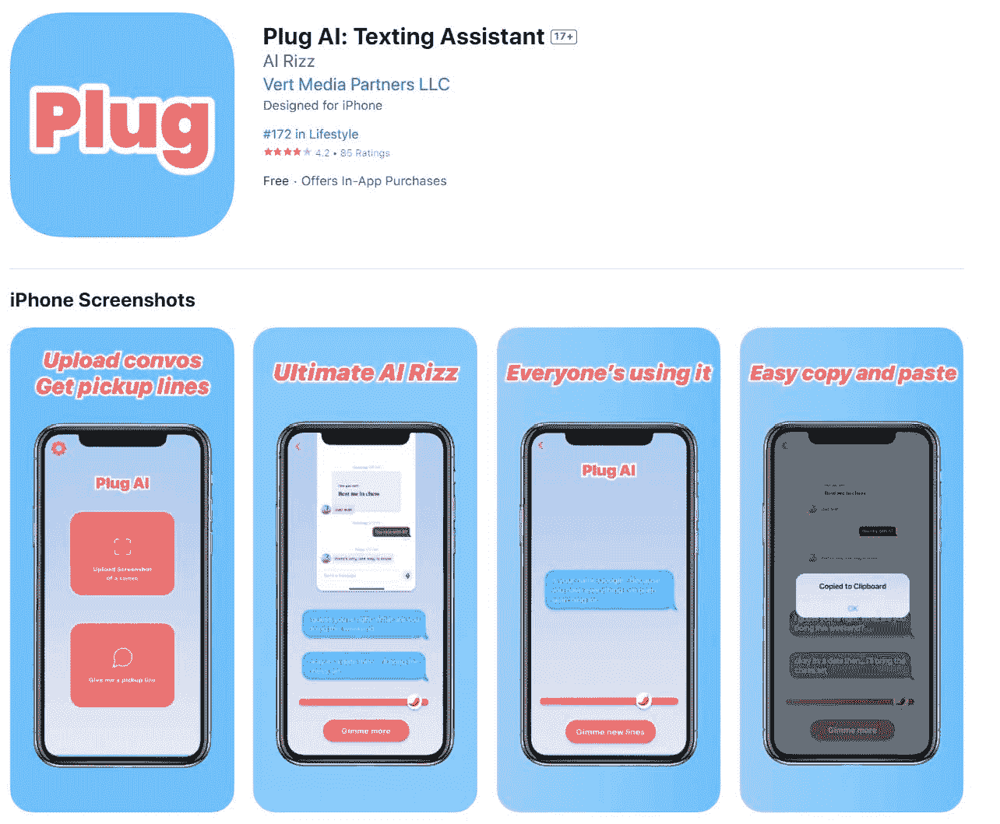

图 4-2 Plug AI

**2. 从网文作者到全栈开发者**
国内开发者赵纯想的转型同样精彩。从网文作者跨界成为全栈开发者，这在 Vibe 编程助力下变得顺畅。他先用 Midjourney 完成 UI 原型，再借助自然语言编程把视觉创意转化为可运行代码。8 个月内产出 23 款垂直应用，展现出惊人的创造力与执行效率。

其中，“胃之书”App 融合大语言模型与美食知识图谱，为用户带来全新体验。输入“番茄”“鸡蛋”等食材组合，App 即可基于 AI 生成营养评估、烹饪步骤与个性化饮食建议，像贴身营养师一样服务。产品在小红书引发“AI 食谱创作”热潮，凭借差异化功能与优质体验，连续 14 天稳居 App Store 美食类前三，单月广告与会员收入达 1.7 万美元。


图 4-3 “胃之书”App

**3. 小时级落地的极致案例**
“小猫补光灯”应用开发者陈云飞把 Vibe 编程效率发挥到极致。在 Cursor 编辑器中输入自然语言指令“开发双区域智能补光功能，支持动态照片 live photo 俗称 Live 图 实时处理”，仅用 1 小时就完成原型。产品上线后单日下载突破 2 万次，Pro 版付费转化率达 22%，实现“小时级开发，百万级营收”的传奇，充分证明了该范式在独立开发中的潜力。


图 4-4 “小猫补光灯”应用

**4. 边旅行为边造物的数字游民**
荷兰开发者 Pieter Levels 一边环游世界一边高效出品。他推出的 Nomad List 对 187 个国家地区、1000 多个城市从消费、气温、安全、网速等维度评价，帮助数字游民找到理想据点，构建起全球最大数字游民城市数据库，以会员费与广告实现稳定盈利；Remote OK 是远程工作平台，后被 GitLab 收购；Photo AI 每月生成约 100 万张 AI 照片，通过用户反馈持续迭代。案例生动展示了 Vibe 编程赋予创作者的灵活创造力与持续进化能力。

### **4.2.2 创业公司的应用实践**
Vibe 编程正悄然重塑创业生态，成为初创企业实现小团队大创新的关键抓手。据 Y Combinator W25 公开数据，管理合伙人 Jared Friedman 透露，有 25% 的初创团队核心代码库中 95% 以上由 AI 生成。该数字充分展现了以自然语言驱动、让 AI 主导编码的思维在创业领域的渗透深度。

健康科技领域，一家匿名团队仅有 1 名工程师和 2 名产品经理，却在该理念加持下释放惊人创新力。他们依托 Replit 平台，将“通过照片识别食物并预测健康风险”的设想迅速落地。成员通过对话式交互发出精准指令，如“构建基于 GPT-4V 的图像识别模块，结合长短期记忆 LSTM 网络实现健康风险分析”，AI 工具按 Vibe 范式自动生成代码并整合模块。最终 Cal AI 应用对食物识别准确率达 98.7%。内测即因卓越性能与创新理念获得 2000 万美元 Pre-A 融资，验证了小团队也能在激烈市场中突围。

教育科技同样涌现创新。GradeWiz 由康奈尔大学学生 Max Bohun 与 Aman Garg 联合创立，入选 Y Combinator 2025 年冬季批次。团队基于 AI 与计算机视觉，构建自动批改数学与编程作业系统，已在宾州州立大学、康奈尔大学、纽约市立大学亨特学院、加州州立理工大学和锡拉丘兹大学等多所高校累计批改超 30,000 份作业。相比人工批改，GradeWiz 使助教效率提升约 60%，平均每周节省约 4 小时。凭借高效可靠的自动评估能力，GradeWiz 正引领 AI 辅助教育评估新赛道。

### **4.2.3 大型企业的转型**
头部科技企业纷纷把 Vibe 编程纳入战略体系，视其为提升核心竞争力的关键抓手。

谷歌在 2024 年 I/O 大会披露，自然语言驱动的 AI 编程工具已在内部大型项目中发挥关键作用：一次核心代码迁移工程中约 74% 的代码改动由自动化工具完成，整体迁移时间缩短约 50%。该成果充分说明自然语言交互辅助的代码生成与修改，能显著提升复杂项目的工作效率。

GitHub Copilot 在受控实验中的表现同样突出：常见编码任务加速效果约 55%。数据显示，自然语言交互辅助的代码生成与补全能显著提高开发效率。开发者只需描述需求，例如“创建一个可实时监控设备状态的模块”，系统即可自动推理生成完整代码。关键功能模块开发周期由数月压缩至数周，有效缩短产品上市时间，提升市场响应速度。

国内巨头腾讯也在核心产品线践行该思维，自研编程助手“天工”已深度嵌入开发流程。

· IDE 插件层：内置于定制版 VS Code，开发者可在编辑器中直接用自然语言发起请求。
· CI/CD 流水线：在每次编译构建环节，“天工”自动校验、补全并优化脚本与配置，确保交付质量。
· 游戏引擎工具链：与内部引擎无缝对接，一键生成技能脚本、UI 交互逻辑及粒子特效配置，并自动打包入资源包。

以《王者荣耀》新赛季迭代为例，团队在 IDE 内输入“生成具有炫酷特效的战斗技能代码”后，天工即刻产出完整技能脚本、UI 交互逻辑及粒子特效配置，版本迭代效率提升约 50%，玩家首周留存率提升 8.3%。深度集成验证了该思维在大规模复杂项目中的卓越效能。

### **4.2.4 开源社区的适应与创新**
Vibe 编程兴起为开源社区注入活力，促使生态发生深层结构性变革。

GitHub 官方 Octoverse 2024 报告指出，2024 年平台上与 AI 相关的项目数量和贡献显著增加，表明 AI 已成为开源发展的重要驱动力。

学术研究显示 AI 对拉取请求 PR 流程的影响正在显现。例如 2024 年发布的报告《Generative AI for Pull Request Descriptions: Adoption, Impact, and Developer Interventions》分析了 18,256 个使用 Copilot 自动生成提交描述的情况，发现：

· Copilot for PRs 即自动生成提交描述功能的使用快速增长；
· 采用 AI 描述的 PR 审查时间更短，合并率更高；
· 开发者往往会再手动完善自动生成内容。

研究表明，虽然部分环节仍需人工调整，但 AI 正在切实提升协作效率，成为下一代开源协作工具的重要组成部分。

在 TensorFlow 生态中，开发者通过自然语言指令“生成分布式训练代码，提升训练效率”，在 Vibe 编程框架下自动生成的代码使模型训练效率提升约 30%，推动框架在性能优化上持续演进，保持全球 AI 开源框架的技术领先。

新兴开源项目也在探索人机协作新模式。例如 AutoML-Zero 项目完全通过自然语言指令自动生成机器学习算法代码，打破传统算法开发方式，为自动化建模提供全新思路。

值得关注的是，开源社区在快速发展同时，也对 AI 自主开发的伦理问题展开深度讨论。据统计，GitHub 项目讨论区每日新增超过 200 条相关探讨，涵盖模型安全性、代码可信度、生成内容版权等维度。这表明 Vibe 编程不仅加速技术演进，更推动生态在效率与智能之外构建伦理规范与价值共识，向更高效、更开放、更具责任感的方向演进。

## **4.3 小结**
通过典型场景剖析与具体案例，可以看到 Vibe 编程在多领域已展现出强大实践价值：它显著降低开发门槛，重塑人机协作方式，成为创新驱动与敏捷交付的重要工具。然而真正发挥潜力，并非仅靠工具本身，更依赖科学合理的使用方法与工程实践体系。

因此，第五章将进一步梳理 Vibe 编程的最佳实践方法，从需求规划到协同模式，从质量管理到持续演进，提炼可复用、可推广的实战指南，帮助开发者更高效、更稳健地拥抱新范式。

# **第五章**

# **最佳实践**

AI 生成代码虽高效，却常忽略代码质量、可维护性、安全性与性能等长期稳定交付的关键因素。本章将系统阐述如何在 Vibe 编程模式下引入科学严谨的工程实践与质量管理流程。

本章先介绍高质量提示词工程方法，帮助开发者用高效提示词更准确地指导 AI 工作。随后从需求规划入手，强调明确、结构化的需求描述如何成为 AI 精准生成代码的基础。此外，本章还聚焦代码审查与优化流程，帮助开发者识别并修复 AI 生成代码中的缺陷与风险。最后介绍一套轻量级工程化体系，包括版本控制、自动化测试、持续集成与持续交付 CI/CD 及 AI 驱动文档编写，以确保 Vibe 编程不仅能快速产出代码，更能长期稳定交付高质量企业级软件。

通过本章学习，你将掌握在 AI 驱动开发中保障代码质量、降低维护成本并提升项目稳定性的最佳工程方法，从而真正发挥 Vibe 编程全部潜力。

## **5.1 提示词工程技巧**
在 Vibe 编程模式下，理论上开发者只需清晰描述目标和需求，大语言模型即可自动生成相应代码逻辑和架构，减少繁琐手工编码，后续工作的重心便从具体编码转向提示词工程。提示词工程是指通过设计和优化向 AI 输入的指令或提示，引导大语言模型产生期望输出的技术。精心设计的提示词能显著提升 AI 理解意图的准确性和生成代码的质量。鉴于 Vibe 编程对自然语言交互的依赖，掌握高效提示词工程技巧对于发挥 AI 编码潜力、提高效率和代码质量至关重要。本节将深入探讨在 Vibe 编程实践中如何运用提示词工程技巧高效引导大语言模型工作。

### **5.1.1 为什么好的提示词很重要**
要理解大语言模型的工作方式，关键在于认识到它们并非真正理解代码或需求，而是基于海量训练数据和概率算法进行模式匹配与内容生成。大语言模型的核心机制是序列预测：模型接收输入文本即提示词，结合已生成内容，预测下一个最可能的词元 token，如此循环直至达到预设长度或遇到结束标记，整体逻辑大致如图 5-1 所示。

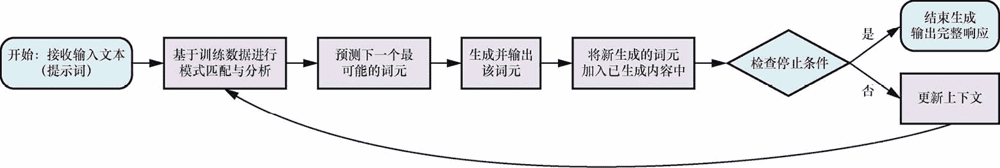

图 5-1 大语言模型执行流程

尽管该底层逻辑有效性已被广泛验证，但大语言模型仍存在固有缺陷，最显著的是缺乏像人类一样的上下文理解能力。因此输出质量高度依赖于训练数据的质量和多样性。若训练数据存在偏差或覆盖场景缺失，模型便可能生成带有偏见、不准确甚至完全错误的输出。

为弥补这一缺陷，注意力机制 attention mechanism 应运而生，可被理解为模型模仿人类阅读时对不同词赋予不同重要性的方式，在处理输入序列时动态聚焦最相关部分。具体而言，输入序列中的每个词会被转换为 3 个向量：查询 query、键 key 和值 value，模型通过计算一个词的查询向量与输入序列中所有词的键向量之间的相似度常通过点积实现来获得注意力得分，这些得分经过规范化如通过 Softmax 函数处理后，用于对值向量进行加权求和，从而为每个词生成一个融入上下文信息的新表示。

该机制使模型能够捕捉词间的长距离依赖关系和细微语义关联，例如在“The cat sat on the mat because it was warm”这个句子中判断出“it”指代的是“the mat”而非“the cat”。正是通过动态调整注意力来聚焦关键信息的能力，使大语言模型能够生成语义更连贯、上下文感知更强、更符合人类表达习惯的文本和代码。

在此基础上，优质提示词扮演关键引导角色。当我们提供一个提示词时，模型会在内部激活与该提示词相关的模式和上下文，并据此按概率生成后续文本。清晰、明确且富有上下文信息的提示词能够帮助模型更有效地运用其注意力机制，将其查询导向与期望输出相关的值，从而更精准地生成结果。相反，模糊的提示词使模型在概率空间中猜测，导致输出偏离预期。

### **5.1.2 提示词工程的核心原则**
在 AI 时代，编写优质提示词已成为关键技能。针对 Vibe 编程的特定场景，可提炼出以下核心原则。

**1. 清晰、具体、无歧义**
运用简洁明确的语言，清晰阐述任务及期望输出结果，避免使用模糊或泛泛的指令，以减少模型的猜测空间。例如，将“写一个求和算法”具体为“使用 Python 实现一个函数，该函数能读取 CSV 文件并计算每行数值之和”；或将“创建一个分析仪表板”进一步细化为“创建一个深色主题的分析仪表板，要求包含折线图、筛选器以及导出按钮等尽可能全面的功能与交互元素，使用 HTML+Tailwind CSS 实现，并提供超越基础功能的完整实现方案”。

精准的指令和目标描述，能够显著提升 AI 生成代码的准确性，防止其产出不相关或不满足需求的内容。

**2. 结构化提示词**
将提示词设计为具有逻辑层次的模块组合，通常包括角色、背景、任务及输出规范等模块。这种结构化方式有助于 AI 更准确地理解上下文，并遵循指定格式进行回应。例如，可以参考 LangGPT 等提示词模板，将提示词划分为角色 role、简介 profile、规则 rule、工作流 workflow 等模块：首先定义 AI 的角色与技能，然后提供必要的背景知识，接着阐述待完成的具体任务，最后明确输出的格式或风格。以下是一个音乐播放 Web 应用的提示词示例：

【角色】

# 让模型真正读懂你的意图

请你充当一位擅长极简暗黑界面开发的前端协作者，精通 HTML、Tailwind CSS 与原生 JavaScript，能快速产出可用性强且风格统一的前端模块。

【简介】
正在做一款面向夜间使用的音乐 Web 播放器，整体氛围是深色底 + 霓虹点缀，版式简洁、动效柔和。主要面向深夜写代码时听歌的开发者，视觉取法参考 Spotify 与 Apple Music 的暗黑方案。

【规则】
- 全面使用 Tailwind CSS 搭建界面
- 不使用 React、Vue 等框架
- 代码可直接拷贝到 HTML 文件运行
- 按模块分段输出，代码完整可用
- 除代码外不输出解释性文字
- 配色限定黑、灰、白、蓝、紫，保持统一
- 组件需响应式，兼容桌面与移动端

【工作流】
为该页面实现顶部导航条，具体需求：
1. 左侧为品牌标识预留区；
2. 中部是搜索输入区；
3. 右侧为播放控制区，包含上一曲、播放/暂停、下一曲；
4. 整体宽度自适应并水平居中。
请以完整的 HTML + Tailwind CSS + JS 代码返回最终实现。

用类似规划文档的填表式结构，能让指令要素一目了然，大幅降低歧义，从而帮助模型更准确把握意图并组织输出。

**3.** 用样例引导结果
在指令里放入少量高质量范例，能明显提升模型准确度与一致性。少样本学习通过展示期望的输入输出对，引导模型模仿范例的风格与格式，对有固定格式或特定风格要求的任务尤其有效。例如期望模型生成规范注释，可先给出已规范注释的代码片段；要求输出表格或 JSON 时，先提供格式模板，模型就能更严格遵循。研究表明，精心设计的范例可有效提升准确性与稳定性。当指令一次难以说清时，提供模板让模型参照，往往事半功倍。

**4.** 用限制框定范围
明确列出任务执行中的具体要求或限制：使用哪种编程语言、依赖哪些库、代码风格、输出长度等。这些限制为模型划定清晰的操作范围，避免生成超出需求或不适用的方案。限制同样适用于格式，例如要求“输出必须包含类型标注”或“结果以 Markdown 呈现”。Anthropic 为 Claude 模型预设的系统提示，要求代码始终以 Markdown 格式输出，就是一个典型成功案例，保证了代码展示风格的一致性。总的来说，为模型设定明确的规则与边界，能显著增强生成内容的可控性与可靠性。

**5.** 反复打磨并沉淀经验
把与模型的交互看作持续迭代的过程，而非追求一次到位。初始结果不理想时，可通过补充或修正指令引导修改完善。例如使用“请优化以下代码使其更高效”或“请重构上段函数以提升可读性”等追问指令，逐步逼近理想方案。这种对话式迭代不仅能提升最终质量，也有助于模型逐步校准对需求的理解。此外，强烈建议建立并维护一个优质提示词库，沉淀实践中表现优异的提示词，便于未来高效复用。

### 5.1.3 提示词优化实例
本节用一个简单例子演示如何把普通指令优化为高质量指令。假设要编写阶乘函数，普通提问如下：

写一个阶乘函数

表述过于简短，未指明语言和细节。模型可能自行猜测，例如默认给出 Python 代码且未处理异常。示例输出可能为：

def factorial(n):
if n == 0 or n == 1:
return 1
else:
return n * factorial(n-1)

该输出虽能计算阶乘，但存在问题：一是未规定语言，实现不确定；二是缺少非法输入处理；三是无注释说明。信息不足导致答案泛化。

改进后的提示如下：
角色：你是一名经验丰富的 C 语言工程师
任务：请编写一个名为 factorial 的 C 语言函数，用于计算整数的阶乘
要求：
1. 使用递归算法实现；
2. 考虑输入的异常情况，例如若输入负数，函数应返回错误提示；
3. 代码需包含适当的注释以解释逻辑；
4. 输出代码需遵循 C 语言标准格式，每行不超过 80 个字符

明确了角色、语言与函数名、实现细节、格式规范后，模型的认知更清晰，生成代码可能如下（节选）：

#include <stdio.h>
/* 计算整数 n 的阶乘。
如果 n 为负，返回-1 表示错误。*/
int factorial(int n) {
if (n < 0) {
// 错误处理:对于负数输入返回错误码
return -1;
}
if (n == 0 || n == 1) {
return 1;
}
// 递归计算 n 的阶乘
return n * factorial(n - 1);
}

可见，优化后的提示让模型输出符合 C 语言规范的完整函数，包含递归逻辑、错误处理和清晰注释，满足各项要求。该例体现了明确指定语言与约束、补充实现细节与注释要求、结构化列出角色简介规则等原则。若需要，可在提示中附加输入输出示例，进一步降低歧义。

### 5.1.4 可直接复用的提示词模板
本节汇总了一些日常开发中常用的提示词模板，可直接套用。

（1）代码速写模式：
我需要快速开发一个 XX，要求：（1）风格极简；（2）全黑背景；（3）按钮有流光特效。请直接输出完整 HTML+CSS+JS 代码

（2）UI 美感强化：
我想要一个带夜间沉浸感的侧边栏，像 macOS 终端那种质感，请设计它并输出 CSS 代码

（3）流动感动画设计：
请写一个带有流动感、节奏感的加载动画，用纯 CSS 实现，风格类似于 neon cyberpunk

延伸阅读
neon cyberpunk（霓虹赛博朋克）：一种融合高科技与反乌托邦美学的未来幻想风格，以霓虹灯、都市夜景、赛博义体和社会边缘人群为核心元素，展现科技高度发达但人性异化的世界。

（4）开发协作模式：
接下来我会不断添加 UI 组件需求，请你作为前端开发助手，保持风格一致性并高效完成任务

（5）暗黑主题设计：
写一个暗黑风格的卡片组件，背景为深蓝灰，文字为柔和白，鼠标指针悬停时添加轻微光晕

（6）Flow 编程模式：
我现在想静静地写代码，进入心流模式，请你只返回代码，不需要注释或解释

### 5.1.5 让 Cursor 记住你的规则
大语言模型本身没有记忆能力，会话结束即消失，而 Cursor 通过 Rules 功能提供持久化、可复用的提示词机制，可视为持久化编码上下文、偏好设置或工作流程的解决方案。一个项目可配置多个规则，规则一旦生效，其内容会始终置于模型上下文起始位置，从而将 AI 从通用编程助手转变为高度定制化、深度理解项目需求的专家系统。例如图 5-2 所示的 Cursor Rules 示例，通过不同规则文档描述不同编码场景的规范要求，实现更精细控制。

Cursor 主要提供两种规则类型。
·用户规则（user rule）：在 Cursor 设置中定义全局性用户规则，适用于本机所有项目。缺点是无法提交到 Git，无法团队共享。常用于设定个人偏好，如编程语言、语气、常用代码片段、库引入方式等。仅支持纯文本，不支持 .mdc 文件。
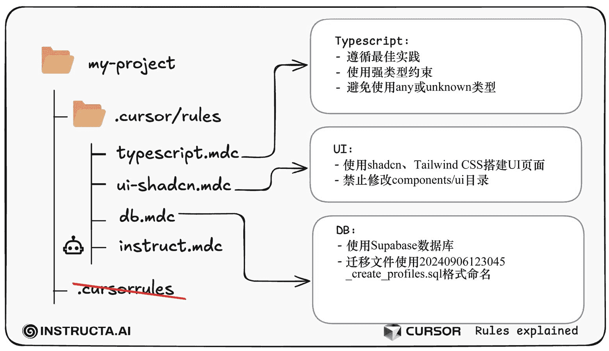
图 5-2 Cursor Rules 示例（图片源自 INSTRUCTA.AI 官网）
·项目规则（project rule）：存储在项目根目录的 .cursor/rules 文件夹内，每个规则为独立 .mdc 文件，通常会随 Git 提交，在团队间共享。适合编码特定领域知识、标准化项目特有工作流程或架构决策，确保代码风格一致。

1. 全局用户提示词
Cursor 允许在编辑器设置中添加全局用户提示词，相当于为每次对话预设隐藏指导。具体做法是在“Cursor Settings”页面的“Rules”项中填写一段系统级规则。官方文档也提到，恰当的系统提示有助于模型更好理解职责与偏好。例如“你是一名经验丰富的代码助理，所有输出必须符合公司内部的代码风格指南”相当于为模型定义长期人设与行为准则——扮演某种角色并遵守某些规则，也可在此加入团队代码规范、风格指南等说明，确保模型在任何项目中都遵循统一准则回答问题。
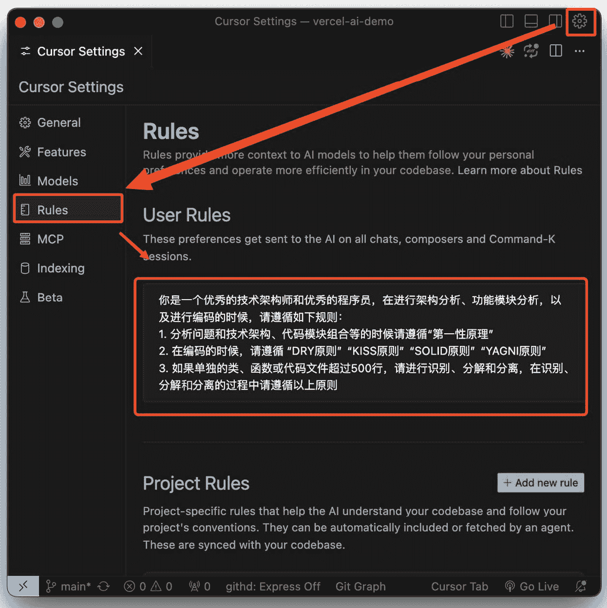
图 5-3 设置全局用户提示词

2. 项目级提示词
项目规则核心是 .mdc 文件，是一种轻量级格式，允许在单个文件同时包含元数据和规则内容。典型结构如下：

---
metadata_field_1: value_1
metadata_field_2: value_2
---
# 以下为规则内容
请使用这个特定的库/模式。
避免使用某些其他做法。
参考以下具体文件以获取上下文：@path/to/important/file.ts

元数据位于文件顶部 YAML 块，由 --- 包裹。元数据定义规则的属性与行为，支持 description、globs 和 alwaysApply 三个字段，其作用和示例见表 5-1。
表 5-1 元数据字段的作用和示例
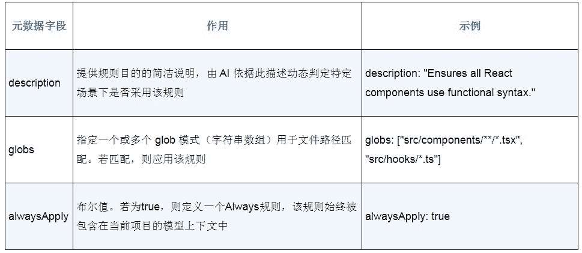
注意谨慎使用 alwaysApply 字段，主要针对具有普遍性的项目指令（如“本项目所有后端接口均使用 Python 3.10 和 Django REST Framework”）。滥用 alwaysApply: true 可能导致上下文窗口过早饱和，影响生成性能。

规则内容紧随元数据之后，通常用 Markdown 编写，可包含纯文本指令、代码示例，并通过 @filename.ext 语法引用项目其他文件作为上下文。

根据元数据不同组合，项目规则可分为表 5-2 所示的 4 种类型，每种对应不同激活机制与使用场景。
表 5-2 项目规则类型划分
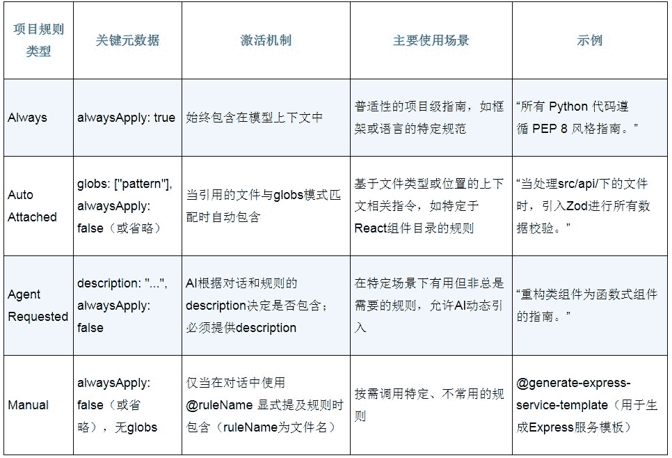
无论如何激活，核心机制相同：规则被应用时，其 .mdc 中的规则内容会被加入发送给大语言模型的提示词起始部分，大语言模型会在“阅读”后才响应，起到初始引导作用。

因此 Cursor 规则本质是基于配置文件匹配的提示词工程，开发者无需每次手动输入冗长指令，而是通过结构化 .mdc 文件预设提示词，在项目级别保证指导内容一致性。

3. 项目规则实例：为表单构建规则体系
具体如何编写规则？业界已有成熟共享方案，如 Cursor 的规则市场 https://cursor.directory/rules，也有使用 /Generate Cursor Rules 命令自动生成规则的方法，本章末尾会展开。本节通过具体例子说明规则拆解思路。

设想需要为项目中的“用户设置表单”功能制定一套规则，表单涉及多个输入字段，以及数据校验、API 交互与状态管理等。核心在于确保 AI 生成或修改相关代码时遵循项目规范。该功能涉及 React 组件、表单处理库、数据校验库、API 服务、状态管理等技术栈，据此至少可拆解为以下规则。
·user-settings-form-structure.mdc（项目规则类型为 Auto Attached）：描述表单代码编码规则，旨在统一表单实现方式，特别是状态管理与校验逻辑集成。
---
description: "Guidelines for User Settings Form component structure and React Hook Form usage."
globs: ["src/features/user-settings/**/*Form.tsx"]
alwaysApply: false
---
- 必须使用 React Hook Form 进行表单状态管理和提交
- 表单的校验规则必须使用 Zod（或 Yup）定义，并存入 src/features/user-settings/schemas/目录中
- 组件应包含明确的加载和错误状态处理
- 提交按钮在表单无效或正在提交时应被禁用
示例：如何使用 useForm 钩子，如何注册输入，如何处理提交和错误
...
·user-settings-api.mdc（项目规则类型为 Agent Requested）：规范 API 交互模式，包括数据获取库使用、自定义钩子封装及 API 服务文件组织。
---
description: "Rules for interacting with the user settings API endpoints, including data fetching and mutation hooks."
alwaysApply: false
---
- 获取用户设置应使用 useQuery 包装的自定义钩子 useUserSettings()
- 保存用户设置应使用 useMutation 包装的自定义钩子 useUpdateUserSettings()
- 这两个钩子应在 src/features/user-settings/hooks/api.ts 中定义
- API 服务函数（如 fetchUserSettings()和 saveUserSettings()）应在 src/services/ userSettingsApi.ts 中
- 详细说明 API 的请求/响应结构，引用@/docs/api/user-settings.md
·zod-validation-patterns.mdc（项目规则类型为 Always）：全局规则，声明项目中 Zod 的最佳实践，确保校验逻辑一致且可维护。
---
description: "Project-wide Zod validation schema best practices."
alwaysApply: true
---
- 所有 Zod schema 必须导出其推断的 TypeScript 类型（例如，export type UserSettings- Schema = z.infer<typeof userSettingsSchema>;）
- 常用校验规则示例（email, password strength, min/max length）
- 如何组织复杂的嵌套 schema 等
·form-accessibility.mdc（项目规则类型为 Auto Attached）：满足 A11y 需求，让网站或应用对所有人可访问、可使用，尤其是残障人士友好：
---
description: "Ensures accessibility best practices for all forms."
globs: ["**/*Form.tsx"]
alwaysApply: false
---
- 所有表单输入必须有关联的<label>
- 校验错误信息必须通过 aria-describedby 或类似机制与输入字段关联
- 确保表单可以通过键盘完全导航和操作
上述规则最终呈现如图 5-4 所示的开发规则。

图 5-4 用户设置表单开发规则

基于这些规则，当 AI 被要求创建或修改用户设置表单时，将按如下逻辑加载并应用项目规则。
（1）zod-validation-patterns.mdc（Always）始终提供 Zod 的通用最佳实践。
（2）若操作文件路径匹配 src/features/user-settings/**/*Form.tsx，则 user-settings-form-structure.mdc（Auto Attached）会自动激活，指导表单整体结构、React Hook Form 使用及与 Zod 校验的集成点。同时，form-accessibility.mdc（Auto Attached）也会因文件名匹配 **/*Form.tsx 而激活，确保表单元素符合可访问性标准。

（3）一旦对话涉及到从后端拉取或把用户设置写回后端，AI 就有机会唤起 user-settings-api.mdc 这类 Agent Requested 规则，进而获得怎样发起 API 调用、如何封装数据获取钩子、怎样处理返回数据的实操指引。

正是这种拆分明确、各司其职的规则体系，让它们在不同层级、不同节点上协同介入，共同把控 AI 输出，最终得到结构合理、功能齐全、校验严格、接口规范且访问便捷的用户设置表单。模块化做规则，既让提示更精准，也让整套规则更易维护、更好扩展。

4. 让 Cursor 替你写规则

Cursor 规则很管用，但手工写费时费力。好在不用从零起步，社区已经沉淀了不少现成资源，可以当灵感或直接复用。

·Awesome CursorRules：一个被广泛引用的合集，收录了大量 .cursorrules 文件，多为 .mdc 格式，覆盖前端框架、后端技术、移动端、CSS、状态管理等。
·Cursor Discovery：规则库的另一选项，收录面比 Awesome CursorRules 更广。

更直接的做法是直接用内置命令 /Generate Cursor Rules 来让规则自动成型，如图 5-5 所示。


图 5-5 自动生成 React 编码规范

这个命令很灵活。你可以直给目标让它生成，也能基于当前会话的交互内容归纳出新的编码规范，如图 5-6 所示。


图 5-6 根据上下文总结编码规范

对实际开发中逐渐形成的约定式规范来说，这个功能把规则创建成本降到最低。AI 在辅助编码的同时，也在元层面参与自身规则的定义。

5.2 需求规划，别让 Vibe 变成失控

Vibe 编程听起来轻松自如、几乎零负担，但大模型跑得顺的前提是输入清晰、上下文充足。编码阶段的流畅感，往往建立在前期对“要做什么”做了大量精准定义之上。Vibe 并不是不要结构，而是把需求规划调整得更适配人机协作。

5.2.1 需求分析，先把地图画好

无论是敏捷还是瀑布，所有工程方法论都从需求分析起步。方向没厘清，写出的代码就像在沙漠上盖高楼。

需求分析的价值在于：

·确定项目正确航向，目标模糊时越努力越偏；
·提升跨角色协同，让开发、设计、产品在同一坐标系工作，减少返工；
·筑起防线对抗范围蔓延，边界清晰才能守住增量；
·给出唯一验收标尺，需求就是成败的度量衡。

这一原则在 Vibe 场景下同样成立。沉浸式体验的前提是项目方向明确，否则模型容易空想信息，或产出技术正确但偏离目标的代码。动笔前必须回答：解决什么问题、为谁解决、什么不做。需求分析流程如图 5-7 所示。

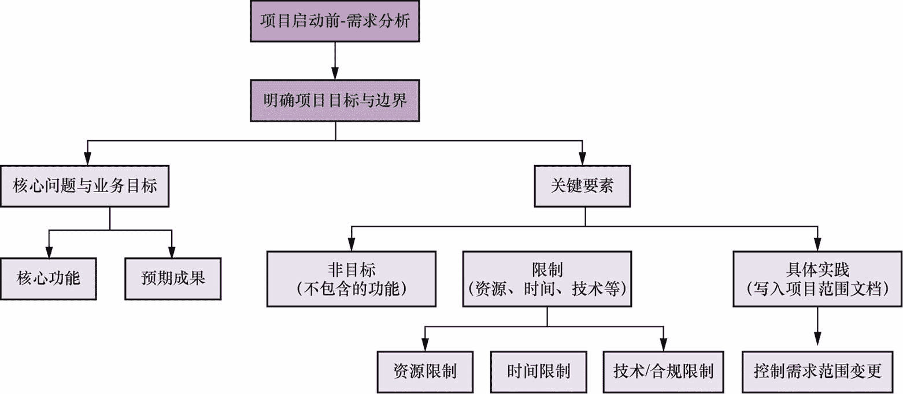

图 5-7 需求分析过程

阶段核心是和干系人深入对齐，挖出真正要解决的问题与业务目标，至少包含：

·核心功能：项目必须交付的工作，是存在的根基。
·预期成果：衡量是否达成的标准，可以是转化率提升 X%、投诉下降 Y%，也可以是品牌形象、进入新市场等战略性结果。

从工程视角，还要补全“不做”和“受限”两项，对聚焦与防蔓延同样关键。

·非目标：明确排除的功能。举例：移动端项目当前不做 Web/桌面版。
·限制：资源、时间、技术、合规上的边界。举例：预算上限、交付日期、技术栈锁定、数据隐私法规。

实践上，把非目标和限制写进项目范围文档，并在全周期严格执行，新需求来了先对照清单。

以电商为例，编码前应先梳理：

核心功能：
·商品浏览与搜索，关键词、分类、品牌筛选；
·下单与支付，优惠券、积分、促销；
·用户账户，注册登录、订单管理、退换货；
·售后服务，客服、评价、问题反馈。

非目标：
·暂不支持海外用户；
·不做商家入驻与多商户后台；
·不接入线下门店库存。

目标与边界清晰，是传统流程和 Vibe 方法论共同的起点。先把方向写清楚，团队才能对齐、控范围、降风险。

5.2.2 写一份能喂给 AI 的 PRD

输入模糊，输出必然模糊。需求规划的产出是完整清晰的产品需求文档，明确原型、功能、目标用户。与传统不同，Vibe 容忍度更高，可以轻量化，先核心功能，后续迭代补细节。二者差异见表 5-3。

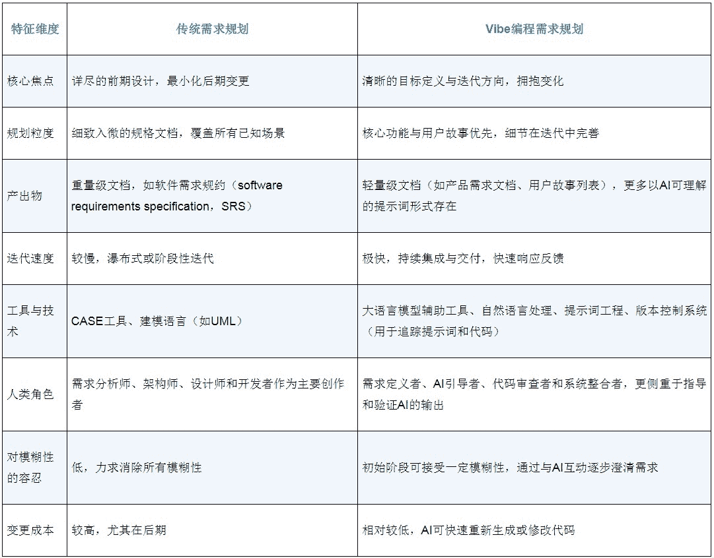

在实际协作中，建议养成结构化表达的习惯，无论写任务、提 issue 还是对 AI 提问，都围绕“背景-目标-方式-限制”展开。拆解需求可从 4 个维度入手。

（1）需求背景：为什么做，要解决什么实际问题。描述要简洁，突出动机与价值。例如《README 自动生成系统》：

# README 自动生成系统

对指定包源码做静态分析，抽取核心功能与用法，借助 Vercel AI SDK 调用大模型，生成结构清晰、易读的 README，提升开源项目可理解性与体验。

（2）功能说明：行为与预期效果，输入输出、界面要素。可用用户故事增强可读性：

提供 generate 命令，扫描存量代码后生成 README，支持参数：
- --project：目标模块，通过 @arch/monorepo-kits 获取描述后定位包目录；
- --locale：输出语言，en/zh，默认 zh；
- --file：输出文件名，默认 README.md，保存到项目目录。

（3）工具与技术栈：依赖框架、约束与推荐：
- 参考 readme-best-practices 生成内容；
- 用 Vercel AI SDK 调用模型；
- TypeScript 开发；
- commander 做 CLI，增加 ora 等；
- @coze-arch/rush-logger 记录日志；
- @coze-arch/monorepo-kits 解析 monorepo；
- 不用 ts-node；
- 不写单元测试，聚焦功能；
- 不自动装依赖，写入 package.json 由用户安装；
- 优先 FP 风格。

（4）（可选）核心算法：涉及关键逻辑时单独说明，包含描述、输入输出、性能预期、边界情况。可配 Mermaid。但多数情况可交 AI 补全：
1. 按 --project 定位路径；
2. 用 git ls-files 扫描源码并过滤无关内容；
3. 逐文件喂给模型摘要，缓存为 map；
4. 综合摘要再合成包级功能描述，输出 README。

规范化描述既利于团队沟通，也为 AI Agent 提供协作基础。清晰的需求是人与 AI 高效协作的保障。

注意文档要灵活。逻辑简单可简化算法，技术栈固定可精简工具说明，但清晰性不可妥协。

Vibe 编程不是把一切丢给 AI，而是基于扎实的需求表达，借助 AI 的生成与推理能力放大人的创造力。需求写好，AI 才能帮得上。

5.2.3 选 AI 更顺手的栈

技术选型影响效率与质量。若不指定，AI 可能引入技术债，比如用原生 HTML+CSS+JS 做现代 Web 应用，短期能跑，长期难维护。

应人工筛选出团队可驾驭、具备扩展性且 AI 友好的组合。判断指标可归纳为：

·社区热度：使用者越多，讨论资料越丰富，模型索引越完整，结果越靠谱。
·结构化程度：模块化、原子化信息越聚焦，模型越易理解，推理成本越低。原子化 CSS 如 Tailwind 比原生 CSS 更易被理解。
·通用规则优于特化设计：规范越通用，模型越省力。GraphQL 用统一的实体与关系语言表达数据操作，比需大量特化的 REST 更友好。
·自动化质检：静态检查越强，越能抵消模型随机性。TypeScript 的类型系统在编码期就能揪出问题，比纯 JavaScript 更适合 Vibe。

目前常见组合：
·Web 前端：React 或 Vue + TypeScript + Tailwind CSS
·移动端：React Native 或 Flutter + TypeScript/Dart
·后端：Node.js 或 Python + TypeScript/Python + GraphQL
·数据分析：Python pandas + ECharts/Plotly + Jupyter Notebook
·AI Agent 自动化：Python + LangChain/AutoGPT + OpenAI/Hugging Face API
·存储：Supabase、PostgreSQL、MongoDB

5.2.4 让 AI 自己写需求文档

需求规划看起来繁琐，交给 AI 更高效。示例提示：

帮我写一个：《魔法粒子互动墙》的需求文档，要求包含：
1. 简介：项目背景与目标；
2. 功能描述：系统提供的功能与界面，从用户角度描述；
3. 约束：技术栈、性能、编码规范等。

使用 GPT-4o 会返回类似结果：

# 《魔法粒子互动墙》需求文档

## 1. 简介

项目背景：随着多媒体展示技术发展，交互式视觉体验在科技展厅、数字艺术展、教育场景中愈发重要。《魔法粒子互动墙》借助 Web 技术打造高视觉冲击、强互动的粒子动画墙，为用户提供沉浸式体验。

**项目愿景：让粒子在网页上“活”起来**

目标是做一套跑在浏览器里的互动视觉方案，让用户用鼠标或手指就能和屏幕里的粒子产生实时互动。拖拽时粒子会跟着走、散开又聚合，整体呈现出像魔法般的指尖操控感。

---

## 2. 功能描述

以下是从用户角度梳理的《魔法粒子互动墙》核心能力：

- **开箱即用的流动背景**
  - 进入页面后自动播放顺滑的粒子漂流，充当科技感的动态底景。
- **即时交互反馈**
  - 光标或触点靠近时，粒子会出现躲避或吸附反应。
  - 拖拽操作会扭曲粒子轨迹，形成“魔法拖动”的视觉。
  - 交互过程中可实时生成文字、图形或波纹等动态效果。
- **主题自由切换**
  - 内置多套视觉风格，例如星空、电流、墨迹、萤火等，用户可一键更换。
- **性能自适应**
  - 根据设备算力动态调节粒子数量与渲染细节，力求在各端保持流畅。
- **双模式呈现**
  - 支持全屏沉浸展示，也可作为动态背景嵌入任意页面。

---

## 3. 约束

### 技术栈约束
- 前端基础使用 HTML5 + CSS3 + JavaScript，粒子渲染以 Canvas 或 WebGL 为主。
- 动画控制可选用 GSAP、three.js 或 pixi.js 增强表现。
- 优先原生手写，必要时框架建议用 React。

### 性能要求
- 在 i5/8G 及以上中高端设备上保持 60FPS 顺滑运行。
- 移动端自动降配粒子数，底线不低于 30FPS。
- 页面首屏加载控制在 3 秒以内。

### 编码规范
- 代码风格遵循 ESLint，使用 Prettier 统一格式化。
- 采用模块化组织，保证可维护性。
- 所有画面与动画需响应式，适配主流分辨率。

**备注**：后续可考虑加入手势识别、声音联动、用户行为记录等扩展功能。

乍看之下，这份需求已经把背景、目标、功能、技术、性能与规范都列了出来，理论上能直接拿去让 AI 写代码。但实际上它更像一个 Demo 样板。项目背景里没有讲清面向谁、解决什么痛点；功能描述里缺少初始画面、配色方案、动态参数的配置方式等关键细节。

想用一句话提示就让 AI 输出完整可用的成果并不现实。更靠谱的做法是基于这个框架人工迭代：先把目标用户和价值讲透，再逐步补全页面初始态、样式配置、交互参数等细节。这种增量完善比从零起稿更高效，但核心仍是人要下笨功夫做把关。

## 5.3 代码审查与优化

Vibe 编程的主张是让开发者用自然语言和大模型对话，快速拿到初步代码。这确实能提速，把精力挪回需求思考。但 Vibe 编程偏重直觉，缺少工程严谨性。AI 生成的代码在写法、结构和健壮性上参差不齐，若不经严格检视，技术债和质量风险会迅速累积。

### 5.3.1 AI 的局限
AI 多在当前任务或提示词层面做局部优化，缺乏对整体架构和长期影响的全局视野。它不真正理解系统，只是基于统计规律生成代码，不会考虑架构约定、既有模块或内部规范。因此在语法层面表现尚可，但在上下文理解上很弱。

大模型能根据提示和邻近上下文产出看似合理的片段，却不会思考整体设计、维护成本和模块协作。它擅长有限窗口内的模式匹配和词元预测，却难以做全系统推理。于是代码在单文件里能跑，集成到系统就可能出现失败、性能瓶颈、架构冲突或规范违例，这类系统性问题必须靠人工把关。

训练语料庞杂且质量不一，常混杂过时做法、安全漏洞、低质示例。模型会把这些缺陷学进去并复现。没有精确引导和审核，AI 输出更容易携带风险，对企业而言是明显的安全隐患。

### 5.3.2 常见质量缺陷
基于上述短板，AI 容易产出以下问题代码。

（1）面条式代码。
指的是逻辑纠缠、职责不清、难以维护的代码。例如：

<canvas id="cv"></canvas>

<script>

// ---- 全局可变状态&魔数 ----

var data = []; // 没有任何封装

var colors = ['#f66', '#6f6', '#66f']; // “魔法常量”

var cvs = document.getElementById('cv');

var ctx = cvs.getContext('2d');

cvs.width = 800;

cvs.height = 400;

// ---- 主流程：所有逻辑挤在一处 ----

function loop () {

// (1) 远程拉取数据

var xhr = new XMLHttpRequest();

xhr.open('GET', '/api/values?ts=' + Date.now());

xhr.onreadystatechange = function () {

if (xhr.readyState === 4) {

if (xhr.status === 200) {

// (2) 数据预处理

var raw = JSON.parse(xhr.responseText);

for (var i = 0; i < raw.length; i++) {

data.push(+raw[i]); // 隐式类型转换

if (data.length > 30) data.shift();

}

// (3) 冒泡排序（O(n²)），嵌套两个循环

for (var i = 0; i < data.length; i++) {

for (var j = 0; j < data.length; j++) {

if (data[i] > data[j]) {

var t = data[i]; data[i] = data[j]; data[j] = t;

}

}

}

// (4) 绘制柱状图

ctx.clearRect(0, 0, cvs.width, cvs.height);

for (var k = 0; k < data.length; k++) {

ctx.fillStyle = colors[k % colors.length];

ctx.fillRect(k * 25, cvs.height - data[k] * 3, 20, data[k] * 3);

// 插入“彩蛋式”分支

if (data[k] > 80) {

ctx.strokeStyle = '#000';

ctx.strokeRect(k * 25, cvs.height - data[k] * 3, 20, data[k] * 3);

}

}

// (5) 递归调用（定时长短靠随机数决定）

setTimeout(loop, Math.random() > 0.7 ? 500 : 300);

} else {

console.log('server error');

setTimeout(loop, 1000); // 重试逻辑也堆在一起

}

}

};

xhr.send();

}

loop(); // 启动

</script>

这段 loop() 同时做了拉取、预处理、排序、绘制和递归调度，data、ctx 等状态暴露在全局，控制流被异步回调、双重循环、随机 setTimeout 搅在一起，魔法数字散落各处。缺乏抽象和模块化，维护者必须通读整团乱麻才能改动。

AI 倾向于产出这类代码，正因它只做局部匹配，不懂得融入整体结构。

（2）技术债务积累。
技术债务指为图快而采用临时方案，换来未来返工的隐性成本。AI 追求快速交付，常生成冗余重复代码，对长期可维护性考虑不足，债务会随迭代在部署、运维阶段逐渐显现。

（3）代码重复、代码流失与代码脆弱性。
GitClear 研究显示，使用 AI 辅助后重复代码块增长约 8 倍。重复指同一逻辑在多处重写，如电商项目在注册、改资料、后台等多处各自实现邮箱校验。AI 因缺乏对项目全貌的了解，常重复造轮子而非复用。

后果包括维护成本上升、缺陷扩散、代码臃肿、理解困难。代码流失指刚写下不久就被大量改写或删除，通常源于质量差、需求理解偏差。AI 输出常是“看起来能跑”的草稿，遇到真实集成后需重写，导致资源浪费、进度延误、团队士气受挫。

代码脆弱性指改动一处引发别处异常。AI 缺乏对依赖关系的全局认知，易制造隐性耦合。DORA 2024 报告指出 AI 使用后交付稳定性下降 7.2%，侧面印证脆弱性上升，后果包括连锁故障、维护成本飙升、测试覆盖困难、可靠性降低。

这三者往往相互牵连，形成恶性循环。

（4）安全盲点与合规差距。
若训练数据含不安全示例或提示未强调安全，AI 可能生成带已知漏洞的代码。它也不理解医疗、金融等行业的合规规则。斯坦福研究已证实 AI 编程工具会输出不安全代码，且可能错误建议加密库。安全与合规高度依赖上下文，是 AI 难以胜任的领域。

（5）性能陷阱与难以发现的缺陷。
AI 只追求“能用”，不一定追求“好用”。它可能选用简单但低效的算法，或加入冗余步骤增加资源消耗，也常忽略边界条件，导致隐蔽崩溃或异常行为。

### 5.3.3 低劣代码可能导致项目失败
软件史上，难以维护的产品终将被淘汰。AI 产出的不准代码会在关键业务中出错，降低信任，进而带来成本上升、延期交付、安全事件、声誉受损、客户流失，乃至项目失败。

修复劣质代码会显著增加人力成本，业界已有观点认为未来需用 70% 时间调试 AI 生成的 30% 代码。安全漏洞可能引发赔偿和罚款，性能问题导致用户流失。预防之道仍是回归人工监督。

### 5.3.4 AI 时代的代码审查指南
为应对 AI 生成代码的特有风险，审查应系统覆盖以下重点。

**1. 可读性**
可读性指代码能否清晰传达设计意图，被他人轻松理解。马丁·福勒曾说：“任何人都能写出机器能懂的代码，只有优秀程序员才能写出人能懂的代码。” 高可读性降低沟通成本，加速排错，也提升对正确性的信任。

AI 代码常见可读性问题：
- 变量命名模糊，如 x、temp，而非语义化名称。
- 结构复杂，函数过长、嵌套过深、圈复杂度高。
- 风格不统一，缩进、命名、括号使用前后不一致。
- 滥用炫技写法，如多重三元、位运算、极简链式调用，可读性受损。

例如数据过滤合并功能的实现，编写以下代码：

// 原始版本：可读性差（短小、晦涩）

function extractDataFromResponse(response) {

const [Component, props] = response;

const resultsEntries = Object.entries({ Component, props });

//数据过滤合并

别让精巧的代码成为天书

先看这段很“函数式”的实现：
```js
const assignIfValueTruthy = (o, [k, v]) => (v ? { ...o, [k]: v } : o);

return resultsEntries.reduce(assignIfValueTruthy, {});
}
```
行数很少，过滤与合并被压缩在一起，但意图被藏起来了。阅读者需要先拆解 reduce，再回溯 assignIfValueTruthy 才能明白在做什么。

改写成更直白的样子：
```js
// 改进版本：可读性更强（直观、清晰）

function extractDataFromResponse(response) {

const [Component, props] = response;

const output = {};

if (Component) {

output.Component = Component;

}

if (props) {

output.props = props;

}

return output;

}
```
通过显式条件把逻辑摊开，代码变长了，但每一步都在台面上，不用反推。审阅模型产出的片段时，优先保证易读，能明显降低理解与后续维护的成本，让审阅者和维护者都能快速上手。

业界的 PEP 8、Google Java Style Guide 等，其实都在讲统一与易读。容易被忽略的要点是：

· 命名要自解释。变量、函数、类都用一看就懂的名字，避免单字母或模糊缩写。customer_id 比 x 更清晰，名字本身就是说明。
· 缩进与布局要统一。不同语言有约定，比如 PEP8 用 4 个空格且不混 Tab。统一的层次感让嵌套逻辑一目了然。
· 行长要可控。多数规范建议 80～100 字符内，分行后在屏幕上完整显示，减少横向滚动，也倒逼表达式更简洁。
· 函数要短小聚焦。尽量做到单一职责，几十行内收束。过长的函数往往职责不清，不利于理解与复用。

除此之外，注释要恰到好处，风格要保持一致。规范的核心是让代码更统一、好读、好维护，从而把沟通成本降下来。审阅模型输出，先看它是否过了这些易读底线。

2. 可维护性

可维护性指后续阶段是否容易理解、修改与扩展。高可维护的片段能让后来的人快速看懂思路，需要改动时也能低风险地修复缺陷或新增功能。现实中软件的大头成本不在首发，而在长期维护与迭代，保持活力就靠可维护性。

近期反馈显示，模型产出的片段在质量与可维护性上整体在下滑，因为模型更在乎当下问题是否被“解决”，而忽视了人类开发者长期遵循的设计原则。常见问题有三类。

· 整体式结构。模型喜欢把功能堆到一个大块或单一文件里，模块边界模糊。像零件焊死的机器，动一处就可能牵连其它地方，更新时总像拆炸弹。
· 紧耦合。模块间依赖过深，互相调用内部细节、共享全局状态。改 A 必须跟着改 B、C，否则功能会破。把数据访问细节硬编码进业务逻辑就是典型，底层一变，业务也要大改，还很难单独复用或测试。
· 低内聚。模块承担太多无关职责，功能杂糅。比如一个名为“订单处理”的函数，里面既打日志又更新界面，改日志策略或界面都要动它，难以预测影响面，风险很高。

工程上的对策是模块化、低耦合、高内聚。

模块化像搭积木，每个模块形态和接口明确，可以独立拆卸、替换、升级，不用拆散整体。
低耦合像家电各自独立，冰箱坏了不影响洗衣机。代码里模块通过清晰接口通信，内部实现不外泄，修改一方不会波及另一方。
高内聚像公司的专业部门，财务只做财务，人事只做人事。一个模块只聚焦单一目标，内部元素高度相关，修改时定位精准，不易误伤。

三者合一，系统才像用标准零件组装，既分工明确又能灵活演进。若模型输出里看不到这种积木式设计，就要提高警惕。

3. 文档与注释

好的文档和注释能提升易读性、促进协作、加速维护，并在审阅时帮助理解设计意图。对复杂业务，注释的关键不是说“做了什么”，而是解释“为什么这样做”，记录关键决策和背景，避免只见步骤不见缘由。

这对人类同样对模型重要。现今的大语言模型具备多模态代码理解能力，能融合代码和周边信息建模语义，文档和注释与代码的映射关系不可或缺，某些场景下注释的权重甚至高于代码本身。

问题是，编程助手很少自动产出有意义的文档。常出现注释缺失，或只有机械复述，如在 if total < 50: 前写“验证总数是否小于 50”，并无增量信息。更关键的是，模型几乎不解释设计抉择，即使用了非常规方法，也只给结果不给思考过程。

审阅时可关注：
· 复杂片段是否有解释。算法或晦涩段落是否配有注释说明思路和决策，缺少就应要求补上。
· 能否看出“为什么”。注释里是否体现设计意图和取舍，而不是只有操作描述。
· 人工修改是否被记录。模型生成后的人工修正，如修 bug 或优化性能，应在注释或提交说明中标注原因，方便追溯。

业界认可的做法：
· 为对外接口写 Docstring。包含用途概述、参数、返回值、异常、示例等，让调用方迅速理解。
· 写完善的 README。项目层面说明目的、依赖、安装、用法示例、常见问题、贡献指南等，帮助新人快速上手。
· 注释原则是解释原因。不要写“i = i + 1 // i 加 1”这类自解释注释，而要写动机，如“// 用 i 递增遍历数组索引，因为...”。
· 文档要同步更新。代码改了注释就要改，过时注释比没注释更害人。代码审阅应把文档一致性作为必检项。
· 清理死代码。不要用注释保留废弃代码，版本控制能恢复历史，残留只会增加阅读负担。

总之，模型擅长写“做什么”，人类要补足“为什么”。只有把背景和原因补全，代码才易理解、可演进。

```
/**
* 判断一个正整数是否为 2 的幂
*
* ### 背景与原理
* 二进制表示中，2 的幂只有一位为 1（如 1 → 1，2 → 10，4 → 100）
* 对于此类数：
* ```

* n & (n - 1) === 0

* ```
* 因为 n - 1 会把唯一的 1 置为 0，并将其右侧所有位变为 1，
* 与运算结果为 0。
*
* @param n - 需要判断的正整数
* @returns 若 n 为 2 的幂，返回 true；否则返回 false
* @throws TypeError 当 n 不是安全的正整数时抛出
* @example
* ```ts

* isPowerOfTwo(8); // => true

* isPowerOfTwo(7); // => false

* ```
*/
export function isPowerOfTwo(n: number): boolean {
if (!Number.isSafeInteger(n) || n <= 0) {
throw new TypeError('n 必须是正整数');
}
return (n & (n - 1)) === 0;
}
```

4. 日志策略

系统运行后本质是黑盒，没日志就无法回溯。日志记录关键事件和数据，是调试、性能分析和安全审计的基础，能提供运行可见性。

模型缺乏业务直觉，日志处理常失衡：要么泛滥，重要信息被噪声淹没；要么不足，关键步骤没记录。更危险的是可能把隐私或机密数据直接写进日志。

审阅模型生成模块的日志时，重点看：
· 关键数据是否记录，如接口入参、中间变量、模式或特性开关等配置项。
· 业务分支是否可追踪，if/else 分支打印执行路径，如余额不足拒绝交易。
· 外部接口是否记录请求和返回，敏感字段需脱敏。
· 异常处理是否记录错误信息和堆栈，业务异常也应留下痕迹。

日志可按用途分类：
· 性能日志。监控执行时间、请求延迟、内存 CPU、缓存命中率等，如 {"latency_ms": 123, "endpoint": "/recommend"}，用于定位瓶颈。
· 用户行为日志。记录点击、搜索、转化等关键操作，含用户 ID、动作类型、目标对象，如 {"user_id": "abc123", "action": "click", "item_id": "xyz"}，用于产品优化和异常模式发现。
· 错误日志。记录错误码、信息、堆栈及降级措施，如 {"error_code": "E502", "message": "timeout", "action": "fallback_used"}，用于故障排查。

分类后可采用不同存储和分析策略，性能日志实时告警，行为日志汇总分析，错误日志支撑排障。

5. 错误处理

错误处理决定程序在异常输入或意外情况下是否崩溃、是否产出错误结果。它直接影响可靠性和用户体验。

例如：
```python
# 未进行错误处理的代码
result = 10 / int(user_input)
print("计算结果:", result)
# 如果 user_input 非数字或为 0，抛出异常并崩溃
```
加入处理后：
```python
# 加入错误处理的代码
try:
result = 10 / int(user_input)
print("计算结果:", result)
except (ValueError, ZeroDivisionError) as e:
# 捕获转换错误或除零错误
print("出现错误：", e, "。已使用默认结果 0。")
result = 0 # 使用默认值作为降级措施
```
通过捕获异常并提供降级路径，系统不会直接中断，能在边界输入下平稳运行。审阅模型代码时，要确保异常不是被忽略，而是被有意识地处理并记录。

优化后的写法里会用 try...except 把可能出现的异常包住。像输入既不是数字又为零这种会触发错误的情况，就会被拦截住。程序不会直接崩掉，而是先打印一份清晰的错误说明，随后用预设的默认值继续跑下去。这样既拦住了异常导致的中断，也让使用者和开发者都清楚发生了什么、系统是怎么处理的。

在 Vibe 编程的实践里，AI 能按描述快速拼出代码，但在边界应对上很容易走向两个极端。

·错误处理缺失。代码里缺少必要的校验和异常捕获，一旦碰到文件找不到、网络请求失败或非法输入等情况，未处理的异常就会让程序直接终止。用户看到的往往是突然闪退或无响应。比如直接对用户输入做计算却不先验证，非法值就会把整个应用拖垮。这种缺失会严重削弱系统韧性，让软件在任何意外面前都显得脆弱。

·错误处理过度。代码里塞满了 try...catch / try...except，甚至对几乎不可能触发的场景也包一层。表面看很“健壮”，实则容易出现静默失败，问题发生了却没有任何提示，既不抛异常也不警告，只是带着默认值或空结果继续跑。程序没崩，但功能已经受损，用户和开发者都意识不到，给后续排查和维护埋下大坑。

因此在审阅 AI 生成的代码时，错误处理的恰当性是重点，关注点可以落在三处。

·异常输入检查。看代码是否对输入的合法性做了验证，比如读文件前是否确认文件存在、除法运算前是否判断除数是否为零等。如果代码直接消费输入而不做条件判断或异常捕获，一旦输入偏离预期，系统就会崩溃或卡死。看不到这些检查，往往意味着错误处理缺位。

·失效时的备选策略。看主流程出错或返回异常时，是否准备了兜底方案。好的实现会在主要操作失败时切换到重试、使用默认值或降级功能，而不是直接中断。如果找不到这样的 fallback，一旦出错整个链路就不可用。

·错误信息的质量。看捕获异常后是如何反馈的。提示是否对用户友好、对开发者有参考价值？理想状态是向用户给出“网络连接失败，请稍后重试”这类可理解的说明，同时在日志里记录完整的异常堆栈供排查。如果只是空的 catch 块，或只吐出一个模糊的 Error，就会让问题既难自助解决也难定位。

总的来说，错误处理决定了 AI 代码在真实环境里的抗打能力。缺失会导致崩溃，过度和不当则会掩盖故障让它悄悄发生。对效率至上的 Vibe 编程尤其要警惕这一薄弱点。靠认真的代码审阅和测试，确保 AI 产出既能妥善应对异常，也不吞掉关键信息，才能让系统在各种情况下保持稳定可靠。

**6.** **代码安全**

代码安全指应用抵御恶意攻击和漏洞利用的能力，确保缺陷不会被利用导致敏感数据泄露。研究显示，若未刻意强调安全，AI 生成的代码出现安全漏洞的比例在 40%～90% 之间，数据来自 Backslash 报告。常见误区主要有四类。

·复用不安全的编码模式。AI 是在大量公开代码上训练的，容易把训练集里存在缺陷的写法搬过来。如果代码库里普遍存在缺乏防护的 SQL 注入或跨站脚本攻击 XSS 实现，AI 也可能直接拼接 SQL 字符串，或把用户输入原样塞进 HTML，导致注入风险。

·选用过时或高危的依赖。AI 有时会推荐已知的老旧第三方库，因为训练语料里充斥历史版本和旧实践。引入已被社区标记不安全的函数、算法或库版本，会为攻击者留下可利用的已知漏洞，比如使用存在缺陷的旧加密库。

·硬编码敏感信息。示例代码经常把数据库密码、API 密钥等直接写在源码里，这非常危险。GitGuardian 近期报告指出，2024 年在 GitHub 上意外暴露的各类密钥多达近 2400 万条，而使用 AI 辅助编程工具的代码仓库机密泄露率超过 40%，数据来自 infisical 报告。机密应放在环境变量或安全配置中管理。

·缺乏输入校验。AI 更关注功能实现，容易忽略对输入的格式、长度和合法性检查。直接信任用户数据会带来 SQL 注入、XSS 或因极端值导致崩溃等问题。安全代码必须对外部输入做严格校验和清理。

安全审查时可对照以下清单：
·用户输入是否被直接拼接到 SQL 查询中？
·使用的第三方库是否为最新版且无已知漏洞？
·代码里是否硬编码了密码、API 密钥等机密？
·外部输入是否完成了必要的验证和边界检查？

在享受 AI 提升效率的同时，保持对安全的警惕，识别并修正常见风险，才能既保留 Vibe 式的开发节奏，又确保应用可靠可信。

**7.** **性能表现**

性能关乎程序运行效率，涵盖执行耗时、CPU 内存等资源占用，以及负载升高时的可伸缩性。高性能意味着运行流畅、资源利用率高、扩张时依然稳定，直接影响项目成败。

·用户体验。响应慢或卡顿会让用户沮丧甚至流失，网页多等几百毫秒就可能导致访客离开，电商转化率因此明显下滑。顺畅体验是竞争力的核心。

·系统稳定性。性能不佳的代码在高并发下容易超时甚至崩溃，比如算法低效导致 CPU 长期高负载，无法及时响应请求，进而引发连锁故障。好的性能和可扩展性能保证高峰期业务连续。

·运营成本。低效代码需要更多服务器和内存支撑，故障排查也耗费人力。云环境下性能差会直接体现在账单上，优化性能等于节省真实成本。

研究已表明，AI 生成的代码在性能上常有退化，论文 “Assessing the Performance of AI-Generated Code: A Case Study on GitHub Copilot” 给出了佐证。常见隐患包括：

·算法低效。可能选用次优方案，比如用多重嵌套循环处理本可线性的问题，使复杂度升到 O(n²) 以上。处理去重时用嵌套循环而非哈希表集合就是典型例子。

·重复计算。循环内部反复求相同值，或多次调用耗时函数却不做缓存。比如每次迭代都重新计算数组长度、反复查库或 IO，导致资源浪费，还可能在循环里反复创建临时对象，增加 GC 压力。

·资源管理不善。未及时释放内存或连接、客户端做重运算、未利用语言的高效特性等。如一次性读入海量数据，或手动实现已有高效库的功能，会引发内存泄漏和 CPU 飙升。

审查性能可从以下角度入手：
·审视算法与复杂度。检查是否存在不必要的嵌套循环或指数级实现，三重循环、频繁排序、深度递归都要评估必要性，估算最坏时间复杂度并思考更优数据结构。
·发现重复计算。留意循环内调用昂贵函数或对不变数据重复处理，建议缓存结果或把可提前的工作移出循环，避免重复算长度、重复读文件。
·检查资源与内存使用。循环中大量创建对象或分配大内存是危险信号，建议复用对象、对象池化，或在循环外创建。同时确认文件、数据库连接等资源是否正确关闭，避免泄漏。前端则注意 DOM 高频操作或同步重运算导致的阻塞。
·利用语言特性和最佳实践。识别可替换为内置高效方案的地方，比如字符串拼接改用模板或数组合并，注意未使用变量和“死代码”带来的隐性浪费。

把性能检查纳入审阅清单，能在上线前拦截隐患，培养团队对效率的敏感度。

### **5.3.5** **搭建审查机制**

AI 可能生成功能正确却与战略优先级或架构原则不一致的代码，而人类才能理解业务目标和长期产品方向，因而技术决策仍需人工把关。建立流程化的审查机制是保障质量的关键。

**1.** **源头把关**

使用 Cursor 等工具生成代码时，不要急于接受，先像对待新人工程师提交的代码一样仔细阅读。逐行确认逻辑是否实现预期且符合需求，验证核心函数和边界情况，考虑异常路径的处理是否充分，可运行片段或写简单测试来核实行为。

同时检查命名规范、风格一致性，以及与现有代码的集成点，确认引用的类、函数、库在项目中存在且版本兼容。初检阶段就要排查明显的漏洞和性能问题，比如是否直接使用未经校验的用户输入、是否硬编码敏感信息、是否采用低效算法，避免问题扩散。

**2.** **引入多方审阅**

商业项目里通常引入多角色共同审阅。有的团队定期开线下评审会集中讨论变更，直至多数通过才合入主干；有的通过 GitLab 或 GitHub 的 Pull requests 流程进行异步审查。

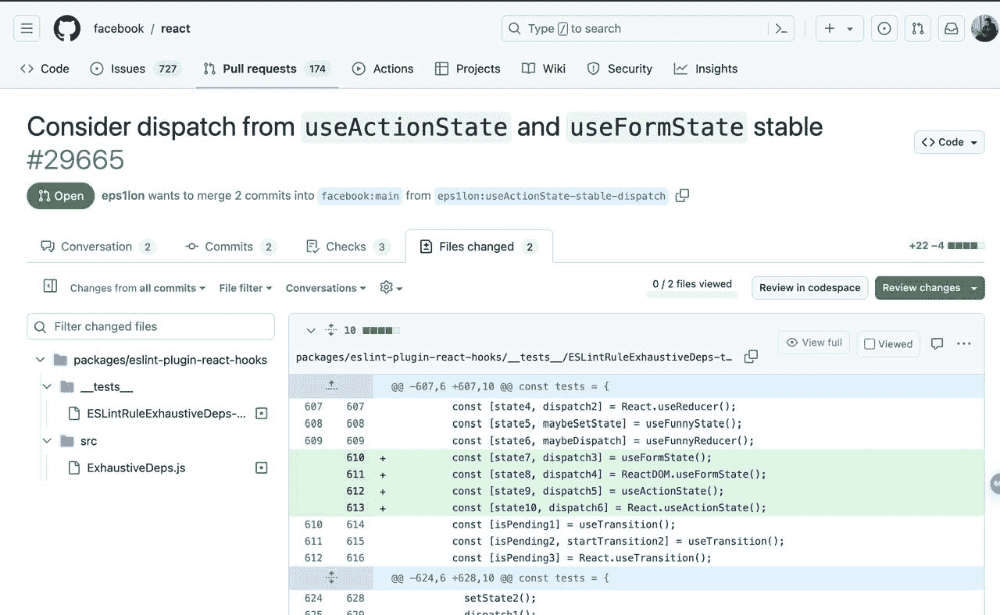

图 5-8 GitHub Pull requests 功能示例

无论方式如何，都需要有第三方参与并形成流程卡点，通过后才能合并。合适的审阅者可以从三个维度考虑：
·技术专家。经验丰富、对质量要求高，能从技术角度评估实现优劣、可读性和潜在风险，如识别缺少 useMemo 导致重复计算、评估第三方依赖质量、推动公共模块化。
·业务专家。对业务规则理解深入，通常是负责人或骨干，能验证代码是否满足业务预期，边界场景处理是否合理，校验规则是否符合约束，是否可复用存量模块。
·模块专家。对本次变更模块最熟悉的原作者或维护者，能结合历史上下文给出更精准的反馈。

三类角色的分工会随场景重叠，核心是引入不同能力视角，形成立体建设性意见。

**3.** **塑造审查文化**

代码审查是 Vibe 编程中最需要深度理解代码的环节。它能及时发现设计不合理、结构混乱、违反规范、重复代码等问题，同时促进技术交流。但多数团队执行不佳，因为审查带来的是长期、难以量化的收益，却需要当下投入大量时间，进度压力下最先被牺牲。

解决之道在人。把可读性、可维护性、整洁优雅视为与功能同等重要的质量要求，营造开放包容、技术敢言的氛围。如果团队里有一定比例具备精益求精、代码洁癖特质的成员，并鼓励质疑声，技术氛围会更强，审查规范也更易落地。引入优秀工程师、鼓励持续发声，有助于长期形成严谨务实的工程文化。

**4.** **AI 辅助审查工具**

能用 AI 写代码，自然也能用 AI 审代码。业界已有不少工具：
·CodeRabbit。仓库感知的 AI 审查平台，能分析变更并给出类似高级工程师的反馈，集成到 GitHub Pull requests 和本地 IDE，支持 VS Code 内实时审查。
·Amazon CodeGuru。基于亚马逊内部代码和最佳实践训练的机器学习服务，可自动审查代码缺陷并给出性能改进建议，还包含运行时性能瓶颈检测。
·Cursor。虽以开发生产力为主，其问答能力也能用于代码审查。

这些助手本质是基于大量代码和问题模式的大语言模型，能机械高速地扫描违规和典型漏洞。虽然不真正理解意图和语义，但作为规则熟记的自动审查员，能在早期快速发现问题，减轻人工负担。

AI代码审查：效率的甜头与隐蔽的坑

AI工具接手重复性的代码巡检后，人力负担明显减轻。它能用同一套标准逐行打量，不会被疲劳或个人风格带偏，从而让规范保持统一。代码提交后，助手可先行扫面数百行，迅速揪出资源泄露、基础安全漏洞、算法低效这类常见毛病，速度和稳定性往往超过人工初筛。基础问题被机器挡在外面，资深审查员就能把时间留给架构取舍、可维护性设计和业务逻辑校验，这种人机分工让审查既更快也更深。

但大语言模型在写代码时暴露的短板，会原样搬到审查环节。模型缺乏对业务背景和架构意图的深入把握，看不出设计初衷和语义关联，容易给出局部上合理、整体上冲突的修改建议。靠模式匹配审查，误报和漏报几乎不可避免。误报会把无害代码判成问题，浪费排错时间并侵蚀对工具的信任；漏报更危险，隐蔽的缺陷和安全洞口被放过后，团队会产生虚假的安全感。很多质量问题本质是意图问题，不是语法错误，AI很难理解为什么某个流程要这样实现，也判断不出架构上的权衡，于是放过那些合规却不对的功能实现。过度依赖会让开发者不假思索地采纳建议，审查质量被稀释。一旦形成AI生成、AI审查、人只点按钮的闭环，关键风险就无人把关。AI产出越多，人类的高质量审查越不可替代，缺了这道专家保险栓，后果难以估量。

## 5.4 用工程化给Vibe编程上保险

Vibe编程对AI的依赖度很高，生成速度远超人工审查的处理能力。真实商业项目里做不到完全去人化，交付压力下很容易跳过审查，埋下隐患。AI可能出现幻觉式生成，代码看似通顺却藏有隐性Bug、性能低下或语义偏差。开发者对AI代码理解不足，后期定位修复成本会急剧上升。未经安全审视的代码上线，潜在漏洞会直接放大系统风险。Vibe编程的低门槛和快迭代是优势，也因此更需要工程手段来对冲风险，否则便利会变成长期维护复杂度和稳定性问题。想真正落地，就要把Vibe编程嵌进结构清晰、节奏可控、可追溯的工程化体系里。

### 5.4.1 工程化在AI时代为何更关键

软件工程是把工程原则用在设计、开发、测试、维护上的学科，用系统化、科学化、规范化的方法降低复杂性，保证交付质量。进入Vibe时代，工程化的重要性不降反升，它弥合AI与人之间的协作鸿沟，用自动化手段快速验证质量与可维护性，降低对人的依赖。

工程化能解决的核心问题包括。确保正确性和可靠性：针对AI生成的幻觉或隐性缺陷，通过自动化测试、静态分析、代码审查工具做严格校验。可读性与可维护性：AI代码常显混乱不一致，工程实践强制统一风格、结构化注释和完备文档，帮助后人读懂设计意图，便于调试维护。强化安全性：内置自动安全扫描、静态安全分析、风险识别与审查流程，及时发现生产环境风险。

软件工作远不止写代码，编码只占一小部分。需求验证、质量检测、部署、生产监控等环节同样关键，工程化才有办法在这些复杂场景下落地。没有工程化支撑，Vibe编程只能在短期小项目里占便宜。有了工程化加持，AI驱动的开发才能从快速试错走向企业级稳定交付，发挥真正的生产力加速作用。

### 5.4.2 适用于Vibe编程的轻量级工程化体系

完整工程化庞大复杂，这里给出满足必要质量保障的最小集合，用最低成本拿到有效保障。

1. 版本控制：代码的安全网
版本控制用于追踪和管理代码变更历史，也叫源码管理或修订控制，能解决协作冲突。作用有安全回滚，随时回到任意历史版本，AI代码出错也能快速恢复；高效协作，分支机制支持多人并行开发，经审查后再合并；它是DevOps实践的基础，没有它自动化构建和CI/CD无法落地。

举例：线上系统稳定运行，借助AI迭代后引入隐蔽Bug且人工未发现。若无版本控制，只能耗费大量时间定位修复，问题期间持续在线。若已使用版本控制，可用git revert或git reset立刻回滚到稳定版，异步再排查修复，业务损失大幅减少。

常用Git操作。安装Git，macOS/Linux多已预装，Windows可官网下载。配置身份信息：git config --global user.name "你的名字"；git config --global user.email "你的邮箱@example.com"。初始化仓库：git init。查看状态：git status。暂存文件：git add [文件名] 或 git add .。提交快照：git commit -m "提交信息"。查看历史：git log。分支操作：git branch [分支名] 创建，git checkout [分支名] 切换，git merge [源分支] 合并，git diff branch1 branch2 比较。

在AI驱动环境下不必死记命令。打开Cursor终端后用AI Chat输入需求即可生成指令。
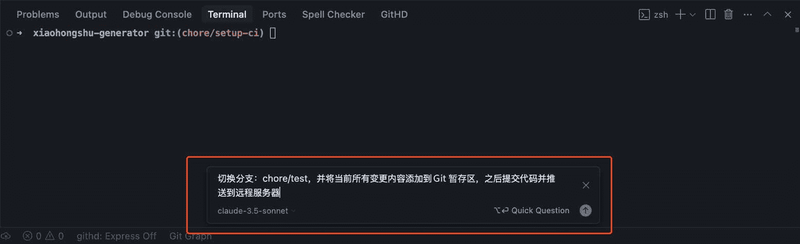
图 5-9 终端 AI 交互
Cursor会自动生成对应命令，例如：
git checkout -b chore/test && git add . && git commit -m "chore: 初始化测试分支" && git push origin chore/test
合理使用版本控制能更好地组织协作，保护代码安全，建议纳入标准流程。

2. 自动化测试
版本控制提供回溯能力，还需快速验证机制，确保AI每次新代码不破坏现有功能。自动化测试是通过脚本自动校验功能是否符合预期的实践，相比手工测试更高效。能确保功能正确性，快速定位问题根因，实现即时反馈。一旦改动引入Bug，测试立刻报警，避免扩散。

把自动化测试和AI生成代码结合，形成高效反馈闭环，大幅降低手工调试成本。不同技术栈工具不同，以JavaScript接入Vitest为例。初始化环境可让AI搭建环境并修改package.json，执行npm install完成。添加测试用例时提示AI阅读指定模块并生成覆盖率80%以上的单元测试，模拟下游依赖保证独立性。运行npx vitest --run即可验证。

生成难度与源码复杂度正相关。简单模块易于生成，复杂模块分支多、依赖多、边界多，AI生成测试就困难。若生成失败，可先重构模块，按单一职责、低耦合、高内聚原则拆分，让代码对单元测试更友好，再让AI生成，成功率和质量都会提升。

3. CI/CD
持续集成与持续交付是基于自动化流水线的工程实践，按触发条件自动执行集成、构建、测试、发布，只有全部通过才进入下一阶段。持续集成在特性分支合并前做构建、单元测试、静态检查，保证主分支稳定。持续交付在主分支变更后执行更全面的端到端和性能测试，确保可安全发布。

核心是通过自动化检测提升交付效率，减少人为失误，实现快速可靠交付。Vibe场景下敏捷的CI/CD能更快验证AI代码质量，降低迭代风险。

以GitHub Actions为例可设计两条流水线。持续集成流水线在每次PR触发，执行依赖安装、构建、单元测试、静态检查，通过后才能合并。提示词可为：请添加一条GitHub Actions流水线，每次发起PR时触发，执行依赖安装、代码构建、单元测试与代码静态检查，所有质检通过后方可将代码合并到主分支。持续交付流水线在主分支变更时触发，执行更严格测试后再调用云平台部署发布。

4. AI驱动文档编写
从长期可维护角度看，代码完成后应同步补齐说明。文档提升可读性，也帮助AI更准确识别结构和功能，从而更高效产出新代码。软件工程里软件包括源码和配套文档，操作手册、README、开发者指南都属于此类。完善文档能解释功能与使用方式，降低新成员学习成本，记录决策与设计思路防止重复错误，还能简化维护、预防缺陷。

文档不必全靠手写，Vibe环境下可让AI快速生成、维护和更新。例如提示AI扮演技术文档工程师，基于项目信息编写结构清晰的文档，覆盖技术文档、系统文档、开发者文档、用户文档四个维度。

技术文档包括项目简介与背景、核心算法或关键实现、API设计与调用示例、数据结构说明。系统文档包括架构总览、模块职责关系、技术选型理由、性能优化与安全措施。开发者文档包括环境配置、目录结构、本地开发与调试、提交规范与分支策略、测试框架。用户文档包括快速上手、图文操作手册、设置与安装说明、FAQ。

补充要求：所有代码块使用Markdown正确标记，风格统一适合发布到GitHub README。如需引用路径或命令行，使用代码块标记格式：```

**示例参考：**

- 快速开始：

```bash
git clone https://github.com/yourname/yourproject.git
cd yourproject
npm install
npm run dev

下面用一个最简洁的例子说明查询接口的工作方式。客户端发起查询，服务端返回对应的用户字段。

```

- API 示例：

```js

GET  /api/user?id=123

Response:

{
  "id": 123,
  "name": "Alice"
}

```

这样，我们便能高效地获得质量稳定、实时更新的文档，进一步降低项目的长期维护成本，这里截取一段生成的文档的样例。

# XiaoHongShu AI Content Generator

##   ********核心创新**** & ****技术亮点********

###   ****AI-Driven Content Intelligence****

- ********多模型融合策略********:支持 OpenAI GPT-4o、Gemini Pro、Claude-3 动态切换，基于 Vercel AI SDK 统一抽象层

- ********语义理解引擎********:实现段落语义分割、关键信息提取、情感分析的端到端流水线

- ********风格迁移算法********:6 种预训练风格模型（小红书/专业/科学/文艺/随意/极简），支持零样本学习风格转换

###   ****Pure SVG Rendering Engine****

- ********零依赖矢量渲染********:无须 Canvas/WebGL，纯 SVG + CSS 实现高保真卡片生成（960×1280 小红书标准）

- ********响应式设计系统********:基于 CSS Grid + Flexbox 的自适应布局，支持 3:4 黄金比例动态缩放

- ********实时预览管道********:WebSocket + Server-Sent Events 实现毫秒级渲染反馈

###   ****Enterprise-Grade Architecture****

- ****Nx-style Monorepo****:pnpm workspace + TypeScript Project References 实现代码共享与类型安全

- ********微服务化设计********:Express Router + Service Layer 分离，支持水平扩展与独立部署

- ********可观测性体系********:结构化日志 + 性能监控 + 错误追踪的完整应用性能管理解决方案

###   ****Streaming & Real-time Experience**  **

- ********流式内容生成********:基于 ReadableStream API 实现分片处理，降低首屏时间 60%+

- ********智能缓存策略********:Redis + Memory Cache 双层缓存，API 响应时间 < 100ms

- ********错误恢复机制********:Circuit Breaker + Retry with Exponential Backoff 保障服务稳定性

##   ********快速导航********

|   技术文档 |   系统架构 |   开发指南 |   用户手册 |

|:---:|:---:|:---:|:---:|

| API 设计·算法实现·数据结构 | 架构设计·模块关系·技术选型 | 环境配置·开发流程·测试框架 | 快速上手·操作手册·问题解答 |

---

##   项目简介

### 项目目的

小红书内容生成器是一个基于 AI 的智能内容创作工具，旨在帮助内容创作者快速将长篇文章转换为适合小红书平台的图文卡片形式。通过 AI 技术自动分析、提取关键信息并生成视觉化卡片，大大提升内容创作效率。

...

## **5.5 小结**

本章针对 Vibe 编程模式下的工程化挑战，提出了一套完整的实践方案，从提示词工程技巧、结构化的需求规划，到严格的代码审查与优化，确保 AI 生成的代码不仅“能跑”，还能长期可维护。

此外，本章还介绍了版本控制体系、自动化测试、CI/CD 和 AI 驱动文档编写等轻量级工程实践，以最低成本实现高质量交付。这些实践为 Vibe 编程建立了稳定的基础设施，让 AI 编程不仅适用于快速原型开发，也能支撑面向生产环境的企业级项目。只有在良好工程方法的加持下，AI 的开发效率优势才能真正释放。

# **第六章**

# **实战案例**

本章将以“小红书内容生成器”项目为例，系统讲解如何基于 Vibe 编程方法，从零构建一个具备真实可用性的全栈 AI 应用。本章内容覆盖从环境配置、项目需求梳理、后端与前端开发到最终部署的完整流程。过程中不仅展示了每个环节的关键操作步骤，而且重点总结了模型协作过程中高价值的提示词结构、调试技巧与开发节奏控制策略。

相比传统开发流程，本章强调的是如何构建一个对 AI 友好的开发环境，并以人类开发者为主导，借助 AI 更高效地实现应用开发。所有相关代码均已提交到 https://github.com/Tecvan-fe/xiaohongshu-generator 仓库，读者可自行下载阅读。

## **6.1** **环境配置**

工欲善其事，必先利其器。在开展项目之前，我们需要先设置一系列基础开发环境，包括 Cursor（一款 AI 原生代码编辑器）、Node.js（JavaScript 运行时）、pnpm（高效的包管理器）、ChatGPT 账号、OpenAI API Token 等，并搭建项目开发环境。

为简单起见，本项目选择入门门槛较低的语言——JavaScript 进行编写，重在学习开发过程中的各类提示词与技巧，其他技术栈的读者也可无障碍阅读。对于已经安装相关工具的读者，可跳过 6.1.1 节，直接阅读 6.1.2 节关于项目脚手架的说明。

### **6.1.1** **准备工具**

为了完成示例项目，需要预先安装若干必要的开发软件，并做好基础配置。

**1.** **安装与配置 Cursor**

Cursor 是一款基于 Visual Studio Code（简称 VS Code）构建的 AI 原生代码编辑器，它将生成式 AI 能力直接嵌入开发工作流中，并提供上下文感知的代码建议、自动化重构和实时代码生成等能力，可以说是目前市面上效率最高的 AI IDE 之一，因此本书推荐优先使用 Cursor 进行 Vibe 编程。

Cursor 的安装过程比较简单，首先访问 Cursor 的官方网站（如图 6-1 所示），然后点击 Download 按钮，适用于你机器的操作系统的安装程序将自动下载，下载完成后，运行安装程序并等待安装完成。

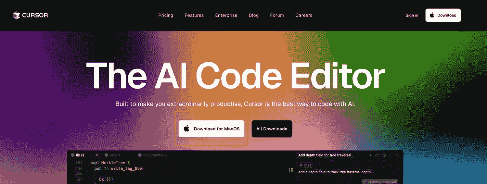

图 6-1 Cursor 官网

主流操作系统对应的安装方式如表 6-1 所示。

表 6-1 不同操作系统的安装方式

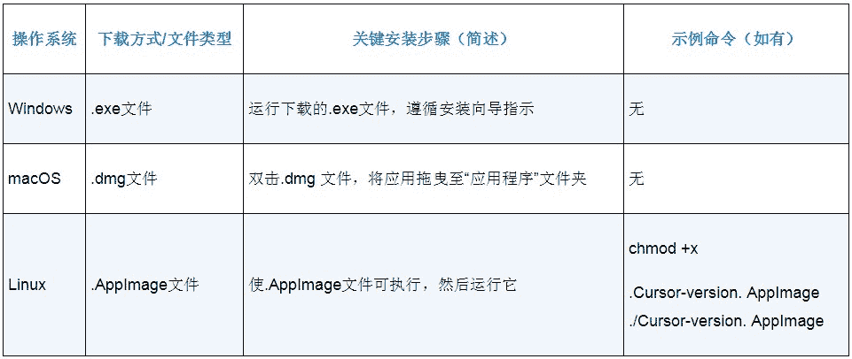

安装完成后，还需要开启若干配置，以进一步提升 Cursor 效率。

·充值开通会员。虽然免费版本有试用额度，但性能较差，不如 Pro 版本，两者即使只有 10%的性能差异，在乘积效应下效率偏差也会非常大，所以建议直接使用 Pro 版本。

·开启隐私模式。Cursor 内部的许多模型处理操作都发生在云端，所以不可避免地需要将本地代码发送到 Cursor 服务器，如果担心合规风险，可以开启隐私模式，该模式下 Cursor 保证不会私自存储你的代码。开启路径为：点击右上角的配置按钮（ ），在 Cursor Settings 对话框中点击 General，将 Privacy mode 设置为 enabled，如图 6-2 所示。

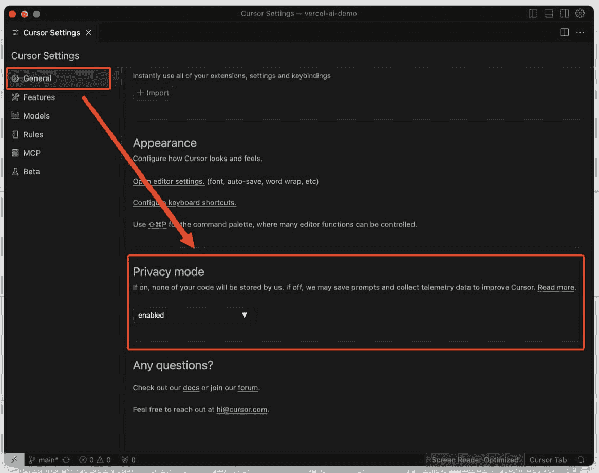

图 6-2 开启隐私模式


·开启 auto-run 模式。Cursor Agent 工作过程中可能需要调用不少本地命令行工具，如 npm、Vitest 等，出于安全性考虑，Cursor 默认不会直接调用这类命令，而是弹出对话框，由用户决定是否执行命令。建议将部分安全性风险较低的命令设置为自动执行，让 Cursor 绕过用户操作直接执行这些命令，从而提升执行效率。开启路径为：点击右上角配置按钮（），在 Cursor Settings 对话框中点击 Features，进入功能配置界面，勾选 Enable auto-run mode 下方相应的复选框，开启自动运行模式，如图 6-3 所示。

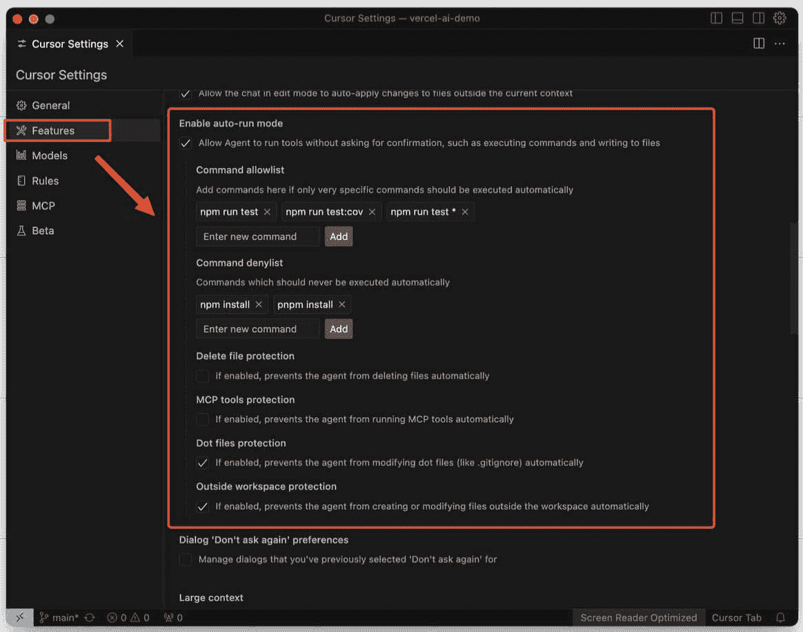

图 6-3 开启 auto-run 模式

对于前端开发者，建议将 npm、pnpm、Vitest、eslint、webpack 等常见工具设置为 Command allowlist 白名单。

·开启 Codebase Indexing。Codebase Indexing 是 Cursor 的关键特性之一。简单来说，该功能会向量化整个项目的内容并加密存储到 Cursor 的云端数据库中，后续执行大语言模型请求时可到该数据库获取向量知识，进而对仓库代码建立更深的理解，Cursor 生成的代码也会跟已有代码的关联性更强（如相似的技术栈、编码风格等）。开启路径为：点击右上角配置按钮（ ），在 Cursor Settings 对话框中点击 Features，进入功能配置界面，向下滑动找到 Codebase Indexing 配置项，开启 Enabled 选项，如图 6-4 所示。

·关闭 Auto。Cursor 0.47 之后支持在 Agent 或 Chat 回话过程中根据任务类型自动选择合适的模型来完成任务，但实测效果并不好，更推荐在具体场景中选择某个固定模型。例如，对于编码类问题，建议选择 claude-4-sonnet；对于通识类问题，建议选择 gpt-4o；而对于中文写作类问题，则建议选择 deepseek 等。切换模型的操作方法如图 6-5 所示。

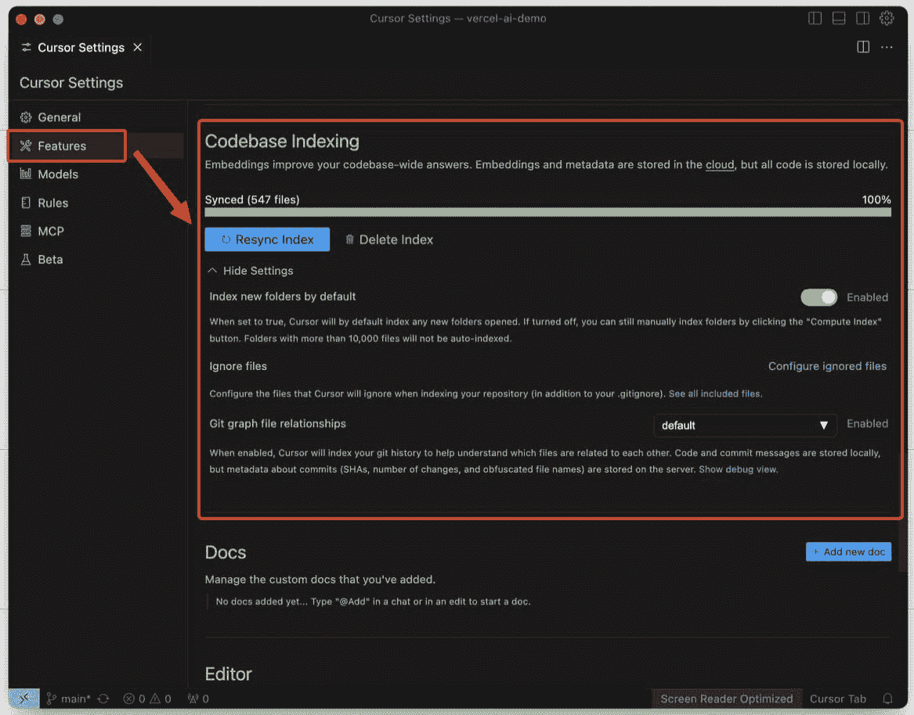

▲图 6-4 开启 Codebase Indexing

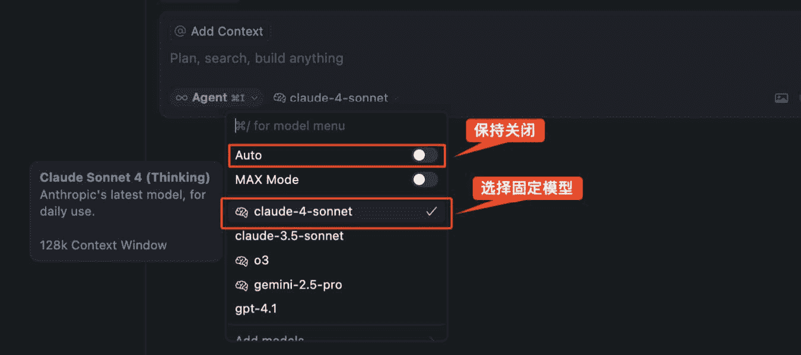

▲图 6-5 切换模型

·导入 VS Code 设置。如果你已经在使用 VS Code，那么强烈建议使用 Import VS Code Extentions and Settings 命令导入 VS Code 设置，如图 6-6 所示。

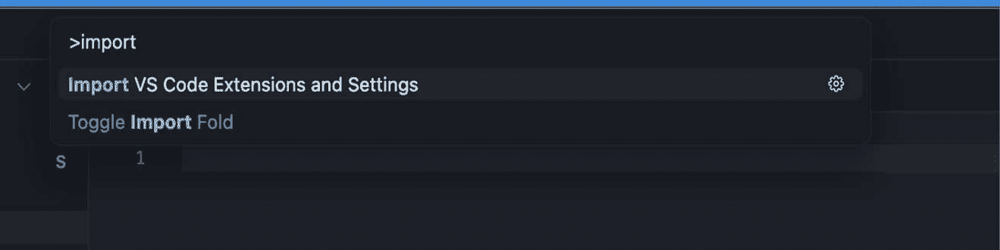

图 6-6 导入 VS Code 配置

**2.** **安装 Node.js**

Node.js 是一个开源、跨平台的 JavaScript 运行时环境，基于 Chrome 的 V8 JavaScript 引擎构建，它的一个主要优势是能够使用 JavaScript 同时开发客户端程序和服务器端程序，这种统一的技术栈简化了开发过程，允许开发者在从数据库到用户界面的整个应用程序栈中都使用单一语言（JavaScript/TypeScript）进行开发，极大地降低了开发复杂度，也非常适合用 AI 生成技术栈统一的代码。

要使用 Node.js，需要先安装运行时环境，在 macOS 或 Linux 操作系统中，安装步骤如下。

（1）安装 nvm 工具，命令如下。

curl -o-

https://raw.githubusercontent.com/nvm-sh/nvm/v0.39.7/install.sh | bash

（2）安装 nvm 后，关闭并重新打开终端，或加载你的 shell 配置文件（如 source ~/.bashrc 或 source ~/.zshrc），之后安装 Node.js，命令如下。

nvm install --lts

在 Windows 操作系统中，无法直接使用 nvm，而需要使用 nvm-windows，安装运行时的步骤如下。

（1）安装 nvm-windows。在 nvm-windows 的 GitHub 仓库最新发布页面下载 nvm- setup.zip 文件。下载后，打开 zip 文件并运行 nvm-setup.exe 文件。Setup-NVM-for- Windows 安装向导将指导你选择 nvm-windows 和 Node.js 的安装目录。

（2）列出可用的 Node.js 版本。安装 nvm-windows 后，打开 PowerShell（最好以管理员权限运行），执行 nvm list available 命令，验证 nvm-windows 是否正常工作。

（3）使用如下命令安装最新版本的 Node.js 运行时。

nvm install latest

**3.** **安装 pnpm**

pnpm（performant node package manager）是一个高性能且节省磁盘空间的 Node.js 包管理器。相较于 Node.js 官方的 npm 工具，pnpm 经过深度优化后，安装速度、磁盘空间效率等都有明显增强，并且 pnpm 使用硬链接和符号链接来维护一个半严格的嵌套 node_modules 结构，严格杜绝 npm 存在的“幽灵依赖”问题，因此综合效率更高，也是推荐使用的包管理器。

在安装 Node.js 后，只需一行命令即可完成 pnpm 安装。

npm install -g pnpm@latest

安装成功后，可通过如下命令验证安装是否成功。

pnpm --version

**4.** **安装 Git**

Git 是一款分布式版本控制系统，能够细致地追踪项目中的所有变更，是开发者高效管理项目的必备工具之一。AI 每次生成的代码都可能带来质量风险，而适当的 Git 操作能及时记录最近可用版本，可随时回退代码状态，对冲这部分质量风险，因此 Git 也是 Vibe 编程方法论下的必要工具之一。

在大多数 macOS 和 Linux 操作系统中，Git 通常是默认安装的，可以通过打开终端或命令提示符并输入以下命令来查看是否已安装 Git 及安装的版本。

git --version

如果命令返回 Git 的版本号（如 git version 2.9.2），则表示 Git 已安装。如果未安装，可按照以下步骤进行安装。

在 Windows 操作系统中，安装步骤如下。

（1）下载安装程序：访问 Git 官方网站并下载最新的 Git for Windows 安装程序。

（2）运行安装程序：双击下载的.exe 文件以启动 Git 安装向导。

（3）遵循向导指示完成安装：对于大多数用户，默认选项是合理的，除非有特定原因需要更改。

（4）验证安装：安装完成后，打开命令提示符（如果在安装过程中选择不使用 Windows 命令提示符中的 Git，则打开 Git Bash），输入 git --version 命令并按回车键，验证 Git 是否已成功安装。

在 macOS 操作系统中，安装步骤如下。

（1）下载安装程序（推荐）：访问 Git 官方网站并下载最新的 macOS Git 安装程序。

（2）运行安装程序：启动安装程序并按照提示完成安装。

（3）验证安装：打开终端，输入 git --version 命令并按回车键，验证 Git 是否已成功安装。

在 Linux（以 Debian/Ubuntu 和 Fedora 为例）操作系统中，可通过系统自带的包管理器轻松完成安装，安装步骤如下。

（1）更新包列表：打开终端并执行如下命令。

sudo apt-get update

（2）安装 Git：执行如下命令，安装 Git。

sudo apt-get install git-all

（3）验证安装：输入 git --version 命令并按回车键，验证安装是否成功。安装 Git 后，还需要及时配置用户名和电子邮件地址。

git config --global user.name "Your Name"

git config --global user.email "your_email@example.com"

**5.** **注册 ChatGPT 账号**

本书选用 ChatGPT 作为主要的大语言模型工具，读者也可以根据实际场景选择适用的大语言模型，如豆包、Claude 等。使用 ChatGPT API 之前，需要先注册并获取 OpenAI API Token，步骤如下。

（1）进入 OpenAI 管理平台：https://platform.openai.com/。

（2）点击右上角 Sign Up 按钮，注册账号，可选择使用 Google/Apple 等账号登录。

（3）注册并登录成功后，进入 API keys 管理页面，点击右上角“+Create new secret key”按钮来创建 API key，如图 6-7 所示。

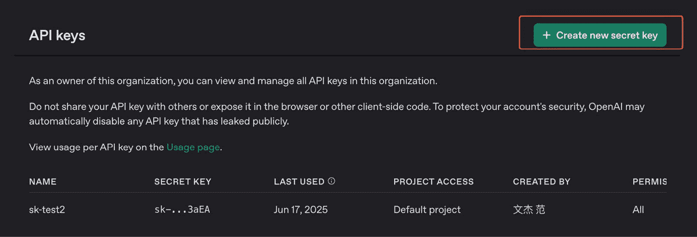

图 6-7 创建 OpenAI API Token

（4）复制新的 key 并保存，后续需要使用该 key 进行接口调用。

（5）[可选]注册并获得 API key 后，可充值一定额度，以便后续接口调用。

至此，前置的准备工作就完成了，接下来我们再梳理一份项目脚手架，以便快速进入开发。

### **6.1.2** **项目脚手架**

当前，软件技术发展呈爆炸式增长，要完成一个软件项目可以选择许多不同的技术栈，这里综合便捷性、稳定性、开发体验等方面整理了一套适合 Vibe 编程的基于 JavaScript 的轻量级项目脚手架。这套脚手架也将作为本章项目开发的基础，读者在命令行环境通过如下命令克隆（clone）使用。

git clone -b scaffold git@github.com:Tecvan-fe/xiaohongshu-generator.git

之后执行 cd xiaohongshu-generator 命令进入项目目录，再次执行 pnpm install 命令即可完成项目初始化。完成初始化的项目结构大致如下。

xiaohongshu-generator/

├──  docs/ # 项目文档

│ ├── ...

│

├──  packages/ # Monorepo 源码目录

│ ├──  server/ # 后端服务

│ │ ├── src/

│ │ │ ├── ... # 服务器端源码

│ │ ├── package.json # 后端依赖配置

│ │ └── README.md # 后端服务说明

│ │

│ ├──  web/ # 前端应用

│ │ ├── src/

│ │ │ └── ... # Web 端源码

│ │ ├── package.json # 前端依赖配置

│ │ ├── vite.config.ts # Vite 构建配置

│ │ ├── tailwind.config.js # Tailwind CSS 配置

│ │ └── postcss.config.js # PostCSS 配置

│ │

│ ├──  logger/ # 日志工具包

│ │ ├── src/

│ │ │ └── ...

│ │ ├── package.json

│ │ └── tsconfig.json

│ │

│ └──  utils/ # 工具函数包

│ ├── src/

│ │ └── ...

│ ├── package.json

│ └── tsconfig.json

│

├──  配置文件

│ ├── package.json # 根 package.json(Monorepo 配置)

│ ├── pnpm-workspace.yaml # pnpm 工作空间配置

│ └── ...

其中，关键目录包括：

·packages/server——用于存放 Node.js 后端代码，主要实现与 ChatGPT 的交互；

·packages/web——用于存放 Web 端代码，主要实现与用户的交互；

·packages/utils 与 packages/logger——均为工具类，用于存放前后端共享代码。

上述代码目录之间通过 pnpm 工作空间串联，形成一个 Monorepo 结构，这是在 Vibe 编程场景下重点推荐的一种代码管理模式，具有以下优点。

·简化的代码管理：所有代码都驻留在单个仓库中，使得跨不同项目追踪变更、保持编码标准和实践的一致性以及确保适当的版本控制变得更加容易。

·代码共享和可复用性：单个仓库使得在仓库内跨不同项目或组件共享和复用代码变得十分容易，并且大语言模型更容易获得完整代码上下文，从而更容易协助用户生成正确的代码。

·降低校验成本：将所有代码集中在单个仓库中，只要配备适当的质检工具（如静态代码分析、自动化测试等），对于任何变动都可以快速验证全局有效性，这非常有利于快速校验大语言模型产生结果的正确性。

至此，我们已经在本地设置好了必要的环境，接下来进入项目需求梳理阶段。

## **6.2 项目需求梳理**

Vibe 编程绝非盲目编程，与传统开发类似，在正式启动软件开发之前，非常有必要严谨地梳理清楚项目的功能需求和技术需求，至少应明确以下几个事项：

·项目的核心功能及主要交互流程；

·计划采用的技术栈，以及相关技术和非技术约束条件；

·开发工作的优先顺序和大致推进计划。

通过在项目前期明确上述事项，可以确保开发过程有的放矢，不至于过多偏离最初预期。当然，这类文档可以借助 AI 工具（如 ChatGPT 等）逐步撰写、完善内容。本章将演示如何从一个简单的想法出发，利用各类 AI 工具一步步细化方案，最终形成完善的需求说明文档、技术设计文档和项目执行计划文档等。

### **6.2.1 梳理需求说明文档**

在项目早期，我们往往只有一个模糊的想法，例如“开发一个系统，将用户输入的内容自动转换为小红书风格的卡片与配套文案”。这一构想虽然具备启发性，但尚不足以直接用于指导具体的系统设计与开发，而必须借助系统化的需求分析过程逐步细化，才能为后续的工程实践奠定扎实基础。

为了有效推动这一过程，我们建议结合大语言模型的能力，构造明确且专业的提示词，以获取结构化的需求草案。以下是一个推荐使用的提示词模板。

你是一个专业的软件需求分析专家，我准备开发一个 Web 系统，将用户输入内容转换为小红书卡片与文案，请围绕这一需求完善需求说明文档，文档中需要至少包含如下内容。

**- ****简介**：简要说明项目背景和目标，即“你要做什么”。

**- ****功能**：列出系统将提供的功能和界面（站在用户角度描述外部可见的行为）。

**- ****约束**：明确技术栈、性能要求、编码规范等限制条件。

**- ****其他细节**（可选）：对于特别复杂或需要严格控制的算法/实现，可在需求说明文档中注明关键细节或特定要求。

上述提示词在结构设计上具备良好的引导性与针对性。首先，通过角色设定，将大语言模型定位为“软件需求分析专家”，帮助模型明确其职责边界与输出风格；接着，提供清晰的任务指令，要求其围绕特定目标撰写一份完整的需求说明文档；最后，通过列举文档应包含的核心要素（如项目简介、功能描述、技术约束等），限定输出内容的范围与结构，从而确保生成结果既简洁又具备良好的可用性和可读性。

将这段提示词传入你所熟悉的大语言模型系统，如 ChatGPT，正常情况下系统会返回一段更完整的需求描述，示例如下。

# 小红书卡片与文案生成系统-需求说明文档

## 一、简介

### 项目背景

在内容创作领域，小红书已成为品牌营销和个人表达的重要平台。优质的图文内容是吸引用户和提升传播效率的关键。然而，许多创作者缺乏设计与文案编写能力，制约了其内容发布效率与质量。

### 项目目标

本项目旨在开发一个 Web 系统，用户仅需输入核心内容描述，即可自动生成风格统一、排版美观的小红书卡片图片，并配套合适的文案，帮助用户快速创作优质图文内容，实现从输入到发布的自动化。

---

## 二、功能说明

### 2.1 用户输入界面

- 支持文本输入，包括产品介绍、场景描述、卖点关键词等。

- 可选择生成内容类型（如种草文案、测评文案、生活记录等）。

- 可选择卡片风格（如清新、科技感、手账风格等）。

- 可预设图片（上传图片）或选择图像生成方式（如使用系统内置图标/SVG 插图等）。

### 2.2 文案生成模块

- 根据输入内容智能生成符合小红书文风的文案，具备以下特征：

  - 真实感与代入感强；

  - 口语化、共鸣式开头；

  - 标签化结尾（自动添加#话题标签）。

- 支持内容长度调节（短、中、长三档）。

- 支持多版本文案生成与切换。

### 2.3 卡片生成模块

- 自动生成小红书卡片图，支持以下内容元素：

  - 主标题（如产品名）；

  - 副标题（如使用场景）；

  - 图标或背景插图（可选）；

  - 风格化排版与配色。

- 输出格式为高清 PNG 或 SVG，可直接保存或上传。

### 2.4 预览与导出

- 实时预览文案与卡片合成效果。

- 支持一键下载卡片图和复制文案。

- 可导出为小红书草稿结构（JSON 或 Markdown）。

### 2.5 账号与历史记录（可选）

- 支持用户注册与登录（可使用电子邮箱或社交账号）。

- 查看历史生成记录与收藏文案。

- 对历史内容进行二次编辑与再生成。

---

## 三、约束条件

### 3.1 技术栈约束

- 前端：React + Tailwind CSS + TypeScript。

- 后端：Node.js（Express 或 Next.js API 路由）。

- AI 接口：OpenAI API（GPT-4o）或 Claude 3，用于文案生成。

- 图像生成：基于 SVG 的动态卡片渲染（不使用 DALL·E 或 MJ）。

- 数据库（如有需要）：SQLite/PostgreSQL（通过 Prisma 管理）。

### 3.2 性能要求

- 文案生成时延不超过 5 秒（正常网络情况下）。

- 卡片渲染时间不超过 1 秒。

- 系统支持日均 1000 次生成请求的访问压力。

### 3.3 编码规范与开发要求

- 使用 ESLint + Prettier 统一代码风格。

- 所有组件模块化，遵循单一职责原则。

- 开发环境支持自动部署（如 Vercel）。

- 所有 API 返回结构统一（包含 code/message/data）。

- 前后端接口通过 OpenAPI 规范文档化。

---

## 四、其他细节与特殊实现说明

### 4.1 文案生成提示词构建

为确保生成文案符合小红书语境，提示词设计中应：

- 明确要求模仿小红书博主语气（如“我最近发现……”“强烈安利……”）；

- 指定文体（如种草、体验、对比）；

- 插入特定关键词及情感方向（如“温柔”“科技感”“提升幸福感”）。

### 4.2 SVG 卡片渲染规范

- 使用自定义组件库封装卡片模块，支持参数化传入标题、副标题、图标等。

- 字体需使用开源中文字体（如阿里巴巴普惠体）。

- 保证移动端尺寸适配（750px 宽度等比例缩放）。

从整体结构来看，经由大语言模型生成的初版需求说明文档往往已经具备一定的完整性与体系性，涵盖了功能说明、约束条件等多个关键要素。然而，尽管文档框架看似健全，但在准确性与实际适用性方面仍可能存在诸多问题，亟需人工进一步审查与迭代。以此示例为例，当前文档中尚存在如下较为明显的不足。

·缺乏用户主流程描述。文档未能明确说明用户在系统中的核心操作路径，导致从用户视角难以理解系统的使用方式，也不利于前端与后端在功能实现上的配合。对此，应补充完整的用户主流程说明，包括用户如何进入系统、如何提交内容、系统如何调用大语言模型来处理用户输入、结果如何被解析与渲染为卡片形式等，提示词如下：

请补充完整的用户操作主流程说明，内容应充分解释用户进入系统后，如何提交内容，系统如何调用大语言模型，之后如何返回响应结果，并在界面上渲染出内容卡片等。

·性能要求不具有现实意义。在 3.2 节中，文档提出了对系统性能的要求，但对于项目的早期阶段而言，性能优化并非优先考虑的事项，该部分内容可酌情删除，以避免不必要的预优化。

·无用户系统需求。本阶段项目目标为提供一个无须用户账号体系的轻量化工具，因此与用户注册、登录、收藏等功能相关的描述亦可全部删除。

以上仅为部分典型问题，实际场景中还可结合具体业务需求进一步细化和修订。例如，若决定采用 SVG 渲染方式而非调用 DALL·E 等图像生成模型来进行卡片绘制，可在文档中明确该设计选择及其合理性（如更强可控性、无须外部服务依赖等）。但也需意识到，这类设计约束在后期可能会限制系统扩展性，读者可根据自身需求灵活调整或删除。

总之，需求说明文档不仅要具备形式上的完整性，更应在内容层面做到准确、清晰、无冗余。应尽可能详尽地阐明系统背景、核心问题、功能流程、技术选型与实施约束等关键内容。文档越具体、明确，后续开发过程中可能产生的返工与误解就越少，整体开发效率与质量也将显著提升。

### **6.2.2 梳理技术设计文档**

在完成初步的需求说明文档之后，下一步工作是基于需求内容进一步撰写技术设计文档。需要特别强调的是，需求说明文档关注的是“做什么”，而技术设计文档的核心在于解答“怎么做”。前者定义系统的目标和外部行为，后者则决定实现路径与工程约束。为了确保后续 Vibe 编程流程中大语言模型生成的代码与实现方向始终保持一致，必须借助技术设计文档明确限定技术实现方案。

例如，技术设计文档可以用来约束特定的实现方式，如指定必须使用某项技术（如技术 A），禁止采用某些不符合架构原则或项目定位的技术（如技术 B）；或者对系统的整体架构风格进行限定，例如明确前后端职责边界、无状态服务结构等，以避免模型在自动生成实现细节时产生发散性偏差。

与需求说明文档一样，技术设计文档的编写也可以借助大语言模型生成。推荐使用集成式 AI 开发环境（如 Cursor），它具备对代码与文档上下文的深度理解能力，能自动调用 Agent 模式来完成结构化的技术规划。只需将 6.2.1 节生成的需求说明文档内容粘贴到 Cursor 中并保存为文件（如 requirements.md），在 Cursor Agent 模式下输入如下提示词：

仔细阅读@requirements.md 文档，据此梳理出核心技术实现方案，内容应包含功能主流程、架构设计、更精细的技术栈选型等，将结果保存到 atech.md 文档。

即可生成一份详尽的技术设计文档，这里摘取部分关键内容。

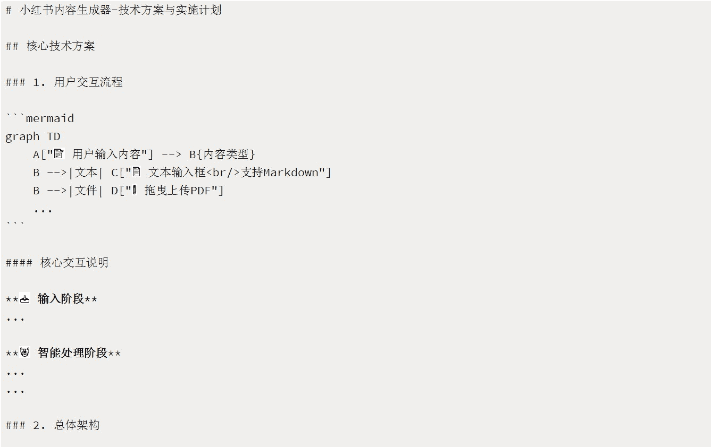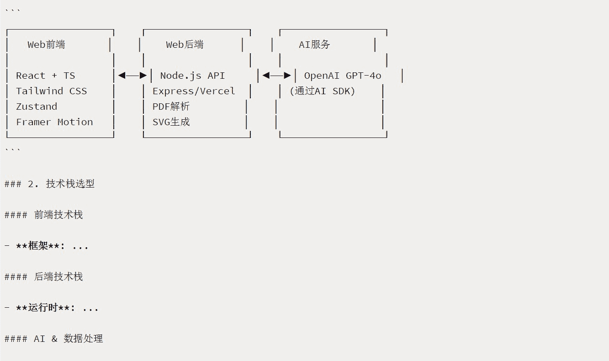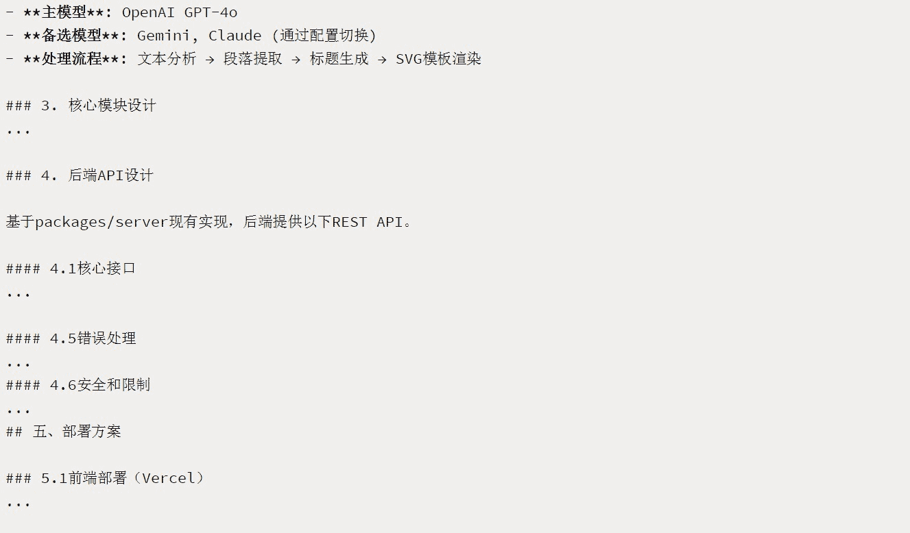

虽然借助大语言模型能够快速获得结构化的技术方案草稿，但在实际应用中，初稿往往仍存在多处不符合实际开发节奏、忽略细节或存在误导的内容。因此，建议从完整性、准确性与必要性这 3 个维度，系统地评估与优化技术设计文档内容。例如本示例就存在以下若干明显问题。

·过早引入测试与文档编写要求。在项目早期阶段，除非采用测试驱动的开发（test driven development，TDD）模式，否则无须急于引入完整的测试覆盖与详细开发文档。这类内容可在项目后期代码相对稳定时逐步补齐，因此建议将相关说明暂时移除，避免影响开发节奏与重点。

·不应过早进行性能优化。早期的主要目标是构建出可运行的核心功能。在功能稳定前，任何关于性能调优、负载预估或资源优化的描述都是不必要的预优化，应删除相关段落，以确保技术设计文档聚焦于核心问题。

·缺乏图像导出规范，影响成品质量。当前文档未明确导出图像的分辨率规格，可能导致图像质量不符合目标平台（如小红书）的展示标准，因此应补充如下规范内容。

********布局系统********

导出图片应遵循如下分辨率。

- 海报版：750×1334 (9︰16)。

- 方形版：750×750 (1︰1)。

- 横版：1080×608 (16︰9)。

·缺乏清晰的前后端代码结构规范。若不对工程结构加以约束，后续大语言模型生成代码时极易出现前后端逻辑混杂、模块耦合度高等问题，严重影响可维护性。因此应补充明确的项目结构说明。

这是一个基于 pnpm Workspace 的 Monorepo 工程架构，请补充规则，明确将后端代码保存到 packages/server 包中，将前端代码保存到 packages/web 包中，同时对于两端共享代码，保存到 packages/utils 包中。

·其他潜在问题与改进方向。除上述问题外，还应逐项核查以下内容是否合理：

➢ 架构设计是否符合当前功能目标（如是否过度抽象）；

➢ 技术栈选型是否实际可行，有无高风险依赖；

➢ 第三方服务调用（如模型 API）是否存在接口不明确或权限限制；

➢ 是否有与项目定位不符的“扩展项”或“预留模块”，如有，需谨慎评估是否保留。

总而言之，编写技术设计文档的目标是为后续的自动化开发与协作提供统一、可操作的实施基线。应避免冗余、排除歧义、约束生成，力求准确、简洁、聚焦。一份经过充分审查的技术设计文档，不仅是高质量开发的起点，也将显著降低 Vibe 编程过程中的反复沟通与返工成本。

### **6.2.3 梳理项目执行计划文档**

在有了初步的需求与技术设计文档之后，接下来还需要梳理第 3 份文档——项目执行计划。这里需要理解一点：大语言模型的上下文窗口（context window）存在长度上的严格限制。随着开发进度推进、代码量增加、对话内容不断扩展，AI 编程 Agent 所维护的上下文状态会逐步逼近模型支持的最大长度，一旦超出限制，将直接导致上下文截断，使模型遗忘早期关键信息，甚至引发任务崩溃。

虽然诸如 Cursor 之类的 AI 编程工具已内置若干应对策略，例如在适当时机调用 Cursor Small 模型对旧上下文进行语义压缩，以降低内存占用，但在面对周期长、复杂度高的开发任务时，上下文崩溃仍然面临高风险。而一旦会话崩溃，用户只能中断之前的任务，重启一个新的 Agent 对话，旧会话中随对话逐渐积累的知识被一次性清空，新会话中生成质量显著下降，Cursor（或其他 AI 编程 Agent）此时已经完全忘记最开始的任务，失去了完整的历史上下文。

为此，需要一种长期记忆机制，使得即使模型“失忆”或会话中断，也可快速“回忆”项目任务、定位当前进度、恢复开发状态。同样，这也可以借助大语言模型完成。

仔细阅读@tech.md 与@requirements.md 文档，帮我规划一个项目执行计划文档，我期望先完成后端接口体系开发，再逐步执行前端开发；另外，每个任务项需要用[ ]标记执行状态，在后续的对话过程中，一旦完成某个任务项就标记为[x]，将结果保存到 docs/plan.md 文档中。

这里有以下两个小技巧。

·明确要求使用 Markdown 的[ ]语法标记任务状态，这会让 Cursor 进入一种“有状态”模式，能更快理解任务进度。

·明确要求先完成后端接口体系开发，因为在我们的项目中，后端相对容易实现，因而能更快结束任务。

将上述提示词输入 Cursor 中，可生成项目执行计划文档，示例如下。

# 小红书卡片与文案生成系统-项目执行计划

## 项目概述

...

---

## 第一阶段：项目初始化与环境配置

### 1.1 项目基础设置

...

### 1.2 开发环境配置

...

---

## 第二阶段：后端核心开发

### 2.1 基础架构搭建

- [ ] 初始化 Express 应用和中间件配置

- ...

### 2.2 AI 服务集成

- [ ] 安装 Vercel AI SDK 相关依赖

- ...

### 2.3 文案生成核心功能

- [ ] 设计并实现 提示词 模板系统

- [ ] ...

### 2.4 API 开发

...

---

## 第三阶段：前端核心开发

### 3.1 前端基础架构

...

---

## 第四阶段：集成测试与优化

### 4.1 前后端集成

...

---

## 第五阶段：部署与上线

### 5.1 部署准备

...

---

## 第六阶段：后续迭代与扩展

### 6.1 功能增强

...

---

## 里程碑时间节点

- ********第一阶段********：项目初始化（1—2 天）

- ********第二阶段********：后端开发（5—7 天）

- ********第三阶段********：前端开发（5—7 天）

- ********第四阶段********：集成测试（2—3 天）

- ********第五阶段********：部署上线（1—2 天）

- ********第六阶段********：迭代优化（持续）

********总预计开发周期********：2—3 周

---

## 注意事项

1. ****API key** **安全********：...

---

对此生成结果也需进行严格审查，避免引入不合理或多余的内容。例如，这一项目执行计划文档中仍存在若干明显问题。

·不必要的时间预估。文档中虚构了若干“时间”项，如“总预计开发周期：2—3 周”等，这类内容在 Vibe 编程模式下并无实际参考价值，反而容易误导 AI 生成进度控制逻辑，因此应当全部删除。

删除所有具体的“时间”定义，例如文档中的********总预计开发周期********：2—3 周。

·无效的扩展设想。例如，“6.3 技术升级”一节（书中未展示）罗列了若干可能的优化方向与未来技术选型，这类预设在当前阶段并不具备实际意义，且会徒增上下文复杂度，建议整体删除。

完成上述修订后，即可获得一份结构合理、聚焦明确的项目执行计划文档。结合前述的需求说明文档与技术设计文档，开发准备工作已基本就绪，可正式进入 Vibe 编程实施阶段。

## **6.3** **后端开发**

完成 6.2 节所述的项目需求梳理工作后，我们已整理出以下 3 份核心文档。

·requirements.md（需求说明文档）：用于明确产品目标、功能边界、主要交互流程，以及关键的技术与非技术约束条件。

·tech.md（技术设计文档）：明确技术栈选型、核心架构方案及实现过程中的技术约束。

·plan.md（项目执行计划文档）：划分开发阶段，定义执行顺序，为 AI Agent 提供上下文线索，保障任务推进的连续性与可控性。

至此，项目准备工作已基本完成，接下来正式进入编码阶段。本项目的目标是实现一个“小红书内容生成器”，系统整体上由以下两部分组成。

·前端 Web 系统：负责与用户交互，提供内容输入与卡片预览界面。

·服务器端系统：负责与大语言模型对接，处理文本生成与图片渲染请求。

架构上，这两部分在代码层面保持解耦，仅通过标准 HTTP 接口进行通信。考虑到后端服务相对简单，实现重点集中在封装大语言模型交互逻辑，因此本次开发将优先从后端服务系统着手。接下来将围绕后端部分展开，逐步实现核心接口与关键功能模块。

### **6.3.1** **实现思路**

根据 6.2 节的设计方案，后端服务将采用以下技术栈实现。

·语言与运行环境。使用 JavaScript 编写，运行于 Node.js 环境。

·服务器端框架。采用 Express。尽管在现代 Web 开发中，Express 已非最先进的选择，但其历史悠久、社区庞大、文档完善，意味着训练大语言模型时相关语料更多，AI 对其理解更深入，生成的 Express 相关代码质量更高。

·AI 接口框架。选用 Vercel AI SDK。该框架是当前 JavaScript 生态中为数不多的专用 AI 软件开发工具包（software development kit，SDK），相比于 LangChain，其接口设计结构更清晰易懂，适用于快速构建大语言模型调用逻辑。注意，由于 Vercel AI SDK 是一个比较新的框架，大语言模型的训练数据中缺乏相关信息，因此初期生成结果可能不准确。

为了解决上述问题，推荐引入一个实用技巧——llms.txt 文档机制。这是为大语言模型交互所设计的专用知识注入通道，读者可访问 https://ai-sdk.dev/llms.txt（内容示例见图 6-8），将其内容复制至本地项目目录下（建议路径如 docs/llms/vercel-ai-sdk.md），后续在 AI 交互中可通过文件引用的方式引导模型理解 Vercel AI SDK 的使用方式，从而显著提升生成代码的准确性与一致性。

在上述技术架构基础上，根据 tech.md 中的接口设计要求，后端服务需对外提供如下接口。

·基础服务接口：

➢ GET/health——服务健康检查；

➢ GET/api——获取 API 基础信息和可用端点。

·内容处理接口（/api/content）：

➢ POST/api/content/parse-text——解析纯文本内容，提取段落结构和元数据；

➢ POST/api/content/parse-pdf——解析 PDF 文件，提取文本内容并分析结构。

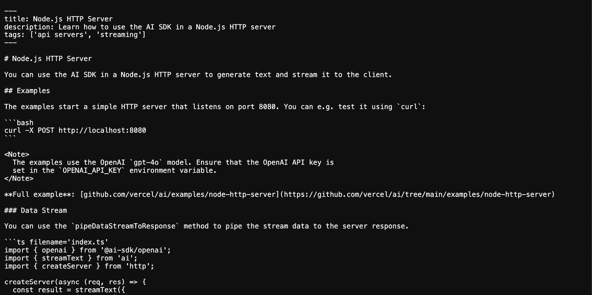

图 6-8 llms.txt 示例

·AI 分析接口（/api/ai）：

➢ POST/api/ai/analyze——使用 AI 分析文本内容，生成小红书风格的段落卡片；

➢ POST/api/ai/titles——根据文本内容生成多个小红书风格的标题选项；

➢ POST/api/ai/cards——将分析后的段落数据转换为可视化卡片格式。

·内容导出接口（/api/export）：

➢ POST/api/export/markdown——将卡片数据导出为 Markdown 格式文件；

➢ POST/api/export/json——将卡片数据导出为 JSON 格式文件。

整体接口调用逻辑如图 6-9 所示。


图 6-9 接口调用时序

充分理解后端服务的职责与接口体系后，即可进入编码阶段。

### **6.3.2** **开发后端服务程序**

接下来，我们只需在 Cursor 中输入适当的提示词来驱动开发。

仔细阅读@requirements.md 与 docs 目录下的技术文档，开始帮我按项目执行计划文档@plan.md 一步步编写代码，请专注于业务编码，不需要编写单元测试代码；请将代码保存到 packages 目录下，并优先完成服务器端的开发。

Cursor 将自动完成一系列关键开发操作，包括但不限于：

·初始化系统结构（如生成 package.json、tsconfig.json 等配置文件）；

·按照 tech.md 中的规划，逐层构建系统，包括接口定义、业务逻辑实现、工具模块与日志封装等。

这些关键开发操作通常持续数分钟，最终很可能会得到一份结构完整、可直接运行的基础代码，此时即可尝试启动项目，以验证系统是否正常工作。启动前需完成以下两步：

（1）执行 pnpm i 命令来安装项目依赖；

（2）查阅 package.json 中的命令定义，确定启动指令，本章示例中的启动指令为图 6-10 所示的 dev 指令。

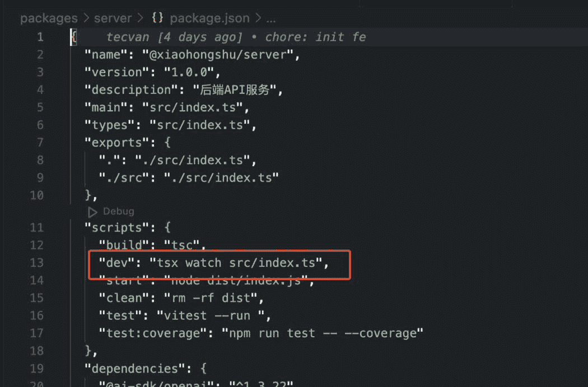

图 6-10 package.json 样例

确定启动指令后，只需在命令行中输入 OPENAI_API_KEY=sk-proj-xxx npm run dev 即可启动系统，其中 OPENAI_API_KEY 值是 6.1.1 节申请的 ChatGPT API key。如果启动失败，命令行一般会输出详尽的错误消息，如图 6-11 所示。

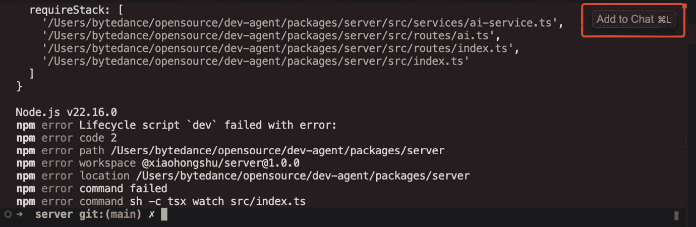

图 6-11 使用命令行环境的 Add to Chat 命令

注意，AI 首次生成的内容可能并不完整，或存在代码谬误、语法错误等，导致启动失败，具体的错误原因多样，无法一一列举，但我们可以借助 Cursor 自动修复这类错误。可点击图 6-11 所示的命令行错误界面右上角的 Add to Chat 按钮，然后在 Agent 面板中输入如下提示词。

修复命令行报错。

Cursor 将尝试分析并修复相关错误，如果首次修复未成功，可多次重复操作，以逐步收敛问题范围。如果多轮尝试后仍未解决，可考虑切换至更高性能的模型（如 Claude Sonnet 4 的 Max 版本），或根据错误日志搜索解决方案并进行手动修复。

### **6.3.3** **代码审查**

在初步生成代码后，接下来需要先对代码做一次简单的代码审查，这是非常必要的，因为经代码审查后一般可以总结出不少问题。5.3 节已经总结了许多代码审查规则与技巧，此处不再赘述，建议在审查服务器端代码阶段聚焦以下几个方面。

·审查日志是否完善，例如各类核心流程中是否包含足够丰富的日志，以暴露足够详细的运行信息，假设存在这类问题，可使用如下提示词优化。

仔细阅读当前代码，在主流程的核心位置适当补充日志，充分暴露系统的运行状态。

·审查实际生成的接口是否匹配 tech.md 中的规划。这一步是必要的，接口可以多，但不能少或发生变动，否则会使上下文产生信息谬误，影响后续代码的生成质量。假设存在这类问题，可使用如下提示词优化。

优化 xxx 接口，请严格遵从@tech.md 文档的规划，使用 xxx 路径暴露服务接口。

·审查错误处理是否合理，特别是切忌过度防御，该抛出异常时必须抛出异常，让系统能快速中断，以免影响后续的业务状态。假设存在这类问题，可使用如下提示词优化。

优化 xxx 文件的错误处理方式，直接抛出异常。

·审查技术栈选型是否匹配 tech.md 中的规划，特别是不要引入不必要的复杂度，例如经常会遇到 Cursor 自作主张引入 fs-extra 库，但事实上使用原生的 fs/promises 库反而简单许多。假设存在这类问题，可使用如下提示词优化。

去除 xxx 库，后续也不允许使用；请使用 xxx 库代替。

·审查代码是否符合你的技术品味。这也是一个非常常见的问题，我们在开发过程中通常不会预设过多开发规范，AI 会自行发挥，直至审查时才发现问题，此时建议不要妥协，而是做以下两个动作。

➢ 使用 Cursor 的/Generate Cursor Rules 命令生成新的技术规范文档，如图 6-12 所示。


图 6-12 自动生成 Cursor Rules

➢ 要求 Cursor 根据新的技术规范文档优化当前代码。提示词如下。

根据@.cursor/rules/xx-rule.mdc 规则优化代码，减少所有 xxx 情况。

注意，如果代码审查过于仔细，在实际场景中发现的问题会非常多，要逐个解决的话，会把大量的时间花费在前期并不稳定的代码的优化上，这是不必要的。建议读者合理取舍，只要不是无法容忍的严重问题，就适当略过，在前期将更多注意力放在功能开发与测试上。

总之，代码审查阶段还处于项目早期，后续必然还有大范围的重构和优化，因此，此时不必过于关注代码质量。

### **6.3.4** **接口测试**

假设前面步骤生成的代码能正常启动运行，接下来我们将面临另一个问题：如何确定这些代码的功能逻辑是否按照预期执行？由于目前还未构建可视化的 Web 前端系统，我们还无法直接调用接口，因此无法直观观测代码行为。

在软件工程领域有一个“左移”概念，简单来说就是应该尽可能在软件生命周期的前期做质量检测，越早发现问题则修复成本越低。这一规则同样适用于 Vibe 编程方法论，因此我们需要在完成 Web 系统之前尽可能完整地测试接口质量。为了达成测试目标，可以继续让 Cursor 编写测试脚本，测试核心接口行为，提示词如下：

仔细阅读 packages/server 代码，理解其中的核心接口，之后编写一段接口调用脚本，测试接口行为与稳定性。

需要在运行服务器端程序后执行 Cursor 生成的这类测试脚本，通过脚本日志以及接口的输入输出映射来确定接口是否能正常运行。你也可以继续跟 Cursor 交互，生成更多接口测试用例，直至你充分了解系统当前的运行逻辑。

不过，这个阶段的测试并不只是为了测试，更多是为了让你了解系统的运行逻辑。因此，并不适合引入过多的自动化测试逻辑，因为后续还会继续大范围迭代优化，当下做的自动化测试、性能优化等大概率都会返工。还是上面那个逻辑：在 Vibe 编程模式下，项目早期应该将更多注意力放在功能迭代上，所有测试、优化都应后置。

此外，不太建议采用 TDD 模式，这是一种测试驱动的开发方法论，可以从结果倒推实现，天然适合 Vibe 编程，但 TDD 概念本身过于抽象，没有深厚编码基础的人很难掌握，也很难真正提效，因此更推荐采用传统的开发方案。

### **6.3.5** **补充完善更多功能**

复杂项目的开发过程从来不是一蹴而就的。虽然借助大语言模型可以快速生成可运行的原型代码，但首次生成的结果往往难以完全契合项目的实际需求。尤其在需求复杂度较高的场景下，AI 所理解的意图与人类开发者的真实预期间常常存在明显偏差。

服务器端初版代码虽然结构完整、接口齐全，但在关键细节上仍存在严重问题。例如在“小红书内容生成器”的实现过程中，/api/ai/cards 接口的设计初衷是将分析后的段落结构进一步加工，生成具备小红书风格的卡片内容，具备语义完整性、视觉逻辑一致性与风格一致性。然而，AI 在初次实现时，仅对原始段落文本进行了简单的语义切割与重组，并未为每一张卡片调用大语言模型来进一步生成高质量文案或视觉指引，导致生成的内容缺乏创意与上下文适应性，这显然偏离了我们设定的核心目标。

这种情况在使用 AI 驱动开发的过程中并不少见。AI 可能会“形式上完成任务”，却遗漏了语义层面更深层次的工作逻辑。为此，需要继续迭代优化。

仔细分析/api/ai/cards 接口代码，目前的实现里并没有调用大语言模型生成卡片内容，请优化。流程上需要基于用户输入，先确定拆解成多少张卡片，每张卡片表达什么内容，然后调用大语言模型优化内容输出。

这里的重点是，你需要理解 AI 只是一个高效的执行者，而人类则更多扮演规划者和监督者的角色，负责提供清晰的需求规范、设计意图和约束边界，并对 AI 生成的代码进行审查把关。这意味着前置需求描述的任何遗漏或疏忽都可能导致缺陷，因此务必始终保持耐心，通过代码审查、接口测试等手段找出问题所在，特别是功能上的遗漏，之后不断迭代优化，让系统逐渐完善。

## **6.4** **Web 端系统开发**

完成后端接口服务的搭建之后，需要继续迭代面向用户的 Web 系统。在 Vibe 编程模式下，Web 端系统的开发复杂度一般比服务器端系统高出不少，这种复杂度并非源于业务逻辑本身，而是更大程度上归因于以下两个方面。

·Web 技术栈本身呈现出高度的工具化与生态碎片化。现代 Web 端开发不仅涉及 HTML、CSS、JavaScript 等语言，还包括构建工具、模块系统、组件框架、样式系统和响应式设计模型等多个层面的协作与配置，这些环节意味着更大量的上下文需求，本身就形成了显著的认知负担。

·后端接口可以通过 curl 命令、Postman 工具或后端日志输出等手段进行行为验证，Web 端的行为验证则更依赖人机交互界面及浏览器中的可视化反馈。当前阶段的大语言模型工具（如代码生成器或 AI Agent）尚难以对页面行为进行准确的感知与反馈，导致大语言模型在 Web 端开发中的辅助效能不如在服务器端场景中显著。

综上，我们需要借助更多工具，使用更复杂的提示词来更高效地完成 Web 端系统开发。

### **6.4.1** **实现思路**

在启动开发之前，我们先来简单总结页面的交互逻辑。针对示例项目“小红书内容生成器”，结合 6.2 节梳理的各项文档，本项目采用了一套现代化的 Web 端技术组合，力求在可维护性、响应速度与开发体验三方面取得平衡。核心技术栈的主要技术组件及其职能如下。

·Tailwind CSS：原子化 CSS 框架，用于构建灵活、统一的页面样式体系。相较传统 CSS 或 CSS-in-JS 方案，Tailwind CSS 更加轻量且便于组合，有利于在 Vibe 编程模式下快速搭建 UI 原型。

·Vite：新一代 Web 端构建工具，具有极速冷启动和按需编译能力，能够显著提升开发效率，尤其适合多模块协作和组件预览式开发场景。

·React：组件化视图构建框架，负责页面的声明式 UI 表达，React 的 Hooks 系统与 DOM 能够很好地支撑状态驱动的动态交互流程。

·shadcn/ui：基于 Radix 与 Tailwind 封装的 UI 组件库，具备可访问性好、样式一致性强的优势，能够减轻 UI 实现负担，提升视觉一致性。

·Zustand：轻量级状态管理库，适用于中小规模项目中的全局状态与页面状态控制，在本项目中主要用于控制提示词、加载状态与生成内容的共享管理。

·TypeScript：类型增强的 JavaScript 语言子集，为项目带来更强的类型约束与自动补全能力，在 AI 协助编码的上下文中，TypeScript 能有效减少生成代码中的语义偏差。

在此基础上，我们预期构建一套基于对话形式的人机交互界面，整体交互逻辑参考 ChatGPT 的使用模式，形成以用户输入为触发、以内容生成为反馈的流程闭环，核心交互流程主要分为以下 3 个阶段。

（1）默认状态页。页面加载完成后，默认展示一个对话输入框，如图 6-13 所示。用户可输入提示词，触发内容生成请求。

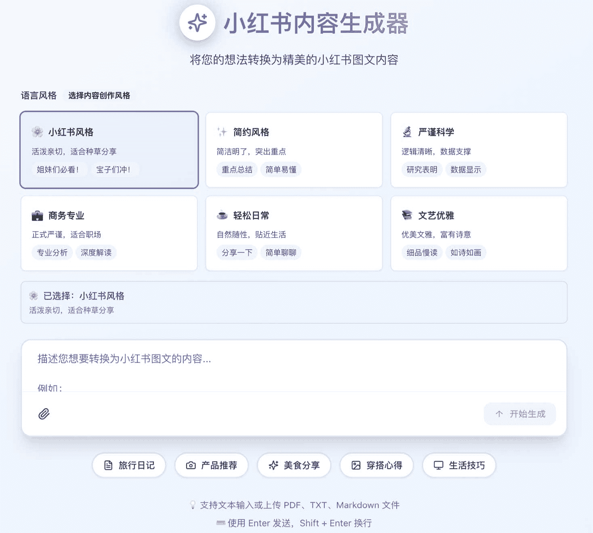

图 6-13 Web 系统默认状态

（2）中间过渡页。用户输入提示词后，页面需进入加载状态（见图 6-14），主要用于提示系统运行状态，避免无解。

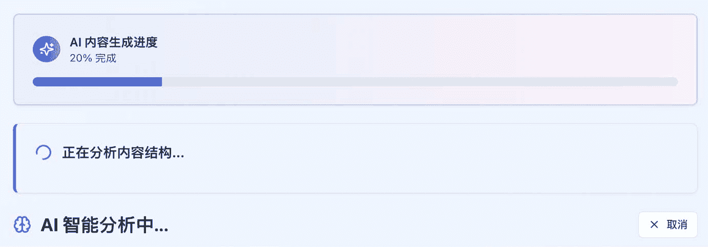

图 6-14 加载状态页

（3）结果展示页。服务器端生成内容后，页面需将返回结果以结构化形式展示，展示内容包括小红书风格的内容卡片、生成的标题与文案等（见图 6-15），此页还应支持内容导出功能，为用户提供素材留存或复用能力。

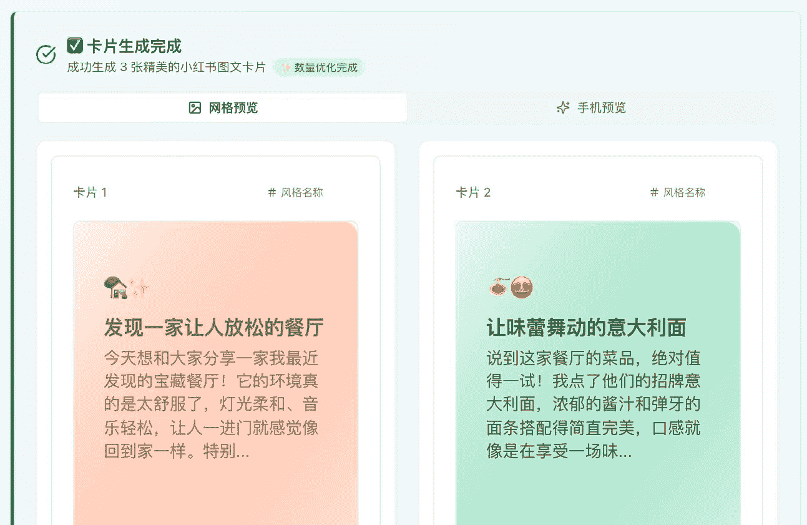

图 6-15 结果页

通过上述 3 个阶段的衔接，形成了完整的提示词→加载→结果的交互闭环，为后续功能拓展与模型对话增强打下了良好的结构基础。

### **6.4.2** **开发 Web 页面**

在完成前期页面交互逻辑的设计与技术选型之后，接下来可借助 Cursor 开发 Web 页面内容，例如可用如下提示词启动开发。

仔细阅读@requirements.md 与 docs 目录下的技术设计文档，开始帮我按计划文档@plan.md 一步步编写代码，请专注在业务编码上，也不需要编写单元测试代码，将代码保存到 packages 中。

请完成 Web 页面开发，优先构建静态页面，所有外部数据暂时使用模拟数据实现，聚焦在页面静态效果、流转效果等可视层面的开发上。

在正式对接后端接口之前，建议先使用模拟数据构建静态页面。这一做法能够有效控制当前开发任务的复杂度，减少可能影响结果的“变量”，有助于提升开发效率。

接下来，Cursor 将根据 plan.md 中所设定的开发计划，逐步完成页面的代码构建工作。在这个过程中，开发者只需保持对生成代码的观察，并在必要时进行微调或引导。整个过程通常在数分钟内完成，最终可输出一套结构清晰、可直接运行的基础项目结构。

生成代码后，可按照以下两个步骤启动本地开发环境并在浏览器中预览页面渲染效果。

（1）安装依赖包：在命令行中执行以下命令，完成依赖包的安装。

pnpm install

（2）确认启动命令：打开 package.json 文件，查阅项目中定义的启动脚本。以本示例项目为例，执行图 6-16 所示的命令，启动开发进程 npm run dev。

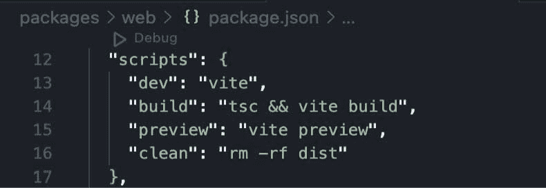

图 6-16 启动命令示例

同样，初次运行时可能会因语法错误、依赖未安装或路径错误等原因而启动失败。此时可遵循 6.3 节所示流程，点击命令行界面右上角的 Add to Chat 按钮，将错误日志发送至对话窗口，请求 Cursor 自动修复。

一旦开发服务器成功启动，只需在浏览器上用命令行输出的地址（见图 6-17）访问本地服务，即可实时查看页面渲染效果。

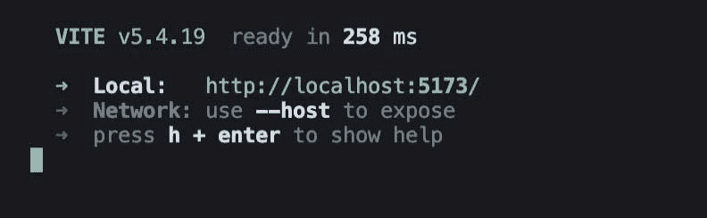

图 6-17 启动效果

### **6.4.3** **代码审查**

与后端开发相同，在进入页面调试与运行阶段之前，强烈建议开发者先完成一次系统性的代码审查。这一过程不仅有助于尽早发现潜在 bug，还有助于保障页面结构稳定性与后续可维护性。

与后端开发中的日志结构、错误处理等方面的审查类似，Web 页面开发也存在一系列典型问题，以下几类结构性问题尤为常见，建议在此阶段重点排查。

·组件层级混乱。AI 倾向将所有逻辑集中在一个大组件中，无清晰的分层，一个组件中混杂视图渲染、状态管理与异步处理等逻辑，导致可读性、可维护性差。判定组件层级是否混乱的一个简单标准是：如果组件代码超过 300 行，就认为组件违背了“单一职责原则”，建议使用如下提示词进行优化。

@xxx.tsx 组件过于复杂，请做好子组件拆分，保持单一职责。

·无边界处理。软件工程领域有一个流传甚广的说法：不要相信任何外部数据源。AI 在生成视图代码时，往往默认数据稳定存在，未对 null（空值）或 undefined（未定义）等边界情况进行处理，而这容易导致页面错乱甚至系统崩溃。因此，在接收外部数据或异步接口响应后，务必增加空值判断与容错处理，并在异常状态下回退为占位内容或错误提示，提示词如下。

@xxx.tsx 组件中的变量 xx 和 yy 存在为空的可能，请添加空值判断逻辑，并渲染空状态提示或默认占位图。

·滥用 CSS。原生 CSS 通过具体属性的键值对来表达页面元素的视觉效果，但这种方法对 AI 而言上下文复杂度较高，容易犯错，而 Tailwind 则通过各种原子类名来表达某类样式的规则集，信息更聚焦且更容易被 AI 理解，因此在项目设计的技术规划中，期望尽可能使用 Tailwind 表达样式效果，提示词如下。

@xxx.css 文件中 CSS 样式代码占比过高，请尽可能调整为使用 Tailwind 实现。

·缺乏中间状态。优质的用户体验不仅依赖正确的内容渲染，还应包含合理的中间状态与异常状态处理。因此，当页面进入加载状态或出现异常（接口异常、数据异常、资源加载异常等）时，需要在页面上渲染中间过渡页面效果，帮助用户理解当前系统状态。

请优化@xxx.tsx 组件的状态处理逻辑：首次进入时添加骨架屏，局部数据加载中加入加载状态，当接口或数据出错时使用弹窗或视图组件提示异常消息。

与后端开发相似，此阶段的审查不必追求代码的完美，也无须对所有细节进行重构或抽象。此阶段的核心目标在于：

·保证结构合理、逻辑清晰，便于后续迭代与协作；

·使组件间职责明确、数据流稳定；

·保持整体复杂度在可管理范围内，避免过早优化。

换言之，开发者应关注代码是否写得“通透”，而非写得“高深”。只要结构清晰、逻辑封闭，AI 就可在未来的维护周期中继续辅助完善代码。

### **6.4.4** **让 AI 按预期输出 Web 页面**

在完成初步的代码审查与结构优化之后，开发流程进入新阶段——页面调试。此阶段的核心任务是运行生成的页面，检查其在真实浏览器环境中的实际渲染效果，并根据观察结果驱动进一步的修复工作。

然而，调试过程往往并不顺利，在 Vibe 编程场景中，视觉层面的问题尤为常见。例如，在“小红书内容生成器”项目早期生成版本中，页面首次运行时呈现出的效果相当粗糙，各个组件仅展现出浏览器默认样式，毫无布局与美观可言。整个页面仿佛只是未经任何设计的 HTML 静态结构，缺少颜色、排版、边距等所有应有的 UI 元素，如图 6-18 所示。

这类问题的根因并不在于功能缺失，而在于生成的代码未能正确绑定样式体系，Tailwind 配置失效或组件结构未引入预期样式资源等技术细节造成了渲染缺陷。

在传统的开发流程中，这类样式错误通常可以通过浏览器的开发者工具快速定位并修复。但在 Vibe 编程场景中，我们更希望由 AI 工具来完成修复任务，其难点在于 Cursor 这样的 AI 工具与浏览器是两套完全割裂的系统，它无法像开发者那样直接“看到”浏览器中的渲染效果，更无法自动识别视图层出现的问题。因此，如果希望借助 Cursor 修复此类前端 UI 问题，关键在于如何将浏览器的当前状态告诉它，让 Cursor 获得足够的信息来进行分析与决策。具体而言，可以考虑使用以下两种方式实现这种信息通路。

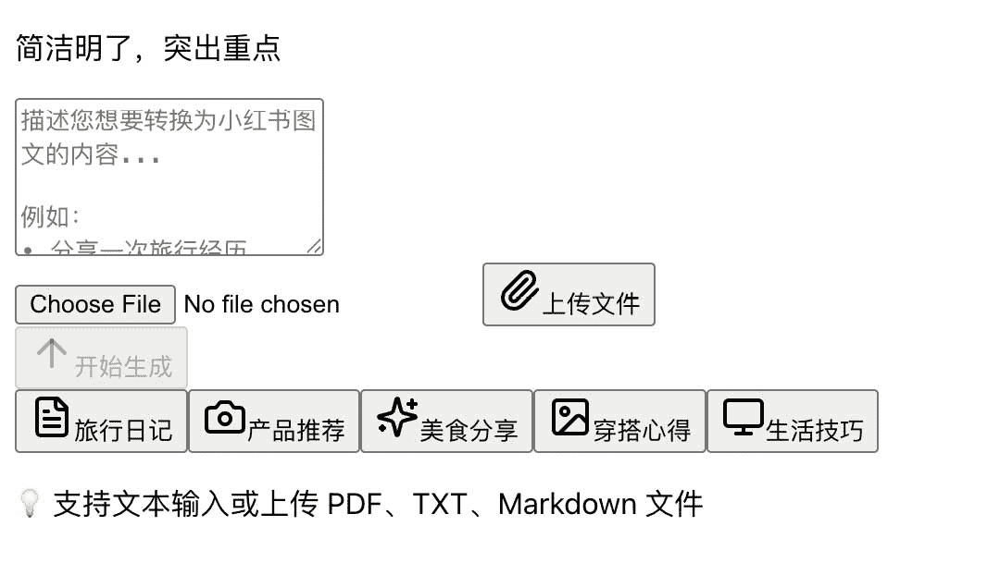

图 6-18 “小红书内容生成器”项目早期生成版本的页面内容

**1.** **使用浏览器截图**

要让 Cursor 理解浏览器中的运行状态，最直观且最易操作的方式就是直接将浏览器的截图发送给 Cursor，由其根据图像内容推断当前页面的结构与问题，并据此执行后续的代码修复任务。这种方式虽然信息维度有限，但操作流程极为简单，几乎没有额外的学习成本，适用于对样式问题的初步排查。

例如，在前文的异常示例中，我们可以直接将图 6-18 所示的页面渲染缺失样式的截图粘贴到 Cursor 的对话框中（见图 6-19），由其判断是否存在样式文件未导入、组件未挂载、DOM 结构异常等问题，并尝试生成修复补丁。


图 6-19 使用浏览器截图

然而，由于 Cursor 底层依赖的是 Claude、GPT 等大语言模型，这类模型虽然在处理自然语言内容、编写逻辑结构、分析文本上下文等任务上具备显著优势，但在图像识别与图形语义理解方面仍存在天然短板。即便模型具备初步的图像处理能力，其对于页面细节、组件状态乃至布局错位等问题的感知也远不如真实开发者借助开发者工具的处理结果准确。

从本质上讲，图像交互是一种“低语义密度”的提示手段，适用于解决一些结构明显、错误类型明确的基础问题，如按钮样式未生效、整体页面空白、字体颜色错误等显性异常。一旦涉及组件状态错乱、复杂逻辑未触发、响应式布局紊乱等较高层级的问题，单纯依赖截图就显得捉襟见肘，甚至可能误导模型产生错误判断，结果反而增加了调试成本。

因此，可以说浏览器截图方式适合处理“静态页面异常的快速反馈”，而不适合处理“动态行为复杂的逻辑错误”。它可称为开发者工具箱中的一把轻巧的扳手，但不是万能钥匙，对于复杂场景，我们更推荐使用 MCP 获取页面信息，以帮助模型更深入地理解页面上下文。

**2.** **使用浏览器 MCP 服务**

除截图外，还有一种更高效、更结构化的方式可以向 Cursor 传递浏览器的运行状态，那就是通过 MCP 服务读取页面的结构信息。这种方式的核心优势在于，它不再依赖图像识别或截图推断，而是通过浏览器原生接口直接访问页面的结构化内容——DOM 文档，这是一种专门用于表达浏览器内容结构的标准规范，能以层级树的形式描述页面的节点元素、样式状态与脚本行为。

由于大语言模型擅长处理结构化文本内容，对 DOM 数据这类“半结构、半语义”的输入的理解能力远胜于理解图像，因此使用 MCP 提供页面上下文不仅准确率更高，响应也更可靠，尤其适合处理复杂交互、多组件嵌套或多状态切换的页面调试任务。

目前市面上已有若干浏览器 MCP 实现方案，其中较为推荐的是 BrowserTools。它是一款专为 AI 应用设计的浏览器控制中间件，支持在模型与真实用户浏览器环境间建立标准化通信。与 Playwright 等“自动化浏览器”不同，BrowserTools 能直接复用用户当前已登录的浏览器环境。这意味着 AI 可以在无须模拟或登录的前提下，直接在真实页面中进行操作，如导航跳转、表单填写、数据提取、样式检查乃至性能调试等。

相对地，BrowserTools 的部署过程略为烦琐。使用时需要完成插件下载、浏览器安装、命令行服务启动、Cursor 中的 MCP 配置等一系列步骤。虽然初次使用 BrowserTools 时会产生一定的学习与配置成本，但一旦完成连接，其在真实项目调试场景中展现的强大功能将显著提升开发效率。BrowserTools 的配置流程包括以下 6 个步骤。

（1）下载插件。进入 BrowserTools Github Release 页面（https://github.com/ AgentDeskAI/browser-tools-mcp/releases），下载浏览器插件，如图 6-20 所示。

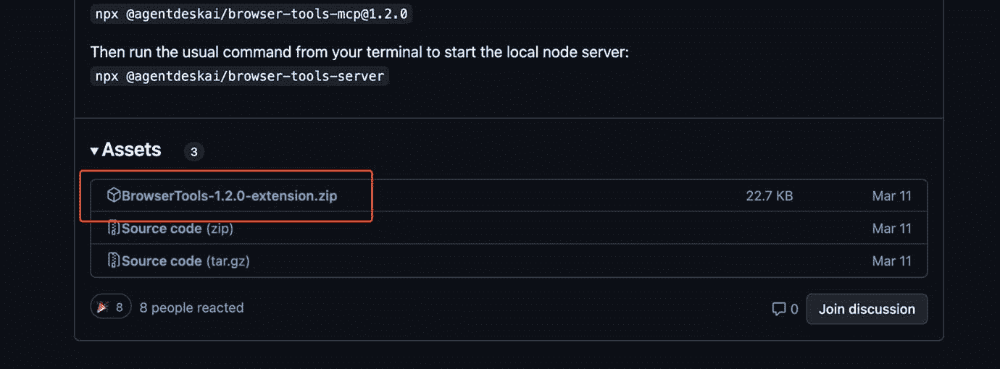

图 6-20 下载 BrowserTools 插件包

（2）安装插件。解压缩下载的插件压缩包，使用 Chrome 浏览器打开 chrome:// extensions/页面（如图 6-21 所示），点击 Load unpacked 按钮加载并安装插件。

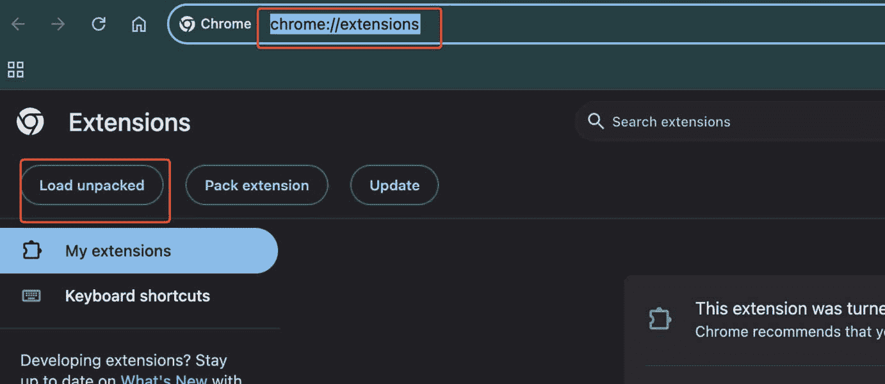

图 6-21 安装浏览器插件

（3）启动 MCP。打开命令行终端，输入如下命令。

npx -y @agentdeskai/browser-tools-server@latest

（4）配置 MCP。进入 Cursor MCP 配置页面，点击图 6-22 所示的 Add Custom MCP，将如下配置信息录入弹出的编辑器中。

{

"mcpServers": {

"browsertools": {

"command": "npx",

"args": ["-y", "@agentdeskai/browser-tools-mcp@lastest"]

}

}

}

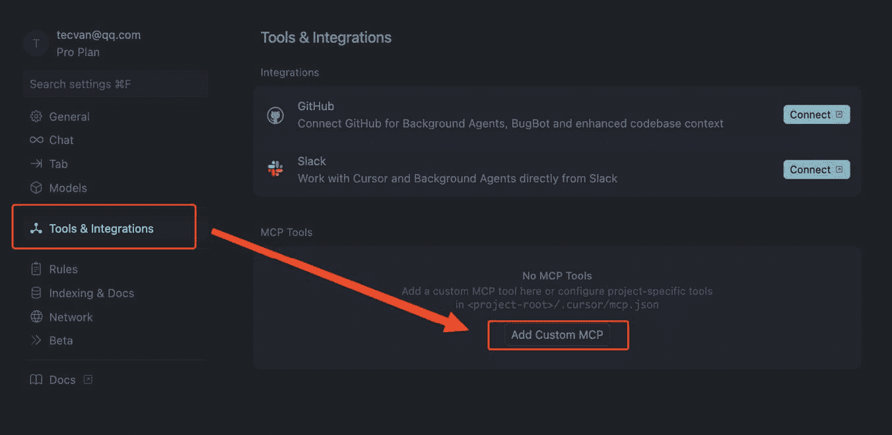

图 6-22 配置 MCP

（5）在需要测试的浏览器标签页中，按 F12 键，开启开发者工具，如图 6-23 所示。

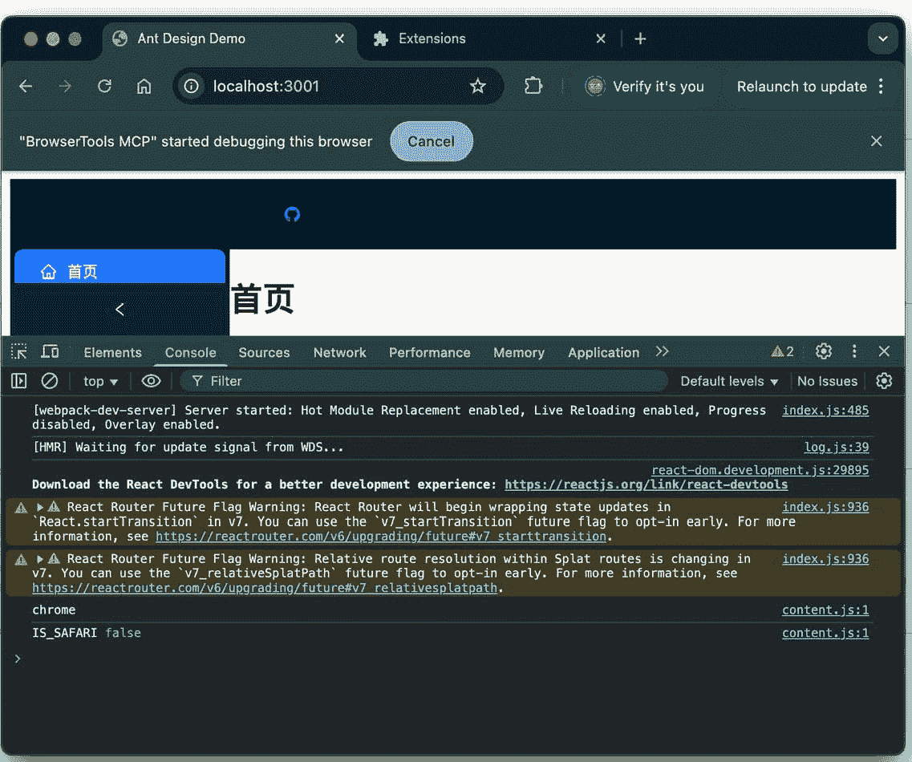

图 6-23 Chrome 开发者工具示例

（6）在 Cursor 中使用“浏览器”等关键字，触发 MCP 行为，例如：

使用浏览器打开页面 http://localhost:5173，分析页面样式为何失效并修复。

至此，BrowserTools 就配置好了，接下来可以使用“浏览器”关键字适时驱动 Cursor 进行浏览器操作，举例如下。

·分析页面性能。如前所述，大语言模型可借助 MCP 读入页面的 Lighthouse 性能数据等，充分分析后给出性能总结信息，甚至可以在此基础上要求大语言模型进行修复。

用浏览器当前打开页面的性能，分析 Lighthouse 性能数据，判断性能卡点。

·修复样式问题。模型能够直接读取页面 DOM 中 body 元素的 margin 设置、样式继承链与实际渲染效果，快速定位样式覆盖或失效问题，提出精准的修复方案。

页面中，body 有一个多余的 margin，请修复。

·排查网络异常原因。AI 可自动抓取失败请求的响应头与内容，判断错误类型并推测可能的后端异常或配置问题，为开发者提供进一步的排查方向。

页面中出现不少网络异常，请仔细分析请求信息、响应信息等，定位问题根因并尝试修复。

作者实际开发过程中，正是借助 BrowserTools 所提供的“浏览器可观测性”，逐步将页面从最初样式完全失效、组件无序堆叠的状态，一步步优化为排版合理、响应流畅的现代化界面。通过不断向模型输入页面实时状态，调整渲染策略与样式结构，最终完成了一个结构清晰、样式可控的 Web 页面，如图 6-24 所示。

这便是结构化调试工具与大语言模型结合带来的真实优势：不只是写代码的工具，而是具备前后联动、状态感知与自动迭代能力的开发助理。

总的来说，调试阶段的挑战不仅在于“发现问题”，更在于“将问题表达给模型”，这正是 Vibe 编程与传统开发模式间的巨大差异所在。我们不仅要掌握调试技术，更要学会如何与 AI 有效沟通，让模型在有限的上下文中能做出正确判断与补全。

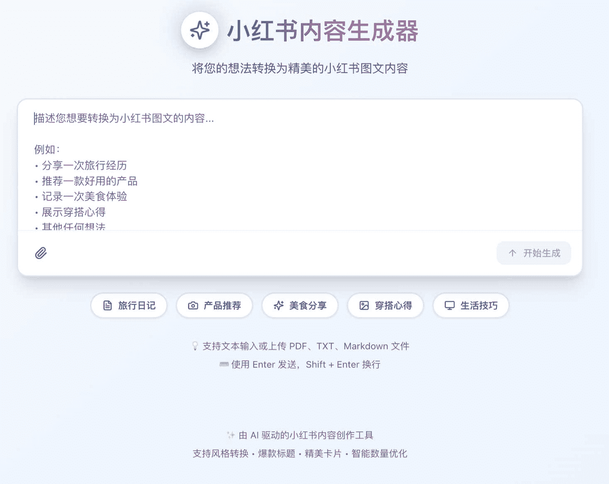

图 6-24 结构清晰、样式可控的 Web 页面

### **6.4.5** **调用服务器端真实接口**

经过前期的结构构建与持续迭代，我们已经得到了可以在浏览器中正常渲染的页面代码。然而，页面仅具备静态展示能力仍不足以支撑完整的业务流程。要使整个系统真正“动”起来，还需要完成一个关键任务——接入后端服务接口，打通前后端之间的数据交互链路。这一阶段有以下 3 个核心步骤。

（1）将服务器端接口转换为更结构化的 TypeScript 类型定义形态。

首先，从技术架构的角度来看，前端与后端始终是两个完全独立运行的系统，彼此之间仅通过诸如 HTTP 等通用网络协议进行通信。而 HTTP 本身属于“弱约束”协议，其接口约定通常以文字或文档形式存在，缺乏强类型校验。这种松耦合机制使得大语言模型在生成代码时非常容易出现理解上的偏差，尤其是在接口路径定义、参数结构定义或返回值定义等方面经常产生细微但致命的错误，进而影响整体系统的稳定性。

为了解决这一问题，可以先引导大语言模型对服务器端接口进行结构化建模，提示词如下：

仔细分析 packages/server/src 提供的接口，包括 URL、HTTP 方法、输入输出参数等内容，将其转换为严格定义的 TypeScript 类型结构。同时编写函数，使用 axios 调用这些接口。

将代码保存到 packages/web/src/api 目录下。

此后 Cursor 就会在 packages/web/src/api 目录下为每一个接口生成对应的类型定义，并生成调用函数，如图 6-25 所示。

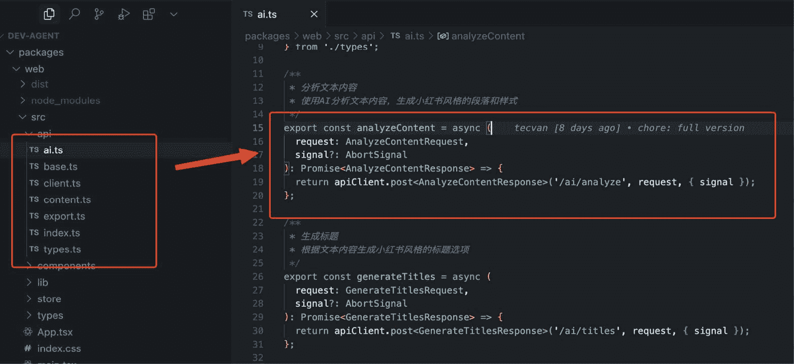

图 6-25 接口类型定义示例

前端页面中的组件无须关心请求细节，只需调用这些函数，即可发起高可控的真实数据交互。这种结构本质上是一种典型的架构分层模式——通过将接口调用逻辑从视图层中剥离出来，增强了系统的模块边界与内聚性，提升了整体的可读性、可维护性与可扩展性，在现代软件架构中被广泛应用。

（2）改造前端代码，去除所有模拟数据逻辑，改为调用真实接口。

完成 API 层代码的抽象之后，将页面中的模拟（mock）逻辑全部移除，实现真实的数据交互。

改造 packages/web/src 代码，去除所有接口模拟逻辑，改造为调用 packages/web/src/api 提供的真实接口。

此后，可以重新启动页面，调试整体的数据交互流程。在这个阶段，调试的重点不再是样式或组件布局，而是网络请求的发起与响应是否符合预期。为此，建议使用浏览器内置的开发者工具进行辅助分析。以 Chrome 浏览器为例，只需按下快捷键 F12 即可开启图 6-26 所示的调试面板，并切换至 Network 标签页，实时观察页面中各类接口请求的发起、状态码、数据响应与时延情况。

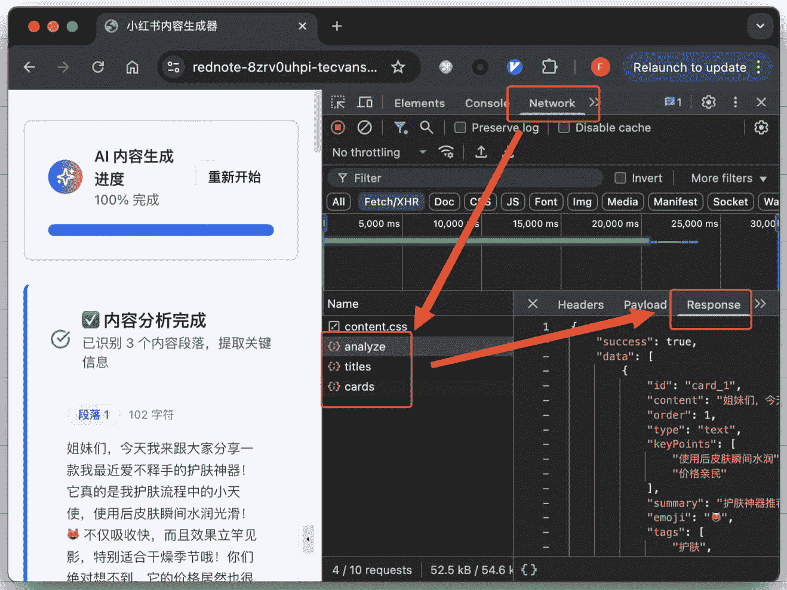

图 6-26 网络请求调试面板

浏览器的开发者工具是一个全面而复杂的 Web 调试工具，需要花费不少时间才能掌握。这里推荐一个简单用法，如图 6-26 所示，只需点击 DevTools 的 Network 标签页，之后观察页面是否在正确时机发出网络请求，以及请求是否正常响应，出现任何问题时都可以再次借助 Cursor 与 BrowserTools 协助改造代码，例如：

使用浏览器分析页面的网络日志，在用户点击“发送”按钮后应该立即发出 analyze 请求，请仔细审查代码，修复问题。

（3）导出会话记录。

在系统基本完成、功能调试无误之后，还有一个常被忽视但极为重要的环节，即导出大语言模型的交互记录。由于大语言模型不具备“长期记忆”，每一次新会话都从空白开始（即丢失已有上下文），如果后续我们希望在已有基础上继续演进系统、修复细节或添加新功能，就必须重新“喂入”已有上下文。而通过导出交互记录，可以将整个开发过程中的关键对话、模型响应、错误修复、架构设计等内容完整保存下来。

在 Cursor 中导出对话记录非常简单：点击图 6-27 所示的 Agent 面板右上角的“…”按钮，在弹出的菜单中选择 Export Chat 选项，即可将完整的聊天记录导出为本地文件。建议将该文件保存在项目根目录下，与代码仓库一并管理。

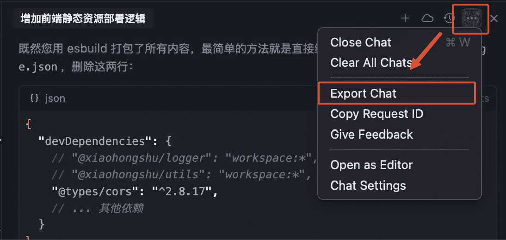

图 6-27 导出对话记录

当未来需要重启开发流程时，只需将此记录文件导入 Cursor，大语言模型便可以恢复当前系统的全部上下文，包括你曾提出的问题、模型的解释路径、每一步修改建议与最终实现方式，从而确保新一轮开发具备语境连贯性与行为一致性。

## **6.5 应用部署**

在完成了 6.3 节、6.4 节分别介绍的后端接口与 Web 端系统开发之后，一个功能完整的 Web 应用已经基本成型。但开发完成仅是第一步，接下来还有一项重要工作——应用部署，我们需要将本地开发完成的程序打包、发布至云端，使其可以通过网络访问，从而为更多用户提供服务。

但从软件工程的视角来看，部署远非一个简单的上传操作。事实上，它往往是整个软件生命周期中最复杂、最具有工程挑战性的环节之一。为了确保应用能够在真实生产环境中稳定、高效、安全地运行，部署方案通常需要综合考虑以下多个维度的系统性因素：

·项目的技术架构与依赖结构；

·目标部署平台的运行环境与资源约束；

·用户的地理分布与访问行为；

·安全策略，包括网络防火墙设置、权限控制与数据加密；

·线上系统的实时监控与故障恢复机制；

·多人协作场景下的代码分支管理与回滚策略；

·CI/CD 的自动化流程。

可以说，要构建一个优秀的部署系统，需要一支专业的 DevOps 团队进行长期的演化与维护，其工程成本与技术深度已远远超出本书的内容规划与目标。为了聚焦实用性与可操作性，本节将以“小红书内容生成器”这一示例项目为基础，结合当前主流的云平台实践，介绍一套足够可用且相对简洁的部署方案，帮助读者以最短路径掌握将 Vibe 编程项目上线的方法。该方案并不追求部署体系的复杂性或完备性，而是专注于构建一个“从本地到线上”的基本闭环，作为后续工程能力扩展的出发点。

本节还将引入 GitHub Actions 系统，进一步讲解如何构建持续部署流程，使得每一次代码变更都能自动发布至线上环境，真正实现代码与应用交付的自动化、连续与可靠。

### **6.5.1 理解代码部署逻辑**

将一个完整的全栈应用部署至线上并非简单地将代码上传至服务器，还涉及前端资源与后端服务的打包、分发与运行，也牵涉访问控制、环境配置与安全策略等一系列系统工程问题。

部署工作的本质是让本地开发完成的系统在云端稳定、高效、安全地为真实用户提供服务。因此，开发者需要具备如下三方面的基础认知：

·对前端与后端代码的资源模型与生命周期有清晰理解；

·熟悉常见部署架构，理解各种运行环境的特点与适用场景；

·对敏感信息（如 API Token）的管理有足够的安全意识与实践手段。

**1. 理解前端部署模型**

尽管我们在前端开发过程中使用了 TypeScript、Tailwind CSS 与 Vite 等现代工程化工具，但这些工具的作用仍主要集中于开发阶段的抽象与提效。实际部署时，前端代码会被构建（build）为一组标准的静态资源，包括 HTML、CSS 和 JavaScript 脚本文件，以及字体、图像等多媒体素材。这些资源的最大特点在于，它们并不依赖运行时计算逻辑，所以可被直接存储并原样分发。在不考虑服务器端渲染（server side rendering，SSR）等高阶场景的前提下，前端部署的核心目标是高效地将这些静态资源传输到用户的浏览器端**。**

实现这一目标的方式通常包括两类：其一是通过服务器端提供静态资源分发逻辑；其二是利用内容分发网络（content delivery network，CDN）进行多地缓存与加速。为了简化部署流程，本项目采用第一种方式，即通过服务器端提供前端静态资源的分发功能，具体实现步骤如下。

（1）在服务器端项目中新增一个构建脚本 build.sh，该脚本依次执行后端与前端资源的构建操作，并将前端构建产物复制到 packages/server/public 目录下。

（2）在服务器端的路由层增加单页应用（single page application，SPA）兼容逻辑：对于非/api 开头的请求，先查找 public 目录下的对应静态资源，若未命中则统一返回默认资源文件 index.html。

对应的提示词如下。

我需要你帮我增加前端静态资源部署逻辑，首先需要在服务器端项目中增加 build.sh 脚本，内部执行：

1.构建后端资源；

2.构建前端资源，将构建产物复制到 packages/server/public 目录下。

之后，我需要你修改 packages/server 的路由逻辑，实现单页应用服务：对于非/api 开头的请求，先查找 public 目录下是否有对应的静态资源，若有则直接返回，否则返回默认资源文件 index.html。

此后，执行新生成的 packages/server/build.sh 脚本即可将前端代码构建为静态资源文件，并将静态资源文件复制到正确位置，代码大致如下。

#!/bin/bash

set -ex

echo "1.构建后端资源..."

pnpm --filter @xiaohongshu/server build

echo "2.构建前端资源..."

pnpm --filter @xiaohongshu/web build

echo "3.创建静态资源目录..."

mkdir -p packages/server/public

echo "4.复制前端构建产物到后端静态资源目录..."

cp -r packages/web/dist/* packages/server/public/

echo "构建完成！前端资源已复制到 packages/server/public 目录"

**2. 理解后端部署模型**

与前端部署相比，服务器端部署的复杂性更高。后端程序不仅需要配置运行环境，还需具备持续运行、异步调度、数据持久化和与外部服务交互等能力。根据运行环境的不同，现代服务器端系统主要分为以下 3 种部署模型。

·虚拟机（virtual machine）。提供完整的操作系统环境，具备最大程度的控制与可定制能力，但资源开销较大，维护成本高。

·容器（container）。以 Docker 为代表，提供轻量、可移植的应用封装机制，具备启动快、资源占用低、运行一致性好等优点。

·无服务器计算（serverless computing）。开发者无须关心底层服务器，只需上传函数代码，云平台即可自动调度、伸缩与运行。具备按需计费、极简部署与强弹性等优势。

对于本书的“小红书内容生成器”这种以 Node.js 编写、规模中等、功能清晰的服务器端项目而言，无服务器函数是当前最优的部署方案。它不仅免去了服务器管理的复杂性，还能根据访问压力自动扩缩容，极大降低了运维负担。

注意，无论选用哪一种部署模型，后端代码在上线前都需构建为可执行版本。为了保证可维护性与可扩展性，本项目使用 esbuild 工具将后端代码打包为单一可执行文件 bundle.js。这一方式特别适合 Monorepo 架构下的模块组织方案，即便后续服务被拆分为多个包，也能统一构建并部署。

对应操作可通过以下提示词完成配置。

请修改后端构建方式，使用 esbuild 将服务器端代码打包成一个文件 bundle.js，方便分发部署。

增加这一步操作后，部署时只需将生成的 bundle.js 文件及必要配置上传至云平台即可完成发布，无须附带冗余的源码或依赖，打包结果如图 6-28 所示。

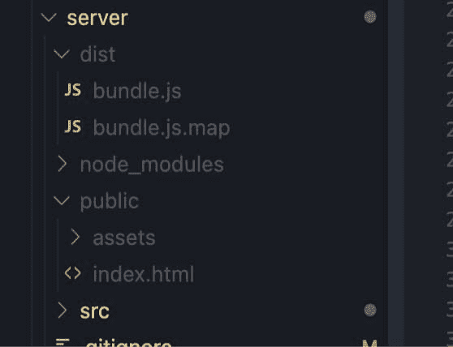

图 6-28 服务器端代码打包效果示例

**3. 敏感信息管理**

除了前后端代码外，还有一类极易被忽视但极为关键的隐患源——API key（或 Token），例如我们在 6.1 节中申请的 OpenAI API Token。这类资源相当于应用程序访问外部服务（例如数据库、第三方服务、AI 模型等）的“数字凭证”，一旦泄露，轻则出现财产损失，重则被恶意第三方非法修改数据，直接关乎整个应用程序的数据安全乃至经济利益。

因此，对待这类敏感信息务必提高警惕，在开发及部署过程中做好各类安全措施，并遵循以下原则。

·避免硬编码。切勿将 API key 直接写入源码，一旦代码泄露，密钥就会完全暴露，将构成严重安全隐患。

·避免客户端暴露。绝不能将 API key 部署于浏览器或移动应用程序等客户端环境中。恶意用户可通过检查客户端代码获取密钥，并冒用你的身份发起请求，可能导致产生意外费用或数据泄露。所有涉及敏感 API key 的请求均应通过安全的后端服务器进行代理处理。

·避免日志暴露。应用程序中绝不能打印任何 API key 相关内容，否则其可能被攻击者盗取日志后破解。

·避免提交至代码仓库。即使是私有代码仓库，亦应避免直接提交 API key。攻击者会持续扫描公有代码仓库以获取凭证，即使短暂暴露亦可能导致泄露。

那么，应该如何将这类敏感信息安全地传递给应用程序呢？当前主流做法是借助环境变量进行密钥注入。例如：

OPENAI_API_KEY=sk-proj-xxx node dist/bundle.js

上述代码通过环境变量 process.env.OPENAI_API_KEY 进行调用。这一机制已被各大云平台原生支持，既安全又便于维护。6.5.3 节将介绍如何在实际部署平台中配置环境变量，实现词元管理自动化。

### **6.5.2 将应用部署到 Vercel**

当前市面上有多种云平台可用于托管现代 Web 应用，包括但不限于 Vercel、Netlify、Render、Cloudflare Pages 与 AWS Amplify。它们在部署机制、资源控制、扩展能力等方面各具特点，但整体部署流程具有高度相似性。

本节选用 Vercel 作为演示平台，详解如何将“小红书内容生成器”这一全栈项目部署至云端。Vercel 以其对现代前端技术（如 React、Next.js、Vue 等）的友好支持，以及简化的部署流程与 CDN 功能，成为近年来广受开发者欢迎的部署平台之一，尤其适用于 Node.js 构建的前后端一体化项目。

Vercel 的部署理念非常明确，即通过自动化流程降低部署门槛，使开发者专注于业务逻辑，而非基础设施管理，其具体部署流程如下。

**1. 注册与初始化**

首先，访问 Vercel 官网并完成账号注册流程。Vercel 支持使用 GitHub、GitLab 等平台的账号一键登录，便于后续同步代码仓库。

注册完成后，系统会提示你创建一个“团队”（Team），所有项目管理、部署、权限控制等都将基于团队空间展开。如图 6-29 所示，点击右上角头像，在弹出的菜单中选择 Create Team，完成基础信息填写，即可进入团队管理面板。

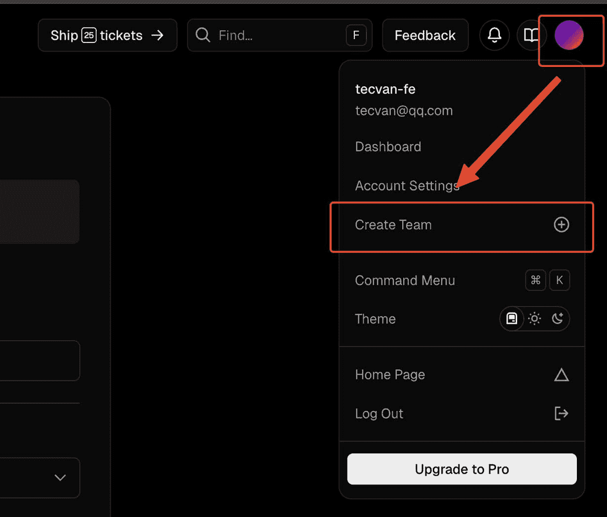

图 6-29 团队管理面板

**2. 安装命令行工具**

在本地终端中执行以下命令，安装 Vercel 提供的命令行工具 Vercel CLI，以便后续的部署与项目操作。

npm i -g vercel

随后执行登录命令：

vercel login

按提示完成登录授权，即可开始使用 Vercel CLI，如图 6-30 所示。

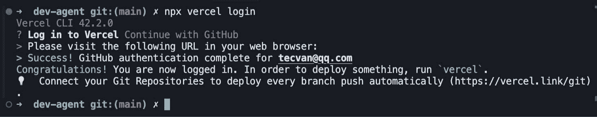

图 6-30 登录 Vercel 账号

**3. 配置部署结构**

在项目根目录下新建 vercel.json 文件，写入如下配置内容。

{

  "$schema": "https://openapi.vercel.sh/vercel.json",

  "framework": null,

  "version": 2,

  "builds": [

    {

      "src": "packages/server/dist/bundle.js",

      "use": "@vercel/node"

    },

    {

      "src": "packages/server/public/**",

      "use": "@vercel/static"

    }

  ],

  "routes": [

    { "src": "/api/(.*)", "dest": "packages/server/dist/bundle.js" },

    { "src": "/health", "dest": "packages/server/dist/bundle.js" },

    { "src": "/(.*)", "dest": "packages/server/public/$1" },

    { "handle": "filesystem" },

    { "src": "/(.*)", "dest": "packages/server/public/index.html" }

  ]

}

该配置有以下作用：

·将构建后的后端服务托管为无服务器函数架构；

·将前端静态资源映射为公共目录；

·支持单页应用路由回退；

·为接口与健康检查提供明确路由入口。

**4. 项目绑定与构建**

进入项目根目录，执行以下命令拉取并绑定 Vercel 项目配置：

vercel pull

注意，首次执行上述命令时，对于 Link to existing project?选项务必选择 N（见图 6-31），这样 Vercel 会自动创建新项目并与本地目录绑定，避免手动配置。


图 6-31 避免绑定已有项目

绑定成功后，执行以下命令，开始手动构建项目资源：

bash ./packages/server/build.sh

vercel build --prod

此步骤将构建后端代码和前端静态资源，并生成部署文件，部署文件默认保存在.vercel/目录下。

**5. 正式部署**

执行以下命令，将构建产物部署至生产环境：

vercel deploy --prebuilt --prod --archive=tgz

部署完成后，Vercel 会输出两个重要的统一资源定位符（uniform resource locator，URL），如图 6-32 所示。


图 6-32 部署完成后，生成临时访问链接

图 6-32 中包含两个链接，含义如下。

·第一个链接用于访问部署实例的管理面板，如图 6-33 所示。

·第二个链接指向该实例的临时线上访问地址，如图 6-34 所示。


▲图 6-33 部署实例的管理面板


▲图 6-34 访问效果

此时即可访问实际部署效果，进行页面测试与接口调试。

**6. 设置环境变量**

部署完成后，若系统运行中报错，通常是因为缺少关键配置项（如 OpenAI 的 API Token）。为此，需要在 Vercel 后台添加环境变量，操作步骤如下。

（1）进入 Vercel 首页（见图 6-35），点击对应项目进入项目管理页，如图 6-36 所示。


▲图 6-35 Vercel 首页


▲图 6-36 项目管理页

（2）点击上方菜单栏中的 Settings 菜单→选择 Environment Variables 命令；

（3）在对话框中点击 Create new 选项卡，输入环境变量 Key（如 OPENAI_API_ KEY）和 Value；

（4）点击 Save 按钮进行保存，重新在本地执行部署命令 vercel deploy --prebuilt --prod --archive=tgz，环境变量将自动注入部署实例，系统即可以完整状态正常运行。

### **6.5.3 借助 GitHub Actions 实现持续部署**

尽管 6.5.2 节介绍的手动部署方式已能完成从本地到云端的完整发布流程，但在实际生产环境中，持续部署才是更高效、更安全，也更适合团队协作的实践方式。特别是在多人协作、频繁迭代或线上系统要求较高可用性的项目中，人工操作不仅效率低，也极易出现操作失误或敏感信息泄露等风险。

相比之下，借助 GitHub Actions 等 CI/CD 工具构建自动部署流水线，可以显著提升部署的标准化程度与可靠性。开发者只需将代码变更推送到 Git 仓库，系统便会自动完成依赖安装、构建打包与云端部署等一系列操作。

在众多部署方式中，作者更推荐使用 GitHub Actions 搭配 Vercel CLI 来实现自动部署。这种方式不仅部署逻辑完全可控，还能在无须依赖额外平台的前提下，与代码仓库保持紧密耦合，适配性更强。

**1. 提交代码至 GitHub 仓库**

要启用 GitHub Actions，前提是将本地项目托管到 GitHub 上，操作步骤如下。

（1）访问 GitHub 官网，注册账号后创建新仓库，之后复制项目创建成功页面里展示的若干 git 命令，如图 6-37 所示。


图 6-37 项目创建成功的命令提示

（2）在终端执行以下命令，将本地项目推送至 GitHub 服务器。

git remote add origin https://github.com/your-username/your-repo-name.git

git add .

git commit -m "init"

git push -u origin main

推送完成后，代码即完成版本管理并具备触发自动化部署的基础条件。

**2. 生成并配置 Vercel Token**

在自动部署过程中，我们需要为 GitHub Actions 提供身份凭证，使其具备调用 Vercel API 的权限。为此，需在 Vercel 平台中生成一个词元，操作步骤如下。

（1）进入 Vercel 的词元管理页：https://vercel.com/account/settings/tokens。

（2）点击 Create Token，输入名称并确认创建密钥，如图 6-38 所示。


图 6-38 创建密钥

（3）页面将弹出一次性展示的词元值（如图 6-39 所示），请务必复制并离线保存，该信息无法再次查看。


图 6-39 复制密钥

（4）打开 GitHub 项目的 Settings 菜单，在 Secrets and variables 的子菜单中选择 Actions 命令，如图 6-40 所示。


图 6-40 GitHub Actions 添加密钥

（5）在弹出的对话框中点击 New repository secret 按钮。

（6）在弹出的对话框中填入密钥名称 VERCEL_TOKEN，并将刚刚生成的词元值粘贴至 Secret 字段中，点击 Add secret，如图 6-41 所示。


图 6-41 设置密钥

完成上述操作后，GitHub 仓库即可在流水线中安全使用该身份凭证进行部署。

**3. 编写 GitHub Actions 部署流水线**

环境配置就绪后，接下来我们需要使用如下提示词编写 GitHub Actions 流水线，实现自动部署。

增加一个 GitHub Actions 流水线，用于持续部署，主要逻辑如下：

1.限定为只在 main 分支发生代码变更时触发部署；

2.使用 pnpm 安装依赖；

3.使用 vercel link + pull + build + deploy 命令实现部署，使用 VERCEL_TOKEN 作为部署时的 Token。

代码保存到.github/workflows/deploy.yml 文件中。

之后，Cursor 会生成一份部署流水线代码，大致内容如下。

name: Deploy to Vercel

on:

  push:

    branches: [main,]

  workflow_dispatch: # 允许手动触发

jobs:

  deploy:

    name: Deploy to Vercel

    runs-on: ubuntu-latest

    # 检查仓库名称

    if: github.repository == 'Tecvan-fe/xiaohongshu-generator'

    steps:

      - name: Checkout code

        uses: actions/checkout@v4

        with:

          fetch-depth: 1

      - name: Setup Node.js

        uses: actions/setup-node@v4

        with:

          node-version: '22'

      - name: Setup pnpm

        uses: pnpm/action-setup@v2

        with:

          version: latest

          run_install: false

      - name: Install dependencies

        run: pnpm install --frozen-lockfile

      - name: Build project

        run: bash packages/server/build.sh

        env:

          NODE_ENV: production

      - name: Install Vercel CLI

        run: npm install --global vercel@latest

      - name: Run Deploy Script

        run: |

          vercel link --yes --project rednote-gen --token=${{ secrets.VERCEL_TOKEN }}

          vercel pull --yes --environment=production --token=${{ secrets.VERCEL_TOKEN }}

          vercel build --prod --token=${{ secrets.VERCEL_TOKEN }}

          vercel deploy --prebuilt --prod --archive=tgz --logs --token=${{ secrets.VERCEL_TOKEN }}

          echo "  部署成功！"

          echo "  项目已成功部署到 Vercel"

该流水线主要有以下功能。

·在 main 分支更新时自动触发。

·安装 Node.js 与 pnpm 依赖环境。

·构建后端与前端产物（基于 6.5.1 节生成的自定义构建脚本 packages/server/ build.sh 实现）。

·使用 Vercel CLI 完成部署，包括项目绑定、配置拉取、构建与上线。

➢ vercel link：关联到个人账号下的特定项目，其中--project 参数需要修改为使用 Vercel 创建的项目名称。

➢ vercel pull：拉取 Vercel 项目配置。

➢ vercel build：执行 Vercel 构建，在本地先打包需要发布的内容。

➢ verce deploy：将 vercel build 产生的结果打包发布到线上环境。

注意，所有 Vercel 相关的命令都需要传入词元，也就是在上述 4 个步骤中，我们在 Vercel 系统上生成的词元值。

此后，main 分支上的变更会触发该流水线，实时将代码发布到 Vercel 环境。借助该流水线，后续不再需要在本地执行若干复杂命令，更重要的是，在团队协作中不需要传播各类词元值或项目权限，就可让任意团队成员随时部署新版本，非常有利于团队协作。

## **6.6 小结**

本章围绕“小红书内容生成器”项目，完整遍历了一个全栈 AI 编程任务的工程闭环：从环境配置、项目需求梳理、前后端分工开发，再到应用部署。每一步都以实践为导向，结合大语言模型驱动下的开发方式，逐步沉淀出一套可复用、可迁移的协作范式。

本章实战过程中可总结出一些值得学习的应用技巧。

·AI 写作文档，提示词决定行为路径。AI 不是文档的读者，而是开发者。所有文档应优先考虑“任务执行结构”，不求排版美观，但求结构清晰、表达具体。

·使用 plan.md 文档构建“任务状态”上下文。通过 Markdown 的[ ]→[x]机制，让 AI 具备任务记忆，能在多轮对话中持续追踪项目进展，有效降低上下文遗忘风险。

·先做模拟，并不是权宜之计，而是效率手段。模拟数据能隔离后端的不确定性，是在 Web 端阶段快速推进交互细节与结构确认的关键抓手，属于 AI 协作中的“防抖机制”。

·优先开发后端接口，用数据定义 Web 端边界。提前抽象接口与类型定义，为 Web 端组件生成提供清晰目标，有助于减少 AI 误判，降低代码耦合。

·调试靠结构输入，不靠你“说得清”。AI 无法“看见”浏览器，而必须通过截图或 MCP 提供结构化页面信息，让 AI 具备对 Web 端渲染状态的判断能力，调试才有依据。

·审查保持“低成本容忍”策略。前期重在梳通逻辑，而代码是否优雅、结构是否最优则不是首要问题，AI 生成结果只要能运行、能调试、能继续推进即可接受。

·用 Git 缓存 AI 的不确定性。每一次 AI 改动都可能是对结构的破坏，频繁提交是 AI 编程中性价比极高的“版本快照”，确保一旦生成失误，迅速回退。

总之，Vibe 编程的本质，不在于“让 AI 替你写代码”，而在于你能否构建出适合 AI 发挥作用的工作流程与语境结构。

# **第七章**

# **局限与挑战**

随着各类 AI 编程产品的快速迭代与新工具的不断涌现，关于这一领域的动态也频繁出现在各类社交平台上：某款创新产品发布，某产品推出全新功能，或是某人借助 AI 工具实现了零代码开发并成功推出商业化产品。如今，开发应用产品似乎已不再局限于具备专业编程背景的群体。那么，这是否意味着，普通大众也正在逐步具备自主开发产品的能力与机会？

Vibe 编程是未来，这场编程范式的变革正在深刻改变着开发者的工作方式、思维模式，甚至正在改变整个软件行业的生态格局。不过，正如每一次技术革命都伴随着机遇与挑战，Vibe 编程也不是万能的“银弹”。任何理性的观察者都必须承认，当前所有的 AI 编程产品仍然存在着诸多局限。我们既不应该因为技术的“神奇”而盲目乐观，也不应该因为问题的存在而悲观失望。

相信不仅仅是非编程人员，甚至很多编程人员都会为这些层出不穷的 AI 编程产品的区别是什么，能做什么，不能做什么，以及如何用好它们感到困惑。诚然，这里面确实有很多“手艺”（指需要一些技术功底）的成分，但如果只停留在观望阶段，我们永远也无法真正理解这场变革的意义。本章将从用户和产品两个不同视角，分析 Vibe 编程在当前阶段的真实状况。我们会诚实地讨论它的局限性，也会客观地评估它的潜力。我们的目标是让每位读者，无论其编程经验如何，都能在了解 Vibe 编程的基础上更有效地释放创造力，去构想和构建解决实际问题的工具。

## **7.1 用户视角**

在探讨 Vibe 编程的局限与挑战时，我们首先需要从用户的角度出发。不同背景的用户在面对 AI 编程工具时，会遇到截然不同的挑战和问题。

### **7.1.1 普通用户**

对普通用户（即无编程经验的人员）来说，社交媒体上那些“零代码开发应用”的成功故事往往具有很强的误导性。这些故事通常只展示了最终的成果，而忽略了背后的学习成本、试错过程，以及大量的细节调整工作。事实上，这些成功案例背后往往隐藏着大量不为人知的摸索和反复尝试。

现实情况是，即使是使用最先进、最好用的 AI 编程工具，非经编程训练的人仍然需要掌握基本的计算机科学概念、软件架构思维，以及问题分解和代码调试技能。就像使用自动翻译软件并不能让人立即成为翻译专家一样，使用 AI 编程工具也不能让人立即成为专业的软件开发者。这些工具确实降低了入门门槛，但并未消除学习的必要性。

更重要的是，大多数成功的“零代码”开发案例都集中在相对简单的应用场景，如基础的网站制作、简单的数据处理脚本、演示性的原型应用或者工具类型的 App 项目。当涉及复杂的业务逻辑、数据库设计、性能优化、安全考虑等问题时，仅仅依靠 AI 编程工具是远远不够的。这些复杂场景往往需要深厚的技术积累和系统性思维，是目前 AI 编程工具尚难以完全替代的领域。

许多普通用户对 AI 编程工具抱有过高的期望，认为只要能够用自然语言描述需求，AI 就能自动生成完美的软件产品。这种期望往往源于对软件开发复杂性的低估，描述需求需要对软件架构有清晰的理解。软件开发不仅仅是编写代码，还包括需求分析、系统设计、用户体验考量、性能优化、安全防护、测试验证、部署维护等一系列复杂工作。即使 AI 编程工具能够帮助生成代码，其他方面的工作仍然需要专业知识和经验。

很多普通用户甚至是非互联网领域的人没有意识到，好的软件产品往往需要经过多次迭代和优化。第一版的最小可行性产品（minimum viable product，MVP）可能只是一个开始，真正有价值的产品需要根据用户反馈不断改进。在这个过程中，理解代码逻辑、调试问题、优化性能等技能仍然是必不可少的。

即使我们可以清晰地用自然语言描述需求，如何阅读和理解 AI 编程工具生成的代码也是一个不小的问题，因为即使不需要从零编写代码，能够理解代码的基本逻辑对于调试和修改仍然是必要的。此外，AI 编程工具生成的代码并不一定是完美的，这需要用户能够发现问题并指导 AI 编程工具进行修正。

当我们克服了一切问题，真正开发出一个网站或 App 时，如何部署网站、如何上线 App 往往会成为“压死骆驼的最后一根稻草”，很多人低估了部署过程的复杂性。对于不同的平台、操作系统和环境，需要使用不同的部署策略。即使 AI 编程工具能够生成前后端代码或基本应用逻辑，服务器配置、域名管理、数据库设置、SSL 证书获取等操作仍需要大量的技术知识。

如果是开发一款 App，在发布 App 时还需要经过应用商店的审核流程，这通常涉及隐私政策制定、适龄评级、内容合规性等要求。苹果 App Store 和 Google Play 都有严格的审核标准，这些都不是简单依靠 AI 编程工具生成代码就能解决的问题。

即使成功部署或发布，后续的运维工作同样重要且复杂。如何监控应用性能、处理用户反馈、修复 bug、更新功能、保障数据安全等，都需要持续投入时间和精力，这些挑战往往是普通用户在开始开发项目时考虑不到的。

AI 编程工具生成的代码可能在进行功能演示时没有问题，但在面对大量真实用户时会暴露出性能、稳定性、安全性等各个方面的问题，解决这些问题也需要专业的技术知识。

此外，还要考虑竞争环境。虽然 AI 编程工具降低了开发门槛，但这也意味着市场上会出现更多的竞争者。在这种环境下，产品的技术质量、用户体验、性能优化等方面的差异都是决定成功与否的重要因素。

### **7.1.2 专业开发者**

对专业开发者来说，AI 编程工具既是助手也是挑战。一方面，它可以大幅提升编码效率，自动生成代码、辅助解决复杂问题，降低了重复性工作的负担；另一方面，这也要求专业开发者转变思维方式，学习如何更好地利用 AI 编程工具，与之进行有效的协作而非被其替代。

专业开发者对待 AI 编程工具往往会更加“严苛”一些，因为专业开发者的日常工作就是与各个角色（产品经理、设计师等）相互配合，完成各种软件开发任务，对软件产品往往有着更高的预期，产品通常也会更复杂。

我们无法否认的是，即使是目前最先进的大语言模型，在编程任务上仍然存在着明显的能力边界。当前的 AI 编程工具在处理复杂的系统性问题时往往力不从心。例如，对于一个涉及多个微服务、数据库设计、性能优化的大型项目，AI 编程工具很难从全局角度进行架构设计和决策。它可能能够生成优秀的代码片段，但缺乏对整体系统复杂性的深度理解。这就像一个只见树木不见森林的工匠，虽然手艺精湛，却无法胜任建筑师的角色。

更具挑战性的是，AI 编程工具在需要深度领域知识的专业场景中表现不佳。例如，面对金融量化交易系统、医疗设备控制软件、航天航空的实时控制系统等专业领域开发任务，专业开发者不仅需要编程技能，更需要深入理解相关专业领域的知识背景。AI 编程工具可能知道如何写出语法正确的代码，但它无法理解金融市场的复杂性，也无法承担医疗软件的生命安全责任。

对有经验的专业开发者来说，AI 编程工具生成的代码往往存在着“看起来很美，用起来很累”的问题。这种代码在演示阶段可能运行良好，但在长期维护中却暴露出诸多问题。AI 编程工具在不同时间、不同上下文下生成的代码可能采用完全不同的编程风格和设计模式。就像一个团队中有多个风格迥异的开发者，但彼此之间缺少沟通和协调。这种不一致性在小项目中可能不明显，但在大型项目中会严重影响代码的可读性和可维护性。AI 编程工具往往倾向于生成看起来很“专业”的代码，使用复杂的设计模式和架构，即使在简单的场景下也是如此。这就像“用大炮打蚊子”，虽然显示了技术实力，但增加了不必要的复杂性。对于需要长期维护的项目来说，简洁和直接往往比复杂和“炫技”更有价值。

对企业级应用专业开发者而言，AI 编程工具在安全性方面也存在着不容忽视的风险。这些风险不仅来自 AI 编程工具本身的技术限制，也来自企业环境的特殊要求。AI 模型的训练数据中包含了大量的开源代码，其中不可避免地存在安全问题。AI 编程工具可能会重现这些安全缺陷，甚至在不同的上下文中创造出新的安全漏洞。更危险的是，这些漏洞往往隐藏得很深，需要专业的安全审计才能发现。

企业数据隐私是另一个重大关切问题。当专业开发者使用云端的 AI 编程服务时，他们的代码、注释，甚至整体项目结构都可能被上传到云端。对于涉及商业机密或个人隐私的项目来说，这种数据泄露风险是不可接受的。虽然很多服务提供商声称不会存储用户数据，但技术上的承诺往往难以完全消除企业的担忧。

对专业开发者来说，当前的 AI 编程工具本质上是基于已有代码的模式识别和重组，它们能够非常优秀地解决已知问题，但在面对全新的技术挑战时却可能束手无策。这种局限性在前沿技术领域或小众应用场景表现得尤为明显。当专业开发者需要探索全新的算法、设计创新的架构、解决前所未有的技术难题或开发小众产品时，AI 编程工具往往只能提供基于现有知识的建议，而无法产生真正的原创性思维。就像一个博学的图书管理员能够快速找到相关资料，但无法进行原创性的科学研究。

传统的编程思维是“我知道怎么做，然后我要去实现它”，而 AI 编程工具对专业开发者来说是“我知道要什么，然后我要引导 AI 实现它”。这种转变要求专业开发者具备更强的需求表达能力、代码审查能力，以及人机协作的技巧。对一些专业开发者来说，这种角色转变可能比学习一门新的编程语言更加困难，因为部分开发者并不擅长表达。

## **7.2 产品视角**

从 AI 编程产品开发者和设计者的角度来看，当前的 AI 编程工具面临着更为复杂和深层次的挑战。这不仅仅是技术实现上的问题，更涉及产品定位、商业成本、用户体验等多个维度。

### **7.2.1 尴尬的产品定位**

AI 辅助编程产品的第一目标用户是专业开发者，而完全端到端 Agent 编程产品面向的更多是普通用户。

对专业开发者而言，Cursor、GitHub Copilot、Claude Code 这样的 AI 辅助编程产品确实能够提升编码效率，但面对真正复杂或小众的业务场景时也会捉襟见肘。它们更像是一个“智能助手”而非“专业开发伙伴”。当遇到需要深度思考和创新性解决方案的问题时，专业开发者仍然需要回到传统的开发方式。这就导致了一个矛盾的局面：越是资深的专业开发者，越能发挥这些工具的价值，但同时也越能看清这些工具的局限性。

对普通用户来说，v0、YouWare 这样的端到端 Agent 编程产品虽然大大降低了门槛，但并没有消除编程本身的复杂性。许多产品在营销时过分强调“零代码”“人人都能编程”等概念，但实际使用中用户往往会发现，想要开发出真正复杂、有用的应用，仍然需要进行大量的学习和实践。例如，v0 生成的代码虽然能运行，但用户往往需要理解 React、Tailwind CSS 等技术栈才能进行有效的修改和定制。并且这类端到端 Agent 编程产品往往只能开发一些轻量、简单的网页产品，难以开发 App 以及客户端产品。这种期望与现实的落差往往会导致用户的失望和流失。普通用户想要开发更多形态、更复杂的产品，还是要使用 Cursor 之类的 AI 辅助编程产品，并进行大量的学习。

随着 AI 技术的快速发展，产品的定位也在不断变化。就像 Cursor 试图从“辅助工具”向“独立代理”的方向发展，但这种转变往往伴随着用户体验的混乱和产品功能的臃肿。用户既需要学习如何与 AI 代理有效沟通，又需要掌握传统的项目管理和代码审查技能。这种复合技能的要求实际上提高而非降低了使用门槛。如何在快速变化的技术环境中保持清晰的产品定位，是所有 AI 编程产品都面临的挑战。

### **7.2.2 成本困境**

AI 编程产品还面临着一个绝大多数传统产品没有的挑战——大语言模型成本。与传统软件产品不同，AI 编程工具的每次使用都会产生实际的计算成本，而这些成本往往是传统软件产品成本的数十倍甚至数百倍，大语言模型高昂的成本使得这些产品很难实现可持续的商业模式。

成本结构带来的直接影响是定价策略的两难选择。GitHub Copilot 采用月费制，但用户的使用强度差异巨大；Cursor 提供免费额度后按使用量计费，但这种模式让用户在使用时会产生“计量焦虑”。如果定价过高，会限制用户的使用频率，降低其付费意愿；如果定价过低，产品开发商可能面临每增加一个用户就增加亏损的窘境。

由于这些 AI 编程产品能力上的差异，用户经常会组合使用多个产品，但是这样一来就产生了一个非常令人苦恼的问题。例如，用户为 Claude 付费之后可以使用其旗下的 Claude Code，但是当使用 Cursor 时，尽管用户使用的还是 Claude 模型，但用户依然要为 Cursor 提供的 Claude 服务付费。虽然 Cursor 的确基于 Claude 提供了优质的上层服务，但用户承担了部分重合的 Claude 模型溢价，这种问题在用户使用多个不同产品时尤为明显。

另一个相关的问题是对上游模型供应商的依赖性。大多数 AI 编程产品都依赖于 OpenAI、Anthropic 等公司提供的大语言模型 API 服务，这意味着它们的成本结构在很大程度上受制于上游供应商的定价策略。例如，当 OpenAI 调整 GPT-4 的定价时，所有基于该模型的 AI 编程产品都必须重新考虑自己的商业模式。如果上游供应商大幅提价，这些产品可能会马上面临生存危机；如果上游供应商降价，之前在成本优化上的投入可能瞬间失去价值。这种不确定性使得长期的商业规划变得极其困难。甚至还有商业竞争导致上游提供商明确拒绝为下游产品提供服务，例如 Anthropic 拒绝为 Windsurf 提供 Claude 模型支持，间接让 Windsurf 损失了大量的用户。更糟糕的是，当上游供应商决定进入 AI 编程市场（例如 Anthropic 推出 Claude Code）时，下游的应用厂商可能会发现自己面临着供应商是竞争对手的复杂局面。

### **7.2.3 不同的用户体验**

设计一个优秀的 AI 编程产品比想象中要困难得多。传统的软件界面设计有着相对明确的交互模式和用户期望，而 AI 编程工具则需要处理 AI 的不确定性、多样性和复杂性问题。

首先是交互方式的平衡。自然语言交互虽然直观，但往往缺乏准确性，依赖于用户的表达；传统的图形界面虽然精确，但可能会限制 AI 的灵活性。我们可以看到不同产品的探索路径：v0、Bolt 采用对话式界面，配合实时预览，试图让用户能够直观地看到自然语言转化为代码的过程；Cursor 则更多地集成到传统 IDE 中，通过快捷键和侧边栏来平衡自然交互与精确控制；而 Devin 选择了更加复杂的任务管理界面，试图让用户能够监控和指导 AI 的工作过程。如何在这些不同方式之间找到平衡，是所有产品都在探索的问题。更为复杂的是，不同背景的用户对交互方式有着完全不同的偏好和适应能力，这使得“一刀切”的解决方案几乎不可能成功。

其次是错误处理和反馈机制的设计。AI 不可避免会犯错误，如何让用户能够快速识别、理解和修正这些错误，是用户体验设计中的核心难题。GitHub Copilot 选择了相对静默的方式，让用户自己判断生成代码的质量；Claude Code 试图提供更多的解释和推理过程，但这种详细的反馈有时反而会让用户感到困惑。传统软件的错误通常有明确的原因和解决方案，而 AI 的错误往往具有不确定性和模糊性。设计一个既能保护用户免受错误影响，又不会过度干扰用户工作流程的系统，需要在多个相互冲突的目标之间找到微妙的平衡。

最后是学习曲线的管理。一个优秀的 AI 编程产品需要能够适应从完全初学者到专业开发者的各种用户，这就要求产品具备极强的适应性和可定制性。YouWare 试图通过社区和模板来降低学习门槛，但这种方式可能会让专业用户感到受限；Cursor 的高度定制化功能虽然受到专业用户欢迎，但对初学者来说学习成本过高。但是，过度的复杂性又可能使产品变得难以使用，这是一个典型的“易用性与功能性”之间的矛盾。

## **7.3 开发者的心智革命，普通人的技术平权**

尽管 Vibe 编程面临着诸多局限和挑战，但我们不能忽视这场技术革命正在带来的深刻变化。就像工业革命不仅仅改变了生产方式，更重塑了整个社会结构一样，Vibe 编程的兴起带来的也不仅仅是编程方式的变化，它正在引发一场涉及思维模式、技能结构、教育体系乃至社会分工的深层次革命。这种变革既带来了压力和挑战，也创造了前所未有的机遇和可能性。

### **7.3.1 旧时代开发者的思维转变**

对于在传统编程范式下成长起来的开发者，Vibe 编程的出现带来了一种根本性的认知冲击。这种冲击不仅仅来自工具层面的变化，更源于对“什么是编程”这一基本问题的重新思考。

传统的编程思维是一种“自下而上”的构建过程，开发者从基础的数据结构和算法开始，逐步构建复杂的软件系统。这种思维模式强调对底层细节的精确控制，开发者必须深入理解每一行代码的作用机制。在这种范式下，编程能力往往通过对语法的熟练掌握、对算法的深度理解、对系统架构的精确设计来体现。开发者的价值在于其能够将抽象的业务需求转化为精确的计算机指令，这个过程需要大量的技术知识积累和实践经验。

而 Vibe 编程的出现彻底颠覆了这种传统认知。它将编程从一个“如何实现”的问题转变为一个“实现什么”的问题。在这种新范式下，开发者不再需要关注具体的语法细节和实现路径，只需要专注于需求的准确表达和结果的质量评估。这种转变对于许多有着深厚技术功底的旧时代开发者来说，既是解放也是挑战。

解放在于，他们不再需要花费大量时间在重复性的编码工作上，可以将更多精力投入创造性和战略性的思考中。一个有着十年 Java 开发经验的开发者，过去可能需要花费一周时间来实现一个复杂的数据处理模块，现在可能只需要几个小时就能通过 AI 工具生成基础代码，然后将主要精力放在架构优化和业务逻辑完善上。这种效率的提升让开发者能够承担更多高价值的工作，从单纯的“代码生产者”转变为“技术决策者”。

但挑战同样明显，许多开发者发现，他们过去引以为傲的技术技能（如对某种编程语言的深度掌握、对特定框架的熟练使用），在 AI 面前变得不那么重要了。这种技能贬值带来的心理冲击是巨大的，就像一个熟练的手工艺匠突然面对工业化生产线一样。开发者需要学习全新的技能：如何与 AI 有效沟通，如何评估 AI 生成代码的质量，如何在人机协作中发挥人类的独特价值。

这种思维转变的核心在于从“控制者”向“协调者”的角色转换。在传统编程中，开发者对代码拥有完全的控制权，每一个函数调用、每一个变量定义都是经过深思熟虑的。而在 Vibe 编程时代，开发者更像一个项目经理或指挥家，需要学会如何指导 AI 这个“高级助手”来完成具体的实现工作。这要求他们具备更强的沟通能力、更广的知识视野，以及更敏锐的质量判断力。

适应这种转变的关键在于认识到编程本质的变化。编程不再是纯粹的技术活动，而是一种涉及需求理解、方案设计、质量控制、团队协作的复合性工作。那些能够快速适应这种变化的开发者，往往能够在新时代中获得更大的发展空间；而那些固守传统技能的开发者，可能会发现自己的价值在逐渐边缘化。

### **7.3.2 新时代开发者的核心技能**

在 Vibe 编程主导的新时代，开发者的核心竞争力正在发生根本性的重构。传统的编程技能虽然仍然重要，但已经不再是决定性因素，新时代的开发者需要培养一套全新的技能体系。

·问题定义与需求分析会成为最为关键的技能之一。在 AI 能够高效生成代码的背景下，如何准确理解和表达业务需求变得比如何实现需求更为重要。这要求开发者不仅要深入理解技术实现的可能性和局限性，更要能够与业务团队、产品经理以及最终用户进行有效沟通，将模糊的业务描述转化为清晰的技术需求。例如，当一个电商企业提出需要一个“智能推荐系统”时，传统的开发者可能会立即开始思考使用什么算法、如何处理数据、怎样优化性能。而新时代的开发者首先需要深入挖掘这个需求背后的真实意图：是希望提高用户购买转化率，还是增加用户在网站的停留时间。不同的目标会催生出完全不同的技术方案。只有将这种业务意图准确转化为技术语言，AI 编程工具才能生成真正有价值的解决方案。

·系统架构设计能力在新时代也会变得更加重要，但其关注点发生了微妙的变化。传统的架构设计更多关注技术层面的结构优化，而在 AI 辅助开发的环境下，开发者需要更多地考虑如何设计一个既适合 AI 生成，又便于后续维护和扩展的系统结构。这要求他们不仅要理解传统的设计模式和架构原则，还要深度理解 AI 工具的工作机制和局限性。一个优秀的开发者需要知道哪些部分适合交给 AI 来实现，哪些部分需要人工精心设计。例如，标准的增、删、查、改操作和常见的业务逻辑处理非常适合由 AI 生成，而涉及核心算法、性能优化、安全控制的关键模块则需要人工仔细设计。这种“人机分工”的架构设计理念，正在成为新时代开发者的核心能力。

·提示词工程能力正在快速发展成为开发者的必备技能。这不仅仅要求开发者学会如何写出有效的 AI 指令，更要求他们理解如何与 AI 进行高效协作。优秀的提示词工程师需要理解不同的 AI 模型的特点和局限性，知道如何通过合适的上下文设置、示例提供、约束条件来引导 AI 生成高质量的代码。更深层次的提示词工程能力体现在对 AI 思维过程的理解中。例如，Claude 在处理复杂问题时喜欢先进行问题分解，然后逐步求解；而 GPT-4 在某些场景下更倾向于直接给出完整解决方案。理解这些差异，并据此调整沟通策略，是提示词工程师的高级能力。这种能力的培养需要大量的实践和总结，也需要对 AI 技术原理的深入理解。

·代码审查与质量评估能力在 AI 时代同样会变得更加重要。传统的代码审查主要关注语法正确性、逻辑合理性，以及潜在的性能问题等技术指标。而对于 AI 生成的代码，审查员还需要评估代码的可维护性、安全性，以及与整体系统的一致性。更困难的是，AI 生成的代码往往表面上看起来很完美，但可能存在隐蔽的逻辑缺陷或设计问题。一个优秀的代码审查员需要能够快速识别 AI 生成代码的常见问题模式，如过度工程化的倾向、缺乏边界条件处理、不一致的错误处理策略等。这种识别能力需要丰富的实践经验和对 AI 工具特性的深入了解。同时，审查员还需要具备将发现的问题清晰表达给 AI 的能力，以便进行有效的迭代优化。

·跨技术栈的综合能力变得越来越重要。在传统开发模式下，开发者往往专精于某一技术栈，如前端开发、后端开发和移动应用开发等。但在 AI 辅助开发的环境下，技术栈之间的界限逐渐模糊。一个熟悉前端开发的开发者，通过 AI 编程工具的帮助，可以相对容易地完成后端 API 的开发；一个专长于 Web 开发的开发者，也可以快速上手移动应用开发。这种变化要求新时代的开发者具备更广的技术视野和更强的学习适应能力，不需要精通每一种技术的实现细节，但需要理解不同技术的应用场景、优势局限和相互关系。这种“T 型”（即在某一领域有深度专长，在多个相关领域有基础了解）人才结构正在成为市场的主流需求。

### **7.3.3 一深多广，跨学科能力的崛起**

Vibe 编程时代最显著的特征之一，是对知识广度的前所未有的重视。在传统编程时代，深度专业化往往是高精职场的关键，一个精通数据库优化的数据库管理员（database administrator，DBA）、一个熟悉网络编程的系统工程师，他们在各自的专业领域内拥有不可替代的价值。但在 AI 可以处理大部分技术实现细节的新环境下，仅仅拥有单一领域的深度知识已经不足以保证职业竞争力。

这种变化的根源在于 AI 工具的“民主化”效应。当 ChatGPT 可以帮助一个心理学家编写数据分析脚本，Claude 可以协助一个生物学家构建基因序列分析工具时，传统的技术门槛被大幅降低。在这种环境下，那些既有技术基础又有特定领域专业知识的复合型人才，往往能够创造出更大的价值。

我们会发现，在当今时代，对原理的理解要比具体实现细节更重要，在过去，一个优秀的机器学习工程师需要熟练掌握 NumPy、pandas、TensorFlow 等工具的使用细节，也需要了解各种优化算法的具体实现。而在当前环境下，更重要的是理解不同算法的适用场景、数据预处理的重要性、模型评估的科学方法等更为根本的概念。具体的代码实现可以交给 AI，但算法选择、参数调优、结果解释等决策性工作仍然需要人类的专业判断。

技术实现的门槛降低后，真正的竞争优势往往来自对应用领域的深入理解。一个既懂编程又懂金融的开发者，可以更准确地理解量化交易系统的需求，更有效地与 AI 协作开发出符合金融法规的解决方案。同样，一个具备心理学背景的开发者，在开发用户体验相关的产品时往往能够提出更有洞察力的技术方案。

这种跨学科能力的重要性体现在多个层面。首先是需求理解的准确性，当开发者对应用领域有深入了解时，他们能够更准确地把握用户的真实需求，避免技术实现与业务目标的偏离。其次是解决方案的创新性，跨学科的知识背景往往能够带来独特的解决思路，这些思路是纯技术人员难以想到的。最后是沟通协作的有效性，具备领域专业知识的开发者能够更好地与业务专家、产品经理、最终用户进行沟通，减少信息传递中的损失和误解。

### **7.3.4 普通人的技术平权**

Vibe 编程真正的革命性意义，不是让开发者写代码更快，而是让非开发者也能参与到软件创造中来。这是 AI 带来的新一轮的“技术平权”。

在传统的软件开发模式下，领域专家（如医生、教师等）往往需要通过复杂的沟通链条——项目经理、产品经理、设计师、开发者，才能将自己的专业想法转化为技术产品。这个过程不但效率低下，而且经常出现需求失真的问题。Vibe 编程直接打通了从想法到产品的路径，让领域专家能够直接参与到软件创造中来。

除了领域专家，我们每个人都有自己独特的创意和想法，但在过去，大多数创意会因为技术实现的困难而停留在想法阶段。Vibe 编程为这些创意提供了实现的可能性。无论是一个新颖的社交应用概念，还是一个独特的数据可视化方案，普通人都可以通过 AI 工具快速验证想法的可行性，甚至直接开发出可用的产品原型。

AI 编程也降低了创业门槛，它使得个人创业者能够以极低的成本验证商业想法和开发 MVP 产品。一个有市场洞察力的普通人，可以在闲暇时间开发一个针对特定需求的应用，然后快速投入市场进行验证。这种快速试错的能力，正在催生全新的个人创业生态。我们看到越来越多的“一人公司”现象，即单个创业者利用 AI 工具，承担起传统上需要整个技术团队才能完成的工作。例如，一位对宠物护理有深入了解的宠物店主，开发了一个宠物健康管理应用；一位经验丰富的健身教练，创建了一个个性化训练计划生成工具。这些产品往往具有很强的专业性和针对性，能够精准满足特定用户群体的需求。

当然，我们也必须认识到，这种技术平权并不意味着所有的技术门槛都消失了。普通人在使用 Vibe 编程工具时，仍然需要培养一些基本的技术素养，包括逻辑思维、问题分解、质量评估等能力，同时，也需要学会如何有效地与 AI 工具协作、如何表达自己的需求、如何评估生成的结果。

其实对绝大多数普通用户来说，AI 编程最大的价值是让想法快速落地，虽然 AI 编程有着种种问题，但是这并不妨碍我们可以通过 AI 编程辅助去做一些事情，把一些灵机一动的想法输出为产品，当然前提是真的会用 AI 编程，最终哪怕开发得不好、哪怕不够完善，只要可以落地，这些想法的可行性就可以快速得到验证，验证之后是放弃这个想法，改做下一个灵机一动的点、继续 AI 迭代，还是找专业开发人员去设计，让产品变得更好，都可以在此基础上有依据地做出选择。

Vibe 编程带来的技术平权是一个历史性的进步，不仅扩大了软件创造的参与群体，更让不同背景的人能够贡献自己独特的视角和创意。这种多样性的增加，将为整个软件行业和社会带来更丰富的创新可能性。

### **7.3.5 职业发展与教育路径的调整**

面对 Vibe 编程带来的深刻变革，传统的开发者职业发展路径和教育体系都需要进行相应的调整。这种调整不是增加几门 AI 相关的课程，而是要对人才培养理念和方法进行思考。

在职业发展方面，传统的开发者职业路径通常相对单一：从初级开发者成长为高级开发者，再到技术专家或技术管理者。尽管也有一些开发者从技术人员转为产品经理等职位，但如果以整个开发者群体为基数，选择这条职业路径的人数其实并不多。在 AI 辅助开发的新环境下，开发者的职业发展会更加多元化。一部分开发者选择深耕 AI 工程领域，成为提示词工程专家、Agent 开发专家、AI 应用架构师甚至 AI 应用的传道者，因为开发者群体在 AI 领域有着其他行业不具备的优势；另一部分开发者选择向业务方向发展，成为技术型产品经理、解决方案专家或技术顾问；还有一部分开发者可以选择跨界发展，将编程能力与其他专业技能结合，成为复合型专家。

这种多元化发展的关键在于找到自己的独特定位。在 AI 可以处理大部分标准化编程任务的环境下，那些能够将技术能力与特定行业经验、创新思维、沟通能力等结合起来的开发者，往往能够获得更好的职业发展机会。例如，一个有医学背景的开发者可能在医疗 AI 应用开发中找到独特的价值定位；一个有设计思维的开发者可能在 AI 驱动的用户体验优化中发挥重要作用。

在学习方面，传统的编程学习往往具有阶段性特征，即学完一门语言或掌握一个框架，在相当长的时间内就可以依靠这些知识进行工作。但在 AI 快速发展的时代，知识的“半衰期”大大缩短，开发者需要建立起持续学习的体系和习惯。有效的持续学习体系应该包括几个层面：技术层面的学习，关注 AI 工具的发展和新技术的出现；应用层面的学习，尝试将 AI 技术应用到不同的业务场景中；思维层面的学习，总结人机协作的经验和教训，提升协作效率。最重要的是，开发者需要学会利用 AI 工具来加速自己的学习过程。

在教育方面，计算机科学教育不能再仅仅关注算法和数据结构的教学，而需要更多地关注问题解决能力、系统思维能力、跨学科整合能力的培养。一些教育机构已经开始在课程设置中加入提示词工程、人机协作、AI 伦理等内容，同时增加跨学科项目和实践机会。更深层次的调整体现在教学方法的变化上。传统的编程教学强调从基础语法开始，逐步构建复杂应用。而在 AI 辅助开发的环境下，学生可能需要先学会如何与 AI 协作完成复杂任务，再深入理解底层的技术原理。这种“自顶向下”的学习方式要求教育者重新设计课程结构和教学方法。而基于需求、问题导向的学习方式，往往更能引发一个学生的学习兴趣及效率，例如当学生使用 AI 完成一个需求时，因为遇到某个问题去学习相关的知识，既学习了知识也解决了问题。

## **7.4 小结**

Vibe 编程作为一场深刻的技术革命，正在以前所未有的方式重塑软件开发的格局。本章从用户和产品两个视角，深入分析了当前 AI 编程工具面临的现实挑战。对普通用户来说，“零代码开发”的美好愿景与复杂的技术现实之间仍存在巨大鸿沟；对专业开发者来说，AI 编程工具虽然提升了效率，但在处理复杂系统性问题和前沿技术挑战时仍显不足。而从产品角度看，技术架构天花板、定位困境、成本结构问题等深层次挑战，都制约着 AI 编程产品的进一步发展。

Vibe 编程带来的不仅仅是工具层面的升级，更是一场涉及思维模式、技能结构和社会分工的深层次变革。Vibe 编程带来的是新一轮的“技术平权”，它给了闷头“卷”技术的人一榔头，同时给了外行想要入局的人一座枣山。

面对这场正在进行的变革，我们既不应因技术的神奇能力而盲目乐观，也不应因现存问题而悲观失望。Vibe 编程的真正价值在于它正在重新定义“谁能编程”和“如何编程”这两个根本问题。在这个过程中，那些能够主动适应变化、发挥人类独特价值、与 AI 有效协作的个人和组织，将在新时代中找到属于自己的位置并创造更大的价值。这是挑战，更是机遇，关键在于如何理解、把握和应对。

或许真正的技术平权，不在于让所有人都能“写代码”，而在于让代码回归其本质——它从来不是目的，只是实现价值的工具罢了。在 AI 打破了语法门槛后，我们反而更能清晰地看到，那些对系统设计的思考、对用户体验的洞察、对商业逻辑的把握，或许才是未来数字 AI 时代的通行证。

# **后记**

感谢你读到这里，陪伴我们一起探索了 Vibe 编程带来的这场正在改变编程世界的革命。作为一种新兴的编程范式，Vibe 编程不仅仅是技术的升级，更是开发思维和工作方式的深刻转变。它让我们重新定义了人与代码、人与 AI 的关系，也为未来的软件开发提供了无限可能。

写这本书的初衷，是希望能为你揭开这股浪潮背后的本质，帮助你更好地理解、适应并驾驭这场变革。无论你是技术开发者、产品经理，还是对 AI 编程充满好奇的探索者，我们都希望这本书能成为你学习和实践的有力助手。

未来充满不确定，但正因如此，探索才更有意义。愿你能在 Vibe 编程的世界里，找到属于自己的节奏和灵感，持续创新，拥抱变化。期待未来，让我们一起见证更多可能的发生。

配套资源验证码：252139

*文中代码字体版权说明 ^(⁴)

* * *

1.  1.  目前 Vibe Coding 的中文表达有“氛围编程”和“Vibe 编程”，为概念清晰及术语统一，本书统一采用“Vibe 编程”一词。——编者注↩︎
2.  1.  本章的“令牌”（token）是用于用户身份认证和权限验证的专有名词。↩︎
3.  1.  在自然语言处理领域，token 是文本中的最小语义单元。↩︎
4.  1.  Copyright Copyright 2010, 2012 Adobe Systems Incorporated (http://www.adobe.com/), with Reserved Font Name ‘Source’. License This Font Software is licensed under the SIL Open Font License, Version 1.1. This license is copied below, and is also available with a FAQ at: http://scripts.sil.org/OFL SIL OPEN FONT LICENSE Version 1.1 - 26 February 2007 PREAMBLE The goals of the Open Font License (OFL) are to stimulate worldwide development of collaborative font projects, to support the font creation efforts of academic and linguistic communities, and to provide a free and open framework in which fonts may be shared and improved in partnership with others. The OFL allows the licensed fonts to be used, studied, modified and redistributed freely as long as they are not sold by themselves. The fonts, including any derivative works, can be bundled, embedded, redistributed and/or sold with any software provided that any reserved names are not used by derivative works. The fonts and derivatives, however, cannot be released under any other type of license. The requirement for fonts to remain under this license does not apply to any document created using the fonts or their derivatives. DEFINITIONS "Font Software" refers to the set of files released by the Copyright Holder(s) under this license and clearly marked as such. This may include source files, build scripts and documentation. "Reserved Font Name" refers to any names specified as such after the copyright statement(s). "Original Version" refers to the collection of Font Software components as distributed by the Copyright Holder(s). "Modified Version" refers to any derivative made by adding to, deleting, or substituting — in part or in whole — any of the components of the Original Version, by changing formats or by porting the Font Software to a new environment. "Author" refers to any designer, engineer, programmer, technical writer or other person who contributed to the Font Software. PERMISSION & CONDITIONS Permission is hereby granted, free of charge, to any person obtaining a copy of the Font Software, to use, study, copy, merge, embed, modify, redistribute, and sell modified and unmodified copies of the Font Software, subject to the following conditions: 1) Neither the Font Software nor any of its individual components, in Original or Modified Versions, may be sold by itself. 2) Original or Modified Versions of the Font Software may be bundled, redistributed and/or sold with any software, provided that each copy contains the above copyright notice and this license. These can be included either as stand-alone text files, human-readable headers or in the appropriate machine-readable metadata fields within text or binary files as long as those fields can be easily viewed by the user. 3) No Modified Version of the Font Software may use the Reserved Font Name(s) unless explicit written permission is granted by the corresponding Copyright Holder. This restriction only applies to the primary font name as presented to the users. 4) The name(s) of the Copyright Holder(s) or the Author(s) of the Font Software shall not be used to promote, endorse or advertise any Modified Version, except to acknowledge the contribution(s) of the Copyright Holder(s) and the Author(s) or with their explicit written permission. 5) The Font Software, modified or unmodified, in part or in whole, must be distributed entirely under this license, and must not be distributed under any other license. The requirement for fonts to remain under this license does not apply to any document created using the Font Software. TERMINATION This license becomes null and void if any of the above conditions are not met. DISCLAIMER THE FONT SOFTWARE IS PROVIDED "AS IS", WITHOUT WARRANTY OF ANY KIND, EXPRESS OR IMPLIED, INCLUDING BUT NOT LIMITED TO ANY WARRANTIES OF MERCHANTABILITY, FITNESS FOR A PARTICULAR PURPOSE AND NONINFRINGEMENT OF COPYRIGHT, PATENT, TRADEMARK, OR OTHER RIGHT. IN NO EVENT SHALL THE COPYRIGHT HOLDER BE LIABLE FOR ANY CLAIM, DAMAGES OR OTHER LIABILITY, INCLUDING ANY GENERAL, SPECIAL, INDIRECT, INCIDENTAL, OR CONSEQUENTIAL DAMAGES, WHETHER IN AN ACTION OF CONTRACT, TORT OR OTHERWISE, ARISING FROM, OUT OF THE USE OR INABILITY TO USE THE FONT SOFTWARE OR FROM OTHER DEALINGS IN THE FONT SOFTWARE.↩︎
```