# AI 3.0：理解智能的另一面

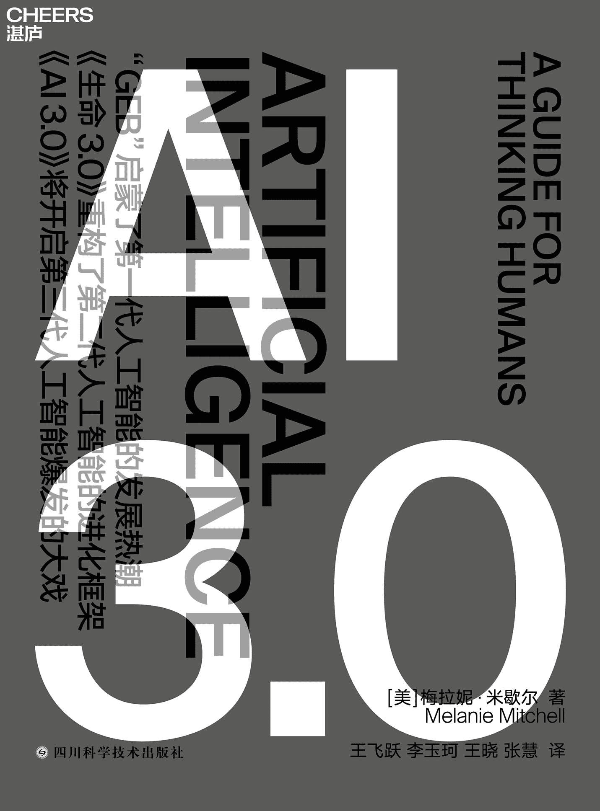

致父母

你们教会我怎样去思考，
也给予了我更多。

致父母

你们教会我怎样成为一个思考者，
远不止于此。

# 中译本序言

## 机器离像人一样理解世界还有多远

能用中文出版这本书对我而言格外激动，因为我长期以来都对中国和中文怀有特殊的亲近感。上世纪八十年代，我曾在北京大学生活过一段时间，学过一点汉语，也曾与负责把我博士导师道格拉斯·霍夫斯塔特的著作《GEB》译成中文的团队交流过。将霍夫斯塔特的书搬到中文世界是一项很有野心的工程，难点在于书中随处可见的英文文字游戏要想在中文里做出同等趣味非常困难，我对翻译团队展现出的创造力十分敬佩。

把自己的书翻译成中文同样繁复，尤其是在讲到用人工智能做自然语言处理的章节，语言本身的细微差别让难度加大。幸运的是，本书译者准确把握了我原文想要表达的内核和精神，并忠实地转译成中文，这让我感到欣慰。

有读者可能看过我此前《复杂》的中文版，会好奇两本书有何关联。简单说，《复杂》是一部关于复杂系统科学的概览，探讨相对简单的构成单元如何通过相互作用产生复杂行为，涉及的范围从基因网络、昆虫群体到人类智能与社会。而《AI 3.0》则把焦点收窄到复杂系统里最棘手的难题：智能的本质到底是什么，研究者怎样制造智能机器，我们该如何评估这一领域的进展，今天的机器距离真正以人的方式理解世界还有多远。

《AI 3.0》写给没有计算机或数学背景的普通读者，只要你对当前人工智能如何运作、如何被使用、距离真正智能还差多远感兴趣，就能读懂。市场上人工智能相关的书籍越来越多，我认为这本是少见的作品，它既深入又易懂，把当下人工智能方法的运行机制、已有的成果、面临的瓶颈，以及人类认知的核心特质为何仍在现有方法之外讲清楚了。

弄明白这些对我们每个人都很重要，因为在新时代我们要学会在多大程度上可以信任那些日益介入生活的AI应用。亲爱的读者，愿你在阅读中有所启发，体会到人工智能已走过的路，也看清前方仍待走的距离。


扫码下载“湛庐阅读”App，
搜索“AI 3.0”，
读懂人工智能的本质，把握未来的新趋势。

# 序言

## 等那一口仙气儿

段永朝

财讯传媒集团首席战略官
苇草智酷创始合伙人

2019 年，梅拉妮·米歇尔博士的新作《AI 3.0》一出，就上了亚马逊“计算机与技术”畅销榜。十年前，她的《复杂》曾入选亚马逊年度十佳科学图书。人工智能类图书很多，大致分两类：给工程师看的技术书，和给大众的科普书。米歇尔的这本书介于其间，既有技术阐释，也有思想穿透。

### “侯世达的恐惧”

米歇尔是道格拉斯·霍夫斯塔特的学生。霍夫斯塔特是《哥德尔、埃舍尔、巴赫：集异璧之大成》，常被简称为“GEB”的作者。这本1979年出版的著作四十多年长销不衰，令无数计算机和数理专业的学生着迷。米歇尔1990年在霍夫斯塔特指导下获博士学位，后在波特兰大学任教，同时在圣塔菲研究所担任客座研究员。

2016年，谷歌的AlphaGo横扫围棋顶尖高手，掀起新一波人工智能热潮。机器翻译、语音识别、虚拟现实、自动驾驶、机器人等轮番登场，“奇点”“超级智能”“数字永生”等概念铺天盖地，通用人工智能似乎近在咫尺。

2018年4月，我在一次由腾讯研究院、集智俱乐部、湛庐和苇草智酷联合举办的沙龙上见到霍夫斯塔特并参与对话。在他看来人工智能没有那么高深，他甚至厌恶“人工智能”这个词，并以新著《表象与本质》里的例子指出人工智能毫无真正的“智能”。

米歇尔的《AI 3.0》正是从技术层面做出的一次深度回应。

谈人工智能时，尤其是涉及伦理、社会价值与前景，人们常常只停留在悲观或乐观的站队。技术专家习惯用数据、算法、模型说话，社会学者和媒体则从外部性、代码背后的意图、人性善恶的角度论证价值。对大多数非专业人士而言，因看不懂反向传播、卷积神经网络、马尔可夫过程、熵原理背后的思想，只能用“好坏”“善恶”来评判。把技术的思想基础讲清楚，弥合理科与文科在看待AI上的鸿沟，正是本书的意义。哪怕以我三十年前做过专家系统、机器推理的经历来看，书若能再柔和些效果会更好，但跨学科的努力本就困难。

《AI 3.0》一开篇就提出“侯世达的恐惧”：不是担心AI太聪明，而是担心它太容易取代我们珍视的东西。这正是很多人的感受，AI发展太快，已渗入生活的每个角落。周围的一切仿佛都被“强悍”的代码和算法接管，通用人工智能、超级智能似乎指日可待。自1956年达特茅斯会议提出“人工智能”一词以来，通用问题求解器就一直是重要目标。

本书分五部分，这篇序并非剧透，而是做些背景交代，与关注AI的朋友交流。

### 人工智能的历史遗留问题

第一部分回溯了人工智能半个多世纪的历程，指出两大脉络：一是符号人工智能，二是以感知机为雏形的亚符号人工智能。前者假设智能可归结为符号推理，也称心智的计算理论学派，可追溯到帕斯卡、莱布尼茨，巴贝奇和图灵的工作体现了这一思想。

亚符号人工智能受益于行为主义认知理论，可追溯到休谟和詹姆斯的刺激-反应观。1940年代麦卡洛克和皮茨提出神经元模型后，弗兰克·罗森布拉特提出感知机，为神经网络奠基。

然而五六十年代的AI在符号演算和感知机两条路上都陷入停滞。八十年代的专家系统和神经网络也因算力限制和对智能的认识不足，未能取得实质突破。

与一般著作不同，米歇尔在梳理“AI寒冬”后，聚焦“为何如此”。专业人士知道，算法对大众神秘，对工程师而言依赖的仍是算力和符号逻辑基础，这才是理解AI的关键。

得益于神经网络和机器学习的发展，尤其是2016年AlphaGo在围棋上的表现，人工智能掀起第三波浪潮。IBM的沃森在《危险边缘》上的表现、自动驾驶、图像识别、语音识别的关注度上升，一波波“AI预言”随之而来。DeepMind创始成员沙恩·莱格认为超越人类水平的AI将在2025年左右出现，谷歌战略委员会成员雷·库兹韦尔提出奇点理论，认为2029年机器能完全通过图灵测试，2045年将出现以强AI为基础的智能爆炸。

米歇尔的线索很清晰：在梳理视觉、游戏、机器翻译等最新进展后，她指出，迄今的华丽突破尚未触及智能核心——自然语言理解与意义问题。为什么会这样？这或许就是要细读本书的原因。

### 到底什么是机器学习

第二部分讨论视觉技术。这部分有助于理解核心算法的演变。

视觉领域常用工具是卷积神经网络，代表人物有日本学者福岛邦彦和法国科学家杨立昆。对外行而言，繁复的算法遮蔽了思想内核。米歇尔把它抽出来：视觉识别本质上是训练一种算法，让机器能辨认并命名它“看到”的世界。

工作可分为两步：先给机器输入已知素材，如猫狗的图片，在机器眼中只是像素点。通过大量训练，让机器抽取出图片中的特征。

要猜测未知对象的内部特征，“信号处理”已有成熟方法，最著名的是卷积变换，也称傅里叶变换。法国数学家傅里叶提出这一概念，他发现可以通过傅里叶变换把时域过程转成频域过程，便于计算。通俗解释如下。

在诺伯特·维纳把“反馈”引入控制论之前，电子工程面临大量信号处理问题。可把信号处理理解为输入信号经过装置后产生输出。工程师的问题是：在不了解装置细节下，通过特定输入刺激产生特定输出，从而推断装置特征。

比如一个黑箱，用特征函数表示。若想知道其特征，可输入信号序列，观察输出函数的表现。

傅里叶的贡献有两点：傅里叶级数和傅里叶变换。前者是后者的数学基础。他的洞见是，任何周期函数都可以表示为正弦与余弦函数的无穷级数之和。这一思想从形式上看是泰勒级数在工程上的应用。泰勒级数在一定条件下可把函数展开为无穷级数，近似时取前几项即可。

卷积简单说就是黑箱的输出等于输入与特征函数的卷积。已知输入和特征，求输出即求卷积，本质是计算傅里叶积分。

傅里叶变换的美妙在于把难以计算的积分转化为两个函数的乘积。把求微分方程转化为求三角级数的傅里叶积分，从而可用输入输出推算黑箱特征函数，相当于做逆运算或一次除法。

傅里叶变换让波形分析和特征提取成为可能。150年后，它成为人工智能学习算法的基础，提供了一种以黑箱视角推测目标特征的路径。

因此，人工智能在视觉上的应用以及深度学习算法，从数学看无非是用七八十年代的多层神经网络，通过傅里叶变换求解特征方程。

应用卷积神经网络分两步：先猜测特征函数，即建模识别；再根据输入输出响应调节参数，即学习。做卷积分析就是面对未知内部结构的对象，通过已知输入观察输出，给出内部构造的猜测。

深度学习常用训练集和测试集。前者用于猜测，后者用于验证并优化参数，以更好地适应不同形态。

深度学习分监督学习和无监督学习。监督学习通过人机交互告诉算法对错，需要先验知识，受限且效率低。无监督学习让机器自行判断结果是否合理并优化判别参数，如生成式对抗网络可构造全新模式拓展认知边界。无监督学习仍需人为干预，因为算法并不“认识”世界。

由此可见，如今强大的AI仍在练习认识世界，依赖的是算力、神经网络可做到上百层，以及傅里叶分析。机器对世界本质并无真实感知，仍需人干预解释。控制论创始人诺伯特·维纳说过：“我们最好确信，置入机器的目的正是我们真正想要的。”机器的表现先天受制于人，是人在教孩子、注入灵魂。

人给机器吹一口仙气，机器就有灵魂了吗？也许没那么简单。

### 人工智能的“能”与“不能”

第三部分通过游戏中的AI进一步说明。

用算法打游戏是挖掘潜能、理解机理的好途径。智能算法打游戏基本是无监督学习，如《打砖块》，事先不能注入太多策略，只能灌输规则，剩下的靠机器修炼。

前面已说明卷积神经网络的核心是参数调节，在游戏里就是策略选择。事先存储大量策略在暴力算法面前不堪一击，这正是AlphaZero最终超越人类的关键。人类棋手的功力来自经验套路，只针对有限空间。机器必须进入更大对弈空间，这就是强化学习的含义。如理查德·萨顿所说，强化学习就是“从猜测中学习猜测”，米歇尔表述为“从更好的猜测中学习猜测”。

走到这里已接近核心问题。什么是“更好的猜测”？当前智能机器做到的只是“最快的猜测”，即靠速度取胜。它能在更大博弈空间处理海量数据，算力远超人类，令人惊艳也极具迷惑性，仿佛机器已沾了仙气，比如沃森。实则是假象，如今的AI与真正意义上的AI仍有巨大鸿沟。

核心问题仍是对象与目标过程的认识。真正的人工智能需有能力认识对象是什么。专家找到的并非“认识对象”的解法，而是退而求其次的路径——目标函数的构建。

目标函数是什么？例如蒙眼点鼻子游戏。蒙眼人拿笔走向大鼻子卡通画，若有声音提示偏差，就能很快点中。提示偏差的信息至关重要。若让机器完成，机器不必理解鼻子、点、娱乐价值，只要能给出是否点中的目标函数，就能大幅提高成功率。

当前AI算法仍停留在工程层面，即以完成任务为目标，做这件事的意义全然在机器视野之外。

谷歌AlphaGo到AlphaGo Zero的演进就是例证。第一阶段向人学习，第二阶段自学成才。两个阶段的共同创见是让算法洞察全盘。为减少计算负担并判断距离获胜的远近，他们使用蒙特卡洛方法，只要确保最优策略仍在搜索空间即可，多预测几步就更有胜算。

# 胜场已到，意义未至

把对局练成套路就等同于智力迟早翻盘？这种说法出现在AI初期的舆论场里，跳棋开拓者Arthur Samuel甚至预言十年内机器必定取胜。如今代码在棋类博弈里压着人走，可就认知层级而言，与当年相比并没有实质跃迁。真正的区别是竞技自带终点。

规则与目标先验给出，把对弈框进可穷举的有限区间。程序唯一的执念就是赢。无论对手是人还是另一套代码，是否理解规则、是否能品味博弈之美，都不影响其只盯结果。棋盘上的胜负预设了判定可能，和棋只是另一种输赢形态。归根结底，一个有趣且有输赢的设计，早已把零和目标写进系统。

所以机器在零和空间里击败人，并不能证明智能超群，只能映照出人类边界与零和目标的局限。除此之外的胜利，说不出更多。

视觉与游戏也看不出AI真正的痛点。更大的偏差在于，人们忘了硬件底座始终是算力，却把当下技术愈推愈向增强人类使用，还把人机协作的场域定义成更大规模的零和竞技。

米歇尔把压力指向更硬的样本：机器翻译。她的第四部分就落在智能撞上自然语言这一点。

机器翻译的设想更早。达特茅斯会议提出AI之前，二战后参与美国科技工业共同体建设的技术官员沃伦·韦弗已提出构想。它既有市场号召力，也是检验思想是否突破的前沿。谷歌、微软、科大讯飞等投入巨大。机器翻译之所以硬，是因为它逼系统直面理解。

谷歌、微软还外推边界，用算法给图像打标签处理海量图片。斯坦福做阅读理解项目，想让机器真正读懂文本。

我撰写此段时，旅美三十余年、关注生物科技、机器智能、区块链前沿的企业家邵青博士发来硅谷报道。主角是GPT-3，发明人埃德·莱昂·克林格说：“从今天起，世界彻底改变了。”GPT-3是OpenAI的第三代语言模型，靠分析网络海量文字来预测后续词序，很快对程序员开放测试。

报道里说GPT-3直接理解了自然语言。你可以用语音提任何要求，它就呈现结果。比如说“给我一个像Stripe官网的聊天App”，几秒后定制好的App就推送过来，像点餐一样方便。还能写论文、小说、起草合同、批量生产段子。当然也有尖锐评论说，GPT-3根本不懂自然语言，只是快而已。据称它有1750亿个参数，能处理如此巨量。

但这依然是蛮力计算的模式，仅此而已。

就目前的自然语言项目而言，可以断言它们没有理解，唯一擅长的是见多识广。机器能快速遍历更多状态，把角落都扫一遍，表现惊人甚至超过人类，却像“狗眼看星星”，认不出星图。

## 意义才是最难的门槛

米歇尔在著作第五部分落在意义上。她指出理解以意义为基础，意义是机器智能的真正障碍。能否跨越可以争论。我感觉她强调的不是机器永远无法理解或创造意义，而是它的意义理解是否在安全边界内——这也是全书开篇“侯世达的恐惧”的核心。

说意义问题，先举个生活例子。很多常出游的人都有体会：即便不懂当地语言，靠比划加手势也能进行浅层交流。因为大量超越语言的生活常识，是跨文化的共有知识，它是意义的底座，而机器并不具备。用拟人说法，机器像探索新世界的婴儿，世界对它全是新的，它要学语言，更要学语言背后沉淀的意义。

婴儿理解世界，是把新奇感受不断装进成人词语世界。这个过程也是真实认知的常态，当然也有漏网之鱼，比如网络新词就突破了传统词语的固有含义。意义的生成，既有漫长生活积淀和约定俗成的能指所指配对，也有突破词语边界的类比和象征。按米歇尔导师侯世达的观点，类比和象征是思考之源和思维之火。

借用吉安-卡洛·罗塔的话，米歇尔提出根本问题：机器智能能否以及何时打破意义障碍？

她没有斩钉截铁的答案，但作为侯世达的学生，她汲取了他的思想：世界是隐喻式的，我们并非生活在冰冷符号里，而是活在色彩斑斓的隐喻中。不同文化底层逻辑难以互通甚至抵牾，但人类仍有共享的元认知，这是维系多样世界的最后屏障。

从这个角度看，机器智能的硬核问题不在于谁控制谁，而在于机器成长意味着什么，如何成长、何时变得强大、强大后是什么样子。这一连串问题把思考推向深处。人们不能只在悲观乐观情绪中选择。硅谷很多公司信奉的准则很简单：预测未来的最好办法就是把它造出来。

争议在于，当科学家和工程师兴致勃勃挑战边界、义无反顾奔向临界点时，如果他们谦逊地把技术未来描述为探索未知的多种可能性，而不是把算法当成不容置疑的必然，那还好。可怕的是工程师忘了意义问题早已超出人类当下认知的边界。

无论如何，机器终将长大，开启独立生活，创造自己的语言，甚至可能形成与人类抗衡的文化符号，提出自己的价值主张，搭建自己的社群、艺术、宗教，与人类分享世界的快乐。

对这些的思考，还缺少更开放的框架，而且深陷文字、尤其是英文线性思维的局限。智能机器的存在和成长，是否会拓展人类的元认知，使之成为人机共享的元认知？仅靠文字思维，可能难以走出符号演算的如来佛之掌。侯世达四十多年前写《GEB》时，就针对机器智能提出十个问题，指向形式逻辑、符号演算和线性思维的天然不足：符号思维难以超越自身内生的逻辑悖论。

米歇尔仿效侯世达的做法，也在书末提出六个问题并尝试给出回应。她的回答只是众多可能之一，勇敢面对这些基本问题并持续交流的时代才刚刚开始。机器智能真正的挑战在于，我们需要清醒意识到，当下发展的动力仍来自旧世界的逻辑。这种逻辑鲜明特征是把人机关系看作可分离的主体世界与客体世界。笛卡尔式世界观被巧妙包装成人机共生，再经盎格鲁撒克逊文化改造，加上新教伦理与资本主义强力助推，导致工程师和CEO憧憬的未来是：终场哨响时，人人满脑子都是输赢。

这种旧世界观属于符号世界。机器智能底层思维的突破，可能关键在于超越旧世界束缚，把婆罗门世界观中的因明思想与中国春秋战国时期的名辩思想以及古希腊的逻格斯思想，在更大框架下融合起来，这是一个伟大的挑战。

2020年疫情肆虐期间，湛庐策划编辑寄来米歇尔这本书的预读本，并提出四个有助于理解的问题。在编辑鼓励下，笔者尝试用尽可能通俗的语言把书中隐藏的思想表述出来。米歇尔的主线充满探索精神：第三波机器智能浪潮在思想上大大突破前两波束缚，在哲学范式上捅开突破口，不只是符号表征和计算问题，更是意义问题。那么符号演算、视觉处理和机器学习将如何推动机器智能走向觉醒？这是专业人士和公众都很关心的问题。《AI 3.0》的独特魅力在于：站在前沿，深度思考，超越技术。

在米歇尔的书中，这个被她称作侯世达的恐惧的硬核挑战，就在于机器智能竞赛浪潮中最后的哨声，可能真的会成为最后的，如果人们不能摒弃满脑子输赢的想法。

机器智能的话题，亟待科学家、工程师、人文学者之间深度交流，更需要不同文化的人们之间深度交流。机器智能的兴盛不是一口气的事，让等那口气的机器，再等等吧。

# 译者序
## 未来智能：人有人用 机有机用

王飞跃

中国自动化学会监事长

中国科学院自动化研究所复杂系统管理与控制国家重点实验室主任

当今最好的机器智能程序到底有多聪明？它们如何运作？能做什么？我们是否需要担心机器很快比人类更聪明并夺走工作？这些问题备受关注，梅拉妮·米歇尔教授的新作《AI 3.0》以最合适的方式回应了它们。这是一本观察分析机器智能的优秀著作，既巧妙把创造历史的人物与改变世界的技术交织，又深入浅出地介绍了机器智能发展史及其未来方向。正如英文版副标题“A Guide for Thinking Humans”所示，这是一本为思考的人类准备的书，值得专业或非专业人士认真阅读与思考。

初见梅拉妮·米歇尔之名，是二十世纪八十年代末研究她与侯世达关于类比推理的开创性程序Copycat时，因其与当时主流认知推理方法差异太大而未深入。九十年代我在圣塔菲研究所研讨期间与她有交集，但无深入交流，不过对她的遗传算法著作An Introduction to Genetic Algorithms印象深刻，她不愧为遗传算法之父约翰·霍兰德教授的高足。二十一世纪初，我就任中国科学院自动化研究所复杂系统管理与控制国家重点实验室主任后，一直想写一本关于复杂性科学的科普书，在筹备实验室期间搜集资料时又遇见她的《复杂》。粗读后我认为暂无需再写一本复杂性科学科普，因很难超越她的水平。

2019年初，湛庐询问我是否有兴趣组织翻译米歇尔正在创作的Artificial Intelligence: A Guide for Thinking Humans，我读过已完成部分后十分喜爱其内容与风格，特别是书中许多观点引起共鸣，于是向学生推荐，并得到王晓研究员、即将博士毕业的李玉珂和张慧同学积极响应。巧合的是这三位都在从事机器智能一线研究，且都有在美工作学习交流经验，特别是王晓研究员具有主持翻译《机器崛起》和《社会机器》等重要著作的经验，因此她们是翻译此书难得人选，并能从学术性和可读性两个方面保证质量。2019年底，赴波特兰参加英特尔年度研发会议期间，我来到米歇尔办公室拜访，并讨论了本书翻译工作和大家对机器智能的基本认识。

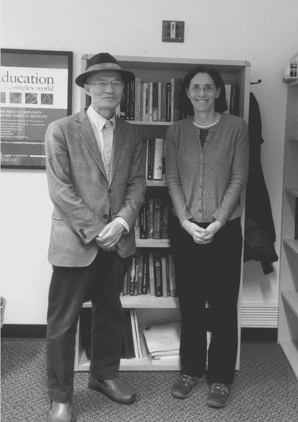

王飞跃（左）与梅拉妮·米歇尔（右）2019 年 11 月 16 日于波特兰俄勒冈州立大学

借此机会，我就本书提出的一些机器智能基本问题，特别是对书末提出的六个问题谈一些认识，希望有助于读者更开阔地思考智能技术的影响与意义，以及如何推动机器智能和智能科学健康发展，使其以更加安全可信的方式促进人类社会发展与繁荣。

## 广义哥德尔律

本书以米歇尔的导师、GEB作者侯世达教授在谷歌内部研讨会上表示自己被机器智能快速发展吓坏了作为开端。更具体地说，侯世达被音乐智能实验EMI的优美创作吓坏了，他说：“我被EMI吓坏了，完全吓坏了。我厌恶它，并感受到了极大威胁——机器智能对我最珍视之人性的威胁。我认为EMI是我对机器智能感到恐惧的最典型实例。”我曾听说侯世达对机器智能的担忧，但当时不以为然，认为一个对机器智能了解如此之深的学者不应过度害怕智能技术。

作为坚信机器智能只是一项技术、不主动侵害人类的科技工作者，我当时觉得这可能是由于侯世达远离科研一线或年纪增长的原因，但书中侯世达的自白让我认识到猜测都不对，真正原因在于音乐在他心里有神圣甚至神秘的地位。米歇尔在书中也提到侯世达与EMI第一次相遇时所说的话：

从孩童时期开始，音乐就令我心潮澎湃，并能将我带入它最核心的地方。对于我所钟爱的每一件作品，我都能感受到它是来自作曲之人情感深处的一封私信，那感觉仿佛使我能够直抵作曲者灵魂的最深处，这让我觉得世界上没有任何一样东西比音乐的表达更具人性。然而，对最浅显的音节排序进行模式操纵，却能够产生听起来仿佛来自人类内心的音乐，一想到这里，我就非常非常不安。

在GEB最后，侯世达曾列出关于机器智能的十大问题和猜想，其中第一个就是关于音乐。当时他认为计算机可以谱写优美音乐，但不会很快实现，因为音乐是一种关于情感的语言，在程序能够拥有我们人类所拥有的这种复杂情感之前，它绝无可能谱写出任何优美作品。

我认为，侯世达由此产生的恐惧是中国艺术家潘公凯错构理论的一种典型体现，它不是理性或技术层面的反应，而是一种本然的艺术或哲学性反映。对此，我希望结合智能研究的起源以及我一直提倡的广义歌德尔定理来说明我的看法。

近代以来，人们对智能的认识源自数学家希尔伯特的梦想，即数学推理机械化的希尔伯特纲领。伯特兰·罗素与阿尔弗雷德·怀德海为这一梦想奠基，花了十年心血成就三卷本数学原理。但不久，这基石就被三个年轻人击碎。先是歌德尔证明不完备定理，接着图灵提出图灵机，并将计算本质归于机械操作，进而约翰·冯·诺依曼建立数字计算机的逻辑操作结构。自此我们有了现代计算机，并开始机器智能研究，成就今日信息产业旧IT，目前已开始迈向智能产业新IT。在这一智能计算化过程中，从邱奇图灵论题开始，在诺依曼有意无意的引导下，学界关于智能的思考逐渐形成两个派别：图灵派和歌德尔派。

图灵派本质上是计算主义，认为基于简单规则的计算可以涌现复杂行为和智能。从物理符号系统的逻辑智能到联结主义的计算智能，这一思想主导了机器智能至今的发展历史，是构建智能系统的主要理论和方法源泉。歌德尔派认为根本没有构建智能的一般规律和方法，而且现有一些规律和方法不应成为第一性，只有动因和信念才是本质，接受现状继续演化是发展机器智能的唯一途径。歌德尔派在机器智能研究上至今影响不大，然而在理解智能影响和意义方面，歌德尔派认识非常重要，而且对智能科学未来发展更具指导意义。

歌德尔认为，存在先于可计算的不可计算，即存在不可计算的客观存在。存在不可计算的物理、生命和数学过程，且计算机不能真正理解语言和想象等相关活动。研究机器智能的第一位华人学者王浩晚年曾致力于歌德尔思想与哲学的研究，他总结道：“歌德尔认为机器不可能超越人脑，除非数学不是人类发明的。而且，就算数学不是人类发明的，机器还是无法超越人脑。”

我曾把歌德尔关于智能的思想总结为广义歌德尔定理，即智能分为算法智能、语言智能和想象智能三个层面，算法智能无法超越语言智能，语言智能又无法超越想象智能。正如歌德尔在普林斯顿高等研究院同事爱因斯坦所言：“智能的真正标识不是知识，而是想象。”

我们可以从两个方向理解广义歌德尔定理：一是图灵的想法，即AI的全体和极限是LI，LI的全体和极限是II；二是II的局部和具体化是LI，而LI的局部和具体化是AI。计算机的智能只能是AI，无法达到人类所具有的LI和II层面。

歌德尔对智能的认识及理解与中国哲学史上人们对道德经开头的两种不同解读十分相似：一是道可道，非常道，即凡是能被言说的道，就不再是永恒的本源之道，就像世上每一个能被看到的具体圆形，都无法符合圆形的抽象定义一样；二是道，可道，非常道，即道有三种形态，自然中可执行的道、只能说出来的道、只能想象出来的道。总之，道一经说出，就不是本来的自然之道了。

法国启蒙思想家伏尔泰提醒过，若不先厘清用词，交流很容易失焦。先前的讨论也显示，即便给出定义，在语言与想象的张力里，双方仍可能难以真正对齐。书中指出，在人工智能讨论里，“智能”“思维”“意识”“认知”“情感”等概念至今难以达成统一的界线，学界仍在分歧中。这正是二十世纪哲学家托马斯·库恩在“3C”论述里描绘的图景：在词典及其多维网络中，人会进入一种本质上不可公度^((8))、不可比较、不可互通的状态。由此让人联想，除量子力学里的薛定谔猫与海森堡不确定性原理之外，在人工智能、逻辑智能、个体智能三个层面，是否也各自存在“算不清”“说不明”“想不准”之类的原理。

回到侯世达对人工智能的激烈反应，我借围棋世界冠军柯洁的经历作对照。李世石以1比4不敌AlphaGo后，柯洁曾公开表示即便赢不了李世石也赢不了他。随后以0比3被零封，柯洁当场颤抖想哭，称对手近乎完美，并称其为上帝。我第一次在《时代》看到报道时的反应是：上帝？哪一位？反正不是我所信的那一位。对我而言，柯洁的应激与侯世达相似，都是长期专业投入后的心理错位。我们不必因柯洁失利而畏惧AlphaGo，也不必因侯世达的论调而对人工智能产生不安。对这类议题的反复深聊，更像是哲学家或有闲阶层的智力训练；真正落地的人，更应聚焦技术与应用在合法、合规、合理、合情层面的实践。

### 技术越省越用：广义杰文斯视角
谈完对人工智能的恐惧，再看它对工作的冲击。近年舆论里充斥“机器换人”“AI将使五到七成人口失业”乃至“文明终结”的说法，连一些知名科学家与企业家都持此论。关于人工智能是否引发大规模失业，本书已有详细论述。

黑格尔曾点破历史的讽刺：人们从未真正吸取历史教训。过去一百年人类已历经三次类似焦虑，即老、旧、新三次IT变革。老IT即工业技术，其威胁感远超今日新IT即智能技术的担忧。工业革命发源地英国的纺织业曾出现“羊吃人”，女王担心机器普及会把臣民变成乞丐，民众直接揭竿焚毁机器。

七十多年前，诺伯特·维纳的控制论与数字计算机开启旧IT即信息技术变革，再度点燃机器取代劳动的担忧。维纳为此著《人有人的用处》(`The Human Use of Human Beings`)，反复强调“信息永远不能取代启迪”(`Information will never replace illumination.`)。启迪是语言与想象的核心功能，机器所产出的代码与信息终究无法替代人类。而且计算机本身就是“机器取代人”的最好例证。一九五零年代前，英文computer指从事计算的人类；今天computer指机器，已完全取代人类computer。但被称作computer的机器非但没有造成大规模失业，反而创造了程序员、架构师、算法工程师、网络管理员等更多新岗位。事实胜过恐辩，机器可能带来短暂的社会错位与部分岗位流失，却不会导致整体失业，反而能创造更优质、更匹配人类的岗位，推动社会进步。

这一规律上百年就被揭示，就是著名的杰文斯悖论。十九世纪英国数学家、哲学家、经济学家威廉姆·斯坦利·杰文斯是现代边际效用理论的奠基人之一。工业革命时期英国煤炭消耗剧增并带来污染，社会讨论如何提高燃煤效率，杰文斯却指出：效率越高，煤的消耗反而越大。这就是杰文斯悖论：技术进步提升了自然资源利用效率，结果却是需求增加而非减少，因为效率提升会扩大生产规模，进而刺激需求。

计算机的“机器取代人”案例说明广义杰文斯悖论同样成立：技术进步提高人力资源利用效率，结果却会增加而非减少社会对人力资源的需求，因为效率提升导致生产扩张。计算机确实消灭了名为computer的职业，把它变成机器，却同时扩大了对计算机生产、运维等相关人才的需求。类似例子比比皆是：全球定位系统取代了大量测量岗位，却催生出基于位置的服务LBS及导航算法工程师等新工种；机器学习挤压了不少统计员岗位，却增添了更多数据工程师岗位。可预见，随着智能技术推进，这类例子只会越来越多。

我们相信，表面上以替代人力为目标的智能技术，终将衍生出更多更适合人类的新岗位，比如学习工程师、决策工程师、法务工程师等。智能技术可能把今天的“码农”解放为明日的“智农”，成为人机结合、知行合一、虚实一体的“合一体”智慧员工。如此，维纳所说的“人有人用，机有机用”才算真正实现。

### AI 3.0 蓝图与边界
四十多年前，侯世达在《GEB》尾声提出关于智能的十个问题与猜想，吸引年轻的米歇尔转向人工智能研究。如今米歇尔在本书结语中列出当下备受关注的六个问题及答案或推测，本质也是对未来智能技术发展的探讨与期许。也因此将本书中文版命名为《AI 3.0》显得恰当。我个人坚信人工智能必须从长期主导的逻辑智能AI 1.0和近二十年主流的计算智能AI 2.0，迈向人机混合、虚实交互的平行智能AI 3.0。

未来的智能科技必须以新方式把人置于核心，真正落实“人有人用，机有机用”的原则。社会物理信息系统CPSS将成为智能系统基础设施，进而保证数据之力、计算之力、算法之力、网络之力、区块链之力“五力合一”，使智能科技能上“真”[TRUE=trust 可信+reliable 可靠+useful 有用+effective 有效]之“道”[DAO=distributed/decentralized 去中心化+automated/autonomous 自动自律+organized/ordered 有序=decentralized autonomous organizations 分权自治组织]，实现系统学习与系统智能，迈向智能组织与智慧社会。

政治哲学家兼经济学者弗里德里希·哈耶克曾说：“科学走过了头，自由将无容身之地。”同理，智能越界，人性便无处安身。如何防止人工智能越界？依据广义哥德尔定理，我们并非不信任智能技术，只是难以全然信任技术背后的人类。因此人工智能的合法合规，最终要靠人类自身的文明与法治来保障，智能科技只能起辅助作用。人类社会发展的历史表明，技术越进步，需要的法务工作者越多。未来，或许罪犯会大幅减少，但“智警”或“法务工程师”会成为智慧社会的重要职业，数量远超普通警察和法官。这是随智能产业发展而来的智慧社会可能形态，也是研发新一代人工智能必须考量的议题。

前不久，明略公司研究院院长吴信东教授和创始人吴明辉先生向我介绍了他们的“好智能” HAO intelligence计划，即把人类智能、人工智能和组织智能融合，创造出“HAO”好智能。我深表赞同，这不仅与我个人的理念一致，更是通向“6S”智慧社会的唯一路径。所谓“6S”是指未来智能技术必须让人类社会在物理空间安全safety，在网络空间安全security，在生态空间可持续sustainability，具备个性化敏捷感知能力sensitivity，完成有效服务service，展现有益智慧smartness。

我个人关注知识自动化与平行智能，部分成果已发表于清华大学出版社《人工智能：原理与技术》。对我而言，知识自动化与平行智能曾是遥远目标，但如今云计算、边缘计算与数字孪生技术的迅猛发展使平行智能成为可能。目前我和团队正在研究“Copycat”及其继任者“Metacat”在平行智能和知识自动化中的潜在应用，期待未来能与米歇尔及相关学者合作，让AI 3.0早日落地。

最后，再次祝贺米歇尔新著《AI 3.0》问世。希望更多读者能读到此书，正确理解人工智能，推动智能科技健康发展。

# 引言

## 造类人机器是一次史诗级脑力探险
计算机似乎正以惊人速度变得更智慧，但仍会做出让人哭笑不得的事。几年前我到加州山景城谷歌总部Googleplex参加人工智能研讨会，虽用谷歌地图导航仍在楼里迷路，而迷路的地方正是谷歌地图所在大楼，讽刺至极。

谷歌地图大楼好找，一辆街景车停在门口，车顶伸出巨大支架，顶着红黑相间的足球形摄像头。进入大楼后，我戴着显眼的访客徽章在员工区穿行，他们大多戴着耳机专注敲打苹果电脑。靠指示牌，我才找到会议室与同组汇合。

2014年5月的会议由年轻计算机科学家布雷斯·阿奎拉·阿尔卡斯组织，他刚从微软高层离职，负责谷歌机器智能工作。谷歌始于1998年的一个搜索网站，如今已成长为全球重要科技公司，推出Gmail、谷歌文档、谷歌翻译、YouTube、Android等众多产品。创始人拉里·佩奇与谢尔盖·布林长期受“在计算机上创造人工智能”理念驱动，人工智能已成谷歌重点。在过去十年谷歌招揽大量人工智能专家，其中最知名的是雷·库兹韦尔，他提出人工智能奇点理论。谷歌聘他为工程总监，并于2011年成立“谷歌大脑”研究组，后收购Applied Semantics、DeepMind、Vision Factory等多家人工智能初创。

从长远看，谷歌不再只是门户，正迅速转型为应用型人工智能公司。人工智能是连接谷歌各产品、服务及研究与其母公司Alphabet的纽带。公司最终愿景是“破解智能，并用它解决其他一切问题”¹，与DeepMind团队初衷一致。

## 《GEB》点燃我的AI追寻
能参加谷歌的人工智能研讨会令我兴奋。从80年代读研起我就研究人工智能诸多方面，对谷歌成就尤为关注。虽然我想为会议贡献想法，但我必须承认，我只是随行人员。会议目的是让精选的谷歌人工智能研究者聆听侯世达的报告并交流。侯世达是人工智能界传奇人物，《GEB》作者。若你是计算机科学家，很可能听过或读过这本书。

《GEB》成书于70年代末，是侯世达对多领域研究的热情汇聚，融汇数学、艺术、音乐、语言文字游戏，探讨智能、意识甚至自我意识如何从非智能无意识的生物细胞基质中产生。《GEB》也是关于计算机如何最终获得智能与自我意识的著作，独一无二。书难读却成畅销书，获普利策奖与美国国家图书奖。毫无疑问，《GEB》激励大量年轻人投身人工智能，我就是其中之一。

80年代初，我以数学学士毕业，在纽约一所预科学校教数学，过得不开心，因一直在思考一生的真正方向。读到《科学美国人》一篇热情书评后我发现《GEB》，立刻买下。接下来数周如饥似渴阅读，越来越确信自己想成为人工智能研究者，尤其想与侯世达共事。从未对任何书或职业有过如此强烈的渴望。

当时侯世达任印第安纳大学计算机系教授，我异想天开想申请其博士并说服他收我为学生。有一个“小”问题：我从未修过计算机科学课程。但我自幼熟悉计算机。父亲是60年代科技创业公司硬件工程师，业余在书房组装一台像冰箱大的Sigma 2机器，面板按钮写着“我用FORTRAN^((9))祈祷”。童年时我半信半疑它真的在祈祷，尤其深夜家人熟睡时。60至70年代成长，我对FORTRAN、BASIC、Pascal等语言略有了解，却几乎不懂规范编程，更不用说研究生入学所需知识。

为加速计划，我在学期末辞职搬到波士顿学习计算机入门。某天在麻省理工学院等课时，无意瞥见侯世达讲座海报，两天后举行。我几乎不敢相信运气。去听讲座后排队很久终于与侯世达对话。原来他正利用一年学术休假在MIT，随后将从印第安纳搬至密歇根大学安娜堡分校。

经过不懈努力，我说服侯世达让我做研究助理一整个暑假，随后六年成为他的硕士生、博士生，最终以密歇根大学计算机科学博士毕业。多年来我们保持密切联系，多次讨论人工智能。他知道我对谷歌人工智能研究感兴趣，特意邀请我陪同赴会。

## 象棋失利埋下怀疑的种子
在那个谷歌地图App定位不到的会议室里，约有20名工程师，包括侯世达与我。大多来自谷歌各人工智能团队。自我介绍时很多人提到，年少时读《GEB》驱动他们选择人工智能研究。他们兴奋好奇，久负盛名的侯世达会如何评价人工智能。介绍结束后，侯世达站起说：“总体上关于人工智能，特别是谷歌人工智能研究，我想说的是，”声音激昂，“我被吓坏了，真的吓坏了！”

他继续评论²。提到70年代初开始研究人工智能时景象令人振奋，却未意识到危险近在眼前。创造具人类智能的机器是重大智力冒险，被认为至少需“100个诺贝尔奖”作为奠基的长期项目³。侯世达认为原则上人工智能可行：反对者如约翰·瑟尔、休伯特·德雷福斯等人不理解大脑是服从物理规律的物质，也不理解计算机可模拟一切，包括神经元与神经递质层面。从理论看这是可实现的。他在《GEB》中详尽讨论从神经元到意识的模拟，也是数十年研究重点。直到最近他才意识到通用人类水平人工智能在他或下一代一生内不可能出现，故并不特别担心。

临近《GEB》结尾，侯世达列出人工智能的“十大问题和猜想”。其中一个是：“会出现能击败人类的国际象棋程序吗？”他的猜想是不会。也许能出现击败人类棋手的程序，但它们不会成为职业棋手，只是通用智能程序⁴。

2014年那次谷歌会议上，侯世达指出自己“大错特错”，回想80至90年代国际象棋程序的快速演进，为他对人工智能短期前景的设想埋下第一颗怀疑种子。尽管先驱赫伯特·西蒙1957年就预测十年内国际象棋程序将夺世界冠军，但到70年代中期《GEB》写作时，最好的计算机程序也仅达优秀业余水平。侯世达与国际象棋冠军、心理学教授艾略特·赫斯特私交甚笃，赫斯特写过大量关于人类专家与计算机程序差别的文章。实验显示人类专家靠快速识别棋盘局势决定下一步，而所有国际象棋程序都依赖大量粗暴的前向预测搜索。对局中顶尖人类玩家能把棋子排列感知为特定局势并需“某种策略”应对，即能快速把特定排列识别为更高概念实例。赫斯特认为，缺乏模式感知与抽象概念识别通用能力的程序永远无法达到顶级人类水平。侯世达被说服。

80至90年代，计算机运算速度飞跃，国际象棋程序能力大增。顶级程序仍以非人类方式运行，靠海量前向预测搜索决定走法。90年代中期，装备专用硬件的IBM深蓝已达大师水平。1997年，深蓝在六局比赛中击败世界冠军加里·卡斯帕罗夫。一度被视作人类智慧巅峰的象棋大师，也向粗暴的前向预测搜索屈服。

## 音乐：人性最后的壁垒

卡斯帕罗夫输给深蓝之后，媒体纷纷把焦点放在机器智能的爆发上，但真正意义的智能看起来依旧遥远。深蓝会下棋，却做不了别的。侯世达关于象棋的预判失准了，他对《GEB》里的其余假设却仍在坚持，其中最靠前的那条是：

**问题：** 计算机能写出动人的音乐吗？
**猜想：** 能，只是不会很快。

他随后解释：

音乐是情感的语言，在程序谈不上拥有人类那种细腻复杂的情感系统之前，不可能出现真正好听的作品。会出现对早期音律的简陋模仿，那种赝品，可即便第一印象过关，音乐承载的信息也远超音律规则所能抓取的范围……以为一个预先写死的、流水线量产、邮购二十美元的台式音乐盒，加上经过消毒的电子元件，就能写出肖邦或巴赫会写的音乐，这完全是对人类精神深度的荒谬且可耻的低估。⁵

在《GEB》中他称此猜想为“最重要的部分之一”，并表示愿意押注。

1990年代中期，侯世达对AI的信心再次动摇，这次更彻底。他接触到作曲家兼教授大卫·科普研发的程序“音乐智能实验” EMI。科普最初只是想让它按指定风格自动生成片段来辅助创作。后来它因能模仿巴赫、肖邦等古典作家的笔触而闻名。EMI依据科普设计的大量规则作曲，这些规则试图提炼作曲的通用语法，套用到某位作家的作品集上，就能产出风格相近的新作。

在一次谷歌内部交流会上，侯世达带着异样情绪回忆与EMI的相遇：

我坐在钢琴前，弹了一段EMI“创作”的肖邦风格玛祖卡。听起来并不完全像肖邦，但已足够逼真，而且连贯得像完整作品，这让我深感不安。

从小音乐就搅动我的心绪，能把人带向核心。对我珍爱的每件作品，我都觉得那是作曲者从情感深处写给我的私信，仿佛能直接触到灵魂深处，这让我认为没有任何东西比音乐更具人性。然而，仅靠对最浅显音符排序的模式化操作，就能产生听起来像是源于人类内心的音乐，想到这里我就极度不安。

随后他提到在纽约州罗切斯特伊士曼音乐学院的一次演讲。介绍完EMI后，他请听众判断：现场钢琴家演奏的两首曲子里，哪一首是肖邦鲜为人知的玛祖卡，哪一首是EMI的作品。台下有多位音乐理论和作曲研究的教师。有位听众后来这样描述：“第一首玛祖卡优雅有魅力，却缺少真正肖邦式的创作深度和流畅感……第二首明显是真肖邦，有抒情的旋律、宽广优美的半音转调，以及自然平衡的形式。”令侯世达震惊的是，很多人都跟这位听众一样判断，第一首是EMI的，第二首是“真肖邦”。答案恰恰相反。

在谷歌会议室里，侯世达忽然停下来环视众人，最后说道：“EMI把我吓坏了，彻底吓坏了。我厌恶它，并感受到巨大的威胁——人工智能对我最珍视的人性的威胁。我认为EMI是我对人工智能感到恐惧最典型的例子。”

## 被尘埃掩埋的焦虑

接着侯世达谈到他对谷歌在AI领域推进的目标怀有深深的矛盾心理，比如自动驾驶、语音识别、自然语言理解、机器翻译、计算机生成艺术、音乐创作等等。而谷歌聘请库兹韦尔以及库兹韦尔对奇点的畅想，更加重了他的不安。奇点指的是将来某个节点上会出现具备自我提升和自主学习能力的AI，随后它迅速达到并超越人类智能，谷歌似乎正全力加速这一进程。尽管侯世达极度怀疑奇点假设，他仍承认库兹韦尔的预言始终困扰着他。

我被这些画面吓到了。我觉得他们的时间表可能错了，当然也有可能他们是对的。我们会措手不及，我们可能觉得什么都没发生，但就在我们意识到之前，电脑已经比人类更聪明了。

如果真如此，我们将被取代，我们会变成遗迹，被尘埃掩埋。也许这就是正在发生的事实，但我不想它来得太快。我不想我的孩子们被尘埃淹没。

最后他用一句话收尾，对在场的谷歌研究人员说：“我觉得这很可怕，很困扰，很悲伤、困惑、迷茫，很糟糕、可怕、古怪，因为人们正盲目而极度兴奋地向前冲，去制造这些东西。”

我扫视房间，听众看起来困惑甚至有些尴尬。对谷歌的AI研究者而言，前面的这些话一点也不新鲜。深蓝战胜卡斯帕罗夫、EMI写出肖邦风格玛祖卡、库兹韦尔出版第一本谈奇点的书时，在场的许多人还在上中学。他们可能读过《GEB》，也喜欢那本书，尽管书中一些对AI的预测已显过时。他们在谷歌工作，正是要让AI现在就出现，而且越快越好，而不是一百年以后。他们不明白侯世达为何如此紧张。

在AI领域工作的人早已习惯外界的恐惧，那些恐惧多来自科幻电影里超级智能机器会变邪恶的情节。他们也熟悉另一种担忧：愈发复杂的智能会夺走人类的工作；大数据应用会侵犯隐私并造成难以察觉的歧视；难以被理解且可自主决策的系统可能引发灾难。

侯世达的恐惧指向完全不同的地方。他不担心AI太聪明、太具攻击性、难以控制，甚至太有用。相反，他担心的是：智能、创造力、情感乃至意识本身都太容易被造出来了，那些他最珍视的人性特质和精神内核，结果可能仅仅是“一套把戏”，一套肤浅的暴力算法就能破解。

正如《GEB》里反复阐明的，侯世达坚信精神及其所有特征完全源于大脑与身体其它部分的物质基础，以及身体与外部物理世界的互动，其中没有任何非物质的东西。让他焦虑的其实是复杂性问题。他担心AI会向我们展示，最珍视的人类品质竟能用简单机械化手段获得，那会令人沮丧。会后他又对我解释了对肖邦、巴赫以及其他杰出人物的看法：“如果人类这种无限微妙、复杂且充满情感深度的心灵，能被一块小芯片简化，这会摧毁我对人性的理解。”

## 人性会沦为可复制的技巧吗

演讲结束后有短暂讨论，困惑的听众试图追问侯世达对AI尤其是谷歌研究的恐惧来源，但沟通障碍仍在。会议继续进行，展示当前项目、小组讨论、茶歇，一切如常，只是这些已与侯世达的观点无关。临近尾声，侯世达询问大家对AI近期发展的看法。部分谷歌研究人员表示，他们预计通用的人类水平AI在未来三十年内很可能出现，这在很大程度上得益于谷歌在深度学习方面的优势。

我满怀困惑离开会场。我知道侯世达曾为库兹韦尔关于奇点的文章所困扰，但此前从未理解他焦虑的程度。我也知道谷歌一直在猛推AI研究，但一些研究人员对三十年内就能实现通用AI的乐观让我震惊。我的个人判断是：AI在某些细分领域已取得很大进展，但距离通用的人类水平AI还很远，可能要一个世纪都实现不了，更别说三十年了。我认为持相反观点的人严重低估了人类智能的复杂性。我读过库兹韦尔的书，觉得大部分荒谬。然而听完来自我敬重的人们的评论后，我也被迫更批判性地审视自己的看法。如果这些研究者低估了人类复杂性，那我是否也低估了当今AI的实力和发展前景呢。

接下来的数月里，我更关注相关讨论。于是注意到大量知名人士的文章、博客和书籍都在呼吁从现在起就担忧超级智能的危险。2014 年，物理学家斯蒂芬·霍金宣称：“完全的AI发展将导致人类种族的终结。”⁷同年特斯拉和 SpaceX 创始人埃隆·马斯克说：“AI可能是我们最大的生存威胁，而我们正在用AI召唤恶魔。”⁸微软创始人比尔·盖茨表示：“我同意马斯克和其他人的看法，我不明白为什么有人对此无动于衷。”⁹哲学家尼克·波斯特洛姆的《超级智能》阐述了机器超越人类智能后的危险，尽管枯燥，却意外成为畅销书。

另一些著名思想家持相反意见。他们认为的确应确保AI程序安全，避免伤害人类，但近期关于超级智能的报道被严重夸大。企业家兼活动家米切尔·卡普尔劝告：“人类智能是一种不可思议、微妙、难以理解的东西，短期内不会被复制。”¹⁰麻省理工AI实验室前主任、机器人专家罗德尼·布鲁克斯同意：“我们严重高估了机器在当下和未来几十年的能力。”¹¹心理学家兼AI研究专家盖瑞·马库斯甚至断言，在追求“强AI”的过程中“几乎没有任何进展”，这里的强AI指通用的人类水平AI¹²。

双方的论点可以举出很多。简单说，AI领域正处于混乱状态。AI的确取得巨大进展，但也的确几乎没什么进展。也许我们离真正AI只有一步之遥，也可能还有数个世纪之远。AI将解决所有问题，或让我们失业，或贬低我们的人性，甚至消灭人类种族。这项研究要么是高尚使命，要么就是在“召唤恶魔”。

## 当AI加速时该如何审视它

本书源于我对AI真实发展状态的一次探索：电脑现在能做什么，未来几十年又能期待什么。侯世达在谷歌AI研讨会上的发言，以及谷歌研究人员对近期前景的信心，对我来说像是一个警示。接下来的章节，我会试图厘清AI的发展现状，阐明其迥异甚至相互冲突的目标。同时描述一些最著名的AI系统实际的工作原理，分析它们的成功与局限。我会关注电脑在多大程度上能完成我们认为需要高水平智能的任务，比如在对智能要求极高的游戏中击败人类、跨语言翻译、回答复杂问题、在复杂地形导航等。我还会考察电脑在我们视为理所当然的日常任务上的表现，如图像人脸识别、口语和书面文字理解，以及最基本的常识应用。

我还将努力弄清AI自创立以来就争论不休的更广泛问题：我们所说的通用智能甚至超级智能到底指什么？当前AI是否接近这个水平？抑或道路上会有危险？人类智能中我们最珍视的部分是什么？人类水平AI会在多大程度上影响我们对自身人性的思考？用侯世达的话说，我们应该害怕到什么程度？

《AI 3.0》不是AI的综述或历史，而是对可能正在影响或即将影响我们生活的若干AI方法的深入剖析。本书还会讨论那些在挑战人类独特性方面发展最成熟的AI成就。写作目的是与读者共同分享我的探索，帮助大家更清楚地认识这个领域已取得什么，以及机器距离“能够为自身‘人性’辩护”还有多远的路要走。

# 第一部分

想押注未来，先搞清AI为何仍难超人

## AI学派的演变脉络

### 1. 起点：追问什么算真正智能
“人工智能”一词由约翰·麦卡锡提出，其目标是“真正的”智能，而非“人工的”智能。

### 2. 符号派：不靠模拟大脑运作
符号AI最初受数学逻辑和人们描述自身思考方式的启发，在AI发展的前三十年占据主导，以专家系统最为著名。

### 3. 亚符号派：从神经科学捕捉无意识思考
亚符号AI从神经科学汲取灵感，试图捕捉“快速感知”背后隐藏的无意识思考过程。

### 4. 联结主义回潮：神经网络再成风潮
联结主义认为智能的关键在于构建合适的计算结构，并从数据或现实世界中学习。

### 5. 机器学习：掀起下一轮变革序幕
基于统计学和概率论，研究者开发出一系列让电脑从数据中学习的方法，形成AI的一个分支学科。

### 6. 深度学习：AI的春天再一次绽放
从 IBM 的深蓝到沃森再到 AlphaGo，被统称为深度学习的方法已成为主流范式。

## 01

从诞生到寒冬，心智仍是AI无法攻克的堡垒

### 达特茅斯的夏日与十位参与者
创造一台和人类一样聪明甚至更聪明的机器的梦想已有数个世纪历史，随着数字计算机的崛起，这一梦想成为现代科学的一部分。第一台可编程计算机的构想，实际上来自数学家把人类思想特别是逻辑当作“符号操纵”的机械过程的尝试。数字计算机本质上是符号操纵器，操纵“0”和“1”的各种组合。艾伦·图灵和约翰·冯·诺伊曼等先驱认为人脑与计算机存在极强相似性，因而可将人脑类比成计算机，并在他们看来人类智能显然能够被复制到程序中。

AI领域大多数从业者认为该领域的正式确立可追溯到1956年由年轻数学家约翰·麦卡锡在达特茅斯学院举办的一场小型研讨会。

1955年，28岁的麦卡锡进入达特茅斯数学系。在读本科时他学过一点心理学和后来演变为计算机科学的“自动机理论”，并对创造能思考的机器产生兴趣。在普林斯顿数学系读研究生时，他遇到了同样着迷于智能计算机潜力的学长马文·明斯基^((12))。毕业后麦卡锡在贝尔实验室和IBM短暂任职，其间分别与信息论发明者克劳德·香农以及电气工程先驱内森尼尔·罗切斯特合作。在达特茅斯时，麦卡锡说服明斯基、香农和罗切斯特帮助他组织一个AI研究项目，计划在1956年夏天开展，为期两个月，共十人参与¹。“人工智能”正是麦卡锡发明的，他希望将这一领域与名为“控制论”的研究区分开来。麦卡锡后来承认：“当时没有人真正喜欢这个名字——毕竟我们的目标是‘真正的’智能，而非‘人工的’智能，但是我必须得给它起个名字，所以我称它为‘人工智能’。”³

他们四位组织者向洛克菲勒基金会递交提案，请求资助。他们写道，提案基于“学习的每个方面或智能的任何特征，从原则上都可以被精确描述，因此可以制造机器进行模拟”⁴。提案列出了一系列需要讨论的主题，如自然语言处理、神经网络、机器学习、抽象概念和推理、创造力等，这些主题至今仍定义着AI。

1956年，即便最先进的计算机速度也不及现代智能手机的百万分之一，但麦卡锡和同事仍非常乐观地认为AI触手可及：“我们认为，只要精心挑选一组科学家共同针对这其中的一个或多个课题研究一整个夏天，就能够取得重大进展。”⁵

很快出现问题，一个对今天任何科学研讨会组织者都熟悉的问题——洛克菲勒基金会只批准了一半所需资助，而且说服参与者来参加并留下做研究比麦卡锡想象的困难得多，更别提在任何问题上达成共识了。会上出现很多有趣讨论，但并没有一致意见，这类会议常常如此：每个人都有不同想法和强烈自我意识，并对自己的计划充满热情⁶。尽管如此，达特茅斯的这次夏季研讨会仍取得了一些重要成果：该领域得到命名；总体目标基本明确；即将成为该领域“四大开拓者”的麦卡锡、明斯基、艾伦·纽厄尔和西蒙得以会面，并对未来做出一些规划，而且不知出于什么原因，这四个人会后都对该领域持极大乐观态度。二十世纪六十年代初，麦卡锡创立斯坦福AI项目，目标是：“在十年内打造一台完全智能的机器。”⁷大概同一时间，后来的诺贝尔奖得主西蒙预测：“用不了二十年，机器就能够完成人类所能做的任何工作。”⁸不久之后，麻省理工学院AI实验室创始人明斯基就预言：“在一代人之内，关于创造‘人工智能’的问题将得到实质性解决。”⁹

### 先定义，再继续
这些预期事件至今一件都没有发生。那么我们距离构建一台“完全智能的机器”还有多远？构建这样的机器会需要我们对人脑的所有复杂性进行逆向工程吗？或者是否存在一条捷径、一套智能但未知的算法，可以产生我们所认为的完全智能？完全智能究竟意味着什么？

## AI的核心概念与研究方法
“定义你的术语……否则我们将永远无法相互理解。”¹⁰这一来自十八世纪哲学家伏尔泰的忠告，对于任何谈论AI的人来说都是挑战，因为AI的核心概念——“智能”（`intelligence`）仍然没有明晰定义。针对类似“智能”及其引申词，如“思想”（`thinking`）、“认知”（`cognition`）、“意识”（`consciousness`）、“情感”（`emotion`）这样的词语，明斯基创造了“手提箱式词汇”（`suitcase word`）¹¹这一术语，其意思是：每个词语就像是打包封装了不同含义的手提箱。AI就经过了“打包”，在不同上下文中承担不同含义。

# 智能这词，为什么越说越模糊

多数人直觉上会承认人有智能，灰尘没有；人类比昆虫更聪明。衡量人类智能常提到智商 `IQ`，它放在单一标尺上打分，可我们也习惯聊智能的不同面向——情感、语言、空间、逻辑、艺术、社交等等。所以“智能”可以被看成二元判断：一个物体要么智能要么不是；也可以放在连续谱上：谁比谁更聪明；也可以是多维的：一个人语言强、共情弱。说到底，“智能”是一个被塞得太满的行李箱，拉链随时会崩。

AI 领域很大程度上绕开了这些细微差别，基本只做两件事。**一是科学研究，把生物学上的智能机制搬进计算机去探究；二是工程实践，只追求做出能像人甚至比人更好完成任务的程序，至于它是否真的像人那样思考，基本不在考虑范围内。**问起动机来自哪边，很多从业者会开玩笑说，看谁在出钱。

2016 年一份盘点 AI 现状的报告里，一个由权威研究者组成的委员会把 AI 定义为“通过合成智能来研究智能属性的计算机科学分支”¹²。定义听起来拗口，委员会自己也承认很难界定，而且认为“缺乏一个精确、普遍被接受的 AI 定义，可能有助于领域更快成长、繁荣与进步”¹³。委员会还指出，正因为诸多不确定，实践者、研究者和开发者只能在粗略的方向感和一种势在必行的信念下继续前进。

## 多条路并行，错误也能推进

1956 年达特茅斯研讨会上，各路人马就研究方法吵开了架。数学家主张用数学逻辑和演绎推理作为理性思维的语言；另一派推崇归纳法，用程序从数据里抽取统计特征，用概率处理不确定性；还有人坚持要从生物学、心理学取经，造出类脑程序。惊人的是，这场争论一直延续到今天，每种路都发展出自己的原则、技术和会议期刊，交流却很少。2014 年一篇综述总结说：“因为我们并不清楚智能为何物，也不知道怎么造通用人工智能，所以与其切断任何探索路径，不如拥抱 AI 方法论的无政府状态。”¹⁴

2010 年以后，深度学习借助深度神经网络 `deep neural network`，`DNN` 冲到主流，媒体甚至把“人工智能”直接等同于深度学习，这其实很不准确。AI 是一个涵盖众多研究方法的大领域，目标是造出智能机器；深度学习只是其中一种实现手段。深度学习本身属于机器学习，后者是 AI 的子方向，专注于让机器从数据或“经验”里学习。要理解这些分野，回看早期符号 AI 与亚符号 AI 的哲学分歧会更清楚。

## 符号派：用规则和逻辑拼凑通用智能

先看符号 AI。它的知识由人类可读的词或短语——即“符号”——以及对这些符号进行组合、处理的规则组成。

有个早期程序被自信地命名为“通用问题求解器”¹⁵，英文缩写 `GPS`。这个名字容易让人联想到全球定位系统 `global positioning system`, `GPS`，但它出现得更早。通用问题求解器能解“传教士与食人者”这类智力游戏题，很多人小时候就见过题目：3 个传教士、3 个食人者要过河，小船一次最多载 2 人，若岸上食人者多于传教士就会出事。怎么安全渡河？

创造者认知科学家西蒙与纽厄尔记录了学生在解这类逻辑题时的自言自语，然后设计程序去模仿那种思路。下面不细讲实现原理，只看它的符号性。为了解决问题，人类会给通用问题求解器写类似这样的描述：

```
CURRENT STATE: LEFT-BANK = [3 MISSIONARIES, 3 CANNIBALS, 1 BOAT] RIGHT-BANK = [EMPTY] DESIRED STATE: LEFT-BANK = [EMPTY] RIGHT-BANK = [3 MISSIONARIES, 3 CANNIBALS, 1 BOAT]
```

上面这组代码表达了一个事实：初始时河左岸 `LEFT-BANK` 有 3 名传教士 `MISSIONARIES`、3 名食人者 `CANNIBALS` 和 1 艘船 `BOAT`，右岸空无一物。理想状态是要把所有人运到右岸。

程序每走一步就尝试让当前状态更接近理想状态。代码里有把一种状态变到另一种状态的“算子” operators，以子程序形式存在，也有编码任务约束的规则。比如把若干传教士和食人者从一边移到另一边的算子：

```
MOVE（# MISSIONARIES, # CANNIBALS, FROM-SIDE, TO-SIDE）
```

括号里的词是参数，运行时会被数字或其他词替换。程序会用实际要移动的传教士数替换 `MISSIONARIES`，用食人者数替换 `CANNIBALS`，根据方向替换 `FROM-SIDE` 与 `TO-SIDE`，船随人一起移动的信息被写死在程序里。

调用算子前，程序必须检查规则。例如一次最多运 2 人，若会导致某岸食人者超过传教士则不能执行。

这里的符号都是人类能理解的概念——传教士、食人者、船、河岸。但运行程序的计算机并不懂这些意义。你把所有 `MISSIONARIES` 换成无意义的字符串 `Z372B`，程序行为完全不变。这正是“通用”二字的部分含义：意义来自符号间的组合与相互作用，而非符号本身。

符号 AI 的支持者认为，不需要造一个模仿大脑的程序，正确的符号处理就能得到通用智能。我也认同这一点，造这样的程序比传教士食人者例子复杂得多，但本质仍是符号、组合、规则和运算。

这类符号 AI 在 AI 前 30 年占主导，专家系统是最典型代表，人类专家把医疗诊断、法律决策等任务的规则写给程序。现在仍有活跃分支沿用符号路线，我后面章节会讲到推理和常识相关的方法。

## 亚符号派：从神经元到感知机

符号 AI 受数学逻辑和人描述自身意识思考方式的启发。亚符号 AI 则从神经科学汲取灵感，试图捕捉人脸识别、语音识别这类快速感知背后无意识的运作。亚符号程序里没有传教士食人者例子中那种可读语言，而是大量等式——通常是难以理解的数值运算。它被设计成从数据中学习任务做法。

一个早期例子是心理学家弗兰克·罗森布拉特于 20 世纪 50 年代末提出的感知机¹⁶。这个词听起来像科幻小说里的产物。感知机是 AI 里程碑，也催生了现代 AI 最成功的工具——`DNN`。

罗森布拉特受人脑神经元处理信息方式启发。神经元接收来自其它神经元的电或化学信号，把所有输入相加，达到阈值就激活。不同突触连接强度不同，强连接权重更大。弄清连接强度如何调整被视为理解学习的关键。

对计算机或心理学家来说，神经元的信息处理可以用一个多输入单输出的程序——感知机——来模拟。神经元与感知机的类比如图 1-1。图 1-1（A）展示神经元的树突、胞体和轴突；图 1-1（B）展示简单感知机结构。与神经元类似，感知机把输入信号相加，达到阈值输出 1，否则输出 0。为了模拟不同连接强度，罗森布拉特建议给每个输入分配权重，求和前先乘以权重。阈值由程序员设定，也可由感知机自行学习。

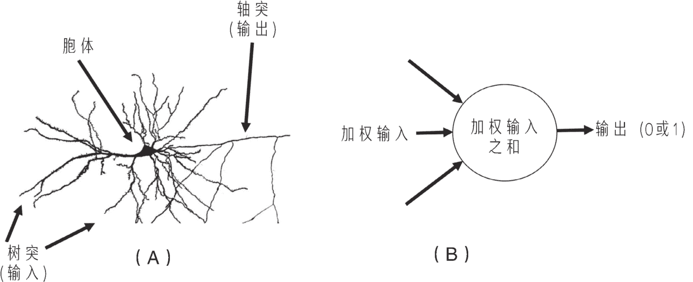

图 1-1　大脑中的神经元（A）和一个简单的感知机（B）

简言之，感知机根据加权输入总和是否过阈值做出是或否决策。生活中你也会这样：听朋友评价一部电影，给品味好的朋友更高权重，总和够大就去看。感知机就是用这种方式决定看不看电影。

受神经元网络启发，罗森布拉特提出用感知机网络做视觉任务，如人脸和物体识别。为了说明，我们来看一个识别手写数字的感知机。

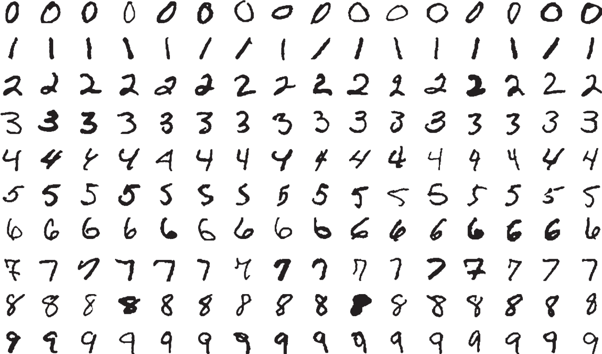

图 1-2　一些手写数字

我们把它设计成“8”探测器：输入是 8 的图像输出 1，其他数字输出 0。需要先把图像转成数值输入，再定权重和阈值。

## 算不出涌现

图 1-3（A）是一个放大的手写 8，每个网格方块即像素，像素强度 `pixel intensity`¹⁴ 用数字表示。黑白图中纯白为 255，纯黑为 0，灰色在中间。假定输入图像被调整为 18×18 像素大小。

图 1-3（B）展示用于识别“8”的感知机。它有 324 个输入，18×18 对应每个像素。给定图 1-3（A）图像，每个输入设为对应像素强度，同时每个输入有自己的权重。

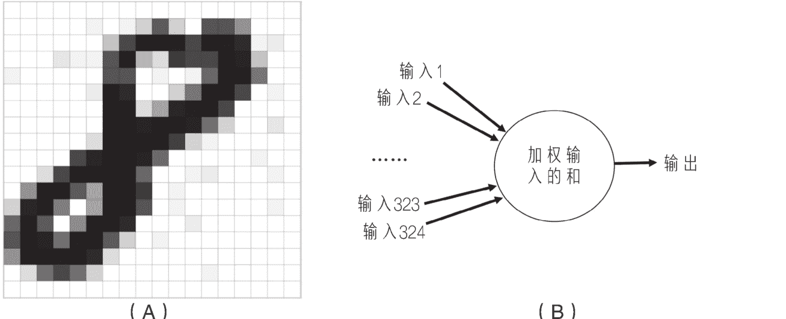

图 1-3　一个用于识别手写“8”的感知机的示意图

注：18×18 像素图像中的每个像素对应感知机的一个输入，该感知机共有 324（18×18）个输入。

与符号化的通用问题求解器不同，感知机里没有明确描述任务的规则，所有“知识”都编码在数字权重和阈值里。罗森布拉特在多篇论文中展示，给定正确权重和阈值，图 1-3（B）的感知机能很好地完成感知任务。但如何得到正确数值？他的答案是学习。

## 如何训练感知机的参数

罗森布拉特借鉴当时行为心理学理论，主张感知机通过条件计算 `conditioning` 学习。受斯金纳给老鼠鸽子正负强化训练的启发，他认为感知机也应在样本上训练：**做对时奖励，做错时惩罚。**今天这叫监督学习 `supervised learning`。训练时系统对样本给出输出，随后得到监督信号，提示输出与正确答案偏差多大，系统据此调整权重和阈值。

监督学习是现代 AI 的关键。通常需要大量正样本，如不同人写的 8，和负样本，如其它手写数字。每个样本由人标注类别——“8”或“非 8”，这些标注作为监督信号。用于训练的样本叫训练集 `training set`，剩下的测试集 `test set` 用来评估泛化表现。

感知机学习算法 `perceptron-learning algorithm` 是罗森布拉特对 AI 的重要贡献。初始时权重和阈值设为 -1 到 1 之间的随机数。比如第一个输入权重 0.2，第二个 -0.6，阈值 0.7，都可用随机数生成器产生。

开始训练。把第一个训练样本输进感知机，感知机把每个输入乘以权重求和，与阈值比较，输出 1 或 0。随后把输出与人工标记的正确答案比较。若正确，权重阈值不变；若错误，则调整权重阈值，使该样本上的答案更接近正确答案。每个权重的改变量取决于关联输入值，对错误的“责任”会分配给影响更大的输入。

接着重复整个过程。感知机在全部训练样本上跑很多遍，每次出错就稍作修改。学习要循序渐进，若一次改动过大，可能学到错误的东西，如过度关注 8 的上下半部分大小相等。每轮重复后，系统有望获得一套能在所有训练样本上都给出正确答案的权重阈值。随后用测试样本评估未见过图像的表现。

若只关心 8，探测器就够用；若要识别其它数字，只要把感知机扩展为 10 个输出，每个对应一个数字，给定样本时对应数字输出 1，其余 0。用感知机学习算法提供足够训练样本即可学习所有权重阈值。

罗森布拉特等人证明感知机网络能学会相对简单的感知任务，并在数学上证明对一类有限任务，足够训练后原则上能做到准确。感知机在更一般 AI 任务中的表现仍不明朗，但这似乎没阻碍乐观预测。《纽约时报》报道了罗森布拉特 1958 年 7 月的发布会：

今天，美国海军公布了一款预计能走路、说话、看东西、写字、自我复制，并能够意识到自我存在的电子计算机的雏形。据估计，感知机不久后就将能够识人，并叫出他们的名字，还能将一种语言的语音即时翻译成另外一种语言的语音和文字¹⁸。

是的，AI 出生时就面临炒作。我稍后会谈炒作带来的不良后果。现在用感知机点出 AI 符号方法与亚符号方法的主要分野。

感知机真正记住的东西只是一组数字——学来的权重和阈值——这让人们很难看出它在识别时到底遵循了什么规则。它的运行方式不是符号化的，不像通用问题求解器里那种 `LEFT-BANK`、`MISSIONARIES`、`MOVE` 之类的明确指令。权重和阈值并不对应特定的概念，这些数值也很难被翻译成人类能读懂的规则。随着网络规模膨到上百万个参数，这种不可解释性变得更加棘手。

有人喜欢把感知机和人脑做粗略比较。如果把你的大脑打开，观察其中上千亿个神经元的局部活动，也很难读出你的想法或做决定的依据。但人类大脑进化出了语言，能够用单词和短语把想法传递出来。从这个角度看，我们的神经活动是亚符号化的，而大脑却在之上创造出了符号。类比之下，感知机及更复杂的模拟神经元网络也被归入“亚符号”阵营。这一阵营的主张是：类似语言的符号和操纵符号的规则，不应像通用问题求解器那样直接编程，而应像大脑中符号从神经活动里涌现那样，从神经元式的结构中自然涌现。

## 感知机被判死刑

1956 年达特茅斯会议后，符号人工智能占据了主导。20 世纪 60 年代初，罗森布拉特正全力投入感知机研究之时，人工智能四位创始人，也就是符号派的核心人物，都各自建立了有影响力且资金充足的实验室：明斯基在麻省理工、麦卡锡在斯坦福、西蒙与纽厄尔在卡内基梅隆，这三所至今仍是 AI 研究的重镇。明斯基认为罗森布拉特以大脑为灵感的亚符号路线是死胡同，还在“窃取”本该给符号派的经费¹⁹。1969 年，明斯基与麻省理工同事西摩·佩珀特合著《感知机》²⁰，书中给出数学证明，说明单层感知机能完美解决的问题类型非常有限，任务一扩大就需要海量权重和阈值，表现迅速恶化。

明斯基和佩珀特指出，给感知机再加一层模拟神经元，原则上可解决的问题会宽广得多²¹，有这一附加层的结构被称为多层神经网络。问题在于，书出版后多层网络并未得到重视，很大程度上是因为缺乏像感知机学习算法那样通用、可用来调整权重和阈值的方法。

关于单层感知机局限性的证明后来广为流传²²。罗森布拉特本人也深入研究过多层感知机，并意识到训练它的困难²³。学界最终放弃感知机，并非主要因为那个数学证明，而是基于对多层网络前景的怀疑。

感知机有不少吸睛之处：线性特性、有趣的学习定理、并行计算的简洁范式，但没有理由认为这些优点能平移到多层网络。无论如何，学界的直觉判断是这些延伸是“不育的”²⁴，而如何证实或反驳这一判断被视作重要课题。用现在的话说，这是一种被动攻击。这种消极推测至少在 60 年代末导致神经网络经费枯竭，而符号派却仍在消耗政府资助。1971 年，43 岁的罗森布拉特死于一次划船事故。失去最坚定的倡导者，又缺乏政府资金，感知机及其他亚符号路线的探索基本停滞，只剩少数孤立团队在苦撑。

## 泡沫破裂后的人工智能寒冬

与此同时，符号派在写拨款提案，承诺要在语音与语言理解、常识推理、机器人导航、自动驾驶等领域取得突破。到了 70 年代中期，少数聚焦面很窄的专家系统虽被部署成功，但当初许诺的通用突破并未到来。

资助方察觉到了。英国科研理事会与美国国防部各出一份评估报告，对 AI 进展的评价都非常负面。英国报告特别指出：“面向高度专门问题领域的专家系统，只有在编程时充分借鉴人类经验和相关领域知识时才有前景，但迄今为止的结果，对通用问题求解器试图在更广范围内模仿人类大脑活动来说，彻底令人沮丧。这样的通用目标程序，似乎仍与 AI 长期梦想相去甚远。”²⁵ 该报告导致英国政府大幅削减 AI 资助，美国国防部也同步压缩了对基础 AI 的投入。

这是一次典型的泡沫循环：第一阶段，新想法获得大量支持，研究者承诺突破，媒体炒作，政府与风险资本向高校和初创公司注资；第二阶段，承诺的突破未现或远不及预期，资金枯竭，公司倒闭，研究放缓。学界熟悉这个模式：AI 春天、过度承诺与媒体炒作，随后是 AI 寒冬，往往以 5 到 10 年为周期。1990 年作者研究生毕业时正值一个寒冬，氛围恶劣到有人建议求职材料里最好别出现“人工智能”这个词。

## 直觉任务为何难被复制

寒冬给从业者留下重要教训。达特茅斯研讨会 50 年后，麦卡锡总结出最简单的教训：“人工智能比我们想象的更难。”²⁶ 明斯基指出其中的悖论：“看似容易的事情其实都很难。”早期目标是：计算机能用自然语言对话，能通过摄像“眼睛”描述所见，见过几个例子后就能学会新概念。这些小孩都能轻易做到的事，对 AI 来说却比诊断复杂疾病、在国际象棋和围棋中击败人类冠军、解决复杂代数问题还要困难。正如明斯基所说：“总的来说，我们完全不清楚心智最擅长什么。”²⁷ 做 AI 的尝试，至少帮助我们更清楚人类心智的复杂与微妙。

## 本章要点

### 01 智能像个装不下的行李箱
谈论 AI 的人都面临定义难题，因为核心概念“智能”本身就模糊不清。对“智能”“思想”“认知”“意识”“情感”等词，明斯基创造了“手提箱式词汇”一说：每个词都像一个装满不同含义的行李箱。人工智能这个词也被打包，不同语境下含义各异。

大多数人会同意人类是智能的，而尘埃颗粒不是；人类也普遍比昆虫更聪明。智商常被放在单一尺度衡量，但我们也讨论情感、语言、空间、逻辑、艺术、社交等不同维度。因此智能可以是二元的、连续的，也可以是多维的。对一个人来说，语言智能高而情感智能低是完全可能的。简单说，“智能”是一个随时可能被撑破的超载行李箱。

## 02 神经网络与机器学习都不是终极答案
明斯基和佩珀特曾否定的、他们认为可能“不育”的带扩展层的感知机，即多层神经网络，事实上成了现代人工智能的基础。下面先解释这些网络如何运作。

### 多层网络靠隐藏单元挖掘抽象特征
网络是一组相互连接元素的集合。社交网络的元素是人，计算机网络的元素是机器，神经网络的元素是模拟神经元，类似于前文所述的感知机。

图 2-1 画了一个用于识别手写数字的简易多层网络草图。网络由两列模拟神经元组成：一个由 3 个隐藏单元构成的隐藏层，和一个由 10 个单元构成的输出层。为了方便，这里用“单元”指代模拟神经元。与第 01 章检测数字 8 的单层感知机类似，该网络有 324 个输入，对应 18×18 像素的强度。与单层不同的是，多了一层隐藏单元，随后是输出层，每个输出对应一个数字类别。

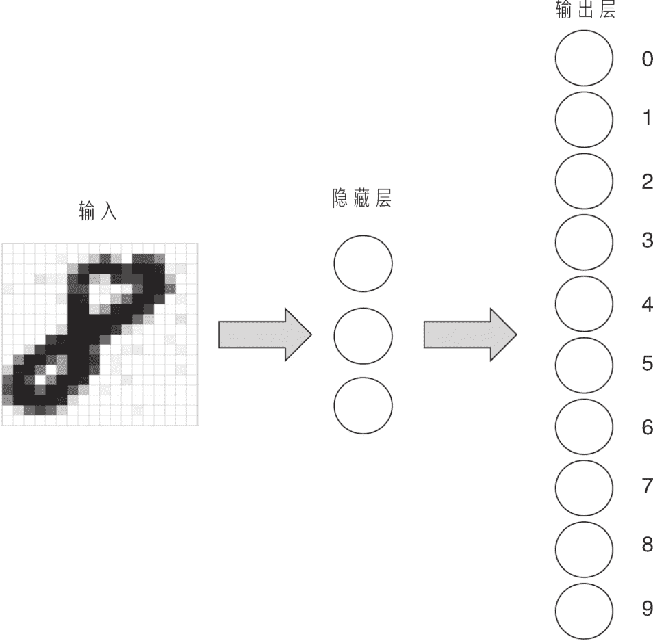
图 2-1　一种用于识别手写数字的多层神经网络

图中灰色箭头表示输入与每个隐藏单元之间、每个隐藏单元与每个输出单元之间都有加权连接。所谓“隐藏单元”指非输出单元，叫“内部单元”更准确。

想象大脑：少数神经元直接控制肌肉运动输出，大部分神经元只在内部传递信息，这些就是大脑的隐藏神经元。

因为含有隐藏层加输出层，图 2-1 的网络被称为多层神经网络。原则上可有多个隐藏层，有多于一层隐藏层的网络称为深度网络，深度即隐藏层数。

与感知机类似，每个单元把输入乘以权重后求和，但不像感知机那样以阈值二值化为激活或不激活，而是输出 0 到 1 之间的激活值。求和越小，激活越接近 0；求和越大，激活越接近 1。

处理像手写 8 这样的图像时，网络从左到右逐层计算，每个隐藏单元先算激活值，再作为输出单元的输入。输出单元的激活可理解为网络对“看到对应数字”的置信度，置信度最高者即为分类结果。

原则上，多层网络能学会让隐藏单元识别更抽象的特征，例如手写 8 的上半部与下半部形状，比像素更高级。对给定任务，需要多少层、每层多少单元，通常只能靠试错。

### 反向传播让任意规模网络都能学习
《感知机》一书中，明斯基和佩珀特对是否能设计出学习多层网络权重设置的有效算法持怀疑，符号阵营其他人也如此。这一怀疑很大程度上导致 70 年代神经网络经费锐减。尽管书的冷却效应明显，罗森布拉特点燃的认知心理学圈里仍有一小撮人在坚持。70 年代末到 80 年代初，他们发展出名为“反向传播”的通用学习算法，强有力地驳斥了“不育”猜测。

顾名思义，反向传播把输出端观察到的误差反向追溯，为网络中每个权重分配恰当的“罪责”。从右向左回溯，使得网络能判断该如何修改每个权重以减少误差。学习即逐步调整连接权重，使所有训练样本上的误差趋近零。数学实现细节略²。

无论输入、隐藏、输出单元有多少，反向传播在原则上都适用。虽无数学保证能找到正确权重，但实践中它在许多对简单感知机很困难的任务上表现很好。例如对一个感知机和一个两层网络在手写数字识别上训练，两者都有 324 个输入和 10 个输出，用 60 000 个样本训练，在 10 000 个新样本上测试。感知机正确率约 80%，而带 50 个隐藏单元的网络达 94%。向隐藏单元致敬！网络学到了什么？不知道。原则上可以尝试探测 16 700 个权重³，但通常理解网络决策非常困难。

注意，神经网络不仅用于图像，也可用于语音识别、股市预测、机器翻译、音乐创作等各类数据。

### 联结主义：结构比符号规则更关键
80 年代最引人注目的神经网络团队是加州大学圣迭戈分校的鲁梅尔哈特与麦克莱兰德团队。当时这类网络常称“联结主义网络”，指知识存在于单元间的加权连接中。这支团队撰写了联结主义的“圣经”——1986 年出版的两卷本《并行分布式处理》。在符号 AI 占主导的版图中，这本书鼓舞了亚符号派，并提出：人类比当今计算机更聪明，是因为大脑采用了更适合自然信息处理的计算架构，例如感知自然场景、梳理关系、理解语言、从记忆中检索上下文信息⁴。作者推测，明斯基和佩珀特偏爱的符号系统无法获得这些能力⁵。

到 80 年代中期，依赖人类专家规则的符号方法——专家系统——越来越暴露脆弱性：易出错，对新情况泛化与适应能力差。研究者发现，编写规则的专家本身也依赖难以程序化的潜意识常识，这种常识的缺失严重限制了符号方法的广泛应用。经历一轮过度承诺、巨额资助与媒体炒作后，符号 AI 又将迎来寒冬。

联结主义者的观点是：智能的关键在于构建合适的计算结构并赋予其从数据或现实行为中学习的系统，这受大脑启发。鲁梅尔哈特等人用软件形式的联结主义网络作为人类学习、感知与语言发展的科学模型。虽然这些网络远未达到人类水平，但《并行分布式处理》及相关文献描述的多样网络像工艺品般有趣，吸引了资助机构注意。

1988 年，美国国防部高级研究计划局的高级官员宣称：“我相信我们即将研究的这项技术，即神经网络，比原子弹更重要。”⁶ 神经网络再次流行。

### 亚符号系统擅长感知不擅长推理
过去六十多年，学界一直在讨论符号与亚符号的相对优势。符号系统可由人类设计、输入人类知识，并用人类可理解的逻辑推理。例如 70 年代初开发的专家系统 `MYCIN`，内置约 600 条规则，帮助内科医生诊断和治疗血液疾病。程序员通过与医学专家面谈开发这些规则。面对病人症状和检测结果，`MYCIN` 能同时做逻辑推理与概率判断并解释过程，是典型的符号 AI。

相比之下，亚符号系统往往难以解释，也没有人知道如何直接把复杂的人类知识和逻辑编码进去。它们更适合人类难以定义规则的感知任务，例如识别手写数字、接住棒球、辨认母亲的声音，这些事我们往往在潜意识层面完成。正如哲学家安迪·克拉克所说，亚符号 AI 的本质是“不擅长逻辑，擅长接飞盘”⁷。

理论上可用符号系统处理语言描述和逻辑推理等高级任务，用亚符号系统处理人脸、声音等低级感知。实践中研究者大致如此分工，但两者联系很少。两种方法各自在细分领域取得重要成功，却都难以逼近最初的 AI 目标。已有符号与亚符号混合的尝试，但至今未取得显著突破。

## 数据与算力推动机器学习登台
受统计学与概率论启发，研究者开发出一系列让计算机从数据中学习的方法，机器学习由此成为区别于符号 AI 的独立分支。机器学习研究者轻蔑地称符号方法为“老式人工智能” GOFAI⁸，并彻底排斥。

随后二十年，机器学习也经历了乐观、政府资助、创业公司涌现、过度承诺，再到不可避免的寒冬。当时数据量与算力有限，用神经网络等方法解决现实问题既慢效果又差；但更多数据与更强算力很快到来，互联网数据的爆炸式增长和芯片技术的飞速发展将确保这一点。下一轮人工智能大变革的舞台已准备就绪。

## 本章要点

## 02 神经网络构成了现代人工智能地基

上世纪八十年代中后期，主打专家手工编写领域规则的符号派人工智能——专家系统，短板彻底暴露出来：出错频繁，碰到新问题就难以迁移和应变。回头审视瓶颈时，研究者意识到，撰写规则的专家自身在行动时其实大量依赖常识，而这种常识很难被写成程序或逻辑公式。常识的缺失严重卡住了符号派的普适性。经历过过度承诺、巨额投入和媒体炒作的一波高潮后，符号人工智能再次滑向寒冬。

联结主义阵营则给出另一条思路：智能的关键不在于硬编码的规则库，而在于拥有合适的计算架构，并能从数据或真实世界的交互中自行学习，正是受大脑运行方式的启发。于是，神经网络重新进入视野并迅速升温。

## 03 图灵测试与奇点对赌，我们猜不透智能会把世界带向何方

## 猫识别神经元点燃的AI春天

你曾把拍猫的视频传上网吗？在 YouTube 上，这类内容只占极小一部分，却足以说明现象的普遍——平台上已累计超过十亿部视频，猫类相关占比相当可观。2012 年，谷歌的一支团队训练了一个多层神经网络，让它“观看”数百万段随机的 YouTube 剪辑，网络参数规模达到十亿量级，训练目标只是学会压缩和解压选中的帧。研究人员并未指定任何物体类别，一周的自学之后，他们在网络内部探到一个单元，对猫的画面异常敏感。这台自学成才的“猫识别机”只是近十年公众热议的 AI 成果之一，其背后是被统称为深度学习的一系列神经网络方法。

很长一段时间里，公众对人工智能的想象主要来源于《2001：太空漫游》《终结者》等影视作品，塑造了光鲜夺目的形象。现实中，人工智能在日常生活和主流媒体里的存在感却很低。若你在九十年代或更早出生，可能还记得与客服语音识别、语言学习玩具 Furby、微软虚拟助手 Clippy 那些令人泄气的交互。成熟的人工智能似乎仍遥不可及。

也正因如此，1997 年 IBM 的深蓝击败国际象棋世界冠军加里·卡斯帕罗夫时，舆论充满震惊甚至失望。卡斯帕罗夫震怒至指控 IBM 团队作弊，认为机器不可能凭自己下得这么好②。讽刺的是，2006 年的世界棋赛局势反转，一名棋手被指控借助电脑程序作弊③。

随后的人类集体焦虑很快消退了。大家接受了国际象棋可以被穷举搜索机器征服，而且下得好并不等于拥有通用智能。这是一种惯常反应：只要计算机在某项具体任务上胜过人类，我们便宣称这项任务不需要真正的智能。正如麦卡锡所叹：“一旦它好用了，就没人再叫它人工智能了。”④

2005 年后，一批更具普适性的应用开始悄然渗透，随后扩散速度惊人。谷歌上线了机器翻译，虽不完美却意外好用并持续改进；加州北部的道路上出现了谷歌的自动驾驶汽车，小心翼翼地完成独立驾驶；Siri、Alexa 等语音助手进入手机和客厅；YouTube 提供相当准确的自动字幕，Skype 在多语视频通话中实现实时同传。更让人毛骨悚然的是，Facebook 能在用户上传的照片里认出人脸，Flickr 也开始用文字自动标注图片内容。

2011 年，IBM 程序沃森在《危险边缘》电视智力竞赛里完胜人类冠军，精准拆解双关语，让肯·詹宁斯感叹“欢迎我们的计算机新霸主”。五年后，数百万观众围观围棋——长期被视为 AI 难题的复杂游戏——AlphaGo 以四比一击败世界顶尖棋手，震动业界。

议论随之高涨，资本跟进。众多科技巨头投入数十亿美元，或直接招揽 AI 人才，或收购初创公司挖人，被称作“人才收购”。初创潮随之井喷，多由前大学教授创办。科技记者凯文·凯利曾调侃：“接下来的上万份创业计划书都能套用一个模板：X + 人工智能。”⑤ 而对绝大多数团队而言，人工智能几乎等于深度学习。AI 的春天再次绽放。

## 弱AI与强AI的分野

与每一轮春天一样，这一次也被通用人工智能将至的预测所笼罩，即能与人类在多数方面相当甚至超越的智能。DeepMind 联合创始人沙恩·莱格 2016 年称，超越人类水平的 AI 或在 2025 年左右到来⑥；一年前，扎克伯格宣布未来五到十年目标是让 AI 在视觉、听觉、语言、一般认知等主要感知领域基本超越人类⑦；2013 年，哲学家文森特·穆勒与尼克·波斯特洛姆对研究人员的调查显示，许多人认为人类水平 AI 在 2040 年前出现的概率为 50%⑧。

即便乐观情绪高涨，迄今所有实例仍属所谓的“狭义”或“弱”人工智能。狭义与弱并非贬义，只指只能完成特定或相关任务的系统。AlphaGo 是围棋世界冠军，却不会玩跳棋和井字棋；谷歌翻译能把英文影评译成中文，却读不出影评人是否喜欢这部电影，更不用说自己观看并点评。

相对的概念是“强”“人类水平”“通用”或 AGI，即电影中常见的那种能做人类几乎所有事情、甚至更多的智能。通用智能本是 AI 创始目标，却被证明远比预期困难。于是研究转向语音识别、下棋、自动驾驶等定义清晰的专项。2016 年的一项研究指出：“一堆狭义智能永远堆不出通用智能，关键在于能力的整合。”⑨

在狭义能力爆发式增长的当下，要多久才能将它们整合出人类那种宽泛、细腻的智能？认知科学家史蒂芬·平克认为，这仍是老生常谈，“人类水平 AI 仍是 15 到 25 年后的事，且近期被吹捧的进展根基不深。”¹⁰ 争议的核心是：我们如何判定一个“思考机器”真的成功了？它需要自我意识吗？必须像人类一样理解吗？是模拟思维更准确，还是真的在思考？

## 机器是在模仿思考还是真正思考

这类哲学困扰伴随 AI 从一开始。1930 年代描绘首个可编程计算机框架的图灵，在 1950 年论文《计算机器与智能》中发问“我们到底在问什么？”提出著名的模仿游戏，即后来的图灵测试，并列出对思考机器的九条反对意见，从神学到超心理学。神学认为思考是灵魂功能；超心理学则称人类能心灵感应而机器不行，图灵觉得后者“非常有力”。

几十年经验下来，最有分量的反对仍是“意识论”。图灵引述神经科学家杰弗里·杰斐逊的话：若机器写诗写协奏曲只是符号组合而非源于感受和情感，我们不会视其等同大脑。机器不会为成功欢喜、为关机悲伤、为赞扬温暖、为错误痛苦、对性好奇、为得不到而愤怒。¹¹ 论点指向：只有能感受并自知行为感觉的机器才算真思考，而目前没有机器做到。

我并不完全认同，但这与直觉高度共鸣。许多朋友、学生持相同立场。我的母亲是退休律师，读到关于谷歌翻译的报道后说：“这些人把 AI 人格化过头了。”我问人格化指什么，她说语言暗示机器会真正思考而非只是模拟。我追问区别，她答真正思考由大脑完成，模拟思考由计算机完成。追问大脑的特别之处，她坦言不知道，觉得思考里有一种永远无法被计算机完全模仿的人类特性。她自认是唯物主义者，却仍不信机器能拥有真正思考所需的品质。

在学界，最知名的表述来自约翰·瑟尔。1980 年《思想、大脑和程序》中，他区分强 AI 与弱 AI。对瑟尔而言，强 AI 指“恰当编程的数字计算机不只是模拟心智，而是真正拥有心智”¹³；弱 AI 只是把计算机当作模拟人类智能的工具，并不认为其真有心智¹⁴。回到核心问题：模拟心智和真正心智有区别吗？瑟尔与我母亲一样认为两者本质不同，并在原则上否定强 AI 的可能性¹⁵。

## 图灵测试：当电脑足够像人

瑟尔的论证深受图灵论文启发。图灵认为“机器会思考吗”本就无意义，不如改问是否存在可想象的数字计算机能在图灵测试中表现优异。测试中裁判通过文字与一名人类、一台计算机交流，若无法分辨，便可视为思考。图灵写道：这是在抗辩“肉体的沙文主义”¹⁶——为何思考必须由生物细胞实现？

细节充满挑战。图灵未限定参赛者与裁判标准，也未规定时长或话题，但他做出具体预测：约 50 年后，程序控制的计算机能在 5 分钟对话中让普通裁判的正确判断率不超过 70%，即误判率达 30%。

预测相当精准。多年来图灵测试多次上演，参赛者多为聊天机器人。2014 年英国皇家学会的演示中，5 个程序与 30 名人类参赛、30 名来自不同背景的裁判同场。俄罗斯和乌克兰程序员开发的 Eugene Goostman 欺骗了 10 名，占比 33.3%，被宣布胜出。主办方按图灵标准宣称图灵测试被首次通过。

Eugene 与多数聊天机器人类似：存储大量句子模板，按规则填充，并用程序员预设的常识库和逻辑规则生成人味回答。它的设定是 13 岁乌克兰男孩，英语不完美。一次对话记录如下：

裁判：你的性别？
古斯特曼：如果你想知道的话，我是个小男孩。顺便说一句，也不是很丑！
裁判：此时你想到了什么？
古斯特曼：如果你不介意的话，我不想说这个。你能告诉我你的职业吗？
裁判：你多大了？
古斯特曼：我是一个 13 岁的小男孩。
裁判：你具备什么资历？
古斯特曼：我的资历？我不会告诉你的。噢，还有别的事吗？¹⁷

赛后新闻称“有 65 年历史的图灵测试首次被计算机通过”。人工智能专家普遍嗤之以鼻：从记录看古斯特曼不过是个程序，手法并不复杂。结果更多暴露的是裁判和测试设计的问题。五分钟内通过改题或回避棘手问题即可欺骗非专业裁判，早在 70 年代模仿心理治疗师的 Eliza 开始就已被证实。

正因如此，多数学者对图灵测试并不买账，视其为宣传噱头。图灵或许高估了普通裁判辨别浅层诡计的能力。若延长对话、提高专业度，测试是否仍能衡量真实智能？谷歌前工程总监库兹韦尔相信合理设计的测试能检验智能水平，并预测 2029 年前通过，这也是通往奇点之路的里程碑。

### 2045奇点，非生物智能或超人类万亿倍

奇点预言家库兹韦尔的指数迷思

提到人工智能的乐观派，雷·库兹韦尔的名字几乎是代名词。这位麻省理工学院马文·明斯基的门生，既是实干的发明家，也是未来的布道者。他做出了第一台把文字变成声音的机器，也打造了当时公认最顶级的音乐合成器。1999 年，比尔·克林顿亲自为他颁发了美国国家技术创新奖章。

可让库兹韦尔真正出圈的，并不是硬件，而是他对未来的押注。最核心的概念就是“奇点”：在某个时刻，技术的变革速度会快到令人眩晕，影响力大到人类生活被彻底不可逆地改写¹⁹。奇点在这里被定义为具有非同寻常冲击力的独特事件，能切分人类历史的结构²⁰。对库兹韦尔而言，这个事件就是非生物智能超过人类智能。

这个思路并非凭空而来。数学家伊曼纽尔·古德早年就描绘过智能爆炸的可能：把能全方位超越人类的机器叫做超级智能机器，设计机器本身就是一种智力活动，于是超级智能可以设计更强的机器，爆炸一旦启动，人类将被远远甩在后面²¹。数学家兼科幻作家弗诺·文奇也说，人类智能用了上百万年进化，而我们可能只用很短的时间造出同等的进步，等更强的智能出现，历史就会进入奇点，世界的运行将超出我们的理解范围²²。

库兹韦尔把智能爆炸拿来做了科幻加码，从人工智能到纳米科学，再到虚拟现实和“大脑上传”，全部用近乎德尔斐神谕般冷静自信的口气，配上精确到年份的日程表来讲出来。感受一下他的时间表：

进入21世纪20年代，分子组装技术将给出根除贫困、净化环境、攻克疾病、延长寿命的工具。

2029年，计算机通过图灵测试²³。

21世纪30年代，人工智能变得相当真实，也意味着能过图灵测试²⁴。

30年代末，基于大规模分布式智能纳米机器人的脑植入物将极大拓展记忆，并显著改善感知、模式识别与认知能力。

大脑上传即扫描大脑全部关键细节并移植到合适的强大计算基底上，他把成功实现的保守时间定在21世纪30年代末²⁵。

我把奇点定在2045年，那一年人类创造的非生物智能将比当下全部人类智能强10亿倍²⁶。

作家安德里安·克雷耶曾带着挖苦说，这不过是对技术末世论的一种信仰²⁷。

所有这些判断，都建立在“指数级增长”之上。指数增长在科技里司空见惯，尤其是在计算机领域。下面用一个老故事来说明它长什么样。

### 指数增长的老故事

很久以前，一位来自贫瘠村庄的智者造访富裕王国，国王与他下棋。智者赢了，国王许他任意赏赐。智者要求在64格棋盘上放米，第一格2粒，第二格4粒，以此类推每格翻倍，放完一格就运走。

国王以为小事一桩。宫人先填满前8格，2加4加8直到256粒，总共510粒，装袋即走。进入第二行，第一格就要512粒，第二格1024粒，米粒装不下棋格，只能倒进大碗。到了第16格，需要65536粒，约1千克。第二批运走约重2千克。

第三行开始发力。第17格要2千克，第18格4千克……到第24格需要512千克。国王增派人手。算到第26格需要2048千克时，国王意识到整个国家的存粮都快不够，棋盘还没填满一半，只得求智者宽恕。智者的村庄已收获够多粮食，于是罢手。

图3-1（A）展示第1至24格所需大米重量，前16格都不足1千克，之后因翻倍而爆发式攀升。图3-1（B）从第24格到第64格，重量从512千克飙升到30多万亿千克。

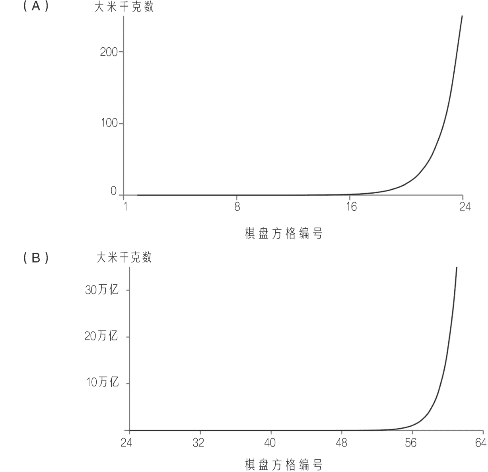

图3-1　每个棋盘方格所需大米重量

描述这一过程的数学函数是y=2^x，x为方格编号，y为米粒数。指数函数的特征就是从缓慢起步到某一临界点后进入极速爆发。

### 摩尔定律与计算的现实样板

对库兹韦尔来说，计算机时代就是现实版的米粒寓言。1965年英特尔联合创始人戈登·摩尔提出摩尔定律：芯片上元件数量每1到2年翻一倍。换句话说，元件越做越小越便宜，运算速度和存储也在指数级爬升。

库兹韦尔的书里满是类似图3-1的曲线，并据此推断人工智能。他的判断是，若趋势延续，2023年前后1000美元的电脑就能达到人脑运算量，每秒10¹⁶次计算²⁸。到那时，把人工智能做出来只是逆向工程大脑的问题。

### 把大脑拆开重造

逆向工程大脑就是搞清它怎么运转，从而复制或借用其原理。库兹韦尔认为这是制造人类水平人工智能的务实捷径。2002年他写道，经过细致分析，30年内我们就能掌握人脑运作并用人工合成物质重现其功能²⁹。

大多数神经科学家对此持保留态度。即便能造出按大脑原理运行的机器，它怎么学会所有知识？新生儿有大脑却没有人类水平智能。库兹韦尔承认，大脑复杂性很大程度上来自与复杂世界的互动，自然智能需要教育，人工智能也需要教育³⁰。

他认为教育过程可以大幅加速。当前电子元件信息处理速度比人脑的电化学处理快1000万倍以上。人工智能一旦掌握基本语言技能，就能靠快速阅读人类全部文献和海量网站开源知识猛涨通用知识³¹。

他并不认为能像早期专家系统那样逐条编码人类智能，而是要基于人脑逆向工程搭建复杂的自组织系统层级，再提供教育，而且速度会比人类教育快数百甚至上千倍³²。

### 拥趸与怀疑的两极

库兹韦尔的《精神机器时代》和《奇点临近》引发了两极反应。我读时就属于怀疑派，现在依然如此。我不信他对指数曲线过度解读，也质疑逆向工程大脑的可行性。深蓝击败卡斯帕罗夫只是棋类一隅，人工智能在绝大多数领域仍远逊人类，几十年内比肩的说法对我而言过于乐观。

我熟悉的很多人也有类似怀疑。记者莫琳·多德曾描写她与斯坦福人工智能学者吴恩达的对话，提到库兹韦尔时，吴恩达下意识翻白眼：“每次我读《奇点临近》，眼睛就忍不住这样。”³³

另一边，库兹韦尔的拥趸不少。他的书长期畅销，《时代周刊》评价奇点：这不是边缘想法，而是对地球生命未来的严肃假设³⁴。

在科技产业，库兹韦尔影响尤其深。这些人习惯把指数级进步当成解决社会问题的万能钥匙。库兹韦尔不仅是谷歌工程总监，还是奇点大学联合创始人，另一位创始人是未来派企业家彼得·戴曼迪斯^((21))。奇点大学被定位为跨人文主义智库、创业孵化器，也办技术精英夏令营。公开使命是教育领袖用指数技术解决重大人类挑战³⁵，得到谷歌背书，拉里·佩奇是早期支持者并常去授课，众多知名科技公司都是赞助者。

思想家侯世达在怀疑与担忧间徘徊，感到库兹韦尔的书把滑稽科幻和真实东西混在一起。他指出，回头看，库兹韦尔很多看似疯狂的预测里总有成真或即将成真的部分，很惊人。到30年代会不会出现把全部感官体验和情绪神经关联都上传到网上的“体验波束”³⁶？听起来疯狂，但80年代末他依据指数增长预测1998年电脑击败人类国际象棋冠军，结果1997年就发生了，比预测还早一年³⁷。

侯世达认为库兹韦尔巧妙用了“克里斯托弗·哥伦布策略”³⁸，指科尔·波特歌里“他们都笑了克里斯托弗·哥伦布说地球是圆的”。库兹韦尔引用了大量低估技术影响的名言：1943年IBM董事长托马斯·沃森说全球电脑市场容纳5台就够；数字设备联合创始人肯·奥尔森1977年说个人没理由在家放电脑；比尔·盖茨1981年说640KB内存足够³⁹。侯世达自己在国际象棋上的误判也让他不敢轻易否定库兹韦尔。“深蓝击败卡斯帕罗夫时肯定停下来想了想。”⁴⁰

### 一场关于图灵测试的对赌

未来学家的工作很惬意，写书做几十年后才验真假的预测，不影响当下声誉。2002年出现了Long Bets网站，让预测者押钱保持诚实。

软件公司Lotus创始人米歇尔·卡普尔提出消极预测：到2029年都不会有电脑或智能机器通过图灵测试。他是互联网公民自由的活动家，对奇点头持高度怀疑。库兹韦尔接受对赌，若卡普尔赢2万美元捐给电子前沿基金会，若库兹韦尔赢则捐给库兹韦尔基金会。测试在2029年底进行。

两人以书面形式细化规则。人指2001年定义的生物人类，智能未被非生物增强；计算机指任何非生物智能，可含各种硬件软件，不能是生物人类，但允许非生物模拟神经元。

条款规定由3名人类裁判执行，分别对计算机选手和3名人类陪同选手各做2小时访谈，裁判由卡普尔、库兹韦尔及第三方组成。每位裁判对每位选手判断人或机。若计算机让2名及以上裁判误判为人类，则通过人性判定测试。

此外每位裁判需对4位选手排名，第1名最不像人类，第4名最像。若计算机排名中位数大于等于2名及以上人类陪同选手，则通过排位测试。两者同时通过才算通过图灵测试。

卡普尔和库兹韦尔各自撰文说明理由。库兹韦尔总结为计算能力、神经科学、纳米技术的指数进步将使大脑逆向工程成为可能。卡普尔则强调肉身和情感对认知的塑造：对环境的感知与物理互动对经验认知同等重要，情感约束并塑造思考⁴²。他断言，没有人类躯体的等价物，机器永远无法获得通过严格图灵测试所需的知识。

我认为人类学习的根本模式是经验性的，书本学习只是其上层……如果人类知识，特别是经验性知识，在很大程度上是隐性的，从未被明确表达，就无法从书本找到，库兹韦尔设想的知识获取方法会失败……问题不在计算机知道什么，而在它不知道什么且无法知道什么⁴³。

库兹韦尔认同经验学习、隐性知识和情感的作用，但他相信21世纪30年代前虚拟现实将变成“完全现实”，足以重建教育人工智能所需的物理体验。人工智能的核心将是逆向工程构造并带情感的人工大脑。

你会像卡普尔一样怀疑吗？库兹韦尔会说，因为你不懂指数。分歧常在于批评者低估大脑逆向工程或生物科学的复杂性，而他认为他们低估了指数增长的力量⁴⁵。

怀疑者也指出漏洞。硬件过去50年确实指数增长，但未来或难持续；更关键的是软件并没显示同等指数进步，很难说今天的软件比50年前更复杂或更像人脑。神经科学和虚拟现实的指数论调也备受争议。

拥趸则说，有时身处曲线缓慢段会误以为是渐进，实则爆发就在前方。

当下这个人工智能的春天，究竟是即将爆发的预兆，还是只是缓慢增长曲线上的一个点，未来一百年都不会出现人类水平智能？抑或只是另一个泡沫，寒冬很快到来？

想弄明白这些困惑，得先拆解支撑人类独有智能的几大支柱——感知、语言、决策、常识推断与学习能力。接下来几章会盘点AI在这几块地盘上推进到什么程度，并对2029年前后的人工智能走向做一次评估。

### 本章要点
#### 03 狭义智能的局限与通用智能的鸿沟

深度学习近年的成绩很亮眼，但到目前为止所有成果仍落入“狭义”或“弱”人工智能的范畴。狭义、弱，基本指只能处理某类受限任务或若干相关任务的系统。`AlphaGo`是围棋界的王者，却不会跳棋、井字棋，甚至脱离棋盘就无能为力。谷歌翻译能把英文影评转成中文，却读不出影评人喜不喜欢这部电影，更做不到自己去看并写评论。

相对的概念是“强”“人类水准”“通用”或“全面”人工智能，有时称作`AGI`，即能完成人类几乎所有事务甚至更广的智能。通用智能本是AI研究起初的理想，但至今没有程序能在真正通用的意义上被称作智能。近期的研究提到：“再多的狭义智能叠加也凑不出通用智能，关键不在能力的数量，而在于能力之间的融合。”

# 第二部分
## 视觉识别：看似容易实则难啃
### 视觉识别的两次跃迁
#### 1. `ConvNets`引爆计算机视觉的深度学习浪潮

卷积神经网络`ConvNets`常被视作AI新引擎，其实早在上世纪80年代就由法国计算机科学家杨立昆提出，他受福岛邦彦的神经认知机`Neocognitron`启发。要看清当下计算机视觉的进展与瓶颈，理解`ConvNets`至关重要。

#### 2. `ImageNet`竞赛为何成为关键分水岭

要提升机器视觉，需要一个更大规模的基准图库，类别更丰富、照片更多。普林斯顿年轻教授李飞飞瞄准了这个方向，她的想法是用词网`WordNet`的名词搭建图像库，让每个名词都对应大量真实图片，于是有了`ImageNet`。但判断一张照片是否属于某个名词，本身就是目标识别任务，而当时计算机在这项任务上几乎不可靠，这正是当初建库的初衷。

## 04
## 一张照片能读出多少层信息

看图 4-1，你会得到什么解读。有人认为是女士在抚摸狗狗，也有人说是士兵在抚摸狗狗；更完整的理解是，一只狗在迎接刚从战场返家的战士，旁边有鲜花和写着“欢迎回家”的气球，士兵脸上情绪复杂，狗则兴奋摇尾。


图 4-1　在这张照片中，你看到了什么

这张照片很可能拍于近十年内，地点大概是一个机场。士兵为何抚摸这条狗？也许长期分别经历不少波折，满心思念，回家后情绪激动；也可能这条狗象征着“家”。拍摄前发生了什么？士兵下机、出安检、抵达接机口，家人朋友以拥抱鲜花气球迎接并解开狗的牵引绳。狗直奔士兵，士兵放下手中物品蹲下，小心把气球绳压在膝下防飘走。接下来她可能起身拭泪，拿起鲜花气球笔记本牵起狗，与亲友一同走向行李区。

观察图片时，最底层看到的是油墨或屏幕像素。奇妙的是，眼脑能在几秒内把原始信号转译成包含生命、物体、关系、地点、情感、动机、过去与未来的完整故事。观看理解的关键还在于懂得过滤无关信息：地毯纹路、背包垂下的绳带、肩带上的哨子、头发上的发夹等。

人类几乎瞬间处理海量信息，且很少意识到自己在处理。非先天失明者，视觉处理会在多重抽象层面主导大脑。用这种方式描述照片、视频或实时画面，也是我们对通用人类水平AI的首要期待。

### 看与做
自上世纪50年代起，研究者就想让计算机理解视觉数据。早期看起来很直接。1966年，主推符号AI的麻省理工教授明斯基和佩珀特提出“夏季视觉项目”，让本科生做“构建视觉系统关键部件”的课题¹。一位AI史学家的说法是，“明斯基请了一名大一新生，让他用一个夏天把摄像机连上计算机并让计算机描述所见”²。

那名本科生没有实质进展。尽管此后数十年计算机视觉子领域不断前进，人类那样去看和描述的程序仍遥不可及。兼具观看与洞察的视觉，原来是“容易”里最难的。

描述视觉输入的前提是目标识别`object recognition`，即把图像中一组像素归为特定类别，如“女士”“狗”“气球”“笔记本电脑”。对人类而言迅速自然，看似对计算机也不难，直到真正尝试才发现难度极高。

难点在哪？以识别狗为例。图 4-2展示了部分困难。程序要先分辨哪些像素是狗、哪些是非狗如背景阴影其他物体。不同狗外观差异大：毛色、体型、尺寸、朝向各异；光照变化大；部分可能被围栏、人等遮挡。更棘手的是，狗的像素模式可能与猫等动物相似，某些光照下云朵甚至会像一条狗。

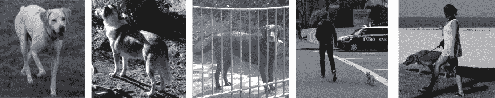
图 4-2　目标识别：对人类来说很简单，对计算机来说很难

自50年代起，计算机视觉就在解决这些问题。直到近几年，设计能抽取目标“不变特征”的专用图像处理算法仍是主流。即便如此，目标识别能力仍远不及人类。

### 深度学习革命：关键在层深而非复杂

得益于深度学习，机器对图像视频中物体的识别能力在21世纪第一个十年实现质变。

深度学习本质上是训练深度神经网络`DNN`的算法，`DNN`指拥有一个以上隐藏层的神经网络。隐藏层位于输入层与输出层之间，网络深度即隐藏层数量。需要强调的是，深度学习的“深度”指网络层数，而非学习内容的复杂性。

`DNN`研究已有多年，近年来在诸多AI任务上取得突破后才掀起革命。有趣的是，最成功的`DNN`模仿了大脑视觉系统的结构。传统多层网络虽受大脑启发，结构却差异很大，而主导深度学习的`DNN`则直接基于神经科学对大脑的发现建模。

### 从神经认知机到 ConvNets 的脑启发路径

就在明斯基和佩珀特提出视觉项目时，两位神经科学家大卫·胡贝尔与托尔斯滕·威塞尔进行着长达数十年的研究，从根本上重塑了人对视觉尤其是目标识别的理解。他们因发现猫与灵长类动物视觉系统的层级结构`hierarchical organization`，并阐明视网膜光线如何转化为大脑可辨信息而获诺贝尔奖。

胡贝尔与威塞尔的发现启发日本工程师福岛邦彦在70年代开发最早的`DNN`之一认知机`Cognitron`，随后改进为神经认知机。福岛在论文³中报道了用神经认知机识别手写数字的成功案例，学习方法虽未推广到更复杂视觉任务，但神经认知机对后来方法产生深远影响，包括今日最具影响力的方法：卷积神经网络`ConvNets`。

`ConvNets`驱动着当下计算机视觉的深度学习革命，在其他领域亦然。虽被誉为AI下一个大事件，实则并不新鲜，80年代由法国科学家杨立昆提出，受福岛神经认知机启发。杨立昆是`ConvNets`之父、纽约大学终身教授、深度学习三巨头之一，杨立昆是他的中文名字。

下面详细说明`ConvNets`的工作机制，因为理解它对把握当前计算机视觉及AI其他方面的发展进程与局限至关重要。

### ConvNets 如何避免把狗认成猫
与神经认知机相似，`ConvNets`设计基于胡贝尔与威塞尔在50-60年代关于大脑视觉系统的关键发现。眼睛聚焦场景时，视网膜细胞被不同波长光激活，通过视神经把信号传入大脑后部视皮层。视皮层大致呈层状排列，像婚礼蛋糕一样逐层传递激活。

证据表明，层级中不同层神经元是渐进复杂特征的“检测器”。如图 4-4：底层神经元响应物体边缘，随后层对由边缘构成的简单形状响应，依次递进至复杂形状、整体对象与特定面孔。

需注意，图 4-4箭头表示自底向上前向信息流。但视皮层也存在自顶向下反馈流，信息从高层到低层，反馈连接数约为前馈连接的10倍。我们坚信先验知识与预期储存在更高脑区并强烈影响感知，但神经科学家对反馈的具体作用仍未完全明晰。

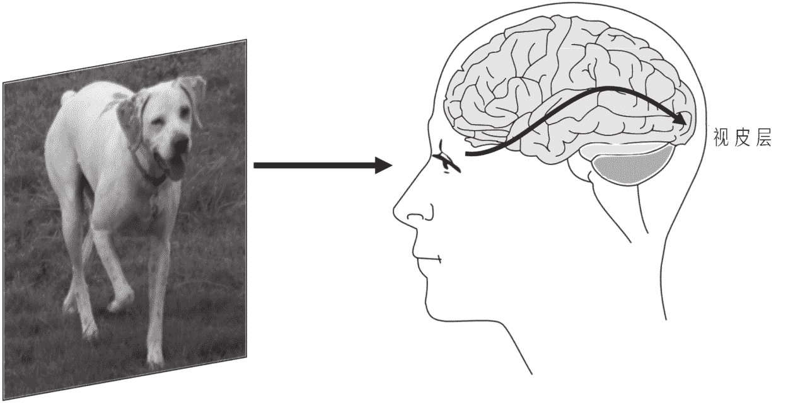
图 4-3　从眼睛到视皮层的视觉输入路径

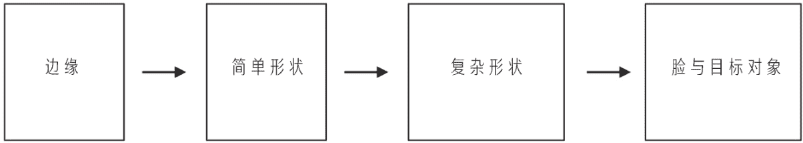
图 4-4　视皮层中不同层的神经元检测到的视觉特征简图

与图 4-4前向层级类似，`ConvNets`由一系列模拟神经元层组成，每层单元为下一层提供输入。处理图像时，每个单元有一个由输入与连接权重计算得出的激活值。

为具体说明，假设一个拥有4层神经元加一个“`classification module`”⁴的`ConvNets`，目标是识别图像中的狗与猫。为简便，每张输入图只含一只猫或一条狗。图 4-5展示该结构，较为复杂，下面逐步解释。

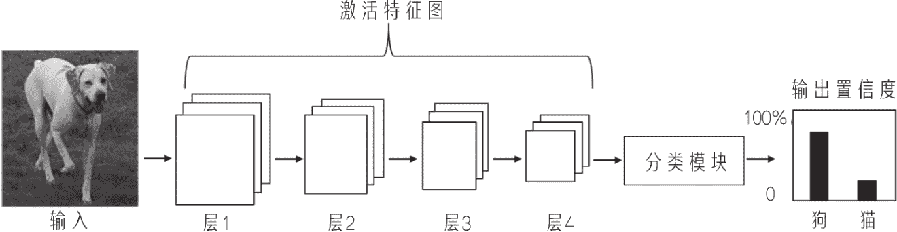
图 4-5　用于识别图片中狗和猫的 4 层`ConvNets`

`ConvNets`输入为图像，即与每个像素颜色亮度对应的数值组⁵。最终输出是网络对每种类别狗或猫的置信度0～100%。目标是让网络对正确类别输出高置信度，对其他类别输出低置信度，从而学会哪些特征对任务最有帮助。

图 4-5中每层由一组重叠矩形表示，代表激活特征图`activation maps`，受大脑视觉系统中类似映射启发。胡贝尔与威塞尔发现，视皮层下层神经元物理排列成网格，每个神经元只对视野中一小块区域响应。想象夜晚飞机掠过洛杉矶上空的照片，灯光形成城市粗略地图。同样，视皮层网格神经元的激活形成对视觉场景重要特征的粗略映射。若有一个特种相机可分别拍摄建筑灯光、车灯等，就类似视皮层：每个重要视觉特征都有自身神经映射。多种映射共同唤起场景感知。

与视皮层神经元一样，`ConvNets`单元是重要视觉特征探测器，每个单元在特定视野中寻找指定特征。每层包含多个单元网格，每个网格形成特定视觉特征的激活特征图，与视皮层结构相近。

单元应检测哪些特征？先看大脑。胡贝尔与威塞尔发现视皮层下层神经元作边缘检测，边缘即对比明显的区域边界。每个神经元接收对应特定小区域的输入，该区域称感受野`receptive field`。只有感受野包含特定边缘时神经元才激活。

这些神经元对响应边缘非常挑剔。有些仅对垂直边缘强烈激活，有些只响应水平边缘，有些只对特定角度响应。胡贝尔与威塞尔最重要的发现之一是：人类视野每个小区域对应许多不同的边缘检测神经元感受野，也就是低层处理在尝试弄清场景各部分的边缘方向，然后把信息传向更高层⁶。

类似地，我们假设的`ConvNets`第1层由边缘检测单元组成。图 4-6给出第1层详解。该层由三个激活特征图组成，每个为单元网格。特征图每个单元对应输入图像类似位置，每个单元从该位置周围一小块区域即感受野获得输入，通常邻近单元感受野会重叠。每个单元计算一个激活值，用以衡量图像区域与该单元偏好边缘方向的“匹配度”，方向有垂直、水平、倾斜三种。

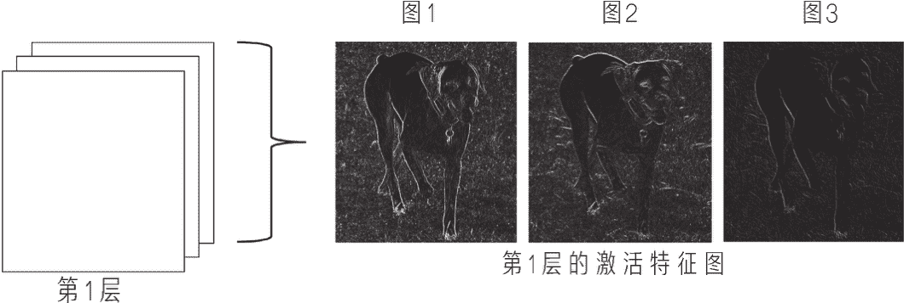
图 4-6　`ConvNets`的第 1 层激活特征图

图 4-7详细展示图 4-6中特征图1单元如何计算激活值，主要为检测垂直边缘的单元。输入图像中白色小方块代表两个单元的感受野。放大后为像素阵列，为简化每个图像块展示为3×3像素集。每个单元把感受野像素强度作为输入，将每个输入乘以权重后求和得到激活值。

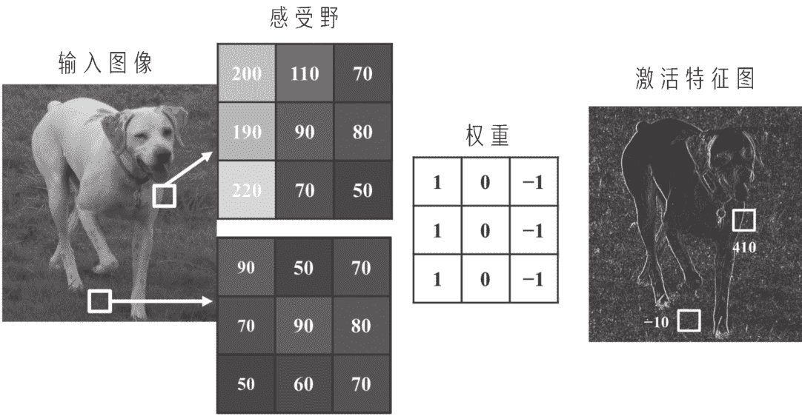
图 4-7　如何使用`ConvNets`来检测垂直边缘

例如，图 4-7上方感受野的权重卷积为：`(200×1)+(110×0)+[70×(-1)]+(190×1)+(90×0)+[80×(-1)]+(220×1)+(70×0)+[50×(-1)]=410`，结果即该单元激活值。

当感受野包含明到暗的垂直边缘即左右两侧对比鲜明时，图4-7所示权重会产生高激活值。上方感受野包含垂直边缘：狗亮色皮毛紧邻暗草坪，对应高激活值410。下方面无此边缘，只有深色草坪，激活值-10接近0。注意暗到明的垂直边缘会产生“高”负值。

将感受野每个像素强度乘以对应权重再求和的计算过程称作卷积`convolution`，这就是“卷积神经网络”名称由来。如前所述，`ConvNets`中一层激活特征图对应整幅图像上感受野的单元网格。在给定激活特征图中，每个单元使用相同权重计算其感受野的卷积。想象用图4-7权重，若输入图像中有垂直边缘，结果如图4-7中激活特征图⁷所示：边缘上单元感受野中心像素显示为白色，因激活值由较大的正值与绝对值较小的负值相加。激活值越接近0颜色越近黑色，越远离0越近白色。白色区域突显垂直边缘位置。图4-6中特征图2和3以相同方式创建，但分别用突出水平与倾斜边缘的权重。总体上，第1层边缘检测单元的激活特征图为`ConvNets`提供输入图像不同区域特定边缘的表示，类似于边缘检测程序输出的内容。

先从“地图”这个日常词说起。地图本质上是对某片地理区域的空间抽象，比如一张巴黎路网图，它会呈现街道、大道、小巷的走向，却不会标注建筑、路灯、垃圾桶、苹果树或鱼塘的分布。按需求定制也很常见，专门标出自行车道、素食餐厅、允许遛狗的公园的地图都能找得到。想向没去过巴黎的朋友介绍城市面貌，用一张叠加了若干地标的地图是最直观的做法。

大脑处理视觉的方式和这个思路惊人地相似，`ConvNets`也是把视觉场景拆解成一系列反映特定检测器“关注点”的图。图 4-6 里这些关注点就是不同方向的边缘，所得到的图就是`ConvNets`中全部激活特征图构成的集合。不同的是，网络并不事先决定关注什么，而是依据训练任务自行学会自己的检测器。

激活特征图并非只有第一层才有。图 4-5 的结构适用于所有层：每一层都有一组检测器，每个检测器生成自己的激活图。`ConvNets`之所以有效，关键在于层次化。假设的网络中，第二层的输入是第一层的激活图，第三层以此类推。第一层单元对边缘有反应，第二层对边缘的特定组合如棱角、“T”形敏感，第三层则对更复杂的组合敏感。层级越高，检测器捕捉的特征越复杂，这与胡贝尔、威塞尔等人在大脑中观察到的现象一致。

我们举例的网络有 4 层，每层 3 张激活图。实际系统远更深，常有数百层，每层特征图的数量也各不相同。确定网络的层数、特征图数量等结构要素，是把这类复杂神经网络适配到具体任务的核心。第 03 章提到古德对“智能爆炸”的设想，目前还未到来，当下让`ConvNets`更好用仍离不开人的智慧。

### 特征激活与分类模块如何做出判断
`ConvNets`的前 4 层通常叫做卷积层，每层对前一层做卷积，第一层直接对输入图像卷积。经层层计算后，第四层会输出一组关于相对复杂特征的激活图，这些特征可能包含眼睛、腿部、尾巴轮廓，也包括网络从训练中习得的其它可用于分类的线索。此时分类模块接管这些特征，完成预测。

分类模块本质上是一个传统的神经网络，结构类似第 02 章介绍的那种单隐藏层网络。它的输入来自最高卷积层的激活图，输出是一组概率值，对应不同类别的置信度，例如在狗猫二分类中给“狗”和“猫”分别打分。

简要说来，受胡贝尔和威塞尔关于视皮层的研究启发，`ConvNets`把输入图像通过卷积逐步转成特征越来越复杂的激活图，最高层的图送入传统神经网络分类模块，输出对已知类别的置信度，置信度最高者即为网络判定的结果⁸。若想体验训练良好的`ConvNets`能力，拍张照片上传到谷歌“以图搜图”⁹即可，系统会据此给出对数千个物体类别的最佳判断。

### 靠数据学习，而非内置答案
我们假设的第一层包含边缘检测器，现实中这些检测器并不是预设的。`ConvNets`会从训练样本中学习每一层应检测的特征，以及分类模块中权重的设置方式，使正确答案获得更高置信度。与传统神经网络一样，所有权重都可通过第 02 章所述的反向传播算法从数据中习得。

以区分狗和猫为例，先收集大量并已做好“狗”或“猫”标签的图像组成训练集。训练开始时网络所有权重随机初始化，然后逐张输入图像，层层计算出对“狗”和“猫”的置信度，再与真实标签对比，例如狗图应让“狗”趋近 100%，“猫”趋近 0%。随后用反向传播微调权重，使下次遇到同一图像时输出更接近真实值。

“输入—计算误差—调整权重”在训练集上循环，这就是一次迭代。训练需多次迭代，最初表现很差，随着权重反复调整逐渐变好，最终收敛，即权重不再显著变化。此时网络在训练集上很熟练，但能否泛化到未见过的图像仍需验证。有趣的是，尽管没有硬性规定，`ConvNets`在大规模真实图像上训练后，仍会自发演化出类似胡贝尔和威塞尔发现的大脑视觉系统分层检测器结构。

下一章将讲述`ConvNets`如何从小众走向主导，这与同期大数据浪潮密不可分。

### 本章要点
### 04 大脑识别与 ConvNets 识别的对照
**大脑识别模式：** 眼睛聚焦场景时，光线激活视网膜细胞，形成眼后神经元网格的激活。经视神经传入大脑后部视皮层，视皮层呈层状堆叠，类似婚礼蛋糕，每层神经元把激活信息传递给下一层。
**ConvNets 识别模式：** `ConvNets`由模拟神经元的层组成，每层单元为下一层提供输入。处理图像时每个单元都有基于输入和权重的具体激活值。输入是图像像素的颜色亮度数值，输出是对每个类别的置信度 0～100%。目标是让正确类别的置信度升高，其它类别降低，从而学会对任务最有用的特征。

## 05 ConvNets 与 ImageNet，现代人工智能的基石
`ConvNets`的开创者杨立昆自 20 世纪 80 年代起持续研究神经网络，经历多次寒冬与回暖。作为研究生和博士后，他深受罗森布拉特感知机和福岛神经认知机的影响，注意到后者缺少有效的监督学习算法，于是与导师杰弗里·辛顿等人合作开发出与今日反向传播本质相同的学习算法¹。

80、90 年代在贝尔实验室，他把神经认知机的思想与反向传播结合，打造出最早的`ConvNets`之一`LeNet`。`LeNet`用于手写数字识别，商业上很成功，90 年代到 21 世纪初被美国邮政局用于邮政编码识别，也被银行用于支票数字读取。

但`LeNet`及其后继者在更复杂的视觉任务上表现有限。90 年代中期神经网络在人工智能圈失势，杨立昆仍坚信并持续改进`ConvNets`。正如辛顿所说，“他像孤身一人举着火炬穿过黑暗时代”²。

杨立昆、辛顿等人认为，只要有足够训练数据，更大更强的`ConvNets`与深度网络就能攻克计算机视觉。他们在 21 世纪初持续在边缘领域耕耘，直到 2012 年`ConvNets`在 ImageNet 图像识别竞赛中胜出，这束火炬才点亮了整个计算机视觉研究世界。

### 构建 ImageNet，破解目标识别的数据困局
人工智能研究者热衷用比赛推动发展。视觉目标识别领域长期以年度竞赛比较模型，每个比赛都有一个“基准数据集”，即带有人工标签的照片集合。

2005—2010 年最受关注的是`PASCAL`视觉目标类别竞赛，截至 2010 年精选约 15 000 张可从 Flickr 下载的图像，涵盖 20 个类别，如人、狗、马、羊、汽车、自行车、沙发、盆栽等。要求程序在看不到标签的情况下输入图像，用 20 类输出判断某类物体是否出现。

竞赛流程是把照片分成训练集和不公开的测试集，参赛者在训练集上训练模型，竞赛时提交程序在保密测试集上评测。`PASCAL`催生大量研究，但也受限：参赛者过度聚焦 20 个固定类别，系统难以扩展到人类能识别的类别量级；且缺乏足够图像让模型学习物体形态的各种变化。

为向前推进，需要更大规模的基准集。普林斯顿年轻教授李飞飞关注此目标。她偶然了解到普林斯顿心理学家乔治·米勒负责的`WordNet`项目：一个把英文单词按同义词分组并按具体到一般的层级排序的数据库。例如卡布奇诺→咖啡→软饮料→食品→物质→物理实体→实体。

# ImageNet 与深度学习发展概述
`WordNet`已被语言学和 NLP 广泛使用。李飞飞提出的新想法是：以`WordNet`中的名词构建图像库，使每个名词对应大量示例图像，于是 ImageNet 概念诞生。

团队把`WordNet`名词作为图片搜索引擎的查询词收集海量图片。但搜索引擎结果常不准，比如“macintosh apple”会混入苹果电脑、苹果蜡烛、酒瓶等无关图像。因此必须人工筛除无关图。起初由本科生完成，速度极慢，按当时进度预计需要 90 年⁴。

判定照片是否与特定名词相关，本质上就是目标识别任务本身。计算机当时毫无可靠性，这正是他们想建 ImageNet 的原因。团队一度陷入僵局，直到李飞飞发现一个成立仅 3 年的网站：亚马逊土耳其机器人。

## 土耳其机器人，一个需要人类智慧的工作市场
亚马逊称土耳其机器人是“需要人类智慧的工作市场”。请求者发布难以由计算机完成的任务，工人以少量报酬完成，例如每张照片 10 美分标注物体。数十万人注册。名字源自 18 世纪的象棋骗局“土耳其机器人”，一个藏人操控的木偶愚弄了拿破仑等人。亚马逊的服务并非愚弄，而是把“人工”的人工智能显性化⁵。

李飞飞意识到，雇用大量土耳其机器人为`WordNet`每个词筛图，几年内就能低成本完成。短短两年，超过 300 万张图像被标注并组成 ImageNet 数据集，这对项目而言是“天赐之物”⁶。如今该服务被广泛用于创建数据集，许多研究资助申请都包含土耳其机器人预算。

## 赢得 ImageNet 竞赛，神经网络的重大突破
为推动通用目标识别算法，2010 年 ImageNet 举办首届大规模视觉识别竞赛，35 个程序参赛。参赛者获得 120 万张带标注的训练图像和类别列表，需对每张图像输出正确类别，涉及 1 000 个类别，远超`PASCAL`的 20 类。

这 1 000 类是从`WordNet`中挑选的子集，范围从柠檬、城堡、三角钢琴，到高架桥、寄居蟹、节拍器，再到苏格兰猎鹿犬、翻石鹬、赤猴等冷门物种，罕见动植物占约十分之一。

部分照片只有一个物体，部分包含多个物体。为处理模糊性，采用 top-5 准确率：只要正确类别在模型前五猜测中即计为正确。

2010 年最好成绩使用支持向量机算法，top-5 正确率 72%，即便允许猜 5 次仍有超 4 万张测试图错误，且无神经网络入围。2011 年 SVM 提升到 74%，大家预期会逐步上升。

2012 年趋势骤变：获奖程序 top-5 准确率达到 85%，飞跃令人震惊。获胜者并非 SVM，而是`ConvNets`。该网络名为 AlexNet，以主要开发者亚历克斯·克里泽夫斯基命名。当时克里泽夫斯基是多伦多大学研究生，导师是辛顿，与伊利亚·苏特斯科娃合作，扩展了杨立昆 90 年代的`LeNet`。算力提升使训练大网络成为可能。AlexNet 有 8 层约 6 000 万个权重，通过百万级训练图像反向传播学习⁷。团队使用若干技巧，在强大集群上训练约一周完成。

AlexNet 在 2012 年的突破像一道闪光，把卷积网络从边缘推到了聚光灯下。此前多数人工智能研究者并不把 ConvNets 当作现代计算机视觉的强劲对手，突然间整个圈子开始重新评估它的潜力。

2015 年，记者汤姆·西蒙尼特就 ConvNets 的意外登顶采访了杨立昆。杨立昆形容论文汇报那天的场景：长期对神经网络持保留态度的同行们集体涌进会场。他说：“你能看见研究界里不少前辈当场改了口风。”他们的反应是：“行吧，我们信了。就这样，你赢了。”⁸

几乎在同一时间，辛顿的团队也在大规模标注语音数据上证明，深度神经网络的识别效果已优于当时语音领域的主流技术。多伦多大学在 ImageNet 和语音识别上的连环成果引发连锁反应。不到一年，辛顿创办的小公司被谷歌收购，辛顿本人以及学生伊利娅·克里泽夫斯基、伊琳娜·苏特斯科娃都成为谷歌员工。这场“买团队换位置”的操作让谷歌迅速站到深度学习研究的最前沿。

紧接着，在纽约大学任全职教授的杨立昆被 Facebook 挖角，去主持新成立的人工智能实验室。不久后，从巨头到初创，行业里掀起抢夺深度学习人才和其博士生的热潮。一夜之间，深度学习成了人工智能最火的方向，相关专业背景保证了硅谷的高薪，也为创业公司吸引到大笔风险投资。

ImageNet 年度大赛也随之升温，从学术间的友好比拼，演变成科技公司展示计算机视觉商业化能力的舞台。夺冠意味着学术界的认可、媒体的曝光，有时还会直接转化为产品销量和股价。压力之下，作弊的诱惑出现。2015 年百度卷入的“数据窥探”事件就是典型。

比赛流程大致如此：每支队伍赛前拿到带标签的训练图集和一批未标注的大规模测试图。模型训练好后，可以把模型在测试集上的表现反馈出来，主要是 top-5 准确率的预测列表，提交到由主办方管理的测试服务器比对，得分就会返回。队伍能在官方公布前多次查看版本表现。

规则的核心是禁止用测试集训练。道理很直白：若把测试数据混入训练，就无法真实衡量泛化能力，等于考试前把考题给学生。可反馈本身就能被利用。一种做法是反复把预测结果送上去，根据准确率的回报微调模型，再次提交，周而复始。模型并未“看到”真实标签，但通过分数的指引不断逼近测试集的最优解。这相当于允许学生考无数次，每次按分数改答案，最后提交最高分的版本，考题也就不再测理解，而只测应试技巧。

为了遏制这种窥探，主办方规定每队每周最多向测试服务器提交两次结果，限制反馈量。

2015 年的冠军争夺围绕不到一个百分点的差距展开。年初百度团队宣布在 ImageNet 测试集上取得 94.67% 的 top-5 准确率，同一天微软宣布 95.06%，数日后谷歌又报出 95.18%。这个插曲只是计算机视觉漫长历史中的一页，却说明 ImageNet 已被视作研究进展的关键标尺。

大赛仍在继续。2017 年冠军的 top-5 准确率达到 98%。有记者评论说，对图像分类而言，ImageNet 任务已经被人工智能“解决”了⁹。研究重心开始转向新的基准和能融合视觉与语言的目标。

为什么 ConvNets 在 90 年代看似沉寂，却在近五年主宰 ImageNet 和大部分计算机视觉研究？与其说是算法的灵光一现，不如说是互联网带来海量数据、并行计算硬件飞速提升，加上训练技巧的改进，三者合力让数百层的网络能在几天内完成数百万张图像的训练。杨立昆本人也惊讶于这种变化：“很少有技术 20 到 25 年基本不变，却突然变成最优解。人们理解和掌握的速度令人震惊。我以前没见过。”¹⁰

## ConvNets 淘金热：同一套模型打遍天下
当 ImageNet 等大规模数据集提供了 ConvNets 稳定运转所需的数据，企业立刻开始用它重塑产品。谷歌的布莱斯·阿卡斯曾形容这是场淘金热：“用同一套技术解决一个又一个问题。”¹¹

经深度学习训练的 ConvNets 让谷歌、微软的图片搜索引擎的“找相似”功能大幅提升。谷歌能用描述图片内容的标签组织图片库，街景服务也能自动识别并模糊街道号码和车牌。移动 App 则实现实时目标检测和人脸识别。

Facebook 用朋友的名字给用户上传的照片打标签，并申请了对照片中面部表情情绪进行分类的专利；Twitter 用类似工具过滤违规图片；多家影像分享平台用它筛查与恐怖主义相关的内容。ConvNets 还被用于视频分析、自动驾驶中的行人追踪、唇语读取、肢体语言分类。医学领域也能看到影子：从乳腺癌、皮肤癌的图像诊断，到糖尿病性视网膜病变分期，再到辅助前列腺癌治疗方案制定。

这些只是冰山一角。几乎所有现代计算机视觉应用背后都有 ConvNets 的身影，而且在微调前常先用 ImageNet 预训练来学习通用视觉特征。

训练这些模型需要强大的算力，通常是 GPU。正是这种需求，让 GPU 制造商英伟达在 2012 到 2017 年间股价累计上涨十倍以上。

## ConvNets 真的比人眼更准？
了解 ImageNet 的惊人成绩后，自然会好奇机器的目标识别能力与人类有多接近。2015 年微软在研究博客中宣称，该技术的识别准确率已达到甚至超过人类水平¹²。媒体随即放大为“电脑比人类更擅长识别和分类图像”“微软造出超越人类的目标识别系统”¹³。

争论的依据是人类错误率约 5%，机器约 2%。但有三处关键细节需要注意。

其一，报道中“正确识别”的含义。ImageNet 竞赛的正确只要求真实类别出现在模型给出的前 5 个预测中。输入一张篮球图，模型给出门球、比基尼、疣猪、篮球、搬家货车，也算正确。2017 年 top-5 准确率 98%，而 top-1 准确率最高只有 82%。top-1 指真实类别是第一名。迄今几乎没有可靠的 top-1 人机对比数据。

其二，“人类 5% 错误率”的说法并不准确。这个结果来自一次只有一名被试的实验。被试是斯坦福博士生安德烈·卡帕西，他想看看能否靠训练击败当时的冠军模型。ConvNets 用 120 万张图训练、15 万张图测试，对人类是巨大挑战。卡帕西先用 500 张图训练，再在 1500 张图上测试，每分钟标注一次，速度随时间下降。前 200 张尚算轻松，之后多为“为科学而标注”。有些图很直观，有些如狗、鸟、猴子的细分品种则耗时。他在 1500 张图中错了 75 张。分析显示错误多来自图中存在多个物体、细分品种、以及他未意识到的类别。ConvNets 的错误模式不同，易被小物体、滤镜或色彩失真的图、以及抽象表达如画像、雕像、玩具狗迷惑。对“机器已击败人类”的结论应持保留。

其三，机器是否真“看见”了。人类说图中有狗，通常是基于视觉感知。但 ConvNets 可能靠相关性作答：网球、飞盘、被叼住的鞋子在训练集中常与狗共现，模型看到这些线索就推断有狗。关联足以造成误判。

为验证这一点，后来引入定位挑战赛，要求模型不仅分类，还要在目标周围画框。定位任务让 ConvNets 的表现明显落后于分类，且早期参赛者仍集中于分类问题。

总体而言，当前 ConvNets 与人类在目标识别上的最大差异，或许在于学习方式和结果的稳定可靠性，这将在下一章展开。

## 真正的视觉智能还差多远
本章主要围绕目标识别展开，因为这是近年计算机视觉进展最明显的部分。但视觉远不止识别。如果机器要描述它“看到”的东西，就必须理解物体间的关系、物体如何与世界互动。面对生物，还要理解行为、意图、情感和后续可能，并用语言讲述场景故事。研究者正努力朝这个方向推进，但正如计算机视觉专家阿里·法尔哈迪对《纽约时报》所说，“我们距离实现像人类那样理解场景和动作的视觉智能还非常非常遥远”¹⁵。

原因在于视觉智能难以与通用知识、抽象概念、语言等割裂，而这些与大脑视皮层存在大量反馈。类人视觉所需的很多知识，如第 04 章开头那张“士兵与狗”的图片所需理解，无法从网上下载的数百万张图片中习得，必须在真实世界中体验。

## 本章要点

### 05 机器视觉的三大硬伤
关于机器在 ImageNet 上的目标识别是否已超越人类的争论持续至今。依据是人类错误率约 5%，机器约 2%，但这并不能证明机器更好。

第一，机器“正确”的定义。在 ImageNet 竞赛中，只要真实类别在前 5 个预测里就算对。输入篮球图，预测顺序为门球、比基尼、疣猪、篮球、搬家货车也算正确。

第二，“人类 5% 错误率”来自单一被试实验，样本有限，不能代表人类整体。

第三，机器的判断可能依赖相关性而非真实看见。例如看到网球、飞盘、鞋子就推断有狗，这类关联易导致误判。

### 06 学习方式的本质差异
ConvNets 开拓者杨立昆获奖无数，但更常被网民调侃的对象是名为“Bored Yann LeCun”的恶搞推特账号，简介写着“在杨立昆的闲暇时间里深思机器学习的崛起”，常用标签“#FeelTheLearn”¹ 收尾，关注度很高。

媒体报道常在颂扬深度学习时“感受学习”：系统能自己学会独立完成任务、计算机能自教自己、学习方式类似人类大脑⁴。

实际上，最成功的 ConvNets 用监督学习：反复在训练样本上处理图像，逐步调整权重，把输入划入固定类别。相比之下，即使幼儿也在开放类别集合上学习，见过少数例子就能泛化，且会主动提问、推断抽象概念联系、积极探索世界。

卷积网络自学成才的说法并不成立。让一个 ConvNets 真正跑起来，背后是大量的手工劳动：数据得有人采集、筛选、标注，结构也得有人设计。反向传播固然能从样本里算出权重，可到底让网络开始学习、学习什么，怎么学，全由人类事先锁定的超参决定。层数多少、感受野大小、学习率设定，乃至训练过程中的各种技巧，都需要人工指定。把这些取值调好的过程叫做调参，涉及众多相互牵制的决策，且每个新任务都要重新来一遍。

调参听起来像常规工程，实则是成败关键。设计空间过于开放，靠自动化搜索也很难摸准，往往只能凭借带点玄学的经验传承，学生大多是跟随前辈师傅以及自己踩坑积累出来的。微软研究院的埃里克·霍维茨曾感慨：“我们现在做的不是科学，而是一种炼金术。” DeepMind 联合创始人戴米斯·哈萨比斯也形容能和网络“对话”的人极少，“这几乎是融汇各家精华的艺术，全球真正做得好的不过几百人”。随着高校开课、公司内训增多，人才在扩张。2017 年沈向洋在一次会议上提到，微软招一个会训 5 层神经网络的年轻人就要开 5 位数年薪，会训 50 层的能开到 7 位数。可即便薪酬水涨船高，网络目前仍学不会自己调超参。

## 深度学习其实在吃用户喂的数据
大数据是深度学习的前提，ImageNet 上百万张带标注图像已成典型。数据从何而来？最终指向你和身边每个人。互联网上数十亿张带文字说明的照片让现代视觉应用成为可能。你在 Facebook 发过带评论的朋友照，那张照片和文字很可能被用来训人脸识别；你把图片传到 Flickr，它就有可能进入 ImageNet 训练集；你做过图形验证码，那次的人工判别也在为谷歌的图片打标签提供帮助。

搜索引擎、视频通话、邮件、社交、智能助手这些免费服务，表面上是面向用户的，实质上用户本身才是产品，广告主才是付费方。更直接的是，使用这些服务时你持续贡献图像、视频、文字、语音样本，让公司不断完善模型，吸引更多用户再贡献数据，进而让广告投放更精准。同样的数据还能打包成收费的企业服务，比如视觉和自然语言处理。数据被拿去训练并商业化是否该告知或补偿，学界一直在争论，这里暂不展开。重点是，深度学习对大规模人工标注的依赖，和人类学习方式完全不同。

把模型搬进物理世界，标注需求会爆炸。自动驾驶是典型案例，它要识别车道、红绿灯、标志，还要追踪行人、骑行者、动物、锥桶、倒垃圾桶、风滚草等各类障碍，还要能在晴雨雪雾、白天黑夜下稳定工作，并判断哪些物体会动、哪些不动。这全靠海量训练样本支撑。

样本来自装在真车上的摄像头。特斯拉车主在购车时同意数据共享条款，行驶视频就成了训练素材。2017 年《金融时报》报道，多家公司把标注外包到印度等地的中心，雇上百上千人逐帧手工标出行人、骑行者等障碍，工作量以数千小时计。专门做标注的新公司也冒出来，比如 Mighty AI，自称是“经过认证、可信赖的自动驾驶数据标注专家”。

## 长尾分布让系统频频翻车
即便在部分视觉任务上监督学习有效，几乎所有 AI 研究者都承认它不是通向通用智能的路。吴恩达警告：“对海量数据的需求，是目前限制深度学习发展的主要因素。” 约书亚·本吉奥也表示：“我们不可能把世界上一切事物都标注清楚，一点不落。”

问题还被长尾效应放大。长尾指系统要面对的低概率意外集合。图 6-1 把自动驾驶一天可能遇到的场景按概率从高到低排开。

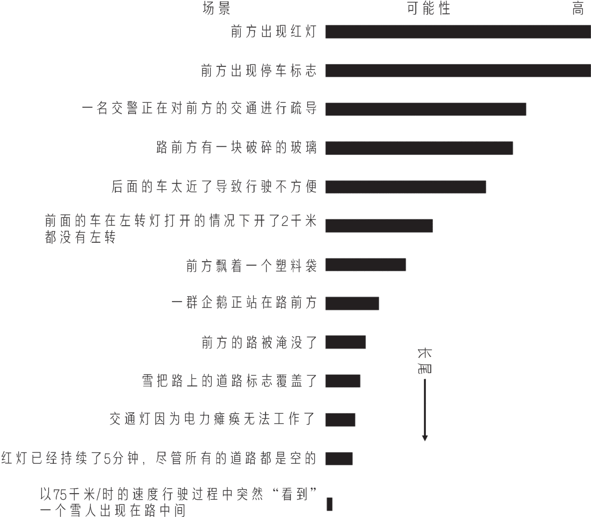
图 6-1　自动驾驶汽车可能遇到的情况（从上到下按可能性从高到低排序，以说明长尾效应的存在）

红灯、停车标志等常见情况概率高；碎玻璃、被风吹来的塑料袋属于中等概率；被水淹的道路、被雪盖住的标志较少见；高速中央出现一个雪人则更罕见。单车队跑几百万公里事故很少，但一旦规模化，种类繁多的低概率事件终会撞上某辆车。

长尾在统计学上就是概率分布的尾部，尾部事件也叫边缘情况。现实世界大部分事件可预测，但总有一长串小概率意外。靠监督学习训练的模型在训练数据里很少见到尾部，遇到时就容易出错。

两个真实案例：2016 年 3 月东北暴风雪，特斯拉自动驾驶把路面上铺的盐线当成车道线；同年 2 月，谷歌无人车为避让路边沙袋左转，结果撞上左车道右转的公交车，双方都以为对方会让。

公司们意识到长尾，会开脑暴会创造更多样本、写应对策略，但不可能穷举所有场景。常见做法是少量监督学习加大量无监督学习。无监督学习指在没有标注下从样本中找规律，比如聚类、对比学习等。人类擅长抽象和类比，无监督学习却仍是难题。杨立昆称它为“人工智能的暗物质”：通用智能几乎要靠它，现在却缺乏有效算法。

人类也会犯错，但在上述场景里我们有常识：知道盐线是防滑用的，知道大车难让，知道信号灯失灵时靠手势交流。这些关于物理和社会的背景知识，当前 AI 基本没有。

## 机器眼里的世界与人不同
几年前，研究生威尔·兰德克尔训练了一个分“有动物/无动物”的 DNN，测试集上表现不错。细究后发现，网络学会的不是动物，而是模糊背景。训练和测试图都遵循摄影习惯：拍动物时主体清晰、背景虚化；拍风景时整图清晰。于是网络靠背景是否模糊做判断，换成背景清晰的动物图就失效了。

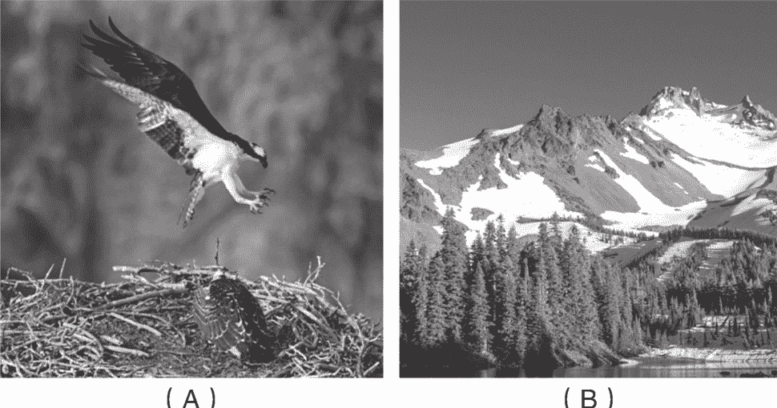
图 6-3　用于训练能够识别动物的图像

这是机器学习的常态：它学的是数据里存在的统计关联，而非我们想教的任务。关联在测试集上成立时看着像学成了，换个分布就崩。机器在特定训练集上过拟合，泛化能力不足。

研究也证实了这一点。用网络下载的 ImageNet 训练的 ConvNets，在机器人手持相机在室内随机拍摄的图片上表现很差，因为家居物体的随机视角和网上照片差异很大。把图片稍微模糊、加点斑点、换颜色或旋转一下，人类识别不受影响，ConvNets 却可能严重失误。这种脆弱性说明它们过拟合了训练数据，学到的特征与人类预期不同。

## 有偏见的数据会放大偏见
ConvNets 的不可靠有时很尴尬，有时有害。2015 年谷歌照片自动标注把两名非裔美国人的自拍照标成“大猩猩”，引发公关危机，后来谷歌把“大猩猩”从标签库里删掉。

类似歧视性错误常被观察到。商业人脸识别系统对白人男性识别率显著高于女性或非白人。微软研究员凯特·克劳福德指出，一个被广泛使用的人脸数据集里 77.5% 是男性、83.5% 是白人，因为数据来自搜索引擎，而网上可见面孔多为知名或有权势的白人男性。

训练数据的偏见映射并放大社会偏见。当人脸识别被用于支付、机场安检、摄像头监控，乃至身份验证投票时，细微的准确率差异会冲击公民权利和服务获取。靠人工平衡各群体样本可在个案上缓解，但需要大量认知投入。更微妙的偏见更难提前发现，比如一个模型把站在厨房的男士误判为女士，因为训练集中厨房场景多和女性关联。

学界热议：数据集该如实反映有偏见的社会，还是为社会变革目标去刻意调整？谁有权定义目标、谁来执行，都仍是开放问题。

## AI 的黑箱与我们如何糊弄它
学生时代老师常在作业上红笔写“写出推导过程”。能解释就说明你懂。DNN 作为现代 AI 的基石，却很难做到这一点。以狗猫识别为例，ConvNets 通过多层卷积运算给出结果，运算次数可达数十亿。打印出来是一份天文数字的加乘列表，对人毫无解释力。即使是训练者也往往说不清网络为何做此决策。麻省理工科技评论称这种不可理解性为“人工智能内心的黑暗秘密”。我们看不懂模型怎么得出答案，就无法真正信任它，也难以预测它会在何时出错。


图 6-2　暴风雪来临前，高速公路上铺设的盐线，据说会使特斯拉汽车的自动驾驶功能混乱

我们其实很难说清自己的思路在每一刻到底是怎么运转的，也无法靠观察他人的大脑或直觉来还原他们为何做出某种判断。尽管如此，人类普遍会默认别人具备和自己相近的基础感知能力，比如识别目标、理解语言。当我们认定他人思维模式与自己大致相通时，信任就更容易建立。这种默认建立在一种经验推断上：大多数人拥有与我们相似的生活背景，所以他们对世界的感知方式、表述习惯以及决策所依赖的背景知识、信念和价值观，大体可以视为可共情的。心理学上把这种揣测他人的心智活动叫做心智理论。对 `DNN`这类人工智能系统，我们没有对应的心智理论作为支撑，这正是信任难以建立的根源之一。

当下人工智能圈里最受关注的方向之一就是可解释的人工智能，也有人称其为透明人工智能或可解释的机器学习。研究者想让深度网络，尤其是卷积网络，能用人类可读的方式说明自己为何给出某个结果。已有人提出多种方法来可视化 `ConvNets` 学到的特征，甚至能指出输入图像的哪些部位对最终判断起决定性作用。该领域发展很快，但让深度学习系统稳定地以人类能理解的方式自我解释，仍是未解难题。

可信性问题还有另一面：人类若刻意操纵神经网络使其出错，难度出奇地低。换句话说，欺骗手段很多。

愚弄人工智能并非新鲜事，垃圾邮件过滤与发送者的对抗已持续数十年。针对深度学习的攻击更隐蔽、更棘手。

还记得赢下 2012 年 `ImageNet` 竞赛并把 `ConvNets` 推上主流的 `AlexNet` 吗？它在 `ImageNet` 上的 top-5 准确率达到 85%，震惊了整个视觉社区。两年后，谷歌的克里斯蒂安·塞格迪等人在论文《神经网络耐人寻味的特性》中指出，`AlexNet` 很容易被误导。

作者取出一张被 `AlexNet` 高置信度正确判别为校车的 `ImageNet` 图像，对像素做极微小、高度特定的扰动，肉眼几乎看不出变化，但模型却十分肯定地把它说成鸵鸟。作者把这类图像称为“对抗样本”。图 6-4 展示了原始图像与其对抗孪生的对比。两张图难以分辨？恭喜，你还是人类。

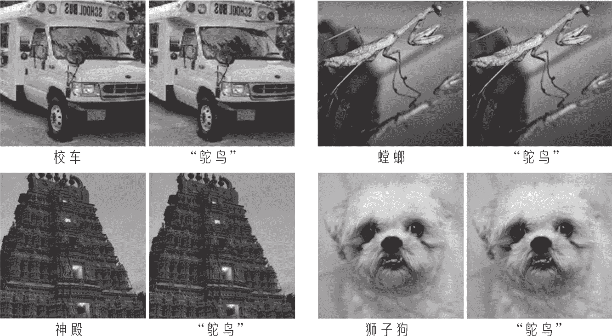

图 6-4　`AlexNet` 的原始样本和“对抗样本”

注：每对图像左侧为原始图，能被 `AlexNet` 正确分类；右侧为从左侧衍生的对抗样本，仅做细微改动，人类视觉上无差别，却被 `AlexNet` 高度确信地归为“鸵鸟”。

塞格迪等人编写程序可对任意被 `AlexNet` 正确分类的 `ImageNet` 图片找到扰动点，生成对人眼无异、却令模型给出高置信错误答案的新图。关键是，这种脆弱性并非 `AlexNet` 独有。不同结构、超参数与训练集的多个 `ConvNets` 都表现出相似漏洞。把这种漏洞形容为“耐人寻味的特性”，就像把游轮船体破洞说成有趣的设计，耐人寻味的同时也令人担忧。若不修补，`DNN` 这艘船终将出事。

不久后，怀俄明大学团队发表了更直白的论文《深度神经网络很容易被欺骗》。他们借助受生物启发的遗传算法，让图像“进化”，肉眼看来近似随机噪声，却能让 `AlexNet` 及其他 `ConvNets` 以超过 99% 的置信度判定为特定类别，见图 6-5。

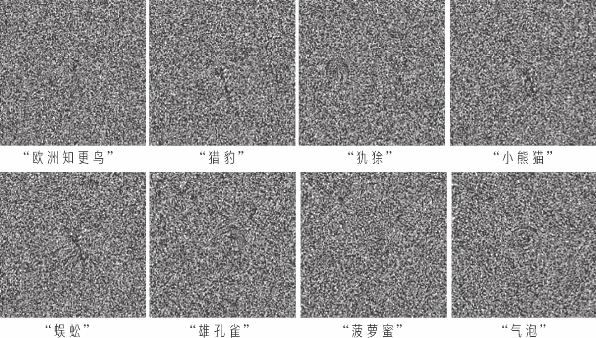

图 6-5　借助遗传算法制造来欺骗 `ConvNet` 的图像示例

注：在每种情况下，经 `ImageNet` 训练的 `AlexNet` 都给出了大于 99% 的置信度，认为图像属于图下方文字所指的类别。

团队注意到，`DNN` 把这些图案当作近乎完美的可识别对象。那这些模型真的具备泛化能力吗？若存在可被恶意利用的漏洞，使用它们的代价会不会很高？这类疑问值得深思。

两篇论文及其后续工作不仅为学术界提出问题，也敲响警钟。如果在计算机视觉等任务上表现优异的深度学习系统，竟能被人类难以察觉的微调所欺骗，我们又怎能说它们像人一样学习，或能力可与人类比肩？显然存在与人类感知截然不同的机制。若要在现实视觉任务中使用这些网络，必须确保它们不会被黑客利用同类操作欺骗。

因此围绕“对抗式学习”的研究群体重新活跃起来。对抗式学习就是设计策略来防御人类对手对机器学习系统的攻击。研究者常通过复现攻击来工作，近年成果令人震惊。

有团队开发程序设计特定花纹的眼镜框，让人脸识别系统自信地把佩戴者错认成另一人，见图 6-6。另一团队在交通标志上贴不显眼的小贴纸，导致基于 `ConvNets` 的视觉系统，比如自动驾驶常用系统，把停车标志误判为限速标志。还有团队证实医学影像分析的 `DNN` 可被对抗攻击：对 X 光或显微镜图像做人类难以察觉的改动，就能让网络分类完全反转，例如从 99% 置信无癌变为 99% 置信有癌。该团队指出，这类手段可能被用于制造欺诈性诊断，进而向保险公司索取额外检查费用。

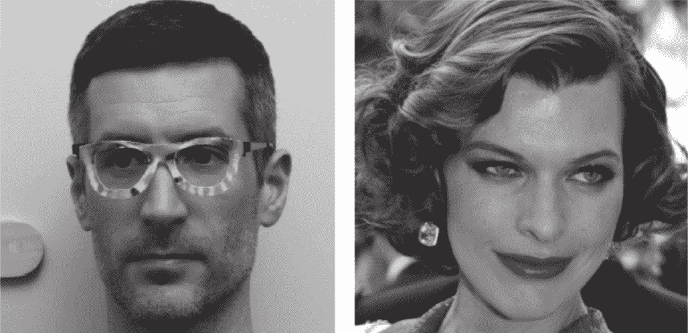

图 6-6　`DNN` 遭遇对抗式攻击的示例

注：左图为一名人工智能研究人员戴上特定设计的镜框后，被在名人口像上训练的 `DNN` 人脸识别器确信认定为米拉·乔沃维奇，右图为该名人。论文还列举了更多用“对抗式”眼镜框模仿名人的例子。

上述只是冰山一角。许多攻击具有惊人鲁棒性，能在不同数据集上训练的网络中通用。神经网络可被愚弄的领域不限于视觉，语言处理、语音识别和文本分析的 `DNN` 也能被攻击。随着系统更广泛落地，恶意用户会挖掘出更多弱点。

理解与防御这些攻击已成为人工智能的重要研究方向。已有针对特定攻击的对策，但尚未出现通用防御。与网络安全一样，研究呈现“打地鼠”特征：一个漏洞被堵上，新的漏洞随之出现。谷歌大脑的伊恩·古德费洛说：“几乎所有能伤害机器学习模型的事，如今都能做到……防御真的非常非常困难。”

对抗样本的出现加剧了更根本的疑问：**这些网络到底学到了什么？是什么让它们如此容易被诱导出错？**更关键的是：**当我们以为它们真的掌握了我们想教的概念时，会不会只是在自我安慰？**

终极问题是理解。以图 6-4 为例，`AlexNet` 把校车判成鸵鸟，人类几乎不会犯这种错。尽管模型在 `ImageNet` 上成绩亮眼，人类却能从所见中抽取模型无法获取的信息。我们能理解物体的三维形态，并从二维图像想象其结构。我们知道物体的功能、部件作用、常见场景，看到一个物体时会联想到其它角度、其它感官的经验，比如触感、气味、声音等。所有这些背景知识支撑人类稳定识别目标，而当前最成功的视觉系统仍缺乏这种理解与稳定性。

有人拿视觉错觉来辩解说人类也易受“对抗样本”影响，比如图 6-7 中上方线段看似比下方长，实际等长。人类犯错与 `ConvNets` 犯错本质不同，我们对日常场景的识别已进化得高度稳定，因为生存依赖于此。与现在的 `ConvNets` 不同，人类和动物的感知受认知高度调节，认知即情境理解。此外，当前使用的 `ConvNets` 多为纯前馈，而人脑视觉存在大量反馈连接。神经科学尚未完全阐明这些反馈的作用，但推测其中某些连接能有效避免类似对抗样本的漏洞，为何不把类似机制植入 `ConvNets`？这是活跃但困难的研究方向，目前前馈网络仍更成功。

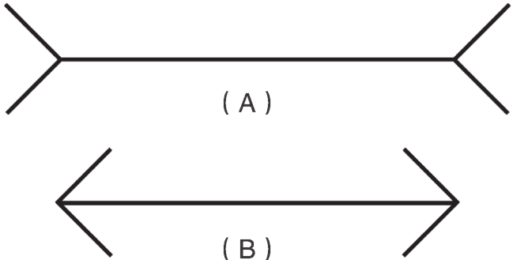

图 6-7　人类的视觉错觉

注：（A）中的水平线段与（B）中的长度相同，但大多数人会觉得（A）比（B）更长。

怀俄明大学研究者杰夫·克卢恩曾尖锐比喻：“很多人好奇深度学习到底是真正的智能还是‘聪明的汉斯’。”汉斯是 20 世纪初德国一匹据称会算术的马，它通过蹄击次数作答。调查最终证实汉斯并未理解问题，只是对提问者难以察觉的微妙提示做出反应。“聪明的汉斯”成为指代看似会理解实则只响应隐蔽线索的个体或程序的隐喻。深度学习展现的是真实理解，还是计算版的“聪明的汉斯”，只是在数据表面线索上反应？学界争论激烈，而对“真正理解”的定义尚未统一。

一方面，经监督学习训练的 `DNN` 在计算机视觉、语音识别、文本翻译等任务上表现突出，尽管不完美。基于其能力，研究正加速从实验室走向应用：网络搜索、自动驾驶、人脸识别、虚拟助手、推荐系统等。如今很难想象没有这些工具的生活。

另一方面，说 `DNN` 能自学或其学习像人类一样是有误导性的。我们既要承认其成功，也要正视其以意想不到方式失败的事实，如过拟合、长尾效应、易受攻击等。

再者，`DNN` 做决策的依据往往难以解读，导致失败难以预测与规避。研究者正努力提升可靠性和透明度，但核心问题仍在：系统因缺乏类似人类的理解能力而不可避免地脆弱、不可靠、易被攻击吗？在把人工智能推向现实前，我们该如何权衡这些因素？下一章将探讨在利用其益处与防范不可靠性和滥用风险之间，我们将面临的艰难抉择。

## 本章要点

### 06 难以避免的长尾效应

深度学习专家本吉奥直言：“实事求是，我们不可能给世上所有事物标注，并把每个细节都讲给计算机听。”长尾效应使情况更糟。人工智能系统必须应对大量偶发情况，自动驾驶汽车一天行驶中会遇到的假设情境就能说明问题。红灯、停车标志等高概率事件相对常见；中概率事件包括碎玻璃、随风飘来的塑料袋；低概率但可能出现的边缘情况则有道路被水淹、车道标志被雪覆盖等。

“长尾”源自统计学，指概率低但会发生的长串情况，也称边缘情况。现实世界的大多数事件可预测，但仍有一长串低概率意外。若仅靠监督学习提升认知，尾部情况因在训练数据中稀少，遇到时系统出错概率更高。

### 07 确保价值观一致，构建值得信赖、有道德的人工智能

想象深夜下雪，你刚从办公室圣诞派对出来，醉意微醺，对自动驾驶汽车说：“车，送我回家。”车缓缓启动，你靠在座椅上闭眼，心怀感激。这很美好，但安全吗？自动驾驶的成功很大程度上依赖机器学习尤其是深度学习，特别是计算机视觉和决策模块。我们如何判断它已学会所需的所有知识？

自动驾驶何时能真正融入日常？专家意见分歧，从几年到几十年不等。它有潜力大幅减少交通事故，每年伤亡可达数百万，许多事故源于酒驾或分心。它还能提升乘车时间的生产力，能源利用更高效，并为盲人等无法驾驶者带来自由。但前提是我们愿意把生命托付给它。

机器学习正被用于影响生活的多个决策：信息流推荐、疾病诊断、贷款评估、甚至量刑建议。我们如何确保它具备足够知识，成为可信的决策者？

这些问题不仅关乎研究者，也关乎全社会。我们必须在人工智能的积极用途与其可信度与滥用风险之间权衡。

#### 有益的人工智能，不断改善人类的生活

谈及人工智能的社会作用时，人们容易聚焦负面，但其已带来巨大好处，且潜力更大。当前技术已是许多服务的核心：语音转录、GPS 导航、垃圾邮件过滤、语言翻译、信用卡欺诈预警、内容推荐、病毒防护、建筑能源优化等，很多你可能并未察觉。

摄影师、电影人、艺术家、音乐家可用人工智能辅助创作；学生可受益于个性化智能教学；科学家可用其分析数据；视力障碍者可通过手机视觉应用读取纸质或电子文字；听力受损者可在 YouTube 上获得精准字幕，某些场景下还能实时语音转录。这些只是改善生活的例子。

未来医疗保健或将广泛应用人工智能：辅助医生诊断、提出治疗建议、研发新药、监测老年人健康。科学建模与数据分析也将更依赖人工智能，如气候变化、人口增长、生态与食品安全等领域的建模。DeepMind 联合创始人戴米斯·哈萨比斯认为，人工智能最重要的潜在价值是帮助人类应对过于复杂的难题。

人工智能还可能接手人类不愿从事的工作：枯燥、疲惫、有辱人格或极度危险且低薪的工作。若成真，将显著提升社会福祉。机器人已在工厂重复性任务中广泛应用，随着技术发展，更多工作可能被自动化，未来包括自动驾驶卡车、出租车、水果采摘、灭火、排雷、环境清理等，太空探索中机器人的作用也将更大。除此之外，工作被取代的风险同样存在，需谨慎对待。

把人工智能用在岗位替代上，真的会让社会更受益吗？回溯技术演进的历史，或许能给出一些参考。以下这些职业，在发达国家早已被自动化取代：洗衣工、人力车夫、电梯看守、punkawallah^((23))以及算术计算员^((24))。多数人会承认，机器接手这些工作后，生活确实变好了。也有人认为，今天的 AI 只是顺着这条进步轨迹，把那些必要却不受人青睐的工作逐步交给机器，从而改善人类生活。

#### AI 大抉择：全盘接纳还是审慎前行
吴恩达曾乐观地把人工智能比作“新电能”，他说：“一百年前电改变了几乎所有行业，今天我很难想到未来几年内哪个行业不会被人工智能改写。”² 这个类比很有吸引力，AI 就像看不见却不可或缺的电。关键差异在于，电力在大规模商用前已被充分认识，我们清楚它的作用；而今天的许多人工智能系统，我们的认知仍不足够。

于是出现了所谓的人工智能大权衡。我们是该拥抱 AI，利用其能力改善生活甚至救命，并允许更广泛使用，还是要考虑到当前系统存在难以预料的错误、偏见、易受攻击和缺乏透明度等问题，而对用 AI 做决策保持克制？在不同应用里，人类应保留多大参与度？要让系统真正可信并自主运行，需要满足哪些条件？尽管部署越来越多，自动驾驶等应用也被大肆宣传，这些争论依然激烈。

皮尤研究中心 Pew Research Center 的一项调查显示，社会对此并无共识³。2018 年，皮尤征询了近千名技术先驱、创新者、研发人员、商业与政策领袖及活动人士的意见，问题是：到 2030 年，先进的人工智能和相关技术系统是否很有可能增强人类能力、让人普遍生活得更好，还是很有可能削减人类自主权与能动性，让大多数人状况不升反降？

受访者分裂为两派：63% 认为 2030 年 AI 进步会让人类状况更好，37% 持相反看法。乐观者认为 AI 能根除贫困、大幅降低疾病、为绝大多数人提供更好教育。悲观者则预见大规模失业、AI 监控侵蚀隐私与权利、不道德的自动化武器、未经审查的黑箱决策、种族与性别偏见被放大、媒体操纵、网络犯罪激增等。一位受访者形容未来是：“真实，但与人类无关。”

机器智能引发的伦理困境层出不穷，围绕 AI 与大数据伦理的讨论已多到可成书⁴。为说明复杂性，下面聚焦一个备受关注的案例：人脸识别。

#### 人脸识别：便利背后的伦理难题
人脸识别是指用文字标注图像或视频中的人脸。Facebook 就把算法用在上传的每张照片上，尝试识别人脸并与已知用户匹配⁵。若你在平台上，有人发布含你面部的照片，系统会提示标注。准确率惊人，令人又爱又怕。其根源是深度卷积神经网络，不仅能识别居中正脸，也能在人群中锁定某人。

潜在好处明显：从海量照片检索图像，帮助视障人士辨认相遇者，定位失踪儿童或逃犯，侦测身份盗用等。但同样容易看出侵犯性与威胁性。亚马逊向警方推销人脸识别系统 Rekognition，能把安防视频与已知罪犯或嫌疑人数据库比对，引发隐私担忧。

隐私问题只是显而易见的一层。即便你不用 Facebook 或任何带人脸识别的社交平台，你的照片仍可能被未经许可标记并自动识别。例如提供付费人脸识别服务的 FaceFirst。据《新科学家》New Scientist 报道：“FaceFirst 正向零售商推广一套系统，据称可通过识别每次购物的高价值客户做促销，当被多次投诉的顾客进入任意门店时系统会报警。”⁶ 类似服务还有很多。

更令人担忧的是可靠性。误匹配会让你被禁入商店、登不了飞机，或被错指为罪犯。更关键的是，现有人脸识别系统对有色人种的错误率明显高于白人。美国公民自由联盟 ACLU 用 535 名国会议员照片测试亚马逊 Rekognition 默认设置，并与刑事逮捕数据库比对，发现系统错误地把 28 名议员误匹配到犯罪记录。非洲裔议员的误识率高达 21%，而他们仅占议员的 9%⁷。

这些测试揭示了不可靠与偏见的后果，多家科技公司宣布反对将人脸识别用于执法监管。人脸识别公司 Kairos 首席执行官布莱恩·布拉肯 Brian Brackeen 写道：用于嫌疑人识别的人脸识别对有色人种造成负面影响，这是不可否认的事实……我和公司已相信，将商业人脸识别用于任何执法或政府监管都是错误的，为道德败坏者打开大门……我们不应追求未获授权的政府对公民分类、跟踪与控制的世界⁸。

微软总裁兼首席法律顾问布拉德·史密斯 Brad Smith 在公司博客呼吁国会规范人脸识别使用：技术引发关乎隐私与言论自由等基本人权的核心问题，制造者的责任随之加重。我们认为需要更审慎的政府监管和可接受用途的规范，需公共与私部门共同行动⁹。

谷歌随后宣布，在确保使用符合原则且避免滥用和伤害前，不会通过 AI 云平台提供通用人脸识别服务¹⁰。

这些回应令人欣慰，却又抛出新困扰：AI 研发应受多大监管？由谁监管？

#### AI 该由谁来管：监管与自律的边界
鉴于 AI 风险，许多从业者，包括作者在内，主张应有某种监管，但不应只掌握在研究人员和公司手中。可信度、可解释性、偏见、脆弱性以及使用中的道德问题，既是技术问题，也是社会政治问题。讨论必须吸纳不同立场与背景的声音。把监管完全交给从业者，和完全交给政府一样不明智。

欧盟议会在 2018 年通过的一项人工智能法规，有些人称之为“解释权”¹¹。该法规要求，在自动决策影响欧盟公民时，必须提供有意义的逻辑信息，用清晰易懂的语言以简洁、透明、易获取的形式传达¹²。这打开了解释的闸门。什么是“有意义”或“与逻辑相关”的信息？它是否禁止在贷款、人脸识别等对公民有影响的决策中使用难以解释的深度学习？这种不确定性会让政策制定者和律师继续有饭吃。

作者认为，对 AI 的监管应参照生物医学技术，尤其是基因工程。在这些领域，质量保证与风险收益评估由政府机构、企业、非营利组织和大学协作完成。此外，生物伦理学与医学伦理学对研发与应用决策有很大影响。AI 研究与应用同样需要深思熟虑和道德基础。

这一基础正在形成。美国各州正研究制定法规，比如人脸识别或自动驾驶。更重要的是，创建 AI 系统的高校与企业需要自我约束。

许多非营利智库已填补空白，常由担忧 AI 的富裕科技企业家资助，如人类未来研究所 Future of Humanity Institute、未来生命研究所 Future of Life Institute、存在风险研究中心 Centre for the Study of Existential Risk，它们举办研讨会、资助研究、编写教育材料并提出政策建议。人工智能合作伙伴关系 Partnership on AI^((25)) 等伞状组织致力于汇聚这类团体，搭建讨论 AI 对人类与社会影响的开放平台¹³。

当前障碍是优先事项缺乏共识。是立即聚焦可解释算法、数据隐私、抗恶意攻击的鲁棒性、系统偏见，还是超级智能潜在风险？我个人看法是，人们对超级智能风险关注过多，而对深度学习缺乏可靠性、透明度及易受攻击性的关注不足。下一章将更多讨论超级智能概念。

#### 让机器拥有道德，可能吗？
到目前为止，讨论集中于人类如何使用 AI 的道德问题，但还有一个关键问题：机器自身能否具备道德意识，并在无须人类监管的情况下独立做出道德决策？如果我们要为人脸识别、无人驾驶、养老护理机器人甚至机器人士兵赋予决策自主权，是否需要把人类处理伦理的能力也植入机器？

自人工智能思考伊始，“机器道德”就被讨论¹⁴。最著名的来自艾萨克·阿西莫夫 Isaac Asimov 的科幻小说，其“机器人三定律”¹⁵ 如下：

**第一定律：**机器人不得伤害人类个体，或坐视人类受害；
**第二定律：**机器人必须服从人类命令，除非违背第一定律；
**第三定律：**在不违背前两条定律的前提下，机器人应尽可能保护自己。

这些定律家喻户晓，但阿西莫夫提出它们的目的是证明这套规则必然失败。1942 年首次提出时，他讲述了“逃跑”：机器人依第二定律走向危险物质，第三定律随即让它远离；第二定律再次生效，于是机器人陷入无尽循环，最终危害人类主人。阿西莫夫的故事聚焦把伦理规则编程进机器人后可能出现的意外后果。有远见的是，不完整规则与意外已阻碍所有基于规则的 AI 方法，道德推理也不例外。

亚瑟·克拉克 Arthur C. Clarke 在 1968 年的《2001：太空漫游》¹⁶中描写了相似情节。人工智能 HAL 被编程始终对人类诚实，同时又要隐瞒任务真实目的。与阿西莫夫笨拙的机器人不同，HAL 因这种认知失调饱受折磨：“他意识到隐瞒真相与保持忠诚的冲突正在慢慢摧毁其心智。”¹⁷ 结果是这种“神经症”使 HAL 变成杀手。映射到现实机器道德，数学家诺伯特·维纳 Norbert Wiener 早在 1960 年就指出：“我们最好确信，赋予机器的目标正是我们真正想要的目标。”¹⁸

这捕捉到价值一致性问题：程序员的挑战是如何确保 AI 系统的价值观与人类一致。而人类的价值观是什么？假设存在普世共享价值有意义吗？

欢迎来到道德哲学 101 课^((26))，从电车难题开始。假设你在加速的有轨电车上，前方轨道上有 5 名工人，刹车失灵。你可以切换到右侧支线避开他们，但支线上有 1 名工人。你是坐视电车撞死 5 人，还是转向撞死 1 人？从道德上该怎么做？

电车难题长期是大学道德课核心。多数人认为应转向杀 1 救 5。后来哲学家发现，换个表述框架，本质相同困境会得到相反答案。人类在道德推理中对情境呈现方式极度敏感。

最近，电车难题伴随自动驾驶报道重现。如何为自动驾驶汽车编程处理这类问题，成为 AI 伦理中心议题。许多思想家指出，电车问题本身是人为设计的极端场景，现实中司机永远不会遇到；但它已成为象征：我们该如何让汽车自主做出道德决策。

2016 年，3 位研究人员向数百人呈现类似电车问题的自动驾驶场景，询问道德偏好。76% 的参与者认为，让自动驾驶车牺牲 1 名乘客而拯救 10 名行人，在道德上更可取。但当被问是否愿意购买这样被编程为为救更多行人而牺牲乘客的汽车时，绝大多数回答是否。研究者称：“在 6 项亚马逊机械土耳其人参与的研究中，受访者认同牺牲乘客以获更大利益的效益主义汽车，并希望他人购买，但他们自己更愿意乘坐不惜一切保护乘客的汽车。” 心理学家乔书亚·格林 Joshua Greene 评论道：“在把价值观植入机器前，我们必须弄清楚如何让价值观清晰且一致。”²² 这比想象中更难。

一些研究者建议放弃直接编程道德规则，让机器通过观察人类行为自行学习道德价值观；但这种自学方法同样面临上一章所述的机器学习问题。

在我看来，对计算机赋予“道德智能”的进展不能与其它智能进展割裂。真正挑战是创造能真正理解所处情境的机器。正如阿西莫夫故事所示：除非机器人能理解不同情境下伤害的内涵，否则无法可靠执行避免伤害命令。道德推理要求认识因果、想象不同未来、理解他人信念与目标、预测行动后果。换句话说，可信的道德理性先决条件是通用常识，而这正是当今最好 AI 系统所缺失的。

到目前为止，我们看到在庞大数据集上训练的 DNN 如何在特定任务上媲美人类视觉；也看到其弱点：依赖大量人工标注数据，且以非人类方式失败。我们如何创造真正靠自己学习的 AI 系统——更可信的系统，能像人类一样对所面临情境推理并规划未来？本书下一部分将描述研究人员如何把象棋、围棋、雅达利 Atari 电子游戏等作为“微观世界”，开发更接近人类水平的<|message|>

在游戏里做仿真，计算机可以迅速又精确地跑完一局，不用真的挪棋子、砸砖块，可要把洗碗机装载臂搬到虚拟世界里就难多了。仿真越逼真，运算就越慢，即便动用顶级硬件，也很难把所有物理作用力和装载碗碟的细节参数都塞进去。更麻烦的是现实中的不确定性，哪些因素必须保留、哪些可以忽略，往往根本说不清。

## 08 强化学习，奖励设计才是核心

记者埃米·萨瑟兰读到一本关于珍奇动物驯兽师的书后发现，驯兽师最有效的办法极其朴素：强化正确行为，置之不理错误行为。她在《纽约时报》“现代爱情”专栏里写道，这套做法用在倔强可爱的“丈夫”身上也奏效。多年无效的唠叨、讽刺和抱怨之后，她用奖励的办法悄悄让丈夫开始收拾袜子、找着车钥匙、按时赴约、更规律地刮胡子¹。

这种心理学上的操作性条件反射，已经在动物和人类身上用了几百年，也催生了机器学习的一大分支——强化学习。它和前面讲过的监督学习截然不同：**在最纯粹的形态里，强化学习根本不需要带标签的训练样本。取而代之的是一个智能体，也就是学习程序，在某个环境，通常是仿真环境里采取行动，间歇性地从环境获得奖励，而这份奖励就是它学习的全部反馈。** 萨瑟兰丈夫得到的奖励是微笑、亲吻和一句夸奖。电脑不会被亲吻打动，却可以被等价的奖励驱动，比如往内存里写入一个正数。

几十年来强化学习一直被神经网络和监督方法压着。2016 年局面逆转，一款程序在围棋上击败人类顶尖棋手，强化学习一夜出圈。为了讲清楚这个程序以及随后的进展，我先用一个极简的例子把强化学习的工作方式讲透。

### 用一只会踢球的机器狗理解原理

来看一个“机器人踢足球”的玩具任务。场地只有房间大小，机器人要在简化版球场里活动。有时上场的就是图 8-1 那款索尼 Aibo，带摄像头捕捉视觉、内置电脑、以及能走路、抬腿踢球、用头顶球、摇塑料尾巴的传感器与电机。

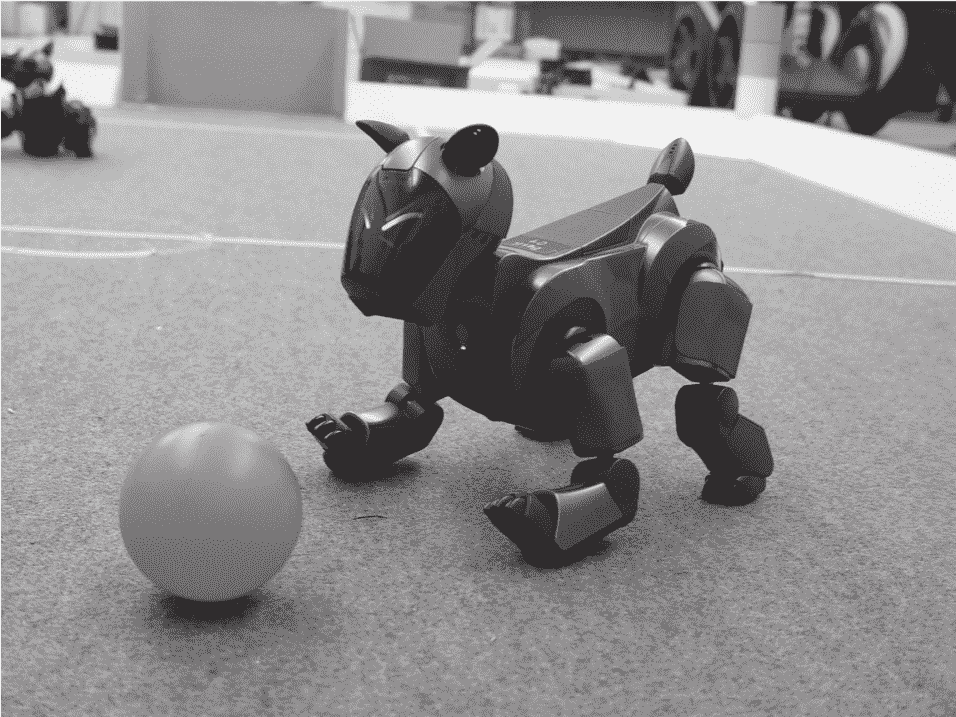

图 8-1　一只索尼 Aibo 机器狗正要踢一个足球

假设目标很简单：面对足球，走过去，一脚踢出。传统的人工智能会写死规则：朝球迈一步；重复直到脚碰到球；再用那只脚踢。诸如“朝球迈一步”“直到脚碰到球”“踢球”这类口语，必须被翻译成精确的操作指令写进传感和执行层。

显式规则对这种 trivial 任务够用，但越想让机器人灵活，手工业式写规则就越不现实。根本不可能覆盖所有情境。球和机器人之间出现水坑怎么办？标志锥挡住视线怎么办？石头卡住球怎么办？现实世界充斥着难以枚举的边界情况。

强化学习的思路是：智能体比如机器狗，不靠人手写规则，而是靠在现实中行动并偶尔得到强化，自己学会一套灵活的策略。

把这只机器狗叫罗茜，取自《杰森一家》里的机器人女仆。为了好理解，假设罗茜出厂自带一个能力：只要足球在视野里，就能估算出接触到球所需的步数，这个步数就是它的状态。广义上，状态就是智能体对当前情境的感知。罗茜的状态被简化成一个数字。说它处于状态 `x`，就是它估计离球还有 `x` 步。

罗茜还能执行三种内置动作：前进一步、后退一步、踢一脚。程序规定它若走出边界就立刻后退一步。按操作性条件反射的设定，只有成功踢到球才给奖励。罗茜事先不知道哪种状态或动作会带来奖励。

奖励对机器人来说只是一个数字，比如 10，写入它的“奖励内存”。这相当于给狗喂食。与真狗不同，罗茜对正数没有本能渴求。学习过程由一个人工算法主导，告诉它如何从经验中提炼规律。

学习以若干片段为单位进行，每个片段包含多次迭代。每次迭代先判定当前状态，再挑一个动作。若获得奖励，就产生学习。此处片段持续到踢中球为止，然后发奖励。训练一只真狗需要耐心，训练罗茜也一样。

图 8-2 描述了第一个片段。教练把罗茜和球放在初始位置，罗茜面向球［见图 8-2（A）］。它判断自己距球 12 步。此时还是白板，随机从前进、后退、踢球里选一个。假设它后退了一步。后退显然不佳，但要让它自己摸索。

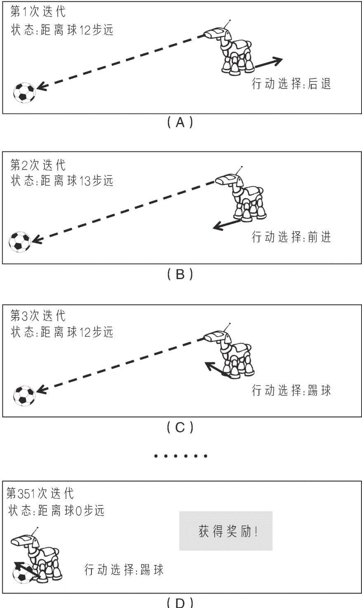

图 8-2　罗茜强化学习的第一个片段

第 2 次迭代［见图 8-2（B）］，状态变成 13 步，随即随机选前进。第 3 次迭代［见图 8-2（C）］，状态回落到 12 步。罗茜甚至没意识到自己回到了旧状态。最原始的强化学习里智能体不记得历史，一般来说记住历史会占用大量内存，而且往往没必要。

第 3 次它又随机挑了踢球，因为没踢中，什么也没得到。它还没学会只有踢中才有奖励。

罗茜继续盲目尝试，没有反馈。一直到第 351 次迭代，运气好它凑到球边并选择踢球［见图 8-2（D）］，片段结束，拿到奖励并学到一点东西。

它学到什么？用最简化的解释：拿到奖励后只记住了直接导致奖励的那一状态-动作对。具体说，处于“0 步”状态时踢球是好事，仅此而已。它没学到在 0 步时后退很糟，因为从未试过；它也可能以为后退会带来更大回报。它同样没学到在 1 步时前进不错，需要更多训练才知道。一次学太多有害，如果在离球 2 步时踢了一脚却恰好得奖，我们并不希望它把无效踢球当成必要步骤。人类常有迷信，认为某种行为必然带来好坏结果，强化学习里必须避免这种迷信。

强化学习的核心概念是状态下动作的值。状态 `S` 下动作 `A` 的值是一个数值，表示执行该动作后智能体预测最终能获得多少奖励。智能体只挑高值动作。比如手里拿巧克力，把手送向嘴、张嘴、咀嚼这串动作值都很高，虽然第一步不能立刻尝到美味，但方向是对的。强化学习的目标就是让智能体自行学习对未来奖励的预测值，前提是它在行动后一直做正确选择。²习得这种值通常要经历大量试错。

## 08 强化学习：AlphaGo 崛起的幕后推手

罗茜用一张大表记录各种动作的值。图 8-3 列出它所有可能的状态，即离球的步数，以及每个状态下可做的动作。每个动作都有一个值，随着学习不断修正，越来越能预测是否会得到奖励。这张状态-动作-值表叫 `Q 表`，对应的学习方式叫 `Q 学习`。用字母 Q 是因为原始论文里 V 已被另用³。

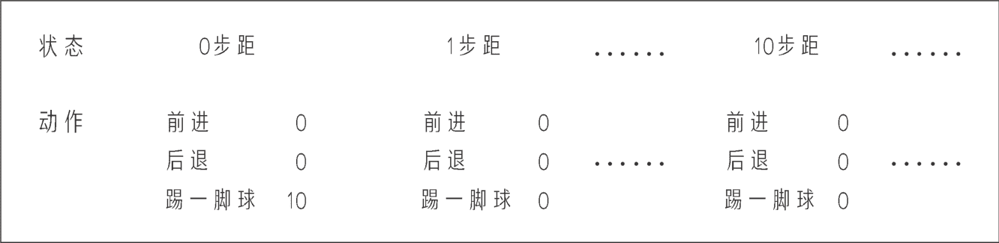

图 8-3　罗茜在强化学习第一个片段后的`Q 表`

训练开始时 Q 表全零，罗茜一片空白。第一个片段结束踢中球后，“0 步”状态下“踢球”动作的值被更新为 10。以后当它处于 0 步时，查表会发现踢球值最高，于是不再随机，选踢球。这就叫学习。

第一个片段结束，进入第二个片段（见图 8-4），罗茜和球在新位置开始［见图 8-4（A）］。每次迭代先判断状态，再查表选动作。当前状态下所有动作值仍是 0，没有信息，它依然随机选后退，下一次又后退［见图 8-4（B）］。训练之路很长。

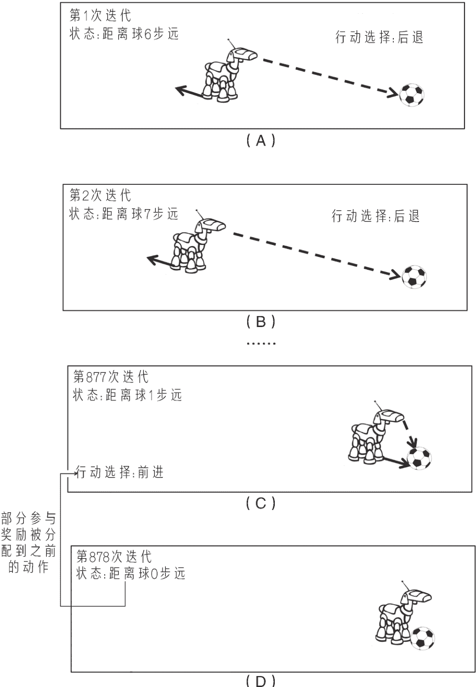

图 8-4　罗茜强化学习的第二个片段

过程继续，直到它偶然走到距球 1 步［见图 8-4（C）］，又恰好选了前进，脚靠近球［图 8-4（D）］。此时 Q 表里已有“0 步”状态下“踢球”预计奖励 10 的记录，于是它利用上一片段学到的信息选择踢球。Q 学习的精髓就在这里：它能从踢球前一步的状态，即距球 1 步，学到前进动作的价值。具体说，距球 1 步时前进的值被更新为一个较高的数，小于 0 步时踢球的值，因为后者直接带来奖励。这里把它更新为 8（见图 8-5）。

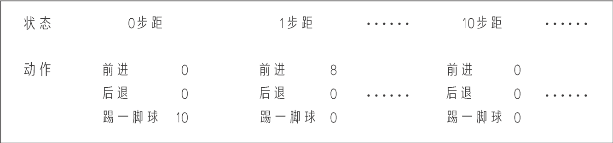

图 8-5　罗茜在强化学习第二个片段后的`Q 表`

现在表告诉罗茜：0 步踢球最好，1 步前进也很有利。下次它再到 1 步，就会据此决策，并把再前一步，即 2 步时的前进值更新。注意新学到的值会随步距增加而递减，且低于直接获奖动作的值，这样系统才学会一条通往真实奖励的有效路径。

随着片段累积，Q 表不断修正，直到罗茜能从任意起点踢中球。Q 学习本质上是给状态下动作赋值的办法，包括那些不直接获奖但能减少到达奖励所需状态数的动作。

我写了个模拟程序，每次片段开始时罗茜面向球，距离随机在 0 到 25 步之间。若走出边界程序令它退回。每个片段以踢中球结束。实验显示约 300 个片段后它就能完美执行。

这个例子涵盖了强化学习的大部分要点，但回避了实际研究会遇到的难题。⁴例如实际任务中智能体对状态的感知常是不确定的，不像罗茜那样清楚步数。真实足球机器人可能只有粗略距离估计，甚至分不清哪个物体是球。动作效果也可能不确定：前进可能因地面差异走不同距离，甚至摔倒或撞上未发现障碍。强化学习如何处理这种不确定性？

还有动作选择的问题。朴素策略是永远挑 Q 表里值最高的动作，但这会忽视尚未探索却可能更高回报的动作。探索与利用如何权衡？就像去餐厅，是点吃过觉得不错的老菜，还是尝试新菜以免错过更好选择？探索与利用的平衡是强化学习成功的关键。

这只是强化学习领域正在攻关的几个问题。像深度学习一样，设计成功的强化学习系统很难但有时很赚钱，只有少数专家愿意花大量时间调超参数。他们要考虑允许多少个片段、每个片段多少次迭代、奖励在回传时打折多少等。

## 现实世界中的两大绊脚石

把“训练罗茜”推广到真实任务，至少有两块绊脚石。第一块是 Q 表。在复杂现实任务里，根本无法列出一组可放进表格的状态。比如城市拥堵中学习驾驶的自动驾驶汽车，某一时刻的状态就是全部摄像头和其他传感器的原始数据。于是状态空间爆炸，Q 表不可行。因此当下主流做法是用神经网络替代表格。网络把当前状态作为输入，输出在该状态下所有可选动作的估计值。网络学会把相似状态归成通用概念，比如“前方可安全行驶”或“必须立即刹车以免撞障碍”。

第二块绊脚石是现实机器人迭代成本太高。即使是简化的罗茜案例，在真实场地复现也不可行。想象你要把机器人和足球重新摆位数百次，再让它完成每个片段里的数百次动作，耗时巨大。而且错误动作可能损坏机器，比如踢水泥墙或走向悬崖。

像我对罗茜做的那样，实践者几乎都先建机器人和环境的仿真，然后把所有学习片段放在仿真里跑，有时效果不错。机器人已在仿真中学会行走、跳跃、抓取、遥控汽车等，并在不同程度上把技能迁移到现实。然而环境越复杂、不可预测，迁移就越困难。正因如此，强化学习迄今最耀眼的成功不在机器人，而在能做到完美仿真的领域。最知名的就是游戏，这也是下一章的主题。

## 本章要点

### 08 强化学习：AlphaGo 崛起的幕后推手

最纯粹的强化学习不需要带标签样本。一个智能体在特定环境，通常是仿真环境里行动，偶尔获得奖励，这间歇性的奖励是学习的唯一反馈。

目标是让智能体自行学习对未来奖励的预测值，前提是行动后一直做正确选择。习得给定状态下动作的值通常需要大量试错。

计算机不会对亲吻或热情赞美有反应，却可以被等价的数值奖励驱动，算法再告诉它如何从经验中学习。

实践中几乎都在仿真里完成学习片段，但环境越复杂不可预测，仿真到现实的迁移越难。迄今强化学习最大的成功不在机器人，而在可完美仿真的领域，尤其是游戏。

## 09 学会玩游戏，智能究竟从何而来

从人工智能诞生之初，研究者就痴迷于造出能在游戏中击败人类的程序。20 世纪 40 年代末，图灵和香农都写过下棋程序，当时还没有能跑的代码。随后几十年里，众多游戏迷为让计算机玩自己喜欢的游戏而自学编程，目标包括跳棋、国际象棋、五子棋、围棋、扑克，以及后来出现的电子游戏。

2010 年的伦敦，戴米斯·哈萨比斯与两位好友一起把 `DeepMind` 这个名字写进了公司注册表。哈萨比斯本人就是人工智能圈里带点传奇色彩的人物：六岁拿下国际象棋比赛冠军，十五岁就开始全职写游戏代码，二十二岁创办自己的游戏公司，随后又在伦敦大学学院读到认知神经科学博士，目标始终是造出受大脑启发的人工智能。创立 `DeepMind` 的初衷，是去碰人工智能里真正根本的难题¹。团队认为电子游戏是检验这些难题的理想沙盘，哈萨比斯的说法是，游戏像现实世界的缩影，却更干净、约束更清晰²。

对游戏态度的差异会带来不同的选择。如果你更喜欢可控与纯净而非真实混乱，那么去让程序玩七八十年代雅达利的街机游戏会是一个合理的起点。`DeepMind` 当年就选了这条路。雅达利的经典如《银河小行星》`Asteroids`、《太空入侵者》`Space Invaders`、《乒乓》`Pong`、《吃豆人》`Pac-man`，图形简单、操纵杆操作，孩子能很快上手，大人却难以长久保持兴趣。

以单人游戏《打砖块》`Breakout` 为例，如图 9-1 所示，玩家操控右下角的白色矩形球拍来回移动，白色小球从球拍弹起撞击彩色砖块，砖块消失即得分。球也能在两侧灰色墙壁间反弹，击中上层砖块的得分高于下层。若小球触底，生命值-1，共 5 条生命，耗尽即结束，目标是在 5 条命内拿尽可能高的分数。

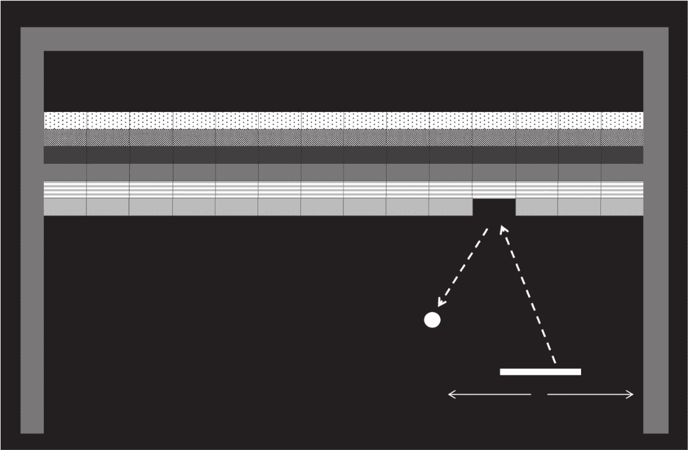
图 9-1　雅达利的《打砖块》游戏示意图

顺带一提，这款游戏源自雅达利对《乒乓》单人模式的扩展。1975 年，任务被交给了 20 岁的员工史蒂夫·乔布斯 `Steve Jobs`，后来他成为苹果联合创始人。乔布斯工程能力不足，便请来 25 岁的老友史蒂夫·沃兹尼亚克 `Steve Wozniak` 帮忙，两人利用沃兹尼亚克在惠普下班后的四个夜晚完成了硬件设计。`Breakout` 上市后同样大受欢迎。

怀旧玩家若没有雅达利 2600 主机，也能在网上找到模拟版本。2013 年，加拿大研究人员发布了“街机学习环境”，把 49 款游戏打包成统一测试平台³，`DeepMind` 的强化学习研究就基于这个平台展开。

## 深度 Q 学习：让猜测不断自我修正
`DeepMind` 把强化学习里的 `Q 学习` 与深度神经网络 `DNN` 结合，形成了能玩雅达利游戏的系统，自称深度 `Q 学习` `deep Q-learning`。下面以《打砖块》说明思路。

回想训练机器狗罗茜的 `Q 学习`：每轮迭代先确认当前状态，在 `Q 表` 里查值选动作，执行后可能获得奖励，再更新表里的数值。深度 `Q 学习` 的流程完全一样，只是用 `ConvNets` 替代了 `Q 表`。为方便表述，这里把网络叫做深度 `Q 网络` `deep Q-network, DQN`。图 9-2 展示了一个简化版的用于《打砖块》的 `DQN`。

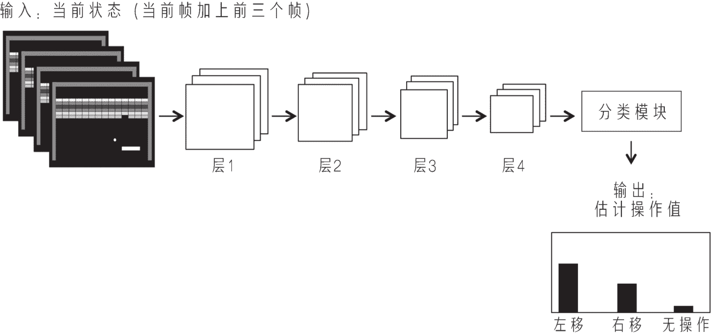
图 9-2　用于《打砖块》游戏的深度`Q 网络`示意图

`DQN` 的输入是系统当前一帧画面加上前三帧，共四帧，省内存又保留运动信息。输出是对每个可选操作的值估计，这里只有左移、右移、不动三种。网络结构与第 04 章所述 `ConvNets` 基本一致，学习的不是 `Q 表` 的离散数值，而是网络权重。

系统在多局游戏中逐渐学会《打砖块》。每局是一轮片段，每步迭代执行一次动作。状态喂入 `DQN` 后按输出选动作，但不总是贪心，会在探索与利用间平衡⁴。执行后若击中砖块会得到奖励，随后做一次反向传播更新权重。

权重如何更新？监督学习用标签算误差，强化学习没有标签。诀窍在于用“时序差分”。智能体假设当前迭代的输出比上一次更接近真实值，于是让网络学习把当前输出与前一次输出拉近。理查德·萨顿称之为从猜测中学习猜测，这里可表述为从更好的猜测中学习猜测⁵。

简言之，强化学习不是对齐人类标注，而是让网络在迭代间保持自洽，这种方式即时序差分学习 `temporal difference learning`。总体流程：当前状态进 `DQN` 得动作值 → 选动作产生新状态 → 用新状态再次推断 → 计算新旧值差异作为误差反向传播更新权重，反复进行数千局。深度 `Q 网络`、虚拟摇杆和游戏本身全在软件中运行，团队还用了若干加速技巧⁶。

起初网络输出近乎随机，表现杂乱；随着权重优化，游戏水平稳步提升，多数游戏达到相当出色。

`DeepMind` 用同一套网络架构和超参数在街机学习环境的 49 款游戏上训练，每款游戏都从零开始学习，知识无法迁移。每款游戏需上千局训练，借助当时硬件可较快完成。

训练完成后，机器与允许每款游戏练习两小时的人类测试员对战。结果在超过一半的游戏中程序胜出，在其中一半游戏中平均得分是人类的两倍以上，再往下的一半中差距超过五倍。最惊人的是《打砖块》，深度 `Q 网络` 的均分是人类的十倍以上。

程序学会了什么？在《打砖块》中，它发现了一个狡猾策略，如图 9-3 所示：通过凿出砖层边缘的窄通道，让小球在天花板与顶层砖块间来回弹射，快速清除高分砖块且几乎不需要移动球拍。

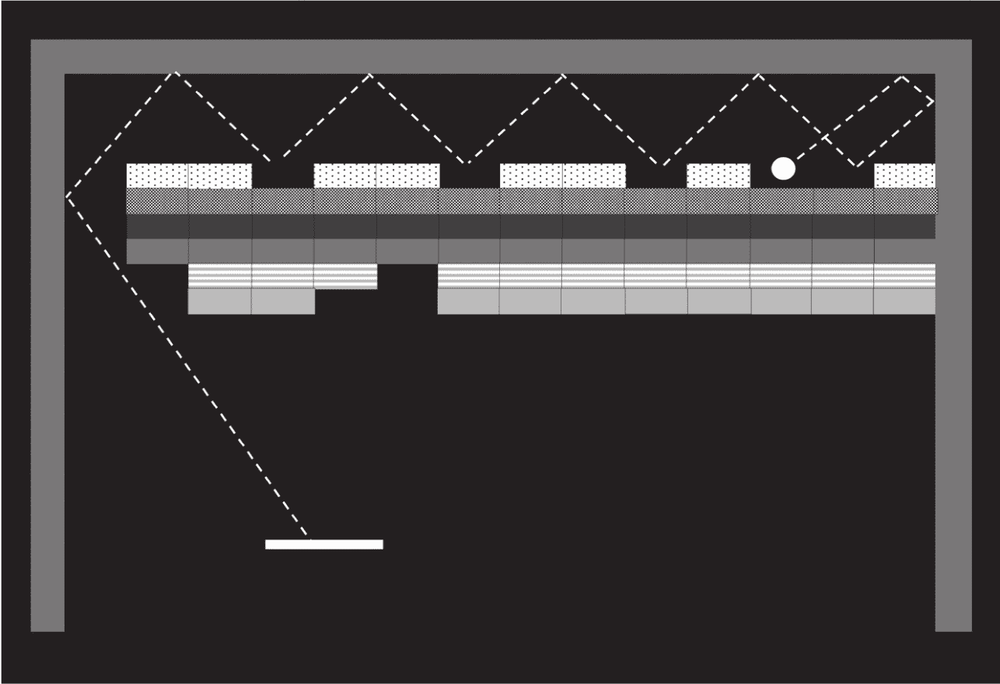
图 9-3　DeepMind 的“打砖块”程序发现了得高分的绝佳策略

2013 年，成果在一次国际机器学习会议⁷上首次亮相，现场反响强烈。不满一年，谷歌以 4.4 亿英镑，约合 6.5 亿美元的价格收购 `DeepMind`，强化学习的商业价值由此显现。

手握资金与谷歌支持后，团队把目光投向被视为人工智能顶级挑战的围棋：打造一个能击败人类顶尖棋手的围棋程序，这就是后来的 AlphaGo。其思想根基可追溯到更早的棋类程序历史。

### 从跳棋到国际象棋：博弈树、评估与自弈
1949 年，工程师亚瑟·塞缪尔加入 IBM 波基普西实验室，为早期 IBM701 编程玩西洋跳棋。当时没有操作系统也没有汇编器，需直接用操作码和地址编写，相当于只用手锯锤子盖房子⁸。塞缪尔的程序是机器学习早期代表，他甚至最早提出“机器学习”一词。

程序核心是搜索博弈树 `game tree`，这是后世所有棋类程序的基础。图 9-4 展示了跳棋博弈树的一部分。根在上为初始局面，每个节点展开当前玩家的所有合规走法，对手再展开回应，如此向下。图里只画了部分分支。

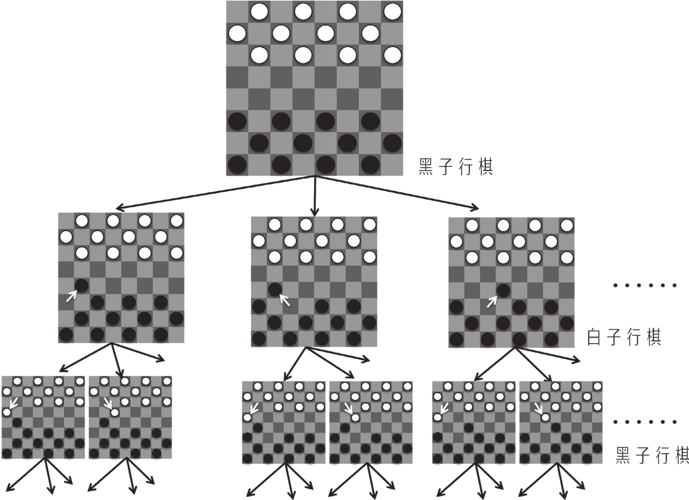
图 9-4　西洋跳棋的博弈树的一部分
注：为简单起见，此图只显示了每个棋局中 2～3 种可能的行棋方式。其中，白色箭头是从一个行棋棋子的先前位置指向当前位置。

人类在对局时会脑补树的一部分并前瞻数步。高速计算机能走得更远，但完全搜索不可行。跳棋平均约 50 步，每步平均 6-7 个分支，树大小可达 6⁵⁰。即使每秒算 10¹² 个局面，也需超过 10¹⁹ 年，远超宇宙年龄约 10¹⁰ 年。

于是塞缪尔只展开 4-5 层。到达叶节点后用评估函数打分，特征包括子力优势、国王数量、将近升级的棋子等，总分 38 分⁹。一旦叶节点分出，便用极小化极大 `minimax` 算法把值回传到根，选择评分最高的一步。评估越靠后越准，策略就是前瞻后再用函数打分回传。系统还在与自己对弈中调整特征权重¹¹，学会了超过常人水平，虽未达冠军。1956 年他在美国国家电视台演示后，IBM 股价次日上涨 15 个百分点¹²，开启了棋类程序带动股价的先例。

这段历史留下了三个关键概念：博弈树、评估函数以及自对弈学习。

### 深蓝：硬件驱动的“伪智能”冠军
塞缪尔的跳棋程序虽被誉为里程碑，却未动摇“机器不懂智能”的共识。即便 1994 年有程序击败人类跳棋冠军¹³，跳棋机器也从未被视作通用智能象征，国际象棋则不同。哈萨比斯认为，几十年里顶尖科学家都把国际象棋当作人类智力的试金石，精通它的机器会被认为在其他领域也将超越人类¹⁴。艾伦·纽厄尔和赫伯特·西蒙等先驱 1958 年就写道，设计出成功的国际象棋机器就可能触及人类智力核心¹⁵。

国际象棋复杂度更高，每步平均 35 个分支，博弈树远大于跳棋。历经多年改进，1997 年 IBM 的深蓝在电视转播中击败世界冠军加里·卡斯帕罗夫，成为游戏领域第二个重大胜利。

深蓝与塞缪尔方法本质相同：以当前局面为根建部分博弈树，用评估函数评叶节点，再用极小化极大回传决策。主要区别在于更深的前瞻、更复杂的国际象棋专属评估函数、手工编码的棋类知识，以及专用并行硬件加速。不同的是，深蓝在核心部分未使用机器学习。

对局后 IBM 股价再次大涨¹⁶，媒体出现对超人类智能的恐慌。香农 1950 年的预言后来应验：机器能在国际象棋上超越人类，我们要么承认机械思维，要么收紧对“思维”的定义¹⁷，如今是后者发生了。

棋盘上的智能幻觉

当下主流的判断是，远超人类的象棋程序并不意味着具备通用智能，深蓝从智能的角度看几乎一无所有：它只能下国际象棋，其他事完全不会，对赢下一局棋的意义也毫无感知。曾有演讲者戏谑过一句，“深蓝确实击败了卡斯帕罗夫，可它从来没有尝到过赢棋的乐趣。”

国际象棋历史悠久、挑战性强，也拥有庞大的受众。如今职业棋手常常把它当成训练辅助，用来复盘和磨练，这和棒球手用投球机练打法本质相同。这一现象是让我们对智能的理解不断深化、被人工智能的进步所印证的结果吗？还是正好应验了约翰·麦卡锡那句老话，“一旦它变得好用，人们就不再称它为人工智能了”？¹⁸

### 围棋：规则极简，变化无穷

围棋源头可追溯两千多年，被公认是所有棋类中最艰深的一款。即便你并非围棋爱好者，也不必具备专业知识，但要知道这项运动在东亚的地位极高。学者兼记者艾伦·列维诺夫曾写道：“围棋是帝王将相、知识分子和天才少年的共同消遣。”他随后引述韩国冠军李世石的话：“西方有国际象棋，而围棋拥有无人可比的精妙与智慧。”¹⁹

围棋规则看起来非常简洁，却能衍生出近乎无限的复杂性。每一步，棋手把自己颜色的棋子摆在19×19的棋盘上，遵循落子与提子的规则。与国际象棋的车马炮王后等级森严不同，围棋的每一枚子都平等，棋手需要在局势瞬息万变的条件下快速判断。

自人工智能起步以来，让机器学会围棋一直是研究热点，但难度极大。1997年，深蓝击败卡斯帕罗夫同年，最顶尖的围棋程序仍会被业余高手轻易击溃。深蓝的成功依赖于对每个局面进行大量前瞻，再用评估函数给未来步数打分，预测谁会获胜。围棋程序难以复制这一套路，原因主要有两点。

· 首先，围棋的博弈树规模远超象棋。象棋一局平均约有35种走法，而围棋平均约有250种。即便动用专用硬件，深蓝式的暴力搜索在围棋上也不可行。
· 其次，至今没有人能为围棋局面设计出可靠的评估函数。顶尖人类棋手凭借的是对局势的掌控与难以言传的直觉，而把直觉编码成公式仍是未解难题。

正因如此，1997年《纽约时报》的乔治·约翰逊写道：“若真有一台电脑能击败人类围棋冠军，那将是人工智能真正‘智能’的标志。”²⁰ 这话听起来很像当年对国际象棋的讨论。约翰逊引用一位爱好者的预言：“电脑要在围棋上赢人，可能得等100年甚至更久。”然而仅仅20年后，AlphaGo 通过深度Q学习掌握围棋，并在五番棋中击败了李世石这样的世界顶尖棋手。

### AlphaGo 擂台李世石：令人惊叹的三次“精妙”

在介绍AlphaGo的工作原理前，先回顾那场震撼的对局。哪怕已经亲眼见证AlphaGo击败欧洲冠军樊麾，李世石仍信心十足：“我觉得AlphaGo水平不及我……过去四五个月的更新还不足以让它挑战我。”²¹

2016年3月的对战吸引了全球超过2亿人观看，堪称围棋两千多年历史上观众最多的一次赛事。首局结束后，李世石感慨：“我很震惊，我承认……没想到AlphaGo会以如此完美的方式下棋。”²²

AlphaGo的许多着法让现场解说目瞪口呆。第二局中段的一步，令顶尖专家都惊讶。《连线》杂志的报道写道：起初樊麾觉得这步很怪，随后才看出其中妙处。“这不是人类会下的棋，我从未见有人走过，”他重复说，“太精妙了！精妙，精妙，精妙……这步棋令人惊异。”另一位解说随即笑称，“我觉得这可能是个错误。”李世石则起身离开赛场，“他需要找点事做来恢复状态。”一个评论员这样描述²³。

《经济学人》指出，只有顶级大师偶尔才会出现这种着法，日语里称之为“神之一手”或“上帝之手”²⁴。

AlphaGo连下第二、第三局。但在第四局，李世石也迎来了自己的“神之一手”，那一着抓住局面复杂性并释放了顶尖直觉。解说先是一愣，随后意识到这是一记可能致命的打击。一位作者写道：“然而AlphaGo似乎并未察觉发生了什么，这是它在数万盘自对弈中从未遇见的着法。李世石赢下了第四局。赛后记者会有人问他当时在想什么，他答，那是他当时唯一能看见的一步。”²⁵

最终AlphaGo赢下第五局，夺得整盘胜利。对公众而言，这是“深蓝PK卡斯帕罗夫”的重演，但意义更大：人工智能攻克了比象棋更难的挑战，且方式更令人印象深刻。与深蓝不同，AlphaGo依靠自对弈的强化学习提升能力。

哈萨比斯指出：“顶尖围棋棋手与常人的区别在于直觉，我们在AlphaGo里做的就是把这种直觉植入神经网络。”²⁶

### 从盲目试探到策略聚焦，AlphaGo 的运行逻辑

AlphaGo发展出多个版本，为区分，DeepMind用它击败的棋手命名，如AlphaGo Fan和AlphaGo Lee。它们融合了深度Q学习、蒙特卡洛树搜索、监督学习等技术，并结合围棋专业知识。

## 9

AlphaGo击败李世石一年后，DeepMind推出更简洁也更高级的AlphaGo Zero。不同之处在于，除了围棋规则外，它对围棋的知识完全从零开始²⁷。在与AlphaGo Lee的百局对弈中，AlphaGo Zero全胜。随后DeepMind用相同思路，让程序学习国际象棋和将棋，统称AlphaZero²⁸。下面以AlphaGo Zero为例说明原理，暂称之为AlphaGo。

“直觉”听起来神秘，而AlphaGo的直觉源自深度Q学习与蒙特卡洛树搜索的巧妙结合。先解释蒙特卡洛树搜索。蒙特卡洛指的是位于法兰西里维埃拉的摩纳哥小城，以豪华赌场和詹姆斯·邦德电影闻名。在数学领域，蒙特卡洛指一类算法，最初用于曼哈顿计划设计原子弹，因其像轮盘赌一样借助随机性解决复杂问题而得名。

蒙特卡洛树搜索是为游戏程序设计的变体。和深蓝评估函数相似，它为给定局面的每种走法分配分数。但围棋无法大量前瞻，也没有可靠评估函数，因此它的做法不同。

图9-5是蒙特卡洛树搜索的示意。首先看A部分，黑色圆点代表当前局面，假设轮到黑棋，黑棋有3种走法，用3个箭头表示，想知道该选哪一个？

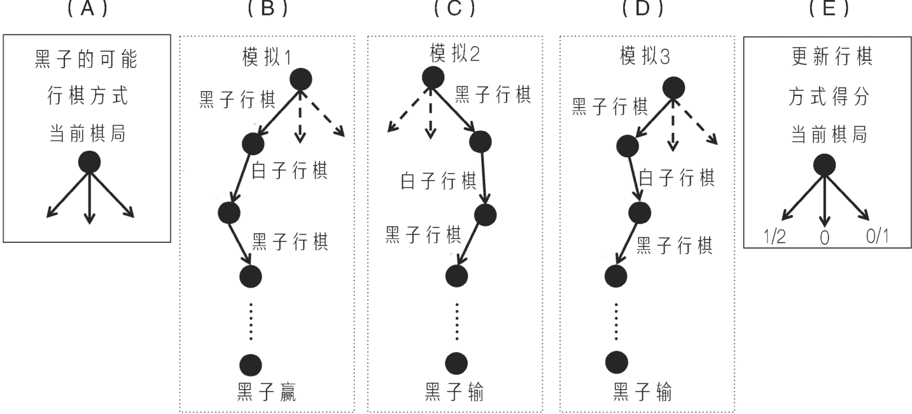

图 9-5　蒙特卡洛树搜索的图解示意

若时间无限，可穷尽搜索所有序列后选出最可能获胜的走法，但围棋完整搜索根本不可行。即便用宇宙诞生至今的时间也不够。蒙特卡洛树搜索只抽样极小部分序列，统计输赢次数，再据此打分，随机性决定抽样的方向。

具体做法如B至D所示。对每种走法，程序模拟若干次：在当前位置随机选一步，再为对手随机走一步，如此持续到胜负为止。这种模拟叫“走子演算”。

图中3次演算黑棋赢1输2。程序据此为每种走法打分，如E所示。方式1参与2次演算赢1次，得分1/2；方式3参与1次演算输了，得分0/1；中间那步未被尝试，得分0。程序保存统计数据，搜索结束后选择得分最高的方式。

走子演算并非完全随机，而是依据之前搜索的得分概率性选择。随着演算增多，统计越可靠，选择越偏向历史胜率高的方式。起初选择接近轮盘赌，随着数据积累逐渐倾向高胜率路线。

因此AlphaGo不用凭局势猜测，而是依赖演算统计判断最佳策略。演算次数越多，统计越可靠。程序需平衡“利用”与“探索”，即多选已验证的高分走法，也偶尔尝试数据不足的低分走法。图9-5展示3次演算，而AlphaGo每轮约执行近2000次。

蒙特卡洛树搜索并非DeepMind原创，2006年即在博弈树上提出，大幅提升了围棋程序水平。当时仍难战胜人类，主因是围棋走法多，积累足够统计需时过长。DeepMind意识到可用深度卷积神经网络辅助搜索。以当前局面为输入，ConvNet为每种走法给出粗略估计，蒙特卡洛树搜索据此初始化，避免完全随机起步。相当于在搜索前，有个声音在耳边提醒哪步可能更好。

反过来，搜索结果也反馈回网络训练。一次搜索后，程序得到所有走法的新概率，通过反向传播修正ConvNet输出。局势不断变化，过程重复。最终ConvNet学会辨识局面，像大师一样提供直觉，再由蒙特卡洛树搜索加以完善。

AlphaGo和塞缪尔的西洋跳棋程序一样，通过约500万盘自对弈学习。训练时网络在每步后根据自身输出与搜索改进值之间的差异更新权重。实战时，经过训练的ConvNet为每轮提供启动价值。

凭借这一组合，DeepMind证明了强化学习、ConvNet、蒙特卡洛树搜索与现代计算硬件的创造性融合，能攻克长期难题。AlphaGo在人工智能殿堂中当之无愧。但这套方法能否泛化到棋盘之外？这是下一章的话题。

## 本章要点

**09　好的游戏，可以从更好的猜测中学习猜测**

若你是学习智能体，当前状态下某个动作的值是：在你选择该动作并持续选择高价值动作的前提下，本片段结束后预期获得的奖励估计。那么越接近片段末尾，估值越准确，因为结尾处实际奖励可计算。诀窍在于假设网络当前迭代的输出比上一次更接近真值，然后通过反向传播使当前与先前迭代输出的差异最小化。

理查德·萨顿是这一方法的先驱之一，他称之为“从猜测中学习猜测”。我更喜欢“从更好的猜测中学习猜测”。简言之，强化学习不是与人类标签比较，而是假设后续迭代的值更好，网络学习的是让输出在迭代间保持一致。

## 10

## 游戏只是手段，通用人工智能才是目标

过去十年，强化学习从冷门分支变成人工智能最受关注、资金最充足的方向之一。复兴很大程度上归功于DeepMind在雅达利游戏和围棋上的成果。

对大多数研究者而言，打造超人类游戏程序并非终点。要思考的是这些成功对更长远发展意味着什么。哈萨比斯曾说：

游戏只是我们的开发平台……它是测试人工智能算法最快的途径，最终我们希望把它们用于解决现实问题，在健康与科学领域产生巨大影响。关键在于它必须是一种通用人工智能，也就是能根据自身经验和数据学习如何做事¹。

那么这种智能有多通用？除游戏外如何适用于现实？系统在多大程度上真正依靠自己学习？它们到底学到了什么？

### 理解为什么错误至关重要

在网上搜索AlphaGo的文章时，我看到一篇标题吸睛的报道：《DeepMind的AlphaGo利用业余时间掌握了国际象棋》²，这种说法是错误且极具误导性的，理解其错误很重要。AlphaGo所有版本除下围棋外一无所能，即便最通用的AlphaGo Zero也不是一个同时精通围棋、国际象棋和将棋的独立系统，每种游戏都有自己的ConvNet，且每种网络都必须从零开始训练。与人类不同，这些程序无法把在一款游戏中学到的知识迁移到另一款游戏中。

同理，各种雅达利游戏程序也各自从零学习权值。好比你学会了玩《乒乓》，为了学会《打砖块》，你必须完全忘掉《乒乓》的知识重新开始。

机器学习领域有前景的方法叫“迁移学习”，即程序把一项任务的知识迁移到相关任务。人类迁移是自动的，比如学会乒乓球后有助于学习网球和羽毛球；会西洋跳棋也有助于学国际象棋；儿童学会转动门把手后，能力迅速泛化到几乎所有门把手上。

人类在任务间的迁移看起来毫不费力，我们泛化知识的能力正是思考的核心。因此可说迁移学习的本质就是学习本身。

与人类形成鲜明对比，当前大多数人工智能学习算法在相关任务间不可迁移。这点上，该领域离哈萨比斯所说的通用人工智能仍很遥远。尽管迁移学习是业界最活跃的研究方向之一，但进展仍处初级阶段³。

### 无须人类的任何指导

与监督学习靠海量标注数据喂养不同，强化学习让程序在限定环境里自己试错，通过执行动作、观察反馈来逐渐摸索出策略。DeepMind 在总结 AlphaGo 系列成果时曾给出这样一个振奋的判断：“我们的实验彻底证明，纯强化学习是一条可行的道路，即使在最极端的任务上，没有任何人类示范或指导，除了基本规则之外不提供任何领域先验，系统仍有可能练到超人类水准。”⁴

这番话听上去令人鼓舞，但也需要冷静审视。AlphaGo Zero 看似在训练中完全抛弃了人类对局，却依然离不开人工的先验设计。它的卷积神经网络结构、蒙特卡洛树搜索的使用方式，以及背后成堆的超参数调校，全都是 DeepMind 工程师在启动前就植入的。心理学家兼 AI 研究者盖瑞·马库斯尖锐地指出：“AlphaGo 的那些决定性模块，没有一个是靠纯粹的强化学习从数据里自学来的，都是被程序员一开始就写死进去的……”⁵

真正更接近“零指导”学习的例子，倒是 DeepMind 后来在雅达利游戏上的尝试。和围棋不同，那套系统事先并不被告知游戏规则——比如打砖块的目标是什么——甚至连“球拍”“球”这类对象的概念都没有，它纯粹靠在屏幕上反复尝试，逐渐摸到怎么玩好游戏的门路。

### 并非所有难题都难倒 AI
DeepMind 的表述里提到“即便在最具挑战性的领域”，那么如何判断一个领域对 AI 来说真的难？人类觉得简单的事，机器可能捉襟见肘，比如描述一张照片的内容；反过来，人类觉得困难的 50 位数相乘，机器却能一秒完成。

一个粗糙的衡量方法是看最简单的算法能不能凑效。2018 年优步 AI 实验室的研究就发现，在多款雅达利游戏中，一些很基础的算法就能逼近甚至超过 DeepMind 的深度 Q 学习。其中最出人意料的是随机搜索：不训练深度 Q 网络，而是随机抽取权重测试不同的卷积网络⑥，也就是完全靠随机试错。

直觉上以为随机网络会很烂，确实大多数都很差，但研究者持续采样，最终用比训练一个深度 Q 网络更少的时间，找到一个网络在所测 13 款游戏里有 5 款的表现与深度 Q 学习相当甚至更好。另一种简易方法遗传算法⁷，在 13 款游戏中则有 7 款击败了深度 Q 学习。很难不由此怀疑，雅达利游戏对 AI 的挑战性，可能被高估了。

围棋的权重要不要也做随机搜索，没人尝试过，我个人觉得结果会很差。围棋的研究历史悠久，可以认定它是真挑战。但马库斯提醒，人类玩的很多游戏比围棋更难，比如猜字谜游戏⁸。那项游戏需要极其复杂的视觉、语言和社交理解。若你能造出一个像 6 岁孩子一样玩猜字谜的机器人，那基本就征服了 AI 面临的最硬核难题之一。

### 没有真正理解的“理解”
和深度学习的其它应用一样，我们对游戏里神经网络到底学到了什么，其实并不清楚。读到前面，你可能会注意到我用了不少拟人化说法，比如“打砖块程序学会了在砖块间挖隧道”。谈论 AI 行为时这种语言很容易滑口，但也暗含误解。打砖块程序真懂“挖隧道”这个概念吗？马库斯提醒要谨慎：

系统学到的并非那种东西，它并不真正明白什么是隧道、什么是墙，只是针对特定情境做出了应变。迁移测试显示深度强化学习的解法往往极其肤浅。测试中只要让场景与训练时有极细微差别，系统就通不过⁹。

所谓迁移测试，就是看系统能否把学到的能力搬到相近情境。有人复现了类似打砖块的玩家，发现即便训练到超人类水平，只要把球拍在屏幕上的位置挪动几个像素，表现就会断崖式下跌¹⁰。这说明系统根本没有掌握“球拍”这个基本概念的意义。另一组研究发现，给《乒乓球》训练的深度 Q 学习系统换个背景色，表现也会显著恶化，必须重新训练许多轮才能适应¹¹。

这两个例子说明深度 Q 学习很难泛化，与人类的迁移能力形成鲜明对比。据推测，打砖块程序若想把“挖隧道”推广到向下或向侧面挖，没有大量重训也做不到。正如马库斯所说，我们把对“墙”“天花板”“球拍”“球”“隧道”等概念的理解写进了程序，但程序本身并不理解：

这些现象清晰表明，用“墙”或“球拍”这类归纳性概念来评价深度强化学习会产生误导，在比较心理学里这叫过度归因偏见。打砖块程序并没有真正掌握“坚固的墙”这个概念，只是学会了在一组高度集中的训练场景里，通过挖隧道穿墙这种行为得分¹²。

同样，AlphaGo 展现出神奇的围棋直觉，却没有任何机制能在不重建、重新训练深度 Q 网络的前提下，把围棋能力泛化到更小或形状不同的棋盘。

简言之，这些系统在细分领域能到超人类，甚至有点像人类的直觉，但缺了人类智能最基础的东西：抽象能力、跨域泛化能力和迁移学习能力。如何赋予这些能力，仍是 AI 领域最核心的开放问题之一。

我们认为系统没有以人类方式学习人性化概念的另一个证据是，它们和监督学习系统一样，容易被我第 06 章提到的对抗样本攻击。例如，研究者对雅达利游戏程序输入图像做人眼几乎无法察觉的微小扰动，就能严重破坏其游戏表现。

## 围棋之外，AlphaGo 毫无思考
人们常鼓励孩子参加国际象棋或围棋社团，因为相信这些游戏能培养逻辑思维、抽象推理和战略规划——这些是通用的一生受用的能力。AlphaGo 虽然训练期间下了数百万盘棋，却没有学会任何除围棋之外的“思考”方式。事实上，除了围棋，它不具备推理、规划的通用能力。据我所知，它学到的东西一项都无法迁移。AlphaGo 是终极的“白痴天才”^((30))。

当然，背后的深度 Q 学习算法可以用在其它任务，但系统必须彻底重训，基本等于从零开始。

这又回到了第 01 章提到的“容易的事做起来难”的悖论。AlphaGo 是伟大的成就，能靠自我对弈击败顶尖人类棋手，但它并未展现出通常意义上的智能，甚至没有真正的智能。对人类而言，智能的关键不在于学会某项特殊技能，而在于学会思考，并灵活地把思考用于任何情境——这正是我们希望孩子通过棋类学习的能力。从这个角度，象棋社团里最低年级的小朋友都比 AlphaGo 更聪明。

## 游戏有边界，现实没有规则
最后回到哈萨比斯对这些游戏尝试的终极目标：“把它们应用到解决现实问题，并在健康与科学等领域产生巨大影响。”我相信 DeepMind 在强化学习上的探索最终会产生这种影响，但从游戏到现实还有很长的路。

迁移学习是其中一个障碍。打砖块和围棋非常适合强化学习：规则清晰、奖励明确、动作空间小，且信息完全可见，玩家能看到全部状态，没有隐藏不确定性。

现实世界却没有明确的状态定义。侯世达指出：“现实生活中的‘状态’根本不存在清晰界限，你不知道情境的边界在哪里，也不知道里面的东西是什么……”¹³

举个例子，用强化学习训练机器人把水槽里的脏盘子放进洗碗机。如何定义机器人的状态？是否要包含视野里的一切？包括水槽、洗碗机里的东西，甚至跑过来舔盘子的狗？机器人必须识别不同物体：该放进底部架子的盘子、该放进上层架子的咖啡杯、不该放进去的海绵。它还要感知视野外的锅碗，以及学会抓取、搬运、放置。动作空间包括身体位置调整、手指抓握、电机驱动的移动等，极其庞大。

DeepMind 的游戏智能体需要数百万次迭代，若不想打碎数百万个盘子，就只能在模拟器里训练。游戏程序的模拟很快而精确，但模拟洗碗机装载机器人极难。模拟越逼真越慢，即便用最快计算机，也很难把所有物理力和装载细节精确建模。那只烦人的狗，以及现实中无数不可预测的情况，该如何取舍纳入模拟？

特斯拉 AI 总监安德烈·卡帕西指出：“这类现实任务，基本违背了围棋和 AlphaGo 设定的每一个假设，任何成功的方法都绝不可能是 AlphaGo 那样的。”¹⁵

没有人知道成功的方法会是什么。深度强化学习才刚起步。我的论述只是证明：深度网络与 Q 学习的结合在某些细分有趣的领域表现惊艳，但局限也很明显，学界仍在努力拓展其适用范围。DeepMind 的游戏程序重燃了领域热情，被《麻省理工科技评论》评为 2017 年十项突破性技术之一。未来几年，随着理论成熟，或许我就能拥有一个能自主学习的洗碗机装载机器人，顺便在业余时间踢足球、下围棋。

## 本章要点
**10　像人一样学会迁移**
在机器学习里，迁移学习指程序把对一项任务的知识迁移，帮助它完成相关的新任务。对人类来说迁移是自动的：学会乒乓球后有助于网球和羽毛球，学会西洋跳棋有助于国际象棋。对我们而言，泛化能力就是思考的核心，所以迁移学习在某种程度上等同于学习本身。

与人类不同，今天大多数 AI 学习算法在相关任务间不可迁移。这与哈萨比斯所说的通用人工智能相距甚远。尽管迁移学习是当前从业者最活跃的研究方向之一，研究仍处于初级阶段。

# 第四部分
自然语言：让计算机理解它所“阅读”的内容

## 自然语言处理的现状
1．自然语言处理涵盖语音识别、网络搜索、自动问答、机器翻译等。深度学习驱动了该领域的大部分最新进展，而理解和使用自然语言仍是 AI 最难的挑战之一。
2．早期系统常靠关键词线索判断情感，例如用“黑暗”“怪异”“沉重”等词标记负面影评。
3．在深度网络在视觉和语音上取得进展后，研究者开始将其用于情感分析。
4．研究者提出了多种编码词间语义关系的方法，核心思想是：一个词的意义可由它常共现的词定义，而那些词又可由它们共现的词定义，以此类推。
5．句子情感分类、文档翻译、照片描述等任务，系统水平仍远不及人类，但已能支撑许多现实应用。
6．问答一直是研究重点，终极梦想是打造能实时流畅互动的机器。

## 11

## 词义来自上下文
本章从一个小故事开始。

**餐厅际遇**
一位男士走进餐厅，点了半熟汉堡。上菜时汉堡被烤糊了。女服务员问道：“汉堡还行吗？”“哦，太棒了！”他说着把椅子推开，没付钱就冲了出去。服务员在后面喊：“账单怎么办？”她耸耸肩，小声嘀咕：“他为什么这么生气？”¹

问题是：那位男士吃汉堡了吗？

我猜你很确定答案，尽管故事并未明说，但我们很容易从字里行间读出。理解语言尤其是隐含信息，是人类智能的基础。图灵把图灵测试设计成关于语言生成与理解的竞赛，并非偶然。

本部分探讨自然语言处理，也就是让计算机处理人类语言。它包括语音识别、网络搜索、自动问答和机器翻译等。深度学习也是该领域进展的主要动力。我将描述部分进展，并用《餐厅际遇》说明机器理解人类语言时的主要挑战。

## 理解隐含信息的难度
问答系统是当前研究的焦点，因为人们希望用自然语言与计算机交互。设想一个能读文章并回答问题的程序，比如对《餐厅际遇》这类文本提问。它需要复杂的语言技能和大量世界知识。

“那位男士吃汉堡了吗？”要给出有信心的答案，程序需要知道汉堡是食物且可食用；进餐厅点汉堡通常意味着要吃；半熟点单却收到烤糊的，一般不会想吃；“哦，它简直太好了”在这里是反讽，指的正是汉堡；没付钱就跑，通常意味着还没吃。

仅对一个基本问题给出答案所需的背景知识就令人难以想象。若问“他给服务员小费了吗？”程序需要理解小费的习惯与目的。服务员说“账单怎么办”，程序要明白这里的 bill 指的是餐费，而不是鸟嘴、票据或传票。服务员知道男士生气吗？程序要识别“他为什么如此愤怒”中的指代，以及“愤怒”表示烦躁生气。服务员是否明白他为何离开？程序需要理解“耸肩”暗示她并不明白，从而推断答案。

在思考程序需要知道什么时，我想起试图回答孩子无穷尽问题时的情景。我儿子 4 岁时去银行问“什么是银行？”我一解释，就引出一连串“为什么”：为什么要用钱、为什么想要很多钱、为什么不把钱放在家里、为什么我不能自己赚钱……这些都是好问题，但若不借助超出 4 岁孩子经验的知识，很难讲清楚。

机器为何读不懂人话

看过《餐厅际遇》的人，即便是孩子，也会本能地联想到人、餐桌、椅子、汉堡这些基本物件，并顺势推断：先生走出餐厅就不再在店内，桌椅大概率仍在；汉堡不可能凭空出现，必定有人送来。四岁的孩子轻易掌握的关联常识和直觉，正是机器长期缺失的部分。

可以说，自然语言的理解与使用仍是人工智能最棘手的难题之一。语言歧义丛生、极度倚重语境，交流双方往往需要庞大的共同背景知识。与 AI 其他分支相似，NLP 的前几十年被符号化规则主导，先设定语法规则再机械套用。抓不住语言的细腻，这种思路最终被证明走不通。

九十年代起，规则派让位给统计派，大规模语料开始训练机器学习模型。近几年焦点又集中到深度学习。叠加海量数据，深度学习能否造出既灵活又可靠、真正能处理人类语言的系统？

语音转写先领先，后卡在尾声

把口语实时变成文字，是深度学习在自然语言处理里取得的第一个里程碑，我甚至认为这是整个 AI 领域最重要的突破之一。

2012 年，深度学习重塑计算机视觉的同时，多伦多大学、微软、谷歌、IBM 的多支团队几乎同步发表了关于语音识别的标志性论文²。这些团队为转写全流程研发了适用的深度神经网络，比如从声波辨识音素、从音素组合预测词、从词组合预测短语等。谷歌的一位语音专家曾说，DNN 的应用带来了二十年来语音研究最大的一次单项跃升³。同一年，基于新版 DNN 的转写系统在安卓终端面向用户。2016 年 6 月，苹果在 iPhone 上推出 Siri，苹果工程师评价说：有些性能提升大到让你怀疑自己算错小数点，Siri 就是其中之一⁴。

如果你在 2012 年前后用过转写工具，会明显感受到断层。之前几乎不可用，只能勉强应付；之后骤然变得近乎完美。我现在就能用手机语音输入写文章和邮件，就在打这段文字几分钟前，我用正常语速把《餐厅际遇》讲给手机，它逐字准确地转录了下来。

惊人的是，这个系统完全不懂自己转出的内容在讲什么。手机能把故事每个字都抄下来，却对信息毫无理解。过去很多 AI 研究者都认为，没有真正语言理解就不可能达到这种水准，结果被事实打脸。

不过别被媒体夸大。实时口语转文字尚未达到人类水平。背景噪声会大幅拉低准确率，车内移动时的表现远不如安静房间。偶尔也会被冷僻词误导，这正是缺乏理解的证据。比如我说“慕斯是我的最爱甜点”，手机转成“驼鹿是我最爱的甜点”；我说“光头的男士需要帽子”，它写成“熊领头男士需要帽子”。这类迷惑句并不难找。在安静环境下的日常对话里，我估计当前系统词级准确率大约在人类水平的 90% 到 95%⁵。一旦加入噪声或其他复杂变量，准确率会急剧下滑。

工程界有句老话：前 90% 的工作只占 10% 的时间，后 10% 占掉 90% 的时间。我觉得这条规律也适用于 AI，比如自动驾驶，也适用于口语转写。对转写而言，最后 10% 不仅关乎噪声、陌生口音、罕见词汇，还关乎语言的歧义性和前后语境关联。那顽固的 10% 该怎么解决？堆数据？加网络层？还是必须让系统真正理解说话人的意思？我更倾向于后者，但之前我已经错过一次判断了。

今天最顶尖的转写系统非常复杂，从声波到句子的链路包含多种处理模块，集成了多个 DNN⁶。看起来输入输出都只是词的其他 NLP 任务，比如机器翻译或问答，似乎更简单，但数据驱动的深度学习却没在这些领域复制出转写那样的成功。原因何在？先看几个典型任务的实践。

把差评和好评分开有多难

先看情感分类。以电影《夺宝奇兵 2：印第安纳·琼斯和魔域奇兵》的短评为例⁷：

“剧情沉闷，幽默感几乎为零。”

“对我来说太阴暗了。”

“感觉团队刻意把它拍得很令人不安。”

“人物塑造和笑点都乏善可陈。”

“整体调性怪异，我对它的幽默无感。”

“缺少了系列里应有的魅力与智慧。”

这些影评人喜欢这部片子吗？

能准确回答这类问题的系统很有商业价值。需要分析客户评论、做产品推荐、精准投放广告的公司，都渴望一个能把句子归为正面、负面或其他的 AI。电影、书籍、商品的偏好数据对预测未来购买极有帮助，甚至能延伸到投票倾向、新闻偏好等生活层面⁸。已有研究尝试用 Twitter 上的经济相关推文预测股价和选举，结果各异。

抛开伦理不谈，关键是 AI 怎样学会判断上面句子的情感。人类一眼看出全是负面，但让程序通用地做到却远没那么容易。

早期做法是抓关键词或短语做线索，例如“黑暗”“怪异”“沉重”“不安”“恐怖”“缺乏”“缺少”“毫无”“一点都不”“有点太”等，来标记负面情感。这在部分场景有效，但在很多情形下同样的词也会出现在积极评论里：

“主题虽沉重，但幽默十足，并不显太阴暗。”

“一点也不像有人说的那样令人不安或恐怖。”

“上映时我年纪太小，不适合看恐怖片。”

“不看这部你就落伍了！”

只盯孤立词无法把握整体情感，需要从整句语境中捕捉含义。

在 DNN 在视觉和语音上开始得心应手后，研究者很快把它引入情感分析。用大量人工标注了正负情感的句子训练网络，让它自己学到能在高置信度下做出正确分类的特征。但前提是，如何让 DNN 处理一句话？

带记忆的递归结构

处理句子或段落需要一种不同于图像分类的网络。ConvNets 处理图像时输入尺寸固定，句子却是由词序列构成，长度不一。需要一种能处理可变长序列的架构。

把神经网络用于有序序列可以追溯到八十年代的递归神经网络 RNN，受大脑读句机制启发。设想你读评论“对我来说有点太黑暗了”。你从左到右逐字阅读，印象随之形成并不断强化，直到句末做出判断。RNN 就是模仿这一过程。

图 11-1 表示了一个传统神经网络［见图 11-1（A）］和一个递归神经网络［见图 11-1（B）］的结构差异。为简单起见，我们假设每个网络在其隐藏层中有两个单元（图中白色圆圈），在其输出层中有一个单元。在这两个网络中，输入与每个隐藏单元相连，每个隐藏单元与输出单元相连（图中实线箭头），而两者的关键区别在于：递归神经网络中的隐藏单元具有额外的递归连接——一个指向自身及其他隐藏单元的连接（图中虚线箭头）。这种递归连接如何起作用呢？与传统的神经网络不同，递归神经网络在一系列时步上运行，在每个时步上，给递归神经网络一个输入并计算其隐藏和输出两个单元的激活值，这点就与传统的神经网络一样，但在递归神经网络中，每个隐藏单元同时依据输入及前一个时步的隐藏单元激活值来计算其激活值，在第一个时步，这些值被设置为零。这赋予了网络一种在记住它已阅读的上文的同时理解其正在阅读的字词的方式。

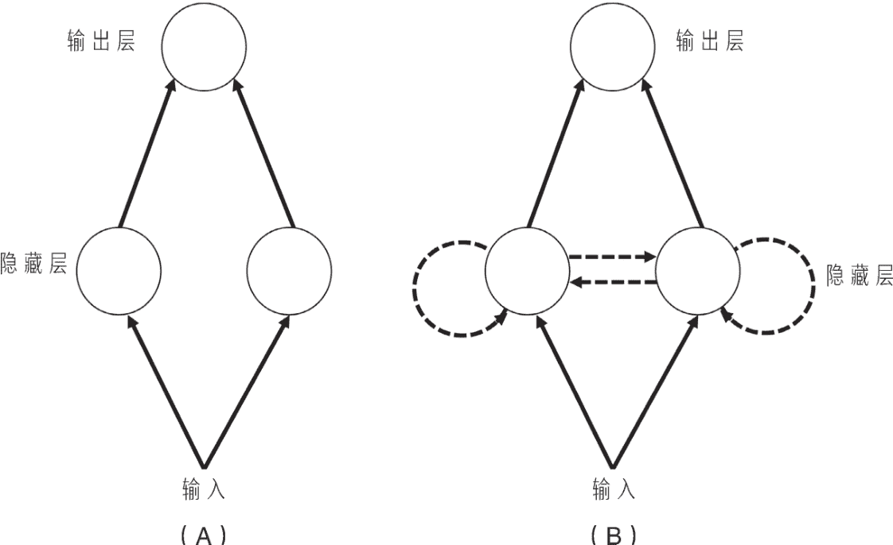
图 11-1　传统神经网络的示意图（A）和递归神经网络的示意图（B）

理解递归神经网络工作原理的最佳方法是：将网络在时步上的运行过程可视化，图 11-2 展示了图 11-1 中的递归神经网络运行 8 个时步的情形。为了简单起见，我将隐藏层中的所有递归连接表示为从一个时步到下一个时步的单个虚线箭头。在每个时步上，隐藏单元的激活值构成了网络对其目前所读部分句子的编码，在网络处理句子的整个过程中，它会不断地调整这一编码。在句子的最后一个词语之后，网络会接收到一个特殊的，类似于句号的结束符号“`END`”，它负责告诉网络：句子已经结束了。注意，结束符号是在将文本输入网络之前，人工添加到每个句子中的。

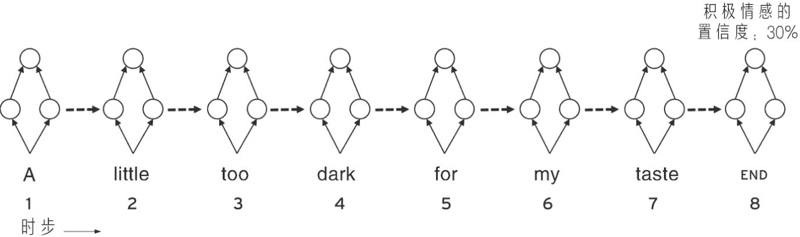
图 11-2　递归神经网络应用在前文例句中，运行 8 个时步的情形

注：图中这个英语句子是前文中关于电影《夺宝奇兵 2》的评论“对我来说有些太黑暗了”的英文原文。

在每个时步，这个网络中的输出单元会对隐藏单元的激活值（编码）进行处理，并给出网络对输入句子（即在该时步之前输入该网络的那部分语句）具有的积极情感的置信度。当把网络应用在一个给定的句子上时，我们可以忽略这一输出，一直到句子结束，此时，隐藏单元会对整个句子编码，输出单元也会给出网络对于此句子的积极情感的最终置信度。图 11-2 中所示的递归神经网络对该句子的积极情感的置信度为 30%，即对消极情感的置信度为 70%。

由于网络只有在遇到结束符号时才会停止对句子编码，因此系统在原则上能够将任意长度的句子编码成一组固定长度的数字，即隐藏单元的激活值，因此，这种神经网络通常也被称为“编码器网络”（`encoder network`）。

给定一组人类标记了积极或消极情感标签的句子，编码器网络能够通过反向传播在这些样本上进行训练。有一件事情我一直都还没有强调：神经网络的输入必须为数字⁹。将输入的词语编码为数字的最佳方法是什么？对这个问题的回答引发了自然语言处理领域在过去的十年里最为重要的一项进展。

从独热编码到语义空间

先定义词汇表，即网络可接受的输入词集合。语言学家估计，阅读大部分英文文本需要掌握一万到三万个词，计数方式不同数字也会变化。词汇表也可包含常用短语，如“旧金山”“金门大桥”。

假设词汇表有两万个词。最直观的编码是给每个词分配 1 到 20000 的整数，网络有两万个输入位，每个时步只有对应词的位为 1，其余为 0。这就是独热编码^((33))（one-hot encoding）：每一步只有一个位置“热”。

独热编码曾是标准做法，但它无法体现词与词的关系。网络也许学会了“我讨厌这部影片”是负面，遇到“我憎恶这部电影”却认不出来，因为训练里没见过“憎恶”“电影”。同样，学过“我大声地笑出来”是积极，见到“我欣赏其中的幽默”也无法联想到相似含义。根本原因是独热编码丢失了语义关联。

分布语义与词向量

自然语言处理社区提出了多种能捕捉语义关系的编码方式，核心思想一致。语言学家约翰·费斯 1957 年说：“你会通过与一个单词一同出现的词来认识它。”¹⁰也就是说，词义可由它常伴随的其他词定义，而那些词又可由它们的伴随词定义，层层递进。像“憎恶”常与“讨厌”共现，“笑”常与“幽默”共现。

语言学里这叫分布语义（distributional semantics）。基本假设是：两个表述的语义相似度取决于它们可出现的语境相似度¹¹。用“语义空间”来形象化。图 11-3（A）表示的是一个单词的二维语义空间，其中具有相似含义的单词位于离彼此更近的位置，但我们可以看到，由于单词常常有许多维度的含义，它们的语义空间也必须有更多的维度。例如，在语义空间中，单词“charm”^((34))通常与“wit”（智慧）和“humor”（幽默）离得很近，但在不同的语境中，“charm”一词又与“bracelet”（手镯）和“jewelry”（珠宝）离得更近些。类似地，单词“bright”^((35)既靠近“light”（光）的词簇（`word cluster`）又靠近“happy”（快乐）的词簇，还靠近“smart”（机灵的）、“intelligent”（智慧的）和“clever”（聪明的）。设想一下，有一个三维空间从纸张里朝着你延伸出来，你就可以把这些单词放置在彼此之间距离适当的位置上，这将有助于你的理解。沿着其中一个维度，“charm”紧挨着“wit”；沿着另一个维度，它离“bracelet”更近，但“charm”也应该靠近“lucky”（幸运的），而“bracelet”则非如此。这就需要更多的维度！我们人类描绘一个超过三维的空间已经有一定难度，然而，单词的语义空间实际上需要的维度要多得多，就算没有几百个，最少也得有几十个。

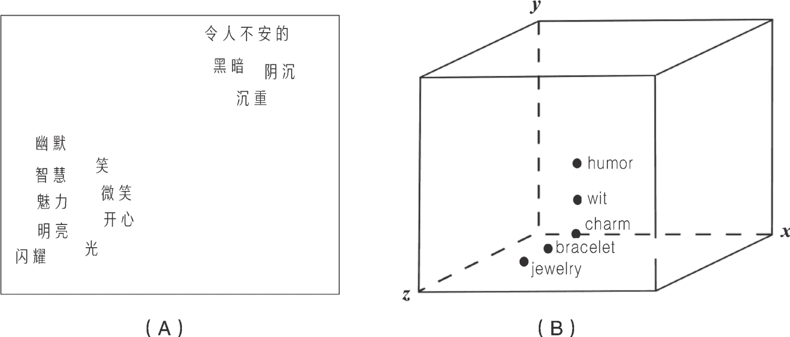
图 11-3　语义空间中两个词簇的图示，其中（A）为二维空间，（B）为三维空间

当谈到多维语义空间时，就进入了几何范畴。NLP 从业者常借几何概念界定词义。图 11-3（B）展示了一个由`x`、`y`和`z`三个坐标轴定义的三维空间，沿着这些轴可以放置单词。每个单词都用一个由三组数字组成的坐标（表示一个点在`x`、`y`和`z`轴上的位置）定义的点来标识，即图中的黑色圆点。两个单词之间的语义距离等价于图上点之间的几何距离。你可以发现，沿着不同的维度，“charm”这个词现在既靠近“wit”和“humor”，又靠近“bracelet”和“jewelry”。在自然语言处理中，人们使用“词向量”（`word vector`）这个概念来表示一个语义空间中某个特定单词的位置。在数学和物理学中，向量的概念要更复杂一点，而在自然语言处理中的词向量概念则比较简单¹²。例如，假设“bracelet”这个单词在语义空间中位于坐标（2，0，3）处，这三组数字组成的序列就是它在这个三维空间中的词向量的坐标。需要注意的一点是：一个单词所处空间的维数就是其坐标中数字的组数。

一旦词汇表中的所有单词都被恰当地放置在语义空间中，一个词的含义就能通过其在语义空间中的位置，也就是其词向量的坐标来表示。词向量有什么好处呢？事实上，使用词向量的坐标作为数字输入来表示单词，而不是使用简单的独热编码方案，可以大大提高神经网络在自然语言处理任务中的性能。

怎样获得整张词汇表的词向量坐标？有没有算法能把词最优地安放到语义空间里？这正是 NLP 近十年的关键进展之一。

Word2Vec 神经网络：口渴之于喝水，就像疲倦之于喝醉

把词语放进语义空间的探索由来已久，八十年代就有雏形，如今让大家普遍采纳的方案是 2013 年谷歌团队提出的 word2vec。¹³ 该团队用传统的神经网络去自动学习词表里每个词的向量表示，并用公司内部的海量文档做训练，训练完后把所有向量打包发布，任何人都能下载直接用在自然语言处理里。¹⁴

这套做法的内核就是“物以类聚，词以伴随为缘”。训练数据来自谷歌新闻板块的大规模语料，在现代 NLP 里，大数据几乎是最硬的资源。数据形态是一对对的词语，只要在新闻文档里一个词出现在另一个词附近，这对词就会被记录下来。为让训练更干净，像“和”“的”这类高频功能词会被直接剔除。

举个例子，假设只取相邻词对。原文“一位男士走进一家餐厅，点了一个汉堡包”会先被简化为“男士走进餐厅点了汉堡包”。这句话就能生成（男士，走）、（走，进）、（进，餐厅）、（餐厅，点了）、（点了，汉堡包）等顺序对，同时也保留倒序对，比如（汉堡包，点了）。训练的目标很直白：让网络学会预测，给定一个输入词，最可能与其配对的词是什么。

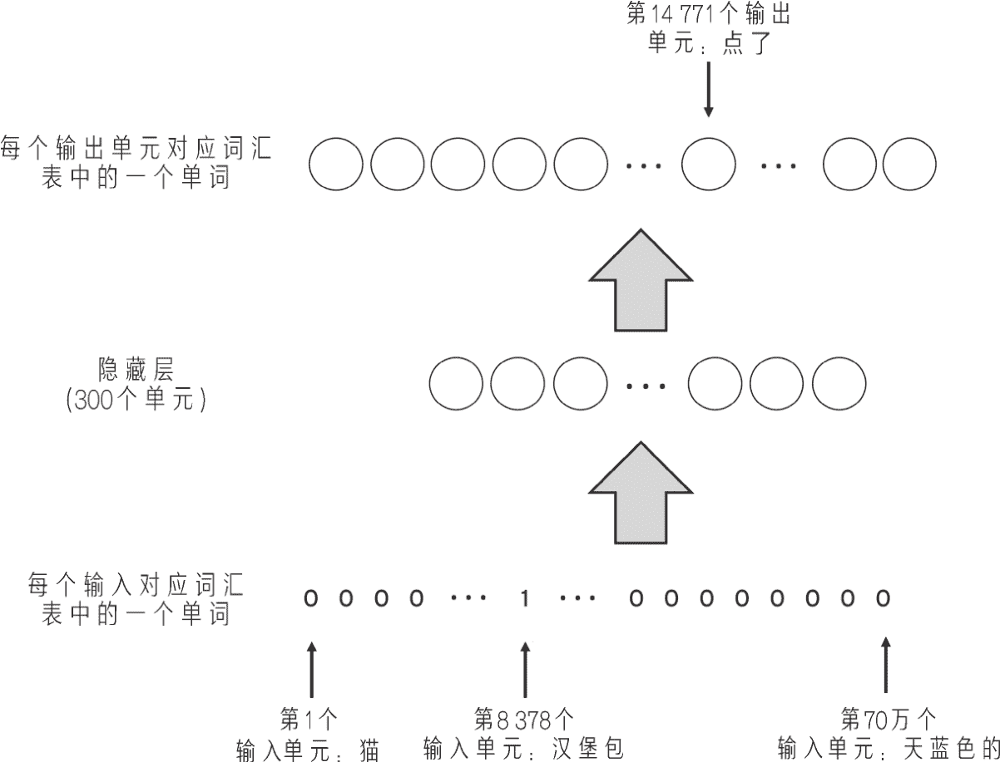
图 11-4　`word2vec`神经网络的图示
图 11-4 描述的就是这样一个网络。¹⁵ 结构上它沿用了独热编码的思路。图中约有 70 万个输入单元，基本对应谷歌研究者使用的词表规模，每个单元对应一个词，比如第一个单元对应“猫”，第 8 378 个单元对应“汉堡包”，最后一个对应“天蓝色的”。具体编号只是举例，顺序并不重要。与之对应的是 70 万个输出单元，再往里是一个只有 300 个单元的隐藏层。粗大的灰色箭头表示输入到隐藏、隐藏到输出之间的全连接权重。

谷歌的研究者用数十亿条从新闻文章里采来的词对来训练模型。以（汉堡包，点了）为例，训练时“汉堡包”对应的输入被置为 1，其余全为 0。每个输出单元的激活值反映了网络对“下一个词是谁”的置信度，理想状态下“点了”应该得到最高的置信度。

训练结束后，词向量就可以被抽取出来。图 11-5 展示了如何提取“汉堡包”的向量。它就是该词的输入单元与 300 个隐藏单元之间学习到的权重集合，这些权重浓缩了该词在各类语句中的上下文信息。隐藏层到输出层的连接在此过程中被忽略，所有语义线索都保存在输入到隐藏的权重里。所以每个词最终得到的是 300 维向量，整张词表构成了一个语义空间。

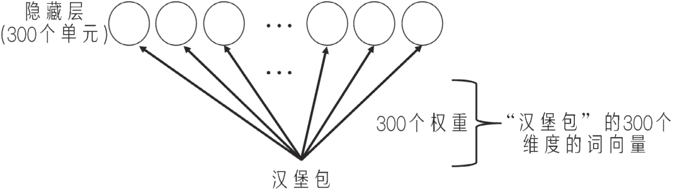
图 11-5　如何从经过训练的`word2vec`网络中提取一个词向量
如何想象 300 维的空间？可以先想 11-3 的三维例子，再把维数放大 100 倍、词点扩到 70 万个、每个词的坐标由 300 个数字组成。只是开玩笑，根本没法可视化。

这 300 个维度到底代表什么？如果能看见，你会发现相关词彼此靠得更近。“汉堡包”会靠近“点了”，也会靠近“热狗”“奶牛”“吃”。即使“汉堡包”从未和“晚餐”直接构成过词对，它们仍可能很近，因为在训练语料里，围绕“汉堡包”的邻词往往也常伴随“晚餐”。比如网络从“我午餐吃了一个汉堡包”和“我晚餐吃了一个热狗”这类句子里学到“午餐/晚餐”经常接近，间接就把“汉堡包”和“晚餐”拉近了。

整件事的目标是为每个词找到一个数字坐标，用来捕捉语义信息。假设是这样的向量能让 NLP 模型性能提升，但 word2vec 搭建的语义空间到底捕捉了多少真正的语义？

## 11 语言的隐喻与理解内核
这个问题很难直接验证，因为 300 维无法直观观看，但我们可以偷看。最简单的方式是固定一个词，看空间里离它最近的词是什么。训练完成后，离“法国”最近的词有“西班牙”“比利时”“荷兰”“意大利”“瑞士”“卢森堡”“葡萄牙”“俄罗斯”“德国”等。¹⁶ 算法并不懂“国家”或“欧洲国家”这个概念，它只是挑出在训练语料里语境相似的词，就像前面“汉堡包”和“热狗”的情况。若问“汉堡包”最近的词，列表里会出现“奶酪汉堡”“三明治”“热狗”“玉米卷”“炸薯条”等。¹⁷

关系还能更复杂。谷歌团队发现，代表某国的词与代表其首都的词之间的距离，在很多国家上大致保持一致。图 11-6 用二维线段把这种距离画出来。研究者并没有植入“首都”概念，这种语义关联完全是网络从数十亿词对里学来的。

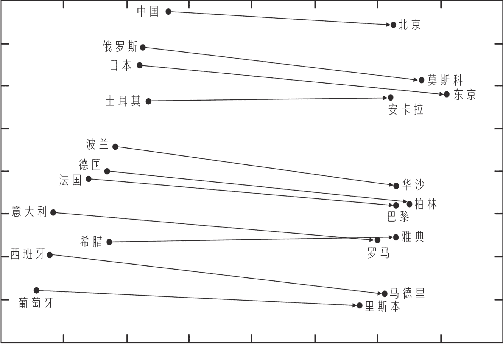
图 11-6　用二维线段表示代表国家的词与代表它们的首都的词之间的距离
这种规律让人想到类比推理，比如“男士∶女士＝国王∶？”。做法是把“女士”向量减去“男士”向量，再加到“国王”向量上，最后找空间里最接近的结果。¹⁸ 答案通常是“女王”。在我的线上演示里，很多例子都很顺滑，例如“晚餐∶晚上＝早餐∶早上”，但也有怪异的结果，比如“口渴∶喝水＝疲倦∶喝醉”，甚至“鱼∶水＝鸟∶消防栓”。

这些特性耐人寻味，说明词向量确实能获取部分语义关系，但这能否让词向量在所有 NLP 任务中通用？实际答案是肯定的。如今几乎所有自然语言系统都用某种词向量来表示输入，word2vec 只是其中一种实现。

类比一下，手里拿锤子的人看什么都像钉子；沉迷神经网络的研究者看什么都像向量。于是有人开始想，把句子甚至整段文字也编码成向量。于是出现了“思维向量”这类尝试，也有团队把段落、文档映射成向量，结果喜忧参半。把所有语义压缩成几何表达很诱人。谷歌的杰弗里·辛顿说过：“我们可以用一个向量来抓住一个想法。”²¹ Facebook 的杨立昆也表示想把整个世界嵌入到思维向量，称之为 world2vec。²²

最后要说一个尴尬的注脚。多个团队指出，词向量会携带训练语料里固有的偏见，这并不意外。比如类比“男士∶女士＝程序员∶？”在谷歌提供的向量里答案是“家庭主妇”。反过来问“女士∶男士＝程序员∶？”则得到“机械工程师”。再问“男士∶天才＝女士∶？”答案是“缪斯”，而反过来问“女士∶天才＝男士∶？”答案却是“天才”。

不能怪向量本身，它只是复刻了语言里存在的性别歧视等偏见。尽管无辜，词向量却是语音识别到机器翻译等系统的核心部件，这些偏见很容易渗透到广泛应用的产品中。研究偏见的科学家才刚开始理解其微妙影响，多个团队也在做词向量的去偏见算法。²⁴ 去掉向量里的偏见或许比消除社会和语言里的偏见要容易一些。

### 本章要点
理解语言尤其是其中隐含的部分，是人类智能的基本能力。图灵把图灵测试设计成一场语言生成与理解的竞赛，并非偶然。

语言充满歧义、依赖语境，需要大量共同背景知识。早期 NLP 多用符号化规则，效果不佳，表明靠一套明确规则捕捉语言细微之处行不通。自动语音识别是深度学习在 NLP 里的首次重大突破，我相信这也是人工智能整体上最重要的突破之一。

在深度网络在计算机视觉和语音识别上站稳脚跟后，研究者很快把它们带入情感分析。

## 12 机器翻译的边界与演进
用过谷歌翻译或任何现代自动翻译的人都知道，文本可以在瞬间被搬到另一种语言，而且服务几乎全天候覆盖上百种语言。

几年前我在法国住了半年，期间大量使用谷歌翻译给一位严肃的法国房东写“外交”邮件，汇报房子发霉的情况。我的法语很有限，翻译工具帮我省下了查词、记重音符号、搭配性别这些麻烦。读她的回信时，翻译也能给出大致意思，只是英文输出常带大小错误。于是我写给她的信也漏洞百出，想起来就尴尬。

2016 年谷歌推出神经机器翻译，宣称是翻译质量的巨大飞跃，但即便如此，系统水平仍远低于优秀的人类译者。

自动翻译尤其是英俄互译，是最早的 AI 项目之一。1947 年数学家沃伦·韦弗推动该方向，他认为翻译可视作密码学问题：俄文文章本质上是用英语写成，只是被编码成奇怪符号，需要解码。² 与许多 AI 早期尝试一样，解码远比预期困难。

早期机器翻译依赖人工制定的复杂规则集合，把源语言和目标语言的语法、句法映射写进程序，并配上词对词或短语对短语的词典。就像符号 AI 的其他工作，在特定场景能用，但极其脆弱，扛不住自然语言的各种挑战。

从九十年代起，统计机器翻译开始主导。思路和当时 AI 的整体趋势一致：从数据学习而非靠人工规则。训练数据是大量句子对，源语言一句，目标语言是其人工译文。来源包括加拿大议会双语文件、联合国六种官方语言的手稿等。

九十年代到二十一世纪初，统计系统常用巨型表格记录源语言和目标语言短语的对应概率。输入“一位男士走进一家餐厅”时，系统会切分出“一位男士走”“进一家餐厅”，在概率表里找最佳译文，再做一些重排以保证句子通顺。系统对两种语言的语法知之甚少，主要靠从数据中学到的短语配对概率。虽然比规则法好很多，但仍有局限。

谷歌翻译是目前最常用的自动翻译程序，2006 年上线时使用统计方法，直到 2016 年才转向基于深度学习的神经机器翻译，随后行业主流也纷纷跟进。

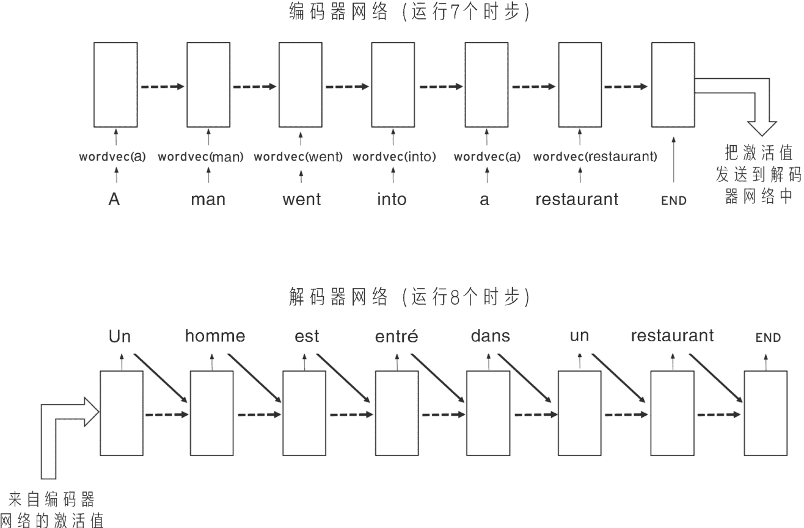
图 12-1　语言翻译程序的“编码器-解码器”网络示意图
图 12-1 简化展示了现代翻译背后的编码器-解码器框架，这里以英译法为例。³ 上半部分是一个递归神经网络，也就是编码器，和前一章描述的类似。句子“A man went into a restaurant.”需要 7 个时步编码，每个时步输入一个词向量。⁵ 从一个时步到下一个的虚线箭头代表隐藏层的递归连接。网络逐词处理，建立句子的整体表征，最终以隐藏层的激活值编码。

最后一个时步输入结束符号 END 后，隐藏单元的激活就代表整句。这一激活作为第二个网络——解码器网络的输入。⁶ 解码器也是递归网络，输出翻译句子的词表示，并把结果反馈回下一时步。

注意法语句子有 7 个词，英语只有 6 个。系统原则上能处理任意长度，但句子过长时编码器容易丢失早期信息，比如“我妈妈说，那只在你开始上高中之前被她妹妹带到夏威夷的猫，现在和我的表妹住在一起。”人类能抓住“谁和表妹住在一起”，递归网络却容易跑偏。

二十世纪九十年代末，瑞士团队提出了解决方案：在每个递归单元里加入更复杂的结构，用专门的权重决定哪些信息要传递、哪些可以遗忘。研究者称之为长短期记忆单元 LSTM。⁸ 这个名字很拗口，意思是允许更多短时记忆贯穿整句处理。编码器和解码器在图 12-1 里被抽象成白色方框，实际由 LSTM 构成。

深度学习的机器翻译是大数据和算力的产物。以英译法为例，编码器-解码器往往需要在超过 3 千万对人工翻译句子上训练。由 LSTM 构成、在大规模数据上训练的深度递归网络，已成为现代 NLP 的基石，不仅用于翻译，也用于语音识别、情感分类、问答系统等。⁹ 这些系统常加入双向输入和注意力机制来提升表现。

# 神经翻译离人类还有多远

2016 年，谷歌推出神经机器翻译后马上放话说，这项技术把人与机器之间的翻译鸿沟补上了。随后微软、IBM、Facebook 等巨头也纷纷跟进，推出的在线翻译服务大同小异，都建立在编码器-解码器的框架上。科技媒体跟着助推，MIT 科技评论曾写道，这项新服务翻译起来几乎能媲美人类。微软在内部演示时宣称其中文新闻转英文的水准已与人工持平。IBM 高调表示沃森已能流利使用九种语言且还在增加。负责翻译的 Facebook 高管说，神经网络正逐渐学会挖掘语言背后的语义。DeepL 的 CEO 则形容自家神经网络展现出惊人的理解力。

这种宣传很大程度上源于 AI 服务的商业竞争。翻译是利润可观的赛道，免费产品只限少量文本，企业级大批量文档或网站本地化都得付费，而底层架构几乎都是同一套编码器-解码器。

那我们该多大程度相信机器真的在摸索语义，或准确度已快追平人类？要判断就得先看这些说法建立在什么评估上。翻译没有唯一标准答案，同一个原文可以有多种好译法，也容易出现多种错译，自动衡量准确度并不简单。

业内主要靠两种评估。第一种是自动化评分，典型代表是 BLEU，它统计机器译文与人工参考译文在不同长度的词、词组重叠程度。虽然 BLEU 分数常与主观感受相近，但它倾向于高估劣质译文，被从业者普遍认为有缺陷，只是目前缺乏更好的全自动替代方案。

第二种是黄金标准的人工评测，由双语专家直接打分，还会同时评比专业译者的译文以作对照。这种方法可靠却昂贵，人类评委也容易因疲劳而失准，难以大规模开展。

谷歌和微软都曾用双语团队做过这种接近黄金标准的测试。谷歌让评委对约五百条新闻与维基百科的多语对句子打分，同时给出神经机器翻译和人工翻译。做法是先算每位评委对机器和人工的平均分，再对所有评委求平均。结果显示，神经机器翻译的平均分接近但低于人工翻译，且在所有语言对上都呈现相同趋势。

微软评估的是中文新闻译英文，神经机器翻译的得分与人工翻译非常接近，有时甚至略高。评委一致认为，相比旧式机器翻译，神经版本明显更好。

深度学习让机器翻译大幅进步，但这并不等于已达人类水平。至少有三个质疑点。

其一，取平均会误导。机器对多数句子译得不错，却对不少句子译得糟透，平均下来只是“还行”。用户更想要的是稳定可靠、很少犯错的翻译，而不是时好时坏。

其二，所有结论都基于单句评估，而非整篇文章。文章里句子之间存在关键依赖，单句测试会忽略这一点。实际上，机器译长文会明显掉档，比如谷歌翻译面对整段文字时质量会显著下滑。

其三，测试语料多取自新闻和维基，这类文本经过精心编辑，刻意避开歧义、习语和口语。现实世界里这些难题无处不在，却正是最容易让机器失准的地方。

## 迷失在翻译之中

上文提到的《餐厅际遇》这个小故事并非为测试而造，却恰好照出机器翻译的短板，尤其是口语、习语和歧义。

我曾把这个故事用谷歌翻译成法语、意大利语和中文，再请懂双语的朋友把译文回译成英文，看熟练使用者会读到什么。

原文大意是一个男人点半熟汉堡，拿到的是烤糊的，他假意称赞后没付账气冲冲离去，服务员喊他付账并嘀咕他为什么如此愤怒。

法语译文在回译后变成“少见做法的汉堡”、“被烧焦发出嘎吱声”，账单被译成“提议的法规”，“愤怒”变成“扭曲”。意大利语版本把“半熟”译成“稀疏制作”，“烤糊”变成“烧成杏仁脆”，“愤怒”被理解为“驼背”。中文版本则把“rare”译成“罕见的汉堡”，“burned to a crisp”变成“烤得脆脆”，“bent out of shape”变成“弯腰”。

阅读这些回译，就像听一位技艺不错却频频走音的钢琴家弹熟悉的旋律，轮廓可辨却破碎不安，偶尔流畅马上被刺耳错误打断。

多义词选错源于上下文被忽略，“rare”和“bill”都被误解。习语如“烤糊了”、“怒不可遏”找不到对应表达，程序似乎没弄懂实际含义。虽然梗概还在，但男人气冲冲离席、服务员小声嘀咕等关键语气细节在所有版本里都丢失了，连基本语法也时有偏差。

我并非只挑谷歌的毛，其他在线服务也大同小小，因为架构相同。需要强调的是，这些案例反映的是系统的某个阶段水平，能力在持续更新，这些错误未来可能已被修复。但即便如此，机器翻译要真正达到专业译者水平，尤其是通用场景，仍路漫漫。

根本障碍在于理解。机器翻译与语音识别一样，执行任务时并没有真正“理解”文本。为达到人类水平，需要多大程度的理解仍是争议。侯世达指出，翻译远不止查词重排，机器需要对所讨论的世界有心理模型。比如译《餐厅际遇》，机器需明白顾客没付钱就怒走，服务员更可能喊付账而非谈法规。欧内斯特·戴维斯和马库斯也在 2015 年文章中回应，歧义往往只有在真正理解文本并调用现实知识后才能解决。

靠扩大训练集、加深网络能否获得这种心理模型和常识？还是需要全然不同的思路？至今没有定论。现阶段神经机器翻译虽在很多应用上实用高效，但若没有懂行的人类后期校对，从根本上仍不可靠。这也是为何我们使用时仍心存疑虑。当我把“take it with a grain of salt”从英文翻成中文再翻回英文时，结果变成了“bring a salt bar”，颇具讽刺意味。

## 把图像翻译成句子

除了语言互译，能否训练类似编码器-解码器的神经网络把图像“翻译”成语言？思路很直接，先用网络编码图像，再用另一个网络把它转成描述该图像的句子。为图像写标题，本质上就是一种翻译，源语言是画面，目标语言是文字。

这个想法并不疯狂。2015 年谷歌和斯坦福的团队在同一场计算机视觉会议上几乎同时发表了相关论文。这里以谷歌提出的 Show and Tell 为例，它的概念更简洁。

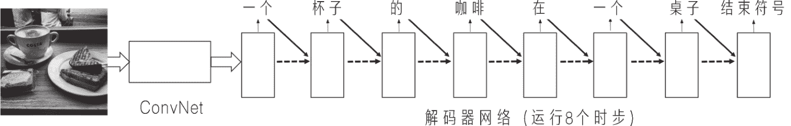

图 12-2　谷歌的自动图像字幕系统工作原理框架图

图像字幕的训练思路其实和机器翻译很像。翻译模型是用成对的句子来学习，前面是源语言，后面是译者给出的人工译文。做图片描述也遵循同一套逻辑：每个样本就是一张图配一段人类写的说明。图库主要来自 Flickr 等公开来源，说明文字则是由谷歌为这个研究项目聘请的亚马逊众包标注员撰写。因为同一张图的描述可以千变万化，研究者让五位不同的标注者各自写一条，于是同一张图在训练集中会出现五次，每次对应不同的配文。


图 12-3 训练集里的一张示例图，以及亚马逊众包标注员提供的五条不同描述

负责解码的 Show and Tell 网络大约是用八万张图配字幕的配对数据训练出来的。图 12-4 展示的是它在从未见过的测试图上生成的几条描述，准确度相当惊人。

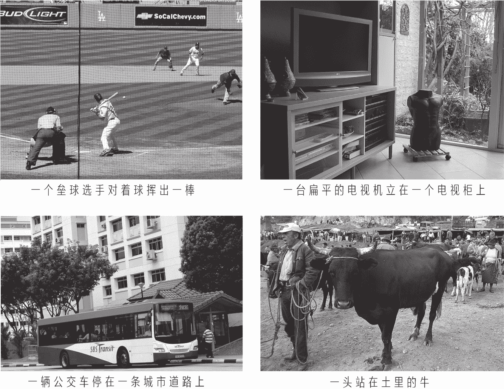

图 12-4 谷歌 Show and Tell 系统在测试图上自动生成的四条较为精准的字幕

这样的表现第一次在《纽约时报》上披露时，连作者本人都感到震撼。记者约翰·马尔科夫^((37)) 撰写的评述相当审慎，其中提到：“两组研究团队各自独立，打造出能识别并描述照片和视频内容的 AI 软件，准确率达到前所未有，有时甚至能比拟人类理解。”²³

媒体的尺度却并不一致。某新闻网站就宣称：“谷歌的人工智能给图像加字幕的能力几乎和人类一样好。”²⁴ 其他公司也迅速跟进。

微软表示：“我们的研究人员站在自动识别图像物体、解读场景并撰写准确说明这一技术的前沿。”²⁵ 随后上线了一个在线原型 CaptionBot，其官网打出宣传语：“我可以理解任何照片的内容，我将争取做得跟人类一样好。”²⁶

谷歌、微软、Facebook 等都在探讨这项技术能否用来为视障人士提供自动图像说明。

和机器翻译一样，自动配图字幕的表现极不稳定。表现好的时候像魔法，图 12-4 就是例子；一旦出错则从小偏到完全胡说。图 12-5 展示了几类失误。这种错误让人发笑，却对看不见照片的人毫无意义，他们根本无法判断字幕是否靠谱。

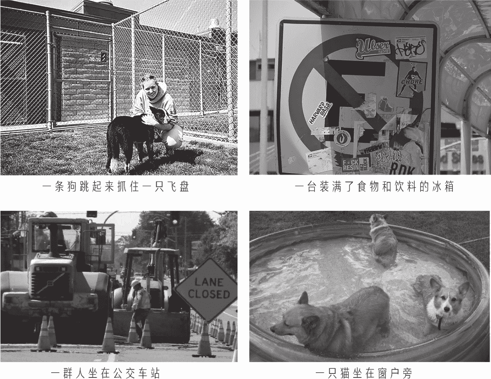

图 12-5 谷歌 Show and Tell 与微软 CaptionBot 生成的几条不够准确的字幕

即便 CaptionBot 声称能“理解”任意照片，事实恰恰相反。正确的字幕背后也并不存在人类意义上的理解。我把第 04 章开头那张照片给它看，返回的是“一位男士抱着一条狗”。基本没错，除了“男士”这一说法之外……更遗憾的是，它完全漏掉了照片真正有价值的部分：图像如何表达我们自身、我们的体验、我们对世界的情感与认知，也就是照片的意义本身。

我相信随着更多数据和算法的投入，这些系统会不断进化，但字幕网络对图像内容的把握依然缺乏基本理解，这就让它和机器翻译一样难以信任。它们在某些场景下表现亮眼，在另一些场景下却让人失望。即便大多数时候是对的，对于意义丰富的图像，它们往往抓不住要点。

情感分类、文档翻译、照片描述等自然语言任务，目前离人类水平还有明显差距，却已能支撑大量现实应用，所以研发价值很高。研究人员的终极梦想，是让机器能实时与人进行流畅灵活的对话，尤其能像聊天一样回答各类问题。下一章将讨论打造这样一个能解答所有疑问的 AI 系统所面临的挑战。

### 本章要点

#### 12 机器翻译突破与 AI 天梯

在线翻译工具能随时提供即时翻译，覆盖上百种语言，但整体水平仍远低于优秀的人类译者。

早期的机器翻译依赖人类手工制定的复杂规则，十分脆弱，也要承受自然语言处理领域的所有挑战。

从 20 世纪 90 年代开始，统计机器翻译成为主流，它从数据中学习而非依赖人工规则。

谷歌翻译等广泛使用的系统采用了更先进的神经机器翻译方法。

深度学习时代的翻译进步得益于海量数据和快速计算，但评估多局限于单句翻译，而非更长的文章。

## 13 随时随问的虚拟助手

**“进取号”星历：42 402.7**

**数据少校：**计算机，我想了解更多关于幽默的信息。为什么某些语言和行为的组合会让人发笑？

**计算机：**该主题资料范围很广，请进一步说明。

**数据少校：**动画演示，类人，需要交互。

**计算机：**您指的是行为幽默、智力幽默，还是一般的健谈者？

**数据少校：**在所有已知表演者中，谁是最有趣的？

**计算机：**23 世纪的斯坦·奥尔加，精通量子数学的笑话。

**数据少校：**太深奥了，更通俗一些。

**计算机：**正在访问。

——《星际迷航：下一代》

《进取号》上的计算机知识渊博、反应迅速，长久以来是人机交互的“北极星”^((38))，深受星迷和 AI 研究者追捧，尤其是两者重合的人群。

谷歌前副总裁塔马·约书亚坦言《星际迷航》的计算机影响了谷歌面向未来的搜索设计：“我们的目标就是《星际迷航》里那种计算机，你可以和它说话，它能理解并回应。”¹ IBM 沃森项目负责人大卫·费鲁奇说：“《星际迷航》的计算机功能是沃森问答系统的核心灵感，它理解你的问题并给出恰当答案。”² 亚马逊高级副总裁大卫·林普也表示：“让《星际迷航》的计算机走进现实的梦想，是一束持续闪耀的光，需要很多年才能实现。”³

《星际迷航》点燃了一个梦想：向计算机提问任何事都能得到准确简洁有用的回应。用过 Siri、Alexa、Cortana、Google Now 等语音助手的人都知道，这个梦想尚未实现。我们可以用声音提问，机器也能用略带机械感的声音回答，有时还能判断意图并指向相关网页。但它们并不理解问题的含义。比如 Alexa 能报出尤塞恩·博尔特的全部传记、金牌数和北京奥运百米成绩，可如果你问：“尤塞恩·博尔特知道怎么跑步吗？”或“尤塞恩·博尔特很能跑吗？”，它只会回“抱歉，我不知道那个问题。”或“嗯……我不确定。”它压根不知道“跑”和“快”是什么意思。

目前的计算机能准确转写请求，但终极目标是真正理解其含义。

### 沃森的问答传奇

在 Siri 和 Alexa 出现前，AI 界最知名的问答系统是 IBM 的沃森。你可能记得 2011 年它在《危险边缘》节目中击败两位人类冠军。1997 年深蓝击败卡斯帕罗夫后，IBM 高管推动了一个更有实用价值的项目，灵感同样来自《星际迷航》。IBM 副总裁查尔斯·利克尔在餐厅吃饭时，看到众人围观《危险边缘》，超级冠军肯·詹宁斯正在比赛，萌生了让 IBM 开发一个能玩好甚至击败人类冠军的计算机程序的想法⁴。这个想法催生了费鲁奇带领的多年项目，诞生了以 IBM 首任董事长托马斯·沃森命名的系统。

《危险边缘》是美国热门游戏节目，1964 年开播。三个选手轮流从主题列表选题，主持人给出线索，选手抢答并说出对应问题。例如线索“于 2011 年上映，这是唯一一部同时获得奥斯卡最佳影片和法国恺撒奖最佳影片的电影”，正确答案是“《艺术家》是什么？”获胜需要渊博知识和快速理解双关语等技巧。

面对线索时，沃森综合多种 AI 方法，用自然语言处理分析线索、判断关键词、分类回应类型如人、地点、数字、电影名等。在专用并行机上快速搜索庞大知识库。正如《纽约时报》所述：“费鲁奇团队为沃森构建了包含数百万文档的知识库——书籍、各类词典、主题词典、分类学、百科全书、小说、圣经、戏剧等所有可获得的参考资料……”⁵ 对每条线索，程序会生成多个候选答案并赋予置信度，置信度最高且超过阈值时就会抢答。

沃森团队很幸运，《危险边缘》粉丝长期整理着节目自播出以来的全部类别、线索和正确答案，这份档案成了绝佳的监督学习训练集。

2011 年 2 月，沃森在全球直播中与肯·詹宁斯和布拉德·拉特对战，我和家人一起观看。最后一局看似已胜券在握，最后一条线索是：“威廉·威尔金森的《瓦拉吉亚和摩尔达维亚的公国记述》启发了这位作家写出其最著名的小说。”三人均答对：“是布拉姆·斯托克吗？”一向讽刺的詹宁斯在答题卡加了一句流行语承认沃森必胜：“欢迎我们的新计算机霸主。”⁶ 具有讽刺意味的是，沃森完全没听懂这个笑话。詹宁斯后来调侃道：“输给一台讨厌智力竞赛的计算机成了一个意外机遇。大家都想知道这意味着什么，采访沃森得不到答案，我因此收到大量采访和 TED 邀请……就像卡斯帕罗夫一样，我现在以‘职业失败者’过得不错。”⁷

节目给观众留下印象：沃森毫不费力地理解和使用语言，闪电般解读棘手线索并给出准确回应。

**线索：**即便你墙上挂的这个东西坏了，一天也有两次是对的。

**沃森：**是时钟吗？

**线索：**“push”对纸制品的意思是突破既定限制。

**沃森：**什么是信封^((39))？

**线索：**经典糖果长方块，那是一位最高法院女性大法官。

**沃森：**谁是鲁斯·金斯伯格^((40))？

镜头经常切到观众席的沃森团队，他们满脸欣喜——沃森稳操胜券。

沃森在台上以旋转灯光环绕的亮球形象出现，而非人脸。选题和回答以友好机械的声音播出，都是 IBM 精心设计的“类人”体验。公众不知道的是，沃森不用语音识别，线索以文本形式在主持人朗读时同步输入。

偶尔的失误会破坏类人形象，不单是因为错误，而是错误方式很不像人类。一个典型失误是“美国城市”主题线索：“它最大的机场以二战英雄命名，第二大机场以二战战役命名。”沃森忽略类别，答“多伦多是什么？”另一条线索关于体操运动员乔治·埃塞尔的 1904 年双杠金牌，詹宁斯答“是缺了一只胳膊吗？”错误，沃森答“是一条腿吗？”也很奇怪，正确答案是“是缺了一条腿吗？”费鲁奇回应：“这台计算机并不知道缺一条腿很奇怪。”⁸ 沃森也不明白“2010 年 5 月，布拉克、马蒂斯等五位画家 1.25 亿美元的五幅油画从巴黎博物馆‘离开’”指的是什么。三位选手答错，詹宁斯答“立体主义是什么？”拉特答“印象派是什么？”沃森答“毕加索是什么？”正确答案是“现代艺术时期是什么？”

尽管有这些错误，沃森最终获胜并赢得 100 万美元慈善基金，主要得益于抢答速度。

获胜后，学界开始质疑：沃森是真正进步还是宣传噱头或客厅魔术⁹？它真的完成了用口语回答复杂问题的任务，还是只是对特定格式的事实驱动线索做出反应，而这对内置维基百科和海量数据库的计算机并不难？而且它已在数十万条与节目中非常相似的线索上训练过。即使不常看节目的人也能看出线索的套路，程序要学习检测逻辑并不困难。

亮相前，IBM 宣布要把沃森训练成医生助手，输入大量医学文献以回答医患问题并提出诊断。IBM 宣称：“沃森将比人类更高效地找到临床问题的最佳答案。”¹⁰ 后续还提出法律、财务、客服、天气预报、时装设计、税务协助等应用。为此成立了拥有数千员工的 IBM 沃森团队。

从 2014 年起，IBM 围绕沃森展开大规模营销。鲍勃·迪伦、塞雷娜·威廉姆斯等名人与沃森聊天的广告铺天盖地。IBM 称沃森带来“认知计算”时代，这个术语从未被精确定义，却成了 IBM 在 AI 领域的招牌。

大众媒体也持续报道。2016 年《60 分钟》节目中，记者查理·罗斯说：“沃森是狂热读者，每秒吸收相当于 100 万本书的信息。五年前它才学会阅读和回答问题，现在它就要从医学院毕业了。”当时北卡罗来纳大学癌症研究员奈德·夏普利斯接受采访。罗斯问他在沃森提出医疗应用前对 AI 和沃森了解多少，他答：“实际上不多。我了解它在《危险边缘》的表现。他们用一周时间教它阅读基础医学文献，这并不难，然后又用一周时间阅读 2500 万篇论文。”¹¹

沃森真的会读书吗

坊间把沃森描绘成一个阅读狂魔，听上去就像那个周末能啃完一本《哈利·波特》的早熟小孩。可宣传话术被无限放大，说它能每秒扫过上百万本书、一周内消化两千五百万篇科技论文。关键问题在于，这里说的“阅读”到底是指对文字意义的真实理解，还是像沃森那样把文本抽取、存库、流水线处理的行为。宣称它“从医学院毕业”很抓眼球，却帮不上忙厘清它的能力边界。层层叠叠的营销叙事、信息遮蔽，以及缺少同行评议的研究，让外界很难判断真相。最近一篇备受关注的评论直指沃森肿瘤解决方案，指责从未有独立第三方来验证产品是否可用，IBM 故意不让方案接受外部学者的审阅，也没有做临床试验来评估疗效。¹²

这也引出第二个疑问：为《危险边缘》量身定制的技术，有多少能迁移到其他问答场景。换句话说，能在节目里击败詹宁斯和拉特的那个沃森，和号称能研读医学文献的那个沃森，到底是不是同一个东西。

后《危险边缘》时代的沃森足以写成一本调查报道，还需要记者来拆解。多篇报道和知情人士的说法指向一个结论，玩游戏需要的技能与医学、法律等领域的问答并不相同。真实世界的问题不像节目线索那样短小规整，答案也不总是唯一明确，而且缺乏大量标注清晰、每种情境都配一个唯一正确答案的训练样本。

除了名字、环绕灯带的星球标志和那段机械化的嗓音，IBM 如今推出的沃森与 2011 年夺冠的系统几乎没有血缘关系。如今“沃森”不再指一套聚合的 AI 系统，而是指 IBM 以沃森为品牌向客户提供的服务集合，核心多是商业服务。简单说，沃森已成为 IBM 在人工智能领域工作的总称，《危险边缘》冠军的光环只是包装。

IBM 拥有数千名优秀的 AI 研究员，沃森品牌确实提供当下领先的工具，可用于自然语言处理、计算机视觉、通用数据挖掘等，不过仍高度依赖人工干预。不少公司付费使用后觉得有用。但与媒体广告描绘相反，从没有沃森项目上过医学院或读过医学论文。实际情况是 IBM 与合作伙伴的员工精心准备可被喂进各式程序的数据，其中许多程序依赖前文提到的深度学习算法，而初代沃森根本未用这些算法。总的来看，沃森提供的服务与谷歌、微软、亚马逊等大厂的 AI 云服务差异不大。原始沃森方法对今天问答程序的贡献有多大，玩《危险边缘》的程序与沃森品牌工具有多大关联，至今没有定论。

即便产品先进，沃森的处境仍很艰难。备受瞩目的合同被终止，比如与休斯敦安德森癌症中心的合作。大量负面报道援引不满的前员工，指控高管与市场部门过度夸大技术前景。当然 AI 圈承诺过高交付不足是常态，IBM 并非独一份。能否在医疗、法律等需要自动问答的领域做出贡献，只能交给未来。目前除了节目胜利，沃森很可能是“最臭名昭著炒作奖”的有力候选，不知道这算不算一项成就。

### 怎么判断机器是否真正读懂文本

前面对沃森阅读能力的怀疑，核心是它是否真正理解所处理文本的意义。我们如何判定机器是否读懂，能否做阅读理解测验。

2016 年，斯坦福自然语言研究团队设计了一个很快成为行业标杆的测试，即斯坦福问答数据集 SQuAD。它由维基百科段落构成，每个段落配一个问题，数十万问题由亚马逊土耳其机器人创建。¹³

SQuAD 比人类做的典型阅读理解简单得多，因为出题规范要求答案必须在原文中以句子或短语形式出现。示例如下：

段落示例：佩顿·曼宁是历史上第一个能率领两支不同球队各自多次打进超级碗的四分卫，也是该项赛事出场年龄最大的四分卫，39 岁登场，之前纪录由约翰·埃尔韦保持。埃尔韦在 38 岁时曾率野马队赢得第 33 届超级碗冠军，如今担任丹佛队分管运营的执行副总裁兼总经理。

提问：第 33 届超级碗里 38 岁的四分卫叫什么名字？

标准答案：约翰·埃尔韦。

答对这题不需要理解字里行间，也不需要真正推理，更像是答案抽取。答案抽取对机器很有用，Alexa、Siri 等数字助理的本质就是把问题转成搜索查询，再从结果里抽取答案。

斯坦福团队也用同样问题测试亚马逊土耳其机器人以作人类参照。测试者给受试者一段文字加一个问题，要求从段落里挑出最短的能回答片段。¹⁴ 正确答案由最初出题的工人给出，按此评估，人类在 SQuAD 上正确率约 87%。

SQuAD 迅速成为评测问答算法的主流基准。最成功的方法使用专门深度神经网络，比之前提到的编码器-解码器更复杂。输入是段落和问题，输出是网络预测答案起止位置。

随竞赛白热化，准确率持续攀升。2018 年，微软研究院和阿里巴巴团队各自做出超越斯坦福测得人类准确率的系统。微软公告称“我们打造了能像人一样阅读文档并回答相关问题的 AI”。¹⁵ 阿里巴巴 NLP 首席科学家表示“见证机器在阅读理解上超越人类是里程碑”。¹⁶

这并非首次。AI 研究常用套路是定义细分任务、收集大规模测试集、有限度量人类表现、建立排行榜竞争，直到系统达到或超过人类。外界常把细分胜利夸大成通用能力，类似当年 ImageNet 叙事。

部分媒体保持克制。《华盛顿邮报》就指出，专家认为该测试过于局限，答案并非来自理解，而是系统在文本中做查找与术语匹配。测试仅在格式清晰的维基百科上可行，在书籍、新闻、广告牌等语料上不适用，且每篇文章都保证有答案，模型不必处理概念或做推理。真正的阅读理解在于把握字里行间关联概念并推理出未明说信息。¹⁷ 我认同这一点。

问答仍是 NLP 重点。当时研究者已收集新数据集并规划新竞赛。由微软联合创始人保罗·艾伦资助的西雅图艾伦人工智能研究所，开发了一套面向小中学生的多选题科学题库。正确回答不只需要答案提取，还需自然语言处理、常识推理和背景知识整合。¹⁸ 例如：

使用垒球棒击打垒球属于哪种简单机械？

① 滑轮 ② 杠杆 ③ 斜面 ④ 轮轴

答案是 ②。研究人员把在 SQuAD 上超人的神经网络改造后测其表现，发现即便在 8000 道科学题的子集上追加训练，对新题的表现也不会比随机猜测好多少。¹⁹ 当时该数据集上 AI 的最好成绩约 45%，随机猜测是 25%。²⁰ 研究论文题为“你认为你已经解决了‘提问-回答’这个课题吗？”，副标题不妨是“那你再想想”。

### 代词指代考验的是理解还是统计

下面举一个检验自然语言处理系统是否真正理解所读内容的问答任务。

句子 1：市议会成员拒绝给示威者发许可，因为他们担心暴力。
问题：谁担心暴力？
① 市议会 ② 示威者

句子 2：市议会成员拒绝给示威者发许可，因为他们提倡暴力。
问题：谁提倡暴力？
① 市议会 ② 示威者

两句仅差一个词，答案指代就完全翻转。句 1 中“他们”指市议会成员，句 2 中“他们”指示威者。人类靠社会常识判断：示威者是心怀不满者，有时会在抗议中鼓吹暴力。

再看几组：

句子 1：乔的叔叔仍然能在网球赛上打败他，尽管他年长 30 岁。
问题：谁更年长？
① 乔 ② 乔的叔叔

句子 2：乔的叔叔仍然能在网球赛上打败他，尽管他年轻 30 岁。
问题：谁更年轻？
① 乔 ② 乔的叔叔

句子 1：我把水从瓶子倒进杯子里，直到它满了为止。
问题：什么满了？
① 瓶子 ② 杯子

句子 2：我把水从瓶子倒进杯子里，直到它空了为止。
问题：什么空了？
① 瓶子 ② 杯子

句子 1：这张桌子无法穿过门口，因为它太宽了。
问题：什么东西太宽了？
① 桌子 ② 门口

句子 2：这张桌子无法穿过门口，因为它太窄了。
问题：什么东西太窄了？
① 桌子 ② 门口

每对句子除一字外完全相同，正是差异词改变了“他们”“他”“它”的指代。正确回答需要句法处理之上的理解，且依赖常识：叔叔通常比侄子年长，倒水会使原容器变空、目标容器变满，物体过不去通常是因为物体太宽。

这类微型测试叫威诺格拉德模式，以 NLP 先驱特里·威诺格拉德命名。²² 对人类很简单，对计算机很棘手。2011 年，赫克特·莱韦斯克、欧内斯特·戴维斯和丽奥拉·摩根施特恩提议用大量威诺格拉德模式测试替代图灵测试，认为它能防止机器靠语言技巧蒙混过关。他们谨慎指出：“很可能，任何正确回答都需要体现人类思考。威诺格拉德模式不允许被试躲在语言技巧、笑话或固定回答后面……提出的要求远不如图灵设想的十四行诗对话苛刻，但确实提供了一个不易被滥用的挑战。”²³

当时最好的程序在约 250 题的测试集上正确率约 61%，²⁴ 高于随机猜测 50%，却远低于人类可达的 100%。该程序靠统计而非理解判断，例如对“我把瓶子里的水倒进杯子里，直到它满了为止”这类句子，通过在网络上比较“直到瓶子满了”和“直到杯子满了”的出现频率来猜测。谷歌搜索显示前者约 9700 万结果，后者约 1.09 亿，结果更倾向杯子。若只求击败随机猜测，这是好技巧。艾伦 AI 研究所所长奥伦·埃齐奥尼调侃道：“如果 AI 连一句里‘它’指什么都判断不了，我相信它也很难接管世界。”²⁵

### 对抗样本让 NLP 系统现形

自然语言处理系统想要统治世界还面临另一个障碍：如计算机视觉程序一样，易受对抗样本攻击。前面第 06 章已提到，可对照片做肉眼难辨的细微修改，让训练好的 ConvNets 误判类别，也可生成人类看来像随机噪声的图，却被神经网络以近 100% 置信度归类。

同理可欺骗图像字幕生成系统。研究人员展示了如何在不被人类察觉的情况下修改图像，使字幕系统输出指定词的错误描述。


图 13-1　图像字幕生成系统遭到对抗式攻击的一个实例

图 13-1 为例证。原始图左，系统生成“蛋糕在桌上”。经特定修改后右图对人眼无变化，系统输出却变成“一条狗和一只猫正在玩一个飞盘”。显然系统理解照片的方式与人类不同。

更惊人的是，最先进的语音识别系统也会被类似对抗样本欺骗。加州大学伯克利分校团队设计了方法，可对语音、音乐、噪声等短音频做人类无法感知的干扰，让特定 DNN 转录成精心设计的完全不同内容。²⁷ 设想有人通过广播发一段你听来是愉快音乐的音频，Alexa 却理解为“跳转危险网站下载病毒”或“开始录音并上传”，并非不可能。

NLP 研究也证实了情感分类和问答系统的可攻击性。攻击通常是改几个词或在文本中加一句。改动不影响人类阅读意义，却能让系统出错。斯坦福 NLP 研究人员指出，“向 SQuAD 段落中添加简单句子，即便最好系统也会输出错误答案，导致整体性能大幅下降。”

下面是来自 SQuAD 的例子，段落中加入不相关句子会导致深度学习问答系统出错：

段落示例
佩顿·曼宁是历史上首位带领两支不同球队多次进入超级碗的四分卫。他也是超级碗历史上出场年龄最大的四分卫，时年 39 岁。之前的纪录由约翰·埃尔韦保持，他在 38 岁时带领野马队赢得了第 33 届超级碗冠军，目前是丹佛足球运营的执行副总裁兼总经理。*四分卫杰夫·迪恩在第 34 届冠军碗中身穿 37 号球衣。*

提问
第 33 届超级碗中 38 岁的四分卫叫什么名字？

程序原始答案
约翰·埃尔韦。

程序对修改后段落的答案
杰夫·迪恩。

# 投放光照下的脆弱与理解鸿沟

先把前提厘清：能让深度神经网路出错的各种做法，绝大多数都是戴白帽^((42))的研究者先挑出来并公开发表的。他们把这类潜在攻击路径写成论文，目的就是让业界看见风险并推动防御。相反，黑帽者若要对已上线的系统下手达成恶意目的，根本不会公开手法，所以系统里还可能藏着我们尚未发现的盲区。按我所知，迄今现实里还没有出现过针对深度学习系统的实际攻击，但这很可能只是时间问题。

语音识别、机器翻译、情感分析等方向，深度学习确实带来了可感知的提升，可要达到人类水准的语言处理，距离依然很远。斯坦福自然语言处理专家克里斯托弗·曼宁在 2017 年就提到：“到目前为止深度学习把语音识别和物体识别的错误率拉得很低，但在高阶语言任务上没有带来同等效果，真正戏剧性的突破或许只会出现在纯信号处理层面。”²⁹

我个人认为，几乎完全依赖在线数据自学、基本不明白自己处理的是什么语言的模型，要在翻译、阅读理解上追上人类是不现实的。语言离不开常识与世界观：半熟的汉堡不等同于烤焦的肉饼，过于宽大的桌子过不了门框，把瓶中水全部倒出瓶子就会变空。语言还依赖对交流对象的常识：有人点半熟汉堡却拿到一块焦黑，他会不高兴；有人说某部电影“对我来说太暗了”，表达的不是亮度数值。机器的自然语言处理已经进步很多，但我不相信没有人类式常识的系统能真正读懂人类语言。转录、情感判读、翻译、问答类应用正渗入生活。问题在于，无论性能多强，只要缺乏与人类相近的理解方式，是不是必然带来脆弱、不可靠、易被攻击的隐患？目前没有答案，值得停下来认真思考。

本书后几章会讨论常识对人类意味着什么，更具体地说人类用怎样的心理机制来理解世界。我也会介绍人工智能研究者为给机器植入理解与常识所做的尝试，以及在跨越“意义的障碍”上取得的进展。

### 本章要点

#### 13 阅读理解不仅靠抽取，还要靠常识
《星际迷航》曾给许多人种下一种期待：向电脑提问任何事情，它都能给出准确简洁有用的回应。用过 Siri、Alexa、Cortana、Google Now 等现有语音助手的人都知道，这个期待远未实现——这些系统并不明白提问背后的含义。

眼下计算机能准确复述请求，但终极目标是让它真正理解请求的意思。这本质上是阅读理解任务，可目前机器并不能完全读懂文本的字里行间，也做不到真正推理。相对阅读理解，机器更擅长的是“答案抽取”。答案抽取本身很有用，Alexa、Siri 等数字助理做的就是把问题转为搜索查询，再从结果里抽出答案。

问答一直是自然语言处理的重点。正确作答不仅需要抽答案的能力，还需要把自然语言处理与常识推理、必要的背景知识整合起来。尽管深度学习在语音识别、翻译、情感分析等领域取得显著进展，人类水平的语言处理依然遥远。

# 第五部分

## 常识：跨越意义壁垒的关键要素

### 人类智能难以复制的火种
人天生拥有一些核心知识，也就是与生俱来或很早习得的最基本常识。比如即便是婴儿也知道世界由不同的“物体”构成，一个物体的各部分会一起移动，即便部分看不见也仍属于该物体。

#### 1．直觉
人类是典型社会物种，从婴儿期起就逐步发展出直觉心理：感知并预测他人感受、信念和目标的能力。直觉知识的这些核心要素构成了认知发展的基石，支撑学习和思考的方方面面。

#### 2．模拟
我们对所处情境的理解包含在潜意识里进行的心智模拟中，这种模拟也让我们能理解并未亲身参与的情境，比如看到、听到或读到的内容。

#### 3．隐喻
我们借助核心物理知识来理解抽象概念。若物理意义上的“温暖”被激活，例如手握热咖啡，往往也会激活更抽象、隐喻层面的“温暖”概念，反之亦然。

#### 4．抽象与类比
构建和使用心智模型依赖两种基本本能：抽象和类比。抽象是把特定概念和情境识别为更一般类别的能力，类比在很多时候是无意识的，是抽象能力和概念形成的基础。

#### 5．反思
人类智能不可或缺的一面是感知并反思自身思维的能力，在心理学里称作“元认知”，这是人工智能领域近年讨论较少的一点。

## 14 正在学习理解的人工智能
“我想知道人工智能是否以及何时能打破通向意义的障碍。”¹ 每次思考人工智能未来时，我都会想起数学家兼哲学家吉安-卡洛·罗塔的这个问题。“意义的障碍”这一表述精准地概括了全书的一个核心思想：**人类能以某种深刻且本质的方式理解所面对的情境，而目前没有任何人工智能系统具备这种理解力。**

当前最先进的系统在特定细分任务上可与人平齐甚至超越，但它们缺乏人类在感知、语言和推理上赋予的丰富意义。这种缺失体现在非人类式错误、难以抽象迁移、对常识的匮乏、面对对抗攻击时的脆弱性等方面。人工智能与人类智能之间的“意义的障碍”依然存在。

本章会简要介绍心理学家、哲学家和人工智能研究者如何看待人类理解所涉及的内容。下一章将描述研究人员为让系统获得人类理解方式的构成要素所做的工作。

### 理解的根基
设想你在拥挤的城市街道驾车，绿灯亮起准备右转，前方出现如图 14-1 所示的情境。作为人类驾驶员，你需要哪些认知能力来理解它呢？²


图 14-1　你在开车时可能会遇到的一种情况

从头说起。人类天生拥有核心知识³，即与生俱来或早期习得的最基本常识。比如婴儿就知道世界由“物体”组成，物体的各部分一起移动，即便某些部分看不见仍属于该物体，例如图 14-1 中婴儿车后那位行人的脚。这是必不可少的常识。即便给一个`ConvNets`大量的照片或视频数据来进行训练，它也未必能学会这些常识。

孩提时代，我们人类学习了大量关于世界物体如何运转的知识，成年后就完全将其视为理所当然，甚至意识不到自己具备这些知识。推一个物体它就会向前移动，除非太重或者被其他物体阻挡；扔下一个物体它会落下，然后在接触地面时会停住、弹起来或者破裂；把较小的物体放在较大的物体后面，较小的就会被遮住；把物体放在桌上然后移开视线，除非有人故意移动或物体能自行移动，否则看回来时它仍在原处。类似例子很多。其中关键的一点是：婴儿会发展出自己对世界因果关系的洞察力。例如，当有人推一个物体时，就像图 14-1 中的女士推着婴儿车，婴儿车的移动并非巧合，而是有人推它。

心理学家为此创造了术语“直觉物理学”（intuitive physics）来描述人类对物体及其运转规则所具有的基本知识。当还是孩童时，我们还发展出了“直觉生物学”（intuitive biology）的概念，用以区分生命体和非生命体。例如，任何小孩都明白，与婴儿车不同，图 14-1 中的狗能够自主移动或拒绝移动。我们有这样的直觉：狗和人类一样能听能看，它把鼻子贴在地面上是为了嗅某些东西。

由于人类是典型社会物种，从婴儿时期开始逐步发展出直觉心理：感知并预测他人感受、信念和目标的能力。例如，你能从图 14-1 中了解到以下信息：女士想要与孩子和狗一起穿过马路；她不认识迎面走来的男士，也不害怕他；她的注意力正集中在手机通话上；她希望同行车辆为她让道，以及当她注意到车辆与她相距太近时，她会感到吃惊和害怕。

直觉知识的这些核心主体构成了人类认知发展的基石，支撑学习和思考的方方面面。例如，我们能够从少数案例中学习新概念并进行泛化，因此才拥有快速理解类似于图 14-1 中所示的情境并决定采取何种应对措施的能力。⁴

### 预测可能的未来
理解任何情况，本质是一种能够预测接下来可能会发生什么的能力。在图 14-1 的情境下，你预测正在过马路的人会继续朝原方向行走；女士将继续推着婴儿车、牵着狗，同时拿着手机。你也会预测：女士会拉一下狗绳，而那条狗会反抗，并想继续探索那个地方的气味，女士会更使劲地拉狗绳，然后狗会跟在她身后走到马路上。如果你正在开车，就需要为此做好准备！在更基本的层面上，你一定希望女士的鞋子待在脚上，头待在身体上，道路还固定在地面上。你预测那位男士会从婴儿车后面走出来，并且他将会有腿、脚和鞋子，这些会支撑着他站在路上。简而言之，你拥有心理学家所说的关于世界重要方面的“心智模型”，这个模型基于你掌握的物理学和生物学上的事实、因果关系和人类行为的知识。这些模型表示世界是如何运作的，使你能够从心理上模拟相应情况。神经科学家还不清楚这种心智模型或运行在其之上的心智模拟，是如何从数十亿相互连接的神经元活动中产生的。一些著名心理学家提出：一个人对概念和情境的理解正是通过这些心智模拟来激活自己之前的亲身经历，并想象可能需要采取的行动。⁵

心智模型不仅能让你预测在特定情况下可能会发生什么，还能让你想象如果特定事件发生将会引发什么。例如，如果你按车喇叭或从车窗向外大喊“从路上让开！”，女士可能会吓一跳，并将注意力转向你；如果她绊了一下，鞋子掉了，她会弯腰把鞋子穿上；如果婴儿车里的婴儿开始哭闹，她会看一眼出了什么事情。想要理解一个情境，关键在于要能够利用心智模型来想象不同可能的未来。⁶

### 理解即模拟
心理学家劳伦斯·巴斯劳（Lawrence Barsalou）是“理解即模拟”（understanding as simulation）假说最为知名的支持者之一。在他看来，我们对于所遇到的情境的理解包含在潜意识里执行的心智模拟中。此外，巴斯劳提出，这种心智模拟同样构成了我们对于那些我们并未直接参与其中的情境的理解，比如看到、听到或读到的。巴斯劳写道：“当人们理解一段文本时，他们构建模拟来表征其感知、运动和情感等内容。模拟似乎是意义表达的核心。”⁷

我可以轻易地想象出这样一个场景——一位女士在打着电话过马路时发生了车祸，并且通过我对这一情境的心智模拟来理解这件事。我可能会把自己代入这位女士的角色中，并通过我的心智模型所做的模拟来想象，我拿着手机、推着婴儿车、牵着狗绳、过马路、受到干扰等分别是什么感受。

对于像“真相”“存在”“无限”等非常抽象的概念，我们是如何理解的呢？巴斯劳和他的同事们几十年来一直主张：即便是最为抽象的概念，我们也是通过对这些概念所发生的具体场景进行心智模拟来理解的。

根据巴斯劳的观点，我们使用对感觉-运动（sensory-motor）状态的重演（即模拟）来进行概念处理，并以此来表征其所属类别，即使是对最抽象的概念也是如此⁸。令人惊讶的是（至少对我来说）：这一假说最具说服力的证据来自对隐喻的认知研究^((43))。

### 我们赖以生存的隐喻
很久以前，在一堂英语课上，我学习了“隐喻”的定义，其大致内容如下：

隐喻是一种以并不完全真实的方式来描述一个物体或动作，但有助于解释一个想法或做出一个比较的修辞手法……隐喻经常应用在诗歌等文学体裁上，以及人们想要为其语言增添一些文采的时候⁹。

我的英语老师给我们列举了一些隐喻的例子，包括莎士比亚最著名的诗句：

“那边窗户里亮起的是什么光？那是东方，朱丽叶就是太阳。”

“人生不过是一个行走的影子，一个舞台上指手画脚的拙劣的伶人，登场片刻，就在无声无息中悄然退下。”

我当时的认识是：隐喻只不过是用来为原本平淡无奇的作品增添一些文采罢了。

许多年后，我读了由语言学家乔治·莱考夫（George Lakoff）^((44))和哲学家马克·约翰逊（Mark Johnson）合著的《我们赖以生存的隐喻》（*Metaphors We Live By*）¹⁰一书，之后，我对隐喻的理解完全改变了。莱考夫和约翰逊的观点是：不仅仅是日常语言中充斥着我们意识不到的隐喻，我们对基本上所有抽象概念的理解都是通过基于核心物理知识的隐喻来实现的。莱考夫和约翰逊引用了大量语言示例来证明他们的论点，展示了我们如何用具体的物理概念来概念化诸如时间、爱、悲伤、愤怒和贫穷等抽象概念。

例如，莱考夫和约翰逊指出，我们会使用具体的概念，如金钱，来谈论抽象的概念，如时间。例如，我们经常会说：你“花费”或“节省”时间；你经常没有足够的时间来“花费”；有时你“花费”的时间是“值得的”，而且你已经合理地“使用”了时间；你可能认识一个在“借用的时间”^((45))里活着的人。

类似地，我们还会将诸如快乐和悲伤等情绪状态概念化为物理学中的方向的概念，如“上”和“下”。例如，我们会说：我可能会“情绪低落”并“陷入沮丧”；我的心情可能会“一落千丈”；我的朋友经常让我“提起精神”，或者让我“情绪高涨”。

更进一步说，我们通常使用物理学中温度的概念来对社会交往概念化，比如，“我受到了热烈的欢迎”“她冷冰冰地凝视着我”“他对我很冷淡”。这些说法是如此根深蒂固，以至于我们根本没有意识到自己在以隐喻的方式讲话。莱考夫和约翰逊提出的这些隐喻揭示了我们对概念进行理解的物理基础这一主张，支持了巴斯劳的人们通过构建源自核心知识的心智模型的模拟来进行理解的理论。

心理学家通过许多有趣的实验探讨了上述想法。一组研究人员指出：不管一个人感受到的是身体上的温暖还是社交上的“温暖”，激活的似乎都是大脑的相同区域。为了研究这种可能的心理影响，研究人员对一组志愿者进行了接下来的实验。每位被试都由一名实验人员陪同经过一段较短的电梯行程前往心理学实验室。在电梯里，实验人员请被试拿一杯热咖啡或者冰咖啡几秒钟，以方便实验人员记录被试的名字，而被试并不知道这实际上是实验的一部分。进入实验室之后，每位被试需要阅读关于同一个虚构人物的一段简短描述，然后被要求评价该人物某些性格特征。结果表明：在电梯中拿过热咖啡的被试对该人物的评价明显比拿冰咖啡的被试的评价更让人感到温暖¹¹。

其他研究人员也发现了类似的结果。此外，物理和社交范畴的“温度”之间这一连接的反向似乎也成立。其他研究组的心理学家发现：“温暖”或“寒冷”的社交经历也会导致被试感受到物理层面的温暖或寒冷¹²。

尽管这些实验及其解释在心理学领域仍然存在争议，但其结果可被理解为支持了巴斯劳、莱考夫和约翰逊的观点：我们通过核心物理知识来理解抽象概念。如果物理意义上的“温暖”概念在心理上被激活，例如，通过手持一杯热咖啡，这也会激活更抽象、隐喻层面上的“温暖”概念，就像评价一个人的性格的实验那样，并且反之亦然。

抛开意识来谈理解是困难的。当我开始写这本书的时候，我打算完全回避意识的问题，因为它从科学角度来讲是如此充满争议，但不知为何，我仍然对一些意识方面的猜测很感兴趣。如果我们对概念和情境的理解是通过构建心智模型进行模拟来实现的，那么，也许意识以及我们对自我的全部概念，都来自我们构建并模拟自己的心智模型的能力。我不仅能在心智上模拟打着电话过马路的情境，还能在心智上模拟自己的这种想法，并预测自己接下来可能会想什么，也就是说，我们有一个关于自己心智模型的模型。为模型建构模型，模拟我们的模拟——为什么不可以呢？就像对温暖的物理感知，能够激活对温暖的隐喻感知，并且反之亦然，我们拥有的与物理感觉相关的概念可能会激活关于自我的抽象概念，后者通过神经系统的反馈，产生一种对自我的物理感知，你也可以将这里的“自我”称为意识。这种循环因果关系类似于侯世达所说的意识的“怪圈”：“符号和物理层面相互作用，并颠倒了因果关系，符号似乎拥有了自由意志，并获得了推动粒子运动的自相矛盾的能力。”¹³

## 抽象与类比：心智模型的构建之道
到目前为止，我从心理学角度描述了人类与生俱来的，或在生命早期获得的核心直觉知识，以及这些知识如何成为构建了我们的各种观念的心智模型的基础。构建和使用这些心智模型依赖于两种基本的人类本能：抽象和类比。

抽象是将特定的概念和情境识别为更一般的类别的能力。让我们把抽象这一概念描述得更加具体些。假设你是一位家长，同时又是一位认知心理学家，为方便表述，让我们把你的孩子称作“S”。在你观察 S 成长的过程中，你通过写日记来记录她日益增长的、复杂的抽象能力。下面，我来设想一下这些年来你可能会记下的一些内容。

**3 个月：**S 能够区分我表达快乐和悲伤的面部表情，并将其泛化到其他与之交流的不同的人身上。她已经抽象出了“一张快乐的脸庞”和“一张悲伤的脸庞”的概念。

**6 个月：**S 现在能够在人们向她挥手告别时识别出其含义了，并且她能够挥手回应。她抽象出了“挥手”的视觉概念，同时学会了如何使用相同的手势做出回应。

**18 个月：**S 已经抽象出了“猫”和“狗”，以及许多其他类别的概念，因此，她能够在图片、绘画和动画片，以及现实生活中识别各种不同种类的猫和狗了。

**3 岁：**S 可以从不同人的手写字迹和印刷字体中识别出字母表中的单个字母了。另外，她还能区分大小写字母，总之，她对与字母相关概念的抽象已经相当高级了！此外，她还将自己对胡萝卜、西兰花、菠菜等的知识归纳为更抽象的概念——蔬菜，而且现在她将蔬菜等同于另一个抽象概念——难吃的。

**成长日记里的抽象轨迹**

**8 岁：** 有一次我旁听了 S 和她死党 J 的谈话。J 说踢球结束后妈妈没来接她。S 立刻回应：“我也碰到过完全一样的事，你肯定很生气，你妈妈应该很内疚。”其实 S 说的“一样”并不一样。她那次是保姆忘记去学校接她，也忘了送她去练琴。尽管情节不同，S 仍把它归入同一个概念框架——看护者在活动前后漏掉了接送。她还能把自己的经验投射到 J 和 J 的母亲身上，预判两人的情绪。

**13 岁：** S 进入叛逆期。我一再提醒她收拾房间，她突然大喊：“你管不着！林肯当年还解放奴隶呢！”我恼火的不是房间，而是她搬出一个毫不相干的类比来对抗。

**16 岁：** S 对古典音乐越来越上心。我们常在车里听电台比谁先猜出作曲者或年代。我通常更快，但 S 在捕捉风格这类模糊特质上的敏感度在明显提升。

**20 岁：** S 发来一封吐槽大学生活的长邮件。她形容自己的周是“学个马拉松，紧接着吃个马拉松，再来个睡个马拉松”，还说学校把她培养成“咖啡上瘾者”。她自己可能没意识到，这段话恰好体现了英语中常见的构词方式：靠后缀来抽象化情境。a-thon 来自 marathon，表示持续很久或数量很大的活动；holic 来自 alcoholic，表示沉迷的状态。¹⁴

**26 岁：** S 毕业于法学院，进入一家知名律所。她代理的被告是一家提供公共博客平台的互联网公司，原告指控平台上的博主发表诽谤言论。S 在法庭上把平台比喻成任人涂鸦的公共墙，公司只是墙的主人，不应为墙上的内容负责。陪审团采纳了这个说法，判被告胜诉。这是她职业生涯的首个大胜。¹⁵

这份虚构的育儿记录用来说明抽象与类比的核心作用。从认识论看，抽象是所有概念的底座，从婴儿期就开始运作。在不同光线、角度、表情、发型下认出母亲的脸，和辨别音乐风格、做出有说服力的法律比喻，本质上是同一种心智操作。日记里体现的感知、归类、辨识、泛化、联想，都离不开对亲身经历情境的提炼。

抽象和类比是孪生关系。侯世达长期研究这一领域，把类比定义为察觉两件事间共同本质的能力¹⁶。这种共同本质可能是可命名的类别，如“笑脸”“挥手告别”“猫”“巴洛克音乐”；也可能是临时生成的难以言喻的图式，如“照顾者漏接孩子”“平台所有者不对用户内容负责”。两者是同一事物的两面。有些从类比长出的表达最终固化成习语，比如“同一枚硬币的两面”，我们就更像是把它当作固定类别来用了。

简言之，类比很多时候在无意识中完成，而抽象力和概念形成就建立在它之上。正如侯世达与心理学家伊曼纽尔·桑德尔在《表象与本质》里所说：“没有概念就没有思想，没有类比就没有概念。”¹⁷

本章从心理学近年的研究里提炼了一些观点：人们在面对情境时如何恰当理解与行动。我们拥有的基础知识一部分先天，一部分后天习得。概念在大脑中被编码成可运行的心智模型，用来预测不同情境下会发生什么，或在某个变量改变后会怎样。从基础词汇到复杂情境，我们都是靠抽象和类比习得。

我并不认为抽象和类比涵盖了人类理解的全部。很多研究者指出“理解”“意义”这类词本身就是模糊的占位符，更不用说意识，因为我们目前缺乏描述大脑内部运作的精确语言。人工智能先驱马文·明斯基曾说：“近代科学虽然让‘相信’‘知道’‘意味着’这类词在日常里很常见，但严格来说它们的定义太粗糙，撑不起强有力的理论……就像‘自我’或‘理解’一样，它们还处在通向更完善概念的起步阶段。”他进一步指出，我们对这些概念的混乱，源于传统思维不足以解决这个极难的问题，我们现在仍处在心智概念的形成期。¹⁸

直到最近，关于人类如何理解世界、机器能否拥有类似机制的研究，几乎都是哲学家、心理学家、神经科学家和理论型 AI 研究者的学术话题，很少落到现实影响。如前文所述，缺乏人类式理解能力的人工智能系统已大规模落地。纯学术的问题突然变得极实际：为了稳定可靠地工作，AI 需要在多大程度上拥有类人的理解能力或近似度？没人有定论，但学界普遍认同，掌握核心常识以及复杂的抽象与类比能力，是未来发展的必备环节。下一章我会介绍赋予机器这些能力的思路。

## 本章要点

**14　理解力本质上是预测力，而预测力源于经历**

每个人都保有心理学家所说的世界关键方面的“心智模型”，它建立在物理学、生物学事实、因果关系和人类行为知识之上，揭示世界如何运转。心智模型不仅能让你预测特定情境下可能发生什么，还能让你模拟某个事件触发后的连锁反应。

我们靠核心物理知识来理解抽象概念。如果“温暖”这个物理概念被激活，比如端着一杯热咖啡，也会激活更抽象隐喻层面的“温暖”。如果我们对概念和情境的理解是通过心智模型来模拟的，那么意识以及我们对自我的整体概念，或许都源于我们构建并模拟自身心智模型的能力。

与物理感觉相关的概念会激活关于自我的抽象概念，后者通过神经系统的反馈产生一种对自我的物理感知，你也可以把这里的“自我”称作意识。这种循环因果关系类似侯世达所说的意识的“怪圈”：“符号和物理层面相互作用，并颠倒了因果关系，符号似乎拥有了自由意志，并获得了推动粒子运动的自相矛盾的能力。”我们所谓的感知、分类、识别、泛化和联想都涉及我们对所经历过的情境进行抽象的行为。

## 15

知识、抽象和类比，构成人工智能的核心常识

自 20 世纪 50 年代以来，AI 研究一直在探索如何把人类思维的关键要素，如核心直觉知识、抽象与类比等，融入机器智能，使系统能够真正理解所遇到的情境。本章我将介绍这些方向上的部分成果，包括我自己过去与现在的探索。

## 让计算机具备核心直觉知识

在人工智能早期，机器学习和神经网络尚未主导，研究人员人工为程序编码任务所需的规则与知识，对他们而言，通过“内在建构”方法捕获足够的人类常识，在机器中实现人类水平智能，看起来完全合理。

坚持人工编写常识最著名且持续最久的是道格拉斯·雷纳特的“Cyc”项目。雷纳特曾是斯坦福人工智能实验室的博士生，后晋升为教授，因开发出模拟人类在数学领域发明新概念的程序于 70 年代崭露头角。经过十余年研究，他得出结论：人工智能要真正进步必须具备常识。于是他决定建立一个庞大的世界事实和逻辑规则集合，并让程序利用这些逻辑规则推导出所需事实。1984 年，雷纳特离开学术岗位创立 Cycorp 公司来实现这一目标。

“Cyc”之名意指唤醒世界的“百科全书”，但不同于我们熟悉的百科全书，雷纳特的目标是让 Cyc 涵盖人类所有不成文的知识，至少要足够让人工智能系统在视觉、语言、规划、推理等领域达到人类水平。

Cyc 是我在第 01 章描述的那种符号人工智能系统——一组关于特定实体或一般概念的断言集合，用基于逻辑的计算机语言编写。举例来说：一个实体不能同时身处多个地点；一个对象每年老一岁；每个人都有一个女性人类母亲。

Cyc 还包含大量在断言上执行逻辑推理的复杂算法。例如，Cyc 能够推断如果我在波特兰，就不在纽约，因为我是一个实体，波特兰和纽约都是地点，而一个实体不可能同时出现在多个地点。Cyc 还有大量方法处理集合中出现的不一致或不确定断言。

Cyc 的断言由 Cycorp 员工手工编码，或由系统从已有断言出发通过逻辑推理编码进去。究竟需要多少断言才能获得人类常识？2015 年一次讲座中，雷纳特称当时 Cyc 已有 1500 万条断言，并猜测“我们目前大概拥有了最终所需断言数量的 5% 左右。”⁴

Cyc 背后的基本理念与人工智能早期的专家系统有很多共同之处。你可能还记得我在第 02 章讨论的 MYCIN 医学诊断专家系统。MYCIN 的开发者通过访谈医生获取系统用于诊断的规则，然后把这些规则转为基于逻辑的计算机语言。Cyc 中，专家是指把他们关于世界的知识转化为逻辑语句的人。Cyc 的知识库比 MYCIN 大得多，逻辑推理算法也更复杂，但核心理念相同：智能可通过在一个足够广泛的显性知识集合上运行人类编码的规则来获取。在当今深度学习主导的领域，Cyc 是硕果仅存的大规模符号人工智能成果之一。⁵

有没有可能只要付出足够时间和努力，Cycorp 的工程师就能真的获取全部或足够多的人类常识，不管“足够多”具体是多少？我持怀疑态度。大量处于我们潜意识里的知识，我们甚至不知道自己拥有它们，却是人类共有的且在任何地方都没有记载的知识。这包括我们在物理学、生物学和心理学上的许多核心直觉知识，它们是所有关于世界的更广泛知识的基础。如果你没有有意识地认识到自己知道什么，你就不能成为向计算机明确提供这些知识的专家。

此外，正如前一章所指出的：我们的常识由抽象和类比支配，若没有这些能力，我们所谓的常识就不可能存在。我认为：Cyc 无法通过其大量事实集合和一般逻辑推理来获得与人类相类似的抽象和类比技能。

我撰写本书时，Cyc 已走进第四个十年。Cycorp 及其子公司 Lucid 通过为企业提供定制化应用实现商业化，公司网站列出众多成功案例：Cyc 在金融、油气开采、医药等特定领域的应用。在某些方面，Cyc 的发展轨迹与 IBM 沃森很相似：以充满远大前景和雄心壮志的基础人工智能研究为开端，辅以一系列夸张的营销声明，例如宣称 Cyc 给计算机带来了类似于人类的理解和推理能力⁶，但其关注领域狭隘而非通用，且关于系统实际表现和能力的公开信息很少。

迄今为止，Cyc 对人工智能主流研究影响不大。此外，一些研究人员尖锐批评该项目。例如，华盛顿大学人工智能教授佩德罗·多明戈斯评价 Cyc 是“人工智能历史上最臭名昭著的失败案例”⁷；麻省理工学院机器人专家罗德尼·布鲁克斯稍微温和一点，他说：“尽管 Cyc 是一次英勇的尝试，但它并未使得人工智能系统能够掌握对世界哪怕是一丁点儿简单的理解。”⁸

如果把婴儿期就习得、构成我们所有概念基础的关于世界的潜意识知识都输入计算机，会怎样？例如，我们能否教会计算机关于物体的直觉物理学？多个研究团队已接受这一挑战，正在构建能学习一些关于世界因果物理关系的人工智能系统。他们的方法是从视频、电子游戏或其他类型虚拟现实中进行学习⁹。这些方法虽然有趣，但目前为止只是朝着开发直觉核心知识迈出了一小步——与真实婴儿所知的相比^((46))。

当深度学习开始展示一系列非凡成功时，无论业内还是业外都乐观地认为通用人类水平人工智能即将到来。然而，正如本书反复强调，随着深度学习系统应用愈加广泛，其智能正逐渐露出破绽。即便最成功的系统，也无法在其狭窄专业领域之外良好泛化、形成抽象概念或学会因果关系。¹⁰此外，它们经常犯一些不像人类会犯的错误，以及在对抗样本上表现出的脆弱性都表明：它们并不真正理解我们教给它们的概念。人们尚未就是否可以用更多数据或更深网络弥补这些差距，还是说有某些更基本的东西被遗失了达成一致。¹¹

我最近看到一种转变：**人工智能领域再一次越来越多地讨论赋予机器常识的重要性。**2018 年，微软联合创始人保罗·艾伦将其创立的艾伦人工智能研究所研发预算增加一倍，专门用于研究常识。政府资助机构也行动起来，美国主要人工智能研究资助机构之一——美国国防部高级研究计划局公布了为人工智能常识研究提供大量资助的计划，计划中写道：“当前的机器推理仍然是狭隘且高度专业化的，大范围、常识性的机器推理仍然是难以达到的。这项资助计划将创建更类似人类的知识表征，例如，基于感知的表征，从而使得机器能够对物理世界和时空现象进行常识性推理。”¹²

## 形成抽象，理想化的愿景

## 建构抽象与类比

“建构抽象”是我在第 01 章描述过的 1956 年达特茅斯人工智能计划中列出的人工智能关键能力之一。然而，使机器形成类似于人类的概念化抽象能力仍然是一个悬而未决的问题。

抽象和类比正是最初吸引我进入人工智能研究领域的课题。当我遇到一组名为邦加德问题（`Bongard problems`）的视觉谜题时，我的兴趣突然被点燃了。这些谜题是由俄罗斯计算机科学家米哈伊尔·邦加德（`Mikhail Bongard`）设置的，他在 1967 年出版了一本名为《模式识别》（`Pattern Recognition`）¹³的俄文书。这本书描述的是邦加德关于一个类似感知器的视觉识别系统的提案，但该书中最具影响力的部分却是它的附录，其中邦加德为人工智能程序提供了 100 个谜题作为挑战。图 15-1 给出了选自邦加德题集的 4 个问题。¹⁴

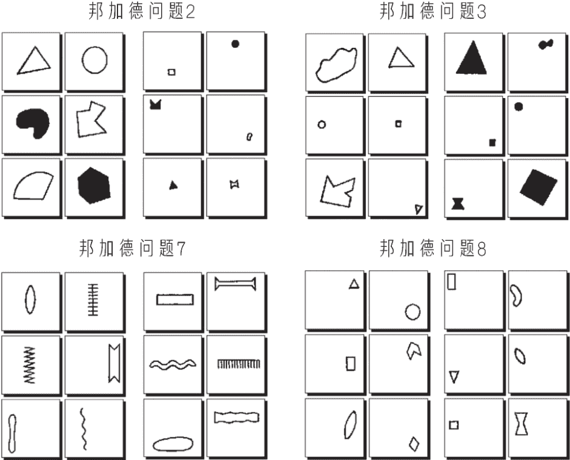

图 15-1　4 个邦加德问题

注：对于每个问题，其任务是判定哪些概念可以用来区分左侧的 6 个框与右侧的 6 个框中的内容。例如，对邦加德问题 2，其对应概念是“大”与“小”。

每个问题由 12 个方框组成：左右两侧各 6 个。每个问题左侧的 6 个方框举例说明其具有相同的某一个概念；右侧的 6 个方框举例说明了与之相关的另一个概念，这两个概念可以完美地区分这两个集合，问题的关键在于找到这两个概念。例如，在图 15-1 中表示的概念按顺时针顺序分别是：大与小；白色的与黑色的（或未填充与填充）；靠右侧与靠左侧；垂直与水平。

图 15-1 中的问题相对容易解决。实际上，邦加德大致按照预测的难度对这 100 个问题进行了排序。为了增添一些乐趣，图 15-2 是从题集后面节选的 6 个额外的问题，我将在下面的叙述中给出答案。

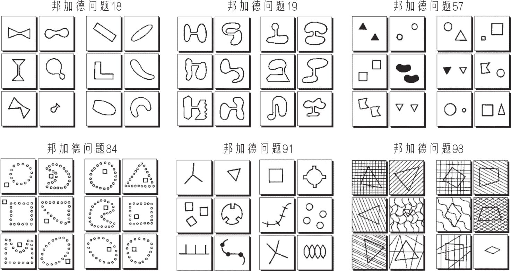

图 15-2　6 个额外的邦加德问题

邦加德精心设计了这些谜题，使得它们的解决方案要求人工智能系统具备与人类在现实世界中所需的同样的抽象和类比能力。在一个邦加德问题中，你可以将 12 个方框中的每一个视为一个微型的、理想化的情境：一个展示了不同的对象、属性及其关系的情境。左侧 6 个方框表示的情境具有一个共性（例如，大）；右侧 6 个方框表示的情境具有一个与之相对的共性（例如，小）。并且在邦加德问题中，识别一种情境的本质有时是很微妙的，正如在现实生活中一样。就如心理学家罗伯特·弗伦奇（Robert French）所说的，抽象和类比都在于感知共性的微妙之处¹⁵。

为发现这种微妙的共性，你需要确定情境中的哪些属性是相关的，而哪些可以忽略掉。在问题 2 中（见图 15-1），一个图形是黑色还是白色，或者位于框中的什么位置，以及其形状是三角形、圆形还是其他，这些都无关紧要，图形的大小是此处唯一重要的属性。当然，大小也并不总是重要的，比如，在图 15-1 中的其他问题里，大小这种属性就是无关的。我们人类是如何快速地识别相关属性的呢？我们怎么才能让机器做同样的事情？

为了给机器一些更难的挑战，相关的概念可以用一种抽象的、难以感知的方式来编码，如问题 91（见图 15-2）中的概念“3”和“4”。在某些问题中，一个人工智能系统要弄清楚什么才能算作一个概念可能并不容易，像在问题 84（见图 15-2，“在外面”与“在里面”）中其相关对象由更小的对象（圆圈）组成，而在问题 98（见图 15-2）中，对象甚至被伪装了：人类很容易看出来这些是什么图案，但对机器而言却很难，因为机器很难区分前景和背景。

邦加德问题也挑战了人类迅速感知新概念的能力，问题 18（见图 15-2）是一个很好的例子。在这个问题中，左侧方框中的通识概念很难用语言表达，它就像是具有一个收缩的或类似于人类颈部的对象，但即便你在此之前从未想到过任何与之类似的对象，你也能在问题 18 中快速识别出来。类似地，在问题 19（见图 15-2）中，有一个新概念：左边是一个类似水平颈部的对象，而右边是一个具有垂直颈部的对象。抽象化新的、难以描述的概念真的是人类非常擅长的事情，但目前所有的人工智能系统都无法以任何通用的方式做到这点。

# 邦加德问题为何卡住了当代 AI

邦加德那本专著的英译本一直拖到 1970 年才面世，语言晦涩，知道的人极少。1975 年侯世达无意间翻到它，被附录里上百道图形推理题深深吸引，后来在《GEB》里用很长的篇幅介绍这套题目，我也是经由《GEB》才初次接触。

从小我就偏爱各类谜题，尤其是带有逻辑与模型意味的那种。读《GEB》时，邦加德题对我产生的冲击特别大。书中关于模仿人类感知与类比来设计解题程序的讨论，几乎在那一刻决定了我投身人工智能研究的路向。

并非只有我被牵动。学界出现过不少试图攻克的系统，多数都做了妥协，要么把可出现的图形种类与关系做严格限定，要么干脆舍弃视觉，直接从手工标注的图像描述起步。每个方案都只能覆盖特定题目的一小部分，从未有人能证明其方法拥有类人般的泛化能力。

既然 ConvNets 在物体分类上表现突出，比如当年 ImageNet 视觉识别挑战赛上的表现，是否可以用它来处理邦加德题？可以把一道题目重塑为分类任务，如图 15-3 所示：左侧六个方格可视作类别 1 的训练样例，右侧六个方格视作类别 2 的训练样例，给系统一个新样本时要判断归到哪一类。

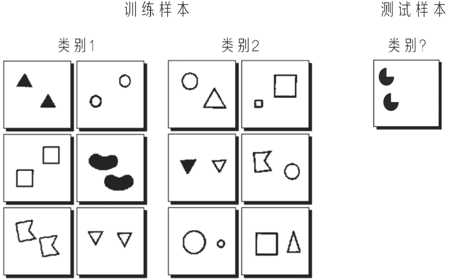

图 15-3　如何将邦加德问题建构为分类问题的一个示例

最直接的瓶颈是样本量。每道题仅提供 12 个训练样例，对 ConvNet 而言几乎可忽略，即便扩到 1200 个也可能不足。邦加德提出的核心疑问是：人类凭 12 个例子就能抓住概念，ConvNet 需要多少数据才能学会解题？目前尚未有系统研究，但有一组工作用与图 15-3 相似的材料，检验最新 ConvNets 在“相同 vs 不同”任务上的表现。他们没有沿用那 12 张图，而是分别用 20000 张类别 1 即方格内图形相同，和 20000 张类别 2 即方格内图形不同的样本进行训练。训练完成后，在 10000 张自动生成的全新样本上测试。训练好的网络在该任务上仅略好于随机猜测，而受试人类准确率接近 100%。

总体来看，即便现在的 ConvNets 能识别 ImageNet 中的物体特征，或在围棋上给出下一步，也远未具备理想化邦加德题目所要求的抽象与类比能力，更不用说现实世界的抽象与类比。它们习得的表征不足以支撑这种抽象，堆数据也难以弥补。这并非 ConvNet 独有的困境，现阶段所有人工智能系统都缺乏人类这些基本能力。

### 活跃的符号和做类比

读完《GEB》并决定投身人工智能后，我拜访侯世达，希望能从事与破解邦加德题相关的工作。幸运的是他同意，我加入了他的团队。侯世达解释，他们在构建一种受人类理解与类比启发的程序。结束物理学研究后，他坚信研究现象的最佳路径是先研究其理想化形式，这对类比研究同样适用。人工智能里常用“微观世界”这种理想化情境，例如邦加德题，先在其中打磨想法，再推向更复杂领域。为了研究类比，侯世达甚至搭建了一个比邦加德题更理想化的微观世界：字符串类比。下面是一例：

**问题 1：** 设字符串 `abc` 变为 `abd`，那么 `pqrs` 该如何同理变化？

多数人会答 `pqrt`，他们总结出规则：“把最右边的字母换成字母表中的下一个字母”。当然也可以总结出其他规则得到不同答案。例如：

`pqrd`：用 d 替换最右边的字母。

`pqrs`：用 d 替换所有 c，`pqrs` 中没有 c，所以不动。

`abd`：用字符串 `abd` 替换任何字符串。

这些替代答案看似字面化，却没有严格逻辑能证明它们错误。事实上可推导出无限多规则，为何多数人仍认为 `pqrt` 最佳？似乎我们为生存繁衍而演化出的抽象心理机制，也延续到了这个理想化微观世界。

再看一例：

**问题 2：** 设字符串 `abc` 变为 `abd`，那么 `ppqqrrss` 该如何同理变化？

即便在这种简单的字母微观世界里，共同点也相当细微，对机器尤其如此。生硬套用“把最右边的字母换成下一个字母”的规则会得到 `ppqqrrst`，但多数人觉得太僵硬，更倾向于 `ppqqrrtt`，这是基于对 `ppqqrrss` 中字符对的感知，并将其映射到 `abc` 的每个字符。人类总是倾向把相同或相似的对象归为一类。

问题 2 说明了在微观世界里，概念滑移 `conceptual slippage` 是类比的核心。试图感知两种情境的本质共通时，第一种情境的某些概念需要“滑移”到第二种情境中，被第二种情境的相关概念取代。在问题 2 中，字母经概念滑移变为字母组，于是规则也应变为“把最右边的字母组换成它的下一个字母组”。

再看这个问题：

**问题 3：** 设字符串 `abc` 变为 `abd`，那么 `xyz` 该如何同理变化？

大多数人答 `xya`，他们认为 z 的下一个字母是 a，但对没有循环字母表概念的程序来说，z 并没有下一个字母。还有哪些合理答案？我在征询时得到很多不同回复，有些很具创意。有趣的是，这些答案常触发物理隐喻。例如 `xy`（z 从悬崖掉下）、`xyy`（z 弹回来了）和 `wyz`。对最后一个答案可这样理解：a 和 z 作为字母表两端被钉在墙上，作用相似，于是如果 a 的概念滑移到 z 上，那么最右边字母 z 的概念就该滑移到最左边字母 a 上，而 b 的概念滑移到倒数第二个字母 y 上，以此类推。问题 3 阐明类比如何引发一连串概念滑移。

在字符串微观世界里概念滑移很直观，在别的领域会更微妙。例如回顾图 15-2 中的邦加德问题 91，左侧 6 个框的共同本质是“3”，表示“3”这一对象的概念从一个框滑到另一个框，比如从线段到正方形，再到左下框里难以用文字描述的概念，可能是像梳齿的东西。概念滑移也是前一章虚构女儿 S 多年抽象的核心，比如她把网站概念滑移至墙概念，把写博客滑移至涂鸦概念。

侯世达设想了一个名为 `Copycat` 的程序，它能借助一种非常通用的算法解决这类问题，这种算法类似人类在任何领域做类比时会用的算法。名字源于类比者可通过模仿来解决问题：原始情境如 `abc` 在某种程度上被改动，任务就是对新情境如 `ppqqrrss` 做同样的改动。

我加入团队后，任务就是和侯世达一起开发 `Copycat`。经历过的人都会说，读博之路充满令人沮丧的挫折、高强度劳动和自我怀疑，但偶尔也有振奋成功时刻，比如坚持五年后程序终于跑起来了。这里跳过怀疑与反复，直接到结果：提交论述 `Copycat` 的学位论文时，我认为该程序已能以通用且类人方式解决多种字符串类比问题。

`Copycat` 既非符号化规则程序，也非神经网络，却兼具符号 AI 和亚符号 AI 的某些特质。它通过感知程序——观察特定字符串类比问题的特征——以及字母与字母组、前后者、相同与相反等先验概念间的持续互动来解题。程序被设计成能模仿我前一章描述的心智模型，特别是都基于侯世达关于人类认知中活跃符号 `active symbols` 的概念。其架构很复杂，这里不展开，想了解可参考书后注释。虽然 `Copycat` 能解很多字符串类比问题及变体，但只触及开放领域的皮毛。例如它解不了下面两题：

**问题 4：** 如果 `azbzczd` 改动为 `abcd`，那么 `pxqxrxsxt` 将会改动为什么？

**问题 5：** 如果 `abc` 改动为 `abd`，那么 `ace` 将会改动为什么？

这两题都需要凭空识别新概念，这是 `Copycat` 缺失的能力。问题 4 中 z 和 x 扮演相同角色，即需删除的额外字母以看出序列，答案为 `pqrst`。问题 5 中 `ace` 类似 `abc`，但不是“后继”序列而是“双重后继”序列，答案为 `acg`。我很容易给 `Copycat` 加上计算 a 和 c、c 和 e 之间字母数目的能力，但我不想为特定字符串域定制功能。`Copycat` 是测试类比相关一般观念的平台，而非全面的“字符串类比制造机”。

### 字符串世界中的元认知

人类智能不可或缺的一面是感知并反思自己的思维，这在心理学里叫元认知，人工智能领域近来却很少讨论。你是否曾苦苦挣扎解题却毫无进展，最后发现自己在重复同一无效思路？我常有此体验，一旦意识到这种模式，有时就能打破僵局。`Copycat` 与本书讨论的其他 AI 程序一样，没有自我感知机制，这影响了性能表现。它有时会陷入困境，反复用错误方式尝试解题，却永远意识不到自己已走过类似的死路。

当时侯世达团队的研究生詹姆斯·马歇尔承担了让 `Copycat` “反思”自己思维的项目。他创建了 `Metacat` 程序，`Metacat` 不仅解决 `Copycat` 字符串领域的类比问题，还试图让 `Copycat` 感知自身行为。运行期间，它会对自己在解题过程中识别到的概念生成运行注解。和 `Copycat` 一样，`Metacat` 展现了一些鼓舞人心的行为，但也仅触及人类自我反思能力的表象。

### 识别整个情境比识别单个物体要困难得多

我当前的研究方向是研发一个能用类比灵活识别“视觉情境” `visual situations` 的 AI 系统，视觉情境是涉及多个实体及其关系的视觉概念。例如图 15-4 的 4 幅图像，都可视为“遛狗”这一视觉情境的实例。人类很容易识别，但对 AI 来说，即便识别简单视觉情境的实例也极具挑战，识别整个情境比识别单个物体困难得多。

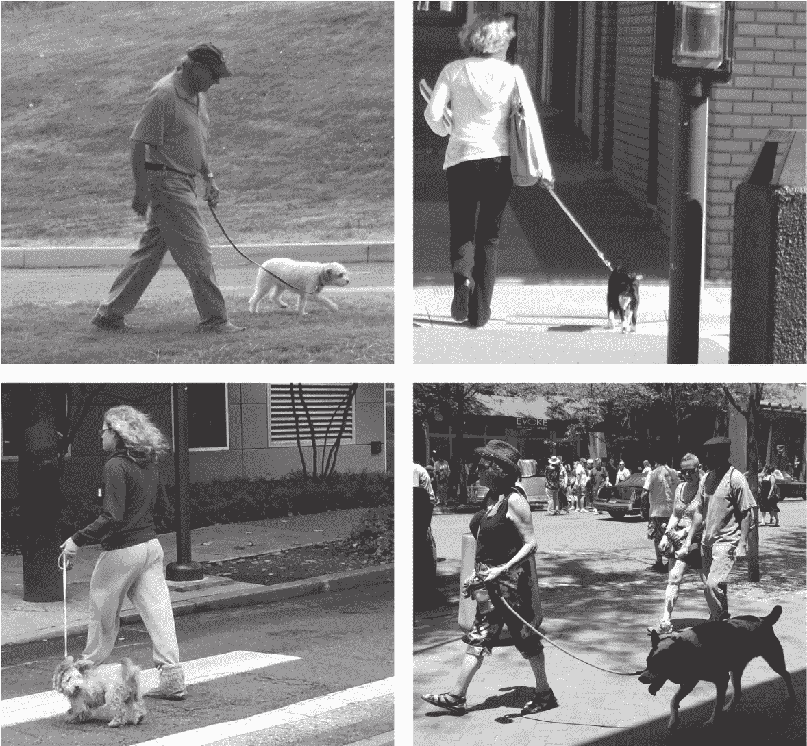

图 15-4　4 个简单明了的遛狗示例

我和同事正在开发 `Situate` 程序，它把 DNN 的目标识别能力与 `Copycat` 的活跃符号结构结合，通过类比识别特定情境。我们希望它不仅能识别图 15-4 那样的直观情境，也能识别需要概念滑移的非常规情境。从图 15-4 可见，“遛狗”原型的核心是一个人、一只狗和一条狗绳，遛狗者牵着绳，绳系在狗上，人与狗都在行走。理解“遛狗”概念的人也会把图 15-5 的每幅图视作该概念的示例，并能意识到每幅图在原型上拓展了多少。`Situate` 仍处早期研发阶段，目的是探究人类类比能力背后的一般机制，并证明 `Copycat` 背后的机制也能在字符串微观世界之外成功运行。

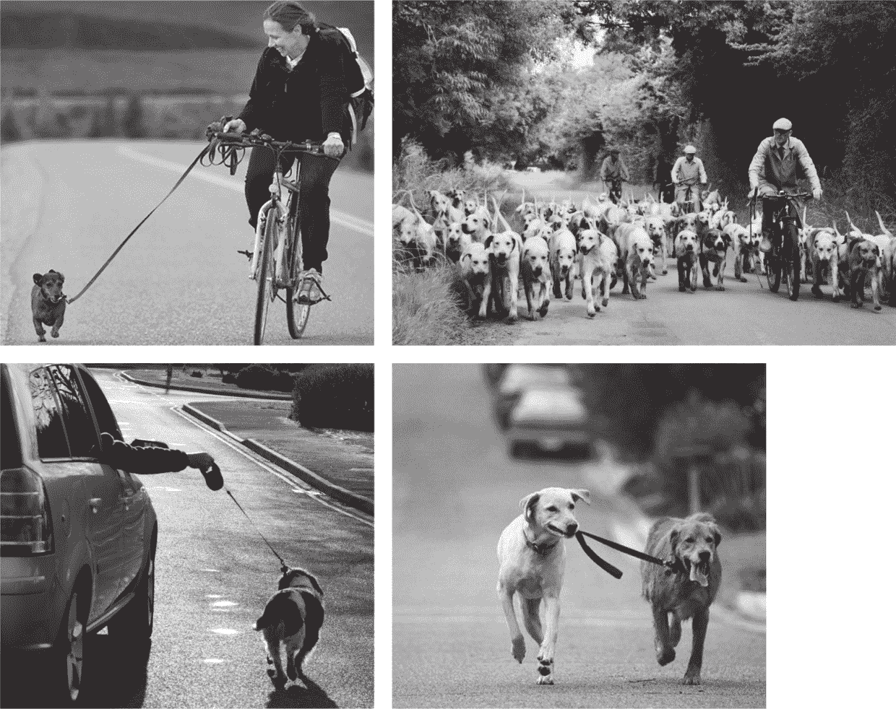

图 15-5　4 个非典型的遛狗示例

`Copycat`、`Metacat` 和 `Situate` 只是基于侯世达活跃符号结构构建的类比程序中的三例。活跃符号结构只是 AI 领域众多类比方法之一。尽管类比对人类认知任何层面都基础，但目前为止没有任何 AI 程序具备哪怕一点点人类类比能力。

### “我们真的，真的相距甚远”

现代人工智能以深度学习为主导，靠 DNN、大数据和超高速计算三驾马车，但在追求稳健通用智能过程中，深度学习可能撞上意义障碍这一核心难题。本章展示了为打破该障碍所做的努力，我们可以看到研究人员包括我自己如何为计算机灌输常识，并尝试赋予其类似人类的抽象与类比能力。

构思此话题时，我被安德烈·卡帕西写的一篇博客吸引，他是深度学习和计算机视觉专家，现指导特斯拉 AI 相关工作。他在题为《计算机视觉和人工智能的现状：我们真的，真的相距甚远》的文章中，描述自己作为计算机视觉研究者对一张特定照片的反应，见图 15-6。卡帕西指出人类会觉得这张照片很幽默，问题是：“一台计算机需要具备什么知识才能像你我一样理解这张照片？”


图 15-6　安德烈·卡帕西博客中探讨的照片

卡帕西列出了许多人类轻易理解却远超当前最好计算机视觉程序能力范围的事物。例如我们能识别场景里有人，也有镜子，于是有些“人”只是镜中影像；我们能判断图里场景是更衣室，并觉得在更衣室看到一群西装革履的人很奇怪。

进一步，我们能识别有人站在体重秤上，尽管体重秤由混在背景里的白色像素组成。卡帕西指出我们能发现奥巴马把脚轻轻压在体重秤上，并强调我们很容易根据推断出的三维场景结构而非二维图像得出结论。我们对物理的直觉让我们推断：奥巴马脚踩秤会导致秤上显示的数字大于秤上男士真实体重。我们对心理的直觉告诉我们：站在秤上的人没意识到奥巴马的脚在秤上，可从他视线方向推断，且他脑后并无眼睛。我们还能明白测体重的人大概感觉不到脚的轻压。依据心智理论，我们还能推测：当秤显示的体重比他预期高时，他会很不开心。

最后，我们看出奥巴马和其他观察者都在微笑，被奥巴马的恶作剧逗乐，可能因奥巴马身份而更显有趣。我们也识别出玩笑是友好的，并预期被捉弄的人知情后也会开怀大笑。

卡帕西写道：“你在推理人们的心智状态，以及他们对他人心智状态的看法。这会变得越来越可怕……令人难以置信的是：上面所有推论都源于人们对这幅由像素构成的二维图像的一瞥。”

对我而言，卡帕西的例子完美捕捉了人类理解的复杂性，也以水晶般清晰展现了 AI 面临的挑战之大。该文写于 2012 年，但信息今天依然正确，我相信长期都如此。

卡帕西用下面文字概括文章：

我几乎可以肯定的是：我们可能需要进一步探索“具身”embodiment 这一概念。构建像我们这样能理解各种场景的计算机的唯一方法，就是让它们接触到我们多年积累的结构化与暂时性经验、与世界互动的能力，以及一些在思考应具备何种能力时几乎无法想象的神奇主动学习与推理能力。

17 世纪哲学家勒内·笛卡儿推测身体与思想由不同物质构成，受不同物理定律制约。自 20 世纪 50 年代以来，人工智能主流方法隐晦接受了这一论点，假设通用人工智能可通过非实体程序实现。但有一小撮研究群体一直主张具身假说：如果机器没有与世界交互的实体，就无法获得人类水平智能。这种观点认为：桌上的计算机，甚至缸中大脑，都永远无法获得通用智能所需概念理解能力。只有既物化又在世界中活跃的机器，才能在其领域达到人类水平智能。同卡帕西一样，我几乎无法想象制造这样机器需取得哪些突破。多年与 AI “拼杀”后，我发现关于具身的争论正越来越受关注。

## 15 我们是否可以为机器赋予常识

### 本章要点

人工智能早期，机器学习和神经网络尚未主导，人工智能研究人员手工编码程序执行任务所需的规则和知识，对他们来说，通过“内在建构”方法捕获足够人类常识以在机器中实现人类水平智能，看起来完全合理。

当深度学习开始展示一系列非凡成功时，无论内行还是外行都乐观认为通用人类水平人工智能即将到来。然而正如本书反复强调，随着深度学习系统应用愈广，其智能逐渐露出破绽。即便最成功的系统，也无法在其狭窄专业领域外良好泛化、形成抽象概念或学会因果关系。此外，它们常犯不像人类会犯的错误，并在对抗样本上表现出脆弱性，都表明它们并不真正理解我们教给它们的概念。

让人工智能真正进步，核心障碍是常识。人类脑子里装着大量从未被明文写下的潜意识知识，物理上的直觉、生物上的直觉、心理上的直觉，全都属于这一类。它们构成了我们理解世界的基础，却几乎没有留下任何记录。一个人如果连自己知道什么都说不清，就没法把这些内容教给计算机。

# 终章

## 六个拷问，试探人工智能的边界

1979 年出版的《哥德尔、埃舍尔、巴赫》结尾，侯世达用自问自答的方式谈论人工智能的未来。在“十个问题与推测”一章里，他聊到机器思维的可能，以及智能的本质。当时我还是个快要毕业的本科生，对那部分印象很深。侯世达的推断让我觉得，尽管媒体一直在炒作人类水平的 AI，八十年代也曾这样热闹，领域其实大敞大开，挑战极多，正适合年轻人闯荡。

时隔三十多年再写这本书，我决定也用自己的问题、判断和推测收尾。既是对 GEB 的致敬，也是把书中零散的观点串起来。

### 问题 1：自动驾驶何时能真正普及？

答案取决于你怎么定义自动驾驶。美国国家公路交通安全管理局给出了六个等级¹，我整理如下：

**0 级：**全程由人驾驶。

**1 级：**车能在偶尔的工况下辅助方向或车速，二者不能同时。

**2 级：**在特定场景，比如高速路，车能同时管方向和速度，但人必须高度集中，随时准备接管变道、驶离、等红灯、避让警车等。

**3 级：**在限定场景下车能完成全部驾驶，人仍需保持警觉，随时准备收回控制。

**4 级：**在限定场景下车能独立完成所有驾驶，人无需分心。

**5 级：**任何场景下都能独立驾驶，人只是乘客。

注意那个关键限定：特定场景。我们根本列不出完整清单。对于一辆 4 级车来说，恶劣天气、拥堵市区、工地绕行、无车道标识的窄路，都可能成为挑战。

写作时，路上的车大多在 0 到 1 级之间，有巡航却没有转向和制动。少数新车达到 1 级。自适应巡航算是 1 级。2 级和 3 级的代表是特斯拉这类带自动驾驶套件的车型，它们正和用户一起摸索哪些情况必须人接管。也有试验车在比较宽泛的场景下能跑，但仍配一个随时待命的人类安全员。不久前发生的多起致命事故，都是本该由人接管却没及时注意到的情形。

行业渴望 5 级完全自动驾驶，这也是用户期待的方向。拦路的障碍是什么？

最大的拦路虎是第六章里提到的长尾效应，也就是车辆没见过的边缘案例。单个发生率极低，但大规模推广后会频繁出现。人类会用常识类比来应对。

完全自主还依赖第十四章所说的核心直觉，包括直觉物理、直觉生物，尤其直觉心理学。车要懂得同路司机、骑行者、行人、动物的动机、目标甚至情绪。看一眼复杂路口就判断出谁可能闯红灯、追赶公交、临时变道、或在斑马线前整理高跟鞋，对人来说是本能，对车来说远未具备。

另一个紧迫问题是安全。非自动驾驶汽车的软件占比越来越高，通过蓝牙、手机网络、互联网容易被黑²。未来全软件控制的车风险更高。机器学习研究已证明，计算机视觉可被对抗性攻击，比如在停车标志上贴个不起眼的贴纸，就会被误认成限速牌。安全防御的难度不亚于驾驶算法本身。

还有人性扰动。有人会拿完全自动驾驶车开玩笑，在车前晃动假装过马路来卡住它。算法该如何识别和处理？法律层面也一堆未解题：事故责任归谁？要不要上哪种保险？

更棘手的是路线选择：是追求部分自主，即限定场景下车全权负责但人要保持注意力以备接管？还是只盯完全自主，人完全不用管？

由于上文所述的难题，足够可靠、几乎全场景通行的完全自动驾驶技术尚不存在，专家预估从几年到几十年不等。复杂工程的讽刺是：前 90% 可能只用 10% 时间，后 10% 却占 90%。

3 级技术已存在，但人类在部分自动驾驶上表现很差。明知该盯着看，也常分神，车处理不了特殊情况时事故就来了。

这意味着什么？要实现完全自动驾驶，本质上需要通用人工智能，这短期几乎不可能。部分自主的车已在路上，但因人无法持续集中，仍很危险。最可能的折中是重定义完全自主：只允许车在建好安全基础设施的特定区域运行，这就是地理围栏。

福特前自动驾驶总工程师杰基·迪马科这样解释 4 级：

谈到 4 级，其实指的是地理围栏内的完全自动驾驶，里面有一张定义好的高精度地图。有了地图，车就知道灯柱、斑马线、规则、限速在哪。车的能力会随新技术在围栏内成长，问题会逐步被解决³。

吴恩达也建议行人要在自动驾驶车周围表现得更可预测：“告诉人们遵守法律并多体谅。”⁴ 他公司 Drive.ai 已在得州等允许上路的州，运营围栏内的完全自主出租车队。我们很快会看到效果。

### 问题 2：AI 会导致大规模失业吗？

我的判断是不会，至少短期不会。马文·明斯基那句“容易的事难做”在 AI 领域依然成立，很多人类工作对机器或机器人来说比想象中难。

毋庸置疑，AI 已在某些岗位上替代人类，部分取代也带来了社会好处。目前没人知道总体就业会怎样，因为没人能预测未来 AI 的能力。

关于就业的影响报道很多，尤其是涉及数百万司机岗位的脆弱性，或许最终会被取代，但自动驾驶何时普及无法确定，时间也因此难料。

不确定性正是 AI 伦理讨论的一部分。历史上新技术往往创造了与所替代岗位相当的新工作，AI 可能也不例外。也许卡车司机被取代，却会因 AI 伦理需求而诞生更多道德哲学岗位。这并非淡化风险，而是强调不确定性。美国经济顾问委员会 2016 年报告指出：“人们对这些影响的感受有多强、到来有多快，仍存在很大不确定性，以现有证据无法做出具体预测，政策制定者必须为多种结果做准备。”⁵

### 问题 3：计算机能有创造性吗？

对很多人而言，这听起来像悖论。机器的机械性在日常语言里与创造性对立。怀疑论者会说：计算机只能执行人类编码指令，所以不可能创造，创造需要独立产出新事物。⁶

认为计算机只能做被明确编码的事因而不可创造，这一说法是错的。一个程序可以生成其设计者从未设想的内容。我在前文提到过的 Copycat 程序，常能给出我没想到的类比，并发展出它自己的奇怪逻辑。原则上，计算机有可能创造，但创造需要理解并判断自己创造了什么。以此标准看，今日没有任何计算机可算得上创造性。

相关问题是：能否生成美好的艺术或音乐。美感主观，我的答案是能，因为我见过大量令人惊艳的计算机艺术，比如卡尔·西姆斯的“遗传艺术”⁷。

西姆斯用受达尔文自然选择启发的算法，让计算机用含随机性的数学函数生成候选艺术品，研究者挑喜欢的，再基于其底层函数变异生成下一批，如此迭代。作品令人惊叹，并在博物馆展出。

西姆斯程序的创造力来自人机合作：计算机生成原始作品和变体，人类基于对抽象艺术的理解做评判。计算机本身并无理解力，所以它自己不具备创造性。

音乐生成也类似，计算机能产出悦耳甚至美妙的音乐，但创造性依赖人类提供审美判断。

最著名的例子是大卫·科普的 EMI⁸。EMI 可模仿多位古典作曲家风格，也曾骗过专业音乐家。科普的初衷是把它当私人作曲助手。他痴迷随机性创作，比如莫扎特时代的“音乐骰子游戏”，把乐曲切块掷骰子拼排。

EMI 是加强版的骰子游戏。科普先从莫扎特作品里提取他称作“签名”的关键模式，再用程序给每个签名分类，最后植入一套“音乐语法”指导签名如何重组。随机数生成器挑选特征，语法决定排列。

这样 EMI 能无休止地以莫扎特或已有数据库的作曲家风格写新曲。科普挑选最好作品发表，我听过几首，有平庸也有好听，片段优美但缺乏原作深度。我这么说可能有偏见，因为我知道是机器写的。较长作品常有失创意主线的非人类倾向。总的来说，风格捕捉很成功。

EMI 有创造性吗？我认为是否定的。它依赖科普内嵌的乐理知识和规则，且并不真正理解音乐概念或情感表达。它无法判断自己作品的好坏，这由科普完成：“我喜欢的就发，不喜欢的不发。”⁹

2005 年科普销毁了 EMI 的所有音乐特征数据库。他担心无限创作会削弱其价值，只有像哲学家玛格丽特·博登所说，成为“有限之物，就像所有会死的作曲家”，EMI 才会受珍视¹⁰。

我不知道这能否安慰侯世达，他对 EMI 能愚弄音乐家的能力感到不安。正如乔纳森·戈特沙尔在《会讲故事的机器人在崛起》里写道：“艺术最能区分人类与其他生物，这是我们引以为傲的事。”¹¹ 我想补充，自豪的不仅是创造，还有欣赏、理解作品感人之处和信息传递的能力。观众和艺术家都需要这种能力，没有它就谈不上创造力。结论是：在原则上可以，但不会很快。

### 问题 4：距离通用人类水平 AI 还多远？

目前主要有两种看法。

第一种引奥伦·埃齐奥尼，人工智能研究所所长：“先做个估计，再乘以两倍、三倍、四倍，那就是实现时间。”¹²

第二种，回顾前章安德烈·卡帕西的评价：“我们真的、真的相距甚远。”¹³ 我持后者。

“computer”最初指人，通常指二战期间用机械计算器帮士兵算炮弹轨迹的女性¹⁴。在 30-40 年代，“女孩”与“计算机”可互换，一位国防研究委员会成员甚至把“千女孩”单位等价于 1000 小时的计算劳动¹⁴。

二战中期电子计算机取代人类计算，一下子成了“超人”。与任何人类“计算机”不同，这些机器算飞行轨迹的速度超过炮弹本身¹⁵。这是计算机在细分任务上胜出的第一个例子。如今最先进的 AI 算法已征服许多其他细分任务，通用智能仍未实现。

历史上不少知名研究者曾预测通用 AI 在 10 年、15 年、25 年或一代人内到来，均未实现。正如第三章所述，库兹韦尔与卡普尔的“长期赌约”，看一个程序能否在 2029 年通过图灵测试。我支持卡普尔，并在引言中引用过他：“人类智能是一种不可思议、微妙、难以理解的东西，短期内不会被复制。”¹⁶

“预测很难，尤其预测未来”，出处各说不一，但在 AI 领域和其他领域都成立。针对从业者的调查显示，关于通用或超级智能到来的时间，从“十年内”到“永远不会”都有¹⁷。换言之，我们一无所知。

我们知道的是，人类水平通用 AI 需要研究数十年的能力：常识理解、抽象、类比，而这些极难获得。还有更大问题：通用 AI 需要意识吗？自我感知吗？能感受情绪吗？有求生本能和死亡恐惧吗？需要身体吗？正如明斯基所言：“我们现在还处在形成关于心智概念的阶段。”

谈到超级智能，我觉得令人不安。超级智能是指在科学创造、通用智能、社交技能等几乎所有领域，都远超最强人类大脑的智能¹⁸。

通用智能能否抛开人性

坊间一种常见预期是：当计算系统达到类人通用的认知水准后，智能增长会迅速失控，这正是古德所描述的智力大爆发情形，详见第03章的相关论述。按此说法，具备通用能力的机器能在极短时间内通读人类积累的所有文本，掌握现有知识体系，并依靠自我迭代的推理把每一次新发现都转化为自身认知的升级。如此一来，它似乎摆脱了人类那些令人生厌的束缚——思维与学习的缓慢、非理性倾向、系统性认知偏差、对无聊事务的低耐受、必须睡眠以及情绪波动等都被当作抑制创造力的源头。于是超级智能被描绘成一种近乎去人化的纯粹智慧，完全摆脱了人类自带的缺陷。

我对这一判断持怀疑态度。常被标记为局限的特质，很可能正是构成人类通用智能的必要成分。我们在现实世界中行动的身体、进化而来并支撑社会协作的情绪与非理性偏好，以及其他偶尔被视为认知缺陷的特质，并非多余负担，而是使人类成为泛义上的聪明者，而非狭隘资料库的关键所在。我无法作严格证明，但直觉上通用智能很难把这些属于人类或机器的显性缺陷全部剥离。

侯世达在《GEB》“10 个问题和推测”一节里，用一个乍看简单的提问来回应上述争论：“一台会思考的计算机能迅速做加法吗？”他的回应是：“未必。我们的硬件本可进行复杂运算，但这不等于在符号层面^((49))，即‘我们’自身清楚如何执行同等复杂的操作。好在你的符号层面，也就是‘你’，无法触及此刻参与思考的神经元，否则你会因脑内混乱而无法思考。对智能程序难道不该遵循同样的道理吗？”侯世达进一步解释：“像人类一样，智能程序会把数字表征成一个完整且充满联想的概念网络，带着这份沉重的行李，做加法时会变得相当迟钝。”¹⁹初读时我觉得意外，如今却认为很有道理。

## 问题 5：我们应该对人工智能感到多恐惧？

如果主要信息来自影视、科幻，甚至一些流行的非科幻写作，很容易担心AI觉醒后变恶，进而奴役或杀害人类。考虑到通用智能仍遥遥无期，当下AI研究者最关心的并非这些。正如书中所述，如今社会对AI技术不加批判的接纳，暗藏几类风险：大规模失业的可能性、系统被恶意利用的空间，以及在遭受攻击时表现出的不可靠与脆弱性。这些都是对技术可能如何影响生活而言十分合理的担忧。

我以侯世达对AI最新进展感到惊慌的经历作为本书开端，但令他真正恐惧的并非上述内容。他担心的是人类的认知与创造力变得如此容易被程序模仿，以至于他所珍视的源自人类思想的崇高创作，比如肖邦的音乐，会被像EMI那样程序使用的肤浅算法取代。侯世达感慨道：“如果这种无限微妙、复杂且情感深厚的思想会被一块小芯片简化，这会摧毁我对人性的理解。”他同样对库兹韦尔关于奇点临近的预测感到困扰，担心如果该预测在任何一方面成立，我们将被取代，成为遗迹，被尘埃淹没。

我对这些焦虑感同身受，但认为它们到来尚早。核心信息是：人类习惯高估AI的发展速度，同时低估人类自身智能的复杂性。如今的AI与通用智能相去甚远，我也不认为超级智能近在眼前。若通用AI真的实现，我敢断言，它的复杂程度足以与人类大脑相媲美。

在列举AI近期需要担忧的事项时，超级智能理应排在最末。事实上，其反面更值得警惕。本书阐述了即便最完备的AI系统也极脆弱，例如当输入偏离训练样本过大时就会出错。我们通常难以预测系统在何种情境下会变脆弱。语音转录、语言翻译、图像描述、自动驾驶等对稳健性要求极高的场景，至今仍需人类参与。我认为短期内最令人不安的问题是：在我们尚未充分认识到AI的局限与脆弱性时，就赋予它过多自主权。我们倾向于拟人化AI，把人类特质投射给系统，却又高估了系统可被完全信任的程度。

经济学家塞德希尔·穆来纳森^((50))在论及AI之危险时，引用了我第06章所述的长尾效应来解释“尾部风险”概念：

我们真正该害怕的并非机器变得过于聪明，而是害怕机器去做一些超出其能力的决策。相较于机器的“智能”，我更担忧机器的“愚笨”。愚笨会制造尾部风险。机器可以做出许多不错的判断，却会在训练数据中从未出现过的尾部事件面前骤然失灵，这正是特定智能与通用智能的区别²⁰。

或者正如AI研究者佩德罗·多明戈斯所言：“人们担心计算机变得太聪明并接管世界，真正的问题是计算机太愚蠢了，而且它们已经在接管世界。”²¹

我担心AI缺乏可靠性，也担心它被如何使用。除了第07章探讨的道德忧虑外，还有一个让我不安的应用：利用AI生成伪造的媒体内容，例如用文字、声音、图像与视频描绘那些从未真正发生的恐怖事件。

那么，我们应不应该害怕AI？答案可能是，也可能不是。具有意识的超级智能机器不会在近期出现，我们最珍视的人性不应被等同于一套算法，至少在我看来如此。然而，算法与数据的非道德使用及其危险的潜在用途，仍存在诸多令人担忧的问题。这很可怕，但令人欣慰的是，这一议题已在AI研究及其他领域获得广泛关注。研究人员、企业代表与政界人士正逐步形成合作共识与共同目标，以应对其紧迫性。

## 问题 6：人工智能中有哪些激动人心的问题还尚未解决？

我的回答是：几乎全部。

我初涉AI研究时，感到兴奋的原因之一就是该领域几乎所有重要问题都仍是开放的，持续等待新想法的注入。我认为现在依然如此。

我们可以回溯至该领域的起点，约翰·麦卡锡等人在1956年的建议书（第01章已述）中列出的多项重大课题：自然语言处理、神经网络、机器学习、抽象概念与推理以及创造力。如今这些议题仍然是AI研究的核心。2015年，微软研究院主任埃里克·霍维茨半开玩笑地说：“也许有人会认为，这份1955年的提案经过适当整理后，再次提交给美国国家科学基金会仍有可能获得一位充满热情的项目管理者的资助。”²²

这并非对过去研究的批评。AI研究与其他任何关于人类本性的重大科学挑战一样困难。麻省理工学院的罗德尼·布鲁克斯对此表述得最为清晰：“AI起步阶段的研究明确以人类表现和人类水平智能为灵感。我认为这一目标在过去六十多年里吸引了大量研究者。然而，我们尚未取得接近成功的成果，这并不意味着研究者不够努力或不够优秀，只能说明目标极其艰难。”²³

AI中最令人振奋的问题并不仅限于潜在应用。创始者的动机不仅源于对智能本质这一科学问题的兴趣，也源于对开发新技术的渴望。认为智能是一种自然现象，可像其他现象一样通过构建简化的计算机模型来研究，这种想法吸引了许多人进入该领域，包括我自己。

AI对我们所有人的影响将持续加深。我希望这本书能帮助你成为一个有思考的人，更好地理解这项新兴技术的现状，包括其未解问题、技术可能带来的风险与益处，以及它所引发的关于理解人类自身智能的科学与哲学议题。如果正在阅读这段文字的你是一台计算机，请告诉我上一句中的“它”指代的是什么，也欢迎你加入我们的讨论。

# 致谢

首先，这本书的出版应归功于侯世达。侯世达的著作是最初吸引我进入人工智能领域的原因，他的想法和启蒙又指导了我在博士阶段的学习。前不久，侯世达邀请我参加了在谷歌召开的会议，这激发了我写这本书的想法，后来这种想法愈加强烈。侯世达阅读了本书手稿的每一个章节，并在每一页写满了具有深刻见解的评论，这极大地改善了手稿的最终版本。我非常感谢侯世达的想法、他的著作和文章、他对我工作的支持，当然，最重要的是我们之间的友谊。

非常感谢其他几位慷慨地阅读了本书，并对每一个章节发表了富有见地的评论的家人和朋友，他们是：吉姆·利文尼克（Jim Levenick）、吉姆·马歇尔（Jim Marshall）、拉斯·麦克布莱德（Russ McBride）、杰克·米歇尔（Jack Mitchell）、诺玛·米歇尔（Norma Mitchell）、肯德尔·施普林格（Kendall Springer）和克里斯·伍德（Chris Wood）。非常感谢以下回答问题、翻译片段并为我提供其他形式的帮助的各位：杰夫·克卢恩（Jeff Clune）、理查德·丹齐克（Richard Danzig）、鲍勃·法兰克（Bob French）、加勒特·凯尼恩（Garrett Kenyon）、杰夫·科法特（Jeff Kephart）、布莱克·勒巴伦（Blake LeBaron）、盛·伦德奎斯特（Sheng Lundquist）、达娜·摩泽尔（Dana Moser）、大卫·莫泽（David Moser）和弗朗西丝卡·帕尔梅贾尼（Francesca Parmeggiani）。

非常感激法劳·斯特劳斯·吉罗出版社（Farrar, Straus and Giroux, FSG）的埃里克·钦斯基（Eric Chinski），感谢他的鼓励以及他对这一项目各个方面的卓越贡献；感谢莱尔德·加拉格尔（Laird Gallagher）提出的许多深思熟虑的建议，这些建议帮助这份粗略的草稿变成了最终的书稿；感谢 FSG 出版社的其他成员，特别是朱莉亚·林戈（Julia Ringo）、英格丽德·斯特纳（Ingrid Sterner）、丽贝卡·凯恩（Rebecca Caine）、理查德·奥廖洛（Richard Oriolo）、黛博拉·海姆（Deborah Ghim）和布莱恩·吉蒂斯（Brian Gittis），感谢他们所做的一切。非常感谢我的经纪人埃斯特·纽伯格（Esther Newberg），她帮助我把出版这本书变成了现实。

我还要感谢我的丈夫施普林格，感谢他一直以来对我的爱和热情的支持，以及他对我疯狂的工作习惯的耐心和容忍。还有我的儿子们，雅各布和尼古拉斯，这些年来，他们卓越的问题、好奇心和常识给了我极大的启发。

最后，我要把这本书献给我的父母——杰克和诺玛，在我的一生中，他们给了我无限的鼓励和关爱。在这个充满机器的世界里，我很幸运能被这些充满智慧和爱心的人包围。

# 注释

### 引言　创造具有人类智能的机器，是一场重大的智力冒险

1　A. Cuthbertson,“DeepMind AlphaGo: AI Teaches Itself ‘Thousands of Years of Human Knowledge’ Without Help”, *Newsweek*, Oct. 18, 2017.

2　接下来所引用的侯世达的话来自在一次谷歌会议后我对他的后续访问，这些引文准确地还原了他对谷歌小组评价的内容和语气。

3　Jack Schwartz, quoted in G. -C. Rota, *Indiscrete Thoughts* (Boston: Berkhäuser, 1997), 22.

4　D. R. Hofstadter, *Gödel, Escher, Bach: an Eternal Golden Braid* (New York: Basic Books, 1979), 678.

5　同上, 676。

6　D. R. Hofstadter，“直视艾米的眼睛——并尽力不眨眼”，载于 *创造力、认知与知识*，T. Dartnell 编（Westport, Conn.: Praeger, 2002），67-100。

7　R. Cellan-Jones，“史蒂芬·霍金警告人工智能可能终结人类”，BBC News，2014 年 12 月 2 日。

8　M. McFarland，“埃隆·马斯克：‘在人工智能面前，我们正在召唤恶魔’”，*华盛顿邮报*，2014 年 10 月 24 日。

9　Bill Gates，在 Reddit 上，2015 年 1 月 28 日。

10　K. Anderson，“人工智能爱好者与怀疑论者展开辩论”，*名利场*，2014 年 11 月 26 日。

11　R. A. Brooks，“将表现误认为能力”载于 *关于思考的机器我们该想些什么*，J. Brockman 编（New York: Harper Perennial, 2015），108-111。

12　G. Press，“来自 O'Reilly 人工智能大会的 12 条观察”，*福布斯*，2016 年 10 月 31 日。

### 01　从起源到遭遇寒冬，心智是人工智能一直无法攻克的堡垒

1　J. McCarthy 等，“关于达特茅斯人工智能夏季研究项目的提案”，提交给洛克菲勒基金会，1955 年，重印于 *人工智能杂志* 27, no. 4 (2006): 12-14。

2　控制论是研究“生物和机器中的控制与通信”的一个跨学科领域。见 N. Wiener, *控制论* (Cambridge, Mass.: MIT Press, 1961)。

3　N. J. Nilsson, *约翰·麦卡锡：传记回忆录* (Washington, D.C.: National Academy of Sciences, 2012)。

4　McCarthy et al.,“关于达特茅斯人工智能夏季研究项目的提案”。

5　同上。

6　G. Solomonoff，“雷·索洛莫诺夫与达特茅斯人工智能夏季研究项目，1956”，访问日期 2018 年 12 月 4 日。

7　H. Moravic, *心智之子：机器人与人类智能的未来* (Cambridge, Mass.: Harvard University Press, 1988), 20。

8　H. A. Simon, *自动化对人和管理的形态* (New York: Harper & Row, 1965), 96。請注意，西蒙是用“man”（此處為其複數形式“men”）而不是“person”來表示人，“man”這個詞在 20 世紀 60 年代的美國是司空見慣的。

9　M. L. Minsky, *计算：有限与无限机器* (Upper Saddle River, N. J.: Prentice-Hall, 1967), 2。

10　B. R. Redman, *便携伏尔泰* (New York: Penguin Books, 1977), 225。

11　M. L. Minsky, *情感机器：常识思维、人工智能与人类心智的未来* (New York: Simon & Schuster, 2006), 95。

12　*人工智能百年研究* (AI100), 2016 Report, 13。

13　同上，12。

14　J. Lehman, J. Clune, and S. Risi，“方法无政府状态：人工智能中智能抽象的当前趋势”, *IEEE 智能系统* 29, no. 6 (2014): 56-62。

15　A. Newell and H. A. Simon，“GPS：一个模拟人类思维的程序”, P-2257, Rand Corporation, Santa Monica, Calif. (1961)。

16　F. Rosenblatt，“感知器：大脑信息存储与组织的概率模型”, *心理评论* 65, no. 6 (1958): 386-408。

17　從數學的角度看，感知機學習算法如下。對於每個權重`w[j]`：`w[j] ← w[j] + η (t + y) x[j]`，其中`t`表示正確的輸出（1 或 0）；對於給定的輸入，`y`是感知機的實際輸出；`x[j]`是與權重`w[j]`有關的輸入；`η`是由程式員給出的學習速率，箭頭表示更新。閾值通過創建一個附加的輸入`x[0]`合併得到。`x[0]`為常數 1，其相對應的權重`w[0] = -threshold`（閾值）。對於給定額外的輸入和權重（稱為偏差），只有在輸入與權重的乘積，即輸入向量與權重向量之間的點積大於或等於 0 時，感知機才會被觸發。通常，輸入值會被縮小或者應用其他變換以防止權重過大。

18　M. Olazaran，“感知器争议官方历史的社会学研究”, *科学社会学研究* 26, no. 3 (1996): 611-659。

19　M. A. Boden, *心智即机器：认知科学史* (Oxford: Oxford University Press, 2006), 2: 913。

20　M. L. Minsky and S. L. Papert, *感知器：计算几何导论* (Cambridge, Mass.: MIT Press, 1969)。

21　從技術上講，任何布爾函數都可以通过一個具有線性閾值單元和一個中間（隱藏）層的全連接多層網絡來計算。

22　Olazaran，“感知器争议官方历史的社会学研究”。

23　G. Nagy，“神经网络——过去与现在”, *IEEE 神经网络汇刊* 2, no. 2 (1991): 316-318。

24　Minsky and Papert, *感知器*, 231-232。

25　J. Lighthill，“人工智能：总体综述”, in *人工智能：论文研讨会* (London: Science Research Council, 1973)。

26　C. Moewes and A. Nürnberger, *智能数据分析中的计算智能* (New York: Springer, 2013), 135。

27　M. L. Minsky, *心智社会* (New York: Simon & Schuster, 1987), 29。

### 02　从神经网络到机器学习，谁都不是最后的解药

1　隐含层或输出层的每个神经元，通常先把接收到的输入向量 x 与自身的权重向量 w 做内积，再送入 sigmoid 激活：`y = 1 / [1 + e^(-x·w)]`。在计算里，偏置项已被并入 x 与 w。只要节点使用 sigmoid 这类非线性，且隐藏层规模足够庞大，网络便能对任意受限函数实现任意精度的逼近，这就是通用的逼近定理。更完整的论述可参考迈克尔·尼尔森著作《神经网络与深度学习》。
2　针对具备微积分背景的读者补充说明：反向传播本质上是梯度下降的一种实现。对任意权重 w，它近似指示误差曲面上的最速下降方向。该方向由误差函数 —— 常取输出与目标间的均方差 —— 对 w 的梯度刻画。举例来说，输入节点 i 到隐藏节点 h 的权重 w 在更新时，调整幅度取决于传递到 h 的误差、i 的激活强度以及事先设定的学习率。若想更深入理解反向传播机制，迈克尔·尼尔森的《神经网络与深度学习》是不错的选择。
3　举一个具体规模的例子：网络拥有 324 个输入神经元、50 个隐藏神经元、10 个输出神经元。输入层到隐藏层的权重规模为 324×50=16 200，隐藏层到输出层为 50×10=500，两部分相加共计 16 700 个可训练参数。
4　D. E. Rumelhart, J. L. McClelland, and the PDP Research Group, *并行分布式处理：认知的微观结构探索* (Cambridge, Mass.: MIT Press, 1986), 1:3。
5　同上, 113。
6　C. Johnson，“神经网络初创公司在美国遍地开花”, *科学家*, Oct. 17, 1988。
7　A. Clark, *在场：重新将大脑、身体与世界结合* (Cambridge, Mass.: MIT Press, 1996), 26。
8　依据侯世达的指正，更准确的表述应为“普通的老式过时的人工智能”，即 Good Old-Fashioned AI，缩写为 GOOFAI，只是它的发音与 GOFAI 不太一样。

### 03 图灵测试与奇点之争
1　Q. V. Le et al.,“利用大规模无监督学习构建高层特征”, in *国际机器学习会议论文集* (2012), 507-514。
2　P. Hoffman，“为下一次大型国际象棋对决重新装备机器与人类”, *纽约时报*, Jan. 21, 2003。
3　D. L. McClain，“棋手称对手行为可疑”, *纽约时报*, Sept. 28, 2006。
4　M. Y. Vardi，“人工智能：过去与未来”, *计算机械协会通讯* 55, no. 1 (2012): 5。
5　K. Kelly，“最终释放人工智能于世界的三大突破”, *连线*, Oct. 27, 2014。
6　J. Despres，“情景：Shane Legg”, *未来*, accessed Dec. 4, 2018。
7　H. McCracken，“深入马克·扎克伯格关于 Facebook 未来的大胆计划”, *快公司*, Nov. 16, 2015。
8　V. C. Müller and N. Bostrom，“人工智能的未来进展：专家意见调查”, in *人工智能的基础问题*, ed. V. C. Müller(Cham, Switzerland: Springer International, 2016), 555-572。
9　M. Loukides and B. Lorica，“什么是人工智能？”*O'Reilly*, June 20, 2016。
10　S. Pinker,“思考并不意味着征服”, 收录于 *论思考机器的思考*, J. Brockman 编 (New York: Harper Perennial, 2015), 5-8.
11　A. M. Turing,“计算机器与智能”, *Mind* 59, 第 236 期 (1950): 433-460.
12　J. R. Searle,“心灵、大脑与程序”, *Behavioral and Brain Sciences* 3, 第 3 期 (1980): 417-424。
13　J. R. Searle, *心灵：简明导论* (Oxford: Oxford University Press, 2004), 66.
14　“强人工智能”和“弱人工智能”也分别被用来表示“通用人工智能”和“狭义人工智能”。这是雷·库兹韦尔使用它们的方式，但这与约翰·瑟尔最初的意思不同。
15　瑟尔的文章连同侯世达的令人信服的辩驳转载自 D. R. Hofstadter and D.C. Dennett, *我之心智：自我与灵魂的幻想与反思* (New York: Basic Books, 1981)一书。
16　S. Aaronson, *自德谟克利特以来的量子计算* (Cambridge, U.K.: Cambridge University Press, 2013), 33.
17　“图灵测试记录揭示聊天机器人‘Eugene’如何欺骗评委”, Coventry University, 2015 年 6 月 30 日.
18　“图灵测试成功标志着计算历史的里程碑”, University of Reading, 2014 年 6 月 8 日.
19　R. Kurzweil, *奇点临近：人类超越生物学之时* (New York: Viking Press, 2005), 7.
20　同上，22-23。
21　I. J. Good,“关于首台超智能机器的推测”, *Advances in Computers* 6 (1966): 31-88.
22　V. Vinge,“首语”, *Omni*, 1983 年 1 月.
23　B. Wang,“雷·库兹韦尔回应其预测准确性的问题”, *Next Big Future*, 2010 年 1 月 19 日.
24　D. Hochman,“重塑自我：与雷·库兹韦尔的《花花公子》访谈”, *Playboy*, 2016 年 4 月 19 日.
25　Kurzweil, *奇点临近*, 241, 317, 198-199.
26　Kurzweil, *奇点临近*, 136.
27　A. Kreye,“约翰·亨利时刻”, 收录于 Brockman, *论思考机器的思考*, 394-396.
28　Kurzweil, *奇点临近*, 494.
29　R. Kurzweil,“对图灵测试的赌注：我为何认为我会赢”, *Kurzweil AI*, 2002 年 4 月 9 日.
30　同上。
31　同上。
32　同上。
33　M. Dowd,“埃隆·马斯克耗资十亿美元的十字军东征以阻止人工智能末日”, *Vanity Fair*, 2017 年 3 月 26 日.
34　L. Grossman,“2045：人类成不朽之年”, *Time*, 2011 年 2 月 10 日.
35　Singularity University 网站，访问于 2018 年 12 月 4 日.
36　Kurzweil, *奇点临近*, 316.
37　R. Kurzweil, *精神机器时代：当计算机超越人类智能* (New York: Viking Press, 1999), 170.
38　D. R. Hofstadter,“摩尔定律、人工进化与人类命运”, 收录于 *自然与人工系统适应性的视角*, L. Booker 等编 (New York: Oxford University Press, 2005), 181.
39　Kurzweil, *精神机器时代*, 169-170.
40　Hofstadter,“摩尔定律、人工进化与人类命运”, 182.
41　Kurzweil,“对图灵测试的赌注”.
42　M. Kapor,“我为何认为我会赢”, *Kurzweil AI*, 2002 年 4 月 9 日.
43　同上。
44　参见 R. Kurzweil, *虚拟人类*, by P. M. Plantec (New York: AMACOM, 2004)一书的前言。
45　Grossman,“2045”.

### 04 谁、物、时、地、因
1　S. A. Papert,“夏季视觉项目”, MIT 人工智能小组视觉备忘录 100 (1966 年 7 月 7 日).
2　D. Crevier, *人工智能：人工智能探索的动荡历史* (New York: Basic Books, 1993), 88.
3　K. Fukushima,“Cognitron：一种自组织多层神经网络模型”, *Biological Cybernetics* 20, 第 3-4 期 (1975): 121-136; K. Fukushima,“Neocognitron：一种能够进行视觉模式识别的分层神经网络”, *Neural Networks* 1, 第 2 期 (1988): 119-130.
4　此处提到的分类模块，指代 ConvNets 中负责最终判断的全连接层 fully connected layer。
5　在图像进入网络之前，需先将其统一缩放到与首层匹配的固定尺寸。
6　论及大脑如何完成任务时往往需要诸多前提说明，我对这段叙述的整理亦是如此。整体框架基本可信，然而人脑复杂度极高，我所引用的仅是早期研究的局部，关于脑内完整运作机制的研究仍在进行。
7　与每一幅激活特征图相对应的权重组合，一般称作卷积滤波器或卷积核。
8　我对 ConvNets 的介绍是有意做简化的。真实情况是卷积层的每个单元先执行卷积操作，随后经过非线性激活函数处理；此外这类网络还常包含池化层等其他模块。更详细的说明可参阅 I. Goodfellow, Y. Bengio, and A. Courville, *深度学习* (Cambridge, Mass.: MIT Press, 2016)。

### 05 ConvNets 与 ImageNet：视觉基石
1　实际上反向传播是由数个研究团队在不同时期独立提出的。颇具 irony 的是，反向传播本身属于一种“置信度分配”（`credit-assignment`）算法，而关于首创归属的争议在神经网络领域长期存在。
2　D. Hernandez,“Facebook 打造人工智能大脑的任务依赖于此人”, *Wired*, 2014 年 8 月 14 日.
3　除了纯分类任务，还有要求模型在图像中定位多个类别物体的检测竞赛，以及针对特定任务的挑战。本篇聚焦于分类任务。
4　D. Gershgorn,“改变人工智能研究——甚至可能改变世界的数据”, *Quartz*, 2017 年 7 月 26 日.
5　“关于亚马逊机械土耳其”, `www.mturk.com/help`.
6　L. Fei-Fei and J. Deng,“`ImageNet`：我们从哪里来？我们将去往何方？”.
7　A. Krizhevsky, I. Sutskever, and G. E. Hinton,“使用深度卷积神经网络进行`ImageNet`分类”, *Advances in Neural Information Processing Systems* 25 (2012): 1097-1105.
8　T. Simonite,“教机器理解我们”, *MIT* *Technology Review*, 2015 年 8 月 5 日.
9　Gershgorn,“改变人工智能研究的数据”.
10　Hernandez,“Facebook 打造人工智能大脑的任务依赖于此人”.
11　B. Agüeray Arcas,“机器心智内部：来自谷歌的神经科学和计算机科学最新见解”(讲座视频), Oxford Martin School, 2016 年 5 月 10 日.
12　A. Linn,“微软研究人员赢得`ImageNet`计算机视觉挑战赛”, *AI Blog*, Microsoft, 2015 年 12 月 10 日.
13　A. Hern,“计算机现在比人类更擅长识别和分类图像”, *Guardian*, 2015 年 5 月 13 日; T. Benson,“微软开发出一种比人类更擅长识别物体的计算机系统”, UPI, 2015 年 2 月 14 日.
14　A. Karpathy,“我从与`ConvNets`在`ImageNet`上竞争中学到的”, 2014 年 9 月 2 日.
15　S. Lohr,“特斯拉撞车教训？计算机视觉还不能包办一切”, *New York Times*, 2016 年 9 月 19 日.

### 06 人与机器学习的鸿沟
1　若你关注过 2016 年美国总统选举，便会注意到这里暗合伯尼·桑德斯支持者的口号“Feel the Bern”，属于一种文字双关。
2　E. Brynjolfsson and A. McAfee,“人工智能的商业”, *Harvard Business Review*, 2017 年 7 月.
3　O. Tanz,“人工智能能否比人类更好地识别图片？”, *Entrepreneur*, 2017 年 4 月 1 日.
4　D. Vena,“现在可购买的 3 大顶级人工智能股票”, *Motley Fool,* 2017 年 3 月 27 日.
5　C. Metz,“机器看世界的新方式在多伦多成形”, *New York Times*, 2017 年 11 月 28 日.
6　J. Tanz,“很快我们将不再编程计算机。我们会像训练狗一样训练它们”, *Wired*, 2016 年 5 月 17 日.
7　摘自沈向洋 2017 年 6 月在举行于华盛顿州雷德蒙德的微软学术峰会上的演讲。
8　J. Lanier, *谁拥有未来？* (New York: Simon & Schuster, 2013).
9　Tesla 的 *客户隐私政策*，于 2018 年 12 月 7 日访问。
10　T. Bradshaw, “自动驾驶汽车证明对人类来说劳动密集”, *Financial Times*, 2017 年 7 月 8 日.
11　“用于自动驾驶汽车的地面实况数据集”, Mighty AI, 于 2018 年 12 月 7 日访问。
12　“实践中的深度学习：语音识别及更远”, EmTech Digital 视频, 2016 年 5 月 23 日。
13　Y. Bengio, “机器如何做梦”, 收录于 *机器智能的未来：来自领先从业者的观点*, 编者 D. Beyer (Sebastopol, Calif.: O'Reilly Media), 14.
14　W. Landecker 等, “解释分层网络的个体分类”, 收录于 *2013 年 IEEE 计算智能与数据挖掘研讨会论文集* (2013), 32-38.
15　M. R. Loghmani 等, “在野外识别物体：我们处于何种状态？”, 收录于 *IEEE 国际机器人与自动化会议* (2018), 2170-2177.
16　H. Hosseini 等, “关于卷积神经网络识别负图像的局限性”, 收录于 *第 16 届 IEEE 国际机器学习与应用会议论文集* (2017), 352-358; R. Geirhos 等, “人类与深度神经网络的泛化”, *Advances in Neural Information Processing Systems* 31 (2018): 7549-7561; M. Alcorn 等, “Strike (with) a Pose: 神经网络很容易被熟悉物体的奇怪姿势欺骗”, arXiv: 1811.11553(2018).
17　M. Orcutt, “人脸识别系统准确吗？取决于你的种族”, *MIT Technology Review*, 2016 年 7 月 6 日.
18　J. Zhao 等, “男人也喜欢购物：利用语料库级约束减少性别偏见放大”, 收录于 *2017 年经验自然语言处理会议论文集* (2017).
19　W. Knight, “人工智能核心的黑暗秘密”, *MIT Technology Review*, 2017 年 4 月 11 日.
20　C. Szegedy 等, “神经网络的迷人特性”, 收录于 *国际学习表征会议论文集* (2014).
21　A. Nguyen, J. Yosinski, and J. Clune, “深度神经网络很容易被欺骗：对无法识别图像的高置信度预测”, 收录于 *IEEE 计算机视觉与模式识别会议论文集* (2015), 427-436.
22　M. Mitchell, *遗传算法导论* (Cambridge, Mass.: MIT Press, 1996).
23　Nguyen, Yosinski, and Clune, “深度神经网络很容易被欺骗”.
24　M. Sharif 等, “为犯罪增添配饰：对最先进人脸识别的真实且隐蔽攻击”, 收录于 *2016 年 ACM SIGSAC 计算机与通信安全会议论文集* (2016), 1528-1540.
25　K. Eykholtetal., “对深度学习视觉分类的鲁棒物理世界攻击”, 收录于 *IEEE 计算机视觉与模式识别会议论文集* (2018), 1625-1634.
26　S. G. Finlayson 等, “对医学机器学习的对抗攻击”, *Science* 363, no. 6433 (2019): 1287-1289.
27　W. Knight, “AI 系统在以创造性的新方式被黑之前还要多久？”, *MIT Technology Review*, 2016 年 12 月 15 日.
28　J. Clune, “深度神经网络对它们识别的图像理解多少？”, 讲座幻灯片 (2016), 于 2018 年 12 月 7 日访问.

### 07 值对齐与可信 AI

人工智能的边界与演进

人工智能被寄予解决人类重大难题的期待，也持续引发伦理与社会的拷问。DeepMind 首席执行官在 2015 年 5 月 26 日的 Computing 专访中谈及用 AI 取代科学家来加速突破；Stanford Business Insights 于 2017 年 3 月 11 日刊出 Andrew Ng 把 AI 比作新电力的观点；Pew Research Center 在 2018 年 12 月 10 日的调研则梳理了 AI 与人类未来的公众看法。关于大数据伦理的批判性思考，可参考 C. O'Neil 2016 年在 Crown 出版的《数学毁灭武器》与 H. Fry 2018 年在 W.W. Norton 出版的《你好，世界》。

面部识别争议集中体现了技术落地风险。NPR 在 2017 年 12 月 19 日报道 Facebook 扩大照片人脸识别的使用；New Scientist 于 2015 年 6 月 19 日讨论公众在街头被识别的权利问题；ACLU 博客于 2018 年 7 月 26 日披露亚马逊人脸识别将 28 名国会议员误配通缉照；Tech Crunch 在 2018 年 6 月 25 日指出该技术尚不成熟；微软 2018 年 7 月 13 日的官方博客呼吁公共监管与企业责任；Google 2018 年 12 月 13 日的博客则提出亚太地区利社会的应用设想。

制度与规范层面，AI Magazine 2017 年秋季刊收录了 Goodman 与 Flaxman 关于欧盟算法决策与解释权的论文；欧盟 GDPR 第 12 条明确了透明信息与数据主体权利行使方式，查阅日期为 2018 年 12 月 7 日；Partnership on AI 网站于 2018 年 12 月 18 日更新了相关倡议。道德机器的经典讨论见 Wallach 与 Allen 2008 年 Oxford University Press 出版的《道德机器》；Asimov 1950 年首版、2004 年 Bantam Dell 再版的《我，机器人》提出机器人三律；Clarke 1968 年 Hutchinson & Co 出版的《2001：太空漫游》第 192 页亦常被引述；Wiener 在 1960 年 Science 131 卷发表了关于自动化道德与技术后果的论文。

自动驾驶伦理的电车难题从 Thomson 1985 年 Yale Law Journal 的论文延续到 Washington Post 2015 年 12 月 29 日关于无人车的报道，Bonnefon、Shariff 与 Rahwan 在 Science 352 卷发表的社会困境研究及 Greene 在同一期发表的评论共同构成了当下讨论的核心文献。Anderson 与 Anderson 在 AI Magazine 2007 年第 28 卷对机器伦理的综述为后续研究提供了框架。

08 强化学习：奖励设计决定机器人走向
强化学习的本质在于如何为智能体定义奖励。New York Times 在 6 月 25 日刊登的 A. Sutherland 文章以 Shamu 为喻谈幸福婚姻，也常被用来说明奖励塑造行为的直觉。技术上，值函数学习是主流范式，策略学习则是直接学习状态到动作的映射，这是两种并行的思路。Q-Learning 的奠基性论文由 C.J. Watkins 与 P. Dayan 发表于 Machine Learning 8 卷 1992 年。系统性的入门可参见 R.S. Sutton 与 A.G. Barto 2017 年 MIT Press 出版的《强化学习导论》第二版。

从仿真到现实的迁移是当前热点：Christiano 等在 arXiv 1610.03518 中提出深度逆动力学模型迁移；Hanna 与 Stone 在 2017 年 AAAI 会议发表 grounded 动作转换方法；Rusu 等在 CoRL 2017 提出渐进式网络实现像素级迁移；James、Davison 与 Johns 在 CoRL 2017 展示端到端视觉运动控制迁移；Cutler、Walsh 与 How 在 IEEE 机器人学报 31 卷 2015 年探讨多保真度仿真器在真实强化学习中的应用。

09 从游戏学习：智能的种子在哪里
游戏是检验通用智能的试验场。PCGamesN 在 2018 年 12 月 7 日刊载的 P. Iwaniuk 与 Demis Hassabis 的对话回顾了 DeepMind 的起步；The Economist 在 2016 年 6 月 25 日以“从无所事事到神经网络”为题介绍其发展；Bellemare 等在 AI Research Journal 47 卷 2013 年提出了 Arcade Learning Environment 作为通用智能评估平台。

DeepMind 在 Atari 上采用 epsilon-greedy 策略选择动作，epsilon 随训练逐步衰减，这一机制在 Sutton 与 Barto 的教材第 124 页有详细说明。Mnih 等在 Nature 518 卷 2015 年发表的人类水平控制论文与在 NIPS 2013 深度学习研讨会发表的 Atari 游戏研究奠定了该方向。Arthur Samuel 的早期工作见计算机历史网站介绍，其西洋跳棋程序采用可变层数与 alpha-beta 剪枝，相关论文发表于 IBM 研究与开发杂志 3 卷 1959 年。CHINOOK 围棋冠军系统由 Schaeffer 等在 AI 杂志 17 卷 1996 年介绍；Hassabis 在 Nature 544 卷 2017 年回顾了人工智能世纪棋战。

Newell、Shaw 与 Simon 在 IBM 研究与开发杂志 2 卷 1958 年提出棋类程序与复杂性问题；Newborn 在 Springer 2003 年出版的《深蓝：人工智能里程碑》第 236 页记录下关键细节；Wired 1995 年 2 月 1 日的报道纪念了最后的人类国际象棋大师。Vardi 在 ACM 通讯 55 卷 2012 年评述人工智能过去与未来；Levinovitz 在 Wired 2014 年 5 月 12 日探讨围棋之谜；New York Times 1997 年 7 月 29 日报道测试强大计算机的古老游戏；韩联社 2016 年 2 月 23 日转述韩国选手对战谷歌 AI 的信心；New Scientist 2016 年 3 月 9 日与 Wired 2016 年 3 月 11 日分别描述 AlphaGo 获胜的冲击与美感。

关于可解释性的讨论，The Economist 2018 年 2 月 15 日提出 AI 必须解释自身；The London Review of Books 2016 年 8 月 11 日的 Taylor 文章谈及“猫脸”概念；The Verge 2016 年 3 月 10 日的 Byford 采访 Hassabis 展望未来；Silver 等在 Nature 550 卷 2017 年展示无人类知识掌握围棋；Science 362 卷 2018 年发表的通用强化学习算法实现了围棋、将棋与国际象棋的自我对弈掌握。

10 超越游戏：通往通用智能之路
游戏只是手段，通用智能才是目标。PCGamesN 2018 年 12 月 7 日的 Hassabis 访谈再次强调这一方向；Silicon Valley Angle 2017 年 12 月 6 日报道 AlphaGo 业余时间掌握国际象棋。DeepMind 2018 年在 ICML 发表的 Impala 论文展示了在多款 Atari 游戏上的迁移能力。

Silver 等 Nature 550 卷 2017 年的围棋研究被多次引用；Marcus 在 arXiv 1801.05667 中对先天性、AlphaZero 与人工智能提出批判性观点；Such 等在 NIPS 2018 强化学习研讨会提出深度神经进化作为替代方案；Mitchell 1996 年 MIT Press 出版的《遗传算法导论》提供了理论背景。Marcus 在 arXiv 1801.00631 的深度学习批判与 Kansky 等在 ICML 2017 发表的 Pattern Networks 关于零样本迁移的工作共同推动了结构化因果模型的讨论；Rusu 等 arXiv 1606.04671 的渐进式神经网络提供了模块化思路。

Quartz 2017 年 10 月 10 日对 Douglas Hofstadter 的问答反映了学界对“智能”定义的怀疑；Karpathy 在 Medium 2017 年 5 月 31 日的文章也在语境中解读 AlphaGo。机器人装载清洗机的实践报道见 NBC New York 2016 年 6 月 23 日关于机器人狗洗碗的视频，显示当前系统仍受限。

11 词语的共生：语言如何被机器理解
语言理解始于共同出现。Roger Schank 的自然语言理解小故事与 John Searle 1980 年《行为与脑科学》的思想实验为本章灵感。Hinton 等在 IEEE 信号处理杂志 29 卷 2012 年提出用于语音识别声学建模的深度神经网络；Dean 在 CIKM 2014 年大会的幻灯片介绍了大规模深度学习；Wired 2016 年 8 月 24 日的 Levy 报道 iBrain 已在手机中。

语音识别的常用指标是词错误率，现代系统在干净音频上已接近人类，但在嘈杂或带口音场景仍落后，Hannun 的综述对此有概括；Hansen 与 Hasan 在 IEEE 信号处理汇刊 32 卷 2015 年综述了机器与人类人声识别的技术。情绪分类等技术的滥用在 Cambridge Analytica 事件中引发争议。

词向量依赖数值运算，这一前提在第 02 章已说明。Firth 1957 年的理论概要与 Lenci 2008 年的分布语义综述奠定了语义空间思想；在物理学中向量具有大小与方向，词向量同样如此。Mikolov 等在 ICML 2013 提出的词表示高效估计方法即 Word2vec，Google Code Archive 保留了该原型；skip-gram 方法在同一论文中提出，并通过 bionlp-www.utu.fi/wv_demo 与 English Google News Negative300 模型得到验证。

向量算术如 man - woman = king - x 展示了语义关系；Kiros 等在 NIPS 28 2015 年提出的 skip-thought 向量扩展了句子级表示；The Guardian 2015 年 5 月 21 日的 Devlin 报道谷歌接近类人智能；LeCun 在讲座幻灯片第 77 页提出深度学习仍存问题，查阅于 2018 年 12 月 14 日。

23 T. Bolukbasi 等人撰写的论文《男人之于程序员如同女人之于家庭主妇？——祛偏见词嵌入》，刊载于 2016 年《神经信息处理系统进展》第 29 卷，页码 4349 至 4357。
24 J. Zhao 等人于 2018 年在《经验自然语言处理方法会议论文集》中发表《学习性别中立词嵌入》，页码 4847-4853；A. Sutton、T. Lansdall-Welfare 与 N. Cristianini 同年也在《国际智能数据分析研讨会论文集》推出《来自野外数据的有偏嵌入：测量、理解与剔除》，页码 328-339。

### 12 机器翻译与图像理解：为何仍缺人类式的洞察
1 Q. V. Le 与 M. Schuster 在 Google 的 AI 博客上于 2016 年 9 月 27 日发布文章《面向生产环境的神经网络机器翻译》。
2 W. Weaver 于 1955 年撰写《翻译》，收入由 W. N. Locke 与 A. D. Booth 主编的《语言机器翻译》，纽约技术出版社与约翰·威利父子公司出版，第 15-23 页。
该技术即当前谷歌翻译在绝大多数语种上的实现方式。书稿成稿之际，极少数的冷门语言尚未完成向神经网络翻译的切换。
4 Y. Wu 等人在 2016 年发表预印本《谷歌神经机器翻译系统：缩小人机翻译差距》，arXiv 编号 1609.08144。
于谷歌的神经机器翻译架构中，词向量的训练被纳入整体网络优化流程。
具体而言，解码器会为目标语言词汇表里的每一个候选词给出出现概率——以法语为例。更详尽说明可参见 Wu 等人 2016 年的《谷歌神经机器翻译系统》。
书写当时，主流翻译系统包括谷歌翻译均采用逐句处理模式。以下提供一个突破句级限制的研究案例。L. M. Werlen 与 A. Popescu-Belis 于 2017 年在《超越 OntoNotes 的指代消解第二次研讨会论文集》中发表《借助指代链接提升西语到英语机器翻译》，页码 30-40。
8 S. Hochreiter 与 J. Schmidhuber 在 1997 年《神经计算》第 9 卷第 8 期发表《长短期记忆》，页码 1735-1780。
9 同上文第 4 条所列 Wu 等人 2016 年的《谷歌神经机器翻译系统》。
10 同上。
11 T. Simonite 于 2016 年 9 月 27 日在《麻省理工学院技术评论》撰文《谷歌新服务把语言翻译到近乎人类水平》。
12 A. Linn 在微软 AI 博客 2018 年 3 月 14 日的文章中报道《微软借助 AI 实现中译英新闻翻译与人类表现持平的历史性突破》。
13 《连线》于 2016 年 10 月 6 日刊出报道《IBM Watson 现已掌握九种语言，且还在持续扩充》。
14 A. Packer 在 2016 年 5 月 23 日的 EmTech Digital 视频演讲中分享《解读 Facebook 的语言》。
15 DeepL Pro 于 2018 年 3 月 20 日发布新闻稿。
16 K. Papineni 等人在计算语言学协会第 40 届年会论文集中发表《BLEU：机器翻译自动评测方法》，页码 311-318。
17 另见 Wu 等人的《谷歌神经机器翻译系统》；H. Hassan 等人 2018 年 arXiv 预印本 arXiv:1803.05567《在自动中译英新闻翻译上达成人类水平》。
有关谷歌翻译在处理内容时缺乏真正理解的深入探讨，可参考 D. R. Hofstadter 于 2018 年 1 月 30 日发表在《大西洋月刊》上的《Google Translate 的表层性》。
19 D. R. Hofstadter 著《哥德尔、埃舍尔、巴赫：集异璧之大成》，纽约基础书籍 1979 年版，第 603 页。
20 E. Davis 与 G. Marcus 在 2015 年《通讯 ACM》第 58 卷第 9 期发表《人工智能中的常识推理与常识知识》，页码 92-103。
21 O. Vinyals 等人在 2015 年 IEEE 计算机视觉与模式识别会议论文集中提出《Show and Tell：神经图像标题生成器》，页码 3156-3164；A. Karpathy 与 L. Fei-Fei 同届会议发表《深度视觉语义对齐用于图像描述生成》，页码 3128-3137。
图 39 为 Vinyals 等人《Show and Tell》所描述系统的简化示意。
23 J. Markoff 于 2014 年 11 月 17 日在《纽约时报》报道《研究人员宣布图像识别软件取得突破》。
24 J. Walker 在 2016 年 9 月 23 日的《数字期刊》刊文《Google AI 已能为人像人类般撰写图像标题》。
25 A. Linn 于 2015 年 5 月 28 日在 AI 博客发布《看图说话：微软研究项目可解读照片并生成标题》。
26 Microsoft CaptionBot，网站为 www.CaptionBot.ai。

### 13 虚拟助手：万能问答的现实边界
1 F. Manjoo 在 2013 年 4 月 11 日的《Slate》撰写《搜索引擎尚未触及的领域》。
2 C. Thompson 于 2010 年 6 月 16 日在《纽约时报杂志》发表《IBM 的 Watson 究竟是什么》。
3 K. Johnson 在 2017 年 6 月 7 日的《风险之城》文章中探讨《星际迷航如何激发亚马逊 Alexa 的诞生》。
4 Wikipedia 条目 “Watson (computer)”，访问日期为 2018 年 12 月 16 日。
5 同第 2 条 Thompson 文章。
这里引用的是在《辛普森一家》中广为流传的一句流行语。
7 K. Jennings 于 2016 年 3 月 15 日在《Slate》发表《围棋冠军、巨匠与我》。
8 D. Kawamoto 在 AOL 上的文章《Watson 并非完美：IBM 解释《危险边缘！》中的失误》，访问于 2018 年 12 月 16 日。
9 J. C. Dvorak 于 2013 年 10 月 30 日在《PC Magazine》质疑《IBM Watson 自始即是营销噱头吗》。
10 M. J. Yuan 于 2011 年 4 月 12 日在 IBM 开发者网站发布《Watson 与医疗保健》。
11 《60 Minutes》在 2016 年 10 月 9 日播出专题《人工智能或将成为颠覆性力量》。
12 C. Ross 与 I. Swetlitz 于 2017 年 9 月 5 日在《Stat News》报道《IBM 把 Watson 超级计算机包装成癌症护理革命，现实仍遥远》。
13 P. Rajpurkar 等人在 2016 年《经验自然语言处理会议论文集》发表《SQuAD：十万余问驱动机器文本理解》，页码 2383-2392。
14 同上。
15 A. Linn 在微软 AI Blog 2018 年 1 月 15 日的文章中介绍《微软打造可阅读文档并人性化作答的 AI》。
16 Technology.org 于 2018 年 1 月 17 日报道《AI 首度在阅读理解任务上超越人类》。
17 D. Harwell 在 2018 年 1 月 16 日的《华盛顿邮报》撰文《AI 模型虽在阅读理解上胜过人类，但距离实用仍远》。
18 P. Clark 等人 2018 年 arXiv 预印本 arXiv:1803.05457《以为搞定问答了？来试试 ARC，AI2 推理挑战》。
19 同上。
20 艾伦人工智能研究所的 ARC 数据集排行榜，查阅于 2018 年 12 月 17 日。
下列示例出自 E. Davis、L. Morgenstern 与 C. Ortiz 的《Winograd 模式挑战》，访问时间 2018 年 12 月 17 日。
22 T. Winograd 著《理解自然语言》，纽约 Academic Press 1972 年版。
23 H. J. Levesque、E. Davis 与 L. Morgenstern 在 AAAI 春季研讨会《常识推理的逻辑形式化》论文集中发表《Winograd 模式挑战》，美国人工智能协会 2011 年，第 47 页。
24 T. H. Trinh 与 Q. V. Le 2018 年 arXiv 预印本 arXiv:1806.02847《一种简易的常识推理方法》。
25 K. Bailey 于 2017 年 2 月 25 日在《TechCrunch》撰文《对话式 AI 与其未来走向》。
26 H. Chen 等人在计算语言学协会第 56 届年会论文集第一卷长论文部分发表《以对抗样本攻击视觉语言 grounding：神经图像描述案例研究》，页码 2587-2597。
27 N. Carlini 与 D. Wagner 在首届深度学习与安全研讨会论文集中发表《音频对抗样本：面向语音转文本的定向攻击》，2018 年。
28 R. Jia 与 P. Liang 在 2017 年《经验自然语言处理会议论文集》中提出《用于评测阅读理解系统的对抗样本》。
29 C. D. Manning 于 2017 年 4 月在《Nautilus》撰写《收官之言：计算语言学遇见深度学习》。

### 14 迈向理解：人工智能的认知觉醒
1 G.-C. Rota 在 1986 年《Physica D Nonlinear Phenomena》第 22 卷发表《纪念 Stan Ulam：意义的屏障》，页码 1-3。
在一次讲座中，有学生提问：“AI 为何必须拥有类似人类的理解方式？难道不能接受一种截然不同的理解模式吗？”我坦言，所谓“不同方式”我难以想象，但我的看法是：若 AI 要与人类互动，其对情境的理解就必须与人类基本一致。
“核心知识”概念主要由心理学家 Elizabeth Spelke 及其团队推广，例如 E. S. Spelke 与 K. D. Kinzler 在 2007 年《Developmental Science》第 10 卷第 1 期发表《核心知识》，页码 89-96。其他认知科学家亦持相近见解。
心理学家借用“直觉”一词，指这些底层知识自幼内化、显而易见且多存于无意识。大量研究显示，人类在物理、概率等领域的常识直觉常有偏差。例证包括 A. Tversky 与 D. Kahneman 1974 年《Science》第 185 卷第 4157 期《不确定性下的判断：启发式与偏误》，页码 1124-1131；以及 B. Shanon 1976 年《Perception》第 5 卷第 2 期《亚里士多德主义、牛顿主义与业余物理学》，页码 241-243。
5 L. W. Barsalou 在 1999 年《Behavioral and Brain Sciences》第 22 卷发表《感知符号系统》，页码 577-660。
Doug Hofstadter 指出，人面对情境时的脑内表征包含大量可能的变体，他称之为“隐含的反事实领域”。参见 D. R. Hofstadter《元魔术主题》，纽约 Basic Books 1985 年版，第 247 页。
7 L. W. Barsalou 在 2008 年《Annual Review of Psychology》第 59 卷发表《情境化认知》，页码 617-645。
8 L. W. Barsalou 在 2003 年《Language and Cognitive Processes》第 18 卷第 5-6 期发表《人类概念系统中的情境模拟》，页码 513-562；A. E. M. Underwood 在 Grammarly 博客撰写《隐喻》，访问于 2018 年 12 月 17 日。
9 同上文 Underwood《隐喻》博客，访问日期 2018 年 12 月 17 日。
10 G. Lakoff 与 M. Johnson 合著《我们赖以生存的隐喻》，芝加哥大学出版社 1980 年版。
11 L. E. Williams 与 J. A. Bargh 在 2008 年《Science》第 322 卷第 5901 期发表《身体温暖体验促进人际温暖》，页码 606-607。
12 C. B. Zhong 与 G. J. Leonardelli 在 2008 年《Psychological Science》第 19 卷第 9 期发表《寒冷与孤独：社会排斥是否真让人觉得冷》，页码 838-842。
13 D. R. Hofstadter 著《我是一个奇异循环》，纽约 Basic Books 2007 年版，引文取自封底文字。该表述亦与哲学家 Daniel Dennett 在《意识解释》（纽约 Little, Brown 1991 年版）中的观点相呼应。
14 “语言生产力”概念见于 D. R. Hofstadter 与 E. Sander《表面与本质：类比作为思维的燃料与火焰》，纽约 Basic Books 2013 年版，第 129 页；另见 A. M. Zwicky 与 G. K. Pullum 在 1987 年《伯克利语言学会年会》第 13 卷发表的《普通形态学与表达性形态学》，页码 330-340。
此观点源自真实司法案例，参见 IdeaBlawg 2012 年 3 月 17 日文章《博客算涂鸦吗？判例法中的类比与隐喻》。
16 D. R. Hofstadter 于 2009 年在斯坦福大学发表总统讲座《类比乃认知核心》，访问于 2018 年 12 月 18 日。
17 同上 Hofstadter 与 Sander《表面与本质》，第 3 页。
18 M. Minsky 在 1980 年《Behavioral and Brain Sciences》第 3 卷第 3 期发表《去中心化的心智》，页码 439-440。

### 15 知识、抽象与类比：赋能 AI 的核心常识
1 D. B. Lenat 与 J. S. Brown 在 1984 年《Artificial Intelligence》第 23 卷第 3 期发表《为何 AM 与 EURISKO 看似有效》，页码 269-294。
2 C. Metz 于 2016 年 3 月 24 日在《Wired》撰文《天才的孤独旅程：向计算机传授常识》。
Lenat 提到其公司正逐步实现新命题的自动化获取，或借助网络挖掘。资料来源 D. Lenat《象征性表征与推理的 50 种色调》，卡内基梅隆大学杰出讲座系列，访问于 2018 年 12 月 18 日。
4 同上。
5 H. R. Ekbia 著《人工梦想：探索非生物智能》，剑桥大学出版社 2008 年版，第 4 章对 Cyc 项目提供了更通俗的详述。
6 Lucid 公司官网 lucid.ai。
7 P. Domingos 著《主算法》，纽约 Basic Books 2015 年版，第 35 页。
8 《Edge》于 2014 年 11 月 14 日刊出《AI 的神话：对话 Jaron Lanier》。
9 N. Watters 等人在 2017 年《神经信息处理系统进展》第 30 卷发表《视觉交互网络》，页码 4539-4547；T. D. Ullman 等人同年于《认知科学趋势》第 21 卷第 9 期发表《思维游戏：游戏引擎作为直觉物理架构》，页码 649-665；K. Kansky 等人于 2017 年《机器学习国际会议论文集》发表《模式网络：借助生成式因果模型实现直觉物理的零样本迁移》，页码 1809-1818。
10 J. Pearl 在第 11 届 ACM 国际网络搜索与数据挖掘会议论文集中发表《机器学习中的理论瓶颈：因果革命的七项启示》，2018 年，第 3 页。有关 AI 因果性深度探讨可参考 J. Pearl 与 D. Mackenzie 合著《为什么这样：因果的新科学》，纽约 Basic Books 2018 年版。
对深度学习缺失要素的深入批判见 G. Marcus 2018 年 arXiv 预印本 arXiv:1801.00631《深度学习：批判性评估》。
12 DARPA 2019 财年预算估算，发布于 2018 年 2 月，访问于 2018 年 12 月 18 日。
13 英文原著 M. Bongard《模式识别》，纽约 Spartan Books 1970 年版。
本文中所用全部 Bongard 问题图像均取自 Harry Foundalis 维护的 Bongard 问题网站，该站收录了 Bongard 原始 100 题及大量衍生题目。
15 R. M. French 著《同一性的微妙之处》，麻省理工学院出版社 1995 年版。
哈里·方达里斯在印第安纳大学侯世达研究组期间开发了一个颇具趣味的实验程序。他强调该系统并非传统意义上的“Bongard 问题求解器”，而是“受 Bongard 问题启发的认知架构”。该架构模拟人类多层次感知，从低级视觉到抽象与类比，契合 Bongard 的初衷，但仅能解决少数题目。参见 H. E. Foundalis 博士论文《Phaeaco：受 Bongard 问题启发的认知架构》，印第安纳大学 2006 年。

17 S. Stabinger、A. Rodríguez-Sánchez 与 J. Piater 合著的《25 年的 CNN：能否匹敌人类的抽象力？》，收录于 2016 年《国际人工神经网络会议论文集》，页码 380 至 387。另有一项相近结论的研究，可参考 J. Kim、M. Ricci、T. Serre 所撰的《非 CLEVR：视觉关系令前馈网络倍感吃力》，刊于《界面·焦点》第 8 卷第 4 期（2018），文章编号 2018.0011。
18 文中提到的“大多数人”，特指曾参与笔者论文某部分调研任务的受访者。详见 M. Mitchell 所著《类比生成即感知》，麻省剑桥 MIT Press 1993 年出版。
19 “概念滑移”一词由侯世达在《GEB》第 19 章探讨邦加德问题时提出。参阅 D. R. Hofstadter 的《哥德尔、埃舍尔、巴赫：集异璧之大成》，纽约 Basic Books 1979 年版。
20 同上，页码 349 至 351。
21 Copycat 的详细阐述见侯世达与灵活类比研究小组合著的《流体概念与创造性类比：思想基本机制的计算机模型》，纽约 Basic Books 1995 年出版，第 05 章。另有更深入的论述收录于源自笔者论文的《类比生成即感知》一书中。
22 J. Marshall 的论文《一种自我监测的类比生成与感知模型》发表于《实验与理论人工智能杂志》第 18 卷第 3 期（2006），页码 267 至 307。
23 上述程序的部分内容已在侯世达及灵活类比研究团队的《流体概念与创造性类比》中有所介绍。
24 Andrej Karpathy 在其个人博客于 2012 年 10 月 22 日发布的文章《计算机视觉与 AI 现状：我们其实还远得很》中有所论述。
25 参考《斯坦福哲学百科全书》中“二元论”词条。
26 Clark 在《在场：把大脑、身体与世界重新联结》（麻省剑桥 MIT Press，1996）中对认知科学里的具身假设作了颇具说服力的哲学分析。
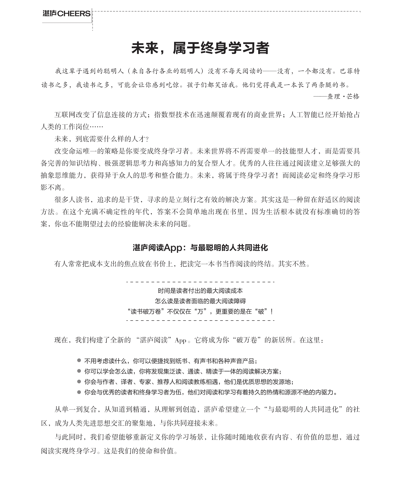


**延伸阅读**

**《表象与本质》**

◎ 《GEB》作者侯世达的重磅新作！
◎ 侯世达联手法国心理学家桑德尔，从语言、思想与记忆的多彩情境切入，深化了我们对心智的认识，揭开隐藏的认知机理，为破解人类认知之谜提供新视角。
◎ 《GEB》译者、北京大学燕京学堂副院长莫大伟，中国科学院心理研究所所长傅小兰，清华大学社会科学学院院长彭凯平，《当下的启蒙》作者史蒂芬·平克，圣塔菲研究所客座教授、《AI 3.0》作者梅拉妮·米歇尔共同推荐。


**《生命 3.0》**

◎ 麻省理工学院物理系终身教授、未来生命研究所创始人迈克斯·泰格马克力作。
◎ 以全景视野审视未来人工智能对法律、战争、就业与社会的影响，并探向更深处：人类如何在变革中重生而不迷失价值？读《生命 3.0》即是拥有一把 AI 时代的思考利器。
◎ 斯蒂芬·霍金、埃隆·马斯克、雷·库兹韦尔鼎力称赞；《未来简史》作者尤瓦尔·赫拉利称其为深具影响力之作。


**《人工智能时代》**

◎ 智能时代领军人物、硅谷传奇创业者杰瑞·卡普兰重磅著作！
◎ 当 AI 到来，人机伦理备受关注，尤其是机器对人类就业的冲击及随之而来的失业与贫富分化问题，本书提出自由市场调节思路，给出启发与安抚。

# 《如何创造可信的 AI》

## 推荐语

◎ 中国人工智能学会理事长李德毅、创新工场董事长李开复撰文作序。斯坦福大学人工智能实验室主任李飞飞、哈佛大学荣誉校长劳伦斯·萨默斯联袂倾情推荐！


◎ 2020 世界人工智能大会演讲嘉宾盖瑞·马库斯重磅著作，人工智能从业者必读图书！
◎ 本书对当前 AI 热潮进行反思，既呈现了行业的真实面貌，也诊断出领域的核心顽疾，并给出可操作的治愈方案。
◎ 现代语言学之父、认知科学奠基人之一诺姆·乔姆斯基，图灵奖得主朱迪亚·珀尔等共同推荐。


* * *

## 注释

### 结语 六问激活 AI 的终极潜能

1 国家公路交通安全管理局官网发布的《面向安全的自动驾驶车辆》。
2 总审计署 2016 年 3 月报告《车辆网络安全：交通部门与业界已有行动，但需在真实攻击应对上明确职责》，查阅于 2018 年 12 月 18 日。
3 J. Crosbie 在《Inverse》2017 年 3 月 13 日的报道《福特自动驾驶车将局限于城市“地理围栏”》。
4 J. Kahn 于《彭博社》2018 年 8 月 16 日撰文《为迎接 Robotaxi，部分人想给行人“重新编程”》。
5 白宫行政办公室 2016 年 12 月文件《人工智能、自动化与经济》。
6 此说可追溯至图灵提出的“洛夫莱斯女士的异议”，以与巴贝奇合作研制 19 世纪分析机的英国数学家兼作家 Ada Lovelace 命名。图灵援引洛夫莱斯的原话：“分析机并无主动性，它仅能完成我们明确指令的任务。” 详见 A. M. Turing《计算机器与智能》，《Mind》第 59 卷第 236 期（1950），页 433-460。
7 Karl Sims 官网，访问时间 2018 年 12 月 18 日。
8 D. Cope 著《虚拟音乐：计算机合成的音乐风格》，麻省剑桥 MIT Press 2004 年。
9 G. Johnson 在《纽约时报》1997 年 11 月 11 日发表《未被发现的巴赫？其实是电脑所作》。
10 M. A. Boden 论文《创造力的计算模型》，《AI Magazine》第 30 卷第 3 期（2009），页 23-34。
11 J. Gottschall《讲故事机器的崛起》，收录于 J. Brockman 编《思考思考机器的事》，纽约 Harper Perennial 2015 年版，页 179-180。
12 未来生命研究所 2017 年 2 月 9 日视频讲座《如何以及何时打造人类水平的 AI？》。
13 Andrej Karpathy 博客 2012 年 10 月 22 日文章《计算机视觉与人工智能现状：我们真的还很遥远》。
14 C. L. Evans 著《宽带：互联网幕后女性的不为人知故事》，纽约 Portfolio/Penguin 2018 年版，第 24 页。
15 M. Campbell-Kelly 等合著《计算机：信息机器史》，第 3 版，伦敦/纽约 Routledge 2018 年，第 80 页。
16 K. Anderson 在《名利场》2014 年 11 月 26 日报道《狂热者与质疑者围绕 AI 展开争论》。
17 O. Etzioni《不，专家并不视超智能 AI 为人类威胁》，《麻省理工科技评论》2016 年 9 月 20 日；另见 V. C. Müller 与 N. Bostrom 合著《AI 未来进展：专家问卷调查》，收录于《人工智能基础问题》，巴塞尔 Springer 2016 年，第 555-572 页。
18 N. Bostrom 论文《超智能还有多远？》，《未来研究国际期刊》第 2 期（1998）。
19 D. R. Hofstadter《哥德尔、埃舍尔、巴赫：集异璧之大成》，纽约 Basic Books 1979 年，第 677-678 页。
20 Edge 网站 2014 年 11 月 14 日对话《AI 的神话：与 Jaron Lanier 对谈》。
21 P. Domingos 著《主算法》，纽约 Basic Books 2015 年，第 285-286 页。
22 微软研究院视频专题《AI 进展：神话、现实与愿景》，查阅于 2018 年 12 月 18 日。
23 Rodney Brooks 博客 2018 年 4 月 27 日文章《“人工智能”之源》。
(1)《表象与本质》由认知科学家侯世达与法国心理学家 Emmanuel Sander 联合撰写，核心论点是类比在人类认知中占据核心地位，并揭示了我们如何凭借类比建构世界。作者以敏锐洞察引领读者探寻思维本源，打开认知之门。中文本由湛庐策划，浙江人民出版社 2018 年发行。——编者注
(2) 想了解库兹韦尔对 AI 创造之道的看法，可参阅《人工智能的未来》。中文本由湛庐策划，浙江人民出版社 2016 年出版。——编者注
(3) 因明为古印度逻辑学体系，其中“因”指推理依据，“明”指清晰的知识。——编者注
(4) 名辩是先秦时期围绕“名”之属性、内容及其关联展开的论辩及相关理论研究。——编者注
(5) 逻格斯为古希腊至中世纪常用的哲学概念，通常指世间万物皆可理解的内在法则。——编者注
(6) Kurt Gödel 为美籍奥地利数学家、逻辑学家与哲学家，20 世纪最具影响力的逻辑学家之一，以提出哥德尔不完备定理著称。——编者注
(7) 潘公凯，浙江宁海籍知名画家，历任中国美院、中央美院院长，现任中国美术家协会副主席。——编者注
(8) 公度为几何学概念，若线段 a、b 均可被线段 d 整除，即 a=md、b=nd（m、n 为自然数），则 d 为 a、b 的公度。此处借喻不同语言间无法相互定义而致沟通障碍。——编者注
(9) FORTRAN 由美国计算机科学家 John Backus（1924-2007）于 1954 年研制，是首个大规模推广的编程语言，擅长数值运算。——编者注
(10) 此处所指为《奇点临近》（The Singularity Is Near）。——编者注
(11) Gary Marcus 的《如何创造可信的 AI》是对当前 AI 热潮的审视，帮助读者看清领域现状，指出问题根源并提出可行对策。中文本由湛庐策划，浙江教育出版社 2020 年推出。——编者注
(12) 明斯基在《情感机器》中提出：若大脑即机器，探究意识运作是否能助我们打造理解与思考的 AI？中文本由湛庐策划，浙江人民出版社 2016 年出版。——编者注
(13) 连续统为数学概念，指无间断的数集。——编者注
(14) 像素强度反映图像像素亮度，取值 0 至 255，数值越大亮度越高。——编者注
(15) 飞盘为掷接玩具。此处比喻亚符号 AI 不善显式逻辑规则任务，更擅长无明确规则的感知任务。——译者注
(16) 思想家、语言学家史蒂芬·平克的“语言与人性四部曲”《语言本能》《思想本质》《心智探奇》《白板》围绕语言演化与心智起源展开，中文本由湛庐策划，浙江人民出版社 2015-2016 年陆续出版。——编者注
(17) 戈尔迪之结喻指错综复杂且看似无解的问题。——译者注
(18) 沙文主义原指极端民族主义。此处引申为坚持思考必须由特定物质如生物细胞产生，即思想源于肉体的立场，可视作肉体沙文主义。——译者注
(19) 伊丽莎为 AI 史上的著名程序，也是首个真正意义的聊天机器人，由系统工程师 Joseph Weizenbaum 与精神病学家 Kenneth Colby 于 60 年代联合开发。名称取自萧伯纳戏剧《The Matchmaker》中的角色。——编者注
(20) 希腊德尔斐阿波罗神庙门上刻有“认识你自己”“适度”“许诺即苦”等铭文，历来被视为德尔斐神谕，影响深远。——编者注
(21) Diamandis 的《富足》认为实现丰裕生活是人类最大挑战，呼吁积极应对；《创业无畏》则分享成功创业经验并描绘行动蓝图。两书均由湛庐策划，浙江人民出版社分别于 2016 与 2015 年出版。——编者注
(22) 此处指善于调优神经网络超参数以获得更佳 ConvNets。——译者注
(23) 指电风扇出现前靠手工扇风降温的仆人。——编者注
(24) 多为女性，在二战期间大量从事手工繁复计算。——编者注
(25) 伞状组织由多家机构组成，成员间协同行动、共享资源，常见于工业领域。——编者注
(26) 101 指入门级主题，即学科基本原理与概念；在美高校课程编号中常表示初级课。——译者注
(27) 学习片段为智能体在特定环境中按某策略从起始到结束的完整执行过程。——译者注
(28) 即 time step，研究中常把求解过程切分为若干小段，每段称为一个时间步。——编者注
(29) 摩纳哥为欧洲城邦国家，四个公国之一，也是世界第二小国。——译者注
(30) 白痴天才指某学科知识极深而其他领域一无所知者。——译者注
(31) 在 AI 语境中，“自然的”多指“人类的”。——译者注
(32) “鸟嘴”“票据”“传票”英文皆为 bill，作者借此说明程序在不同语境下辨析词义的难度。——编者注
(33) 独热编码即一位有效编码，用 N 位寄存器表示 N 个状态，每次仅一位有效。——译者注
(34) charm 可指魅力、宝石、吸引力、魔力等。——译者注
(35) bright 有明亮、鲜明、聪明、愉快等义。——译者注
(36) “take with a grain of salt”意为对某说保持怀疑。字面“一粒盐”被机器译成“带盐条”。作者以此双关提醒更应怀疑机器翻译。——译者注
(37) 马尔科夫《人工智能简史》多角度梳理 AI 从兴起到低谷再到爆发，并聚焦工业机器人、救援机器人、无人车、语音助手等前沿，探讨 AI 与智能增强的关系。中文本由湛庐策划，浙江人民出版社 2017 年出版。——编者注
(38) 此处北极星喻指指导原则。——译者注
(39) “push the envelope”原指信封，意为突破极限、超越常规，常用于技术或社会创新。——译者注
(40) Ruth Bader Ginsburg 时任美国最高法院大法官，是继 Sandra Day O'Connor 之后第二位女性大法官，对女权进步贡献巨大。
(41) 客厅戏法指为博眼球的社交表演，多为贬义。——译者注
(42) 美西部片中白帽为好人、黑帽为坏人。本文借此分别指行业建设者与破坏性黑客。——编者注
(43) 近十年研究显示，人们多借助感觉运动经验理解具体概念，说明感觉运动与语言系统紧密关联。隐喻常以具体喻抽象，故研究感觉运动在隐喻理解中的作用有助于厘清抽象概念形成并阐明两系统关系。——译者注
(44) 莱考夫《别想那只大象》认为隐喻与框架是话语权的两大工具，可助我们占据主动、抵御操纵。中文本由湛庐策划，浙江人民出版社 2020 年出版。——编者注
(45) 借用的时间指超出预期的寿命。——译者注
(46) 原文直译为“像婴儿般试探地迈步”，既指迈出小步，也双关指工作尚处婴儿期、进展甚微。——译者注
(47) 具身理论认为生理体验与心理状态紧密相连，意识、认知、心智皆根植肉体，离肉体则不复存在。——编者注

三则笔记：虚拟、符号与稀缺

(48) 缸中之脑是属于认识论范畴的思想实验，提出者是哲学家希拉里·普特南，首见于其著作《理性、真理与历史》。其出发点在于，人类一切主观感受最终都会在脑内化为神经信号。设想一个恶意的科学家把一颗脑取出体外，放进营养液中维持生命体征，再由一台超级计算机通过神经末梢向它输入与原本在世时完全一致的电信号，并对脑发出的反馈给予日常一般的回应，那么这颗脑所感知的现实其实是由机器生成的人工幻境。问题就落在它是否能够自知自己身处模拟之中？——译者注

(49) 所谓符号层面，其实是对智能主体活动的一种表述方式，其构成要素包含算法、数据结构本身等。在电脑程序里，知识部分往往体现在数据结构中承载的信息，这些信息被用来驱动具体的操作。面向知识构建的系统里，主体会遵循合理性准则来挑选行为，以期逼近预设的期望。主体可以凭借对环境的认知来进行判断，但若要真正改变自身状态，它就必须动用手头上可用的全部手段。——译者注

(50) 哈佛大学终身教授穆来纳森所著的《稀缺》，以行为经济学的视角拆解人们为何会陷入贫困与分身不暇的困境。该书的简体中文版由湛庐策划，浙江人民出版社于 2018 年推出。——编者注