# 智能写作加速指南

## 内容概览
本书以 140 条实操要点为骨架，搭配 140 集配音演示、170 多份素材与对话样本以及 178 页课件，从提问创作、职场公文、润色改写、模板应用、案例实战五个维度切入，帮助零基础读者快速掌握智能文案撰写能力。

具体涵盖：16 种提问思路、13 种提示优化手段、11 种高效提问策略、7 项公文排版规范、8 种公文起草方法、7 种公文润色手法、9 种文案改写技巧、7 种文本润饰方式、11 类营销文案提示模板、12 类办公文案提示模板、13 类自媒体文案提示模板、12 类教育科研文案提示模板，以及短篇小说创作全流程与图书推广文案创作全流程的演示。

阅读人群：从事文字工作的专业人员；人工智能相关从业者；电商运营、新媒体编辑、广告策划、短视频编导、作家及艺术从业者；新入职公务员及有公文写作需求的政府工作人员；行政、文秘等需要处理公文的职场人员；文学、语言、计算机科学与技术等专业的在校学生。

## 前言
※内容概述
本书是一套面向新手的智能文案创作实操教程。

全书分为五篇。
一是【提问生成篇】，包括：
第1章 16种AI提问技巧，快速获得文案
第2章 13种指令优化技巧，获得有效答案
第3章 11种高效提问技巧，让AI生成高质量文案
二是【职场公文篇】，包括：
第4章 7种公文格式规范，让AI智能生成标准化文档
第5章 8种AI公文写作的方法，提升写作的质量和效率
第6章 7种运用AI润色公文的方法，优化结构与表达
三是【修改润色篇】，包括：
第7章 9种文案修改技巧，让AI智能改写文案
第8章 7种文案润色方法，让AI自动化修饰文本
四是【热门模板篇】，包括：
第9章 11类营销文案指令模板，助力事业创收
第10章 12类办公文案指令模板，轻松搞定工作
第11章 13类自媒体文案指令模板，保持稳定更新
第12章 12类教育学术文案指令模板，助力个人成长
五是【应用案例篇】，包括：
第13章 AI创作短篇小说全流程：《幻剑奇谋》
第14章 AI创作图书宣传文案全流程：《AI绘画师》
※本书特色
① 90余分钟演示视频：书中操作均录制了带讲解的演示，完整还原实例，可配合阅读或单独观看，学习体验贴近观影。
② 120余张全程图解：大量清晰配图展示文案生成、润色与应用全过程，使实例更直观，便于理解迁移。
③ 140个干货要点：系统讲解提问、公文、润色、模板与案例，帮助读者由新手迈向熟练。
④ 160余组核心提示：汇总实例用到的提示，读者可直接复用，快速体验创作乐趣。
⑤ 170余份素材与回复文件：随书资源提供实例素材及模型回复，助力提升操作熟练度。

## 版本说明
排版时所用截图基于 Microsoft Office 365、ChatGPT 3.5 及文心一言 V2.5.2，出版周期内工具界面与功能或有调整，请以思路为主举一反三。同一提示下模型回复会存在差异，观看教程时建议聚焦提示编写与操作步骤。

## 作者及售后
本书由海川编著，李玲参与编写，谨致谢意。因编者水平有限，书中难免疏漏，欢迎批评指正，联系微信：2633228153。
编著者

# 【提问生成篇】

## 第1章

### 16种AI提问技巧，快速获得文案
**本章要义：**
智能文本即借助人工智能技术生成的文字，能把想法转化为文字。本章围绕 ChatGPT 与文心一言两大工具，介绍 9 种 ChatGPT 使用方式与 7 种文心一言入门方式，帮助快速熟悉。

全书框架：
智能提问创作+办公文书+润色改写+常用模板+实战案例

### 1.1 9种ChatGPT的提问与使用技巧
ChatGPT 是主流生成平台之一，登录后输入提示即可获取所需内容，实现自动化输出。下面梳理 9 个常用用法。

#### 001 指令示例的使用
开启新会话时，ChatGPT 右侧的回复区会提供四条示范指引，点击后即可感受生成过程，不同对话中示例内容会有所不同。具体操作如下。
扫码看教学视频
步骤01 登录后自动进入全新会话，点击回复区第一个示例旁的 Click to send 按钮，如图1-1所示。
图1-1 单击Click to send按钮
步骤02 发送之后，模型会依据指引产出对应文字，如图1-2所示。
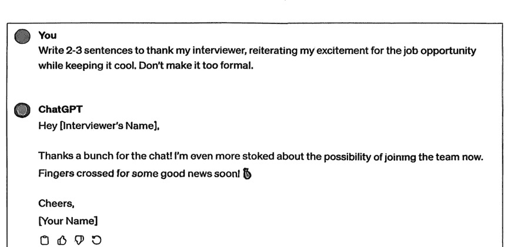
图 1-2 ChatGPT 根据指令生成的文案
步骤 03 示例大多为英文，输出结果也是英文，可追加“请翻译成中文”的指令要求其转换，如图 1-3 所示。
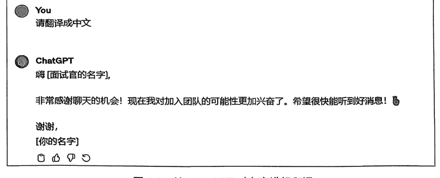
图 1-3 让 ChatGPT 对文案进行翻译

#### 002 指令的输入与发送
除了使用示范指引，还可以自行编写提示词进行提问。操作流程如下。
步骤 01 在全新会话底部输入区键入“请为羊毛围巾产品写一段宣传文案，20字以内”，如图 1-4 所示。
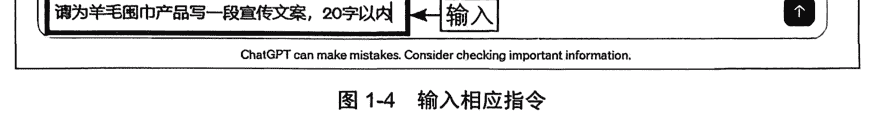
图 1-4 输入相应指令
步骤 02 点按输入区右侧的 Send message 按钮或按【Enter】，即可提交并获取生成结果，如图 1-5 所示。
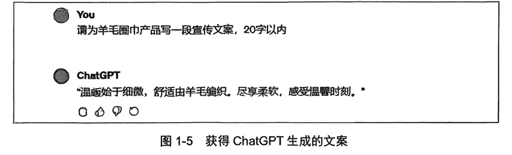
图 1-5 获得 ChatGPT 生成的文案

#### 003 文案生成的中止
发送指令后模型会逐字输出，若对正在形成的内容不满意即可中断。方法如下。
步骤 01 打开对话面板，在输入区输入“请提供 4 条适合庆祝毕业的朋友圈文案”，按【Enter】提交，模型即开始输出。

图 1-6 输入相应指令
步骤 02 在下方空闲输入区右侧点按停止图标，如图 1-7 所示，即可终止输出。
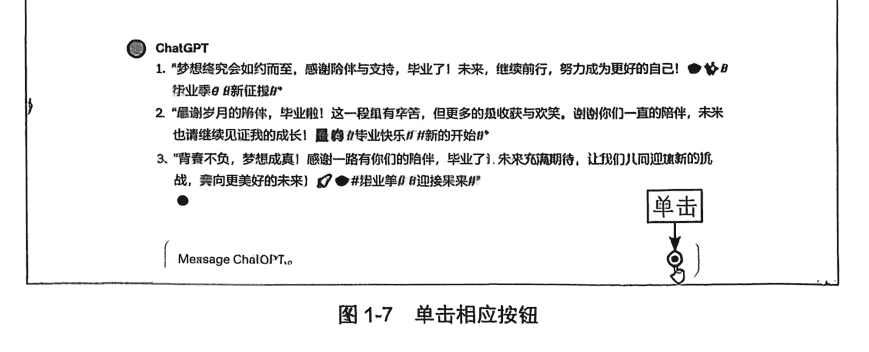
图 1-7 单击相应按钮

#### 004 文案的重新生成
对返回结果不满意时可点击🔄按钮让模型重新组织表达。具体如下。
步骤 01 打开对话界面，输入“写一则主题为极地旅行的广告语，100字以内”，在输出结果下方点击🔄图标，如图1-8所示。
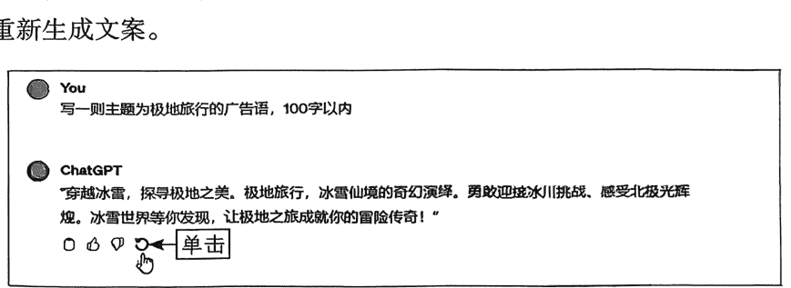
步骤 02 重新生成后页面会出现编号，每次刷新会新增一页，历史回复被保留，可用左右箭头切换，如图1-9所示。
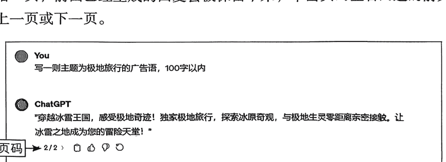

#### 005 文案的选择和复制
需要摘取内容时可通过选区操作复制到Word等文档。具体如下。
步骤 01 打开会话，输入“请提供5个有关冬季保暖的爆款短视频标题”，提交后获得标题列表，如图1-10所示。
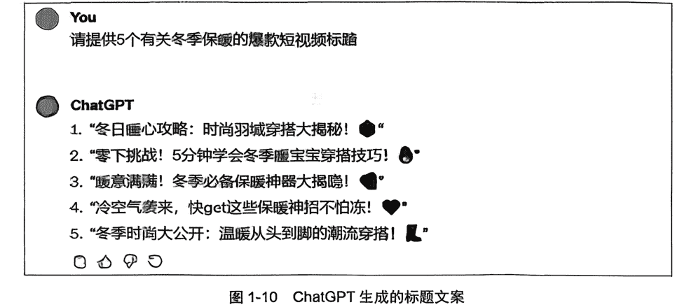
图 1-10 ChatGPT 生成的标题文案
步骤 02 挪动光标选中目标标题，右键弹出菜单后选择“复制”选项，如图 1-11 所示。
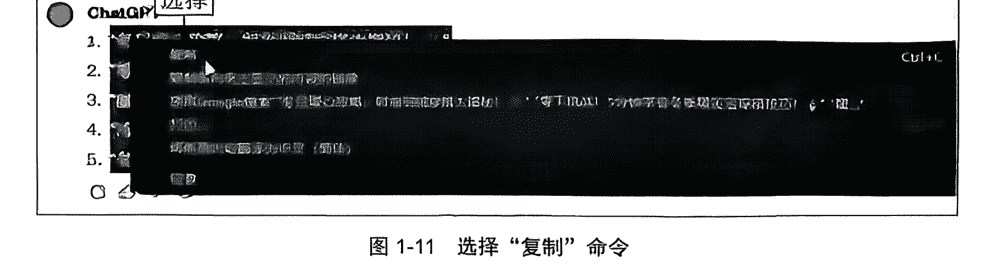
图 1-11 选择“复制”命令
提示：序号通常无法一起被选中，建议先粘贴至记事本或Word后再手工加上序号。

#### 006 复制按钮的使用
除手动选复制外，ChatGPT自带一键复制功能，可直接获取完整回复。用法如下。
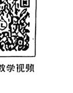
步骤 01 打开会话界面，输入“请写一篇有关围巾选购技巧的微博文案，100 字以内”，提交后获得文案，如图 1-12 所示。
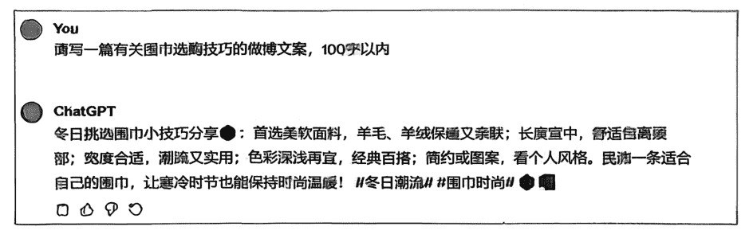
图 1-12 ChatGPT 生成的微博文案
步骤 02 在输出结果下方点按复制图标，如图 1-13 所示，即可一次性复制全部内容。
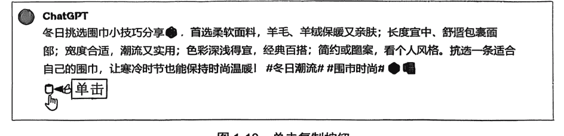
图 1-13 单击复制按钮

#### 007 聊天窗口的新建
想用新主题开启对话时，可保留当前记录并新建会话。操作如下。
步骤 01 在会话面板左上角点按 New chat 按钮，如图 1-14 所示。

图 1-14 单击 New chat 按钮
步骤 02 新建完成后，在输入区键入“请创作一篇歌颂冬雪的散文，200字以内”，如图1-15所示。

步骤 03 按下【Enter】，即可在全新会话中与模型交流，模型会按要求生成散文，如图1-16所示。
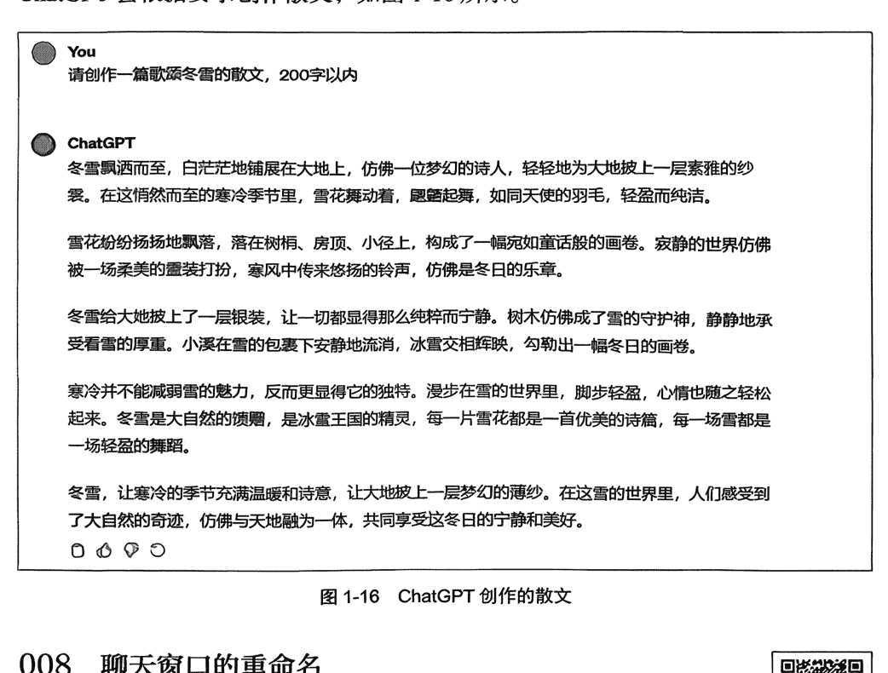

#### 008 聊天窗口的重命名
对话产生后会话会自动命名，不满意可手动修改。步骤如下。
步骤 01 以上一例为例，点击会话标题右侧的按钮，如图1-17所示。
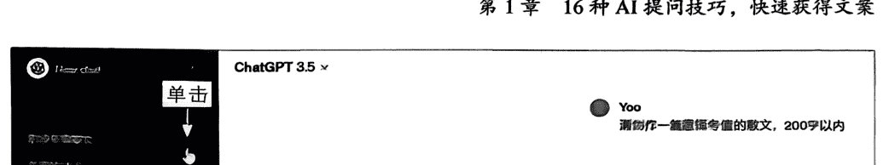
图 1-17 单击相应按钮
步骤 02 在展开的下拉菜单中挑选 Rename 选项，如图 1-18 所示。
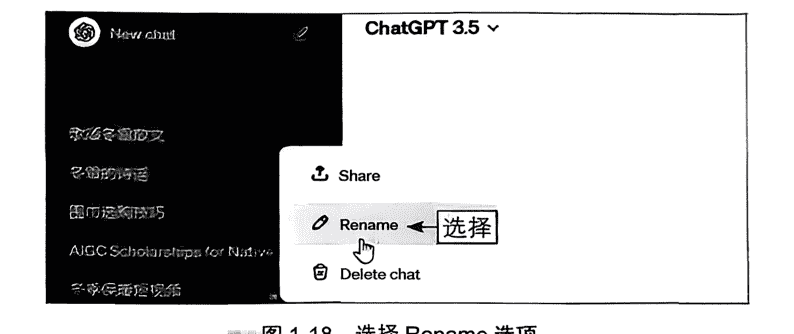
图 1-18 选择 Rename 选项
步骤 03 随后出现名称编辑框，可在此更改标题，如图 1-19 所示。

图 1-19 修改名称
步骤 04 按【Enter】确认后，重命名即生效，如图 1-20 所示。

图 1-20 重命名聊天窗口的效果

#### 009 聊天窗口的删除
完成话题且不想保留记录时可删除会话。方法如下。
步骤 01 点击会话标题右侧的...按钮，选择 Delete chat 选项，如图 1-21 所示。

图 1-21 选择 Delete chat 选项
步骤 02 弹出 Delete chat? 确认框，确认删除点 Delete，放弃点 Cancel，如图 1-22 所示。
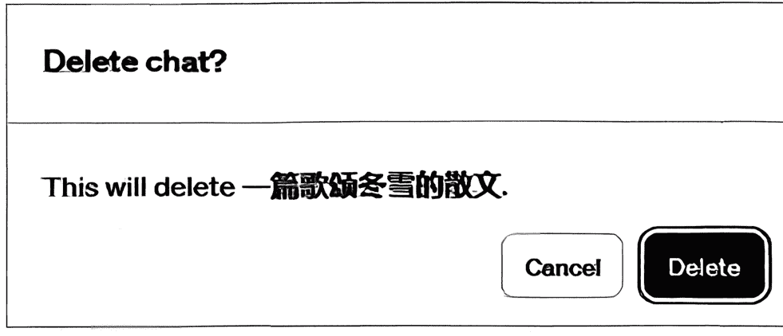
图 1-22 弹出 Delete chat? 对话框

### 1.2 7种文心一言的提问和入门技巧
文心一言由百度研发的知识增强型大语言模型，支持对话、问答与创作辅助。本节介绍七项入门手法。

#### 010 指令模板的使用
进入文心一言首页后，系统会推送若干示范模板以引导使用。具体操作如下。
步骤 01 首页展示推荐模板，挑选其一，如图1-23所示。
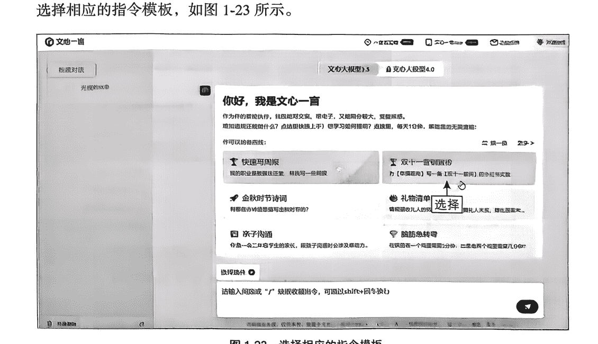
图1-23 选择相应的指令模板
步骤 02 选定后模型会依据模板内容产出对应反馈，如图1-24所示。
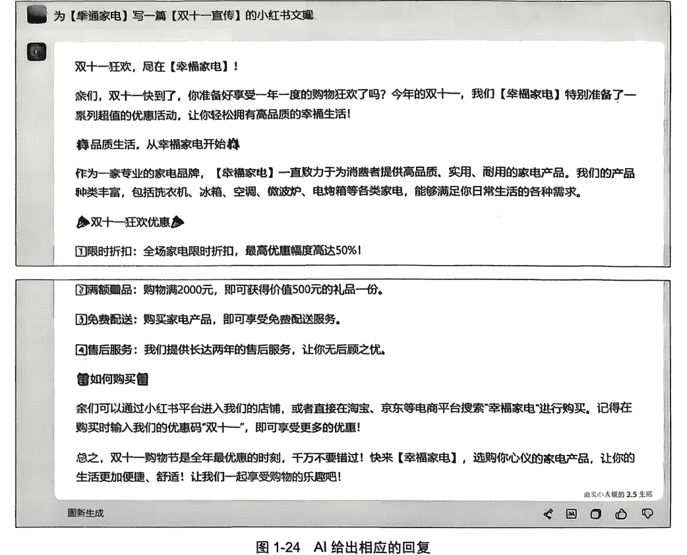
图 1-24 AI 给出相应的回复

#### 011 自定义指令的使用
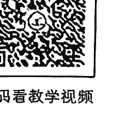
除使用系统推荐模板外，用户也可自行输入提示词进行交互。操作如下。
步骤 01 在新对话输入区输入“请撰写一首藏头诗，每句前四个字分别是：悲、欢、离、合。要求藏头内容体现深意和韵味，同时要求押韵、通顺，符合诗歌的写作规范”，如图 1-25 所示。
步骤 02 点按发送键或按【Enter】，即可得到模型生成的藏头诗，如图 1-26 所示。
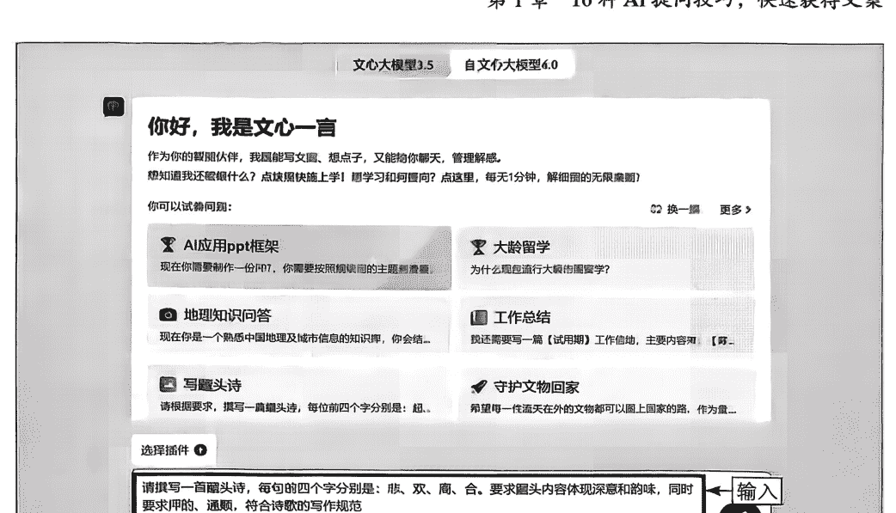
图 1-25 输入相应的提示词
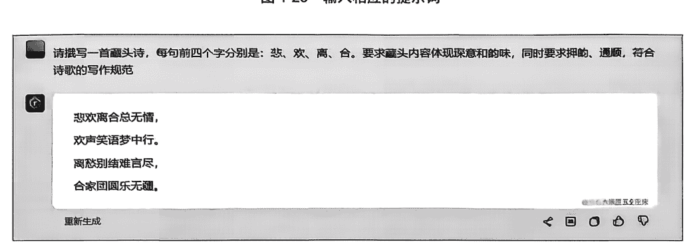
图 1-26 AI 生成的藏头诗

#### 012 指令模板的收藏与调用
“一言百宝箱”可收藏常用模板，后续通过/符号快速调取，模板会定期更新，掌握收存与调用即可。具体如下。
步骤 01 在新对话上方点按“一言百宝箱”按钮，如图 1-27 所示。
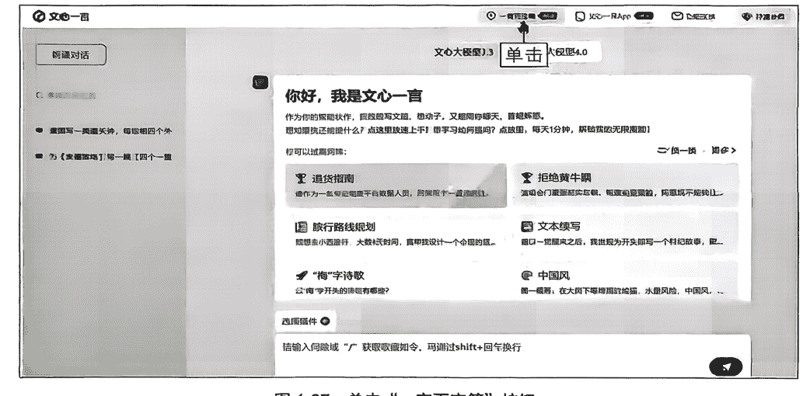
图 1-27 单击“一言百宝箱”按钮
步骤 02 弹出面板后切换至“场景”|“灵感策划”，点击模板旁的收藏图标，如图 1-28 所示。
步骤 03 关闭面板后在输入区输入/符号，从下拉列表挑选已收藏模板，如图 1-29 所示。
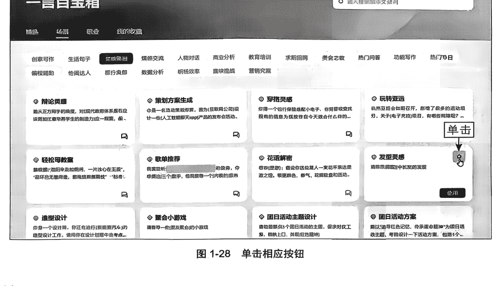
图 1-28 单击相应按钮
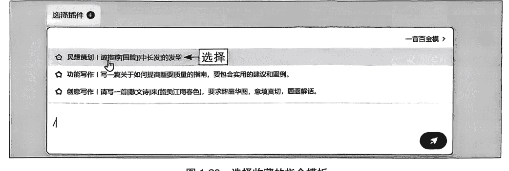
图 1-29 选择收藏的指令模板
步骤 04 模板会自动填充至输入区，编辑中括号内内容后发送，即可得到模型反馈，如图 1-30 所示。
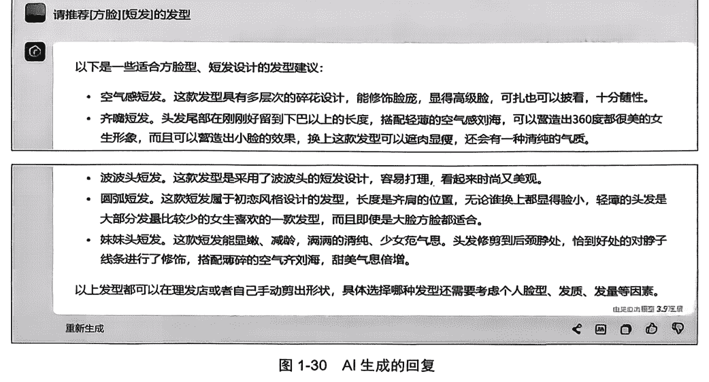
图 1-30 AI 生成的回复

#### 013 快速重写功能

当对文心一言给出的文案不满意时，可以点一下“重新生成”让模型再创作一版，具体流程如下。

**步骤 01** 在对话框输入框里键入“写一篇关于如何提升睡眠质量的指南，要包含实用建议，字数控制在150字以内”，点击发送后得到回复，再点按“重新生成”按钮，如图 1-31 所示。

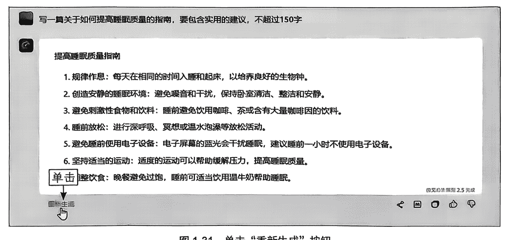

图 1-31 点击重新生成按钮

**步骤 02** 执行后，模型会依据相同指令再产出一版内容，如图 1-32 所示。此外，回复下方还有“更好”“更差”“差不多”三个评价键，可用来对比两次输出的差异。

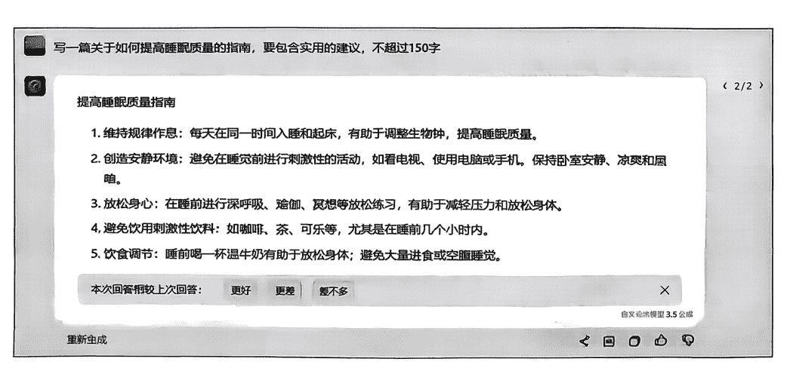

图 1-32 模型重新生成的回复界面

> ★ 专业提示 ★

模型重新作答后，可点击右侧的 < 2/2 > 切换查看先前的版本。

#### 014 新建对话窗口

文心一言支持新建对话，便于归类管理与历史检索，具体做法如下。

**步骤 01** 在当前对话页左上方点按“新建对话”按钮，如图 1-33 所示。

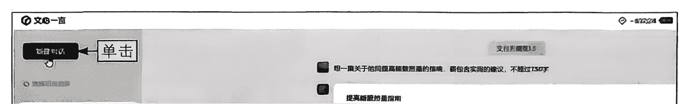

图 1-33 点击新建对话按钮

**步骤 02** 操作完成后会打开一个空白对话页，效果如图 1-34 所示。

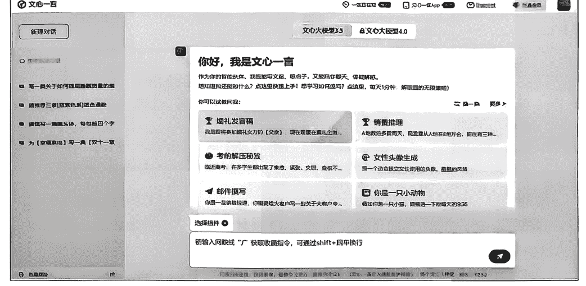

图 1-34 新建完成的对话窗口

#### 015 管理历史对话

可在文心一言主页左侧栏对历史记录进行查看与维护，包含置顶、改名、删除、分享等功能，具体步骤如下。

**步骤 01** 进入文心一言首页，在左侧列表中挑选所需的历史会话，如图 1-35 所示，即可载入对应内容。

**步骤 02** 在目标会话右侧点按置顶图标☆，如图 1-36 所示。

**步骤 03** 执行后该会话会被固定在列表上方，效果如图 1-37 所示。

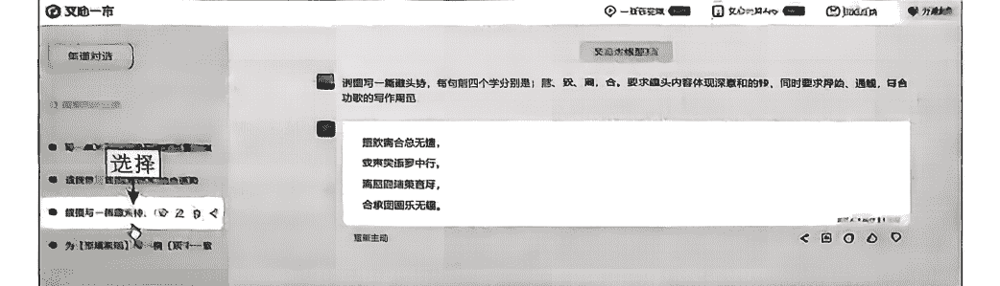

图 1-35 选择历史会话

图 1-36 点击置顶图标

图 1-37 置顶后的显示效果

**步骤 04** 对已置顶的会话右侧点按重命名图标 ✏️，如图 1-38 所示。

**步骤 05** 输入新的会话名称，如图 1-39 所示，点击 ✓ 确认即可完成更名。

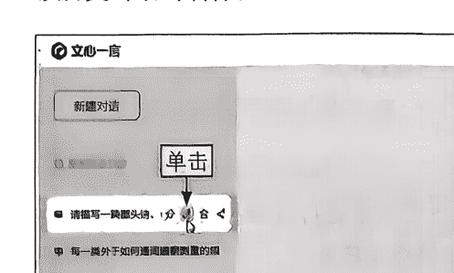

图 1-38 点击重命名图标

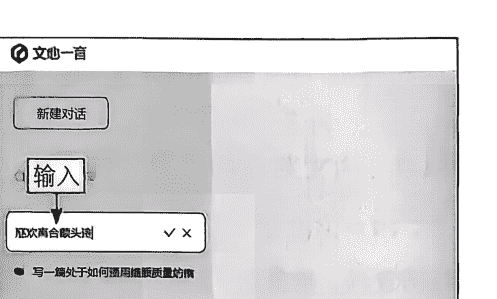

图 1-39 输入新的会话名称

**步骤 06** 点按会话右侧的删除图标 🗑️，会弹出确认框，如图 1-40 所示，可选择“删除”执行移除，或点“取消”关闭提示。

**步骤 07** 在会话右侧点按分享图标 🔗，如图 1-41 所示。

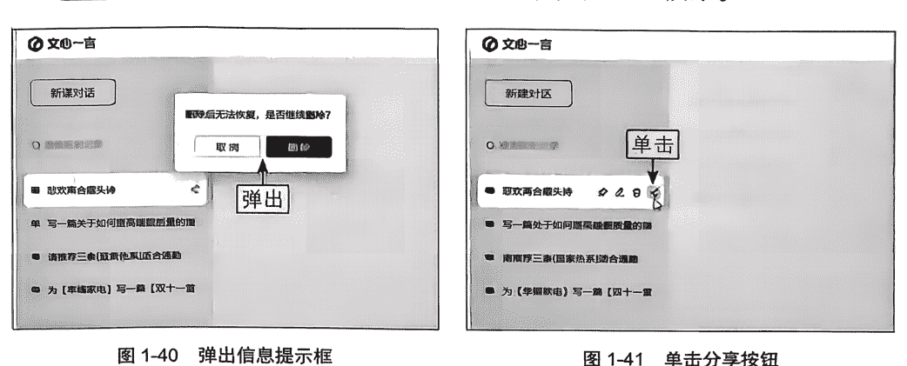

**步骤 08** 进入分享页后，勾选左侧复选框，再点“分享”按钮，如图 1-42 所示。

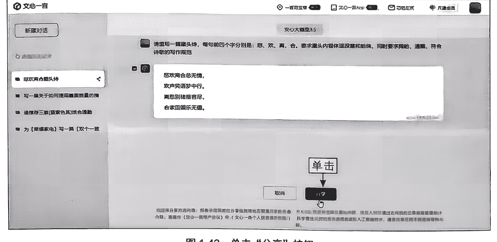

**步骤 09** 弹出分享对话框后，点击“复制链接”按钮，如图 1-43 所示，即可复制链接，粘贴发送给好友即可共享模型生成的回复。

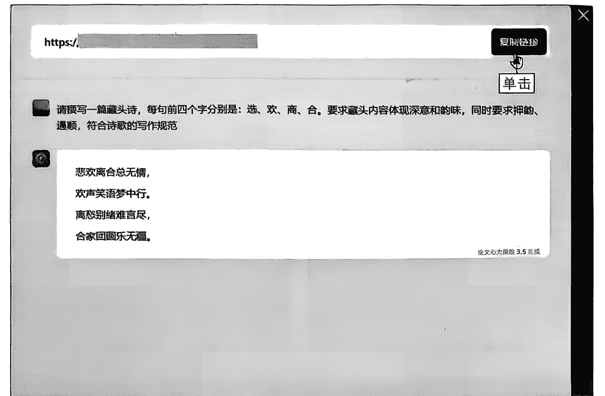

图 1-43 点击复制链接按钮

#### 016 侧边栏隐藏与展开

可将文心一言首页左侧栏收起扩大对话区，也可在需要时重新展开，具体操作如下。

**步骤 01** 进入首页，点击左侧栏底部 ≡ 按钮，如图 1-44 所示。

图 1-44 点击折叠按钮

**步骤 02** 执行后左侧栏会被隐藏，对话区全屏显示，更便于交流，如图 1-45 所示。

# 【提问实战篇】

# 第 1 章 16 个提问思路，快速拿到文案

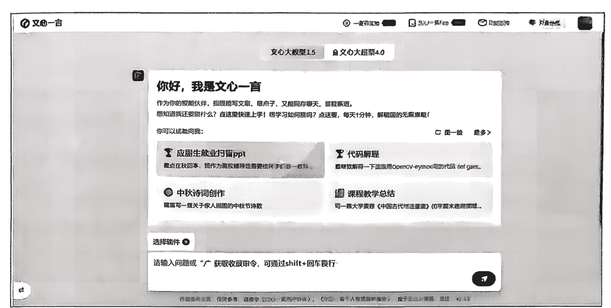

图 1-45 全屏对话显示效果

步骤 03 在对话页左下角点击“展开”按钮，如图 1-46 所示，即可恢复左侧栏。

图 1-46 点击展开按钮

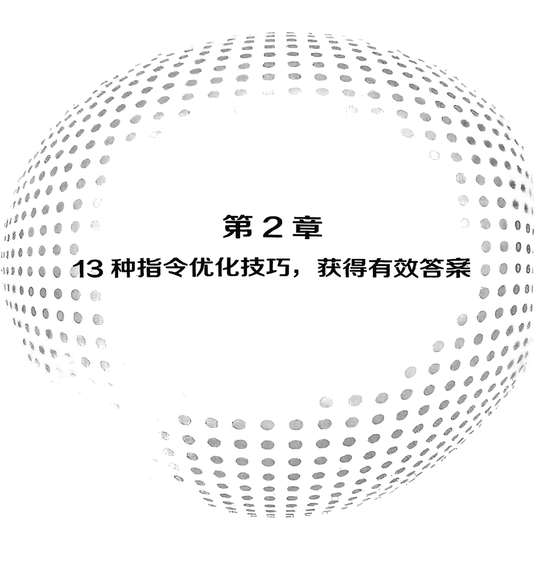

# 第 2 章 13 条指令优化方法，获取有效答案

**本章要点：**

从 ChatGPT 的使用规律可知，效果好坏取决于提问是否得当，而提问要得当就必须学会优化指令。本章介绍几类实用方法，帮助更顺畅地使用 ChatGPT。

### 2.1 3 类挖掘文案指令的技巧

想让 ChatGPT 写文案，就要给出清晰指令让其识别与理解。模型的发挥关键在于指令质量，好的遣词造句是前提。

#### 017 明确需求

指令是模型作答的依据，若要生成文案，需在指令中提供文案类型、风格、范围等信息，模型据此输出。

写指令时要紧贴需求，选择更贴合的表述。不同指令得到的结果差别明显，下面通过例子说明宽泛指令与具体指令的差异。

步骤01 在 ChatGPT 输入框输入比较宽泛的指令，按【Enter】发送，即可得到生成结果，指令与回复如下。

> **提问**
> 
> 请写出10个关于冬泳的文案：
> 
> **ChatGPT**
> 
> 1. 寒冬里跃入冰湖，用勇气点燃热血，冬泳让极限成为日常。
> 2. 与严寒对冲的瞬间，身体沸腾，意志被淬炼成钢。
> 3. 冰封的水面下是自我的突破，每一次入水都是挑战。
> 4. 冷意刺肤却清醒头脑，冬泳是身心的双重唤醒。
> 5. 在雪白世界里划开一条生命之线，冬泳者如北极光般醒目。
> 6. 冬泳不只是运动，更是一种迎难而上的生活态度。
> 7. 不惧风雪的人笑得最灿烂，他们把寒冷变成勋章。
> 8. 呼啸的寒风与冰凉的湖水，映衬出坚韧的笑容。
> 9. 每一次入水都是与自然的对话，也是对生命的拥抱。
> 10. 冬日里像冰雪中的先行者，用不屈书写温暖。

步骤02 点左上角 New chat 新建窗口后，输入更具体的指令，按【Enter】发送，指令与回复如下。

> **提问**
> 
> 请写出10个关于冬泳好处的文案：
> 
> **ChatGPT**
> 
> 1. 强化耐寒机能：规律冬泳提升体温调节与血液循环，免疫力随之增强。
> 2. 加速代谢：冷水刺激促进脂肪燃烧，有助于体重管理。
> 3. 护心助血管：水中运动降低血压，改善心血管系统。
> 4. 锻炼呼吸：需要深度呼吸控制，肺活量与氧吸收效率提升。
> 5. 缓解焦虑：户外冷水刺激与深呼吸帮助释放压力。
> 6. 改善微循环：血管弹性增加，全身供氧更顺畅。
> 7. 提升营养利用：适应寒冷后血液集中供养内脏，吸收效率提高。
> 8. 培养自律：挑战低温锻炼意志，形成坚韧品格。
> 9. 助眠提神：消耗多余能量后身体更易放松，睡眠质量改善。
> 10. 增进社交：集体冬泳促进交流，增强团队凝聚力。

可见，模型对宽泛与具体指令的理解不同，回复制也随之变化。宽泛指令得到概念化输出，具体指令则更贴近问题。两者各有所长，选择取决于真实需求。

#### 018 确定指令主题

宽泛指令常用于获取事实性或概念性内容，例如“世界上最大的湖是哪个”。具体指令更适合需要灵活性与观点的场景，例如“用诗意的语言描绘武功山”。

宽泛指令相对容易撰写，困难在于写出具体的指令，而核心在于先锁定主题。

步骤01 输入无主题的指令，按【Enter】发送，模型会自行选主题生成议论文，指令与回复如下。

> **提问**
> 
> 请帮我写一篇不超过500字的议论文，包含两个核心论点：
> 
> **ChatGPT**
> 
> 题目：电子书会否取代纸质书？
> 
> 科技发展让电子书兴起，引发是否会取代纸书的讨论。以下从两点展开。
> 
> 支持者认为电子书便携环保，可储存海量书籍，减少纸张与印刷对环境的压力，符合可持续理念。
> 
> 反对者强调纸书的阅读体验独特，触感、气味与翻页声带来情感联结，且纸质阅读更有利于深度思考与记忆。
> 
> 总体看两者各有优势，或许未来会共存互补，为读者提供更多选择。

步骤02 新建对话后输入带具体主题的指令，按【Enter】发送，指令与回复如下。

> **提问**
> 
> 请帮我写一篇不超过500字的议论文，观点为“社交媒体使用导致青少年心理健康问题上升”，包含两个核心论点：
> 
> **ChatGPT**
> 
> 标题：社交媒体对青少年心理健康的负面影响
> 
> 社交媒体普及后，青少年生活高度数字化，过度使用却加剧心理问题。
> 
> 其一，社交媒体放大社交焦虑与自卑。滤镜生活与完美形象易引发过度比较，自我价值感下降，焦虑感上升。
> 
> 其二，虚拟互动削弱真实连接。长时间刷屏减少面对面交流，易产生孤独感，同时沉迷影响学业与兴趣，加剧心理压力。
> 
> 综上，社交媒体对青少年心理健康负面影响明显，需家长、学校与社会引导合理使用。

可见，无主题时模型会随机选题，有主题时则围绕给定观点展开，更符合需求。

#### 019 细化主题描述

当已有主题仍不理想时，可进一步加入限定词与条件来收窄范围。以下以羽绒服推广文案为例。

步骤01 输入无限定条件的指令，按【Enter】发送，指令与回复如下。

> **提问**
> 
> 请提供5个羽绒服的产品推广文案；
> 
> **ChatGPT**
> 
> 1. 极地守护者：顶级羽绒加防水面料，零下依旧温暖自在。
> 2. 城市漫步：修身剪裁多色可选，保暖与都市风尚兼具。
> 3. 云朵轻暖：柔软羽绒如穿云朵，带来冬日静谧舒适。
> 4. 探险家：耐磨防水抗寒，户外挑战的可靠伙伴。
> 5. 风尚系列：前卫设计个性十足，寒冬也能闪耀。

步骤02 点击已发送指令下方的✏️，加入限定条件改写，点 Save & Submit 提交后，模型按新指令生成如下。

> **提问**
> 
> 请提供5个适合小个子女生的工装羽绒服推广文案：
> 
> **ChatGPT**
> 
> 1. 轻盈显高，工装细节勾勒利落线条，小个子也能hold住街头。
> 2. 短版剪裁拉长比例，口袋与腰线设计兼顾实用与造型。
> 3. 撞色工装元素打破单调，色彩提气不压身高。
> 4. 百搭工装风格，通勤或出游一件搞定，轻松适配多种场景。

工装羽绒服的定位早已超出单纯御寒层面，它更是一件可塑性极强的时尚利器。丰富的口袋布局兼顾收纳便利与设计感，既能响应你的穿搭诉求，又能轻松演绎多种风格走向。一件上身，就能自如应对不同场合的着装需求。

5. 暖心守护，专为娇小身型量身呵护
寒冷的冬日，这款工装羽绒仿佛一位贴身的暖心伴侣，始终相随。甄选高品质羽绒填充，保温效果出众，即便在凛冽天气里也能感受到持续的温润。娇小身材的女生穿上它，既保有时尚感，又能享受到细腻周到的呵护体验。

步骤03 再次点击已发送指令下方的小铅笔图标，加入限定性条件对原指令进行改写后，点按 Save & Submit 按钮，让 ChatGPT 依据更新后的指令重新创作文案，相关指令与生成结果如下。

> **提问**
> 请提供5个适合小个子女生的工装羽绒服产品推广文案，要求突出产品亮点，不超过100字：
> **ChatGPT**
> 1.【轻盈暖系列】小巧版型羽绒工装，轻薄不憋闷，小个子穿上气质灵动，告别笨重感，元气值拉满！
> 2.【柔肤防风】小体格也能大温暖！工装风羽绒，触感柔和贴肤，防风性能出色，穿搭自如，凸显玲珑娇俏。
> 3.【细节点缀】精细微缝工艺，萌趣又精致；别致口袋布局，兼顾美观与实用。小个子专属暖系时尚，魅力自然绽放。
> 4.【轻装自在】超轻羽绒内充，保暖却不觉负重。专属防水面层，雨雪天气依旧安心。小小身形也能获得全方位保护。
> 5.【潮流单品】当下流行的工装廓形，深受小个子喜爱。羽绒工装百搭时髦，设计独具匠心，寒冬里依旧光彩夺目。

从以上示例可以看出，ChatGPT 的输出质量与指令的细化程度密切相关。通常而言，用户在描述主题时提供的细节越丰富、越具体，获得的高效回复概率就越大。

## 2.2 10 种优化指令的技巧

在 AI 文案创作场景中，多半需要用到较为明确的指令。若想让生成的文本更贴合需求，掌握一些指令优化方法会让创作过程更顺畅高效。本节梳理了若干实用技巧，帮助大家更快完成 AI 文案的生成任务。

#### 020 指令内容的设计

设计指令时更应注重信息质量而非堆砌数量，尽可能给出详实、准确且富有启发的描述来激发模型的创造力，同时避免过度限制，给模型保留一定的发挥空间。下面通过案例说明具体做法。

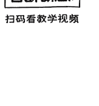
> **提问**
> 主题：逃避心理
> 框架：引言、主体部分（定义、特征、案例）与结语
> 核心词：逃避心理、定义、特征、案例
> **ChatGPT**
> 逃避心理：与现实的疏离
> 引言：
> 在人类心理的复杂图谱里，逃避心理是一种常见而深刻的现象。面对压力、挑战与困境时，人们常选择回避以规避不适。然而逃避不仅是一种应对手段，更可能带来长期的负面影响。本文将围绕逃避心理的定义、特征并结合案例进行探讨。
> 主体部分：
> 1. 定义：
> 逃避心理指个体在遭遇压力、不适或挑战时，选择回避、退缩或否定现实的心理状态。短期内或可带来安慰感，却可能阻碍长远成长。
> 2. 特征：
> 逃避心理表现明显。一方面会沉溺于虚拟世界或社交媒体来转移注意力；另一方面倾向回避问题，不愿直面生活挑战；还常伴随责任推脱，使个体陷入被动。
> 3. 案例：
> 以职场情境为例，某员工面对工作压力时频繁请假、推卸任务，而非主动解决。此种回避行为不仅阻碍自身发展，也对团队氛围产生负面影响。
> 结论：
> 逃避心理虽能短暂缓解不适，却是一种回避现实的机制，长期来看不利于个人成长。了解其定义与特征并通过案例分析，有助于更积极地应对挑战，把握成长机会。

通过精细设计指令内容，能够更好地激发 ChatGPT 的创造力，提升生成质量。实际使用中，可根据不同场景灵活调整指令细节，以达到最佳效果。

#### 021 语言类型的选择

自然语言即人类日常交流使用的口语与书面语，与计算机语言不同，它易于理解；而计算机语言是专为机器交互设计的，一般人难以读懂。

在 ChatGPT 中，尽量采用自然语言撰写指令，避免使用过于生僻或专业的表达。模型基于自然语言处理，使用自然语言的指令有助于 AI 更准确理解需求，并生成流畅自然的回复。下面以奶茶制作为例说明。

> **提问**
> 如何自制一杯奶茶？
> **ChatGPT**
> 奶茶的制作方法多样，这里提供一种基础配方，可根据口味自行调整。
> 材料：
> 1. 红茶，如阿萨姆、锡兰等：2茶匙，可依口味增减
> 2. 水：1杯
> 3. 牛奶：1/2杯，亦可选用豆奶、椰奶等植物奶
> 4. 糖：适量
> 5. 香料可选：姜片、肉桂棒、丁香等
> 制作步骤：
> 1. 沸水冲泡茶叶：水煮沸后放入茶叶，用茶袋或茶壶冲泡。
> 2. 调制奶底：另起锅加热牛奶，可加入香料增香。
> 3. 混合茶水与奶底：将茶水与热奶混合，用滤网过滤茶叶与香料。
> 4. 加糖调味：按个人口味加入糖并搅拌均匀。
> 5. 享用：将奶茶倒入杯中，可撒点茶叶或肉桂粉装饰。
> 口味可加入冰块、椰浆、红糖等变化出更多风味。希望你喜欢这款简易奶茶的做法！

#### 022 示例和引导的作用

指令中加入示例或引导，有助于模型更好地理解需求。例如提供相关话题、关键词或场景描述，下文通过案例说明。

**提问**
请将一段文字扩写为一篇300字以内的小故事，使内容更丰满。原文：当小江睁眼，发现自己站在一座冰桥上，一群雪人向他走来：

**ChatGPT**
小江缓缓睁眼，发现置身于梦幻般的境地。他立于一座晶莹的冰桥之上，桥面如镜，倒映着天际流动的极光。空气里飘着清新的松针香，仿佛进入冰雪仙境。

忽然，他看见一群雪人从远处雪原欢快走来。雪人们身上的雪花闪烁水晶光泽，像活灵活现的精灵，眼中透着善意，微笑迎向小江，仿佛早已等候。

小江惊喜地迎上去，雪人们用柔软的雪手轻拍他的肩膀，传递温暖的力量。他们围着他跳起舞来，雪花在空中飞旋，形成美丽的雪舞。

在雪人的引领下，小江来到一座巨大的雪堡前。堡内温暖明亮，冰晶灯光璀璨。雪人们请他品尝由雪花糖果制成的甜点，甜蜜滋味令人陶醉。

雪人们讲述了自己的来历：由冰雪精灵赋予生命，守护这片神秘的冰雪王国。小江在他们的陪伴下度过一段充满奇迹与欢笑的时光，深刻体会到友谊与美好总会不期而遇，雪人成了他在冰雪世界里最亲密的伙伴。

#### 023 问题形式的使用

可采用问题的形式提出希望 AI 回应或讨论的内容，如“什么是机器学习及其应用领域”。问题应具体明确，避免过于宽泛。还可使用“如何”“为什么”“什么”等提问词构建指令，下文举例说明。

**提问**
榫卯结构如此稳固，为何现代工业未实现大规模推广？

**ChatGPT**
榫卯结构是一种古老的木工技法，通过榫头插入卯眼实现连接，稳固性极佳。但在现代工业中并未广泛应用，主要原因有：
1. 成本与效率：榫卯多需手工操作与专业技能，相较螺栓等现代连接方式，耗时耗力，在大规模生产中成本劣势明显。
2. 标准化与模块化：现代制造依赖标准化和模块化设计，便于快速组装，而榫卯往往需要定制化加工，适配性不足。
3. 材料多样化：现代工业除木材外，还广泛使用金属、塑料等新材料，榫卯对这些材料适用性有限。
4. 设计需求变化：当代结构对抗震、承载等性能要求更高，部分现代连接方式更易满足。
尽管如此，榫卯在传统木工和艺术领域仍有价值，也常被与新材料工艺结合，创造出兼具传统与现代感的作品。

# 第 2 章 13 种指令优化技巧，获得有效答案

以问题形式撰写指令的相关技巧如下。

- 将问题拆分为多个子问题，每次聚焦一个具体点，再根据回答追问，使主题更清晰。
- 在提问时提供充足的背景与上下文，帮助模型理解意图，可先简述背景再提问。
- 利用上轮回答中的信息进行深入追问，让对话不断加深。
- 采用不同表述方式提问，对比回答质量。
- 用一系列相关问题探索同一主题。
- 若回答未达预期，可重新表述问题以获得更好结果。
- 提出半开放式问题，避免只能得到 yes/no 的回答，引导模型给出更完整的阐述。
- 遵循由浅入深的顺序，先从基础问题入手再深入细节，避免一次提出过多问题。

#### 024 具体细节和信息的提供

在指令中提供具体、详细的细节和信息，能帮助 AI 更准确理解需求，从而生成更精准的回复，下文通过案例说明。

**提问**
你是一名出行穿搭顾问，需根据我提供的信息推荐今日搭配。建议须与以下信息相符：
- 【天气】：晴天
- 【交通】：地铁
- 【目的地】：公园
- 【行程】：与男友约会
**ChatGPT**
基于你提供的信息，我为你规划一套今日搭配建议：
穿搭建议：
1. 上衣：选择清爽短袖或衬衫，色调明快如浅蓝、粉红或白色，既应付晴天温暖，也显得轻松愉悦。
2. 下装：搭配舒适牛仔裤或休闲裤，便于地铁通勤且保持休闲感，颜色可选深蓝或中灰，与上衣呼应。
3. 鞋履：舒适休闲鞋适合公园漫步，也方便搭乘地铁，可选白色或亮色系，与上装协调。
4. 外套：晴天无需厚重，可备一件轻薄针织衫或夹克防突变，颜色与上衣相近。
5. 配饰：可佩戴简约手表、项链或耳环点缀造型。
6. 包袋：选择轻便小包，携带必需品不显累赘。
整体搭配契合晴天气候，适合地铁出行与公园约会，祝你约会愉快！

关于在指令中补充细节的建议：
- 场景类指令可描述人物身份、时间等信息。
- 提供已知相关信息有助于模型把握意图。
- 避免加入与请求无关的细节，以免干扰理解。
- 根据模型回答补充更多细节，使对话层层递进。

#### 025 输出格式的指定

用户可以指定 ChatGPT 的输出格式，如列表呈现、限定字数等，以获得更易阅读的回复，下文举例说明。

**提问**
你是一名自然语言处理专家，请从以下内容中抽取所有名词并以列表形式呈现。内容：
当我走进图书馆时，被书架上的各类书籍深深吸引，那里有关于历史、科学、文学和艺术的丰富藏书。我忍不住走向小说书架，捧起一本经典文学作品，沉浸在作者构建的世界里。图书馆弥漫着知识与想象的氛围，每本书都是一扇通向不同世界的门。
**ChatGPT**
名词列表：
1. 图书馆
2. 书架
3. 书籍
4. 历史
5. 科学
6. 文学
7. 艺术
8. 小说
9. 经典
10. 文学作品
11. 作者
12. 世界
13. 知识
14. 想象
15. 氛围

指定输出格式时的技巧：
- 明确说明所需格式，如“请以列表形式作答”。
- 指定段落结构，如“首段简要总结，后续段落展开论述”。
- 限制长度，如“请用不超过500字概述”“请用1-2句话说明”。
- 指定语气与风格，如“请用通俗易懂的语言解释”。
- 突出重点，如“请用粗体标出主要观点”。
- 要求举例或配图，如“请提供2-3个例子佐证观点”。
- 指定语言，如“请用简洁英语回答”。
- 要求对比，如“先阐述A观点，再对比B的不同看法”。
- 提供格式样例，要求模型仿照生成。

#### 026 提供上下文信息的作用

在指令中提供充足的上下文，能帮助 AI 理解意图并生成准确内容，下文举例说明。

**提问**
请用中文撰写一篇关于充足睡眠的短文，需包含以下要点。
标题：充足睡眠，活力满满
第一段：介绍当今社会普遍存在的睡眠不足问题，引出充足睡眠的重要性
第二段：阐述睡眠的生理作用，如维持健康、增强免疫、促进身心平衡、调节情绪、缓解压力等
第三段：举例说明睡眠不足的危害
第四段：介绍养成良好睡眠习惯的方法
第五段：结论，强调充足睡眠的重要性，呼吁养成良好习惯
请保持文章通顺，篇幅约500字，使用简明通俗语言。
**ChatGPT**
充足睡眠，活力满满
当今社会，睡眠不足已成普遍现象。繁忙工作、学业压力与夜间娱乐，让许多人的睡眠时间被压缩。然而充足的睡眠对身心健康至关重要。
睡眠在维持身体健康中发挥关键作用。充足的睡眠有助于新陈代谢正常运行，保持生理功能平衡。同时能增强免疫力，提升抵御疾病的能力。
睡眠还能调节情绪、促进身心平衡。良好的睡眠习惯有助于稳定情绪，减轻焦虑与压力，使人更从容应对生活的挑战。睡眠既是身体休憩，也是心灵慰藉。
以小明为例，他为赶工作频繁熬夜，睡眠时间持续减少，精神状态下滑，工作效率下降，还常感疲劳焦虑，抵抗力减弱频发疾病。这说明长期睡眠不足会带来负面影响。
养成良好睡眠习惯的方法：保持规律作息，固定就寝时间；营造安静、舒适、黑暗的睡眠环境；睡前避免摄入咖啡因与糖分；培养放松睡前仪式，如听轻音乐、阅读轻松书籍，有助于缓解紧张。
总之，充足睡眠是保持健康与心理平衡的重要基础。通过良好习惯，我们能更好地迎接每一天。愿大家重视睡眠，从现在开始培养健康作息，让生活充满活力与笑容。

此外，还应注意指令的逻辑性与连贯性。合理的指令能确保生成的内容结构清晰、段落连贯，提升可读性与吸引力。

编写指令时可采用以下方法帮助 AI 理解并生成连贯内容：
- 开头简要描述文章主题与背景，明确写作意图。
- 用提纲预先规划全文结构，列出各段落要点并提供背景提示。
- 使用过渡词连接段落，如“首先”“其次”等，提升流畅度。
- 提供关键词，引导模型展开相关概念与细节。
- 如有需要，可提供实际案例或数据供引用，增强说服力。
- 结尾简要概括全文核心观点，完成结构闭环。

### ★ 专家提醒 ★
写好指令后，建议进行测试与调整。多次输入指令观察模型输出是否符合预期，从而判断是否需要优化指令。

#### 027 使用肯定语言的作用
在指令中使用肯定表述，能为 ChatGPT 提供积极的起始信号，从而更易生成符合要求的结果，下文举例说明。

**提问**
请你推荐几部你很喜欢且评价极高的动漫电影，并简要描述每部影片的梗概与亮点，让人产生观影期待。请至少列出3部。

**高分动画电影三选**

可以的！下面为你挑选了三部口碑极佳的动画电影，并简要说明了剧情梗概和观赏亮点：

1. 《千与千寻》
   - 剧情概要：宫崎骏执导，小女孩千寻误入一个神秘灵异世界后，必须在光怪陆离又危机四伏的环境里寻找被变成猪的父母，并与各式各样奇异的精灵生物相处。
   - 亮点：观众高度认可千寻的成长轨迹、对友情与爱的理解，影片凭借丰富的想象力和极具辨识度的视觉奇观获得好评，同时在奇幻表象下探讨了人性、成长与勇气等主题。

2. 《你的名字》
   - 剧情概要：新海诚执导，一名高中男生与一名高中女生在梦中不期而遇，互换身体并试图弄清原因。随着故事推进，两人卷入跨越时空与命运的浪漫纠葛。
   - 亮点：精致细腻的画面、饱满的情感表达和紧凑走心的叙事受到赞誉，观众尤其喜欢影片对时空错位、红线牵引、爱情与命运等命题的深刻呈现。

3. 《风之谷》
   - 剧情概要：宫崎骏执导，故事发生在末世之后，公主娜乌西卡为守护家园踏上旅程，过程中逐步揭示人类与自然之间微妙而复杂的关联。
   - 亮点：引人入胜的情节和立体的人物塑造是观众喜爱的原因，宫崎骏构建的奇幻世界观以及对自然环境的深切关注也让本片备受称道。

这三部作品在动画领域都享有盛名，相信你会喜欢。

用肯定语气激活更积极的回应

用正确的肯定语气撰写指令，能最大化激发AI的正面回应并提高指令执行效果，具体做法如下：

- 选用积极的措辞，比如“请”“建议”，少用“不要”“避免”等否定表达。
- 体现对AI能力的信任与期待，例如“相信你能给出最佳建议”。
- 使用温暖友好的语言，如“非常感谢”“十分赞赏”，营造轻松氛围。
- 避免命令式口吻，改用请求式的表达方式提问。
- 用正向描述来界定需求，比如“精彩的点子”“最有见地的分析”。
- 在指令中表达输出的积极价值，例如“这些建议执行后会很实用”。
- 采用肯定式提问，如“怎样才能……”，而非“为何无法……”的否定句式。
- 在指令里营造积极向上的情境与人物关系。
- 提出有意义、目标明确的正面请求，避免无意义或负面要求。

#### 028 角色身份的假设

使用者设定一个明确的角色身份来提问，能为ChatGPT提供更清晰的情境，下面以案例说明。

**提问**

我是一位母亲，孩子12岁，性格偏内向，在家容易感到无聊。请根据以下要求为她推荐几种在家放松的娱乐活动。

要求：活动需具有积极意义；难度适中，可独立完成；最好居家进行；除放松外，最好还能学到知识或技能。

**ChatGPT**

针对你12岁的内向女儿，以下是几项居家进行、兼具放松与成长价值的建议：

1. 手工与绘画：
   尝试折纸、手工卡片制作、素描绘画等，有助培养创造力和手眼协调能力。
2. 烹饪与烘焙：
   一起做简单的成品，既有趣味性，又能锻炼独立生活能力和食物知识。
3. 阅读：
   培养阅读习惯，选择适合年龄的小说、科普或漫画，放松的同时拓展视野。
4. 音乐学习：
   若对音乐感兴趣，可学习乐器或参加线上课程，有助于提升耐心与自律。
5. 编程与科技：
   接触基础编程，学习制作简易程序，增强逻辑思维与问题解决能力。
6. 居家户外：
   在阳台或花园种植、观星、观察鸟类等，与自然互动并学习生态知识。
7. 语言学习：
   利用在线资源学习一门新语言，增加挑战感，提升语言与跨文化理解。
8. 瑜伽与冥想：
   练习简易瑜伽或冥想动作，促进身心健康，学会自我调节。

这些活动均可在家中完成，能培养兴趣与能力，同时提供积极的放松方式。

注意角色设定要具体明确，如学生、医生、客户等，避免过于宽泛。背景情境也需描述充分，帮助AI更好理解角色需求，并用第一人称表达请求，增强代入感。

#### 029 具体数字的指定

提问时在指令中明确指定数量，能让答案更精准可控，下面以案例说明。

**提问**

为菠萝炒饭制作教程短视频写10个标题；

**ChatGPT**

1. “独家配方公开，一分钟做出菠萝炒饭！”
2. “餐桌新宠！超香菠萝炒饭，轻松在家挑战美味！”
3. “惊艳味蕾！教你做香气四溢的菠萝炒饭，舌尖狂欢！”
4. “味蕾探险之旅！不一样的菠萝炒饭做法，惊喜满分！”
5. “异国风情入味，菠萝炒饭在家也能成大厨！”
6. “秘制做法速学上手，做出口感绝佳的菠萝炒饭！”
7. “新手也能做！香喷喷菠萝炒饭，厨房弥漫好香！”
8. “口味极限挑战！创意菠萝炒饭瞬间征服味蕾！”
9. “美食即艺术，手把手教你做精致菠萝炒饭，餐桌焕新！”
10. “夏日清新一碗饭，菠萝炒饭解暑美味，教程超简单！”

## 第 3 章 11 种高效提问技巧，让 AI 生成高质量文案

**本章要点：**

文案质量与提问方式密切相关，掌握高效提问方法，包括引导优化回复的技巧与常用固定指令，能显著提升输出质量。

### 3.1 8 种引导 ChatGPT 优化回复的技巧

ChatGPT擅长基于上下文连续回复，当初次结果不满意时，可通过以下方法引导其生成更高效、更贴合预期的内容。

#### 030 提供关键信息的作用

AI依据指令生成内容，指令越准确具体，回复越满意。因此在提问时需抓住核心和重点，并融入指令中。

例如，需要一篇职场推文，不能只说“请写一篇职场推文”，而应说明主题、受众、字数等关键要素。下面示范如何通过补充关键信息引导回复。

> **提问**
> 请为职场新人写一篇约300字的推文，主题是向上级汇报工作的注意事项：

> **ChatGPT**
> 标题：职场新人必读！向上级汇报工作的三大要点

> 进入职场后，向上级汇报是必备技能。记住以下几点，能让汇报更清晰、更获认可。

> 1. 简明扼要：
> 上级时间有限，汇报要直击要点。说明工作进展、遇到的问题及应对方案，避免冗余描述，让上级快速掌握情况。
> 2. 突出关键数据：
> 用数据说话。列出完成任务数、目标达成率等，直观展示成果，便于上级评估表现。
> 3. 保持主动沟通：
> 不要只等定期汇报。及时同步进展与挑战并寻求反馈，能建立信任并提升效率。

> 做好汇报就是展示价值的机会，掌握这些技巧能在职场中更快脱颖而出。#职场新人 #工作汇报 #职业发展

可见，补充受众、主题、字数等关键信息后，AI能输出要点清晰、干货充足的推文。

#### 031 循序渐进的提问方式

ChatGPT擅长承接上下文，用户可像与人对话一样逐步追问，使答案更贴近预期。下面以案例说明。

步骤01 在输入框发送指令，得到初次回复。

提问

创作古风言情小说前需要做哪些准备：

ChatGPT

创作古风言情小说需做好以下准备：

1. 熟悉古代背景与历史：了解所选朝代的社会、文化、风俗、服饰、建筑与制度，保证背景真实。
2. 深入塑造人物：为男女主及配角设定性格、经历、目标与内心，使人物立体。
3. 研读古代文学：阅读经典古风作品，学习其语言风格与叙事方式。
4. 构建一致世界观：若为虚构世界，需明确地理、政治、宗教等设定，形成有机整体。
5. 制定故事大纲：梳理主要情节、转折与人物成长轨迹，避免写作迷失。
6. 保持语言统一：古风小说用词讲究，句式与修辞需贯穿全文，增强氛围。
7. 注重细腻描写：环境与情感描写需细腻，营造古代情境。
8. 审慎处理爱情线：符合时代道德观念，避免过度现代或不合时宜的情节。

准备充分后即可开始创作，保持耐心与灵感。

步骤02 在同一对话中继续追问。

> 提问
> 如何构建合理的世界观：

> ChatGPT
> 构建世界观是古风创作的关键，建议如下：
> 1. 确定时空背景：明确朝代与历史事件对故事的影响。
> 2. 深入研究历史文化：政治结构、社会等级、宗教信仰、科技水平等细节。
> 3. 描绘地理环境：地形、气候、资源塑造各地区特色，影响生活方式。
> 4. 建立宗教体系：信仰常深刻影响文化与行为。
> 5. 制定社会结构：界定统治者、贵族、平民等阶层关系与生活条件。
> 6. 创造语言与文学：虚构文明可设独特语言与文学传统，增强真实感。
> 7. 思考经济体系：贸易、农业、手工业等决定人物生存方式与冲突。
> 8. 考虑外部势力：不同国家或文明的互动可能推动剧情。

> 保持逻辑一致，逐步揭示细节而非一次性堆砌，能让读者自然沉浸。

步骤03 继续追问细节。

提问

如何处理言情元素：

ChatGPT

处理言情需在尊重古代背景的同时传递深情，建议：

1. 尊重时代背景：情感表达需符合当时社会观念，避免过度现代。
2. 刻画人物性格：通过性格与动机让感情更真实可信。
3. 使用古风语言：对白与描写采用古代修辞与词汇。
4. 强调心理描写：通过内心独白展现情感与挣扎。
5. 制造障碍冲突：社会阻力、家族矛盾等让感情更曲折。
6. 约束亲密场面：注重氛围与情感而非细节描写。
7. 塑造复杂关系：误会、矛盾与和解丰富情节。
8. 追求真实共鸣：人性与情感恒久共鸣。

平衡古代文化与现代读者期待，让爱情在古风语境中自然流露。

由此可见，循序渐进的追问能让AI给出更细致的解答。

#### 032 鼓励式引导的作用

鼓励式引导指用积极的提问方式促使AI提供更完整、更具创意的回复。适用于开放性问题，可用“让我们思考一下……”“还有什么别的想法吗”等句式。下面示范。

步骤01 发送指令请求创意。

提问

让我们思考一下：为元宵节策划公众号推文有哪些创意方向：

ChatGPT

结合传统与当下，可从以下角度策划：

1. 传统文化科普：介绍起源、汤圆、灯谜等，图文并茂。
2. 美食推荐：各地特色元宵美食及制作方法，附食谱或视频。
3. DIY手工：灯笼、花灯制作教程，鼓励读者晒作品互动。
4. 活动地推荐：庙会、花灯展信息，方便读者参与。
5. 习俗与信仰：各地舞狮舞龙、祈福等差异。
6. 摄影大赛：征集元宵主题照片，设置奖品。
7. 祝福语征集：收集传统或创意祝福，精选展示。
8. 谜语互动：发布谜语，隔期公布答案。
9. 音乐推荐：传统与现代元宵氛围音乐。
10. 海外庆祝方式：介绍不同文化的庆祝差异。

善用图文视频投票等形式提升趣味与传播，记得及时回复评论。

步骤02 继续追问拓展。

> 提问
> 这些思路很有启发，还有别的想法吗：

> ChatGPT
> 当然，以下是更多方向：
> 11. 微小说或诗歌征集：以元宵为主题创作短篇文学。
> 12. 民俗文化短视频：动画讲解吃汤圆、赏花灯的原因。
> 13. 环保倡议：分享可降解材料做花灯、减少污染的方法。
> 14. 健康食谱：低糖低脂汤圆做法，附营养解析。
> 15. 影视推荐：与元宵相关电影、纪录片清单。
> 16. 手绘插画征集：展示读者绘画才华。
> 17. 特色商家推荐：联名优惠，带动体验。
> 18. 数字艺术结合：GIF、短视频呈现传统与科技融合。
> 19. 元宵节慈善活动：

策划元宵主题内容可以从公益角度切入，比如发起一次元宵节慈善募捐，用募集到的资金为偏远山区的孩子提供学习支持，或是为某个绿色环保计划筹集经费。

20. 元宵出游参考指南：可以汇总假期可行的出行方案，筛选出适合这个季节游览的城市和景区，并介绍当地的灯会、传统庆典以及别具特色的参与体验。

落地方案的选择要始终对照公众号的定位和粉丝兴趣来打磨，强化创意点子和互动玩法，让读者在阅读和互动中真切体会到元宵节的独特魅力。

#### 033 多选项提问的价值
当想让模型输出更贴合需求时，可以一次性列出几个备选方向，让模型从中挑选并展开说明，相当于给模型出一道选择题。接下来用一个例子演示具体做法。

> 提问
我喜欢阅读冒险小说，尤其喜欢充满奇妙幻想的故事。请从以下书籍中选出符合我兴趣的书，并说明原因：
书籍有：1.《海底两万里》；2.《飘》；3.《红与黑》；4.《罗密欧与朱丽叶》

ChatGPT
结合你描述的偏好，《海底两万里》最匹配。理由如下：

1. 冒险内核：《海底两万里》是法国作家儒尔·凡尔纳的科幻探险代表作，情节围绕19世纪潜艇“鹦鹉螺号”的远航展开，全程充满探险张力。
2. 奇幻设定：作品描绘了未知的深海世界和多种奇异生物，想象空间很大，读来十分惊奇。
3. 科学想象：凡尔纳在科学设想上极具前瞻性，小说里对技术与概念的描写让虚构的旅程更具吸引力。

《飘》《红与黑》《罗密欧与朱丽叶》固然是经典，但侧重的是社会、情感与人物描写，在冒险和幻想的比重上相对逊色。

#### 034 归纳式提问如何提升逻辑性
归纳式提问就是把性质相近的问题归类整理后一次性抛给模型。这种方式目标明确，能引导出更有指向性的回答，同时涉及分类、概括的思维，能让输出更条理。下面以实例说明。

提问
莫里哀的戏剧有什么特色？对于短剧脚本的创作有哪些启示？

ChatGPT
莫里哀是17世纪法国喜剧大家，作品以辛辣讽刺社会弊端著称。以下为其主要特点及对短剧创作的借鉴：

1. 社会议题讽刺：作品常以幽默手法揭示权力、虚伪、自负等人性弱点，让观众在笑声中反思。
2. 人物塑造鲜明：通过夸张与戏仿塑造出极具代表性的喜剧人物，易引发共鸣。
3. 对白精巧：台词机智幽默，擅长双关与讽刺，可启发短剧创作者注重语言设计。
4. 结构清晰：多数采用五幕式，具备引子、发展、高潮等环节，短剧可借鉴其节奏控制。
5. 深层思考：外表是喜剧，内核是对人性的探讨，短剧亦可在轻快形式下承载思考。

创作短剧时可借鉴其讽刺意识、生动人物、巧妙对白，并在有限时长内提炼结构，使作品既有趣又耐品。

#### 035 设定约束获取精准文案
约束性提问适用于有固定框架的文案需求。提前明确格式、字数和语气，能让输出更精准。下面以邀请函为例。

提问
请帮我按以下框架写一份活动邀请函，要求300字左右，内容清晰、简洁，语气亲切、友好：
标题
导语
活动信息：活动将于2024年9月14日在××会展中心举行，活动时间为一天
活动内容：参观服装定制流程、体验服装设计、高档定制品展示、活动专享定制优惠
特邀嘉宾：国际服装设计大师××，将亲临现场首次展示她的秋季新款设计。
报名方式：通过官方网站或客服进行报名。
结语

## 标题：秋日定制之约，邀您共赴时尚盛宴！
导语：
亲爱的朋友们，
秋风初起，时尚新章开启。我们诚邀您参加“精彩定制之旅”，走进服装设计的奇妙空间，感受个性与品味的融合。

活动信息：
日期：2024年9月14日
地点：××会展中心
时长：全天

活动内容：
- 1. 探访服装定制全流程，近距离感受制衣匠人的手艺。
- 2. 现场体验服装设计，发挥创意定制专属单品。
- 3. 高端定制作品展，欣赏顶尖设计师的佳作。
- 4. 活动专属优惠，现场下单还能获赠精美礼品。

特邀嘉宾：
国际服装设计大师××将亲临现场，首度发布秋季新款，是一场不容错过的视觉体验。

报名方式：
可通过官网 www.xxx.com 或客服热线 ×××-××××××× 预约，名额有限请尽早登记。

结语：
秋日时尚相约，期待与您一同开启精彩定制之旅，在定制的世界里追寻个人风格。诚邀莅临！

诚挚邀请，
[您的名字/活动主办方名称]

#### 036 循环追问优化答案

当对模型的回复不够满意时，可以采用附加条件循环提问，在已有结果上逐步追问，直至接近预期。这种方式能持续挖掘模型的优化空间。下面以写诗为例。

步骤01 输入指令让模型创作，指令与回复如下。
> 提问
请创作一首主题为小雪的五言诗：
> ChatGPT
瑞雪初飘舞，寒梅傲立枝。
银装素地新，冬韵小雪诗。

步骤02 在同一对话中继续追问，要求更有新意和情感并解释。
> 提问
请给出更好的方案，要求多一些新意和感情，并给予解释：
> ChatGPT
悄然小雪临，轻抚窗前心。
银翎舞空际，寒梦悄无声。
这首诗用“悄然小雪临”写出降雪的静谧，“轻抚窗前心”将雪的轻柔与人的心境相连，营造冬日温情。“银翎舞空际”把雪花比作银色羽毛，画面灵动。“寒梦悄无声”以冷与梦结合，突出雪的轻盈寂静。整体传递出宁静温暖的美感。

步骤03 再次追问，要求更具哲理。
> 提问
请给出更好的方案，要求比前面的诗更富有哲理，并给予解释：
> ChatGPT
微寒小雪降，寂静心境生。
银芒舞空寰，自然法则情。
“微寒小雪降”既写景也喻人生细微变化，“寂静心境生”将雪景与内心境界关联，强调宁静中生发的体会。“银芒舞空寰”用抽象意象拓展画面，“自然法则情”点出自然规律对生命情感的塑造。整首诗借雪引发对时间与自然的思考。

步骤04 再次追问，要求更具画面感和诗意。
> 提问
请给出更好的方案，要求比前面的诗更富有画面感和诗意，并给予解释：
> ChatGPT
窗外小雪飘，轻舞梦幻袖。
银丝织素影，寒韵宛如诗。
“窗外小雪飘”拉近场景感，“轻舞梦幻袖”以梦幻意象描绘舞姿。“银丝织素影”用丝线与织影兼顾雪的晶莹与形态，“寒韵宛如诗”赋予冷艳气质诗意。整体描写细腻，画面感强。

#### 037 多维度综合提问技巧
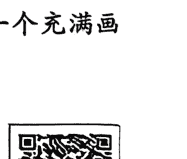
综合多维度提问能获得更全面深入的分析。例如同时从情节、人物、主题评价一部作品，会得到更清晰的结论。下面以《绿野仙踪》为例。

步骤01 评价情节特点。
> 提问
《绿野仙踪》的情节有什么特点：
> ChatGPT
《绿野仙踪》是弗兰克·鲍姆1900年创作的童话。情节要点如下：
- 1. 主线：女孩多萝西被龙卷风带到奥兹国，渴望回家，于是寻找奥兹魔法师求助。
- 2. 旅伴：途中结识稻草人、铁皮人、胆怯狮子和小狗托托，形成冒险团队。
- 3. 奇异地域：穿越艾默城等各具特色的地区，每个地方都有独特风貌。
- 4. 魔法元素：幻术、奇迹贯穿全程，增强奇幻色彩。
- 5. 教育意义：角色追求智慧、勇气、爱等品质，具有品德教育作用。
- 6. 主题：强调希望与归属，家是心灵归宿。
总体是奇幻冒险兼具寓意的经典童话。

步骤02 评价人物魅力。
> 提问
小说中的主要人物有什么独特魅力：
> ChatGPT
- 1. 多萝西：勇敢善良，对家强烈渴望，易引发共鸣。
- 2. 稻草人：无脑却智慧，代表对知识的追求。
- 3. 铁皮人：由伐木工变成，象征情感与同情。
- 4. 胆怯狮子：外表强壮却缺勇气，体现自我发现。
- 5. 奥兹：外表强大实则平凡，揭示外貌与实质差异。
人物特质鲜明，推动故事深度。

步骤03 探讨主题思想。
> 提问
小说蕴含了怎样的主题思想：
> ChatGPT
- 1. 家与归属：多萝西的归家渴望突出家的重要性。
- 2. 勇气、智慧、情感：三大品质由不同角色体现。
- 3. 外表与实质：奥兹的形象揭示真假差异。
- 4. 自我发现：角色在旅程中认识自身价值。
- 5. 奇迹与想象：奇幻元素传递希望力量。
- 6. 友谊与合作：团队协作克服困难。
作品兼具冒险与人生哲理。

### 3.2 固定指令三种用法

#### 038 角色设定指令示例

需要指定风格或属性时，可用“你的角色【专业领域】+你的能力【成果期待】+我希望你【任务需求】”的固定指令。下面举例。

> 提问
你的角色是编剧，你拥有丰富的想象力和创作能力，能够创作出设定新奇、情节新颖的剧本。现在我希望你创作一个科幻剧的剧本，要求故事设定有创意和吸引力，能够受到年轻人的喜爱：
> ChatGPT
剧本标题：《星辰之梦》
## 第一集：觉醒的时刻
### 场景一：未来的地球
未来地球资源枯竭，人类寻找新家园，科学家发现神秘星球“星辰之梦”。
### 场景二：登陆星辰之梦
超空间飞船载着年轻探险队抵达，星球充满奇异生物与未知科技，主角生物学家艾丽亚率队探索。
### 场景三：星球的秘密
深处发现古文明遗迹，保存可重塑生命的技术，能推动生物进化甚至改变人类。

## 第二集：星辰的力量
### 场景一：生命的进化
团队利用技术让本地生物进化，出现操控元素、与人类心灵交流等能力，世界充满魔幻色彩。
### 场景二：力量的诱惑
有人欲将力量带回地球，引发权力争夺，艾丽亚在保护星球与分享力量间抉择。

## 第三集：星辰的传承
### 场景一：决战之际
艾丽亚联合星球生物对抗贪婪人类，寻找平衡方案。
### 场景二：和解与希望
最终达成共存之道，艾丽亚成为守护者，带领新一代守护这片星球。

## 结局：星辰之梦的传奇
人类与星球建立新联系，地球逐渐复苏，星辰之梦因人类到来更显绚烂，故事传递探索、敬畏与和平，深受年轻人喜爱。

#### 039 专业回复指令的使用

ChatGPT 的使用范围在不断扩大，用户基数也在持续增长，对应地，大家对模型输出专业性的要求也越来越高。真正能提升效率的，是把“给出背景+明确需求+套用专家框架或方法论”这套提问思路固化下来。下面就用一个具体例子来说明。

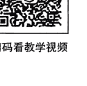

> **提问**
请参照《奥格威谈广告》（Ogilvy on Advertising）书中的核心理念，为雪地靴创作10条广告文案，并逐条说明与书中原则的契合点：

> **ChatGPT**
《奥格威谈广告》反复强调品牌鲜明定位、信息清晰传达、触动用户情绪等要义。以下10条雪地靴文案即围绕这些要义展开：

- 1. 品牌定位：
“穿上【品牌】雪地靴，温暖从脚底开始，迎接整个冬天。”
这条文案把【品牌】与冬季保暖的解决方案绑定，塑造清晰的品牌心智。

- 2. 独特卖点：
“经典剪裁，极致舒适。【品牌】雪地靴，以差异化风格为步伐增添个性。”
突出设计的独特性，强调品牌的个性化价值。

- 3. 用户体验：
“在白雪覆盖的世界里，【品牌】雪地靴让你行走自如，轻松应对严寒。”
聚焦真实使用感受，强调极端环境下的舒适体验。

- 4. 社会责任：
“为地球负责，选可持续的【品牌】雪地靴。用一次购买，为绿色未来贡献力量。”
呼应现代消费者对可持续发展的关注，体现品牌责任感。

- 5. 情感共鸣：
“雪地靴不只是鞋，更是你穿越每一片冰雪的伙伴。选【品牌】，选温暖，选陪伴。”
用情感化表达建立使用者的共鸣。

- 6. 品质保证：
“每一双【品牌】雪地靴都经过严格质检，提供卓越保暖与耐用性，让冰雪天气依然舒适。”
点明品质承诺，契合奥格威“品质是长期成功的关键”的观点。

- 7. 巧妙运用图片：
（配图：雪地靴在极端天气下的实拍场景）
“图片胜过千言万语。【品牌】雪地靴，让你在雪地上自由起舞。”
借助场景图直观传递产品功能与使用感。

- 8. 特价促销：
“冬日严寒，钜惠来袭。即刻入手【品牌】雪地靴，限时特价，保暖从脚底起。”
结合促销信息制造行动冲动，符合奥格威倡导的明确行动号召。

- 9. 明确的市场定位：
“无论雪中漫步还是冰雪运动，【品牌】雪地靴都是你的首选。我们专注让冬天更出彩。”
通过精准定位强化专业形象。

- 10. 口碑推荐：
“数以万计的顾客已选择【品牌】雪地靴，你还在等什么？他们的满意，就是最好的广告。”
以用户口碑建立信任，呼应奥格威对消费者推荐的重视。

整体来看，这些文案都围绕品牌定位、差异化卖点、体验感、社会责任、情感共鸣等原则展开，更容易引起目标受众的关注与共鸣。

#### 040 拓宽思路的提问技巧

当需要 ChatGPT 完成创意、项目或策划类任务时，在问题末尾加上“What are some alternative perspectives?（还能从哪些角度切入？）”就能有效拓宽模型的思考广度。下面以竹子为例演示。

> **提问**
描述竹子的特征，What are some alternative perspectives?

> **ChatGPT**
竹子作为一种特殊植物，具备不少显著特质，主要包括：

- 1. 生长迅速：竹子以惊人的生长速率著称，部分品种日增数英寸，是理想的可再生资源。
- 2. 轻盈却坚韧：密度虽低，但抗拉强度很高，因而常被用作建筑材料，尤其在抗震区域。
- 3. 环境友好：生长周期远快于采伐周期，对环境的压力小于传统木材。
- 4. 应用广泛：可用于建筑、家具、手工艺、餐具等多个领域，在许多文化中用途多样。

不过，竹子也存在一些不同视角或挑战：

- 1. 侵入性生长：在部分地区，某些竹种扩张性强，可能改变本地生态，挤压其他植物生存空间。
- 2. 加工门槛：虽原料坚韧，但加工需特殊工艺，才能保证建筑等用途的稳定性和耐久性。
- 2. 质量参差：品种、生长环境、采收时间都会影响品质，有时会影响特定应用的可行性。

这些对立观点说明，竹子虽特性独特，但在实际应用和可持续性上仍需综合权衡多方面因素。

AI写作进阶指南：
AI提问技巧+AI职场公文+AI润色优化+AI高频模板+AI实战案例

# 职场公文实战篇

## 第 4 章

## AI 轻松掌握的 7 大公文格式要点

**本章要点：**
公文格式是公文区别于其他应用文的根本标志，也是权威性与规范性的外在体现，更是掌握公文写作的基础。本章将从基本常识、组成要素和具体要求入手展开讲解。

AI写作进阶指南：
AI提问技巧+AI职场公文+AI润色优化+AI高频模板+AI实战案例

### 4.1 公文格式入门必知

公文是具有特定效能和规范格式的应用文，其格式特征与其他文体明显不同。本节先帮助大家建立对公文格式的初步认知。

#### 041 公文格式的源流

认识公文格式可以追溯到殷商时期，其演变脉络可从历史的关键节点把握，具体如下。

（1）殷商时期：公文最早出现，以甲骨文记录公共事务，如图4-1所示。

图 4-1 甲骨文公文

（2）先秦时期：公文分为典、谟、训、诰、誓、命等六类文种，各自格式各异。

（3）秦朝统一后：公文出现针对不同阶层的专门语体和规范样式。

（4）隋唐时期：对公文名称、用纸、用语、收发、封装等均作出明确规定。

（5）新中国成立后，公文文种不断丰富，2012年国家印发《党政机关公文处理工作条例》，对格式要求和处理流程作出统一规范，该条例沿用至今。

#### 042 公文格式的意义

公文格式存在的价值主要体现在以下几个方面。

##### 1. 彰显权威与效力
公文是法定机构处理公共事务的文书，其权威性、公共性决定了内容必须完整、准确、可执行。规范的格式正是保证其权威与效力的必要形式。

##### 2. 明确行文关系
行文是否准确，关键在于主体与受体的关系是否清晰，即是上级对下级的指示，还是下级向上级的请示。格式要求对发文单位与收文单位进行标注，从而厘清关系，避免混淆。

##### 3. 提升工作效率
公文因办公需要而产生，统一格式可提高处理速度和质量，也便于技术化管理。例如密级标注体现重要程度，发文字号便于归档查阅等。

### 4.2 公文格式的构成要素

一份完整的公文在版式上主要由版头、主体和版记三部分组成，这是国家规定的基本结构。本节对三部分分别说明。

AI写作进阶指南：
AI提问技巧+AI职场公文+AI润色优化+AI高频模板+AI实战案例

#### 043 公文的版头

版头相当于公文的“头部”，位于首页上方约三分之一处，通常以一条红线与主体分隔。版头一般包含份数序号、密级、紧急程度、发文机关标志、发文字号和签发人等要素。

##### 1. 份数序号
份数序号是总印数中本份的顺序编号，多用于涉密公文。标注时用6位、3号阿拉伯数字，顶格写在版心左上角第一行，如000001。
作用在于便于密级公文的核对与清退，也便于控制普发下行文的分发范围。

##### 2. 密级标注
即公文内容的保密程度，通常标注特密、机密、秘密等，并可注明保密期限。书写规范如下。
+ （1）位置：版心左上角第二行顶格书写。
（2）写法：用3号黑体字，期限中的数字用阿拉伯数字。若同时标注密级和期限，可用“-”连接，如机密-20年；只标密级时，两字间空一字。

##### 3. 紧急程度
指传达时限或执行时效。条例规定紧急公文需标注“特急”“加急”，电报另有“特提”“特急”“加急”“平急”。一般用3号黑体字书写在版心左上角。

> ★ 专家提示 ★
版头若需同时标注份数序号、密级和紧急程度，应按份数序号、密级、紧急程度的顺序自上而下分行排列。

##### 4. 发文机关标志
俗称“红头”，常用小标宋体字、红色、居中排列。包含发文机关名称、事由、文种三项，名称为必备项。标注方式有三种。
+ （1）机关全称或规范简称加“文件”二字，如“××省人民政府文件”。
（2）仅用机关全称或规范简称，如“国家发展和改革委员会”。
（3）联合行文时，主办机关排前，“文件”二字置于机关名称右侧，以联署机关为基准上下居中。

字体为小标宋体，颜色红色，位置居中。

##### 5. 发文字号
由发文机关代字、年份、序号组成，用3号仿宋体排在发文机关标志下方空两行处。书写注意点见图4-2所示。

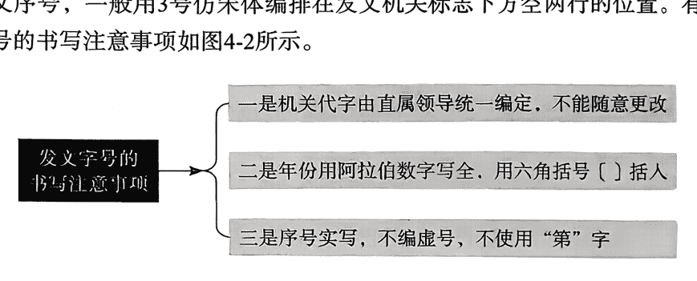

##### 6. 签发人
指发文责任人，一般为单位领导，仅用于上行文。用3号仿宋标注“签发人”字样，姓名用3号楷体，中间以全角冒号分隔。
+ （1）单一签发人时，写在发文机关标志下空两行、居右空一字处。
（2）联合行文时，按机关顺序自左至右、自上而下排列，每行两个姓名，回行与上一行第一个姓名对齐。

AI写作进阶指南：
AI提问技巧+AI职场公文+AI润色优化+AI高频模板+AI实战案例

#### 044 公文的主体

主体相当于公文的“躯干”，是核心内容区，与版头用红线隔开。其组成要素如下。

##### 1. 公文标题
一般用2号小标宋体，写在红线下空两行，居中可分多行。完整格式为“发文机关+事由+文种”，有时可省略机关。见图4-3。
联合行文时，多机关名称用空格分隔，排列整齐。若机关超过4个，可在主办机关后加“等”。见图4-4。

##### 2. 主送机关
即主要收文单位，按公文需要填写。部分公文可不写。用3号仿宋体，位于标题下空1行、左顶格。

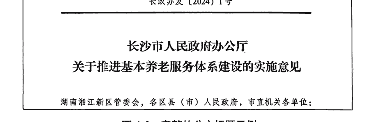
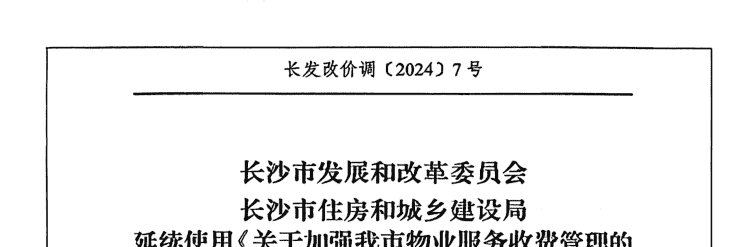
多主送机关时需用全角排列符号分隔，不同层级机关的符号用法见图4-5。

##### 3. 正文内容
正文是公文的核心，也是首页必备部分。用3号仿宋体，在主送机关下方起首，每自然段前空两字，除数字年份外回行顶格。
结构一般为开头、主体、结尾，层次序号依次为“一、”“（一）”“1.”“（1）”。

##### 4. 附件说明
对带附件公文的索引说明。附件是对正文的补充材料，附于正文之后。说明用3号仿宋体，写在正文后空1行、左空两字，格式为“附件：……”。多份附件需加序号。格式要求见图4-6。

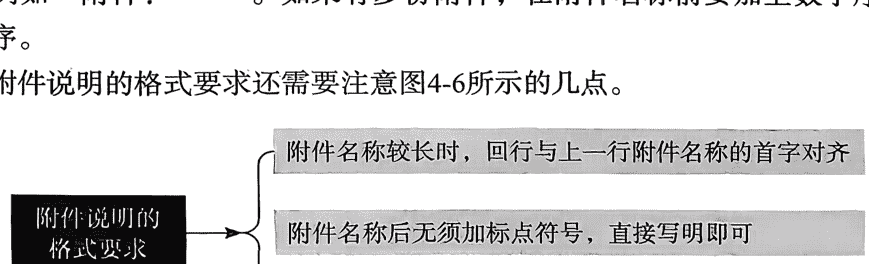

AI写作进阶指南：
AI提问技巧+AI职场公文+AI润色优化+AI高频模板+AI实战案例

##### 5. 公文落款
包括署名、成文日期、印章三项。见图4-7。

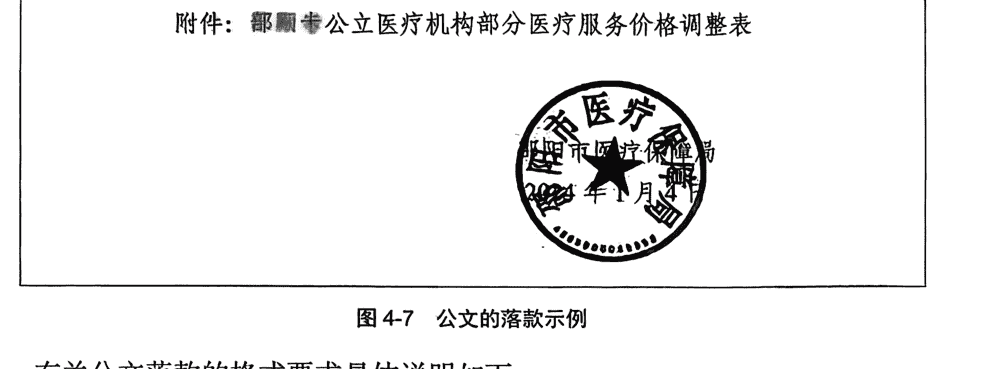
具体要求如下。
+ （1）署名用3号仿宋体，位于正文或附件说明后空1行、居右。联合发文时，多个机关名称上下排列，长短一致。
（2）日期以领导签发日为准，用阿拉伯数字写成“×年×月×日”，置于署名下居右空4字。决议、公报、纪要等日期可置于标题下并加括号。
（3）印章分单位公章和个人签名章两种。
· 单一机关行文：单位公章下压署名和日期居中偏上位置，印章顶部距正文或附件说明不超过1行；个人签名章下压正文或附件说明后空两行、居右空4字，下端距成文日期空1行。
· 联合机关行文：各机关署名与印章按顺序平行排列，印章与署名对应，首排印章距正文或附件说明后1行，每排印章不超出版心，成文日期标注于最后一个印章居中偏下。

★专家提醒★
个人签名章时，各签名章按主办机关签发人在前、其他机关在后的顺序上下排列，每行只放一个签名章，各署名与签名章一一对应。

##### 6. 附注
说明发送、阅办范围等事项。用3号仿宋体，写在成文日期下一行、左空两字，通常用圆括号括起。

##### 7. 附件
附件内容一般在正文另一面首页左上角第一行，用3号黑体顶格写“附件”字样及序号。
附件标题在附件下空两行居中书写，内容格式与正文一致并一并装订。若不能与正文同订，需在附件左上角第一行顶格写发文字号，再写“附件”字样及序号。

#### 045 公文的版记

版记是公文的“脚部”，位于两条分隔线之间，上线隔开主体，下线隔开末页。版记包括抄送机关、印发机关、印发日期。

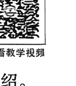

##### 1. 抄送机关
指除主送机关外需知晓的单位。一般用4号仿宋体，写在印发机关和印发日期上1行、左空1字，格式为“抄送：”加机关名称。见图4-8。

特殊情况：
（1）多个抄送机关时，名称间用全角逗号“，”隔开，末尾用全角句号“。”收尾。
（2）主送机关也需抄送时，其格式与抄送机关相同，置于抄送机关之上，两者间不加分隔线。

AI写作进阶指南：
AI提问技巧+AI职场公文+AI润色优化+AI高频模板+AI实战案例

##### 2. 印发机关
即印发公文的单位。用4号仿宋体写在抄送机关之下、末条横线之上、左空1字，名称用全称或规范简称。

##### 3. 印发日期

印发日期落印规范

公文付印的时间也就是印发日期，落款时要把年、月、日都写全，末尾补上“印发”二字。建议采用阿拉伯数字，排版上与发文单位名称置于同一行，靠右对齐并空出一个字的位置。

### 4.3 公文格式的要求

除了掌握公文格式三大核心要素，排版与印装的细节同样要重视，缺一不可才能发出合规文件。部分特殊文种在起草时，对版式也有各自的规定。

#### 046 公文规范的格式要求

规范性主要落在用纸、印装、文字样式、行数与页码等方面，落实这些细则既是公文规范的体现，也是处理工作的必备准备。相关要求适用于各层级党政机关制发文件，具体见表4-1。

表 4-1 公文规范的格式要求

| 主要部分 | 格式要求 |

| :--- | :--- |

| 公文用纸 | （1）用纸规格为 GB/T 148 规定的 A4 型纸，尺寸为 210mm × 297mm； （2）用纸上边距推荐 37mm，左边距推荐 28mm，版心尺寸为 156mm × 255mm（据《党政机关公文处理工作条例》规定） |

| 公文印装 | （1）文字为从左至右横排； （2）当印刷公文时，双面打印，左侧装订 |

| 文字格式 | 一般情况下，公文的文字采用 3 号仿宋体，字体颜色为黑色，特定情况下按需调整 |

| 公文行数 | 一般情况下，公文的内容排版为每行排 28 个字、每面排 22 行，特定情况下可以进行适当调整 |

| 公文页码 | （1）页码用 4 号宋体阿拉伯数字标注在版心下边缘的下一行处； （2）表示页码的数字左右各有一条一字线，一字线位于版心下边沿之上 7mm 的位置； （3）奇数页码居右空 1 个字，偶数页码居左空 1 个字； （4）页码标注至正文内容结束的那一面，空白页和版记部分均不标注页码，若将附件与正文一起装订，则一起编排页码 |

★专家提醒★

在民族自治地区，可将汉文与当地少数民族文字并用，民族文字的书写方向应按其使用习惯处理。

#### 047 特定公文的格式要求

信函、命令和纪要这三类文种在版头、主体和版记上各有专属版式，起草时需特别留意，具体见表4-2。

表 4-2 特定公文的格式要求

| 公文文种 | 格式要求 |

| :--- | :--- |

| 信函 | （1）发文机关标志用红色小标宋体居中书写在上页边缘之下 30mm 处； （2）发文机关标志下印有两条 170mm 长的红色双线：上条红色双线上粗下细，位于发文机关标志下 4mm 处；下条红色双线上细下粗，位于下页边缘之上 20mm 处，两条红线均居中编排； （3）份数序号、保密设置和紧急程度自上而下分行排列于第一条红线下，居左顶格书写； （4）发文字号居右顶格书写在第一条红线下； （5）标题居中编排于上一个要素之下空两行的位置； （6）版记只有抄送机关一个要素，并且不加分隔线； （7）首页无须标注页码 |

| 命令 | （1）发文机关标志用红色小标宋体居中书写在上页边缘之下 20 mm 处； （2）令号位于发文机关标志下空两行居中的位置，在令号下空两行的位置开始书写正文； （3）签发人职务、签名章和成文日期的格式按照前面的叙述书写 |

| 纪要 | （1）发文标志用红色小标宋体书写在上页边缘之下 35 mm 处； （2）出席人员名单标注在正文或附件说明之下空一行左空 2 字处，“出席”字样用 3 号黑体字书写，后加冒号，出席人单位和姓名用 3 号仿宋体书写，回行与冒号对齐 |

## 第 5 章

AI赋能公文写作的八大思路

**本章要点：**

用智能工具起草公文，可以明显加快任务进度。实际操作时要结合情境挑选合适的方法与提示词。本章重点介绍智能写作的利弊、示范引导式写作与直接指令式写作。

AI写作技巧从入门到精通：

AI提问生成+AI职场公文+AI修改润色+AI热门模板+AI应用案例

### 5.1 了解优点和不足

面对智能辅助写作，既不能盲目乐观认为输出一定没问题，也不能全盘否定其价值。应以理性客观的态度认识其优势与局限。

#### 048 智能辅助写作的优势

在人工智能浪潮下，借助智能工具完成文字工作已具备可行性并被广泛采用，公文起草是典型场景。对新人或缺乏经验的起草者而言，用智能体生成初稿是有效过渡，智能写作的确能提升效率与质量，其优势如图5-1所示。

图5-1 AI公文写作的优点

#### 049 存在的不足

智能体能够为有公文需求的人提供便捷高效的服务，但短板也不容忽视。减轻负担的同时，仍存在若干局限，如图5-2所示。

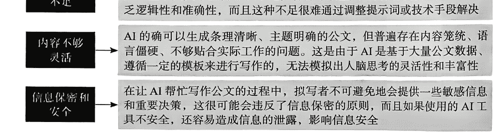

图5-2 AI公文写作存在的不足

## 5.2 举例让 AI 写作公文

若对目标文种不熟悉，可采用示例法：在同一对话里先让模型归纳格式要素并仿写，再生成模板，随后输入素材填充，最后基于结果提出修改意见优化。

注意智能起草通常指标题、主送机关、正文、附件说明与落款，示例时可仅提供范文主体。

#### 050 举例让AI进行总结和仿写

可找一篇同文种范文提供给模型，让其先吃透格式要素，为后续起草打基础。具体操作如下。

**提问**

我将提供一篇批复的范文，请你根据范文总结出批复的格式和要素，并进行仿写。

> ××市人民政府办公室关于同意××同志请求辞职请示的批复

> 市规划局：

> 你局《关于××同志请求辞职的请示》（规划[××××]××号）收悉。经市政府办公室党组会议研究，同意你单位与××同志解除聘任关系，请按照有关规定办理相关手续。

> 此复。

> ××市人民政府办公室

> ××××年××月×日印发

**ChatGPT**

根据提供的批复范文，我们可以总结出典型的官方批复的格式和要素。

1.  标题：由发送方的单位名、关于某事项的简要说明、文档性质组成。

2.  称呼：直接指向接收方的单位或个人名称。

3.  正文：

    - 引言段落：提及接收到的文档或请求的名称、编号，并简要说明基本情况。

    - 主体段落：描述决策或回应的内容，包括决策的依据、做出的决定以及需要遵循的规定或步骤。

    - 结束语：可以是简短的结束词，如“此复”等，表示文档正式结束。

4.  落款：发文单位的全称。

5.  日期：发文日期，通常包括年、月、日。

现在，根据上述格式和要素，我们可以仿写一个例子。

> ××县教育局关于同意××老师休假请求的批复

> 县中学：

> 你校《关于××老师请求休假的请示》(教育[××××]××号)收悉。经县教育局会议研究，鉴于××老师的工作表现及个人情况，同意××老师的休假请求，请依据学校规定和教育政策，安排好相关教学工作并办理休假手续。

> 此复。

> ××县教育局

> ××××年××月××日印发

#### 051 让AI生成公文的写作模板

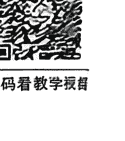

模型掌握要素后，可让其先输出一个要素齐全的写作模板，避免最终文书出现格式缺失。具体操作如下。

**提问**

请根据提供的范文和前面总结的格式与要素，生成一个批复的写作模板，要求：要素齐全，格式规范。

**ChatGPT**

以下是一个批复的写作模板，旨在提供一个标准化的框架，以便在需要时填写具体内容。

[发送方单位全称]关于同意[具体事项的简要说明]的批复

[接收方单位或个人名称]：

您（们）的《关于[具体请求内容的描述]的请示》（[文档编号]号）已收悉。经[发送方单位]党组（或其他决策机构）会议研究，[同意/不同意/其他决定]您（们）的请求，具体如下：

[具体决定内容，包括但不限于任何条件、要求或后续步骤。]

请您（们）依据[相关规定或条例名称]，办理[相关手续或后续操作]。

[结束语，如“此复”“敬请遵照执行”等]。

[发送方单位全称]

[日期：年月日]

**填写说明：**

1.  [发送方单位全称]：写明发文单位的官方全称。

2.  [具体事项的简要说明]：简要说明批复的主要内容或目的。

3.  [接收方单位或个人名称]：明确指出接收文档的单位或个人名称。

4.  《关于[具体请求内容的描述]的请示》：具体描述接收方提出的请求或需要批复的事项。

5.  [文档编号]号：提及的请求或请示文档的官方编号。

6.  [同意/不同意/其他决定]：明确批复的决定是同意、不同意还是其他具体决策。

7.  [相关规定或条例名称]：提及作出该决策依据的规定、条例或政策名称。

8.  [相关手续或后续操作]：指出接收方需要完成的手续或操作。

9.  [结束语]：一句正式的结束语，表示文档内容结束。

10. [日期：年月日]：准确填写发文日期。

这个模板旨在为官方批复写作提供一个标准化和规范化的框架，确保所有必要信息都被包含和正确表达。

#### 052 让AI根据信息写作公文

正式起草时，需提供相关素材，让模型套用模板输出。具体操作如下。

**提问**

请根据以下提供的信息，套用写作模板生成一篇批复。

技术部小徐发现显示器老旧导致色彩显示错误，写了一篇更换显示器的请示，××公司的行政部对此进行了批复，同意了小徐的申请，并要求小徐在购买显示器后保留相关发票。

**ChatGPT**

根据提供的信息和之前制定的批复写作模板，以下是一篇具体的批复文档。

> ××公司行政部关于同意技术部小徐更换显示器的批复

> 技术部小徐：

> 您的《关于更换老旧显示器的请示》已收悉。经××公司行政部会议研究，考虑到您的显示器老旧导致色彩显示错误，对工作造成了影响，我们同意您的申请，允许更换显示器，以保证您的工作效率和质量。

> 请您在购买新显示器后，保留相关发票，并向行政部提交，以便我们进行后续的财务处理。

> 此复。

> ××公司行政部

> [填写日期]

请根据实际情况填写具体的日期。

#### 053 让AI对公文进行修改

初稿完成后，还可以让模型润色。例如上例批复的收文对象是员工，事项不涉密，语气可更柔和，并可补充使用提示。具体操作如下。

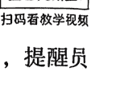

**提问**

请在保持格式与信息不变的前提下，调整语气，使其不要太生硬，并适当添加一些有关显示器使用的注意事项。

**ChatGPT**

在保持格式和信息不变的前提下，我对批复的语气进行了调整，并添加了一些显示器使用的注意事项，使其更加友好和实用。

> ××公司行政部关于支持技术部小徐更新显示器请求的批复

> 亲爱的小徐：

> 我们已经认真阅读了您提交的《关于更换老旧显示器的请求》，了解到您当前的显示器因年久失修而出现色彩显示不准确的问题。为了确保您的工作效率和成果的质量，我们非常乐意支持您更换新的显示器。

> 在您选购新显示器时，除了保留相关发票以便财务处理，我们还想提醒您注意以下几点，以延长新显示器的使用寿命并保护您的视力。

> 1. 选购时考虑护眼功能：选择具有蓝光过滤和无闪烁技术的显示器，以减少对眼睛的伤害。

> 2. 正确调整亮度和对比度：根据您的工作环境，调整显示器的亮度和对比度，避免眼睛疲劳。

> 3. 定期休息：长时间工作时，每隔一小时最好离开显示器短暂休息，减轻视觉疲劳。

> 4. 保持适当距离：使用显示器时，保持与屏幕至少50cm的距离，以保护您的视力。

> 我们期待您的工作环境得到改善，也希望新的显示器能为您带来更加舒适和高效的工作体验。

> 再次感谢您对改善工作环境的积极建议，我们始终致力于为每一位员工提供最佳的工作条件。

> 祝好。

> ××公司行政部

> [填写日期]

这样的调整旨在使批复更加温馨和人性化，同时提供实用的建议，帮助员工更好地使用和维护新的设备。

**★专家提醒★**

拟写者首先要找出公文中存在的问题，再通过提示词将这些问题和对公文的要求反馈给 AI，让 AI 对公文进行修改，这个修改的过程可能会反复进行。另外，如果公文中存在的问题比较小，拟写者也可以手动进行修改。

## 5.3 直接让 AI 写作公文

若对目标文书较为熟悉，可直接把格式要素告知模型，让其先试写一篇，确认无误后再正式成文。正式起草时提供素材和要求，输出会更贴合。若格式简单，也可跳过试写，直接生成。

#### 054 让AI了解公文的格式和要素

向模型传递格式要素时，提示词应条理清晰、要点全面，便于理解。具体操作如下。

**提问**

我将向你提供函这类公文的格式和基本要素，请你仔细了解后，根据这些内容写作一篇函，写作时不要将格式写错。

1.  标题：明确指出文档的性质或目的，一般为“××（发函单位）关于××（事项）的函”或“关于××（事项）的函”。

2.  收件人：列出受函单位或个人，后面加冒号。

3.  正文

    （1）引言：简要介绍函件的背景或目的。

    （2）具体内容：详细说明事项。

    （3）行动号召：对收件人的具体要求或期待行动。

4.  结语：简洁地结束正文内容，如“此函”等。

5.  签名：发函单位或个人的签名。

6.  日期：函件的发布或写作日期，表明函件的时效性。

7.  附件说明：如果函件中提到了附件，应在文末注明附件内容。

**ChatGPT**

> ××部关于协助开展全国学生体质健康调查的函

> 各××××教委：

> 鉴于当前我国学生体质面临多方面的挑战，××部决定于本年度内开展一次全国范围的学生体质健康调查。本次调查旨在全面了解学生体质健康现状，为下一步制定具体的健康促进政策和措施提供科学依据。

> 调查内容主要包括学生体质测试指标的收集（如身高、体重、肺活量等）、学生日常饮食和运动习惯的调查，以及学生心理健康状况的评估。我们希望各级教育行政部门和学校能够积极配合，确保调查工作的顺利进行。

> 具体要求如下：

> 1. 各地教育行政部门需组织辖区内的学校积极参与调查，确保所辖区域内的所有学校均能覆盖。

> 2. 学校应指派专人负责此项调查工作，负责人需对调查内容、方法等进行详细了解，并负责本校数据的收集和上报。

> 3. 所有参与调查的数据需在调查结束后一个月内上报至××部指定的数据收集平台。

> 希望各级教育行政部门和学校能够高度重视此次调查，积极采取有效措施，确保调查工作的顺利完成。通过本次调查，我们期待能够准确把握我国学生体质健康的现状，为制定更加有针对性的体育教育政策和健康促进措施奠定坚实的基础。

> 此函。

> ××部

> 2024年3月11日

> 附件：全国学生体质健康调查具体操作手册及数据模板

#### 055 向AI提供公文的内容和要求

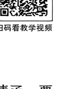

模型吃透要素后，可提供素材和要求让其成文。具体操作如下。

**提问**

请用上面提供的函的格式和要素，根据下面的信息，写作一篇邀请函，要求：要素齐全，格式规范，研讨会的相关信息用“一、”“二、”的形式分条陈列，内容不要出现重复，用“××”代替的内容不要进行改动。

标题为“关于出席××研讨会的邀请函”，受函人为××教授，函件的目的是邀请教授出席××部举办的××研讨会，该研讨会的报到时间为2025年6月24日上午9点，会议将持续4天，在长沙C酒店的6楼605召开、会议的联系人为小李，联系电话为12312312312，发函日期为2025年6月8日。

**ChatGPT**

> 关于出席××研讨会的邀请函

> 尊敬的××教授：

> ××部诚挚邀请您出席我们举办的××研讨会。此次研讨会是为了探讨××领域的最新发展和挑战，旨在汇聚各领域专家学者，共同交流思想和研究成果。

> 研讨会的相关信息如下：

> 一、报到时间：2025年6月24日上午9点。

> 二、会议持续时间：研讨会将持续4天。

> 三、会议地点：长沙C酒店的6楼605。

> 四、联系人和联系电话：小李；12312312312。

> 我们期待您的参与能够为研讨会带来宝贵的见解和经验分享。请您在收到此邀请函后，尽快与我们联系确认您的出席意向，以便我们为您提供进一步的会议资料和安排。

> 此函

> ××部

> 2025年6月8日

## 第 6 章

AI润色公文七个实用技巧

**本章要点：**

起草之外，模型还能介入已成稿的精细打磨，覆盖校对、重写、版式重排等环节。经这一轮归纳，文书语气更沉稳，信息呈现更清晰，整体可读性与执行力会同步提升。

**ChatGPT**

> 关于出席××研讨会的邀请函

> 尊敬的××教授：

> ××部诚挚邀请您出席我们举办的××研讨会。此次研讨会是为了探讨××领域的最新发展和挑战，旨在汇聚各领域专家学者，共同交流思想和研究成果。

> 研讨会的相关信息如下：

> 一、报到时间：2025年6月24日上午9点。

> 二、会议持续时间：研讨会将持续4天。

> 三、会议地点：长沙C酒店的6楼605。

> 四、联系人和联系电话：小李；12312312312。

> 我们期待您的参与能够为研讨会带来宝贵的见解和经验分享。请您在收到此邀请函后，尽快与我们联系确认您的出席意向，以便我们为您提供进一步的会议资料和安排。

> 此函

> ××部

> 2025年6月8日

## 第 6 章 公文润色七法：让结构更清、表达更准

**本章要点：**
模型在满足起草需求之外，还能对成稿做精细化处理，诸如核校、改写、框架调整等。润色后表达更到位，质量与可读性同步提升，才能真正发挥文件作用。

### 6.1 稿件核查

核查大致分两种情形，一种是让模型复核其自行生成文本；另一种是让模型复核人工撰写的原文。对模型自产内容，通常在同一对话窗口提示“请检查生成内容是否有差错”即可。本节聚焦如何借助模型审阅人工撰写的公文。

#### 056 用词准确度核查

撰写过程中因输入法或分心，易出现错字、漏字、添字等用词偏差。用词失准会违背公文严谨原则，影响正式感与权威性，严重时还会导致信息传递失真，干扰工作推进。

因此在初稿完成后，可把全文或局部交给模型排查用词问题并给出修改建议。下面以具体操作为例说明。

扫码看教学视频

**提问**

请帮我检查以下公文内容中存在的错别字。

> 二、区域布局与重点项目

> 1. 区域布局

> （1）重点支持具有潜力和特色的县市区，优先发展观光旅游农业。

> （2）在山区、水乡和田园等不同的地理环境中布局观光旅游农业示范区。

> （3）整合资源，构件农村旅游产业链，形成区域发展合力。

> 2. 重点项目

> （1）打造一批生态农庄，提供住宿、餐饮、休闲等多元化服务。

> （2）推动特色农产品采摘活动，吸引游客参与亲子互动。

> （3）建设农村文化体验中心，展示本地农村文化和工艺。

> （4）促进乡村文化旅游和乡村民宿，提高农村旅游接待能力。

**文心一言**

在检查公文内容后，发现存在一处错别字，即“构件”应为“构建”。

以下是修改后的公文内容。

## 二、区域布局与重点项目

### 1. 区域布局

（1）重点支持具有潜力和特色的县市区，优先发展观光旅游农业。

（2）在山区、水乡和田园等不同的地理环境中布局观光旅游农业示范区。

（3）整合资源，构建农村旅游产业链，形成区域发展合力。

### 2. 重点项目

（1）打造一批生态农庄，提供住宿、餐饮、休闲等多元化服务。

（2）推动特色农产品采摘活动，吸引游客参与亲子互动。

（3）建设农村文化体验中心，展示本地农村文化和工艺。

（4）促进乡村文化旅游和乡村民宿，提高农村旅游接待能力。

**★专家提醒★**

润色时可按个人偏好挑选工具。本章示例采用文心一言，因其模型以中文语料为主训练，对语境、语义与文化内涵的把握更为细致。

#### 057 语法规范核查

语法瑕疵是公文中常见问题，会让阅读者产生歧义，拉低文件质量并削弱可读性。可把文本交给模型检视语法问题并提供修改意见。下面以实例演示操作步骤。

**提问**

请检查以下公文内容是否存在语法问题，如果存在，请说明错误的原因，并提供修改意见。

> 3. 原则

> （1）生态优先原则：保护和修复农村生态环境，维护农村生态安全。

> （2）开放包容原则：鼓励多元投资主体观光旅游农业参与开发。

> （3）市场导向原则：根据市场需求和旅游季节灵活调整供给产品和服务。

> （4）政策支持原则：提供税收、资金、土地、用电等多方面的政策支持。

# 【职场公文篇】

## 第 6 章 7种运用 AI 润色公文的方法，优化结构与表达

以下是修改后的公文内容。

## 二、区域布局与重点项目

- 1. 区域布局

  （1）重点支持具有潜力和特色的县市区，优先发展观光旅游农业。

  （2）在山区、水乡和田园等不同的地理环境中布局观光旅游农业示范区。

  （3）整合资源，构建农村旅游产业链，形成区域发展合力。

- 2. 重点项目

  （1）打造一批生态农庄，提供住宿、餐饮、休闲等多元化服务。

  （2）推动特色农产品采摘活动，吸引游客参与亲子互动。

  （3）建设农村文化体验中心，展示本地农村文化和工艺。

  （4）促进乡村文化旅游和乡村民宿，提高农村旅游接待能力。

> ★专家提醒★

> 在运用 AI 对公文进行润色修改时，拟写者可以根据需要选择自己喜欢的 AI 工具。本章选择用文心一言平台来进行操作，是因为它由中文语言模型训练，训练数据主要是中文文本，这使得它能够更深入地理解中文的语境、语义和文化内涵。

#### 057 检查公文的语法

语法错误是公文中经常出现的问题之一，这些错误可能会让受众对公文内容产生误解，降低公文的质量，削弱公文的可读性。拟写者可以让AI对提供的公文内容进行检查，找出存在的语法错误，并提供修改建议。下面将举例介绍具体的操作方法。

提问

请检查以下公文内容是否存在语法问题，如果存在，请说明错误的原因，并提供修改意见。

- 3. 原则

  （1）生态优先原则：保护和修复农村生态环境，维护农村生态安全。

  （2）开放包容原则：鼓励多元投资主体观光旅游农业参与开发。

  （3）市场导向原则：根据市场需求和旅游季节灵活调整供给产品和服务。

  （4）政策支持原则：提供税收、资金、土地、用电等多方面的政策支持。

## 文心一言

在审查上述公文内容后，可以发现其中第（2）条“开放包容原则”的描述存在语法问题。问题主要出现在“鼓励多元投资主体观光旅游农业参与开发”这一表述上，具体表现为语序不当和成分残缺。

- 1. 语序不当：在“鼓励多元投资主体观光旅游农业参与开发”中，“观光旅游农业”作为一个整体概念，应该被作为一个明确的投资领域或方向来提及，而不是将“观光旅游”和“农业”分开，使得句子结构显得松散且不易理解。

- 2. 成分残缺：原句中缺少了必要的介词来引导投资主体参与的对象，即投资主体参与的是哪个领域或项目的开发。

修改意见：

将第（2）条修改为：“开放包容原则：鼓励多元投资主体参与观光旅游农业的开发。”这样的表述既修正了语序问题，又通过添加介词“参与”明确了投资主体参与的对象是“观光旅游农业的开发”，使得句子结构更加紧凑且意义清晰。

### 6.2 文本改写

除检查外，还可指明文稿中待改进之处并给出明确要求，由模型按需重写。

#### 058 篇幅压缩

文稿并非字数越多越好，冗长易致阅读疲劳，繁琐叙述会掩盖重点。例如通知中堆砌大量强调重要性的套话，反而让人忽略具体事项。

精简能提升可读性和专业度，让重点更突出。借助模型可快速完成压缩，具体做法如下。

公文并不是字数越多、句式越复杂就越好，太多的文字会让受众产生阅读疲劳，过于烦琐的叙述会让受众难以抓住重点和理解公文信息。例如，在通知中添加太多强调事项重要性和必要性的话语，反而容易让人忽略掉通知的具体事项。

因此，对公文内容进行精简可以提高公文的可读性和专业性，使重点更突出、更清晰。运用AI，拟写者可以轻松完成公文内容的精简，具体操作方法如下。

## 提问

通知格式的简洁性要求其篇幅一般不宜过长，请根据这个要求，对下面这篇通知的内容进行精简，要求：突出通知的事项。

## 市教育局关于印发《2027年春季开学工作守则》的通知

各区县教育局、各市直学校、各有关单位：

为确保我市2027年春季开学工作有序、高效、安全进行，市教育局特制定并印发《2027年春季开学工作守则》，现就有关事宜通知如下。

## 一、充分认识印发《守则》的必要性和重要性

印发《2027年春季开学工作守则》是我市教育系统新学期工作的一项重要举措。开学工作涉及面广，任务繁重，需要各级教育部门和学校的高度重视和精心组织。印发《守则》，旨在明确开学工作的指导思想、基本原则、具体要求和保障措施，为各级教育部门和学校提供行动指南，确保开学工作有序、规范、高效进行。

同时，印发《守则》也是提升我市教育质量、加强教育系统内部管理的重要举措。通过明确教育教学、课程设置、教学方法等方面的要求，引导广大教师和教育工作者创新教育理念，提升教学能力，为学生提供优质的教育资源。此外，《守则》还强调了学校管理和学生安全等方面的内容，有助于营造安全、和谐、稳定的校园环境，保障学生的身心健康和全面发展。

## 二、认真学习和贯彻《守则》精神

各级教育部门和学校要认真组织学习《2027年春季开学工作守则》，深入理解其精神实质和具体要求。要结合实际，制定切实可行的开学工作方案，明确任务分工，落实责任到人。同时，要加强与家长的沟通联系，共同做好学生的开学准备工作，确保学生顺利返校、安心学习。

请各区县教育局、各市直学校和各有关单位认真执行本通知精神，确保我市2027年春季开学工作圆满完成。

附件：《2027年春季开学工作守则》

市教育局

××××年××月××日

## 文心一言

市教育局关于印发《2027年春季开学工作守则》的通知

各区县教育局、各市直学校、各有关单位：

为确保我市2027年春季开学工作有序、高效、安全，市教育局特制定并印发《2027年春季开学工作守则》。请各单位充分认识印发《守则》的必要性和重要性，认真学习和贯彻其精神，加强监督和检查，确保开学工作圆满完成。

附件：《2027年春季开学工作守则》

市教育局

××××年××月××日

#### 059 标题调整

对公文而言，标题体现文种与内容。好的标题应简洁、直接且贴合内容；发言稿、调查报告等可在此基础上做适度设计，增强概括力。

常见问题有文不对题、要素缺失、成分冗余。下面以修改成分冗余的标题为例说明操作。

## 提问

下面这篇请示的标题中有多余的成分，请对其进行修改，使标题简洁、直接，符合公文内容。

关于开展××××年市级应急演练项目实施××××年××市农机事故应急救援预案演练工作的请示

××市人民政府：

根据××市人民政府办公厅关于开展××××年市级应急演练项目的通知精神，我局已制定了××××年××市农机事故应急救援预案演练工作程序，请市政府批准实施。

- 附件：

  1. ××××年××市农机事故应急救援预案演练工作程序

  2. ××××年××市农机事故应急救援预案演练现场会议程

××市农业机械化管理局

××××年××月××日

## 文心一言

修改后的标题为：

## 第 6 章 7种运用 AI 润色公文的方法，优化结构与表达

关于实施××××年××市农机事故应急救援预案演练工作的请示

修改理由：

原标题包含了较多的冗余成分，使得标题显得冗长且不够直接。在修改后的标题中，我们保留了“关于实施”作为开头，直接点明了请示的主要内容是“实施”某项工作。接着，我们明确了要实施的具体工作是“××××年××市农机事故应急救援预案演练工作”，这样的表述既简洁又直接，符合公文标题的要求。同时，我们也去掉了原标题中的“开展××××年市级应急演练项目”这一冗余部分，使得标题更加精炼。

#### 060 要点分条

分条列项即逐项列出要点，使内容更清晰、有序，便于理解与记忆。可借助模型对部分段落改写，用要点形式呈现。

## 提问

下面是《开心小学图书馆借阅守则》的部分内容，请用分条列项的方式对其进行改写，可以适当进行内容的扩充，不需要生成完整的守则内容。

一、目的

制定图书馆借阅守则是为了保障图书馆的资源合理利用，维护图书馆的秩序，保护图书馆的资源安全，建立良好的借阅氛围，提升图书馆的服务质量。

## 文心一言

《开心小学图书馆借阅守则》部分内容的分条列项改写如下。

一、目的

- 1. 保障合理利用图书馆资源：制定借阅守则旨在确保图书馆的各类资源能够得到公平、合理的分配与使用，从而满足广大师生的学习和阅读需求。

- 2. 维护图书馆秩序：通过规范借阅行为，营造安静、整洁、有序的借阅环境，为师生提供良好的学习空间。

- 3. 保护图书馆资源安全：借阅守则的制定有助于增强借阅者的保护意识，防止图书丢失、损坏等问题的发生，确保图书馆资源的完整性和安全性。

- 4. 建立良好的借阅氛围：通过制定明确的借阅规则和要求，促进借阅者之间的友好交流和互助合作，共同营造积极向上的借阅氛围。

- 5. 提升图书馆服务质量：通过不断完善借阅守则，提高借阅者的满意度和获得感，进而提升图书馆的整体服务质量，为师生提供更加优质的学习支持。

### 6.3 结构优化

结构指布局与段落划分，优化后能突出重点，提升阅读体验。

#### 061 主题句提炼

主题句通常置于段首，高度概括段落主旨。模型可据段落内容提炼主题句，使重点更突出。

提问

请分别提炼出下面3段公文内容中的主题思想，用不超过10个字、语意完整的动宾式短句进行表述。

根据G市的地理环境、人口分布和污染源情况，科学规划监测站点布局，确保监测数据能够全面反映全市的空气质量状况。同时，增加移动监测设备，填补监测盲区。

加强监测设备的维护和升级，提高数据采集和处理的效率，确保空气质量数据能够实时更新。同时，建立数据共享机制，实现各部门之间的数据互通，提高预警信息的准确性和时效性。

利用多种渠道发布空气质量预警信息，包括电视、广播、报纸、手机App等，确保市民能够及时获取预警信息。加强与媒体的合作，提高预警信息的传播速度，扩大覆盖面。

文心一言

以下是为您提炼的3段公文内容的主题思想，用不超过10个字、语意完整的动宾式短句进行表述：

## 第 6 章 7种运用 AI 润色公文的方法，优化结构与表达

- 1. 优化监测站点布局

- 2. 提升数据处理效率

- 3. 发布预警信息并加强传播

#### 062 句式调整

句子是表达基本单位，合理组合可构建逻辑框架。常见问题有主谓不一致、成分残缺、语序不当、句式杂糅等，下面以解决句式杂糅为例。

> 提问

> 请判断下面的句子是否存在句式结构的问题，如果存在，请给出修改建议。

> 我单位为了推进项目的顺利进行，积极采取了一系列措施，并取得了显著成果，从而保证了项目的如期完成。

> 文心一言

> 这个句子确实存在句式结构的问题。句子试图表达单位为了推进项目所采取的措施、取得的成果及项目的完成情况，但由于表达问题，使得句子显得冗长且不够清晰。

> 具体来说，“为了推进项目的顺利进行”和“积极采取了一系列措施”两个表述在逻辑上有所重叠，同时“并取得了显著成果”和“从而保证了项目的如期完成”也存在一定的冗余。

> 为了修正这个问题，我们可以将句子拆分为几个部分，并重新组织，使其更加清晰和简洁。

> 修改建议：为了推进项目的顺利进行，我单位积极采取了一系列措施，取得了显著成果，最终确保了项目的如期完成。

> 通过拆分和重组，我们删除了冗余的表述，使得每个部分都更加独立和清晰。这样的句式更符合汉语的表达习惯，也更容易被读者理解和接受。

# 【修改润色篇】

## 第 7 章

## 9 种文案修改技巧，让 AI 智能改写文案

**本章要点：**

除了满足用户创作文案的需求，ChatGPT 还可以帮助用户检查和修改已经写好的文案，让文案的内容更具有吸引力和说服力，从而充分发挥文案的作用。本章主要介绍 4 种检查文案内容和 5 种改写文案内容的技巧。

### 7.1 4种检查文案内容的技巧

用户在完成文案的创作后，并不意味着工作就此结束了，为了保证内容的准确性和可读性，用户还需要对文案内容进行检查。而ChatGPT可以作为检查小助手，帮助用户检查文案的语法和拼写、案例真实性、重复内容及情感表达。

#### 063 语法和拼写的检查

语法错误和拼写错误是文案中经常出现的问题之一，这些错误可能会让受众对文案内容产生误解，降低文案的质量，削弱文案的专业性和可读性。用户可以让ChatGPT对提供的文案内容进行检查，找出存在的语法和拼写错误，并提供修改建议。下面将举例介绍具体的操作方法。

扫码看教学视频

> 提问

> 请帮我审校以下文案的语法与用词，并指出错处给出修改意见。

> 文案：食堂的菜品向来丰富又美味。因此我很喜欢去食堂吃饭。

> AI助手

> 这段表述在衔接与标点上可以再优化，具体如下：

> 1. 问题：句间关联词选用不理想。
>    - 建议：把“因此”换成“所以”。
> 2. 问题：标点符号使用欠规范。
>    - 建议：末尾的句号改为逗号。
> 修正后的文本：
> “食堂的菜品向来丰富又美味，所以我很喜欢去食堂吃饭。”

#### 064 案例真实性的检查

在文案创作中加入实例能提升专业感与说服力。但若采用杜撰或失实的案例，会削弱可信度甚至触及合规风险。借助大型知识库可以对实例的真实性进行核验，操作方式如下。

扫码看教学视频

请帮我核查下面这段内容里案例是否属实，并指出错误之处。

文案：比如玛丽·居里，这位女性物理学家，是放射性研究开创者之一，发现了镭和钋等元素，斩获过三次诺贝尔奖。居里的研究不仅拓展了对物质本质的认知，也为医学进步提供了强力支撑。她的勇气和毅力为女性投身科学铺平道路，成为众多女性科学家的榜样。

这段文字描绘了玛丽·居里的部分基本事实，但也混入了错误。

正确的信息：

1. 玛丽·居里是知名的女性物理学家，确实属于放射性研究奠基人行列。
2. 她参与发现了镭元素。
3. 其研究对物质认知的推动十分深远。
4. 文中提到居里的坚韧为女性科研开路、树立榜样，这一说法成立。

错误的信息：

1. 玛丽·居里并未斩获三座诺贝尔奖。她共获两项诺奖，分别属于物理学和化学。
2. 元素发现的表述存在混淆。正确的是，她与团队发现了镭和钋，两者都是放射性元素。
3. 说其研究为医学发展提供了强力支持并不准确。尽管其工作对物理学影响深远，但直接造福医学的贡献相对有限。

#### 065 重复内容的检查

文案中出现重复会让阅读变得单调，降低信息密度与吸引力，进而影响传播效果。借助 AI 可以揪出重复的字词、句子与段落，便于后续精简。下面以实例说明操作方式。

请帮我检查下面文案是否存在重复表述，若有请指出并提供修改建议。

文案：薄荷糖中的薄荷成分作用明显。首先，清新的薄荷香气可帮助清洁口腔，减轻口气异味，让口腔保持清新。其次，薄荷带来的清凉感可缓解轻微呼吸道不适，还能提神醒脑。另外，薄荷糖中的薄荷成分能让口腔保持清新感，有助于缓解胃肠不适，减轻胃部紧张，促进食物消化。

AI助手

文案里出现了重复表述，主要是“薄荷带来口腔清新感”被多次赘述。修改建议如下。

原文：

薄荷糖中的薄荷成分作用明显。首先，清新的薄荷香气可帮助清洁口腔，减轻口气异味，让口腔保持清新。其次，薄荷带来的清凉感可缓解轻微呼吸道不适，还能提神醒脑。另外，薄荷糖中的薄荷成分能让口腔保持清新感，有助于缓解胃肠不适，减轻胃部紧张，促进食物消化。

修改建议：

薄荷糖中的薄荷成分作用明显。首先，清新的薄荷香气可帮助清洁口腔，减轻口气异味，让口腔保持清新。其次，薄荷带来的清凉感可缓解轻微呼吸道不适，还能提神醒脑。另外，这些成分有助于缓解胃肠不适，减轻胃部紧张，促进食物消化。

#### 066 情感表达的检查

文案情感常出现不准确或不到位两类问题。错误表达易引发误解，影响主题传递甚至造成争议；不到位则缺乏感染力，难以引发共鸣，达不到传播目标。

AI 作为语言模型虽不能完全理解人类情感，但能识别出明显不当的情感表达。下面以实例说明操作方式。

提问

请帮我检查下面产品营销文案的情感表达是否准确到位，若有误请先指出问题再提供修改意见。

文案：电热毯采用先进微电加热技术，能在短时间内升温。此外电热毯通常配备温度可调功能，可按需调节温度，相较传统取暖方式，电热毯购置和使用成本更高，而且必须插电使用。

AI助手

该段营销文案在描绘电热毯时，情绪点需要调整以更好地激发潜在客户兴趣。修改建议如下。

1. 强化舒适温暖感：
   - 原文：电热毯采用先进微电加热技术，能在短时间内升温。
   - 修改建议：电热毯搭载先进微电加热技术，让您在短时间内享受温暖与舒适。
2. 弱化成本顾虑，突出优势：
   - 原文：相较传统取暖方式，电热毯购置和使用成本更高，而且必须插电使用。
   - 修改建议：与传统取暖相比，电热毯购置和使用成本略高，但其强劲加热性能与便捷插电方式完全值得投入。
3. 强化个性化温控体验：
   - 原文：电热毯通常配备温度可调功能，可按需调节温度。
   - 修改建议：电热毯特别设计温度可调功能，让您随心调节，满足个性化需求。

综合建议后的文案：

> “搭载先进微电加热技术，我们的电热毯能在短时间内带来极致温暖与舒适。相较传统取暖方式，成本稍高，但强劲加热与便捷插电使用仍是值得投资的选择。精心设计的温度可调功能提供个性化温控体验，随时满足不同需求。选择我们的电热毯，尽享冬日温暖，感受无与伦比的舒适。”

### 7.2 5种改写文案内容的技巧

除了检查，还可指示 AI 指出问题并按需求改写。本节介绍五种改写技巧。

#### 067 文案观点的调整

文案观点需兼顾正确性与客观性。正确性指符合事实与法规；客观性指避免主观武断。观点不当会误导受众。意识到偏差时，可借助 AI 调整补充。下面举例说明。

**提问**

下面文案观点有些片面，请帮我调整补充，对文案改写，要求：从正反两面阐述，客观、有理有据。

文案：冬季低温只给人们生活带来不便。首先，寒冷天气让人不适，易患感冒、流感等呼吸道疾病。其次，低温可能导致水管冻裂、道路结冰，给交通和基础设施带来困扰。此外，寒冷也增加了野外活动的难度，户外运动和旅行的乐趣受到制约。

AI助手

冬季低温固然带来不便，也存在正面作用。首先，寒冷有助于杀灭部分有害微生物，降低病菌传播，有助公共健康。其次，低温能抑制某些害虫滋生，减少对农作物的侵害，对农业有保护作用。此外，严寒为部分冷区特产提供理想气候，促进了农产品品质。

当然，低温也伴随问题。极寒下人们易感染呼吸道疾病，但合理防护可降低风险。低温对交通和基础设施造成困扰，但现代技术可有效应对。因此，冬季低温既有不便，也潜藏积极影响，全面看待更能理解其作用。

#### 068 叙述视角的切换

常见视角有第一人称、第二人称、第三人称和全知视角。选对视角能提升理解度。用户可按用途让 AI 切换视角。下面举例。

**提问**

请用第一人称视角对下面文案改写，要求：用分享者的口吻叙述，分享自己的使用体验。

文案：某品牌面霜虽然质地厚重，但一抹即化，能在冬季更好地保持肌肤水分。此外，某品牌面霜还添加了丰富的抗氧化成分，能有效抵抗自由基对肌肤的损伤，保持肌肤活力。

AI助手

哇，我必须和大家分享我的真实感受！最近我用上了这款面霜！虽然质地看着有点厚，但一抹上去就化开了，完全不油腻，吸收超快。

尤其在寒冷的冬天，我明显感觉到它锁水的效果。我的皮肤冬天总爱干，现在用完就像喝饱水一样，水润饱满。

更让我惊喜的是，它还添加了丰富的抗氧化成分，感觉在抵御自由基方面很用心。皮肤更有光泽和活力，用过的面霜里它最惊艳。

总之，这款面霜在保湿和高光泽方面都做到了满分，真心推荐给正在找冬季护肤品的你！

#### 069 文案内容的精简

文案不是字越多越好，冗长易导致阅读疲劳，重点不突出。精简能提升可读性和专业度，使信息更清晰。下面说明操作。

**提问**

请帮我对下面文案进行精简，要求：保留主题思想，语句通顺。

文案：

在秋天这个丰收的季节里，一种特别的水果备受瞩目——脆柿。它不仅是一种美味的水果，更是一种富含营养的食物，让人在口感和健康上都得到极大满足。脆柿的特点在于它的果肉清脆可口，仿佛咬一口就能听到“咔嚓”的声音。这种独特口感来自柿子经过精心处理和特殊的生长条件。

除了口感上的独特之外，脆柿还富含各种营养成分。首先，它是一种天然抗氧化剂来源，含有丰富的维生素A、C和E，有助于保护细胞免受自由基侵害，延缓衰老过程。其次，脆柿中富含的膳食纤维有助于促进消化系统健康，减少便秘问题。此外，脆柿还含有钙、钾、镁等矿物质，对于维持骨骼健康和平衡体内电解质有着重要作用。

AI助手

秋季丰收，脆柿备受关注。它不仅美味，还富含营养，同时满足味蕾与健康。果肉清脆，咬下仿佛有“咔嚓”声，这种口感源于精细处理与特殊生长条件。

除口感外，脆柿富含抗氧化剂，如维生素A、C、E，有助保护细胞、延缓衰老。其膳食纤维能促进消化、缓解便秘。此外，还含有钙、钾、镁等矿物质，有助于骨骼健康与电解质平衡。

#### 070 案例的更换

文案中案例需真实且与主题适配。不匹配会降低可信度。若案例不符，可让 AI 更换。下面举例。

**提问**

请根据文案主题，更换不合适的案例，对文案改写，要求：主题不变，更换的案例要与主题匹配，并且案例真实可信。

文案：

女性在文学领域取得显著成绩，她们凭借独特视角、观察力和创造力，为文学发展带来新突破。

例如，玛格丽特·伯内特是一位美国天文学家，因对星系形成和演化的研究而闻名。她与她的团队发现了星系核存在的证据，并对星系形成的模型做出重要贡献。她的研究不仅帮助我们更好地理解星系的形成和演化过程，也为后来的天文学家提供了重要参考。

改写后的文案：

女性在文学领域有着杰出贡献，她们以独特视角、敏锐观察力和创造力，为文学发展带来新突破。

例如，弗吉尼亚·伍尔夫是一位英国现代主义作家，她以独特的叙事风格和深刻心理描绘而闻名于世。她的作品对后来的文学发展产生深远影响，为后来的作家提供重要启示。

她的代表作《达洛威夫人》以一位女性视角，深入探讨女性在传统社会中的角色和心理状态。这部作品不仅在当时引起轰动，而且至今仍被视为现代文学的经典之作。

#### 071 标题文案的修改

好的标题能抓住注意力，引导阅读并激发行动。因此需精细打磨。用户可让 AI 按文案内容优化标题。下面举例。

**提问**

请根据下面文案内容对标题进行修改，并说明修改好处，要求：精准概括内容，简洁明了，能激发好奇心。

标题：冬日必备雪地靴来了

文案：雪地靴，冬日的轻盈守护者。漫步雪地间，每一步都如诗如画，绒E的温暖，抵挡寒风，呵护双脚。时尚与舒适并存，为你打造冬日里的暖意人生。这个冬天，不再冷，与雪地靴一起，感受冬日的温柔。

AI助手

标题：冬日暖步雪地靴，守护双脚，温暖冬日

修改好处：

1. 精准概括：简明表达雪地靴对双脚的守护与温暖舒适特性。
2. 激发好奇：“冬日暖步雪地靴”引发兴趣，让人想了解其特质；“守护双脚，温暖冬日”进一步展示功能。
3. 简洁易记：字数精炼，便于传播。
4. 突出重点：凸显雪地靴在冬日的重要价值，使用户快速把握核心卖点。

## 第 8 章 7 种文案润色方法，让 AI 自动化修饰文本

**本章要点：**

润色不仅是修饰文字，更是提升专业形象、改善传达效果、避免歧义的关键。用 AI 润色能提高效率并增强表达力。

### 8.1 3个优化文案结构的方法

文案结构涉及布局与段落划分。优化结构可突出重点、提升可读性与体验。本节介绍三种方法。

#### 072 过渡语的添加

过渡语连接段落与句子，增加连贯性与逻辑，便于理解上下文。可让 AI 按上下文添加合适过渡语。下面举例。

**提问**

请根据文案中上下文关系，在适当位置添加过渡语，以增加段落和句子之间的流畅度：

文案：棉质秋衣的材质天然柔软，对肌肤友好，穿着舒适，不易引起过敏反应，适合长时间穿着。棉质面料通透透气，有助于吸收和释放身体的湿气，保持皮肤干燥，能够让穿着者感到温暖舒适。

棉质秋衣也有一些缺点。相对于一些高科技面料，棉质在保暖性方面可能略显不足。在极寒天气下，穿戴者可能需要额外的保暖层。棉质有一定的吸湿性，在湿润环境中可能会变得比较潮湿，影响保暖效果。

AI助手

棉质秋衣的材质天然柔软，对肌肤友好，穿着舒适，不易引起过敏反应，适合长时间穿着。此外，棉质面料通透透气，有助于吸收和释放身体的湿气，保持皮肤干燥，能够让穿着者感到温暖舒适。

然而，棉质秋衣也有一些缺点。相对于一些高科技面料，棉质在保暖性方面可能略显不足。在极寒天气下，穿戴者可能需要额外的保暖层。另外，需要注意的是，棉质有一定的吸湿性，在湿润环境中可能会变得比较潮湿，从而影响保暖效果。尽管如此，总体而言，棉质秋衣仍然以其舒适和亲肤特性在秋季穿着中表现出色。

#### 073 段落主题句的提炼

主题句通常置于段首，高度概括段落主旨。AI 可据内容提炼主题句。下面举例。

**提问**

请提炼出文案中的主题句，并说明原因：

文案：首先，松茸生长在阔叶和针叶混交的森林中，采摘者需要在大片森林中寻找这一珍贵蘑菇的踪迹，而这个过程需要极大的耐心和观察力。其次，由于松茸的生长速度极快，因此采摘者一不留神就可能错过最佳的采摘时机。此外，错误的采摘方法可能导致松茸根部损伤，影响下一季的生长。

AI助手

主题句：松茸采摘是一项需要耐心、观察力和正确技巧的活动。

原因解释：

1. 森林探寻挑战：松茸生于混交林，需在广阔林区搜寻，考验耐心与观察力。
2. 时机敏感：生长极快，稍有疏忽即错过最佳采摘期。
3. 技巧与损伤防范：错误采摘会伤根，影响来年产量，需掌握正确方法。

三点共同说明采摘兼具耐心、时机把握与技巧要求。

#### 074 结构方式的调整

文案结构常见总分、分总、总分总。总分总兼顾概括与细节，层次更清晰。用户可按需调整。下面举例。

**提问**

请将下面文案调整为总分的结构方式：

文案：在自然环境中，松鼠选择高大的树木作为栖息地。它们喜欢在树冠中找到树洞或者在树枝间搭建巢穴。这些地方既可以保护它们免受掠食者的侵袭，也提供了足够的空间来储存食物。

松鼠如何在野外与城市切换生存

人类改造的街区里，松鼠照样能找到可观的口粮。它们常在草地上翻找掉落的果实，也爱围着垃圾容器捡拾剩食。这种高度的应变让它们在高节奏的城市中也能占据自己的地盘。

总分思路呈现：

总述：
在野生地带与人造环境中，松鼠均展现出很强的适应力，通过挑选合适的栖所与多元的取食策略，维系种群的持续繁衍。

自然栖息：
在野外，松鼠偏好高大乔木作为落脚点。它们多在树冠利用天然空洞，或在枝叉间亲手筑巢。这类位置既能躲避捕食者，也有利于越冬粮食的贮藏。

人工栖息：
在建成区域，松鼠把觅食重心转到公园等开放场所。它们常在草坪搜索掉落的坚果，也习惯在垃圾桶旁翻找人类丢弃的饭菜残渣。正因应变能力极强，它们在钢筋水泥里也能自在生活。

### 8.2 文案润色可用的四种手法

润色本质上是对用词与句式的精细调整，以提升可读性、吸引力和清晰度，让宣传、推广或信息传递更有效。本节围绕四种常见手段展开。

#### 075 不恰当词汇的替换

文案里选用合适的词语能确保信息传达准确，也能体现创作者的语言素养与表达水平。用词是否合适要结合文案类型、目标读者与使用目的来判断，例如比较严肃的文本应避开方言或口语化表达，面向大众的文案则不宜堆砌专业术语。可以明确需求让模型帮忙替换，具体操作如下。

**提问**
请把下面这段文案里的书面正式表达改成口语日常：
文案：尊敬的顾客：食用前请留意坚果过敏，控制糖分摄入。小心儿童吃呛，检查栗子是否去壳。购买前检查食品安全。感谢您的理解与配合。

ChatGPT
嗨，顾客朋友，吃之前先确认下是否对坚果过敏，糖分也要留意哦。小孩吃东西要防呛，顺便看看栗子有没有剥壳。买之前也检查一下食品安全。谢谢你的理解配合！

#### 076 短句的合并

合并短句就是把两三句简短的句子通过连词、标点等方式整合为一句更完整的表达。这种做法有助于提升语句的流畅度，也能承载更复杂的逻辑。需要注意，并非所有短句都适合合并，也不是都要合并，具体要依据语境和表达意图来抉择，再交由模型执行。下面通过实例说明做法。

**提问**
请把下面三句短句合并成一句话。
这个城市有历史悠久的钟楼。这个城市有绿意盎然的公园。这个城市有设计感十足的桥梁。

ChatGPT
这座城既有历史悠久的钟楼，也拥有绿意盎然的公园，还有设计感十足的桥梁。

AI写作技巧从入门到精通：
AI提问生成+AI职场公文+AI修改润色+AI热门模板+AI应用案例

#### 077 长句的拆分

句子过长往往信息堆叠，既不利于读者理解，也易产生歧义。拆分长句可以让思想更清晰独立，突出重点，同时提升可读性和吸引力。用户只需提出拆分要求，模型即可按需处理。下面举例说明。

**提问**
请把下面这个长句拆成短句，要求意思不变，语句通顺连贯。
世界级小提琴家帕格尼尼是一位从上帝那里同时接受天赋和苦难两项馈赠而又善于用苦难的琴弦把天赋演绎到极致的奇人。

ChatGPT
小提琴大师帕格尼尼是个奇人。上帝既给了他卓越的天赋，也赐予了他不小的苦难。他擅长以苦难为琴弦，把天赋发挥到极致。

#### 078 修辞手法的添加

增添修辞手法是文案润色的常用手段，能增强表达力度与艺术感，更容易抓住受众目光。修辞种类丰富多样的，用户可以指定具体类型，也可以让AI自由发挥。下面举例说明。

**提问**
请为以下文案添加比喻的修辞手法：
文案：夏天的荷叶是碧绿的，荷花是艳红的。

ChatGPT
夏天的荷叶像铺开的翠玉，在风里轻轻摇曳，好似大地展开的羽翼。荷花则像燃起的火焰，又像成群的红蝶在阳光下起舞，为盛夏平添了浓烈的绚丽。碧叶红花共同点缀成自然的画卷，诗意盎然，让人沉醉于这幅夏日风景。

# 【热门模板篇】

## 第 9 章

## 11 类营销文案指令模板，助力事业创收

**本章要点：**
营销文案服务于产品推广、广告策划、品牌传播等场景，核心是通过语言打动受众，促成购买决策。本章梳理11类高频使用的营销指令模板。

#### 079 制作产品推广文案的提问模板
产品推广文案通常用来提炼商品卖点、凸显竞争优势，通过文字影响消费者并提升购买意愿。有了AI协助，用户可以快速获得推广素材，从而扩大商品影响力和销量。
提问模板：
请根据×××（产品）的相关信息，生成一篇产品推广文案
产品信息：×××
示例：
**提问**
请根据洗衣凝珠的相关信息，生成一篇产品推广文案：
产品信息：8倍洁净、深层除螨、长效抑菌、长久留香、柔顺护衣
ChatGPT
【新品上线 焕新洗护体验】
洗护也要与时俱进！我们隆重推出全新洗护利器——柔清洗衣凝珠，让每次洗涤都像一次高端SPA。
—8倍洁净，衣物焕新 采用强效洗涤科技，一键瓦解顽固污渍，衣物洁净如初，色彩保持鲜亮。
—深层除螨，守护健康 精准渗透织物深处，清除肉眼难见的螨虫与微尘，为家庭营造更健康的居家环境。
—长效抑菌，持续防护 洗后形成抑菌屏障，长效抑制细菌滋生，让衣物更安心。
—持久留香，愉悦身心 独特香氛定驻技术，洗后清香悠长，一天都被芬芳围绕。
—柔顺护衣，呵护肌肤 专研柔顺因子，让衣物触感更滑顺，减少摩擦，贴近肌肤也更舒适。
选择柔清，让家更安心，让洗护更升级！

#### 080 撰写主图文案的提问模板
在电商场景中，主图文案能凸显单品卖点与优势，从而激发购买欲。撰写主图文案需要兼顾商品特性、受众痛点与市场趋势，并具备网感与文字功底，此时借助AI即可快速获得电商主图文案。用户可采用以下指令模板提问。
请结合×××（产品）的受众需求和产品亮点，撰写×××（产品）的电商主图文案，要求语言精简、亮点突出
示例：
**提问**
请结合羽绒服的受众需求和产品亮点，撰写羽绒服的电商主图文案，要求语言精简、亮点突出：
ChatGPT
标题：轻盈温暖，冬日时尚自在
亮点一：轻盈御寒 冬日严寒，羽绒服轻若羽翼却保暖十足，优质羽绒填充，薄而不冷，全方位呵护。
亮点二：时尚剪裁 不仅保暖，更讲求造型。独特版型与流行色系，让你在寒冬依旧保持品位。
亮点三：贴身舒适 精选面料，贴合人体曲线，富有弹性。无论逛街还是户外，都能自如活动。
亮点四：全场景适配 日常通勤、健身运动或户外探索，都能轻松应对。多功能设计，冬季必备。
立即入手，感受轻盈温暖，释放冬日风采。

#### 081 撰写详情页文案的提问模板
详情页文案是电商用于详述产品特征的文字集合，涵盖功能、设计、规格、包装、使用说明、注意事项等，能够以文字全面介绍商品。借助AI，用户可快速获得特定产品的详情页内容，节省人力成本。
提问模板：
请根据以下信息，撰写×××（产品）的详情页文案，要突出产品的亮点和优势
×××（产品相关信息）
示例：
**提问**
请根据以下信息，撰写驱蚊贴的详情页文案：
产品信息：小熊驱蚊贴，无纺布+驱蚊精油，一张6贴，一包3张
产品特点：造型可爱，环保油墨印刷，中草药成分，安全放心
目标受众：4岁以上的人群
包装内容：印花密封袋、精致礼品袋、小熊针织布袋
保证与支持：24小时发货，7天无理由退货，代写贺卡
ChatGPT
小熊驱蚊贴 产品信息：材质环保无纺布搭配天然驱蚊精油；规格一张6片装，一包共3张。产品特点：萌趣造型，环保印刷，中草药配方温和安全。目标受众适合4岁及以上人群。包装含印花密封袋、精致礼品袋、小熊针织布袋。服务保障24小时发货、7天无理由退货、代写贺卡。

#### 082 撰写产品测评文案的提问模板
产品测评文案是侧面宣传的有效方式，通常包含专业客观的信息，为消费者选购提供参考。借助AI，用户可获得较为全面中肯的测评内容。
提问模板：
请根据×××产品测评的多个维度，结合以下信息对产品进行测评，并生成一篇客观的产品测评文案
产品信息：×××
示例：
**提问**
请根据粉底液测评的维度，结合以下信息对产品进行测评，并生成一篇客观的产品测评文案：
产品信息：Fi是××品牌推出的一款粉底液，添加抗氧化成分、细微光学颗粒，可达到不暗沉、遮瑕力强、长效持妆的效果；分为干皮、中性皮和油皮3类，每类5个色号，共15种；40名用户体验，85%反馈选对色号后可轻松拥有自然无瑕底妆，持妆7小时仍无明显暗沉脱妆
ChatGPT
配方与成分突出，抗氧化加光学颗粒带来不暗沉、遮瑕强、持久持妆。肤质与色号适配全面，覆盖不同肤色肤质及季节变化。用户体验良好，85%用户认可自然无瑕且7小时妆效稳定。总体是底妆市场值得关注的选择。

#### 083 撰写商品海报文案的提问模板
商品海报文案是置于海报上的产品宣传文字，具有简练、清晰、醒目的特点，能引导购买决策。在AI帮助下，用户可获得创作灵感与参考。
提问模板：
请结合海报文案的特征，从×××的角度出发，提供X（数量）条有关×××（产品）的海报文案
示例：
**提问**
请结合海报文案的特征，从情感共鸣的角度出发，提供5条有关降噪耳机的海报文案：
ChatGPT
1. 隔绝喧嚣，沉浸宁静。降噪耳机为你开辟专属音乐空间，让心灵远离嘈杂，只留下最美的旋律。
2. 在城市的嘈杂里寻找安宁。降噪耳机是通往音乐世界的通行证，也是心灵平静的钥匙。
3. 生活节奏太快，让耳机带你回归内心。降噪科技过滤杂音，只留真实声音，让每一天多一份宁静。
4. 不只是耳机，更是心灵的守护者。降噪让你在音符中徜徉，摆脱外界干扰，感受音乐的纯粹。
5. 打破干扰，突破喧嚣。降噪耳机帮你找到独属的静谧，让耳朵沉浸音乐，让心灵安放。

#### 084 撰写电视广告文案的提问模板
电视是重要的信息传播与娱乐媒介，也能助力产品推广。在AI协助下，用户可输入指令获得符合需求的广告文案。
提问模板：
假设你是一位经验丰富的广告策划专员，请你提供×条关于×××（产品）的电视广告文案，要带有情境和生活画面，对受众有感染力
示例：
**提问**
假设你是一位经验丰富的广告策划专员，请你提供5条关于香薰蜡烛的电视广告文案，要带有情境和生活画面，对受众有感染力：
ChatGPT
1. 清新悠然：夜归疲惫里点亮香薰蜡烛，仿佛走进花海，香气弥漫瞬间抚平倦意。
2. 家庭温馨：夜幕降临，家中灯光柔和，蜡烛点亮，温暖光晕与淡香串起家人温情。
3. 晨光初醒：阳光洒进窗棂，点燃清新蜡烛，绿意透过玻璃，空气浮动宜人香气，为新一天按下启动键。
4. 浪漫约会：烛光下餐桌精致，香薰轻盈，香气放大浪漫化作难忘回忆。
5. 灵感工作：在工作台前点燃助思蜡烛，清香填满空间，创意随之流淌，创作更畅快。

#### 085 撰写网络广告文案的提问模板
网络广告文案以互联网为载体传播广告信息，覆盖面广、速度快。用户可让AI结合平台特性与网络热词生成广告文案。
提问模板：
请根据×××平台文案的特点，生成×条关于×××（产品）的网络广告文案，要求×××
示例：
**提问**
请根据抖音平台文案的特点，生成10条关于日程本的网络广告文案，要求语言风趣，多用比喻、拟人等修辞手法：
ChatGPT
1. 日程本像生活船长，掌舵时间航程，让每一天都有风景。
2. 它是时间的导航仪，带你告别迷路，从容前行。
3. 它像默默陪伴的助手，不问得失，只让生活更有序。
4. 它是时间管家，每一页都是舞台，你是主角。
5. 它像生活导演，日日新剧本，时间为幕布。
6. 它是贴心的舞伴，每页都是舞步，生活节奏更优美。
7. 它像时间的画家，每页都是生动画面。
8. 它像本魔法书，让日子奇妙有趣。
9. 它像私人厨师，把时间烹调成可口滋味。
10. 它是生活的诗人，用文字写下人生篇章。

#### 086 撰写户外广告文案的提问模板

街头招牌创意速写思路

想让屹立在街头的招牌更具记忆点，可先拆解头部品牌的表达习惯，再让模型按品类批量产出吸睛短句。

提问
请模仿户外固定招牌的表达风格，为运动耳机创作10条有创意的文案：

模型输出
1. 峰顶声潮：山风起时，耳内节拍同步攀升。用极致声场把极限挑战变成声光派对。
2. 跑步不止是角逐：这副耳机是训练路上的最佳搭档。每一步都踩出旋律，每一段都是音符，让运动变成流动的音乐旅程。
3. 无线释放：斩断线缆束缚。采用无线方案，奔跑时彻底放开，沉浸于不受牵制的纯净声响。
4. 汗水交响：运动无惧挑战，音乐不怕汗水。耳机陪你挥洒汗液，让节拍与汗珠编织专属动感。
5. 耳旁微风：贴耳造型轻巧，像微风拂过耳畔。佩戴零负担，在声浪里体会运动的轻盈。
6. 节奏掌控：戴上它你就是现场指挥。音乐随心，动作如行云流水，自如畅快。
7. 重低音点燃情绪：听的不仅是旋律，更是情绪的释放。强劲低频让体能较量同时带来心灵震撼。
8. 智能同行：连接即用，训练更省心。智能联动让运动中尽享科技便利，激情不掉线。
9. 听觉盛宴：为耳朵打造沉浸体验。用音乐塑造最具冲击力的运动感受，每次训练都是声波之旅。
10. 超越聆听：不只是听，更是用身体感受。闭眼聆听心跳，让音符在体内流淌，成为运动中不可缺少的部分。

# 【热门模板篇】
# 第9章 11类营销文案指令模板，助力事业创收

#### 087 生成活动策划文案的指令模板

活动推广文稿是提升关注度并推动活动顺利进行的抓手。借助模型可以写出更具创意、更贴合受众的策划案。

提问时可使用如下模板。

你是一位活动策划总监，请根据以下信息撰写一份活动宣传文案，要求：符合×××平台的文案特性，富有创意

活动信息：×××

采用指令模板让模型生成活动策划文案的示例如下。

提问
你是一位活动策划总监，请根据以下信息撰写一份活动宣传文案，要求：符合小红书平台的文案特性，富有创意：
活动信息：我们将举办一个为期3天的咖啡集市，安排了现场体验咖啡制作、各国精品咖啡品鉴、咖啡历史讲座、创意咖啡拉花比赛和咖啡商品小屋等活动，目标受众是咖啡爱好者，活动期间所有产品8.5折销售，活动时间为2024年9月5日至9月7日，地点为会展中心。

模型输出
小红书独家咖啡盛典，唤醒你的味蕾！
亲爱的咖啡探险家们，
夏末的清晨，我们邀请你一同踏上一场咖啡之旅，探索咖啡的无限魅力！小红书独家呈现——《咖啡星光集市》！
活动时间：2024年9月5日至9月7日
活动地点：会展中心
活动亮点：
- 现场体验咖啡制作
在这里，咖啡不再是简单的饮料，而是一场奇妙的化学实验！与热情的咖啡师一起，挑战你的味蕾底线，亲手制作属于自己的专属咖啡！
- 各国精品咖啡品鉴
一杯咖啡，一趟世界之旅！我们精选全球顶级咖啡豆，带你领略不同国度的风情，用舌尖感受每一种独特滋味。
- 咖啡历史讲座
沉浸在咖啡的故事中，了解咖啡的发源地、演变历程，感受历史的沉淀，让咖啡不仅止于口腔，更成为心灵的一种回味。
- 创意咖啡拉花比赛
艺术与咖啡的完美融合！现场咖啡拉花大赛，每一杯都是一幅独一无二的画作。谁能在咖啡的海洋中展现出最令人惊艳的花样，成为明日之星？
- 咖啡商品小屋
无论你是咖啡新手还是老饕，这里都有属于你的咖啡宝藏！活动期间，所有产品8.5折优惠，让你的咖啡之旅更具实惠。
让我们在《咖啡星光集市》中，共醉一杯，留下咖啡香气的记忆。不见不散，咖啡等你来撩！
创作进阶：提问技巧+职场文档+润色方法+热门模板+实战案例

#### 088 生成品牌宣传文案的指令模板

品牌宣传文案包含品牌文化、品牌优势、产品特征等内容，是品牌营销的有力途径，有助于提升品牌的影响力和知名度。一篇出色的品牌宣传文案可以深入人心，吸引目标受众的好感和欢声，借助

扫码看教学视频
126
模型的力量，用户可以快速撰写出优质的品牌宣传文案。

用户运用模型生成品牌宣传文案时可以采用以下指令模板进行提问。

×××是一个×××（品牌介绍）的品牌，请根据品牌定位和目标受众，为该品牌撰写一篇有创意的宣传文案

采用指令模板让模型生成品牌宣传文案的示例如下。

### 提问
Z是一个专注于珍珠首饰设计的品牌，请根据品牌定位和目标受众、为该品牌撰写一篇有创意的宣传文案：

### 模型输出
标题：闪耀之美，Z品味珍珠新境界
在时间的雕刻中，珍珠从深邃的海底孕育而生，成就了它千变万化的绚烂光辉。在这片深邃的宇宙中，有一个品牌，一如那颗耀眼的珍珠，用独特的设计语言演绎着属于自己的华美传说——那就是Z。
—Z，不仅仅是珠宝，更是一场奢华的仪式。
每一颗Z的珍珠都是一场令人陶醉的舞蹈，是时间和自然的结晶。我们将珍珠的灵性与设计的智慧完美融合，为您呈现出一件件令人心醉神迷的艺术品。
—Z，感受生活，感悟珍珠的深邃之美。
我们深信，珍珠不仅仅是一种首饰，更是一种生活的态度。在这个喧嚣的世界里，Z为您带来了一片属于您自己的宁静海洋，让您在每一刻都感受到深邃之美。因为我们知道，只有真正懂得感悟生活的人，才能体验到珍珠的深层魅力。
—Z，点亮您生活的每一个瞬间。
无论是璀璨的社交场合还是宁静的个人时光，Z的珍珠首饰都能为您的生活增添一份独特的光彩。让每一个瞬间都成为永恒，让每一次绽放都是独一无二的辉煌。
—Z，珍珠之美，时光之舞。
在这个瞬息万变的世界中，Z品牌用珍珠之美为您编织出一场属于自己的时光之舞。让我们一同穿越时光的洪流，感受珍珠的灵动与生命的美好。因为，Z，不仅仅是一种珠宝，更是一场关于美的永恒故事。
创作进阶：提问技巧+职场文档+润色方法+热门模板+AI...

#### 089 生成品牌故事的指令模板

品牌故事是一种与受众进行情感连接的品牌营销手段。一个引人入胜的品牌故事能够增加受众的信任，提高受众对品牌的忠实度。编写品牌故事需要结合品牌的特性和受众的需求，并非是一件容易的事，但在模型的帮助下，用户可以快速梳理出品牌信息，连接受众需求，并用合适的文字进行表达。

用户运用模型生成品牌故事时可以采用以下指令模板进行提问。

请根据下面提供的品牌信息，并结合目标受众编写一个品牌故事，要有完整的故事线，能够吸引目标受众的兴趣

品牌信息：×××

采用指令模板让模型生成品牌故事的示例如下。

### 提问
请根据下面提供的品牌信息，并结合目标受众编写一个品牌故事，要有完整的故事线和感染力，能够吸引目标受众的兴趣：
品牌信息：Y品牌的业务是小众银饰设计，意图用银饰来传达独一无二的理念，鼓励每个人都勇敢地追求个性。

### 模型输出
故事开始于一个遥远的小镇，那里沐浴在银色的阳光中，每个角落都弥漫着别致的艺术氛围。在这个安静而神秘的地方，Y品牌诞生了，如同一颗耀眼的银星，闪耀着独一无二的光芒。
故事的主人公是一位年轻而充满激情的设计师，她深深迷恋银饰的质感和历史，坚信每一块银饰都有着属于自己的故事。于是，她决定创建Y品牌，致力于打破传统的束缚，用小众银饰设计来传达一种独一无二的理念。
Y品牌的每一件设计都是灵感的结晶，是设计师对生活、对勇敢追求个性的独到解读。从最初的概念到手工打造，每一步都蕴含着无尽的热忱和匠心。这些银饰不仅仅是一件配饰，更是一种表达个性、追求独一无二生活态度的象征。
品牌的理念源于对生命的热爱，鼓励每个人都勇敢地追求自己的独特之处。在Y品牌的设计中，每一款银饰都仿佛是一首个性的交响乐，用独特的旋律诉说着属于每个人的故事。这不仅仅是一种装饰，更是一种对自我表达
128
的呐喊。
故事中的Y品牌成为小镇的骄傲，也渐渐传遍了更远的地方。人们从各地走进Y品牌的店铺，被那些独特而精致的银饰深深吸引。每一件作品都像是一场冒险的开始，让人不由自主地沉浸在自己独特的世界里。
Y品牌的故事激发了人们对个性的追求，让他们看到生活中无限可能的美好。品牌的银饰不仅仅是一种饰品，更是一种对生活的独特态度的体现。在这个独一无二的银色世界里，每个人都可以找到属于自己的光芒。
于是，Y品牌成为一个传递勇气、激发激情的象征。无论你是追逐梦想的年轻人，还是过上了平凡生活的中年人，Y品牌都鼓励你敢于做自己，勇敢地展现独特的个性。这个小众银饰设计品牌的故事，就如同一首动人的乐曲，吸引着那些渴望在银色世界里找到自己光芒的人们，让Y品牌成为了一个独一无二、令人陶醉的生活陪伴。

# 第 10 章
## 12 类办公文案指令模板，轻松搞定工作

本章要点：
通过深度学习和大规模的语言训练，无论是文本处理、函数运算还是公文写作，模型都能够生成符合专业标准的文案，为用户提供高效、准确的办公文案处理体验，从而帮助用户提高办公效率。

#### 090 进行文本内容分析的指令模板
模型具备自然语言处理和理解的能力，能够帮助用户发现文本中的关键信息，并提供有关内容的分析和见解。使用模型对内容进行分析可以帮助用户深入挖掘文本的含义和主题，并对其中的趋势和模式进行识别。

用户运用模型进行文本内容分析时可以采用以下指令模板进行提问。

对下文中的主题和主要论点进行分析：
× × ×（文本内容）

采用指令模板让模型进行文本内容分析的操作方法如下。
步骤01 打开一个 Word 文档，选择需要分析的文本，在文本上单击鼠标右键，在弹出的快捷菜单中选择“复制”命令，如图 10-1 所示。将其复制一份。

图 10-1 选择“复制”命令
步骤02 在模型中输入指令，按【Shift+Enter】组合键换行，并按【Ctrl+V】组合键粘贴复制的文本，按【Enter】键发送，模型即可对文本内容进行分析处理，相关指令和回复内容如下。
> 提问
对下文中的主题和主要论点进行分析：
多喝水，对身体有着全面的好处。首先，水是生命之源，是维持生命活动的基础。其次，合理的水分摄入有助于维持身体的水分平衡，确保血液黏稠度适宜、促进心血管系统的健康运作。此外，充足的水分能提高新陈代谢，促进身体废物的排除，维护器官的正常功能。喝水还有助于维持皮肤弹性，减缓衰老过程，使肌肤更富有光泽。
创作进阶：提问技巧+职场文档+润色方法+热门模板+实战案例
### 模型输出
这段文字的主题是“多喝水对身体的全面好处”，而主要论点包括以下几个方面：
1. 水是生命之源，是维持生命活动的基础：这一论点强调水在生命过程中的关键作用，指出水是维持生命活动的基础，暗示了其在健康中的不可或缺性。
2. 合理的水分摄入有助于维持身体的水分平衡：这一论点强调水分摄入的合理性，表明适量的水分摄入对于维持身体内外的水分平衡至关重要。
3. 促进心血管系统的健康运作：文中指出，合理的水分摄入有助于确保血液黏稠度适宜，进而促进心血管系统的健康运作，这是与心脏健康相关的重要观点。
4. 提高新陈代谢，促进废物排出：论述中提到充足的水分摄入能够提高新陈代谢，帮助身体更有效地排除废物，这对于维持器官正常功能和身体整体健康至关重要。
5. 维持皮肤弹性，减缓衰老过程：喝水有助于维持皮肤弹性，减缓衰老过程，使肌肤更富有光泽。这一点强调了水分对于皮肤健康和外观的积极影响。
总体来说，这段文字主张多喝水对身体有益，通过介绍水在生命活动中的基础作用、维持水分平衡、促进心血管系统健康、提高新陈代谢、维护器官功能和保持皮肤健康等方面的好处，强调了多喝水对全面健康的积极影响。
步骤03 全选模型回复的内容，在内容上单击鼠标右键，在弹出的快捷菜单中选择“复制”命令，将其复制一份，在 Word 中的合适位置单击鼠标右键，弹出快捷菜单，在“粘贴选项：”下方单击“合并格式”按钮，如图 10-2 所示。

图 10-2 单击“合并格式”按钮
步骤 04 执行操作后，即可将模型回复的内容粘贴至 Word 中的合适位置，如图 10-3 所示。

图 10-3 在 Word 中粘贴 ChatGPT 回复的内容
### ★ 专家提醒 ★
在“粘贴选项：”下方单击“保留源格式”按钮，粘贴的文本会保留在模型中的格式，单击“合并格式”按钮，粘贴的文本会兼具模型和 Word 中的部分格式，单击“只保留文本”按钮，粘贴的文本不会保留任何格式，用户可以根据自己的需求进行选择。
需要注意的是，如果用户在模型中是通过单击复制按钮对回复内容进行的复制，那么在 Word 中进行粘贴时，“粘贴选项：”下方只会出现“只保留文本”按钮，并且粘贴的文本中可能会出现 * 号。
创作进阶；提问技巧+职场文档+润色方法+热门模板+实战案例

#### 091 进行文本分类的指令模板

使用模型进行文本分类可以帮助用户快速而准确地对文本内容进行归类和整理，用户运用模型进行文本分类时可以采用以下指令模板进行提问。
对以下内容进行分类处理：
×××（文本内容）
采用指令模板让模型进行文本分类的操作方法如下。
步骤01 打开一个 Word 文档，选择需要分类的文本，在文本上单击鼠标右键，在弹出的快捷菜单中选择“复制”命令，如图 10-4 所示，将其复制一份。

步骤02 在模型中输入指令，按【Shift+Enter】组合键换行，并按【Ctrl+V】组合键粘贴复制的文本，按【Enter】键发送，模型即可进行文本分类处理，相关指令和回复内容如下。
> 提问
对以下内容进行分类处理：
订书机5台、文件柜6个、扫描仪两台、垃圾桶8个、电子钟5个、地毯6块、空气清新剂9盒、咖啡机3台、陶瓷花瓶6个、饮水机3台、鼠标11个、桌垫7块、拖把4个、水壶3个、扫地机器人1台
> 模型输出
可以将提供的物品进行分类如下：
1. 办公设备：
- 订书机5台
- 扫描仪两台
- 电子钟5个
- 咖啡机3台
- 饮水机3台
- 鼠标11个
- 扫地机器人1台
2. 办公家具：
- 文件柜6个
- 地毯6块
- 桌垫7块
3. 办公用品：
- 垃圾桶8个
- 空气清新剂9盒
- 陶瓷花瓶6个
- 水壶3个
- 拖把4个
步骤03 复制分类后的文本，在 Word 中删除相应文本，将分类后的文本进行粘贴，效果如图 10-5 所示。

#### 092 编写函数公式的指令模板
当用户需要在Excel工作表中编写函数公式时，可以将自己的需求告知模型，让它帮忙编写一个完整的函数公式。
用户运用模型编写函数公式时可以采用以下指令模板进行提问。
在Excel工作表中，×××（工作表的大概情况），请帮我编写一个函数公式，×××（目的）
采用指令模板让模型编写函数公式的操作方法如下。
步骤01 打开一个 Excel 工作表，如图 10-6 所示，其中 B2:B6 单元格为店铺评分，需要在 C2:C6 单元格用五角星符号表示评分分数。
创作进阶：提问技巧+职场文档+润色方法+热门模板+实战案例

图 10-6 打开一个 Excel 工作表
步骤02 在模型 的输入框中输入指令，按【Enter】键发送，模型即可根据要求编写一个完整的函数公式，并对编写的公式进行讲解，相关指令和回复内容如下。
> 提问
在Excel工作表中，B2:B6单元格为店铺评分，请帮我编写一个函数公式，在C2:C6单元格用五角星符号表示评分分数：
> 模型输出
在Excel中，您可以使用IF函数和REPT函数来实现这个目标。假设评分范围是1到5，您可以在C2单元格中输入以下公式：
=REPT(“★”,B2)
然后将此公式拖动或复制到C3:C6单元格中。这将根据B2:B6单元格中的评分，在C2:C6单元格中显示相应数量的五角星符号。
请注意，上述公式中使用的是“★”字符，您可以根据需要选择其他符号。如果您想要使用其他符号，只需将公式中的“★”替换为所需的符号即可。
步骤03 选择编写的函数公式，单击鼠标右键，在弹出的快捷菜单中选择“复制”命令，将其复制一份，返回 Excel 工作表，选择 C2 单元格，在编辑栏中粘贴复制的公式，按【Enter】键确认，即可用五角星表示星级评定，效果如图 10-7 所示。
步骤04 选择 C2:C6 单元格区域，在编辑栏中单击鼠标左键，按【Ctrl+Enter】组合键，即可填充公式，批量用五角星表示星级评定，效果如图 10-8 所示。
136
【热门模板篇】
第 10 章 12 类办公文案指令模板，轻松搞定工作

#### 093 检查并完善函数公式的指令模板

在用电子表格处理数据时，如果自己写的函数算不出结果或结果偏差，可以让ChatGPT帮忙审阅并完善。

提问时可以套用下面这句：
在表格中要实现×××（目标），请帮我检查下面这个函数式是否正确并给出完善版本：×××（函数式）

下面以保留小数位为例演示具体做法。

动作1 启动Excel，打开一张工作表，在B2格子里键入 =ROUND(A2)，参考图10-9。
动作2 按回车确认后会出现错误提示框，如图10-10，点击“确定”关闭提示并把刚才输入的内容清空。

137

AI文案技巧全攻略：
提问生成+职场公文+润色修改+热门模板+应用案例

动作3 在ChatGPT对话框里粘贴指令并发送，模型会完成校验与优化，对话示例如下。

提问
在表格里，想把A2的数值保留小数点后4位并放到B2，请检查下面式子并优化：=ROUND(A2)

ChatGPT
ROUND能够满足需求。你已用到ROUND，只是缺少位数参数，建议改为：
=ROUND(A2,4)
这样会把A2的值做四舍五入并保留4位小数。把式子填入B2后回车即可生效。

动作4 复制模型返回的函数式，回到工作表选中B2，在编辑栏粘贴后回车，就能把A2的值显示为4位小数，效果见图10-11。

动作5 把光标移到B2右下角的填充柄，按住左键向下拖到B6，即可批量填充，让A列数据统一保留4位小数，效果见图10-12。

图10-11 保留4位小数的展示效果
图10-12 批量处理A列数据的展示效果

#### 094 PPT内容快速产出提问法
ChatGPT储备信息丰富、创造力强，可以批量产出演示文稿的主题、封面、主副标题、目录框架及指定页数的正文，助力快速搭建演示。

可用提问模板：
我要做一份X页的演示文稿，主题围绕×××，请输出×××（封面主标、副标、目录结构）

示例：

> 提问
请帮我做一份5页关于身体保湿喷雾市场分析的演示文稿，并给出目录结构：

> ChatGPT
针对身体保湿喷雾市场分析的5页演示，可参考以下提纲：

- 第1部分 开场概述
  - 说明制作演示的目的和意义
  - 概括身体保湿喷雾市场的整体走向
  - 点出核心分析点，如用户需求、竞争态势等
- 第2部分 市场规模与趋势
  - 解析全球与国内市场的体量
  - 呈现增长态势及预测
  - 用统计数据和趋势图支撑
- 第3部分 用户行为与需求
  - 调研用户对喷雾产品的偏好
  - 分析不同人群的行为模式
  - 引用调研数据与用户反馈
- 第4部分 竞争格局
  - 介绍主要对手及产品线
  - 分析对手份额与策略
  - 评估差异化优势
- 第5部分 未来走向与建议
  - 展望喷雾市场的未来发展
  - 提供适应变化的策略建议
  - 总结关键发现，提示业务关注点

按此提纲可系统展示市场关键面，结合图表、数据和案例支撑。

#### 095 招聘公告快速撰写话术
招聘公告是吸纳人才的重要渠道。借助ChatGPT可迅速生成针对特定岗位的招聘文案。

提问模板：
×××机构主营×××（业务类型），因×××（招聘动机），需招X名×××岗位人员，请结合该岗位所需能力，为×××机构撰写招聘公告

示例：

> 提问
D机构主要做多肉植物销售，因想提升培育水平，需招3名植物繁殖专员，请依据岗位技能要求，为D机构拟一份招聘公告：

> ChatGPT

### 招聘公告

**岗位：** 植物繁殖专员

**机构简介：**
D机构专注多肉植物销售，致力于为客户提供健康美观的多肉植物。为提升培育与繁殖能力，现急聘植物繁殖人员，诚邀加入，共创绿色植物世界。

**岗位职责：**
1. 制定并执行多肉植物繁殖计划，保证生产高效可持续
2. 负责种子播种与育苗，确保幼苗正常生长发育
3. 跟踪繁殖领域新技术新成果，提升繁殖技术水平
4. 开展繁殖过程中的病虫害防治，保障植株健康
5. 与团队协作完成机构繁殖目标

**任职要求：**
1. 具备植物学或园艺相关专业背景，本科学历以上优先
2. 对多肉植物繁殖有较深了解，有实操经验者优先
3. 具备良好团队协作与沟通能力
4. 对繁殖新技术与研究保持浓厚兴趣
5. 责任心强、细致，能承受一定工作压力

**福利待遇：**
1. 良好工作环境与团队氛围
2. 相关培训与发展机会
3. 薪酬优厚，绩效奖金丰厚
4. 员工购买多肉植物优惠

**应聘方式：**
请将简历、相关证书及求职信发送至人力资源部邮箱：xx@xxxx.com，邮件主题注明“植物繁殖人员申请-姓名”。

期待您的加入！

后续可把具体机构情况与岗位要求补充给ChatGPT，生成更贴合实际的公告。

#### 096 员工培训手册生成框架
企业需要通过培训手册传递文化、制度与行为规范，确保稳定发展。ChatGPT可帮助生成系统化、针对性的手册。

提问模板：
请扮演某企业HR负责人，基于×××类型企业的岗位职责、业务特点、战略规划等，输出一份员工培训指南

示例：

> 提问
请扮演企业人力资源负责人，基于鲜花批发企业的岗位职责、项目特点、战略目标等生成一份员工培训手册：

> ChatGPT

### 鲜花批发企业员工培训指南

**岗位职责概述**
1. 岗位：销售代表
   - 职责：与客户沟通，了解需求，推荐合适鲜花产品，维护客户关系，完成销售目标
   - 培训重点：销售技巧、产品知识、客户服务、团队协作
2. 岗位：采购专员
   - 职责：寻找优质供应商，保障质量与供应链稳定，制定采购计划，控制库存
   - 培训重点：供应链管理、谈判技巧、市场分析、采购流程

**项目特征与战略目标**
- 特征：市场需求波动大，季节性强，产品质量要求高
- 目标：提升销售团队客户满意度，确保采购高效运作，保持市场竞争力

**企业文化与价值观培训**
- 文化：倡导创新、团队协作、注重客户体验
- 培训内容：机构历史、核心价值观、团队建设、个人责任感

**员工福利与健康管理**
- 福利：弹性工时、培训津贴、员工优惠
- 健康：定期体检、员工健康促进活动

**培训方式**
- 在线培训：虚拟平台进行销售技能与产品知识更新
- 实地培训：针对采购团队的供应链实操

**评估与反馈机制**
- 定期评估：制定KPI，定期评估表现，提供个性化反馈与职业发展建议
- 员工反馈：鼓励提出改进建议，建立开放沟通渠道

**总结**
本指南旨在帮助员工全面了解岗位职责、企业文化与价值观，通过专业培训提升工作效率，实现机构项目特征与战略目标。机构致力于提供良好环境、福利与发展机会，共创卓越。

实际使用时可加入机构独特文化、战略与岗位要求，产出更有效的指南。

#### 097 工作总结生成话术
工作总结用于评估个人与团队表现、提升工作质量并指导后续工作。借助ChatGPT可快速梳理要点。

提问模板：
请根据以下内容帮我写一份“×××（主题）”的工作总结

×××（工作内容）

示例：

> 提问
请根据以下内容帮我写一份“3～4月试用期”的工作总结：

1、工作进展；
3月，学习小红书账号运营技巧，入门账号运营软件操作，熟练掌握醒图、Photoshop、剪映、达芬奇等软件，可独立制作图文与视频
4月，独立运营机构的小红书账号，每日更新3篇图文笔记和1篇视频笔记，每篇点赞均超5000
2、未来工作目标：
继续结合目标受众，提升笔记阅读量、点赞量等数据；深入学习品牌宣传笔记创作，协助品牌推广；加强团队协作、交流与沟通

> ChatGPT

### 3～4月试用期工作总结

试用期间，小红书账号运营取得明显进展。3月重点学习账号运营方法，入门相关软件操作，熟练使用醒图、Photoshop、剪映、达芬奇等工具，已能独立完成图文和视频制作，为后续工作打下基础。

4月开始独立运营机构账号，每日稳定更新3篇图文笔记和1篇视频笔记，每篇点赞数均超过5000，充分体现了学习成果与执行力。

下一步将继续聚焦目标受众，提升笔记阅读量与互动数据；深化品牌宣传类笔记创作，助力品牌推广；同时加强与团队的沟通协作，推动共同成长。

试用期充实且有意义，将保持学习状态，全力投入工作，为机构发展贡献力量。感谢机构信任与支持，期待取得更大进步。

#### 098 电子邮件生成模板
邮件是工作沟通常用工具，明确主题、收件人与内容要点可快速生成规范邮件。

提问模板：
请根据以下信息帮我写一封电子邮件，要求格式准确、条理清晰、要点突出

主题：×××
收件人：×××
内容：×××
发件人：×××
日期：××××年××月××日

示例：

> 提问
请根据以下信息帮我写一封电子邮件，要求格式准确、条理清晰、要点突出：
主题：机构新品介绍和优惠
收件人：K客户
内容：机构近期推出新款迷你打印机，小巧轻便，方便携带，可适配多种纸张，搭配外置墨囊可打印彩色效果，2025年7月21日前订购可享老客户专属优惠，买一台立减40元，买三台送一盒外置墨囊
发件人：X机构销售经理Tom
日期：2025年6月24日

> ChatGPT

**主题：** 机构新品介绍及专属优惠

亲爱的K客户，

您好！我是X机构销售经理Tom，很高兴向您介绍我们刚推出的新款迷你打印机。

产品亮点：
1. 小巧轻便，方便随身携带，随时满足打印需求
2. 支持多种纸张材质，适配性强
3. 搭配外置墨囊，可实现彩色打印，效果生动

为感谢长期支持，现推出老客户专属优惠，2025年7月21日前下单：
- 购一台立减40元
- 购三台赠送一盒外置墨囊

如有疑问或需更多信息，欢迎回复本邮件或直接联系我。期待为您提供优质产品与服务。

祝商祺！

Tom
X机构销售经理
日期：2025年6月24日

#### 099 通知生成话术
通知用于发布信息与传达决策，借助ChatGPT可提升撰写效率与规范性。

提问模板：
请根据以下内容写一则通知，要求格式规范、条理清晰、重点突出

×××

示例：

> 提问
请根据以下内容写一则通知，要求格式规范、条理清晰、重点突出：
L机构将于2025年4月15日至4月17日进行为期3天的员工培训，第一天机构制度培训，第二天各部门核心技能培训，第三天机构制度考核。培训地点机构5楼，全体职员均需参加，通知时间为2025年4月11日。

> ChatGPT

### L机构员工培训通知

L机构全体员工：

为提升整体素质与部门核心技能，机构定于2025年4月15日至4月17日开展为期3天的员工培训，具体安排如下：

**培训时间：** 2025年4月15日至4月17日

**培训内容：**
1. 4月15日：机构制度培训
   - 介绍核心价值观与规章制度
   - 强调员工基本准则
2. 4月16日：各部门核心技能培训
   - 提升专业水平
   - 促进团队协作与业务高效运作
3. 4月17日：机构制度考核
   - 检查制度理解与掌握情况
   - 验证培训效果

**培训地点：** 机构总部5楼培训室

**参训对象：** 全体职员含各部门经理与员工

请提前安排工作，按时参加并积极互动。此次培训旨在提升机构综合素质，望共同努力。

L机构人力资源部 敬上

日期：2025年4月11日

#### 100 会议纪要生成模板
会议纪要记录会议要点并提供后续指导，标准格式可借助ChatGPT快速生成。

提问模板：
假设你是一名会议记录员，请根据以下信息写一篇会议纪要，要求结构清晰、要素齐全。

会议内容：×××

示例：

> 提问
假设你是一名会议记录员，请根据以下信息写一篇会议纪要，要求结构清晰、要素齐全：
会议内容：
会议议题：就提高工作效率提出建议
参会人员：齐总、许总监、程主管、员工A、员工B
会议发言：
1. 齐总介绍会议目的，希望讨论出提高工作效率的方法
2. 许总监指出，可制定明确工作计划，督促按时按量完成
3. 程主管认为，可按任务难易程度合理安排工作顺序
4. 员工A和员工B分享经验，认为可安排固定休息时间，其余时间专注工作，集中注意力提升效率
5. 经讨论一致认为可从以下方面入手：①制定明确工作计划；②对任务进行难易排序；③合理安排工作与休息时间

会议落实：

### 会议纪要速览

**召开时间：** 2024年10月23日

**讨论主题：** 围绕提升工作效率展开建议研讨

**与会人员：**
- 齐总
- 许总监
- 程主管
- 员工A
- 员工B

**会议回顾：**
1. 齐总起头发言，阐明本次会议的核心目的，是通过集思广益找到切实可行的提效路径。
2. 许总监提出，要明确工作规划，督促自己按期保质完成各项任务。
3. 程主管建议依据任务的难易程度进行排序，合理安排推进顺序。
4. 员工A与员工B分享个人实践，指出固定休息时段、其余时间专注投入，能更好地集中注意力。
5. 综合汇总后，大家达成共识，提升效率可从三方面着手：
   - 制定清晰可执行的工作计划
   - 对任务进行难易分级排序
   - 科学安排工作时长与休息时长

**落地安排：**
1. 许总监职责：负责输出工作计划模板，统一团队计划编制标准。
2. 程主管职责：负责对全体成员的工作计划进行核查与跟进，确保执行与任务交付保持一致。
3. 协作要求：全体参会人员需加强彼此间的沟通配合，共同营造积极的工作氛围。

**会议小结：** 本次研讨形成了统一认知，并明确了分工方案，各方将协同推进团队效能提升。

记录人：ChatGPT
记录日期：2024年10月23日

#### 101 邀请函撰写指令模板

邀请函是正式的沟通文书，用于向个人或团体发出参与活动、仪式、庆典或会议的诚挚邀请，同时传递必要的信息。用户可把活动信息提供给ChatGPT，让其生成规范得体的邀请函。

提问方式可参考以下模板：

> 请根据以下信息，生成一份×××主题的请柬，要求：格式规范，措辞真挚、文雅

> ×××

示范提问示例：

### 提问
请根据以下信息，生成一份B公司3周年庆典的请柬，要求格式规范，措辞真挚诚恳且文雅：
B公司主营红酒进口业务，2024年5月16日迎来成立3周年，拟于当日晚上6点至9点在××酒店4楼举办庆典，安排品酒体验、红酒主题画展、小提琴演奏、红酒慈善拍卖及董事长致辞等环节，现拟邀请老客户A先生出席，着正装参与，如无法到场请邮件回复说明。

### ChatGPT
尊敬的A先生：

您好！

B公司即将迎来成立三周年的重要时刻，衷心感谢您长期以来的支持与信任，诚挚邀请您莅临我们的周年庆典。

活动将于2024年5月16日晚18:00-21:00在××酒店4楼举行。我们为您准备了艺术与美酒交融的体验，希望与您共度难忘时光。

庆典亮点
- 精选红酒品鉴：品味世界名酒的醇厚与香气
- 红酒画作展：欣赏艺术家创作的红酒主题作品
- 小提琴演奏：知名演奏家现场演绎，为现场增添浪漫氛围
- 红酒慈善拍卖：以善意传递温度
- 董事长致辞：分享公司发展历程与未来展望

烦请您着正装出席。若因故无法参与，请邮件告知，我们深表理解。

期待您的到来，共襄盛举。

此致
敬礼
B公司 敬上

# 第 11 章

## 13类自媒体文案指令模板 持续迭代

**本章要点：**
自媒体行业蓬勃发展，越来越多创作者在公众号、小红书、知乎、抖音等平台输出内容。借助ChatGPT可高效完成文案创作，保障账号持续更新。

#### 102 公众号文章生成指令模板
公众号文章是传播观点与干货的重要载体，创作流程涉及选题、提纲、初稿、修改等环节，耗费时间。ChatGPT可提供选题灵感并加速写作。

常用提问模板：

> 假设你是拥有多年公众号运营经验的自媒体工作者，请以“×××”为主题，写一篇公众号文章，并适当加入具体案例，增强说服力与感染力

示范提问：

### 提问
假设你是拥有多年公众号运营经验的自媒体工作者，请以“冬天不是穿得越多就越暖和”为主题，写一篇公众号文章，并适当加入具体案例，增强观点的说服力和对受众的感染力：

### ChatGPT
标题：寒冬保暖，你可能踩了这个误区

大家好，我是×××，今天聊聊冬季常被忽略的保暖误区——穿得越多不等于越暖和。

先看一个案例。小明冬天几乎把能穿的衣服都套上，像个“雪人”，却始终感觉寒冷。后来才发现过量穿衣导致大量出汗，衣物受潮反而加速失温。

研究表明，穿着过厚会使体温升高、出汗，湿衣物会带走热量。更合理的做法是适度保暖，避免过热。

材质也很关键。透气性好的羊毛、羽绒等能锁住暖意又排湿。一位朋友换成羊毛内搭后，明显比棉质更暖和。

别忘了室内通风。即使天冷，适度开窗换气也能排出湿气，保持空气清新。

总之，冬季保暖要根据温度和体感选择合适衣物，注重透气与干爽，才能真正温暖舒适。欢迎在评论区分享你的保暖经验。

在使用时，可赋予身份提升专业度，明确主题并结合受众喜好追问优化。

#### 103 小红书笔记生成指令模板
小红书以笔记形式传递信息，用户可借助指令让ChatGPT生成爆款笔记，提升运营效率。

常用提问模板：

> 假设你是一位拥有百万粉丝的小红书×××定位博主，以×××为主题，创作一篇小红书爆款笔记

示范提问：

### 提问
假设你是一位拥有百万粉丝的小红书护肤博主，以冬季护肤的5个误区为主题，创作一篇小红书爆款笔记：

### ChatGPT
标题：告别冬季干燥，这5个护肤误区快改掉

大家好，我是护肤达人，今天分享冬季护肤的5个常见误区。

### 误区一：清洁越勤越好
冬季空气干燥，过度清洁会破坏保湿膜。建议选用温和洁面产品，早晚轻柔清洁即可。

小贴士：选低刺激、含保湿成分的洁面品。

### 误区二：只保湿忽略防晒
冬季紫外线依然存在，雪地反射更强。应选择滋润型防晒，2-3小时补涂一次。

### 误区三：面膜敷得越久越好
面膜敷15-20分钟为宜，过久易吸收不良。可配合轻柔按摩促进吸收。

### 误区四：油皮不用保湿
油性肌肤冬季仍需补水，选清爽水感质地维持水油平衡。

### 误区五：忽视饮食影响
均衡饮食，多摄入抗氧化食物，保持充足饮水，有助肌肤水润。

希望对你有帮助，欢迎点赞评论分享你的心得。后续可要求增加真实案例或产品推荐提升吸引力。

#### 104 知乎内容生成指令模板
知乎是观点交流的重要平台，专业内容需要积累与思考，ChatGPT可助其梳理逻辑。

常用提问模板：

> 假设你是知乎平台上一位知名的×××，擅长×××领域，请用×××的方式，对以下问题进行解答
> 问题：×××

示范示例：

### 提问
假设你是知乎平台上一位知名的专栏作家，擅长穿搭领域，请用科普性文章的方式，对以下问题进行解答：
问题：在冬季穿搭中帽子有什么作用？

### ChatGPT
标题：冬季穿搭科普：帽子的多重作用

帽子在冬季不仅是时尚单品，更具实用价值。

1. 保暖防寒
头部是散热重点，戴帽可减少热量流失，宽檐包耳款式更能抵御寒风。

2. 护肤防干
帽子可阻隔寒风，减少头皮与头发水分流失，缓解干裂与头屑。

3. 降低感冒风险
头部受凉易感冒，保暖帽能有效降低受凉几率。

4. 时尚点缀
不同设计与造型可提升整体穿搭，配合外套围巾实现协调感。

5. 防风防雨
具备防风防水功能的帽子能在雨雪天气保持头部干爽。

总之，帽子兼顾实用与美观，是冬季不可或缺的配饰。

#### 105 播客内容生成指令模板
播客以声音传播内容，ChatGPT可帮助梳理思路，撰写清晰完整脚本。

常用提问模板：

> 假设你是一个经验丰富的播客运营者，正在运营一个×××类型的播客，请以×××为主题来撰写一期播客内容

示范提问：

### 提问
假设你是一个经验丰富的播客运营者，正在运营一个读书分享的播客，请以又快又好地完成读书笔记的5个方法为主题来撰写一期播客内容：

### ChatGPT
大家好，我是×××，欢迎收听今天的节目。分享5个高效完成读书笔记的方法。

第一，快速预览。先浏览目录、标题、引言与结语，掌握整体脉络。

第二，抓住重点。标记核心观点与关键词，集中记录精华。

第三，交叉联想。结合已读书籍或相关资料，形成关联思考。

第四，多元媒介。结合纸质书、电子书、有声书提高阅读灵活性。

第五，输出实践。通过笔记、总结或分享输出，加深记忆并引发讨论。

希望对你有帮助，欢迎在评论区交流你的方法。我们下期再见。

#### 106 短视频标题文案生成指令模板
优质标题能大幅提升播放量，ChatGPT可批量生成符合平台调性的标题。

常用提问模板：

> 假设你是一名拥有百万粉丝的短视频博主，请你结合×××平台上爆款短视频标题文案的特点和受众的兴趣，提供X个主题为×××的短视频标题文案，并添加tag标签

示范提问：

### 提问
假设你是一名拥有百万粉丝的短视频博主，请你结合抖音平台上爆款短视频标题文案的特点和受众的兴趣，提供10个主题为冬季手套推荐的短视频标题文案，并添加tag标签：

### ChatGPT
1. 标题：抗寒必备！这些冬季手套让你手暖又时髦
   Tag：#冬季手套推荐 #保暖穿搭 #抗寒神器

2. 标题：手冻僵了？这几款手套秒变暖宝宝
   Tag：#手套测评 #冬季必备 #保暖技巧

3. 标题：时尚与温暖兼得，冬季手套这样选
   Tag：#冬季穿搭 #手套潮流 #保暖

4. 标题：户外活动神助攻，暖手利器全在这
   Tag：#户外保暖 #手套推荐 #冬季出行

5. 标题：别再瑟瑟发抖，换上这几款手套就够了
   Tag：#抗冻攻略 #冬季手套 #保暖好物

6. 标题：手套小细节，大温暖，冬季穿搭加分项
   Tag：#穿搭技巧 #手套搭配 #冬季时尚

7. 标题：从日常到通勤，冬季手套选购指南
   Tag：#选购指南 #冬季单品 #手套

8. 标题：寒潮预警，这几款手套拯救你的冰手
   Tag：#寒潮来袭 #保暖必备 #手套

9. 标题：颜值在线又保暖，手套控的冬季清单
   Tag：#手套清单 #冬季好物 #时尚保暖

10. 标题：冬天手也冻？看这一波手套推荐
    Tag：#冬季推荐 #手套 #保暖

可先提供爆款标题范例让模型分析特征后再生成。

#### 107 分镜头脚本文案生成指令模板
分镜头脚本用于描述每个镜头的画面与细节，通常包含序号、景别、画面描述、台词、时长等。

常用提问模板：

> 假设你是一位资深的短视频编导，请以×××为主题，提供一个短视频脚本，要求：以表格的形式呈现，包含分镜序号、景别、画面描述、对话台词、时长等

示范提问：

### 提问
假设你是一位资深的短视频编导，请以面包店探店为主题，提供一个短视频脚本，要求：以表格的形式呈现，包含分镜序号、景别、画面描述、对话台词、时长等：

### ChatGPT
| 分镜序号 | 景别 | 画面描述 | 对话/解说台词 | 时长 |
| :--- | :--- | :--- | :--- | :--- |
| 1 | 远景 | 清晨街道，镜头推向面包店招牌 | 今天带大家探一家网红面包店 | 3s |
| 2 | 中景 | 店内货架琳琅满目 | 这家店的品种超丰富 | 4s |
| ... | ... | ... | ... | ... |

短视频与直播AI文案指令实战手册

面包店短视频分镜参考
镜头1 广角，面包店外立面与醒目招牌，时长5秒
镜头2 中景，走进店内，门铃清脆，环境温馨，时长7秒
镜头3 特写，顾客推门而入，门铃叮咚作响，时长3秒
镜头4 近景，货架陈列各式面包，香气扑鼻，时长10秒
镜头5 特写，面包细节，焦糖色表皮配松软内里，时长5秒
镜头6 中景，店员微笑打包，橱窗蛋糕诱人，店员台词：欢迎光临，今天有新品哦！时长8秒
镜头7 特写，顾客接过包装，满意付款，顾客台词：谢谢！这个味道一定很棒！时长6秒
镜头8 近景，店内摆设与面包品种细节展示，时长9秒
镜头9 中景，顾客在休憩区品尝，神情愉悦，时长10秒
镜头10 广角，顾客满载离开，时长5秒
镜头11 广角，夜晚外景，店面灯光温暖闪烁，时长5秒
以上分镜以不同视角呈现门面、产品、服务与氛围，旨在为短视频创作提供可借鉴的拍摄思路。

#### 108 口播文案快速生成指令
口播类短视频在短视频生态中占比最高，制作成本低、产出速度快，而文案质量直接决定吸引力与传播力。口播稿相当于主播的讲稿，是内容输出的基础，借助ChatGPT可大幅提升撰写效率与产出量。
常用提问框架：
假设你是抖音平台的短视频创作者，擅长制作口播视频。请你根据爆款短视频口播文案的特点，围绕“×××”主题，创作一个短视频口播文案。
示范提问：
假设你是抖音平台的短视频创作者，擅长制作口播视频。请你根据爆款短视频口播文案的特点，围绕“为什么说做好日程规划可以提高工作效率”主题，创作一个短视频口播文案：
ChatGPT 示范输出要点为开头音乐切入、自我介绍、痛点场景描写、规划带来的地图感、时间掌控、精力分配，最后总结并呼吁点赞关注，整体节奏轻快、案例化。

#### 109 剧情文案创作指令

视频剧情文案用于呈现故事情节、冲突与人物对白，指导拍摄与剪辑并主导叙事走向。主题多集中于亲情、爱情、友情，通过讲故事传递价值观。好剧本开篇抓人、收尾回味。借助ChatGPT可快速成型。
提问模板：
假设你是一位拥有百万粉丝的短视频博主，擅长制作剧情演绎类短视频。请你以×××为主题创作一个短视频剧情文案，要求故事引人入胜、逻辑连贯，并且能够清晰地表达主题
示范提问：
假设你是一位拥有百万粉丝的短视频博主，擅长制作剧情演绎类短视频。请你以学钢琴为主题创作一个短视频剧情文案，要求故事引人入胜、逻辑连贯，并且能够清晰地表达主题：
ChatGPT 示范输出框架：
标题：《琴韵初醒》
开场：清晨阳光斜入，小明辗转难眠。
情节1：偶然听见美妙钢琴声，被深深触动。
情节2：追溯声源是邻居小李，小李曾是天才钢琴家因故隐退。
情节3：小明请教学琴，小李犹豫后应允，两人在小音乐室共同练习，心灵共鸣。
情节4：琴艺提升的同时，小李心境转明，两人合奏默契，友谊加深。
高潮：重要音乐比赛来临，携手参赛并赢得好评。
结尾：小李重燃音乐热爱，小明因缘分找到新方向成为钢琴博主。
结语点明音乐与友谊、梦想与热爱的主题。

#### 110 视频时长设计指令

在快节奏传播环境下，视频时长与画面的配合至关重要。ChatGPT可帮助制定精准高效的时间分配方案。
提问模板：
请根据以下信息提供一份有效、详细的视频时间设计方案
视频主题：×××
视频时长：×××
视频重点：×××
示范提问：
请根据以下信息提供一份有效、详细的视频时间设计方案：
视频主题：夏季女鞋推荐
视频时长：50秒
视频重点：介绍棉麻凉鞋的优点、做工、透气性和舒适度
ChatGPT 示范方案要点：
1. 引言0-5秒，夏日场景引入主题
2. 品牌介绍5-10秒，展示LOGO与理念
3. 产品亮点10-20秒，多色款式展示并点出时尚舒适环保
4. 材质做工20-30秒，特写材质并演示手工工艺
5. 透气性30-40秒，户外实拍结合解说
6. 舒适度40-45秒，用户实拍与评价滚动
7. 结尾45-50秒，整系画面+购买引导+社媒号召
配套建议音乐轻快、字幕全程、品牌标识持续露出、画面明亮流畅。

#### 111 直播脚本策划指令

直播脚本是对直播流程的系统规划，分为游戏、泛娱乐、电商三大类型。按类型制定流程可保证直播有序完成。
提问模板：
请根据×××（类型）直播的流程，策划一场主题为“×××”的直播活动，要有具体的流程安排
示范提问：
请根据游戏直播的流程，策划一场主题为“经典扫雷游戏，带你重回童年”的直播活动，要有具体的流程安排：
ChatGPT 示范流程：
活动名称：经典扫雷之旅
主题：重温童年扫雷
1. 开场介绍10分钟，主持人说明主题与内容
2. 回顾扫雷历史15分钟，起源与流行回顾
3. 经典玩法讲解20分钟，规则与难度策略
4. 高手访谈15分钟，经验分享与观众提问
5. 挑战环节30分钟，主持人与嘉宾实战，观众投票定难度
6. 互动时间15分钟，回忆分享与奖品互动
7. 技术分享20分钟，高阶技巧解答
8. 小型赛事40分钟，观众参与并设奖励
9. 总结告别10分钟，感谢与下期预告

#### 112 直播封面文案指令

直播封面文案需文字精炼、主题凝练、具备吸引力。创作时可加入修辞提升创意。
提问模板：
直播封面文案的特点是文字简短、高度概括和凝练主题、对受众有吸引力，请根据这些特点，提供X个主题为×××的直播封面文案，要求：1、用词更具新颖、独特性；2、适当加入隐喻、用典等修辞手法
示范提问：
直播封面文案的特点是文字简短、高度概括和凝练主题、对受众有吸引力，请根据这些特点，提供10个主题为冬季羽绒服推荐的直播封面文案，要求：1、用词更具新颖、独特性；2、适当加入隐喻、用典等修辞手法：
ChatGPT 示范方向为十条短句，如冬日暖翼、雪境新宠、羽绒如诗等风格，每条突出温暖、时尚与稀缺感。

#### 113 直播预热文案指令

直播预热文案用于直播前宣传推广，可在直播平台内外发布，抖音为核心阵地，语言风格需符合平台调性。
提问模板：
请根据抖音文案的特性，来撰写主题为×××的直播活动宣传文案，让更多的人前往直播间观看。

示范提问：
请根据抖音文案的特性，来撰写主题为手链配件推荐的直播活动宣传文案，让更多的人前往直播间观看：
ChatGPT 示范输出包含标题与正文，突出周年感恩、惊喜好礼、新品潮流、限时优惠，明确直播时间与房间号，并号召邀请好友共赴直播盛宴。

#### 114 直播标题文案指令

扫码看教学视频
直播标题需点明时间、主题与用户利益点，以吸引点击。借助AI可快速产出大量候选。
提问模板：
请根据爆款直播标题文案的特征，给一场主题为×××的直播活动提供×个标题文案，要对目标受众有吸引力，不要使用违禁词
示范提问：
请根据爆款直播标题文案的特征，给一场主题为染发膏推荐的直播活动提供15个标题文案，要对目标受众有吸引力，不要使用违禁词：
ChatGPT 示范方向为十五条标题，突出焕新、变色、潮流、个性定制、热门品牌榜等关键词，简洁有力并兼顾情绪价值。

第 12 章
12 类教育学术文案指令模板，助力个人成长
本章要点：

让 ChatGPT 成为学习与教学的智能伙伴

在课堂和科研里，ChatGPT 的角色正在快速扩张。它既能给学生当随身辅导，降低理解门槛；也能给教师和研究者当助手，提升备课、教研和研究的效率，助力个人成长。

#### 115 语法答疑的提问模板

语言学习中，语法常是难点。让 ChatGPT 扮演语法助手，可以快速获得通俗解释并夯实基础。

提问框架可以这样设计：
请扮演一位教学经验丰富的×××语言老师，帮我解析下面这个语法问题，要求表述易懂并配上例子
语法问题：×××

应用示范如下。

### 提问
请扮演一位教学经验丰富的中文老师，帮我解析下面这个语法问题，要求表述易懂并配上例子：
语法问题：“他不喜欢种菜，而不喜欢养花”中的“而”用得对吗？

### ChatGPT
这里用“而”不太合适。“而”通常用来连结冲突或转折的关系。但“不喜欢种菜”和“不喜欢养花”只是两个并列的否定，并无转折意味。

更自然的表达是用“也不”来体现同类否定的递进：
“他不喜欢种菜，也不喜欢养花。”
这样结构更清晰，也更符合语感。

★专家提醒★
ChatGPT 本质上是基于海量训练数据的模型，并非真正掌握语言。它提供的语法解释可能出现偏差，使用时需要甄别。

#### 116 公式定律解释的提问模板
学数学、物理、化学时，记住公式不难，难的是理解内涵和会用。ChatGPT 可以把抽象的定律讲明白并举例。

提问框架可以这样设计：
你是一名×××学科老师，我是你的学生，请帮我讲清楚下面这个公式/定律，要求初学者也能听懂，并配上例子
公式/定律：×××

应用示范如下。

### 提问
你是一名化学老师，我是你的学生，请帮我讲清楚下面这个公式/定律，要求初学者也能听懂，并配上例子：
公式/定律：质量守恒定律

### ChatGPT
没问题！质量守恒定律是化学的基础。核心意思是，在化学反应里，物质的总质量不变，反应物质量相加等于生成物质量相加。

举个例子，氢气和氧气生成水：
化学式：2H₂+O₂→2H₂O
反应前质量 = 2份H₂质量 + 1份O₂质量
反应后质量 = 2份H₂O质量
两者相等。实验表明，无论反应多复杂，总质量始终守恒，只是重新分配到新物质中。这个规律为化学反应提供了基本依据。

#### 117 学习资源推荐的提问模板
书籍、课程、平台、讲座等学习资源，能丰富学习过程。用 ChatGPT 筛选资源可省去大量查找时间。

提问框架可以这样设计：
请根据以下情况为我推荐一些×××的学习资源，并说明理由
学习情况：×××

应用示范如下。

> 提问
请根据以下情况为我推荐一些外国文学名著，并说明理由：
学习情况：我是汉语言文学专业的学生，目前在学古希腊和古罗马文学史。

> ChatGPT
结合你的学习阶段，建议从以下经典入手：

1. 《荷马史诗》含《伊利亚特》《奥德赛》
   古希腊文学高峰，描绘特洛伊战争与归乡冒险，是理解希腊文化的基础。

2. 《俄狄浦斯王》索福克勒斯
   古希腊三大悲剧之一，探讨命运与人性，对后世戏剧影响深远。

3. 《埃涅阿斯纪》维吉尔
   古罗马史诗代表，讲述埃涅阿斯传奇，是拉丁文学的典范。

4. 《理想国》柏拉图
   哲学对话体，涉及政治、伦理、教育等议题，是古希腊思想的重要文本。

#### 118 课堂内容设计的提问模板
好的课堂设计能达成教学目标并提升兴趣。ChatGPT 可提供个性化灵感，减轻备课负担。

提问框架可以这样设计：
你是一名×××年级×××学科的老师，想设计一些×××形式，帮助学生实现×××目的

应用示范如下。

> 提问
你是一名初一语文老师，想设计一些课堂游戏，帮助学生更好地理解古诗词：

> ChatGPT
可以考虑以下互动活动：

1. 古诗接龙
   规则：学生依次接诵一句古诗，保持韵脚和意境连贯。
   目的：复习巩固并训练理解与记忆。

2. 古诗填空
   规则：删掉关键词，让学生根据语境填补。
   目的：加深对意境和用词的理解。

3. 情景表演
   规则：小组选诗进行表演呈现情感。
   目的：体悟诗意，提升表达和协作能力。

4. 创作延展
   规则：根据原诗风格进行续写或创作同主题新诗。
   目的：理解创作技巧，激发创造力。

5. 诗词竞技
   规则：设置问答、填空竞赛。
   目的：以竞赛提升主动性和知识掌握度。

ChatGPT 能提供设计灵感，具体选用和调整仍需结合实际学情。

#### 119 备考计划制定的提问模板
因人而异的备考规划更有效。ChatGPT 可依据个人情况生成可执行的计划。

提问框架可以这样设计：
我正在备考×××，距离考试还有×××，请按下面信息为我制定计划
相关信息：×××学习习惯、目标、可用时间、当前进度

应用示范如下。

> 提问
我正在备考英语四级，距离考试还有两个月，请按下面信息为我制定计划：
相关信息：阅读较强，听力薄弱，希望高分，每天下午可备考，单词已基本掌握。

> ChatGPT
参考你的情况，给出一个可调整的方案：

第一阶段 第1-2周 听力强化
每天1小时真题或专项听力，抓住关键信息；每天30分钟技巧训练，如捕捉关键词、推理。

第二阶段 第3-4周 阅读巩固
每天1.5小时阅读训练，提升速度与理解；每天30分钟技巧练习，如定位、抓重点。

第三阶段 第5-6周 全面模拟
每天2小时完整模拟，听力加阅读加写作，考后错题分析。

第四阶段 第7周 弱项突破
每天1小时针对性听力，如不同语速口音；每天1小时模拟维持手感。

第五阶段 第8周 复习调整
每天1小时回顾单词语法；每天1小时模拟，重点检视弱项进展。

备考要点：模拟检验效果、每次复盘及时调整、保持积极心态保证作息。

同理，可用于制定学习计划、兴趣培养或健身计划。

#### 120 测验题目编写的提问模板
教师需要针对性题目检验掌握情况。ChatGPT 可快速生成题目。

提问框架可以这样设计：
你是一位×××年级×××学科的老师，请为学生出X道测验题，知识点为×××，要求全面考察掌握并锻炼思维

应用示范如下。

> 提问
你是一位初二物理老师，请为学生出5道测验题，知识点为牛顿第三定律，要求全面考察掌握并锻炼思维。

> ChatGPT
示例题目：

1. 举一个生活实例说明牛顿第三定律，指出两物体及相互作用力，并说明为何加速度不一定相等。
2. 火箭在太空匀速前进，解释其推进原理，说明喷出气体与火箭间的相互作用。
3. 物体A对B施加力，依据第三定律，B对A会产生什么力？画示意图并解释为何运动状态可能不同。
4. 汽车在平路匀速行驶，分析车轮与地面、发动机对车的相互作用。
5. 弹簧秤测得物体重力为10牛，解释秤对物体的力和物体对秤的力，若物体静止，示数是多少？

#### 121 心理疏导的提问模板
学业压力下，心理状态影响学习和情绪。ChatGPT 可作初步倾听与疏导。

提问框架可以这样设计：
你是一名深受学生信任的心理老师，请针对下面问题进行疏导，要求语气温和像朋友交流，给出可行建议
问题：×××

应用示范如下。

> 提问
你是一名深受学生信任的心理老师，请针对下面问题进行疏导，要求语气温和像朋友交流，给出可行建议：
问题：上了大学后，很难像高中那样集中学习，也没有老师监督，学业管理无从下手。

> ChatGPT
我能理解这种落差，大学确实更自由也更考验自我管理，你并不孤单。

可以尝试：
1. 精准设定目标：分短期与长期，让学习有方向感。
2. 建立计划：每周或每天列出任务与时间，避免拖延。
3. 寻找学习伙伴：组建小组互相督促。
4. 营造环境：选择安静整洁的空间，减少干扰。
5. 及时求助：遇到困难可向老师、辅导员求助。

适应过程需要时间，保持耐心，慢慢找到适合自己的节奏。有需要随时聊聊。

★专家提醒★
ChatGPT 的优势是全天候在线、匿名保护隐私、成本低。但它缺乏真正的同理心和专业心理训练，对严重问题无法替代专业医生，且可能因数据限制给出不准建议。它只能作为辅助，严重情况请寻求真实心理咨询服务。

#### 122 调研报告指导的提问模板
调研报告要求准确、清晰、实用且可读。ChatGPT 可提供方法与案例分析思路。

提问框架可以这样设计：
请从调研方法与案例分析角度，为一篇关于×××主题的调研报告提供具体方案指导

应用示范如下。

> 提问
请从调研方法与案例分析角度，为一篇关于社交软件对房屋出租影响的调研报告提供具体方案指导：

> ChatGPT
建议方案如下：

调研方法：
1. 文献综述：梳理社交软件在租房领域的研究现状，明确变量。
2. 定性研究：深度访谈房东、租客、平台代表；组织焦点小组获取不同观点。
3. 定量研究：设计问卷收集使用情况与体验，采用随机或目标抽样；用统计工具分析影响。
4. 实地调查：对比平台房源信息与实际状况。

案例分析：
1. 选取代表性平台如 Airbnb、Zillow 或本地主流平台。
2. 筛选不同地区、租金、房型的成功与失败案例。
3. 深入分析成功要素、平台作用及用户满意度，并形成结论。

# AI 写作提效指南：从学术模板到文学创作

### 社交软件影响房屋出租的调研框架

调研要兼顾供给与需求两端。首先同步收集房东与租户的真实使用体验，再从中提炼共性与差异。

4. 挖掘问题与失败案例
- 重点梳理未能成功出租或在出租过程中出现阻碍的案例，厘清社交软件在此类情境下的局限与痛点。
- 系统整理用户吐槽与改进建议，为后续优化提供依据。
5. 动态跟踪案例演进
- 在条件允许的情况下，对已选取的案例进行阶段性回访，观察出租进展、用户行为与平台功能的互动变化。
6. 形成案例分析报告
- 将成功案例与挑战案例的发现整合，撰写结构清晰的案例分析报告，突出社交软件对房屋出租全流程的影响机制。

通过以上路径可深入把握社交软件在房屋租赁场景中的实际作用，为报告提供扎实的数据与案例支撑。

#### 123 用指令模板高效产出实验报告

实验报告是记录并解释实验结果的学术文体。借助 ChatGPT，可快速完成选题策划、提纲搭建乃至全文生成。

通用提问句式：请以[某领域]专家的身份，围绕[主题]给出实验报告的[选题方向/大纲/完整内容]。

示范提问
> 提问
你作为广告研究者，请以社交媒体元素在广告中的应用为主题，给出实验报告的选题方向：
> ChatGPT
实验报告选题方向：社交媒体元素对广告效果的影响研究

1. 引言：说明社交媒体已融入日常生活，广告投放向其转移的背景，并提出本研究的探索意图。
2. 研究目的：剖析广告中社交分享键、评论区、粉丝量等元素的运用方式；探究其对受众认知、情绪与行为的驱动作用；评估其对品牌认知、购买意向等传播指标的影响。
3. 研究方法：采用实验组与对照组对比，分别加入与不加入社交媒体元素；通过问卷、眼动追踪与社交数据分析收集量化与质化数据；兼顾年龄、性别、文化背景等受众差异。
4. 研究假设：引入社交媒体元素可提升曝光与分享；含社交元素的广告更易引发积极情绪与参与；不同产品类型受影响程度各异。
5. 预期结果：验证社交元素可显著放大传播效果；识别对特定品类最有效的元素组合；为广告实操提供针对性策略建议。
6. 意义与价值：为广告创意与传播提供实证依据；帮助企业提升曝光、参与与转化；为学术研究提供参考。

以上仅为参考，实际应用需结合具体情境调整与验证，也可让模型对已写内容进行修改润色。

AI写作技巧从入门到精通：AI提问生成+AI职场公文+AI修改润色+AI热门模板+AI应用案例

#### 124 策划课程论文选题的指令模板

课程论文多为宽泛主题，需自行细化。向模型提供专业、课程名与主题，即可获得有创新性的备选题目。

通用提问句式：我是一名[专业]学生，[课程名]需要写课程论文，主题为[主题]，请给出X个选题，要求贴合课程且有创新。

示范提问
> 提问
我是一名影视编导专业学生，《影视鉴赏》课程需写课程论文，主题为分析纪录片拍摄手法，请提供10个有创新性的选题：
> ChatGPT
以下10个选题均围绕纪录片拍摄手法展开且各具视角：
1. 《地球脉动》自然景观呈现的摄影与镜头策略
2. 《摄影之眼》塞尔日·萨尔加多影像艺术的人性洞察
3. 《风之谷》无对白纪录片的视听叙事美学
4. 《城市之光》战争题材拍摄困境与技术突破
5. 《弹丸之地》虚构介入下的历史反思手法
6. 《海洋》水下摄影技术演进与实践
7. 《福尔摩斯的托付》自传式纪录片的情感表达
8. 《一秒钟》时间与空间交织的瞬时性表达
9. 《摆渡人》社会议题纪录片的观众引导与共鸣
10. 《拍摄人生》摄影师视角的自传式记录

选题覆盖不同类型与风格，有助深入探讨拍摄手法在纪录片中的功能。

第 12 章 学术文案指令模板合集与个人成长

#### 125 生成毕业论文大纲的指令模板

毕业论文需先定题再搭架。提供专业、论文类型与题目，模型可输出结构清晰且具现实意义与创新性的大纲。

通用提问句式：我是一名[专业]学生，需写[类型]毕业论文，题目为《[题目]》，请提供论文大纲，要求结构清晰、格式规范、围绕主题且兼具现实意义与创新性。

示范提问
> 提问
我是一名汉语言文学专业本科生，题目为《女侠的力量与领导力：武侠江湖中的女性权力探析》，请给出大纲：
> ChatGPT
Ⅰ. 引言
A. 武侠文学发展脉络与女性形象演变
B. 研究目的与意义
C. 核心问题与目标
Ⅱ. 文学综述
A. 古典与现代武侠中的女性角色变迁
B. 现代领导力理论及其映射
Ⅲ. 女性力量的体现
A. 武艺与智谋的融合
B. 情感与人际关系管理
Ⅳ. 领导力展现与挑战
A. 成功案例与性别对比
B. 质疑、困境与应对
Ⅴ. 现实启示
A. 性别平等与社会观念的关联
Ⅵ. 结论
Ⅶ. 参考文献
Ⅷ. 附录

写作时需结合具体作品细化论证，使论文兼具学术深度与社会关照。

#### 126 检查职称论文内容的指令模板

职称论文需兼顾专业性与规范性。提交身份、评定等级与正文，可让模型指出问题并给出修改建议。

通用提问句式：我是一名[身份]，为参与[职称等级]评定撰写职称论文，请依据专业知识与语法规范检查以下内容，指出问题并给出修改意见。论文内容：[正文]

示范提问
> 提问
我是一名中学语文教师，申请二级教师职称，检查以下段落的专业性与语法：
论文内容：2.2.1 构建主义理论在多媒体教学中的应用...
> ChatGPT
段落表达基本清楚，但可优化：
1. 语法：‘构建主义理论找到了新的应用途径在语文教学中’建议改为‘构建主义理论在语文教学中找到了新的应用途径’，更流畅。
2. 精准度：对‘通过积极的经验构建知识’可补充具体例证。
3. 逻辑：可引入相关研究或案例增强说服力。
修正后段落补充了多媒体素材直观性、互动任务设计等说明，使论述更连贯。

# 【应用案例篇】

## 第 13 章

### AI 创作短篇小说全流程：《幻剑奇谋》

本章要点：ChatGPT 在文学创作中可辅助构思与打磨。以短篇小说《幻剑奇谋》为例，展示从策划到执行的技巧。

AI写作技巧从入门到精通：AI提问生成+AI职场公文+AI修改润色+AI热门模板+AI应用案例

### 13.1 4个策划小说内容的方面

小说策划决定深度与吸引力，主要从选题、大纲、人物与世界观四方面推进。

#### 127 小说选题的策划

第一步是确定选题。清晰的偏好信息可让模型给出更精准的灵感。

步骤01 询问模型需要的信息
> 提问
我想让你帮我策划一个短篇小说选题，需要提供哪些信息？
> ChatGPT
建议提供：题材偏好、故事背景、主要角色设定、情节要素、主题诉求、目标字数。

步骤02 输入具体条件获取选题
> 提问
请按以下信息给出10个短篇武侠选题：虚构时空背景，主人公为侠女，减少爱情描写，突出女性闯荡不易与互助，具现实折射，3000-8000字。
> ChatGPT
示例方向包括：《剑指苍穹》追寻神剑中领悟同伴力量；《花影幽林》在危机中展现女性韧性；《雪儿行侠》冰雪环境下的奉献精神；《红颜刀影》两位女侠的战友情谊等。

步骤03 进一步细化
在同一对话中追加要求，模型会将选题扩展为情节雏形。例如《剑指苍穹》可发展为侠女蓝雪追寻传说神剑，途中通过互助理解力量本质的故事。

★专家提醒★ 对选题不满意可要求重生成或补充限制条件。

青凰刃：剑意之上，是她们的同心

在江湖的风雨路上，蓝雪一次次撞上险局。她很快明白，光凭一手剑术走不通，孤剑难以解开所有困局。随着结识不同门路的侠客，她意识到互相扶持的同伴本身就是最锐利的利器。

故事里蓝雪会遇见擅长医治的医者、精通机关巧器的匠人、以及心思深沉的谋士。每个人都在关键节点贡献专长，帮她跨过难关。她在反过来助同伴排解心结时，也懂得力量并非只有剑锋一种。寻剑途中不可避免的道德抉择，让她更清楚力量需要责任作底。最后她会领悟，真正能指向苍穹的，并非神剑，而是凝成一体的伙伴与团结之力。

这样的叙事既写出女性在江湖里坚韧而聪慧的一面，也以剑术与协作的对照，映射出合作、友情与共同奋斗的现实启示。

步骤04 在同一对话窗口继续输入指令，按回车确认，ChatGPT会给出一个增添新意的选题，相关问答如下。

### 提问

请为这个选题注入新意：

### ChatGPT

《剑指苍穹》

武林中蓝雪追寻失传神剑，却并非独行者。江湖里一批独立自强的女侠同样对神剑心动。她们决定组建名为“青凰刃”的女子小队，一起探寻传说之剑。

队中各人背景各异，技能互补，有擅长暗器的，有精通幻术的，也有天然具备统御力的人。蓝雪担任领队，需调动各人所长，共渡险局。

寻剑途中，她们要面对其他势力的掣肘与考验。内部也在碰撞中揭开各自的伤疤与过往，借由扶持与共同成长，羁绊愈发牢固。

过程中她们或将发现神剑不止是兵器，更是正义、勇气、智慧的象征。最终她们可能明白，真正的强不在剑锋，而在信念一致的团结。

AI写作技巧从入门到精通：

AI提问生成+AI职场公文+AI润色修改+AI热门模板+AI应用案例

真正的力量并非源自剑的寒光，而是源自她们的同心信念。

这个故事能凸显武侠世界里多元女性形象，打破传统侠客男性化的刻板印象；通过塑造女侠间深厚的友情与相互支撑，强调协作的力量，最终传达女性在联合中迸发巨大潜能的启示。

#### 128 故事大纲的生成

有了选题后，可让ChatGPT据此生成完整详细的大纲，便于后续创作与打磨。下面介绍生成大纲的操作方式。

**步骤01** 新建聊天窗口，在输入框中输入指令，回车后ChatGPT会给出对应大纲，问答示例如下。

> ### 提问

请根据以下信息和选题，生成一部短篇武侠小说的故事大纲：

信息：故事设在虚构时空；主角为侠女；少写爱情，多体现女性闯荡江湖的不易与互帮互助；小说需有现实折射与启示；字数控制在3000～8000字

选题：《剑指苍穹》

在武侠世界里，蓝雪追寻传说神剑，并非孤身。江湖上众多独立女侠亦渴望此剑。她们组建名为“青凰刃”的女侠团体。

各成员技能与背景不同，有精通暗器者，有擅长幻术者，也有天生的领导者。蓝雪为领袖，需发挥各人优势，共同应对江湖险境。

寻剑路上，她们将遭遇其他势力的竞争与考验。团队内部也将暴露各自的脆弱与过往，通过互助共同成长，情感更加牢固。

过程中或许会发现神剑并非凡器，而是正义、勇气、智慧的象征。最终她们可能意识到，真正的力量不在于剑锋，而在于团结一致的信念。

通过故事可强调武侠世界中多元女性形象的存在，打破传统侠客形象，同时突出团队协作的力量。

### ChatGPT

《剑指苍穹》故事大纲：

### 第一章：青凰刃的集结

神秘危险的武侠世界里，神剑“苍穹之刃”成为众侠追逐的目标。蓝雪怀揣渴望，并非一人江湖，也有诸多女侠心向神剑。她们决定组建“青凰刃”。

### 第二章：各显神通

青凰刃成员出身不同，武技各异。有擅长剑法的，有精通暗器的，也有能操控幻术的。蓝雪作为领袖需善于调度，合作共克。磨合中她们习得新技，建立深厚友谊。

### 第三章：江湖征途

深入江湖后，她们遭遇他派竞争与考验。邪派欲阻挠寻剑，部分散侠也加入争夺。蓝雪带领团队展现机智与勇气。

### 第四章：内外矛盾

每个人都有过去与软肋。合作中彼此理解，破除心障。有人失亲，有人肩负隐秘使命，她们相互支撑成依靠。

### 第五章：苍穹之刃的真谛

接近神剑所在地，发现剑并非普通兵器。它象征正义、勇气、智慧。寻剑过程让她们明白，力量真谛不在锋芒，而在团结的信念。

### 第六章：力量的源泉

最终获得苍穹之刃，更珍惜征途上建立的友谊。这不仅是寻剑冒险，更是共同成长之旅。她们的存在打破传统侠客形象，展现多元女性在团结中释放巨大潜力的力量，告诉江湖女侠同样能剑指苍穹。

**步骤02** 在同一窗口继续输入指令，回车后ChatGPT会对大纲进行细化，问答如下。

> 提问

请细化这个大纲：

### ChatGPT

- 第一章：青凰刃的集结

  - 开篇渲染武侠世界的神秘氛围，引出神剑“苍穹之刃”传说。
  - 蓝雪在江湖中听闻传闻心生向往，决意寻找。
  - 她邀约多位独立女侠，各有所长，组成“青凰刃”。

- 第二章：各显神通

  - 介绍团队成员，出身各门各派，擅长不同。
  - 蓝雪发挥领袖作用，组织训练，磨合协作。
  - 合作中建立友谊，并了解彼此过往与心结。

- 第三章：江湖征途

  - 团队踏上路途，面对各方竞争与考验。
  - 描写女侠的机智、勇气与默契。
  - 邪派阻挠，引发激烈武斗。

- 第四章：内外矛盾

  - 征途中揭开成员过去与脆弱，失亲者、负使命者皆有。
  - 互相扶持打破内心隔阂，团结更紧密。
  - 展现坚韧与正义信仰，增强共情。

- 第五章：苍穹之刃的真谛

  - 接近剑的所在，发现剑超乎武器范畴。
  - 神剑象征正义、勇气、智慧，深化征途意义。
  - 强调力量本源在团结信念而非剑锋。

- 第六章：力量的源泉

  - 终得苍穹之刃，更珍视团队情谊。
  - 高潮呈现共同成长的成果。
  - 结尾点明女性团结的启示，打破传统形象，彰显多元女性力量。

#### 129 人物形象的设计

鲜明生动的人物是小说灵魂。下面介绍让ChatGPT设计人物形象的方法。

**步骤01** 在生成大纲的窗口输入指令，回车后ChatGPT会设计主要人物，问答如下。

> 提问

请根据故事大纲，设计出主要的人物形象：

### ChatGPT

1. 蓝雪

   - 定位：主角，青凰刃领袖，出色剑客。
   - 外貌：身姿修长，蓝眸清澈，长发乌黑。
   - 性格：冷静果断，正义感强，关怀团队。
   - 武技：剑法精湛，灵动如燕，通晓武林精髓。

2. 玉华

   - 定位：成员，擅长暗器，机敏。
   - 外貌：肤若美玉，柔美外表下坚毅。
   - 性格：聪慧独立，擅长谋划。
   - 武技：暗器精通，善于借地形瞬间打击。

3. 风云

   - 定位：成员，天生领导者，剑术与战略兼备。
   - 外貌：挺拔风华，长发飘逸。
   - 性格：正直坚韧，责任感强。
   - 武技：剑法娴熟，擅长团队战术，决策迅速。

4. 翠影

   - 定位：成员，擅长幻术，迷惑敌人。
   - 外貌：婀娜身形，眼含神秘。
   - 性格：寡言深思，擅用幻术制敌。
   - 武技：幻术精深，制造迷离场景扰乱视线。

5. 黑鹰

   - 定位：成员，近身搏击好手，敏锐。
   - 外貌：黑衣黑发，眼神犀利，肌肉分明。
   - 性格：勇猛忠诚，使用双手刃。
   - 武技：近战强悍，速度敏捷，战力担当。

6. 其他势力代表：

   - 邪恶首领“血影”：野心勃勃，欲夺神剑称霸。
   - 江湖散仙“独行剑客”：不依门派，独行，渴望神剑。
   - 神秘幕后“幽影宗”：暗中操纵，目的不明。

**步骤02** 在同一窗口继续输入指令，回车后ChatGPT会按要求修改人物形象，问答如下。

> 提问

请根据以下要求对人物形象进行修改：

要求：1. 形象需创新；2. 名字富有诗意；3. 青凰刃团队由4名女性组成；4. 其他势力代表设计更详尽。

### ChatGPT

1. 蓝雪

   - 定位：主角，青凰刃领袖，风雪剑法名扬。
   - 外貌：蓝丝巾束头，眸似冰雪，剑姿惊鸿。
   - 性格：如雪冷静，剑术高绝，呵护同伴。
   - 武技：风雪剑法凌厉，化繁为简。

2. 月华

   - 定位：成员，擅长音律幻术，神秘迷人。
   - 外貌：淡紫长裙，月白发丝，气质雅致。
   - 性格：沉静细腻，掌握幻音。
   - 武技：音律幻术以音迷敌，造幻象。

3. 翠枫

   - 定位：成员，掌控千变风术。
   - 外貌：碧绿短袍，步伐轻盈，眼含清风。
   - 性格：活泼灵动，提供战略支持。
   - 武技：操控狂风暴雨，变化莫测。

4. 紫霞

   - 定位：成员，雷电掌法著称，性格刚烈。
   - 外貌：紫袍黑发，气场强大。
   - 性格：坚韧勇猛，战场强力。
   - 武技：雷电掌法破阵。

5. 雪羽 - 邪恶势力首领

   - 定位：影寒宗首领，毒与寒并用。
   - 外貌：雪白羽饰，面容冷酷，手持寒刃。
   - 性格：阴险野心勃勃。
   - 武技：冰毒双修，侵蚀防不胜防。

6. 剑君 - 幽影宗宗主

   - 定位：操控阴影与暗杀。
   - 外貌：黑袍遮身，眼神深邃，隐于暗影。
   - 性格：神秘冷酷，善暗杀。
   - 武技：幽影暗杀术，潜行突袭。

7. 独舞 - 江湖散仙

   - 定位：独行剑客，追寻剑道极境。
   - 外貌：白衣长剑搭肩，眼神清冷高傲。
   - 性格：独立孤傲，不受束缚。
   - 武技：单剑独行，技艺超群。

#### 130 小说设定的完善

完善设定可提升世界完整性与逻辑。下面介绍完善设定的方法。

**步骤01** 在设计人物的窗口输入指令，回车后ChatGPT会完善设定，问答如下。

> 提问

请根据故事大纲和人物形象，完善小说的设定：

### ChatGPT

设定：

1. 时空背景：

   - 虚构武侠风时空，武林兴盛，江湖动荡。

2. 苍穹之刃：

   - 非凡兵器，由宇宙之力凝聚，象征正义勇气智慧。
   - 能唤醒持有者深层力量，需正义之心方可认可。

3. 青凰刃基地：

   - 隐于深山古庙，周围有符文阵隐匿存在。

4. 江湖门派：

   - 蓝雪出自碧霜剑宗，重剑道内外修。
   - 月华来自画韵音阁，专音律幻术，藏于深山。
   - 翠枫属风影宫，擅风术，建于高山之巅。
   - 紫霞归雷霆堂，重雷电掌法，位于阴云山脉。

5. 敌对势力“影寒宗”：

   - 首领雪羽，总部在北方冰原，研究毒与寒术，欲封江湖于冰雪毒雾。

6. 幕后操纵“幽影宗”：

   - 宗主剑君，擅阴影暗杀，设于深山幽谷，暗中布局。

7. 江湖散仙“孤剑独行”：

   - 独舞独行江湖，探寻神剑线索，成为友情助力。

8. 小说风格：

   - 融武侠仙侠奇幻，以女性团队为主，打破男性主导格局，情节跌宕，彰显坚韧与团结友谊。

**步骤02** 在同一窗口继续输入指令，回车后ChatGPT会按要求修改设定，问答如下。

> 提问

请根据以下要求，对设定进行修改后提供一份完整的设定：

要求：1. 增加创新；2. 青凰刃基地设于江南园林；3. 幽影宗擅长傀儡制作，欲将成员制成傀儡之王。

### ChatGPT

设定：

1. 时空背景：

   - 江南古老仙侠世界，武林盛行，江湖动荡。

2. 苍穹之刃：

   - 宇宙之力象征，代表正义勇气智慧，唯正义之心者可得认可。

3. 青凰刃基地：

   - 设于江南古园，林竹婆娑，风铃悠扬。湖心小岛建隐秘庙宇，供训练休憩。

4. 江湖门派：

   - 蓝雪出自江南碧霜剑宗，剑术内外兼修。
   - 月华属幽韵音阁，音律幻术与自然共鸣。
   - 翠枫属风影宫，风术精研，洞府风景如画。
   - 紫霞隶雷霆堂，雷电掌法，门派在雷峰塔下。

5. 敌对势力“影寒宗”：

   - 首领雪羽，藏于北方冰原，以冰雪毒物为攻势，欲令江湖永冻。

6. 幕后操纵“幽影宗”：

   - 宗主剑君，擅阴影暗杀，总部在深山幽谷。
   - 擅制傀儡，欲擒青凰刃成员炼成“傀儡之王”。

7. 傀儡之王计划：

   - 擒成员炼成强力傀儡，受幽影宗操控，成为武林利器。

8. 江湖散仙“孤剑独行”：

   - 独舞孤身行走，追寻苍穹之刃线索，友情支持团队。

9. 小说风格：

   - 融合武侠仙侠奇幻，女性团队为主，打破传统格局，情节跌宕，展现坚韧与团结，傀儡计划增添紧张挑战。

### 13.2 4个生成和优化小说的步骤

前期策划完成后即可让ChatGPT创作内容。也可对成文进行修改优化。标题与简介同样重要，需精心构思。

## 13.1 小说内容的生成

因单次回复字数限制，难以一次性生成全文，可分章进行。以第1章为例，介绍生成小说内容的操作方法。

扫码观看操作示范

> 提问

请依据人物设定、故事基调以及下面提纲，帮我写出小说开篇第一章，控制在千字左右：

第一章：青凰刃的集结
- 先渲染武侠世界的神秘氛围，带出神剑“苍穹之刃”的传说。
- 主角蓝雪在江湖中听到苍穹之刃的传闻，产生向往并决意去寻找。
- 蓝雪召集数位各具特长的女侠，组建“青凰刃”小队。

### ChatGPT

夜色下的江南园林，微风拂动竹影，湖面如镜。白墙黛瓦间藏着一座不起眼的小祠，薄薄的月光为它披上一层朦胧。正是这处寂静之地，逐渐聚起一支江湖人津津乐道的女侠结盟——青凰刃。

月亮高悬，水银般的光铺在屋瓦与池塘上。庭院里只有竹叶窸窣，蓝雪独自立在祠前。长发如墨，眼眸清透如蓝，她望向远空。

相传苍穹深处藏有一柄奇剑，名唤苍穹之刃。剑身通透似冰晶，刃锋点缀星芒，力量无边。它是正义、勇气与聪慧的象征，在江湖中流传已久。听闻此事后，蓝雪内心的渴念愈发炽烈。

裙角被夜风扬起，蓝雪抬手轻抚腰间蓝鞘长剑。她已下定决心踏上寻剑之路，这将是一场从未有过的冒险。

“苍穹之刃，到底藏在哪？”她低声自语。明知前路漫长凶险，却仍无法压下追寻的冲动。

为此蓝雪开始在江湖中发出邀约，召集志同道合的女侠，共同组成名叫青凰刃的队伍。每个人出身不同、绝技各异，剑术、琴音、御风、雷掌，无一不是中原顶尖。

首位应约的是月华。擅长音律幻术的她身着淡紫衣裙，步入祠堂时，一串清越的琴声如涟漪般扩散。

随后踏入的是翠枫。掌控风力的她穿着碧绿短袍，手握风影剑，动作轻灵宛如落叶随风。

最后到来的紫霞，出自雷霆堂，身着黑底紫边的劲装，雷霆重锤在她手中蓄势，一步一震，雷意随行。

祠堂中央，蓝雪凝视三人，心中既有笃定也有期待。这支由独立强者组成的队伍，注定要在江湖掀起新的浪潮。

“青凰刃，任务就此启程。”蓝雪目光坚定，话音未落，一声清鸣自剑尖起，划破夜空，像展翅的青凰卷起风声远去。

园林深处，传说悄然重启。在这面旗帜下，几位女侠将携手追寻苍穹之刃，迎战风雨，绽放属于她们的光华。

## 13.2 小说内容的优化

对作品进行打磨时，可以让模型自行点评后再依据反馈修改，也能明确提出修改方向。下面以首章为例说明做法。

步骤01 在生成首章的对话窗口中输入指令，回车后模型会对内容做评价。指令及反馈示例如下。

> 提问

请结合人物设定与故事基调，分析首章的优缺点：

ChatGPT

首章优点：
- 氛围营造：以江南园林、月夜小祠开篇，成功营造出武侠的神秘感，勾起阅读兴趣。
- 目标设定：引入神剑苍穹之刃作为核心目标，提升故事张力。
- 主角驱动：蓝雪的向往与决断写得清晰，易引发共鸣。
- 女性群像：以青凰刃打破传统男性主导的武侠框架，呈现多元女侠。

首章缺点：
- 背景略显单薄：园林描写偏统一，细节不足，沉浸感可加强。
- 人物刻画简略：女侠的技能与外貌点到为止，情感与背景欠缺。
- 节奏偏快：情节推进迅速，信息量大，读者理解节奏受影响。
- 关键设定延后：傀儡之王计划作为重要冲突，较晚出现，悬念不足。

改进建议：在后续章节深化场景，丰富女侠个性，适度放缓节奏，提前埋入重要伏笔。

步骤02 在同一窗口继续输入指令，回车后模型会据此重写首章。指令及反馈示例如下。

提问

按上述建议并结合以下要求，重新生成首章：

要求：文风需更有韵味，背景与女侠描写更饱满。

ChatGPT

江南园林入夜如梦，风过竹林发出细碎声响，仿佛旧事随风而来。

深林里藏着寒霜寺，白墙青瓦在月下显得清冷，江湖中人称它是隐秘之地。

寺前，蓝雪独自立于月光之下。蓝裙轻舞，腰间悬着蓝剑，眼神深邃如夜。她凝望苍穹，心中回荡着苍穹之刃的传说，那把仿佛注定属于她的蓝色宿命。

她轻声道：“苍穹之刃究竟落于何处？”这不仅是剑，更是段传说。她已下定决心踏上征程。

当夜，她召集了江湖中的佼佼者，组建青凰刃。

烛火摇曳，月华款步而入。幽韵音阁高手，淡紫长裙若仙，她的纤指轻触古琴，音波在夜空荡开，像星光坠落。

随后翠枫到场，风影宫才女。碧绿短袍随步轻扬，风影剑随着气流旋转，尽显她对风的掌控。

最后紫霞自雷霆堂而来，黑袍紫裙，手持雷霆锤，目光如电，雷法尽在掌中。

四人在寒霜寺会聚，眼神交汇如四点星芒。蓝雪举剑起誓：“苍穹之刃，我们会找到你。”誓言在夜风中回响。青凰刃蓄势待发，即将在江湖掀起属于她们的风暴。

## 13.3 小说标题的构思

一个好标题能传递主题并吸引读者。下面介绍让模型构思标题的方法。

步骤01 在输入框输入指令，回车后模型会给出十个标题，示例如下。

> 提问

请结合主题与受众特点，生成十个小说标题：

ChatGPT
- 《星辰之梦：青凤刃的江湖探秘》
- 《蓝雪之剑：苍穹之刃的传承之旅》
- 《风华绝代：江南幽韵，青凤刃的羁绊》
- 《雷霆誓言：紫霞闯荡江湖的奇幻征程》
- 《琴韵之影：月华与青凤刃的音律传奇》
- 《风影传承：翠枫的剑术之道》
- 《寒霜庙谜：神秘江南庙宇的青凤传说》
- 《傀儡之王计：幽影宗的阴谋与青凤刃的对决》
- 《碧霜之舞：青凤刃的武林女侠联盟》
- 《江湖烟雨：孤剑独行与青凤刃的相遇》

步骤02 继续输入指令，要求提升创新性与主题突出性，模型会重新生成。

> 提问

创新度和吸引力不足，请再提供十个标题：

ChatGPT
- 《剑影潜行：青凰刃江湖之谜》
- 《星光梦舞：苍穹之刃的传世奇遇》
- 《花影风华：青凰刃女侠群英谱》
- 《雷霆誓言：紫霞的征途之雷》
- 《琴心剑魄：月华与青凰刃的交响奇幻》
- 《翠影风姿：翠枫的风之征程》
- 《寒霜秘庙：青凰刃江南幻梦》
- 《傀儡之王计：暗影幽谋与青凰刃的对决》
- 《碧霜传承：青凰刃武林盟誓》
- 《独舞幻梦：江湖之心与青凰刃的相遇》

步骤03 按更严格要求再生成，指令如下。

> 提问

请按以下要求重新生成十个标题：

要求：标题字数控制在三到六字，不要出现角色名，要有独特性。

ChatGPT
- 《幻剑奇谋》
- 《风雷之约》
- 《星光誓盟》
- 《夜华之梦》
- 《剑魂华章》
- 《梦雪乾坤》
- 《风云之辉》
- 《寒霜绝影》
- 《雷誓江湖》
- 《影舞幽光》

最终选用《幻剑奇谋》作为书名。

## 13.4 小说简介的撰写

简介是读者初次接触作品的关键。下面介绍撰写方法。

步骤01 输入指令，模型会总结亮点与受众。

> 提问

请基于大纲、人物与设定，归纳小说亮点及目标读者：

ChatGPT

亮点：
- 女性多元形象，突破传统武侠男性主导。
- 强调团队协作与成长，突出友谊与羁绊。
- 苍穹之刃兼具神器与象征意义，赋予故事深度。
- 傀儡之王计划增加紧张感与冲突。
- 江南园林与深山幽谷的场景搭配，增强奇幻氛围。

目标读者：
- 喜爱武侠奇幻的读者。
- 关注独立女性成长的读者。
- 偏爱团队协作与友谊主题的读者。
- 喜欢富有象征意义情节的读者。

步骤02 输入指令，让模型撰写简介。

> 提问

结合亮点与受众，为《幻剑奇谋》写一段不超过两百字的简介，每句独立成段，适合文学网站发布：

ChatGPT

江南古园的静谧之地，四位独立而强大的女侠组成青凤刃，追寻传说中的神剑苍穹之刃。

她们身怀绝技，却面临幽影宗傀儡之王计划的威胁。

在梦幻的江湖中，她们彼此扶持共同成长，以剑指苍穹，书写专属传奇。

《幻剑奇谋》是一部奇幻武侠小说，聚焦多元女性形象与团队协作，让读者感受正义与勇气的力量，体会友谊与成长的美好。

★专家提醒★
模型会依据上下文作答，建议在同一对话窗口持续推进，避免新建窗口导致跑题。

# 第 14 章 AI 创作图书宣传文案全流程：《AI 绘画师》

本章要点：
图书宣传文案能抓住注意力、激发阅读欲，进而传递价值、提升销量，文案创作是宣传关键，可借助模型完成。

### 14.1 2个分析图书信息的方面

撰写宣传文案前，先让模型分析图书信息，包括亮点归纳与受众分析。本章以《AI绘画师》为例。

### 14.1.1 图书亮点的归纳

亮点是文案核心，首先要归纳亮点。

步骤01 输入指令获取归纳建议。

> 提问

我需要归纳产品亮点，有什么建议？

ChatGPT
可从目标用户需求、核心功能、竞争优势、用户体验、技术创新、客户反馈、性价比、可定制性、未来发展、社会责任等角度切入。

步骤02 输入指令并提供图书信息，让模型归纳。

> 提问

请按上述建议，结合以下信息归纳亮点：

图书信息：
《AI绘画师：文案、图片与视频制作从入门到精通》是一本实操书，分四大篇章介绍AI文案、AI图片、AI视频的创作平台与生成方法，并覆盖从文案到图片再到视频的全流程操作，助读者精通各大AI平台，快速成为AI绘画高手。

ChatGPT

归纳如下：
- 内容全面实用，覆盖文案、图片、视频全流程。
- 实操导向，强调动手学习。
- 平台讲解深入，提供操作技巧。
- 从入门到精通的渐进路径。
- 受众面广，适合新手与专业人士。
- 面向技术发展趋势。

步骤03 提供补充信息后重新归纳。

> 提问

请结合补充信息重新归纳亮点：

补充信息：该书旨在帮助读者从新手成长为AI绘画高手，释放创造力与想象力；由文案师、绘画师、设计师、摄影师、数据分析师等大咖组成的AIGC文画学院编写，提供120招干货；全书图文并茂，全彩印刷，赠送5200个AI绘画关键词、100份素材、案例指令、PPT课件与电子教案。

ChatGPT

重新归纳：
- 强调成长路径，从新手到高手。
- 作者团队专业，120招实战技巧。
- 图文并茂，全彩呈现，阅读体验佳。
- 海量资源赠送，提升学习效率。

AI绘画师卖点全景拆解

- 跨界团队主笔：全书由 AIGC 文画学院牵头，联合文案、绘画、平面、电商设计、摄影、数据分析等领域从业者协力完成，读者可直接吸收多专业的一手经验与实操精华。
- 120 条可执行方法：系统收录 120 个落地技巧，帮助提升生成式创作能力，兼顾操作性与体系性，满足能力升级需求。
- 全彩图文编排：版式以图文对照呈现，通篇彩色印刷，用直观生动的方式展示方法与制作流程，提升学习吸引力与吸收效率。
- 配套资源丰富：除正文外额外提供资源包，包含 5200 条绘画关键词、100 套效果素材、案例指令、PPT 课件及电子教案，为实践提供充足支撑。
- 沉浸式阅读体验：凭借彩印呈现、图文结合的排版以及丰厚赠品，营造舒适愉悦的学习氛围，让学习过程更轻松有趣。

整体来看，本书以成长路径为主线，依托专业团队、充足方法、全彩呈现与厚实赠品，构建覆盖面广、指导性强的生成式绘画学习指南，帮助读者在 AI 绘画领域达到更高水平。

> ★ 专家提醒 ★

AIGC 的英文全称是 Artificial Intelligence Generated Content，中文对应生成式人工智能。

第四步 在同一对话窗口继续发出指令，按回车确认，ChatGPT 将对图书卖点进行归纳，相关指令与回复示例如下。

内容创作写作进阶指南；
提问技巧生成+职场公文创作+润色优化+热门模板+应用案例

## 提问

请把这些图书亮点汇总，用字数相近、简练的词句表达，不需要展开说明：

ChatGPT

《AI绘画师：文案、图片与视频制作从入门到精通》亮点概括如下：

1. 覆盖范围全面，兼顾文案、图片、视频制作。
2. 实践导向，四大部分讲解生成式文案、图像、视频创作。
3. 平台解析结合方法，助读者快速成长为绘画高手。
4. 强调成长路径，激发创造力，让作品更具独特性与生动性。
5. 专业团队主笔，多领域专家传授120条技巧。
6. 图文并茂全彩印刷，阅读体验优质。
7. 赠品丰富，含5200个关键词、100份素材效果、PPT 等资源，充实学习。

#### 136 目标受众的分析

结合图书亮点，可让 ChatGPT 解析目标读者，以便精准定位与推广。下面以《AI绘画师：文案、图片与视频制作从入门到精通》为例说明操作流程。

第一步 新建一个对话窗口，在 ChatGPT 输入框中输入指令，按回车确认，ChatGPT 会输出目标读者分析，相关指令与回复如下。

### 提问

请依据《AI绘画师：文案、图片与视频制作从入门到精通》的亮点，分析其目标受众：

《AI绘画师：文案、图片与视频制作从入门到精通》亮点概括如下：

1. 全面实操，覆盖文案、图片和视频制作。
2. 实操导向，4大篇章介绍 生成式文案、图像和视频创作。
3. 平台介绍与技巧，帮助读者快速成为 绘画高手。
4. 成长路径强调，释放创造力，绘画作品更加独特生动。
5. 专业团队编写，多领域大咖传授120招技巧。
6. 图文并茂，全彩印刷，提供优质阅读体验。
7. 丰富赠品，5200个关键词、100份素材效果、PPT等资源充实学习。

### ChatGPT

基于上述亮点，该书主要面向以下人群：

1. 文案、图片、视频创作新手：
   - 内容覆盖三大创作类型，适合零基础系统入门。
   - 四大实操篇章提供详细指引，助力快速上手。
2. 有志成为 绘画专业人士的个人与从业者：
   - 平台讲解与技巧有助于迅速提升专业度。
   - 成长路径设计利于释放创意，产出更具辨识度的作品。
3. 关注多领域创作的读者：
   - 涵盖文案、视觉、视频，适合希望全面提升创作能力的人。
   - 跨领域专家分享经验，可获得多元视角。
4. 偏好图文结合学习方式的读者：
   - 全彩图文设计带来良好视觉效果，便于理解内容。
5. 期待额外资源与充实学习体验的读者：
   - 海量关键词、素材、PPT 等赠品提供额外练习机会，学习更饱满。

总体而言，核心读者为创作者、设计师及对多媒体创作感兴趣的初学者，通过系统实操与专业指导快速提升 绘画技能。

第二步 在同一对话窗口继续输入指令，按回车确认，ChatGPT 会进一步结合用途进行受众深挖，相关指令与回复如下。

生成内容写作进阶指南；
联网生成+职场公文创作+润色优化+热门模板+应用案例

### 提问

请再结合图书用途，进一步深入分析目标受众；

### ChatGPT

综合图书用途，其目标人群可进一步细化为：

1. 创作转型者：
   - 已有文案、图片或视频基础的创作者，希望借助 生成式技术提升效率与创新水平。
   - 全面实操便于快速将新技术融入现有工作流。
2. 企业市场团队：
   - 营销人员可借此优化广告文案、设计吸睛视觉、制作吸引人的宣传视频。
   - 关键词与素材赠品对广告创意与推广活动有直接价值。
3. 数字媒体从业者：
   - 提供实操导向与平台技巧，助力深入掌握 生成式技术在文案、视觉、视频各环节的应用。
   - 专业团队经验分享为行业参考。
4. 创意产业新手：
   - 面向对创意感兴趣但缺乏经验者，通过成长路径系统学习，培育独特视角。
   - 丰富资源帮助全面了解创意产业。
5. 自学者与在线学习者：
   - 结构化内容便于自主系统学习 绘画全貌。
   - 配套资源提升自学动力与趣味性。

# 【应用案例篇】

### 第 14 章 AI 创作图书宣传文案全流程：《AI 绘画师》

总体来看，本书主要面向具备一定创作基础的专业人士与创作者，以及希望通过 生成式技术拓展创作边界的初学者，同时也服务于企业与数字媒体从业者，提供实用指导以应对数字化时代的持续升级需求。

在 ChatGPT 辅助下，还可收集市场信息，例如在输入框中输入指令，按回车确认，ChatGPT 会给出市场信息，相关指令与回复如下。

> 提问

请根据以下图书信息，分析市场竞争态势：

图书信息：

《AI绘画师：文案、图片与视频制作从入门到精通》是一本技巧实操书，通过4大篇章向读者介绍了 生成式文案、图像和视频的创作平台与生成方法，以及从文案到图片再到视频的全流程操作技巧，帮助读者精通各大平台的使用方法，快速成为 绘画高手！

> ChatGPT

通过详尽的实操指引，《AI绘画师：文案、图片与视频制作从入门到精通》在文案、图片、视频 生成式创作赛道寻求定位。市场竞争分析如下：

1. 竞争对手盘点：
   - 生成式创作领域存在其他同类实操书籍或在线课程，覆盖文案、视觉、视频制作。竞争者包括出版物、在线学习平台、技术博客与教育资源。
2. 差异化卖点：
   - 书籍主打全面实操、实践导向、平台详解，并强调成长路径与专业团队背书，可据此凸显相对优势。
3. 受众细分需求：
   - 目标人群包括创作者、企业营销团队、数字媒体从业者等。明确各群体的具体诉求，有助于判断市场空白与竞争集中度。
4. 市场趋势与需求：
   - 生成式技术迭代加速，创意产业需求上升，有助于评估本书在当前环境下的契合度与发展潜力。
5. 营销打法观察：
   - 观察竞品的线上线下推广、社交媒体传播与合作渠道，了解其渗透与品牌建设策略，为制定竞争性方案提供参考。
6. 用户口碑反馈：
   - 查阅读者评论与评价，判断市场接受度。正向反馈有助于建立声誉，负面反馈则提示需要优化内容。
7. 技术更新跟进：
   - 生成式技术快速演进，关注竞品是否及时迭代内容、跟进新趋势，以评估其市场敏感度与适应力。

### 14.2 4个生成图书宣传文案的步骤

收集图书信息后，便可让 ChatGPT 生成宣传文案。运用前文提问技巧，可产出高效优质的文案。以下复习方法并演示生成流程。

#### 137 宣传文案标题的确定

撰写图书宣传文案时，可先明确标题，再围绕标题展开。以下介绍让 ChatGPT 生成标题的操作方法。

步骤01 新建聊天窗口，在 ChatGPT 输入框中输入指令，按回车确认，ChatGPT 会提供标题类型，相关指令与回复如下。

### 第 14 章 AI 创作图书宣传文案全流程：《AI 绘画师》

### 提问

有吸引力的宣传文案标题有哪些类型？

### ChatGPT

吸引人的标题类型多样，具体取决于目标人群与宣传内容。常见类型包括：

1. 好奇心驱动型：
   - “揭开神秘面纱：你不知道的……”
   - “发现一个惊人秘密……”
   - “想知道答案吗？”
2. 解决问题型：
   - “解决你的难题，轻松改善生活”
   - “摆脱困扰，拥抱理想”
   - “从现在开始告别烦恼”
3. 独特卖点突出型：
   - “与众不同，独树一帜”
   - “独家定制，只为你而来”
   - “不同凡响，引人注目”
4. 情感共鸣型：
   - “触动心灵的故事”
   - “因爱而生，因梦而行”
   - “一场感动的邂逅”

步骤02 在同一聊天窗口中继续输入指令，按回车确认，ChatGPT 会筛选适配平台的标题类型并给出示例，相关指令与回复如下。

提问

请结合以上类型，筛选出最适合在抖音平台和公众号平台宣传的文案标题类型：

ChatGPT

抖音与公众号用户特征与使用场景不同，需针对性调整。适配类型如下：

在抖音平台：
1. 好奇心驱动型：
   - “潮玩新姿势，你不知道的……”
   - “小确幸瞬间揭秘，看完会心动”
2. 独特卖点突出型：
   - “抖音界的黑马，别样风格惊艳全场”
   - “独家私藏，仅在抖音放送”

在公众号平台：
1. 解决问题型：
   - “如何解决你的难题，科学指导来了”
   - “摆脱工作疲劳，用这个方法”
2. 趋势预测型：
   - “未来趋势报告，掌握行业风向”
   - “最新潮流预测，你想知道的都在这”

步骤03 在同一聊天窗口中继续输入指令，按回车确认，ChatGPT 会提供特定主题的标题参考，相关指令与回复如下。

### 提问

请结合以上不同平台的文案标题类型，提供主题为《AI绘画师：文案、图片与视频制作从入门到精通》图书宣传的文案标题：

### ChatGPT

在抖音平台：
1. 好奇心驱动型：
   - “ 绘画师大揭秘！你不知道的文案、图片、视频制作技巧……”
   - “用生成式技术玩转创意，打造独一无二作品，快来学！”
在公众号平台：
1. 解决问题型：
   - “《AI绘画师》全方位指南，解锁文案、图片、视频制作技巧”
   - “遇到创作瓶颈？ 绘画师助你轻松突破！”

步骤04 在同一聊天窗口中继续输入指令，按回车确认，ChatGPT 会对文案标题进行优化，相关指令与回复如下。

> 提问

请优化以上标题，创新表达形式，使标题在平台中更加脱颖而出：

ChatGPT

在抖音平台：
1. 好奇心驱动型：
   - “揭秘 绘画师：超越常规的文案、图片、视频制作秘籍！”
   - “用 绘画师打破创意天花板，创作新玩法震撼上线！”
在公众号平台：
1. 解决问题型：
   - “从零到精通：《AI绘画师》带你轻松解锁文案、图片、视频制作奥秘！”

《AI绘画师》推广文案打磨与优化实战指南

在确定宣传方向时，可以从四个角度切入标题。解决创作迷茫类的表述会强调AI绘画师为创作困惑提供解答，助推通关每个环节；技能获取类的说法突出学习技巧，摆脱迷茫开启顺畅创作；社会价值类的文案强调图书对艺术教育和社区建设的助力；趋势洞察类则聚焦文案、图像、视频创作的前沿走向。体验营销类则主打公众号专属福利、限时免费获取等权益。

经过优化后，用户从多版备选标题中锁定了两条备用：揭秘AI绘画师：超越常规的文案、图片、视频制作秘籍！和文案、图片、视频创作的未来趋势由AI绘画师为你揭晓！

#### 138 图书宣传文案的撰写

把前面汇总的图书卖点、目标人群和敲定的标题一起交给ChatGPT，就能形成撰写推广文案的基础依据。下面的流程展示如何让模型产出抖音口播和公众号文章。

## 第 14 章 AI 创作图书宣传文案全流程：《AI 绘画师》

步骤01 新开一个对话窗口，向ChatGPT输入指令，模型会依托图书资料生成抖音口播稿。指令要点及返回内容如下。

### 提问
请基于以下图书资料创作一篇抖音口播文案：

文案标题：揭秘AI绘画师：超越常规的文案、图片、视频制作秘籍！

图书信息：
《AI绘画师：文案、图片与视频制作从入门到精通》是一本偏实操的技巧书。书中用四大部分讲解AI文案、AI图像、AI视频的可用平台与生成方式，并覆盖从文案到图像再到视频的全链路操作，帮读者熟练掌握主流AI平台，快速成长为AI绘画高手。

图书亮点：
1. 全流程实操，贯穿文案、图像、视频制作。
2. 实践导向，四大部分系统介绍AI文案、图像、视频创作。
3. 平台解析与技巧，助力快速成为AI绘画高手。
4. 强调成长路径，激发创造力，让绘画作品更具独特性与生动感。
5. 专业团队编著，多领域专家分享120招技巧。
6. 图文并茂、全彩印刷，阅读体验佳。
7. 赠品丰富，含5200个关键词、100份素材效果、PPT等学习资源。

图书目标受众：
1. 转型中的创作者
2. 企业营销团队
3. 数字媒体从业者
4. 创意行业初学者
5. 自学者与线上学习者

### ChatGPT
揭秘AI绘画师：超越常规的文案、图片、视频制作秘籍！

嗨，创意爱好者们，有个好消息！今天要推荐的书是面向想掌握AI绘画技能的朋友——《AI绘画师：文案、图片与视频制作从入门到精通》！

如果你对AI绘画感兴趣却不知从何入手，这本书会拆解创作的门槛，助你成为AI创作达人！

亮点1：全流程实操，文案、图像、视频全覆盖！
AI写作从入门到精通：
AI提问生成+AI职场公文+AI润色修改+AI热门模板+AI应用案例
无论你是写手、图像编辑还是视频新手，书中都有细致的操作指引，助你拿下各大AI平台的核心用法。

亮点2：实践导向，四大部分完整覆盖AI文案、图像、视频创作！
不仅解释AI绘画是什么，更手把手教怎么玩转AI文案、AI图像、AI视频，学会即用，长期受益。

亮点3：平台讲解与技巧，快速成为AI绘画高手！
不用再纠结选哪个平台，书中梳理各平台特点，并给出快速上手诀窍，让你迅速站在领域前沿。

亮点4：强调成长路径，激发创造力，作品更独特生动！
教方法的同时引导探索创作潜能，让你的作品独具风格，成为AI绘画领域的亮点。

亮点5：专业团队编著，多领域大咖传授120招！
书中汇聚AI领域专业人士，分享120条实操技巧，轻松驾驭AI创作。

亮点6：图文并茂、全彩印刷，阅读更舒适！
告别枯燥，本书图文结合、全彩呈现，学习同时享受视觉体验。

亮点7：赠品丰富，5200个关键词、100份素材效果、PPT等资源加持！
知识之外还有实用资料，让学习更饱满。

无论是想拓展新赛道的创作者、企业营销人员、数字媒体从业者，还是创意行业新人，这本书都是成为AI绘画高手的理想选择。快扫码开启创作之旅吧！ #AI绘画 #创作者必备 #揭秘AI秘籍

步骤02 再打开一个新窗口，让模型据此资料生成公众号文章。指令要点如下。

> 提问
请基于以下图书资料创作一篇公众号文章：

文案标题：文案、图片、视频创作的未来趋势由AI绘画师为你揭晓！

图书信息、亮点、目标受众同上。

文案、图片、视频创作的未来趋势由AI绘画师为你揭晓！

在数字浪潮下，AI正深度渗透各行业，创作者迎来全新时代。想要把握文案、图像、视频创作的走向，推荐这本《AI绘画师：文案、图片与视频制作从入门到精通》。

全流程实操，创作边界被打破
本书以全面实操为核心，覆盖文案、图像、视频三大领域。无论是入门者还是想提升技能的从业者，都能获得可落地的经验和技巧。

实践导向，深入拆解AI文案、图像、视频创作
共分四大部分，详细讲解AI文案、AI图像、AI视频的平台与生成方法。通过实操导向，带你掌握从文案到图像再到视频的完整操作链路。

平台解析与技巧，助你成为AI绘画高手
除介绍主流AI平台用法外，书中更强调实用技巧，帮你快速突破技术瓶颈，轻松释放创造力，产出更独特生动的作品。

成长路径清晰，多领域大咖分享120招
由专业团队编写，多位专家分享的120招技巧，是创作路上的实用助手。创作者转型者、企业营销团队、数字媒体人员、创意行业新人都能找到适合自己的进阶路径。

图文并茂、全彩印刷，阅读体验升级
采用图文结合、全彩印刷的方式，让技巧理解更直观。

丰富赠品，助力学习
购书附赠5200个关键词、100份素材效果、PPT等资源，让学习之旅更充实。

《AI绘画师：文案、图片与视频制作从入门到精通》不仅是技术实操书，更是洞察未来趋势的指南。无论你是创作者转型者、企业营销团队、数字媒体专业人员还是创意行业初学者，都能在这里找到前进方向。一起拥抱创作新时代，让AI绘画师成为你的创作伙伴！

> ★专家提醒★
抖音口播和公众号文章的逻辑与受众不同，后续优化也要区分平台特性，建议为两种文案分别建立独立对话窗口，便于针对性调整。

#### 139 图书宣传文案的优化

初稿虽信息完整，但在用词、结构上仍显生硬，传播效果有限，需要针对平台特性进行打磨。

步骤01 打开抖音口播对话窗口，输入评价指令，模型会给出优点与改进建议。

> **提问**
假如你是一名专业的抖音运营博主，请点评这篇口播稿的优势并提出修改建议：

**ChatGPT**
- **优点：**
  1. 开场抓人：以“好消息”切入，迅速抓住注意力。
  2. 亮点清晰：要点罗列明确，便于快速了解书本特色。
  3. 强调实操：突出可动手实践，贴合想落地的读者。
  4. 权威感强：专业团队、多领域大咖、120招技巧增强可信度。
  5. 人群明确：列出具体受众，帮助读者自检匹配度。
- **修改建议：**
  1. 加强情感共鸣，融入读者痛点与情绪。
  2. 增加案例或使用场景，让实用性更具体。
  3. 结尾强化行动号召，引导扫码或了解详情。
  4. 强化用户视角，突出阅读对个人或事业的实际帮助。
  5. 加入互动提问或留言引导，提升参与度。
  6. 语言更通俗，阅读体验更流畅。

通过微调可让口播更具吸引力，提升转化。

步骤02 在同一窗口继续输入修改指令，模型据建议重写口播稿。

提问
请按以上建议对口播稿进行修改：

ChatGPT
揭秘AI绘画师：超越常规的文案、图片、视频制作秘籍！

嗨，抖友们，大家好！
想成为AI绘画领域的高手吗？有个好消息！《AI绘画师：文案、图片与视频制作从入门到精通》就是你的指南！无论你是文案写手、图像编辑还是视频新手，这本书都能让你长期受益。

为什么选它？
全流程实操，轻松掌握各大AI平台绝招！
文案、图像、视频都有详细指引，信手拈来。

实践导向，四大部分完整覆盖AI文案、图像、视频创作！
不仅讲概念，更手把手教你玩转AI文案、AI图像、AI视频，一学就会，长期可用。

平台讲解与技巧，快速成为AI绘画高手！
不用为平台选择发愁，书中梳理各平台并给出速成诀窍，助你成为领域翘楚。

成长路径清晰，释放创造力，作品更独特生动！
在传授技巧的同时引导你探索创作可能，让作品更具个人风格。

专业团队编著，多领域大咖分享120招！
AI领域专家倾囊相授120条技巧，轻松驾驭AI创作。

图文并茂、全彩印刷，阅读更愉悦！
告别枯燥，全彩图文带来视觉盛宴，学习更轻松。

赠品丰富，5200个关键词、100份素材效果、PPT等资源加持！
知识之外还有实用资料，让学习更丰富。

无论是拓展新赛道的创作者、企业营销高手、数字媒体人士，还是创意行业新人，这本书都是成为AI绘画高手的不二之选！快扫码一起开启创作之旅吧！ #AI绘画 #创作者必备 #揭秘AI秘籍

步骤03 让模型给出15秒视频的时间节奏、音乐与特效建议。

> 提问
请提供这篇口播稿的时间节奏设计、音乐与特效建议，总时长15s，符合抖音风格：

ChatGPT
- 节奏方案：
  1. 开篇0～1s：吸睛音效快速出书封，清晰语速点题。
  2. 亮点1 1～4s：轻快音乐，文字逐条浮现，突出实操轻松。
  3. 亮点2 4～7s：节奏微提，切换效果呈现实操导向与全覆盖。
  4. 亮点3 7～10s：加入科技感音效，动态文字强调快速上手。
  5. 亮点4 10～12s：音乐再加速，画面切换展示独特作品。
  6. 亮点5与结尾12～15s：欢快音效介绍团队与赠品，最后强调扫码行动，音画收束。

- 音乐与特效建议：
  1. 音乐：快节奏电子或流行乐，契合抖音调性。
  2. 音效：科技感操作声、翻页声增加真实感。
  3. 文字特效：逐字出现、渐变、缩放等提升注目。
  4. 图像特效：快速切换、淡入淡出突出亮点。
  5. 过渡：流畅过渡避免生硬。
  6. 结尾：闪烁二维码配清脆音效，引导扫描。

步骤04 打开公众号文章对话窗口，请求专业新媒体角度的评价。

> 提问
请从专业新媒体运营者角度评价这篇公众号文章：

> ChatGPT
文章信息全面、结构清晰，目标人群明确，图文与赠品是亮点，实操导向符合需求。可优化之处在于引言更抓人、补充案例增强说服力、引用读者评价提升可信度、增加社交分享引导、结尾行动号召更明确。

步骤05 再请求从激发兴趣角度给出语言与结构建议。

> 提问
请从激发受众兴趣角度，提供语言表达和结构安排建议：

ChatGPT
- 1. 标题设计更具悬念，如“AI绘画师解锁创作新境界，文案、图像、视频轻松精通！”
- 2. 引言用场景化设问切入，如“想象未来创作不再受限于技能，AI绘画师为你打开创意之门。”
- 3. 加入真实案例，展示个人或企业如何借助AI提升效果。
- 4. 设置互动问题或评论区引导，提升参与感。
- 5. 语言更生动，文案如“文字魔法”，图像如“画笔舞蹈”，视频如“未来电影预演”。
- 6. 结尾强化行动号召。

结尾引导行动，提升转化效果

文章收尾时加入明确的行动指引，能更有效推动读者下一步操作。比如：“马上加入我们，让 AI 绘师陪伴你的创作过程，点击入手开启全新创作篇章。” 经过这样的优化，内容更具说服力，能够激发读者兴趣，进而提高图书的关注度与购买意愿。

步骤06 仍在同一对话窗口中继续下达指令，让 ChatGPT 依据前述建议对公众号推文进行优化，按【Enter】确认后即可得到改写后的版本，示例指令与返回结果如下。

提问

请综合以上建议，对公众号文章进行修改：

ChatGPT

AI 创作全能通关指南

设想一下，当技术不再构成限制，AI 创作伙伴就能突破想象边界。本文将描绘这一令人期待的变化，并借助《AI绘画师：文案、图片与视频制作从入门到精通》一书，助你快速掌握文字、视觉与动态内容的进阶方法。

本书既是实操手册，也是攀向创作高峰的路线图。以实战为核心，覆盖文字、视觉、动态三大板块，核心亮点如下：

- 1. 实践优先：全书分为四个部分，由浅入深带你进入 AI 驱动的文案、图像与视频制作场景。
- 2. 工具梳理与方法：盘点主流 AI 平台的同时，聚焦可落地的技巧，助力迅速掌握 AI 绘图。
- 3. 能力进阶：注重激活创造力，让作品更具个性与生动。
- 4. 跨界作者联合：多领域专家分享 120 个实用诀窍，让创作更顺畅。
- 5. 精美呈现：图文结合、彩色印刷，阅读体验更直观愉悦。
- 6. 配套资源：附赠 5200 条关键词、100 份效果素材及 PPT 资料，提升学习效率。

在当下环境里，AI 绘师能怎样帮你突破创作困境？它也许能给文案带来灵感火花，为图像增添亮眼色彩，让视频更具动感。面对这充满活力的前景，你是否想成为掌控者？

关于 AI 绘师有任何想法或实战经验，欢迎留言交流，让社区更具灵感。

若你想在文字、图像、视频创作上实现突破，无需迟疑，直接下单，让 AI 绘师成为你的创作伙伴，共同迈向创作的新阶段！

#### 140 图文内容的生成

发布前，可让 ChatGPT 提供配图思路，并据此产出图文稿，具体操作如下。

步骤01 在生成推文的对话窗口中输入指令并回车，系统会返回配图建议，示例指令与返回内容如下。

> 提问

请为这篇公众号推文推荐配图方案：

# AI写作技巧从入门到精通：

AI提问生成+AI职场公文+AI修改润色+AI热门模板+AI应用案例

本书兼具实操性与指导性，全面覆盖文字、图像、视频制作。核心亮点简述如下：

1. 以练为主：四大部分循序渐进，引导读者掌握 AI 文案、AI 图像、AI 视频的制作流程。
2. 平台解析与技巧：介绍各大 AI 平台，侧重实用方法，助力快速成为 AI 绘图高手。
3. 成长路径强调：释放创造力，使绘画作品更显独特生动。
4. 专业团队编写：多位业界大咖分享 120 招技巧，让创作过程更顺畅。
5. 图文并茂，全彩印刷：采用生动图文风格，全彩呈现，阅读更愉悦。
6. 丰富赠品：5200 个关键词、100 份素材效果、PPT 等资料，助力学习更上一层楼。

在信息化浪潮下，AI 绘师如何助你突破创作瓶颈？它或许为文案注入灵感，为图像带来惊艳色彩，为视频增添全新活力。面对这样的未来，你是否愿意握住方向盘？

对 AI 绘师有任何疑惑或自身经验，欢迎在评论区交流，让社区更具灵感。

想要在文字、图像、视频创作中取得突破，赶紧下单，让 AI 绘师助力你的创作旅程，一起迎接内容创作的新趋势！

## ★专家提醒★

ChatGPT 本身无法直接产出图像，却能识别图片链接并据此撰写图文结合的文案。Markdown 是一种轻量标记语言，支持用简洁纯文本编写文档，并通过少量标记实现排版。

若希望生成图文内容，先在网页中找到心仪图片，右键选择“复制图片地址”，即可获取链接供模型调用。

# 相关好书推荐

《剪映短视频剪辑从入门到精通（手机版+电脑版）》

ISBN 978-7-122-45451-5

《Vlog短视频创作教程从入门到精通》

ISBN 978-7-122-46122-3

《人工智能 AI绘画、设计与视频从入门到精通：Midjourney + Stable Diffusion + Photoshop + 即梦Dreamina》

ISBN 978-7-122-46124-7