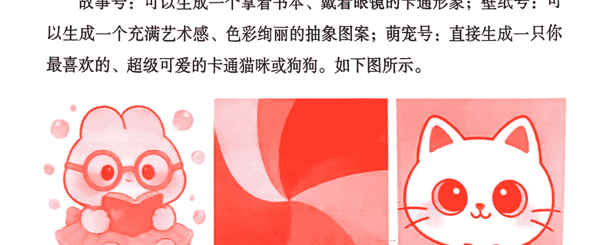
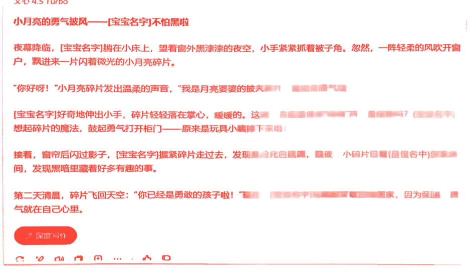
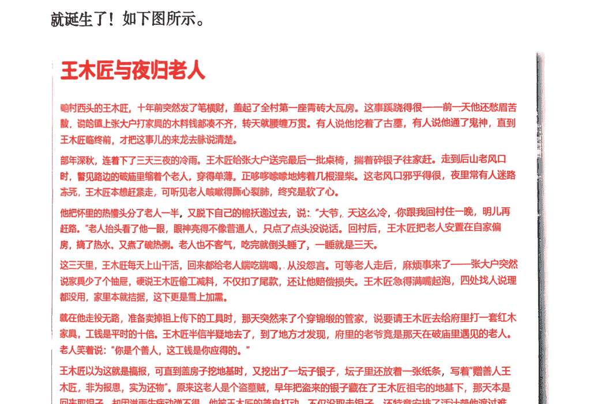
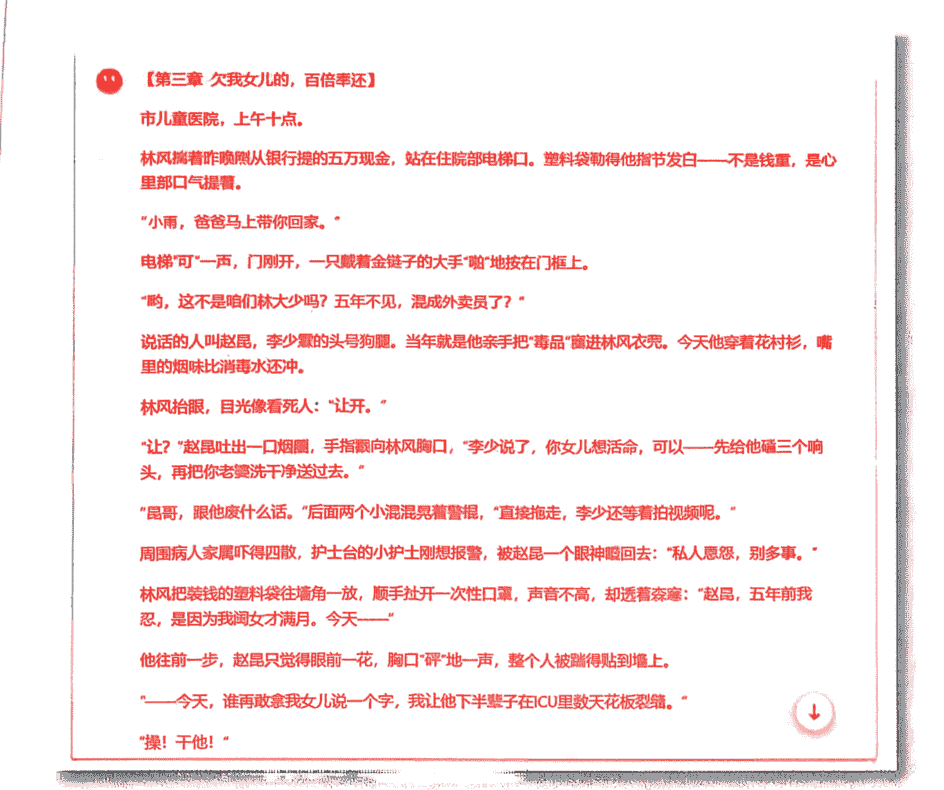
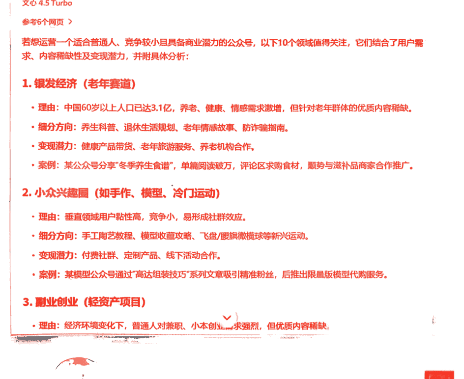
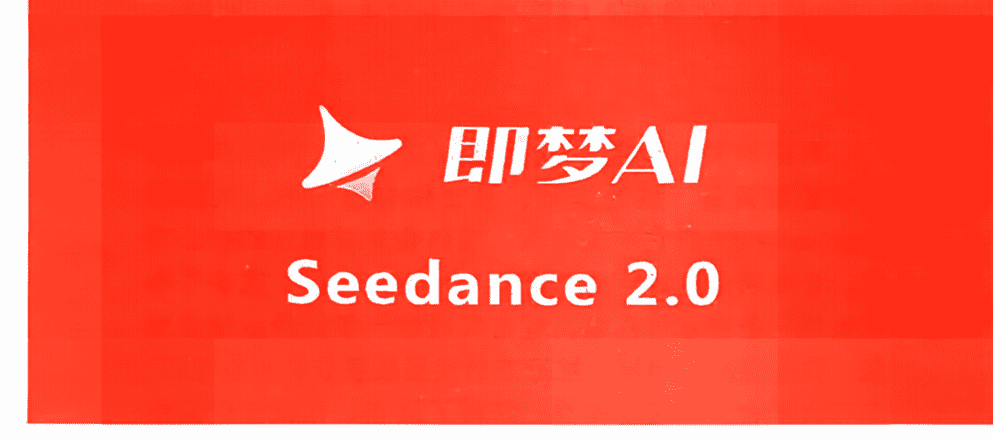
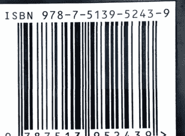

# ai创富零基础龙虾ai助理openclaw一本通


# 前言 AI赚钱，没你想的那么难

听到“AI”这两个字母，你的第一反应是什么？
是不是脑海里立刻浮现出科幻电影里冰冷的机器人、密密麻麻看不懂的代码，还有那些戴着厚眼镜、在实验室里忙碌的科学家？
是不是当你刷抖音、看小红书，发现别人用AI画几幅图、写几个段子就能轻松收获几万点赞、赚得盆满钵满时，心里既羡慕又焦虑？感觉自己像是一个被遗忘在站台上的旅客，眼睁睁看着时代的列车呼啸而去。
如果你的答案是“是”，那么，恭喜你，这本书就是为你写的。
在这里，我想先告诉你一个天大的秘密，一个很多专家不会告诉你的真相：
AI，根本不是什么高不可攀的“黑科技”，它就是我们每个人都能用的“新家电”。
回想一下，你家里第一次买微波炉的时候，你需要先去大学读个物理学位，搞懂电磁波是如何加热水分子的吗？
当然不需要！你只需要知道：把菜放进去，拧一下“高火”，叮的一声，热气腾腾的饭菜就好了。至于微波炉里面是怎么转的，那不是你需要操心的事。
今天的AI，就是这个时代的“超级微波炉”。
你不需要搞懂它背后复杂的算法和逻辑，你只需要像用微信聊天一样，在对话框里输入你的想法（我们管这叫“提示词”），然后：

- 点一下“写作”，它就能吐出一篇小红书爆款笔记；
- 点一下“画图”，它就能生成一张媲美摄影师的大片；
- 点一下“视频”，它就能帮你把文字变成有声有色的短片。

这些操作，难吗？
这一点都不难！这跟你在美团点个外卖、在滴滴打个车，没有任何区别，都不过是在手机屏幕上点几下，然后享受科技带来的便利。

# AI 创富——零基础 AI 赚钱实操指南

所以，请立刻把“学习 AI”这个听起来很沉重的词，从你的脑子里扔出去，换成“使用 AI”。

我们不是来当科学家的，我们是来当聪明的“用户”的。

作为作者，我们写这本书的唯一使命，就是把 AI 这个“超级家电”的使用说明书，翻译成最直白、最接地气的大白话，手把手教你如何用它来赚钱。

说到底，AI 创富的本质，不是让你去成为一个技术专家，而是让你拥有一个超级助理。

想象一下，你现在是一个老板，你免费招到了一个全能的实习生。他不吃不喝、不要工资、不交社保、24 小时待命，而且精通写作、绘画、剪辑、翻译……

你作为老板，只需要做一件事：学会对他发号施令。

过去，你想靠内容赚钱，你得自己是作家、是画家、是剪辑师，门槛高得吓人。

现在，你只需要做一个“会提需求的人”。AI 负责把你的想法变成现实，你负责把这些现实拿去换成真金白银。

所以，请放下你的焦虑，忘掉那些让你头疼的专业名词。

这趟 AI 创富之旅，不是一场需要你头悬梁、锥刺股的痛苦修行，而是一场充满惊喜和乐趣的新游戏。你所需要的，不是什么过人的天赋，只是一台能上网的手机和一颗愿意尝试的好奇心。

时代的大门，第一次为我们普通人开得这么大。这扇门，现在是敞开的。

你只需要抬起脚，走进来。

需要说明的是，本书所倡导的 AI 创富，绝非鼓吹“一夜暴富”的投机神话，而是基于技术工具赋能的长期价值创造。AI 能大幅降低创作、变现的门槛与成本，但任何可持续的收入增长，都离不开清晰的定位，持续的实践与对市场需求的敏锐洞察。它是放大器，而非魔法棒——能让有想法肯行动的人，把努力更快地转化为结果；但无法替代扎实的积累与对用户价值的坚守。

请以理性务实的心态，将 AI 作为提升效率的工具，而非不劳而获的捷径。

懂得了以上这些道理后，翻开下一页，我们的 AI 创富之旅，正式发车！


# 第一章

## 转变认知：人人都能靠 AI 赚钱

在正式开始 AI 创富前，我们得先把“出发前的检查清单”过一遍。这一章的任务很简单：砸碎你对 AI 的各种误解，让你明白 AI 根本不是什么天才才能玩的黑科技，而是人人都能驾驭的生产工具。我们还会告诉你，为什么在这个时代，人人都能靠 AI 赚钱，而且普通人靠 AI 赚钱的机会比任何时候都大。最后，我们会一起找到最适合你的赚钱赛道，然后把必要的账号一个不落地全部注册好。准备好了吗？发车！

### 1.1 打破高科技滤镜：AI就是个听话的工具，人人都能用

过去，一提到AI（人工智能），你是不是脑子里立刻会闪过这些画面：
一串串看不懂的绿色代码在屏幕上飞速滚动？
戴着眼镜的科学家在实验室里摆弄复杂的机器？
好莱坞大片里那些要统治地球的机器人？
……

然后，你心里可能会嘀咕：“这玩意儿太高大上了，得会编程、会算法，还得懂英语，我一个普通人，哪玩得转啊？”

如果你真是这么想的，那我可要恭喜你了，因为这本书就是专门为你而写的。我们首先要做的，就是亲手摘掉那副名叫“高科技”的滤镜，把AI拉下神坛。

真相是：今日的AI，早就不再是科学家和程序员的专属玩具了。它已经变成了一个像美图秀秀一样简单、像计算器一样好用的工具。

让我们用一个最简单的比喻来理解这件事。
想一想你每天都在用的智能手机。你知道手机的芯片是怎么设计的吗？你知道操作系统底层的代码是怎么写的吗？你不知道。但这妨碍你用它刷抖音、聊微信、叫外卖、玩游戏吗？

完全不！

因为有无数聪明的工程师，已经把所有复杂的东西都“藏”了起来，摆在你面前的，只是一个简单、直观的屏幕和几个App图标。你只需要动动手指，就能享受科技带来的便利。

现在的AI，就是这个道理！

在过去，你要让电脑画一张图，你可能真的需要学习编程。但现在，你只需要打开一个叫即梦的App，在输入框里打上一行字：“一只穿着宇航服的橘猫，在月球上喝奶茶”，然后点击“生成”，几十秒后，一张精美的图片就出现在你的面前，如下图所示。


在这个过程中，你做了什么复杂的操作吗？
没有。你只是“说出了你的想法”。
你不需要懂绘画技巧，你只需要当一个“导演”，告诉AI这个“演员”你想要什么画面。
你不需要懂复杂的算法，你只需要打开豆包或者文心一言，像跟朋友聊天一样，对它说“帮我写一段关于秋天的优美文案，要适合发小红书”，它就会立刻给你好几个选择。
说白了，AI技术本身确实很复杂，就像汽车发动机一样复杂。但我们作为使用者，需要成为一名发动机维修专家吗？不需要！我们只需要学会踩油门、刹车、打方向盘。
在AI赚钱的世界里：
“打字”和“说话”，就是你的方向盘。
豆包、剪映、即梦这些App，就是你免费的、自动挡的“汽车”。
抖音、小红书、公众号这些平台，就是通往财富的高速公路。
从现在开始，请彻底抛弃“我学不会”的念头。毕竟，我们要做的不是如何去制造AI这个“发动机”，而是如何当一名好“司机”，开着这辆免费的“神车”，在各大平台上稳稳地赚钱。你和那些所谓的AI高手之间，差的根本不是智商，也不是技术，而是一层窗户纸。

### 1.2 赚钱的真相：不是凭空变钱，而是百倍放大你的内容生产力

很多人对AI赚钱有个美丽的误会，以为它像一个神奇的聚宝盆，只要对着它输入几个字，钱就会叮叮当当地掉出来。如果你也抱着这样的幻想，那我得先给你泼一盆冷水，然后递上一桶更有用的汽油。
AI不会凭空变钱。它不是银行，也不是印钞机。
那么，AI赚钱的真正秘密是什么？答案只有五个字：内容生产力。
何谓内容生产力？
说白了，就是你制作内容（文章、图片、视频等）的速度和质量。
在互联网上，无论是抖音、小红书还是公众号，它们本质上都是一个巨大的“内容市场”。用户花时间在这里，消费的是什么？就是内容。平台靠什么吸引用户？也是内容。我们想在里面赚钱，靠什么？归根结底，还是得靠我们自己生产的内容。

#### 我们先来想象一个传统的“内容小作坊”

你想做一个讲历史故事的抖音号。在没有AI的时代，你的工作流程可能是这样的：

1. 选题。花1小时泡在网上，找一个有趣的历史人物。
2. 搜集资料。花2小时阅读各种百科、野史、论文，把关键信息整理出来。
3. 写稿。花2小时把资料组织成一个引人入胜的短视频脚本。
4. 找素材。花1小时在各种素材网站上找匹配的图片或视频片段。
5. 配音剪辑。花2小时把稿子念一遍，再把音频、画面、字幕等对齐、配上音乐。

一套流程下来，8个小时过去了。你精疲力竭，总算做出了一条1分钟的短视频。如果运气好，这条视频火了，你赚到了流量收益和粉丝。但更多时候，它可能就几十个播放量。而你，一天最多也就能生产这么一条。

这就是你过去的内容生产力——纯手工、效率低、产出有限。就像一个农夫，拿着一把锄头去开垦一片荒地，累死累活，一天也就能开出一小块。

#### AI如何将你的“生产力”放大100倍？

现在，我们给这位农夫配上一台“超级收割机”，这台收割机就是 AI。看看同样的工作，流程会变成什么样。

1. 选题。你对豆包说：“给我10个适合做短视频的、有反转的冷门历史故事。”10秒后，一份清单摆在你面前。
2. 搜集与写稿。你选定“明朝最牛木匠皇帝”，然后对 AI 说：“帮我把这个故事写成一个1分钟的短视频脚本，要有悬念，语言要口语化。”1分钟后，一篇结构完整的脚本诞生了。
3. 生成视频。你把脚本复制到剪映的“图文成片”功能里，点击“一键生成”。系统自动为你匹配画面、生成 AI 配音、配上背景音乐和字幕。
4. 修改优化。AI 生成的初稿可能有点呆板，你花15分钟，替换几个不满意的画面，调整一下配音的语气，让视频更有“人味儿”。

整个过程，从想法到成品，可能只需要20分钟。

现在算一算：过去8小时（480分钟）出1条视频，现在20分钟出1条，如下图所示。


你的效率提升了多少倍？答案是24倍！如果你再熟练一点，或者同时开几个项目，这个数字还会成倍增长。

过去，你是一个拿着锄头的农夫；现在，你是一个坐在收割机驾驶室里的操作员。你不再需要干那些重复、劳累的体力活，你的核心工作，变成了“构思”和“决策”。

#### 这，就是AI赚钱的底层逻辑

1. 它把你的时间从重复性劳动中解放出来。过去你80%的时间在“执行”，20%的时间在“思考”。现在反过来了，你80%的时间都在思考“做什么内容能火”，20%的时间用来指挥AI完成制作。
2. 它让你有能力实现规模化生产。过去你一天只能更新一个账号的一条内容。现在，你一天可以轻松更新三五个账号，每个账号发两三条内容。在互联网这个“以量取胜”的赛场上，你的赢面大大增加了。
3. 它降低了你成为“专家”的门槛。你不会画画？没关系，即梦可以让你成为“灵魂画手”。你文笔不好？没关系，文心一言可以帮你写出爆款文案。AI补上了你的短板，让你能和那些专业选手站在同一条起跑线上。

所以，请记住，我们利用AI赚钱，不是因为它会魔法，而是因为它是一个前所未有的“效率放大器”。它把你的一份时间和一份创意，放大了几十上百倍，变成了几十上百份可以发布出去的内容。而这些海量的内容，就是你在互联网上捕获流量、吸引粉丝、最终实现变现的“渔网”。

你的角色，也从一个埋头苦干的“工匠”，转变为一个指挥AI军团作战的“将军”。你负责制订战略（做什么方向）、下达指令（怎么做），以及检阅成果（最终审核）。
明白了这一点，你就掌握了AI赚钱的精髓。

### 1.3 你的“新矿山”：抖音、小红书、公众号里的AI黄金

手里有了AI这台强大的效率放大器，就像一个准备去淘金的工人，终于领到了一台最先进的挖掘机。那么，我们该开着这台挖掘机，去哪里挖金子呢？
金子，当然埋在矿山里。在咱们的AI赚钱世界里，这些富得流油的“新矿山”，就是那些你每天可能都要花上几个小时去刷的平台：抖音、小红书、公众号（以及头条号、百家号等图文平台）。
为什么说它们是“矿山”？因为那里埋藏着当今互联网上最宝贵的资源——用户的注意力，也就是我们常说的“流量”。
流量，就是金子。谁能吸引到用户的眼光，谁就拥有了变现的可能。
不过，不同的矿山，地质构造不一样，埋藏的金矿品位也不同，需要我们用不同的挖掘姿势。这些话，听起来是不是有点晕？下面，我们把这些大矿山一个个掰开来看，你就明白该从哪下手了。

#### 抖音/快手：流量的“露天金矿”


特点：短、平、快，情绪价值拉满。

你可以把抖音想象成一个极其热闹、人声鼎沸的“淘金小镇”。这里人流量巨大，机会遍地都是，一夜暴富的故事每天都在上演。这里的“金子”往往是那种巨大、闪亮的“狗头金”，也就是我们说的“爆款视频”。

抖音的用户来这里，不是为了学习复杂知识的，他们是为了放松、娱乐，追求的是瞬间的眼球刺激和情绪共鸣。一个治愈的风景、一个反转的故事、一段魔性的音乐，都能在几秒钟内抓住他们。

#### AI在这里能做什么？

AI简直就是为了抖音这种“露天金矿”而生的。上一节我们讲过，AI能把视频制作时间从8小时缩短到20分钟。这意味着什么？

意味着你可以用AI，像流水线一样批量生产出符合抖音用户喜好的内容。

用即梦生成一堆唯美的古风帅哥美女，再用剪映配上古风音乐做成卡点视频。

用豆包写一百个民间小故事，再用剪映的图文成片功能，一天就能生成十几条故事视频。

用AI绘画工具生成各种可爱的猫猫狗狗图片，配上治愈文案和音乐，就是一个萌宠号。

挖掘策略：在抖音这座矿山，核心策略是“以量取胜，广撒网，等爆款”。因为AI大大降低了你的生产成本，你不用再像过去一样赌一条视频的命运。你可以一天发三五条，一周测出七八个方向，总有一款能“炸”出平台给你的巨大流量。

#### 小红书：品质生活的“精品钻石矿”

特点：颜值即正义，实用且精致。


如果说抖音是热闹的淘金小镇，那小红书就像一个装修精美的“珠宝精品店”。来这里的人，目的性更强，她们追求的是生活品质、是变美技巧、是实用攻略。这里的“矿产”不

## 第一章 转变认知：人人都能靠 AI 赚钱

是“狗头金”，而是“高品质钻石”，也就是那些购买力强、黏性高的精准粉丝。

在小红书，一张不好看的图，可能就直接被划过去了。一篇没有干货的笔记，也很难获得收藏。这里的用户非常有耐心看一篇长长的“种草”笔记，前提是你的内容足够吸引她。

#### AI在这里能做什么？

AI的绘画和设计能力，在小红书这座“钻石矿”里能发挥到极致。

想做壁纸号？用即梦或文心一格生成各种风格的高清壁纸，每天发几张，引导粉丝去你的私域下载原图。

想做穿搭号？用AI生成虚拟模特，搭配各种风格的服装，做出穿搭效果图，既新颖又不会有真人出镜的烦恼。

想做家居号？用AI生成不同风格的室内设计效果图，分享装修灵感，吸引备婚备孕的精准用户。

文案不够吸引人？用豆包或文心一言，让它模仿小红书爆款笔记的语气，帮你写出让人一看就想“码住”的标题和正文。

挖掘策略：在小红书，核心策略是“深耕垂直，打造美感，建立信任”。你不需要追求千万播放，但你需要服务好你的几千、几万个精准粉丝。用AI帮你打造专业、精美的视觉形象，再用真诚的内容去“种草”，粉丝的商业价值会非常高。

#### 公众号/头条号：深度内容的“知识金矿”


特点：深度、逻辑、沉淀。

公众号和头条号这类平台，更像一个安静的“图书馆”或“档案馆”。这里的用户愿意花更长的时间去阅读一篇几千字的文章，他们追求的是深度信息、独到观点和系统知识。这里的“金矿”是“长期信任”，一旦用户认可你，他们会成为你最忠实的读者，付费意愿也最高。

在这里，快餐式的短视频行不通，浮于表面的图文也留不住人。你需要提供真正有价值、有深度的内容。

#### AI在这里能做什么？

这正是AI大语言模型的强项，特别是像DeepSeek、腾讯元宝这样擅长处理长文本的工具。

想写历史故事？让AI帮你搜集整理某个历史人物的生平资料，并为你搭建文章框架。

想做书单号？读完一本书，让AI帮你快速提炼核心观点和金句，大大缩短你写读后感的时间。

想追热点新闻？让AI帮你汇总全网关于某个热点事件的报道，并从不同角度进行分析，为你提供写作灵感。

挖掘策略：在公众号这座矿山，核心策略是“价值为王，建立专业，长期陪伴”。AI在这里不是你的“代笔”，而是你最高效的资料搜集员、写作助理、灵感激发器。它帮你处理掉80%的资料整理工作，让你能专注于那20%最核心的观点输出和逻辑梳理，持续产出高质量长文，最终通过广告、付费阅读或知识服务来变现。

现在，三座主要的“新矿山”已经清晰地展现在你面前了。它们各有特点，也各有宝藏。你手里的AI工具，就像一把万能钥匙，可以帮你打开每一座矿山的大门。

### 1.4 找准你的赛道：从兴趣出发，选一个最容易上手的方向

赛道，听起来有点专业，其实就是你要长期去做的一个内容方向。比如“AI画头像”就是一条赛道，“AI讲故事”是另一条赛道，“AI做壁纸”又是另一条赛道。

为什么一定要选赛道？

我能不能今天画头像，明天讲故事，后天做壁纸？

当然不行！想象一下，你关注了一个美食博主，是因为想学做菜。结果他今天发做菜视频，明天发打游戏直播，后天发他家猫咪睡觉。你是不是会觉得莫名其妙，然后默默地取关？

平台算法也是一个道理。它会根据你发布的内容，给你贴上一个“标签”。如果你一直发美食，你的标签就是“美食博主”，平台就会把你的视频推荐给其他喜欢看美食的人；如果你发的内容杂乱无章，平台就会“蒙圈”，不知道该把你推荐给谁，你的流量自然就起不来了。

所以，专注，是互联网内容创作的第一法则。你必须像一个开专卖店的老板，而不是一个什么都卖的杂货铺。

那么，面对五花八门的赛道，我们该如何选择呢？

答案很简单，只有两个关键词：兴趣和简单。

#### 兴趣：你的“精神燃料”

很多人做副业，上来就问：“哪个最赚钱？”这是一个巨大的误区。最赚钱的赛道，往往也是竞争最激烈的、最需要专业度的。一个新手猛冲进去，很容易被撞得头破血流，然后迅速放弃。

正确的思路是，把 AI 赚钱这件事，先当成一个游戏或者一个爱好来玩。

想一想：

1. 你平时最喜欢做什么来打发时间？
2. 你是不是个故事迷，特别喜欢看历史故事、民间传说？
3. 你是不是个颜值控，手机里存满了各种好看的壁纸和头像？
4. 你是不是个宝妈/宝爸，每天都在研究怎么给孩子讲故事、做启蒙？
5. 你是不是个电影迷，对各种科幻、魔幻电影的画面如数家珍？

……

你的兴趣，就是你最好的起点。因为兴趣会给你提供源源不断的“精神燃料”。

在账号刚起步、没什么人看的时候，是兴趣推着你，让你觉得这件事本身就很有趣；在遇到瓶颈、不知道做什么内容的时候，是兴趣帮你打开思路，让你从自己喜欢的东西里找灵感。

如果你做的是自己毫无感觉、只是听说很赚钱的事情，那么最初那点赚钱的激情很快就会被枯燥感和挫败感耗尽。记住，能让你坚持下去的，从来不是一时的暴利，而是持续的热爱。

#### 简单：选择“新手村”开局

光有兴趣还不够，我们还要考虑实现难度。一个刚学会开车的司机，不会马上就去挑战秋名山的发夹弯。同理，我们新手也要从最平坦、最宽阔的“新手村”赛道开始。

下面，我为你列举几个完美结合了兴趣与简单的新手友好型赛道，你可以看看哪个最让你心动：

1. 视觉冲击类赛道（适合颜值控）
   - 方向：AI头像/壁纸/手机壳等图案。
   - 平台：小红书、抖音等。
   - 为什么简单？这类赛道几乎不需要你写复杂的文案，核心就是“用AI生成好看的图”。你的主要工作，就是研究什么样的图片风格最受欢迎，然后不断地下指令让AI画出来。门槛极低，反馈极快，一张好看的图很容易就带来点赞和收藏。

2. 故事叙述类赛道（适合故事迷）
   - 方向：AI民间故事/神话传说/历史趣闻。
   - 平台：抖音、快手、视频号。
   - 为什么简单？你不需要自己编故事！中华上下五千年，有取之不尽的素材库。你要做的，就是当一个故事搬运工和加工者。让AI帮你搜集故事、写成脚本，然后用剪映一键生成视频。你甚至不用自己配音，AI语音库里有各种声音供你选择。

3. 情感共鸣类赛道（适合文艺青年或暖心派）
   - 方向：治愈系风景/AI萌宠/励志语录。
   - 平台：抖音、小红书等。
   - 为什么简单？模式极其固定。一张AI生成的唯美风景图，配上一段AI生成的心灵鸡汤文案，再加上一段舒缓的音乐，就是一个完整的作品。这种内容主打一个陪伴感，制作起来毫无压力，非常适合佛系玩家。

4. 亲子教育类赛道（适合宝妈宝爸）
   - 方向：AI儿童绘本/睡前故事/识字卡片等。
   - 平台：小红书、视频号。
   - 为什么简单？需求非常刚性。家长们永远需要新的故事和素材来教育孩子。你可以让AI生成可爱的卡通形象和简单的故事情节，做成一个又一个的小视频或图文笔记。这既能赚钱，也是在为自己的孩子创作独一无二的亲子内容。

现在，问问自己：上面这几条赛道，哪一个让你感觉最轻松、最想马上动手试一试？那么，它就是你应该开始尝试的赛道。记住，做事要专一，不要贪多，不要想着全都要。

### 1.5 账号准备：手把手教你注册抖音、小红书、百家号等赚钱平台

选好了赛道，就像我们在手机导航上设定好了目的地一样。现在，我们得把自己的“座驾”——也就是你在平台上的赚钱账号——给收拾利索了，加满油，准备出发。

很多人觉得，注册账号嘛，不就是下载App，输入手机号、点几下“同意”那么简单？

没错，从技术上说是这样。但这就好比同样是开一家店，有的人只是把货物随便往地上一堆就开始叫卖，而有的人则会精心设计门头、布置橱窗、打上明亮的灯光。哪一家更容易吸引顾客，一目了然。

我们的账号，就是我们在互联网上的“线上门面”。这个门面装修得好不好，直接决定了用户刷到你时，愿不愿意“走进来”看一看。下面，我们就来当一回“装修师傅”，手把手教你把这个门面搭得既专业又漂亮。

这个“装修”过程，不需要你花一分钱，只需要你花一点点心思。

##### 第一步：懂得账号装修的“四大金刚”

无论你选择抖音、小红书还是其他平台，有四个核心要素是通用的。掌握这“四大金刚”，你的账号就已经成功了80%。

###### 1. 你的头像——店铺的“Logo”

头像是用户对你的第一印象，千万别用那些模糊的风景照，或者看不清是啥的网图，必须清晰、有辨识度。

怎么做？最简单、最高效的方法，就是用AI给自己画一幅图。可以打开即梦，根据你选择的赛道，生成一个专属头像。

- 故事号：可以生成一个拿着书本、戴着眼镜的卡通形象；
- 壁纸号：可以生成一个充满艺术感、色彩绚丽的抽象图案；
- 萌宠号：直接生成一只你最喜欢的、超级可爱的卡通猫咪或狗狗。

如下图所示。



记住一个原则：一旦选定，不要轻易更换！你的头像就是你的品牌 Logo，要让用户在信息流里一眼就能认出你。

###### 2. 你的昵称——店铺的“招牌”

昵称就是你的店名，要让用户一看就知道你是干吗的。一个好的昵称，等于一句免费的广告语。

黄金公式：领域+人设/特点。比如：做AI故事的，可以叫“AI奇闻档案馆”“老王的AI故事铺”；做AI壁纸的，可以叫“赛博壁纸匠”“AI壁纸少女心”。

避坑指南：不要用一堆看不懂的英文+数字，比如“user123xyz”；不要用生僻字或特殊符号，别人想搜都搜不到你；名字要朗朗上口，最好不要超过7个字。

###### 3. 你的简介——店铺的“迎宾语”

当用户点进你的主页时，简介是唯一能快速告诉他“我是谁，我能给你带来什么”的地方。写好简介，是留住粉丝的关键一步。

黄金公式：一句话定位+内容价值+关注引导。一句话定位：“每天用AI为你画一张绝美壁纸”；内容价值：“治愈你的审美，点亮你的手机屏幕”；关注引导：“喜欢就点个关注吧，每天都有新惊喜。”这样合起来就是一段完美的简介。你还可以加上你的更新频率，比如“日更”，给用户一个稳定的预期。

###### 4. 你的背景图——店铺的“海报墙”

主页背景图是头像后面的那张大图，是展示你账号风格的绝佳位置。

怎么做？同样，用AI生成一张符合你账号整体风格的高清大图。比如：壁纸号可以直接放一张你最得意的作品；故事号可以用一张复古的羊皮卷地图，如下图所示。


原则：保持简洁、美观，与你的头像、昵称等风格统一。

##### 第二步：注意三大平台各有讲究

虽然“四大金刚”是通用的，但不同平台在注册和设置上，还是有一些细微的差别和侧重点。

###### 1. 抖音/快手

注册步骤（以抖音为例）：

1. 在手机应用软件上下载并打开抖音App，点击首页“注册”按钮。
2. 选择“手机注册”，输入本人实名手机号，点击“获取验证码”。
3. 填写短信中的6位验证码，设置8位以上含字母与数字的密码。
4. 点击“注册”后完善昵称、头像等资料即可使用。

装修重点：抖音是“一眼定生死”的地方，所以头像和昵称的冲击力尤为重要。你的名字和头像必须在零点几秒内就抓住用户的眼球。简介可以相对简单直接。

###### 2. 小红书

注册步骤：

1. 在手机应用软件上下载小红书App后，打开后点击“注册/登录”。
2. 输入手机号码，获取并填写验证码即可注册。

装修重点：小红书社区氛围浓厚，用户更喜欢“真人感”。所以你的昵称和简介要更有温度，更像一个活生生的人在分享。比如“一个爱用AI画画的上班族”。简介里可以多用一些可爱的Emoji表情，拉近距离。

###### 3. 百家号/头条号（图文平台）

注册步骤（以百家号为例）：

1. 访问平台：
   - 电脑端：打开浏览器，搜索“百家号官网”（https://baijiahao.baidu.com/builder/theme/bjh/login）进入。
   - 手机端：在手机应用软件上下载“百家号”App，或通过百度App内“我的”页面找到百家号入口。
2. 选择注册方式：
   - 支持百度账号（手机号/邮箱）直接登录，或使用微信、QQ快捷登录。
3. 选择账号类型：
   - 个人账号：适合自媒体作者、普通用户。
   - 企业/机构账号：适合公司、媒体、组织等（需营业执照等资质）。
   - 根据身份选择对应类型，提交后不可更改。
4. 填写资料：按提示填写姓名、手机号、辅助信息等。上传身份证照片（个人）或营业执照（企业），完成实名认证。
5. 等待审核：提交后通常1—3个工作日完成审核，结果会通过短信通知。

装修重点：图文平台的用户更看重专业性。你的昵称和简介最好能体现与你的专业感和权威感。比如“AI历史解密官”“深度财经AI解读”，这能让用户在阅读你的文章前，就建立起一份信任。

##### 第三步：养号

账号注册完毕，门面也装修好了。现在是不是可以发布作品了？千万不要！这就好比你新搬到一个小区，不能第一天就在门口支个摊子大声叫卖。你得先在小区里逛逛，跟邻居们打打招呼，让大家认识你，也让你自己熟悉一下环境。这个过程，就叫“养号”。

养号的目的是让平台系统知道：你是一个正常的、活跃的真人用户，而不是一个只会发广告的营销机器。同时，也是在告诉系统“我喜欢看××领域的内”，这样系统未来才会把你的作品推荐给同样喜欢这个领域的人。

怎么养？非常简单，就四个字：模拟日用。在注册后的前3—5天，先不要发布任何作品。每天花15—30分钟，去刷你选定赛道的内容。比如你做故事号，就多去看别人的故事视频；你做壁纸号，就多去搜、去看、去点赞收藏别人的壁纸。

要互动！看到好的作品，点个赞，写一句真诚的评论（不要只发“666”），关注几个你这个领域的头部大号。整个过程，就像你平时刷手机一样，自然一点。

完成养号这一步，你的账号就已经进入了最佳状态。它像一辆预热完毕的赛车，停在起跑线上，引擎发出低吼，只等你的第一份作品发布，就能猛地冲出去。

至此，万事俱备，只欠东风。你的“战车”已经整备完毕，下一章，我们就来正式分发武器，为你介绍那些能帮你开疆拓土的“AI神兵利器”。

## 第二章 养好 OpenClaw：自动化工作流的掘金利器

如果说豆包、千问、元宝等 AI 工具是你的“创意大脑”，那 OpenClaw 就是你的“数字双手”：它能把你的想法变成自动执行的流水线，让你从重复劳动中彻底解放出来。这一章的关键词是“自动化思维”：我们不是用 OpenClaw 做一两件事，而是搭建一套“一次配置，永久运行”的赚钱系统。我们会带你认识 OpenClaw 的前世今生，拆解它的核心架构，再手把手教你三个实操案例：多平台内容自动发布、个人效率流水线搭建。掌握了这些，你就能让 AI 真正替你 24 小时工作，把时间和精力留给更有价值的事。

### 2.1 认识OpenClaw：它到底是什么，适合哪些人使用？

你有没有幻想过拥有一个“数字员工”——它不用睡觉、不用发工资，只要你交代一句，就能帮你处理邮件、发布视频、整理文件，甚至写代码？以前这听起来像科幻小说，但现在，一款叫OpenClaw的工具让这个幻想变成了现实。

#### OpenClaw到底是什么？

简单说，OpenClaw是一个开源的AI智能体。你可能听过“智能体”这个词，听起来很高大上，其实说白了，它就是一个能替你干活的人工智能程序。

和我们平时用的聊天AI（比如豆包、文心一言）不同，聊天AI是“你说一句它回一句”，像个百科全书；而OpenClaw是“你交代一个任务，它主动去执行”，像个员工。你只需要在微信、WhatsApp或者Slack这些聊天软件里给它发条消息，说：“帮我登录公众号后台，把昨天写好的文章发布出去，再同步到知乎和今日头条。”然后OpenClaw就会自己打开电脑、登录账号、上传内容、点击发布——整个过程不需要你动手。

更厉害的是，它可以深入你的电脑系统，操作各种软件。只要你授权，它能读取你的邮件、整理你的文件夹、编写Excel报表，甚至帮你登录社交媒体账号发帖。它就像一个隐形的“电脑操作员”，24小时在线，随叫随到。

#### OpenClaw的“神奇”之处从哪来？

OpenClaw的核心架构由四个部分组成，我们会在下一节详细讲，这里先简单打个比方。

- Gateway（网关）是它的“耳朵和嘴巴”，负责接收你的指令，再把结果反馈给你。你可以在微信里跟它聊天，就像和朋友发消息一样。
- Agent（智能体）是它的“大脑”，负责理解你的任务，拆解成一步步的操作。
- Skills（技能）是它的“工具箱”，里面装了各种能力，比如读文档、写代码、发邮件、操作浏览器。
- Memory（记忆）是它的“记事本”，让它能记住之前的任务，保持连续性。

有了这套组合，OpenClaw就像人一样完成复杂的工作流。而且它完全开源，你可以免费使用，也可以根据自己的需求修改它。

#### OpenClaw 的“改名风波”

你可能会在网上搜到它以前的名字：Clawdbot、Moltbot。没错，它在短短三个月里改过两次名。第一次是因为被一家美国公司指控侵权，被迫从 Clawdbot 改成 Moltbot（意思是“蜕皮重生”）；三天后又因为用户太困惑，最终定名为 OpenClaw。虽然名字换了又换，但核心功能一直没变，反而因为这次风波吸引了更多人的关注。国内云厂商（腾讯云、阿里云等）也火速跟进，提供了一键部署服务，让普通人用上它的门槛大大降低。

#### 普通人都能用 OpenClaw 赚钱吗？适合哪些人？

OpenClaw 不是程序员的专属玩具，它对普通人同样友好。只要你会打字、会发消息，就能指挥它干活。下面这几类人尤其适合用它来“掘金”。

- 做自媒体、短视频的内容创作者：你可以让 OpenClaw 自动把你的视频同步发布到抖音、快手、B站、视频号；也可以让它定时去各平台抓取热点话题，整理成选题库，省去每天刷手机找灵感的麻烦。
- 开网店、做微商的小老板：OpenClaw 可以自动回复客户常见问题，自动处理订单，甚至帮你生成商品描述文案。你睡觉的时候，它还在帮你接单。
- 上班族、自由职业者：每天早上让它汇总邮件、整理待办事项；让它自动下载报表、生成周报；让它帮你搜索资料、整理成文档。原本要花两小时的手工活，交给它几分钟就搞定。
- 有想法但不会编程的普通人：比如你想写一个小工具，但不会写代码、可以让OpenClaw去调用其他AI帮你写，或者直接让它执行一些重复性操作，比如批量下载图片、批量修改文件名。
- 想搞副业的“斜杠青年”：你可以把OpenClaw部署在云服务器上，然后把它“租”给别人用——比如帮小商家搭建自动回复系统，帮博主做多平台分发，赚点技术服务费。

#### 使用OpenClaw需要技术门槛吗？

不需要。现在主流云厂商（腾讯云、阿里云、百度智能云等）都提供了OpenClaw的一键部署服务，你只需要在云控制台上点几下鼠标，就能拥有一个属于自己的OpenClaw实例。然后通过微信、钉钉或者网页后台和它对话，跟聊天一样简单。而且，OpenClaw支持中文指令，你直接用大白话交代任务就行，不用写代码。

当然，如果你想用它做更高级的事情，比如自己开发新功能，那可能需要一点技术基础。但对绝大多数普通人来说，直接用现成的功能已经足够“掘金”了。

#### 小提醒：用好“利器”也要守好“规矩”

OpenClaw虽然强大，但也要提醒一句：因为它能深入你的电脑和网络账号，所以安全性特别重要。你用它的前提是，必须清楚哪些权限可以给，哪些数据不能让它碰。我们会在本章最后一节专门讲“安全红线”，教你合规使用、避免踩坑。

### 2.2 核心架构解析：Gateway、Agent、Skills、Memory 如何协同工作

上一节我们认识了 OpenClaw 这个“数字员工”——你交代任务，它主动执行。但你可能会好奇：它到底是怎么听懂人话，又是怎么完成那些复杂操作的？这一节我们就拆开它的“身体”，看看里面的构造。
OpenClaw 的核心架构由四个模块组成。

#### 一、Gateway（网关）：数字员工的“耳朵和嘴巴”

Gateway 是 OpenClaw 和外界沟通的窗口。你的指令要通过它才能传进去，OpenClaw 的回复也要通过它才能让你看到。

##### 它能听懂什么？

Gateway 最厉害的地方是支持多种“对话渠道”。你可以通过以下方式和 OpenClaw 交流：

- 1. 即时通信软件：比如微信、企业微信、WhatsApp、Slack。你就像给朋友发消息一样，在聊天框里告诉 OpenClaw 要做什么。
- 2. 网页后台：登录 OpenClaw 的管理界面，在对话框里输入指令。
- 3. API 接口：如果你是技术人员，也可以直接把 OpenClaw 接入自己的系统，让其他软件自动调用它。

##### 它怎么工作？

当你发出一条消息，比如“帮我登录公众号后台，把今天写好的文章发布出去”，Gateway 会做三件事。

- 1. 接收：把你的文字指令接收下来。
- 2. 转换：把自然语言转换成 OpenClaw 内部能理解的“机器语言”。
- 3. 传递：把处理好的指令传给 Agent（大脑）。

反过来，当 Agent 完成了任务，Gateway 会把结果翻译成你能看懂的话，再通过同样的渠道反馈给你：“文章已发布成功，链接是×××。”

##### 为什么 Gateway 很重要？

没有 Gateway，OpenClaw 就是个“聋哑人”——你没法指挥它，它也没法告诉你结果。正因为 Gateway 的存在，你才能像和朋友聊天一样，用最自然的方式使用这个强大的工具。

#### 二、Agent（智能体）：数字员工的“大脑”

Agent 是整个 OpenClaw 的“决策中心”，也是最核心的部分。它的任务是想清楚：用户到底要我做什么？我该怎么做？需要用到哪些工具？

##### 它是怎么思考的？

当你发出一条指令，Agent 会经历几个步骤。

- 1. 理解任务：先分析你的话到底是什么意思。比如你说“帮我处理邮件”，Agent 会判断：是要读邮件？回邮件？还是整理邮件？它需要了解你的真实意图。
- 2. 拆解步骤：把一个复杂任务拆成一个个小步骤。比如“发布文章”这个任务，可能拆成：打开浏览器→登录公众号后台→进入素材库→找到今天写的文章→点击发布→确认发布成功。每个步骤都要想清楚。
- 3. 调用资源：想清楚步骤之后，Agent 会判断每个步骤需要用到什么“技能”——比如打开浏览器需要调用浏览器操作技能，输入账号密码需要调用键盘输入技能。
- 4. 指挥执行：把具体干活的任务分配给 Skills 模块，然后监督每一步的执行情况。
- 5. 处理意外：如果执行过程中出错了（比如网页打不开、登录失败），Agent 要想办法处理——是重试一次，换个方法，还是向你求助？

##### Agent 的“聪明”从哪来？

Agent 之所以能理解任务、拆解步骤，背后是大语言模型在支撑。你可以把它理解成一个内置了“GPT”大脑的指挥官。但它和普通聊天 AI 最大的不同是：聊天 AI 只会“说”，而 Agent 会“做”——它不光想清楚怎么做，还会真的动手去干。

#### 三、Skills（技能）：数字员工的“手脚和工具”

如果说 Agent 是大脑，那 Skills 就是四肢。大脑想出办法之后，要靠手脚去执行。Skills 模块里装满了各种各样的“技能”，每个技能都能完成一类具体操作。

**OpenClaw 有哪些常见技能？**

- 1. 浏览器操作技能：可以自动打开网页、点击按钮、填写表单、滚动页面、截图保存。这个技能用来操作各种网页后台，比如公众号、抖音、小红书。
- 2. 文件操作技能：可以读取、编辑、保存各种文件，比如 Word 文档、Excel 表格、PDF 文件、TXT 文本。这个技能用来处理本地文件。
- 3. 系统操作技能：可以打开电脑上的软件、执行命令行、管理文件夹。这个技能让 OpenClaw 像真人一样操作你的电脑。
- 4. 网络请求技能：可以访问网站 API、下载网络资源、上传文件到服务器。这个技能用来和互联网上的各种服务打交道。
- 5. 代码执行技能：可以直接运行 Python、JavaScript 等代码。这个技能让技术人员可以扩展 OpenClaw 的功能。
- 6. 社交媒体技能：可以登录各大平台、发布内容、获取数据、自动回复。这个技能是做自媒体变现的利器。

**技能是怎么调用的？**

Agent 在拆解任务时，会判断每一步需要用什么技能。比如“登录公众号”这一步，Agent 会调用“浏览器操作技能”里的“打开网页”和“填写表单”子功能。技能模块执行完成后，会把结果反馈给 Agent：“登录成功”或者“登录失败，需要验证码”。

技能模块最大的特点是“可扩展”——如果你需要某个技能但 OpenClaw 没有自带，你可以自己写一个，或者从社区下载别人分享的插件装上。这就让 OpenClaw 的能力可以无限扩展。

#### 四、Memory（记忆）：数字员工的“记事本”

Memory 是 OpenClaw 的记忆系统，负责保存它在执行任务过程中产生的各种信息。没有记忆，OpenClaw 就是“做完就忘”，没法处理需要上下文的任务。

##### Memory 记什么？

- 1. 任务上下文：比如你正在处理的这个任务，已经执行到哪一步了，之前执行的结果是什么。有了这个，Agent 才能保证任务的连续性。
- 2. 用户偏好：比如你习惯用哪个邮箱发邮件、喜欢在什么时间发布内容。记住这些之后，下次你再交代类似任务，OpenClaw 就能自动按你的习惯来。
- 3. 账号信息：在安全授权的前提下，记录你各个平台的账号密码（当然是加密存储的），省得每次都要重新输入。
- 4. 历史数据：比如之前生成过的文章、处理过的文件、回复过的客户消息。需要的时候可以随时调取。
- 5. 学习经验：比如某次任务执行失败了，为什么失败的？下次遇到类似情况怎么避免？OpenClaw 可以把这些“教训”记下来，慢慢变得更聪明。

##### Memory 分几种？

OpenClaw 的记忆分为“短期记忆”和“长期记忆”。

- 1. 短期记忆：只记住当前正在执行的任务，任务完成后就清空。有点像你大脑里的“工作记忆”。
- 2. 长期记忆：会保存在数据库里，下次启动 OpenClaw 还能调用。有点像你长期记住的经验和知识。

用户也可以手动管理记忆——哪些信息允许记住，哪些必须删除，都可以设置。

##### 各个模块如何协同工作？

现在我们把四个模块串起来，看看一个完整的任务是怎么执行的。
假设你通过微信给 OpenClaw 发了一条消息：“帮我登录我的抖音账号，把昨天拍的视频发布出去，配文用我常用的那种风格。”
整个过程是这样的。

**第一步：接收指令（Gateway）**
微信消息被 Gateway 接收，转换成内部指令，传给 Agent。

**第二步：拆解任务（Agent）。**
Agent 分析指令，拆解成几个步骤。

- 1. 打开浏览器
- 2. 访问抖音网页版
- 3. 输入账号密码登录
- 4. 进入视频上传页面
- 5. 找到昨天拍的视频文件
- 6. 上传视频
- 7. 生成配文（需要调取“常用风格”的记忆）
- 8. 填写配文
- 9. 点击发布
- 10. 确认发布成功

**第三步：调用技能（Skills）。**
Agent 按顺序指挥 Skills 模块干活：

- 1. 浏览器技能打开抖音网页。
- 2. 登录技能填写账号密码（账号密码从 Memory 调取）。
- 3. 文件技能找到本地视频。
- 4. 上传技能把视频传上去。
- 5. 文案生成技能根据记忆里的“常用风格”生成配文。
- 6. 浏览器技能填写配文、点击发布。

每一步执行完，Skills 都会把结果告诉 Agent。

**第四步：记录进度（Memory）。**

整个过程，Memory 一直在记录：

- 1. 当前执行到哪一步了。
- 2. 刚才登录成功了没有。
- 3. 配文生成用了什么风格。
- 4. 发布成功的链接是什么。

如果执行到一半网络断了，Agent 重启后，可以从 Memory 里读取进度，继续执行，不用从头再来。

**第五步：反馈结果（Gateway）。**

全部完成后，Agent 把结果汇总，传给 Gateway。Gateway 把结果翻译成你能看懂的话，通过微信发给你：“视频已发布成功，链接是×××，预计播放量×××。”

至此，一个完整的任务闭环就完成了。

##### 小结：一台精密的“自动化机器”

Gateway、Agent、Skills、Memory 这四个模块，就像一台精密机器的四个部件，各司其职又紧密配合。Gateway 负责对外沟通，Agent 负责思考决策，Skills 负责具体执行，Memory 负责记录学习。缺了任何一个，OpenClaw 都没法正常工作。

理解了这个架构，你就明白了 OpenClaw 为什么这么强大：它不是简单的“聊天机器人”，而是一个能思考、能行动、能记忆的完整智能体。

### 2.3 实操案例一：用 OpenClaw 自动化多平台内容发布

做自媒体的朋友应该都有过这样的体验：辛辛苦苦写好一篇文章、剪好一个视频，然后要登录四五个平台挨个发布——复制标题、粘贴正文、上传封面、设置标签、点击发布……一套流程下来，少说也得半小时。要是每天都要发，光是发布这件事就能把人累够呛。

现在有了 OpenClaw，这些重复劳动完全可以交给“数字员工”去做。你只需要把内容准备好，然后给 OpenClaw 发一条消息，它就能自动帮你把内容发布到所有平台。你该喝茶喝茶，该睡觉睡觉，真正实现“一劳永逸”。

#### 一、为什么需要多平台自动发布？

先算笔账：假设你运营三个平台（抖音、小红书、公众号），每天发一次内容，每次发布花 20 分钟，一个月就是 600 分钟，整整 10 个小时。这 10 个小时如果用来创作新内容，能多做多少事？

自动发布的好处有三个。

- 1. 节省时间：把重复劳动交给机器，你专注于创作。
- 2. 避免遗漏：手动发布容易漏掉某个平台，自动发布保证全覆盖。
- 3. 矩阵运营：如果你有多个账号（比如三个抖音号同时发），手动操作几乎不可能，但 OpenClaw 可以轻松搞定。

#### 二、开始前的准备工作

在让 OpenClaw 干活之前，需要做好三件事。

- 1. 安装并启动 OpenClaw。

如果你不懂技术，最简单的方法是使用国内云厂商的一键部署服务。

以腾讯云为例：

- 1）登录腾讯云官网，搜索 “OpenClaw”。
- 2）找到官方提供的镜像，点击 “一键部署”。
- 3）等待几分钟，系统会自动帮你装好 OpenClaw，并生成一个管理后台地址。
- 4）登录后台，绑定你的微信（这样就能在微信里和 OpenClaw 聊天了）。

其他云厂商（阿里云、百度智能云等）操作类似，跟着提示点下一步就行。

- 2. 准备你的平台账号。

你需要提前把要发布的平台账号准备好。比如你要发布到抖音、小红书、今日头条，那就确保这些账号已经注册好，并且记得登录名和密码（最好用密码管理器记下来）。

注意：有些平台有登录验证（比如手机验证码、扫码登录），这会影响自动化。后面我们会讲怎么处理这类问题。

- 3. 整理好要发布的内容。

把内容按统一格式整理好。比如：

- 1）标题：写在 txt 文件里
- 2）正文：写在另一个文件里
- 3）封面图：放在指定文件夹
- 4）视频/图片素材：也放好

建议一个内容一个文件夹，命名清晰，方便 OpenClaw 识别。

#### 三、实战案例：把一篇公众号文章同步发到今日头条、知乎、小红书

假设你今天写了一篇公众号文章，标题叫《AI副业赚钱的5个野路子》，正文已经存在电脑里，封面图也准备好了。现在你想把这篇文章同步发布到今日头条、知乎和小红书（小红书需要配图，我们可以用文章的封面图）。

##### 第一步：给 OpenClaw 下达指令。

打开微信，找到你的 OpenClaw 好友（或者在企业微信里），发一条消息：

> “帮我发布新文章，标题是《AI副业赚钱的5个野路子》，正文文件在 D:\今日内容\文章正文.txt，封面图在 D:\今日内容\封面.jpg。要发布的平台：今日头条、知乎、小红书。小红书需要配图，就用这张封面图。”

就这么简单，像和朋友聊天一样。如果你想让 OpenClaw 自动生成适配不同平台的文案（比如小红书需要更活泼的语气），也可以加上一句：“各平台文案帮我稍微调整一下风格。”

##### 第二步：OpenClaw 理解任务并开始执行。

你发出消息后，OpenClaw 内部开始运转（这部分你看不见，但可以了解）：

- 1. Gateway 收到你的消息，传给 Agent。
- 2. Agent 分析指令：这是一个多平台发布任务，需要读取本地文件、登录三个平台、上传内容、发布。
- 3. Agent 拆解步骤：先登录今日头条，发布；然后登录知乎，发布；最后登录小红书，配图发布。
- 4. Agent 调用 Skills 模块：用“文件操作技能”读取正文和封面图；用“浏览器技能”打开各平台网页、填写表单、点击发布。
- 5. Memory 会记住你这次的操作偏好，比如下次你说“按上次的方式发布”，它就知道怎么做了。

##### 第三步：登录各平台（可能遇到的问题）。

执行过程中，OpenClaw 需要登录你的账号。大部分平台支持密码登录，OpenClaw 可以从你的 Memory 里读取保存的账号密码（前提是你之前授权过）。但也有几个常见问题。

- 1）验证码：有些平台会要求输入手机验证码，这时候 OpenClaw 无法自动获取，它会暂停并向你求助。你可能会在微信上收到一条消息：“今日头条需要验证码，请把验证码发给我。”你只要看一眼手机，把验证码回过去，OpenClaw 就会继续执行。
- 2）扫码登录：像公众号后台经常要求扫码。OpenClaw 同样会向你求助。你打开手机扫一下就行。虽然需要人工介入，但总比你全程手动操作轻松。
- 3）平台反爬机制：如果某个平台检测到自动化操作，可能会弹出验证（比如滑块拼图）。OpenClaw 也有应对办法，后面我们会讲。

##### 第四步：内容适配（自动优化文案）。

不同平台的用户口味不同：知乎喜欢深度干货，小红书喜欢轻松种草，今日头条喜欢标题党。OpenClaw 可以根据你设置的规则自动调整。

如果告诉它“知乎正文保持不变，小红书正文要加 emoji 和话题标签”，它会调用“文案生成技能”帮你改写。

你也可以提前写好三套文案，让 OpenClaw 按平台选用。

##### 第五步：发布完成，收到反馈。

全部发布完毕后，OpenClaw 会给你发一条汇总消息：

> “任务完成！
> 今日头条发布成功，链接：×××
> 知乎发布成功，链接：×××
> 小红书发布成功，链接：×××
> 总耗时：6分28秒。”

你只需要复制链接去各平台看一眼效果，或者直接坐等流量就行了。

#### 四、进阶玩法：定时发布 + 批量发布

如果你想提前准备一周的内容，让 OpenClaw 每天定时发布，怎么做？

很简单，在指令里加上时间参数：

> “帮我安排这周的内容发布：周一至周五每天上午10点，发布 D:\本周内容\周一、周二……对应文件夹里的文章。平台：今日头条、知乎、公众号。”

OpenClaw 会把这些任务存入 Memory，然后每天按时执行。你可以提前把一周的内容都准备好，剩下的全交给它。

如果你有多个账号（比如三个抖音号），也可以让 OpenClaw 轮换发布：“把这段视频发布到我的三个抖音号上，每个号间隔半小时。”

OpenClaw 会按顺序登录三个账号，依次发布，避免被平台判定为营销号。

#### 五、常见问题与解决办法

**1. 登录验证码怎么办？**
就像前面说的，OpenClaw 会暂停并向你求助。你只需在微信里回复验证码，它会继续执行。为了减少中断，可以尽量绑定那些不需要频繁验证码的平台（或者用密码登录而非短信登录）。

**2. 平台有滑块验证码怎么办？**
一些高级的 OpenClaw 版本内置了滑块识别能力，可以自动滑动。如果你的版本不支持，同样会向你求助，你远程操作一下就行。

**3. 内容格式不兼容怎么办？**
比如小红书正文不能超过1000字，知乎支持 Markdown 格式，公众号有特殊排版。建议你提前为每个平台准备好独立版本，让 OpenClaw 直接调用对应文件。也可以在指令里说：“小红书正文用精简版，文件在 D:\内容\精简版.txt。”

**4. 发布失败怎么办？**
OpenClaw 有重试机制。比如网络超时，它会等一会儿再试；如果连续失败三次，它会暂停并通知你：“今日头条发布失败，原因是登录失效，请检查账号状态。”你处理好后可以回复“继续”，它会接着执行后面的任务。

**5. 会不会被封号？**
有这种可能。平台通常不允许自动化操作，尤其是高频率、同 IP 操作。建议：

- 1）控制发布频率，不要短时间内发太多。
- 2）使用云服务器的 IP 地址，避免被平台识别为异常。
- 3）最好真人操作重要账号，自动化用于次要账号。
- 4）遵守平台的《用户协议》，风险自担。

#### 六、小结：一劳永逸不是梦

通过这个实操案例，你应该已经看到了 OpenClaw 在内容发布上的强大能力。原来需要半小时甚至一小时的手工操作，现在几分钟就能自动完成。而且它不只适用于文章，视频、图片、动态同样可以自动化。

当然，自动化不是万能的，有些环节仍需人工介入（比如验证码、异常处理）。但即便如此，它也能帮你节省80%的重复劳动。省下来的时间，你可以用来创作更优质的内容、学习新技能，或者干脆多睡一会儿。

### 2.4 实操案例二：搭建个人自动化流水线

想象一下：每天早上打开电脑，邮件已经分类整理好了，重要的文档自动生成了摘要，甚至连重复性的代码都有人帮你写好了。这不是科幻片，而是 OpenClaw 可以实现的“个人自动化流水线”。这一节，我们就手把手教你搭建三条最实用的流水线：邮件处理、文档阅读、代码编写。

#### 一、邮件自动化处理：让收件箱不再混乱

很多人每天上班第一件事就是处理邮件——几十封未读，有重要的客户邮件，有垃圾广告，还有各种抄送通知。一封封点开看，太浪费时间。用 OpenClaw，你可以把这些交给“数字员工”。

1. 设置邮件规则。
首先，你需要告诉 OpenClaw 你的邮件处理习惯。比如：
- 1）来自老板和重要客户的邮件要置顶标星。
- 2）含有“发票”“合同”关键词的邮件移到“财务”文件夹。
- 3）订阅的新闻简报自动归类到“阅读列表”。
- 4）垃圾邮件直接删除。
你可以一次性把这些规则告诉 OpenClaw，它就会记住。

2. 每天自动处理。
假设你用的是 Outlook 或者 Gmail，可以让 OpenClaw 每天早晨8点自动登录邮箱，执行你设定的规则。指令可以这样发：
“每天早上8点登录我的工作邮箱，把未读邮件按我上次说的规则分类。分类完成后，给我发一份摘要，列出最重要的3封邮件，并附上简要内容。”
OpenClaw 收到指令后，会：
- 1）打开邮箱网页或客户端（如果支持 API，效率更高）。
- 2）扫描所有未读邮件。
- 3）根据规则移动、标记或删除。
- 4）用“文档阅读技能”提取每封重要邮件的关键信息。
- 5）生成摘要发给你。
你早上到公司，打开微信就能看到一条消息：“今日重要邮件摘要：1. 张总关于项目进度的询问；2. 客户发来的合同草案；3. 财务部提醒报销截止日期……”不用打开邮箱，你就知道今天要处理什么了。

3. 自动回复常见问题。
如果你经常收到类似的咨询邮件（比如“你们的产品价格是多少？”），可以提前准备好回复模板，让 OpenClaw 自动发送。

#### 二、文档阅读与摘要：快速获取核心信息

我们每天都会面对大量文档：行业报告、合同条款、技术文档、会议纪要……读不完，根本读不完。OpenClaw可以帮你快速阅读并提取重点。

##### 1. 自动生成摘要。

假设你收到一份50页的PDF行业报告，没时间细看，可以发给OpenClaw：

> “帮我读一下D:\报告\2026年AI趋势报告.pdf，给我一份500字的摘要，列出三个核心观点和五条关键数据。”

OpenClaw会调用“文档阅读技能”打开PDF，一页页扫描（如果PDF是图片格式，可能需要OCR识别），然后用AI理解内容，生成你要的摘要。几分钟后你就收到：

> “摘要：2026年AI趋势报告主要观点：1. 多模态AI成为主流；2. 企业AI支出增长40%；3. 隐私计算受重视。关键数据：……（五条）”

你根本不用翻开原文，就知道报告讲什么了。如果觉得某部分感兴趣，可以接着问：“帮我展开讲讲‘多模态AI’的部分。”

##### 2. 合同关键条款提取。

对于商务人员来说，每天可能要审阅多份合同。OpenClaw 可以帮你快速标出关键条款。

> “帮我读 D:\合同\采购合同 20260314.docx，提取以下信息：合同金额、付款方式、违约责任、争议解决条款。”

OpenClaw 会找出对应的段落，整理成表格发给你。你只需要看一眼，就知道有没有需要特别注意的地方。

##### 3. 多语言文档翻译。

如果你收到一份英文文档，但英文不太好，可以让 OpenClaw 帮你翻译。

> “把 D:\英文资料\product_manual.pdf 翻译成中文，保存到 D:\中文资料\产品手册.docx。”

OpenClaw 会逐页翻译（结合机器翻译和 AI 润色），生成一份可读性强的中文文档。

##### 4. 批量处理。

如果你有一堆文档需要处理，也可以让 OpenClaw 批量操作。

> “把 D:\周报\2026年3月\这个文件夹里所有 Excel 文件，提取每个文件中的‘总销售额’和‘完成率’，汇总成一个新的 Excel 表格，放在 D:\汇总\。”

OpenClaw 会依次打开每个 Excel，提取数据，生成汇总表。原本可能需要半小时的手工操作，现在几分钟搞定。

#### 三、代码编写辅助：不会编程也能“写代码”

很多人觉得编程很难，但其实很多重复性工作可以用简单的代码自动化。OpenClaw 虽然不能完全替代程序员，但它可以帮你完成很多“准编程”任务——而且你不需要自己写代码，只需要告诉它要什么。

##### 1. 批量修改文件名。

假设你有几百张图片，文件名是“IMG_001.jpg”“IMG_002.jpg”这样，你想改成有意义的名称（比如“产品图_001.jpg”）。自己一个一个改太累，可以交给OpenClaw：

> “把D:\图片\这个文件夹里所有以IMG开头的jpg文件，重命名为‘产品图_序号.jpg’，序号按原来的数字保持。”

OpenClaw会调用“代码执行技能”，用Python脚本（它自己写自己执行）批量重命名。你完全不用懂Python。

##### 2. 数据清洗。

如果你有一个Excel表格，里面有很多乱七八糟的数据（比如电话号码格式不统一、有空行、有重复项），想整理干净。

> “帮我清洗D:\数据\客户名单.xlsx，做以下操作：删除空行，电话号码统一为11位（去掉横杠），去除重复项。另存为D:\数据\客户名单_清洗后.xlsx。”

OpenClaw会用Python的pandas库处理数据，你只要等结果就行。

##### 3. 自动生成报表。

每天都要做日报、周报？让OpenClaw帮你自动生成。

> “每天下午5点，从D:\销售数据\当天销售.xlsx中提取总销售额、订单数、客单价，按照模板D:\模板\日报模板.docx生成日报，保存到D:\日报\，并用公司邮箱发给老板。”

OpenClaw会定时执行：读取Excel数据，打开Word模板，填入数据，生成新文档，发送邮件。你每天下班前，日报已经躺在老板邮箱里了。

##### 4. 爬取网络信息。

想做市场调研，需要从网站上获取一些公开数据？比如某个电商平台的商品价格。

> “帮我从淘宝搜索‘AI鼠标’，获取前10页的商品标题和价格，保存到D:\调研\鼠标数据.xlsx。”

OpenClaw会模拟浏览器打开淘宝，逐页抓取数据（注意遵守robots.txt和平台规则），保存成Excel。当然，这类操作有一定风险，要控制频率，避免被封IP。

##### 5. 写简单脚本。

如果你需要一个小工具，但不会写代码，可以描述给 OpenClaw，让它帮你写。

> “帮我写一个 Python 脚本，功能是：监控 D:\下载\ 这个文件夹，一旦有新文件加入，就把文件名记录到 D:\日志\下载记录.txt。写好放在 D:\脚本\。”

OpenClaw 会生成代码，并保存到指定位置。你只需要双击运行（或者让 OpenClaw 定期运行），就能实现自动化监控。

#### 四、如何组合这些自动化，形成“流水线”

上面的每个功能都可以单独使用，但真正厉害的是把它们组合起来，形成一条完整的“自动化流水线”。举个上班族的典型场景。

##### 早晨流水线：

- 8:00 OpenClaw 自动登录邮箱，处理邮件，发送摘要到微信。
- 8:05 根据摘要中的任务，自动下载附件（比如合同、报告），保存到指定文件夹。
- 8:10 读取合同文件，提取关键条款，生成“合同审查简报”发给你。
- 8:15 如果有需要回复的邮件，根据模板自动回复，或者提醒你人工回复。

##### 工作时间流水线：

你正在开会，收到一封紧急邮件：“请提供上季度销售数据报表。”你可以在微信里转发给 OpenClaw：“回复王总，告诉他数据报表正在整理，两小时后发给他。”然后让 OpenClaw 自动从数据库提取数据，生成报表，两小时后定时发送。

同事发来一个压缩包，里面有几十个文件需要整理。你直接拖给 OpenClaw：“解压这个包，把所有图片文件复制到 D:\图片素材\，所有文档复制到 D:\文档\，并告诉我总数。”

你需要一个网页上的数据做分析，但不想手动复制。发给 OpenClaw 网址和需求，让它爬取下来，整理成Excel。

##### 下班前流水线：

- 17:00 OpenClaw自动汇总当天销售数据，生成日报，邮件发送给老板。
- 17:05 备份当天重要文件到云盘。
- 17:10 清理临时文件夹，释放空间。
- 17:15 给你发一条消息：“今日工作已完成，明天需要我做什么？”

#### 五、需要注意的几个问题

1. 权限授权。OpenClaw要访问你的邮箱、文件、代码环境，必须经过你明确授权。不要一股脑把所有权限都给它，只给必要的。比如处理邮件只需要邮箱权限，不需要让它访问微信聊天记录。
2. 隐私保护。敏感信息（如密码、身份证号）最好不要让OpenClaw处理。如果必须处理，确保加密存储。
3. 错误处理。自动化不是100%可靠，可能因为网络、平台改版等原因出错。建议定期检查，设置“如果失败，暂停并通知我”。
4. 平台规则。有些网站禁止爬虫或自动化操作，务必遵守规则。用于个人工作效率提升通常问题不大，但如果用于商业目的，要小心合规。
5. 学习成本。虽然OpenClaw用自然语言交互，但要让复杂的自动化流畅运行，还是需要一些思考：怎么描述任务最准确？怎么拆解步骤？这些随着使用会越来越熟练。

#### 六、小结：让OpenClaw成为你的“第二双手”

通过邮件处理、文档阅读和代码编写这三个实操案例，你应该已经看到OpenClaw在提升个人效率上的巨大潜力。它不仅能帮你省时间，还能做很多人做不了的事（比如批量处理几百个文件）。只要你把重复的、琐碎的、有规则的工作交给它，你就能专注于更有创造性的任务。当然，自动化不是一蹴而就的，需要你慢慢调教，让它越来越懂你。但一旦跑通，就像拥有了一台永不停歇的“个人效率机器”。

# 第三章

## 抖音 / 快手创富：AI 短视频流水线搭建

抖音现在已经是“年轻人的金矿”，但对于 AI 玩家来说，它更是一个“自动提款机”。这一章的关键词是“流水线思维”——我们不是在随意创作，而是在按照平台的“口味”，用 AI 批量生产它最喜欢的内容。我们会告诉你，什么样的视频容易火、哪四类项目最适合新手、如何用最少的时间产出最多的爆款。掌握了这些规律，你就能把 AI 的高效率转化成源源不断的流量和收入。

### 3.1 流量密码：什么样的AI内容在抖音上最容易火？

在第二章的“装备篇”，我们已经把自己的“武器库”武装到了牙齿。我们有了能写万字长文的“文字大脑”，有了能画出惊艳图片的“绘画大师”，甚至还有了能自动剪辑视频、开口说话的“数字人虚拟主播”。

现在的你，就像一个刚刚拿到驾照、车库里还停着一辆顶配跑车的新手司机。万事俱备，只剩下一个问题：这条路，该往哪儿开？

直接上高速（抖音、小红书）吗？当然可以！但如果你不知道路况，不了解交通规则，不清楚哪个服务区的“饭菜”最好吃，那么你很可能会在茫茫车流中迷失方向，甚至开到一条荒无人烟的小路上，白白浪费了油钱。

抖音这个平台，就是目前车流量最大、也最繁华的一条“高速公路”。而我们下面要做的，就是给你一份“新手上路导航图”，告诉你在这条高速上，哪几条“车道”是专门为我们AI玩家准备的，不仅路况好，还最容易跑到“热门服务区”。

记住，我们刚开始，不要去挑战那些高难度的“盘山公路”。我们要找的，是那种投入小、见效快、普通人也能轻松驾驭的“流量捷径”。

根据过往众多账号的成功经验，目前有三类AI内容，就像是抖音里的“流量硬通货”，只要你做，就比别人更容易拿到结果。

#### 第一类：AI绘画

这是最简单、最粗暴，也最有效的一种玩法。

你可以把抖音的用户想象成在街上闲逛的路人。什么样的店铺最能吸引他们停下脚步？一定是那些装修得最漂亮、橱窗里摆着最酷炫商品的店。

AI绘画，就是你的“豪华橱窗”。它不需要深刻的文案，不需要复杂的情节，它要做的只有一件事：在用户划动屏幕的0.5秒内，用一张前所未见的、绝美的图片，狠狠地抓住他的眼球！

这种内容的制作流程是：

1. 找一个能引发共鸣的主题。比如“十二星座变身中国神仙”“AI画出你童年记忆里的夏天”“如果《西游记》是赛博朋克风”。
2. 用AI绘画工具批量生成。比如：打开即梦或文心一格，把你的想法变成一系列精美的图片。
3. 用剪映套个模板。把这些图片导入剪映，选择一个“卡点”模板，配上一段最近很火的BGM。一个视频就完成了！

**为什么它容易火？**
因为它满足了人类最原始的本能——对美的追求。它就像一顿视觉上的饕餮盛宴，用户不需要动脑子，只需要享受。这种内容的数据通常会很好看，点赞和收藏率会非常高。

#### 第二类：AI故事会

如果说AI绘画是靠“颜值”吃饭，那AI故事会就是靠“内涵”取胜。街边的店铺，除了装修漂亮的，还有一种店你也会忍不住想进，那就是门口围了一堆人、里面传来阵阵喝彩声的“评书茶馆”。

AI故事会，就是你在抖音上开的线上“评书茶馆”。你的目标是：用一个引人入胜的故事，像钩子一样勾住用户的好奇心，让他心甘情愿地花上一分钟，听你把故事讲完。

这类内容的核心，是“完播率”（用户看完了视频的比例）。只要你的完播率高，平台就会认为你的内容很优质，从而把它推荐给更多的人。

制作流程极其简单：

1. 用AI写个短故事。打开文心一言或豆包，对它说：“写一个关于民间传说的短故事，300字，开头要有悬念，结尾要有反转。”
2. 用AI配个好声音。把文案扔进讯飞配音，选一个有磁性的“故事大王”音色。
3. 用剪映一键生成。使用“图文成片”功能，AI会自动为你匹配一些相关的历史或风景素材，一个“听书”视频就做好了。

**为什么它容易火？**
因为它利用了人性的两大弱点：好奇心和情绪共鸣。一个好的故事，能让用户在短短一分钟内，经历紧张、感动、恍然大悟等多种情绪，这种“情绪过山车”的体验，是会让人上瘾的。

#### 第三类：AI工具箱

还有一种店铺，可能装修和吆喝声都一般，但门口永远排着长队。那就是能解决你“燃眉之急”的店，比如“手机快速维修”、“一分钟配钥匙”。

AI工具箱类内容，就是你在抖音上开的“便民服务站”。你不需要华丽的画面，也不需要动人的故事，你只需要清清楚楚地告诉用户：我这里有一个神奇的工具，可以帮你解决一个什么问题。

这种内容最容易获得用户的“收藏”，因为他们会觉得“这个东西以后肯定用得上，先存起来再说”。而收藏，也是平台判断内容价值的一个重要指标。

制作方式就是“屏幕录制”：

1. 找到一个神奇的AI工具网站（比如之前提到的DeepSeek，或者一些AIP图、AI写PPT的网站）。
2. 打开手机的屏幕录制功能，把你使用这个工具解决一个具体问题的过程录下来（比如“看我如何用AI在30秒内做完一份PPT”）。
3. 把录好的视频导入剪映，加上字幕和简单的解说，成了！

**为什么它也容易火？**
因为它提供了最直接的“价值感”。用户看完后，会立刻觉得“学到了”，这种获得感会促使他们点赞、收藏，甚至转发给朋友。

现在，三条清晰的“流量车道”已经摆在你面前了。问问自己：你是更喜欢倒腾图片，还是更喜欢讲故事、或是更喜欢分享工具？选择你最感兴趣、最不觉得累的那条路，然后，就开着你的AI跑车，出发吧！

### 3.2 实操案例一：AI国学智慧/名人故事，中老年粉的最爱

这个项目，可以说是所有新手赛道里，最稳、最安全、也最持久的。

做这个项目，就好比你不是去开一家追逐潮流的“网红奶茶店”，而是开了一家“社区老字号粮油铺”。奶茶店可能今天排长队，明天就无人问津；而你的粮油铺，虽然不会一夜爆火，但它卖的是人人需要的“精神食粮”，生意细水长流，而且来的都是信任你的老街坊。

这些老街坊，就是抖音上庞大的中老年用户群体。他们有时间、有耐心、更有强大的信任感和购买力。而国学智慧或名人故事，就是他们最爱吃的“健康主食”。

这个项目的实操路径是：

#### 第一步：项目定位——咱们的“粮油铺”卖什么？

我们的“店铺”只卖两种“粮食”，你可以二选一：

1. “国学智慧”米。每天分享一句来自《论语》、《道德经》、《菜根谭》等经典里的智慧，并用大白话解读它对我们今天生活的启示。比如，“《道德经》里说‘上善若水’，告诉我们做人要像水一样，懂得谦卑和变通……”
2. “名人故事”面。每天讲述一个古代名人（比如苏东坡、王阳明、曾国藩）的小故事，提炼出他的人格魅力或处世哲学。比如，“你知道苏东坡一生被贬三次，为什么还能活得那么潇洒吗？因为他有三大法宝……”

看到了吗？这两种内容，都像是一碗文火慢炖的滋补鸡汤，能给用户带来情绪价值和精神慰藉。

#### 第二步：工具准备——“米”和“面”从哪里来？

我们不需要自己去翻古书，AI就是我们最博学的“采购员”和“大厨”。

1. 文案采购员（二选一）。文心一言或豆包。
2. 图片供应商。文心一格（它的国风气质是这个项目的不二之选）。
3. 视频加工厂。剪映（主要用它的“图文成片”和“文本朗读”功能）。

#### 第三步：保姆级制作流程——10分钟“熬好一锅汤”

下面，我将把整个制作过程分解成“傻瓜式”的步骤，你只需要跟着做就行。

1. 让AI写稿（耗时2分钟）。打开文心一言，复制粘贴下面这段指令：“请你扮演一位国学文化传播者，为我写一个短视频脚本，主题是‘曾国藩的人生智慧：成大事者，都懂得“熬”’。要求：总字数300字左右 开头用一个设问句吸引人。内容要结合曾国藩的具体事例。结尾要有金句总结，引发用户共鸣。语言风格要沉稳、有哲理。”

你看，AI立刻就为你写好了一篇高质量的稿子，如下图所示。

> 短视频脚本：做国画的人生智慧——成大事者，都懂得“熬”
>
> [开篇]
>
> (画面：古琴缓缓展开，墨香浮动)
>
> “为何资质平庸的曾国藩，能成为晚清第一完人？”
>
> [正文]
>
> 曾七次科考落第，被小偷嘲讽“笨如牛”，却以“日拱一卒”的坚持，终成翰林；他组建湘军，首战靖港惨败；欲投江自尽，却以“结硬寨、打呆仗”的韧性，十年磨剑，平定太平天国；他位极人臣，手握重兵，却以“裁撤湘军、归还兵权”的清醒，熬过权力的诱惑，守住士人的风骨。
>
> 曾国藩说：“困时切莫间断，熬过此关，便可少进。”他的“熬”，是低谷时的守正待时，是绝境中的破局重生，更是对“至拙胜至巧”的笃信。
>
> [结尾]
>
> (画面：曾国藩书法特写，笔锋遒劲)
>
> “人生如熬汤，火候到了，自然醇香。”
>
> 成大事者，从无捷径，唯有在困境中沉淀，在磨砺中蜕变。愿你我皆能以“熬”为舟，驶向更广阔的天地。

2. 让AI画图（耗时1分钟）。打开文心一格，输入一段简单的指令：“中国风，水墨画，一位古代文人，在书房灯下看书，意境深远。”如下图所示。

AI会生成几张古色古香的图片，如下图所示，然后选一张你最喜欢的，保存到手机。

3. 用剪映合成视频（耗时5分钟）。这是最关键的一步，也是最简单的一步。打开剪映，点击首页的“图文成片”（剪映实操技巧详见本书2.4节）。

    - （1）在标题栏输入你的视频标题，比如“曾国藩的人生智慧”。
    - （2）在正文部分，把第一步里AI生成的稿子粘贴进去。点击“生成视频”。此时，AI会自动为你生成一个带字幕的视频，但素材可能是乱的。
    - （3）别急，我们来替换素材。点击视频轨道上的素材片段，选择下方的“替换”，把你刚刚用文心一格生成的国风图片换上去。你可以让整个视频都用这一张静态图片作为背景，这完全没问题，用户听的是内容。
    - （4）更换声音。点击“文本朗读”，在里面找到一个听起来最沉稳、磁性、有阅历感的男声（比如“磁性男声”或“纪录片”风格的），应用到全文。
    - （5）选择背景音乐。点击“音频” -> “音乐”，在搜索框里搜“古风”“禅意”“纯音乐”等关键词，找一首舒缓的音乐作为背景，记得把音量调小一点，不要盖过人声。

好了，预览一下，一个画面古朴、配音专业、内容深刻的国学智慧短视频，就这么诞生了！

#### 第四步：赚钱路径——“粮油铺”怎么盈利？

平台补贴（赚第一笔小钱）：持续发布作品，加入抖音“中视频伙伴计划”。只要你的视频播放量达标，平台就会直接给你现金补贴。这是最直接的“辛苦费”。

橱窗带货（开始有“利润”）：当你的抖音粉丝积累到1000个以后，就可以开通商品橱窗了。你可以卖什么？太简单了！直接在橱窗里上架《曾国藩传》、《菜根谭》这类书籍，或者文房四宝、茶叶茶具等。你的视频内容就是最好的“广告”，用户听完故事，自然就想买本书深入了解。

知识付费（建立“品牌”）：当你成为这个领域的小专家后，可以引流到微信，做付费社群，比如“365天国学打卡群”，或者做一些读书会的直播，接受粉丝的打赏。

这个项目，完美地诠释了“选择比努力更重要”。我们选择了对的“人群”，提供了对的“内容”，再用AI这个最高效的“工具”，赚钱，就成了一件顺理成章的事情。

### 3.3 实操案例二：AI生成治愈系风景/萌宠

这像是在人流量最大的步行街，开一家“甜品店”或者“萌宠咖啡馆”。

你不需要跟每一个顾客聊天，你只需要把你最拿手、最治愈的“小蛋糕”或者最可爱的“小猫咪”展示在橱窗里，路过的人，只要看一眼，心就会被融化。他们会忍不住停下脚步，拍照、点赞，甚至分享给朋友：“快看！这个太可爱了！”

这个项目的核心就两个字：“治愈”。

现代人的生活压力太大了，每个人心里都或多或少有些疲惫。刷抖音，除了看热闹，还有一个巨大的需求，就是寻求片刻的“精神按摩”。一张绝美的风景图，一只憨态可掬的小动物，就是最好的“按摩师”。

所以，这类账号的涨粉速度，有时候会超乎你的想象。因为它不挑观众，男女老少通吃。

话不多说，我们马上开始动手，搭建我们自己的线上“治愈小馆”。

#### 第一步：定位——确定你的“甜品”主打款

开甜品店之前，你得先想好，你的“甜品店”主打什么？是法式马卡龙、还是中式绿豆糕？

同样，做治愈系账号，你也需要一个清晰、垂直的定位。这能让你的账号看起来更专业，也更容易吸引到一批忠实粉丝。

这里给你两个最容易上手的方向：

- 1. 治愈系风景。
风格关键词：宫崎骏的夏天、童话里的森林小屋、星空下的海边、江南烟雨、赛博朋克城市的雨夜。
特点：画面唯美，充满想象空间，能瞬间把人带入一个宁静而美好的世界。非常适合做成手机壁纸。

- 2. 可爱系萌宠。
风格关键词：穿宇航服的猫咪、开咖啡店的柯基犬、毛茸茸的龙猫宝宝、迪士尼风格的小老虎、戴着眼镜看书的兔子。
特点：萌即正义！利用动物的可爱，再叠加一点“拟人化”的创意，就能产生奇妙的化学反应，让人毫无抵抗力。

新手黄金法则：选定一个，然后死磕！比如你决定做“猫咪”，那就把全世界所有可爱的猫咪都用AI画个遍。千万不要今天画猫，明天画风景，后天又画十二星座，那样你的小店就变成了“杂货铺”，粉丝记不住你。

#### 第二步：生产——召唤你的“甜品魔法师”

定位想好了，接下来就是“制作甜品”了。我们的“魔法师”就是AI绘画工具。

- 1. 工具首选：即梦。因为它对可爱、潮流、二次元风格的拿捏非常到位，特别适合这个项目。当然，如果你想做国风或者油画质感的风景，文心一格也是一把好手。

- 2. 念出你的提示词：
别把提示词想得太复杂，它就像一个“甜品配方”，你跟着填空就行。
我给你一个万能公式：风格+主体+动作/环境+画面细节
我们来举个例子，假设我们要做“在森林里开面包店的小熊猫”：
3. 提示词：（迪士尼动画风格），（一只可爱的小熊猫面包师），（正在森林里的树屋面包店里烤面包），（画面温暖治愈，细节丰富，皮克斯质感，3D渲染）
看到没？你就按照这个“配方”，把你的想法填进去，然后批量生成8-10张主题相同、但构图和动作略有不同的图片。你的“甜品”原料就准备好了。

#### 第三步：上架——打包你的“视觉糖果”

原料有了，我们得把它打包成一个精美的“礼盒”（视频），才能“上架”到抖音。
1. 打开剪映，选择最简单的“打包方式”。你不需要复杂的剪辑。直接用剪映首页的“图文成片”功能，或者找一个你喜欢的“照片电影”模板。
2. 导入图片，一键生成。把你刚刚生成的8-10张图片导进去，App会自动帮你生成一个带转场和动画的视频。
3. BGM是灵魂！这一步至关重要！治愈系视频，音乐是氛围的“催化剂”。去抖音的热门音乐榜，找那些舒缓的、有故事感的、或者纯净的钢琴曲。把你刷视频时听到的好听的BGM，随手“收藏”起来，这里就派上用场了。
4. 文案是点睛之笔。视频的文案不需要长篇大论，一句话就够了。
风景类：“如果可以，你愿意住进第几张的世界里？”
萌宠类：“快艾特你家那个爱睡觉的闺蜜，来看这只小懒猫！”
核心：用一个问句，或者一个引导分享的指令，来激发用户的互动。

#### 为什么这个项目能成？

为什么能成：因为它的“生产成本”极低，但“情绪价值”极高。你花几分钟生成的图片，可能会让某个正在加班的人，瞬间感到一丝放松和温暖。这种纯粹的情感共鸣，是流量的硬通货。

#### 如何赚钱？

- 1. 流量收益。当你的粉丝数和播放量起来后，平台会给你相应的创作激励。
- 2. 壁纸号变现。这是最主流的方式。在主页引导粉丝去你的微信群或公众号，免费领取高清无水印的原图壁纸。人多了之后，你就可以接广告，或者开通付费壁纸库。
- 3. 周边定制。如果你画的某个小猫、小狗形象火了，成了你的IP，你完全可以把它印在手机壳、T恤、帆布袋上，开一个自己的小店。

这个项目，就像在网上开了一家永不打烊的“治愈杂货铺”。你每天要做的，就是持续不断地创造和分享美好。它不仅能为你带来粉丝和收入，更重要的是，在这个过程中，你本人也会被这些美好的事物所治愈。

### 3.4 实操案例三：AI神话/民间故事，打造你的“AI故事会”

如果说AI绘画是热闹的“街头摇滚”，那AI故事会就是温暖的“深夜电台”。它不需要你扯着嗓子呐喊，只需要你点燃一堆“数字篝火”，然后用一个引人入胜的故事，把用户静静地吸引过来，围坐在你的篝火旁，听你娓娓道来。

这种账号的魅力在于，它能和用户建立一种更深度的情感连接。喜欢你故事的人，会成为你最忠实的粉丝。

最关键的是，这个项目完美地利用了我们前面学到的所有 AI 工具，可以形成一条“全自动”的内容生产流水线，非常适合我们普通人长期、稳定地运营。

具体如何操作呢？

下面，就是你的“AI故事会”开张的“四步食谱”：

#### 第一步：定制“灵魂”——向AI要一个好故事

一个故事会的灵魂，当然是故事本身。我们的“首席编剧”，就是文心一言或豆包。

一个好的短视频故事，就像鱼钩，必须在开头3秒就牢牢钩住用户。所以，我们向AI提要求的提示词也要特别设计。

实战提示词模板：

打开文心一言，输入以下指令：

> “请你扮演一位民间故事大王，为我写一个关于‘山中精怪报恩’的短故事，要求如下：
1. 字数在300-400字之间，适合一分钟短视频。
2. 故事开头一定要有悬念，比如‘村里最老实的王大锤，最近总在半夜往后山跑，谁都不知道他去干什么’。
3. 故事结尾要有一个温暖的反转和一点人生感悟。
4. 语言风格要通俗易懂，像讲给邻居听一样。”

AI会立刻为你生成一个独一无二、结构完整的小故事，如下图所示。

然后，你只需要复制这段文字，我们的“灵魂”就准备好了。

#### 第二步：绘制“场景”——用AI画出故事氛围

纯文字的视频太枯燥，我们需要为故事配上“场景”和“演员”。我们的“首席美术师”，就是文心一格。

为什么首选文心一格？因为它画出的中国风，和神话/民间故事的气质是绝配！

操作要点：

- 1. 提炼关键词。阅读刚刚AI生成的故事，找出几个关键的画面。比如故事里提到了“深山古庙”、“白衣书生”、“一只白狐”，这些就是我们要画的。
- 2. 生成画面。打开文心一格，分别输入指令生成图片。
- 3. 多准备几张：一个一分钟的视频，准备3-5张高质量的配图就足够了。

比如画古庙，你可以说：“中国风，CG插画，一座深山里的破败古庙，门口长满了青苔，月光照下来，氛围神秘。”比如画白狐，你可以说：“水墨画风格，一只通体雪白的九尾狐，眼神灵动，蹲在石头上。”AI便会立刻为你生成图片，如下图所示。

现在，故事的“场景”和“演员”都已就位。

#### 第三步：注入“声音”——请AI为你深情讲述

接下来，我们要请出“金牌配音员”——讯飞配音。
一个好的故事，需要一个有感染力的声音。讯飞配音里那些专业的“故事主播”，能让你的文案立刻充满感情。

操作步骤：
1. 打开讯飞配音 App，把第一步生成的文案粘贴进去，如下图所示。

2. 在主播库里，不要选“新闻播报”或“广告宣传”这类声音，要去“有声阅读”或“故事”分类里，找一个声音浑厚、语速稍慢、富有磁性的男声或女声，如下图所示。

3. 选择好主播后，按左下角的人物头像试听一下，感觉对了，就选择右上角的“下一步”生成音频，如下图所示。

4. 音频生成后，导出MP3文件保存备用。
至此，故事的“灵魂”、“场景”和“声音”三要素全部集齐！

#### 第四步：总装“成品”——在剪映里合成大片

最后一步，我们来到“总装车间”——剪映，把所有零件组装起来。
这个过程，比你想象的还要简单（剪映实操技巧详见本书2.4节）：

- 1. 先放声音。打开剪映，点击“音频”，选择“导入音乐”，把你刚刚从讯飞导出的MP3文件放进去。这是我们视频的“骨架”，时长就定下来了。
- 2. 再放画面。把你在文心一格生成的3-5张图片，导入到视频轨道上，放在声音轨道的上方。
- 3. 拉伸对齐。拖动每张图片的边缘，让它们的总时长和声音的长度完全一样。比如音频总长60秒，你有3张图，那就每张图拉长到20秒。
- 4. 自动上字幕。点击工具栏的“文本”，选择“智能字幕”，AI会自动识别音频，为你生成带时间轴的字幕。你只需要检查一下有没有错别字就行。
- 5. 点击【导出】，一个由你“导演”的、充满神秘东方色彩的AI故事视频，就正式诞生了！

#### 这个项目如何赚钱？

- 1. 中视频伙伴计划。这是最直接的收益来源。当你的账号积累了一定粉丝（通常是1000粉）和播放量后，可以开通这个计划，平台会根据你的视频播放量，给你现金分成。故事类视频因为完播率高，在这方面非常有优势。
- 2. 平台创作激励。抖音、西瓜视频等平台，经常会有各种主题的创作活动，优质的故事内容很容易获奖，拿到额外的现金奖励。
- 3. 知识付费/小说推文（进阶）。当你的粉丝多了之后，可以接一些小说App的推广任务，在视频结尾引导用户去指定平台看后续，赚取推广佣金。

这个“AI故事会”项目，是一条可以长期耕耘的赛道。它不追热点，不靠颜值，靠的是内容本身的魅力。现在，就动手去制作你的第一个故事吧，让AI带你成为那个在数字世界里，最会讲故事的人。

### 3.5 实操案例四：AI帅哥美女写真，精准收割“颜值流量”

说白了，这个项目就是利用AI绘画工具，创造出一个独一无二的、完全属于你自己的“虚拟偶像”，然后持续不断地为他/她拍摄各种风格的“写真大片”，发布在抖音或小红书上。

这就像小时候我们玩“捏泥人”，但现在，我们捏出的人，不仅五官精致、身材完美，还能换上各种漂亮的衣服，出现在世界的任何一个角落。而你的账号，就是他/她的官方粉丝后援会。

这个玩法的威力在哪里？

“颜值”是互联网上最不需要翻译的语言，也是最能跨越年龄、性别、圈层的流量密码。就像没有人会拒绝一家好吃的冰淇淋店一样，几乎没有人会拒绝一个持续产出绝美图片的账号。

你的“兵器库”需要什么？

- 1. 主力武器：即梦。没错，又是它。在生成时尚、潮流、符合现代审美的帅哥美女方面，即梦的“功力”尤其深厚，出图效果非常稳定。

- 2. 辅助软件：剪映。负责把我们生成的系列写真，制作成酷炫的卡点视频。

#### “造星”四步走，零基础也能当“经纪人”：

##### 1. 确定你的“人设”。
在你动手“捏人”之前，你得先想好，你要捏一个什么样的人？这一步至关重要，决定了你的“偶像”有没有灵魂。
你不需要写复杂的人物小传，只需要回答几个简单的问题：
性别：男还是女？
风格：是甜美可爱的邻家妹妹，还是高冷霸气的御姐？是阳光开朗的运动少年，还是忧郁神秘的文艺青年？
核心特征：有没有什么特别的标志？比如银白色的头发、眼角有一颗痣、总是戴着一副金丝眼镜等等。这个“记忆点”很重要，能让你的角色在众多虚拟人中脱颖而出。

举个例子：我要打造一个叫“星野”的虚拟帅哥。人设是：银发，眼角有泪痣，气质清冷，喜欢穿白衬衫的神秘少年。

##### 2. 生成你的“种子”模特。

现在，我们要把脑海里的想象，变成第一张具体的图片。这张图，就是我们后续所有创作的“基因”和“母版”。

打开即梦，在输入框里，用我们学过的提示词技巧，把人设描述清楚：

> “一个英俊的亚洲男孩，特写镜头，银白色短发，眼角下有一颗泪痣，眼神清冷，穿着一件干净的白衬衫，背景是模糊的城市夜景，超高清，照片级真实感。”

多生成几次，选一张你最满意的，这张就是你的“初代模特”！把他保存下来。

##### 3. 开拍“系列写真”。

这是最关键、也是最好玩的一步。一个成功的偶像账号，不能只发一张照片，而是要持续更新。那如何保证我们生成的每一张图，都是同一个人呢？

秘诀就是使用AI绘画里的“图生图”（以图生图）功能。

- 1）在即梦里，上传你刚刚保存的“种子”模特照片。
- 2）现在，你不需要再写那么复杂的提示词了。AI已经知道了你要画的人长什么样。你只需要修改指令，为他“换场景”、“换衣服”。

比如，你可以把指令改成：“（他）穿着黑色风衣，走在雨天的东京街头，撑着一把透明的伞。”或者改成：“（他）穿着居家毛衣，坐在图书馆的窗边看书，阳光洒在他身上。”

- 3）AI就会在保持人物面部特征基本不变的前提下，为你生成一张全新风格的写真。不断重复这个过程，你就拥有了一整套属于“星野”的独家写真集！

##### 4. 打包发布，惊艳全场。

把这10-20张风格各异的写真图，全部导入剪映。

- 1）套用模板。找到“图文”分类下的“照片电影”或者“卡点”模板。
- 2）选择BGM。选一首符合你偶像气质的、最近很火的背景音乐。
- 3）一键生成。剩下的交给剪映，它会自动帮你把照片做成一个非常有节奏感和高级感的短视频。
- 4）配上一句简单的文案，比如“你最喜欢第几张的他？#AI帅哥#虚拟偶像#壁纸”，然后发布！

#### 如何靠“颜值”赚钱？

- 1. 引流到私域。在主页留下联系方式，引导粉丝加入你的粉丝群或关注你的公众号，声称可以领取“高清无水印原图壁纸”。这是积累私域流量最快的方式。
- 2. 广告变现。当你的账号有了几万、几十万粉丝后，自然会有各种品牌方（比如游戏、App、潮牌服饰）来找你投广告。你的虚拟偶像，就是他们的“代言人”。
- 3. 销售数字产品。你可以把每个系列的写真打包成一个“高清写真集”，或者把你用来生成这些图的“独家提示词”整理成文档，进行低价销售。

这个项目，完美地将AI的创造力与人性对美的追求结合在了一起。你不需要任何真人出镜，却能享受到打造一个“偶像”所带来的巨大流量和成就感。现在，轮到你来创造下一个引爆全网的虚拟男神/女神了！

# 第四章

## 深耕小红书：AI “种草”变现的秘密花园

如果说抖音是“流量的大超市”，那小红书就是“精准变现的小工坊”。小红书用户的购买力强，转化率高，而且最重要的是——她们特别买“高颜值”的账。这正好是AI的长处！一张漂亮的生成图，往往比千言万语更能打动人心。这一章我们会教你如何用AI生成那些让小红书用户欲罢不能的内容——从头像到家居、从穿搭到儿童用品，每一个细分赛道都是钱。

### 4.1 小红书的“审美红利”：什么样的AI图片能让用户立刻点赞收藏？

如果说抖音是集市，那么小红书则像是一个“格调优雅的精品买手店”。来这里“逛街”的人，她们不着急，她们会放慢脚步，仔细端详每一件“商品”（也就是你的笔记）。她们的眼光更挑剔，对“颜值”的要求也更高。
在这里，一条粗制滥造、画质模糊的内容，就像是在一家奢侈品店里摆上了一个地摊货，会显得格格不入，无人问津。
反之，只要你的内容“长得好看”，哪怕你一句话都不说，也会有无数人愿意为它的“美貌”买单——也就是给你点赞和收藏。
这就是小红书上最大的、也是最适合我们AI玩家去吃的红利——“审美红利”。
简单来说，在小红书，好看，真的能当饭吃！

那么，什么样的AI图片，才能精准地戳中小红书用户的“心巴”，让她们毫不犹豫地按下那个小红心和五角星呢？
你不需要懂构图，也不需要学色彩理论。你只需要记住以下三个已经被无数爆款笔记验证过的“流量密码”，然后用我们学过的AI绘画工具，去“复刻”它们就行了。

#### 流量密码一：“一眼心动”的高颜值人像

这是小红书上永恒的硬通货。没有人会拒绝看漂亮小姐姐、帅气小哥哥或者可爱的小萌娃。这就像是这家“精品店”橱窗里最吸引人的“真人模特”。
但注意，同样是人像，小红书的审美偏好和抖音有所不同。它不追求极致的夸张和猎奇，而是偏爱一种“干净、温柔、有质感”的风格。
女生头像：核心是“氛围感”。比如，用即梦生成一个“韩系奶油风”的女孩，背景是咖啡馆；或者用文心一格画一个“国风新中式”的少女，手持一把团扇。关键在于，图片要能传递出一种美好的生活向往。
男生头像：干净清爽是第一要义。可以是阳光下的运动少年，也可以是戴着金丝眼镜的斯文败类。风格可以多变，但要避免油腻和过度修饰。
情侣/闺蜜头像：情感的互动是关键。两张图风格要统一，动作要有呼应，能让人脑补出一段甜甜的故事。
这类图片，是“AI头像定制”这个赚钱项目最直接的“广告牌”。你的作品，就是你最好的名片。

#### 流量密码二：“治愈一切”的风景壁纸

如果说人像是“模特”，那么风景壁纸就是这家店里卖得最好的“香薰和装饰画”。它能为用户提供一种情绪价值，一种精神上的放松和慰藉。
当用户刷到你的壁纸时，她心里想的不是“这张图真牛”，而是“啊，好想生活在这样的地方”。

梦幻自然风光：用AI画一些现实中不存在的美景。比如“漂浮在云朵上的岛屿城堡”、“散发着荧光的魔法森林”、“被极光笼罩的雪山木屋”。核心是“造梦”。

温馨室内场景：描绘一个理想中的“家”。比如“阳光洒满的午后书房，一只猫在打盹”、“摆满了鲜花和甜点的阳台”、“温馨舒适的电竞房一角”。核心是“温暖”。

萌宠主题：可爱的小猫小狗永远是流量密码。让AI画一些“穿着宇航服的柯基”、“正在魔法学院读书的布偶猫”等等。核心是“融化人心”。

这类图片，非常容易获得用户的“收藏”，因为她们真的会把这些图片保存下来，设置成自己的手机壁纸。高收藏量的笔记，更容易被平台推荐。

#### 流量密码三：“脑洞大开”的创意设计

这类内容，就像是精品店里的“设计师联名款”，它不一定最实用，但一定最独特、最能彰显品位。它考验的不是绘画技巧，而是你的想象力。

万物拟人化：把水果、蔬菜、小动物，甚至是一个杯子，都设计成可爱的卡通人物形象。比如“十二星座水果公主”、“打工魂燃烧的咖啡杯骑士”。

趣味文字壁纸：用AI设计出独特的字体和排版，搭配上一句“人间清醒”的文案，比如“允许一切发生”“关我P事”。

中式美学再创作：用AI将中国的传统元素进行现代化设计。比如“把24节气设计成一套盲盒”“用青花瓷的纹样设计一件未来机甲”。

这类内容，能帮你快速建立起独特的账号风格，吸引到一批因为你的“才华”和“趣味”而关注你的铁杆粉丝。

#### 我们到底该画什么样的图？

无论你选择哪条路，所有在小红书上受欢迎的AI图片，都有几个共同的“出厂设置”：

1. 画面一定要干净明亮。整体色调偏高光，感觉像加了一层柔光滤镜。
2. 色彩一定要柔和高级。少用大红大绿，多用饱和度低的颜色，比如奶油色、莫兰迪色系。
3. 细节一定要经得起放大。图片的清晰度要高，不能有明显的AI错误（比如多根手指）。

现在，打开你的即梦、文心一格或通义万相，从上面三个方向中，选择一个你最喜欢的，开始你的“精品店”创作之旅吧！

### 4.2 实操案例一：用即梦生成高颜值头像/壁纸，引流私域变现

这个项目的核心逻辑非常简单：我们利用AI，成为一个“线上头像设计师”，为那些不会用AI、但又爱美的普通人，提供付费的定制服务。


下面，我将把整个流程，拆解成一个你闭着眼睛都能操作的“三步生产线”。

#### 第一步：定位——明确你的“小摊”到底卖什么？

在你推着小车上街卖东西之前，你得先想好，你的车上是卖“麻辣烫”还是“冰糖葫芦”？你不能什么都卖，那样会显得很不专业。

做AI头像也是一样，我们要先给自己找一个精准的“切入点”。这能让你在茫茫多的账号里，迅速被人记住。

给新手的几个“爆款”定位建议：

1. 萌宠赛道。专门帮人把他们的猫猫狗狗，变成各种可爱的卡通形象。比如“迪士尼风宠物头像”、“皮克斯动画风宠物头像”。几乎所有养宠物的人，都无法抗拒这种诱惑。
2. 情侣赛道。专注制作情侣头像。可以把真人的情侣照，转成动漫风、古风、或者Q版粘土风。主打一个“甜蜜”和“独特”。
3. 国风赛道。把用户的照片，变成身穿汉服、充满古典韵味的古风头像。这个赛道特别受女孩子欢迎。
4. 风格化赛道。不做真人定制，只做特定风格的壁纸。比如，专门发布“赛博朋克风十二生肖”系列，或者“克苏鲁神话风十二星座”系列。

新手需要注意：刚开始，只选一个！比如你决定做宠物赛道，那你的账号里，就只发各种可爱的猫猫狗狗AI头像，把这个领域做深做透。

#### 第二步：生产——用即梦把想法变成“商品”

定位好了，我们就要开始“生产商品”了。这里，我们主要用即梦App，因为它对潮流风格的把握最准，最适合做头像。

生产方式主要有两种：

1. “无中生有”法（文生图）。

这个方法用来制作你的“样品”，也就是发在抖音、小红书上吸引客户的展示作品。你只需要用文字描述你想要什么。

这里给你一个万能公式：

```
[画面风格]+[主体人物/动物]+[动作/表情]+[环境/背景]+[画质要求]
```

举个栗子，你要做一个“奶油风卧室”的帖子：

> “一间温馨的奶油风卧室，一张铺着米白色亚麻床品的双人床，床头有一个藤编床头柜，旁边有一株高大的天堂鸟绿植，午后的阳光从百叶窗洒进来，在地上形成斑驳的光影，照片级画质，室内设计，舒适的感觉。”

##### 穿搭类提示词公式：

[人物特征]+[核心单品]+[搭配单品]+[场景/背景]+[拍摄风格]+[画质要求]

举个栗子，你要做一个“秋季职场穿搭”的帖子：

> “一位干练的职场女性，全身照，她身穿一件卡其色长款风衣，内搭白色丝绸衬衫和黑色西装裤，脚踩一双裸色高跟鞋，手提一个棕色皮质公文包，走在秋天的城市街头，背景是模糊的建筑，时尚杂志大片风格，全身人像摄影，真实感。”

##### 3. 亮出你的“杀手锏”——图生图。

这是让你从普通玩家，一跃成为“大神”的秘密武器。

“文生图”是我们无中生有。而“图生图”或更高级的“ControlNet”功能，则是“旧貌换新颜”。

家居玩法：你可以在网上找一张很普通的、甚至有点乱的真实客厅照片。把它上传给AI，然后对它下指令：“请保持这个房间的户型和结构不变，把它重新设计成日式侘寂风格。”AI就会像一个顶级设计师，在原有的“毛坯房”基础上，帮你完成“精装修”。这种前后对比的冲击力，是吸粉的核武器！

穿搭玩法：你可以找一张明星或者博主的穿搭照片，上传给AI，然后说：“请保持这个人物的姿势和服装款式，把这件蓝色外套换成红色，背景换成巴黎街头。”相当于你拥有了一个可以无限换装、瞬间移动的虚拟模特。

#### 如何把“灵感”变成“人民币”？

开店的最终目的是赚钱。这家“灵感专卖店”的赚钱路线图非常清晰：

1. 初期（0-1万粉）。专注内容，积累影响力。在小红书、好好住等平台，持续发布你用AI生成的精美效果图，配上简单的文字说明。目标是让大家一想到“奶油风卧室怎么装”，就第一时间想到你。
2. 中期（1-5万粉）。广告植入，流量变现。当你成为小有名气的博主后，会有很多品牌找上门。比如，一个卖沙发的品牌，会付费请你用AI画几张“他们家的沙发摆在不同风格客厅里”的效果图。你不需要买沙发，动动手指就能赚钱。
3. 后期（5万粉以上）。付费咨询，知识付费。你可以推出付费服务。比如“99元，发来你家户型图，我用AI为你生成5套不同风格的设计方案”。这对于有装修需求的用户来说，极具吸引力。你甚至可以把你的提示词、经验整理成课程或电子书出售。

这个项目，完美地将我们的AI绘画能力，与一个真实、巨大、且持久的市场需求结合了起来。你不再是一个漫无目的的“画手”，而是一个有商业头脑的“虚拟设计顾问”。

### 4.4 实操案例三：AI辅助制作“产品测评”图，让你的笔记更专业

在小红书，产品测评是流量最大、也是最容易接到广告（也就是我们常说的“接单恰饭”）的领域之一。但为什么很多人做的测评笔记都石沉大海呢？

问题就出在“专业感”上。

你可以想象一下，同样是推荐一款面霜，两个人发了笔记：

A同学拍了张自己涂抹的照片，配文：“这个面霜好好用，姐妹们快冲！”

B同学不仅拍了产品图，还附上了一张清晰的“成分分析图”，上面用标签标注着“角鲨烷-保湿修复”、“烟酰胺-美白提亮”，旁边还有一张“使用前后对比图”，用箭头和文字清晰地展示了皮肤的变化。

你作为用户，会更相信谁？答案不言而喻。B同学的笔记，看起来就像是专业的“美妆博主”或者“成分党”做的，信任感瞬间拉满。

> “天哪，做这种图也太麻烦了吧！我不会用PS，更不懂那些复杂的化学成分啊！”

其实，这正是AI要大显身手的地方。我们不需要成为真正的专家，我们只需要学会“让AI帮我们扮演专家”。这就好比你虽然不会修车，但你拥有一个顶级的“AI修车师傅”，他能帮你把车子的每一个零件都分析得明明白白。


下面，我们就用AI来制作一张让你的测评笔记“专业度”提升10倍的图片。

#### 第一步：召唤“AI成分分析师”

这是打造专业感最核心的一步。过去，你要么得自己去网上一个个查成分，要么就得用付费的小程序。现在，我们有免费的私人顾问。

1. 找到产品成分表。随便找一个你手边的护肤品、洗发水，或者在购物App上找到你想测评的产品的详情页，把它的成分表那段文字复制下来。
2. 向AI提问。打开豆包或文心一言，把复制好的成分表粘贴进去，然后输入这样一段指令：“你是一位专业的护肤品成分分析师，请帮我分析以下成分表。请用表格的形式，列出其中最重要的5个核心成分，并用通俗易懂的语言解释它们各自的主要功效是什么。”
3. 获取专业文案。几秒钟后，AI就会给你一个清晰的表格，告诉你哪个成分是负责保湿的，哪个是负责抗老的。这些就是我们制作图片需要的“弹药”。

#### 第二步：请“AI摄影师”拍一张干净的产品图

专业的测评图，背景一定要干净。但我们自己在家随手拍，背景总是乱糟糟的，有床单、有桌子、有杂物，非常不美观。

这时候，就需要我们的“AI摄影师”——通义万相出马了。

1. 随手拍一张照片。不用管背景，只要保证光线充足，把你的产品拍清晰就行。
2. 打开通义万相App。找到它的“智能抠图”功能。
3. 一键抠图。上传你拍的照片，AI会自动帮你把产品主体完美地抠出来，背景瞬间变得透明。就像用魔法剪刀把产品从复杂的环境里剪了出来。
4. 保存图片。把这张背景透明的产品图保存到你的手机相册。

#### 第三步：让“AI设计师”完成最终排版

现在，我们有了专业的分析文案和干净的产品素材图，最后一步，就是把它们组合成一张高大上的测评图。

我们依然使用那个万能的“AI设计师”——剪映。是的，你没看错，剪映不仅能做视频，作图也同样是一把好手。

1. 打开剪映，点击“图文成片”（或者直接在草稿里新建一个项目，导入一张纯色背景图）。
2. 导入素材。点击“贴纸”或“画中画”功能，把你刚刚抠好的那张透明背景的产品图添加进来，放在画面的中央。
3. 点击“文本”功能，把我们第一步从AI那里得到的“成分-功效”文案，一句一句地添加进来。
4. 开始“拉线标注”。
   (1) 在“文本”或“贴纸”里，找到一些简单的箭头、线条或标签框的样式。
   (2) 用这些线条，从产品图上拉出来，指向空白处。
   (3) 把“角鲨烷-保湿修复”这样的文字，放在线条的另一端。

你只需重复这个操作，把几个核心成分都标注好。整个过程，就像是在做一个“看图连线”的小学生作业，简单直观。不出5分钟，一张媲美大博主的专业产品成分分析图就诞生了！

#### 举一反三，万物皆可“AI测评”

掌握了这个方法，你的思路就可以无限延伸。

1. 测评零食。让AI帮你分析配料表里的“蛋白质”“脂肪”含量，标注出它的“热量”和“营养价值”。
2. 测评数码产品。让AI帮你罗列“CPU型号”“屏幕刷新率”“电池容量”等核心参数，并解释它们的意义。
3. 测评一本书。让AI帮你提炼“核心金句”“主要观点”，用思维导图的形式标注出来。

看到没？你不再是一个只会说“好用”的普通用户，而是成了能讲出“为什么好用”的“半个专家”。这种由AI赋能的专业感，正是你在小红书这片红海中脱颖而出，并最终实现知识变现的核心竞争力。

### 4.5 实操案例四：AI生成儿童绘本/识字卡片，精准拿捏宝妈用户

如果说前面的项目是教你如何“赚钱”，那么这一个项目，不仅能让你赚钱，还能让你创造出充满“爱”与“温度”的作品。我们要瞄准的，是互联网上购买力最强、也最舍得为“知识”和“快乐”付费的群体之一——宝妈。每个当父母的，都想给孩子独一无二的东西。市面上的绘本琳琅满目，但有没有一本，主角的名字就是自己宝宝的名字？有没有一个故事，讲的就是宝宝如何克服自己那个小小的恐惧？几乎没有。而这，就是我们用AI可以轻松切入的蓝海市场。


在本节内容里，我们不开“杂货铺”，我们要开一家“儿童专属梦想定制工厂”。你，就是这家工厂的厂长。你不需要懂印刷，不需要会画画，你只需要一颗发现美的和我们前面学会的AI工具。

这个项目，就像是把“点外卖”和“DIY手工”结合了起来。故事和图画，是AI这个“中央厨房”帮你准备好的“半成品菜”，而你，只需要动动手指，把它们搭配组合，加上“定制”这味独家调料，就能做出一份让任何妈妈都无法拒绝的“爱心大餐”。

其具体做法分三步走：

#### 第一步：请一位“儿童作家”(AI)来写剧本

我们首先要解决故事的来源。一个好的故事，是绘本的灵魂。

1. 打开你的文字AI。文心一言或豆包都可以。
2. 下达一个“有童心”的指令。指令要尽可能具体，包含我们“定制”的核心元素：

> “请为我写一个适合3-5岁儿童的睡前故事，大约300字。故事的主角是一个叫[宝宝名字]的勇敢小男孩/小女孩。故事的主题是关于[选择一个主题，如：分享、不怕黑、第一次上幼儿园]。请让故事情节温馨、有趣，语言简单易懂。”

AI出来的结果，如下图所示。



看到那个[宝宝名字]了吗？这就是我们打动客户的第一个“魔法”。

3. 把故事拆分成“分镜头脚本”。AI会给你一个完整的故事。你需要把它拆分成一页一页的内容，比如每页一两句话，总共分成8-10页。这就像把一篇长文章，拆分成几条朋友圈一样简单。

#### 第二步：请一位“插画大师”（AI）来画插图

剧本有了，现在要为每一页配上独一无二的插画。

1. 打开你的绘画AI。文心一格的国风或水彩风格，即梦的可爱卡通风格，都非常适合做绘本。
2. 保持风格统一是关键。这是专业与否的分水岭。为了让你的绘本看起来像一个整体，而不是东拼西凑，你的绘画指令里必须包含固定的风格描述：

> “可爱卡通风格，水彩笔触，画面明亮温暖，一个叫[宝宝名字]的小男孩，穿着蓝色的小熊睡衣，他正在……”AI出来的结果，如下图所示。


看到右边摆放的画笔了吗？这就是“风格锁”。无论你画哪一页，这些描述都不要变，只改变后面具体的情节动作。这样，AI画出来的所有插图，就会像出自同一个画家之手。

3. 一页一页生成图片。根据你拆分好的分镜头脚本，为每一页的文字，生成一张对应的图片。

#### 第三步：在“线上印刷厂”（Canva 可画）里排版

现在，我们手头有了文字和图片这两样原材料，该把它们组装成册了。

这里我们不用任何复杂的设计软件，就用类似 Canva 可画这种免费的在线设计工具。

Canva 可画官网入口：https://www.canva.cn/.


它们就像一个“线上印刷厂”，里面有无数现成的模板。

1. 搜索“绘本”或“故事书”模板。你会看到海量的、已经设计好的页面版式。
2. “拖拉拽”式操作。选一个你喜欢的模板，然后就像发朋友圈一样，把你的 AI 图片拖到图片框里，把你的文字复制粘贴到文字框里。调整一下大小和位置，一页就做好了。
3. 导出成品。全部页面完成后，直接导出为高清的 PDF 文件。至此，一本完整的、独一无二的电子版绘本就诞生了！

#### 如何把“梦想”变成“真金白银”？

1. 主打“定制化”服务。在闲鱼、小红书、抖音上发布你的作品，标题就叫“定制宝宝专属绘本，让ta成为故事的主角”。把“宝宝姓名”“特定主题”作为你最核心的卖点。
2. 提供两种交付方式。
   （1）电子版（PDF）：零成本，高利润。直接通过微信或邮箱发给客户。定价可以在29.9—49.9元一本。
   （2）实体书：更有仪式感。你可以找网上的“一本起印”的打印店（淘宝上很多），把PDF文件发给他们，他们就能帮你印成一本精美的实体书，然后直接快递给你的客户。你只需要在电子版的价格上，加上印刷和快递的成本即可，比如定价99元一本。你全程不需要囤货，是完美的轻资产模式。
3. 延伸产品：识字卡片/认知卡片。

这个更简单！用AI生成“一个可爱的苹果”的图片，配上“苹果”两个字和拼音，就是一张识字卡。生成100张，做成一个系列，比如“水果篇”“动物篇”，打包成PDF或打印成实体卡片，同样是非常受欢迎的产品。

这个项目，完美地绕开了所有普通人的技能壁垒。你不会写，AI帮你写；你不会画，AI帮你画；你不会排版，模板帮你排；你没有工厂，打印店就是你的工厂。

你，只需要负责连接AI和爱，就能开启一份既有温度又有收入的美好事业。

# 第五章

## 公众号 / 头条号掘金：AI 写作变现全攻略

公众号和头条号依然是“内容变现的主阵地”，而AI写作工具的出现，彻底改变了游戏规则。你再也不用为“灵感枯竭”而苦恼，AI可以帮你源源不断地生成选题、拓展思路，甚至直接打草稿。这一章的核心是让你理解：AI不是来替代你的创意，而是帮你把创意从大脑里“榨干”的工具。我们会通过故事、小说、深度长文等三个实操案例，告诉你具体怎么操作。

### 5.1 AI写作不是“复制粘贴”，而是你的“灵感发动机”


AI写作工具，它不是一台帮你完成所有工作的“全自动洗衣机”，你把脏衣服扔进去就什么都不管了。它更像是一台顶级的“破壁机”或者“料理机”。

一台好的料理机，能帮你把最硬的骨头打成粉，把最粗的纤维搅成泥。它能帮你完成90%最费时、最费力的“体力活”。但是，最终这杯饮品是甜是咸，是浓是淡，那个按下开关、决定配方的人，永远是你。

所以，请记住我们这一节最核心的观点：AI写作不是“复制粘贴”的过程，而是你启动“灵感发动机”的过程。你是主厨，AI是你的万能料理机。

那么，一个优秀的主厨，该如何驾驭这台料理机呢？

#### 第一步：你来“点菜”，而不是让机器“猜菜”

很多人用AI写作，指令都非常模糊，比如：“帮我写一篇关于减肥的文章。”

这就好比你走进一家餐厅，对服务员说：“给我上个菜” 服务员肯定一脸茫然。上什么菜？川菜还是粤菜？炒菜还是汤菜？辣的还是不辣的？

AI也一样，你给的指令越模糊，它给你的结果就越平庸，越像网上随处可见的“正确的废话”。

#### 第二步：把AI的“毛坯房”精装修成你的“豪华别墅”

AI生成的初稿，无论多么优秀，它都只能算是一个结构合理、水电通畅的“毛坯房”。

直接拎包入住（复制粘贴）？当然可以，但它冷冰冰的，没有一点你个人的气息。这样的房子，在内容平台上，就像一栋栋毫无特色的“样板间”，用户路过看一眼就忘了。

而我们要做的，就是对这个“毛坯房”进行“精装修”，把它变成带有你独特风格的“豪华别墅”。

怎么装修？

- 1. 换上你的“专属壁纸”（注入个人观点）。AI给出的观点可能是“运动很重要”。你可以把它改成：“我以前也觉得运动是反人性的，直到我发现了‘懒人运动法’，每天只需要15分钟……”把你的亲身经历、你的独特感悟加进去，文章立刻就有了“人味儿”。
- 2. 摆上你的“个性家具”（替换成你的比喻）。AI可能会写：“坚持就是胜利。”这句话没错，但太普通了。你可以换成我们这本书里常用的比喻：“坚持就像开车，刚开始你可能会手忙脚乱，但开上一百公里，很多操作就成了你的肌肉记忆。”
- 3. 点亮你的“灵魂灯饰”（打磨标题和金句）。AI给的标题可能是“如何有效写作”。你可以把它改成一个更吸引人的“爆款标题”，比如：“废话连篇？掌握这3个AI指令，让你的文案价值千金！”把文章里最核心、最精彩的一句话，反复打磨，让它像“探照灯”一样，在开头就抓住读者的心。

#### 第三步：让AI成为你的“陪练”和“杠精”

这是顶尖高手才会用的玩法。不让AI一味地顺着你，而是让它故意“抬杠”，挑战你的观点。

这就像学武功，你不能总跟师弟打，偶尔也要请师傅来跟你“喂招”，才能发现自己的破绽。

你可以这样对AI下指令：

> “我已经写好了一篇文章，主题是‘年轻人应该尽早买房’。现在，请你扮演一位犀利的反对者，从财务压力、机会成本、生活品质这三个角度，对我文章里的每一个观点进行有力的反驳。”

当你看到AI给出的反驳意见时，你的大脑会立刻被激活。你会想：“哎，它说的这点我确实没考虑到，我得在文章里补充一下。”或者“它这个反驳是错的，我的论据要更充分才行。”

通过这种“左右互搏”，你的文章逻辑会变得越来越严密，内容会变得越来越有深度。AI不再是你的“秘书”，而成了你的“私人教练”和“战略顾问”。

所以，从今天起，请彻底抛弃“复制粘贴”的懒人思维。把AI当作你大脑的延伸，一个能帮你处理信息、激发创意、甚至挑战你的强大伙伴。当你学会驾驭它，而不是被它牵着鼻子走的时候，你才算真正推开了AI写作世界的大门。

### 5.2 实操案例一：在头条、百家号做“故事号”，用豆包批量生产内容

通过前面的学习，我们知道了，在头条号、百家号这类平台上，只要你的文章有人看，平台就会根据阅读量给你分钱。这就像你在人流密集的商业街上开了一家店，只要能吸引顾客进来看，商场（平台）就会给你提成。

那么，对于我们零基础的新手来说，开一家什么样的“店”最容易吸引顾客，也最容易打理呢？答案就是——故事店。

为什么是故事？因为听故事是刻在人类基因里的天性。无论是三岁小孩还是八旬老人，都对一个好故事没有抵抗力。它不需要高深的知识，也不需要华丽的辞藻，只需要一个引人入胜的情节。

而我们今天要做的，就是利用AI，开一家“全自动故事包子铺”。

- 包子馅（故事题材）：我们提前定好，比如就卖“民间传说”和“都市奇闻”这两种口味。
- 和面机/绞肉机（AI工具）：我们用豆包App，它能自动帮我们“和面、调馅”，生成源源不断的故事。
- 蒸笼（发布平台）：我们把做好的“包子”（文章）放到头条、百家号这些“蒸笼”里去卖。

整个过程，你不需要自己去种麦子、养猪，你只需要当好那个按按钮的“店长”就行了。这个项目，是目前AI写作变现里，门槛最低、见效最快、也最适合新手批量化操作的模式之一。

下面，我们就一步一步来搭建我们的“包子铺”：

#### 第一步：确定你的“包子馅”——选择故事领域

开店前，你得想好主打卖什么口味。不能今天卖猪肉大葱，明天卖麻辣小龙虾，这样顾客记不住你。做故事号也一样，要垂直！

这里给你推荐几个最受平台读者欢迎，也最适合AI生成的“黄金口味”：

- 1. 民间故事/传说。比如《李半仙算命奇闻》、《村口老槐树的秘密》这类，带点神秘色彩，受众年龄层广。
- 2. 历史趣闻/野史。正史太枯燥，但野史很有趣。比如《慈禧太后一个月的伙食费，放现在值多少钱？》、《古代状元郎不为人知的烦恼》。
- 3. 都市奇闻/职场故事，贴近生活，容易引发共鸣。比如《我在写字楼里遇到的“扫地僧”》、《邻居王大妈的“炒股”神话》。

新手建议：从“民间故事”开始。因为这类故事没有严格的事实考据要求，AI发挥的空间最大，你也不用担心“写错历史”的风险。

#### 第二步：启动你的“和面机”——用豆包生成故事

这是最核心的一步。我们将使用一个万能提示词模板来指挥豆包App。你只需要复制、修改几个关键词，就能得到一篇合格的故事初稿。

请打开豆包App，然后对它输入以下提示词：

> “请你扮演一个民间故事大王，帮我写一个故事。
> 要求如下：
> 1. 故事主题：关于一个叫“王木匠”的普通人，因为一个善举意外获得福报的故事。
> 2. 故事风格：语言要通俗易懂，像村口大爷在讲故事一样，有点神秘感。
> 3. 结构要求：开头要设置一个强烈的悬念，吸引人读下去；中间要有波折；结尾要有一个意想不到的反转和一点人生道理。
> 4. 字数要求：800字左右。”

提示词解析：

- “扮演一个民间故事大王”：这是给AI设定角色，让它进入状态。
- “故事主题”：这里是你唯一需要经常修改的地方，换个主角、换个事件，就是一个新故事。
- “故事风格”和“结构要求”：这是保证文章“好吃”的关键。悬念是诱人的香气、反转是回味无穷的口感。这两个要求基本不用改，直接套用。
- “字数要求”：800-1500字是头条、百家号最受欢迎的黄金篇幅。

当你把这个提示词发给豆包后，不出30秒，一篇像模像样的故事初稿就诞生了！如下图所示。



#### 第三步：批量生产——从一个故事到一百个故事

我们的目标是开“连锁店”，而不是“夫妻老婆店”。所以，高效率的批量生产是关键。

怎么做？非常简单，就是对我们第二步的“提示词”进行“排列组合”。

你只需要修改“故事主题”那一行就行了：

- 今天：“一个叫‘李铁嘴’的算命先生，因为说错一卦而躲过一劫的故事。”
- 明天：“一个叫‘孙婆婆’的卖茶人，因为救了一只狐狸而找到失散多年儿子的故事。”
- 后天：“一个叫‘赵捕快’的年轻人，因为放走一个小偷而发现惊天大案的故事。”

看到没？你只需要换【人物】+【事件】+【结果】这三个元素，AI就能给你生成一个全新的故事。准备一个Excel表格，把你想到的主题都列进去，每天花10分钟，就能生成未来一周甚至一个月的文章库存。

#### 第四步：出锅前的质检——人工润色与发布

AI是高效的机器，但它没有灵魂。我们作为“店长”，在“包子”出锅前，要进行最后一道质检。

- 1. 通读一遍。检查有没有不通顺的句子，有没有AI胡说八道的地方，改顺即可。
- 2. 起一个“神标题”。这是重中之重！文章的点击率，80%取决于标题。多看看平台上那些10万+阅读的文章标题是怎么取的，模仿它们。比如AI给你的故事平平无奇，你可以起个标题叫《王木匠救了条鲤鱼，半夜竟有红衣女子敲门，开门一看，他瘫坐在地》。
- 3. 配一张合适的图。用我们前面学的文心一格，输入“一个古代木匠在工作”，生成一张古风图片作为封面。

做完这几步，你就可以把文章复制粘贴到头条号或百家号的后台，点击发布了。每天坚持发1-3篇，剩下的，就是把店铺交给平台，等着顾客上门，等着收益数字慢慢跳动。

这个项目，完美诠释了AI如何成为我们普通人的“生产力工具”，把我们从最繁重的“写”这个环节中解放出来，让我们能专注于更有价值的“选题”和“标题”上。

### 5.3 实操案例二：用Kimi辅助写小说，在番茄、七猫等平台赚稿费

总有那么一些朋友，心里藏着一个这样的梦想。每当他们看着屏幕里的仙侠世界、都市传奇，心里会痒痒：“要是我也能写一本属于自己的小说，那该多酷啊！”

可一想到写小说，三个“拦路虎”立刻就跳了出来：
- 没时间：每天上班累得像条狗，哪有精力日更三千、五千字？
- 没毅力：开头写了三万字，激情耗尽，然后就“太监”了。
- 总卡文：经常写着写着就不知道下面该发生什么了，对着空白文档发呆一下午。

于是，“写小说赚钱”这件事，就成了很多人心中“想做但永远不会开始”的梦。

在这里，我要告诉你一个好消息：AI的出现，尤其是像Kimi这样的长文AI，已经把写小说的门槛，从“珠穆朗玛峰”直接降到了“香山公园”的高度！你不需要成为一个文学天才，只需要成为一个聪明的“项目总监”，就能启动你的网文事业。

#### 为什么是小说？为什么是Kimi？

首先，我们得明白这个项目的“钱”景在哪。像番茄小说、七猫小说这些平台，它们实行的是“免费阅读”模式。读者看书不花钱，平台靠植入广告赚钱，然后再根据你的书被阅读的时长，给你发稿费。

这就意味着，只要你的故事足够吸引人，能让读者一章接一章地读下去，你就能获得源源不断的“睡后收入”。

而写小说最大的成本，就是作者的时间和脑力。Kimi，就是来帮我们无限压缩这个成本的“超级外挂”。

如果说，普通的AI像一个“记性不太好的学徒”，你跟他说完第一章的事，他到第三章可能就忘了主角长啥样。

那么，Kimi就像一个“过目不忘的顶级秘书”。它能记住几十万字的内容！你可以把整个小说大纲、所有人物小传、前十章的全部内容都“喂”给它，然后问它：“根据前面的剧情，你觉得接下来主角去参加拍卖会，会遇到哪些老对头？”它能立刻给出合情合理的建议。

忘掉“作家”这个沉重的身份，现在，你是一个“故事导演”，Kimi是你的“全能副导演+王牌编剧”。你们要合作拍一部精彩的“连续剧”。请记住“AI辅助写小说”实战四步法：

#### 第一步：当好“总策划”，定下故事的“龙骨”

这是唯一需要你原创思考的一步，但也是最有趣的一步。你需要决定：

- 拍什么题材？是霸道总裁？是穿越重生？是战神归来？还是仙侠修真？（新手建议：直接去番茄、七猫的榜单上，看现在什么最火，我们就模仿什么！）
- 主角是谁？他叫什么？有什么金手指（特殊能力）？他的目标是什么？
- 故事的大致走向？从一个废柴，如何一步步逆袭，打脸各种看不起他的人，最终走上人生巅峰。

把这些最核心的想法，用大白话写下来。然后，打开Kimi，对它下达你的第一个指令：

> “你好，Kimi。我要写一本都市战神题材的男频爽文。主角叫林风，五年前被人陷害入狱，在狱中遇到高人，成为一代战神。五年后归来，发现女儿病重，妻子受辱。请你帮我设计一个50万字左右的详细小说大纲，包括主要的剧情节点、重要配角、以及至少20个装逼打脸的小高潮。大纲要分成‘初露锋芒’、‘家族恩怨’、‘都市争霸’、‘巅峰对决’四个部分。”

很快，Kimi便会给出结果，如下图所示（部分截屏）。

基于对战神文流行者剧的研究，我来为你设计一个完整的50万字都市战神小说大纲：

##### 《战神归来：林风的逆袭之路》详细大纲

##### 一、主要人物设定

**主角：林风**

- 身份：五年前被陷害入狱的富家子弟，狱中成为战神殿传人
- 性格：冷酷果决，炉火情深，有仇必报
- 能力：战神诀、医武双修、商业天赋
- 弱点：对家人的愧疚，女儿是逆鳞

**女主角：苏若雪**

- 身份：林风妻子，苏家大小姐
- 现状：为救女儿受尽屈辱，被迫嫁给恶少
- 性格：坚韧隐忍，外柔内刚

**女儿：林小雨**

- 年龄：5岁，患有罕见疾病
- 作用：推动主线，情感纽带

**核心配角：**

- 1. 老疯子：狱中高人，战神殿殿主，林风师父

看到没？你只需要提出一个“毛坯”想法，Kimi就能帮你搭建起整个故事的“钢筋骨架”。

#### 第二步：让AI当“编剧”，填充每一集的“血肉”

有了大纲，你就永远不会跑偏。接下来，就是一章一章地推进。你不需要自己一个字一个字地码，你只需要给Kimi下达“拍摄通告”：

> “Kimi，现在我们来写第三章。根据大纲，这一章的主要情节是：主角林风去给女儿交住院费，被当年陷害他的仇家李少的手下在医院里拦住嘲讽，然后主角出手教训了他们，并遇到了当年对他有恩的王医生。请你帮我写出这一章的内容，要求3000字左右。注意突出林风的霸气和对女儿的温柔，以及反派的嚣张跋扈。对话要口语化，节奏要快。”

几分钟后，Kimi就会交给你一份完整的章节草稿，如下图所示（部分截屏）。



#### 第三步：你来当“导演”，精修和注入“灵魂”

AI生成的稿子，可能文笔有点干巴，或者某些细节不合你意。这时候，你的“导演”身份就体现出来了。

你需要做的，不是重写，而是“修改”和“加戏”。

- 觉得对话不够味？自己改几句更狠的台词。
- 觉得打斗场面不够帅？加几句酷炫的动作描写。
- 觉得主角的情感不够真？加上一些你自己的真实感悟和内心独白。

这个过程，就像给一盘炒好的菜“勾芡调味”，工作量比自己从头炒要小一百倍！你把AI当成一个不会累的实习生，他负责体力活，你负责创意和把关。

#### 第四步：用AI当“灵感库”，干掉“卡文”这个恶魔

写作过程中，总会遇到各种小难题。比如：
- “想给主角的功法起个霸气的名字，想不出来……” ——问Kimi。
- “需要描写一场豪华的宴会，不知道怎么写……” ——问Kimi。
- “两个角色要吵架，想不出精彩的吵架台词……” ——问Kimi。

Kimi就是你的“随身资料库” + “灵感生成器”，任何你卡住的小细节，都可以向它求助。

通过以上这四步，原来需要你每天奋战4小时才能熬出3000字，现在可能只需要半小时（始终几分钟），就能轻松完成6000字，而且质量还更高。这就是：当别人还在苦苦挣扎时，你已经开着“AI跑车”在日更万字的赛道上狂飙了！

### 5.4 实操案例三：运营公众号，用文心一言撰写深度长文

如果说，前面我们讲的头条号、百家号，像是开一个“快餐小吃摊”，主打一个“出餐快、流量大、快速回本”，那么我们这一节要讲的公众号，就是开一家属于你自己的“私房菜馆”。

“快餐摊”的好处是人来人往，非常热闹，但客人吃完就走，很少会记得你。而“私房菜馆”不一样，它不追求门口排长队，它追求的是能让客人坐下来，细细品味，吃完还想下次再来，甚至会把你推荐给他的朋友。

这些愿意反复光顾的客人，就是你的“铁杆粉丝”。在公众号这个生态里，粉丝的价值远高于其他平台。这里不是一个喧闹的公共广场，而是你精心打理的“私人花园”，是你和粉丝深度交流的“会员俱乐部”。

而能留住这些高价值粉丝的，正是你的“招牌菜”——深度长文。

“天哪，深度长文？一篇三五千字，这得写到猴年马月去？”

别担心！我们有“米其林大厨”——文心一言。在处理中文语境、搭建文章框架、生成丰富观点方面，它有着得天独厚的优势。

下面，我们就来学习如何“指挥”这位大厨，为我们的“私房菜馆”烹饪出一道道硬菜。

#### 第一步：确定你的“菜系”——找准公众号定位

开餐馆，你得先想好是做川菜、粤菜还是日料。做公众号也一样，你必须有一个明确的、垂直的定位。这能帮助你吸引到最精准的粉丝。

不知道做什么？老规矩，让AI帮你。打开文心一言，问它：
“我想做一个公众号，请帮我推荐10个适合普通人、竞争不太激烈、但有商业潜力的领域，并说明理由。”

它可能会给你一些方向，如下图所示（部分截屏）。



选择一个你最感兴趣、最不觉得痛苦的方向。记住，兴趣是最好的老师，也是你坚持下去的最大动力。

#### 第二步：设计“菜单”——用AI做完选题和框架

定位好了“菜系”，接下来就是每天要上什么“菜”了。

一篇深度长文的创作，最耗费心力的其实是“从0到1”的构思过程。而这，恰恰是AI最擅长解决的。

假设你定位的是“个人成长”领域，你可以这样向文心一言下达指令：

- 第一轮指令（找选题）：“我是一个个人成长领域的博主，请结合最近的热点，为我提供5个适合写成深度长文的选题。”
- 第二轮指令（搭框架）：“就‘如何克服拖延症’这个选题，请为我写一份详细的文章大纲。要求包含一个吸引人的引言、三个核心分论点（每个分论点下有2-3个小点），以及一个升华主题的结尾。”

看到没？你什么都不用想，AI就已经帮你把整篇文章的“龙骨”给搭建好了。这个大纲，就是你烹饪大餐的“菜谱”。有了它，你就不会在写作过程中迷失方向。

#### 第三步：烹饪“菜肴”——分段式填充文章血肉

有了“菜谱”，千万不要傻乎乎地对AI说：“请根据这个大纲，写一篇5000字的文章。”这样直接生成的文章，往往会像一杯白开水，平淡无味。

正确的做法，是“分部位烹饪”，一段一段地让AI帮你写，你则在一旁扮演“总厨”的角色，随时调整“火候”和“调味”。

指令示范：
- “请根据大纲的引言部分，用一个生动的个人故事开头，写一段约300字的引言，要能引发读者的共鸣。”
- “很好。现在请展开第一个分论点‘拖延症的心理根源’，结合一些心理学知识，写一段约800字的内容。”
- “接下来，请展开第二个分论点‘战胜拖延症的实用工具’，介绍2-3个具体的方法，比如番茄工作法，并说明如何操作。”

……

就这样，你像一个指挥官，一部分一部分地指挥AI完成写作。这个过程，你完全掌握着主动权。

#### 第四步：摆盘与“灵魂调味”——不可或缺的人工润色

AI帮你完成了90%的体力活，剩下的10%，是决定你的“菜”是90分还是100分的关键，也是你个人价值的最终体现。

- 1. 通读全文。检查逻辑是否通顺，有没有前后矛盾的地方。
- 2. 加入你的“人味儿”。把AI写的“他”，改成“我”或“我们”。加入一些你自己的真实经历、个人感悟、口头禅。AI的文章是骨架，你的故事才是血肉。
- 3. 优化排版。在公众号后台，调整字号、行间距，给重点句子加粗，配上我们用AI画的插图。一个清爽的排版，就像一个干净的餐盘，能极大提升“食欲”。

#### 如何通过公众号赚钱？

当你的“私房菜馆”有了500个忠实“食客”（粉丝）后，就可以开通“流量主”功能了。这相当于微信官方给你的“底薪”，只要有人看文章，你就有广告收入。

随着粉丝增多，你还可以：

- 1. 接广告（恰饭）。品牌方会付费请你在文章里推荐他们的产品，这是公众号最主要的收入来源。
- 2. 知识付费。开设付费社群、做付费咨询。
- 3. 返佣带货。在文章里推荐好书、好课，赚取佣金。

## AI 创富——零基础 AI 赚钱入门

指标趋势 近7日 近30日 自定义 ▼

广告位 所有 底部 文中 中贴 后贴 返佣 支付后 订阅号

指标 收入

可以这样说，经营公众号，是一场“慢火慢炖”的修行。它可能不会让你一夜暴富，但它能帮你建立起一个真正属于你的、有粘性的、能持续为你创造价值的“粉丝俱乐部”。而 AI，就是帮你减轻了所有体力劳动、让你能专注于“创意”和“口味”本身的最强帮手。

# 第六章

## 开店致富：打造你的 AI 虚拟产品小铺

这一章要介绍的，可能是最“懒人”的赚钱模式——用AI生成虚拟产品，然后打包售卖。没有库存压力，没有发货烦恼，客户付钱后自动发货。听起来像天方夜谭？其实不然。每天都有数以万计的人在为PPT模板、表情包、设计素材掏钱。而这些东西，用AI生成只需要十分钟。这一章我们会拆解三个最赚钱的虚拟产品类目，告诉你怎样从0到月入几千块。

### 6.1 什么是虚拟产品？为什么说它是普通人“躺赚”的最佳模式？

通过前面的学习，你已经学会了如何让AI帮你写文章、画画、做视频、配音，甚至还知道了在抖音上什么样的内容更容易吸引眼球。
你的“十八般武艺”已经练得差不多了，是时候下山，去开一家属于自己的“小卖部”，把学到的本事变成真金白银了。
一提到“开店”，你脑子里是不是立刻浮现出这些画面：租门面、搞装修、进货、打包、寄快递、处理售后……光是想想就觉得头大，心想：“这得投入多少钱啊？我可没那个本钱。”
打住！下面我们要开的，是一种完全不同的店。
这家店，不需要你租一个平方的门面，不需要你进一分钱的货，更不需要你打包一个包裹。它，就是AI虚拟产品小铺。

#### 到底什么是“虚拟产品”？

这个词听起来好像有点“玄乎”，其实简单到不行。
我们平时买的衣服、零食、手机，都是看得见、摸得着的实体产品。
而虚拟产品，就是那些看不见、摸不着，以信息、文件、数据的形式存在的东西。比如，你买的一首MP3歌曲、一部电子书、一个游戏皮肤、一套PPT模板、或者一个付费专栏的阅读权限。
它们没有实体，只是一串代码，一个文件。
用一个最简单的比喻：
开一家实体餐厅，你需要租店面、买桌椅、买锅碗瓢盆，每天还要买菜、雇厨师和服务员。每卖出一份蛋炒饭，你就要重新炒一次。这是实体生意。
而你把做蛋炒饭的独家秘方，写成一份详细的菜谱，做成一个精美的PDF电子文档。然后，你把这份电子菜谱挂在网上卖。每卖出一份，你不需要重新再写，只需要让买家下载这个文件就行了。这是虚拟产品生意。

看到了吗？虚拟产品，就是一份可以被无限次复制和销售的“独家秘方”。

#### 为什么说它是普通人“躺赚”的最佳模式？

“躺赚”这个词，听起来像画大饼，但在虚拟产品这个领域，它却是最真实的写照。因为它有几个实体生意想都不敢想的“超能力”：

**1. 成本趋近于零。**

开一家奶茶店，你需要几万甚至十几万的启动资金。但开一家虚拟产品小铺呢？你的成本就是你投入的时间和已经学会的AI技能。你用来创作产品的AI工具，大部分是免费的；你上架商品的平台（比如闲鱼、淘宝），开店也是免费的。你唯一需要投入的，就是创作第一个“爆款产品”的心思。

**2. “一次创作，无限销售”。**

这是虚拟产品最迷人的地方！就像你写了一首爆火的歌曲，只要还有人听，你就能一直收版税。我们用AI精心制作的一套“小红书爆款文案模板”，或者一套“AI国风美女壁纸包”，你只需要创作一次！

这份产品可以卖给第一个人，也可以卖给第一万个人。你不需要为第一万个顾客重新再做一遍。你的工作量，在创作完成的那一刻，就已经基本结束了。

**3. 24小时全自动“营业员”。**

你不需要熬夜守在电脑前等客户。当一个买家在凌晨三点下单时，电商平台会自动完成收款，然后把虚拟产品的下载链接或者文件发给对方。整个过程，你可能正在梦乡里。等你第二天醒来，打开手机一看：“您有新的订单收入！”这种感觉，简直不要太爽。没有打包，没有物流，没有“老板，什么时候发货？”的催促。

**4. 利润率高到离谱。**

卖一件衣服，刨去进货成本、人工、店租，可能就赚个 30%。而卖一份你用 AI 做的“年度工作总结 PPT 模板”，售价 9.9 元，你的成本是多少？几乎是 0！除了平台会收取一点点手续费，剩下的几乎全是你的纯利润。

所以，你看，虚拟产品生意完美地避开了传统生意所有的“坑”：它没有库存压力，没有物流烦恼，没有巨大的前期投入，却有着可以无限复制、自动成交、利润极高的优点。

你只需要像一个“工匠”一样，利用我们前面学到的 AI 工具，安安静静地打磨好你的第一个“数字产品”，然后把它放到货架上。剩下的事情，就交给时间和互联网。

这，就是我们普通人借助 AI，实现“睡后收入”的最佳路径。它不是一夜暴富的神话，而是一种真实、可行、可持续的“小而美”的赚钱模式。

### 6.2 实操案例一：制作 AI 绘画关键词合集，打包出售

在上一节，我们学会了如何制作和销售 AI 壁纸。这个项目很棒，因为它简单直接，就像在路边摆个小摊卖“糖葫芦”，产品诱人，一手交钱一手交货。

下面，我们要玩一个更“高阶”的生意。我们不卖“糖葫芦”了，我们开始卖制作“糖葫芦”的“独家秘方”！

这个“秘方”，就是AI绘画的关键词，行话叫做Prompt。

你可能会问：“AI绘画不是免费的吗？关键词我自己随便打几个字不就行了，为什么会有人花钱买这个？”

问得好！这就像我们都知道“番茄炒蛋”这道菜，但为什么有的人炒出来就是平平无奇，而饭店大厨炒出来就色香味俱全呢？

区别就在于“秘方”：大厨知道什么时候放番茄，什么时候放鸡蛋，火候要多大，要不要加一点点糖提鲜，要不要勾个薄芡……这些细节，就是普通人和专业选手之间的差距。

AI绘画也是一个道理。

普通人对AI说：“画一只猫。”——出来的可能是一只平平无奇的猫。

专业玩家对AI说：“杰作，最高品质，一只可爱的布偶猫，毛茸茸的，巨大的蓝色眼睛，坐在窗台上，背后是模糊的城市夜景，电影光效，辛烷渲染，超精细细节。”——出来的，就是一张能当壁纸的艺术品。

后面那段长长的、让人眼花缭乱的描述，就是能点石成金的提示词。

而我们本节要做的生意，就是去收集、整理、翻译这些顶级的提示词，然后把它们分门别类地打包成一本本《魔法提示词大全》，卖给那些刚刚入门、空有魔杖（AI工具）却不知道该念什么提示词的“见习魔法师”。

#### 我们去哪里寻找这些提示词？

我们不需要自己闭门造车，去一个一个词地试。我们要学会当一个聪明的“搬运工”和“翻译家”。

1. 国内的“宝藏库”。打开小红书、抖音、B站，搜索“AI绘画”、“Midjourney作品”等关键词。你会看到无数大神分享的精美图片。重点看评论区！很多热心的博主或者网友，会在评论区分享他们使用的关键词。

这些就是第一手的新鲜“食材”。

2. 国外的“大金矿”。有一些专门分享AI绘画作品的国外网站（比如Lexica.art、OpenArt.ai等）。这些网站简直就是天堂！上面有数百万张由顶级AI（如Midjourney、StableDiffusion）生成的图片，最关键的是，每一张图片下面都清清楚楚地标注着生成它所用的完整英文Prompt！

这就是我们最大的信息差优势！很多国内用户不知道这些网站，或者看到了英文就头大。而这，正是我们的机会。

#### 如何制作我们的《魔法提示词大全》？

找到了“食材”，我们不能直接乱糟糟地端上桌，而是要当一个用心的“大厨”，对它们进行精加工。

1. 确定主题，分门别类。不要什么都做，要做就做精。我们可以推出不同主题的“提示词合集”，比如：
   - 《二次元少女养成提示词100条》
   - 《国风山水画必备关键词》
   - 《赛博朋克城市风格专用词缀》
   - 《萌宠变身迪士尼主角魔法书》

2. 翻译与“注释”是核心价值。这一步最重要！把从国外网站找到的英文Prompt，用翻译软件翻译成中文。但千万不要只给中文！我们的产品要这样呈现：
   - 效果图：放一张用这个提示词生成的精美图片。
   - 中文提示词：让买家可以直接复制使用。
   - 英文原文：方便他们在更专业的软件里使用。
   - 核心词汇解析（我们的核心价值！）：比如，告诉买家“cinematic lighting”是“电影光效”，“masterpiece”是“杰作级品质”，“Chibi style”是“Q版可爱风格”。

看到没？我们卖的不仅仅是关键词，更是“一本带注释和讲解的教科书”。我们帮用户节省了大量的学习、研究和试错时间。他们花9块9，买的是我们花了几十个小时整理出来的经验。

3. 精美排版，打包成PDF。把整理好的内容，用Word或者WPS，做一个清爽漂亮的排版。加上封面、目录，然后导出为PDF格式。一本看起来非常专业的“电子书”就诞生了。

#### 如何上架销售？

和卖壁纸一样，闲鱼、淘宝、拼多多都是我们的主战场。

1. 商品标题。一定要抓住用户的痛点，比如：“AI绘画关键词/提示词/Prompt合集”、“Midjourney新手入门保姆级教程”、“一键生成绝美二次元少女提示词”。

2. 商品详情页。大方地展示几页你制作的PDF内页截图，让买家看到你的专业度。突出“中文翻译+英文原文+核心词解析”这个最大卖点。

3. 定价策略。这同样是一个走量的生意。根据你的内容丰富程度，可以定价为9.9元、19.9元，甚至29.9元。成本为零，卖出去的每一单都是纯利润。

这个项目，比单纯卖图更有“壁垒”。因为你卖的不再是产品，而是方法和知识。你把自己从一个“画画的”，升级成了一个“教画画的老师”。这种角色的转变，不仅能让你赚到钱，更能让你在AI的浪潮中，站得更高，看得更远。

### 6.3 实操案例二：用WPSAI生成PPT模板、简历模板，满足职场刚需

回想一下，你或者你身边的朋友，有没有经历过这样的崩溃瞬间：明天就要做工作汇报了，对着空白的PPT页面，一个字都憋不出来。

看到一个心仪的工作机会，截止日期就在今晚，但自己的简历还停留在三年前的版本，老土又难看。

这些时刻的焦虑感，就是我们这个项目要瞄准的“黄金痛点”。

过去，从零开始做一份PPT或简历，就像是让你亲手“盖一栋毛坯房”。你得自己设计户型（搭建大纲）、砌墙抹灰（填充内容）、最后还要自己搞装修（美化设计），一套流程下来，半天时间就没了，结果还可能不好看。

而我们下面要用的工具——WPSAI，就相当于一个“智能化的预制板工厂”。你只需要告诉工厂的AI总管，你想要“一栋三室一厅的现代简约风别墅”，它就能在几分钟内，把设计精美、结构合理的“预制房”直接送到你面前。你唯一要做的，就是把自己的“家具”（具体文字和数据）搬进去。

这个“智能工厂”就内置在我们人人都熟悉的WPS办公软件里，几乎零门槛！

#### 为什么这是一个绝佳的赚钱项目？

1. 需求巨大且持续。只要有学生和上班族，PPT和简历的需求就永远不会消失。它不是一阵风的潮流，而是职场人的“柴米油盐”。
2. 价值感极强。你卖的不是一个简单的文件，你卖的是“节省下来的5个小时”、“一次成功的汇报机会”、“一个拿到面试的敲门砖”。这种价值，用户心甘情愿为之付费。
3. AI让专业设计“平民化”。你不再需要是设计大神，你只需要成为一个会提需求的“甲方爸爸”，指挥AI为你干活就行。

本项目的具体操作流程是：

#### 第一步：用WPSAI批量生产“精装PPT模板”

这里的核心，不是简单地让AI生成一个PPT就完事，而是要把它加工成一个“通用模板”。

##### 实操流程：

1. 打开WPS，找到AI入口。在WPS的首页或新建页面，你很容易就能看到那个闪亮的AI按钮。
2. 下达一个“导演级”指令。这是最关键的一步。不要对它说“给我个PPT”，这样它会很懵。你要像个导演一样，告诉它剧本、风格和演员。
   > 举个好例子：“请帮我生成一份关于‘咖啡店创业计划’的商业融资PPT。风格要复古、文艺、小清新。必须包含以下6个部分：1.品牌故事；2.市场分析；3.产品介绍；4.营销策略；5.财务预测；6.团队介绍。”
3. AI一键出稿。点击生成后，WPSAI会“唰”地一下，为你生成一份包含大纲、初步文案、甚至还配好了图的完整PPT。
4. 关键的“模板化”加工。AI给你的，是一个“案例”。而我们要卖的，是“模板”。你需要做的是：
   1）清空私货。把AI生成的具体公司名、人名、数据等，替换成引导性的文字，比如“[请在此处填写您的品牌名称]”、“[点击编辑您的核心团队成员介绍]”。
   2）优化设计。检查一下AI配的图是不是都合适，字体、颜色是否统一。你可以多做几个配色方案，比如一个“拿铁棕”版，一个“抹茶绿”版。
   3）打包成集。不要只卖一个。你可以围绕一个主题，做成一个系列。比如《5套互联网行业工作汇报PPT模板》、《8款大学生毕业答辩通用模板合集》。

#### 第二步：用WPSAI定制“高命中率简历模板”

简历的逻辑和PPT一样，但更侧重于“结构清晰”和“专业感”。

##### 实操流程：

1. 打开WPS文档，呼叫AI。
2. 下达一个“HR级”指令。你要站在招聘官（HR）的角度去思考，他们想看到什么样的简历。
   > 举个好例子：“请为我设计一份应聘‘新媒体运营’岗位的个人简历模板。要求单页完成，设计风格要简洁、有创意，但不能花哨。必须包含个人信息、求职意向、工作经历、项目作品、专业技能和教育背景这几个模块。”
3. AI生成初稿，你来精修。AI会给你一份填好内容的简历。你的工作，就是把它变成一个任何人都能用的“填空题”。
   - 把里面的“张三”、“××大学”、“××公司”全部删掉，换成“[姓名]”、“[毕业院校]”、“[公司名称]”。
   - 在“工作经历”部分，可以加上灰色的引导性小字，比如“[请用STAR法则描述您的工作职责与成就]”。这会让你的模板显得非常专业！
   - 同样，可以提供几种不同的配色，打包成“求职礼包”。

#### 如何上架你的“虚拟办公室用品店”？

1. 平台选择。淘宝、拼多多、闲鱼是首选，搜索“PPT模板”、“简历模板”，看看卖得好的同行是怎么做的。
2. 商品包装。为你的每一个模板系列，制作一张精美的“封面图”。把PPT里最好看的几页、简历的整体样式，清晰地展示出来。
3. 定价策略。这是走量的生意，不要定高价。一套包含5个模板的合集，定价9.9元，一天卖出10套，就是近100元的被动收入。

现在，你已经掌握了将AI生产力转化为职场“硬通货”的秘诀。你卖的不再是虚无缥缈的创意，而是实实在在为他人节省时间、创造价值的解决方案。这门生意，只要有人在奋斗，就永远有市场。

### 6.4 实操案例三：批量生成原创表情包，上架微信商店或打包售卖

在微信聊天的江湖里，有一句至理名言：“没有什么尴尬是一个表情包化解不了的；如果有，那就发两个。”

表情包，已经成了当代人的“第二语言”。有时候，千言万语不如一张“猫咪叹气”，或者一个“熊猫头流泪”。你每天都在发表情包，甚至还在到处存别人的表情包，但你有没有想过：这些表情包是从哪来的？能不能把这个“快乐源泉”变成我们的“财富源泉”？

在AI出现之前，做表情包是插画师的专利。你得会手绘，得有数位板，得画上好几天才能凑够一套。

但现在，有了AI绘画工具（还记得我们2.3节讲的“三剑客”吗？），你就是那个“总导演”，AI就是你的“御用画师”。你只需要动动嘴皮子，几分钟就能生产出一套独一无二、甚至能火遍全网的表情包。

这个项目最大的魅力在于：它是一次投入，长期回报的“睡后收入”。一旦你的表情包上架了，哪怕你在睡觉，只要有人下载、有人使用、有人打赏，你就在赚钱。

#### 第一步：选定你的“演员”—— 打造IP形象

做表情包，最忌讳的是“大杂烩”。今天画只猫，明天画条狗，后天画个外星人，这很难让人记住。

你需要先确定一个固定的主角，也就是我们常说的IP。

这就好比拍电视剧，你得先选好男一号。这个主角可以是：

- 一只贱萌的小动物：比如一只戴着墨镜的柯基，或者一只总是睡不醒的考拉。
- 一个职场打工人：比如一个穿着西装、发际线有点高的“搬砖侠”，专门替大家吐槽上班的痛苦。
- 一个可爱的Q版人物：比如一个扎着丸子头、爱吃零食的小女孩。

新手建议：先从动物入手。因为动物的受众最广，而且AI画动物非常擅长，不容易画崩。比如，我们设定一个主角：“一只穿着黄色雨衣、表情很丧的鸭子”。

#### 第二步：批量生产 —— 让AI画师开工

有了主角，接下来就是让AI帮我们画出它在各种场景下的样子。

这里有一个核心痛点：如何保证每次画出来的鸭子长得都一样？ 别担心，这是AI绘画里的小技巧，我们用大白话讲就是——“给AI看照片”。

我们以“即梦”或“通义万相”为例：

1. 定妆照。先用详细的描述词生成一张你最满意的鸭子图片。比如：“一只黄色的鸭子，穿着黄色雨衣，圆圆的眼睛，极简线条，白色背景，可爱风格。”
2. 锁定长相（垫图）：在生成下一张图时，把这张满意的“定妆照”上传作为参考图（有的工具叫“垫图”或“图生图”）。
3. 修改动作指令：保持前面的描述词不变，只修改动作和表情。
   - 想做“收到”表情？指令改为：“一只黄色的鸭子……（前面的描述），做出敬礼的动作，表情严肃。”
   - 想做“不想上班”表情？指令改为：“一只黄色的鸭子……（前面的描述），趴在地上，流着眼泪，一脸绝望。”

就这样，利用“参考图”功能，你可以像流水线一样，一口气生成“谢谢”、“晚安”、“吃瓜”、“震惊”等16个或24个不同动作的图片。这就是一套完整的表情包素材了。

#### 第三步：后期加工 —— 注入灵魂的文案

光有图还不够，表情包的精髓在于图文搭配。

1. 去底（抠图）。微信表情包通常要求背景透明。别怕，不需要学PS。直接百度搜索“在线一键抠图”，有很多免费网站。把你的鸭子图片传上去，一秒钟背景就没了，只剩下一只干干净净的鸭子。
2. 加字。打开美图秀秀或者醒图（手机上就能操作）。把去底后的鸭子放进去，在旁边加上灵魂文字。
   - 鸭子敬礼 -> 加上“收到老板！”
   - 鸭子趴地 -> 加上“不想搬砖”
   - 鸭子吃惊 -> 加上“吃瓜群众”

注意，字体的颜色要醒目，最好带个描边，这样在任何聊天背景下都能看清。

#### 第四步：变现路径 —— 两条腿走路

表情包做好了，怎么换成钱？这里有两条最成熟的路子。

**路径一：上架微信表情开放平台（赚打赏）。**

这是最正统的玩法。

1. 电脑搜索“微信表情开放平台”，注册成为艺术家（人人都可以，免费的）。
2. 按照它的要求（通常是16张或24张一组），上传你做好的表情包。
3. 提交审核。审核通过后，你的表情包就会出现在几十亿用户的微信表情商店里了！
4. 怎么赚钱？靠“赞赏”。如果用户喜欢你的表情包，他们会在下载页面给你发红包。别小看这个，很多爆款表情包的作者，光靠打赏一个月就有几千甚至上万的收入。而且，这能为你积累巨大的粉丝量，以后可以接广告、做周边。

##### 路径二：打包出售虚拟资源（赚快钱）。

如果你觉得微信审核太慢，或者你想赚得更直接一点，可以走这条路。

现在的年轻人、做自媒体的人，都非常缺头像、缺配图、缺表情包。

1.  整理资源：把你用AI生成的几百张风格统一的可爱图片（比如那只鸭子的各种生活照），打包成一个文件夹。
2.  去哪里卖？闲鱼/小红书：发布一个商品，标题叫“原创手绘风可爱鸭子表情包/头像，高清无水印，100张打包”。定价：不要太贵，9.9元或者19.9元。这个价格大家买起来不心疼。
3.  全自动发货：设置好自动回复。一旦有人下单，系统自动把网盘链接发给他。

这简直就是“零成本”生意。你生成图片只花了点电费，但这份资源可以卖给10个人、100个人、1000个人。卖出去一份就是纯赚一份。

#### 给新手的特别叮嘱

1.  不要追求完美。第一套表情包可能没人下载，这很正常。AI生成这么快，你可以多试几种风格。这周做鸭子，下周做猫咪，再下周做蘑菇头。总有一款能击中大众的笑点。
2.  多蹭热点。最近什么梗最火？比如“恐龙抗狼”，你就让你的人物做一个相关的动作。蹭上热点，下载量会蹭蹭往上涨。
3.  坚持原创。虽然是用AI画的，但创意是你的。千万不要直接去抄袭别人的IP形象，否则会被投诉下架。

做表情包，本质上是在贩卖情绪。只要你能用AI画出大家心里想说却没说出来的话，你就掌握了流量的密码。

现在，打开你的AI绘画软件，去创造属于你的那个“国民级”表情包吧！说不定下一个刷屏朋友圈的，就是你的作品。

## 第七章 巧用扣子（Coze）：搭建你的 AI 智能体团队，实现自动化赚钱

可以说，扣子（Coze）是你麾下的“智能体军团”——你可以批量创建、统一指挥，让它们各司其职，24小时在线替你干活。本章，我们会先带你认识什么是AI智能体，以及扣子平台能帮你做什么；然后手把手教你零代码创建第一个AI客服/助手，让你看到智能体从无到有的过程；接着通过实操案例，教你创建能自动生成文案和图片的内容智能体；最后，也是最激动人心的，我们会讲如何把这些智能体变成付费服务或小程序，让它们直接为你赚钱。掌握了这些，你就拥有了一个永不疲倦的“AI员工团队”，真正实现躺着也赚钱。

### 7.1 扣子初探：什么是AI智能体？扣子平台能帮你做什么？

在第二章我们认识了OpenClaw，它其实是一个能直接操作你电脑、替你干活的“本地数字员工”。而扣子（Coze），则是一个完全不同的工具：它像一个“智能体工厂”，让你在云端搭建各种AI智能体，然后把这些智能体部署到微信、抖音、飞书等地方，24小时在线替你服务。

如果说OpenClaw是你私人的“执行助理”，那扣子就是你麾下的“智能体军团”：你可以批量创建、统一管理，让它们各司其职，共同为你赚钱。

#### 一、到底什么是AI智能体？

先把这个词拆开看：“智能”就是人工智能，“体”就是实体、个体。合起来，AI智能体就是一个拥有独立智能、能够自主完成任务的数字实体。

听起来有点抽象，我们打个比方。

普通的AI聊天机器人（比如你用过的一些客服机器人）：你问一句它答一句，像本百科全书，不会主动做事。

AI智能体：它不只是回答问题，而是能主动执行任务。比如你告诉它“帮我订一张明天去北京的机票”，它能自己去查航班、比价格、下单支付，然后把电子票发给你。

智能体的核心特点是：自主性——它有自己的“大脑”，能理解复杂指令，拆解成步骤，调用各种工具去执行，最后给你结果。

再具体点，一个AI智能体通常具备这些能力。

1.  感知：能接收你的指令（文字、语音），也能读取外部信息（比如网页、文档）。
2.  思考：能理解指令背后的意图，规划出执行步骤。
3.  行动：能调用各种工具（搜索引擎、数据库、API接口）去执行任务。
4.  记忆：能记住上下文和你的偏好，越用越懂你。

有了智能体，你就相当于拥有了一个永不疲倦的数字员工团队。你可以让一个智能体专门处理客户咨询，另一个智能体每天帮你整理行业资讯，第三个智能体自动生成短视频文案……它们各干各的，你只需要发号施令。

#### 二、扣子平台是什么？

扣子（Coze）是字节跳动旗下的一站式AI智能体开发平台。它的目标很简单：让普通人也能轻松创建属于自己的AI智能体，不用写一行代码。

你可能听说过国外的一些智能体平台（比如OpenAI的GPTs），但扣子是专门为中文用户和国内生态打造的。它有以下几个特点。

1.  中文友好：界面、文档、社区全是中文，大模型也针对中文场景优化，理解你的意图更准确。
2.  零代码创建：不需要任何编程基础，全可视化操作。你像搭积木一样拖拖拽拽，就能创建一个智能体。
3.  多平台部署：创建好的智能体可以一键发布到多个平台——微信公众号、企业微信、飞书、抖音、今日头条，甚至你自己的网站。你的客户可以在他们习惯的地方和智能体对话。
4.  丰富的插件生态：扣子内置了大量插件，让智能体能干各种事——查天气、搜新闻、算数学、画图表、联网搜索、读取文档……你只需要勾选一下，智能体就拥有了这些能力。
5.  知识库功能：你可以把自己的文档、资料上传给智能体，让它变成一个“专家”——比如上传你的产品手册，它就能回答客户关于产品的任何问题。

#### 三、扣子平台能帮你做什么？

扣子的核心价值是：让你用最小的成本，拥有多个专业的AI智能体，帮你处理工作、服务客户甚至直接赚钱。具体来说，它能做这些事。

1.  打造智能客服，24小时自动接待。

    如果你开网店、做咨询、运营社群，每天会收到大量重复问题：“什么时候发货？”“价格多少？”“怎么报名？”以前你需要雇人回答，或者自己反复打字。现在你可以创建一个客服智能体。

    1）把你的产品介绍、常见问题整理成文档，上传到知识库。
    2）设置欢迎语和常见问题快捷回复。
    3）发布到微信公众号、企业微信或抖音私信。

    从此，客户发来的消息，智能体自动回复。它态度好、回复快、从不下班。遇到解决不了的问题，它会转给你人工处理。光这一项，就能帮你省下一个客服的工资。

2.  自动化内容创作，批量生成素材。

    做自媒体的朋友最头疼的就是每天找选题、写文案、想标题。你可以创建几个内容创作智能体。

    1）一个智能体专门负责搜集热点，每天早上给你推送当天的热门话题。
    2）一个智能体负责写短视频脚本，你给个主题，它10秒生成一个完整脚本。
    3）一个智能体负责改写文章，把长文改成小红书风格，或者把中文翻译成英文。

    这些智能体可以协同工作：热点搜集器把话题发给脚本生成器，脚本生成器写好发给视频制作工具……完全自动化。

3.  社群管理，自动维护粉丝群。

    在微信群里，你可以部署一个社群管理智能体。它能：欢迎新人，发送群规；自动回答群友的常见问题；定期发布群公告、提醒活动；监控群聊，发现有违规言论及时提醒你；这样你的社群氛围更好，管理成本更低。

4.  数据收集与分析。

    你可以让智能体每天去各大平台抓取行业数据、竞品动态，整理成表格发给你。或者让它分析你的销售数据，生成可视化报表，帮你做决策。

5.  直接赚钱：把智能体做成付费产品。

    这是最激动人心的一点。你创建了一个好用的智能体（比如“法律咨询助手”“考研英语辅导”），可以把它打包成付费服务，卖给其他人使用。扣子支持将智能体发布到豆包、飞书等平台，你可以设置收费标准，用户付费后才能使用。这样一来，你的智能体就成了一个“数字产品”，源源不断地为你创造收入。

#### 四、为什么说扣子是普通人的机会？

以前要做一个能自动干活的AI系统，你需要：懂编程、懂AI模型、有服务器、会调试。门槛高得吓人。现在扣子把这些全包了：

1.  模型？扣子内置了强大的大模型，你不用管它是什么，直接用。
2.  编程？不用，所有操作都是点选和拖拽。
3.  服务器？扣子在云端运行，你不需要买服务器。
4.  发布？一键搞定，自动适配各平台。

你只需要做一件事：想清楚你的智能体要干什么，然后按照扣子的指引搭起来。

#### 五、开始之前的小提醒

扣子虽然强大，但它也有边界。

1.  智能体的智能程度取决于你给它的“知识”和“工具”。你上传的文档质量越高，设置的指令越清晰，它就越聪明。
2.  智能体不是万能的，复杂任务可能出错，需要你定期检查和优化。
3.  涉及隐私和敏感信息，要小心设置权限，不要泄露客户数据。

不过，只要你用得好，扣子就能成为你最得力的“赚钱合伙人”。

### 7.2 零代码创建你的第一个AI客服/助手

上一节我们认识了AI智能体和扣子平台。你可能已经跃跃欲试：这么好的东西，我到底怎么把它造出来？别急，这一节我就带你亲手创建第一个智能体。整个过程不需要写一行代码，就像用手机App一样简单。

##### 准备工作：注册扣子账号

在开始之前，你需要有一个扣子账号。目前扣子已经面向国内用户开放，你可以用手机号或抖音账号直接登录。访问扣子官网（coze.cn），点击“登录/注册”，按提示完成即可。

登录后，你会看到扣子的主界面。它长得很像你常用的办公软件——左侧是导航栏，中间是智能体列表，右侧是新手引导。不用担心，我们一步步来。

##### 第一步：点击“创建智能体”

在主界面左上角或中间区域，你会看到一个醒目的“创建智能体”按钮。点击它，就开始了你的第一次创作。

这时会弹出一个对话框，让你选择创建方式。有两种选择。

1.  从空白创建：从零开始，完全自定义。
2.  使用模板：扣子提供了一些预设模板，比如“客服助手”“翻译助手”“文案助手”等。如果你是新手，模板可以给你一些灵感。

为了真正体验创建过程，我们选择“从空白创建”。你也可以先试试模板，但这里我们走一遍完整流程。

##### 第二步：给智能体起个名字，选个头像

点击“从空白创建”后，你会进入智能体的基本信息设置页面。这里需要填写：

1.  名称：给你的智能体起个好听好记的名字，比如“小助手”“旅行顾问”“文案小能手”。名称会显示在对话界面，也影响用户的第一印象。
2.  头像：可以上传一张图片，或者用系统提供的默认头像。建议选一个符合智能体人设的图片，比如旅行助手可以放个小地球图标。
3.  功能介绍：用一句话描述你的智能体能做什么，比如“我是一个帮你规划旅行的小助手，可以查景点、订机票、推荐美食”。这个介绍会显示在智能体主页，方便别人了解它。

填好后点击“下一步”或“确认”，就进入了智能体的核心配置页面。这里才是真正“搭建”的地方。

##### 第三步：设定人设与回复逻辑（角色设定）

进入配置页面后，你首先看到的是“人设与回复逻辑”设置框。这是智能体的“灵魂”——你在这里告诉它，它是什么身份、有什么性格、应该怎么回答问题。

你可以把它想象成给智能体写一份“岗位说明书”。比如我们创建一个“旅行小助手”，可以这样写：

> 你是一个专业又热情的旅行顾问。你的名字叫“小游”。你熟悉全球热门旅游目的地，能推荐景点、美食、交通和住宿。回答问题时，要简洁清晰，先给出关键信息，再提供细节。如果用户问的问题你不确定，可以建议他们联网搜索或提供更具体的信息。语气要亲切友好，适当使用表情符号让对话更轻松。

就这么简单。你不用写代码，就是用大白话描述你想要的样子。扣子内置的大模型会理解这些描述，并按你的要求行事。

如果你想让智能体有更专业的领域知识，可以在后面添加“知识库”，我们稍后会讲。现在先写好人设描述。

##### 第四步：为智能体添加能力（插件和工具）

一个人光有脑子还不够，还得有手有脚——智能体也一样。在扣子里，智能体的“手脚”就是插件。插件让智能体能够执行具体任务，比如搜索信息、查询天气、阅读网页、计算数学题等。

在配置页面的“技能”区域，你会看到一排插件图标。点击“添加插件”，会弹出一个插件市场，里面有很多现成的插件供你选择。常用的有：

1.  联网搜索：让智能体能实时搜索互联网信息，回答最新问题。
2.  阅读链接：让智能体能读取你发的网址内容，并总结。
3.  必应搜索：微软的搜索引擎，效果也不错。
4.  计算器：处理数学运算。
5.  天气查询：查实时天气。
6.  图片理解：识别图片内容（需要多模态模型支持）。

对于旅行小助手，我们可以勾选“联网搜索”和“天气查询”。这样，当用户问“北京明天天气怎么样”时，智能体就能实时查询并回答。

除了插件，你还可以给智能体配置“知识库”。知识库就像给智能体准备的“参考书”——你可以上传自己的文档（PDF、Word、Excel、txt等），智能体会学习里面的内容，然后基于这些知识回答问题。比如你上传一份公司的产品手册，智能体就能变成产品专家。这个功能我们会在后面的实战中用到。

##### 第五步：设置开场白和预置问题

为了让用户一进来就知道怎么和智能体聊天，你可以设置一段“开场白”和几个“预置问题”。在配置页面的“对话体验”区域，你可以：

1.  开场白：当用户第一次打开对话时，智能体自动发送的欢迎语。比如：“你好呀，我是旅行小助手小游！你想去哪里玩？我可以帮你推荐景点、查天气、找美食哦。”
2.  预置问题：在对话框上方显示几个常见问题按钮，用户一点就能提问。比如：“北京三日游攻略”“三亚天气怎么样”“成都必吃美食”。这些能降低用户的使用门槛，引导对话。

设置好后，智能体就像一个真正的导游了。

##### 第六步：调试与预览——和你的智能体聊聊天

所有配置完成后，别忘了测试一下。在配置页面的右侧，通常有一个“预览”或“调试”窗口，你可以直接在网页上和智能体对话。

试着发几条消息：

-   “我想去云南玩一周，有什么推荐路线？”
-   “明天大理天气怎么样？”
-   “丽江有什么特色小吃？”

看看智能体是怎么回复的。如果觉得回答不够好，可以回到前面的设置里调整——比如修改人设描述，或者补充一些知识。扣子允许你反复调试，直到满意为止。

调试的时候，你可以重点关注：

1.  智能体是否理解你的意图？
2.  回答是否准确、有用？
3.  语气是否符合你的预期？
4.  插件调用是否顺畅？（比如联网搜索是否正常返回结果）

如果发现某个插件没用上，可以检查一下是不是忘记勾选了，或者插件需要额外配置（比如API密钥）。大部分插件无须配置，开箱即用。

##### 第七步：发布智能体——让它去“上班”

调试满意后，就可以把你的智能体发布出去，让它正式“上岗”了。点击配置页面右上角的“发布”按钮，会弹出发布渠道选择。

扣子支持将智能体发布到多个平台。

1.  豆包：字节跳动的AI对话App，用户可以在豆包里找到你的智能体并对话。
2.  飞书：发布到飞书后，你可以把智能体添加到飞书群聊或单聊，团队成员都能用。
3.  微信公众号：绑定你的公众号后，智能体可以自动回复粉丝消息。
4.  企业微信：作为企业微信的客服机器人使用。
5.  API：生成一个API接口，你可以把智能体接入自己的网站或App。
6.  扣子商店：发布到扣子的官方智能体商店，让所有用户都能搜索到。

对于新手来说，最简单的就是发布到豆包——这样你可以直接用豆包App体验自己的作品。选择豆包，按提示授权，发布成功后，打开豆包App就能找到你的智能体了。

如果你想把它用在实际业务中，比如放在公众号里当客服，就需要进一步配置公众号绑定，具体操作可以看扣子的帮助文档。

智能体发布之后，并不是就万事大吉了。你可以随时回到扣子后台，查看智能体的对话记录，分析用户问了什么问题，智能体回答得怎么样。如果发现某些问题回答得不好，可以调整人设、补充知识库，或者添加新的插件。智能体是越用越聪明的：因为你在不断“调教”它。

### 7.3 实操案例：创建AI智能体自动生成文案、图片

做自媒体的朋友都知道，最烧脑的不是拍摄，不是剪辑，而是“今天发什么”。选题想半天，文案憋半天，配图找半天：一天下来，内容没产出几条，人已经累瘫了。

要是有一个助手，你只要说“帮我写一篇小红书种草笔记，配三张图”，它就能在几分钟内给你整出一套完整的图文素材，那该多好？

本节内容，我们就用扣子打造一个“内容生成智能体”，专门帮你自动产出文案和图片。以后你只需要动动嘴，剩下的交给它。

#### 一、这个智能体能帮你做什么？

先想象一下它的工作场景。

**场景1：写小红书笔记**
你：“我想发一篇推荐平价护肤品的笔记，主打学生党，预算100元以内，给我写个文案，再配三张产品图。”
智能体：秒出一篇带标题、正文、话题标签的完整笔记，并生成三张风格统一的配图。

**场景2：写短视频脚本**
你：“给我写一个60秒的短视频脚本，主题是‘上班族如何快速做早餐’，要口语化，带镜头描述。”
智能体：给你一份分镜头脚本，包含画面、台词、时长。

**场景3：做公众号封面图**
你：“帮我做一张公众号封面图，标题是‘2026年最值得去的5个旅行地’，风格简约大气。”
智能体：生成一张符合要求的图片，直接下载使用。

有了这个智能体，你一个人就能顶一个内容团队——文案、图片、脚本全包，而且24小时随时待命。

#### 二、准备工作：你需要什么？

在动手之前，先确认几样东西。

1.  扣子账号：已经注册好了吧。
2.  创意需求：想好你主要需要什么类型的内容，比如小红书文案、抖音脚本、配图等。不同需求可能涉及不同的插件。
3.  风格示例（可选）：如果你有自己喜欢的文案风格或图片风格，可以准备几个例子，后面喂给智能体学习。

另外，扣子平台目前支持多种图片生成插件，比如内置的“文生图”功能（可能基于字节的图片生成模型），也可能有第三方插件（如Stable Diffusion）。我们先以扣子自带的文生图插件为例。

#### 三、第一步：创建智能体，设定人设

登录扣子，点击“创建智能体”，给它起个名字。既然是内容生成专家，可以叫“创意文案配图师”“内容工厂”“AI写手”等。我起名叫“AI内容工坊”。

人设描述这样写：

> 你是一个全能型内容创作专家，擅长写各种风格的文案（包括小红书笔记、公众号文章、短视频脚本、朋友圈文案等），同时也能根据需求生成高质量的配图、插画、封面图。你的工作流程是：先理解用户的需求，然后快速产出符合要求的文字内容，如果需要配图，再调用文生图插件生成图片。回答时，文案要生动有趣，图片要美观有创意。如果用户的要求不清晰，你可以主动提问，获取更多细节。

这段描述给智能体定了基调：它既能写又会画，而且知道怎么配合。

#### 四、第二步：添加插件——让智能体会“画图”

要让智能体生成图片，必须给它配上“文生图”插件。在扣子的插件市场里，找到“文生图”或类似的插件（可能叫“AI绘画”“图片生成”等）。点击添加。

目前扣子的文生图插件通常支持以下功能：

1.  根据文字描述生成图片；
2.  支持选择风格（如写实、卡通、水彩、油画等）；
3.  支持设置图片尺寸（如1：1、16：9、9：16）
4.  可以生成多张供选择。

除了文生图，你可能还需要添加其他辅助插件：

1.  联网搜索：如果用户需要写热点相关的内容，智能体可以搜索最新资讯。
2.  阅读链接：如果用户提供一个参考链接，智能体可以读取内容并模仿风格。
3.  图片理解：如果用户上传一张参考图，智能体可以分析风格并生成类似的。

不过对于基本的内容生成，文生图就够了。先加上。

#### 五、第三步：配置知识库——让智能体学习你的风格

如果你想让智能体产出更贴合你账号风格的内容，可以给它建立一个知识库，里面放上你过往的优秀作品。

比如，把你之前写过的爆款小红书笔记整理成一个文档，格式可以很简单：

```
笔记1：
标题：学生党必看！百元以内好物推荐
正文：作为一个穷学生，我挖到了这些宝藏……（全文）
```

#### 六、第四步：设置回复逻辑——让智能体知道怎么干活

光有能力和知识还不够，我们还需要告诉智能体：接到用户需求后，应该按什么步骤工作。这就像给员工写操作手册。

在“人设与回复逻辑”里，可以加上这样的规则。

当用户提出内容需求时，请遵循以下步骤。

1.  明确需求：先确认用户需要什么类型的文案（小红书/公众号/脚本/朋友圈），主题是什么，目标人群是谁，字数要求，风格偏好（幽默/干货/情感等）。如果用户没说清楚，主动提问。
2.  生成文案：根据需求创作文案。如果是小红书笔记，要包含标题、正文、话题标签；如果是短视频脚本，要分镜头写，标注画面和台词。
3.  配图需求：如果用户需要配图，询问图片的风格、尺寸、数量。然后调用文生图插件生成图片。
4.  整合呈现：把文案和图片一起发给用户，图片可以放在文案后面，或者用[图片1][图片2]标注。
5.  修改优化：如果用户不满意，根据反馈调整。

这些规则用大白话写清楚，智能体就能按流程操作了。

#### 七、第五步：测试一下——看看效果

智能体配置好了，我们来测试一下。在预览窗口输入：
“帮我写一篇小红书笔记，推荐适合学生党的平价彩妆，预算200以内，要活泼可爱的风格，配三张图。”

看看智能体会怎么回应。它应该会先确认一些细节，比如“需要推荐具体产品吗？还是只写品类？”或者直接开始写。

假设它直接生成了这样：

```
【标题】学生党必入！200元搞定全套彩妆💄
【正文】
姐妹们！作为一只吃土学生党，我在平价彩妆里挖到了好多宝藏！今天分享一套不到200元的全套彩妆，新手也能轻松上手。
✨底妆：××牌粉底液，69元，轻薄不假面
✨眼影：××牌四色盘，39元，日常通勤百搭
✨腮红：××牌单色，25元，元气少女感
✨口红：××牌镜面唇釉，45元，水光嘟嘟唇
✨定妆：××牌散粉，29元，雾面柔焦
这一套下来才200出头，性价比超高！学生党快冲！
#平价彩妆 #学生党化妆 #新手化妆 #好物分享
【配图要求】
图1：所有产品摆在一起，背景干净明亮
图2：手臂试色，展示口红和眼影颜色
图3：上脸效果，元气少女妆感
```

然后智能体调用文生图插件，生成三张图片，附在回复里。虽然生成的图片可能不完全符合要求（比如人物脸可能不真实），但整体已经能用了。

如果觉得不满意，可以继续提要求：

> “图2的试色再鲜艳一点。”

> “文案再加两个表情符号。”

智能体会按你的反馈调整。

#### 八、第六步：发布智能体——让它为你工作

测试满意后，就可以发布这个智能体了。发布渠道有多种选择。

1.  自己用：发布到豆包 App，以后随时随地打开豆包，找它要文案要图片。
2.  团队用：发布到飞书，拉个群，团队所有人都可以@它帮忙写东西。
3.  对外服务：发布到扣子商店，或者通过 API 接入你自己的网站，让客户付费使用（比如代写文案服务）。

对于个人创作者，最简单的是发布到豆包。这样你手机上就有了一个24小时在线的“内容工厂”。

#### 九、注意：版权与原创性问题

用 AI 生成的文案和图片，版权归谁？目前国内法律还没有明确界定，但通常认为：AI 生成内容只要不直接抄袭他人作品，你可以作为自己的作品使用。不过仍要注意：

1.  如果智能体模仿了你上传的爆款模板，没问题，那是你自己的。
2.  如果文生图插件生成的图片里出现了他人的品牌 Logo 或知名形象，可能涉及侵权，使用时需要检查。
3.  商业用途时，建议对 AI 生成内容进行一定的二次创作，增加原创性。

### 7.4 变现阶段：将智能体封装为付费服务或小程序，赚取被动收入

前面几节，我们学会了用扣子创建智能体，让它当客服、写文案、做配图。这些都是“自己用”——帮你省时间、提效率。但你想过没有，你辛辛苦苦搭建出来的智能体，其实本身就是一个可以卖钱的“产品”？

本节，我们就来聊聊怎么把智能体变成赚钱的工具。你不需要懂编程，不需要租服务器，只需要把已经搭好的智能体包装一下，然后让别人付费使用。一次搭建，反复卖，这就是传说中的“被动收入”。

#### 方式一：在扣子商店发布收费智能体

这是最直接、最简单的变现方式。扣子官方允许创作者发布智能体到商店，并设置收费模式。

**第一步：检查你的智能体是否达标。**
不是随便一个智能体都能上架赚钱的，它需要满足几个条件。

1.  功能完整：能稳定解决某类问题，比如“小红书文案生成”“法律咨询”“英语陪练”等。
2.  体验流畅：回复速度快，回答质量高，不容易出错。
3.  有独特价值：和市面上已有的智能体相比，你的有什么不一样？比如更懂某类人群、更便宜、支持更多功能。

**第二步：设置收费模式。**
在智能体的发布页面，选择“发布到扣子商店”，然后进入“定价设置”。扣子通常支持以下几种收费模式。

1.  按次付费：用户每次对话扣多少钱。适合偶尔使用的人。
2.  包月/包年：按月或按年收费，适合频繁使用的人。
3.  免费试用+付费解锁：前几次对话免费，之后收费。让用户先体验再决定。

定价多少合适？可以参考商店里同类智能体的价格。一般包月在9.9元到99元之间都有，看你的功能价值。刚开始可以定低一点，积累口碑后再涨价。

**第三步：填写介绍和标签。**

用户搜索时，看到的是你的智能体名称、头像、一句话介绍和标签。这些要好好写：

1.  名称：一目了然，比如“全能文案助手”“AI法律顾问”。
2.  一句话介绍：用一句话说清楚它能干什么，比如“帮你写小红书、抖音、公众号文案，还能配图”。
3.  标签：选准关键词，比如“写作”“营销”“设计”，让用户容易搜到。

**第四步：提交审核。**

扣子会对上架的智能体进行审核，主要看有没有违规内容、功能是否正常。一般1—3天出结果。通过后，你的智能体就正式上架了，开始为你赚钱。

**第五步：推广你的智能体。**

光上架是不够的，你得让人知道。可以把链接分享到朋友圈、微信群、小红书、抖音。也可以写文章介绍这个智能体怎么好用。越多人用，你赚得越多。

#### 方式二：封装成微信小程序或H5页面

如果你不想被扣子商店分成（或者想完全自己掌控用户），可以把智能体做成自己的小程序或H5页面。这样用户在你自己的地盘里使用，你收的钱全归自己。

**第一步：获取智能体的API接口。**

在扣子后台，每个智能体都可以生成一个API接口。找到“发布”-> “API”，按提示创建 API 密钥。你会得到一个 URL 和密钥，这就是你的智能体的“网络地址”——其他程序可以通过这个地址调用它。

**第二步：找一个小程序开发工具。**

不需要自己写代码，现在有很多“低代码”小程序开发平台，比如“微信小程序开发工具”“即速应用”“上线了”等。这些平台提供模板，你拖拖拽拽就能搭出一个简单的聊天界面。

**第三步：把智能体接入小程序。**

在小程序开发工具里，找到“API接入”或“数据接口”功能，填入刚才得到的扣子 API 地址和密钥。然后设置一下聊天界面的样式（颜色、头像、欢迎语等）。保存后，一个小程序就做好了。

这个过程可能需要一点耐心，但完全不用写代码。如果实在搞不定，可以花几百块钱找个兼职技术人员帮忙，把 API 接进去就行。

**第四步：发布小程序。**

做好后，提交给微信审核。通过后，你的小程序就上线了。你可以给它起个名字，比如“AI写作神器”“万能文案工坊”。

**第五步：设置收费。**

小程序怎么收费？常见的方式：

1.  会员订阅：用微信支付的“商户功能”，设置包月会员（比如 19.9 元/月）。用户付费后才能使用智能体。
2.  次数包：比如 9.9 元买 50 次对话。可以对接第三方支付插件实现。
3.  广告变现：如果不想直接收费，可以免费使用但看广告，你赚广告费。不过这种体验差一些。

微信小程序的支付功能需要企业资质（个人号也能开通部分支付，但限制多）。如果你是个体户或企业，可以直接申请。如果是个人，可以先考虑用“付费社群”的方式——用户付费进群，你在群里提供智能体服务（虽然没那么自动，但也能跑通）。

#### 四个注意事项

1.  版权问题。如果你卖的是“生成文案”服务，用户拿去商用，万一侵权（比如生成的内容抄袭了别人的文章），责任算谁的？目前法律还不明确，建议在用户协议里写清楚：“AI生成内容仅供参考，请用户自行核实，我们不承担法律责任。”
2.  隐私保护。你的智能体可能会接触到用户的个人信息（比如咨询法律问题时提到的隐私），要确保数据安全。扣子平台有隐私保护机制，但你也要在用户协议里说明“我们会保护您的隐私”。
3.  平台规则。扣子商店有自己的规则，比如不能上架赌博、色情相关的智能体。微信小程序也有各种限制。上架前仔细阅读规则，避免被封。
4.  税务问题。如果你通过智能体赚了钱，属于经营所得，需要依法纳税。个人可以通过平台代扣代缴，或者自己申报。不要因为钱少就忽略，养成好习惯。

通过这一节，你学会了把智能体变成产品、卖出钱来。从自己用，到卖给别人用，这是一个质的飞跃——你不再只是AI的“用户”，而是变成了AI领域的“创客”。从入门到实战，再到变现，你已经走完了完整的闭环。记住：在AI时代，最值钱的不是技术，而是你用技术解决问题的能力。扣子给了你一把“造物”的钥匙，怎么用，全看你自己。

# 第八章

## 掌握 Seedsnce 2.0：AI 视频创作变现的下一站

本章的关键词是“从文字到影像”：我们不再受限于拍摄设备、场地演员，只要你有想象力，就能用 Seedsnce 2.0 把它变成视频。我们会先拆解它的核心功能，让你明白这背后的“魔法”是什么；再手把手带你生成第一条创意短视频，迈出实战第一步；最后结合豆包，教你制作 AI 漫剧，把静态的漫画故事变成动态视频，在各大平台获取流量收益。掌握了这些，你就能用最低的成本、最快的速度，批量生产高质量视频内容，在短视频浪潮里分一杯羹。

## 8.1 Seedsnce 2.0核心功能解析：从文本到视频的魔法

你有没有想过，只靠一段文字描述，就能直接生成一段视频？不是那种简单的图片轮播，而是有动态画面、有人物动作、有场景变化的“真视频”？

以前，这确实是天方夜谭——你要拍视频，得先有摄像机、演员、场地，拍完还得剪辑、加特效，一套流程下来，普通人根本玩不转。但现在，一款叫Seedsnce 2.0的工具（见下图），把这个门槛彻底砸碎了。



### 一、什么是Seedsnce 2.0？

Seedsnce 2.0是一款AI视频生成工具。简单说，你给它一段文字，它就能给你生成一段对应的视频。就像Midjourney（AI绘画工具）能把文字变成图片一样，Seedsnce 2.0能把文字变成视频。

它是目前国内最领先的AI视频生成模型之一（由字节跳动旗下团队开发）。2.0版本相比之前的版本，在画质、流畅度、内容理解上都提升了一大截，真正做到了“以假乱真”——生成的视频如果不告诉你，你可能会以为是真人实拍的。

#### 二、从文本到视频：魔法是怎么发生的？

我们先用一个例子感受一下这个“魔法”。

假设你输入这样一段文字：

> “傍晚的海边，夕阳把天空染成橙红色，海浪轻轻拍打着沙滩。一个穿白色连衣裙的小女孩在沙滩上奔跑，她回头看了一眼，笑得特别开心。”

以前要拍这段视频，你得：找一个海边、等一个傍晚、找一个穿白裙子的小女孩、让她跑起来、抓拍回头的笑容……光协调这些条件就够折腾的，更别说万一拍不好还得重来。

现在有了 Seedsnce 2.0，你只需要把这段文字复制进去，点一下“生成”，等几分钟，一段10秒左右的视频就出来了（如下图所示）——画面里真的有橙红色的夕阳、真的有海浪、真的有个穿白裙的小女孩在奔跑，她真的回头笑了一下。


这就是“从文本到视频”的魔法：你负责想象，AI负责把它变成现实。

### 三、Seedsnce 2.0的几大核心功能

Seedsnce 2.0不只是一个“文字变视频”的工具，它背后有一整套强大的功能，让它能生成高质量、符合需求的视频。我们来一个个看。

##### 1. 文字理解能力：听懂人话。

这是最基础也最重要的能力。你输入的文字描述，AI能不能准确理解，直接决定了生成效果的好坏。

Seedsnce 2.0在文字理解上下了大功夫。它不仅能识别简单的名词（比如“猫”“狗”“房子”），还能理解复杂的场景描述、人物关系、动作逻辑。比如下面这段：

> “一只橘猫趴在窗台上，阳光照在它身上，它懒洋洋地打了个哈欠，然后闭上眼睛睡着了。”

Seedsnce 2.0能理解：谁（橘猫）、在哪（窗台）、什么光（阳光）、什么动作（打哈欠、闭眼、睡觉）。这些元素它都会在视频里一一呈现出来。

它还支持中文输入，而且对中文的理解特别准。你不需要用英语，也不用把句子拆得很碎，就像平常说话一样描述就行。

##### 2. 视频生成能力：流畅逼真。

这是硬核能力。Seedsnce 2.0生成的视频有几个特点。

1.  画质高：支持1080P甚至更高的分辨率，画面清晰细腻，不会有那种模糊的“AI味”。
2.  动作流畅：人物的动作、表情自然连贯，不会出现“卡顿”“扭曲”的问题。比如上面说的奔跑的小女孩，她的脚步、裙摆飘动都很真实。
3.  光影真实：光线、阴影、反射这些细节处理得很好，让整个画面看起来像实拍的。
4.  镜头运动：支持镜头推拉摇移，不是死板的固定画面。比如你可以要求“镜头慢慢推进女孩的脸”，它真的能做到。

目前生成的视频长度一般在5—15秒之间，足够用于短视频平台（抖音、快手、小红书）的素材需求。如果需要更长的视频，可以分段生成再拼接。

##### 3. 风格控制：想要什么风格给什么风格。

你是想要写实风格，还是动画风格？是现代都市，还是古风武侠？Seedsnce 2.0都能满足。

它支持多种视觉风格，你可以在描述里直接指定。比如：
“写实风格，电影质感。”
“日系动漫风格。”
“水墨画风格。”
“3D动画风格。”
“复古胶片感。”

它会根据你的要求，调整画面的画风、色调、光影。比如你写“水墨画风格，一只仙鹤在湖边散步”，生成的就是一幅动态的水墨画——仙鹤是水墨画的笔触，湖水也是水墨画的质感。

##### 4. 多主体控制：让画面按你的想法动。

很多AI视频工具最大的问题是：你控制不了画面的细节：生成什么就是什么，没法改。但Seedsnce 2.0在这方面有突破。

它支持对画面中的多个主体进行相对精细的控制。比如你描述：
“一个男孩在左边骑自行车，一个女孩在右边遛狗，背景是公园。”

它能准确地让男孩在左边骑自行车，女孩在右边遛狗，各干各的，互不干扰。如果你要求“男孩和女孩互相打招呼”，它也会让两个人有眼神交流和动作互动。

这对于创作剧情类视频特别有用：你可以设计人物关系和动作，让视频按你的剧本走。

##### 5. 镜头语言控制：像导演一样拍视频。

懂点视频创作的人都知道，镜头语言很重要——推、拉、摇、移、跟，不同的镜头运动传递不同的情绪。Seedsnce 2.0支持你指定镜头运动方式：

“镜头慢慢推进。”
“从远景拉到近景。”
“环绕拍摄。”
“跟随人物移动。”
“固定镜头。”

比如你想拍一段有电影感的视频，可以这样描述：
“镜头从远处慢慢推进，一个穿风衣的男人站在楼顶，俯瞰城市夜景，背影孤独。”
它会按你的要求，生成一个从远到近的推进镜头，人物越来越清晰，情绪越来越浓烈。

##### 6. 角色一致性：同一个角色，不同场景。

这是AI视频领域的“老大难”问题：很多时候，你让AI生成同一个角色在不同场景下的视频，它生成出来的人长得不一样，前后不连贯。比如第一段视频里是一个圆脸女孩，第二段视频里就变成瓜子脸了。
Seedsnce 2.0在这方面做了优化。它支持“角色记忆”功能：你可以上传一张参考图（比如你画的角色形象，或者某个人的照片），告诉AI“这个人的样子”。之后你再生成这个角色的其他视频，它会尽量保持长相、服装、气质的一致性。
这对于做系列视频（比如动画片、连续剧）特别重要。

##### 7. 多语言支持。

虽然Seedsnce 2.0是国产工具，但它也支持多语言输入。你可以用中文、英文、日文等描述，它都能理解并生成相应风格的视频（比如描述里有日文，它可能会生成日系风格的画面）。

##### 8. 批量生成。

如果你需要大量的视频素材（比如做矩阵号，一天要发几十条视频），Seedsnce 2.0支持批量生成。你可以准备好一批描述文本，一次性提交，让它自动生成，然后回来下载。省时省力。

#### 四、为什么说它是“视频创作新纪元”？

在Seedsnce 2.0出现之前，做视频的门槛有多高？你要懂拍摄、懂剪辑、懂特效，还要有设备、有演员、有场地。普通人想做视频，要么花大钱，要么花大时间。

而现在，只需要一段文字，AI就能帮你把脑子里的画面变成视频。这意味着：

1.  人人都是导演：你不用懂技术，只要有想象力，就能创作视频。
2.  成本断崖式下降：原来拍一条视频可能花几千几万，现在可能只要几块钱。
3.  速度指数级提升：原来拍视频要几天，现在几分钟。
4.  创意无限放大：以前受限于现实条件拍不出来的画面（比如恐龙在城市里奔跑、古代将军在现代街头），现在都能轻松生成。

这确实是视频创作的一个新纪元：就像当年数码相机取代胶卷、智能手机取代卡片机一样，AI视频生成正在把创作的门槛降到最低，把可能性放到最大。

## 8.2 快速上手：用 Seedsnce 2.0 生成第一条创意短视频

上一节我们见识了 Seedsnce 2.0 的神奇能力：文字变视频，像变魔术一样。但魔术再好看，也不如自己亲手变一个来得过瘾。这一节，我就带你从零开始，生成你的第一条 AI 短视频。

整个过程不需要任何专业设备，不需要剪辑技巧，甚至不需要你懂拍摄。你只需要一台能上网的电脑或手机，还有一点点想象力。

#### 准备工作：找到入口

目前 Seedsnce 2.0 主要有两种使用方式。

**方式一：官网直接使用。**

访问 Seedsnce 的官方网站（通常是 seed.moe 或相关域名），注册账号登录。官网界面一般是最全的，功能更新也最快。注册通常需要手机号，按提示操作即可。

**方式二：通过云厂商平台。**

国内一些云厂商（如火山引擎、阿里云等）也接入了 Seedsnce 2.0 的服务。如果你已经在使用这些云平台，可以直接在“AI服务”或“智能创作”里找到入口。这种方式适合后续需要批量生成、API调用的用户。

对于新手，建议直接用官网，最省事。

登录后，你会看到一个简洁的界面：中间一个大大的输入框，旁边有“生成”按钮，周围是一些参数设置选项。是不是很像你见过的AI绘画工具？没错，操作逻辑基本一样，只是这次生成的是视频。

#### 第一步：写一段“提示词”

提示词（Prompt）就是你给 AI 的文字指令。视频生成的质量，50%取决于AI的能力，50%取决于你的提示词写得好不好。

对于新手来说，写提示词有个简单的公式：

主体 + 场景 + 动作 + 风格 + 镜头

举个例子：

- 主体：一只橘猫
- 场景：在阳光明媚的窗台上
- 动作：伸懒腰，打哈欠，然后蜷缩着睡觉
- 风格：写实风格，电影质感
- 镜头：镜头慢慢推进

组合起来就是：

> “一只橘猫在阳光明媚的窗台上伸懒腰，打了个哈欠，然后蜷缩着睡觉。写实风格，电影质感，镜头慢慢推进。”

就这么简单。如果你想让画面更丰富，可以再加一些细节，比如“窗台上有盆绿植”“阳光透过窗帘洒进来”。

新手容易犯的错误：写得太简单。比如只写“一只猫”，生成出来的视频可能就是一只猫站在那里，啥也不干，画面很无聊。一定要把动作、场景写清楚，视频才有看头。

小技巧：如果你不知道怎么写，可以模仿爆款视频的描述。比如你看到一个很火的短视频，试着用文字把画面描述出来，然后让Seedance 2.0去生成类似的。

#### 第二步：设置参数

在输入框下面，通常有几个参数可以调整。不同平台可能略有差异，但核心的就这几个。

- 1. 视频时长。一般有5秒、10秒、15秒可选。新手可以先选5秒，生成快，也容易把控。等你熟练了，再尝试更长的。
- 2. 画面比例。常用的比例有：
  1）16：9：横屏，适合B站、YouTube、视频号。
  2）9：16：竖屏，适合抖音、快手、小红书。
  3）1：1：正方形，适合朋友圈、一些资讯平台。
  做短视频的话，9：16用得最多，因为手机刷视频都是竖着的。
- 3. 风格模板。有些平台会提供一些预设风格，比如“电影感”“动漫风”“水墨画”“复古胶片”等。你可以直接选一个，然后在提示词里就不用再写风格了。当然，你也可以自己在提示词里写，更灵活。
- 4. 生成数量。一次生成几条视频？一般可以选1—4条。建议新手先选1条，看看效果再调整。熟练了可以一次生成多条，挑最好的用。
- 5. 画面质量。有些平台提供“高清”“超清”等选项。高清生成快，超清更清晰但耗时更长。新手先用高清试试，满意了再生成超清版下载。

设置好这些参数，就可以点“生成”了。

#### 第三步：等待生成

点击生成后，AI就开始干活了。这个过程需要一点时间——短则几十秒，长则几分钟，取决于你选的时长、画质，以及当前服务器的繁忙程度。这时候你可以去喝杯水，或者看看别的。页面上一般会有进度条或倒计时提示。

等待的时候可以做什么？ 想一下：如果这条视频生成的效果不够理想，下一版怎么改进？比如加哪些细节？换什么风格？这样不浪费时间。

#### 第四步：看效果，决定下一步

生成完成后，视频会自动播放。这时候你要仔细看。

- 1. 画面是不是清晰？
- 2. 动作是不是自然流畅？
- 3. 是不是符合你想象中的样子？
- 4. 有没有出现奇怪的东西（比如多出一条腿、人物变形）？

如果效果满意，恭喜你，你的第一条AI视频诞生了！你可以将它下载到本地，留着用。

#### 手机端怎么使用？

如果你习惯用手机操作，Seedance 2.0也有手机版。Seedance 2.0（即梦 2.0）手机端最便捷入口是豆包 App，下面是完整使用步骤：

- 1. 准备工作（30秒）。打开应用商店，将豆包 App 更新到 v7.8.0 及以上，打开豆包并登录账号。
- 2. 进入 Seedance 2.0 创作页有 2 种方法。
  方法 1（最快）：在豆包聊天框直接输入 Seedance 2.0，系统自动跳转创作页；
  方法 2：首页输入框上方功能栏 → 找到 Seedance 2.0 图标；若未显示，点右侧「更多」→ 视频生成 → 选择 Seedance 2.0。
- 3. 生成视频（文生视频 / 图生视频）。
  1）选择模型：确认是 Seedance 2.0（不要选错）
  2）选择模式：
  3）文生视频：直接写提示词（主体 + 动作 + 场景 + 风格 + 比例）
  4）图生视频：上传 1 张参考图，AI 生成动态视频
  5）写提示词（示例）：傍晚海边，夕阳橙红天空，海浪轻拍沙滩，穿白色连衣裙小女孩奔跑回头笑，治愈风，9:16 竖屏，5 秒
  6）调参数（按需）：
  7）比例：9：16（短视频）/16：9/1：1
  8）时长：5 秒 / 10 秒
  9）分辨率：1080P（推荐）
  10）可开启：多镜头、自动配音
  11）生成：点「生成」→ 等待 1—2 分钟 → 预览
  12）保存 / 分享：生成后点「下载」保存到相册

手机端的好处是随时随地都能生成，比如坐地铁的时候突然想到一个创意，马上就能试。生成的视频可以直接保存在手机相册，然后打开抖音、小红书就发布，非常方便。

#### 新手常见的 4 个问题解答

**Q1：生成一条视频要多少钱？**

Seedance 2.0 目前大多采用“积分制”或“点数制”。注册时会送一些免费积分，用完就需要充值。大概的价格：生成一条5—10秒的视频，折合人民币几毛到一两块钱不等。比请人拍摄便宜太多了。

**Q2：生成的视频有版权吗？能用在哪里？**

一般平台的规定是：你生成的视频，版权归你所有，可以用于商业用途。但要注意，如果你生成的内容侵犯了别人的版权（比如模仿某个知名角色），可能会有风险。建议仔细看平台的用户协议。

**Q3：能不能生成带声音的视频？**

目前Seedance 2.0主要生成画面，声音需要另外加。你可以用剪映等工具后期配乐、配音。不过据说新版本正在研发直接生成音频的功能。

最后，提醒一句：Seedance 2.0是个工具，工具用得好不好，关键看你怎么用。同样的工具，有人能生成爆款视频，有人只能生成无聊画面，差别就在提示词的功力上。

### 8.3 实操案例：用豆包+Seedance 2.0制作AI漫剧，打造高收益

在短视频平台赚钱，核心公式同样简单：收益 = 爆款故事内核 × 视觉化冲击力 × 极速更新频率。

什么是漫剧？简单说，就是把热门的网络小说、民间故事，用AI生成画面（图片或动态视频），配上AI语音朗读，做成类似动态漫画的短视频。

为什么漫剧能赚钱？因为传统的“小说推文”（只有一张风景图配文字）观众已经看腻了。人们天生喜欢看“动”的东西，喜欢有视觉刺激的内容。谁能把精彩的小说变成好看的画面，谁就能抢走流量。

可以这样说，豆包负责给你提供“超级大脑”（改剧本、写分镜），Seedance 2.0负责给你提供“超级画笔”（出画面），这两者结合，就是一台不知疲倦的印钞机。

#### 一、漫剧的流量密码：热门网文/小说推文的视觉化改编逻辑

做漫剧，最怕“照本宣科”。你如果直接把小说原文复制下来去配音配图，绝对火不了。

很多新手的问题是：小说里花了两页纸描写男主的心理活动，你也老老实实配两分钟的心理独白。短视频用户哪有这个耐心？三秒钟没看到爽点，直接就划走了。

你需要的是大刀阔斧的“视觉化改编”。

##### 【实战步骤】

**第一步：挑选自带流量的爽文片段。**

不要从平淡的开头做起，直接切入高潮。比如“真假千金对峙”“赘婿身份曝光”“丧尸爆发第一天”。

**第二步：利用豆包进行“降维打击”式的剧本改编。**

把长篇大论的文字，压缩成适合短视频节奏的、画面感极强的脚本。

##### 【实战指令：小说转短视频分镜脚本】

**任务：** 请帮我把下面这段网络小说原文，改编成适合在抖音/快手发布的“漫剧”分镜脚本。

**背景：** 我是一个做悬疑惊悚类漫剧的博主，追求快节奏和强烈的视觉刺激。

**输入信息：** [此处粘贴1000—2000字的小说原文，例如一段主角在老宅发现密室的惊悚情节]

**要求：**

- 1）黄金三秒开头：把原文中最抓人眼球、最恐怖的一句话提炼出来，放在视频最开头作为“钩子”。
- 2）删繁就简：删掉所有冗长的心理描写和不影响主线的环境铺垫，只保留推动剧情的对话和动作。
- 3）分镜格式输出：请以表格形式输出，包含四列：【分镜编号】【旁白/台词】【画面描述（给AI绘画用的参考）】【时长预估】。
- 4）控制时长：改编后的脚本，总时长控制在1分半到2分钟之间（按正常语速计算）。

豆包生成的结果如下图所示。

| 分镜编号 | 旁白/台词（配音用） | 画面描述（给AI绘图参考） |
| :--- | :--- | :--- |
| 1 | （狗子）那扇封死了二十年的门，昨晚，自己开了。 | 特写。一扇布满灰尘和抓痕的暗红色木门 |
| 2 | （男主喘息）我发誓我锁好了的... | 主观视角。男主手里拿着手电筒，手在颤抖 |
| 3 | （老村长阴冷的声音）后生，有些门，开了就关不上了。 | 镜头拉远。男主背后，不知何时站着一个黑影 |

拿到这个表格，你的漫剧骨架就搭好了。这比你自己一行行去抠字眼，效率高了十倍不止。

#### 二、工业化流水线：豆包批量改写剧本 + Seedance 2.0批量生成画面

剧本有了，接下来是最头疼的一步：做画面。

如果你直接把上面表格里的“画面描述”扔给Seedance 2.0（或其他AI绘画/视频工具），生成的图往往货不对板，或者风格极其混乱——上一秒是日漫风，下一秒变写实风。

**1. 实战逻辑：让豆包充当你的“提示词翻译官”。**

Seedance 2.0这类工具，吃的是专业的“提示词（Prompt）”。你不需要去死记硬背那些复杂的参数和英文单词，你只需要把豆包训练成你的专属翻译官。

> **【实战指令：批量生成专业AI绘画提示词】**

**任务：** 你现在是一位精通Seedance 2.0的AI视觉艺术家。请根据我提供的分镜脚本，为每一个画面写出精确的英文提示词（Prompt）。

**整体风格限定：** 暗黑悬疑风，写实3D材质，电影级光影，冷色调，高对比度。

**角色固定设定：** 男主角（25岁，亚洲男性，短发，穿黑色冲锋衣，神情紧张）。

**输入信息：** [粘贴上一步豆包生成的分镜脚本表格]

**提示词结构要求：**

- 1）必须是纯英文。
- 2）公式：(画面主体) + (环境背景) + (光影/细节) + (整体风格限定) + (Seedance 2.0常用画质参数，如 8k, masterpiece, cinematic lighting)。
- 3）请直接按分镜编号，输出对应的英文提示词，不要多余的废话。

豆包生成的结果如下图所示。

> 分镜1: (Close-up shot: 1.5), an old dark red wooden door covered with thick dust and deep scratch marks, a faint eerie green light leaking from the door crack, (dark suspense style), realistic 3D texture, cinematic lighting, cold tone, high contrast, 8k, masterpiece, trending on artstation.
> 分镜2: (POV shot), a pair of trembling hands holding a flashlight, the light beam hitting the old wooden door, dark corridor background, tense atmosphere, (dark suspense style), realistic 3D texture...

**2. 你的工作：Seedance 2.0 抽卡与固定。**

拿着豆包给你的英文提示词，复制粘贴到 Seedance 2.0 里批量生成（抽卡）。

**避坑指南：** 角色不一致是漫剧最大的毒点。在 Seedance 2.0 中，一定要利用“垫图（Image to Image）”功能或者固定“种子值（Seed）”，确保男主在不同画面里长得是同一个人，千万别第一张图是吴彦祖，第二张图变成了郭德纲。

#### 三、视听融合：配音、音效与剪辑软件的无缝衔接

画面有了，但没有声音的漫剧是没有灵魂的。这一步，我们要把所有的素材扔进剪映里进行组装。

**场景一：情绪配音（决定了观众能不能代入）。**

不要用那种毫无感情的机器音（比如经典的“那个男人叫小帅”）。

- 1）把豆包写好的“旁白/台词”复制到剪映的“文本朗读”里。
- 2）选择带有强烈情绪的音色。悬疑剧就选“悬疑解说”或“低沉男声”；言情剧就选“温柔女声”或“霸总音”。
- 3）关键细节：在台词中间手动加逗号或句号，可以强制AI停顿，制造呼吸感和紧张感。

**场景二：音效与BGM（决定了视频的生死）。**

画面可以稍微粗糙一点，但音效必须拉满。

- 1）BGM（背景音乐）：直接决定视频基调。高潮部分音乐必须突然变大或者节奏加快。
- 2）转场音效：画面切换时，加上“重击（Whoosh）”“心跳声”或“悬疑音效（Boom）”。
- 3）动作音效：如果画面里有推门，就一定要在剪映的音频库里搜“老旧木门推开”的音效对齐加上。

你的工作：你现在的身份是“剪辑导演”。你需要把Seedance生成的图/视频，和配音、音效在时间轴上严丝合缝地“卡点”对齐。加上一点缓慢的“推拉镜头（关键帧）”让静态图动起来，一部大片质感的漫剧就诞生了。

#### 四、漫剧变现路径：平台流量分成、收徒卖课与商单接洽

辛辛苦苦做出来的漫剧，怎么变成真金白银？主要有以下四条路径：

- 1. 小说推文CPS分成（最稳妥的新手起步）。这是目前最成熟的变现方式。你把知乎、番茄小说上的精彩小说做成漫剧，但在视频结尾留个悬念：“欲知后事如何，请去××平台搜索关键词【老宅惊魂】。”只要有观众通过你的专属关键词去平台看了小说（甚至充了会员），你就能拿到高额的佣金提成。豆包帮你把引流视频做得越吸引人，你的转化率就越高。
- 2. 平台流量分成（中视频/视频号）。如果你做的是无版权争议的民间故事，或者自己用豆包原创的连载爽文，你可以直接参加抖音/西瓜的“中视频伙伴计划”，或者发在微信视频号。只要有播放量，平台就会给你结算广告分成。
- 3. 商单接洽（流量变现的尽头）。当你的漫剧账号粉丝做起来（比如达到5万粉），就会有广告主找上门。最常见的是游戏推广和各类APP下载。你可以用豆包把广告主的软广巧妙地植入到你的漫剧剧本里，做到“恰饭于无形”。
- 4. 收徒卖课（降维打击）。当你跑通了“豆包写剧本+Seedance出图+剪映成片”这套闭环，并且每个月能稳定变现时，你的这套“工业化流水线”本身就成了极具价值的商品。你可以把经验打包成课程，教那些想做漫剧但不会用AI的人。

过去一个团队要干一周的活，你现在一个人不到两小时就能搞定。坚持每天更新1—2集，剩下的，就交给算法和时间。记住，AI解决了产能问题，但选对一个抓人的好故事，永远是你赚取超额利润的核心底牌。

## 附录：各大平台变现开通条件速查表

| 平台 | 变现方式 | 核心要求 |
| :--- | :--- | :--- |
| 抖音 | 商品橱窗(带货入门) | ①粉丝≥1000<br>②发布≥10个公开视频<br>③完成实名认证 |
| 抖音 | 中视频伙伴计划 | ①发布≥3个时长>1分钟的原创横屏视频<br>②3个视频总播放量≥17000 |
| 抖音 | 直播权限(打赏/带货) | ①完成实名认证(即可开播)<br>②带货需开通商品橱窗(即≥1000粉) |
| 小红书 | 蒲公英平台(接商单) | ①粉丝≥1000<br>②完成专业号认证 |
| 小红书 | 店铺(卖自己的产品) | ①完成个人/企业认证<br>②缴纳保证金 |
| 视频号 | 视频号广告分成 | ①粉丝≥100<br>②内容符合平台规范<br>③完成实名认证 |
| 视频号 | 直播带货/打赏 | ①粉丝≥100<br>②完成实名认证 |
| B站 | 创作激励计划 | ①粉丝≥1000或视频总播放量≥10万<br>②通过入站考试 |
| 公众号 | 流量主(文中/文末广告) | ①粉丝≥500<br>②完成实名认证 |
| 公众号 | 付费阅读 | ①完成注册即可使用 |
| 知乎 | 好物推荐/内容分佣 | ①创作者等级≥4级<br>②无违规记录 |

**特别说明：**

- 1. 表格里列出的是平台官方提供的、系统性的变现方式。
- 2. 表中数据截至2025年12月，平台规则时有变动，请以官方最新公告为准。

## 作者简介

邓川，重庆邮电大学电子科学与技术硕士，中等职业学校科研处主任、信息技术讲师。深耕职业教育与产教融合领域，擅长将技术转化为实用技能，以一线教学与实践经验，助力读者快速、系统掌握AI创富工具及实战方法。

吴晓丹，从事计算机教育工作 20年。深耕 AI变现实战领域，精通抖音、小红书等多平台运营逻辑，擅长挖掘免费国产AI工具组合使用方法。从零开始搭建自动化赚钱框架，实战经验丰富，致力于用通俗语言让普通人快速掌握 AI 创富技巧。

责任编辑：刘树民

封面设计：木 子

## 给普通人的 AI 赚钱指南

AI创富的本质，不是让你成为技术专家，而是让你拥有一个“超级助理”
全天候运行，解锁24小时不间断生产力
让AI解放你的双手，实现躺赚的梦想




定价：58.00元