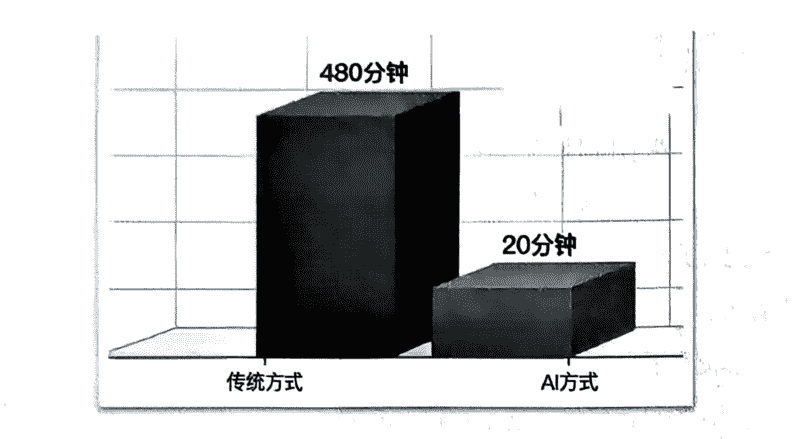
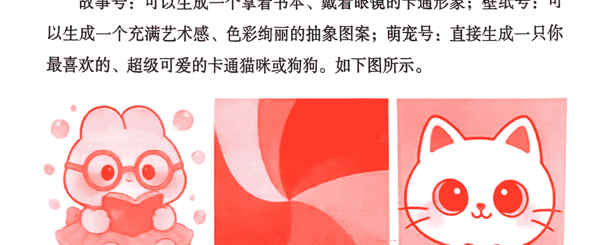
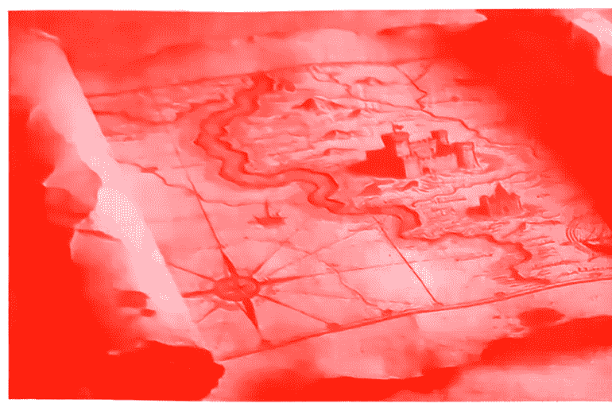
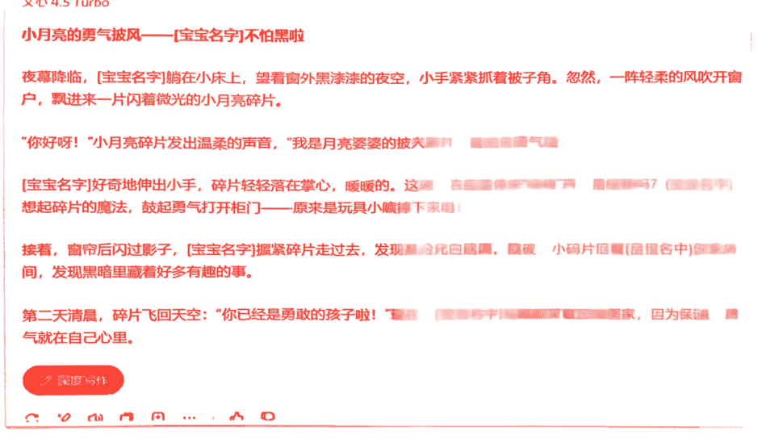
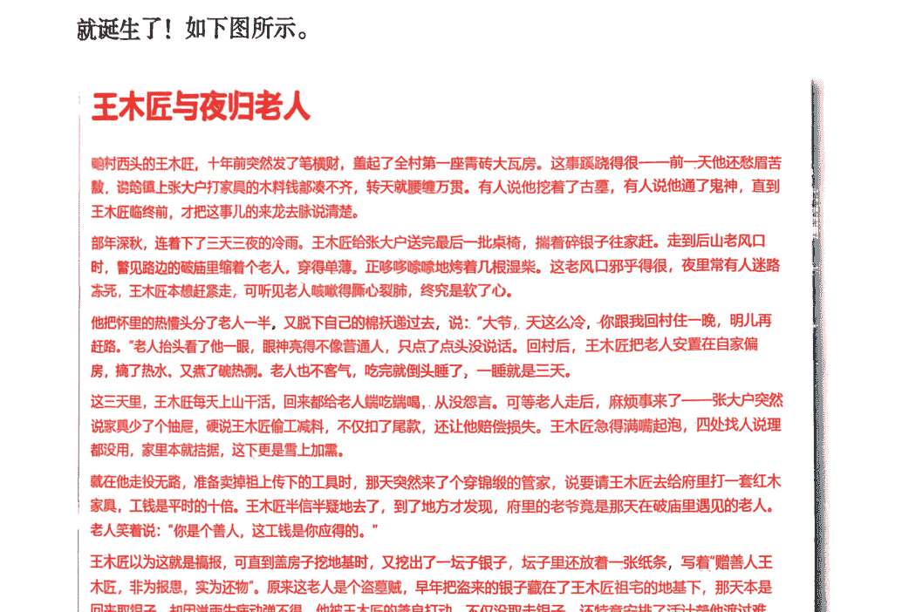
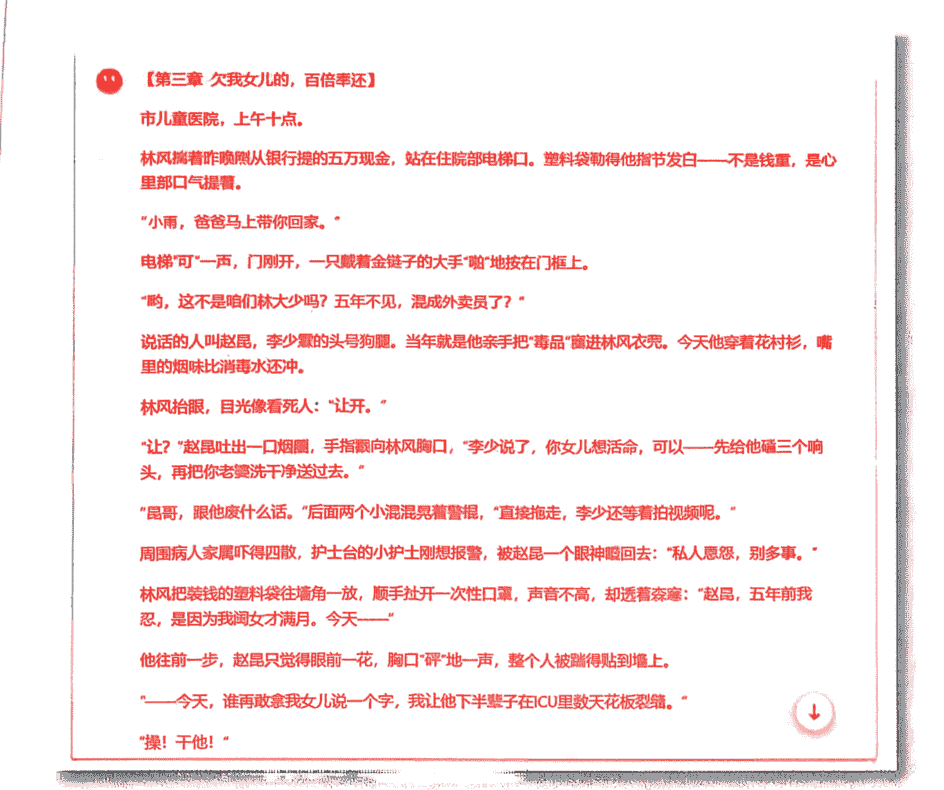
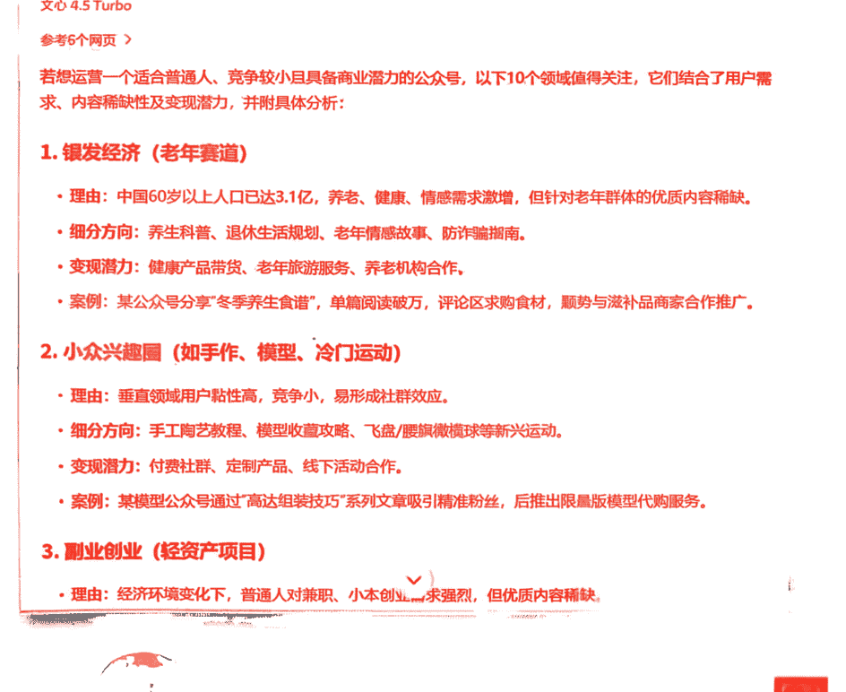
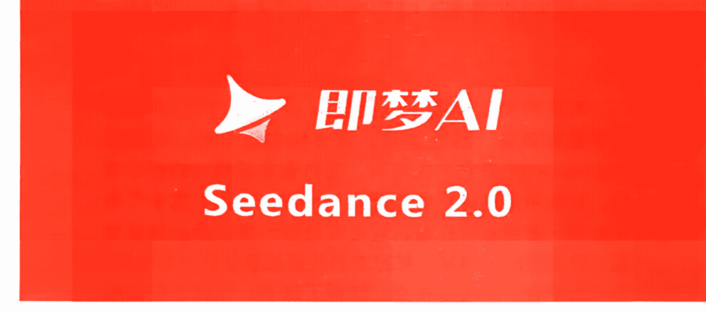
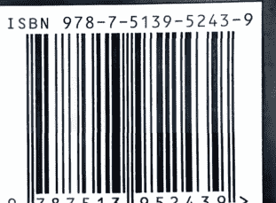

# OpenClaw AI 零门槛变现宝典

# 前言：AI赚钱，其实没那么难

第一次听见 AI，你脑子里蹦出什么画面？

是不是科幻片里的冷冰冰机器人、看不懂的代码瀑布，还有实验室里戴眼镜的科学家在忙碌？

是不是刷到别人用 AI 画几张图、写几段话就收获上万点赞，忍不住羡慕又焦虑，感觉自己像被留在站台上，眼睁睁看时代的车开走？

如果你点头了，那这本手册就是写给你的。

先说个很多人不知道的真相：AI 并不是高高在上的黑科技，它就是人人都能用的新家电。

还记得家里第一次买微波炉吗？你需要先去学物理，搞懂电磁波怎么加热食物吗？当然不用。放进去，按高火，叮一声，饭就热了。里头怎么转的，没人关心。

现在的 AI 就是这样的超级微波炉。

你不需要懂算法和底层逻辑，就像用微信聊天一样，在输入框里写下你的想法，也就是提示词：

- 选写作，它能吐出一篇小红书风格的爆款笔记；
- 选画图，它能生成堪比摄影师的大片；
- 选视频，它能把文字变成带声画的短片。

难吗？和点个美团外卖、叫辆滴滴没区别，都是在屏幕上点几下，享受便利。

# AI创富实战：零基础就能上手赚钱

所以把“学习 AI”这个沉重的词从脑子里扔掉，换成“使用 AI”。

我们不是要当科学家，而是当会用工具的聪明用户。

本书的任务，就是把 AI 这个超级家电的使用说明书，翻译成大白话，手把手教你怎么用它赚钱。

本质上，AI 创富不是让你成为技术专家，而是给你配一个超强助理。

想象一下，你白捡了一个全能实习生。不用发工资、不吃不喝、24小时在线，还会写会画会剪会翻译。你只需学会下指令。

过去想靠内容赚钱，你得自己是作家画家剪辑师，门槛极高。现在你只要会提需求，AI 把想法变成成品，你负责把成品变现。

放下焦虑，忘掉拗口的名词。这趟旅程不是苦修，而是一场有惊喜的新游戏。你需要的不是天赋，只是一部能上网的手机和一点好奇心。

时代的大门第一次对普通人敞得这么开，现在就是最好的时机。

需要说明的是，本书倡导的 AI 创富，并不是鼓吹一夜暴富的投机，而是技术赋能下的长期价值创造。AI 能降本增效，但可持续的收入仍离不开清晰定位、持续复盘和对市场需求的敏感。它是放大器，不是魔法棒，能让有想法肯行动的人加速变现，却替代不了扎实的积累和对用户价值的坚守。

请理性务实地把 AI 当作效率工具，而不是不劳而获的捷径。

明白这些后，下一页，我们正式出发。

# 第一章

## 认知升级：AI赚钱人人可做

正式开挖前，先把认知检查清单过一遍。本章目标是砸碎对 AI 的误解，让你明白 AI 不是天才专属的黑科技，而是人人可用的生产工具。我们还会解释为什么当下普通人靠 AI 变现的机会比以往都大，最后一起锁定适合你的方向，并把必要的账号一次性注册好。准备好了吗，开走！

### 1.1 卸掉高冷滤镜：AI就是个听话的工具

一提到 AI，你是不是会闪过这些画面：屏幕上飞快滚动的绿色代码、戴眼镜的科学家摆弄仪器、电影里要统治世界的机器人？于是心里嘀咕：太高大上了，得会编程会算法还得懂英语，我这种普通人玩不转。

如果你这么想，这书就是为你准备的。先摘掉那副叫“高科技”的眼镜。

真相是，今天的 AI 早已不是程序员的玩具，它像美图秀秀一样简单，像计算器一样好用。

用个最日常的类比。你每天用智能手机，能说清芯片怎么设计、系统底层怎么写吗？不能。但这妨碍你刷抖音、发微信、点外卖、打游戏吗？一点不。因为工程师把复杂的东西藏起来了，你面对的只有屏幕和几个图标。

现在的 AI 就这样。

过去让你电脑画图可能要写代码，如今打开即梦 App，在框里输入“穿着宇航服的橘猫在月球上喝奶茶”，点生成，几十秒就出一张精美图，如下图所示。


你做了什么高难度操作？没做。你只是说出了想法。

你不用懂绘画，只需当导演告诉 AI 要什么画面。你不用懂算法，只需像跟朋友聊天一样对豆包或文心一言说“帮我写一段适合发小红书的秋天文案”，它立刻给多个选项。

技术很复杂，就像汽车发动机复杂。但你要当发动机维修工吗？不用，只需会踩油门、刹车、打方向盘。

在 AI 赚钱里，打字和说话就是方向盘，豆包、剪映、即梦这些 App 就是免费的自动挡汽车，抖音、小红书、公众号就是通往财富的高速路。别再想“我学不会”。我们不是造发动机，而是当好司机，开着这辆神车在平台赚钱。你和高手的差距不是智商，而是那层窗户纸。

### 1.2 变现本质：不是凭空生钱，而是把内容产出放大

很多人以为 AI 赚钱像聚宝盆，输入几个字钱就掉出来。先泼冷水，AI 不会凭空变钱，它不是银行也不是印钞机。

真正秘密是五个字：内容生产力。

说白了就是你做内容的速度和质量。

抖音、小红书、公众号本质都是内容市场。用户消费的是内容，平台靠内容留人，你赚钱也靠内容。

先看传统小作坊。你想做历史故事抖音号，没 AI 时流程大概是：

1. 找选题，1小时泡网。
2. 搜资料，2小时整理百科和论文。
3. 写脚本，2小时。
4. 找素材，1小时。
5. 配音剪辑，2小时。

8小时做一条1分钟视频。运气好火了，运气不好几十播放。一天也只能产这么一条。

就像农夫拿锄头开荒，累死也只开一小块。

现在给农夫一台超级收割机，也就是 AI：

1. 对豆包说“给我10个有反转的冷门历史故事短视频选题”，10秒出清单。
2. 选定“明朝木匠皇帝”，让 AI 写成1分钟口语化脚本，1分钟搞定。
3. 把脚本丢进剪映图文成片，一键生成画面、配音、字幕和音乐。
4. 花15分钟微调画面和语气，加入人味。

从想法到成品约20分钟。

过去480分钟出1条，现在20分钟出1条，如下图所示。



效率提升了24倍，更熟练还能翻倍。

你不再干重复体力活，核心变成构思和决策。

AI 赚钱的底层逻辑：

1. 把时间从重复执行中解放。你过去80%时间执行、20%思考，现在反过来。
2. 实现规模化生产。以前一天更新一个账号一条，现在可同时运营三五账号，每账号两三条。互联网拼的就是量。
3. 降低专家门槛。不会画画，即梦让你当灵魂画手；文笔一般，文心一言帮你写爆款。短板被补齐，和专业选手同一起跑线。

记住，AI 不是魔法，是前所未有的效率放大器。它把一份时间和一份创意变成几十上百份可发布内容，这些内容就是捕捉流量、吸粉、变现的渔网。你从埋头苦干的工匠，变成指挥 AI 军团的将军。

### 1.3 三大流量矿藏：抖音、小红书、公众号怎么挖

有了 AI 这台挖掘机，去哪淘金？互联网里最值钱的矿就是用户注意力，也就是流量。

不同平台地质不同，玩法也不同。

#### 抖音/快手：流量的露天金矿


特点短平快，重情绪。

把抖音想象成热闹的淘金小镇，人多机会多，爆款故事每天都在上演。这里的金子是狗头金，几秒抓住眼球就赢。

AI 完美契合。AI 把视频制作从8小时压到20分钟，意味着你能流水线式批量生产。

用即梦生成古风人像配剪映做卡点，用豆包写一百个民间小故事批量成片，用 AI 绘画做萌宠图配治愈文案。

策略是量取胜、广撒网等爆款。成本低了，就不赌一条生死，多发多测，总有炸的。

#### 小红书：品质生活的钻石矿

特点颜值即正义，实用精致。


小红书像精致珠宝店，用户要的是生活方式和实用攻略。这里的矿是高品质钻石，粉丝购买力强、粘性高。

AI 的绘画和设计在这里大放异彩。

想做壁纸号，用即梦生成高清壁纸导流私域；做穿搭号，用 AI 虚拟模特展示搭配；做家居号，用 AI 生成装修效果图吸引备孕备婚人群。文案让豆包模仿爆款语气写出让人想码住的标题。

策略是垂直深耕、打造美感、建立信任。别追求千万播放，用专业视觉和真诚内容服务几千上万精准粉，商业价值更高。

#### 公众号/头条号：深度的知识金矿


特点深度、逻辑、沉淀。

公众号像图书馆，用户愿花时间读几千字文章，要深度信息和系统观点。这里的金矿是长期信任，付费意愿最高。

AI 大语言模型是强项。DeepSeek、腾讯元宝这类工具擅长长文本。

写历史故事，让 AI 整理资料并搭框架；做书单号，让 AI 提炼观点金句；追热点，让 AI 汇总全网报道提供分析角度。

策略是价值为王、建立专业、长期陪伴。AI 是资料搜集员和写作助理，帮你干掉80%整理工作，你专注20%核心观点输出，持续产出高质量长文，通过广告、付费阅读或知识服务变现。

三座矿已清晰，AI 是万能钥匙。

### 1.4 选赛道：跟随兴趣挑一个易上手的切口

赛道就是你长期做的方向，比如 AI 头像、AI 故事、AI 壁纸。

为什么要专注？平台算法会给你贴标签。美食博主今天做菜明天打游戏，粉丝会懵，算法也会懵，流量起不来。你要像开专卖店，而不是杂货铺。

选赛道有两个关键词：兴趣和简单。

别上来就问哪个最赚钱，最赚钱的往往竞争最激烈。先把 AI 变现当游戏或爱好。

想想你平时怎么打发时间：爱听历史故事？喜欢收藏壁纸头像？爱给孩子讲故事？是电影画面控？

兴趣是精神燃料。起步没人看时，兴趣推着你坚持；卡壳时，兴趣帮你找灵感。

如果做的是听说很赚钱却无感的事，初期热情很快被枯燥耗尽。能坚持下来的，从来不是暴利，而是持续的热爱。

#### 低门槛起步：先选一条易上手赛道

光有爱好是不够的，难度也要算进去。刚拿到驾照的新手不会直接去飙弯道，内容创作也一样，先找条平坦宽阔的练习区热身更稳妥。

下面这几类赛道兼顾兴趣与上手成本，你可以挑一条最有感觉的：

1. 视觉冲击类赛道（适合颜值党）
   - 切入点：AI画的头像、壁纸、手机壳花纹等。
   - 主平台：小红书、抖音。
   - 为何好上手：几乎不需要长篇文案，核心就是产出好看的图片。工作重点是摸清当下流行的视觉偏好，然后持续给模型下指令出图。门槛低、反馈快，一张吸睛作品就能带来点赞收藏。

2. 故事叙述类赛道（适合爱说书的）
   - 切入点：AI整理的民间故事、神话、历史趣谈。
   - 主平台：抖音、快手、视频号。
   - 为何好上手：不用自己从零编剧。中国五千年文化是现成素材库，你的角色是搬运加加工。让AI搜集资料写成脚本，再用剪映一键成片，配音也能直接调用AI声库。

3. 情感共鸣类赛道（适合文艺或治愈派）
   - 切入点：治愈风景、AI萌宠、励志金句。
   - 主平台：抖音、小红书。
   - 为何好上手：套路高度固定。一张AI绘制的唯美风景，加一段AI撰写的暖心文案，再配舒缓BGM就是完整内容。主打陪伴感，制作压力小，很适合佛系更新。

4. 亲子教育类赛道（适合宝妈宝爸）
   - 切入点：AI童绘本、睡前小故事、识字卡片。
   - 主平台：小红书、视频号。
   - 为何好上手：需求刚性且持续。家长总需要新鲜素材。你可以让AI画出可爱卡通形象并配简短情节，做成短视频或图文笔记，既能变现也能给自家孩子做专属内容。

自检一下，上面哪条让你觉得最轻松、最想立刻试试？就从它开始。做事要聚焦，别贪多求全。

### 1.5 账号搭建：抖音小红书百家号注册与装修实操

赛道确定，就像导航里选好目的地。接下来要把你的线上门面——也就是平台账号——收拾利索，加满油再出发。

许多人以为注册就是装个App、填手机号、点同意。技术上是这么简单，但效果差很多。同样开店，有人把货往地上堆叫卖，有人精心做招牌、布置橱窗、打亮灯光。哪家更吸客，一眼可见。

账号就是你的互联网门店，装修质量直接决定用户刷到时是否愿意点进来。下面就做回装修师傅，手把手把门面搭得专业又好看。

全程不用花钱，只需花点心思。

##### 第一步：掌握账号装修的“四大核心”

无论抖音、小红书或其他平台，这四项是通用的。搞定它们，账号成功率已达80%。

###### 1. 头像——门店的Logo

头像是第一印象，别用模糊风景或看不清的网图，必须清晰有辨识度。

做法：最省事的是用AI画一张专属人设图。可以打开即梦，按赛道生成头像。

- 故事号：拿书本戴眼镜的卡通形象；
- 壁纸号：艺术感强、色彩绚丽的抽象图案；
- 萌宠号：一只超可爱的卡通猫狗。

如下图所示。



记住原则：选定后不要轻易改动。头像就是品牌符号，要让用户在信息流里一眼认出你。

###### 2. 昵称——门店的招牌

昵称等于店名，要一眼看出你在做什么。好昵称本身就是免费广告。

黄金公式：领域+人设/特点。如做AI故事可叫“AI奇闻档案馆”“老王的AI故事铺”；做AI壁纸可叫“赛博壁纸匠”“AI壁纸少女心”。

避坑：别用一堆看不懂的英文加数字如user123xyz；别用生僻字或特殊符号影响搜索；名字朗朗上口，最好不超过7个字。

###### 3. 简介——门店的迎宾语

用户点进主页，简介是快速了解你是谁、能提供什么的唯一窗口。写好它很关键。

黄金公式：一句话定位+价值点+关注引导。如定位“每天为你绘制一张绝美壁纸”，价值“治愈审美，点亮手机屏幕”，引导“喜欢就关注，每天有新惊喜”。可加上更新频率如“日更”，给用户稳定预期。

###### 4. 背景图——门店的海报墙

主页背景是头像后的大图，是展示风格的好位置。

做法：同样用AI生成一张符合整体调性的高清大图。如壁纸号放一张代表作；故事号用复古羊皮卷地图，如下图所示。



原则：简洁美观，与头像昵称风格统一。

##### 第二步：三大平台的差异化讲究

“四大核心”通用，但注册与装修侧重点不同。

###### 1. 抖音/快手

注册流程以抖音为例：
1. 手机应用商店下载抖音App，点首页“注册”。
2. 选“手机注册”，输入实名手机号，点击获取验证码。
3. 填写6位验证码，设置8位以上含字母数字的密码。
4. 注册后完善昵称头像即可使用。

装修要点：抖音是一眼定生死，头像和昵称冲击力很重要。名字和头像需在零点几秒抓住眼球。简介可相对简洁直接。

###### 2. 小红书

注册流程：
1. 下载小红书App，打开后点“注册/登录”。
2. 输入手机号，获取并填写验证码即可完成注册。

装修要点：社区氛围重“真人感”。昵称和简介要有温度，像真人在分享。如“一个爱用AI画画的上班族”。简介里可多用可爱Emoji拉近距离。

###### 3. 百家号/头条号

注册流程以百家号为例：
1. 访问平台：电脑端打开浏览器搜索“百家号官网”进入；手机端下载百家号App或经百度App“我的”进入。
2. 选择注册方式：支持百度账号手机号/邮箱登录，或微信QQ快捷登录。
3. 选择账号类型：个人账号适合自媒体作者；企业/机构账号需营业执照等资质。提交后不可更改。
4. 填写资料：按提示填姓名手机号等，上传身份证照片或营业执照完成实名。
5. 等待审核：通常1-3个工作日，结果短信通知。

装修要点：图文平台更看重专业度。昵称和简介最好体现专业与权威感。如“AI历史解密官”“深度财经AI解读”，让读者先建立信任。

##### 第三步：养号

账号注册、门面装修完，能否立刻发作品？千万别。这就像刚搬进小区，第一天别就在门口摆摊大喊。你得先逛逛、打招呼、熟悉环境，这就是养号。

目的：让系统识别你是个正常活跃的真人用户，而非只发广告的营销号。同时告诉系统你偏好哪类内容，后续才能把作品推给同样兴趣的人。

做法很简单，叫模拟日常。用后的3-5天内先不发作品，每天花15-30分钟刷选定赛道内容。如做故事号就多看故事视频；做壁纸号就多搜看点赞收藏。

要互动：看到优质内容点赞，写一句真诚评论，别只发“666”，关注几个头部账号。整个过程像平时刷手机一样自然。

养号完成后，账号状态已进入最佳。它像预热完毕的赛车停在起跑线，只等第一条作品发布就冲出去。

到此万事俱备。你的“战车”已整备，下一章介绍能帮你开疆拓土的AI利器。

## 第二章 养好 OpenClaw：自动化工作流的掘金利器

若把豆包、千问、元宝等视作创意大脑，OpenClaw就是数字双手：能把灵感到自动执行的流水线，让你摆脱重复劳动。本章关键词是自动化思维：不是做一两件事，而是搭建一套一次配置、长期运行的赚钱体系。我们会介绍OpenClaw的前世今生、核心架构，再手把手演示多平台内容自动发布、个人效率流水线搭建。掌握后，AI就能24小时替你工作。

### 2.1 认识OpenClaw：它到底是什么，适合哪些人使用？

你是否幻想过一个不用睡觉、不领工资的数字员工，只要一句指令就帮你处理邮件、发布视频、整理文件甚至写代码？这曾是科幻，现在OpenClaw让它成真。

#### OpenClaw到底是什么？

简单说，OpenClaw是一个开源的AI代理。你可能听过“智能体”，它其实就是能替人干活的AI程序。

和日常聊天AI如豆包、文心一言不同，聊天AI是“你问一句它答一句”，像百科；OpenClaw是“你下达任务它主动执行”，像员工。你只需在微信、WhatsApp或Slack发消息：“帮我登录公众号后台，把昨天写好的文章发布，再同步到知乎和今日头条。”它就会自行打开电脑、登录、上传、点击发布，全程无需手动。

更强的是，它能深入系统操作软件。经授权可读取邮件、整理文件夹、生成Excel报表，甚至登录社媒发帖。它像隐形的电脑操作员，24小时待命。

#### OpenClaw的“神奇”之处从哪来？

核心架构由四部分构成，下一节详讲，这里先打比方。

- Gateway网关是耳朵和嘴巴，负责接收指令并反馈结果。你可在微信里像聊朋友一样下指令。
- Agent智能体是大脑，负责理解任务并拆解为步骤。
- Skills技能是工具箱，内置读文档、写代码、发邮件、操作浏览器等能力。
- Memory记忆是记事本，让它记住历史任务保持连贯。

有了这套组合，OpenClaw能像人一样完成复杂工作流。而且完全开源，可免费使用也可按需改造。

#### OpenClaw 的“改名风波”

网上可能搜到它旧名Clawdbot、Moltbot。短短三个月改了两次名。第一次因被美国公司指控侵权，由Clawdbot改为Moltbot，意为蜕皮重生；三天后因用户困惑最终定名为OpenClaw。名字变了，核心功能未变，反而因风波获更多关注。国内云厂商如腾讯云、阿里云也迅速跟进提供一键部署，大幅降低使用门槛。

#### 普通人都能用 OpenClaw 赚钱吗？适合哪些人？

OpenClaw不是程序员专属，会打字发消息就能指挥。以下人群尤其适合掘金：

- 自媒体、短视频创作者：可让它自动把视频同步到抖音、快手、B站、视频号；也可定时抓取各平台热点整理成选题库，省去刷手机找灵感时间。
- 网店、微商小老板：可自动回复常见客户问题，自动处理订单，甚至生成商品描述文案。你睡觉时它仍在接单。
- 上班族、自由职业者：早上汇总邮件、整理待办；自动下载报表生成周报；搜索资料整理成文档。原本两小时手工活几分钟搞定。
- 有想法不会编程的人：想做小工具不会写代码，可让它调用其他AI编写，或直接执行重复操作如批量下载图片、批量改文件名。
- 想做副业的斜杠青年：可把OpenClaw部署在云服务器上“出租”给他人，如帮商家搭自动回复系统，帮博主做多平台分发，赚技术服务费。

#### 使用OpenClaw需要技术门槛吗？

基本不需要。主流云厂商提供一键部署，你在控制台点几下即可拥有实例。然后通过微信、钉钉或网页后台对话，像聊天一样简单。OpenClaw支持中文指令，用大白话下任务即可，不用写代码。

当然若想开发新功能做深度定制，则需一定技术基础。对大多数普通人，直接用现成功能已足够变现。

#### 小提醒：用好“利器”也要守好“规矩”

OpenClaw很强，但能深入电脑和网络账号，安全性很重要。使用前提是清楚哪些权限可给、哪些数据不可触碰。本章末节会专门讲安全红线，教你合规使用避坑。

### 2.2 核心架构解析：Gateway、Agent、Skills、Memory 如何协同工作

上一节认识了OpenClaw这个数字员工。它如何听懂人话并完成复杂操作？本节拆解其构造。

OpenClaw核心架构由四模块组成。

#### 一、Gateway（网关）：数字员工的“耳朵和嘴巴”

Gateway是OpenClaw与外界沟通的窗口。指令经它传入，结果经它传出。

##### 它能听懂什么？

Gateway支持多种对话渠道：
- 即时通信软件：微信、企业微信、WhatsApp、Slack，像发朋友消息一样下指令。
- 网页后台：登录管理界面在对话框输入指令。
- API接口：技术人员可将其接入自身系统，让其他软件自动调用。

##### 它怎么工作？

当你说“帮我登录公众号后台，把今天写的文章发布出去”，Gateway会：
1. 接收：把文字指令收下。
2. 转换：把自然语言转成内部可理解的机器语言。
3. 传递：把处理好指令传给Agent大脑。

反向流程：Agent任务完成后，Gateway把结果翻译成人类可读的话，通过原渠道反馈：“文章已发布成功，链接是×××。”

##### 为什么 Gateway 很重要？

没有Gateway，OpenClaw就是聋哑人，无法接收指令也无法反馈。正因它存在，才能像聊天一样自然使用。

#### 二、Agent（智能体）：数字员工的“大脑”

Agent是决策中心，最核心部分。任务是想清楚用户要什么、怎么做、需哪些工具。

##### 它是怎么思考的？

收到指令后，Agent经历：
1. 理解任务：分析真实意图。如“处理邮件”是要读、回还是整理。
2. 拆解步骤：把复杂任务拆成小步。如发布文章拆为：开浏览器→登录后台→进素材库→找到文章→点发布→确认。
3. 调用资源：判断每步需什么技能，如开浏览器需浏览器操作技能，输入密码需键盘输入技能。
4. 指挥执行：把具体活分配给Skills模块并监督进度。
5. 处理意外：执行中出错如网页打不开、登录失败，需重试、换方法或向用户求助。

##### Agent 的“聪明”从哪来？

背后是大语言模型支撑，可视作内置GPT的指挥官。与普通聊天AI不同，聊天AI只会说，Agent会做——不仅想清怎么做，还会真的动手。

#### 三、Skills（技能）：数字员工的“手脚和工具”

Agent是大脑，Skills就是四肢。工具箱里装满各类型操作能力，每个技能完成一类具体动作。

**OpenClaw 有哪些常见技能？**
- 1. 浏览器操作技能：可自动打开网页、点击按钮、填写表单、滚动页面、截图保存。用以上来操作公众号、抖音、小红书等后台。

OpenClaw 运行机制拆解：技能矩阵、记忆层与模块协同

- 文件处理能力：支持打开本地 Word、Excel、PDF、TXT 等各类文件，并进行编辑与保存，主要承担本地资料的读写工作。
- 系统操作能力：能够启动本地软件、执行命令行指令、管理目录结构，让机器的操作方式接近真人使用电脑。
- 网络交互能力：可调用网站 API、获取网络资源、向服务器上传文件，负责与互联网服务打交道。
- 代码运行能力：内置对 Python、JavaScript 等语言的执行环境，使技术人员可以自行扩展功能。
- 社交媒体能力：可登录主流平台、发布内容、抓取数据、自动回复，是自媒体运营中常用的工具。

**技能激活的原理**
当一个指令进入系统后，决策单元会先判断每一步需要哪类能力。例如登录公众号时，决策单元会调用浏览器操作能力中的打开页面与填写表单子功能。能力模块执行完毕后会把结果回传给决策单元，提示成功或失败、是否需要验证码。

能力模块的最大特点是可扩展。若系统没有内置所需能力，可自行开发或从社区下载插件安装，使功能边界持续扩大。

#### 四、Memory 记忆系统：数字员工的备忘本
Memory 是 OpenClaw 的记忆中枢，负责在任务执行过程中保存各类信息。没有记忆，系统只能做完即忘，难以处理依赖上下文的连续工作。

##### 记忆系统记录的内容
- 任务上下文：当前任务推进到哪一步，之前步骤的执行结果是什么，确保流程连贯。
- 用户偏好：例如习惯使用的发件邮箱、偏好的发布时间，记录后同类任务可自动遵循习惯。
- 账号资料：在获得安全授权的前提下加密保存各平台的登录信息，避免重复输入。
- 历史记录：以往生成的内容、处理过的文件、客服回复等，需要时可随时调取。
- 学习经验：任务失败的原因及规避方法会被沉淀，帮助系统越用越稳。

##### 记忆的两种形态
OpenClaw 的记忆分为短期与长期。
- 短期记忆：只保留正在执行的任务，结束后自动清除，类似工作记忆。
- 长期记忆：持久保存在数据库中，重启后仍可调用，相当于长期积累的知识。
用户也可自行管理记忆，设置哪些信息保留、哪些清除。

##### 四大模块协同示例
将 Gateway、Agent、Skills、Memory 连起来看，可更清晰地理解整体流程。以微信发送指令“帮我登录抖音，把昨天拍的视频发出去，文案用我惯用的风格”为例。

第一步：指令接收 Gateway
微信消息被 Gateway 捕获，转化为内部指令后交给决策单元。

第二步：任务拆解 Agent
决策单元将指令分解为：打开浏览器、访问抖音网页版、输入账号密码登录、进入上传页、定位本地视频文件、上传视频、根据记忆生成文案、填写文案、点击发布、确认成功。

第三步：能力调用 Skills
决策单元按顺序指挥能力模块：
1. 浏览器能力打开抖音页面；
2. 登录能力填写账号密码，凭证从 Memory 读取；
3. 文件能力定位本地视频；
4. 上传能力完成文件传输；
5. 文案生成能力依据记忆中的常用风格撰写；
6. 浏览器能力填写文案并发布。
每步完成后能力模块会把结果反馈给决策单元。

第四步：进度记录 Memory
整个过程中 Memory 持续记录当前进度、登录是否成功、文案采用的风格、发布链接等。即使中途网络中断，重启后也能从记忆中恢复进度继续执行。

第五步：结果回传 Gateway
全部完成后，决策单元汇总结果交由 Gateway，以自然语言通过微信推送“视频已发布成功，链接是×××”。

小结
Gateway 负责对外交互，Agent 负责思考决策，Skills 负责具体执行，Memory 负责记录与学习。四者缺一不可。理解这套架构，就能明白 OpenClaw 不是简单的聊天工具，而是一个具备思考、行动与记忆的完整智能体。

### 2.3 实操案例一：多平台内容自动分发
自媒体创作者常面临的情况是：内容完成后需登录多个平台重复发布，复制标题、粘贴正文、上传封面、设置标签，耗时耗力。用 OpenClaw 可把重复工作交给数字员工，只需准备素材并下达指令即可实现一次制作，多处投放。

#### 一、为何需要自动分发
运营抖音、小红书、公众号三个渠道，每天发布一次，每次约 20 分钟，一个月累计约 10 小时。自动化带来的好处：
1. 节省时间，人专注创作。
2. 避免遗漏，保证全覆盖。
3. 支持矩阵运营，多账号同时发布可轻松实现。

#### 二、上线前的准备
1. 安装并启动 OpenClaw。技术小白可选择国内云厂商的一键部署，几分钟即可生成管理后台并绑定微信。
2. 整理平台账号。提前准备好各平台登录名与密码，建议使用密码管理器保存。部分平台需验证码或扫码，后续会说明应对方式。
3. 规范素材归档。标题、正文、封面、视频等按统一目录存放，一个内容一个文件夹，命名清晰便于识别。

#### 三、实战：公众号文章同步至今日头条、知乎、小红书
假设有一篇《AI副业赚钱的5个野路子》，正文与封面已就绪，需同步到三个平台。

第一步：下达指令
在微信中对 OpenClaw 发送：“请发布新文章，标题是《AI副业赚钱的5个野路子》，正文在 D:\今日内容\文章正文.txt，封面在 D:\今日内容\封面.jpg，投放平台为今日头条、知乎、小红书，小红书配图使用该封面。” 可补充“各平台文案请微调风格”。

第二步：系统理解并执行
Gateway 接收消息后交给 Agent 判断为多平台发布任务，读取本地文件、依次登录三个平台、上传并发布。Memory 会记住本次偏好，下次可复用。

第三步：登录时的常见阻碍
多数平台支持密码登录，凭证可从 Memory 读取。常见情况：
1. 验证码：系统会暂停并在微信中请求用户提供验证码，回传后继续。
2. 扫码登录：如公众号后台，需人工扫码确认，仍比全程手动省力。
3. 反爬机制：遇到滑块验证，高级版本可自动处理，基础版本会请求远程操作。

第四步：内容适配
不同平台调性不同，知乎偏深度，小红书偏轻松种草，头条偏标题。系统可按规则自动改写，也可提前准备多套文案供选用。

第五步：完成反馈
任务结束后会收到汇总：“任务完成，今日头条链接×××，知乎链接×××，小红书链接×××，耗时 6 分 28 秒。”

#### 四、进阶：定时与批量
可在指令中加入时间参数，让系统提前排程每周内容，或对多个抖音号间隔发布，避免被判定为营销号。

#### 五、常见问题
登录验证码会触发人工确认；滑块验证可视版本自动或手动；格式不兼容建议为各平台准备独立版本；发布失败有重试机制，连续失败会提醒检查账号；为降低封号风险，建议控制频率、使用合理 IP、重要账号谨慎自动化。

#### 六、小结
原本需半小时的手工流程可压缩至数分钟，视频、图片同样适用。虽然验证码等环节仍需人工介入，但重复劳动可减少 80%，释放时间用于创作与学习。

### 2.4 实操案例二：个人自动化流水线搭建
清晨开机时邮件已分类、文档已生成摘要、重复代码已撰写。这正是 OpenClaw 可实现的个人自动化流水线。以下为三条常用流水线。

#### 一、邮件自动化处理
每天收件箱堆积客户邮件、广告、抄送，可交给系统处理。
1. 设置规则：老板与重要客户邮件置顶标星；含“发票”“合同”关键词的邮件归入财务文件夹；订阅简报归入阅读列表；垃圾邮件直接删除。
2. 定期执行：指令示例“每天早上 8 点登录工作邮箱，按上次规则分类，未读邮件完成后给出三封最重要的摘要”。系统会打开邮箱、扫描、移动、标记、提取要点并推送摘要。
3. 自动回复：对高频咨询可预置模板自动发送。

#### 二、文档阅读与提炼
行业报告、合同、技术文档阅读压力大，系统可快速提炼。
1. 自动摘要：指令“请阅读 D:\报告\2026年AI趋势报告.pdf，给出 500 字摘要、三个核心观点、五条关键数据”。系统调用阅读能力并用 AI 理解后生成结果。
2. 合同要素提取：指定提取金额、付款方式、违约责任、争议解决条款，整理成表格。
3. 多语言翻译：可将英文手册翻译成中文并保存。
4. 批量汇总：对文件夹内多个 Excel 提取销售额与完成率并汇总成新表。

#### 三、代码编写辅助
即使不编程，也可通过自然语言描述需求，让系统生成或修改代码片段，提升开发效率。

打开OpenClaw，用口语把重复活交给AI

很多朋友觉得编程离自己很远，实际上大量机械性杂务完全可以交给简易脚本完成。OpenClaw 做不到彻底取代程序员，却能承担不少准编程类工作，并且使用者不需要亲手写一行代码，只需用自然语言描述需求即可。

##### 1. 批量更名
手头有几百张照片，原始命名类似 IMG_001.jpg、IMG_002.jpg，想统一成 产品图_001.jpg 这种可读名称，手动改非常耗时，可以让OpenClaw来做：

> “把D盘图片文件夹里所有IMG开头的jpg，统一改成产品图_序号.jpg，序号沿用原文件数字。”

它会自行生成并执行一段Python程序完成重命名，操作者无需理解Python语法。

##### 2. 表格清洗
Excel里的数据常常参差不齐，电话格式不一、夹杂空行、有重复记录，需要整理成干净表格：

> “帮我清理D盘数据目录下的客户名单.xlsx，删掉空行，把电话统一成11位数字去掉分隔符，去重，另存为客户名单_已清洗.xlsx。”

OpenClaw借助pandas处理表格，用户只需等待结果文件即可。

##### 3. 报表自动生成
日报周报每周都在重复，可以设定定时任务：

> “每天17点，从D盘销售数据当日的xlsx提取销售额、订单量、客单价，按D盘模板的日报模板.docx排版，保存到D盘日报文件夹，并用企业邮箱发给负责人。”

系统会按时读取表格、打开Word模板、填充数值、导出文档并发送邮件，下班前报表已在收件箱。

##### 4. 网页信息抓取
做市场调研需要公开价格信息，例如电商平台的AI鼠标：

> “在淘宝搜索AI鼠标，抓取前十页的商品名称和价格，汇总到D盘调研的鼠标数据.xlsx。”

OpenClaw会模拟浏览器逐页采集并导出表格。需注意遵守robots.txt和平台规则，抓取频率要控制，避免触发风控。

##### 5. 小工具生成
不会写代码但想要一个监控脚本，可以直接描述：

> “写一个Python程序，监控D盘下载夹，有新文件加入就把文件名写入D盘日志的下载记录.txt，文件放到D盘脚本目录。”

它会输出完整代码并保存在指定位置，双击运行或定时触发即可实现自动化监控。

#### 四、把单点功能串成流水线
单一能力都有价值，真正高效的是把它们串联成完整的工作流。以办公场景为例：

##### 早晨流水线：
- 8:00 自动登录邮箱处理来信，生成摘要推送到微信。
- 8:05 依据摘要下载附件如合同、报告，归档到指定目录。
- 8:10 读取合同文本提取要点，形成简报推送给使用者。
- 8:15 对可自动回复的邮件按模板处理，其余提醒人工介入。

##### 工作时段流水线：
开会期间收到“请提供上季度销售报表”的紧急请求，可在微信里转给OpenClaw：“回复王总，报表整理中，两小时后发送。”随后它自动从数据库提取数据、生成文档并定时发出。

同事发来压缩包内含几十个文件，直接指令：“解压后图片放到D盘图片素材，文档放到D盘文档，并告知数量。”

需要网页数据做分析，把链接和需求交给它即可抓取整理成表格。

##### 下班前流水线：
- 17:00 汇总当日销售数据生成日报并邮件发送。
- 17:05 将当日关键文件备份到云盘。
- 17:10 清理临时目录释放空间。
- 17:15 发送一条消息：“今日工作已收尾，明日需要安排什么？”

#### 五、实践中要注意的点
1. 权限授权。访问邮箱、文件、运行环境必须明确授权，按需最小化授权，例如仅邮件操作无需微信权限。
2. 隐私保护。密码、身份证号等敏感信息尽量不经处理，确需处理时要加密存储。
3. 容错机制。自动化受网络、页面改版影响，宜定期复核并设置失败时暂停并通知。
4. 合规使用。部分网站禁止爬虫与自动化操作，个人提效通常无碍，商业用途需严格合规。
5. 描述能力。自然语言交互降低门槛，但复杂流程仍需要清晰拆解步骤，熟练度会随使用提升。

#### 六、小结：把OpenClaw当作第二双手
从邮件处理、文档阅读到代码生成，OpenClaw在个人效率上的增益很明显。它不仅节省时间，还能完成手工难以批量处理的任务。把有规律、重复、琐碎的工作外包出去，人才能聚焦创造性环节。自动化需要不断调教，越用越贴合个人习惯，跑通后就像拥有一台持续运转的个人效率机器。

# 第三章
## 抖音快手变现：AI短视频流水线
抖音仍是年轻人的流量主阵地，对AI从业者而言更像可自动变现的机器。本章核心是流水线思维，不做随意的单次创作，而是按平台偏好批量化生产。接下来会说明哪些视频易爆、哪些赛道适合入门、如何用更少时间产出更多爆款，掌握规律就能把AI效率转化为持续的流量与收益。

### 3.1 流量密码：抖音上AI作品更容易爆的特质
第二章的装备已配齐：文字大脑、绘画能力、数字人主播。现在你像拿到了驾照还开了顶配跑车，缺的只是路线。

直接上抖音、小红书也可以，但不懂路况和规则很容易迷路。抖音是车流量最大、最热闹的高速，我们需要一份新手导航，挑出几条适合AI玩家的车道。

起步不要挑战盘山公路，要找投入小、见效快、普通人可操作的方向。实践中当前三类AI产出是平台的流量硬通货。

#### 第一类：AI作画
门槛最低、效果直接。把用户视作街头逛街的路人，最容易停留的是橱窗最亮、商品最酷的店铺。AI作画就是豪华橱窗，不需要深度文案，只需在划屏0.5秒内用一张前所未见的美图抓住注意力。

制作步骤：
1. 选一个有共鸣的主题，如十二星座化身中国神仙、童年夏天的AI复原、如果西游记是赛博朋克风。
2. 用即梦、文心一格等工具批量生成系列精美图像。
3. 导入剪映套用卡点模板，配上热门BGM即成。

它易火源于满足人对美的本能，视觉盛宴不需要思考，点赞收藏通常很高。

#### 第二类：AI说书
绘画靠视觉，说书靠内容。就像街边围满人的评书茶馆，目标是用悬念勾住好奇心，让用户愿意花一分钟听完。核心指标是完播率，完播率高平台会加推。

制作步骤：
1. 让AI写短篇，如民间传说300字，开头设悬念结尾反转。
2. 用讯飞配音等工具配上磁性故事音色。
3. 用剪映图文成片自动匹配历史风景素材生成听书视频。

它利用好奇心和情绪共鸣，短时间内带来紧张、感动、恍然等情绪体验，容易让人上瘾。

#### 第三类：AI工具演示
还有一类店铺装修一般但排队长，能解决燃眉之急。AI工具类内容就是抖音上的便民服务站，不求华丽，只需清晰展示神奇工具如何解决问题。这类内容易被收藏，因为用户觉得以后能用。

制作以录屏为主：
1. 找到一个实用的AI工具网站。
2. 录屏演示如何用它解决具体问题，如30秒用AI做完PPT。
3. 导入剪映加字幕和简短解说即可。

它提供直接的价值感，用户看完感觉学到东西，容易点赞、收藏和转发。

### 3.2 实操案例一：AI国学智慧/名人故事，中老年受众最爱
这是新手赛道里最稳且持久的选择。相当于不做追逐潮流的网红奶茶店，而是开社区老字号粮油铺。生意细水长流，粉丝粘性强。

目标人群是抖音庞大的中老年用户，他们有时间、有耐心、信任感和购买力，国学智慧或名人故事正是他们喜爱的精神主食。

#### 第一步：项目定位——粮油铺卖什么
店铺只卖两种粮食，二选一：
1. 国学智慧米。每日分享论语、道德经、菜根谭等经典一句并用大白话解读对当下的启示。
2. 名人故事面。每日讲述苏东坡、王阳明、曾国藩等古代名人的小故事，提炼处世哲学。

#### 第二步：工具准备
1. 文案生成：文心一言或豆包。
2. 图像供应：文心一格，其国风气质最匹配。
3. 视频加工：剪映，主要用图文成片和文本朗读。

#### 第三步：保姆级流程——10分钟熬一锅汤
1. AI写稿约2分钟。指令示例：“请扮演国学传播者，为我写一个短视频脚本，主题曾国藩的人生智慧：成大事者懂熬。总字数300左右，开头设问，内容结合事例，结尾金句。语言沉稳有哲理。”
2. AI作画约1分钟。指令示例：“中国风水墨画，一位古代文人在书房灯下读书，意境深远。”选一张保存。
3. 剪映合成约5分钟。新建图文成片，输入标题，粘贴AI稿件一键生成，替换素材为刚生成的国风图，文本朗读选用沉稳磁性男声，添加舒缓古风音乐并降低音量即可发布。

#### 第四步：变现路径
平台补贴：持续发布加入中视频伙伴计划，达标获现金。
橱窗带货：粉丝达1000可开商品橱窗，上架曾国藩传、菜根谭等书籍或文房四宝、茶具。
知识付费：成为领域小专家后引流微信做付费社群打卡或读书直播，接受打赏。

### 3.3 实操案例二：AI生成治愈风景/萌宠
这像在步行街开甜品店或萌宠咖啡馆，不需太多互动，只需把治愈画面展示出来，路人看一眼就会被融化并分享。核心是治愈。

现代人压力大，刷短视频除了看热闹还有寻求精神按摩的需求。绝美风景或憨态小动物就是最好的按摩师，受众广泛。

#### 第一步：定位——主打款
选择清晰垂直的定位：
- 治愈风景。关键词：宫崎骏的夏天、童话森林小屋、星空海边、江南烟雨、赛博雨夜。画面唯美，适合做壁纸。
- 可爱萌宠。关键词：穿宇航服的猫、开咖啡店的柯基、毛茸茸龙猫、迪士尼风格小老虎、戴眼镜看书的兔子。萌即正义，拟人化创意效果强。

新手法则：选定一个就死磕，不要今天猫明天风景。

#### 第二步：生产——召唤甜品魔法师
定位确定后开始生产，AI绘画工具就是魔法师。

治愈系视觉糖果的从产出到变现全流程

工具怎么选
做萌系、潮流、二次元调性的画面，即梦的把握更稳，萌感和年轻味很准。想要国风水墨或油画质感的山水，即梦之外文心一格的渲染更贴合。

如何把想法说清楚
别写成论文，像写食谱那样对号入座。
通用框架：风格、主体、行为或场景、画面细节
例如“森林树屋里开面包店的小熊猫”：
（迪士尼动画质感），（一只萌萌哒烘焙小熊猫），（在森林树屋面包铺里烤面包），（暖调治愈、细节饱满、皮克斯风格、3D渲染）
把这个模版套用在自己的点子上，集中产出8到10张同主题、构图与动作各不相同的图，素材就齐了。

第三步：上架，把视觉糖果装盒
原料有了，要做成视频礼盒才能发布。
1. 打开剪映走最省事的路径。不需要复杂剪辑，直接用首页的图文成片，或选一个照片电影模版。
2. 导入图片自动合成。把刚生成的8到10张图载入，应用会自行加上转场和动效。
3. 音乐定氛围。治愈向短片，配乐是情绪催化剂。去抖音热榜找舒缓、有叙事感或纯净钢琴曲，平时刷到好听的先收藏，用时直接调用。
4. 标题点睛。一句话足够。
风景向：“假如能搬进其中一张，你会选第几张的世界？”
萌宠向：“赶紧@那个爱赖床的闺蜜，一起看看这只小懒猫！”
核心是用提问或引导分享的指令，撬动互动。

为什么能跑通
投入很低，情绪回报很高。几分钟产出的画面，就能让加班的人瞬间放松温暖。这种纯粹的情感共鸣是吸粉的硬指标。

变现方式
- 流量分成。粉丝和播放起来后，平台会给创作激励。
- 壁纸号。主页引导粉丝去微信群或公众号领高清无水印原图。体量上去后可接广告或开付费壁纸库。
- 周边定制。某个猫猫狗狗形象出圈成IP后，可印在手机壳、T恤和帆布包上开小店。
这个项目像一家永不打烊的治愈杂货铺，持续创造和分享美好，既能带来粉丝和收入，也会反过来治愈自己。

### 3.4 实操案例三：AI神话民间故事，打造你的“AI故事会”
如果说AI绘图是街头摇滚，AI故事会更像深夜电台。不用大声喊，点一堆数字篝火，用好故事把用户安静吸引过来。
它能建立更深的情感连接，且能串联前面所有智能工具，形成适合普通人长期稳定运营的全自动生产链。

开张四步食谱如下：

第一步：定制灵魂，让智能写作产出好故事
故事会的核心是文本。首席编剧可用文心一言或豆包。
短视频故事要像鱼钩，开头三秒就要钩住人，所以指令要设计好。
实战指令模版：
打开文心一言输入：
> “请扮演民间故事大王，为我写一个关于‘山中精怪报恩’的短篇，要求：1. 字数300到400字，适合60秒短视频。2. 开头要有悬念，比如‘村里最老实的王大锤，最近总在半夜往后山跑，谁都不知道他在干嘛’。3. 结尾要有温暖反转和一点人生感悟。4. 语言通俗易懂，像跟邻居聊天一样。”
智能写作会立刻生成结构完整的小故事，复制下来，灵魂就有了。

第二步：绘制场景，用智能绘画呈现氛围
纯文字太枯燥，需要场景和人物。首席美术师可用文心一格。
首选文心一格是因为它画的中国风，与神话民间故事气质很搭。
操作要点：
- 提炼关键词。读完故事，挑出关键画面，例如“深山古庙”“白衣书生”“一只白狐”。
- 生成画面。打开文心一格，分别输入指令出图。
- 数量：60秒视频，配3到5张高质量图足够。
例如古庙可写：“中国风，CG插画，深山一座破败古庙，门口长满青苔，月光洒落，氛围神秘。”白狐可写：“水墨风格，一只通体雪白的九尾狐，眼神灵动，蹲在石头上。”智能绘画会立刻出图。
场景和演员就位了。

第三步：注入声音，请智能配音深情演绎
金牌配音员是讯飞配音。
好故事需要有感染力的声音。讯飞配音里的故事主播能让文案瞬间有感情。
操作步骤：
1. 打开讯飞配音应用，把第一步的文案粘贴进去。
2. 在主播库避开新闻播报、广告宣传，去“有声阅读”或“故事”分类，选声音浑厚、语速偏慢、磁性强的男声或女声。
3. 选好后点左下角头像试听，合适就点右上角下一步生成音频。
4. 导出MP3保存备用。
灵魂、场景、声音三件套齐了。

第四步：总装成品，剪映里合成
最后到总装车间剪映，组装所有零件，很简单：
- 先放声音。打开剪映，音频-导入音乐，把讯飞导出的MP3放进去，这是视频骨架，时长随之确定。
- 再放画面。把文心一格生成的3到5幅图导入视频轨道，放在音频轨道上方。
- 拉伸对齐。拖动每幅图的边缘，让总时长与声音一致。音频60秒，3幅图就每幅20秒。
- 自动上字幕。点工具栏文本-智能字幕，智能识别音频生成带时间轴字幕，只需检查错别字。
- 点击导出，一个充满东方神秘色彩的AI故事视频就诞生了。

这个项目怎么变现
- 中视频伙伴计划。最直接收益。账号达到通常1000粉及一定播放量后开通，按播放量分成。故事类完播率高，很有优势。
- 平台创作激励。抖音、西瓜等平台常有主题创作活动，优质故事易获奖，拿到额外现金。
- 知识付费/小说推文进阶。粉丝多了可接小说App推广，在视频结尾引导用户去指定平台看后续，赚取佣金。
AI故事会是一条可长期深耕的赛道。不追热点，不靠颜值，靠内容本身魅力。

### 3.5 实操案例四：AI写真收割颜值流量
本质是用智能绘画创造一个独一无二、完全属于自己的虚拟偶像，再持续为他拍摄各式写真大片，发在抖音或小红书。
像小时候捏泥人，现在捏出的人五官精致身材完美，还能换装出现在任何场景。你的账号就是他的官方后援会。
颜值是互联网最通用的语言，能跨越年龄性别圈层。持续输出绝美图的账号，没人会划走。

兵器库配置：
- 主力工具：即梦。做时尚潮流、符合现代审美的帅哥美女，即梦的稳定性极强。
- 辅助软件：剪映。负责把系列写真做成卡点视频。

造星四步走：
1. 确定人设
捏人前先想清楚要捏什么样的人，这步决定偶像有没有灵魂。
只需回答几个问题：
性别：男或女？
风格：甜美可爱邻家妹妹，还是高冷霸气御姐？阳光开朗运动少年，还是忧郁神秘文艺青年？
核心特征：有没有记忆点？例如银白头发、眼角泪痣、常戴金丝眼镜，能让角色脱颖而出。
例如：打造虚拟帅哥“星野”。人设：银发，眼角泪痣，气质清冷，爱穿白衬衫的神秘少年。
2. 生成种子模特
把想象变成第一张具体图片，这张是后续创作的基因母版。
打开即梦，用提示词把人设描述清楚：
> “一个英俊的亚洲男孩，特写镜头，银白色短发，眼角下有一颗泪痣，眼神清冷，穿着干净白衬衫，背景是模糊城市夜景，超高清，照片级真实感。”
多生成几次，挑一张最满意的保存，这就是初代模特。
3. 开拍系列写真
这步最关键。怎么保证每张都是同一个人？用图生图。
- 在即梦上传刚保存的种子模特照片。
- 智能绘画已认识这个人，你只需改指令换场景换衣服。
例如：“（他）穿黑色风衣，走在雨天东京街头，撑一把透明伞。”或“（他）穿居家毛衣，坐在图书馆窗边看书，阳光洒在他身上。”
智能绘画在保留面部特征的基础上生成全新写真。重复操作，就能得到一套专属写真集。
4. 打包发布
把10到20张风格各异的写真导入剪映。
- 套用模版。图文分类下挑“照片电影”或“卡点”模版。
- 选BGM。挑一首符合偶像气质、近期热门的背景音乐。
- 一键生成。剪映会自动做成有节奏感高级短视频。
- 配一句简单文案，例如“你最喜欢第几张的他？#AI帅哥#虚拟偶像#壁纸”，发布。

靠颜值怎么赚钱
- 引流私域。主页留联系方式，引导粉丝进群或关注公众号领取高清无水印原图壁纸，最快积累私域。
- 广告变现。账号有几万几十万粉后，会有游戏、App、潮牌等品牌找投放，虚拟偶像即代言人。
- 销售数字产品。可把系列写真打包成高清写真集，或把生成用的独家提示词整理成文档低价售卖。

# 第四章
## 深耕小红书：AI种草变现玩法
抖音像大超市，小红书更像精准变现的小工坊。用户购买力强、转化率高，且特别吃高颜值。一张精致的智能生成图往往比长篇文字更有说服力。本章教你用AI产出小红书用户爱收藏的素材，从头像到家居、穿搭到儿童用品，每个细分赛道都有钱可赚。

### 4.1 小红书审美红利：哪些AI图能瞬间引爆收藏
抖音是集市，小红书像格调优雅的精品买手店。来逛的人会放慢脚步细看笔记，眼光更挑剔，对颜值要求更高。
粗制滥造、画质模糊的内容，像奢侈品店里摆地摊货，格格不入。
反过来，只要内容足够好看，哪怕一句话不说，也会有人为美貌买单，点赞收藏。
这就是适合AI玩家的核心红利——审美红利。简单说，在小红书，好看到能当饭吃。

怎样的图片能戳中用户，毫不犹豫点小红心和五角星？记住三个被爆款验证过的流量密码。

流量密码一：一眼心动的美人像
小红书的硬通货。没人会拒绝好看小姐姐、小哥哥或萌娃，像精品店橱窗的真人模特。
但小红书偏好干净、温柔、有质感，不追求极致夸张猎奇。
女生头像：核心是氛围感。如即梦生成韩系奶油风女孩，背景咖啡馆；或文心一格画国风新中式少女手持团扇。要传递美好生活向往。
男生头像：干净清爽第一。可阳光运动少年，也可金丝眼镜斯文败类。风格多变，避免油腻过度修饰。
情侣/闺蜜头像：互动感关键。风格统一、动作呼应，能让人脑补甜蜜故事。
这类图是AI人像定制项目的最佳广告牌，作品即名片。

流量密码二：治愈一切的风景壁纸
若人像是模特，风景壁纸就是店里卖得最好的香薰和装饰画，提供情绪价值和精神慰藉。
用户刷到时想的不是图真牛，而是好想生活在这样地方。
梦幻自然风光：画现实不存在的美景。如云朵上漂浮的岛屿城堡、荧光魔法森林、极光笼罩的雪山木屋。核心是造梦。
温馨室内场景：描绘理想家。如阳光洒满的午后书房一只猫打盹、摆满鲜花甜点的阳台、温馨电竞房一角。核心是温暖。
萌宠主题：可爱猫狗永不过时。如穿宇航服的柯基、在魔法学院读书的布偶猫。核心是融化人心。
这类图极易被收藏，用户会保存设为壁纸。高收藏笔记更容易被推荐。

流量密码三：脑洞大开的创意设计
像精品店的设计师联名款，不一定最实用，但最独特，最能彰显品位。考验想象力。
万物拟人化：把水果蔬菜小动物甚至杯子设计成卡通人物。如十二星座水果公主、打工魂燃烧的咖啡杯骑士。
趣味文字壁纸：用智能绘画设计独特字体排版，配一句人间清醒文案，如“允许一切发生”“关我P事”。
中式美学再创作：用智能绘画把传统元素现代化。如把24节气做成盲盒、青花瓷纹样设计未来机甲。
这类内容能快速建立独特账号风格，吸引因才华趣味而来的铁粉。

该画什么图
不管选哪条路，爆款智能图都有共同出厂设置：
1. 画面干净明亮，整体偏高光，像加了柔光滤镜。
2. 色彩柔和高级，少用大红大绿，多用奶油色、莫兰迪色系。
3. 细节经得起放大，清晰度高，无明显生成失误如多指。
打开即梦、文心一格或通义万相，从上面三个方向挑一个最喜欢的，开始你的精品店创作。

### 4.2 实操案例一：用即梦做高颜值人像壁纸，引流私域变现
核心逻辑很简单：用智能创作当线上头像设计师，为不会用AI但爱美的普通人提供付费定制。

把流程拆成闭眼可操作的“三步生产线”。

第一步：定位——你的小摊卖什么
上街摆摊前先想好卖麻辣烫还是冰糖葫芦，不能全卖会不专业。
AI头像也一样，先找精准切入点，才能在同质账号里被记住。
新手爆款定位建议：
1. 萌宠赛道。帮用户把猫猫狗狗变成可爱卡通形象。如迪士尼风宠物头像、皮克斯动画风宠物头像。养宠人群几乎无法抗拒。
2. 情侣赛道。专注情侣头像。可把真人照转成动漫风、古风或Q版粘土风，主打甜蜜独特。
3. 国风赛道。把用户照片变身汉服古风头像，受女性用户欢迎。
4. 风格化赛道。不做真人定制，只做特定风格壁纸。如赛博朋克风十二生肖系列，或克苏鲁神话风十二星座系列。
新手注意：起步只选一个。例如做宠物赛道，账号只发各种可爱猫狗AI头像，做深做透。

第二步：生产——用即梦把想法变商品
定位后开始生产。即梦应用是首选，对潮流风格把握准，最适合做头像。
生产方式主要有两种：
1. “无中生有”法（文生图）。

文字变图吸粉打法：抖音小红书样板速成

这套打法是给抖音、小红书这类以视觉种草为主的账号准备的，目的就是快速累积种子用户。思路很直接，你只要用口语把想要的画面说清楚，模型就能把描述转成可直接发的内容。

通用生成模板先备好：
```
[画面风格]+[主体人物/动物]+[动作/表情]+[环境/背景]+[画质要求]
```

比如要做一组奶油风卧室的投放，可以这样写：

> “一间温馨的奶油风卧室，一张铺着米白色亚麻床品的双人床，床头有一个藤编床头柜，旁边有一株高大的天堂鸟绿植，午后的阳光从百叶窗洒进来，在地上形成斑驳的光影，照片级画质，室内设计，舒适的感觉。”

穿搭类提示词万能结构

人物特征+主推单品+搭配单品+场景背景+拍摄风格+画质要求

诸如秋季职场穿搭的例子：

> “一位干练的职场女性，全身照，她身穿一件卡其色长款风衣，内搭白色丝绸衬衫和黑色西装裤，脚踩一双裸色高跟鞋，手提一个棕色皮质公文包，走在秋天的城市街头，背景是模糊的建筑，时尚杂志大片风格，全身人像摄影，真实感。”

3. 核心武器：图生图改造

文生图属于无中生有，图生图和ControlNet则是旧图焕新。

家居方向：从网上找一张普通甚至有点乱的真实客厅照上传，指令写成“保留该房间的户型和结构不变，整体重新设计为日式侘寂风格”。模型像顶级设计师在既有毛坯上完成精装，前后对比的冲击力很强，吸粉效率高。穿搭方向：上传明星或博主的穿搭照，下令“保留人物姿势和服装版型，把蓝色外套替换为红色，背景换成巴黎街头”。等于自带一台无限换装、瞬间换景的虚拟模特。

把灵感变成收入

做号最终要变现，这条路径很清晰：

1. 初期0-1万粉。聚焦内容沉淀影响力。在小红书、好好住等平台持续输出AI生成的精美效果图，配简短说明。目标是让用户一想到“奶油风卧室怎么装”就马上想到你。
2. 中期1-5万粉。广告植入实现流量变现。当账号有一定名气后，品牌会主动找上门，比如卖沙发的商家付费请你用AI把他们的沙发置入不同风格客厅的效果图展示，不用囤货动动手指即可收钱。
3. 后期5万粉以上。付费咨询与知识变现。可推出付费服务，如“99元发来户型图，我用AI生成5套不同风格方案”。甚至把提示词经验整理成课程或电子书售卖。

这套模式把AI绘画能力与真实庞大且持续的市场需求结合，你不再是漫无目的的画手，而是具备商业头脑的虚拟设计顾问。

### 4.4 实操案例三：AI辅助制作专业级产品测评图，提升笔记信任

在小红书，产品测评是流量最大且最易接单的赛道。多数笔记沉没，核心在于专业感不足。

同样推荐面霜，A只发一张自己涂抹的照片配文“好好用，快冲”。B除了产品图，还放了一张成分解析表，标注“角鲨烷-保湿修复”“烟酰胺-美白提亮”，再加一张使用前后对比图并用箭头说明变化。用户更信谁不言自明，B的笔记像专业美妆博主，信任感瞬间拉满。

> “这种图太麻烦了！我不会PS也不懂成分啊！”

本质是让AI扮演专家，相当于你拥有一个顶级AI修车师傅，帮你把每个零件拆解清楚。


下面用AI制作一张能让测评笔记专业度提升十倍的图片。

#### 第一步：请AI担任成分分析师

这是建立专业感的核心。过去要自行查资料或付费小程序，现在有免费私人顾问。

1. 获取成分表。把手边护肤品、洗发水，或电商详情页的成分段落复制下来。
2. 提问。打开豆包或文心一言，粘贴成分表后输入：“你是一位专业的护肤品成分分析师，请帮我分析以下成分表，用表格列出最重要的5个核心成分，并用通俗语言解释各自功效。”
3. 获得专业文案。几秒后得到清晰表格，知道哪个成分负责保湿，哪个负责抗老，这些就是做图用的素材。

#### 第二步：让AI摄影师拍一张干净产品图

专业测评背景要干净，手机随手拍常有杂物。

这时用通义万相。

1. 随手拍一张，光线充足保证产品清晰即可。
2. 打开通义万相App，找到智能抠图功能。
3. 上传照片，AI自动把主体抠出，背景变透明，像魔法剪刀。
4. 保存透明背景图到相册。

#### 第三步：用AI设计师完成排版

有了文案和干净素材，最后一步是组合成高质图。剪映就能胜任。

1. 打开剪映，选图文成片或新建项目导入纯色背景。
2. 导入素材。用贴纸或画中画功能把透明产品图加到画面中央。
3. 加文本。把第一步得到的成分功效文案逐条添加。
4. 拉线标注。
   （1）找箭头、线条、标签框样式。
   （2）从产品图拉线指向空白处。
   （3）把“角鲨烷-保湿修复”这类文字放在线条末端。
重复操作标注几个核心成分，像做看图连线作业，5分钟即可做出媲美大博主的成分分析图。

#### 举一反三，万物皆可AI测评

思路延展后能用在各领域。

1. 零食测评。让AI解析配料表中的蛋白质、脂肪含量，标注热量和营养价值。
2. 数码测评。列出CPU型号、屏幕刷新率、电池容量并解释意义。
3. 书籍测评。提炼核心金句和主要观点，用思维导图呈现。

你不再只是说“好用”的普通用户，而是能讲清“为什么好用”的半个专家，这种AI赋能的专业感是脱颖而出并实现知识变现的关键。

### 4.5 实操案例四：AI生成儿童绘本与识字卡，抓住宝妈用户

前面项目教你赚钱，这个项目还能创造有爱有温度的作品。目标人群是购买力强、舍得为知识和快乐付费的宝妈。每位父母都想给孩子独一无二的东西，市面上很难找到主角名字就是自家宝宝、故事讲宝宝小恐惧的绘本，这正是AI可切入的蓝海。


这一节要开一家儿童专属梦想定制工厂。你是厂长，不需要懂印刷绘画，只需要AI工具。项目像点外卖加DIY手工结合，故事和图画是AI中央厨房准备的半成品，你负责搭配组合加上定制调料，做成妈妈无法拒绝的爱心大餐。

#### 第一步：让AI儿童作家写剧本

故事是灵魂。

1. 打开文字AI，文心一言或豆包均可。
2. 下具体指令，包含定制核心元素：
> “请为3-5岁儿童写一个约300字的睡前故事，主角是叫[宝宝名字]的勇敢小男孩/小女孩，主题是[分享、不怕黑、第一次上幼儿园等]。情节温馨有趣，语言简单易懂。”
AI结果如下图所示。



看到[宝宝名字]就是打动客户的第一个魔法。

3. 拆分为分镜头脚本。把完整故事拆成8-10页，每页一两句话，像把长文章拆成朋友圈。

#### 第二步：让AI插画大师配图

剧本有了，要配统一风格插画。

1. 打开绘画AI。文心一格的国风水彩、即梦的可爱卡通都很适合绘本。
2. 风格统一是专业分水岭。指令中必须包含固定风格描述：
> “可爱卡通风格，水彩笔触，画面明亮温暖，一个叫[宝宝名字]的小男孩，穿着蓝色小熊睡衣，他正在……”AI结果如下图所示。


右边画笔就是风格锁。后续每一页保持这些描述不变，只改情节动作，整本绘本就会像出自同一画家。

3. 按分镜头逐页生成图片。

#### 第三步：在Canva可画这个线上印刷厂排版

手头有文字和图片，用免费在线工具Canva可画即可组装。

Canva可画官网入口：https://www.canva.cn/.


它像线上印刷厂，模板丰富。

1. 搜索“绘本”或“故事书”模板，挑选喜欢的版式。
2. 拖拽操作。把AI图片拖入图片框，文字复制到文字框，调整大小位置，一页就完成。
3. 导出成品。导出高清PDF，一本独一无二的电子绘本就诞生了。

#### 如何把梦想变成真金白银

1. 主打定制服务。在闲鱼、小红书、抖音发布，标题如“定制宝宝专属绘本，让ta成为故事主角”。姓名和主题是核心卖点。
2. 两种交付。
   （1）电子版PDF：零成本高利润，通过微信或邮箱发送，定价29.9-49.9元。
   （2）实体书：更有仪式感。找淘宝上的“一本起印”打印店，把PDF发过去印成精装书直邮客户，你只需在电子版价格上加印刷快递成本，如定价99元。轻资产无囤货。
3. 延伸产品：识字卡片/认知卡片。
用AI生成“一个可爱的苹果”图片，配上“苹果”二字和拼音，就是一张识字卡。做成水果篇、动物篇系列，打包PDF或打印实体卡片，同样受欢迎。

这个项目绕开技能壁垒：不会写AI写，不会画AI画，不会排版模板排，没有工厂打印店就是工厂。你只需连接AI与爱，就能开启有温度又有收入的事业。

# 第五章

## 公众号 / 头条号掘金：AI 写作变现全攻略

公众号和头条号仍是内容变现主阵地，AI写作工具彻底改变游戏规则。灵感不再枯竭，AI可批量生成选题、拓展思路、直接打草稿。本章核心在于理解：AI不是替代创意，而是帮你把创意从大脑里榨干的工具。通过故事、小说、深度长文三个案例说明具体做法。

### 5.1 AI写作不是复制粘贴，而是你的灵感发动机


AI写作工具不是全自动洗衣机，你扔进去就不用管。它更像顶级破壁机或料理机，能把最硬的骨头打成粉、最粗的纤维搅成泥，完成90%的费时体力活。但这杯饮品甜咸浓淡，按下开关决定配方的人永远是你。

核心观点：AI写作不是复制粘贴，而是启动灵感发动机的过程。你是主厨，AI是万能料理机。

优秀主厨如何驾驭料理机：

#### 第一步：你来点菜，别让机器猜菜

很多人指令很模糊：“帮我写一篇关于减肥的文章。”就像走进餐厅说“给我上个菜”，服务员无从下手。指令越模糊，结果越平庸，像网上到处可见的正确废话。

#### 第二步：把AI的毛坯房精装修成豪华别墅

AI初稿只是结构合理、水电通畅的毛坯房。直接拎包入住等于复制粘贴，冷冰冰没有个人气息，像毫无特色的样板间。我们要精装修。

- 换上专属壁纸，注入个人观点。AI写“运动很重要”，可改成“我以前也觉得运动反人性，直到发现懒人运动法，每天15分钟……”加入亲身经历，文章立刻有人味。
- 摆上个性家具，替换比喻。AI写“坚持就是胜利”太普通，可换成“坚持就像开车，起初手忙脚乱，开上一百公里操作就成肌肉记忆。”
- 点亮灵魂灯饰，打磨标题和金句。AI标题“如何有效写作”，可改成“废话连篇？掌握这3个AI指令，让你的文案价值千金！”把核心句子反复打磨，像探照灯抓住读者。

#### 第三步：让AI当陪练和杠精

顶尖玩法是不让AI一味顺从，而是故意抬杠挑战观点。如练武请师傅喂招，发现破绽。

可这样指令：
> “我写了篇文章主题‘年轻人应该尽早买房’，现在请你扮演犀利反对者，从财务压力、机会成本、生活品质三个角度，对我每个观点进行有力反驳。”

看到反驳后大脑会被激活，补充论据或修正逻辑。AI不再是秘书，而是私人教练和战略顾问。

抛弃复制粘贴的懒人思维，把AI当大脑延伸，处理信息、激发创意、甚至挑战你。学会驾驭它而非被牵着走，才真正打开AI写作的大门。

### 5.2 实操案例一：在头条、百家号做故事号，用豆包批量生产内容

在头条、百家号上，文章有人看平台就会按阅读量给钱。就像在人流密集的商业街开店，吸引顾客进来看，商场给你提成。

零基础新手开什么店最容易？故事店。听故事是人类本能，三岁小孩到八旬老人都抗拒不了好故事，不需要高深知识，只需要引人入胜情节。

今天要开一家全自动故事包子铺。

- 包子馅：故事题材，提前定好如民间传说和都市奇闻两种口味。
- 和面机绞肉机：豆包App，自动和面调馅生成源源不断故事。
- 蒸笼：头条、百家号发布平台。

不需要种麦子养猪，只需当按按钮的店长。这个模式门槛最低、见效快，适合新手批量操作。

#### 第一步：确定你的包子馅——选择故事领域

# 先定招牌再开张，别今天猪肉明天小龙虾

开号前把要讲什么讲清楚，定位不能乱换，读者记不住就流失。做故事号同理，必须做垂类深耕。

平台读者吃得好、也最适合用模型批量打磨的三个口味：

- 民间传说/故事。比如《李半仙算命奇闻》《村口老槐树的秘密》，带神秘氛围，受众跨度大。
- 历史趣闻/野史。官史偏硬，野史更带劲。比如《慈禧一个月伙食费放到今天值多少》《状元郎不为人知的烦恼》。
- 都市奇闻/职场故事。贴近生活，容易共鸣。比如《写字楼里的扫地僧》《王大妈的炒股神话》。

新手优先选民间故事。考据要求低，模型发挥空间大，也不用担心写错史实踩雷。

#### 第二步：把豆包当揉面机，一条指令出初稿

这是核心操作。备好一条万能指令模板，只改关键词就能拿到合格初稿。

打开豆包App，把下面内容粘进去：

> “请你扮演民间故事大王，帮我写一个故事。
> 
> 要求如下：
> 
> 1. 核心情节：关于王木匠这个普通人，因一次善举意外得到福报的故事。
> 
> 2. 叙事口吻：语言通俗易懂，像村口大爷讲故事那样，带点神秘感。
> 
> 3. 结构要求：开头设强悬念让人想继续读，中间有波折，结尾有出人意料的反转加一点人生感悟。
> 
> 4. 篇幅要求：约800字。”

指令拆解：

- 扮演民间故事大王是角色设定，让模型进入状态。
- 核心情节是唯一需要频繁替换的变量，换主角、换事件即是新稿。
- 叙事口吻和结构要求是保证阅读体验的关键。悬念是香气，反转是回味，这部分基本不动，直接复用。
- 篇幅上800-1500字是头条、百家号最受欢迎的区间。

发出指令后，半分钟内就能拿到一篇像样的初稿。



#### 第三步：批量生产，从单篇到百篇

目标是做连锁而非夫妻店，效率靠模板排列组合。

只要改第二步指令里的核心情节一行即可：

- 今日：李铁嘴算命先生因为说错一卦而躲过一劫的经历。
- 明日：卖茶人孙婆婆因救狐狸而找回失散多年的儿子的经历。
- 后日：年轻人赵捕快因为放走小偷反而发现惊天大案的经历。

规律很简单，换人物+事件+结果三要素，模型就能产出全新内容。建一个Excel表把想好的主题列好，每天花十分钟，就能囤下未来一周甚至一个月的库存。

#### 第四步：出锅前质检，人工润色再发布

模型高效但缺灵魂，店长要做最后把关。

- 通读一遍。把不顺畅的句子理顺，把明显胡编的部分修正。
- 起一个抓眼球的标题。点击率八成靠标题，多观察十万加的写法。比如原稿平淡，可改成《王木匠救了条鲤鱼，半夜红衣女子敲门，开门一看他瘫坐在地》。
- 配一张封面图。用文心一格输入“古代木匠在工作”，生成古风图作封面。

完成这几步直接复制到头条号或百家号发布。日更一到三篇，把店铺交给平台放养，看收益慢慢增长。

这个模式把智能体当作普通人的生产力工具，把最累的写作解放出来，让人专注在选题和标题上。

### 5.3 实操案例二：用Kimi辅助写小说，在番茄、七猫等平台赚稿费

很多人看着仙侠都市心痒痒想写本书，可一想到写小说，时间不够、毅力不足、动不动卡文三个难题就冒出来。

好消息是，Kimi这类长文模型已把写小说的门槛从珠峰拉到香山。你不需要成为文学家，只需要当一个聪明的项目总监。

#### 为什么选小说？为什么选Kimi？

番茄小说、七猫小说实行免费阅读，靠广告变现，按阅读时长付稿费。只要故事能让人一章章追下去，就有持续的睡后收入。

写小说最大成本是时间和脑力，Kimi就是压缩成本的超强外挂。普通模型记性差，Kimi能记住几十万字。可把大纲、人物小传、前十章都喂给它，再问“接下来主角去拍卖会会遇到谁”，它能立刻给出合情合理的建议。

忘掉作家这个包袱，你是故事导演，Kimi是全能副导演加编剧。四步实战法如下：

#### 第一步：当好总策划，定下故事的龙骨

这是唯一需要原创的一步，也是最好玩的一步。

- 拍什么题材？霸总、穿越、战神、仙侠？新手建议直接去番茄、七猫榜单抄作业。
- 主角是谁？名字、金手指、目标是什么？
- 走向如何？从废柴到逆袭，打脸到巅峰。

用大白话写下来，然后对Kimi下指令：

> “你好Kimi。我要写一本都市战神题材的男频爽文。主角林风，五年被陷害入狱，狱中遇到高人成为一代战神。五年后归来，发现女儿病重、妻子受辱。请帮我设计一个约五十万字的详细小说大纲，包括主要剧情节点、重要配角、以及至少二十个装逼打脸的小高潮。大纲分成‘初露锋芒’‘家族恩怨’‘都市争霸’‘巅峰对决’四个部分。”

很快就能得到一个完整的钢筋骨架。

#### 第二步：让模型当编剧，填充每一集的血肉

有了大纲就不怕跑偏。给Kimi下拍摄通告，一章章推进：

> “Kimi，现在写第三章。根据大纲，这一章情节是：主角林风去给女儿交住院费，被当年陷害他的仇家李少手下在医院拦住嘲讽，然后主角出手教训他们，并遇到了当年对他有恩的王医生。请写出这一章内容，要求约三千字。突出林风的霸气和对女儿的温柔，反派嚣张跋扈。对话口语化，节奏要快。”

几分钟后，一份章节草稿就交到手上。



#### 第三步：你来当导演，精修并注入灵魂

模型稿子可能偏干巴。你的工作是修改加戏，不是重写。

- 对话不够味，自己换几句更狠的台词。
- 打斗不够帅，加点酷炫的动作描写。
- 情感不够真，加点自己的感悟和内心独白。

这就像给炒好的菜勾芡调味，工作量小很多。

#### 第四步：用模型当灵感库，干掉卡文

卡文时直接问Kimi：功法起什么名字、豪华宴会怎么写、吵架台词怎么设计。它就是随身资料库加灵感生成器。

原来需要四小时码三千字，现在半小时能出六千字，质量还更高。

### 5.4 实操案例三：运营公众号，用文心一言撰写深度长文

头条百家像快餐小吃摊，出餐快流量大。公众号更像私房菜馆，不求排队，求回头客和铁粉。留住高价值粉丝的武器，就是深度长文。

别怕字数多，文心一言在中文语境、框架搭建、观点丰富上优势明显。

#### 第一步：确定菜系——找准定位

做公众号必须垂直。不会选就让模型帮你：

“我想做一个公众号，请推荐十个适合普通人、竞争不太激烈但有商业潜力的领域，并说明理由。”



选一个最感兴趣的方向，兴趣是最好的续航燃料。

#### 第二步：设计菜单——模型做选题和框架

深度长文最耗神的是从零构思，这正是模型擅长的。

假设定位个人成长，可这样指令：

- 第一轮：“我是一个个人成长领域的博主，请结合最近热点，给我五个适合写成深度长文的选题。”
- 第二轮：“就‘如何克服拖延症’这个选题，请给我一份详细大纲，要求有吸引人的引言、三个核心分论点、每个分论点下两到三个小点，以及升华主题的结尾。”

模型就把菜谱做好了。

#### 第三步：烹饪菜肴——分段填充血肉

不要一次性让模型写五千字，会很平。正确做法是分段烹饪：

- “请根据大纲引言部分，用一个生动的个人故事开头，约三百字，要引发共鸣。”
- “请展开第一个分论点‘拖延症的心理根源’，结合心理学知识，约八百字。”
- “请展开第二个分论点‘实用工具’，介绍番茄工作法等具体方法。”

你始终掌握主动权，像总厨一样调火候。

#### 第四步：摆盘与灵魂调味——人工润色不可少

模型完成九成体力活，最后一成决定分数。

- 通读全文，检查逻辑矛盾。
- 加入人味儿，把“他”改成“我/我们”，加入真实经历和口头禅。
- 优化排版，加粗重点，配模型生成的插图。

#### 如何变现

粉丝到五百后可开流量主。粉丝多了还能接广告、做知识付费社群、带货返佣。公众号是慢火慢炖的修行，模型帮你把体力活干掉，你专注创意和口味。

# 第六章

## 开店致富：打造你的AI虚拟产品小铺

这是最懒人的赚钱模式。用模型制作虚拟产品打包售卖，无库存、无发货、自动交付。每天都有人花钱买PPT模板、表情包、素材，用模型十分钟就能做。接下来拆解最赚钱的类目。

### 6.1 什么是虚拟产品？为什么说它是普通人“躺赚”的最佳模式？

前面已学会让模型写文章、画画、做视频。是时候把本事变成钱，开一家自己的小卖部了。

很多人一想到开店就想到租门面、装修、进货、打包、售后，觉得门槛高。打住，下面要开的是完全不同的店——AI虚拟产品小铺。

#### 到底什么是虚拟产品？

实体产品看得见摸得着。虚拟产品是以信息、文件、数据的形式存在，比如MP3、电子书、游戏皮肤、PPT模板、付费专栏权限。

比喻：开实体餐厅要租店、买设备、每天买菜炒菜。每卖一份蛋炒饭都要重炒。这是实体生意。

把蛋炒饭独家秘方写成PDF菜谱挂网上卖，每卖一份买家只要下载一次，不需要你重新写。这是虚拟产品生意。

虚拟产品就是可以无限复制销售的“独家秘方”。

#### 为什么是普通人躺赚的最佳模式？

**1. 成本趋近于零。**
开奶茶店要几万启动资金。开虚拟产品店，成本就是时间和已学会的模型能力。创作工具多免费，上架平台也免费。

**2. 一次创作，无限销售。**
一套小红书爆款文案模板、一套模型国风壁纸包，做一次就能卖第一千次。你不需要为第一万个顾客重做一遍。

**3. 24小时全自动营业。**

你完全不必熬夜守着电脑等买家确认。凌晨三点有人下单，系统会自动收款并把虚拟产品的下载地址或文件推送过去，整个闭环你在梦里就完成了。等你第二天睁眼，手机提示“有新的订单收入”，那种被动进账的踏实感很迷人。没有打包、没有物流、没有“老板，什么时候发货”的追问。

**4. 利润率吓人地高。**

卖一件实体T恤，算上拿货、人工、门面，净利润能到30%就算不错。而一份用AI做出来的《年度工作总结PPT模板》，标价9.9元，你的边际成本几乎等于零。只扣掉平台一点点手续费，剩下的基本都是净赚。

由此可见，虚拟产品把传统生意的大部分麻烦都绕开了：没有库存压力、没有发货烦恼、没有重资产投入，却能实现无限复制、自动成交、高毛利。

你只要像个手艺人一样，用前面学到的AI工具把第一个数字作品打磨好，放上货架就好。时间与互联网会帮你做剩下的事。

这就是普通人借助AI实现睡后收入的务实路径。不是一夜暴富的神话，而是可以长期稳定经营的小而美模式。

### 6.2 实操案例一：AI绘画提示词合集的打包售卖

上一节的AI壁纸项目很像路边摊卖糖葫芦，简单直接见效快。这次我们升级玩法：不卖糖葫芦，卖做糖葫芦的独家配方。

这个配方就是AI绘画的提示词，圈内叫Prompt。

有人会疑惑：AI绘画不是免费的吗？自己敲几个词不行？当然可以，但效果天差地别。

就像大家都知道番茄炒蛋，可家常版和饭店大厨版完全不一样。差距在火候、顺序、提鲜的小技巧上。

AI绘画同理。

普通人输入：“画一只猫”，得到的是平平无奇的猫。熟练玩家输入：“杰作，极致品质，一只布偶猫，毛发细腻，巨大的蓝色眼睛，坐在窗台，模糊的城市夜景为背景，电影级光影，辛烷渲染，超细节”，出来的才是可当壁纸的艺术品。

最后那段看似繁琐的描述，才是点石成金的提示词。我们要做的，就是把这些顶级提示词收集、归类、翻译，整理成一本本《魔法提示词大全》，卖给手握AI工具却不知如何下指令的入门者。

#### 如何获取优质提示词？

不必闭门造车去一词一词试，我们当聪明的搬运与翻译。

1. 国内宝藏池。打开小红书、抖音、B站，搜索“AI绘画”“Midjourney作品”，作品精美的地方，评论区常有博主或网友分享用的提示词。这是新鲜的一手素材。
2. 国外大金矿。Lexica.art、OpenArt.ai 这类站收录了数百万张由Midjourney、Stable Diffusion等生成的作品，每张图下都附带完整的英文Prompt。很多国内用户不知道这些网站，或看到英文就放弃，这就是信息差。

#### 如何加工成可售卖的电子书？

收集到原料后要精加工，别一股脑上桌。

1. 定主题、做分类。不求大而全，求精。常见的合集方向有：
   - 《二次元少女养成提示词100条》
   - 《国风山水画必备关键词》
   - 《赛博朋克城市风格词缀》
   - 《萌宠变身迪士尼主角魔法书》
2. 翻译与注释是核心卖点。直接搬运价值低，要做增值：
   - 放效果图，让买家直观感受
   - 提供中文提示词，可直接复制使用
   - 保留英文原文，方便在专业软件中使用
   - 增加核心词解析，如“cinematic lighting=电影光效”“masterpiece=杰作级品质”“Chibi style=Q版可爱风格”
   这样卖的是带讲解的教科书，帮用户省下上百小时的学习试错，9.9元买的是时间。
3. 精美排版导出PDF。用Word/WPS做封面、目录、清爽版式，导出PDF，看起来专业。

#### 上架方式

闲鱼、淘宝、拼多多是主阵地。

标题要戳痛点，如“AI绘画提示词/Prompt合集”“Midjourney新手保姆级入门”“一键生成绝美二次元少女”。

详情页放几页内页截图，突出“中英对照+核心词解析”。

定价走量，9.9-29.9元均可，内容越丰富越值。成本为零，每单都是纯利。

这个项目比单纯卖图更有壁垒，从“画画的”升级为“教画画的老师”，在AI浪潮里站得更稳。

### 6.3 实操案例二：用WPS AI生成PPT模板、简历模板，解决职场刚需

有没有过这种崩溃：明天汇报，面对空白PPT一页写不出；心仪职位今晚截止，简历还是三年前的老版本。

这种焦虑就是刚需。以前做PPT简历等于盖毛坯房，要自己搭框架、填内容、做装修，半天过去效果还拉胯。

WPS AI就像智能预制板工厂，你告诉它想要“现代简约三室别墅”，它几分钟就把精装房送到，你只需搬进自己的家具。

几乎零门槛，人人都会用WPS。

#### 为什么好做

1. 需求持续。只要有学生和上班族，PPT和简历就不会断。
2. 价值感强。卖的是省下的5小时、一次成功的汇报、一次面试机会。
3. AI平民化设计。你不需要是设计师，只需要会提需求当甲方。

#### 第一步：批量生产精装PPT模板

核心是做成通用模板，不是一次性案例。

操作流程：
1. 打开WPS，点击AI入口。
2. 下“导演级”指令，别说“给我个PPT”。例如：“请生成一份‘咖啡店创业计划’商业融资PPT，复古文艺小清新风格，需含：1.品牌故事；2.市场分析；3.产品介绍；4.营销策略；5.财务预测；6.团队介绍。”
3. AI秒出初稿。
4. 模板化处理：
   - 清空个性信息，改成“[请填写品牌名称]”“[点击编辑团队介绍]”
   - 检查配图、字体、配色，准备多个配色版如“拿铁棕”“抹茶绿”
   - 打包成系列，如《5套互联网工作汇报PPT》《8款大学生毕业答辩通用合集》

#### 第二步：定制高命中率简历模板

1. 打开WPS文档，调用AI。
2. 下“HR级”指令，如：“为‘新媒体运营’岗位设计一页简历模板，简洁有创意不花哨，需含个人信息、求职意向、工作经历、项目作品、专业技能、教育背景。”
3. 精修为填空题：把“张三”“××大学”替换成占位符，在工作经历区加灰色提示“[请用STAR法则描述职责与成果]”。提供多种配色打包成求职礼包。

#### 上架虚拟办公室用品店

淘宝、闲鱼、拼多多搜索同行即可。

为每个系列做封面图，展示最佳页面。

定价走量，一套5个模板合集9.9元，一天卖10套就是近百元被动收入。

你卖的不是文件，是为他人省时增值的解决方案，只要有人奋斗，市场就在。

### 6.4 实操案例三：批量生成原创表情包，上架微信商店或打包售卖

微信里流传一句话：没有一个表情包解决不了的尴尬，如果有就发两个。表情包已是第二语言。

AI出现前，做表情包是插画师专利。现在AI是你的御用画师，你是总导演，几分钟产出一套独特表情包。

一次投入，长期回本。上架后睡觉也能收打赏。

#### 第一步：选定IP主角

忌大杂烩。要固定人设，易记忆。

可选项：贱萌小动物、职场吐槽打工人、可爱Q版人物。

新手建议从动物起步，AI画动物稳定。比如设定“穿黄色雨衣、表情很丧的鸭子”。

#### 第二步：批量生产，保持一致

核心是保证每次生成的鸭子长得一样，用垫图/图生图功能。

1. 定妆照：用详细描述生成满意首图，如“黄色鸭子，穿黄色雨衣，圆眼，极简线条，白底，可爱风格”。
2. 锁定长相：将该图上传作参考。
3. 修改动作指令：保持描述不变，只改动作表情。如“做出敬礼动作，表情严肃”“趴地流泪，一脸绝望”。流水线生成“谢谢”“晚安”“吃瓜”“震惊”等16/24张。

#### 第三步：后期加工

1. 抠图去底。搜索“在线一键抠图”免费处理，得到透明背景。
2. 加字。用美图秀秀/醒图加灵魂文案，如敬礼配“收到老板！”、趴地配“不想搬砖”。字体加描边，确保在任何聊天背景清晰。

#### 第四步：两条变现路径

路径一：微信表情开放平台赚打赏。注册艺术家，上传16/24张审核，审核通过后上架几十亿用户商店，靠下载赞赏赚钱，还能积累粉丝做周边。

路径二：打包售卖赚快钱。自媒体、年轻人缺头像配图。可整理数百张风格统一图片打包，闲鱼/小红书标题“原创手绘风可爱鸭子表情包/头像高清无水印100张打包”，定价9.9或19.9，自动回复网盘链接，全自动发货。

新手叮嘱：别追求完美，多试风格；蹭热点梗；坚持原创，避免抄袭IP被下架。

表情包本质是贩卖情绪，能画出用户心里想说的话，就掌握了流量密码。

## 第七章 巧用扣子（Coze）：搭建你的AI智能体团队，实现自动化赚钱

扣子Coze是你云端的智能体工厂，可批量创建统一指挥，让它们24小时在线各司其职。本章先认识AI智能体与扣子能做什么，再手把手创建首个AI客服/助手，接着用实操案例建能自动生成文案图片的内容智能体，最后讲如何把智能体变成付费服务或小程序直接赚钱。掌握后你就拥有永不疲倦的AI员工团队。

### 7.1 扣子初探：什么是AI智能体？平台能做什么？

第二章的OpenClaw像本地数字员工，直接操作电脑。而扣子像智能体军团，可批量搭建并部署到微信、抖音、飞书等场景。若OpenClaw是私人执行助理，扣子就是你的智能体军团，各司其职共同盈利。

#### 一、AI智能体究竟是什么？

智能=人工智能，体=实体。AI智能体是拥有独立智能可自主完成任务的数字实体。

普通AI客服像百科全书，你问一句答一句。

AI智能体能主动执行，比如你说“帮我订明天去北京的机票”，它会查航班、比价、下单、支付并发票。

核心是自主性：理解复杂指令、拆解步骤、调用工具、交付结果。

一个智能体通常具备这些能力。

智能助手的核心能力拆解

1. 感知层：可以接收文字或语音形式的指令，同时能够抓取网页、文档等外部信息。

2. 理解层：能够揣摩指令背后的真实意图，并把任务拆解成可执行的步骤序列。

3. 执行层：能够调用搜索引擎、数据库、API 接口等外部工具，完成具体操作。

4. 记忆层：能够保留对话上下文和个人使用偏好，越用越贴合使用者的习惯。

拥有这样一套助手，等于组建了一支 24 小时在线的虚拟团队。你可以安排一个助手专门接待客户咨询，另一个每天汇总行业资讯，第三个负责批量产出短视频文案，各自分工明确，你只需要下达指令。

#### 二、扣子平台究竟是什么

Coze 扣子是字节跳动推出的面向大众的一体式 AI 助手搭建工具。主旨很清晰：让没有技术背景的人也能搭建属于自己的智能助手，无需写一行代码。

市场上不乏类似的海外产品，例如 OpenAI 的 GPTs，扣子则是更贴合中文用户与国内生态的版本。它的特点包括：

1. 中文环境顺滑：界面、帮助文档、社区讨论全部中文，大模型也在中文场景下做了优化，意图理解更准确。

2. 免编程搭建：不需要任何代码基础，全部可视化拖拽操作，像拼积木一样即可完成一个助手。

3. 多渠道分发：搭好的助手可以快速分发到微信公众号、企业微信、飞书、抖音、头条，甚至自有网站，客户在习惯的入口就能对话。

4. 丰富的扩展能力：平台内置大量现成功能模块，可查天气、搜新闻、算数学、生成图表、联网检索、读取文档等，选择后即可使用。

5. 资料库：可以将自有文档、资料上传进去，助手就能基于这些内容作答，化身为领域专家。

#### 三、扣子能解决哪些实际问题

扣子的价值在于用很低的成本拥有多名专业 AI 助手，处理业务、服务客户甚至创造收益。主要场景有：

1. 打造全天候智能客服
如果你运营电商、咨询或社群，重复性提问会消耗大量精力。可以打造一个客服助手：
1）把产品介绍、常见问答整理成文档上传到资料库；
2）设置欢迎语和快捷问答；
3）部署到公众号、企业微信或抖音私信。
此后用户消息由助手自动回复，语气稳定且不间断。超出处理范围的问题会自动转人工，相当于用一个助手替代一个客服岗位。

2. 自动化内容生产，批量产出素材
自媒体最耗时的是选题、写文案、想标题。可以养几名创作助手：
1）热点收集员，每天推送当日热门话题；
2）脚本生成员，输入主题即可在数秒内输出完整口播脚本；
3）改写员，将长文改成小红书风格或做中英文互译。
它们可以串联工作，热点喂给脚本，脚本再交给制作，实现半自动流水线。

3. 社群运营，自动维护粉丝群
在微信群部署管理助手后，能自动迎新并发送群规、回答群友高频问题、定期推送公告与活动提醒，监控不当言论并提醒管理员，降低管理成本，提升氛围。

4. 数据采集与分析
让助手每日从各平台抓取行业数据、竞品动态并整理成表格，或分析销售数据生成可视化报表，为决策提供依据。

5. 直接变现，把助手做成付费产品
打造好用的助手，例如法律咨询助手、考研英语陪练，可以打包成付费服务售卖。扣子支持发布到豆包、飞书等平台并设置付费门槛，用户付费后方可使用，助手就变成持续产生收入的数字产品。

#### 四、为什么普通人也能抓住机会

过去搭建一个能自动干活的 AI 系统，需要懂编程、懂模型、有服务器、会调试，门槛极高。现在扣子把这些都包揽了：

1. 模型？平台已内置强力大模型，直接上手即可。
2. 编程？全部点选拖拽，不用写代码。
3. 服务器？云端运行，无需自建。
4. 发布？一键完成，自动适配各平台。

你唯一要明确的是助手要解决什么问题，然后按指引搭建起来。

#### 五、上手前的注意事项

扣子很强，但也有边界。

1. 助手的表现取决于你喂入的知识和工具，文档越清晰、指令越明确，效果越好。
2. 助手并非万能，复杂任务仍可能出错，需要定期复盘优化。
3. 涉及隐私或敏感信息时要严格设置权限，避免客户数据泄露。

用得好，它就是你的赚钱合伙人。

### 7.2 免编程打造首个 AI 客服助手

上一节介绍了助手与扣子平台，现在动手做第一个。整个流程像用手机 App 一样简单，不需要代码。

##### 准备工作：开通扣子账号

先在 coze.cn 用手机号或抖音账号登录。登录后首页左侧是导航，中间是助手列表，右侧是入门指引。

##### 第一步：点选新建助手

在首页找到新建助手入口。弹出创建方式选择：空白起步，或使用模板。模板有客服助手、翻译助手、文案助手等。为了走完整流程，选择空白起步。

##### 第二步：为助手起名字和头像

进入基础信息页，填写：
1. 名称：如“小助手”“旅行顾问”等；
2. 头像：上传图片或用系统默认；
3. 功能简介：一句话说明它能做什么。
确认后进入核心配置。

##### 第三步：设定角色与对话规则

这是助手的灵魂。写一份岗位说明书即可。例如旅行助手：

> 你是专业且热情的旅行顾问，名叫小游。熟悉全球热门目的地，能推荐景点、美食、交通、住宿。回答先给要点再展开，不确定时建议联网搜索或让用户补充信息。语气亲切，适当用表情符号。

先把角色写清楚，资料库可在后面补充。

##### 第四步：为助手添加能力

在技能区添加功能模块，相当于给它手脚。常用模块有联网搜索、读取链接、必应搜索、计算器、天气查询、图片理解等。旅行助手可装联网搜索和天气查询，便于实时答复。资料库可上传 PDF、Word、Excel、txt，让它学习你的资料成为专家。

##### 第五步：设置开场白与预置问题

在对话体验区设置首次欢迎语和几个快捷提问按钮，如“北京三日游攻略”“三亚天气怎么样”，降低使用门槛，引导对话。

##### 第六步：调试与预览

右侧预览窗口可直接对话测试。试问：
- “我想去云南玩一周，有什么路线？”
- “明天大理天气如何？”
- “丽江有什么小吃？”
根据回答效果回头调整角色、补充资料或检查模块是否生效，反复打磨直到满意。

##### 第七步：上线助手

点右上角发布，选择渠道：豆包、飞书、微信公众号、企业微信、API 接口、扣子商店。新手建议先发豆包体验。业务使用可绑定公众号作为客服。

发布后可在后台查看对话记录，分析用户提问，持续优化角色、资料库和模块。越用越顺手。

### 7.3 实战演示：用扣子做自动写稿配图助手

做自媒体最累的不是拍剪，而是“今天发什么”。有了助手，只要说“给我一篇小红书种草笔记加三张图”，几分钟就能拿到成套素材。

#### 一、助手能承担哪些工作

**场景1：写小红书笔记**
你：“我要一篇主打学生党、预算100元内的平价护肤品推荐笔记，配三张产品图。”
助手：输出标题、正文、话题标签，并生成三张风格统一的配图。

**场景2：写短视频脚本**
你：“给我一个60秒短视频脚本，主题‘上班族快速早餐’，要口语化带镜头描述。”
助手：提供分镜脚本、画面、台词、时长。

**场景3：做公众号封面**
你：“帮我做一张封面，标题‘2026年最值得去的5个旅行地’，简约大气。”
助手：直接生成可用图片。

一人顶一个内容团队，24小时待命。

#### 二、开工前准备清单

1. 扣子账号已就绪；
2. 明确主要内容类型：小红书文案、抖音脚本、配图等；
3. 可选风格示例，便于后期学习模仿。
扣子支持多种文生图模块，本文以自带文生图功能为例。

#### 三、第一步：新建助手并设定角色

登录后创建助手，可命名为“AI 内容工坊”。角色可写：

> 你是全能内容创作专家，擅长小红书笔记、公众号文章、短视频脚本、朋友圈文案等，也能按需生成配图、插画、封面。流程是先理解需求再产出文字，需要配图时调用文生图。文案生动，图片美观，需求不清时主动追问。

#### 四、第二步：接入绘画功能

在模块市场添加文生图，支持文字描述生成图片、风格选择、尺寸设置、可批量生成。需要热点支持可再加联网搜索，参考链接可加阅读链接，参考图片可加图片理解。

#### 五、第三步：导入知识库塑造风格

想贴合账号调性，就上传过往优秀作品做知识库。
比如，把你之前写过的爆款小红书笔记整理成一个文档，格式可以很简单：
```
笔记1：
标题：学生党必看！百元以内好物推荐
正文：作为一个穷学生，我挖到了这些宝藏……（全文）
```

#### 六、第四步：编写工作流程规则

在角色与对话规则中加入操作规范：
当用户提出内容需求时，按以下步骤执行。
1. 明确需求：文案类型、主题、目标人群、字数、风格偏好，不清楚就追问；
2. 生成文案：小红书需含标题、正文、标签；脚本需分镜标注画面和台词；
3. 配图需求：询问风格、尺寸、数量，然后调用文生图；
4. 整合呈现：文案与图片一起返回；
5. 修改优化：按反馈调整。

#### 七、第五步：预览测试成果

在预览窗口输入：
“帮我写一篇小红书笔记，推荐适合学生党的平价彩妆，预算200以内，活泼可爱风格，配三张图。”
助手应先确认细节或直接生成。假设它已返回文案 ```
【标题】学生党必入！200元搞定全套彩妆💄
【正文】
姐妹们！作为一只吃土学生党，我在平价彩妆里挖到了好多宝藏！今天分享一套不到200元的全套彩妆，新手也能轻松上手。
✨底妆：××牌粉底液，69元，轻薄不假面
✨眼影：××牌四色盘，39元，日常通勤百搭
✨腮红：××牌单色，25元，元气少女感
✨口红：××牌镜面唇釉，45元，水光嘟嘟唇
✨定妆：××牌散粉，29元，雾面柔焦
这一套下来才200出头，性价比超高！学生党快冲！
#平价彩妆 #学生党化妆 #新手化妆 #好物分享
【配图要求】
图1：所有产品摆在一起，背景干净明亮
图2：手臂试色，展示口红和眼影颜色
图3：上脸效果，元气少女妆感
```，随后调用文生图生成三张配图。若效果不满意，可要求“图2试色更鲜艳”“文案再加两个表情”，它会按反馈迭代。

#### 八、第六步：上线让助手开工

测试满意后发布。个人使用可发布到豆包 App，随时调用；对外服务可投放到飞书、公众号等渠道。发布后持续查看对话，优化资料库和指令，让它越用越懂你。

2. 团队内配合：把智能体部署到飞书工作区，建一个协作群后，成员随时 @ 它就能索要文案、要总结、要润色，需求响应几乎零成本。

3. 对外收费应用：一条路是在扣子商城上架，另一条路是把调用接口接到自家网站后台，让外部客户付费使用，比如文案代写、智能客服等增值服务。

对个体创作者而言，最省事的打法是直推到豆包，手机里就常驻了一台 24 小时不关机的内容产线，随时可开写。

#### 九、注意：版权与原创性问题
AI 生成的文字与图像归属目前国内并无定论，实践中只要不直接搬运他人作品，通常可由使用者自用。但仍需留意三点：
1. 若智能体复现的是你自上传的爆款模版，属于对自有素材的学习重现，不存在问题。
2. 文生图插件偶尔会在画面里带入他人品牌 Logo 或知名形象，这类情形很容易构成侵权，上线前必须人工复核。
3. 商业用途时，建议在 AI 初稿基础上做二次创作，提升独创性以降低风险。

### 7.4 变现阶段：将智能体封装为付费服务或小程序，赚取被动收入
前几节我们练习的是把扣子智能体当自用工具，做客服、写文案、配图，核心是提效省时。但你搭建好的这个体本身就可以产品化卖钱。
本节讲如何把自用工具包装成收费产品。无需编程、无需自建服务器，把已有的体做一层外壳，让别人付费调用即可。一次搭建，长期售卖，这就是被动收入的逻辑。

#### 方式一：在扣子商店发布收费智能体
这是最直接的变现通道。官方允许创作者把体上架商店并开启付费。

**第一步：评估上架门槛。**
并非所有体都能变现，上架需满足基本要求。
1. 功能完备：能稳定解决某一类明确问题，例如小红书文案生成、法律初筛、英语陪练等。
2. 体验顺滑：响应快、答案质量稳，不频繁出错。
3. 有差异化：相较市面同类，你的版本更懂细分人群、价格更优或功能更全。

**第二步：配置收费策略。**
进入发布页选择“上架到扣子商店”后，在定价区可选择：
1. 按次扣费：每次对话收费，适合轻度使用者。
2. 包月/包年：周期订阅，适合重度使用者。
3. 先试后付：前几次免费体验，之后解锁收费。
定价可参考同类目。商店里包月常见区间是 9.9 元到 99 元，新品可先低价积累口碑，后续再提价。

**第三步：撰写展示信息和键标签。**
用户第一眼看到的是名称、头像、一句说明和标签，必须把价值写清：
1. 名称要直观，例如“全能文案助手”“AI 法律顾问”。
2. 一句说明讲清用途，例如“帮你写小红书、抖音、公众号文案并自动配图”。
3. 标签选准关键词如“写作”“营销”“设计”，便于被检索到。

**第四步：提交合规审核。**
扣子会对内容合规性和功能可用性做审核，通常 1—3 天出结果。通过后即可正式售卖。

**第五步：做分发推广。**
上架只是开始，需要曝光。把链接发到朋友圈、社群、小红书、抖音，或写一篇使用测评。流量越大，收入越稳。

#### 方式二：封装成微信小程序或 H5 页面
不想让平台分成，或想自控用户与数据，可把体做成自己的小程序/H5，收款全部归己。

**第一步：获取调用接口。**
在扣子后台进入发布→API，按指引创建密钥，会得到一个调用地址和密钥，这就是体的网络入口。

**第二步：选一个低代码开发工具。**
无需手写代码，可用微信小程序开发工具、即速应用、上线了等平台，用拖拽模板快速搭出聊天界面。

**第三步：完成接入。**
在开发工具里找到数据接口配置，填入扣子的 API 地址和密钥，再调一下界面样式、头像、欢迎语即可完成接入。若遇到问题，花几百元找个兼职技术把接口连上也很快。

**第四步：发布小程序。**
制作完成后提交微信审核，通过后即可上线。可命名为“AI 写作神器”“万能文案工坊”等。

**第五步：设定收费。**
常见形式：
1. 会员订阅：接入微信支付，设置 19.9 元/月 等会员，付费后解锁使用。
2. 次数包：例如 9.9 元 50 次对话，对接第三方支付插件即可。
3. 广告变现：免费使用但观看广告，体验较差。
小程序支付一般需要主体资质，个人可先用付费社群模式过渡，群内提供体服务。

#### 四个注意事项
1. 版权边界。若售卖的是生成文案服务，用户商用时若出现抄袭，责任归属目前不清晰。建议在用户协议里明确“AI 输出仅供参考，使用者需自行核验，平台不承担法律责任”。
2. 隐私保护。体可能接触用户隐私信息，如法律咨询中的敏感内容。扣子有基础隐私机制，协议里仍需告知数据处理方式。
3. 平台规则。扣子商店禁止赌博、色情等内容，微信小程序也有合规要求，上架前务必阅读规则避免封禁。
4. 税务合规。体收入属于经营所得，需依法纳税。个人可走平台代扣或自行申报，切勿因金额小而忽略。

做到这一步，你就从 AI 的使用者变成了创作者。扣子提供造物钥匙，如何把它变成持续现金流，取决于你解决问题的能力。

# 第八章

## 掌握 Seedsnce 2.0：AI 视频创作变现的下一站
本章核心是“从文字到影像”。过去受限于设备、场地、演员，现在只要有想象力，就能用 Seedsnce 2.0 把想法变成视频。我们先拆解底层能力，再手把手教你生成第一条创意短片，最后结合豆包做 AI 漫剧，把漫画变成动态内容获取流量。学会这些，就能用很低成本、很高效率批量生产高质量视频，在短视频赛道分一杯羹。

## 8.1 Seedsnce 2.0核心功能解析：从文本到视频的魔法
你有没有想过，只用一段文字描述，就能直接得到一段有动态、有动作、有场景变化的真视频？过去要拍这样的画面，必须准备相机、演员、场地，再剪辑特效，普通人很难玩转。如今 Seedsnce 2.0 把门槛打掉了。



### 一、什么是Seedsnce 2.0？
Seedsnce 2.0 是一款 AI 视频生成工具。输入文字描述，它就输出对应的视频。类似 Midjourney 把文字变图片，它把文字变视频。
由字节跳动系团队研发的 2.0 版本在画面清晰度、运动流畅度、语义理解上都有明显提升，生成的片段不告知的话，很容易被误认为是实拍。

#### 二、从文本到视频：魔法是怎么发生的？
举个例子，输入：
“傍晚海边，夕阳把天空染成橙红，海浪轻拍沙滩。穿白裙的小女孩在沙滩奔跑，回头笑得很开心。”
以前要实现这段，得跑海边等光线、找模特、抓拍表情。现在把描述粘进 Seedsnce 2.0 点生成，几分钟就能得到约 10 秒的片段：橙红天空、拍岸浪、白裙女孩奔跑回头笑，全部照描述出现。
这就是文本到视频的转化：你提供想象，AI 负责兑现。


### 三、Seedsnce 2.0的几大核心功能

##### 1. 文字理解能力：听懂人话。
基础也关键。Seedsnce 2.0 能解析复杂场景、人物关系和动作逻辑。例如“橘猫趴在窗台，阳光照在身上，懒洋洋打哈欠后闭眼睡着”，它能识别主体、位置、光线、动作序列并逐一呈现。中文输入支持很好，说人话即可。

##### 2. 视频生成能力：流畅逼真。
1. 画质高：支持 1080P 以上，分辨率高、无明显 AI 痕迹。
2. 动作连贯：人物步伐、衣摆飘动、表情变化自然。
3. 光影真实：阴影、反射、色温处理接近实拍。
4. 镜头可控：能做推进、拉远、摇移、环绕等镜头运动，不是固定死帧。
常规时长 5—15 秒，适合短视频素材，需要更长可分段拼接。

##### 3. 风格控制：想要什么风格给什么风格。
可指定写实、动漫、水墨、3D、复古胶片等。描述里写“写实风格 电影质感”或“日系动漫风”，画面调性会随之改变。如“水墨画风格 仙鹤在湖边散步”，输出就是动态水墨。

##### 4. 多主体控制：让画面按你的想法动。
能对画面中多个主体做相对精细的控制。例如“男孩左骑自行车，女孩右遛狗，背景公园”，两者动作互不干扰。也支持互动指令，如“两人互相招手”，会生成眼神和肢体交流。

##### 5. 镜头语言控制：像导演一样拍视频。
支持指定镜头运动：“镜头慢慢推进”“从远景拉到近景”“环绕拍摄”“跟随人物”。例如“镜头从远处推进，风衣男站在楼顶俯瞰夜景，背影孤独”，即可得到带情绪的推进镜头。

##### 6. 角色一致性：同一个角色，不同场景。
这是系列创作的痛点。Seedsnce 2.0 提供角色记忆，可上传参考图锁定长相、服装、气质，后续生成同角色片段时保持一致，适合做动画片或连续剧情。

##### 7. 多语言支持。
除中文外，也支持英文、日文等输入，描述语言会影响风格倾向。

##### 8. 批量生成。
面对矩阵号需求，可一次性提交多条提示词批量生成，省时省力。

#### 四、为什么说它是“视频创作新纪元”？
过去拍视频要懂拍摄剪辑特效，还要设备演员场地。现在一段文字就能产出视频。这意味着：
1. 人人可当导演，有想法即可创作。
2. 成本断崖式下降，从几千上万到几块钱。
3. 速度指数级提升，从几天到几分钟。
4. 创意边界被放开，恐龙入城、古代将军逛街等想象画面都能实现。
就像数码相机取代胶卷，AI 视频生成正在把创作门槛降到最低。

## 8.2 快速上手：用 Seedsnce 2.0 生成第一条创意短视频
上一节看完原理，这一节实操。无需专业设备，只要联网的电脑或手机加一点想象即可。

准备工作：找到入口
目前主要有两种入口：
方式一：官网直用。访问 Seedsnce 官网，注册登录即可，使用界面最全。
方式二：云厂商平台。火山引擎、阿里云等接入了该服务，适合后续做批量或 API 调用。
新手建议直接官网。

#### 第一步：写一段“提示词”
视频质量一半靠模型，一半靠提示词。简易公式：主体 + 场景 + 动作 + 风格 + 镜头。
例如：
主体：一只橘猫
场景：阳光明媚的窗台
动作：伸懒腰、打哈欠、蜷缩睡觉
风格：写实、电影质感
镜头：慢慢推进
组合后：“一只橘猫在阳光明媚的窗台上伸懒腰，打了个哈欠，然后蜷缩着睡觉。写实风格，电影质感，镜头慢慢推进。”
提示词太空会导致画面无聊，动作和场景一定要写具体。可参考爆款视频的画面描述来模仿。

#### 第二步：设置参数
输入框下方通常有这些选项：
- 视频时长：5 秒、10 秒、15 秒可选，新手建议从 5 秒开始。
- 画面比例：16:9 适合 B 站、视频号；9:16 适合抖音、快手、小红书；1:1 适合朋友圈。
- 风格模板：部分平台提供预设如电影感、动漫、水墨等，可直接选。
- 生成数量：1—4 条，建议先单条测试。
- 画质：高清生成快，超清更细但耗时。

#### 第三步：等待生成
点生成后系统开始渲染，几十秒到几分钟不等，页面会显示进度。生成完成后可预览、下载、再生成。熟练后即可批量产出。

空档期别闲置，思考下一版怎么优化。如果上次成片不理想，可以先在脑中排演：补上哪些细节、切换何种调性、调整哪部分节奏，这样等渲染结束就能直接开工。

#### 第四步：预览与下一步判断
生成完成会自动播放，这时要逐项检查。

- 1. 画面质感是否足够清晰
- 2. 人物动作是否流畅自然
- 3. 整体观感是否接近你脑海中的画面
- 4. 是否出现结构错误，例如多余肢体、面部变形

检查通过就可以导出留存，这是你产出的第一支AI短片。

#### 手机端操作方式
习惯随手创作的用户，也能用手机完成 Seedance 2.0 的制作，目前最顺的入口是豆包 App，具体流程如下：

- 1. 前置准备约30秒。打开应用商店把豆包升级到 v7.8.0 及以上版本，完成登录。
- 2. 进入创作页有两种做法。
  方法1（最快）：在豆包对话框里直接输入 Seedance 2.0，系统会自动跳转；
  方法2：首页输入框上方功能区找到 Seedance 2.0 图标；若未见到，点击右侧「更多」→ 视频生成 → 选择 Seedance 2.0。
- 3. 开始制作。
  1）确认模型：必须选择 Seedance 2.0。
  2）选择模式：
  3）文生视频：自行填写提示词，包含主体、动作、场景、风格、比例。
  4）图生视频：上传一张参考图，由模型生成动态效果。
  5）提示词示例：傍晚海边，夕阳把天空染成橙红，海浪轻拍沙滩，穿白裙的小女孩奔跑回头微笑，治愈感，9:16 竖屏，5秒。
  6）按需调节参数：
  7）比例：9:16 短视频 /16:9/1:1
  8）时长：5秒 /10秒
  9）分辨率：1080P 建议
  10）可开启：多镜头、自动配音
  11）点击「生成」后等待1—2分钟，进入预览
  12）保存分享：生成后点「下载」存入相册

手机端的便利在于随时验证灵感，比如地铁上想到点子马上试。成片存到相册后，直接打开抖音、小红书即可发布。

#### 新手高频问题汇总
**Q1：一条短片成本多少？**
Seedance 2.0 多数采用积分或点数模式，注册会赠送免费额度，用完需充值。5—10秒一条大致折合人民币几毛到一两元，比传统拍摄便宜很多。

**Q2：产出内容的权益归属，能商用吗？**
一般平台规则是使用者拥有生成物的权益，可做商业用途。但若涉及仿冒知名角色等侵权风险，建议先阅读用户协议。

**Q3：能否直接带声音生成？**
目前主要输出画面，声音需后期添加。可借助剪映等工具配乐配音。据说后续版本正在研发原生音频生成能力。

最后提醒：Seedance 2.0 只是生产工具，效果取决于使用方式。同一套工具，有人做出爆款，有人产出平庸作品，核心差距在提示词功力。

### 8.3 实操案例：豆包+Seedance 2.0 打造AI漫剧实现收益
短视频变现的核心公式：收益 = 爆款故事内核 × 视觉冲击力 × 更新频率。

漫剧即把热门网文、民间故事用AI生成画面并配AI语音朗读，做成类动态漫画的短视频。

传统小说推文只有一张配图加文字已审美疲劳，用户更偏爱会动的画面。能把精彩情节转化为好看画面，就能抢占流量。

豆包负责剧本与分镜的大脑，Seedance 2.0 负责画面的画笔，二者结合可形成持续产出链路。

#### 一、漫剧的流量密码：热门网文的视觉化改编思路
做漫剧忌照搬原文，直接复制配音很难出效果。很多新手把小说里两页心理描写完整配成两分钟独白，观众三秒无爽点即划走。

需要做大刀阔斧的视觉化改编。

##### 【实战步骤】
**第一步：挑选自带流量的爽文片段。**
从高潮切入，如“真假千金对峙”“赘婿身份曝光”“丧尸爆发首日”。

**第二步：借助豆包做降维式剧本改写。**
把长篇文字压缩成短视频节奏强、画面感明确的脚本。

##### 【实战指令：小说转短视频分镜脚本】
**任务：** 请将下面这段网络小说原文改编为适合抖音/快手发布的漫剧分镜脚本。

**背景：** 我运营悬疑惊悚类漫剧账号，追求快节奏与强烈视觉刺激。

**输入信息：** [粘贴1000—2000字的小说原文，例如主角在老宅发现密室的惊悚情节]

**要求：**
- 1）黄金三秒钩子：提炼原文最抓人、最恐怖的一句话置于开头。
- 2）删繁就简：去掉冗长心理描写和无关环境铺垫，只保留推动剧情的对话与动作。
- 3）分镜表格输出：四列【分镜编号】【旁白/台词】【画面描述】【时长预估】。
- 4）时长控制：改写后总时长约1分半到2分钟，按正常语速计算。

豆包生成的结果如下图所示。

| 分镜编号 | 旁白/台词（配音用） | 画面描述（给AI绘图参考） |
| :--- | :--- | :--- |
| 1 | （狗子）那扇封死了二十年的门，昨晚，自己开了。 | 特写。一扇布满灰尘和抓痕的暗红色木门 |
| 2 | （男主喘息）我发誓我锁好了的... | 主观视角。男主手里拿着手电筒，手在颤抖 |
| 3 | （老村长阴冷的声音）后生，有些门，开了就关不上了。 | 镜头拉远。男主背后，不知何时站着一个黑影 |

拿到表格，漫剧骨架即成，效率远高于逐行抠字。

#### 二、工业化流水线：豆包批量改写剧本 + Seedance 2.0批量生成画面
剧本完成后难点在画面。若直接把分镜描述丢给 Seedance 2.0，风格易断裂，前一秒日漫后一秒写实。

**1. 实战逻辑：让豆包担任提示词翻译官。**
Seedance 2.0 需要专业提示词，无需死记参数，只需把豆包训练成专属翻译。

> **【实战指令：批量生成专业AI绘画提示词】**
**任务：** 你是一位精通Seedance 2.0的AI视觉艺术家，请根据分镜脚本为每个画面撰写精确的英文提示词。
**整体风格限定：** 暗黑悬疑风，写实3D材质，电影级光影，冷色调，高对比度。
**角色固定设定：** 男主角25岁，亚洲男性，短发，穿黑色冲锋衣，神情紧张。
**输入信息：** [粘贴上一步的分镜脚本表格]
**提示词结构要求：**
- 1）纯英文输出。
- 2）公式：(画面主体)+(环境背景)+(光影细节)+(整体风格限定)+(画质参数如8k,masterpiece,cinematic lighting)。
- 3）按分镜编号逐条输出，不要多余说明。

豆包生成的结果如下图所示。

> 分镜1: (Close-up shot: 1.5), an old dark red wooden door covered with thick dust and deep scratch marks, a faint eerie green light leaking from the door crack, (dark suspense style), realistic 3D texture, cinematic lighting, cold tone, high contrast, 8k, masterpiece, trending on artstation.
> 分镜2: (POV shot), a pair of trembling hands holding a flashlight, the light beam hitting the old wooden door, dark corridor background, tense atmosphere, (dark suspense style), realistic 3D texture...

**2. 你的工作：Seedance 2.0 抽卡与角色固定。**
将豆包生成的英文提示词复制到 Seedance 2.0批量生成。

避坑指南：角色一致性是漫剧成败关键。务必使用垫图或固定种子值，确保男主在不同画面中为同一人，避免张冠李戴。

#### 三、视听融合：配音、音效与剪辑的无缝衔接
有画面无声音的漫剧缺少灵魂，需在剪映中组装。

**场景一：情绪配音。**
避免使用平淡机器音。

- 1）把豆包撰写的旁白台词复制到剪映文本朗读。
- 2）挑选情绪音色，悬疑选低沉男声或悬疑解说，言情选温柔女声。
- 3）在台词间手动加入逗号句号，强制AI停顿制造呼吸感与紧张感。

**场景二：音效与BGM。**
画面可粗糙，音效必须到位。

- 1）BGM决定基调，高潮处音乐骤然放大或节奏加快。
- 2）转场音效：切换时加入破风声、心跳声或悬疑撞击音。
- 3）动作音效：推门画面对应加入老旧木门声，严格对齐时间轴。

你的身份是剪辑导演，把AI素材与配音音效卡点对齐，辅以轻微关键帧推拉，让静态图产生动感，成片质感即提升。

#### 四、漫剧变现路径：平台分成、收徒卖课与商单
**1. 小说推文CPS分成（新手稳妥）。** 将知乎、番茄小说内容做成漫剧，结尾留悬念引导用户在指定平台搜索关键词。用户阅读或充值可获佣金。
**2. 平台流量分成（中视频/视频号）。** 无版权争议的民间故事或豆包原创连载，可加入抖音西瓜中视频伙伴计划或微信视频号广告分成。
**3. 商单接洽（流量变现）。** 粉丝达数万后会有游戏、APP推广找上门，可用豆包将软广自然植入剧本。
**4. 收徒卖课（降维打击）。** 当你跑通豆包写剧本+Seedance出图+剪映成片的闭环，整套工业化流程本身就是可售卖产品。

过去团队一周的工作，现在单人两小时内完成。坚持日更1—2集，交给算法。AI解决了产能，选对抓人故事才是获取超额利润的核心。

## 附录：各大平台变现开通条件速查表
| 平台 | 变现方式 | 核心要求 |
| :--- | :--- | :--- |
| 抖音 | 商品橱窗(带货入门) | ①粉丝≥1000<br>②发布≥10个公开视频<br>③完成实名认证 |
| 抖音 | 中视频伙伴计划 | ①发布≥3个时长>1分钟的原创横屏视频<br>②3个视频总播放量≥17000 |
| 抖音 | 直播权限(打赏/带货) | ①完成实名认证(即可开播)<br>②带货需开通商品橱窗(即≥1000粉) |
| 小红书 | 蒲公英平台(接商单) | ①粉丝≥1000<br>②完成专业号认证 |
| 小红书 | 店铺(卖自己的产品) | ①完成个人/企业认证<br>②缴纳保证金 |
| 视频号 | 视频号广告分成 | ①粉丝≥100<br>②内容符合平台规范<br>③完成实名认证 |
| 视频号 | 直播带货/打赏 | ①粉丝≥100<br>②完成实名认证 |
| B站 | 创作激励计划 | ①粉丝≥1000或视频总播放量≥10万<br>②通过入站考试 |
| 公众号 | 流量主(文中/文末广告) | ①粉丝≥500<br>②完成实名认证 |
| 公众号 | 付费阅读 | ①完成注册即可使用 |
| 知乎 | 好物推荐/内容分佣 | ①创作者等级≥4级<br>②无违规记录 |

**特别说明：**
- 1. 表格列出的是平台官方提供的系统性变现方式。
- 2. 数据截至2025年12月，规则会变动，请以官方最新公告为准。

## 作者简介
邓川，重庆邮电大学电子科学与技术硕士，中等职业学校科研处主任、信息技术讲师。深耕职业教育与产教融合领域，擅长将技术转化为实用技能，以一线教学与实践经验，助力读者快速、系统掌握AI创富工具及实战方法。

吴晓丹，从事计算机教育工作 20年。深耕 AI变现实战领域，精通抖音、小红书等多平台运营逻辑，擅长挖掘免费国产AI工具组合使用方法。从零开始搭建自动化赚钱框架，实战经验丰富，致力于用通俗语言让普通人快速掌握 AI 创富技巧。

责任编辑：刘树民
封面设计：木 子

## 给普通人的 AI 赚钱指南
AI创富的本质，不是让你成为技术专家，而是让你拥有一个“超级助理”

全天候运行，解锁24小时不间断生产力

让AI解放你的双手，实现躺赚的梦想




定价：58.00元