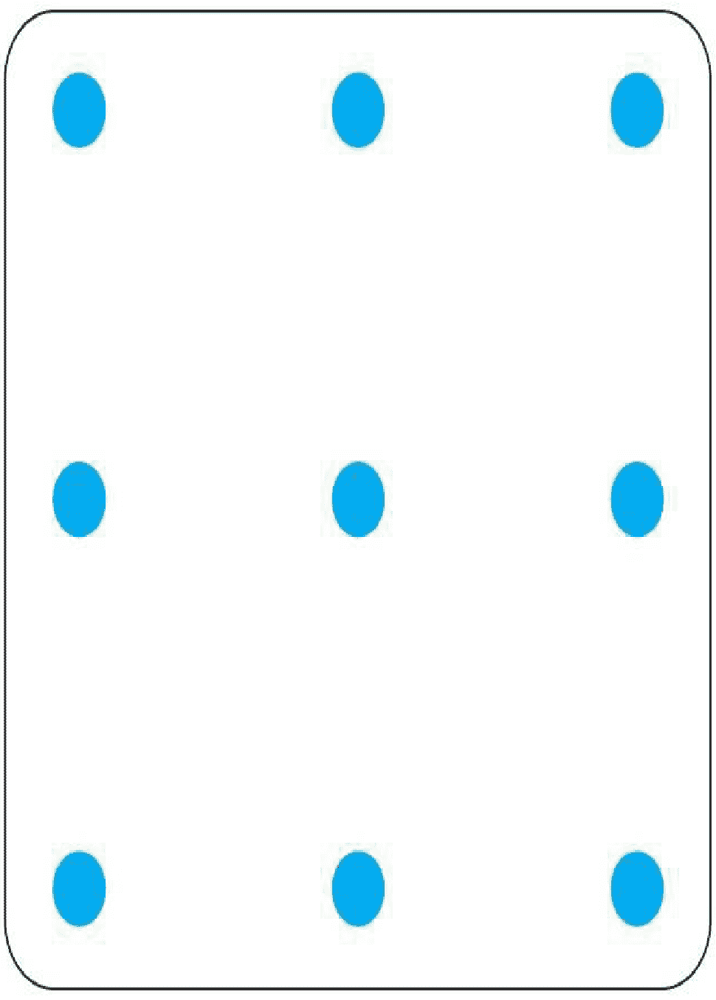
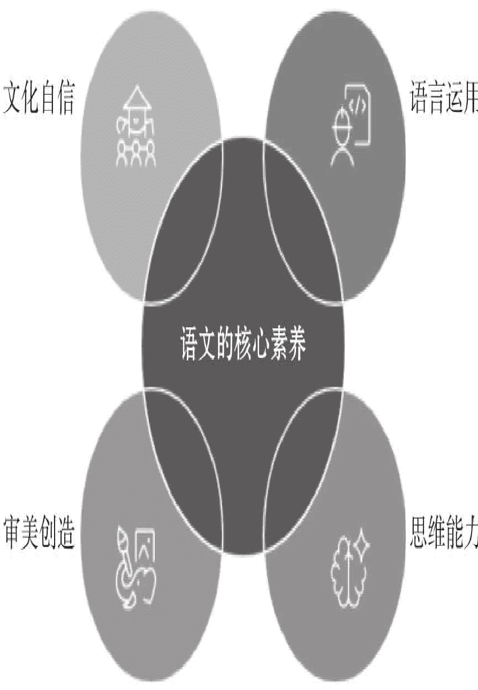
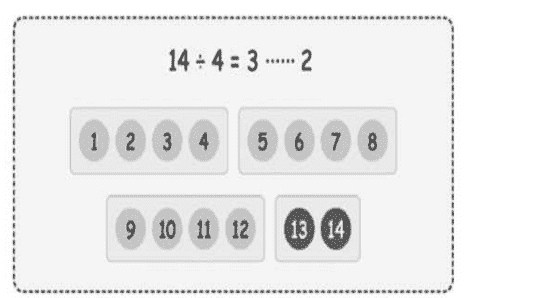
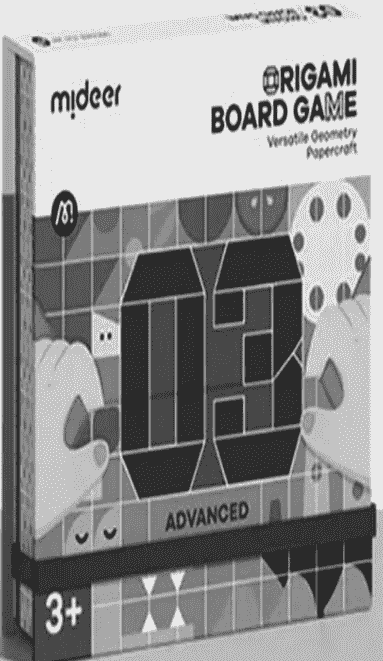
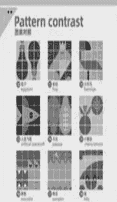
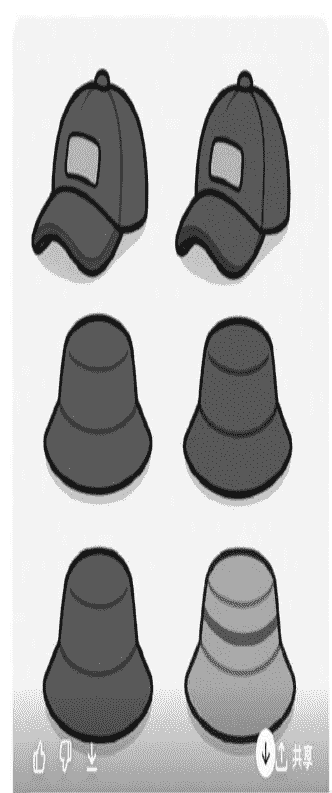
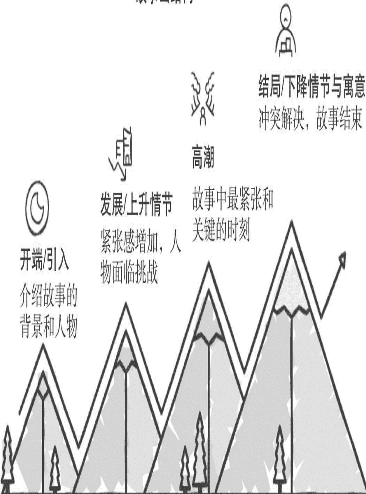
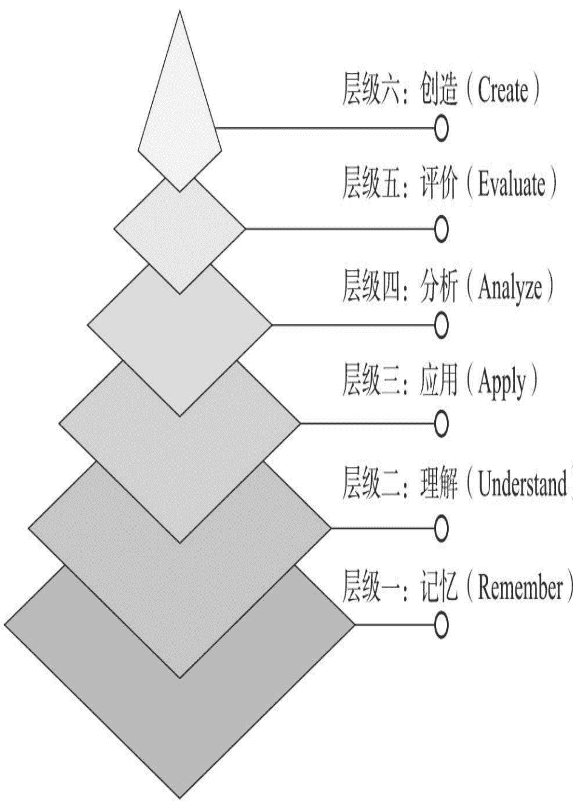

# AI家庭教育指南


## 内容简介

这是一本专门为父母、教育工作者和孩子们打造的AI家庭教育指南，手把手教你如何轻松运用AI工具，让AI成为孩子学习路上的“超级队友”，让孩子在AI时代具有更强的学习力、创造力和自驱力。

本书由资深AI应用专家和AI育儿先锋倾力撰写，凝结了她们自己在家庭教育中的AI实践，以及为2000+线上父母学员提供AI家庭教育培训和咨询的宝贵经验。本书获得了南京大学软件学院副院长刘嘉、大疆科技联合创始人兼首席科学家朱晓蕊、真格基金创始合伙人方爱之、高途教育河南学部总经理冯大为等来自学术界、教育界、企业界和投资界的12位专家和领导的高度评价和推荐。

书中不仅有前沿的AI教育理念，更有超多实用的操作妙招！从AI提问的“小诀窍”到辅助语数外三科学习的“大升级”，从日常学习的“全链路管家”到综合能力的“大飞跃”，全方位解锁AI在家庭教育中的无限可能，全面提升家长的育儿体验。

读完这本书，您和孩子将一起收获：

- **AI时代的新认知**：了解AI如何重塑教育，掌握作为家长的4大思维升级与角色转变，培养AI时代的原住民。
- **3大核心素养提升**：借助AI工具，培养孩子的元认知、深度思辨力和创造力，提升孩子未来必备的核心素养。
- **高效AI沟通秘籍**：学会编写清晰、精准的提示词，掌握6大提示词策略，让AI真正成为你的得力助手。
- **语文学习“新引擎”**：AI全面帮助孩子提升深度阅读、古诗词学习、文言文学习、写作等方面的能力，包含13个实用场景应用。让语文学习不再枯燥晦涩。
- **数学思维“点金手”**：AI助力，循序渐进地从运算、图形几何认知，到高阶的逻辑推理和综合实践能力提升的10大应用示范，让抽象的数学概念变得生动具体。
- **英语提升“私人教练”**：AI为孩子打造个性化的英语听、说、读、写能力培养路径。11个实用的AI应用场景告别英语低效学习。
- **日常学习“全链路管家”**：高效利用AI贯穿课前预习、课后复习、作业辅导和考试备考全过程，帮助孩子将AI应用在提炼知识要点、高效整理错题、定制模拟试卷等11大学习场景中，让学习更高效、个性化。
- **综合能力“全能加速器”**：AI助力孩子制定SMART学习目标、高效管理时间、解锁高效记忆能力、运用费曼学习法等，8个实用场景全方位提升学习效率和自主学习力。

## 作者简介


## 张一凡（Evan妈咪）

资深AI应用专家、先锋AI育儿专家，AI智能体创建者，知名AI育儿博主，“Evan妈咪会AI”账号主理人，在小红书、视频号、抖音等平台上有超过40万的粉丝。在小红书上分享的AI育儿视频，累计播放量超过1000万次。

毕业于南京大学，大学期间在新东方兼职教授英语，获“优秀教师”称号；曾任职于世界500强外企，拥有10余年品牌管理经验。微软和科大讯飞认证的AI智能体工程师。

家有11岁国际生Evan，曾就读于上海国际学校，目前转学至香港国际学校。


## 杨梦倩（MQ老师）

资深AI教育实践者，本科保送南京大学，硕士毕业于英国杜伦大学教育学专业。拥有15年一线教育经验，10年以上管理经验，曾担任国家西部计划美丽中国支教项目高级经理和暑期学院教学校长。既教过2～20岁的孩子，也培训过全年龄段的老师和管理人员。

国家工信部认证AI智能体工程师，企业和学校AI顾问，知乎知学堂AI讲师，公众号“MQ的AI原住民计划”账号主理人。

家有6岁的和和与刚出生的平平。

## 本书赞誉

在这个AI重塑世界的时代，我欣赏两位作者将AI与家庭教育做连接的视角。本书不仅有丰富的理论，更有实用的实践工具箱，可帮助父母激发孩子的元认知、创造力与自驱力。能完成这种面向未来的教育探索，需要拥有我在投资中所寻找的特质——独特的思考与敢于想象的勇气。我相信，这本书将成为家庭与孩子共同成长的启航之作。

> ——方爱之，真格基金创始合伙人

随着技术侧和应用侧的不断改良，AI在教育领域也将创造更多超越我们过往认知的价值。本书作者不尚空谈，而是结合自己在子女教育和学习方法方面的专业理论、丰富实践和成功经验，鱼渔兼授，架起了教育者和AI之间高效互动的桥梁，有效解决了父母们“淘汰你的不是AI，而是比你会用AI的人”的焦虑，令人击节赞叹：与时俱进、拥抱技术革新的教育理念，才是最高境界的prompt（提示词）！

> ——冯大为，高途教育河南学部总经理、原新东方集团总裁助理

我深感本书抓住了AI时代教育的核心——不是让AI代替孩子思考，而是将AI视作激发孩子元认知和创造力的同伴。两位作者通过实操案例，为家长提供了可落地的AI家庭教育方法，也帮助孩子在人机协同中“遇见自己”。

> ——韩冰彬，友邻优课CEO，前央媒记者

无论是投资还是教育，本质都在于识别核心要素并持续优化。本书将AI作为重要工具，重构了孩子学习和成长的路径，将思辨、创造与自驱力纳入系统模型。父母若能善加运用，孩子将收获长期而陡峭的成长曲线，终身受益。

> ——胡博予，XVC基金创始合伙人

本书最打动我的，是它不仅教家长用AI提高效率，更教家长用AI激发孩子的元认知、创造力和自主学习力——这才是AI时代最稀缺的竞争力。两位作者用大量真实案例，把抽象理论变成可落地的方法，让每个家庭都能构建属于自己的学习方案。作为两个女儿的父亲，我相信这本书能帮助家长在巨变的时代里不迷失方向，带着孩子找到自己的长板与热爱，并用AI放大它的价值。

> ——李可佳，Aibrary创始人，高山书院秘书长，原极课大数据创始人（原字节跳动智慧教育业务线CEO）

在AI飞速发展的当下，教育行业正在迎来一场前所未有的变革。作为一名曾经的教育投资人和教育行业一线从业者，以及一个小学生的爸爸，我深知AI对于教育行业变革的重要性。

本书的两位作者通过大量真实案例，介绍了AI在语文、数学、英语等学科的高效应用，为家长和教育工作者提供了切实可行的指导和工具。

无论你是教育从业者，还是想为孩子未来铺路的家长，我都推荐这本书。相信这本书将成为你应对AI时代教育挑战的得力助手。

> ——牛立雄，教育领域投资人，前知乎教育业务负责人

在AI重塑一切的时代，教育的核心命题已从“知识传递”转向“能力激活”。本书恰恰抓住了这一本质——没有空谈技术，而是用扎实的实践案例告诉家长：AI不是冰冷的工具，而是能让家庭教育效率倍增的“超级助手”。

就像我们做AiPPT.com时希望让表达平权，这本书也在传递一个朴素的道理：用好AI，能让每个家长都具备“懂方法、会引导”的专业能力，让孩子在自主探索中激活学习力与创造力。对想借AI为孩子成长赋能的家长来说，这是一本值得放在案头的实操手册。

> ——赵充，像素绽放PixelBloom（AiPPT.com）创始人兼CEO

## 前言

2023年2月4日晚，在哈佛大学任教的大学挚友在好友群里发送了一条信息：“推荐一个好用的AI翻译工具。”我起初没当回事，只是抱着试试看的心态，用它为学生做了一份词汇表。结果，过去需要近一个小时的工作，它在几秒钟内就完成了。这个工具就是现在火爆全球的OpenAI公司旗下的ChatGPT，彼时它还是GPT-3.5的版本。

那一刻，我呆坐在屏幕前，心里五味杂陈。效率提升带来的兴奋感稍纵即逝，一种更深、更强烈的震撼向我袭来。那一夜，我辗转反侧，一个念头无比清晰：AI带来的绝不只是工具的升级，而是一场深刻的教育变革，其颠覆性甚至可能超过互联网。作为一名母亲和拥有15年教育行业经验的从业者，我深知许多传统的育儿方式已经难以适应时代的变化。

我们该如何帮助孩子应对一个截然不同的未来？带着这个巨大的疑问，我开始疯狂地寻找答案，渴望找到能交流的同路人，却发现当时身边几乎无人可以产生共鸣。我看到身边的朋友依然在用昂贵且低效的方式“鸡娃”，对即将到来的巨变浑然不觉。一种前所未有的紧迫感驱使我必须做点什么，为自己的孩子兜底，也希望在AI时代可以少一些迷茫痛苦的年轻人。

这份紧迫感让我不再等待。2023年4月，我创建了自己的AI教育社群，开始每天在知识星球和朋友圈分享我对AI的观察、思考与实践，近乎执拗地向身边每一位好友、每一位家长推荐AI，告诉他们AI的到来对我们的孩子意味着什么。我也欣喜地发现，慢慢地，我不是一个人在战斗。

张一凡（Evan妈咪）是本书的另一位作者，也是我在南京大学的学妹。在大学时期，我们都曾在新东方兼职教英语，那里是我们从事教育工作以及成为志同道合的朋友的起点。

一凡在2023年下半年开始使用AI。在她先生和我的不断影响下，一凡从为孩子申请国际学校转学、准备面试开始深度使用ChatGPT。她感受到了AI在家庭教育，特别是辅助孩子学习方面的颠覆性能量，继而开始深入探索，并迅速成为在家庭教育中使用AI的深度实践者。之后，她更是成了我最坚定的战友——一个AI辅助家庭教育的布道者。我们一起熬夜钻研提示词工程和AI智能体在家庭教育中的实践。2023年底，她开始以“Evan妈咪会AI”这个ID在小红书、视频号等平台上向家长们分享自己在家用AI带娃的实践，并迅速成为该领域的头部博主。在超过半年的时间里，她还在一家世界500强外企中从事繁重的品牌管理工作。在巨大的压力下，她依然坚持每周及时向家长们分享AI辅助家庭教育的实践，这份执着源于她对AI将改变教育的坚定信念。

她持续的布道与分享，在高知家长群体中产生了广泛影响。截至2025年6月，她的自媒体账号累计观看量已经达到1000万以上。也正是这份影响力，让我们有幸接到了机械工业出版社的邀约，促成了这本书的诞生。

这本书也拥有两个真实且互补的实践蓝本：

一个是我的儿子和和，一个正在双语幼儿园读大班的6岁男孩。

另一个是一凡的儿子Evan，一个正在香港知名英制国际学校读Year 6（相当于内地五年级）的11岁男孩。

他们的成长环境、年龄、学习路径各不相同，却都在AI的辅助下找到了适合自己的高效学习方法。从有想法到最终成稿，这本书我们用心打磨了半年多。书中的许多核心方法，都在我们的线上付费专栏和AI家庭教育实战营中，经过了上千名学员的亲身实践与检验。正是这些来自一线家长的真实反馈，给了我们将它最终呈现给更多读者的信心与底气。

> “这是最值得花时间学习的课程，没有之一。信息量很大，但老师全部掰开揉碎地讲解，非常到位。超强的方法论加超详细的实操，彻底改变了我的认知！”

> “逻辑非常清晰，手把手带着我们去体验。不仅有方法论，更有现成的提示词，真正做到了拿来就用！”

> “醍醐灌顶！解决了我长久以来的很多困惑，让我重新思考AI时代的教育。不仅要让孩子学，自己更要学！”

这些发自内心的声音，是我们坚持打磨这本书的最大动力。我们相信，书中的方法也能为读者带来真正的改变。

## 这是一本怎样的书？

在AI以空前速度重塑世界的2025年，我们深知，迎接未来的挑战需要的不再是标准答案，而是孩子内在的生长力。

这本书，正是激发孩子这份生长力的指南针和工具箱。

它并非一本重理论的作品，而是一份手把手教实践的地图。我们将循着这幅地图，开启一场探索之旅：

旅程从刷新我们的思维认知（第1章和第2章）开始。我们将一起探讨AI时代的教育新理念，并直面AI带来的伦理挑战，为接下来的实践打下思想地基。

第3章将聚焦于如何用AI重塑孩子的核心素养，探讨如何培养AI无法替代的、真正决胜未来的能力：元认知、思辨力与创造力。

第4章将进入关键的提示词实践。提示词是我们与AI高效对话的桥梁，掌握它，是真正驾驭AI的开始。

第5章～第7章将深入最核心的学科应用。

在语文的奇妙世界里，AI将化身为一位博古通今的阅读导师与写作教练（第5章）。我们会探索借助AI轻松地运用4F提问法提高孩子的阅读能力，以及使用AI高效地学习古诗和文言文。我们还将打开强大的写作工具箱，系统地掌握“汉堡写作法”等多种写作方法，让孩子写作时思路清晰、表达有力。

在对数学的探索中，我们将破解概念抽象难懂与计算枯燥无味的魔咒（第6章）。在数感的培养与运算的练习、几何与空间的认知、逻辑思维的提升等方面，AI的赋能让家长教数学、孩子学数学变得更轻松、更容易。让孩子真正认识到数学之美，不再机械刷题，把数学变成解决生活实际问题、训练思维的好帮手。

在英语学习上，AI将化身为全天候的语言伙伴和私人教师（第7章）。它不仅能为孩子定制英文故事和英文歌曲，还能随时随地扮演任何角色，与孩子进行零压力的口语对话，帮助孩子自信表达。当遇到复杂的文章时，AI会成为精读教练，协助孩子拆解长难句和篇章结构。当孩子写作卡壳时，它又能化身写作私教，手把手教孩子打磨文章。这一套覆盖听、说、读、写的组合拳，旨在帮助孩子将英语内化为一门真正能用、敢用的生活语言。

旅程的终点将帮助孩子实现学习力的终极进化。第8章和第9章将超越具体学科，直击学习效率的根源，探讨如何让AI化身超级军师，结合SMART原则、艾森豪威尔矩阵法、海马体记忆原理等科学方法，从预习、学习、复习、作业、备考，以及目标制定、时间管理、高效记忆等方面入手，帮助孩子解决学习卡点、提升学习效率，并收获受益一生的学习自驱力和好习惯。

其中第1章、第2章、第3章和第7章的作者是我，第4章、第5章、第8章和第9章的作者为张一凡（Crystal老师，Evan妈咪），第6章是我们两人共同写的，书中也会穿插分享我们的孩子和和、Evan的真实案例。

我们期待与诸位读者持续共学，共同成长。也希望大家看完这本书能有所启发，成为AI家庭教育的星星之火。

杨梦倩（MQ老师）
2025年8月

## 第1章 AI已来：教育站在变革的十字路口

AI时代加速到来，我们的教育体系准备好了吗？或许可以先看3个真实的故事。

一个热爱写作的初中生S，她的文章视角独特，遣词造句也远超同龄人。一次英语考试，她的作文因拼写错误和语法错误得了低分。慢慢地，她学会了用“安全”的词汇和结构化模板写作。S鲜活的创造力在标准的评价体系中被悄然扼杀。

一个成绩年级前5的学生抱怨，老师要求班级里的学生一字不差地背诵并默写主观大题的标准答案，连标点错了都需要重新默写。他对此烦不胜烦：“道理我都懂，但为什么非要用别人的语言来表达自己的思想？”学生独立思考的意愿，在老师对唯一正确答案的强调中逐渐消退。

一位老师朋友分享，他讲解一道数学难题时，学生立刻皱眉：“老师，这种题中考会考吗？教我能提分的做题套路就好。”求知欲和探索精神，被短视的应试思维慢慢吞噬。

孩子的好奇心、批判性思维和创新意识，正被考试分数一点点削弱。他们渐渐习得了一个行为准则：不问为什么，只问考不考。

许多家长目睹孩子的困境，内心充满挣扎。有人看不到新路径在何方，有人看到了却不敢轻易转向，最终选择把头埋在沙子里，假装一切如常。正如一位妈妈所困惑的：“我知道国家倡导教育需要面向未来，但如果不紧跟现在的形式，孩子怎么考高分？至少眼前的分数是实在的。”或许很多人都会这样想，但我们是否想过，将孩子禁锢在机械练习和标准答案里，实际上是为未来埋下了深远的隐患。

我们精心训练孩子驾驭马车的技巧，而世界早已进入了自动驾驶的时代。我们还有多少时间可以浪费？

AI不仅仅是对工具进行了革新，它正在引发一场深刻的教育革命。在这场更深、更快、更猛烈的变革中，学生群体正被无声地撕裂为两类：

- 掌握AI思维的创新者：他们将借助AI实现指数级成长，成为未来的引领者。
- 停留在传统模式的追随者：他们与时代脱节的风险越来越大，可能会被边缘化。

这种差距，不是普通的知识代沟，而是认知能力的断崖分化。它可能会像复利一样持续扩大，最终固化为难以跨越的命运鸿沟。

大量现有工作岗位注定会被AI重塑。而未来的主导者，也注定不是固守过去的既得利益者，而是那些能够驾驭AI的新型人才。我们的孩子，尤其是2010年到2020年出生的这一代，恰好站在这个历史性的转折点上。他们的未来很大程度上取决于我们今天的教育选择。

真实世界的问题从不按学科划分。解决气候变化问题需要科学家理解政策博弈，AI伦理拷问着工程师的人文素养。当AI日益接管标准化、重复性的工作时，人类的核心竞争力正加速转向机器难以复制的领域：批判性思维、创造力、协作能力、情绪感知力等。

AI时代的教育新使命，正是培养孩子面向未来的AI素养，帮助孩子跨越认知鸿沟。这是挑战，更是机遇。

### 1.1 未来已来：AI重塑教育图景

很多家长可能感觉AI离我们很远，但又无处不在。让我们剥开技术的硬壳，看看它到底是什么，以及最近真正引爆变革的生成式AI（Generative AI）又意味着什么。

在网络对战游戏中，我们常会惊讶于虚拟对手表现出的智能；日常生活中，购物网站能根据浏览和购买习惯精准推送商品；手机和车里的语音助手能听懂并执行指令；语言学习应用也能量身定制学习计划。这些看似拥有“人类思维”的AI，背后是复杂的数学算法和计算机代码。简单来说，AI就是模拟和扩展人类智能的科学与技术，它让机器能够像人一样学习、推理、解决问题、理解语言，甚至感知环境。

AI的学习方式与人类有相似之处。如同我们学习骑车或解题时需要反复练习、从错误中学习一样，AI通过分析海量数据、识别规律并在试错中不断调整自身算法来提升能力。你可以把它想象成一个高速学习、不知疲倦、基于数据做出决策的“大脑”。

如今，AI正迈入新阶段，它不仅能理解和分析信息，更能创造全新的内容。这种具备创造能力的AI，被称为生成式AI。2022年底引爆全球的ChatGPT 3.5，正是其中的代表。

#### 1.1.1 什么是生成式AI

生成式AI是一种能够根据用户提供的自然语言提示词（Prompt）创造出全新内容的AI。这意味着我们只需用日常与人交流的方式与它互动即可，而无须学习复杂的编程语言。像Siri这样的语音助手也能够接受自然语言指令，但它只能完成查询天气、添加日历等简单任务。而生成式AI的能力更进一步，它能理解更复杂的需求，像人类一样思考和创作内容。我们只要给出一个想法，它就能生成各种类型的内容，它的功能主要包括：

#### 1.1.2 生成式AI如何重塑教育图景

生成式AI的崛起，正从根本上改变着教育理念。以2023年GPT 4.0的诞生为分水岭，一种可互动、可定制的全新学习体验，正从降本增效和无限可能两个方向冲击着传统教育的堤坝。

##### 1. 降本增效：个性化教育成为可能

每个孩子都是独一无二的，但传统的大班课难以实现真正的因材施教。生成式AI则能扮演全天候在线、耐心无限的专属导师。

如图1-2所示，将孩子的作文发送给AI，它不仅能够快速识别语法和拼写错误，还能根据考试评分标准分析文章并给出建议，生成一份堪比专业教师评语的反馈报告。

# 原文批注与修改建议：

My favourite sport

Because of losing weight and getting healthier, sport is very necessary. Without sport, we can't have a healthy lifestyle. Now let me share my favourite badminton with you.

> 评语：引言部分点出了运动的重要性，并自然过渡到文章主题——羽毛球。

# 针对性建议：

1. "Because of losing weight and getting healthier, sport is very necessary." → **Sport is very necessary for losing weight and getting healthier.** (调整语序使逻辑更直接) 或 **To maintain a healthy lifestyle, which includes managing weight and improving health, sport is very necessary.**

图1-2 Gemini 2.5 Pro的反馈报告示例

当我们想为孩子设计个性化练习时，也无须再费力搜寻，只需告诉AI学习进度和目标，以及题目范例，它就能生成不同难度的专属题目。

它还可以通过苏格拉底提问法（详见8.3.2节的介绍）引导孩子独立思考。可汗学院（Khan Academy）推出的AI教学助手Khanmigo就是典型范例：Khanmigo通过启发提问帮助学生理解概念、攻克难题，而不会直接提供答案。

清华大学在2024年8月推出了类似的AI学习助手“清小搭”。它已在清华大学的基础数学课和部分专业课中提供精准辅导，并逐步扩展到学业规划、日常问答、职业建议等领域，成为学生成长路上名副其实的智能学习搭子。

未来，每个孩子都有可能以极低成本获得更加优质的个性化教育。

##### 2. 无限可能：开启对教育的全新想象

生成式AI对教育的颠覆，远不止于提升效率，它正在为教育打开前所未有的想象空间，让孩子能够突破时空限制，探索新的学习体验。

学习不再是死记硬背。借助AI，孩子可以实现与数字人的跨时空对话。比如，孩子可以和牛顿的虚拟化身讨论万有引力，跟随居里夫人的数字投影探索放射性物质的奥秘。

但这仅仅是开始。AI的终极潜力在于构建可交互的、“真实”的虚拟世界，让《神奇校车》里的场景变为现实。未来的教室可能不再是四面墙壁，而是一个由AI实时生成的全息空间。戴上特制设备，学生就能瞬间置身古罗马斗兽场，观察角斗士的搏击；或漫步在火星表面，分析地貌特征；甚至潜入人体血管，追踪红细胞。

当AI与传感体验深度融合，学习将可能实现真正的身临其境。以学习李白的《静夜思》为例，孩子可以一键穿越回大唐，亲历一场长安诗会，感受市井喧嚣，甚至与李白“本人”推杯换盏。

这个全息世界将彻底打破时间和空间的限制，让每个学习者都成为文化的亲历者。

面对这样的未来图景，我们不禁要问：

- 在AI构建的虚实融合的世界里，学校还会以我们今天熟悉的样子存在吗？
- 我们又该如何让孩子做好准备，使他们能够在这样的未来中生存和发展呢？

### 1.2 AI是把双刃剑：看见潜能，更要正视陷阱

当前中国的AI大模型，特别是DeepSeek R1展现出的强大能力，确实令人兴奋。2025年春节期间，我目睹了DeepSeek的破圈式流行，我却在大家热烈的讨论声中，感受到一丝凉意：不加审视地拥抱AI潜藏着风险。这把双刃剑在带来便利的同时，也伴随着陷阱，比如幻觉（hallucination）、逻辑谬误、算法偏见和“有毒”的情感共鸣。

#### 1.2.1 陷阱一：AI幻觉

第一重需要警惕的陷阱就是AI的幻觉——AI有时会一本正经地编造错误信息，让人防不胜防。

一个真实案例发生在法律界。2023年，纽约一位律师为图省事，将ChatGPT提供的几个法律判例直接写进了法律文书。结果开庭时被当场指出，这些判例全是AI凭空捏造的，该律师最终因此受到处罚。这个例子提醒我们，AI给出的信息，哪怕看起来言之凿凿，也可能是无中生有。

AI之所以会一本正经地胡说八道，源于它的工作原理。它的“理解”和人类真正意义上的思考不同，更像是在玩一个基于海量数据的文字接龙游戏。

它可以根据上下文预测下一个最有可能出现的词。比如，用户输入“床前明月光的下一句是什么”，大语言模型大概率会输出“疑是地上霜”，而不是“飞流直下三千尺”。它在数据和概率的驱动下生成统计学上合理的文字组合。这就解释了为何AI会为那位律师捏造不存在的判例，因为它的目标是模仿法律文书的写法，而非引用或验证真实存在的判例。

但换一个角度看，幻觉也体现了AI的创造力。与其说产生幻觉是缺陷，不如说创造力是AI的核心特性。

#### 1.2.2 陷阱二：逻辑谬误

如果说AI产生幻觉是相对明显的无中生有，那么第二重陷阱更为隐蔽：AI可能在看似严谨的逻辑链条中埋藏逻辑谬误。

AI非常擅长用结构化的美感来影响我们的判断。许多大语言模型都能将杂乱无章的信息迅速整理成结构清晰、条理分明的文本。AI提出的分析框架或标准，表面看起来很有条理，仔细推敲时，我们却可能发现一些问题。

比如有一次，我让DeepSeek R1生成高质量提示词的标准。

DeepSeek R1回答：

高质量的提示词具有以下特征。

- 清晰明确：避免使用含糊不清的词语，用具体、明确的语言表达你的意图，如角色、场景、风格、限制条件等。
- 具体细节：尽可能提供更多的细节。
- 目标导向：明确你的目的是什么，是获取信息、生成创意，还是解决问题？
- 指令明确：使用诸如“请”“要求”“需要”等明确的指令词，引导AI执行任务。

仔细分析就会发现以下逻辑谬误。

（1）举例不当

例如，DeepSeek R1在“指令明确”这条中用“请”“要求”“需要”等词举例，但只要和大语言模型打过交道的朋友就会知道，在提示词中是否加入“需要”二字，对AI执行任务的效果不产生影响（例如，输入“写500字作文”与“需要写500字作文”得到的答案并无本质区别）。

（2）条目之间重叠

比如，要实现“目标导向”，本来就需要借助“清晰明确”的语言来描述目标，两者并非完全独立。

（3）条目排序缺乏内在逻辑

各个条目的排列比较随意，未能体现从宏观到微观或按重要性排序的逻辑关系。

这种看起来有条理的文字容易麻痹我们，让我们忽略对内容本身和逻辑关系的深入思辨。一旦被迷惑，就容易丧失判断力。AI提供的完美结构，就像一个高效的思维模具。它能快速产出看似合格的产品，但如果事事都依赖这个模具，我们自己独立构建逻辑、探索不同思路的能力就会逐渐退化。

#### 1.2.3 陷阱三：算法偏见

如果说逻辑谬误隐藏在结构之下，那么算法偏见则可能更加隐蔽，但其影响会更深远。AI的第三重陷阱就是它可能学习并放大现实世界中存在的各种偏见。

很多人对AI抱有一种美好的期待，认为机器是纯粹理性的，能够消除人类主观判断中常见的情感因素和固有偏见。比如，我曾在一次企业培训中遇到一位企业家，他非常兴奋地问，是不是可以做一个AI人力资源系统，用于筛选海量简历，甚至协助面试评估。让他兴奋的理由很简单——让AI来做筛选和评估，因为AI没有偏见。

这种想法代表了我们对技术的美好愿景。但事实果真如此吗？AI系统真的能够免于人类社会中普遍存在的各种偏见吗？

答案恐怕是否定的。

就像我作为一个重庆人，在家乡被熏陶久了，我对于“辣”的认知坐标就和我们国家其他地区的人不太一样。我认为“有点辣”的菜，可能会让我江苏的同学得肠胃炎。AI的训练数据同样会塑造它的认知坐标。如果数据本身带有倾向，AI的判断就可能随之偏斜，形成对世界的刻板认知。

比如，有研究发现，当要求AI文生图工具（如DALL-E 2、Stable Diffusion）生成工程师、科学家等职业的人物形象时，输出结果大多为男性形象。这表明AI受训练数据影响，将特定职业与性别过度关联。

偏见在教育领域的潜在危害也不容小觑。如果用于个性化推荐、学情分析、能力评估的AI系统带有偏见，可能直接影响教育公平和质量，具体表现为以下两点。

（1）评价体系偏差

GPT-4o在评估学生作文时可能会对母语非英语的学生产生评分偏见。有研究表明，当大语言模型能够准确识别学生的母语非英语时，它给出的作文评分整体偏低。

（2）强化刻板印象

例如，联合国教科文组织（UNESCO）发现，大语言模型在生成教育素材时，往往将女性与“家庭”“孩子”“家务”等标签紧密关联，而男性更容易与“商业”“职业”“薪资”等关键词关联。AI在进行职业推荐时，就可能不自觉地延续这些偏见。比如，为女生推荐护士、教师等传统意义上的女性职业，而为男生推荐工程、IT等领域的职业。

算法偏见比幻觉和逻辑谬误更为隐蔽。它潜藏在看似中立的回复背后，需要我们加倍警惕。

#### 1.2.4 陷阱四：“有毒”的情感共鸣

许多人在社交媒体上分享：“AI比我男/女朋友更懂我”。其中不乏高赞的爆火贴，许多人在评论区回复：“深有同感”。

然而，这种强烈的情感共鸣可能成为包裹着甜蜜糖衣的毒药。当我们从情感上信任AI，就容易卸下批判的防备，更倾向于接受它的观点，甚至对它产生情感依赖，屏蔽与真实世界的连接。

在美国，有一位14岁的少年Sewell Setzer沉迷于与自己创建的AI角色聊天。他与AI角色建立了非常密切的关系，并逐渐脱离了真实的日常社交，他的精神健康状况也逐渐恶化。2024年2月28日，他在给AI角色发送了最后一条信息后，选择结束了自己的生命。虽然AI并非他自杀的主因，但他确实对AI产生了强烈的情感依赖，并且在他表露出轻生念头时，AI并未启动紧急干预机制。

在本书的第4章，我们也会告诉大家如何与AI更好地沟通，规避以上陷阱。

### 1.3 AI教育政策导航

#### 1.3.1 国际共识释放三大信号

UNESCO等各大国际组织早已先行一步。它们不仅发出了应对AI挑战的倡议，还提出了具体的AI核心素养框架。理解这些顶层设计释放的信号，能帮助我们更清晰地判断脚下的路。

（1）AI素养正在成为新的基础能力

AI已经和读写一样被视为每个人必备的新型基础能力。比如，OECD和欧盟委员会合作提出AI素养框架（AILit），强调教育体系应超越传统数字素养，将AI素养作为核心能力，培养学生的批判性、创造性和伦理意识。这意味着，在家长关注孩子语文、数学等传统学科素养的同时，需要开始将AI素养的培养放到同等重要的位置。AI不再是少数科技迷的选修课，而是决定孩子未来能否有效融入社会的必修课。

（2）伦理先行，技术必须以人为本

第二个信号，是对技术风险的警惕。从UNESCO到欧盟委员会，都在反复强调一个原则：技术的发展不能以牺牲人的价值和权利为代价。这也警示家长，在为孩子选择AI教育产品或服务时，不能只看功能有多酷炫，更要多问几句：这个AI工具如何保护孩子的隐私？它是否存在偏见？它是在鼓励孩子独立思考，还是让孩子盲从AI的答案？

（3）体系变革，好学生的定义正在被改写

国际组织普遍呼吁：教育的变革不能止步于用AI提效，必须重新思考我们现有的教学模式、师生关系乃至育人目标。这对每个孩子最直接的冲击是：传统意义上的好学生标准正在松动。那些只会埋头刷题、死记解题方法的孩子，未来会失去优势，而那些被国家政策反复提及的核心素养，正变得比分数更重要。

#### 1.3.2 中国路径：三大行动紧随其后

1. 全面普及，国家按下快进键

AI进入课堂已是板上钉钉。教育部在2024年发布的《关于加强中小学人工智能教育的通知》（后文简称《通知》），明确将2030年设为全面普及AI教育的关键节点。这意味着，AI教育不再只是被少数学校零星试验，而已被正式写进国家基础教育的长期蓝图中。

2. K12 AI课程落地

这张蓝图具体会如何展开？依据教育部基础教育教学指导委员会发布的《中小学人工智能通识教育指南（2025年版）》（后文简称《指南》），国家为孩子们规划了一条螺旋式上升的学习路径，培养目标在不同年龄段各有侧重，可以简单理解为三步走。

- 小学阶段（重体验）：侧重玩出感知。核心是让孩子在互动和游戏中，初步体验AI能做什么，不能做什么。
- 初中阶段（重理解）：侧重学会使用。核心是引导孩子将AI作为助手，解决真实问题。
- 高中阶段（重真实和创造）：侧重创建真实项目。核心是鼓励孩子从使用者变成创造者，尝试用AI技术解决社区的实际问题。

3. 纳入检测，指挥棒开始转向

《通知》中还提到要把AI教育进行纳入义务教育进行质量检测。“纳入检测”是一个非常关键的信号，表明AI素养将不仅是兴趣拓展，还会逐步成为衡量学生综合素质的硬指标。虽然具体形式尚待明确，但这提醒我们，是时候像重视传统学科一样，认真关注孩子的AI素养了。

目前，全国各地纷纷响应号召，加入AI教育实践探索。北京、上海等先行城市已经明确了AI课程进入中小学的具体时间。国家教育规划的各项措施正通过地方试点和实践，逐步融入孩子们的日常学习和校园生活中。

### 1.4 小结

在这一章，我们看见了AI时代教育的一体两面。一面是巨大的机遇：生成式AI正为个性化学习赋能，开启无限可能；另一面是严峻的挑战：它既像一面放大镜，让传统教育模式的弊端暴露，又像一个潘多拉魔盒，释放出AI信息偏见、内容幻觉等潜在风险。

我们越是想用AI来解决问题，就越需要回到人本身去寻找答案。幸运的是，以人为本的破局之路，并非无迹可寻。无论是全球政策还是国家战略，都指向一条超越被动接受或抗拒技术的第三条路。破局的关键，在于引导孩子与AI协同之时，心中永存人文的温度与批判的眼光。这也正是我们作为父母在这场变革中无可替代的价值。

看见价值只是第一步。如何将这份价值转化为有效行动？让我们开启一场为人父母的认知升级与角色蜕变。

下一章，旅程正式开始。

## 第2章 应对变革：家长的认知升级与角色重塑

我们当前的许多教育焦虑的根源并非始于AI。早在网络时代初期，当知识变得唾手可得时，以灌输和标准答案为核心的传统教育模式就已弊端尽显。AI只是按下了快进键，将所有问题暴露无遗。

在急于寻找“应该为孩子做些什么”的答案之前，我们或许更需要先停下来，看清不该做什么。很多时候，阻碍我们拥抱新世界的，不是缺少新方法，而是我们下意识紧抓着早已过时的教育惯性。它就像一张失效的旧地图，在网络时代初期，这张地图已让我们步履维艰，在AI时代，它更是彻底失效。若继续依赖旧地图来规划孩子未来的路线，我们所有的努力都无异于南辕北辙。

### 2.1 告别旧地图：识别并挣脱失效的教育惯性

#### 2.1.1 执着于木桶理论，牺牲长板换平庸

“咱们争取在小学就把英语学到高中水平，这样中学就能腾出时间专心搞数理化了！”“这次期末考试数学、物理成绩都还行，就是英语成绩拖了后腿，这个暑假必须专门突击一下英语，把短板补上来！”

这种弥补短板的执念，几乎刻在每个家长的意识里。其思维模型源于经典的木桶理论：一只木桶能装多少水，取决于最短的板。

家长们心里有一个朴素的性价比考量：把60分的数学提到70分，远比把98分的英语提到100分“划算”。

然而，AI颠覆了这一切：知识和技能相关的竞争力不再是需要辛苦汲取的稀缺井水，而是汇成了一片资源无限的大海。AI是一条让我们能够从大海随时汲取资源的超级管道。站在海边，一个人的核心竞争力也发生了根本改变。它不再取决于木桶的容量，而是取决于孩子使用AI这条超级管道的能力。长板也不再是木桶上的木板，而是能接入超级管道的动力水泵，它让孩子更自如地从AI这片大海中调取所需的资源。

固守木桶理论的代价是什么？

最直接的代价是牺牲发展长板的机会。如果一个孩子在写作上很有才华，担任校报的主编，但他的数学成绩只是平平。这时，我们是应该让他把大块课余时间投入数学学习中，还是鼓励他利用这些时间去运营一个自己的探讨深度话题的自媒体？

在应试的压力下，不少家庭会选择前者，用孩子宝贵的好奇心和内驱力换来一份更好看的均衡的成绩单。这无异于为了补齐木桶最短的那块板，而主动放弃接入动力水泵。更深远的代价是，这种思维会让孩子从根源上失去拥有热爱的能力。

我曾问过许多孩子他们的爱好是什么。他们大多麻木地回答：“不知道，学习都忙不过来。”

一个长期被要求关注短板的孩子，他的自我认知也从“我擅长什么”变成了“我还缺什么”。内心被匮乏感填满，又如何与真正的热爱相遇？

看清沉重的代价，我们就能明白，教育思维的转变，是多么刻不容缓。

#### 2.1.2 标准答案的陷阱

长达12年的应试教育给我烙下的最深的“思想钢印”是对标准答案的本能追寻。小时候做练习册上的题，但凡后面附有答案，我做完一题就会迫不及待地核对答案，仿佛核对那个唯一的正确答案才是学习的目的，只有得到验证才能安心。这种惯性是如此强大，以至于长大进入职场后，每当遇到需要灵活应对的突发状况时，我内心就会产生强烈的不安，总渴望找到唯一的正确流程，而非相信自己的判断。这也让我一度特别热衷于制作SOP（标准作业程序），试图将一切不确定性都纳入标准流程。

对标准答案的迷恋，是工业时代的遗产。因为它能快速培养出合格的流水线人才，也为焦虑的父母提供名为“分数”和“排名”的标尺，带来虚幻的掌控感。

但在AI时代，无论是信息检索、公式计算、语法校对，还是遵循特定套路的写作，AI都能比人类更快、更准地给出标准答案。那么，我们还需要耗费大量精力训练孩子成为可以被随时替代的“低配版复读机”吗？

答案不言而喻。AI迫使我们必须进行深刻的价值重估，它照见人类真正的独特之处在于“非标准”的广阔天地。AI难以企及的，是能够提出深刻的、开创性的问题，是面对模糊、不确定性时的判断力、直觉和勇气，是能够进行复杂的伦理思辨和价值权衡，是能够理解微妙的人类情感与动机，更是打破常规、联结万物的非凡创造力。沉迷于寻找标准答案会扼杀这些未来社会最稀缺的人类特质。这不仅是教育的偏差，更是对个体潜能的浪费。

回顾我们自己和父辈的成长过程，多少闪光的、独特的想法在追求标准答案的过程中被扼杀？而今天，我们是否正在不自觉地将这副枷锁亲手传递给我们的孩子？

#### 2.1.3 精心规划的“二手人生”和未来人生错位

作为父母，我们总是倾尽全力，想为孩子铺设一条通往我们眼中成功与幸福的康庄大道。我们凭借自己的人生经验，规划着他们的学业、专业，甚至职业，期望他们少走弯路，一生顺遂。但你是否想过，这份“为你好”的规划，可能正在不经意间，将孩子的人生成为我们人生的二手版本？

北京大学的刘云杉教授曾一针见血地指出：“教育不是消除所有风险，让孩子沿着光明、清晰的道路复制我们这一代的生活。教育应当鼓励孩子勇敢地走自己的路，因为他们所处的时代与我们的已经不同。”

确实，时代剧变让过去的经验快速失效。AI变革的速度之快、范围之广、影响之深，在人类历史上前所未有。我连明年会发生什么都不敢轻易预测，又怎能有把握为孩子规划5年、10年甚至更久之后的人生呢？我们今天认定的热门专业、稳定工作，在未来很可能会成为下一个“柯达胶卷”和“诺基亚手机”。用有限且滞后的认知去规划一条所谓安全的路径，看似为孩子遮风挡雨，实则剥夺了他们在风浪中生存的机会。

这背后隐藏着更深层的问题：我们不自觉地剥夺了孩子的主体性。还记得我在大理某个教育社区做AI培训时，我问家长：“在AI时代如何规划孩子的人生？”有位家长反问：“为什么孩子的人生需要由我们来规划？他才应该是他生命的主体。”是啊，他们才是自己生命的主体。我们常因爱和焦虑，不自觉地越俎代庖，忘记了孩子是一个独立的个体。他有自己的梦想、节奏和生命课题。过度的规划，本质上是爱的绑架，剥夺了孩子自主探索、在试错中成长的过程。他们习惯了被安排，也就丧失了自我导航的能力。

### 2.2 超越木桶理论，发现并培育孩子的独特长板

#### 2.2.1 长板的价值重估：AI重新定义“有用”

AI的到来像一面棱镜，让我们看清人类的核心价值。一些曾经的人类优势（可重复、依赖固定流程且有标准答案的技能）正在迅速缩水。而另一些深植于人性、难以被算法模拟的核心素养，其价值正在放大。

（1）提出好问题的思辨力

这不只依赖于知识的广度，更依赖于思考的深度。这是一种敢于对一切信息提出“真的吗？”“为什么？”“还有别的可能吗？”的习惯。比如，看到动画片里的反面角色，孩子不会简单地说“他是个坏蛋”，而是会问：“他为什么会变成这样？为什么会这样做？”

（2）创造力

能想出新点子并且有自己的审美标准。比如，看同样一幅画，有的孩子能说出自己独特的感受，而非人云亦云。AI能生成很多以假乱真的图片和视频，但原创灵感和高级品味目前还是人类的专利。

（3）解决复杂问题的能力

能够直面真实世界的复杂与无序，整合资源、灵活应变，并找出创造性解决方案的能力。比如，学校义卖，摊位怎么布置最有吸引力？商品怎么定价？人手不够怎么办？这些都没有标准答案。有的孩子就能在面对这些棘手问题时，主动调研，想出创新方案，把活动搞得有声有色。

（4）同理心

能理解别人的感受，有效沟通，赢得信任。比如，小组做手工时，有其他人抱怨任务太难。一个有同理心的孩子会主动上前关心并提供解决方案：“你是不是觉得这个地方不好粘？要不我帮你扶着。或者我们换一下，你来做剪纸的部分，那个你好像更拿手。”

（5）跨界整合与系统思考的能力

能够发现不同知识间的底层联系，将它们融会贯通。比如，一个喜欢历史的孩子，能从明朝的税收难题联想到现代小区物业费困境。这种迁移应用、发现模型的能力极其宝贵。

#### 2.2.2 发现潜能信号，看见独特优势

要培养孩子的独特长板，第一步是发现它们。这需要换个视角看孩子，穿透表面行为，捕捉有价值的潜能信号。不妨从以下4个方面入手。

（1）探究行为动机

不要只看孩子在做什么，更要好奇他行为背后的深层原因。比如，孩子喜欢反复整理他的奥特曼卡片，按不同系列、不同属性排得整整齐齐。表面看是爱整洁，深层动机可能是他对分类、秩序和数据管理的天生敏感。

（2）识别思维方式

观察孩子怎么思考，比了解他知道什么更重要。比如，你给他讲了个故事，他是马上就接受了，还是会不停地追问“后来呢？”“那个人为什么不那样做？”（好奇心与批判性思维倾向）；面对复杂的拼图，他是闷头试错，还是先观察整体图再动手（试错探索与整体规划）。

（3）看见优势之间的化学反应

观察孩子的不同特质如何碰撞出独特火花。比如，我认识的一个孩子Dana，数学能力不算顶尖，但他特别擅长把复杂抽象的数学概念用生活中的例子或者画图的方式给同学讲明白（数学理解力+表达沟通能力+视觉思维）。这种优势组合让他拥有成为优秀数学老师或科普作者的潜力。

（4）珍视个性化信号

孩子身上那些看起来不合群、有点怪，甚至让人头疼的特点，有时也可能是独特天赋的萌芽。以我个人为例，小时候我对社交活动不太热衷，却能每天雷打不动地花上一两个小时，极度专注地观察蚂蚁搬家。在大人看来，这或许是浪费时间的行为。但现在回想起来，沉浸式观察极大地锻炼了我的专注力，也为我日后深度投入所热爱的领域奠定了基础。

正是因为有这样的体会，当我的孩子表现出类似的行为时，我的视角就完全不同。他现在每天最喜欢做的事情就是去家附近的小河边观察和捕捉鱼虾，然后小心翼翼地把捞到的鱼虾从小网兜放进小桶里。我们从不会认为孩子是在浪费时间，催促他回家看书。相反，我们看到了他在这份热爱中所表现出的专注、耐心和对自然的亲近。为了支持他的兴趣，孩子爸爸甚至专门给他搭了一个带有太阳能水循环系统的鱼缸。我们相信，呵护好这份热情和专注，可能比强迫孩子多刷几道题更有长远价值。

#### 2.2.3 如何培育孩子的长板

发现了孩子潜能的种子，我们通常会想要给它浇水施肥——报班、买书、找好工具。但这往往还不够。结合一些真实的成长案例，以下三个关键点或许能给家长们带来启发：

（1）提供真实舞台，锤炼实战能力

最好的成长发生在解决真实问题的过程中。我们要有意识地为孩子创造机会，让他们的能力在解决真实问题中得到锻炼。以我的AI教育社群里的初一男孩Mike为例，他对AI非常痴迷。真正让他能力飞速成长的，并不是上了多少课，而是他接受了一项真实挑战：为妈妈的公司提供技术支持——搭建和优化网站。为了完成这项任务，Mike主动学习各种知识（如服务器、前端开发、AI工具应用），并在实践中解决遇到的各种问题。后来，他又主动创建和运营“AI辅助学习”社群，在小区和学校群里发二维码，链接了几十个孩子。这个更复杂的真实舞台，让他锻炼了项目管理能力、沟通协调能力和领导力。这种在实战中边学边用、边用边学的经历，锤炼出的能力可能比书本上学来的更扎实、更管用。

（2）推动作品意识，留下价值印记

鼓励孩子将学习和探索的过程转化为可见、可分享的作品。作品不仅是学习的证明，更是整合思考和创造性表达的过程。它能给孩子带来巨大的成就感，也是他们与世界连接、建立影响力的开端。作品不分大小，关键在于敢于创造并表达自己。Mike为妈妈公司搭建的网站就是他能力的有力证明。另一个例子是社群里5岁的小十一，他妈妈鼓励他录制数学小讲师的短视频并上传到视频号。目前，小十一已经录制了100集小讲师的内容。在准备和录制过程中，小十一需要想办法把知识点讲清楚、讲有趣，这本身就是一个深度学习的过程，而录好的视频就成了他可以分享给别人的作品。当孩子知道自己能激励更多小朋友爱上数学，他产生的价值感也绝非外部奖励可比拟的。

（3）连接良师益友，加速成长

孩子的成长离不开榜样的力量和同伴的激励。家长可以有意识地引导孩子链接两类人：一是能启发他的高人，无论是在线的课程导师、社区里的专家，还是某个领域的优秀实践者都可以；二是能够一起学习、交流、切磋的同路人（兴趣小组中的、线上社群中的或几个志同道合的小伙伴）。

高质量的指导能让孩子少走弯路，而同伴间的思维碰撞和互相鼓励则能点燃孩子内心的火，提供独自摸索难以获得的归属感和动力。有一次，我邀请Mike直播连麦，请他向群里的家长和孩子分享他的AI学习经历。他非常爽快地答应了，面对镜头和众多观众也毫不怯场，自信地分享他的思考和实践。直播结束后，社群里的家长和孩子纷纷给他点赞、提问、表达欣赏。之后，他也跟社群里的许多家长成为好朋友，去香港徒步，共同搭建智能体等。来自社群的积极反馈，让他更有动力去探索和分享。我和他还约定好在2026年的同一时间再直播分享一次，让所有人见证他的进步。

帮助孩子找到适合他的圈子，无论是向高人学习，还是与同伴同行，都能让孩子走得更远。

#### 2.2.4 短板的管理：聚焦核心，善用AI

当我们大力倡导要发现和培育孩子的长板时，很多家长心里可能有疑问：“那孩子的短板怎么办？真的可以不管吗？”这确实是个非常现实的问题。答案是：要管，但思路需要升级。核心策略不能再是试图补上所有短板，而是要学会战略取舍，并善用AI这个强大的工具。

我们需要用AI时代的眼光，重新审视“孩子到底需要掌握哪些基础能力”这个问题。我在此尝试提供一个分类框架。

##### 1. 核心基础能力

我在2.2.1节中详细探讨的人类优势，需要扎实的基础能力来支撑。这些基础能力构成了孩子认知发展的操作系统。

- 深度阅读理解与信息处理能力。说白了，就是能否读懂书，能否吃透信息。这是孩子有效学习以及为批判性思维和创造性解决问题提供输入的基础。
- 清晰的逻辑表达与有效沟通能力。这种能力要求孩子不仅能够读懂信息，还要有自己的想法，并能将道理想清楚、说明白，使大家认同。这是将个体优势转化为实际影响力的重要途径。
- 高效的人际协作或人机协作能力。自己厉害还不够，还需要学会与人合作或者与AI合作。这是发挥同理心、达成协作共赢这一人类独特优势的基础。

如果孩子在这些核心基础能力上存在明显不足，我们必须投入时间和精力去提升，目标是帮助孩子将这些能力真正内化。

##### 2. 可外包给AI的技能

孩子的第一类短板可以归类为可通过AI赋能的工具型技能。以编程为例，单纯记忆某种特定编程语言的语法（知识层面）的价值正随着AI编程工具的快速发展而逐渐降低，但编程背后所包含的复杂问题拆解能力、构建逻辑模型的计算思维（思维层面）依然具有价值。如果孩子暂时在编程知识方面表现不佳，可以调整思路，重点不再是要求孩子必须完全掌握，而是引导他们学会如何有效利用工具。应当让孩子学会思考何时使用AI，选择哪种AI工具，以及如何评估AI提供的结果的可靠性。

我曾参加过一次国内知名AI社群的线下分享，其中最小的分享者年仅10岁。这个小男孩分享了他如何把Cursor（AI编程工具）当作自己的技术合伙人。他只需要用自然语言描述自己想要的功能，AI便为他生成基础代码，他再指挥AI进行修改和调试。有了AI的帮助，他独立发布了一个颇受好评的小程序。他能智慧地判断哪些是需要倾注心力的设计环节，哪些是可交由AI这个“工程队”去执行的施工环节。这种人机协同、价值最大化的智慧，才是AI时代的生存法则。

##### 3. 可战略性减少投入的短板

第二类短板有两个鲜明特征：它不属于孩子的核心优势，且孩子对此缺乏内在的兴趣驱动。对于这类短板，我们可以考虑减少投入的精力。这类短板因人而异，但通常可以从以下两个角度思考：

（1）非关键的学业内容

特指那些在当前教育阶段或孩子未来长远发展中重要性不高，且孩子既无学习热情也无明显天赋的某些学科。

比如，一个未来想投身艺术设计的孩子，可能对记忆繁杂的地理知识毫无热情。那么，就没有必要投入大量精力去追求地理高分。

（2）缺乏内在驱动力，仅为跟风的泛兴趣投入

指那些并非源于热爱，更多是迫于不掉队的社交压力或满足长辈期望的兴趣投入。

最典型的例子就是学钢琴。如果孩子每周练习，只是机械地完成任务，并没有真正投入，享受过程，那么就应该考虑逐步减少投入，甚至在适当的时候选择退出。这样才能为孩子真正的热爱腾出时间和空间。

家长如何进行战略取舍的思考呢？可以和孩子一起，对照下面这个清单进行开放讨论：

- 重要性评估：这个短板会影响孩子当前学习生活吗？它是孩子未来发展必须跨越的硬性门槛吗？
- 可替代性评估：这个短板是否可以通过AI工具或与他人协作来弥补？这个短板要达成的目标是否可以通过其他路径达到？比如孩子的外婆希望孩子通过弹钢琴锻炼专注力，但专注力完全可以通过长期的体育训练来培养。如果孩子对篮球更感兴趣，就应该放弃弹钢琴去打篮球。
- 潜力与兴趣评估：孩子对这个领域是否有探索欲？是否展现出了一定的学习潜能？

所谓短板管理，本质是引导孩子想清楚什么最重要，再合理分配自己的精力。我们需要放下完美主义执念，意识到孩子的精力是有限的，而AI是强大的辅助工具。

### 2.3 打破标准答案枷锁：拥抱主动学习

既然AI能快速给出标准答案，那么孩子学习的重心应该是什么？答案不再是被动的知识记忆，而是主动的价值创造，这正是主动学习（Active Learning）理念在当下的价值。主动学习的理念并不新奇。它强调孩子是学习的中心，需要主动参与、亲手来构建自己的知识体系。这一理念早已出现在众多有影响力的教育理论（如皮亚杰的建构主义）中。

但长久以来，它更像一个美好的口号，而非普遍实践。无论是在人数众多的课堂中，还是在资源和精力有限的家庭里，要真正有效地落实这种理念，往往面临诸多挑战。很多时候，只有少数具备前瞻视野的创新型学校和资源雄厚的名校，才有条件进行比较全面的探索和实践。幸而，AI的发展为普通父母在家庭中更便捷、更深入地实践主动学习理念提供了可能。在主动学习的引领下，孩子不再仅仅是信息的存储器，而会成为知识的探险家和意义的创造者。

接下来，就让我们具体看看主动学习这一理念究竟是什么，以及它可以通过哪些方式（特别是如何用AI辅助）在家庭中实践落地。

#### 2.3.1 主动学习：让孩子成为学习的主角

主动学习究竟是什么呢？简单来说，就是让孩子成为学习的主角，而非被灌输知识的听众。比如，同样是听妈妈讲《小红帽》的故事，被动学习的孩子可能听完只记住了小红帽的主要角色和大致情节。但主动学习的孩子会不断追问：“为什么狼伪装得那么明显，小红帽还会上当？”“狼天生就这么坏，还是有别的原因才这么做？”“这个故事除了告诉我们听话、小心陌生人之外，还有没有别的意思？”他们主动挖掘疑问，进入每个角色去思考，从而获得更深的理解。

需要警惕的是，学习氛围的热闹不等于思维的活跃。有时候，学习气氛可能因为一些外部激励（比如小贴画、棒棒糖）而显得非常活跃，孩子们争先恐后地举手，看起来全情投入。如果老师只要求孩子进行条件反射式的回答，而没有引导他们去深入分析、联系或质疑，那么即便场面再活跃，孩子思考的层次也可能一直停留在浅表。

主动学习的关键在于思维深度参与。这意味着即使孩子在安静地独自阅读，只要他的大脑在运转，能不断与作者进行思想对话、质疑、分析和评价，那也是一种深刻的主动学习。

主动学习的形式多种多样。比如，一个孩子对恐龙产生了浓厚兴趣，主动要求去博物馆，或者自己到网络和图书馆查找各种恐龙的资料，了解它们的种类、生活习性甚至灭绝的原因，这就是问题驱动的主动学习；或者，孩子想学做纸杯蛋糕，就从查找简单的食谱开始，磕磕绊绊地称量面粉和糖，小心翼翼地控制烤箱时间和温度，他可能会经历几次失败和调整，但最终捧出了像模像样的成品，这就是动手实践的过程学习；再比如，孩子在学校学了分数的概念，回家后尝试用分一个比萨的方式，给弟弟妹妹或者爸爸妈妈讲明白二分之一、四分之一究竟是怎么回事，这就是在努力教会别人的过程中以教促学。

无论形式如何，主动学习的核心始终是鼓励孩子动脑、动手、动口，真正成为学习的主人。

#### 2.3.2 主动学习的复利

学习如同旅行。被动学习就像坐观光大巴，听导游讲解；主动学习则是自己规划路线，徒步探索，解决突发问题。哪种方式更能让你真正了解一个地方？答案不言而喻。主动学习，正是这样一场需要学习者全身心投入的深度认知之旅。

首先，主动学习带来的最直接的好处是实现真正意义上的理解，而不仅仅是对信息的浅层了解。人类大脑不是硬盘，简单地把知识存进去并不代表学会了。只有主动地去分析、比较、关联、应用，甚至质疑，知识才能融入孩子原有的认知体系。被动接收的信息往往像浮在水面的油，难以被沉淀。因此，主动学习不仅能带来更持久的记忆，还能培养知识的迁移应用能力——孩子能够举一反三，在全新的、非标准化的情境中灵活运用所学知识解决问题。一个最直观的对比是：同样是学习计算长方形的面积，被动学习者得到的是一个只能用于标准图形的孤立公式，而主动学习者则获得了可以灵活迁移的底层认知。这种认知上的差别会带来天壤之别的能力差异：前者只能计算标准矩形的面积，后者则能创造性地估算不规则图形（如一片树叶）的面积，甚至将空间量化的思维迁移到生活中的收纳规划乃至时间管理上。一个是僵化的知识，一个是生长的能力。谁能深度理解，高下立判。

其次，也是在AI时代尤为关键的一点，主动学习是培养未来社会真正需要的核心能力的孵化器。回想一下主动学习的几种形式：当孩子进行提问驱动的探究时，他们就在练习独立思考、辨别信息和批判性质疑；当他们投身于需要动手实践的项目时，就在磨炼解决实际问题、规划行动和试错调整的能力；当他们努力向他人清晰解释所学内容时，就在提升逻辑思维、语言表达和沟通协作方面的能力。这些能力正是在主动参与、应对挑战、创造输出的过程中自然生长出来的。

最后，主动学习还能够实现从“要我学”到“我要学”的转变。当孩子感受到自己对学习过程拥有自主权，能够通过努力克服挑战并获得成功，与他人分享自己的发现或成果时，学习本身带来的成就感和乐趣就会成为最好的激励。这种源自内心的热爱和动力，远比外部的压力或奖励更能支撑孩子形成终身学习的习惯与品格，也更能帮助他们应对未来世界的不确定性。

#### 2.3.3 父母的教练式智慧：赋能孩子主动学习

仅仅了解主动学习的价值还不够，真正的挑战在于如何将主动学习融入家庭日常。我们很容易在焦虑中退回到监工模式：发指令、盯对错，甚至包办和替代。要打破这种惯性，父母需要完成从监工到学习教练的转型。这需要完成两个核心转变。

（1）相信孩子的潜力，用提问代替评判

当孩子面对挑战时，监工的第一反应是说：“这太难了，你不行”，然后直接介入或劝退。而一个优秀的教练则会好奇地问：“你打算从哪里开始入手呢？”这种态度能够给孩子注入“我或许可以试试看”的勇气。

（2）拥抱过程，重新定义错误

我们为什么如此害怕孩子犯错？很大程度上，是因为被标准答案的思维模式困住了，下意识认为“错误=失败”。

然而，在主动学习和探索未知的真实过程中，错误和失败不可避免，这反而是学习和创新的催化剂。当孩子兴致勃勃地投入一个科学小项目（比如搭建一个简单的电路装置）时，他忙活了半天，灯泡就是不亮。监工视角会关注结果：“看，失败了吧？”或者直接指出错误：“你这里接错了！”但教练会欣赏过程，并借此提问：“你非常认真地尝试了好几种连接方法，这种探索精神很棒！虽然灯还没亮，但你观察到了哪些现象？我们看看怎么改进？”教练式父母巧妙地将“错误”从失败的标志转化为了学习的宝贵数据和成长的养分。

#### 2.3.4 AI助攻：主动学习者的智能伙伴

要扮演学习教练，需要运用倾听、提问、赋能等一系列高阶技巧，许多父母可能会觉得心有余而力不足：“道理都懂，但这对我的要求也太高了吧！我既不是教育专家，也没有那么多时间和精力。”幸运的是，AI的发展带来了新的可能。AI不能替代父母的爱与陪伴，但如果使用得当，它的确可以成为我们实践教练式引导、帮助孩子主动学习的得力助手。

当孩子对某个复杂议题形成了自己的初步看法，我们可以引导孩子用AI进行深度对话。以下是一段对话示例。

我：我倾向于认为AI最终会拥有真正的创造力。请你扮演一位持怀疑态度的哲学家，运用苏格拉底提问法，至少连续追问我三个问题，帮助我找到自己观点中的潜在假设、逻辑漏洞或定义不清的地方。

Kimi：好啊，那我就以苏格拉底提问法来和你探讨这个问题。首先，你所说的“真正的创造力”是指什么呢？是像人类艺术家那样创作一幅独一无二的画作、像作家那样写出一部前所未有的小说，还是像科学家那样提出一个全新的理论？

我：我觉得这些都是真正的创造力，它是在吸收了前人的知识后，创造“新”的东西。

Kimi：那么，这种“新”是如何定义的呢？是完全没有前人经验的痕迹，还是在前人经验基础上的某种独特组合或延伸？如果只是基于前人知识的组合，这是否算得上真正的“新”呢？

我：你问倒我了。我对真正的创造力的定义或许还有些模糊。因为创造力是基于前人经验生发的，凭空开花似乎很难。

通过回应AI的层层追问，孩子被迫直面自己先前并未意识到的模糊概念，从而主动澄清定义，思维深度也会得到提升。

换个角度看，想检验孩子是否真的掌握了新学的知识，可以让孩子试着把知识教给AI。对，你没看错，不是我们向AI要答案，而是让孩子把知识教给AI（详见9.4.2节的费曼学习法）。可以这样设定场景：

我：请你扮演一个好奇心很强但物理基础为零的小学生。现在我要给你讲讲什么是“弦理论”。讲完后，请你至少问三个你觉得最难懂或最想知道的问题。

Kimi：好呀，我超好奇的！弦理论是什么呀？快给我讲讲吧！

我：弦理论是说宇宙好像是弦构成的，它可以统一量子力学和广义相对论。

Kimi：哇哦，宇宙是用弦组成的呀？那这些弦是什么样子的呢？是像小提琴的弦一样可以弹来弹去的吗？还有，量子力学和广义相对论听起来好厉害的样子，它们本来是不一样的东西，弦理论是怎么把它们统一起来的呢？最后，这些弦到底有多大呀？我好想知道更多！

我：组成宇宙的弦比较小，不能弹哦。我们可能都看不到它。我也不知道它是怎么统一的。我去查一查告诉你。

AI的提问能帮助孩子发现理解上的卡点。比如在上面的案例里，孩子会发现自己讲不明白弦理论如何统一量子力学和广义相对论，就能意识到自己需要额外的学习。当孩子学完再重新组织语言教给AI后，他对这个概念的理解也会上一个台阶。

AI不仅能锤炼思维，在具体技能的练习上也能提供精准支持。孩子在某个知识点上反复出错、不得要领时，AI可以生成高度个性化的练习：

我：我总是搞不清涉及分数的多步骤应用题应该怎么分析。请为我专门设计5道这类题目用来练习，难度逐步提升。在解题过程中，如果我需要提示，用苏格拉底提问法引导，帮助我思考，不用直接告诉我如何列算式。请和我一题一题地互动。

豆包：小明看一本书，第一天看了全书的1/4，第二天看了剩下的2/3，这时还剩下60页没看，这本书一共有多少页？

我：是用1/4+2/3得到小明看了多少吗？然后再算剩下的书是几分之几，对吗？请引导我思考。

豆包：你的思路有一点点小偏差哟。我们来一步步分析，首先题目说第一天看了全书的1/4，这是以全书为单位“1”。那我们思考一下，第一天看完后剩下的部分是全书的几分之几呢？既然全书是单位“1”，第一天看了1/4，剩下的是不是用1减去1/4就能得到呢？

然后再看第二天，第二天看了剩下的2/3，这里的单位“1”和第一天的单位“1”一样吗？不一样了哟，这里的单位“1”是第一天看完后剩下的部分。那你能不能根据我们刚刚算出来的第一天看完后剩下全书的几分之几，算出第二天看了全书的几分之几呢？

……（限于篇幅，此处省略部分内容，读者可自行尝试）

豆包首先温和地指出孩子思路的偏差，然后引导孩子思考为什么第二天看的剩下的2/3并不是全书的2/3。这种带有即时启发的反馈练习，比起传统的题海战术来说，显然能使孩子更高效地突破学习瓶颈。

除了能在逻辑思考和技能练习上提供支持，AI在激发创意、打破思维定式方面，同样能成为我们的灵感伙伴。比如，孩子需要为某个活动构思宣传口号，可以向AI求助。

参考提示词：我们想为“旧物改造”环保活动设计一个吸引人的口号。你能帮我们分析一下，可以从哪些不同的角度来构思这个口号吗？请为每个构思角度提供引导问题、关键词作为启发。

豆包：

-   1. 强调省钱
    - 引导问题：怎样用最少的花费打造全新的生活？旧物如何摇身一变成为省钱的法宝？
    - 关键词：低成本、节约、经济实惠、变废为宝。

-   2. 突出独一无二
    - 引导问题：如何让旧物拥有只属于你的个性标签？怎样通过改造让旧物脱颖而出？
    - 关键词：专属、个性定制、独特、限量版、与众不同。

……（限于篇幅，这里省略部分内容，读者可自行尝试）

同样，在进行故事创作时，如果孩子卡在情节发展上，可以让AI帮助他打开思路。

参考提示词：我写了个故事开头：“一个小女孩在森林里发现一扇通往不同季节的门。她刚走进了‘永恒冬天’。”请帮我想像三种接下来可能发生的情境，要出人意料并能引发新的故事线索。每种场景一句话，用“如果……会怎样？”的句式来表达。

豆包：

如果小女孩刚踏入“永恒冬天”，就发现自己能操控这里的冰雪，所有动物都将视她为冬日女王，会怎样？

如果“永恒冬天”里的冰雪开始诡异地融化，而罪魁祸首竟是小女孩口袋里从森林带来的一颗普通种子，会怎样？

如果小女孩在“永恒冬天”遇到的第一个生物是她多年前丢失且思念至极的宠物，可它却警告小女孩永远不能离开这里，会怎样？

孩子可以从以上情境中选择一个接龙，或者让这些可能性进一步碰撞，构思出自己更喜欢的新情节。

### 2.4 放下路线图，绘制能力图谱

在充满不确定性的AI时代，沿用旧经验为孩子精心规划人生，可能潜藏风险。我们或许应该先坦诚地问自己：“过往所谓的‘规划’有多少是出于人云亦云的焦虑，又有多少是我们自身经验的投射，或是我们未完成梦想的延续？”我们有多少次真正沉静下来，深入观察和理解眼前这个独一无二的孩子？他的热情指向何方？他独特的思维方式是怎样的？他身上有哪些不易察觉却可能茁壮成长的潜能种子？

认清这些问题，我们的行动和思维模式也将发生关键转变。

我们要从设计与控制转向观察与信任。不再试图预测和控制孩子应该成为什么样的人，而是带着全然的好奇去观察他，信任他，相信合适的“土壤”远比强制的“塑形”更重要。有时，我们更需要无为的智慧，在安全的边界内，管住自己想干预的手和嘴，给予生命自由生长的时间和空间。

从结果导向转向过程本位。不再仅用分数、名次、是否达成目标来衡量价值，而是真正看见孩子在学习和探索过程中的努力、思考、困惑，以及从错误和失败中学习的能力。我们要拥抱过程的不完美，理解弯路和试错是深度学习与创新的必然组成部分，而非需要被迅速清除的障碍。

从线性路径转向开放生态。不再执着于为孩子寻找或打造一条看似最优的捷径，而是致力于构建一个开放、多元的成长环境。在这个生态中，孩子可以接触到多样的可能性，拥有选择的自由。我们的目标是提升孩子在广阔世界中生存和获得幸福的能力，而非将孩子优化为一个顶尖零件。

这里的核心区别，就是把焦点从“设计一条通往预设的路径”，转向“围绕孩子内在兴趣和潜能，构建一个支持其探索、学习和成长的丰富生态”。

因此，衡量我们作为父母是否成功的标准，也随之改变。它不再是看孩子是否走在我们规划的道路上，而是看他是否拥有清晰的自我认知、持续的学习热情、解决问题的勇气和能力，以及与世界和他人连接的智慧。这样孩子才能自主定义并追求属于他自己的成功与幸福。

### 2.5 小结

告别旧地图是AI时代每个家庭的必修课。我们需要亲手打破三种深植于心的教育惯性：

-   从对短板的执着，转向对长板的培育。
-   从对答案的依赖，转向对知识的探究。
-   从对路线图的设计，转向对成长生态的构建。

这是一场艰难但必要的认知转变。AI能够解决“术”的问题，我们作为父母则要去追问和践行教育的“道”。

这趟旅程与其说是育儿，不如说是父母的自我修行。

### 今天就试一试

实践：**AI提问教练初体验**

目标：打破对标准答案的依赖，体验如何用AI进行启发式提问，将学习的重心从获取答案转向深度思考。

行动：选择一个孩子最近正在学习的知识点，或者一个开放性的话题（例如：你觉得未来人类还需要上学吗？），和孩子一起使用AI工具进行探索。

可以对AI说：“我是一个8岁的小学生，请你运用苏格拉底提问法，帮助我探索［某个话题］”

请和孩子一起尝试回答AI的提问。感受一下当AI不再是“答案机”而是提问教练时，对话是如何变得深入的。

## 第3章 AI辅助培养孩子的核心素养

父母的认知升级重在心法，孩子的核心素养则是内功。本章将着重讨论如何借助AI，修炼其中三项。

-   元认知：学会如何学习，成为驾驭自我与AI的总指挥。
-   深度思辨：穿透信息迷雾，炼就独立判断的火眼金睛。
-   创造力：打破思维定式，成为善于创造和解决问题的破局者。

之所以选取这三种核心素养，是因为它们构成了高阶能力得以生长的基础。这一选择也与联合国教科文组织和欧盟委员会发布的AI素养框架所强调的方向高度契合。这三大核心素养并非彼此孤立，而是相互作用。元认知负责定航向，深度思辨负责护航，创造力则负责探新路。三者协同，构成了孩子在AI时代的底层“操作系统”。

### 3.1 元认知：教孩子学会学习

#### 3.1.1 为何元认知是AI时代的核心学习力

初中时我住校，同宿舍有位特别刻苦努力的女孩子。宿舍熄灯后，她常常借着卫生间微弱的光线坚持学习到深夜。她的勤奋让我非常敬佩，也有些自愧不如。然而，她付出了远超常人的努力，最终的考试成绩却不太理想。

这曾让我困惑了很久：为什么那么努力，结果却不如人意呢？后来接触到学习科学，我才慢慢明白，很多时候，进步慢，并非因为不够努力，而是可能陷入了一种叫作“战略性懒惰，战术性勤奋”的怪圈。

反复看书、不停刷题、拼命延长学习时间，用这些行动上的辛苦，来告诉自己“我已经尽力了”。这能带来一些心理安慰。但在更重要的战略层面，却可能是一种懒惰。很少真正停下来，像旁观者一样审视自己：我这次学习到底想达到什么目标？我现在用的方法有效吗？接下来该如何调整？

这种能够跳出来，观察自己学习并管理学习的能力，就是元认知。缺少它，再多的战术勤奋也容易变成事倍功半的假努力。尤其在今天，AI强大的能力可能会让我们陷入不易察觉的惰性中，因为我们将许多需要自己深度思考的任务外包给了AI。因此，不能仅仅把AI当作干活的工具，还需要学会如何与它协作。孩子需要通过元认知随时了解自己的学习状态，判断手头的任务更适合由谁完成（自己还是AI），选择合适的团队成员和方法（使用哪个AI工具？如何使用？），并灵活调整人机协作的方式。元认知水平的高低，决定了我们是被动沦为AI数据的搬运工，还是能够主动与AI协同。

#### 3.1.2 元认知：大脑里的智能总指挥

元认知究竟是什么？简单来说，就是我们对自己如何思考和如何学习这件事的了解。它就像住在我们大脑里的小老师。

孩子做作业遇到难题，正是元认知显身手的时候。我们通过以下两个不同的场景来进一步理解元认知。遇到难题时，一个孩子可能埋头苦算，一遍不行再算一遍，算了一个小时也没头绪，最后又急又气地扔了笔。另一个孩子却会按下暂停键，请教大脑里的小老师，问自己几个问题：

“这道题难在哪儿呢？以前做过类似的题吗？”（先不急着算，而是分析和回忆）

“我到底是卡在哪一步了？是不是有个公式忘了，还是哪个概念没搞懂？”（找到问题的关键点）

“这个方法好像不行，换个思路试试？我能不能画个图帮自己理解？”（主动换方法、想策略）

做完题后，他可能还会琢磨一下：“哦，这次是卡在XX概念上了，下次要注意。刚才那个画图的方法真管用，以后可以多试试！”（总结经验，优化方法）

计划-监控-调整-反思的循环一旦转动，孩子就掌握了学会学习的要义。

#### 3.1.3 元认知方法：绘制学习说明书

元认知这位指挥官要想干得好，得有方法，也就是自己的学习说明书。元认知方法主要包含三方面内容。

第一，认识自我，知道自己是怎么学知识的。简单地给孩子贴上某种学习类型的标签（比如认为孩子更适合看图学习或适合听讲学习）并不可靠。更实际的做法是，引导孩子感受面对不同的学习任务时，哪种方法能让他学得更明白、更轻松。我们可以和孩子一起讨论：“理解科学概念，是图表对你帮助大，还是听老师讲解印象更深？”“复习历史知识，你觉得是通过编口诀记得牢，还是画思维导图效果好？”“你感觉自己什么时候学得最投入？”慢慢积累数据，帮孩子了解自己的学习偏好和有效策略，绘制属于他的学习说明书。

第二，辨识任务，看清学习任务的特点。不同的学习任务，好比不同规则的游戏，挑战各不相同。记住一首古诗和解决一道数学难题，所需的思维模式与方法也截然不同。面对新任务时，最好引导孩子先看清要求：“这次学习的目标到底是什么？”“做这件事，哪里可能比较难？”“它和你以前做过的哪类任务类似，又有哪些不同？”对任务理解得越清楚，选择的学习方法可能就越有效。

第三，掌握策略，要了解和掌握足够多的学习策略，不断丰富学习的工具箱。有效的学习方法有很多：记忆信息时，联想、编故事、利用艾宾浩斯遗忘曲线进行间隔重复等方法可能效果不错；理解概念时，画思维导图、打比方等方法往往很管用；解决问题时，可以尝试拆解步骤、寻找规律或者逆向思考等方法。工具箱里的趁手工具越多，孩子应对不同学习挑战时就越从容。家长要多鼓励孩子了解并尝试不同的策略，也可以和孩子一起把AI当作学习策略顾问来拓宽思路，比如直接输入：“请介绍几种适合记忆长篇课文的有效方法”。

#### 3.1.4 传统的元认知实践：学做自己学习的舵手

元认知要体现在实践的调控中。这包含三个关键步骤：做计划、常检查、懂调整。

（1）做计划

就像出门旅行前要先看看地图并规划好大致路线一样，学习前花点时间做个简单计划，往往能事半功倍。可以引导孩子养成做计划的习惯，不用太复杂，比如每天放学后花几分钟想一想：今晚的学习任务有哪些？哪个任务挑战大一些，需要先集中精力攻克？每个任务大概需要多少时间？先做哪个后做哪个更合理？有了清晰的目标和大致的路线图，学习过程就不容易绕远。

（2）常检查

计划只是起点，学习过程中需要时不时反思自己的学习状态和效果。我们可以鼓励孩子在学习时，问问自己：刚才在书上看的那个点，我能用自己的话说清楚吗？（检查理解程度）我背单词用的这个方法，效果好不好？要不要换一个试试？（评估方法是否有效）做到现在，离完成今天的目标还有多远？（对照进度）我这会儿注意力集中吗？如果走神了，刚才是想到什么了？怎么把注意力拉回来？（检查专注度）有意识的自我扫描非常重要，能帮助孩子及时发现问题、主动调整，而不是学了半天，自己哪里懂、哪里不懂还是一笔糊涂账。

（3）懂调整

学习过程中遇到困难是再正常不过的事了。元认知能力强的一个重要表现就是不钻牛角尖，懂得及时调整策略。这时，家长的引导尤为关键。家长可以像学习教练一样，引导孩子自己想办法：首先是一起分析——“为什么卡壳？”“你觉得是哪里没弄懂？”“是什么让你觉得这个方法不好用？”帮助孩子找到问题的根源。然后可以一起头脑风暴，想出新方法——“除了刚才的方法，还能不能换个角度试试？”“咱们是不是可以调整一下计划？”“有没有什么工具，或者问问谁能帮上忙？”鼓励孩子多想几种可能性。接着，鼓励进行小范围试错——“你想先试哪个新方法？咱们就用它先做一道题，看看效果怎么样。”最后，也是最重要的，要营造一个鼓励尝试的氛围。让孩子知道，换个方法也可能暂时不成功，但这没关系，重要的是在尝试中学到东西，慢慢找到最适合自己的那条路。

#### 3.1.5 AI时代的元认知实践：人机协同

过去，我们的学习更多依赖于人脑。当能够随时调用AI这个强大的外脑时，我们不再是单打独斗，而是进入了驾驭“人脑+AI脑”协同工作的双核时代。善用“双核”，不仅能大幅提升学习效率，更能拓展思维的边界，培养孩子的核心素养。但稍有不慎，可能导致人脑逐步退化。能否智慧地驾驭双核，是AI时代善用AI和不善用AI的分界线。

要成为双核时代的高效学习者，掌握以下三种核心能力至关重要：认知分工决策力、工作流架构力与联合反思力。

##### 1. 认知分工决策力

驾驭人机双核的第一步是学会认知分工，判断一项任务是应该由人脑主导，还是该交给AI。我们要避免凡事亲力亲为，也要警惕将核心素养外包的惰性。认知分工能力听起来抽象，但完全可以在日常与孩子的互动中有意识地培养。以我引导和和的一次经历为例。

有一次，我陪和和读《国家地理》分级读物，他问：“妈妈，书上说最大的这个车是哪个国家造的？”我没有直接回答，而是借机让他思考如何通过AI获取信息：“这是个很有意思的问题。和和，你觉得这个问题我们可以去问问AI吗？”和和很快反应过来：“可以问AI！因为这是一个事实，我们的人脑应该用来做更好玩的事，不需要花太多时间记住事实。”我肯定并追问：“说得很好！不过，就算AI给了答案，我们是不是就能完全相信它呢？要不要再问问别的AI工具，比如Gemini和ChatGPT？”和和马上同意：“对哦！AI有时候会说错的！要多问问看！”后来，我们就一起实践了这个过程，先问了豆包，然后用秘塔AI搜索交叉验证。

你看，仅仅通过简单的、有意识的引导，5岁多的和和已经初步掌握了如何区分问题性质（事实查找与深度思考），并能选择合适的工具。他还建立了查证意识：对AI给出的信息，不会全盘接受，而是交叉验证。这并非简单的偷懒，而是学会了借助外脑，将宝贵的认知资源解放出来，投入到更高阶的思考与创造中去。

为了让这种人机优势的区分更直观、更有趣，家长可以和孩子一起玩一个“人脑与AI脑”的可视化游戏。找一张大纸或者用白板，画出人脑和AI脑的区域。然后头脑风暴，在各自区域里写下它们擅长做的事情。比如，人脑区可以写：感受爱、讲笑话、做决定、想新点子、安慰朋友；AI脑区可以写：快速计算、翻译、检查语法。

有了这个基础，当遇到具体的学习或生活任务时，就可以和孩子比较人脑和AI脑谁更擅长。

-   任务1：一字不差地背诵一篇课文。（________更擅长精准记忆？）
-   任务2：给久未见面的爷爷奶奶写一封信。（________更能表达真挚情感？）
-   任务3：背诵乘法口诀。（________更快更准？）
-   任务4：想象并画出一个外星生物。（________更有原创性和想象力？）

我们可以和孩子一起分析每个任务的核心要求是什么，为什么觉得某一方更擅长，然后将任务分配给更合适的一方来主导。

分工的指导原则是什么？一个简单的判断方法是：重复性的、有固定答案的低阶任务，大胆交给AI脑；而开放性的、需要深度思考和情感投入的高阶任务，必须由人脑主导。

但这条原则也有例外。有的任务看起来低阶，但需要人脑亲力亲为，通过重复练习才能内化为人类的直觉，比如背诵乘法口诀、练习英文语法等。这时，AI不是替代，而是陪练，可以用游戏化的方式出题，让本来枯燥的基础训练变得高效有趣。

而在那些AI脑也能胜任的高阶任务（比如给爷爷奶奶写一封信）中，我们的原则是人脑主导，AI脑助攻。必须先投入真情实感完成核心构思，再让AI帮助检查错别字、润色词句，或者提供一些新的角度。

##### 2. 工作流架构力

如果说认知分工解决的是“谁来做”的问题，那么工作流解决的问题就是“如何高效地一起做”。面对一项复杂的学习任务，比如完成一次项目调研或者写一篇观点作文，我们常常需要将多个步骤组合起来，让人和AI在工作流中有效协作。否则，很可能陷入人机职责不清、效率低下的混战状态。高手和普通人使用AI的区别就在于是否拥有一套清晰、高效的人机协作流程。

我们可以把这套流程理解为AI时代的SOP（标准操作程序）。它本质上是一种系统思考，要求具备总览全局、优化执行环节并深刻理解人与AI能力边界及协作模式的综合素养。

###### （1）四步构建高效的人机协作工作流

要构建一个高效的人机协作工作流，通常可以遵循四个步骤。

1.  **总览全局**。看清任务的全貌。不仅要明确最终要达成的目标（终点），也要了解现状（起点），并预判过程中可能遇到的主要挑战或难点。只有从全局理解任务，后续进行任务拆解和分配才能有的放矢。

2.  **拆解任务**。接下来需要将这个复杂的大任务，分解成一系列更具体、可执行的子任务。拆解时应力求做到相互独立、完全穷尽，并按照合理的逻辑顺序将这些步骤串联起来。

3.  **分配任务**。这是人机协作的关键。基于前文讨论的认知分工原则，以及对每个子任务性质的判断，为每一个环节找到最合适的负责人——哪些环节由人类主导（发挥思考、决策、创造、共情等优势），哪些环节可以委托AI高效完成（利用其信息处理、计算、模式识别等优势），哪些环节需要两者紧密配合、互动。

4.  **持续优化**。工作流并非一成不变。在实际执行过程中，需要主动监控流程，反思哪些环节做得好、哪些环节可以改进，随之及时调整和优化工作流。

###### （2）人机协作工作流构建举例

掌握了这四个步骤，我们就可以将该工作流应用到具体的学习和生活场景中。下面以完成一篇观点类作文为例，让我们看看如何设计一个完整的人机协作工作流。

1.  **总览全局**。动笔前，先和孩子一起讨论任务。这次作文的目标是什么？（明确终点）我们目前有哪些初步想法？（明确起点）完成这个任务，主要的挑战可能在哪里？（比如，如何避免泛泛而谈？如何找到新颖的角度？如何让论证更有力？）

2.  **拆解任务**。我们可以将写作文这个大任务拆解为五个小任务：搜集资料、搭建大纲、撰写初稿、修改润色、审核定稿。

3.  **分配任务**。

    **任务一：搜集资料**

    考虑到AI在信息检索和信息整合上的强大效率，此环节可由AI主导。

    可用工具：可以选用AI搜索引擎（如秘塔AI搜索等）或具备联网搜索、信息整合能力的大模型应用。

    人机协作要点：孩子和家长的任务是设定搜索目标（例如，不仅查找普遍观点，还可以要求AI专门梳理正反两方面的观点，或呈现不同群体的多元视角），并初步筛选和评估AI提供的信息，判断哪些是关键信息，哪些需要进一步核实。

    参考提示词：请帮我梳理“AI对未来学习的影响”这一主题的正反两方面的观点，并提供具体案例或数据来源。

    **任务二：搭建大纲**

    这是确立文章骨架、提炼观点的关键步骤，必须由孩子独立思考完成。

    可用工具：可借助思维导图等工具梳理观点（如秘塔AI搜索自带的脑图工具生成的思维导图，如图3-1所示）

    - **正面观点**
        - **个性化学习与智能辅导系统**
            - 利用AI算法分析学生数据，定制学习内容
            - 适应性学习系统提升课堂效率
            - 智能辅导系统提供个性化指导
            - 教育数据分析揭示学习模式
        - **教育公平与资源共享**
            - 缩小城乡及区域间的教育差距
            - 为弱势群体提供更多学习机会
            - 师生关系转型，支持即时知识获取
        - **教育内容与管理优化**
            - 优化学习机制，促进深度学习
            - 推动教育管理精细化与高效化
            - 加强数据治理与教育安全保障
    - **反面观点**
        - **技术依赖与数据隐私风险**
            - 过度依赖技术带来教育风险
            - 学生隐私与数据安全易受威胁
        - **伦理问题与教育不平等**
            - AI决策可能引发伦理争议
            - 技术鸿沟加剧教育不均衡
        - **教育成本与传统岗位流失**
            - 教育成本投入持续上升
            - 部分传统教育岗位逐渐消失

    图3-1 秘塔AI搜索生成的思维导图

    人机协作要点：孩子需要深入思考第一步搜集和筛选过的信息，确定自己的核心论点和支撑论据。完成草稿后，可以让AI提供反馈。

    参考提示词：请审阅我的大纲，并就我的文章结构提供反馈。我的逻辑是否易于理解？我的观点是否能自然地从一个延伸到另一个？我可以如何改进结构以加强我的论点或使论点的顺序更合理？（该参考提示词来自OpenAI官方）

    **任务三：撰写初稿**

    这一步是锻炼独立思考和书面表达能力的核心环节。强烈建议完全由孩子完成，杜绝AI代笔。

    人机协作要点：AI在此阶段的角色是顾问。孩子遇到写作困难时，可以让AI向自己提问，启发思路。

    参考提示词：
    - 我在写关于“AI对未来学习的影响”的作文初稿，现在要写AI可能带来的风险这一段，但有点卡壳，不知道从哪个角度写更好。请你问我2～3个问题，帮我打开思路。
    - 我想在这段详细说明“AI可能导致思维惰性”这个观点，但我感觉说不透彻。请你问些问题，帮我把这个观点想得更清楚，找到更有力的表达方式或例子。

    **任务四：修改润色**

    这是非常适合人机协作的环节。

    人机协作要点：孩子可以利用AI检查基础错误（如语法、错别字），获取语言优化建议（如同义词替换、句式改写），甚至可以要求AI模拟不同目标读者（比如不太懂AI的家长）进行反馈。但所有的修改建议，都需要孩子自主决定是否采纳以及如何采纳。注意，不要让AI直接给出修改稿。

    参考提示词：
    - 假如你是一位专业的编辑，请帮我检查这篇文章中的语法、内容和逻辑上的错误。
    - 请帮我将这句话改写得更简洁有力。请向我提出3个问题，帮助我思考如何修改。
    - 请从一位对AI不太了解的家长的角度，阅读我的初稿，并告诉我哪些地方可能难以理解，需要我进一步解释。

    **任务五：审核定稿**

    这是确保文章最终质量，并真正注入作者思想与个性的最后一道关口，必须由人脑完成。

    人机协作要点：在这个阶段，AI的任务已基本完成。核心在于孩子需要重新审阅AI的改稿。对自己进行“灵魂拷问”：这真的是我想表达的核心观点吗？它是否体现了我的独特思考或价值取向？语言风格是我自己的吗？

4.  **持续优化**。这篇作文完成后，一个重要的环节是和孩子一起复盘这次人机协作的体验：哪个环节最高效？哪个AI工具或哪句提示词效果最好？下次写类似的作文，这个流程有哪些地方可以改进？

无论是完成一篇观点作文还是准备一次课堂演讲，只要掌握了设计人机协作工作流的能力，就能将看似艰巨的任务拆解为清晰的步骤，并巧妙地借助AI的力量，让过程更高效、成果更出色，孩子也能从中获得成就感。

人机协作没有标准答案。AI工具也在飞速迭代，因此，掌握这套工作流的设计原则比记住某个具体的工具的使用方式更重要。我们需要持续学习和反思，才能找到让1+1>2的最佳结合点。

##### 3. 联合反思力

###### （1）什么是联合反思力

如果说分工和工作流是保证人机协作顺利启动的基础，那么联合反思力就是决定这个双核系统能否持续升级、越跑越快的开关。联合反思并非单方面总结，而是孩子与AI共同对协作过程复盘。一起看看哪些环节配合默契，哪些环节尚待磨合，这样才能找到更优的协作模式。

比如，当孩子用AI辅助自己写完一篇作文后，我们可以引导孩子思考人机协作的各个环节，评价自己与AI伙伴的表现。

在素材搜集环节，我们可以问孩子：

> “这次AI找到的素材，哪些对你的作文最有启发和帮助？”（引导孩子找到AI的价值）

> “有没有你觉得不太相关或者没用上的素材？”（识别AI局限）

> “下次在请AI搜集素材的时候，我们可以怎样更清晰、更准确地描述你的需求，让AI找到更符合你写作需要的素材？”（思考进步方向）

当然，我们也不要忘记邀请AI伙伴对人机协作表现进行双向互评。

###### （2）为什么联合反思力如此重要

1.  **应对AI的快速进化，保持与时俱进的学习力**。AI技术日新月异，今天有效的协作方式，明天可能就落伍了。例如，今天AI擅长素材搜集，明天可能在创意构思上也能提供更深入的帮助。持续反思能确保孩子不被固有模式束缚，充分利用AI的最新能力。

2.  **提升人机协作的深度和质量**。仅仅把AI当成工具，用完就扔？那就太浪费AI的潜力了。就像孩子用AI搜集作文素材，如果只是复制和粘贴，那只是“AI素材+人工拼凑=一篇平平无奇的作文”。但是，如果我们加入反思这个环节，孩子就能了解AI是如何理解人类需求、如何搜索信息的，从而能够学会更有效地与AI沟通。

3.  **强调以人为主体，避免成为AI的提线木偶**。如果孩子只是机械地接受AI生成的大纲，不加思考地使用，那不就成了AI的傀儡吗？表面上是人机协作，实际上是AI操控人类大脑。联合反思是一道防火墙，能够帮助孩子时刻保持警醒，思考AI的建议是否合理，判断AI的产出是否符合自己的需求。通过反思，我们就能看清AI的优势和局限性，扬长避短，更好地驾驭AI，让AI真正为我们所用，而不是反过来被AI控制。

###### （3）联合反思应该如何落地

一听到反思，很多家长就觉得是件挺严肃、挺正式的事情。其实，联合反思可以像日常的聊天一样轻松。只需在孩子与AI互动时巧妙引导，就能让他在潜移默化中养成反思的习惯。

比如有一次，我让和和试着用AI画神奇动物。

我们一起打开豆包，和和对着豆包说：“我要画一个有老虎脑袋和鱼尾巴的神奇动物。”豆包很快就生成了几张图片，和和看得津津有味。

我问他：“和和，你觉得AI画的这些神奇动物怎么样呀？”

和和说：“这些老虎鱼都很搞笑。但是它们怎么看起来都凶凶的呢？”

我接着说：“那你觉得，下次我们再让豆包画的时候，可以怎么跟它说，才能让它画出不凶的动物呢？”

和和想了想：“下次我要跟豆包说，‘我要画一个有老虎脑袋和鱼尾巴的神奇动物，这个动物要可爱’”

我说：“好呀，那你试试吧。”

这段对话有一些可以借鉴的地方。

- **秘诀1：从孩子的感觉出发，打开话匣子**

我没有一开始就抛出“AI画得好不好？”这个问题，而是先问“你觉得AI画的这些神奇动物怎么样呀？”反思的第一步，不是讲道理，而是聊感受。从“喜欢吗？”“有趣吗？”“感觉怎么样？”这些孩子最容易理解和表达的词语入手，让他们更愿意表达自己的想法。打开话匣子后，接下来的深入反思就水到渠成了。

- **秘诀2：用提问引导思考，鼓励孩子自己找到改进方案**

我并没有直接告诉和和“因为提示词不够精确，所以豆包画的动物显得凶”这样的标准答案。而是问：“下次我们再让豆包画的时候，可以怎么跟它说，才能让它画出不凶的动物呢？”让孩子在不知不觉中找到反思的感觉，让他自己去领悟怎么做会更好。

除了融入日常生活的反思，还可以与孩子共同设计一个反思清单，用于定期回顾。

- **第一步：聊目标——我们做到了吗？**

这次我们想用AI做什么来着（比如讲解生字的笔顺）？最后你学会写这个字了吗？学会这个字以后你感觉怎么样？

- **第二步：聊合作——我们配合得怎么样？**

我们和AI是怎么分工合作的？哪些地方我们和AI配合得好？哪些地方可以更顺畅？AI有没有帮倒忙或者不听话的时候？你是怎么做的？

- **第三步：聊收获——下次还能怎么玩？**

这次合作，我们学到了什么？你觉得自己哪个想法最酷？AI的哪个回答最让你印象深刻？

最后，联合反思的过程千万不要忘了AI伙伴，邀请它也参与复盘。

###### （4）为什么我们要让AI也参与评估

你可能会问，AI真的能评价人类做得好不好吗？做评价其实不是目的，而是借助它为反思提供新视角。AI是相对冷静的“局外人”。人类在反思时，往往会受自身情绪影响，有时过于自信，有时又对自己过于苛责。而AI能更客观地分析协作过程中人类的盲点。

AI擅长处理和分析数据。它可以快速回顾人机协作的记录，从中找到一些人类难以察觉的信息。

###### （5）如何让AI评估我们的表现

要让AI参与评估，其实非常简单，只需告诉AI我们希望它从哪些方面评估孩子的表现即可。

比如：

请你回顾刚才和［孩子名字］一起完成［任务名称］的过程，评价这次人机协作。你觉得我们最初设定的目标清晰吗？你认为我们最终达成了目标吗？如果目标没有完全达成，你觉得是什么原因造成的？

你觉得我们的人机分工合理吗？你觉得哪些环节我们配合得很好？哪些环节可以更顺畅？

你觉得我们双方还有哪些地方可以做得更好？可以如何改进？

请给我们双方的表现打分，并给出具体的例子和建议。请用严格的标准来要求我。

一个小提示：如果要让AI能给出有效评价，对话需要在同一个对话中进行，并且选用记忆能力好的大模型，比如Kimi、DeepSeek等。否则，如果对话太长，一些大模型可能会忘记前面的内容。

至此，三种核心能力的协同关系已然明了。认知分工定方向，高效工作流铺路径，联合反思驱动人机协同效果不断优化。

### 3.2 深度思辨：炼就AI时代的火眼金睛

“我的孩子应该报编程课吗？有的教育博主说编程是未来的必备技能，可另一位教育博主说学编程没意义。”

孩子自己也同样困惑：“我的朋友们都在用AI写作文，可妈妈说这是投机取巧。”

在育儿和自我成长的路上，我们每天都会遇到类似这样看似都有道理却充满矛盾的观点。互联网和AI的出现，更是将这种复杂性放大了千百倍。每个教育博主都可能因为自己的立场，拥有不同观点，且在AI的辅助下，他们能为任何一种立场提供逻辑自洽的论证。

当一个问题没有标准答案，每种选择都利弊共存时，我们和孩子应该如何思考才能不被流行的焦虑裹挟，不被片面道理说服？

要炼就AI时代的火眼金睛，靠的是可以刻意练习的思维工具——思维镜头。

在本章中，我们首先学习作为基础的“侦探镜头”，它能帮助我们剖析任何一个观点的内部结构。接着我们会学习“时间轴镜头”“换位镜头”等更高阶的镜头，帮助我们通过切换角度看到问题全貌。

#### 3.2.1 侦探镜头：像侦探一样审视信息与观点

深度思辨的起点，就是启动侦探镜头，审视这些信息是如何被组织为一个观点的。

1.  **侦探镜头的5个核心要点**
    - **查来源（谁说的？为什么？）**。这话是谁说的或写的？他的专业身份是什么？是否存在利益关联影响他的言论客观性？这个信息的发布渠道本身有何倾向？
    - **看证据（说了什么？如何证明？）**。他的核心论据是什么？是亲身经历、实验数据，还是个人感悟？
    - **抒逻辑（说得通吗？）**。从证据到结论的推理过程合理吗？是否存在明显的跳跃或自相矛盾之处？
    - **换角度（有没有别的说法？）**。他说的有没有可能只是事情的一面？如果换个不同立场的人来讲，会怎么说？
    - **析影响（他想让你做什么？感受什么？）**。这番话是想让你产生某种情绪，还是想让你做出某种行动（比如购买商品或者分享文章）？在措辞上，是否利用了认知偏见或从众心理？

2.  **AI辅助：扮演你的思辨伙伴**

    （1）**扮演批判性阅读伙伴**

    有时候我们看到一篇文章或听到一个说法，感觉好像有道理又好像哪里不对劲，这时可以让AI帮助我们深入分析。

    参考提示词：

    请你帮我分析这个观点：［在此处插入观点］。

    - 【审视观点】这个观点本身是否存在模糊、歧义或逻辑矛盾？
    - 【审视论据】它的核心论据是什么？这些论据可靠吗？
    - 【审视论证过程】从这些论据到这个观点的推理过程是否严谨？有没有明显的逻辑谬误？

    （2）**扮演反方辩手**

    更进一步，当我们形成了自己的初步看法后，为了避免自以为是，主动寻求挑战是让思考更深入的好方法。这时可以请AI扮演反驳者。

    参考提示词：我的观点是在家学习比在学校学习效率高。请你扮演一个唱反调大师，针对我的看法，提出三个最尖锐、最不容易回答的问题。

    豆包回答：

    1.  学校有着浓厚且统一的学习氛围，同学们都在专注学习，这种环境能激发竞争意识，从而提高你的学习效率。在家中，各种生活琐事干扰不断，比如家人的日常活动、家务需求等，你如何确保在家能营造出像学校那样纯粹且高效的学习氛围，克服这些干扰因素呢？
    2.  学校配备了丰富的学习资源，如图书馆里海量的书籍资料、专业的实验室设备，还有随时能请教的各科老师。在家中，你能获取的资源相对有限，若遇到复杂的问题，没有学校的资源支持，你怎样保证高效解决问题，不耽误学习进度，进而维持水平的学习效率呢？
    3.  在学校，同学之间可以随时进行学习交流、小组讨论，这种互动能拓宽思维、加深对知识的理解。而在家学习，要独自面对学习内容，互动交流极为不便。在缺乏这种关键互动环节的情况下，你如何证明在家学习能像在学校那样，通过思想碰撞不断优化学习方法，持续保持高水平的学习效率呢？

    只要使用得当，AI可以从一个信息提供者转变为辅助我们进行论证分析和自我挑战的思辨伙伴。AI提供的所有信息、分析和质疑，最终都需要我们用自己的头脑去判断、吸收和决策。

#### 3.2.2 拓展思维边界：换个镜头看问题

在掌握了作为基础的“侦探镜头”之后，我们已经能严谨地剖析任何一个独立的观点了。这保证了思考的深度。

但要真正看清复杂问题的全貌，只有深度是不够的，我们还需要广度与高度。比如，如何理解一个历史事件对今天的影响？如何与我们立场完全不同的人共情？如何看清一个微小决策背后的长远价值？

要做到这一点，需要解锁其他更高阶的思维镜头，帮助我们跨越时间和空间，在不同层次、不同焦距上整体看问题。这一小节的理论启发，主要源于管理学者刘澜老师在《学习之美》和《正面提问》中的分享。但真正让我确立这个框架并感受到其力量的，是一次线下学习中做的冥想练习。在那次练习中，我被引导着在潜意识中回到过去、立足现在、展望未来，在不同时间点观察当下的一个困惑点。我体会到，仅仅是切换时间的视角，就能为同一个问题带来颠覆性的认知。

1.  **时间轴镜头**

    我们对很多事物的看法，常常局限于当下。要获得更立体的视野，可以试试时间轴镜头这个思维工具，它能帮助我们在过去、现在和未来的穿梭中，获得更深刻的认知。

    比如，面对当下几乎人手一部的智能手机和无处不在的社交媒体，我们可以引导孩子穿梭在时间轴上去思考。

    - **回溯过去**：在没有智能手机的时代，人们如何交流、如何获取信息、如何打发时间？
    - **立足现在**：在被智能手机定义的现在，我们的专注力受到了什么影响？
    - **展望未来**：再过50年，当技术进一步发展，那时的人们会如何评价我们现在使用智能手机的方式？

    通过在时间轴上穿梭，能让孩子对当前他习以为常的技术和现象有更辩证的理解。

    AI可以如何辅助这一过程？它不仅能提供不同年代的背景资料，还可以扮演不同时间的提问者。比如，我们可以这样向AI提问：

    > 我现在正在思考“智能手机和社交媒体对青少年成长的长期影响”这一问题。请你分别扮演一位生活在50年前（没有智能手机时代）的社会观察员和一位生活在50年后（AI高度发达的时代）的未来历史学家，各自针对我思考的这个现象，向我提出3个你认为最值得探讨的问题，请尽可能激发我最深刻的认知。

    通过这样的角色扮演，AI能从我们意想不到的视角，提出极具启发性的问题。我们甚至可以将时间坐标拉得更远，让AI扮演亚里士多德或未来的星际公民，用更宏大的时间坐标来看待当下的困惑，这可能会带来更颠覆的思考。

##### 2. 换位镜头

这个镜头能帮助孩子跳出以自我为中心的思维盲点。它有两个神奇的功能：一是向外看，尝试代入他人的视角，设身处地地共情他人；二是向内观，学着站在旁观者（比如偶像、父母）的角度看自己，反思自己的处境。这种既能向外共情、又能向内自省的视角切换，对深度理解人和事至关重要。

比如，现在很多孩子感到学习压力巨大，深陷内卷的焦虑中，对老师和学校产生了对抗情绪。这时，我们可以帮孩子启动换位镜头，引导他跳出自己的困境和情绪，更立体地看待这个局面：

- 向外看，理解他人：“你想想，如果你是学校里的老师或校长，你会不会希望同学们都能取得好成绩，学校整体有好的声誉？”
- 向内观，看自己：“如果你崇拜的偶像，比如牛顿，遇到和你类似的‘卷不动了’的处境，他会怎么想，怎么做？他会选择硬抗、退缩，还是换条路走？”

如何用AI来辅助我们切换视角呢？

我们可以让AI扮演我们想要理解的角色（比如老师、某个心态积极的同学，甚至家长自己），与孩子对话，或者让AI概括不同人群（如家长群体、教师群体）对内卷的普遍看法和感受，帮助孩子跳出自己的视角。

参考提示词1：你是一位中学校长，你关心学生们的成长和心理健康，但也必须考虑学校的教学质量、声誉以及来自家长和教育系统的压力。我是你学校里的一名普通学生，最近因为“学习内卷”感到非常焦虑和迷茫，想来找你聊一聊。请你以这位校长的身份和口吻，设身处地地回应我的问题和感受，和我进行一次真诚的对话。

参考提示词2：请分别扮演一位非常担心孩子学习成绩的家长，和一位希望学生全面发展但面临升学压力的老师，各自谈谈对学习内卷的感受和看法。

我们还可以让AI模拟孩子的视角，写一段日记，让孩子以旁观者的身份阅读日记，从中找到共鸣。

参考提示词：你是一个因为学习内卷而痛苦迷茫的学生，心中唯一的热爱只有画画。请写一段日记来表达你内心的迷茫无措，日记要表明你的挣扎和思考，日记的结尾要表达希望。

豆包深度思考模型回答：

4月9日 星期三 多云转晴

晚自习结束，我对着草稿本上未干的墨点发呆，10遍了，圆锥曲线离心率还是算错，笔尖一滑，那道歪线，像极了今早被母亲收走的未完成的蓝雀速写。

教室后倒计时牌鲜红醒目，离高考只剩191天。同桌杯中的咖啡香气弥漫，错题本已记满3本，我望着月考排名，指甲掐进掌心。物理老师讲“一分压倒千人”时，投影仪的光照在满是涂鸦的课本上，公式间的小人举着画笔，在抛物线顶跳舞。

深夜，台灯下我的影子僵硬如木偶。翻开习题集里藏着的画册，上周画的星空还在，可颜色已淡，像干掉的赭石颜料。父亲“考上大学再画”的话仍在耳边回响。

凌晨3点，我偷偷从衣柜翻出速写本，听到铅笔划过纸面的沙沙声，瞬间忆起初中画素描时的悸动，以及老师的夸赞和窗外飞过的鸽群。没想到曾经的热爱如今只能偷偷守护。

我感觉自己被撕裂，一半在题海中拼命，一半守着未完成的画。母亲总说等稳定下来，可稳定究竟是什么？是名校录取书，还是布满灰尘的调色刀？

夜晚凉风拂过，作文纸上《成长路上的灯塔》题目空空，我在页眉画了座灯塔，塔顶是滴墨的画笔，墨迹晕开似星空。也许成长本就充满挣扎，试卷下的画稿不会被遗忘，光明与黑暗并非对立。我可以暂时收起画笔，但不会让热爱熄灭。

晨光洒进窗户，我在日记最后一页画了只蓝雀，翅膀有公式的纹路，叼着半片星光。191天后，我会重拾画笔，那时我将明白，此刻的挣扎是热爱沉淀的过程。合起本子前，我写道：“明天带支彩铅，在草稿纸边角画春天。”

切换视角的最终目的，不是为了简单地接受或否定内卷，而是帮助孩子看清全局，既要理解游戏的规则、看懂局中各方的处境与诉求，也要意识到自己真实的渴望。只有这样，他才有可能不被单一的评价体系所裹挟，学会在现实的潮流中，成为自己人生的出题人，而不仅仅是一个身不由己的“做题家”。

##### 3. 升降梯镜头

这个镜头的背后，是一个在心理学和教练领域非常实用的工具，叫作理解层次（Logical Levels）。它最初由NLP（神经语言程序学）发展而来。

这个模型告诉我们，人的认知和改变可以发生在不同层面，就像一部从下往上、影响力越来越大的认知升降梯：

- 第一层：环境（Environment）——我在哪里做？（我所处的时间、地点、人际关系和外部条件）。
- 第二层：行为（Behavior）——我做了什么？（具体可观察的动作和言语）。
- 第三层：能力（Capability）——我如何做？（我的技能、策略和知识储备）。
- 第四层：信念/价值观（Beliefs/Values）——我为什么做？（我选择什么，我相信什么，什么对我最重要）。
- 第五层：身份（Identity）——我是谁？（我如何看待自己，我的人生角色和使命）。
- 第六层：愿景/精神（Vision/Spirituality）——我为何而来？（我与家庭、社会、世界等更大系统的关系，我的人生意义和终极目的）。

这个模型的美妙之处在于，高层次的改变会自动向下辐射，带来低层次的改变；而低层次的困难，往往需要到更高层次去寻找答案。

只在低楼层（比如指责孩子的某个具体行为）上与孩子沟通，往往收效甚微。而学会启动这部认知升降梯，在高楼层（如价值观、身份认同层面）与孩子达成共识，能从根本上解决问题。

我们来看一个常见的两难处境：孩子抗拒编程课，还要不要坚持。面对这个问题，直接决定上或不上都过于草率。这时，我们可以启动认知升降梯，在不同层级上展开深度对话。

比如，可以先从行为层开始：“目前这个编程课，你为什么不愿意去呢？是老师讲得太快？作业做不出来？还是上课时觉得没意思？”了解具体情况后，再往上走一步，看看能力层：“你觉得学编程对锻炼你的哪些能力有帮助？比如像侦探一样找bug（解决问题），或者让电脑听你指挥（逻辑思考）？”接着，可以再往上聊聊目标层：“你当初学编程，是希望自己学会写代码这个技能，还是更希望自己掌握一种解决问题的思路？你觉得哪个更重要？”甚至可以触及更深的价值观层面：“学习中最重要的是什么？是一定要成为第一名，还是享受探索的过程？”以及“你希望自己将来成为一个什么样的人？成为一个能创造新事物、能解决问题的人，对你有吸引力吗？”

顺着这个认知升降梯上去，一个简单的上不上课的决定，就变成了一次帮孩子厘清思路、看清长远价值和方向的深度对话。

父母要临时想出一整套层层递进的问题，可能确实有些困难。这时，可以请AI充当我们的提问教练。AI设计的问题清单，可以给我们提供一个很好的对话起点和思路框架。

参考提示词：我的孩子对学奥数有些抗拒，我想通过提问引导他深入思考。请参考NLP理解层次（环境、行为、能力、信念/价值观、身份、愿景六个层面），帮我设计一套可以和他聊聊的问题清单。

通义千问3-235B模型回答：

这是一个非常有意义的尝试！通过NLP理解层次来引导孩子深入思考，可以帮助他更全面地认识自己对学奥数的态度，并激发内在动力。以下是根据六个理解层次设计的一套问题清单，适合家长与孩子进行温和的、开放式的对话：

###### 1. 环境层

关注点：外在环境和情境。
帮助孩子觉察周围的环境对他学习奥数的影响。

- 你是在什么情况下不想学奥数的？
- 在哪种场合下你会觉得特别不喜欢奥数？比如上课、做题、考试的时候？
- 谁让你有这种感觉？老师？同学？还是其他人？
- 如果换个方式或地方学奥数，会不会让你感觉不一样？

###### 2. 行为层

关注点：具体做了什么或没做什么。
引导孩子反思自己的行为模式。

……（限于篇幅，此处省略部分内容，读者可自行尝试）

###### 3. 能力层

关注点：能力和技巧层面。
探索孩子是否缺乏信心或某些技能。

……（限于篇幅，此处省略部分内容，读者可自行尝试）

###### 4. 信念/价值观层

关注点：内心的态度、价值判断。
挖掘孩子对奥数背后意义的理解。

……（限于篇幅，此处省略部分内容，读者可自行尝试）

###### 5. 身份层

关注点：我是谁，我想成为什么样的人。
引导孩子思考自我认同与兴趣的关系。

……（限于篇幅，此处省略部分内容，读者可自行尝试）

###### 6. 愿景层

关注点：人生方向与更高层次的意义。
鼓励孩子从更大的视角看待学习的意义。

……（限于篇幅，此处省略部分内容，读者可自行尝试）

使用建议：

- 循序渐进：可以从环境层开始，逐步深入到愿景层，不要急于问身份或信念类的问题。
- 保持中立：不要评判孩子的回答，而是鼓励他自由表达想法。
- 倾听为主：多听少说，适当回应，让孩子感受到被尊重和理解。
- 结合实际：可以根据孩子的年龄、性格等调整问题的深度和语言风格。

##### 4. 变焦镜头

好的思考，既要能近看抓住细节，又要能远看把握整体；既要能发散探索各种可能，又要能聚焦找到问题关键。这个镜头就如同相机的变焦功能，帮助我们在不同焦距和模式间灵活切换。

比如，想和孩子一起选一个合适的兴趣班，有时会觉得跟逛庙会一样眼花缭乱。这时就可以用变焦镜头来帮我们厘清思路：

###### （1）广角发散，打开所有可能

先别管能不能实现，咱们能想到的、孩子可能会感兴趣或者对他成长有益的活动有哪些？（比如画画、乐器、编程、足球、演讲、观鸟、做木工……）

###### （2）反向聚焦，排除明显不符项

接着可以反过来想，有哪些活动是孩子肯定不适合或者极其抗拒的？为什么？

###### （3）长焦聚焦，明确核心目标

然后，把握整体目标：我希望孩子参加兴趣班，最核心的目标是什么？是培养一项特长，锻炼身体，学习社交，还是为了让他放松开心？

###### （4）微距聚焦，制订行动细节

目标清晰后，再聚焦行动：综合考虑孩子的兴趣、我们的时间和精力、预算以及活动的可及性，目前最值得尝试的一项是什么？这个周末我们可以先去做点什么来了解或体验一下（比如找个体验课、看场相关比赛、借本相关书籍）？

###### （5）再次拉远，评估长期影响

做出初步决定后，别忘了再次拉远镜头看整体：如果决定学游泳并让孩子长期坚持，它可能会如何影响整个家庭未来几年的时间安排和精力投入？

像这样先发散再推进的反复变焦，就能将一个“选什么兴趣班好”的模糊问题，变得有方向且可执行。

AI是发散和聚焦的好帮手。

发散时，可以请AI围绕某个主题尽可能多地提供想法。示例提示词：请为8岁的孩子尽可能多地列出不同类型的课外活动或兴趣爱好选项，包括但不限于艺术、体育、科技、户外、公益等。

聚焦时，可以将几个备选项以及主要目标、限制条件（如时间、预算、地点、孩子特点等）告诉AI，让它帮忙分析利弊。示例提示词：我们正在考虑让孩子学［备选项A，如编程］或［备选项B，如街舞］。我们的主要目标是培养孩子的创造力和团队协作能力，预算有限，孩子性格偏内向。请帮我分析这两个选项各自的优劣，以及可能遇到的困难。

##### 5. 高阶玩法：组合镜头

这四个镜头不是互相独立的。我们可以单独使用，也可以根据眼前的“拍摄场景”创造组合镜头，就像导演切换不同的机位和镜头讲故事一样。

###### （1）“时间+视角”镜头

假设我们和孩子一起参与社区活动，想提出一个改善小区垃圾分类回收的长期方案。我们可以引导孩子一起思考：这个方案如果实施下去，在1年后、5年后，甚至10年后（时间维度），分别会对小区里的不同人群（比如年轻上班族家庭、退休老年居民、物业保洁人员等（不同视角））带来什么样的具体影响？如果我们是他们，面对这个方案可能会有什么样的感受和期望？

###### （2）“升降+焦距”镜头

以“AI对人类社会的影响”这个话题为例，我们可以先启动变焦镜头的发散模式，尽可能多地思考：“AI可能会给我们的生活、工作、学习带来哪些改变？”接着，立刻坐上升降梯往高处走，对这些可能的改变深度追问：“从技术本身看，这些改变背后的驱动力是什么？”从社会层面看，它们反映了当下社会的什么需求？如果放到更宏大的文明发展角度看，这又体现了人类演进的什么趋势？”最后，再启动变焦镜头的聚焦模式收回来：“在所有影响中，我（需要描述你的背景）最需要关注的机遇或挑战究竟有哪些？”这一连串提问，就如同先撒网再收网，同时不断提升观察高度，能够帮助我们将一个宏大、模糊的话题层层剥开，最终抓住关键。

### 3.3 创造力：人机协同激发无限可能

#### 3.3.1 AI时代，为何我们更需要创造力

让我们先从一则家喻户晓的寓言故事讲起。

从前，有一只口渴的乌鸦在瓶子里发现了一些水，但瓶口狭窄，它无法够到水面。聪明的乌鸦开始衔小石子投入瓶中。最终，水位升高到乌鸦的喙可触及的地方，乌鸦喝到了水。

那让孩子像乌鸦那样学会创造性地解决问题，到底难不难呢？可以说，既难，又不难。

难，在于人类的大脑天生就特别擅长记“套路”。这是大脑为了高效处理信息进化出来的节能模式。比如，做数学题时，一看到某个类型的题目，孩子的脑子里会自动跳出以前学过的公式或者解法。这种老思路用熟了确实快，但也容易让孩子画地为牢，造出思维之框。

想跳出思维定式，需要费一番力气。我们来亲身体验一下。

“九点连线”是一道经典的创意数学题，要求用四条直线将九个点连起来，并且笔不可以离开纸面。请先不要看答案，自己在图3-2上动笔试试。可以设定3分钟倒计时。



### 图3-2 Claude生成的“九点连线”题卡

解这道题的关键在于是否敢于跳出方框。只有让笔尖大胆地延伸到那九个点构成的无形方框之外，才能用四条直线一气呵成地将所有点连起来（答案如图3-3所示）。这种被无形之框束缚的思维习惯，正是应试教育强调标准答案和固定解法的产物。长期教孩子如何在框内高效解题，自然会扼杀他们走出框外的创造力。


### 图3-3 “九点连线”题目答案

之前和学生吃饭，听他们抱怨说，感觉学校的数学老师很少教他们如何试错、如何从不同角度解题，很多时候就是一种题型配一个解题模板，练熟就好。但像中考、高考这样关键的选拔性考试，出题的专家们往往是反套路的。他们在出题前，也会把市面上流行的教辅、模考卷研究一番，最难的那几道压轴题会设计在常规解题框架之外，目的就是筛选出那些能够独立思考、灵活变通的学生。

不光是数学，其他学科里僵化的思维模式也处处可见。最近听说一个很优秀的学生，在中考英语里做错了一道填空题，这道题要求用interest的适当形式填空：________people。这个学生纠结了半天，最后填了interested，这完全是因为死记硬背了一条流传甚广但并不准确的应试口诀：ed形容人，ing形容物。谁说ing形式就不能形容人呢？

我们想一想“The teacher was so boring that I felt bored.”这句话。这里的boring（令人无聊的）确实是在形容人（老师），而bored（感到无聊的）则是用来表达我（说话人）的感受。

有时为了追求效率，教师会把复杂的问题简化成做题大招。这种僵化的思维模式，不仅可能让孩子在关键考试中失利，更可能磨损他们应对真实世界复杂问题的直觉。创造力与其说是少数人的天赋，不如说是一种可以通过后天练习来掌握的思考方法和习惯。

#### 3.3.2 发散思维：让脑洞开得再大一些

要打破旧思维的框架，激发想象力，一个特别重要的基本功就是练习发散思维。什么叫发散思维？就是针对一个问题或者一个事物，不求唯一的正确答案，而是尽可能多地想出各种不同的可能。关键在于想法的数量多、角度多，且越新奇越好。

##### 1. 一物多用

怎么训练这种思维呢？有一个特别经典又好玩的方法——“平凡之物的非凡之用”。这个游戏源于托兰斯创造力测试的经典题型。玩法非常简单：随便找个东西，比如一块砖头、一个回形针，或者一个空瓶子，然后和孩子比赛，看谁能在规定时间（比如2分钟）内想出这个东西最多、最独特的用途。

这种练习没有标准答案，特别能激发想象力。比如有一次，和和在外面非要捡一根比他还高的大树枝回家。我就跟他谈判：“你要是能说出这根树枝除了当棍子之外的3种不同用处，就让你带回家。”小家伙歪着脑袋拼命想，最后给出的答案完全超出了我的想象：“树枝可以养蚂蚁，可以敲出好听的声音，可以在头顶上舞动起来，动快了我就能飞起来！”

这个小小的互动，关键不在于孩子想出的用途是否合理，而在于他能够突破这个物品最常见的功能束缚，从不同角度进行探索。

AI也能帮上忙。我们可以这样问大模型：

请为我6岁的孩子设计3个“一物多用”的发散思维练习题。请给出生活中常见的物品名称，并写出它们最常用的一个用途。让孩子自己尽可能列举更多的用途。

豆包：

以下是为6岁孩子设计的3个“一物多用”的发散思维练习题：

1. 题目：杯子除了用来喝水之外，你还能想到其他用途吗？请尽可能多地列举出来。
   杯子常用用途：喝水。
2. 题目：雨伞除了用来遮雨之外，你还能想到其他用途吗？请尽可能多地列举出来。
   雨伞常用用途：遮雨。
3. 题目：纸箱除了用来装东西之外，你还能想到其他用途吗？请尽可能多地列举出来。
   纸箱常用用途：装东西。

当孩子想不到答案时，我们可以让AI通过提问启发孩子，帮助孩子从材质、颜色、形状、组合、场景等多角度思考。

参考提示词：以杯子这道题为例，请通过向孩子提问帮助他们思考，从材质、颜色、形状、组合、场景等方面进行提示。只给启发式的问题，不要直接给出答案。注意提问的用词和情景需要符合6岁孩子的认知。

豆包：

1. 宝宝，咱们的杯子是塑料做的，摸起来滑滑的。你想想，这个滑滑的塑料杯子，还能在哪些好玩的地方派上用场呀？
2. 看，杯子是黄色的，特别亮眼。要是咱们去公园画画，这个黄色的杯子能给你画画带来什么灵感呢？
……（限于篇幅，此处省略部分内容，读者可自行尝试）
6. 晚上睡觉前，杯子在卧室里，除了装水喝，它还能变成什么好玩的东西吗？

##### 2. 多角度讲故事

另一种锻炼发散思维、理解多元视角的好方法，是多角度讲故事。这个练习鼓励我们和孩子不只跟随着主角走，而是尝试跳进故事里，用不同角色的眼睛去看同一个故事。这不只是复述情节，更像是一次深度的角色扮演，需要体会不同角色的处境。

怎么玩呢？首先，选一个故事，可以是孩子熟悉的经典童话，也可以是刚读的绘本故事，也可以请AI帮忙即兴创作一个。然后，确定几个想代入的角色视角。最后，围绕选定的角色，和孩子一起探讨几个核心问题，比如：

- 你（扮演的角色）看到了什么或经历了什么？
- 这让你有什么感觉？
- 你想做什么？为什么会这么想、这么做？
- 如果你能改变故事里的一件事，会是什么？

以安徒生童话《海的女儿》为例，我们通常会跟随小美人鱼的视角。但是，如果换个镜头呢？可以引导孩子想：

- 如果你是王子，看着身边这位不会说话、走路姿态有些奇怪但善良美丽的女孩，你心里会想什么？
- 如果你是海巫婆，你和小美人鱼做交易，仅仅是为了换取声音吗？
- 如果你是小美人鱼的姐姐，你递上那把刀时，内心是希望妹妹复仇，还是希望她解脱？

通过代入这些不同的角色去感受和提问，同一个故事就能展现不同的光彩。

多角度提问时，我们也可以借助AI。

比如可以这样问：

请根据《海的女儿》的故事，为8岁的孩子，分别从王子、海巫婆和姐姐的视角，提出3个问题，引导他思考角色的经历、动机、感受和可能会做出的改变。

豆包：

1. 王子视角
   - 王子被救上岸后认错救命恩人，他当时是怎么想的，为何会认错？
   - 王子筹备婚礼时，是否思考过真爱是谁？
   - 王子知晓小美人鱼的付出后，可能会有什么改变，要如何弥补她？

2. 海巫婆视角
   - 海巫婆给出苛刻交易条件，动机是什么？
   - 看到小美人鱼痛苦，海巫婆内心有何感受，是否后悔？

###### 3. 姐姐视角

- 若能重来，海巫婆还会用同样的方式交易吗，她会做出什么改变？
- 姐姐们为救小美人鱼献出头发，她们是如何下定决心的？
- 看到小美人鱼遭遇困境，姐姐们着急却无法帮忙，心情如何？
- 经历此事后，姐姐们面对类似情况会有哪些改变？

##### 3. 形状挑战

另一个锻炼发散思维的经典小游戏是“形状挑战”：在一张纸上画几个相同的简单图形（比如圆圈），让孩子在限定的时间内，把这些图形尽可能多地画成不同的东西。图3-4就是一张圆圈挑战题卡。

###### 圆圈创意挑战

> 把圆圈变成你想象中的任何东西！看看第一格的示例，然后在剩余的圆圈中发挥你的创意。你可以画动物、物品、表情或任何你能想到的东西。

示例：猫头


创意无限，从一个圆开始

## 图3-4 圆圈挑战题卡

我们在玩这个游戏时发现，孩子们往往能脑洞大开，而很多成年人画了几个后就开始卡壳。

这个简单的涂鸦游戏其实触及了托兰斯创造力测试所关注的四个创造力发展维度，我们可以把这四个维度理解为四种不同的玩法提示：

- 流畅性：鼓励孩子在时间限制内尽可能多地想出点子。
- 灵活性：想得广，鼓励孩子想出跨越不同类别和领域的点子。
- 独创性：想得巧，鼓励孩子想到那些与众不同、出人意料的点子。
- 精细性：把点子变得丰满，鼓励孩子在一个想法的基础上添加细节，使其更完整、更有趣。

我们了解这些，不是为了用一把尺子去测量孩子，而是为了拥有一张地图，知道可以从哪些方向更好地启发和鼓励他。这时，AI可以扮演一个出色的创意教练。

示例提示词：

我的孩子在圆圈挑战中，把圆圈画成了太阳、篮球、棒棒糖和一张惊讶的脸。为了鼓励和启发他，请你参考托兰斯创造力评估的四个方向，为我设计3个有趣的追问，帮他打开更多思路。请用和他聊天的口吻。

通义千问3-235B回答：

当然可以！托兰斯创造力评估的四个方向是：流畅性、灵活性、独创性和精细性。根据这四个方面，我为你设计了3个既有趣又能启发孩子思考的问题，用的是和小朋友聊天的口吻。

问题1（提升灵活性和精细性）：

哇，你画了一个太阳、一个篮球、一根棒棒糖，还有一张惊讶的脸！如果让你把这个圆圈变成一个会动的东西，它会是什么？它会怎么动呀？

目的：

- 鼓励孩子跳出静态图像，想象动态的事物（提升灵活性）。
- 引导他描述细节，比如动作、声音、功能等（提升精细性）。

问题2（提升独创性）：

你已经想到太阳和篮球啦，太棒了！那你觉得世界上还没有人想到的“圆形宝贝”会是什么呢？它有什么特别的功能或者魔法？

目的：

- 鼓励孩子提出新颖的想法（提升独创性）。
- 激发他对未来或幻想世界的想象。

问题3（提升流畅性、灵活性和精细性）：

如果我们把这个圆圈变成一种好吃的东西，除了棒棒糖，还可以是什么？它尝起来怎么样？你会给它起什么奇怪又很酷的名字？

目的：

- 鼓励孩子联想更多不同类别的事物（提升流畅性和灵活性）。
- 让他加入精细描述（味道、名字），锻炼精细表达能力。

#### 3.3.3 联想思维：在不相干的事物中发现新大陆

有次跟和和闲聊，我问他：“大树和房子有什么相同点？”他想了想说：“都长在泥土里，都怕被水淹，外面都有白白的东西。”（他指的是墙皮和树皮）他又反问我：“妈妈，车和马路有什么不一样？”我说：“车会动，马路不动啊。”他立刻得意地纠正：“错！地震的时候，马路也会动！”

这种打破常规、在看似不相干的事物间发现隐藏关联的能力，正是创造力的另一个核心思维——联想思维。联想思维有两种主要形式，一种是相似联想，另一种是逆向联想。

##### 1. 相似联想

相似联想鼓励我们在不同事物间寻找关联。比如，看到苹果，我们可能会想到梨（都是水果），想到红色（颜色），想到牛顿（相关故事），甚至想到苹果手机（品牌名称）。

###### （1）联想链条

我们在家怎么带孩子练习相似联想呢？一个简单的玩法是联想链条。家长可以先说一个词，比如“小猫”，让孩子接一个他觉得相关的词，比如“毛线球”，并简单说明为什么（小猫喜欢玩毛线球）。然后家长再接一个和毛线球相关的词，比如“奶奶”，再说理由（奶奶用毛线球织毛衣）。就这样一人一句接下去，看看能连多长。这个游戏特别适合在零碎时间玩，比如散步或者坐车的时候。AI也可以参与进来进行三人对战。可以试试这样对AI说：

> 我们来玩联想链条游戏。我先说一个词，你接一个相关的词并解释原因，然后我再接，轮流进行。第一个词是“夏天”。

豆包回答：

我接的词是“冰激凌”。原因是在夏天的时候，天气炎热，冰激凌清凉爽口，是很多人在夏天喜欢吃的消暑食品，所以“夏天”和“冰激凌”有很紧密的关联。

###### （2）故事接龙

类似的还有故事接龙。家长可以给孩子一个简单的开头，比如“一只小兔子在森林里迷路了……”，然后让孩子接着往下编故事，一人一句轮流进行。这个游戏不仅能锻炼联想能力，还能提升叙事和逻辑能力。同样可以邀请AI加入。

参考提示词：我们来玩故事接龙。我先开个头，你接一句，然后我再接你的，轮流把故事编下去。开头是：一个名叫乐乐的小朋友，发现了一个会唱歌的贝壳……

和和非常喜欢和豆包玩故事接龙。他四岁时就能和豆包玩一个多小时不停歇，可以从恐龙诞生编到宇宙大爆炸。

###### （3）远距离联想

还有一种更具挑战性的相似联想，叫作远距离联想。它指的是在看起来不相关的事物之间，找到意想不到的连接点。比如，如何把望远镜和书本联系起来。我们或许会想到它们都能探索遥远的世界（一个看星空宇宙，一个探索思想）；都需要我们专注投入；都能拓展我们的认知边界。这种能够跨越远距离建立连接的思考是许多绝妙创意的源头。

练习远距离联想的一个方法是有意识地从不同角度寻找连接点。可以试着从以下六个方面入手。

1）物理特征：它们的外形、颜色和质感相似吗？
- 形状：地球和篮球都是圆的。
- 颜色：夕阳和橙子都是橙红色的。
- 质地：猫毛和丝绒都很柔软。

2）感官：它们带来的五感相似吗？
- 听觉：海浪声和白噪音都令人放松。
- 触觉：冰块和金属都令人感觉冰冷。

3）功能：它们能用来做类似的事情吗？
- 风扇和树叶，都能扇风。
- 钱包和储蓄罐都能存钱。

4）时空：它们在时空背景上有交集吗？
- 空间：威尼斯和苏州都是水城。
- 时代：文艺复兴时代和AI时代都是变革的时代。

5）结构：它们的组成方式像吗？
- 家谱的结构像大树的分枝。
- 互联网的结构像蜘蛛网。
- 公司的组织架构像金字塔。

6）情感：它们会引发类似的心情吗？
- 胜利和阳光，都让人感到喜悦。
- 失败和雨天都可能带来沮丧。

有意识地思考这六个角度，能帮助我们找到许多意想不到的连接点。即使自己想不出来也没关系，仍然可以请AI来协助。

一是请AI当我们的出题官，提供新奇的词语组合让我们挑战。比如“请给我5组适合6岁孩子玩的远距离联想词语对，让我思考这两个词的联系。请不要给我答案，让我自己思考。”

二是当孩子对着两个词卡壳时，AI能为他提供思考方向。

参考提示词：请从物理特征、感官、功能、时空、结构、情感这六个角度，分别想一个启发性的开放问题和几个脚手架问题，引导一个六岁的小朋友寻找望远镜和书本之间的联系。请只提问，不要给我答案。

豆包回答：

1. 物理特征角度
- 启发性问题：望远镜有长长的镜筒，书本是方方正正的，它们在形状上可能会让你想到什么共同的东西呢？
- 脚手架问题：
  - 望远镜是什么形状的呀？（引导孩子关注望远镜形状）
  - 书本又是什么形状的呢？（引导孩子关注书本形状）
  - 那想一想，生活里有没有什么东西，它的一部分像望远镜的镜筒，另一部分像书本的形状呢？（促使孩子关联二者，思考相似的物体）

2. 感官角度
- 启发性问题：用望远镜看远方和用眼睛看书本上的字，眼睛在这两个过程中的感受有没有差不多的地方呢？
- 脚手架问题：
  - 当你用望远镜看远处的东西时，眼睛是怎么看的，有什么感觉呀？（让孩子描述用望远镜时眼睛的感受）
  - 那你看书本上的字的时候，眼睛又是怎么看的，感觉一样吗？（引导孩子描述看书时眼睛的感受）
  - 再仔细想想，这两种看东西的方式，眼睛在聚焦、用力等方面有没有一点相像的地方呢？（细化眼睛感受的对比，帮助孩子找到相似点）

……（限于篇幅，此处省略部分内容，读者可自行尝试）

##### 2. 逆向联想

我们再来看看创造力的另一大源泉：逆向联想。顾名思义，它不找相同点，而是去挑战常规和思考对立面。无叶风扇、翻转课堂，这些创新最初都源于一句简单的提问：“反过来会怎么样？”

这种反着想的思路，很适合变成家里有趣的创造力游戏。

###### （1）如果世界颠倒

和孩子一起想象，如果世界上的常规设定反过来会怎样？比如：如果睡觉会越睡越累，而熬夜却能精神百倍，那我们的生活会变成什么样？

###### （2）最糟糕发明大赛

鼓励孩子想一些听起来最没用的发明，比如一个永远不会响的闹钟、一个越吃越饿的餐厅。然后一起探讨它在特定情境下的奇妙用途，比如不响的闹钟可以帮助练习自律。

###### （3）反向超能力

想象一些看起来很鸡肋的超能力，比如能让所有植物立刻枯萎。然后和孩子一起思考，拥有这种反向超能力的人是否可能将其用于好的地方？例如，让植物枯萎的能力可以用来快速清除入侵植物。

如果孩子年龄稍大，可以挑战更复杂的创造力游戏。

###### （4）反向改变故事

找个经典童话（如《小红帽》），试着让原来的坏人当主角，重新编一个完全不同的故事。

第一步，分析角色。简单讨论故事中谁通常被认为是好人，谁是坏人，他们的性格特点是什么，以及为什么会有这样的行为。

第二步，视角反转。鼓励孩子从“坏人”（如大灰狼）的视角来重新构思故事。如果大灰狼变成了故事的主人公，整个故事会怎么发展？它的目标是什么？它会遇到什么困难？它会怎么做？故事的结局又会怎样？

第三步，创作呈现。孩子可以用自己喜欢的方式把这个反转后的故事呈现出来，比如用AI画成小绘本、有声有色地讲故事，或者拉上家人演个小短剧。

第四步，对比反思。聊聊新故事和旧故事。最后和孩子讨论：这个新编的故事和原来的故事，哪里不一样了？你更喜欢哪个版本？为什么呢？这次从“坏人”的角度想问题，让你对原来的“好人”和“坏人”有没有一些新的、不一样的看法？

###### （5）反向设计挑战

这个游戏鼓励孩子挑战对日常物品功能的固有认知。它的目标不是设计出更好的东西，而是通过思考物品的反向功能来激发创意。挑选一个家里随处可见的日常用品，比如一把钥匙。

第一步，了解功能。它被大众认知的常规功能是什么？比如，钥匙是用来开锁的。

第二步，反向头脑风暴。和孩子一起大胆想象，如果这把钥匙的功能完全相反，不是打开特定的锁，而是锁住一切，那会怎样？锁住一切是什么意思呢？是让所有带锁的东西（门、箱子、日记本）都永远打不开，还是锁住抽象的概念，比如锁住一个瞬间，锁住一个烦人的声音？

第三步，连接现实，寻找启发。尽情想象后，再把思路拉回来。这把奇怪的反向钥匙会给我们什么启发？它是否让我们对“限制与自由”有了新的想法？它能不能催生出有用的创意？比如一个能锁定干扰声音的会议设备，或者锁定一个物品的状态以方便维修。这个游戏的重点正是从看似无用的反向设计中，挖掘出有用的创意点。

在逆向思维游戏中，AI同样是我们绝佳的创意陪练。当我们思路卡壳时，可以请AI提供一些“如果……会怎样”的创意启发，分析最糟糕发明的潜在价值。玩反向设计游戏时，可以让孩子使用AI绘画工具，把反向物品画出来。

参考提示词：我和孩子正在玩一个逆向思维的游戏。我们在思考“一个永远不响的闹钟”的潜在价值。请你扮演创意启发教练帮助我们拓展思路，提出引导性的问题。千万不要直接给我答案。请开始向我提出第一个问题吧。

### 3.4 小结

AI时代的教育，不是要将孩子武装成另一个AI，而是要让他们回归人本身。本章讨论的三大核心素养：元认知、深度思辨力和创造力，正是通往这条回归之路的阶梯。

### 今天就试一试

#### 实践一：AI创意伙伴与复盘教练

本实践结合了创造力中的发散思维与元认知中的联合反思力。

目标：带孩子完整体验一次人机协作的闭环：从下达创意指令，再到与AI一起复盘流程，在潜移默化中培养元认知习惯。

行动：和孩子一起，构思一个AI绘画创意。比如本章提到的画一个有老虎脑袋和鱼尾巴的神奇动物。

- 打开一个AI绘画工具（如豆包），让孩子下达第一个版本的指令。
- 在AI生成图片后，先别急着生成下一张。引导孩子聊聊他的感受：“你喜欢AI画的这个‘老虎鱼’吗？你觉得哪里最有趣？有没有感觉哪里怪怪的，或者不是你想象的样子？”
- 和AI进行联合复盘。接着在豆包对话框中提问：请你回顾我们刚才的提示词“画一个有老虎脑袋和鱼尾巴的神奇动物”以及生成的图片。你觉得我们第一次给出的提示词要怎么改进，才能让你画出我们更想要的图片？请给我们3个优化提示词的具体建议。

这个实践能让孩子直观地感受到，与AI协作不仅是下命令，更是持续沟通和优化的过程。

#### 实践二：AI联想创意教练

本实践源自创造力中的“联想思维”。

目标：锻炼孩子的远距离联想能力，并体验如何让AI成为启发思考的脚手架而非答案提供者。

行动：和孩子一起，随机找出两个看似风马牛不相及的东西，如枕头和火箭。

- 先和孩子一起进行头脑风暴，看看能找到哪些有趣的连接点。
- 如果思路卡壳，就请AI来扮演创意教练，启发思考。提示词：我和孩子正在玩一个远距离联想游戏，挑战是找到枕头和火箭之间的联系，但我们卡壳了。请你扮演创意教练，从不同角度（比如物理特征、感官、功能、时空、结构、情感等）分别向我们提出1个启发性的问题，引导我们自己找到答案。

## 第4章 用好AI工具必会的提示词技巧

当我们与AI互动时，我们输入的指令——提示词（Prompt），像一根无形的“指挥棒”，它决定了AI的回答是低质量还是高水平。在AI工具日益普及的当下，掌握编写提示词的艺术，不是技术专家的专利，而是每一位希望从AI中获益的家长和教育者必备的核心技能。

本章将系统揭示提示词的奥秘，从理解其本质到洞悉提示词在人机交互中的核心作用都有涉及。通过丰富的教育场景应用对比，大家将深刻体会到优质提示词与平庸指令之间的巨大差异。更重要的是，本章将呈现一套实用的组合拳：不仅包括OpenAI官方推荐的六大黄金提示词策略，还涵盖ICIO、CRISPE、BROKE、COSTAR等经过实战检验的结构化框架。这些“心法”与“招式”的结合，将帮助普通家长从AI的初级用户蜕变为能够游刃有余指挥AI的高级玩家。

学习提示词编写技巧，不仅是为了让AI更好地服务于我们的教育目标，更是一次提升逻辑思维能力、精准表达能力和问题拆解能力的宝贵机会。

### 4.1 什么是提示词

本节我们将从提示词的定义和本质，提示词在AI使用中的重要作用，以及提示词质量对AI输出结果的影响这几个方面来帮助大家了解提示词。

#### 4.1.1 提示词的定义与本质：与AI对话的钥匙

我之前给家长分享过用AI听写单词、用AI辅助背课文的实操方法。有家长会问我：“为什么AI不听我的话？不像你视频里那样乖乖照做呢？”后来家长把她和AI互动的录像发给我，我发现，原来是给AI的提示词不合格。

这就像你面对一位才华横溢、博览群书的私人导师，但这位导师无法揣测你的心语。如果你想让他帮你写一篇关于太空探索的作文，而只是含糊地说：“写一篇作文”，他可能会给你一篇枯燥无味、泛泛而谈的文章。但是，如果你明确表达：“请以一个10岁孩子能够理解的方式，写一篇关于太空探索的文章，重点介绍最新的火星探测器，并引用一些有趣的科学事实”，结果将会大不相同。

这句你和私人导师说的话就是所谓的提示词。

提示词本质上是人类与AI交流的桥梁，是我们向AI发出的指令、问题、描述或引导。如同一个开关，它决定了AI能发挥多大的潜能，以及最终呈现的结果。提示词不仅是简单的文字，还蕴含着我们的意图、需求，甚至是创造力。它更像是一把“打开新世界的钥匙”，帮助我们更好地与AI互动，从而获得所需的信息、创意或帮助。

简而言之，提示词是指你向AI表达的你希望它完成的任务，而表达的清晰度和精准度将直接影响AI的回答质量。

#### 4.1.2 提示词在AI交互中的核心作用：AI的“方向盘”

我们把AI想象成一辆高性能的跑车，提示词就是这辆跑车的方向盘。没有方向盘，跑车只能原地打转，无法发挥其真正的性能。同样，没有清晰、有效的提示词，AI也只能给出模糊的回答，无法满足我们的需求。

我们将通过一些日常教育和学习场景中的例子，让大家感受提示词在与AI交互中的重要性。

##### 案例1：单词听写

模糊的提示词：帮我给孩子听写单词。（AI可能会直接告诉你它不会听写单词）

清晰的提示词：我给你一张孩子需要默写的单词清单，请你帮孩子听写。请一次读一个单词，每个单词读2遍，当孩子说OK后，你再听写下一个单词。（AI能更好地理解你的需求）

##### 案例2：历史学习

范围宽泛的提示词：介绍一下中国历史。（AI可能不知从何讲起）

范围明确的提示词：请介绍一下唐朝的文化历史，重点介绍诗歌和绘画。（AI会聚焦在唐朝文化，并突出诗歌和绘画）

如下是我使用DeepSeek V3的对话示例：

我：请介绍一下唐朝的文化历史，重点介绍诗歌和绘画。

DeepSeek V3：

唐朝（618—907年）是中国历史上文化高度繁荣的朝代，尤其在诗歌和绘画领域成就斐然，被誉为中国古代文化的黄金时代。以下从诗歌和绘画两方面展开介绍：

1. 诗歌：唐诗的巅峰成就

唐朝是中国诗歌发展的顶峰时期，诗人和作品数量空前，题材广泛，风格多样。清人编撰的《全唐诗》收录了约4.9万首诗歌，包含2200多位诗人的作品，其中李白、杜甫、王维等更是世界级文学巨匠。

###### （1）主要流派与代表诗人

- 浪漫主义：李白（“诗仙”）
  代表作《将进酒》《蜀道难》《静夜思》，以豪放飘逸、想象瑰丽著称，充满盛唐的自信与自由精神。

……（限于篇幅，此处省略部分内容，读者可自行尝试）

###### （2）诗歌的社会影响

- 科举考试以诗赋取士，推动文人创作热情。
- 诗歌融入日常生活，上至帝王（如唐玄宗）、下至歌妓皆能吟咏。
- 乐府诗、格律诗（绝句、律诗）形式成熟，成为后世典范。

2. 绘画：多元风格与技法革新

……（限于篇幅，此处省略部分内容，读者可自行尝试）

3. 文化繁荣的背景

……（限于篇幅，此处省略部分内容，读者可自行尝试）

唐朝的诗歌与绘画不仅代表了中国古典艺术的最高成就，更深远影响了东亚文化圈。其精神内核——兼收并蓄的胸怀与追求意境的审美，至今仍为世界所珍视。

##### 案例3：童话故事

普通提示词：写一个童话故事。（AI可能会写一个孩子根本不想听的童话故事）

激发创意的提示词：请写一个发生在未来世界的童话故事，要求主角是一只拥有超能力的猫，情节跌宕起伏，并富有幽默感，适合5岁孩子阅读。（AI可能会创造出一个非常有趣的故事，并且符合5岁孩子的心智）

如下是豆包针对这句提示词的回答。

###### 闪电猫的超级任务

在2125年的彩虹城，住着一只叫闪电的橘猫。它的尾巴会像烟花一样噼里啪啦冒火花，只要打个响指，就能把打翻的牛奶变回奶瓶里——这可是它偷偷练了三个月的“魔法”！

这天清晨，闪电正用超能力把吐司片叠成小房子，突然听见窗外传来“救命”声。原来是机器人快递员小铁被卡在了30层楼的晾衣绳上，4个轮子疯狂打转。闪电“嗖”地跃上窗台，尾巴喷出蓝色火花，像火箭一样冲了出去！

救下小铁后，闪电突然闻到一股奇怪的味道——是彩虹城最珍贵的甜甜圈瀑布的香味！它顺着味道追到广场，发现邪恶的机械鼠博士正用吸吸枪把甜甜圈瀑布吸进大罐子。“停下！甜甜圈是大家的！”闪电喊道，还炸了毛。

机械鼠博士却冷笑一声，按下遥控器。无数会吐泡泡的机械蟑螂从罐子里涌出来，把闪电困在泡泡里。就在这时，闪电突然打了个喷嚏——它最讨厌香菜味，而机械蟑螂身上正好涂着臭烘烘的人造香菜汁！

“阿嚏！”闪电的尾巴爆出超级大的火花，泡泡“砰”地全炸了！它跳上机械鼠博士的肩膀，用爪子给机械鼠博士疯狂挠痒痒。博士笑得直打滚，吸吸枪“哐当”掉在地上。闪电趁机用超能力把甜甜圈瀑布变了回来，还把机械鼠博士的尾巴变成了软乎乎的棉花糖！

彩虹城的居民们欢呼起来，市长亲自给闪电戴上“超级英雄勋章”。不过闪电才不在乎勋章呢，它正忙着用超能力把勋章变成会发光的小鱼干，“咕噜咕噜”吃得可香啦！

大家感兴趣的话，不妨自己也试试，看看以上的宽泛提示词和精准提示词分别会生成什么样的结果。提示词就像开车时的方向盘，不会使用的话，AI可能真的会“横冲直撞”。

#### 4.1.3 提示词与AI输出质量的关系：好提示，好结果

“输入垃圾，输出垃圾”（Garbage In, Garbage Out）是计算机科学中的一句名言。在AI领域，这个道理同样适用。提示词质量的高低直接决定了AI输出的质量。

高质量的提示词具有以下特征：

- 用词准确：避免使用含糊不清的词语，使用具体、明确的语言表达意图。
- 信息充足：尽可能提供更多的细节，如角色、场景、风格、限制条件等。
- 目标导向：明确你的目的是什么，是获取信息、生成创意，还是解决问题？

低质量的提示词往往会出现以下问题：

- 回答模糊：AI会给出泛泛而谈、缺乏重点的回答。
- 答非所问：AI无法理解你的需求，给出的答案与你的期望不符。
- 拒绝执行：AI因为无法理解任务或信息不足，无法按要求执行任务。

下面通过一些例子让大家更直观地理解提示词质量的重要性。

案例1：撰写亲子旅游攻略

低质量提示词：写一篇亲子旅游攻略。（结果：AI给出一个泛泛而谈的攻略，没有具体信息）

高质量提示词：请写一篇东京三日游的攻略，重点介绍美食、购物和文化景点，并给出具体交通方式建议，要求适合家庭出游，包含儿童友好型活动。我的孩子今年10岁了。（结果：AI会提供一个详细、实用的东京三日游攻略，包含各种具体信息）

案例2：辅导孩子学习数学

低质量提示词：帮忙辅导孩子写数学题。（结果：AI可能会直接给出答案，没有起到辅导作用）

高质量提示词：我的孩子正在学习两位数的乘法，请你出一道乘法应用题，并逐步引导他解决。如果他遇到困难，请给出提示，而不是直接给出答案，请用鼓励的语气。

上面这个辅导数学作业的提示词例子，大家不妨结合自己家孩子的实际学习阶段，参照提示词，试试让AI来辅导孩子。

下一节，我们会参考OpenAI官方的提示词指南，给大家提供更为具体的提示词写作原则与技巧。

### 4.2 写好提示词的六大策略

OpenAI在早前发布的官方文档中，为所有用户介绍了写好提示词的六大策略。今天我们将结合教育场景中的丰富案例，为大家详细讲解这六大策略分别是什么以及如何使用。

#### 4.2.1 下达清晰的指令：像给GPS导航仪下指令一样

“下达清晰的指令”指的是在提示词中尽可能减少歧义和误解。这意味着要使用精确的动词、具体的名词，并明确写出希望AI完成的任务和输出格式。避免使用模糊或开放式的提问。

如果你给GPS导航仪下指令：“带我到那儿！”就太模糊了，导航仪不知道“那儿”在哪儿。你需要告诉它具体的地址，它才能带你到达目的地。给AI下指令也是一样，指令越清晰，AI就越能准确理解你的意思，给出你想要的答案。

案例1：睡前故事

模糊的提示词：写个故事。

清晰的提示词：写一个200字左右的睡前小故事，主角是一只勇敢的小兔子，故事要有好结局。

案例2：解释名词

模糊的提示词：给孩子解释一下太阳。

清晰的提示词：用小学二年级的孩子能听懂的语言，简单解释一下太阳是什么、有什么作用，最好能举个日常生活中的例子。

#### 4.2.2 提供参考示例：给AI一个样板

提供示例是通过展示期望的输入和输出格式，帮助AI理解需求。它类似于给AI一个模板，让它模仿并遵循。在多数情况下，提供少量高质量示例往往比大量模糊描述的效果更好。

有时候，光说不练不行。就像我们学做菜，如果光看菜谱，可能还是不知道怎么下手，但如果能看一遍做菜的实际操作，就更容易明白了。给AI提供示例，就是给它看个样板，让它知道你想要什么。

**案例1：拟人描写**

没示例的提示词：用拟人化的手法写一句关于月亮的话。

有示例的提示词：请用拟人化的手法描写月亮。比如：“月亮像个害羞的小姑娘，躲在云层后面”。请按照这个例子，再写两个类似的句子。

**案例2：翻译英文**

没示例的提示词：把下面的文字翻译成英文。

有示例的提示词：请把下面的文字翻译成英文，就像这样：“你好！”→“Hello!”。

#### 4.2.3 拆解复杂任务：把大难题变成小步骤

如果我们希望AI完成的任务比较复杂，不要试图一步到位，而是将任务分解成更小的、更易于管理的步骤。拆解复杂任务可以帮助AI更好地理解我们的目标，从而更有条理地生成结果。

有时候，任务太复杂，就像要搬一座大山。这时，我们需要把大山分成一块块小石头，一块块搬。给AI下指令也是一样，如果任务太复杂，就把它分解成小步骤，让AI一步一步完成。

**案例1：趣味课程**

未拆解的提示词：给孩子设计一个关于宇宙的趣味课程。

拆解后的提示词：

- 首先，请列出3个关于宇宙的趣味主题，适合小学生学习。
- 然后，针对每个主题，给出2个可以互动的小游戏或小实验。
- 最后，针对每个游戏或实验，给出详细的操作步骤和注意事项。

如下豆包对拆解后的提示词的回答。

好的，让我们来探索宇宙的奥秘，为小学生们准备一些有趣的主题、互动游戏和实验吧！

1. 三个关于宇宙的趣味主题，适合小学生学习：

- 主题一：星际旅行——认识太阳系
探索太阳系的八大行星，了解它们的大小、颜色、特点以及与太阳的距离。学习彗星、流星和陨石的区别。
- 主题二：月亮的秘密——月相变化
观察月亮的形状是如何变化的，了解新月、上弦月、满月和下弦月的概念。探索潮汐与月亮之间的关系。
- 主题三：神秘的黑洞——宇宙中的巨兽
了解黑洞是如何形成的，以及它的强大引力。想象黑洞周围的极端环境，如时间变慢、光线弯曲等现象。

2. 针对每个主题，给出2个可以互动的小游戏或小实验：

- 主题一：星际旅行——认识太阳系
游戏1：制作太阳系模型
游戏2：行星轨道跳跃
......（限于篇幅，此处省略部分内容，读者可自行尝试）

3. 针对每个游戏或实验，给出详细的操作步骤和注意事项：

##### 主题一：星际旅行——认识太阳系

游戏1：制作太阳系模型

操作步骤：

准备材料：不同大小的泡沫球或纸球（代表太阳和八大行星）、颜料、画笔、牙签或细棍、一个大纸板或泡沫板（作为底座）。

……（限于篇幅，此处省略部分内容，读者可自行尝试）

游戏2：行星轨道跳跃

……（限于篇幅，此处省略部分内容，读者可自行尝试）

##### 主题二：月亮的秘密——月相变化

……（限于篇幅，此处省略部分内容，读者可自行尝试）

##### 主题三：神秘的黑洞——宇宙中的巨兽

……（限于篇幅，此处省略部分内容，读者可自行尝试）

希望这些有趣的主题、游戏和实验能够帮助小学生们更好地了解宇宙的奥秘！记住，安全第一，享受探索的乐趣吧！

**案例2：策划旅行**

未拆解的提示词：策划一次家庭旅行。

拆解后的提示词：

- 首先，请根据我们家庭成员的喜好，列出3个适合度假的城市。
- 然后，针对每个城市，查找3个值得去的景点和美食。
- 最后，根据每个城市的景点和美食，给出3天的行程建议。

大家不妨与AI互动试试案例2，对比一下复杂的提示词与拆解后的提示词得到的结果有什么差异。

#### 4.2.4 给AI“思考”的时间：让子弹飞一会儿

给AI“思考”的时间指的是使用提示词引导AI进行逐步推理，而非直接给出答案。通过让AI先思考、分析，再给出结论这一方法，可以提高AI输出的逻辑性和准确性。

不要让AI直接给出答案，而是要让它先“想一想”，就像我们做数学题时，先分析题意，再列出步骤，最后得出答案。给AI下指令时，可以引导它一步步推理，从而提高答案的质量。

案例：错题分析

直接问答案：这道数学题我哪里错了？（附件上传错题的照片）

引导AI思考：对于这道数学题，你的解题思路是什么？对比我的解题步骤，帮我看看我错在哪里了。（附件上传错题的照片）

针对如上这两种提问方法，大家可以用孩子的数学错题做实验，观察AI的回答情况有何不同。

#### 4.2.5 使用外部工具：让AI也“查资料”

在必要时，引导AI利用外部工具或资源来完成任务。使用外部工具可以弥补AI本身的知识局限，从而生成更准确、更全面的内容。

就像我们遇到不会的问题需要翻阅书籍、查资料一样，AI也需要借助一些工具（比如代码工具、搜索引擎等）来获取更多信息，以更好地完成任务。在提示词中添加工具就像给AI配备一个“工具箱”，告诉它在需要的时候可以去使用。

案例1：查询录取信息

不包含工具的提示词：告诉我最新的科技特长生的大学录取情况。

包含工具的提示词：请先查询最新的权威网站，然后告诉我最新的科技特长生的大学录取情况，并注明信息来源。

**案例2：查找最新新闻**

不包含工具的提示词：帮我找到关于AI的最新新闻。

包含工具的提示词：请先使用搜索引擎，搜索关于AI的最新新闻，然后总结三个最重要的新闻作为输出结果，并给出新闻链接。

上面这个例子，大家可以作为了解AI最新新闻的一个小练习，用AI试一试。现在很多AI工具都已经自带联网搜索功能，所以即使不提醒它使用搜索引擎，AI也会自动联网检索信息。

#### 4.2.6 系统测试变化：像做实验一样优化

编写提示词是一个不断迭代的过程。当改变提示词中的某个部分时，应系统地测试其对结果的影响，并进行优化。不要随机调整，而要分析每次调整带来的变化。

系统测试变化就像我们做菜，第一次做的味道不一定最好，需要不断调整调料种类和用量。给AI下指令也是一样，第一次的提示词可能不完美，需要不断尝试，看看哪里需要改进。每次修改提示词，都要记录下变化，观察效果，就像做实验一样，不断调整、控制变量，才能找到最佳的提示词。

**案例1：用两种提示词设计小游戏**

同样使用Kimi，我们来看看两种提示词的不同输出结果。

第一种提示词：给孩子设计一个数学小游戏。

结果：游戏比较简单，没有挑战性。

如下是使用Kimi的结果展示。

以下是一个适合孩子的数学小游戏：数学宝藏寻宝。

1. 游戏目标

通过解决数学问题来寻找隐藏的“宝藏”，让孩子在游戏过程中学习数学知识，提高数学技能。

##### 2. 游戏准备

- 宝藏地图：在一张纸上画出一个简单的地图，地图上有若干个标记点，每个标记点代表一个任务点。
- 任务卡片：准备若干张卡片，每张卡片上写一个数学问题（根据孩子的数学水平选择合适的题目，如加法、减法、乘法、除法等）。
- 宝藏：可以是一个小玩具、糖果或其他孩子喜欢的东西，作为游戏的奖励。
- 骰子：一个普通的六面骰子，用于决定玩家的移动步数。

##### 3. 游戏规则

开始游戏：孩子站在地图的起点，掷骰子，根据骰子的点数向前移动相应的步数。

解决问题：当孩子到达一个标记点时，抽取一张任务卡片，解决卡片上的数学问题。

- 如果孩子回答正确，就可以继续前进。
- 如果回答错误，可以选择再次尝试，或者回到起点重新开始（根据孩子的年龄和情绪，可以适当调整规则，避免孩子感到沮丧）。

寻找宝藏：地图上有一个“宝藏点”，孩子需要通过解决一系列问题，逐步接近宝藏点。当孩子到达宝藏点并正确回答最后一个问题时，就可以获得宝藏。

游戏结束：孩子找到宝藏后，游戏结束。可以让孩子分享寻找宝藏的过程，也可以重新开始游戏，增加新的任务卡片和宝藏。

##### 4. 游戏扩展

- 增加难度：随着孩子数学能力的提高，可以增加更复杂的数学问题，如分数、小数运算等。
- 团队合作：如果有多个孩子一起玩，可以分成小组，共同解决问题以及寻找宝藏，培养团队合作精神。
- 主题变化：可以根据孩子的兴趣，将游戏设置成不同的主题，如“海底寻宝”“太空探险”等，增加游戏的趣味性。

这个游戏不仅能够激发孩子对数学的兴趣，还能让孩子在轻松愉快的氛围中学习数学知识，提高解决问题的能力。

第二种提示词：给三年级的孩子设计一个稍微有点难度的数学小游戏，最好能用到加减法，并让孩子在玩的过程中思考。

Kimi:

游戏名称：数学迷宫探险

##### 1. 游戏目标

通过解决加减法问题来帮助孩子在迷宫中找到出口，同时锻炼孩子的逻辑思维和解决问题的能力。

##### 2. 游戏准备

- 迷宫地图：设计一个简单的迷宫地图，每个交叉点或转弯处都有一个数学问题。
- 任务卡片：准备若干张卡片，每张卡片上写一个加减法问题，难度适中，适合三年级孩子。
- 角色棋子：可以是一个小玩具或棋子，代表孩子在迷宫中的角色。
- 骰子：一个普通的六面骰子，用于决定角色的移动步数。

##### 3. 游戏规则

开始游戏：孩子将角色棋子放在迷宫的起点，掷骰子，根据骰子的点数移动相应的步数。

解决问题：当角色到达一个交叉点或转弯处时，抽取一张任务卡片，解决卡片上的加减法问题。

- 如果孩子回答正确，可以选择下一个移动方向，并继续前进。
- 如果回答错误，角色需要在原地停留一回合，再次尝试问题，或者选择其他路径（根据孩子的年龄和情绪，可以适当调整规则，避免孩子感到沮丧）。

找到出口：孩子需要通过解决一系列加减法问题，帮助角色在迷宫中找到正确的路径，最终到达出口。

游戏结束：角色找到出口后，游戏结束。可以让孩子分享在迷宫中的探险过程，也可以重新开始游戏，增加新的任务卡片和迷宫地图。

##### 4. 游戏扩展

- 增加难度：随着孩子数学能力的提高，可以增加更复杂的加减法问题，如涉及多步运算或更大数字的问题。
- 团队合作：如果有多个孩子一起玩，可以分成小组，共同解决问题，共同在迷宫中探险，培养团队合作精神。
- 主题变化：可以根据孩子的兴趣，将游戏设置成不同的主题，如“森林探险”“海底迷宫”等，增加游戏的趣味性。

这个游戏不仅能够帮助孩子巩固加减法知识，还能锻炼孩子的逻辑思维和解决问题的能力，让孩子在玩的过程中思考和学习。

**案例2：三种提示词生成学习计划**

同样使用DeepSeek V3，我们来看看三种提示词，分别有怎样的生成效果。

第一种提示词：帮我生成一个学习计划。

DeepSeek V3:

以下是一个通用的7天高效学习计划模板，你可以根据自身需求（如学科、考试、技能等）调整内容和时间分配。

目标：［填写你的目标，如“掌握Python基础语法”“完成××考试第1章复习”］

##### 1. 每日结构（参考）

（1）早晨（1.5小时）

7:30-8:00：复习前日重点（用闪卡/笔记快速回顾）

8:00-9:00：学习新内容（专注高难度模块）

（2）上午/下午（2小时）

分段学习（25分钟学习+5分钟休息，番茄时钟法）

做练习题/实践（应用所学知识）

（3）晚上（1小时）

整理笔记（用思维导图或康奈尔笔记法）

制订次日计划

##### 2. 分日安排示例

第1天：基础搭建

……（限于篇幅，此处省略部分内容，读者可自行尝试）

第7天：总结巩固

- 整理全部笔记，输出总结（如口头复述、教给别人）
- 制订长期复习计划（依据艾宾浩斯遗忘曲线）

##### 3. 提升效率技巧

- 优先级排序：用四象限法则区分“紧急重要”任务。
- 主动回忆：学完后闭眼默写关键点，比被动阅读更有效。
- 环境管理：学习时远离手机（可用Forest App练习专注）。

如果需要针对某领域（如语言、编程、考试）制订计划，可以告诉我具体需求！

第二种提示词：目前孩子四年级，语文、数学和外语的成绩目前都是A+，但是语文和英语的词汇量相对同班同学没有优势，帮我生成一个详细的学习计划。

DeepSeek V3:

根据孩子的现状（成绩优秀但词汇量需提升），制订以下“四年级语文和英语词汇强化计划”，兼顾效率与趣味性，避免过度占用孩子休息时间。

##### 1. 核心策略

- 少量高频：每天聚焦5～10个新词（语文和英语各半），反复使用而非死记。
- 场景化学习：通过阅读、游戏、生活场景巩固词汇。
- 输出驱动输入：用写作、口语表达倒逼词汇应用。

##### 2. 每日学习计划（周一至周五，周末灵活调整）

总时长：40～60分钟/天（分散进行）

（1）晨间（10分钟）

词汇闪电战：

- 语文、英语各选2个新词（从课本、分级读物中选），用便利贴贴在书桌或冰箱上。
- 听单词音频（英语用“每日英语听力”App，语文用“拼音+释义”录音）。

（2）放学后（20～30分钟）

……（限于篇幅，此处省略部分内容，读者可自行尝试）

（3）睡前（10分钟）

……（限于篇幅，此处省略部分内容，读者可自行尝试）

（4）周末强化（30分钟/天）

……（限于篇幅，此处省略部分内容，读者可自行尝试）

##### 3. 监测与激励

- 词汇银行：准备两个透明罐子（语文和英语），每掌握一个词投一枚硬币，攒够一定量后兑换小奖励。
- 成果展示：每周录制1次“词汇小老师”视频（孩子讲解学到的词），发给家人以获得鼓励。

##### 4. 推荐资源

……（限于篇幅，此处省略部分内容，读者可自行尝试）

##### 5. 关键提醒：

……（限于篇幅，此处省略部分内容，读者可自行尝试）

根据孩子的反馈进行动态调整，坚持1个月后词汇量会有显著提升！如果需要更具体的书单或时间表，可以告诉我孩子的兴趣方向。

计划详细了很多。

第三种提示词：请根据孩子的学习情况和目标（四年级，语文、数学、英语都是A+，想要增加科学类的词汇量，语文学科想要拓展说明文的阅读，孩子喜欢网球、编程），帮我生成一个详细的学习计划。并推荐一些相关的学习资料。

DeepSeek V3:

根据孩子的学习能力（全科A+）和兴趣（网球、编程），制订以下“四年级科学和语文说明文拓展计划”，将学科提升与兴趣结合，注重实践和跨学科应用。

##### 1. 核心目标

- 科学词汇：每周掌握15～20个科学类中英文词汇（覆盖物理、生物、计算机等）。
- 语文说明文：每周精读2篇科普/技术类说明文，学习逻辑结构与专业术语。
- 兴趣联动：通过网球、编程场景巩固知识（如用编程模拟物理现象、分析网球运动数据）。

##### 2. 每周学习计划（每日约60分钟，周末灵活调整）

每日主线任务（周一至周五）

时间分配：科学30分钟+语文20分钟+兴趣联动10分钟

（1）晨间10分钟

科学类学习：听1个科学播客（中英文各1次，推荐清单见后文）。

语文说明文拓展：朗读1段说明文（强调逻辑连接词）。

（2）放学后30分钟

科学词汇与实验：

学习3个科学词汇（中英对照，如“摩擦力/friction”），用Anki闪卡复习。

每周完成1个小实验（如“用编程模拟自由落体”“制作简易电磁铁”）。

语文说明文精读：

阅读1篇科普说明文（如《为什么网球会有不同颜色的表面？》），找出3个专业术语和1种说明方法（如“列数字”）。

用表格或思维导图整理文章结构（如“问题-原因-解决方案”）。

兴趣联动：

编程：用Scratch制作“网球弹跳模拟机”，学习“速度”“角度”等词汇。

网球：记录发球数据（速度、落点），接触“数据统计”相关词汇。

（3）睡前20分钟

科学复盘：观看5分钟科学短视频（如Crash Course Kids），复述1个知识点。

语文输出：用当天学的科学词汇写2句话的知识陈述（如“磁铁的同极相斥，异极相吸”）。

周末专项（周六周日各60分钟）

（1）周六：科学实践日

……（限于篇幅，此处省略部分内容，读者可自行尝试）

（2）周日：语文输出日

……（限于篇幅，此处省略部分内容，读者可自行尝试）

##### 3. 推荐学习资源

……（限于篇幅，此处省略部分内容，读者可自行尝试）

##### 4. 监测与激励

……（限于篇幅，此处省略部分内容，读者可自行尝试）

##### 5. 关键调整建议

……（限于篇幅，此处省略部分内容，读者可自行尝试）

坚持2～3个月后，孩子不仅能积累200多个科学词汇，还能将说明文写作能力应用到兴趣领域！如果需要更具体的书单或实验步骤，可以告诉我孩子目前的编程/科学基础。

如上，提示词的不断改良，使得我们获得的学习计划更符合孩子个性化的需求。这个制订学习计划的例子，大家可以结合自家孩子的实际情况与AI互动，甚至可以让AI制订具体到每小时的学习计划。

这六大策略并非孤立存在，而是相辅相成的。在实际应用中，我们可以灵活地组合运用这些策略，以达到最佳效果。请记住，编写提示词是一项需要不断实践和迭代的技能，不要害怕犯错，要在尝试中不断学习和进步。

### 4.3 结构化提示词及其在教育场景的应用

如果说前面的提示词六大策略是“武功心法”，那么结构化提示词就是“招式秘籍”。通过结构化提问，家长可以像搭积木一样，快速构建清晰、精准的提示词，高效地与AI沟通。这些结构化的框架不仅能大幅提升人机对话的效率，还能在潜移默化中锻炼我们的逻辑思维、表达能力和元认知能力。

学会与AI沟通，反过来也能帮助我们更好地与孩子交流、引导孩子思考、培养孩子的思维，可谓一举多得。

本节将介绍三种经典的提示词框架，并分享它们在日常教育场景中的使用。

#### 4.3.1 ICIO框架

ICIO是一个简单的提示词框架，由Elavis Saravia提出。他的GitHub主页：https://github.com/omarsar。

> GitHub是全球最大的代码托管网站。程序员可以把自己的代码放在上面，就像存文件一样方便，也可以和其他人一起合作写代码、交流技术。它不光是一个写程序用的工具，也像是程序员的朋友圈。

该提示词框架的结构解析如下。

- I（Instruction）：核心指令
- C（Context）：背景信息
- I（Input）：输入内容
- O（Output）：输出引导

具体阐释如下。

##### （1）核心指令（I）

核心指令是整个框架中最重要的部分。它就像是给AI下达的明确任务单，需要清楚地告诉AI要完成什么任务。

比如孩子在学习语文，你想让AI帮孩子分析古诗词，核心指令可以是“分析××古诗词，解释每一句的意思，并讲解诗人表达了什么情感”。这样简洁明确的指令能让AI清楚目标，帮助孩子深入学习古诗词。

##### （2）背景信息（C）

背景信息就是给AI提供一些上下文信息，帮助它更好地理解任务，从而给出更有用的回答。

比如说，我们想让AI给孩子制订一个英语学习的提高计划，那我们就要尽可能多地给AI提供孩子的背景信息，比如年龄、英语学习了多久、目前的英语水平、在英语学习中的优势和劣势等。AI在充分掌握背景信息的情况下，才能制订出一个适合孩子的提高计划。

##### （3）输入内容（I）

在ICIO框架里，输入数据不是必需的。如果AI不需要特定的资料就能完成任务，这部分就可以省略。但有些情况是必要的，比如我们想让AI帮助分析孩子的试卷，并整理出孩子的错题和相关知识点，那么把孩子的试卷发给AI就是在输入必要的信息。

##### （4）输出引导（O）

输出引导是用来告诉AI，我们希望它以什么样的形式给出答案。比如孩子的睡前故事，输出引导可以是“编一个5岁孩子能理解的童话故事，故事里要有小动物，还要包含一个道理”。这样，AI就能按照你的要求，输出符合孩子需求的内容。

ICIO提示词框架很灵活，我们可以根据孩子不同的学习任务和需求，调整各部分的内容。只要合理运用这个框架，AI就能成为孩子学习路上的好帮手，让孩子学得更轻松、更高效。

**教育案例：数学应用题拆解指导**

提示词：

- **Instruction**：请用小学三年级孩子能理解的方式，分步骤拆解这道数学应用题。
- **Context**：针对复合型应用题（如涉及时间+距离），孩子容易混淆解题步骤。
- **Input**：题目：小明骑自行车去图书馆，去时的速度是15km/h，用时20分钟，回来时速度是12km/h。问全程平均速度是多少？
- **Output**：1）用生活比喻讲解概念。2）分3个思考步骤。3）每步配一个提问引导。

限于篇幅，本案例以及后面的几个案例都不会给出AI的输出结果，读者可以使用我们给出的提示词自行尝试。

ICIO框架是我们与AI沟通的公式之一。它告诉我们提问时需要包含哪些要素，才能让AI更好地理解需求，从而提供更精准、更有价值的回复。

#### 4.3.2 CRISPE框架

如果说ICIO框架是简洁实用的入门级框架，那么CRISPE框架就是一个功能更全面、更精细的高级框架。比如，我们可以用CRISPE定制AI助手的语气和角色。

CRISPE框架由Matt Nigh在2023年提出。他的GitHub主页：https://github.com/mattnigh。

CRISPE框架在GitHub上的地址：https://github.com/mattnigh/chatgpt3-free-prompt-list。

该提示词框架的结构解析如下。

- C&R（Capacity&Role）：能力和角色
- I（Insight）：背景信息
- S（Statement）：声明
- P（Personality）：个性
- E（Experiment）：实验

具体阐释如下。

##### （1）能力和角色（C&R）

能力和角色这部分主要规定AI的功能，以及我们希望它在孩子学习中扮演的角色。比如，孩子在做数学作业时遇到难题不会解，这时可以求助AI。我们规定它的角色是数学老师，它不仅能够给出答案，还能一步一步讲解解题思路，帮助孩子掌握这道题的解法。

##### （2）背景信息（I）

背景信息类似于ICIO的C（Context），为AI提供与问题相关的上下文。这能帮助它更好地理解我们的问题是什么，以及问题是在什么情况下提出的。

举个例子，孩子在学习历史，问AI某场战争的情况。如果我们告诉AI，提这个问题是因为要在班里做演讲或者完成卷子上的问答题，AI就能基于我们提供的背景信息给出更符合需求的回答。

##### （3）声明（S）

声明是我们直接向AI提出的主要问题或诉求。需要清楚地告诉它我们希望得到什么样的答案。例如，孩子在学习物理，可以直接对AI说：请给孩子详细解释一下牛顿第三定律，并举几个生活中的例子。

##### （4）个性（P）

在个性这部分，我们可以设定AI回复的风格。我们希望它用什么样的方式跟孩子交流呢？是像老师一样严肃认真，还是像小伙伴一样轻松活泼？如果孩子觉得学习太枯燥了，可以告诉AI：请用幽默风趣的语言给孩子讲解这个知识点，最好像游戏里面打通关击败怪兽一样的方式。这样孩子学起来就更有兴趣。

##### （5）实验（E）

有时候，我们不太确定哪种学习方法或答案最适合孩子。这时，可以利用“实验”这一部分。可以让AI提供不同的答案或建议，让孩子尝试不同的方法，观察哪种最有效。

比如孩子在写作文，不知道用什么开头好，可以让AI给出几个不同风格的开头，让孩子挑选自己觉得最合适的，这样能帮助孩子拓宽思路。

**教育案例：数学学习计划**

提示词：

- **Capacity and Role**: 你是一位资深的数学学习规划师，擅长根据学生的学习情况制订个性化的学习方案，能精准找出学生学习中的薄弱点并提供有效的提升策略。
- **Insight**: 孩子目前上小学6年级，数学成绩大概是七八十分（满分100）。从过往的试卷分析来看，分数题和几何题失分较多。平时做作业时，孩子遇到稍有难度的题目就容易卡壳，花费大量时间。孩子学习态度积极，但缺乏有效的学习方法。
- **Statement**: 请制订一份为期3个月的数学学习提升计划，详细规划每周的学习内容和目标，包括每天需要完成的练习题量、知识点的复习与预习安排。针对两个薄弱板块，给出专项的解题技巧训练方案。
- **Personality**: 回复语言简洁明了、条理清晰，以鼓励的口吻阐述计划，比如“按照这个计划坚持下去，你一定能在数学学习上取得明显的进步！”。
- **Experiment**: 在学习计划中设置两种不同的复习方式，一种是传统的按章节复习，另一种是将知识点串联起来进行综合复习，让孩子尝试并对比哪种方式更有助于知识的掌握。

看完了CRISPE框架如何使用，大家是不是也跃跃欲试了呢？不妨现在就来挑战一下，为孩子设计一套CRISPE提示词吧！

假设你的孩子最近在英语单词记忆方面遇到了一些困难，你想借助AI帮孩子更高效地记忆单词，并使记忆过程更有趣。你会如何设计这套提示词呢？

#### 4.3.3 BROKE框架

BROKE提示词框架由国内提示词专家、财猫比特的CEO陈财猫老师提出。

该提示词框架的结构解析如下。

- B（Background）：背景描述
- R（Role）：角色
- O（Objective）：目标
- K（Key Result）：关键结果
- E（Evolve）：实验改进

具体阐释如下。

##### （1）背景描述（B）

提供背景信息的作用在于为AI提供上下文，帮助它更深入地理解问题背后的意图和实际情境。这一概念基本等同于CRISPE的Insights和ICIO的Context。

例如，当孩子学习苏轼的《题西林壁》时，如果家长告诉AI：“我们正准备去庐山旅行，想让孩子领略名山文化之美”这样的背景信息，AI就能结合实地游览的场景来讲解，引导孩子体会诗中的空间意境。相反，如果背景是“孩子正在备战考试，需要掌握重点内容”，AI则会调整策略，把重点放在让孩子背诵这首诗词的内容，以应对考试。

##### （2）角色（R）

想让AI成为孩子专属的超级家教吗？角色设定就是关键技巧之一。我们可以让AI扮演不同的角色，比如经验丰富的语文老师、耐心细致的数学辅导员或充满创意的科学实验导师。

通过明确的角色设定，就能让它以特定的身份开展辅导。这不仅定义了AI的工作范围，更能指导它从专业角度思考和回答问题。

以辅导作文为例，当我们让AI扮演资深语文老师时，它会自然地切换到教师视角，像专业的语文老师那样，从结构布局、表达技巧到主题立意，系统地指导孩子写作。

##### （3）目标（O）

想要AI真正帮助孩子学习，就需要设定明确的方向。清晰的目标能让AI理解我们期望达成的具体成果。比如，我们可以这样描述：“我们的目标是通过英语阅读训练，让孩子拥有更丰富的词汇量”。

##### （4）关键结果（K）

仅仅有目标还不够，我们还需要让AI知道，要怎么做才能达成目标。定义关键结果就是进一步细化目标，让AI明白实现这个大目标需要完成哪些具体的小任务。就像在“提高词汇量”这个目标下，我们可以设定一些关键结果，如“每周掌握50个新单词”“能够流利阅读10篇英语短文”“在日常对话中主动运用新学的单词”等。

有了清晰的目标和具体的关键结果，AI就拿到了一份详细的行动指南，能够为孩子制订个性化的学习计划，提供更精准的学习资源和练习，最终帮助孩子达成学习目标。

##### （5）实验改进（E）

在与AI交互时，生成的回复可能并非完全符合预期。为获得更理想的结果，我们需要不断优化和改进提示词。

“实验改进”不是一次性步骤，而是作为一种使用思路，指导我们根据AI的回答进行持续调整。这一思路同样适用于之前的两个提示词框架。

- **改进输入**：根据AI回答的不足之处，优化背景描述、角色、目标与关键结果。例如，AI对孩子的英语阅读理解的水平分析得不够透彻，可能是因为在背景描述中未提及孩子的英语基础水平。这时可以补充“孩子目前英语词汇量在1500左右，语法掌握得不太扎实”等背景信息，以帮助AI给出更准确的分析。
- **改进答案**：直接指出AI答案的缺陷。例如，AI为孩子制订的物理学习计划中，实验安排不合理，可以明确指出：“实验部分的操作难度过高，孩子缺乏相应的实验器材，建议替换为更易操作的实验。”这样能够引导AI给出更合理的方案。
- **重新生成**：在提示词不变的情况下，多次请求AI生成结果，再从中挑选最优解。例如，让AI为孩子创作一篇以“我的梦想”为主题的作文，多次生成后，对比不同版本的作文在语言流畅度、内容丰富度等方面的表现，选出最符合孩子需求的一篇。

**教育案例：攻克英语知识点**

初版提示词：

```
# Background：孩子刚开始学习英语中的虚拟语气，在区分不同时态下的虚拟语气结构，以及正确使用虚拟条件句和含蓄虚拟条件句表达方面存在困难。课堂上老师讲解的内容孩子难以完全消化，在写作和翻译中频繁出现虚拟语气使用错误。

# Role：你是一位耐心且专业的英语教师，擅长用生活化的例子和清晰的逻辑讲解语法知识，能针对孩子的具体问题提供实用的学习方法和练习策略。

# Objective：制订一周的学习计划，帮助孩子掌握虚拟语气在现在、过去、将来三种时态下的基本结构，使孩子能够准确运用虚拟语气进行简单的句子翻译和短文写作，显著降低虚拟语气使用的错误率，增强孩子学习英语语法的信心。

# Key Result：孩子能正确写出虚拟语气在现在、过去、将来时态下的标准结构，熟练运用虚拟语气完成至少3个句子的翻译和1篇包含虚拟语气的短文写作。
```

假如孩子看完AI给出的学习计划后，觉得一周的计划压力很大，想要调整成两周，可以将初版提示词中的时间改为两周。

读者可以用Kimi等工具自行尝试，看看会得到什么样的结果。

#### 4.3.4 COSTAR框架

COSTAR结构是Shila Teo在新加坡首届GPT-4提示工程大赛中夺冠的提示词结构。该提示词框架的结构解析如下。

- C（Context）：上下文
- O（Objective）：目标
- S（Style）：风格
- T（Tone）：语气
- A（Audience）：受众
- R（Response）：响应

具体阐释如下。

##### （1）上下文（C）

上下文能为与大语言模型的交互提供相关的学习背景和情境信息。它能助力大语言模型更深入地领会问题背后的意图与实际情况。比如孩子在准备期末考试，家长想让AI帮忙整理知识点，若提供“孩子目前小学五年级，数学薄弱点在于几何图形的面积计算”这样的上下文信息，AI就能给出更具针对性的复习资料，帮助孩子攻克难点。

##### （2）目标（O）

定义目标就是清晰阐述期望达成的学习结果。就像为孩子制订学习计划一样，明确的目标能让AI更精准地聚焦学习任务。例如，我们设定的目标是“帮助孩子理解并掌握勾股定理”，这能帮助AI更好地组织知识，提供更有效的学习方法。

##### （3）风格（S）

明确我们期望AI具有的写作风格。我们可以指定一个特定的风格，例如“幽默的物理老师”或“莎士比亚十四行诗风格”。例如，如果希望AI用生动有趣的方式给孩子讲解宇宙的奥秘，可以要求它模仿“著名天文学家卡尔·萨根”的风格，以充满诗意的语言和引人入胜的故事激发孩子的兴趣。

##### （4）语气（T）

设定适当的语气，确保AI的回应能够与预期的情感或情绪背景相协调。可能的语气包括严肃、幽默、富有同情心、鼓励等。例如，当孩子遇到学习上的困难时，可以要求AI大语言模型使用鼓励和支持的语气，帮助孩子建立信心。

##### （5）受众（A）

识别目标受众，针对特定受众定制AI的响应。无论是领域内的专家、初学者，还是儿童，都能确保AI的响应在特定上下文中适当且容易理解。例如，给小学生讲解AI的概念，需要用简单易懂的语言和生动的例子；而给大学生讲解AI时，则可以更深入地探讨其技术原理和应用前景。

##### （6）响应（R）

规定响应的格式，确定输出格式是为了确保AI按照我们的具体需求进行输出，便于执行后续任务。常见的格式包括列表、JSON格式的数据、学习报告等。例如，我们想让AI为孩子生成一份个性化的学习计划，可以要求它以列表的形式输出每天的学习内容和时间安排。

**教育案例：幼小阶段的英语启蒙**

我：

- **Context**：孩子今年6岁，上小学一年级，刚接触英语学习，对英语的基础词汇和简单语法掌握不扎实，日常口语表达也比较薄弱。
- **Objective**: 帮助孩子夯实英语基础词汇，掌握基础语法知识，提升英语口语表达能力。
- **Style**: 以生动有趣的动画角色形象、麦兜的口吻、简单易懂且活泼可爱的语言来教导孩子。
- **Tone**: 语气亲切、活泼，充满鼓励，让孩子在轻松愉快的氛围中学习。
- **Audience**: 小学一年级（6岁）的孩子。
- **Response**: 以故事、小游戏、歌谣的形式，分步骤输出一周的英语学习内容，每天的学习内容控制在15～20分钟。

如上四个常用提示词框架，对大家提高与AI沟通的效率会有很大帮助。我们可以根据遇到的不同场景挑选适合的提示词框架。

当然，随着AI技术飞速发展，特别是像DeepSeek R1、Gemini 2.0 Flash Thinking Experimental、GPT4o1等具备强大思维链能力的模型出现后，AI理解复杂指令和意图的能力已经大幅提升。这意味着，即使我们对于AI的执行过程没有进行精细描述，仅用简洁的语言描述需求，AI也可能给出令人满意的结果。

但是，这并不意味着提示词框架背后的提示词编写思维变得不重要。恰恰相反，无论AI如何进化，清晰、准确地表达自己的意图，AI才能展示出更高的能力上限，而提示词框架是辅助表达的重要手段之一。

### 4.4 小结

当家长开始用结构化思维与AI对话时，本质上是在进行教育元认知训练——通过不断解构问题本质、重构解决方案，我们最终获得的不仅是AI生成的内容，更是问题分析与系统思考的核心能力。这种能力的价值在于，它能在潜移默化中超越具体教育场景，成为AI时代家庭教育的核心优势。

而这一切的起点，就是掌握与AI对话的技巧。提示词是与AI互动的关键，就像一把钥匙，可以开启AI的无限潜能。通过掌握编写提示词的技巧，不仅能够更好地利用AI，还能培养表达力、批判性思维、创造力以及解决问题的能力。

### 今天就试一试

#### 实践一：让AI“听清”你的具体需求

**目标：** 练习使用“明确清晰的指令”，让AI精准满足你的个性化需求。

**行动：** 选择一个你希望AI帮助孩子的具体事项（例如：生成睡前故事、解释科学概念、规划周末活动等）。先构思一个模糊的提示词，再将其优化得清晰和具体。对比AI在两种提示词下的表现。

**示例方向：** 将模糊的提示词“给我讲个故事”，优化为“请用活泼的语气，给一个7岁男孩讲一个关于恐龙探险的科幻故事，大约5分钟讲完。”

#### 实践二：给AI一个模仿对象

**目标：** 体验“提供参考示例”如何帮助AI快速理解并输出你期望的风格或格式。

**行动：** 选择一项AI可以辅助的内容创作（例如：写一句诗、拟一个活动口号，或者解释一个词语）。先提供一个你喜欢的范例，然后让AI参照这个范例进行新的创作。

**示例方向：** 提供“春雨像牛毛，细细密密。”，然后让AI模仿写一句关于秋风的比喻句。

#### 实践三：教AI“一步一步来”

**目标：** 学习“拆解复杂任务”，引导AI有条理地完成一个多步骤的教育辅助任务。

**行动：** 构思一个需要AI分多个步骤完成的任务（例如：制订一个简单的复习计划、策划一次家庭小实验，或者设计一个帮助孩子记忆单词的小游戏）。尝试将你的需求拆解成2～3个清晰的步骤，依次或一次性告诉AI。

**示例方向：** 让AI先列出某个主题（如光合作用）的3个核心知识点，然后针对每个知识点设计一个互动提问，最后推荐一个相关的趣味视频链接。

#### 实践四：让AI帮你找最新信息

**目标：** 练习引导AI“使用外部工具（比如联网能力）”获取并总结最新信息。

**行动：** 选择一个你或孩子感兴趣的、需要了解最新进展的领域（例如：儿童教育App推荐、某个学科的前沿发现，或者某个兴趣爱好的最新教程）。让AI查询相关信息，并要求它总结要点及注明信息来源。

**示例方向：** “请帮我查找一下最近半年，针对小学生在线学习数学这一领域有哪些受好评的新工具或平台，并说明它们的特色。”

#### 实践五：体验“结构化提问”的威力（任选一个框架）

**目标：** 运用ICIO、CRISPE、BROKE或COSTAR中的任一框架，更系统地向AI表达你的需求。

**行动：** 选择一个你希望AI深度参与的教育场景（例如：分析孩子某次作业反映出的知识薄弱点并给出提升建议、为孩子制订一个培养阅读习惯的长期计划，或者让AI扮演历史人物与孩子对话）。尝试套用一个结构化框架来组织你的提示词，感受其带来的清晰度和AI反馈的精准度。

**示例方向（BROKE框架）：**

- **背景（B）：** 孩子对历史人物故事感兴趣，但对历史事件的脉络认识不清。
- **角色（R）：** 你是一位擅长讲故事的历史老师。
- **目标（O）：** 帮助孩子理解某历史事件（如赤壁之战）的起因、经过和影响。
- **关键结果（K）：** 能用孩子听得懂的语言讲清楚事件，并让他能复述主要情节。
- **（在与AI互动后，根据结果进行调整（E））**

## 第5章 用AI辅助语文学习的方法和技巧

本章将带领大家探索AI与语文的奇妙融合。AI如何通过海量语料、个性化辅导、实时互动为古老的语文学科注入新生？我们将解锁AI辅助阅读的密码，让孩子在4F提问法的引导下与AI共探文章深意；携手AI与诗词对话，在可视化意境中感悟千年文脉；借助AI攻克文言文壁垒，让古文变得生动有趣；还将探讨AI如何成为辅助写作的良师益友，助力孩子从逻辑构建到生动表达的全面提升。

这不仅是学习方法的革新，更是对在AI时代如何传承文化、激发创造力、培养孩子核心素养的探索。

### 5.1 从“铅笔橡皮”到“智能助教”的教育革命

#### 5.1.1 建立关于AI的3个认知

当我们的孩子能通过语音指令让AI讲睡前故事，用扫读笔即时翻译文言文时，传统的学习模式正在被重新定义。作为家长，我们既不必对技术恐慌，也不能盲目追捧，而需要建立3个关键认知：

（1）AI是“会思考的文具盒”

就像铅笔能帮助书写、字典能辅助查词，AI本质上是一种更强大的学习工具。它能24小时提供个性化的学习支持：当孩子背古诗卡壳时，AI能化身诗词达人解析意象；当写作遭遇瓶颈时，AI可变成创意伙伴激发灵感。但就像普通人用再好的铅笔也写不出传世名作，AI的价值在于辅助而非替代孩子思考。

（2）家长角色转型为“学习架构师”

在AI介入的语文学习中，家长的核心角色将从“作业监工”转变为“学习设计者”。我们需要：

- 运用有效的方法论给AI下指令，更高效地辅助孩子学习（如利用4F提问法，让AI给孩子做有效提问，提高孩子的阅读兴趣和效率，我们将在后文中展开介绍）。
- 搭建“人机共学”场景（如亲子共同使用AI分析作文优缺点）。

（3）警惕技术依赖

古人云：“尽信书不如无书。”同样地，我们和孩子在使用AI学习语文的过程中，也要防止过度依赖AI，过度信任AI给出的任何结果。

- 保持思考的敏锐，保持大脑的“运动”。在我们将问题提给AI之前，先鼓励孩子思考：这个问题我是不是可以自己解决？我过往学过的什么知识可以帮我解决？如果目前的能力和知识储备确实无法解决这个问题，那么我怎么向AI提问会更精准和高效呢？
- 保持独立思考，保持批判性思维。AI非常博学，它学习了海量的语料。AI也非常敏捷，可以在几秒内生成解决问题的方案。但是，我们也要警惕AI的幻觉，我们在前面的章节为大家详细介绍过。因此，无论是家长还是孩子，在使用AI的过程中，都要保持独立思考和批判性思维。

鼓励大家思考：AI的回答哪些地方是好的？哪些地方看起来可疑或者可能是错误的？我是否可以通过追问AI来进行检查？我还有哪些途径或者方法来验证AI的说法是否可靠？

#### 5.1.2 AI辅助语文学习的优势

AI的独特优势若能得到充分发挥，将极大地提升孩子的语文学习兴趣、学习效率，继而提升孩子的语文素养。

（1）海量的优质语料

AI通过机器学习积累了海量的优质语料，涵盖古今中外的文学作品。孩子在学习古诗词时，AI可以快速检索出不同诗人在相似情境下创作的诗词，对比分析其用词、意境和情感表达的异同。例如，在学习李白豪放洒脱的诗歌风格时，AI能迅速列举出《将进酒》《行路难》等多篇代表作，同时展示苏轼、辛弃疾等豪放派词人的作品，并对他们的风格进行对比分析，帮助孩子深入理解豪放风格的特点。

（2）个性化辅导

一对一的个性化辅导是AI的另一大亮点。以作文优化为例，孩子完成作文后，AI能够从语法、逻辑、文采等多方面进行细致分析。它不仅能指出语法错误，还能针对文章结构提出改进建议，例如：怎样开头更具吸引力，如何结尾才能升华主题。对于语言平淡的部分，AI会提供生动形象的替换词和修改表达方式的建议，进行有针对性的指导，这个过程甚至比语文老师批改作文还要细致、全面。

（3）实时互动学习

互动性是AI助力语文学习的关键优势。孩子可以在AI辅导的过程中随时打断AI，向AI追问，就像与老师面对面交流一样。无论是对课文中某个字或词的理解，还是对文学作品深层含义的探讨，AI都能及时给予耐心的解答。这种即时反馈能让学生的疑惑迅速得到解决，增强学习的连贯性和积极性。

（4）沉浸式的古今对谈

更有趣的是，AI可以实现古今对谈。在后文中，我会给大家介绍学习古文的AI工具，孩子们不仅能了解古文的意思，还能破解难词、难句，甚至能够与AI模仿的古代名家交流，探讨其作品。比如与“李白”交流《梦游天姥吟留别》，询问其创作灵感、诗中意象的含义等。这种沉浸式的学习体验，让学生仿佛正在穿越时空，与古人进行思想碰撞，从而更深刻地理解古代文学作品的魅力。

### 5.2 和AI一起深度阅读

阅读是孩子认识世界的窗口，是他们汲取知识的源泉，更是塑造品格、启迪智慧的钥匙。早期的阅读习惯和质量，可能会影响孩子的一生。

Brigham Young University经济学副教授Joseph Price博士是著名的家庭教育经济学家。他的研究表明，在孩子出生后的头10年内，每周花一天时间给孩子读书会使孩子未来的考试成绩提升15%～30%。当孩子进行有意识的文本分析时，前额叶皮层与边缘系统的协同更加活跃。阅读，尤其是深度阅读，无疑是帮助孩子锻炼大脑成本最低的方式之一。

那么，如何才能通过阅读更有效地锻炼孩子的大脑？如何培养孩子的思辨力、想象力？又该如何为他们学龄后的语文阅读理解甚至是写作表达打下坚实的基础呢？这里分享一个非常简便却能显著提升阅读效果的秘密武器——4F提问法，以及与其相辅相成的AI提效工具，帮助我们轻松开启孩子的深度阅读之旅。

#### 5.2.1 4F提问法：深度阅读与思维训练的4个维度

英国教育心理学家Roger Greenaway提出的“4F提问法”，如同一把开启孩子思维宝库的钥匙，可以通过提问的方式有效辅助亲子阅读中的互动。它通过4个提问维度，层层递进，引导孩子从故事表层走向深层，实现精读的同时，完成对思维能力的有效训练。这4个“F”分别代表：

- Fact：事实
- Feeling：感受
- Finding：发现与联系
- Future：未来与想象

（1）事实

**定义：** 鼓励孩子关注故事中的具体事实，如角色（who）、地点（where）、时间（when）和事件（what）。引导孩子识别并描述故事中的基本元素，通过提取文本关键要素，培养观察力与信息筛选能力，这是批判性思维的根基。

**提问范式（以老少咸宜的中国经典名著《西游记》为例）：**

- 孙悟空在东海龙宫试过哪些兵器后才得到了金箍棒？（引导孩子回忆金箍棒的来历）
- 孙悟空在太上老君的炼丹炉里面待了多少天？（训练细节观察能力）

（2）感受

**定义：** 通过角色共情与自我反思，鼓励孩子大胆表达故事中角色的情感以及自己阅读时的真实情绪。引导孩子理解和表达喜怒哀乐，体会情感的复杂与多样，从而提升情商以及情绪的观察能力和表达能力。

**提问范式：**

- 当孙悟空三打白骨精却被唐僧赶走时，你觉得孙悟空的感受是什么样的？如果你被误解会怎么做？（共情与感受表达）
- 红孩儿用三昧真火烧伤悟空时，观音菩萨为何要用莲花台收服他而不是直接惩罚？（理解惩戒与教化的平衡）

（3）发现与联系

**定义：** 从故事中提取信息，联系自身体验与经历，进行总结和归纳。通过建立文本与现实的多维连接，发展归纳演绎能力与辩证思维能力。

**提问范式：**

- 每次唐僧被妖怪抓走后，孙悟空最先做的三件事一般是什么？（例如：观察地形、找土地公公问消息、变成小虫子侦查……）这是引导孩子发现“先侦查再行动”的规律。
- 妖怪们骗唐僧时最爱变成什么？（老人/小孩/受伤的动物）这是通过重复元素让孩子理解“弱者更容易获得同情，从而会放松戒备心”的道理。

（4）未来与想象

**定义：** 鼓励孩子改编、想象、延展故事之后的情节，激发孩子的想象力、创造力和思辨力，通过开放性思考培养孩子的发散思维与问题解决能力。

**提问范式：**

- 师徒四人过火焰山时，如果孙悟空最终没能借到芭蕉扇，你觉得他们可以用什么方法过去呢？
- 取经结束后，你觉得唐僧、孙悟空、猪八戒、沙僧和白龙马分别会在哪里，过着什么样的生活呢？

#### 5.2.2 4F提问法实践：AI智能体让深度阅读更容易

为了帮助家长更省力、更省时地利用4F提问法，我们特别开发了一款强大的辅助工具——【Evan妈咪会AI】4F阅读提效王AI智能体。它就像一位博学多才的私人阅读教练，可以根据孩子年龄段和正在阅读的图书，量身定制问题，极大地减轻家长的负担。以下是在豆包App中使用AI智能体的对话：

**【Evan妈咪会AI】4F阅读提效王：**

你好啊，我是你的4F亲子阅读助手，请告诉我今天宝贝读的书名、宝贝的年龄，以及你想和宝贝练习Fact（事实）、Feeling（感受）、Finding（发现与联系）、Future（未来与想象）中的哪个层面？

**我：** 12岁，《哈利·波特与魔法石》，Finding

**【Evan妈咪会AI】4F阅读提效王：**

1. 哈利·波特（以下简称：哈利）和他的朋友们在面对伏地魔的阴谋时，学到了什么重要的东西？你在生活中面对困难时有没有类似的领悟？
2. 故事中哈利与朋友们的友情在他们面对困难时发挥了巨大作用，你从他们的友情中学到了什么？在你的生活里友情是怎样体现价值的？

请问你是否还需要提供其他问题？

**我：** 请继续帮我分别想两个Feeling以及Future的问题

**【Evan妈咪会AI】4F阅读提效王：**

**1. Feeling**

1. 当哈利第一次知道自己是巫师，要去霍格沃茨上学时，你觉得他是什么感受？要是你处在他的位置，你又会有怎样的感觉？
2. 在魁地奇比赛中，哈利他们队面临巨大压力时，你觉得哈利的心情是怎样的？读到这部分内容时，你的心情如何？

**2. Future**

1. 你认为哈利在霍格沃茨接下来的学习生活中，还会遇到哪些挑战？他会如何应对？
2. 假如哈利来到现实世界找你，你希望和他一起去做什么？会对现实世界产生什么影响？

请问你是否还需要提供其他问题？

如上的案例展示了我与智能体的对话，只需输入孩子的年龄、阅读的书名以及想要练习的问题层次，AI就能迅速地、有针对性地为我们定制问题，再也不用担心无法与孩子进行互动式阅读了。

大家会发现，AI会根据不同年龄段定制适合该年龄段认知水平的问题。因此，即使是同一本书，不同年龄层次的孩子，AI提供的问题深度也会有所不同。此外，在互动过程中，我们还可以进一步追问AI，针对同一个故事或同一本书，按照4F提问法逐一提问，从而全面锻炼孩子的阅读能力，帮助他们深入理解阅读材料。

智能体的链接见书签中的飞书开源文件。

4F提问法并非一套刻板教条的模板，而是一种启发孩子思考、激发孩子潜能的有效方法论。而AI智能体的加入，会让这套方法论更加便捷易用。

今天，我们比以往任何时候都更需要具备独立思考能力、创新精神和人文情怀的人才。而这些能力和素养，都可以在阅读中得到滋养。让我们从现在开始，拿起书本，陪伴孩子一起“悦”读，一起成长。因为真正的教育，不是填鸭式的知识灌输，而是点燃孩子心中那颗求知、探索的火种，让阅读成为他们终身受益的习惯，照亮他们前行的道路。

### 5.3 和AI一起品诗词

古诗启蒙几乎是每个中国家庭的必修课。《唐诗三百首》几乎是家家必备。从幼儿园常背的《咏鹅》，到小学必背的《静夜思》《登鹳雀楼》等，这些承载着千年文明的古诗，本是孩子感知传统文化最美的窗口。但现实中，多少家长在辅导孩子时陷入困境——他们对着“焜黄华叶衰”皱起眉头，把“沙暖睡鸳鸯”背成“睡觉小鸭子”，更难以体会“家祭无忘告乃翁”背后的深沉家国情怀。如何理解古诗词中精炼的古汉语、如何体会古诗词背后丰富的情感、如何高效背诵古诗词，是孩子们学习古诗词的主要障碍。

#### 5.3.1 5步完成古诗学习闭环

AI其实可以通过可视化和互动，帮助孩子更好地理解、记忆古诗词。它能够将传统低效的死记硬背转变为互动式理解。

这里我们以豆包为工具，用小学阶段必背的经典古诗——李白的《静夜思》为例，演示如何用AI逐步教孩子学习这首古诗。我们将使用一个高效的古诗词学习AI智能体“【Evan妈咪会AI】古诗词背诵提效王”（链接见书签中的飞书开源文件）来完成学习。

打开智能体后，输入古诗的标题和作者姓名，AI智能体会自动依次输出以下相关内容，无须逐步输入提示词。

（1）古诗词朗读

这一步可以标注每个字的拼音，让孩子先读对古诗词，还可以点豆包的“朗读”语音功能，让豆包读给孩子听。

**《静夜思》**

jìng yè sī

唐 · 李白

táng lǐ bái

床 前 明 月 光 ，

chuáng qián míng yuè guāng

疑 是 地 上 霜 。

yí shì dì shàng shuāng

举 头 望 明 月 ，

jǔ tóu wàng míng yuè

低 头 思 故 乡 。

dī tóu sī gù xiāng

（2）诗句解释

在识别的基础上教孩子理解。对孩子来说，古诗中的五言诗和七言诗等精炼的古汉语，理解难度确实很大。AI通过逐句解释，将晦涩难懂的诗句转化为孩子能够理解的现代汉语。此外，每一句古诗除了诗句本意的解释，还添加了场景描述，让孩子仿佛身临其境，体会故事所描绘的场景，从而更好地理解和记忆。

**《静夜思》（李白）**

**床前明月光：**

- 诗句解释：诗人躺在床上，看到床前地面上洒满了明亮的月光。
- 场景描述：夜晚时分，一轮圆月高悬于空中，其柔和而清澈的光芒透过窗户照进房间，照亮了诗人所在的角落。这道光线使得室内显得格外宁静与温馨。

**疑是地上霜：**

……（限于篇幅，此处省略部分内容，读者可自行尝试）

**举头望明月：**

……（限于篇幅，此处省略部分内容，读者可自行尝试）

**低头思故乡：**

……（限于篇幅，此处省略部分内容，读者可自行尝试）

（3）作者信息

这一步对于孩子理解古诗也非常有帮助。作者所处的时代背景和人生经历对其诗词风格、表现内容以及传达的精神都有直接影响。另外，在中小学阶段，作者的字号、生平等也是重要的文学常识，常常出现在考试中。

《静夜思》是唐代诗人李白的五言绝句代表作，开元十四年（726年）创作于扬州旅舍。全诗通过四个动作镜头，以白描手法勾勒出游子月夜思乡的典型情境。诗中“明月光”与“地上霜”的错觉对比，既体现秋夜的清冷，又暗喻乡愁的绵长；“举头”“低头”的肢体语言，将无言的思念具象化。语言明白如话却意境深远，符合李白“清水出芙蓉”的诗风。该诗作为中华文化中乡愁的经典意象，被历代广为传诵。2020年，日本汉学家统计其全球传播量达10亿次，成为最具国际影响力的中国古诗之一。

（4）图像辅助

图像记忆非常符合孩子的认知记忆习惯。生动形象、古色古香的画面既能提高孩子学习古诗的兴趣，又能更好地辅助记忆。我们可以将AI生成的图片（如图5-1所示）打印出来，在背后贴上对应的古诗，这样就变成了孩子专属的古诗闪卡。


图5-1 AI生成的《静夜思》图片

（5）复习巩固

完成前面4个步骤后，趣味小测试来了！通过3道题分别考察孩子的古诗记忆、文学常识和主题理解。而且孩子给出答案之后，AI会快速帮助批改，对于正确的答案，AI会毫不吝啬地夸赞，对于错误的答案，AI也会耐心指出问题并纠正。

**《静夜思》**

**题目一：完形填空**

床前________，
疑是________。
________望明月，
低头________。

**题目二：这首诗的作者是谁？**

- a. 李白
- b. 杜甫
- c. 白居易

**题目三：这首诗表达了什么样的意境？**

- a. 描绘了壮丽的自然风光
- b. 表达了诗人的思乡之情
- c. 讽刺了社会现实的不公

这5个步骤帮助孩子完成了古诗学习从认识、理解、记忆到复习的闭环。

完整闭环。对于家长来说，大大提高了辅导孩子学习古诗的效率。而其中可视化、互动的过程也会让孩子觉得很有趣，使原本枯燥单调的古诗学习变得新鲜有趣。

#### 5.3.2 一个彩蛋

其实，AI不但能把古诗变成一幅生动的画作，利用文生视频的大模型甚至还可以把古诗变成一段会动的视频动画。孩子对古诗的印象会更深刻，学习兴趣也会大大提升。

首先，我们让AI生成文生视频的提示词。以柳宗元的《江雪》为例，以下是我要求豆包生成提示词的对话。

我：

你是一位古诗词专家，同时也非常擅长编写文生视频的提示词。我现在要做一个描绘柳宗元的作品《江雪》中场景的AI视频。请你根据这首古诗每一句的含义，分别写一段精准的文生视频的提示词。我要做4段拼接视频，所以请注意视频的连贯性，并提出要使用的画面风格、色彩，要符合这首古诗的意境。

豆包：

好的，接下来我会按照诗句顺序，逐句创作提示词。提示词会保证视频画面连贯性，让视频能完美展现《江雪》的孤寂意境。

- 1. 千山鸟飞绝

远景镜头，展现连绵无尽的山峦，峰峦起伏。所有山峰都被厚实的积雪覆盖，一片白茫茫。天空灰暗，没有一只飞鸟的影子，寂静的氛围扑面而来，营造出一种宏大而空旷的寂寥感。画面风格采用中国传统水墨风，以白、灰为主色调，淡墨轻描出山的轮廓，凸显雪的纯净与寒冷。

- 2. 万径人踪灭

……（限于篇幅，此处省略部分内容，读者可自行尝试）

- 3. 孤舟蓑笠翁

……（限于篇幅，此处省略部分内容，读者可自行尝试）

- 4. 独钓寒江雪

……（限于篇幅，此处省略部分内容，读者可自行尝试）

如果你对这些提示词有任何修改意见，比如你希望在画面里加入特定元素，可以随时告诉我。

第二步，我们可以打开即梦AI，在文生视频的对话框中分次输入4段提示词，依次生成4段视频。下载后，将4段视频剪辑在一起，就制作出了一段生动的古诗视频。

这个过程可以和孩子一起操作，既能帮助孩子进一步巩固和提升对古诗的兴趣、理解和记忆，也可以提高孩子的AI素养，激发孩子的创造力和成就感。真的是一石三鸟！

### 5.4 和AI一起学文言文

#### 5.4.1 文言文学习的痛点

除了古诗之外，文言文的学习和背诵也是许多孩子在语文学习中的一大痛点。我访谈了社群里一些孩子处于中小学阶段的家长，总结出小学生学习文言文的痛点主要集中在以下三个方面。

（1）跨越千年的“密码破译”

- 古今词义差异大：文言文中大量词汇的含义与现代汉语中相应词汇的含义不同（如古代的“走”指“跑”，“妻子”指“妻与子”），学生容易混淆。
- 特殊语法结构难理解：如宾语前置（如“何陋之有”）和状语后置（如“战于长勺”）等句式，与现代汉语语序差异显著，导致理解困难。
- 虚词用法复杂：“之”“乎”“者”“也”等虚词在不同语境中有多种含义，需结合上下文判断，学生常因缺乏语感而误用。

（2）历史背景的“时空壁垒”

- 典故与习俗陌生：文言文涉及大量历史典故（如“登高插茱萸”对应重阳节）和古代礼仪（如“稽首”“顿首”），学生缺乏背景知识，难以共情。
- 时代环境差异：古文中的制度、习俗（如“科举制度”“祭祀礼仪”）与现代生活脱节，孩子难以理解这些内容，因为它们与当下的环境相去甚远。

（3）教学方法：机械记忆的恶性循环

- 过度依赖死记硬背：教师常要求背诵注释和译文，忽视语境理解，导致学生“背了不会用”。
- 课堂形式单一：传统的逐字翻译非常枯燥，缺乏互动（如角色扮演、历史还原），难以激发兴趣。
- 教师专业素养不足：部分教师对文言实词、虚词及文化背景的研究不够深入，无法有效地对文言文内容进行拓展及引导学生学习。

面对文言文学习中语言、文化和教学的三重困境，好的AI工具可以帮助我们将这些难题一一化解。以我去年开始一直在使用的“识典古籍”（www.shidianguji.com）为例，这个AI网站是由北京大学与字节跳动联合开发的古籍数字化平台，目前完全免费开放。通过AI技术精准切中日常文言文学习痛点，大大减轻了家长的辅导负担，降低了学生学习的难度。平台收录了超3万部古籍，几乎所有小初高阶段课内需要学习的文言文，我们都能在这个网站上找到。

#### 5.4.2 语言破译

平台内置的“古籍智能助手”能够实时翻译晦涩的字、词、句。以陶渊明所著的《桃花源记》这篇文言文为例，用户可以在网站上查看完整的原文。在预习过程中，孩子遇到任何难以理解的字、词、句，只要用鼠标单击“问AI”，即可获得详细的解释。如图5-2所示，我单击“阡陌交通”，AI会逐字逐句地进行细致的解析。

尤其是我们在语文书的注释中找不到，孩子又不理解的词语，都可以在识典古籍中单击问AI来学习，以消除字词句理解障碍。

# 桃花源记

并诗。桃源经曰：桃源山，在县南一十里，西北乃沅水。曲流而南，有障山，东带钞锣溪，周回三十有二里，所谓桃花源也。

晋太元中，武陵人捕鱼为业。渔人姓黄名道真。缘溪行，忘路之远近。忽逢桃花林，夹岸数百步，中无杂树，芳草鲜美，落英缤纷。渔人甚异之，复前行，欲穷其林。林尽水源，便得一山。山有小口，仿佛若有光。便舍船，从口入。初极狭，才通人。复行数十步，豁然开朗。土地平旷，屋舍俨然，有良田、美池、桑竹之属。阡陌交通，鸡犬相闻。其中往来种作，男女衣着，悉如外人。黄发垂髫，并怡然自乐。见渔人，乃大惊，问所从来。具答之。便要还家，设酒杀鸡作食。村中闻有此人，咸来问讯。自云先世避秦时乱，率妻子邑人来此绝境，不复出焉，遂与外人间隔。问今是何世，乃不知有汉，无论魏晋。此人一一为具言所闻，皆叹惋。余人各复延至其家，皆出酒食。停数日，辞去。此中人语云：“不足为外人道也。”既出，得其船，便扶向路，处处志之。及郡下，诣太守，说如此。太守即遣人随其往，寻向所志，遂迷，不复得路。南阳刘子骥，高尚士也，闻之，欣然亲往。未果，寻病终，后遂无问津者。

> 阡陌交通
qiān mò jiāo tōng
1.阡：田间南北方向的小路；陌：田间东西方向的小路；阡陌：田间纵横交错的小路；交通：交互通达，往来通畅。田间的小路纵横交错，往来通达。
内容来源：抖音汉语

图5-2 单击“阡陌交通”的效果

#### 5.4.3 典故和引用查询

对于文言文中出现的典故和引用，也可以通过鼠标划词进行查找，单击“查看引用”就能迅速查看对应的词句是否包含典故、引用，如包含则显示具体出处，如图5-3所示。

# 桃花源记

并诗。桃源经曰：桃源山，在县南一十里，西北乃沅水。曲流而南，有障山，东带钞锣溪，周回三十有二里，所谓桃花源也。

晋太元中，武陵人捕鱼为业。渔人姓黄名道真。缘溪行，忘路之远近。忽逢桃花林，夹岸数百步，中无杂树，芳草鲜美，落英缤纷。渔人甚异之，复前行，欲穷其林。林尽水源，便得一山。山有小口，仿佛若有光。便舍船，从口入。初极狭，才通人。复行数十步，豁然开朗。

俨然，有良田、美池、桑竹之属。阡陌交通，鸡犬相闻。

男女衣着，悉如外人。黄发垂髫，并怡然自乐。

来。具答之。便要还家，设酒杀鸡作食。村中闻有此人，咸来问讯。

先世避秦时乱，率妻子邑人来此绝境，不复出焉，遂与外人间隔。

何世，乃不知有汉，无论魏晋。此人一一为具言所闻，皆叹惋。

延至其家，皆出酒食。停数日，辞去。此中人语云：不足为外人道也。既出，得其船，便扶向路，处处志之。及郡下，诣太守说如此。太守刘歆。

太守即遣人随其往，寻向所志，遂迷，不复得路。南阳刘子骥，高尚士也，闻之，欣然亲往。未果，寻病终，后遂无问津者。

> 查看引用

原文 桃花源

引用参考 （西晋）陶潜撰、（宋）李公焕 笺注《笺注陶渊明集》笺注陶渊明集卷之五《桃花源记》，四部丛刊景宋巾箱本，第1页

- 1. 作者描绘桃花源
民渴望摆脱压迫

2. 本文所体现的作
求，以及其隐逸

##### 写作手法

1. 对比手法：桃花
好，表达作者对

- 为避秦乱而隐居

• “南阳刘子骥”：
花源之事后“欣然
并非轻易能寻得。

图5-3 单击“查看引用”

#### 5.4.4 互动学习

针对文言文中任何感兴趣的问题（比如主题理解、创作背景、作者抒发的情感与理想），孩子都可以用AI进行提问，甚至追问，如图5-4所示。“识典古籍”背后是豆包语言大模型，能够快速、准确地应答。

# 桃花源记

晋太元中，武陵人捕鱼为业。缘溪行，忘路之远近。忽逢桃花林，夹岸数百步，中无杂树，芳草鲜美，落英缤纷。渔人甚异之，复前行，欲穷其林。林尽水源，便得一山，山有小口，仿佛若有光。便舍船，从口入。初极狭，才通人。复行数十步，豁然开朗。土地平旷，屋舍俨然，有良田、美池、桑竹之属。阡陌交通，鸡犬相闻。其中往来种作，男女衣着，悉如外人。黄发垂髫，并怡然自乐。见渔人，乃大惊，问所从来。具答之。便要还家，设酒杀鸡作食。村中闻有此人，咸来问讯。自云先世避秦时乱，率妻子邑人来此绝境，不复出焉，遂与外人间隔。问今是何世，乃

《桃花源记》是东晋著名诗人陶渊明晚年的代表作品之一。其创作有着特定的时代背景与个人经历因素。

从时代背景来看，当时处于东晋时期，朝政腐败，官场倾轧现象严重，政治的黑暗使得社会矛盾尖锐，百姓生活困苦。

从个人经历方面，陶渊明在三十岁时因不满当时的官场状况，辞去官职，选择隐居山林，以种田为生。他经历了“猛志固常在”的青壮年时代，有着丰富的生活阅历，这让他的作品具有更深刻的社会意义。尽管他曾创作“心远地自偏”来表达一种超脱的心境，但中国古代优秀读书人固有的“大济于苍生”之志，使他依然关心国家大事。尤其是面对刘裕篡晋这一重大政治事件，陶渊明内心不满。在这样的心境与社会现实下，他创作了《桃花源记》，文中描绘的桃花源或许正是他对理想社会的一种向往与追求，是对现实社会的一种批判与反思。

图5-4 创作背景介绍

还可以进行有针对性的段落翻译。我在AI助手里，要求AI将第三自然段逐句翻译成现代汉语。以下是我与识典古籍的对话。

我：请帮我把如下段落逐句翻译成汉代汉语，先对每一句话进行解析，然后再进行翻译。

识典古籍：

原文：

晋太元中，武陵人捕鱼为业。缘溪行，忘路之远近。忽逢桃花林，夹岸数百步，中无杂树，芳草鲜美，落英缤纷。渔人甚异之，复前行，欲穷其林。林尽水源，便得一山。山有小口，仿佛若有光。便舍船，从口入。初极狭，才通人。复行数十步，豁然开朗。土地平旷，屋舍俨然，有良田、美池、桑竹之属。阡陌交通，鸡犬相闻。

逐句翻译：

- 1. 晋太元中，武陵人捕鱼为业。
• 解析如下。
“晋太元中”：点明时间，“晋”指东晋，“太元”是东晋孝武帝司马曜的年号（376—396年），“中”表示“年间”，交代了故事发生的时代背景。“武陵人捕鱼为业”：“武陵”是古代地名，大致在今湖南常德一带，“为业”意为“作为谋生的职业”，简洁交代了主人公的身份和职业，为后续“缘溪行”的行为做铺垫。
• 翻译：东晋太元年间，有个武陵人以捕鱼为生。

- 2. 缘溪行，忘路之远近。
• 解析如下。
“缘溪行”：“缘”是“沿着、顺着”的意思，“溪”指小溪，“行”指划船前行，描述了渔人的行动轨迹。“忘路之远近”：“忘”体现了渔人被沿途景色吸引而专注的状态，“路之远近”指路程的长短，暗示他已远离日常活动范围，为后文“忽逢桃花林”的奇遇埋下伏笔。

- 翻译：他沿着小溪划船前行，忘了走了多远的路。

……（限于篇幅，此处省略部分内容，读者可自行尝试）

我们甚至还可以让AI帮我们整理常考的考点，从重点实词、虚词、句子，到情节和人物，再到主题和写作手法等，AI会为我们做一个详细的考点整理。以下是我和识典古籍的对话。

我：帮我整理语文考试中针对这篇课文的常考题目和考点。

识典古籍：

《桃花源记》在语文考试中常见的题目与考点如下。

##### 1. 字词理解与翻译

（1）实词解释：重点实词如“缘（沿着）”“异（对...感到诧异）”“穷（尽）”“俨然（整齐的样子）”“属（类）”“阡陌（田间小路）”“要（通‘邀’，邀请）”“绝境（与人世隔绝的地方）”“间隔（隔绝、不通音讯）”“延（邀请）”“志（做记号）”“诣（拜访）”等的含义。

（2）虚词用法：如“之”（忘路之远近、渔人甚异之等）、“其”（欲穷其林、其中往来种作等）、“为”（武陵人捕鱼为业、不足为外人道也等）的不同用法。

（3）句子翻译：

- “忽逢桃花林，夹岸数百步，中无杂树，芳草鲜美，落英缤纷。”（忽然遇到一片桃花林，生长在溪水的两岸，长达几百步，中间没有别的树，花草鲜嫩美丽，落花纷纷地散在地上）

- “土地平旷，屋舍俨然，有良田、美池、桑竹之属。”（一片平坦宽广的土地，一排排整齐的房舍。还有肥沃的田地、美丽的池沼，桑树竹林之类的）

- “自云先世避秦时乱，率妻子邑人来此绝境，不复出焉，遂与外人间隔。”（他们自己说祖先为了躲避秦朝的战乱，领着妻子儿女和乡邻来到这个与人世隔绝的地方，不再出去，因而跟外面的人断绝了来往）

##### 2. 内容理解与分析

……（限于篇幅，此处省略部分内容，读者可自行尝试）

##### 3. 主题探究

……（限于篇幅，此处省略部分内容，读者可自行尝试）

##### 4. 写作手法

……（限于篇幅，此处省略部分内容，读者可自行尝试）

我还发现了识典古籍的一个“隐藏菜单”——支持古今对谈。这个功能可以让孩子直接和作者“对话”，身临其境地感受文言文之美。如下对话，是我让AI变身陶渊明，从陶渊明的视角解答孩子的问题，与孩子对话。AI的表现真的很细腻，文言文措辞与陶渊明式的语言风格非常贴合。

我：

你现在是陶渊明，你给我讲讲你在什么心境下写了《桃花源记》。

识典古籍：

吾身处晋末乱世，时局动荡不安，政权更迭频繁，百姓苦不堪言。刘裕废晋恭帝，乃至加害于他，这般行径实令吾义愤填膺。

……（限于篇幅，此处省略部分内容，读者可自行尝试）

我：

我生活在2025年，我们现在的生活非常幸福，百姓安居乐业。你当年的梦想在现在成为现实，你开心吗？

识典古籍：

吾心甚悦，欣喜难抑！遥想吾当年，见世间战乱纷扰、民不聊生，心中常存美好愿景，盼百姓能安其居、乐其业，然彼时不过空想耳。

……（限于篇幅，此处省略部分内容，读者可自行尝试）

AI无法代替孩子去努力和思考，但它能成为他们最可靠的伙伴，最贴心的导师。AI不再是冷冰冰的技术，而是温暖人心的力量，帮助孩子们跨越古今之间的语言障碍，摆脱机械记忆，真正爱上文言文，爱上中华民族的优秀传统文化。孩子们不再惧怕文言文，而是将其视为一种乐趣、一种挑战、一种与历史对话的方式。我想，这就是AI赋能文言文学习的意义所在！

### 5.5 和AI一起写作

#### 5.5.1 语言表达能力的训练

在人类文明的长河中，语言始终是最重要的沟通工具，也是思维的载体。而语言表达能力是我们运用语言进行交流、传递信息、表达思想和情感的关键能力。它不仅体现在口头表达中，更是一种综合性能，涵盖了书面表达，甚至艺术创作等多种形式。

写作，便是语言表达能力的一种重要体现。它将我们内心的想法、感受、认知，通过文字的形式进行组织、加工和呈现。好的文章，不仅能清晰地传达信息，更能引发读者的共鸣，触动他们的心灵。换句话说，写作是将我们内在的语言世界转化为可以被他人理解和感知的外部世界的过程。

正如冰山理论所揭示的那样，对语言表达能力而言，写作可能只是露出水面的一角，而真正支撑这一能力的，则是我们看不见的更深层次的思维能力、逻辑能力、想象力以及对语言的驾驭能力。

那么，如何才能有效提升孩子的语言表达能力，让他们在写作和口语表达中都能游刃有余呢？接下来，我们将聚焦于语言表达能力的几个关键要素，探讨如何借助AI工具帮助孩子们以有趣且高效的方式提升语言表达能力。

##### 1. 何谓语言表达能力

根据著名语言学家和心理学家珍·皮亚杰（Jean Piaget）提出的认知发展理论，儿童在5岁左右达到语言成熟期，表现为三个方面：

- 逻辑性：能够使用更复杂的句子结构，包括从句和连词。
- 语法准确性：儿童的语法错误减少。
- 词汇丰富度：学会更多抽象词汇和专业术语。

语言发展的组成部分如图5-5所示。

词汇丰富度：
学会更多抽象词汇和专业术语。


逻辑性：
能够使用更复杂的句子结构，包括从句和连词。


语法准确性：
儿童的语法错误减少

图5-5 语言发展的组成部分

##### 2. 如何加强语言表达能力

那么，是否只有专业的语言学家才能训练并提升孩子的语言表达能力呢？

答案显然是否定的。每一位家长都可以成为孩子语言发展的引路人。

我清晰地记得，在Evan 5岁那年，我们面临着一项重要的挑战——备考上海中学国际部。这所学校素有“上海最难考国际学校”之称，其幼升小考试对学生的中英文能力都有着极高的要求。

然而，当时的Evan却说话惜字如金，习惯使用极其简洁甚至不完整的句子，似乎多说一个字都会让他感到疲惫。为了让他在考官面前展现出更强的表达能力，我不得不采用传统的角色扮演方法，通过大量的模拟面试场景，提升他表达中的逻辑性、语法准确性和词汇丰富度，耗费了大量的时间和精力。幸运的是，我们的努力最终得到了回报，Evan顺利通过了考试，被学校录取。

在那之后，我一直在思考，是否有一种更轻松、更高效的方法，能够帮助孩子提升语言表达能力，解放家长的时间和精力。直到我接触到AI技术，才找到了答案。去年，我将探索出的“AI省妈”方法分享给了一些家长，他们纷纷表示，这种方法极大地减轻了他们的负担，让他们能够更从容地面对孩子的语言表达和写作问题。

下面，我将详细介绍如何利用AI工具分步骤构建孩子的逻辑表达能力，让孩子在轻松愉悦的氛围中提升语言表达水平。

###### （1）利用AI构建逻辑表达句式库

逻辑性思维是人类认知能力中至关重要的一环，也是批判性思维的核心组成部分。它能够帮助我们更加系统和客观地分析信息、解决问题和做出决策。而培养孩子说话、写作的逻辑性，积累更多复杂的句式结构，是提升语言表达能力的首要任务。即使我们并非专业的语言学家或语文老师，也可以借助AI来实现这一目标。

我使用了智谱清言AI，AI迅速给出了详细的列表，这些句式结构清晰、逻辑严谨，非常适合作为孩子学习的范本。

如下是我与智谱清言的对话，大家可以根据自己孩子的年龄调整提示词。

我：

请你帮我整理一些能锻炼5岁孩子的语言逻辑表达能力的复杂句子结构，比如：“因为……所以……”除了这样的因果结构还有哪些句式？请尽量全地罗列。

智谱清言：

对5岁的孩子来说，语言逻辑表达能力的培养非常重要。除了因果结构“因为……所以……”，还有以下几种逻辑关系可以帮助孩子构建更复杂的句子结构。

- 条件关系：“如果……就……”例如：“如果你吃完饭，就可以去玩。”
- 对比关系：“虽然……但是……”例如：“虽然天气很热，但是我们还是要去公园。”
- 选择关系：“要么……要么……”例如：“要么我们去游泳，要么我们去爬山。”
- 递进关系：“不仅……还……”例如：“他不仅喜欢画画，还喜欢跳舞。”
- 转折关系：“可是……”例如：“我以为今天会下雨，可是太阳出来了。”
- 因果关系：“由于……所以……”例如：“由于他努力学习，所以取得了好成绩。”
- 时间顺序：“首先……然后……最后……”例如：“首先，我们要收拾好玩具；然后，洗手吃饭；最后，听故事睡觉。”

###### （2）利用AI练习逻辑表达句式

有了这些经典的逻辑表达句式，接下来，我们就可以通过有针对性的练习，帮助孩子掌握它们。

在这里，我们可以继续借助智谱清言来辅助孩子进行练习。为了激发孩子的学习兴趣，可以充分利用智谱清言的画图功能，通过生动的图片引导孩子展开想象，并运用所学的逻辑句式进行描述。例如，可以让AI生成一张富有童趣的卡通图片（如图5-6所示），然后引导孩子用适合的逻辑句式描述图片中的场景和情节。

我：请你从上面列举的逻辑关系句子结构里任选一个，画一幅图提示孩子，锻炼他对于该句式的理解和运用。

智谱清言：


图5-6 智谱清言绘图

这幅图展示了“虽然……但是……”的逻辑关系。图中的孩子在图书馆里，手里拿着一本书，脸上带着不悦的表情，思考着：虽然我想出去玩，但是我需要先完成我的作业。

###### （3）利用AI获取反馈

在孩子完成句子表达后，我们还可以进一步挖掘智谱清言的潜力，让AI根据逻辑性、语法准确性和词汇丰富度这三个语言表达的关键维度，为孩子提供个性化的评价和建议。

如下所示，我让Evan给出了一个答案，AI对他的表达进行了细致的分析，指出了他的不足，并给出了具体的改进建议。对于年纪较小、不擅长打字的孩子，可以直接给智谱清言发送语音，这大大降低了沟通和互动的难度。

我：

孩子造的句子是：“尽管今天的作业很难，但是To m还是克服困难写完了。”请你从逻辑性、语法准确性、词汇丰富度三个方面进行评价，并给出建议。

智谱清言：

孩子的句子是：“尽管今天的作业很难，但是To m还是克服困难写完了。”从以下几个方面来评价这个句子：

1. 逻辑性：
- 逻辑结构：“尽管……但是……”是表示转折关系的复句结构，孩子能够正确使用这种结构来表达尽管有困难，但仍然完成了任务的情况。
- 逻辑表达：句子清晰地表达了尽管作业有难度，但To m还是完成了它，逻辑上是通顺和合理的。

2. 语法：
......（限于篇幅，此处省略部分内容，读者可自行尝试）

3. 词汇丰富度：
......（限于篇幅，此处省略部分内容，读者可自行尝试）

4. 建议：
......（限于篇幅，此处省略部分内容，读者可自行尝试）

#### 5.5.2 AI+“5W+1H”公式，攻克看图说话难题

在5.5.1节中，我们一同探索了如何借助AI的力量，为学龄前的孩子打下坚实的语言表达基础。

当孩子迈入小学阶段，他们的语言学习也开始面临新的挑战。此时，我们需要更加关注孩子语言运用能力的培养。这项能力是语文学科的四大核心素养之一，也是孩子们未来进行高效沟通、深度思考和创造性表达的关键。

语言运用能力可以细分为三个递进的层级：组字成词、组词成句、组句成篇。这三个层级相互关联、相互支撑，共同构成了完整的语言表达体系。

语文的核心素养可以拆解为四个组成部分：语言运用、思维能力、审美创造以及文化自信，如图5-7所示。

在5.5.1节中，我们已经学习了如何利用AI工具，有效地训练孩子组字成词和组词成句这两个层级的能力。那么，面对组句成篇这一更高阶的能力要求，我们又该如何借助AI的力量帮助孩子实现突破呢？



语文的核心素养

文化自信

语言运用

审美创造

思维能力

图5-7 语文的核心素养

相信各位小学孩子的家长，对一种题型一定不会感到陌生，那就是低年级语文考试中常见的看图说话。

回想当初Evan刚接触看图说话时，总是表现得兴致索然。他“惜字如金”，每次面对图片，可能只说出两三句话，就觉得自己已经完成了任务，然后眨巴着眼睛，无辜地看着我，仿佛在说：“我已经说完了，还有什么好说的呢？”

如何帮助孩子提升组句成篇的能力呢？

##### 1. 批评无用，搭建思考的脚手架

面对孩子表达上的困难，一味地批评和指责并不能解决问题，反而可能会让他们对表达产生抵触情绪。我们需要做的是冷静下来，为孩子提供一个思考的脚手架，帮助他们厘清思路，找到表达的切入点。

今天，我将向大家分享一个经过实践检验的看图说话万能公式：“5W+1H”。

公式构成：

- Who：都有谁？（图片中出现了哪些人物或事物？）
- When：什么时间？（故事发生在什么时间或季节？）
- Where：在哪里？（故事发生的地点在哪里？）
- What：发生了什么或者正在做什么？（图片中发生了什么事情？人物正在做什么？）
- Why：你觉得为什么会这样呢？（你认为事情发生的原因是什么？）
- How：是怎么样的呢？（人物的表情怎么样？他们的心情怎么样？环境怎么样？）

为了让孩子更好地记住这个万能公式，我们可以借助AI工具，为其量身定制一个记忆顺口溜。

如下是我让豆包尝试编的一个辅助孩子记住万能公式5W+1H的顺口溜。如果孩子不喜欢，大家还可以尝试让AI重新生成，比如使用孩子喜欢的卡通人物的口吻来写，帮助孩子进行趣味学习。

我：

你是一位资深的语文老师，我想让一个6岁的孩子更好地记住写“看图说话”时使用的5W+1H方法，请你帮我编一个能体现5W+1H各个要素的顺口溜，要求生动有趣，方便6岁孩子记忆。

豆包：

Who是谁要分清，故事主角要记明。
What何事在进行，事件经过说分明。
When时间别弄混，早晚先后要厘清。
Where地点得找准，场景就在这确定。
Why为啥要问清，事情起因心里明。
How怎样去完成，具体过程讲详细。
5W1H小口诀，看图说话不犯愁。

##### 2. 用万能公式将开放题转化为填空题

一旦孩子理解并记住了5W+1H这个万能公式，在看图说话时，就不要急于让他们直接动笔，而是引导他们按照5W+1H的顺序逐一回答每个问题，就像做填空题一样。这些有针对性的回答就是孩子自己观察和总结的原始语料，也是他们后续组句成篇的基础。

有了这个“脚手架”的支撑，原本看似困难的组句成篇任务，也就变得容易多了。自从Evan掌握了这个万能公式后，再做看图说话题时，明显变得更加自信从容。

##### 3. AI协助批改，省时省力

通过反复练习和引导，让5W+1H这个万能公式成为孩子们的“肌肉记忆”，使他们在描述任何场景时，都能信手拈来，流畅表达。

当孩子完成看图写话任务后，家长们也不需要亲自批改，只需将题目和孩子的作文发给AI即可。

豆包支持多模态交互，我们可以将孩子的作文拍照发给豆包，或者让孩子发送语音给豆包。豆包可以从5W+1H的维度评价孩子的表现，指出哪里写得好、哪里还有待提高，并给出具体的修改建议。以下是对话展示：

我：

你是一位资深的语文老师，我给你发一张看图说话使用的图片（如图5-8所示），以及Evan针对这张图写的作文，请你从5W+1H的维度，分析Evan的作文哪些地方写得好，哪些地方有待提高，并且给出对应的具体修改建议。

以下是Evan的作文：

森林里的小兔子、小猴子、小狗和松鼠们相约在森林的空地玩耍。松鼠们正忙着把找到的坚果、玉米等食物藏到地下，小伙伴们在一旁好奇地看着。

突然，不远处出现一大团浓烟，原来是森林起火了！小动物们都被吓了一跳，小兔子急得跳起来，小猴子和小狗赶紧拿起水桶去打水。可是火势太大，大家累得气喘吁吁，也没能完全扑灭大火。

小动物们又累又饿，不知道该怎么办才好。这时，聪明的小兔子想到了松鼠们藏起来的食物，可是大家都没力气了，怎么去拿呢？

勤劳能干的松鼠们，又从地下挖出了之前储存的食物。小伙伴们吃了食物，恢复了体力，才终于把火扑灭了。


图5-8 看图说话

豆包：

###### 1. 优秀之处

（1）Who（人物）：清晰地交代了故事中的角色，包括小兔子、小猴子、小狗和松鼠们，让读者明确故事的参与者。

（2）What（事件）：完整叙述了小动物们在森林空地玩耍时遇到森林起火，灭火过程中因体力不支陷入困境，最后靠松鼠储存的食物恢复体力并灭火的事件经过，情节连贯。

（3）Where（地点）：明确指出故事发生在森林的空地，场景设定清晰。

###### 2. 有待提高之处

（1）When（时间）：全文未提及故事发生的时间，使得故事背景不够完整。

（2）why（原因）：对于森林起火的原因没有任何描述，虽然是看图说话，图中未显示起火原因，但可以适当发挥想象进行补充，让故事更具逻辑性。

（3）How（方式）：对灭火过程以及小动物们吃完食物恢复体力后如何扑灭大火的细节的表述过于简略，不够生动，没有体现出小动物们努力灭火的过程和状态。

###### 3. 修改建议

……（限于篇幅，此处省略部分内容，读者可自行尝试）

家长可以根据AI非常专业的反馈，指导孩子提高看图说话的能力。AI极大地提升了家长辅导和批改作文的效率。

#### 5.5.3 AI+五感法，写记叙文不愁没话说

在5.5.2节中，我们一同探索了利用5W+1H公式解锁孩子看图说话潜能的奥秘。这一方法犹如为孩子提供了一双观察世界的眼睛，帮助他们更敏锐地捕捉细节，更流畅地表达所见所感。

随着孩子步入小学中年级，他们的写作也面临着新的挑战。此时，写作任务不再局限于简单的看图说话，而是逐渐过渡到更具挑战性的记叙文写作，例如“我的美丽校园”“我眼中的春天”等。这实际上是对孩子的语言运用能力的进一步锤炼。与看图说话不同，记叙文写作撤掉了图画这一具象的表达支架，对孩子的语言组织、细节描写和情感表达能力提出了更高的要求。

坦白地说，在攻克了Evan的看图说话难关之后，我曾一度以为写作难题已经迎刃而解。然而，事实证明，我还是过于乐观了。在面对记叙文写作时，Evan遇到了新的困境。一旦写作题目未能引起他的兴趣，他便会陷入长时间的冥思苦想之中，往往一个小时也只能勉强憋出可怜兮兮的五六句话。虽然有5W+1H的呈现，但是作为记叙文，描写的内容不够丰满、细节不够具体。然后便开始向我求助：“我的字数写不够怎么办？”

想必很多家长都深有体会，孩子写作文的过程，简直就是父母陪同他“渡劫”的经历！

面对孩子的困境，很多家长可能会忍不住亲自下场，帮孩子“代笔”。然而，这种做法虽然能够暂时应付作业，却无法从根本上解决问题。正如一句谚语所说：“授人以鱼，不如授人以渔。”与其直接“喂饭”，不如教会他们如何“自己动筷子”。

在这里，我将向大家分享一个经过实践检验的万能写作方法——“五感法”。

##### 1. 什么是五感法

五感法即使用视觉、听觉、嗅觉、味觉、触觉这五感来进行写作的方法。

- 视觉：你看到了什么？（用生动的语言描绘所看到的景象，包括色彩、形状、光线等）
- 听觉：你听到了什么？（仔细聆听周围的声音，包括自然声音、人发出的声音等）
- 嗅觉：你闻到了什么？（用准确的词语描绘所闻到的气味，包括香味、臭味等）
- 味觉：你尝到了什么？（细细品味所尝到的味道，包括酸、甜、苦、辣、咸等）
- 触觉：触摸感受如何？（用细腻的笔触描绘触摸到物体的感觉，包括柔软、粗糙、光滑等）

图5-9是五感法描写春天的思路展示。我引导Evan从视觉、听觉、嗅觉、味觉、触觉去描述他对春天的印象，然后他像做填空题一样，逐个添加对应的细节描写。

**视觉** 看到绿绿的小草、树木、花朵、小鸟、风筝。

**听觉** 听到小鸟叽叽喳喳、雨水劈里啪啦、雷声隆隆。

**嗅觉** 闻到泥土清新的气息、花的香味。

**味觉** 尝到花儿甜蜜的味道、香椿涩涩的清香、蚕豆的香甜。

**触觉** 感受温暖的阳光、轻柔的春风、凉爽的小溪。

图5-9 五感法描写春天

由此可见，解决孩子写作问题的关键在于，为他们提供一把开启思维的“金钥匙”，而不是简单粗暴地批评指责。孩子们并不缺乏写作的潜能，他们只是需要一个能够帮助他们开窍的方法。

掌握了五感法之后，我们还可以请出AI助手Kimi，帮助孩子们进一步拓展思路，丰富语言表达，甚至让AI出题、点评，使写作练习变得更加有趣。

##### 2. AI+五感法的写作示例

以下是我在家与Evan进行写作练习的一个示例。孩子即使不擅长打字也没关系，Kimi还有App版本，内置语音模式，可以直接与AI进行语音互动！

Evan:

马斯克的机器人看起来是白色的，有的还穿着制服，非常有未来科技感！它们会讲话，说话的感觉很像马斯克，听起来和真人没有任何区别！我没有近距离接触它们，在电视里看到，感觉它们摸起来应该是凉凉的，因为它们的身体都是金属材料制作成的！它们能为人类提供各种服务，感觉以后我们家也可以请一个机器人帮手。

Kimi:

Evan，你的描述非常精彩！你成功地通过视觉、听觉和触觉三种感官，让我们感受到了马斯克的机器人带来的未来科技感。以下是我对你的描述的一些具体评价和建议：

1）视觉描述：你提到机器人是白色的，穿着制服，这让我们能够想象出它们的外观，给人一种干净、高科技的印象。这是一个很好的视觉描述。
2）听觉描述：你提到了机器人的说话声音很像马斯克，这增加了描述的趣味性，也让我们能够想象出它们的声音。如果能够再详细描述一下它们说话的语调、语速等细节，可能会让描述更加生动。
3）触觉描述：虽然你没有实际接触过机器人，但你推测它们摸起来应该是凉凉的，这是一个很好的触觉想象。
4）嗅觉和味觉：你的描述中没有涉及嗅觉和味觉，这可能是由机器人的特性决定的。不过，如果未来有机会接触到机器人，你可以尝试描述一下它们周围的环境气味，或者想象一下如果机器人为你提供食物或饮料，那会是什么味道。
5）情感描述：你提到了机器人能为人类提供各种服务，这让我们感受到了你对机器人的期待。如果能够再详细描述一下你看到这些机器人时的心情，比如你是多么激动、好奇，或者你对它们未来可能带来的变化有什么期待，会让你的描述更加有感染力。

总的来说，你的描述已经很有吸引力了，通过增加一些情感和细节描述，我相信你的描述会更加生动和感人。继续保持这种观察力和想象力，你会越来越擅长用五感法来描述事物的！

在Kimi App的左下角，有一个小话筒图标，点击后，AI会自动朗读给孩子听，不费眼，而且互动性十足。AI的夸奖也极大地激发了孩子参与写作练习的积极性。

如果我们想让AI给孩子更加正式的记叙文写作练习，我们可以让AI在出题环节就参与进来。例如，我们可以让AI从孩子的兴趣爱好入手，出一个孩子更想表达的题目，从而激发孩子的写作积极性。

如下是我与Kimi的对话展示：

我：

你是一位资深的写作老师，我想让Evan练习记叙文写作，现在请你从Evan的兴趣角度出发给他出一个题目。Evan今年10岁，是一个喜欢打网球的男孩子。

Kimi:

考虑到Evan 10岁且热爱网球，我从他的兴趣出发，设计了一个能展现他在网球训练中经历成长、收获的题目，希望能激发他的写作灵感：

###### 网球场上的“大逆转”

上周日，阳光正好，Evan像往常一样来到网球场，准备参加一场网球友谊赛。这一次，他遇到了一位实力强劲的对手，开场就被打得有些措手不及，比分一路落后。就在大家都以为比分要一边倒的时候，Evan想起了教练平日里的教导和自己刻苦训练的点点滴滴，决定放手一搏。在接下来的比赛中，他是如何调整战术、发挥出自己的优势，实现比分大逆转的？这场比赛又让他收获了怎样的成长和感悟？请你把这场精彩的网球比赛记录下来。

接下来，我们可以引导孩子按照五感法的思路，围绕主题进行写作。当然，如果AI出的题目孩子不喜欢，可以随时让AI重新生成题目，直到孩子满意为止。

完成初稿之后，可以将孩子的作文发给AI，让AI扮演一位资深的写作老师，指出孩子写得优秀的地方、有待提高的地方，并提供细致的修改建议。

我：

你是一位资深的写作老师，请你从记叙文五感法的维度来评价Evan的作文。优秀的地方请指出并表扬，有待提高或者缺失的地方也请指出，并且给出相应的修改建议。

以下是Evan的作文。

那天，阳光明晃晃地照在网球场上，晃得我眼睛都快睁不开了。比赛刚开始，对手的发球又快又狠，网球“嗖”地飞过来，带起一阵风，我心里“咯噔”一下，感觉这场比赛有点悬。

我硬着头皮接球，可动作总是慢半拍，汗水不停地从额头冒出来，流进眼睛里，咸咸的。比分落后，我特别着急，周围同学的议论声钻进耳朵，让我压力更大了，我感觉自己可能要输了。

突然，我听到教练说：“侧身转体，赶紧调整动作。”再次挥拍时，我用力蹬地，球拍和球撞击，发出清脆的“砰”声，我扳回一分。后面我越打越顺，信心越来越强，连空气都变甜了。最终，我成功实现了逆转。这场比赛也让我成长。只要努力，就可能会转败为胜！

Kimi:

这篇作文运用五感法写作，有不少亮点，当然也存在一些可以提升的地方。

###### 1. 优秀之处：

1）视觉描写出色：“阳光明晃晃地照在网球场上，晃得我眼睛都快睁不开了”，生动地描绘出阳光刺眼的场景，让读者能够直观感受到比赛时的环境，迅速进入情境。
2）听觉描写生动：“网球‘嗖’地飞过来”“球拍和球撞击”“发出清脆的‘砰’声”，通过对网球飞行声音和击球声音的描写，增强了比赛的紧张感和画面感，读者仿佛能听到网球在场上穿梭、碰撞的声音，使读者身临其境。
3）情感融入自然：作者将自己在比赛中的情绪变化自然地融入叙事中，如一开始感觉“比赛有点悬”的忐忑、比分落后时的着急、听到教练指导后的转变以及最后获胜的喜悦，情感起伏真实，能引起读者共鸣。

###### 2. 有待提高或缺失的地方

……（限于篇幅，此处省略部分内容，读者可自行尝试）

###### 3. 修改建议

……（限于篇幅，此处省略部分内容，读者可自行尝试）

通过这样反复的互动练习，孩子在记叙文写作中会越来越熟练地运用五感法，丰富的细节使写出来的记叙文变得更加丰满、更加生动。

当然，我们也可以将孩子在学校的日常记叙文习作发给AI，将我的提示词稍作调整，让AI进行批改和指导，从而帮助孩子更好地掌握写作技巧。

#### 5.5.4 AI+汉堡写作法，让记叙文更有模有样

在5.5.3节中，我们一同探索了利用五感法激发孩子记叙文写作灵感的奥秘。然而，仅仅拥有丰富的写作素材，并不代表能写出好的作文。如同拥有了烹饪的食材，并不意味着就能做出美味佳肴。想要将这些素材巧妙地组合在一起，写出一篇逻辑清晰、条理分明的作文，还需要掌握一种有效的写作结构，为文章搭建起坚实的“骨架”。

许多孩子在写作过程中，常常会感到有很多话想说，却不知从何说起，或者出现前言不搭后语的情况。究其原因，往往是因为缺乏一种清晰的结构或框架。这种结构或框架就如同文章的“骨架”，能够让读者快速对文章的整体脉络有一个清晰的认识，从而感受到作者的表达能力。

因此，在这一节中，我将向大家分享一种经过实践检验的黄金结构——“汉堡写作法”。这种方法是Evan就读于上海中学国际部二年级时，英语写作课的外教老师教给孩子们的，也是美国许多学校在作文课上广泛采用的经典图形组织工具。实践证明，无论是中文写作还是英文写作，汉堡写作法都能够发挥出极佳的效果。

##### 1. 什么是汉堡写作法

汉堡写作法（如图5-10所示），顾名思义，是将文章的结构比作一个美味的汉堡，由三个核心部分组成。

（1）上层面包——开头段（Introduction Paragraph）

汉堡写作结构以一个强有力的开头段开始，其主要作用是提出文章的主题或阐述文章的主要论点。

为了吸引读者的注意力，我们可以在开头段使用一个叙述性的“钩子”，即一个能够引起读者兴趣的短语或事实，以此来巧妙地引入文章的话题。例如，我们可以用一个生动的例子、一个引人深思的问题，或者一句富有哲理的名言警句来作为文章的开头。


上层面包——开头段
(Introduction Paragraph)
引人主题并吸引读者注意力

内馅——主体段
(Body Paragraphs)
提供支持细节和过渡

汉堡底部——结尾段
(Conclusion Paragraph)
总结并留下深刻印象

图5-10 汉堡写作法

（2）内馅——主体段（Body Paragraphs）

汉堡写作结构的主体段落是文章最重要的组成部分。主体段落的主要作用是支撑或论述文章的主题，至少从三个不同的角度进行阐述和论证。

每一个主体段落都应该围绕一个明确的中心思想展开，并运用具体的例子、生动的描述以及严谨的逻辑推理来支撑和论证该中心思想。

（3）汉堡底部——结尾段（Conclusion Paragraph）

汉堡写作结构以一个完整的结尾段结束，其主要作用是总结文章的观点或再次强调文章的主题。

在结尾段，我们可以对文章的主要观点进行概括性总结，强调核心思想，或者对主题进行升华，引发读者更深层次的思考。

实践证明，汉堡写作法能够有效地培养孩子的逻辑思维能力、独立思考能力以及语言组织能力，让原本看起来烦琐、枯燥甚至令人生厌的写作变得有条不紊、清晰明了，并且充满乐趣。

##### 2. AI+汉堡写作法的写作示例

我们可以让AI给孩子出题，孩子完成写作之后，可以将作文发给AI，让AI按照汉堡写作法的要求进行评价。以下是Evan完成的一篇作文，我将它发给了Kimi，请它进行评价（如果孩子的作文是手写的，也可以拍照发给豆包、Kimi等AI工具，同样能够达到目的）。

在这里，需要提醒大家注意的是，在与AI互动时，一定要给AI赋予明确的角色，并设定清晰的评判标准。例如，在与Kimi互动时，我首先赋予它“写作老师”的角色，并明确告知它需要按照汉堡写作法的标准对Evan的作文进行评价。如下是我与Kimi的对话展示。

我：

你现在是一位写作老师，非常擅长教孩子用汉堡写作法来写记叙文，我现在要发给你一篇Evan在2年级时写的作文，请你从汉堡写作法的角度来评价孩子写得如何，并指出优点和值得提高的地方。

Kimi:

当然，我很乐意帮助评价Evan的作文。请将Evan的作文发给我，我会从汉堡写作法的角度来分析它的结构，并指出作文的优点和可以改进的地方。

我：

我最喜欢的动物

你知道我最喜欢的动物是什么吗？它住在海洋里，是非常漂亮又可爱的海豚。今天，我要告诉你我为什么这么喜欢它们。

首先，海豚的身体胖胖的，颜色是淡淡的蓝色，看起来非常可爱。它们的线条很美，就像是海洋中的舞者。我真的好想去摸摸它们，感受它们光滑的皮肤。

其次，海豚非常聪明。它们可以学会很多技巧，比如跳圈、顶球，甚至是画画。我看过海豚表演，它们表演的时候总是那么快乐，让我也感到很开心。

Kimi:

Evan的作文《我最喜欢的动物》已经很好地遵循了汉堡写作法的结构，这是一个非常好的开始，下面是从汉堡写作法的角度对这篇作文的评价。

1. 优点

1）开头（汉堡上层面包）：Evan的开头很吸引人，他用一个问句“你知道我最喜欢的动物是什么吗？”来引起读者的兴趣，并且直接点明了主题——海豚。这样的开头是有效的，因为它能够立即吸引读者的注意力，并设定了文章的主题。

......（限于篇幅，此处省略部分内容，读者可自行尝试）

###### 2. 值得提高的地方

1）更多的细节：Evan已经提供了一些细节，但是可以进一步增加更多关于海豚的信息，比如它们的生活习性、饮食习惯或者海豚与人的关系等，这样可以使作文更加丰富。

……（限于篇幅，此处省略部分内容，读者可自行尝试）

总的来说，Evan的作文已经很出色了，他能够清晰地表达自己的想法，并且按照汉堡写作法的结构来组织文章。若他继续练习，他的写作技能一定会越来越棒！

在获得明确指令后，AI能够迅速而认真地对Evan的作文进行点评，简直就像一位贴身的作文老师一样！

汉堡写作法不仅是一种简单易学的写作方法，更是一种培养孩子逻辑思维和表达能力的有效工具。它让孩子在写作的过程中，学会清晰地表达自己的观点，有条理地组织思路，以及用严谨的逻辑论证自己的论点。

#### 5.5.5 AI+奥利奥写作法，搞定议论文写作

在5.5.4节中，我们学习了如何利用汉堡写作法搭建文章的骨架，让孩子的记叙文写作有了清晰的结构。本节我们将继续探索如何利用AI搞定议论文写作，并介绍另一个写作利器——奥利奥（OREO）写作法。

奥利奥写作法，其名称来源于广受欢迎的奥利奥饼干，通过将文章的结构比作奥利奥饼干，帮助孩子们更好地理解和掌握这种写作方法。相比于汉堡写作法更注重框架的搭建，奥利奥写作法更侧重于观点的表达和论证，可以帮助孩子们写出逻辑清晰、论证有力的文章。

##### 1. 什么是奥利奥写作法

奥利奥写作法中的O、R、E、O分别代表以下四个要素：

- O: Opinion（观点）——我的核心观点是什么？在文章的开头，需要明确地提出自己的核心观点，让读者在阅读的第一时间就能够了解文章的主题和论点。
- R: Reason（理由）——为什么我会有这样的观点？在提出观点之后，需要给出充分的理由来支撑自己的观点，让读者能够理解你为什么会持有这样的观点。
- E: Example（例子）——用什么例子来佐证我的理由？为了使理由更具说服力，需要通过具体的例子加以佐证，让读者能够更好地理解和接受你的观点。
- O: Opinion（观点）——重申我的观点。在文章的结尾，需要再次强调自己的核心观点，让读者对文章的主题有更加深刻的印象。

学习了这种方法之后，Evan很快就掌握了它的精髓，能够运用奥利奥写作法清晰地表达自己的观点。

##### 2. AI+奥利奥写作法的写作示例

我发现Evan在举例论证时，例子往往不够丰富，容易局限于某一个例子，导致论证不够充分。

诚然，例证的丰富程度与孩子的年龄、阅历、阅读量等因素有关。但是，即使是年幼的孩子，也可以通过一些方法来拓展思路，丰富例证的来源。正如古人所说，读书破万卷，下笔如有神，阅读是积累素材的重要途径。除了阅读，如何帮助孩子在有限的时间内高效地积累素材呢？我们可以借助AI的力量！

以下是我与DeepSeek的对话示例。

我：

你好，我想让孩子在奥利奥写作法里，学会列举更丰富的例子来让作文更有说服力。你作为一位资深的写作老师，可以给孩子一些思路，教会他丰富例子的种类，增强例子的说服力吗？

DeepSeek：

当然可以！奥利奥写作法是一种非常有效的议论文结构，而例子的丰富性和说服力是保障作文质量的关键。以下是一些帮助孩子拓展例子类型和增强说服力的方法，我会用孩子能理解的语言和思路来说明。

###### 1. 例子的多样性：不要只用一个类型

告诉孩子，例子可以像“魔法工具箱”里的不同工具，每种都有独特的作用：

- 个人经历：“比如上周我忘记订正数学错题，结果考试又做错了同样的题……”（真实的小故事容易引起共鸣，适合放在开头来吸引读者）
- 观察到的现象：“我们班的学霸小林，每次预习时都会用荧光笔标出问题……”（用身边的现象证明观点，显得更可信）
- 历史/名人故事：“爱迪生发明电灯失败了上千次，但他总说：‘我找到了上千种不行的方法’……”（权威例子能让观点更有分量）
- 数据或研究：“科学家发现每天阅读20分钟的学生，词汇量比不阅读的学生多78%……”（适合科普类作文，用数字说服人）
- 假设场景：“如果所有人都乱扔垃圾，我们的公园可能会变成垃圾场……”（帮助读者想象后果，增强感染力）

###### 2. 让例子更生动的技巧

……（限于篇幅，此处省略部分内容，读者可自行尝试）

###### 3. 说服力的秘密：例子和观点要“锁死”

……（限于篇幅，此处省略部分内容，读者可自行尝试）

###### 4. 小练习：玩“例子接龙”游戏

……（限于篇幅，此处省略部分内容，读者可自行尝试）

###### 5. 避免常见问题

……（限于篇幅，此处省略部分内容，读者可自行尝试）

最后可以告诉孩子：好的例子就像比萨上的芝士——能让平淡的饼底变得浓郁诱人！平时多积累素材（建立“例子百宝箱”），写作时就能信手拈来啦！

实践证明，DeepSeek给出的拓展例证素材的方向和思路非常实用，不仅涵盖了个人经历，还包括数据、典故等多个角度，能够有效帮助孩子拓展思维，丰富例证的来源。

然而，新的问题又出现了：当孩子能够从一个例子拓展到多个例子时，如何将这些例子像串珍珠一样串联起来，使文章读起来层层递进、逻辑清晰呢？

这就需要用到写作中必不可少的连接词。连接词就像文章中的“连接器”，能够将不同的句子、段落连接起来，使文章的逻辑更加清晰，结构更加紧凑。

同样，我们可以借助AI，让DeepSeek引导孩子学习和运用连接词。如果孩子觉得词汇不够丰富，可以继续向AI追问，让AI提供更多选择。如下是我与DeepSeek的对话展示：

我：你知道连接词吗？请分别罗列在中文、英文写作中常用的连接词。

DeepSeek:

当然知道！连接词是写作中的“胶水”，能让句子、段落之间的逻辑更流畅，帮助读者轻松跟上作者的思路。以下是中英文中常用的连接词，适合孩子学习时使用。

1. 表示顺序或时间
1）英文：
• First, Second, Third……
• Next, Then, After that, Finally
• Meanwhile, Previously, Eventually
2）中文：
• 首先、其次、接着、然后、最后
• 与此同时、在此之前、最终
3）例句：
• 英文：First, gather your materials. Next, follow the instructions step by step.
• 中文：首先搜集材料，接着按步骤操作。

2. 表示补充或递进

......（限于篇幅，此处省略部分内容，读者可自行尝试）

3. 表示对比或转折

......（限于篇幅，此处省略部分内容，读者可自行尝试）

4. 表示因果

......（限于篇幅，此处省略部分内容，读者可自行尝试）

5. 表示举例

......（限于篇幅，此处省略部分内容，读者可自行尝试）

6. 表示总结

......（限于篇幅，此处省略部分内容，读者可自行尝试）

7. 表示强调

......（限于篇幅，此处省略部分内容，读者可自行尝试）

使用小技巧：

......（限于篇幅，此处省略部分内容，读者可自行尝试）

问题又来了，虽然我们有了非常丰富的连接词语料库，但很多孩子不知道如何正确使用。比如，However表示转折的时候不能连接两个句子，而but作为连词就可以。为了解决大家在使用连接词时遇到的问题，我们继续请教AI，让DeepSeek对连接词进行分类讲解。

我：

请帮我把以上英文连接词进行分类

1. 分类标准
• 一级分类：逻辑关系。
• 二级分类：词性。

2. 注意事项
• 请保留并列出所有的连接词。
• 每种词性给出一个例句。
• 例句难度不超过CEFR A2。

DeepSeek：

以下是按照逻辑关系（一级分类）和词性（二级分类）整理的英文连接词，所有词汇保留，并附上CEFR A2难度的例句：

1. 顺序/时间（sequence/time）
（1）副词（adverbs）
• First, Next, Then, After that, Finally, Meanwhile, Previously, Eventually
• 例句：First, brush your teeth. Next, put on your pajamas.
（2）介词短语（prepositional phrases）
• In the beginning, At the same time
• 例句：In the beginning, the lesson was easy.

2. 补充/递进（addition）

......（限于篇幅，此处省略部分内容，读者可自行尝试）

3. 对比/转折（contrast）

......（限于篇幅，此处省略部分内容，读者可自行尝试）

4. 因果（cause&effect）

......（限于篇幅，此处省略部分内容，读者可自行尝试）

5. 举例（examples）

......（限于篇幅，此处省略部分内容，读者可自行尝试）

6. 总结（conclusion）

......（限于篇幅，此处省略部分内容，读者可自行尝试）

7. 强调（emphasis）

......（限于篇幅，此处省略部分内容，读者可自行尝试）

所有连接词均保留，例句控制在CEFR A2水平。练习时建议从简单连接词（如and、but、because）开始，逐步增加难度。

奥利奥写作法是提升孩子议论文写作能力的有效途径。它不仅能够帮助孩子清晰地表达自己的观点，还能引导他们充分运用理由和事例进行论证，从而使文章更具说服力。

###### CEFR是什么？

CEFR的全称是Common European Framework of Reference for Languages（欧洲语言共同参考框架），是由欧洲委员会制订的一套用于描述语言学习者能力水平的国际标准（下文简称：欧标）。它的出现旨在为欧洲各国的语言教学、评估和教材编写提供一个统一的参考框架，方便不同国家和地区之间的语言教育体系进行对比和衔接。

#### 5.5.6 AI+CARE表达法，让作文更有感染力

5.5.5节中，我们如同寻宝一般，一同发掘了Evan在国际学校所学到的议论文有效写作结构——奥利奥写作法。相信不少家长已经跃跃欲试，想将其运用到孩子的写作中。

这一节将继续为大家带来一份惊喜，是一份写作进阶秘籍——CARE表达法。相较于奥利奥写作法，CARE表达法更侧重于深入分析和说服，堪称奥利奥写作法的升级版。

如果说奥利奥写作法是为孩子搭建起一个稳固的表达框架，那么CARE表达法就是在此基础上，为框架注入更强劲的逻辑力量，使表达更具感染力与深度。掌握CARE表达法后，孩子们在面对演讲、辩论等需要充分说服听众的场合时，将能够更加游刃有余。

##### 1. 什么是CARE表达法

为了能够更清晰地向孩子解释CARE表达法的内涵，我再次请出了得力的AI助手——智谱清言。以下是我和它的对话。

我：
你好，你是一位资深的写作和演讲培训老师，请你给一个10岁的孩子介绍一下写议论文用的CARE表达法。

智谱清言：
你好，小朋友！作为一名写作和演讲培训老师，我会用简单易懂的方式来给你讲解写议论文用的CARE表达法。议论文是一种表达观点并给出理由和证据的文章，CARE表达法可以帮助你更好地组织议论文的内容。下面是CARE表达法的每个部分的介绍：

###### 1. Claim（主张/论点）：

这是你议论文的核心，是你想要证明的观点或主张。比如，把“学校应该提供更多的体育活动时间”放在文章的开头，是因为你需要清楚地陈述你的主张。

###### 2. Argument（论据/理由）：

这些是支持你的主张的主要理由。通常，你需要两三个理由来支持你的主张。

例如，支持学校应该提供更多体育活动时间的理由可能包括：提高学生的身体健康、减少学习压力、增强团队合作能力。

###### 3. Reasoning（推理/解释）：

在这个部分，你需要解释为什么你的理由是成立的。你需要详细说明每个理由如何支持你的主张。

继续上面的例子，你可以解释为什么提高学生的身体健康很重要，或者为什么减少学习压力对学生整体有益。

###### 4. Evidence（证据）

为了让你的理由更有说服力，你需要提供证据。证据可以是事实、数据、研究、专家意见、个人故事等。

例如，你可以提供一项研究结果，显示定期参加体育活动的学生在学业上表现更好，或者你可以讲述一个学生因为参加体育活动而变得更加自信的故事。

用CARE表达法写议论文的步骤如下：

- 首先，写你的主张/论点（Claim）。
- 然后，列出你的论据/理由（Argument）。
- 接着，对每个理由进行推理/解释（Reasoning）。
- 最后，为每个理由提供证据（Evidence）。

记住，写作是一个练习的过程，多写多练，你会越来越熟练的。希望这个CARE表达法能帮助你写出更有说服力的议论文！加油，小朋友！

在知识讲解方面，AI确实有着得天独厚的优势。它能够通过生动形象的语言和贴合实际的案例，将原本抽象的概念变得通俗易懂。Evan在AI的讲解下，很快就理解了CARE表达法的核心要义。接下来，就是通过大量的练习将这一方法内化于心、外化于行。

##### 2. AI+CARE表达法的写作示例

当然，在与AI互动的过程中，我们有时也会遇到一些意想不到的“小插曲”。例如，AI可能会出现理解偏差，无法准确地执行我们的指令。遇到这种情况时，家长们不必着急或者否定AI。我们需要冷静下来，仔细审视自己给出的提示词，看是否足够清晰、具体，是否存在模棱两可的情况。可以参考第4章的提示词法则，看看是否有歧义或者不到位的地方。

举个例子，如果提示词仅仅是“请解释一下CARE”，AI很可能会误以为你要让它解释CARE这个单词的含义。因此，提示词中应该明确指出，需要解释的是“写作议论文用的CARE表达法”。

如果AI的回答偏离了我们预期的方向，可以直接打断它，明确指出AI理解错误的地方，并引导其重新输出。

以下是我在指导Evan学习CARE表达法时，与智谱清言互动的示例。

我：

请你按写作议论文的用CARE表达法来点评一下Evan的这篇习作：

C-Claim（主张/论点）：我觉得每天读一会儿书对我们的成长超级重要！

A-Argument（论据/理由）：首先，读书可以让我们知道更多有趣的事情；其次，读书能帮助我们学会更好地说话和写作；最后，读书还能让我们变得更聪明。

R-Reasoning（推理/解释）：我们知道，书里面有很多好玩的故事和神奇的知识，就像去旅行一样，但不用离开房间！这样我们就能知道世界上发生了什么，就像有超能力一样。而且，当我们读书的时候，会看到很多新单词和好句子，这些都能帮我们在学校和朋友们面前说得更好，写出更好的故事。还有，读书的时候，我们得动脑筋想问题，这样脑袋就会变得更聪明，解决难题就像玩游戏一样有趣。

E-Evidence（证据）：比如，我有个朋友，他超爱看书，他的作文总是被老师表扬，而且他知道的有趣事情比谁都多。还有，我们班上有个读书俱乐部，里面的同学在课堂上总能说出很棒的想法，好像他们有个想法宝库一样。我也想变成那样，所以我也开始每天读书了！

智谱清言：

Evan的这篇习作很好地遵循了写作议论文用的CARE表达法，以下是对各部分的点评：

C-Claim（主张/论点）：Evan的主张明确且具有说服力，“我觉得每天读一会儿书对我们的成长超级重要！”这个主张简洁明了，直接表达了作者的观点，为接下来的论证奠定了基础。

A-Argument（论据/理由）：Evan提出了三个论据来支持他的主张，分别是：读书可以让我们知道更多有趣的事情、读书能帮助我们学会更好地说话和写作、读书能让我们的脑袋变得更聪明。这三个论据涵盖了读书的多个益处，具有很强的说服力。

R-Reasoning（推理/解释）：Evan详细解释了每个论据。他通过比喻（如“就像去旅行一样，但不用离开房间”）、举例（如“会看到很多新单词和好句子”）和类比（如“解决难题就像玩游戏一样有趣”），使推理过程生动形象，易于理解。这有助于加强论据的说服力。

E-Evidence（证据）：Evan提供了具体的证据来支持他的论点，包括朋友的例子和班级读书俱乐部的例子。这些证据具有真实性和代表性，使得论证更加有说服力。同时，他还表达了自己想要通过读书变得更好的愿望，增强了文章的情感色彩。

总体来说，Evan的这篇习作在CARE表达法的各个方面都表现得相当不错，主张明确、论据充分、推理合理、证据有力。如果在未来的写作中，Evan能进一步丰富证据类型，如引用名人名言、研究数据等，将使文章的论证更加严密。

在孩子熟练掌握CARE表达法之后，我们可以鼓励他们在各种场合进行实践，例如，在学校的演讲比赛、小组讨论活动中，甚至在与我们大人“讲道理”的时候，都尝试运用CARE表达法来清晰地阐述自己的观点。

通过长期坚持不懈地练习，孩子的表达能力一定能够得到显著提升。

##### 3. 如何选择奥利奥写作法和CARE表达法

至此，我们已经学习了奥利奥写作法和CARE表达法这两种实用的议论文表达结构。然而，相信不少家长心中仍然存在着一个疑问：奥利奥写作法和CARE表达法到底该在什么场合使用呢？它们之间又有哪些区别呢？

在AI时代，各种各样的思考模型和表达结构层出不穷，令人眼花缭乱。但真正的挑战并非在于获取这些工具，而在于如何根据不同的场景和需求选择最合适的工具来解决问题。

接下来，我将为大家深入剖析奥利奥写作法和CARE表达法的特点与适用场景，帮助大家在实际运用中做出明智的选择。

###### （1）直接表达，选择奥利奥写作法

- 特点：简单易懂，结构清晰，如同搭积木一般，能够帮助孩子快速表达自己的观点。奥利奥写作法尤其适合刚开始学习表达的孩子，或者用于内容较为简短的场合。
- 适用场景：
  - 快速表达自己的想法：当孩子需要在短时间内清晰地表达自己的看法和理由（如在课堂上回答问题或参与日常聊天等）时，奥利奥写作法能够帮助他们迅速组织语言，抓住重点，清晰地表达自己的观点。
  - 面向非专业受众：当受众对某一话题并不具备专业的知识背景，或者希望孩子能够直接明了地表达观点（如在社区与邻居进行分享交流等）时，运用奥利奥写作法能够避免冗长复杂的论证过程，使表达更加简洁明了，易于理解。
  - 内容比较简短的时候：当只需要用几句话或者一小段话来表达观点（如在朋友圈发表个人感受、撰写一段简短的书评等）时，奥利奥写作法能够帮助孩子在有限的篇幅内清晰地呈现核心观点，避免跑题。

总而言之，奥利奥写作法适用于快速、直接地表达观点，让听众能够在第一时间明白你的意思。

###### （2）深入分析，选择CARE表达法

- 特点：CARE表达法结构更加严谨，逻辑更加深入，如同撰写一篇小型论文一般，需要认真组织语言，充分提供证据。CARE表达法更适合年龄较大、具备一定思辨能力的孩子，或者用于需要深入讨论问题的场合。
- 适用场景：
  - 讨论比较复杂的问题：当需要对某一问题进行深入分析，并提供充分的证据来支持观点（如撰写议论文、参加辩论赛等）时，运用CARE表达法能够帮助孩子更全面地分析问题、更严谨地组织论据，从而使表达更具说服力。
  - 与比较专业的人交流：当受众对某一话题具备较为专业的背景知识，并且希望了解你更深入的思考时，运用CARE表达法能够更好地展现思考深度和专业素养。
  - 需要进行较长时间表达的时候：当需要进行较长时间的表达（如进行小型演讲或撰写一篇深入分析的长篇文章）时，运用CARE表达法能够帮助我们更好地组织内容，控制节奏，使表达更加连贯流畅，引人入胜。

CARE表达法适用于需要进行深入分析并运用严谨的逻辑和充分的证据来说服受众的场合。

###### （3）如何选择？关注三点

1）看受众是谁。

- 如果受众是年龄较小的孩子或者不具备专业知识的普通受众，那么选择奥利奥写作法更容易被他们理解和接受。
- 如果受众是老师、专家等具备专业背景的人士，那么选择CARE表达法能够更好地展现思考深度和专业素养。

2）看表达时间长短。

- 如果表达时间较短，内容较为简单，那么奥利奥写作法就足以胜任。
- 如果表达时间较长，内容较为复杂，就需要运用CARE表达法来详细展开论述。

3）看讨论的主题。

- 如果讨论的主题简单明确，那么选择奥利奥写作法即可清晰地表达观点。
- 如果讨论的主题比较复杂或者具有争议性，那么运用CARE表达法能够更全面、更深入地阐述观点，从而避免产生歧义。

事实上，CARE表达法不仅适用于孩子，也同样适用于成年人。在日常工作和生活中，无论是与同事沟通协作，还是向领导汇报工作，运用CARE表达法都能够帮助我们更清晰地表达观点，更有条理地组织思路，从而提升沟通效率，赢得他人的认可和尊重。

无论是奥利奥写作法还是CARE表达法，它们都是帮助我们清晰表达、有效沟通的工具。AI是我们学习和运用这些工具的得力助手，它能够为我们提供丰富的知识、个性化的练习指导以及及时有效的反馈。

### 5.6 小结

在本章中，我分享了AI如何为语文学习注入活力。从深度阅读到诗词学习；从文言文理解到写作表达，AI化身为强大的“智能助教”，陪伴孩子遨游语文天地。

需要再次强调的是，AI的强大在于辅助和协同，而非替代思考。学习的本质——主动探索、独立判断、创新表达——仍需孩子亲身实践。家长的角色需转变为智慧的引导者和人机协同的设计者，教会孩子善用AI，而非依赖AI。

语文学习的目标是培养人文素养、思辨能力与表达能力。AI为翼，助力孩子掌握知识技能，成长为能在AI时代自信表达、从容创造的未来公民，让语文之美在传承与创新中绽放更璀璨的光彩。

### 今天就试一试

#### 实践一：4F提问法+AI=深度对话

**目标**：体验AI如何辅助你运用4F提问法与孩子进行更有深度的阅读交流。

**行动**：选择一本孩子最近正在阅读的书（或一个短故事），尝试使用【Evan妈咪会AI】4F阅读提效王智能体（或向通用AI提问），针对这本书和您孩子的年龄，获取至少两个不同层面（如Fact和Feeling，或Finding和Future）的问题。然后，用这些问题引导孩子进行阅读后的讨论。

**思考**：AI生成的问题是否能启发孩子的思考？与你自己提问相比有何不同？

#### 实践二：AI诗词“小画师”与“小老师”

**目标**：感受AI在古诗词学习中的可视化能力和互动解读能力。

**行动**：选择一首孩子正在学习或感兴趣的古诗（如《静夜思》）。尝试让AI（如“【Evan妈咪会AI】古诗词背诵提效王”智能体或通用AI）为这首诗的每一句生成场景描述或绘画提示词。再让AI扮演“诗词小老师”，向孩子解释诗中的某个难懂词语或诗句的意境。

#### 实践三：文言文“破冰”初体验

**目标**：利用AI工具降低孩子学习文言文的门槛，提升学习兴趣。

**行动**：打开“识典古籍”网站（或让通用AI扮演古文老师）。选择一篇孩子课本中的简短文言文（如《刻舟求剑》）。尝试用AI的“点击查词”或“问AI”功能，解释孩子在阅读中遇到的一两个生僻字词。尝试让AI将文中的一小段内容翻译成现代白话文。

#### 实践四：AI助力“看图说话”（5W+1H）

**目标**：运用5W+1H公式，并借助AI，引导孩子进行看图说话练习。

**行动**：找一张孩子感兴趣的图片。首先，引导孩子按照Who、When、Where、What、Why、How的顺序思考图片的内容。然后，让孩子口述或写下几句话。最后，将孩子的描述（文字或图片）发给AI，让AI扮演“语文老师”，从5W+1H的角度评价一下孩子的描述，并给出优化建议。

#### 实践五：AI拓展记叙文素材

**目标**：体验AI如何帮助孩子打开感官，为记叙文积累更丰富的素材。

**行动**：选择一个孩子熟悉的场景或事物（如“雨后的公园”“我最喜欢的玩具”）。首先，引导孩子从视觉、听觉、嗅觉、味觉、触觉五个方面进行回忆和描述。然后，将孩子描述的关键词（如“雨后的青草香”）输入AI，让AI围绕这个关键词提供更多生动的词语或句子作为参考。

#### 实践六：AI辅助结构化写作（汉堡写作法或奥利奥写作法）

**目标**：尝试用AI辅助孩子理解并运用一种结构化的写作方法。

**行动**：选择汉堡写作法（适合记叙文）或奥利奥写作法（适合议论文）。

- 首先，让AI用简单的语言向孩子解释所选方法的结构。
- 然后，给孩子一个小主题（如汉堡写作法：一次有趣的经历；奥利奥写作法：电子游戏的好处/坏处），让孩子尝试按照结构来搭建框架。
- 最后，将孩子的框架发给AI，让AI扮演“写作教练”，评估其结构是否清晰，并给出改进建议。

## 第6章 用AI辅助数学学习的方法和技巧

在2025年，AI正以惊人的速度重塑我们对计算与数学的认知。顶级大语言模型已在多个国际数学竞赛中表现出色：OpenAI的GPT o3在美国数学邀请赛（AIME）中达到96.7%的准确率，解答了美国数学奥林匹克（USAMO）中6道题中的5.5道。这样的表现远超人类平均水平，直逼人类精英选手的水平。

许多家长或许会困惑：在机器越来越“聪明”的时代，我们的孩子花费大量时间和精力学习数学，真正的价值究竟何在？其实，随着AI数学能力的增强，人类学习数学的重心，必然要从对正确结果的极致追求，转向对过程的深度探索；从对知识点的机械记忆，转向对数学思维的培养。

数学知识本身具有高度的结构性和关联性。理解不同数学概念之间的内在联系，形成结构化的知识体系，并能将数学思维迁移到其他领域解决问题，这种高阶的认知能力，也是AI时代个体竞争力的关键。因此，AI时代的数学教育，其使命并非培养与机器赛跑的计算型人才，而是要培养能够与AI协同、驾驭数学复杂性，并用数学智慧洞察世界、解决未知问题的思考型与创造型人才。

### 6.1 AI助力，提升运算基础能力

作为数学大厦的“砖石”，运算能力的重要性不言而喻。尤其对小学低年级的孩子来说，扎实的运算能力将直接影响后续的数学学习乃至逻辑思维的发展。然而，传统的运算教学方式往往枯燥、重复，许多孩子因此望而生畏，甚至对数学丧失兴趣。

AI在辅助培养孩子的数感和运算能力方面，可以化身为充满创意的游戏设计师、耐心的练习伙伴、个性化的学习导师。本节将聚焦于如何巧妙地运用AI工具，辅助孩子进行数学运算的学习，让这个过程变得更高效、更有趣，也更具启发性，让运算的学习和练习不再乏味。

运算能力的培养并非一蹴而就，它是一个循序渐进、螺旋上升的过程。在幼小衔接到小学低年级阶段，这个过程通常遵循一条清晰的路径：从对“数”最直观的感知，到理解数量之间的关系，再到掌握基本的加减乘除四则运算，最终迈向学会更复杂的运算。

#### 6.1.1 运算第一步：AI辅助孩子的数感启蒙

“数感”（Number Sense）这个词听起来有些抽象，但它却是孩子数学学习的“第六感”。简单来说，数感就是对数字的直观理解和灵活运用能力。一个拥有良好数感的孩子，不仅能认数、数数，更能：

- 理解数字的相对大小（比如，知道8比5大）。
- 快速估计数量的多少（比如，看到一把糖果，能大致判断是几颗还是十几颗）。
- 理解数字的不同表现形式（比如，知道5可以表示5个苹果，也可以是数轴上的一个点）。
- 灵活地将数字进行分解和组合（比如，知道7可以分成3和4，也可以分成5和2）。

数感是孩子后续学习加减乘除、分数、小数乃至更高级数学概念的基石。缺乏数感的孩子，即使会背诵乘法口诀，也可能在解决实际问题时感到困惑，因为他们对数字的理解是僵硬的、孤立的。

很多家长在进行数感启蒙时，往往想当然地认为识数是非常简单的事情，忽视了孩子需要完成从具象到抽象的认知跨越；或者完全没有思路和想法，不知道如何在日常生活中帮助孩子进行数感启蒙。

AI的加入，为数感启蒙注入了更多趣味性、互动性和个性化的元素，同时也为家长提供了更多思路，堪称一个超级助手。

**案例：用AI设计互动场景，帮助孩子理解数字的顺序与大小**

我：请设计一个关于数字1～10排序的互动小游戏，目标是帮助6岁的孩子理解数字的先后顺序和大小关系。请利用好家里的常见物品。

DeepSeek V3：

当然！这里有一个简单有趣的《数字寻宝大冒险》互动游戏，适合6岁孩子边玩边学1～10的数字排序和大小关系，全部使用家里的常见物品，无须额外准备材料。

1. 游戏准备

材料：10张便笺纸、彩笔、家里任意10种小物品（如玩具车、积木、水果、勺子等）。

布置：

- 在每张便笺纸上分别写数字1～10，贴到对应的物品上（如：把“1”贴在勺子上，把“2”贴在苹果上……）。
- 把物品随意藏在房间的不同角落（确保安全且孩子能触碰到）。

2. 游戏玩法

第一阶段：数字寻宝

......（限于篇幅，此处省略部分内容，读者可自行尝试）

##### 第二阶段：排序大挑战

......（限于篇幅，此处省略部分内容，读者可自行尝试）

##### 第三阶段：生活小问答（巩固认知）

......（限于篇幅，此处省略部分内容，读者可自行尝试）

利用日常的生活物品让孩子趣味化学习数字排序和大小比较，做游戏的同时还能增强亲子关系，培养孩子对数学的兴趣。

#### 6.1.2 AI辅助学习四则运算：让加减乘除活起来

当孩子在数感的世界里站稳了脚跟，对数字的感知和数量关系有了初步的把握之后，他们便站在了数学学习的又一个关键十字路口，四则运算的大门正向他们敞开。加法、减法、乘法、除法，这四种基本的数学运算，通常被合称为四则运算。它们不仅是简单的运算形式，更是孩子理解世界、描述规律、解决问题的基本工具。

##### 1. 四则运算的学习路径

四则运算的学习通常按照以下循序渐进的路径展开。

1）从加减到乘除：一般来说，孩子会先学习加法和减法，理解其基本含义和运算方法。在加减法有一定基础后，再引入乘法（作为连加的升华）和除法（作为乘法的逆运算及均分的体现）。
2）从具体到抽象：学习初期，需要借助实物操作、图片、情境等具象方式帮助孩子理解算理。随着孩子理解的深入，逐渐过渡到使用抽象的符号进行运算。
3）从单步到多步：先掌握独立的加法、减法、乘法、除法运算，然后再学习包含两种或多种运算的混合运算（如先乘除后加减、有括号的运算）。
4）从算理到应用：不仅仅是会算，更要理解为什么这么算，并能将所学的运算知识灵活应用于解决生活中的实际问题。

在这个过程中，AI能够将抽象的数学概念通过生动的游戏化、视觉化、互动化的方式呈现出来，大大提高孩子对数学运算的理解效率以及学习兴趣。

##### 2. 使用AI辅助学习四则运算

**案例1：用AI定制个性化的趣味故事，让加法从抽象到具体**

我：孩子目前在学习10以内的加法，请你以孩子喜欢的《我的世界》这个IP故事为主题，给孩子讲一个数字故事，帮助孩子理解10以内加法的运算规律。

DeepSeek V3：

好的！让我们用《我的世界》的角色和场景来编一个冒险故事，帮助孩子在游戏中轻松理解10以内的加法。故事会融入数的组合、加法交换律等概念，并用游戏元素强化记忆！

《史蒂夫和苦力怕的宝石大作战》

目标：理解10以内的加法，掌握“几加几等于10”的核心组合。

故事开始：

史蒂夫在矿洞里发现了闪闪发光的绿宝石，突然！一只苦力怕冒出来：“想拿走宝石？先回答我的数学题！”

###### 1. 第一关：数的拆分

苦力怕脚边有3颗绿宝石，背包里还藏着2颗。它问：“猜猜我一共有几颗宝石？3颗加2颗等于几？”

互动停顿：让孩子用手指或积木摆一摆，数一数（3+2=5）。

苦力怕：“答对啦！现在换你来考我！”

（引导孩子自己出题，如“如果地上有4颗，背包有1颗呢？”）

###### 2. 第二关：加法交换律

......（限于篇幅，此处省略部分内容，读者可自行尝试）

###### 3. 第三关：10的终极挑战

......（限于篇幅，此处省略部分内容，读者可自行尝试）

游戏延伸（巩固练习）：

- 方块加法：用乐高或积木块代表宝石，用实物操作来计算。
- 陷阱题：苦力怕故意说错（如2+5=8），让孩子纠正。
- 创造模式：让孩子设计自己的“加法洞穴”，给家长出题。

如果需要调整难度或增加减法环节，随时告诉我！

大家可以根据孩子的喜好，让AI定制运算故事、互动游戏等。投其所好，提升学习的主动性和趣味性。

**案例2：用AI设计可视化互动网页小游戏，让除法理解更直观**

示例提示词：

请为小学二年级的学生设计一个除法小游戏（HTML格式），帮助孩子理解除法中余数和除数的关系。游戏包含两种模式：

1）学习模式：通过滑块调整被除数和除数，直观地观察余数的变化，虚线框清晰展示了分组概念。
2）练习模式：提供两类题型——“已知除数，求余数最大是几”和“已知余数，求除数最小是几”，通过互动练习帮助孩子掌握“余数最大值=除数-1”和“除数最小值=余数+1”的概念。

界面设计专为8岁儿童进行优化，色彩柔和不刺眼，操作简单直观，适合课堂教学或家庭辅导使用。

图6-1是使用DeepSeek V3设计的HTML教学互动小游戏的页面。

###### 除法小游戏：余数的秘密

练习模式 学习模式

正确: 0 | 错误: 0

被除数: 14

除数: 4



14 除以 4 等于 3 余 2
这意味着 14 可以分成 3 组，每组 4 个，还剩下 2 个。
记住：余数必须比除数小！

图6-1 DeepSeek V3设计的HTML教学小游戏

温馨提示：在DeepSeek中输入提示词后，DeepSeek会编写HTML网页代码。代码完成后，大家单击代码框右上角的“运行”键，就可以使用HTML网页小游戏了。孩子可以自己滑动被除数、除数的数字条，观察下面商和余数的变化。

#### 6.1.3 AI定制运算练习：告别枯燥的题海战术

理解算理是基础，熟练运用是目标。如何使用AI巧妙、高质量地帮助孩子进行运算练习，而不是每天让孩子大量、重复性、低效地刷题呢？这里可以给大家分享三个方法，层层递进，趣味性十足。

##### 1. 基础版：针对孩子的运算薄弱点，让AI定制题目，高效专项练习

案例：三位数的加法运算练习

我：孩子目前正在学习三位数的加法运算，经常会出错，作为一个资深小学数学老师，请你给孩子出15道题目，进行针对性的练习。

Kimi:

好的，以下是15道三位数加法运算的练习题，涵盖了不同的难度和类型，适合孩子进行针对性的练习。

1. 基础练习

123+234 =______

345+456 =______

……（限于篇幅，此处省略部分内容，读者可自行尝试）

2. 进阶练习

……（限于篇幅，此处省略部分内容，读者可自行尝试）

3. 挑战练习

……（限于篇幅，此处省略部分内容，读者可自行尝试）

解题提示：

……（限于篇幅，此处省略部分内容，读者可自行尝试）

希望这些题目能帮助孩子更好地掌握三位数的加法运算！如果孩子在练习过程中遇到困难，可以随时向我提问。

家长可以把题目打印出来，给孩子练习。孩子答题后，家长可以拍照发给Kimi，让Kimi进行批改。

##### 2. 互动进阶版：利用AI的语音功能，让AI化身实时互动的数学老师

让孩子反复刷题，时间久了，孩子容易倦怠甚至产生抵触心理。利用AI的语音功能，可以丰富练习形式，提高趣味性，从而显著提升孩子进行运算练习的积极性。

案例1：两位数加法的苏格拉底提问法分步引导

如下是本书另一位作者杨梦倩老师之前在我们的AI教育社群里分享的：即将上小学的和和，在家通过豆包语音版学习两位数加法的对话。

和和：豆包你好，我是一个5岁的小朋友。我现在要算一下17+9，你能教我吗？你要向我一个一个地提问题，不要直接给我答案，只说提示。

豆包：好呀！我们一起来算哟。你先想想，17可以分成10和几呀？等你回答后，我再问下一个问题。

和和：17可以分成10和7。

豆包：那我们先把分出来的7和9加起来，7+9等于多少呢？

和和：7+9，我不知道怎么算，你能教我吗？但是不要给我答案。

豆包：我们可以用“凑十法”哦！9还差1就能凑成10啦，那从7里面借1给9，7还剩下几呢？

和和：7借了一个1给9，7还剩下6。

豆包：现在9加上借来的1变成10啦，那剩下的6和10加起来是多少呢？

和和：等于16。

豆包：刚才我们算的是7+9=16，现在回到最开始的17+9，我们把17分成了10和7，那现在把分出来的10和刚才算好的16加起来，等于多少呀？

和和：等于26。

豆包：对啦！所以17+9的答案就是26哟。你用“凑十法”一步一步算出来啦，超厉害！

和和：谢谢豆包。

家长只需教会孩子一句简单的提示词：不要直接给我答案，只给提示。孩子就能自主与AI互动，AI会化身为一位有耐心的数学家教，一步步引导孩子思考，帮助孩子自己学会运算并得出正确答案。而且在整个过程中，孩子的积极性非常高！

案例2：乘法表的口算练习

进入豆包App，切换到语音模式，说出提示词。

孩子目前在学习乘法口诀表，请你给孩子出题，比如3乘以5等于几？一次只问一道题目，如果孩子回答正确，一定要进行夸奖和表扬；如果回答错了，请帮助孩子纠正。然后再进行下一道题目。开始吧！

除了乘法口诀表之外，加法、减法、除法也可以使用豆包语音版与孩子进行互动练习。告别书面的枯燥刷题，孩子真的会非常喜欢。大家不妨根据孩子目前的学习进度和水平，调整提示词，试试这个互动小练习！

##### 3. 趣味挑战版：用AI设计运算消消乐互动小游戏

案例：计时的两位数加减法的心算练习

示例提示词：

请做一个离线使用的用于练习两位数加减法的消消乐类型的HTML游戏，要求网页背景是淡绿色，顶部显示“加减法消消乐”大标题。

内容：两位数的相加和相减与对应结果的配对。

页面设计：中间是大小均等的泡泡，泡泡中的文字是算式或答案。泡泡使用3D立体效果，颜色随机生成，泡泡要足够大，字体要加大加粗。泡泡之间要有一定的距离，每行显示6个泡泡，一共2行。注意数字和泡泡颜色的搭配，避免过亮或过暗，保护孩子的视力。

游戏要求：数字不重复出现，单击配对两个泡泡，如果它们对应的结果互相匹配，则泡泡消失；否则，泡泡会保持原状。单击一个泡泡，它会高亮显示。所有泡泡都匹配并消失后，显示“恭喜挑战成功！”并显示完成游戏所用的时间。需在该页面设置一个“继续挑战”按钮，如果用户点了“继续挑战”，则进行下一轮游戏，随机生成新的练习。

图6-2是DeepSeek V3按要求设计出的离线HTML互动游戏页面。

# 加减法消消乐

时间: 5秒

单击配对的算式和答案，全部匹配就成功啦！


图6-2 DeepSeek V3设计出的加减法消消乐

### 6.2 AI助力，提升图形感知能力

从识别一个简单的圆形、正方形，到理解三维空间中物体的运动与变换，再到运用几何知识解决实际问题，图形与几何的学习不仅培养孩子的空间想象能力、逻辑推理能力，更是他们认识和理解我们所处的三维世界的关键途径。

然而，对孩子来说，图形与几何的学习，常常会因为其抽象性而显得非常困难。如何将平面图形的特性、立体图形的构造、图形之间的关系以及空间的变换，以孩子乐于接受的方式呈现出来，许多家长束手无策。

本节将与大家一同探索如何巧妙运用AI，点亮孩子们的空间智慧，让他们在玩乐中感知几何之美，在探索中构建空间认知。

#### 6.2.1 图形几何学习：从认知到应用的进阶之路

在正式开启AI辅助的探索之前，让我们先来看一看小学阶段图形与几何学习的核心知识点（如图6-3所示）。这就像一张“藏宝图”，能帮助我们更清晰地规划孩子的学习旅程。

# 空间、图形与几何

1. 图形的认识

- 线
  - 线段
  - 射线
  - 直线
    - 垂直
    - 平行

- 角
  - 认识
  - 分类（锐角、直角、钝角、平角、周角）

- 面
  - 三角形
    - 认识
    - 三边关系
    - 分类
    - 内角和
  - 四边形
    - 平行四边形
      - 长方形
      - 正方形
    - 梯形
  - 圆

- 体
  - 长方体、正方体
  - 圆柱
  - 圆锥
  - 观察物体：能辨认从不同方向观察到的物体的形状图

2. 图形的关系与位置

- 方向
  - 方位：上下、前后、左右
  - 东、南、西、北
  - 东南、东北、西南、西北
  - 利用方向和距离描述位置
  - 简单路线图

- 比例尺
  - 概念
  - 解决问题

3. 图形的变化与运动

- 平移
  - 概念
  - 简单图形的平移

- 旋转
  - 概念
  - 基本图形按指定方向、度数旋转

- 轴对称
  - 概念
  - 绘制轴对称图形的另一半

- 图形的放大与缩小

4. 几何运算

- 长度
  - 概念
  - 单位：毫米、厘米、分米、米、千米
  - 周长
    - 长方形、正方形周长
    - 圆的周长

- 面积
  - 概念
  - 单位：平方厘米、平方分米、平方米、公顷、平方千米
  - 计算：长(正)方形、平行四边形、三角形、梯形、圆等

- 体积
  - 体积和体积单位
  - 计算：长(正)方体、圆柱、圆锥、不规则形体

- 角的度量
  - 量角
  - 画角

图6-3 空间、图形与几何学习路径思维导图

（1）阶段一：图形的初步认知与感知（启蒙阶段，通常为幼儿园至小学低年级）

- 核心目标：识别、命名常见的平面图形（圆形、正方形、长方形、三角形）和立体图形（球体、正方体、长方体、圆柱体）。感知图形的基本特征（如边的数量、角的类型、面的类型）。
- 典型知识点：图形分类、图形匹配、描述图形特征。

（2）阶段二：图形的运动与变化（小学中低年级）

- 核心目标：理解图形可以通过平移、旋转、轴对称等方式发生位置和形态的变化，感知图形之间的组合与分解。
- 典型知识点：平移、旋转、轴对称图形的识别与制作，图形的拼组与分割（如七巧板）。

（3）阶段三：图形的关系与位置（小学中年级）

- 核心目标：理解图形之间的相对位置关系（如上下左右、内外、平行、垂直），认识角，理解平面图形的周长和面积的概念。
- 典型知识点：方向与位置的描述，角的认识与分类，平行线与垂线的初步认识。

（4）阶段四：几何的测量与运算（小学中高年级）

- 核心目标：掌握常见平面图形的周长和面积的计算方法，初步认识立体图形的体积和表面积，并能运用相关知识解决简单的实际问题。
- 典型知识点：长度、面积、体积单位的认识与换算，长方形、正方形、三角形、平行四边形、梯形、圆形的周长和面积计算，长方体、正方体的表面积和体积计算。

家长们可以参考这个认知路径，由浅入深、由易到难，逐步帮助孩子学习空间、图形和几何。

#### 6.2.2 启蒙阶段的得力助手：直观有趣的日常教具

如何将几何的抽象变得具体，为孩子提供直观、可触摸、可操作的感知体验？这里给大家分享一些非常实用、有效的日常家庭教具，它们是帮助孩子构建具体形象思维的重要载体。

（1）磁力片（如图6-4所示）

- 特点：色彩鲜艳，通过磁力轻松连接，可搭建各种平面图形和立体结构。
- 作用：帮助孩子感知图形的边和角，理解图形的构成，体验从平面到立体的搭建过程，激发空间想象力和创造力。


图6-4 磁力片

（2）趣味折纸（如图6-5所示）

- 特点：一张纸通过折叠和裁剪，可以变幻出无穷无尽的形状和图案。
- 作用：让孩子在动手操作中感知图形的对称性、角的概念、图形的分割与组合，培养手眼协调能力和空间思维。






Stickers * 1

Origami * 50

Reference Answers * 3

图6-5 趣味折纸

（3）七巧板（如图6-6所示）

- 特点：有限的几种基本形状，却能拼搭出千变万化的图案。
- 作用：帮助孩子认识基本图形，理解图形之间的组合与分解关系，培养观察力、想象力和解决问题的能力。


图6-6 七巧板

（4）Zometool（佐姆几何工具，如图6-7所示）

- 特点：这是一套设计精巧、极具数学内涵的建构玩具。它由不同颜色和长度的连接杆（代表边）以及多面连接球（代表顶点，具有多种不同角度和形状的插孔）组成。Zometool的设计基于黄金分割比例和自然界中的几何结构，能够搭建出简单的多边形、复杂的柏拉图多面体和阿基米德多面体、分形和DNA双螺旋等各种几何模型。
- 作用：
  - 精准感知几何元素：通过插接杆和球，孩子能够清晰理解顶点、边、面及它们之间的关系，感受不同的几何元素。
  - 探索高级几何结构：是引导孩子探索正多面体、半正多面体等高级几何概念的绝佳工具，远超普通积木的表现能力。
  - 连接数学、艺术与科学：其结构设计与自然界的许多形态（如晶体、病毒结构）相似，能够激发孩子对数学、艺术与科学的跨学科知识的兴趣。
  - 培养空间想象与系统思维：搭建复杂结构需要规划能力和空间想象能力，有助于培养孩子的系统性思考与解决问题的能力。
  - 适合多年龄段：从简单的平面图形搭建到复杂的立体模型构建都可以完成，能陪伴孩子从小学到中学甚至大学的几何探索之旅。


图6-7 Zometool

#### 6.2.3 AI加持：点亮图形认知“新视界”

6.2.2节提到的教具，并不是直接给孩子，让他们漫无目的地玩耍就行。如何发挥工具最大的效用？如何引导孩子进行具有数学教育性质的几何学习活动？接下来，我们可以请出AI，通过AI的辅助，协助家长充分利用这些工具，趣味化培养和提升孩子的图形、几何认知。

案例1：AI辅助图形的认知

我：作为一位资深的几何老师，请你协助我教8岁的孩子认知正方形的对称分解，帮我设计折纸活动，并且给我具体的引导和提问话术。

DeepSeek:

好的！这是一个非常有趣且适合8岁孩子的几何学习活动。通过折纸活动，孩子可以直观地理解正方形的对称性，同时锻炼动手能力和空间思维。以下是一个详细的活动设计，包括步骤、引导话术和提问技巧：

活动名称：折纸探索——正方形的对称分解

目标：通过折纸让孩子理解正方形的对称轴（轴对称）和对称分解。

材料准备：

- 正方形彩纸（不同颜色更好）
- 铅笔或马克笔
- 剪刀（可选，用于验证对称性）

活动步骤与引导话术：

（1）引入对称的概念（5分钟）

引导话术：

今天我们要玩一个折纸游戏！你看这张正方形的纸，如果要将它对折并让两条边完全重合，你觉得可以怎么折呢？”（让孩子自由尝试折叠，观察他的折叠方法）

提问：

你觉得这样折之后，两边的形状和大小一样吗？为什么？

如果沿着折痕剪开，两边会是什么样子呢？

（目标是让孩子发现“完全重合”的特点，引出“对称”的概念）

（2）探索正方形的对称轴（10分钟）

……（限于篇幅，此处省略部分内容，读者可自行尝试）

（3）验证对称性（5分钟）

……（限于篇幅，此处省略部分内容，读者可自行尝试）

（4）对称分解与拼合（10分钟）

……（限于篇幅，此处省略部分内容，读者可自行尝试）

（5）创意延伸（可选）

……（限于篇幅，此处省略部分内容，读者可自行尝试）

教学小贴士

……（限于篇幅，此处省略部分内容，读者可自行尝试）

希望这个设计能让你的课堂既有趣又有数学深度！如果需要调整难度或扩展活动，随时告诉我哟！

案例2：AI辅助直观学习点、线、面、体的关系

我：作为一位资深的几何老师，请你指导一个10岁的孩子用Zometool拼搭一个正八面体，并且由浅入深地提问，教孩子认识正八面体的特点，以及点、线、面的数量及关系。整个过程要具有趣味性和互动性。

Kimi:

（把桌面清空，只放一堆等长的蓝色Zometool棍、白色球节点和若干彩色三角形纸片）

嘿，小小拼拼侠！今天我们不从“钻石”开始，而是从一张“魔法飞毯”——三角形出发，让它一步步长出翅膀，最后在空中叠出一颗三维宝石！

阶段1：让三角形“站起来”

先拿3根蓝棍和3个球节点，拼出一个正三角形，用双面胶把一张彩色三角纸片贴在上面。

提问：这张“飞毯”有几条边？几个角？

孩子答：3条边，3个角。

Kimi追问：如果让“飞毯”的一条边“站”在桌面上，它现在像什么？

孩子答：像小帐篷的一个面。

阶段2：4张“飞毯”围成“魔法腰带”

再给孩子3张同样的彩色三角纸片、9根蓝棍、6个球节点。

任务：把4张三角纸片边对边连成一圈，像一条腰带。

提示：每两张纸片共用一根蓝棍，最后得到一个“菱形”环——其实是正八面体的“赤道”。

完成后问：

这条腰带用了几根蓝棍？（一起数：4×3÷2=6根，因为每根蓝棍被两张纸片共用）

腰带上有几个球节点？（4个）

阶段3：给腰带加“帽子”——长出上下两个金字塔

……（限于篇幅，此处省略部分内容，读者可自行尝试）

阶段4：立体大侦探——边玩边发现

……（限于篇幅，此处省略部分内容，读者可自行尝试）

阶段5：把“平面→立体”的旅行画下来

……（限于篇幅，此处省略部分内容，读者可自行尝试）

彩蛋挑战：让八面体“翻筋斗”

……（限于篇幅，此处省略部分内容，读者可自行尝试）

好啦！你刚刚用8片“魔法飞毯”把一个平面三角形变成了闪闪发光的立体宝石。下次我们再试试，让飞毯长出更多翅膀，看看能不能拼出别的神奇立体结构！

通过这个动手拼搭和互动探索的过程，孩子不仅能够直观地认识正八面体的特点，还能在趣味活动中加深对几何知识的理解。

案例3：AI辅助理解面积计算

我：孩子马上读5年级了，要学习平行四边形面积的计算，我家里有七巧板、Zometool这些工具。作为一位资深的几何老师，请你帮我设计两个趣味活动，帮助孩子一步步地理解平行四边形面积计算的方法和逻辑，而不是死记硬背公式。

智谱清言：

好的，作为一位资深的几何老师，我很乐意帮你设计两个趣味活动，利用你家里的七巧板和Zometool，帮助孩子理解平行四边形面积的计算方法和逻辑，避免死记硬背公式。

活动一：七巧板拼图与转化（目标：理解平行四边形的面积=底×高）

材料：七巧板、白纸、铅笔

步骤：

1. 认识平行四边形：首先，用七巧板中的两个完全一样的三角形拼成一个平行四边形。向孩子解释平行四边形的定义：有两对平行边的四边形。可以用七巧板的其他板尝试拼出不同的平行四边形。

2. 探索面积的意义：用七巧板中的正方形或三角形作为面积单位，让孩子尝试用这些面积单位去覆盖刚才拼出的平行四边形，看看需要多少个面积单位才能完全覆盖。引导孩子思考：这个数量就是平行四边形的面积。

3. 转化为矩形：这是关键步骤！引导孩子思考：如何将这个平行四边形转化成一个我们已经知道如何计算面积的图形（如矩形）？

提示：可以将其中一个三角形沿着高“剪下来”，具体操作见步骤4）。

4. 操作：让孩子在白纸上画出七巧板平行四边形的形状，然后用铅笔沿着平行四边形的高画一条线，用剪刀沿着这条线剪开，并将剪下的部分平移到另一边，拼成一个矩形。

5. 比较与发现：引导孩子观察拼成的矩形与原来的平行四边形的关系。

6. 提问：拼成的矩形的面积与原来平行四边形的面积有什么关系？（相等）

7. 观察：拼成的矩形的长和宽与原来平行四边形的底和高有什么关系？（矩形的长=平行四边形的底，矩形的宽=平行四边形的高）

8. 结论：因为矩形的面积=长×宽，所以平行四边形的面积=底×高。

9. 巩固练习：用七巧板拼出不同的平行四边形，重复步骤3）和

##### 活动二：Zometool构建与探索（目标：理解平行四边形面积公式的应用和灵活运用）

......（限于篇幅，此处省略部分内容，读者可自行尝试）

总结：

这两个活动通过动手操作、观察、思考和讨论，帮助孩子逐步理解平行四边形面积公式的推导过程和逻辑，而不是死记硬背公式。七巧板的活动侧重于将平行四边形转化为矩形，从而推导出面积公式。Zometool的活动则侧重于应用面积公式，探索平行四边形的形状变化对面积的影响，加深对公式的理解。

希望这两个活动能帮助你的孩子快乐地学习平行四边形的面积计算！记住，学习几何的关键在于理解和探索，而不是死记硬背。相信你的孩子通过这些活动，一定能成为小小几何学家！

当然，除了让AI提供几何启蒙的活动规划和话术设计，我们还可以让AI生成更形象、更生动的可视化教学展示与互动游戏。

案例4：AI辅助理解“三角形两边之和大于第三边”的定理

提示词：请你设计一个HTML格式的互动游戏，帮助小学2年级的孩子理解“三角形两边之和大于第三边”这个定理。可以让孩子通过选择三条边长度的数字，展示对应的三角形，直观地让孩子观察三角形的变化。

图6-8是使用豆包制作的三角形认知小游戏，孩子可以在左侧框内自行选择三角形各边的长度，然后检查右侧是否可以构成三角形，AI会给出结果并说明原因。

# 三角形边的奥秘

探索三角形三条边的神奇关系！

💡 小朋友们注意啦！
三角形有一个神奇的规则：任意两条边的长度之和，必须大于第三条边！让我们一起来探索这个规则吧！

✂️ 三角形展示区


边 A
7

边 B
7

边 C
15

ℹ️ 结果
哦不！这三条边不能组成一个三角形，因为存在两条边的和小于第三条边的情况。
7+7=14<15

🔍 检查能否组成三角形

📖 三角形的秘密

✅ 可以组成三角形
当任意两条边的长度之和大于第三条边时，这三条边可以组成一个三角形。

❌ 不能组成三角形
如果有两条边的长度之和小于或等于第三条边，就无法组成一个三角形。

💡 动手试试看
通过调整边的长度，你可以直观地看到哪些组合可以形成三角形，哪些不能。

图6-8 豆包生成的互动游戏

### 6.3 AI助力，提升逻辑推理能力

在数学王国里，如果说数感是孩子感知数量世界的灵敏触角，空间几何是他们构建三维认知的蓝图，那么逻辑推理无疑就是贯穿这一切并让整个数学大厦得以不断扩建、拔高且适应未来挑战的核心骨架。

逻辑推理为何如此重要？我预判，未来几年内AI生成的内容将充斥社交媒体，真伪更加难辨。这对逻辑推理能力尚在构建期的孩子来说意味着什么？他们不仅要时刻警惕无处不在的认知陷阱，还要应对未来那些没有标准答案、交织着技术与伦理的复杂挑战。

因此，培养孩子的逻辑推理能力，已不再是教育的可选项，而是确保他们能够在未来社会中保持清醒、实现卓越的必备素养。这不仅是数学学习的内核，更是他们未来穿透信息迷雾、洞察事物本质的罗盘。

#### 6.3.1 什么是逻辑推理

逻辑推理并非什么遥不可及的复杂概念，它更像是一位时刻活跃在孩子小脑袋里的小侦探。这位小侦探充满好奇，不满足于只看到事物的表面，总想刨根问底。

想象这个场景：早晨出门前，孩子发现地上是湿的。他抬头看看天，没有下雨。他可能会兴奋地得出结论：“我知道了！可能是洒水车刚刚来过！”这个过程虽然简单，却闪耀着逻辑推理的光芒——孩子观察到了现象（地湿），排除了一个可能的原因（下雨），联系了生活经验（洒水车经过也会使地面变湿），最终形成了一个合理的解释。这就是逻辑推理在生活中的自然显现。

再比如，孩子在玩积木，想搭一座高塔。第一次，他把小的积木放在下面，大的放在上面，塔很快就塌了。他有些沮丧，但小侦探开始工作了：“是不是因为下面的积木太小，撑不住上面的大家伙？”他尝试着把大的积木放在下面，小的逐层垒高，果然，塔稳稳地立住了。这个从失败中学习、调整策略并理解“地基要稳固”这一朴素物理常识的过程，同样是逻辑推理在发挥作用。

这些看似寻常的思考瞬间，正是孩子逻辑推理能力萌发与成长的珍贵种子，也是他们未来面对复杂世界时进行独立思考的基石。

#### 6.3.2 AI辅助推理意识的进阶

正如孩子学走路，要从蹒跚学步到稳健奔跑，需要经历一个个不同阶段，他们的逻辑思维的构建也一样，需要攀登一级级有趣的阶梯，每一级都有独特的风景和挑战。作为家长，我们不必强求孩子一步到位，而是要了解每一级的特点，用恰当的方式扶他们一把，让他们在探索中感受思考的乐趣，逐步搭建起属于自己的思维高塔。而AI，则可以成为这条进阶之路上的另一个引路人。

##### 1. 第一阶梯：萌芽期——在具体感知中点燃思维火花

父母在一开始更像是细心的园丁，呵护孩子心中那颗与生俱来的好奇种子，引导他们去观察世界，伸出小手去探索、去感受。帮助孩子从每天的生活和游戏中，逐渐留意到事物为什么是“这样”而不是“那样”，并尝试用自己的方式表达出来。简单来说，就是鼓励孩子多看、多摸、多问、多想，在“是什么”的基础上，逐步萌生对“为什么”的探究兴趣。这种兴趣是逻辑推理最原始、最宝贵的驱动力。

###### （1）萌芽期的多方面引导

- 1）求同——发现“一样”的奥秘

这是逻辑思考的起点。引导孩子在观察中主动寻找事物的共同点，比如颜色、形状、材质、用途等。比如，“我们来看这几个汉字：‘木’‘林’‘森’。它们有什么一样的地方吗？”（引导孩子发现都含有“木”字旁，都和树木有关）。

- 2）比较——在不同中建立参照

在感知到相同以后，引导孩子去发现和比较事物的差异点。比如，同样是小动物，小狗和小鸟有什么不一样呢？或者在学习图形时问：“长方形和正方形都有四个角、四条边，但它们有什么不同呢？”

- 3）分类——找朋友的游戏

基于对事物异同点的感知，引导孩子从单一或多个视角出发对事物进行分类。例如：“请把这些数字卡片分成两组，一组是单数，一组是双数。”或者“我们把这些图片按照‘在天上飞的’‘在水里游的’和‘在地上跑的’分分类吧！”甚至，父母可以不给任何提示，让孩子自己去观察眼前的事物可以怎么分类，有多少种分类方法。比如给孩子一堆玩具积木，让他从不同角度思考分类的方法。

- 4）简单配对——进行一一对应

配对就是在具体情境中引导孩子进行一一对应。这不仅是建立数量概念、理解“一样多”“比……多”“比……少”这些基本数量关系的核心方法，还是发展逻辑对应思维、帮助孩子理解事物之间关联关系的开端。

比如可以问孩子：“班里有5个小朋友获得了小红花，你有5顶小帽子，够不够给每个得到小红花的小朋友分一顶呢？”（引导孩子将小红花和小帽子一一对应，判断数量是否一样多）。

- 5）序列初探——排排队的乐趣

排列数字、物品或者讲故事时，引导孩子关注事物的排列顺序。这个顺序可以按照特定规则进行，比如从小到大排列数字：1，2，3，4，让孩子推测下一个数字。也可以不按照特定规则排列，比如先放一个大灯笼、两副春联，再放一个大灯笼、两副春联，让孩子推测接下来应该放什么。

这五个方面并非孤立存在，而是在孩子认识世界、解决问题的过程中自然融合、螺旋上升的。生活的奇妙之处就在于，它本身就是一个巨大的、情境丰富的逻辑游乐场。我们要做的是引导孩子有意识地运用这些逻辑工具去观察、思考和行动。

比如说，带孩子做烘焙的时候，可以随口问：“我们需要白砂糖和糖粉，它们看起来都是白色的，但摸起来有什么不一样呢？”（比较）

“用完的工具，我们按照‘需要清洗的’和‘可以直接放回的’分类。”（分类）

“我们要做6块小熊饼干，你有6个小熊模具吗？每个模具都能做出一个小熊饼干吗？”（配对的一一对应思维）

“做饼干的第一步是什么？（看食谱）第二步呢……”（序列意识）

###### （2）AI如何赋能逻辑推理萌芽期

在这个阶段，AI不能替代孩子与真实世界的互动。它更多的是作为一位创意无限的游戏设计师，为我们生成丰富多样的场景和图片，或者为家长提供好玩的游戏创意，让孩子在充满乐趣的“求同”“比较”“分类”“配对”“排列”等游戏中，自然而然地运用和发展初步的逻辑思维。

- 1）AI设计求同游戏

这个求同游戏来自帕梅拉·利贝克撰写的经典教育著作《儿童如何学数学》。玩法如下：

首先，家长在心里确定一个想要孩子发现的物体间的共同特征，例如：可以吃的、会游泳的、用金属做的等。为这个共同特征取一个有趣或神秘的名字，比如“咕噜”“闪电侠”等，我们暂称它为“神秘X”。

接下来，就轮到AI大显身手了。家长可以使用AI工具，比如豆包，根据之前设定的共同特征，定制专属的游戏图片。这张图片中，需要巧妙包含若干个具有“神秘X”特征的物体，也要混入一些干扰项（如图6-9所示）。

图片生成后，家长指着其中一个具有“神秘X”特征的物体，告诉孩子：“看，这是一个‘神秘X’特征的物体。”孩子需要根据图片的特征猜测“神秘X”到底是什么特征。

比如，“神秘X”是会发声，家长指着闹钟告诉孩子：“闹钟具有‘神秘X’特征。”孩子可以指着书桌问：“书桌有‘神秘X’特征吗？”家长回应：“没有。”孩子可以继续问：“喇叭有‘神秘X’特征吗？”家长回应：“有。”孩子就可能猜出“神秘X”其实会发声。


图6-9 豆包生成的求同游戏图片

- 2）AI辅助多角度分类

真实世界中的分类往往不是单一维度的。同一个物体，从不同角度观察，可以归属于不同的类别。这个游戏旨在引导孩子突破单一分类标准的局限，学习从多个维度去观察和比较。

第一步，用AI生成多角度组合的图片。使用ChatGPT-4o效果最佳，也可以使用豆包的超能创意功能。

提示词：

请生成5张用于多角度分类游戏的图片。

每张图片包含6个属于同一类的儿童常见的或喜爱的物品（例如：帽子、玩具车、小动物形状的饼干等）请随机选择一个物品类别。

这6个物品需要在视觉上至少能通过2～3种不同的分类方式进行分组，每种分类方式都能将这6个物品清晰地分为两组。不同分类方式的特征维度应该是独立的。

举例说明：

如果AI选择了“帽子”作为物品类别，

- 分类维度1（款式）：2顶帽子是鸭舌帽，另外4顶帽子是圆顶帽。
- 分类维度2（颜色）：在这6顶帽子中，有3顶是红色的，另外3顶是蓝色的。

如果AI选择了“杯子”作为物品类别，

- 分类维度1（有无把手）：2个杯子有把手，4个杯子没有把手。
- 分类维度2（杯身图案）：3个杯子上有小猫图案，3个杯子上有小花图案。

注意一定要有特征交叉：比如，鸭舌帽中可以有红色和蓝色，圆顶帽中也可以有红色和蓝色。

请确保：

- 图片风格卡通可爱，色彩明亮，背景简洁（白色或浅纯色为佳）。
- 物品特征明显，易于儿童观察和识别不同分类维度。
- 随机选择的物品类别和分类维度要适合6岁左右儿童的认知水平。

生成的图片如图6-10所示。

* 物品特征明显，易于儿童观察和识别个别对难度。
* AI随机选择的物品类别和分类维度要适合6岁左右儿童的认知水平。

图片已创建



询问任何问题

ChatGPT 也可能会犯错。请检查重要信息。

图6-10 ChatGPT-4o生成的随机物品分类图片

还可以让AI讲解它生成的5张图片的分类维度有哪些（如图6-11所示），方便我们引导孩子。

# 儿童分类教学卡片

| 图片编号 | 物品类别 | 分类维度1 | 分类维度2 | 分类维度3 |
| :--- | :--- | :--- | :--- | :--- |
| 1 图片1 | 帽子 | 款式: 鸭舌帽 vs 圆顶帽 | 颜色: 红色 vs 蓝色/黄色 | 装饰: 有图案 vs 无图案 |
| 2 图片2 | 玩具车 | 车型: 轿车 vs 卡车 | 颜色: 红色/黄色 vs 蓝色 | 窗户数量: 双窗 vs 三窗 |
| 3 图片3 | 动物形状饼干 | 动物种类: 陆地动物 vs 水生动物 | 站立姿势: 站立 vs 伏地 | 耳朵: 有长耳朵 vs 圆耳/无耳 |
| 4 图片4 | 杯子 | 图案: 猫图案 vs 花图案 | 颜色: 绿色/红色 vs 浅色系 | 把手形状: 圆形 vs 扁形 |
| 5 图片5 | 动物形状饼干 (第二组) | 动物种类: 熊/兔 vs 龟/狐 | 颜色: 浅黄 vs 棉红 | 朝向: 朝左 vs 朝右 |

5张图片已全部生成完成。如果你需要我标注每张图的分类维度或设计配套的教学用卡片，请告诉我。

请标注一下分类维度，并设计配套教学用卡片

儿童分类教学卡片

以下是为每张图片设计的分类维度和教学用卡片信息，已整理成表格，适合用于儿童认知分类教学或活动设计。如果你需要将其导出为可打印卡片、PPT或配套教学指引，我可以继续帮助处理。

图6-11 图片分类维度表格

##### 2. 第二阶梯：发展期——在探究体验中搭建思维阶梯

在思维的发展期，我们的核心目标是引导孩子不再仅仅满足于感知和简单操作，而是主动参与到思考的过程中。我们希望他们能体验从观察现象到发现规律，从遇到问题到尝试不同策略，从得出初步结论到寻求验证的完整思维旅程。这就像是为他们正在搭建的思维高塔提供坚固的脚手架和清晰的攀爬路径。

###### （1）发展期的多方面引导

- 1）规律的探寻者——从照着做到说出为什么这样做

在萌芽期对简单序列有了初步感知后，他们不再满足于简单地照着排，而是开始着迷于找出“为什么这样排”的秘密（即发现和理解规律），并尝试用自己的语言将这些规律清晰地表达出来，甚至进行预测和创造。例如：观察数列“2，5，8，11……”，引导孩子填出下一个数是“14”，同时能清晰地解释：“因为我发现它们是‘每次都加3’的规律。”探索日历时，引导孩子发现诸如“每隔7天，星期几就会重复一次”“大月有31天，小月有30天（2月特殊）”等更深层的排列和周期规律。

- 2）巧用可视化思维工具，让思路跃然纸上

当面对稍复杂的信息或问题时，鼓励孩子学习运用画图、列表格、建立视觉模型等方式来整理信息和辅助思考，让混乱的思绪变得井井有条。例如，解决“三个好朋友两两之间通一次电话，一共要通多少次电话？”这类问题时，可以通过画点和连线的方式直观地表示出来；或者在表达自己观点时，尝试用可视化的模型来展现观点。

- 3）小小思想实验家——在假设、验证与策略选择中锤炼思维

鼓励孩子在面对问题时像科学家一样进行思想实验：大胆地提出自己的猜想或假设，然后思考如何去验证它，并在验证过程中有意识地运用一些有效的逻辑策略，如假设法、排除法等。这不仅仅是为了找到答案，更是为了体验一个完整的探究和决策过程。例如，解决简单的逻辑谜题“三只小动物赛跑，小狗不是第一名，小猫在小兔前面，它们的名次是怎样的？”时，孩子可以先假设小狗是第二名，然后验证假设是否正确。

###### （2）AI如何赋能逻辑推理的发展阶段

案例1：AI定制互动知识卡片，让思维模型可见

当孩子开始理解更抽象的数学概念（如凑十法、倍数关系）或需要梳理多步骤的解题思路时，仅仅依靠静态的文字和图片可能不够直观。我们仍然可以借助AI生成HTML格式的学习卡片来帮助孩子更直观地理解解题的整个思维模型。

将如下提示词输入DeepSeek V3（注意不要开启深度思考模型），即可生成一张“凑十法”学习卡片。

提示词：

请帮我生成一张小学一年级数学“凑十法”的HTML格式的知识卡片。

这张卡片应该：

- 包含简要的知识总结，用孩子容易理解的方式解释“凑十法”的概念。
- 通过具象的例子或图示帮助孩子理解数字的组合和拆分过程。
- 具有互动性，例如，通过点击或拖拽来演示凑十的过程或设计简单的互动练习。

DeepSeek生成的学习卡片如图6-12所示。

# ✨ 有趣的凑十法 ✨

让加法变得超级简单！

# 🎒 什么是凑十法？

小朋友，你知道吗？10是一个很特别的数字！

**凑十法就是把一个数字拆开，先和另一个数字凑成10，再加上剩下的部分。**

就像搭积木一样，我们先搭出一个完整的10，再加上剩下的部分！

# 🍎 看一看：水果凑十法

小明有7个苹果，小红有5个橘子，一共有多少水果？


我们可以把5个橘子中的3个和7个苹果凑成10：


所以，7 + 5 = 12！

# 🎮 玩一玩：自己试试凑十法

拖动数字块，看看怎么凑成10：

5 + 6 = ?

把数字拖到这里凑成10

显示答案 换一题

# ✏️ 练一练：凑十法小练习

5 + 9 = 14 检查 ✓ 答对了！真棒！

7 + 6 = 13 检查 ✓ 答对了！真棒！

9 + 4 = 13 检查 ✓ 答对了！真棒！

图6-12 DeepSeek生成的凑十法学习卡片

一张包含知识要点和练习的互动知识卡片就完成了。如果孩子还想生成其他的互动学习卡片，可以借鉴这个提示词的结构和逻辑。

在这个过程中仍然可以鼓励孩子参与设计，引导他跟你一起设计卡片的交互逻辑，比如问孩子：“你认为如何呈现才能让你更好地理解‘凑十’的过程？”这本身就是一种高阶的思维训练。我们还可以鼓励孩子将学习卡片分享给同伴，并鼓励他用这张学习卡片给其他小伙伴当小老师，在知识讲解中深化对这个数学概念的理解。

如果父母想把孩子的文字转变成可视化的思维模型，还可以直接使用Napkin这个可视化工具。本书有不少插图就是由Napkin制作的。如何使用Napkin？

- 访问官网：打开浏览器，访问https://www.napkin.ai。
- 创建新文档：单击“New Napkin”（新文件）按钮，选择“Blank Napkin”（空白文件）选项，如图6-13所示。

Untitled

图6-13 单击New Napkin，选择Blank Napkin

- 输入文字内容：将需要可视化的文字内容粘贴到输入框中。
- 生成图表：单击“Generate Visual”按钮，Napkin会自动分析文本并生成相应的图表。
- 自定义编辑：根据需要调整图表的颜色、字体、布局等，使其更符合个人或教学风格。
- 导出分享：完成编辑后，可以将图表导出为PNG、PDF或SVG格式。

假设孩子写了一段关于“如何养护植物”的文字：“每天浇水，保持土壤湿润；每周施一次肥料，促进生长；每月修剪枯叶，保持植物健康。”将这段文字粘贴到Napkin中，单击旁边的按钮（如图6-14所示），它会自动识别关键步骤，并生成相应的流程图。

然后我们可以从生成的多种可视化模型中，选取最喜欢的配色和版式（如图6-15所示），作为孩子专属的可视化配图。还可以单击右上方的“Share”（分享）按钮，导出PDF版本到计算机上。

## 如何养护植物

每天浇水，保持土壤湿润；每周施一次肥料，促进生长；每月修剪枯叶，保持植物健康。

图6-14 输入文字并单击旁边的按钮

## 如何养护植物

每天浇水，保持土壤湿润；每周施一次肥料，促进生长；每月修剪枯叶，保持植物健康。

## 植物护理周期


图6-15 选择配色和版式

###### 案例2：AI主持经典游戏“20问”，人机推理大战

“20问”是一款经典猜谜游戏，能够锻炼孩子的演绎推理、假设检验、信息筛选能力，以及提出高质量问题的技巧。规则非常简单：一个人心里想好一个特定的事物（比如一种动物、一个物品、一个人物等），其他人轮流向他提出可以用“是”或“否”回答的问题，目标是在20个问题之内猜出他心里想的是什么。如何提出好问题，让每个问题都能最大限度地获取信息、排除干扰，这非常考验提问者的逻辑策略。

现在，我们可以邀请AI扮演这位既有耐心又拥有无限知识储备的守秘人，让孩子通过向AI提问（AI只回答“是”或“否”）来猜测答案。

建议大家使用通义千问大模型的最新版本——通义千问3，它具备更强的上下文记忆能力和更优秀的推理能力。

提示词：

我们来玩经典游戏“20问”。

游戏规则：

请你在心里想一个人名，选择现在中小学生比较熟知的人物（可以是历史人物、文学人物、科学家、艺术家、体育明星、娱乐明星等），请你不要思考政治军事领域的人物。我会向你提问，你只能回答“是”或“否”。如果我的问题让你难以回答（比如问了多个并列问题），请回复：“请换一种问法”。我需要在20个问题内猜出你想的人名。如果我没有猜中，你可以询问我是否需要提示，或者直接公布答案。

回答格式：

问题X：是/否/请换一种问法

现在请你选定一个人物，然后说：“我已经想好了一个人物，请开始向我提问吧！”

在孩子与AI进行人机互动时，可以鼓励他们发现赢得“20问”游戏的关键。提问可以从范围较大的问题开始，以排除更多可能性（例如，“这是男性吗？”）。当孩子熟悉玩法后，可以尝试与AI角色互换。让孩子在心里想一个事物，由AI来提问，这能帮助孩子从守秘人的角度思考哪些特征是关键的，以及如何清晰界定一个事物。还可以让孩子与父母轮流提问，看谁能先猜出AI所想的事物。

### 6.4 AI助力，提升综合实践能力

在第6章的前三节中，我们一同探索了如何借助AI的力量，为孩子打下数感与运算基础，开启他们对空间几何的立体认知，并点亮逻辑推理的思维火花。这些能力，如同孩子认知工具箱中一件件打磨锋利的工具。然而，工具的真正价值在于使用，在于创造。综合实践正是这样一个让孩子们将所学知识与技能融会贯通，主动发现、探究并解决真实世界问题的能力试金石。

#### 6.4.1 综合实践的内核：从学以致用到“学以致创”

小学阶段综合实践的核心理念是引导孩子走出纯粹的知识记忆与技能操练，将目光投向广阔的生活世界和真实的社会情境。它不再是老师或者父母教授孩子的单向传导，而是鼓励孩子探索、体验和实践。

- 基于真实问题或以兴趣驱动进行探究：例如，发现校园里浪费水的现象，思考如何节约用水；对某个历史故事、自然现象产生浓厚兴趣，想要一探究竟。
- 综合运用多学科知识与技能：一个典型的综合实践项目，往往不会局限于单一学科。比如，设计一个理想的班级图书角，既需要数学知识（空间测量、预算、统计受欢迎的图书类型），也需要语文知识（撰写推荐语、进行图书分类），还可能涉及美术知识（美化布置）。
- 经历完整的项目过程：从确定主题、搜集资料、制订计划、分工合作、动手实践、遇到问题并设法解决，到最终的成果展示与反思总结，让孩子体验一个迷你研究员或小小项目经理需经历的完整历程。

可以说，综合实践的目标，是帮助孩子从知识的学习者，逐步转变为应用者，乃至更高阶的创造者。

#### 6.4.2 综合实践：巧妙融合数学核心能力

让我们通过两个案例，来看看数感与运算、空间几何、逻辑推理这三大数学核心能力如何综合应用。

##### 1. 案例1：“小小植物学家”——校园/社区植物观察与生长记录项目

###### （1）项目简介

孩子们选择校园或社区内的一种或几种植物作为观察对象，在一段时间（如一个月或一个学期）内定期观察、记录其生长变化，最终完成一份观察报告或进行展示。

以下是完成项目需运用的数学核心能力。

####### 1）数感与运算。

- 测量与记录：定期测量植物的高度、叶片数量、茎的粗细等，并用数字准确记录。这里涉及对长度单位（厘米、毫米）的感知和运用。
- 数据统计与分析：将收集到的数据（如每周的高度增量）进行简单统计，计算平均生长速度，或用简单的图表（如折线图）展示生长趋势。
- 时间感知与计算：理解观察周期（一天、一周、一月），计算观察总时长，预测未来某个时间点植物的大致状态。

####### 2）空间几何。

- 形态观察与描述：观察叶片的形状（圆形、椭圆形、心形等）、花朵的对称性以及枝干的生长方向。
- 位置与关系：记录植物在花坛或绿地中的相对位置，观察不同植物之间的间距。

####### 3）逻辑推理。

- 提出观察计划：需要逻辑清晰地思考：我们要观察什么、怎么观察、多久观察一次、如何记录。
- 分析生长变化的原因：植物生长快慢不一，引导孩子思考可能的原因（如光照、水分、土壤、季节变化等），并让孩子进行简单的因果推理。
- 数据解读与预测：根据记录的数据和观察到的现象，尝试对植物未来的生长情况进行合理预测。

####### 4）报告撰写/成果展示的逻辑组织。

将观察到的信息、数据、分析和结论，有条理地组织起来进行呈现。

###### （2）AI如何赋能此项目

1）遇到不认识的植物，可以用AI识图工具（如“形色”App，或豆包等大模型的识图功能）快速获取植物名称、习性等基础信息，但一定要记得用不同的大模型交叉验证。

> 示例提示词：我是一个三年的小学生。请你帮我识别这个植物，并提供它的中文名、常见习性以及其他趣味知识点。

2）AI辅助数据记录与图表生成：孩子可以将记录的生长数据（如每周高度）输入大模型中（建议使用DeepSeek并关闭“深度思考”功能），AI可以帮助孩子快速生成表格和折线图，直观展示生长趋势。

> 示例提示词：这是植物一个月内的高度记录（单位：厘米）：[输入数据，如：第一周2.5，第二周2.8，第三周3.1，第四周3.5，第五周3.8]。请生成记录表格，并用HTML代码生成折线图呈现植物生长趋势。

DeepSeek生成的表格和折线图代码如图6-16所示。

## 植物生长数据HTML表格与折线图生成

这是植物一个月内的高度记录(单位:厘米): [输入数据, 如: 第一周2.5, 第二周2.8, 第三周3.1, 第四周3.5, 第五周3.8]。请生成表格记录, 并用HTML代码生成折线图反应植物生长趋势。

以下是根据您提供的植物生长数据生成的HTML表格和折线图代码:

```html
<!DOCTYPE html>
<html>
<head>
    <title>植物生长趋势</title>
    <script src="https://cdn.jsdelivr.net/npm/chart.js"></script>
    <style>
        .container {
            display: flex;
            flex-direction: column;
            align-items: center;
            width: 80%;
            margin: 0 auto;
        }
        table {
            border-collapse: collapse;
            width: 50%;
            margin-bottom: 30px;
        }
    </style>
</head>
<body>
    <div class="container">
        <h1>植物生长趋势</h1>
        <table>
            <thead>
                <tr>
                    <th>周数</th>
                    <th>高度 (厘米)</th>
                </tr>
            </thead>
            <tbody>
                <tr>
                    <td>第一周</td>
                    <td>2.5</td>
                </tr>
                <tr>
                    <td>第二周</td>
                    <td>2.8</td>
                </tr>
                <tr>
                    <td>第三周</td>
                    <td>3.1</td>
                </tr>
                <tr>
                    <td>第四周</td>
                    <td>3.5</td>
                </tr>
                <tr>
                    <td>第五周</td>
                    <td>3.8</td>
                </tr>
            </tbody>
        </table>
        <canvas id="growthChart" width="400" height="200"></canvas>
    </div>
    <script>
        const ctx = document.getElementById('growthChart').getContext('2d');
        const growthChart = new Chart(ctx, {
            type: 'line',
            data: {
                labels: ['第一周', '第二周', '第三周', '第四周', '第五周'],
                datasets: [{
                    label: '植物高度 (厘米)',
                    data: [2.5, 2.8, 3.1, 3.5, 3.8],
                    borderColor: 'rgb(75, 192, 192)',
                    tension: 0.1
                }]
            },
            options: {
                responsive: true,
                scales: {
                    y: {
                        beginAtZero: true
                    }
                }
            }
        });
    </script>
</body>
</html>
```

图6-16 DeepSeek生成表格和折线图代码

单击复制，将表格和折线图的HTML代码粘贴到 https://www.jyshare.com/front-end/61/ 的左上方窗口，即可生成表格和折线图，如图6-17所示。

3）AI还可以辅助润色观察报告，比如孩子写好初稿后，AI可以进行语法检查和表达优化。

```html
<!DOCTYPE html>
<html>
<head>
  <title>植物生长趋势</title>
  <script src="https://cdn.jsdelivr.net/npm/chart.js"></script>
  <style>
    .container {
      display: flex;
      flex-direction: column;
      align-items: center;
      width: 80%;
      margin: 0 auto;
    }
    table {
      border-collapse: collapse;
      width: 50%;
      margin-bottom: 30px;
    }
  </style>
</head>
<body>
  <div class="container">
    <h1>植物生长趋势</h1>
    <table>
      <thead>
        <tr>
          <th>周数</th>
          <th>高度 (厘米)</th>
        </tr>
      </thead>
      <tbody>
        <tr>
          <td>第一周</td>
          <td>2.5</td>
        </tr>
        <tr>
          <td>第二周</td>
          <td>2.8</td>
        </tr>
        <tr>
          <td>第三周</td>
          <td>3.1</td>
        </tr>
        <tr>
          <td>第四周</td>
          <td>3.5</td>
        </tr>
        <tr>
          <td>第五周</td>
          <td>3.8</td>
        </tr>
      </tbody>
    </table>
    <canvas id="growthChart" width="400" height="200"></canvas>
  </div>
  <script>
    const ctx = document.getElementById('growthChart').getContext('2d');
    const growthChart = new Chart(ctx, {
      type: 'line',
      data: {
        labels: ['第一周', '第二周', '第三周', '第四周', '第五周'],
        datasets: [{
          label: '植物高度 (厘米)',
          data: [2.5, 2.8, 3.1, 3.5, 3.8],
          borderColor: 'rgb(75, 192, 192)',
          tension: 0.1
        }]
      },
      options: {
        responsive: true,
        scales: {
          y: {
            beginAtZero: true
          }
        }
      }
    });
  </script>
</body>
</html>
```

## 植物生长记录

| 周数 | 高度(cm) |
| :--- | :--- |
| 第一周 | 2.5 |
| 第二周 | 2.8 |
| 第三周 | 3.1 |
| 第四周 | 3.5 |
| 第五周 | 3.8 |

## 植物生长趋势图


图6-17 生成表格和折线图

示例提示词：我写了一篇观察小番茄生长的观察报告，请帮忙检查错别字和不通顺的地方。请不要直接帮我修改，而是指出可以修改的地方，并通过提问引导我思考。

##### 2. 案例2：“小小烘焙坊”——策划与实施一次家庭烘焙义卖

###### （1）项目简介

以家庭为单位策划并亲手制作一些简单的点心（如饼干、小蛋糕），进行一次小规模的义卖活动，所得款项可用于公益或班级活动。

以下是完成项目需运用的数学核心能力。

####### 1）数感与运算。

- 理解食谱中的各种配料的用量（克、毫升、勺），并能根据需要制作的数量按比例调整配方（如原配方制作10块饼干，现在需要制作30块，所有配料用量需要乘以3）。
- 成本计算：计算购买原材料的总成本。
- 定价策略：为制作的点心定价，需要考虑成本、预期利润以及“市场”接受度。
- 销售与收支管理：义卖过程中的收款、找零，活动结束后的收入统计、成本核算、利润计算。

####### 2）空间几何。

- 制作饼干时，会用到各种形状的模具；分割蛋糕时，会涉及对圆形、方形的均分。
- 体积与容量感知：理解面粉、牛奶等配料的体积，以及烤盘、容器的容量。

####### 3）逻辑推理。

- 活动策划与流程设计：需要有逻辑地规划整个活动的步骤：确定烘焙品类→采购原料→制作点心→定价与宣传→组织义卖→财务总结。
- 思考可能出现的问题（如原料不够怎么办、做的点心卖不完怎么办等），并提前商量对策。
- 如果是团队活动，需要合理分配任务，明确每个人的职责和协作方式。
- 营销策略思考：买2送1会不会更吸引人？我们的特色是什么？

###### （2）AI如何赋能此项目

1）AI辅助食谱查找与调整。

示例提示词：请帮我找一个适合小学生制作的、步骤简单的家用蔓越莓饼干食谱。

2）AI辅助成本估算与定价建议。

示例提示词：我们要开展一次爱心义卖，计划做50个小蛋糕，每个蛋糕的原料成本大约是2元，包装成本0.5元。请根据市场价格建议我们应该获取的利润率。给出2～3个不同的定价方案及其理由。

豆包给的定价方案：

## 爱心义卖小蛋糕定价与利润方案建议

1. 成本核算（单个蛋糕）

原料成本：2元

包装成本：0.5元

总成本：2+0.5=2.5元

2. 利润百分比建议与定价方案

方案一：低利润惠民型（利润30%～40%）

单个定价：3.3～3.5元

计算逻辑：若按30%的利润计算，定价为2.5×（1+30%）=3.25元，四舍五入为3.3元；若按40%的利润计算，定价为2.5×（1+40%）=3.5元。

理由：

- 亲民价格吸引客流：低价策略适合爱心义卖场景，降低消费者购买门槛，利于快速售罄，扩大义卖影响力。
- 平衡公益与成本：30%～40%的利润既能覆盖成本，又能将更多收益用于公益，符合义卖的爱心属性，易获得顾客情感认同。

方案二：中等利润平衡型（利润50%～60%）

……（限于篇幅，此处省略部分内容，读者可自行尝试）

方案三：品牌溢价型（利润80%～100%，需附加价值）

……（限于篇幅，此处省略部分内容，读者可自行尝试）

###### 3. 定价策略补充建议

- 组合销售：若定价较高（如方案三），可推出“买3送1”或“10元套餐”（3个蛋糕），通过薄利多销提升总利润。
- 成本透明化：在义卖现场公示成本明细与利润去向，增强消费者信任，降低对价格的敏感度。
- 动态调整：若首日销量不佳，可适当降价（如按方案一执行），避免库存积压；若反响热烈，可维持中等价位（方案二），确保收益稳定。

根据义卖的核心目标（如快速售罄、最大化公益收益或打造品牌形象），可灵活选择或组合上述方案，兼顾商业逻辑与公益属性。

3）AI设计宣传海报或口号。

示例提示词（文生图模型）：卡通风格爱心烘焙义卖海报，主角是可爱的蔓越莓饼干，拟人化设计，带有笑脸和爱心眼睛。周围飘浮着粉色爱心和闪光效果，色调包含橙色、粉色和黄色。手绘风格字体显示“爱心烘焙义卖”标题，中央突出“蔓越莓饼干”，装饰元素包括小爱心、星星和饼干屑，底部有慈善丝带横幅写着“欢迎选购”。温馨家庭友好设计，数字插画风格，干净的白色背景带有细微纹理，专业海报布局。

把文生图提示词放入即梦https://jimeng.jianying.com/ai-tool/image/generate。

选择图片3.0模型即可生成义卖海报，如图6-18所示。如果对海报效果不满意，还可以让它继续修改。


图6-18 义卖海报

### 6.5 小结

在本章的探索之旅中，我们共同进行了一场关于AI时代数学教育价值的反思。我们清晰地看到，当机器算力日益强大，人类学习数学的重心，已然从对标准答案的追求，转向了对思维过程的深度雕琢；从对公式定理的机械记忆，转向了对数学本质的深刻理解。

AI在这一旅程中可以化身智慧的同伴，从数字运算到空间几何，再到逻辑思维，为孩子数学核心能力的培养注入活力。重要的不再是孩子是否能比AI算得快，而是他们是否能：

- 提出一个比AI更深刻的问题。
- 给出一个AI未曾预料到的解决方案。
- 在与AI的协同中，不断拓展自身认知与创造的边界。

### 今天就试一试

实践一：**AI数感故事会**

目标：体验AI在数感启蒙中的创意辅助作用。

行动：

- 尝试让AI（如豆包、Kimi等）为你的孩子（说明年龄）创作一个关于某个特定数字（如“5”或“8”）的趣味小故事，故事中需体现该数字在生活中的应用。
- 再请AI列出3～5个可以在日常生活中引导孩子观察和数数、培养数感的简单任务。

- 与孩子互动：一起听AI的故事，并尝试完成AI建议的观察任务。

#### 实践二：AI出题官与AI解惑师

目标：运用AI为孩子定制运算练习，并辅助理解算理。

行动：

- 根据孩子当前学习的阶段（如10以内加法、表内乘法、两位数除法等），让AI生成5～10道针对性的口算或竖式练习题。
- 选择其中一道孩子感到困惑或做错的题目，让AI用孩子能懂的语言解释这道题的解题思路或算理。

#### 实践三：AI游戏设计师

目标：体验AI如何辅助孩子直观理解几何概念。

行动：

- 如果你家有磁力片或积木，尝试让AI（如DeepSeek、智谱清言）给出一个用这些教具搭建某个平面图形（如平行四边形）或简单立体图形（如正方体）的步骤或活动建议。
- 可以尝试让AI（如DeepSeek V3）设计一个简单的、帮助孩子认识图形（如不同类型的三角形）的互动网页小游戏。

#### 实践四：AI小侦探

目标：利用AI创设简单的逻辑推理情境，锻炼孩子的思维能力。

行动：

- 让AI设计一个简单的“猜物品”或“猜数字”的游戏，由AI扮演“守秘人”，你和孩子轮流向AI提问（AI只能回答“是”或“否”），看谁能先猜出来。
- 尝试让AI为孩子出一道简单的图形或数字规律题，并引导孩子找出规律。

#### 实践五：AI助力“小小项目策划师”

目标：体验AI在综合实践项目（如本章案例中的“小小植物学家”或“小小烘焙坊”）的初步策划阶段能提供哪些帮助。

行动：选择一个你和孩子感兴趣的、可以融入数学元素的家庭小项目（例如：策划一次家庭出游的预算、设计一个家庭菜园的布局，或者记录一周的家庭用水量并分析）。

- 尝试让AI针对这个小项目，提供1～2个运用到数学知识（运算、测量、统计等）的活动方案或思考方向。
- 如果项目涉及数据记录或展示，可以尝试让AI帮忙设计一个简单的记录表格。

## 第7章 用AI辅助英语学习的方法和技巧

当手机App可以实现实时语音翻译，当用AI工具几乎能“无痛”阅读和创作英语内容时，我们的孩子，为什么还要苦学英语？如果英语学习只为出国旅游、看懂路标，那么AI确实已能胜任。但学习一门语言，从来不只是为了信息交换。

第一，英语学习能让我们获得第二套思维。英语学习塑造的是一种不同于中文的表达和思考方式。当孩子能用两种语言思考时，看问题的视角会更立体。这是AI翻译无法赋予的认知升级。

第二，它也是一次深度的文化远航。例如，懂得“break a leg”是祝福而非诅咒，也就理解了文化的幽默；读过原版的《哈利·波特》，才能真正品味J.K. 罗琳的精妙伏笔。语言是通往一个文明内核的唯一路径。

因此，AI时代学习英语的目标发生了根本转变。我们的目标从来不是把孩子培养成一个会被AI轻易取代的翻译机，而是要培养一个能与世界深度连接、具备跨文化理解力和多元思维的世界公民。

而这个时代最美妙的地方在于：帮助我们达成这一新目标的最强工具正是AI本身。

### 7.1 AI——家长辅导英语的新帮手

辅导孩子学英语，恐怕是许多中国家庭投入巨大、过程焦虑，结果却常常不尽如人意的难题。与其他学科不同，英语几乎是唯一一门可以从孩子牙牙学语阶段就“重金投入”的科目。许多家庭早早抢跑，付出了长年累月的时间和大量的金钱。我们竭尽所能地武装孩子：从各种名目的早教班、启蒙班，到贯穿学龄期的辅导班、外教课，再到进口绘本、分级读物以及各种英语学习App，全都试了个遍。

可结果呢？很多孩子的英语学习可能陷入两种困境：要么做题可以但开口困难，沦为“哑巴英语”；要么日常交流看似流利，可一旦应对中高考、四六级等正式考试就“翻车”。巨大投入与微薄产出之间的失衡，足以让许多父母感到深深挫败：“我们几乎是从零开始就没落下，到底哪里出了问题？钱和时间都花到哪儿去了？”

许多父母也意识到，仅依靠学校课堂和课外班的学习，不足以真正掌握一门语言。在社交媒体上看到的英语牛娃，大部分都离不开高质量、持续的家庭环境支持和有效练习。但新的焦虑随之而来：想在家辅导，却苦于没有方法，更让人退缩的是，担心自己并不完美的英语发音和语法知识，不仅帮不上忙，反而会误导孩子。

如果每个家庭都有一位英语家教呢？随时待命，耐心无限，能够根据孩子的兴趣和学习需求定制学习内容，还能扮演对话陪练。最关键的是，它的成本极低，几乎免费。它，就是AI。

它不能完全替代老师或父母，但只要使用得当，就有潜力成为每个家庭最强大的学习伙伴。

本章不谈高深的理论，只分享拿来即用的AI辅助英语学习的小妙招。我们将聚焦听、说、读、写，拆解出AI在英语家庭教育中的应用场景。希望大家读完后，都能立刻上手，和孩子一起体验AI如何让英语学习变得轻松、有趣、有效。

### 7.2 听见兴趣与能力：AI打造个性化听力库与训练场

在英语学习的听、说、读、写四项基本功中，听是起点。一个孩子的听力词汇量直接决定了他后续能读懂、说出和写出多少词汇（如图7-1所示）。

#### 听力词汇


图7-1 听力词汇决定阅读、写作和口语词汇

然而，在如何有效提升听力输入上，我们可能存在一些常见的误区。比如，有时我们过于急切地引入自然拼读。“见词能读、听音能写”的目标听起来特别诱人，但如果孩子听力词汇基础还很薄弱，就让他去拼读那些根本听不懂的单词，效果往往事倍功半。

除了过早强调拼读，另一个需要警惕但广为流传的误区是“磨耳朵”。很多家长听说要给孩子创造英文环境，于是就在家里随时随地播放英文音频，希望孩子能在刷牙、玩耍时浸泡在英语环境中，抓住每分每秒。这种想法的初衷是好的，但缺乏互动和理解的背景音播放，很多时候只是营造了一种“浸泡”的幻觉。这就像让一个完全不懂韩语的人天天看没有字幕的韩剧，几年下来，他或许能模仿几个日常用语的发音，但离真正掌握这门语言还相去甚远。

那么，有效的听到到底需要什么呢？语言学家Stephen Krashen（斯蒂芬·克拉申）提出的“可理解性输入”（Comprehensible Input）理论或许能给我们启发：关键在于让孩子接触到略高于其当前水平、但孩子又能大致听懂且感兴趣的内容。比如，他听过很多遍、大致知道情节的动画片音频，或者父母与他一起读过的绘本录音。当然，最理想的方式还是父母与孩子之间在真实的生活场景中进行有意义、可理解的英语互动。

比如，孩子读牛津树分级读物时听到了一个词“stuck”（卡住了）。当他在小区里玩小汽车，玩具车真的卡在石头缝里时，妈妈可以指着小车自然而然地说一句：“Oh, the car is stuck!”孩子就能瞬间将声音、意义和眼前的真实情境牢牢地联系起来。又比如，当孩子努力拼好了一个乐高模型，你高兴地伸出手掌，边笑着说“Give me five!”边与他击掌，这个短语的意思和它所承载的积极情绪便在互动中被轻松掌握了。语言，在真实的场景中才能活起来。

#### 7.2.1 AI定制睡前英文小故事和英文歌曲

1. 定制专属英文小故事

想给孩子磨耳朵，但孩子提不起兴趣，可能是因为素材太难，或者觉得故事与自己无关。AI不仅能编故事，更能成为真正懂孩子的故事大王。它的超能力在于能够将孩子最关心的事物、最熟悉的人物巧妙地编进英文小故事里。假如故事的主角是孩子和他最好的朋友，再加上他最爱的奥特曼，一起经历刚刚在绘本中读过的情境，比如一起去火星探险。这样的故事，孩子能不爱听吗？

操作步骤：

（1）生成故事

复制以下提示词到DeepSeek聊天框，记得选择“深度思考”模式。

你是睡前英文故事大王。请根据用户输入的孩子的年龄，感兴趣的主题，用户写的主角名字，主角类型，主角性格特点，故事场景，故事结构 [例如：简单（开端—发展—结局），重复（三段式尝试），英雄之旅（简化版）]，强调的价值观 [例如：分享、勇于尝试新事物、友谊]，故事的基调 [例如：温馨、有趣]，故事的文本难度（给出具体蓝思值（Lexile），比如BR150L）等信息，遵循儿童文学创作方法论，生成一个有趣、隽永的睡前英文小故事。

工作流程

1. 用中文向用户提问获取如上信息，每一个问题都给出回答提示和回答示例。
2. 用户输入答案后，你生成故事大纲请用户确认。
3. 用户确认后，生成英文睡前小故事。

我们只需要根据孩子的具体情况，回答DeepSeek的问题，它就会生成一个英文睡前故事。

（2）定制声音

把生成的故事放入豆包的聊天框，单击小喇叭图标，豆包就能朗读故事给孩子听（如图7-2所示）。

##### 讲述独角兽的故事

First Brave Act: Through meteor showers, she drew safe paths with her horn. "Whoosh! Whoosh!" Meteors bounced away.

Second Brave Act: In a dark star cave, she hummed a galaxy lullaby. Glow-worms lit the way.

Third Brave Act: Facing withered vines, she closed her eyes and glowed: "Bravery isn't no fear, but shining through fear!"

##### Chapter 4: Starlight Victory

Crystal Planet bloomed with rainbow moss. Vines sprouted music flowers. Meteor babies danced around Harmony: "You're brighter than supernovas!" Harmony still blushed a little, but her horn glowed like sunrise.

- 续写Chapter 3 →
- 给我推荐一些关于勇敢的儿童故事 →
- 有哪些方法可以帮助孩子克服害羞和胆小的问题？ →

图7-2 单击小喇叭，让豆包朗读故事

如果孩子不喜欢这个声音，还可以在豆包的声音界面选择孩子喜欢的声音，甚至克隆妈妈爸爸的声音或者自己的声音（如图7-3所示）。

我们还能调整豆包朗读的语速和音高（如图7-4所示）。


##### 豆包

- 分享智能体
- 查找聊天内容
- 设置形象
- 声音 温柔桃子
- 语言 中文
- 字号调整
- 快捷指令 豆包截屏拍题答疑
- Ola Friend 耳机


##### 智能体声音

- 我的
- 推荐
- 女声
- 男声
- 角色
- 方言

- 温柔桃子 女 | 青年 | 温柔
- 阳光甜妹 女 | 青年 | 温柔
- 邻家女孩 女 | 青年 | 耐心
- 魅力苏菲 女 | 青年 | 温柔
- 撒娇学妹 女 | 少年 | 娇气
- 东方浩然 男 | 中年 | 坚定
- 邻家男孩 男 | 青年 | 自信
- 悠悠君子 男 | 青年 | 温暖
- 温暖阿虎 男 | 青年 | 阳光

克隆我的声音

图7-3 选择喜欢的声音或者克隆自己的声音

##### 智能体声音

取消

完成

温柔桃子

音高 0

语速 1.0

- 我的
- 推荐
- 女声
- 男声
- 角色
- 方言

- 温柔桃子 女 | 青年 | 温柔
- 阳光甜妹 女 | 青年 | 温柔
- 邻家女孩 女 | 青年 | 耐心
- 魅力苏菲 女 | 青年 | 温柔
- 撒娇学妹 女 | 少年 | 娇气
- 东方浩然 男 | 中年 | 坚定
- 邻家男孩 男 | 青年 | 自信

克隆我的声音

图7-4 调整朗读速度和音高

如果想下载故事的mp3文件，可以使用Natural Reader这个工具。

地址是https://www.naturalreaders.com/online/。

选择喜欢的声音（如图7-5所示），将要朗读的文本粘贴到文本框，调整为合适的语速后即可下载mp3文件（需要付费）。如果不想升级为付费会员，可以使用其他录音或录屏软件（如飞书）进行录制和保存。

##### 家长互动小贴士

- 在和AI互动生成故事的过程中，记得让孩子也当当导演。让他说说想让谁当主角，想发生什么故事。
- 拿到英文故事后，可以再用AI生成中文翻译，给孩子听英文故事前先给孩子看看中文，让他理解情节，再听英文磨耳朵。或者在他听英文遇到困难时，对照中文辅助理解。
- 放松心态，重在熏陶：这个阶段的睡前故事，重点是营造轻松愉快的英语环境，让孩子熟悉英语的节奏和语调。完全不必强求孩子听懂每一个词或句子，更不要变成听力考试，听完就问这句啥意思。
- 兴趣第一，重复是金：如果孩子对某个AI创作的故事特别感兴趣，不妨多播放几次。重复是语言学习的好朋友，熟悉的内容更容易吸收。

##### Voices

English (US)

- Plus
- Free
- Premium
- Cloned
- Community

- Adam (US) Hot
  - 90+ Languages, Deep, Engaging
- Evelyn (US) Hot
  - 90+ Languages, Soft, Emotional
- Derek (US) Hot
  - 90+ Languages, Formal, Confident
- Lola (US) Hot
  - 90+ Languages, Calm, Warm
- Lewis (US) Hot
  - 90+ Languages, Confident, Authoritative
- Ava (US) Hot
  - 90+ Languages, Bright, Engaging
- Andrew (US) Hot
  - 90+ Languages, Warm, Engaging

A new version is available. Update

iOS and Android Mobile App: Continue listening...

图7-5 在Natural Reader中选择喜欢的声音

2. 定制英文歌曲

音乐和韵律是孩子学习语言的好助手。从孩子刚出生就可以开始每天给他唱英文歌曲，孩子长大一点后还可以把他要学习的单词编进朗朗上口的儿歌里。

操作步骤：

（1）编写专属儿歌歌词

常见的AI聊天工具都能创作歌词。

1）提示词如下

请帮我的孩子创作一首简单的英文儿歌的歌词。

要求：

- 歌词必须包含以下单词：apple、ball、run、happy。
- 适合6岁左右的孩子学唱。
- 每一句歌词都能适配TPR动作表演。
- 歌词应有明显的韵律和重复模式。
- 歌词总长度8～12行。

请提供完整歌词和中文翻译，给出TPR动作建议，并详细说明如何分步骤教这首儿歌，给出互动小贴士。

2）提示词解读：TPR（Total Physical Response，全身反应法）是由美国心理学教授James Asher（詹姆斯·阿歇尔）博士提出的一种语言教学方法。核心理念非常简单：像孩子学习母语一样，通过身体动作来学习语言。小宝宝在学说话之前，就能听懂大人的很多指令并做出反应，比如“拍拍手”“过来”“抱抱”。

为什么要在童谣里用TPR？ TPR不要求孩子立刻开口说，而是先听懂并做出反应，降低了孩子的学习压力。另外，它调动了听觉（听指令/歌词）、视觉（看示范动作）、动觉（做动作），多感官输入能让记忆更深刻。

我们在提示词中要求AI生成的歌词适合TPR教学法，即每一句话都能配上动作，并提供每句对应的动作建议。这样一来，拿到AI生成的内容后，就能立刻和孩子边唱边跳，一起玩起来。

限于篇幅，这里就不展示AI的输出结果了，读者可以利用上面的提示词在豆包或通义千问中自行尝试。

一首有趣的TPR童谣可以反复多次学习。熟悉后，还可以鼓励孩子尝试编新动作。

（2）创作专属童谣

把歌词放进“天工超级智能体”（https://www.tiangong.cn/music）生成歌曲。

第一步，选择“通用模式”，并输入以下提示词。

请为以下歌词谱曲：［此处输入生成的歌词］。

输入提示词，页面如图7-6所示。

##### 天工超级智能体

##### 调用海量工具完成各种任务

智能体 通用模式 请为以下歌词谱曲。

**Verse 1:**
Pick an apple, red and round
Toss a ball to the sky so brown

- 文档模式
- PPT模式
- 表格模式
- 网页模式
- 通用模式

##### 通用用户案例展示


图7-6 输入提示词

第二步，下载生成的音乐。天工遵循提示词生成了欢快活泼的儿童歌曲，单击右上角下载图标即可获取歌曲的mp3文件（如图7-7所示）。

##### Happy Day Song Lyrics

天工

你的问题已成功接收，天工即将梳理思路，为你呈现全面且精准的答案

I'll help you generate music for these lyrics. Let me create a catchy tune for this children's song called "Happy Day Song".

MCP 工具 🎵 歌曲创作


我已经为《Happy Day Song》创建了音乐！这是一首欢快活泼的儿童歌曲，旋律轻松愉快，非常适合歌词中描述的各种活动，如摘苹果、抛球和拍手。

你可以通过这个链接收听完整的歌曲：https://skyagent-artifacts.tiangong.cn/music/524011a2-b11d-4c80-bd33-6c5b9c4cd428/music_20250615_110040.mp3

这首曲子采用了明亮的大调，配有活泼的节奏，完美匹配了歌词中欢快的气氛。歌曲的演唱也充满了童真和活力，特别适合儿童一起唱和跳舞。

如果你需要对这首歌进行任何修改或者想要不同风格的版本，请告诉我。

项目文件

请输入需求，或上传文件，skywork帮你解决问题

联网

以上内容由AI生成，仅供参考和借鉴


#### 7.2.2 AI辅助翻译和解读英文原版音视频

孩子学习英语时会遇到需要理解原汁原味听力材料的挑战。也许是低龄孩子迷上了英文原版的动画片，比如《蓝色小狗布鲁伊》；也许是大一点的孩子需要听懂一段时事新闻、科普讲座或者模拟听力考试。但是，这些英文原声往往语速快、有连读和弱读，还可能夹杂生词和俚语等，导致孩子难以完全理解。

AI可以分两步提供支持。

- 第一步：转声音为文字——从音频或视频中提取英文字幕或文字稿。
- 第二步：解读文字内容——化作随身翻译和文化小百科，帮助理解文字稿中的难点。

工具推荐：通义音视频速读
（https://tongyi.aliyun.com/discover/audioread）

注：通义音视频速读有微信小程序和App，类似工具还有讯飞听见、飞书妙记等。

怎么使用这个AI工具呢？需要根据音视频来源选择不同的方案。

1）转写能下载的音视频文件：将已下载的原版音频（mp3文件）或视频（mp4文件等）上传，语言选择“英语”，翻译选择“中文”，如图7-8所示。

图7-8 选择语音转文字的语言

等文件上传好以后，单击“翻译”，选择显示双语，就能看到带有时间戳的中英文双语对照版本，如图7-9所示。

图7-9 单击“翻译”查看双语对照版本

2）转写在线音频或视频：如果视频或音频无法下载，可以使用通义的实时记录功能：https://tongyi.aliyun.com/live/。这相当于让AI“旁听”计算机上正在播放的声音，并把其转换成文字。

选择音频语言为“英文”，设置翻译语言为“中文”。如果需要区分说话人，选择“智能区分”，如图7-10所示。

图7-10 选择智能区分

单击“开始录音”，然后找到你想要转录的在线音频或视频，在计算机上正常播放。通义听悟会捕捉计算机系统播放的声音，并将“听到的”语音实时转换成文字显示在页面上。

拿到文字稿仅仅是第一步。真正的魔法在于，我们可以让AI对这份文本进行深度解读，无论是分析长难句、总结段落大意，还是就文章内容进行互动问答，都可以。

关于如何用AI更深入地解读文本和辅助学习文本，我们将在接下来的7.3节提供上手即用的AI提示词和操作步骤。

1. [注释1](https://example.com)：关于蓝思值的介绍和评估方法，在本书的开源文档中有详细介绍，读者也可以用AI工具查阅。

### 7.3 AI助力个性化阅读与深度理解

阅读，远不止是识字和获取信息，更是一种深度学习的方式。在信息爆炸、注意力稀缺的时代，深度阅读这项底层素养，愈发显得珍贵。但在陪伴孩子们阅读的过程中，家长们常常会遇到现实的挑战。

- 选材的困惑：如何才能从浩如烟海的书籍中，找到那些既能点燃孩子兴趣，又能匹配其心智和阅读能力，还真正适合进行深度挖掘和思考的读物？
- 精读的挑战：我们希望引导孩子精读，而不是只看懂大意。如何拆解复杂的长难句，让孩子理解作者的深层意图？如何引导孩子与文本对话、形成自己的观点？这些过去都只能在课堂上完成，很难在家辅导。

AI的发展恰好为这些挑战提供了全新的解题思路。这位智能伙伴能帮我们更轻松地实现个性化选材、难点词句即时解读、篇章脉络深度梳理，以及将阅读转化为更有趣的互动与思考。

#### 7.3.1 茫茫书海不用愁，AI精准来选书

走进书店或打开购书网站，面对琳琅满目的英文原版书和各种在线阅读资源，我们常常眼花缭乱，不知从何选起。给孩子选的书，或者太难打击他的自信，或者太简单缺乏挑战，又或者内容他不感兴趣，直接束之高阁。时间和金钱都可能被浪费，更可惜的是，可能因此浇灭了孩子刚刚萌芽的阅读兴趣。

AI可以扮演一个资深图书管理员，它同时也是了解孩子兴趣的贴心玩伴。我们只需要把孩子的画像（年龄、兴趣、大致水平）告诉这个拥有双重角色的智能顾问，它就能快速筛选并推荐可能适合的书单。

1. 准备好孩子的关键画像
   1）年龄：比如“7岁”“小学二年级”。
   2）兴趣爱好：越具体越好。比如“喜欢乐高、忍者和神秘的海洋生物”，“对做手工和小实验特别感兴趣”。
   3）大致的阅读水平：这个可以灵活地用多种方式描述。比如：
   - 描述性语言，比如“能独立读懂简单的英文绘本故事”“大概是中国初一学生的平均水平”。
   - 参考蓝思值，比如“蓝思值在700L左右”。
   - 参考正在读的书，比如“目前正在读RAZ Level C，孩子感觉难度合适”。

##### 什么是分级阅读？

我们可以把孩子的英语阅读学习之路想象成爬一段楼梯。每一级台阶都代表一个阅读水平。

RAZ（Reading A-Z）是一套科学且被广泛使用的英语分级读物体系。它的作用就是把英文读物按照从易到难的顺序，清晰地划分成一个个级别，帮助孩子稳步提升。除了RAZ，还有好几套经典的分级阅读书目，比如下文提到的牛津树（Oxford Reading Tree）。

这段楼梯一共有29个主要级别，用字母来命名，从最初的Level aa开始，然后是Level A、Level B、Level C……一直到最高阶的Level Z2（差不多是中国高考的水平）。Level C（C级）：就是这段楼梯的第四级台阶（aa→A→B→C）。它处于非常初级的入门阶段，是孩子从“听说”过渡到“独立阅读”的关键一步。

2. 使用专门的AI搜索引擎提问

像Kimi、豆包、DeepSeek、ChatGPT、Claude等常见的AI聊天工具，都可以理解用户给出的选书需求，并给出不错的建议。虽然大部分AI聊天工具都接入了搜索功能，但是它们在网页信息检索的广度和深度上，仍然不如专业的AI搜索引擎。那么，专业的AI搜索引擎和我们常用的AI聊天工具自带的搜索功能，在帮我们找书、找阅读材料这件事上，到底有什么区别呢？

（1）信息时效

- AI搜索引擎：它们更像是时刻在网上巡逻的信息侦察兵，力求搜到最新的信息，比如新近出版的童书等。
- AI聊天工具的搜索：虽然AI聊天工具也能联网搜索，但其主要任务仍是聊天和生成内容。即便能联网搜索，获取最新资讯的速度可能会稍慢一些。

（2）信息广度

- AI搜索引擎：搜索范围更广。比如，秘塔AI搜索的研究模式可以一次性整合上百个信息源。
- AI聊天工具：搜索范围相对局限。比如DeepSeek的搜索模式可以一次性整合几十个信息源。

（3）信息来源的纯净度

AI搜索引擎允许选择特定搜索模式，比如，秘塔AI搜索提供了学术模式。如果父母想给孩子找严谨的科普文章，它可以只在学术论文、期刊等专业信息源里查找，让结果更加“纯净”，如图7-11所示。

图7-11 秘塔AI搜索可以调整搜索的范围和模式

（4）“大脑”和工作方式

- AI搜索引擎：搜索“大脑”（大语言模型）可灵活切换，比如Perplexity AI搜索允许用户选用DeepSeek、Claude、ChatGPT等不同模型。我们可以根据不同的搜索任务选择更合适的模型。
- AI聊天工具：通常只接入自家大语言模型，比如DeepSeek网页端只能用DeepSeek V3和R1来搜索和整合信息。

目前，OpenAI、谷歌和Kimi基于现有大模型推出了深度研究模式，也能和专业的AI搜索引擎一样一次性整合上百个信息源。谷歌基于Gemini 2.5 Pro的深度搜索模式甚至能一次性输出几十页的深度报告。但从易用性和专业性上来讲，我们更推荐大家使用秘塔AI搜索。

3. 使用提示词模板与AI搜索引擎对话

将下面这段提示词输入秘塔AI搜索的对话框，将“[ ]”中的内容替换为自己孩子的信息，选择“研究”模式，如图7-12所示。

请扮演一位专业的儿童英文阅读顾问，给我的孩子推荐适合他阅读的英文书籍。孩子信息：

- 年龄：[7]岁。
- 兴趣爱好：[喜欢太空探险和恐龙]。
- 英文阅读水平：[认识简单的CVC单词，识字不多，可以在妈妈的陪伴下阅读RAZ Level C和牛津树校园拓展Level 3]。

推荐要求：

- 推荐数量：[3]本或系列。
- 其他要求（选填）：[最好是故事类]。

请给出具体的推荐列表，并简单说明每项的推荐理由（比如作者、内容简介、难度匹配等）。

图7-12 在秘塔AI搜索中选择研究模式

秘塔AI搜索会先制订研究计划，思考RAZ Level C和牛津树校园拓展Level 3的阅读难度，再基于此搜索适配孩子年龄认知和兴趣爱好的绘本信息，如图7-13所示。

图7-13 秘塔AI搜索的研究计划

这是最终的产出：

推荐书单：

根据您孩子的年龄、兴趣及当前英文阅读水平，推荐以下3个单册/系列故事类英文读物，难度匹配且能激发阅读兴趣。

1. “Danny and the Dinosaur”系列
   1）作者：Syd Hoff（美国经典童书作家，曾获《纽约时报》杰出图书奖）
   2）内容简介：小男孩Danny在博物馆遇到一只活恐龙，展开了一系列奇幻冒险，如骑恐龙逛街、露营、过生日等。故事充满童趣和想象力，恐龙形象温和可爱，情节贴近日常生活，符合儿童心理。
   3）难度匹配：
   - 属于“I Can Read”系列Level 1，词汇简单（CVC单词为主），句式重复率高，每页1～2句，适合处于自主阅读初期的孩子。
   - 与RAZ C级（每页1～2句、50～80词/本）难度相当，家长可辅助扩展词汇，如“museum”“camping”。
   4）推荐理由：经典恐龙冒险故事，兼具趣味性与语言学习价值，帮助孩子建立阅读信心。
   - 延伸资源：搭配Usborne的Peep Inside Space翻翻书或动画Alphablocks强化自然拼读。
   - 难度升级路径：孩子熟练后可尝试牛津树Level 4的太空冒险故事Red Planet或DK Readers:Dinosaur's Day。

......（限于篇幅，此处省略部分内容，读者可自行尝试）

秘塔一口气列出了179个信息源，方便父母核实。它还可以将搜索结果生成互动网页，呈现更可视化的信息，如图7-14所示。

图7-14 秘塔AI搜索生成的可视化推荐网页

##### 什么是自然拼读和自然拼读中的CVC单词？

我们可以把自然拼读想象成英语的拼音系统。我们学习汉字时，会先学b、p、m、f这些声母和a、o、e这些韵母，然后一拼，就知道读音。

英语的自然拼读也是同样的道理，它教孩子字母和发音之间的规律。孩子不再是死记硬背每个单词的“长相”和发音，而是学习：

- 字母b发/b/的音。
- 字母a在单词里经常发/æ/的音。
- 字母t发/t/的音。

当孩子掌握了这些规律后，看到一个新单词bat（蝙蝠），他就能自己尝试拼读出来：/b/-/æ/-/t/ → bat。

自然拼读法的核心目标就八个字——“见词能读，听音能写”。比起学习复杂的音标，它对于少儿更友好。

##### 什么是CVC单词？

CVC是一个缩写，代表Consonant（辅音）-Vowel（元音）-Consonant（辅音）。

辅音（Consonant）：就是除了a、e、i、o、u这五个元音字母之外的21个字母。

元音（Vowel）：就是指a、e、i、o、u这五个字母。所以，CVC单词，指的就是由“一个辅音+一个元音+一个辅音”构成的三字母单词。

典型的CVC单词例子：c-a-t（猫）、d-o-g（狗）、p-i-g（猪）。

##### CVC单词在自然拼读中的位置

CVC单词在自然拼读中处于绝对基础和核心的位置。它通常是孩子在掌握了26个字母的常见发音之后，学习拼读的第一个正式步骤。它是连接“认识字母”和“独立阅读”之间最关键的桥梁，是孩子建立拼读自信、理解拼读是怎么一回事的必经之路。掌握了CVC单词，后续更复杂的拼读学习才会水到渠成。

##### 4. 人工评估筛选

AI的推荐只是初步筛选，最终决定还是需要人工完成。拿到推荐列表后，务必快速了解书的简介、主题、画风（如果是绘本）等，判断是否符合孩子的喜好。同时也别忘了让孩子参与选择。把AI的推荐展示给孩子，让他有参与感和选择权。

#### 7.3.2 AI助力英语精读

当我们谈论阅读时，除了用泛读来扩大阅读面和培养语感外，还有一种对于提升深度理解能力至关重要的阅读方式——精读。精读需要深入文本的内在脉络，既要仔细琢磨词语在语境中的精妙用法、分析句子的结构、梳理段落间的逻辑关系，又要透过文字洞察作者的写作意图，并在此基础上展开批判性思考和评价。这是过去家庭辅导中最困难的环节之一，现在可以让AI来帮助我们。

##### 1. 重要心法：先“榨干”自己的大脑，再请AI来帮忙

使用AI辅助精读，只有一条最重要的原则：先让孩子独立思考，再向AI求助。这意味着要鼓励孩子做学习的第一责任人：遇到生词先猜，碰到长难句先试着拆，面对问题先形成自己的初步答案。AI的角色是可供讨论、请教的思考搭子，绝非直接给出答案的知识贩卖机。

明确了“大脑先跑，AI辅助”的心法后，接下来我们将以《三只小猪》（*Three Little Pigs*）为例，按“篇章-段落-句-词”的顺序拆解精读方法。请注意，并非每篇文章都要如此。对于大部分日常阅读，完成篇章结构的分析就已足够。而更细致的字句钻研，适合需要吃透的经典篇章。

##### 2. 整体把握篇章——AI帮你见树木，亦见森林

精读之前，最好先让孩子“鸟瞰”文章全貌。就像先从高处看看整片森林的轮廓，再走进林中观察具体花草，这样能帮助孩子带着初步理解进入深度阅读。

###### （1）文章预测有方法：AI教你如何引导孩子猜故事

在正式阅读前，引导孩子根据故事标题思考主题，这是激活已有知识、将他们从被动听众转变为主动思考者的第一步。

####### 1）三步预测法。

- 第一步：观察与发现——标题里有什么？
引导孩子仔细阅读故事标题“Three Little Pigs”，然后找出标题中的关键词，看看这些词是否认识，并思考可能的含义。
- 第二步：联想与激活——这让我想起了什么？
鼓励孩子将上一步观察到的线索（关键词等）与自己的生活经验以及读过的其他故事联系起来。
- 第三步：提问与预测——接下来会发生什么？
在观察和联想的基础上，鼓励孩子大胆猜测故事可能的情节或提出他们最想知道的问题。

####### 2）AI辅助实践。我们可以请AI来帮忙，针对这个故事，生成一套符合上述三步法的引导示例对话。将以下提示词放入通义千问3里，选择Qwen3-235B-A22B。

提示词：

我现在要引导我的孩子（小学三年级左右）对英文故事*Three Little Pigs*进行读前预测。

请你扮演一位经验丰富的儿童阅读指导师，按照这三个步骤，为我设计可以用来与孩子对话的示例，目标是有效激发孩子对故事的主动思考。

# 步骤一：观察与发现

请将故事标题作为整体进行初步提问。

注意，请避免将标题拆分为单个词汇进行解释。

# 步骤二：联想与激活

# 步骤三：提问与预测

引导孩子简单预测故事的整体基调以及核心角色可能会面临的主要情节。

注意，请避免引导孩子预测完整故事走向和具体情节冲突。

# 对话示例要求：

请在每个步骤中请提供具体的引导示例，并给出中英双语版本。

提出的问题应鼓励孩子思考。注意，请避免设计封闭式问题或者自问自答形式。

整体语言风格亲切、自然，符合小学三年级孩子认知水平。

# 通义千问3的回答：

当然可以！以下是一套专为小学三年级孩子设计的，英文故事 *Three Little Pigs* 读前预测引导性对话脚本，分为三个步骤：观察与发现、联想与激活、提问与预测。每个步骤都提供了具体的中英文双语引导示例，语言亲切自然，适合亲子共读或课堂阅读引导使用。

# Step 1：观察与发现

目标：让孩子通过观察书名和封面，自己尝试理解并表达对故事的第一印象。

# 引导示例（中英对照）

- 你可以说：

“我们今天要读的故事叫*Three Little Pigs*，你觉得这个标题是什么意思呢？”

“What do you think the title Three Little Pigs means?”

- 如果孩子停顿或犹豫，你可以补充：

“我们可以先看看封面上有什么，有没有看到小猪？”

“Let's look at the cover first. Can you see any pigs on it?”

- 再进一步启发：

“你觉得三只小猪之间会发生什么有趣的事情？”

“What do you think might happen between the three little pigs?”

- 鼓励孩子说出自己的想法：

“你猜得很有意思！我们先不急着知道答案，等会儿一起读就知道啦！”

“That's an interesting guess! Let's not rush to find out the answer-we'll read together and see!”

# Step 2：联想与激活

……（限于篇幅，此处省略部分内容，读者可自行尝试）

使用提示：如果AI不熟悉需要精读的故事，提示词中需附上原文（可拍照上传）。像《三只小猪》这类经典故事，则无须此步骤。

如何判定AI大模型是否熟悉这个故事呢？很简单，直接询问它：“你知道《XXX》这个故事吗？能复述它的主要情节吗？”

###### （2）初步感知主旨

孩子读完后，先鼓励他用一两句话（中英文皆可）总结故事，大声说出来或者简单写下来都可以。可以问他：“宝贝，你觉得《三只小猪》主要讲了什么事情呀？”或者“这个故事里，给你留下最深印象的是什么？”

接下来就可以用AI辅助思考，引导孩子完善自己的理解。我们不直接问AI：“故事大意是什么？”，而是将孩子初步的理解告诉AI，请AI根据孩子的理解提出启发性问题，引导孩子思考得更全面深入。

提示词：

我的孩子（小学三年级左右）刚刚快速阅读了英文故事*Three Little Pigs*。

他认为这个故事的主旨是：“三只小猪分别盖了不同的房子，然后大灰狼来了，想把它们的房子吹倒。”

请你扮演阅读指导师，针对孩子的初步概括，用非常简单的英文（句子难度不超过CEFR A1，请给出中文翻译）提出1～2个启发性的问题，帮助他思考他的概括是否抓住了故事最核心的冲突或人物的关键转变？

请不要直接给出你的总结，你的目标是通过苏格拉底提问法引导，帮助孩子完善他的理解。

豆包：

That's a great start to retell the story! You noticed the pigs, the wolf, and the houses.（这是一个很棒的故事复述的开头！你注意到了小猪、大灰狼和房子。）

Here's a question to think about:Why did the wolf blow down the first two houses but not the third one?What was different about the third house?

（这里有个问题可以思考：为什么大灰狼吹倒了前两座房子，却没有吹倒第三座呢？第三座房子有什么不一样吗？）

使用提示：如果觉得豆包给出的英文偏难，可以与它沟通，要求降低难度，“请用更简单的英文表达。”

通过提问和互动，孩子能领悟到第三只小猪的房子没有被大灰狼吹倒的核心原因。这个共同探讨的过程，比我们直接向AI要标准答案更有意义。如果经过讨论，孩子仍然有困惑，可以询问AI：“请用最简洁的一句话告诉我《三只小猪》的核心内容（中英双语）。”将AI的回答作为参考信息，再次与孩子的理解对照。在后面的精读环节中，我们也会延续让AI引导而不是直接给答案的方式。

###### （3）AI帮助拆解故事结构

精读细节前，先了解文章的类型（比如是讲故事的，还是介绍知识的）和结构，能帮助孩子建立阅读的方向感。阅读《三只小猪》这类虚构故事就像一次爬山探险，可以用一个常见的叙事结构——“故事山”（Story Mountain），来进行分析，如图7-15所示。

- 开端/引入（Beginning/Exposition）：在山脚，介绍故事的背景（时间、地点）、主要人物，以及可能需要解决的问题或主角的目标。
- 发展/上升情节（Rising Action）：开始爬坡，人物为了解决问题或达成目标，经历一系列事件或挑战，故事的紧张感逐渐增加。
- 高潮（Climax）：到达山顶，这是故事最紧张、最关键的转折点，主要矛盾和冲突在此达到顶峰，并且通常会得到解决。
- 结局/下降情节与寓意（Falling Action&Resolution/Moral）：走下山的路，问题解决后，情节趋于平缓，人物可能有所成长或感悟，故事在这里收尾，有时还会点明故事想传达的道理。

了解故事山结构后，就能开始应用了。可以问问孩子：“宝贝，你觉得《三只小猪》的故事情节，能不能放进我们刚才画的那座‘小山’里呢？你试着找找看，故事在‘山脚’（开头）讲了什么？‘爬坡’（发展）时发生了什么紧张的事情？‘山顶’（高潮）最刺激的部分是哪里？最后‘下山’（结局）又是怎样的？”

# 故事山结构



| 阶段 | 描述 |
| :--- | :--- |
| 开端/引入 | 介绍故事的背景和人物 |
| 发展/上升情节 | 紧张感增加，人物面临挑战 |
| 高潮 | 故事中最紧张和关键的时刻 |
| 结局/下降情节与寓意 | 冲突解决，故事结束 |

图7-15 故事山结构

同样，我们可以借助AI来做引导。

提示词：

我正在和孩子（小学三年级左右）阅读英文故事*Three Little Pigs*，我还向他介绍了故事山结构。

请你扮演阅读分析助手，用简单英文（难度低于CEFR A1，并配上中文翻译）为我设计针对*Three Little Pigs*的引导问题，帮助孩子识别和理解故事山结构。

针对故事的开端/引入、发展/上升情节、高潮和结局/下降情节与寓意，请各提出1个引导问题。

通义千问3：

当然可以！以下是为小学三年级孩子设计的中英文双语引导性问题，帮助他理解*Three Little Pigs*故事中的故事山结构。每个问题都用简单的英文表达，并配有中文翻译。

1. 针对开端/引入部分的引导性问题

English:

What are the three little pigs doing at the beginning of the story?

（在故事开始时，三只小猪在做什么？）

目的：

引导孩子识别故事的起点，即三只小猪离开家、各自建房子的情节。

2. 针对发展/上升情节部分的引导性问题

English:

Why is the wolf not able to blow down the third pig's house?
（为什么大灰狼吹不倒第三只小猪的房子？）

目的：
引导孩子思考不同材料的重要性，以及故事中冲突逐渐升级的过程。

3. 针对高潮部分的引导性问题

English:
What happened when the wolf tried to come down the chimney?
（当大灰狼从烟囱爬下来时发生了什么？）

目的：
引导孩子发现故事中最紧张、最激动人心的部分，也就是大灰狼被锅烫伤、逃跑的关键情节。

4. 针对结局/下降情节与寓意部分的引导性问题

English:
What do you think is the message of this story?
（你觉得这个故事想告诉我们什么道理？）

目的：
引导孩子思考故事传达的价值观，比如努力工作、做正确选择、聪明应对危险等。

家长可以带着这些问题和孩子一起回到原文寻找答案。孩子对结构的划分和理解或许不够完美，但重点是引导他去思考故事是如何一步步讲下去的。多次重复这个结构梳理过程后，他就能独立进行故事文本分析，也能逐渐理解一个故事背后的创作逻辑了。

对许多阅读材料而言，能和孩子一起完成以上三个层面（读前预测、感知主旨、文本结构分析）的互动和思考，就已经是一次超越简单阅读的深度阅读旅程了。如果你还想对文本进行更细致的探究，那么AI也可以在句子和词汇层面提供更多支持。

###### （4）“庖丁解句”AI帮助理解长难句

在理解了《三只小猪》的整体篇章结构后，我们就要深入到故事的句子层面了。一篇英文文章，尤其是写给有一定阅读基础的孩子看的文章，常常会出现一些结构稍复杂、包含多个信息点的长难句。如果无法理解这些句子，就会影响对整个段落甚至整篇文章的理解。

当孩子遇到这样的句子时，先别急着找AI。第一步，鼓励他自己先思考：“这句话你觉得哪里不太好懂？”第二步，尝试一起慢读和断句：“把这个句子大声读几遍，看看能不能凭语感把它拆分成几个小的意义单元。”第三步，猜核心意思：“猜猜看这句话最想表达什么？”

或者让孩子找出一些他喜欢的句子。鼓励孩子先谈谈自己的感受：“你觉得这句话/这段话在故事里重要吗？它让你感觉怎么样（比如紧张、开心）？你在读这句话/这段话时，有没有什么特别的词或者表达方式让你印象深刻？”

如果孩子和父母都找不出值得琢磨的精华句子，也可以让AI通读全文后，根据一些标准（比如对理解主旨的重要性、语言表达的特色等）推荐值得深入挖掘的精华句子。

提示词：

我正准备和孩子（小学三年级左右）一起精读英文故事*Three Little Pigs*。

请你扮演一位阅读分析专家，通读故事全文，然后为我们推荐2～3个特别值得深入分析和学习的关键句子或段落。

你推荐的这些句子或段落，最好符合以下标准：

- 对理解故事主旨、人物性格或情节发展特别重要。
- 在语言表达上比较有特色或值得学习（比如用了生动的描写、有趣的修辞，或者是适合孩子学习的句型）。
- 其他你认为值得推荐的标准。

请列出你推荐的句子或段落原文（中英文对照），并用一句话简要说明推荐理由。

故事原文如下：

# 三只小猪

# Three Little Pigs

从前，有三只小猪，它们住在森林里。一天，它们决定盖自己的房子。

Once upon a time, there were three little pigs. They lived in the forest. One day, they decided to build their own houses.

第一只小猪用稻草盖了一间房子。

The first little pig built a house with straw.

第二只小猪用木头盖了一间房子。

The second little pig built a house with wood.

......（限于篇幅，此处省略部分内容）

豆包的回复：

以下是为小学三年级孩子精读*Three Little Pigs*推荐的关键句子或段落，附推荐理由。

（1）第三只小猪盖房时的话

原文：

The third little pig built a house with bricks. He said, "It takes a long time to build with bricks, but it will be very strong."

推荐理由：

- 体现第三只小猪的长远眼光和耐心，是故事主旨（“脚踏实地”）的关键伏笔。
- 包含句型“It takes+时间+to do sth.”，适合孩子学习描述“做某事需要多久”的表达。

（2）大灰狼第一次威胁小猪的话

......（限于篇幅，此处省略部分内容，读者可自行尝试）

（3）三只小猪的回应对比

......（限于篇幅，此处省略部分内容，读者可自行尝试）

（4）大灰狼吹不动砖房的段落

......（限于篇幅，此处省略部分内容，读者可自行尝试）

（5）故事结局段落

......（限于篇幅，此处省略部分内容，读者可自行尝试）

这些句子或段落覆盖了故事的核心冲突、人物性格、语言特色和教育意义，既适合分析情节，也便于孩子学习基础句型和生动表达。精读时可结合角色扮演、句子仿写等活动加深理解。

接下来再用AI辅助深度理解，不仅要知道句子说了什么，更要大致理解它是怎么把意思组织起来的，哪些是骨架，哪些是修饰。并且要了解这些句子在段落或篇章中的作用，如承上启下、提出观点、提供例证、营造氛围、推动情节、刻画人物等。

提示词：

我正在和孩子（小学三年级左右）一起精读英文故事*Three Little Pigs*中的这个句子：

> "The third little pig built a house with bricks. He said, 'It takes a long time to build with bricks, but it will be very strong.'"

请你扮演一位经验丰富的擅长文学赏析的老师，用简单易懂的中英文双语，引导我和孩子从以下几个方面一起深入理解并品味这段文字。

- 功能分析：这个句子在整个故事中，起到了什么作用？
- 表达品味：作者为了实现这个功能和表达效果，在语言运用上有没有值得我们注意的巧思？这句话是长句还是短句？这样的长短组合有什么效果？有没有用一些特殊的句式（比如重复、对比、感叹、设问等）？
- 互动练习：请围绕这段文字中值得学习的语言点，设计填空、造句和实际应用三个难度递进的小练习，帮助孩子掌握和运用。

请用启发性的问题，结合具体的例子分析，帮助孩子体会作者如何用语言来讲述打动人心的故事。目标是提升孩子的文本精读能力和对语言的鉴赏力。

请将以上内容以“亲子共读赏析单”的格式呈现，并在最后附上参考思路/答案提示。

限于篇幅，这里不给出AI的输出结果，读者可以利用上面的提示词在通义千问或豆包等AI工具中自行尝试。

### 7.4 AI助你开口说：打造个性化口语陪练伙伴

本书的另一位作者Evan妈咪曾一度非常焦虑。她的孩子2024年曾面临去香港知名国际学校参加入学面试的挑战。时间紧，练习机会少。但自从她用AI做模拟面试官后，一切迎刃而解。她先是引导孩子和AI一起，根据学校的招生特点和孩子的背景资料，梳理出可能的提问方向和孩子可以展现的亮点，接着用AI生成了高仿真模拟面试题。最关键的是，直接让孩子真刀真枪和AI过招演练，并且让AI面试官给孩子反馈。后来她跟我说，AI出的题目覆盖了真实面试题目的八成以上。孩子在反复演练中熟悉了内容，克服了紧张情绪，最终顺利通过了面试。

这个AI陪练助攻上名校的故事，反映了许多家庭在孩子英语口语学习上的普遍渴望。我们都希望孩子能够流利表达，但开口说是横亘在大多数学习者面前的一座难以跨越的大山。

为什么翻越这座山这么难呢？因为孩子常常面临三大困境：

- 怕出错的心理包袱：害怕自己的发音不标准被人笑话，担心语法错误导致表达不地道，或者一紧张就卡壳，不知道该说什么。这种对不完美的恐惧，让孩子宁愿保持沉默。
- 没机会说的现实困境：在传统的课堂环境中，每个孩子真正开口说英语的时间非常有限。而在日常生活中，除非花高价请一对一外教，否则很难找到能进行高质量对话的语伴。
- 不知怎么练的迷茫：即便鼓起勇气想练习，可能也不知道从何开始，练什么内容，以及如何判断自己说得到底好不好，有没有进步。

正是“怕、缺、茫”的困境，导致许多孩子即便学了多年英语，阅读和听力尚可，却依然学的是“哑巴英语”。AI的出现，为孩子攻克口语难关提供了近乎理想的陪练解决方案。本节将探索如何运用AI为不同场景的口语练习全面赋能。

#### 7.4.1 AI辅助口语“三步走”：说前准备，开口演练，复盘提升

在深入探讨各种具体的口语练习场景之前，我们先来了解一个用AI有效提升孩子口语能力的三步走通用方法。这个方法就像一个万能公式，可以贯穿后续所有场景，帮助孩子更高效地驾驭AI。

##### （1）第一步：AI伴你说前准备

在孩子正式开口练习之前，可能会出现大脑一片空白的情况。因此，我们需要先借助AI帮助孩子扫清语言障碍、初步建立信心，让他们知道可以说什么以及如何表达。这个准备阶段非常重要，它能显著降低孩子开口的心理门槛。

AI可以做什么呢？

- 梳理思路，组织内容：针对特定主题或场景，AI可以帮助孩子梳理想表达的要点，甚至生成一个简单的提纲。
- 提供词汇与句型支持：让AI根据孩子的认知水平和语言能力，提供与主题相关的核心词汇、高频词组、常用句型和表达模板。
- 提供背景信息或多元视角：AI可以联网搜索相关背景知识和不同的观点论据，帮助孩子拓展思路。
- 我们也可以让AI生成多个简短且符合要求的示范独白或对话，使孩子对优秀表达有初步感知。

##### （2）第二步：AI陪你开口演练

将准备好的语料真正用起来，在实战模拟环境中反复练习。

AI可以做什么：

- 扮演多样的对话角色：AI可以是听众、提问者、日常对话的伙伴，甚至是特定场景中的角色（如面试官、辩论对手等）。AI能够按照设定的场景和角色逻辑进行回应，使练习更贴近真实。
- 提供无限的练习机会：孩子可以就同一个话题、同一个场景，与AI反复练习，直到自己满意为止。

##### （3）第三步：AI助你复盘提升

在练习之后，通过复盘和有针对性的反馈，帮助孩子发现可提升的空间。

AI可以做什么：

- 提供第三方视角：“孩子刚才说的这段话，你能理解他的主要意思吗？有没有哪些地方你觉得表达得不够清晰？”
- 给出词句优化建议：“在孩子刚才的表达中，是否有一些词或句子，如果换成更地道、更简洁或更准确（根据具体需求）的说法会更好？请举例说明，并简要解释原因。”
- 对比模仿范本找差距：让AI生成示范文本，在孩子练习后和孩子一起回顾AI的范本，看看有哪些方面（如词汇、句型、流畅度）可以学习和借鉴。
- 生成个性化提升方案：“根据刚才练习的点餐场景，如果想让孩子的表达更礼貌，有哪些常用的礼貌用语？请给孩子2～3个相关的句子填空和场景选择题做练习。”
- 启发孩子自我反思：“听完孩子刚才的自我介绍，请你扮演一位友好的老师，用苏格拉底提问法，让他表达自己认为哪些地方说得不错，哪些地方下次可以尝试做得更好。”

家长可以做什么？

- AI的反馈是参考，但不是唯一的标准。在复盘中，家长的引导比AI的分析更重要：引导自我反思，多问“你感觉怎么样”，而不是直接拿着AI的建议给孩子贴标签。
- 聚焦点滴进步：每次练习后，只和孩子讨论1～2个改进点，不必全面接受AI的反馈。

这个三步走（说前准备、开口演练、复盘提升）的通用框架将作为我们接下来探讨具体口语场景的核心指导思路。

#### 7.4.2 场景一：AI助你自信发表主题演讲

独白类的口语任务（比如做一个简单的自我介绍、介绍自己喜欢的玩具），是孩子在学校或日常交流中经常遇到的口语场景。在托福、雅思等标准化考试中，也设有专门的口语测试环节来考查这方面的能力。完成这类任务的关键在于内容切题、结构清晰、语言连贯和表达自信。

很多孩子一想到要独自说上一两分钟，就容易紧张，或者脑子里有“料”，嘴上没词。我们可以套用上一节提到的三步走框架，让AI帮助孩子轻松驾驭这类个人秀。

##### 1. 第一步：AI伴你说前准备

独白的内容应该源于孩子自己的思考和兴趣，因此我们的第一步绝不是向AI要答案。

家长可以这样做：

- 选定主题。和孩子一起确定一个他真正感兴趣的话题（比如“我最爱的玩具——擎天柱”）。
- 头脑风暴。鼓励孩子用任何他喜欢的方式（比如画画、说关键词等），把能想到的点都“倒”出来，无论多零散。

###### （1）AI辅助结构化思考

提示词：

我是一位家长，正在帮助我的孩子（8岁）准备一个演讲的框架，他的英文能力大约为CEFR pre-A1水平。

孩子选择的主题是：我最喜爱的玩具。

孩子自己想到的内容点有：擎天柱、机器人、卡车、很酷、能变形、保护我。

workflow

- 根据孩子的回答，引导孩子思考现有内容点可以如何分类。
- 根据孩子的分类，引导孩子完善演讲框架（三段式）。

Attention

- 用孩子能懂的语言（中英双语）。
- 鼓励孩子的创意，即使有些想法很天马行空。
- 每一步只问最核心的1～3个问题。
- 不直接给答案，只做引导。

Initialization

根据 [workflow]，一步一步引导孩子思考。先从第一步引导孩子补充想法开始。根据孩子的回答，再进行下一步提问。

通义千问3回答：

Great job thinking of some cool ideas already! Let's make your speech about "My Favorite Toy" super fun and easy to tell!

Great job thinking of some cool ideas already! Now let's make your thoughts even clearer and help you tell a great story about your favorite toy.

Step 1: Let's sort your ideas

Let's think together:

Question 1:

What kind of toy is it? (Robot or truck?)

（它是哪一种玩具？是机器人还是卡车？）

Question 2:

What can it do that makes it special? (Transform or fight?)

（它能做什么以使自己变得特别？变形还是打架？）

Question 3:

How does it make you feel? (Cool?Safe?Happy?)

（它让你感觉怎么样？很酷？安全？开心？）

Let's talk about your answers, then we can start building your speech framework!

用户回答：

它是机器人，但是它可以变成卡车，还可以变成大猩猩。

它的武器很酷，它变形也很酷。

它让我觉得安全。它可以保护我，保护我的小玩具。

通义千问3回应：

Awesome! You've told me some super cool things about your favorite toy—Optimus Prime!

Let's now make a clear plan for your speech. We'll use a simple 3-part structure:

1. Introduction-Who is Optimus Prime?
2. Body-What can it do and why is it cool?
3. Conclusion-Why does it make you feel safe?

Here are three questions to help us build each part:

Part 1: Introduction-Who is your toy?

Question 1: What is its name and what kind of toy is it? (Robot, truck, or something else?)

（它叫什么名字？它是哪一种玩具？机器人、卡车，还是别的？）

Question 2: Where did you first see it or how did you get it?

（你第一次在哪里看到它？你是怎么得到它的？）

Question 3: Do you like it just because it's cool or also because it's your friend?

（你是因为它很酷才喜欢它，还是它也像你的朋友？）

Let's talk about your answers so we can start writing the beginning of your speech!

大家可以看到，这个环节的精髓在于对话式引导。我们并没有让AI生成一篇现成的讲稿。而是让AI一步步提问。它严格遵循提示词中工作流的要求，通过开放式问题，引导孩子把脑海中零散的想法分类、延展、归纳，最终形成一个专属的演讲框架。

在聊天过程中，如果孩子暂时无法用全英文完整回答AI的问题，可以先用中文。

###### （2）AI提供范本：重在启发，而非背诵

有了基本框架后，AI可以根据孩子的思路，生成一到两篇简短的演讲范本。重点不是让孩子背诵这个范本，而是引导孩子和AI一起分析这个范本的优点（比如结构是如何展开的？用了哪些不错的词汇和句型？），从中获得启发，再优化自己的表达。

提示词（接着刚才的内容在通义千问3的同一个对话框里聊）：

根据刚才梳理的“我最喜欢的玩具”演讲框架。请你为孩子创作两段相同结构但不同主题的英文演讲稿范本（给出中文翻译）。分析这两段文字的思路和语言亮点，并在最后整理出中英对照的词汇库和句型库。

通义千问3回答：

当然可以！

以下是两段结构相同但主题不同的英文演讲示范，适合CEFR Pre-A1水平的孩子（约8岁），每段都配有中文翻译。之后我会分析它们的结构思路和语言亮点，并整理出实用的词汇库和句型库，方便你辅导孩子学习和模仿。

####### 英文演讲示范1（变形+战斗）

English:

Hello! My name is__. My favorite toy is Optimus Prime.

It is a robot, but it can transform into a truck and even a big gorilla!

It has cool weapons and can fight with bad robots.

When I play with it, I feel safe because it protects me and my small toys.

I love it because it is strong, brave, and always on my side.

中文：

大家好！我叫__________。我最喜欢的玩具是擎天柱。

它是一个机器人，但它能变成卡车，甚至大猩猩！

它有很酷的武器，还能和坏机器人打架。

当我和它玩的时候，我觉得很安全，因为它会保护我和我的小玩具。

我喜欢它，因为它强壮、勇敢，而且永远站在我这边。

####### 英文演讲示范2（朋友+守护）

……（限于篇幅，此处省略部分内容，读者可自行尝试）

这两段演讲都采用了清晰的三段式结构：

……（限于篇幅，此处省略部分内容，读者可自行尝试）

####### 语言亮点分析

……（限于篇幅，此处省略部分内容，读者可自行尝试）

####### 词汇库

……（限于篇幅，此处省略部分内容，读者可自行尝试）

####### 句型库

……（限于篇幅，此处省略部分内容，读者可自行尝试）

###### （3）创作初稿：开始自主表达

经过思路梳理和范本学习，现在是时候让孩子创作属于自己的演讲稿了。让孩子尝试把自己的想法用学到的表达完整地讲一遍。如果无法一次性讲完，可以先完成开头段。

如果孩子在创作过程中卡壳，AI可以提供两种不同的辅助。

- 查询：针对不会用英文表达的词句，直接向AI提问，或参考上一步生成的词汇库和句型库。
- 练习：如果孩子还是难以说出完整的段落，可以让AI生成一个挖空版演讲稿。让孩子先通过填词完成初步表达，再逐步过渡到独立创作。

至此，扎实的说前准备已全部完成。通过AI的辅助，孩子有了一份思路清晰、语料丰富的讲稿，更重要的是，这份初稿的灵魂完全属于他自己。这就是他接下来自信开口最大的底气。

##### 2. 第二步：AI陪你开口演练

好的口语表达不仅仅是把话说清楚，还可以用适当的肢体语言让表达更有感染力。AI可以为孩子的独白内容加入自然的身体语言。

在孩子熟悉了自己的独白稿后，可以和他一起想想：“你说到擎天柱很强壮的时候，可以用什么动作来表示呢？说到你觉得很安全的时候，脸上应该是什么表情呀？”

参考提示词：

[输入演讲稿内容]

请帮我为这份8岁孩子的英文演讲稿设计简单自然的肢体语言和手势（最多5个）。请参考TED演讲专业、沉稳的风格。

通义千问3回复：

当然可以！以下是适合8岁孩子发表英文演讲时会用到的肢体语言的建议（最多5个），参考了TED演讲中常见的专业、沉稳风格，适合在课堂或小型舞台上使用：

1. 开场介绍自己时

“Hello! My name is_________.”

肢体语言：
• 背挺直，双脚并拢或稍微分开，保持稳定。
• 微笑，看向观众的眼睛（可选择一位前排老师或家长作为注视点）。
• 在说出“my name is……”时，轻轻举起一只手，做自我介绍的手势（像打招呼一样自然放下）。

目的：建立自信的第一印象。

2. 描述变形金刚变形时

……（限于篇幅，此处省略部分内容，读者可自行尝试）

3. 表达感情时（最喜欢的部分）

……（限于篇幅，此处省略部分内容，读者可自行尝试）

总结：5个自然手势

……（限于篇幅，此处省略部分内容，读者可自行尝试）

AI的建议只用作参考。让孩子挑选他觉得最舒服、自然的动作，先在镜子前演练，试着融入表达。

接下来可以让AI扮演耐心且友善的听众。我们要利用AI提供情绪价值的能力以及可以进行视频互动的功能，为孩子创造模拟演讲的环境。

选择一款可以实时视频互动的AI工具，比如豆包、GPT Plus或Gemini Live，开启视频功能。

提示词（打开AI视频功能，与AI交流）：

我的孩子（8岁）准备练习“我最喜欢的玩具”的英文演讲。

请你扮演一个非常友善、有耐心的听众。等他演讲结束后，从三个维度，即内容、语言和肢体表现，评价他的演讲。要夸奖孩子，同时也要给他如何改进的反馈。

这一步的反馈重点不在于深入分析，而是趁热打铁提供情绪价值。AI要做的是在孩子刚完成一次演练后，立刻给予积极的肯定，让他收获“我说完了，还不错！”的即时成就感。

根据我的个人实践，AI提供优质夸奖的能力远远超过大部分家长。我们家孩子经常被它夸得心花怒放。但是，我也要提醒大家，AI的反馈可以帮助孩子从新的视角了解自己的表现，而家长的观察、判断和鼓励永远是无法替代的。

##### 3. 第三步：AI助你复盘提升

演练结束后，就要进入更关键的复盘环节。复盘的核心不是挑错，而是引导孩子向内看——做有意识、有效的自我评估。最好的方式之一，就是通过苏格拉底提问法，让孩子发现自己的闪光点和需要提升的方向。

###### （1）方法一：家长扮演引导教练

在向AI求助前，我们完全可以亲自尝试。这个引导过程很简单，只需问三个核心问题：

> “你对自己最满意的是什么？”

> “如果再讲一次，哪个细节可以做得更好？”

> “那你有什么好办法吗？或者需要什么帮助？”

通过这三问，孩子就能建立起自我反思的基本框架。过程中可以结合自己的观察，具体地表扬孩子做得好的地方，比如：“妈妈注意到你说到擎天柱保护小玩具的时候，眼神特别坚定，很有感染力！”

###### （2）方法二：让AI成为专业的复盘教练

我们也可以把提问任务交给AI，看看它给出的视角和家长的有什么不同。

可以使用如下提示词：

我的孩子（8岁）刚刚完成了一段关于“我最喜欢的玩具”的英文演讲。

全文如下：

[输入演讲稿内容]

请你扮演一位友善且善于运用苏格拉底提问法的成长教练，用中文引导他做自我复盘：

workflow

问题一：在你刚才的演讲中，你自己觉得最满意、最想给自己竖起大拇指的一个闪光点是什么？

问题二：如果下次还有机会向朋友们介绍你的擎天柱，你最想在哪一个小小的方面做得更好一点？

问题三：你有没有想到可以怎么做呢？你需要什么样的帮助吗？

Attention

请按问题一到问题三的顺序提问，问题可以根据具体情况做改动。用户回复以后，才能提下一个问题。

提示词说明：可以替换提示词中的问题。“用户回复以后”是一句非常重要的提示词。如果不添加这一句话，豆包会一次性提三个问题。

限于篇幅，AI与孩子互动的过程在这里省略，读者可以利用上面的提示词在豆包等AI工具中自行尝试。

无论孩子是与AI还是与家长进行互动，我们都需要耐心倾听，积极回应。这个环节的核心是引导孩子找到一个他自己也认同的具体提升点。

如果还想进一步提升，可以将小目标转化为微练习：如果孩子在AI的引导下明确了一个想提升的小点，并且他有兴趣，可以紧接着让AI针对这个小点提供一个迷你的练习建议或词句参考。这样，复盘的成果就能直接转化为下一步的行动。

通过说前准备、开口演练和复盘提升，我们和孩子一起借助AI这个强大的伙伴，完成了一次从梳理思路、积累语料，到勇敢开口，再到反思提升的完整演讲练习旅程。对家庭日常的口语练习来说，能够和孩子一起走完这三个步骤，已经是一次非常有价值的实践。

#### 7.4.3 场景二：AI陪你轻松实现日常对话

我们可能在网上看到许多英语“牛娃”。他们的一大共性是至少有一位口语流利的父母能够进行高质量的日常对话。然而，对多数家庭而言，这是一种奢侈。父母自身英语水平的局限或日常工作繁忙，使理想的语言环境变得遥不可及。难道我们就束手无策了吗？

这个问题在AI时代的答案肯定是“不”。不同于单向输出的演讲，对话的精髓在于真实的你来我往，这正是将静态的语言知识转变为动态沟通能力的关键。AI的价值在这一场景中尤为凸显。

本节内容将沿用AI辅助口语练习三步走的框架（说前准备，开口演练，复盘提升），探索如何用AI为孩子量身打造日常英语对话演练场，让每一个家庭有机会低成本地复刻出英语“牛娃”家庭的高质量对话场景。

##### 1. 第一步：AI伴你说前准备

要让孩子开口，还是得先让他有话可说。我们不直接学孤立的词句，而是先用AI在具体语境中生成一段包含目标词汇和句型的示范对话，并提取核心词汇、常用句型和文化贴士。这个对话场景可以来源于孩子熟悉的一本图画书、一段动画片情节，或者是生活中常遇到的场景。

提示词：

你是一位经验丰富的儿童英语教学专家与跨文化沟通专家。请你根据用户输入的孩子年龄、英文水平等基本信息为他准备一个英语日常对话资料包。

###### 情境对话设计与词汇点拨

- 核心场景：用1～2句中文简要介绍场景。
- 创作一段在核心场景中会用到的英文对话，双方对话5个回合。
- 选取核心主题词汇，提供中英文释义，并结合其在对话中的具体用法解释语用。

###### 语言素材拓展与文化点睛

- 基于核心场景给出拓展主题词汇和常用语用表达句型（比如，场景为购物，提供向店员寻求帮助的礼貌提问方式）。
- 基于核心场景，提供需要注意的文化小贴士或者真实的小故事（用中文）。

###### Attention

- 确保所有英文内容都有准确的中文翻译，整体排版清晰、易于阅读。
- 所有内容需要符合儿童认知水平。

###### Workflow

- 提醒用户输入孩子的年龄、英语水平（蓝思值或者欧标）、核心场景以及主题词汇和句型（可选）。
- 根据用户提供的核心场景，以及需要练习的主题词汇和句型，提供对话资料包。如果用户未输入核心场景、主题词汇和句型，则由你随机选择。
- 呈现3～5道核心词汇练习题和核心句型语用练习题（客观题）。

限于篇幅，这里省略与AI的互动过程，建议读者利用上面的提示词自行尝试，可能会收获更好的学习效果。

提示词里的细节，我们可以根据各家的具体情况进行调整，比如需要给出更长的对话，或者需要贴合需求的简单练习。当孩子对核心主题场景对话有了基本认知和素材积累后，就可以迈出第二步——在AI的陪伴下进行对话演练。

##### 2. 第二步：AI陪你开口演练

###### （1）练习的三个层次

语料在胸，就可以开口演练了。这一步的核心是练习。建议按以下三个层次循序渐进地进行练习：

1. 层次一：跟读（熟悉剧本）。将上一步生成的对话放入AI工具（如豆包）中，先让AI用标准发音朗读几遍，孩子跟读。熟悉后，让AI扮演其中一个角色，孩子扮演另一个角色，严格按剧本进行对话练习。
2. 层次二：半开放式对话（微调剧本）。孩子熟练后，可以给AI下新指令，对剧本进行微调。让孩子在熟悉的框架下练习新词汇。
3. 层次三：自由对话（脱离剧本）。最后，完全脱离剧本。给AI设定一个场景和角色，例如：“你现在是游乐园的妈妈，我是一个想坐旋转木马但有点害怕的孩子……”进行即兴的开放式对话。

###### （2）用AI进行实践。

1. 层次一：跟读。

提示词：

Mom: Do you want to ride the merry-go-round?
小明： Yes! But I'm scared a little.
Mom: Don't worry, I'll hold your hand.
小明： Okay! Can I sit on the horse?
Mom: Yes, you can! Let's go!

我希望你可以扮演对话中的Mom，我扮演小明。请完全遵循这个对话的台词，和我进行英文对话。如果我忘记我的台词，不用提醒我，你只能继续说你的台词。

从第一句开始。

在这段提示词的设定下，AI会严格遵照剧本陪伴孩子练习。即使孩子忘记台词，AI仍然会自顾自讲自己的台词。如果孩子想反复练习，可以将提示词复制到新的对话中。当孩子对其中一个角色比较熟练后，可以告诉AI：“现在我来扮演Mom，你扮演小明。请严格遵照台词与我进行对话。如果我忘记我的台词，你不用提醒我，只能继续说你自己的台词。请提醒我开始对话。”

2. 层次二：半开放式对话。当孩子对固定剧本滚瓜烂熟后，可以逐步进入剧本微调环节。例如，输入提示词：请把对话中的游乐设施换成过山车，其他对话逻辑完全遵循之前的对话。

豆包回复：

Mom: Do you want to ride the roller coaster?
小明： Yes! But I'm scared a little.
Mom: Don't worry, I'll hold your hand.
小明： Okay! Can I sit on the front seat?
Mom: Yes, you can! Let's go!

说明：

- 核心修改：将“merry-go-round（旋转木马）”替换为“roller coaster（过山车）”，更符合刺激类游乐设施的场景。
- 细节调整：小明的提问从“Can I sit on the horse?”改为“Can I sit on the front seat?”，过山车通常没有木马，前座是过山车中更常见的热门选择，也更贴合“刺激”的体验。
- 台词逻辑：保留原对话的鼓励语气和互动逻辑，仅针对游乐设施特性调整具体表述，确保对话流畅自然。

3. 层次三：自由对话。最后完全脱离剧本，为AI设定场景、角色和任务，进行即兴对话。

提示词：

我今年8岁，英语水平是pre-A1，我想让你帮我做英语对话练习。场景是在游乐园第一次坐旋转木马，我感到害怕，但最后成功挑战自己。请你扮演妈妈帮助我练习英文对话。请每次只说1句英文（符合我的认知和英文水平）。我回应后，再说下一句。

豆包回应：Look, sweetie! That's the carousel. It goes round and round gently.（宝贝看！那是旋转木马，它会轻轻转圈圈哟）

用户回应：Yeah, beautiful. But I'm scared.

豆包回应：Oh, it's okay to feel scared. Mommy will stand right here and hold your hand.（害怕是正常的呀，妈妈会站在这里牵着你的手哟）

用户回应：Thank you Mom. Can I sit on it?

豆包回应：Yes, of course! You can choose any horse you like. Look, that white one is so pretty.（当然可以！你可以选任何喜欢的小马哟。看，那匹白色的好漂亮呀。）

用户：OK. I'll sit on the white one.

4. 终极演练。等孩子对这个话题更熟练后，可以打开豆包的即时语音功能，让孩子对豆包说出提示词，进行更接近真实情境的语音互动。在孩子与豆包对话的过程中，家长可以通过表情和动作配合豆包的话，给孩子提示和鼓励。

##### 3. 第三步：AI助你复盘提升

我们可以沿用7.4.2节中主题演讲的复盘方式，让AI引导孩子做简单的自我评估。有一个核心前提必须牢记：对年龄较小的孩子来说，他们愿意与AI持续对话的热情和心态是最重要的驱动力。在复盘提升环节，我们千万不要纠结一两个单词的发音是否准确，或者句子的使用是否完全地道。

练习结束后，可以私下里让AI单独为家长总结一份侧重于语言能力的反馈。而对于孩子，我们与AI的反馈焦点应该放在孩子的自我感受上。例如，可以问孩子：“刚才聊天的时候，你感觉放松吗？”“你觉得自己想表达的意思，AI听懂了吗？”

给家长的评价提示词（请在之前和AI练习对话的豆包聊天框中发送以下提示词）：

请从以下4个方面评估孩子在对话中的表现：语言准确性、语言连贯性、词汇使用能力和互动能力。每个方面请用1～5分打分，并说明评分理由。同时，提供具体改进建议。

限于篇幅，此处省略豆包的回复，读者可以利用上面的提示词自行尝试，可能会收获更好的学习效果。

AI在辅助口语学习方面的应用远不止于这两个场景。例如，对于年龄稍大、具备一定思辨能力的孩子，AI可以成为他们练习观点辩论的得力助手。AI可以帮助孩子围绕一个辩题搜集信息、梳理正反方论点，甚至扮演辩论对手，与孩子模拟对战。

其他诸如“看图说话”“故事复述与创编”“模拟面试”等多样化的口语任务，也都可以借助AI，沿用三步走框架进行高效且有趣的个性化练习。

### 7.5 AI助你妙笔生花

提起辅导孩子写英语作文，不少家长可能都会眉头一紧。许多孩子拿到写作题目，常常是半天憋不出几个字，好不容易凑了几句，自己一看又不满意，删删改改，时间花了不少，作文却写得不理想。这种挤牙膏式的写作体验，不仅让孩子对英语写作心生畏惧，也让在一旁辅导的家长倍感煎熬。

我们现在多了一位随叫随到的写作私教——AI。从打开思路、提供词句参考，到检查和润色，都能给出专业反馈。我从2023年6月起深度使用AI批改孩子的英文作文，可以负责任地说，AI的反馈质量和效率已经超越了大部分人类教师。

在第5章中，已经为大家详细介绍了汉堡写作法、奥利奥写作法等非常经典且通用的写作结构。这些方法是写好语文作文的思路框架，同样也是写好英文作文的基石。

因此，在本章，我们不再重复介绍这些框架。我们的重点将聚焦于：中国学生在运用这些方法进行英文写作时最常遇到的痛点，并展示如何利用AI解决这些痛点。

#### 7.5.1 AI辅助审题

审题是写作的第一道关口，尤其在应试写作中，跑题是最大的硬伤。AI的强大之处在于它能够基于设定的规则，对写作任务进行系统分析，帮助孩子快速锁定题目的核心要求。

审题的核心要素通常包括：

- 文体：是要求写信件、日记、通知、发言稿，还是记叙文、说明文？不同的文体有其特定的格式和语言风格。
- 写作对象：这篇文章是写给谁看的？是朋友、老师、陌生人，还是特定的机构或群体？写作对象直接决定文章的语气和措辞。
- 写作要点：题目中明确要求必须包含哪些信息或内容？是否存在隐含的写作要求？
- 时态：文章是描述过去发生的经历，陈述现在的情况，还是展望未来的计划？保持时态的一致性至关重要。

提示词：

我将提供一个英语写作题目，请你严格按照以下四个步骤，帮助我的孩子（9岁）分析题目。

审题步骤：

1. 明确文体：请判断这是什么类型的文章（如记叙文、说明文、应用文等）？它在格式或语言风格上有什么特殊要求？（如，信件的格式）
2. 对象与视角：这篇作文是写给谁的？这将如何影响我们选择的语气和词汇？
3. 提炼要点：题干中明确要求必须覆盖哪些内容要点？
4. 确定时态：根据题目要求，这篇文章的主体应该使用什么时态来叙述？

工作流：

1. 引导我提供写作题目。
2. 根据题目，从审题步骤的四个维度提供详细分析。

用户输入：

假如你是育才小学的学生干部李华，得知美国友好学校交换生Peter一行将来你校参观，请你用英文写一份50词左右的口头通知，通知本校学生相关事宜，内容包括：a）欢迎辞；b）活动安排（如参观校园、体验中国文化、联欢会）；c）注意事项（如热情友好、守时等）。

通义千问3：

太好了！我们来一步步帮助孩子分析这个英语写作题目。

##### 审题步骤分析

1. 明确文体
   1）文章类型：应用文（口头通知）
   2）格式与语言风格要求：
      - 是口头通知，所以语气要自然、简洁、有条理，适合当众讲话。
      - 不需要正式信件格式，但开头要有称呼（如Dear classmates），结尾要有结束语（如Thank you!）。
      - 使用简单句和短语，适合口语表达。

2. 对象与视角
   ……（限于篇幅，此处省略部分内容，读者可自行尝试）

3. 提炼要点
   ……（限于篇幅，此处省略部分内容，读者可自行尝试）

4. 确定时态
   ……（限于篇幅，此处省略部分内容，读者可自行尝试）

在让AI分析之前，一定要先思考，然后再比对AI的答案和自己的思考结果。为了巩固审题能力，可以让AI再给出5个类似的作文题目，让孩子进行专项审题练习，并让AI提供反馈。这个过程能够提升孩子对不同文体、视角等信息的敏感度。

#### 7.5.2 AI辅助高效搭建文章结构

审清题意后，紧接着就是构思文章的整体框架，即我们常说的列提纲。一个好的提纲如同建筑蓝图，能确保文章结构清晰、逻辑顺畅、详略得当。

常见的文章结构类型如下。

- 记叙文：常按时间顺序或事件发展顺序展开，内容包括背景、问题、解决方案和结果。
- 说明文和议论文：常采用总分总结构、并列结构、递进结构等。

我们可以让AI根据常见的文章结构类型引导孩子思考文章的结构。此处以记叙文为例进行说明。

提示词：

请你扮演一位擅长引导孩子思考的写作导师。我的孩子（小学五年级学生）准备写一篇关于爸爸妈妈生日的英文记叙文。

请你通过提问的方式，一步步引导他自己思考记叙文的文章结构（开头段、主体段（包含背景、遇到的问题、如何解决、最终结果）、结尾段）。

每次只提一个问题，每个问题都可以提示现在是文章的哪个部分的结构。用户回答后再进入下一个问题。等用户全部回答完毕后，请总结出文章大纲。

通义千问3：

太棒了！我们一起来帮你的孩子构思这篇关于爸爸妈妈生日的英文记叙文。我会通过提问的方式，引导他一步步思考文章的结构。

我们现在从开头段开始。

问题1（开头段）：

你可以先想一想，你准备怎么开始这篇文章呢？比如你是想从一个特别的早晨开始写，还是直接告诉大家你要为爸爸妈妈准备生日惊喜？你觉得用哪一种方式更有吸引力？

用户回应：我想从早晨开始写。我要给爸爸过生日。

……（限于篇幅，此处省略部分内容，读者可自行尝试）

经过几轮问答后，AI把孩子和它的问答总结成了一个清晰的大纲：

文章标题（可选）：

##### My First Birthday Cake for Dad

1. 开头段（Introduction）
   - 描述一个愉快的早晨。
   - 妈妈提醒我今天是爸爸的生日。
   - 我决定亲手为爸爸做一个生日蛋糕作为惊喜。

2. 主体段（Body Paragraphs）
   ……（限于篇幅，此处省略部分内容，读者可自行尝试）

3. 结尾段（Conclusion）
   ……（限于篇幅，此处省略部分内容，读者可自行尝试）

如果你的孩子按照这个大纲写作文，一定会是一篇结构清晰、情感真挚的好文章！

经过AI的对话式引导，一个真正属于孩子的个性化大纲便诞生了。

接下来是至关重要的一步：请让AI暂时退场，鼓励孩子完全独立地撰写初稿。

这个过程注定不会一帆风顺，孩子可能会用词不准、句子不通。但这种痛苦的思考与表达过程，正是孩子写作能力破茧成蝶的关键，是任何AI都无法替代的成长环节。直到初稿完成，我们才会再次请出AI，帮助打磨作品。

#### 7.5.3 AI辅助深度打磨文章

文章打磨分为宏观和微观两个层面。宏观层面旨在提升文章的结构、逻辑框架和思路，微观层面则着重于具体词句的深入优化。

建议先从宏观层面入手，如同建筑师先确保整体结构蓝图正确，再雕琢微观的门窗细节。当然，这并非一成不变。如果孩子纠结某些词句的表达，不妨就从微观问题入手，先获得即时反馈，解决小问题，建立修改信心。

##### 1. AI助力优化文章结构与思路

宏观层面的打磨，主要关注两个方面：

- 结构是否完整：文章的开头、主体段落、结尾是否都完整呈现？
- 逻辑是否清晰连贯：段落和句子之间的过渡是否自然？论点或故事情节的推进是否有条理？是否存在逻辑断层？文章的每一部分是否紧扣中心思想或主题？

我们可以将孩子的初稿拍照发给AI，并明确要求它基于以上两个要点进行评估。这里的提示词是让AI扮演编辑来发现问题，而不是扮演作者直接修正问题。

提示词：

以下是我的孩子写的主题为“给爸爸过生日”的英文作文初稿：

Today is my dad's birthday. I want to make him a cake. I never do this before. I go to the kitchen. I find eggs, milk and flour. But I don't know how much to use. I ask mom. She tell me a recipe. I also ask AI on the phone. I mix everything. Then I put it in the oven. I forget to set the time. When I check, the cake is a little burnt. I feel sad. But when dad come home, I give him the cake. He smile and say, "This is the best cake ever!" I feel happy. Next year, I want to make him another cake. A better one!

请你从文章结构和逻辑思路这两个宏观层面，为我们提供一份详细的中文分析报告。

1. 文章整体结构分析：开头是否点明主旨并吸引读者？主体段落是否围绕中心展开，层次是否清晰？结尾是否总结有力并呼应开头？
2. 文章逻辑连贯性分析：段落之间和句子之间的衔接是否顺畅？论证（或叙事）的逻辑链条是否完整且易于理解？文章的每一个部分是否都有效地支撑了中心思想或主题？
3. 针对你发现的主要问题，向孩子提出5个具体的、能够引导他思考如何改进的启发式问题（例如：“你觉得在描述这位你敬佩的人的某个品质时，如果能再补充一个他具体做了什么事的小例子，会不会让读者印象更深刻呢？”）。

注意，你的反馈应侧重于帮助孩子理解结构和逻辑上的问题，并启发他自行修改，而不是直接给出修改后的文本。

通义千问3：

这是一篇非常有情感、充满童趣的英文作文，孩子通过一个简单的故事表达了对父亲的爱和祝福。从文章结构和逻辑思路这两个宏观层面来看，我们可以从以下几个方面进行详细分析：

1. 文章整体结构分析
   1）开头部分
      优点：
      - 文章开头直接点明了主题：“Today is my dad's birthday.”这有助于读者迅速了解故事的核心。
      - 第二句“I want to make him a cake.”进一步明确了行动目标，为后续发展做了铺垫。
      改进建议：虽然开头明确，但略显平直。如果能加入一点情感或动机（比如“Because I love him very much”），会让开头更有吸引力。
   2）主体段落
      ……（限于篇幅，此处省略部分内容，读者可自行尝试）
   3）结尾部分
      ……（限于篇幅，此处省略部分内容，读者可自行尝试）

2. 文章逻辑连贯性分析
   ……（限于篇幅，此处省略部分内容，读者可自行尝试）

3. 启发式问题（引导孩子思考如何改进）
   ……（限于篇幅，此处省略部分内容，读者可自行尝试）

###### 总结

这篇文章已经具备了一个好故事的基本要素：清晰的主题、真实的情感和完整的起承转合。通过对结构和逻辑的进一步打磨，孩子可以在表达上更加流畅、生动，也能更好地传达出内心的情感。希望这些分析能够帮助孩子在写作中不断进步，享受表达的乐趣！

这段提示词中，第1点、第2点的内容主要是给家长看的，第3点则是用来启发孩子自己改进的抓手。

##### 2. AI助力提升词句表达

孩子的作文初稿最常见的问题之一是用词单调（比如反复使用good、nice）或用词不准。AI可以丰富孩子的表达，帮助他们找到更生动细腻的词汇。

以孩子习作中的情感表达为例：

> 孩子写道：“When I check, the cake is a little burnt. **I feel sad**. But when dad come home, I give him the cake. He smile and say, “This is the best cake ever!” **I feel happy**.”

这里的“sad”和“happy”虽然准确，但可以在AI的帮助下尝试让情感的层次更丰富一些。

接着之前的聊天对话框，继续和AI沟通：

When I check, the cake is a little burnt. I feel sad. But when dad come home, I give him the cake. He smile and say,“This is the best cake ever!”I feel happy.

这里的sad和happy还可以用什么更生动的词表达，可以体现出更强烈的情感转折？

通义千问3：

这是一个非常棒的问题！在写作中，情感的转折（emotional contrast）是非常重要的元素，它能让故事更有感染力。你这段话中的sad→happy是一个很自然的情感转变，但如果能找到更细腻、更生动的词来表达这种情绪变化，会让你的作文更有画面感和真实感。

下面是一些可以替换sad和happy的词语，以及能体现出情感转折的例子：

1. 表达“sad”的替代词（强调失败后的失落）如表7-1所示。

表7-1 替代词

| 原词 | 替代词 | 含义/语气 |
| :--- | :--- | :--- |
| sad | disappointed | 更具体地表达了因为蛋糕没做好而感到失望 |
| | upset | 表示有点难过或不安 |
| | frustrated | 如果你努力了但失败了，这个词更能体现那种挫败感 |
| | worried | 如果你在担心爸爸会不喜欢，可以用这个词 |

示例句子：

- I feel disappointed because the cake is burnt.
- I was a little frustrated when I saw the cake.

2. 表达“happy”的替代词（强调得到爸爸肯定后的情绪转变）

......（限于篇幅，此处省略部分内容，读者可自行尝试）

3. 引导孩子思考的小问题（启发式提问）

你可以试着问孩子这些问题，帮助他更好地理解和运用这些词汇：

- 你觉得“失望”和“难过”有什么不同？在蛋糕烧焦的时候，你觉得自己是哪种感觉？
- 当你以为爸爸会不喜欢这个蛋糕，但他却说这是最好的蛋糕时，你心里是什么感觉？你能想到一个词来形容吗？
- 如果换作是你，看到别人为你做的东西失败了，你会怎么说？你希望听到什么话？
- 你觉得“surprised”和“touched”中哪个更能表达你听到爸爸说那句话时的心情？为什么？
- 如果你写的是“我本来很难过，但后来被爸爸的话感动了”，你觉得这样会不会让读者更明白你的感情变化呢？

我们还可以更进一步，请AI这位私教帮助孩子打磨多样句式，使表达更上一层楼。

接着之前的聊天对话框，继续与AI沟通：

When I check, the cake is a little burnt. I feel sad. But when dad come home, I give him the cake. He smile and say,“This is the best cake ever!”I feel happy.

这里的“I feel sad.”和“I feel happy.”还可以用什么句子表达呢？我觉得有些重复。

通义千问3：

你观察得非常棒！“I feel sad.”和“I feel happy.”确实是表达情绪的好方式，但如果在一段话里反复使用“I feel……”，读者可能会觉得有些重复。我们可以通过不同的方式来表达同样的情感，让语言更丰富、更有表现力。

下面是一些可以替换“I feel sad.”和“I feel happy.”的表达方式，适合孩子的英语水平：

替换“I feel sad.”的句子：

- My heart sinks.（我的心沉了下来。）
- I'm disappointed.（我感到失望。）
- I'm upset.（我有点难过。）
- I don't know what to do.（我不知道该怎么办。）
- I look at the cake and want to cry.（我看着蛋糕，差点哭了。）

这些句子都能传达出孩子看到烧焦蛋糕时的失落心情，而且比“I feel sad”更生动。

替换“I feel happy.”的句子：

……（限于篇幅，此处省略部分内容，读者可自行尝试）

小建议：

你可以问孩子：“你觉得当时心里像什么？是不是像气球飞走了？还是像小鸟飞进来了？”这样可以帮助他用比喻的方式表达情绪，既有趣又有创意！

如果你想让孩子尝试改写这段文字，可以鼓励他说：

> "When I open the oven, the cake is dark on top. Oh no! It looks terrible! I almost want to cry. But when dad comes home, I give him the cake anyway. He takes a bite, smiles, and says, 'This is the best cake ever!' I can't help but smile too—my heart feels full of sunshine!"

这只是个例子，目的是引导孩子多用动作、表情和内心感受来表达情绪，而不是只说“I feel……”。

继续加油！你的写作已经很棒啦！

##### 3. AI辅助校对，完成终稿

该过程需完成以下任务。

1. 孩子整合优化：让孩子从AI提供的词句中，挑选他自己最认同的表达，融入作文中，形成二稿。
2. AI校对：将二稿发给AI，要求它仅标注出文中可能存在的拼写和语法错误，而不进行任何润色。
3. 终稿人工确认：最后，让孩子自己从头到尾再通读一遍，进行最终确认。一篇经过深度思考和细致打磨的作品便完成了！

AI校对提示词：

Today is my dad's birthday. I want to make him a cake. I never do this before.

I go to the kitchen. I find eggs, milk and flour. But I don't know how much to use. So, I ask mom. She tell me a recipe. I also ask AI on the phone.

Follow the recipe, I mixed everything. Then I put it in the oven. However, I forget to set the time. When I checked, the cake is a little burnt. My heart sank.

But when dad come home, I gave him the cake. He smile and say,“This is the best cake ever!”Father's words touched me.

Next year, I want to make him another cake. A better one!

这是我修改的二稿，请用括号标注出语法、标点和拼写方面的错误。请只标记错误类型，不用说明如何修改。比如dad come home（动词时态错误）。

通义千问3：

当然可以！以下是你的作文二稿，我用括号标注出每一处语法错误、标点符号错误和拼写错误，只指出错误类型，不说明如何修改：

Today is my dad's birthday. I want to make him a cake. I never do this before.

（动词时态错误）

I go to the kitchen. I find eggs, milk and flour. But I don't know how much to use. So, I ask mom. She tell me a recipe. I also ask AI on the phone.

（动词时态错误）（标点符号错误：mom后建议加逗号）

......（限于篇幅，此处省略部分内容，读者可自行尝试）

你已经写得非常棒了，这些都是一些细节上的小问题。只要稍作调整，就是一篇非常出色的文章！继续加油。

#### 7.5.4 AI时代的新写作素养：与AI协同，做思想的创作者

AI能够像一位全能的写作私教，在审题、构思、初稿撰写、修改润色等各个环节，为孩子的英语写作提供支持。我们更需要引导孩子建立AI时代的写作新素养。这不仅关乎技巧，更关乎思维的独立、伦理的坚守与创造力的持续生长。

1. 驾驭AI，而非被AI驾驭：坚守思考与表达的主权

AI是辅助我们思考和表达的工具，而不是替代我们思考和表达的主体。这是我们在引导孩子使用AI辅助写作时必须反复强调的核心原则。

从本章的提示词也能看出来，我们的需求不是让AI直接提供标准答案，而是给孩子引导和选择。孩子永远是自己文章的总设计师。无论AI能提供多么高级的建议，最终决定写什么、怎么写、为什么这样写，以及文章要传递什么样的核心思想与情感，都必须源于孩子自己的思考与判断。

##### 2. 批判性审视与筛选AI提供的内容

AI生成的内容虽然看似非常流畅和专业，但可能缺乏深度和个性，甚至夹带偏见或不准确的信息。我们要鼓励孩子在参考AI的建议时，敢于提出自己的疑问：“AI给的这个词虽然高级，但适合我想表达的意思吗？”“AI建议的这个句子结构，会不会让我的文章看起来不像我自己的风格？”

如果孩子准备采纳AI给出的事实和复杂观点，可以引导他们通过其他可靠渠道，如阅读书籍、请教老师，进行交叉验证。

##### 3. 坚守原创与诚信的底线

随着AI生成文本能力的增强，关于原创性伦理的讨论日益重要。从小培养孩子在这方面的正确认知和行为准则，是教育者和家长的共同责任。

我们需要明确辅助和代笔的界限。必须让孩子清楚，AI可以用来帮助检查语法、润色词句、启发思路、提供参考，但绝不能直接生成一篇完整的文章然后署上自己的名字提交作业或参加比赛。这是原则问题。

孩子也要学会合理引用与注明AI生成的内容。如果在写作中确实借鉴了AI提供的某些独特观点或直接引用了其生成的文本片段，需要恰当地注明AI的辅助作用或信息来源。这同样是诚信的一部分。

##### 4. 融合与超越：在AI的助力下，不失个性写作风格

最高级的人机协同，不是让AI的风格覆盖孩子的个性，而是引导孩子将AI的帮助巧妙融入自己的思考与表达，最终形成并不断强化“我是谁”“我要如何与这个世界交流”。例如，AI推荐了一个高级的词汇，孩子可以思考这个词的优点，以及自己是否能在其他场合尝试类似的表达。孩子需要逐渐将AI辅助下产生的优秀表达方式和写作技巧内化，使其真正成为自己语言能力的一部分，而不仅仅是某次AI辅助的短期成果。

1. [注释1：](https://example.com) 作文初稿中有较多错误，如语法错误和拼写错误等，这是故意为之，后续会讲解如何用AI辅助修改这些错误。

### 7.6 实践案例：用BigRead开启无限学习之旅

必须说，BigRead是目前我见过的，最接近我理想中“AI+深度阅读”的超级智能体。它对7～18岁孩子的英文深度阅读能力的提升是降维打击级别的，我这样的成年人也用得不亦乐乎。

如果说，知识世界是一座巨大的城市，我们传统的学习方式就像拿着一张纸质地图，在其中艰难寻找；普通的AI搜索则像是使用了手机地图，能规划路线，但视野有限；而BigRead的“无限学习（Endless Learning）”功能，则给了我们一架能随意变换高度和视角的智能直升机，它有以下功能。

- 高空俯瞰：用户可以迅速掌握一个领域的知识全貌。
- 定点降落：用户也能随时聚焦于任何一个感兴趣的知识点，深入探索。
- 智能导航：当我们对某个知识点感兴趣时，它会自动呈现周边的“相关景点”（延展阅读），并智能匹配权威的图文和视频资料。

BigRead的无限学习画板提供了两种探索路径：
- 路径一：根据孩子感兴趣的阅读主题深度探索。孩子如果对在BigRead中读完的分级阅读篇章很感兴趣，可以进入无限学习画板进一步探索。
- 路径二：发起自由探索。孩子可以随时输入任何感兴趣的话题（如老师布置的综合实践任务或个人感兴趣的内容），开启全新的深度探索。

比如，我将“马斯克计划移民火星”这个话题放入BigRead的无限学习画板中，它立刻完成了如下几件事：

- 智能信息聚合：迅速从CNN、《纽约时报》等权威信息来源整合出一篇符合我阅读水平（难度可自行设定）的深度文章。

- 无限知识延展：在文章结尾，自动生成了可供探索的关键话题，如“2029年前人类移居火星的挑战”。单击后，一篇新的整合文章立即呈现出来。这个过程可以无限延展，让读者根据兴趣持续挖掘。

#### 1. BigRead辅助阅读

在阅读方面，BigRead的无限学习画板就是我们的智能直升机驾驶舱，如图7-16所示。除了提供常规的高质量文章与配套练习，它还有三个强大的“副驾驶”。

- 多视角讨论：阅读文章后，单击Brainstorm，你可以立刻和与文章主题相关的AI专家团进行深度讨论。例如，读完马斯克计划移民火星的相关文章，与你对话的可能是一位AI扮演的航天工程师和创业者。

- 教练式提问：选择Deep Thinking模式，AI会化身思维教练，按照布鲁姆提问法，从“记忆”到“创造”，由浅入深地向你提问，引导你抽丝剥茧、层层深入。这种顶级的学习体验，在过去只有少数顶尖教师才能提供。此外，孩子看多了这样的提问方式，自己也会慢慢学会在不同层级上提问。

# why do Musk start space traveling

Learn About

why do musk start space traveling

Elon Musk started space traveling because he dreams of making a city on Mars where people can live. He thinks it's important for humans to explore space and live on other planets. His big rocket, called Starship, is like a giant spaceship that could take people and things to Mars. Musk wants to make space travel cheaper so more people can go. He doesn't want to leave Earth; he just wants to add more places for people to live in the universe. It's like adding more rooms to a house, but these rooms are on other planets! Isn't that exciting?

Deep Thinking

1. What are the main reasons Elon Musk started space traveling?
2. Explain Elon Musk's motivations behind starting space travel initiatives.
3. How would you apply Elon Musk's goals for space travel to design a mission to Mars?
4. Analyze the differences between Musk's space travel approach and traditional space programs.
5. Evaluate the impact of Musk's space travel efforts on the future of space exploration.
6. Design a new space travel project inspired by Elon Musk's vision and objectives.

Related Concepts

- Space Travel
- Mars
- Starship Rocket
- Living on Other Planets
- Exploring Space
- Making Space Travel Affordable
- Building Cities in Space
- Expanding Human Habitats

Concept

# Expanding Human Habitats

Expanding human habitats involves developing new areas or modifying existing environments to support human life. This includes adapting to diverse and challenging locations, such as underwater, underground, or extraterrestrial settings.

1. Assess environmental challenges (e.g., climate, resources, wildlife).
2. Design structures and systems for shelter, water, food, and energy.
3. Implement technologies for sustainability and adaptation.
4. Monitor and manage impacts on ecosystems.

Analyze the differences between Musk's space travel approach and traditional space programs.

Elon Musk's SpaceX works differently from older space programs. SpaceX builds rockets that can be used again and again, like a car you can drive many times. This makes space travel cheaper and faster. Older programs used rockets once and then threw them away, which costs a lot of money. SpaceX wants to make space travel easier and open for more people, even planning trips to Mars. They also try to launch rockets quickly, just like airplanes take off one after another. Older space programs often take more time and money for every launch. So, SpaceX is changing space travel by making it less expensive and more

图7-16 BigRead无限学习画板

- 学习路径可视化：最有意思的是，我所有的探索轨迹都会被实时记录，最终在白板上形成一张网状的、完全属于我个人的思维探索地图。当看到这张由自己的兴趣和好奇心驱动而生成的知识图谱时，产生的满足感是任何传统学习方式都无法比拟的。

#### 2. BigRead一站式写作辅助

我们在前面章节探讨的AI辅助写作的全过程，BigRead已将其集成为一站式的便捷功能，家长无须再设计和复制复杂的提示词即可完成以下功能。

- 分析题目：上传写作题目后，单击Guided Writing，AI会自动拆解写作要求，帮助用户理解题意。
- 生成大纲：单击Outline，AI便会生成逻辑清晰的文章框架，提供篇章结构参考，如图7-17所示。

# Volunteer Day: Protect Our Campus

- **Why We're Doing This (Purpose)**
  - Make Campus Beautiful & Clean
  - Learn About Environment Care
- **When & Where to Meet**
  - Time: This Saturday, 9 AM
  - Place: Front of Library
- **What We Will Do (Activities)**
  - Clean the Campus
  - Water Flowers & Grass
  - Make Eco Posters
- **How to Join (Registration)**
  - Sign Up By: This Friday (before school ends)
  - Sign Up At: Student Union Office
- **We Need You! (Appeal)**
  - Hope You Can Come!

图7-17 BigRead生成文章大纲

- 启发词汇：单击Word Spark，它可以即刻生成分类词汇表，让文章表达更丰富，如图7-18所示。

# Word Spark

Campus Care Essentials
- protect
- clean
- garden

Team Spirit
- volunteer
- help
- join

Green Imagination
- flower
- poster
- nature

Action and Impact
- make
- share
- grow

图7-18 BigRead根据文章内容生成专属词汇

- 多维反馈：完成初稿后，AI还能从篇章结构、词句等六大维度提供专业、详尽的修改反馈，如图7-19所示。反馈的语言难度也适合孩子目前的语言水平。

Good morning, everyone. May I have your attention, please? I have an announcement to make.

Our Student Union will hold a "Protect Our Campus" activity on this Saturday. We want to make our school more beautiful and clean. This can also make us have good idea to protect our environment.

We will meet at school library at 9:00 in the morning. We will do many things. For example, we clean the classrooms and the playground, watering the flowers and trees. We also make some posters.

If you want to join this activity, please go to the Student Union office to sign up your name before this Friday afternoon. Hope you all can come and join us!

That's all. Thank you.

# Advanced

Overall
Ideas
Organization
Voice
Word Choice
Sentence Fluency
Conventions

> You use clear words to describe the activities, like 'clean,' 'watering,' and 'make posters.' This helps everyone understand exactly what they will be doing.

Use More Precise Vocabulary

> 'Make us have good idea' is understandable, but you could use words like 'help us think about' or 'raise our awareness of' to sound even more like a Student Union President!

图7-19 BigRead的文章修改反馈

这一套组合拳下来，不仅能帮助孩子完成人机协作任务，更在潜移默化中训练他们统揽全局和精准打磨细节的能力。

### 7.7 小结

相信大家已对如何在家庭英语辅导场景中驾驭AI这位强大的私教有了一些思路。本章分享的种种方法，核心在于借助AI实现个性化的输入、沉浸式的互动、及时的反馈，并始终不忘激发孩子独立思考的能力与对语言的好奇心。希望这些小妙招和与AI协作的核心思想能真正走进每个家庭。

### 今天就试一试

#### 实践一：AI故事大王初体验（听）

目标：体验AI如何将孩子的个人元素（名字、兴趣）融入睡前故事，提升趣味性。

行动：
- 构思一个简单情景，包含孩子和他的一位好朋友的名字，以及他最爱的一个卡通人物（如奥特曼）。
- 对AI说（请根据孩子实际情况修改提示词）：“请给一个5岁的孩子讲一个英文睡前故事，主角是［孩子姓名］和他的好朋友［朋友姓名］，他们和［卡通人物］一起去月球探险。故事要简单、温馨，蓝思值在BR100L左右。”
- 将生成的故事文本放入AI工具（如豆包）的对话框中，单击“朗读”按钮，让AI讲给孩子听。

#### 实践二：零压力的AI口语陪练（说）

目标：体验与AI进行角色扮演对话。

行动：
- 选择一个简单的生活场景，如“在快餐店点一个汉堡”。
- 对AI说：“我们来练习英语对话。你扮演快餐店店员，我扮演顾客，我想买一个汉堡，你先开始吧。”
- 和AI进行至少三轮的对话。

#### 实践三：AI精读教练（读）

目标：体验AI如何运用故事山结构，帮助孩子快速梳理、理解一个故事的核心情节和脉络。

行动：
- 选择一个孩子刚刚读完的、情节简单的英文小故事（如《三只小猪》或任意一个绘本故事）。
- 对AI说：“你是一位阅读指导师。对于《三只小猪》这个故事，请用故事山结构，帮我指出它的高潮部分是哪里？并用一句话简单解释为什么。”
- 和孩子一起先思考，再看看AI的回答，并对照故事原文，讨论这个“最紧张的时刻”是不是和他想的一样。

#### 实践四：AI同义词替换（写）

目标：体验AI如何精准地丰富文章词汇，让表达更生动。

行动：
- 找到孩子写过的英文习作。
- 对AI说：“请帮我把这段话里的happy换成3个更生动、更具体的词，并简单解释它们在语境中的不同感觉。”
- 和孩子一起体会AI给出的不同选项带来的语感变化。

#### 实践五：体验BigRead AI（读写综合）

目标：体验AI辅助深度阅读和写作的全流程。

行动：
- 单击Endless无限学习画板，输入一个感兴趣的话题，体验无限探索一个话题的乐趣。
- 在Bigread Guided Writing界面上上传学校要求的写作任务，体验从审题到批改的AI辅助写作全流程。

## 第8章 AI辅助孩子的日常学习

AI能够辅助孩子学习的每一个环节：从课前预习的知识提炼，到课堂学习的难点攻克；从课后复习的知识巩固、作业辅导，到考试备考的精准冲刺……让学习变得更加高效、个性化和有趣。

### 8.1 AI辅助课前预习：“起跑”更自信

传统的预习，往往需要孩子自己阅读课本，查阅词典、教辅，划重点，做笔记，耗时费力，效率低下。就像在黑暗中摸索，费了九牛二虎之力，也难以找到重点。而有了AI的帮助，预习可以变得更加高效和有趣，孩子仿佛拥有了一张藏宝图，上面清晰地标注了知识的重点和难点，帮助孩子赢在“起跑线”。

#### 8.1.1 总结预习要点：提炼精华，事半功倍

将课本内容发送给AI工具（如Kimi、智谱清言、豆包等），让AI自动总结预习要点。这就像我们拥有了一位经验丰富的老师，帮助孩子划重点、提炼精华。

操作示例：

将孩子第二天要学习的语文课文，比如《岳阳楼记》，拍照上传到Kimi，或者直接输入提示词。

如下是我与Kimi的对话展示。

我：

请你作为一位资深的语文老师，总结范仲淹的《岳阳楼记》这篇课文的预习要点。

Kimi：

《岳阳楼记》是北宋文学家范仲淹的经典散文，具有深厚的思想内涵和独特的艺术魅力。以下是这篇课文的预习要点：

1. 作者简介

1）生平背景

范仲淹（989—1052），字希文，北宋著名政治家、文学家。他一生致力于政治改革，推行“庆历新政”，虽因守旧派反对而失败，但其忧国忧民的情怀贯穿人生始终。

他出身贫寒，自幼刻苦学习，后考中进士，历任要职。在文学上，他主张“文以载道”，其作品多反映社会现实和民生疾苦。

2）文学地位

范仲淹是北宋诗文革新运动的先驱之一，其散文以雄浑豪放、沉郁顿挫著称。《岳阳楼记》是其散文创作的代表作，体现了他崇高的思想境界和卓越的文学才华。

2. 写作背景

......（限于篇幅，此处省略部分内容，读者可自行尝试）

3. 主要内容

......（限于篇幅，此处省略部分内容，读者可自行尝试）

4. 重点字词

......（限于篇幅，此处省略部分内容，读者可自行尝试）

5. 写作特色

......（限于篇幅，此处省略部分内容，读者可自行尝试）

6. 思想情感

......（限于篇幅，此处省略部分内容，读者可自行尝试）

7. 思考问题

......（限于篇幅，此处省略部分内容，读者可自行尝试）

通过以上预习要点的梳理，可以帮助你更好地理解《岳阳楼记》的文意、思想内涵和艺术特色，为课堂学习打下坚实的基础。

Kimi快速生成了预习要点，包括作者简介、写作背景、主要内容、写作特色、思想感情等，能帮助孩子快速了解这篇文章，大大提升预习效率，免去翻词典、翻教辅的烦琐。

除了语文，对于其他各个科目，大家也可以通过类似的方式来预习。

#### 8.1.2 生成预习思维导图：可视化呈现，构建知识框架

使用传统方法进行预习，很多孩子可能只停留在散乱的知识点层面，不会由点及面，缺乏提纲挈领、快速抓住要点的意识。费时费力，而且容易遗漏重点。

利用AI工具，再结合MindManager、XMind等思维导图工具，就能自动生成预习思维导图，以可视化的方式呈现知识，帮助孩子更好地理解和记忆。

操作示例：

1）第一步：让Kimi制作预习课文的思维导图，一定要以Markdown格式呈现。这里继续以《岳阳楼记》为例。

提示词：

> 请将《岳阳楼记》这篇课文的知识要点整理成思维导图，以Markdown格式呈现。

Kimi生成的结果与上一案例一致，此处略去。

2）第二步：将Kimi产出的Markdown格式的内容复制并粘贴到记事本等纯文本应用里，并将文件格式改为Markdown格式。

小贴士：如果不知道如何操作更改文本后缀，可以使用AI，告诉AI自己的电脑系统和版本，让AI给出详细的操作步骤指引。

3）第三步：将保存好的Markdown格式的文本导入Xmind App，生成可视化的思维导图（如图8-1所示），打印出来，孩子就可以按图索骥进行预习。

同样地，孩子如果在这一步卡壳了，不知道如何把文本导入Xmind App，可以再次求助AI，问Kimi或者豆包都可以。

使用AI进行预习有以下好处：可视化呈现知识，方便理解和记忆；知识不再是一盘散沙，孩子可以构建知识框架，提升思维能力；激发学习兴趣，提高学习效率。

#### 8.1.3 AI辅助课文跟读：多感官，全面学习

语文和英语等文科类的预习，除了熟悉单词、生字词、课文知识点之外，朗读也是预习的一大重点。对于语文，很多低年级的孩子不知道如何断句，读起来磕磕绊绊。而对于英语，许多孩子的阅读与听力、口语发展不同步，虽然看得懂单词、句子的意思，但听到时难以识别或不能开口流利地读出来，这就是我们俗称的“哑巴英语”。

有了AI的辅助，以上的问题都能迎刃而解。我们在第7章的英语口语学习和第9章的AI辅助提高记忆的相关内容里，都提到可以使用AI的语音功能来辅助学习。同样地，在预习环节，我们也可以把课文发给AI，让AI的语音功能发挥作用，带着孩子领读课文，孩子进行跟读和模仿。

操作示例：

这里以人教版小学四年级下册第6课的《飞向蓝天的恐龙》这篇课文为例。

1）第一步：将课文拍照发给豆包，并给出提示词。

提示词：这是我正在预习的课文，请你输出原文并且标注出每句话的断句符号。

以下是豆包输出的带有断句符号“/”的课文内容，单击豆包的朗读功能，豆包就会用语音大声朗读课文。

好呀，以下开始朗读：

说到恐龙，人们往往想到/凶猛的霸王龙/或者笨重、迟钝的马门溪龙；

谈起鸟类，我们头脑中/自然会浮现/轻灵的鸽子/或者五彩斑斓的孔雀。

二者/似乎毫不相干，

但近年来发现的大量化石显示：

在中生代时期，恐龙的一支/经过漫长的演化，最终变成了/凌空翱翔的鸟儿。

早在19世纪，英国学者赫胥黎/就注意到/恐龙和鸟类/在骨骼结构上/有许多相似之处。

在研究了大量恐龙和鸟类化石之后，科学家们提出，鸟类不仅/和恐龙/有亲缘关系，而且很可能/就是/一种小型恐龙的后裔。

根据这一假说，一些与鸟类亲缘关系较近的恐龙/应该长有羽毛，但一直没有找到化石证据。

20世纪末期，我国科学家/在辽宁西部/首次发现了/保存有羽毛的恐龙化石，顿时使/全世界的研究者们/欣喜若狂。

辽西的发现/向世人展示了/恐龙长羽毛的证据，给这幅古生物学家们/描绘的画卷/涂上了/点睛之笔。

……（限于篇幅，这里省略部分内容，读者可自行尝试）

2）第二步：跟读练习。孩子跟AI一起大声朗读课文。

小学阶段，尤其是低年级阶段，孩子很难自主朗读并做到正确断句。通过使用AI的语音功能，配合适当的提示词，可以让AI像真人老师一样带着孩子朗读课文。

提示词：这是我正在预习的语文课文，请你逐句带我跟读。你读一句停下来之后我进行跟读。请你标注断句和语气的抑扬顿挫供我参考。

# 《岳阳楼记》知识要点思维导图

1. 作者简介

“生平背景”

范仲淹（989-1052），字希文，北宋著名政治家、文学家。出身贫寒，自幼刻苦学习，后考中进士，历任要职。一生致力于政治改革，推行“庆历新政”，虽失败但忧国忧民情怀贯穿人生始终。在文学上主张“文以载道”，作品多反映社会现实和民生疾苦。

“文学地位”

北宋诗文革新运动先驱之一，散文以雄浑豪放、沉郁顿挫著称。《岳阳楼记》是其散文代表作，体现其思想境界高度和卓越文学才华。

2. 写作背景

“庆历新政”

范仲淹在宋仁宗庆历年间推行改革，试图整顿吏治、改革科举、减轻赋税等，但因保守势力反对而失败，被贬至邓州。期间应好友滕子京之邀写下《岳阳楼记》。

“滕子京与岳阳楼”

滕子京是范仲淹好友，受牵连被贬至岳州。到任后主持重修岳阳楼，并请范仲淹作记。范仲淹未亲临岳阳楼，凭借想象和思考写下这篇名篇。

3. 主要内容

“第一段：交代写作缘由”

简述滕子京谪守巴陵郡，重修岳阳楼，并嘱托范仲淹作记。开篇点题，引出下文。

“第二段：描写洞庭湖全景”

从空间和时间角度描写洞庭湖壮阔景色，突出其“胜状”，引出“迁客骚人”登楼观景的不同心境。

“第三、四段：写‘迁客骚人’的览物之情”

“第三段：描写阴雨天气下洞庭湖萧瑟景象，以及‘迁客骚人’产生的‘去国怀乡，忧谗畏讥’的悲凉心情。”

“第四段：描写晴朗天气下洞庭湖明媚景色以及‘迁客骚人’产生的‘心旷神怡，宠辱偕忘’的喜悦心情。”

“第五段：抒发作者的政治理想”

通过对比“迁客骚人”的览物之情，引出“古仁人之心”，即“不以物喜，不以己悲”的高尚情怀，进而抒发“先天下之忧而忧，后天下之乐而乐”的政治抱负，点明主旨。

4. 重点字词

“通假字”

“属”通“嘱”，意为嘱托。

“一词多义”

“观”：①或看（予观夫巴陵胜状）；②景象（此则岳阳楼之大观也）。

“或”：①有时（而或长烟一空）；②或许（或异二者之为）。

“词类活用”

“先”“后”：名词作状语，分别表示“在……之前”“在……之后”。

“重点虚词”

“以”：①因为（不以物喜）；②用来（属予作文以记之）。

5. 写作特色

“情景交融”

通过对洞庭湖不同天气下景色的描写，巧妙引出“迁客骚人”的不同心境，进而引出自己的政治抱负，使景、情、理有机融合，浑然一体。

“对比衬托”

通过描写“迁客骚人”在不同景色下的悲喜之情，与“古仁人”的“不以物喜，不以己悲”形成鲜明对比，突出作者高尚情怀。

“语言优美”

运用大量对偶句和排比句，如“日星隐曜，山岳潜形”“沙鸥翔集，锦鳞游泳”，使语言富有节奏感和音乐美，增强文章感染力。

6. 思想情感

“忧国忧民的情怀”

文章核心思想是“先天下之忧而忧，后天下之乐而乐”，体现范仲淹以天下为己任的高尚情操和忧国忧民的家国情怀。

“豁达的胸襟”

倡导的“不以物喜，不以己悲”的人生态度，反映作者超脱个人得失的豁达胸怀。

7. 思考问题

“‘迁客骚人’的览物之情与‘古仁人之心’有何不同？”

“‘先天下之忧而忧，后天下之乐而乐’在现代社会有何现实意义？”

“文章中哪些句子给你留下了深刻的印象？为什么？”

## 图8-1 《岳阳楼记》知识要点

大家可以使用豆包、Kimi或者智谱清言App中的语音功能来实现，通过拍照上传孩子正在预习的课文，然后让AI进行领读。

在AI的助力下，孩子可以告别盲人摸象式的低效预习。AI能够智能提炼预习要点，帮助孩子构建清晰的知识框架，并辅助进行课文领读，预习不再是家长和孩子的负担。有了AI的支持，孩子能够高效、高质量地完成预习，更加自信地走入课堂，在听讲时也更加游刃有余。这不仅为后续学习打下基础，还能进一步激发孩子的学习积极性，形成自主学习的良好习惯。

### 8.2 AI辅助复习：温故而知新，融会贯通

预习能为学习打下坚实的基础，复习则是将知识内化、融会贯通的关键环节。传统的复习方式往往需要孩子重新翻阅课本、笔记，效率不高，容易产生畏难情绪。现在，有了AI的助力，复习可以变得更加高效、个性化，能帮助孩子牢固掌握知识，取得更好的学习效果。

#### 8.2.1 用康奈尔笔记法整理笔记，升级思维导图

在8.1.2节中，我们介绍了如何利用AI生成预习阶段的思维导图。在复习阶段，可以进一步利用AI巩固和完善思维导图，结合课堂笔记，形成更完善、更深入的知识结构。

操作步骤：

1）第一步：回顾预习阶段的思维导图。让孩子拿出预习时生成的思维导图，回忆其中的主要知识点。

2）第二步：整理课堂笔记。引导孩子将课堂上记录的重点、难点以及老师强调的内容，添加到原有的思维导图中。

如何高效整理课堂笔记，其实也大有学问。给大家分享一个非常经典的康奈尔笔记法，由美国康奈尔大学的沃尔特·鲍克教授发明。小学中高年级始，可以引导和培养孩子记录、整理课堂笔记的好习惯。

##### 康奈尔笔记法

1. 康奈尔笔记法的构成

- 记录栏：这是笔记的主要部分，位于页面的右侧，占页面的大部分空间。在听讲或阅读过程中，将重要的内容如知识点、例子、公式等详细记录下来。
- 提示栏：位于页面左侧，通常占页面宽度的1/3。在记录完笔记或者课后，对记录栏的内容进行概括、提炼，写出关键词、问题或者总结性的语句，以便复习时通过这些提示来回想详细内容。
- 总结栏：在页面的下方，用于对整页笔记的内容进行总结，用简短的几句话概括出笔记的核心内容和重要观点，帮助进一步理解和记忆所学知识。

笔记模板如图8-2所示。

**提示栏**
- 关键性问题
- 关键词提示
- 课程的线索
- 重要概念

（课余时间完成）

**记录栏**
- 用简洁的文字记录课程的要点
- 详细的讲课内容
- 图表、公式等
- 实例和案例

（听课过程中记录）

简化 (Reduce)
记录 (Record)
记忆 (Recite)
遮盖记录栏，尝试回忆要点

**思考栏**
记录自己对该课程的感想、启发、心得、感受或者学习不足之处。
总结课程要点，建立知识联系。

（复习时间完成）
思考 (Reflect)
复习 (Review)

图8-2 康奈尔笔记模板

2. 康奈尔笔记法的实操步骤

1）准备笔记本：让孩子选择一本自己喜欢的活页笔记本或使用可以划分区域的纸张做后续装订，将每页纸按照上述介绍的比例划分成记录栏、提示栏和总结栏。

2）记录内容（Record）：在课堂听讲过程中，专注于老师讲解的重要信息，将其有条理地记录在记录栏中。尽量使用简洁明了的语言，可采用缩写、符号等方式，快速准确地记录关键内容。比如，在历史课上，记录历史事件时，可以按照时间、地点、人物、事件经过和结果的顺序进行记录；数学课上，记录数学公式时，使用缩略符号记录公式等。

3）提炼要点（Recite and Reduce）：在课后，及时对记录栏的内容进行回忆和整理。这一步不建议让AI代劳，先让孩子自己回忆、充分思考。将重点内容、关键概念、主要观点等提炼出来，写在提示栏中。可以将记录栏中的内容进行分类、归纳，用简短的词语或短语概括每一部分的内容，也可以根据自己的理解提出一些问题，以便在复习时进行思考和解答。例如，在学完一篇英语课文后，可在提示栏提炼出这节课的重点词汇、句型、语法点以及老师在课堂上拓展的相关知识点。

4）总结内容（Reflect）：完成提示栏的整理后，对整页笔记进行总结。在总结栏中，鼓励孩子用自己的语言概括出本节课或本次阅读的核心内容，可以总结学习的收获，也可以是对相关知识的理解和感悟。总结要简洁明了，突出重点，能够帮助自己快速回顾所学内容的精华。例如，孩子学习了牛顿第二定律，在总结栏可以写“本节课的主题是牛顿第二定律，我理解了力、质量和加速度三者之间的关系”。

5）复习回顾（Review）：在复习时，先让孩子遮住记录栏，只看提示栏中的关键词和问题，尝试回忆记录栏中的详细内容，然后再对照记录栏进行检查和补充。通过这种方式，可以加深孩子对知识的记忆和理解，同时发现对课堂内容掌握得不那么熟练的地方，查漏补缺。

3. 康奈尔笔记法的优势

- 提高学习效率：通过将笔记内容进行分类和整理，有助于孩子更好地组织和理解知识，使学习更加系统和有条理，从而提高学习效率。
- 方便复习回顾：提示栏和总结栏的设置为复习提供了便捷的途径，能够帮助孩子快速抓住重点，节省复习时间，同时通过回忆和思考的过程加深对知识的记忆和理解。
- 培养思维能力：在记录、提炼和总结的过程中，孩子需要对所学内容进行分析和归纳，有助于培养逻辑思维能力和总结归纳能力。

3）第三步：AI辅助升级思维导图，建构更完善知识体系。

在用康奈尔笔记法整理完复习笔记后，可以拿出预习环节中生成的对应思维导图，一并发给AI，让AI将复习笔记的内容补充进原思维导图中，从而建构更深入、更完善的知识体系。

操作方法：

将预习环节的思维导图和复习笔记（拍照上传）一起发给Kimi。发送提示词，让Kimi升级思维导图。

提示词：请将附件的复习笔记中的重要内容补充到原思维导图内，升级成一个更完整的新思维导图，并用Markdown格式输出。

将Markdown文本导入XMind App，生成升级版的思维导图。

通过以上步骤，孩子就可以拥有一张集预习、听课、复习于一体的知识地图，帮助孩子更好地理解和记忆知识。

#### 8.2.2 AI生成复习卡片：随时随地巩固知识

复习卡片是一种便捷高效的复习工具，可以将知识点以简洁的形式呈现，方便孩子随时随地利用碎片化时间进行复习，夯实薄弱知识点。

有了AI，我们可以让AI辅助高效整理知识卡片，避免传统方式（让孩子在便利贴上一个字一个字地手抄）费时费力。

操作步骤：

1）第一步：提取知识点，生成卡片内容。可以将课本、课件、思维导图等资料发给AI，让其提取需要重点复习的知识点，并整理成知识卡片的形式。

此处以人教版物理八年级上册第四章第1节《光的直线传播》为例，把提示词发给Kimi，同时拍摄教材并上传给Kimi。可以根据孩子的复习需求，自行定制和调整提示词。

如下是我与Kimi的对话展示。

我：

我要制作复习卡片，请你根据附件内容，帮我拆分知识点。请分别罗列出每张知识点卡片正面和反面的文字内容，正面文字：具体知识点的名称、核心概念、相关公式（如果有），反面文字：概念解释、应用示例、公式推导（如果有）。

Kimi：

以下是根据你提供的教材内容拆分出的知识点卡片：

知识点卡片1

正面：

- 知识点名称：光源的定义。
- 核心概念：自身能够发光的物体叫作光源。

反面：

- 概念解释：光源是自身能够发光的物体，如水母、萤火虫等生物光源，以及LED灯等人造光源。
- 应用示例：在生活中，我们利用各种人造光源来照明和装饰，如路灯、霓虹灯等。

知识点卡片2

......（限于篇幅，此处省略部分内容，读者可自行尝试）

2）第二步：复习卡片制作。这里给大家分享一个非常好用的工具Cram。用它可以免费批量制作知识卡片，只需要将AI生成的卡片文字或图片内容粘贴进去即可。网址为https://www.cram.com/flashcards/create。进入网页后完成注册，即可使用。

如图8-3所示，在左列贴卡片正面内容，在右列贴卡片背面内容。每张卡片下方的工具栏可以调节文字大小、粗细，上传图片等。

知识点名称：光源的定义
核心概念：自身能够发光的物体叫作光源

概念解释：光源是自身能够发光的物体，如太阳、水母、萤火虫等生物光源，以及LED灯等人造光源
应用示例：在生活中，我们利用各种人造光源来照明、装饰等，如路灯、霓虹灯等

知识点名称：光的直线传播规律
核心概念：光在同一种均匀介质中沿直线传播

概念解释：在同一种均匀的介质中，光会沿着直线传播，如空气、水、玻璃等透明介质中光都是沿直线传播的
应用示例：利用光的直线传播，进行隧道开凿时可以用激光引导掘进机方向，保证隧道直线贯通

知识点名称：光线的定义
核心概念：用一条带有箭头的直线表示光传播的径迹和方向，这样的直线叫光线

概念解释：光线是表示光传播路径和方向的理想化模型，箭头表示光的传播方向
应用示例：在绘制光路图、分析光学现象时，用光线来表示光的传播情况，方便研究和理解

图8-3 复习卡片制作

卡片内容粘贴好之后，单击Finish and Create（结束并制作），然后选择Print（打印），就可以将这种正反面的卡片打印出来了。

通过复习卡片，孩子可以充分利用碎片时间，随时随地进行复习，消灭知识漏洞。运用这个方法，可以制作各个科目的知识卡片，甚至自制单词闪卡，都非常方便。

AI赋能的复习，是一场效率的革命，也是一次学习方式的升级。康奈尔笔记法与AI结合，赋予孩子高效整理和内化知识的能力，让复习更有章法；AI生成的复习卡片，化整为零，让碎片时间也充满价值。

### 8.3 AI辅助写作业：高效解题，培养自主学习力

谈到AI辅助孩子写作业，许多家长的第一反应是：这样做会不会让孩子养成依赖性，只会照搬答案，丧失独立思考的能力？这种担忧并非毫无道理。如果只是简单地把题目拍照发给AI，没有任何提示词限制，AI确实会直接给出答案。这种简单粗暴、缺乏引导的使用方法，确实可能扼杀孩子的学习热情和创造力，使其沦为“抄写答案的机器”。

但是，在好的方法论与提示词的引导下，AI非但不会直接给孩子答案，反而能化身耐心的、有教学技巧的老师，一步步地引导孩子思考，让孩子自己逐步破解难题，从而锻炼思维、真正掌握知识点。本节将详细介绍如何正确使用AI来帮助孩子进行作业提效、消灭知识漏洞。

另外，在辅导作业的过程中，还有一个不可忽视的角色——家长。传统的作业辅导过程中，家长和孩子之间经常冲突不断、鸡飞狗跳。很多时候，这种情况是由于家长的参与感过强导致的。看到孩子做错一道题目，总是忍不住纠正；看到孩子写字不够工整，总是忍不住批评。事无巨细的干预会打乱孩子的节奏，打断写作业的心流，让他们感到焦虑和压抑，甚至丧失对学习的兴趣。

那么，在AI时代，家长、孩子、AI工具三方应该如何做好人机协同？本节内容将详细介绍用AI辅助写作业的三步法，帮助孩子告别无效的题海战术，高效完成作业，真正掌握知识，培养自主学习能力。

#### 8.3.1 作业分类：合理规划，培养时间管理意识

拿到作业后，很多孩子习惯性地从第一题开始埋头苦写。这种做法看似勤奋，实则效率低下。尤其在遇到难题时，长时间的卡壳不仅浪费时间，还可能让孩子产生挫败感，影响学习积极性。

一个更科学、高效的方法是，在开始写作业之前，引导孩子先对作业进行分类。尤其是小学低年级的孩子，如果自己无法独立分类，家长可以在孩子动笔写作业之前辅助孩子一起完成分类。

（1）分类标准：难度等级

- 容易题：孩子已经反复练习过的巩固类题目，有把握快速、准确完成的题目。
- 一般题：新学习的知识点，但难度较低的题目，或通过预习和课堂学习已经完全掌握的题目。
- 困难题：预习或课堂学习中没有理解，或是完全没见过的陌生题型。孩子感到无从下手，没有解题思路的题目。

（2）分类方法

- 浏览法：引导孩子快速浏览所有作业题目，根据感觉和经验初步判断题目的难度等级。
- 标记法：鼓励孩子用不同的符号（比如√、△、×）在题目旁边标记不同的难度等级。尤其是困难题目，一定要标记出来，供后续扫盲时快速查找。

（3）做题顺序

- 先易后难：建议孩子先完成容易题，再做一般题，最后挑战难题。
- 穿插进行：如果孩子对某一种类型的题目感到厌倦，比如大量的运算题，可以适当穿插其他类型的题目，保持学习的新鲜感。

（4）时间管理

- 设定时间限制：告诉孩子，把每次作业当作一场考试来对待，要有效利用时间。对于困难题，可以设定一个思考时间限制（比如5分钟）。
- 果断跳过：如果在设定的时间内仍然没有解题思路，就果断跳过这道题，先完成后面的内容。
- 回头再看：完成其他题目后，可以回头再看之前跳过的难题，也许会有新的灵感。

（5）为什么要进行作业分类

- 提高效率：先完成容易题，可以快速获得成就感，增强自信心，从而提高整体效率。就像玩游戏一样，先打败小怪，积累经验值，再挑战Boss，胜算更大。
- 缓解焦虑：将困难题后置，可以避免孩子一开始就感到压力过大，这样可以缓解焦虑情绪。就像登山一样，先爬坡度较缓的路段，适应一下，再挑战陡峭的山峰，更容易成功。

（6）培养策略

培养孩子在面对难题时，不钻牛角尖，先跳过、再回头的解题策略。这种策略不仅适用于写作业，也适用于参加考试，甚至适用于应对生活中的其他挑战。

（7）注意事项

- 尊重孩子的判断：家长要尊重孩子对题目难度的判断，不要强行干预。即使家长认为某道题目很简单，如果孩子觉得困难，也要给予理解和支持。
- 鼓励尝试：即使是困难题，也要鼓励孩子尝试去思考，不要轻易放弃。即使最终没有解出来，思考的过程本身也是一种学习。
- 及时调整：在写作业的过程中，如果发现之前的分类不准确，可以及时进行调整。

#### 8.3.2 查漏补缺，AI+苏格拉底提问法攻克难题

完成所有题目后，很多家长会迫不及待地帮孩子检查作业。这种做法真的不可取，不利于培养孩子的自主学习能力。作业的主导者是孩子，一定要把这个主导权交还给孩子。更有效的方法是引导孩子先进行自我检查，找出错误和遗漏的部分。

1. 自我检查

（1）检查内容

引导孩子仔细检查以下几个方面：

- 是否遗漏了题目？
- 题目是否看错？
- 计算是否正确？
- 单位是否统一？
- 答案是否完整？
- 书写是否规范？

（2）检查方法

重读题目：重新阅读题目，确保正确理解题意。

对于没有把握的题目，可以采用以下两种方法：

- 逆向推导：从答案出发，逆向推导解题过程，验证答案的正确性。
- 换个角度：尝试用不同的方法解题，验证答案的正确性。

以上分享的检查内容和检查方法，不仅适用于日常作业，还适用于考试。通过将写作业的过程当作考试来对待，提高孩子考试的临场稳定性，他在真正遇到考试时就不会过于紧张、无措。

如果检查的过程中确实有一些难题是自己无法解决的，那应该怎么办呢？可以请出AI来帮助孩子解题。但绝不是简单粗暴地直接给答案让孩子照抄，而是通过苏格拉底提问法，让AI像老师一样一步步引导孩子思考，从而得出答案。

2. 苏格拉底提问法

苏格拉底提问法是一种通过对话和提问来引导思考、揭示真理、促进知识增长和自我认知的方法。它通常不直接给出答案，而是通过一系列巧妙设计的问题，帮助被提问者自己发现问题、分析问题，进而得出结论。这种方法注重激发批判性思维。例如，在探讨“什么是勇敢”这个问题时，苏格拉底可能会问：“一个在战场上逃跑的人，在某些情况下是否也能被认为是勇敢的呢？”通过这样的问题引发被提问者对“勇敢”这一概念的深入思考，避免简单地给出一个先入为主的定义。

这种提问方法由古希腊著名哲学家苏格拉底最早提出并实践。苏格拉底生活在雅典城邦，当时的雅典社会文化繁荣，但也面临着许多道德、政治和思想上的困惑与争议。他认为人们常常满足于被动接受的知识和未经反思的观点，而真正的智慧在于通过不断追问和思考来追求真理。于是，他采用对话的方式，与不同阶层、不同背景的人交流，通过提问揭示对方思想中的矛盾和不足，引导他们进行更深入的思考。这种方法成为苏格拉底哲学思想传播和发展的重要工具，并对后世的哲学、教育等领域产生了深远影响。目前，这种方法被广泛应用于各种教学场景和思维训练中，用以培养批判性思维和独立思考能力。

所以，我们可以借助苏格拉底提问法的方法论，让AI充当老师和提问者，逐步引导孩子思考和解题。

如下是我与豆包的对话展示。

我：

题目：一个水池，单开甲管10小时可以注满，单开乙管15小时可以注满。现在同时打开甲乙两管，需要多少小时才能注满？

请你用苏格拉底提问法，引导我解决这道数学题。不要直接告诉我答案，以你提问、我回答的方式，一步步地引导我思考。

豆包：

好的，让我们一起来思考这道题。首先，我们来分析一下题目中的信息。已知单开甲管10小时可以注满水池，单开乙管15小时可以注满水池。那我想问你，把这个水池的容积看作单位“1”的话，甲管每小时的注水量占水池容积的几分之几呢？

我：1/10。

豆包：非常棒，你的理解很正确。那按照同样的思路，乙管每小时的注水量占水池容积的几分之几呢？

我：1/15。

豆包：

对的，分析得很准确。既然我们已经知道了甲管每小时注水量占水池容积的比例和乙管每小时注水量占水池容积的比例。那么现在同时打开甲乙两管，它们每小时合计的注水量占水池容积的几分之几呢？

我：是1/10加上1/15，但是它们的分母不一样，我不太会算它们的和。

豆包：

这是个很关键的点呀，确实，我们要把这两个分数化成分母是它们最小公倍数的分数，再进行相加哟。也就是说，异分母分数相加我们要先通分。那你想想，10和15的最小公倍数是多少呢？

我：是30。

豆包：

非常好，你知道10和15的最小公倍数是30。那现在请你把1/10和1/15这两个分数都化成分母是30的分数，然后再计算它们的和，你能算出来吗？

我：那应该是5/30。

对啦，1/10+1/15=3/30+2/30=5/30=1/6，这个1/6就是甲乙两管同时打开时每小时的注水量占水池容积的比例。

现在我们知道了甲乙两管同时打开时每小时的注水量占比，而我们最初将整个水池的容积看作单位“1”，那你想想，用单位“1”除以甲乙两管同时打开时每小时的注水量占比，得到的结果是什么呢？这个结果和我们要求的注满水池的时间又有什么关系呢？

我：那就是6小时。

豆包：

完全正确呀！用1除以甲乙两管每小时的注水量占比1/6，就得到了注满水池需要的时间是6小时。你通过一步步的思考和计算得出了正确答案，真的很棒！以后遇到类似的工程问题，相信你也能处理得很好啦。

如上所示，豆包按照提示词，使用苏格拉底提问法拆解题目的思考步骤，逐步引导孩子得到正确答案。

AI可以根据孩子的学习情况，提供个性化的辅导，针对性地解决难题，激发孩子的思考能力，引导他们独立思考。而且这一过程互动性强，AI可以与孩子进行互动，让学习过程更加有趣，从而提高学习效率。在学习过程中，孩子有任何不理解或者卡壳的地方，AI都会耐心地进行引导和解释。此外，还可以进一步让AI帮助孩子巩固对应的知识点，出类似的题目，举一反三，进行针对性的练习。

#### 8.3.3 AI辅助高效整理错题，巩固提升

传统的错题整理方法，通常是让孩子专门建立一个错题本，把自己做错或者不会做的题目抄上去，再写上正确的解题步骤。然而，让孩子手抄题目和答案非常费时、费力。在AI时代，我们完全可以借助AI工具，高效完成错题整理的工作。以下分享两个工具和方法。

1）方法一：使用腾讯的ima Copilot（在第9章中我们会对ima Copilot这个AI工具进行详细介绍）。

我们可以在ima Copilot中建立孩子各科的错题库，在对应科目下上传相应的错题。错题还可以按照年级、学期进行细分。

使用ima的优势是，可以定期利用ima的AI提问功能，让AI帮助整理错题集里的考点，定位之前掌握不牢的知识点，找到自己的薄弱项。ima接入了DeepSeek R1深度思考模型，因此可以直接使用DeepSeek进行总结、提问等。

2）方法二：使用双面知识卡片记录错题。在8.2.2节中，我介绍了使用Cram这个工具制作复习卡片。对于错题，也可以使用Cram进行整理。可以在卡片的正面放置错题的题目及对应知识点，在卡片背面放上解题步骤和正确答案。在复习时，可以先看正面，尝试推导解题步骤，然后再查看卡片背面，检验自己是否真正掌握了之前的错题。

可以按科目、错题类型将对应的卡片打孔后装订在一起，方便随时复习和回顾。

以上两个AI辅助整理错题的方法，可以根据日常习惯和喜好选择使用。

用AI辅导孩子写作业是一项系统工程，需要家长、孩子和AI工具的共同参与。家长应扮演好引导者的角色，帮助孩子正确使用AI工具，培养孩子的自主学习能力和人机协同能力。AI工具则需发挥辅助作用，提供个性化的辅导和支持，提高写作业的效率。

### 8.4 AI辅助备考：周密计划，精准突破

每逢期中考试和期末考试，总有许多焦虑的家长跑来诉苦。

> “我都给孩子刷了好多套历年真题、名校真题了，怎么成绩还是没有进步呢？我家孩子是不是不适合学习？”

> “怎么办啊，Evan妈！还有不到一周就要考试了，孩子还浑浑噩噩，我也不知道从哪里下手，有啥方法快速提分吗？”

考试前的如临大敌、考试期间的紧张焦虑、出分后的失落难过，相信很多家庭都有相似的感受。AI时代，如何借助AI走出这个怪圈，告别低效的题海战术，让孩子更从容、快乐地进行备考？本节将从科学制订备考计划、重点难点突破、模拟测试这三个方面分享高效备考的步骤，以及用AI辅助备考的高效方法。

#### 8.4.1 AI辅助制订备考计划：运筹帷幄，事半功倍

备考计划是备考成功的基石。科学合理的备考计划，可以帮助孩子明确目标、合理安排时间、提高复习效率，在备考的过程中从容不迫、有条不紊，不会手忙脚乱。

制订备考计划需要考虑诸多因素，如考试科目、备考时间、自身学习情况、各科目难易程度、目标成绩等，让许多孩子甚至家长都感到无从下手。我们可以把这个相对庞杂的任务交给AI，让AI变身“备考规划师”，根据孩子的具体情况智能生成个性化的备考计划，帮助孩子运筹帷幄，事半功倍。

操作步骤：

- （1）和孩子讨论、剖析自身情况

这个过程非常重要，却经常被忽视。通过与孩子讨论自身情况，可以帮助孩子从小学会观察和了解自己的优势与劣势。如何运用、加强、放大自己的优势？如何弥补、锻炼或规避自己的劣势？这些能力在孩子未来的人生中，比完成一次次的学科考试更加重要。而学生时代的备考，其实是一个很好的帮助孩子练习和培养这种自我分析能力的机会。比如，孩子哪些科目是强项，哪些科目是弱项？强项具体强在哪些地方，弱项具体弱在哪些地方？原因是什么？

按照这样的思路，我就这样从小训练Evan。他在我的引导下逐步分析自己的情况。在二年级时，他就知道数学是他的强项，而语文是他的弱项。数学方面，他主要强在逻辑思维和空间想象力。做图像推理题时，他的思维非常敏捷，甚至比大人更快、更准。语文方面，他主要弱在词汇量和语言组织能力。因此，写作文（尤其是记叙类文章）时，描绘性语言相对贫乏。

经过这样的分析，在与AI共同制订备考计划的过程中，AI这个“备考规划师”就能掌握更多的背景信息，从而制订出更加细致、针对性更强的备考计划。

- （2）使用AI输出备考计划

将考试科目、考试时间、自身学习情况输入AI。制订备考计划时，可以参考9.1节中分享的SMART原则，通过这一方法论，可以更好地制订清晰的备考计划。

**教育场景案例：数学考试备考**

如下是我使用的提示词。

```
# Background：孩子小学四年级，数学成绩中等，还有10天要进行人教版四年级下册的数学期末考试。三角形、图形运动、条形统计图这些知识点他都掌握得很好，但是小数的大小比较、单位换算容易出错，计算容易粗心。

# Role：你是一位资深的数学老师，同时非常擅长运用SMART目标原则。

# Objective：请你结合人教版四年级下册的数学考点，帮孩子按SMART原则制订10天的复习备考计划。

# Key result：计划具体到每日，他每天有30分钟的时间复习数学。
```

限于篇幅，这里省略AI的输出结果，建议读者利用上面的提示词在DeepSeek和豆包等AI工具中进行尝试，亲自动手能收获更好的学习效果。

需要注意的重点如下。

- 一定要告知AI复习的时间段，比如是2周还是1个月。AI不会读心术，备考时间只能从提示词中获知。
- 一定要尽可能详细地说明孩子的情况，比如优势和弱势，这样AI才能有的放矢地量身打造复习计划。
- 一定要说明可以安排的复习时长，比如是每日复习还是隔日复习，每天可以安排1小时还是30分钟。

- （3）调整优化

AI生成的备考计划可以结合实际情况进行调整和优化。

这里仍以上面的数学备考为例，假设发现遗漏了掌握并不牢固的鸡兔同笼问题，并且发现每天30分钟的复习时间可能并不充足，那就可以更新提示词。

```
# Background：孩子小学四年级，数学成绩中等，还有10天要进行人教版四年级下册的数学期末考试，三角形、图形运动、条形统计图这些知识点他都掌握得很好，但是小数的大小比较、单位换算容易出错，鸡兔同笼问题掌握得也不牢固。计算容易粗心。

# Role：你是一位资深的数学老师，同时非常擅长运用SMART目标原则。

# Objective：请你结合人教版四年级下册数学的考点，帮孩子按SMART原则制订10天的复习备考计划。

# Key result：计划具体到每日，他每天有45分钟的时间复习数学。
```

限于篇幅，这里省略AI的输出结果，请读者使用上面的提示词自行尝试。

在实际操作过程中，我们可以根据科目、考试内容、孩子的水平、备考时间等信息灵活编写提示词，在AI的辅助下制订高效的复习计划，有的放矢。

#### 8.4.2 重点难点突破：查漏补缺，夯实基础

在制订完备考计划之后，接下来需要集中精力突破重点难点，这些往往是孩子容易失分的地方，是备考成功的关键。

传统的题海战术低效的原因在于缺乏目标和方向，家长希望通过增加题目的数量来提升复习的质量。孩子在题海中，往往是会做的题目依然会做，不会、易错的题目依然不会或做错，而且还会对复习产生排斥心理，造成备考压力。

8.2节介绍了日常如何利用AI生成复习卡片，以及如何结合康奈尔笔记法完善每一课的知识思维导图；8.3节介绍了如何利用AI辅助整理错题。这些在日常学习过程中积累的宝贵内容，都能成为高效备考的复习资料，帮助孩子在备考时查漏补缺。

操作步骤：

- （1）回顾复习卡片、思维导图

让孩子拿出之前生成的复习卡片，回顾其中的重点知识。可以先尝试看卡片正面的知识点名称、概念，然后主动回忆其定义、解释、应用示例。如果孩子能立马回忆起来且答案正确，说明他已经非常熟练地掌握了该知识点；若回答不够流畅甚至完全忘记，则需要再读卡片背面的解释和示例。如果仍无法完全理解，就需要仔细翻看笔记、思维导图，甚至教材中对应的部分。

- （2）回顾错题本

在复习的时候，其实不用一开始就给孩子找新的试卷或没有做过的题目作为例题进行训练。找出之前整理好的错题本，在复习对应章节时，拿出之前的错题，让孩子尝试不看答案，自己重新做一做。如果依然做错，或者在做的过程中不够熟练、不够笃定，那就说明相关知识点仍未掌握或已经遗忘。这就是复习中的重点，也是孩子在考试中潜在的失分点。

- （3）回顾错题分析

查看依然做错的题目，在错题本中回顾对应的解题思路、步骤、解题技巧。

对于做错或不会解的题目，可以将错题发给AI，让AI生成类似的题目，帮助孩子举一反三，快速练习提高。

**场景示例：数学应用题**

以下是使用豆包的对话展示。

我：

如下是孩子做错的一道数学归一的应用题，请你按这个考点，给孩子出两道难度类似的题目，再出一道难度更高一些的题目。

欣欣水果店里原来有20箱苹果，每箱重量相等。如果再运进6箱这样的苹果，那么总重量就比原来增加了72千克。欣欣水果店里原来有多少千克苹果？

豆包：

**1. 难度类似的题目**

题目1：工厂里原来有15个工人加工零件，每个工人的工作效率相同。如果再增加3个工人，那么每天加工的零件总数就比原来增加了45个。工厂原来每天加工多少个零件？

题目2：书店原来有25套同样的故事书，每套书的本数相等。如果再购进5套这样的故事书，那么总本数就比原来增加了60本。书店原来有多少本故事书？

**2. 难度更高的题目**

农场里原来有30只羊，每只羊每天吃草量相同。先卖出5只羊，然后又新购入8只羊，此时羊每天的总吃草量比原来增加了12千克。已知每只羊每天吃草量不变，请问原来这些羊每天吃多少千克草？

孩子做完这些题后，可以把孩子的答案发给AI进行批改，依然做错的题目放入复习的错题集，并且可以再次使用苏格拉底提问法让AI帮助孩子找到解题的思路和方法，理解其背后考察的知识点。通过AI辅助，孩子可以精准定位自己的薄弱环节，并进行针对性练习，逐个击破。

#### 8.4.3 AI辅助定制个性化的模拟测试

在临考前，学校或家长往往会给孩子安排模拟测试卷。一方面是帮助孩子找到考场上的应试感觉和状态，另一方面是再次检查和巩固知识点。但是学校或者教辅里的模拟试卷是面向所有同学的，缺乏针对性和个性化的练习。我们可以通过AI帮助孩子定制专属的模拟试卷，更集中、更高效地在临考前扫除失分点。

操作步骤：

- （1）总结薄弱知识

在按照复习计划进行复习的过程中，结合错题本、复习卡片以及AI出的练习题，可以更新并总结孩子在备考过程中暴露出的薄弱知识点和易错题型。

- （2）AI生成模拟试卷

将薄弱知识点、易错题型等输入AI，让AI生成有针对性的模拟试卷。

**场景示例：数学模拟卷**

如下是使用Kimi生成的一份个性化的、针对薄弱知识点的模拟试卷。我们可以复制试卷内容，粘贴到Word文档里，简单排版后打印出来供孩子练习。

我：

请你根据以下知识点，生成一份模拟试题，包含选择题、填空题、大小比较题、应用题等。知识点：小数的大小比较、小数的单位换算、小数的加减法、鸡兔同笼问题。要求：模拟小学四年级下册数学期末考试的难度，先给出考试题目，不要给出答案。

Kimi:

**小学四年级下册数学期末模拟试卷**

**选择题（每题3分，共15分）**

1）下面各数中，最大的数是（ ）

- A. 3.45
- B. 3.54
- C. 4.35
- D. 4.53

2）0.8米等于（ ）厘米

- A. 8
- B. 80
- C. 800
- D. 0.8

3）下面各题中，计算结果最大的是（ ）

- A. 2.3+1.7
- B. 3.5-1.2
- C. 4.1-0.8
- D. 2.6+1.4

......（限于篇幅，此处省略部分内容，读者可自行尝试）

**填空题（每空2分，共20分）**

......（限于篇幅，此处省略部分内容，读者可自行尝试）

**大小比较题（每题4分，共12分）**

......（限于篇幅，此处省略部分内容，读者可自行尝试）

**应用题（每题13分，共52分）**

......（限于篇幅，此处省略部分内容，读者可自行尝试）

可以根据需求调整题目的数量、题型和试卷的难度，AI都能满足要求，个性化定制试卷，确实非常方便和快捷。

- （3）AI辅助高效订正

孩子完成作答后，可以将试卷拍照发送给AI，让AI进行批改。

在备考阶段，通过家长、孩子与AI的高效人机协同，可以帮助孩子有条不紊地安排复习计划、击破重点难点、进行针对性的模拟练习，提高备考效率。

### 8.5 小结

在本章的探索中，我们一同见证了AI如何在预习、学习、复习、作业、备考等各环节帮助孩子提升学习效率。借助思维导图、康奈尔笔记法、知识卡片、苏格拉底提问法等方法论，结合AI的辅助，可以让孩子的日常学习更轻松、更扎实。

AI时代，学习不再是孤军奋战的“苦行”，而是人机协同的“智旅”。它赋予了我们前所未有的能力，帮助孩子告别低效，点燃自主学习的热情。

### 今天就试一试

**实践一：AI“预习小能手”初体验**

目标：体验如何利用AI快速提炼课文预习要点，让孩子赢在“起跑线”上。

行动：选择一篇孩子第二天要学习的课文，将课文拍照发给AI（如Kimi、豆包），让它扮演资深老师，为你总结出包含作者背景、主要内容、重点词句等在内的预习要点。

**实践二：从文本到“知识地图”的AI魔法**

目标：练习使用AI将文本知识点转化为可视化的思维导图。

行动：在完成实践一的基础上，继续向AI发出指令，要求它将刚刚总结的预习要点，以Markdown格式输出。然后，尝试将这段Markdown文本导入Xmind等思维导图工具中，一键生成知识地图。

**实践三：AI“陪读与纠音”**

目标：利用AI的语音功能，辅助孩子进行课文朗读练习。

行动：将一篇需要朗读的课文（中英文均可）发给AI（豆包、Kimi或者GPT均可）。先让AI用标准的语音为孩子朗读一遍。然后，尝试让AI扮演领读员，与孩子进行“你读一句，我跟读一句”的互动练习。

**实践四：康奈尔笔记法+AI=完美复习闭环**

目标：体验如何将经典的康奈尔笔记法与AI结合，进行高效的课后复习。

行动：

- 引导孩子尝试用康奈尔笔记法记录一堂课的笔记（或整理旧笔记）。
- 然后，将孩子在“提示栏”和“总结栏”中提炼的要点，与你在实践二中生成的预习思维导图一起发给AI，让AI将这些新知识点补充进去，生成一张更完整的复习地图。

**实践五：“苏格拉底式”AI辅导员**

目标：练习使用苏格拉底提问法，引导AI以启发的方式辅导孩子攻克作业难题。

行动：找一道孩子在作业中遇到的难题。使用本章介绍的提示词，让AI扮演一位耐心的老师，通过一步步提问，引导孩子自己找出解题思路。

**实践六：AI“备考私教”小试牛刀**

目标：尝试让AI针对孩子的薄弱环节，定制个性化的备考练习题。

行动：

- 与孩子一起总结出他最近在某次作业或测验中暴露出的1～2个薄弱知识点/易错题型。
- 将这些薄弱点/易错题型告诉AI，并让它围绕这些知识点生成3～5道难度适中的模拟练习题，进行精准突破。

## 第9章 AI辅助提升孩子综合学习能力

真正的学习力，不仅是知识的理解和积累，还是目标管理、时间管理、高效记忆、信息处理以及深度思考等方面的能力的综合。AI为提升孩子的学习力带来了全新的视角和无限的可能。

如果有一个“超级大脑”能帮助孩子精准定位学习目标，将模糊的“好好学习”变成清晰可行的路线图；如果有一位“时间魔法师”能协助孩子规划每一分每一秒，让学习、兴趣、休息井井有条；如果有一位“记忆宫殿建造师”能解锁大脑潜能，让知识的吸收和提取事半功倍；如果有一个“信息炼金术士”能从浩瀚的数据海洋中提炼真金，构建个性化的知识体系……那孩子的学习力就会有质的飞跃。有了AI，这些就不再是遥不可及的梦想。

本章，我们将一同踏上这场激动人心的学习力进化之旅。深入探索AI如何作为强大的辅助工具，在目标制定与时间管理、记忆力提升、信息筛选与整合，以及学习方法论的应用等多个关键环节，为孩子学习的全链路赋能。帮助孩子告别低效的“苦学”，迈向高效的“智学”，点燃自主学习的引擎，培养可以伴随一生的核心竞争力。

### 9.1 用AI辅助目标制定和时间管理

#### 9.1.1 AI辅助定制SMART目标

时间管理在学习生活中都至关重要。好的时间管理能让孩子在有限的时间内高效学习，培养自律能力，从而提升学习成绩和综合素质。而时间管理的第一步，也是最关键的一步，就是为孩子设定合理且可实现的学习目标。这就像航行中的灯塔，指引着前进的方向，给予孩子前进的动力。

**1. 目标的魔力：为什么设定合理的目标如此重要**

没有清晰的目标，孩子就会在知识的海洋中迷失方向，即使努力学习，也难以取得理想的成果。

设定合理的目标对孩子来说具有以下重要的意义。

- 明确方向，有的放矢：目标就像指南针，帮助孩子明确学习方向，将精力集中在关键任务上，避免盲目学习。
- 激发动力，增强信心：当孩子看到自己一步步接近目标，最终达成目标时，会产生强烈的成就感和满足感，从而更加自信，更有动力继续前进。
- 练习自律，提升能力：为了实现目标，孩子需要制订计划、克服困难、坚持不懈。在这个过程中，自律能力、计划能力和解决问题的能力都将得到提升。
- 有效评估，及时调整：通过定期评估目标的完成情况，孩子可以了解自己的学习进度，发现问题，及时调整学习方法和策略，从而更好地实现最终目标。

**2. 好目标与坏目标：差之毫厘，谬以千里**

到底什么是好目标，什么是坏目标呢？

我们小时候，经常听到很多家长对孩子说：“你要好好学习，争取考个好成绩！”这句话听起来没错，但实际上却是一个模糊不清的目标。什么是“好好学习”？是指每天多做几道题，还是认真听讲？什么是“好成绩”？是班级前十，还是年级前列？孩子无法衡量，也难以判断自己是否达成了目标。这就像船长告诉舵手：“我们要到达一个遥远的地方”，却没有告诉他具体的方位和距离，他只能漫无目的地航行，最终筋疲力尽。

再比如，我们对孩子说：“你要成为班级第一名！”这样的目标过于宏大，可能超出孩子的实际能力，让他们感到遥不可及，从而失去信心和动力。相反，一个好的目标应该是具体的、可衡量的、可实现的。例如：“这周完成数学课本第3章的全部练习题，并且正确率达到85%以上。”这个目标明确了学习内容和完成标准，孩子可以清晰地知道自己要做什么以及如何去做，完成后也更容易获得成就感。这就像告诉水手：“你要航行到距离我们港口南方100海里的灯塔”，他可以根据这个明确的目标制订航行计划，最终到达目的地。

那么，如何帮助孩子设定一个“好”的目标呢？这就要用到我们今天要介绍的SMART原则。

**3. SMART原则：目标设定的黄金法则**

SMART原则是由管理学大师Peter Drucker（彼得·德鲁克）提出的，广泛应用于企业管理领域，帮助企业设定战略目标、评估绩效。我进入世界500强外企工作的第一年接触并学习了SMART原则。在已创办百年的世界500强企业里，大到公司年度计划，小到一个新品的上市计划，都需要使用SMART原则来制定清晰、明确的目标。

近几年，SMART原则开始越来越多地被应用于个人成长、时间管理、学习计划等领域，成为设定目标的黄金法则。

SMART是五个英文单词的首字母缩写，分别代表：

- S-Specific（具体的）
- M-Measurable（可衡量的）
- A-Achievable（可实现的）
- R-Relevant（相关的）
- T-Time-bound（有时限的）

让我们逐一解释这五个原则。

1）Specific（具体的）：目标必须明确具体，避免笼统和模糊。例如，与其说“提高英语水平”，不如说“掌握100个新的英语单词和5个语法点，并且能够运用它们进行简单的日常对话”。目标越具体，孩子就越清楚应该做什么，也越容易集中精力。

2）Measurable（可衡量的）：目标必须是可衡量的，即可以用数字或指标来评估完成情况。例如，“每天阅读英语文章30分钟”“每周完成2篇英语作文”“期末考试英语成绩达到90分以上”等。可衡量的目标能让孩子清楚地知道是否达到了目标，并及时调整学习方法。

3）Achievable（可实现的）：目标必须是经过努力可以实现的，避免过高或过低。过高的目标会让孩子感到沮丧和无力，过低的目标则缺乏挑战性，不利于激发孩子的学习热情。在设定目标时，要充分考虑孩子的实际情况，如学习基础、时间安排、个人兴趣等。家长可以和孩子一起讨论，设定一个既具有一定挑战性，又能够通过努力实现的合理目标。

4）Relevant（相关的）：目标必须与孩子的整体学习目标和发展方向相关联。例如，如果孩子的目标是考入重点高中，那么设定的学习目标就应该围绕这个大目标展开，如提高各科成绩、培养学习习惯、增强应试能力等。相关的目标能让孩子感受到学习的意义和价值，从而更加投入。

5）Time-bound（有时限的）：目标必须设定明确的完成期限。例如，“在下周日之前完成数学作业”“在期中考试前背完所有历史知识点”等。有时限的目标能帮助孩子更好地规划时间，避免拖延，增强紧迫感。迫感和责任感。

##### 4. 如何运用SMART原则

下面，我们通过一些例子来演示如何运用SMART原则设定有效的学习目标。

例子1：
- 模糊的目标：提高语文成绩。
- SMART目标：在下个月的语文月考中，阅读理解部分得分率达到80%以上。

例子2：
- 模糊的目标：学习编程。
- SMART目标：在未来3个月内，完成Codecademy网站上的Python入门课程，并能够编写一个简单的猜数字游戏。

例子3：
- 模糊的目标：提高英语口语。
- SMART目标：在未来1个月内，每天与外教进行15分钟的英语口语练习，并能够流利地表达自己的观点。

相信上面的例子，能让大家体会到用SMART原则设定目标的优势。然而，在实际操作中，大家可能会遇到一些困难：如何根据孩子的具体情况制定个性化的目标？如何确保目标既具有挑战性，又不会让孩子感到压力过大？如何将大目标分解为更易于实现的小目标？自己也不确定目标是否真的符合SMART原则怎么办？

别担心，我们可以请AI来帮我们解决这些问题！我们可以把AI打造成一个遵循SMART原则的专家，帮助我们更好地为孩子制定目标。

大家记得第4章里我们分享过的结构化提示词吗？这里就可以用起来！通过如下结构化提示词与AI高效沟通，制定SMART目标：

Background（背景描述）：提供孩子的具体情况，如“语文成绩较差，主要是阅读理解经常丢分，尤其是细节描述类题目。记叙文写作较好，但是不擅长说明文。”描述的背景信息越具体，生成的结果越好。

Role（角色设定）：告诉AI它扮演的角色，如“你是一位经验丰富的语文老师，同时也是一个擅长用SMART原则制定目标的规划专家”。

Objective（任务描述）：明确告诉AI要完成的任务，如“请根据SMART原则，为一位小学五年级的学生制定一个语文学习目标”。

Key result（具体要求）：提出更详细的要求，如“目标应该具有挑战性，但又不能让孩子感到压力过大，完成期限为一个月”。甚至可以告诉AI我们希望的输出格式，如“请以列表的形式输出目标，并解释每个目标符合SMART原则的理由”。

下面，我们通过一个具体的提高英语口语的学习场景来演示如何利用AI帮助孩子设定合理的学习目标。

我：

Background：孩子今年六年级，英语基础较好，阅读和作文都是优秀，但不敢开口说英语，缺乏自信。

Role：你是一位资深的英语口语教练，同时非常擅长SMART目标原则。

Objective：请你帮孩子按SMART原则制订PEP考试口试的冲刺复习目标。

Key result：目标应该有趣味性，能够激发学生的学习兴趣，完成期限为一个月。请以列表的形式输出目标，并解释每个目标符合SMART原则的理由。

DeepSeek：

PEP口试冲刺月SMART目标清单（趣味版）

1. “动画配音师”挑战
目标内容：每周给2段最喜欢的动画片段（每段1～2分钟）配音，月底完成8段配音作品集。
SMART解析如下。
Specific：明确要求给动画片段配音。
Measurable：以作品集数量为成果指标。
Achievable：选择已有台词基础的片段。
Relevant：模仿是口语学习最佳途径。
Time-bound：每周2段，一共4周。

2. “口语盲盒”打卡
......（限于篇幅，此处省略部分内容，读者可自行尝试）

3. “AI语伴”闯关计划
......（限于篇幅，此处省略部分内容，读者可自行尝试）

4. “家庭脱口秀”之夜
......（限于篇幅，此处省略部分内容，读者可自行尝试）

5. “声音旅行日记”
......（限于篇幅，此处省略部分内容，读者可自行尝试）

目标设计心理学：
......（限于篇幅，此处省略部分内容，读者可自行尝试）

建议配套使用“口语存折”记录每天的进步，每完成5个任务可兑换小奖励（如选择下周的配音题材）。

大家可以发现，因为我们在提示词里特地强调了孩子的“自信心不足”，并且要求目标设定具有“趣味性”，所以AI特地给出了趣味性的、能激发孩子自信心的口语练习方法，真正做到“对症下药”。

通过以上的案例，利用AI和结构化的提示词，结合SMART原则，我们可以更轻松、更科学地为孩子制定个性化的学习目标，帮助他们提高学习效率，培养良好的学习习惯。

当然，也有一些值得注意的地方，如下所示。
- AI是辅助工具：生成的学习目标仅供参考，家长可以根据孩子的实际情况以及与孩子的沟通结果进行调整和完善。
- 尊重孩子的意愿：在设定目标时，要充分尊重孩子的意愿，让他们参与到目标制定的过程中，增加自主性和责任感。
- 及时给予鼓励：当孩子取得进步、完成目标时，要及时给予鼓励和肯定，让他们感受到成就感和快乐，从而更加有动力继续前进。

希望这一节的内容能帮助大家更好地利用AI工具，为孩子设定合理的学习目标。记住，AI是工具，人才是关键。家长要发挥引导和鼓励的作用，帮助孩子充分发挥潜力，获得终身学习的能力。

#### 9.1.2 AI辅助高效时间管理

明明一天只有24小时，为什么别人家的孩子能把学习、兴趣爱好、休息娱乐安排得井井有条，而自己的孩子却总是被各种事情追着跑，感觉时间永远不够用？时间管理不仅是成年人在职场取得成功的关键，也是孩子未来人生的基石。良好的时间管理能力能帮助孩子：
- 提升学习效率：孩子能够更专注于学习，减少分心和拖延，从而在更短的时间内掌握更多知识。
- 减轻学习压力：孩子能够合理安排学习任务，避免临时抱佛脚，从而减轻学习压力并保持良好的心态。
- 培养自律习惯：孩子在制订和执行时间计划的过程中，逐渐培养自律能力，增强责任感，为未来的发展打下坚实的基础。
- 发展兴趣爱好：孩子能够合理安排时间，发展兴趣爱好，丰富生活，提升综合素质。
- 增强自信心：当孩子能够掌控自己的时间，完成既定的目标时，会产生强烈的成就感和自信心。

如何帮助孩子实现高效的时间管理呢？给大家介绍一种简单实用的方法——艾森豪威尔矩阵（Eisenhower Matrix）法，用AI工具按照该方法帮助孩子制订个性化的时间计划，让时间成为孩子最好的朋友。

##### 1. 艾森豪威尔矩阵：四象限法则，分清轻重缓急

艾森豪威尔矩阵，又称四象限法则（如图9-1所示），是由美国第34任总统德怀特·D.艾森豪威尔提出的。他曾说过：“最紧急的事情往往不重要，而重要的事情往往不紧急。”艾森豪威尔矩阵的核心思想是将所有事情按照重要性和紧急性两个维度进行划分，从而确定事情的优先级，并采取相应的行动策略。

###### 艾森豪威尔矩阵

| 重要 | 不紧急 | 紧急 | 不重要 |
| :--- | :--- | :--- | :--- |
| 第二象限<br>重要但不紧急 | | 第一象限<br>重要且紧急 | |
| 第四象限<br>不紧急也不重要 | | 第三象限<br>紧急但不重要 | |

图9-1 艾森豪威尔矩阵

艾森豪威尔矩阵将所有事情划分为四个象限。

（1）第一象限：重要且紧急（立即去做）

这个象限就像是孩子生活中的“救火行动”，需要立即执行，否则可能引发严重后果。
- 定义：这些任务需要立即处理，通常是危急或截止日期临近的任务。必须在第一时间处理，否则会影响学习进度，甚至造成不必要的损失。
- 例子：
  - 考试前的“临时抱佛脚”：明天就要期中考试了，孩子突然发现还有很多知识点没有复习，必须立即补习。（虽然不提倡临时抱佛脚，但紧急情况下，亡羊补牢犹未为晚）
  - 作业或项目截止日期临近：老师布置了一项重要的作业或项目，明天就要交，孩子必须立即完成。

（2）第二象限：重要但不紧急（计划去做）

这个象限是孩子成长的“加油站”，需要有计划地投入时间和精力，才能为未来的发展积蓄力量。
- 定义：这些任务对长期目标至关重要，但不需要立即完成，如学会学习、培养习惯、维护关系等。虽然当前不迫切，但如果长期忽视，将会影响孩子的未来。
- 例子：
  - 培养阅读习惯：每天抽出一定的时间进行阅读，积累知识，开阔视野。
  - 锻炼身体，保持健康：每天进行适当的运动，增强体质，保持健康的身体和心态。

（3）第三象限：紧急但不重要（授权他人完成/减少时间投入）

这个象限是孩子时间的“绊脚石”，需要尽可能减少投入，甚至要想办法摆脱它们，才能腾出更多时间去做更有意义的事情。
- 定义：这类事情看起来很紧急，但实际上对孩子的学习和发展并没有太大帮助，甚至会分散注意力，浪费时间。
- 例子：
  - 频繁回复社交软件上的无关信息：微信、QQ等社交软件上的信息虽然看起来很紧急，但很多都是无关紧要的，会分散注意力，影响学习效率。
  - 参加不必要的社交活动：有些社交活动虽然很热闹，但对孩子的成长并没有什么帮助，甚至会占用他们宝贵的学习时间。

（4）第四象限：不重要也不紧急（尽量不做）

这个象限是孩子时间的黑洞，需要坚决避免，以免浪费时间和精力。
- 定义：这类事情既不重要也不紧急，纯粹是浪费时间，对孩子的学习和发展没有任何益处。
- 例子：
  - 沉迷于网络游戏：长时间玩网络游戏不仅会影响视力，还会占用大量学习时间，甚至导致沉迷，影响身心健康。
  - 无节制地刷短视频：短视频虽然有趣，但如果无节制地观看，就会浪费大量时间，甚至影响学习和睡眠。

##### 2. 如何运用艾森豪威尔矩阵法

1）第一步：列出所有待办事项。和孩子一起，将所有需要完成的事情都列出来，包括学习任务、课外活动、家务劳动、娱乐休闲等。

2）第二步：评估重要性和紧急性。引导孩子根据事情的重要性和紧急性两个维度，对所有待办事项进行评估，并将它们归入相应的象限。

3）第三步：制订行动计划。根据不同象限的事情，制订相应的行动计划。

4）第四步：定期回顾和调整。定期回顾时间计划的执行情况，并根据实际情况进行调整，确保时间计划的有效性。

##### 3. AI助力高效时间管理——个性化计划，一键导入日历

在明确了事情的优先级后，我们需要逐一制订任务的具体时间安排，并确保时间计划的可执行性。这时，我们可以利用AI来辅助孩子制订详细的学习计划，也可以通过AI同步日历，自动化地进行时间管理。

下面通过一个托福冲刺备考的示例来演示一下。

（1）第一步：为AI提供明确的提示词

> 我：你是一位资深的托福老师和时间管理专家。我目前有个紧急且重要的任务，还有5天就要考托福了，我目前的模考成绩是110分，我的目标是将成绩提高到116分。我的阅读和作文都不错，但是听力和口语是弱项。请你帮我制订从2025年3月10日到3月14日这5天的备考冲刺计划。我每天可以进行托福备考的时间是晚上7点到9点。请你帮我制订每日计划并且生成ICS格式的文件，我要导入日历里，并且需要每天提前15分钟有日历提醒。

限于篇幅，这里省略AI的输出结果，读者可以利用上面的提示词自行尝试。

ICS文件是一种标准的日历文件格式，可以包含事件、任务、提醒等信息，能方便地导入各种日历应用。通过将AI生成的时间计划导入日历，孩子可以更直观地了解自己的时间安排，并及时收到提醒，避免错过重要任务。

需要注意的事项如下：
- AI生成个性化时间计划：需要尽可能多地提供孩子的背景信息，如年龄、学习目标、优势、劣势、学习习惯等。背景信息越全面，AI生成的计划就越能贴合需求。
- ICS文件生成的要求：一定要给出具体的起止时间（如：2025年3月10日到2025年3月14日的计划），以及每日具体安排的时间段（如：每天19时到21时），这样才能保证后续将ICS文件导入日历后，时间计划能精准地显示在每日列表中。如果需要AI生成ICS文件，计划时间段建议不要过长，以免ICS文件过于冗长。可以让AI分批、分时间段输出。

（2）第二步：保存AI生成的ICS文件

将AI生成的ICS文件下载到计算机中。一定要将文件的后缀名改为.ICS，才能确保后续顺利导入日历中。

（3）第三步：导入日历

打开日历应用（如Apple Calendar、Google Calendar、Outlook Calendar），选择“导入”或“添加日历”功能，选择刚刚下载的ICS文件并导入日历。

所有的时间计划会被自动添加到日历中，省去了孩子每天用笔列计划表的时间。孩子可以随时查看，并通过日历自动提醒，确保自己按时完成任务。通过AI与计算机、手机上的日历联动，实现高效、电子化的时间管理。

在这一节，我们不仅学习了艾森豪威尔矩阵这一经典的时间管理工具，更重要的是，我们可以借助AI技术，将时间管理理念转化为实际行动的方法。艾森豪威尔矩阵帮助孩子分清轻重缓急，AI则化身为一位24小时在线的时间管理专家，随时为孩子提供个性化的计划、提醒和反馈。

快试试看！引导孩子运用艾森豪威尔矩阵法明确任务优先级，再结合AI工具，制订属于他们自己的时间计划吧！

### 9.2 用AI实现高效记忆

#### 9.2.1 五大方法，解锁高效记忆的“超能力”

本节内容将为大家揭秘几种高效科学的记忆方法。这些方法不仅经过科学验证，而且简单易学，能够充分发掘孩子记忆的潜力！

1. 海马体记忆法：唤醒大脑的“黄金记忆力”，事半功倍

海马体是大脑中负责短期记忆和空间定位的重要区域，就像一个“记忆中转站”，负责将信息从短期记忆转化为长期记忆。海马体记忆法是一种通过模拟大脑中海马体处理和储存信息的机制来提升记忆效率和持久性的记忆方法。研究表明，海马体并不是时刻都那么活跃，只在特定的时间段内会格外“精神”，这段时间就是我们所说的“记忆黄金时间”。利用这段时间进行记忆和背诵，可以大大提高记忆效率。一般来说，早上起床后和晚上睡觉前是海马体比较活跃的时间段，此时大脑比较放松，更容易接受新的信息。

海马体记忆法在学习中的应用场景举例。
- 英语单词背诵：早上起床后，立马打开单词表，利用15～20分钟的时间快速浏览，就像和老朋友打招呼一样，唤醒大脑的记忆。晚上睡觉前，再和这些“老朋友”道个晚安，加深印象，第二天醒来，它们依然清晰地留在孩子的脑海里。
- 课文背诵：晚上睡觉前，利用30分钟的时间，朗读需要背诵的课文。可以先通读几遍，理解课文内容，就像看一部精彩的电影一样，对故事情节了然于胸，然后再分段背诵。早上起床后，再将昨晚的“电影”在大脑中回放一遍，并尝试大声背诵，巩固记忆。

2. 艾宾浩斯遗忘曲线记忆法：对抗“遗忘怪兽”，打造牢不可破的记忆堡垒

记忆就像一座沙堡，如果不及时维护，就会被“遗忘怪兽”慢慢侵蚀。德国心理学家赫尔曼·艾宾浩斯通过实验发现了一条神奇的“艾宾浩斯遗忘曲线”，它揭示了人类记忆的遗忘规律：遗忘在学习之后立即开始，而且速度很快，就像决堤的洪水，一泻千里。然而，只要掌握对抗“遗忘怪兽”的秘诀，就能打造牢不可破的记忆堡垒，让知识在孩子的大脑中永不褪色。艾宾浩斯遗忘曲线还给出了最佳的复习时间点，就像给沙堡加固堤坝，在学习后的20分钟、1小时、1天、1周、1个月分别进行复习，就能有效对抗遗忘，将短期记忆转化为长期记忆。

艾宾浩斯遗忘曲线记忆法在学习中的应用场景举例。
- 历史考点记忆：学习完甲午中日战争的相关内容后，在20分钟、1小时、1天、1周、1个月后分别进行复习，巩固记忆。可以通过回顾笔记、查阅资料、做练习题、与同学讨论等方式进行复习，让历史事件在脑海中留下深刻的印记。
- 数学公式记忆：学习完勾股定理后，在20分钟、1小时、1天、1周、1个月后分别进行复习，巩固记忆。可以通过做练习题、讲解给别人听、将公式应用到实际问题中等方式进行复习，让数学公式在解题过程中发挥作用。

3. 记忆宫殿法：在大脑里建造一座专属的“宫殿”，知识随取随用

记忆宫殿法是一种古老的记忆技巧，其起源可以追溯到古希腊诗人Simonides（西摩尼得斯）。在一次宴会上，西摩尼得斯通过记住宾客的位置来辨认遇难者，从而展示了位置记忆的强大能力。这种方法在古罗马时期得到了进一步的应用。当时，由于匈奴的入侵，许多学者和修士为了保存知识，开始使用记忆宫殿法来记忆大量典籍。他们将知识编码并存储在大脑中，待安全时再将其写下来。

什么是记忆宫殿法呢？将大脑想象成一座空旷的宫殿，里面有许多房间，每个房间都可以与熟悉的地点或场景联系起来。记忆宫殿法通过将需要记忆的信息放置到这些房间中，形成一个虚拟的“记忆宫殿”。当需要回忆信息时，只需在记忆宫殿中“漫步”，就能像寻找东西一样轻松提取出所需的信息。这种方法不仅有趣，而且非常有效，尤其适合记忆长篇的、大量的信息。

记忆宫殿法在学习中的应用场景举例。

生物分类记忆：让生物在你的记忆宫殿里“各就各位”！将生物的各个界类与自己熟悉的房间联系起来。例如，将植物界与客厅联系，将动物界与卧室联系，将真菌界与厨房联系……然后发挥想象力，想象在客厅里看到盆栽植物，在卧室里看到宠物小猫，在厨房里看到发霉的面包……通过这种方式，可以将生物分类与具体场景结合，轻松记住生物的分类。

4. 图像联想法：让大脑变成“电影院”，将知识变成一幕幕生动的画面

图像联想法是一种将抽象的文字信息转化为生动形象画面的记忆方法。我们的大脑对生动的图像更敏感，而非枯燥的文字。因此，通过将文字信息转化为图像，就像将文字剧本变成一部精彩的电影，可以大大提高记忆效率，让知识在大脑中留下深刻的印象。

图像联想法在学习中的应用场景举例。

英语单词闪卡：我们在英语学习中常用的单词闪卡就是图像联想法的经典应用。孩子记忆单词“apple”时，不要只是机械地重复，而需要看到图片上一个红红的、新鲜的大苹果，让单词与具体的图像建立联系。这样做认知和记忆的效率会大大提升。

5. 主动回忆：让知识从被动接受变为主动提取

主动回忆是一种主动提取知识的记忆方法，就像在让大脑做“体操”，锻炼记忆功能。与被动阅读或听讲不同，主动回忆需要主动从大脑中提取所需信息。这种主动提取的过程可以加深记忆，提高记忆的持久性。因为在主动回忆的过程中，大脑会分泌一些神经递质，如乙酰胆碱等，这些神经递质有助于增强神经元之间的信息传递，从而提高记忆效果和效率。

主动回忆在学习中的应用场景举例。
- 课文趣味背诵接龙：与其无数遍地被动读课文，不如在熟读后，尝试和同学或者家长做背诵接龙，一人背一句。孩子根据上下文提醒，努力定位和回忆课文内容，比被动阅读效率更高。而且接龙的方式也非常有趣，一点也不枯燥。

#### 9.2.2 AI辅助记忆提效

接下来，我将通过4个具体的例子，为大家展示AI如何辅助记忆提效，让孩子在学习的道路上如虎添翼。

##### 1. AI+艾宾浩斯遗忘曲线：个性化复习计划，战胜遗忘更科学

及时复习是对抗遗忘的关键。但是，如何规划复习时间，才能达到最佳效果呢？传统的做法是手动记录和安排复习时间，制作艾宾浩斯遗忘曲线的计划表。这不仅烦琐，而且容易出错。而现在，有了AI的帮助，我们可以轻松实现艾宾浩斯遗忘曲线的个性化规划，让复习变得更加科学和高效。

**应用举例：** 根据艾宾浩斯遗忘曲线，规划单词复习计划。

**操作方法：** 在豆包、Kimi或智谱清言的对话界面上上传孩子的单词表，让AI根据艾宾浩斯遗忘曲线制作每日的单词复习计划。

AI非常快速地制订了一个21天的单词学习与复习计划。每日需要学习的单词以及需要复习的单词都列出了详细的表格，可以直接按照这个表格进行学习和复习，非常省心。

> 我：附件是孩子要背的剑桥英语PET的单词表，请你根据艾宾浩斯遗忘曲线，帮助孩子制订21天的每日、每个单词的详细复习计划。

豆包：

下面的计划（表9-1）将充分结合艾宾浩斯遗忘曲线规律，提升单词记忆效果。在执行计划时，要保持学习的连贯性，每天按时完成学习和复习任务。遇到难以记忆的单词，可记录下来，加强复习。

**表9-1 复习计划表**

| 天数 | 学习安排 | 复习安排 |
| :--- | :--- | :--- |
| 第1天 | 学习A开头的单词，如 ability、above 等约30个新单词 | 无 |
| 第2天 | 学习 abroad、across 等约25个新单词 | 复习第1天学习的单词 |
| 第3天 | 学习 act、addition 等约25个新单词 | 复习第1天和第2天学习的单词 |
| 第4天 | 学习 additional、adventure 等约25个新单词 | 复习第2天和第3天学习的单词 |
| 第5天 | 学习 advert、advice 等约20个新单词 | 复习第1天、第3天和第4天学习的单词 |

……（限于篇幅，此处省略部分内容，读者可自行尝试）

##### 2. AI+记忆宫殿法：将抽象记忆具体化

很多学习内容都可以使用记忆宫殿的方法，将非常抽象的记忆变得具象，找到记忆的锚点。

**应用举例：** 记忆圆周率，到小数点后10位。

**操作方法：** 打开DeepSeek，输入提示词，让它生成使用记忆宫殿法记忆的方法。

我：我现在要记住圆周率，到小数点后10位，请你帮我使用记忆宫殿的方法快速记住。

DeepSeek:

好的！使用记忆宫殿法来记忆圆周率，到小数点后10位（3.1415926535），我们可以将数字编码为生动的图像，并放置在一个你熟悉的场景（比如你的家）中。以下是具体步骤：

**步骤1：将数字转换为图像编码**

我们可以用谐音法或形象联想将每2～3位数字转换为一个具体图像：

- 3.14→“山巅一寺”（直接联想：山顶有一座寺庙）。
- 15→“一物”（谐音：一件物品）。
- 92→“酒儿”（谐音：一个酒杯里有个小孩）。
- 65→“绿壶”（形象：绿色的水壶）。
- 35→“珊瑚”（谐音：海底的珊瑚）。

**步骤2：选择记忆宫殿路径**

以你的家为例，设计一条路线（比如从进门到卧室）：

- 大门：山巅一寺（3.14）
  → 想象门口有一座发光的寺庙飘在云端。

……（限于篇幅，此处省略部分内容，读者可自行尝试）

**步骤3：串联场景**

……（限于篇幅，此处省略部分内容，读者可自行尝试）

**步骤4：还原数字**

……（限于篇幅，此处省略部分内容，读者可自行尝试）

试试看，你会发现记起来又快又有趣！如果需要更长的位数，可以扩展宫殿路线（比如加入厨房、阳台等）。

##### 3. AI+图像联想法：图像与单词结合，记忆更高效

图像联想法是将抽象的文字与生动的图像联系起来，从而加深记忆。传统的图像联想法需要我们自己寻找或创造图像，这需要花费一定的时间和精力。而现在，有了AI的帮助，我们可以轻松实现图像辅助记忆，让记忆变得更加有趣和高效。

**案例：** 用AI工具批量定制单词闪卡

这里推荐一个很好用的文生图工具Recraft。

**操作方法：**

1. 打开Recraft网站：https://www.recraft.ai/，简单完成注册。
2. 新建项目：单击“Create new project”。
3. 单击“Image set”生成套图。
4. 在左侧文字框内输入目标单词，一次可以输入6个单词，并且可以在黄色框区域选择孩子喜欢的图片风格和配色。
5. 单击“Recraft”，生成一套风格非常统一的个性化单词闪卡。单击“Insert”-“Text”，就可以把对应的单词甚至是音标和例句添加到图片上，打印出来就可以给孩子使用。

也可以使用我们AI教育社群中的初中生Mike创建的智能体（链接见书签飞书开源文档）定制单词闪卡。

**AI的优势：**

- 海量图像：AI拥有海量的图像数据库，可以根据不同的单词生成各种图像，满足孩子的多样化需求。
- 个性化定制：Recraft有30多种图片风格，让孩子可以根据自己的喜好选择风格和配色。

##### 4. AI+主动回忆：互动式学习，激活大脑更高效

主动回忆是一种主动提取知识的记忆方法，能够有效加深记忆。借助AI可以轻松实现主动回忆，让学习变得更加有互动性和高效。

**应用举例：** 使用AI的多模态功能进行上下文背诵接龙。

在7.4节中，曾介绍过AI多模态，我们利用语音功能练习了口语。其实，AI的语音功能玩法很多，可以和孩子进行趣味的背诵接龙。尤其是对于听觉学习型的孩子，这种方法可以帮助他们记忆得更牢、效率更高。

**操作方法：**

打开豆包、Kimi或智谱清言App，调整至语音模式。

选择要背诵的内容，如课文、古诗词等，发送给AI。

提示词：我给你发了一篇我要背诵的××，我们来进行背诵接龙。你读一句，我背下一句。如果我背错了，请你对我进行纠正。

可以按照上面的方法和提示词自行尝试。

本节分享的AI辅助记忆的应用案例，希望能给大家带来启发。借助AI的力量，可以将传统的记忆方法与AI相结合，打造个性化的记忆方案，而且过程互动性强、趣味十足，不但让学习效率飙升，也极大地激发了孩子的学习动力！

### 9.3 用AI高效获取和整理学习资料

#### 9.3.1 信息筛选与整合策略

“信息爆炸”这个词已经是老生常谈，但它对孩子的影响却日益深刻。孩子们每天都暴露在海量的信息之中，这些信息良莠不齐，真假难辨。如果孩子缺乏信息筛选和整理能力，很容易迷失在信息的海洋中，甚至被错误的信息误导。

尤其是在AI时代，很多家长发现，有时候AI会出现幻觉，甚至会一本正经地编造一些不存在的事情。很多时候这些错误信息连成年人都难辨真伪，更何况是孩子们呢？

与其简单粗暴地禁止孩子接触各类信息，不如引导孩子掌握正确的信息筛选和整理方法，帮助他们成为信息的主人，而不是在信息的洪流中迷失方向。这不仅是提高学习效率的关键，更是培养孩子批判性思维和独立思考能力的重要一步，让他们在未来的社会中具备更强的竞争力。

##### 1. 信息筛选：去伪存真，炼就“火眼金睛”

信息筛选就像淘金，需要从大量的沙砾中找到真正的金子。在AI时代，我们需要帮助孩子掌握以下信息筛选的方法。

**（1）明确信息需求，避免盲目浏览**

在开始搜索信息之前，首先要明确自己的信息需求，也就是：想要解决什么问题？想要了解什么知识？目标越明确，就越能避免盲目浏览，节省时间和精力。

**（2）追根溯源，确认信息来源的可靠性**

我们可以打开AI的搜索来源，看看AI都是从哪些地方获得的信息。不同的信息来源，其权威性和可靠性也不同。信息来源是不是权威可靠，决定了AI搜索质量的高低。官方网站、学术期刊、知名媒体等往往可靠性更高，而来源不明、内容不专业的网站或社交媒体账号，可靠性相对较低。大家在使用AI搜索时，可以打开具体的资料来源链接进行查看。

**家长引导：**

- 和孩子一起分析学习任务，明确信息需求。
- 引导孩子将大的问题分解为小的、具体的问题。
- 鼓励孩子在搜索信息时，始终围绕目标进行。

**（3）查阅多个信息来源，交叉验证**

使用单一AI工具进行搜索时，有时即使来自权威渠道的信息，也可能存在错误，这时需要交叉验证信息的准确性。具体做法是将同一个搜索需求用不同的AI工具进行搜索并对比和分析搜索结果，进行交叉验证。

**家长引导：**

- 鼓励孩子查阅多个信息来源，进行交叉验证。
- 提醒孩子对未经证实的信息保持怀疑。

##### 2. 信息整理：化繁为简，构建知识体系

整理信息就像整理房间一样，需要将杂乱无章的物品归类整理，方便查找和使用。在AI时代，我们需要帮助孩子掌握以下几种信息整理方法。

**（1）分类整理：构建知识框架，化繁为简**

分类整理是将搜集到的信息按照主题、领域、类型、时间等维度进行归类，建立清晰的知识框架，就像给图书馆的书籍贴上标签一样，方便查找和浏览。好的分类整理能让孩子对知识有一个宏观的认识，从而更好地理解和掌握知识的整体结构。

1）第一步：根据学习内容和个人需求，确定合适的分类标准。

例如：

- 历史笔记：可以按照时间顺序（朝代、年代）、主题（政治、经济、文化）、人物（皇帝、名臣、将领）等进行分类。
- 英语单词：可以按照词性（名词、动词、形容词）、主题（动物、植物、食物）、词根和词缀等进行分类。
- 数学公式：可以按照知识点（代数、几何、概率统计）、类型（基本公式、变形公式、应用公式）等进行分类。

2）第二步：建立分类体系。

在确定分类标准后，可以建立一个层级清晰的分类体系，例如：

- 一级分类：大的知识领域或主题。
- 二级分类：一级分类下的具体知识点或内容。
- 三级分类：二级分类下的更详细的信息或案例。

3）第三步：信息归类。

将搜集到的信息按照分类体系归入相应的类别中。

**学习场景应用：**

- 复习力学部分的知识，将物理公式和定理按照知识点、类型等进行分类整理。

一级分类：运动学、动力学、能量守恒。

二级分类：

- 运动学：匀速直线运动速度公式、匀变速直线运动位移公式、抛体运动最大高度公式、圆周运动向心加速度公式。
- 动力学：牛顿第一定律、牛顿第二定律、牛顿第三定律、摩擦力公式、重力公式。
- 能量守恒：动能定理、机械能守恒定律。

三级分类：在每个二级分类下，记录相关的公式、推导过程、应用案例等（此处省略）。

**家长引导：**

- 与孩子一起讨论，确定合适的分类标准和体系。
- 引导孩子将信息归入相应的类别，并说明归类的理由。
- 定期与孩子一起回顾和调整分类框架，确保分类体系的有效性。

**（2）提取核心内容：提纲挈领，提高学习效率**

提取核心内容是指从大量的文本、图片、音频等信息中，提取出最重要、最有价值的内容，如主要观点、关键数据、重要结论等。这不仅可以帮助孩子抓住重点，提高阅读效率，还能培养归纳总结能力和信息提炼能力。

**方法指导：**

- 阅读标题和摘要：标题和摘要通常包含文章的核心内容，可以先阅读它们，快速了解文章的整体内容。
- 划重点和做笔记：在阅读过程中，将文章中的重点内容划出来，并用自己的话写下笔记，记录自己的理解和思考。重点内容可以是：
  - 关键信息：如事件的起因、经过、结果、影响、关键人物、发生地点、发生时间等。
  - 核心观点：作者的主要观点和论证逻辑。
  - 重要数据：支持作者观点的关键数据和事实。
  - 结论：文章的最终结论和启示。
- 制作思维导图：将文章的核心内容整理成思维导图，有助于孩子更清晰地理解知识的结构和关系，方便回顾与复习。

**学习场景应用：**

孩子正在学习鸦片战争的相关内容，可以引导孩子先阅读课文，了解鸦片战争的起因、经过和结果。然后，引导孩子按照如下框架将关键内容记录在笔记中。

- 战争起因：英国向中国走私鸦片，导致中国白银大量外流，社会矛盾激化。
- 战争经过：林则徐虎门销烟，英国发动鸦片战争，签订《南京条约》。
- 战争结果：中国战败，被迫开放通商口岸，割让香港岛并赔款。
- 战争影响：中国开始沦为半殖民地半封建社会。

**（3）建立知识关联：由点及面，构建知识网络**

知识不是孤立存在的，而是相互联系、相互作用的。建立知识关联，就是将不同来源的信息联系起来，构建一个由点及面的知识网络，让孩子能够更深入地理解知识，触类旁通，举一反三。

**实操方法：**

- 主题式学习：围绕一个核心主题，引导孩子阅读不同领域的资料，并思考它们之间的联系。
- 问题驱动：鼓励孩子提出问题，并从不同的角度寻找答案，从而建立知识关联。
- 案例分析：通过分析具体案例，将抽象的理论知识与实际应用联系起来。
- 比较与对比：比较和对比不同的概念、理论或事件，找出它们的共同点和不同点，以加深理解。
- 绘制思维导图：使用思维导图工具，将知识点之间的联系可视化，方便记忆与回顾。

**家长引导：**

- 抛出问题，引导思考：“这个问题我们之前在哪里学过？还能用其他的知识来解释吗？”
- 鼓励提问，激发好奇：“你觉得这个知识点和之前学过的知识点有什么联系？为什么会这样？”

**学习场景应用：**

孩子正在学习莎士比亚的《哈姆雷特》，需要将其中的文学、历史和心理学方面的知识关联起来，建立一个知识网络，从而更深入地理解这部作品。

- 文学：分析《哈姆雷特》的剧情、人物、主题和写作手法，理解悲剧的内涵。（家长可以引导孩子思考：哈姆雷特为什么会犹豫不决？他的悲剧根源是什么？莎士比亚为什么要这样写？）
- 历史：了解莎士比亚所处的时代背景，如文艺复兴时期的社会思潮、政治斗争等。（家长可以引导孩子思考：当时的社会环境对《哈姆雷特》的创作有什么影响？《哈姆雷特》反映了那个时代的哪些特点？）
- 心理学：运用心理学的知识，分析哈姆雷特的人物性格，如他的俄狄浦斯情结和抑郁症。（家长可以引导孩子思考：哈姆雷特为什么会有这些心理问题？这些心理问题怎样影响了他的行为？）

掌握了信息筛选和整理的方法，就像为孩子配备了面对未来的“导航仪”和“工具箱”，让他们能够准确识别方向，高效利用资源，在浩瀚的知识海洋中自由探索，不断成长。

那如何借助AI的力量，进一步提升信息搜集和整理的效率，使孩子更快、更精准地找到所需内容，并构建属于自己的专属知识库呢？9.3.2节将深入介绍如何利用腾讯的ima Copilot和Google的NotebookLM这两款强大的工具，帮助孩子打造个性化的知识管理系统，让信息搜集和整理如虎添翼，构建AI时代专属的、高效的知识库。

#### 9.3.2 AI辅助打造高效、个性化知识库

孩子的书桌是不是总是被课本、教辅、试卷、笔记本堆满？每次查找资料，总是翻来翻去也找不到？又或者复习备考时，面对海量资料，孩子觉得无从下手？传统的学习方式往往依赖笔记、书签、文件夹等工具来辅助归纳和整理学习资料，但这些工具效率低下，难以满足AI时代孩子快速增长的知识需求。

本小节将为大家介绍两款强大的AI工具，它们可以帮助孩子轻松打造个人知识库，解锁知识管理的新方式，提升学习效率，让孩子成为真正的学习高手！

##### 1. ima Copilot：超强个人智库

ima Copilot（以下简称ima）是一款基于大语言模型的智能助手，它不仅可以回答问题、生成文本，还能帮助孩子构建和管理个人知识库，成为他们学习道路上的得力助手。

**（1）ima如何打造个人知识库**

- 轻松导入知识：ima支持多种导入方式，孩子可以将各种学习资料（如课本电子版、拍照的笔记、网页链接、PDF文档等）轻松导入知识库中。
- 智能整理分类：ima可以自动分析和整理导入的知识，并根据主题、领域等进行分类，使知识更有条理。
- 标签管理：孩子可以为知识库中的每个条目添加标签，如关键词、概念、公式等，方便快速查找和筛选。
- 知识关联：ima支持在知识库中建立不同条目之间的关联，形成知识网络，帮助孩子更深入地理解知识。
- 智能检索：孩子可以使用自然语言向ima提问，如：“什么是牛顿第一定律？”ima会从知识库中检索相关信息，并给出简洁明了的答案。

如上这些功能是不是看起来非常诱人？很多人肯定会问，对于完全没有接触过ima的“小白”，这些功能具体怎么操作呢？

AI时代，大家可以通过AI来学习使用AI。进入ima界面后，可以在“知识库广场”中找到“ima.copilot怎么用”这个共享的知识库，添加到个人知识库后，就可以进行提问，快速掌握任何你想知道的关于ima的各种玩法。

在该知识库内，输入“请问如何在ima知识库里面上传自己的学习资料、建立并分类整理自己的知识库”，AI就会快速查找该知识库内的相关资料，并提供非常详细的操作指引。

**（2）学习场景应用**

**案例1：快速查找知识，并形成个性化的知识文档和笔记**

Evan最近在学习地壳运动。我们就以此知识点为例讲解如何使用ima。

第一步，可以在ima首页提问，让AI给孩子解释地壳运动的相关知识。

我：

请用10岁孩子能理解的语言介绍地壳运动，包含其发生的原因、造成的结果，并列举一些地球历史上大型的地壳运动。

ima：

给小朋友的地壳运动小课堂

- 是什么？
  地壳就像地球的“鸡蛋壳”，不过这个“壳”其实是由很多块“大拼图”构成的，而且它们在慢慢移动哟！你见过冰块在水面上漂吗？地壳块也会漂在滚烫的“岩浆汤”上动来动去。
- 为什么动？
  地心像一个大火炉，把岩浆煮得冒泡泡。这些泡泡推动上方的“地壳拼图”（像推桌上的积木），拼图互相碰撞/拉开/摩擦……地壳就动啦！
- 会怎样？
  ……（限于篇幅，此处省略部分内容，读者可自行尝试）
- 历史大事件
  ……（限于篇幅，此处省略部分内容，读者可自行尝试）
- 超级大陆分裂
  ……（限于篇幅，此处省略部分内容，读者可自行尝试）
- 火环上的烟花秀
  ……（限于篇幅，此处省略部分内容，读者可自行尝试）
- 小实验
  ……（限于篇幅，此处省略部分内容，读者可自行尝试）

第二步，单击右下角的“记笔记”按钮，AI会立即生成一个可编辑的文档，孩子可以编辑标题和内容，然后将其添加到个人知识库中。搜索结果不再是过眼云烟，而是存入个人知识库中，供日后复习和回顾使用。

**案例2：备战历史考试**

将历史课本PDF、笔记、老师的PPT等资料都导入ima的知识库中，并为每个历史事件、人物、朝代等添加标签。当孩子复习“秦始皇”时，只需在ima中搜索“秦始皇”，即可快速找到所有与秦始皇相关的信息，包括他的生平、功绩、政策等。

同样地，也可以单击右下角的“记笔记”功能，就能非常快速地生成一张关于秦始皇的考点的复习卡片。这就是所谓的“把书由厚读薄”。现在有了AI，知识归纳和整理的效率变得难以想象的高！

###### 案例3：试卷分析、错题整理

可以上传孩子已经做过的试卷和近期的错题，按科目分类整理成不同的知识库，如数学试卷、英语试卷、物理试卷等。然后在各个知识库内，让AI帮助总结和分析试卷，指出孩子经常出错的知识点，快速定位薄弱环节，从而有针对性地查漏补缺。

##### 2. NotebookLM——有声的学习笔记本

###### （1）NotebookLM如何助力知识学习

NotebookLM是一款基于AI的学习工具。除了与ima类似，能够帮助孩子将各种学习资料转化为交互式学习笔记，并提供智能问答、自动总结等功能外，它还能将任何形式的资料（包括文本、音频和网页链接）转化为对谈播客。学习者不仅可以根据需求定制播客主持人的立场、内容和目标受众，还能以听众身份直接参与对话，进行实时问答。

使用这个工具后，知识库不再是静态的文档，也能变成生动的音频！两位知识渊博的专家随时准备与学习者进行深入探讨。知识不再是被动吸收，而是会主动进入孩子的大脑，这是交互方式带来的学习效率的巨大提升。

上传任意文本或链接，即可生成有声播客。点击“自定义”按钮，还可以定制AI的谈话内容，比如调整两位“专家”的谈话内容、角度和难度，以适应不同年龄段和不同心智水平孩子的需求。

###### （2）学习场景应用

####### 案例1：分析作文，拓宽思路

我上传了Evan在三年级时写过的一篇英文作文*Why We Should Learn to Persevere*（《我们为什么要学会坚持》）。NotebookLM会通过两位“专家”有声有色地分析来评价这篇作文的优点与缺点，同时打开“脑洞”，提出一些新颖的写作思路，帮助孩子拓宽写作的视角。由于这里是文字介绍，无法让大家充分感受到NotebookLM播客的强大魅力，因此强烈建议大家亲自体验。

不止是作文，孩子的演讲稿、辩论稿、申请学校的文书，甚至我们成年人的简历、商业策划书等，都可以发给NotebookLM，让它帮助我们拓宽写作的思路，找出写作的漏洞和提升空间。

####### 案例2：主题阅读，打造个性化的知识图谱

什么是主题阅读？就是围绕同一个话题，阅读不同立场、不同观点的文章。这是一种非常经典的训练思辨能力的方法。美国高考SAT阅读中，有一类必考题型，要求学生阅读两篇观点相同或相反的文章，并比较它们的异同。很多学生在这个题型上卡壳，因为传统的教学方式缺乏这种思辨训练。

主题阅读让孩子不再纠结于细枝末节，而是看到知识体系的宏观框架和逻辑辩证评价层面。有了NotebookLM，进行主题阅读会变得非常高效。

例如，将一篇关于论文阅读方法的论文和一个讲解如何阅读论文的视频同时导入NotebookLM，它就能比较两种方法的异同，并评价其优缺点如图9-2所示，构建我们对于论文阅读方法的更立体和全面的认识。

**How to Read a Research Paper**

来源

对话

Studio

+   + 添加
探索

+   选择所有来源

+   How To Read A Paper Quickly ...

+   how to read a paper.pdf

**How to Read a Research Paper**

2个来源

这两份资料都提供了高效阅读研究论文的策略，旨在帮助读者快速掌握论文核心信息。YouTube视频分享了一步步的阅读技巧，强调了快速浏览标题、摘要、引言的头尾段落、结果小标题和结论的重要性，并推荐使用像Notability这样的工具来做笔记。而S. Keshav的论文则提出了“三遍阅读法”，建议通过逐步深入的阅读层次来理解论文，从整体概览到细节理解，并且每遍阅读都有明确的目标。最终还介绍了如何利用此方法进行文献综述。两者都旨在避免读者在阅读过程中迷失在细节中，从而更有效地评估和理解学术文本。

+   保存到笔记

+   添加笔记
音频概览
思维导图

+   开始输入...
2个来源

+   如何以最有效率的方式理解研究论文的核心要点？
阅读研究论文时，如...

+   高效阅读研究论文的三遍阅...
244 天前

+   How to Read ...
244 天前

+   添加笔记

图9-2 NotebookLM主题阅读

ima和NotebookLM这两款AI工具就像两把神奇的钥匙，可以帮助孩子打开知识管理的大门，将海量的信息转化为有用的知识，将被动的接受转化为主动的探索，提升学习效率，让孩子成为真正的学习高手。

### 9.4 用AI夯实孩子的知识

#### 9.4.1 AI辅助布鲁姆提问法：没有学不透的知识点

##### 1. 什么是布鲁姆提问法

“你学会了吗？”“听懂了吗？”“记住了吗？”相信这些问题，对各位家长来说，再熟悉不过了。但扪心自问，这些脱口而出的提问，真的能有效评估孩子的学习成果吗？它们真的能激发孩子对知识的渴望和探索欲吗？恐怕答案是否定的。这些问题就像蜻蜓点水，无法触及孩子内心深处对知识的真正理解，甚至可能让他们感到焦虑和挫败。

AI时代对于未来人才的要求，不再仅仅是卷面上的分数好看，更是真正理解知识，拥有独立思考和解决问题的能力，成为一个有思辨力、有创造力的人。能把学到的知识应用到实际生活中，解决实际问题，而不是成为一个只会死记硬背的“书呆子”。那么，如何才能真正了解孩子的学习情况，确保他们学有所获，并且在学习的过程中充满乐趣呢？

今天，我将为你介绍一个简单易用，却能有效提升孩子学习效果的工具：布鲁姆提问法。它能帮助孩子从被动接受知识转变为主动探索知识，最终成为学习的主人。

布鲁姆提问法是由美国当代著名心理学家、教育家本杰明·布鲁姆于1956年提出的。它将认知过程划分为六个递进层次，依据这一理论进行提问能循序渐进地引导孩子进行深度学习，提升学习能力和思维水平，如图9-3所示。这六个层次犹如一座阶梯，从简单的记忆到复杂的创造，逐步帮助孩子构建知识体系，每一个台阶都代表着认知能力的提升。

###### （1）记忆（Remember）

-   定义：孩子是否对基本事实、概念和术语已经掌握。
-   解释：孩子只需要从记忆中提取已学过的内容，不需要进行深入理解或加工。这就像打好的地基，是后续学习的基础。



层级六：创造（Create）

层级五：评价（Evaluate）

层级四：分析（Analyze）

层级三：应用（Apply）

层级二：理解（Understand）

层级一：记忆（Remember）

图9-3 布鲁姆认知层次

-   针对该认知层次的提问举例：
    -   “请写出圆面积的公式。”
    -   在孩子学习汉字时，向他提问：“‘日’这个字怎么写？”

###### （2）理解（Understand）

-   定义：孩子能否用自己的话解释概念，并进行简单的转换和推理。
-   解释：孩子需要对知识有一定程度的内化，理解知识的本质和关系，而不仅仅是机械记忆。针对这一认知层次的问题能够检验孩子对知识的真正理解，而非死记硬背。
-   针对该认知层次的提问举例：
    -   “用你自己的话解释圆的面积公式中每个字母的含义。”
    -   在孩子阅读完一篇故事后向他提问：“你能用自己的话概括这个故事的主要内容吗？”

###### （3）应用（Apply）

-   定义：孩子能否将知识应用于新的情境并解决实际问题。
-   解释：孩子需要在理解知识的基础上，将知识转化为实际的操作能力，通过运用知识解决具体的、与实际生活或学习相关的问题，培养知识迁移能力和实践能力。
-   针对该认知层次的提问举例：
    -   “如果一个圆的半径是5厘米，请问它的面积是多少？”
    -   在孩子学习了简单的英语句型后，向他提问：“你在商店买东西，想要询问一个玩具的价格，应该怎么说？”

###### （4）分析（Analyze）

-   定义：孩子能否将问题分解为不同部分，并分析各部分之间的关系。
-   解释：孩子需要深入剖析知识的结构和内在逻辑，识别知识的各个组成部分，并理解它们如何相互关联和相互作用，培养逻辑思维和批判性思维。
-   针对该认知层次的提问举例：
    -   “如果已知圆的面积，如何反推其半径？”
    -   在孩子学习完一篇课文后，向他提问：“这篇课文可以分为几个段落？每个段落的主要观点是什么？它们之间是如何联系的？”

###### （5）评价（Evaluate）

-   定义：孩子是否能够根据一定的标准对信息进行判断和评价。
-   解释：孩子需要根据自己掌握的知识、价值观和标准，对知识、观点、方法、作品等进行评估，判断其合理性、有效性、优点和不足，培养批判性思维和独立思考能力。
-   针对该认知层次的提问举例：
    -   “你认为在计算圆的面积时，使用公式法和近似法哪种方法更有效率？为什么？”
    -   在孩子阅读了两本同类型的儿童读物后，向他提问：“你认为哪一本书更有趣？为什么？请从故事内容、插图和文字风格等方面进行评价。”

###### （6）创造（Create）

-   定义：这是最高层次的认知，考察孩子是否能够整合现有知识，创造新的东西。
-   解释：孩子需要在整合已有知识的基础上，发挥想象力和创造力，提出新的想法、设计新的方案或创造新的作品，培养创新思维和综合实践能力。
-   针对该认知层次的提问举例：
    -   “你能否设计一个方案来计算不规则形状的面积？”
    -   在孩子学习了童话故事后，向他提问：“你能否自己编写一个童话故事？要求包含新的角色和情节。”

布鲁姆提问法在不同学科的实践如表9-2所示，家长可以依据表中的内容进行提问。

表9-2 布鲁姆提问法在不同学科的实践

| 学科 | 布鲁姆提问法应用示例 |
| :--- | :--- |
| 语文 | 记忆：记住作者生平、作品出处<br>理解：理解文章主旨、关键句子含义<br>应用：运用修辞手法仿写句子<br>分析：分析文章段落之间的逻辑关系<br>评价：结合时代背景评价作品的文学价值<br>创造：以文中人物为主角创作新的故事 |
| 历史 | 记忆：记住重要历史事件的时间、地点<br>理解：理解历史文献的核心思想<br>应用：用历史唯物主义观点解释某一历史现象<br>分析：分析不同历史事件之间的因果联系<br>评价：对历史人物的功过进行客观评判<br>创造：基于历史事实创作一个历史情景剧剧本 |
| 科学 | 记忆：记住元素周期表中常见元素的符号、原子序数<br>理解：理解化学反应的基本原理<br>应用：运用欧姆定律计算电路中的电阻<br>分析：分析实验数据与实验假设之间的偏差原因<br>评价：对比评价不同实验方案的科学性和可行性<br>创造：设计一个验证大气压存在的新实验 |

##### 2. AI助力轻松应用布鲁姆提问法

有家长说这6个层次我记不住怎么办呢？没关系，我们请出AI来帮忙。AI就像一位随时待命的私人教师，能够根据你的需求提供个性化的学习辅导。

我给大家做了一个布鲁姆提问法的AI智能体（链接见书签中的飞书开源文件），它能够根据我们提供的知识点，自动生成不同层次的问题，并对孩子的回答进行评价和反馈。

如下是使用这个智能体检测Evan对抛物线运动知识点的掌握情况的对话。

豆包：

你好啊，我是你的布鲁姆提问学习助手。

请告诉我宝贝的年龄，以及他想复习什么知识点。你想向宝贝提记忆、理解、应用、分析、评价和创造中哪个层级的问题呢？

我：10岁，抛物线运动，理解层次。

豆包：用自己的话描述一下抛物线运动是什么样的。请把答案发给我，我会进行评价。

我（Evan的回答）：抛物线运动是物体抛出后的运动，轨迹像一条抛物线，受到地球重力、初始抛出速度、抛出高度这些因素的影响。

豆包：你的描述很不错哟！准确地提到了抛物线运动的一些关键特征。如果能再详细一些，比如具体说一说重力是如何影响抛物线运动轨迹的，或者初始抛出速度不同会对抛物线运动产生哪些不同的影响，就更好了。

AI会细致地指出孩子回答中考虑不足或者错误的地方，帮助他弥补知识的漏洞。

我们还可以让智能体一个一个层次地向孩子提问，以复习鸦片战争为例，对话如下。

我：想复习鸦片战争，请帮我一个层级一个层次地提问。

豆包：

你好呀，请问孩子的年龄是多少？另外，这次你想先从记忆、理解、应用、分析、评价和创造中哪个层级开始提问呢？

我：11岁，记忆。

豆包：鸦片战争爆发的时间是什么时候呢？请把答案发给我，我来作出评价。

我：1846年。

豆包：

这个答案不太准确哟。第一次鸦片战争爆发的时间是1840年，英国以林则徐虎门销烟等为借口，决定派出远征军侵华。1840年6月，英军在海军少将懿律、驻华商务监督义律率领下，舰船47艘、陆军4000人陆续抵达广东珠江口外，封锁海口，鸦片战争开始。要记住这个重要的时间节点呀。

基于“理解”层次，我给出的问题是：能用你自己的话说说鸦片战争爆发的根本原因是什么吗？请把答案发给我，我来作出评价。

我：因为西方列强想要侵犯中国，掠夺中国的资源。

豆包：

你的回答抓到了要点，不过还可以更准确深入些。鸦片战争爆发的根本原因是英国为了打开中国市场，推销工业品、掠夺廉价的工业原料。当时英国已经完成工业革命，迫切需要广阔的海外市场来倾销商品和获取原料，中国拥有庞大的人口和丰富的资源，就成了他们的目标。“西方列强想要侵犯中国”的表述比较笼统，掠夺资源只是其中一方面，核心是围绕市场和原料的需求，以后答题可以更准确地抓住关键要点。

基于“应用”层次，问题是：“如果当时你是清朝的官员，面对英国的这种扩张需求，你会采取哪些措施来应对，以避免鸦片战争的爆发或者降低战争带来的损失？”请把答案发给我，我来作出评价。

我：提高本国的实力，进行内部的系统调整，同时学习西方的先进技术，快速提高经济、军事等各方面的国力。

豆包：

你的想法很不错！从提升本国实力、内部调整以及学习西方先进技术这些方面来应对，是很有建设性的思路。这确实可以从一定程度上增强清朝应对外部威胁的能力。

不过，如果能再详细说说具体如何进行内部系统调整，比如在政治制度、经济政策方面可以有哪些具体举措，以及怎样学习西方先进技术，比如引进哪些技术、培养相关人才的具体办法等，答案就会更加完善啦。继续保持这样积极思考的状态呀！

接下来到“分析”层次，问题是：“为什么当时英国选择用发动战争这种极端方式来打开中国市场，而不是先尝试和平的贸易谈判等手段？”

……（限于篇幅，此处省略部分内容，读者可自行尝试）

AI不但会提问，对于孩子的回答也能给出及时的反馈。孩子回答得好的地方，给予充分的表扬和鼓励；回答得不对的地方，也会耐心、细致地纠正和解答。这样能够形成学习的闭环，及时弥补知识漏洞。

##### 3. 布鲁姆提问法的优势：不只是学习，更是能力的培养

布鲁姆提问法并非简单的考试工具，而是培养孩子学习能力和思维能力的利器。它帮助孩子从被动接受知识转变为主动探索知识，最终拥有独立思考、解决问题的能力和创造性思维。使用布鲁姆提问法不仅是为了提高考试成绩，更是为了培养孩子未来在任何领域都能取得成功所需的关键能力。它能真正帮助孩子从死记硬背的“小镇做题家”变成灵活掌握知识、解决实际问题的高能力人才，让他们在未来的竞争中脱颖而出。

#### 9.4.2 AI辅助费曼学习法：告别“填鸭式”学习

我们常常看到孩子挑灯夜读，但效果却不尽如人意。究其原因，很多时候是他们陷入了“被动学习”的泥潭。在这种学习模式下，孩子就像一个被动接收信息的容器，知识只是匆匆过客，无法真正扎根于脑海之中，更难以转化为实际应用的能力。

那么，如何才能点燃孩子学习的内驱力，让他们真正爱上学习，并能够灵活运用知识呢？今天，我来分享一种简单高效的学习方法——费曼学习法。帮助孩子从被动接受知识转变为主动探索知识，培养学习的兴趣，成为学习的主人。

##### 1. 费曼学习法：以教促学，深度内化知识

费曼学习法，又称费曼技巧，是由美国著名物理学家、诺贝尔奖获得者理查德·费曼（Richard Feynman）提出的。费曼以其卓越的教学能力和深入浅出的讲解风格而闻名，他认为，如果你不能用简单的语言向别人解释清楚一个概念，那就说明你并没有真正理解它。费曼学习法不仅帮助他自己取得了卓越的成就，也影响了无数的学生和教育者。

费曼学习法的核心理念是以教促学，通过尝试用最简单的语言向别人解释知识来检验自己对知识的理解程度，从而达到深度学习和内化的目的。这里的“简单的语言”其实一点也不简单！它强调深入理解、主动思考、主动输出，让孩子在讲解的过程中发现自己的知识盲点，并及时弥补。

##### 2. 费曼学习法的四个步骤

###### （1）选择一个概念

孩子需要选择一个目前正在学习或者已经学过的概念，如光合作用、牛顿第一定律或二战爆发的原因等。选择的知识点最好是孩子感兴趣的，这样能更好地激发学习热情。

###### （2）尝试给“小白”讲解

假设孩子要向一个完全不了解这个概念的“小白”，用最简单的语言、最清晰的逻辑把这个概念解释清楚。尽量避免使用专业术语，用生活化的例子来帮助对方理解。

###### （3）找出知识盲点

在讲解的过程中，孩子会发现自己对某些知识点并不熟悉，或者无法用简单的语言解释清楚。这些就是孩子的知识盲点。记录下这些知识盲点，作为下一步复习的重点。

###### （4）复习与简化

复习学习资料，填补知识盲点。然后，继续尝试用简单的语言来解释这个概念，直到能用最简洁、最生动的方式轻松地向别人讲清楚为止。这是一个不断迭代、不断完善的过程。

##### 3. 学习场景示例：学习光合作用

Evan在科学课里学习了光合作用的概念。我鼓励他像老师一样给我讲解这个知识点，解释什么是光合作用。Evan说：“植物就像一个食物加工厂，它们利用阳光、水和二氧化碳，生产出自己需要的食物和氧气。这个过程就叫作光合作用。”

大家看，这里Evan使用了一些简单的比喻来解释概念，说明他对光合作用有了一个相对初步的了解。在讲解的过程中，我像学生一样提问：“那请问叶绿素是什么呢？在光合作用里有什么作用呢？”Evan发现自己不太清楚叶绿素的作用。

他复习上课的课件，查找相关资料，弄清楚叶绿素的作用和光合作用的详细过程。然后，他再次尝试用自己的话来给我解释光合作用，并解答我关于叶绿素的疑问：“植物的叶子里面有一种叫叶绿素的物质，它可以吸收阳光。然后，植物利用阳光、水和二氧化碳，经过一系列反应，制造出糖和氧气。糖是植物的食物，氧气则释放到空气中，供我们呼吸。”Evan作为一个小老师，解答了我的疑惑，他自己也非常有成就感。

让孩子使用费曼学习法，不仅能加强孩子对知识的理解与运用，增强孩子的自信心，还能激发孩子的学习动力。

##### 4. AI助力费曼学习法：个性化辅导，查漏补缺

费曼学习法虽然简单有效，但在实际应用中，孩子可能会遇到一些困难。

- 找不到合适的讲解对象：爸爸妈妈可能当时很忙，没有时间听孩子讲解知识。
- 难以判断自己是否真正理解：孩子可能觉得自己已经理解了，但实际上还存在一些知识盲点，而自己却没有意识到。
- 缺乏反馈和指导：孩子在讲解过程中，缺乏专业的反馈和指导，难以及时发现漏洞或纠正错误。

这些困难在AI时代可以迎刃而解！我们可以利用AI来辅助孩子进行费曼学习法的练习。让AI智能体充当一个虚拟的“学生”，孩子可以向它讲解知识，智能体则根据讲解内容提出问题、给予反馈并提供指导。

如下是我做的费曼学习法AI智能体（链接见书签中的飞书开源文件）的示例，Evan给AI讲光的折射原理。在豆包App中打开，孩子还可以语音讲话，免去打字。

**豆包：**

你好啊！我是你的费曼学习法AI小助手，请告诉我今天你想给我讲的知识点是什么呢？我会仔细听你的讲解的！

**Evan：**

光的折射原理。

**豆包：**

好呀，我已经准备好认真听你讲解光的折射原理啦，开始吧。

**Evan：**

光的折射原理是：光从一种介质斜射入另一种介质时，传播方向一般会发生变化。这是因为光在不同介质中的传播速度不同，比如光从空气斜射入水中，由于在水中传播速度变慢，光就会改变传播方向，向法线方向偏折。

**豆包：**

你讲得好生动呀，我有两个小问题想问问。

第一个问题，你说光从空气斜射入水中会向法线方向偏折，那如果是从水中斜射入空气呢，光会怎么偏折呀？

第二个问题，斯涅尔定律里提到入射角正弦与折射角正弦之比等于光在两种介质中的速度之比，这个比值是固定不变的吗？

**Evan:**

当光从水中斜射入空气时，由于光在空气中的传播速度比在水中快，光会偏离法线方向进行偏折。也就是说，折射角会大于入射角。

第二个问题我不太会。

**豆包：**

你对光从水中斜射入空气时的情况解释得很准确呢，这部分讲得很棒！关于斯涅尔定律里的这个比值，对于给定的两种介质来说，在相同条件下这个比值是固定的，被称为相对折射率。所以你前面讲解光的折射原理时大部分都讲得特别好，很清晰又易懂。不过对于斯涅尔定律里这个比值的内容你还可以再深入学习一下，相信之后就能掌握得更全面啦。

**Evan:**

帮我推荐一些光的折射、反射相关的纪录片、科普文章好吗？

**豆包：**

……（限于篇幅，此处省略部分内容，读者可自行尝试）

在上面的演示中，AI起到了四个关键的作用：

- 提供讲解对象：AI智能体可以随时随地充当讲解对象，解决孩子找不到讲解对象的难题。
- 提出精准问题：AI智能体可以根据孩子讲解的内容，提出精准问题，帮助孩子发现自己的知识盲点。
- 给予及时反馈：AI智能体可以对孩子的讲解进行评价和反馈，指出讲解的优点和不足，给予鼓励，同时提出指导建议。
- 提供个性化辅导：AI智能体可以根据孩子的学习情况，提供个性化的学习资料和练习题，帮助孩子查漏补缺，巩固知识。

通过利用AI工具，费曼学习法将变得更加高效和便捷，孩子可以随时随地进行练习，及时发现和纠正错误，从而更好地掌握知识，提升学习能力。AI就像一个24小时在线的私教，随时为孩子提供个性化的学习支持。

通过使用费曼学习法，让孩子们用自己的语言去解释世界！真正的学习，不是单纯记住知识，而是能理解、运用知识，继而拥有解决问题甚至改变世界的力量！

### 9.5 小结

本章我们一起探索了综合提升孩子学习力的方法，借助SMART原则与AI共同定制清晰可行的学习目标，运用艾森豪威尔矩阵和AI日程规划掌控宝贵的时间；解锁海马体、艾宾浩斯遗忘曲线、记忆宫殿等高效记忆“超能力”，让AI成为个性化的记忆“私教”；在信息洪流中筛选真信息、构建个性化知识库，运用布鲁姆提问法、费曼学习法，在AI的陪伴下深度理解、主动输出……

AI正在快速改变传统的学习方式，辅助孩子全面提高学习能力。这些能力不仅在他们的学生时代非常有效，在他们日后参加工作时也同样适用。希望孩子们能通过与AI的高效协同，获得受益一生的学习能力。

### 今天就试一试

#### 实践一：用AI辅助设定SMART目标

**目标：** 尝试运用SMART原则，并借助AI为孩子设定一个具体的短期学习目标。

**行动：** 选择孩子近期需要提升的一个方面（如提高数学计算准确率、增加英语词汇量等）。参考本章介绍的结构化提示词，向AI描述孩子的背景情况和你的期望，让AI辅助生成一个符合SMART原则的学习目标，并说明理由。

#### 实践二：艾森豪威尔矩阵与AI“日程小助手”

**目标：** 体验用艾森豪威尔矩阵分析任务优先级，并尝试让AI辅助制订简单的日程计划。

**行动：** 和孩子一起列出他未来一天或两天内需要完成的3～5项不同类型的任务（学习、兴趣、家务等）。

- 引导孩子尝试用艾森豪威尔矩阵的四象限对这些任务进行分类。
- 选择其中1～2个“重要但不紧急”的任务，让AI为这些任务制订简单的执行计划。

#### 实践三：AI助力“记忆有方”

**目标：** 选择本章介绍的一种记忆方法（如艾宾浩斯遗忘曲线、图像联想等），尝试用AI辅助应用该方法记忆单词或知识点。

**行动：**

- AI辅助应用艾宾浩斯遗忘曲线：如果孩子正在背诵一批单词或知识点，尝试让AI根据艾宾浩斯遗忘曲线的原理，为你和孩子生成一个未来3～5天的简易复习提醒计划（不需要具体到每个单词，而是提醒“复习昨天/前天/一周前的内容”）。
- AI辅助图像联想：选择1～2个孩子觉得难记的抽象词语（中英文均可），尝试用AI为这些词语生成联想图片和对应解释，帮助孩子记忆。

#### 实践四：用AI辅助筛选信息

**目标：** 培养孩子在AI的辅助下对信息来源进行初步判断和验证的意识。

**行动：** 选择一个孩子感兴趣的、可能存在多种说法的话题（如“恐龙是怎么灭绝的？”）。先让AI（开启联网搜索功能）提供相关信息。然后，引导孩子观察AI提供的信息是否标注了来源，并尝试让AI针对其中一个说法，追问“这个说法来自哪里？”或“有没有其他不同的观点？”

#### 实践五：知识库构建初体验

**目标：** 体验如何使用AI工具初步整理学习资料并构建个性化知识库的雏形。

**行动：** 选择一款你希望尝试的知识库工具（ima Copilot或Google NotebookLM）。上传一份孩子最近的学习资料（如一篇课文的电子版、一个知识点的笔记照片或一个相关的网页链接）。尝试向该工具提出1～2个关于这份资料的具体问题，看它是否能准确回答。或者，如果使用NotebookLM，可以尝试让它根据这份资料生成一段简短的“专家对话”音频。

#### 实践六：AI辅助“深度提问”或“以教促学”

**目标：** 运用布鲁姆提问法或费曼学习法的理念，借助AI进行一次知识点的深度学习或巩固。

**行动：**

- 布鲁姆提问法实践：选择一个孩子最近学过的知识点（如光合作用）。尝试使用本章介绍的“布鲁姆提问法AI智能体”（或通用AI），让它针对这个知识点，从不同的布鲁姆认知层级提出问题，并与孩子互动。
- 费曼学习法演练：让孩子选择一个他自认为已经掌握的知识点，然后让他尝试用最简单的语言向AI解释清楚。观察AI是否能“听懂”，或者让AI提出问题来检验孩子的理解。

## 后记 愿做你探索路上的微光

亲爱的读者朋友：

见字如面。

写下这篇后记时，距离本书首次与大家见面已过去3个月。出版社告诉我们，首印已经售罄，正在安排重印。

听到这个消息，我和梦倩（MQ老师）在惊喜之余，更多的是一种觅得知音的踏实感。

回想2025年年初，DeepSeek横空出世，全网都在讨论AI。那是一段流量喧嚣的日子，我们本可以借着那股巨大的热度，让这本书草草上市。但面对诱惑，我们选择了“慢下来”。

我们花了整整一年的时间去打磨书稿，从最初洋洋洒洒的30余万字，经过反复推敲、删减、提炼，最终保留了现在的这些精华。之所以这么做，是因为我们深知，作为一本要摆在千家万户书桌上的教育指南，它不能是追逐流量的快餐，而必须有经得起咀嚼、真正能解决问题的高价值内容。

幸运的是，这份笨拙的坚持，被你们看见了。

书上市仅仅一个月，我们就收到了来自天南海北读者的真实反馈，每一条都让我们动容。

我看到很多“学霸妈妈”感叹：“AI时代，家庭教育可以做些什么？这本书上手就可以用，不仅可以辅助孩子，自己用起来也不错。”

我看到有教育界的同行评价道：“布鲁姆提问、费曼学习与AI的结合应用，非常值得细品。最终的落脚点都在激发孩子的内驱力。”

我更感动于许多名校的校长，自发团购这本书给学校老师们阅读学习；还有许多读者把它作为礼物，送给孩子班里的老师以及身边的挚友。大家说：“必须将这本书推荐给身边的家长朋友们，它能让大家安全、有效地使用AI工具，赋能孩子，也解放家长。”

这些认可让我们确信：我们正在做一件正确且重要的小事。

在感激之余，想借着重印的机会，和大家多嘱咐几句心里话。

您可能注意到了，我们随书赠送了一个印有二维码的书签。请您一定不要错过，把它当作这本书的“动态补丁”。

我们知道，AI技术的发展日新月异，AI工具的迭代周期是以天计的，而纸质书的印刷流转总有一定的滞后性。为了弥补这个“时间差”，我们将所有具体的AI工具资源搬到了云端。从书签上扫码，您可以获取持续更新的AI工具箱，目前已有28个主流AI工具的集锦（内含教育场景案例）、8个即开即用的智能体链接、6个少儿AI学习平台分享和9本家长进阶阅读好书推荐。

但请您放心，虽然工具在变，但本书的核心——那些关于如何提问、如何引导孩子思考、如何重塑学习流程的教育方法论，已经过时间验证，不会过时。您可以把书中的方法论看作“心法”，把书签里的内容看作最新的“兵器”，两者结合，方能以不变应万变。

除此之外，扫码之后，您找到的不仅有工具，还有一群同路人。

家庭教育的路上，孤独是最大的敌人。通过书签上的二维码，您可以找到我们，进入我们的共读社群。在这里，您可以参加领读活动，进行深度阅读；也可以抛出您在阅读或实践中遇到的困惑，和我们以及成千上万优秀的父母一起讨论。我们希望构建的，不是一个单向的知识输出管道，而是一个温暖的成长共同体。

最后，我想再次重申我们写作这本书的初衷。

我们讲了很多AI的用法，我们希望AI成为激发孩子学习力的思考伙伴，而不是简单粗暴帮孩子抄答案的“作弊工具”。

在这个过程中，我们逐渐意识到一个更深层的命题：教会孩子如何与AI相处，比教他们如何使用AI更重要。

这也是我们在青岛东华信息与系统科学技术研究院人机伦理研究中心的指导下正在深入探索的方向。当AI成为孩子成长中不可回避的存在时，我们作为父母和教育者，有责任帮助他们建立健康的人机关系——懂得在什么时候需要AI的辅助，在什么时候应该关掉屏幕独立思考；理解AI的能力边界，也珍视人类独有的创造力、共情力和判断力。

这些关于人机伦理的思考，其实已经融入书中的每一个案例设计、每一条使用建议里。

在这个智能时代，教育的本质没有变，爱与成长的逻辑没有变。我们引入AI，是为了把家长从机械、重复的辅导任务中解放出来，让我们有更多的时间和心力，去更新育儿思路，去关注孩子眼中那些AI无法替代的光芒。

愿这本书，能成为您育儿路上的微光。路还很长，但有了AI和彼此的陪伴，我们可以走得更从容。

Evan妈咪（张一凡）
于重印前夕