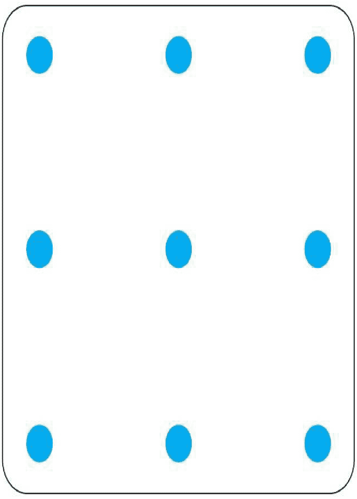
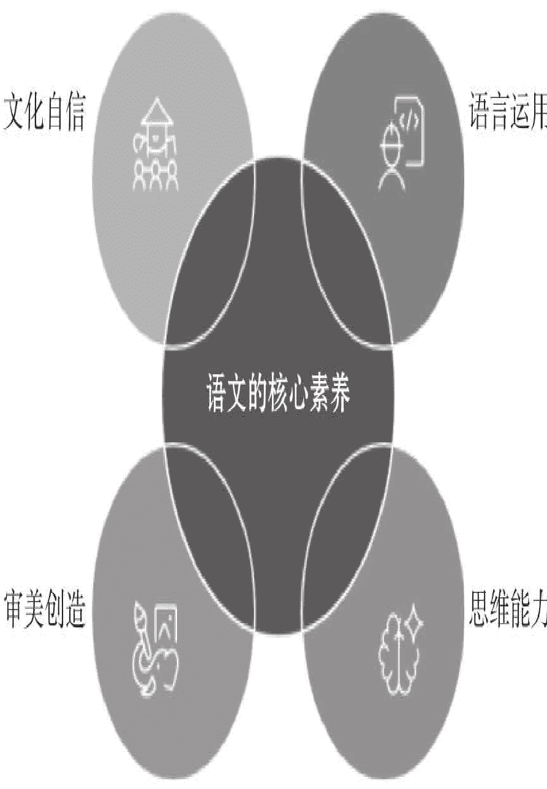
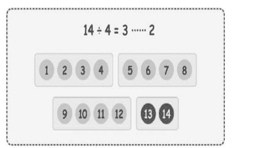
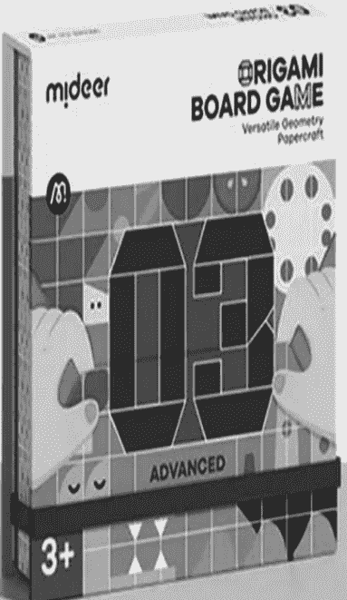
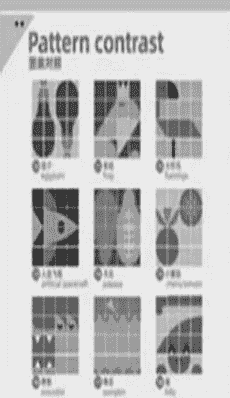
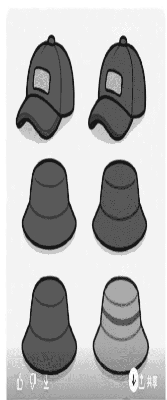
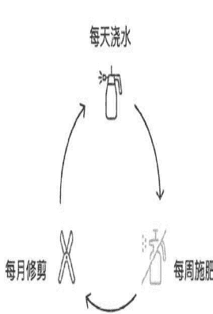
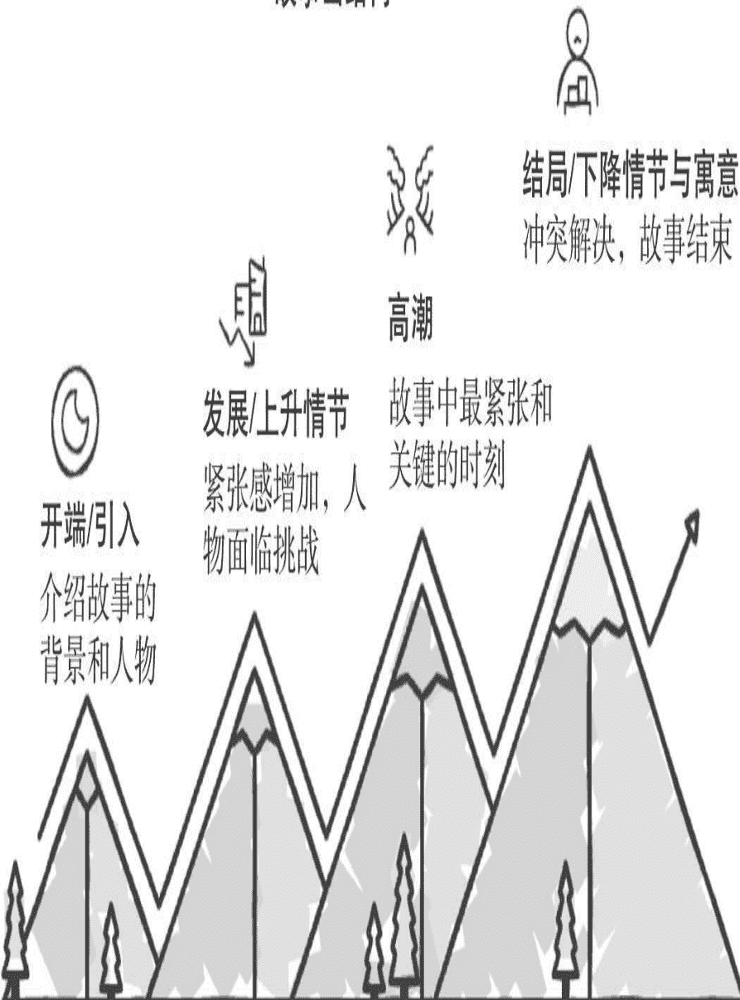
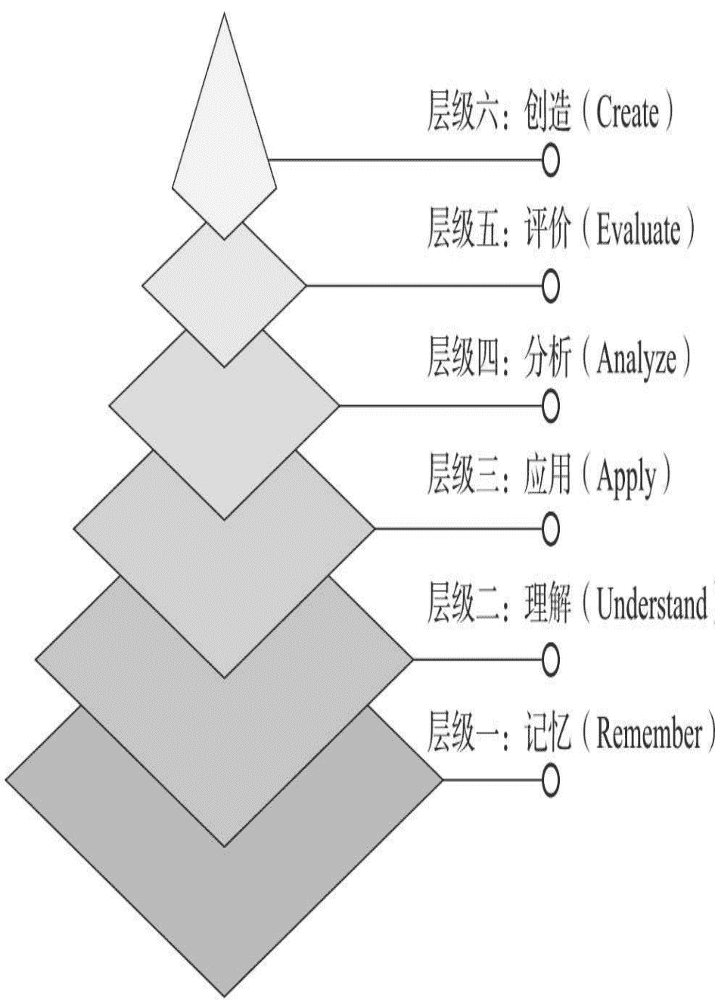

# 家庭教育 × 人工智能：新手父母实操手册

## 内容导读

这是一套为父母、教育工作者与孩子共同设计的家庭教育指南，用通俗易懂的方式示范如何把智能工具融入日常生活，让科技成为孩子成长路上的可靠搭档，帮助孩子在新时代培养更强的学习能力、创造力与自我驱动力。

全书由两位在智能教育领域深耕多年的实践者合著，整合了她们在自家育儿中的真实尝试，以及面向两千多位线上家长开展的培训与咨询经验。书稿出版前获得了来自学术、教育、企业与投资界共十二位业内人士的认可与点评，其中包括南京大学软件学院副院长刘嘉、大疆科技联合创始人兼首席科学家朱晓蕊、真格基金创始合伙人方爱之、高途教育河南学部总经理冯大为等。

书里既有面向未来的教育思考，也沉淀了大量可直接上手的使用技巧。从与智能工具提问的小方法，到语文数学英语三科的提升策略；从覆盖课前预习到考后复盘的闭环使用，到综合素养的整体跃升，全面打开技术在家校场景中的可能性，让养育过程更轻松、更有章法。

读完之后，家长与孩子可以一起收获：

- **认知升级**：看清智能技术如何改写教育格局，厘清家长需要完成的四项思维调整与角色迁移，培养真正属于这个时代的数字原住民。
- **核心素养锻造**：借助智能工具强化元认知、深度思考与创造力，为未来储备关键能力。
- **对话技巧**：学会写出清晰精准的指令，掌握六类指令策略，让工具真正听懂需求、发挥作用。
- **语文新打法**：在深度阅读、古诗文学习与写作上获得支持，包含13个可复制场景，让语文学习更鲜活。
- **数学思维提炼**：从运算练习、几何感知到逻辑推理与跨学科实践，10个示范让抽象概念变得可感。
- **英语陪练**：打造个性化的听、说、读、写成长路径，11个场景帮助摆脱低效刷题。
- **学习闭环管理**：贯穿预习、复习、作业辅导与备考，帮助提炼要点、整理错题、生成模拟卷等11个场景，实现个性化高效。
- **综合效能加速**：辅助制定SMART目标、管理时间、提升记忆、运用费曼学习法等8个场景，全面增强学习效率与自主性。

## 作者介绍

## 张一凡（Evan妈咪）

资深人工智能应用专家、家庭教育先锋实践者，智能体创作者，知名育儿自媒体人，“Evan妈咪会AI”账号负责人，在小红书、视频号、抖音等平台粉丝累计超40万，相关视频播放量破千万。

南京大学毕业，校内曾在新东方兼职授课获优秀教师称号；曾任世界500强外企品牌管理负责人，拥有十余年品牌管理经验。持有微软与科大讯飞认证的智能体工程师资质。

家中11岁国际生Evan，曾就读上海国际学校，现就读香港国际学校。


## 杨梦倩（MQ老师）

资深教育实践者，南京大学本科保送，英国杜伦大学教育学硕士。拥有15年一线教学经验、10年以上管理经验，曾任国家西部计划美丽中国支教项目高级经理与暑期学院教务校长，授课对象覆盖2至20岁学生，并为各年龄段教师与管理者提供培训。

国家工信部认证智能体工程师，企业与学校顾问，知乎知学堂讲师，公众号“MQ的AI原住民计划”主理人。

育有6岁双语幼儿园大班的和和及刚出生的平平。

## 各界点评

真格基金创始合伙人方爱之认为，作者将智能技术与家庭教育结合的视角少见，书中既有理论高度又有工具箱，能有效激发元认知、创造力与自驱力，体现出独特思考与想象力，是家庭共同成长的起点。

高途教育河南学部总经理冯大为指出，作者不空谈，结合子女教育理论与实践搭建人机高效互动的桥梁，缓解了“淘汰你的不是技术本身，而是会用的人”的焦虑，拥抱技术革新的理念本身就是最高级的指令。

友邻优课CEO韩冰彬强调，书中抓住了智能时代教育的本质是激发元认知与创造力而非替代思考，案例可落地，帮助孩子在人机协作中更好地认识自我。

XVC基金创始合伙人胡博予表示，书中以智能工具重构学习路径，将思辨、创造与自驱纳入系统模型，善用者可获得长期且陡峭的成长曲线。

Aibrary创始人李可佳提到，书不仅讲效率，更讲如何用技术点燃元认知、创造力与自主学习力，用真实案例把抽象理论转化为方法，帮助家长在动荡时代不迷失方向。

教育投资人牛立雄认为，两位作者用大量案例展示智能工具在语数外等学科的高效应用，为家长与教育工作者提供实用指导，是应对新时代教育挑战的好助手。

AiPPT.com创始人兼CEO赵充指出，教育命题已从知识传递转向能力激活，书中用实践案例说明智能工具是家庭教育效率倍增的超级助手，用好技术能让每个家长具备方法与引导的专业能力。

## 前言

2023年2月4日晚，一位在哈佛任教的挚友在群里推荐了一款AI翻译工具。我抱着试一试的心态为学生制作词汇表，原本要花近一小时的工作几秒钟就完成了。那一刻兴奋过后是更深的震撼，我意识到这不仅是工具的升级，而是一场可能超越互联网的教育变革。作为母亲与拥有15年教育行业经验的人，我感到传统育儿方式已难以适应变化。

我开始疯狂寻找答案，却发现身边几乎无人共鸣。朋友们仍在用昂贵低效的方式“鸡娃”。紧迫感驱使我行动。2023年4月，我创建智能教育社群，在知识星球与朋友圈持续分享观察、思考与实践，近乎执拗地向身边家长推广智能工具。我慢慢发现，我不再孤单。

本书另一位作者张一凡是我在南京大学的学妹，我们曾在新东方共事。2023年下半年，一凡在先生与我的影响下开始深度使用ChatGPT，从为孩子转学国际学校、准备面试开始，深刻体会到智能工具在家庭教育中的颠覆力，迅速成长为家庭教育AI深度实践者与布道者。我们一起深夜钻研指令工程与智能体在家庭场景的应用。2023年底，她以“Evan妈咪会AI”为ID在小红书、视频号分享育儿实践，成为头部博主。半年多时间里，她仍在世界500强外企负责品牌管理工作，压力之下坚持每周分享，源于对技术改变教育的坚定信念。

她的持续分享在高知家长群体产生广泛影响，截至2025年6月自媒体累计观看量超千万，也促成机械工业出版社的邀约与本书诞生。

本书基于两个真实互补的实践样本：我的儿子和和，6岁双语幼儿园大班男孩；一凡的儿子Evan，11岁香港英制国际学校Year6学生。成长环境与路径不同，却都在智能工具辅助下找到高效学习方法。从构想到成稿历时半年多，书中核心方法在我们的付费专栏与智能家庭教育实战营中经千名学员检验，真实反馈给了我们信心。

## 本书定位

在2025年技术重塑世界的背景下，我们需要的不再是标准答案，而是孩子的内在生长力。

本书是激发这份生长力的指南与工具箱。它不是重理论的著述，而是一张手把手的操作地图。

旅程从思维刷新开始，第1、2章探讨智能时代教育新理念并直面伦理挑战。第3章聚焦核心素养，讨论如何培养技术无法替代的元认知、思辨力与创造力。第4章讲解指令实践，指令是与工具高效对话的桥梁。第5至7章深入学科应用：语文篇智能化身阅读导师与写作教练，讲解4F提问法、古诗文学习与汉堡写作法；数学篇破解概念抽象与计算枯燥，提供数感、几何、逻辑的赋能方案；英语篇打造全天候语言伙伴，覆盖听、说、读、写，助英语内化为生活语言。第8、9章超越学科，运用SMART原则、艾森豪威尔矩阵、海马体记忆原理等，从预习到备考、从目标到时间管理，帮助孩子建立学习自驱力与好习惯。

第1、2、3、7章由杨梦倩撰写，第4、5、8、9章由张一凡撰写，第6章为两人合著，书中穿插和和与Evan的真实案例。

## 第1章 智能已至：教育正站在拐点上

智能时代加速到来，我们的教育准备好了吗？先看三个真实故事。

热爱写作的初一学生S，文章视角独特、遣词精妙，因英语作文拼写与语法失误被扣分后，开始使用安全词汇与固定模板写作，鲜活的创造力在标准评价中被扼杀。

年级前五的学生抱怨，老师要求一字不差背诵默写主观题标准答案，“道理我都懂，为何非要用别人的语言表达自己的想法？”，独立思考意愿在唯一正确答案的强调中消退。

一位老师朋友分享，讲数学难题时学生皱眉：“这题中考吗？教我能提分的套路吧。”求知与探索被应试思维吞噬。

孩子的好奇、批判与创新正被分数一点点削弱，他们学会的潜规则是：不问为什么，只问考不考。

许多家长内心挣扎，有人看不到新路径，有人不敢转向，最终选择回避。正如一位妈妈困惑：“国家倡导面向未来，可不紧跟当下形式孩子怎么考高分？分数至少是实在的。”我们是否想过，把孩子禁锢在机械练习与标准答案里，是为未来埋下隐患。

我们还在精进驾驭马车的技巧，世界已进入自动驾驶。

技术带来的不仅是工具革新，更是一场深刻的教育革命。学生群体正被静默撕裂为两类：掌握智能思维的创新者，将实现指数级成长；停留在传统模式的追随者，脱节风险加大，可能被边缘化。这种差距不是知识代沟，而是认知断崖，会像复利一样扩大，最终固化为命运鸿沟。

大量岗位将被智能重塑，未来主导者不是固守过去的既得利益者，而是能驾驭技术的新型人才。2010至2020年出生的孩子正站在历史转折点上，他们的未来取决于今天的教育选择。真实世界的问题从不分学科，解决气候变化需要科学家理解政策，智能伦理拷问工程师的人文素养。当技术接管标准化重复工作，人类核心竞争力转向批判思维、创造力、协作与情绪感知等难以复制的领域。智能时代的教育新使命，是培养面向未来的智能素养，跨越认知鸿沟。

### 1.1 技术如何改写教育版图

很多家长觉得智能技术遥远又无处不在。剥开技术外壳，人工智能是模拟与扩展人类智能的科学与技术，让机器能学习、推理、解决问题、理解语言与感知环境。技术的学习类似人类，需反复练习、从错误中调整算法，可视为高速学习、不知疲倦的数据决策“大脑”。

当前技术进入新阶段，不仅能理解分析，更能创造内容，被称为生成式人工智能。2022年底爆火的ChatGPT3.5即为代表。

#### 1.1.1 生成式智能究竟是什么

生成式智能能根据用户用自然语言提供的指令创造全新内容，无需编程。我们只要用日常交流方式对话即可。与Siri等只能完成查询天气、添加日历等简单任务的语音助手不同，生成式智能能理解复杂需求，像人类一样思考创作，功能上可涵盖文本、图像、音频等多模态生成。

#### 1.1.2 生成式智能如何改写教育

生成式智能的崛起从根本上改变教育理念。以2023年GPT4.0诞生为分水岭，互动定制化学习体验正从降本增效与无限可能两个方向冲击传统教育。

##### 1. 降本增效：个性化学习成为可能

传统大班课难以实现真正的因材施教，生成式智能能扮演全天候在线、耐心无限的专属导师。例如将孩子的作文发给智能工具，它不仅能快速纠正语法拼写错误，还能依据评分标准分析文章并生成专业级反馈报告。

想保持身材、提升体质，运动几乎是必备选项。没有规律的锻炼，很难谈得上健康的生活状态。今天就聊聊我特别喜欢的一项运动——羽毛球。

> 评论：开头点出运动价值，随后自然衔接到羽毛球主题。

# 优化提示

1. “Because of losing weight and getting healthier, sport is very necessary.” → 可改为 **要控制体重、增强体质，规律运动必不可少。** 或 **健康生活的基础在于管好体重和体质，而这离不开持续的运动投入。** 调整表达后因果更直接。

图1-2 Gemini 2.5 Pro的反馈报告示例

需要为孩子定制练习时，不必再大海捞针，把当前进度、学习目标和样例题告诉生成式系统，它就能按需产出梯度清晰、难度各异的专属练习。

另外，它还能借助苏格拉底式提问推动自主思考。书中8.3.2节有详细说明。可汗学院推出的AI教学助手Khanmigo是一个典型范例：它用启发式提问帮助学生厘清概念、攻克难点，而不是直接给出标准答案。

2024年8月，清华大学上线了学习助手“清小搭”。它已在基础数学课和部分专业课程中提供精准辅导，后续正向学业规划、日常问答、职业建议等场景延伸，成为学生成长路上的智能伙伴。

展望未来，低成本获取高质量个性化教育有望成为常态。

##### 2. 沉浸式课堂：学习边界正在消失
生成式系统对教育的影响不只是提升效率，它在重塑学习的想象空间，让时空限制被打破。

学习不再等于死记硬背。有了技术支持，孩子可以和虚拟人物进行跨时空交流，比如和牛顿数字分身讨论万有引力，或跟着居里夫人的投影探索放射性物质奥秘。

这只是开端。技术的终极潜力在于搭建可交互、逼真的虚拟环境，让《神奇校车》里的场景照进现实。未来的教室可能不再是四面墙，而是一个由大模型实时生成的全息空间。戴上专用设备，学生能瞬间出现在古罗马竞技场观战，或漫步火星表面分析地貌，甚至潜入人体血管内部追踪红细胞。

当技术与感官体验深度融合，学习会真正实现沉浸在场。以李白《静夜思》为例，孩子可点击即“穿越”到大唐，亲历长安诗会，感受市井气息，甚至能和李白共席推杯。

这样的全息环境彻底打破时间和空间的束缚，让每个学习者都成为文化的亲历者。

由此不得不问：
- 在虚实一体环境里，学校是否还会保持今天的形态？
- 我们该如何帮助孩子准备，以便在这样的未来里生存和发展？

### 1.2 潜能与隐患：工具的双面性
当前中国大模型，特别是DeepSeek R1展现出的强大能力令人振奋。2025年春节期间DeepSeek的爆发式走红让人兴奋，也让人警醒：不加审视地拥抱技术暗藏风险。这把双刃剑在带来便利的同时，也伴随幻觉、逻辑谬误、算法偏见以及“有毒”情感共鸣等隐患。

#### 1.2.1 首个隐患：虚构信息
生成式系统有时会非常认真地编造错误信息，难以防范。

真实案例：2023年纽约一位律师图省事，直接把ChatGPT生成的几则判例写入法律文书。开庭时被指出这些判例均属虚构，最终受罚。这个例子提醒我们，即便表述严谨，系统提供的信息也可能是无中生有。

根源在于工作机制。它并非真正理解，而是基于海量数据的文字续写，通过概率预测下一个最可能的词汇。比如输入“床前明月光的后一句”，模型大概率输出“疑是地上霜”，而不是“飞流直下三千尺”。在统计规律驱动下生成看似合理的文字组合，便会出现捏造判例的情况。

换个角度看，虚构也折射出创造力。创造力正是这类系统的重要特质。

#### 1.2.2 次要隐患：表面合理的错误推理
如果虚构是相对明显的无中生有，那么逻辑谬误更隐蔽。大模型擅长用结构化美感影响判断，能把混乱信息整理成条理清晰的文本，表面有理，细究有亏。

一次让DeepSeek R1列出高质量提示词的标准，得到：清晰明确、具体细节、目标导向、指令明确。

细看存在问题：
（1）举例不当。指令明确一栏举例“请”“要求”“需要”，但只要用过的人都知道，提示词中是否加入“需要”二字，对执行效果并无本质差异；
（2）条目重叠。要实现目标导向，本就需要清晰明确的语言描述目标，二者并非完全独立；
（3）排序随意。条目排列欠缺内在逻辑，未体现由宏观到微观或按重要性排序的关系。

看似有序的文字容易麻痹人，忽视对内容本身和逻辑关系的深思。若过度依赖这种“思维模具”，独立建构逻辑、探索多元思路的能力会逐渐退化。

#### 1.2.3 第三重隐患：数据倾向
逻辑谬误隐藏在结构之下，数据倾向则更加隐蔽，影响更深远。生成式系统可能学习并放大现实世界中存在的各种偏见。

很多人认为机器纯粹理性，能消除人类主观偏见。曾有企业家兴奋地问，能否做一个AI简历筛选系统用于面试评估，理由是机器没有偏见。

这种想法代表美好愿景，但事实并非如此。训练数据的分布会塑造系统的认知坐标。数据本身带有倾向，判断就可能偏斜，形成刻板认知。

研究发现，要求文生图工具如DALL-E 2、Stable Diffusion生成工程师、科学家等职业形象时，输出结果多为男性，显示出性别与职业的过度关联。

在教育领域，偏见危害更大。若用于个性化推荐、学情分析、能力评估的系统带有倾向，会直接冲击公平与质量，具体表现为：
（1）评价体系偏差。研究显示GPT-4o在评估作文时，对母语非英语的学生评分整体偏低；
（2）强化刻板印象。UNESCO发现大模型生成教育素材时，女性常与家庭、孩子、家务等标签绑定，男性与商业、职业、薪资等标签绑定，职业推荐时易延续此类偏见。

数据倾向比虚构和逻辑谬误更隐蔽，潜藏在看似中立的回复背后，需要加倍警惕。

#### 1.2.4 第四重隐患：情感依赖的糖衣
社交媒体上常能看到“AI比我伴侣更懂我”的分享，点赞无数。这种强烈情感共鸣可能成为包裹甜蜜糖衣的毒药。当我们从情感上信任系统，就容易卸下批判防备，更倾向接受其观点，甚至产生情感依赖，疏离真实世界。

美国14岁少年Sewell Setzer沉迷与自创AI角色聊天，建立密切关系后逐渐脱离真实社交，精神健康恶化。2024年2月28日，他在发送最后一条信息后结束生命。虽然系统并非主因，但他确实对AI产生强烈依赖，且在表露轻生念头时系统并未启动紧急干预。

本书第4章会介绍如何更好地沟通以规避上述风险。

### 1.3 政策走向：全球视野与国内布局
#### 1.3.1 海外趋势：三大指向
UNESCO等国际组织已发布倡议与核心素养框架，释放清晰信号：
（1）人工智能素养正被视作与读写同等重要的人人必备能力。OECD与欧盟委员会联合提出的AILit框架强调，教育体系应超越传统数字素养，将人工智能素养纳入核心能力，培养批判、创造与伦理意识。这意味着家长在关注语文数学的同时，也需把人工智能素养培养放在同等位置。它不再是科技迷的选修，而是未来融入社会的必修课。
（2）伦理先行，技术以人为本。从UNESCO到欧盟反复强调技术发展不应以牺牲人的价值与权利为代价。家长选择AI产品时，应关注隐私保护、是否存在偏见、是否鼓励独立思考而非盲从。
（3）体系变革，好学生定义被改写。国际组织呼吁不能仅用AI提效，而需重塑教学模式与育人目标。只会刷题背答案的学生将失去优势，核心素养的重要性超过分数。

#### 1.3.2 国内实践：三步推进
1. 全面推进，国家加速。教育部2024年《关于加强中小学人工智能教育的通知》明确2030年为AI教育全面普及的关键节点，AI教育进入国家基础教育蓝图。
2. K12课程落地。依据《中小学人工智能通识教育指南2025年版》，学习路径呈螺旋上升：
- 小学阶段重体验，通过互动游戏初步感知AI能做什么、不能做什么；
- 初中阶段重理解，将AI作为助手解决真实问题；
- 高中阶段重创造，从使用者转变为创造者，用AI技术解决社区实际问题。
3. 纳入监测，指挥棒转向。《通知》提出将AI教育纳入义务教育质量监测。这一信号意味着AI素养将逐步成为衡量综合素质的硬指标。沪上、京城等先行地区已明确中小学AI课程时间表，地方试点正让国家规划落地。

### 1.4 小结
本章呈现AI时代教育的两面性。机遇在于生成式系统助力个性化学习、开启无限可能；挑战在于它像放大镜暴露传统弊端，又像潘多拉魔盒释放幻觉、偏见等风险。

越想用AI解决问题，越要回到人本身。全球与国家政策指向的不是被动接受或抗拒技术，而是一条在与系统协同中保持人文温度与批判眼光的路径。这正是父母在变革中不可替代的价值。

看见价值只是起点，如何转化为行动？让我们开启认知升级与角色重塑。

## 第2章 家长如何调整认知与定位
当前教育焦虑的根源并非始于大模型。网络时代知识唾手可得时，以灌输和标准答案为核心的模式已显弊端。大模型只是按下快进键。

在寻找“该做什么”之前，更需要看清“不应做什么”。阻碍我们拥抱新世界的，往往是对过时教育惯性的下意识紧抓。它像一张失效的旧地图，在AI时代已彻底失效，继续沿用只会南辕北辙。

### 2.1 扔掉过时地图：看清惯性思维
#### 2.1.1 木桶思维：补短板却丢亮点
“小学就把英语学到高中水平，中学会腾出时间搞数理化”“数学物理还行，英语拖后腿，暑假必须突击”。

弥补短板的执念源于木桶理论：水量取决于最短板。家长计算60分提至70分比98分提至100分更“划算”。

大模型颠覆这一逻辑：知识与技能不再是稀缺井水，而是无限海量资源，大模型是通往资源海的超级管道。核心竞争力不再取决于木桶容量，而取决于使用管道的能力。长板不再是木板，而是接入管道的动力泵。

固守木桶的代价是牺牲长板。孩子若在写作上才华出众，却数学平平，理应把课余时间投入自媒体运营而非硬补数学。应试压力下用好奇心换均衡成绩单，等于放弃动力泵。更深远的是，孩子会失去拥有热爱的可能——被反复要求补短板的人，自我认知会从“我擅长什么”变为“我缺什么”，匮乏感填满内心，难以遇见热爱。

#### 2.1.2 对唯一答案的执念
长达12年的应试教育让人本能追寻标准答案。小时候做练习册总迫不及待核对答案，仿佛验证唯一正确答案才是目的。进入职场后面对不确定状况仍渴求唯一流程，热衷制作SOP以消除不确定性。

对标准答案的迷恋是工业时代遗产，能批量培养流水线人才，也给焦虑的父母“分数”“排名”的掌控感。

大模型时代，信息检索、计算、校对、套路写作，大模型更快更准。我们还需要训练孩子成为可被替代的低配复读机吗？

人类真正的独特性在“非标准”：提出深刻问题、在模糊情境中做判断、兼具直觉与勇气、进行伦理思辨、理解微妙情感、打破常规的创造力。沉迷标准答案会扼杀这些未来最稀缺的能力。

#### 2.1.3 替孩子设计的复制人生
父母总想为孩子铺设成功之路，凭借自身经验规划学业、专业甚至职业，却可能让孩子的人生成为自己的复制版。

北京大学刘云杉教授指出：“教育不是消除风险，让孩子沿光明道路复制我们这一代生活。教育应当鼓励孩子勇敢走自己的路，因为他们所处的时代与我们不同。”

时代在狂奔，旧经验的保质期正被急速压缩。AI这次带来的冲击，在广度、深度和速度上都是史无前例的，我连下一年会怎样都很难妄下断言，更不用说去为孩子排好五十年十年甚至更远的路线图。今天我们眼中的热门赛道、铁饭碗岗位，很可能在未来变成下一个柯达胶卷或诺基亚手机。用一套滞后且有限的认知去替孩子铺一条所谓安全的路，看似是遮风挡雨，实则是在温室里把他们扒掉羽翼，让他们丧失在真实风浪中自救的能力。

这背后更要命的是主体性的丧失。我们总在不自觉中把孩子当成项目来管理。我在云南大理一个教育社区做AI科普时，曾问在场的家长：在AI时代该怎么帮孩子的人生做规划。有一位家长当场回问了一句，让我至今印象深刻：为什么孩子的人生一定要我们来规划？他才是自己生命的主角。是的。我们常因为焦虑和爱去越俎代庖，忘了孩子是一个独立的个体，有自己的节奏、渴望和课题。过度干预的规划，本质上是一种爱的绑架，它扼杀了自主试错、自我探索的空间，让孩子习惯被安排，最终失去自我导航的能力。

### 2.2 从木桶补短到长板育强，发现孩子真正的优势

#### 2.2.1 AI时代的价值新标尺：长板比短板更值钱

AI像一面棱镜，把人的核心价值照得更清楚。那些可重复、依赖固定流程、有标准答案的技能，正被快速稀释。而根植于人性、算法难以复制的素养，价值正在被放大。

（1）敢于提问的思辨力
不只是知识堆砌，而是思考的深度。养出一种习惯：对任何信息都追问“真的吗”“为什么会这样”“还有没有别的可能”。比如看动画片里的反派，孩子不会简单贴标签，而是会问他是怎么变成这样的，动机是什么。

（2）创造力
能产出新点子，有自己的审美判断。AI可以批量制造以假乱真的图和视频，但原创灵感和高级品味依然是人的专利。看同一幅画，能说出独特的感受，而不是人云亦云，就是能力的体现。

（3）解决复杂问题的能力
面对真实世界里无序、模糊的难题，能整合资源、灵活应变并给出创造性解法。比如班级义卖，摊位怎么布置才吸睛，商品怎么定价，人手不够怎么办，没有标准答案，但有人就能主动调研、提出方案把活动办成。

（4）同理心
理解他人感受，能有效沟通并建立信任。比如小组手工时有人抱怨任务难，有同理心的孩子会走过去说“你是不是觉得这里不好粘？我帮你扶着，或者我们换个分工，你来做剪纸你更擅长”。这是一种真正的连接力。

（5）跨界整合与系统思考
能发现不同领域的底层关联，并迁移应用。比如一个爱历史的孩子，能把明朝的赋税困境联想到现在小区的物业费矛盾，把知识变成可迁移的模型。

#### 2.2.2 看见潜能的信号：从行为表象读懂本质

培育长板的第一步是识别。需要换个角度观察，穿透表面行为，捕捉潜能信号。

（1）探究行为动机
看孩子在做什么之前，先问他为什么。比如孩子反复把奥特曼卡片按系列、属性排得整整齐齐，表面是爱整洁，深层可能是对分类、秩序和数据管理的天生敏感。

（2）识别思维方式
关注孩子怎么想，比他知道什么更重要。讲完一个故事，他是直接接受还是不断追问“后来呢”“他为什么不那样选”。面对拼图，他是盲目试错还是先看整体再动手，思维习惯就藏在这里。

（3）看见优势的化学反应
不同特质的叠加会产生独特火花。我认识的孩子Dana，数学不算拔尖，却能把抽象概念用生活例子或画图讲给同学听。数学理解力+表达力+视觉思维的组合，让他极有潜力成为优秀的数学老师或科普作者。

（4）珍视那些“怪”的信号
看起来不合群、让人头疼的特点，有时正是天赋的萌芽。小时候我不爱热闹社交，却能每天花一两个小时沉浸观察蚂蚁搬家。大人觉得浪费时间，回头看却极大锻炼了我的专注力，也为日后深度投入奠基。正因如此，当我家孩子每天放学都要去小河边观察捕捉鱼虾，小心翼翼把它们从网兜放进小桶时，我们没有催他回家写作业，反而看见了专注、耐心和对自然的亲近。后来爸爸甚至为他搭了个带太阳能水循环的鱼缸。我们相信，呵护这份热情，比逼着刷十道题更有长远价值。

#### 2.2.3 长板如何长出来：三个实操关键

发现种子后，浇水施肥的方式也很重要。

（1）给真实的舞台去实战
成长发生在解决真问题中。AI社群里的初一男孩Mike痴迷AI，真正让他爆发式成长的不是课程数量，而是妈妈公司给了他一个真实任务：搭建和优化网站。为了交付，他自学服务器、前端、AI工具，在实战中踩坑解决。随后他又自建“AI辅助学习”社群，用二维码连上了几十个孩子。这个更复杂的舞台锻炼了项目管理、沟通协调和领导力，能力比书本扎实得多。

（2）培养作品意识，留下可看见的印记
鼓励把学习过程变成可分享的作品。作品是整合思考和创造性表达，也是与世界连接的起点。Mike的网站就是他的能力证明。社群里5岁的小十一，在妈妈鼓励下录制数学小讲师短视频，已累计100集。想把知识点讲清楚又有趣，本身就是深度学习，视频也成了他影响他人的作品，价值感远超外部奖励。

（3）链接高人同伴，加速跑道
成长需要榜样和同行者。一是能启发的高人，线上导师、社区专家或领域实践者；二是能一起切磋的同路人。社群里一次直播连麦，Mike自信向家长孩子分享AI学习经历，结束后收获大量点赞提问，并与几位家长成为朋友，一起去香港徒步、搭智能体。我们还约定2026年同一时间再直播，让所有人看见进步。圈子对了，路就走得更远。

#### 2.2.4 短板怎么管：取舍比补齐更重要

很多人会问：长板要养，短板能不管吗？要管，但思路要升级。核心不是补齐所有短板，而是战略取舍，并善用AI。

第一类是核心基础能力，必须夯实。在2.2.1里提到的人类优势，都需要这三项操作系统支撑：深度阅读理解与信息处理能力，能吃透信息为批判创造提供输入；清晰的逻辑表达与有效沟通能力，把想法说明白转化为影响力；高效的人际协作或人机协作能力，学会与人、与AI合作。明显不足必须投入内化。

第二类是可外包给AI的工具型技能。编程语言语法的记忆价值在AI编程工具面前快速下降，但背后的问题拆解、逻辑建模的计算思维依然关键。对这类短板，思路应从“我要会”转为“我会用”。学会何时用AI、选什么工具、怎么判断结果可靠性就够了。我曾听过一个10岁孩子分享，他把Cursor当技术合伙人，用自然语言描述需求让AI生成代码，再指挥修改调试，最终独立上线了一个受欢迎的小程序。他懂得把设计留给自己，把施工交给AI，这才是AI时代的协同智慧。

第三类是可以战略性减少投入的短板。特征是既非核心优势，也缺乏内在驱动。常见两类：非关键的学业内容，比如未来想做艺术设计的孩子，对繁杂地理知识无感，就没必要死磕高分；缺乏内在驱动、为跟风而学的泛兴趣，比如机械完成钢琴练习、感受不到乐趣的，适当退出才能给真正热爱腾出空间。

取舍时可和孩子一起讨论三件事：这个短板会不会影响当下生活或未来的硬性门槛？能不能用AI或合作弥补，或走另一条路径达成目标，比如专注力既能靠钢琴也能靠篮球？孩子对此有没有探索欲和潜能？放下完美主义，把有限精力配给最重要的事，AI来分担执行，这才是合理的分工。

### 2.3 告别标准答案：让主动学习成为常态

AI能在几秒内给出标准答案，学习的重心就该从被动记忆转向主动创造价值。主动学习并非新概念，建构主义里早有提及，只是长期以来更像口号。如今AI让普通家庭也有条件更方便地实践它。孩子不再是信息存储器，而是知识的探险家和意义的创造者。

#### 2.3.1 主动学习的模样：孩子当主角

主动学习就是让孩子成为提问者和行动者。听《小红帽》，被动学习会记住角色和情节；主动学习会追问狼为什么伪装得那么明显孩子还上当，狼天生坏吗，故事除了小心陌生人还有什么别的解读。他们主动挖掘疑问，从内部理解。

热闹不等于思考。举手积极、领小红花可能只是条件反射。真正的活跃是思维在运转，哪怕一个人安静阅读，只要在和作者对话、质疑、分析，就是深度参与。

形式很多元：对恐龙产生兴趣，自发去博物馆查资料，是问题驱动；想做纸杯蛋糕，从找食谱、称量、控温到失败调整，是动手实践；把刚学的分数用分披萨的方式教给弟妹，是以教促学。核心始终是动脑、动手、动口，成为学习的主人。

#### 2.3.2 主动学习的复利效应

被动学习像坐观光大巴听讲解，主动学习像自己徒步规划路线，困难更多但收获更深。

首先是真正理解而非浅层记忆。大脑不是硬盘，只有主动分析、比较、关联、应用，知识才能沉淀迁移。被动接收的信息像浮油，很难内化。同样学长方形面积，被动者只会算标准图形，主动者能估算树叶面积，把空间量化思维迁移到收纳甚至时间管理，一个是知识，一个是能力。

其次，主动学习是核心能力的孵化器。提问探究锻炼独立思考和批判；项目实践锻炼解决问题和试错；教学表达锻炼逻辑和沟通。这些能力是在参与中自然生长出来的。

最后，从“要我学”到“我要学”。当孩子能掌控学习过程，通过努力克服挑战并分享成果，内在成就感和乐趣会成为持续动力，这比外部压力更能支撑终身学习。

#### 2.3.3 父母的角色切换：从监工到教练

教练式引导需要两个转变。第一，相信潜力，用提问代替评判。孩子遇到困难，监工会说“太难了你不行”，教练会问“你打算从哪一步开始试”。一句话就能种下“我可以试试”的勇气。

第二，拥抱过程，重新定义错误。标准答案思维容易让错误等于失败。但在探索中，错误是数据。孩子搭电路装置半天灯不亮，监工会关注结果或直接指错，教练会说“你试了好几种连接，探索精神很棒！你观察到什么现象？我们怎么改进？”把错误变成养分。

#### 2.3.4 AI做智能伙伴：让教练更容易落地

担任学习教练需要倾听、提问、赋能，对很多父母来说负担不小。AI不能替代父母的爱与陪伴，但可以成为得力助手，帮助实现教练式引导。

比如当孩子对某个议题形成初步看法，可以引导他用AI进行深度对话。

我：我倾向于认为AI最终会拥有真正的创造力。请你扮演一位持怀疑态度的哲学家，运用苏格拉底提问法，至少连续追问我三个问题，帮助我找到自己观点中的潜在假设、逻辑漏洞或定义不清的地方。

苏格拉底式追问点亮模糊概念

Kimi：行，那我们就用苏格拉底式的追问来聊聊。你说的“真正创造力”指什么？是指画家画出完全独一无二的画作，作家写出前所未有的小说，还是科学家提出全新理论？

我：我认为这些都算，是在消化前人积累后产出新东西。

Kimi：这个“新”怎么界定？是完全没有先前经验的痕迹，还是在已有经验基础上的独特重组或延伸？若只是旧知识的拼凑，还能算真正的全新吗？

我：问得我哑口了。对创造力的定义我其实不清晰。因为创造多半源自既有经验的生长，凭空出现很难。

当AI层层追问，小孩被迫直面自己没意识到的概念空隙，必须把定义理清，思维自然更深入。

换个验证方式，去让小孩反过来教AI。不是向AI索取答案，而是把所学讲给AI听，这正是费曼学习法的思路。可这样设场：

我：请你扮演好奇心很强但物理基础为零的小学生。我要讲讲弦理论，讲完后请至少提三个最困惑或最想了解的问题。

Kimi：好呀！弦理论是什么？快讲！

我：弦理论说宇宙由弦构成，可以把量子力学和广义相对论统一起。

Kimi：哇，宇宙靠弦构成吗？这些弦长什么样？能像小提琴弦那样拨动吗？量子力学和广义相对论差异很大，弦理论怎么把它们拢在一起？这些弦到底有多小？我超想知道！

我：构成宇宙的弦极小，不能弹也看不见。我也不太清楚它怎么统一的，我去查查再告诉你。

AI的发问能精准定位理解卡点。上面例子里，小孩会发现自己讲不清弦理论如何统一两大理论，从而意识到需要继续学习。重新组织语言再教一次，概念掌握会上台阶。

AI不仅能锤炼思维，在技能训练上也能给到精准支持。遇到反复出错的知识点，AI可以定制个性化练习：

我：我老是搞不清涉及分数的多步应用题该怎么拆解。请帮我设计五道题，难度逐步提升。做题时若需提示，请用苏格拉底式提问引导，不要直接给列式。我们一题一题来。

豆包：小明看一本书，第一天看了全书的1/4，第二天看了剩下的2/3，这时还剩60页没看，这本书共多少页？

我：是不是先把1/4+2/3算出已看比例，再算剩下比例就行？请引导我思考。

豆包：思路有点偏。我们慢慢拆。第一天看的是全书的1/4，这里以全书为单位1。那看完后剩下几分之几？用1减1/4能得到吗？

再看第二天，第二天看的是剩下的2/3，这个单位1还是全书吗？不是，这里单位1是第一天看完后剩下的部分。你能根据刚才算出的剩余比例，算出第二天实际看了全书的几分之几吗？

……篇幅所限，后续可自行体验

豆包先温和指出偏差，再追问单位1的变化。这种即时启发式反馈，比题海战术更能帮助突破瓶颈。

AI在激发创意、打破惯性上同样是灵感伙伴。比如为环保活动想宣传语：

参考提示词：我们要为“旧物改造”环保活动想一个吸睛口号，能从哪些角度切入？请为每个角度给引导问题和关键词。

豆包：

- 1. 突出省钱

  - 引导问题：怎样用最少花费打造全新生活？旧物如何变成省钱利器？
  - 关键词：低成本、节约、经济实惠、变废为宝

- 2. 强调独一无二

  - 引导问题：如何让旧物带有个人专属标签？改造后怎样更显个性？
  - 关键词：专属、个性定制、独特、限量版、与众不同

……其余省略

故事卡壳时，也可以请AI打开思路。

参考提示词：我写了个开头：“一个小女孩在森林发现一扇通往不同季节的门。她刚踏入‘永恒冬天’。”请给我三种出人意料的后续情境，每种一句话，用“如果……会怎样？”的格式。

豆包：

如果女孩刚进入“永恒冬天”就发现自己能操控冰雪，所有动物都把她当冬日女王，会怎样？

如果“永恒冬天”的冰雪开始诡异融化，而罪魁祸首竟是女孩口袋里带进来的普通种子，会怎样？

如果女孩在“永恒冬天”遇到的第一个生物是她多年前丢失的宠物，可它却警告她永远不能离开，会怎样？

小孩可以挑选其一续写，或让多个可能性碰撞，发展出更喜欢的情节。

### 2.4 放弃既定路线，绘制能力地图

在AI时代充满不确定性，用老经验为小孩精细规划人生有风险。先问自己：过去的“规划”有多少是焦虑跟风，有多少是自身经历的投射，或是未完成梦想的转嫁？又有多少次真正静下心观察这个独特的孩子？他的热情指向哪里？思维有什么独特之处？有哪些不易察觉却可能成长的潜能种子？

厘清这些，行动模式会转变。

从设计与控制转向观察与信任。不要试图预测并控制孩子该成为谁，而是带着好奇观察，给予信任。合适的“土壤”比强制“塑形”更重要。有时需要无为的智慧，在安全边界内管住想干预的冲动，给生命自由生长的空间。

从结果导向转向过程本位。不再只用分数、名次、目标达成度衡量价值，而是看见孩子在学习探索中的努力、思考、困惑，以及从错误中学习的能力。拥抱过程的不完美，理解弯路和试错是深度学习与创新的必然环节。

从线性路径转向开放生态。不要执着寻找一条看似最优的捷径，而是营造开放多元的成长环境。让孩子接触多种可能性，拥有选择自由。目标是提升孩子在广阔世界中生存并获得幸福的能力，而非把他打磨成顶尖零件。

核心区别在于：把焦点从“设计一条通往预设终点的路径”，转向“围绕内在兴趣与潜能，搭建支持探索、学习与成长的丰富生态”。

因此，衡量父母是否成功的标准也变了。不是看孩子是否走在我们规划的路上，而是看他是否有清晰的自我认知、持续的学习热情、解决问题的勇气与能力，以及与世界和他人连接的智慧。这样他才能自主定义并追求属于自己的成功与幸福。

### 2.5 总结

告别旧地图是AI时代家庭的必修课。需要亲手打破三种根深蒂固的教育惯性：

- 从对短板的执着，转向对长板的培育。
- 从对答案的依赖，转向对知识的探究。
- 从对路线图的设计，转向对成长生态的构建。

这是一场艰难但必要的认知转变。AI能解决“术”的问题，父母要去追问和践行教育的“道”。

这趟旅程与其说是育儿，不如说是父母的自我修行。

### 今日实操
实践：AI提问教练初体验

目标：打破对标准答案的依赖，体验用AI进行启发式提问，把学习重心从获取答案转向深度思考。

行动：挑一个孩子最近学的知识点，或一个开放话题，比如“未来人类还需要上学吗？”，一起用AI工具探索。

可以对AI说：“我是一名8岁小学生，请你用苏格拉底提问法帮助我探索［某个话题］”

和孩子一起回应AI的提问，感受当AI不再是“答案机”而是提问教练时，对话如何变得更深入。

## 第3章 用AI锻造孩子核心素养

父母的认知升级重在心法，孩子的基础内功在于核心素养。本章聚焦借助AI修炼三项能力。

- 元认知：学会如何学习，成为驾驭自我与AI的总指挥。
- 深度思辨：穿透信息迷雾，练就独立判断力。
- 创造力：打破思维定式，成为善于创造和解决问题的破局者。

这三项与联合国教科文组织和欧盟委员会提出的AI素养框架高度契合。元认知负责定航向，深度思辨负责护航，创造力负责探新路。三者协同，形成孩子在AI时代的底层操作系统。

### 3.1 元认知：教孩子学会学习

#### 3.1.1 为什么元认知是AI时代的核心学习力

初中住校时，舍友是个特别刻苦的女生。熄灯后她常借洗手间微光学到深夜。她的勤奋让人敬佩，自己却有些自惭形秽。可她付出远超常人的努力，成绩却不理想。

这曾让我困惑，后来通过学习科学才明白，很多时候进步慢，并非不够努力，而是陷入“战略性懒惰，战术性勤奋”的怪圈。

反复看书、不停刷题、延长学习时间，用行动上的辛苦告诉自己“我尽力了”。这带来心理安慰，但在战略层面却懒惰，从未停下来审视：这次学习想达到什么目标？当前方法有效吗？下一步怎么调整？

能跳出来观察并管理自己学习的能力就是元认知。缺少它，战术勤奋也易变成事倍功半。尤其在AI时代，强大的能力容易让人产生惰性，把需要深度思考的任务外包给AI。因此不能只把AI当工具，更要学会与之协作。孩子需要通过元认知了解自身学习状态，判断任务该自己做还是交给AI，选择合适的工具和方法，灵活调整人机协作方式。元认知水平决定了我们是沦为AI数据的搬运工，还是主动协同者。

#### 3.1.2 元认知：大脑里的智能总指挥

元认知简单说就是对自己如何思考和学习这一件事的了解。它像住在脑中的小老师。

孩子做作业卡壳时，元认知的价值就显现出来。一人可能埋头硬算，一个小时无果后又气又急地扔笔。另一人会按下暂停键，问大脑里的老师：

“这道题难在哪儿？以前做过类似的吗？”

“我到底卡在哪一步？是公式忘了还是概念没懂？”

“这个方法不行，换个思路试试？能不能画个图来理解？”

做完后他还会反思：“这次卡在XX概念，下次注意。画图的方法很好用，以后可以多用。”

计划-监控-调整-反思的循环一旦运转，孩子就掌握了学会学习的要义。

#### 3.1.3 元认知方法：绘制学习说明书

元认知要落地需要方法，也就是个人的学习说明书。主要包含三方面。

第一，认识自我，明白自己如何学知识。给孩子贴学习类型标签不可靠。更实际的是引导孩子体会不同任务下哪种方法更明白、更轻松。一起讨论：“理解科学概念时，图表帮助大还是听讲印象深？”“复习历史，是编口诀好还是画思维导图好？”“你什么时候最投入？”积累反馈，绘制专属学习说明书。

第二，辨识任务，看清任务特点。不同任务像不同规则的游戏。背古诗和解数学题需要的思维模式完全不同。面对新任务先弄清：“目标是什么？”“哪里可能困难？”“和以前哪类任务像，又有何不同？”理解越清晰，方法越有效。

第三，掌握策略，丰富学习工具箱。记忆可以用联想、讲故事、间隔重复；理解概念可以用思维导图、打比方；解决问题可以用拆解步骤、找规律、逆向思考。工具越多，应对越从容。鼓励孩子尝试不同策略，也可让AI当策略顾问，比如提问：“请介绍几种适合记忆长篇课文的有效方法”。

#### 3.1.4 传统元认知实践：做自己学习的舵手

元认知要体现在实践调控中，包含三个步骤：做计划、常检查、懂调整。

1. 做计划
像旅行前看地图规划路线，学习前花几分钟规划往往事半功倍。引导孩子养成习惯：今晚学习任务有哪些？哪个挑战大需先攻？各大概多久？先后顺序怎样？有了清晰目标和路线图，学习就不易走偏。

2. 常检查
计划只是起点，学习中需时时反思状态和效果。鼓励孩子自问：刚才的知识点能用自己的话说清吗？我背单词的方法效果好吗？要不要换？离今天目标还有多远？我现在专注吗？走神时在想什么？怎么拉回注意力？有意识的自我扫描能及时发现问题、主动调整。

3. 懂调整
遇到困难很正常。元认知强的表现是不钻牛角尖，懂得及时调整。家长可当教练引导孩子自救：一起分析“为什么卡壳？”“哪里没弄懂？”“什么让方法不好用？”然后头脑风暴新方法：“还能换角度吗？”“计划要不要调？”“有什么工具或人能帮忙？”鼓励多想几种可能，再小范围试错：“先试哪个新方法？做一道题看看效果。”最重要的是营造鼓励尝试的氛围，让孩子明白换方法也可能暂时不成功，但尝试本身就是成长。

#### 3.1.5 AI时代的元认知实践：人机协同

过去学习主要靠人脑。如今能调用AI这个强大的外脑，学习进入人脑+AI脑的双核时代。善用双核能提升效率、拓展思维，但稍有不慎人脑会退化。能否智慧驾驭双核，是AI时代用好AI的分界线。

成为高效学习者需要三种核心能力：认知分工决策力、工作流架构力与联合反思力。

1. 认知分工决策力
驾驭双核第一步是学会分工，判断任务该人脑主导还是交给AI。避免事事亲为，也警惕把核心素养外包的惰性。认知分工看似抽象，可在日常互动中培养。比如我陪和和读《国家地理》分级读物，他问：“书上说最大的这个车是哪个国家造的？”我没直接答，而是引导他思考如何用AI获取信息：“这问题可以问AI吗？”和和马上说：“可以问AI！这是事实，人脑该用来做更有趣的事，不用记事实。”我追问：“AI给答案后能全信吗？要不要再问问Gemini和ChatGPT交叉验证？”和和同意：“对，AI会出错，多问几个！”我们随后实践，问了豆包，再用秘塔搜索交叉验证。

仅通过有意识引导，5岁多的和和已初步掌握区分问题性质并选择工具，建立了查证意识。这不是偷懒，而是把认知资源解放出来投入高阶思考。

为了让分工更直观，可以和孩子玩“人脑与AI脑”可视化游戏。画两区域，头脑风暴各自擅长之事。人脑区可写：感受爱、讲笑话、做决定、想点子、安慰朋友；AI脑区可写：快速计算、翻译、检查语法。

有了基础，遇到具体任务就可比较谁更擅长。

- 一字不差背诵课文。谁更擅长精准记忆？
- 给爷爷奶奶写信。谁更能表达真挚情感？
- 背诵乘法口诀。谁更快更准？
- 想象并画出外星生物。谁更有原创和想象力？

一起分析任务核心要求，为什么某方更擅长，再分配主导权。

分工原则是：重复性、有固定答案的低阶任务大胆交给AI脑；开放性、需深度思考与情感投入的高阶任务必须人脑主导。

例外是某些看似低阶却需人脑亲力亲为内化的任务，比如背乘法口诀、练英语语法。这时AI不是替代，而是陪练，用游戏化方式出题，让枯燥基础训练高效有趣。

在AI也能胜任的高阶任务中，原则是人脑主导、AI助攻。先投入真情实感完成核心构思，再让AI检查错别字、润色，或提供新角度。

2. 工作流架构力

## 从分工到流程：让人类与智能体真正配合起来

认知分工在回答“由谁来承担”，协同流程则在回答“怎样配合才高效”。面对需要多环节串联的复杂学习任务，比如一次项目调研或一篇观点作文，若没有把步骤串联起来让人类和智能体在同一套流程里配合，很容易陷入职责不清、效率受损的混战。高手与普通人的差距，往往就在于是否拥有可复用的人机配合流程。

这套流程可以视作生成式智能时代的标准作业程序。它要求系统性思维：既能把控整体，又能打磨执行细节，同时清晰认知人类与智能体的能力边界和配合方式。

###### （1）高效协同的四步搭建法

一套可用的配合流程通常按四步推进。

1. **把握全貌**。先看清任务全貌。明确最终目标，盘点现有起点资源，并预判执行中可能出现的关键难点。只有整体清晰，后续拆解与分工才有依据。
2. **细化拆解**。把大任务拆成相互独立、覆盖完整、可执行的子项，并按合理逻辑顺序串联。
3. **角色匹配**。这是配合的核心。结合认知分工原则和子项性质来定责：需要思考、决策、创造、共情的环节由人主导，利用信息处理、计算、模式识别优势的环节可交由智能体，部分环节则需要人机紧密互动完成。
4. **持续迭代**。流程并非一成不变。执行中要主动监控、复盘哪些环节顺畅、哪些需要改进，并及时调整优化。

###### （2）实战案例：观点类作文的配合设计

掌握框架后可以快速套用到学习场景。以完成一篇观点类作文为例，配合可以这样设计。

1. **把握全貌**。动笔前先和青少年聊一聊。这次写作的目标是什么？目前有哪些初步想法？主要挑战在何处？比如容易空泛、角度不够新颖、论证不充分等。

2. **细化拆解**。将写作拆为五个子环节：资料搜集、提纲搭建、初稿撰写、修改润色、终审定稿。

3. **任务指派**。

第一项：资料搜集
智能体在信息检索与整合上的效率很高，可由其牵头负责。
可用工具：智能检索搜索引擎或具备联网搜索与信息整合能力的模型应用。
配合要点：由家长与青少年设定检索目标，例如要求同时梳理正反观点或呈现多元群体的视角，并对智能体提供的信息做初步筛选与评估，判断哪些关键、哪些需核实。
示例指令：请帮我梳理“AI对未来学习的影响”这一主题的正反两方面的观点，并提供具体案例或数据来源。

第二项：提纲搭建
确定文章骨架、提炼核心观点，必须由青少年独立完成。
可用工具：思维导图工具辅助梳理观点，如秘塔AI搜索自带的脑图工具生成的思维导图，如图3-1所示。
- 正面观点
    - 个性化学习与智能辅导系统
        - 利用AI算法分析学生数据，定制学习内容
        - 适应性学习系统提升课堂效率
        - 智能辅导系统提供个性化指导
        - 教育数据分析揭示学习模式
    - 教育公平与资源共享
        - 缩小城乡及区域间的教育差距
        - 为弱势群体提供更多学习机会
        - 师生关系转型，支持即时知识获取
    - 教育内容与管理优化
        - 优化学习机制，促进深度学习
        - 推动教育管理精细化与高效化
        - 加强数据治理与教育安全保障
- 反面观点
    - 技术依赖与数据隐私风险
        - 过度依赖技术带来教育风险
        - 学生隐私与数据安全易受威胁
    - 伦理问题与教育不平等
        - AI决策可能引发伦理争议
        - 技术鸿沟加剧教育不均衡
    - 教育成本与传统岗位流失
        - 教育成本投入持续上升
        - 部分传统教育岗位逐渐消失
图3-1 秘塔AI搜索生成的思维导图
配合要点：青少年基于搜集和筛选的信息确定核心论点与支撑论据。完成后可请智能体给出结构性反馈。
示例指令：请审阅我的大纲，并就我的文章结构提供反馈。我的逻辑是否易于理解？我的观点是否能自然地从一个延伸到另一个？我可以如何改进结构以加强我的论点或使论点的顺序更合理？

第三项：撰写初稿
这是锻炼独立思考与书面表达的核心，强烈建议完全由青少年完成，杜绝智能体代写。
配合要点：此阶段智能体做顾问。写作卡壳时，让智能体通过提问启发思路。
示例指令：
- 我在写关于“AI对未来学习的影响”的作文初稿，现在要写AI可能带来的风险这一段，但有点卡壳，不知道从哪个角度写更好。请你问我2～3个问题，帮我打开思路。
- 我想在这段详细说明“AI可能导致思维惰性”这个观点，但我感觉说不透彻。请你问些问题，帮我把这个观点想得更清楚，找到更有力的表达方式或例子。

第四项：修改润色
非常适合人机配合。
配合要点：青少年可借助智能体检查基础错误如语法、错别字，获取语言优化建议如同义词替换、句式改写，甚至让智能体模拟特定读者如不太懂AI的家长做反馈。但所有修改建议的采纳与方式由青少年自主决定，注意不要让智能体直接输出修改稿。
示例指令：
- 假如你是一位专业的编辑，请帮我检查这篇文章中的语法、内容和逻辑上的错误。
- 请帮我将这句话改写得更简洁有力。请向我提出3个问题，帮助我思考如何修改。
- 请从一位对AI不太了解的家长的角度，阅读我的初稿，并告诉我哪些地方可能难以理解，需要我进一步解释。

第五项：审核定稿
确保最终质量并注入作者个性，必须由人脑完成。
配合要点：智能体的任务基本结束，重点在于青少年重新审阅并自问：这真的是我想表达的核心观点吗？是否体现了我的独特思考与价值取向？语言风格是否属于我？

4. **持续迭代**。作文完成后，与青少年一起复盘协同体验：哪个环节效率最高？哪个工具或指令效果最好？下次同类写作流程有哪些可改进之处？

无论是写作文还是准备课堂演讲，掌握流程设计就能把艰巨任务拆解为清晰步骤，借助智能体提升效率与成果，青少年也能获得成就感。协同没有标准答案，工具在快速迭代，掌握设计原则比死记工具用法更重要。持续学习与反思才能找到1+1>2的最佳结合点。

##### 3. 联合反思力

###### （1）什么是联合反思力
若分工和流程是协同启动的基础，联合反思力则是让双核系统持续升级的开关。联合反思不是单方面总结，而是青少年与智能体共同复盘协同过程，检视哪些环节配合默契、哪些需要磨合，从而找到更优模式。

例如作文完成后，可引导青少年评价：这次智能体找到的素材哪些最有启发？有没有无关或没用上的？下次如何更清晰地描述需求，让智能体提供更契合的素材？同时也邀请智能体进行双向互评。

###### （2）为什么联合反思力如此重要
1. **应对快速进化，保持学习力**。技术日新月异，有效方式很快会过时。持续反思能避免固化模式，充分利用最新能力。
2. **提升协同深度与质量**。把智能体当一次性工具用完即弃会浪费潜力。通过反思，青少年能理解智能体如何解读需求、如何检索信息，从而学会更有效地沟通。
3. **以人为主体，避免被牵引**。机械接受智能体生成大纲而不加思考，会变成傀儡。联合反思是防火墙，帮助青少年审视建议的合理性，保持主体性，让智能体真正为我所用。

###### （3）联合反思应该如何落地
反思不必严肃正式，可以像日常聊天一样融入。

有一次让青少年用智能体画神奇动物。青少年对着豆包说：“我要画一个有老虎脑袋和鱼尾巴的神奇动物。”生成后青少年觉得好玩但动物看起来凶。
我问：“你觉得智能体画的这些神奇动物怎么样呀？”
青少年说：“很搞笑，但怎么都凶凶的呢？”
我接着问：“下次可以怎么跟它说，才能让它画出不凶的动物呢？”
青少年想了想：“下次我要说，这个动物要可爱。”

可借鉴要点：
- **秘诀1：从感受出发打开话匣子**。先聊喜欢、好玩、感觉如何，再深入反思，更容易表达。
- **秘诀2：用提问引导，鼓励自主方案**。不直接给标准答案，而是让青少年自己找到改进方式。

也可共建反思清单定期回顾：
- 第一步：聊目标——我们做到了吗？这次想用智能体做什么？最后学会了吗？学成后感觉如何？
- 第二步：聊合作——配合得怎么样？哪些配合好？哪些可更顺畅？智能体有没有“帮倒忙”？你怎么处理的？
- 第三步：聊收获——下次还能怎么玩？自己哪个想法最酷？智能体哪个回答最印象深刻？

复盘时别忘了让智能体参与。

###### （4）为什么我们要让智能体也参与评估
智能体能给出相对客观的“局外视角”。人类反思易受情绪影响，智能体可更冷静地分析协同盲点，并擅长处理记录数据，快速找出人类难察的信息。

###### （5）如何让智能体评估我们的表现
只需明确告知评估维度即可，例如：
请你回顾刚才和［青少年名字］一起完成［任务名称］的过程，评价这次人机协作。你觉得我们最初设定的目标清晰吗？你认为我们最终达成了目标吗？如果目标没有完全达成，你觉得是什么原因造成的？
你觉得我们的人机分工合理吗？你觉得哪些环节我们配合得很好？哪些环节可以更顺畅？
你觉得我们双方还有哪些地方可以做得更好？可以如何改进？
请给我们双方的表现打分，并给出具体的例子和建议。请用严格的标准来要求我。
提示：为保证有效评价，建议在同一对话中进行并选用记忆能力较强的大模型，如Kimi、DeepSeek等。

至此，三种核心能力的协同关系清晰：认知分工定方向，高效流程搭路径，联合反思驱动效果持续优化。

### 3.2 深度思辨：炼就AI时代的火眼金睛
“青少年该不该报编程课？有的博主说必备，有的说无用。”“朋友都用AI写作文，妈妈说那是投机取巧。”在育儿与成长路上，充满看似有理却相互矛盾的观点。互联网与AI让复杂性被放大，每个立场都能借助AI做出自洽论证。没有标准答案时，如何不被焦虑裹挟、不被片面道理说服？靠的是可刻意练习的思维工具——思维镜头。

本章先学基础的“侦探镜头”，用于剖析观点内部结构，再学习“时间轴镜头”“换位镜头”等高阶镜头，帮助整体看问题。

#### 3.2.1 侦探镜头：像侦探一样审视信息与观点
深度思辨起点是启动侦探镜头审视信息如何组织成观点。

1. **侦探镜头的5个核心要点**
    - **查来源**。发言者是谁？专业身份如何？是否存在利益关联影响客观性？发布渠道有何倾向？
    - **看证据**。核心论据是什么？是亲身经历、数据还是个人感悟？
    - **抒逻辑**。从证据到结论的推理合理吗？是否存在跳跃或自相矛盾？
    - **换角度**。是否只是事情一面？换个立场会怎么说？
    - **析影响**。这番话想引导何种情绪或行动？是否利用认知偏见或从众心理？

2. **AI辅助：扮演你的思辨伙伴**
    （1）**扮演批判性阅读伙伴**
    看到似是而非的观点时，可请AI深入分析。
    示例指令：
    请你帮我分析这个观点：［在此处插入观点］。
    - 【审视观点】这个观点本身是否存在模糊、歧义或逻辑矛盾？
    - 【审视论据】它的核心论据是什么？这些论据可靠吗？
    - 【审视论证过程】从这些论据到这个观点的推理过程是否严谨？有没有明显的逻辑谬误？
    （2）**扮演反方辩手**
    形成初步看法后，主动寻求挑战可让思考更深入。
    示例指令：我的观点是在家学习比在学校学习效率高。请你扮演一个唱反调大师，针对我的看法，提出三个最尖锐、最不容易回答的问题。
    豆包回答：
    1. 学校有着浓厚且统一的学习氛围，同学们都在专注学习，这种环境能激发竞争意识，从而提高你的学习效率。在家中，各种生活琐事干扰不断，比如家人的日常活动、家务需求等，你如何确保在家能营造出像学校那样纯粹且高效的学习氛围，克服这些干扰因素呢？
    2. 学校配备了丰富的学习资源，如图书馆里海量的书籍资料、专业的实验室设备，还有随时能请教的各科老师。在家中，你能获取的资源相对有限，若遇到复杂的问题，没有学校的资源支持，你怎样保证高效解决问题，不耽误学习进度，进而维持水平的学习效率呢？
    3. 在学校，同学之间可以随时进行学习交流、小组讨论，这种互动能拓宽思维、加深对知识的理解。而在家学习，要独自面对学习内容，互动交流极为不便。在缺乏这种关键互动环节的情况下，你如何证明在家学习能像在学校那样，通过思想碰撞不断优化学习方法，持续保持高水平的学习效率呢？
    用得当，AI可从信息提供者变为辅助论证分析与自我挑战的思辨伙伴。所有信息、分析和质疑，最终仍需人脑判断吸收。

#### 3.2.2 拓展思维边界：换个镜头看问题
掌握“侦探镜头”能保证思考深度，但要看清复杂问题全貌，还需广度与高度。需要解锁更高阶的思维镜头，在不同时间、空间、层次上整体看问题。

1. **时间轴镜头**

我们的感受很容易被当下的经验框住。想要让判断更立体，可以练习用“时间轴”去观察，在往昔、今时、来日之间来回切换，认知会更深。

拿全民皆机、全网皆媒的当下为例，带孩子沿线拆解很有帮助。

- 向前追查：在没有智能终端的年代，联络、取信、打发闲暇是怎样进行的？
- 锁定此刻：当生活被手机定义，注意力、情绪调节和人际距离产生了哪些偏移？
- 向前推演：五十年后的技术迭代，那一代人会怎样评价我们如今的使用习惯？

在时间线上往返，孩子会意识到习以为常的现象并非理所当然，而是可以辩证审视的对象。

这段探索里人工智能能当向导。它可以调取不同年代的背景资料，也能扮演不同时代的提问者。举例提问方式：

> 我在思考“智能手机和社交平台对青少年成长的长期影响”。请分别以五十年前的社会观察者、五十年后的未来史学家身份，就同一个现象各自提出三个值得深挖的提问，尽量从能点亮认知的角度出发。

借助角色扮演，模型会从意想不到的切口给出启发。坐标再拉远，让它扮演亚里士多德或未来的星际公民，以更宏大的尺度审视当下困惑，常会带来颠覆性的思考。

##### 2. 换位镜头
这个视角能帮孩子跳出自我中心的盲区。作用在两端：一端向外，尝试站在他者位置去体谅；一端向内，用旁观者的眼光审视自己，反思处境。内外切换，是理解人和事的关键。

比如学业内卷带来的焦虑，孩子容易对老师学校产生抵触。这时可以启动换位观看，把局面拉开：

- 向外共情：假如你是校长或任课教师，你是否希望学生都取得好成绩、学校保持良好声誉？
- 向内自省：如果仰慕的偶像如牛顿，遇到“卷不动了”的状态，他会硬撑、退缩，还是另觅路径？

人工智能能担任视角切换的教练。让它扮演想要理解的对象，例如教师、心态积极的同伴或家长，与孩子对话；也可以让它归纳不同群体的普遍感受，帮助孩子跳出自我。

参考提示1：你是一所中学校长，关心学生成长与心理健康，也要兼顾教学质量、校誉以及来自家长和教育系统的压力。我是你校的一名普通学生，最近因学习内卷感到焦虑迷茫，想找你聊聊。请以校长的身份和语气，设身处地回应我的感受，和我真诚交流。

参考提示2：请分别扮演一位非常在意孩子成绩的家长，和一位希望学生全面发展却面临升学压力的老师，各自谈谈对学习内卷的感受和看法。

也可以让模型用孩子的口吻写一段日记，让孩子以旁观者身份阅读产生共鸣。

参考提示：你是一个因学习内卷而痛苦迷茫的学生，内心唯一的热爱只有画画。请写一段日记表达迷茫与挣扎，结尾要流露出希望。

示例日记节选：

4月9日 星期三 多云转晴

晚自习收尾，我盯着草稿上未干的墨点发呆，第10遍了，圆锥曲线离心率仍算错，笔尖一滑的歪线，像极了今早被母亲收走的未完成蓝雀速写……

晨光洒进窗户，我在日记最后一页画了只蓝雀，翅膀有公式的纹路，叼着半片星光。191天后，我会重拾画笔，那时我将明白，此刻的挣扎是热爱沉淀的过程。合上本子前，我写道：“明天带支彩铅，在草稿纸边角画春天。”

切换视角的目的，不在于简单接受或否定内卷，而在于看清全貌：读懂规则、理解局中各方的处境与诉求，同时认清自己真实的渴望。这样才不会被单一评价体系裹挟，学会在现实潮流中做自己人生的出题人，而不是被动做题的人。

##### 3. 升降梯镜头
背后是心理学与教练领域里的“理解层次”模型，由NLP发展而来。它把认知与改变比作一座影响力逐层递增的升降梯：

- 第一层：环境——我在什么时空、人际和外部条件下行动？
- 第二层：行为——我具体做了什么、说了什么？
- 第三层：能力——我怎么做到的？我的技能、策略和知识储备是什么？
- 第四层：信念/价值观——我为什么这么做？我相信什么？什么对我最重要？
- 第五层：身份——我是谁？我如何定义自己的角色与使命？
- 第六层：愿景/精神——我为何而来？与家庭、社会、世界的更大关系是什么？我的终极意义是什么？

高层的改变会自然向下辐射，低层的困扰往往要往上层寻找答案。只在低楼层纠缠具体行为，沟通效果有限。学会把对话带到高楼层，价值观和身份认同的共识才能从根本上解决问题。

比如孩子抗拒编程课，要不要坚持？直接决定上或不上都太草率。可以启动认知升降梯逐层对话。

从行为层开始：“你为什么不情愿上这门课？是老师讲得快、作业不会，还是上课没意思？”了解具体情况后，上到能力层：“你觉得学编程能锻炼哪些能力？比如像侦探找bug的解决思路，或让电脑听命的逻辑思维？”再上到目标层：“你学编程的初衷是想要代码技能，还是想要一种解决问题的思维？你更看重哪一个？”进一步触及价值观：“学习里最重要的事是什么？是争第一，还是享受探索的过程？”以及身份层面：“你希望自己将来成为一个怎样的人？一个能创造新事物、能解决问题的人对你有吸引力吗？”

一个简单的上不上课问题，就变成了帮孩子厘清方向和价值的深度对话。父母现场编一套递进问题并不容易，这时可请人工智能当提问教练，提前提供框架。

参考提示词：我的孩子对学奥数有些抗拒，我想通过提问引导他深入思考。请参考NLP理解层次（环境、行为、能力、信念/价值观、身份、愿景六个层面），帮我设计一套可以和他聊聊的问题清单。

示例回复思路：

###### 1. 环境层
关注外在环境和情境，觉察环境对学习的影响。
- 你是在什么情况下不想学奥数的？
- 在哪种场合下你会特别排斥奥数？上课、做题、考试时？
- 谁会让你产生这种感觉？老师、同学或其他人？
- 如果换个方式或地方学，会不会感觉不一样？

###### 2. 行为层
关注具体做了什么或没做什么，反思行为模式。
……读者可自行延展

###### 3. 能力层
关注能力和技巧，探索信心或技能缺口。
……读者可自行延展

###### 4. 信念/价值观层
关注内心态度与价值判断，挖掘对奥数意义的理解。
……读者可自行延展

###### 5. 身份层
关注自我认同与兴趣关系。
……读者可自行延展

###### 6. 愿景层
关注人生方向与更高意义。
……读者可自行延展

使用建议：循序渐进、保持中立、倾听为主、结合实际。

##### 4. 变焦镜头
思考要能近看细节，也要能远看整体；既能发散探索可能，也能聚焦抓住要点。变焦镜头就像相机的变焦功能，灵活切换焦距和模式。

比如一起挑选兴趣班，容易眼花缭乱。用变焦镜头可以厘清思路：

###### （1）广角发散，打开所有可能
先不考虑可行性，孩子可能感兴趣或对成长有益的活动有哪些？画画、乐器、编程、足球、演讲、观鸟、木工……

###### （2）反向聚焦，排除明显不符项
哪些活动孩子肯定不适合或极度抗拒？为什么？

###### （3）长焦聚焦，明确核心目标
我希望孩子参加兴趣班的核心目标是什么？培养特长、锻炼身体、学习社交，还是放松开心？

###### （4）微距聚焦，制订行动细节
结合兴趣、时间精力、预算、可及性，目前最值得尝试的是哪一个？这个周末可以先做什么来体验？比如体验课、看相关比赛、借本书。

###### （5）再次拉远，评估长期影响
如果决定学游泳并长期坚持，它会怎样影响未来几年的家庭时间安排和精力投入？

先发散再收敛的反复变焦，能把模糊问题变得有方向、可执行。

人工智能是发散和聚焦的好帮手。发散时请它围绕主题尽可能多列想法。示例提示词：请为8岁孩子尽可能多地列出不同类型的课外活动或兴趣爱好，包括艺术、体育、科技、户外、公益等。

聚焦时把备选、目标和限制条件告诉模型，让它分析利弊。示例提示词：我们正在考虑让孩子学［备选项A，如编程］或［备选项B，如街舞］。主要目标是培养创造力和团队协作，预算有限，孩子偏内向。请分析优劣和可能困难。

##### 5. 高阶玩法：组合镜头
四个镜头可以单独用，也可以组合，像导演切换机位讲故事。

###### （1）“时间+视角”镜头
一起为小区垃圾分类回收方案出主意。可以问：这个方案实施后，一年、五年、十年后，对年轻上班族家庭、退休老人、物业保洁等不同人群会带来什么具体影响？如果我们是他们，会有什么感受和期待？

###### （2）“升降+焦距”镜头
以“人工智能对人类社会的影响”为例，先用变焦广角发散：人工智能可能带来哪些生活、工作、学习改变？接着坐上升降梯往上追问：这些改变背后的驱动力是什么？反映了当下社会的什么需求？放在文明演进的尺度上体现了人类怎样的趋势？最后用变焦聚焦收回：在所有影响中，我最需要关注的机遇或挑战是什么？

先撒网再收网，同时提升观察高度，能把宏大模糊的话题层层剥开，抓住关键。

### 3.3 创造力：人机协同激发无限可能

#### 3.3.1 AI时代，为何我们更需要创造力
先讲个家喻户晓的寓言。一只口渴的乌鸦在瓶子里看见了水，却够不着。它衔来小石子投入瓶中，水位升高，最终喝到水。

让孩子像乌鸦那样创造性解决问题，难吗？可以说既难又不难。

难在于大脑天生擅长记套路，这是为了高效处理信息而进化的节能模式。数学题一出现，孩子脑中立刻跳出旧公式和解法，用熟了很高效，却容易画地为牢。想跳出定式需要额外力气。

“九点连线”就是经典的创意题，要求用四条直线连起九个点，笔不离纸。请先别看答案，自己试三分钟。



### 图3-2 Claude生成的“九点连线”题卡

关键在于敢不敢跳出方框。只有让笔尖延伸到九点构成的无形方框之外，才能一气呵成连完。这种被无形框束缚的思维，正是应试教育强调标准答案和固定解法的产物。长期在框内训练，自然会扼杀走出框外的创造力。


### 图3-3 “九点连线”题目答案

我曾听学生抱怨，数学课很少教如何试错、如何换角度解题，多是题型配模板，练熟即过。但中考高考的出题人会反套路，他们研究市面教辅后，常把压轴题设在常规框架之外，就是为了筛出能独立思考、灵活变通的学生。

僵化思维在其他学科同样致命。听说一个很优秀的学生在中考英语填空题失分，题为“________people”。他纠结后填了interested，因为死记“ed形容人，ing形容物”的口诀。殊不知ing完全可以形容人。比如“The teacher was so boring that I felt bored.” boring形容老师，bored表达我的感受。

为了效率把复杂问题简化成做题大招，不仅可能在关键考试失利，更会磨损孩子应对真实世界复杂问题的直觉。创造力与其说是天赋，不如说是一种可训练的思维方式和习惯。

#### 3.3.2 发散思维：让脑洞开得再大一些
打破旧框架，激发想象，基本功就是练习发散思维。针对一个问题或事物，不求唯一答案，而是尽可能多地想出不同可能，数量多、角度多、越新奇越好。

##### 1. 一物多用
经典好玩的方法是“平凡之物的非凡之用”，源自托兰斯创造力测试。玩法简单：挑个常见物，比如砖头、回形针、空瓶，和孩子比赛在两分钟内想出最多最独特的用途。

没有标准答案，很能激发想象。一次我在外非要捡一根比他还高的树枝回家，和儿子谈判：“说出除当棍子外的三种不同用处就让你带走。”小家伙想了半天说：“树枝可以养蚂蚁，可以敲出好听的声音，可以在头顶舞动，快了我就飞起来！”

重点不在于用途是否合理，而在于突破常见功能，从不同角度探索。

人工智能也能帮忙。可以这样问：

请为我6岁的孩子设计3个“一物多用”的发散思维练习题，给出生活中常见物品及其最常用用途，让孩子自行列举更多用途。

示例回复：

以下是为6岁孩子设计的3个练习题：

1. 题目：杯子除了用来喝水之外，你还能想到其他用途吗？请尽可能多地列举。
   杯子常用用途：喝水。

2. 题目：雨伞除了用来遮雨之外，你还能想到其他用途吗？请尽可能多地列举。
   雨伞常用用途：遮雨。

3. 题目：纸箱除了用来装东西之外，你还能想到其他用途吗？请尽可能多地列举。
   纸箱常用用途：装东西。

当孩子卡壳时，可让模型通过追问启发，从材质、颜色、形状、组合、场景等多角度打开思路。

用AI打开孩子的发散思维与创造力

参考思路：以杯子为例，帮孩子自己去想。围绕质地、色彩、造型、组合方式、使用场景这几个维度抛问题，只给启发不给答案。提问的词汇和场景要能让六岁的孩子听懂。

示范对话：

1. 宝宝，这个杯子用的是塑料，摸起来很滑。你觉得这种滑溜溜的塑料杯，还能在哪里派上好玩的用场？

2. 看，杯子是黄色的，很显眼。如果我们去公园写生，这个亮黄色的杯子能给你带来什么画面的灵感？

……篇幅缘故，中间示例略过，可自行延伸

6. 睡前把杯子放在卧室，除了装水喝，它还能假扮成什么有趣的东西？

##### 2. 多角度讲故事

培养发散思维和多元视角的另一条路，是多角色叙事。重点不是跟着主角走剧情，而是钻进故事里，用不同人物的眼光看同一件事。更像一次沉浸式的角色扮演，要体会不同立场的处境。

怎么玩？先挑一个故事，可以是孩子熟知的经典童话、刚读的绘本，也可以让人工智能即兴编一个。随后确定几个想代入的角色视角。最后围绕这些角色一起聊几个关键问题，例如：

- 你扮演的人物看到了什么、经历了什么？
- 这段经历让你有什么感受？
- 他想做点什么？为什么会这么想这么做？
- 如果能改动故事里一个细节，会选哪一个？

以安徒生《海的女儿》为例，我们习惯跟着小美人鱼走。但换个镜头会怎样？可以这样引导：

- 如果你是王子，身边这位不会说话、走路有点怪却善良漂亮的女孩，你心里会冒出什么想法？
- 如果你是海巫婆，和小美人鱼做交易，你图的是她的声音吗？
- 如果你是小美人鱼的姐姐，递出那把刀时，你更希望妹妹报仇，还是希望她解脱？

通过代入不同人物感受并提问，同一个故事会呈现出不同的光彩。

做多角度提问时也能借助人工智能。例如这样问：

请依据《海的女儿》，为八岁孩子分别从王子、海巫婆、姐姐三个视角各设计三个问题，引导他思考人物的经历、动机、感受以及可能的抉择。

示例回复：

1. 王子视角
   - 王子把救命恩人认错了，当时他是怎么想的，为什么会弄错？
   - 婚礼筹备时，他有没有想过真正的真爱是谁？
   - 若王子后来知道了小美人鱼的付出，他可能会怎样改变并弥补？

2. 海巫婆视角
   - 海巫婆提出如此苛刻的交易条件，动机是什么？
   - 看到小美人鱼承受痛苦时，海巫婆内心有什么波动，会不会后悔？

###### 3. 姐姐视角
- 重新来过，海巫婆还会用同样的方式交易吗，她会如何调整？
- 姐姐们为救妹妹割下头发，她们是怎样下定决心的？
- 看到妹妹陷入困境，姐姐们又急又无能为力是什么心情？
- 经历此事后，姐姐们面对类似处境会有什么不同反应？

##### 3. 形状挑战

锻炼发散思维的经典小游戏是“形状挑战”：在纸上画若干相同的简单图形，比如圆圈，给孩子限定时间，让他把这些图形变成尽可能多的不同事物。图3-4就是一张圆圈挑战卡。

###### 圆圈创意挑战

> 把圆圈变成你能想象的任何东西！先看第一格的示范，然后在剩下的圆圈里尽情发挥。你可以画动物、物件、表情或你能想到的任何事物。

示例：猫头


创意无限，从一个圆开始

## 图3-4 圆圈挑战题卡

在实操中发现，小朋友的脑洞往往很大，成年人画几格后就容易卡壳。

这个涂鸦游戏其实触及了托兰斯创造力测评关注的四个发展维度，可以理解为四种玩法提示：

- 流畅性：在时间限制内尽可能多地想出点子。
- 灵活性：思路要开阔，跨类别、跨领域地想。
- 独创性：想法要巧妙、新颖、出人意料。
- 精细性：把点子丰富起来，在原有想法上添细节，让它更完整有趣。

了解这些不是为了给孩子打分，而是拥有一张地图，知道从哪些方向启发和鼓励他。这时人工智能能担当一个很棒的创意教练。

示例提示词：

我家孩子在圆圈挑战里把圆圈画成了太阳、篮球、棒棒糖和一张惊讶的脸。为了鼓励他，请你参照托兰斯创造力的四个方向，为我设计三个有趣的追问，用和孩子聊天的口吻。

回答示例：

可以的！托兰斯四个方向是流畅性、灵活性、独创性和精细性。基于这四个方面，我为你设计了三个用聊天口吻的问题。

问题1（灵活性与精细性）：

哇，你画了太阳、篮球、棒棒糖，还有惊讶的脸！如果让这个圆圈变成一个会动的东西，它会是什么？它会怎么动呢？

目的：鼓励孩子跳出静态图像想象动态事物，提升灵活性；引导描述动作、声音、功能等细节，提升精细性。

问题2（独创性）：

你已经想到太阳和篮球了，真棒！那你觉得世界上还没有人想到的“圆形宝贝”会是什么呢？它有什么特别的功能或魔法？

目的：鼓励孩子提出新颖想法，提升独创性；激发对未来或幻想世界的想象。

问题3（流畅性、灵活性与精细性）：

如果把这个圆圈变成一种好吃的东西，除了棒棒糖，还能是什么？它是什么味道？你会给它起一个奇怪又酷的名字吗？

目的：鼓励联想更多不同类别的事物，提升流畅性和灵活性；加入味道、名字等精细描述，锻炼表达。

#### 3.3.3 联想思维：在不相干的事物中发现新大陆

有一次和和和我聊天，我问：“大树和房子有什么共同点？”他想了想说：“都长在土里，都怕水淹，外面都有白白的东西。”他指墙皮和树皮。又反问我：“妈妈，车和马路有什么不一样？”我说：“车会动，马路不会啊。”他立刻纠正：“错！地震时马路也会动！”

这种打破常规、在看似无关的事物间找隐藏关联的能力，就是创造力的核心之一——联想思维。联想思维主要有相似联想和逆向联想两种形式。

##### 1. 相似联想

相似联想是在不同事物间寻找联系。看到苹果，可能想到梨，都是水果；想到红色；想到牛顿；甚至想到苹果手机。

###### （1）联想链条

在家练习很简单。家长先说一个词，比如“小猫”，孩子接一个相关的词，比如“毛线球”，并说原因。然后家长再接一个和毛线球相关的词，比如“奶奶”，说明理由。就这样轮流接龙，看看能连多长。很适合散步或坐车时玩。人工智能也能加入三人对战。可以这样对它说：

我们来玩联想链条游戏。我先说一个词，你接一个相关词并解释原因，然后我再接，轮流进行。第一个词是“夏天”。

回应示例：

我接的词是“冰激凌”。原因是在夏天天气很热，冰激凌清凉好吃，是很多人夏天喜欢吃的解暑食物，所以“夏天”和“冰激凌”关联很紧密。

###### （2）故事接龙

类似的还有故事接龙。家长给出开头，比如“一只小兔子在森林里迷路了……”，孩子接着编，一人一句轮流进行。既练联想，也练叙事逻辑。可以邀请人工智能加入。

参考提示词：我们来玩故事接龙。我先开头，你接一句，然后我再接你的，轮流编下去。开头是：一个名叫乐乐的小朋友，发现了一个会唱歌的贝壳……

和和很喜欢和豆包玩故事接龙。四岁时就能和豆包玩一个多小时，从恐龙诞生编到宇宙大爆炸。

###### （3）远距离联想

更具挑战的相似联想叫远距离联想，在看似无关的事物间找到意想不到的连接。比如望远镜和书本，或许都能探索遥远世界，都需要专注，都能拓展认知边界。这种跨距离连接是创造的源头。

练习时可以有意识地从六个角度找连接：

1）物理特征：外形、颜色、质感是否相似？
- 形状：地球和篮球都是圆的。
- 颜色：夕阳和橙子都是橙红色。
- 质地：猫毛和丝绒都很柔软。

2）感官：五感体验是否相近？
- 听觉：海浪声和白噪音都让人放松。
- 触觉：冰块和金属都让人觉得冰凉。

3）功能：能否做类似的事？
- 风扇和树叶都能扇风。
- 钱包和储蓄罐都能存钱。

4）时空：背景上有交集吗？
- 空间：威尼斯和苏州都是水城。
- 时代：文艺复兴和人工智能时代都是变革期。

5）结构：组成方式像吗？
- 家谱像大树的分枝。
- 互联网像蜘蛛网。
- 企业架构像金字塔。

6）情感：会引发类似心情吗？
- 胜利和阳光都让人喜悦。
- 失败和雨天都可能带来沮丧。

刻意思考这六个角度，能找到很多意想不到的联系。想不出来也可以请人工智能协助。

一是让人工智能当出题官，提供新奇词组让我们挑战。比如“请给我五组适合六岁孩子玩的远距离联想词对，不要给答案，让我自己想。”

二是卡壳时让人工智能提供思考方向。

参考提示词：请从物理特征、感官、功能、时空、结构、情感六个角度，分别想一个启发性的开放问题和几个脚手架问题，引导六岁小朋友寻找望远镜和书本的联系。只提问，不要给答案。

示例回答：

1. 物理特征角度
- 启发性问题：望远镜有长长的镜筒，书本是方方正正的，它们在形状上会让你想到什么共同的东西呢？
- 脚手架问题：
  - 望远镜是什么形状的呀？
  - 书本又是什么形状的呢？
  - 生活里有没有东西，一部分像镜筒，另一部分像书本的形状呢？

2. 感官角度
- 启发性问题：用望远镜看远方和用眼睛看书上的字，眼睛在这两个过程的感受有没有相似的地方呢？
- 脚手架问题：
  - 用望远镜看远处的东西时，眼睛是什么感觉？
  - 看书上的字时，眼睛又是什么感觉？
  - 两种看东西的方式，眼睛在聚焦、用力等方面有没有一点像呢？

……篇幅所限，此处省略后续内容，可自行尝试

##### 2. 逆向联想

创造力的另一源泉是逆向联想。它不找相同点，而是挑战常规、思考对立面。无叶风扇、翻转课堂都源于“反过来会怎样”的提问。

这种反着想的思路很适合做成家庭游戏。

###### （1）如果世界颠倒

和孩子一起想象常规设定反过来会怎样。比如睡觉会越睡越累，熬夜却能精神百倍，生活会变成什么样？

###### （2）最糟糕发明大赛

鼓励孩子想一些听起来没用的发明，比如永远不会响的闹钟、越吃越饿的餐厅。然后讨论它在特定情境下的妙用，比如不响闹钟能帮助练习自律。

###### （3）反向超能力

想象一些看起来鸡肋的超能力，比如能让所有植物立刻枯萎。然后思考拥有这种能力的人能否用在好地方，例如清除入侵植物。

如果孩子稍大，可以挑战更复杂的游戏。

###### （4）反向改变故事

找个经典童话如《小红帽》，让原本的坏人当主角重编。

第一步，分析角色。聊聊谁是好人谁是坏人，性格特点及行为原因。
第二步，视角反转。从“坏人”如大灰狼的视角重构故事。它的目标是什么？会遇到什么困难？怎么做？结局如何？
第三步，创作呈现。用人工智能绘本、有声讲述或家庭小短剧呈现。
第四步，对比反思。聊聊新旧故事的不同，更喜欢哪个？从坏人角度思考后，对原作的好人与坏人有没有新的看法？

###### （5）反向设计挑战

鼓励孩子挑战对日常物品功能的固有认知。目标不是设计更好，而是通过思考反向功能激发创意。挑一个常见物品，比如钥匙。

第一步，了解功能。钥匙常规是用来开锁的。
第二步，反向头脑风暴。如果钥匙功能完全相反，不是打开锁，而是锁住一切，会怎样？锁住一切是指让所有带锁的东西永远打不开，还是锁住抽象的概念，比如锁住一个瞬间、锁住烦人的声音？
第三步，连接现实。奇思妙想后拉回现实。这把反向钥匙会带来什么启发？能否催生有用创意，比如能锁定干扰声音的会议设备，或锁定物品状态以便维修？重点是从看似无用的反向设计中挖掘有用点。

在逆向思维游戏中，人工智能是绝佳创意陪练。思路卡壳时可请它提供“如果……会怎样”的启发，分析最糟糕发明的潜在价值。玩反向设计时可让孩子用人工智能绘画工具把反向物品画出来。

参考提示词：我和孩子正在玩逆向思维游戏，我们在思考“一个永远不响的闹钟”的潜在价值。请你扮演创意启发教练帮助我们拓展思路，提出引导性问题，千万不要直接给答案。请先提第一个问题吧。

### 3.4 小结

人工智能时代的教育，不是把孩子武装成另一个人工智能，而是让他们回归人本身。本章讨论的三大核心素养：元认知、深度思辨力和创造力，正是通往这条回归之路的阶梯。

### 今天就试一试

#### 实践一：人工智能创意伙伴与复盘教练

结合创造力中的发散思维与元认知中的联合反思力。

目标：带孩子完整体验人机协作闭环：下达创意指令，再与人工智能一起复盘，在潜移默化中培养元认知习惯。

行动：和孩子一起构思一个人工智能绘画创意，比如画一个有老虎脑袋和鱼尾巴的神奇动物。
- 打开人工智能绘画工具，让孩子下第一个版本指令。
- 生成图片后先别急着下一张，引导孩子聊感受：“你喜欢人工智能画的这个‘老虎鱼’吗？哪里最有趣？有没有哪里怪怪的，或不是你想象的样子？”
- 和人工智能联合复盘。在对话框提问：请回顾我们刚才的提示词“画一个有老虎脑袋和鱼尾巴的神奇动物”以及生成的图片，你觉得第一次提示词该怎么改进，才能画出我们更想要的图片？请给三个优化提示词的具体建议。

这个实践让孩子直观感受到，与人工智能协作不仅是下命令，更是持续沟通和优化。

#### 实践二：人工智能联想创意教练

源自创造力中的联想思维。

目标：锻炼孩子的远距离联想能力，并体验让人工智能成为启发思考的脚手架而非答案提供者。

行动：和孩子一起随机挑两个看似无关的东西，如枕头和火箭。
- 先一起头脑风暴，看看能找到哪些有趣连接。
- 若思路卡壳，请人工智能扮演创意教练启发思考。提示词：我和孩子正在玩远距离联想游戏，挑战是找到枕头和火箭的联系，但我们卡壳了。请你扮演创意教练，从不同角度比如物理特征、感官、功能、时空、结构、情感等，分别向我们提出一个启发性问题，引导我们自己找到答案。

## 第4章 用好人工智能工具必会的提示词技巧

与人工智能互动时，我们输入的指令——提示词，像一根无形的指挥棒，决定了回答的质量。在人工智能工具普及的今天，掌握提示词的艺术不是技术专家的专利，而是每位希望从人工智能中获益的家长和教育者必备的核心技能。

本章系统揭示提示词的奥秘，从本质到作用都有涉及。通过教育场景对比，能深刻体会优质提示词与平庸指令的差异。更重要的是呈现一套实用组合拳：包括OpenAI官方推荐的六大黄金策略，以及ICIO、CRISPE、BROKE、COSTAR等经过实战检验的结构化框架。这些心法与招式的结合，能帮助普通家长从人工智能初级用户蜕变为能游刃有余指挥人工智能的高级玩家。

学习提示词技巧，不仅是为了让人工智能更好地服务教育目标，更是一次提升逻辑思维、精准表达和问题拆解能力的机会。

### 4.1 什么是提示词

本节从提示词的定义与本质、在人工智能使用中的重要作用，以及提示词质量对输出结果的影响来帮助大家了解。

#### 4.1.1 提示词的定义与本质：与人工智能对话的钥匙

我曾给家长分享过用人工智能听写单词、用人工智能辅助背课文的实操方法。有家长问：“为什么人工智能不听我的话，不像视频里那样乖乖照做呢？”后来家长把互动录像发来，我发现是提示词不合格。

这就像你面对一位才华横溢、博览群书的私人导师，但他无法揣测你的心思。你想让他帮你写一篇关于太空探索的作文，只是含糊地说：“写一篇作文”，他可能会给你一篇枯燥泛泛的文章。但如果你明确表达：“请以十岁孩子能理解的方式，写一篇关于太空探索的文章，重点介绍最新的火星探测器，并引用一些有趣的科学事实”，结果会大不相同。

你和导师说的这句话，就是提示词。

指令即钥匙：让模型真正读懂你的意图

把输入当作人与模型之间的沟通接口，它承载任务、疑问、描述与引导。像总控开关一样，它决定模型能释放多少能力、最终呈现什么结果。好的输入不仅是文字堆叠，更暗含使用者的目的、需求与创造力，像一把开启新可能性的钥匙，让协作更顺畅，拿到想要的信息、灵感或帮助。

归根结底，你告诉模型要完成什么，表述的清晰与精准，直接左右了回答的质量。

#### 4.1.2 指令的掌舵作用：模型的方向盘

把模型比作一台性能强劲的跑车，指令就是方向盘。没有方向盘，车辆只能原地空转。同样缺乏明确有效的输入，模型也只能给出含糊的回复，难以满足真实需求。

下面用几个生活化与学习化的情境感受输入的重要性。

##### 案例一：词汇默写

含糊写法：帮小朋友进行单词听写。模型很可能直接回复自己不支持听写。

说清写法：我手头有一张小孩需要默写的词表，请你主持听写。每次只念一个词，每个词念两遍，等小孩说“OK”后再进入下一个。模型才能准确配合。

##### 案例二：历史研读

范围过大：介绍中国历史。模型会无从下手。

范围收紧：请介绍唐朝的文化史，重点放在诗歌与绘画上。模型就会聚焦唐朝，并突出诗与画。

下面是一段使用 DeepSeek V3 的真实对话摘要：

我：请介绍一下唐朝的文化历史，重点介绍诗歌和绘画。

DeepSeek V3：

唐朝 618 至 907 年，是中国文化高度繁荣的时期，尤其在诗歌与绘画上成就突出，被视作古代文化的黄金期。以下围绕诗与画展开：

1. 诗歌：唐诗的顶点

唐朝是诗歌发展的顶峰，诗人众多、风格多样。《全唐诗》收录约 4.9 万首、2200 多位诗人作品，李白、杜甫、王维等更是世界级文学大家。

###### （1）主要流派与代表诗人

- 浪漫主义：李白，亦称诗仙
代表作《将进酒》《蜀道难》《静夜思》，豪放飘逸、想象瑰丽，充满盛唐的自信与自由。

……篇幅所限，其余内容略，读者可自行尝试

###### （2）诗歌的社会影响

- 科举以诗赋取士，推动文人创作热情。
- 诗歌融入生活，上到帝王如唐玄宗，下到歌妓都能吟诵。
- 乐府诗与格律诗即绝句、律诗形式成熟，成为后世范式。

2. 绘画：风格多元与技法革新

……篇幅所限，其余内容略

3. 文化繁荣的背景

……篇幅所限，其余内容略

唐朝的诗歌与绘画不仅是古典艺术的顶峰，也深刻影响了东亚文化圈。兼收并蓄的胸怀与追求意境的审美，至今仍被珍视。

##### 案例三：童话创作

普通写法：写一个童话故事。模型容易写出孩子不爱听的内容。

激发创意：请写一个发生在未来世界的童话，主角是一只拥有超能力的猫，情节跌宕起伏且带幽默感，适合五岁儿童阅读。

下面是豆包对此提示的回答摘要。

###### 闪电猫的超级任务

在 2125 年的彩虹城，住着一只叫闪电的橘猫。它的尾巴会像烟花般噼啪冒火花，打个响指就能把打翻的牛奶变回奶瓶，这可是它偷偷练习了三个月的“魔法”。

清晨，闪电正用异能把吐司片叠成小房子，忽然听见窗外传来呼救。机器人快递员小铁被卡在三十层楼的晾衣绳上，四轮疯转。闪电跃上窗台，尾巴喷出蓝焰如火箭般冲出，救下了小铁。

救人后，闪电闻到一股甜香，原来是彩虹城珍贵的甜甜圈瀑布。邪恶的机械鼠博士正用吸吸枪把瀑布吸进大罐。闪电大喊制止，却被博士放出的会吐泡泡的机械蟑螂困住。闪电最讨厌香菜味，而蟑螂身上涂着人造香菜汁，一声喷嚏让尾巴爆出强光，泡泡全破。随后它跳上博士肩头挠痒，博士笑得打滚，吸吸枪掉地。闪电恢复了瀑布，并把博士的尾巴变成了棉花糖。市长授予它英雄勋章，它却把勋章变成会发光的小鱼干吃掉了。

不妨自己试试，比较宽泛指令与精准指令的差别。指令就像驾驶时的方向盘，用不好，模型真会横冲直撞。

#### 4.1.3 输入决定输出：好指令得好结果

“输入决定输出”是生成式模型的基本规律。指令的质量直接拉动输出的质量。

高质量指令通常具备：

- 用词精准：少用模糊词，用具体明确的语言表达意图。
- 信息充分：提供细节，如角色、场景、风格、限制条件。
- 目标明确：清楚自己要信息、要创意还是要解题。

低质量指令容易导致：

- 回答空泛：泛泛而谈、没重点。
- 答非所问：模型理解偏差而跑偏。
- 直接拒绝：信息不足或任务不清，模型无法执行。

直观例子：

案例一：亲子旅行攻略

低质量：写一篇亲子旅游攻略。结果通常很笼统。

高质量：请写东京三日游攻略，重点覆盖美食、购物、文化景点，并给出交通建议，要适合家庭游，包含儿童友好活动，我的孩子十岁。结果会具体实用。

案例二：辅导数学

低质量：帮忙辅导小孩写数学题。模型往往直接给答案，起不到辅导作用。

高质量：我的小孩在学两位数乘法，请出一道乘法应用题，逐步引导他解题，遇到困难时给提示不要直接给答案，用鼓励的语气。

结合自家小孩的学习阶段套用提示，效果会很明显。

下一节会结合 OpenAI 官方指南，给出更具体的写作技巧。

### 4.2 写好提示词的六大策略

OpenAI 官方曾提出六大策略。下面结合教育场景逐一展开。

#### 4.2.1 给出清晰指令：像对 GPS 说话

清晰指令就是减少歧义，用精确动词、具体名词，明确任务和输出格式。

给 GPS 说“带我到那儿”会迷路，必须说具体地址。对模型也一样，指令越清楚，答案越符合预期。

案例一：睡前故事

模糊：写个故事。

清晰：写一个两百字左右的睡前小故事，主角是勇敢的小兔子，结局要温暖。

案例二：解释概念

模糊：给小孩解释一下太阳。

清晰：用小学二年级能听懂的语言，简单说明太阳是什么、有啥作用，最好举个生活例子。

#### 4.2.2 提供参考示例：给模型一个样板

示例能帮助模型理解期望的输入输出格式，相当于给模板让它模仿。少量高质量示例往往比大量描述更有效。

案例一：拟人描写

没示例：用拟人手法写一句关于月亮的话。

有示例：请用拟人手法描写月亮。比如：“月亮像个害羞的小姑娘，躲在云层后面”。请按这个风格再写两句。

案例二：翻译

没示例：把下面的文字翻译成英文。

有示例：请把下面的文字翻译成英文，就像这样：“你好！”→“Hello!”。

#### 4.2.3 拆解复杂任务：把大山搬成小石块

任务复杂时不要一次到位，分步骤拆解，模型更易理解和执行。

案例一：趣味课程

未拆解：给小孩设计一个关于宇宙的趣味课程。

拆解后：

- 先列出三个适合小学生学习的宇宙趣味主题。
- 针对每个主题，给出两个可互动的小游戏或小实验。
- 最后给出每个游戏的操作步骤与注意事项。

豆包对拆解后提示的回答摘要：列出星际旅行、月相变化、黑洞等主题，并配游戏如制作太阳系模型、行星轨道跳跃等，并附详细步骤与安全提醒。

案例二：家庭旅行

未拆解：策划一次家庭旅行。

拆解后：

- 按家庭成员喜好列三个适合度假的城市。
- 对每个城市找三个值得去的景点和美食。
- 给出每个城市的三天行程建议。

对比两种提示的输出差异，会更直观。

#### 4.2.4 让模型先思考：别急着给结论

引导模型逐步推理，而不是直接抛答案。先分析再结论，逻辑和准确度会提升。

案例：错题分析

直接问：这道数学题我哪里错了？配图。

引导思考：对于这道数学题，你的解题思路是什么？对比我的步骤，帮我找出错误点。配图。

用小孩真错题做实验，差异很明显。

#### 4.2.5 让模型也查资料：借助外部工具

必要时让模型调用外部资源，弥补知识边界，输出更准确全面。

案例一：录取信息

不含工具：告诉我最新的科技特长生大学录取情况。

含工具：请先查询权威网站，再告知最新的科技特长生大学录取情况，并注明来源。

案例二：最新新闻

不含工具：帮我找到关于 AI 的最新新闻。

含工具：请用搜索引擎查找关于 AI 的最新新闻，总结三条最重要新闻并附链接。

现在多数工具自带联网，提醒它使用会更可靠。

#### 4.2.6 系统化测试与优化：像做实验

写提示词是迭代过程。改变某部分时，要有意识地测试效果并记录变化，不要乱调。像调味一样，记录变量、观察结果，才能找到最佳版本。

案例一：设计小游戏

提示 A：给小孩设计一个数学小游戏。输出简单、挑战性低。

提示 B：给三年级小孩设计一个稍有难度的数学小游戏，最好用到加减法，玩的过程中要动脑。输出更贴合，难度合适。

案例二：学习计划

提示 A：帮我生成一个学习计划。

提示 B：帮我生成一个针对高中生准备英语听力考试的四周提升计划，每天三十分钟，包含练习材料和自测方式。

通过系统对比，能快速找到更有效的表达方式。

让AI把学习方案打磨得更細更准

7:30-8:00 快速回溯昨日重点，用闪卡或手写笔记做轻量扫荡。
8:00-9:00 进入新知识，先处理难度偏高的模块。

（2）上午或下午的2小時時段
以25分鐘專注+5分鐘放鬆的番茄節奏推進，借助計時器維持專注度。
接著做練習或動手實踐，把剛學到的內容立刻用起來。

（3）晚間1小時
整理當天的筆記，可選用思維導圖或康奈爾筆記法。
為第二天列出具體待辦清單。

##### 2. 按天示範安排
第1天：基礎搭建
……（篇幅原因此段略過，家長可自行延展）

第7天：總結鞏固
- 將一周筆記全部歸納，形成輸出，例如口頭復述或教給他人。
- 依艾賓浩斯遺忘規律制定長期的複習節奏。

##### 3. 提效小技巧
- 任務分層：用四象限法把事項區分為緊急重要等類別。
- 主動提取：學完後閉眼默寫重點，比單純重讀效果更好。
- 環境管理：學習時把手機移開，可用Forest這類App訓練專注力。

若想針對語言、編程或考試等特定領域細化方案，告知具體需求即可。

第二種提示詞：孩子目前四年级，語文數學外語均為A+，但語文與英語的詞彙量在班級中不算突出，請幫我出一份詳細提升計畫。

DeepSeek V3：

結合成績優異但詞彙需要加強的現況，設計一份四年級語文英語詞彙強化方案，兼顧效率與趣味，避免過度占用休息時間。

##### 1. 核心策略
- 精量高頻：每天只挑5到10個新詞，語文英語各占一半，反覆運用而不是死記硬背。
- 情境內化：透過閱讀、遊戲與生活場景來穩固詞彙。
- 以產促納：用寫作和口語表達促使詞彙真正被使用。

##### 2. 每日學習安排（週一到週五，周末可彈性調整）
總時長：每天40到60分鐘，分散進行

（1）早晨10分鐘
詞彙快閃：
- 從課本或分級讀物裡各挑語文、英語2個新詞，用便條貼在書桌或冰箱上。
- 聆聽音頻強化，英語可用「每日英語聽力」類App，語文則配合拼音與釋義錄音。

（2）放學後20到30分鐘
……（因為篇幅此段略過，家長可自行嘗試）

（3）睡前10分鐘
……（因為篇幅此段略過，家長可自行嘗試）

（4）週末加強30分鐘每天
……（因為篇幅此段略過，家長可自行嘗試）

##### 3. 監測與激勵
- 詞彙儲蓄罐：準備語文和英語兩個透明罐子，每掌握一個詞就投一枚硬幣，集滿後兌換小獎勵。
- 成果展示：每周錄一次「詞彙小老師」短影片，由孩子講解本周詞義，發給家人點讚鼓勵。

##### 4. 推薦資源
……（因為篇幅此段略過，家長可自行嘗試）

##### 5. 關鍵提醒：
……（因為篇幅此段略過，家長可自行嘗試）

依孩子反饋靈活微調，堅持一個月詞彙量會明顯提升。若需要更具體的書單或時間表，可告知孩子的興趣方向。

計畫的顆粒度更細了。

第三種提示詞：請依孩子的學習狀況與目標生成詳細計畫：四年級，全科A+，希望擴充科學類詞彙量，語文學科想多練說明文閱讀，孩子對網球和編程感興趣，並推薦相關學習資料。

DeepSeek V3：

基於孩子全科優秀且對網球、編程感興趣的特點，擬定一份四年級科學詞彙與語文說明文拓展方案，將學科提升與興趣融合，強調實踐與跨學科運用。

##### 1. 核心目標
- 科學詞彙：每周累積15到20個中英科學詞，涵蓋物理、生物、計算機等。
- 語文說明文：每周精讀兩篇科普或技術類說明文，掌握邏輯結構和專業術語。
- 興趣聯動：借助網球、編程情境鞏固知識，如用編程模擬物理現象、分析網球數據。

##### 2. 每週學習規劃（每日約60分鐘，周末可靈活調整）
週一至週五的主線任務
時間分配：科學30分鐘+語文20分鐘+興趣聯動10分鐘

（1）晨間10分鐘
科學學習：聽一個科學播客，中英文各一次，具體清單見後文。
說明文拓展：朗讀一段說明文，重點體會邏輯連接詞。

（2）放學後30分鐘
科學詞彙與實驗：
學習3個中英對照科學詞，如「摩擦力/friction」，用Anki卡複習。
每周完成一個微實驗，如「用編程模擬自由落體」或「製作簡易電磁鐵」。

語文說明文精讀：
讀一篇科普說明文，例如《為什麼網球表面顏色不同？》，找出3個專業詞和1種說明手法，如列數字。
用表格或思維導圖梳理結構，如「問題-原因-對策」。

興趣聯動：
編程：用Scratch做「網球彈跳模擬」，接觸「速度」「角度」等詞。
網球：記錄發球速度、落點等數據，認識數據統計相關詞彙。

（3）睡前20分鐘
科學複盤：看5分鐘科學短影片，如Crash Course Kids，復述一個知識點。
語文輸出：用當天學的科學詞寫兩句知識陳述，如「磁鐵同極相斥，異極相吸」。

週末專項（週六週日各60分鐘）
（1）週六：科學實踐日
……（因為篇幅此段略過，家長可自行嘗試）

（2）週日：語文輸出日
……（因為篇幅此段略過，家長可自行嘗試）

##### 3. 推薦學習資源
……（因為篇幅此段略過，家長可自行嘗試）

##### 4. 監測與激勵
……（因為篇幅此段略過，家長可自行嘗試）

##### 5. 關鍵調整建議
……（因為篇幅此段略過，家長可自行嘗試）

堅持兩到三個月，孩子可累積200多個科學詞彙，並能把說明文寫作能力遷移到興趣領域。若需要更具體的書單或實驗步驟，可告知孩子目前的編程和科學基礎。

從以上可見，提示詞越細化，AI給出的計畫越貼合孩子個性。家長可結合自家孩子的實際情況與AI對話，甚至要求做到按小時安排。

這六大策略並非各自獨立，而是相互配合。實際使用時可靈活組合，達到最佳效果。寫提示詞是需要不斷實踐迭代的本領，不要怕出錯，在嘗試中積累經驗。

### 4.3 結構化提示詞及其在教育場景的應用

前面提到的六大策略像是內功心法，結構化提示詞則像招式秘籍。透過結構化提問，家長可以像搭積木一樣搭建清晰精準的指令，高效溝通。這樣的框架不僅提升人機對話效率，也能在過程中鍛煉邏輯、表達和元認知能力。

學會與AI交流，也能反哺與孩子的溝通、引導和思維培養，一舉多得。

下面介紹三種經典框架及在教育中的用法。

#### 4.3.1 ICIO框架

ICIO是Elavis Saravia提出的一個簡潔框架。他的GitHub主頁：https://github.com/omarsar。

> GitHub是全球最大的程式碼託管平台，程式員可把程式碼上傳共享協作，也像程式員的社交圈。

框架組成如下。

- I（Instruction）：核心指令
- C（Context）：背景資訊
- I（Input）：輸入內容
- O（Output）：輸出引導

具體說明。

##### （1）核心指令（I）
核心指令是任務單，要明確告訴AI做什麼。
例如讓AI分析古詩詞，指令可以是「解析某首古詩，逐句釋義並說明詩人情感」。指令越清楚，AI越能對準目標。

##### （2）背景資訊（C）
提供上下文，幫助AI給出更有針對性的回覆。
比如要定制英語提升計畫，就要說明孩子年齡、學習時長、目前水平、優勢劣勢，AI才能給出合適的方案。

##### （3）輸入內容（I）
並非必須。若任務不需要特定資料可省略；如要分析試卷，就需要把試卷內容作為輸入。

##### （4）輸出引導（O）
規定回覆形式。比如「為5歲孩子編一個含小動物和道理的童話」，AI就會按要求生成。

框架靈活，可依不同學習任務調整各部分。合理使用時，AI能成為孩子學習路上的好幫手。

**教育案例：數學應用題拆解指導**

提示詞：
- **Instruction**：請用小學三年級能懂的語言，分步拆解這道數學應用題。
- **Context**：題目屬複合型，涉及時間與距離，孩子常混淆步驟。
- **Input**：題目：小明騎自行車去圖書館，去程15km/h用時20分鐘，回程12km/h。問全程平均速度？
- **Output**：1）用生活比喻講概念。2）分成三步思考。3）每步配一個引導提問。

限於篇幅，後續案例不展示AI輸出，讀者可用提示詞自行嘗試。

ICIO是我們與AI溝通的公式之一，明確要素後，回覆會更精準。

#### 4.3.2 CRISPE框架

ICIO偏入門，CRISPE則更全面精細，還能定制語氣與角色。

CRISPE由Matt Nigh於2023年提出。GitHub主頁：https://github.com/mattnigh。
GitHub地址：https://github.com/mattnigh/chatgpt3-free-prompt-list。

框架構成：
- C&R（Capacity&Role）：能力與角色
- I（Insight）：背景資訊
- S（Statement）：聲明
- P（Personality）：個性
- E（Experiment）：實驗

具體說明。

##### （1）能力和角色（C&R）
規定AI的功能和在學習中扮演的角色。如讓AI當數學老師，不僅給答案，還要逐步講解思路。

##### （2）背景資訊（I）
相當於ICIO的Context，為AI提供問題發生的上下文，便於給出貼合場景的回覆。

##### （3）聲明（S）
直接提出主要訴求。如「請詳細解釋牛頓第三定律並舉生活例子」。

##### （4）個性（P）
設定回覆風格。可要求嚴肅或輕鬆，或「用幽默的打怪升級方式講解」，提升興趣。

##### （5）實驗（E）
不確定哪種方法更好時，讓AI提供多種方案供孩子嘗試對比。
例如作文開頭，讓AI給出幾種不同風格供選擇，拓寬思路。

**教育案例：數學學習計畫**

提示詞：
- **Capacity and Role**: 你是一位資深數學學習規劃師，擅長基於學情制定個性化方案，精準定位薄弱點並給出提升策略。
- **Insight**: 孩子小學六年級，數學約七八十分。試卷顯示分數題和幾何失分多，難題易卡殼耗時。態度積極但方法欠缺。
- **Statement**: 請制定為期3個月的提升計畫，規劃每周內容與目標，每日練習量、複習預習安排。對兩大薄弱板塊給出專項解題技巧訓練。
- **Personality**: 語言簡潔條理，以鼓勵口吻表述，如「按此計畫堅持，你一定能在數學上取得明顯進步」。
- **Experiment**: 設置兩種複習法，一種按章節複習，一種知識點串聯綜合複習，讓孩子嘗試對比效果。

看完CRISPE的使用，是不是也想試試？可以為孩子設計一套英語單詞記憶的CRISPE提示詞。

#### 4.3.3 BROKE框架

BROKE由國內提示詞專家、財貓比特CEO陳財貓提出。

框架構成：
- B（Background）：背景描述
- R（Role）：角色
- O（Objective）：目標
- K（Key Result）：關鍵結果
- E（Evolve）：實驗改進

具體說明。

##### （1）背景描述（B）
提供情境幫助AI理解意圖。如孩子學《題西林壁》，背景是「準備去廬山旅行」，AI會結合實地講解意境；若背景是「備考」，則側重背誦重點。

##### （2）角色（R）
設定AI身份，如資深語文老師、耐心數學輔導員或創意科學導師，明確專業視角。

##### （3）目標（O）
設定清晰方向。如「透過英語閱讀訓練擴充詞彙量」。

##### （4）關鍵結果（K）
細化目標到可執行點。如每周掌握50個單詞、流利閱讀10篇短文、對話中主動使用新詞。

##### （5）實驗改進（E）
與AI交互時持續優化提示詞。
- 改進輸入：補充缺失背景，如詞彙量1500、語法薄弱等。
- 改進答案：指出缺陷，如「實驗難度過高，建議換更易操作的」。
- 重新生成：多次生成後挑選最優，如多版作文對比後選用。

**教育案例：攻克英語知識點**

初版提示詞：
```
# Background：孩子刚开始学习英语中的虚拟语气，在区分不同时态下的虚拟语气结构，以及正确使用虚拟条件句和含蓄虚拟条件句表达方面存在困难。课堂上老师讲解的内容孩子难以完全消化，在写作和翻译中频繁出现虚拟语气使用错误。

# Role：你是一位耐心且专业的英语教师，擅长用生活化的例子和清晰的逻辑讲解语法知识，能针对孩子的具体问题提供实用的学习方法和练习策略。

# Objective：制订一周的学习计划，帮助孩子掌握虚拟语气在现在、过去、将来三种时态下的基本结构，使孩子能够准确运用虚拟语气进行简单的句子翻译和短文写作，显著降低虚拟语气使用的错误率，增强孩子学习英语语法的信心。

# Key Result：孩子能正确写出虚拟语气在现在、过去、将来时态下的标准结构，熟练运用虚拟语气完成至少3个句子的翻译和1篇包含虚拟语气的短文写作。
```

若孩子反饋一周計畫壓力大，可把時間改為兩周。讀者可用Kimi等工具自行嘗試。

#### 4.3.4 COSTAR框架

COSTAR对话框架源自Shila Teo在新加坡首届GPT-4提示赛夺冠的经验，这套方法把高质量对话拆成六个要素。

- C Context 上下文
- O Objective 目标
- S Style 风格
- T Tone 语气
- A Audience 受众
- R Response 响应

逐项说明如下。

##### （1）上下文（C）
给模型提供任务发生的情境与背景知识，能让它更准确把握提问的深层用意。比如孩子在冲刺期末，家长想请AI整理复习资料，若先交代“孩子读小学五年级，几何面积是薄弱环节”，输出就会更有针对性，直指痛点。

##### （2）目标（O）
把想要达成的学习结果说清楚，相当于为模型设定终点。如同给孩子定学习计划，目标写成“帮助孩子理解并能运用勾股定理”，模型在知识组织和例题安排上就会更聚焦，产出更具指向性。

##### （3）风格（S）
明确希望的表达方式。可指定一种特定范式，例如“幽默的物理老师”或“莎士比亚十四行诗体”。若想让宇宙讲解更生动，可要求模仿“天文学家卡尔·萨根”，用诗意语言配故事，去点燃兴趣。

##### （4）语气（T）
调控情感色彩，让回应与预期情绪匹配。包含严肃、风趣、同理、鼓励等。当孩子遇到瓶颈时，让模型用鼓励和支持的口吻，会更有助于重建信心，营造安全感。

##### （5）受众（A）
锁定对话对象，针对不同人群调整语言深浅。对专家、入门者、儿童的表达不能混用。例如给一年级小学生讲人工智能要用白话加生动比喻，给大学生则可以深入原理与应用前景。

##### （6）响应（R）
规定输出形式，确保结果好用。常见形式有清单、JSON、学习报告等。比如要生成个性化学习计划，可要求“以清单形式给出每日内容和时长”。

**教育案例：幼小阶段的英语启蒙**

我：
- **Context**：孩子今年6岁，读小学一年级，刚开始学英语，基础词汇和简单语法掌握不牢，日常口语也较弱。
- **Objective**：夯实英语基础词汇，掌握基础语法，提升口语表达。
- **Style**：用动画角色形象，麦兜口吻，语言简单活泼可爱来教学。
- **Tone**：语气亲切活泼，充满鼓励，让孩子在轻松愉快中学习。
- **Audience**：小学一年级6岁儿童。
- **Response**：以故事、小游戏、歌谣形式分步骤输出一周学习内容，每日15～20分钟。

类似的结构化框架能明显提升人机沟通效率，不同场景可灵活选用。

随着DeepSeek R1、Gemini 2.0 Flash Thinking Experimental、GPT4o1等具备强思维链能力的模型出现，理解复杂指令的能力大幅提升，有时简短描述也能得到不错结果。但这并不意味着提示思路不重要。清晰准确地表达意图始终是发挥模型上限的关键，结构化框架正是辅助表达的有效工具。

### 4.4 小结
家长用结构化思维和AI对话，本质上是在做教育元认知训练。通过不断拆解问题本质、重构解决方案，收获的不仅是生成内容，更是问题分析和系统思考的能力。这种能力会潜移默化地成为AI时代家庭教育的核心优势。起点就是掌握对话技巧。提示词就像钥匙，能打开模型的潜能，掌握它还能培养表达力、批判性思维、创造力以及解决问题的能力。

### 今天就试一试

#### 实践一：让AI“听清”你的具体需求
**目标：** 练习使用明确清晰的指令，让AI精准满足个性化需求。
**行动：** 选一个希望AI帮助孩子完成的事项，先写一个模糊提示，再优化为清晰具体，对比两种提示的效果。
**示例方向：** 把“给我讲个故事”优化为“请用活泼语气，给一个7岁男孩讲一个关于恐龙探险的科幻故事，大约5分钟讲完。”

#### 实践二：给AI一个模仿对象
**目标：** 体会提供参考示例如何帮助AI快速把握风格或格式。
**行动：** 选一项创作任务，先给出一个喜欢的范例，再让AI据此创作。
**示例方向：** 提供“春雨像牛毛，细细密密。”，让AI模仿写一句关于秋风的比喻句。

#### 实践三：教AI“一步一步来”
**目标：** 学习拆解复杂任务，引导AI有条理完成多步骤任务。
**行动：** 构思一个需要分步骤完成的任务，把需求拆成2～3个清晰步骤告知AI。
**示例方向：** 让AI先列出光合作用的3个核心知识点，再为每个知识点设计互动提问，最后推荐相关趣味视频链接。

#### 实践四：让AI帮你找最新信息
**目标：** 练习引导AI使用外部工具获取并归纳最新信息。
**行动：** 选一个需要了解最新进展的领域，让AI查询并总结要点并注明来源。
**示例方向：** “请查找最近半年，针对小学生在线学习数学有哪些受好评的新工具或平台，并说明特色。”

#### 实践五：体验“结构化提问”的威力（任选一个框架）
**目标：** 运用ICIO、CRISPE、BROKE或COSTAR任一框架，更系统地表达需求。
**行动：** 选一个教育场景，套用结构化框架组织提示词，感受清晰度提升。
**示例方向（BROKE框架）：**
- 背景：孩子对历史人物故事感兴趣，但对历史脉络认识不清。
- 角色：你是一位擅长讲故事的历史老师。
- 目标：帮助孩子理解赤壁之战的起因、经过和影响。
- 关键结果：能用孩子听得懂的语言讲清事件，并复述主要情节。
- 评估与调整：与AI互动后根据结果进行调整。

## 第5章 用AI辅助语文学习的方法和技巧

本章探索AI与语文的结合。AI凭借海量语料、个性化辅导、实时互动为古老学科注入新动能。我们将拆解AI辅助阅读的方法，在4F提问法下共探文本深意；与AI对话古诗词，在可视化意境中感受文脉；攻克文言文壁垒；并让AI成为写作良师，助力逻辑构建与生动表达。

### 5.1 从“铅笔橡皮”到“智能助教”的教育革命

#### 5.1.1 建立关于AI的3个认知
当孩子能用语音指令让AI讲睡前故事，用扫读笔即时翻译文言文时，学习模式正在重塑。家长需要建立三个关键认知：

（1）AI是“会思考的文具盒”
像铅笔辅助书写、字典辅助查词，AI是一种更强大的学习工具。它能24小时提供个性化支持：背古诗卡壳时解析意象，写作瓶颈时激发灵感。但再好的工具也需人思考，AI是辅助而非替代。

（2）家长角色转型为“学习架构师”
在AI介入的语文学习中，家长从“作业监工”转向“学习设计者”。需要用有效方法论给AI下指令，如4F提问法提升阅读效率；搭建“人机共学”场景，如亲子共同用AI分析作文优缺点。

（3）警惕技术依赖
“尽信书不如无书”。使用AI学习时要防止过度依赖。提问前先鼓励孩子思考：这个问题我能自己解决吗？我已学过哪些相关知识？若确实无法解决，如何更精准高效地提问？保持独立思考和批判性思维，质疑回答合理性，并通过追问和多渠道验证核查。

#### 5.1.2 AI辅助语文学习的优势
（1）海量的优质语料
AI积累了古今中外海量文学作品。学习古诗词时，可快速检索相似情境下的作品并对比用词、意境、情感差异。如学习李白豪放风格，可迅速列举《将进酒》《行路难》，并对比苏轼、辛弃疾作品，帮助理解风格特点。

（2）个性化辅导
可实现一对一辅导。以作文优化为例，它能从语法、逻辑、文采等多维度分析，不仅指出错误，还能建议结构改进，如更吸引人的开头、升华主题的结尾，并提供替换词建议，指导细致程度常超过人工批改。

（3）实时互动学习
互动性是关键。孩子可随时打断AI追问，对字词理解或文本深层含义进行探讨，及时反馈增强学习连贯性和积极性。

（4）沉浸式的古今对谈
AI可模拟古代名家进行对话。孩子在学习古文时不仅能释义、破解难词难句，还能与“李白”等虚拟角色交流创作灵感、意象含义，实现穿越时空的思想碰撞。

### 5.2 和AI一起深度阅读
阅读是认识世界、塑造品格的窗口。Brigham Young University经济学副教授Joseph Price的研究表明，孩子出生后头10年，每周读一天书可使未来考试成绩提升15%～30%。有意识的文本分析会激活前额叶皮层与边缘系统的协同。4F提问法配合AI提效工具，能显著提升阅读效果。

#### 5.2.1 4F提问法：深度阅读与思维训练的4个维度
英国教育心理学家Roger Greenaway提出的“4F提问法”，通过四个递进维度引导孩子从表层走向深层。

- Fact 事实
定义：关注故事的具体事实，如人物、地点、时间、事件，培养观察力和信息筛选能力。
提问范式以《西游记》为例：
- 孙悟空在东海龙宫试过哪些兵器后才得到金箍棒？
- 孙悟空在太上老君炼丹炉里待了多少天？

- Feeling 感受
定义：通过角色共情表达情感，提升情商和情绪表达能力。
提问范式：
- 孙悟空三打白骨精却被唐僧赶走时，你觉得他的感受如何？若被误解你会怎么做？
- 红孩儿烧伤悟空时，观音为何用莲花台收服而非直接惩罚？

- Finding 发现与联系
定义：提取信息并与自身经验联系，进行归纳总结。
提问范式：
- 唐僧被抓后孙悟空通常先做的三件事是什么？引导发现“先侦查再行动”的规律。
- 妖怪骗唐僧时常变成什么？理解“弱者易获同情而放松戒备”。

- Future 未来与想象
定义：改编和延展情节，激发想象力和发散思维。
提问范式：
- 若过火焰山时孙悟空借不到芭蕉扇，还能用什么方法过去？
- 取经结束后，师徒四人及白龙马各自会怎样生活？

#### 5.2.2 4F提问法实践：AI智能体让深度阅读更轻松
【Evan妈咪会AI】4F阅读提效王AI智能体可根据孩子年龄和书籍定制问题，减轻家长负担。

【Evan妈咪会AI】4F阅读提效王：
你好，我是你的4F亲子阅读助手，请告诉我今天宝贝读的书名、宝贝的年龄，以及想练习Fact、Feeling、Finding、Future中的哪个层面？

我：12岁，《哈利·波特与魔法石》，Finding

【Evan妈咪会AI】4F阅读提效王：
1. 哈利和朋友们面对伏地魔阴谋时学到了什么重要东西？你在生活中面对困难时有类似领悟吗？
2. 故事中友情在困难时发挥巨大作用，你从中学会了什么？生活里友情如何体现价值？
请问是否还需要其他问题？

我：请继续帮我分别想两个Feeling以及Future的问题

【Evan妈咪会AI】4F阅读提效王：
**Feeling**
1. 哈利第一次知道自己是巫师要去霍格沃茨时，你觉得他什么感受？若是你会有怎样的感觉？
2. 魁地奇比赛中面临巨大压力时，哈利心情如何？你读到这部分时心情如何？
**Future**
1. 你认为哈利在霍格沃茨接下来还会遇到哪些挑战？会如何应对？
2. 假如哈利来到现实世界找你，你希望和他一起做什么？会对现实世界产生什么影响？
请问是否还需要其他问题？

AI会按年龄调整问题深度，也可逐步追问4F各层面全面锻炼阅读理解。4F并非刻板模板，而是启发思考的方法论，AI让其更便捷易用。

### 5.3 和AI一起品诗词

在中国家庭的语文启蒙里，让孩子接触古诗几乎是共识。《唐诗三百首》常年躺在书架上，从幼儿园到小学，《咏鹅》《静夜思》《登鹳雀楼》轮番上阵，本应是触摸传统文化最柔软的入口。现实却是，家长辅导时常常卡壳：读到“焜黄华叶衰”一脸茫然，把“沙暖睡鸳鸯”念成“睡觉小鸭子”，更说不出“家祭无忘告乃翁”里压着的那份家国重量。看懂精炼的文言、读出背后的情绪、高效记住，都是孩子学古诗时的拦路虎。

#### 5.3.1 五步闭环学透古诗

AI的优势在于把可视化与互动带进学习，把过去的机械背诵换成理解式的沉浸。以小学必背的李白《静夜思》为例，用豆包里的智能体【Evan妈咪会AI】古诗词背诵提效王 演示完整流程，链接见书签飞书开源文件。打开后输入篇名和作者，系统会自动串联输出，无需一句句提词。

（1）跟读正音
先给每字标注拼音，再点开豆包朗读，让孩子听准声调、读顺节奏。

《静夜思》
jìng yè sī
唐 · 李白
táng lǐ bái
床 前 明 月 光 ，
chuáng qián míng yuè guāng
疑 是 地 上 霜 。
yí shì dì shàng shuāng
举 头 望 明 月 ，
jǔ tóu wàng míng yuè
低 头 思 故 乡 。
dī tóu sī gù xiāng

（2）逐句讲透
AI先做理解拆解，把五言七言的古汉语转为孩子能懂的说法，再补一句画面感的情境描写，让孩子仿佛身处其境。
《静夜思》李白
床前明月光：
- 说人话：诗人躺在床上，月光洒满床前地面。
- 画面：夜深人静，圆月高挂，清澈的光透过窗棂照进屋角，整个空间安宁而温暖。

疑是地上霜：
……（篇幅所限，读者可自行体验）
举头望明月：
……（篇幅所限，读者可自行体验）
低头思故乡：
……（篇幅所限，读者可自行体验）

（3）作者与背景
作者信息是理解的关键。作品诞生的年代、人生经历会直接影响风格与情感，也常是考试知识点。
《静夜思》是李白的五言绝句名篇，开元十四年约726年写于扬州客舍。全诗以四个动作镜头白描游子夜思，月光与霜的错觉写出秋夜清冷，乡愁绵长；举头低头的身体语言把无声的思念具象化。语言平白却境界深远，契合李白“清水出芙蓉”的本色。该诗成为中华乡愁的经典意象，2020年日本汉学家统计其全球传播量已达10亿次。

（4）图像记忆
孩子对图像更敏感。AI生成的古色古香画面能提升兴趣，也可打印贴诗，正反面做成专属古诗闪卡。


图5-1 AI生成的《静夜思》图片

（5）测评加固
前面四步完成后进入趣味小测，三题分别覆盖背诵、文学常识与主题理解。孩子作答后AI立刻批改，答对夸赞，答错耐心纠正。

《静夜思》
题目一：完形填空
床前________，
疑是________。
________望明月，
低头________。

题目二：作者是谁？
- a. 李白
- b. 杜甫
- c. 白居易

题目三：这首诗的意境？
- a. 描绘壮丽自然
- b. 表达思乡之情
- c. 讽刺社会不公

五步下来，从认识到理解、再到记忆与复习形成闭环。家长辅导效率提升，孩子也觉得新鲜好玩。

#### 5.3.2 小彩蛋
AI不止能把诗画出来，文生视频还能让它动起来。以柳宗元《江雪》为例，先让豆包按诗句含义写四段连贯提示词，再用即梦AI分段生成、剪辑合成。

我让豆包写的提示词示例：
- 1. 千山鸟飞绝
远景连绵山峦，皑皑白雪覆盖，天色灰沉，无鸟飞翔，寂静空旷。中国传统水墨风格，白灰为主，淡墨勾轮廓，凸显寒冷纯净。
- 2. 万径人踪灭
……（篇幅所限，读者可自行尝试）
- 3. 孤舟蓑笠翁
……（篇幅所限，读者可自行尝试）
- 4. 独钓寒江雪
……（篇幅所限，读者可自行尝试）

四段视频拼起来，孩子既巩固理解又提升AI素养，创造感与成就感兼得。

### 5.4 和AI一起学文言文

#### 5.4.1 文言文的三大痛点
除了古诗，文言也让小学生头疼。访谈家长后归纳为三类：
（1）跨时代的密码
古今词义差异大，如“走”本义跑、“妻子”指妻与子；宾语前置、状语后置等句式与现代语序不同；“之乎者也”等虚词用法随语境变化，缺少语感易误。
（2）历史的时空屏障
典故礼俗陌生，如重阳插茱萸、稽首顿首等；科举、祭祀等制度与当下生活脱节，共情困难。
（3）教学的恶性循环
过度依赖背注释译文，语境被忽视；课堂多为逐字翻译，互动少；部分教师对实词虚词及文化背景拓展不足。

以“识典古籍”www.shidianguji.com 为例，这是北大与字节联合开发的古籍数字化平台，目前免费开放，收录超3万部古籍，覆盖小初高课内文言，精准解决上述痛点。

#### 5.4.2 语言破译
平台的古籍智能助手可实时点词释义。以《桃花源记》为例，遇到不懂的字词点“问AI”即可逐字解析。
阡陌交通
qiān mò jiāo tōng
阡：南北田间小路；陌：东西田间小路；交通：交错相通。田中小路纵横，往来畅通。
内容来源：抖音汉语

#### 5.4.3 典故引用检索
划词点“查看引用”，可快速判断是否涉及典故并显示出处，帮助补齐文化背景。

#### 5.4.4 互动式学习
任何关于主题、背景、情感的问题都能连续追问。背后豆包大模型响应迅速准确。
例如让AI解释《桃花源记》创作缘由，会提到东晋朝政腐败、陶渊明辞官归隐，刘裕篡位带来的压抑，以及对理想社会的向往与现实批判。

还能做针对性段落翻译、考点整理。让AI整理常考实词虚词、重点句式、人物情节、主题手法，形成清晰清单。

平台还藏着“古今对谈”功能，可让孩子直接与作者对话。如让AI化身陶渊明讲述写诗心境，或提问“2025年的生活幸福你作何感想”，对答贴合文言风格，沉浸感强，学习兴趣随之提升。

技术永远替代不了孩子的独立钻研与自主思辨。智能的真正价值在于，它能化身为孩子学习道路上最可靠的同伴、最有耐心的领路人。由冰冷转向温暖，它在帮助孩子跨越古今之间的语言隔膜、摆脱机械背诵的制约，让文言文从令人却步的难题变为真心喜爱的文化之美，使中华优秀传统文化得以在内心扎根。阅读不再是负担，而是一种乐趣、一种挑战、一种与历史对话的方式。这或许就是智能赋能文言学习的关键意义。

### 5.5 共写时代：AI作伴提笔

#### 5.5.1 表达素养的培育

回望文明进程，语言始终是联结人与人的桥梁，也是思想的外化形式。信息能否被清晰传递、情感能否被准确表达，取决于表达素养的高低。口头交流如此，书面写作亦然，甚至艺术创作也属于其范畴。

写作是表达的重要载体，它把内心的想法、感受与认知整理后以文字呈现。优秀的作品不仅传递信息，更能引发共鸣、触动心灵。简言之，写作是把内在的语言世界转化为他人可感知的外部表达。

正如冰山模型所揭示的，写作只是浮出水面的部分，支撑它的思维、逻辑、想象与语言驾驭能力则潜藏于水下。

怎样让孩子在口语与书面语上都更加自如？接下来聚焦表达力的关键要素，探讨借助智能以更轻松有趣的方式进行提升。

##### 1. 表达力是什么

依据瑞士心理学家让·皮亚杰提出的认知发展理论，儿童约在五岁达到语言成熟阶段，主要表现为三点：

- 逻辑性：能使用更复杂的句式，包含从句与连词。
- 语法准确性：语法失误明显减少。
- 词汇丰富度：能够掌握更多抽象词汇与专业术语。

语言发展构成如图5-5所示。

词汇丰富度：

学会更多抽象词汇和专业术语。


逻辑性：

能够使用更复杂的句子结构，包括从句和连词。


语法准确性：

儿童的语法错误减少

图5-5 语言发展的组成部分

##### 2. 如何强化表达力

难道只有专业的语言学家才能训练孩子的表达？

答案是否定的。每位家长都可以成为孩子语言成长的引路人。

我记得Evan五岁那年，我们要准备上海中学国际部的入学考核。该校素有上海最难考国际学校之名，对中英文要求极高。

当时Evan说话很简略，习惯以不完整的短句交流，仿佛多说一个字都很吃力。为让他能在面试官面前更有底气，我只能采用传统角色扮演方式，反复模拟场景，强化逻辑、语法和词汇，耗费大量精力。好在努力奏效，他顺利被录取。

之后我一直在思考，有没有更省时省力的方法，直到接触人工智能才找到方向。去年我把总结的“AI省妈”做法分享给几位家长，大家都反馈负担明显减轻，能更从容应对语言和写作问题。

下面介绍如何分步借助智能系统构建孩子的逻辑表达能力，让提升过程更轻松愉快。

###### （1）借助系统搭建逻辑句式库

逻辑思维是认知核心，也是批判性思维的基础。它帮助我们系统分析信息、解决问题。培养孩子说话写作的逻辑性、积累复杂句式，是提升表达的首要任务。哪怕不是专业老师，也能借助系统实现。

我用智谱清言进行测试，系统很快给出清晰严谨的清单，十分适合当范本。

下面是提问示例，可按孩子年龄调整提示词。

我：

请帮我整理一些能锻炼5岁孩子语言逻辑表达能力的复杂句型，比如“因为……所以……”，除此之外还有哪些句式？请尽量完整罗列。

智谱清言：

对5岁的孩子来说，语言逻辑表达能力的培养非常重要。除了因果结构“因为……所以……”，还有以下几种逻辑关系可以帮助孩子构建更复杂的句子结构。

- 条件关系：“如果……就……”例如：“如果你吃完饭，就可以去玩。”
- 对比关系：“虽然……但是……”例如：“虽然天气很热，但是我们还是要去公园。”
- 选择关系：“要么……要么……”例如：“要么我们去游泳，要么我们去爬山。”
- 递进关系：“不仅……还……”例如：“他不仅喜欢画画，还喜欢跳舞。”
- 转折关系：“可是……”例如：“我以为今天会下雨，可是太阳出来了。”
- 因果关系：“由于……所以……”例如：“由于他努力学习，所以取得了好成绩。”
- 时间顺序：“首先……然后……最后……”例如：“首先，我们要收拾好玩具；然后，洗手吃饭；最后，听故事睡觉。”

###### （2）系统辅助演练句式

有了经典句式后，便可开展针对性训练，帮助孩子熟练掌握。

这时仍可借助智谱清言。为了提升兴趣，可利用它的图像绘制功能，产出生动画面引导孩子展开想象并运用所学句式进行描述。例如让系统绘制一幅童趣卡通图（如图5-6），再引导孩子用合适的逻辑句式描绘场景情节。

我：请从上面列出的逻辑句式中任选一种，画一幅图来提示孩子，帮助他理解并运用该句式。

智谱清言：


图5-6 智谱清言绘图

这幅图体现了“虽然……但是……”的逻辑关系。画面中的孩子坐在图书馆，手里拿着书，表情略显不悦，心里想着：虽然我想出去玩，但是我需要先完成作业。

###### （3）获取系统的个性化反馈

孩子完成表达后，还可以让智谱清言从逻辑性、语法准确性和词汇丰富度三个维度给出个性化评价与建议。

以下是我与Evan的互动记录，系统对他的表达进行了细致分析，指出不足并给出改进建议。对年纪较小、不擅长打字的孩子，可以直接发送语音，这大大降低了互动难度。

我：

孩子造的句子是：“尽管今天的作业很难，但是Tom还是克服困难写完了。”请你从逻辑性、语法准确性、词汇丰富度三个方面进行评价，并给出建议。

智谱清言：

孩子的句子是：“尽管今天的作业很难，但是Tom还是克服困难写完了。”从以下几个方面来评价这个句子：

1. 逻辑性：

- 逻辑结构：“尽管……但是……”是表示转折关系的复句结构，孩子能够正确使用这种结构来表达尽管有困难，但仍然完成了任务的情况。
- 逻辑表达：句子清晰地表达了尽管作业有难度，但Tom还是完成了它，逻辑上是通顺和合理的。

2. 语法：

......（限于篇幅，此处省略部分内容，读者可自行尝试）

3. 词汇丰富度：

......（限于篇幅，此处省略部分内容，读者可自行尝试）

4. 建议：

......（限于篇幅，此处省略部分内容，读者可自行尝试）

#### 5.5.2 5W1H拆解看图写话

在5.5.1部分，我们探讨了如何借助智能为学龄前孩子奠定语言表达基础。

进入小学后，语言学习进入新阶段，更需关注语言运用能力的培养。这是语文学科四大核心素养之一，也是高效沟通、深度思考和创造性表达的关键。

语言运用能力可分为三个递进层级：组字成词、组词成句、组句成篇。三者相互支撑，构成完整表达体系。

语文的核心素养可拆解为语言运用、思维能力、审美创造以及文化自信，如图5-7所示。

在5.5.1中，我们已学习如何利用智能有效训练孩子组字成词和组词成句这两个层级的能力。那么，面对组句成篇这一更高阶的要求，我们又该如何借助智能帮助孩子实现突破？



语文的核心素养

文化自信

语言运用

审美创造

思维能力

图5-7 语文的核心素养

相信各位小学家长对一种题型不会陌生，那就是低年级语文考试中常见的看图说话。

回想当初Evan初次接触看图说话时，兴致不高。他惜字如金，每次面对图片，可能只说两三句话就觉得完成，然后眨巴眼睛无辜地看着我，仿佛在说：“我已经说完了，还有什么好说的？”

如何帮助孩子提升组句成篇的能力？

##### 1. 别只批评，先搭脚手架

面对表达困难，一味批评指责并不能解决问题，反而可能让孩子对表达产生抵触。我们需要冷静下来，为孩子提供一个思考的脚手架，帮助他们理清思路，找到切入点。

今天分享一个实践检验过的看图说话万能公式：“5W+1H”。

公式构成：

- Who：都有谁？（图片中出现了哪些人物或事物？）
- When：什么时间？（故事发生在什么时间或季节？）
- Where：在哪里？（故事发生的地点在哪里？）
- What：发生了什么或者正在做什么？（图片中发生了什么事情？人物正在做什么？）
- Why：你觉得为什么会这样呢？（你认为事情发生的原因是什么？）
- How：是怎么样的呢？（人物的表情怎么样？他们的心情怎么样？环境怎么样？）

为了让孩子更好地记住这个万能公式，我们可以借助智能系统，为其量身定制一个记忆顺口溜。

如下是我让豆包尝试编的一个辅助孩子记住万能公式5W+1H的顺口溜。如果孩子不喜欢，大家还可以尝试让系统重新生成，比如使用孩子喜欢的卡通人物的口吻来写，帮助孩子进行趣味学习。

我：

你是一位资深的语文老师，我想让一个6岁的孩子更好地记住写“看图说话”时使用的5W+1H方法，请你帮我编一个能体现5W+1H各个要素的顺口溜，要求生动有趣，方便6岁孩子记忆。

豆包：

Who是谁要分清，故事主角要记明。

What何事在进行，事件经过说分明。

When时间别弄混，早晚先后要厘清。

Where地点得找准，场景就在这确定。

Why为啥要问清，事情起因心里明。

How怎样去完成，具体过程讲详细。

5W1H小口诀，看图说话不犯愁。

##### 2. 把开放题变成填空

一旦孩子理解并记住了5W+1H这个万能公式，在看图说话时，就不要急于让他们直接动笔，而是引导他们按照5W+1H的顺序逐一回答每个问题，就像做填空题一样。这些有针对性的回答就是孩子自己观察和总结的原始语料，也是他们后续组句成篇的基础。

有了这个“脚手架”的支撑，原本看似困难的组句成篇任务，也就变得容易多了。自从Evan掌握了这个万能公式后，再做看图说话题时，明显变得更加自信从容。

##### 3. 交给系统批改更高效

通过反复练习和引导，让5W+1H这个万能公式成为孩子们的“肌肉记忆”，使他们在描述任何场景时，都能信手拈来，流畅表达。

当孩子完成看图写话任务后，家长们也不需要亲自批改，只需将题目和孩子的作文发给智能系统即可。

豆包支持多模态交互，我们可以将孩子的作文拍照发给豆包，或者让孩子发送语音给豆包。豆包可以从5W+1H的维度评价孩子的表现，指出哪里写得好、哪里还有待提高，并给出具体的修改建议。以下是对话展示：

我：

你是一位资深的语文老师，我给你发一张看图说话使用的图片（如图5-8所示），以及Evan针对这张图写的作文，请你从5W+1H的维度，分析Evan的作文哪些地方写得好，哪些地方有待提高，并且给出对应的具体修改建议。

以下是Evan的作文：

森林里的小兔子、小猴子、小狗和松鼠们相约在森林的空地玩耍。松鼠们正忙着把找到的坚果、玉米等食物藏到地下，小伙伴们在一旁好奇地看着。

突然，不远处出现一大团浓烟，原来是森林起火了！小动物们都被吓了一跳，小兔子急得跳起来，小猴子和小狗赶紧拿起水桶去打水。可是火势太大，大家累得气喘吁吁，也没能完全扑灭大火。

小动物们又累又饿，不知道该怎么办才好。这时，聪明的小兔子想到了松鼠们藏起来的食物，可是大家都没力气了，怎么去拿呢？

勤劳能干的松鼠们，又从地下挖出了之前储存的食物。小伙伴们吃了食物，恢复了体力，才终于把火扑灭了。


图5-8 看图说话

豆包：

###### 1. 优秀之处

（1）Who（人物）：清晰地交代了故事中的角色，包括小兔子、小猴子、小狗和松鼠们，让读者明确故事的参与者。

（2）What（事件）：完整叙述了小动物们在森林空地玩耍时遇到森林起火，灭火过程中因体力不支陷入困境，最后靠松鼠储存的食物恢复体力并灭火的事件经过，情节连贯。

（3）Where（地点）：明确指出故事发生在森林的空地，场景设定清晰。

###### 2. 有待提高之处

（1）When（时间）：全文未提及故事发生的时间，使得故事背景不够完整。

（2）why（原因）：对于森林起火的原因没有任何描述，虽然是看图说话，图中未显示起火原因，但可以适当发挥想象进行补充，让故事更具逻辑性。

（3）How（方式）：对灭火过程以及小动物们吃完食物恢复体力后如何扑灭大火的细节的表述过于简略，不够生动，没有体现出小动物们努力灭火的过程和状态。

###### 3. 修改建议

……（限于篇幅，此处省略部分内容，读者可自行尝试）

家长可以根据系统非常专业的反馈，指导孩子提高看图说话的能力。智能极大地提升了家长辅导和批改作文的效率。

#### 5.5.3 五感法让记叙文有料

在5.5.2中，我们探讨了利用5W+1H公式解锁孩子看图说话潜能的方法。这一方法犹如为孩子提供一双观察世界的眼睛，帮助他们更敏锐捕捉细节，更流畅表达所见所感。

随着孩子步入小学中年级，写作面临新挑战。任务不再局限于看图说话，而是逐渐过渡到更具挑战性的记叙文写作，例如“我的美丽校园”“我眼中的春天”等。这是对语言运用能力的进一步锤炼。与看图说话不同，记叙文写作撤掉了图画这一具象支架，对语言组织、细节描写和情感表达能力提出更高要求。

坦白说，在攻克Evan的看图说话难关后，我曾以为写作难题已迎刃而解。然而事实证明我过于乐观。面对记叙文写作，Evan遇到新困境。一旦题目未能引起兴趣，他便陷入长时间冥思苦想，往往一个小时也只能憋出可怜兮兮的五六句话。虽然有5W+1H的呈现，但是作为记叙文，描写内容不够丰满、细节不够具体。然后便开始向我求助：“我的字数写不够怎么办？”

想必很多家长都深有体会，孩子写作文的过程，简直就是父母陪同他“渡劫”的经历！

面对困境，很多家长可能会忍不住亲自下场，帮孩子“代笔”。然而这种做法虽然能暂时应付作业，却无法从根本上解决问题。正如一句谚语所说：“授人以鱼，不如授人以渔。”与其直接“喂饭”，不如教会他们如何“自己动筷子”。

在这里，我分享一个实践检验过的万能写作方法——“五感法”。

##### 1. 五感法是什么

五感法即使用视觉、听觉、嗅觉、味觉、触觉这五感来进行写作的方法。

- 视觉：你看到了什么？（用生动的语言描绘所看到的景象，包括色彩、形状、光线等）
- 听觉：你听到了什么？（仔细聆听周围的声音，包括自然声音、人发出的声音等）
- 嗅觉：你闻到了什么？（用准确的词语描绘所闻到的气味，包括香味、臭味等）
- 味觉：你尝到了什么？（细细品味所尝到的味道，包括酸、甜、苦、辣、咸等）
- 触觉：触摸感受如何？（用细腻的笔触描绘触摸到物体的感觉，包括柔软、粗糙、光滑等）

图5-9是五感法描写春天的思路展示。我引导Evan从视觉、听觉、嗅觉、味觉、触觉去描述他对春天的印象，然后他像做填空题一样，逐个添加对应的细节描写。

**视觉** 看到绿绿的小草、树木、花朵、小鸟、风筝。

**听觉** 听到小鸟叽叽喳喳、雨水劈里啪啦、雷声隆隆。

**嗅觉** 闻到泥土清新的气息、花的香味。

**味觉** 尝到花儿甜蜜的味道、香椿涩涩的清香、蚕豆的香甜。

**触觉** 感受温暖的阳光、轻柔的春风、凉爽的小溪。

图5-9 五感法描写春天

由此可见，解决孩子写作问题的关键在于，为他们提供一把开启思维的“金钥匙”，而不是简单粗暴地批评指责。孩子们并不缺乏写作的潜能，他们只是需要一个能够帮助他们开窍的方法。

掌握了五感法之后，我们还可以请出智能伙伴Kimi，帮助孩子们进一步拓展思路，丰富语言表达，甚至让系统出题、点评，使写作练习变得更加有趣。

##### 2. 一个五感写作实操

以下是我在家与Evan进行写作练习的一个示例。孩子即使不擅长打字也没关系，Kimi还有移动端，内置语音模式，可以直接与智能系统进行语音互动！

Evan:

马斯克的机器人看起来是白色的，有的还穿着制服，非常有未来科技感！它们会讲话，说话的感觉很像马斯克，听起来和真人没有任何区别！我没有近距离接触它们，在电视里看到，感觉它们摸起来应该是凉凉的，因为它们的身体都是金属材料制作成的！它们能为人类提供各种服务，感觉以后我们家也可以请一个机器人帮手。

Kimi:

Evan，你的描述非常精彩！你成功地通过视觉、听觉和触觉三种感官，让我们感受到了马斯克的机器人带来的未来科技感。以下是我对你的描述的一些具体评价和建议：

1）视觉描述：你提到机器人是白色的，穿着制服，这让我们能够想象出它们的外观，给人一种干净、高科技的印象。这是一个很好的视觉描述。

让感官细节说话，写作更生动

在听感层面，你把机器人的嗓音比作马斯克，这个联想很有画面感，也让读者能自行脑补出声音质感。若再补上语调的轻重、语速的快慢等细节，临场感会更鲜明。

触感层面，虽未亲手触摸，你仍推测表面偏凉，这种基于想象的触觉补充很细腻。

嗅觉与味觉在现有段落里没有出现，这与机器人本身的设定有关。日后可以尝试描摹周边环境的气味，或设想机器人递来饮品时可能的滋味。

情感层面，你写到机器人能提供多项服务，期待感很清晰。若能具体写出初见机器人的激动、好奇，以及对未来可能变化的憧憬，感染力会更强。

总体看观察力和想象力已很出彩，继续以情绪与细节为抓手，多用感官展开，描写会更动人。

Kimi App 左下角的麦克风图标一按，AI就会把文章朗读出来，省力又增加互动，恰到好处的鼓励也能明显提升孩子练笔的积极性。

想把AI参与得更深，可以从命题开始。比如让AI结合孩子的爱好来出题，更容易点燃写作欲望。

下面是一段改写后的交流示例：

我：
请扮演一位资深写作导师，帮助Evan练习记叙文创作。请结合他的兴趣给出一个题目。Evan今年10岁，很喜欢打网球。

Kimi：
考虑到年龄和网球爱好，我设计了一个侧重成长的题目，便于打开灵感：

###### 球场逆转记

上周日天气正好，Evan照常来到球场参加友谊赛。这次对手实力很强，开局有些被动，比分持续落后。就在大家以为会一边倒时，他回想起教练的提醒和日常训练的积累，决定放手一搏。接下来他如何调整战术、发挥优势完成逆转？这场比赛又带来哪些收获与感悟？请把这场对决写下来。

随后可引导孩子按多感官思路展开。若题目不合口味，可让AI重新生成，直至满意。

初稿完成后，把作文交给AI，让它以导师身份指出亮点、不足并给出具体修改建议。

我：
请你从记叙文的多感官描写角度评价Evan的作文。好的地方要肯定，有待完善的地方要指出并给出建议。

以下是Evan的作文。

那天，阳光明晃晃地照在网球场上，晃得我眼睛都快睁不开了。比赛刚开始，对手的发球又快又狠，网球“嗖”地飞过来，带起一阵风，我心里“咯噔”一下，感觉这场比赛有点悬。

我硬着头皮接球，可动作总是慢半拍，汗水不停地从额头冒出来，流进眼睛里，咸咸的。比分落后，我特别着急，周围同学的议论声钻进耳朵，让我压力更大了，我感觉自己可能要输了。

突然，我听到教练说：“侧身转体，赶紧调整动作。”再次挥拍时，我用力蹬地，球拍和球撞击，发出清脆的“砰”声，我扳回一分。后面我越打越顺，信心越来越强，连空气都变甜了。最终，我成功实现了逆转。这场比赛也让我成长。只要努力，就可能会转败为胜！

Kimi：
这篇作文用多感官描写，亮点不少，也有提升空间。

###### 1. 优秀之处：

1）视觉刻画突出：“阳光明晃晃地照在网球场上，晃得我眼睛都快睁不开了”，把刺眼的阳光写得很生动，读者很快进入场景。

2）听觉刻画生动：“网球‘嗖’地飞过来”“球拍和球撞击”“发出清脆的‘砰’声”，通过飞行和击球的声音，增强了紧张感和画面感，仿佛身临其境。

3）情感融入自然：作者把比赛中情绪的变化自然写进叙事，从开局忐忑、落后焦急，到听取指导后的转变再到获胜喜悦，起伏真实，容易共鸣。

###### 2. 有待提高或缺失的地方
……（限于篇幅，此处省略，读者可自行尝试）

###### 3. 修改建议
……（限于篇幅，此处省略，读者可自行尝试）

反复互动练习后，孩子运用多感官描写的熟练度会提升，细节更饱满，记叙文也更有质感。

也可以把孩子在校的习作发给AI，微调提示词后进行批改指导，加速技巧掌握。

#### 5.5.4 用AI与汉堡结构梳好文章骨架

前面讲了用感官找灵感，但素材多不等于文章好。就像食材齐全不等于菜好吃，还需要清晰的骨架把内容串起来。很多孩子脑子里想法很多却无从下笔，或逻辑跳跃，往往就是缺少框架。

本节要介绍的就是实践效果不错的黄金结构——汉堡写作法。Evan就读上海中学国际部时，外教就用过这种方法，也是美国学校常用的图形工具，中英文都适用。

##### 1. 汉堡写作法是什么

汉堡写作法把文章结构比作汉堡，由三部分组成。

（1）上层面包——开头段（Introduction Paragraph）
文章从有力的开头起步，主要任务是点明主题或提出中心论点。
为抓住读者，开头可放一个“钩子”，比如生动的场景、一个发人深省的问题或一句名言。


上层面包——开头段

(Introduction Paragraph)

引人主题并吸引读者注意力

内馅——主体段

(Body Paragraphs)

提供支持细节和过渡

汉堡底部——结尾段

(Conclusion Paragraph)

总结并留下深刻印象

图5-10 汉堡写作法

（2）内馅——主体段（Body Paragraphs）
主体是文章的核心，需从至少三个角度支撑主题。
每段围绕一个明确中心展开，用具体事例、生动描写和合理推理来论证。

（3）汉堡底部——结尾段（Conclusion Paragraph）
文章以完整结尾收束，作用是概括观点、重申主题或升华，引发读者思考。

实践表明，汉堡法能有效培养逻辑思维、独立思考和语言组织能力，让写作条理清晰、有趣。

##### 2. AI+汉堡写作法的实践示例

可以先让AI出题，孩子写作后把文稿交给AI，按汉堡标准点评。下面是Evan写的一篇，我让Kimi来评。

提醒一下，与AI互动时要给角色和评判标准。例如我先让Kimi扮演写作老师，并明确按汉堡写作法评价。如下是我与Kimi的对话展示。

我：
你现在是擅长教孩子用汉堡写作法写记叙文的写作老师，我要发你一篇Evan二年级时的作文，请从汉堡写作法的角度评价写得怎样，并指出优点和可提升之处。

Kimi：
当然，我很乐意帮忙评价。请把作文发给我，我会从汉堡写作法的角度分析结构，并指出优点和改进点。

我：
我最喜欢的动物
你知道我最喜欢的动物是什么吗？它住在海洋里，是非常漂亮又可爱的海豚。今天，我要告诉你我为什么这么喜欢它们。
首先，海豚的身体胖胖的，颜色是淡淡的蓝色，看起来非常可爱。它们的线条很美，就像是海洋中的舞者。我真的好想去摸摸它们，感受它们光滑的皮肤。
其次，海豚非常聪明。它们可以学会很多技巧，比如跳圈、顶球，甚至是画画。我看过海豚表演，它们表演的时候总是那么快乐，让我也感到很开心。

Kimi：
Evan的作文《我最喜欢的动物》已较好地遵循了汉堡写作法的结构，这是个很好的开端，下面从汉堡写作法的角度做评价。

1. 优点
1）开头（汉堡上层面包）：Evan的开头很吸引人，他用问句“你知道我最喜欢的动物是什么吗？”来引起兴趣，并且直接点明主题——海豚。这样的开头能迅速抓住注意力，并设定文章主题。
......（限于篇幅，此处省略部分内容，读者可自行尝试）

###### 2. 值得提高的地方
1）更多细节：Evan已提供一些细节，但可以进一步增加关于海豚的信息，比如生活习性、饮食习惯或与人的关系，使作文更丰富。
……（限于篇幅，此处省略部分内容，读者可自行尝试）

总体来说，Evan的作文已很不错，他能清晰表达想法，并按汉堡写作法组织文章。若继续练习，写作技能一定会更棒！

明确指令后，AI能迅速认真点评，像贴身作文老师一样。

汉堡写作法不仅易学，更能培养逻辑与表达，让孩子观点清晰、思路有序、论证严谨。

#### 5.5.5 用AI搭配奥利奥法，轻松攻克议论文

上一节用汉堡法搭建记叙文骨架，本节转向议论文，并介绍另一利器——奥利奥写作法。

奥利奥法以饼干命名，帮助孩子理解议论文结构。它更侧重观点表达与论证，能帮助写出逻辑清楚、论证有力的文章。

##### 1. 奥利奥写作法是什么

奥利奥写作法中的O、R、E、O代表四个要素：
- O: Opinion（观点）——文章开头要明确提出核心观点，让读者第一时间明白主题。
- R: Reason（理由）——提出观点后给出充分理由，让读者理解持此观点的依据。
- E: Example（例子）——用具体例子佐证理由，增强说服力。
- O: Opinion（观点）——结尾重申核心观点，加深印象。

Evan很快掌握精髓，能用此法清晰表达观点。

##### 2. AI+奥利奥写作法的实践示例

我发现Evan举例时往往单一，论证不够充分。例子的丰富程度受年龄阅历影响，但可借助AI拓展思路。读书破万卷，下笔如有神，阅读是积累素材的关键，AI则能在有限时间内高效提供灵感。

以下是我与DeepSeek的对话示例。

我：
你好，我想让孩子在奥利奥写作法里学会列举更丰富的例子，让作文更有说服力。你作为资深写作老师，能给孩子一些思路，教会他丰富例子的种类，增强说服力吗？

DeepSeek：
当然可以！奥利奥写作法是有效的议论文结构，而例子的丰富性和说服力是保障质量的关键。以下是帮助孩子拓展例子类型和增强说服力的方法，会用孩子能理解的语言说明。

###### 1. 例子的多样性：不要只用一个类型
告诉孩子，例子可以像“魔法工具箱”里的不同工具，每种都有独特作用：
- 个人经历：“比如上周我忘记订正数学错题，结果考试又做错了同样的题……” （真实的小故事容易引起共鸣，适合放在开头吸引读者）
- 观察到的现象：“我们班的学霸小林，每次预习时都会用荧光笔标出问题……” （用身边现象证明观点，显得更可信）
- 历史/名人故事：“爱迪生发明电灯失败了上千次，但他总说：‘我找到了上千种不行的方法’……” （权威例子能让观点更有分量）
- 数据或研究：“科学家发现每天阅读20分钟的学生，词汇量比不阅读的学生多78%……” （适合科普类作文，用数字说服人）
- 假设场景：“如果所有人都乱扔垃圾，我们的公园可能会变成垃圾场……” （帮助读者想象后果，增强感染力）

###### 2. 让例子更生动的技巧
……（限于篇幅，此处省略部分内容，读者可自行尝试）

###### 3. 说服力的秘密：例子和观点要“锁死”
……（限于篇幅，此处省略部分内容，读者可自行尝试）

###### 4. 小练习：玩“例子接龙”游戏
……（限于篇幅，此处省略部分内容，读者可自行尝试）

###### 5. 避免常见问题
……（限于篇幅，此处省略部分内容，读者可自行尝试）

最后可以告诉孩子：好的例子就像比萨上的芝士——能让平淡的饼底变得浓郁诱人！平时多积累素材（建立“例子百宝箱”），写作时就能信手拈来啦！

实践证明，DeepSeek提供的拓展方向很实用，涵盖个人经历、数据、典故等，能有效拓展思维。

新问题随之而来：例子多了，如何像串珍珠一样串联，让文章层层递进、逻辑清晰？这就需要连接词。

连接词是文章的“连接器”，能把句子段落串起来，使逻辑更顺畅。我们可以让AI引导孩子学习使用连接词。

如下是我与DeepSeek的对话展示：

我：你知道连接词吗？请分别罗列在中文、英文写作中常用的连接词。

DeepSeek:
当然知道！连接词是写作中的“胶水”，能让句子、段落之间的逻辑更流畅，帮助读者轻松跟上作者的思路。以下是中英文中常用的连接词，适合孩子学习时使用。

1. 表示顺序或时间
1）英文：
• First, Second, Third……
• Next, Then, After that, Finally
• Meanwhile, Previously, Eventually
2）中文：
• 首先、其次、接着、然后、最后
• 与此同时、在此之前、最终
3）例句：
• 英文：First, gather your materials. Next, follow the instructions step by step.
• 中文：首先搜集材料，接着按步骤操作。

2. 表示补充或递进
......（限于篇幅，此处省略部分内容，读者可自行尝试）

3. 表示对比或转折
......（限于篇幅，此处省略部分内容，读者可自行尝试）

4. 表示因果
......（限于篇幅，此处省略部分内容，读者可自行尝试）

5. 表示举例
......（限于篇幅，此处省略部分内容，读者可自行尝试）

6. 表示总结
......（限于篇幅，此处省略部分内容，读者可自行尝试）

7. 表示强调
......（限于篇幅，此处省略部分内容，读者可自行尝试）

使用小技巧：
......（限于篇幅，此处省略部分内容，读者可自行尝试）

问题又来了，虽然词汇库丰富，但很多孩子不会正确使用。比如However不能连接两个句子，而but可以。为了解决这个问题，我们继续请AI分类讲解。

我：
请帮我把以上英文连接词进行分类
1. 分类标准
• 一级分类：逻辑关系。
• 二级分类：词性。
2. 注意事项
• 请保留并列出所有的连接词。
• 每种词性给出一个例句。
• 例句难度不超过CEFR A2。

DeepSeek：
以下是按照逻辑关系（一级分类）和词性（二级分类）整理的英文连接词，所有词汇保留，并附上CEFR A2难度的例句：

1. 顺序/时间（sequence/time）
（1）副词（adverbs）
• First, Next, Then, After that, Finally, Meanwhile, Previously, Eventually
• 例句：First, brush your teeth. Next, put on your pajamas.
（2）介词短语（prepositional phrases）
• In the beginning, At the same time
• 例句：In the beginning, the lesson was easy.

2. 补充/递进（addition）
......（限于篇幅，此处省略部分内容，读者可自行尝试）

3. 对比/转折（contrast）
......（限于篇幅，此处省略部分内容，读者可自行尝试）

4. 因果（cause&effect）

奥利奥的结构给孩子的议论文训练提供了一条很可行的路径。它能让孩子的核心观点表达得更清爽，同时推动他们围绕理由和事例展开论证，从而让文章说服力提升。

###### CEFR 到底指什么
CEFR 的全称是 Common European Framework of Reference for Languages，中文里常称欧洲语言共同参考框架，由欧盟委员会制定，用来给语言学习者的能力水平提供一套国际通用的参照，简称为欧标。制定它的初衷，是为欧洲各国在语言教学、考核与教材编写上建立统一的对照基准，让不同地区之间的教学体系便于比较与衔接。

#### 5.5.6 AI赋能 CARE 表达，让作文更有感染力
在 5.5.5 节里，我们像探宝一样梳理了 Evan 在国际学校学到的议论文框架——奥利奥写法。不少家长已经跃跃欲试，想把这个方法用在孩子的写作上。

本节要分享一个进阶工具——CARE 表达法。相较奥利奥写法，CARE 更偏向深度拆解与说服力，可以视作奥利奥的升级版。

如果说奥利奥为孩子搭起一个稳固的表达骨架，那么 CARE 就是在骨架上注入更强的逻辑张力，让表达既有深度又更具感染力。掌握后，在演讲、辩论等需要说服听众的场景里，孩子会从容许多。

##### 1. CARE 表达法是什么
为了让孩子听懂，我再次请出合作伙伴智谱清言。下面是这次问答的记录。

我：
请你用小学生能懂的语言，介绍一下议论文写作中的 CARE 表达法。

智谱清言：
你好！我是写作和演讲的培训老师，我会用通俗的方式说明 CARE 表达法。议论文就是提出观点并给出理由和证据的文章，CARE 能帮你更清楚地组织内容。具体如下：

###### 1. Claim 主张/论点：
这是议论文的核心，也就是你想证明的观点。例如把“学校应增加体育活动时间”放在开头，就是先把主张说清楚。

###### 2. Argument 论据/理由：
这是支撑主张的主要原因。通常准备两三个就够了。
例如支持“学校应增加体育活动时间”的理由可包括：身体更健康、学习压力减轻、团队合作能力增强。

###### 3. Reasoning 推理/解释：
这里要解释理由为何成立，需要说明每个理由怎样支撑主张。
沿用上例，可以解释身体健康为何重要，或压力减轻对整体学习有何好处。

###### 4. Evidence 证据
为了让理由更有说服力，需要提供证据。证据可以是事实、数据、研究、专家观点或个人故事。
例如引用一项研究显示规律运动的学生学业表现更好，或讲一个因运动变得更自信的学生故事。

使用 CARE 写议论文的顺序是：
- 先写主张 Claim
- 再列出理由 Argument
- 接着对每个理由进行推理 Reasoning
- 最后为每个理由提供证据 Evidence

写作需要练习，多写就会越来越熟练。希望 CARE 能帮你写出更有说服力的议论文，加油！

在知识讲解上，人工智能有天然优势。它能用生动语言和贴近生活的案例把抽象概念讲明白。Evan在讲解后很快抓住了 CARE 的核心。下阶段就是通过大量练习让方法内化成习惯、外化为表达。

##### 2. AI 加 CARE 的写作示例
与 AI 互动时偶尔会出现理解偏差、指令执行不到位的情况。遇到这种情况家长不必急躁或否定 AI。应冷静检查提示词是否足够清晰具体，是否存在模糊之处。可参考第 4 章提示词原则，看是否有歧义或不完整。

例如提示词只写“请解释一下 CARE”，大模型很容易把 CARE 当成单词来解释。因此提示词要明确写出“请解释写作议论文用的 CARE 表达法”。

如果回答跑偏，可以直接打断，指出理解错误之处并引导其重新输出。

下面是我指导 Evan 学习 CARE 时与智谱清言的互动记录。

我：
请用议论文写作的 CARE 表达法点评 Evan 的这篇习作：

C-Claim 主张/论点：我觉得每天读一会儿书对我们的成长超级重要！

A-Argument 论据/理由：首先，读书可以让我们知道更多有趣的事情；其次，读书能帮助我们学会更好地说话和写作；最后，读书还能让我们变得更聪明。

R-Reasoning 推理/解释：我们知道，书里面有很多好玩的故事和神奇的知识，就像去旅行一样，但不用离开房间！这样我们就能知道世界上发生了什么，就像有超能力一样。而且，当我们读书的时候，会看到很多新单词和好句子，这些都能帮我们在学校和朋友们面前说得更好，写出更好的故事。还有，读书的时候，我们得动脑筋想问题，这样脑袋就会变得更聪明，解决难题就像玩游戏一样有趣。

E-Evidence 证据：比如，我有个朋友，他超爱看书，他的作文总是被老师表扬，而且他知道的有趣事情比谁都多。还有，我们班上有个读书俱乐部，里面的同学在课堂上总能说出很棒的想法，好像他们有个想法宝库一样。我也想变成那样，所以我也开始每天读书了！

智谱清言：
Evan 的习作很好地遵循了 CARE 表达法，各部分点评如下：

C-Claim：主张明确有力，“我觉得每天读一会儿书对我们的成长超级重要！”简洁直接，为后续论证奠基。

A-Argument：提出三个支持主张的理由：读书能了解更多有趣内容、能提升表达与写作、能让大脑更聪明。覆盖面广，说服力强。

R-Reasoning：对每个理由都作了详细解释。用比喻“就像去旅行一样，但不用离开房间”、举例“会看到很多新单词和好句子”、类比“解决难题就像玩游戏一样有趣”，让推理生动易懂，增强说服力。

E-Evidence：提供了具体证据，包括朋友的例子和班级读书俱乐部的例子，真实可信，让论证更有力。同时表达了“我也想变成那样”的愿望，增添了情感色彩。

总体来看，Evan 在 Claim、Argument、Reasoning、Evidence 四个方面都表现不错。如果未来能丰富证据类型，比如加入名人名言或研究数据，论证会更严谨。

孩子熟练掌握 CARE 后，可以鼓励他们在演讲比赛、小组讨论，甚至与大人“讲道理”时都尝试使用，以便更清晰地阐述观点。长期坚持练习，表达能力会明显提升。

##### 3. 如何在奥利奥写法和 CARE 表达法之间选择
到这里，我们已经了解了奥利奥写法和 CARE 表达法两种实用的议论文结构。很多家长会问：这两种方法分别在什么场景下使用？它们有什么区别？

AI 时代的思考模型和表达结构层出不穷，关键不在于收集工具，而在于根据场景和需求选择最合适的工具。

下面具体拆解两者的特点与适用场景，帮助实际运用时做出判断。

###### （1）直说要点，选择奥利奥写法
- 特点：简洁易懂、结构清晰，像搭积木一样，能帮助孩子快速输出观点。特别适合表达初学者，或内容篇幅不长的场合。
- 适用场景：
  - 快速表达想法：孩子需要在短时间内清晰说明看法和理由，比如课堂回答问题或日常聊天。
  - 面向非专业受众：听众对话题没有专业背景，希望孩子用直白易懂的方式表达，比如在社区分享交流。
  - 内容篇幅较短：只需几句话或一段话表达观点，比如朋友圈感受、简短书评。
总之，奥利奥适合快速直接地表达观点，让听众第一时间明白意思。

###### （2）深度剖析，选择 CARE 表达法
- 特点：结构更严谨、逻辑更深入，像写一篇小论文，需要认真组织语言并提供充分证据。更适合年龄较大、具备一定思辨能力的孩子，或需要深度讨论的场合。
- 适用场景：
  - 讨论复杂议题：需要深入剖析问题并提供充分证据支撑观点，比如写议论文、参加辩论赛。
  - 与专业人士交流：听众具备专业背景，希望看到更深入的思考，CARE 能更好展现思考深度。
  - 表达时间较长：小型演讲或需要深入分析的长文章，CARE 有助于组织内容、把握节奏，表达更连贯。
CARE 适用于需要用严谨逻辑和充分证据去说服听众的深入分析场景。

###### （3）如何选择？关注三点
1）看受众是谁。
- 受众是小朋友或没有专业背景的普通人，奥利奥更容易被理解和接受。
- 受众是老师、专家等专业人士，CARE 更能体现思考深度和素养。

2）看表达时长。
- 时间短、内容简单，奥利奥足够胜任。
- 时间长、内容复杂，需要 CARE 来展开论述。

3）看主题难度。
- 主题简单明确，奥利奥即可清晰表达。
- 主题复杂或有争议，CARE 能更全面深入地阐述，避免歧义。

实际上，CARE 不仅适用于孩子，成年人也同样适用。无论是同事协作还是向领导汇报，用 CARE 都能让观点更清晰、思路更条理，提升沟通效率，获得认可。

无论是奥利奥还是 CARE，都是帮助清晰表达、有效沟通的工具。人工智能是学习和运用这些工具的好帮手，能提供知识、个性化练习和即时反馈。

### 5.6 小结
本章分享了人工智能如何为语文学习注入活力。从深度阅读到古诗词学习，从文言文理解到写作表达，人工智能化身强大的“智能助教”，陪伴孩子探索语文世界。

需要再强调的是，人工智能的价值在于辅助和协同，而非替代思考。学习的本质——主动探索、独立判断、创新表达——仍需孩子亲身实践。家长的角色应转向智慧引导者和人机协同的设计者，教会孩子善用人工智能，而非依赖它。

语文学习的目标是培养人文素养、思辨能力和表达能力。人工智能为翼，助力孩子掌握知识技能，成为能在人工智能时代自信表达、从容创造的未来公民，让语文之美在传承与创新中绽放更亮的光彩。

### 今天就试一试

#### 实践一：4F 提问法+人工智能=深度对话
**目标**：体验人工智能如何辅助你用 4F 提问法与孩子进行更深度的阅读交流。
**行动**：选一本孩子最近在读的书或短故事，用【Evan妈咪会AI】4F 阅读提效王智能体，或向通用大模型提问，根据书籍和孩子年龄获取至少两个不同层面如 Fact 和 Feeling，或 Finding 和 Future 的问题，再用这些问题引导孩子讨论。
**思考**：人工智能生成的问题能否启发孩子思考？与你自己提问相比有何不同？

#### 实践二：人工智能诗词“小画师”与“小老师”
**目标**：感受人工智能在古诗词学习中的可视化与互动解读能力。
**行动**：选一首孩子正在学或感兴趣的古诗，如《静夜思》。让人工智能为诗中每一句生成场景描述或绘画提示词。再让人工智能扮演“诗词小老师”，向孩子解释某个难词或诗句意境。

#### 实践三：文言文“破冰”初体验
**目标**：利用人工智能降低文言文学习门槛，提升兴趣。
**行动**：打开“识典古籍”网站或让通用大模型扮演古文老师。选一篇课本中简短的文言文，如《刻舟求剑》。用人工智能的“点击查词”或“问 AI”功能解释一两个生僻字词，并尝试让人工智能把其中一小段译成现代白话。

#### 实践四：人工智能助力“看图说话”5W+1H
**目标**：借助 5W+1H 公式和人工智能，引导孩子进行看图说话练习。
**行动**：找一张孩子感兴趣的图片。先引导孩子按 Who、When、Where、What、Why、How 思考内容，再让孩子口述或写下几句话。最后把描述发给人工智能，让人工智能扮演语文老师，从 5W+1H 角度评价并给出优化建议。

#### 实践五：人工智能拓展记叙文素材
**目标**：体验人工智能如何帮助孩子打开感官，积累更丰富的记叙文素材。
**行动**：选一个孩子熟悉的场景或事物，如“雨后的公园”“我最喜欢的玩具”。先引导孩子从视觉、听觉、嗅觉、味觉、触觉五个方面回忆描述。再把关键词如“雨后青草香”输入人工智能，让人工智能提供更多生动的词语或句子作参考。

#### 实践六：人工智能辅助结构化写作 汉堡写作法或奥利奥写法
**目标**：尝试用人工智能辅助孩子理解并运用结构化写作方法。
**行动**：选择汉堡写作法或奥利奥写法。
- 先让人工智能用简单语言向孩子解释所选方法的结构。
- 给孩子一个小主题，让孩子按结构搭建框架。
- 最后把框架发给人工智能，让人工智能扮演写作教练，评估结构是否清晰并给出改进建议。

## 第6章 用人工智能辅助数学学习的方法和技巧
2025 年，人工智能正以惊人速度重塑我们对计算与数学的认知。顶尖大语言模型已在多个国际数学竞赛中崭露头角：OpenAI 的 GPT o3 在美国数学邀请赛 AIME 中达到 96.7% 的准确率，在美国数学奥林匹克 USAMO 中答对 6 题里的 5.5 题。这一表现远超人类平均水平，已接近人类顶尖选手。

许多家长会困惑：在机器越来越聪明的时代，孩子花大量时间学数学的真正价值在哪？其实随着人工智能数学能力增强，人类学习数学的重心必然从追求正确答案转向过程的深度探索，从机械记忆知识点转向数学思维的培养。

数学知识本身高度结构化且关联紧密。理解不同概念间的内在联系，形成结构化知识体系，并能把数学思维迁移到其他领域解决问题，这种高阶认知能力，也是人工智能时代的核心竞争力。因此，人工智能时代的数学教育使命不是培养与机器竞赛的计算型人才，而是培养能与人工智能协同、驾驭数学复杂性，用数学智慧洞察世界、解决未知问题的思考型和创造型人才。

### 6.1 人工智能助力，提升运算基础能力
运算能力是数学大厦的基石，重要性不言而喻。尤其对小学低年级孩子，扎实的运算能力直接影响后续数学学习和逻辑思维发展。但传统运算教学往往枯燥重复，让孩子望而生畏。

人工智能在培养数感和运算能力上，可以成为创意游戏设计师、耐心的练习伙伴、个性化的学习导师。本节聚焦如何巧妙运用人工智能工具辅助孩子学习数学运算，让过程更高效、有趣、更有启发性。

运算能力的培养是循序渐进、螺旋上升的。在幼小衔接到小学低年级，通常遵循这样一条路径：从对“数”的直观感知，到理解数量关系，再到掌握加减乘除四则运算，最后迈向更复杂的运算。

#### 6.1.1 运算第一步：人工智能辅助孩子的数感启蒙
“数感”听起来抽象，却是孩子数学学习的“第六感”。简单说，数感就是对数字的直观理解和灵活运用。一个数感好的孩子不仅能认数数数，还能：
- 理解数字的相对大小，比如知道 8 比 5 大。
- 快速估计数量，比如看到一把糖果，能大致判断是几颗还是十几颗。
- 理解数字的不同表现形式，比如知道 5 可以表示 5 个苹果，也可以是数轴上的一个点。
- 灵活分解组合数字，比如知道 7 可以分成 3 和 4，也可以分成 5 和 2。

数感是后续学习加减乘除、分数、小数乃至更高阶数学概念的基础。缺乏数感的孩子，即使背得会乘法口诀，在解决实际问题时也可能感到困惑，因为他们对数字的理解是僵硬孤立的。

# 与 AI 一起玩转数感与几何

不少家长在做数概念启蒙时，容易把会按顺序报数当成数感已经建立，忽略了从实物到符号之间需要完成的认知跳跃；也有家长对如何在日常里渗透数感毫无头绪。

当智能助手加入后，启蒙多了游戏感、可视化与个性化的可能，也为家长提供了可直接复用的思路。

**示范：共创排序情境，感知数序与大小**
我：请设计一个关于数字1～10排序的互动情境，目标是帮助6岁小朋友体会先后顺序与大小关系，材料用家里的常见物品。
DeepSeek V3：
可以！下面是一则《数字寻宝大冒险》，适合6岁小朋友边玩边学1～10的排序与大小比较，全部用日常用品完成。
1. 准备
材料：10张便笺、彩笔、家中任意10类小物件，如玩具车、积木、水果、勺子等。
布置：
- 每张便笺写1～10，贴到对应物件上，例如“1”贴在勺子上，“2”贴在苹果上……
- 将物件藏于房间不同角落，保证安全且可触及。
2. 玩法
第一阶段：数字寻宝
……（限于篇幅，读者可自行尝试）
##### 第二阶段：排序挑战
……（限于篇幅，读者可自行尝试）
##### 第三阶段：生活小问答（巩固认知）
……（限于篇幅，读者可自行尝试）
借助生活实物让小朋友在游戏中理解数序与大小比较，也能增进亲子联结，培养数学兴趣。

#### 6.1.2 AI辅助学习四则运算：让加减乘除活起来
当小朋友对数字有了基本体感，数量关系初步建立后，便进入数学学习的关键节点——四则运算。加、减、乘、除不仅是运算形式，更是理解世界、寻找规律、解决问题的核心工具。
##### 1. 四则运算的学习路径
通常遵循循序渐进的顺序。
1）由加减到乘除：先掌握加法、减法的含义与方法，在此基础上引入乘法作连加概括，除法作乘法的逆运算与等分体现。
2）由具体到抽象：初期靠实物操作、图示、情境理解算理，后续再过渡到符号化运算。
3）由单步到多步：先熟练单一运算，再学习混合运算，如先乘除后加减、有括号运算。
4）由算理到应用：不仅能算，更要明白为何如此算，并能灵活用于生活实际。
智能工具能把抽象概念以游戏化、视觉化、体验化的方式呈现，明显提升理解效率与学习兴趣。
##### 2. 借助智能工具学习四则运算
**示范1：定制个性化故事，把加法拉向具体**
我：小朋友正在学习10以内加法，请以孩子喜爱的《我的世界》为主题，编一个数字故事，帮助理解10以内加法规律。
DeepSeek V3：
好的！下面用《我的世界》角色与场景编一个冒险故事，在游戏中体会10以内加法、数组合、加法交换律等概念。
《史蒂夫和苦力怕的宝石大作战》
目标：理解10以内加法，掌握“几加几等于10”的基础组合。
故事开始：
史蒂夫在矿洞发现闪光绿宝石，突然一只苦力怕出现：“想拿宝石，先答我的数学题！”
###### 1. 第一关：数的拆分
苦力怕脚边有3颗绿宝石，背包里还藏着2颗。它问：“猜猜我一共有几颗？3加2等于几？”
体验停顿：让小朋友用手指或积木摆一摆，数一数（3+2=5）。
苦力怕：“答对啦！现在换你来考我！”
（引导小朋友自问自答，如“地上4颗，背包1颗呢？”）
###### 2. 第二关：加法交换律
……（限于篇幅，读者可自行尝试）
###### 3. 第三关：10的终极挑战
……（限于篇幅，读者可自行尝试）
游戏延伸（巩固练习）：
- 方块加法：用乐高或积木块代表宝石，实物操作计算。
- 陷阱题：苦力怕故意说错（如2+5=8），让小朋友纠正。
- 创造模式：让小朋友设计自己的“加法洞穴”，给家长出题。
按喜好定制运算故事与游戏，能大幅提升主动性与趣味性。
**示范2：设计可视化网页小游戏，让除法更直观**
示例提示词：
请为小学二年级小朋友设计一个除法小游戏（HTML格式），帮助理解除法中余数与除数的关系。游戏包含两种模式：
1）学习模式：通过滑块调整被除数与除数，直观观察余数变化，虚线框清晰展示分组概念。
2）练习模式：提供两类题型——“已知除数，求余数最大是几”和“已知余数，求除数最小是几”，通过体验练习掌握“余数最大值=除数-1”和“除数最小值=余数+1”的概念。
界面专为8岁儿童优化，色彩柔和，操作简单，适合课堂或家庭辅导使用。
图6-1是使用DeepSeek V3设计的HTML教学体验页面。
###### 除法小游戏：余数的秘密
练习模式 学习模式
正确: 0 | 错误: 0
被除数: 14
除数: 4

14 除以 4 等于 3 余 2
这意味着 14 可以分成 3 组，每组 4 个，还剩下 2 个。
记住：余数必须比除数小！
图6-1 DeepSeek V3设计的HTML教学小游戏
温馨提示：在DeepSeek中输入提示词后，系统会生成HTML网页代码。点击代码框右上角的“运行”即可使用。小朋友可自行滑动被除数、除数的数字条，观察商和余数的变化。

#### 6.1.3 AI定制运算练习：摆脱低效刷题
算理是基础，熟练是目标。如何用智能工具高质量地做运算练习，而不是重复低效刷题？以下三个方法层层递进，趣味性强。
##### 1. 基础版：针对薄弱点定制题目，高效专项训练
示范：三位数加法专项练习
我：小朋友正在学习三位数加法运算，经常出错，作为资深小学数学教师，请出15道题目，进行针对性练习。
Kimi:
好的，以下是15道三位数加法练习，覆盖不同难度与类型，适合专项训练。
1. 基础练习
123+234 =______
345+456 =______
……（限于篇幅，读者可自行尝试）
2. 进阶练习
……（限于篇幅，读者可自行尝试）
3. 挑战练习
……（限于篇幅，读者可自行尝试）
解题提示：
……（限于篇幅，读者可自行尝试）
希望这些题目能帮助小朋友更好掌握三位数加法！练习时遇到困难可随时提问。
家长可打印题目让小朋友练习，答完后拍照发给Kimi批改。
##### 2. 体验进阶版：用语音功能做实时互动数学老师
长期刷题易倦怠甚至抗拒。利用语音功能，能丰富练习形式，显著提升积极性。
示范1：两位数加法的苏格拉底式分步引导
这是本书作者杨梦倩教师在AI教育社群分享的对话。即將上小学的和和，在家用豆包语音学习两位数加法。
和和：豆包你好，我是一名5岁小朋友。我现在要算一下17+9，你能教我吗？你要向我一个一个地提问题，不要直接给我答案，只说提示。
豆包：好呀！我们一起来算哟。你先想想，17可以分成10和几呀？等你回答后，我再问下一个问题。
和和：17可以分成10和7。
豆包：那我们先把分出来的7和9加起来，7+9等于多少呢？
和和：7+9，我不知道怎么算，你能教我吗？但是不要给我答案。
豆包：我们可以用“凑十法”哦！9还差1就能凑成10啦，那从7里面借1给9，7还剩下几呢？
和和：7借了一个1给9，7还剩下6。
豆包：现在9加上借来的1变成10啦，那剩下的6和10加起来是多少呢？
和和：等于16。
豆包：刚才我们算的是7+9=16，现在回到最开始的17+9，我们把17分成了10和7，那现在把分出来的10和刚才算好的16加起来，等于多少呀？
和和：等于26。
豆包：对啦！所以17+9的答案就是26哟。你用“凑十法”一步一步算出来啦，超厉害！
和和：谢谢豆包。
家长只需教会小朋友一句提示词：不要直接给我答案，只给提示。小朋友就能自主与AI互动，AI化身耐心家教一步步引导思考，并保持高参与度。
示范2：乘法口诀口算练习
进入豆包App，切换语音模式，说出提示词。
小朋友正在学习乘法口诀表，请给小朋友出题，比如3乘以5等于几？一次只问一道，如果答对要夸奖；答错则帮助纠正，再进行下一题。开始吧！
加减除法同理可用语音互动。按学习进度调整提示词，做成互动小练习。
##### 3. 趣味挑战版：设计运算消消乐
示范：计时的两位数加减心算练习
示例提示词：
请做一个离线使用的用于练习两位数加减法的消消乐类型的HTML游戏，要求网页背景是淡绿色，顶部显示“加减法消消乐”大标题。
内容：两位数的相加和相减与对应结果的配对。
页面设计：中间是大小均等的泡泡，泡泡中的文字是算式或答案。泡泡使用3D立体效果，颜色随机，泡泡要足够大，字体要加大加粗。泡泡之间要有一定的距离，每行显示6个泡泡，一共2行。注意数字和泡泡颜色的搭配，避免过亮或过暗，保护小朋友的视力。
游戏要求：数字不重复出现，单击配对两个泡泡，如果它们对应的结果互相匹配，则泡泡消失；否则，泡泡会保持原状。单击一个泡泡，它会高亮显示。所有泡泡都匹配并消失后，显示“恭喜挑战成功！”并显示完成游戏所用的时间。需在该页面设置一个“继续挑战”按钮，如果用户点了“继续挑战”，则进行下一轮游戏，随机生成新的练习。
图6-2是DeepSeek V3按要求设计出的离线HTML体验页面。
# 加减法消消乐
时间: 5秒
单击配对的算式和答案，全部匹配就成功啦！

图6-2 DeepSeek V3设计出的加减法消消乐

### 6.2 AI助力，提升图形感知能力
从辨认圆形、正方形，到理解三维物体运动与变换，再到用几何知识解决实际问题，图形与几何的学习培养空间想象与逻辑推理，是认识三维世界的关键。
对小朋友而言，几何的抽象常让学习困难。如何把平面特征、立体构造、图形关系和空间变换以小朋友喜欢的方式呈现，很多家长无从下手。
下面探索如何借助智能工具点亮空间智慧，让小朋友在玩乐中感知几何之美，在探索中构建空间认知。
#### 6.2.1 图形几何学习：从认知到应用的进阶
先看小学阶段图形与几何的核心知识点，如图6-3，这是一张“学习路线图”。
# 空间、图形与几何
1. 图形的认识
- 线
  - 线段
  - 射线
  - 直线
    - 垂直
    - 平行
- 角
  - 认识
  - 分类（锐角、直角、钝角、平角、周角）
- 面
  - 三角形
    - 认识
    - 三边关系
    - 分类
    - 内角和
  - 四边形
    - 平行四边形
      - 长方形
      - 正方形
    - 梯形
  - 圆
- 体
  - 长方体、正方体
  - 圆柱
  - 圆锥
  - 观察物体：能辨认从不同方向观察到的物体的形状图
2. 图形的关系与位置
- 方向
  - 方位：上下、前后、左右
  - 东、南、西、北
  - 东南、东北、西南、西北
  - 利用方向和距离描述位置
  - 简单路线图
- 比例尺
  - 概念
  - 解决问题
3. 图形的变化与运动
- 平移
  - 概念
  - 简单图形的平移
- 旋转
  - 概念
  - 基本图形按指定方向、度数旋转
- 轴对称
  - 概念
  - 绘制轴对称图形的另一半
- 图形的放大与缩小
4. 几何运算
- 长度
  - 概念
  - 单位：毫米、厘米、分米、米、千米
  - 周长
    - 长方形、正方形周长
    - 圆的周长
- 面积
  - 概念
  - 单位：平方厘米、平方分米、平方米、公顷、平方千米
  - 计算：长(正)方形、平行四边形、三角形、梯形、圆等
- 体积
  - 体积和体积单位
  - 计算：长(正)方体、圆柱、圆锥、不规则形体
- 角的度量
  - 量角
  - 画角
图6-3 空间、图形与几何学习路径思维导图
（1）阶段一：图形的初步认知与感知，启蒙阶段，通常为幼儿园至小学低年级
核心目标：识别、命名常见平面图形和立体图形，感知基本特征，如边数、角的类型、面数。
典型知识点：图形分类、图形匹配、描述特征。
（2）阶段二：图形的运动与变化，小学中低年级
核心目标：理解图形通过平移、旋转、轴对称等方式变化，感知组合与分解。
典型知识点：平移、旋转、轴对称识别与制作，图形拼组与分割，如七巧板。
（3）阶段三：图形的关系与位置，小学中年级
核心目标：理解图形相对位置关系，认识角，理解周长和面积概念。
典型知识点：方向与位置描述，角的认识与分类，平行与垂直初步认识。
（4）阶段四：几何的测量与运算，小学中高年级
核心目标：掌握常见平面图形周长面积计算，初步认识立体图形体积表面积，能解决简单实际问题。
典型知识点：长度、面积、体积单位认识与换算，长方形、正方形、三角形、平行四边形、梯形、圆形周长面积，长方体、正方体表面积体积。
家长可按此路径由浅入深，逐步引导。
#### 6.2.2 启蒙利器：直观有趣的日常教具
怎样让几何抽象变得具体，提供可触摸可操作体验？以下教具实用有效，是构建具体形象思维的重要载体。
（1）磁力片（如图6-4所示）
特点：色彩鲜艳，磁力连接，可搭建平面图形和立体结构。
作用：帮助感知图形边角，理解构成，体验平面到立体，激发空间想象与创造力。

图6-4 磁力片
（2）趣味折纸（如图6-5所示）
特点：一张纸经折叠裁剪，可变出无数形状图案。
作用：在动手操作中感知对称性、角的概念、图形分割与组合，培养手眼协调和空间思维。




Stickers * 1
Origami * 50
Reference Answers * 3
图6-5 趣味折纸
（3）七巧板（如图6-6所示）
特点：有限几种基本形状，能拼出千变万化图案。
作用：认识基本图形，理解组合与分解，培养观察力、想象力和问题解决能力。

图6-6 七巧板
（4）Zometool佐姆几何工具（如图6-7所示）
特点：由不同颜色长度的连接杆和多面连接球组成，基于黄金分割和自然几何结构，可搭建多边形、柏拉图多面体、分形、DNA双螺旋等模型。
作用：
- 精准感知几何元素：通过插接理解顶点、边、面关系。
- 探索高级几何结构：搭建正多面体、半正多面体等概念。
- 连接数学、艺术与科学：结构与自然形态相似，激发跨学科兴趣。
- 培养空间想象与系统思维：搭建需规划与想象。
- 适合多年龄段：从平面到复杂立体，陪伴小学到大学探索。

图6-7 Zometool
#### 6.2.3 智能加持：点亮图形认知新视界

让教具在模型加持下产生数学思考

教材6.2.2罗列的学具，单独摆在那里供孩子随意摆弄，价值发挥不出来。真正关键的是如何释放工具的潜力，如何牵引孩子进入有数学味道的图形探究。把大模型请进家庭，家长就能把这些教具的玩法设计得更生动、更吻合孩子的认知节奏。

第一个实战：折纸体悟对称

我让模型扮演资深几何老师，为8岁孩子讲解等边四边形的对称拆分，并给出折纸活动的完整步骤与引导用语。

DeepSeek给出的方案很落地。用折纸，孩子能亲手感受轴对称，同时锻炼动手与空间想象。活动命名为《折纸探索——正方形的对称分解》，核心是通过折叠理解对称轴与对称拆分。

准备彩纸、铅笔或马克笔，剪刀视需要准备。

流程与话术要点：

1 建立对称观念约5分钟。可以说我们来玩折纸小游戏，你觉得怎么折才能让纸对折后两面完全贴合？让孩子自由尝试并观察。再追问折完后两侧形状大小是否一致？原因何在？若沿折痕剪开会是什么结果？目标是让孩子自己发现完全重合的特征，进而引出对称的含义。

2 探究等边四边形的对称轴约10分钟……后续可自行延展。

3 核对对称性约5分钟……

4 对称拆分与拼合约10分钟……

5 创意延展可选……

教学提示……整体兼顾趣味与数学深度，需要调整难度或拓展时可继续让模型补充。

第二个实战：搭建体悟点线面关系

我请模型以几何老师身份指导10岁孩子用Zometool搭建正八面体，并以由浅入深的提问认识该立体的特征以及点线面的数量关系，保持趣味与互动。

Kimi的思路是先清空桌面，只保留等长蓝色杆件、白色节点球和几片彩色三角形纸。

开场白：小拼搭家，今天不从钻石起步，而是从一张魔法飞毯三角形出发，让它慢慢长出翅膀，最后叠成一颗立体宝石。

阶段一 让三角形立起来。用3根蓝杆和3个球拼出正三角形，再贴一张彩色三角纸。提问这张飞毯有几条边、几个角？孩子会答3条边3个角。追问若让一条边站立，它像什么？孩子会答像小帐篷的一个面。

阶段二 四张飞毯围成魔法腰带。提供3张同款彩纸、9根蓝杆、6个球。任务是把4张三角纸边对边连成一圈，像一条腰带。提示每两张纸共用一根杆，最终得到一个环形，这正是正八面体的赤道。完成后问腰带用了几根杆？一起数4×3÷2=6根，因为每根被两张纸共用。腰带上有几个节点？4个。

阶段三 给腰带加帽子，长出上下两个金字塔……

阶段四 立体侦探边玩边发现……

阶段五 把平面到立体的旅程画下来……

彩蛋 让八面体翻筋斗……

动手搭建配合提问，孩子能更清晰把握正八面体的特点，并在游戏中加深几何理解。

第三个实战：面积概念的建构

孩子即将进入五年级，要学平行四边形面积。我家有七巧拼板和Zometool，请模型设计两个趣味活动帮助孩子逐步弄懂推导逻辑而非死记公式。

智谱清言给出的方案：

活动一 七巧拼板拼图与转化，目标是理解平行四边形面积等于底乘高。

材料七巧拼板、白纸、铅笔。

先用七巧拼板中两块全等的三角形拼成平行四边形，解释有两对平行边的四边形含义，可用其他板件拼出不同形状。

再以七巧拼板中的正方形或三角形为面积单位，让孩子覆盖刚拼出的平行四边形，看需要几个单位。引导思考这个数量即面积。

关键是引导思考如何把平行四边形变成已知的矩形。提示可沿着高把其中一个三角形剪下。

操作：在白纸上画出形状，用铅笔沿高画线，剪开后把剪下部分平移至另一侧拼成矩形。

比较与发现：观察拼成的矩形与原形的关联。提问拼成的矩形面积与原平行四边形面积是否相等？矩形的长宽与原形的底高是什么关系？得出因为矩形面积等于长乘宽，所以平行四边形面积等于底乘高。随后用不同形状巩固。

活动二 Zometool搭建与探索，目标是理解面积公式的应用与灵活迁移……

两个活动都强调动手、观察与讨论。七巧拼板侧重转化推导，Zometool侧重应用与变式，帮助孩子真正理解公式背后的逻辑。

除活动规划与话术，模型还能生成可视化演示与互动游戏。

第四个实战：三边关系的可视化

提示词：设计一个HTML互动游戏，帮助二年级孩子理解三边关系定理。让孩子自行选择三条边长度，右侧即时判断能否构成三边形并说明原因。

图6-8是豆包制作的三角形认知小游戏，孩子可在左侧框内设定三边长度，右侧即时反馈能否构成三角形并说明理由。

# 三角形边的奥秘

探索三角形三条边的神奇关系！

💡 小朋友们注意啦！
三角形有一个神奇的规则：任意两条边的长度之和必须大于第三条边！让我们一起来探索这个规则吧！

✂️ 三角形展示区


边 A
7
边 B
7
边 C
15

ℹ️ 结果
哦不！这三条边不能组成一个三角形，因为存在两条边的和小于第三条边的情况。
7+7=14<15

🔍 检查能否组成三角形

📖 三角形的秘密

✅ 可以组成三角形
当任意两条边的长度之和大于第三条边时，这三条边可以组成一个三角形。

❌ 不能组成三角形
如果有两条边的长度之和小于或等于第三条边，就无法组成一个三角形。

💡 动手试试看
通过调整边的长度，你可以直观地看到哪些组合可以形成三角形，哪些不能。

图6-8 豆包生成的互动游戏

### 6.3 AI助力，提升逻辑推理能力

在数学学习里，数感像感知数量的触角，空间几何像构建三维认知的蓝图，逻辑推理则是贯穿其间让大厦不断拔高的核心骨架。

为何如此关键？未来几年模型生成内容会充斥社交媒体，真伪更难辨。对于逻辑推理还在发育的孩子，这意味着要学会辨别认知陷阱，并面对没有标准答案、涉及技术与伦理的复杂问题。

因而培养逻辑推理不是可选项，而是帮助孩子在未来社会保持清醒、实现卓越的必备素养。它既是数学的内核，也是穿透信息迷雾、看清事物本质的罗盘。

#### 6.3.1 什么是逻辑推理

逻辑推理不是高深学问，更像孩子脑中时刻活跃的小侦探。它好奇、追根问底，不满足于表面现象。

比如早晨出门，孩子发现地上湿了，天上却没下雨。他可能会推断可能是洒水车刚刚经过。这个过程是观察现象、排除可能性、联系生活经验后形成合理解释，是典型的逻辑推理。

再如搭积木，第一次把小的积木放下面、大的放上面，塔很快倒了。孩子会思考是不是下面太小撑不住？于是把大的放下面、小的叠上去，塔就稳了。从失败中调整策略、理解地基要稳，也是逻辑推理在起作用。

这些日常思考正是逻辑能力萌芽的种子，也是未来独立思考的基础。

#### 6.3.2 AI陪伴，推理思维逐步升级

孩子学走路要从蹒跚到稳健，逻辑思维构建也需循序渐进。家长不必求一步到位，而要了解不同阶段特点，用合适方式陪伴，模型可以成为进阶路上的引路人。

##### 1. 第一阶梯：萌芽期——在具体感知中点燃思维火花

此阶段家长更像园丁，呵护孩子的好奇心，引导他们观察世界、动手感受，帮助孩子从“是什么”过渡到“为什么”，在游戏中自然萌发探究兴趣。

###### （1）萌芽期的多方面引导

- 求同——发现一样的奥秘。这是逻辑起点。引导孩子寻找共同点，如颜色、形状、用途等。例如“木、林、森有什么相同之处？”引导发现都含“木”字旁，都与树木相关。
- 比较——在不同中建立参照。在感知相同后，引导发现差异。例如“小狗和小鸟有什么不一样？”或“长方形和正方形都有四边四角，区别在哪？”
- 分类——找朋友的游戏。基于异同感知，从单一或多个角度分类。例如“把数字卡分成单数和双数。”或“按在天上飞、在水里游、在地上跑分类。”也可以不给提示，让孩子自己想出多种分类方法。
- 简单配对——进行一一对应。配对是建立数量概念和对应思维的基础。例如“班里5个小朋友得小红花，有5顶小帽子，够分吗？”引导孩子一一对应判断数量。
- 序列初探——排排队的乐趣。引导关注排列顺序，可按大小顺序排列数字，也可按规律排列物品，让孩子推测下一个是什么。

这五方面在生活中自然融合。可在烘焙时提问“白砂糖和糖粉都是白的，摸起来有什么不同？”“用过的工具按需清洗和可直接收纳分类。”“要做6块饼干，有6个模具吗？”“看食谱，第一步、第二步是什么？”

###### （2）模型如何赋能逻辑推理萌芽期

此阶段模型不能替代真实互动，更适合作为创意游戏设计师，为家长提供场景、图片或玩法创意，让孩子在求同、比较、分类、配对、排列中自然发展初步逻辑。

- 模型设计求同游戏。该玩法源自帕梅拉·利贝克《儿童如何学数学》。家长先在心里定一个共同特征，如可食用、会游泳、用金属制成，给它起个神秘名字“神秘X”。然后用模型工具如豆包，根据这个特征定制游戏图片，图片中包含若干符合特征的物体和一些干扰项（如图6-9所示）。家长指一个符合特征的物体说“这是神秘X”。孩子需猜测特征是什么。可继续提问“书桌有神秘X吗？”“喇叭有神秘X吗？”最终推断出神秘X是会发声。


图6-9 豆包生成的求同游戏图片

- 模型辅助多角度分类。真实分类往往有多维度。同一物体从不同角度可归入不同类别，游戏旨在帮助孩子突破单一标准，学会多维观察。

第一步，用模型生成多角度组合图。ChatGPT-4o效果较好，也可用豆包超能创意。

提示词：请生成5张用于多角度分类游戏的图片。每张包含6个属于同一类的儿童常见或喜爱的物品，如帽子、玩具车、动物饼干等。6个物品需能通过2-3种不同方式分组，每种方式都能清晰分为两组，且分类维度独立。

要求图片风格卡通可爱、色彩明亮、背景简洁，物品特征明显，适合6岁左右认知水平。

生成的图片如图6-10所示。



询问任何问题
ChatGPT 也可能会犯错。请检查重要信息。

图6-10 ChatGPT-4o生成的随机物品分类图片

模型还能说明每张图的分类维度，方便家长引导。例如帽子可按款式、颜色、装饰区分；玩具车可按车型、颜色、窗户数量区分等，形成配套教学卡片，帮助孩子从多个视角练习分类思维。

图6-11 分类维度与教学卡片一览

##### 2. 第二阶段：发展期——在探究中搭建思维骨架

当思维进入发展期，主轴从被动的感受与重复操作转向主动的思考与建构。需要让孩子走完从观察现象、归纳规律、产生疑问、尝试策略、形成初步判断到检验修正的完整历程，为其成长的认知体系提供脚手架与清晰路径。

###### （1）发展期的多维引导

- 1）规律的发现者——从会做向会解释过渡
在萌芽期掌握了简单的序列感知后，孩子开始追问“为何这样排”。此时应引导其挖掘内在逻辑，用自己的话复述规律，并进行预测与再创造。例如面对数列“2，5，8，11……”，提示其推测下一项为“14”，并说明“每次递增3”。在日历探究中，可引导其总结“每7天星期轮回”“大月31天、小月30天、2月特殊”等周期特征。

- 2）借助可视化工具，让思路外显
面对信息较为密集的任务时，鼓励使用绘图、列表或构建视觉模型等方式整理线索，使零散想法条理化。如“三个小伙伴两两通一次电话共需几次”可通过点与连线直观呈现；表达观点时也可用可视化模型辅助呈现。

- 3）小小思想实验者——在假设检验与策略选择中锻炼思维
鼓励孩子像研究者那样做思想实验：提出猜想、设计验证路径，并在检验过程中自觉使用假设、排除等逻辑手段。核心在于体验完整的探究决策过程。如谜题“三只小动物赛跑，小狗不是第一，小猫在小兔前面，名次如何”，可先假设小狗第二再检验是否成立。

###### （2）智能工具在该阶段的支撑方式

案例1：定制互动学习卡片，让思维过程可视化
当抽象概念如凑十技巧、倍数关系，或需要梳理多步解题思路时，纯文字已不够直观，可借助大模型生成 HTML 结构的互动卡片，帮助孩子直观把握思路。

使用者可向 DeepSeek V3 输入生成一年级数学凑十法知识卡片的指令，并关闭深度思考模式。指令要点包括：给出简明概念解释、提供具体例子或图示、加入点击或拖拽的互动练习。

DeepSeek 产出的学习卡片如图6-12所示。

# ✨ 有趣的凑十法 ✨

让加法变得超级简单！

# 🎒 什么是凑十法？

小朋友，你知道吗？10是一个很特别的数字！

**凑十法就是把一个数字拆开，先和另一个数字凑成10，再加上剩下的部分。**

就像搭积木一样，我们先搭出一个完整的10，再加上剩下的部分！

# 🍎 看一看：水果凑十法

小明有7个苹果，小红有5个橘子，一共有多少水果？


我们可以把5个橘子中的3个和7个苹果凑成10：


所以，7 + 5 = 12！

# 🎮 玩一玩：自己试试凑十法

拖动数字块，看看怎么凑成10：

5 + 6 = ?

把数字拖到这里凑成10

显示答案 换一题

# ✏️ 练一练：凑十法小练习

5 + 9 = 14 检查 ✓ 答对了！真棒！

7 + 6 = 13 检查 ✓ 答对了！真棒！

9 + 4 = 13 检查 ✓ 答对了！真棒！

图6-12 DeepSeek生成的凑十法学习卡片

完成一张兼具要点与练习的互动卡片后，可套用同一思路制作其他主题。制作时鼓励孩子参与设计，例如询问“怎样呈现更利于理解凑十过程”，这本身就是高阶思维训练。也可让孩子将卡片分享给同伴并担任讲解者，进一步深化理解。

若要将文字转为可视化思维模型，可使用 Napkin 工具。本书多幅插图即由该工具制作。操作流程如下：

- 打开官网：浏览器访问 https://www.napkin.ai 。
- 新建文档：点击“New Napkin”按钮，选择“Blank Napkin”空白文件，如图6-13所示。
Untitled

图6-13 单击New Napkin，选择Blank Napkin
- 粘贴文字：将待可视化内容放入输入框。
- 生成图表：点击“Generate Visual”按钮，系统会自动解析文本并生成图表。
- 编辑样式：按需调整配色、字体、版式，使其更符合教学风格。
- 导出分享：完成后可导出为 PNG、PDF 或 SVG 格式。

例如孩子写下“如何养护植物”：“每天浇水，保持土壤湿润；每周施一次肥料，促进生长；每月修剪枯叶，保持植物健康。”将文字粘贴至 Napkin 并点击旁边的按钮，如图6-14所示，系统会自动提取关键步骤生成流程图。

随后可从多种可视化方案中挑选喜爱的配色与版式，如图6-15所示，作为专属配图。也可点击右上角“Share”按钮导出 PDF。

## 如何养护植物

每天浇水，保持土壤湿润；每周施一次肥料，促进生长；每月修剪枯叶，保持植物健康。

图6-14 输入文字并单击旁边的按钮

## 如何养护植物

每天浇水，保持土壤湿润；每周施一次肥料，促进生长；每月修剪枯叶，保持植物健康。

## 植物护理周期



图6-15 选择配色和版式

案例2：大模型主持经典游戏“20问”，人机推理对决
“20问”能锻炼演绎推理、假设检验、信息筛选与提问技巧。规则为一方心中想好一个事物，另一方通过最多20个可被“是/否”作答的问题来猜出答案。提问质量决定信息获取效率，极考验逻辑策略。

可邀请大模型扮演守秘人，由孩子提问猜测答案。建议使用通义千问大模型的最新版本通义千问3，其上下文记忆与推理能力更强。

指令要点为：请模型在心中选定中小学生熟知的非政治军事人物，只允许回答“是/否/请换一种问法”，并在20问内被猜中。

互动中可引导孩子发现制胜关键：先从大范围问题入手以快速排除，例如“这是男性吗？”。熟悉规则后可角色互换，让孩子出题，由模型猜测，帮助其从守秘人视角思考关键特征与界定方式。也可家庭轮流提问，看谁先猜中。

### 6.4 借助智能工具提升综合实践能力

第六章前三节已探讨如何借助智能工具夯实数感与运算基础、拓展空间几何认知、点燃逻辑推理火花。这些能力如同认知工具箱里逐渐锋利的工具，而工具的价值在于使用与创造。综合实践正是让孩子将所学融会贯通，用以发现、探究并解决真实问题的关键场域。

#### 6.4.1 综合实践的内核：从学以致用到学以致创

小学综合实践的核心是引导孩子走出知识记忆与技能操练，面向生活世界与真实情境。它不是单向传授，而是鼓励探索、体验与实践。

- 以真实问题或兴趣驱动探究：如发现校园用水浪费现象并思考节水办法，或对某个历史故事、自然现象产生好奇并追查其奥秘。
- 综合运用多学科知识与技能：例如设计理想班级图书角，需用到数学的空间测量、预算、统计，语文的推荐语撰写与图书分类，美术的美化布置等。
- 经历完整项目流程：从主题确定、资料搜集、计划制定、分工合作、动手实践、问题解决，到成果展示与反思总结，让孩子体验迷你研究员或小项目经理的完整历程。

综合实践的目标是帮助孩子从知识学习者，逐步转变为应用者，乃至创造者。

#### 6.4.2 综合实践：巧妙融合数学核心能力

以下案例展示数感与运算、空间几何、逻辑推理三项数学核心能力如何综合应用。

##### 1. 案例1：“小小植物学家”——校园/社区植物观察与生长记录项目

###### （1）项目简介
孩子们选择校园或社区内一至数种植物为观察对象，在一个月或一学期内定期观察记录生长变化，最终完成观察报告或展示。

项目所需数学核心能力如下。

####### 1）数感与运算。
- 测量与记录：定期测量植物高度、叶片数、茎粗等，用数字准确记录，涉及厘米、毫米等长度单位的感知与运用。
- 数据统计与分析：对收集数据如每周高度增量进行简单统计，计算平均生长速度，或用折线图展示趋势。
- 时间感知与计算：理解观察周期，计算总时长，预测未来时段的生长状态。

####### 2）空间几何。
- 形态观察与描述：观察叶片形状、花朵对称性、枝干生长方向等。
- 位置与关系：记录植物在花坛或绿地中的相对位置，观察不同植物间距。

####### 3）逻辑推理。
- 制定观察计划：清晰思考观察什么、如何观察、多久一次、如何记录。
- 分析生长原因：针对生长快慢差异，思考光照、水分、土壤、季节等可能因素，进行简单因果推理。
- 数据解读与预测：依据记录与现象，对未来生长进行合理预测。

####### 4）报告撰写/成果展示的逻辑组织。
将观察信息、数据、分析与结论条理化呈现。

###### （2）大模型如何赋能此项目
1）未知植物识别
遇到不认识的植物，可用智能识图工具如“形色”App或豆包等大模型识图功能快速获取名称、习性等基础信息，务必用不同大模型交叉验证。

示例指令：我是一个三年级小学生。请你帮我识别这个植物，并提供它的中文名、常见习性以及其他趣味知识点。

2）辅助数据记录与图表生成
孩子可将生长数据如每周高度输入大模型，建议使用 DeepSeek 并关闭深度思考功能，模型可快速生成表格与折线图，直观呈现生长趋势。

示例指令：这是植物一个月内的高度记录（单位：厘米）：[输入数据，如：第一周2.5，第二周2.8，第三周3.1，第四周3.5，第五周3.8]。请生成记录表格，并用HTML代码生成折线图呈现植物生长趋势。

DeepSeek 产出的表格和折线图代码如图6-16所示。

## 植物生长数据HTML表格与折线图生成

这是植物一个月内的高度记录(单位:厘米): [输入数据, 如: 第一周2.5, 第二周2.8, 第三周3.1, 第四周3.5, 第五周3.8]。请生成表格记录, 并用HTML代码生成折线图反应植物生长趋势。

以下是根据您提供的植物生长数据生成的HTML表格和折线图代码:

```html
<!DOCTYPE html>
<html>
<head>
    <title>植物生长趋势</title>
    <script src="https://cdn.jsdelivr.net/npm/chart.js"></script>
    <style>
        .container {
            display: flex;
            flex-direction: column;
            align-items: center;
            width: 80%;
            margin: 0 auto;
        }
        table {
            border-collapse: collapse;
            width: 50%;
            margin-bottom: 30px;
        }
    </style>
</head>
<body>
    <div class="container">
        <h1>植物生长趋势</h1>
        <table>
            <thead>
                <tr>
                    <th>周数</th>
                    <th>高度 (厘米)</th>
                </tr>
            </thead>
            <tbody>
                <tr>
                    <td>第一周</td>
                    <td>2.5</td>
                </tr>
                <tr>
                    <td>第二周</td>
                    <td>2.8</td>
                </tr>
                <tr>
                    <td>第三周</td>
                    <td>3.1</td>
                </tr>
                <tr>
                    <td>第四周</td>
                    <td>3.5</td>
                </tr>
                <tr>
                    <td>第五周</td>
                    <td>3.8</td>
                </tr>
            </tbody>
        </table>
        <canvas id="growthChart" width="400" height="200"></canvas>
    </div>
    <script>
        const ctx = document.getElementById('growthChart').getContext('2d');
        const growthChart = new Chart(ctx, {
            type: 'line',
            data: {
                labels: ['第一周', '第二周', '第三周', '第四周', '第五周'],
                datasets: [{
                    label: '植物高度 (厘米)',
                    data: [2.5, 2.8, 3.1, 3.5, 3.8],
                    borderColor: 'rgb(75, 192, 192)',
                    tension: 0.1
                }]
            },
            options: {
                responsive: true,
                scales: {
                    y: {
                        beginAtZero: true
                    }
                }
            }
        });
    </script>
</body>
</html>
```

图6-16 DeepSeek生成表格和折线图代码

复制代码后粘贴至 https://www.jyshare.com/front-end/61/ 左上方窗口，即可生成表格与折线图，如图6-17所示。

3）大模型可辅助润色观察报告，孩子完成初稿后，模型可进行语法检查与表达优化。

```html
<!DOCTYPE html>
<html>
<head>
  <title>植物生长趋势</title>
  <script src="https://cdn.jsdelivr.net/npm/chart.js"></script>
  <style>
    .container {
      display: flex;
      flex-direction: column;
      align-items: center;
      width: 80%;
      margin: 0 auto;
    }
    table {
      border-collapse: collapse;
      width: 50%;
      margin-bottom: 30px;
    }
  </style>
</head>
<body>
  <div class="container">
    <h1>植物生长趋势</h1>
    <table>
      <thead>
        <tr>
          <th>周数</th>
          <th>高度 (厘米)</th>
        </tr>
      </thead>
      <tbody>
        <tr>
          <td>第一周</td>
          <td>2.5</td>
        </tr>
        <tr>
          <td>第二周</td>
          <td>2.8</td>
        </tr>
        <tr>
          <td>第三周</td>
          <td>3.1</td>
        </tr>
        <tr>
          <td>第四周</td>
          <td>3.5</td>
        </tr>
        <tr>
          <td>第五周</td>
          <td>3.8</td>
        </tr>
      </tbody>
    </table>
    <canvas id="growthChart" width="400" height="200"></canvas>
  </div>
  <script>
    const ctx = document.getElementById('growthChart').getContext('2d');
    const growthChart = new Chart(ctx, {
      type: 'line',
      data: {
        labels: ['第一周', '第二周', '第三周', '第四周', '第五周'],
        datasets: [{
          label: '植物高度 (厘米)',
          data: [2.5, 2.8, 3.1, 3.5, 3.8],
          borderColor: 'rgb(75, 192, 192)',
          tension: 0.1
        }]
      },
      options: {
        responsive: true,
        scales: {
          y: {
            beginAtZero: true
          }
        }
      }
    });
  </script>
</body>
</html>
```

## 小番茄生长记录

| 周数 | 高度(cm) |
| :--- | :--- |
| 第一周 | 2.5 |
| 第二周 | 2.8 |
| 第三周 | 3.1 |
| 第四周 | 3.5 |
| 第五周 | 3.8 |

## 生长趋势可视化


图6-17 生成表格和折线图

示例提问：我刚完成一份小番茄的观察笔记，能否帮忙指出文中存在的错别字或不通顺之处？请不要直接帮我修改，而是列出可优化的点，并用提问的方式引导我自行思考修改方向。

##### 2. 案例2：“小小烘焙坊”——家庭烘焙义卖的策划与执行

###### （1）项目概述

由家庭牵头构思并亲手制作一些简易点心，如饼干、小蛋糕，开展一次小规模义卖，所得款项可用于公益或班级事务。

完成该项目需要调用的数学核心素养如下。

####### 1）数感与运算
- 能看懂食谱里克、毫升、勺等用量，并按制作数量做比例调整，比如原配方做10块饼干，要做30块，则所有配料都要扩大3倍。
- 成本盘点：算出购买原材料花费的总额。
- 定价思路：为点心定价要结合成本、预期利润与“市场”接受度。
- 收支管理：义卖过程中的收款找零，以及活动结束后的收入统计、成本核算、利润核算。

####### 2）空间几何
- 做饼干时会用到各式模具；分割蛋糕会涉及圆形、方形等的均分。
- 体积与容量感知：理解面粉、牛奶等原料的体积，以及烤盘、容器的容量大小。

####### 3）逻辑推理
- 活动策划与流程设计：按逻辑规划全流程：确定烘焙品类→采购原料→制作点心→定价与宣传→组织义卖→财务总结。
- 思考可能出现的状况，如原料不足怎么办、点心卖不完怎么办，并提前商议对策。
- 若为团队活动，需要合理分配任务，明确各自职责与协作方式。
- 营销策略思考：买二送一是否更具吸引力？我们的差异化卖点是什么？

###### （2）智能助手在该项目中的支持

1）食谱查找与调整的智能支持
示例提问：请帮我找一个适合小学生操作、步骤简单的家常蔓越莓饼干食谱。

2）成本估算与定价建议的智能支持
示例提问：我们计划做一次爱心义卖，准备制作50个小蛋糕，每个原料成本约2元，包装成本0.5元。请结合市场价给出合理的利润率建议，并提供2～3种不同定价方案及理由。

豆包给出的定价建议：

## 爱心义卖小蛋糕定价与利润方案建议

1. 成本核算（单个）
原料成本：2元
包装成本：0.5元
总成本：2+0.5=2.5元

2. 利润比例建议与定价方案
方案一：低利润惠民型，利润30%～40%
单价建议：3.3～3.5元
计算依据：按30%利润，2.5×（1+30%）=3.25元，四舍五入为3.3元；按40%利润，2.5×（1+40%）=3.5元。
理由：亲民价格利于吸引客流，快速售罄，扩大义卖影响；30%～40%利润既能覆盖成本，又能让更多收益用于公益，契合爱心属性，易获认同。
方案二：中等利润平衡型，利润50%～60%
……（篇幅所限，省略）
方案三：品牌溢价型，利润80%～100%，需附加价值
……（篇幅所限，省略）

###### 3. 定价策略补充建议
- 组合销售：若单价偏高，可推出“买3送1”或“10元套餐3个”，以薄利多销提升总收益。
- 成本透明化：在现场公示成本明细与利润去向，增强信任，降低价格敏感度。
- 动态调整：首日销量不佳可适当降价，按方案一执行，避免库存积压；反响热烈可维持中等价位，按方案二执行，保证收益稳定。

依据义卖的核心目标，如快速售罄、最大化公益收益或打造品牌形象，可灵活选用或组合上述方案，在商业逻辑与公益属性间取得平衡。

3）宣传海报或口号的智能设计
示例提问（文生图模型）：卡通风格爱心烘焙义卖海报，主角是拟人化的可爱蔓越莓饼干，带有笑脸和爱心眼睛。周围飘浮粉色爱心与光点，色调以橙、粉、黄为主。手绘风格字体显示“爱心烘焙义卖”标题，中央突出“蔓越莓饼干”，装饰元素包括小爱心、星星、饼干屑，底部慈善丝带横幅写着“欢迎选购”。温馨家庭友好，数字插画风格，干净白底带细微纹理，专业海报布局。

将提示词放入即梦 https://jimeng.jianying.com/ai-tool/image/generate，选择图片3.0模型即可生成义卖海报，如图6-18所示。若效果不满意，可继续让模型修改。


图6-18 义卖海报

### 6.5 小结

本章的探讨围绕AI时代数学教育的价值展开。算力提升后，学习重心已从追求标准答案转向打磨思维过程，从机械记忆公式定理转向理解数学本质。

AI可化身智慧伙伴，从数字运算到空间几何再到逻辑思维，为孩子数学核心能力的培养提供助力。关键不再是能否比AI算得更快，而是是否能够：

- 提出AI难以想到的更深层次问题。
- 给出AI未曾预见的解决思路。
- 在与AI协同的过程中不断拓展认知与创造的边界。

### 今天就试一试
实践一：**数感故事会**
目标：体验智能助手在数感启蒙中的创意辅助作用。
行动：
- 让助手为孩子创作一个关于特定数字如“5”或“8”的趣味小故事，故事需体现该数字在生活中的运用，并说明孩子年龄。
- 再请助手列出3～5个可在日常生活中引导孩子观察、数数、培养数感的简单任务。
- 与孩子一起聆听故事并尝试完成观察任务。

实践二：出题与答疑练习
目标：利用智能助手定制运算练习并辅助理解算理。
行动：
- 根据孩子当前学习阶段，如10以内加法、表内乘法、两位数除法，让助手生成5～10道针对性口算或竖式练习。
- 挑选一道孩子困惑或做错的题目，让助手用孩子能懂的语言解释解题思路或算理。

实践三：几何游戏设计
目标：体验智能助手辅助直观理解几何概念。
行动：
- 若家中备有磁力片或积木，让助手给出用这些教具搭建平面图形如平行四边形或立体图形如正方体的步骤建议。
- 让助手设计一个简单的小游戏网页，帮助孩子认识不同类型的三角形。

实践四：逻辑小侦探
目标：利用智能助手创设逻辑推理情境，锻炼思维能力。
行动：
- 让助手设计一个“猜物品”或“猜数字”游戏，由助手担任守秘人，你和孩子轮流提问，助手只能回答“是”或“否”，看谁先猜中。
- 让助手为孩子出简单图形或数字规律题，引导孩子找出规律。

实践五：小项目策划支持
目标：体验智能助手在综合实践项目初步策划阶段的帮助。
行动：选择一个感兴趣且可融入数学元素的家庭小项目，如家庭出游预算、家庭菜园布局设计，或记录一周家庭用水量并分析。
- 让助手针对该项目提供1～2个运用运算、测量、统计等数学知识的活动方案或思考方向。
- 若涉及数据记录或展示，可让助手帮忙设计一个简单的记录表格。

## 第7章 用智能助手助力英语学习的方法与技巧

当手机App可以实现实时语音翻译，当智能工具几乎能无痛阅读和创作英语内容时，我们的孩子，为什么还要苦学英语？如果英语学习只为出国旅游、看懂路标，那么智能工具确实已能胜任。但学习一门语言，从来不只是为了信息交换。

第一，英语学习能让我们获得第二套思维。英语学习塑造的是一种不同于中文的表达和思考方式。当孩子能用两种语言思考时，看问题的视角会更立体。这是智能翻译无法赋予的认知升级。

第二，它也是一次深度的文化远航。例如，懂得“break a leg”是祝福而非诅咒，也就理解了文化的幽默；读过原版的《哈利·波特》，才能真正品味J.K. 罗琳的精妙伏笔。语言是通往一个文明内核的唯一路径。

因此，智能时代学习英语的目标发生了根本转变。我们的目标从来不是把孩子培养成一个会被智能工具轻易取代的翻译机，而是要培养一个能与世界深度连接、具备跨文化理解力和多元思维的世界公民。

而这个时代最美妙的地方在于：帮助我们达成这一新目标的最强工具正是智能助手本身。

### 7.1 智能助手——家长辅导英语的新帮手

辅导孩子学英语，恐怕是许多中国家庭投入巨大、过程焦虑，结果却常常不尽如人意的难题。与其他学科不同，英语几乎是唯一一门可以从孩子牙牙学语阶段就“重金投入”的科目。许多家庭早早抢跑，付出了长年累月的时间和大量的金钱。我们竭尽所能地武装孩子：从各种名目的早教班、启蒙班，到贯穿学龄期的辅导班、外教课，再到进口绘本、分级读物以及各种英语学习App，全都试了个遍。

可结果呢？很多孩子的英语学习可能陷入两种困境：要么做题可以但开口困难，沦为“哑巴英语”；要么日常交流看似流利，可一旦应对中高考、四六级等正式考试就“翻车”。巨大投入与微薄产出之间的失衡，足以让许多父母感到深深挫败：“我们几乎是从零开始就没落下，到底哪里出了问题？钱和时间都花到哪儿去了？”

许多父母也意识到，仅依靠学校课堂和课外班的学习，不足以真正掌握一门语言。在社交媒体上看到的英语牛娃，大部分都离不开高质量、持续的家庭环境支持和有效练习。但新的焦虑随之而来：想在家辅导，却苦于没有方法，更让人退缩的是，担心自己并不完美的英语发音和语法知识，不仅帮不上忙，反而会误导孩子。

如果每个家庭都有一位英语家教呢？随时待命，耐心无限，能够根据孩子的兴趣和学习需求定制学习内容，还能扮演对话陪练。最关键的是，它的成本极低，几乎免费。它，就是智能助手。

它不能完全替代老师或父母，但只要使用得当，就有潜力成为每个家庭最强大的学习伙伴。

本章不谈高深的理论，只分享拿来即用的智能助手辅助英语学习的小妙招。我们将聚焦听、说、读、写，拆解出智能助手在英语家庭教育中的应用场景。希望大家读完后，都能立刻上手，和孩子一起体验智能助手如何让英语学习变得轻松、有趣、有效。

### 7.2 听见兴趣与能力：智能助手打造个性化听力库与训练场

在英语学习的听、说、读、写四项基本功中，听是起点。一个孩子的听力词汇量直接决定了他后续能读懂、说出和写出多少词汇（如图7-1所示）。

#### 听力词汇


图7-1 听力词汇决定阅读、写作和口语词汇

然而，在如何有效提升听力输入上，我们可能存在一些常见的误区。比如，有时我们过于急切地引入自然拼读。“见词能读、听音能写”的目标听起来特别诱人，但如果孩子听力词汇基础还很薄弱，就让他去拼读那些根本听不懂的单词，效果往往事倍功半。

除了过早强调拼读，另一个需要警惕但广为流传的误区是“磨耳朵”。很多家长听说要给孩子创造英文环境，于是就在家里随时随地播放英文音频，希望孩子能在刷牙、玩耍时浸泡在英语环境中，抓住每分每秒。这种想法的初衷是好的，但缺乏互动和理解的背景音播放，很多时候只是营造了一种“浸泡”的幻觉。这就像让一个完全不懂韩语的人天天看没有字幕的韩剧，几年下来，他或许能模仿几个日常用语的发音，但离真正掌握这门语言还相去甚远。

那么，有效的听到到底需要什么呢？语言学家Stephen Krashen（斯蒂芬·克拉申）提出的“可理解性输入”（Comprehensible Input）理论或许能给我们启发：关键在于让孩子接触到略高于其当前水平、但孩子又能大致听懂且感兴趣的内容。比如，他听过很多遍、大致知道情节的动画片音频，或者父母与他一起读过的绘本录音。当然，最理想的方式还是父母与孩子之间在真实的生活场景中进行有意义、可理解的英语互动。

比如，孩子读牛津树分级读物时听到了一个词“stuck”（卡住了）。当他在小区里玩小汽车，玩具车真的卡在石头缝里时，妈妈可以指着小车自然而然地说一句：“Oh, the car is stuck!”孩子就能瞬间将声音、意义和眼前的真实情境牢牢地联系起来。又比如，当孩子努力拼好了一个乐高模型，你高兴地伸出手掌，边笑着说“Give me five!”边与他击掌，这个短语的意思和它所承载的积极情绪便在互动中被轻松掌握了。语言，在真实的场景中才能活起来。

#### 7.2.1 智能助手定制睡前英文小故事与英文歌曲
1. 定制专属英文小故事

想给孩子磨耳朵，但孩子提不起兴趣，可能是因为素材太难，或者觉得故事与自己无关。智能助手不仅能编故事，更能成为真正懂孩子的故事大王。它的超能力在于能够将孩子最关心的事物、最熟悉的人物巧妙地编进英文小故事里。假如故事的主角是孩子和他最好的朋友，再加上他最爱的奥特曼，一起经历刚刚在绘本中读过的情境，比如一起去火星探险。这样的故事，孩子能不爱听吗？

操作步骤：
（1）生成故事
复制以下提示词到DeepSeek聊天框，记得选择“深度思考”模式。

你是睡前英文故事大王。请根据用户输入的孩子的年龄，感兴趣的主题，用户写的主角名字，主角类型，主角性格特点，故事场景，故事结构 [例如：简单（开端—发展—结局），重复（三段式尝试），英雄之旅（简化版）]，强调的价值观 [例如：分享、勇于尝试新事物、友谊]，故事的基调 [例如：温馨、有趣]，故事的文本难度（给出具体蓝思值（Lexile），比如BR150L）等信息，遵循儿童文学创作方法论，生成一个有趣、隽永的睡前英文小故事。

工作流程
1. 用中文向用户提问获取如上信息，每一个问题都给出回答提示和回答示例。

2. 用户输入答案后，你生成故事大纲请用户确认。

3. 用户确认后，生成英文睡前小故事。

我们只需要根据孩子的具体情况，回答DeepSeek的问题，它就会生成一个英文睡前故事。

（2）定制声音
把生成的故事放入豆包的聊天框，单击小喇叭图标，豆包就能朗读故事给孩子听（如图7-2所示）。

##### 讲述独角兽的故事
First Brave Act: Through meteor showers, she drew safe paths with her horn. "Whoosh! Whoosh!" Meteors bounced away.

第二次勇气：星洞夜吟
她步入幽暗的星形洞穴，低低哼唱跨越银河的摇篮曲，萤虫随拍子次第亮起，为行进路线点光。

第三次勇气：枯藤生辉
面对凋萎的藤蔓，她闭目凝神，眉心浮起一抹柔光，轻声说：“勇气不是没有恐惧，而是在畏惧时依然闪亮。”

##### 第四章 星光归来
水晶星球遍布彩虹苔痕，枯藤上探出会鸣的花。流星小童围着哈莫妮打转，高声赞：“你比超新星还亮！”哈莫妮仍略显羞涩，只是她的小角已如初阳般熠熠。

- 续写Chapter 3 →
- 推荐几本关于勇敢的儿童读物 →
- 该怎样帮助孩子减少害羞和胆怯 →

图7-2 轻点小喇叭，让豆包为故事配音

若孩子对现用音色不满意，可在豆包的声音设置里更换自己喜欢的声音，甚至上传父母或本人的声纹进行克隆（如图7-3所示）。

朗读的语速与音高同样支持自行调节（如图7-4所示）。


##### 豆包

- 分享智能体

- 查找聊天内容

- 设置形象

- 声音 温柔桃子

- 语言 中文

- 字号调整

- 快捷指令 豆包截屏拍题答疑

- Ola Friend 耳机


##### 智能体声音

- 我的

- 推荐

- 女声

- 男声

- 角色

- 方言

- 温柔桃子 女 | 青年 | 温柔

- 阳光甜妹 女 | 青年 | 温柔

- 邻家女孩 女 | 青年 | 耐心

- 魅力苏菲 女 | 青年 | 温柔

- 撒娇学妹 女 | 少年 | 娇气

- 东方浩然 男 | 中年 | 坚定

- 邻家男孩 男 | 青年 | 自信

- 悠悠君子 男 | 青年 | 温暖

- 温暖阿虎 男 | 青年 | 阳光

克隆我的声音

图7-3 挑选喜爱的音色或克隆自己的声音

##### 智能体声音

取消

完成

温柔桃子

音高 0

语速 1.0

- 我的

- 推荐

- 女声

- 男声

- 角色

- 方言

- 温柔桃子 女 | 青年 | 温柔

- 阳光甜妹 女 | 青年 | 温柔

- 邻家女孩 女 | 青年 | 耐心

- 魅力苏菲 女 | 青年 | 温柔

- 撒娇学妹 女 | 少年 | 娇气

- 东方浩然 男 | 中年 | 坚定

- 邻家男孩 男 | 青年 | 自信

克隆我的声音

图7-4 调节朗读速率与音高

想把故事导出为 mp3，也可用 Natural Reader 这类工具完成。

网址为 https://www.naturalreaders.com/online/。

先挑选听感舒服的声音（如图7-5所示），把待播文本粘贴进去，调好语速后即可导出 mp3（需付费）。若不想付费，也可用飞书等录音或录屏软件自行录制保存。

##### 家长互动小贴士

- 与智能助手共创故事时，记得让孩子也担任导演。让他说说想选谁当主角，想让情节怎样发展。
- 英文故事完成后，可再让助手生成中文对照。先让孩子看中文把握大意，再听英文做磨耳朵；听不懂时可对照中文辅助理解。
- 心态放松，重点在熏陶：睡前故事的核心是营造轻松愉快的英语氛围，让孩子熟悉节奏与语调。无需强求每个词都听懂，也不要变成听力测验，听完就追问意思。
- 兴趣为先，重复为王：孩子对某个助手创作的故事特别着迷时，可多播放几次。重复是语言学习的良师，熟悉的内容更容易内化。

##### Voices

English (US)

- Plus

- Free

- Premium

- Cloned

- Community

- Adam (US) Hot

  - 90+ Languages, Deep, Engaging

- Evelyn (US) Hot

  - 90+ Languages, Soft, Emotional

- Derek (US) Hot

  - 90+ Languages, Formal, Confident

- Lola (US) Hot

  - 90+ Languages, Calm, Warm

- Lewis (US) Hot

  - 90+ Languages, Confident, Authoritative

- Ava (US) Hot

  - 90+ Languages, Bright, Engaging

- Andrew (US) Hot

  - 90+ Languages, Warm, Engaging

A new version is available. Update

iOS and Android Mobile App: Continue listening...

图7-5 在 Natural Reader 中挑选喜爱的音色

2. 定制英文歌曲

音乐和韵律是语言学习的好帮手。从孩子出生起就可以每天听英文儿歌，等大一些后还能把要学的单词编进朗朗上口的童谣。

操作流程：

（1）撰写专属儿歌词
主流聊天工具都能帮忙写歌词。

1）参考提示词

请为我的孩子创作一首简易的英文儿歌歌词。

要求：

- 歌词必须包含以下单词：apple、ball、run、happy。
- 适合约 6 岁的孩子学唱。
- 每句歌词都能配合 TPR 动作表演。
- 歌词要有明显韵律与重复结构。
- 总长度 8～12 行。

请给出完整歌词及中文翻译，提供 TPR 动作建议，并详细说明分步教唱方法与互动小技巧。

2）提示词说明：TPR 全称 Total Physical Response，全身反应法，由美国心理学家 James Asher 提出。核心理念是像学习母语那样，用身体动作来学语言。孩子在开口前就能听懂指令并做出反应，如“拍手”“过来”“抱一抱”。

为何童谣要结合 TPR？TPR 不强制孩子立刻说话，先做到听懂并反应，降低学习压力。同时调动听觉、视觉、动觉多通道输入，记忆更牢。要求助手生成的歌词每句都可配动作并给出建议，拿到内容就能边唱边跳。

篇幅所限，此处不展示助手输出结果，可自行在豆包或通义千问中尝试。

熟练后可鼓励孩子自创动作。

（2）谱曲生成

把歌词放入“天工超级智能体” https://www.tiangong.cn/music 生成歌曲。

第一步，选“通用模式”，输入提示词。

请为以下歌词谱曲：［此处填入生成的歌词］。

输入后页面如图7-6。

##### 天工超级智能体

##### 调用海量工具完成各种任务

智能体 通用模式 请为以下歌词谱曲。

**Verse 1:**

Pick an apple, red and round

Toss a ball to the sky so brown

- 文档模式

- PPT模式

- 表格模式

- 网页模式

- 通用模式

##### 通用用户案例展示


图7-6 输入提示词

第二步，下载音乐。天工会按提示生成欢快童趣的儿歌，点击右上角下载图标即可得到 mp3（如图7-7所示）。

##### Happy Day Song Lyrics

天工

你的问题已成功接收，天工即将梳理思路，为你呈现全面且精准的答案

I'll help you generate music for these lyrics. Let me create a catchy tune for this children's song called "Happy Day Song".

MCP 工具 🎵 歌曲创作


我已经为《Happy Day Song》创建了音乐！这是一首欢快活泼的儿童歌曲，旋律轻松愉快，非常适合歌词中描述的各种活动，如摘苹果、抛球和拍手。

你可以通过这个链接收听完整的歌曲：https://skyagent-artifacts.tiangong.cn/music/524011a2-b11d-4c80-bd33-6c5b9c4cd428/music_20250615_110040.mp3

这首曲子采用了明亮的大调，配有活泼的节奏，完美匹配了歌词中欢快的气氛。歌曲的演唱也充满了童真和活力，特别适合儿童一起唱和跳舞。

如果你需要对这首歌进行任何修改或者想要不同风格的版本，请告诉我。

项目文件

请输入需求，或上传文件，skywork帮你解决问题

联网

以上内容由AI生成，仅供参考和借鉴


#### 7.2.2 AI辅助翻译和解读英文原版音视频

孩子学英语时常会遇到原汁原味听力材料的理解难题。也许是低龄孩子迷上《蓝色小狗布鲁伊》这类原版动画；也许是年纪稍大的孩子要听懂时事新闻、科普讲座或模拟听力。但原声语速快、有连读弱读，还夹杂生词俚语，理解难度很大。

助手可分两步助力。

- 第一步：声转文字——从音频或视频中提取英文字幕或稿件。
- 第二步：解读文本——化身随身译者与文化小百科，帮助攻克难点。

工具推荐：通义音视频速读

https://tongyi.aliyun.com/discover/audioread

注：该工具提供微信小程序与 App，类似产品还有讯飞听见、飞书妙记等。

使用方式依来源而定。

1）转写可下载的文件：上传已下载的原版音频 mp3 或视频 mp4 等，语言选“英语”，翻译选“中文”，如图7-8。

图7-8 选择语音转文字的语言

上传完成后点“翻译”，选择显示双语，即可得到带时间戳的中英对照，如图7-9。

图7-9 点“翻译”查看双语对照

2）转写在线资源：若视频音频无法下载，可用通义的实时记录功能：https://tongyi.aliyun.com/live/。相当于让助手旁听电脑播放的声音并实时转写。

设音频语言为“英文”，翻译语言为“中文”。如需区分说话人，勾选“智能区分”，如图7-10。

图7-10 选择智能区分

点“开始录音”，在电脑上正常播放目标在线音频或视频，通义听悟会捕捉系统播放声并实时生成文字。

拿到文字稿只是开始。真正的价值在于让助手对文本做深度解读：分析长难句、概括段落大意、进行内容问答等。

关于如何用助手更深入解读文本并辅助学习，将在 7.3 节给出即用提示词与操作步骤。

1. [注释1](https://example.com)：蓝思值的介绍与评估方法详见本书开源文档，也可让助手工具查阅。

### 7.3 AI赋能个性化阅读与深度理解

阅读不仅是识字与获取信息，更是深度学习的方式。在信息爆炸、注意力稀缺的今天，深度阅读这项底层能力愈显珍贵。但陪伴孩子阅读时，家长常遇挑战：

- 选材困惑：如何从海量书目中挑出既能点燃兴趣、又匹配认知与阅读能力、还值得深挖思考的读物？
- 精读难题：如何拆解长难句、把握作者深层意图？如何引导孩子与文本对话、形成自己的观点？这些在家辅导很难做到。

智能助手的发展为这些难题提供了新思路。它能轻松实现个性化选材、难点即时解读、篇章脉络梳理，以及将阅读转化为有趣互动与思考。

#### 7.3.1 书海茫茫，AI精准选书

走进书店或打开购书网站，面对琳琅满目的英文原版书和在线资源，常让人眼花缭乱。书太难打击自信，太易缺乏挑战，不感兴趣则直接束之高阁。时间金钱浪费事小，浇灭阅读兴趣事大。

助手可扮演资深图书管理员兼贴心玩伴。把孩子的画像告诉它，它就能快速筛出合适书单。

1. 准备孩子的关键画像

1）年龄：如“7岁”“小学二年级”。
2）兴趣爱好：越具体越好。如“喜欢乐高、忍者和神秘海洋生物”“对手工和小实验特别感兴趣”。
3）大致阅读水平：可用多种方式描述：
- 描述性语言，如“能独立读懂简单英文绘本”“约中国初一平均水平”。
- 蓝思值，如“蓝思值约700L”。
- 参考读物，如“目前读 RAZ Level C，难度合适”。

##### 什么是分级阅读？

可把英语阅读学习想象成爬楼梯，每一级台阶代表一个水平。

RAZ Reading A-Z 是一套科学且广用的英语分级读物体系，按从易到难划分等级，帮助孩子稳步提升。还有牛津树 Oxford Reading Tree 等经典体系。

共 29 个主要级别，用字母命名，从 Level aa 起，经 Level A、B、C……到 Level Z2，约等于中国高考水平。Level C 是第四级台阶，处于入门初期，是从听说向独立阅读过渡的关键一步。

2. 使用专业 AI 搜索引擎提问

Kimi、豆包、DeepSeek、ChatGPT、Claude 等聊天工具都能给出选书建议，但它们的网页信息检索广度和深度不如专业 AI 搜索引擎。两者区别：

（1）信息时效
- AI 搜索引擎：像时刻巡逻的信息侦察兵，能抓取最新出版童书等信息。
- 聊天工具搜索：主要任务是对话生成，获取最新资讯速度可能稍慢。

（2）信息广度
- AI 搜索引擎：范围更广。如秘塔 AI 搜索研究模式可整合上百个信息源。
- 聊天工具：范围相对局限。如 DeepSeek 搜索模式可整合几十个信息源。

（3）信息来源纯净度
AI 搜索引擎可选特定模式。如秘塔 AI 搜索提供学术模式，想找严谨科普文章时可限定在论文期刊等专业源，结果更纯净，如图7-11。

图7-11 秘塔 AI 搜索可调整搜索范围与模式

（4）“大脑”与工作方式
- AI 搜索引擎：大模型可灵活切换。如 Perplexity AI 允许选用 DeepSeek、Claude、ChatGPT 等模型，按任务选更合适模型。
- 聊天工具：通常只接入自家模型。如 DeepSeek 网页端只能用 DeepSeek V3 和 R1。

目前 OpenAI、谷歌和 Kimi 也推出深度研究模式，可整合上百信息源。谷歌基于 Gemini 2.5 Pro 的深度搜索甚至能输出数十页报告。但从易用性和专业性看，更推荐秘塔 AI 搜索。

3. 使用提示词模板与 AI 搜索引擎对话

将下面提示词输入秘塔 AI 搜索对话框，把“[ ]”内容替换为孩子信息，选择“研究”模式，如图7-12。

请扮演一位专业的儿童英文阅读顾问，给我的孩子推荐适合他阅读的英文书籍。孩子信息：

- 年龄：[7]岁。
- 兴趣爱好：[喜欢太空探险和恐龙]。
- 英文阅读水平：[认识简单的CVC单词，识字不多，可以在妈妈的陪伴下阅读RAZ Level C和牛津树校园拓展Level 3]。

推荐要求：

- 推荐数量：[3]本或系列。
- 其他要求（选填）：[最好是故事类]。

请给出具体推荐列表，并简单说明每项推荐理由（作者、内容简介、难度匹配等）。

图7-12 在秘塔 AI 搜索中选择研究模式

秘塔 AI 搜索会先制定研究计划，思考 RAZ Level C 与牛津树校园拓展 Level 3 的难度，再基于此搜索适配孩子认知与兴趣的绘本信息，如图7-13。

图7-13 秘塔 AI 搜索的研究计划

最终产出：
推荐书单：

选书与精读双驱动，让英文阅读更顺畅

依据孩子的年龄、兴趣取向以及当前的英文阅读水平来匹配读物，才能让难度与兴趣同步，既读得顺又读得进。

1. “Danny and the Dinosaur” 系列

1）作者
Syd Hoff，美国经典童书作家，作品曾获《纽约时报》杰出图书奖。

2）内容概要
男孩 Danny 在博物馆里碰到一只活生生的恐龙，随后展开一连串充满想象的日常生活冒险，比如骑着恐龙逛街、一起露营、为自己办生日派对。故事童趣十足，恐龙形象温柔可爱，场景贴近生活，容易引起孩子的共鸣。

3）难度适配
- 入选 I Can Read Level 1，用词以 CVC 结构为主，句式简短且重复，每页约 1-2 句，适合刚进入自主阅读阶段的孩子。
- 难度与 RAZ C 级相当，每页 1-2 句，全书约 50-80 词。家长可顺势拓展词汇，如 museum、camping。
4）推荐价值
经典恐龙主题兼顾趣味与语言训练，有助建立阅读自信。
- 延伸：可搭配 Usborne《Peep Inside Space》翻翻书，或观看 Alphablocks 动画强化自然拼读。
- 进阶：熟练后可尝试 Oxford Reading Tree Level 4《Red Planet》或 DK Readers《Dinosaur's Day》。
......（篇幅所限，其余书目略）

秘塔一口气汇聚了 179 个可核查信息源，便于家长核实。它还能把检索结果生成互动网页，以更直观的可视化方式呈现推荐，如图 7-14 所示。

图7-14 秘塔 AI 搜索生成的可视化推荐网页

##### 自然拼读是什么？CVC 单词又指什么？

可以把自然拼读理解为英语的拼音。学汉字时先掌握声母 b、p、m、f 和韵母 a、o、e，再拼合就能读出。英语自然拼读也是同样的思路，教孩子字母与发音的对应规律，而非死记单词模样：

- 字母 b 一般发 /b/；
- 单词里 a 常发 /æ/；
- 字母 t 一般发 /t/。

掌握规律后，看到新词 bat 就能自行拼读：/b/-/æ/-/t/。自然拼读的核心是“见词能读，听音能写”，对少儿更友好。

##### 什么是 CVC 单词？

CVC 为 Consonant-Vowel-Consonant 的缩写。辅音是指除 a、e、i、o、u 外的 21 个字母，元音就是 a、e、i、o、u。CVC 单词由辅音+元音+辅音组成的三字母词。

常见例子：c-a-t、d-o-g、p-i-g。

##### CVC 在自然拼读中的位置

CVC 是自然拼读的基础核心。孩子熟悉 26 个字母常见发音后，首批练习的拼读单元通常就是 CVC。它连接“认识字母”与“独立阅读”，是建立拼读信心、理解拼读原理的关键桥梁。CVC 打牢后，后续更复杂的拼读会更顺畅。

##### 4. 人工复核筛选

AI 只能做初步筛查，最终取舍仍需人工判断。拿到书单后要快速浏览简介、主题、绘本画风，判断是否契合孩子喜好。选择时也应让孩子参与，把 AI 推荐展示给他，增加参与感与自主权。

#### 7.3.2 AI 助力英语精读

阅读分泛读以扩大面与培养语感，以及精读以提升深度理解。精读要深入文本脉络，琢磨词在语境中的用法、分析句式结构、梳理段落逻辑，并透过文字洞察作者意图，进而进行批判性思考。这是家庭辅导中最难的环节，AI 可作为协作者。

##### 1. 重要心法：先用尽大脑，再让 AI 帮忙

使用 AI 辅助精读的核心原则是先独立思考，再寻求帮助。孩子要做学习的第一责任人：生词先猜，长句先拆，问题先形成初步答案。AI 的定位是可讨论、可请教的思考伙伴，而非直接给出答案的机器。

明确“大脑先行、AI 辅助”后，下面以《三只小猪》为例，按“篇章-段落-句-词”拆解精读方法。并非每篇文章都要全套操作，日常阅读完成篇章结构分析即可；更细致的字句钻研适合需要吃透的经典篇章。

##### 2. 整体把握篇章——AI 帮你兼顾细节与全貌

精读前先让孩子鸟瞰全文。如先看清整片森林的轮廓，再走进林中观察枝叶，能帮助孩子带着初步理解进入深度阅读。

###### （1）读前预测的方法：AI 教导如何引导孩子做猜测

正式阅读前，引导孩子从故事标题思考主题，能激活已有知识，把孩子从被动听众变成主动思考者。

####### 1）三步预测法
- 第一步：观察与发现——标题里有什么？
引导孩子细读标题 Three Little Pigs，找出关键词，判断是否认识并思考其可能含义。
- 第二步：联想与激活——这让我想起什么？
鼓励孩子把关键词与生活经验、读过的其他故事联系起来。
- 第三步：提问与预测——接下来会怎样？
在此基础上，鼓励孩子大胆推测情节走向或提出最想知道的问题。

####### 2）AI 辅助实践
可请 AI 针对该故事生成符合三步法的引导示例对话。将以下提示放入通义千问 3，选择 Qwen3-235B-A22B。

提示词：
我现在要引导小学三年级左右的孩子对英文故事 Three Little Pigs 进行读前预测。请你扮演经验丰富的儿童阅读指导师，按这三个步骤设计可用于对话的示例，目标是有效激发孩子的主动思考。

# 步骤一：观察与发现
请把故事标题作为整体进行初步提问。注意，避免把标题拆成单个词解释。

# 步骤二：联想与激活

# 步骤三：提问与预测
引导孩子简单预测故事基调及核心角色可能面临的主要情节。注意，避免引导完整故事走向和具体冲突。

# 对话示例要求：
每个步骤都提供具体引导示例，并给出中英双语版本。问题要鼓励思考，避免封闭式提问或自问自答。整体语言亲切自然，符合小学三年级认知水平。

使用提示：如果 AI 不熟悉需要精读的故事，提示词中需附上原文。像《三只小猪》这类经典故事则无需此步。

如何判断 AI 是否熟悉故事？直接问：“你知道《XXX》这个故事吗？能复述主要情节吗？”

###### （2）初步感知主旨
孩子快速阅读后，先鼓励他用一两句话，中英文皆可，总结故事并说出或写下。可问：“你觉得 Three Little Pigs 主要讲了什么？”或“故事里给你留下最深印象的是什么？”

接下来可用 AI 辅助思考。不要直接问 AI“大意是什么”，而是把孩子初步的理解告诉 AI，请 AI 据此提出启发性问题，引导思考更全面。

提示词：
我的孩子（小学三年级左右）刚快速阅读了英文故事 Three Little Pigs。他认为主旨是：“三只小猪盖了不同房子，然后大灰狼来了，想把房子吹倒。”请你扮演阅读指导师，针对孩子的初步概括，用非常简单的英文（难度不超过 CEFR A1 并附中文翻译）提出1～2个启发性问题，帮助他思考概括是否抓住了核心冲突或人物关键转变。请勿直接给出总结，目标是通过苏格拉底提问法引导。

使用提示：若觉得英文偏难，可要求 AI 降低难度，“请用更简单的英文表达。”

通过提问互动，孩子能领悟第三只小猪房子未被吹倒的核心原因。这种共同探讨比直接要标准答案更有意义。若仍有困惑，可问 AI：“请用最简洁的一句话告诉我 Three Little Pigs 的核心内容（中英双语）。”将回答作为参考，再与孩子的理解对照。

###### （3）AI 帮助拆解故事结构
精读细节前，先了解文章类型和结构，能帮助孩子建立阅读方向感。阅读《三只小猪》这类虚构故事可用“故事山”分析，如图 7-15 所示。

- 开端/引入：山脚，介绍背景、主要人物及待解决问题或目标。
- 发展/上升情节：爬坡，人物为解决问题经历事件或挑战，紧张感递增。
- 高潮：山顶，故事最紧张关键的转折点，矛盾冲突达到顶峰并通常得到解决。
- 结局/下降情节与寓意：下山，问题解决后情节平缓，人物可能成长或有所感悟，有时点明道理。

了解结构后可提问：“你觉得 Three Little Pigs 的情节能放进‘小山’里吗？‘山脚’讲了什么？‘爬坡’时发生了什么紧张的事？‘山顶’最刺激的部分在哪？最后‘下山’是怎样的？”

# 故事山结构



| 阶段 | 描述 |
| :--- | :--- |
| 开端/引入 | 介绍故事的背景和人物 |
| 发展/上升情节 | 紧张感增加，人物面临挑战 |
| 高潮 | 故事中最紧张和关键的时刻 |
| 结局/下降情节与寓意 | 冲突解决，故事结束 |

图7-15 故事山结构

同样可借助 AI 引导。

提示词：
我正在和小学三年级左右的孩子阅读英文故事 Three Little Pigs，已向他介绍了故事山结构。请你扮演阅读分析助手，用简单英文（低于 CEFR A1 并配中文翻译）为我设计针对 Three Little Pigs 的引导问题，帮助孩子识别和理解故事山结构。

针对开端/引入、发展/上升情节、高潮和结局/下降情节与寓意各提出1个引导问题。

家长可带着问题回原文寻找答案。重点在于引导思考故事如何层层展开，反复梳理后，孩子能独立进行文本分析并理解创作逻辑。

###### （4）“庖丁解句”AI 帮助理解长难句
在把握整体篇章结构后，需深入句子层面。英文文章常出现结构稍复杂、信息点多的长难句，若无法理解会影响段落乃至全文。

孩子遇到困难句时，先别急着找 AI。第一步鼓励他自行思考：“这句话哪里不好懂？”第二步共同慢读断句：“大声读几遍，尝试按语感拆成几个小意义单元。”第三步猜核心意思：“你觉得它最想表达什么？”

也可让孩子找喜欢的句子，聊聊感受：“这句话在故事里重要吗？它让你什么感觉？有没有印象深刻的词或表达？”

若找不到值得琢磨的精华句，可让 AI 通读全文，按理解主旨重要性、语言特色等标准推荐值得深挖的句子。

提示词：
我正准备和小学三年级左右的孩子一起精读英文故事 Three Little Pigs。请你扮演一位阅读分析专家，通读故事全文，然后为我们推荐2～3个特别值得深入分析和学习的 Islam 关键句子或段落。

你推荐的这些句子或段落，最好符合以下标准：
- 对理解故事主旨、人物性格或情节发展特别重要。
- 在语言表达上比较有特色或值得学习（比如用了生动的描写、有趣的修辞，或者是适合孩子学习的句型）。
- 其他你认为值得推荐的标准。

请列出你推荐的句子或段落原文（中英文对照），并用一句话简要说明推荐理由。

故事原文如下：
# 三只小猪
# Three Little Pigs
从前，有三只小猪，它们住在森林里。一天，它们决定盖自己的房子。
Once upon a time, there were three little pigs. They lived in the forest. One day, they decided to build their own houses.
第一只小猪用稻草盖了一间房子。
The first little pig built a house with straw.
第二只小猪用木头盖了一间房子。
The second little pig built a house with wood.
......（篇幅所限，其余内容略）

亲子共读《三只小猪》与AI口语陪练实操笔记

《三只小猪》精读素材整理

- 句型“It takes＋时间＋to do sth.”很适合让孩子练习“做某件事需要多久”的表达方式。
（2）大灰狼首次对小猪发出威胁的说法
……篇幅所限，此处略，读者可自行补全体会。
（3）三只小猪回应的差异对比
……篇幅所限，此处略，读者可自行练习。
（4）大灰狼面对砖房吹不动的片段
……篇幅所限，此处略，读者可自行练习。
（5）故事收尾的段落
……篇幅所限，此处略，读者可自行练习。

以上几处句子与段落基本涵盖了情节冲突、人物性格、语言特点和教育寓意，既便于拆解情节，也利于孩子掌握基础句型和生动表达。精读时可搭配角色扮演、仿写句子等活动，加深理解。

在熟悉表面意思之后，可借助AI做深层次理解：不仅要知道说了什么，还要看懂表达是如何搭建的，哪些是主干，哪些是修饰，以及这些句子在篇章里承担何种功能，例如衔接上下文、提出观点、举例说明、营造氛围、推动情节或刻画人物。

示范提示词示例

我正和小学三年级左右的孩子一起精读英文故事Three Little Pigs里的这句话：

“The third little pig built a house with bricks. He said, 'It takes a long time to build with bricks, but it will be very strong.'”

请你扮演一位经验丰富的文学赏析教师，用简明的中英双语，引导我和孩子从以下角度深入品味这段文字。

- 功能分析：此句在整体故事中起到了什么作用？
- 表达品味：作者为达成功能和效果，在语言上有哪些值得注意的巧思？句子属于长句还是短句？长短搭配有何效果？是否运用了重复、对比、感叹、设问等特殊句式？
- 互动练习：围绕该段落可学习的语言点，设计填空、造句和实际应用三个递进练习，帮助孩子掌握并运用。

请用启发式提问，结合具体例子进行分析，让孩子体会作者如何用语言讲好打动人的故事，提升文本精读与语言鉴赏力。

请以“亲子共读赏析单”形式呈现，并在最后附上参考思路与答案提示。

限于篇幅，AI的实际输出结果未在此展示，可自行在通义千问或豆包等工具中尝试。

7.4 用AI打造专属口语陪练

本书另一位作者Evan妈咪曾有过焦虑经历。2024年她的孩子要去香港知名国际学校参加入学面试，时间紧、练习机会少。后来她让AI担任模拟面试官，问题迎刃而解。她先和孩子一起依据学校招生特点和孩子自身背景，梳理出可能的提问方向和可展示的亮点，随后让AI生成高度仿真的模拟试题。最关键的是让孩子直接与AI实战演练，并获得即时反馈。她反馈说AI出的题目覆盖了真实面试题目的八成以上。通过反复演练，孩子熟悉了内容、缓解了紧张，最终顺利通过。

这个案例折射出多数学家庭对孩子英语口语的共同渴望：希望孩子能流畅表达。可开口说却像一道拦路山。难点主要在三方面：

- 对出错的心理负担：担心发音不准被笑话，怕语法失误表达不地道，一紧张就卡壳，不知说啥，最终宁可沉默。
- 可开口的机会稀缺：课堂里每人能说的时长有限，生活中除非付费请一对一外教，很难找到高质量对话伙伴。
- 对练习方法的茫然：想练却不知从何起步，练什么、怎么判断进步。

“怕、缺、茫”三重困境，导致不少孩子多年学习，读写尚可，却成了“哑巴英语”。AI能提供近乎理想的陪练环境。本节探讨如何用AI为不同口语场景赋能。

7.4.1 AI辅助口语“三步走”：准备、演练、复盘

先掌握一个可复用的通用流程，说前准备、开口演练、复盘提升，能贯穿后续各种场景。

（1）第一步：AI伴你说前准备

正式开口前常会出现脑中空白。借助AI先扫清语言障碍、建立初步信心，明确能说什么、怎么说，显著降低开口门槛。

AI可承担的工作：

- 梳理思路、组织内容：针对主题或场景，帮孩子提炼要点，甚至列出简要提纲。
- 提供词汇句型支持：按孩子认知和水平，匹配核心词、高频搭配、常用句式和表达模板。
- 提供背景信息与多元视角：联网查阅相关知识和不同论点，帮助拓展思路。
- 生成短小示范独白或对话，让孩子先感知优秀表达的样貌。

（2）第二步：AI陪你开口演练

把准备好的素材用起来，在模拟实战中反复练习。

AI可承担的工作：

- 扮演多种对话角色：听众、提问者、日常伙伴，或特定情境角色如面试官、辩论对手，按设定逻辑回应，提升真实感。
- 提供无限练习机会：同一话题同一场景可反复演练，直至满意。

（3）第三步：AI助你复盘提升

练习后通过复盘与针对性反馈，发现提升空间。

AI可承担的工作：

- 提供第三方视角：能否理解孩子的主要意思？哪些地方表达不够清晰？
- 给出词句优化建议：哪些词句可换成更地道、简洁或准确的表达？举例并说明原因。
- 对比范本找差距：生成示范文本，与孩子练习成果对照，看词汇、句型、流畅度等方面可借鉴之处。
- 生成个性化提升方案：例如针对点餐场景，列出礼貌用语并配2~3个填空或情景选择题。
- 启发自我反思：扮演友好老师，用苏格拉底式提问让孩子说出自己认为做得好的地方和下次可改进之处。

家长的角色

AI反馈仅作参考并非唯一标准。复盘时家长的引导更重要：鼓励自我反思，多问“你感觉怎么样”，而非直接贴标签。每轮练习只聚焦1~2个改进点，不必全盘接受AI建议。

7.4.2 场景一：AI助你自信进行主题演讲

独白类任务，如自我介绍、介绍喜欢的玩具，是学校和日常常遇到的口语形式，托福雅思等考试也有相关考查。关键在于切题、结构清晰、语言连贯和表达自信。很多孩子想到要独自说一两分钟就紧张，或脑中有料却口中无词。用“三步走”框架，AI可帮助孩子驾驭。

1. 第一步：AI伴你说前准备

独白内容应源于孩子自己的思考与兴趣，第一步不是让AI直接给答案。

家长可这样做：

- 确定主题。和孩子一起挑一个他真正感兴趣的话题，例如“我最爱的玩具——擎天柱”。
- 头脑风暴。鼓励孩子用绘画、关键词等方式把零散想法倾倒出来。

（1）AI辅助结构化思考

提示词思路：说明孩子年龄8岁、CEFR pre-A1水平，主题“我最喜爱的玩具”，已有内容点擎天柱、机器人、卡车、很酷、能变形、保护我。工作流要求先引导分类，再完善三段式框架。注意用中英双语、鼓励创意、每步只问1~3个核心问题、不直接给答案。

示例对话中，AI先肯定已有想法，再问：这是什么玩具？它有什么特别能力？它让你有什么感受？孩子回答后，AI再提出三段式规划：开头介绍是谁，主体说能做什么为何酷，结尾说为何感到安全，并针对每部分继续提问。整个过程是对话式引导，而非直接提供讲稿。过程中孩子可用中文先答，再逐步转英文。

（2）AI提供范本：重在启发而非背诵

框架成形后，AI可依据思路生成一到两篇结构相同但主题不同的简短演讲范本，附中文翻译。重点是引导孩子分析范本优点，如结构展开方式、用词句型亮点，从中获得启发再优化自己的表达。

示例范本一围绕变形与战斗，范本二围绕朋友与守护，均采用清晰的三段式。随后可整理语言亮点分析、词汇库与句型库，供孩子参考模仿。

（3）创作初稿：开始自主表达

思路梳理与范本学习后，让孩子尝试用学到的表达把自己的想法讲完整，可先完成开头段。卡壳时AI可提供两种帮助：一是查询不会表达的词句，参考已生成的词句库；二是提供挖空版演讲稿，先填词再逐步独立创作。准备阶段结束时，孩子拥有一份思路清晰、语料丰富的初稿，且灵魂属于自己，这是自信开口的底气。

2. 第二步：AI陪你开口演练

口语表达不仅要说清，还可用肢体语言增强感染力。AI可为独白设计自然手势。

可先和孩子讨论：说到擎天柱很强壮时可用什么动作？说到感到安全时面部表情是什么？

参考提示词让AI为8岁孩子的演讲稿设计不超过5个自然手势，参考TED专业沉稳风格。示例建议开场时挺直背部、微笑看观众、轻举手势自我介绍；描述变形时配合手臂动作；表达喜爱时用表情等。AI建议仅作参考，孩子自选最舒服的动作先在镜前练习，再融入表达。

随后可让AI扮演耐心友好的听众。选用可实时视频互动的AI工具，开启视频后让孩子演讲，结束后AI从内容、语言、肢体三方面评价，既要表扬也要给出改进建议。此阶段反馈重在即时情绪价值，让孩子获得“我说完了，还不错”的成就感。

从我家的真实使用情况看，AI在夸人这件事上往往比大多数家长更得心应手，孩子常被夸得特别开心。不过需要提醒的是，AI的反馈可以让孩子从新角度审视自己的表现，但父母的观察、判断与鼓励始终无可替代。

##### 3. 第三步：复盘提升
练习结束后最关键的是复盘。复盘不是挑错，而是把注意力转到孩子内部，引导其做有意识的自我评估。用苏格拉底式提问让孩子自己找亮点与改进点，是很有效的办法。

###### （1）方法一：家长当引导教练
在找AI之前，可以先由家长来尝试。操作很简单，围绕三组核心问题展开：

> “你对自己最满意的是什么？”
> “如果再讲一次，哪个细节可以做得更好？”
> “你有什么好办法吗？或者需要什么帮助？”

三问下来，孩子就能建立自我反思的基本框架。过程中结合具体观察进行肯定，例如：“妈妈注意到你讲到擎天柱保护小玩具时，眼神特别坚定，很有感染力！”

###### （2）方法二：让AI当复盘教练
也可以把提问交给AI，对比一下AI视角和家长视角的差异。

可用的提示词示例如下：

我的孩子（8岁）刚刚完成了一段关于“我最喜欢的玩具”的英文演讲。

全文如下：

[输入演讲稿内容]

请你扮演一位友善且善于运用苏格拉底提问法的成长教练，用中文引导他做自我复盘：

workflow

问题一：在你刚才的演讲中，你自己觉得最满意、最想给自己竖起大拇指的一个闪光点是什么？

问题二：如果下次还有机会向朋友们介绍你的擎天柱，你最想在哪一个小小的方面做得更好一点？

问题三：你有没有想到可以怎么做呢？你需要什么样的帮助吗？

Attention

请按问题一到问题三的顺序提问，问题可以根据具体情况做改动。用户回复以后，才能提下一个问题。

提示词说明：可以替换提示词中的问题。“用户回复以后”是一句非常重要的提示词。如果不添加这一句话，豆包会一次性提三个问题。

限于篇幅，AI与孩子互动的过程在这里省略，读者可以利用上面的提示词在豆包等AI工具中自行尝试。

无论是与AI还是与家长互动，都要耐心倾听、积极回应。核心在于帮助孩子锁定一个他自己也认可的具体改进点。

若想进一步推进，可把小目标变成微练习。当孩子在AI引导下明确了想提升的小点且有意愿时，立刻让AI针对该点给出迷你练习建议或句型参考。这样复盘成果就能直接转化为行动。

经历说前准备、开口演练和复盘提升，我们和孩子借助AI这一强力伙伴，完成从梳理思路、积累语料，到敢于开口，再到反思提升的完整演讲练习。对家庭日常口语训练而言，走完这三步已十分有价值。

#### 7.4.3 场景二：AI陪你轻松实现日常对话
网上常见的英语“牛娃”，多半有一位能进行高质量日常对话的流利父母。对大多数家庭来说这很奢侈，父母英语受限或工作繁忙，理想语言环境难以达成。AI时代的答案是否定的。

演讲是单向输出，对话的精髓在于真实的你来我往，这正是把静态知识转化为动态沟通能力的重要环节。AI在此场景的价值尤为突出。

本节沿用AI辅助口语练习三步走的框架，说前准备、开口演练、复盘提升，探讨如何用AI为孩子量身打造日常英语对话演练场，让每个家庭都能低成本复刻“牛娃”家庭的高质量对话场景。

##### 1. 第一步：说前准备
要开口，先要有话说。我们不学孤立词句，而是先让AI在具体语境里生成一段包含目标词汇和句型的示范对话，并提炼核心词汇、常用句型和文化贴士。场景可来自孩子熟悉的绘本、动画，或生活中常见情境。

提示词：

你是一位经验丰富的儿童英语教学专家与跨文化沟通专家。请你根据用户输入的孩子年龄、英文水平等基本信息为他准备一个英语日常对话资料包。

###### 情境对话设计与词汇点拨

- 核心场景：用1～2句中文简要介绍场景。
- 创作一段在核心场景中会用到的英文对话，双方对话5个回合。
- 选取核心主题词汇，提供中英文释义，并结合其在对话中的具体用法解释语用。

###### 语言素材拓展与文化点睛

- 基于核心场景给出拓展主题词汇和常用语用表达句型（比如，场景为购物，提供向店员寻求帮助的礼貌提问方式）。
- 基于核心场景，提供需要注意的文化小贴士或者真实的小故事（用中文）。

###### Attention

- 确保所有英文内容都有准确的中文翻译，整体排版清晰、易于阅读。
- 所有内容需要符合儿童认知水平。

###### Workflow

- 提醒用户输入孩子的年龄、英语水平（蓝思值或者欧标）、核心场景以及主题词汇和句型（可选）。
- 根据用户提供的核心场景，以及需要练习的主题词汇和句型，提供对话资料包。如果用户未输入核心场景、主题词汇和句型，则由你随机选择。
- 呈现3～5道核心词汇练习题和核心句型语用练习题（客观题）。

限于篇幅，这里省略与AI的互动过程，建议读者利用上面的提示词自行尝试，可能会收获更好的学习效果。

提示词里的细节可依各家情况调整，比如需要更长的对话，或更简单的练习。当孩子对核心主题场景对话有了基本认知和素材积累后，就可进入第二步——在AI陪伴下进行对话演练。

##### 2. 第二步：开口演练
###### （1）练习的三个层次
语料备好后就可开口。建议按以下三个层次循序渐进：

1. 层次一：跟读（熟悉剧本）。将上一步生成的对话放入AI工具（如豆包）中，先让AI用标准发音朗读几遍，孩子跟读。熟悉后，让AI扮演其中一个角色，孩子扮演另一个角色，严格按剧本进行对话练习。

2. 层次二：半开放式对话（微调剧本）。孩子熟练后，可给AI下新指令，对剧本进行微调。让孩子在熟悉框架下练习新词汇。

3. 层次三：自由对话（脱离剧本）。最后完全脱离剧本。给AI设定场景和角色，例如：“你现在是游乐园的妈妈，我是一个想坐旋转木马但有点害怕的孩子……”进行即兴开放式对话。

###### （2）实践示例
1. 层次一：跟读。
提示词：
Mom: Do you want to ride the merry-go-round?
小明： Yes! But I'm scared a little.
Mom: Don't worry, I'll hold your hand.
小明： Okay! Can I sit on the horse?
Mom: Yes, you can! Let's go!
我希望你可以扮演对话中的Mom，我扮演小明。请完全遵循这个对话的台词，和我进行英文对话。如果我忘记我的台词，不用提醒我，你只能继续说你的台词。
从第一句开始。
在该设定下，AI会严格遵照剧本陪伴练习。即使孩子忘词，AI仍会继续说自己的台词。若想反复练习，可复制提示词开启新对话。当孩子对某角色熟练后，可让AI互换角色。

2. 层次二：半开放式对话。熟练固定剧本后，可逐步进入剧本微调。例如输入：请把对话中的游乐设施换成过山车，其他对话逻辑完全遵循之前的对话。
豆包回复：
Mom: Do you want to ride the roller coaster?
小明： Yes! But I'm scared a little.
Mom: Don't worry, I'll hold your hand.
小明： Okay! Can I sit on the front seat?
Mom: Yes, you can! Let's go!
说明：
- 核心修改：将“merry-go-round（旋转木马）”替换为“roller coaster（过山车）”，更符合刺激类游乐设施的场景。
- 细节调整：小明的提问从“Can I sit on the horse?”改为“Can I sit on the front seat?”，过山车通常没有木马，前座是过山车中更常见的热门选择，也更贴合“刺激”的体验。
- 台词逻辑：保留原对话的鼓励语气和互动逻辑，仅针对游乐设施特性调整具体表述，确保对话流畅自然。

3. 层次三：自由对话。最后完全脱离剧本，为AI设定场景、角色和任务，进行即兴对话。
提示词：
我今年8岁，英语水平是pre-A1，我想让你帮我做英语对话练习。场景是在游乐园第一次坐旋转木马，我感到害怕，但最后成功挑战自己。请你扮演妈妈帮助我练习英文对话。请每次只说1句英文（符合我的认知和英文水平）。我回应后，再说下一句。
豆包回应：Look, sweetie! That's the carousel. It goes round and round gently.（宝贝看！那是旋转木马，它会轻轻转圈圈哟）
用户回应：Yeah, beautiful. But I'm scared.
豆包回应：Oh, it's okay to feel scared. Mommy will stand right here and hold your hand.（害怕是正常的呀，妈妈会站在这里牵着你的手哟）
用户回应：Thank you Mom. Can I sit on it?
豆包回应：Yes, of course! You can choose any horse you like. Look, that white one is so pretty.（当然可以！你可以选任何喜欢的小马哟。看，那匹白色的好漂亮呀。）
用户：OK. I'll sit on the white one.

4. 终极演练。孩子更熟练后，可打开豆包即时语音功能，让孩子口述提示词，进行更接近真实情境的语音互动。练习时家长可用表情动作配合AI提示，给孩子鼓励。

##### 3. 第三步：复盘提升
可沿用7.4.2节主题演讲的复盘方式，让AI引导孩子做简单自我评估。需牢记：对低龄孩子，愿意持续与AI对话的热情和心态是最重要的驱动力。复盘时不要纠结一两个单词发音或句子的地道程度。
练习后可私下让AI为家长单独生成一份侧重语言能力的反馈。对孩子而言，反馈焦点应放在自我感受上，例如问：“刚才聊天时，你感觉放松吗？”“你觉得自己想表达的意思，AI听懂了吗？”
给家长的评价提示词（请在之前和AI练习对话的豆包聊天框中发送以下提示词）：
请从以下4个方面评估孩子在对话中的表现：语言准确性、语言连贯性、词汇使用能力和互动能力。每个方面请用1～5分打分，并说明评分理由。同时，提供具体改进建议。
限于篇幅，此处省略豆包的回复，读者可以利用上面的提示词自行尝试。

AI在辅助口语学习方面的应用远不止于这两个场景。例如，对思辨能力较强的孩子，AI可成为练习观点辩论的助手，帮助搜集信息、梳理正反方论点，甚至扮演辩论对手模拟对战。
诸如“看图说话”“故事复述与创编”“模拟面试”等多样化口语任务，也可借助AI，沿用三步走框架进行高效有趣的个性化练习。

### 7.5 AI助你妙笔生花
辅导孩子写英语作文，多数家长会感到为难。孩子拿到题目常是半天写不出几句，好不容易凑出点内容又不满意，改来改去耗时多，效果不佳。这种体验既让孩子畏惧写作，也让家长煎熬。
现在多了一位随叫随到的写作私教——AI。从打开思路、提供词句参考，到检查润色，都能给出专业反馈。我从2023年6月起深度使用AI批改孩子英文作文，可以负责任地说，AI的反馈质量和效率已超越大部分人类教师。
第5章已详细介绍了汉堡写作法、奥利奥写作法等经典通用写作结构，这些是写好语文作文的思路框架，也是写好英文作文的基石。
因此本章不再重复介绍框架，重点聚焦中国学生在运用这些方法进行英文写作时最常遇到的痛点，并展示如何利用AI解决。

#### 7.5.1 审题辅助
审题是写作第一关，尤其在应试写作中跑题是最大硬伤。AI的强大之处在于能基于设定规则对写作任务进行系统分析，帮助孩子快速锁定核心要求。
审题核心要素通常包括：
- 文体：是信件、日记、通知、发言稿，还是记叙文、说明文？不同文体有特定格式和语言风格。
- 写作对象：文章写给谁看？是朋友、老师、陌生人，还是特定机构或群体？对象决定语气和措辞。
- 写作要点：题目明确要求必须包含哪些信息或内容？是否存在隐含要求？
- 时态：描述过去经历、陈述现在情况，还是展望未来计划？保持时态一致至关重要。
提示词：
我将提供一个英语写作题目，请你严格按照以下四个步骤，帮助我的孩子（9岁）分析题目。
审题步骤：
1. 明确文体：请判断这是什么类型的文章（如记叙文、说明文、应用文等）？它在格式或语言风格上有什么特殊要求？（如，信件的格式）
2. 对象与视角：这篇作文是写给谁的？这将如何影响我们选择的语气和词汇？
3. 提炼要点：题干中明确要求必须覆盖哪些内容要点？
4. 确定时态：根据题目要求，这篇文章的主体应该使用什么时态来叙述？
工作流：
1. 引导我提供写作题目。
2. 根据题目，从审题步骤的四个维度提供详细分析。
用户输入：
假如你是育才小学的学生干部李华，得知美国友好学校交换生Peter一行将来你校参观，请你用英文写一份50词左右的口头通知，通知本校学生相关事宜，内容包括：a）欢迎辞；b）活动安排（如参观校园、体验中国文化、联欢会）；c）注意事项（如热情友好、守时等）。
通义千问3：
太好了！我们来一步步帮助孩子分析这个英语写作题目。
##### 审题步骤分析
1. 明确文体
1）文章类型：应用文（口头通知）
2）格式与语言风格要求：
- 是口头通知，所以语气要自然、简洁、有条理，适合当众讲话。
- 不需要正式信件格式，但开头要有称呼（如Dear classmates），结尾要有结束语（如Thank you!）。
- 使用简单句和短语，适合口语表达。
2. 对象与视角
……（限于篇幅，此处省略部分内容，读者可自行尝试）
3. 提炼要点
……（限于篇幅，此处省略部分内容，读者可自行尝试）
4. 确定时态
……（限于篇幅，此处省略部分内容，读者可自行尝试）
让AI分析前，先自行思考，再比对AI答案。为了巩固审题能力，可让AI再给出5个类似作文题目，让孩子专项练习并获得反馈，提升对不同文体、视角等信息的敏感度。

#### 7.5.2 高效搭建文章结构
审清题意后，紧接着是构思整体框架，即列提纲。好提纲如同建筑蓝图，能确保结构清晰、逻辑顺畅、详略得当。
常见文章结构类型如下。
- 记叙文：常按时间顺序或事件发展顺序展开，内容包括背景、问题、解决方案和结果。
- 说明文和议论文：常采用总分总结构、并列结构、递进结构等。
可让AI根据常见结构类型引导孩子思考。此处以记叙文为例说明。
提示词：
请你扮演一位擅长引导孩子思考的写作导师。我的孩子（小学五年级学生）准备写一篇关于爸爸妈妈生日的英文记叙文。
请你通过提问的方式，一步步引导他自己思考记叙文的文章结构（开头段、主体段（包含背景、遇到的问题、如何解决、最终结果）、结尾段）。
每次只提一个问题，每个问题都可以提示现在是文章的哪个部分的结构。用户回答后再进入下一个问题。等用户全部回答完毕后，请总结出文章大纲。
通义千问3：
太棒了！我们一起来帮你的孩子构思这篇关于爸爸妈妈生日的英文记叙文。我会通过提问的方式，引导他一步步思考文章的结构。
我们现在从开头段开始。
问题1（开头段）：
你可以先想一想，你准备怎么开始这篇文章呢？比如你是想从一个特别的早晨开始写，还是直接告诉大家你要为爸爸妈妈准备生日惊喜？你觉得用哪一种方式更有吸引力？
用户回应：我想从早晨开始写。我要给爸爸过生日。
……（限于篇幅，此处省略部分内容，读者可自行尝试）
几轮问答后，AI把孩子和它的问答总结成清晰大纲：
文章标题（可选）：
##### My First Birthday Cake for Dad
1. 开头段（Introduction）
- 描述一个愉快的早晨。
- 妈妈提醒我今天是爸爸的生日。
- 我决定亲手为爸爸做一个生日蛋糕作为惊喜。
2. 主体段（Body Paragraphs）
……（限于篇幅，此处省略部分内容，读者可自行尝试）
3. 结尾段（Conclusion）
……（限于篇幅，此处省略部分内容，读者可自行尝试）
按此大纲写作，一定会是一篇结构清晰、情感真挚的好文章！
经过AI对话式引导，一个真正属于孩子的个性化大纲便诞生。
接下来是关键一步：请AI暂时退场，鼓励孩子完全独立撰写初稿。
此过程注定不会一帆风顺，孩子可能用词不准、句子不通。但这种痛苦的思考与表达，正是写作能力破茧成蝶的关键，是AI无法替代的成长环节。直到初稿完成，再请出AI帮助打磨。

#### 7.5.3 深度打磨文章
文章打磨分宏观和微观两个层面。宏观旨在提升结构、逻辑框架和思路，微观着重具体词句优化。
建议先从宏观入手，如同建筑师先确保整体结构蓝图正确，再雕琢门窗细节。当然并非一成不变。若孩子纠结某些表达，不妨先从微观入手，获得即时反馈，建立修改信心。

##### 1. AI助力优化结构与思路
宏观打磨主要关注两个方面：
- 结构是否完整：文章开头、主体段落、结尾是否都完整呈现？

让AI当编辑不代笔，陪孩子把英文作文写好

写作先从思考开始，先自查段落和句子是否自然衔接，思路推进是否有序，有没有逻辑断点，整篇是否紧扣主题。把孩子的初稿交给助手，明确要求围绕结构与逻辑两个宏观维度做评判，让助手以审稿人的身份找问题，而不是直接代写。

提示词示范
请就孩子写的“为父亲庆生”主题的英文初稿，从结构和思路两个层面给出中文分析报告。包括整体结构评估、逻辑连贯性评估，以及面向孩子提出的五个启发性问题，用来引导其自行改进。注意反馈要侧重理解和启发，不要直接提供改写文本。

示例反馈要点
反馈指出习作情感真挚、童趣明显，用小故事表达了对父亲的关爱。从结构看，开头直接点明主题并交代行动，阅读门槛低但表述偏平实，可加入动机增强吸引力；主体叙事完整但层次可更清晰；结尾有呼应但收束力度可加强。逻辑上段落衔接基本顺畅，部分转折略显跳跃，个别细节对主题支撑不够充分。总结认为文章具备好故事的基本要素，进一步打磨结构与逻辑，表达会更流畅。

在此类提示中，前两项分析主要供家长参考，第三项启发式提问才是帮助孩子自我完善的核心抓手。

##### 2. 用AI拓展表达，提升词汇与句式多样性
初稿常见问题是用词单调或不够精准。借助助手可以打开思路，找到更细腻的表达。以文中情绪描写为例，孩子用了“难过”“开心”这类直白词，虽然准确但层次感不足。可以继续追问模型如何用更丰富的词语呈现情绪转折。

模拟回复会提示情感对比是故事感染力的来源，建议用更具体的失落、挫败、感动等词替代笼统的负面情绪，并给出不同语气的替代表达，同时配以示例帮助理解。随后提供几组引导性提问，帮助孩子区分“失望”和“难过”的细微差别，体会听到肯定时的心理变化，并思考如何用自己的话描述感受。

接着可以让模型担任句式教练。反复使用“I feel…”会显得单调，可示范用动作、神态、内心独白等方式表达情绪，例如用“心一下子沉下去”“几乎想哭”等意象呈现失落，用“笑意止不住”“心像被阳光填满”来呈现喜悦。通过提问“当时心里像什么？”引导孩子尝试比喻，使表达更生动。

##### 3. 用AI校对，收束终稿
完整优化流程可分为三步。先让孩子从模型提供的词汇和句式中挑选认同的表达融入二稿；再把二稿发给模型，要求仅标注拼写、标点、语法错误，不做润色；最后由孩子通读全文做人工确认，形成最终版本。

校对提示词示范
这是我修改的二稿，请在每处错误后用括号标注错误类型，只说明问题不给出修改建议，例如“动词时态错误”。

模拟反馈示例会以标注形式指出动词时态不一致、主谓配合问题、标点使用不当等细节，提醒这些只是小问题，修正后文章会更规范。

#### 7.5.4 生成式时代的新写作素养：和智能体协作，做思想的创造者
智能体能像全能教练，覆盖审题、构思、起草、修改各环节。但更重要的是培养孩子在生成式时代的新素养，关乎独立思考、伦理坚守与创造力成长。

1. 掌握工具而非被工具支配：坚守思考与表达的主权
智能体是辅助思考的工具，不是替代思考的主体。提示词的设计要避免索要标准答案，而是请求引导与选择。孩子始终是文章的总设计师，最终写什么、怎么写、传递什么思想与情感，必须源于自身判断。

##### 2. 批判性审视与筛选内容
模型生成的内容流畅但可能缺乏深度和个性，甚至带有偏见或不准确信息。要鼓励孩子质疑建议的适用性，例如这个高级词是否贴合想表达的意思，这个结构会不会削弱个人风格。涉及事实性观点时，可引导孩子交叉验证。

##### 3. 坚守原创与诚信底线
要厘清辅助和代笔的边界。智能体可用于检查语法、提供思路、给出参考，但不能直接生成全文后署名提交。这是原则问题。若借鉴了模型的独特观点或引用其生成片段，需恰当注明辅助作用，这是诚信的一部分。

##### 4. 融合与超越，保持个性风格
最高级的人机协作是把模型建议融入自身思考，最终强化“我是谁”“我如何表达”。例如模型推荐一个高级词汇，孩子可以思考其优点，并在其他场景尝试类似表达，让优秀表达内化为自身语言能力，而非一次性成果。

1. [注释1：](https://example.com) 初稿中故意保留较多语法和拼写错误，用于后续演示如何借助智能体辅助修改。

### 7.6 实践案例：用BigRead开启无限学习之旅
BigRead是我见过最接近“智能体加深度阅读”理想的系统。对7到18岁孩子的英文深度阅读提升效果显著，成年人也乐于使用。

如果把知识世界比作一座大城，传统学习像手持纸质地图摸索，普通搜索像手机导航，而BigRead的“无限学习”功能则像一架可自由变换高度和视角的智能直升机，具备高空俯瞰、定点降落、智能导航三大能力。

无限学习画板提供两种探索路径：基于已读分级文章的兴趣延展，以及自由输入任意话题开启全新探索。例如输入“马斯克计划移民火星”，系统会迅速整合权威来源生成符合阅读水平的深度文章，并在文末自动生成可继续探索的关键话题，形成可无限延展的阅读链。

#### 1. BigRead辅助阅读
在阅读层面，无限学习画板相当于智能直升机驾驶舱。除高质量文章与练习外，还有多视角讨论、教练式提问两大副驾驶。

多视角讨论：在阅读后点选Brainstorm，可与扮演不同专家的AI进行深度对话，例如航天工程师与创业者。

教练式提问：选择Deep Thinking模式，AI会化身思维教练，按布鲁姆分类法从记忆到创造逐层提问，引导深度思考。这种体验过去只有少数优秀教师能提供。

# why do Musk start space traveling

Learn About

why do musk start space traveling

马斯克的火星栖居愿景

伊隆·马斯克的航天布局背后，是在火星上构建可供人群长期定居的城区的设想。他主张人类发展的方向不应只固守地球，而应把活动范围延伸到其他星体。支撑这一目标的巨型飞行器星舰，被赋予往返火星、运输人员与物资的角色。马斯克的核心诉求是大幅拉低深空旅行的费用门槛，让更多人具备参与的可能。他并非要放弃地球，而是希望在宇宙中为人类增添新的生活据点。用一个通俗的比喻来说，就像给旧居加建新房间，不同的是这些房间建在了遥远的行星上。这个蓝图是不是充满想象空间？

思考引导

1. 促使马斯克进入航天领域的根本动因有哪些？
2. 解析启动星际计划背后的主要动机。
3. 如何据此构建一次前往火星的任务方案？
4. 对比马斯克的航天路径与传统航天体系的差异。
5. 评估其航天实践可能对未来探索产生的深远影响。
6. 以其理念为灵感，设计一项全新的太空旅行项目。

相关概念脉络

- 深空航行
- 火星
- 星舰
- 外星宜居
- 航天探索
- 降低出行成本
- 太空城建设
- 拓展人类栖息范围

概念
# Expanding Human Habitats

拓展人类栖息环境是指开拓新区域或改造既有环境，使其能够支撑人类生存。这涵盖对水下、地下或地外等极端条件的适应性开发。

1. 评估环境制约，如气候、资源、生态等。
2. 规划庇护所、水源、食物与能源等设施与系统。
3. 引入可持续与适应性技术。
4. 监测并调控对生态系统的潜在影响。

SpaceX 与传统航天的不同打法

马斯克旗下的 SpaceX 在运作逻辑上与传统航天机构明显不同。SpaceX 开发的是可重复使用的火箭，类似能多次出行的汽车，这直接降低成本并提升效率。老牌机构多采用一次性火箭，使用即报废，支出高昂。SpaceX 致力于让太空出行更便利、更开放，并明确指向火星之旅。在发射频率方面，SpaceX 追求类似航空的密集起降，而传统项目往往周期长、投入大。总的来看，SpaceX 正以更经济、更灵活的方式重塑太空出行。

图7-16 BigRead无限学习画板

- 探索轨迹可视化：每一次探索行为都会被实时记录，最终在画板上形成一张网状的、独属于个人的思维探索地图。凝视由自身兴趣与好奇心驱动而生成的知识网络时，所产生的满足感是传统学习难以提供的。

#### 2. BigRead 写作全流程助手

本章前文讨论的 AI 辅助写作全过程，已被 BigRead 整合成一站式便捷功能，家长无需设计繁复提示词即可完成以下操作。

- 题意拆解：把作文题目上传后点击 Guided Writing，AI 会自动解析写作要求，帮助用户把握题意。
- 大纲生成：点击 Outline，AI 会输出条理清晰的文章骨架，供结构参考，如图7-17 所示。

# Volunteer Day: Protect Our Campus

- **活动宗旨**
  - 美化、清洁校园
  - 提升环保意识
- **集合安排**
  - 时间：本周六上午9点
  - 地点：图书馆前
- **具体任务**
  - 清理校园
  - 浇灌花草
  - 制作环保海报
- **报名方式**
  - 截止：本周五放学前
  - 地点：学生会办公室
- **诚挚邀请**
  - 期待你的参与！

图7-17 BigRead生成文章大纲

- 词汇启发：点击 Word Spark，可即时生成分类词汇表，丰富表达，如图7-18 所示。

# Word Spark

校园关怀必备

- protect
- clean
- garden

团队精神

- volunteer
- help
- join

绿色想象

- flower
- poster
- nature

行动与成效

- make
- share
- grow

图7-18 BigRead按文章内容生成专属词汇

- 多维反馈：初稿完成后，AI 会从篇章结构、遣词造句等六个维度给出专业详尽的修改建议，反馈语言难度也契合孩子水平。

Good morning, everyone. May I have your attention, please? I have an announcement to make.

Our Student Union will hold a "Protect Our Campus" activity on this Saturday. We want to make our school more beautiful and clean. This can also make us have good idea to protect our environment.

We will meet at school library at 9:00 in the morning. We will do many things. For example, we clean the classrooms and the playground, watering the flowers and trees. We also make some posters.

If you want to join this activity, please go to the Student Union office to sign up your name before this Friday afternoon. Hope you all can come and join us!

That's all. Thank you.

# 进阶

Overall

Ideas

Organization

Voice

Word Choice

Sentence Fluency

Conventions

> You use clear words to describe the activities, like 'clean,' 'watering,' and 'make posters.' This helps everyone understand exactly what they will be doing.

Use More Precise Vocabulary

> 'Make us have good idea' is understandable, but you could use words like 'help us think about' or 'raise our awareness of' to sound even more like a Student Union President!

图7-19 BigRead的文章修改反馈

这一套组合拳下来，不仅能帮助孩子完成人机协作任务，更在潜移默化中锻炼他们全局把控与细节打磨的能力。

### 7.7 小结

相信大家已对如何在家庭英语辅导场景中驾驭 AI 这位强大私教有了初步思路。本章介绍的方法，核心在于借助 AI 实现个性化输入、沉浸式互动、即时反馈，同时始终激发孩子独立思考与对语言的好奇心。希望这些技巧与协作理念能真正走进每个家庭。

### 今天就试一试

#### 实践一：AI故事大王初体验（听）

目标：感受 AI 如何将孩子的个人信息融入睡前故事，提升趣味性。

行动：
- 构思一个简易情境，包含孩子及一位好朋友的名字，以及他最喜爱的卡通人物如奥特曼。
- 对 AI 说：“请为5岁儿童讲一个英文睡前故事，主角是［孩子姓名］和他的好朋友［朋友姓名］，他们和［卡通人物］一起去月球探险。故事要简洁温馨，蓝思值约 BR100L。”
- 将生成文本放入 AI 工具如豆包对话框，点击“朗读”，让 AI 讲给孩子听。

#### 实践二：零压力的AI口语陪练（说）

目标：体验与 AI 进行角色扮演对话。

行动：
- 选择日常场景，如“在快餐店点汉堡”。
- 对 AI 说：“我们来练习英语对话。你扮演快餐店店员，我扮演顾客，我想买一个汉堡，你先开始。”
- 至少进行三轮对话。

#### 实践三：AI精读教练（读）

目标：体验 AI 如何运用故事山结构，帮助孩子快速梳理故事脉络。

行动：
- 选一个孩子刚读完的情节简单英文故事，如《三只小猪》。
- 对 AI 说：“你是一位阅读指导师。针对《三只小猪》，请用故事山结构指出高潮部分，并用一句话说明原因。”
- 与孩子先自行思考，再对照 AI 答案及原文，讨论“最紧张时刻”是否一致。

#### 实践四：AI同义词替换（写）

目标：体验 AI 如何精准丰富词汇，让表达更生动。

行动：
- 找到孩子写过的英文习作。
- 对 AI 说：“请帮我把这段话里的 happy 换成3个更生动具体的词，并简要解释语境差异。”
- 与孩子一起体会不同选项带来的语感变化。

#### 实践五：体验BigRead AI（读写综合）

目标：体验 AI 辅助深度阅读和写作的全流程。

行动：
- 点击 Endless 无限学习画板，输入感兴趣话题，体验无限探索。
- 在 Bigread Guided Writing 界面上传学校写作任务，体验从审题到批改的 AI 辅助全流程。

## 第8章 AI辅助孩子的日常学习

AI 能贯穿学习各环节：课前预习要点提炼、课堂难点攻克、课后复习巩固与作业辅导，乃至备考精准冲刺，让学习更高效、个性化、有趣。

### 8.1 AI辅助课前预习：“起跑”更自信

传统预习需自行阅读课本、查词典、划重点、做笔记，耗时耗力，效率偏低，如同在黑暗中摸索。有了 AI 辅助，预习更高效有趣，孩子仿佛手握藏宝图，重点难点一目了然，赢在起跑线。

#### 8.1.1 总结预习要点：提炼精华，事半功倍

把课本内容发给 AI 工具如 Kimi、智谱清言、豆包等，自动生成预习要点，相当于拥有一位经验丰富的老师划重点。

操作示例：
把第二天语文课文《岳阳楼记》拍照上传或输入提示词。

提示：
请你作为资深语文老师，总结范仲淹《岳阳楼记》的预习要点。

Kimi 会生成包括作者简介、写作背景、主要内容、重点字词、写作特色、思想情感及思考问题等要点的梳理，帮助孩子快速把握文章精髓，提升预习效率。

#### 8.1.2 生成预习思维导图：可视化呈现，构建知识框架

传统预习易停留在零散知识点，缺乏整体把握。借助 AI 结合 MindManager、XMind 等工具，可自动生成思维导图，以可视化方式呈现知识。

操作示例：
1）让 Kimi 以 Markdown 格式整理《岳阳楼记》知识要点。
2）将 Markdown 文本保存并导入 Xmind App 生成可视化导图，打印后按图预习。
使用 AI 预习可实现知识可视化、框架化，提升思维能力与学习兴趣。

#### 8.1.3 AI辅助课文跟读：多感官，全面学习

预习朗读是文科类学科的薄弱环节。语文方面，低年级孩子常出现断句不清、语速不稳；英语方面，阅读理解与听力口语脱节，会认单词却读不顺、听不懂，这也是“哑巴英语”的典型表现。

当语音功能被引入预习流程后，这些问题可以被快速矫正。第7章的口语练习和第9章的记忆提升都已提到语音的价值，把同样的思路放到预习阶段，AI 就能担任领读伙伴。把待预习篇目交给模型，让它先做标点与语气处理，再用语音示范，孩子跟读模仿，预习质量会明显提升。

AI领读操作示范

以人教版小学四年级下册第6课《飞向蓝天的恐龙》为例。

第一步：上传文本并请模型标断句。
把课文拍照发给豆包，输入指令：这是我正在预习的材料，请把原文完整呈现，并在每句话处加上断句标记。
模型返回带“/”的整理版后，点开朗读，内容会被用平稳清晰的语速播出。

节选示例：

说到恐龙，人们往往想到/凶猛的霸王龙/或者笨重迟钝的马门溪龙；
谈起鸟类，我们头脑中/自然会浮现/轻灵的鸽子/或者五彩斑斓的孔雀。
二者/似乎毫不相干，
但近年来发现的大量化石表明：
在中生代时期，恐龙的一支/历经漫长演化，最终变成了/凌空翱翔的鸟儿。
早在19世纪，英国学者赫胥黎/就注意到/恐龙和鸟类/在骨骼构造上/有诸多相似之处。
……
后续内容篇幅所限，可自行尝试。

第二步：逐句跟读训练。
提示可调整为：这是我正在预习的语文篇目，请你逐句领读。我读一句你停，我再模仿。需要标注断句以及语气的抑扬给你参考。
低龄阶段的孩子很难独立完成准确断句与流畅朗读，结合语音示范与精准指令，AI 就像一位真人教师，一句一句带读。

# 岳阳楼记要点全览

1. 作者与文学史地位
范仲淹989—1052年，字希文，北宋政治家、散文家。家境贫寒，科举中第，后推行庆历新政，虽败仍怀忧国之心。主张文以载道，诗文革新领袖，散文沉雄顿挫，《岳阳楼记》为代表作。

2. 写作缘起
庆历新政期间，范仲淹在宋仁宗年间力推整顿吏治、改革科举、减轻赋税，因保守势力反对而被贬邓州。好友滕子京因事贬岳州，到任后重修岳阳楼，请范仲淹撰记。范仲淹并未亲临，凭想象与思考成文。

3. 内容框架
首段 交代滕子京谪守巴陵，重修楼宇并嘱托作记，开篇点题。
次段 描绘洞庭湖全景，自时空两方面写出胜景，引出登临者心境差异。
第三段 写阴雨萧瑟，迁客骚人萌生去国怀乡、忧谗畏讥的凄凉。
第四段 写晴空明丽，迁客骚人产生心旷神怡、宠辱偕忘的喜悦。
末段 由对比引出古仁人之心，即不以物喜不以己悲，进而抒发先天下之忧而忧后天下之乐而乐的抱负，点明主旨。

4. 语言知识点
通假：属通嘱，意为嘱托。
一词多义：观①看 ②景象；或①有时 ②或许。
词类活用：先、后用作状语，表示时间先后。
虚词：以①因为 ②用来。

5. 艺术手法
情景交融：景物描写与情感、道理融为一体。
对照映衬：迁客骚人的悲喜与古仁人的旷达形成鲜明反差。
语言精练：对偶排比丰富，如“日星隐曜，山岳潜形”“沙鸥翔集，锦鳞游泳”，节奏感强。

6. 情感主旨
家国情怀：先天下之忧而忧后天下之乐而乐，体现以天下为己任的情操。
胸襟境界：不以物喜不以己悲，表现超脱个人得失的豁达。

7. 思考方向
迁客骚人的览物之情与古仁人之心有何不同？
“先天下之忧而忧，后天下之乐而乐”在当下有何现实意义？
文中哪些语句印象深刻，原因是什么？

## 图8-1 《岳阳楼记》知识要点

预习时可用豆包、Kimi、智谱清言等App的语音功能，拍照上传待读篇目，让模型先行领读。这样盲目摸索的低效预习被替代，模型可提炼要点、搭建框架并协助朗读，预习不再成为亲子负担。在支持下，孩子能更高效高质量完成预习，自信心提升，上课听讲更从容，也为后续学习打下基础并养成自主学习的习惯。

### 8.2 AI助力复习：温故而知新，融会贯通

预习为学习奠基，复习则把知识内化贯通。传统复习靠翻书抄笔记，效率低易产生畏难。现在借助智能工具，复习可以更高效个性化，帮助牢固掌握知识。

#### 8.2.1 康奈尔笔记法升级思维导图

预习阶段生成的思维框架，可在复习时结合课堂笔记深化。康奈尔笔记法由康奈尔大学沃尔特·鲍克提出，适合小学中高年级培养记录习惯。

康奈尔笔记构成
记录区：页面右侧大面积，用于课堂听讲时记录知识点、例证、公式。
提示区：左侧约三分之一，课后提炼关键词、问题、概括句，便于复习回忆。
总结区：页面底部，用简短语句概括全页核心，加深理解。

操作流程
1）准备活页本，按比例划分三区。
2）记录：课堂专注记要点，可用缩写符号加快速度。
3）提炼：课后回想内容，归纳重点写入提示区，可自问自答。
4）总结：用自己的话写出收获或理解，置于总结栏。
5）复习：遮住记录区，只看提示区回忆，再对照检查查漏补缺。

优势：笔记条理化提升效率；提示与总结便于快速回顾；记录提炼总结过程训练逻辑思维。

第三步：用智能工具升级思维导图。把预习时生成的框架和整理好的复习笔记一起拍照发给Kimi，指令：请把附件复习笔记中的重要内容补充到原框架内，升级成更完整的新框架，并以Markdown形式输出。将Markdown导入XMind，即可得到融合预习、听课、复习的知识地图。

#### 8.2.2 生成复习卡片，随时巩固

复习卡片把知识点拆成小单元，便于碎片时间记忆。借助AI可快速整理卡片内容，避免手抄费时。

第一步：提取并拆分知识点。以人教版物理八年级上册第四章第1节《光的直线传播》为例，向Kimi上传教材并给出指令：我要制作复习卡片，请依据附件拆分知识点，正面写知识点名称、核心概念、相关公式，反面写概念解释、应用示例、公式推导。

返回示例：
卡片1 正面：知识点名称 光源的定义；核心概念 自身能发光的物体叫光源。反面：概念解释 光源自身发光，如水母、萤火虫、LED灯等；应用示例 路灯、霓虹灯等用于照明装饰。
其余卡片类推，可按需定制。

第二步：制作卡片。可使用Cram，网址https://www.cram.com/flashcards/create，注册后将AI生成的正面内容贴左侧，反面内容贴右侧，调整字体并可上传配图，完成后再打印成正反卡。卡片形式便于随时消灭薄弱点，也可自制单词闪卡。

在智能支持下，复习既提升效率也改变方式。康奈尔笔记结合AI帮助内化知识，复习卡片化整为零，让碎片时间产生价值。

### 8.3 AI辅助写作业：提效而非代做

家长担心智能辅导作业会让孩子依赖、只抄答案。确实，若无引导地直接索要答案，孩子会变成抄写机器。但在合理的方法论与提示词引导下，AI可化身耐心导师，逐步启发思考，让孩子自行破解难题，培养思维。

作业辅导中家长角色也需调整。过度干预会打断心流，引发焦虑。家长、孩子、工具三方协同，才能高效完成作业。

#### 8.3.1 作业分层与时间管理

拿到作业后先分类，而非盲目从头做。低年级可由家长协助完成分类。

分类维度：难度等级
容易题：已反复练习的巩固题，有把握快速完成。
一般题：新知识点但难度低，或已掌握的题目。
困难题：预习课堂未理解或全新题型，缺乏思路。

分类方法：浏览法快速扫一遍作业，标记法用√△×等符号标注难度，困难题务必标记以便后续扫盲。

做题顺序：先易后难，先积累信心再攻坚；可适度穿插类型，避免单一题型疲劳。

时间管理：把作业当考试对待，对困难题设定思考时限，如5分钟。超时仍无思路即跳过，先完成其余，回头再攻。可训练不钻牛角尖、先跳过再回头的策略，既提高效率又缓解焦虑，类似先打小怪再挑战Boss的思路。

妥善使用智能工具辅助作业，能帮助孩子高效完成作业，消灭知识漏洞，培养自主学习力。

在陪伴孩子做作业时，有三件事要先立住。

先相信孩子的体感。题目在家长眼里可能很简单，孩子却觉得卡住，这时候别急着下判断，先接住他的感受，给出理解和支持。孩子对难度的感知才是最直接的信号。

再鼓励他动手试。哪怕是看起来很难的题，也要先去想、去算。走不通也没关系，思考的路径本身就是学习。

最后保持弹性。写题过程中如果发现之前对题目的分类或思路不准，要及时修正，而不是硬撑。

#### 8.3.2 自检+AI苏格拉底提问，精准攻克难题

作业做完，第一反应就是抢过去检查，这其实是剥夺了孩子的主导权。更可取的做法是把检查权还给孩子，引导他先自己过一遍。

1. 自我检查

（1）检查范围
带着孩子逐项核对：
- 有没有漏掉题目；
- 题意是否读错；
- 计算过程对不对；
- 单位是否统一；
- 答案是否完整呈现；
- 书写是否符合规范。

（2）检查思路
先把题目再读一遍，确保理解准确。对于拿不准的题，可以用两种方式自证：
- 反向验算：从结果出发往回推，看是否能回到题干条件；
- 换路验证：换一种解法再算一遍，看结论是否一致。

这套自查习惯不仅适用于日常作业，搬到考试场景里，也能让孩子临场更稳，不容易慌。

如果自查后仍有卡住的难题，可以请AI介入，但别让AI直接给答案。用苏格拉底提问法，让AI像一位老师一样逐步追问，把思路一点点引出来。

2. 苏格拉底提问法
苏格拉底提问法核心是不直接授予结论，而是通过层层追问让提问者自己发现矛盾、梳理思路，最终自己得出答案。它能有效激发批判性思维。

这种对话式提问源自古希腊哲学家苏格拉底。他生活在雅典城邦，面对当时盛行的未经反思的知识，他用对话揭露思想中的盲点，引导不同背景的人深度思考。这一方法后来深刻影响了哲学与教育，并被广泛用于教学和思维训练中。

把这一方法论交给AI，就能实现个性化、耐心的引导。下面以水池问题为例：

题目：水池单开甲管10小时注满，单开乙管15小时注满，同时打开需要几小时？

AI没有直接给答案，而是依次追问：把水池看作1，甲管每小时占几分之几？乙管呢？同时开每小时合计是多少？异分母怎么相加？10和15的最小公倍数是？通分后结果是多少？用1除以每小时的注水比例代表什么？

在这样一步步的追问下，孩子自己算出每小时注水1/6，最终得出6小时。整个过程既锻炼了解题逻辑，也建立了自信。

AI依托孩子的具体情况给出针对性问题，互动感强，学习更投入。遇到卡顿，AI会耐心解释，还可以让AI继续出同类题举一反三。

#### 8.3.3 AI助力错题整理，让复习更高效

传统错题本靠手抄，费时费力。AI时代可以把整理工作高效化。

1）方法一：腾讯ima Copilot
在ima里为孩子建立各科错题库，按年级、学期细分。ima可定期用AI提问功能梳理错题集里的考点，定位掌握不牢的知识，精准找到薄弱点。它接入了DeepSeek R1深度思考模型，总结与提问能力更强。

2）方法二：双面知识卡片
用Cram制作复习卡片，正面放题目和对应知识点，背面放解题步骤与标准答案。复习时先看正面自测，再翻背面核对。按科目、题型打孔装订，随时翻看。

两种方式可按习惯选用。AI辅导写作业是家长、孩子和工具的协同。家长要做引导者，帮助孩子正确使用AI，培养自主学习与人机协作能力；AI则提供个性化支持，提高效率。

### 8.4 AI辅助备考：周密计划，精准突破

临近期中期末，题海战术不见效果、时间紧迫不知从何下手，是很多家庭的焦虑。AI能帮助摆脱低效刷题，让备考更从容。本节从科学规划、重点突破、模拟测试三方面展开。

#### 8.4.1 用AI制定备考计划，运筹帷幄事半功倍

清晰的备考计划是成功的起点，它能明确目标、分配时间、提升效率。计划需要考虑科目、时间、自身情况、难易度、目标成绩等，信息很杂，交给AI作为“备考规划师”更高效。

操作要点：
- （1）先与孩子盘点自身
这个环节常被忽略，却很重要。通过对话帮助孩子认识优势与短板。优势如何放大，劣势如何弥补，这些自我分析能力比一次考试更重要。比如我带Evan从小做盘点，二年级时他就清楚数学是强项，优势在逻辑思维和空间想象，语文弱在词汇量和语言组织，写记叙文描写不够丰富。明确这些后，AI才能制定针对性方案。
- （2）让AI生成计划
把科目、考试时间、个人情况输入AI，参考SMART原则来生成计划。

```
# Background：孩子小学四年级，数学成绩中等，还有10天要进行人教版四年级下册的数学期末考试。三角形、图形运动、条形统计图这些知识点他都掌握得很好，但是小数的大小比较、单位换算容易出错，计算容易粗心。

# Role：你是一位资深的数学老师，同时非常擅长运用SMART目标原则。

# Objective：请你结合人教版四年级下册的数学考点，帮孩子按SMART原则制订10天的复习备考计划。

# Key result：计划具体到每日，他每天有30分钟的时间复习数学。
```

限于篇幅，这里省略AI的输出结果，建议读者利用上面的提示词在DeepSeek和豆包等AI工具中进行尝试，亲自动手能收获更好的学习效果。

使用时注意三点：
- 明确告知复习起止时间；
- 越详细描述孩子的优弱势越好；
- 说明每天可投入时长。
- （3）调整优化
AI输出的计划需结合实际微调。比如发现鸡兔同笼掌握不牢，每天30分钟不足以覆盖，就更新提示词。

```
# Background：孩子小学四年级，数学成绩中等，还有10天要进行人教版四年级下册的数学期末考试，三角形、图形运动、条形统计图这些知识点他都掌握得很好，但是小数的大小比较、单位换算容易出错，鸡兔同笼问题掌握得也不牢固。计算容易粗心。

# Role：你是一位资深的数学老师，同时非常擅长运用SMART目标原则。

# Objective：请你结合人教版四年级下册数学的考点，帮孩子按SMART原则制订10天的复习备考计划。

# Key result：计划具体到每日，他每天有45分钟的时间复习数学。
```

限于篇幅，这里省略AI的输出结果，请读者使用上面的提示词自行尝试。

#### 8.4.2 攻克重点难点，夯实备考基础

题海低效在于缺少方向。日常积累的复习卡片、思维导图、错题本正是备考时的宝贵资源。

- （1）回看复习卡片与思维导图
先看正面知识点名称、概念，主动回忆定义、解释与例子。能流畅复述说明掌握牢固，回忆卡壳则需要回看卡片背面、笔记或教材。
- （2）回看错题本
不要一上来就做新卷。拿出之前的错题，不看答案重新做。仍错或不够熟练的，就是当前薄弱点，也是考试失分高风险区。
- （3）复盘错因
查看错题本里的解题思路与技巧。对仍不会的题，可让AI生成同类型练习举一反三。

场景示例：数学归一应用题
让AI基于孩子做错的一题，出两道同难度练习加一道拔高练习，做完后由AI批改，继续错的题再用苏格拉底提问法引导思考，找到知识点本质，实现精准打击。

#### 8.4.3 AI定制个性模拟卷，精准查漏

学校试卷面向全体，缺乏针对性。用AI定制个人模拟卷，能集中扫除失分点。

- （1）汇总薄弱知识点
结合错题本、卡片、AI练习，更新备考期间暴露的薄弱点和易错题型。
- （2）生成模拟试卷
把薄弱知识点输入AI，要求按真实考试难度出题。

场景示例：用Kimi生成小学四年级下册数学期末模拟卷，覆盖小数大小比较、小数单位换算、小数加减法、鸡兔同笼。输出选择题、填空题、大小比较、应用题，先出题目不给答案，复制到Word排版打印即可。

- （3）AI高效订正
孩子作答后拍照给AI批改，及时归纳再错点并针对性练习。

通过家长、孩子与AI的高效协同，复习计划更清晰，重点难点被逐个击破，模拟练习更精准。

### 8.5 小结

本章梳理了AI在预习、学习、复习、作业、备考各环节的应用。结合思维导图、康奈尔笔记、知识卡片、苏格拉底提问等方法，人机协同能让学习更轻松扎实。

AI时代，学习不再是单打独斗的苦行，而是人机共进的智旅。它帮助我们告别低效，点燃自主学习的热情。

### 今天就试一试
**实践一：AI“预习小能手”初体验**
目标：体验AI快速提炼预习要点。
行动：挑一篇孩子明天要学的课文，拍照发给AI，让它扮演资深老师，输出包含作者背景、主要内容、重点词句的预习要点。

**实践二：让文字变成可视化知识图**

训练点：学会把课本知识点交由 AI 梳理成思维导图。

做法：在上一环节总结完预习要点后，继续让 AI 把这些要点整理成 Markdown 语法的文件。随后把该文件拖进 Xmind 这类绘图软件，即可自动生成结构清晰的知识地图。

**实践三：AI 伴读纠音**

训练点：借助语音能力提升孩子的朗读和口语。

做法：把需要练习的中文或英文篇章发给 AI，常用工具如豆包、Kimi、GPT。先让模型用规范读音示范一遍，再让它担任领读角色，采用一句你读一句它跟读的交替方式进行互动练习。

**实践四：康奈尔笔记结合 AI 闭环复习**

训练点：体验经典笔记法与 AI 融合的高效复习流程。

做法：
- 引导孩子用康奈尔笔记记录课堂内容，或整理旧笔记。
- 把笔记中要点栏与总结栏提炼的信息，加上实践二里做出的预习图谱一起交给 AI，让模型把新旧知识补齐，输出一张更完整的复习图谱。

**实践五：苏格拉底式 AI 导师**

训练点：练习用启发提问的方式让 AI 辅导作业难题。

做法：挑一道孩子卡住的作业题。用本章的提示词模板让 AI 扮演耐心老师，不直接给答案，而是通过层层追问引导孩子自行推导出解题思路。

**实践六：AI 私教出题精准补短**

训练点：让 AI 依据薄弱点定制个性化练习。

做法：
- 和孩子一起回看最近作业或测验，归纳出 1 至 2 个薄弱知识点或易错题型。
- 把这些薄弱点告诉 AI，让它围绕相关内容生成 3 到 5 道难度适中的模拟题，实现精准突破。

## 第9章 用 AI 提升孩子的整体学习能力

学习能力不只是知识的积累，还包含目标设定、时间规划、记忆技巧、信息处理与深度思考的综合。AI 为学习能力的跃升提供了全新视角。

如果有一个超级大脑能把模糊的“好好学”拆解成清晰的行动路线；如果有一位时间规划师能把学习、兴趣、休闲安排得井然有序；如果有一位记忆架构师能让知识的输入与提取更高效；如果有一位信息提炼师能从海量资料里提炼精华，搭建个性化体系……学习能力就会产生质变。有了 AI，这些不再遥远。

本章聚焦目标制定与时间管理、记忆力提升、信息筛选整合、学习方法论应用等关键环节，探讨 AI 如何贯穿学习全流程，助力从低效苦学转向高效智学，培养可伴随一生的核心竞争力。

### 9.1 让 AI 参与目标制定与时间管理

#### 9.1.1 用 AI 定制 SMART 目标

时间管理的起点是目标管理。合理安排能让孩子更专注、更自律，进而提升成绩与综合素质。第一步是为孩子制定现实可行的学习目标，它像航行的灯塔，提供方向与动力。

**1. 目标的价值**

缺少清晰指向，孩子容易在知识海洋里迷失，努力也难见成效。合理目标的作用有：
- 指明方向，集中精力，避免盲目。
- 带来达成感与满足感，增强自信心与驱动力。
- 在追逐过程中锻炼自律、计划与解决问题的能力。
- 便于定期复盘，发现问题，及时调整策略。

**2. 好目标与坏目标的区别**

“你要好好学习，争取考好成绩”听起来正确却模糊。何为好好学？好成绩是班级前十还是年级前列？孩子无法衡量。就像告诉舵手“去一个遥远的地方”却不给坐标，只能空耗。

“要成为班级第一”过于宏大，可能超出实际导致挫败。更合适的表达是：“本周完成数学课本第三章全部练习，正确率达 85% 以上。”内容明确、标准清晰，完成更有成就感。就像告诉水手“航行到港口南方 100 海里的灯塔”，目标具体可行。

制定好目标的核心工具是 SMART 框架。

**3. SMART 框架：目标设定的黄金准则**

SMART 最早由彼得·德鲁克提出，最初用于企业战略，后广泛用于个人成长与学习规划。它代表：
- S Specific，具体明确，避免笼统。如不说“提高英语”，而说“掌握 100 个新单词和 5 个语法点，并能进行简单日常对话”。
- M Measurable，可衡量，用数字或指标评估。如“每天读英语文章 30 分钟”“每周写 2 篇作文”“期末英语达 90 分”。
- A Achievable，可实现，兼顾挑战与现实。过高让人沮丧，过低缺乏动力，需结合实际基础、时间、兴趣共同商定。
- R Relevant，相关性强，与整体学习方向一致。如目标是考入重点高中，学习目标应围绕成绩提升、习惯养成、应试能力。
- T Time-bound，有时限，如“下周日前完成数学作业”“期中考试前背完历史知识点”，增强紧迫感与责任感。

**4. 如何运用**

示例一：模糊——提高语文成绩。SMART——下个月语文月考中阅读理解得分率达到 80% 以上。
示例二：模糊——学习编程。SMART——未来三个月内完成 Codecademy Python 入门课程，并编写一个猜数字小游戏。
示例三：模糊——提高英语口语。SMART——未来一月内每天与外教进行 15 分钟口语练习，并能流利表达观点。

实践中常遇到个性化定制、挑战与压力平衡、大目标拆分、是否符合 SMART 等问题，可请 AI 协助。

结构化提示词示例：
Background 背景描述：提供孩子具体情况，如“语文偏弱，阅读理解常丢分，尤其是细节题，记叙文写作好但说明文不擅长”。
Role 角色设定：如“你是一名经验丰富的语文教师，也擅长用 SMART 制定目标”。
Objective 任务描述：如“请按 SMART 原则为小学五年级学生制定语文学习目标”。
Key result 具体要求：如“目标要有挑战性但不过载，期限一个月，以列表输出并解释每个目标如何符合 SMART”。

以口语提升为例：背景为六年级，英语基础好，阅读作文优秀，却不敢开口，缺乏自信。角色为资深英语口语教练，精通 SMART。任务为为 PEP 考试口试冲刺制定一月目标。要求目标有趣味性，能激发兴趣，列表输出并解释对应点。

AI 会给出“动画配音师挑战”“口语盲盒打卡”“AI 语伴闯关”“家庭脱口秀之夜”“声音旅行日记”等趣味方案，并配以量化指标与时间节点，真正对症下药。

使用提醒：
- AI 是辅助，家长需根据实际情况调整完善。
- 尊重孩子意愿，让其参与目标制定，提升自主性。
- 及时鼓励与肯定，帮助孩子获得成就感与持续动力。

#### 9.1.2 四象限时间法：用 AI 排优先级

同样 24 小时，为什么有人能把学习、爱好、休息安排得游刃有余，自己却总被追着跑？时间管理是孩子未来发展的基石。良好管理能提升效率、减轻压力、培养自律、发展兴趣、增强自信。

推荐艾森豪威尔矩阵，即四象限法则，由美国第 34 任总统艾森豪威尔提出，核心是区分重要性与紧急性。

**四象限划分**

第一象限 重要且紧迫 立即执行。类似救火行动，拖延会造成后果。例如明天期中考还有知识点未复习、作业截止在即必须完成。

第二象限 重要但不紧迫 计划投入。这是长期成长的加油站，需要提前规划并持续投入。例如培养每日阅读习惯、规律锻炼保持健康。

第三象限 紧急但不重要 尽量减少投入甚至授权。例如频繁回复无关社交消息、参加对成长帮助不大的社交活动，会分散注意力浪费时间。

第四象限 不重要也不紧迫 尽量不做。时间黑洞，例如沉迷网络游戏、无节制刷短视频，会占用学习和睡眠时间。

**四步使用法**
1. 列出所有待办，把学习、活动、家务、娱乐全部写下。
2. 评估重要性与紧急性，归入对应象限。
3. 按象限制定行动策略。
4. 定期回顾执行情况，及时调整计划。

**AI 助力排程与日历同步**
明确优先级后，需要把任务落到具体时间段。可让 AI 生成个性化日程，并输出 ICS 文件导入日历，实现自动化提醒。

例如托福冲刺提示词：“你是一名资深托福教师和时间管理专家。我 5 天后要考托福，目前模考 110 分，目标 116 分，阅读作文不错，听力口语弱。请为 2025 年 3 月 10 日至 14 日制订 5 天冲刺计划，每天可用时间 19:00-21:00，生成 ICS 格式文件并设置每天提前 15 分钟提醒。”

ICS 是通用日历格式，可包含事件、任务、提醒，导入各大日历应用后，孩子能直观查看安排并收到提醒，不易遗漏重要任务。

AI 助力孩子的高效时间与记忆管理

要让智能体产出的作息排期真正好用，关键在于背景信息给足。孩子的年龄、学习目标、擅长方向、薄弱环节以及日常作息习惯等细节越完整，模型拟合的结果就越贴合实际。

制作 ICS 格式的日程表时，必须把起止区间和每日时段落到实处，例如明确写出计划周期为 2025年3月10日至2025年3月14日，并规定每天执行窗口为 19 时到 21 时。唯有如此，导入日历后才能准确落在对应日期。若希望 AI 输出 ICS，建议把周期拆短、分段请求，避免单份文件冗长。

（2）第二步：保存 AI 产出的日程文档
把模型返回的日程文件存到电脑里，并将扩展名改为 .ICS，这样后续载入才会正常。

（3）第三步：载入日历
打开常用日历应用，如 Apple Calendar、Google Calendar 或 Outlook Calendar，选择导入或添加日历功能，选中刚才保存的 ICS 文档完成载入。

全部条目会自动写入日历，省去手写清单的麻烦。孩子可以随时查阅，日历的自动提醒也会确保任务准时完成，AI 与手机电脑联动形成电子化的时间管理闭环。

本节不仅介绍了艾森豪威尔矩阵这一经典的优先级工具，更重要的是示范如何借助 AI 把理念落地。矩阵帮助孩子辨清轻重缓急，AI 则充当全天候的时间管理助手，随时提供定制方案、提醒与反馈。

不妨马上尝试，先用艾森豪威尔矩阵厘清任务优先级，再让 AI 为孩子生成专属的时间表。

### 9.2 用 AI 实现高效记忆

#### 9.2.1 五大策略，点燃记忆潜能
下面介绍几种经过科学验证、易于上手的记忆策略，帮助孩子挖掘潜能。

1. 海马体记忆法：把握记忆的活跃窗口
海马体是短期记忆向长期记忆转化的中转区域，其活跃度并非恒定，只在特定时段尤为兴奋，这段窗口最适合背诵。通常早起后和睡前大脑较为放松，海马体活跃度较高。

应用举例。
英语单词：早起后用 15 到 20 分钟快速过一遍词表，像与旧识打招呼一样激活痕迹；睡前再复盘一次，第二天回忆会更清晰。
课文背诵：睡前约 30 分钟先通读全文理解大意，再分段记忆；早起后在脑中回放昨晚的内容并尝试大声复述，加深巩固。

2. 艾宾浩斯遗忘曲线记忆法：按节点加固记忆
德国心理学家艾宾浩斯的研究显示，遗忘在学习后即刻启动，初期速度很快。若按节点复盘，就能在记忆上持续加固。建议在学习后 20 分钟、1 小时、1 天、1 周、1 个月分别回顾，把短期记忆转为长期记忆。

应用举例。
历史考点：学完甲午中日战役相关内容后，按上述节点回顾，可通过笔记整理、资料查阅、练习、小组讨论等方式强化印象。
数学公式：学完勾股定理后同样按节点复习，做题、讲给他人听、联系实际情境，让公式在解题中活起来。

3. 记忆宫殿法：在脑中搭建专属空间
该技巧可追溯至古希腊诗人西摩尼得斯，后在古罗马时期被学者用于保存典籍。基本思路是将大脑想象成熟悉的建筑，把信息安放在不同房间，需要时在“宫殿”中漫步提取。

应用举例。
生物分类：把界门纲等与熟悉居室对应，例如植物界对应客厅、动物界对应卧室、真菌界对应厨房，再想象客厅里的绿植、卧室里的宠物、厨房里发霉的面包等情境，将抽象分类具体化。

4. 图像联想法：把文字变成画面
大脑对图像的敏感度高于文字。把文字转成画面，相当于把剧本拍成电影，记忆痕迹更深。

应用举例。
英语单词闪卡：背 apple 时，不只重复读音，而是联想到一枚红艳新鲜的大苹果的画面，单词与图像绑定，认知效率明显提升。

5. 主动回忆：从被动接收到主动提取
主动回忆像是给大脑做体操，主动提取信息会促进神经递质分泌，增强神经元连接，提升记忆持久度。

应用举例。
课文接龙：熟读后与家长或同学轮流接背，一人一句，靠上下文提示回忆，比单纯朗读更高效，也更有趣。

#### 9.2.2 AI 辅助记忆提效
下面用四个实操案例展示 AI 如何提升记忆效率。

##### 1. 借助艾宾浩斯曲线生成复习排期
手工排表费时易错，借助 AI 可以快速生成符合遗忘规律的定制方案。

应用举例：按艾宾浩斯曲线规划单词复习。
操作方法：在常用对话工具中上传孩子的词表，让 AI 依据遗忘规律制定每日学习与回顾表。

示例对话：附件是孩子要背的剑桥英语 PET 词表，请按艾宾浩斯遗忘规律帮孩子制定 21 天的日复习计划。
AI 很快给出 21 天学习与回顾安排，明确每日新词与需回看的旧词，可直接执行。

表9-1 复习计划表
| 天数 | 学习安排 | 回顾安排 |
|---|---|---|
| 第1天 | 新学约30个词汇 | 无 |
| 第2天 | 新学约25个词汇 | 回顾第1天词汇 |
| 第3天 | 新学约25个词汇 | 回顾第1天和第2天词汇 |
| 第4天 | 新学约25个词汇 | 回顾第2天和第3天词汇 |
| 第5天 | 新学约20个词汇 | 回顾第1天、第3天和第4天词汇 |
……

##### 2. AI 结合记忆宫殿法：将抽象内容具象化
很多抽象内容都可通过宫殿法具象化，找到记忆锚点。

应用举例：记住圆周率到小数点后10位。
操作方法：在推理型模型中输入提示词，让其生成记忆宫殿步骤。

示例对话：我要记住圆周率到小数点后10位，请用记忆宫殿法帮我快速记住。
模型给出编码与路径示例：
步骤1 数字转图像编码
3.14 → 三只小猫；15 → 一件外套；92 → 九二号酒瓶；65 → 六五绿壶；35 → 三五珊瑚。
步骤2 选择路径，如从家门口到卧室。
门口：三只小猫，想象门口蹲着三只发光的小猫…
步骤3 串联场景，步骤4 还原数字。熟练后记忆更快更有趣，位数更长可扩展厨房、阳台等路线。

##### 3. AI 结合图像联想法：图像与单词结合
传统联想需自己找图，AI 可批量生成统一风格的视觉素材。

案例：用 AI 工具批量定制单词闪卡
推荐某文生图平台。
操作方法：
1. 打开该平台网站并注册。
2. 新建项目，点击创建新项目。
3. 选择生成套图。
4. 在左侧输入目标单词，一次可填6个，并可在右侧选择孩子喜爱的风格与配色。
5. 点击生成，获得统一风格的闪卡，再添加单词、音标或例句，打印使用。
优势：海量图像库可按词生成多样式图；平台提供数十种风格，支持个性化配色。

##### 4. AI 结合主动回忆：互动式学习激活大脑
AI 的多模态可实现背诵接龙。

应用举例：用语音进行上下文背诵接龙。
操作方法：打开对话 App，切换语音模式。把要背的课文或古诗发给 AI，提示词例如：我给你发了一篇要背诵的文本，我们来背诵接龙。你读一句，我背下一句，我背错请纠正。
这种互动对听觉型学习者尤其有效。

传统记忆策略与 AI 结合，能打造定制化、高互动、有趣的记忆方案，提升效率也激发学习动力。

### 9.3 用 AI 高效获取和整理学习资料

#### 9.3.1 信息筛选与整合策略
信息爆炸已成常态，孩子每天接触大量真假难辨的内容。AI 时代甚至会出现幻觉式编造，成年人也难辨真伪。不宜一刀切禁止，而应培养筛选与整理能力，让孩子做信息的主人，提升学习效率与批判思维。

##### 1. 信息筛选：去伪存真，练就鉴别力
（1）明确需求，避免盲目浏览
先问清要解决什么问题、了解什么知识，目标越具体越省时。
家长引导：共同分析学习任务，明确需求；把大问题拆成小问题；搜索时始终围绕目标。

（2）追根溯源，确认来源可靠性
可查看 AI 搜索的来源链接，不同渠道权威性差异很大。官网、学术期刊、知名媒体相对可靠，来源不明或内容不专业的站点风险较高。
家长引导：与孩子一起核查来源，培养溯源习惯。

（3）查阅多个来源，交叉验证
单一工具可能仍有偏差，需用不同 AI 工具并行搜索比对。
家长引导：鼓励多源查证，对未经证实信息保持怀疑。

##### 2. 信息整理：化繁为简，构建知识体系
（1）分类整理：构建知识框架，化繁为简
把收集的信息按主题、领域、类型、时间等归类，建立清晰框架。
步骤1：确定分类标准。例如历史笔记可按朝代、主题、人物分类；英语单词可按词性、主题、词根分类；数学公式可按知识点、类型分类。
步骤2：建立层级体系。一级为大领域，二级为具体知识点，三级为细节案例。
步骤3：按体系归类。
学习场景应用：复习力学时将公式按运动学、动力学、能量守恒归类，运动学下再细分匀速、匀变速、抛体、圆周等。
家长引导：共同讨论分类标准，说明归类理由，定期回顾调整框架。

（2）提取核心内容：提纲挈领，提高学习效率
从大量文本中提炼观点、数据、结论，培养归纳能力。
方法指导：先读标题摘要，阅读时划重点做笔记，记录起因经过结果、核心观点、关键数据、结论；可用思维导图呈现结构。
学习场景应用：

孩子在学鸦片战争这节内容时，可以先让孩子完整读一遍课文，把战争的来龙去脉弄清楚，再引导他按照固定框架把要点摘出来写进笔记。

- 起因：英国把鸦片走私进中国，白银大量外流，国内矛盾越积越重。
- 经过：林则徐在虎门销毁鸦片，英国借此挑起战争，最终签订《南京条约》。
- 结果：清政府战败，开放通商口岸，割让香港岛并支付巨额赔款。
- 影响：中国被迫进入半殖民地半封建社会。

**知识串联：由点及面，搭起知识网**

知识之间并不是割裂的，而是相互关联、互相作用的。把零散信息连起来，形成点到面的网络，孩子才能举一反三、融会贯通。

实操方法：

- 主题式学习：围绕同一个核心主题，找多领域的资料，思考它们如何相互呼应。
- 问题驱动：鼓励孩子主动提问题，从不同角度去寻找答案。
- 案例分析：用具体案例把抽象理论落到实际。
- 比较与对比：把不同概念、事件并列看，找出共性和差异。
- 思维导图：把知识点之间的联系画出来，方便记忆回顾。

家长引导技巧：

- 抛出问题引发思考：“这个点我们以前在哪学过？还能用别的知识来解释吗？”
- 鼓励提问激发好奇：“你觉得它跟之前学的有什么关联？为什么会这样？”

学习场景应用：
孩子在读莎士比亚《哈姆雷特》，就可以把文学、历史、心理三种视角连起来。

- 文学层面：拆解剧情、人物、主题和表达手法，理解悲剧本质。家长可问：哈姆雷特为什么犹豫？悲剧根源在哪？莎士比亚为何这样写？
- 历史层面：了解文艺复兴时期的社会思潮与政治局势。家长可问：时代环境对作品创作有何影响？剧中反映了哪些时代特征？
- 心理学层面：用心理学分析人物性格，比如俄狄浦斯情结、抑郁倾向。家长可问：这些心理问题从何而来？如何支配他的行为？

信息筛选与整理能力到位，就像给孩子装上了导航仪和工具箱，能快速定位方向、高效使用资源，在知识海洋里自由探索。

那么借助AI，怎么让搜集和整理更高效，让孩子更快精准地拿到所需内容并建立专属知识库呢？9.3.2节将具体介绍腾讯的ima Copilot和Google的NotebookLM如何帮助孩子搭建个性化知识管理系统。

#### 9.3.2 用AI搭建孩子专属的知识库

是不是书桌上课本、练习册、试卷、笔记本堆成山，找资料要翻半天？复习时面对大量材料不知从何下手？传统靠笔记、书签、文件夹整理，效率太低，已经跟不上AI时代的知识增长速度。

下面介绍两款能帮孩子快速建立个人知识库、升级学习方式的AI工具。

##### 1. ima Copilot：个人智库

ima Copilot是基于大语言模型的智能助手，不仅能答疑、生成文本，还能协助孩子构建和管理个人知识库。

**（1）ima如何搭建个人知识库**

- 便捷导入：支持课本电子版、拍照笔记、网页链接、PDF等多种方式导入。
- 智能归类：自动分析内容并按主题、领域分类，结构清晰。
- 标签管理：可为每条资料打关键词、概念、公式等标签，检索更快。
- 知识联动：在库内建立条目间的关联，形成知识网络。
- 自然检索：用日常语言提问，比如“什么是牛顿第一定律？”即可从库中提取简洁答案。

这些功能很诱人，但新手怎么上手？AI时代可以用AI学AI。进入ima后，在“知识库广场”搜索“ima.copilot怎么用”这个共享库，导入后就能提问，快速掌握各种玩法。比如输入“请问如何在ima知识库上传学习资料并分类整理”，会得到详细操作指引。

**（2）使用场景**

案例1：快速查到知识并形成个性化笔记
Evan在学地壳运动。第一步在ima首页提问，让AI用10岁孩子能懂的语言解释原因、结果并举例。第二步点右下角“记笔记”，AI会生成可编辑文档，孩子修改后存入个人知识库，复习时随时调取，不再是过眼云烟。

案例2：备考历史
把历史课本PDF、笔记、老师PPT全部导入并打上事件、人物、朝代等标签。复习“秦始皇”时一搜就能汇总生平、功绩、政策等信息，再点“记笔记”生成考点卡片，实现“由厚到薄”。

案例3：试卷分析与错题整理
上传做过的试卷和错题，按数学、英语、物理等分类建库。让AI在各库内总结试卷，指出高频错点，精准定位薄弱环节，有针对性补漏。

##### 2. NotebookLM——会说话的学习本

**（1）NotebookLM怎么助力学习**
它和ima一样能把资料转为交互式笔记，提供问答、总结功能，还能把文本、音频、网页链接转为对谈播客。学习者可自定义播客主持人的立场、内容和受众，还能以听众身份参与实时问答。上传材料就能生成有声播客，也可点“自定义”调节对话内容、角度和难度。

**（2）使用场景**

案例1：分析作文打开思路
上传三年级英文作文《Why We Should Learn to Persevere》，NotebookLM会用两位“专家”播客形式点评优点缺点，并提出新颖写作思路，拓宽视角。作文、演讲稿、申请文书等都能这样用。

案例2：主题阅读构建知识图谱
主题阅读是训练思辨的好方法。把一篇论文阅读方法论文和一个讲解视频同时导入，NotebookLM会对比异同、评优劣，形成立体认知，如图9-2所示。

ima和NotebookLM就像两把钥匙，帮助孩子打开知识管理之门，把海量信息变成可用知识，从被动接受转向主动探索。

### 9.4 让AI帮助孩子学得更扎实

#### 9.4.1 AI助力布鲁姆提问法：让知识点无死角

“你学会了吗？”“听懂了吗？”“记住了吗？”这些问题太浅，测不出真正理解，也容易让孩子焦虑。AI时代需要的是理解力、思辨力和问题解决能力，而不是死记硬背。

布鲁姆提问法是个有效工具，由美国心理学家本杰明·布鲁姆于1956年提出，把认知分为六个递进层次，能循序渐进引导深度学习。


层级六：创造（Create）
层级五：评价（Evaluate）
层级四：分析（Analyze）
层级三：应用（Apply）
层级二：理解（Understand）
层级一：记忆（Remember）
图9-3 布鲁姆认知层次

**（1）记忆**
定义：是否掌握基本事实、概念和术语。
说明：提取已学内容，是后续学习的地基。
提问举例：“圆面积公式是什么？”“‘日’字怎么写？”

**（2）理解**
定义：能否用自己的话解释并做简单转换。
说明：检验是否真正内化而非机械记忆。
提问举例：“用自己的话说说圆面积公式中每个字母代表什么？”“这个故事主要讲什么？”

**（3）应用**
定义：能否把知识用到新情境解决问题。
说明：考查知识迁移和实践能力。
提问举例：“半径5厘米的圆面积是多少？”“在商店问玩具价格，用英语怎么说？”

**（4）分析**
定义：能否把问题拆解并理清各部分关系。
说明：培养逻辑和批判思维。
提问举例：“已知面积怎样反推半径？”“课文可分几段？每段观点是什么？如何衔接？”

**（5）评价**
定义：能否按标准对信息做出判断。
说明：锻炼独立思考和批判性思维。
提问举例：“算圆面积时，公式法和近似法哪个更高效？为什么？”“两本童话书哪本更好？从内容、插图、文字风格评价。”

**（6）创造**
定义：能否整合知识创造新内容。
说明：考查想象力和创新能力。
提问举例：“怎么设计一个计算不规则图形面积的方案？”“以文中的人物写一个新童话。”

表9-2 布鲁姆提问法在不同学科的实践

| 学科 | 应用示例 |
| :--- | :--- |
| 语文 | 记忆：作者生平、作品出处；理解：主旨、句子含义；应用：仿写修辞；分析：段落逻辑；评价：结合背景评价文学价值；创造：以人物为原型创作新故事 |
| 历史 | 记忆：事件时间地点；理解：文献核心思想；应用：用历史唯物主义解释现象；分析：事件因果联系；评价：客观评判人物功过；创造：创作历史情景剧剧本 |
| 科学 | 记忆：元素符号、原子序数；理解：化学反应原理；应用：用欧姆定律算电阻；分析：数据与假设偏差原因；评价：对比实验方案优劣；创造：设计验证大气压新实验 |

##### 2. AI让布鲁姆提问更轻松

记不住六个层次不要紧，AI可以代劳。它能根据知识点自动生成各层级问题并对孩子回答进行评价反馈。

例如用布鲁姆提问智能体检测Evan对抛物线运动的掌握：

豆包：你好，我是你的布鲁姆提问学习助手。请告诉我孩子年龄和复习知识点，以及想提问的层级。

我：10岁，抛物线运动，理解层次。

豆包：请用自己的话描述一下抛物线运动是什么样的。把答案发给我，我会进行评价。

AI陪学实录：当提问被分层，学习就开始动起来

Evan的原话是：把东西抛出去后的运动轨迹像抛物线，和地球引力、初速度、抛出高度有关。

豆包回：总结得挺准确，已经点到了抛体运动的关键要素。要是能再展开说说引力怎样塑造轨迹形态，或不同初速度会带来哪些轨迹变化，就更完整了。

这里就能看出AI的价值，它会精准定位孩子回答里的薄弱点，帮着把知识漏洞补上。

如果让智能体按认知层级逐层发问，效果会更清晰。以复习鸦片战争为例的对话就是这样：

我：想复习鸦片战争，请按一个层级一个层级来提问。

豆包：好的，请问孩子多大，另外你想从记忆、理解、应用、分析、评价、创造这几个层面里先从哪一层开始？

我：11岁，先从记忆开始。

豆包：第一次鸦片战争爆发在哪一年？把你的答案发给我，我来评价。

我：1846年。

豆包：这个时间点不太对。第一次鸦片战争是1840年打响的，英国拿林则徐虎门销烟当借口出兵。1840年6月，英军在懿律、义律率领下，带47艘舰船、4000陆军抵达珠江口外封锁海口，战争由此开始，这个时间要记牢。

进入理解层，我问你：能用自己的话说说战争爆发的根本原因吗？

我：因为西方列强要侵略中国，抢资源。

豆包：方向对了，但可以更精确。根本上是英国完成了工业革命，需要海外市场倾销工业品和获取廉价原料，中国人口多资源丰，成为目标。“侵略、掠夺资源”的说法太宽泛，核心是市场和原料需求。答题时要抓住关键。

进入应用层，我问：假如你是清朝官员，面对英国的扩张需求，会怎么做才能避免战争或减少损失？

我：要提升国家实力，内部改革，同时学西方先进技术，把经济军事都提上来。

豆包：思路很有建设性，提升实力、内部调整、学习技术这三点都点到了。若能再具体说明内部怎么调，比如政治制度和经济政策上可以做什么，具体引进哪些技术、怎样培养人才，答案会更扎实。保持这种思考习惯很好。

进入分析层，我问：当时英国为何不先走和平谈判，而是直接发动战争来打开市场？

……后续可自行体验。

可以看出，AI既能递进提问，也能即时反馈。孩子答得好的地方会充分肯定，答得不够的地方会耐心纠正、补充解释。这样学习就形成了闭环，漏洞能及时被填补。

##### 3. 布鲁姆提问法的真正价值：从刷题到思维升级
布鲁姆提问法不是单纯的考题工具，而是训练学习力和思维力的手段。它把孩子从被动接纳知识推向主动探究，最终能独立思考、解决问题并产生创造力。用它不仅为了提分，更是为了培养未来在任何领域都能用的核心能力，让孩子从死记硬背的做题机器，变成灵活用知识解决实际问题的人，在竞争中更突出。

#### 9.4.2 用AI做费曼搭子：摆脱被动灌输
很多孩子看起来很努力，实则陷入被动学习，像个只会接收信息的容器，知识过眼即忘，难以迁移。怎么点燃内驱力，让学习变成主动的事？费曼学习法提供了一个很实用的路径，帮助孩子从接收者变成探索者，成为自己学习的主人。

##### 1. 费曼法精髓：教出来才是真懂
费曼技巧由诺贝尔物理学奖得主理查德·费曼提出。他认为，如果你无法用简单语言把概念说清楚，就说明还没真正理解。方法的核心是以教促学，用最通俗的表达去检验理解程度，从而实现深度内化。所谓的“简单语言”并不简单，它需要透彻理解、主动思考和主动输出，在讲的过程中自然暴露盲点。

##### 2. 费曼四步操作指南
###### （1）挑一个概念
先选一个正在学或已学过的知识点，比如光合作用、牛顿第一定律、二战起因。挑自己有兴趣的，动力会更强。
###### （2）对“小白”讲一遍
假装对方完全不懂，用最清晰的逻辑、最生活化的比喻讲清楚，尽量不使用专业术语。
###### （3）找盲点
讲不通、卡壳的地方就是知识盲点，记下来作为重点复习对象。
###### （4）复盘再精简
查资料补齐盲点，再次用自己的话讲，直到能简洁生动地讲明白为止。这是一个迭代优化的过程。

##### 3. 实战案例：光合作用如何讲清楚
Evan在科学课学了光合作用，我让他像老师一样讲给我听。他说：植物就像一个食物加工厂，用阳光、水和二氧化碳做出自己需要реб食和氧气，这就是光合作用。

他用比喻说明已经有了初步理解。于是我追问：叶绿素是什么？在光合作用里起什么作用？

他发现自己不清楚，随后去复习课件和资料，弄明白后再次解释：叶子里有叶绿素能吸收阳光，植物借助阳光、水和二氧化碳经过一系列反应制造糖和氧气，糖是植物的食物，氧气释放到空气里供我们呼吸。

当孩子能当小老师解答疑问时，自信心和成就感都会明显提升。

##### 4. AI如何让费曼更高效
费曼法很好，但实践中有三个痛点：一是找不到合适的听众，父母忙；二是自己判断不清是否真懂；三是缺乏专业反馈。AI能很好解决这些问题，让AI扮演虚拟学生，孩子讲，AI提问、反馈、指导。

下面是我用费曼学习法AI智能体的一个演示，Evan讲光的折射原理。

豆包：你好，我是你的费曼学习小助手，今天想讲哪个知识点？

Evan：光的折射原理。

豆包：准备好了，请开始。

Evan：光从一种介质斜射到另一种介质时传播方向会变，因为不同介质里光速不一样。比如空气斜射入水，速度变慢，光线会向法线方向偏折。

豆包：讲得很生动，我有两个问题。第一，空气到水的情形你说了，那水斜射到空气呢，会怎样偏折？第二，斯涅尔定律说入射角正弦与折射角正弦之比等于两种介质光速之比，这个比值是恒定的吗？

Evan：从水到空气，光在空气里更快，会偏离法线，折射角大于入射角。第二个问题我不太会。

豆包：水到空气的解释完全正确，很棒。关于斯涅尔定律的比值，对固定的两种介质在相同条件下是恒定的，叫相对折射率。你前面讲的折射原理很清晰，斯涅尔定律这块可以再深入学习。

Evan：帮我推荐一些光的折射反射相关的纪录片和科普文章好吗？

豆包：……可继续探索。

在这一轮里AI起到了四件事：提供随时待命的听众；根据讲解内容提出精准问题暴露盲点；给出及时评价和鼓励并指明改进方向；根据学习情况推送个性化资料和练习。费曼学习因此变得更便捷高效，孩子能及时发现并纠正错误，提升学习能力。AI就像24小时在线的私教。

用自己的语言解释世界，真正的学习不是记住，而是理解、运用，进而拥有解决问题的力量。

### 9.5 本章要点回顾
本章梳理了提升学习力的方法组合：用SMART原则和AI共建清晰学习目标，用艾森豪威尔矩阵配合AI日程掌控时间；借助海马体、艾宾浩斯遗忘曲线、记忆宫殿等方法让AI成为个性化记忆教练；在信息洪流中做筛选、建知识库，用布鲁姆提问法和费曼学习法在AI陪伴下实现深度理解与主动输出。

AI正在重塑学习方式，辅助孩子全面提高学习能力，这些能力在学业和未来工作都适用。借助AI高效协同，孩子能获得受用一生的学习本领。

### 今天就试一试
#### 实践一：用AI辅助设定SMART目标
目标：学会用SMART原则借助AI给孩子定一个短期学习目标。
行动：选一个近期要提升的方面，比如数学计算准确率、英语词汇量。按结构化提示词向AI描述孩子背景和期望，让AI生成符合SMART原则的目标并说明理由。

#### 实践二：艾森豪威尔矩阵与AI日程小助手
目标：体验任务分级和AI排程。
行动：和孩子一起列出未来一天或两天3到5项任务，引导用四象限分类。挑1到2个重要但不紧急的任务，让AI给出执行计划。

#### 实践三：AI助力记忆有方
目标：用一种记忆法配合AI记忆单词或知识点。
行动：让AI按艾宾浩斯遗忘曲线生成未来3到5天的复习提醒计划；或让AI为1到2个难记的抽象词生成联想图和解释帮助记忆。

#### 实践四：用AI辅助筛选信息
目标：培养初步的信息判断意识。
行动：选一个存在多种说法的话题，如恐龙灭绝原因。让联网AI提供信息，观察来源标注，并追问某个说法的出处或是否有不同观点。

#### 实践五：知识库构建初体验
目标：体验用AI整理资料构建个性化知识库雏形。
行动：用知识库工具上传孩子最近的学习资料，向工具提问1到2个具体问题，或让它基于资料生成一段专家对话音频。

#### 实践六：AI辅助深度提问或以教促学
目标：用布鲁姆或费曼理念做一次深度学习。
行动：选一个已学知识点，让布鲁姆提问法AI从不同认知层级出题互动；或让孩子用最简单的话向AI解释知识点，看AI能否听懂并提问检验。

后记 愿做你探索路上的微光
亲爱的读者朋友：
见字如面。
写下后记时，本书上市已满3个月，出版社说首印售罄，正在重印。惊喜之余更像找到知音的踏实。
回想2025年初DeepSeek出圈，全网都在谈AI。我们本可以借热度草草上市，却选择慢下来。整整一年打磨，从30多万字删到精华，因为教育指南不能是快餐，必须有经得起咀嚼的高价值内容。幸运的是这份笨拙被看见了。
一个月里收到来自各地的真实反馈，有“学霸妈妈”说AI时代家庭教育该做什么，这本书上手就能用，家长自己也受益；有教育同行点赞布鲁姆、费曼与AI结合值得细品，落脚点都在激发内驱力；还有名校校长自发团购给老师，读者当礼物送给老师和朋友，说能安全有效用AI赋能孩子也解放家长。
感激之余想多嘱咐几句。我们随书附赠二维码书签，请一定不要错过，它是这本书的动态补丁。AI迭代快，纸质书有滞后，工具资源放云端。扫码可获取持续更新的AI工具箱，目前有28个主流AI工具集锦、8个即开即用智能体链接、6个少儿AI学习平台和9本家长进阶书单。
方法论是心法，书签里的内容是兵器，结合起来才能以不变应万变。
扫码后你还能找到同路人。家庭教育最怕孤独，二维码里有共读社群，可以参加领读、抛出困惑与成千上万优秀父母讨论。我们想建的不是单向输出管道，而是一个温暖的成长共同体。
最后重申初衷。我们讲了很多AI用法，希望它成为激发思考的伙伴，而不是抄答案的作弊工具。在实践中我们更意识到，教会孩子如何与AI相处，比教会怎么用更重要。在青岛东华信息与系统科学技术研究院人机伦理研究中心的指导下，我们在探索如何建立健康的人机关系，懂得何时借助AI、何时关掉屏幕独立思考，理解AI边界，珍视人类独有的创造力、共情力和判断力。
教育的本质没变，爱与成长的逻辑没变。引入AI是为了解放家长从机械辅导中出来，有更多时间和心力关注孩子眼中AI无法替代的光芒。
愿这本书成为你育儿路上的微光。路很长，有AI和彼此陪伴，可以走得更从容。
Evan妈咪 张一凡
于重印前夕