# 智能微剧全线打通：单人也能做成片

# 主创人员

## 吴振彩
笔名吴聊先生。长期深耕智能应用与互联网营销落地，获全国直播教学大赛明星导师称号，担任人民网慕课特邀嘉宾，现为温州市影视家协会及温州网促会成员。数字化内容创作经验超过十年，主讲《AI剧本实战》《爆款短视频工业化生产》等系列课程，助推创作者实现个人化工业生产。代表作《玩赚AI副业108招》《从零开始学中视频制作与运营》入选多所高校新媒体实训教材。

## 潘凌峰
笔名蜂鸟影视。浙江省电影家协会会员，淘宝联盟官方认证讲师，温州市2021新峰人才计划影视类入选者。主创微电影《爱在烧艾无惧》斩获亚洲微电影节金海棠奖，《山这头 海那边》获首届全国乡村文化产业创意大赛数字化创意卓越项目奖，《陈传水的军令状》获全国孙道林杯微电影大赛银杏树奖。

# AI短剧制作 从入门到精通
分镜脚本+视频生成+音乐创作+后期剪辑
吴振彩 潘凌峰 ◎ 著
化学工业出版社 · 北京 ·

# 书籍概览
本书给出一套可直接落地的智能微剧生产方案。随书附带140余页PPT课件、120余份素材及特效文件、110余集操作演示、80余组提示词模板及7份电子教案。内容沿两条主线展开。

工具线梳理DeepSeek、Kimi、豆包、OneStory、即梦AI、可灵AI、海绵音乐、天谱乐、剪映共9款主流产品的使用方法，构建起从创意到交付的完整工具链。
技能线聚焦分镜脚本、分镜画面、视频素材、智能配乐、后期剪辑五大核心环节，并以古风微剧《琴声之谜》为贯穿案例，完整演示立项、剧本、分镜、素材导出、配乐、成片的全流程。

图文并茂、资料扎实，适合对微剧、短视频、影视制作、数字内容创作感兴趣的读者阅读，也可作为高校相关专业的参考书目。

# 一、为什么要学
生成式智能的迭代正在重塑影视内容生产方式，尤其在微剧赛道，智能工具已从辅助角色升级为核心生产引擎。剧本生成、分镜绘制、视频合成、配乐创作、智能剪辑等环节，如今可用一台设备独立完成过去需要小团队协作的工作量。

在此背景下，智能微剧从试验走向大众，成为自媒体与教学机构关注的新方向。但热度背后，创作者普遍卡在三大堵点。

**堵点一：故事骨架弱，点子难落地**
不少创作者有内容嗅觉，却缺剧本结构意识。故事多停留在设定有意思或反转刺激的表层，缺少冲突推进、人物弧线与节奏把控。智能系统可提供原材料，却无法替代创作者对戏剧逻辑的掌控，导致产出多、精品少。

**堵点二：画面生成不等同镜头叙事**
智能绘图与视频合成已普及，但多数人仍停留在文字转画面的初级阶段。缺少分镜思维与镜头法则，生成的画面往往节奏松散、情绪平淡、视觉不统一，呈现拼贴感而非连贯叙事。

**堵点三：后期短板拉低成品质感**
剧本、画面、片段都能产出，但在音乐搭配与后期处理上受阻。选曲不搭、剪辑拖沓、口型画面不同步，最终成片专业度不足，难以打动用户，更难实现商业化或平台推荐。

市场急需一套系统化、可复用、强实操的智能微剧创作方法论，帮助创作者从灵感迈向高完成度作品。

# 二、本书价值
本书不是工具说明书，而是基于真实生产流程构建的从创意到成品闭环体系，兼顾表达与执行，从四个维度解决创作痛点。

**价值一：从灵感到剧本，形成完整闭环**
全流程覆盖创意构思到剧本落地，系统讲解微剧基础、剧本要素及智能工具在剧本阶段的应用，引导创作者把灵感转化为结构扎实、逻辑清晰的剧本。

**价值二：聚焦分镜表达，统一镜头逻辑与画面美学**
深入镜头分解脚本搭建，详解多款智能工具生成分镜画面的操作与案例，帮助文字转化为具节奏张力、情绪层次、视觉统一的分镜，避免拼贴感。结合不同场景与风格的分镜方法，提升影视叙事能力。

**价值三：打通后期，提升成片完成度**
覆盖前期到后期全链路，详解智能系统生成专业配乐及智能剪辑技巧，包括剪辑节奏、特效增添、导出参数设置等，解决选曲、剪辑、口型同步难题，助力成片具备专业质感，利于变现与推广。

**价值四：完整案例实战，提供可复刻范例**
以原创古风微剧《琴声之谜》为案例，完整呈现主题策划、剧本撰写、分镜生成、素材输出、配乐创作到成片剪辑的全过程。附成片展示与素材拆解，便于快速复制。

本书立足实践，工具、方法、案例均源自真实制作，路径可落地，是创作者可直接上手的实操手册。

# 三、教学资源

## 教学资源及数量表

| 序 号 | 教学资源 | 数 量 |
| :---: | :---: | :---: |
| 1 | 电子教案 | 7课 |
| 2 | 素材 | 41个 |
| 3 | 提示词 | 80组 |
| 4 | 效果 | 87个 |
| 5 | 视频 | 111个 |
| 6 | PPT教学课件 | 143页 |

# 四、获取方式
读者可通过微信扫一扫功能扫描右侧二维码，按需获取本书教学资源。
扫码获取教学资源

# 五、特别提示
1. 本书涉及软件版本为：DeepSeek移动端1.1.9（72），Kimi移动端2.1.1，豆包移动端8.5.1，即梦AI移动端1.4.9，可灵AI移动端2.4.30.153，海绵音乐移动端4.1.2，剪映移动端16.2.0，剪映桌面端8.1.1。
2. 书中配图基于编写时最新的软件版本截取，出版周期内工具版本、功能与界面可能更新，阅读时请结合书中思路举一反三。
3. 同一提示词在不同时刻的智能系统回复与效果会有差异，建议重点学习提示词编写逻辑与操作步骤，详细教程可观看随书视频。
4. 受篇幅限制，智能工具回复内容仅展示要点，完整文案请查阅随书提供的文件。

# 六、作者服务
本书由吴振彩、潘凌峰著，编写整理感谢李玲。编写水平有限，疏漏之处敬请读者指正，联系微信：2633228153。

## 第1章 智能微剧写作：基础概念与操作指南
随着生成式智能趋于成熟，微剧创作进入新阶段。本章系统介绍微剧基础、剧本构思要点，解析智能工具在制作中的具体应用，并通过提示词技巧指导高效驱动智能系统，为创作注入智能与创新表达，实现低成本高效率内容生产。

商业模式多元，微剧不仅是内容产品，也是变现载体。已形成平台分账、会员付费、品牌植入、IP导流、电商带货等生态。爆款微剧可从播放收益延伸至小说读者转化与商品销售，形成内容-流量-转化的闭环，为创作者与平台创造广阔空间。

微剧已从草根尝试发展为完整的内容体系与产业链，在推荐机制、用户情绪需求与技术变革推动下，正从流量产品成长为具备可持续价值的内容形态。

### 1.1.2 微剧的类型划分
微剧在快速发展中形成多元分类。不同维度体现题材、形式与受众差异，也揭示创作空间与应用场景。常见维度包括题材、形式、观看方式与目标受众，如图1-1所示。

除上述四类，还可按播出平台、制作方式与剧本来源划分。

按播出平台分类：主要在抖音、快手等社交媒体，优酷、爱奇艺等视频平台，B站等创作平台，部分在电视台播出。平台差异决定内容风格、时长结构与更新节奏。
按制作方式分类：分为专业团队制作与个人小团队自制。专业制作标准更高，自制创作自由度更大。
按剧本来源分类：原创剧本由编剧基于创意撰写，独特性强；改编剧本源于小说、漫画或经典故事改编。

### 1.1.3 微剧的优势
在内容消费加速的背景下，微剧以体量小、节奏快、形式灵活著称，既满足观众情感需求，也为创作者提供低门槛高频次的创作传播机会。与电影、电视剧相比，微剧在制作周期、成本投入与更新频率上更具优势，如图1-2所示。

与碎片化短视频相比，微剧在叙事连贯性、情感表达与情节构建上更具深度，如图1-3所示。

## 1.2 微剧剧本的构成要素
微剧制作涉及剧本、拍摄与后期，剧本始终是内容核心，直接影响情节结构、情感表达与观看体验。尤其是剧情情感类微剧，剧本质量决定吸引力与共鸣度。

本节梳理剧本核心要素，涵盖主题、结构、形象、冲突、反转、爽点与对白等，为精准表达提供基础。

### 1.2.1 核心主题定位
主题是作品的核心思想与情感内核，决定价值导向、情绪基调、剧情结构与角色塑造。清晰有力的主题能在短时内引导观众入戏并留下印象。

常见主题包括爱情亲情、成长梦想、职场社会、人性道德、复仇救赎、悬疑惊悚、喜剧反讽等。有作品取“租房合租”“代驾夜话”等现实小切口，也有“重启人生”“记忆交易”等幻想设定。随着需求细分，主题呈现多元化与跨题材融合趋势。

从现实中提炼兼具表现力与传播性的主题具有挑战性，创作者常用系统方法策划，如图1-4所示。

主题既是精神内核也是创作导向，贴合时代语境与观众情感的主题，为结构搭建与情节推进提供基础，是保证表达深度与传播效果的关键。

### 1.2.2 故事结构安排
相较长剧的复线铺陈，微剧更强调节奏紧凑、情节集中的线性推进，合理结构能在短时内形成完整闭环，增强沉浸感。

常见结构有“起承转合式”“三段式”“反转式”“高能片段嵌套式”。起承转合适合情感伦理类，反转式通过打破预期制造惊喜，常见于悬疑、职场、情感逆袭。

以《逃出大英博物馆》为例，采用反转加递进结构，开篇轻松引入人物，随后逐步揭示情感背景与文化隐喻，中后段推出意料之外的情感转折，实现情绪与主题双重升华。

为提升张力与连贯性，可借助常用方法安排结构，如图1-5所示。

> ☆专家提醒☆
创作者也可通过构建闭环结构、嵌入悬念和借鉴爆款节奏安排结构。
构建闭环结构：在结尾回应开篇设定或人物动因，形成首尾呼应，增强逻辑与记忆点。
嵌入悬念元素：在结构中植入动机不明或信息缺失的悬念，促使观众持续关注，需循序渐进把控节奏。
借鉴爆款节奏：分析“5秒设钩”“30秒冲突”“结尾反转”等模式用于框架搭建，初期提效，后期需避免过度套路化。

合理结构提升完成度与观赏性，是连接创作意图与市场传播的桥梁，关键在于精准服务主题与情绪。

### 1.2.3 人物塑造
角色是行动主体，推动情节与传达情感的关键。在时长受限的微剧中，角色需在极短时间内被识别并建立情感连接，直接影响传播力与商业价值。

微剧角色不必庞杂，但需鲜明有张力，最好承担多重功能，既服务主线，又承载情绪，成为视觉锚点。随着创作扩展，物品、虚拟形象、人工智能形象甚至空间本身均可成为承载情感的“角色”。

梳理常见角色类型有助于明确叙事功能，如图1-6所示。

主要角色即主角，是剧情核心，推动故事第一视角，目标明确，经历变化。
对立角色提供冲突，可能是反派、竞争者或内心欲望，促成主角选择与转变。
辅助角色承担衔接与情绪烘托，丰富关系网，提供关键信息与支持。
情绪角色用于放大情绪色彩，如幽默好友、悲情亲人，通过表达引导起伏。
象征角色可为人工智能形象、动物、玩偶或物品，以拟人化或隐喻表达主题，多见于幻想与实验类作品。

角色类型是基础，打动观众的关键在于性格质感、情感动因与行为逻辑，塑造技巧需细致打磨，如图1-7所示。

### 1.2.4 多维冲突构建
冲突是剧情动力的核心，体现矛盾、张力与情感撕扯，是戏剧性的基础。微剧需在极短时间内建立并展开冲突，迅速引发兴趣。

冲突形式多样，包括人物情感冲突、价值观冲突、利益冲突、人与自我心理冲突、人与环境对抗。随着题材丰富，冲突更趋立体化，体现为选择、困境与转变。

有效构建冲突的实用技巧如图所示，如图1-8所示。

> ☆专家提醒☆
还可运用打破预期逻辑与提炼冲突象征的方法。
打破预期逻辑：颠覆常规行为或剧情走向，打破观众预设，制造情绪反转，为后续升级埋伏笔。
提炼冲突象征：用具体象征物或行为载体具象化抽象矛盾，如“多年未寄的信”“泛黄旧照片”，提升视觉表达力并推动转折。

### 1.2.5 关键反转设置
反转是在关键节点出人意料地转变剧情走向的叙事手法，打破预期，通过情节、人物或真相揭示变化，为故事注入意外与张力，是微剧重要的记忆点。高能反转能提升观看黏性与传播。

微剧中反转的特点体现在创新性、意外性、层次性与启发性。创新性与意外性带来观影体验，层次性与启发性提升情感共鸣与思想深度。

微短剧情绪引爆术：反转与爽感操盘

微短剧里最被频繁复用的核心戏剧手法是翻转。常见形态有身份对调、因果倒置、情感立场迁移以及叙事视角错位。以一枚看似清白的配角实为幕后操盘为例，或一段走心的温情戏实为蓄谋的欺瞒，亦或是某项行为的真实动机在揭晓后与观众先入为主的判断完全相反。这类设置靠颠覆既有认知制造落差，从而放大观感冲击。

以《我在八零年代当后妈》为例，女一号起初被定型为带娃失手的尴尬形象，随着集数推进逐步转为家庭的温暖支点。每集都凭借情感与剧情的多层翻转埋设悬念，让受众在连绵的情绪波动里反复重估人物与走向，使作品保持持续吸引力与情感厚度，也更容易引发共鸣。

要让翻转更具备杀伤力与传播力，关键在于信息释放节奏与结构搭建，让受众在误判与回溯间体会强烈落差。图1-9归纳了六个高频且能落地的翻转思路。

| 制造认知错位 | 先用前期铺设的表象引导受众形成惯性判断，待到关键节点再揭开真实面目，打破既定认知。比如把看似正面的角色设定成误导者，形成强烈的心理反差 |
| 利用时间交错 | 采用非线性叙事，故意打乱时间顺序，让前后因果表面合理实则错位。真相揭晓时观众需要重新拼装逻辑，会产生豁然开朗的满足感 |

### 1.2.6 引爆多层爽点

爽点指观看过程中能够带来强烈满足并实现情绪释放的关键节点。这类情节往往伴随权力逆转、情感急速升温或价值兑现，具有很强的记忆点与传播力。

爽点节奏明快、信息密度高，能在短时间内掀起情绪波动。通常落在高潮或反击段落，迅速与观众产生共鸣，带来心理上的过瘾感。爽点能显著提升观剧愉悦度，延长停留时长，强化剧情冲击。体验过强烈爽点后，观众更愿意评论、点赞、转发，让内容靠情绪驱动扩散。

在短剧里冲突、翻转、爽点是一条链条。冲突是故事发动机，为翻转与爽点提供土壤；翻转源于冲突，打破预期，往往创造新的爽点；爽点则是冲突解决或翻转落地时观众情感的爆发点，三者共同抬高剧情吸引力，但分工不同，如图1-10所示。

以《虚颜》为例，三者交织紧密。冲突上，相国府大小姐沈沁不愿政治联姻，与父亲产生对立，同时她以十七姐姐下落逼迫十七换脸，导致十七陷入身份危机，进而牵扯沈沁、宁王、萧寒声等多方博弈，推动十七在将军府隐姓埋名时不断遭遇危机。

翻转在于，观众起初以为只是简单的换脸替嫁，后来才发现沈沁身份被调换，她实为十七的姐姐，姐妹二人互换过脸，多次身份倒转彻底颠覆预期，也加剧了人物间的矛盾。宁王爱上了长着沈沁脸的十七，却不知背后藏着复杂的身份关系。

爽点体现在男主萧寒声迅速看穿女主并非真正的沈沁，没有被外表迷惑，坚定站在女主身旁，二人感情快速升温、互动甜蜜，满足了观众对理想爱情的期待。女主凭借善良与聪慧，在险境中化解女二的阴谋，最终收获圆满，带给观众情绪上的满足。

可见冲突提供张力，翻转制造波动，爽点负责释放与兑现价值。在创作中三者协同形成完整的情绪节奏，特别是爽点的布局，直接影响观剧体验和传播意愿。所以创作者需要有意识地设计多层次的爽点，图1-11列出了一些可用的设计技巧。

要注意的是，爽点不能只靠单一情节或情绪堆砌，否则会显得突兀造作。爽点必须与逻辑严丝合缝，角色动机要合理且贴合人设。情绪释放的时机也很关键，过早或过晚都会削弱期待感，要让观众始终保持悬念。

### 1.2.7 编写高能对白

在短剧创作中，台词不只是角色交流的工具，它还承担塑造人物、暴露内心冲突、引导观众情绪的功能。好台词能让人物活起来，也能迅速拉起紧张感或情感浓度。

短剧台词的特点是简洁、直给、有冲击力。节奏紧凑的作品里，每一句都必须高效，不能拖沓。它们要在有限时间内完成情感传递、人物塑造、情节推进等多重任务。

台词大体可分对白、独白、旁白，三者功能不同，具体如图1-12所示。

短剧里最常用的是对白。对白要服务剧情，同时凸显角色特质与冲突。以下5种写法值得参考。

- 紧扣人物性格。角色有独特的背景与气质，对白要体现这种差异。冷淡的人物不会说大段煽情的话，通过语言风格让角色更立体。
- 简洁直白，忌冗长。短剧节奏快，对白要短平快，每一句都要有明确目的，既推剧情又强化人物互动。
- 强化冲突与情感。高潮或情感爆发时，对白的张力要上来，突出矛盾与内心挣扎，增加紧张度和层次感。
- 用对比和反差。设置语气或内容的对撞能凸显个性与情绪。比如在极度紧张的场景里插入轻松幽默的表达，反差既解压又放大戏剧性。
- 与情节同步推进。对白要跟剧情走，别脱节。转折点上的台词可以暗示走向或暴露心理，为后续埋线索和伏笔。

### 1.3 AI在短剧制作中的应用

随着人工智能能力提升，短剧制作的各个环节都在加速智能化。剧本阶段，人工智能能协助写故事、分镜，甚至直接生成分镜画面，把创意快速落成可拍方案。拍摄与后期阶段，人工智能通过视频生成、音乐创作、智能剪辑等手段，提升效率并拓宽视觉表达。本节详细拆解人工智能在全流程中的用法。

### 1.3.1 剧本创作阶段

剧本创作是起点，涵盖故事大纲构思、人物对白撰写、情节结构安排、分镜脚本编排和分镜画面的初稿呈现。目标是把抽象创意转化为清晰可执行的蓝图。

人工智能在这套流程里能深度参与：

- 生成故事大纲与剧情结构。输入关键词、题材或方向，人工智能可迅速搭出完整设定，帮助建立清晰的框架。
- 撰写对白并强化人物表达。根据性格、关系、剧情走向生成符合语境的对白，保证自然流畅并突出个性，还能做风格化润色，提升层次与情感张力。
- 编写分镜脚本。把剧本拆解到镜头层面，输出画面内容、景别、镜头运动等要素的分镜说明，也可直接生成标准格式的分镜稿，方便拍摄规划。
- 生成分镜画面。根据文字描述直接出视觉草图，呈现构图与氛围，为后续视觉设计提供参考。

借助人工智能，文字到画面的转化更快，创意、视觉表达与制作衔接更顺畅。典型应用如下。

> 提示词
请帮我构思一部15-20分钟的亲情类短剧故事大纲，聚焦母女之间的矛盾与和解，要求情节有起伏、情感真挚，结尾温暖治愈。

> 示例回复
《风铃巷的春天》故事大纲

【故事梗概】在江南古镇经营旧书店的单身母亲林素琴，与梦想成为时尚摄影师却屡屡受挫的女儿周小棠，因一场拆迁危机揭开二十年误解。当小棠在泛黄的书页间发现母亲尘封的芭蕾舞鞋与老相机时，两代人的艺术灵魂终在梧桐飘絮的春日达成和解。

【人物小传】
林素琴（45岁）：旧书店“拾光书屋”店主，年轻时是省歌舞团芭蕾舞演员，右腿旧伤总在阴雨天发作。她总用蓝布帕子包着丈夫留下的老相机。
周小棠（22岁）：视觉传达专业应届生，手机壳贴着“成为优秀摄影师”贴纸。

【场景设计】
主场景：临河而建的木结构旧书店，二楼雕花窗悬着十二串玻璃风铃，每串铃舌都是不同颜色的芭蕾舞鞋造型。

【分场大纲】
……

> ☆专家提醒☆
由于篇幅原因，人工智能工具的回复内容只展示要点，详细的回复文案，请看随书提供的完整文件。另外，本章内容仅作为举例展示，想了解具体的操作方法，请阅读后面的对应内容。

### 1.3.2 拍摄执行阶段

拍摄执行是把剧本变成影像的关键环节，涉及表演、场景搭建、机位调度、摄影摄像、灯光布置等。传统流程对人力设备和协调成本要求高，成片质感很大程度上取决于这一阶段。

人工智能正在改变拍摄形态。根据剧本内容，人工智能可以直接生成视频片段，包含角色动作、场景构图、镜头运动，部分场景无需实拍即可实现动态画面自动生成。图1-13展示了人工智能在拍摄执行阶段的应用案例。

这种生成式拍摄能减少对演员、场地、设备的依赖，并可快速生成多版本镜头，提升创作灵活性和效率。特别适合快节奏、低成本、高信息密度的短剧生产，是颠覆性的新路径。

### 1.3.3 后期制作阶段

后期是画面、声音、节奏的最终打磨，直接决定完成度与观感。包含素材剪辑、音频处理、配乐设计、字幕与特效添加、色彩校正、格式输出等，是创意与技术融合的环节。

人工智能介入后，后期正向智能化和自动化迈进。人工智能不仅加快制作周期，还在表现力上带来新可能，具体如图1-14所示。

人工智能的应用让短剧的交付时间明显缩短，制作门槛降低，创作者能更专注于内容创意。

### 1.4 AI提示词的编写技巧

在短剧制作各环节，提示词是与人工智能沟通的桥梁，质量直接决定输出效果。本节从文本提问和视觉创作两个层面讲如何高效写提示词。

### 1.4.1 明确问题目标

在短剧创作中，人工智能常用于生成剧本内容、角色对白或文案素材。若要获得准确结果，问题必须直接清晰。直接提问的核心是明确目标和意图。

例如，想生成一个关键冲突场景，就要在提示词里明确地点、主要角色、矛盾焦点和氛围要求，让人工智能锁定重点快速产出。相关案例如下。

> 提示词
请为我生成短剧中的一个关键冲突场景。场景设定在废弃工厂，主要角色为主角小水和反派小山。矛盾焦点是两人争夺一件至关重要的信物——家族印章。我希望这个场景呈现出高悬念、快节奏的紧张氛围，对话要简洁有力，能凸显角色的性格特点和当时剑拔弩张的状态，场景描述要细致，包括工厂内破败的环境、光影效果等，以增强画面感。

> 示例回复
好的，我将按照您的要求创作一个充满张力的工厂对峙场景。为了让故事更完整，我先整理一下故事的基本框架。请您看看以下内容是否符合您的预期。如果您有其他想法，可以随时提出，我会进行调整。

【环境铺垫】
锈蚀的钢架在天窗透下的血色夕阳里交错成网，齿轮残骸在穿堂风中发出金属的低吟。三层旋转铁梯中央悬着断裂的传送带，小水握紧的掌心渗出冷汗，家族印章的棱角正刺痛她的掌纹。

【对峙升级】
“哐当——”
小山踢飞的螺母撞在压力罐上，回响震碎了凝结的空气。他踩着铁网台阶逼近，皮靴底部的钢钉与铁锈摩擦出星火。

【致命博弈】
小水（背靠冷却管后退）
“爷爷临终前说过，印章只传给心里干净的人”
……

该提示词遵循明确问题目标原则，通过锁定场景、矛盾焦点和氛围需求构建清晰框架，角色性格、环境细节、对白风格等形成多维指令，既划定边界又保留艺术发挥空间，确保产出紧扣核心目标。

### 1.4.2 精准提问更高效

在剧本或角色设定阶段，模糊的提问容易得到泛泛的回复。精准提问能提升深度和可用性。提供具体内容要求、使用场景或表现目标，可引导人工智能生成更贴合需求的内容，大幅提高效率和成品质量。相关案例如下。

提示词
> 撰写一段适合都市情感类短剧的开场对白，人物为30岁独居女性，语气温柔但内心矛盾，控制在100字以内。

示例回复
> 【深夜，钥匙转动声后，一盏暖黄调的台灯亮起。女人放下帆布包，指尖轻触窗边枯萎的绿萝。】
女人（对着空气喃喃）：“第三次忘记浇水啦……” （瞥见手机弹出新消息，指节蜷缩）
“张医生的咖啡邀约……” （指尖悬在回复键上方，突然轻笑）“相亲资料写我喜欢园艺？明明连多肉都……” （震动声再次响起，她将手机反扣在针织桌布上）

这个提示词体现了精准提问的价值，清晰锁定输出类型，并提供内容、场景、人物、情绪和字数等多重限定，有效引导人工智能生成高质量内容。

### 1.4.3 构建逻辑链条

创作者常面对碎片灵感，通过构建“背景—问题—分析—方案”之类的逻辑链，可引导人工智能给出结构完整、系统化的回答。尤其适合策划类创作或需要连贯梳理的剧情。相关案例如下。

提示词
> 请按照“背景—冲突—转折—结局”结构，设计一个关于修复父子关系的短剧剧情大纲。

示例回复
> 《弦外之音》剧情大纲
背景：
50岁的古琴匠人陆明德在江南水乡经营祖传琴坊，儿子陆子安（25岁）是音乐学院电子音乐系毕业生。父亲用满墙古琴获奖证书装饰工作室，儿子手机里存着上百首未发布的电子音乐小样。两人在挂着“天韵琴坊”牌匾的老宅里沉默地吃着晚餐，收音机播放着昆曲，厨房水龙头滴答声清晰可闻。
冲突：
中秋夜暴雨，子安拖着湿透的采样设备冲进琴坊，撞见父亲在擦拭他初中获得的古琴比赛奖杯。明德皱眉：“这种天气还去录什么下水道的声音？”子安反呛：“总比对着死人木头强。”争执中碰倒明代古琴松风，琴身裂痕如闪电。子安连夜离家，带着母亲遗物——残缺的玉簪式U盘。
转折：
三个月后，琴坊接到修复明代戏台藻井的订单。明德在阁楼发现子安藏着的实验专辑《瓦当听雨》，混音中隐约有自己斫琴的刨木声。暴雨夜追查音源时心脏病发，抢救时手机循环播放着子安十岁时录的童谣：“爸爸的刨子会唱歌……” 
……

该提示词采用明确结构逻辑，引导人工智能以系统化方式生成父子关系修复大纲，避免碎片化。通过结构化提示提升条理性和执行力，适用于需要完整叙事流程的策划场景。

### 1.4.4 指定输出格式

在脚本写作、人物设定或分镜设计时，清晰的输出格式能让人工智能生成更符合预期的内容。在提示词中加入“请用表格呈现”“控制在200字以内”等限定，可提升阅读效率，便于直接使用。相关案例如下。

提示词
> 请将以下短剧片段整理为3栏分镜表格，表头为镜头编号、画面内容，以及人物动作与台词。
片段内容 男主在雨中等候多年未见的旧爱，镜头由远及近，展现他焦急又期待的神情，旧爱撑伞走来，气氛渐显复杂。

示例回复
表1-1所示为按照要求整理的3栏分镜表格。
表1-1 3栏分镜表格
| 镜头编号 | 画面内容 | 人物动作与台词 |
| :--- | :--- | :--- |
| 1 | 雨幕笼罩的街道远景 | 男主以剪影姿态立于昏黄的路灯下，雨水斜打镜头，外套肩头已湿透，双手紧握手机垂在身侧 |
| 2 | 中景推近至腰以上镜头 | 男主反复查看黑屏的手机（特写手指划开雨珠），踱步时踩碎水洼倒影，喉结滚动：“她……真的会来吗？” |
| 3 | 面部特写（雨水顺下颌滴落） | 睫毛颤动间抬眼望向街道尽头，瞳孔映出远处模糊的人影，喉间吞咽动作伴随加重的呼吸白雾 |
| 4 | 过肩镜头（男主视角） | 旧爱执透明雨伞缓步入画，米色风衣下摆随步幅翻涌，伞沿低压遮住眉眼，高跟鞋声渐渐清晰 |
| 5 | 双人中景（雨伞分割构图） | 旧爱在三步外停驻，伞面微抬露出红唇：“听说伦敦常下雨。” 男主指尖陷入掌心：“我……” 镜头拉远呈现两人间3米的潮湿距离 |
注：通过雨水折射的霓虹光斑、渐强的雨声设计环境张力，旧爱始终未完全露出全脸的设计强化疏离感，男主吞咽台词的设计体现多年未见的生涩与克制。

该提示词明确了输出格式和具体栏目，便于人工智能生成结构清晰、直接可用的分镜内容。

### 1.4.5 提供具体情境

无论是角色对白、剧情发展还是台词风格，人工智能都需要明确情境才能生成贴切内容。设定具体的短剧背景和人物身份，如“职场新人”“亲子冲突场景”等，有助于人工智能把握语气、节奏与文化语境，产出更有共鸣的内容。相关案例如下。

提示词
> 你是一位短剧编剧，请为一部都市女性成长题材短剧设计3句女主台词。背景设定：女主刚升职为主管，在会议上首次面对曾经质疑她能力的上司，情绪复杂，语气需坚定但克制。

示例回复
> 3句女主台词设计：
1.（指尖轻叩报表边缘，目光平视斜对面的上司）
“张总监，过去3个季度的业绩增幅就钉在白板左上角——您若是需要，我不介意把团队优化的底层逻辑再复盘一遍。”
2.（在对方提起“经验不足”时微微抬高下颌）
“新岗位需要磨合期，但我相信在座各位更在意的是如何把部门效能提升到新量级。（停顿半拍）毕竟比起资历深浅，具有使公司利益最大化的能力才配坐在这个位置。”
3.（收拾文件时突然停住，指节因用力微微发白）
……

这个提示词设定了详细的情境，包括角色身份、剧集类型、具体场景、情绪状态和交互对象，使人工智能能精准把握心理和表达语气，生成符合人物性格与剧情张力的对白。

### 1.4.6 描述主体部分

先定主体，再让AI听懂画面

生成静态图或动态分镜时，最关键的先手是把画面里谁在主导讲清楚。主角承担视觉聚焦点和意义传递的功能，外貌、身份、情绪和动作的描述越具体，模型输出的稳定性、风格统一性和意图贴合度就越高。把人物来源、面部特征和行为状态写明白，有助于得到意图清晰、画面统一的结果。

举例提示词为“一位身穿黑色斗篷的中国少女，手持银色长剑，站在山崖边，迎风而立，黑发随风飘扬，目光坚定”，身份、细节与姿态都被点出，再配合服饰色彩、情绪表达与环境烘托，模型更容易抓住主角并产出带故事感的画面。使用该提示词生成的图片效果如图1-15所示。

### 1.4.7 场景氛围的搭建
环境是短剧情绪载体与叙事基调的来源。模型靠场景描述去感知发生的时空关系，从而产出贴合剧本的背景。常见类型有自然、都市、室内。场景拿捏准确，画面的质感和沉浸感都会明显提升。

例如“江南水乡的小镇、黄昏时分，细雨纷纷，石板路上空无一人，街边的灯笼微微亮起”，用小镇黄昏、细雨、空旷石板路、微亮灯笼几组元素拼出宁静诗意的场域。时间、环境与空间的精准组合，能帮助模型生成有情绪、有地域特色的背景，强化沉浸和故事感。使用该提示词生成的视频效果如图1-16所示。

### 1.4.8 调整镜头视角
视角决定视觉关系与情绪传递。提示中指定俯拍、仰拍、平视等拍摄角度，会改变观众心理感受和画面气质。选对视角可以凸显人物状态、加强情绪表达，让镜头更具叙事层次。

例如“航拍视角下，夕阳余晖洒在波光粼粼的海面上，一座灯塔矗立，晚霞绚烂”，用航拍俯瞰海面与灯塔，呈现开阔宏大的观感。这样的取景突出了整体布局与色彩搭配，引导模型呈现壮美宁静的画面，体现自然与人文的共存，增强叙事和情感张力。使用该提示词生成的图片效果如图1-17所示。

图 1-17 图片效果展示

### 1.4.9 把握景别尺度
景别关乎主体与背景的比例，决定人物和环境的呈现尺度与细节量。调节景别可以牵引视线、突出重点、渲染情绪。常用有特写、中景、远景，每种景别都有自己的叙事功能和情绪价值。在提示中明确景别，有助于模型按创意需求输出画面。

例如“特写，一个女孩低头微笑，嘴角轻轻上扬，阳光洒在脸颊上，镜头聚焦其面部与表情”，提示采用特写，镜头锁定在面部和表情细节，凸显微笑的神态与阳光下的温柔。通过“低头微笑”“阳光洒在脸颊”等具体描写，能够引导模型精准表现面部情绪和光影，提升感染力与表现力。使用该提示词生成的图片效果如图1-18所示。

图 1-18 图片效果展示

### 1.4.10 刻画光线氛围
光线既是画面构成要素，也是情绪和氛围的核心塑造手。生成画面时描述光线的方向、强弱、色温以及自然光或人工光的类型，能直接影响整体感受。常见写法有“柔和的自然光”“窗外透进的晨曦”之类。光线提示越精确，模型的结果越真实、越有艺术感。

例如“清晨森林，薄雾间穿透树冠的丁达尔光线，苔藓与露珠被照亮，空灵治愈系画面”，提示用“穿透树冠的丁达尔光线”点明光线方向和特殊效果，强调柔和自然光与清晨暖调，营造安宁治愈的氛围。苔藓、露珠的细节描写增强了真实感和艺术质感，整体呈现空灵治愈的清晨森林意象。使用该提示词生成的视频效果如图1-19所示。

图 1-19 视频效果展示

### 1.4.11 定义技术与画风
借助人工智能生成图或视频时，技术表现与艺术风格是决定画面质感的关键。技术表现指呈现手法，如“电影感画质”“浅景深效果”，影响视觉层次和专业度；艺术风格指美学取向，如“写实风格”“国风水墨”，帮助统一视觉语言。两者兼顾，能大幅提升辨识度和品牌调性。

例如“古风少女站在江边柳树下，长发随风飘动，水面波光粼粼，电影感画质，超高清质感，写实风格，自然光影”，“电影感画质”“超高清质感”明确了技术要求，让输出具备专业水准；“写实风格”指引了整体画风趋向真实自然。整体提示构建了统一且富有表现力的视觉图景，帮助模型精准生产高质量画面。使用该提示词生成的图片效果如图1-20所示。

图 1-20 图片效果展示

## 本章小结
本章先从短剧的基础概念切入，梳理了短剧的定义、类型和优势，为后续学习做铺垫。随后拆解了剧本创作要素，涵盖主题策划、故事结构、人物塑造、冲突设计、反转设置、爽点爆发和高能对白等，为写作提供方法论。最后聚焦人工智能在短剧全流程的应用，以及提示词的写法技巧，帮助创作者更高效地用技术提升制作质量。

## 课后实训
基于本章内容的价值，为帮助读者巩固回顾，这里安排实操练习。

【实训任务】请让模型用“优点1”“缺点1”的格式，分别列出使用人工智能制作短剧的5个优缺点，相关提示词和回复内容如下。


**提示词**

> 请你用“优点1”“缺点1”的格式，分别列出使用AI制作短剧的5个优缺点。

**DeepSeek**

> 以下是使用AI制作短剧的5个优点和5个缺点，按格式整理如下。

> 

> 优点

> 

> 优点1：低成本、高效率

> AI可快速生成剧本、分镜、配音等内容，大幅降低人力与时间成本，适合小成本制作。

> 

> 优点2：快速迭代能力

> AI能根据反馈即时调整内容（如台词、画面风格），缩短创作周期，提升试错效率。

> 

> 优点3：突破人类创意局限

> AI可结合海量数据生成反常规的剧情或视觉效果，提供新颖的灵感方向。

> 

> 优点4：无间断创作

> ……

## 第2章 分镜脚本搭建：DeepSeek、Kimi构建故事蓝图
在人工智能驱动的短剧制作流程里，分镜脚本是把文字转化为影像的关键桥梁。本章围绕分镜搭建展开，先介绍如何用DeepSeek打磨剧本内容，为分镜奠定基础，再借助Kimi生成不同类型短剧的分镜，实现从文字到镜头的快速衔接。

### 2.1 使用 DeepSeek 完善短剧剧本
高质量的分镜离不开扎实的剧本基础。本节从DeepSeek的安装与认知开始，逐步讲解短剧剧本创作的7大核心要素。通过主题策划、结构搭建、角色塑造等实操，帮助创作者借助模型高效完善剧本，为后续镜头转化做准备。

#### 2.1.1 登录与认识DeepSeek网页版
DeepSeek由杭州深度求索人工智能基础技术研究有限公司研发，具备流畅自然的文本生成能力，支持多轮追问与细节展开，非常适合辅助短剧剧本与分镜创作。在制作中，它能快速产出情节构思、人物设定和具体对白，构建高效有张力的叙事蓝图。下方介绍网页版登录流程。


步骤 01 在浏览器里打开搜索页，①输入 DeepSeek 关键词检索；②在网页结果中点开官网链接，如图2-1所示。

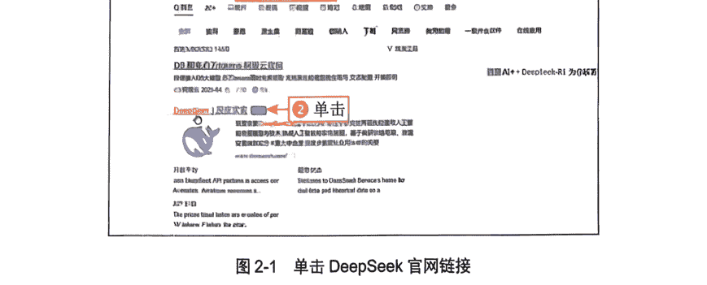

步骤 02 进入官网后，点击“开始对话”入口，如图2-2所示。

步骤 03 进入登录页，平台提供验证码登录、密码登录和微信扫码三种方式，建议新用户用验证码登录，①填写手机号；②点“发送验证码”，如图2-3所示。

步骤 04 操作后会弹出校验框，如图2-4所示，完成验证后对话框自动关闭并下发短信验证码。

步骤 05 ①填入收到的验证码；②点击“登录”，如图2-5所示。


图 2-2 单击“开始对话”按钮

图 2-3 单击“发送验证码”按钮

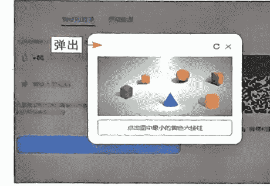


图 2-4 弹出验证对话框

图 2-5 单击“登录”按钮

步骤 06 登录成功后自动进入对话主界面，整体布局如图2-6所示。

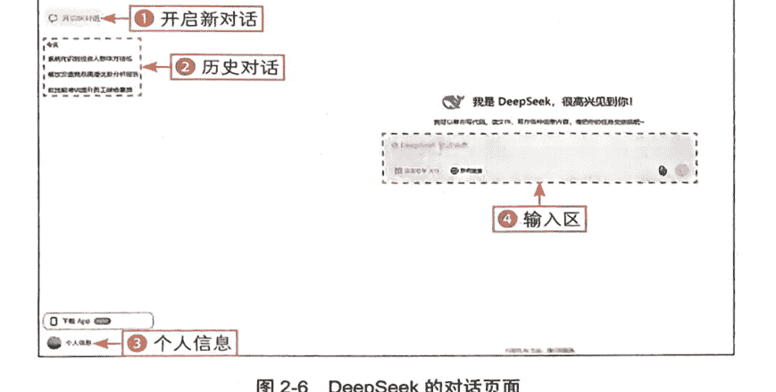

图 2-6 DeepSeek 的对话页面

下面对DeepSeek对话页面中的组成部分进行介绍。

1. 开启新对话：单击“开启新对话”按钮，能为创作者开启一个全新的、独立的对话窗口，使创作者与DeepSeek的交流更加高效和清晰。

2. 历史对话：在该区域中，会显示创作者与DeepSeek的所有对话记录，创作者可以单击任意记录，进入历史对话页面，回顾对话内容。

3. 个人信息：单击“个人信息”按钮，即可弹出相应的列表框，其中显示了账号名称、“系统设置”“联系创作者”和“退出登录”这4个选项，创作者可以根据需要，选择相应的选项进行设置。

4. 输入区：该区域包括输入框、“深度思考（R1）”按钮、“联网搜索”按钮、“上传附件”按钮和发送按钮5个部分。其中，输入框和发送按钮能够让创作者输入并发送提示词；单击“深度思考（R1）”按钮或“联网搜索”按钮，可以开启或关闭对应的功能；“上传附件”按钮可以帮助创作者上传文件。

#### 2.1.2 安装与了解DeepSeek手机版
相比网页版的操作，DeepSeek手机版更加灵活便捷，适合短剧创作者在灵感突发时快速记录与生成内容。无论是地铁上的创意速记，还是拍摄现场的剧本补充，DeepSeek手机版都能提供即时响应与智能协助。下面介绍安装DeepSeek手机版的操作方法。


步骤01 打开手机应用商店，进入首页，如图2-7所示。

步骤02 在顶部搜索栏输入 DeepSeek，①在结果列表中找到应用；②点右侧的“安装”进行下载，如图2-8所示。

步骤03 安装完成后按钮变为“打开”，点击即可启动，如图2-9所示。

步骤04 启动后出现欢迎页，点击“同意”确认协议，如图2-10所示。

步骤05 进入登录页，以验证码为例，①输入手机号和验证码；②勾选协议复选框；③点击“登录”，如图2-11所示。稍等片刻即可完成登录。

> ☆专家提醒☆

> 如果创作者之前登录过DeepSeek，并且账号已经绑定过微信了，可以直接点击“使用微信登录”按钮，通过微信授权快速登录。

信登录”按钮，跳转至微信进行授权登录即可。


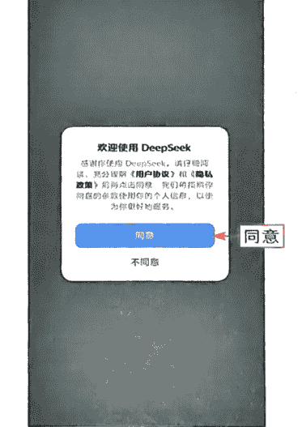


步骤 06 登录后进入“新对话”主界面，界面构成如图2-12所示。

AI短剧创作 从入门到精通：分镜脚本 + 视频生成 + 音乐创作 + 后期剪辑

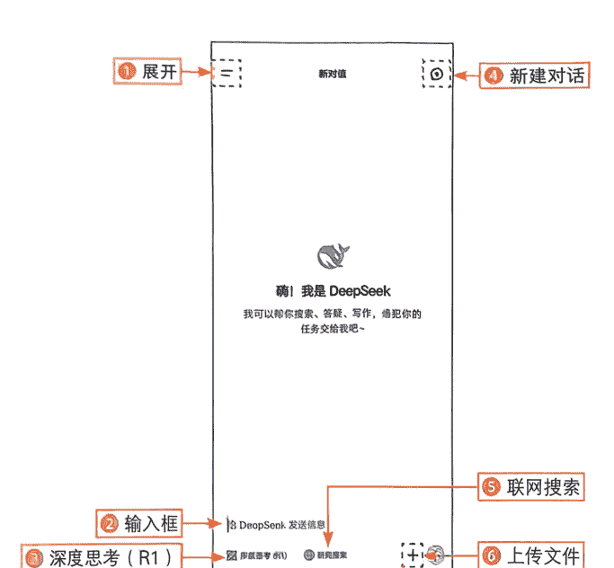

下面对DeepSeek “新对话” 界面中的组成部分进行讲解。

1. **展开=**：点击该按钮，即可显示最近的对话记录和创作者信息。

2. **输入框**：创作者可以在这里输入提示词，以获得DeepSeek的回复。

3. **深度思考（R1）**：点击该按钮，即可使用“深度思考（R1）”模型进行回复，当创作者向DeepSeek提问时，可以观察AI逐步分析并解答问题的过程，有助于增加答案的透明度和可信度。

4. **新建对话⊕**：点击该按钮，会新建一个“新对话”界面，创作者可以与AI讨论新的话题或让AI重新对上一个话题进行回复。

5. **联网搜索**：点击该按钮，即可开启“联网搜索”模式，在此状态下，DeepSeek能够搜索实时信息，快速整合并给出详尽的回答，同时提供信息来源，确保对话的丰富性和准确性。

6. **上传文件+**：点击该按钮，会弹出相应的面板。创作者可以分别点击“拍照识文字”“图片识文字”“文件”按钮，要求DeepSeek识别出其中的文字信息。

#### 2.1.3 生成剧本主题构想
剧本主题是故事的灵魂，它决定了整个短剧的基调、价值传递方向与情节发展范围。在短剧剧本创作中，一个明确、有吸引力的主题能够迅速抓住观众的注意力；而在分镜脚本写作阶段，主题更是决定画面风格与镜头重点的核心依据。

借助DeepSeek，创作者可以通过输入关键词快速激发多样化的主题构想，同时结合不同类型、受众、平台需求，生成具有市场吸引力的创意方向。AI不仅节省了反复思考的时间，还能提供结构清晰、逻辑自洽的主题表达方式，为后续创作奠定坚实的基础。下面介绍使用DeepSeek生成剧本主题构想的操作方法。

步骤01 进入对话页后，点亮输入区中的“深度思考（R1）”按钮，如图2-13所示，启用该模型生成回复。

步骤02 同样方式，①点亮“联网搜索”；②输入提示词；③点击发送，如图2-14所示。

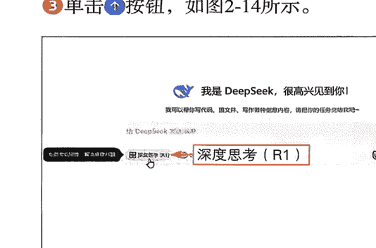

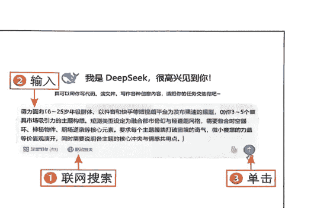

> ☆ 专家提醒 ☆

> 

> 在使用 DeepSeek 时，如果大家需要使用 DeepSeek 解答逻辑推理问题，就可以在输入区中单击“深度思考（R1）”按钮，将其点亮后再发送提示词，这样就能获得该模型的回答；如果大家需要搜索相关的网页资源，可以单击“联网搜索”按钮，启用该功能，让 AI 根据需求搜索网页。

> 

> 这两个按钮可以同时被点亮，也可以只点亮一个或者一个都不点亮。不过，点亮“深度思考（R1）”和“联网搜索”按钮后，DeepSeek 的反应速度会变慢，生成回复的时间也就会变长，大家根据自己的需求进行选择即可。

步骤03 发送后即可获得生成的短剧主题，回复示例如下。

**DeepSeek**

> 以下是5个符合短视频平台传播特性、兼具都市奇幻与轻喜剧风格的短剧主题策划，每个主题均包含完整的核心冲突设计和情感共鸣锚点。

> 

> 主题1：循环入职日

> 核心设定：社恐实习生发现每天都是试用期最后一天，唯有完成神秘工牌上的任务才能打破循环。每次读档重来时，工牌会显示不同同事的隐藏困境（如保洁阿姨的医疗费、程序员的抑郁症）。

> 核心冲突：在重复的职场修罗场里，主角必须突破心理屏障主动帮助他人，却发现每次善意干预都会导致更荒诞的办公室蝴蝶效应。

> 情感共鸣：当代青年突破社交茧房的勇气成长，揭示职场冰冷规则下暗涌的人性微光。

> 奇幻设定包裹“社恐变形记”的喜剧外壳、符合Z世代自我救赎的心理投射。

> 

> 主题2：后悔药快递站

> ……

> ☆ 专家提醒 ☆

> 

> Z世代是指1995年至2009年出生的一代人，也被称为“网生代”“互联网世代”“二次元世代”等。

这个提示词通过明确的目标受众、平台定位、短剧类型与核心元素，以及主题构想要求，构建了一个完整且具体的创作指引。它不仅能够帮助创作者快速生成符合市场需求的短剧主题构想，还能够确保这些构想具有高度的吸引力和观赏性，从而更容易在短视频平台上获得成功。

#### 2.1.4 搭建故事结构
故事结构是支撑剧本内容的骨架，决定了情节推进的节奏与观众的情绪起伏。在短剧创作中，结构安排是否合理直接影响观众的代入感与观看完整度；而对分镜脚本来说，结构清晰则有助于合理分配镜头资源与视觉节奏。

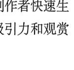

通过DeepSeek，创作者可以根据“三幕式”“五段式”等常见结构模型快速生成剧情大纲，明确起承转合与关键节点的位置。AI不仅可以按需定制情节的转折密度，还能自动补全逻辑空缺，让创作者以更快的速度搭建完成剧本框架，从而专注于内容细化与视听呈现。使用DeepSeek搭建故事结构的相关案例如下。

> 👤 提示词

> 

> 以三幕式结构为框架，创作一个都市爱情短剧大纲。要求AI设定合理的起承转合节点，突出男女主感情从相遇、冲突到和解的转折，每幕增加2～3个关键情节，并自动补全情节间的逻辑过渡，方便后续细化剧本。

**DeepSeek**

> 以下是按照三幕式结构创作的都市爱情短剧大纲，包含完整的起承转合与逻辑链条。

> 

> 剧名：《光影共生》

> 主题：当理性与浪漫碰撞，建筑与艺术终将找到共生之道

> 

> 第一幕：相遇与碰撞（起）

> 核心冲突：建筑精英与艺术策展人的价值观对立

> 关键情节：

> 咖啡厅误撞

> 男主陆沉（32岁）因赶制竞标方案打翻女主林希（28岁）的颜料箱，理性道歉时踩碎对方画具引发争执

> 视觉符号：陆沉西装沾满颜料，林希用碎玻璃制作光影装置

> ……

三幕式搭建都市爱情短剧大纲的指令，明确要求以起承转合划分情感节点，并限定每幕的关键情节点数，同时让逻辑过渡自动补全，帮助创作者迅速搭起剧本骨架。

#### 2.1.5 塑造人物形象
角色塑造是短剧成败的关键一环。人物是否鮮活、有张力，往往决定整部作品的吸睛度与情感浓度。落笔写剧本时，人设既要个性分明，也要与故事走向和主题立意相契合；到分镜阶段，角色的性情、驱动力和视觉符号都会直接影响镜头调度与画面构成。

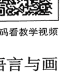

借助 DeepSeek，可以围绕身份、性情、经历、动机等多维度快速产出有血有肉的人设，并能灵活调节人物间的矛盾与互动逻辑，提升可信度与层次感，进而增强后续剧本与镜头的表现力。以下为运用 DeepSeek 进行人物塑造的案例。

**提示词**

> 请为一部轻喜剧短剧创建一个爱管闲事的热心邻居形象。要求：1. 年轻时做过居委会主任，养成爱操心的习惯；2. 为撮合小区里的单身男女，制造各种啼笑皆非的“偶遇”行为；3. 因过度热心引发误会，最后化解矛盾的故事线；4. 头戴褪色鸭舌帽，随身携带小笔记本记录“情报”的标志性造型。

AI短剧制作 从入门到精通：分镜脚本+视频生成+音乐创作+后期剪辑

**DeepSeek**

> 《红线居委会》人物小传：刘春梅

> 

> 【造型设计】

> 58岁的刘春梅总戴着印有“文明社区”字样的褪色鸭舌帽，磨毛的袖套上别着3枚不同年代的“先进工作者”徽章。常年斜挎着帆布包，内装裹着橡皮筋的笔记本，封面用红笔写着“大事记”，实际记录着“快递站下午4点人最多”等生活细节。

> 

> 【核心事件线】

> 第1幕：春梅姨的“情报网”

> 晨练时用太极扇指点保洁员扫落叶的方向，顺势偷听年轻白领的通话内容；

> 在快递驿站佯装扭伤，让程序员阿浩和美术老师小雨共搬重物；

> 夜巡发现独居女孩忘拔钥匙，留字条提醒反被误会是变态。

> 

> 第2幕：善意过载的蝴蝶效应

> ……

该提示以轻喜剧为调性，围绕“爱管闲事的热心邻居”构建形象。依托职业背景、行为习惯、性格倾向与冲突走向来搭建人物弧线，再以鸭舌帽、小笔记本等视觉符号强化戏剧性与辨识度，非常适合用AI生成兼具推动力与喜剧张力的典型角色。

#### 2.1.6 设计情节冲突
冲突是推动剧情运转的核心动力。短剧里不论是人物间的嫌隙、人与环境的对抗，还是内心的挣扎，都能有效引发观众共鸣；在分镜层面，冲突的类型与强度会直接决定镜头节奏与剪辑风格。

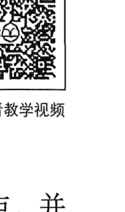

利用 DeepSeek 可以快速搭建内外冲突框架，设定多重冲突点并探索更具张力的叙事方式。AI 还能提供逻辑清晰的冲突布局，并根据设定自动补全前因后果，让短剧在有限时长内呈现更丰富、更有层次的戏剧张力。利用 DeepSeek 设计情节冲突的示例如下。

**提示词**

> 在一部关于“民宿老板与房客斗智斗勇”的短剧中，生成3组主线与支线冲突，并标注每组冲突的起因、发展与爆发点。

**DeepSeek**

> 主线冲突1：“违规入住者VS（versus，相对照、相对立）规则捍卫者”

> 起因：房客在预订时隐瞒人数，偷偷携带超员朋友入住，并拒绝支付额外的费用；民宿老板通过监控发现异常。

> 发展：老板假装提供“免费升级房间”服务，将超员房客单独引至未装修的阁楼，却在半夜制造诡异声响（如播放风声录音），试图吓退多余的房客；房客识破计谋后，反向利用阁楼布置“闹鬼”场景，吸引网红打卡，导致民宿被推上热搜。

> 爆发点：老板因客流暴增被迫营业，房客以“虚假宣传”威胁索赔，双方在镜头前假笑对峙，暗中用手机打字谈判。

> 

> 支线冲突1：“神秘差评师VS完美评分强迫症”

> 起因：民宿连续收到匿名差评（如“床垫下有蚂蚁”），老板怀疑是某位报复性房客所为，而真实差评者其实是保洁阿姨的儿子（因母亲被克扣工资）。

> ……

示例围绕“民宿老板与房客斗智斗勇”展开，要求产出三组主线与支线冲突，并明确起因、发展与爆发点，结构完整、逻辑清晰。它兼顾剧情紧凑度与戏剧张力，适合 AI 生成多层次、高节奏的情节冲突方案。

#### 2.1.7 设置剧情转折亮点
转折是短剧的爆点，也是维持注意力与制造情绪反差的关键机制。剧本中恰当的转折能打破平铺直叙，带来出人意料又合情合理的观感；在分镜编写中，转折对应镜头语言的跳变、高能点的聚焦与剪辑节奏的骤变。


通过 DeepSeek 设定转折类型与时机，AI 会输出符合逻辑且冲击力强的情节转变。相较人工推敲，使用 AI 能更快发掘潜在戏剧点，使剧本更紧凑高能，也利于在视觉呈现中突出节奏变化与情感高潮。设置剧情转折亮点的示例如下。

**提示词**

> 请为一部“姐弟恋因身份悬殊受阻”的短剧设计一个结尾反转。要求：1.感情真实；2.反转需在第20集末尾出现；3.内容应在意料之外但合乎情理；4.反转要解决核心冲突，使结局具有情感冲击与传播性。

AI短剧制作从入门到精通：分镜脚本+视频生成+音乐创作+后期剪辑

DeepSeek

> 《暮色晨光》最终回反转设计

【核心伏笔回收】

前19集埋设：（1）林深总在便利店购买过期面包；（2）苏晚的左手腕有陈旧伤疤；（3）苏晚家中有神秘保险柜从未开启。

【第20集结尾高潮戏】

场景：苏氏集团顶楼空中花园（暴雨夜）

苏晚（眼眶通红攥着辞职信）：“林深，我父亲用你的助学贷款威胁，如果我不去联姻，明天就会有20家媒体曝光你母亲……”

林深（扯松领带暴怒捶墙）：“所以你要我当逃兵？看我像丧家犬一样离开？这些年我拼命考上注册会计师、熬夜做项目，就为配得上你！”

（闪电划过，苏晚的珍珠耳坠突然断裂，滚落保险柜方向）

……

示例聚焦于易引发共鸣的“姐弟恋”题材，以身份差异制造主冲突，并在结尾安排反转。要求明确、时间点具体，有助于 AI 聚焦矛盾核心并构思兼具逻辑性与情感张力的高能结局，是打造爆款转折的实用范例。

### 2.1.8 组合多重爽点元素
爽点是促使用户停留与转发的驱动力之一，通常表现为情绪爆发、情节突破、价值逆袭等高能片段。剧本中刻意叠加情节爽点与情绪爽点，能增强沉浸感；在分镜中，爽点决定镜头调度的密度与重点。

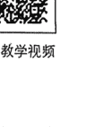

借助 DeepSeek 的内容生成能力，创作者可快速产出多维爽点方案，涵盖“逆风翻盘”“扮猪吃虎”“极限对抗”等高热桥段，并进行组合优化。AI 还能推荐当下流行的爽点类型，并结合剧情节奏提供高契合度建议，让短剧兼具张力与商业性。组合多重爽点元素的示例如下。

提示词

> 请为一部“直播打假”题材的短剧设计3个情节爽点与2个情绪爽点。要求：1. 节奏紧凑，适合在8集以内展现；2. 情节爽点需体现出打假过程中的反转、揭露、胜利；3. 情绪爽点需触发观众的愤怒共鸣或正义感动，增强转发与评论意愿。

040

# DeepSeek

> 以下是为“直播打假”题材短剧设计的核心爽点方案，符合8集内快节奏叙事要求。

【情节爽点设计】

直播翻车反杀局（反转+胜利）

第2集：女主首次揭露网红“养生茶”虚假宣传，却被对方出示伪造的质检报告反咬诽谤。在直播即将被封时，女主突然连线茶厂离职质检员，现场展示茶水重金属超标的暗访视频（镜头切厂区污水横流画面），直播间瞬间涌入10万人，造假方账号当场被封。

供应链卧底惊魂（揭露+反转）

第4集：男主伪装成货车司机潜入造假仓库，偷拍时触发警报。追逐戏中无人机航拍揭晓整个工业园区都是造假产业链（特写假冒大牌包装生产线），逃亡时用直播镜头记录暴徒砸车的过程。证据自动云备份成功那一刻，警笛声由远及近。

终极对质数据战（胜利+升华）

……

示例将“直播打假”与爽点结构精准结合，明确数量与节奏要求，便于 AI 围绕高能情节与情绪节点生成。通过双线并进设定，有效引导 AI 产出紧凑、传播力强的爽点组合，适用于快节奏短剧剧本与分镜创作。

### 2.1.9 生成多样化对白
对白既是推动剧情的工具，也是展现人物性格与情绪张力的手段。风格鲜明、措辞精准的对白能增强节奏感与人物印象；在分镜中，对白影响镜头时长、字幕表现与声音节奏，是营造视听氛围的关键。

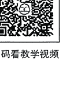

通过 DeepSeek，创作者可依据不同角色设定与场景氛围，智能生成风格多样、语气贴切的对白，涵盖激烈对峙、幽默互怼与深情表白等常见表达。AI 还能匹配对白风格与人物人设，使语言更具穿透力与传播潜力，提升短剧整体表现力。生成多样化对白的示例如下。

# 提示词

> 请为一个霸道总裁和职场新人在电梯初遇的场景，生成3组风格不同的对白：高冷疏离（表现总裁的距离感与权威气场）、调侃幽默（增加反差感，带轻喜剧氛围）、温柔暖男（打破刻板印象，突出亲和力）。

我为您创作了3组不同风格的电梯初遇场景，以下是符合要求的对白设计。

一、高冷疏离版

（电梯门即将关闭时，新人慌忙冲入撞到总裁，撞落文件）

新人：（鞠躬）对不起！我帮您捡……

总裁：（后退半步整理袖口）你的培训手册没教你电梯礼仪？

（空气凝结，新人僵住）

总裁：（用钢笔尖轻点楼层键）下次犯错前，先学会判断空间余量。

（电梯抵达28层，总裁跨步而出）

新人：（捏皱衬衫下摆）是……是的陆总。

……

示例精准限定了人物关系与场景，并明确对白风格范围，便于 AI 生成对比鲜明、具传播潜力的台词。通过三种风格并列，既可验证角色语言多样化的能力，也方便创作者按剧本走向快速筛选最适合的语气与台词，提升剧本对白的表现力与灵活性。

## 2.2 使用 Kimi 生成短剧分镜脚本
分镜脚本是连接文字与影像的桥梁。Kimi 具备强大的语言分析与结构组织能力，能够依据不同类型剧本生成符合视觉逻辑与节奏规律的分镜，还能协助对已有分镜进行调整优化。

本节涵盖都市情感、职场逆袭、古风权谋、悬疑反转与科幻未来等类型短剧的分镜生成方法，展示 Kimi 如何快速输出结构清晰、画面感强的镜头分布；并介绍如何利用 Kimi 对分镜进行节奏调整与情绪重构，使短剧更具张力与情感穿透力，为拍摄与剪辑奠定基础。

### 2.2.1 认识Kimi网页版
Kimi 网页版界面简洁，适合剧本大纲整理与多轮提示词调整。其支持长文本输入与上下文连续对话，尤其适合在初稿基础上扩展分镜结构。通过持续追问与提示词修改，可实时调整内容走向与镜头安排逻辑。图2-15所示为 Kimi 网页版的会话页面。


下面对 Kimi 网页版会话页面中的组成部分进行讲解。

- 1. **新建会话**：单击该按钮，即可创建一个新的会话窗口，让创作者与AI重新开始对话。

- 2. **导航栏**：在该区域中，单击Kimi+按钮，即可进入“探索Kimi+”页面，查看和使用Kimi提供的智能体；单击任意一个历史会话，即可进入对应的会话页面，查看具体内容；单击“历史会话”下方的“查看全部”按钮，即可进入“历史会话”页面，查看所有会话记录。

- 3. **输入区**：该区域包含输入框、“联网”按钮、“长思考（K1.5）”按钮、上传文件按钮、常用语按钮和发送按钮这6个部分。其中，创作者可以在输入框中输入提示词，单击发送按钮将其发送；也可以单击“联网”按钮或“长思考（K1.5）”按钮，开启或关闭Kimi的联网状态和模型；还可以通过单击上传文件按钮或常用语按钮，完成文件的上传或常用语的调用。

- 4. **示例区**：该区域中提供了多种会话示例，便于创作者快速使用Kimi的特定功能。创作者可以通过单击这些示例，快速启动Kimi的特定服务或功能，而无须自己编写详细的提示词。

> ☆专家提醒☆

Kimi 目前推出了电脑端应用，如果创作者觉得 Kimi 好用，也可以安装其电脑端应用，从而更便捷地使用 Kimi。

### 2.2.2 认识Kimi手机版
Kimi 手机版功能紧凑，适合移动创作场景下捕捉灵感与即时生成。此外，移动端的“多轮追问”能力也能稳定运行，使得创作者即使脱离电脑，也能流畅完成剧本到分镜的转化。图2-16所示为 Kimi 手机版的会话界面。

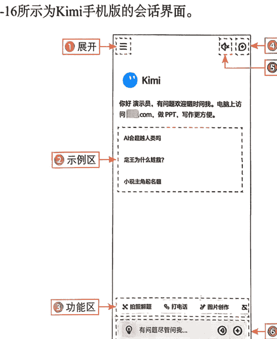

下面对 Kimi 手机版会话界面中的组成部分进行相关讲解。

- 1. **展开☰**：点击该按钮，界面左侧会弹出侧边栏，其中显示了账号信息、“探索Kimi+”按钮和历史会话。

- 2. **示例区**：该区域会显示一些热门话题，创作者可以点击感兴趣的话题，体验与Kimi进行对话的过程。

- 3. **功能区**：该区域会显示一些Kimi的热门功能，如“拍照解题”“打电话”“图片创作”“翻译”“写作”等，创作者可以点击相应按钮，体验对应的功能。

- 4. **新建会话⊕**：点击该按钮，即可创建一个新的会话界面。

- 5. **语音播报🔊**：开启Kimi的语音播报功能，Kimi可以一边生成回复，一边将回复朗读出来。不过，该功能默认是关闭的状态，如果创作者有需求，要先点击语音播报按钮🔊，将其开启后，再进行对话。

- 6. **输入区**：该区域包括输入框、长思考（K1.5）按钮、语音输入按钮和上传按钮这4个部分。创作者可以输入提示词，与AI进行对话；也可以点击相应的按钮，使用对应的功能。

### 2.2.3 生成都市情感短剧的分镜脚本
都市情感短剧常聚焦亲密关系、职场情感与婚恋困境，强调人物间细腻互动与情绪递进。分镜设计需兼顾对白密度、眼神特写与空间调度，镜头节奏以“缓中带张”为主。


借助 Kimi，创作者可输入剧情设定、人物关系与核心情绪点，智能生成包含镜头类型、画面情境与对白节奏的分镜草稿。尤其在处理“误会—冲突—释怀”等经典结构时，Kimi 能自动分配情绪转折点所需的镜头布局，帮助创作者快速构建富感染力的情感场面。下面介绍使用 Kimi 生成都市情感短剧分镜脚本的具体操作方法。

步骤01 登录并进入Kimi的会话页面，在输入区中，①输入提示词；②单击发送按钮，如图2-17所示。

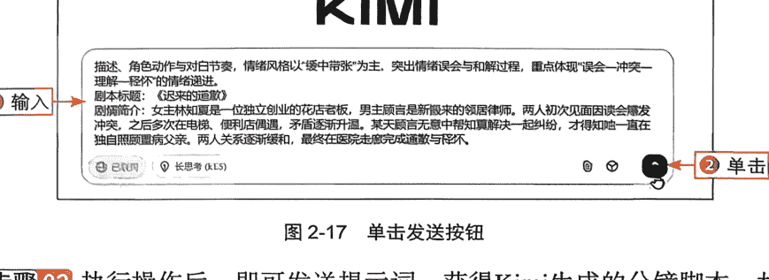

图 2-17 单击发送按钮

步骤02 执行操作后，即可发送提示词，获得Kimi生成的分镜脚本，相关提示词和回复内容如下。

提示词

> 请根据以下剧本设定，生成一个适合都市情感题材的分镜脚本，包含每一场的镜头类型、镜头长度建议、画面描述、角色动作与对白节奏，情绪风格以“缓中带张”为主，突出情绪误会与和解过程，重点体现“误会—冲突—理解—释怀”的情绪递进。

剧本标题：《迟来的道歉》

剧情简介：女主林知夏是一位独立创业的花店老板，男主顾言是新搬来的邻居律师。两人初次见面因误会爆发冲突，之后多次在电梯、便利店偶遇，矛盾逐渐升温。某天顾言无意中帮知夏解决一起纠纷，才得知她一直在独自照顾重病父亲。两人关系逐渐缓和，最终在医院走廊完成道歉与释怀。

《迟来的道歉》分镜脚本

场景1：初次见面的冲突——林知夏的花店门口

镜头类型：中景

镜头长度：20秒

画面描述：林知夏抱着一束鲜花从花店出来，准备送给客户。顾言从对门走出来，手里拿着文件夹，两人在门口撞了个满怀。鲜花散落一地，文件也散开。

角色动作与对白节奏：

林知夏（惊讶）：“哎呀，对不起，我太不小心了！”

顾言（不耐烦）：“你这人怎么走路的？眼睛长哪里了？”

……

步骤 03 在同一个会话页面中，继续输入并发送提示词，即可获得表格形式的分镜脚本，相关提示词和回复内容如下。

提示词

请将上述分镜脚本改成表格的形式。

表2-1所示为改写成表格的《迟来的道歉》分镜脚本。

表2-1 《迟来的道歉》分镜脚本

| 场景 | 镜头类型 | 镜头长度 | 画面描述 | 角色动作与对白节奏 | 情绪风格 |

| :--- | :--- | :--- | :--- | :--- | :--- |

| 场景1 | 中景 | 20秒 | 林知夏抱着鲜花从花店出来，顾言从对门走出，两人撞在一起，鲜花和文件散落 | 林知夏（惊讶）：“哎呀，对不起，我太不小心了！”

顾言（不耐烦）：“你这人怎么走路的？眼睛长哪里了？”

林知夏（生气）：“我道歉了，你态度能不能好点？”

顾言（冷哼）：“哼，真是倒霉透顶。” | 冲突激烈，情绪紧张 |

| …… | …… | …… | …… | …… | …… |

该提示提供了明确的剧情背景与情绪节奏要求，适合 Kimi 生成层次丰富的都市情感分镜脚本。它细化了“误会—冲突—理解—释怀”的情绪轨迹，并要求输出镜头类型、长度、画面描述与对白节奏，有助于 AI 把握“缓中带张”的都市情绪氛围，构建出既细腻又具张力的情感分镜，增强短剧的代入感与共鸣力。

> ☆专家提醒☆

文字形式的分镜脚本具有更强的叙述性和灵活性，能够详细地描述画面、角色动作和情绪，适合复杂情节和创意的构思阶段，便于编剧和导演深入探讨故事细节。表格形式的分镜脚本则更加直观、清晰，通过结构化的布局，快速呈现镜头的关键信息，便于在拍摄现场快速执行并与团队协作，尤其适合实际拍摄阶段的指导和参考。

### 2.2.4 生成职场逆袭短剧的分镜脚本
职场逆袭短剧以成长、抗争与胜利为主线，强调剧情爽感与逻辑合理性。分镜脚本中需突出关键节点：受压时的细节刻画、转机时的节奏提速与高潮段落的情绪爆发，整体风格节奏感强、视觉冲击明显。

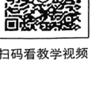

## Kimi 三步搭建职场逆袭分镜

使用 Kimi 的时候，制作者能够围绕人物设定、冲突铺陈与反转路径，迅速拼出主线清晰、支线呼应的镜头骨架。平台可合理安排办公场景的使用，比如开放办公区、会议室、茶水间等，同时给出音效、字幕与情绪曲线等方面的建议，提升视听张力与爽感浓度。接下来演示职场逆袭类短剧分镜脚本的具体操作。

- 1. **步骤01** 在 Kimi 输入区单击上传文件按钮①，如图2-18所示。
- 2. **步骤02** 弹出“打开”对话框，① 选择相应的文件；② 单击“打开”按钮，如图2-19所示，即可完成上传并返回输入区。

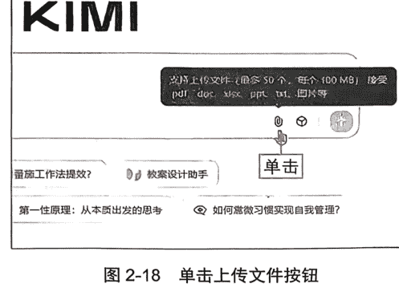

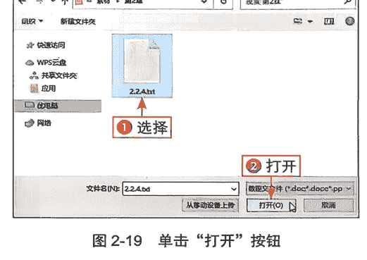

- 3. **步骤03** 输入并发送提示词和文件，即可获得 Kimi 根据剧本设定生成的分镜脚本、相关提示词和回复内容如下。

# 提示词

请根据提供的剧本内容，以表格的形式，生成一份适合8集以内表现的职场逆袭题材短剧分镜脚本、结构应包含每集的场次划分、关键镜头类型（如特写、推镜、慢镜头等）、场景情绪、对白、节奏变化，以及字幕和音效建议，节奏建议以“压抑—试探—发力—胜利”为线索，体现女主逆袭过程的层层推进。

（文件略）

# Kimi

表2-2所示为适合8集以内表现的职场逆袭题材短剧分镜脚本。

表2-2 职场逆袭题材短剧分镜脚本

| 集数 | 场次 | 关键镜头类型 | 场景情绪 | 对白 | 节奏变化 | 字幕建议 | 音效建议 |

| :--- | :--- | :--- | :--- | :--- | :--- | :--- | :--- |

| 第1集 | 场景1 | 推镜头、全景 | 压抑 | Luna：“苏然，这个季度的客户数据分析报告，今天下班前必须交给我。还有，之前让你做的竞品分析，一点创意都没有，重做！”苏然：“好的，Luna姐，我马上改。” | 逐渐紧张 | 字幕：“职场，不是只有努力就能成功。” | 轻微的键盘敲击声、Luna的高跟鞋声 |

| …… | …… | …… | …… | …… | …… | …… | …… |

该提示词框架稳健，主题基调与风格指向明确，同时把单集细化到场次、镜头、对白层面，并以“压抑—试探—发力—胜利”串联节奏，引导模型产出层层推进的叙事，有助于得到逻辑顺畅、情绪饱满、镜头把控精准的逆袭短剧。

### 2.2.5 生成古风权谋短剧的分镜脚本

古风权谋短剧以宫廷争斗、权力角逐为核心，镜头语言偏向压抑、含蓄、象征性强，注重氛围营造与节奏蓄力。分镜中需体现空间调度的对称感、眼神博弈的多层次描写及背景陈设的历史感。


Kimi 在处理这类题材时，可按设定产出仪式感强的画面描述，并结合古风语言节奏给出分镜结构。制作者输入核心冲突或关键对峙场景后，Kimi 能推演“前情铺垫—谋局酝酿—反击揭晓”的多段镜头，助力作品兼顾沉浸感与历史张力。相关案例如下。

# 提示词

请根据以下剧情片段，生成一份适用于古风权谋题材的分镜脚本，内容包括：场次编号、镜头类型（如低角度、横移、推镜、特写等）、镜头长度建议、画面描述、角色动作、台词节奏、情绪氛围，以及配乐与音效建议。

......

☆专家提醒☆

限于篇幅原因，书中对比较长的提示词进行了省略，创作者可以在提示词文档中查看完整内容。

# Kimi

《夜宴设局》分镜脚本

场次编号：1

镜头类型：全景

镜头长度建议：10秒

画面描述：

夜幕低垂，华灯初上，朱红色的宫门缓缓打开，摄政王府邸的庭院被灯光照亮，一片金碧辉煌。远处传来隐隐的丝竹之声，似有若无地飘荡在空气中。

角色动作：

无

台词节奏：

无

......

此提示思路清晰、信息充足，围绕古风权谋主题，对三段式推进、镜头语言的对称构图与低角度、象征物运用及氛围的压抑感与仪式感均做了细化。重点突出视觉符号与心理博弈，有助于引导 Kimi 产出层次丰富、张力充足的高质量分镜，适合创作实操展示。

### 2.2.6 生成悬疑反转短剧的分镜脚本

悬疑反转类作品以信息差与节奏翻转为核心，强调视觉线索与情节错位的融合。分镜常用特写、闪回、视角偏移等手法，先让观众形成误判，再在关键节点揭晓真相。

Kimi 善于解读“悬念铺设+反转收束”的结构，能按故事设定输出分段镜头方案，包含误导信息的埋设、疑点递进的节奏控制以及真相揭晓的强对比画面。使用它能更高效地组织谜团结构，提升反转戏剧性。相关案例如下。


提示词

> 请根据“出租屋深夜响起不明敲门声”这个场景，生成含“渐进恐惧—视觉偏移—突发安静—真相反转”的悬疑反转短剧分镜脚本，标注每组镜头的情绪目标与观众感知误导点。

Kimi

```
《深夜敲门》分镜脚本
场景设定
时间：深夜，凌晨1点左右。
地点：一间普通的出租屋，室内昏暗，只有客厅的台灯亮着。
人物：女主角（小林），一个独自居住的年轻女性。
分镜脚本
镜头1：渐进恐惧
画面：中景，女主角小林坐在沙发上，手里拿着手机，正在看剧。突然，画面微微晃动，门的方向传来轻微的“咚咚”声。
声音：轻微的敲门声，夹杂着风声。
情绪目标：营造出一种平静被打破的不安感，让观众开始紧张。
观众感知误导点：观众会以为是小林的室友或者朋友回来了，但深夜的敲门声又让人觉得不太寻常。
……
```

该提示聚焦悬疑反转的结构设计，明确提出四阶段节奏推进，并要求在镜头脚本中标出情绪指向与观众误导点。它突出镜头对心理的引导与牵制，有助于构建“误导—反转”经典叙事模式，适合制作节奏紧凑的悬疑短剧。

### 2.2.7 生成科幻未来短剧的分镜脚本

科幻未来短剧侧重世界观构建与科技想象的视觉化，常见超现实设定、非线性时空或智能交互场景。分镜需在画面中平衡奇观构图、科技细节与剧情驱动。


通过 Kimi 输入角色设定、技术设定与时间节点，AI 可迅速推导出未来感镜头组合，如虚拟交互、HUD 视角、场景切换等特写，并建议光效与运镜方式。同时还能对叙事节奏进行合理分段，让短剧在有限时长内展现最大想象力与视觉张力。相关案例如下。

提示词

> 请构建一段发生在“智能城市地下避难舱”的对话场景，要求：镜头设计突出科技孤岛氛围、角色与设备交互动作、低饱和光影，节奏由静态观察到突发警报。

Kimi

> 智能城市地下避难舱

镜头设计

全景：镜头缓缓扫过地下避难舱内部，在昏暗的灯光下，金属墙壁和设备反射出微弱的冷光，整个空间显得空旷而寂静，仿佛一座科技孤岛。低饱和的光影让整个画面笼罩在一种压抑的氛围中。

中景：镜头聚焦在中央控制台，屏幕上显示着各种数据和监控画面，但大部分区域处于待机状态，只有少数指示灯闪烁着微弱的光芒。

特写：镜头切换到控制台上的触摸屏，显示着“系统正常”字样，但屏幕边缘有细小的裂纹，暗示着设备的脆弱性。

角色

艾丽：避难舱管理员，穿着带有反光条的制服，面容疲惫但眼神坚定。

……

提示构思明确，视觉与叙事目标突出，场景具备科幻特征，能够有效激发 AI 对画面节奏与氛围的细致呈现。

### 2.2.8 调整分镜脚本的镜头节奏

镜头节奏决定观感密度与情绪流速，过快显仓促，过慢易失焦点。理想节奏应服务主题，匹配剧情结构与观众心理。


借助 Kimi 可对已有分镜进行节奏微调，例如调整镜头时长、增删过渡镜头、重排组接顺序，实现“紧—缓—爆”的节奏控制。二次调整既能突出高潮与转折，也能让整体节奏更具层次与吸引力。下面介绍调节镜头节奏的具体操作。

步骤01 在 Kimi 输入区，① 上传相关文件；② 输入提示词；③ 点击发送按钮，如图2-20所示。

步骤02 操作完成后，提示词与文件即被发送，可获得 Kimi 优化后的分镜内容，具体回复如下。

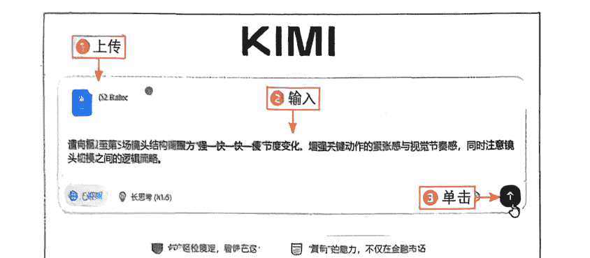

图 2-20 单击发送按钮

Kimi

表2-3所示为按照“慢—快—快—慢”的节奏变化调整的镜头结构，同时保持镜头切换的逻辑流畅。

表2-3 调整后的镜头结构

| 场次 | 镜头类型 | 镜头长度 | 画面描述 | 角色动作 | 音效与节奏 |

| :--- | :--- | :--- | :--- | :--- | :--- |

| 2 | 跟拍 | 12秒 | 主角急匆匆穿过街道，不时查看手机 | 快步前行，低头，步伐逐渐加快 | 背景节奏舒缓，脚步声清晰，逐渐加快 |

| 3 | 平拍 | 6秒 | 突然有人挡住去路，两人短暂对视 | 主角侧身避开，迅速继续前进 | 无对白，脚步声急促，节奏加快 |

| 4 | 推镜 | 6秒 | 他走进小巷，镜头快速推进，空间狭窄 | 警觉地环顾四周，步伐加快 | 音乐骤然加重，节奏急促 |

| 5 | 特写 | 10秒 | 手机响起，他停下脚步，脸色微变 | 停顿，眼神变化，深吸一口气 | 手机铃声突兀，节奏回落，音乐渐缓 |

| ...... | | | | | |

该提示围绕镜头节奏优化展开，给出明确节奏目标。兼顾逻辑与情绪渲染，指令清晰，便于 AI 在保留原内容基础上进行目的性节奏重构，提升叙事张力与观众代入感。

### 2.2.9 调整分镜脚本的情绪氛围

短剧画面既要讲清故事，也要传递情绪。不少分镜结构合理，却在情绪氛围上显单薄或不够精准。


扫码看教学视频
通过 Kimi 可对已有脚本的情绪层次做细化，例如增强压迫感、柔化情感、制造悬念等。AI 会按设定匹配更合适的景别、光线建议与声音方案，帮助创作者丰富画面气质，提升代入感与情绪共鸣。下面介绍调节情绪氛围的具体流程。

步骤01 在 Kimi 输入区，① 上传对应文件；② 输入提示词；③ 点击发送按钮，如图2-21所示。

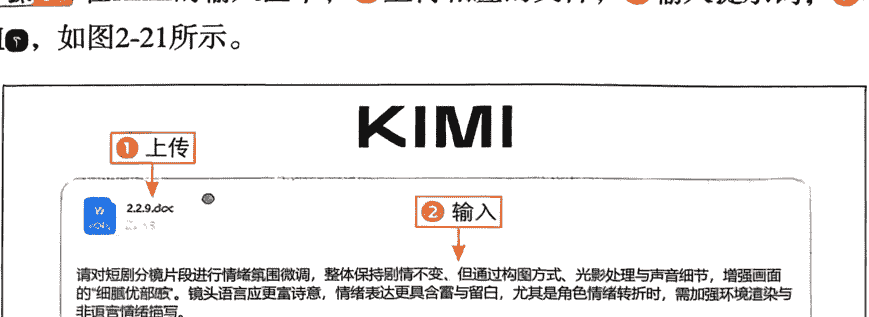

图2-21 单击发送按钮

步骤02 执行后，提示词与文件即被提交，可得到 Kimi 调整后的分镜脚本，具体回复如下。

Kimi

表2-4所示为经过微调的短剧分镜片段，通过对构图、光影和声音细节的调整，增强画面的细腻忧郁感。

表2-4 经过微调的短剧分镜片段

| 场次 | 镜头类型 | 镜头长度建议 | 画面描述 | 角色动作 | 情绪表达 | 光影处理 | 声音细节 |

| :--- | :--- | :--- | :--- | :--- | :--- | :--- | :--- |

| 1 | 俯拍 | 7秒 | 在房间的杂物堆中，一只破旧的纸盒被灰尘覆盖，周围散落着一些旧物件，显得杂乱而陈旧 | 女孩蹲下，轻轻拂去纸盒上的灰尘，动作缓慢而小心 | 平静中透出一丝怀旧 | 光线昏暗，房间内只有微弱的自然光，营造出一种沉寂的氛围 | 背景音乐为低沉的钢琴音，偶尔传来窗外的风声和远处的鸟鸣，声音轻柔而悠远 |

| 2 | 特写 | 8秒 | 手轻抚信封，封面略有褶皱，信封上的字迹已经模糊不清，仿佛岁月的痕迹 | 指尖微颤，女孩的眼神在信封上停留片刻，随后轻轻叹了一口气 | 情绪开始波动，但未完全表露 | 光线从信封的一侧斜射过来，形成明暗对比，突出信封的质感和褶皱 | 风声渐强，偶尔传来纸张被微风吹动的沙沙声，营造出一种静谧而略带忧伤的氛围 |

| ...... | ...... | ...... | ...... | ...... | ...... | ...... | ...... |

该提示聚焦分镜情绪氛围的微调，要求在原有画面与结构基础上强化特定情绪表现。通过细节刻画、光影处理与音效选择调节氛围，引导 Kimi 对同一情节进行风格重塑，实现情绪导向与视觉调性的统一，增强戏剧感染力。

## 本章小结

本章先讲解了借助 DeepSeek 完善短剧剧本的流程，涉及网页版与手机版的登录认知，以及主题构思、结构搭建、人物塑造、冲突设计、转折点设置、多重爽点组合与多样化对白生成等。然后介绍了如何用 Kimi 制作分镜脚本，涵盖平台认知、不同类型短剧分镜的生成，以及镜头节奏与情绪氛围的调整等内容。

## 课后实训

鉴于本章知识的重要性，为了帮助读者更好地掌握所学知识，本节将通过课后实训，帮助读者进行简单的知识回顾和补充。

【实训任务】请用 DeepSeek 生成一段复合型冲突结构的剧本，提示词与回复如下。

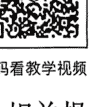

提示词

> 围绕“女主被迫与前任成为竞标对手”展开短剧剧本的情节冲突设计，生成包含情感纠葛（旧情未了）、利益对抗（项目竞争）和第三方干扰（同事挑拨）的复合型冲突结构，突出张力对撞与角色心理变化，并补全背景与冲突演化路径。

DeepSeek

> 《双生蓝图》复合型冲突结构设计

【背景设定】

林希（女主）：29岁，锐意建筑事务所主创设计师，三年前因发现未婚夫顾明远窃取自己设计方案而取消婚约，现为挽救濒临破产的事务所接手旧城改造项目。

顾明远：32岁，云筑集团首席建筑师，曾盗用林希创意获得行业新锐奖，现晋升为合伙人，急需赢得旧城改造标案。

关键干扰者：陈薇，锐意事务所副总监，暗中向竞争对手出售情报的叛徒，暗恋顾明远多年。

【核心冲突三维度】

情感维度：未寄出的悔过信vs职场性骚扰诬陷

利益维度：传统建筑活化方案vs智能社区改造方案

干扰维度：标书泄密事件与监控视频伪造

【冲突演化路径】

……

## 第2章 分镜脚本搭建：DeepSeek、Kimi构建故事蓝图

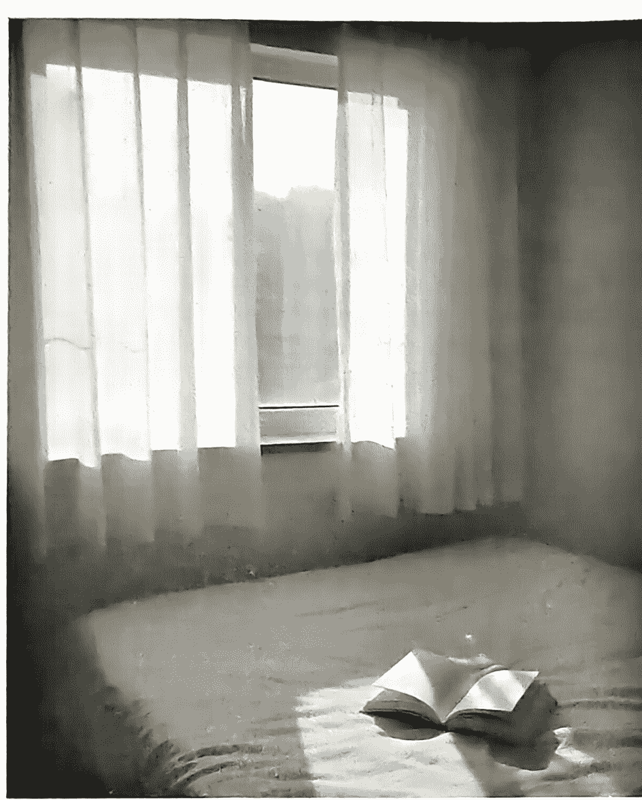

## 第3章 分镜画面雕琢：豆包、OneStory 绘就视觉初稿

分镜不仅是剧本的视觉延伸，也是塑造节奏与情绪的手段。本章将借助豆包与 OneStory，从单一场景逐步推进到完整分镜画面的视觉搭建。通过对图像细节的打磨，让文字具象化，为短剧制作奠定鲜活的美术基础。

### 3.1 使用豆包生成多场景分镜画面

在短剧制作中，场景分镜不仅交代空间，更默默传递情绪与氛围。借助豆包，可快速生成多元视觉场景，为角色行为与剧情推进提供坚实的空间支撑。本节先介绍豆包网页版和手机版的界面构成，再围绕各类场景图演示如何高效绘制具象分镜画面。

#### 3.1.1 认识豆包网页版

豆包是集文本、图像、音乐生成于一体的智能创作工具，支持多种形式的高效输出。在分镜环节，网页版因操作简便、输入灵活而常用于场景图生成。对需要快速搭建视觉初稿的创作者而言，网页版能稳定高效地输出画面草图，是从构思到成像的关键桥梁。图3-1为豆包网页版“图像生成”界面。

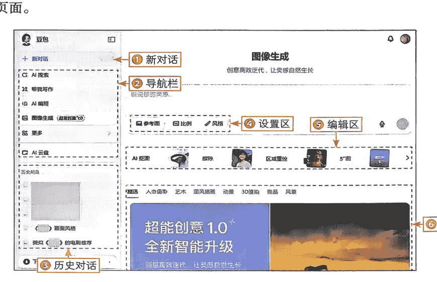

下面对该界面的构成进行说明。

- 1. 新对话：点击此按钮可新建对话窗口。
- 2. 导航栏：此处可点击相应按钮进入不同功能页面，体验豆包的多样能力。如点击“图像生成”即可进入图像生成页。
- 3. 历史对话：展示过往对话记录，可随时查看管理。
- 4. 设置区：输入提示词后，可在此调节参考图、比例与风格，使生成画面更贴合需求。
- 5. 编辑区：除生图外，豆包还提供丰富的图像编辑功能，可在此调整已有图像。
- 6. 模板区：随机展示各类图像模板，点击“做同款”可自动填入模板提示词与参数，再点击“发送”即可生成同款。

> ☆ 专家提醒 ☆
豆包电脑版同样支持图像生成，页面与功能与网页版高度相似，因此可先在网页版体验，满意后再考虑安装电脑版。

#### 3.1.2 认识豆包手机版

对比网页版，豆包手机版更适合利用碎片时间捕捉灵感和移动端分镜创作。简洁界面支持快速输入提示词，生成适用于短剧分镜的多样场景。无论室内或自然风光，其画面风格与光影氛围表现力都较强，为移动端场景创作提供便利。图3-2为豆包手机版“AI生图”界面。

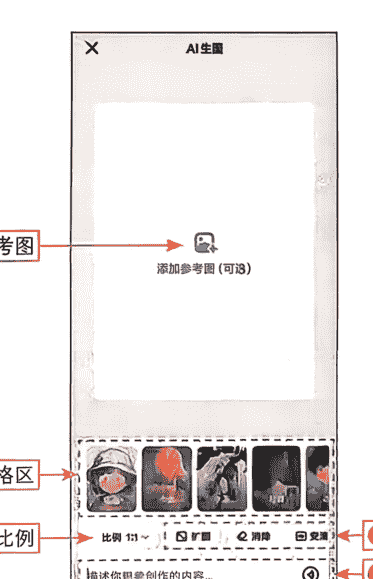

图 3-2 豆包手机版的“AI生图”界面

下面说明该界面的构成。

- 1. 添加参考图：点击后进入“所有照片”，可从相册选取图片作为参考上传。
- 2. 风格区：可根据需求选择图像风格，让AI输出更符合分镜要求。
- 3. 比例：点击后在列表中选择所需比例，如9：16、2：3、1：1、16：9等。
- 4. 编辑区：点击对应按钮可对手机中的图像进行编辑。
- 5. 输入区：可输入文字提示词，也支持语音输入来告诉AI所需画面内容。

#### 3.1.3 客厅场景的快速搭建
客厅是居家短剧里出现频率最高的空间之一，既是人物关系展开的舞台，也是营造生活真实感的核心视觉区。亲情互动、日常矛盾、情绪爆发等桥段多在此发生，同时也能外化角色内在的心理变化。


【效果展示】分镜里一套布置合理、光线柔和的客厅，足以让人瞬间感受到“家”的温度。借助豆包可以迅速得到符合风格、质感细腻的空间图，直观呈现结构与光影层次，提前锁定场景基调，让剧情更有代入感与表现力。把豆包生成的家庭客厅图放进参考，示意为图3-3。


下面说明如何用豆包制作家庭客厅图片。
步骤01 进入豆包对话页，点击输入框下方“图像生成”按钮，如图3-4所示，激活生图功能。
步骤02 在生图输入框中，① 填入提示词；② 点开“比例”，如图3-5所示。

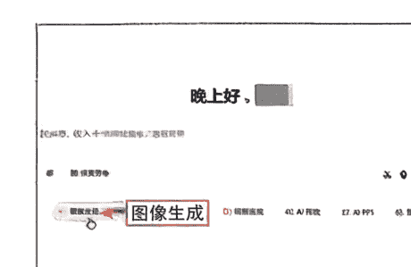

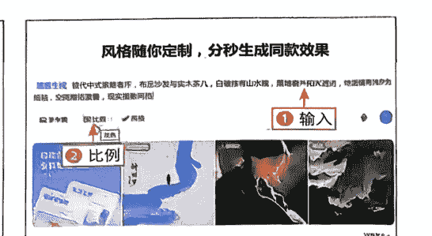

图 3-4 单击“图像生成”按钮
图 3-5 单击“比例”按钮

> ☆专家提醒☆
豆包输入框下方的功能键会按使用频率自动排序，用得多的排在前面。若没看到“图像生成”，可点“更多”展开全部按键，再选择所需功能启用。

步骤 03 在比例列表里挑“2：3社交媒体，自拍”，如图3-6所示，系统会在提示词后自动加上比例参数，输出2：3的场景。
步骤 04 点输入框右下角“发送”，豆包会返回4张客厅图，参考图3-7挑选第1张。

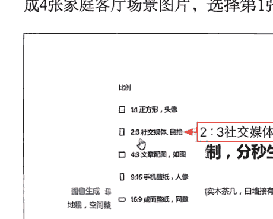

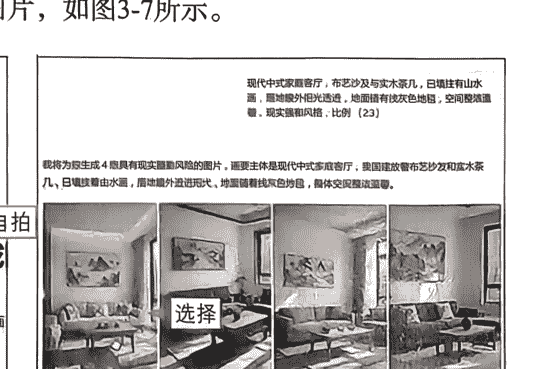

图 3-6 选择“2：3社交媒体，自拍”选项
图 3-7 选择第1张图片
步骤 05 生成后第1张图会放大到右侧预览区。满意的话，点击右上角“下载原图”，如图3-8所示，保存到本地。

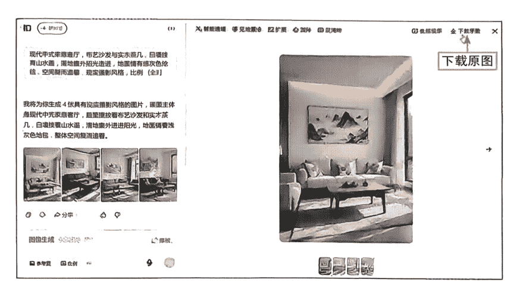

图 3-8 单击“下载原图”按钮

#### 3.1.4 办公室场景的快速生成
公司办公室是都市职场、悬疑类短剧不可或缺的场景，既点明人物社会身份，也承载信息交锋类戏份。分镜中常用来表现会议、谈话、暗中对峙，强调空间秩序与氛围。

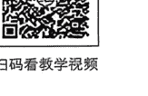

【效果展示】办公室结构复杂、细节密集，对格局与光影的掌控要求较高。用豆包生成办公图像能快速抓住空间构造与光感风格，有助于剧本落地和镜头预演，提升分镜清晰度与叙事效率。示例见图3-9。


图 3-9 效果展示
下面介绍生成公司办公室图片的流程。
步骤 01 在对话页直接输入提示词，点击“发送”，如图3-10所示，AI会生成4张图。
步骤 02 在结果区点第1张图上的“下载”，如图3-11所示，完成本地保存。

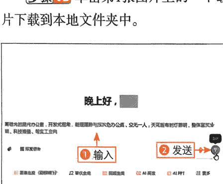

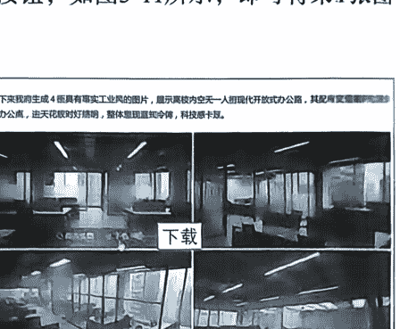

> ☆专家提醒☆
豆包可直接在对话输入框发送提示词生成画面，无需进入专用生图页。注意两点：一是提示词要具体明确；二是默认比例多为1：1或16：9，若提示词未写尺寸会按默认输出，有比例需求需写进指令。

#### 3.1.5 卧室晨光氛围的构建
短剧中卧室常承担情感释放与内心独白功能。清晨光线带来温柔而富张力的质感，适合表现日常生活、情绪波动或情节开端。爱情、治愈、成长题材里，晨光营造的静谧真实感能增强观众代入。


【效果展示】用豆包可迅速将卧室空间和光感氛围可视化，为拍摄与情绪渲染提供构图参考，省去搭景沟通成本，让镜头叙事更有方向。示例为图3-12。


图 3-12 效果展示
操作步骤如下。
步骤 01 在导航栏点“图像生成”，如图3-13所示，进入生图页。
步骤 02 在输入框中，① 输入提示词；② 打开“比例”，如图3-14所示。

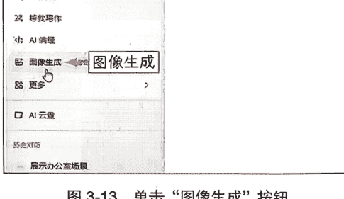

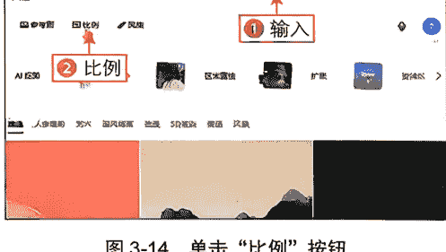

图 3-13 单击“图像生成”按钮
图 3-14 单击“比例”按钮
步骤 03 在比例列表里选“16：9桌面壁纸，风景”，如图3-15所示，系统自动补上比例参数，生成16：9画面。
步骤 04 点右下角“发送”，生成4张候选后，按图3-16点击第3张的“下载”，保存到本地。

#### 3.1.6 乡村自然画面的绘制
乡村自然是短剧增添生活质感与地域文化的重要来源，常出现在家庭伦理、成长回忆、治愈旅程等题材。相对城市，乡村更依赖自然光影与环境层次的还原，突出人与自然的关系与松弛调性。分镜中多承担情境铺垫与情绪缓冲，需兼顾空间感与意境。

【效果展示】豆包生成乡村题材时能呈现多样自然纹理与光影层次，帮助创作者完成首轮视觉打磨，提高前期效率，为镜头设计提供可参考的视觉基础。示例见图3-17。
下面介绍生成乡村自然场景的方法。
- 步骤01 在输入框下方点“图像生成”，如图3-18所示，开启功能。
- 步骤02 在生图框内① 填写提示词 ② 点“比例”，如图3-19所示。
- 步骤03 比例弹窗里选“9：16手机壁纸，人像”，如图3-20所示，自动添加比例标签，输出9：16构图。
- 步骤04 点右下角发送①，生成4张图。若都不满意，可点每张左下角“重新生成”○，如图3-21所示。
- 步骤05 重新生成后，按图3-22点第1张的“下载原图”↓，保存到本地。

#### 3.1.7 仙侠空灵场景的打造
仙侠题材在短剧创作中持续热门，其独特美学与宏大幻想设定让场景设计成为氛围塑造关键。与写实不同，仙侠需呈现脱尘空灵与磅礴气势，如云海山峰、缥缈建筑、悬空桥梁等，都是世界观的重要元素。

在分镜构思阶段，这类画面不仅是背景，更是确立剧集基调、传递时空规则与情绪张力的视觉语言。尤其在无对白或节奏舒缓段落，唯美奇幻场景常承担“代叙事”作用，为情节铺垫情绪。

【效果展示】用豆包生成仙侠场景，能在初期快速获得带奇幻特征与国风质感的视觉草图。虽然无法完全替代后期专业美术，但已能为构图、色调与氛围提供明确参考，大幅缩短构思试错时间。示例见图3-23。
下面介绍生成仙侠类场景的方法。
- 步骤01 进入图像生成页，① 点“比例”按钮；弹出列表后② 选“1：1正方形，头像”，如图3-24所示，输入框自动加入比例参数。
- 步骤02 输入提示词并发送，生成4张候选，按图3-25挑第1张。
- 步骤03 确认后第1张会放大至右侧，点右上方“下载原图”，如图3-26所示，保存到本地。同理可放大查看并下载第3张。

## 3.2 用 OneStory 完成整段分镜
短剧创作里分镜既是画面构思载体，也是节奏与情绪引导器。借助AI，不只可生成单张场景，还能串联整段剧情的完整分镜。OneStory提供从脚本、角色到镜头排布的全流程支持，帮助把故事转化为可视镜头。

本节以《小兔子的一天》为例，先认识页面组成，再逐步展开操作流程与实战，部分效果如图3-27所示。

### 3.2.1 OneStory 页面认识
作为聚焦AI视觉叙事的创作平台，OneStory不仅支持图文结合的故事搭建，更以流程化方式引导分镜产出。它整合剧本输入、场景配置、角色设定与图像生成等模块，提供从文本到镜头的完整路径。图3-28所示为OneStory的“工作台”页面。

页面各部分如下。
1. 案例区：展示“特别推荐”和“经典案例”模板，点“使用案例”可快速建项目并自动填充模板分镜。
2. 全部项目：列出已创建项目，点入即可查看与编辑内容。
3. 导航栏：呈现核心入口，“工作台”用于套用案例与管理项目；“工具箱”可单独生成图、角色与视频；“会员订阅”展示权益并提供订阅路径。

### 3.2.2 用 DeepSeek 快速产出分镜脚本
分镜脚本是连接剧本与画面的桥梁，把文字转为镜头语言，明确每幕视觉要素与叙事节奏。传统编写对经验要求较高，借助AI可在保持剧情逻辑下高效产出结构清晰、画面感强的脚本，也为后续图像创作提供稳定蓝本。下面介绍用DeepSeek生成分镜脚本的方法。
步骤01 在DeepSeek对话页，点击输入区“深度思考（R1）”，如图3-29所示，激活模型。
步骤02 输入框内① 填入指令；② 按图3-30点击发送。
步骤03 发送后可获得角色描述与分镜脚本，示例如下。

**DeepSeek**
角色描述
角色名：糯糯（一只小兔子）
外貌特征：糯糯是一只毛茸茸的白色兔子，浑身雪白的绒毛柔软顺滑，像云朵一样轻盈。它那双耳朵自然地垂在脸颊两侧，耳尖带着淡淡的粉色，如同被朝霞染过。眼睛又大又圆，犹如两颗黑宝石，闪烁着灵动又纯真的光芒。小巧的鼻子总是一动一动的，仿佛在嗅着空气中每一丝有趣的味道。它穿着简单，仅有一条浅蓝色的背带短裤，裤脚随着动作轻轻晃动，脚上的小爪子粉粉嫩嫩的，走起路来一蹦一跳，十分活泼可爱。
性格特点：糯糯性格天真烂漫、善良勇敢，对世界充满了好奇和探索欲，总是带着满满的热情去迎接每一天。它还十分热心肠，喜欢帮助森林里的小伙伴。
分镜脚本
分镜一：早晨——晨光中的苏醒
画面场景：森林里一棵粗壮大树下的草窝旁，阳光透过树叶缝隙洒下，形成一片片光斑，周围青草上的露珠晶莹闪烁，鸟儿在枝头鸣叫。
糯糯位置：草窝里，身体微微蜷缩着。
……
步骤04 在同一会话中继续发送指令，让DeepSeek按要求调整脚本，提示与回复如下。
**提示词**
请你按场景描述+角色行为的格式，将每个分镜的内容分别调整为一段完整的内容，不再单独分点。
**DeepSeek**
分镜一：早晨——晨光中的苏醒
森林中一棵粗壮大树下的草窝旁，阳光透过树叶缝隙洒下，形成一片片光斑，露珠在草叶上闪烁着微光。糯糯在草窝里闭着眼睛，不想起床。
分镜二：上午——森林的探索
森林里一条清澈的小溪边，溪水潺潺流淌，周围是茂密的草丛和五彩斑斓的小花。糯糯在小溪里，耳朵竖起，小爪子伸进水里轻轻拨弄，溅起几朵小小的水花。
分镜三：中午——树荫下的野餐
森林中一棵枝叶繁茂的大树下，有一片凉爽的树荫，蝴蝶在周围的花丛中飞舞。糯糯坐在树荫下的草地上，手里拿着一根胡萝卜正往嘴里送，眼睛眯成一条缝，享受着美食。
……
☆ 专家提醒 ☆
使用 DeepSeek 等模型生成分镜脚本可提升创作自由度，使脚本更贴合需求。OneStory 也提供“AI 扩写”功能，可将故事扩写成剧本。若结果不满意需手动调整或重新扩写，建议结合自身情况选择合适工具。

### 3.2.3 OneStory 新建项目
OneStory 以项目为单位进行创作与编辑。生成分镜图前需先新建项目。下面介绍创建新项目的方法。
步骤01 进入“工作台”，在“全部项目”区点“创建新的作品”，如图3-31所示。
☆ 专家提醒 ☆
普通用户最多可建10个项目，上限后需删除旧项目或订阅会员才能继续。
步骤02 在弹窗中① 将项目名设为“小兔子的一天”；② 画面尺寸选4：3；③ 风格选“吉卜力”，如图3-32所示。
步骤03 面板右侧① 切到“输入你的故事”；② 粘贴已生成的分镜脚本；③ 点“确认创建”，如图3-33所示，完成建项。

### 3.2.4 角色形象微调
项目创建后会自动进入“角色”选项卡，AI会根据分镜脚本生成初始形象。若效果不理想，可修改提示词重新生成。下面介绍调整角色形象的方法。
**步骤01** 在“角色”页❶ 编辑角色提示词；❷ 依据图3-34点击“重新生成图片”。
**步骤02** 等待片刻即可看到新形象。若满意，按图3-35点“确认并生成分镜”，完成调整并进入“分镜表”开始出图。
☆ 专家提醒 ☆
也可以在建项时一起提交角色描述与分镜脚本，这样初次生成就会依据描述，降低后期修改概率。

### 3.2.5 分镜图片重绘
AI出图时可能出现画面与描述不符，此时可通过“重新生成”按钮刷新。下面介绍重生成分镜图片的方法。
**步骤01** 在“分镜表”中查看结果，将指针移至待调整的图片，例如第一张，按图3-36点“重新生成”。
**步骤02** 系统会按描述刷新画面，片刻后即可预览新图，如图3-37所示。对其他不满意的分镜可重复上述操作调整。
☆ 专家提醒 ☆
若出现多余或重复分镜，需❶ 切到“故事板”；❷ 点对应分镜右上角“删除”🗑，如图3-38所示，移除不需要的镜头。

### 3.2.6 分镜图片导出
OneStory支持导出已生成的分镜图，方便在其他工具中进行视频制作与编辑。下面介绍导出方法。
步骤01 在“分镜表”右上角❶ 点“导出”；在列表中❷ 选“导出所有图片”，如图3-39所示。
步骤02 在弹窗中点“导出所有图片”，如图3-40所示，片刻后完成导出。
☆ 专家提醒 ☆
OneStory还支持视频合成，可用分镜图生成视频；在“视频”页还能生成配音与字幕，制作出带画面、字幕和声音的成片，如图3-41所示。

## 本章小结
本章先以豆包为例，梳理了客厅、办公室、卧室晨光、乡村、仙侠等常见场景的AI出图技巧，帮助掌握环境图制作方法；随后以OneStory为例，演示了从脚本生成、角色微调、镜头重绘到导出归档的完整分镜工作流，帮助全面掌握AI分镜实操路径。

## 课后实训
为巩固本章内容，下面安排实训任务。
【实训任务】请使用豆包生成一张科幻类场景图片，效果如图3-42所示。
下面介绍使用豆包生成科幻类场景图片的操作方法。

步骤01 进入“图像生成”页面后，❶ 在提示词输入区描述想要呈现的场景；❷ 点击“发送”，如图3-43所示，豆包即可一次性输出4张场景图。
步骤02 选中第2张满意的图片，点击其上的“下载”图标，如图3-44所示，就能将该图保存到本地文件夹。

## 第4章 即梦 AI 与可灵 AI 制作影视级视频素材
本章围绕即梦AI 和可灵AI 展开，讲解如何用文字生成画面、把图片转化为视频、驱动角色表演等多种玩法，帮助短剧创作者快速产出具备影视质感的素材，让创作效率与想象力同步提升。

### 4.1 即梦 AI 视频素材制作
即梦AI具备很强的画面理解能力和出图效率，成为不少创作者的常用工具。下面分别介绍网页端和移动端的操作思路，系统掌握文生视频、图生视频、对口型等核心用法，实现从创意到成片的快速落地。

#### 4.1.1 认识即梦 AI 网页版
即梦AI由字节跳动推出，网页版支持用文字或图片作为提示，生成画面连贯的场景视频，适合在浏览器里进行创意草拟和初步打磨。图4-1为即梦AI网页版的首页。

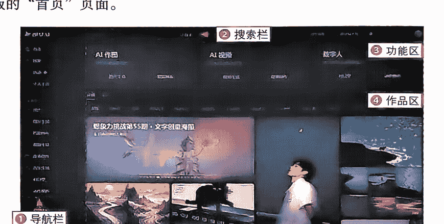

对首页各部分做简要说明。

- 1. **导航栏**：汇总即梦AI的主要页面和创作功能，点击相应按钮即可进入目标页面或启用对应功能。
- 2. **搜索栏**：在此输入作品关键词并点击“搜索”，即可检索到相关内容。
- 3. **功能区**：集中展示6大入口，包括“图片生成”“智能画布”“视频生成”“故事创作”“对口型”“动作模仿”，点击即可进入使用。
- 4. **作品区**：包含“灵感”和“短片”两个标签页。“灵感”里是其他用户分享的图片或视频模板，可直接套用；“短片”则展示已完成的成品，供参考借鉴。

#### 4.1.2 认识即梦 AI 手机版
手机版延续了网页端的生成能力，并针对移动交互做了优化，便于随时捕捉灵感并做快速预览，适合在外进行短剧画面的初创。图4-2为即梦AI手机版的视频生成界面。

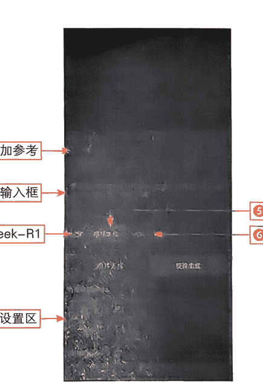

对视频生成面板的组成进行说明。

- 1. **添加参考**：点击后可从相册或历史生成图里挑选图片作为视频参考。
- 2. **输入框**：在这里填入短视频的提示词，告诉模型想要的画面风格。
- 3. **DeepSeek-R1**：即梦接入了DeepSeek-R1，点击可进入对话，借助模型辅助撰写提示词。
- 4. **设置区**：可设定生成对象为图片或视频，并调整比例、时长、模型等参数。
- 5. **生成对象**：显示当前对象类型，点击可展开或收起设置区。
- 6. **比例**：显示当前画面比例，点击同样可展开或收起设置区。

#### 4.1.3 文生场景视频
【效果展示】即梦的文生视频需要提示词和参数两步配合，前者决定画面内容，后者影响呈现质量，二者结合才能得到冲击力强的场景视频，效果见图4-3。

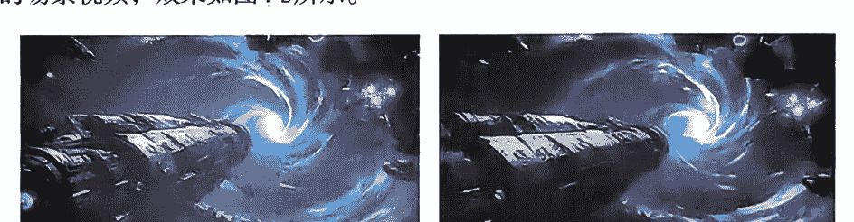

操作流程如下。

步骤01 在即梦AI首页点击“AI视频”区里的“视频生成”，如图4-4所示，进入视频生成页面。
步骤02 ①切换到“文本生视频”标签；②在提示词区输入需要生成的视频内容，如图4-5所示。

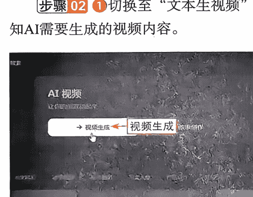

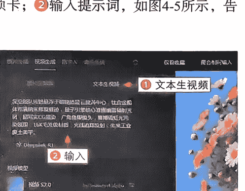

步骤03 ❶点击“视频模型”右下角的“修改”；❷在弹出的模型列表中选择“视频1.2”，如图4-6所示，完成模型切换。
步骤04 在“生成时长”里选择6s，如图4-7所示，设定视频长度。

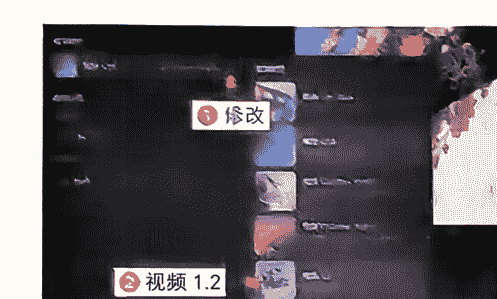


图4-6 选择“视频1.2”选项
图4-7 选择6s选项
步骤05 点击“生成视频”，系统会用视频1.2模型和提示词生成6秒视频。生成后点击视频右上角的“下载”，如图4-8所示，即可保存到本地。

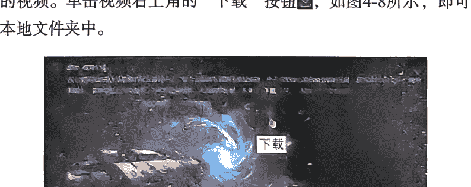

图4-8 单击“下载”按钮

#### 4.1.4 文生图转视频
【效果展示】图生视频时需要一张底图。若手头没有，可先用即梦的提示词生成一张满意图片，再基于它制作视频，效果见图4-9。


扫码看教学视频

操作步骤。

步骤01 在首页点击“AI作图”区的“图片生成”，如图4-10所示，进入图片生成页。
步骤02 在输入框中写明想要的图片内容，如图4-11所示。


图4-10 单击“图片生成”按钮
图4-11 输入提示词
步骤03 ①把“图片比例”设为3：4生成竖版；②点击“立即生成”，如图4-12所示。
步骤04 生成4张图后，点击第2张上的“超清”按钮，如图4-13所示。
步骤05 超清图生成后，在其右下角再次点击“超清”按钮，如图4-14所示。
步骤06 再点击右下角的“生成视频”按钮，如图4-15所示。

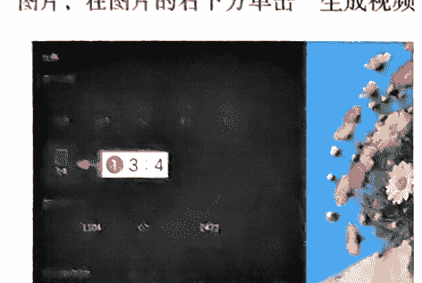

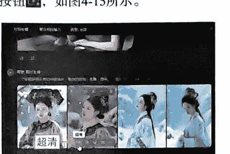

图4-12 单击“立即生成”按钮
图4-13 单击“超清”按钮（1）

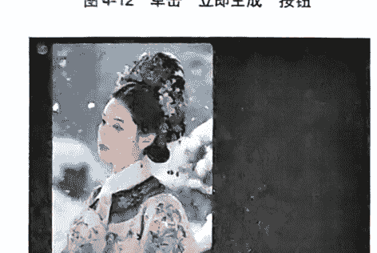

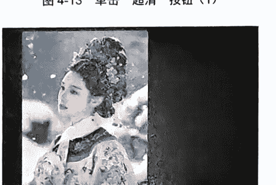

图4-14 单击“超清”按钮（2）
图4-15 单击“生成视频”按钮
步骤07 页面会跳转到视频生成的“图片生视频”标签，图片已自动上传作为参考图和首帧，如图4-16所示。
步骤08 点击“生成视频”，即可基于该图合成视频，效果见图4-17。

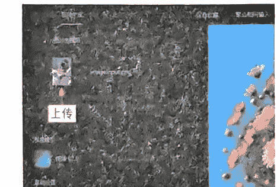

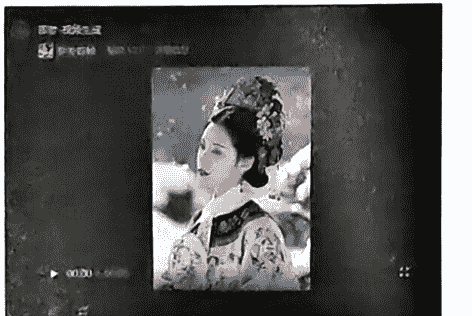

图4-16 图片会自动上传
图4-17 生成的视频效果

#### 4.1.5 图生图转视频
【效果展示】已有素材但不满意时，可先用图生图对画面进行微调，再转成视频，效果见图4-18。


操作方式如下。

- 1. **步骤01** 在“图片生成”页面点击“导入参考图”，如图4-19所示。
- 2. **步骤02** 弹出“打开”对话框，①挑选需要调整的图片；②点击“打开”，如图4-20所示，完成上传。

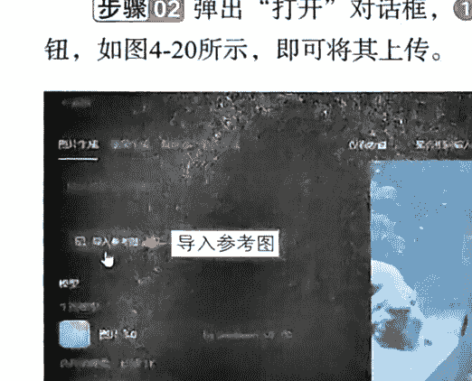

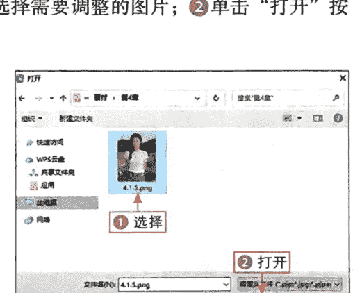
**步骤03** 在“参考图”对话框中保持默认维度不变，点击“保存”，如图4-21所示，返回图片生成页。
**步骤04** 输入提示词，如图4-22所示，描述希望对图片做的改动。


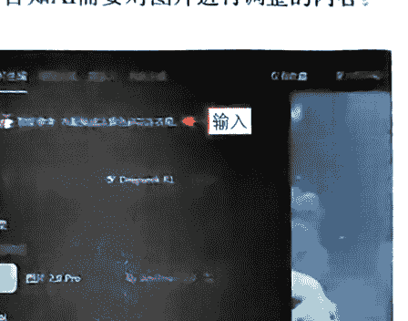
**步骤05** 点击“立即生成”，得到4张调整后的图，点击第3张的“超清”HD，如图4-23所示。
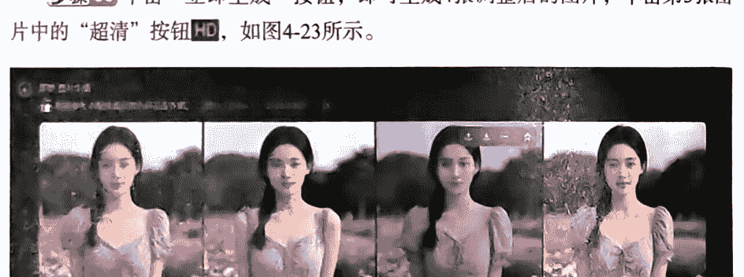
**步骤06** 生成超清后，在其右下角点击“超清”HD，如图4-24所示。
**步骤07** 再点击右下角“生成视频”按钮，如图4-25所示。


图4-24 单击“超清”按钮（2）
图4-25 单击“生成视频”按钮
步骤08 跳转到“图片生视频”标签后，①图片已自动上传作参考和首帧；②输入提示词，如图4-26所示，描述视频表现。
步骤09 点击“生成视频”，开始合成并显示进度，如图4-27所示，完成即可预览。


图4-26 输入提示词（2）
图4-27 显示生成进度

#### 4.1.6 生成角色对口型视频
【效果展示】借助“对口型”功能，可把一张角色图变成带自定义台词、音色和语速的视频，效果见图4-28。


扫码看教学视频


制作流程。

步骤01 在首页点击“数字人”区的“对口型”，如图4-29所示，进入对口型标签。
步骤02 点击“导入角色图片/视频”按钮，如图4-30所示。


步骤03 在列表里选择“从本地上传”，如图4-31所示。
步骤04 弹出“打开”对话框，①选择角色图片；②点击“打开”，如图4-32所示，上传后AI会自动检测人物。
步骤05 检测完成保持默认效果，在“文本朗读”标签中①输入台词；②点击下方的朗读音色，如图4-33所示。
步骤06 在“朗读音色”面板中①切换到“女青年”标签；②选择“随性女声”，如图4-34所示，可试听后确定。


步骤07 ①把“说话速度”设为0.9×放慢语速；②点击“生成视频”，如图4-35所示。
步骤08 开始生成对口型视频并显示进度，如图4-36所示，完成后可查看效果。


### 4.2 可灵 AI 生成分镜素材
随着生成式AI迭代，可灵AI凭借多模态生成和对细节的精细控制，成为短剧分镜制作的重要利器。下面先介绍网页版和手机版的界面，再讲解文生视频、图生视频、动态特效、对口型等实操。

#### 4.2.1 认识可灵 AI 网页版
网页版生成稳定、画质上限高，适合在电脑上做系统化制作。可用文字或图片生成视频，并在浏览器内预览下载。图4-37为可灵AI网页版首页。


首页组成说明。

- 1. **导航栏**：展示主要页面和创作工具，点击即可进入相应功能。
- 2. **公告区**：发布最新模型和功能信息，点击“立即体验”可直接试用。
- 3. **作品区**：分为“素材”和“短片”两标签，均展示他人作品，只有“素材”会显示提示词并支持一键复刻。

#### 4.2.2 认识可灵 AI 手机版
手机版便于移动端创作，灵感来了即可生成片段，也方便直接保存或发布到相册。图4-38为手机版首页。


界面说明。

- 1. **展开**：点击打开侧边栏，管理账号信息。
- 2. **功能区**：包含“图生视频”“文生图”“文生视频”“多模态编辑”“创意特效”“AI音效”6项，点击进入对应界面。
- 3. **创意圈**：展示他人作品，分“推荐”“视频”“图片”“短片”4标签，可点赞评论，前三类支持一键模仿。
- 4. **导航栏**：显示首页、创意圈、生成、资产、我的等入口，生成按钮可快速启动图片/音效/视频创作。

#### 4.2.3 文生空镜素材
【效果展示】空镜头用于营造氛围和情绪铺垫。可灵AI可用提示词生成海边灯塔、山林晨雾等叙事感强的空镜，适合片头、转场或留白。效果见图4-39。


操作步骤。

步骤01 在首页点击左侧导航的“视频生成”，如图4-40所示，进入视频生成页。
步骤02 ①切换到“文生视频”标签；在“创意描述”下方②输入提示词，如图4-41所示，说明所需画面。


步骤03 ①点击“标准模式”右侧按钮；在弹出列表中②选择“高品质模式”，如图4-42所示，提升生成质量。
步骤04 点击“立即生成”，如图4-43所示，开始合成。


> ☆专家提醒☆
> 可灵AI有时需要数小时才能完成一次视频。若不着急可先做别的事稍后再看；若追求速度或批量产出，可考虑订阅会员。

步骤05 生成完成后在右侧预览，满意后点击视频右下角“下载”，如图4-44所示，保存到本地。


### 4.2.4 图生人物视频

【案例速览】可灵AI里先把人物底图传上去，再加一段动作说明，就能拼出自然流畅的人物动态短片，演示见图4-45。

AI短剧制作全流程指南：分镜脚本、视频合成、音乐创作与后期剪辑

图 4-45 效果参考

接下来是图生人像视频的具体操作路径。

**步骤 01** 进入视频生成界面，切换到图生视频标签，按下“点击/拖拽/粘贴”入口，如图4-46所示。
**步骤 02** 弹出打开对话框，❶ 挑选人物照片；❷ 按打开，如图4-47所示，完成导入。


图 4-46 点击上传入口
图 4-47 确认打开

**步骤 03** 在创意描述下方输入区填写动作指令，用来说明想要的动作，如图4-48所示。
**步骤 04** 点立即生成，系统会输出对应片段，成果见图4-49。


### 4.2.5 生成建筑起飞特效

【案例速览】可灵AI自带多项创意特效，能把一张静态图加工成新颖有趣的特效短片，为短剧增添趣味，样例见图4-50。


下面演示建筑起飞特效的制作流程。

**步骤 01** 在视频生成页左侧点一下创意特效，进入特效界面，如图4-51所示。
**步骤 02** 在特效界面里选定“一飞冲天”选项，如图4-52所示，锁定特效类型。
**步骤 03** 页面底部点一下“点击/拖拽/粘贴”入口，如图4-53所示。
**步骤 04** 弹出打开对话框，❶ 挑选建筑素材；❷ 按打开，如图4-54所示，完成导入。


图 4-51 进入创意特效
图 4-52 选定一飞冲天


图 4-53 点击上传入口
图 4-54 确认打开

**步骤 05** 保留特效自带的指令不变，把生成模式调成高品质模式，如图4-55所示，提升成片质量。
**步骤 06** 按立即生成，就能得到对应特效片段，效果见图4-56。


图 4-55 调整为高品质模式
图 4-56 成片效果

### 4.2.6 生成角色说话视频

【案例速览】目前可灵AI只支持给现有片段做口型同步，如果手头只有角色立绘，可先产出一版基础视频再做口型合成，样例见图4-57。


下面介绍角色口播视频的生成方法。

**步骤 01** 在视频生成页的图生视频标签里，按下“点击/拖拽/粘贴”入口，如图4-58所示。
**步骤 02** 弹出打开对话框，❶ 选定角色图片；❷ 按打开，如图4-59所示，完成导入。


**步骤 03** 在创意描述下方输入区，❶ 填写提示词说明期望画面；❷ 把生成模式设为高品质模式，如图4-60所示，提升质量。
**步骤 04** 按立即生成，生成后点视频左下角的对口型按钮，如图4-61所示。

**步骤 05** 进入对口型页面后视频会自动载入。在配音音频面板的文本朗读标签下，输入角色台词，如图4-62所示。

**步骤 06** 在音色区，❶ 切换到男青年分类；❷ 选择文艺小哥音色，如图4-63所示，完成配音设定。
**步骤 07** ❶ 把语速调为0.9×以放慢节奏；❷ 按立即生成，如图4-64所示。
**步骤 08** 执行后即可得到角色口播视频，效果见图4-65。


图 4-63 选择文艺小哥
图 4-64 点击立即生成

图 4-65 成片效果

## 本章回顾

本章先讲了即梦AI制作各类视频素材的做法，涉及文生场景、图转视频以及角色口型视频，体现了即梦AI在短剧制作中的实用性。随后详细介绍了可灵AI的使用方式，涵盖空镜、人像素材、特效及角色配音视频的制作，帮助创作者高效拼凑分镜所需片段。

## 实操练习

鉴于本章内容的重要性，为便于巩固知识，本节安排课后实训进行复习与补充。

【实训任务】使用即梦AI的文本生视频功能制作一段16：9比例、时长6s的空镜素材，效果参考图4-66。


下面说明用即梦AI文本生视频功能制作空镜素材的步骤。

**步骤 01** 在视频生成页面中，❶ 切换到文本生视频标签；❷ 输入提示词，如图4-67所示，告知所需画面内容。

**步骤 02** ❶ 按视频模型右下角的修改按钮；在弹出的模型列表中，❷ 选定视频1.2选项，如图4-68所示，切换生成模型。
**步骤 03** 在生成时长区选择6s选项，如图4-69所示，设定时长。
**步骤 04** 按生成视频按钮，即可获得空镜素材，效果见图4-70。


## 第5章 AI配乐实战：海绵音乐与天谱乐定制短剧声音

音乐在短剧叙事中承担情绪承载、氛围营造甚至推动情节的作用。随着AI音乐工具普及，场景化定制配乐成为可能。本章以海绵音乐和天谱乐为例，探讨如何用AI精准生成不同用途的音乐，使短剧视听统一。

### 5.1 海绵音乐多场景配乐玩法

海绵音乐是一款轻量高效的AI音乐生成平台，支持网页与手机端操作，方便创作者跨设备快速定制短剧配乐。本节基于海绵音乐的功能，分别生成主题曲、角色专属曲、情节插曲、推广曲和氛围纯音乐，满足短剧各阶段声音需求。

#### 5.1.1 网页版功能速览

海绵音乐是由字节跳动推出的AI音乐创作工具，目标是通过人工智能降低创作门槛，让普通创作者也能轻松产出音乐。它支持根据灵感、歌词、风格和情绪等参数生成原创曲目，广泛用于短剧、短视频、广告等领域。网页版功能更全面，适合精细打磨。图5-1为海绵音乐网页版创作页面。

图 5-1 海绵音乐网页版创作页面

下面对海绵音乐网页版创作页面的构成进行说明。

- 创作区：提供灵感创作和自定义写词两种方式。创作者可直接用灵感生成音乐，也可先用灵感生成歌词再基于歌词生成音乐，或直接使用已有歌词生成。
- 灵感区：展示平台提供的创作灵感，选择后会自动填入文本框，便于后续生成歌词或音乐。
- 导航栏：显示主要功能入口，精选展示他人发布的歌曲，实验室提供AI改编歌曲和歌词功能，音乐库展示个人发布和点赞的作品。
- 播放区：显示当前播放曲目的名称、创作者昵称、时长和进度，支持播放他人作品或自己的创作。
- 创作历史：记录所有创作日志，可随时查看、试听、分享和下载。

#### 5.1.2 手机版界面解析

海绵音乐手机版保留了网页版的核心生成能力，并针对移动场景优化操作。它界面简洁，直观呈现，适合外出拍摄时快速生成并试听配乐。图5-2为海绵音乐手机版AI写歌界面。

图 5-2 海绵音乐手机版AI写歌界面

下面对海绵音乐手机版AI写歌界面的构成进行说明。

- 退出×：点一下可退出AI写歌界面，返回音乐或我的界面。
- 创作区：AI写歌界面提供灵感创作和自定义歌词两种方式，满足歌词和歌曲创作需求。
- 生成方式：手机版提供AI写歌和相册配乐两种模式，AI写歌用于生成歌曲或单图歌词视频，相册配乐可基于用户提供的图片或视频及音乐灵感生成动态音乐视频。
- 灵感区：展示平台提供的歌曲创作灵感，点击换一批可刷新灵感。

#### 5.1.3 快速生成主题曲

【案例速览】短剧主题曲凝聚整部剧的情绪基调和核心理念，常用于片头、片尾或宣传。它需要旋律突出、情绪饱满，能迅速传达风格。在海绵音乐中，可直接用歌词和参数生成主题曲，效果见图5-3。


下面介绍在海绵音乐中生成短剧主题曲的方法。

**步骤 01** 进入海绵音乐精选页面，左侧导航栏点击创作按钮，如图5-4，进入创作页面。
**步骤 02** 点击自定义写词按钮，如图5-5，切换到自定义写词标签。


图5-4 打开创作
图5-5 切换自定义写词

**步骤 03** 在文本框中输入歌词，如图5-6，让AI基于指定歌词生成音乐。
**步骤 04** 在请选择音乐风格区的曲风分组中选择摇滚选项，如图5-7，确定曲风。


图5-6 填入歌词
图5-7 选择摇滚

**步骤 05** 同样方式设置心情为鼓舞、类型为男声，如图5-8，指定情感与音色。
**步骤 06** 点击生成音乐按钮，创作历史面板会显示3首正在生成的歌曲及进度，如图5-9，右侧会弹出音乐详情面板，生成完成后自动播放第1首，并在面板中展示信息。
**步骤 07** 可根据喜好试听作品，如点击第3首封面上的播放按钮，如图5-10，即可试听，音乐详情面板同步更新。


图 5-8 调整相关参数
图 5-9 查看生成进度

**步骤 08** 若第3首满意，❶ 将鼠标移至歌曲右侧按钮；❷ 在弹出的列表中选择下载视频选项，如图5-11，即可下载带歌词的视频。


图 5-10 试听作品
图 5-11 下载视频

#### 5.1.4 角色专属音乐定制

【案例速览】角色专属音乐为特定人物量身打造的旋律动机，常在出场、转折或情绪爆发时使用，能强化性格与心理变化，帮助观众建立情感连接。可先用其他工具生成歌词，再在海绵音乐中创作，效果见图5-12。


下面介绍在海绵音乐中生成角色专属音乐的流程。

**步骤 01** 创作者可在DeepSeek中输入提示词获取AI创作的歌词，具体提示词与回复如下。

> 提示词

写一首用于短剧男主角的歌曲的歌词。男主是架空世界的游泳运动员，性格阳光、积极向上，他坚持梦想，勇往直前，永不放弃。歌词结构为主歌、桥段和副歌，不超过4段，文字情感热血又带一点细腻。内容需描写他在训练、比赛、梦想和挑战中的心情，体现汗水与坚持的力量，同时突出“破浪而生”“前行”等意象。不要出现真实地名或品牌名。整体风格青春励志，情绪饱满有冲劲。

> DeepSeek

《破浪而生》

【主歌】

夜色低垂，心仍在游走

那片水面藏着我所有梦

没有掌声，也不怕孤勇

一步步跨越命运设下的重重障碍

【桥段】

失败像浪拍打着执着

我在沉默中学会了更多

是水教会我如何不退缩


**步骤 02** 在海绵音乐创作页面中，❶ 切换到自定义写词标签；❷ 粘贴AI生成的歌词内容，如图5-13所示。
**步骤 03** 将曲风设为摇滚、心情设为兴奋、类型设为男声，如图5-14所示，完成参数设定。


图 5-13 粘贴歌词
图 5-14 设置生成参数

**步骤 04** 点击生成音乐按钮生成3首曲目，❶ 点击第3首封面上的▶按钮试听；❷ 将鼠标移至歌曲右侧的⋮按钮；❸ 在弹出列表中选择下载视频选项，如图5-15所示，即可下载带歌词视频。

图 5-15 下载视频

#### 5.1.5 情节插曲一站式创作

【案例速览】情节插曲服务于关键节点，如情感升温、冲突爆发、秘密揭晓等，强化节奏与情绪。它通常与画面同步，潜移默化引导观众。借助海绵音乐的AI写词功能，可一站式完成歌词与歌曲创作，效果见图5-16。


下面介绍在海绵音乐中生成情节插曲的方法。

**步骤 01** 在海绵音乐创作页面，点击文本框右下角的AI写词按钮，如图5-17所示，进入AI写词面板。
**步骤 02** ❶ 输入提示词说明对歌词的要求；❷ 点击发送按钮，如图5-18所示，即可获得AI生成的歌词。


AI短剧音乐链路实战：从分镜到精剪

步骤03 在生成歌词区域下方找到“设置风格”入口，参见图5-19。
步骤04 弹出风格设置面板后，①将参数调整到合适数值；②确认完成，如图5-20所示，即可固化本次风格配置。


图5-19 单击“设置风格”按钮
图5-20 单击“完成”按钮

步骤05 触发“生成音乐”后系统会给出三条试听稿，①点开第二条封面进行试听；②把鼠标悬停在该曲右侧操作区；③在展开的菜单里选定视频导出，如图5-21所示，即可把第二条素材保存到本地文件夹。


图5-21 选择“下载视频”选项

> ☆专家提醒☆

海绵音乐在生成歌词的同时会自动附带一套风格参数，创作者可以进入风格设置面板对这些初始数值进行手动优化。

### 5.1.6 生成短剧推广曲

【效果展示】推广曲多用于预告片、花絮、短视频二次传播等场景，需要具备强情绪渲染与记忆点。通常节奏明快、情绪外放，能迅速抓住注意力并激发分享欲望。在海绵音乐中可直接以灵感驱动生成，示例见图5-22。


下面介绍在海绵音乐中产出推广曲的具体流程。

**步骤01** 进入“创作”页面的“灵感创作”标签下输入创作方向，如图5-23所示，向模型说明需求。
**步骤02** 按下“生成音乐”按钮，如图5-24所示，系统将返回三首候选作品。


图5-22 效果展示


图5-23 输入创作灵感


图5-24 单击“生成音乐”按钮

**步骤03** ①打开第三首封面的播放控件试听；②把指针移至该曲右侧下载控件；③在下拉菜单中选择视频导出，如图5-25所示，即可把第三首存入本地目录。


图5-25 选择“下载视频”选项

### 5.1.7 生成氛围纯音乐

氛围纯音乐弱化主旋律，侧重情绪营造，常见于环境铺垫、转场衔接及无对白镜头。通过音色、节奏与氛围变化细腻强化画面质感与叙事情绪。在快节奏剪辑的短剧中，氛围音能无声连通场景，提升观感。


创作者可利用海绵音乐按情绪方向批量制作纯音乐，为短剧增加空间感与沉浸感。平台同时支持音频格式导出，便于后期调用。具体做法如下。

步骤 01 在“创作”页的“灵感创作”选项卡填写灵感，如图5-26所示，告知模型对纯音的偏好。
步骤 02 点按“纯音乐”旁的开关，如图5-27所示，切换至纯音生成模式。


步骤 03 启动“生成音乐”，模型产出三段氛围纯音，①点开第三段封面试听；②将光标停留在该段右侧按钮；③在弹出列表里选择音频导出，如图5-28所示，即可保存该段。


## 5.2 借助天谱乐为多元题材定制主题乐

不同题材短剧对配乐风格、情绪张力与叙事节奏要求差异明显。天谱乐凭借专业音乐模型与题材适配能力，可为古风权谋、现代甜宠、科幻探索、奇幻武侠、青春校园等类型定制契合故事气质的主旋律。本节围绕各类型特征，探讨如何用AI产出兼顾叙事与辨识度的专属音乐。

### 5.2.1 初识天谱乐

天谱乐由趣丸科技唱鸭团队打造，是全球首个多模态音乐生成大模型，融合旋律创作、歌词撰写与伴奏制作，支持多风格多场景定制。凭借对旋律与语言的深度理解，它为短剧提供高效个性化的音乐解决方案。图5-29展示了天谱乐的“首页”界面。


图 5-29 天谱乐的“首页”页面

首页构成说明如下。
1. 导航栏：汇总核心功能，其中“视频生曲”和“文本生曲”是主要创作入口。
2. 作品区：分为“视频生曲”和“文本生曲”两块，均展示他人作品，并支持用同款素材或提示词复现。
3. 功能区：呈现文本、图片、视频三种生成方式，按下对应按钮进入创作页。

### 5.2.2 生成古风权谋短剧的主旋律

【效果展示】古风权谋剧的主旋律承载故事气质的核心张力，既要呈现恢弘时代背景，也要在旋律与歌词中交织权谋下的人性挣扎。通常以大气沉郁为基调，通过起伏旋律与富含暗示的歌词，暗含忠义背叛、家国宿命的复杂情绪，让听者在听觉上提前感知剧情厚重，提升叙事张力。天谱乐产出效果见图5-30。


图 5-30 效果展示

以下介绍在天谱乐中制作古风权谋剧主旋律的操作流程。
1. **步骤01** 打开天谱乐“首页”，在左侧导航栏选择“文本生曲”，如图5-31所示，进入“文本生曲”页面。
2. **步骤02** 在“歌曲”选项卡的“描述你对音乐的期望”文本框内输入提示词，如图5-32所示，告知模型需求。
3. **步骤03** 按下“开始生成”，系统产出两首作品，结果如图5-33所示。
4. **步骤04** 生成完成后，挑选感兴趣的一首进入详情页，按下封面上的▶，如图5-34所示，即可收听。


图 5-31 单击“文本生曲”按钮
图 5-32 输入提示词


图 5-33 同时生成两首歌曲

步骤05 若满意，①按一下对应按钮；②在弹出列表中选择视频导出，如图5-35所示，即可把该曲视频保存到本地文件夹。


图 5-34 单击相应的按钮
图 5-35 选择“下载视频”选项

> ☆专家提醒☆

使用天谱乐“文本生曲”时，模型会为每首曲目自动生成封面图，但图像与曲目主题或内容可能不相关，且不支持重生成或替换。

### 5.2.3 生成现代甜宠短剧的主旋律

【效果展示】现代甜宠剧的主旋律多以轻快明亮的旋律打动人，突出爱情甜美感与生活气息。作品需营造温暖轻盈的氛围，让观众一听即感受到轻松愉悦的情绪流动。使用天谱乐产出效果如图5-36所示。


下面说明在天谱乐中制作现代甜宠剧主旋律的操作步骤。
步骤 01 在“文本生曲”页面的“歌曲”选项卡里，按下“专家模式”左侧开关，如图5-37所示，进入专家模式，该模式允许输入歌词或先生成歌词再创作曲目。
步骤 02 在“歌词”文本框中填入准备好的歌词，如图5-38所示。


步骤 03 在“音乐提示”下方文本框中，❶ 填写提示词说明所需风格；❷ 按下“开始生成”，如图5-39所示，产出两首作品。
步骤 04 进入“全部作品”面板，选择第二首进行试听。若满意，❶ 按下按钮；❷ 在弹出列表中选择视频导出，如图5-40所示，即可把对应曲视频保存到本地。


### 5.2.4 生成科幻探险剧的主旋律

【效果展示】科幻探险剧的主旋律需呈现宏大未来感与紧张探索气息。旋律多具科技感与节奏感，通过电子音效、强节奏与多变旋律传递未知世界的神秘与刺激。歌词多描绘探险旅程、信念考验与未来理想，让观众在音乐中体会探索激情与危机紧迫感。使用天谱乐产出的效果如图5-41所示。


下面介绍在天谱乐中制作科幻探险剧主旋律的方法。
步骤 01 在“文本生曲”页面的“歌曲”选项卡中，按下“专家模式”左侧按钮，如图5-42所示，进入专家模式。
步骤02 在“歌词”文本框中，❶ 输入提示词说明所需歌词内容；❷ 按下“生成歌词”，如图5-43所示。


图5-42 单击相应按钮（1）
图5-43 单击“生成歌词”按钮

步骤03 稍作等待，模型会按提示词生成合适歌词，如图5-44所示。
步骤04 在“音乐提示”板块，按下“风格”右侧下拉按钮▼，如图5-45所示，展开风格选项区。


图5-44 生成的歌词效果
图5-45 单击相应按钮（2）

步骤05 在风格选项区中选用“电子”标签，如图5-46所示，该标签会自动填入提示文本框，使模型生成电子风格主旋律。
步骤06 按下“开始生成”，产出两首对应作品。挑选一首进入详情页，按下封面上的▶试听，若满意，❶ 按下⬇按钮；❷ 在弹出列表中选择视频导出，如图5-47所示，即可将对应曲视频保存到本地。


### 5.2.5 生成奇幻武侠剧的主旋律

【效果展示】奇幻武侠剧的主旋律需营造沉浸式奇幻氛围，帮助观众迅速进入剧情。旋律既要渲染刀光剑影的紧张冲突，也要保留表现人物情感起伏的空间。歌词多围绕侠义、宿命与自我追寻展开，既映照角色内心矛盾，又推动情节递进。使用天谱乐产出的效果如图5-48所示。


下面介绍在天谱乐中制作奇幻武侠剧主旋律的操作流程。
**步骤01** 在DeepSeek中发送提示词，获取模型创作的歌词，提示词与回复示例如下。

👤 **提示词**

> 生成一首奇幻武侠短剧的主题曲歌词，采用主歌、副歌和桥段的完整结构。歌词应描绘主人公在奇幻江湖中经历磨难、追寻自由与正义的旅程。通过细腻的情感描写，展现刀光剑影下的忠义冲突与宿命抗争，突出英雄内心的孤独与执着。整体情感起伏跌宕，既有豪情壮志，又有细腻柔情，营造出一个奇幻而深沉的武侠世界。

🤖 **DeepSeek**

> 《剑影天涯梦》

【主歌】

孤身踏入这奇幻江湖
风卷残云，前路迷雾
背负着宿命，无人倾诉

【桥段】

听 风声在耳边呼啸
像命运的嘲笑
看，剑光划破了云霄
能否斩断这纷扰

【主歌】

与邪恶交锋，生死角逐
江湖险恶，人心似鬼似狐
在这宿命的漩涡中努力挣脱
……

**步骤02** 在同一对话页继续发送提示词，获取模型生成的音乐提示，示例如下。

👤 **提示词**

> 请为这首歌生成一段合适的音乐提示，包含主题曲的音乐风格、节奏特点和适合使用的器乐风格，50字，通顺连贯。

🤖 **DeepSeek**

> 这首主题曲融合古风与电子风格，节奏紧凑而富有动感，层次分明。使用古筝、箫等传统乐器与电子合成器、打击乐结合，营造出神秘、奇幻的氛围，体现英雄的孤独与决心。

步骤 03 进入天谱乐“文本生曲”页面，①开启“专家模式”；②在文本框中粘贴生成的歌词，如图5-49所示。
步骤 04 在“音乐提示”下方文本框中粘贴生成的音乐提示，如图5-50所示。


步骤 05 在“选择模型”板块中，①按下当前模型右侧下拉按钮；②在弹出列表中选择TemPolor-V3.5(Beta)选项，如图5-51所示，切换生成模型，该模型可产出3分钟以上曲目。
步骤 06 按下“开始生成”，产出两首作品。选择其中一首进入详情页，按下封面按钮试听，若满意，①按下按钮；②在弹出列表中选择视频导出，如图5-52所示，即可保存对应曲视频到本地文件夹。


### 5.2.6 生成青春校园剧的主旋律

【效果展示】青春校园剧的主旋律承载成长、梦想与友情的情感主线。旋律应轻快且具感染力，歌词需描绘少年蓬勃朝气与内心细微变化。通过明亮不失细腻的音乐氛围，主旋律为短剧铺垫真实而充满希望的青春底色。使用天谱乐产出的效果如图5-53所示。


下面说明在天谱乐中制作青春校园剧主旋律的方法。
1. 步骤01 在“歌曲”选项卡中，①打开“专家模式”；②输入提示词；③按下“生成歌词”，如图5-54所示。
2. 步骤02 执行后即可得到对应歌词内容，如图5-55所示。


步骤03 ①在“音乐提示”文本框中输入对应提示词；②按下“开始生成”，如图5-56所示，产出两首作品。
步骤04 选择其中一首进入详情页，按下封面上的播放按钮试听。若满意，①按下下载按钮；②在弹出列表中选择视频导出，如图5-57所示，即可将对应曲视频保存到本地文件夹。


> ☆专家提醒☆

无论在海绵音乐还是天谱乐中，完成曲目生成后可按需选择导出形式。音频文件便于使用与后期剪辑；视频文件更适合向团队成员展示歌词内容。

## 本章小结

本章先介绍了海绵音乐的网页版与移动版功能，讲解了如何基于短剧制作需求生成主打曲、角色专属音乐、情节插曲、宣发曲及氛围纯音，全方位提升短剧音乐表现力。随后介绍了天谱乐的使用方法，围绕古风权谋、现代甜宠、科幻探险、奇幻武侠、青春校园等题材，指导产出契合剧情风格的主题歌曲，为短剧整体氛围塑造提供有力支撑。

## 课后实训

鉴于本章内容的重要性，为帮助读者更好地巩固所学，本节通过课后实训引导读者回顾知识并进行补充练习。


海绵音乐 AI 甜宠主题曲制作

本实训要求借助海绵音乐的 AI 写词能力，为一部当代甜宠短剧打造主题歌词并直接生成配乐，参考效果如图5-58。

具体操作流程如下。

步骤01 进入海绵音乐后切换至创作界面，在灵感创作区的文本框右下角按下 AI 写词按钮，如图5-59所示。

步骤02 进入写词面板后填入创意提示词，再按下生成，即可获得匹配歌词，如图5-60所示。

步骤03 在生成的歌词下方找到设置风格的入口，如图5-61所示。

步骤04 弹出风格设置面板后调整相关参数，按下完成即可保存音乐风格，如图5-62所示。

图5-61 单击“设置风格”按钮

图5-62 单击“完成”按钮

步骤05 按下生成音乐即可一次性得到三首候选曲目，如图5-63所示。

步骤06 点开第三首封面的播放控件试听，将鼠标移到曲目右侧操作区，在弹出菜单中选择下载视频，即可把第三首保存到本地，如图5-64所示。

图5-63 单击“生成音乐”按钮

图5-64 选择“下载视频”选项

## 第6章 剪映智能剪辑与成片输出实战

剪辑是短剧制作的核心环节，决定节奏与情感传达，也影响观众体验。本章聚焦剪映在后期中的关键功能，讲解画面优化、字幕音频处理、特效添加与高效导出。

### 6.1 剪映画面优化实操

画面剪辑关乎故事呈现质量。本节介绍剪映的智能处理能力，包括智能镜头分割、智能调色、色彩校正等，可大幅减少手工耗时并保证专业级视觉。

#### 6.1.1 安装与登录剪映电脑版

剪映由字节跳动推出，依托 AI 编辑能力可显著提升短剧制作效率，让创作者专注创意并快速完成素材整理到成品输出。电脑端使用前需先完成安装与登录，具体如下。

步骤01 在浏览器搜索“剪映官网”，进入官网后点击立即下载，如图6-1所示，即可获取安装程序。

步骤02 右键打开下载的安装器，弹出剪映专业版安装对话框，开始安装并显示进度，如图6-2所示。

步骤03 安装完成后软件会自动检测环境，确认无误后点确定，进入专业版首页，点击左上角点击登录账户，如图6-3所示。

步骤04 弹出登录对话框，❶勾选底部复选框；❷点击手机端扫码登录，如图6-4所示。

图6-3 单击“点击登录账户”按钮

图6-4 单击“手机端扫码登录”按钮

步骤05 随后登录框中会显示二维码与操作提示，如图6-5所示，按提示完成登录后返回首页。

步骤06 在首页点击开始创作，如图6-6所示。

图6-5 显示对应的二维码和操作提示

图6-6 单击“开始创作”按钮

步骤07 执行后进入视频编辑界面，导入素材后的界面布局如图6-7所示。

图6-7 剪映专业版的视频编辑界面组成

> ☆专家提醒☆

正常情况下，点击开始创作会新建草稿进入空白编辑页。为便于说明界面结构，此处已提前导入一段素材，具体导入方式后续介绍。

编辑界面由以下部分构成：

- 1. 功能区：包含素材、音频、文本、贴纸、特效、转场、字幕、智能包装、滤镜、调节、模板、数字人共12大模块。
- 2. “播放器”面板：可预览画面效果；点▶可播放；点比例可在列表中选择画布尺寸，调整画面比例。
- 3. 操作区：提供画面、音频、变速、动画、调整、AI效果等功能，选中轨道素材后显示对应按键，不同格式素材下功能略有差异。
- 4. 时间轴面板：提供选择、撤销、恢复、分割、删除、添加标记、定格、倒放、镜像、旋转、缩放等常用剪辑功能，素材拖入后自动生成轨道。

#### 6.1.2 剪映手机版界面认识

剪映手机版面向大众创作者，操作简洁功能齐全，适合移动端快速剪辑，为短剧提供灵活方案。图6-8所示为手机版视频编辑界面。

界面构成说明：

- 1. 预览窗口：可查看画面、时间轴位置与总时长。
- 2. 时间轴区域：可添加选择素材，编辑原声与封面，拖动即可查看不同时点的画面。
- 3. 工具栏：集中展示编辑工具，点击不同按钮可展开子工具，例如点剪辑可进行剪切，点音频可添加或编辑音轨。

#### 6.1.3 智能镜头分割提升效率

【效果展示】借助剪映的智能镜头分割功能，无需逐段手动筛选即可快速拆解拍摄素材，便于挑选与删除，效果如图6-9所示。

操作步骤如下。

步骤01 打开剪映专业版，进入首页后点击开始创作，进入编辑页，在素材功能区的导入标签下点击导入，如图6-10所示。

步骤02 弹出媒体资源选择框，①选择视频素材；②点击打开，如图6-11所示。

步骤03 导入后素材出现在素材区，点击右下角添加到轨道，如图6-12所示。

步骤04 右键时间线上的视频，选择快捷菜单中的分离音频，如图6-13所示，先把背景音乐拆出，避免后续调整镜头时影响音乐完整性。

图6-12 单击“添加到轨道”按钮

图6-13 选择“分离音频”命令

步骤05 再次右键视频，选择智能镜头分割，如图6-14所示。

步骤06 系统会自动分割镜头并显示进度，如图6-15所示。

图6-14 选择“智能镜头分割”命令

图6-15 显示分割进度

步骤07 分割完成后时间线上呈现所有片段，可按需删除。①选中第3个片段；②在时间轴顶部点击删除，如图6-16所示，将其移除。同理删除第4个片段，可去掉人像镜头只保留风景。

步骤08 ①选中背景音乐；②拖拽右侧白色拉杆，使音乐时长与视频总时长一致，如图6-17所示，完成音画对齐。

☆专家提醒☆

时间线中视频以缩略条形式呈现，仅作大致预览。分割后不同片段缩略图可能内容重复，实际画面不同，需手动查看确认。

#### 6.1.4 色彩调整优化质感

【效果对比】剪映提供智能调色与色彩校正，支持一键还原自然色调并精调曝光与色温，可快速修复偏差并统一风格，对比如图6-18所示。

操作如下。

步骤01 在编辑界面导入视频并加入时间线，在播放器中，❶切换至调整操作区；❷在基础选项卡中勾选色彩校正，如图6-19所示，启用 AI 色彩修正，恢复自然真实感。

图6-19 选中“色彩校正”复选框

步骤02 在基础选项卡中，①勾选智能调色启用 AI 基础调色；②将强度设为50，如图6-20所示，控制调色力度。

图6-20 设置“强度”参数

步骤03 还可手动微调，如色温-10、饱和度10、亮度3、对比度5、高光5、阴影-4、白色5、黑色-3，如图6-21所示，即可营造冷色调氛围，提升饱和度与明暗对比，使画面更通透。

> ☆专家提醒☆

部分功能需开通 VIP 或 SVIP 才能使用，可根据需求决定是否开通。

图6-21 设置相应参数

## 6.2 剪映字幕与音频处理

在短剧创作中，字幕与音频既是信息载体也是情绪营造手段。本节介绍智能生成字幕、识别歌词、AI 音乐生成及文字转语音等功能，帮助精准控制对白、音乐氛围与声场，提升表达力与专业感。

### 6.2.1 生成字幕强化信息传达

【效果展示】字幕可辅助理解剧情并增强节奏代入感。剪映的智能字幕能自动识别语音并同步生成，大幅节省手工输入时间，效果如图6-22所示。

扫码看教学视频

图6-22 效果展示

操作步骤：

步骤01 导入视频素材并添加到轨道，如图6-23所示。

步骤02 ❶点击文本按钮进入文本区；❷切换至智能文本|智能字幕；❸保持默认设置不变，点击开始识别，如图6-24所示。

步骤03 执行后开始识别字幕，识别结束后会在视频轨道上方生成对应字幕，如图6-25所示。

步骤04 在文本操作区中，❶将字体设为黑体，规范字幕字体；❷将字号参数设为8，如图6-26所示，放大字幕。

步骤05 在预设样式区中选择合适的字幕样式，如图6-27所示，即可美化字幕。

步骤06 ①切换至动画操作区的字幕选项卡；②选择渐显渐隐，如图6-28所示，即可为字幕添加渐显渐隐动画，让出现与消失更自然。

### 6.2.2 识别歌词同步画面节奏

【效果展示】在短剧中音乐与情节紧密配合，歌词呈现能有效引导情绪与节奏。剪映的识别歌词功能可自动分析背景音乐中的歌词并生成对应字幕，还可选择精美动态效果，让歌词成为画面美化元素，效果如图6-29所示。

步骤01 在编辑界面导入视频并添加到轨道，如图6-30所示。

步骤02 ①点击文本按钮进入文本区；②切换至智能文本|识别歌词；在歌词动效区中，③选择文艺画报，如图6-31所示，为生成的歌词添加精美动态效果。

图6-30 将视频素材添加到视频轨道中

图6-31 选择“文艺画报”选项

步骤03 点击识别歌词按钮，开始识别并显示进度，如图6-32所示。

步骤04 识别结束后会在视频轨道上方生成对应字幕，如图6-33所示。

图6-32 显示识别进度

图6-33 生成对应的字幕

### 6.2.3 文字转语音生成旁白

【效果展示】剪映的文本朗读功能可将文字快速转化为自然流畅的 AI 语音。在短剧制作中可高效生成旁白，用于补充剧情信息、表达角色情绪或引导观众理解，从而提升叙事效率与表现力，视频效果如图6-34所示。

扫码看教学视频

图6-34 视频效果展示

操作步骤：

步骤01 导入视频素材并添加到轨道，如图6-35所示。

步骤02 ①点击文本按钮进入文本区；在新建文本选项卡中，②点击默认文本右下角的添加到轨道，如图6-36所示，添加一段默认文本。

图6-35 将视频素材添加到视频轨道中

图6-36 单击“添加到轨道”按钮

步骤03 在文本操作区输入旁白，如图6-37所示。

步骤04 ①点击朗读按钮进入朗读区；②切换至文本朗读|女声选项卡；③选择深情诉说，如图6-38所示，指定配音音色。

图6-37 输入旁白

图6-38 选择“深情诉说”选项

AI短视频制作从入门到精通：分镜脚本+视频生成+音乐创作+后期剪辑

步骤05 点击开始朗读即可生成对应旁白音频，如图6-39所示。

步骤06 删除添加的字幕，将视频素材时长调整为与音频时长一致，如图6-40所示，完成旁白添加。


### 6.2.4 提取人声并优化声音表现

【效果展示】在短剧制作中声音承担传达情绪、刻画角色的重要作用。剪映的声音分离、人声美化、换音色功能可精准提取人物对白，去除背景杂音，并通过变声满足角色设定多样化需求，视频效果如图6-41所示。


操作步骤：

步骤01 导入视频素材并添加到轨道，如图6-42所示。

步骤02 ❶点击音频按钮进入音频区；❷在基础选项卡中勾选声音分离，展开选项区；❸依次选择整体背景声、鼓组、贝斯、其他，如图6-43所示，指定要分离的声音元素。


图6-42 将视频素材添加到视频轨道中

图6-43 选择相应的选项

> ☆专家提醒☆

分离声音元素时，若不确定素材包含哪些元素，可选择所有不需要的选项，分离效果会更好更全面。

步骤03 点击开始分离即可将选择的声元素分离出来并以音频形式显示在素材下方，点击删除按钮🗑，如图6-44所示，即可移除不需要的声元素，只保留人声。

步骤04 选择视频素材，如图6-45所示。


图6-44 单击“删除”按钮

图6-45 选择视频素材

步骤05 在音频区的基础选项卡中勾选人声美化，如图6-46所示，即可美化素材中的人声，提升质感。

步骤06 ❶切换至换音色|男声选项卡；❷选择文艺男声，如图6-47所示，即可对人声进行变声处理。


## 6.3 剪映特效制作与成片导出

剪映提供丰富的视觉特效资源，支持一键添加，也可灵活使用动画、蒙版、混合模式打造更具冲击力的特效。成片导出设置直接影响最终播放效果与平台适配，是后期不可忽视的一环。本节通过案例介绍特效制作与导出设置的实操方法。

### 6.3.1 添加特效增强镜头衔接感

【效果展示】短剧中镜头间的自然衔接影响观看节奏与情绪流畅度。剪映提供的开幕和闭幕特效可为镜头起始与结尾增添视觉过渡，起到引导视线、缓解跳切、生动开场或平稳收尾的作用，效果如图6-48所示。


操作步骤：

步骤01 导入视频素材并添加到轨道，如图6-49所示。

步骤02 ❶点击特效按钮进入特效区；❷切换至画面特效|基础选项卡；❸点击擦拭开幕特效右下角的添加到轨道，如图6-50所示，为视频添加合适的开幕特效。


> ☆专家提醒☆

特效区提供明确分类，也可通过关键词搜索寻找所需特效。

步骤03 在基础选项卡中点击全剧终特效右下角的添加到轨道，如图6-51所示，为视频添加闭幕特效。

步骤04 调整全剧终特效位置，使其结束位置与视频结束位置对齐，如图6-52所示，让闭幕特效在结尾发挥作用。


### 6.3.2 粒子片头打造开场质感

【效果展示】开场是视线落点的起点，也在传递调性上起关键作用。利用剪映的动画、蒙版、混合模式等手段，可灵活叠加素材，拼出粒子飞散的个性化片头，使短剧的专业感与吸睛度明显提升，呈现效果见图6-53。


下面梳理在剪映里制作粒子片头、增强视觉吸引力的具体做法。

步骤 01 在编辑界面的素材区，一次性导入三段视频素材以及背景音乐，如图6-54所示。

步骤 02 把第一段视频放到视频轨道，在画面操作区，❶ 切到蒙版标签；❷ 点击添加蒙版按钮，如图6-55所示，为素材添加蒙版。


步骤03 ❶ 将蒙版1类型改成线性；❷ 把位置的X值设为0、Y值设为1280、羽化设为50，调整蒙版位置与柔化程度；❸ 点按位置右侧的添加关键帧按钮，如图6-56所示，为素材创建第一个关键帧。


图6-56 单击“添加关键帧”按钮

步骤04 将时间轴拖到视频尾部，❶ 把位置的X值设为0、Y值设为-1280，让画面完全露出；❷ 随参数变化，位置右侧的关键帧按钮会自动点亮，如图6-57所示，实现由上至下逐步展开的效果。


图6-57 关键帧按钮会自动被点亮

步骤05 ❶ 切换到动画操作区；❷ 在入场标签里挑选渐显，如图6-58所示，为视频加入入场动画，让显现更自然。

步骤06 把第二段视频拖入画中画轨道，并让其结束点与第一段视频的结束点对齐，如图6-59所示。


图 6-58 选择“渐显”选项

图 6-59 将第 2 段视频素材拖曳至画中画轨道中

步骤 07 在画面操作区的基础标签中，❶ 点击混合模式右侧的下拉；❷ 在列表里选择变亮，如图6-60所示，可消除第二段视频的黑底，让粒子素材单独显现。

步骤 08 把时间轴移到第二段视频的起点，❶ 切换到文本功能区；❷ 在新建文本标签中，点击默认文本右下角的添加到轨道按钮，如图6-61所示，新建一段片头文字。


图 6-60 选择“变亮”选项

图 6-61 单击“添加到轨道”按钮（1）

步骤 09 在文本操作区，❶ 填写对应文案；❷ 选用合适字体美化文字；❸ 将字号设为30，如图6-62所示，放大字样。

步骤 10 在预设样式区挑选一个合适的样式，如图6-63所示，使文字更突出。

步骤 11 把位置的X值设为0、Y值设为1275，如图6-64所示，调整片头文字的摆放位置。


图6-62 设置“字号”参数

图6-63 选择合适的样式

步骤12 ❶ 切换到动画操作区；❷ 在入场标签中选择星光闪闪，如图6-65所示，为片头文字添加入场动画。


图6-64 设置“位置”参数

图6-65 选择“星光闪闪”选项

步骤13 ❶ 将第三段视频接在第一段视频后面；❷ 调整片头文字的时长，如图6-66所示，使其结束点与第三段视频的结束点对齐。

步骤14 把时间轴拖到00:00:05:00位置，❶ 点按特效按钮进入特效区；❷ 切换到基础标签；❸ 点击暗角特效右下角的添加到轨道按钮，如图6-67所示，为第三段视频添加特效，提升氛围感。

步骤15 调整暗角特效的时长，使其结束点与第三段视频的结束点对齐，如图6-68所示。

步骤16 ❶ 点按滤镜按钮进入滤镜区；❷ 切换到影视级标签；❸ 点击青橙滤镜右下角的添加到轨道按钮，如图6-69所示，为第三段视频添加滤镜，增加故事感。


图6-66 调整片头文本的时长

图6-67 单击“添加到轨道”按钮（2）


图6-68 调整特效的时长

图6-69 单击“添加到轨道”按钮（3）

步骤17 在滤镜操作区，把强度设为70，如图6-70所示，降低青橙滤镜的强度。

步骤18 ❶ 调整青橙滤镜的时长；❷ 加入并调整背景音乐的时长，如图6-71所示，即可完成粒子片头的制作。


图6-70 设置“强度”参数

图6-71 调整背景音乐的时长

### 6.3.3 导出设置保证成片质量

【效果展示】导出环节直接决定最终画质与播放兼容性，是后期不可忽视的一环。剪映提供分辨率、帧率等多种导出选项，可根据发布平台与内容需求灵活调节，确保成片清晰流畅、格式规范，呈现效果见图6-72。


下面介绍在剪映中设置导出参数以保证成片质量的操作方法。

步骤01 ❶ 把视频放到视频轨道；❷ 将时间轴拖到00:00:06:24位置；❸ 点击向右裁剪按钮，如图6-73所示，即可切掉时间轴右侧的片段。

步骤02 在编辑界面右上角点击导出按钮，如图6-74所示。


步骤03 弹出导出面板，❶ 修改视频标题；❷ 在视频导出区，点击分辨率右侧的下拉，如图6-75所示。

步骤04 在下拉列表中选择2K选项，如图6-76所示，可提升分辨率获得更清晰画面。


图6-75 单击“分辨率”右侧的下拉按钮

图6-76 选择2K选项

> ☆专家提醒☆

2K通常指水平像素约2000的分辨率，适合对画质要求较高的短剧制作。提高分辨率能让画面更清晰，但也会增大文件体积，其他参数亦然，需要在画质与体积之间找到平衡。

**步骤05** ❶ 将码率设为更高，以获得更清晰、细节更丰富的画面；❷ 点击面板右下角的导出按钮，如图6-77所示。

**步骤06** 执行后即可开始导出，导出面板会显示进度，如图6-78所示。导出完成后可在本地文件夹查看效果。


图6-77 单击“导出”按钮（2）

图6-78 显示导出进度

## 本章小结

本章先围绕剪映的画面处理展开，涵盖智能分镜、裁剪、调色、降噪等核心功能，帮助打磨视觉质感；再聚焦字幕与音频模块，通过自动字幕、歌词识别、文本朗读、人声分离与优化，提升信息传达与听觉体验；最后以特效制作与导出配置收尾，从镜头表现到成片交付，实现后期剪辑的智能高效。

## 课后实训

为帮助巩固本章要点，特设实训环节进行回顾与补充。

【实训任务】请使用剪映的“调整”功能对素材进行调色，素材与效果图对比见图6-79。


图 6-79 素材和效果图对比

下面介绍使用剪映“调整”功能进行调色的操作流程。

**步骤 01** 将视频素材加入视频轨道，❶ 切换至调整操作区；❷ 在基础标签中勾选智能调色和色彩校正复选框，如图6-80所示，完成初步调整。


图 6-80 选中相应复选框

**步骤 02** 把饱和度设为10、对比度设为5、高光设为-5、黑色设为-5、光感设为-5，如图6-81所示，可营造冷调氛围，增强色彩饱和度与明暗对比，使画面更通透。


图 6-81 设置相应的参数

# 第 7 章 AI 短剧全流程实战：古风短剧《琴声之谜》

本章作为全书实战汇总篇，整合前6章的剧本策划、分镜设计、画面生成、音乐创作与后期剪辑等关键环节。以古风短剧《琴声之谜》的完整制作流程为例，系统演示AI短剧从构思到成片的操作要领，帮助读者把理论转化为实战能力。

### 7.1 《琴声之谜》效果展示

【效果展示】《琴声之谜》作为古风AI短剧，通过完整的画面、音频与剧情呈现，直观展示AI技术在短剧制作中的实际应用效果，如图7-1所示。


## 7.2 短剧脚本与提示词设计

AI创作短剧的核心在于脚本与提示词的精准度，这直接影响剧情节奏、人物塑造以及后续AI生成内容的质量。本节围绕策划主题、编写分镜脚本、撰写AI提示词三个层面，讲解如何搭建结构清晰、逻辑连贯的创作框架。

### 7.2.1 策划短剧主题

主题策划是制作的第一步，AI可依据选定主题快速构建符合古风特色的情节脉络，为后续脚本生成提供清晰框架与指导方向，确保作品统一性与吸引力。下面介绍让DeepSeek策划短剧主题的操作方法。


扫码看教学视频

步骤01 在DeepSeek对话页面输入并发送提示词，即可获得AI提供的10个短剧主题，相关提示词与回复如下。

> 提示词

我需要制作一部古风类短剧，请你先提供10个合适的主题，要求：从古代故事中取材，但不能照搬；不要恐怖、悬疑或惊悚的内容；要有悬念和反转，故事结局耐人寻味。

> DeepSeek

以下是10个符合要求的古风短剧原创主题，融合经典元素与创新反转，结局皆留有思考空间。

1.《画医》

落魄画师为病危郡主画像冲喜，每画一笔郡主病情便好转一分，却在最后一刻停笔——原来画中抽取的是他人的寿命，而真正需要续命的却是……

2.《双生砚》

科举考生获赠“必定登科”的奇砚，试卷墨迹竟与当朝宰相年轻时完全一致。当宰相亲自审问他时，两人同时发现砚台底部刻着对方的名字。

3.《桥下听琴》

一名旅人雨夜过桥，忽闻桥下传来琴音，凄清哀婉，似人哭泣。他下桥探看，四下无人，唯见桥柱刻着“故人周子期，葬此十年”。心中悚然。翌日再过，桥下寂静，琴音再无。多年后他才知，琴声只为知音而响。

……

步骤02 在同一对话页面中，可选择感兴趣的主题并提出要求，让AI进行调整，相关提示词与回复如下。

> 提示词

请给《桥下听琴》换一个名字，并将故事内容改成“旅人走过一座石桥时，忽闻桥下传来琴音。他站在桥上向水面看去，竟出现了一位桥灵，然后与桥灵进行了交流”，在结尾设置一个身份反转。

AI短剧制作 从入门到精通：分镜脚本+视频生成+...

DeepSeek

> 《琴声之谜》

旅人黄昏路过古桥，忽闻桥下传来缥缈的琴音。他驻足桥上探看，水雾升腾，一位白衣女子现身，自称是守桥之灵。她回忆百年前，一位琴师每日在桥边抚琴，曲音动人，却被召入宫中，从此音断。桥灵因感其琴意，悄然习得琴艺，却百年无人能听。沈言疑惑自己为何能听见琴声，桥灵微笑不语。雾散之际，水中现出一位白衣琴师，与沈言容貌如出一辙。原来，他正是那位离去的琴师。

☆ 专家提醒 ☆

由于AI生成内容的随机性，即便使用相同提示词也会得到不同回复。因此创作者要重点掌握书稿和视频中介绍的操作方法，以便在实际操作时根据AI回复灵活调整提示词，获得更有效的结果。

### 7.2.2 编写分镜脚本

确定主题后，需进一步细化剧情结构，通过分镜脚本明确各镜头的视觉呈现。AI可协助自动生成镜头描述，并提供创意参考与优化建议。下面介绍让DeepSeek编写分镜脚本的操作方法。


步骤01 新建对话，输入并发送提示词，让DeepSeek依据短剧主题编写完整剧本，相关提示词与回复如下。

提示词

> 请你根据我提供的短剧主题，生成完整的剧本内容。

《琴声之谜》

旅人黄昏路过古桥，忽闻桥下传来缥缈的琴音。他驻足桥上探看，水雾升腾，一位白衣女子现身，自称是守桥之灵。她回忆百年前，一位琴师每日在桥边抚琴，曲音动人，却被召入宫中，从此音断。桥灵因感其琴意，悄然习得琴艺，却百年无人能听。沈言疑惑自己为何能听见琴声，桥灵微笑不语。雾散之际，水中现出一位白衣琴师，与沈言容貌如出一辙。原来，他正是那位离去的琴师。

DeepSeek

> 短剧剧本：《琴声之谜》

场景：山间石桥，傍晚，云霞映红，环境静谧

【画面】

夕阳余晖洒落在山间，云雾缭绕，一座古老的石桥横卧在溪流之上。

【音效】

悠扬的琴音传来，清雅哀婉，如泣如诉。

【人物出场】

沈言，青年男子，衣着朴素，神情沉稳。

……

步骤02 在同一对话页面继续输入并发送提示词，让AI依据剧本生成分镜脚本，相关提示词与回复如下。

提示词

> 请你根据剧本内容生成合适的分镜脚本，要求：一个分镜只对应一个场景和一个镜头，分镜脚本写明场景、角色和台词，用文字形式呈现。

DeepSeek

> 短剧《琴声之谜》分镜脚本（文字版）

分镜1

场景：傍晚，山间远景，云霞映照，古桥横卧。

角色：无（环境）

内容：晚霞染红山间，云雾缭绕。镜头缓慢推至古桥，琴声悠悠传来，如泣如诉。

分镜2

场景：桥上，沈言驻足凝神

角色：沈言

内容：沈言已站在桥上，神情被琴声吸引。他侧耳倾听，皱眉，低声自语：“此处荒无人烟，怎会有这般美妙的琴声？等等，琴声好像是从水中传来的。”

分镜3

……

### 7.2.3 撰写AI提示词

完成分镜脚本后，需为各镜头与背景音乐撰写精准的AI提示词。提示词质量直接影响生成内容的风格与效果，创作者需结合场景需求与古风审美合理引导AI。下面介绍让DeepSeek撰写AI提示词的操作方法。


步骤01 在上一例对话页面中，输入并发送提示词，让DeepSeek依据分镜脚本生成对应提示词，相关提示词与回复如下。

提示词

> 《琴声之谜》的整体风格为写实+古风+玄幻，请你根据分镜脚本，为每个分镜生成合适的AI图片提示词。我将使用这些提示词在即梦AI中生成分镜图片。要求：提示词为中文，要通顺、连贯；先为两个角色设计好形象提示词，再生成分镜提示词；每个提示词都要包含风格和超高清画质，有角色出场的分镜，要先写形象提示词，再写分镜场景提示词，形象提示词都要保持一致。

DeepSeek

> 我会根据你的要求，为角色设计形象提示词，并且为每个分镜生成合适的AI图片提示词。

一、角色形象提示词（统一使用）

1. 沈言（男主）形象提示词

提示词：

一位24岁左右的古风男子，正面站立，神情清冷沉静，面容俊朗，剑眉星目，肤色白皙清透，唇色自然。头发乌黑浓密，高束发髻，以墨色发带固定，发丝略垂两侧，细节写实。身穿淡青色古代长衫，领口与袖口绣有低调银色水纹，外披白色轻纱披风，质地半透明、随风轻扬，服饰整体干净利落、无武器配件。腰间系青玉流苏，整个人气质温润儒雅。画面风格为写实古风，超高清画质，略带玄幻氛围。

2. 桥灵女子形象提示词

提示词：

古风短剧智能制作全流程解析

> ☆专家提醒☆

模型给出的分镜引导文案不能保证直接可用，但可以确保每条指令都能与脚本中的镜头一一对应，同时省去手动撰写指令的时间。实际操作时，可以先沿用模型提供的初稿，再结合最终呈现效果进行微调。

对话窗口内继续输入指令，让模型依据短剧的剧情与调性生成背景纯音乐的引导文案，具体对话与回复如下。

指令

> 我将用智能工具为这部短剧生成一段合适的古琴背景曲，作为全剧的配乐，请基于剧情和风格给出一段约150字的生成指令。

DeepSeek

> 古风氛围纯音乐，以古琴为主奏，音色清透悠远，旋律舒缓婉转，略带凄美与神秘感，节奏缓慢舒展，适合黄昏河畔、灵异场景、人物回忆等画面。整体氛围要营造出空谷幽兰般的宁静，情绪逐步递进，前半段空灵缥缈，后半段加入细腻情感波动，余韵悠长。适配写实古风叠加轻玄幻风格的画面，音质高清，效果精致，不加入人声及其他现代乐器，仅以古琴呈现。

## 7.3 素材准备与分镜落地

脚本与指令确定后，进入素材落地阶段。该阶段需把分镜脚本与音频内容转化为可用素材，涵盖片头、角色动态、空镜、口型视频以及背景音乐等。借助智能工具能快速产出符合创意的视听素材，为成片奠定基础。

### 7.3.1 片头素材制作

片头承担风格定调与情绪铺垫的功能。结合分镜与指令，利用智能工具生成古风意境画面，即可得到辨识度高且吸引眼球的片头。下面以即梦为例说明操作流程。


步骤01 进入即梦首页，在绘画入口点击图像制作，进入图像制作页。
步骤02 在输入框填写生成指令，告知模型所需画面的内容。


步骤03 在画面比例区选择16：9，让模型产出横幅图像。
步骤04 点按立即生成，会得到4张图，点击第3张图上的超清HD控件。


图7-4 选择16:9选项

图7-5 单击“超清”按钮（1）

步骤05 生成超清图后，在图右下角再次点按超清HD。
步骤06 随后可在该超清图基础上重绘一张更高清的图，点击图右下角的生成视频。


图7-6 单击“超清”按钮（2）

图7-7 单击“生成视频”按钮

步骤07 跳转至视频制作的图像转视频标签，①参考图会自动上传作为首帧；②填写生成指令。
步骤08 将视频模型切换为视频3.0。
步骤09 点按生成视频，可看到进度条，片刻即可得到片头素材。


图 7-8 输入提示词（2）

图 7-9 设置“视频模型”


图 7-10 显示生成进度

### 7.3.2 角色动态视频生成

为保证角色形象统一，可先用指令生成符合设定的角色图像，再以这些图像为参考，结合不同指令批量制作动作与运镜。下面介绍即梦的操作方式。


扫码看教学视频

步骤01 在图像制作页输入指令，说明角色外观。
步骤02 将清晰度设为高清2K，提升画面细节。


图 7-11 输入提示词（1）

图 7-12 设置“选择清晰度”

步骤03 点按立即生成获得4张角色图，点击第3张的超清控件得到第1张角色超清图。
步骤04 在图右上角点按下载，把第1张角色图保存到本地。


图 7-13 单击“超清”按钮（1）

图 7-14 单击“下载”按钮

步骤05 ① 输入新的指令；② 点击导入参考图控件。
步骤06 在打开对话框中①选中已下载的第1张角色图；②点按打开上传。

> ☆ 专家提醒 ☆

模型每次输出效果不同，为保持成片一致，上传到视频环节的参考图可能与前面下载的那张不完全相同，但流程相同，不影响后续步骤。

步骤07 在参考图面板中勾选人像写真，让模型依据角色五官进行创作。


> ☆专家提醒☆

指令中采用相似度高的角色描述，再配合第1张角色图的参考，能让第2张角色图的相似度更高，从而提升男主形象的稳定性。

步骤08 点按保存保存参考维度，再点按立即生成，得到4张新图后点击第3张的超清HD，获得第2张角色图。
步骤09 同样操作生成第3组图，点击第1张的超清HD，得到第3张角色图。


步骤10 在第1张角色图右下方点按生成视频控件。
步骤11 跳转至视频制作的图像转视频标签，①图像自动上传为参考和首帧；②输入描述动作的指令。


步骤12 ①把视频模型设为视频3.0；②把生成时长设为10s，以延长视频长度。
步骤13 点按生成视频，稍等即可得到第1段角色动态视频。

> ☆专家提醒☆

后续可用同样流程，用3张角色图配合不同指令生成不同动作与运镜的动态视频，操作一致不再赘述。所有角色动态视频生成后记得下载到本地。


图 7-22 设置“生成时长”

图 7-23 生成的角色动态视频效果

### 7.3.3 空镜素材制作

空镜用于交代场景、调节转场节奏与营造氛围。按分镜设定用指令生成古风空镜即可。以下以第1段空镜为例。


扫码看教学视频

步骤01 在图像制作页输入指令，定义空镜画面。
步骤02 点按立即生成得到4张空镜图，点击第1张的超清HD控件。


图 7-24 输入提示词

图 7-25 单击“超清”按钮

步骤03 在超清图右下方点按生成视频，跳转到图像转视频标签，图像自动作为参考和首帧。
步骤04 ① 输入运镜指令；② 把视频模型设为视频3.0。点按生成视频即可得到第1段空镜素材。


### 7.3.4 文本生成对口型视频

对口型视频能显著提升沉浸感与真实度。通过文本直接生成对口型是一种高效方式。下面以可灵为例说明。


步骤01 在可灵视频制作页，点击左侧对口型进入对口型页。
步骤02 点击点击/拖拽/粘贴控件。


步骤03 在打开对话框中①选择对应角色视频；②点按打开上传。
步骤04 在配音音频右下方点展开控件，打开配音面板。


步骤05 在文本朗读标签中填入角色台词。
步骤06 在音色区①切换到女青年；②选择温柔姐姐；③把语速设为0.9×，放慢节奏。


步骤07 在对口型页底部点按立即生成。
步骤08 片刻后即可得到对口型视频。

### 7.3.5 背景纯音乐生成

视觉素材完成后，需要匹配背景音乐。借助AI音乐工具，可按指令快速生成符合风格的纯音乐。下面以天谱乐为例。

步骤01 在天谱乐首页点击文本生曲控件。
步骤02 进入文本生曲页①切换到纯音乐标签；②输入之前得到的音乐指令，描述想要的效果。


步骤03 在选择模型区①点当前模型右侧下拉；②在列表中选择纯音乐创作-2.0，该模型可生成两分钟纯音乐。
步骤04 点按开始生成，生成两首纯音乐后选其中一首进入详情页试听，若满意①点击下载相关控件；②在弹出列表中选择下载音频。


## 7.4 成片剪辑阶段

素材齐备后进入成片剪辑，包含片头制作、主体剪辑、转场特效与滤镜等。把各项素材有序整合，才能呈现结构完整、风格统一的AI古风短剧。

### 7.4.1 短剧片头制作

片头既能引导观众进入故事，也通过画面与音乐设定整体氛围，并展示剧名与创作者信息。下面以剪映为例。


步骤01 进入编辑界面，把素材导入素材区，将片头素材拖到时间轴，①切换到动画区；②在入场中选择水墨，为片头添加入场动画。
步骤02 把时间轴拖到00:00:01:00，①切换到文本区；②在新建文本中点击默认文本右下角的添加到轨道。


步骤03 在文本操作区①修改文案；②调整字体和字号。
步骤04 用复制粘贴再添加3段片头文本，修改内容并摆放位置，完成剧名展示。


图 7-48 设置“字体”和“字号”参数（1）

图 7-49 调整片头文本的位置

步骤 05 再添加第5段文本①填入创作者信息；②设置合适的字体和字号。
步骤 06 ①切换到气泡标签；②挑选一个气泡样式美化文本。


图 7-50 设置“字体”和“字号”参数（2）

图 7-51 选择气泡样式

步骤 07 ①切换到基础标签；②把缩放设为45%、位置X设为890、Y设为50，调整大小与位置。
步骤 08 选中5段文本①切换到动画区；②在入场中选择溶解，统一添加入场动画。
步骤 09 ①切换到出场标签；②选择溶解，统一添加出场动画。
步骤 10 调整第5段文本的起始时间，让它在剧名之后出现，即可完成片头。

第7章 AI短剧全流程实战：古风短剧《琴声之谜》


图 7-52 设置相应参数

图 7-53 选择“溶解”选项（1）


图 7-54 选择“溶解”选项（2）

图 7-55 调整第 5 段片头文本的起始位置

### 7.4.2 主体内容剪辑

主体剪辑是成片的核心。依据分镜脚本把各段素材合理编排，确保剧情顺畅、节奏清晰。下面以剪映操作为例。


扫码获取完整操作演示

步骤 01 先把素材 1 至素材 11 依序放入视频轨道。锁定素材 1，把播放指针移至 00:00:12:00，按右侧裁剪键，参照图7-56，剪掉开头多余的部分。

步骤 02 再锁定素材 2，让时间线停在 00:00:14:00，点左侧裁剪，见图7-57，去掉不需要的片段，使素材 1 与素材 2 的画面能平滑过渡。

步骤 03 指定素材 3，切到速度调节区，在标准调速标签里把持续时间改为 2.5 秒，如图7-58所示，压缩时长以拉快节奏。


图 7-56 单击“向右裁剪”按钮（1）

图 7-57 单击“向左裁剪”按钮

**步骤 04** 同理把素材 5 的持续时间设为 2.0 秒，见图7-59，在不丢弃画面内容的前提下缩短序列。


图 7-58 设置“时长”参数（1）

图 7-59 设置“时长”参数（2）

**步骤 05** ① 选定素材 6；② 把游标拖到 00:00:25:20；③ 点右侧裁剪，如图7-60所示，剔除角色无动作的空白段。

**步骤 06** 按此做法，在 00:00:35:00、00:00:44:00、00:00:46:00 各点一次右侧裁剪，清理素材 7 至素材 9 的空段。选中素材 10，进入速度区，切换到曲线调速，选用闪进，如图7-61所示，为其加上闪进效果，前半段播放被加速。

**步骤 07** 把时间轴移动到素材 11 的开头，选中它，按下定格，如图7-62所示，生成一段 3 秒的静帧。再用相同操作在素材 11 的结尾处再生成一段 3 秒的静帧。

## 第7章 AI短剧全流程实战：古风短剧《琴声之谜》


图7-60 单击“向右裁剪”按钮（2）

图7-61 选择“闪进”选项

步骤08 选中第一段静帧，切换到动画面板，在入场标签下选渐显，并把动画时长调到 3.0 秒，如图7-63所示，延长呈现时间。


图7-62 单击“定格”按钮

图7-63 设置“动画时长”参数

步骤09 把烟雾素材拖到画中画轨道，使其尾端对齐第一段静帧的结尾，如图7-64所示。

步骤10 进入画面操作区，把混合模式改为滤色，如图7-65所示，烟雾素材的黑底被去除，只剩烟雾本身。

步骤11 把时间线拉到 00:00:57:10，把配音文件拖入音频轨道，如图7-66所示，为素材 11 加入声音。

步骤12 选中第二段静帧，进入动画面板的出场标签，选择水墨，如图7-67所示，添加出场动效，主体剪辑完成。

AI短剧制作从入门到精通：分镜脚本+视频生成+音乐创作+后期剪辑


图 7-64 将烟雾素材添加到画中画轨道中

图 7-65 设置“混合模式”


图 7-66 将配音音频添加到音频轨道中

图 7-67 选择“水墨”选项

### 7.4.3 添加转场、特效与滤镜

主体剪辑完成后，还要对画面做细化，提升连贯性和质感。转场让镜头衔接更流畅，特效强化关键情节的冲击，滤镜统一色调突出古风氛围。下面以剪映为例说明做法。


步骤01 把时间线停在片头与素材 1 之间，切换到转场区，在热门标签里点叠化转场右下角的添加到轨道，如图7-68所示，增加过渡效果。

步骤02 同样方法在素材 3 与素材 4 之间加入叠化转场。把时间线移到 00:00:22:00，点特效按钮进入特效区，切换到画面特效|自然，点击烟雾特效右下角的添加按钮⊕，如图7-69所示，插入一段烟雾特效。


步骤 03 调整烟雾特效的时长，使其结束点正好对齐素材 5 的结尾，如图7-70所示。

步骤 04 在特效面板的基础页，点不透明度旁的添加关键帧按钮◆，如图7-71所示，在烟雾特效起始位置创建关键帧。


步骤 05 移到烟雾特效结束位置，把不透明度调为 0，使烟雾变透明，关键帧按钮自动点亮◆，如图7-72所示，完成烟雾渐隐动画。

步骤 06 回到视频开头，点滤镜进入滤镜区，切换到影视级，点击暗调电影右下角的添加按钮，如图7-73所示，压低整体亮度，加强阴影和冷暖对比，营造沉稳神秘感。


步骤07 在滤镜面板里把暗调电影的强度设为 50，如图7-74所示，避免过暗导致细节丢失。

步骤08 再按同样方式添加影视级里的国风电影滤镜，强度同样设为 50，让画面更具东方韵味。把两个滤镜的时长延长至覆盖全片，如图7-75所示。


### 7.4.4 添加字幕与音频

后期阶段字幕能帮助观众准确理解剧情并传递情感，背景音乐则烘托氛围、增强沉浸。两者配合能让短剧更生动。下面介绍操作流程。


**步骤01** 点文本进入文本区，切换到智能文本|智能字幕，点开始识别，如图7-76所示，自动生成角色台词字幕。

**步骤02** 在字幕编辑区补充标点、修正错误，切换到文本操作区，在基础页把字体改为宋体、字号设为 8，如图7-77所示，统一字幕样式并放大。


**步骤03** 把背景音乐拖到音频轨道，使其起点与片头对齐。把时间线拖到 00:00:04:00，在音频面板点音量旁的添加关键帧按钮，如图7-78所示，创建第一个关键帧。


AI短剧制作从入门到精通：分镜脚本 + 视频生成 + 音乐创作 + 后期剪辑

**步骤04** 把时间线移到素材 1 起点，在音频面板把音量设为 -20.0dB，降低背景音乐以免干扰对白，关键帧按钮自动点亮，如图7-79所示，完成音量渐降动画。

**步骤05** 调整背景音乐时长，使其与成片总时长一致，如图7-80所示。


**步骤06** 在音频面板把淡出时长设为 2.0 秒，如图7-81所示，让音乐随画面逐渐消失。


### 7.4.5 设置封面并导出成品

封面是短剧的门面，能抓住观众眼球。可以从片头截取合适画面做封面。封面完成后导出成片并适配各平台。下面是具体步骤。


**步骤01** 在视频轨道起点点封面按钮，如图7-82所示。

**步骤02** 弹出封面选择面板，在视频帧页拖动时间线，①选定画面；②点去编辑按钮，如图7-83所示。


**步骤03** 进入封面设计面板，点击完成设置，如图7-84所示，封面即告完成。


**步骤04** 在编辑界面右上角点导出按钮，如图7-85所示。

AI短剧制作从入门到精通：分镜脚本+视频生成+音乐创作+后期剪辑

步骤 05 弹出导出面板，❶把标题改成琴声之谜；❷打开AI补帧功能，如图7-86所示，提升流畅度。


图 7-85 单击“导出”按钮

图 7-86 开启“AI补帧”功能

步骤 06 点导出开始输出，进度会实时显示，如图7-87所示。导出完毕即可预览完整效果。


图 7-87 显示导出进度

## 相关好书推荐


《AI应用全能手：文案写作+学习办公+生活咨询+绘图设计+音乐视频+电商运营》

ISBN:978-7-122-47891-7


《AI短视频制作：可灵AI+剪映AI+即梦AI一本通》

ISBN:978-7-122-46555-9


《分镜设计：脚本、镜头语言与AI技术应用从入门到精通》

ISBN:978-7-122-47410-0

# AI短剧制作从入门到精通

分镜脚本 + 视频生成 + 音乐创作 + 后期剪辑


方法1：关注公众号“智荟界”，回复48633，获取书中配套资源；

方法2：登录https://cip.com.cn/Service/Download（化学工业出版社有限公司官网）搜索书名下载书中配套资源


“龙飞摄影”微信公众号


“构图君（龙飞）”个人微信号

销售分类建议：艺术·摄影

ISBN 978-7-122-48633-2

定价：88.00元