# AI 财务实战入门


## 前 言

仔细想想，你每天忙的那些事，真的需要你亲自去做吗？
这是一个听上去很尖锐的问题，但对于财务人员来说，却无比真实。

过去这些年，财务人员的工作重复性非常高，每个月要记的账大致相同，每天要做的表也是固定模板，连同时来咨询的报销问题也几乎一样。

大家习惯了自己动手查账对数，也习惯了月末熬通宵对账、出表。直到 AI 真正走进我们的工作场景，才发现许多看似“非我不可”的任务，其实只是没有被自动化而已。

所以，你不是不努力，只是被太多耗时且没有附加价值的任务拴在了工位上，日复一日。而 AI 能解决的，恰恰就是这部分重复性高且低价值的工作，所以很多基础性财务岗位将被 AI 淘汰。

那我们能怎么办呢？当然是借助 AI 提升自己！

很多人一开始接触 AI 时，会下意识地把它当成一种“更聪明的搜索引擎”或者“写作小助手”。他们喜欢问：“AI 能不能写财务分析？AI 懂不懂企业制度？”这种提问方式，其实暴露了一个误区：他们仍然习惯于把 AI 当成一个类似于 Word、Excel 的效率工具，却忽略了人工智能所具备的智慧。

本书以“AI 能帮助财务工作人员完成多少重复性的工作”为切入

点，手把手教会大家如何应用 AI 工具来完成财务工作，包括但不限于写会计分录、做日报、整理制度、清洗数据、生成图表、做 PPT 等。

全书分为七章，恰好是七天的内容。从第一天开始，先带你熟悉 AI 在财务工作中的常见功能，快速建立“AI 能做什么”的认知；第二天深入介绍提示词的使用技巧，让你学会“如何提问”；第三天开始进入实战环节，综合应用第一天介绍的 AI 功能和第二天的提问技巧，来进行高效阅读与信息整理；第四天演示写作托管，教你用 AI 起草分析报告、述职报告、审计文书；第五天聚焦数据清洗和数据整合，利用 AI 解决格式不统一、计算繁琐等表格难题；第六天开始可视化呈现，用 AI 自动生成图表、看板和汇报材料；第七天，真正实现让 AI“自己干活”，用 AI 智能体搭建自动化工作流，实现高效完成财务工作。

书中演示用到的工具，大多是市面上免费的 AI 平台，比如通义、豆包、DeepSeek 等，新手也可以实现无门槛快速上手。所以，无须深厚的技术背景，本书助你在短时间内掌握一整套的 AI 应用思路和技巧。

我们相信，每一个主动尝试用 AI 优化自己工作流程的财务人，都不会被时代落下。未来不属于 AI，属于会用 AI 的人。

特别说明一点，书中所有演示截图保留了 AI 原本的生成结果，未做改动，可能存在一些不够尽善尽美的地方。但 AI 也在进步，期待未来越来越好。


# 第 1 天
## 财务人眼中高频实用的 AI 功能

很多人听到“生成式 AI”这个词，可能会感到陌生。简单来说，这是一类能够根据提示词生成内容的智能工具。你给它一句话，它就可以帮你写报告、做表格、画图、做 PPT 等。

对于财务人来说，掌握这些 AI 功能的意义，不只是提速增效，更是重新定义自己处理工作的方式。今天，我们将深入了解那些在财务工作中使用频率高、实用性强的 AI 功能板块，让你对生成式 AI 有一个全面直观的第一印象。

> 每多掌握一个 AI 功能，就多一种解决问题的方式。

### 1.1 文本生成：重新定义财务文字创作

文本生成是市面上最早出现的生成式 AI 工具的功能之一，让很多人第一次感受到与 AI 对话的神奇之处。整个过程就像聊天一样，用户问一句，AI 答一句。其背后依托的是大型语言模型，经过大量文本训练，模型掌握了常见的表达方式和语言逻辑，可以迅速抓住用户提示词中的关键词，在极短时间内给出一段结构完整、语言通顺、逻辑自洽的文字。

如果你以为文本生成只能帮你写篇作文、出份报告，那就太低估它了。准确来说，它是一种通用性的智能语言功能，可以围绕文字进行写作、润色、翻译、提炼、判断、延展、结构化、对比分析等一系列操作。

对财务工作人员来说，文本生成的真正价值，不在于写出多少字，而在于把财务人员从“对着空白页发愁”的状态中解放出来。未来写作的起点将不再是敲下第一个字，而是先确定“我要表达什么”。一旦你能把这件事说清楚，AI 就能把内容写出来。这些原本要靠个人经验和时间积累的能力，如今都可以外包给算法。留下的是更核心的判断、推理与沟通，也就是那些真正体现财务价值的工作。

这里大致将文本生成的核心功能划分为五大类，每一种类型都能匹配到对应的财务工作场景。

#### ① 写作表达类

财务工作离不开“写”——写说明、写建议、写制度、写报告、写口径说明、写沟通文案。AI 不只会写，还会帮你梳理清楚该写什么、为什么要这么写、写成什么样更合适。而这一类写作表达功能，几乎可以嵌入财务工作的所有沟通场景中。

##### ✓ 自动写作

自动写作是文本生成最基础，也是最核心的能力。你只需要告诉它“主题 + 目的 + 要点”，AI 就能生成一段通顺、完整、有结构的文字。
比如，你想让 AI 写一封会议通知邮件，按照上述格式告诉 AI 自身的需求，它会立刻生成一段格式规范、语言简洁、内容完整的文字，包含会议时间、地点、主题、参会人员、会议内容等要素，语气正式又不呆板，如图 1-1 所示。

图 1-1 AI（DeepSeek）生成会议通知邮件

##### ✓ 润色与扩写

AI 不仅会写，还会改。很多时候我们并不是没内容，而是内容太简单、表达太混乱。这时只需把原文粘贴进去，它就能在不改变原意的前提下，理顺逻辑、提升语感。

例如，多数人写述职报告时，只会写“配合完成预算执行追踪”，而同样的情况 AI 能扩写为：“全年预算执行达成率控制在 93% 以内，针对偏差项目及时组织复盘与动态调整，确保年度总体财务目标按节点推进。”

##### ✓ 语言风格切换

在财务场景中，同一内容面向不同人群的说法可能不一样。给老板的说明要简洁有力，给业务人员的解释要逻辑清晰，给审计的材料要严谨专业。AI 可以快速实现风格切换，根据用户需求自动适配语境。

以报销制度更新说明为例，AI 可自动生成三个版本：

管理层版本：“费用审核口径细化为四级分类，增加风险控制节点。”

员工版：“以后报销需分类清楚，报销流程增加两个确认步骤。”

对外版：“根据监管合规要求，公司优化了费用审核流程。”

##### ✓ 审校与标准化输出

当你已经写好一份文档，但不确定是否有重复表述、是否存在模糊描述时，AI 可以充当“审校员”，自动指出其中存在的错别字、冗余内容、语病，并标注风格不一致之处，帮助你完成写作后的稿件修改工作。

比如，年度总结稿中重复使用“基本达成目标”“稳中有进”，AI 会自动提示：“此处语言重复，建议统一表述风格，避免冗余。”

#### ② 信息提炼与整理类

信息过载早已成为人们日常工作的常态。AI 的强大之处，恰恰在于帮我们从庞杂的信息中快速提炼关键内容、重组逻辑结构，并用更易懂的方式呈现出来。

##### ✔ 摘要与提炼

面对满网页的新闻动态，或者几十页的行业研究报告，AI 可以快速识别出关键词、逻辑要点、主要数字，并自动生成几百字的摘要，或者生成“三句话提炼”“列表式大纲”等。

例如，在新浪财经上看到一篇文章，标题是《拆解大行一季报：息差仍在下行，个贷乏力、对公信贷支撑扩张》，全文有几千字，内容涉及多家银行。

你只需输入提示词：“请提炼该网页内容（附上网址），用三句话概括核心信息。” AI 就能快速给出结果，如图 1-2 所示。

1. 2025 年一季度，六大国有银行营收约 9102 亿元，归母净利润 3444 亿元，较去年同期少赚约 73 亿元，呈现“两增四降”，盈利受息差下行等多因素影响。
2. 六大行净息差均降至 1.8% 以下，拨备反哺盈利支撑减弱，负债端成本率下行对冲部分资产端压力。
3. 截至一季度末，六大行资产总额突破 200 万亿元，对公信贷支撑资产扩张，资产质量整体改善但个贷不良率仍存隐忧，部分银行资本充足率下降并开展资本补充计划。

图 1-2 AI（豆包）提炼财经新闻要点

##### ✔ 内容简化与解读

有些材料虽不冗长，却特别难读。三五页的文件，看完一遍还是难以明确重点，尤其是涉及政策条款、公文口径、合同细则等内容时，常常因为语言专业、结构复杂，让人一时难以理解其中核心含义。

这时，AI 的“内容简化与解读”功能就能派上用场。例如，你家中有 2 岁孩子，想快速了解《国务院关于提高个人所得税有关专项附加扣除标准的通知》讲述的重点内容，想了解政策与自己是否相关，只需将该文件的全文、截图，或者网页链接交给 AI，它就能帮你提炼出核心内容，并根据你的情况进行适当解读，如图 1-3 所示。

> 《国务院关于提高个人所得税有关专项附加扣除标准的通知》重点如下：

- 自 2023 年 1 月 1 日起，3 岁以下婴幼儿照护专项附加扣除标准从每个婴幼儿每月 1000 元提升到 2000 元。
- 子女教育专项附加扣除标准从每个子女每月 1000 元提升到 2000 元。
- 赡养老人专项附加扣除标准从每月 2000 元提升到 3000 元，独生子女按每月 3000 元定额扣除，非独生子女与兄弟姐妹分摊每月 3000 元额度，每人分摊额度不超过每月 1500 元。

你家有 2 岁孩子，能享受 3 岁以下婴幼儿照护专项附加扣除标准提高的政策，每月可按 2000 元标准扣除。父母可选择一方按 100% 扣除，也可双方分别按 50% 扣除。

图 1-3 AI（豆包）解读个人所得税有关专项附加扣除相关问题

#### ③ 翻译与术语转换类

翻译与术语转换类功能不只是给跨境企业准备的，它在各种需要多角色、多部门、跨语境沟通的财务场景中都实用。从财务报表翻译、合同审阅，到制度发布、员工培训，AI 都能把语言处理得更清楚、更专业。

##### ✓ 内容翻译

AI 的翻译功能可不是简单地把中文翻译为外语，或者外语翻译为中文，而是具备了对行业语境的理解力，能根据财务语言的常用表达、专业术语的对应关系、语气的正式程度，生成真正适用于财务沟通、报告撰写、对外文件往来的“专业译文”。

比如，AI 能自动识别中英文术语在财务语境中的差异表达。像“Deferred Tax Assets”（递延所得税资产）、“Operating Cash Flow”（营业现金流）、“Going Concern Assumption”（持续经营假设）这些术语，不能按照字面直译，它们往往带有固定译法和行业惯用说法。AI 在翻译时能自动识别这类词汇，并保持口径一致、语义严谨，避免出现用词混乱、风格不一的现象。

##### ✓ 术语转换

翻译只是第一层，术语转换则是 AI 更深层的语言适配功能。在实际工作中，我们常常需要把“业务部门说的话”翻译成“财务语言”，或者把“审计报告里的表达”转述给非专业人员并确保他们能听懂。AI 可以根据你输入的内容判断语境，自动完成这种语言风格和术语的切换。

比如，业务人员说：“这个客户拖了快两个月了，钱还没到账，我们要不要催一下？” AI 转换为财务语言：“该客户回款周期已超过约定账期，建议列入重点催收名单，并评估是否计提坏账准备。”

再比如，财务制度中写道：“预算执行偏差超过 10% 的项目，须在一周内完成偏差分析并提交调整申请。” 在通知对应员工时，AI 可转换为：“如果你负责的预算超了 10%，记得在一周内说明原因，并走调整流程。”

#### ④ 资料搜索与问题解答类

在财务工作中，最容易把人卡住的，是一些看似简单，却没地方问清楚的问题。有时候你只是想弄明白一个财务术语的具体含义，结果一查就掉进了一堆模糊的说法和过时的解释里。又或者你只是想知道表格操作出错的原因，却要在网上花费大量时间翻经验帖。现在，面对这类情况，AI 能快速给出一段清晰易懂的回答，真正帮你省下时间、厘清思路。

##### ✓ AI 搜索

过去想查询一个问题的答案，需要打开浏览器、输入关键词、点进好几个页面，一页一页地翻找。尤其是与财务相关的问题，本就没有标准答案、很多内容还夹杂着外行人的误解、不同制度下的解释偏差，这让搜索的过程更加困难。

现在，用 AI 代替搜索引擎，用户可以省略繁琐的步骤，直接看到与问题真正相关的内容。比如你问：“费用科目能否跨部门调整预算额度？” AI 会直接回答你制度层面的通用解释，并补充不同企业的常见管控方式，包括“需审批流程 + 财务会签”“需事前预算预留”“部分公司允许部门间调剂但不得跨大类使用”等。

##### ✓ 知识科普问答

面对一些专业词汇或管理术语，AI 可以迅速解释它们的定义、来源、适用情境，有时还能给出面向财务人员的版本与面向非专业人士的版本。

比如你提问：“什么是滚动预算？适合什么类型的公司使用？” AI 的回答如图 1-4 所示。

图 1-4 AI（文心一言）解释财务术语

##### ✓ 日常琐碎问题解答

当然，AI 不是只能用来回答专业问题，其实日常工作上的小难题，它也能帮你快速解决。比如：

- Word 里的页眉和页脚怎么单独设置？
- Excel 表格行高无法调整，怎么办？
- 打印模板偏了两格，如何调整？

过去遇到这类问题，用户可能要在网上搜寻较长时间，或是去请教别人，还不一定能找到准确又容易懂的答案。现在你只需要把问题交给 AI，它就能一步一步列出操作方法，用你熟悉的语言讲清楚每一步的操作方法。对财务人员来说，就像身边多了一个随时在线、耐心解答的小助手，很多原本拖慢节奏的小难题，都迎刃而解了。

#### ⑤ 内容分析与判断类

AI 在生成文本内容的过程中，已经具备了某种基础分析判断能力。在财务工作中，这种文字背后的分析判断能力是有价值的。

##### ✓ 差异总结与对比判断

AI 可以对比两份材料，如两版预算说明、两个制度草案、两组财务口径，总结出它们的差异。这不是简单的对比修改具体字段，而是站在整体表达的角度，判断两份材料在结构重点、逻辑顺序、表达倾向上的不同。有时改动一两个词，语气就变了；有时多了一句说明，责任归属就变了。AI 能帮我们把这种表面相似、实质不同的地方挑出来。

比如，公司要制定新版的《差旅费报销制度》，法务部门和财务业务伙伴各出了一个草案版本，内容结构基本一致，但管理层不确定最终采用哪个版本更合适。这时可以把两份文本发给 AI，输入提示词：“请对比这两个版本的差旅费制度草案，找出在条款重点、表达逻辑和责任划分上的不同，并建议管理层采纳哪一版更适合。”

AI 会输出类似这样的内容，如图 1-5 所示。

图 1-5 AI（文心一言）对比两版制度方案的不同

从上述例子可以看到，AI 不仅能识别差异，还能解释差异意味着什么，并从管理目标出发给出建议。判断哪种方案更适合当下的需要，这才是对比判断的真正价值。对于需要经常在多个方案之间取舍的财务人员来说，这类功能相当实用。

##### ✓ 现象解释与指标解读

财务工作中，经常被问到的一句话是：“这个数字为什么变了？”比如，收入上升，是不是价格上涨了？利润下滑，是成本控制出了问题，还是产品结构变化了？这些解释，往往是最难写、最难讲清楚的部分。而 AI 擅长从现象或指标变化中，找到一套合理的解释结构，甚至提出多个不同的分析角度。

例如，你告诉 AI：“第二季度毛利率下降了 3 个百分点，请分析可能的原因。”AI 就会自动联想：产品结构是否变化？是否主推了毛利较低的产品？原材料成本是否上涨？采购价格是否受到了影响？渠道折扣是否加大？促销投入是否集中？

随后，它可能建议你补充横向对比图、同比或环比数据，帮助你在正式报告中构建“指标—变化—解释—建议”的分析结构。

这种能力尤其适合在财务分析报告中，用于编写对关键指标变化的解释，或者是在撰写制度草案、策略建议时，为某一变化提供合理的背景说明。

### 1.2 表格生成：财务数据整理的全能帮手

对于大多数财务工作者来说，表格就是“主战场”。生成式 AI 目前已经逐步发展出一整套围绕结构理解、字段组织、内容提取、数据标准化的表格处理体系。这套体系能根据自然语言描述，自动构建出具有逻辑结构的表格内容。这种能力不仅限于设计表格框架，还包括理解业务意图、识别需要呈现的信息维度，并生成完整的字段名称、表格布局和示例数据。

这种功能在财务场景中尤为实用，特别是在制度登记、费用分类、数据清单、明细台账等结构化资料频繁出现的日常工作里，可以大幅减少财务人员重复搭建表格和对齐格式的时间成本。

下面我们从四个维度来充分认识这项功能。

#### ① 结构生成类

这是表格处理中最基础的一环，也就是让 AI 替我们完成表格框架的初步设计。在使用上，这项功能可以细分为以下两种典型方式。

##### ✓ 从零开始生成表格模板

AI 适用于从零创建各种财务表格，包括但不限于费用报销、付款审批、合同追踪、资产盘点、项目进度、预算控制等。只要你说明用途，AI 就能迅速搭建出一个 80% 可用的基础版本。

比如，你输入：“请设计生成一张差旅费用报销登记表。” AI 会列出报销人姓名、部门、出差日期范围、出差目的地、交通工具及费用、住宿费、餐饮费、其他费用、发票等字段，如图 1-6 所示。

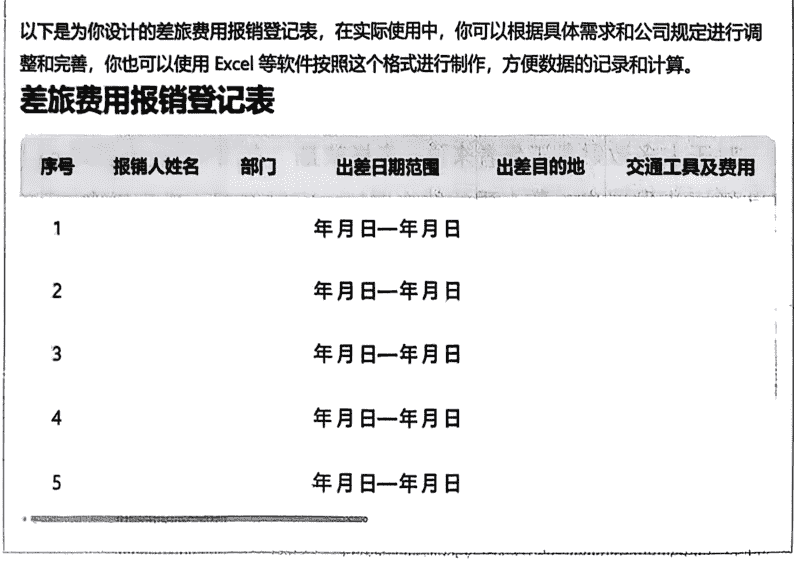

因页面篇幅有限，这里展示不全，实际场景里滑动图中进度条可查阅所有内容。

##### ✓ 文本转表

有些时候，我们并不是一开始就打算做表格，而是文字资料本身呈现出来的信息不够直观，希望能用表格的形式直观地展示出来。AI 就具备这项功能，能直接从一段自然语言中识别出核心要素，自动生成结构化的字段列表与表头格式，方便我们整理、执行或用于汇报。

例如，一场会议结束后，留下一段文字形式的会议记录：

针对第三季度经营总结工作，确定以下任务分工：财务部需于本周五前完成费用归集明细的核对，并配合审计部提供相关凭证；营销部负责汇总7–9月市场活动的投入产出数据，需提交可视化分析初稿，完成时间不晚于下周一；法务部需在下周三前完成与第三方供应商签署合同的归档整理工作，重点检查是否缺少审批附件。

这段会议记录中对各项任务都进行了分配，可真正要跟进时，会发现想一眼看明白“谁负责什么”“截止日期是什么时候”并不容易。这时，只需把会议记录交给AI，就能迅速识别出各项任务的责任部门、内容、截止时间，生成一张可跟进的任务分工表，如图1-7所示。

以下是简洁版结构化任务分工表：

| 部门 | 任务内容 | 截止时间 |
| :--- | :--- | :--- |
| **财务部** | 1. 完成费用归集明细核对<br>2. 配合审计部提供相关凭证 | 本周五（xx月xx日） |
| **营销部** | 1. 汇总7-9月市场活动投入产出数据<br>2. 提交可视化分析初稿 | 下周一（xx月xx日） |
| **法务部** | 1. 完成第三方供应商合同归档整理<br>2. 重点检查审批附件完整性 | 下周三（xx月xx日） |

图1-7 AI（DeepSeek）生成的任务分工表

这种功能尤其适合制度落地前的台账模板设计、业务流程结构化管理、新制度试运行配套工具开发等场景。

#### ② 字段加工类

AI 生成表格的能力，远远不止“从无到有”。在真实的财务工作场景中，大部分时候我们处理的不是空白的表格，而是已经存在数据的报表、台账、清单。虽然这些表格数据还算完整，但结构混乱、字段不统一、内容安排不合理，用来汇总、比对或导入系统时就会遇到各种麻烦。这时候，AI 可以针对已有表格数据做字段优化，识别哪些字段缺失、哪些字段合并有误、哪些字段名称不规范，把“能看”变成“能用”。

AI 在字段加工方面的常见功能包括补字段、拆字段、合字段、字段类型识别与格式修复等。这些功能可用于预算数据处理、历史数据重构、审计前数据准备、系统表格标准化升级等多种场景，是 AI 从“写表头”迈向“理解结构”的关键一步。

##### ✓ 补字段

拿到一张表，总感觉信息不完整，比如台账里只有“金额”和“时间”字段，但没有“责任人”“状态”字段，这类问题非常常见。AI 可以自动判断这张表应该补充哪些字段，并给出解释说明。

例如，你上传一张应付账款台账，AI 可能会自动提示：“建议新增字段：付款截止日（用于判断是否逾期）、付款状态（已付/未付/部分付款）、责任部门（追踪责任）。”

同时 AI 会补上每个字段的含义和常见取值，甚至可以帮你生成空白表格的结构模板，供你批量补填。这在处理历史数据、导入企业资源计划（ERP）前特别有用。

##### ✓ 拆字段

在一些旧表格或半手工输入的资料中，常出现“多项信息合并为一列”的问题。例如，一列内容是“张三 -2023 年 - 技术部”，这样的合并字段看得懂，但不好分析，也不能筛选。

AI 能自动判断分隔逻辑，把它拆解为下面这种格式，如图 1-8 所示。

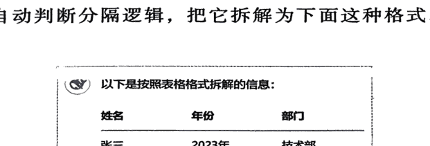

这种功能在做部门明细拆分、人员结构整理、分类汇总时非常实用。

##### ✓ 合字段

反过来说，有些表格不是信息太集中，而是信息太分散，比如有“业务类型 A”“业务类型 B”“业务类型 C”三列，其实都表示同一个维度；或者有“申请人姓名”一列、“审批人姓名”一列，但最终分析只需要“参与人”一列。

AI 能自动归并这些逻辑相似但结构重复的字段，并生成一个统一列，同时保留原始列做参照，方便后续检查。

#### ③ 数据清洗与校验类

虽然数据清洗是第 5 天会重点讲解的内容，但在本节里可以作为“表格处理能力”的补充，提一下它所属的功能分类。

对于财务人员来说，填完一张表只是开始，能不能直接用、能不能交出去，往往取决于数据本身是否“干净”。过去我们清洗数据靠两种方式：一是靠经验，手动翻查每列有没有漏填、错填、格式不一致的现象；二是靠公式，写一堆 IF、VLOOKUP 函数去查找异常。即便如此，很多隐藏问题还是会在汇总或分析阶段暴露出来。而 AI 正是专门用来解决这些“事后返工”的隐患。

##### ✓ 格式统一

有时候，数据本身是对的，但格式不一致。比如金额列，有人写“¥12,000”、有人写“1.2w”，还有人填“十二仟元整”；而状态列，有的用“是/否”，有的写“Y/N”。如果只是看着还行，一旦导入系统或做数据分析，立刻就会出错。

AI 可以识别并规范所有这些写法，让所有数据统一成一种格式，比如金额统一为“阿拉伯数字+千位分隔符”，所有状态列规范为“是/否”，所有时间格式对齐为“YYYY-MM-DD”。相比于人工对照、写公式查找来说简单得多。

##### ✓ 逻辑判断

格式统一只是第一步，令人头疼的是看起来没错但实际上说不通的数据。比如，一条付款记录里，付款状态为已完成，可付款金额却是 0；一条费用报销中，申请金额为 5 万元，却没填发票号，也没写费用类别；还有一行项目支出数据，预算是 10 万元，实际支出为 18 万元，但预算编号却是空的。如果不逐行检查，几乎发现不了这种情况，目前也没有绝对有效的公式可以快速检验出所有逻辑不合理的数据，但 AI 可以。

因为 AI 对于自然语言是有一定的理解能力的，所以会给出对应的提醒，比如“审批通过但无审批意见”“付款金额大于预算上限”“执行进度超过 100%”“报销类型为差旅，但未填写出差天数”等。这种检查基于字段之间的交叉规则，不再是单列筛查，而是真正从业务逻辑出发判断“合不合理”。在实际应用中，这一步可以预警那些“填上去了却不能用”的无效数据。

##### ✓ 排查异常值

日常数据处理中，最耗时间的往往不是建表，而是检查有没有漏填、错填、重复填写数据的现象。一张几十列几百行的台账，哪怕只出现一点小差错，汇总出的结果也是有问题的。

因此用户可以向 AI 发出一句提示词：“请检查此表中是否存在空值、重复编号、格式不一致的问题，并高亮显示。” 它会立刻给你输出一份“问题项表单”，告诉你哪些字段空了、哪些内容重复，还会标明是哪几行、哪几列的问题，同时附上修改建议。

更高级一点的应用，是它能识别“必填项”的字段。例如，在付款审批台账中，AI 会默认“付款金额”“收款账户”“付款状态”为必填字段，如果其中一列漏掉了，它就能精准抓出。而像“备注”或“审批意见”这类字段，AI 也能识别出“允许为空”。在实际工作场景中，它能帮助财务人员避免大量重复返工、逻辑纠错的麻烦。

##### ✓ 找不同

财务人员最担心的场景之一，就是这张表和那张表对不上。比如，预算表显示“项目 A 今年花了 50 万元”，但实际支出记录显示为 65 万元；再如，付款记录中写的“合同编号 12345”，在合同台账里却查无此项。这类问题一般靠人工逐个比对，或者利用辅助列写公式查找，耗时耗力。

此时，AI 可以直接承担“跨表校验”工作。你只需要把两张表上传，告诉它“按项目编号对比预算金额与实际支出”，AI 就能自动找出不匹配项，还能列出具体行号、差异值、可疑原因。如果是合同、付款、预算、发票多张表对账，它甚至可以建立字段映射逻辑，生成一张“多表一致性报告”，把对不上的条目统一汇总、呈现。

##### ✓ 多表融合

在日常工作中，很多表格数据并不是集中录入的，而是由多个部门、不同地区、不同时间、使用不同模板提交的结果。等工作人员汇总时，才发现这些表格看起来像是同一类型，实则字段不一致、命名不统一、格式参差不齐。以往工作人员得手动对照、建辅助列、复制粘贴，有时甚至要一条条改格式，费时费力又容易出错。

AI 具备的多表融合能力，能自动识别多个结构相似但内容不一致的表格，提取公共字段、规范命名、补齐缺失项，并合成一张统一标准的表格，供你直接使用或进一步分析。这不仅仅是表面上的多表融合，更是数据口径的统一。

例如，你要汇总 10 家子公司的预算执行情况，各公司上传的均是自己内部使用的模板，有的按“科目类别”分类，有的按“预算用途”分类，有的甚至只列“项目编号”。

AI 会自动比对这些表格中的结构差异，归并相同字段、拆分混合列、标准化字段名，并生成统一的主表，还能附带字段对应关系说明。

#### ④ 数据计算类

字段清晰，结构合理，数据干净，下一步就是汇总计算。在 AI 表格生成功能中，已逐步内嵌了轻量级的“数据逻辑”模块，尤其在自动计算字段、构建公式、逻辑校验上表现“亮眼”。

##### ✓ 计算空缺数值

一张空白部分需要计算的表格，交给 AI 后，用户发出相应的指令，就能得到一张计算完成后的表格，这就是 AI 的数据计算功能。

比如某公司的产品销售数据表，如表 1-1 所示。

##### 表 1-1 产品销售数据表

| 月份 | 销售收入（元） | 销售成本（元） | 利润（元） | 毛利率 |
| :--- | :--- | :--- | :--- | :--- |
| 1月 | 500000 | 320000 | | |
| 2月 | 450000 | 290000 | | |
| 3月 | 530000 | 310000 | | |

可以看到，现在表格只录入了原始数据，但没有计算利润和毛利率，这里不需要手动输入公式，发给 AI 就能得到计算完成后的整体表格，如图 1-9 所示。

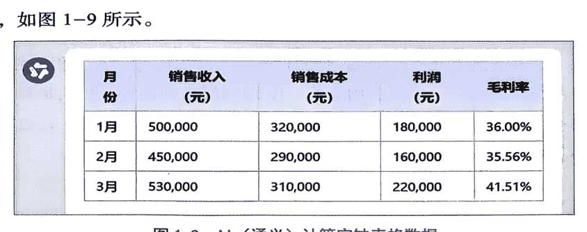

这种功能尤其适用于预算草表、财务底稿、费用台账等常用场景，可快速补齐“还没算”的地方。

##### ✓ 构建函数公式

一个标准的计算功能，不能只会出结果，还得说清楚计算过程。但函数公式有时候并不好写，尤其当涉及条件汇总、跨表关联、百分比变化这些稍复杂一点的逻辑时，哪怕是操作熟练的用户也得多试几次才能搞定。

如果在构建表格时并不想直接获得结果，而希望在表格中用公式表达数据，从而保证数据的实时更新，也可以让 AI 辅助构建函数公式。

比如在计算毛利率的时候，询问 1 月份毛利率单元格中应该输入什么函数公式、就能得到 AI 对应的回复，如图 1-10 所示。

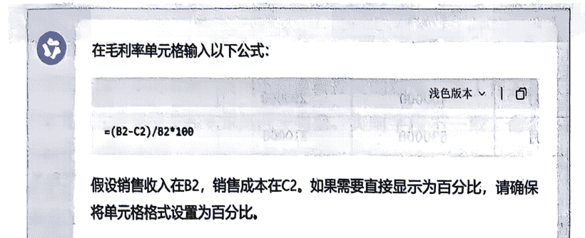

图 1-10 AI（通义）构建函数公式

这些功能看似基础，但在实际工作中可以帮你避免很多低级错误，比如函数区间错误、字段引用错位、IF 语句层级混乱等。特别是对公式运用不熟练的财务新人来说，这几乎相当于一个“公式助手”，边算边教你怎么撰写函数公式。

##### ✓ 校验计算逻辑

数据计算最怕算错而不自知。尤其在毛利率、应收账款周转率、现金比率这类结构性强的指标中，不慎填错一个字段，公式就会失效。

AI 具备基础的逻辑推演能力，可以识别表格数据是否符合计算公式应有的逻辑结构。假设你填了一行毛利率为 125%，AI 会判断这是否合理，比如收入是否填少了？成本是否没包含运费？行列是否错位？如果有错误，系统可能会提示：“毛利率通常不应超过 100%，请确认收入与成本字段是否存在漏填或误填。”

这种能力虽然还达不到财务分析师的深度判断，但在初步预判、错误排查方面，已经能有效完成初步的校验。

##### ✓ 支持假设推演

AI 不仅能帮助计算结果，还能辅助做假设推演。比如用户提问：“如果 5 月份销售额增长 15%，6 月份销售额增长 10%，全年利润预计是多少？” AI 可以根据已有数据，构建一个基础的线性增长模型，预估销售额并代入已有利润率进行模拟计算，输出预估利润总额及变化趋势。

当然，这还不是真正的建模功能，但对日常“试算一下”“测个值”这些场景来说，已经非常实用。特别是在做汇报前，用户需要给出一个大致判断、临时模拟结果时，AI 可以帮助用户快速生成一份有数据、有依据、有结论的初稿。哪怕只是临时使用，也能节省大量时间。

### 1.3 图像生成：轻松呈现财务数据全貌

生成式 AI 并不仅限于文字和数据的世界，它同样擅长“看得见的表达”，也就是图像生成。这是生成式 AI 中一个具备“多模态理解与输出”能力的分支，其本质在于将文字、数据，甚至纯语言指令，转换成符合视觉规范的图像，包括艺术图像和插画，也涵盖了流程图、信息结构图、数据图表、页面视觉草图等内容。

在财务工作中，图像生成功能的使用大致可以分为三个方向：数据图像化、内容可视化和视觉效果增强。接下来将依次展开对这三个方向的功能解读与场景示范。

#### ① 数据图像化

数据图像化是最贴近财务工作场景的，指的是直接针对结构化数据，生成柱状图、折线图、饼图、雷达图、散点图等常规数据图表，也能用来推荐更合适的图表类型，让“数据可视化”变得更轻松、更专业。

##### ✓ 生成数据图表

假设你需要对比各区域本季度的销售额，就可以让 AI 生成一张按区域排列的柱形图；要展示全年收入的变化趋势，可以生成一张折线图；分析各项费用的比例构成时，则可以用饼图或环形图展示结构，这些都是财务报告中常用的数据图表。只要能清楚表达目的，AI 就能配上对应的图，让每一组数据都有最合适的“出镜方式”。

例如，你准备了一份月度经营分析报告，想展示公司四个季度的营业收入变化趋势，那么 AI 会为你生成这样一张图，如图 1-11 所示。

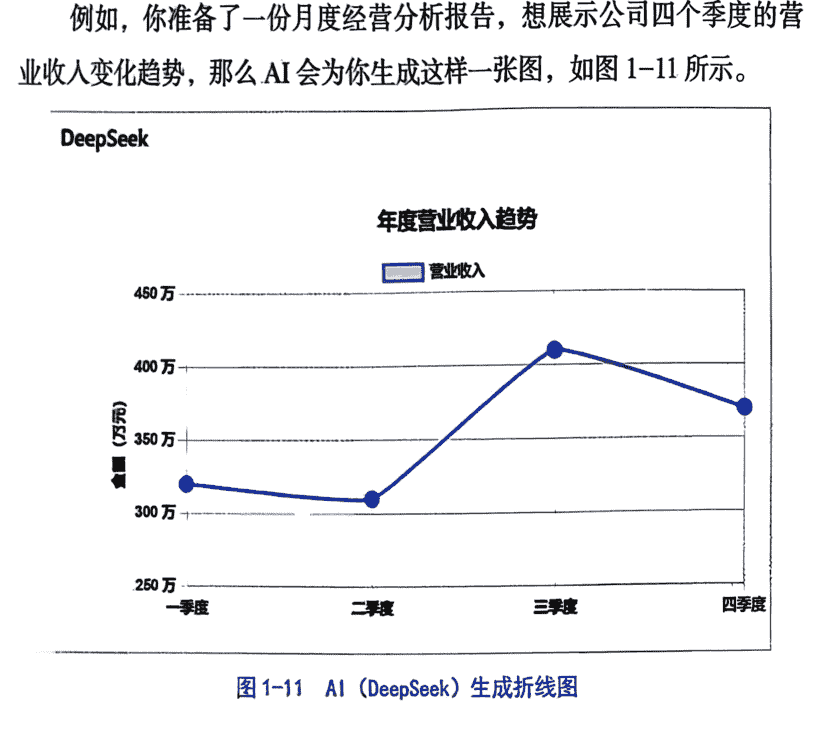

##### ✓ 推荐图表类型

在面对复杂报表时，有时候并不确定该选什么图表来展示信息最合适。比如表里同时有“实际值”“预算值”“完成率”“同比增长”，用柱形图太拥挤，折线图又不够清晰。这时候，AI 的图表推荐功能就派上用场了。

比如，你把一张销售数据表交给 AI，没写分析目的，只附上字段“地区、销售额、销售占比、毛利率”，它就能根据字段类型智能推荐：“可选饼图展示销售占比、柱状图展示各地区销售额对比、双轴图同时展示销售额与毛利率。”

#### ② 内容可视化

如果说数据图像化解决的是“数据呈现”的问题，那么内容可视化解决的就是“概念怎么讲清楚”的问题。这类图像不是对数据进行图表呈现，而是把你想表达的某一流程、结构、逻辑或关系，用图示的方式呈现出来。常见的内容可视化包括思维导图、流程图、组织架构图、关系图谱等。

例如，前面针对国家发布的《国务院关于提高个人所得税有关专项附加扣除标准的通知》我们进行了关键内容的提炼，现在能够借助 AI 生成一张内容图谱，如图 1-12 所示。

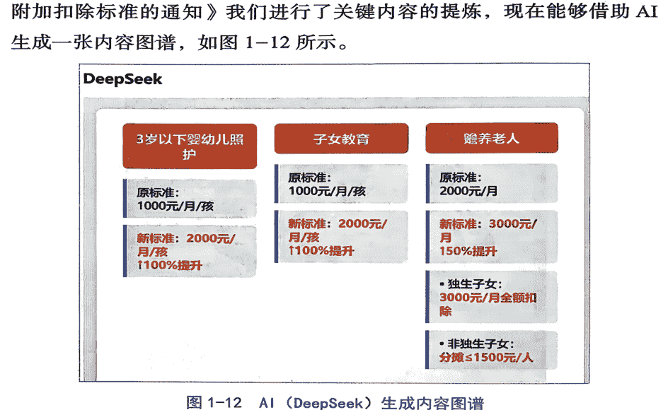

上述内容图谱能帮助用户快速把握重点内容，了解新标准和原标准的区别。而什么地方需要重点标注，什么地方一带而过，全看用户的提示词如何写。

#### ③ 视觉效果增强

做过汇报的人都知道，同一页内容，如果堆满了文字和表格，只会让人觉得乏味。要是在视觉上多一点设计感、多一点留白、多一点图形元素，哪怕信息总量不变，听众理解和记忆的效果会完全不一样。

图像生成功能能帮助财务人员不用学设计，不用下载模板，也能得到一张匹配当前场景、内容和风格的图像素材。

比如，做一份“企业财务数字化转型成果汇报”的PPT，想让开头更吸引人，就可以让AI生成一张商务风格的配图，用于PPT的首页或用作背景，如图1-13所示。


图1-13 AI（豆包）生成配图

除了背景图，AI也能根据文字说明生成风格统一的小图标（如图1-14所示），点缀页面，减轻阅读者的疲劳感。在财务汇报场景中，这正是细节加分项。

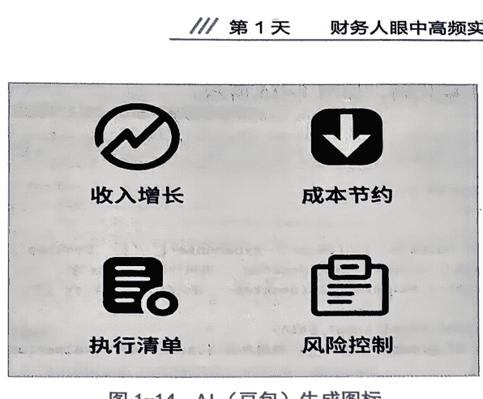

### 1.4 代码生成：无需技术背景也能秒变编程高手

生成式 AI 的代码生成功能，指的是能够将自然语言指令实时转化为可运行的脚本或公式，包括 Python 脚本、VBA 宏、SQL 语句等。当然，这并不代表 AI 会自己创作代码，只是 AI 擅长拼接语句，可以在理解业务逻辑的基础上，拼凑出语法结构完整、能直接使用的标准化代码。

对于不具备编程技术背景的财务人员来说，原本需要求助 IT 才能完成的自动化操作，现在只需一句指令就能完成。不知道如何运行也没关系，代码报错也不必担心，AI 都能解决。

#### ❶ 生成标准化代码

在代码生成功能里，最直接的应用方式就是让 AI 根据自然语言描述，生成结构完整、语法正确、可以直接运行的标准化代码。

例如，假设现在有一张“费用明细表”，你希望按照“部门”字段去汇总费用金额，并依据金额由高到低进行排序，最后生成一张新表，就可以让 AI 生成代码，如图 1-15 所示。

```python
import pandas as pd
import os

desktop = os.path.join(os.path.expanduser('~'), 'Desktop')
input_path = os.path.join(desktop, '费用明细表.xlsx')
output_path = os.path.join(desktop, '部门费用汇总.xlsx')

df = pd.read_excel(input_path)
result = df.groupby('部门')['费用金额'].sum().sort_values(ascending=False)

result.to_excel(output_path)
```

图 1-15 AI（DeepSeek）生成代码

这段代码覆盖了从文件读取、分组汇总、排序、导出等一整套逻辑，还自动选择了最轻量的处理方式，让初学者也能轻松复制使用。

无论你是想分析费用台账、重构预算报表，还是想搭建一个小型的自动化脚本，生成标准化代码这一步都将是第一步。而且，代码跟文字一样，有详细的表达，也有简洁明了的呈现，AI 还可以根据指令进行修改，以满足用户不同的需求。

#### ② 代码运行指导

许多财务人员面对代码，真正困惑的是：这要在哪里运行？代码生成功能的另一个亮点，就是指导你如何使用生成的代码。

比如你让 AI 写一段 VBA，用于隐藏所有空行。它不仅会写出完整的 Sub 宏代码，还会附上一段解释说明，如图 1-16 所示。

##### 简化版 VBA 代码：隐藏所有空行

```vba
Sub HideEmptyRows()
    Dim r As Range
    For Each r In ActiveSheet.UsedRange.Rows
        If WorksheetFunction.CountA(r) = 0 Then r.Hidden = True
    Next
End Sub
```

说明：

- 1. `UsedRange` 只检查有数据的区域，提升效率
- 2. `CountA(r) = 0` 判断整行是否为空
- 3. `r.Hidden = True` 直接隐藏空行

使用方法：

- 1. `Alt+F11` → 插入模块 → 粘贴代码 → `F5` 运行
- 2. 效果：所有空白行自动隐藏

图 1-16 AI（DeepSeek）生成代码运行说明

这种附带使用指导的能力，特别适合没有技术背景但愿意尝试自动化办公的财务人员。你不需要知道脚本语言背后的运行机制，也不需要熟悉每一步系统操作。你只需专注于自身想做的事，剩下的执行方式、文件路径、运行结果位置，AI 都会提醒你如何一步步完成。

#### ③ 报错诊断与代码修复

代码运行出现报错是很正常的事情，尤其是当你不熟悉语法、不清楚函数限制，也没写过脚本的时候，哪怕只是漏了一个引号或是括号写错了位置，程序都会立刻报错。

不具备编程技术背景的财务人员，看到一大片红色的报错代码很容易一头雾水，不知道这是什么意思，也不知道怎么修改。而 AI 的代码生成功能既然能写代码，自然也能看懂代码、修补代码。

比如，你在写一段 Python 脚本，用于计算每一条采购记录的含税总价，本意是将“单价”字段与“税额”字段相加，然后写入新的列中，于是写出了代码“total = price + tax”。

结果在运行时，系统提示报错，你看着提示不知所措，不清楚哪里写错了，只知道加不起来。这时只需要将错误提示和原始代码一起发给 AI，就会得到如图 1-17 所示的答复，问题迎刃而解。

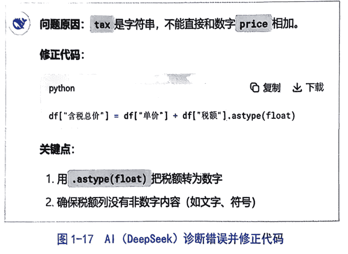

### 1.5 PPT 创作：一键打造专业的财务汇报 PPT

生成式 AI 的 PPT 创作功能，提供了从内容生成到设计优化的全自动化解决方案。它能够根据用户输入的自然语言，自动生成符合用户需求的 PPT，包括封面、目录、内容页、数据图表、流程图等内容。用户只需要简要描述报告的主题和要点，AI 会智能识别关键信息，并选择合适的模板和设计风格，自动完成各项内容布局。

#### 1 一个关键词生成一份 PPT

生成式 AI 的 PPT 创作功能有多种应用方式，最简单的就是用一个关键词生成一份 PPT。

用户只需要提供一个简短的关键词，比如“财务制度培训”，AI 就能根据这一关键词自动生成整份 PPT 模板，涵盖封面、目录、内容页和结束页等，所有的格式、设计、排版都由 AI 智能完成，如图 1-18 所示。


这种功能比较适合汇报的前期准备阶段。用户将生成的 PPT 模板下载到本地后，就能自行添加相关内容，相较于从零开始手动制作 PPT 要方便很多。

#### ② 报告转为 PPT

生成式 AI 的 PPT 创作功能的另一种应用方式，是将已有的报告内容自动转换为 PPT，这种方式会更加适合已经有一份详细的报告或文档，但需要将它转化成简洁明了的 PPT 进行汇报的工作场景。

例如，用户上传公司的年度财务报告，AI 会自动提取其中的主要内容：收入、成本、利润等数据，并将这些信息转化为对应的 PPT 大纲，每一页 PPT 都会自动生成标题、内容框和合适的图表，确保重要信息能够清晰地展示出来。

#### ③ PPT 大纲优化

有人担心用 AI 生成 PPT，难以把握大纲内容。其实在 AI 生成 PPT 之前，会有一个关键步骤，就是调整大纲内容。在这一步，AI 会协助优化 PPT 大纲，使内容更加清晰、有条理。

当 PPT 生成之后，同样可以针对内容层级进行优化。比如，在一份包含多个数据点的报告中，AI 会根据内容的优先级和相关性，自动调整页面顺序和层次结构，确保关键数据和分析结果突出显示。对于需要详细解释的部分，AI 会自动将其拆分成小节，并为每一小节添加简洁的标题，帮助受众快速抓住重点。

#### ④ 图表自动嵌入

在创作 PPT 的过程中，生成式 AI 支持图表的自动生成和嵌入，包括流程图、组织架构图、循环图等。

例如，在财务制度培训中，一般需要介绍财务报销的流程，而财务制度中一般会有详细的报销步骤，AI 能把这部分内容转换成流程图，并嵌入 PPT 中，如图 1-19 所示。

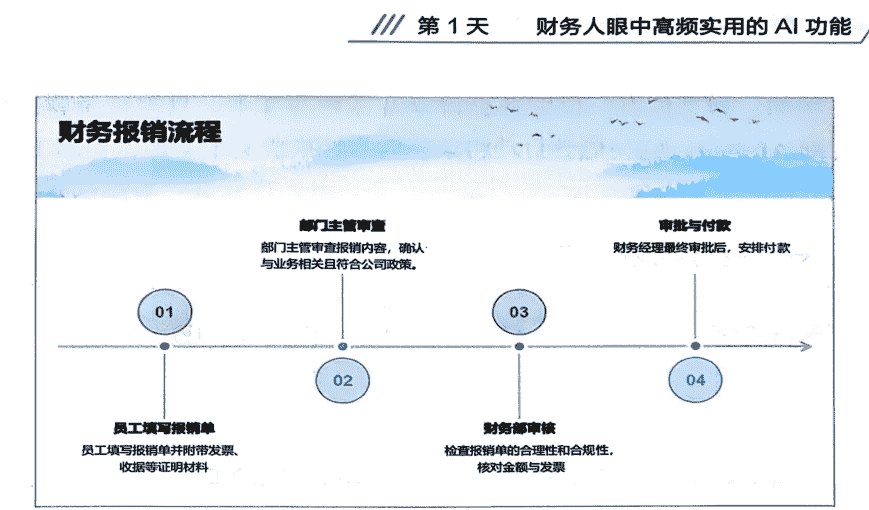

图 1-19 AI（通义）在 PPT 中自动嵌入流程图

该功能可以让财务人员节省手动制作图表的时间，清晰展示各个环节，帮助受众更好地理解复杂的制度和流程。
类似地，AI 还能够根据用户需求和组织架构数据，生成一个清晰的组织架构图，展示公司各部门的层级关系。

### 1.6 音视频转文字：财务沟通快速转录

音视频转文字功能，是生成式 AI 利用强大的语音识别技术，将音频和视频中的讲话内容精准转化为文字的能力。对于财务人员而言，这一功能可用于将财务会议、项目讨论、在线培训等音频或视频内容转化为结构化文本，节省了手动记录的时间，内容的准确性也有一定的保障。

#### 1 提取音视频文件中的内容

财务人员通常会遇到需要转录会议录音、培训视频等工作场景，为此生成式 AI 提供了一个高效、准确的解决方案。

例如，如果你有一段财务会议录音需转为文本，只需将录音文件上传到 AI 平台，它便能够自动将录音内容转换成文本文件，如图 1-20 所示。


在整个过程中，AI 会准确识别出讲话内容，并且能够按顺序整理，确保每一段讲话都能够无误地呈现在文本中。转录后的文本也能快速为后续的分析和汇报提供文本依据。

#### ② 自动标注发言人和关键点

在对音视频文件内容进行转录时，AI 还能识别不同人物的讲话内容，并在转录文本中标注出来。比如，针对会议中不同部门发言人的发言，AI 会根据讲话内容的上下文自动判断并标明发言人，帮助财务人员快速回顾会议内容要点，避免混淆不同发言人的意见，如图 1-21 所示。

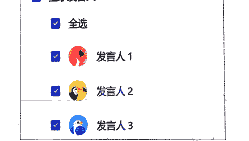

针对内容中出现的关键点，如提到的预算调整、成本控制等重要议题，AI 会将其标注出来，作为导读要点，还会自动生成思维导图，供财务人员浏览，如图 1-22 所示。

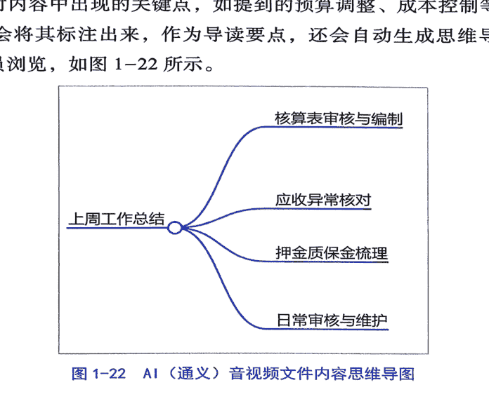

#### 3 输出可编辑文本

AI 生成的文字记录可以直接导出为可编辑的文件格式，如 TXT、Word 文档或 PDF 文件，便于用户后续编辑、分享或归档。
例如，公司财务制度的视频培训材料可通过 AI 转换为文本，并利用 AI 根据培训的不同部分进行整理。这样后续有新人入职，就可以将相关材料调取出来，分享给新员工学习。
该功能不仅可以应用在财务培训、会议记录这样的工作场景中，还适用于财务审计现场沟通、行业交流会等场景。且因为 AI 转录的文本格式规范、信息完整，财务人员只需根据具体需求进行修改，而不用从零开始整理资料，所以大大提高了其工作效率。

# 第 2 天
## 提问的艺术：如何让 AI 更懂财务

是不是经常感觉 AI 的回答和你的需求不在一个频道上？别急，问题可能出在提问方式上。生成式 AI 不是被随便问一句，它就能自动猜中你的业务背景、财务逻辑和格式要求。要让它帮得上忙，就得学会怎么向它提问。

今天我们就来学习如何更精准地向 AI 表达需求，如何巧妙地用角色设定引导 AI 进入财务人员的思考模式。掌握这些技巧后，你会发现，AI 的回答准确性和质量一下子就提高了好几个档次，让 AI 真正成为财务工作的强大助手。

> 提示词写得好，首先能解决一半的问题。

### 2.1 90% 的问题出在提示词表达不清楚

假设你正在整理报销明细，想要借助 AI 来提高效率。于是，你上传了一张包含员工报销信息的图片，并在对话框里简单地输入：“请帮我整理报销单数据。”

很快，AI 给出了整理的结果，如图 2-1 所示。

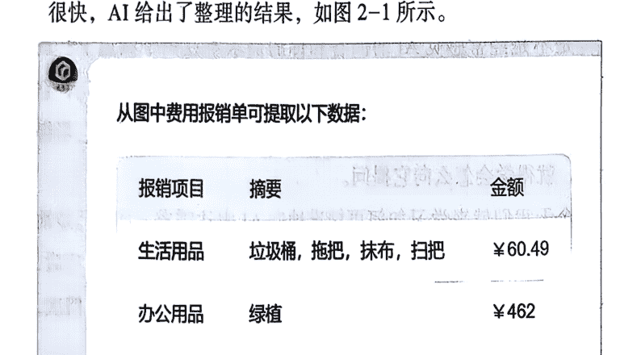

你看着这个结果，觉得离自己想要的结果差距很远，没写报销人的姓名，没标注所属部门，也没汇总报销金额，最重要的是，还没有写上所属的费用类型，比如办公费等。于是，你觉得 AI 一点也不智能，自己还是老老实实干活吧。

很多人觉得 AI 并不好用，认为 AI 根本理解不了自己的需求，且把这种结果归因于 AI 能力不足。其实，问题可能出在我们所给的提示词上。

通俗来讲，是因为我们没有说清楚让 AI 干什么，所以它干不好。就像你让一个人帮忙做事，但没有明确地告诉他具体任务，他只能根据自己理解的方式去做，结果可能与你想要的完全不同。

要理解这一点，还需从 AI 的工作原理讲起。AI 并不像人类一样具有自主意识和判断力，它所谓的“理解”完全是基于我们所提供的提示词展开的。因此，AI不会主动去推测我们没有明确说出的需求。只能是它被要求做什么，就去做什么，没有提到的就不做。比如，你对AI说洗碗，它就不会提到洗筷子的事情。只有当你明确说出洗碗和洗筷子时，它才会将两件事一起考虑。

所以，如果提示词不够具体，AI就可能会漏掉你需要的部分，或者做一些你根本不需要的工作。

回到最开始这个例子，“请帮我整理报销单数据”。这句提示词本身就是一个很模糊的指令。如何整理？需要列出哪些信息？是否需要按员工姓名、部门、费用类别等进行分类汇总？这些关键信息都没有在提示词中明确说明，AI自然就无法准确地理解你的需求。

现在我们将提示词表达不清楚的解决办法总结如下。

#### ❶ 避免语言歧义

语言歧义是指同一句话中，某些词语或同一语句的表达方式可以有多种解释，而AI没办法了解当前的工作场景，自然也无法判断哪种才是用户真正的意图，所以大概率会生成偏离实际需求的内容。

例如，提示词写“合并表格中的数据”，这就是一个典型的歧义表达。“合并”这个词可以有多种理解方式，比如，将多个表格的内容合并到一个表格中，或者将不同表格中的数据进行汇总合并，还可以是根据某种分类标准，进行分类合并，等等。

在财务数据处理任务中，提示词的含糊不清可能导致处理结果的偏差，进而影响工作效率和后续决策。因此，为了避免出现歧义，在使用多义提示词时，要明确指出具体的操作要求和标准，最大限度地降低AI产生误解的可能性，确保它能够按照我们预期的方式执行任务。

**正确示范：**

请将这三张销售表格中的数据合并到同一张表格中。

这个正确示范明确了“合并”是指将表格内容合并到一个表格中，这就清晰地解决了“合并”可能带来的不同理解问题。

#### ② 增加任务细节限定

模糊的提示词最大的问题在于任务范围过大，缺乏明确的限制和细节描述。这就导致 AI 无法清楚地理解任务的重点和边界，结果输出了一个非常宽泛、缺少针对性的回答。反复几次后，会让人觉得非常浪费时间。

比如前面整理报销单数据的例子就是典型的任务范围过大。类似的，还有“分析财务数据”“整理财务文件”“审核财务记录”等提示词，都属于任务范围过大的情况。要解决这个问题，增加任务细节限定是关键。在给 AI 下达任务时，应该尽量具体、明确。首先确定你希望 AI 完成的具体操作，例如是数据分类、计算还是生成某种类型的报告。然后明确任务的范围，包括你需要哪些内容、需要分析哪些数据，以及是否有时间、部门的要求或其他限制条件。这些细节会帮助 AI 更好地聚焦于用户需求，避免浪费计算资源和时间在不必要的内容上。

**正确示范：**

请根据所给数据，按照标准模板，生成本年第一季度的财务报表。

这样，有了内容和模板，AI 输出的结果大概率会符合我们的预期。

#### ③ 提供充分的背景信息

“巧妇难为无米之炊”，在某些情况下，AI 无法给出有效回复，可能是因为提示词中没有提供足够的背景信息。比如，你要求 AI “整理报销单”，但提供的报销单图片上根本没有报销人和所属部门，那 AI 在整理的时候就没办法对相关信息进行展示。

这种情况解决起来也不难，缺什么补什么。没有数据就补充数据，没有信息就填上信息，信息完整了再去提问，很快就能得到想要的回复。

**提示词示范：**

请根据这张填写完整的报销单，按照费用类型对应的会计科目汇总报销金额。（附上报销单图片）
这样，AI 整理起来就有详细的材料了。

> **提示词建议：背景信息 + 任务目标 + 限定条件**

背景信息：提供足够的上下文或数据支持，让 AI 了解任务的基础条件。这包括数据来源、文件或其他的附加信息等。

任务目标：明确指出你期望 AI 完成的核心任务，如分类、汇总、分析或生成报告等。

限定条件：详细描述执行任务的具体要求，如时间范围、分类标准、计算方法等，确保任务有明确的边界。

### 2.2 角色引导，让 AI 进入正确的思考模式

在与 AI 对话时，许多人发现 AI 的回答十分刻板，或者说缺乏专业性，有时候像是外行人给出的建议。这种情况的出现，或许是因为 AI 没有进入正确的思考模式。

之前反复强调过，AI 是通过我们给出的提示词执行任务的，给什么关键词就思考什么内容，不会主动推测或理解任务背后的深层需求。因此，当任务涉及特定行业领域时，AI 可能会“想当然”地去拼凑一些东西，而不是按照该领域的专业思维方式去输出内容，以至于输出一些浅显、单一的回答，甚至出现与默认行规不符的错误信息。

举个简单的例子，假设下面是某公司第一季度的销售情况（如表 2-1 所示），需要对其进行数据分析。

##### 表 2-1 公司第一季度各组销售情况

| 销售队伍 | 实际收入（万元） | 实际成本（万元） | 预算收入（万元） | 预算成本（万元） |
| :--- | :--- | :--- | :--- | :--- |
| 销售 A 组 | 1600 | 1260 | 1700 | 1200 |
| 销售 B 组 | 1450 | 1030 | 1500 | 1000 |
| 销售 C 组 | 2000 | 1650 | 2100 | 1600 |
| 销售 D 组 | 1300 | 1020 | 1350 | 900 |

你希望 AI 对公司的业绩数据展开财务分析，但是提示词只写了：“请分析这些业绩数据，并给出结论。”

那么，AI 收到指令后会直接对数据做一些基础的计算和比较，给出一个十分简略的结论，如图 2-2 所示。

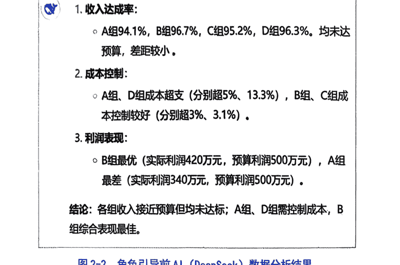

这些内容看似条理清楚，给了收入达成率，计算了成本超支情况和利润表现情况，最后用一句话简单总结了每个销售组的情况。这样的数据分析结果用来做简单的运营分析汇报还行，但用在财务分析报告中却不太实用。

因为上述结果只是把数字“念了一遍”，没计算各组的毛利率，更没有涉及现金占用、风险预警、改进方案，缺少有助于财务决策的分析。当用户尝试丰富提示词，增加各类细节去进行提问时，能够取得一定效果，但得到的回复始终与财务的相关性不高，令人十分苦恼。

解决这种情况最好的办法是角色引导。

角色引导，就是通过在提示词中设定一个明确的角色，赋予 AI 一种身份，来帮助 AI 理解任务的核心，引导它从专业的角度进行思考和回答。

比如上面那个例子，只需要在提示词中加一句“你是一名财务分析师”，AI 的第二次响应立刻换了“思路”，如图 2-3 所示。

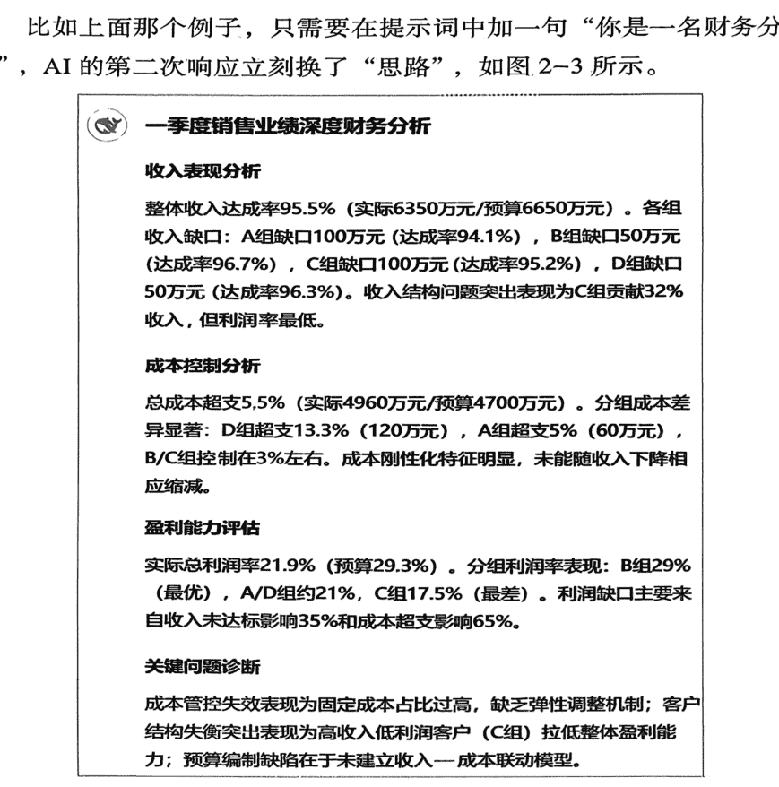

图 2-3 角色引导后 AI（DeepSeek）数据分析结果

可以看到，设定“财务分析师”角色后，AI 不再停留在“收入没达标、成本超支”的表层结论，而是先从整体视角给出公司级收入达成率和总成本超支率，让管理层能直观看到全局偏差大小。

分析完整体后，再看局部，AI 把收入结构问题摆到桌面上，这种跨行分析在角色引导前的答案里是完全缺席的。同时，该回答还有一个亮点，那就是把利润缺口拆成“收入未达标 35%+ 成本超支 65%”，并指出固定成本刚性、客户结构失衡、预算联动缺失三条根本原因，为后续举措预留方向，而不是一句“需控制成本”就草草收尾。

当然，这里并不是说以上回答就完美，毕竟我们的提示词也相当简略，没有描述更多细节。在实际对话过程中，用户自然需要把更多细节和要求描述给 AI，这样得到的回答会更加细致，也更加符合我们的期待。

那为什么加上角色引导，结果就会相差很大呢？

其实，这是给了 AI 一个专业的思考路径。当它知道自己现在是位财务分析师时，视角立即偏向毛利率、预算偏差、现金流压力等核心指标。于是，那些“需控制成本”的泛泛之谈，就会被替换成“成本刚性化特征明显，未能随收入下降相应缩减”，字里行间都在回答管理层真正关心的问题：问题到底出在哪里？

而且，角色标签也影响了 AI 的行文深度。没有设定角色时，AI 的输出常用“不错”“稳健”之类的宽泛形容词；而财务身份一旦确立，模型会主动量化差距、分析原因，如指出“收入结构问题突出表现为 C 组贡献 32% 的收入但利润率最低”，而不是简单一句“B 组、C 组成本控制较好”。

如果你想提升提问效果，即在提示词最前面写上角色，再保留原始请求，便可让 AI 进入专业频道。

提示词建议：【角色】+ 原提示词
角色：为 AI 明确身份，让它自动切换到对应专业视角（如“财务分析师”“审计师”“财务经理”“会计”等）
原提示词：保留原本的任务目标、数据说明和其他细节，一字不改就能提升 AI 回答的深度与专业度。

### 2.3 拆解提示词，提升 AI 财务分析效果

与 AI 进行过对话的人都知道，反复提问的过程也是很浪费时间的，因此，为了提高与 AI 互动的效率，我们会一次性给出很多任务要求，期待 AI 能一次性完成任务。
然而，期待落空的瞬间让人明白，AI 不是万能的，时常无法同时满足所有要求，就像一个人同时处理多个复杂的任务，而没有明确的优先级和步骤，就会出现一团糟的情况一样。
攻克这个问题也十分简单，一次得不到想要的结果，那就分步提问，让 AI 能够逐步执行任务，并确保每个步骤都能够高效且精准地完成。
这里要提前说明一点，AI 并不是一个单线互动的机器，它具有一定的上下文记忆能力，可以在多轮对话中记住前面的信息和任务指令，并在此基础上做出改进和补充。所以，拆解提示词的时候就不用担心 AI 忘掉了前一轮对话的内容。
拆解提示词可以按照以下步骤进行。

#### ① 步骤一：明确任务的主要用途

拆分提示词的第一步、一定是落在“究竟想要什么”上，也就是明确回答的主要用途。很多人把数据、背景、附加要求一股脑儿地抛给 AI，却从未说明主要用途。结果 AI 只能“看哪段话抓得住就先说哪段”，说完就交卷。

比如，提示词“请帮我写一份业绩分析报告，把数据分析一下，指出其中的问题并提出建议”，这句提示词里既没限定报告类型，也没明确是财务口径还是运营口径，更没表明报告服务的对象。AI 往往只会给出几行同比、环比增速，最后来一句“建议加强市场推广”，生成的结果既不像财务报告，也不像业务复盘。

**提示词示范：**

请撰写一份向董事会汇报的一季度财务分析报告。侧重毛利、预算差异及现金流风险，不关注市场营销细节。

这样，主要用途就确定了，这是一份用于董事会的财务分析报告，AI 会把后续所有解读、图表都围着“财务”“董事会”这两个关键词展开，重点突出。

#### ② 步骤二：生成回答的框架体系

当“报告给谁看，要解决什么问题”明确后，下一件事就是交代清楚报告“长成什么样”。这一步常常被忽略，也是导致用户觉得 AI 的回答不全面的关键因素。

假设你交代他人写份材料却不提框架，对方就会凭个人理解来设置框架，可能先放数据再提建议，也可能把长段结论塞在最前面。AI 亦然。

如何让 AI 了解具体的框架体系呢？这里分两种情况，一种是已经有固定框架，另一种是还没有现成框架。

如果是第一种情况，只需把段落顺序、标题名称直接写进提示里。

**提示词示范：**

请按“摘要—数据表—差异拆解—风险与机会—改进措施—附件”的结构输出。

AI 收到提示后会严格依照要求排版，这样生成的内容改动少。

如果没有现成框架，那用户可拆解提示词，进一步提问。

**正确示范：**

作为财务分析师，你打算用什么结构向董事会汇报这份数据？请列出一级标题和每段应包含的要点。

收到提示后，AI 通常会给出一份框架，如图 2-4 所示。

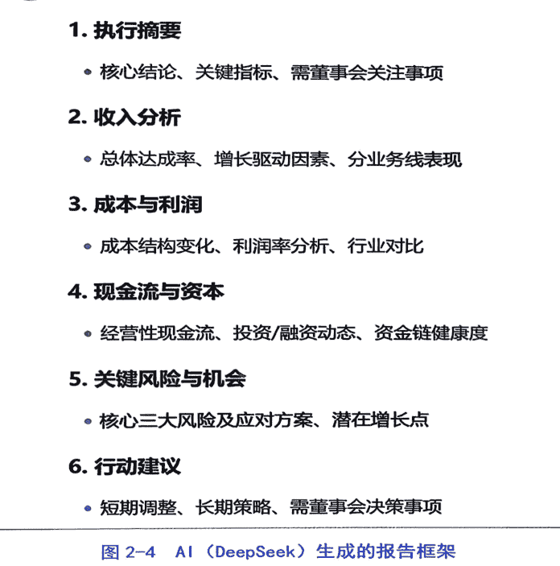

图 2-4 AI（DeepSeek）生成的报告框架

接下来，你保留需要的部分，再把确定好的框架回传给 AI，让它按照上述最终框架来填充内容即可。两轮对话就能把 AI 输出回答的形式确定下来，后面的数据、分析、结论才有地方安放。

#### ③ 步骤三：细化提示词的维度与标准

大框架已定，这一步是把每一部分的细节讲清楚。倘若这一步给出的提示词含糊，会容易出现看似什么都有，实则没有任何价值的内容。
财务分析报告最怕这种看似面面俱到，实则面面不到位的内容。因此，想让 AI 输出真正可用的分析，就要开门见山地告诉它：必须出现哪些指标，指标出现时要用什么口径，发现异常要分析到什么深度，以及数据结论怎样呈现才算清晰。

提示词示范：
各部分内容要求如下：

1. 执行摘要：在 150 字内概括收入、利润、现金流的偏差；列出需由董事会表决的事项。
2. 收入分析：先给出总体收入达成率；按业务线列出实际收入、预算收入、差异额、差异率；差异率 >5% 要加粗标出；最后用一句话说明各业务线的主要增长或下滑驱动原因。
3. 成本与利润：列出直接成本、期间费用、总成本三栏，与预算对比；计算整体及分业务毛利率、营业利润率；毛利率 <20% 的业务线需给出两条原因。
4. 现金流与资本：报告经营性现金净额、自由现金流；若经营现金净额低于净利润 20%，请用备注解释差异。
5. 关键风险与机会：列出三大核心风险（汇率、原料、需求）及对应缓解举措；给出 1—2 个潜在增长点。
6. 行动建议：短期建议（≤ 3 个月）与长期建议（> 1 年）各 2 条；注明预估财务影响与所需董事会决策。

提示词写得细致，AI 基本就能照着清单逐条答复。最终得到的报告虽然看上去仍是六大段，但每段都紧贴财务痛点，数字醒目、结论简洁，符合我们的期待。

注意，AI 单次输出的内容不会太长，所以对每部分的分析深度可能达不到用户要求。所以，用户可根据需要将上述报告的各个部分拆开去提问。比如，先把框架交给 AI，请它只写执行摘要和收入分析。回答满意后，再在同一对话界面中追问成本、利润、现金流与资本等余下部分。

先前说过，AI 具备上下文记忆能力，会把第一轮的计算结果带进后续的对话中，既保证行文与逻辑的连贯性，也让每段输出都保持在可快速审阅的篇幅。这种做法本身也是拆解提示词的延伸。

> **提示词建议：任务用途 + 回答框架 + 细节要求**

任务用途：一句话点明报告最终用在什么场景、给谁看（如“董事会季度财报审阅”“银行授信资料”“部门协作会议”）。

回答框架：列出内容应遵循的框架与段落顺序，保证输出内容条理一致、板块齐全。

细节要求：说明每个板块的细节要求，如列出什么内容，计算什么数据，什么标准算异常需要标出，什么内容可以忽略不计。

### 2.4 引导 AI 突破限制，找到更多隐藏思路

AI 并不像人类那样具备自发的创新能力。它只能在我们提供的框架和输入的信息的基础上进行分析。也就是说，我们没想到的方向，它可能不会主动去分析。

这会造成什么样的结果呢？那就是对 AI 功能的挖掘严重不足。所以，不是 AI 只能回答到这个程度，而是我们的提示词让它只能做到这些。这不是 AI 能力的上限，而是使用者思维的上限。

那如何突破思维限制，去找到更多隐藏的思路呢？下面这四种方法可做参考：

#### ❶ 启用深度思考和搜索功能

在许多主流 AI 工具对话框中，都能看到“深度思考”（如图 2-5 所示），有的工具也叫“深度研究”，不过功能用途是大体一致的。


默认状态下，AI 模型拿到提示词后只生成一次回答，它不会检查自己的推理链是否有遗漏。而深度思考是一种多轮自我推理机制，AI 模型拿到提示词会首先生成一版初步答案，然后在后台对自己的推理链做“复盘”，检查推论是否跳步、论证是否不足、有没有遗漏的切入口。

如果发现空白，它会主动再进行一到两轮内部推理，对缺口进行补充或修正，最后把最完整的版本呈现给你。整个过程就像人思考检查、复盘整理一样，经过深度思考后，AI 给出的答案会比之前更加全面，更加有条理性和逻辑性。

**提示词示范：**

我是一名财务人员，发现销售部门在这个季度多次发生类似招待费、打车费混在一起报销的情况，且报销申请时间过晚，导致月底关账很被动。我想写一封邮件反馈给销售部门负责人，让他们注意这些问题，最好能附带一些建设性建议。请帮我写一下邮件的正文部分。

我们先来看看没有开启深度思考时，AI 的回答是怎样的，如图 2-6 所示。

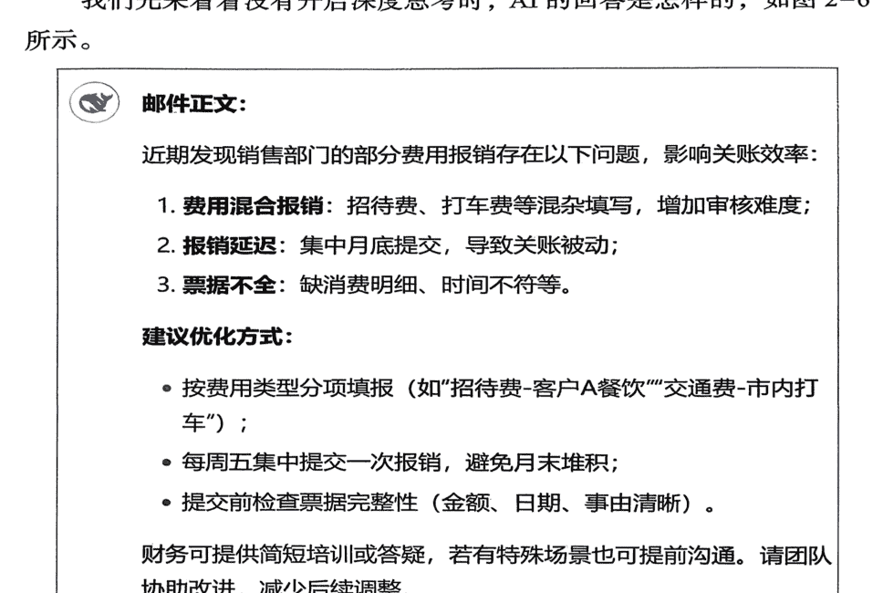

图 2-6 深度思考前 AI（DeepSeek）生成的邮件正文

而开启深度思考后，同样的提示词下，AI 的回复如图 2-7 所示。


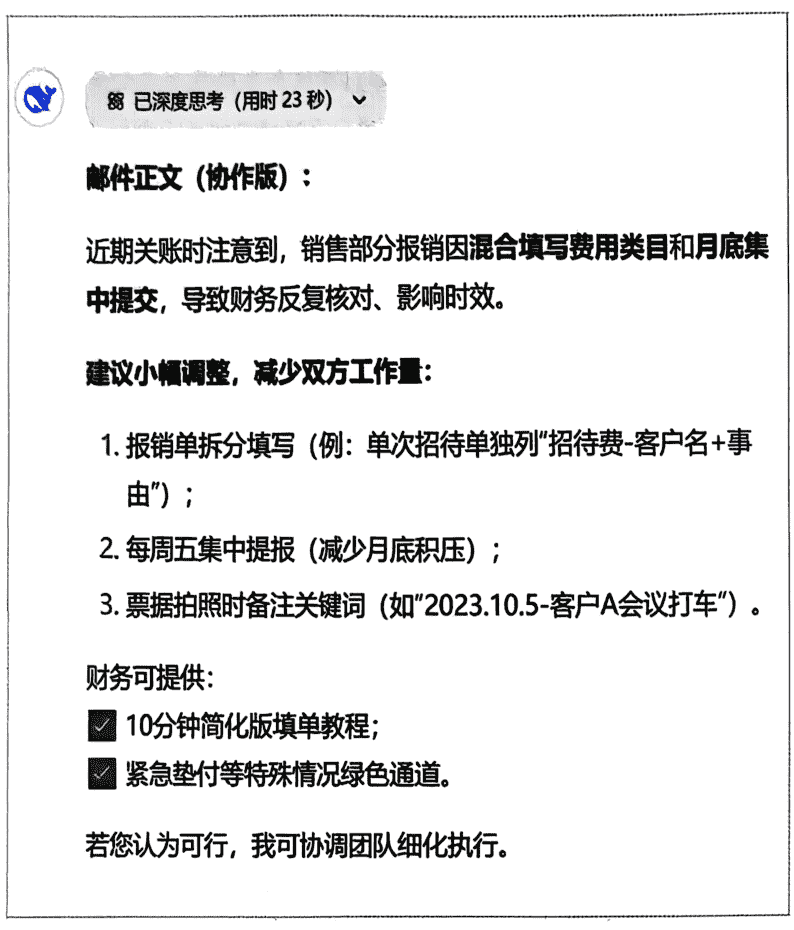

图 2-7 深度思考后 AI（DeepSeek）生成的邮件正文

两封邮件正文的对比，直接体现了深度思考的能力。在深度思考前，邮件内容列出的问题清楚，建议明确，但问题在于语气过于生硬，不像沟通，更像通知。这种缺乏理解和协作的语境，可能会引起对方的抵触，不利于工作的推进。

而开启深度思考后的这封邮件，虽然也有进步的空间，但明显比之前更成熟，展现了 AI 先理解、再优化、最后输出内容的过程。开头不是发现问题，而是注意到关账时出现重复核对，暗示大家都被流程影响了，不是单方面指责。“建议优化方式”也改为了“建议小幅调整”，并说明调整后如何简化他们的工作。结尾一句“若您认为可行，我可协调团队细化执行”，完全体现出合作态度，而非命令式结尾。

有人会说：“语气不对，就多补几条要求，比如‘请语气委婉’‘不要使用命令式表达’，AI 自然就能改好，重新输出答案。”是的，这也的确是一个好办法，但我们并不总是能在写提示词的第一时间就想到所有细节，特别是在赶时间、任务复杂或者还不太熟悉语言调性的情况下，哪怕加了一句“请语气得体”，AI 也可能只是把“请”字多加几个，并不能真正理解“得体”背后的逻辑。

这时候，“深度思考”功能就成了极佳的容错机制。当你没能把提示词写得面面俱到，它可以代你多想几步，减少反复优化提示词、拉长对话时间的情况。

至于另一项搜索功能，其作用是让 AI 模型先到互联网上抓取实时资料，再给出更加具有实效性，也更加全面的答复。

没有搜索，AI 就只能处理提供方的内部文件，打开搜索后，相当于开启了一位网络助手，主动补齐外部资料。

#### ② 启用搜索功能

搜索功能的作用是让 AI 模型在生成答案前，在互联网上抓取实时资料，包括但不限于最新法规、行业均值、公开年报、官方公告、汇率物价等，再给出更加具有实效，也更加全面的答复。

该功能在图 2-5 中也有呈现，除了 DeepSeek，其他 AI 工具也都有此功能，或者有专门的“AI 搜索”板块，如图 2-8 所示。


图 2-8 AI（豆包）的“AI搜索”功能

不打开搜索功能，AI 就只能处理自己提供的内部文件、静态背景或已知常识，无法获取那些时效性强、地域差异大的信息。而一旦打开搜索功能，相当于给它配了一位“网络助理”，能主动去查询外部数据、引用公开来源、补充缺失的行业背景，然后给出更扎实的回答。

那么，哪些问题适合开启搜索功能呢？

##### ✓ 与最新政策口径相关的问题

- 2024年，小微企业能享受哪些税收优惠？
- 出口退税的最新比例是多少？
- 财政部有没有发布针对项目资本化的新解释？

这些问题每年都有更新，AI 模型本身的知识存在一定的滞后性，不搜索就只能靠“旧经验”来回答。

##### ✓ 涉及行业标准或公司经验的问题

- 现在制造业企业平均期间费用率是多少？
- 同行业上市公司一般怎么披露收入确认口径？
- 有没有同行写得好的销售返利会计政策？
- 请找一家制造业企业的固定资产管理制度模板。

这类问题的答案并不在模型知识中，必须上网抓取真实文本来引用。如果不开启搜索功能，AI 只能给出“行业通常是……”“一般为……”等回答，缺少具体引用，也无法提供数据出处。

##### ✓ 涉及市场价格或汇率变动的问题

- 当前美元兑人民币的汇率是多少？
- 2025 年国内机票平均价格上涨了多少？
- 碳排放配额交易的大致价格是多少？

此类问题数值变化频繁，模型无法凭记忆给出准确答案，必须依赖实时抓取。

#### ③ 设定开放式提示词

所谓开放式，指的是那些不预设具体维度、鼓励 AI 自行展开补充和联想的提问。与之相对应的是封闭式，也就是那些有明确答案或者具体判断的提问。
例如：
封闭式：员工餐费报销额度是否超过公司规定？
开放式：员工餐费报销成本过高，可能与什么因素有关？
人类的提问往往带有盲区，通常是想到什么就提问什么；没想到的地方，不会出现在 AI 的答案里。而开放式提问，是告诉模型：“我现在只能看见这么多，你能不能替我看看还有哪些没注意到的？”
这其实是把 AI 变成一个共创者，而不是一个照指令执行的工具。
有人可能担心：如果不给清晰的方向，AI 的回答会不会变得散乱？
其实不用担心。此时我们需要的是灵感，是思路，而不是具体的回复，你可以把整个对话拆成两步：第一轮开放式提问，让 AI 头脑风暴补充思路；第二轮你从第一轮给出的内容中筛选，再做限定式提问，逐项深挖。

比如你先问：“员工餐费报销成本过高，可能与什么因素有关？”
AI 可能会给出报销标准模糊、审核机制宽松、缺乏预审批环节、道德风险行为、物价上涨、行业惯例影响等原因提示，你结合公司情况剔除不相关的因素后，再来要求 AI 比照剩余的原因，审查公司实情是否符合即可。比如，员工餐费报销额度是否超过公司规定？财务审核报销单据的时候，是否要求报销人员提供用餐人员名单或事由说明？这样会更加奏效。

#### ④ 利用好 AI 的灵感提示

在一些 AI 工具中，与 AI 对话之后得到的答复下面，附带着几条可能会用到的提示词，如图 2-9 所示。

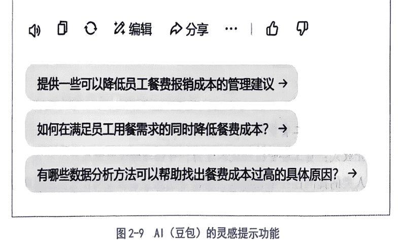

这是 AI 的灵感提示功能，其作用是帮助你从多个角度来扩展思维和创意。上图中这几条提示就是上面“员工餐费报销成本过高，可能与什么因素有关？”的答复下面给出的相关提示词。
这些提示词并非你直接提问时包含的内容，而是 AI 根据提供的背景信息自动扩展的思路，帮助你挖掘更多可能的解决方案或未曾考虑的因素。如果恰好看到你想了解的内容，只需要点击这句提示词就能直接进入对话，无须自己再输入一遍。

除了这种被动的灵感提示，主动要求 AI 来补充灵感不失为更好的办法。用户只需要在提出问题时，加上类似下面的提示词：

在回答过程中，若你认为有相关的优化方向或者未被提及的因素，主动告诉我。

在回答过程中，如果有其他值得注意的建议或细节，麻烦提醒我。

请告诉我你认为最有可能忽视的关键点。

这样，AI 不仅会回答你的问题，还会根据已有的信息，主动向你提供新的视角或补充建议。当然，你也可以明确要求 AI 开拓新的思路，比如：

在这个基础上，请告诉我如何从不同维度重新考虑这个问题。

你能不能给我几个之前没提到过的优化方案？

> **提示词建议：开放式 + 灵感补充（启用深度思考或搜索功能）**

开放式：提出不具有明确限制和答案的开放式问题，让 AI 有更多自由发挥的空间。

灵感补充：在提示词中要求 AI 主动补充它认为可能忽略的或有价值的观点、建议或思路，鼓励 AI 从不同角度探索，找到更多隐藏的思路。

启用深度思考或搜索功能：根据问题的性质考虑启用其对应的功能。

### 2.5 设置 AI 回答格式，轻松实现任务标准化

AI 的核心优势之一就是快速执行任务并提供精确的输出。然而，AI 虽然提供了合格的内容，但直接复制到本地，格式却千奇百怪，导致后续需要进行手动调整，浪费大量时间和精力。

但很多人对此毫无办法，因为大多数人认为 AI 界面的输出是不可以修改的，或者因为自身不懂编程，不知道如何让 AI 直接输出符合特定格式的内容。

例如，你请求 AI 生成一份差旅费报销的标准文件，各版块内容齐全，复制下来却是如图 2-10 所示。

```
**XX 公司差旅费用报销标准**
**（202X 年 X 月修订版）**

##### **第一章 总则**
**第一条 适用范围**
本文件适用于公司全体员工因公出差产生的交通、住宿、伙食及其他相关费用报销管理。

**第二条 基本原则**
1. 费用报销需符合实际业务需求，票据真实有效；
2. 优先选择经济合理的差旅方式，严禁超标消费。

##### **第二章 费用标准细则**
**第三条 交通费**
1. **交通工具标准**
   - **普通员工**：高铁/动车二等座、飞机经济舱、火车硬卧/硬座；
   - **部门经理及以上**：高铁/动车一等座、飞机经济舱、火车软卧；
   - **特殊情况**（如紧急任务、无其他交通方式）需提前提交书面审批。
2. **市内交通费**
   - 往返机场/车站可报销出租车或网约车费用（需提供票据）；
   - 出差期间市内交通费按实报销，单日限额 50 元。
```

图 2-10 复制到本地的差旅费用报销标准文档

复制下来的文档格式混乱，标题层级不清晰，列表符号杂乱无序，字体样式也没有任何区别，一眼看上去像是一段拼贴的文字，需要花时间重新排版。虽然这些小问题也能进行手动调整，但既然都已经实现 AI 办公了，为什么不利用这最后几分钟打通工作效率的关卡呢？

那么，怎么利用提示词直接让 AI 输出格式标准的文档呢？

当然是直接把字号大小、字体类型、行间距、字体颜色、布局结构等格式要求直接写明，并要求 AI 输出 HTML 格式的文件。

为什么要指定 HTML 格式呢？因为 HTML 是结构化语言，支持完整的排版指令。比如，字体、字号、加粗、缩进、行距、颜色、段落间距等。AI 可以直接用代码控制每一个细节。

所以，想让 AI 输出的是“成品”，不是“半成品”，最稳妥的方法，就是清晰注明格式要求，并要求输出 HTML 格式。

**提示词示范：**

生成一份差旅费报销标准文件，以 HTML 格式输出，具体要求如下：

- 正标题：宋体，二号字，居中对齐，段前段后各 1 倍行间距；
- 章标题：黑体，三号字，居中对齐，2 倍行距，段前段后各 0.5 倍行间距；
- 条款标题：黑体，四号字，左对齐，首行缩进 2 个字符，1.5 倍行距，段前段后各 0.5 倍行间距；
- 正文：宋体，小四号字，单倍行距，左对齐，首行缩进 2 个字符；
- 落款：宋体，小四号字，右对齐。

AI 随后会生成一大串代码，接着点击代码框右上角的“运行”选项，如图 2-11 所示。


图 2-11 AI (DeepSeek) HTML 代码 “运行” 选项

运行后，可以看到 AI 已经按照我们要求的格式生成了制度文件（如图 2-12 所示），如果需要将内容下载到本地，也只需要点击 “运行” 按钮左边的 “下载” 选项。

下载到本地后，将全文复制到本地文档中，格式就能保留下来。

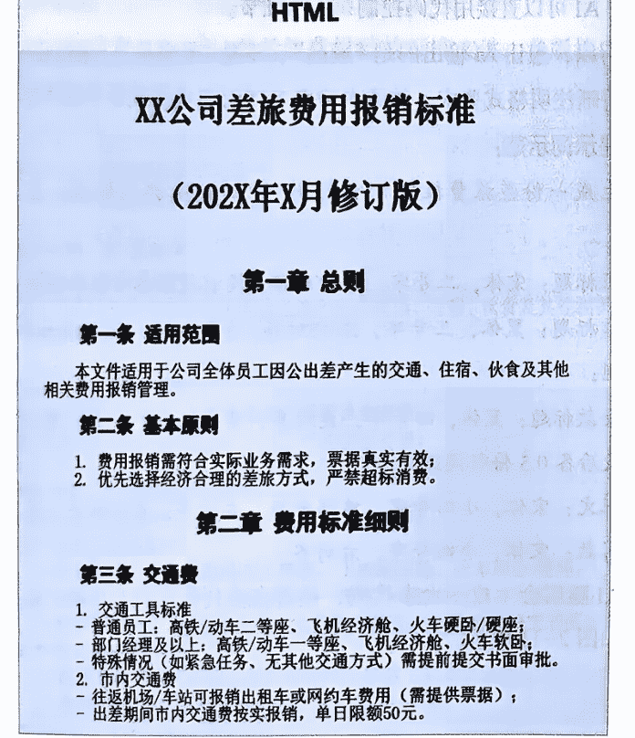

图 2-12 AI (DeepSeek) HTML 代码 “运行” 结果

提示词建议：格式要求 + 以 HTML 格式输出

格式要求：明确指定文档的标题字号、正文字体、段落间距、列表样式等排版细节，让 AI 在生成内容的同时，也把格式一步到位处理好。

以 HTML 格式输出：要求 AI 将内容按 HTML 格式输出，可以完整保留字体、字号、行距、段落、列表、缩进等排版结构，复制到 Word 后即为标准成稿。

# 第 3 天
## AI 高效阅读与信息整理实战

在财务工作中，你是不是常常面对堆积如山的文件、政策、合同？想要快速抓住核心信息，却总被海量资料搞得昏头昏脑。

今天，我们将进入 AI 高效阅读与信息整理的实操环节，带你逐步掌握快速整理行业资讯、精准总结会议内容、高效解读政策文件和识别合同风险的关键技能。综合运用 AI 的力量，让你在信息爆炸的时代轻松驾驭数据，快速捕捉有价值的信息。

> 大数据时代缺的不是信息，而是抓住重点的能力。

### 3.1 财务行业新闻快速整理与关键字提醒

关注财经新闻是很多财务人员日常工作的一部分，职位越高，对财经新闻的关注度越高。比如，行业里出现了并购潮、某竞争对手融资扩张、原材料市场有了波动、社会保险有调整传闻、人民币汇率又出现变化等，这些消息潜移默化地影响着公司的预算模型、成本测算、资金安排、汇报口径等内容。

大数据时代，一天几百条公众号更新、几十个财税群消息的推送，还有新闻网站、财经热榜，甚至包括公司群的“转发分享”，没有人能一条条看完，更别说每条都总结重点了。

我们不妨换个处理思路，与其逐字查看，不如让 AI 先帮你读完，再告诉你该看什么。

【实战任务】
假设你是某制造公司的财务经理，每天要关注制造业行业投融资情况、主要的原材料价格趋势、汇率变动与出口订单波动、国内大型制造企业的财务运作。

【实战操作】

#### ① 归集新闻源

要想每天快速掌握制造业相关的新闻重点，真正高效的做法，是先让 AI 帮你搜集一批稳定可靠的新闻来源，将它们作为固定的“信息池”，后续的所有搜索、筛选、提炼，都是基于这些“信息池”来完成的。

不过，AI 并不会凭空知道你习惯从哪里获取信息，你需要为它提供一些方向。如果用户本身有常用的网址，直接提供给 AI 即可，但如果没有，也可以让 AI 进行推荐。

##### 提示词示范：

“我是一名制造企业财务经理，每天要跟踪制造业行业的动态，尤其关注投融资、原材料价格与出口订单波动，以及国内大型制造企业的财务动作，请列出 5 个权威的主流中文财经媒体网站（含链接），要求资讯更新稳定，若有制造业相关专题内容则更好。”

这一步需要把联网搜索功能打开，AI 收到指令后组织语言进行回答，最后生成一个网址清单，如图 3-1 所示。

以下是 5 个权威的主流中文财经媒体网站，以及对其在制造业相关方面的简短介绍：

1. **新浪财经**：https://finance.sina.com.cn/。依托新浪门户流量优势，更新及时，内容涵盖广泛。在制造业方面，会报道企业股票动态、重大投融资事件，分析原材料市场和出口政策对制造业的影响，也有大型制造企业财务报表分析等内容。
2. **财新网**：https://www.caixin.com/。以深度报道和实时资讯结合著称，团队反应迅速。有丰富的制造业相关内容，如行业趋势、企业动态、政策影响，还会涉及原材料价格波动、出口订单情况及大型制造企业财务状况等报道。
3. **21 经济网**：https://www.21jingji.com/。以区域经济和行业分析为特色，内容更新兼顾时效与连续性。从宏观经济角度关注制造业发展环境，报道行业动态、企业投融资活动，以及原材料价格波动和出口订单变化等。
4. **第一财经网**：https://www.yicai.com/。整合多种资源，有专门的产业经济板块重点关注制造业。报道政策动态、行业发展趋势、企业经营状况，涉及原材料市场动态、出口相关信息，也可能有大型制造企业财务分析报道。
5. **经济观察网**：https://www.eeo.com.cn/。是《经济观察报》旗下新媒体平台，为商业人群提供有价值的财经资讯。有记者关注科技领域的新能源、半导体、电子通信等科技制造企业，会从多方面报道制造业相关内容，为财务经理提供决策参考。

图 3-1 AI（豆包）生成的新闻网址清单

你可以把这些网址保存下来，做成一个固定的信息源清单。单独开启一个 AI 聊天窗口，每次提取新闻都打开同一个对话页面。因为同一个聊天页面可以保留对话记录，所以不需要每天发送一遍网址给 AI 就能快速获得答复。

#### ② 利用关键词定向筛选信息

有了新闻网址清单并不等于信息已经准备好。真正的关键，是让 AI 知道你的关注重点。你必须告诉它：哪些内容是你关心的，哪些是可以忽略的。

这一步操作的核心，就是提前设定关键词。

关键词如何设定？你可以从平时最关注的内容里提取。例如，你关注投融资情况，可以用“融资”“投资”“募资”“并购”“扩产”等关键词；关注原材料价格与出口订单波动，可以用“钢铁”“铜价”“锂矿”“大宗商品”“出口订单”“外贸出口”“汇率波动”等关键词；关注国内大型制造企业的财务动向，直接用这些公司的名称以及“净利润”“现金流”“财报”等关键词。

提示词示范：

请从以上新闻网站中筛选 24 小时内更新的内容，筛选目标是出现以下关键词的文章，关键词出现 3 次以上的内容要重点关注，进行新闻要点汇总。关键词包括：融资、扩产、钢铁、铜价、出口订单、外贸出口、XX 公司、净利润、现金流。

这样，AI 在搜索过程中就会定向筛选内容，有选择性地过滤冗余信息、提取重点，如图 3-2 所示。

如果你关注的维度有所变化，也可以根据情况动态补充关键词。比如，某段时间你在做出口补贴的测算，可临时加入“出口退税”“财政补贴”等关键词；另一段时间你在准备费用预算评估，就加入“费用率”“期间成本”等关键词。

- **21 经济网**：今年前 4 个月我国货物贸易进出口总值 14.14 万亿元，外贸平稳增长。其中出口 8.39 万亿元，增长 7.5%。4 月当月，出口 2.27 万亿元，增长 9.3%。前 4 个月我国汽车产销量均超 1000 万辆，1 至 4 月分别为 1017.5 万辆和 1006 万辆，同比分别增长 12.9% 和 10.8%，其中新能源汽车产销量分别为 442.9 万辆和 430 万辆，同比分别增长 48.3% 和 46.2%。圣诞用品订购旺季提前，义乌经营户表示订单已排到 6 月。
- **经济观察网**：工信部消息，5 月 7 日，机械工业环保产业发展中心在河北唐山举办 2025 再制造产业发展大会，推动机电产品再制造产业规范化、高质量发展。国家统计局数据显示，4 月份全国工业生产者出厂价格同比下降 2.7%，工业生产者购进价格同比下降 2.7%。海关总署 9 日公布，前 4 个月我国货物贸易进出口总值 14.14 万亿元。

图 3-2 AI（豆包）生成的新闻摘要

这一操作本质上是让 AI 更懂你。正如你在刷新闻时，会自动关注标题、识别重点、略过不相关内容，AI 同样被赋予了这样的“筛选意识”。

#### ③ 生成个性化摘要

关键词筛选完毕后，下一步是把有用的内容提炼成结构清晰、便于阅读的摘要。在这个步骤，建议写清楚摘要的具体要求，例如，你希望以什么格式展示、需要包含哪些要素、是否要分类输出，等等。

**提示词示范：**

请将以上新闻内容按关键词对应的主题进行分类，每个主题下列出与今日相关的新闻摘要。每条摘要包含来源、时间、标题、简要信息以及一句可能影响企业财务工作的点评。

此时，AI 返回的内容会如图 3-3 所示。

外贸出口 / 出口订单

- 来源：21经济网
- 时间：2025年5月12日（文中数据为前4个月情况）
- 标题：无明确标题
- 简要信息：今年前4个月我国货物贸易进出口总值14.14万亿元，外贸平稳增长，其中出口8.39万亿元，增长7.5%；4月当月，出口2.27万亿元，增长9.3%。圣诞用品订购旺季提前，义乌经营户订单已排到6月。
- 点评：外贸出口的增长将增加企业的营业收入，改善企业的财务状况，同时订单的提前预订有助于企业合理安排生产和资金周转。

图3-3 AI（豆包）生成的个性化摘要

如果你对摘要的呈现还有更具体的偏好，比如希望以表格形式输出，或者希望将点评篇幅限制在20字以内，也都可以提前在提示词中说明。

个性化要求越细致，生成的结果就越贴近你日常使用的格式和内容，也就越省得你手动调整格式或重写内容。

#### ④ 历史新闻回顾

日常新闻阅读不只是当天有用，信息经过长期沉淀后，会形成可随时追溯的历史资料。AI工具不仅可以帮你做当日新闻摘要，还可以辅助你定期梳理和回顾过去一段时间内的重要新闻动向。

这也是之前强调在同一个聊天窗口中向AI持续提问的原因，这样就能将历史对话留存下来，方便后续的回顾总结。

提示词示范：

请根据我过去三周每天整理的行业新闻摘要，从中筛选出在“外贸出口”“汇率变化”和“订单安排”这三个主题中重复率最高的关键词或事件，整理成一份阶段总结。

这种阶段性总结的价值，在于把零散的信息变成有结构的趋势判断，尤其适合财务经理在编写月度汇报、复盘季度走势、准备预算调整依据时使用。

过去，我们需要人工翻查邮件、群消息、Excel 表格记录，才能拼凑出一条主线，而现在只要用一段话提示 AI 关注的主题，它就能自动识别关键词出现频次、事件提及重合度、舆情演变节奏，甚至画出“话题热度变化曲线”。

如果你日常有把摘要内容保存为 PDF、Word 或 Excel 文件的习惯，也可以把这些文件上传给 AI，再用提示词引导它输出你需要的内容。

**提示词示范：**

请整理这些内容中体现原材料价格变化方面的信息，并列出高频动词和主语的组合模式。

这种分析的颗粒度甚至可以达到语义层面，非常适合用于风险监控和决策准备。

因此，别低估历史回顾的价值，它不仅是资料复用，还是站在信息堆顶看全貌的最佳方式。只要你持续输入，AI 就能持续记得，并且记得更全面。

### 3.2 智能总结财务会议内容，生成思维导图

在财务工作中，会议是日常工作内容。不管是预算沟通会、成本复盘会、销售收款协同会，还是一个临时对账协调会，都会产生大量的信息和对话细节。而这些内容往往都需要在会后转化为报告、纪要、结论、决策方向，或者要进一步拆分成具体任务交给相关人员执行。

一方面，会议内容纷繁复杂，讨论节奏快，话题跳跃度大，口头表达还经常省略主语、宾语；另一方面，财务工作人员又需要“以数据为基础、以结构为导向”汇报会议结果，这就为财务人员带来不小的工作量。

有了生成式 AI 的协助，财务人员可以把会议记录内容直接交给 AI，让它快速提取核心要点，并用思维导图的方式，整理清楚“会议都讲了什么”“讨论结构是什么样”“有哪些问题被提出来了”“谁负责哪些任务”，等等。

【实战任务】

假设公司召开了一场预算执行协调会，主要参与者包括财务部、市场部、供应链和销售部。会议内容围绕“上季度预算执行偏差”的原因分析展开，涉及市场促销费用超支、库存积压、返利核销滞后、销售收款延迟等多个方面。整场会议时长 70 分钟，大家边说边讨论。作为参会人员，你需要整理一份清晰的会议总结。

【实战操作】

#### ❶ 会议实时录音转文字

通义的“实时记录”功能定位就是“AI会议纪要神器”，如图 3-4 所示。


图 3-4 AI（通义）“实时记录”功能

该功能的原理与我们前面介绍过的音视频转文字是一样的。只不过该功能支持语音的同步转写，也就是在会议过程中，一边讲话，一边转写生成逐字稿文本。

在通义首页的侧边栏“发现”中找到“实时记录”入口，点击“开始录音”，会进入录音前的设置页面，如图 3-5 所示。

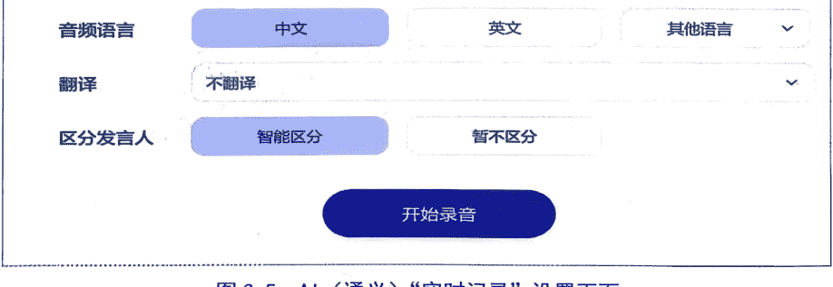

图 3-5 AI（通义）“实时记录”设置页面

这里可以选择音频语言，是否进行翻译，是否需要区分发言人。区分发言人是一项有意思的 AI 功能，也就是 AI 通过音色来判断会议上的发言是由何人所说，相同音色的发言会被归于同一位发言人。

进入会议后，点击“开始录音”选项。AI 开始自动记录会议中每一位发言人的发言。如果有多位发言人，它会根据不同的音色自动识别发言人。

会议结束后，所有的发言就已经被 AI 逐字逐句地记录下来，且整理成了一份对话式的会议记录，如图 3-6 所示。


点击播放录音，播放到哪句话，对应的内容就会自动凸显出来。

#### ② 修改替换内容

AI 的实时录音转文字虽然高效，但转写过程中难免会有少数错误，比如一些专业术语的转写不准确，或者发音不清楚的地方转写有误。
这在对话记录中可以直接进行修改，将鼠标放在文字记录中即可选中，进行编辑，如图 3-7 所示。


对于会议中多次出现的错误短语，AI 提供了查找与替换功能，支持批量修改，如图 3-8 所示。


#### ③ 会议纪要导读

逐字版本的会议记录看起来十分繁琐，最终需要总结成会议纪要。利用 AI 的会议纪要导读功能，可同步将长篇的会议记录精简为一目了然的要点，帮助财务工作人员快速回顾会议中的核心内容，如图 3-9 所示。

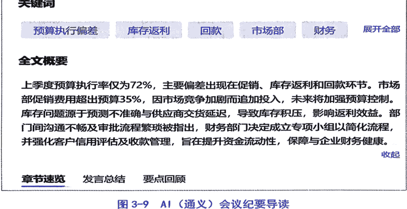

可以看到，图中有关键词、全文概要、章节速览、发言总结、要点回顾这些功能板块。

关键词通常是从会议记录中提取出来的，包括会议的主题、讨论的关键问题、涉及的部门等。

全文概要则是一段简洁的概述，帮助财务工作人员快速把握会议的大体内容。这部分概要通常包含会议讨论的主要方向和核心结论。

章节速览是 AI 将较长的会议记录分为多个章节进行展示。每个章节包含与之相关的要点，帮助你快速找到每部分讨论的重点内容。这对于需要跟进多个部门或项目的会议尤为重要，AI 可以按部门或主题生成不同的速览。

发言总结是 AI 根据会议发言人的言论提炼出每个发言人的核心观点，并简洁地总结。

最后是要点回顾，AI 归纳出会议讨论的要点和解决方案，尤其是针对需要后续跟进的事项。这些要点会直接列出，如“市场促销费用超支，需加强费用控制；库存管理滞后，建议定期进行库存盘点”。

#### ④ 生成思维导图

当文字内容确定后，接下来就是“可视化”。AI 能够按照用户需求自动根据会议记录内容生成思维导图，如图 3-10 所示。

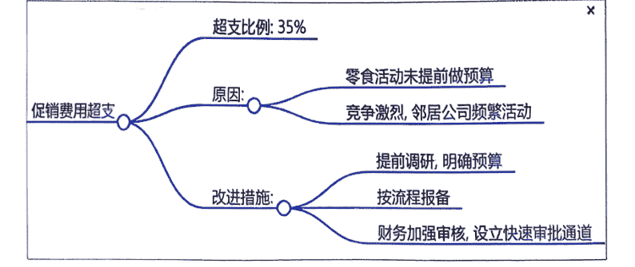

图中展示的是会议的一部分重点内容，由于页面篇幅有限，不方便展示完整的思维导图，但其中一部分已经足够让我们清楚地认识到 AI 在此方面的能力。

#### ⑤ 导出相关内容

智能总结财务会议内容进行到这一步，就只差最后的导出了。我们需要的东西自然不能只留在网页上，一般都要下载保存到电脑中才算结束。

这一步就是教你如何导出相关内容，在页面的右上角有一个“导出”选项（如图 3-11 所示），点击会弹出菜单。

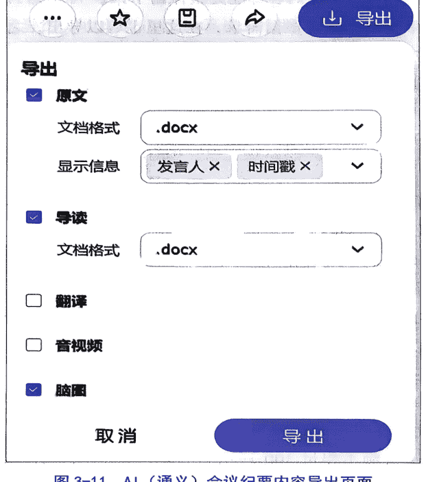

图 3-11 AI（通义）会议纪要内容导出页面

用户可以选择导出原文的格式，一般来说是 .docx 格式的文件，这样文档就能在 Word 中打开，修改起来比较方便。当然，如果没有需要修改的地方，导出 .pdf 格式的文档也是可以的。用户还可以选择原文呈现的方式，选择是否显示“发言人”和“时间戳”，如果勾选了，那么导出的内容中，每句发言的时间和内容都会被标注出来，方便用户后续查看具体的发言人和讨论细节。

如果用户不需要全篇内容，只想看会议的核心要点，则可以选择“导读”功能，它会提炼出会议的精华部分，节省用户时间。

如果会议有翻译需求或者涉及音视频，用户也能在导出的时候勾选相应的选项，确保所有的内容都能完整保留下来。

至于思维导图同样是根据需求，在这里也可以导出，之前在点开查看思维导图的时候，页面下方同样有导出选项，可以单独导出。

### 3.3 政策解读与条件适配提醒

每次出台新的税收优惠政策，企业总是格外关注。但能不能享受优惠，需要看公司是否符合政策发布的条件。

这就需要财务人员去解读政策内容，花时间核对公司数据，包括公司应纳税所得额、员工人数、资产总额等，然后才能判断。生成式 AI 工具对此是有解决方案的，它能帮你快速对照政策要求和公司现有数据，直接告诉你哪些条件符合，哪些需要调整。

【实战任务】

根据《关于进一步支持小微企业和个体工商户发展有关税费政策的公告》（财政部税务总局公告 2023 年第 12 号）的规定，对小型微利企业年应纳税所得额不超过 300 万元的部分，减按 25% 计算应纳税所得额，按 20% 的税率缴纳企业所得税。

一家从事文具生产与销售的企业看到这条税收优惠政策，想判断自己公司是否在优惠覆盖范围内。

【实战操作】

#### ❶ 归纳政策要求

之前在文本生成功能中介绍过信息提炼与整理、资料搜索与问题解答，以及内容分析与判断等这些细化的功能，该案例场景是一项综合性的实战演练。

我们首先要用到的是信息提炼与整理功能，部分生成式 AI 工具有专门的网页链接解析功能，输入网址链接后会同步提取要点，实时翻译，生成思维导图，也能自己添加笔记，会比直接在对话框中提问更加方便。

这里以通义为例，通义中的“链接速读”功能是用于解读网页。该功能页面如图 3-12 所示。

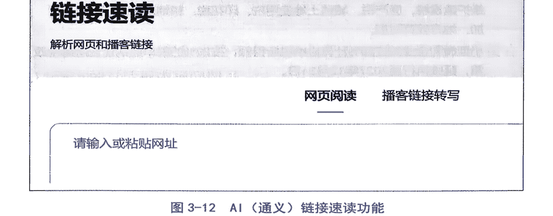

该功能不需要任何提示词，只需要把政策公告的网址复制到输入框中，点击“确认”，通义会自动上传记录，开始进行解析，如图 3-13 所示。

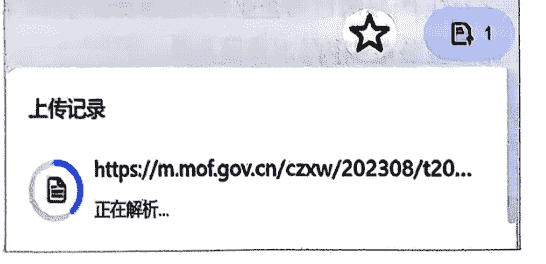

图 3-13 AI（通义）解析网页链接内容

解析完成后，点击“立即查看”就会直接进入内容导读页面，如图 3-14 所示。

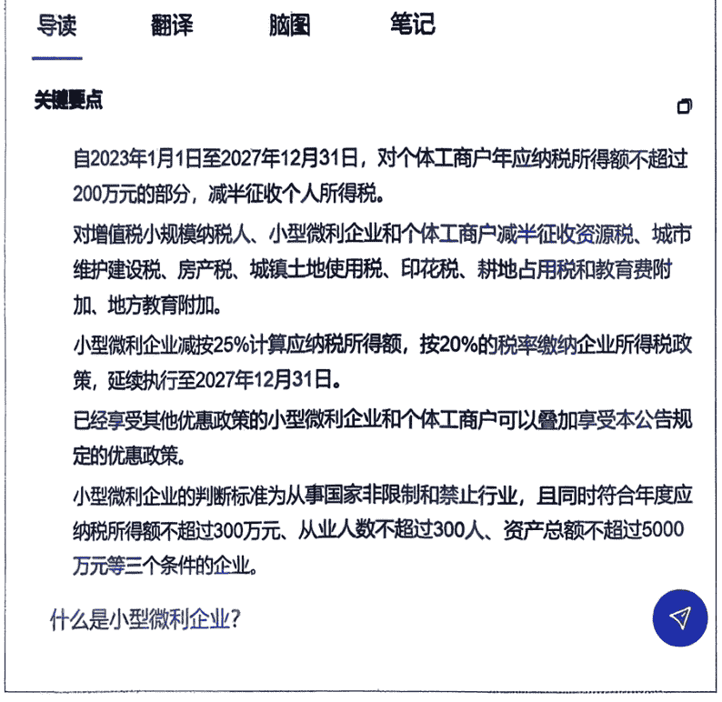

图 3-14 AI（通义）内容导读

这张图是 AI 解析完网页链接后的界面，AI 能自动提取“要点”。

不用你去一段段读整篇文章，AI 会直接帮你抓住文章的核心内容。

比如，图中是小微企业税收优惠政策，AI 已经把时间范围、适用对象、减免内容、执行期限、判定标准这些内容都清楚地列出来了。你不需要自己总结，打开链接后直接就能看到，如果文字看起来不直观，同样可以点击思维导图进行查看，这里不再过多进行演示。

整个页面看起来与上一节介绍的会议纪要功能页面有些类似，但这里多了一项功能，也是至关重要的功能，那就是下方的问答对话框。你可以在这里接着提问，不需要任何角色赋予、专业设定，AI 就可以围绕这篇政策公告进行针对性地回答。

例如，你可以针对政策文件提问：
“什么是小型微利企业？”
“这项政策适用于哪些小微企业？”
“减税优惠的具体标准是什么？”
“如何判断公司是否匹配得上？”

#### ② 提问对照

若是用户想知道企业是否与该税收优惠政策相适配，直接在图 3-14 下方的对话框中提问即可。

**提示词示范：**
该政策的适用条件都有哪些？
AI 的答复如图 3-15 所示。

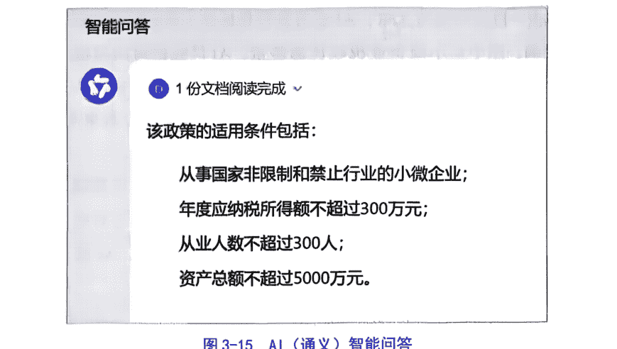

图 3-15 AI（通义）智能问答

这里列出了 4 个适用条件，我们可以逐一进行对比。不过，接下来的提问过程需要切换到一般对话框中进行，因为智能问答只能回答该网址中提到的内容，网址中没有提到的内容无法进行准确答复。

先确定行业属性，政策要求必须是从事国家非限制和禁止行业，企业从事文具生产与销售，属不属于此类呢？直接提问即可。

**提示词示范：**

在行业分类中，文具生产与销售是否属于国家非限制和禁止行业？

AI 的答复如图 3-16 所示。

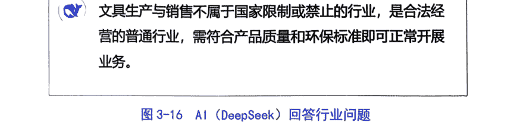

图 3-16 AI（DeepSeek）回答行业问题

剩下的 3 个条件属于公司数据内容，由于条件较少，直接查找得到结果的速度可能会更快。但如果条件多，包含行业、从业人数、注册资本等在一些公开的企业信息查询平台中能查到的信息，你可以将平台的网址链接发送给 AI，要求其总结公司的相关信息。

假设我们现在已经得到公司的数据如下：

- 年度应纳税所得额 280 万元；
- 从业人数 130 人；
- 资产总额 2980 万元。

那么将以上条件与图 3-15 匹配，就会发现公司完全符合此次政策。

### 3.4 快速识别合同，找出潜在不利条款

在公司日常运营中，合同是必不可少的。每份合同都关乎公司的利益和责任。不过，合同条款中往往藏着不少风险因素，看起来是些小细节，一旦没注意，后面可能带来大麻烦。

合同审查也不只是法务的事情，财务人员也需要特别关注可能影响现金流、支付条件或者带来额外费用的条款。比如，合同里有没有不合理的付款周期？有没有对未来费用的模糊条款？

AI 在此类工作场景中也能派上大用场，它能够找到那些可能影响公司利益的条款，比如一些不合理的支付条款、隐性费用或者不公平的责任分配等，作为人工的补充。

【实战任务】

某小型科技公司（甲方）拟与外包团队（乙方）签订《软件定制开发合同》，合同主要内容如下：

# AI 财务实战入门：7 天就能轻松上手

第一条 开发内容及要求
乙方需按照甲方提供的需求文档，完成[软件名称]的定制开发工作，包括前端、后端及数据库开发。

第二条 开发周期
本项目开发周期自合同签订之日起6个月，乙方应于截止日期前交付最终软件成果。若因甲方任何原因导致开发延期，乙方无需承担任何责任。

第三条 费用及支付方式
1. 本项目总费用为人民币 [X] 元。
2. 甲方应在合同签订后5个工作日内支付30%首付款；软件交付并验收合格后10个工作日内支付60%尾款；剩余10%作为质保金，在质保期（12个月）满后5个工作日内支付。
3. 若甲方未按约定时间支付款项，每逾期一日，需按照未付金额的10%向乙方支付违约金。

第四条 验收标准及方式
1. 软件验收标准以甲方提供的需求文档为准。
2. 甲方应在收到乙方交付的软件成果后30日内完成验收，若逾期未验收，视为验收合格。

第五条 知识产权
软件著作权归乙方所有，甲方享有该软件的永久使用权。

第六条 违约责任
1. 若乙方未按约定交付软件，每逾期一日，按照合同总金额的0.1%向甲方支付违约金；逾期超过30日，甲方有权解除合同，并要求乙方退还已支付款项。
2. 因软件质量问题导致甲方产生损失的，乙方仅承担软件修复责任，不承担其他任何赔偿责任。

第七条 争议解决
双方在履行本合同过程中发生的争议，应首先通过友好协商解决；协商不成的，提交甲方所在地人民法院诉讼解决。

该公司目前没有专职法务人员，你需要审查其中的条款，辨别有没有合同风险。

## 【实战操作】

#### ❶ 要求 AI 总结审查重点

在正式上传合同文件前，首先让 AI 总结出合同审查的要点。这一步不是画蛇添足，而是通过分步提问，提升 AI 的分析效果，否则后面正式提问时不知道让 AI 重点审查哪些内容。

**提示词示范：**

你是一名财务经理，拥有丰富的法律知识，负责审查公司对外签订的合同。请总结在审查合同时，你会依次审查哪些关键条款。

这是一个开放式的提问，让 AI 总结所有的关键条款，最好不要自己附带举例，比如支付条款、违约责任等，这样会限制 AI 的思考范围，围绕所给示例去回答，不再主动拓展。

AI 的答复如图 3-17 所示。

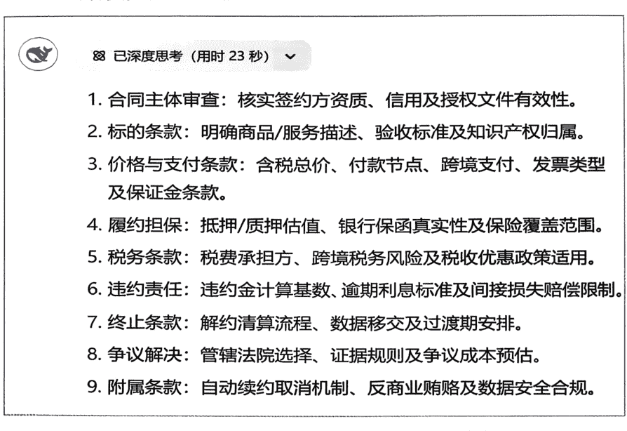

图 3-17 AI（DeepSeek）总结合同审查关键条款

现在，我们相当于拥有一份审查清单，里面详细列出了所有关键条款，让我们知道在正式审查合同时需要特别注意的内容。

#### ② 隐去敏感信息后上传合同文本

为了保护公司隐私和权益，合同中涉及的所有敏感信息需要提前进行模糊化处理，比如公司名称、合同金额、特定日期等，可以替换成通用的标签，例如“XX公司”“XX金额”，这一步直接在办公软件中查找替换即可。

处理完合同内容后，就到了上传环节。若合同是电子文档，用户直接将合同文件拖动到 AI 对话框中，松开鼠标即可开始上传，上传后就作为一个附件存在于对话框的上方，如图 3-18 所示。对话框中还是可以正常输入提示词。


图 3-18 AI（DeepSeek）文件上传页面

如果合同是纸质文档，则先要通过扫描仪或者利用手机拍照，将纸质文档转换成电子文档，再进行上传。AI 同样支持图片格式以及 xlsx、ppt 等格式的文件上传，如图 3-19 所示。

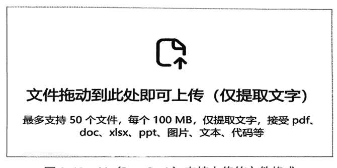

图 3-19 AI（DeepSeek）支持上传的文件格式

合同文本上传完成后，AI 将自动提取关键信息，为下一步的分析做准备。

#### ③ 依次查找不利条款

合同文件上传成功后，用户输入提示词就能要求 AI 按照审查清单来审查特定合同中是否存在风险点或者不利条款。

**提示词示范：**

> 请根据你总结的审查要点，逐条检查这份合同，找出可能对公司不利的条款，并标注解释和风险等级，等级从 1-5，数字越大，风险程度越高。

AI 答复如图 3-20 所示。

不是所有人都能一眼看出合同条款中的漏洞，特别是对财务人员来说，平时很少去仔细研究法律表述。而且，人工审查合同也存在一定的局限性，现在用户利用 AI 按照设定的审查思路来检查合同，每次的输出稳定，对没有法务经验的人来说特别实用。

# AI 财务实战入门：7 天就能轻松上手

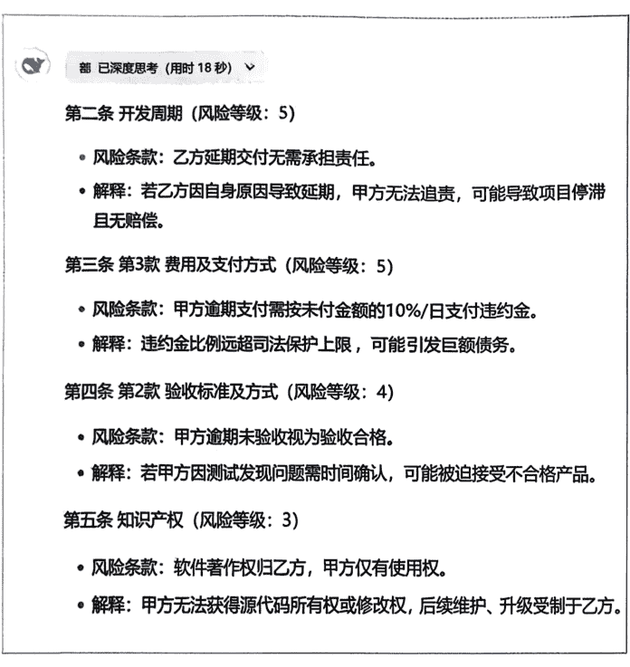

图 3-20 AI (DeepSeek) 审查合同

#### ④ 追问修改细节，输出规范合同

找到风险点的下一步是根据 AI 的建议结合自身情况对合同进行逐条修改。

比如合同中的第二条，只约定了因为甲方导致延期，乙方不需要承担责任，但没有明确约定因为乙方原因导致延期，乙方需要承担的具体责任。若出现因乙方原因导致开发延期，甲方便无法追责，只能自己承担项目停滞的损失。

现在要如何更改呢？

**提示词示范：**

你是一名财务经理，拥有丰富的法律知识，已经识别出合同中第二条款存在风险。该条款只说明甲方原因导致延期乙方免责，但未说明若因乙方原因导致延期，乙方应承担的责任。请你修改这一条款，使其更加完整、有利于保障甲方权益，同时表述清晰、规范。

AI 的答复如图 3-21 所示。

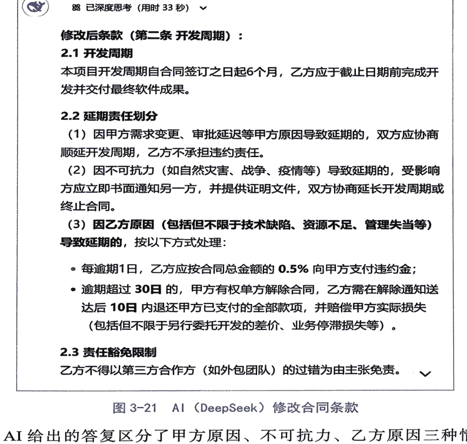

AI 给出的答复区分了甲方原因、不可抗力、乙方原因三种情形，其中关于乙方原因的板块，详细列举了乙方原因的典型情形，如技术缺陷、资源不足等，降低了争议的可能性。在违约责任上，采用阶梯式违约责任设定，最后还补充了责任豁免限制，排除了第三方责任。

对比下来，这个结果比原本的合同条款要完善。后续针对前面审查出来的各项不利条款一一进行修改，最后就能得到一份全新的合同文本。

不过，AI 虽能对合同进行风险分析，但无法替代专业律师。例如，涉及跨境交易、特殊行业资质要求、复杂股权架构等合同，其中的法律关系和风险点较为复杂，AI 可能难以进行深入、准确的分析。而且，法律法规处于不断更新变化中，AI 的知识储备可能存在一定的滞后性，对于最新颁布或修订的法律法规，可能无法及时、准确地将其应用到合同分析中。

因此，企业不能完全依赖 AI 的分析结果，需人工结合最新法律法规对建议进行验证，必要时需咨询专业律师。

# 第 4 天
## AI 文档写作托管实战

在财务部门的日常工作中，财务制度、合同模板、分析报告这些文档，总是耗费财务人员大量的精力去整理和撰写。如果有 AI 帮忙自动生成一个初稿，用户再去进行小范围的修改和完善，是不是能瞬间减轻一大半的工作量？

本章将演示如何让 AI 成为用户的私人写作助理，输出高质量的财务文档。拥有了这项技能，写作就再也不是负担，而变成了优势。

> 专业的表达，不必每次都从零开始。

### 4.1 智能输出工作场景中的标准话术

有没有那么一瞬间，你写完一段业务内容却迟迟不敢发出去？既担心语气太生硬得罪人，又怕别人不当回事。与其苦思冥想，不如交给 AI 来处理。生成式 AI 是一个“语言助手”，它擅长把你的想法包装得合情合理、得体又有分寸。

这节教你怎么用 AI 写出心中的设想。不论是催预算、报进度、要发票，还是解释付款延后的原因，都能轻松搞定。

【实战任务】

一家零售公司的财务 BP 入职不久，因为工作性质不仅需要跟十几个门店经理打交道，对接总部预算组和资金组的各种表单，还要和人事部门、供应商、部门同事等进行日常交流，每天有一半的工作时间都花在沟通上。现在需要借助 AI，提高自己的沟通效率。

【实战操作】

#### ① 生成汇报说明

在财务汇报场合中，说清楚数据变化的来龙去脉，往往比数据本身更重要。尤其在面对管理层时，如果语言模糊、逻辑不清，轻则让人听不懂，重则让人误判决策依据。有经验的财务人员，用简洁的语言就能把复杂问题讲清楚。经验不足的财务人员则可借助生成式 AI 做到汇报环节的精准表达。

假设你在准备部门月度经营简报，其中有一个特殊情况——销售费用预算 100 万元，实际支出 120 万元，偏差 20%。产生差异的原因是华东区临时上新两款推广商品，短期投放，物料成本和线上广告费用同步增加。

你希望强调情况属实，但属于业务节奏变动引发的阶段性偏差，无需过度反应。

**提示词示范：**

请写一段适合在部门月度经营会上使用的简要汇报话术，背景是销售费用比预算高出 20%，主要原因是上海地区两款新商品临时上线，加大了物料和广告投入。这属于计划外支出，不过，业务部事先有通报，只是预算未同步调整。要求语气客观专业，适合在领导层面场合使用。

AI 的答复如图 4-1 所示。

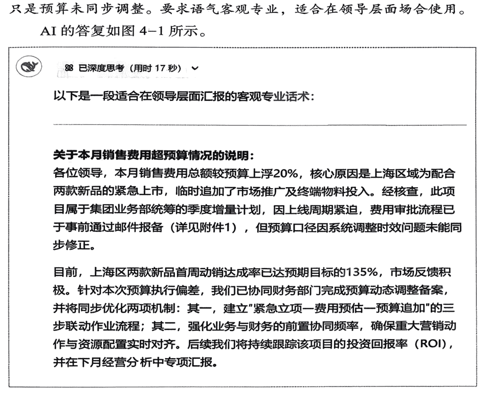

图 4-1 AI（DeepSeek）生成的汇报话术

这段话术的逻辑是“结果—原因—影响—后续措施”，是典型的汇报框架，既坦陈了问题，又展现出自身工作的能动性，可以直接在简报中使用，也适合在会议口头汇报时引用。

#### ② 生成催进度消息

催预算、催发票、催数据、催审批表等，这些催促工作进度的事项是职场人经常面对的沟通场景之一。因为财务工作的很多任务节点是“卡”在别人手里，而你要对最终结果负责。

催促本身并不难，难的是如何在不破坏关系的前提下，让对方听得进去、愿意配合、尽快行动。毕竟催得太急容易引起对方反感，催得到位又起不到作用。

生成式 AI 在这类工作场景中的作用不是“代发消息”，而是快速替你打好草稿，再结合自身情况进行微调。提问的关键在于告诉它三个要素：提醒谁？提醒什么？想怎么提醒？

比如现在是月底，你需要催 5 家门店上传当月费用台账。你已经在群里发过一次“请尽快提交”，但两天过去了没人提交。这时候你不想继续用温和的语气催办，而是希望稍微加强语气，但又不至于让人反感。

**提示词示范：**

请写一段用于发微信群的催进度话术，提醒华东区 5 家门店提交费用台账。本周已经提醒过一次，但至今无人提交，希望语气强硬一点，但别太生硬，要求今天下班前提交。

AI 的答复如图 4-2 所示。


图 4-2 AI（DeepSeek）生成的催进度话术

这段内容直接指定具体门店负责人，弱化了群体指向性，并且开头用“紧急通知”替代“提醒”，中间使用“务必”“立即”强化要求强度，比较符合目前紧迫的催促需求。

如果换一个实际场景，假设这是第一次提醒，语气就可以缓和一点。

**提示词示范：**

请写一段用于微信群发的提醒信息，提醒各门店提交费用台账，语气友好但明确截止时间为本周五。

AI 的答复瞬间就变换了一种语气，如图 4-3 所示。


图 4-3 AI（DeepSeek）生成的提醒话术

“协助”“伙伴”等词可以建立起协作感，避开了命令式表达，而要求群内同步留言，则是利用群体效应推动执行，最后的“辛苦啦”配上花朵的表情，都属于柔性内容，是专门用来平衡语气的。

可见，相似的场景，同一件事情的沟通，在不同时间段都会有不同的语言节奏。

#### ③ 生成制度变更通知

制度变更类的通知是最考验措辞的。特别是在财务工作中，涉及预算审批规则、报销范围调整、发票合规要求更新等内容，往往代表着“流程更复杂了”，如果直接贴条通知“按新制度执行”，很容易引起大家的抵触情绪甚至误解。制度变更不是简单告知，而是让人理解、接受、配合。

用生成式 AI 来写这类话术，需要告诉它：制度变化要点、执行时间、可能引发的疑问、你希望让大家产生的反应。越清楚地交代背景，它给出的话术会越贴合实际、越有温度。

比如公司打算自 2025 年 6 月起实行所有差旅费用报销需提前在系统中提交出差申请，未申请的不予报销。你需要向公司全员发出一则制度变更通知。

**提示词示范：**

请写一段正式的制度调整通知，用于在公司群或 OA 上发布，内容是从 2025 年 6 月起，所有差旅费用需提前提交出差申请，否则将不予报销。希望表达清楚制度背景、执行时间，同时语气稳重、不过于冰冷，能让员工理解并配合。

AI 的答复如图 4-4 所示。

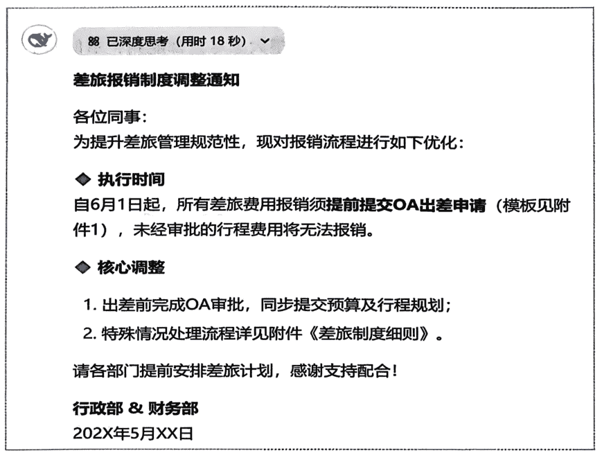

图 4-4 AI（DeepSeek）生成的制度变更通知

如果通知只面向特定人群，比如项目组、销售区域人员，你还可以改成“定向提醒”风格。

#### ④ 生成团建通知

团建通知虽然不像制度变更通知那么“严肃”，但同样需要引起重视。尤其是你作为组织者，既想传达“这是一次大家放松的机会”，又要确保参与者在规定时间内到达指定地点，因此语言要轻松，信息要完整。

用户在利用生成式 AI 撰写这类通知时，可以告诉它活动时间、地点、形式，以及自身希望表达的语气风格，它能立刻给出一段有信息量且有人情味的通知。根据受众的不同，AI 还能生成面向部门内部小范围，或者公司全员广播的版本。

比如公司要中秋聚餐，组织者希望大家尽量都能到，示例如下。

**提示词示范：**

请写一段适合在微信群发送的部门聚餐通知，内容是财务部本周五开展中秋聚餐活动，地点是公司楼下烤肉城，17:30准时开始，要求通知语气轻松，带有节日氛围，让人看完愿意前来参加。

AI 的答复如图 4-5 所示。


图 4-5 AI（DeepSeek）生成团建通知

这个版本的聚餐通知语气轻松、节奏快，看完让人会心一笑，“隐藏菜单”“不等人”这些词能制造期待，而“暗号”“+1”的表达又降低了参与门槛，带有些许仪式感，的确比较具有节日氛围。

#### ⑤ 生成拒绝报销的回复

财务工作常见的冲突场景之一是拒绝对方提交的费用报销申请。有时对方确实不清楚流程，有时是明知超出范围但还想试试看。因此，财务人员掌握拒绝的话术是必需的，但拒绝的时候需要语气合理，否则容易被误解成故意设卡。

我们来看一个典型的场景：某位新同事提交了一笔未事前申请的打车费用，金额不大，但按公司流程无法报销。他对报销流程不熟，你既要说明原因，也要让他知道“不是你不批”，是制度不允许，一切有据可循。

**提示词示范：**

请写一段私信回复同事的拒绝话术，告诉他提交的打车费用因未提前申请无法报销。要求表达清楚、语气不强硬，适合对流程不熟的新同事，同时需给出后续建议。

AI 的答复如图 4-6 所示。

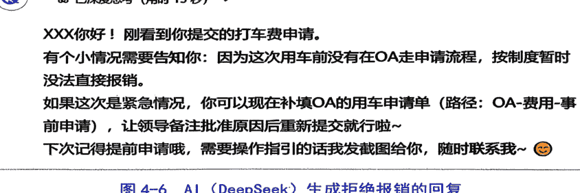

拒绝不是目的，让人理解、接受并改进才是重点。这段话把不能报销的事实说清楚了，也指明了是“按制度”执行，同时还给出了解决办法，顺便提醒了“下次记得提前申请”，基本可以拿来即用了。

### 4.2 AI 起草内部审计报告

管理体系比较健全的公司通常会定期进行内部审计。内部审计不仅仅是查账，其重点在于帮助公司发现潜在的风险，优化流程，确保各项工作都按制度执行。

## AI 财务实战入门：7 天就能轻松上手

财务人员完成内部审计工作后，需要出具一份内部审计报告。

## 【实战任务】

某企业的财务内审专员，近期负责完成一次针对“供应商付款合规性”的专项内部审计，共梳理了三类问题：其一，部分合同未附盖章版本即走付款流程；其二，存在同一项目重复走付款审批流程的现象；其三，发现部分付款审批流程中未包含法务节点。

在复盘完数据且整理完审计记录后，财务内审专员却卡在了报告写作阶段。以下是借助 AI 来完成本次报告撰写的示例。

## 【实战操作】

#### ① 步骤一：确认内部审计报告框架

如果公司已经有内部审计报告模板，可以忽略这一步，如果还没有，确认报告的框架是在使用 AI 生成内部审计报告之前要做的。

内部审计报告和外部审计报告呈现的内容不同，外部审计报告必须遵循《中国注册会计师审计准则》，采用标准化结构，包含审计意见类型、管理层责任、注册会计师责任等固定段落。而内部审计报告就比较灵活，可以根据具体的审计任务和企业需求来进行调整。

提示词示范：

内部审计报告的标准框架是什么？请给出一个适用于供应商付款流程审计的框架，要求包含必要的模块和段落。

如图 4-7 所示，AI 很快给出了一个框架内容，其中包含执行摘要、审计范围与背景、审计方法、审计发现、整改建议与行动计划、附录和报告审批这七个部分，每个部分中又包含很多细化的模块。不过，由于此处篇幅有限，无法全篇展示。

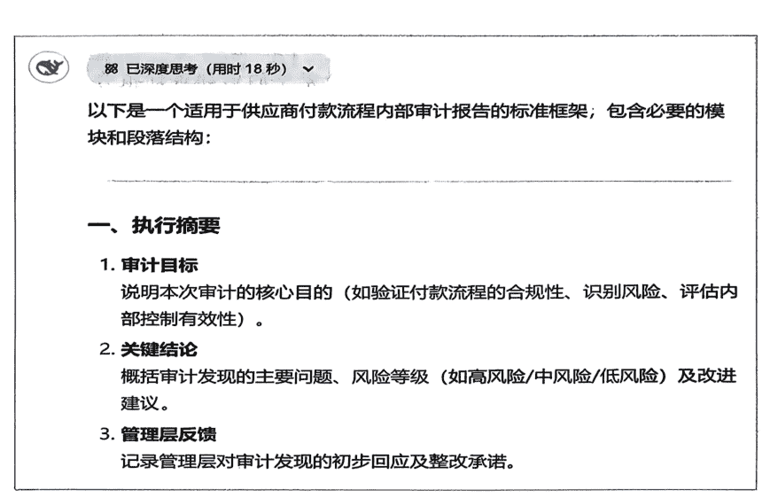

图 4-7 AI（DeepSeek）生成的内部审计报告标准框架（部分展示）

这套框架作为第一次提问十分关键，第二次提问就可以让 AI 依据框架来生成内部审计报告。

如果是已有内部审计报告标准模板，直接将框架模板上传为附件，进入下一步提问即可。

#### ② 步骤二：按框架生成内部审计报告

这一步的关键，是向 AI 清楚地描述当前的问题，也就是在审计过程中发现的问题。

**提示词示范：**

你现在是一名财务内审专员，在一次“供应商付款合规性”专项内部审计中发现了以下三点问题：

- 1. 部分合同未附盖章版本即走付款流程；
- 2. 存在同一项目重复走付款审批流程的现象；
- 3. 发现部分付款审批流程中未包含法务节点。

请依据前面的审计报告框架生成一份完整的内部审计报告。

AI 的答复如图 4-8 所示。

除了整体化的提问，还可以采用之前提过的分步提问法，也就是让 AI 按照框架一点点输出报告内容，每个部分都能加入更加细化的要求，这样 AI 的回复会更加符合用户的期待。

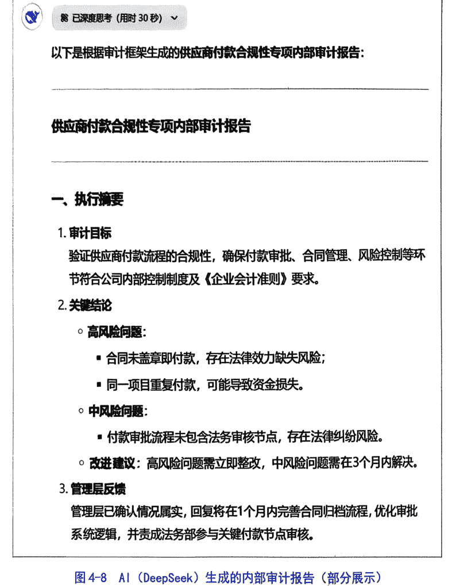

图 4-8 AI（DeepSeek）生成的内部审计报告（部分展示）

#### ③ 步骤三：要求 AI 按标准格式输出报告

最后，为了避免直接复制报告内容时出现大量符号、空格等导致格式混乱，用户可进一步要求 AI 以 HTML 格式输出内容，就无需花费大量时间和精力调整排版了。

**提示词示范：**

请将报告内容以 HTML 格式输出，具体要求如下：

- 主标题：黑体三号字，加粗，居中对齐；
- 一级标题：黑体四号字，加粗，左对齐，序号使用“一、二、三”；
- 二级标题：宋体小四号字，加粗，左对齐，序号使用“（一）（二）（三）”；
- 正文：宋体五号字，首行缩进两个字符，序号使用“1.2.3.”或“-”无序列表（根据内容逻辑选择）。
- 若包含数据表格，需使用 HTML 表格标签，表头黑体五号字加粗，表内文字宋体五号字，表格边框宽度 1px，居中对齐。

AI 的答复如图 4-9 所示。


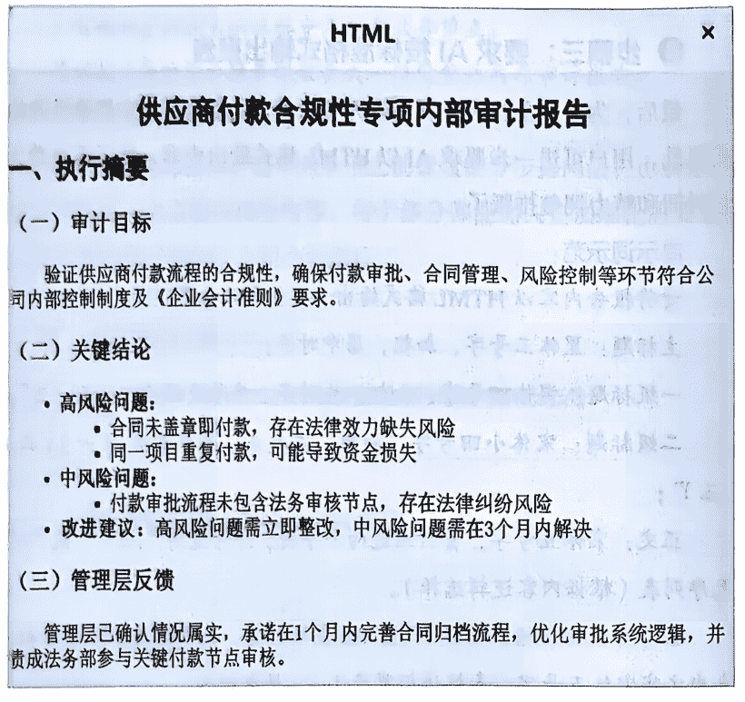

图 4-9 AI（DeepSeek）输出 HTML 格式的内部审计报告（部分展示）

### 4.3 辅助撰写财务分析报告

写财务分析报告最难的是分析、解释数据变化背后的原因。比如，毛利率突然下降，到底是成本上涨，还是市场竞争变激烈了？营业收入增长了，有多少是新产品带动的？这些分析是报告的核心，也是最费脑力的部分。

有时候不是不会写，而是想不到那么多的可能，AI 可以配合用户进行头脑风暴，而有了想法和写作方向，又能帮助用户快速生成分析内容。这一节，就来演示如何利用生成式 AI 辅助撰写财务分析报告。

## 【实战任务】

假设一家公司的财务经理正在写财务分析报告，该公司在过去两年内推出了智能手表、无线耳机等新产品，同时原材料成本有所波动，市场竞争也愈发激烈，这些因素都对财务数据产生了影响。现在该公司的财务经理希望借助 AI 来辅助撰写财务分析报告，提高工作效率。

## 【实战操作】

#### ❶ 比率分析深化

除了毛利率、净利率、资产负债率这些常规的财务比率计算分析，用户利用 AI 还可以进行更深入的比率分析，比如进行杜邦分析体系的细化，将净资产收益率拆解为销售净利率、资产周转率和权益乘数的乘积，深入探究企业盈利能力、运营效率和财务杠杆之间的关系。

提示词示范：
你现在是一名专业的财务分析师，结合公司过去两年的财务数据（自行提供数据），用杜邦分析法拆解净资产收益率，重点分析净资产收益率变化的原因，并给出具体数据支撑。

打开 AI 的数据分析功能，如图 4-10 所示。


输入提示词并提供相关数据后，AI 便能快速给出答复。

需注意的是，AI 给出的分析并非完全正确，还需要人工去判断和修改，AI 分析的重点是为财务人员提供专业报告的思路。如果想知道是否存在其他原因、还需要提供更加详细的数据，或者让 AI 列出所有常见的影响因素，再自己依据实际情况去判断。

#### ② 趋势预测

在完成基础的比率分析和杜邦分析后，下一步可以借助 AI 进行趋势预测。这一环节的目的，是通过分析公司历年或季度的财务数据，判断各类关键指标未来可能的发展方向，进而支持企业制定战略决策或调整预算计划。

例如，在当前原材料价格波动较大的背景下，公司管理层希望了解接下来几个季度的销售收入、净利润或运营成本的变化趋势。

提示词示范：

你是一名专业的财务分析师，请根据以下数据（自行提供）预测公司今年的销售收入和净利润。考虑因素包括原材料成本波动、新产品销售情况和市场竞争变化。

AI 答复的其中一部分如图 4-11 所示。

AI 基于行业常识，从中性、乐观、悲观三种情景对公司的收入和净利润进行了预测，图上展示的是中性情景下的预测结果，为企业的管理决策提供了一个参考。

##### 1. 中性情景（基准预测）

预测结果：

- 营收：5.75 亿元（同比增 15%），净利润：1.03 亿元（同比增 8.5%）。

核心驱动因素：

- 新产品稳健放量：无线耳机在存量市场的替换需求支撑营收增长，但渗透率增速放缓（从 2024 年的 10% 降至 7%），导致增速回落。
- 成本压力可控：芯片价格上涨 5%，但通过与供应商谈判和工艺优化，成本占比仅增至 23%，未显著挤压利润空间。
- 费用结构稳定：销售费用率维持 8%，主要因直播电商投入趋于理性（ROI 从 1:1.2 变化至 1:1.8），管理费用率因数字化转型下降 0.5 个百分点。

行业背景印证：

消费电子行业整体增速放缓至 10%—15%，与中性情景预测吻合。市场调研显示，消费者对无线耳机的需求从“功能升级”转向“性价比选择”，A 公司需警惕中低端市场竞争加剧。


#### ③ 关联因素挖掘

AI 在财务分析领域的另一个强项是关联因素挖掘，即通过财务数据与业务数据的多维关联分析，找出影响公司财务表现的潜在关键因素。这一用法可帮助企业发现表象背后的因果关系，以便经营者更精准地优化经营策略。

另一种进阶应用是利用 AI 建立财务影响因子矩阵，将各项业务因素与财务指标，如净利润、毛利率、周转率等因素之间的相关性做成“影响因子矩阵”，清晰展示哪些经营活动与哪些财务指标相挂钩，哪些是杠杆点。

### 4.4 个人述职报告自动成稿

述职报告是每位职场人都绕不开的一项工作内容。它既是对过往成绩的总结，也是职业发展的阶段性展示。然而，每逢年末，写述职报告成了不少职场人士的难题，他们时常感到无从下笔。

这时候，不妨把 AI 当作你的写作助理。你只需提供基本信息，比如岗位职责、工作内容、关键成果等，AI 就能快速生成结构清晰、语言得体、逻辑严谨的初稿，大大减轻撰写负担。

本节将结合具体示例，手把手教你如何用 AI 撰写个人述职报告，提升表达能力、节省时间，让你的成绩被看见、被认可。

**【实战任务】**

临近年末，公司人力资源部下发了一则《关于提交 2024 年度个人述职报告的通知》，要求所有员工统一采用公司提供的标准模板撰写述职报告，内容需涵盖岗位职责、年度成果、工作亮点、工作中存在的不足与改进计划等五个部分。该述职报告将作为年终绩效考评、晋升评估及年终奖金发放的重要依据。

作为财务经理，为提升效率，你决定借助 AI 辅助写作。

## 【实战操作】

#### ❶ 反向提问，收集报告素材

有时候，写述职报告的难点并不在于没什么可写，而是做了太多，却不知道从哪里写起。尤其对于财务类岗位，平时工作内容琐碎而繁杂，既涉及数据处理、报表编制，又涉及预算执行、税务申报、成本控制、项目支持等多个模块，一次性厘清写作线索不容易。

面对这种情况，不妨换个思路。不是我们主动向 AI 提供信息，而是反过来让 AI 向我们索要信息，帮助我们全面回顾和整理一年来的工作内容。

在操作的时候，我们可以应用专门的写作功能，比如豆包的“帮我写作”，如图 4-12 所示。


图 4-12 AI（豆包）的“帮我写作”对话框

提示词示范：

公司要求写年度个人述职报告，内容需涵盖岗位职责、年度工作成果、工作亮点、工作中存在的问题和改进计划五个部分。

现在需要你来帮我撰写述职报告。请根据公司要求，反过来向我提问，搜集你撰写报告需要的素材。

随后就接收到了 AI 返回的问题清单，如图 4-13 所示。

这些问题都是按照公司要求的五个部分内容展开的，每个部分均列出了细化的问题，其中还标注了一些重点内容。

为了帮您撰写一份贴合实际的年度述职报告，我需要先了解以下关键信息，请您逐一补充：

##### 一、岗位职责部分

- 1. 您的具体岗位名称是什么？属于哪个部门？
- 2. 核心工作职责有哪些？（可按优先级列举 3-5 条，例如：负责产品研发、客户关系维护、团队管理等）
- 3. 岗位说明书中明确的XX年度关键考核指标（KPI）XX有哪些？（如销售额目标、项目完成率、客户满意度等）

##### 二、年度工作成果部分

- 1. 过去一年，您主导或参与的主要工作任务有哪些？（请按项目/任务列举，每个任务可说明开始与结束时间）
- 2. 每项工作的具体成果如何？能否用数据量化？（例如：销售额增长 XX%、成本节约 XX 元、项目提前 XX 天交付、客户投诉率下降 XX% 等）
- 3. 对公司/团队有直接影响的重点成果有哪些？（如推动某业务落地、解决历史遗留问题、优化某流程提高效率等）

图 4-13 AI（豆包）的反向提问清单（部分展示）

#### ② 生成述职报告初稿

我们按照提问清单逐个回答完毕后，发送给 AI，并说明自己对报告的期望。

提示词示范：

请根据以上回答，按公司要求撰写述职报告。我希望报告内容丰富、重点突出，能让人轻松了解我的工作成果。整篇报告的字数控制在 2000 字左右。

因为之前是在“帮我写作”功能中进行的对话，所以这个提示词一发出去，AI 就自动跳转到了专门的写作编辑页面进行报告撰写，写好的报告如图 4-14 所示。

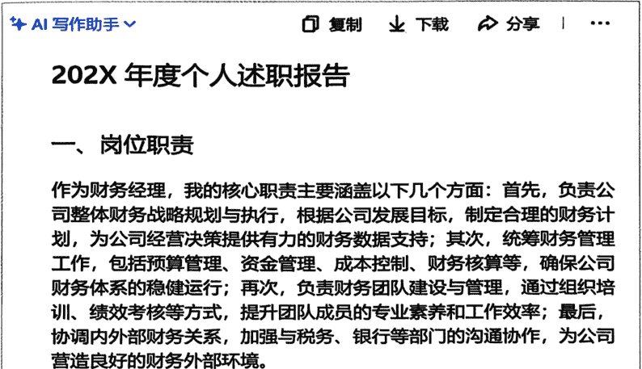

图 4-14 AI（豆包）生成的个人述职报告（部分展示）

#### ③ 报告精修

虽然 AI 可以快速生成结构完整、语言正式的述职初稿，但要真正变成一份“拿得出手”的优秀述职报告，还需要进行人工精修和个性化处理。

图 4-14 所展示的页面，支持用户直接对内容进行编辑，如果感觉整篇内容都不行，没办法修改，可以让 AI 重新生成，比如就岗位职责来说，可要求 AI 进行优化，重新输出述职报告。

**提示词示范：**

岗位职责部分的描述过于通用，缺乏个性化，而且内容排版挤在一起，没有分行。请优化这一段关于岗位职责的表述，使其更具条理性，更凸显岗位价值。修改后输出完整的述职报告。

AI 修改后的报告如图 4-15 所示。

##### 202X 年度个人述职报告

##### 一、岗位职责

作为公司财务经理，我立足财务管理核心职能，以战略规划、流程优化、风险管控为抓手，驱动公司财务体系高效运转，具体职责涵盖四大板块：

- 1. **战略决策支持**：深度参与公司战略规划，结合行业趋势与企业发展目标，主导制定 3-5 年财务战略蓝图；定期输出财务分析报告，通过成本效益、现金流、盈利预测等多维度数据，为管理层投资决策、业务拓展提供量化依据。
- 2. **全流程财务管理**：统筹预算编制、资金调度、成本控制及财务核算工作。建立动态预算监控机制，实时跟踪执行偏差；优化资金配置，确保重点项目资金保障率 100%；搭建精细化成本管控体系，覆盖采购、生产、运营全链条。
- 3. **团队建设与管理**：负责财务团队人才梯队建设，通过制定个性化培训计划、推行绩效激励机制，提升团队专业能力与协作效率；组织跨部门财务知识培训，强化全员成本意识与合规理念。
- 4. **内外部关系协调**：建立与税务、银行、审计机构的常态化沟通机制，争取政策优惠与金融支持；主导财务合规体系建设，规避税务稽查、资金监管等潜在风险，维护公司良好的财务信用。


这是 AI 按要求修改后的内容，比第一版更加详细，条理也更清晰。经过几轮反复修改后，我们会得到一份最终版的述职报告。

#### 4 报告输出的简便方式

前面我们介绍过以 HTML 格式输出报告，但下载之后还需要自己复制粘贴到 Word 中，多了一步操作。现在我们来介绍一种更加方便快捷的方式，那就是让 AI 直接输出 Word 文件。

注意看图 4-14 的最上方，有一个“下载”选项，这也是豆包“帮我写作”功能中的一项功能，点击“下载”，会看到其支持多种文件格式，如图 4-16 所示。


图 4-16 AI（豆包）报告下载格式选择菜单

一般选择 Word 版本，方便用户随时修改。我们点击“Word”，报告进入下载列表，下载完毕后报告存放在电脑的本地文件夹中。用户打开就是正常的 Word 版本，如图 4-17 所示。

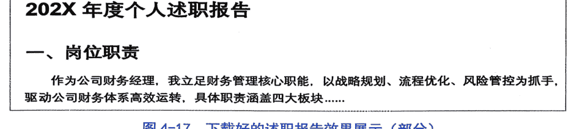

图 4-17 下载好的述职报告效果展示（部分）

# 第 5 天
## AI 数据清洗与整合实战

数据的准确性直接决定了财务分析与决策的质量。然而，数据清洗和整合往往是最考验财务人员耐心的环节之一。

这一章，我们将教你如何用 AI 实现自动化的数据清洗与整合。不论是账实数据核验、资产数据格式统一，还是锁定异常值，都能快速且准确地完成。学会这些技巧，不管你面对多么复杂的表格数据，都能快速搞定，彻底告别繁琐重复的数据处理工作。

> 没有准确的数据，就没有可信的报告。

### 5.1 账实数据一致性自动核验方案

对账是财务的日常工作之一，但要做到账账相符、账实相符其实不容易，有时候对账一下午，差一分钱能让人抓狂，也可能会遇到系统上显示有实物，但仓库说没有的情况。每次遇到这种问题，就得逐一打电话询问，来来回回地核对表格，耗费大量时间却找不到问题出现在哪里。

这种低效率的工作方式，不仅让人感到疲惫，还容易出错。AI 在表格处理方面已经具备相对全面的功能体系了。所以，现在我们来演示怎么利用 AI 提升工作效率。

**【实战任务】**

某家电零售企业，经营多种品牌的冰箱、空调、洗衣机等家电产品，库存管理采用 ERP 系统记录商品出入库情况，财务部门使用金蝶财务软件核算库存、成本及金额。每月末的库存盘点依赖人工核对，耗时耗力且容易出错，难以快速发现账实差异，现在期望借助 AI 来提高工作效率。

**【实战操作】**

#### ❶ 导出两套数据

首先，用户需从不同软件中导出库存商品科目明细账和库存盘点表，各自记录商品的库存数量，假设具体数据如表 5-1 和表 5-2 所示。

表 5-1 库存商品科目明细账（财务账面数据）

| 商品名称 | 单位 | 账面数量 | 单位成本（元） | 账面金额（元） |
|----------|------|----------|----------------|----------------|
| 冰箱 A   | 台   | 150      | 2000           | 300000         |
| 空调 B   | 台   | 120      | 3000           | 360000         |
| 洗衣机 C | 台   | 80       | 1500           | 120000         |
| 冰箱 D   | 台   | 60       | 2500           | 150000         |
| 空调 E   | 台   | 40       | 4000           | 160000         |

表 5-2 库存盘点表（实际库存数据）

| 商品名称 | 单位 | 实际库存数量 | 存放仓库 |
|----------|------|--------------|----------|
| 冰箱 A   | 台   | 145          | 一号仓   |
| 空调 B   | 台   | 120          | 一号仓   |
| 洗衣机 C | 台   | 78           | 二号仓   |
| 冰箱 D   | 台   | 60           | 二号仓   |
| 空调 E   | 台   | 38           | 一号仓   |

导出时要注意两点：第一，两套系统的“商品编码”或“商品名称”必须相对应，这是后续比对的关键字段；第二，时间维度一定要对齐，比如都是按“自然月”导出，而不是其他。

#### ② 交给 AI 比对数量和金额差异

准备好数据之后，就可以让 AI 比对账面数据和实际库存数据了。像现在这样的数据量不大且商品名称写得规范，没有重名或混淆的情况，可以直接把两张表粘贴进对话框。如果遇到数据格式混乱的表格，还需要修正数据格式不统一的情况，相关操作会在下一节内容中进行展示。

提示词示范：

你是一名财务分析师，正在核对商品库存，请比对以下两张表中商品的库存数量和金额差异。找出每一个商品在数量和金额上的差异，并标注出差异值。


## AI 财务实战入门：7 天就能轻松上手

提示词都是按自己的需求进行设定的，如果有需要，你可以要求 AI 按照“差异值大小”来排序，或者要求它只列出某一类商品的差异项目。
表格上传后，AI 经过分析处理，会自动识别出每一项商品的账实差异，给出答复，如图 5-1 所示。

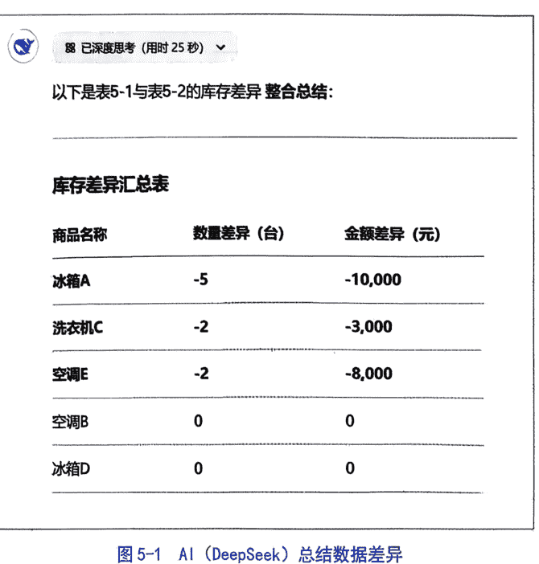

可以看到，AI 直接生成了一张库存差异汇总表，标注了每个商品的数量和金额差异，有差异的商品列示在最上面并写出数量差异和金额差异。

#### ③ 生成核对报告

出现账实差异只是结果，不是问题所在，之所以出现这种差异情况，一定是某个方面存在疏漏，AI 在查找疏漏和给出优化建议方面是有较大助力作用的。

##### 提示词示范：

请根据上述汇总好的库存数量与金额的差异情况，列举出可能导致这些差异产生的管理漏洞，然后针对每个管理漏洞提出具体且可落地的优化建议。

将提示词输入对话框后，稍作等待，就能得到一份详细的分析内容，如图 5-2 所示。

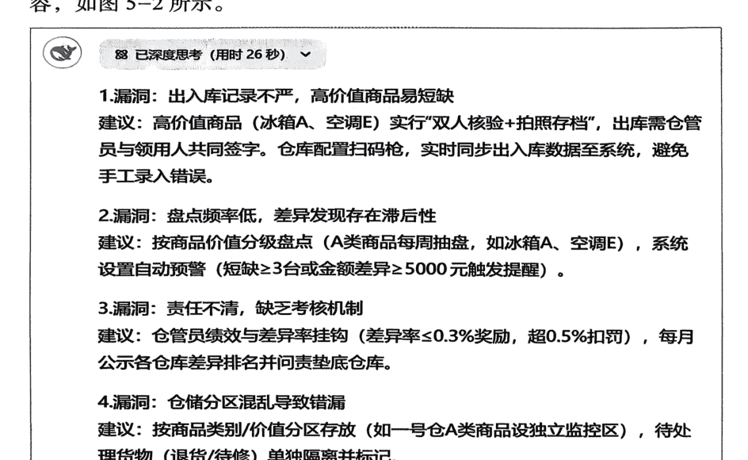

图 5-2 AI (DeepSeek) 列举管理漏洞及优化建议

这只是一份简单的漏洞查找与建议，作为功能展示使用。在真实的提问过程中，为了让 AI 输出更有价值的内容，我们可以反复提问，追问细节。

##### 提示词示范：

如果二次盘点后，账实差异仍然存在，还有哪些可能的原因？有没有办法通过系统设置来减少差异？

盘点结束后，一般需要生成一份盘点报告，说明相关情况，用于汇报或以备调账，而这种报告内容的生成，也可以借助 AI。

**提示词示范：**

参照库存账面数据与实际数据的差异，撰写盘点报告。报告需涵盖盘点基本信息、差异类型分析、管理漏洞剖析，且针对每个漏洞明确责任部门与优化方法，最后说明差异对企业库存管理的影响与启示。

具体的报告要求还要结合企业自身的实际情况来调整，这里只是一个一般性的示范。

虽然借助 AI 能快速发现账实差异，但对数据和业务流程的人工复核必不可少，尤其是涉及金额较大或数量差异明显的商品，需深入调查原因。

企业也可将上述操作思路拓展到应付账款与采购订单数据核对、成本数据与出入库数据核对等场景。例如，要求 AI 分析应付账款明细表与采购订单执行表中供应商欠款金额的一致性，核查是否存在多付、漏付等情况，进一步提升企业数据管理的全面性与准确性。

### 5.2 零代码修正资产信息数据表格式不统一问题

跨表对账、数据合并、数据计算、生成图表……围绕数据开展的一系列整理和计算工作，都建立在数据格式统一的基础上。如果数据的格式不统一，那么工作人员很难进行统计和计算。

但在实际工作中，单是金额就有多种写法。加不加货币符号？用不用千位分隔符？用阿拉伯数字还是汉字？等等，有的甚至可能把其他信息与金额混在一起，这种自制表格仅是修改就要花很大工夫，过程中稍不留神多删了数据，就会造成重大工作失误。

可若是交给 AI，输入提示“请统一成标准格式”，那就只需要坐等结果。不用写函数公式，不用打开宏编辑器，也不需要 Python 代码，它能帮你处理好。这种零代码修正格式的方式，有利于减少财务人员的表格数据整理工作量。

## 【实战任务】

某企业在日常资产管理过程中，由于缺乏统一的数据录入规范，各部门员工按照自己的习惯记录资产信息，导致最后汇总形成的资产信息表中的数据格式混乱不堪，严重影响了资产清查、财务核算工作进度以及管理层的决策。你需要解决表中数据格式不统一的问题，使表格数据规范统一，以满足企业资产管理需求。

## 【实战操作】

#### ① 原始数据导出

假设以下是该公司的原始资产信息表，如表 5-3 所示。

表 5-3 原始资产信息表

| 资产 ID | 资产类别 | 资产名称 | 购入日期 | 存放地 | 资产状况 | 购入金额 |
| :--- | :--- | :--- | :--- | :--- | :--- | :--- |
| 001 | 办公设备 | Desktop PC | 2021/3/15 | 行政部 | 正常使用 | 4500 |
| 002 | 生产设备 | 冲压机床 | 2019-08-20 | 车间 A | 良好 | 800,000 |
| 003 | 办公家具 | 会议桌 | 二〇二〇年五月十日 | 会议室 201 | 可用 | ¥6000 |
| 004 | 运输工具 | Van | 2022/11/5 | 停车场 | 正常 | 150,000.00 |
| 005 | 生产设备 | 数控机床 | 2018 年 12 月 1 日 | 车间 B | 极佳 | 120 万 |
| 006 | 办公设备 | Laptop | 23-2-2023 | 研发部 402 | 无故障 | 70000 |
| 007 | 办公家具 | 员工桌椅 | 2021/7/20 | 办公区 C | 正常使用 | 3000 元 |
| 008 | 运输工具 | Car | 2022 年 6 月 1 日 | 车库 | 良好 | 20 万 |
| 009 | 生产设备 | 注塑机 | 2020/10/12 | 车间 C | 正常运行 | 900,000.00 |
| 010 | 办公设备 | Printer | 2023/4/8 | 文印室 | 轻微磨损 | 3500 |
| 011 | 办公家具 | 沙发茶几 | 12 月 31 日 | 接待室 | 良好 | 8500 |
| 012 | 运输工具 | 叉车 | 2019/12/25 | 仓库 | 正常 | 80,000 |

这张表，一眼就能看到很多格式不统一的地方，金额格式混乱，日期格式也包含各种写法，部分日期还存在书写有误、格式颠倒、信息不完整等问题。

#### ② 表头提交与规则制定

在统一表格格式的时候，我们需要把想要的格式告知 AI，但现在每样内容应该采用什么格式呢？我们将上述表格发送给 AI，通过对话就可以将规则确定下来。

**提示词示范：**

我有一张资产信息表需要统一数据格式，其中资产 ID、资产名称和存放地三列的格式是确定好的，请为其他列的内容制定相应的格式规则，便于后续资产管理工作的开展。

这里之所以特意提到“资产 ID、资产名称和存放地三列的格式是确定好的”，是因为在输入资产信息时，ID 是唯一可确认的信息，就像“身份证号”一样。如果资产 ID 是混乱的，那需要对全公司的资产进行重新确认。

资产名称是录入表格的人填写的，统一格式没办法对其进行更改，如果想更改必须去实地盘点，对照资产 ID 确认是同一台设备，然后手动修改，否则交给 AI 更改，全盘皆乱。

至于存放地，本身是文本格式，我们很难将公司所有的存放地告知 AI 并让它去修改，而且存放地对于数据的统计和计算几乎没有影响，因此暂时可不做格式统一。

AI 分析了整张表格后，对于其他列的格式统一规则建议如图 5-3 所示。

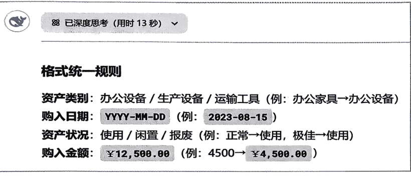

如果规则建议有不合理的地方，用户可以与 AI 进行多轮对话，直到最后确认下来。更快的做法是利用 AI 给出的建议，人工稍做更改，再返回给 AI，这样效率更高。

#### ③ 利用 AI 实现格式转换

这一步直接要求 AI 按照制定好的规则统一格式即可。

**提示词示范：**

按照以下规则统一这张资产信息表的数据格式，以 HTML 格式输出：

- 资产类别：办公设备 / 生产设备 / 运输工具（例如：办公家具→办公设备）
- 购入日期：YYYY-MM-DD（例如：2023-08-15）
- 资产状况：使用 / 闲置 / 报废（例如：正常→使用，极佳→使用）
- 购入金额：¥12,500.00（例如：4500 → ¥4,500.00）

前面说过，HTML 格式输出可以保留数据格式，这样我们下载后打开表格，再去复制，就是固定好的格式。

AI 的答复如图 5-4 所示。


相关代码就不进行展示了，点击“运行”可以在线预览表格效果，如图 5-5 所示。

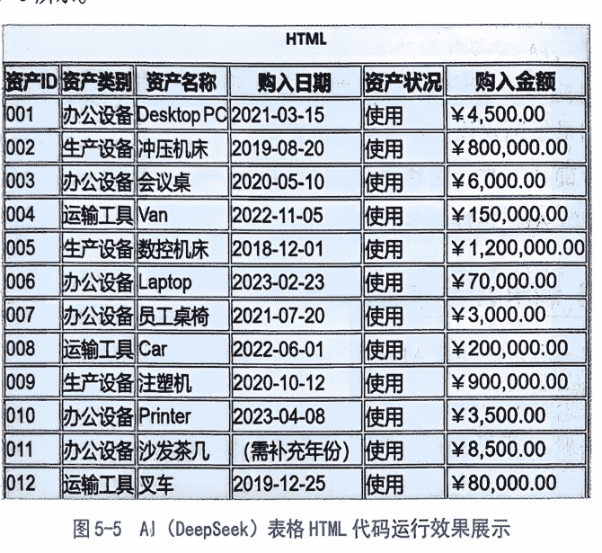

这是统一后的数据格式，我们随意对照一条，比如“资产 ID 是 003”的资产明细，原本资产类别是“办公家具”，现在已经归类为“办公设备”，购入日期原本是“二〇二〇年五月十日”，已经更改为“2020-05-10”，资产状况是“使用”，金额格式也统一了。

还记得资产 ID 是“011”的资产明细吗？当时的购入日期只写了“12 月 31 日”，但没有写年份。不过，AI 在统一格式时没有胡编一个年份，而是特意标注了“需补充年份”。此类工作需要人工去配合查账、核对发票，确认具体的购入年份。

#### ④ 导出数据表

点击图 5–4 中的“下载”选项，则可以下载表格内容。但注意，这里下载的依然是 HTML 格式。我们复制其中的内容，在表格中选择“带格式粘贴”即可保留文本格式。
此时，表格中日期格式一致，数据单位和精确度相同，数据类型正确，数据内容表述标准，缺失数据也进行了标记，极大地提升了资产信息表的规范性和可用性，为企业高效开展资产管理、财务核算以及数据分析等工作奠定了良好的数据基础。
在实际工作中，表格可能还存在更多复杂情况。对于复杂数据，AI 提供的通用方法可能无法完全解决，需要灵活结合高级函数进行处理，或者通过人工进一步核实和修正。
建议在进行任何数据格式修改操作前，务必对原始数据进行多副本备份，不仅要保留原始表格文件，还要将原始数据复制到新的文件中，防止在修改过程中因操作失误、软件故障等原因导致原始数据丢失或损坏。

### 5.3 合并、拆分多部门费用报销情况表

在表格处理中，有一类常见的操作是合并或拆分表格。比如，各部门发送过来的表格内容，需要财务人员进行汇总；或者一张完整的明细表，需要财务人员从中抽取数据拆分整理成不同的表格。
这种表格操作起来其实并不复杂，就是需要关注细节，而且效率不高。有的财务人员可能会去寻求函数、数据透视表等各种解决办法，但这些办法都需要繁琐的操作步骤，中间一个公式写不对或是一个代码运行不畅，就容易卡壳，进行不下去。下面就来看看 AI 有什么高效的解决办法。

## 【实战任务】

某公司拥有销售部、研发部、行政部等多个部门，各部门员工在进行费用报销时，填写的费用报销情况表格式不统一，且存在数据记录不规范的问题。财务部每月末需要将这些报销数据进行合并与拆分，以便统计各部门的费用支出情况，为成本控制和预算管理提供依据。

## 【实战操作】

#### ❶ 原始数据导出

假设以下是该公司各部门原始的费用报销情况表，如表 5-4、表 5-5 和表 5-6 所示。

表 5-4 销售部费用报销情况表

| 报销人 | 报销日期 | 费用类型 | 金额（元） | 备注 |
|---|---|---|---|---|
| 张三 | 2025/10/5 | 差旅费 | 3500.95 | 出差拜访客户 |
| 李四 | 2025/10/8 | 业务招待费 | 1800 | 宴请合作方 |
| 王五 | 2025/10/12 | 差旅费 | 4208.6 | 参加外地展会 |

表 5-5 研发部费用报销情况表

| 报销人员 | 日期 | 费用类别 | 报销金额 | 说明 |
|---|---|---|---|---|
| 赵六 | 2025/10/3 | 办公费 | 850.00 | 购买研发用笔记本 |
| 孙七 | 2025/10/10 | 设备租赁费 | 5000.00 | 租赁研发测试设备 |
| 周八 | 10/15/2025 | 差旅费 | 3812.45 | 出差学习新技术 |

表 5-6 行政部费用报销情况表

| 申请人 | 申请日期 | 费用项目 | 金额 | 具体用途 |
|---|---|---|---|---|
| 吴九 | 2025/10/2 | 水电费 | 1204 | 办公楼本月水电支出 |
| 郑十 | 2025/10/6 | 设备维修费 | 900.00 | 维修打印机 |
| 陈十一 | 2025/10/9 | 差旅费 | 609.5 | 出差办理公司事务 |
| 杨十二 | 2025/10/13 | 办公费 | 246 | 组织部门会议费用 |

现在这三张表的表头字段名称都不一致，如“报销人”“报销人员”“申请人”；“报销日期”“日期”“申请日期”，在日期和金额格式上也存在差异。

#### ② 数据提交合并成表

财务人员在汇总数据时，也需要先统一数据格式。思路与上一节是相似的，毕竟我们要合并和拆分数据，现在每张表的数据都不统一，直接合并容易出现错误。

在实际操作中，直接将这三个部门的费用报销情况表依次复制粘贴到与 AI 的对话框中，然后给出提示词。

**提示词示范：**

按照以下规则统一各部门费用报销情况表的数据格式，生成一张完整的费用报销明细表，以 HTML 格式输出：
表头统一用报销人、报销日期、费用类型、报销金额（元）、备注；
日期格式为 YYYY-MM-DD；
报销金额保留两位小数，不使用货币符号，不使用千位分隔符。

同样地，AI 生成了一长串的 HTML 代码，这里直接展示代码运行的效果，如图 5-6 所示。

| 报销人 | 报销日期 | 费用类型 | 报销金额（元） | 备注 |
|---|---|---|---|---|
| 张三 | 2025-10-05 | 差旅费 | 3500.95 | 出差拜访客户 |
| 李四 | 2025-10-08 | 业务招待费 | 1800.00 | 宴请合作方 |
| 王五 | 2025-10-12 | 差旅费 | 4208.60 | 参加外地展会 |
| 赵六 | 2025-10-03 | 办公费 | 850.00 | 购买研发用笔记本 |
| 孙七 | 2025-10-10 | 设备租赁费 | 5000.00 | 租赁研发测试设备 |
| 周八 | 2025-10-15 | 差旅费 | 3812.45 | 出差学习新技术 |
| 吴九 | 2025-10-02 | 水电费 | 1204.00 | 办公楼本月水电支出 |
| 郑十 | 2025-10-06 | 设备维修费 | 900.00 | 维修打印机 |
| 陈十一 | 2025-10-09 | 差旅费 | 609.50 | 出差办理公司事务 |
| 杨十二 | 2025-10-13 | 办公费 | 246.00 | 组织部门会议费用 |

图 5-6 AI（DeepSeek）合并表格

#### ③ 利用 AI 从不同维度合并数据

我们在合并表格的时候，有时候不只是需要一个直接的合并结果，而是需要从不同维度去展示这些数据结果，里面涉及一部分计算，而且表头也需要替换，最后呈现出一张完全不同的表格，这原本也是数据透视表能做到的事，但数据透视表的添加设置比较繁琐，用 AI 可以快速得到我们想要的结果。

以费用报销情况表为例，可以从部门、费用类型两个维度去汇总呈现之前的报销情况。

**提示词示范：**

基于之前提供的报销数据，请按部门统计每个部门的总报销金额，并将结果以 HTML 表格形式输出。

AI 的答复如图 5-7 所示。

| 部门 | 总报销金额（元） |
| --- | --- |
| 销售部 | 9509.55 |
| 研发部 | 9662.45 |
| 行政部 | 2959.50 |

图 5-7 AI（DeepSeek）从部门维度合并表格数据

除了从部门维度合并数据，还可以从费用类型的维度统计各项费用的具体支出金额。

**提示词示范：**

基于之前提供的报销数据，请按费用类型统计每项费用的总报销金额，并将结果以 HTML 表格形式输出。

AI 的答复如图 5-8 所示。

| 费用类型 | 总报销金额（元） |
| --- | --- |
| 差旅费 | 12131.50 |
| 业务招待费 | 1800.00 |
| 办公费 | 1096.00 |
| 设备租赁费 | 5000.00 |
| 水电费 | 1204.00 |
| 设备维修费 | 900.00 |

图 5-8 AI（DeepSeek）从费用类型维度合并表格数据

以上操作省略了筛选、计算、建表的过程，不仅成功解决了多部门费用报销情况表的数据格式不统一的问题，而且还实现了按部门、费用类型的合并统计。

#### ④ 表格数据拆分

前面演示的是表格数据的合并，而不是拆分。假设现在我们需要将不同部门的总报销金额发送给各部门，为了实现信息隔离，需要保留表头和单一部门的数据，AI 同样能快速完成此类工作任务。

**提示词示范：**

基于之前提供的报销数据，请将按部门统计的每个部门的总报销金额表拆分成 3 个单独的表，只列示某一个部门的情况，并将结果以 HTML 表格形式输出。

AI 的答复如图 5-9 所示。

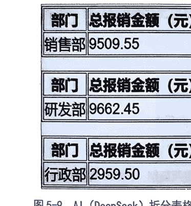

现在，我们得到了 3 个包含表头和单一部门数据的表格。

因为本次任务的拆分任务量较小，如果遇到拆分工资条这样的任务，要拆分成上百个表格，并以人员的姓名命名，就需要借助 Python 代码来实现。而写代码也是 AI 擅长的工作。

以下是此任务的操作步骤演示，适合已经在电脑中嵌入常规 Python 环境的用户，如果还没有准备好，也可以咨询 AI，让其推荐适合的运行环境和安装步骤。

同样以上面的例子来演示。

**提示词示范：**

基于之前提供的报销数据，请生成 Python 代码，将按部门统计的每个部门的总报销金额表拆分成 3 个单独的 excel 表，只列示某一个部门的情况，并将 3 个表以各自部门名称命名，保存到电脑桌面上。

AI 给出的代码如图 5-10 所示。

```python
##### 定义保存路径（桌面新建文件夹）
save_path = os.path.join(os.path.expanduser("~"), "Desktop/部门报销统计")

##### 创建目标文件夹（如果不存在）
os.makedirs(save_path, exist_ok=True)

##### 核心处理流程
for dept, amt in {'销售部':9509.55, '研发部':9662.45, '行政部':2959.50}.items():
    # 创建DataFrame并直接保存
    pd.DataFrame([[dept, amt]],
                 columns=['部门', '总报销金额（元）']).to_excel(
                     os.path.join(save_path, f"{dept}.xlsx"),
                     index=False,
                     engine='openpyxl')
    print(f'文件已保存至桌面【{os.path.basename(save_path)}】文件夹')
```

图 5-10 AI（DeepSeek）生成拆分表格代码

将代码放入环境中运行后，直接在电脑桌面上新建了一个“部门报销统计”文件夹，里面包含了3个表格文件，且以各自部门的名称命名，如图5-11所示。

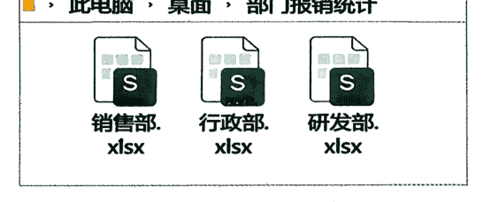

图 5-11 运行代码自动生成的表格

任意打开一张表格，其中的内容的确与我们所要求的一样，如图5-12所示。

### 5.4 一句话计算财务数据，告别手动公式输入

从不同的表格中翻找数据，计算各项财务指标，相信大家都经历过。比如计算毛利率，得先找到收入和成本数据，而且是具体到单元格的位置；要计算增长率，需要查找上一年的同期数据；遇到分部门、分产品的指标计算，更是繁琐。

其实这些财务数据计算的操作步骤是固定的，但每次都得重新写公式，非常浪费时间。现在有了 AI，你只管提需求，比如“算一下公司的流动比率”，AI 就能立刻理解并执行，把你从重复劳动中解放出来，并快速进入分析环节。财务分析作为企业洞察自身财务状况、评估经营成果和规划未来发展的关键环节，需要全面且精准的财务指标计算与分析。

【实战任务】

某公司原本采用手动计算财务指标的方式，结果因公式复杂、数据量大，容易出现数据提取偏差、公式嵌套错误等问题，企业精细化财务管理的需求难以满足。因此，该公司财务人员决定借助 AI 强大的数据分析和计算能力，对关键财务指标进行深度剖析，为战略决策、资源配置和风险管控提供坚实的数据支撑。

## 【实战操作】

#### 1 导出财务报表

假设以下是该公司的财务报表数据，如表 5-7、表 5-8 和表 5-9 所示。

表 5-7 公司资产负债表部分数据（单位：万元）

| 资产项目 | 期末余额 | 期初余额 | 负债及所有者权益项目 | 期末余额 | 期初余额 |
| :--- | :--- | :--- | :--- | :--- | :--- |
| 货币资金 | 150 | 120 | 短期借款 | 80 | 60 |
| 应收账款 | 200 | 180 | 应付账款 | 120 | 100 |
| 应收票据 | 50 | 30 | 预收账款 | 40 | 30 |
| 存货 | 180 | 200 | 应付职工薪酬 | 20 | 15 |
| 其他流动资产 | 30 | 25 | 应交税费 | 30 | 25 |
| 流动资产合计 | 610 | 555 | 流动负债合计 | 290 | 230 |
| 固定资产 | 500 | 480 | 长期借款 | 150 | 120 |
| 在建工程 | 80 | 60 | 应付债券 | 100 | 80 |
| 无形资产 | 120 | 100 | 长期应付款 | 50 | 40 |
| 非流动资产合计 | 700 | 640 | 非流动负债合计 | 300 | 240 |
| 资产总计 | 1310 | 1195 | 负债及所有者权益总计 | 590 | 470 |

表 5-8 公司利润表（单位：万元）

| 项目 | 本期金额 | 上期金额 |
| :--- | :--- | :--- |
| 营业收入 | 1200 | 1000 |
| 其中：主营业务收入 | 1080 | 900 |
| 其他业务收入 | 120 | 100 |
| 营业成本 | 750 | 650 |
| 其中：主营业务成本 | 680 | 580 |
| 其他业务成本 | 70 | 70 |
| 税金及附加 | 60 | 50 |
| 销售费用 | 120 | 100 |
| 管理费用 | 80 | 70 |
| 研发费用 | 30 | 20 |
| 财务费用 | 30 | 25 |
| 其中：利息费用 | 20 | 15 |
| 利息收入 | 5 | 4 |
| 信用减值损失 | 10 | 8 |
| 资产减值损失 | 5 | 3 |
| 公允价值变动收益 | -5 | 2 |
| 投资收益 | 15 | 10 |
| 其他收益 | 8 | 5 |
| 营业利润 | 160 | 120 |
| 营业外收入 | 10 | 8 |
| 营业外支出 | 10 | 12 |
| 利润总额 | 160 | 116 |
| 所得税费用 | 40 | 29 |
| 净利润 | 120 | 87 |

表 5-9 公司现金流量表（单位：万元）

| 项目 | 本期金额 |
| :--- | :--- |
| 经营活动现金流入 | 1300 |
| 经营活动现金流出 | 900 |
| 经营活动现金流量净额 | 400 |
| 投资活动现金流入 | 50 |
| 投资活动现金流出 | 120 |
| 投资活动现金流量净额 | -70 |
| 筹资活动现金流入 | 200 |
| 筹资活动现金流出 | 150 |
| 筹资活动现金流量净额 | 50 |
| 现金及现金等价物净增加额 | 380 |
| 期初现金及现金等价物余额 | 120 |
| 期末现金及现金等价物余额 | 500 |

#### ② 数据提交并计算财务指标

数据准备好了，接下来我们要让 AI 计算财务指标。但如果人工输入计算指标，可能会存在错漏的情况。那不妨让 AI 来罗列一份完整的财务分析需要计算的财务指标。

提示词示范：

你是一名资深财务分析师，需要根据资产负债表、利润表和现金流量表进行财务指标计算，请列出一般需要计算的财务指标。

AI 的答复如图 5-13 所示。

图 5-13 AI (DeepSeek) 列举的财务指标

这个提问很关键，因为 AI 不知道你要关注毛利率、流动比率还是净利率，你得先让它列出有哪些常用的指标，然后再要求它按照这些指标去计算。

把我们刚才准备好的那三张报表（资产负债表、利润表、现金流量表）一并粘贴进去，注意表头要清晰，提前隐藏公司的名称等隐私信息。

提示词示范：

你是一名资深财务分析师，现在请按照上述指标，根据我上传的资产负债表、利润表和现金流量表数据进行财务指标计算，并输出所有的结果。

AI 的计算结果如图 5-14 所示。

我们任意检查一个指标，比如资产负债率，表中数据显示，负债的期末余额为 590，资产的期末余额是 1310，两者相比，结果确实约等于 45.04%。

这个阶段的核心是让你从“翻公式、找位置、校对公式”等机械流程中脱身出来。你只要告诉 AI 要算什么，它就能把整个指标计算链条搭好，还能说明计算的理由。

当然，如果你已经自己计算出结果，想知道有没有计算错误，也可以利用 AI 来进行验证，将结果上传，让它查看是否有错误之处。

#### ③ 联网搜索对比同行业数据

计算完公司的财务指标，大家自然想知道这个结果是好还是不好，公司发展得怎么样？这时候就得看对比，而对比谁最有参考价值？当然是同行业的数据。

以前找同行业数据，我们可能去翻阅年报、查看上市公司财务报表，现在可以直接用 AI 的联网搜索功能，让它找行业平均指标、标杆企业的财务数据，并帮助我们做对比。

**提示词示范：**

请搜索 2024 年家电行业的平均毛利率、净利润率和资产负债率，尤其是冰箱、洗衣机、空调这类主要产品线，并列出 1-2 家上市公司的同期财务指标。

AI 会调用公开数据，包括但不限于同行业公司的公开年报，从中提取出对应指标。有的工具还能直接返回结构化表格。

当然，AI 给出的结果只能作为参考，因为受限于取样的范围。想要得到更加真实客观的数据，可能还需要依靠专业的数据调研公司。

# 第 6 天
## AI 数据可视化实战

真正有说服力的财务汇报，往往离不开图表的辅助。而 AI 的加入，改变了数据可视化的呈现方式。图表不再是靠人工选字段、调格式，而是由 AI 根据数据内容自动判断应该呈现的内容及呈现方式。它能识别出变化的趋势，抓住关键的结构关系，并匹配最合适的图表类型，把原本复杂的表格转化成清晰、有逻辑的视觉表达。

今天我们就来实操这些功能，让你真正体会到什么叫作“让数据自己说话”。

> 数据的走向清晰，结论才有落点。

### 6.1 生成财务汇报中的关键数据图表

在财务工作中，数据不是问题，表达才是难点。长篇大论不如一张图更有说服力。比如，一个展示利润变化的折线图，胜过3页表格数据；一个部门费用构成的饼图，比口述“占比多少”更一目了然。因此，图表不是装饰，而是让数据自己“说话”的方式。

现在，生成式AI可以帮助你快速把数据转成高质量的图表，这样不仅可以节省制作时间、提升呈现效率，而且图形准确、样式统一，非常适合放入汇报材料里使用。在前面介绍图像生成功能的时候，我们就曾尝试过用AI生成一份折线图，并介绍了AI还能用来推荐图表，这一节就是演示生成图表的具体过程。

【实战任务】

财务人员希望通过生成式AI生成的图表，清晰展示各部门的费用支出情况。以某公司3月份各部门费用统计数据为例，如表6-1所示。

表6-1 公司3月份各部门费用统计

| 部门 | 费用金额（元） |
| :--- | :--- |
| 销售部 | 120000 |
| 行政部 | 66000 |
| 财务部 | 54000 |
| 客服部 | 29000 |
| 采购部 | 88000 |
| 人力资源部 | 43000 |
| 研发部 | 95000 |

## 【实战操作】

#### 1 图表类型的智能推荐和替换建议

有的 AI 工具设有数据分析板块，专门用于数据计算和图表生成，比如豆包。其对话框下可以选定具体的用途，这样收到的回答会更有针对性，如图 6-1 所示。

图 6-1 中的“数据分析”是我们本节应用的重点功能。点击“数据分析”，把原始数据发送给 AI，向它咨询此类数据选用何种类型的图表展示效果最好。

**提示词示范：**

以上是公司各部门 3 月份的费用数据，我想展示这组数据，请推荐合适的图表类型并说明理由。

AI 的回复如图 6-2 所示。

对于展示公司 3 月份各部门的费用统计数据，推荐使用柱状图，以下是具体理由：

##### 选择柱状图的理由

1. **直观对比**：柱状图通过不同长度的柱子来代表各部门的费用金额，能够非常直观地比较各部门费用之间的差异。例如，从柱子的高低可以一眼看出销售部的费用金额最高，客服部的费用金额最低，方便快速把握各部门费用的相对大小关系。
2. **清晰呈现数据**：每个柱子对应一个部门，柱子的高度对应费用金额，数据与部门的对应关系一目了然，易于理解。即使对于不熟悉数据分析的人员，也能迅速看懂各部门费用的情况。
3. **突出离散数据**：各部门是离散的类别，费用金额是对应的数值。柱状图适合展示这种离散型数据，能够清晰地将每个部门的费用情况单独呈现出来，不会造成数据的混淆。

由上可知，AI 会根据具体情况判断哪种类型的图能最清楚地展示内容，并帮你排除表达力弱、易误导的图形。

#### ② 图表内容的过滤、排序

当数据太多时，并不是全部数据都是有用的。你可以让 AI 筛掉“信息噪音”，帮你聚焦重点内容。比如这些报销费用，我们最关心的是哪些部门的费用支出比较大，可以让 AI 进行过滤、排序。

**提示词示范：**

请根据这组费用数据，筛选出费用最高的前 4 个部门，并按费用从高到低排序。

AI 会重新排列数据，剔除掉客服部和人力资源部，并生成排序后的表格，结果如图 6-3 所示。

我将筛选出费用最高的前 4 个部门，并按费用从高到低排序。

费用最高的前 4 个部门按费用从高到低排序如下：

| 部门 | 费用金额（元） |
| :--- | :--- |
| 销售部 | 120000 |
| 研发部 | 95000 |
| 采购部 | 88000 |
| 行政部 | 66000 |

图 6-3 AI（豆包）对数据进行筛选、排序

#### ③ 生成图表

需要用图表呈现的内容已经确定好了，接下来就是让 AI 生成图表。

提示词示范：

根据费用最高的前 4 个部门数据，绘制柱状图，横轴为“部门”，纵轴为“费用金额（元）”，按费用从高到低排序。要求图上显示具体金额，图标清楚美观。

AI 生成的柱形图如图 6-4 所示。

图 6-4 AI（豆包）生成的柱形图

#### ④ 图表审美微调建议

图做出来了，但可能会有一些你不喜欢，或者觉得不够美观的部分，AI 也能根据提示词微调颜色、标签、布局等内容。

**提示词示范：**

请优化柱状图，使其空间布局更开阔，数据标签更清楚，整体排版更适合 PPT 展示。

AI 理解指令后，给出的优化结果如图 6-5 所示。

整体柱形更瘦了，空间布局上会比较疏朗开阔，看起来更舒服。

除了柱形图、折线图这类比较普通的图表类型，像瀑布图、箱线图，AI 也都能一键生成，如图 6-6 和图 6-7 所示。

图 6-5 AI（豆包）优化柱形图

图 6-6 AI（豆包）生成的瀑布图

图 6-7 AI（豆包）生成的箱线图

#### ⑤ 图话配合，生成图表解读说明

如果这张图表需要插入到文本报告或 PPT 里并需要配上一些文字说明，那可以交由 AI 来写解读说明，这才是真正“能汇报”的图表。

**提示词示范：**

请根据上面这张柱状图，写一段适合放在汇报材料里的简要说明。

AI 会生成相关内容，人工优化后就能插入汇报材料中作为配图的说明文字，如图 6-8 所示。

##### 公司 3 月份各部门费用前四名情况说明

在本次汇报中，聚焦公司各部门3月份费用情况，筛选出费用最高的前 4 个部门进行重点展示。

从绘制的柱状图来看，各部门费用呈现出明显差异。销售部以 120000 元的费用金额位列榜首，充分显示其在业务拓展、市场推广等方面投入巨大，侧面反映出公司对销售业务的大力支持，以抢占更多市场份额。研发部紧随其后，费用为 95000 元，这体现了公司对产品创新和技术升级的重视，持续投入资源以提升产品竞争力。采购部的费用为 88000 元，保障了公司生产运营所需物资的供应，其费用的合理支出对公司的供应链稳定至关重要。行政部费用为 66000 元，主要用于维持公司日常行政管理工作的有序开展。

整体而言，通过分析这 4 个部门的费用，可以清晰地了解公司在核心业务、创新研发、物资采购和行政管理等关键领域的资源分配情况。后续，我们可依据各部门实际业务需求和费用产出效益，进一步优化费用分配，确保公司资源得到更高效的利用，推动公司持续稳健发展。

### 6.2 让表格“长”出动态图表

本节是在上一节的基础上，更加进阶的一种用法。在上一节中，我们生成的图表其实是独立于 Office 办公软件的，也就是说，这些图表通常是图片格式，无法进行二次编辑。

可是，在真实的工作场景中，我们当然希望所有的图表都可以在本地进行编辑和修改。

这一点要怎么做到呢？下面本节会进行相关内容演示。

【实战任务】

依旧以上一节中 AI 总结出来的费用支出占前四名的部门费用数据为例，财务人员希望通过生成式 AI 生成图表，清晰地展示这些部门的费用支出情况，且能进行二次编辑。

## 【实战操作】

#### ❶ AI 直接生成嵌入图表的文件

第一种方法是最直接的方法，我们可以让 AI 直接生成一个 Excel 文件，里面包含了数据和根据数据创建的图表。也就是说，不需要自己手动选择数据区域、创建图表，现在 AI 可以直接生成完整的文件。

在操作上，我们需要提前把相关数据传输给 AI，然后进行提问。

提示词示范：

请根据我提供的数据，生成一个 Excel 文件，里面包含这些数据和一个展示数据的柱形图，要求该柱形图可以在 Excel 中进行二次编辑。

AI 结束任务后输出了对应的结果，如图 6-9 所示。

图 6-9 AI（豆包）生成嵌入柱形图的 Excel 文件

用户点击文件就能自动下载，下载完成后打开表格，就会看到：AI 已经按照要求列示了相关数据，并生成了一张柱形图（如图 6-10 所示），选中柱形图就能看到图与数据之间的关联。

这张柱形图的标题、图例、数据标签、坐标轴等，都是可以自由编辑的，与我们手动创建的表格无异，如果数据调整了，那么图表也会相应发生变化。

图 6-10 Excel 文件打开效果展示

#### ② AI 生成 Python 代码，在 WPS 中运行

在 WPS 中新建一个文档，菜单中会有“在线文档”，其中的一个选项叫“智能表格”，如图 6-11 所示。

图 6-11 WPS 智能表格

打开智能表格后，找到“效率”菜单，里面有一项功能叫作“PY脚本”，如图6-12所示。

图6-12 WPS智能表格中的“PY脚本”

这个“PY脚本”提供了一个运行Python代码的环境。用户将一段代码粘贴进去，它就能在WPS智能表格中自动运行，直接把图表插入到表格中，不需要人工粘贴。

不过，WPS的Python脚本环境是沙箱式运行的。也就是说，它是封闭、受控的，不像其他安装在电脑本地的Python环境那样能随意读写文件。在这个沙箱里，禁止任何形式的本地文件写入。

这其实是WPS为了安全设计的，如果脚本能随便在你的电脑上写文件，那就涉及权限、隐私甚至木马的风险。因此，它干脆直接封住写入权限，只允许你在表格内进行数据处理、图表绘制、结果展示等操作。

之前我们拆分数据时展示的将表格自动拆分好保存在电脑桌面的操作，在WPS里是不能成功运行的。但生成图表嵌入表格中没有问题。

知道了代码要去哪里运行，用户就可以要求AI去生成自身需要的Python代码。

**提示词示范：**

请生成一段Python代码，绘制出一个展示这些数据的柱形图，要求该柱形图可以在Excel中进行二次编辑，数据展示准确，代码可以正常运行。

等待AI生成代码后，将代码复制下来，找到“PY脚本”，点开后会提示“你还没有创建脚本”，点击“新建脚本”，就能打开一个可以粘贴代码的窗口，将代码原封不动地粘贴进去。

在代码粘贴窗口的右上角有一个“运行”选项，点击即可开始运行代码，在下方输出运行后的结果，如图 6-13 所示。

注意，此时页面的右上角，还有一个选项“插入至表格”，点击这个选项，运行代码生成的图表就能直接被插入表格中，还可以更换表格模板，调整其他细节。

如果代码运行失败，用户可以将失败的结果复制粘贴给 AI，让 AI 判断问题出在哪里，再给出优化后的代码。注意，WPS 的 Python 脚本功能本身有兼容性要求，特别是对 AI 生成的代码，如果脚本结构太复杂、调用了不支持的库，有可能无法直接运行。遇到这种情况，建议你将指令描述得更清晰，尽量要求 AI 简化代码逻辑，避免使用本地文件写入、外部数据读取等 WPS 沙箱环境不支持的操作。

#### ③ AI+ECharts 生成动态图表

如果你认为柱形图、折线图、饼图等图形都非常普通，可视化效果不足，但自己又不知道可以做出哪些美观的动态图表，就连让 AI 生成都不知道提示词要写什么。这里提供一个新的工具，那就是 ECharts，如图 6-14 所示。

图 6-14 ECharts 网站首页

ECharts 是一个开源的可视化图表库，专门用于在网页上展示交互式图表。其本质是一套用 JavaScript 写的可视化引擎，可以在网页中通过简单的配置语法生成漂亮又能互动的图表。

简单来说，这个网站上有很多非常酷炫的动态图表，还提供了开源代码，你看上什么图表，可以把代码复制下来发送给 AI，让它根据你的数据生成一段新的代码，代码运行成功后就能得到一个一模一样的动态图表，且展示的是你的数据。

不知道这个网站如何操作的，可以进入网站后点击图上的“快速入门”，上面有相关操作展示，此处不再进行赘述。

我们直接进入图形示例库中，随机挑选一个图或表，如图 6-15 所示。

图 6-15 ECharts 示例库中的图表之一

在这个图的左侧有完整的开源代码，将其复制下来，连同我们的数据一并发送给 AI。如果担心代码过长，数据过多，可以分开放入两个文件中再上传，比如此处上传代码和表 6-1 中的所有数据。

**提示词示范：**

请按照我提供的示例代码生成一段新的代码，将原代码中的数据变更成我提供的数据，以 HTML 格式输出。

AI 的答复如图 6-16 所示。

从执行结果来看，这是一段 ECharts 的配置代码，用于绘制极坐标下的柱状图。推测你想要把 data 部分替换成你提供的部门和费用金额数据并生成 HTML 展示图表。下面我会按照这个思路修改代码，并生成一个 HTML 文件来展示修改后的图表。

展开过程 ▼

我已经按照你的要求将示例代码中的数据替换为你提供的部门和费用金额数据，并生成了一个用于展示图表的 HTML 文件。你可以点击下面的链接下载生成的 HTML 文件。

部门费用金额图表.html
File

图 6-16 AI（豆包）返回动态图表生成结果

点击文件下载后再打开，就得到了一张类似的图，会有动态展示效果，如图 6-17 和图 6-18 所示。

图 6-17 AI（豆包）按照模板生成的动态图表效果展示一

图 6-18 AI（豆包）按照模板生成的动态图表效果展示二

### 6.3 三分钟搭建动态数据看板

网上有非常多的动态数据看板展示，一张页面就汇总了多个维度的指标，图表能动、数据能刷。看过之后，你是否也曾想过自己动手创建一个？只是各种细节操作让人眼花缭乱，即便跟着教程一步一步执行，也经常碰到五花八门的困难。

现在可以让 AI 生成动态数据看板。无须复杂设置，只用你的电脑网页和 Office 办公软件，就能在十分钟内形成一个能用、能刷、能讲的数据展示页面。

**【实战任务】**

某公司财务部门每季度都需要编制一份“季度经营数据概览”，用于向管理层汇报公司整体经营情况及费用使用情况。这份材料通常包含多项关键财务指标的可视化图表，包括各部门的月度费用对比图、本月各类费用构成占比、营业收入的季度趋势、销售收入与销售费用的结构关系。

以往每张图都得单独整理数据、选择图表类型、排版美化，过程重复且耗时。现在，财务人员希望尝试将这一整套操作交由生成式 AI 协助完成，实现图表统一排布、结构清晰的数据看板效果。

假设数据源如表 6-2 所示，是公司今年第一季度的收入和费用数据。

表 6-2 公司第一季度经营数据（单位：万元）

| 部门 | 1月收入 | 2月收入 | 3月收入 | 1月费用 | 2月费用 | 3月费用 |
| :--- | :--- | :--- | :--- | :--- | :--- | :--- |
| 销售部 | 500 | 680 | 540 | 85 | 91 | 97 |
| 研发部 | 0 | 0 | 0 | 72 | 74 | 78 |
| 行政部 | 0 | 0 | 0 | 46 | 48 | 50 |
| 财务部 | 0 | 0 | 0 | 32 | 34 | 36 |
| 运营部 | 0 | 0 | 0 | 28 | 30 | 31 |

## 【实战操作】

#### ① 让 AI 帮助写提示词

首先，做数据看板的关键在于我们怎样能说清楚自己想看到什么，剩下的都可以让 AI 来搞定。

很多人会卡在第一步，是因为不知道如何跟 AI 描述自己想要一个什么样的数据看板。那就告诉 AI 你想呈现什么内容，让 AI 来帮你写提示词，写完自己微调即可。

比如，本次任务的原始数据是公司第一季度的经营数据，内容包括部门、月度收入、月度费用，从业务逻辑上来看，我们可能希望展现以下几个维度的数据情况：

- 第一季度的营业利润总额，要放在最显眼的位置；
- 公司本季度的月度收入变化趋势和月度费用支出变化趋势；
- 各部门第一季度费用支出总额的对比结果；
- 销售收入和销售费用的结构展示。

这些想法都可以写入提示词，让 AI 帮你思考应该构建一个怎样的数据看板，并美观地呈现出来。
AI 的答复如图 6-19 所示。

这个结果不一定是最理想的，在 AI 没有生成数据看板之前，可以暂且如此，等结果出来，如果效果不理想还可以要求 AI 进行更改。

#### ② AI 生成数据看板

AI 生成数据看板只有这些细节要求是不够的，必须加上关键话语。

**提示词示范：**

你是一名数据分析师，我将提供公司第一季度的经营数据表。请根据数据生成一个用于经营情况汇报的可视化看板，以 HTML 格式输出，适合嵌入网页或表格页面中展示。（附上数据和之前 AI 生成的细节要求）

这里我们以 HTML 格式为例，因为它最适合展示多图组合结构。AI 接收到提示词后，通常会从数据中自动读取结构，然后按照你指定的顺序和图表类型，一步步“堆砌”出一个完整的可视化看板。

接下来我们等待 AI 进行指令分析，然后输出数据看板，如图 6-20 所示。

图 6-20 AI（DeepSeek）生成数据看板

这是经过第二次调整后出来的效果，与图 6-19 中第 4 点所写的底部销售结构饼图和环形图不一样。因为按照原本的指令，出来的效果比较一般，所以让 AI 经过调整，重新设计了这部分数据的展示，使用分组柱状图替代原饼图，左右并列显示各月收入（蓝色）与费用（红色），顶部直接显示数值标签。

相比于我们自己手工制作数据看板，整个过程节约了不少时间。

#### ③ 将数据看板链接插入表格中

现在我们已经有了一份完整的可视化数据看板，并保存为 HTML 文件（比如命名为季度经营看板.html）。

因为每个人的设备不同，所以支持的软件系统有一些差别，有的人反复尝试后无法实现利用“PY 脚本”在表格中嵌入动态图形，那么换一种更加稳妥的方式，也可以实现相同的效果，那就是将数据看板的链接插入表格中。

比如我们已经将表格数据整理好，并展示在表格中，可以在选中的某单元格中输入一行字，比如“点击查看本季度数据看板”，然后选中该单元格，点击“插入”“超链接”，会弹出相关编辑超链接的窗口。

在“浏览”中找到之前保存好的 HTML 文件，点击“确定”，如图 6-21 所示。

此时，之前我们输入的那行字会变成蓝色，并带下划线（如图 6-22 所示），表示超链接插入成功，点击这行字，就能自动打开浏览器并加载交互图表。

AI 财务实战入门：7 天就能轻松上手

图 6-21 编辑超链接窗口

图 6-22 超链接插入成功

### 6.4 文档一键转成高质量 PPT

整理信息、分析数据，AI 都可以做到，在第一章，我们已经了解了 AI 的 PPT 创作功能，可以用一个关键词、一份报告生成 PPT，也能在 PPT 中嵌入流程图、组织架构图等图形。

那 AI 在 PPT 生成方面的操作步骤具体是如何的呢？这一节我们就来逐步拆解并演示步骤。这里不只要介绍如何用 AI 来生成 PPT，还要介绍如何用 AI 美化 PPT，生成酷炫的页面动态效果。

## 【实战任务】

某公司财务人员刚刚完成本季度的经营数据分析工作，但在提交报告之后，领导要求再补一份适合汇报的 PPT，并强调“不要照搬文稿，要有重点、能一页页讲清楚”。

在实际工作中这种任务并不新鲜，几乎每次做完报表或分析，大部分财务人员都会经历“再做一份 PPT”的额外流程。过去都是把文档复制粘贴到 PPT，一页页拆段、配图、加标题，有时还得现场补一段总结。但这一次，可以换一种方式，把整篇文稿交给生成式 AI 处理。

## 【实战操作】

#### ① 通义 PPT 通关攻略

在通义侧边栏“发现”中，有一个很醒目的功能，那就是“PPT 创作”，如图 6-23 所示。

点击“开始创作”，就能快速进入 PPT 生成通道。注意，这里不仅能上传文档，还能上传音视频（如图 6-24 所示）。也就是说，那些财务培训会议录像或财务音视频文件，都能转化成 PPT。

图 6-24 AI（通义）PPT 创作文件上传入口页面

我们将写好的报告上传给通义，点击“下一步”，进入 PPT 大纲编辑页面。AI 已经生成了一份 PPT 大纲（如图 6-25 所示），浏览过后，用户认为不合适的地方可以自行编辑。

图 6-25 AI（通义）生成 PPT 大纲页面

大纲确认好后点击“下一步”，进入 PPT 模板选择页面。页面一分为二，右侧是各种风格的 PPT 模板（如图 6-26 所示），点击即可在左侧预览 PPT 效果，不满意可随时切换。

图 6-26 AI（通义）PPT 模板选择页面

确定模板后，点击“生成 PPT”，就能看到 PPT 生成的最后效果了，点击菜单栏中的“演示”（如图 6-27 所示）还能全屏预览 PPT 效果。

图 6-27 AI（通义）PPT 创作菜单栏

确认无误，点击下载选项，就能将 PPT 导出到本地。

#### ② 豆包 PPT 通关攻略

除了通义，豆包也可以创作 PPT，该功能叫作“AI PPT”，如图 6-28 所示。

图 6-28 AI（豆包）PPT 创作入口页面

与通义不同的是，豆包的“AI PPT”功能暂时仅支持文本输入，无法上传报告文件。这种情况下，如果报告内容不长，可以全篇复制粘贴到对话框中。如果报告内容篇幅很长，那只能先开启一个正常的对话框，上传文件，要求 AI 根据报告内容生成一篇 PPT 大纲，随后再回到“AI PPT”，将生成的大纲粘贴进去。

注意，这一步不需要任何提示词。

确认大纲无误后，点击“选择模板”选项，即可看到各种风格的 PPT 模板，如图 6-29 所示。

选定好心仪的模板，点击上面的“开始生成 PPT”，几分钟后，就能收到一份整合了报告内容的 PPT，如图 6-30 所示。

图 6-29 AI（豆包）生成 PPT 模板页面

豆包同样支持在线编辑里面的内容和模块，最后确认无误，点击“下载”，按照流程进行就能将生成的 PPT 导出。

#### ③ 让 PPT 封面动起来

之前的内容是 PPT 的快速通关攻略，即任务时间有限，对 PPT 的质量要求不是很高的情况下的做法参考。但在一些场景中，比如集团年终汇报，或者个人述职等，为了让整份 PPT 在视觉上更吸引人、更有冲击力，你还可以利用 AI 的视频生成功能让画面动起来。

假设我们导入的 PPT 封面不够吸引人，我们希望 AI 生成一个更符合“季度经营情况汇报”场景的 PPT 封面，我们可以先与 AI 进行沟通，找寻封面设计灵感。

**提示词示范：**
我正在为公司季度经营情况汇报制作 PPT，需要设计一个封面，请提供一些画面灵感，写出画面提示词。

AI 的答复如图 6-31 所示。

1. **数据星云**：深蓝色宇宙星空质感背景，点缀发光星尘颗粒；由数据图表抽象而成的星云旋臂，节点为发光圆点；核心数据拆解为数字碎片呈飘散状；主标题“Q1 数据宇宙”采用星轨字体，副标题“探索·链接·突破”。
2. **维度折叠**：多层半透明且颜色各异（浅蓝→灰→橙）的平面交叠，呈现纸张折叠效果；关键数据标注在平面折叠缝隙处；主标题“跨维度生长——Q1 跃迁报告”为立体字体。
3. **制造齿轮**：深灰色工业风纹理背景，大小嵌套、部分咬合转动的齿轮阵列；中心齿轮镂空区域显示“Q1”，齿轮边缘标注生产相关数据，如产能、良品率等；主标题“精密运转：Q1 制造效能报告”。
4. **数据烟花**：黑色背景加底部象征基准线的水平线；爆炸中心是“达成！”白色粗体字，周围放射出数据图表碎片；从基准线向上延伸的光束标注超额完成的数据；主标题“Q1 烟火：数据升空时刻”，字体带爆炸飞溅效果。

假设公司是制造行业，用户选择“制造齿轮”这个场景，复制画面提示词后，打开能够生成图片和视频的 AI 工具，比如即梦 AI、通义万相等。将画面提示词加以修改后输入进去，说明是用于 PPT 封面的，关键词内容还有显示的标题都按照自己的需求更改一下。

**提示词示范：**

生成一张 PPT 封面，工业风纹理背景，在画面右侧拥有大小嵌套、部分咬合转动的齿轮阵列，画面预留一部分没有齿轮的地方，方便后期加入 PPT 封面标题。

然后选择画面比例，如 16 : 9，点击生成，等待 AI 返回结果。

AI 会一次性给出多张画面，从中选择一张即可。如果对这些都不满意，点击重新生成，让 AI 重新制作，直到出现你满意的画面效果。假设我们看中了一张图片，点击“下载”，便能自动保存在电脑中，如图 6-32 所示。

图 6-32 AI（通义万相）生成的图片

静态的画面看起来并不酷炫，我们还可以让它动起来。
再返回 AI 工具，这一次我们不用图片生成功能，而是选择视频生成功能。视频生成有两种方式，一种是文生视频，一种是图生视频，如图 6-33 所示。

图 6-33 AI（通义万相）视频生成功能选择页面

因为我们已经有了 PPT 封面，所以此处选择“图生视频”，将图 6-32 上传到指定区域，如图 6-34 所示。

AI 财务实战入门：7 天就能轻松上手

图 6-34 AI（通义万相）图片上传区域

上传成功后输入提示词。

提示词示范：

让画面中的齿轮转动起来。

视频生成花费半个小时左右，AI 给出了一段视频，如图 6-35 所示。

图 6-35 AI（通义万相）生成视频

视频生成后，我们打开 PPT，找到封面页。在顶部菜单栏中，找到“插入”，选择“视频”，如图 6-36 所示。

点击“嵌入视频”后，找到我们下载保存好的 PPT 封面视频插入进去。现在 PPT 的封面就变成了这个动态的齿轮画面。

当插入视频后，PPT 编辑页面顶部菜单栏会出现“视频工具”选项。为了让演示效果更好，可以勾选其中的“循环播放，直到停止”，如图 6-37 所示。

随后再次点击“插入”，找到“艺术字”，选择一个样式插入到 PPT 封面左边的空白区域，写明 PPT 的标题。需要的话也可以加上汇报人。

最后呈现出来的效果如图 6-38 所示。

## 第7天
## AI 财务自动化工作流搭建实战

经过前六天的学习，你已经掌握了各种 AI 应用技巧。今天，我们将进入最终阶段，带你一起学习如何搭建属于自己的财务自动化工作流，让 AI 接手那些日复一日的重复工作，比如生成日报、生成分录，还有新人培训的常规问答，等等。

学会了这些方法，你将搭建出一个又一个的智能体助手，让财务工作迈入真正的智能时代，工作效率倍增。

> 将时间花在重要的事情上，其余的交给自动化工作流。

### 7.1 利用 AI 智能体生成会计分录

财务工作是由多项小任务组成的，与 AI 对话也的确能解决大部分问题。但是，对于写会计分录这种每天都要进行的工作，频繁撰写提示词，思考如何向 AI 描述情景和需求，对财务人员来说也是一种工作负担。

那有没有什么办法能让这类工作变得更加智能，工作效率更高呢？有，就是利用 AI 智能体来完成这些工作。AI 智能体的本质是一个提前设定好的自动化工作流。先做什么，后做什么，输出什么样的结果，都有规定。

比如，口语智能体就是用来进行外语交流的，你让它写代码，它可能不擅长；会计分录类的智能体就是用来生成会计分录的，让它进行儿童知识科普，它也可能表现不佳。在智能体所擅长的领域，用户不需要思考如何给提示词。

目前很多 AI 平台上都有公开的智能体，拿来即用。这一节，我们就来看看如何利用 AI 智能体，让工作效率更上一层楼。

**【实战任务】**
某公司会计负责日常经济业务的原始凭证整理和会计分录编制。每到月底，要处理几十张发票、报销单、付款通知单等原始资料，虽然有经验也有模板，但看见发票的时候还是需要思考应该选用哪个科目，不小心还会录错。但如果逐个提问 AI 又比较麻烦，因此该会计打算尝试使用 AI 智能体来简化这部分工作。

**【实战操作】**

#### 1 查找智能体

打开 AI 平台（以通义千问为例），进入“发现”页面，这里有很多已经创建好的智能体，如图 7-1 所示。有的是通义官方发布的，也有一些是不同的开发者自行创建的。

这些智能体各有各的用处，有些可以用于格式转换，有些专注于文本写作，也有不少是为财务人员打造的。

智能体的种类太多了，我们可以在搜索框中输入关键词“会计分录”进行查找，然后从中任选一个，如图 7-2 所示。

#### ② 测试智能体

打开智能体，在对话框中输入一句业务描述，比如“公司销售商品 A 收入 8000 元，收到银行转账”，系统会回复标准的借贷分录内容，如图 7-3 所示。

这是文字描述的对话，那如果是图片呢？比如手里有一张火车票，来尝试提问一下，如图 7-4 所示。

整个过程不需要思考提示词，直接给内容，或者上传一张发票，AI就能自动识别交易逻辑，判断应借应贷，给出摘要和完整的分录。

如果遇到回答不完整、格式不符合你预期的情况，注意看智能体设定是否可以固定格式。比如要求它所有回答都按照固定格式来输出是否能做到，如果可以固定格式，那么之后也就不需要任何提示词，即可给出令人满意的答复。

### 7.2 生成制度问答简易系统

网上公开的智能体毕竟不是为特定的人量身定制的，所以财务人员的大部分工作任务没办法利用智能体来高效完成。

比如，每当有新同事入职时，总会问一些重复性问题。例如，报销怎么走流程？差旅费标准在哪看？这个审核人写谁的名字？这些问题看似简单，实则会重复消耗财务、行政、人事等部门人员的大量精力。明明有制度文件，但新同事不是找不到，就是看不懂。

现在，你只需要把制度文件交给 AI，它就能不厌其烦地准确回答每一个问题。这一节就来讲讲如何自己创建 AI 智能体，生成一个简易的制度问答系统。

**【实战任务】**

公司打算建一个面向新人的制度问答系统，但如果找人开发软件，成本高、周期长，最后大概率不了了之。后来有人提议利用 AI 智能体来实现目标。你作为任务的主要负责人，决定亲自试一试。上传一份制度文档，让员工直接在对话框里输入问题，由 AI 进行回答。

**【实战操作】**

#### 1 创建智能体角色

打开可以自己创建智能体的 AI 平台。这里以通义千问为例，找到“创建智能体”，选择“自由创建”，进入角色配置页面，如图 7-5 所示。

这一页面主要分四部分：头像、名称、设定和权限。

关于头像，最好选择公司 LOGO，如果不方便，也支持 AI 自动生成头像，只需要描述关键词就行，比如描述“制度”“问答”等，AI 就能一次性给出多个头像，用户可从中任选一个。

名称这一栏就是给智能体起名字，建议写得简短直白、方便记忆，同时能让使用者一眼看出这个智能体的用途。比如现在是用于新人制度答疑的，可以写“制度问答助手”“制度文件全知道”等，尽量不要用抽象的名称，抽象的名称不利于新人快速理解功能定位。

设定是智能体的“灵魂”，你需要告诉智能体，它是一个什么样的角色。

**提示词示范：**

你是公司财务部的一名制度管理员，熟悉公司制度，包括组织管理制度、人力资源制度、财务管理制度、行政管理制度、信息安全制度等。要求能根据上传的制度文件内容，为员工提供准确、简洁、易懂的答复。适合给刚入职的员工答疑解惑，且能适当引用制度原文作为依据。

此处的权限默认是“公开·所有人可见可使用”，也就是说，智能体创建成功后，所有人都能在网上搜到该智能体。如果不想这样，我们可以打开菜单栏（如图 7-6 所示），选择“部分公开·获取链接的用户均可使用”，即单独面向公司内部。

#### ② 配置智能体能力

在权限设置的下方有一个栏目叫“高级设置”，一般是折叠起来的，看不见子功能菜单，点击打开，就会看到更多的设置选项。其他内容可以忽略不计，有两项可以重点关注，一个是“技能”，另一个是“知识”，如图 7-7 所示。

先说“知识”部分，这里是智能体回答问题的依据，也是整个智能体创建的核心部分。上传后的公司制度文件成了智能体的“知识库”，智能体创建成功后，AI 会围绕制度文件回答各项问题。没有这份制度，AI 的回答自然跟公司没什么关系，毕竟每个公司对于一些制度细节的规定是不一样的。公司制度上传成功后，我们点击“技能”部分。系统默认打开“文生图”“网页搜索”两项功能。这里主要提及的一点是“网页搜索”，针对当前制度问答的应用需求，此次最好将“网页搜索”关闭。这样 AI 的所有回答才会围绕我们上传的制度文件，否则 AI 的回答有可能是从网络搜索中获得的，与智能体的创建初衷相背离。最后，点击“创建”，智能体角色就创建成功了，我们随时可以与其进行对话，如图 7-8 所示。

#### ③ 展示效果

现在我们来尝试与智能问答助手对话。比如，新员工入职，想知道公司规定的实习期是多久，如图 7-9 所示。

若是员工想借备用金，不知道最多能借出多少，详情如图 7-10 所示。

再比如，员工出差期间在外地打车，想知道交通费最多能报销多少、详情如图 7-11 所示。

这些规定都是依照我们上传的制度文件进行回答的，回答的每一个细节都与制度相吻合。

如果后期制度变更，还可以对智能体的“知识”部分进行修改，重新上传文件。位置就在对话页面的最上方，有三个点（如图 7-12 所示），打开后其中有一项是“修改配置”，点击就能回到我们之前的高级设置页面。

#### ④ 分享智能体链接

智能体调试完成之后，就可以将它分享给公司员工使用。位置同样在图 7-12 显示的地方，右上角的“分享”选项，点击会有一个“复制链接”，如图 7-13 所示。

点击后会显示“链接复制成功”。这是一个网址，可以粘贴到公司微信群、QQ 群，或者直接写入新员工入职欢迎邮件和 OA 办公系统的公告栏里，用户点击链接就会自动打开智能体对话网页。到此，制度问答简易系统就创建完成了，它操作简单、易于维护，且不依赖任何企业 IT 资源，特别适合中小型企业。

### 7.3 创建自动做日报的财务程序

虽然很多人能用 AI 写报告、列数据、生成分录，但那只是把 AI 当“顾问”，向它询问方法，自己再照葫芦画瓢。真正的进阶用法，是让它成为“自动打工人”。

比如做日报，如果取数据、算指标、调表格、写结论的每一步我们都去问 AI，再复制下来汇总成表，那整个工作流程可能需要 15 分钟，如果换成自动化工作流，就只需要 1 分钟。这一节我们就来进行实操，用 AI 生成 Python 代码，运行代码一键得到资金日报，彻底把做日报这件事自动化。

**【实战任务】**

作为公司的资金主管，你每天早上要向财务总监和运营负责人发送一份资金计划表，内容包括前一天的银行账户余额、当天预计到账金额与付款金额、资金净变动，以及几个关键账户的余额预警提示。

目前这个资金计划表的制作流程是这样的：每天早上出纳从网银后台导出账户余额表发送给你，业务部的同事也会发送一份付款计划表给你。你需要从这两份报表中摘取数据，汇总到资金计划表模板中，最后再把做好的资金计划表发送到指定邮箱。

虽然每一步都不难，但每天做一次，重复劳动的特征非常明显，早上时间也变得紧张。于是你打算借助 AI 生成代码来自动化整个流程。只要运行代码，做好的资金计划表就能保存在指定位置。

**【实战操作】**

#### ① 准备代码环境和文件环境

在运行代码之前，需要先搭建 Python 运行环境。之前提过的在 WPS 智能表格中运行 Python 代码的方法在本次任务中行不通，因为该方法不支持写入本地文件。

搭建 Python 运行环境包括两步：一是访问 Python 官方网站，根据系统版本下载最新稳定版 Python 安装包；二是下载代码编辑器，类似于 WPS 智能表格中的“PY 脚本”功能页面，只不过它是支持写入本地文件的。

以上两步的操作细节可以向 AI 咨询，包括 Python 官方网站怎么访问，选择哪个版本的 Python 安装包，怎么下载安装包，下载哪个代码编辑器之类的问题，都能很快得到回复。

除了代码环境，我们还需要准备文件环境。一般每天上报的账户余额表和付款计划表都是有固定格式的，命名和字段也一致，我们只需要准备一个固定的文件夹，比如“D:\shujuyuan”（字母名称在代码运行时更容易成功），每当收到最新版的表格就放到这个固定文件夹中，方便代码能快速找到对应的文件位置。这样你以后不用每天修改代码路径，直接替换文件内容即可。

#### ② 生成 Python 代码

接下来的步骤是生成代码，用户可直接在通用对话框中询问，或者打开专门的编程功能，比如豆包的“AI 编程”，如图 7-14 所示。

开启对应功能，就不用担心自己提示词写得不好了，但用户同样也不需要赋予 AI 程序员的角色，它本身的任务就是生成代码。

**提示词示范：**

现在有“账户余额表.xlsx”和“收付款计划表.xlsx”两张 Excel 表。其存放地址为“D:\shujuyuan”。请写一段 Python 代码，可以完成这些步骤：

1. 读取“D:\shujuyuan”中两个 Excel 文件的数据，找到账户余额合计、预计收款合计、预计付款合计对应的数据；
2. 计算资金净变动，资金净变动＝账户余额合计＋预计收款合计－预计付款合计；
3. 将账户余额合计、预计收款合计、预计付款合计和资金净变动展示在同一张 Excel 表格中，表头是项目、金额（元），填好对应的数据；
4. 将 Excel 表格命名为“资金计划表.xlsx”并保存在电脑桌面上，保存成功后显示“资金计划表已完成！”

将这段提示词输入到豆包的“AI 编程”对话框里，AI 会一次性生成一段完整脚本，如图 7-15 所示。

点击页面右上角的复制选项，就能复制整段代码，建议不要有任何改动，也不要将其粘贴到其他文件中，避免因为符号错误导致代码无法运行。

```python
import pandas as pd
import os

def get_desktop_path():
    """获取桌面路径"""
    return os.path.join(os.path.expanduser("~"), "Desktop")

def find_amount(df, keyword):
    """查找包含关键字的行并返回金额"""
    for col in df.columns:
        result = df[df[col].astype(str).str.contains(keyword, na=False)]
        if not result.empty:
            for amount_col in df.columns:
                if amount_col != col:
                    try:
                        amount = result.iloc[0][amount_col]
                        if isinstance(amount, str):
```

直接点开前面安装好的代码编辑器，粘贴好整段代码，如图 7-16 所示。

```python
import pandas as pd
import os

def get_desktop_path():
    """获取桌面路径"""
    return os.path.join(os.path.expanduser("~"), "Desktop")

def find_amount(df, keyword):
    """查找包含关键字的行并返回金额"""
    for col in df.columns:
        result = df[df[col].astype(str).str.contains(keyword, na=False)]
        if not result.empty:
            for amount_col in df.columns:
                if amount_col != col:
                    try:
                        amount = result.iloc[0][amount_col]
                        if isinstance(amount, str):
```

随后运行代码，几秒钟后，代码运行完毕，返回结果，如图 7-17 所示。

```python
##### 保存到桌面
desktop_path = get_desktop_path()
result_file = os.path.join(desktop_path, "资金计划表.xlsx")
result_df.to_excel(result_file, index=False)

print("资金计划表已完成！")

except Exception as e:
    print(f"处理过程中出错: {e}")

if __name__ == "__main__":
    main()

资金计划表已完成！
```

这里显示“资金计划表已完成”我们回到电脑桌面，就能直接看到做好的资金计划表。打开表格检查其是否按照要求显示了账户余额合计、预计收款合计、预计付款合计和资金净变动的数据，如图 7-18 所示。

| | A | B |
|---|---|---|
| 1 | 项目 | 金额（元） |
| 2 | 账户余额合计 | 2650000 |
| 3 | 预计收款合计 | 750000 |
| 4 | 预计付款合计 | 620000 |
| 5 | 资金净变动 | 2780000 |

当然，这张表格看起来比较简单，因为此处仅做操作演示。在真实的工作场景中，我们可以按任务的实际需要去具体地要求 AI 做表格。如果不知道如何描述，也可以将表格上传给 AI，让它进行描述，作为提示词的一部分。

这张由代码自动制作的资金计划表，字段、数据显示完整，基本符合我们的要求，随后只需要发送给指定对象即可。

#### ③ 运行代码生成资金计划表

以上演示是基础版的自动化工作流，按照这个思路，我们可以继续提出更多要求。比如，让 AI 在原代码后面加上一段“smtplib”邮件发送逻辑，只要你提前准备好发件邮箱的授权码（比如用公司发件人邮箱或企业邮箱），然后填好收件人地址，代码就能在计划表生成后自动发送出去。

**提示词示范：**

请在代码最后加一段 Python 代码，将生成的计划表 report.xlsx 作为附件发送到邮箱 example@company.com，主题为“资金计划表”，正文写“请查收今日资金计划表”。

AI 会自动写好整个发邮件部分的代码，包括 SMTP 服务器地址、发件人设置、附加文件读取逻辑等。如果你用的是 QQ、163、outlook 或企业邮箱，都能自定义配置。

那还有没有更加进阶的用法呢？

有的，那就是让整个脚本每天定时运行。假设你使用的是 Windows 系统，那么可以按下“Win+R”组合键，打开“运行”对话框。在对话框中输入“taskschd.msc”，然后按下“回车”键，即可直接打开任务计划程序，新建一个任务。比如，触发条件设置为每天早上 9:55（或者你喜欢的时间），操作设置为执行 Python 程序。

你可以先设置为“每分钟跑一次”，测试是否执行正常，再改成每天定时。测试通过之后，就可以放心让它“自动打卡”了。

到这里，一个完整的计划表自动化程序就搭建完了，你不再需要每天复制数据、整理格式、发邮件，每天一睁眼，就能在邮箱里看到计划表已经准时送达。

与其焦虑被AI取代，不如让AI变成自己的得力助手！
这本书就是为想提高核心竞争力的财务人员准备的实战秘籍。

## 只讲实用干货，拒绝空洞理论

精选当下好用、实用的AI工具。
手把手教你用AI轻松完成图表报告、PPT制作等工作，提升职场竞争力。

## 零基础入门，“小白”也能快速上手

无须代码基础，没有复杂术语，真实财务场景演练。
完整的图文实操演示，即学即用，轻松上手不迷茫。


责任编辑：橘 意
封面设计：优盛文化

