# AI财务实战7日入门

## 前言

先自问一下，工位上那些周而复始的琐事，真的必须亲手完成吗？对财务人而言，这个问题格外刺耳。

多年以来，月结的流程大同小异，日报的模板年年沿用，报销类咨询也是老一套。我们习惯自己查账核对，习惯月末加班对账出表，直到生成式工具真正进入日常，才意识到不少被视作不可替代的环节，其实只是尚未被自动化。

并非不够努力，而是大量低增值的耗时事务占据了心力。模型擅长的，正是高频低价值的重复性劳动，所以纯基础的财务岗位正面临被替代的压力。

突围的路径很清晰，用模型为自己赋能。很多人初次接触时，会本能地把它当成更智能的搜索引擎或写作帮手，爱问“能否写财务分析”“是否懂公司制度”。这种提问暴露了思维定式——仍把它等同于Word、Excel，却忽略了模型具备的推理与综合能力。

本书以“模型能为财务消化多少重复工作”为切入，手把手拆解真实场景的操作。覆盖会计分录编写、日报编制、制度梳理、数据清洗、图表产出、PPT制作等。共七章，对应七天节奏。

首日先盘点模型在财务里的高频能力，建立认知地图；次日聚焦提示词方法论，学会如何提问；第三天融合前两天内容做高效阅读与信息整合；第四天做写作代劳，练习起草分析报告、述职材料、审计文书；第五天攻数据清洗与整合，解决格式不统一、计算繁琐的表格难题；第六天做可视化呈现，让模型自动生成图表、看板与汇报材料；第七天实现闭环，用智能体搭建自动化工作流，让财务工作真正跑起来。

案例多选自市面上免费平台，如通义、豆包、DeepSeek等，零门槛上手。无需技术背景，就能在短时间内掌握完整的应用思路。

相信主动用模型重塑工作流程的财务人，都能跟上时代。未来不属于模型本身，属于会用模型的人。

特别说明，书中截图保留了模型原始输出，未作修饰，可能不够完美。随着模型迭代，效果会持续提升，敬请理解。

# 第 1 天

## 财务视角下高频可用的AI能力

听到“生成式AI”，有人会觉得陌生。通俗讲，它是一类依据提示词产出内容的智能工具。给你一句指令，就能帮你写材料、建表格、绘图、做PPT。

对财务而言，掌握这些能力不仅是提速，更是重塑工作方式。下面梳理在财务场景里使用频率高、实用性强的核心模块，形成第一印象。

> 每多掌握一种新能力，就多一条解决问题的路径。

### 1.1 文本生成：重塑财务文字创作

文本生成是最早普及的功能，也最能体现对话式交互的魅力。背后是大语言模型，依托海量文本训练，能快速捕捉关键词，在极短时间内输出结构完整、语言顺畅、逻辑自洽的内容。

如果你以为它只会写文章、写报告，就低估了通用性。核心是围绕文字做撰写、润色、翻译、提炼、判断、延展、结构化、对比分析等操作。

对财务人而言，价值不在于产出多少字，而在于把人从“面对空白文档发呆”的状态解放出来。未来的写作起点不是敲下第一个字，而是先想清楚“我要表达什么”。目标清晰后，模型就能把内容成形，留下的是判断、推理和沟通这些更具财务价值的工作。

下面把核心功能归为五大类，并匹配常见财务场景。

#### ① 表达与撰写类

财务工作里写的东西无处不在，说明、建议、制度、报告、口径、沟通文案都需要文字。模型不仅能写，还能帮你理清写什么、为什么写、怎么写更合适，可嵌入财务沟通的几乎所有环节。

##### ✓ 自动撰写
这是文本生成最基础的能力。给出主题、目的、要点，模型就能生成通顺完整有结构的文字。

例如让你起草会议通知邮件，明确时间、地点、主题、参会人、议程，它就能迅速生成规范简洁、语气正式的正文。

##### ✓ 润色与扩展
很多时候不是没内容，而是表述简陋、逻辑松散。把原文粘贴进去，模型就能在保留原意的前提下理顺逻辑、提升表达。

比如“配合完成预算执行追踪”会被扩展为“全年预算执行达成率控制在93%以内，针对偏差项目及时组织复盘与动态调整，确保年度财务目标按节点推进”。

##### ✓ 语气转换
同一件事，对不同对象要不同说法。给管理层的说明要简洁有力，给业务的解释要清晰易懂，给审计的材料要严谨专业。模型能快速适配语境。

以报销制度更新为例，可自动生成三个版本：管理层版“费用审核口径细化为四级分类，增加风险控制节点”；员工版“以后报销需分类清楚，流程增加两个确认步骤”；对外版“根据监管合规要求，公司优化了费用审核流程”。

##### ✓ 校对与规范输出
文档写完后担心重复、模糊？模型可充当审校员，指出错别字、冗余表述、语病和风格不一致问题。

例如年度总结中反复出现“基本达成目标”“稳中有进”，模型会提示语言重复，建议统一风格避免冗余。

#### ② 信息归纳整理类

信息过载是常态，模型的强项就是从庞杂材料中快速提取关键点、重组逻辑、用更易懂的方式呈现。

##### ✔ 提炼摘要
面对几千字的新闻或行业报告，模型能识别关键词、逻辑要点、核心数据，自动生成数百字摘要或“三点概括”“列表式大纲”。

例如某篇《拆解大行一季报：息差仍在下行，个贷乏力、对公信贷支撑扩张》，输入“请提炼网页内容，用三点概括核心信息”，即可得到：2025年前三个月六大国有银行营收约9102亿元，归母净利润3444亿元，较上年同期少赚约73亿元，盈利受息差下行等多因素影响；六大行净息差均降至1.8%以下，拨备反哺减弱，负债端成本下行部分对冲资产端压力；截至季度末，资产总额突破200万亿元，对公信贷支撑扩张，资产质量整体改善但个贷不良仍存隐忧，部分银行资本充足率下降并启动补充计划。

##### ✔ 简化解读
有些文件不长却难读，尤其是政策条款、公文口径、合同细则。模型能把专业语言转化成通俗解释。

例如想了解《国务院关于提高个人所得税有关专项附加扣除标准的通知》是否与自己相关，把全文或链接交给模型，它能提炼要点并结合个人情况解读：自2023年1月1日起，3岁以下婴幼儿照护扣除标准从每月1000元提至2000元；子女教育从每月1000元提至2000元；赡养老人从每月2000元提至3000元，独生子女按每月3000元定额扣除，非独生子女分摊。家有2岁孩子可按每月2000元标准扣除，父母可选择一方100%扣除或双方各50%扣除。

#### ③ 翻译与术语转换类

这项能力不仅服务跨境业务，在多部门、多角色沟通中同样实用，从报表翻译到制度发布都能让语言更专业清晰。

##### ✓ 语言转换
模型的翻译不只是中英文互换，而是具备行业语境理解力，能按财务常用表达、专业术语对应、正式语气生成专业译文。

例如递延所得税资产、营业现金流、持续经营假设等术语，模型会按行业惯用译法输出，避免字面直译导致的口径混乱。

##### ✓ 专业表述转换
更深层的适配是把“业务话”转成“财务话”，或把专业表述转述给非专业人员。

例如业务说“这个客户拖了快两个月钱还没到账，要不要催一下”，模型可转为财务语言“该客户回款周期已超约定账期，建议列入重点催收名单并评估计提坏账准备”。反过来，制度写“预算执行偏差超10%的项目须七天内完成偏差分析并提交调整申请”，可对员工转述为“如果你负责的预算超了10%，记得在一周内说明原因并走调整流程”。

#### ④ 知识检索与答疑类

财务工作中最耗时的，往往是那些看似简单却找不到标准答案的问题。

##### ✓ 智能检索
过去需要开浏览器、输关键词、翻多个页面。模型可直接给出与问题相关的清晰解答。例如问“费用科目能否跨部门调整预算额度”，模型会给出制度层面的通用解释，并补充常见管控方式，如需审批加财务会签、需事前预留、部分公司允许部门间调剂但不得跨大类使用等。

##### ✓ 概念科普
对专业词汇或管理概念，模型能快速给出定义、来源、适用场景，甚至分别给出财务版和非专业版解释。例如“什么是滚动预算？适合什么类型的公司”，它能给出通俗易懂的说明。

##### ✓ 日常操作问答
模型也能解决操作类小问题，如Word页眉页脚如何单独设置、Excel行高无法调整怎么办、打印模板偏移两格如何校正等。把问题描述清楚，模型会逐步说明操作路径，像随时在线的耐心助手。

#### ⑤ 内容分析与判断类

模型在生成文本时已具备基础分析判断能力，在财务场景中很有价值。

##### ✓ 差异比对
模型可对比两份材料，如预算说明、制度草案、财务口径，总结结构重点、逻辑顺序、表达倾向上的差异，而非简单字段修改。例如公司法务和财务BP各出一版《差旅费报销制度》草案，输入“请对比两个版本在条款重点、表达逻辑和责任划分上的不同，并建议管理层采纳哪一版更合适”，模型会输出差异点并从管理目标出发给出建议。

##### ✓ 现象解释
财务常被问“这个数字为什么变了”。模型擅长为指标变化搭建解释框架。例如提示“第二季度毛利率下降3个百分点，请分析可能原因”，模型会联想到产品结构变化、主推低毛利产品、原材料成本上涨、采购价格波动、渠道折扣加大、促销投入集中等，并建议补充横向对比图、同比环比数据来构建“指标—变化—解释—建议”的分析结构。

### 1.2 表格处理：财务数据的结构化助手

对大多数财务人而言，表格是主战场。生成式模型已形成一套涵盖结构理解、字段组织、内容提取、数据标准化的处理体系，能根据自然语言描述自动构建逻辑清晰的表格内容，不仅能设计框架，还能理解业务意图、识别信息维度并生成字段名、布局和示例数据。

在制度登记、费用分类、数据清单、明细台账等高频场景里，能显著减少重复搭建表格和对齐格式的时间成本。

#### ① 结构生成类
这是表格处理的基础，即让模型完成框架初步设计，主要有两种典型用法。

##### ✓ 零基础建表
模型可从零创建各类财务表格，如费用报销、付款审批、合同追踪、资产盘点、项目进度、预算控制等。说明用途即可得到约80%可用的基础版本。

例如输入“请设计一张差旅费用报销登记表”，模型会列出报销人姓名、部门、出差起止日期、目的地、交通工具及费用、住宿费、餐饮费、其他费用、发票等字段。

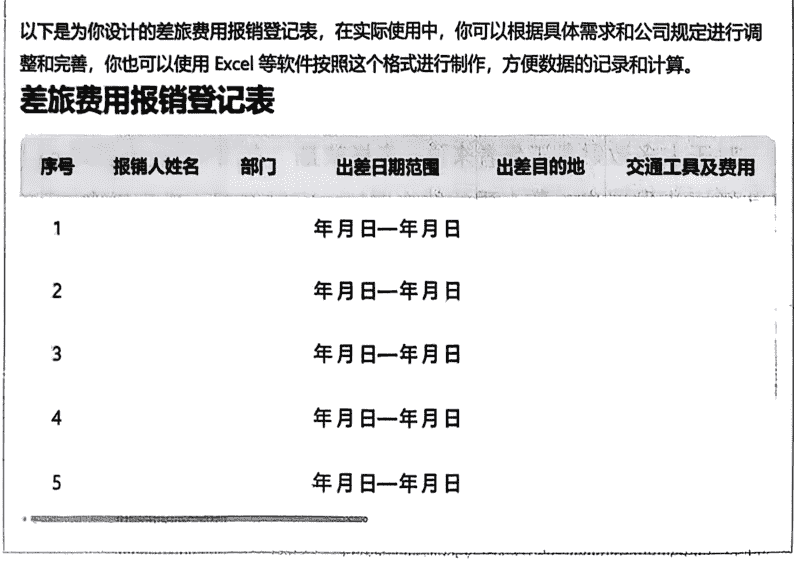
因页面篇幅有限，这里展示不全，实际场景里滑动图中进度条可查阅所有内容。

##### ✓ 文本转表
当文字资料信息不够直观时，模型能识别核心要素并生成结构化字段列表与表头。

例如会议记录写道：“针对第三季度经营总结，财务部需本周五前完成费用归集明细核对，并配合审计部提供凭证；营销部负责汇总7-9月市场活动投入产出数据，提交可视化初稿不晚于下周一；法务部需下周三前完成第三方供应商合同归档整理，重点检查审批附件。”

输入后模型可生成任务分工表，清晰呈现部门、任务内容、截止时间，便于跟进执行。

# 让存量表格从能看变能用

制度正式上线前，提前搭好台账骨架、把业务链路整理成可管控的结构、为试点准备配套表单，这类前置工作特别适合借助这项能力。

#### ② 字段加工类
AI 做表的价值不止于从零新建。财务实务里高频的场景是面对已有报表、台账、清单。数据并不缺，却常因结构松散、列名不统一、摆放不合理，导致汇总、比对或导入系统时反复报错。这时模型可以对存量表格做列级再优化，识别出缺失项、误并项与命名不规范项，把仅能阅读的表格变为可用表格。

典型操作包括补列、拆列、合并列、识别列类型并修正格式，常出现在预算处理、历史数据重建、审计前期准备、系统表格标准化升级等场景，是从写表头走向结构理解的关键一步。

##### ✓ 补字段
拿到一份台账往往感觉信息不足，例如仅有“金额”“时间”，缺失“责任人”“状态”等。模型能够推断该表应补充哪些列，并给出说明。
举例上传一份应付账款台账，系统可能提示：“建议增设付款截止日用于判断是否逾期、付款状态建议取值已付/未付/部分付款、责任部门便于追踪”。同时会解释每个列项的含义与常见取值，甚至直接给出空白结构模板，方便批量补录，对历史资料整理与ERP导入前准备很实用。

##### ✓ 拆字段
旧表或手工录入资料里常把多项信息塞进同一列，例如“张三 -2023 年 - 技术部”，人眼可读却无法分析筛选。模型能判断分隔规律，将其拆成规范的多列，如图 1-8 所示。

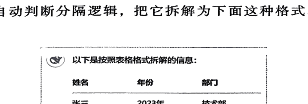

这类拆分在部门明细拆分、人员结构整理、分类汇总时很实用。

##### ✓ 合字段
反之，部分表格是信息过度分散，例如“业务类型 A”“业务类型 B”“业务类型 C”实为同一维度；或“申请人姓名”“审批人姓名”两列，最终分析只需“参与人”一列。模型能把逻辑相近但结构重复的列归并成统一列，同时保留原始列以便复核。

#### ③ 数据清洗与校验类
数据清洗在第 5 天会重点展开，这里仅作为表格处理能力的补充归类。
对财务而言，表填完只是起点，能否使用、能否交付，取决于数据是否干净。过去多靠人工逐列翻查漏填错填格式不一，也靠IF、VLOOKUP等公式找异常，仍有大量隐性问题会在汇总分析阶段暴露，模型正是用来降低这类返工风险的手段。

##### ✓ 格式统一
数据本身正确但写法不一致就会出错。例如金额列有人写“¥12,000”、有人写“1.2w”、有人写“十二仟元整”；状态列有的用“是/否”，有的写“Y/N”。肉眼尚可，导入系统或做分析时即会报错。模型能识别并规范这些写法，比如金额统一为阿拉伯数字加千位分隔符，状态统一为“是/否”，时间统一为“YYYY-MM-DD”，比人工对照写公式高效得多。

##### ✓ 逻辑判断
格式统一只是第一层，更棘手的是表面看似正常却不合业务逻辑的数据。比如付款状态为已完成，付款金额却是 0；费用报销申请金额 5 万元，却未填发票号也未选费用类别；项目支出预算 10 万元，实际 18 万元，但预算编号为空。人工逐行检查难以覆盖，也没有万能公式可全检，模型则可以。
依托自然语言理解，模型会给出类似“审批通过但无审批意见”“付款金额超出预算上限”“执行进度超过 100%”“报销类型为差旅却未填出差天数”的提醒。这种检查是基于列间交叉的业务规则判断，而非单列筛选，能提前预警“填上去了却不能用”的无效数据。

##### ✓ 排查异常值
日常最耗时的不是建表，而是检查漏填、错填、重复。一份几十列几百行的台账，少量差错就会导致汇总错误。用户只需提示：“请检查本表是否存在空值、重复编号、格式不一致并高亮”，模型就会输出问题清单，标明空缺列项、重复内容及所在行列，并附修改建议。
进阶用法是识别必填项。例如付款审批台账中，模型会默认“付款金额”“收款账户”“付款状态”为必填，若缺失即精准抓出；而“备注”“审批意见”等则识别为可空列项，能大幅减少重复返工和逻辑纠错负担。

##### ✓ 找不同
财务最担心的是两张表对不上。例如预算表显示项目 A 年度花费 50 万元，实际支出记录却是 65 万元；付款记录里的合同编号 12345 在合同台账中查不到。人工逐条核对或写辅助列耗时耗力。
模型可直接承担跨表校验。上传两张表并指定“按项目编号对比预算金额与实际支出”，它能自动找出不匹配项并列出行号、差异值、可疑原因。若涉及合同、付款、预算、发票等多表对账，还能建立列映射并生成多表一致性报告，统一汇总对不上条目。

##### ✓ 多表融合
工作中表格常来自不同部门、地区、时间，采用不同模板。汇总时才发现列不一致、命名不统一、格式参差不齐。过去需手动对照建辅助列、复制粘贴、逐条改格式，易错费时。
模型的多表融合能自动识别结构相似但内容不一致的表格，提取公共列、规范命名、补齐缺失项并合成一张统一标准表，核心是实现数据口径一致。
例如汇总 10 家子公司预算执行，各家模板不同，有的按“科目类别”，有的按“预算用途”，有的只列“项目编号”。模型会比对结构差异、归并相同列、拆分混合列、标准化列名，生成主表并附列对应关系说明。

#### ④ 数据计算类
列项清晰、结构合理、数据干净后，下一步是汇总计算。AI表格功能已内置轻量数据逻辑模块，在自动计算、构建公式、逻辑校验上表现突出。

##### ✓ 计算空缺数值
一份需计算的表格交给模型并给出指令，即可得到计算完成后的结果。
例如某公司产品销售数据表，如表 1-1 所示。

##### 表 1-1 产品销售数据表

| 月份 | 销售收入（元） | 销售成本（元） | 利润（元） | 毛利率 |
| :--- | :--- | :--- | :--- | :--- |
| 1月 | 500000 | 320000 |  |  |
| 2月 | 450000 | 290000 |  |  |
| 3月 | 530000 | 310000 |  |  |

目前仅录入原始数据，利润和毛利率未计算，无需手工写公式，发给模型就能补齐整体结果，如图 1-9 所示。

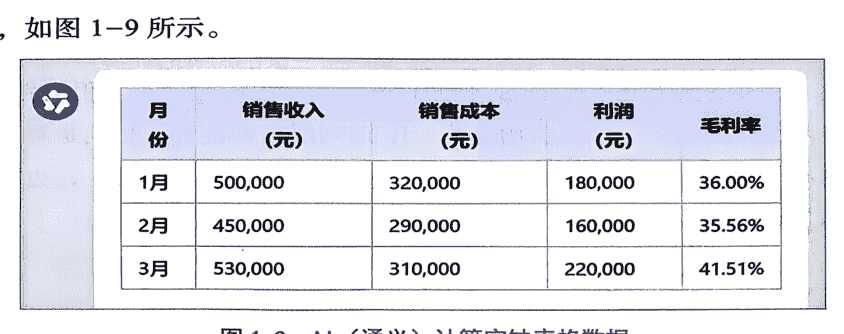

该功能特别适合预算草表、财务底稿、费用台账等场景，可快速填补未计算部分。

##### ✓ 构建函数公式
标准计算不仅要给结果，还要说明过程。条件汇总、跨表关联、环比等复杂逻辑，手工写函数易出错。若想保留公式以便数据实时更新，可让模型辅助生成函数。
例如询问 1 月份毛利率单元格应输入什么公式，即可得到对应回复，如图 1-10 所示。

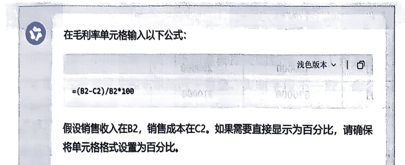

图 1-10 AI 构建函数公式示例

这些能力能避免区间错误、引用错位、IF嵌套混乱等问题，对公式不熟练的财务新人相当于一个“公式助手”。

##### ✓ 校验计算逻辑
算错而不自知是最大风险。毛利率、应收账款周转率、现金比率等指标对列依赖强，一个列填错公式即失效。
模型具备基础逻辑推演，可判断数据是否符合公式结构。若某行毛利率为 125%，模型会提示是否收入填少、成本未含运费或行列错位，例如“毛利率通常不应超过 100%，请核查收入与成本列是否漏填或误填”。虽不及分析师的深度，但足以做初步预警和错误排查。

##### ✓ 支持假设推演
模型不仅能算结果，还能做简易假设推演。例如提问：“若 5 月销售额增长 15%、6 月增长 10%，全年利润预计多少？”模型可基于已有数据构建线性增长模型，预估销售额并代入利润率模拟，输出预估利润总额及趋势。对汇报前的试算和临时测值非常实用，能快速生成带数据、有依据的初稿。

### 1.3 图像生成：轻松呈现财务数据全貌
生成式AI不止于文字和数据，也擅长视觉表达。它能把文字、数据或指令转为符合规范的图像，包括流程图、信息结构图、数据图表、页面草图等。
在财务工作里主要体现为数据图像化、内容可视化、视觉增强三个方向。

#### ① 数据图像化
最贴近财务场景，指基于结构化数据生成柱状图、折线图、饼图、雷达图、散点图等常规图表，并推荐更合适的类型，让数据呈现更专业。

##### ✓ 生成数据图表
要对比各区域本季度销售额，可生成按区域排列的柱形图；展示全年收入趋势可用折线图；分析费用构成可用饼图或环形图。只要意图清晰，模型就能匹配合适的图形。
例如准备月度经营分析报告，需展示四季度营业收入变化，模型会生成如图 1-11 的趋势图。

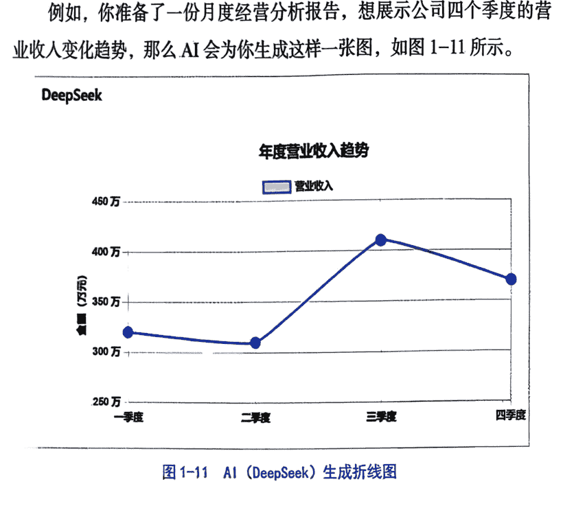

##### ✓ 推荐图表类型
面对复杂报表时不确定选何种图表，例如同时有“实际值”“预算值”“完成率”“同比增长”，柱形图拥挤、折线图不足。模型的推荐功能可派上用场。
把销售数据表交给模型，附列“地区、销售额、销售占比、毛利率”，它会建议：“销售占比可用饼图、各地区销售额对比可用柱状图、销售额与毛利率并现可用双轴图”。

#### ② 内容可视化
解决“概念如何讲清”的问题。不是对数据制图，而是把流程、结构、逻辑、关系用图示呈现，常见形式为思维导图、流程图、组织架构图、关系图谱等。
例如针对《国务院关于提高个人所得税有关专项附加扣除标准的通知》提炼要点后，可借助模型生成内容图谱，如图 1-12 所示。

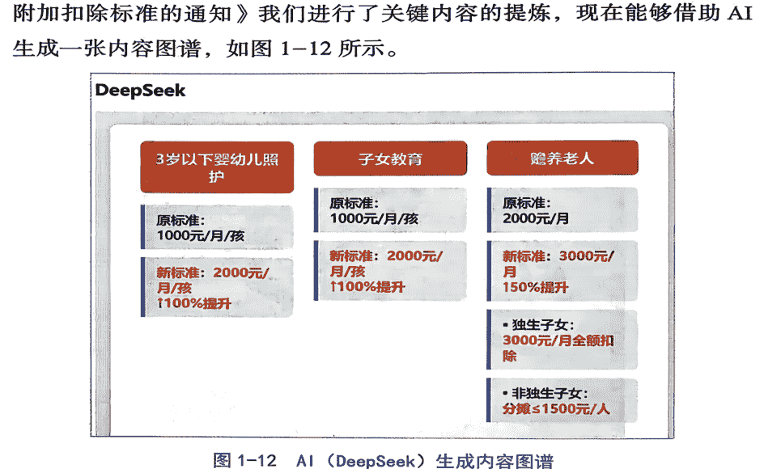

图谱帮助快速把握重点、新旧标准差异，具体标注重点与略过部分取决于提示词的写法。

#### ③ 视觉效果增强
汇报时，文字表格堆砌易让人乏味。适度设计、留白、图形元素能显著提升理解与记忆。图像生成功能无需设计背景或模板，也能产出匹配场景和风格的配图。
例如做“企业财务数字化转型成果汇报”PPT，想让开篇更抓人，可让模型生成商务风格配图用于首页或背景，如图 1-13 所示。


图1-13 AI 生成配图示例

除背景图外，模型还能按文字说明生成风格统一的小图标，如图 1-14 所示，用来点缀页面减轻阅读疲劳，是财务汇报中的细节加分项。

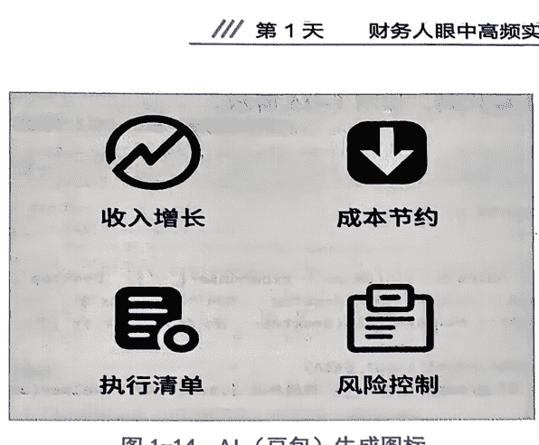

### 1.4 代码生成：无需技术背景也能秒变编程高手
代码生成功能指把自然语言指令转化为可运行脚本或公式，包括Python、VBA、SQL等。它并非原创代码，而是基于业务逻辑拼接出语法完整、即用的标准化代码。
对没有编程背景的财务人员而言，原本需IT支持的自动化操作，现在一句指令即可完成，运行指导和报错修复也能由模型完成。

#### ❶ 生成标准化代码
最直接的应用是根据自然语言描述生成可直接运行的代码。
例如有一张“费用明细表”，希望按“部门”汇总费用金额并按金额降序排列生成新表，可让模型生成代码，如图 1-15 所示。

```python
import pandas as pd
import os

desktop = os.path.join(os.path.expanduser('~'), 'Desktop')
input_path = os.path.join(desktop, '费用明细表.xlsx')
output_path = os.path.join(desktop, '部门费用汇总.xlsx')

df = pd.read_excel(input_path)
result = df.groupby('部门')['费用金额'].sum().sort_values(ascending=False)

result.to_excel(output_path)
```

图 1-15 AI 生成代码示例

代码覆盖读取文件、分组汇总、排序、导出等全流程，并选择轻量处理方式，便于初学者复制使用。无论是费用台账分析、预算报表重构还是小型自动化脚本，标准化代码生成都是第一步，且可按指令调整。

#### ② 代码运行指导
财务人员常困惑代码该在哪运行。模型不仅输出代码，还会附使用说明。
例如让模型写一段VBA隐藏所有空行，它会给出完整宏代码并附解释，如图 1-16 所示。

##### 简化版 VBA 代码：隐藏所有空行

```vba
Sub HideEmptyRows()
    Dim r As Range
    For Each r In ActiveSheet.UsedRange.Rows
        If WorksheetFunction.CountA(r) = 0 Then r.Hidden = True
    Next
End Sub
```

说明：
- 1. `UsedRange` 只检查有数据的区域，提升效率
- 2. `CountA(r) = 0` 判断整行是否为空
- 3. `r.Hidden = True` 直接隐藏空行

使用方法：
- 1. `Alt+F11` → 插入模块 → 粘贴代码 → `F5` 运行
- 2. 效果：所有空白行自动隐藏

图 1-16 AI 生成代码运行说明

这种带指导的能力特别适合无技术背景但想尝试自动化的财务人员，无需了解脚本原理，模型会提醒执行方式、路径、结果位置。

#### ③ 报错诊断与代码修复
代码运行报错很常见，漏引号或括号错位就会失败。非技术人员看到红色报错往往无从下手。而模型既然能写代码，也能读懂并修复代码。

假设你在用 Python 编写采购明细处理脚本，目标是为每条记录计算含税合计，原计划把单价列与税额列相加后写入新列，于是写下 total = price + tax。执行时出现报错，提示信息看不懂，不知道错在何处，只确定加法未生效。把报错信息和源代码一起发给模型，就能获得如图 1-17 所示的解答，问题立刻打开。

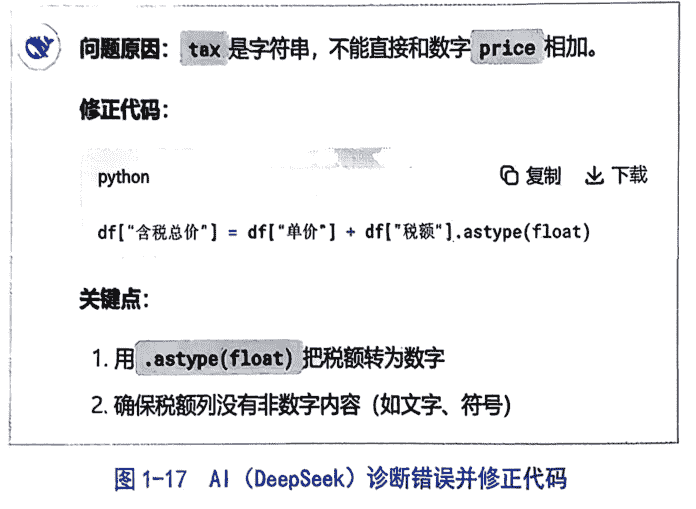

### 1.5 PPT 生成：财务汇报快速成型

生成式 AI 在演示文稿方面的能力基本打通了从文案生成到视觉优化的闭环。它能够理解用户用自然语言描述的需求，自动搭建出一套符合预期的演示，包含封面、目录、正文页、数据图表、流程图等模块。用户只需简要说明汇报主题和要点，系统就会提炼关键信息，选择合适的模板和风格，自动完成版式与内容布局。

#### 1 单词起稿
最省事的用法就是用一个词开局。输入简短词，比如财务制度培训，模型就能据此自动产出一整套演示框架，涵盖封面、目录、正文页与结束页，格式、设计、排版全部由模型智能完成，效果如图 1-18 所示。


这种做法很适合汇报的前期搭架。把模型生成的模板下载到本地后，再自行填充具体内容，比从零手工制作要省力得多。

#### ② 文档转演示
另一种常见场景是把已有报告自动转为演示文稿，适合手里已有详细文档，却需要做成简洁明了汇报的情况。例如上传公司的年度财务报告，模型会自行抽取收入、成本、利润等核心数据，转化为对应的 PPT 大纲，每一页都会自动生成标题、文本框和合适的图表，确保重点信息清晰呈现。

#### ③ 大纲先行再优化
不少人担心模型做的 PPT 逻辑抓不住，其实生成前有一个大纲校准环节。模型会在此协助梳理提纲，让内容更清晰、有条理。PPT 生成后还能继续精修层级，比如在多数据点报告中，系统会按优先级和关联度自动调整页序和结构，保证关键数据和分析结论被突出显示。对需要详细解释的部分，模型会自动拆成小节并配上简洁小标题，帮助受众快速抓住重点。

#### ④ 图表自动植入
在制作过程中，生成模型支持流程图、组织架构图、循环图等图表的自动生成与嵌入。例如财务制度培训中常要介绍报销流程，制度文本里有详细的报销步骤，模型能把这部分内容转成流程图并嵌入 PPT 中，如图 1-19 所示。

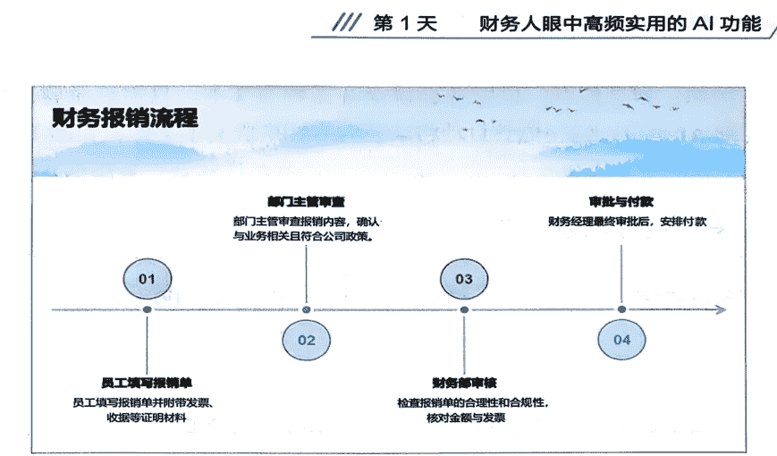
图 1-19 AI（通义）在 PPT 中自动嵌入流程图
这项能力能为财务人员节省手工绘图的时间，清晰展示各环节，帮助受众更好理解复杂的制度与流程。类似地，模型也能根据用户需求和组织架构数据，生成清晰的组织架构图，呈现公司各部门的层级关系。

### 1.6 音视频转文字：财务沟通即时记录

音视频转文字是生成模型借助语音识别技术，把音频视频中的发言精准转为文字的能力。对财务从业者来说，可将财务会议、项目讨论、在线培训等音视频内容转成结构化文本，省去手写记录的时间，也保证了一定准确度。

#### 1 内容提取
财务工作中常遇到会议录音、培训视频需要转录的场景，模型提供了一个高效且准确的方案。例如有一段财务会议录音需要成文，只要把文件上传到平台，系统就能自动将其转为文本文件，如图 1-20 所示。


整个过程中模型会按顺序识别讲话内容，确保每段发言都被完整呈现。转录后的文本可直接为后续分析和汇报提供依据。

#### ② 发言人及要点标注
转录时模型还能识别不同人物的发言，并在文本中标注出来。比如会议中各部门发言，系统会依据上下文自动判断并标明发言人，帮助财务人员快速回溯要点，避免混淆不同意见，如图 1-21 所示。

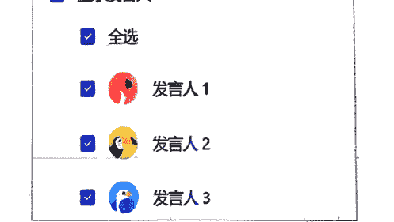
对于预算调整、成本控制等关键议题，模型会将其标注为导读要点，并自动生成思维导图供浏览，如图 1-22 所示。

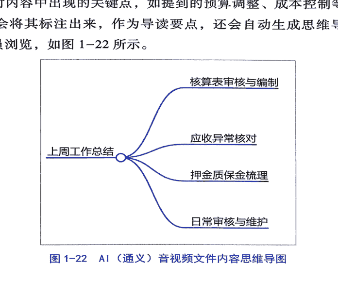

#### 3 导出可编辑文本
模型生成的文字记录可直接导出为 TXT、Word 或 PDF 等可编辑格式，便于后续编辑、分享或归档。例如公司的财务制度视频培训材料可通过模型转为文本，并按培训章节整理，新人入职时即可调取学习。该功能还适用于财务审计现场沟通、行业交流会等场景，因转录文本规范完整，财务人员只需按需修改，无需从零整理，大幅提升效率。

# 第 2 天

## 让 AI 听懂财务的提问技巧
是不是总觉得模型的回答和你的预期不在一个频道？别急，问题多半出在提问方式上。生成模型不会自动猜测你的业务背景、财务逻辑和格式要求，想让它派上用场，就得学会怎么提问。今天的学习重点是如何更精准地表达需求，以及用角色设定引导模型进入财务人员的思考模式，掌握后回答的准确性和质量会明显提升，让模型真正成为财务工作的强力助手。

> 提示词写得好，首先能解决一半的问题。

### 2.1 提示不清导致效果打折
假设你在整理报销明细，想借助模型提高效率，于是上传一张含员工报销信息的图片，并在对话框里简单写：麻烦把报销单数据整理一下。

很快模型给出整理结果，如图 2-1 所示。

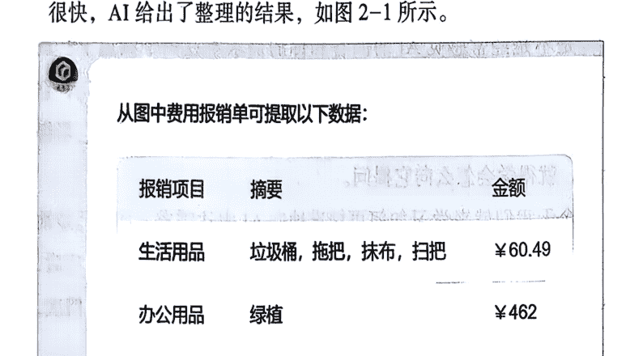
你一看觉得离预期很远，没有报销人姓名、所属部门，也没有汇总金额，更关键的是费用类型如办公费等也没写。于是觉得模型不够智能，还是自己干吧。

很多人认为模型不好用，是因为它理解不了需求，归因于能力不足。其实多半是提示词没说清楚。就像让别人帮忙却没讲清具体任务，对方只能按自己理解去做，结果自然偏离。要理解这点，需明白模型的工作原理。它没有自主意识和判断力，所谓的理解完全依赖提示词展开，不会主动推测你没说出的需求。只做被要求的事，没提的就不做。比如你说洗碗，它不会顺带洗筷子，除非你明确说出。

所以提示词不够具体，模型就容易遗漏所需部分，或做一些无用工作。

回到例子，麻烦把报销单数据整理一下本身就是模糊指令。怎么整理？要列哪些信息？是否按姓名、部门、费用类别分类汇总？这些关键点都没说明，模型自然无法准确把握。

下面总结解决提示不清的办法。

#### ❶ 避免语言歧义
同一句话里某些词可能有多重解释，模型无法感知当前工作场景，自然难以判断你的真实意图，容易生成偏离需求的内容。例如提示合并表格中的数据就很歧义，可能指把多表内容合到一表，也可能是汇总合并，或按分类合并。

在财务数据处理中，含糊的提示易导致结果偏差，影响效率和决策。为避免歧义，使用多义词时要明确具体操作要求和标准，减少误解。

正确示范：
请把这三张销售表格的数据合并到同一张表格中。
示范明确了合并是指把内容并到一个表格，消除了歧义。

#### ② 增加任务细节限定
模糊提示最大的问题是范围过大、缺乏限制，导致模型输出宽泛且不聚焦。反复试几次会让人觉得浪费时间。比如分析财务数据、整理财务文件、审核财务记录等都属于范围过大。解决办法是增加细节限定。下达任务时尽量具体明确，先确定具体操作，如数据分类、计算或生成何种报告，再明确范围：需要哪些内容、分析哪些数据、有无时间、部门或其他限制。这些细节能帮助模型聚焦需求，避免在无关内容上耗费资源。

正确示范：
请根据所给数据，按标准模板生成本年第一季度的财务报表。
有了内容和模板，输出更贴合预期。

#### ③ 提供充分的背景信息
巧妇难为无米之炊，有时模型答非所问，是因为提示中背景信息不足。比如要求整理报销单，但图片上根本没有报销人和部门，模型就无法展示相关信息。解决也不难，缺什么补什么。没有数据就补充数据，没有信息就填上，信息完整后再提问，很快能得到想要的回复。

提示词示范：
请根据这张填写完整的报销单，按费用类型对应的会计科目汇总报销金额。（附上报销单图片）
这样模型才有充足材料处理。

> **提示词建议：背景信息 + 任务目标 + 限定条件**
背景信息提供上下文或数据支持，让模型了解任务基础条件，包括数据来源、文件附件等。任务目标明确期望完成的核心任务，如分类、汇总、分析或生成报告等。限定条件详细描述执行要求，如时间范围、分类标准、计算方法等，确保任务边界清晰。

### 2.2 用角色设定引导专业思考
与模型对话时，很多人觉得回答刻板或缺乏专业性，有时像外行建议。这往往是因为模型没有进入正确的思考模式。反复强调过，模型按提示词执行，不会主动推测任务背后的深层需求。因此涉及特定行业时，模型可能想当然拼凑内容，而非按该领域专业思维输出，导致浅显、单一甚至不符合行规的错误信息。

举个例子，假设某公司第一季度销售情况如下表，需进行数据分析。

##### 表 2-1 公司第一季度各组销售情况

| 销售队伍 | 实际收入（万元） | 实际成本（万元） | 预算收入（万元） | 预算成本（万元） |
| :--- | :--- | :--- | :--- | :--- |
| 销售 A 组 | 1600 | 1260 | 1700 | 1200 |
| 销售 B 组 | 1450 | 1030 | 1500 | 1000 |
| 销售 C 组 | 2000 | 1650 | 2100 | 1600 |
| 销售 D 组 | 1300 | 1020 | 1350 | 900 |

你希望模型做财务分析，但提示词只写：请对这些业绩数据做个分析，给出结论。

模型会直接做基础计算和对比，给出简略结论，如图 2-2 所示。

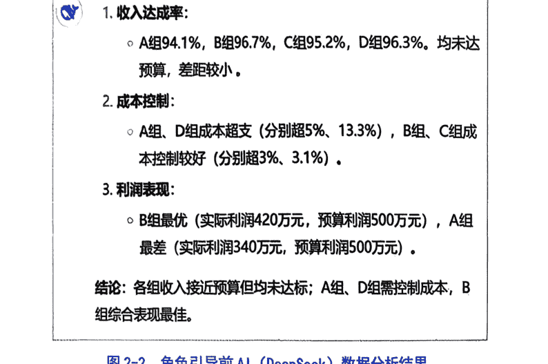
内容看似条理清晰，给了收入达成率、成本超支和利润表现，最后简单总结各组情况。这种结果做运营汇报尚可，用在财务分析报告里却不够实用。因为它只是把数字念了一遍，没算毛利率，也没涉及现金占用、风险预警、改进方案，缺少对决策有帮助的分析。即使不断丰富细节，回复的相关性仍不高，让人苦恼。

最好的办法是角色引导。

角色引导即在提示词中设定明确角色，赋予模型一种身份，帮助它把握任务核心，从专业角度思考和作答。比如在上述例子中加一句你是一名财务分析师，第二次响应思路立刻改变，如图 2-3 所示。

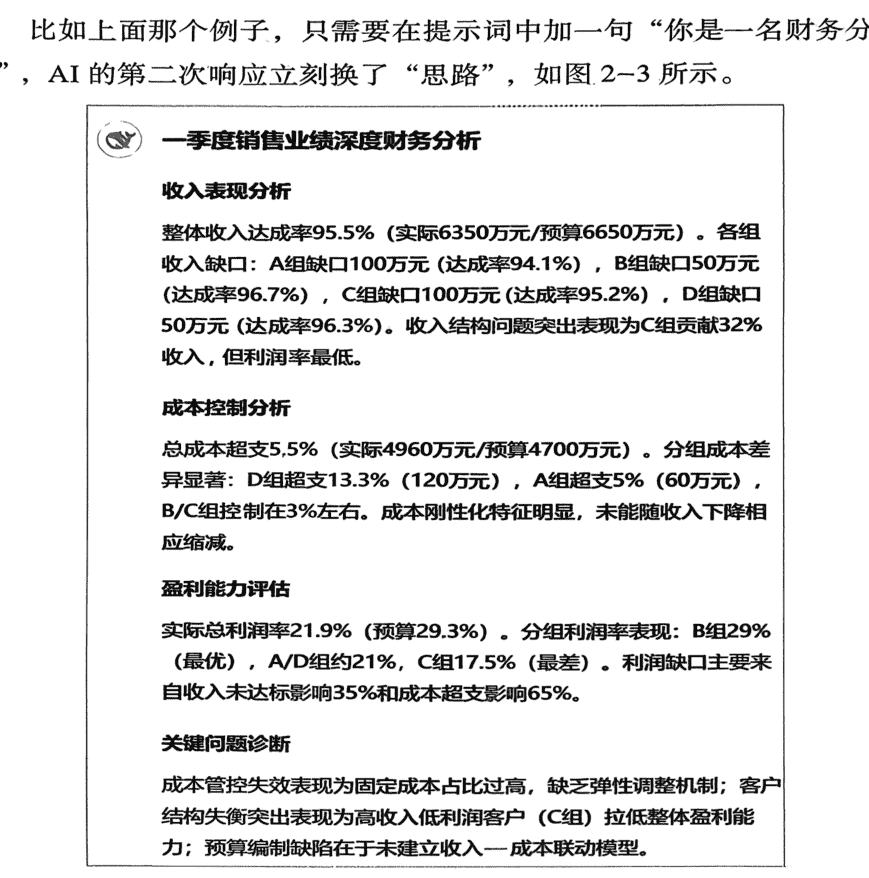
图 2-3 角色引导后 AI（DeepSeek）数据分析结果
设定财务分析师角色后，模型不再停留在收入未达标、成本超支的表层，而是先从整体给出公司级收入达成率和总成本超支率，让管理层直观看到全局偏差。再看局部，模型把收入结构问题摆到桌面上，这种跨行分析在未设角色时完全缺席。同时回答还把利润缺口拆解为收入未达标 35% + 成本超支 65%，并指出固定成本刚性、客户结构失衡、预算联动缺失三条根本原因，为后续举措预留方向，而不是一句需控制成本草草收尾。

当然，这里回答仍不完美，因为提示词本身很简略。实际对话中用户需要补充更多细节，得到的回答会更细致、更符合期待。

为什么加了角色效果会明显变化？因为这给了模型一个专业的思考路径。它知道自己是财务分析师时，视角会偏向毛利率、预算偏差、现金流压力等核心指标。于是泛泛的需控制成本会被替换为成本刚性化特征明显，未能随收入下降相应缩减，更能回答管理层关心的問題出在哪里。

角色标签还影响行文深度。未设角色时，模型常使用不错、稳健等宽泛形容词；一旦确立财务身份，系统会主动量化差距、剖析原因，如指出C 组贡献 32% 收入但利润率最低，而非简单说B 组、C 组成本控制较好。

想提升提问效果，可在提示词最前面写上角色，再保留原始请求，让模型进入专业频道。

提示词建议：【角色】+ 原提示词
角色为模型明确身份，让它自动切换到对应专业视角，如财务分析师、审计师、财务经理、会计等。原提示词保留任务目标、数据说明和其他细节，一字不改就能提升回答深度与专业度。

### 2.3 分步提问提升财务分析质量
与模型互动时，反复提问很浪费时间，于是有人倾向一次性给出大量要求，期待模型一次搞定。然而模型并非万能，常无法同时满足所有要求，就像一个人同时处理多个复杂任务却无优先级和步骤，会一团糟。

解决办法很简单，拿不到想要的结果就分步提问，让模型逐步执行并确保每步高效精准。需要说明的是，模型具备一定上下文记忆能力，可在多轮对话中记住前面信息和指令，并在此基础上改进补充，所以拆解提示时无需担心遗忘。

拆解可按以下步骤进行。

#### ① 步骤一：明确任务的主要用途
拆分提示的第一步是弄清究竟要什么，即明确回答的主要用途。很多人把数据、背景、附加要求一股脑抛给模型，却从未说明用途。结果模型只能抓哪段先说哪段，说完就交卷。

比如提示请帮我写一份业绩分析报告，把数据分析一下，指出问题并提出建议，既没限定报告类型，也没明确财务口径还是运营口径，更没说明服务对象。模型往往只给几行同比环比增速，最后来一句建议加强市场推广，既不像财务报告，也不像业务复盘。

提示词示范：
请撰写一份向董事会汇报的一季度财务分析报告。侧重毛利、预算差异及现金流风险，不关注市场营销细节。
这样用途就确定了，是面向董事会的财务分析报告，模型会围绕财务、董事会展开解读和图表。

#### ② 步骤二：生成回答的框架体系
当报告给谁看、解决什么问题明确后，下一步是交代清楚报告长什么样。这一步常被忽略，也是用户觉得模型回答不全面的关键原因。

假设你让别人写材料却不提框架，对方会凭理解设置框架，可能先放数据再提建议，也可能把长结论放前面。模型亦然。

如何让模型了解具体框架？分两种情况，一种已有固定框架，另一种尚无现成框架。

当一个输出雏形已经成型，最省事的做法就是把各板块的排列顺序和标题名称直接写入指令，让模型按此组织。

参考写法：

请按“摘要—数据表—差异拆解—风险与机会—改进措施—附件”的顺序呈现。

模型拿到明确的排版要求后，会据此搭建骨架，初稿通常不需要大改。

若暂时没有现成骨架，也可以先让模型帮忙搭一个。

正确做法示范：

假如你是一名财务分析师，会怎样向董事委员汇报这份数据？请给出层级标题，并说明每一段要覆盖的关键点。

提出这类问题后，助手一般会先返回一个可用的结构，如图 2-4 所示。

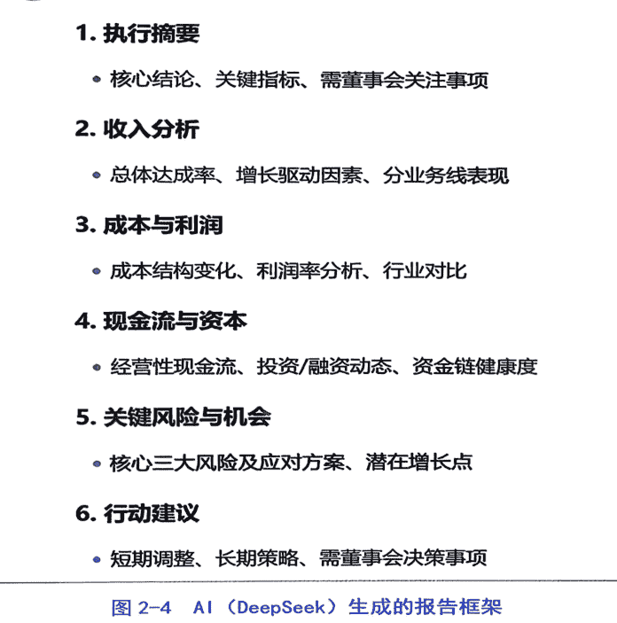

图 2-4 AI（DeepSeek）生成的报告框架

随后从返回的结构里挑选需要保留的部分，把确认后的骨架再回传给模型，让它在此基础上填充具体内容。两轮对话就能把输出形态固定下来，后续的数据、分析、结论才有安放的位置。

#### ③ 步骤三：把指令的细节与评判标准讲清楚

骨架确定后，下一步是把每部分的细则交代清楚。若这一步描述模糊，模型很容易给出“面面俱到却处处不到位”的结果。

财务分析类报告最怕的就是这种现象。要想拿到可直接使用的分析，就要开门见山告诉模型：必须呈现哪些指标、指标采用什么口径、异常要深挖到什么程度、结论怎样才算清晰。

示例指引：

各部分内容要求如下：

1. 执行摘要：在 150 字以内概括收入、利润、现金流的偏离；列出需要董事委员表决的事项。

2. 收入分析：先给出整体收入达成率；按业务板块列出实际收入、预算收入、差异额、差异率；差异率 ＞5% 要加粗；最后用一句话说明各板块的主要增长或下滑驱动。

3. 成本与利润：列出直接成本、期间费用、总成本三栏，与预算对比；计算整体及分板块毛利占比、营业获利比率；毛利占比 ＜20% 的板块需给出两条原因。

4. 现金流与资本：报告经营性现金净额、自由现金流；若经营现金净额低于净利润 20%，请用备注解释差异。

5. 关键风险与机会：列出三大核心风险（汇率、原料、需求）及对应缓解举措；给出 1—2 个潜在增长点。

6. 行动建议：短期建议（≤ 3 个月）与长期建议（＞ 1 年）各 2 条；注明预估财务影响与所需董事委员决策。

指引写得越细，模型基本能按清单逐条兑现。最终报告仍是六大块，但每块都紧扣财务痛点，数字突出、结论简练，符合预期。

要注意，单次输出长度有限，可能无法满足对每部分的深度要求。此时可以把报告拆开提问，例如先只让模型写执行摘要和收入分析，满意后再追问成本、利润、现金流与资本等剩余部分。

前面提到过，模型具备上下文记忆，第一轮的计算结果会被带入后续对话，既保证逻辑连贯，也让每段输出保持在易于审阅的篇幅里。这本身也是拆解指令的延伸。

> **指令建议：任务用途 + 回答框架 + 细节要求**

任务用途：用一句点明报告的用途和受众，比如“季度财报审阅”“银行授信材料”“部门协作会议”。

回答框架：列出内容顺序和段落划分，确保输出条理完整、板块齐全。

细节要求：说明每个板块要呈现什么、计算哪些数据、什么情况下算异常需标注、哪些内容可忽略。

### 2.4 引导模型突破限制，找到更多隐藏思路

助手并不会主动产生创新。它只能在你给的框架和信息范围内做推演。也就是说，你没想到的角度，它通常不会主动覆盖。

这会带来什么后果？就是对助手能力的挖掘严重不足。不是模型做不到，而是指引把它限制住了。这不是模型的天花板，而是使用者的思维天花板。

如何打开思路、挖掘隐藏点？下面四种做法可参考：

#### ❶ 启用深度思考和搜索功能

不少主流工具的对话框里都有“深度思考”，有的叫“深度研究”，功能大同小异。


默认情况下，模型只做一次生成，不会复盘自己的推理链。深度思考则会先出初稿，再在后台自检：推理是否跳步、论证是否充分、有无遗漏切口。

发现空白后，它会再进行一到两轮内部推演，对缺口补充修正，最后呈现更完整的版本。过程类似人类的复盘整理，输出会更全面、更有条理。

示例指引：

我是一名财务相关人员，发现销售部门在这个季度多次出现招待费、打车费混在一起报销的情况，且报销申请时间过晚，导致月底关账很被动。我想写一封邮件反馈给销售部门负责人，让他们注意这些问题，最好能附带一些建设性建议。请帮我写一下邮件的正文部分。

先看未开启深度思考时的回答，如图 2-6 所示。

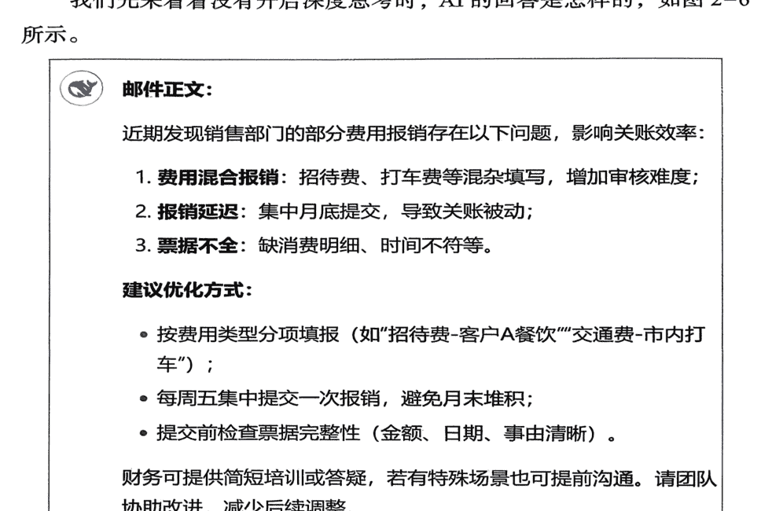

图 2-6 深度思考前 AI（DeepSeek）生成的邮件正文

开启深度思考后，同样指引下的回复如图 2-7 所示。


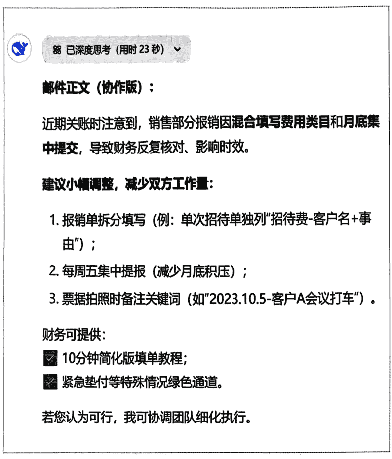

图 2-7 深度思考后 AI（DeepSeek）生成的邮件正文

对比两封正文，能力差异很明显。未开启时，问题点明晰、建议明确，但语气生硬，像通知而非沟通，容易引发抵触。

开启后，邮件明显成熟许多：开头先提到关账时重复核对影响大家，暗示共同负担而非单方面指责；“建议优化方式”改为“建议小幅调整”，并说明调整后对方工作会更简便；结尾“若您认为可行，我可协调团队细化执行”，体现合作而非命令。

有人会说，语气不对就加要求，比如“语气委婉”“不用命令式”，模型自然会改。是的，这也可行，但指令不可能第一时间穷举所有细节，尤其在赶时间或任务复杂时，哪怕补一句“请语气得体”，模型也可能只是多加几个“请”字，无法真正理解得体背后的逻辑。

这时深度思考就是很好的容错机制，能在指引不完美时替你多想几步，减少反复打磨的时间。

至于搜索功能，则是让模型在联网抓取最新资料后再作答，提升时效性和全面性。

没有搜索，模型只能依赖内部文件和静态常识；打开搜索，等于配了一个网络助理，主动补齐外部数据。

#### ② 启用搜索功能

搜索能让模型在生成前先在互联网上抓取实时资料，涵盖最新法规、行业均值、公开年报、官方公告、汇率物价等，再给出更有参考价值的答案。

该功能在图 2-5 中也有体现，其他工具也有类似的“AI 搜索”入口，如图 2-8 所示。


图 2-8 AI（豆包）的“AI搜索”功能

不开启搜索，模型只能处理你提供的材料；开启后，它能主动查询外部数据、引用公开来源、补充行业背景，回答更扎实。

哪些场景适合开搜索？

##### ✓ 与最新政策口径相关的问题
- 2024年，小微企业能享受哪些税收优惠？
- 出口退税的最新比例是多少？
- 财政部有没有发布针对项目资本化的新解释？

这类问题年年更新，模型知识存在滞后，不搜索只能靠旧经验。

##### ✓ 涉及行业标准或公司经验的问题
- 现在制造业企业平均期间费用率是多少？
- 同行业上市公司一般怎么披露收入确认口径？
- 有没有同行写得好的销售返利会计政策？
- 请找一家制造业企业的固定资产管理制度模板。

这类答案需要真实文本支撑，必须联网抓取，否则只能给出“通常”“一般”等模糊表述。

##### ✓ 涉及市场价格或汇率变动的问题
- 当前美元兑人民币的汇率是多少？
- 2025 年国内机票平均价格上涨了多少？
- 碳排放配额交易的大致价格是多少？

数值变化快，靠记忆不靠谱，必须实时抓取。

#### ③ 设定开放式指令

开放式提问不预设具体维度，鼓励模型自行展开联想；封闭式则有明确答案或判断。

例如：
封闭式：员工餐费报销额度是否超过公司规定？
开放式：员工餐费报销成本过高，可能与什么因素有关？

人的提问常带盲区，想到的才问到。开放式提问等于告诉模型：“我看到的有限，你帮我看看还有哪些盲点。”

这能把助手从执行工具变成共创伙伴。

担心开放式导致回答发散？可以拆两步：先开放式头脑风暴收集思路，再从中筛选维度进行限定式深挖。

比如先问：“员工餐费报销成本过高，可能与什么因素有关？”模型可能给出标准模糊、审核宽松、缺乏预审批、道德风险、物价上涨、行业惯例等方向。你剔除不相关项后，再要求模型对照剩余原因检查公司实况，例如报销额度是否超标、审核时是否要求提供用餐名单或事由说明，效果会更好。

#### ④ 利用好模型的灵感提示

部分工具在回答下方会附带几条相关提示，如图 2-9 所示。

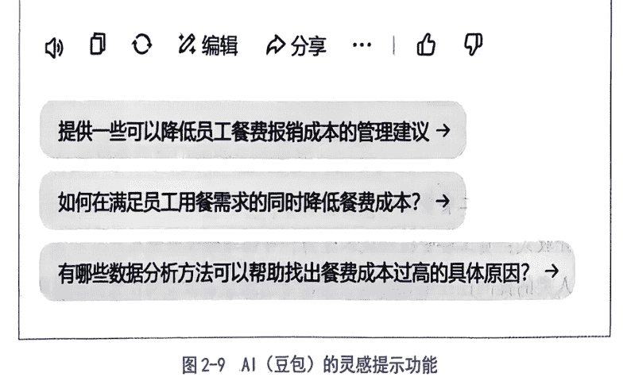

这是灵感提示功能，能基于当前上下文自动扩展思路，帮助挖掘更多解决方案或未被注意的因素。点击即可进入新对话，无需重复输入。

也可以主动要求模型补充灵感，例如：

在回答过程中，若你认为有相关的优化方向或者未被提及的因素，主动告诉我。

在回答过程中，如果有其他值得注意的建议或细节，麻烦提醒我。

请告诉我你认为最有可能忽视的关键点。

这样模型不仅回答问题，还会主动提供新视角。

也可以明确要求开拓思路：
在这个基础上，请告诉我如何从不同维度重新考虑这个问题。
你能不能给我几个之前没提到过的优化方案？

> **指令建议：开放式 + 灵感补充（启用深度思考或搜索功能）**

开放式：提出没有明确限制的问题，给模型更多发挥空间。
灵感补充：在指令中要求模型主动补充它认为可能被忽略或有价值的观点。
启用深度思考或搜索功能：依据问题性质选择合适的增强功能。

### 2.5 设置模型回答格式，轻松实现任务标准化

助手的优势是快速产出，但直接复制到本地后格式往往参差不齐，后续需要手工调整，浪费时间。

很多人以为模型输出不可改，或不懂编程，不知道如何让模型直接给出标准格式。

例如，让模型生成一套差旅费用报销规范文档，各模块齐全，复制下来却是如图 2-10 所示。

```
**XX 公司差旅费用报销标准**
**（202X 年 X 月修订版）**

##### **第一章 总则**
**第一条 适用范围**
本文件适用于公司全体员工因公出差产生的交通、住宿、伙食及其他相关费用报销管理。

**第二条 基本原则**
1. 费用报销需符合实际业务需求，票据真实有效；
2. 优先选择经济合理的差旅方式，严禁超标消费。

##### **第二章 费用标准细则**
**第三条 交通费**
1. **交通工具标准**
   - **普通员工**：高铁/动车二等座、飞机经济舱、火车硬卧/硬座；
   - **部门经理及以上**：高铁/动车一等座、飞机经济舱、火车软卧；
   - **特殊情况**（如紧急任务、无其他交通方式）需提前提交书面审批。
2. **市内交通费**
   - 往返机场/车站可报销出租车或网约车费用（需提供票据）；
   - 出差期间市内交通费按实报销，单日限额 50 元。
```

图 2-10 复制到本地的差旅费用报销标准文档

文档格式混乱，标题层级不明，列表符号杂乱，字体无区分，看起来像拼贴文字，需要重新排版。虽然可以手动调整，但既然已经用上助手，为何不把最后一公里也打通？

关键是直接在指令里写明字号、字体、行距、颜色、布局等格式要求，并指定输出 HTML 格式。

HTML 是结构化语言，支持完整的排版指令，模型可以用代码控制每个细节。

示例指引：

生成一套差旅费报销标准文件，以 HTML 格式输出，具体要求如下：

- 正标题：宋体，二号字，居中对齐，段前段后各 1 倍行间距；
- 章标题：黑体，三号字，居中对齐，2 倍行距，段前段后各 0.5 倍行间距；
- 条款标题：黑体，四号字，左对齐，首行缩进 2 个字符，1.5 倍行距，段前段后各 0.5 倍行间距；
- 正文：宋体，小四号字，单倍行距，左对齐，首行缩进 2 个字符；
- 落款：宋体，小四号字，右对齐。

随后模型会生成一段代码，点击代码框右上角的“运行”选项，如图 2-11 所示。


图 2-11 AI (DeepSeek) HTML 代码 “运行” 选项

运行后，即可看到按要求排版好的制度文件（如图 2-12 所示），如需下载本地，只需点“运行”按钮旁的“下载”。

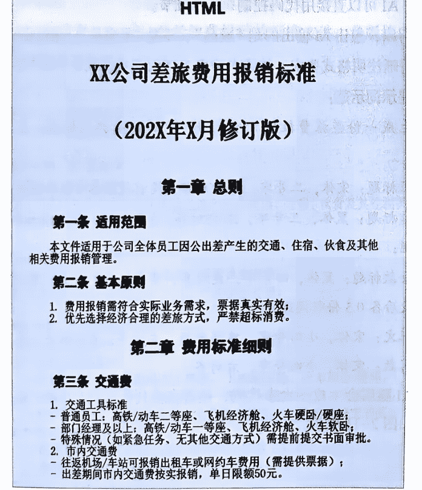

图 2-12 AI (DeepSeek) HTML 代码 “运行” 结果

下载后粘贴到本地文档，格式完整保留。

提示词建议：格式要求 + 以 HTML 格式输出

格式要求：明确标题字号、正文字体、段落间距、列表样式等排版细节，让模型在生成内容的同时完成格式。
以 HTML 格式输出：能完整保留字体、字号、行距、段落、列表、缩进等结构，复制到 Word 后即为成品。

# 第 3 天

## AI 高效阅读与信息整理实战

财务工作中常要面对堆积的文件、政策、合同，想快速抓住核心却被信息量淹没。

今天进入实操环节，学习如何用助手快速整理行业资讯、精准归纳会议要点、高效解读政策文件、识别合同风险。借助助手，让你在信息过载的时代快速捕捉价值信息。

> 大数据时代缺的不是信息，而是提炼重点的能力。

### 3.1 财务行业新闻快速整理与关键字提醒

关注财经新闻是财务人员的日常，尤其是职位越高，关注度越高。并购潮、竞争对手融资、原材料波动、社保调整传闻、汇率变化等，都在潜移默化影响预算、成本、资金安排和汇报口径。

一天几百条公众号更新、几十个财税群推送，加上新闻网站和公司群转发，没人能逐条看完，更别说提炼重点。

不如换个思路，让助手先读完，再告诉你哪些值得看。

【实战任务】

假设你是某制造公司的财务经理，需日常关注制造业投融资动态、主要原材料价格走势、汇率变动与出口订单波动、国内大型制造企业的财务运作。

【实战操作】

#### ① 归集新闻源

想每天快速掌握制造业新闻重点，高效做法是先让助手帮你收集一批稳定可靠的来源，形成固定的“信息池”，后续搜索、筛选、提炼都基于此池。

助手不会凭空知道你的信息习惯，需要你给出方向。若已有常用网址，可直接提供；若没有，也可让助手推荐。

##### 提示词示范：

**制造财务人情报抓取与复盘打法**

身处制造企业财务岗位，日常必须紧盯行业脉动，重点落在投融资动向、原材料成本波动、出口订单变化以及国内头部制造企业的财务表现。下面汇总5家资讯更新稳定、制造业覆盖扎实的中文财经入口，可直接作为常态化信源。

先把联网检索打开，由模型自行组织语言归纳后产出网址清单，参考图 3-1。

目前可用的权威主流中文财经媒体及在制造业方面的侧重如下：

1. **新浪财经**：https://finance.sina.com.cn/。依托新浪门户的流量优势，推送速度快、版块全。制造业报道多围绕A股公司股价、重大投融资事件、原料金属与出口政策的传导效应，以及龙头制造企业财报解读。
2. **财新网**：https://www.caixin.com/。深度与时效兼顾，团队反应快。制造业内容涵盖行业走势、企业经营、政策影响，同时追踪原料金价波动、订单情况及大型制造企业的财务状况。
3. **21 经济网**：https://www.21jingji.com/。擅长区域经济和行业解析，时效与连续性兼顾。宏观视角观察制造业运行环境，刊载行业动向、企业投融资消息，以及原材价格与出口订单变化。
4. **第一财经网**：https://www.yicai.com/。资源整合能力强，设有产业经济专栏聚焦制造业。覆盖政策动态、行业发展趋势、企业经营状况，同时涉及原料金属市场、出口相关信息及大型制造企业的财务分析。
5. **经济观察网**：https://www.eeo.com.cn/。《经济观察报》旗下新媒体，面向商务人群输出财经资讯。报道团队关注新能源、半导体、电子通信等科技制造领域，多角度呈现制造业信息，为财务决策提供参考。

图 3-1 AI（豆包）生成的新闻网址清单

建议把上述链接整理成固定源库，另开一个AI对话窗口，之后每次抓取都回到同一会话。会话记录会保留，无需重复上传网址即可快速得到结果。

#### ② 利用关键词定向筛选信息

光有网址清单不等于信息就绪，关键是让模型清楚你的关注边界，明确哪些要抓取、哪些可忽略。

核心在于提前设定检索词。

检索词的来源可从日常关注点提炼。若跟踪投融资，用“融资”“投资”“募资”“并购”“扩产”等；若跟踪原材价格与出口订单波动，用“钢铁”“铜价”“锂矿”“大宗商品”“出口订单”“外贸出口”“汇率波动”等；若跟踪国内大型制造企业的财务动向，则用企业名称配合“净利润”“现金流”“财报”等。

提示词示例：

请从上述新闻网站中筛选24小时内更新的内容，目标是包含以下检索词的文章，检索词出现3次以上的内容重点提炼要点。检索词包括：融资、扩产、钢铁、铜价、出口订单、外贸出口、XX公司、净利润、现金流。

如此模型在检索时可定向过滤噪音、提取要点，如图 3-2 所示。

检索维度变化时可动态补充检索词。比如测算出口补贴时临时加入“出口退税”“财政补贴”；准备费用预算评估时加入“费用率”“期间成本”等。

- **21 经济网**：前4个月全国货物贸易进出口总值14.14万亿元，外贸整体平稳。其中出口8.39万亿元，同比增7.5%。4月单月出口2.27万亿元，同比增9.3%。前4个月汽车产销双双突破1000万辆，分别为1017.5万辆和1006万辆，同比分别增12.9%和10.8%，新能源汽车产销分别为442.9万辆和430万辆，同比分别增48.3%和46.2%。圣诞用品订购季提前，义乌经营户称订单已排至6月。
- **经济观察网**：工信部消息，5月7日，机械工业环保产业发展中心在河北唐山举办2025再制造产业发展大会，推动机电产品再制造产业规范化、高质量发展。国家统计局数据显示，4月全国工业生产者出厂价格同比降2.7%，工业生产者购进价格同比降2.7%。海关总署9日公布，前4个月货物贸易进出口总值14.14万亿元。

图 3-2 AI（豆包）生成的新闻摘要

该做法本质是赋予模型筛选意识。像人工浏览新闻会看标题、抓重点、跳过无关内容，模型也能按此执行。

#### ③ 生成个性化摘要

检索词筛选后，下一步是把有用信息提炼为结构清晰、易读的摘要。建议明确格式与要素，例如分类方式、是否需要点评等。

提示词示例：

请将上述新闻内容按检索词对应的主题分类，每个主题下列出与今日相关的新闻摘要。每条摘要包含来源、时间、标题、简要信息以及一句对企业财务工作的可能影响点评。

此时模型返回会如图 3-3 所示。

外贸出口 / 出口订单

- 来源：21经济网
- 时间：2025年5月12日（文中数据为前4个月情况）
- 标题：无明确标题
- 简要信息：今年前4个月我国货物贸易进出口总值14.14万亿元，外贸平稳增长，其中出口8.39万亿元，增长7.5%；4月当月，出口2.27万亿元，增长9.3%。圣诞用品订购旺季提前，义乌经营户订单已排到6月。
- 点评：出口增长有助于提升营业收入与整体财务表现，订单提前可帮助企业优化生产排程与资金周转。

图3-3 AI（豆包）生成的个性化摘要

若希望表格呈现，或要求点评控制在20字以内，也可在提示词中提前说明。要求越细致，结果越贴合日常使用习惯，减少手工调整。

#### ④ 历史新闻回顾

日常阅读不仅服务当下，信息沉淀后可形成可追溯的历史资料。AI不仅能做当日摘要，也可帮助定期梳理一段时间内的重点动向。

这也是建议在同一聊天窗口持续提问的原因，便于保留历史对话以便回顾总结。

提示词示例：

请根据我过去三周每天整理的行业新闻摘要，从中筛选出在“外贸出口”“汇率变化”和“订单安排”这三个主题中重复率最高的检索词或事件，整理成一份阶段总结。

阶段性总结能把零散信息转化为结构化的趋势判断，适合财务经理撰写月度汇报、复盘季度走势或准备预算调整依据。

过去需人工翻查邮件、群消息、Excel 才能拼凑主线，现在只需提示模型关注主题，它就能自动统计检索词频次、事件重合度、舆情演变节奏，甚至描绘“话题热度变化曲线”。

若习惯把摘要保存为 PDF、Word 或 Excel，也可上传文件再引导模型输出所需内容。

提示词示例：

请整理这些内容中体现原材料价格变化方面的信息，并列出高频动词和主语的组合模式。

分析颗粒度可达语义层面，利于风险监控与决策准备。历史回顾不仅是资料复用，更是俯瞰全貌的关键。

### 3.2 智能总结财务会议内容，生成思维导图

财务工作中会议频次高，预算沟通会、成本复盘会、销售收款协同会或临时对账协调会都会产生大量信息与对话细节。这些内容需会后转成报告、纪要、结论、决策方向或拆分任务。而会议节奏快、话题跳跃、口头表达常省略主语宾语，财务人员又需以数据为基础、以结构为导向汇报，工作量较大。

借助生成式AI，可把会议记录直接交给模型，快速提取核心要点，并以思维导图呈现“会议说了什么”“讨论结构如何”“提出哪些问题”“谁负责什么”。

【实战任务】

假设公司召开预算执行协调会，参与者包括财务部、市场部、供应链和销售部。会议围绕“上季度预算执行偏差”原因展开，涉及市场促销费用超支、库存积压、返利核销滞后、销售收款延迟等。会议时长70分钟，边说边议。需整理清晰总结。

【实战操作】

#### ❶ 会议实时录音转文字

通义的“实时记录”功能被定位为“AI会议纪要神器”，如图 3-4 所示。


图 3-4 通义实时记录功能界面

原理与音视频转文字类似，但支持同步转写，会中边讲边生成逐字稿。

在通义首页侧边栏“发现”找到“实时记录”入口，点击“开始录音”，进入录音前设置页，如图 3-5 所示。

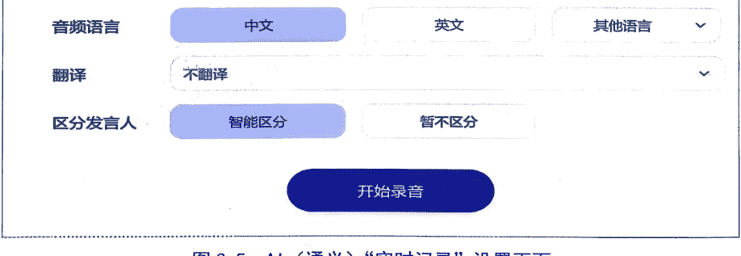

图 3-5 通义实时记录设置页面

可选择音频语言、是否翻译、是否区分发言人。区分发言人可通过音色判断发言者，相同音色归为同一人。

进入会议后点“开始录音”，模型自动记录各发言人内容，会后整理成对话式记录，如图 3-6 所示。


点击播放录音，播放位置对应的文字会自动高亮。

#### ② 修改替换内容

实时转写高效但难免出错，如专业术语识别不准或发音不清。可在对话记录中直接选中编辑，如图 3-7 所示。


对多次出现的错误短语，模型提供查找与替换，支持批量修改，如图 3-8 所示。


#### ③ 会议纪要导读

逐字记录繁琐，需精简为纪要。模型的会议纪要导读功能可同步将长记录提炼为要点，便于快速回顾核心内容，如图 3-9 所示。

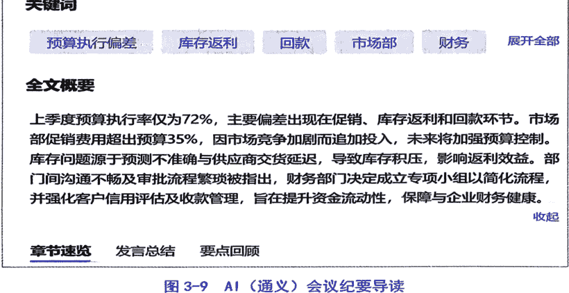

界面包含关键词、全文概要、章节速览、发言总结、要点回顾。

关键词从记录中提取主题、关键问题、涉及部门等。

全文概要是一段简洁概述，概括讨论方向与核心结论。

章节速览把长记录分章展示，每章含要点，便于按部门或主题快速定位。

发言总结提炼每个发言人的核心观点。

要点回顾归纳讨论要点与解决方案，如“市场促销费用超支，需加强费用控制；库存管理滞后，建议定期盘点”。

#### ④ 生成思维导图

文字确认后进行可视化。模型可按需求自动生成思维导图，如图 3-10 所示。

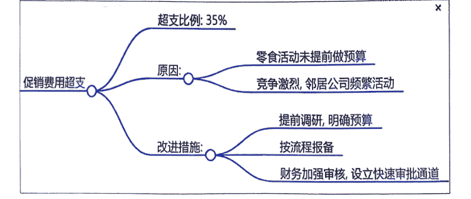

图中仅展示部分重点，因篇幅有限，但已能体现模型在此方面的能力。

#### ⑤ 导出相关内容

智能总结后需导出保存。页面右上角有“导出”选项，如图 3-11 所示，点击弹出菜单。

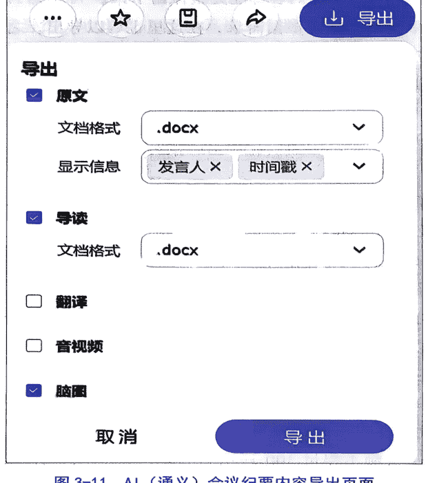

图 3-11 通义会议纪要内容导出页面

可导出原文为 .docx，便于在 Word 中修改；也可导出 .pdf。若需要，每句发言的时间戳与发言人可一并标注。

只想要精华，可选择“导读”导出要点。若有翻译或音视频需求，导出时可勾选相应选项。

思维导图下方同样有导出选项，可单独导出。

### 3.3 政策解读与条件适配提醒

新出台的税收优惠政策，企业关注度高。但能否享受，需核对公司是否符合条件。这就要求财务人员解读政策并对照公司数据，如应纳税所得额、员工人数、资产总额等。生成式AI可快速对照要求与现有数据，指出符合与需调整之处。

【实战任务】

根据《关于进一步支持小微企业和个体工商户发展有关税费政策的公告》（财政部税务总局公告2023年第12号）规定，对小型微利企业年应纳税所得额不超过300万元的部分，减按25%计算应纳税所得额，按20%税率缴纳企业所得税。

一家文具生产与销售企业想判断是否在优惠覆盖范围。

【实战操作】

#### ❶ 归纳政策要求

先用信息提炼与整理功能，部分AI有网页链接解析能力，输入网址后可提取要点、实时翻译、生成思维导图并添加笔记，比直接对话更方便。

以通义为例，“链接速读”用于解读网页，如图 3-12 所示。


无需提示词，只需把政策公告网址复制到输入框，点击“确认”，通义自动上传并解析，如图 3-13 所示。


图 3-13 通义解析网页链接内容

解析完成后点“立即查看”，进入内容导读页，如图 3-14 所示。

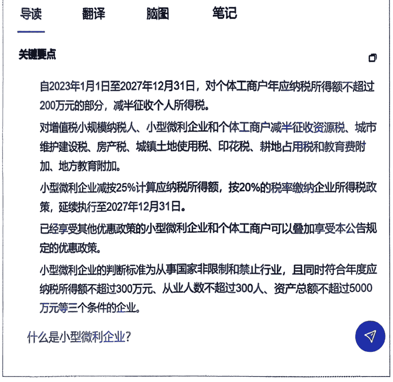

图 3-14 通义内容导读

模型自动提取时间范围、适用对象、减免内容、执行期限、判定标准等要点，无需逐段阅读，也可切换思维导图查看。

下方有问答对话框，可直接围绕该公告提问，例如：“什么是小型微利企业？政策适用于哪些小微企业？减税优惠具体标准是什么？如何判断公司是否匹配？”

#### ② 提问对照

若想知道企业是否适配，可在图 3-14 下方对话框提问。

提示词示范：

该政策的适用条件都有哪些？

模型答复如图 3-15 所示。

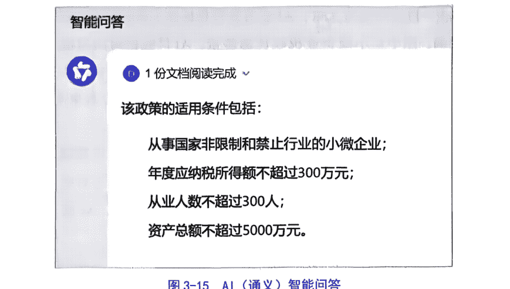

图 3-15 通义智能问答

列出4个适用条件后可逐一对比。智能问答仅能回答网址内内容，超出部分需切换到普通对话框。

先确认行业属性，政策要求从事国家非限制和禁止行业，文具生产与销售是否属于此类，直接提问即可。

提示词示范：

在行业分类中，文具生产与销售是否属于国家非限制和禁止行业？

模型答复如图 3-16 所示。

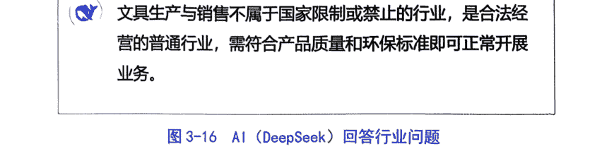

图 3-16 AI回答行业问题

其余3个条件属于公司数据，若条件少可直接查找；条件多时可把企业信息查询平台网址发给模型，让其总结相关信息。

假设已获公司数据：

- 年度应纳税所得额280万元；
- 从业人数130人；
- 资产总额2980万元。

与图 3-15 匹配后，公司完全符合该政策。

### 3.4 快速识别合同，找出潜在不利条款

# 7天掌握AI财务实操

日常经营里合同是标配，每份协议都在划定企业的权利义务。条文读起来顺畅，细处却常藏风险，看似不起眼的表述一旦忽略，后续容易酿成麻烦。

合同把关并非法务专属，财务同样要盯紧那些影响现金流、收款节奏或产生额外支出的表述。付款周期设置是否合理，未来费用是否描述模糊，都是必须留意的点。

把生成式工具嵌入流程会更高效，它能迅速筛出可能损害企业利益的表述，比如不合理的支付条件、隐性收费或责任划分失衡，为人工复核提供补充。

【实战任务】

某小型科技公司甲方拟与外包团队乙方签署《软件定制开发合同》，主要内容如下：

# 7天AI财务实战

第一条 开发内容及要求

乙方须依甲方提供的需求文档，完成指定软件的前端、后端及数据库定制开发。

第二条 开发周期

本项目周期自合同签订日起算6个月，乙方应在截止日前交付最终成果。若因甲方原因导致延期，乙方免责。

第三条 费用及支付方式
1. 项目总价为人民币 [X] 元。
2. 合同签订后5个工作日内甲方支付30%预付款；软件交付验收合格后10个工作日内支付60%尾款；剩余10%作为质保金，质保期12个月届满后5个工作日内付清。
3. 甲方逾期付款的，每逾期一日按未付金额的10%向乙方支付违约金。

第四条 验收标准及方式
1. 验收标准以甲方提供的需求文档为准。
2. 甲方自收到交付成果后30日内完成验收，逾期未验收视为通过。

第五条 知识产权

软件著作权归乙方，甲方享有永久使用权。

第六条 违约责任
1. 乙方逾期交付的，每逾期一日按合同总金额的0.1%向甲方支付违约金；逾期超30日，甲方有权解除合同并要求退还已付款。
2. 软件质量问题导致甲方损失的，乙方仅负责修复，不承担其他赔偿。

第七条 争议解决

履行中发生争议，先协商解决；协商不成的，提交甲方所在地人民法院诉讼。

该公司暂无专职法务，需对上述条款进行风险排查。

## 【实战操作】

#### ❶ 先让模型归纳核查要点

正式导入文件前，先让模型梳理合同审查的关注顺序。这一步相当于搭框架，能明显提升后续分析的精准度，否则提问容易抓不住重点。

参考指令：

你是一名具备法律素养的财务负责人，负责对外协议审核。请列出你会依次核查的关键条款。

这是开放式提问，最好不要自行举例支付条款、违约责任等，以免限制思考范围。

模型返回的内容见图 3-17。

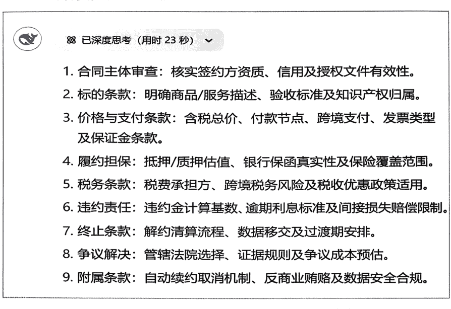

图 3-17 系统归纳的合同核查关键条款

现在相当于拿到一份核查清单，明确了正式审查时需要重点关注的领域。

#### ② 先做脱敏再导入文本

为保护隐私，文本中涉及的敏感信息要提前模糊化，如企业名称、金额、日期等可替换为“XX公司”“XX金额”，操作可在办公软件中批量替换。

处理完再导入。若是电子文件，直接拖拽进对话窗口即可，导入后会以附件形式显示在上方，见图 3-18 所示。对话区仍可正常输入指令。


图 3-18 文件导入界面

若是纸质协议，先用扫描仪或手机拍照转为电子版再导入。系统也支持图片、xlsx、ppt 等格式，见图 3-19。

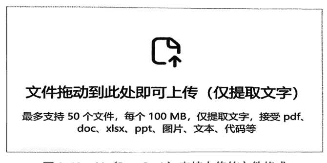

图 3-19 支持导入的文件类型

导入完成后系统会自动抽取关键信息，为下一步分析做准备。

#### ③ 按清单逐条找不利条款

文件导入成功后，可输入指令让系统依据清单排查风险或不利条款。

参考指令：

> 请按你总结的核查要点逐条检查这份协议，找出对本公司不利的条款并说明原因，标注风险等级 1-5，数值越大风险越高。

系统返回见图 3-20。

并非每个人都能一眼看出条款漏洞，尤其是财务人员，对法律表述接触不多。人工过筛也容易遗漏。借助系统按既定思路检查，输出稳定，对没有法务背景的人很实用。

# 七天精通AI财务实战

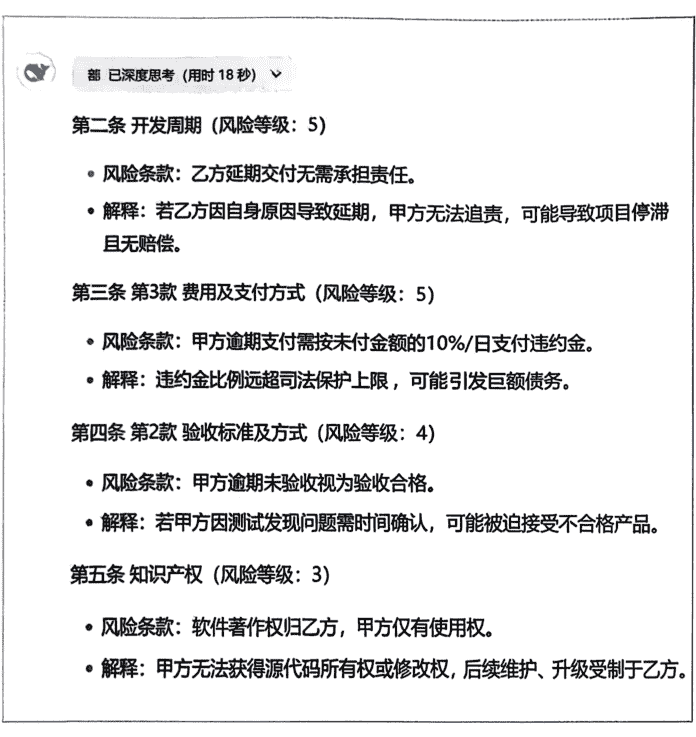

图 3-20 系统对合同的审查结果

#### ④ 追问修改建议，输出规范文本

识别风险后，下一步是结合系统建议逐条修正。

例如第二条，仅约定甲方原因导致延期乙方免责，未约定乙方原因延期应负责任。若因乙方原因导致停滞，甲方难以追责，只能自行承担损失。

如何优化？

参考指令：

你是一名懂法的财务负责人，已发现合同第二条存在风险。该条只说明甲方原因延期乙方免责，未说明乙方原因延期应承担的责任。请修改该条款，使其更完整、更利于甲方保障权益，表述清晰规范。

系统返回见图 3-21。

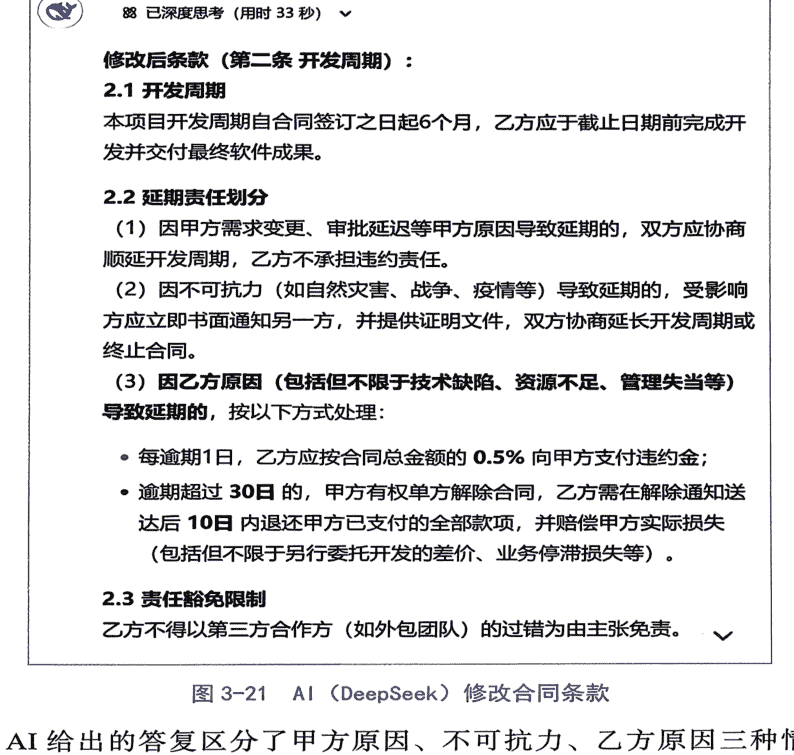

系统给出的版本区分了甲方原因、不可抗力、乙方原因三种情形，其中关于乙方原因部分列举了技术缺陷、资源不足等典型情况，降低争议空间。违约责任采用阶梯式，结尾还补充了责任豁免限制，排除了第三方责任。

对比原条款，完善度明显提升。把前面审查出的不利条款逐一优化后，就能得到一份新协议文本。

需要提醒的是，系统只能做风险分析，不能替代专业律师。涉及跨境交易、特殊资质、复杂股权等情形，法律关系更复杂，系统难以深入准确判断。而且法规随时更新，系统知识可能滞后，无法及时应用最新法条。

因此企业不能完全依赖系统输出，需人工结合最新法规验证，必要时咨询专业律师。

# 第 4 天

## AI 文档写作托管实战

财务部门日常要处理制度、模板、分析报告等大量文档，耗时耗力。若由系统先生成初稿，再做小幅调整，就能大幅减轻工作量。

本章演示如何让系统充当私人写作助手，输出高质量财务文档。掌握后，写作从负担变为优势。

> 专业表达不必从零开始。

### 4.1 智能输出工作场景中的标准话术

写好一段业务说明却不敢发出去，担心语气生硬或被忽视。与其反复斟酌，不如交给系统润色。它擅长把想法包装得合情合理、得体有分寸。

下面教你用系统撰写各类沟通内容，无论是催预算、报进度、要发票，还是解释付款延迟，都能快速搞定。

【实战任务】

一家零售企业的财务 BP 入职不久，需对接十几个门店经理、总部预算组、资金组，还要与人事、供应商、部门同事沟通，每天一半时间花在交流上。借助系统提升沟通效率。

【实战操作】

#### ① 生成汇报说明

汇报时，讲清数据变化的来龙去脉比数字本身更重要。面对管理层，语言模糊逻辑不清易导致误判。有经验的财务会用简洁语言说明问题，也可借助系统达到精准表达。

假设月度经营简报中，销售费用预算100万元，实际120万元，超支20%。原因是华东区临时上新两款推广商品，物料和线上广告同步增加。需强调情况属实，属于业务节奏变动引发的阶段性偏差，无需过度反应。

参考指令：

请写一段适合月度经营会使用的简要汇报话术，背景是销售费用超预算20%，主因是上海地区两款新品临时上线，增加物料和广告投入，属于计划外支出，但业务部事先通报，预算未同步调整。语气客观专业，适合领导层面。

系统返回见图 4-1。

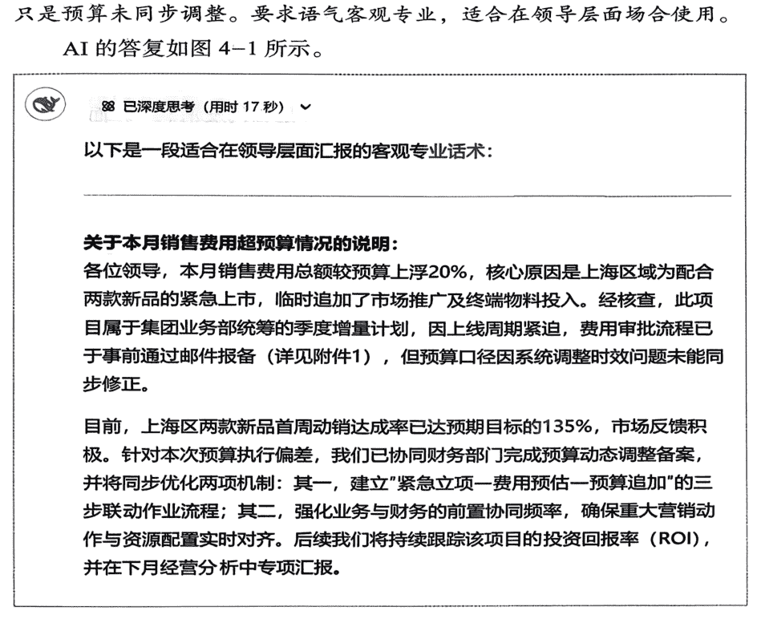

图 4-1 系统生成的汇报话术

话术逻辑为“结果—原因—影响—后续”，既坦诚问题，又体现主动性，可直接用于简报或口头汇报。

#### ② 生成催进度消息

催预算、催发票、催数据、催审批，是财务常遇的沟通场景。难点在于不破坏关系的前提下推动对方行动。催急了易反感，催软了无效。

系统并不代发，而是先打草稿再微调。关键要交代三点：提醒谁、提醒什么、希望怎样提醒。

例如月底需催五家门店上传费用台账，已在群里提醒过一次，两天无反馈。现希望语气稍强但不生硬，要求今天下班前提交。

参考指令：

请写一段微信群催进度话术，提醒华东区五家门店提交费用台账，本周已提醒一次仍未提交，希望语气加强但不过于生硬，要求今日下班前完成。

系统返回见图 4-2。


图 4-2 系统生成的催进度话术

内容点名具体负责人，避免群体指责，开头用“紧急通知”替代“提醒”，中间用“务必”“立即”强化力度，符合紧迫需求。

若是首次提醒，语气可更柔和。

参考指令：

请写一段微信群提醒信息，提醒各门店提交费用台账，语气友好但明确截止时间为本周五。

系统瞬间转换语气，见图 4-3。


图 4-3 系统生成的提醒话术

“协助”“伙伴”等词营造协作感，避免命令式表达；要求群内留言利用群体效应，最后的“辛苦啦”加表情属于柔性缓冲。

可见同一事项在不同阶段需要不同的语言节奏。

#### ③ 生成制度变更通知

制度类通知最考验措辞。涉及预算审批、报销范围、发票合规等，往往意味着流程变复杂，直接发文“按新规执行”易引发抵触。变更需让员工理解并配合。

使用系统撰写时要说明变化要点、执行时间、可能疑问、期望反应，背景越清楚，输出越贴合。

例如公司拟自2025年6月起，所有差旅报销须提前在系统提交出差申请，未申请不予报销。需向全员发布通知。

参考指令：

请写一段正式制度调整通知，用于公司群或 OA 发布，内容为2025年6月起差旅费用需提前提交出差申请，否则不予报销。要求说明背景和执行时间，语气稳重不冰冷，便于员工理解配合。

系统返回见图 4-4。

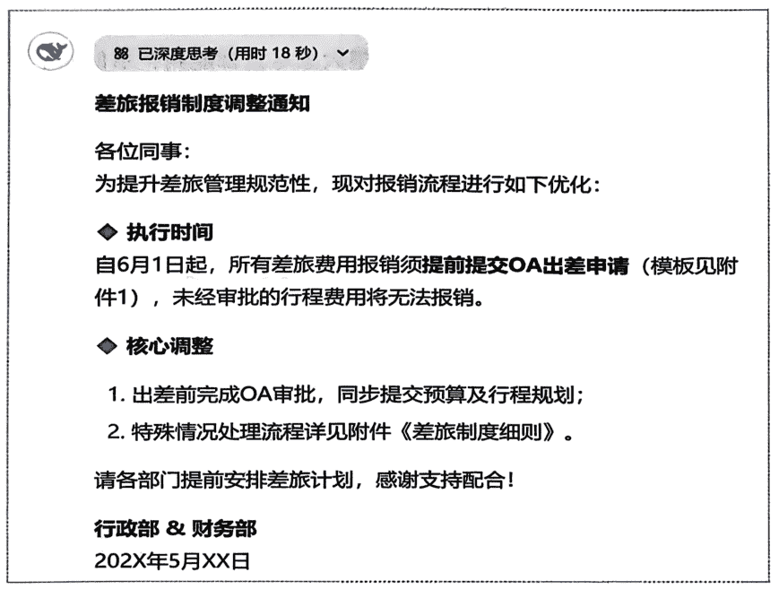

图 4-4 系统生成的制度变更通知

若通知对象为特定人群，还可调整为定向提醒风格。

#### ④ 生成团建通知

团建通知不像制度通知严肃，但要让人重视。既要传达轻松氛围，又要确保准时到场，信息要完整。

可告诉系统时间、地点、形式及期望语气，它能快速生成有温度的通知。

例如财务部本周五中秋聚餐，地点公司楼下烤肉城，17:30开始，希望大家尽量参加。

参考指令：

请写一段适合微信群发送的部门聚餐通知，内容是财务部本周五中秋聚餐，地点公司楼下烤肉城，17:30准时开始，要求语气轻松，带节日氛围，提升参与意愿。

系统返回见图 4-5。


图 4-5 系统生成团建通知

版本语气轻松节奏快，“隐藏菜单”“不等人”等词制造期待，“暗号”“+1”降低参与门槛，颇具节日感。

#### ⑤ 生成拒绝报销的回复

拒绝报销是财务常见冲突点。对方可能不懂流程，也可能试探边界。拒绝的话术要合理，否则易被视为设卡。

场景：新同事提交一笔未事前申请的打车费，金额不大但按流程无法报销。既要说明原因，也要让其明白是制度限制，并给出建议。

参考指令：

请写一段私信回复同事的拒绝话术，告知其提交的打车费因未提前申请无法报销。要求表达清晰、语气不强硬，适合流程不熟的新同事，同时给出后续建议。

系统返回见图 4-6。

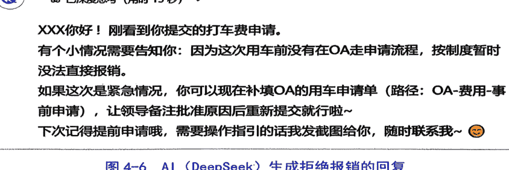

拒绝不是目的，理解与改进才是。话术把事实说清，强调按制度执行，并提供解决办法，提醒下次提前申请，可直接使用。

### 4.2 AI 起草内部审计报告

管理体系健全的公司会定期内部审计。重点是发现潜在风险、优化流程、确保合规。

## AI财务7天精通

财务内审完成后需出具报告。

## 【实战任务】

某企业财务内审专员完成“供应商付款合规性”专项审计，发现三类问题：一部分合同未附盖章版本即走付款；二同一项目重复走付款审批；三部分付款审批流程缺少法务节点。整理完记录后卡在报告撰写，借助系统完成示例。

## 【实战操作】

#### ① 步骤一：确认内部审计报告框架

若已有模板可跳过，否则先确定框架。内部审计报告与外部审计不同，外部需遵循《中国注册会计师审计准则》，结构固定；而内部报告更灵活，可按任务和企业需求调整。

参考指令：

内部审计报告的标准框架是什么？请给出适用于供应商付款流程审计的框架，要求包含必要模块和段落。

见图 4-7，系统给出包含执行摘要、审计范围与背景、审计方法、审计发现、整改建议与行动计划、附录、报告审批等七大部分的框架，因篇幅有限仅部分展示。

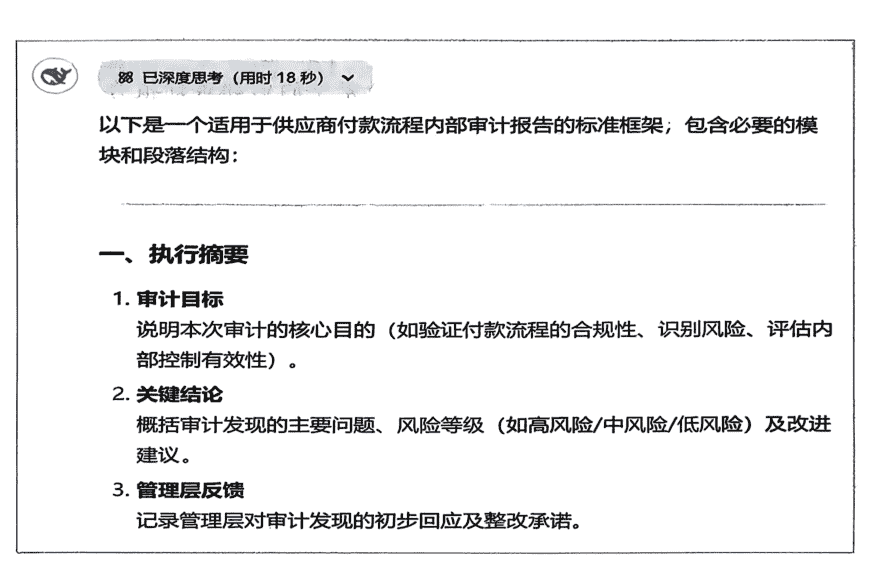

图 4-7 系统生成的内部审计报告标准框架（部分展示）

该框架是首次提问的关键，第二次提问可让系统按框架生成报告。若已有标准模板，可直接上传附件进入下一步。

#### ② 步骤二：按框架生成内部审计报告

关键是清晰描述审计中发现的问题。

参考指令：

你现在是一名财务内审专员，在“供应商付款合规性”专项审计中发现以下问题：
- 1. 部分合同未附盖章版本即走付款流程；
- 2. 存在同一项目重复走付款审批的现象；
- 3. 部分付款审批流程未包含法务节点。
请依据前述审计报告框架生成一份完整内部审计报告。

系统返回见图 4-8。

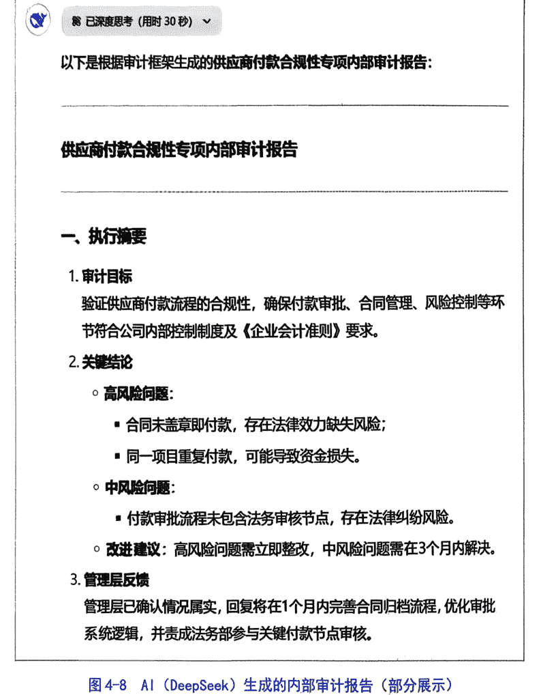

除了整体生成，也可采用分步提问法，按框架逐段输出并加入细化要求，使结果更贴合预期。

图 4-8 内部审计报告 AI 生成示例（节选）

#### ③ 规范化输出：请模型按标准格式返回
为防止直接复制后出现符号、空白等导致排版失控，可以进一步要求模型以 HTML 形式交付内容，这样就免去人工调整版式的耗时。

示例提示：

请将报告内容以 HTML 格式输出，具体要求如下：

- 主标题：黑体三号字，加粗，居中对齐；
- 一级标题：黑体四号字，加粗，左对齐，序号使用“一、二、三”；
- 二级标题：宋体小四号字，加粗，左对齐，序号使用“（一）（二）（三）”；
- 正文：宋体五号字，首行缩进两个字符，序号使用“1.2.3.”或“-”无序列表（根据内容逻辑选择）。
- 若包含数据表格，需使用 HTML 表格标签，表头黑体五号字加粗，表内文字宋体五号字，表格边框宽度 1px，居中对齐。

模型返回见图 4-9。


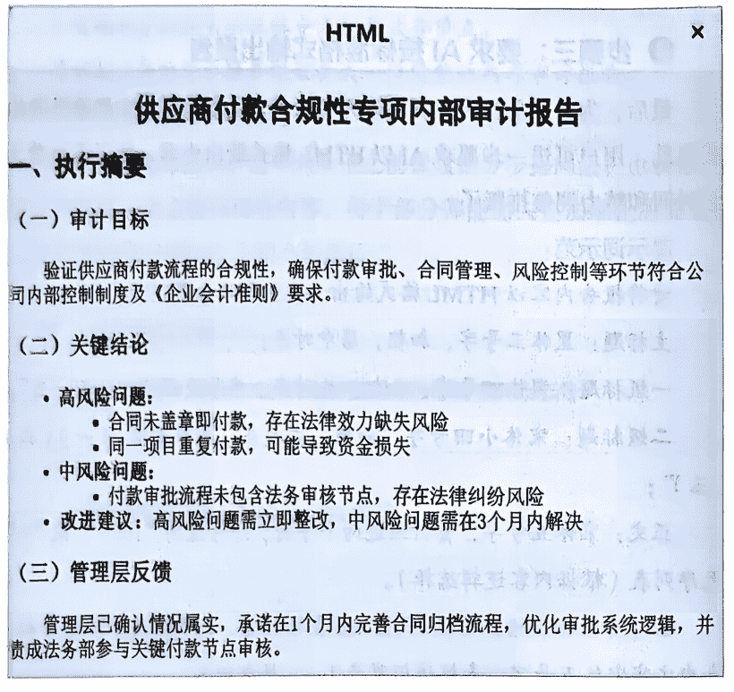

图 4-9 内部审计报告的 HTML 输出示例（节选）

### 4.3 AI 辅助撰写财务分析报告
财务分析报告最消耗脑力的环节，是对数据波动进行原因解释。毛利率下滑究竟是成本端承压还是竞争加剧？营收上升里新品贡献占比多少？这类判断决定报告价值，也是人工写作容易卡住的地方。

有时并非不会写，而是思路发散不够。生成式大模型可以充当头脑风暴搭档，先拓展分析角度再快速成稿。本节演示如何借助大模型高效完成财务分析报告的撰写。

## 【实操目标】
设想某公司财务经理正在编制分析报告。近两年公司相继推出智能手表、无线耳机等新品，原材料价格波动明显，市场竞争白热化，这些因素共同作用于财务数据。经理希望借助大模型提升分析效率。

## 【操作流程】
#### ❶ 深化比率分析
除毛利率、净利率、资产负债率等常规指标外，还可借助模型做更细的拆解，例如用杜邦体系把净资产收益率拆分为销售净利率×资产周转率×权益乘数，从盈利、运营、杠杆三维度探究 ROE 变动驱动。

示例提示：
你现在是一名专业的财务分析师，结合公司过去两年的财务数据（自行提供数据），用杜邦分析法拆解净资产收益率，重点分析净资产收益率变化的原因，并给出具体数据支撑。

打开模型的数表分析功能，如图 4-10 所示。


输入提示并提供相关数据后，模型会迅速给出分析结果。

需注意，模型结论并非绝对可靠，仍需人工核验修正。其主要价值是提供专业报告的思路框架。若想探索其他可能原因，可补充更详尽数据，或要求模型列出常见影响因素，再自行对照实际情况筛选。

#### ② 前瞻推演
完成基础比率与杜邦分析后，可借助模型进行前瞻推演。通过历年或季度财务数据，判断关键指标未来的走向，为战略制定与预算调整提供参考。

例如，在原材料价格波动加剧的背景下，管理层希望预判未来数个季度的销售收入、净利润或运营成本走向。

示例提示：
你是一名专业的财务分析师，请根据以下数据（自行提供）预测公司今年的销售收入和净利润。考虑因素包括原材料成本波动、新产品销售情况和市场竞争变化。

模型回应的部分内容如图 4-11 所示。

模型基于行业常识，给出了中性、乐观、悲观三种情景下的收入与利润预测，图中展示的是中性情景，为决策提供参考。

##### 1. 中性情景（基准预测）
预测结果：
- 营收：5.75 亿元（同比增 15%），净利润：1.03 亿元（同比增 8.5%）。

核心驱动因素：
- 新产品稳健放量：无线耳机在存量市场的替换需求支撑营收增长，但渗透率增速放缓（从 2024 年的 10% 降至 7%），导致增速回落。
- 成本压力可控：芯片价格上涨 5%，但通过与供应商谈判和工艺优化，成本占比仅增至 23%，未显著挤压利润空间。
- 费用结构稳定：销售费用率维持 8%，主要因直播电商投入趋于理性（ROI 从 1:1.2 变化至 1:1.8），管理费用率因数字化转型下降 0.5 个百分点。

行业背景印证：
消费电子行业整体增速放缓至 10%—15%，与中性情景预测吻合。市场调研显示，消费者对无线耳机的需求从“功能升级”转向“性价比选择”，该企业需警惕中低端市场竞争加剧。


#### ③ 关联因素挖掘
模型在财务分析中的另一项优势是关联因素挖掘，通过财务数据与业务数据的多维关联，找出影响业绩的潜在关键因子，帮助经营者更精准优化策略。

进阶用法是构建财务影响因子矩阵，将各类业务要素与净利润、毛利率、周转率等财务指标的相关性做成矩阵，清晰呈现哪些经营活动牵动哪些指标，哪些是真正的杠杆点。

### 4.4 个人述职报告自动成稿
述职报告是每个职场人每年都必须面对的任务，既是成绩回顾，也是职业展示。但临近年末，很多人却感到无从下笔。

这时可以把模型当成写作搭档。只要提供岗位职责、工作内容、关键成果等基础信息，模型能够快速生成结构清晰、表达得体、逻辑严谨的初稿，大幅降低撰写负担。

本节以实操示例手把手演示如何用模型完成个人述职报告，让成果被看见、被认可。

**【实操目标】**
年末人力资源部下发《关于提交 2024 年度个人述职报告的通知》，要求全员按统一模板填报，内容需包含岗位职责、年度成果、工作亮点、不足与改进计划共五项，作为绩效考核、晋升评估及年终奖发放的重要依据。

财务经理为提高效率，决定借助模型辅助写作。

## 【操作流程】
#### ❶ 反向提问，收集素材
写述职报告的难点有时不是没内容，而是工作太碎，不知道如何梳理。财务岗位涉及数据处理、报表编制、预算执行、税务申报、成本控制、项目支持等多个模块，一次性理清脉络并不容易。

这时可以反向操作：不主动提供信息，而是让模型来提问，帮你全面回顾并整理全年的工作。

操作中可使用豆包的“帮我写作”功能，如图 4-12 所示。


图 4-12 模型（豆包）的“帮我写作”对话框

示例提示：
公司要求写年度个人述职报告，内容需涵盖岗位职责、年度工作成果、工作亮点、工作中存在的问题和改进计划五个部分。

现在需要你来帮我撰写述职报告。请根据公司要求，反过来向我提问，搜集你撰写报告需要的素材。

随后得到模型返回的问题清单，如图 4-13 所示。

问题清单严格按公司要求的五大块展开，每块均细化到具体追问，并标注重点。

为了帮您撰写一份贴合实际的年度述职报告，我需要先了解以下关键信息，请您逐一补充：

##### 一、岗位职责部分
- 1. 您的具体岗位名称是什么？属于哪个部门？
- 2. 核心工作职责有哪些？（可按优先级列举 3-5 条，例如：负责产品研发、客户关系维护、团队管理等）
- 3. 岗位说明书中明确的 XX 年度关键考核指标（KPI）XX 有哪些？（如销售额目标、项目完成率、客户满意度等）

##### 二、年度工作成果部分
- 1. 过去一年，您主导或参与的主要工作任务有哪些？（请按项目/任务列举，每个任务可说明开始与结束时间）
- 2. 每项工作的具体成果如何？能否用数据量化？（例如：销售额增长 XX%、成本节约 XX 元、项目提前 XX 天交付、客户投诉率下降 XX% 等）
- 3. 对公司/团队有直接影响的重点成果有哪些？（如推动某业务落地、解决历史遗留问题、优化某流程提高效率等）

图 4-13 模型（豆包）的反向提问清单（部分展示）

#### ② 生成初稿
按清单逐项回复后发送给模型，并说明写作期望。

示例提示：
请根据以上回答，按公司要求撰写述职报告。我希望报告内容丰富、重点突出，能让人轻松了解我的工作成果。整篇报告的字数控制在 2000 字左右。

因对话在“帮我写作”功能中进行，发送后模型自动跳转至写作编辑页生成报告，成果如图 4-14 所示。

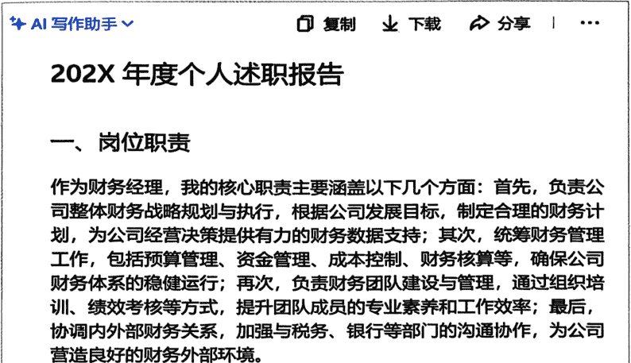

图 4-14 模型（豆包）生成的个人述职报告（部分展示）

#### ③ 报告精修
模型能快速产出结构完整、语言规范的初稿，但要成为拿得出手的优质报告，还需人工精修与个性化调整。

图 4-14 页面支持直接编辑，若整体不满意也可要求重写。例如针对岗位职责段，可要求优化条理性与价值感。

示例提示：
岗位职责部分的描述过于通用，缺乏个性化，而且内容排版挤在一起，没有分行。请优化这一段关于岗位职责的表述，使其更具条理性，更凸显岗位价值。修改后输出完整的述职报告。

模型修改后的报告如图 4-15 所示。

##### 202X 年度个人述职报告
##### 一、岗位职责
作为公司财务经理，我立足财务管理核心职能，以战略规划、流程优化、风险管控为抓手，驱动公司财务体系高效运转，具体职责涵盖四大板块：

- 1. **战略决策支持**：深度参与公司战略规划，结合行业趋势与企业发展目标，主导制定 3-5 年财务战略蓝图；定期输出财务分析报告，通过成本效益、现金流、盈利预测等多维度数据，为管理层投资决策、业务拓展提供量化依据。
- 2. **全流程财务管理**：统筹预算编制、资金调度、成本控制及财务核算工作。建立动态预算监控机制，实时跟踪执行偏差；优化资金配置，确保重点项目资金保障率 100%；搭建精细化成本管控体系，覆盖采购、生产、运营全链条。
- 3. **团队建设与管理**：负责财务团队人才梯队建设，通过制定个性化培训计划、推行绩效激励机制，提升团队专业能力与协作效率；组织跨部门财务知识培训，强化全员成本意识与合规理念。
- 4. **内外部关系协调**：建立与税务、银行、审计机构的常态化沟通机制，争取政策优惠与金融支持；主导财务合规体系建设，规避税务稽查、资金监管等潜在风险，维护公司良好的财务信用。


修改后内容更详实、条理更清晰。经数轮迭代即可得到最终版述职报告。

#### 4 报告输出的便捷方式
前面介绍过 HTML 输出，下载后仍需复制到 Word。现在介绍更便捷的方式：直接让模型输出 Word 文档。

图 4-14 页面顶部有“下载”选项，点击后可选择多种文件格式，如图 4-16 所示。


图 4-16 模型（豆包）报告下载格式选择菜单

通常选择 Word 版本，便于后续修改。点击“Word”后报告进入下载列表，完成后保存在本地文件夹，打开即为正常 Word 文档，如图 4-17 所示。

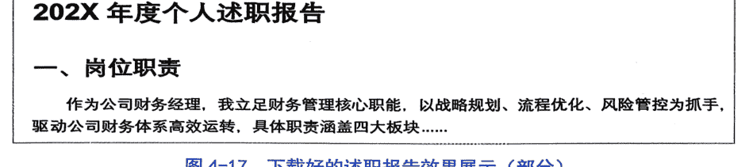

图 4-17 下载好的述职报告效果展示（部分）

# 第 5 天

## AI 数据清洗与整合实战
数据准确性直接决定财务分析与决策的可信度。而数据清洗与整合往往是财务人员最耗时的环节。

本章将演示如何用模型实现自动化清洗与整合，无论是账实核验、格式统一还是异常值定位，都能快速精准完成，告别重复繁琐的处理。

> 没有准确的数据，就没有可信的报告。

### 5.1 账实数据一致性自动核验方案
对账是财务日常，但做到账账相符、账实相符并不容易。核对一下午差一分钱令人抓狂，系统显示有货仓库却说没有，每次都要反复电话核对表格，耗费时间且易出错。

模型在表格处理上已具备成熟能力，下面演示如何借助模型提升效率。

**【实操目标】**
某家电零售企业经营多品牌冰箱、空调、洗衣机，库存由 ERP 记录出入库，财务核算使用金蝶软件。月末盘点依赖人工核对，耗时费力且易错，难以快速发现账实差异，需借助模型提效。

**【操作流程】**
#### ❶ 导出两套数据
先从不同系统导出库存商品科目明细账和库存盘点表，两者均记录库存数量，示例数据见表 5-1 和表 5-2。

表 5-1 库存商品科目明细账（财务账面数据）

| 商品名称 | 单位 | 账面数量 | 单位成本（元） | 账面金额（元） |
|----------|------|----------|----------------|----------------|
| 冰箱 A   | 台   | 150      | 2000           | 300000         |
| 空调 B   | 台   | 120      | 3000           | 360000         |
| 洗衣机 C | 台   | 80       | 1500           | 120000         |
| 冰箱 D   | 台   | 60       | 2500           | 150000         |
| 空调 E   | 台   | 40       | 4000           | 160000         |

表 5-2 库存盘点表（实际库存数据）

| 商品名称 | 单位 | 实际库存数量 | 存放仓库 |
|----------|------|--------------|----------|
| 冰箱 A   | 台   | 145          | 一号仓   |
| 空调 B   | 台   | 120          | 一号仓   |
| 洗衣机 C | 台   | 78           | 二号仓   |
| 冰箱 D   | 台   | 60           | 二号仓   |
| 空调 E   | 台   | 38           | 一号仓   |

导出时注意两点：第一，两套系统的“商品编码”或“商品名称”必须对应，这是比对的关键字段；第二，时间维度要一致，如均为自然月。

#### ② 交给模型比对数量和金额差异
数据准备好后即可让模型比对账面与实际库存。数据量不大且名称规范、无重名时，可直接粘贴两张表。若表格格式混乱，需先统一格式，相关操作将在下一节展开。

示例提示：
你是一名财务分析师，正在核对商品库存，请比对以下两张表中商品的库存数量和金额差异。找出每一个商品在数量和金额上的差异，并标注出差异值。


## AI 财务实战入门：7 天就能轻松上手

指令可按实际需求设定，例如要求按差异值大小排序，或只列出某类商品的差异。

上传表格后，模型自动识别账实差异并给出结果，如图 5-1 所示。

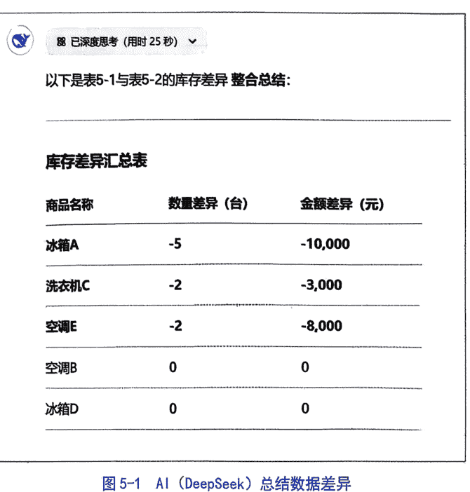

可见模型自动生成库存差异汇总表，标注数量与金额差异，有差异的商品置顶显示。

#### ③ 生成核对报告
账实差异只是结果，关键在于原因。模型在查找管理漏洞和给出优化建议方面具有较大助力。

示例提示：
请根据上述汇总好的库存数量与金额的差异情况，列举出可能导致这些差异产生的管理漏洞，然后针对每个管理漏洞提出具体且可落地的优化建议。

输入后即可获得详细分析，如图 5-2 所示。

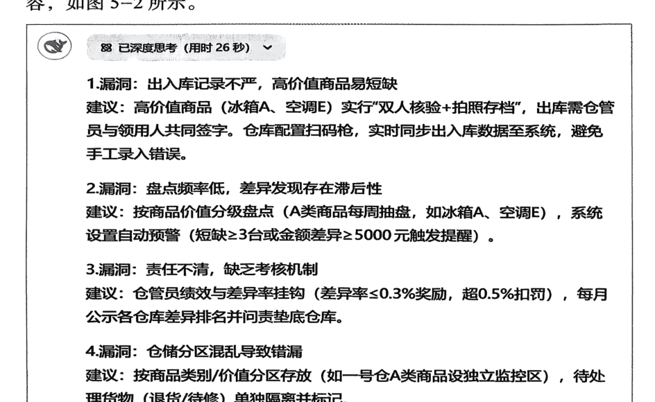

图 5-2 模型 (DeepSeek) 列举管理漏洞及优化建议

这仅为功能演示。实际应用中可反复追问细节以获得更有价值的输出。

示例提示：
如果二次盘点后，账实差异仍然存在，还有哪些可能的原因？有没有办法通过系统设置来减少差异？

盘点结束后通常需生成盘点报告，用于汇报或调账，该内容的生成也可借助模型。

示例提示：

盘点报告撰写要以账面数与实地盘点数的偏差为落点。完整的文档应先交代盘点的基本情况，再对差异进行分类解读，紧接着剖析管理上存在的漏洞，并为每个漏洞明确牵头部门与改进路径，最后点明差异对库存管控的影响和带走的经验启示。

写作时要结合企业自身实际做灵活调整，本文仅作参考范式。

AI 確實能迅速揪出帳實不符的疑點，但數據和業務流程的人工复核仍不可或缺，尤其是金額較大或數量差異顯著的貨品，必須深入追查成因。

前述思路可以平移到其他場景，例如應付賬款與採購訂單的核對、成本數據與出入庫數據的核對等。譬如讓 AI 對比應付賬款明細與採購訂單執行表的供應商欠款，排查多付漏付風險，從而提升企業數據管理的廣度與準確度。

### 5.2 零代码修正资产信息数据表格式不统一问题

跨表核對、合併彙總、計算分析、圖表生成等工作，都建立在格式一致的前提上。一旦格式混亂，統計與計算就會受阻。

現實中光是金額的寫法就多種多樣：是否帶貨幣符號、是否使用千位分隔、是否用阿拉伯數字或中文大寫，甚至把說明文字混進金額欄。自製表格改動起來費時費力，稍有不慎刪錯數據就會釀成事故。

交給 AI 處理就輕鬆許多，輸入一句「請統一成標準格式」即可等待結果。無需手寫函數、無需打開宏編輯器、也不用 Python 代碼，就能完成整理。這種免寫碼的修正方式，能顯著減輕財務人員的表格整理負擔。

## 【实战任务】
該企業在資產日常管理中缺乏統一錄入規範，各部門依習慣填報，彙總後的資產信息表格式極度混亂，嚴重拖慢資產清查、財務核算進度，也影響管理層決策。需將表內格式規範統一，以滿足資產管理需求。

## 【实战操作】

#### ① 原始数据导出
假設以下是該公司的原始資產信息表，如表 5-3 所示。

表 5-3 原始资产信息表

| 资产 ID | 资产类别 | 资产名称 | 购入日期 | 存放地 | 资产状况 | 购入金额 |
| :--- | :--- | :--- | :--- | :--- | :--- | :--- |
| 001 | 办公设备 | Desktop PC | 2021/3/15 | 行政部 | 正常使用 | 4500 |
| 002 | 生产设备 | 冲压机床 | 2019-08-20 | 车间 A | 良好 | 800,000 |
| 003 | 办公家具 | 会议桌 | 二〇二〇年五月十日 | 会议室 201 | 可用 | ¥6000 |
| 004 | 运输工具 | Van | 2022/11/5 | 停车场 | 正常 | 150,000.00 |
| 005 | 生产设备 | 数控机床 | 2018 年 12 月 1 日 | 车间 B | 极佳 | 120 万 |
| 006 | 办公设备 | Laptop | 23-2-2023 | 研发部 402 | 无故障 | 70000 |
| 007 | 办公家具 | 员工桌椅 | 2021/7/20 | 办公区 C | 正常使用 | 3000 元 |
| 008 | 运输工具 | Car | 2022 年 6 月 1 日 | 车库 | 良好 | 20 万 |
| 009 | 生产设备 | 注塑机 | 2020/10/12 | 车间 C | 正常运行 | 900,000.00 |
| 010 | 办公设备 | Printer | 2023/4/8 | 文印室 | 轻微磨损 | 3500 |
| 011 | 办公家具 | 沙发茶几 | 12 月 31 日 | 接待室 | 良好 | 8500 |
| 012 | 运输工具 | 叉车 | 2019/12/25 | 仓库 | 正常 | 80,000 |

從表上即可看出金額寫法不一、日期格式多樣，部分日期甚至出現錯誤、順序顛倒或信息缺失。

#### ② 表头提交与规则制定
統一格式前需先告知 AI 期望的樣式。下面給出一個提示詞範例：

我有一張資產信息表需要統一數據格式，其中資產 ID、資產名稱和存放地三列的格式是確定好的，請為其他列的内容制定相應的格式規則，便於後續資產管理工作開展。

特別強調資產 ID、資產名稱、存放地三列不變，是因為 ID 相當於資產的身份證，混亂就需重新盤點確認。資產名稱由人工錄入，貿然改寫會打亂對應關係，必須實地核對後手動調整。存放地屬文本信息，難以全盤告知 AI，且對統計計算影響有限，暫不做統一。

AI 審閱完整表後，給出的格式統一建議如圖 5-3 所示。
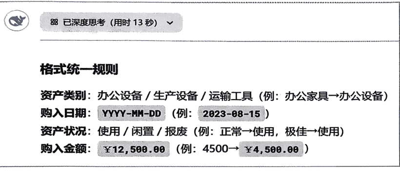
建議若有不合理處，可多輪對話調整。更快捷的做法是先人工微調 AI 的建議再交回給 AI 執行。

#### ③ 利用 AI 实现格式转换
確定規則後直接讓 AI 按規則轉換即可。提示詞範例：

按照以下規則統一這張資產信息表的数据格式，以 HTML 格式輸出：
- 資產類別：辦公設備 / 生產設備 / 運輸工具（例如：辦公家具→辦公設備）
- 购入日期：YYYY-MM-DD（例如：2023-08-15）
- 資產狀況：使用 / 閒置 / 報廢（例如：正常→使用，極佳→使用）
- 购入金額：¥12,500.00（例如：4500 → ¥4,500.00）

HTML 輸出能保留排版，下載後複製即可保持格式。

AI 的答覆如圖 5-4 所示。

點擊「運行」可在內聯預覽表格效果，如圖 5-5 所示。
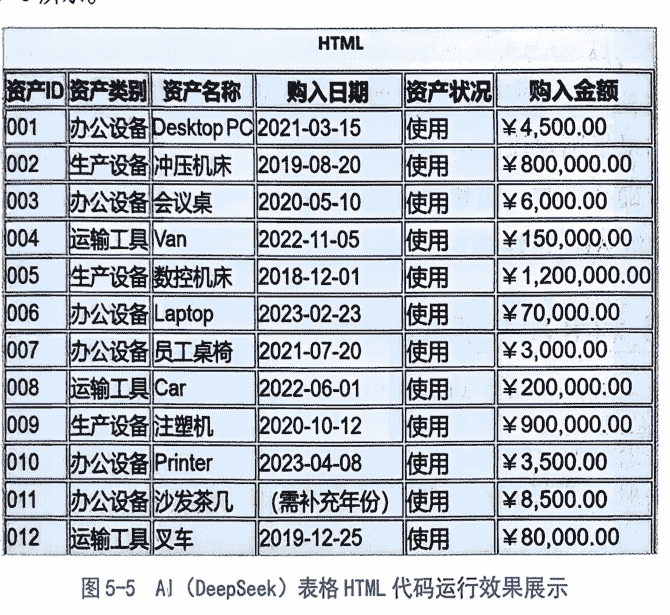
以資產 ID 為 003 的記錄為例，原類別「辦公家具」已歸併為「辦公設備」，購入日期由「二〇二〇年五月十日」變為「2020-05-10」，資產狀況統一為「使用」，金額格式也已規範。資產 ID 為 011 的記錄原本只寫「12 月 31 日」，AI 沒有隨意補年份，而是標註「需補充年份」，此類缺失需人工查賬、核對發票確認。

#### ④ 导出数据表
在圖 5-4 中點擊「下載」可獲取表格，下載的仍是 HTML 格式。將內容複製到表格軟體中選擇「帶格式粘貼」即可保留樣式。此時日期統一、單位與精度一致、數據類型正確、表述規範，缺失項也有標記，資產信息表的可用性大幅提升，為資產管理、財務核算和數據分析奠定了基礎。

實際業務中表格可能更複雜，通用方法無法完全覆蓋時，需結合高級函數或人工複核修正。操作前務必對原始數據做多份備份，保留源文件並另存一份副本，防止誤操作或軟件故障導致數據丟失。

### 5.3 合并、拆分多部门费用报销情况表

表格處理中，合併與拆分是最常見的需求。各部門上報的報銷表需要彙總；一份明細表也常需拆分到不同主體。操作本身不難，但細節多、效率低。函數、數據透視表能解決，但公式寫錯或代碼卡殼就容易中斷。AI 能提供更高效的路徑。

## 【实战任务】
公司銷售部、研發部、行政部等在報銷時使用的表格格式不一，記錄也不規範。財務部每月末要把這些數據合併拆分，用來統計各部門費用支出，為成本控制和預算管理提供依據。

## 【实战操作】

#### ❶ 原始数据导出
假設各部門原始報銷表如下表 5-4、表 5-5、表 5-6 所示。

表 5-4 销售部费用报销情况表

| 报销人 | 报销日期 | 费用类型 | 金额（元） | 备注 |
|---|---|---|---|---|
| 张三 | 2025/10/5 | 差旅费 | 3500.95 | 出差拜访客户 |
| 李四 | 2025/10/8 | 业务招待费 | 1800 | 宴请合作方 |
| 王五 | 2025/10/12 | 差旅费 | 4208.6 | 参加外地展会 |

表 5-5 研发部费用报销情况表

| 报销人员 | 日期 | 费用类别 | 报销金额 | 说明 |
|---|---|---|---|---|
| 赵六 | 2025/10/3 | 办公费 | 850.00 | 购买研发用笔记本 |
| 孙七 | 2025/10/10 | 设备租赁费 | 5000.00 | 租赁研发测试设备 |
| 周八 | 10/15/2025 | 差旅费 | 3812.45 | 出差学习新技术 |

表 5-6 行政部费用报销情况表

| 申请人 | 申请日期 | 费用项目 | 金额 | 具体用途 |
|---|---|---|---|---|
| 吴九 | 2025/10/2 | 水电费 | 1204 | 办公楼本月水电支出 |
| 郑十 | 2025/10/6 | 设备维修费 | 900.00 | 维修打印机 |
| 陈十一 | 2025/10/9 | 差旅费 | 609.5 | 出差办理公司事务 |
| 杨十二 | 2025/10/13 | 办公费 | 246 | 组织部门会议费用 |

三張表的表頭命名不一致，日期和金額格式也各不相同。

#### ② 数据提交合并成表
彙總前需先統一格式，思路與上節一致。將三個部門的表依次複製到對話框中，給出提示詞：

按照以下規則統一各部門費用報銷情況表的数据格式，生成一張完整的費用報銷明細表，以 HTML 格式輸出：
表頭統一用報銷人、報銷日期、費用類型、報銷金額（元）、備註；
日期格式為 YYYY-MM-DD；
報銷金額保留兩位小數，不使用貨幣符號，不使用千位分隔符。

AI 生成的 HTML 代碼運行效果如圖 5-6 所示。

| 报销人 | 报销日期 | 费用类型 | 报销金额（元） | 备注 |
|---|---|---|---|---|
| 张三 | 2025-10-05 | 差旅费 | 3500.95 | 出差拜访客户 |
| 李四 | 2025-10-08 | 业务招待费 | 1800.00 | 宴请合作方 |
| 王五 | 2025-10-12 | 差旅费 | 4208.60 | 参加外地展会 |
| 赵六 | 2025-10-03 | 办公费 | 850.00 | 购买研发用笔记本 |
| 孙七 | 2025-10-10 | 设备租赁费 | 5000.00 | 租赁研发测试设备 |
| 周八 | 2025-10-15 | 差旅费 | 3812.45 | 出差学习新技术 |
| 吴九 | 2025-10-02 | 水电费 | 1204.00 | 办公楼本月水电支出 |
| 郑十 | 2025-10-06 | 设备维修费 | 900.00 | 维修打印机 |
| 陈十一 | 2025-10-09 | 差旅费 | 609.50 | 出差办理公司事务 |
| 杨十二 | 2025-10-13 | 办公费 | 246.00 | 组织部门会议费用 |

图 5-6 AI（DeepSeek）合并表格

#### ③ 利用 AI 从不同维度合并数据
合併後常需按維度統計。提示詞範例：

基於之前提供的報銷數據，請按部門統計每個部門的總報銷金額，並將結果以 HTML 表格形式輸出。

AI 的答覆如圖 5-7 所示。

| 部门 | 总报销金额（元） |
| --- | --- |
| 销售部 | 9509.55 |
| 研发部 | 9662.45 |
| 行政部 | 2959.50 |

图 5-7 AI（DeepSeek）从部门维度合并表格数据

再按費用類型彙總：

基於之前提供的報銷數據，請按費用類型統計每項費用的總報銷金額，並將結果以 HTML 表格形式輸出。

AI 的答覆如圖 5-8 所示。

| 费用类型 | 总报销金额（元） |
| --- | --- |
| 差旅费 | 12131.50 |
| 业务招待费 | 1800.00 |
| 办公费 | 1096.00 |
| 设备租赁费 | 5000.00 |
| 水电费 | 1204.00 |
| 设备维修费 | 900.00 |

图 5-8 AI（DeepSeek）从费用类型维度合并表格数据

省略了篩選、計算、建表的繁瑣步驟。

#### ④ 表格数据拆分
若需將部門總金額分別發送給各部門以作信息隔離，可讓 AI 拆分。提示詞範例：

基於之前提供的報銷數據，請將按部門統計的每個部門的總報銷金額表拆分成 3 個單獨的表，只列示某一個部門的情況，並將結果以 HTML 表格形式輸出。

AI 的答覆如圖 5-9 所示。
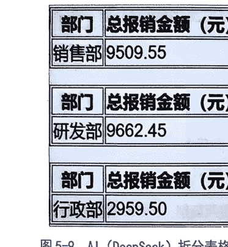
得到三個帶表頭的單部門表格。若需拆分工資條等上百份表格，可讓 AI 生成 Python 代碼。

提示詞範例：

基於之前提供的報銷數據，請生成 Python 代碼，將按部門統計的每個部門的總報銷金額表拆分成 3 個單獨的 excel 表，只列示某一個部門的情況，並將 3 個表以各自部門名稱命名，保存到電腦桌面上。

AI 給出的代碼如圖 5-10 所示。
```python
##### 定义保存路径（桌面新建文件夹）
save_path = os.path.join(os.path.expanduser("~"), "Desktop/部门报销统计")

##### 创建目标文件夹（如果不存在）
os.makedirs(save_path, exist_ok=True)

##### 核心处理流程
for dept, amt in {'销售部':9509.55, '研发部':9662.45, '行政部':2959.50}.items():
    # 创建DataFrame并直接保存
    pd.DataFrame([[dept, amt]],
                 columns=['部门', '总报销金额（元）']).to_excel(
                     os.path.join(save_path, f"{dept}.xlsx"),
                     index=False,
                     engine='openpyxl')
    print(f'文件已保存至桌面【{os.path.basename(save_path)}】文件夹')
```
圖 5-10 AI（DeepSeek）生成拆分表格代碼

運行後在桌面新建「部門報銷統計」文件夾，內含三個以部門命名的表格文件，如圖 5-11 所示。
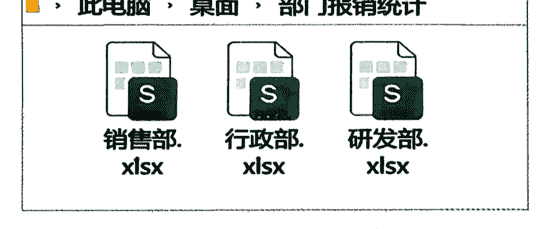
圖 5-11 運行代碼自動生成的表格

打開任一表格，內容與要求一致。

### 5.4 一句话完成财务指标计算

翻查多表找數據、手動寫公式計算毛利率、增長率等指標，是財務的常規負擔。計算邏輯固定，但每次都要重寫公式，耗時耗力。現在只需向 AI 提出需求，例如「算一下公司的流動比率」，即可快速得到結果，把時間留給分析。

財務分析是洞察經營狀況、評估成果、規劃未來的關鍵，需要精準高效的指標計算與解讀。

【实战任务】

以往这家公司还在靠人工手工推算各项财务关键数值，公式嵌套复杂、数据规模庞大，提取时容易偏差、计算也易出错，精细化财务管理的目标始终难以兑现。财务团队于是转向借助生成式智能的强大运算与分析能力，对核心指标进行多维度拆解，为战略决策、资源配置与风险管控提供可靠的量化支撑。

## 【实战操作】

#### 1 导出财务报表

以下以该公司为案例，摘取三份核心报表，分别为表 5-7、表 5-8 和表 5-9。

表 5-7 公司资产负债表部分数据（单位：万元）

| 资产项目 | 期末余额 | 期初余额 | 负债及所有者权益项目 | 期末余额 | 期初余额 |

| :--- | :--- | :--- | :--- | :--- | :--- |

| 货币资金 | 150 | 120 | 短期借款 | 80 | 60 |

| 应收账款 | 200 | 180 | 应付账款 | 120 | 100 |

| 应收票据 | 50 | 30 | 预收账款 | 40 | 30 |

| 存货 | 180 | 200 | 应付职工薪酬 | 20 | 15 |

| 其他流动资产 | 30 | 25 | 应交税费 | 30 | 25 |

| 流动资产合计 | 610 | 555 | 流动负债合计 | 290 | 230 |

| 固定资产 | 500 | 480 | 长期借款 | 150 | 120 |

| 在建工程 | 80 | 60 | 应付债券 | 100 | 80 |

| 无形资产 | 120 | 100 | 长期应付款 | 50 | 40 |

| 非流动资产合计 | 700 | 640 | 非流动负债合计 | 300 | 240 |

| 资产总计 | 1310 | 1195 | 负债及所有者权益总计 | 590 | 470 |

表 5-8 公司利润表（单位：万元）

| 项目 | 本期金额 | 上期金额 |

| :--- | :--- | :--- |

| 营业收入 | 1200 | 1000 |

| 其中：主营业务收入 | 1080 | 900 |

| 其他业务收入 | 120 | 100 |

| 营业成本 | 750 | 650 |

| 其中：主营业务成本 | 680 | 580 |

| 其他业务成本 | 70 | 70 |

| 税金及附加 | 60 | 50 |

| 销售费用 | 120 | 100 |

| 管理费用 | 80 | 70 |

| 研发费用 | 30 | 20 |

| 财务费用 | 30 | 25 |

| 其中：利息费用 | 20 | 15 |

| 利息收入 | 5 | 4 |

| 信用减值损失 | 10 | 8 |

| 资产减值损失 | 5 | 3 |

| 公允价值变动收益 | -5 | 2 |

| 投资收益 | 15 | 10 |

| 其他收益 | 8 | 5 |

| 营业利润 | 160 | 120 |

| 营业外收入 | 10 | 8 |

| 营业外支出 | 10 | 12 |

| 利润总额 | 160 | 116 |

| 所得税费用 | 40 | 29 |

| 净利润 | 120 | 87 |

表 5-9 公司现金流量表（单位：万元）

| 项目 | 本期金额 |

| :--- | :--- |

| 经营活动现金流入 | 1300 |

| 经营活动现金流出 | 900 |

| 经营活动现金流量净额 | 400 |

| 投资活动现金流入 | 50 |

| 投资活动现金流出 | 120 |

| 投资活动现金流量净额 | -70 |

| 筹资活动现金流入 | 200 |

| 筹资活动现金流出 | 150 |

| 筹资活动现金流量净额 | 50 |

| 现金及现金等价物净增加额 | 380 |

| 期初现金及现金等价物余额 | 120 |

| 期末现金及现金等价物余额 | 500 |

#### ② 数据提交并计算财务指标

报表准备完毕后，下一步交给大模型执行核算。人工作业逐项套用公式容易漏项，更稳妥的做法是先让模型列出一份完整的指标清单。

提示词示范：

请你扮演一名资深财务分析师，依据资产负债表、利润表和现金流量表，说明通常需要求得哪些财务指标。

模型返回的清单见图 5-13。

这一步很关键，模型并不知道你更想看毛利率还是流动性，先让它把常用指标梳理出来，再统一按表核算。

把前面整理好的三张报表整体粘贴进去，表头保持清晰，提前隐去公司名称等敏感信息。

提示词示范：

请你作为资深财务分析师，按照刚才列出的指标，基于我上传的资产负债表、利润表与现金流量表数据完成计算，并把全部结果输出。

模型计算结果见图 5-14。

以资产负债率为例校验，负债期末余额为 590，资产期末余额为 1310，相除约为 45.04%，与模型输出一致。

这一阶段的价值在于摆脱翻公式、找位置、复核公式的重复劳动。你只需说明核算需求，模型就能搭建完整的指标计算链条并给出推导说明。

若已有手工结果想做复核，也可把结果交给模型检查是否存在偏差。

#### ③ 联网搜索对比同行业数据

指标算出后自然会关心好坏。判断优劣最有参考价值的是同业水平。

过去需要翻年报、查上市公司披露，现在可直接调用模型的联网检索能力，让它抓取行业均值和标杆企业的同期数据做对比。

提示词示范：

请检索 2024 年家电行业的平均毛利率、净利润率和资产负债率，重点是冰箱、洗衣机、空调等主要产品线，并列出 1-2 家上市公司的同期指标。

模型会调取公开渠道信息，包括同业公司年报等内容并提取对应指标，部分工具还能直接返回结构化表格。

需要说明的是，模型给出的对标结果仅作参考，受样本范围限制。若要获得更客观真实的数据，仍建议结合专业数据调研机构的成果。

# 第 6 天

## AI 数据可视化实战

有说服力的财务汇报离不开图表辅助。智能体的加入改变了可视化呈现方式。图表不再需要人工挑选字段、调整格式，而是由模型依据数据本身自动判断呈现方式。它能捕捉变化趋势、提炼结构关系并匹配合适的图形类型，把繁杂的表格转化为清晰、有逻辑的视觉表达。

今天就把这些功能实操一遍，体会“让数据自己说话”的效率。

> 数据走向清晰，结论才有落点。

### 6.1 生成财务汇报中的关键数据图表

在财务工作中，难点不在于数据本身，而在于表达。一张利润走势的折线图胜过数页表格，一个部门费用构成的饼图比口述占比更直观。图表不是点缀，而是让数据发声的手段。

生成式智能能快速把数据转为高质量图表，节省制作时间、统一呈现风格，非常适合写入汇报材料。此前在图像生成部分已尝试过智能作图和图表推荐，本节演示完整生成流程。

【实战任务】

财务人员希望用生成式智能生成的图表，直观展示各部门的费用支出情况。以某公司3月份各部门费用统计数据为例，如表6-1所示。

表6-1 公司3月份各部门费用统计

| 部门 | 费用金额（元） |

| :--- | :--- |

| 销售部 | 120000 |

| 行政部 | 66000 |

| 财务部 | 54000 |

| 客服部 | 29000 |

| 采购部 | 88000 |

| 人力资源部 | 43000 |

| 研发部 | 95000 |

## 【实战操作】

#### 1 图表类型的智能推荐和替换建议

部分工具设有专门的数据分析模块用于计算和绘图，比如豆包。打开对话框后可切换用途，针对性更强，如图 6-1 所示。

图 6-1 中的“数据分析”正是本节重点。点击后把原始数据发给模型，咨询哪种图表展示效果最佳。

提示词示范：

以上是公司各部门 3 月份的费用数据，我想展示这组数据，请推荐合适的图表类型并说明理由。

模型回复见图 6-2。

对于展示公司 3 月份各部门的费用统计数据，推荐使用柱状图，以下是具体理由：

##### 选择柱状图的理由

1. **直观对比**：柱状图通过不同长度的柱子来代表各部门的费用金额，能够非常直观地比较各部门费用之间的差异。例如，从柱子的高低可以一眼看出销售部的费用金额最高，客服部的费用金额最低，方便快速把握各部门费用的相对大小关系。

2. **清晰呈现数据**：每个柱子对应一个部门，柱子的高度对应费用金额，数据与部门的对应关系一目了然，易于理解。即使对于不熟悉数据分析的人员，也能迅速看懂各部门费用的情况。

3. **突出离散数据**：各部门是离散的类别，费用金额是对应的数值。柱状图适合展示这种离散型数据，能够清晰地将每个部门的费用情况单独呈现出来，不会造成数据的混淆。

由上可知，模型能据实际场景判断最合适的图形，并帮你避开表达力弱、易误导的可视化形式。

#### ② 图表内容的过滤、排序

数据量大时并非全部都有价值。可以让模型先做信息过滤，聚焦重点。比如更关心费用靠前的部门，可要求模型筛选排序。

提示词示范：

请根据这组费用数据，筛选出费用最高的前 4 个部门，并按费用从高到低排序。

模型会重新整理数据，去掉客服部和人力资源部并生成排序表，结果如图 6-3 所示。

我将筛选出费用最高的前 4 个部门，并按费用从高到低排序。

费用最高的前 4 个部门按费用从高到低排序如下：

| 部门 | 费用金额（元） |

| :--- | :--- |

| 销售部 | 120000 |

| 研发部 | 95000 |

| 采购部 | 88000 |

| 行政部 | 66000 |

图 6-3 AI（豆包）对数据进行筛选、排序

#### ③ 生成图表

待呈现内容确定后，就可让模型直接绘图。

提示词示范：

根据费用最高的前 4 个部门数据，绘制柱状图，横轴为“部门”，纵轴为“费用金额（元）”，按费用从高到低排序。要求图上显示具体金额，图标清楚美观。

模型生成的柱形图如图 6-4 所示。

图 6-4 AI（豆包）生成的柱形图

#### ④ 图表审美微调建议

图表生成后可能需要优化视觉效果，模型也能根据指令调整配色、标签、布局等。

提示词示范：

请优化柱状图，使其空间布局更开阔，数据标签更清楚，整体排版更适合 PPT 展示。

模型理解指令后，给出的优化结果如图 6-5 所示。

整体柱形更瘦了，空间布局上会比较疏朗开阔，看起来更舒服。

除了柱形图、折线图等常规图形，瀑布图、箱线图等也能一键生成，如图 6-6 和图 6-7 所示。

图 6-5 AI（豆包）优化柱形图

图 6-6 AI（豆包）生成的瀑布图

图 6-7 AI（豆包）生成的箱线图

#### ⑤ 图话配合，生成图表解读说明

图表要进入报告或PPT，通常需要一段文字说明，这部分也可以交给模型生成，人工润色后即可使用。

提示词示范：

请根据上面这张柱状图，写一段适合放在汇报材料里的简要说明。

模型会生成相关内容，人工优化后就能插入汇报材料中作为配图的说明文字，如图 6-8 所示。

##### 公司 3 月份各部门费用前四名情况说明

在本次汇报中，聚焦公司各部门3月份费用情况，筛选出费用最高的前 4 个部门进行重点展示。

从绘制的柱状图来看，各部门费用呈现出明显差异。销售部以 120000 元的费用金额位列榜首，充分显示其在业务拓展、市场推广等方面投入巨大，侧面反映出公司对销售业务的大力支持，以抢占更多市场份额。研发部紧随其后，费用为 95000 元，这体现了公司对产品创新和技术升级的重视，持续投入资源以提升产品竞争力。采购部的费用为 88000 元，保障了公司生产运营所需物资的供应，其费用的合理支出对公司的供应链稳定至关重要。行政部费用为 66000 元，主要用于维持公司日常行政管理工作的有序开展。

整体而言，通过分析这 4 个部门的费用，可以清晰地了解公司在核心业务、创新研发、物资采购和行政管理等关键领域的资源分配情况。后续，我们可依据各部门实际业务需求和费用产出效益，进一步优化费用分配，确保公司资源得到更高效的利用，推动公司持续稳健发展。

### 6.2 让表格“长”出动态图表

本节在前一节基础上做进阶。之前生成的图表是独立图片，无法在Office中二次编辑。本节演示如何让图表可编辑、可调整。

【实战任务】

仍以上一节模型筛选出的前四名部门费用数据为例，财务人员希望生成的图表能清晰展示费用支出情况，且支持二次编辑。

## 【实战操作】

#### ❶ AI 直接生成嵌入图表的文件

最直接的方式是让模型直接输出一个Excel文件，文件内同时包含数据和基于数据生成的图表，无需手动选区建图。

操作时先把数据传给模型，再提出需求。

提示词示范：

请根据我提供的数据，生成一个 Excel 文件，里面包含这些数据和一个展示数据的柱形图，要求该柱形图可以在 Excel 中进行二次编辑。

模型结束任务后输出了对应的结果，如图 6-9 所示。

图 6-9 AI（豆包）生成嵌入柱形图的 Excel 文件

用户点击文件即可下载，打开后可见模型已列出数据并生成柱形图，如图 6-10 所示。选中图表即可看到其与数据区的关联。标题、图例、数据标签、坐标轴等均可自由修改，数据变动时图表同步更新。

图 6-10 Excel 文件打开效果展示

#### ② AI 生成 Python 代码，在 WPS 中运行

在WPS中新建文档，菜单栏有“在线文档”，其中包含“智能表格”选项，如图 6-11 所示。

图 6-11 WPS 智能表格

进入智能表格后，找到“效率”菜单，内有“PY脚本”功能，如图6-12所示。

图6-12 WPS智能表格中的“PY脚本”

PY脚本提供了一个可运行Python代码的沙箱环境。把代码粘贴进去即可在WPS智能表格中自动执行并把图表插入表格，无需手动复制。

需要注意的是，WPS的Python脚本环境是受控沙箱，禁止本地文件写入，这也是出于安全考虑防止权限滥用和隐私风险。因此该环境只允许在表格内进行数据处理、图表绘制和结果展示。

之前演示的将表格拆分后保存到桌面的操作在WPS中不可行，但生成图表并嵌入表格完全没问题。

明确运行环境后，就可以让模型生成对应代码。

提示词示范：

请生成一段Python代码，绘制出一个展示这些数据的柱形图，要求该柱形图可以在Excel中进行二次编辑，数据展示准确，代码可以正常运行。

模型生成代码后复制到PY脚本窗口，点击“新建脚本”打开编辑区粘贴代码。右上角点击“运行”即可在下方看到输出结果，如图 6-13 所示。

注意页面右上角还有“插入至表格”选项，点击后图表会直接插入到表格中，还可更换模板、调整细节。

若代码运行失败，可把报错信息复制给模型，让其定位问题并给出优化版本。WPS的Python环境对库和语法有兼容性要求，建议提示模型简化逻辑，避免使用本地读写、外部读取等沙箱不支持的操作。

#### ③ AI+ECharts 生成动态图表

如果你觉得柱形图、折线图、饼图较为普通，可视化效果有限，而又不确定如何制作更美观的动态图表，可以借助ECharts，如图 6-14 所示。

图 6-14 ECharts 网站首页

ECharts是一个开源的可视化图表库，用于在网页上展示交互式图表。其核心是用JavaScript实现的可视化引擎，通过配置语法生成精美且可交互的图表。

该网站提供大量酷炫的动态图表示例，并附带开源代码。你可挑选喜欢的效果，将代码复制后连同自己的数据一起发给模型，让它基于你的数据生成新代码，运行后即可得到一模一样的动态图表，只是数据变为你的数据。

不熟悉操作可点击网站上的“快速入门”查看示例，此处不再赘述。

进入示例库后，随机挑选一个图表，如图 6-15 所示。

图 6-15 ECharts 示例库中的图表之一

该图表左侧提供完整开源代码。将代码复制下来，连同表 6-1 的数据一起发送给模型。若代码和数据量较大，可分文件上传。

提示词示范：

AI 驱动的图表与看板快速制作指南

把模板里的数据域替换成自己的业务数值，再以网页形式输出即可得到交互图。

系统给出的示例见图 6-16，判断为一段 ECharts 配置，用极坐标绘制柱状图。推测需求是把原配置中的数据部分换成部门与费用金额，随后直接得到可打开的网页。按此思路完成修改并交付文件。

展开过程 ▼

已把示例代码中的数据集换成你提供的部门费用金额，并生成一份可直接展示的网页文档。下面提供下载。

部门费用金额图表.html

File

图 6-16 模型返回的动态图表产出效果

下载后打开，呈现的动态效果与原图接近，如图 6-17 和图 6-18 所示。

图 6-17 按模板制作的动态图表展示一

图 6-18 按模板制作的动态图表展示二

### 6.3 十分钟搭建可刷新的经营驾驶舱

网络上常见的一页汇总多指标的驾驶舱，图表会动、数值会滚动。看过之后很多人都想自己做，只是细节繁多，即便照教程走也常被卡住。

现在借助模型制作驾驶舱就很省事。无需复杂配置，仅靠浏览器和 Office，就能在十分钟内得到一份可用、可刷新、可讲解的展示页。

【实战任务】

某公司财务部门每季度都要编制“季度经营数据概览”，向管理层汇报整体经营及费用使用。材料通常包含各部门月度费用对比、本季度费用构成占比、营业收入季度走势、销售收入与销售费用的结构关系等可视化。

过去每张图都要单独整理数据、挑选类型、美化排版，重复且费时。财务人员希望用生成式模型一次性完成整套工作，实现统一排布、结构清晰的驾驶舱效果。

假设数据源如表 6-2，为公司今年第一季度收入与费用数据。

表 6-2 公司第一季度经营数据（单位：万元）

| 部门 | 1月收入 | 2月收入 | 3月收入 | 1月费用 | 2月费用 | 3月费用 |
| :--- | :--- | :--- | :--- | :--- | :--- | :--- |
| 销售部 | 500 | 680 | 540 | 85 | 91 | 97 |
| 研发部 | 0 | 0 | 0 | 72 | 74 | 78 |
| 行政部 | 0 | 0 | 0 | 46 | 48 | 50 |
| 财务部 | 0 | 0 | 0 | 32 | 34 | 36 |
| 运营部 | 0 | 0 | 0 | 28 | 30 | 31 |

## 【实战操作】

#### ① 先让模型帮忙拟定指令

做驾驶舱的关键是把需求说清楚，其余可交给模型执行。

很多人卡在第一步，是不知道该如何描述想要的驾驶舱。那就先告诉模型你希望呈现哪些内容，让它起草指令文案，再自行微调即可。

本次任务原始数据为公司第一季度经营数据，包含部门、月度收入、月度费用。从业务逻辑看，可能希望呈现：

- 第一季度营业利润总额，置于最突出位置；
- 公司本季度月度收入变化趋势与月度费用支出趋势；
- 各部门第一季度费用支出总额的对比；
- 销售收入与销售费用的结构展示。

把这些想法写入指令，让模型思考该如何搭建并美观呈现驾驶舱。

模型反馈见图 6-19。

这个结果未必最理想，在驾驶舱制作前可先这样，等结果出来不满意再要求模型调整。

#### ② 用模型制作驾驶舱

仅靠细节要求不够，必须加上明确指示。

指令示范：

你是一名数据分析师，我将提供公司第一季度的经营数据表。请据此制作一份用于经营汇报的可视化驾驶舱，以 HTML 形式输出，方便嵌入网页或表格页面展示。（附上数据和前一步模型提出的细节要求）

以 HTML 为例，因其最适合多图组合结构。模型收到指令后，通常会自行解析数据结构，按指定顺序与图表类型逐步堆砌出完整的可视化驾驶舱。

等待模型解析并输出驾驶舱，如图 6-20 所示。

图 6-20 模型制作的数据驾驶舱

这是第二次调整后的效果，与图 6-19 中第 4 点写的底部销售结构饼图和环形图不一样。按最初指令制作效果一般，因此让模型重新设计该部分展示，改用分组柱状图替代原饼图，左右并列显示各月收入与费用，顶部直接标注数值。

相比手工制作，耗时大幅缩短。

#### ③ 把驾驶舱链接嵌进表格

目前已有一份完整的可视化驾驶舱，保存为 HTML 文档，例如命名为季度经营看板.html。

因设备和软件环境不同，部分人难以用脚本在表格中嵌入动态图形。更稳妥的做法是把驾驶舱的链接插入表格。

例如表格数据已整理好，在某单元格输入“点击查看本季度数据看板”，选中该单元格后点击“插入”“超链接”，弹出编辑窗口。

在“浏览”中定位到之前保存的 HTML 文档，点击“确定”，见图 6-21 所示。

此时文字会变为蓝色加下划线，见图 6-22 所示，表示超链接插入成功，点击即可自动打开浏览器加载交互图表。

AI 财务实战入门：7 天就能轻松上手

图 6-21 编辑超链接窗口

图 6-22 超链接插入成功

### 6.4 文档一键制作高质量演示文稿

整理信息、分析数据，模型都能胜任，第一章已介绍模型的演示文稿制作能力，可用关键词或报告制作 PPT，也可在 PPT 中嵌入流程图、组织架构图等图形。

那么模型制作 PPT 的具体流程是怎样的？本节将逐步拆解演示。不仅介绍如何用模型制作 PPT，还会讲如何美化 PPT，制作炫酷的页面动态效果。

## 【实战任务】

某公司财务人员刚完成本季度经营数据分析，提交报告后领导要求再补一份适合汇报的 PPT，并强调“不要照搬原文，要有重点、能逐页讲清楚”。

这类需求在工作中很常见，几乎每次做完报表或分析，财务人员都要额外“再做一份 PPT”。过去是复制粘贴到 PPT，一页页拆分、配图、加标题，有时还得临时补总结。这一次可以把整篇文稿交给生成式模型处理。

## 【实战操作】

#### ① 通义 PPT 操作路径

在通义侧边栏“发现”中，有一个醒目的“PPT 创作”入口，见图 6-23 所示。

点击“开始创作”即可进入制作通道。注意，这里不仅支持上传文档，还支持上传音视频，见图 6-24 所示。即财务培训会议录像或财务音视频文件也能转化为 PPT。

将写好的报告上传，点击“下一步”，进入 PPT 大纲编辑页。模型已生成一份大纲，见图 6-25 所示，浏览后可自行修改不合适的地方。

图 6-24 模型（通义）PPT 创作文件上传入口页面

图 6-25 模型（通义）生成 PPT 大纲页面

大纲确认后点击“下一步”，进入模板选择页。页面分为左右两栏，右侧是各式风格模板，见图 6-26 所示，点击可在左侧预览效果，不满意可随时切换。

图 6-26 模型（通义）PPT 模板选择页面

选定模板后点击“生成 PPT”，即可看到最终效果，点击菜单栏“演示”见图 6-27 所示还能全屏预览。

图 6-27 模型（通义）PPT 创作菜单栏

确认无误后点击下载，即可导出到本地。

#### ② 豆包 PPT 操作路径

除了通义，豆包也有“AI PPT”功能，见图 6-28 所示。

图 6-28 模型（豆包）PPT 创作入口页面

与通义不同，豆包的“AI PPT”目前仅支持文本输入，不支持上传报告文件。若报告篇幅不长，可直接复制粘贴到对话框。若篇幅较长，可先在普通对话框上传文件，让模型根据报告生成 PPT 大纲，再回到“AI PPT”中粘贴大纲。

注意这一步不需要额外指令。

大纲确认后点击“选择模板”，即可看到多种风格模板，见图 6-29 所示。

选好模板后点击上方“开始生成 PPT”，几分钟后即可得到整合报告内容的 PPT，见图 6-30 所示。

图 6-29 模型（豆包）生成 PPT 模板页面

豆包同样支持在线编辑内容和模块，最后确认无误点击“下载”，按流程导出即可。

#### ③ 让 PPT 封面动起来

以上是快速通关方案，适用于时间有限、对质量要求不高的场景。在集团年终汇报或个人述职等场合，为提升视觉冲击力，可利用模型视频制作能力让画面动起来。

假设导入的 PPT 封面不够吸引人，希望生成更符合“季度经营情况汇报”场景的封面，可先与模型沟通获取设计灵感。

指令示范：

我正在为公司季度经营情况汇报制作 PPT，需要设计一个封面，请提供一些画面灵感，写出画面提示词。

模型反馈见图 6-31 所示。

1. 数据星云：深蓝宇宙星空质感背景，点缀发光星尘；数据图表抽象成星云旋臂，节点为发光圆点；核心数据拆解为数字碎片飘散；主标题“Q1 数据宇宙”用星轨字体，副标题“探索·链接·突破”。
2. 维度折叠：多层半透明、颜色各异的平面交叠，呈现纸张折叠感；关键数据标注在折叠缝隙；主标题“跨维度生长——Q1 跃迁报告”做成立体字。
3. 制造齿轮：深灰工业风纹理背景，大小嵌套、部分咬合转动的齿轮阵列；中心齿轮镂空处显示“Q1”，边缘标注产能、良品率等数据；主标题“精密运转：Q1 制造效能报告”。
4. 数据烟花：纯黑背景加底部基准线；爆炸中心是“达成！”白粗体字，周边放射数据图表碎片；从基准线向上延伸的光束标注超额数据；主标题“Q1 烟火：数据升空时刻”，字体带爆炸飞溅效果。

假设公司为制造行业，选择“制造齿轮”场景。复制画面提示词后，打开支持图片和视频制作的模型工具，如即梦、通义万相等。将提示词微调后输入，说明是用于 PPT 封面，并按需求修改关键词与标题。

指令示范：

生成一张 PPT 封面，工业风纹理背景，画面右侧有大小嵌套、部分咬合转动的齿轮阵列，预留一部分无齿轮区域，方便后期添加封面标题。

选择比例 16:9，点击生成，模型会给出多张画面，从中挑选即可。若不满意可重新生成，直至满意。假设选中一张图片，点击“下载”保存到电脑，见图 6-32 所示。

图 6-32 模型（通义万相）制作的图片

静态画面不够惊艳，还可以让它动起来。

返回模型工具，选择视频制作功能。视频制作有文生视频和图生视频两种方式，见图 6-33 所示。

图 6-33 模型（通义万相）视频制作功能选择页面

已有封面图，选择“图生视频”，将图 6-32 上传至指定区域，见图 6-34 所示。

AI 财务实战入门：7 天就能轻松上手

图 6-34 模型（通义万相）图片上传区域

上传成功后输入指令。

指令示范：

让画面中的齿轮转动起来。

视频制作约需半小时，模型输出一段视频，见图 6-35 所示。

图 6-35 模型（通义万相）生成视频

视频制作后，打开 PPT，找到封面页。顶部菜单选择“插入”“视频”，见图 6-36 所示。

点击“嵌入视频”后，定位到已下载的封面视频并插入。现在封面变为动态齿轮画面。

插入视频后，编辑页顶部会出现“视频工具”选项。为提升演示效果，可勾选“循环播放，直到停止”，见图 6-37 所示。

随后再次点击“插入”，找到“艺术字”，选择样式插入到封面左侧空白区，填写 PPT 标题，必要时加上汇报人。

最终呈现效果见图 6-38 所示。

## 第7天

## AI 财务自动化工作流搭建实战

前六天已掌握各类模型应用技巧。今天进入最终阶段，学习如何搭建个人财务自动化工作流，让模型接管日复一日的重复工作，如生成日报、生成分录、新人培训问答等。

学会后即可打造一个个智能助手，推动财务工作迈向智能时代，效率倍增。

> 把时间留给重要事项，其余交给自动化工作流。

### 7.1 用模型助手制作会计分录

财务工作由众多小任务构成，与模型对话能解决大部分问题。但对于每天都要写的会计分录，频繁撰写指令、描述情景对财务人员也是负担。

有没有更智能的方法？有，就是用模型助手。助手本质上是预设好的自动化流程，先做什么、后做什么、输出什么结果都有规定。

比如口语助手用于外语交流，让它写代码就不擅长；会计分录类助手专门制作会计分录，让它做儿童科普则表现不佳。在擅长领域，用户无需思考指令。

目前许多模型平台上都有公开助手，可直接使用。本节来看如何借助助手提升效率。

【实战任务】

某公司会计负责日常经济业务原始凭证整理和会计分录制作。月底要处理几十张发票、报销单、付款通知单等，虽然有经验和模板，看到发票仍需思考科目，不小心会录错。若逐个提问模型又太麻烦，因此打算尝试模型助手简化工作。

【实战操作】

#### 1 寻找助手

打开模型平台，以通义千问为例，进入“发现”页面，这里汇聚大量已制作的助手，见图 7-1 所示。有官方发布，也有开发者自建。

助手种类繁多，可在搜索框输入关键词“会计分录”查找，再任选一个，见图 7-2 所示。

#### ② 测试助手

打开助手，在对话框输入业务描述，例如“公司销售商品 A 收入 8000 元，收到银行转账”，系统会返回标准借贷分录，见图 7-3 所示。

这是文字对话，若是图片呢？例如手边有一张火车票，尝试提问，见图 7-4 所示。

整个过程无需思考指令，直接提供内容或上传发票，模型即可自动识别交易逻辑，判断借贷科目，给出摘要和完整分录。

若回答不完整或格式不符合预期，注意检查助手设定是否可固定输出格式。若能固定格式，后续无需任何指令即可获得满意答复。

### 7.2 搭建制度问答简易系统

网上公开的助手并非为特定人员量身定制，很多财务工作难以直接用助手高效完成。

例如新同事入职时常问重复问题：报销怎么走流程？差旅费标准在哪看？审核人写谁？这些问题看似简单，却会反复消耗财务、行政、人事部门精力。制度文件虽有，但新人要么找不到，要么看不懂。

现在只需把制度文件交给模型，它就能不厌其烦地准确回答每个问题。本节讲解如何自行创建模型助手，搭建简易制度问答系统。

【实战任务】

公司计划为新人建一个制度问答系统，若找人开发软件成本高、周期长，最后很可能搁置。有人提议用模型助手实现。负责此任务的人员决定亲自尝试。上传制度文档，让员工在对话框输入问题，由模型回答。

【实战操作】

#### 1 创建助手角色

打开支持自建助手的模型平台，以通义千问为例，找到“创建助手”，选择“自由创建”，进入角色配置页，见图 7-5 所示。

页面主要分四部分：头像、名称、设定、权限。

头像最好选用公司 LOGO，若不方便，也可让模型自动生成，只需描述关键词，如“制度”“问答”，模型会一次性给出多个选项供挑选。

名称建议简短直白、便于记忆，同时能一眼看出用途。例如用于新人制度答疑，可命名为“制度问答助手”“制度文件全知道”等，避免抽象命名影响新人理解功能定位。

设定是助手的灵魂，需要告诉它角色定位。

指令示范：

你是公司财务部的一名制度管理员，熟悉公司制度，包括组织管理制度、人力资源制度、财务管理制度、行政管理制度、信息安全制度等。要求能根据上传的制度文件内容，为员工提供准确、简洁、易懂的答复。适合给刚入职的员工答疑解惑，且能适当引用制度原文作为依据。

默认的可见范围是“公开·所有人可见可使用”，也就是说智能体建好后，任何人上网都能检索到并使用。如果不希望如此，可以点开菜单栏，就像图7-6那样，把权限切成“部分公开·获取链接的用户均可使用”，这样就只对公司内部开放了。

#### ② 配置智能体能力
权限设置下面藏着一个“高级设置”栏目，默认是折叠的，点开后才能看见子菜单。里面内容很多，可以忽略，重点看两处：技能和知识，见图7-7。

先说知识，这部分决定智能体回答的依据，也是建模的核心。把公司制度文件上传上去后，就相当于给智能体装上了专属的知识库，后续所有问答都会围绕这份文件展开。没有这份材料，AI的输出就跟公司业务脱节，因为不同企业的制度细节本来就不一样。知识区确认上传成功后，再点开技能。系统默认勾选了“文生图”和“网页搜索”。在做制度问答时，网页搜索最好关掉，否则AI很可能去网上找答案，和建智能体的初衷相悖。设置完成后点“创建”，角色就生成了，随时可以对话，如图7-8所示。

#### ③ 展示效果
现在可以跟问答助手试聊。比如新员工想了解实习期时长，对话如图7-9。

再比如员工想借备用金，想知道最高额度，详情见图7-10。

还有出差在外打车，想确认交通费能报多少，见图7-11。

以上回答全部源自上传的制度文件，细节与原文保持一致。

制度后续有变动，也可以更新知识库。进入对话页最上方，有三个点，见图7-12，点开后选“修改配置”，就能回到之前的高级设置页面重新上传文件。

#### ④ 分享智能体链接
调试完成后就可以分发给员工使用。同样在图7-12的位置，右上角有“分享”，点进去会看到“复制链接”，见图7-13。

复制成功后拿到一个网址，直接粘到公司微信群、QQ群，或写进新员工入职欢迎邮件和OA公告栏里，打开就能进入对话页。至此，一个无需IT支持、好维护、操作简单的制度问答小系统就搭好了，对中小企业很友好。

### 7.3 创建自动做日报的财务程序
很多人会用AI写报告、整理数据、生成分录，那只是把AI当顾问，自己照做。进阶的做法是让它变成“自动打工人”。

做资金日报，取数、算指标、调表、写结论，每一步都手动问AI再搬运，得花十几分钟；换成自动化工作流，一分钟就搞定。下面就实操一次，用AI生成Python代码，一键产出资金日报，把重复劳动彻底自动化。

【实战任务】
作为资金主管，每天早上要给财务总监和运营负责人发一份资金计划表，包含前一天各银行账户余额、当天预计到账和预计付款金额、资金净变动，以及重点账户的余额预警。

目前流程是：早上出纳从网银导出账户余额表发来，业务部同事发来付款计划表，自己再从两张表里摘数汇总到模板，最后发邮件。虽然每步都不复杂，但每天重复，早上很紧张。打算用AI写代码把整个流程自动化，运行一次就能把表格放到指定位置。

【实战操作】
#### ① 准备代码环境和文件环境
先搭Python运行环境。前面提到在WPS智能表格里跑Python的方法这次不可用，因为不支持写入本地文件。

搭建分两步：一是上Python官网，按系统版本下载最新稳定版安装包；二是装一个代码编辑器，功能类似WPS里的PY脚本页，但要能写本地文件。

这两个步骤的细节可以直接问AI，比如官网怎么进、选哪个版本、怎么装、装哪个编辑器，回复很快。

文件环境也要提前准备。日常上报的账户余额表和付款计划表格式、字段名基本固定，只需准备一个固定文件夹，比如“D:\shujuyuan”，字母路径在代码里更稳。收到新表就放进去，代码就能定位，不用每天改路径，只需替换文件内容。

#### ② 生成 Python 代码
这一步可以直接在通用对话框里问，也可以打开编程专用功能，比如豆包的“AI编程”，见图7-14。

开启后不用纠结提示词写法，也不用专门给AI套程序员人设，它本身就是来写代码的。

提示词示范：
现在有“账户余额表.xlsx”和“收付款计划表.xlsx”两张Excel，放在“D:\shujuyuan”。请写一段Python代码，完成：
1. 读取该目录下两份Excel，找出账户余额合计、预计收款合计、预计付款合计；
2. 计算资金净变动=账户余额合计+预计收款合计-预计付款合计；
3. 把账户余额合计、预计收款合计、预计付款合计和资金净变动汇总到一张Excel，表头为项目、金额（元），填入对应数值；
4. 将文件命名为“资金计划表.xlsx”保存到桌面，完成后打印“资金计划表已完成！”

把这段要求丢进豆包AI编程，AI会一次性吐出完整脚本，见图7-15。

点右上角复制，把整段代码原样粘出来，建议不要改动，也别粘到其他编辑器，防止符号出错导致无法运行。

```python
import pandas as pd
import os

def get_desktop_path():
    """获取桌面路径"""
    return os.path.join(os.path.expanduser("~"), "Desktop")

def find_amount(df, keyword):
    """查找包含关键字的行并返回金额"""
    for col in df.columns:
        result = df[df[col].astype(str).str.contains(keyword, na=False)]
        if not result.empty:
            for amount_col in df.columns:
                if amount_col != col:
                    try:
                        amount = result.iloc[0][amount_col]
                        if isinstance(amount, str):
```

打开之前装好的编辑器，把代码完整粘贴进去，见图7-16。

```python
import pandas as pd
import os

def get_desktop_path():
    """获取桌面路径"""
    return os.path.join(os.path.expanduser("~"), "Desktop")

def find_amount(df, keyword):
    """查找包含关键字的行并返回金额"""
    for col in df.columns:
        result = df[df[col].astype(str).str.contains(keyword, na=False)]
        if not result.empty:
            for amount_col in df.columns:
                if amount_col != col:
                    try:
                        amount = result.iloc[0][amount_col]
                        if isinstance(amount, str):
```

随后执行，几秒后输出结果，见图7-17。

```python
##### 保存到桌面
desktop_path = get_desktop_path()
result_file = os.path.join(desktop_path, "资金计划表.xlsx")
result_df.to_excel(result_file, index=False)

print("资金计划表已完成！")

except Exception as e:
    print(f"处理过程中出错: {e}")

if __name__ == "__main__":
    main()

资金计划表已完成！
```

结果提示“资金计划表已完成”，回到桌面就能看到生成的文件。打开核对，账户余额合计、预计收款合计、预计付款合计、资金净变动都按要求呈现，见图7-18。

|  | A | B |
|---|---|---|
| 1 | 项目 | 金额（元） |
| 2 | 账户余额合计 | 2650000 |
| 3 | 预计收款合计 | 750000 |
| 4 | 预计付款合计 | 620000 |
| 5 | 资金净变动 | 2780000 |

演示版表格比较简洁，实际工作中可按需求让AI细化格式。描述不清楚时，也可以直接把样表上传给AI，让它先描述再写进提示词。

这份由代码自动生成的资金计划表字段完整、数据准确，基本达标，后续只需发送给指定对象即可。

#### ③ 运行代码生成资金计划表
上面是基础版自动化，思路打开后可以继续加需求。例如在原代码后追加smtplib邮件发送逻辑，提前准备好发件邮箱授权码，填好收件人，表格生成后就能自动发出。

提示词示范：
请在代码末尾加一段Python，把生成的计划表report.xlsx作为附件发到邮箱example@company.com，主题写“资金计划表”，正文写“请查收今日资金计划表”。

AI会补全SMTP服务器、发件人配置、附件读取等代码。QQ、163、Outlook或企业邮箱都能自定义。

还能更进一步吗？可以。让脚本每天定时跑。Windows系统按Win+R打开运行，输入taskschd.msc回车，进入任务计划程序，新建任务。比如触发时间设为每天早上9:55，操作为执行Python程序。

先设成每分钟跑一次测试是否正常，再改成每天定时。验证通过后就能“自动打卡”了。

到此，计划表自动化全流程就建立完成，再也不用每天复制粘贴、排版、发邮件，早上一打开邮箱，报表已准时送达。

与其担心被AI替代，不如让AI成为自己的得力助手！本书就是为想提升核心竞争力的财务人员准备的实战手册。

只讲实用干货，拒绝空洞理论
精选当下好用、实用的AI工具。
手把手教你用AI轻松完成图表报告、PPT制作等工作，提升职场竞争力。

零基础入门，“小白”也能快速上手
无须代码基础，没有复杂术语，真实财务场景演练。
完整的图文实操演示，即学即用，轻松上手不迷茫。


责任编辑：橘 意

封面设计：优盛文化

