# AIGC浪潮：技术驱动的商业落地

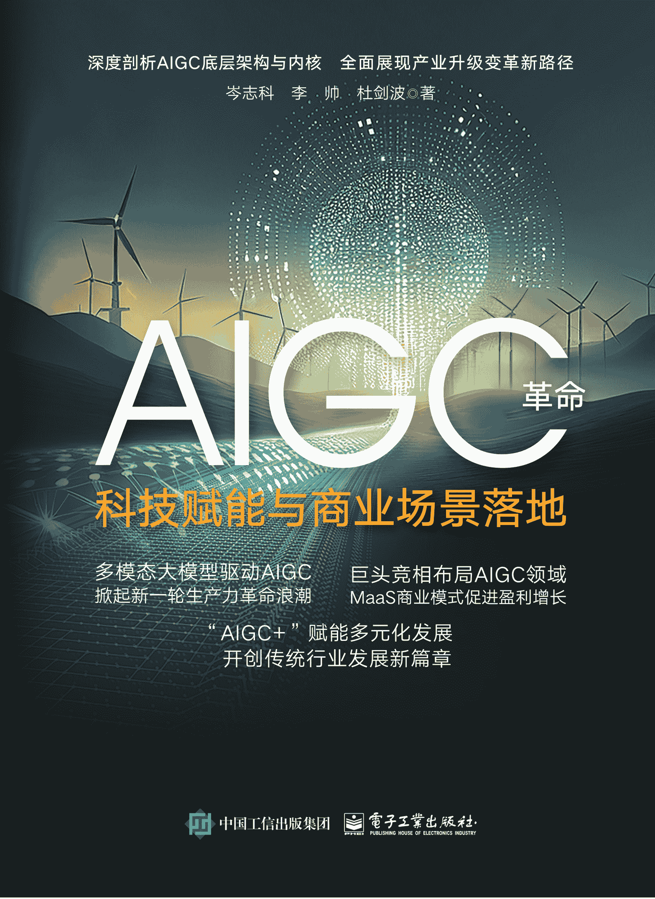

# 内容概览

在 ChatGPT 爆火与多家大模型相继上线的背景下，AIGC 进入高速发展期。本书围绕 AIGC 主线展开，解读其引领的技术变革、各行业赋能逻辑以及可落地的商业实践。第一部分系统介绍 AIGC 的定义、模态分类、技术图谱、产业生态与商业模式，勾勒发展走向与变现空间；第二部分聚焦搜索引擎、社交娱乐、智能创作、智慧服务、协同办公、广告营销、智能制造、城市治理等方向，拆解赋能路径与具体场景。

理论阐述之外，全书配以大量真实案例，信息扎实、剖析深入，可供有意布局 AIGC 的企业管理者、创业者与从业者参考。

# 前言

伴随人工智能持续演进与数据要素不断丰富，大模型取得关键性突破，为 AIGC 的快速扩散提供了底座。资本加速涌入叠加企业与科研机构的集中布局，进一步放大了行业热度。

融资层面，AIGC 已成为高增速赛道。PitchBook 数据显示，截至 2023 年 10 月，全球 AIGC 累计融资约 232 亿美元，相较 2022 年全年增长 250.2%，规模与笔数均呈现高速扩张。

除资金外，底层模型厂商、互联网巨头与研究机构也在加大投入。微软、谷歌、百度、阿里巴巴等均在该赛道布局资源，借助大模型推出多元产品，并在办公、搜索等场景实现应用。

在技术支撑下，AIGC 产品已覆盖知识检索、内容生产、智能助手等领域，并实现文本、图像、音频、视频之间的多模态互转。投资者、创业者、平台巨头与行业独角兽均感受到其对生产生活方式的重塑，也看好长期价值。

AIGC 正在孕育新商业机会，愈来愈多公司希望借此抢占红利，但不少团队缺乏清晰的可执行路径。

本书深度挖掘 AIGC 的商业价值，系统说明其在多个领域的赋能方式与落地形态，为企业提供可操作的布局建议。

从底层架构、技术、产业与商业模式维度呈现发展脉络，帮助企业看懂技术支撑与生态构成，并明确构建闭环商业的方法，即加大对 MaaS 模型即服务模式的探索，通过多元服务获取复合收益。

同时，本书细致梳理 AIGC 与社交娱乐、智慧服务等行业的融合进程。能力跃迁将重塑相关行业并创造新的盈利空间。企业需要聚焦自身赛道，找准业务与 AIGC 的结合点，以升级存量产品、孵化新品来拓展收益渠道。

书中还纳入谷歌、微软、百度、华为等科技巨头的实践案例，可为企业提供具体借鉴。

未来，随着基础大模型的持续成熟，AIGC 在各行业的应用将更加广泛，将改变产业发展范式，推动业务模式、产品与服务的重构，不断涌现新产品与盈利方式。在此趋势下，企业需要积极拥抱大模型与 AIGC，抓住商业机遇，推动业务重构，实现高质量发展。

# 第 1 章 AIGC：智能时代的创新动能

短视频平台兴起的 AI 绘画热潮，以及 ChatGPT 在各大平台的广泛传播，让 AIGC 进入公众视野。作为新的创新驱动力，AIGC 将引领新一轮技术革命，推动产业加速成长。

## 1.1 AIGC 拆解

要理解 AIGC，需把握其本质、三大支柱要素以及从模仿到创造的能力跃升，从而建立基本认知。

### 1.1.1 本质：依托 AI 的内容生产范式

AIGC 即 Artificial Intelligence Generated Content 人工智能生成内容，本质上是一种依托 AI 的内容生产范式。它通过对海量数据预训练而成的大模型，产出文本、图像等多种内容。

模型在海量数据上学习跨领域知识，经适当微调后可承担多样任务。其运行流程如下图所示。

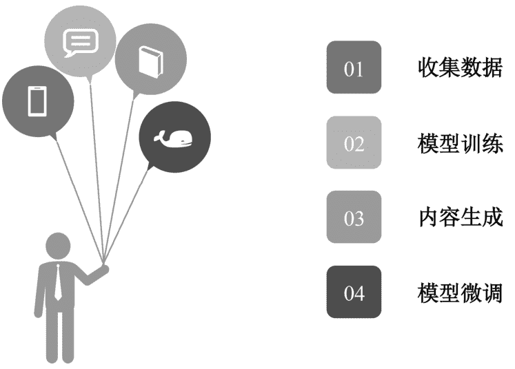

图 1-1 AIGC 的工作原理

1. 收集数据
运行基石是海量数据，涵盖图书、图像、音视频等多种形态，为模型提供丰富的学习素材。只有广泛采集这些数据，才能构建庞大知识库，模拟人类创作过程。

2. 模型训练
数据采集后进入训练阶段。模型通过大量样本学习语言结构、风格、内容特征等，实现语义理解，进而生成与训练数据相似的内容。基于序列生成机制，模型在产出时能把握上下文，保证连贯统一，这使其在对话生成、文本生成等场景表现突出。

3. 内容产出
训练完成后即可生成内容。模型依据用户输入的信息或要求，输出个性化结果，如小说、音乐、绘画等。

4. 模型微调
为解决垂直领域问题，模型需进行微调，即用特定领域数据再训练。微调后模型具备专业能力，能应对专业化需求。

通过训练与微调，AIGC 拥有强大的内容生成能力，可按需智能产出多种内容，大幅提升产出效率。同时面对用户进一步细化要求，AIGC 也能对结果进行优化，使之更贴合需求。

### 1.1.2 核心要素：数据、算力、算法

智能生成能力离不开数据、算力、算法三大要素的协同。

1. 数据是训练基础
数据是模型训练的燃料。海量数据支撑模型持续训练、学习与功能迭代。训练数据包括结构化数据与非结构化数据。结构化数据以表格形式存储，如数据库；非结构化数据为文本、图像、音频等。

数据质量与多样性直接影响训练效果。高质量样本帮助模型学习有效特征，多样化样本提升模型在不同场景的适应性。为保证质量，训练数据通常经过清洗与标注。

2. 算力提供动能
算力是实现高性能计算、数据高效处理与复杂模型训练的关键。随着 GPU、TPU 等硬件的出现，海量数据并行处理成为可能，训练与推理效率大幅提升。

过去算力受限制约了 AI 研究与应用。如今强大算力使大规模数据处理、复杂模型训练可行，为 AIGC 发展提供动力。

3. 算法提供规则
算法定义了数据与算力的使用方式与决策逻辑，是核心引擎，决定学习、推理与决策过程。算法类型包括监督学习、无监督学习、强化学习等，可用于分类、回归、聚类等任务，适配数据分析、模型训练等场景。不断优化的算法能从数据中挖掘更具价值信息，实现更智能决策，提升行业应用效果。

在实际应用中，算法迭代提升模型智能化与精准度，而算法优化依赖大量数据训练，数据训练又需强大算力支撑。三者互为有机整体，共同推动发展，催生多元化应用。

### 1.1.3 能力跃迁：由模仿走向创造

从能力演进看，AIGC 经历了从模仿到创造的跨越。

实验阶段，研究人员探索基于 AI 生成内容的方案，尝试用 AI 生成新闻、诗歌等。此阶段内容生成依赖预设规则，受规则限制。

在自然语言处理方面，可基于语法知识与生成规则产出语句。例如设定规则与算法，使其生成符合语法规范的句子。基于此，可按模板自动化生成新闻稿件。但受限于规则与模板，产出常缺乏个性，未实现真正智能化。

预训练大模型的出现推动能力突破。基于预训练大模型，可学习海量数据规律，打破规则限制，实现智能产出。在海量数据、先进算法、强大算力支撑下，能力持续增强。

具体而言，具备两大功能。其一，内容智能生成。研究初期只能模仿数据库内容，突破后可依据用户指令对数据库内容进行再创造，实现有针对性的智能生成。其二，持续精进。预训练大模型可基于海量数据进行持续无监督预训练，并在运行中依据用户反馈优化生产，推动迭代。

能力突破后应用更智能。以新闻稿件生成为例，支持更智能化生产。

2023 年 5 月，百度推出自动生成新闻的 AIGC 解决方案，可让机器人自动撰写报道。该方案依托自然语言处理、机器学习、深度学习等技术，通过学习大量新闻文本，准确把握核心信息，并以规范专业语言传达。同时可依据媒体类型、读者群体定制报道风格。

该方案可用于大规模事件报道、财经报道等。例如重大事件发生后，机器人可第一时间生成报道，保证时效性；财经报道中可快速整理内容、进行数据分析并发布专业稿件。

其优势在于大幅提升产出速度，保障时效性并节省人力，同时减少人为因素对质量的影响，提升客观性。

除百度外，更多企业开始关注 AIGC 创新与应用，为内容智能生成提供高效化方案。随着技术进步与应用拓展，作用将日益凸显。

## 1.2 AIGC 的多元模态表现

AIGC 拥有丰富模态，不仅涵盖文本、图像、音频、视频生成，还具备跨模态能力，可实现不同模态间的灵活转换。产出内容富有创意与想象力，为用户提供更广阔创作空间。

### 1.2.1 文本模态：个性化内容生产

文本生成是重要场景。依据用户输入与要求，可输出个性化内容。可分为三类，如图所示。

图 1-2 AIGC 文本生成的 3 类内容

1. 文本扩写
即由无到有或由少变多。输入信息通常较少，如少量数据、图片或标题。输出中大量内容由算法模型创作。

2. 文本缩写
即由多变少，对输入文本进行提炼，输出摘要、标题等。输入信息量大，模型需筛选信息，保留重点，舍弃次要内容。

3. 文本改写
即对文本进行再创作，如重新表述、转变风格等。输出与输入在词汇、短语上通常存在对应关系。

当前文本生成已在内容创作领域落地。百度推出的知识增强语言大模型文心一言是基于 AI 的在线文本生成工具，可实现智能化、精准化生成。其优势体现在：

1）自动化处理。通过自然语言处理与机器学习算法，可智能分析关键词、主题等，迅速生成符合需求的文本，大幅提升写作效率并保证质量。
2）可定制化。用户可选择文本长度、风格，并添加相关词汇、关键词，使产出更贴合个人需求。
3）精准匹配。平台可快速识别用户需求，对关键词进行精准匹配，生成更符合期望的内容。基于深度学习，可持续学习海量数据，优化模型，提升质量。

基于以上优势，可有效帮助用户提高创作效率，节省时间精力。

在文本生成领域，除百度外，谷歌、京东等企业也推出相关工具，可辅助生产天气预报、会议纪要、广告文案等内容，提升生产效率与覆盖面。

### 1.2.2 图像模态：编辑与原创生成

图像生成是指基于智能算法与模型生成新图像，可对现有图像优化改进，也可完全虚拟原创。具体应用场景包括，如图所示。

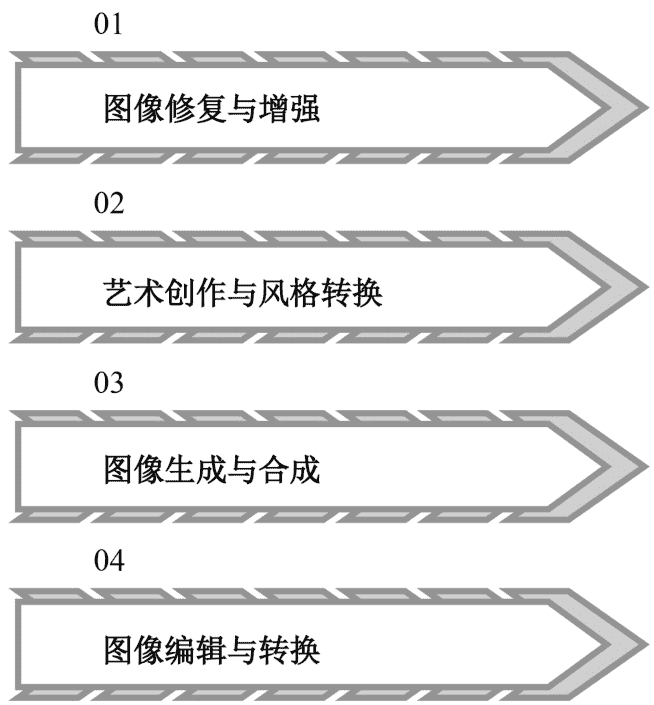

图 1-3 AIGC 图像生成的应用场景

1. 图像修复与增强
可自动修复输入图像，提升质量。可修复损坏图像，调整色彩、亮度、对比度等，使图像更清晰美观。

2. 艺术创作与风格转换
可通过海量图像学习艺术风格与特征，进而进行艺术创作。也可实现风格转换，如将照片转为漫画风格、将风景转为油画风格等。

3. 图像生成与合成
可生成虚构人物、物体、风景等，为游戏、影视制作等提供虚拟角色、虚拟场景等生成解决方案。

4. 图像编辑与转换
可修改图像属性或进行内容转换，实现图像编辑。例如将夏季风景图转为冬季，或修改人物、房屋等元素。也可按用户需求自动生成精美图像，并按细节要求进行局部修改。

AIGC 图像生成可在多个行业赋能。电商营销、游戏、影视等均已实现应用。

以电商营销为例，2023 年 12 月，京东推出 AIGC 内容生成平台“京点点”。该平台可理解商品特征，自动生成商品图片，助力营销。

仅需一张商品原图，平台即可基于分析理解，快速生成主图、详情图、营销海报等，帮助商家快速上线与推广，大幅提升运营效率与内容质量。

基于高质量数据集处理技术，平台可对图像数据集进行标注，筛选商品图、模特试装图等，满足模型训练需求。同时在商品属性合规检测方面，补充大量 AIGC 样本，在保障合规的同时提升对生成内容的识别检测能力。

为提升生成效果，平台通过自训练商品场景增强图像丰富度与真实感，并拓展商品识别、自动抠图、图像延展控制等能力，提升产出质量。

借助各类平台与工具，图像生成、编辑均可实现。用户只需提出要求，并对合规性与效果进行把控即可。

### 1.2.3 音频模态：多元音频合成

借助机器学习与深度学习，可再现人类语音、生成音乐与音效，实现拟真自然的音频产出。

可实现语音识别、语音合成、音乐生成等。

在语音识别方面，可准确识别与转录用户语音，将信号转为数字并以文本输出，可用于语音搜索、语音翻译等。

在语音合成方面，可将文本转为语音输出，并模拟音色、语调等人类特征，生成自然语音，可用于语音广告、语音导航等场景。

在音乐生成方面，基于音乐库、样本、理论等数据学习，可生成多种风格音乐、音效等，在音乐创作、游戏音效、影视配乐等领域具有应用潜力。

应用范围广泛，可按需生成语音配音、背景音效等，提升语音交互体验。当前已有不少企业探索。

2023 年 8 月，美国互联网公司 Meta 发布 AIGC 音频生成工具 AudioCraft，可根据文本提示创作音乐与音频。

AudioCraft 综合多款大模型，不仅可生成拟真音频，减少音损，还基于自监督音频学习与分层级联模型生成音频。原音频进入系统后，可捕获信号远程结构，进而生成音频。

在应用方面，模型训练使用经授权的音乐库，规避版权风险；基于丰富音效训练，可生成动物叫声、脚步声等模拟音效；作为开源工具，支持用户开发专属音频模型。

### 1.2.4 视频模态：理解驱动的视频生成

在视频生成方面，可依据用户输入的文本、图像、视频等多模态数据，自动生成高保真视频内容。应用场景包括，如图所示。

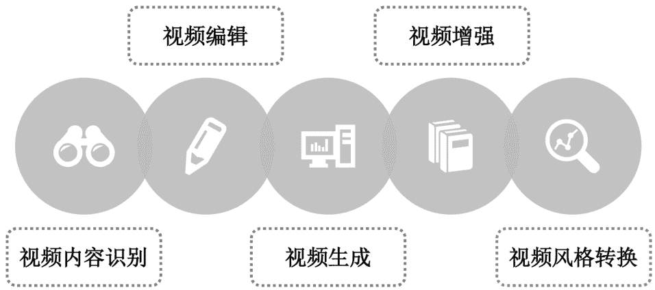

图 1-4 AIGC 视频生成的应用场景

1. 视频内容识别
可识别视频中的人物、物体、场景等并分类。例如交通领域可对交通视频检索、跟踪目标、识别异常事件；影视领域可进行人物分类、场景分类等，提升制作效率。

2. 视频编辑

AIGC 在视频制作环节的介入正在重塑剪辑与后期的效率边界。它能自动完成剪辑、拼接、特效与音效的添加，让成片的视觉质感明显提升。在影视后期流程里，它还能协助完成人物抠像、上色调整、画面替换等操作，直接拉低制作成本。

#### 3. 视频生成
AIGC 可以按用户指令把分散素材整合起来，自动产出成片。典型场景包括用虚拟场景补全剧集电影、基于成片快速剪出预告片、根据产品说明生成广告片等。这种多元化的自动生成能力，正在为影视和电商等行业带来降本增效的实际价值。

#### 4. 视频增强
视频增强的核心是用 AIGC 做色彩校正、锐化、超分等质量提升。老旧胶片、珍贵影像的修复就很典型，模型能还原细节、改善观感。在安防监控里，它还能抑制噪声、提升清晰度，进而提高监控的可靠性。

#### 5. 视频风格转换
按需求把原片转成不同视觉风格是 AIGC 的又一强项。比如真人影像转动漫风格、黑白与彩色互换、白天与夜晚转换等。影视制作与广告制作中，这种能力能增强艺术表现力，让内容更贴合目标受众的审美偏好。

### 1.2.5 跨模态生成：多模态间自由转换
跨模态生成指的是让文本、图像、视频等不同模态相互转换与生成，像把图像变文字、视频变文字等。

这一能力依赖跨模态模型，模型由编码器与解码器构成。编码器把各类模态输入映射为潜在语义表征，解码器再把表征还原为目标模态。端到端训练后，模型学会输入输出间的映射关系，从而实现跨模态生成。

实现方式多样，文本与图像可互译，音频与视频也可互相生成。应用已延伸至广告营销、智能家居控制等场景。广告制作时可按主需求生成符合brief的内容；智能家居里可把语音指令转为控制信号。

微软与北卡罗莱纳大学曾发布论文《通过可组合扩散实现任意生成》，提出 CoDi 可组合扩散多模态模型。CoDi 能接受任意模态输入并输出任意模态，同时处理多种模态并行输出，显著提升生成效率。

凭借强大的整合与输出能力，CoDi 有望重塑人机交互。作为辅助技术可帮助残障人士更顺畅地与电脑交互；教育场景里可把多模态内容聚合呈现，强化知识理解。总之 CoDi 能产出高质量多模态内容，简化创作流程，减轻创作者负担，可用于社交媒体创作、小说故事打造等多种场景。随着探索加深，跨模态生成将催生更多 AIGC 应用。

## 1.3 ChatGPT 推动 AIGC 进入爆发期
ChatGPT 的出现及其在多领域的落地，既凸显了 AIGC 的应用潜力，也让市场看到其背后巨大的发展空间。认知升级后，大量企业加速布局 AIGC，行业呈现出蓬勃态势。技术进步与应用拓展并行，AIGC 正成为未来科技创新的重要引擎。

### 1.3.1 ChatGPT：AIGC 的典型代表
ChatGPT 是 OpenAI 于 2022 年 11 月推出的聊天机器人。依托底层预训练模型，它能生成多样化回复，并基于上下文与用户自然互动，甚至完成脚本撰写、文案创作、语言翻译等任务。

其核心优势体现在三方面：
（1）语言生成强，能输出语法规范、逻辑清晰、表达流畅的文本，提升使用体验；
（2）场景适配灵活，口语化闲聊时能给予情感关怀，智能客服场景下则化身专业顾问给出针对性解答；
（3）多语言支持，覆盖英文、中文、日文等，打破语言壁垒。

基于此，ChatGPT 广泛应用于智能客服、市场营销、知识问答。企业可将其接入自有系统打造专属智能应用。以智能客服为例，需先收集历史对话、培训资料、产品知识等高质量数据构建数据集，对模型进行微调，使其理解产品与用户意图；同时设计并持续优化问答库，保证新问题的快速专业回应。

作为典型 AIGC 工具，ChatGPT 应用价值巨大，已有众多企业接入打造智能客服与智能创作平台，未来应用将更深更广，带来行业级变革。

### 1.3.2 GPT-4V 模型：为 ChatGPT 增加多模态感知
ChatGPT 强大性能背后是 GPT 系列底层模型支撑。OpenAI 发布的 GPT-4V 赋予 ChatGPT 多模态能力，使交互更直观。

语音交互方面，用户可语音输入，模型转文字后作答并把结果转成语音输出，实现语音对话；语音输出提供男声女声等多种选择。

图像交互方面，用户上传照片后，模型可识别内容并据问答。例如识别物体并生成文字描述。

GPT-4V 在复杂视觉任务上表现突出：
（1）物体检测，能定位房屋、动物等目标；
（2）文本识别，可从图像中提取文字转为机器可读；
（3）人脸识别，可辨别性别、年龄等特征；
（4）地理定位，学习现实地理知识，可识别风景图像中的城市与位置。

“听、说、看”能力的到来，展现了多模态大模型的巨大潜力。随着研发推进与 GPT 系列持续迭代，ChatGPT 的应用形态将进一步多元化。

### 1.3.3 GPT-5 模型：带来阶梯式跃迁
GPT-4 发布后，市场对 GPT-5 期待持续升温。2024 年 3 月，OpenAI 创始人山姆·奥特曼透露了诸多细节。

GPT-5 能力将实现大幅跃升，远超预期。与 GPT-4 相比，它能以更强性能完成多样化任务。

技术进展体现在两方面：一是多模态与个性化升级。GPT-5 支持语音、视频、代码等多模态输入输出，并能学习个人偏好，整合用户信息生成更贴合需求的内容，还可连接外部数据源，使用用户提供的数据生成定制化结果。二是推理与可靠性提升。针对大模型幻觉问题，GPT-5 的推理能力增强，能给出更准确答案。

此外，GPT-5 具备学习、分析、主动学习能力，不再依赖人类被动投喂，可自主获取与处理数据，更灵活适应不同场景。

在医学、法律等垂直领域，GPT-5 能主动检索更新专业数据，理解概念原理与动态，实现专业任务的通用处理，无需额外接入专业模型。

影响层面，一方面其强大的学习能力将冲击翻译、写作、客服等传统岗位，导致部分岗位合并或替代；另一方面将催生 AI 训练、虚拟世界建设等新职业。总体看，GPT-5 将推动 AIGC 产业突破式发展，技术迭代与应用边界持续扩张。

### 1.3.4 Sora 模型：OpenAI 的里程碑式尝试
2024 年 2 月 OpenAI 发布文生视频模型 Sora，引发行业关注。尽管赛道已有先行者，Sora 仍实现突破。

Sora 可根据文本或图像描述生成长达 1 分钟的视频，并能呈现复杂场景与生动角色，支持多角度镜头切换，提升表现力。

优势集中在三点：
（1）时长突破，远超此前数秒到十数秒的水平；
（2）镜头语言丰富，可实现多视角运动镜头与场景变换；
（3）物理世界模拟能力强，能逼真模拟现实场景并自然生成。

对内容创作而言，Sora 大幅提效。传统创作需完整团队与长时间投入，Sora 能快速生成脚本与视频，降低门槛，让影视、短视频、传媒、电商、教育等从业者都能高效产出资讯视频、营销广告、在线课程等内容。

在虚拟世界构建上，Sora 可快速生成场景与角色，加速开发。例如游戏开发可获逼真场景与角色；教育可打造沉浸式历史场景；文旅可构建可视化的虚拟旅游体验。Sora 正成为驱动商业变革、推动行业智能化的关键力量。

## 1.4 发展趋势：从 AIGC 向 AGI 进阶
技术持续演进，AIGC 应用场景不断细化，同时向通用、全面的方向迈进，逐步逼近 AGI。这一演进趋势难以逆转，未来 AGI 将展现更强的通用能力与更广的应用前景，对社会产生深远影响。

### 1.4.1 AGI：多任务通用智能
与仅做特定任务的 AIGC 不同，AGI 具备强大通用能力。主要体现在跨模态感知与生成，能融合文字、图像、音频等多模态数据生成多感官内容，并实现模态间互相转换；以及多任务协作，能同时处理多个任务并在任务间协调转换。

应用于机器人，可极大提升智能水平。例如机器人能与人对话、理解意图并执行操作。

DeepMind 公布的 RT-2 机器人模型体现了这一方向。RT-2 支持的机器人具备符号理解、推理、人类识别三大能力。符号理解让机器人借助大模型知识识别未见物体并操作；推理涵盖数学逻辑、视觉推理与多语言理解；人类识别实现指令的准确理解与执行。这些能力来源于多模态大模型的推理识别能力与机器人动作模态的融合训练。

### 1.4.2 通用大模型成为布局核心
AGI 的实现离不开通用大模型支撑，企业纷纷加速研发。国内华为、腾讯、百度均已推出通用大模型，如盘古、混元、文心，并持续推动落地。

以华为为例，提出基础模型、行业模型、场景模型三层架构。基础层提供自然语言与多模态等大模型；行业层覆盖政务、制造、气象等，提供可基于自有数据微调的专属模型；场景层聚焦政务热线、药物筛选、台风路径预测等垂直业务。

盘古气象大模型可秒级输出预测结果，减少极端天气损失；盘古制造大模型可在短时间设计生产计划，提升效率。盘古还在政务、能源、建筑等领域提供智能化方案。

海外方面，谷歌、微软、英伟达也在积极探索。谷歌 2023 年 5 月发布 PaLM 2，具备数学推理、语言翻译、应用开发等能力，可与搜索、办公产品结合提升智能性。通过海量数据训练与架构优化，PaLM 2 在语言处理与编程能力上明显提升，并可按场景调整结构与参数提供个性化方案，未来有望开源。

# 第 2 章 技术图谱：多技术积累驱动 AIGC 能力
AIGC 的发展建立在预训练、自然语言处理、多模态等技术的共同支撑上，技术相互促进融合，为能力爆发提供动力。

## 2.1 预训练模型：AIGC 多领域落地的基石
AIGC 本质是模型驱动，产品形态与特性受底层模型影响。预训练模型以卓越性能与应用潜力，成为 AIGC 商业化的关键支撑与底层设施，在推动多领域拓展中发挥不可替代作用。

### 2.1.1 Transformer 模型奠定底层架构
Transformer 是一种基于注意力机制的神经网络，能按重要性分配输入权重，更好捕捉长距离依赖，提升性能。

Transformer 加速了预训练模型演进。架构灵活可扩展，可按任务与数据规模搭建不同大小模型；并行化能力强，可处理大规模数据。在海量数据与算力支持下，可基于 Transformer 训练参数上亿的预训练模型，成为当前主流开发范式。

OpenAI 发布的 GPT 家族，本质上是建立在 Transformer 架构之上的生成式预训练系统。ChatGPT 借助 Transformer 进行序列建模与学习，能依托已有上下文和当前输入，输出合乎逻辑、语法通顺的结果。

## 2.1.1 Transformer 架构概览

Transformer 由编码器和解码器两大部分构成，模拟了人脑读懂语言再表达语言的过程。编码负责把自然语言映射为模型可理解的记忆表征，解码负责把内在表征转回可读文本。ChatGPT 虽然源自 Transformer，但在实践中仅保留了解码器，这样既能保证生成任务的完成度，又能压缩参数规模与算力开销，提升运行效率。

从生成方式看，ChatGPT 并非一次性吐出整段内容，而是逐字逐词递进式产出，每一步新词的生成都以先前文本为依据。这种自回归式的产出让结果更连贯、更贴合需求。

在基础架构之上，ChatGPT 还做了多项增强。引入多头注意力，让模型并行捕捉不同语义空间的特征，提升性能与泛化；引入归一化操作，加速收敛并稳定参数优化；加入位置编码，为每个位置的词向量赋予唯一标识，增强位置感知。这样一系列改进让 ChatGPT 在对话生成上表现尤为突出，比如单轮问答中能迅速给出恰当回复，多轮对话中能凭借上下文推理持续保持连贯，交互质量与效率同步提高。

整体来看，Transformer 在机器翻译、文本生成、智能问答、训练速度等方面全面超越前辈，而以其为底座的 GPT 系列也展现出强大的应用潜力和性能表现。

### 2.1.2 核心机制：预训练与微调

预训练模型在通用任务上具备良好基础，为下游专项任务提供起点。其学习路径通常是先预训练再微调，逐步提升针对性。

预训练是初始学习阶段。模型在此阶段接触海量无标注语料，如书籍、文章、图像等，从中汲取通用知识。训练不绑定具体任务，多采用无监督方式，让模型自行发现数据规律。

微调则是面向特定场景的二次训练。用特定领域的数据对预训练模型继续优化，使其掌握专门能力，在文本生成、翻译、问答等任务上更贴合需求。

微调主要有两种做法：一是利用带标注的专业数据进行精调；二是基于人类反馈的强化学习进行优化，后者实现难度与成本更高，但效果往往更佳。

预训练模型有明显优势。能降低对高质量标注数据的依赖，缓解小样本任务的压力；能大幅缩短针对性训练时长，提升研发效率；还能实现知识迁移，把已学能力迁移到新任务中。

综上，预训练加微调的范式让模型基于海量专业知识形成高效生成能力，适配更广泛的任务场景。

### 2.1.3 预训练模型走向多模态化

从演进脉络看，预训练模型经历了单语到多语再到多模态的升级，能力边界不断拓展。

#### 1. 单语预训练模型

单语模型仅基于单一语言语料训练，只能输出单一语言内容，任务覆盖相对有限。BERT 是典型代表，其预训练由两项无监督任务驱动：掩码语言建模 MLM 和下一句预测 NSP。

掩码语言建模随机遮挡部分词，让模型依据上下文推测被掩盖的词；下一句预测旨在强化句间关联，判断两句是否连续。经过微调，BERT 可胜任文本分类、阅读问答等多种任务。

#### 2. 多语预训练模型

多语模型覆盖数十甚至上百种语言，语言能力更为通透，可支撑机器翻译、问答、情感分析等任务。

XLM 是代表性系统。它采用单语无监督学习与平行语料有监督学习两种预训练策略，所有语言共享词表、符号、专有名词等资源。XLM 在保留 BERT 的掩码语言建模基础上，增加了因果语言建模，能够依据前文预测后文。

#### 3. 多模态预训练模型

在多语模型之上，多模态模型可实现文字、语音、视频等形式的互转与联合处理。它既能关联不同模态的关系，如将文字描述与视频片段对应，也能完成模态间的转换与生成，如把文字描述生成视频。

多模态化是当前大模型厂商的主攻方向。2023 年 4 月，全球化移动互联网公司 APUS 麒麟合盛网络技术股份有限公司 发布多模态预训练模型 AiLMe。该模型可理解并生成文本、图像、音频、视频。技术上沿用主流 Transformer 架构，并配备插件式架构以接入外部工具，能力边界很强。

回望发展历程，从单语到多语再到多模态，模型能力持续攀升。未来多模态预训练有望接入更复杂多样的数据，完成更丰富的生成任务。

## 2.2 自然语言处理：实现 AIGC 内容生成

自然语言处理是让机器读懂人类语言并产出人类语言的核心技术，为 AIGC 的内容创作提供支撑。它能精准捕捉语言信息，生成合乎逻辑的回应，提升交互的自然度与流畅度，因此在推动 AIGC 内容生成中举足轻重。

### 2.2.1 词性标注+句法分析+语义分析

NLP 助力 AIGC 理解语言，主要体现在三个层面。

#### 1. 词性标注

词性标注首先对文本分词，再为每个词打上名词、动词、形容词等标签。基于 CNN、Transformer 等深度网络，AIGC 可学习上下文与语义表示完成标注，从而把握语法结构、抽取关键信息。在问答场景中，词性标注还能帮助定位问题关键词，洞察用户意图。

#### 2. 句法分析

句法分析以结构化图的方式呈现句子成分间的依存关系。借助 NLP，AIGC 在学习文本时能掌握句法结构，从而实现机器翻译、智能问答等。

例如翻译时，模型更准确把握结构，输出更精准译文；问答时，模型能理解问题并从知识库中抽取正确答案。

#### 3. 语义分析

语义分析聚焦深层含义与情感倾向，让机器真正读懂文本。基于此，AIGC 可进行语义推理。

在智能搜索中，通过对问题的语义解析提供更精准结果；在舆情分析中，通过识别社交媒体与评论的情感倾向，为企业提供决策参考。

### 2.2.2 文本生成+文本摘要+文本校对

NLP 从多角度赋能 AIGC 的语言产出能力，涵盖生成、摘要、校对。

#### 1. 文本生成

高质量生成需兼顾语法规范、语义准确与用户需求。RNN、Transformer 等模型可学习语料中的语言模式与语义规律，实现文本生成。

AIGC 的生成能力体现在：根据提问产出流畅回复；依据提示扩写成文章、故事；按韵律与押韵规则创作诗歌。

#### 2. 文本摘要

文本摘要是从原文提炼核心并输出精简概括。常见类型有三类。

（1）抽取式摘要：直接选用原文核心语句组成摘要。
（2）生成式摘要：在理解原文后重新组织语言生成摘要。
（3）混合式摘要：结合抽取与生成两类方法。

依托 NLP，AIGC 既能抽取要点也能创造性概括，助力用户快速把握内容。例如提炼新闻要点生成简报，或为长文档产出概括性摘要，提升浏览效率。

#### 3. 文本校对

文本校对旨在识别并修正错误，提升准确性与可读性。基于 RNN、Transformer 等深度模型，AIGC 可学习语法与语义特征，实现错误检测与纠正。

实践中，AIGC 可在文字处理软件里实时检查建议校对，提升写作质量；可在校对软件中批量处理文本，自动修复错误；在翻译流程中对译文进行二次校对，优化用词与准确度。

总体而言，NLP 既让 AIGC 更好理解人类表达，也让其更精准地生成人类语言。随着技术进步，其将持续推动 AIGC 发展，带来更高效便捷的沟通体验。

## 2.3 多模态技术：提供人机交互新方式

多模态技术以多视角呈现信息，让内容更立体全面，颠覆了单模态局限，推动了多模态大模型兴起，也让交互更自然。

### 2.3.1 多模态生成：多模态模型完成多种转换任务

单模态模型只能处理单一数据类型，难以捕捉跨模态关联。多模态模型可同时处理文本、图像、视频等，提供更全面的洞察。

同时，多模态模型能按需生成多模态内容，不仅实现图文互转，还能完成文本、图像、音频、视频间的相互转换与创作，在音视频处理与多媒体创作中价值显著。

在 NLP 领域，多模态模型可完成翻译、情感分析；在计算机视觉领域可完成人脸识别、目标检测；在语音领域可完成合成与转写。

当前企业探索活跃。上海人工智能实验室联合清华大学、商汤科技等机构共同发布多模态生成模型 MM-Interleaved。该模型擅长理解图像细节与语义，支持图文交错的输入输出。具体能力如图 2-1 所示。

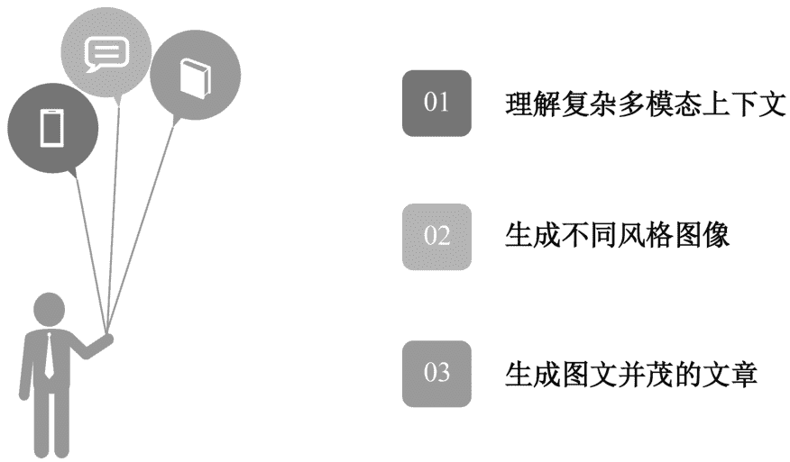

图 2-1 `MM-Interleaved`的三大能力

#### 1. 理解复杂多模态上下文

模型可基于图文上下文推理产出，如解算图文数学题、根据 Logo 图像生成相关公司介绍等。

#### 2. 生成不同风格图像

模型可根据描述生成图像，也能按指定风格进行创作，支持复杂图像生成任务。

#### 3. 生成图文并茂的文章

模型可自动续写开头、生成美食教程类图文内容、基于图片讲故事等，实现图文融合创作。

在多模态理解任务中，MM-Interleaved 表现突出，在视觉问答、图像描述、图生图、视觉故事生成等细分方向均有亮眼成绩。

总之，多模态技术让模型处理与理解多源数据、生成多模态内容成为可能，发展潜力巨大，未来将迎来更广阔空间。

### 2.3.2 多模态交互：人机交互更自然

多模态技术通过视觉、听觉、触觉等多感知通道增强人机交互，提升体验。

首先，基于多模态感知，机器人可主动沟通、接收多样输入，实现更智能交互。其次，交互界面与形式被重塑，除传统界面外，还可通过语音、手势操作。再次，交互更灵活，系统可根据用户需求与反馈自动调整界面。最后，多模态技术让机器人学习用户行为与习惯，实现智能化交互。

在实践层面，2023 年 3 月，世优科技宣布成为百度文心一言首批生态合作伙伴，随后接入文心一言能力打造新一代虚拟数字人。

目前世优科技已推出 AI 虚拟主播慕兰。直播中，慕兰能对用户提问作出简洁流畅回应，实现实时智能互动，并具备自然的情感交流能力。

未来，多模态技术与大模型的结合将赋予机器人、虚拟数字人更强的感知与理解力，驱动智能决策与行动，让人机交互更自然、体验更优。

# 第 3 章 产业生态：生态化发展激活 AIGC 赛道

随着基础设施完善与企业加速入局，AIGC 产业生态日益成熟，产业分层逐渐清晰，在资本与企业的推动下生态圈持续扩张。

## 3.1 三层架构：基础层+技术层+应用层

从全景视角看，AIGC 产业可分为基础层、技术层、应用层三层。其中基础层提供底层设施；技术层聚焦技术研发，大模型是核心；应用层汇聚面向 B 端与 C 端的应用，是产业持续扩容的动力。

### 3.1.1 基础层：为 AIGC 发展提供基础设施

基础层为产业提供数据、算力、计算平台、开发平台等支撑。

#### 1. 数据

预训练、推理、微调全流程均依赖数据。AI 基础数据服务商是重要参与者。

当前市场大致分三类。第一类是科技巨头，如百度、京东、腾讯，推出百度智能云数据众包、京东众智、腾讯数据厨房等服务，起步早、体系完善。第二类是专业数据服务商，如北京海天瑞声科技股份有限公司、拓尔思信息技术股份有限公司、数据堂北京科技股份有限公司等，聚焦细分领域，提供专业多元服务，市场占比最大。第三类是初创企业，如 MindFlow 杭州曼孚科技有限公司、BodenAI 宁波博登智能科技有限公司等，市场份额较小但潜力可观。

#### 2. 算力

算力是 AIGC 高效运行的底座，AI 芯片是关键。基础层聚集谷歌、英特尔、英伟达、海思半导体、联发科技、北京地平线机器人技术研发有限公司等厂商。

2023 年 4 月，谷歌发布用于 AI 模型训练的 AI 芯片 TPU V4。早在 2016 年谷歌推出 TPU 系列，通过低精度计算提升速度并降低功耗，为搜索、NLP 等业务提供算力。此次 TPU V4 在效率与节能上进一步突破，性能更优，可大幅加速模型训练，支撑更多 AI 场景。

#### 3. 计算平台

依托智能计算优势，计算平台可为大模型训练提供支持。2023 年 6 月，云上科研智算平台 CFFF 成功上线，由复旦大学、阿里云、中国电信联合打造，采用公有云模式实现千卡并行智能计算。

平台包含面向多学科融合创新和面向高精尖研究的双集群，在高速传输网络、大规模异构算力融合调度、AI 与大数据一体化技术支持下，双集群构成性能强大的超级计算系统。依托该平台，复旦大学人工智能创新与产业 AI³ 研究院发布中短期天气预报大模型，在保持良好预测精度的同时大幅提升预测速度。

#### 4. 开发平台

开发平台提供算力、模型框架、在线推理、在线训练等服务，将大模型开发能力开放给开发者。

以昇思大模型平台为例，它集模型选型、在线训练、模型微调于一体，是面向开发者的开放式平台。平台拥有 AI 实验室、模型库、数据集等模块，提供算力支撑，同时配备丰富的在线课程与社区活动。

为了让开发者用得更顺手，平台做了一轮多维度升级。专门搭建了电力、工业等行业专属大模型专区，提供从训练、推理到部署的一站式开发服务；同时上线课程体系，覆盖自然语言、视觉等多个方向，帮助开发者更快上手大模型开发。

### 3.1.2 技术层：大模型研发成核心战役
生成算法与多模态技术持续融合碰撞，AIGC整体增速明显。大模型作为技术集成的核心载体，成为行业追逐的焦点。技术赛道上，各方都把大模型研发当成关键突破口，依托研发实力打造差异化模型。参与者名单及成果见表 3-1。
表 3-1 AIGC 产业技术层的参与者及其成就
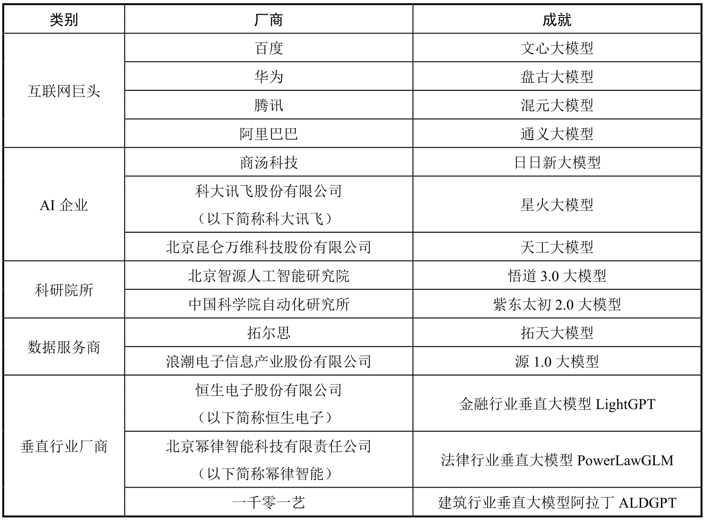
从表中能看出，百度、华为等互联网头部，商汤、科大讯飞等AI代表企业，加上智源研究院、中科院自动化所等科研机构，共同构成大模型研发的主力集团。
依托数据壁垒，部分数据服务商也杀入赛道，拓尔思就是典型。这家深耕AI、大数据与数据服务的公司，于2023年6月发布拓天大模型，并在金融、传媒两端率先落地行业模型。下一步它还计划在舆情、法律、审计等领域推出垂直模型。
另外，恒生电子、幂律智能等在细分赛道有优势的厂商也在加速研发。行业厂商普遍采取联手科技公司的模式，用通用大模型为底座再做垂直定制。
以幂律智能为例，2023年6月它与智谱AI联合推出法律垂直模型PowerLawGLM，专注法律细分，能够理解专业法律语言并给出科学可行的法律方案。
幂律智能长期深耕法律AI，提供智能合同服务；智谱AI则把法律作为大模型布局的关键方向。双方携手共探大模型在司法场景的落地路径。
模型先吃透大量专业法律文本，再对齐法律对话场景，最后优化输出的准确性和可靠性。经过这三步打磨，PowerLawGLM在法律文本理解、推理和生成上的表现显著提升。
从模型类型看，自然语言处理与多模态大模型是研发重心，计算机视觉、智能语音等细分模型相对较少。同时，随着参与者增多，开源化成为主流趋势，互联网巨头和科研机构正领跑开源探索。

### 3.1.3 应用层：B端C端同步发力
在应用端，B端和C端齐头并进。金融、软件管理是典型的企业级场景，教育、电商则是面向消费者的典型场景。技术与数据双优的企业，更容易吃到AIGC红利。

#### 1. 金融场景大模型提速
金融场景的大模型落地明显提速。2023年3月，彭博社推出金融行业大语言模型BloombergGPT。模型基于彭博社的海量金融数据构建超大训练集，可覆盖多类金融任务。它一方面优化了内部的市场情绪分析、新闻分类等业务，另一方面通过调用平台数据，为企业客户提供更精准服务。

#### 2. 软件管理场景智能化
用友网络在软件管理领域发力，用AI技术打造生成式智能ERP。在商业创新平台BIP上，它搭建了数十个场景化AI大模型，并衍生出数百款AIGC应用。
同时它接入百度文心一言，把智能对话能力嵌入BIP及配套服务，并在财务、人力、智能制造等领域深化合作。用友旗下新道科技借助文心一言做智能教育产品，用友金融数智云则用文心一言打造金融智能应用。未来双方还将联手推出场景化的AIGC企业服务方案。

#### 3. 教育场景体验升级
教育赛道正拥抱AIGC。Duolingo基于GPT-4推出新品Duolingo Max，新增“解释我的回答”和“角色扮演”两大功能，学习体验明显升级。
做完练习点“解释我的回答”，系统会给出对错说明和改进建议；想练对话就点“角色扮演”，系统会生成虚拟场景和角色，支持多轮流畅对话，帮助提升语言实战能力。

#### 4. 电商场景运营赋能
电商场景里，AIGC用于智能生成营销素材、赋能客服机器人。Shopify在OpenAI开放ChatGPT API后第一时间接入，升级了平台能力。
借助ChatGPT，平台客服机器人可实时解答用户咨询，节省商家人力；平台还能依托用户搜索记录实现个性化推荐，提升购物体验；智能评论分析则帮助商家洞察用户反馈，优化商品。
整体看，AIGC应用正从B端向C端双向扩散。目前金融、教育等领域已现落地，未来将渗透更多细分场景，覆盖更广的企业和消费者。

## 3.2 企业布局：AIGC赛道升温
各家企业正加速在AIGC领域卡位，谷歌、微软、百度、华为等科技巨头成为主力推手，整体产业热度持续攀升。

### 3.2.1 谷歌：Gemini发布 性能全面升级
谷歌早在AIGC赛道深耕多年。2023年12月，它正式发布通用大模型Gemini，代表最新进展。
Gemini基于Transformer decoder打造，支持理解文字、图片、音频等多模态输入，并生成文本、代码等多模态输出。代码能力突出，能读写Python、Java等多门语言，并据此推出了专业代码模型AlphaCode 2，助力开发者编程。
推理能力同样强劲，能解析复杂文本和视觉信息，比如从海量文档中提炼关键洞察，从冗长报告中抓取重点。
产品线分为Ultra、Pro、Nano三档。Ultra面向企业级复杂推理，Pro性能均衡适合多任务扩展，Nano轻量化运行在安卓设备端。
应用上，Gemini已接入AI助手Bard，并逐步在全球多地推广。
同步发布的新一代云端AI芯片TPU v5p大幅提升了数据传输与算力，为Gemini的训练推理提速。有了硬件加持，Gemini迭代空间更大。

### 3.2.2 微软：依托大模型升级AIGC产品矩阵
微软深耕AIGC，作为OpenAI核心投资方，它把大模型能力转化为多元的产品矩阵。
办公场景里，2023年3月微软推出接入GPT-4的Microsoft 365 Copilot，把AIGC融入办公套件。Copilot可自动生成内容，并打通Word、Excel等应用的数据，提升协作效率。
Copilot好比AI助手，嵌入Word、Excel、PowerPoint等应用，按需生成内容、整合分析信息。用户还能直接对话提问，例如询问早会要点时，它会结合会议记录、邮件自动汇总回复。
在网络安全领域，微软推出接入GPT-4的Microsoft Security Copilot，融合多年安全知识与全球威胁情报，可持续学习、强化防御并提供定制化方案，同时支持与现有安全系统联动协作。
功能上，它能实时分析威胁并给出处置方案。以勒索软件为例，过去需耗时分析，现在能在短时间内抓取关键信息、还原事件链并提出对策，显著提高响应效率。
随着持续投入与研发，微软有望把AIGC推向更多场景，推出更多领先产品。

### 3.2.3 百度：文心大模型持续深化
百度在AIGC上起步早，2019年就推出预训练模型文心并不断迭代。2023年10月正式发布文心大模型4.0，并加速落地。
文心大模型有两大特点：一是知识储备深厚。依托数千亿条多源异构知识图谱训练，基于海量语料学习，知识底蕴扎实。
二是应用覆盖广。已在搜索、地图、智能驾驶等场景服务数亿用户；携手百度智能云落地金融、制造、传媒等行业。
实践中形成“基础+任务+行业”三层体系。基础模型打通用性和技术难点；任务模型针对特定任务定制算法与数据；行业模型融合行业知识构建技术底座。三者相互支撑，应用数据反哺基础模型持续进化。
百度基于文心大模型推出数十个大模型，不断完善“基础+任务+行业”模型体系，如图 3-1 所示。
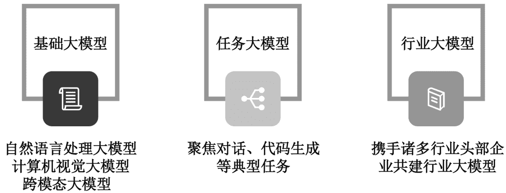
图 3-1 百度的模型体系

#### 1. 基础模型
基础层涵盖自然语言、计算机视觉和跨模态三大方向。
(1) 自然语言处理。文心系列持续更新，文心4.0在理解、生成、逻辑推理、记忆等方面表现突出，复杂任务处理能力强。
(2) 计算机视觉。VIMER系列持续迭代，其中VIMER-CAE在新预训练框架下提升了图像表征能力，在多类图像生成任务中表现优异。
(3) 跨模态。涵盖文生图、视觉-语言等，ERNIE-ViLG 2.0在图像清晰度与传统文化理解上优势明显，是突出AI绘画模型。

#### 2. 任务模型
任务层面向对话、搜索、信息抽取、代码生成、生物计算等典型场景推出定制模型。其中RENIE-Code基于海量文本和代码训练，支持跨语言理解和生成，可完成代码翻译、提取等工作。

#### 3. 行业模型
行业层与浦发银行、吉利汽车、人民网等头部企业联合共建。金融、制造、传媒等领域已开展探索，行业大模型可作为底座驱动技术突破、产品创新与流程优化，实现降本增效。
例如与人民网共建的传媒NLP大模型，基于海量传媒数据训练，能提升内容审核、舆情分析、新闻摘要生成等任务效率。
为更好适配场景，文心体系打通落地关键链路，在工具平台、产品、社区等层面构建开放应用生态。

### 3.2.4 华为：打造AIGC媒体基础设施赋能内容生产
互联网与企业数字化深入，音视频内容需求激增，营销、培训、日常沟通等场景广泛使用。AIGC加速内容生产，成为企业数智化新动力。华为积极布局，构建AIGC媒体基础设施，助力内容生产提效。
2023年9月华为全联接大会期间，华为云与客户伙伴在“共建AIGC媒体基础设施”论坛上探讨建设与应用路径。
华为云思考在AIGC时代如何重塑媒体基础设施，实现智能生成，并提出两大方向。
其一，依托一站式内容生产Studio，实现从素材到剪辑、合成、渲染的全流程云端化。结合MetaEngine渲染引擎与AI渲染，渲染效率大幅提升，为营销、家居设计、汽车制造等行业提供高效制作方案。
其二，用AIGC生成视频与虚拟数字人，推动内容制作变革。可生成自然动作的虚拟数字人与虚拟空间，适用于培训、生产、营销等场景。华为云已打造虚拟数字人，并在直播、电商、营销等领域推广，助力销售转化。
未来，华为云将依托Studio、MetaEngine、虚拟数字人等AIGC服务，与伙伴和客户共建新时代媒体基础设施。

## 3.3 产业趋势：生态更活跃更开放
AIGC产业增速加快，项目频出，资本追逐热度高企，技术上开源化浪潮降低落地门槛，共同推动产业繁荣。

### 3.3.1 资本活跃：投融资事件密集
AIGC热度攀升吸引大批资本涌入，无论巨头还是初创都成为投资焦点。
明星企业OpenAI于2023年4月完成103亿美元融资，其中微软主导战略投资约100亿美元，老虎环球、红杉等机构参与财务投资超3亿美元。融资后估值突破270亿美元。
初创阵营融资同样活跃。Inflection AI在2023年6月拿到13亿美元；Typeface在2023年2月和6月分别获6500万美元和1亿美元；北京光年之外科技获腾讯资本等约16.6亿元投资；多模态模型开发商生数科技获百度、蚂蚁集团等近亿元支持。
巨头参与度高。国内腾讯投资深言科技、MiniMax等；百度投资西湖心辰、生数科技等；蚂蚁集团投资生数科技、月之暗面等。国外微软投OpenAI、Inflection AI；谷歌投Versed、Runway；英伟达投Inflection AI、Runway。
总体看，AIGC成为巨头重点押注方向，资本狂欢下融资规模持续攀升，过亿元案例频出，为产业持续繁荣提供动力。

### 3.3.2 技术迭代：开源降门槛
Meta开源Llama 2实现免费商用后，开源大模型浪潮扩散。更多企业加入开源阵营，基于开源模型优化产品、打造AIGC应用，落地门槛明显下降。
具体而言，大模型开源具有以下三大优势，如图 3-2 所示。

图 3-2 大模型开源的三大优势

#### 1. 防止垄断
从产业视角看，开源能避免少数大厂垄断技术，通过开放协作推动行业健康发展。

构建超大规模生成模型，门槛集中在数据采集、计算资源和资金投入等几方面。如此高的门槛往往让只有资本雄厚且技术数据双优的巨头才玩得转，也容易形成技术头部垄断。把模型代码和权重公开后，来自不同行业的组织都能参与进来协同推进，推动生成式内容生态整体向前。公开化还避免了各家重复造轮子，让研发力量聚焦在创新和场景落地。

#### 2. 数据保护
说到隐私与安全，开放源代码的方案能让公司守住核心资产，同时实现专属微调。多数机构把数据视作核心竞争力。采用开放路径，企业保有完整的数据所有权，在不外泄的前提下把内部敏感信息拿来训练。定制训练过程中，开放版本可以筛掉不匹配样本，从而压缩整体训练开销。

#### 3. 降低成本
从计算层面看，公开模型能明显压低算力开支，促进更广泛应用。开发生成模型和内容工具时，算力主要花在预训练和在线推理两块。

预训练环节费用高昂，不是所有公司都负担得起。已有公开权重可直接复用，省去重复预训练的巨额投入。推理环节，参数规模越大实时成本越高。依托公开基座打造面向细分任务的轻量垂直方案，能缩小模型体积，降低日常调用费用。这样中小团队也能以更低门槛推出生成式产品。

目前公开化已成行业共识，多家厂商在探索。人工智能公司 Stability AI 走在前列。2022年8月，该公司发布了可生成多风格画作的公开绘画系统 Stable Diffusion。

2023年4月，Stability AI 推出新一代公开绘画系统 DeepFloyd IF。相比前作，这款系统表现更强：一是文字渲染精准，能为招牌等场景的文字设计风格和排版；二是具备空间理解，能依据描述中的方位距离生成合乎逻辑的画面；三是支持细粒度编辑，可对已有图像进行修改。

这些公开绘画工具的出现，为大众体验生成内容创作提供了入口，也加速了生成式应用的商业落地。

### 3.3.3 AIGC 开放：xAI 开源大模型 Grok
生成式内容行业正走向开放，Google、Meta 等巨头都已公开自家基座模型。2024年3月，马斯克创办的人工智能新创 xAI 正式对外发布公开模型 Grok。

Grok 采用3140亿参数的混合专家架构，未做特定任务微调，具备较强的通用适配力。xAI 将其公开版本放到 GitHub 后，迅速积累大量关注和使用。

此次公开反映出马斯克推动生成技术普及的决心。公开代码和权重有利于全球技术交流，加速迭代。模型开放后，研究机构和企业可自由调用、改动，推动生成技术在教学、医疗等多场景落地。xAI 同时提供了规格说明、接入指南和示例代码，降低了上手难度。

Grok 为研究者提供了新的试验平台，助力创造新型应用。这种开放态度打破了原有技术壁垒，为生成产业的开放式演进提供助力。伴随持续迭代和更广使用，Grok 有望成为行业发展的重要推手。

# 第 4 章 商业模式：MaaS 模式构建 AIGC 商业闭环
生成式应用热度不减，大量厂商涌入赛道。商业的核心始终是盈利和可持续，对相关企业而言，构建完整闭环和稳定收入方式是长远的关键。模型即服务凭借清晰的盈利逻辑，成为可行路径，获得广泛认可。

不少公司依托技术积累推出差异化模型服务，既提升使用体验，也为行业的长期健康发展提供动力。

## 4.1 拆解 MaaS 模式
要用好这一商业形态，先要厘清其本质和架构。下面对核心要点做解析，帮助掌握精髓。

### 4.1.1 MaaS 模式：模型即服务的商业模式
MaaS 即 Model as a Service，指把模型作为付费服务输出的商业形态，对科技公司是可行的收入方式。头部厂商可凭借技术优势构建基座模型并对外收费；下游细分企业则可在其之上训练专属版本，将生成能力植入自有产品。

这种形态为下游提供训练、使用和产品开发等支持，上游则通过收费形成闭环。

各行业业务、技术和规则各异，所需模型也不同。若巨头能对外提供行业化模型，模型本身即成服务。用户可在不从零研发的前提下调用、定制和部署。

例如某科技巨头推出通用基座，基于海量数据具备强通用力。要在细分场景落地，需要进一步微调和行业数据训练。巨头可基于优势打造垂直模型并开放接口，下游企业作为开发者在此基础上训练专属模型，打造个性化生成产品再面向用户。巨头通过 API 收取接入费，下游以更低成本满足自身需求。无论巨头还是新玩家都能受益。

### 4.1.2 基本架构：以“模型+应用”提供服务
这一形态的落地依赖模型加应用架构。模型是底座，提供生成、推理、交互等基础能力；应用是落地关键，聚焦特定场景提供个性化服务。

架构中模型包括通用基座和行业专用模型。开发应用前，通常先用行业数据训练并微调，在通用基座上打造行业模型，再据此构建生成应用。

例如基于通用基座可得到金融、医疗专用模型，进而衍生出市场情绪分析、智能投顾、辅助诊疗、药物研发等应用。

在应用层面，垂直领域是落地主战场。目前已有大量生成应用在零售、制造、教育、办公等场景落地，更多行业正整合模型能力创新应用。

以拓世科技集团为例，其一直践行模型服务落地路径。模型侧推出拓世大模型，为应用提供技术底座。应用侧基于该模型在数字人和直播领域探索。

数字人方面推出拓世 AI 数字人，可按场景定制语音，提供个性化交流，适用于政务、银行等场景。直播方面打造直播运营管理平台，帮助用户搭建直播电商矩阵提升收入。

基于模型加应用架构，模型服务成为生成技术普及的重要驱动力，简化部署流程，重塑商业价值。

## 4.2 三大盈利路径
这种模式有三大变现方式：订阅收费、提供生成智能服务获利、定制化开发服务获利，三条路径已打通。

### 4.2.1 通过订阅收费
订阅制是典型变现方式，ChatGPT 是代表。

ChatGPT 设免费版和付费版。OpenAI 最初发布的免费版名为研究预览版，上线一周即获近百万粉丝。截至2023年1月，活跃用户达1亿次，增长迅猛但引发服务器过载。为此采取限流，如禁止云服务器访问、限制每小时提问数、高峰期排队等。

为缓解压力，推出订阅付费版 ChatGPT Plus，月费20美元。付费用户可享受高峰免排队、快速响应、新功能优先试用。内测版 ChatGPT Pro 月费42美元，提供全天可用、快速响应和优先试用。

除 OpenAI 外，Jasper AI 也在尝试订阅。Jasper 基于 GPT-3 提供写作助手，可生成模板、广告文案、邮件和社交推文，提供多档订阅，起价每月29美元。

未来产品成熟后订阅费用或下探，吸引更多用户。

### 4.2.2 通过提供 AIGC 相关智能服务获得收入
企业还可通过提供生成智能服务获利，微软已实践。

2023年2月，微软推出 Microsoft Teams Premium 收费服务，用于视频会议和远程协作。上线初期月价7美元，7月后上调至10美元。该服务由 OpenAI GPT-3.5 驱动，核心功能是智能回顾，可自动生成会议纪要并标注重点，方便缺席或复盘用户。

同时微软旗下 CRM 软件 Viva Sales 接入 OpenAI GPT 3.5，帮助销售减负。可自动回复客户问题，提供折扣或解答，并基于历史数据生成个性化文案和营销邮件。Viva Sales 月费40美元，为微软带来可观收入。

未来微软将持续深耕模型服务，为用户提供更优质服务。

### 4.2.3 以定制化开发服务获得收益
提供定制开发服务也是重要收入来源，推出 ChatGPT 后，OpenAI 的企业定制服务成为主要盈利点之一。

例如 DALL·E 是 OpenAI 的图像生成模型，可编辑和创建图像。初创公司 Mixtiles 与 OpenAI 合作，将 DALL·E 融入自有产品助力内容创作。

零售平台 Cala 也集成 DALL·E，为用户提供品牌宣传、产品构思、设计和销售的一站式服务。用户上传文本或参考图即可获得符合需求的设计图。

与 Mixtiles 相比，Cala 的商业化程度更高，细节要求更严。虽然同用 DALL·E，收费差异明显。总之同一模型面向不同需求提供不同服务，收费也不同，需求越高收费越高。

## 4.3 B 端应用：聚焦为企业用户提供服务
面向 B 端，企业可为各领域客户提供个性化模型服务，或开放 API 接口支持客户打造专属生成应用。

### 4.3.1 聚焦为行业提供行业服务
模型服务可在多行业落地，提供多样化行业服务，重塑内容生产方式并加速运转。

营销领域，可为 B 端客户提供定制化营销服务，支持训练专属营销模型并生成广告和方案。

在工业制造，模型服务可贯穿多个环节推动智能化。

开发环节，开发者可借助基座生成代码，完成重复性任务。设计环节，设计师可利用图像生成能力做三维可视化，基座还能直接给出设计方案并点评优缺点，提供灵感。

生产制造环节，基座可辅助工人精准设定设备参数，提供操作指引；出现故障时可快速诊断并给出解决方案，并能为多流程工艺生成参数报告供决策。

运营管理环节，基座可解析 ERP、SRM 等系统数据，生成 AI 分析报告，并融合多系统做多维度分析，如生成 Excel 表格帮助管理者洞察工厂运营。

服务环节，基座可提升响应效率并创造新服务形式，接入智能家居、早教机器人、智能客服提升体验，也可为抖音、微博等平台生成营销内容并实现实时互动。

在金融、医疗、法律等知识密集型领域，通用基座难以处理复杂任务。模型服务为垂直落地提供了有效路径，企业只需调用接口并用行业数据训练即可得到个性化应用。

例如2023年5月，度小满发布金融行业垂直开源模型轩辕。依托多年金融实践积累的研报、股票、银行等专业数据集，轩辕在名词解释、数据分析、问题解析等场景表现突出，能给出专业建议和判断。

发布后，轩辕已获上百家金融机构试用，为中小机构提供技术支持，缩小与大型机构的差距。

基于模型服务在 B 端的落地，越来越多的企业可借助基座生成专属模型并集成到产品中，提升竞争力。

### 4.3.2 开放接口，为企业升级产品提供便利
拥有强大基座或生成产品的企业可开放 API 接口，助力其他企业升级。

2023年3月，OpenAI 宣布全球开放 ChatGPT API，支持企业将其集成到应用和服务中。此后不少企业接入 ChatGPT 实现升级。

例如，上海耀乘健康科技有限公司旗下的 AuroraPrime 临床研究云平台已实现与 ChatGPT 对接并取得阶段性成果，如图 4-1 所示。

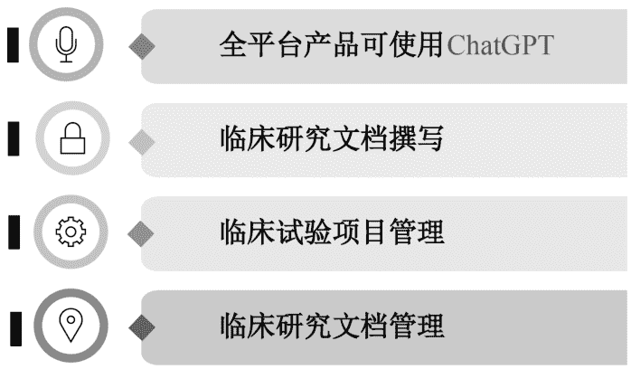

图 4-1 `AuroraPrime`与`ChatGPT`对接的成果

1. 全平台产品可使用`ChatGPT`

AuroraPrime 已搭建起覆盖临床科研全链路的产品矩阵。此次把 ChatGPT 接入平台后，模型对话能力被植入多条产品线的交互层，使用者可以直接进行自然问答与指令下发，整体使用感受明显升级。耀乘健康同时对专业知识的引用做了校验与锁定，让 ChatGPT 在临床场景下的输出更合规、更可信。

2. 文档起草提速
Prime Create 是部署在 AuroraPrime 上的文案起草型 SaaS。借助 ChatGPT，系统内部新增了内容辅助生成模块，AI 工具接入门槛被拉低，临床资料的起草效率得到显著提升。

3. 项目管控更智能
Prime Coordinate 是 AuroraPrime 旗下的一款 CTMS 产品，强调高灵活性与可扩展性，能适配不同机构在试验项目管理上的定制化诉求。ChatGPT 加持后，该系统演进为更聪明的管控平台，例如自动生成监查小结、智能化计划提醒，并可依据实际执行数据自动产出相关文件。

4. 文档治理更顺畅
Prime Catalog 是 AuroraPrime 的企业级文档中台，同时覆盖企业级与项目级等多层级文档治理需求。ChatGPT 支持下，系统能够结合项目目录结构与文件名特征，智能推演合适的归档位置，整体文档治理效率得到优化。

除 OpenAI 外，360、百度等科技厂商也在密集发布自研基座模型并对外开放接口，为多行业赋能。以 360 为例，2023 年 6 月其宣布向企业与开发者开放通用基座模型“360 智脑”的 API，提供可落地的行业化解决方案，首批场景覆盖传媒、能源等领域，重点服务于企业办公写作、决策分析、客户服务等工作流。

总体来看，开放 API 让企业能够快速将基座模型能力内嵌到自有产品线中，提升性能、加速迭代并催生新品类。未来 MaaS 形态将在 B 端广泛铺开，为更多行业提供支撑。

4.4 C 端应用：面向个人用户的服务探索

在 C 端，企业可借助 MaaS 形态推出面向个人的服务以获取收益。关键在于把握 MaaS 在 C 端落地的核心场景，探索 AIGC 服务与智能终端的联动，打通商业化闭环。

4.4.1 效率体验价值三大关注点

4.4.2 MaaS 在消费端的落地路径
从消费者视角看，MaaS 的落地能够为终端使用者提供多元的 AIGC 服务，让工作与生活更便利。其聚焦方向主要集中在下述领域，如图 4-2 所示。

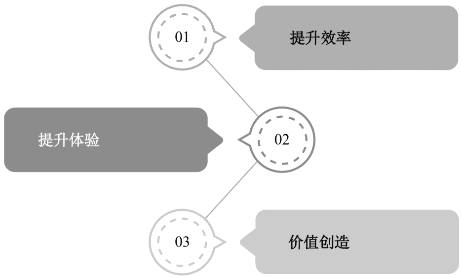
图 4-2 MaaS 模式在 C 端的落地

1. 提速
在效率维度，MaaS 正在重塑编程助手、文档助手等工具。CodeGeeX 是一款基于基座模型驱动的 AI 编程助手，可实现代码生成、代码互译、代码补全等功能，兼容数十种编程语言并向公众免费开放。使用者可通过网页端或 VS Code 插件接入，CodeGeeX 明显提升了编码效率与质量，并降低了入门门槛。

2. 体验跃升
提升使用体验是 MaaS 的重要发力方向，数字人、游戏等对体验要求高的品类率先发生变化。

2023 年 6 月，在“360 智脑大模型应用发布会”上，360 发布了基于基座模型构建的智能应用“AI 数字人广场”。该应用提供 200 多个角色供互动，涵盖“孙悟空”“诸葛亮”等知名人物。

“AI 数字人广场”中的数字人分为两类：一类是大众熟知的数字名人，另一类是提供专业服务的数字助理。数字名人可依据提问给出回答或建议，数字助理则更专业，能够提供法务知识、策划方案等支持。应用还支持数字人定制，使用者上传私人数据后即可生成人设鲜明、性格独特的专属数字人。

“AI 数字人广场”展示了 MaaS 在 C 端落地的可行路径。在基座模型赋能下，数字人将更具智慧，可承担更复杂的任务，具备接近人类的思维方式与鲜明性格特征，以朋友的身份给予使用者更贴心的陪伴。

3. 价值创造
在价值创造层面，MaaS 向 C 端渗透将驱动内容爆发，提升消费级应用的服务能力。在大型模型支持下，文本生成、图像生成、视频生成、3D 建模等能力持续优化，使用体验更顺滑。目前，各大开源社区汇聚了大量面向个人的 AI 绘画、AI 编程工具，可助力研发设计与创意表达。

与此同时，多款应用在基座模型加持下实现升级。阿里巴巴已搭建较为完善的 MaaS 体系，涵盖基础通用模型、企业专属模型、API 服务、开源社区等。未来淘宝、闲鱼、高德地图等产品都将接入基座模型完成能力升级，优化使用感受。

MaaS 将围绕效率、体验、价值三大方向向 C 端更多场景渗透。随着各企业在基座模型上的实践深化，基于 AIGC 的产品将在未来集中落地，覆盖生活方方面面。

4.4.3 智能终端成体验服务关键载体

在 C 端，智能设备是使用者体验多样化 AIGC 服务的关键入口。目前智能设备接入基座模型已成趋势，智能性大幅提升，使用者可通过设备享受丰富的 AIGC 功能。

2023 年 4 月，天猫精灵接入阿里巴巴通义千问模型，开启内测招募。演示显示，接入后天猫精灵的知识广度、人性化沟通与个性化能力均有提升，成为更具温度、更个性化的智能助手。

天猫精灵与基座模型的结合彰显了其在智能终端领域的应用价值。未来在模型支持下，智能设备将进入更多场景，C 端个性化定制将成为新的发展方向。

个性化模型更适合 C 端，例如在居家场景，搭载个性化模型的智能设备可被赋予身份、性格、偏好等角色设定。沟通时设备可生成个性化回复，并以个性化语音与使用者交互。

为通用模型注入个性化要素正成为重要探索方向，智能设备作为承载主体，将成为新的流量入口。传统智能音箱、扫地机器人等设备长期被诟病智能性不足，接入基座模型后才能真正实现智能化，满足个性化诉求。

在模型助力下，智能陪护机器人、早教机器人等先进设备有望实现技术突破。例如智能陪护机器人可与使用者进行个性化互动、顺畅沟通，进而精准把握需求提供贴心服务。除多样化服务与安全监护外，依托基座模型生成能力，陪护机器人还能具备多媒体娱乐功能。

总之，个性化模型能够升级智能设备的交互方式与功能，满足个性化诉求。未来其有望率先在智能家居领域落地。

# 第5章 搜索进入生成时代
# AIGC 重塑搜索体验

AIGC 与搜索引擎的深度融合开启了智能生成式搜索的新阶段。在 AIGC 驱动下，搜索引擎不仅能精准捕捉使用者意图，还能基于具体问题生成个性化内容。这一变革彻底改变了传统搜索的运行逻辑，为使用者带来更高效、更便捷的体验，推动行业升级。

5.1 AIGC 引发的搜索变局

5.1.1 从检索到生成：搜索的演进轨迹
搜索技术诞生之初，主要通过平台向使用者提供信息。随着发展，众多企业推出差异化搜索平台，服务内容日益丰富。AIGC 与搜索引擎结合后，搜索方式完成迭代。整体演进可归纳为三个阶段，如图 5-1 所示。

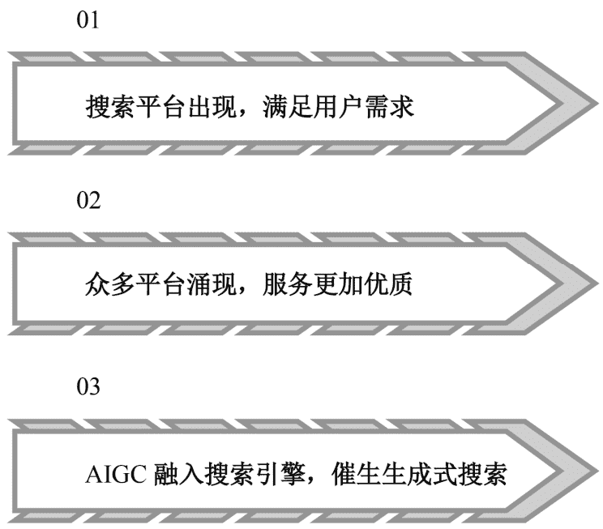
图 5-1 搜索引擎的三个发展阶段

1. 搜索平台出现，满足使用者需求
互联网兴起后，使用者习惯在线搜索软件、教程、生活常识等内容。百度搜索引擎、360 搜索引擎等平台应运而生，不仅提供海量内容，还能识别搜索意图给出精准结果。

2. 众多平台涌现，服务更加优质
使用者对搜索结果要求提高，平台纷纷提供专业服务。
例如微信搜索整合知乎、腾讯视频、京东等资源更名为“搜一搜”，实现搜索即服务，使用者输入电影名、时间+天气、汽车品牌等即可获得对应服务。
知乎作为问答社区，汇聚各领域爱好者与专家，使用者可搜索答案并与专家交流。
专业化和个性化平台的出现，让使用者能按需选择。

3. AIGC 融入搜索引擎，催生生成式搜索
AIGC 与搜索引擎结合催生了生成式搜索。相较传统检索型搜索引擎，生成式搜索在检索基础上增加生成能力。
它能整合多源信息形成结构化答案，并生成结论。例如使用者问两位历史人物谁年纪更大时，系统会给出两人出生信息并直接给出结论。
总体来看，生成式搜索正成为搜索引擎发展的新方向，未来将与更多平台结合拓展智能搜索场景。

5.1.2 更智能也更安全的搜索体验
从呈现方式看，基于 AIGC 的生成式搜索可输出文本、图像、视频等多元化且准确的内容。还能整合多样信息，减少使用者翻阅量，提升效率，同时兼顾隐私保护。

例如“ You.com ”是一款基于 AIGC 的生成式搜索引擎，提供定制化搜索并保障使用者隐私。平台引入 GPT-4 和图像模型 Stable Diffusion XL，可为复杂查询提供文本、图像、表格等丰富结果，提升准确性。界面支持多维度滚动，使用者可快速发现更多信息。

You.com 面向大众提供百余款应用的个性化搜索，满足多样需求，也为企业提供定制化搜索方案。隐身模式下使用者 IP 被隐藏，搜索更安心。

总之，生成式搜索不仅内容更丰富，也更注重隐私安全，使用体验持续优化。

5.2 AIGC 推动下的搜索升级

在 AIGC 推动下，搜索引擎迎来全面升级。微软、谷歌、百度等巨头均投入资源探索融合，生成式搜索成为新形态，引领行业向更智能高效发展。

5.2.1 New Bing：基于 GPT-4 的智能引擎
2023 年 2 月，微软发布基于 GPT-4 的智能搜索引擎 New Bing；2023 年 5 月，预览版向所有使用者开放。核心创新如图 5-2 所示。

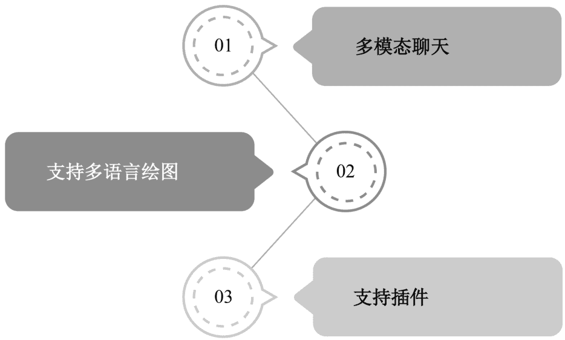
图 5-2 New Bing 的创新功能

1. 多模态对话
基于 GPT-4，New Bing 支持智能多模态对话，可回答问题并提供建议策略。输出不仅限于文本，还可包含图像、音频、视频，内容更丰富。

2. 支持多语言绘图
绘图功能支持上百种语言，面向全球使用者。强大的图像生成能力可在短时间内产出符合要求的精美图片。

3. 支持插件
平台支持多种插件，如 OpenTable、Wolfram Alpha 等，任务处理更高效，应用场景进一步拓展。

此外，New Bing 基于先进算法提供个性化体验，注重隐私保护，兼容 Windows、Android、iOS 等系统。接入 GPT-4 后，其信息检索、问答、个性化建议能力大幅提升。

5.2.2 谷歌：生成式内容搜索
2023 年 6 月，谷歌为 Chrome 浏览器搜索结果页加入“搜索生成体验”功能，对传统搜索形成冲击。

演示中，针对“人们对芝加哥豆怎么看，值不值得去”这一问题，优化后的结果对景点进行描述，并附上旅游攻略引用和使用者评论。
使用者搜索“想买蓝牙音箱”时，结果会汇总多篇文章的购买建议，包括购买链接，并支持价格对比、使用者评价、选购要点查看后跳转购买。

该功能还能根据输入生成图片，点击图片可查看相关关键词，并可通过修改关键词调整图像。未来该功能将影响广告投放方式和网站 SEO 策略。

5.2.3 百度：升级搜索能力，为使用者创作答案
作为国内搜索引擎领军者，百度持续深耕 AI 研发与应用，提升搜索能力并拓展业务边界。在 AIGC 浪潮下，百度率先进行智能化升级。

基于深度学习平台和预训练基座模型，百度提出“多模搜索”概念，从单一文本搜索拓展至语音、视频等多模态。

智能化搜索带来多元体验。使用者可在百度 APP 或网页通过语音、图片、视频等方式搜索，结果更丰富。
语音搜索借助多项 AI 技术实现“听得懂、会说话”，能深入理解语义给出最佳答案。
视觉搜索依托视觉技术结合网络图像和使用者行为识别需求，支持拍照搜题、商品搜索、实时翻译等。
视频搜索允许使用者上传视频检索，借助大规模知识图谱实现精准定位，视频理解与检索技术不断升级，拉动视频消费。

百度搜索不仅能检索视频，还能生成视频。AI 可将百家号图文内容转化为视频，这是智能搜索的重要技术，即生成式搜索，可为个性化提问创作答案。
面对难以直接获取的知识需求，智能搜索可对已有数据进行梳理、推理、加工、生产，实现知识生成。例如查询“A 地与 B 地谁的 GDP 更高”，系统可依据专业数据库生成精准答案。

技术突破离不开跨模态基座模型“知一”和新一代索引“千流”。“知一”基于全网文本、图片、视频持续学习，理解搜索需求更准确；“千流”整合多维度信息，推动传统索引升级为立体栅格化索引。两者使百度搜索更智能，在专业领域持续领先。

百度将推动生成式搜索在更多领域深度应用，释放差异化优势，满足个性化信息需求。未来在 AI 支持下，搜索将更全面智能。

5.2.4 知乎：强化技术探索，提升平台搜索能力
2023 年 4 月，在“2023 知乎发现大会”上，知乎发布“知海图 AI”基座模型，由知乎联合人工智能公司面壁智能共同研发。

该模型已在知乎落地，“热榜摘要”功能进入内测，利用自然语言处理能力抓取、整理热榜回答，展示梗概。未来还将应用于内容创作、信息获取等场景。

同年 5 月，知乎联合面壁智能公布新成果，包括推出 AIGC 应用“搜索聚合”、开源基座模型 CPM-Bee10b、发布对话类模型产品“面壁露卡”等。

知乎把大模型的算力带进搜索场景。用户发起检索的瞬间，系统便会基于海量的问答内容自动做观点归纳，让信息获取和决策判断变得更高效。平台下一步还打算让大语言模型进入创作者的工作流，成为创作搭档，提供实质性的写作助力。

`CPM-Bee10b` 在 `Transformer` 架构上完成训练，参数规模达到百亿量级，能力相当强劲。同期推出的对话型产品面壁露卡功能覆盖面广，支持自动生成内容、语音理解以及数据处理等多种任务。

展望未来，知乎计划依托 AIGC 领域的合作，加大对基础大模型能力的投入，孵化更多落地的 AIGC 应用，持续丰富优质服务供给。

## 5.3 AIGC 重塑营销搜索范式
企业投放和电商运营都绕不开营销搜索，而 AIGC 正把这类搜索的智能化水平拉升到新高度，帮助广告主实现更精准的曝光。亚马逊已开始用 AIGC 赋能电商搜索进行先行探索。

### 5.3.1 搜索广告在 AIGC 驱动下更精准
搜索广告是互联网投放的常用形式，能把信息直接送达用户检索界面，实现引流。它的典型优势有五个。

（1）指向性强，可做到精细化触达。比如用户在找某类产品或服务时，搜索引擎能依据检索词实时匹配相关商品，完成精准种草。
（2）投放成本相对可控。相较广播、电视等传统渠道，搜索广告的触达面更集中，费用门槛更低。
（3）效果反馈直观。广告主可在投放后台实时查看数据，随时迭代策略。
（4）具备强实时性。系统可结合热点新闻和热搜词，为用户推送高相关且时效性强的素材。
（5）策略灵活多变。随着营销方向调整，广告内容与投放逻辑都能快速跟进，且形式涵盖图文视频等多种形态。

AIGC 与搜索广告结合后，行业面貌出现明显变化，如图 5-3 所示。

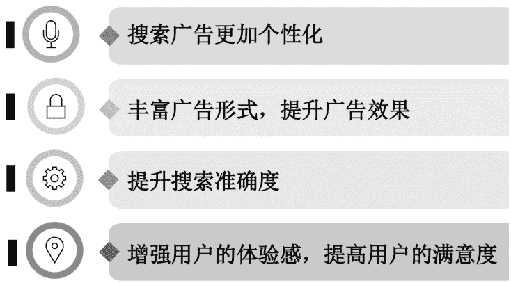
图 5-3 AIGC 为搜索广告带来的变化

#### 1. 广告触达更懂人
过去的搜索广告依赖用户手动输入关键词触达，结果覆盖有限，难以兼顾多场景需求。AIGC 能融合文本、图像等多模态数据训练用户画像，提升投放匹配度，还能依据兴趣偏好在不同场景推送差异化内容，带来更具个性的检索体验。

#### 2. 投放形态更丰富，效果更突出
传统投放往往只有广告主提供的单一素材，吸引力不足。AIGC 可批量生成图文视频等多种创意，形式更多样、趣味性更强。结合对用户行为的分析，系统能产出更契合兴趣的内容，显著提升投放回报。

#### 3. 检索匹配更准
传统搜索引擎以关键词匹配为主，容易误判意图、难以处理复杂表达。AIGC 能在上下文层面理解真实需求，提供更贴合的广告结果。

#### 4. 体验感与满意度双提升
在理解意图的基础上提供个性化内容，能增强使用感受，拉升用户满意度。

总体看，AIGC 为搜索广告带来结构性变革，个性化推荐成为提升转化的关键。

### 5.3.2 亚马逊深耕 AIGC，强化搜索质量
作为跨境电商头部平台，亚马逊组建了“M5”搜索团队，持续做大模型研发，用 AIGC 提升电商搜索体验。

M5 主要聚焦发现式学习策略优化，并构建面向多语言、多实体、多任务的多模态大模型。团队的研发多为实验性质，为快速迭代需要同时训练数千个参数在 2 亿以上的模型。

借助亚马逊云科技的算力协同，M5 实现了跨区计算，解决了性能瓶颈，为规模化拓展奠定基础。

为让用户表达更准确、结果更可靠，亚马逊推出智能搜索增强方案，核心要点如图 5-4 所示。

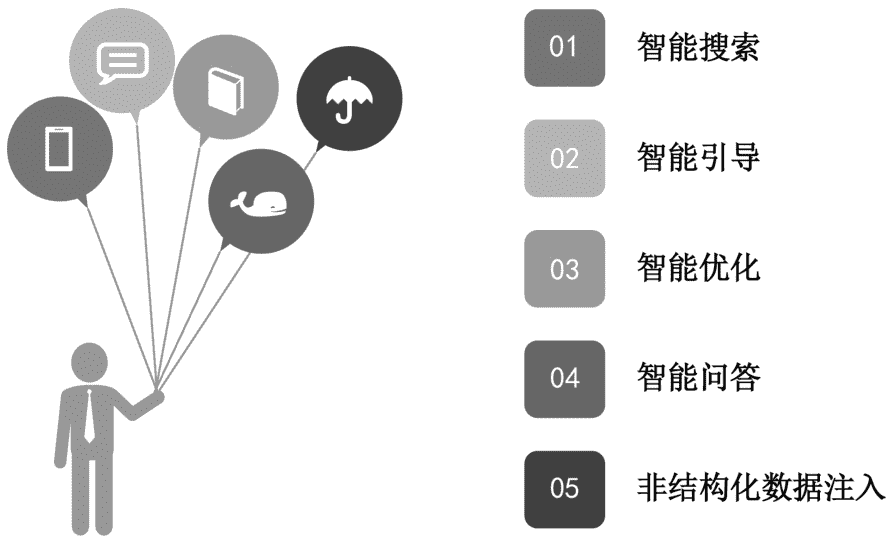
图 5-4 大语言模型增强方案的 5 个核心内容

#### 1. 意图驱动的智能搜索
传统关键词匹配虽能找到答案，却难识别同义词与抽象概念，容易引入噪音。方案引入意图识别模型，提炼核心关键词，降低无关干扰。

#### 2. 引导式检索
搜索不准往往源于系统能力或提问不够具体。机制通过提示与扩展表述，帮助用户把问题说清，从而提升命中率。

#### 3. 行为驱动的智能优化
随着知识库更新，准确度可能下降。方案先收集用户历史行为，再用这些数据训练部署模型。重排模型据此把用户偏好的内容前置，实现千人千面的个性化排序。

#### 4. 知识增强问答
将知识库与大语言模型联动，用户提问后系统从库中抽取相关资料，经模型归纳总结后给出答案。

#### 5. 非结构化数据结构化注入
检索库多为结构化数据，而企业原始数据往往是非结构化、多来源的。方案提供自动拆分与向量编码能力，把非结构化信息转化为可检索的结构化数据，提升效率与准确性。

亚马逊正从多维度用大模型赋能搜索，持续优化购物体验。

# 第 6 章 AIGC 刷新社交娱乐体验
# AIGC 开启社交娱乐新玩法

AIGC 正加速渗透社交娱乐赛道，覆盖社交、游戏、音视频等细分场景，催生多样化的娱乐形态，不断刷新用户体验，也倒逼头部企业加快布局。

## 6.1 AIGC 进入社交场景，焕新互动方式
AIGC 为社交注入活力，让内容更丰富多元，也拓展了社交边界，打破传统局限。深度融合后，社交产品的功能得到升级，更贴合用户需求，带来更个性化的体验。

### 6.1.1 重构社交 App，交互更智能
在 AIGC 加持下，社交 App 的交互与内容生产都在重塑，体验随之优化。具体体现为五大方向，如图 6-1 所示。

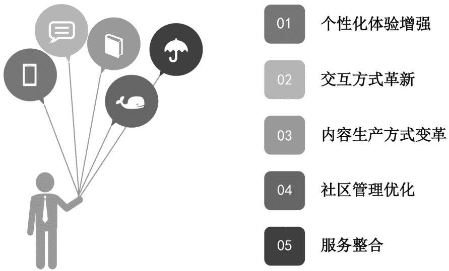
图 6-1 AIGC 重塑社交 APP 的 5 个方面

#### 1. 个性化服务升级
AIGC 能更精准读懂用户需求，通过搜索记录、浏览历史等判断兴趣偏好，推送相关内容，提升使用满意度。

#### 2. 交互门槛降低
用户可用文字、语音等自然方式交流，系统能理解意图并即时响应。自动回复、智能客服等能力进一步完善服务闭环。

#### 3. 内容生产革新
传统App 依赖算法和用户原创。AIGC 借助自然语言处理与深度学习自动产出高质量内容，更贴合用户口味，并在创作过程中提供工具支持，加速创意落地。

#### 4. 社区治理优化
通过数据分析识别热点话题与讨论趋势，引导参与，保持社区新鲜感与粘性。

#### 5. 生态服务整合
AIGC 帮助社交 App 对接电商、健康、娱乐等服务，形成多元融合的生态，既提升便利性，也拓展增长空间。

总体来看，AIGC 正在催生社交新玩法，持续更新体验。

### 6.1.2 Soul 自研 SoulX，丰富互动体验
2023 年 12 月，Soul 发布自研语言大模型 SoulX，具备多模态理解、条件可控生成与上下文理解能力，使对话更流畅自然且富有情感。依托 SoulX，平台上线智能对话机器人与虚拟陪伴等功能，明显提升社交体验。

Soul 以灵犀推荐系统与 NAWA 创作引擎为核心，为用户提供沉浸式开放社交，深受年轻人欢迎。平台聚焦以 Z 世代为代表的年轻人群，持续迭代功能，并推出智能聊天机器人“AI 苟蛋”。该机器人兼具多模态和时间感知能力，可对图文进行回复，并进行游戏化个性互动。例如面对用户发的聚餐照，能结合时间与图像信息“猜到”是生日派对并主动送上祝福。

未来 Soul 将用海量社交数据持续训练 SoulX，支撑游戏、数字分身等场景的 AIGC 落地，同时加大在智能对话与图像生成方面的投入，打造更多沉浸式智能互动。

## 6.2 AIGC 赋能游戏行业，满足多元需求
AIGC 在自然语言理解与内容生成上的优势，能助力游戏开发并提升玩家体验。众多厂商已加速布局并推出相关产品。

### 6.2.1 AIGC 为游戏带来的核心价值
AIGC 能从多角度提升游戏品质，如图 6-2 所示。

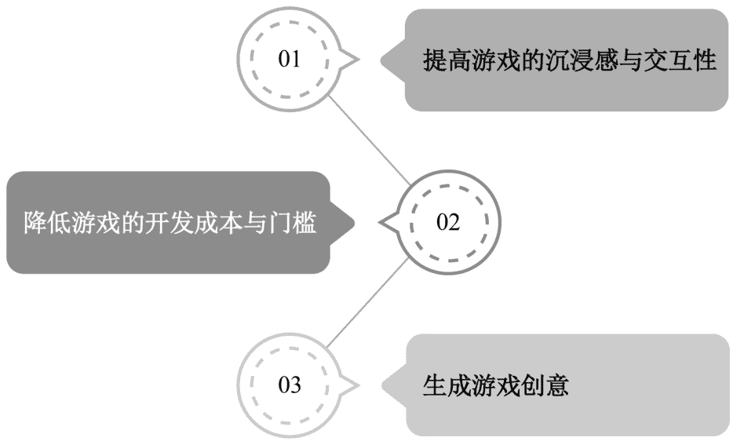
图 6-2 AIGC 为游戏行业带来的价值

#### 1. 沉浸感与交互性提升
AIGC 可生成逼真场景，提升运行流畅度，增强沉浸感；同时实现智能角色生成，让虚拟角色动作更自然。基于机器学习的 NPC 在语言与行为上更具智能，进一步强化沉浸式体验。

#### 2. 开发成本与门槛下降
开发者可用 AIGC 生成文本、音频、图像，缩短周期、提升质量并降低成本。代码输出能力还能让非专业用户尝试游戏开发，例如用 ChatGPT 编写、调试脚本。

#### 3. 创意源源不断
AIGC 能打破思维定式，提供新游戏灵感与玩法。像 AI Dungeon 这类高自由度文字冒险游戏，便是用户输入设定后由模型生成完整剧情的典型。

### 6.2.2 AIGC 升级游戏引擎
游戏引擎负责场景绘制与规则交互，传统开发需大量重复编码。AIGC 与引擎结合可催生智能化 AI 引擎。

Unity 推出 Unity Muse 与 Unity Sentis 两款产品。Muse 支持文本输入生成 3D 动画，加快创作；Sentis 在运行时提供 AI 驱动体验，支持将 AI 模型嵌入游戏，实现智能动画与互动。Muse 偏向开发提效，Sentis 偏向产品应用，丰富玩法。

AIGC 与引擎的融合将推动行业变革：加速内容迭代，减少玩家流失；按玩家偏好自动生成世界观、剧情、任务，提升可玩性；支持玩家自定义角色外观与服饰，增强情感投射与付费意愿。未来引擎将具备更强的生成能力，全面提升体验。

### 6.2.3 网易伏羲探索新玩法
网易伏羲长期聚焦 AI 赋能游戏与泛娱乐，在 AIGC 热潮中持续深耕。

在捏脸技术上，团队把 AIGC 与捏脸结合，推出照片捏脸、文字捏脸等智能方案，借助多模态深度学习挖掘美学规律，生成不重复且好看的角色，加速 NPC 生产。

在绘画方向，伏羲打造图标生成工具，可批量产出道具、技能图标。同时把生成能力推向玩家端，《永劫无间》的“AI 智绘·时装共创企划”让玩家用 AI 绘画设计时装并投票，既激发共创热情，也为设计提供参考。

伏羲还在文本生成与动画制作等方向布局，未来将基于 AIGC 打造更多创新玩法，塑造游戏亮点。

## 6.3 AIGC 融入音视频，开拓想象空间
AIGC 为音乐、视频创作提供灵感与自动化能力，提升效率与质量。

### 6.3.1 AIGC 助力音乐创作
AIGC 可实现音乐合成与生成，为创作提供技术支撑。

腾讯音乐早早布局，2021 年成立天琴实验室。旗下“琴韵引擎”可进行歌声合成与转换，学习歌手音色与演唱特点，并通过参数调节提升自然度，已用于虚拟数字人项目如“小琴”的《勇气大爆发》、虚拟偶像“鹿晓希 LUCY”的《叠加态少女》，并在全民 K 歌 AI 导唱、QQ 音乐动听贺卡等场景落地。

2023 年 10 月，QQ 音乐宣布携手元象 XVERSE 推出 lyraXVERSE 加速大模型，提供个性化音乐互动体验，持续引领音乐娱乐创新。

Soul 也在音乐互动上探索，2024 年 2 月推出“懒人 KTV”，用户可录制音频创建专属声纹模型，一键 AI 唱歌，还支持 AI 合唱，实现跨时空的趣味合唱社交。

Soul 最新把自研音乐创作引擎“伶伦”推到 2.0。整套系统在音频深度学习方向做了重点加码：音域控制改用多人多尺度自适配架构，多人合成时的人声相似度与融合更稳；歌声合成采用新一代去噪扩散概率模型，音色更清晰、细节更饱满。平台上“懒人 KTV”的 AI 合唱体验即由伶伦引擎驱动。

往后 Soul 将持续演进伶伦，依托生成式内容能力帮助用户更轻松地用音乐表达自我、实现音乐社交，降低创作门槛，满足差异化、沉浸式社交的需求。

### 6.3.2 生成式AI重塑语音识读与合成
游戏、传媒等场景里，语音识读与合成一直是体验的关键。随着生成式技术的成熟，其在该赛道的价值愈发凸显。

以游戏为例，语音识读可明显增强沉浸感与操控便捷度。玩家能用口令直接指挥角色，减少对手柄键盘的依赖。生成式技术有助于搭建高精度识读系统，把口头指令准确转化为游戏内动作，带来全新操控感。

语音合成同样在提升体验。游戏 NPC 得以拥有更逼真、更具辨识度的声音。基于合成算法，生成式技术能依据情境与角色设定自动生成适配语音，让场景更生动。加持后，玩家可与 NPC 深度对话、协作任务、获取道具，NPC 也能以个性化语气回应，交互更逼真。

在传媒领域，生成式语音合成还能复原名人音色，用于媒体活动、有声书等。2023 年 3 月，长江日报携手百度智能云推出的“和雷锋一起读《雷锋日记》”音频，便是基于百度生成式语音合成方案，结合雷锋原始录音完成声纹建模，模拟出雷锋朗读的声音，获得广泛好评。

还原背后有两项核心创新。其一是快速建模。方案降低了录音门槛，无需录音棚和逐字稿朗读，仅凭已有录音即可快速建库；依托预训练框架实现自动建模，能精准提取细粒度声学特征，保留原声表达习惯，保证训练模型稳定。其二是真人声音还原。方案将语言模型与声学模型前后端结合，把韵律、语义信息传导给声学模型学习，使合成结果在语义与句式上更贴近真人。

基于此，百度智能云将继续发挥技术优势，持续打造创新服务，助力媒体内容传播。

### 6.3.3 阿里云发布音视频AI助手通义听悟
2023 年 6 月，阿里云智能对新品“通义听悟”开启公测。该助手建立在通义千问大模型与音视频 AI 大模型之上，提供语音识别、记录、翻译等智能服务。

通义听悟具备大模型的理解与摘要能力，能充当生活与学习的帮手。系统搭载先进的语音与语言技术，可对音视频内容检索、整理，帮助用户写笔记、做访谈、制作 PPT。

发布会上演示了多项强能力。会议场景下，它能自动生成会议记录并区分发言人，智能划分章节、提炼每位发言人的观点并形成摘要、整理重点。整体可用于会议、采访、课堂等场景，核心能力见下图。

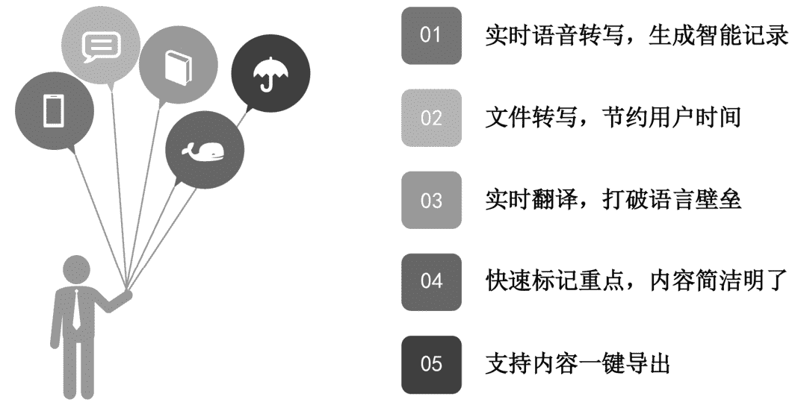

图 6-3 通义听悟的核心能力

（1）实时语音转写，生成智能记录。可实时记录并整理内容，实现音频与文本同步输出，并提供关键字句检索，突出核心信息，帮助把握对话重点。
（2）文件转写，节省时间。可与阿里云盘互通，快速完成音视频文件的转写，转写结果存入“我的记录”，方便随时回看。
（3）实时翻译，打破语言壁垒。对发言内容进行实时翻译，支持中英互译，实现无障碍沟通。
（4）快速标记重点，内容更清晰。可对重点与待办事项进行标注，让回顾整理时更一目了然。
（5）支持内容一键导出。用户可一键导出音视频与笔记等内容，同时支持导入 Word、PDF 等多种文档格式。

以往 AI 转写服务价格高昂，通义听悟作为通义家族新成员，旨在提供更友好的音视频体验，用户可通过每日任务获取免费时长。它将成为个性化、优质的 AI 助手。小程序版本计划在钉钉、阿里云盘等产品中上线，与内部场景深度融合。

## 6.4 生成式AI与元宇宙共创娱乐社交新玩法
在技术浪潮下，生成式AI与元宇宙的结合催生全新娱乐社交形态。AI 的创造力与元宇宙的广阔空间相遇，构建出充满想象与创意的世界，娱乐与社交的边界被打破，用户可尽情释放创造力，获得前所未有的新奇体验。

### 6.4.1 元宇宙五大核心特质
元宇宙与传统游戏在表象上相近，本质却不同。要区分元宇宙娱乐产品与游戏产品，需把握其独有的五大特征，如图 6-4 所示。

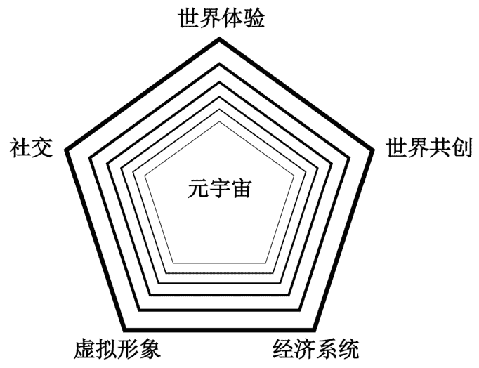

图 6-4 元宇宙的五大鲜明特征

第一，元宇宙提供全方位、多感官的沉浸式体验，让人仿佛置身真实又奇幻的世界。游戏虽也有沉浸感，但层次与深度有限。
第二，元宇宙强调广泛社交互动。用户可与全球玩家实时交流，共同参与多样社交活动，建立深厚联系。游戏社交多局限于游戏内部，难以跨越虚拟现实。
第三，元宇宙允许玩家创建并定制虚拟形象，从外貌到内在特质均可体现个性与创意，每个用户都能找到独特定位。游戏角色定制受设定与规则限制更强。
第四，元宇宙拥有完善经济系统，支持交易与商业活动，赚取虚拟货币与资产，增强真实感与可玩性，并提供创业盈利空间。游戏虚拟经济多封闭在游戏内。
第五，元宇宙的核心是世界共创。每个玩家都可成为创作者，释放智慧与创意，共创激发参与热情，让世界充满活力。游戏中的自制内容多受开发商限制与审核。

只有沉浸体验、广泛社交、个性化形象、完善经济、世界共创五大要素融合，元宇宙才能形成完整生动的框架。其中世界共创尤为关键，它是赋予玩家无限创意与自由的灵魂。

在元宇宙里，共创为玩家提供一片可自由挥洒创意的土地，塑造理想世界与玩法。这一过程不仅需要想象力与创造力，也需要对世界的理解与感悟。与短视频创作相比，元宇宙内容创作更复杂，需要创作者具备较高综合素养并掌握多种开发引擎与丰富经验。

### 6.4.2 生成式AI带来元宇宙新创作路径
目前元宇宙创作主要依赖 PGC 模式，保证质量与专业性，却限制了玩家参与与创意释放。随生成式技术成熟，创作方式正在转变。

依托生成式技术，玩家可借助大模型、智能算法和大数据分析，快速生成个性化内容，大幅提升效率与便利性。系统还能根据玩家反馈与行为数据持续优化生成结果，使其更贴合偏好。这种个性化方式让玩家获得归属感与成就感，也为世界共创注入新活力与可能性。

在生成式技术助力下，创作门槛逐步降低，更多普通玩家可参与进来。大众化创作丰富了内容生态，推动元宇宙更快普及。未来随技术与需求演进，创作方式与内容将持续创新，带来更丰富体验。

### 6.4.3 Myverse：以生成式AI驱动的元宇宙平台
Myverse 打造了融合社交、娱乐、游戏、创作的综合元宇宙平台，为用户提供开放、自由、多样的虚拟世界。用户可打造并管理数字资产、参与数字活动，也能借助生成式技术创造独特玩法与数字身份标签，收获全新社交体验。

平台搭载三维空间构建大模型，用户可化身建筑设计师，零门槛打造理想家园，无需专业技能也能将脑海构想变为现实。基于生成式技术，可自由挑选建筑风格、布局与装饰细节，打造独一无二的个性空间，无论是古典庭院、现代公寓还是科幻城堡皆可实现。用户还能邀请好友共同探索，举办派对、游戏挑战，或欣赏生成式技术生成的精美景观。

Myverse 与生成式技术的结合带来前所未有的创作自由与社交乐趣，为元宇宙发展注入新动能，让每个用户都能找到属于自己的天地尽情挥洒创意。

在元宇宙中，每个用户都拥有数字分身。传统游戏仅提供预设“皮肤”更换，而 Myverse 利用生成式技术让用户创作出彰显个性的独特服饰，时尚与科技完美融合，为分身增添魅力。通过平台工具，用户可设计复古、未来、简约、华丽等各式服装，生成式技术能精准捕捉设计意图并快速转化为精美虚拟服饰。创作时可自由选择面料、颜色、图案，并用智能调整工具精细化版型与剪裁，确保服饰完美贴合分身，呈现出令人惊艳的效果。穿上自制服饰漫步元宇宙，不仅展示个性，也体现对时尚的独特理解，增强互动交流，让平台成为创意时尚聚集地。

数字分身还可通过输入资料与声音数据，被赋予生命与个性。分身外观酷似本人，性格与喜好也高度契合。在生成式技术加持下，分身能自由行动，与他人自然流畅交流，代表用户意愿在活动中发言。当遇见志同道合的朋友，分身可代为深入交流、分享见解，实现跨越虚拟现实的社交体验，带来归属感。经授权，分身还能代表用户参加活动与挑战，赢取荣誉奖励，丰富内容生态并展现才华。拥有数字分身，让用户在虚拟世界找到真实自我，开启无限可能。

在物理世界，宠物是忠实的情感伴侣，传统游戏宠物多为竞技工具，缺乏真实情感互动。Myverse 中，宠物被赋予全新定义。借助生成式技术，每个用户可为虚拟宠物注入“灵魂”，使其拥有记忆、性格与情感，成为可建立深厚情感纽带的伙伴。用户可按喜好养育宠物，它们外观各异、性格独特，在互动中不断学习成长，甚至形成独特喜好与习惯，忠诚陪伴带来欢乐。MR 技术加持下，宠物可跨越虚拟现实界限，通过智能设备投影到现实环境中与用户真实互动玩耍，增强情感联结，成为现实生活的一部分。生成式宠物不再是冰冷的数据，而是情感寄托与精神陪伴，见证用户在虚拟世界中的成长。

生成式技术与元宇宙的融合拓展了想象空间与创意舞台，引领娱乐社交进入新时代，既催生层出不穷的妙想，也拓展社交边界，让娱乐社交焕发新活力。

# 第 7 章 生成式AI驱动智能创作提升效率
# 生成式AI与智能创作：提升内容生产效率
当前内容创作竞争激烈，要求不断提升，生成式技术正成为驱动力量，帮助创作者提高效率与质量，重塑创作模式并提供智能工具，助力多类型内容生产。

### 7.1 生成式技术正在改变内容创作模式
生成式技术不仅能基于强大算法生成富创意、个性化内容，更在深层次改变传统创作模式，让创作更便捷高效，减轻创作者负担。未来随技术深化，它将渗透创作各环节，推动模式全面革新。

#### 7.1.1 生成式内容创作的三大特点
与 PGC、UGC 不同，生成式创作在创意与个性化生成上寻求突破，除提升效率外还能减少人为失误、提高质量。具体特征如图 7-1 所示。

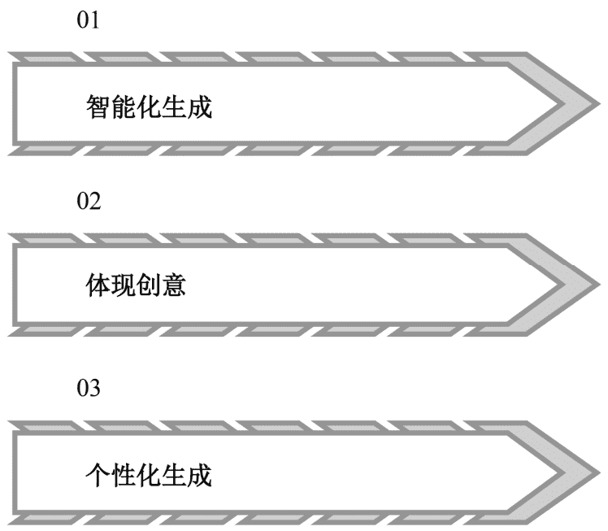

图 7-1 AIGC 内容创作的特点

**1. 智能化生成**
可根据输入关键词智能生成符合需求的内容，并在生成过程中与用户自然交互，了解偏好与细化要求，持续优化结果，使其更贴合需求。
**2. 体现创意**
基于海量知识学习，能按要求输出多种创意灵感；依托深度学习、强化学习等技术，不断优化生成策略，产出更具新意的成果。
**3. 个性化生成**
支持文本、图像、视频等多模态生成，可按不同用户需求提供个性化服务，并利用语音生成、图像生成等技术对内容进行差异化呈现。

凭借以上特质，生成式技术能帮助创作者生产多种类型、多样风格、富创意的内容，满足个性化需求，提供有效辅助。

#### 7.1.2 生成式内容创作的三大发展阶段
从演进趋势看，生成式创作可分为三阶段，如图 7-2 所示。

**1. 作为创作助手**
诞生初期主要扮演助手角色，依托模板进行简单创作或按预设规则生成基础文本，流程不够灵活，输出易显刻板、偏题。
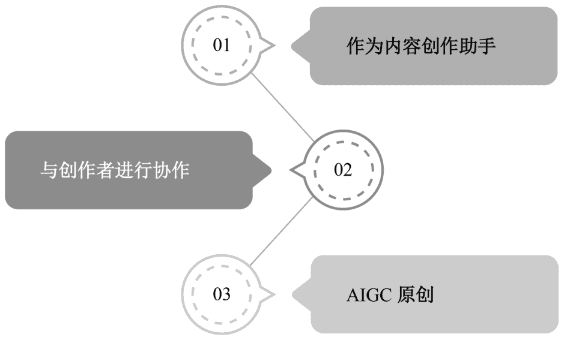

图 7-2 AIGC 内容创作三大发展阶段

**2. 与创作者协作**
技术成熟后可实现互动协作，基于模型训练与创作者需求生成丰富个性化内容，如小说大纲、创意图片等，为创作提供素材与灵感。创作者可在其基础上深化表达，彰显个人才华。协作中，创作者准备素材后由生成式技术完成初稿、视频制作等环节，提升效率。
**3. 生成式原创**
未来完全原创或将成为现实，例如与虚拟数字人结合，以数字人形态独立完成创意生成、内容制作到运营与商业化的全流程。模态将进一步扩展，可涉及触觉、情感等多维度创作。到原创阶段，生成式技术将进一步解放生产力，价值充分释放。但创作者仍需把控质量，在完善规则与标准指引下发挥其想象力与创造力。

### 7.2 生成式技术推动内容创作行业繁荣
生成式技术为创作者提供智能化工具，助力内容创新；与创作平台结合后还能提升平台智能性，优化用户体验。

#### 7.2.1 提供智能化创作工具，降低创作门槛
生成式技术与内容创作行业融合催生多样智能工具，降低门槛。企业布局路径主要有两种：一是依托自有内容平台打造辅助创作的生成式工具；二是构建开放的生成式内容创作平台。

生成式创作工具的落地观察

微博在创作提效赛道推出了面向创作者的生成式助手，目标是帮站内头部创作者加速产出。系统会先学习创作者过往的内容偏好，再结合站内热度信息提炼选题灵感。图文撰写时能自动拟标题、提炼摘要、归纳关键词；短视频制作时可给出剪辑思路与特效使用建议；直播进行中则提供互动话术与内容推荐参考。

科大讯飞依托语言、语音、图像领域的积累发布了“讯飞智作”创作平台，实现从文稿到音视频的一站式交付。用户导入素材并挑选虚拟人形象后即可一键输出音视频成果。平台内置上百套音色库，覆盖新闻播报、有声阅读、广告促销、教育培训等场景，风格从大气浑厚到可爱甜美、成熟知性均有，同时支持中文、英文等多语种，满足差异化需求。目前该平台生成的音视频已落地于传媒、金融、文旅等行业，未来将在生成式技术驱动下持续扩充创作范式，助力各行各业提效。

#### 7.2.2 激发灵感，推动内容创新

生成式技术与内容生产的结合，价值不仅在于工具更智能，更在于点燃创作想象。模型可在短时间内产出不同风格主题的初稿，为创作者发散思路；借助热点研判、受众画像、社交数据分析等手段，从众多点子中筛选出更易引发共鸣的方向。

在表达层面，模型基于海量文本训练可给出撰写建议，帮助创作者把想法说得更清晰；同时根据创作者提供的创意种子快速生成具备深度与延展性的初版，再由创作者迭代完善。百度面向营销人群推出的AI文本创意工具即为典型，针对文案同质化、效率压力大的痛点，用户只需描述需求，工具便基于大模型自动洞察灵感并输出贴合营销场景的文案，降低创意瓶颈。

总体来看，生成式技术凭借海量数据与强生成能力，能在市场诉求与创作者意图之间找到最佳交集，打开思路、鼓励多元尝试，最终实现内容创新。

#### 7.2.3 腾讯智影的全方位生成能力

2023年3月，腾讯发布AI智能创作助手“腾讯智影”，目标是让创作提质增效。其能力划分为“人”“声”“影”三大方向。

“人”侧是智影数字人，输入文本或音频即可合成数字人播报视频，并支持形象克隆。上传少量图片视频素材即可生成专属数字人分身，用于演讲或播报，也可搭配虚拟背景实现7×24小时不间断的数字人直播。

“声”侧提供文本配音与智能变声。文本配音上线上百种音色，输入文字即可得到自然语音，适用于新闻播报、短视频等场景，且支持手动调节语速、多音字、停顿等细节。变声功能可在保留原韵律前提下把音频转为指定人声，提升视频表现力。

“影”侧聚焦效率与品质，文章转视频功能可将图文转化为视频，分段式素材呈现帮助创作者快速完成分镜与特效添加，明显缩短制作周期与成本。未来腾讯智影将持续深耕生成式技术，迭代功能并降低使用门槛。

## 7.3 生成式技术驱动多元内容生产

从文字到绘画、音频再到视频，生成式技术正让多形态内容生产变得便捷，创作者的多样化输出已成现实。

### 7.3.1 文字写作的生成式辅助

文字写作是搭建内容与表达灵感的过程，生成式技术可在多环节提供支持。以网络文学为例，阅文集团在2023阅文创作大会上展示了写作辅助大模型及相关应用。现场模型对《庆余年》《全职高手》等知名作品的情节介绍、人物介绍等提问给出准确全面的回答。

模型还能依据用户提问提供创作灵感，例如撰写玄幻小说时可给出修炼体系、宝物道具设定、门派势力等细节参考，并帮助丰富世界观与角色设定。凭借丰富词库与多样场景描述能力，它可作为搜集词语与素材的助手，避免描写时卡壳。总体看，生成式技术为文字写作带来新范式，提升生产力，对文字与IP生态完善具有积极意义。

### 7.3.2 绘画创作赋能艺术与设计

生成式技术可依据文字、图片等输入合成不同主题风格的绘画作品，辅助艺术创作与设计。百度基于文心大模型推出的文生图应用“文心一格”即为代表，可智能生成多样化AI创意作品。产品支持卡通、油画、素描等多种风格，可按场景与风格要求进行个性化创作，也能依据输入文本的情感色彩生成相应内容。

快看漫画此前启动“神笔马良”工程，与高校合作探索AI上色、线稿优化等。随着技术演进，快看成立AIGC事业部，并打造AI集成全流程辅助创作数字化工作台，帮助创作者找灵感、辅助编剧，自动完成上色、角色换装等重复工作。生成式技术与绘画结合正丰富创作方式，提升漫画与艺术设计的效率与质量，推动行业向多元智能方向发展。

### 7.3.3 音频创作提速有声内容生产

在音频领域，生成式技术提供语音克隆、AI配音等能力，满足有声阅读、影视解说等个性化需求。有声阅读规模持续增长，生成式技术加速了生产节奏。单一音色播讲易导致角色难区分且易疲劳，火山语音推出AI多角色演播方案予以解决。

该方案基于丰富有声场景与优质音色构建音色矩阵，结合自然语言处理理解文本并自动配音，形成拟真的多角色演播效果，并可嵌入创作流程实现规模化差异化生产。

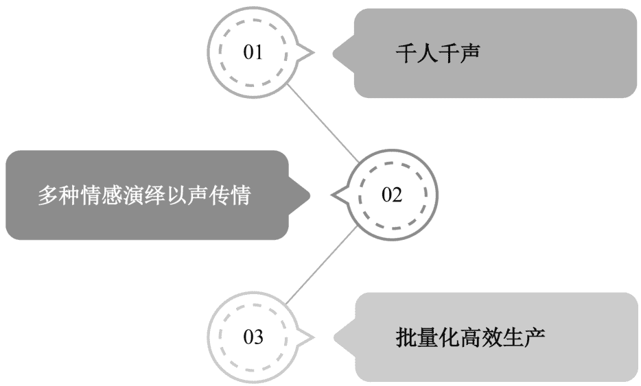

图 7-3 火山语音 AI 多角色演播方案的三大优势

**1. 千人千声**
面向网文爆发式增长，围绕经典角色打造适配音色矩阵。配音家族汇聚数十个精品音色，如穿越文里的睿智大女主、校园里的鬼马少女等，满足不同人设需求。

**2. 多种情感演绎以声传情**
沉浸式阅读依赖情感表达。火山语音为AI音色赋予开心、愤怒等情绪，并细化停顿、重音、笑声、哭腔、咬牙切齿等副语言的还原，让演绎更自然真实，带来沉浸体验。

**3. 批量化高效生产**
文本语义理解与话本自动制作是批量生产关键。传统流程需人工标注对话与旁白、匹配角色，耗时耗力。火山语音的AI文本理解模型可自动识别人名、匹配对话人物、区分对话与旁白，并识别对话情感，实现高质量批量化生产。

此外，火山语音还打造AI有声内容创作平台，导入书籍后自动完成角色、对话、情感识别，选择合适音色一键配音并合成拼接，同时提供音频调整与精修功能，优化演绎效果。

### 7.3.4 视频创作快手深化生成式探索

生成式技术让视频创作门槛降低，既帮助创意想法不足的创作者快速产出精美作品，也让专业创作者降低成本、聚焦内容打磨。

快手持续布局AI生成工具，已在APP、剪辑工具“快影”、拍摄工具“一甜相机”等产品中上线AI生成文案、视频、音色素材等功能，未来计划推出AI生成影视解说脚本、AI一键Vlog剪辑等能力。

快手还推出基于自研AI大模型的“全模态、大模型AIGC解决方案”，具备文本、图像、音频、视频生成能力，覆盖创意生成、素材挖掘、背景音乐制作、视频剪辑与生成全流程。创意发现环节可完成脚本撰写、图片与配乐生成；素材挖掘提供文生图与图像编辑能力；背景音乐制作基于预训练模型的可控歌词生成系统，先生成歌词再生成旋律；视频制作可一键生成特效大片并支持多种风格与时空转场。

在数字人方面，快手打造AIGC数字人解决方案“快手智播”，支持制作数字人用于短视频制作与直播，为电商直播赋能，借助SaaS工具可一键开播。未来快手将持续提升技术能力与产品体验。

# 第 8 章 生成式助力智慧服务更具温度

在生成式技术加持下，人工智能具备理解和处理复杂问题的能力，以AI机器人为代表的产品与用户交互更自然，应用场景不断拓宽，提供多样的智慧服务。

## 8.1 生成式加持让智能产品服务更智慧

### 8.1.1 三大维度提升智能产品能力

从技术视角看，生成式技术能从多模态交互、情感化互动、连续对话三个维度提升智能产品能力，如图 8-1 所示。

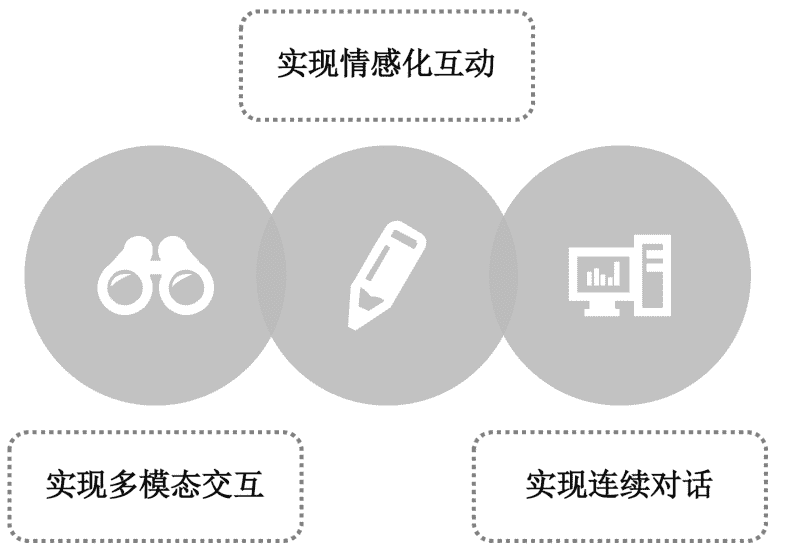

图 8-1 AIGC 对 AI 产品的三大赋能

**1. 实现多模态交互**
生成式技术助力智能产品支持文本、语音、图像、手势等多种交互。文本交互通过自然语言处理理解输入并生成回复；语音交互将语音转文字处理后再执行操作；图像交互借助计算机视觉将图像转为指令；手势交互通过姿态识别理解手势。借助生成式技术，产品可实现多模态输入与输出，通过语音合成、图像生成等技术以用户期望的形式呈现。

**2. 实现情感化互动**
生成式技术让智能产品具备情感化沟通能力。如医疗服务场景中体现人性化关怀，在线教育场景中展现亲和力。依托感知与学习能力，产品能根据用户表情、肢体语言判断情感状态并作出相应回应，交互更自然流畅。

**3. 实现连续对话**
连续对话难点在于主动与被动对话的切换以及听说角色的切换。传统产品多为被动问答，缺乏主动沟通与打断恢复能力。生成式技术支持双向语音对话，产品可主动打招呼、询问需求、澄清不明内容，也能在用户插话时及时中断、切换为倾听角色，理解新需求后再切换回输出角色，避免重复并控制对话进程。

总体而言，生成式技术在多模态交互、情感化互动、连续对话方面的赋能显著提升了智能产品的智能性。

### 8.1.2 让智能产品构建与维护更省心

语音助手、智能客服等产品的演进依赖底层知识库与模型数据集。完善知识库并以丰富数据训练模型是迭代关键。过去企业借助标注系统与模型管理系统进行系统性训练，许多环节需人工完成，易出现数据不一致与效率低下问题。

在生成式技术助力下，底层模型构建以AI为主，决策环节保留人工介入，大幅提升数据处理、知识萃取、模型构建效率。以智能客服为例，企业需构建庞大且多格式的知识体系。借助大模型强大的理解能力，企业可将现有知识与大模型结合快速形成知识库框架；面对复杂提问，客服也能基于知识学习生成逻辑专业的回答。若知识更新，只需上传新内容至知识库，接入大模型的客服即可自动学习输出新内容，显著降低维护成本。

### 8.1.3 内容产出走向定制化

在生成层面，AIGC 让智能产品拥有了自动创作能力，产出效率与精确度同步提升。凭借更强的语义解析与表达能力，这类产品能按使用者诉求给出高度定制化的结果。

过去，智能产品的输出多停留在预设库里。对话脚本、生成策略等环节几乎全靠人工搭建，且覆盖面受限。一旦提问超出预设范围，系统往往无话可说。

当 AIGC 与智能产品结合后，系统获得了自生成能力，可以按需完成对话编排、运营方案编排等任务，人机协作的准确性与体感明显改善。

以语音助理为例，借助 AIGC 其能够进化为贴身管家。用户若表示对即将到来的面试感到焦虑，助理会给予温暖鼓励；用户若询问某段旅行路线，助理可以用轻快语调描绘沿途风光，唤起期待感。

这类助理功能丰富。日常中可充当生活管家，播报天气变化、解答各类疑惑；工作场景下提供翻译、会议纪要自动整理等能力，帮助用户更快完成任务。

2023 年 9 月，阿里巴巴旗下 AI 业务板块推出全新品牌“未来精灵”。该品牌是对“天猫精灵”的升级，为终端接入大模型与多项 AIGC 功能。在新系统的加持下，用户可塑造出更智能、更具个人特色的语音助理。

总体来看，有了 AIGC 助力，智能产品的输出将愈发定制化、更富智慧。随着技术演进，它将推动智能产品向更多领域渗透，创造更多内容。

### 8.1.4 智能客服成为企业抢滩方向

依托 AIGC 的优势，不少企业相继推出智能产品。其中以智能客服为代表，成为市场追逐的热点。

客户服务方案商北京合力亿捷科技股份有限公司，基于 ChatGPT、Azure 等大模型的接入，打造了客服 Robot。

提升对话效率与回应准确度，是研发该产品的切入点。传统机器人依赖企业知识库，需要人工整理内部资料后上传。汇总整理上传耗费大量人力物力，效率偏低，且只能在库内检索，问题未收录便无法应答。

引入大模型后，合力亿捷在构建客服 Robot 时，仅需将知识库与大模型打通，即可自动归纳整理各类知识，减少人工负担。面对提问，机器人能把知识库中分散的信息自动融合，生成精准答复，显著提升响应速度与正确率。

同时该产品具备较强的自主理解力。在大模型理解力的加持下，经预设问题训练后，可独立完成理解、意图判断、逻辑回应等流程，使用更省心。

此外应答遵循自有逻辑。对话时先对问题归类再作反馈。涉及企业相关提问时，会识别意图并作专业解答；多轮对话中结合上下文与知识库给出准确结果。若提问包含敏感信息，系统会执行风控并输出安全内容。

上线后吸引数百家企业试用。未来该产品将服务更多客户，推动客服向智能化转型。

## 8.2 AIGC 驱动机器人能力跃升

AIGC 能从理解、交互等多维度推动机器人发展，提升其与人沟通的准确性与流畅度；同时增强产品的通用能力，使其拥有多模态交互与内容创作能力，整体智能水准大幅提高。

### 8.2.1 理解力强化，文本输出更专业

基于深度学习，机器人可抓取关键文本信息，按需求整理数据并给出分析结论。文本生成离不开以下技术支撑，如图 8-2 所示。

图 8-2 机器人文本生成的三大支柱

**1. 自然语言理解**

该技术让计算机读懂文本内容，赋予机器人理解人类表达的能力，完成文章阅读、摘要、翻译、情感判别等任务。

**2. 自然语言生成**

指把计算机内部数据转译为可读语言。用户与文本机器人交互时，先用理解技术解析意图，再用生成技术作答。

**3. 大模型**

文本产出需要海量语料训练模型，训练效果直接决定对话系统的功能，是构建机器人的关键。

受限于技术，传统机器人常出现知识库不全、难以匹配专业或个性化提问、语义与情感理解薄弱、回复生硬缺乏亲和力等问题。

大模型为机器人提供了更强支撑。借助大模型，机器人可针对不同提问产出专业化答案；语义理解能力明显提升，能应对使用者提出的定制化问题。

用户体验至关重要。过往不少企业只关注技术实现而忽视体验，导致机器人虽能完成基础对话，体验却不理想。AIGC 与机器人的结合，帮助系统摆脱瓶颈，在对话顺滑度、语义解析、生成精准度上实现提升，进而改善体验。

### 8.2.2 交互优化，让语音交流更自然

当前机器人的人机交互仍显不足，表现为仅能以问答形式被动执行指令，体验不够流畅，也难以处理复杂任务。

AIGC 可补足这一短板，提升语音识别能力、反馈内容丰富度与准确度，实现高效顺畅的人机对话，为用户带来更智能的体验。

已有实践案例。2023 年 6 月，硬件公司深圳乐天派创新科技有限公司发布 Android 桌面机器人乐天派桌面机器人，接入讯飞星火认知大模型，提供更佳语音交互体验。

接入大模型后，设备拥有强大的语音对话能力，依托语音识别可精准捕捉指令并迅速响应。与用户沟通更流畅，可查询天气、播放音乐，还支持视频通话、拍照录像等。用户能随时与亲友沟通、记录影像。此外还可解答数学题、规划旅游路线、做逻辑推理、编写代码等。

该机器人适用于家庭与办公。家庭场景下可提供情感关怀，如休闲时播放音乐、发送生日祝福；可监听安全状况并联动智能家居实现自动化控制。办公场景下可充当助手，整理会议记录、撰写文案、翻译等，具备自主学习能力，不断优化服务。

产品支持表情定制、交互界面自定义，也可切换不同语音助手。随着生态丰富，未来将接入更多助手并开放接口，支持安装 Android 应用。

总之在 AIGC 支持下，机器人实现语音识别、精准反馈、流畅沟通等多方面突破，摆脱命令式交互限制，为生活带来更多便利。

### 8.2.3 通用能力加持，走向多模态

依托多模态大模型，机器人可具备通用能力，承担更多任务。部分企业已在研发与接入方面取得进展。

2023 年 7 月，第六届世界人工智能大会上，中信集团发布“多模态 AI 打造有温度的信用卡服务”。项目展示了基于大模型融合多模态技术搭建的智能机器人矩阵，包括 AI 外呼机器人、AI 感知机器人、智能问答机器人、智能质检机器人、座席辅助机器人等。

外呼机器人实现个性化服务，交互更自然；感知机器人借助大模型挖掘用户痛点，优化流程；问答机器人支持多轮 24 小时服务；质检机器人全面核验对话内容，保障权益；座席辅助机器人提供流程导航，提升整体服务水平。

该矩阵可依据用户画像智能推荐产品，并通过声纹无感核验为老年用户提供直通查询服务，打造更有温度的金融体验。

同场，达闼机器人发布多模态大模型 RobotGPT 并推出服务平台与一体机产品。

RobotGPT 具备多模态融合感知、决策与行为生成能力，结合机器人后可理解语言、表情、动作，按指令自动规划执行，实现复杂场景下的“察言观色”实时互动。

其支持多轮对话、多模态交互、AI 变声、声纹识别、图像理解与生成等，除多模态交互外，还可完成精准行业问答、多轮会话等。

未来在模型支撑下，机器人将拥有多样化内容创作能力，应用边界进一步扩展，覆盖医疗、教育、金融等更多领域。

### 8.2.4 阿里云以 AIGC 赋能工业机器人

AIGC 与机器人的结合大幅提升智能水平，使其能完成更精细专业的工作。阿里云已开展探索，以自研通义千问赋予工业机器人 AIGC 能力。

阿里云尝试将通义千问接入工业机器人，实现远程操控。演示视频中，工程师通过钉钉发送“找点东西喝”，模型即理解指令并自动生成代码发送给设备。机器人识别环境后找到桌上水杯，完成移动抓取并递送。

此前机器人只能执行预设固定任务，灵活性不足。大模型打破这一限制，允许用户用自然语言指挥操作。

工业机器人开发门槛高，需大量代码编写与调试。大模型可在开发与应用中发挥作用。开发阶段，工程师可借助通义千问生成代码指令，便捷实现功能开发与调试；模型还能帮助生成新功能，如对抓取移动等动作自主编排，完成更复杂任务。

应用中，通义千问为设备提供推理决策能力。工人输入文字，模型理解意图后转化为设备可执行代码，任务顺利落地，效率大幅提升。

阿里云已启动“通义千问伙伴计划”，为合作伙伴提供模型服务与产品支持，推动模型在各行业落地。在制造领域，阿里云凭借通义千问为企业提供智能方案，助力生产流程优化与高效制造。

## 8.3 虚拟数字人深度融合 AIGC

虚拟数字人以可交互虚拟形象为用户提供服务，已在直播、客服等多场景落地。加入 AIGC 后，其智能度与应用范围将进一步扩展。

### 8.3.1 构建效率大幅提升

在打造环节，AIGC 可支撑创建与能力建设，使虚拟数字人具备灵活交互与强内容创作能力。

传统打造涉及原画设计、建模、渲染，风格多样，成本与周期差异大。AIGC 技术让流程简化、效率提升。

技术可快速生成不同风格形象，减少原画与建模环节投入。基于底层大模型能力，虚拟数字人可作为虚拟助手或客服，在大屏、小程序、手机 App 等场景部署，满足多行业定制需求。

华为云推出盘古数字人大模型，支持用户快速生成虚拟数字人。依托盘古底座的算力与深度学习能力，模型可产出智能化数字人，具备自主思考、情感表达等特质，能与用户进行高度智能交流，如倾听倾诉、理解情绪并以情感化方式回应，回答科技、娱乐等领域问题。

该模型将推动行业演进改变生活。未来虚拟数字人可成为企业智能助手，助力决策与客户服务；也可成为学习伙伴，提供个性化指导。

### 8.3.2 应用边界持续拓展

近年来，多形象多交互的虚拟数字人备受关注，已在游戏娱乐、教育培训、品牌营销等领域应用。AIGC 融入后将加速落地。

赋能体现在两方面：一是提升交互能力，支持文本、图像、音视频等多模态体验；二是覆盖创建、驱动、内容生成全流程。传统方式需 CG 建模、自然语言交互设计等，成本高昂。AIGC 可实现一站式生成，降低制作门槛。

在此助力下，虚拟数字人可从虚拟偶像、虚拟主播等核心场景向教育、医疗等多行业渗透，以更人性化的交互方式帮助行业降本增效。

多家厂商正在探索结合点。世优科技表示旗下业务已接入 ChatGPT 并在个性化训练上持续探索；上海风语筑尝试为虚拟数字人接入 ChatGPT，提升识别与内容更新能力。

未来 AIGC 或将成为构建虚拟数字人的底层架构，降低研发与推广成本，提升交互体验，促进其发展与跨界融合。

### 8.3.3 标贝科技携手幻影未来共建虚拟数字人

AIGC 推动虚拟数字人升级，智能化程度提升带来沉浸式体验。

AI 企业标贝科技有限公司与虚拟数字人服务商深圳幻影未来信息科技有限公司达成合作，共同研发。双方结合标贝在数据、深度学习、AI 语音方面的能力，与幻影未来的制作研发能力，打造更智能产品“幻真”。

依托 AI 语音技术，标贝可为虚拟数字人提供音色定制，实现合成音色定制与个性化声音复刻，让“幻真”以自然声音交互，打造沉浸式体验。

差异化音色是标贝的重要着力点。公司深耕智能语音交互多年，基于语音大模型迁移学习与 Transformer 等技术，提供标准化音色定制、语音复刻及多样声音选择。

例如在企业客服场景，亲切自然的声音可拉近距离；智能音箱可进行富情感的个性化交互；游戏中 NPC 的个性化音色增强沉浸感。凭借技术优势，标贝的音色定制服务已在多领域落地。

携手合作可在语音交互维度提升表现力与场景适配度。标贝将持续深耕技术探索，在 AIGC 趋势下助力虚拟数字人发展。

# 第 9 章 AIGC 赋能协作办公重塑智能工作体验

# AIGC 加持办公协作，开启智能新时代

随着微软、钉钉等将 AIGC 能力整合进自家产品，协作办公领域掀起热潮。AIGC 可融入多个办公场景，优化企业管理系统，推动场景与方式重塑。当前不少企业已在探索，推动办公软件智能化变革，提升用户体验。

## 9.1 AIGC 渗透办公全流程

AIGC 已进入邮件管理、代码开发等多个办公场景，实现广泛应用，带来智能化办公体验。借助强大处理能力，它助力提升效率，让办公更便捷高效。智能化模式将推动办公创新，带领用户迈向更美好未来。

### 9.1.1 邮件管理更省心更智能

在办公中，内部沟通与客户沟通多通过邮件进行。AIGC 可从以下方面实现智能化管理，优化体验。

1. 邮件智能分类。AIGC 可阅读分析邮件内容，按相关程度自动归类。人工分类耗时耗力，有了技术支持后流程更便捷智能。

2. 邮件智能撰写。AIGC 可分析邮件内容及历史回复，结合用户语言风格自动起草邮件。

智能邮件助手，释放工作效率

AIGC 正在成为个人化的工作搭档，能在合适的时间自动回信、主动推送重要事项，让日常办公更省心、更快。

谷歌在邮箱智能化上的探索可以作为典型案例，Gmail 借助 AIGC 完成了从撰写到管理的全链路升级，具体能力如下。

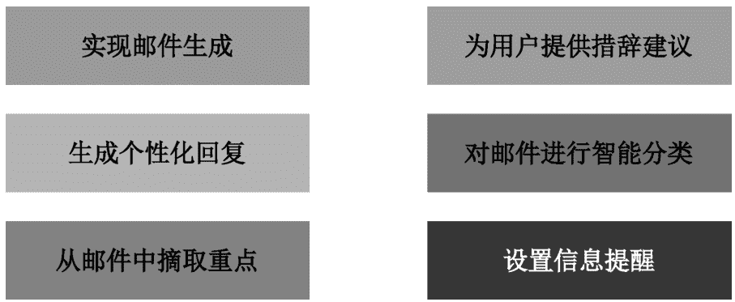

图 9-1 谷歌邮箱 Gmail 的 6 种功能

1. 实现邮件生成
Gmail 支持一句话指令生成邮件草稿。用户在输入框丢出简短提示后，系统能在很短时间内输出完整邮件，还能切换专业、商务、时尚等写作风格。系统还会回顾用户的历史回复，提取关键细节，补全上下文的缺口。
2. 为用户提供措辞建议
Gmail 内置智能撰写，在用户写作时实时给出表达建议，按下 Tab 就能采纳并合并到正文中。该能力覆盖英语、西班牙语等多语种，帮助跨语言沟通更顺畅。
3. 生成个性化回复
借助机器学习，Gmail 会学习用户过往的回复习惯来定制回复。例如收到生日聚会邀请，不会只回“参加”或“不参加”，而会给出“生日快乐，我一定到”或“太好了，期待见面”等更有人情味的表述。
4. 对邮件进行智能分类
Gmail 提供标签式收件箱，能自动归拢邮件并进行分类，方便快速浏览。用户也可以根据自身习惯重新调整分类规则。
5. 从邮件中摘取重点
摘要卡功能利用启发式算法与机器学习，从海量信息中挑出核心内容。识别后会在邮件顶部生成一张信息卡，直接呈现重点要点，无需逐行阅读。
6. 设置信息提醒
Gmail 会追踪未回复邮件并置顶提醒，同时标注收件时间并询问是否处理。例如在未回复邮件旁提示“2 天前收到的邮件，需要回复吗”，避免遗漏。

总体来看，AIGC 能多维度优化邮件管理。随着技术迭代，智能邮箱将支持更细致的个性化管控。

### 9.1.2 办公软件迎来智能化升级
AIGC 与办公软件结合，大幅提升了产品的智能水平，带来了更流畅的智能办公体验，行业内已有多个代表性动作。

金山办公是国内办公软件的头部厂商，旗下包括 WPS Office、金山文档、稻壳等产品。团队基于 AI 算法打造了一系列智能办公助手，并探索基于 AIGC 的人机交互，在文档翻译、语音转文字、辅助写作等场景落地，提升使用体验。

北京字节跳动科技有限公司现北京抖音信息服务有限公司旗下的协作平台飞书，也在该领域发力，推出智能助手 My AI。My AI 基于自然语言处理，能够推动办公软件的智能化进程。

My AI 的能力包括语音识别、语音理解和智能问答，可帮助用户安排会议、收发邮件、检索资料等。它具备自适应学习特性，会依据个人习惯持续优化服务，提供更精细的个性化支持。

由此，My AI 能在不增加人力的前提下提高员工效率与质量，还可以分析数据并做出预测，为企业决策提供参考。

总的说来，AIGC 与办公软件融合既创新了产品形态，又强化了实用性。未来在更多细分场景的应用下，办公将更自动化、更智能。

### 9.1.3 编程辅助，让代码开发更轻松
在软件开发中，AIGC 能学习现有代码库、分析需求后生成代码、进行优化，并及时定位问题给出修复思路，帮助把控质量。

微软与 OpenAI 联合推出的 AI 编程工具 GitHub Copilot 就是典型代表，其主要能力如下图。

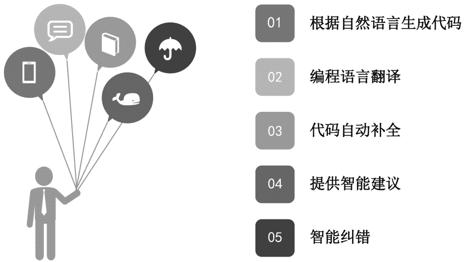

图 9-2 GitHub Copilot 的功能

1. 根据自然语言生成代码
开发者在编辑器里用自然语言描述需求，工具即可生成对应代码，大幅节省手写时间，提升效率。
2. 编程语言翻译
Copilot 能把一段代码翻译成另一种语言，让开发者用自己擅长的语言描述问题，无需精通多种语言。
3. 代码自动补全
基于已有代码和上下文，Copilot 能自动补全下一段，快速生成代码片段。
#### 4. 提供智能建议
系统依据常见编程模式给出建议，帮助写出更规范、质量更高的代码。
#### 5. 智能纠错
Copilot 会自动检测代码并修正错误，提升代码质量和开发者的编码能力。

Copilot 并不能完全替代开发者，但能承担大量重复性工作，缩短开发周期。AIGC 降低了编程门槛，让开发者把精力集中在创新上。

## 9.2 与管理系统融合，提升整体效能
AIGC 可与 OA、ERP 等企业管理系统结合，优化流程与协作，实现更高效运转。

### 9.2.1 与 OA 系统结合，让运行更高效
OA 系统是实现自动化办公的核心工具，主要发挥以下作用：
（1）简化文件传阅与审批，实现规范化文件管理。
（2）便于信息检索与共享。
（3）增强内部管控，提升行政管理水平。
（4）提高工作效率，优化团队协作。
（5）推动办公自动化，构建科学管理模式。

OA 的典型场景有三类：办公、管理、业务。办公端通过集成会议、移动通信及第三方软件实现信息共享与跨平台处理；管理端可集成客服、考勤、资产等系统，实现多维度智能管理；业务端可简化财务审批、业务办理等流程。

加入 AIGC 后，OA 的操作更自然。传统 OA 功能覆盖面广但操作复杂、体验不佳。AIGC 让系统支持自然对话交互，减少人工操作，加快推进。

例如，传统流程中员工要提交技术支持请求，需先确认类别、创建工单，再分发给技术团队，对非技术人员十分繁琐。接入 AIGC 后，员工用自然语言描述问题，系统自动判断类型、生成工单并分发，同时在处理过程中实时更新进度，实现内部高效率沟通。

摩根士丹利以 GPT-4 大模型打造 AI 机器人管理企业知识，员工提问后系统自动检索并输出结果，无需手动查找。

未来，带 AIGC 的交互界面有望取代传统 OA 门户，成为连接中后台应用、数据与内容的入口。

### 9.2.2 与 ERP 系统结合，推动管理流程智能化
ERP 是企业运营管理的核心，融合 AIGC 后可形成全新体系，覆盖各业务流程，提升效率、降低成本。

结合优势体现在两方面：一是解决数据孤岛与流程割裂。传统 ERP 许多环节需人工手动完成，融合后员工可通过对话提出需求，系统理解后按流程自动办理，提升运行效率与体验。二是优化经营策略。ERP 汇聚财务、销售、库存、生产等数据，AIGC 可进行分析并提供销量预测、库存优化等建议，为管理者决策赋能。

应用前景广阔。制造企业可借助融入 AIGC 的 ERP 协调采购生产、监控生产与库存；服务型企业如咨询、律所可快速响应客户需求，实现高效运营。

总体而言，ERP 与 AIGC 结合提升了系统智能化程度，也为企业升级管理提供了路径。

## 9.3 企业深化智能办公应用探索
AIGC 浪潮下，企业通过引入第三方应用或自研大模型，不断提升办公智能化水平。

### 9.3.1 引入 ChatGPT，升级办公应用
ChatGPT 是 AIGC 的代表性应用，已在办公领域落地。深圳蓝凌软件将 ChatGPT 接入办公应用“蓝博士”，增强了智能性。

在数智化工作平台体验会上，蓝博士展示了基于 ChatGPT 的能力：智能客服、文案撰写、代码编写、知识检索、语音交互等。可用于代码检查、HTML 生成；在文案方面可撰写营销软文、广告词、活动简讯并激发创意；在对话方面可分析问题并生成回答。用户还能上传资料构建专属语料库。

蓝凌的 MK 数智化引擎具备先进架构和开放生态，支持接入 ChatGPT、通义千问、文心一言等大模型，显著提升办公效率。

### 9.3.2 自主研发大模型，打造智能办公应用
部分企业选择自研大模型。北京印象笔记研发了面向办公的轻量化大模型“大象 GPT”，并推出 AIGC 产品“印象 AI”。

印象 AI 可生成作文、采访稿、广告文案，也能根据提问生成回答。输入“以‘学习今说’为题写一篇不少于 800 字的议论文”，即可快速生成；页面提供“完成”“继续写作”选项，可在上文基础上续写。产品还具备总结与简化能力，简化结果每次可能不同但基本无事实错误。

在新闻采写中，用户提问“请列出采访印象笔记需要询问的问题”，系统迅速给出十个具体问题。交互设计上没有传统问答框，而是提供场景化菜单，选择模板即可启动对话，便于表达诉求。未来菜单将更个性化。

印象 AI 会收集用户输入用于模型训练，并结合印象笔记个人知识库构建专有模型，提升服务精度。官方强调其为统计模型，是辅助工具，专业问题仍需人工判断。

### 9.3.3 科技公司以 AIGC 能力赋能办公
科技公司也在推动落地。科大讯飞发布讯飞星火认知大模型，展示语音输入、实时互动、文本生成、语言理解等能力，在文本生成、知识问答、数学能力上已超越 ChatGPT，并计划与开发者共建生态。

2023 年，星火持续升级：6 月提升开放式问答与多轮对话；8 月增强代码生成与多模态交互；10 月通用模型对标 ChatGPT，并在教育、医疗领域领先。

办公场景中，星火与智能办公本结合，实现会议纪要与语篇规整。办公本可将语音实时转写与墨水屏书写结合，自动生成精简纪要；同时过滤口语化表达并润色文稿。

科大讯飞在开放平台上提供星火能力，已开放 500 多项 AI 能力，吸引百万伙伴。未来将持续供给资源，推动大模型在更多场景应用。

# 第 10 章 AIGC+广告营销：打造营销新范式

# AIGC+广告营销：打造营销新范式

文生图、文生视频等 AIGC 功能已进入广告营销，推动模式迭代。AIGC 可渗透营销各环节，革新产品、优化流程，构建高效简洁的新范式。

## 10.1 AIGC 融入营销，助力内容创作
AIGC 能生成创意与个性化内容，并通过垂直营销大模型全方位赋能图文、视频等创作。

### 10.1.1 帮助企业寻找营销创意
在内容过载、竞争激烈的环境下，企业寻找与打磨创意的成本不断上升。AIGC 能快速生成创意、提升效率、降低成本，并改变营销方式。

百度基于技术优势打造营销创意平台“擎舵”，在文案、图像、数字人视频三个维度生成高质量定制化创意。

传统真人广告拍摄流程长、成本高，难以规模化。擎舵推出 AI 数字人生成平台，采集数据后即可生成数字人分身与口播视频。

制作流程仅三步：输入产品卖点生成口播文案；挑选数字人进行创作；选择模板并添加文案即可输出视频广告。

贵州仁怀大国古将酒业此前无专业团队，月产不到 1 条视频，使用平台后 1 小时可产出 6 条，效率大幅提升。

在信息泛滥的当下，擎舵通过图像、语音、数字人等技术融合，帮助企业激发商业潜力，输出让人眼前一亮的定制化营销内容。

试运行期间，擎舵获得市场认可，当前的合作名单里已有不少机构，双方正一起摸索创意营销的新打法。往后看，百度打算持续用大模型为营销赛道注入动能，搭建更契合企业实际诉求的创意营销平台，让技术持续拓宽创意营销的边界。

### 10.1.2 定制内容批量生成
在辅助企业脑暴创意之外，AIGC 还能在投放环节批量产出差异化素材，支撑更精准的触达。做云端商业与营销方案的微盟推出了一款 AIGC 营销产品 WAI，主攻电商商家活动投放。

WAI 首批能力集中在商家日常作业，涵盖短信模版、商品说明、直播口播稿、公众号推文、短视频带货文案等二十余个实操场景，直接服务营销执行。

产品主张释放全新生产力，具备自然语言生成、SaaS 生态融合、能力聚合等特征，能够贯穿商家经营全流程。平台内建针对性的模型输出模版，即使零基础的商家也能快速上手。

发布会现场演示了 WAI 的实操效果。开店环节可迅速生成启动页、模特试穿图、店铺文案，大幅压缩开店耗时。脚本自动生成能力同样突出，能完成公众号图文与封面一体化创作、多风格直播脚本创作、推广文案产出等，上手门槛低、效率高。

现场还展示了 WAI 为某品牌量身定制的 618 线上活动方案。系统融合品牌调性、618 活动语境及产品特性，输出高度契合且具备针对性的方案。

微盟表示 WAI 仍在高速迭代，旗下微商城、企微助手等云服务已完成接入，用以满足电商运营中的内容创作与推广需求。依托微盟在营销全链路的丰富云服务，WAI 将在更多场景落地，帮助商家提升生产效率。

微盟的实践折射出 AIGC 在营销领域的广阔潜力。未来借助更便捷的应用形态和与云服务的深度融合，AIGC 有望在营销行业实现规模化应用。除创意生成外，还能延伸至网店设计、日常运营、活动方案设计、售后服务等多个环节，为商家提供端到端支持。

### 10.1.3 专属营销大模型赋能
大模型是 AIGC 落地的底层支撑。在营销赛道，部分公司正通过合作方式打造专业化的营销领域大模型，并在此基础上研发智能营销产品。

典型案例是 2023 年 3 月，综合型广告传媒企业三人行广告传媒有限公司宣布与科大讯飞联合研发营销大模型及云化部署的智能营销软件。

在技术快速演进的背景下，大模型给营销行业带来结构性变化，推动行业加速发展。三人行积极拥抱新技术，抢先在生成式方向布局，目标实现降本增效。双方借助科大讯飞的技术与产品优势实现互补共赢。

合作中，三人行贡献了多年沉淀的营销方法论和强大的市场推广能力；科大讯飞则提供行业领先的人工智能技术，双方共同拓展营销边界，用大模型驱动行业进步。合作成果包括多模态智能营销工具，可向企业提供云服务，生成品牌营销战略、海报、文案等，并能打造可进行电商直播的虚拟数字人。

随着营销方式持续演化，定制化推荐、用户画像等技术正在赋能营销，而大模型的出现将带来更深远的影响。

## 10.2 AIGC 改造营销生态
AIGC 进入营销行业，将重构整个生态，对电商营销、金融营销等细分赛道带来创新性冲击。

### 10.2.1 五大变化推动业务跃迁
AIGC 与营销的深度融合，将从多维度推动营销业务变革，带来跨越式发展。具体体现可归纳为以下几个方面，如图 10-1 所示。

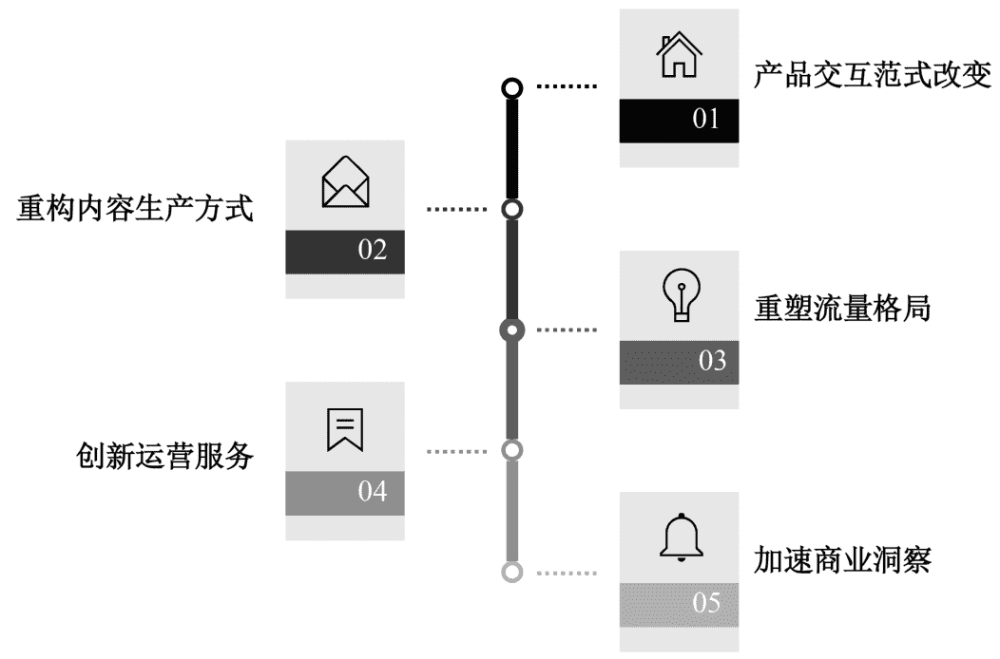

图 10-1 AIGC 对营销业务变革的推动作用

#### 1. 交互方式转向
当前，部分大模型已开放 API 接口，成为通用能力平台，支持调用其能力赋能自有产品。产品接入大模型后智能水平显著提升，交互范式随之改变。过去产品通过按钮和界面满足用户刚性需求，交互逻辑要求用户适应产品功能。接入大模型后，产品更懂用户，能主动调用资源提供优质服务，交互变得更主动、多样。

#### 2. 内容生产模式重塑
AIGC 出现前，营销内容生产周期较长，企业通常需借助专业机构打造专属方案，单项内容的产出耗费大量人力时间。AIGC 重构了这一流程，无论是定制化方案还是文案、视频、网页设计，都可由系统自动生成，大幅提升产出效率，并通过千人千面实现更好触达与转化。

内容供给爆发导致用户注意力更加稀缺。一方面企业需快速铺量以低成本触达更多人群；另一方面必须提升内容质量以增强竞争力，占据用户心智。

#### 3. 流量版图重塑
传统流量转化多为社交平台向电商平台导流，用户先在社交平台种草再去电商平台搜索。AIGC 的应用改变了这一路径。AIGC 提供了全新交互模式，能为用户生成定制化产品推荐，对社交平台和搜索引擎产生冲击。同时，AIGC 与手机助手、智能音箱等终端结合，带来更自然智能的交互体验，流量向这些终端迁移。

#### 4. 运营服务创新
在运营服务层面，AIGC 与对话服务机器人结合，使一对一、富有人情味的专属服务成为可能。相比仅能处理短文本、简单多轮对话的传统机器人，接入 AIGC 的服务具备长文本处理、意图识别、上下文连贯对话能力，能提供更具温度的专属服务。

#### 5. 商业洞察提速
目前品牌营销的商业洞察多集中于文本，如基于电商、社交平台评论进行分析。AIGC 将颠覆此模式，形成提出假设—收集信息—产出洞察的闭环，使敏捷化、自动化洞察成为现实。AIGC 降低了洞察门槛，提升了企业的商业洞察能力。

AIGC 的爆发将带动营销生产力的整体跃升。企业需要把握上述变化，抓住变革机遇，适配 AIGC 时代。

### 10.2.2 电商营销创新实操
AIGC 的变革渗透到营销各个细分赛道，电商营销也不例外，其智能化水平正在提升。

在流量入口侧，电商平台可借助 AIGC 深度学习海量数据，分析用户行为，预测用户偏好并生成定制化推荐方案，增强引流效果。例如用户搜索口红，系统可结合其购买记录和偏好，生成定制化口红推荐，优化购物体验。

供给侧同样在变化，可利用 AIGC 生成营销文案、模特图片、营销视频，并用 AI 虚拟主播进行营销。

对话服务机器人是电商营销的重要场景。现有对话机器人智能程度有限，仅能依据关键词给出预设答案，难以满足定制化需求。AIGC 在语音识别、自然语言理解、人机交互方面优势明显，能显著提升机器人智能性。

在 AIGC 支持下，平台能读懂用户需求并提供定制化解决思路。用户搜索商品时，基于 AIGC 的智能导购可通过语音对话了解需求，介绍品牌、性能、型号并按喜好推荐，还可对同类商品进行对比测评，为决策提供依据，减少犹豫时间。平台也能基于智能分析主动推送更符合偏好的商品，促进成交，提升转化。

用户想深入了解商品，可与智能导购交流细节，也可进入店铺与对话机器人、直播间虚拟主播沟通，了解详情与优惠。

购买后，对话机器人会主动征求反馈并处理售后问题。如商品需安装指导，机器人可生成安装视频逐步指导；针对不同评价，机器人可生成专属回复，避免千篇一律。

完善的服务流程让用户获得更流畅自然的购物体验，降低决策成本，提升平台转化率。

### 10.2.3 金融营销迭代，以智慧服务更新体验
在金融营销领域，AIGC 可重塑营销模式，带来更智慧的金融服务，主要体现在以下三点。

其一 依托 AIGC 技术和大模型，对话服务机器人将逐步替代人工客服。基于金融行业大模型和丰富金融数据训练的智能金融客服可进行多轮对话，并据需给出专业化解决方案。

其二 企业可打造专业的智能金融业务助手，辅助专业理财顾问、经纪人开展工作。助手熟悉行业政策、产品信息、用户需求等，可自动生成报告并提供专业理财建议或方案。

其三 AIGC 具备一键产出营销内容的能力，提升金融行业营销效率。过去营销人员需从海量信息中检索整理，再进行方案设计、文案与短视频制作。未来检索、整理、内容生成等工作可交由 AIGC 完成，人机协同提升效率。

当前融合探索已在进行。例如依托言犀大模型，京东发布了一系列 AIGC 金融产品，提升智能化服务质量与精准度。

京东推出的营销助手 AI 增长营销平台简化了营销运营流程，减少人工干预，大幅提升效率，操作简洁降低学习成本。在该平台支持下，金融营销活动方案产出效率提升上百倍。

在基金理财方面，京东优化了筛选流程，推出智能选基顾问。依托大模型在金融领域的知识增强优势，其回答基金筛选问题的准确率达 90%，并优化了意图识别、多轮对话等交互环节，提升体验。未来产品将向金融机构开放。

基于支付、保险、消费金融等实践，京东为金融机构打造了涵盖金融工具、数据、运营策略的综合解决方案，帮助完善数智化运营体系，获取增长动能。

面向金融机构，京东推出金融增长云，实现消费金融、支付等多业务的数智化运营，支持定制化精准营销和智能决策。平台以咨询加技术加联合运营模式提供运营战略咨询，帮助打造数据中台、业务中台、客户中台等数字化底座，提升系统敏捷性。

实践中，京东携手中信银行推出智慧魔方项目数字化运营中台，连通多系统，上线千余条数字化运营策略，覆盖海量用户，显著提升金融产品点击率，推动营销系统向敏捷智能进化。

未来京东将携手更多金融机构深化 AIGC 探索，推动其在更多金融场景落地，促进场景与应用协同，以技术创新加速金融业务。

## 10.3 AIGC 改造营销产品，提升转化效果
通过与智能推荐系统、对话机器人、机器人理财等结合，AIGC 不仅提升营销产品的智能性，也显著提高转化率。企业应把握机遇，从多维度革新营销产品，应对市场新挑战，实现更高效转化。

### 10.3.1 结合智能推荐系统，提升匹配度
智能推荐系统是企业营销的重要工具，可洞察用户偏好并进行有针对性推荐。与 AIGC 结合，可进一步提升系统智能性和准确性。

将 AIGC 强大能力融入推荐系统，企业能更精准把握用户需求，提供定制化推荐。AIGC 具备内容生成与理解能力，可深度分析偏好、行为、兴趣，构建精细用户画像；推荐系统则依托算法模型据此精准匹配，推荐最契合的产品服务。

二者结合使推荐更智能高效。AIGC 可持续学习优化推荐算法，提升准确性和定制化程度；推荐系统可根据反馈和行为数据实时调整策略，保持内容与需求高度一致。

这不仅改善用户体验，也带来商业增益。精准推荐增强用户粘性与忠诚度，提升转化率和销售额。

随着 AIGC 技术成熟，其与推荐系统的融合将更紧密，为企业打开更广阔市场空间。

### 10.3.2 结合对话机器人，提供多元化服务
对话机器人是 AIGC 在营销领域的重要应用。AIGC 能提升其智能水平，提供优质服务。

传统对话机器人存在三项局限：问答覆盖率低、拦截率低；接待能力有限、效率低；知识维护成本高。

基于 AIGC 的智能对话服务可学习行业与企业知识，具备语言理解与推理能力，能准确理解并回复用户。回复形式多样，包含图文、表格、链接等。

例如询问我想要拍摄一个短视频，应如何拍摄，传统机器人或列举拍摄方式，智能对话服务则会先问内容与场景，再据此推荐方案。

智能对话服务具备强语言理解与分析能力，可结合上下文把握意图；传统机器人仅做知识库匹配，匹配失败则提示问题还在学习中。

在数据分析上，智能对话服务可整理数据，工作人员提问即可获得可视化结论图表，也能撰写周报月报，减轻工作负担。

AIGC 正在重塑服务方式。不少企业已推出 AIGC 智能对话方案以抢占市场。

例如智能通信云服务商容联云发布赤兔大模型，持续赋能沟通智能。赤兔是垂直行业多层次大语言模型，可重构智能对话服务，创造更多营销价值。企业借助该模型打造专属智能对话服务，实现降本增效与价值创造。

赤兔可在 AI 基础能力、语言分析、对话能力、人机协同四方面提升，并能按应用场景生成差异化内容，具有针对性，提升运营效率和服务水平。

容联云将结构化数据分析与问答技术积累应用于赤兔构建，使其具备强大分析与交互能力，可在多场景提供自然交互服务，并在业务执行中提升任务型对话管理能力，实现灵活应答。

为满足多样化需求，容联云基于赤兔打造 AIGC 泛服务应用平台机器猫，可为企业提供多样生成式智能场景应用，推动服务数智化。

机器猫首批落地四个场景：客户联络、业务协作、AI 辅助、智能洞察。

客户联络方面可降低人工成本、提升体验；业务协作方面具备智能分配、智能填写能力，降低运营成本减少客诉；AI 辅助方面可快速高效解决管理难题，提升销售业绩；智能洞察方面可提供各类分析模型，帮助企业决策。

智能对话服务市场竞争激烈，企业需持续提升技术能力。AIGC 的出现将持续赋能对话机器人，拓展应用场景，带来更好体验。

### 10.3.3 结合机器人理财，给出科学投资建议
在金融营销中，AIGC 可与机器人理财结合，打造更智能的投资顾问，即智能投顾。投资顾问需结合客户需求与专业知识给出科学建议，AIGC 可提升其自然语言理解、策略生成、互动能力等。

例如推销金融产品时，顾问可综合客户财务状况、家庭构成、投资需求以及产品费用、收益、组合搭配等专业知识，提供科学建议。

AIGC 为智能投顾带来的可能包括：金融领域海量多模态数据在模型助力下可被充分利用，产出更科学分析结果，提升服务能力；客户分析、策略研究、产品筛选、资产配置等环节均将受益。

当前已有企业基于 AIGC 推出智能投顾平台、金融智能助手。例如恒生电子推出智能投研平台 WarrenQ 和金融智能助手光子。

WarrenQ 包含 WarrenQ-Chat 和 ChatMiner。WarrenQ-Chat 基于大模型搜索能力和金融数据库，可实现智能搜索并给出专业答案，所有交互均可对话完成，且答案支持文本溯源，并可生成专业金融报表。ChatMiner 支持用户指定文档进行干货提炼、要点挖掘，实现快速定位。

金融智能助手光子展现出强智能能力。在投顾场景中，它可在沟通中给出更准确信息。例如客户询问某只股票价格时，光子会依据客户过往关注的产品收益区间、类别、交易频次等推送相关股票信息与报告。

在客户沟通带上情绪波动时，“光子”能够感知情绪倾向并做出差异化回应。比如识别到失望、焦虑等负面信号后，它会先进行情绪安抚，再基于专业视角给出理性的投资建议。

随着 AIGC 技术持续演进，智能投顾领域的应用渗透会越来越深，金融机构的服务能力将得到明显增强，客户的个性化需求也能被更好地满足。

# 第 11 章 AIGC 驱动智造降本增效

# AIGC 赋能智造，让生产更省更高效

在智能制造赛道，依托行业级大模型的支撑，AIGC 正在多环节、多场景落地，帮助企业优化生产管理，提升效率与品质，真正实现降本增效。

## 11.1 工业大模型是 AIGC 落地的技术底座

当前聚焦制造的工业大模型成为企业布局 AIGC 的关键抓手，其强大的生成能力为智能制造提供了坚实的技术基础。

### 11.1.1 制造垂类大模型加速涌现

伴随自然语言处理和深度学习的进步，大模型发展趋向精细化，行业大模型成为重要分支。在工业领域，一批面向真实场景的工业大模型出现，生成能力更专业。

工业大模型与通用大模型的区别主要体现在：

（1）数据预处理。通用大模型多采用统一样板流程，而制造场景对数据质量和特征敏感度极高，工业大模型的构建需要针对产线特点做定制化预处理。

（2）模型训练。通用大模型依赖海量标注数据和高算力训练；制造现场可标注数据有限且更新快，工业大模型更倾向在线学习和增量训练，以跟上数据变化节奏。

（3）部署形态。通用大模型多为离线服务，工业大模型要求实时响应和强并发，部署时需兼顾轻量化与时效性。

相较通用模型，工业大模型要充分贴合制造场景的特殊需求，提供可落地的解决方案。通过定制化预处理、增量训练和高效部署，企业能够借助工业大模型提升效益，形成竞争优势。

当前工业大模型发展迅速，主要呈现以下趋势。

（1）规模持续扩大。算力提升与数据积累推动模型体量增长，未来更复杂、更大规模的工业大模型将出现，学习能力与功能多样性同步增强。

（2）跨模态融合。模型将覆盖文本、图像、语音等多模态输入，具备更强的理解与决策能力。例如在产线中可同步处理自然语言描述、图像信息与传感器数据，提升自动化水平。

（3）多模型协同。单一模型难以覆盖全部制造需求，多模型集成协作将成主流，各模型发挥专长，共同提高预测与决策能力。

（4）更强自适应。未来模型可根据不同场景自动调整参数、数据处理流程与推理策略，自适应能力显著增强。

随着工业大模型不断成熟，其将以更智能的功能赋能生产，提升决策效率与流程自动化水平，助力企业降本增效。

### 11.1.2 四大能力推动智能化生产

企业工业生产常面临计划失误导致资源浪费、监管不足带来质量风险等问题。工业大模型与生产结合可破解这些痛点，具体优势如下。

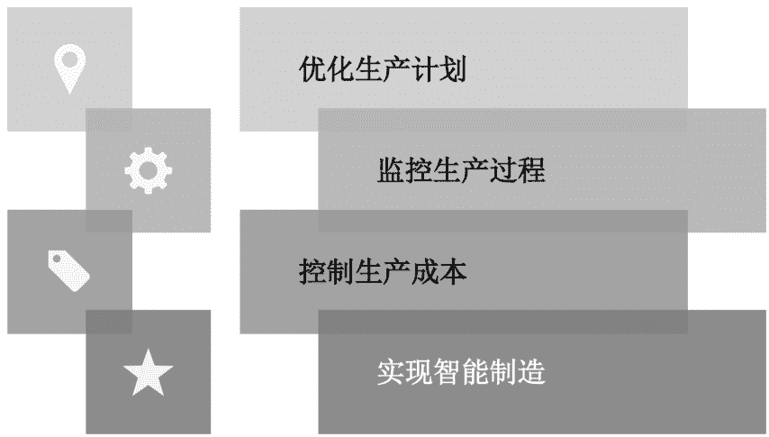

图 11-1 工业大模型的四大优势

**1. 生产计划优化**

制造企业需结合资源与市场需求制定计划，但受经验和数据分析能力限制，往往难以应对变化。工业大模型可整合订单量、库存量、交期要求、设备利用率等多源数据，综合分析后输出更合理的排产方案，提升效率与资源利用率。

**2. 生产过程监控**

产线会产生海量数据，传统方式难以实现实时管控。工业大模型借助传感与数据分析，可对过程进行实时监控，及时发现异常并解决问题，提升效率与产品质量。如对设备状态、原辅料消耗、产线产能等进行持续监测。

**3. 生产成本管控**

成本高企是制造企业的普遍难题。工业大模型可基于成本控制策略全流程优化，降低支出。例如对物料、能源、人工等要素进行分析，实现资源充分利用与成本下降。

**4. 智能制造实现**

在数字化浪潮下，制造企业正加速转型。工业大模型可支撑智能制造进程，例如让工业机器人具备更强的自主能力，在生产、装配、质检等环节发挥作用，提升自动化程度。

总体来看，工业大模型以强技术能力破解生产难题，未来将成为推动工业智能化转型的核心力量。

## 11.2 AIGC 切入生产全流程

AIGC 可融入生产多个环节，实现个性化设计、智能化制造，并推动设备升级，从多维度加速生产。

### 11.2.1 设计环节：效率与创意双提升

工业产品设计涉及功能、外观、用户体验等多维度。AIGC 为设计带来多方面赋能，如图 11-2 所示。

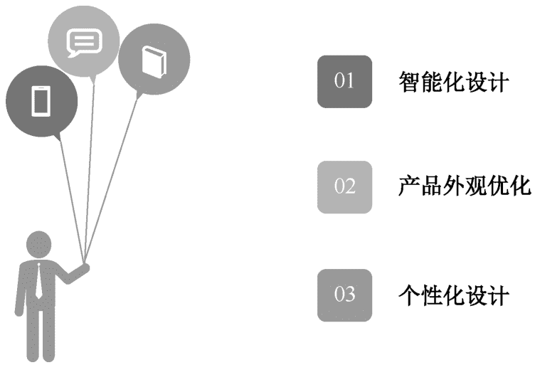

图 11-2 AIGC 对产品设计的赋能

**1. 设计流程智能化**

传统流程包含概念设计、渲染、评估等，需大量人工，周期长。AIGC 可压缩设计周期，辅助快速完成概念设计，并自动渲染与评估，实现智能化闭环。

**2. 外观迭代优化**

AIGC 可基于设计师提供的样本学习并生成全新方案，设计师输入草稿即可获得优化后的外观建议，推动创新，产出更具辨识度的产品。

**个性化定制**

个性化定制是智能制造的重要方向。AIGC 可解析产品数据与用户需求，生成符合个体偏好的设计。例如家具企业可分析用户家居风格、空间尺寸与喜好，输出专属家具方案。

总体而言，AIGC 在设计中的潜力巨大，未来将帮助企业打造更具创意与竞争力的产品。

### 11.2.2 生产系统：多系统智能升级

AIGC 与生产系统结合可显著提升系统智能水平。ERP、MES、SCADA、QMS 等系统接入 AIGC 后，均能实现智能化升级，提升效率与质量。

**1. ERP 系统**

ERP 负责跨部门协同与资源配置，在计划、物料库存、质量管理等方面发挥作用。集成 AIGC 后，可基于系统数据对生产过程进行智能分析，优化流程，减少浪费。

**2. MES 系统**

MES 专注生产过程监控与管理，可追踪设备状态、生产效率与产品质量。结合 AIGC 后，可实现实时监控与智能分析，提升效率与质量稳定性。

**3. SCADA 系统**

SCADA 负责生产监测与过程控制，连接设备层与制造层，为 MES 提供数据支撑。接入 AIGC 后，可增强设备实时通信、数据记录、异常报警与关键信息处理能力，提升运行效率。

**4. QMS 系统**

QMS 覆盖质量控制、检测与分析。融合 AIGC 后，可对过程进行智能化分析，自动生成质量报告并提供改进建议。

总体来看，AIGC 与常用生产系统的融合可帮助企业实现更智能的管理与质量控制。

### 11.2.3 设备升级：工业机器人更聪明

AIGC 在人机交互与计算机视觉方面优势明显，可提升工业机器人智能化水平，让其理解复杂指令并高效作业。

一方面，机器人的人机交互更自然，指令接收与问答更流畅。例如用户可用口头指令指挥，机器人可准确理解并执行。

另一方面，视觉感知能力增强，机器人能更好识别环境并做出科学运动决策。例如定位零件后按指令完成抓取、装配等操作。

融合 AIGC 后，机器人可从单一任务转向多样化复杂任务，如同时完成焊接、喷涂、装配等，提升通用性并降低成本。

传统机器人“身强体弱”，程序固定，需改动程序才能实现新动作。接入 AIGC 后，机器人具备“智慧大脑”，可在复杂场景下自主生成方案、排序任务，以更智能方式完成工作。

总之，AIGC 将重塑工业机器人的价值，为制造提供更智能的解决方案。

### 11.2.4 华为案例：大模型助力生产提效

华为在 AIGC 领域聚焦底层模型，推出盘古大模型，为工业大模型定制化开发提供基础。

盘古大模型采用层次化预训练架构，包含通用层、行业层与场景层。通用层基于海量互联网数据训练，是架构底座；行业层在通用层上基于行业数据构建；场景层则按具体场景数据快速产出解决方案。

在煤矿领域，华为与山东能源集团合作，基于盘古大模型打造人工智能训练中心，构建可复用的算法模型流水线，降低开发门槛，实现工业化开发。该方案已在采煤、主运、安监、洗选、焦化等 20 余个场景落地，助力井下生产与智慧决策创新。

同时，华为推出智能配煤解决方案，盘古大模型可基于煤资源数据库、焦炭质量要求、配比规则与工艺参数自动优化配比，输出高性价比配煤，缩短耗时并节省成本。

大模型正成为产业变革的核心驱动，未来盘古大模型将在更多工业场景落地，为企业数字化转型提供坚实支撑。

## 11.3 AIGC 重塑智能制造细分赛道

AIGC 在汽车制造、智能家居、服装制造等领域已开始落地，随着应用深化，其将引发更深远的制造变革。

### 11.3.1 汽车制造：加速自动驾驶迭代

自动驾驶是汽车智能制造的关键方向，AIGC 可从多方面赋能，如图 11-3 所示。

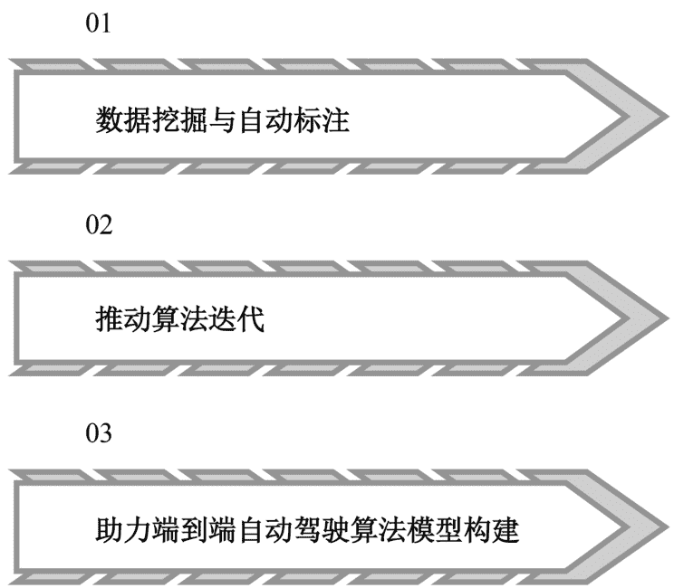

图 11-3 AIGC 对自动驾驶的赋能

**1. 数据挖掘与自动标注**

海量数据的有效利用与标注成本是自动驾驶闭环的难点。AIGC 可有效解决这一问题。

百度通过文本与图像编码器训练大模型实现向量检索，结合算法进行街景物体识别与定位，形成底层知识库，构建街景数据大模型，支持文本、图像搜索与定制化训练，提升数据利用效率。

毫末智行推出的生成式大模型“雪湖·海若”可自动标注车道线、行人、自行车等目标，降低标注成本。

**2. 算法性能提升**

AIGC 可提供基础能力，强化感知。百度融合文心大模型与自动驾驶技术，利用已标注数据训练感知大模型对未标注数据进行标注，再以此数据迭代训练，感知能力持续提升，进而增强自动驾驶算法的识别能力。

**3. 端到端模型构建助力**

传统感知-预测-规划-控制一体模型易出现信息丢失与误差。端到端模型可直接从传感器输入输出控制结果。AIGC 可实现多模态输入，提升场景感知；助力感知到控制一体化集成；在输出端可重建 3D 环境实现可视化，生成更完善路径规划，提升安全性与可靠性。

### 11.3.2 智能家居：从单品到全屋智能

众多家居企业布局大模型与 AIGC 产品，提升智能化与交互体验，推动单品智能向全屋智能演进。

2023 年 5 月，尚品宅配发布以多模态大模型为底座的 AIGC 技术，赋能“随心选”全屋定制模式，辅助设计师个性化设计家电与装饰品，提升搭配效果。

2023 年 6 月，东易日盛发布“创意大师”“真家 AIGC”“小白设计家”三款工具。其中“创意大师”可基于关键词生成创意图与空间规划方案；“真家 AIGC”依托数字化全案系统落地设计；“小白设计家”面向 C 端用户实现个性化定制。

三维家加大 AIGC 研发投入，推出 3D 云设计、云制造等产品，并与无界 AI 合作探索技术在家装设计中的应用。索菲亚已将三维家 AI 设计软件应用于家居设计生产，柜体可根据户型、空间与风格灵活设计，输入尺寸与要求即可快速生成方案，大幅提升效率。

未来家居企业将以智能化设计制造为趋势，家电与配饰也将实现个性化柔性制造。

### 11.3.3 服装制造：降低门槛，推动定制

AIGC 为服装设计带来革命性变化，降低设计门槛，推动定制产业发展。

AIGC 可帮助设计师突破创意边界，生成更优方案。Midjourney、DALL-E 2 等 AI 绘图工具已趋成熟，可根据描述生成图片，或基于草图生成复杂图纸，并支持图像编辑。

以 Midjourney 为例，输入款式、风格、色彩、材质等文本描述即可生成可视化效果，为设计师提供灵感支持。

# 生成式设计让穿衣创作从小众走向大众

生成式 AI 把服装创作从专业圈层推向大众参与，脑中的搭配设想很快就能被可视化。以服饰全链路服务平台 CALA 为参考案例，该平台对接 OpenAI 推出的绘图模型 DALL·E 2，把灵感转成草图、样衣视觉和商品图，并把设计、打样、生产到定价串成一条链。

实操上，用户先选定品类，再输入想调整的风格描述，系统会批量产出多组方案供挑选。选定一张后可触发二次生成，也能在成图上做局部手动修正。这种流畅的工作方式把新手进入的门槛压得很低，同时明显加快了创作节奏。随着模型持续学习，时尚元素和流行走向会被不断吸收，产出更贴合市场偏好的创意参考。

### 11.3.4 理想汽车把认知基座引入智能出行
不少车企都在感受生成式技术在造车环节的潜力，并用商标布局抢占先机。理想汽车申请了 MindGPT 商标，并自研多模态认知基座 Mind GPT。

Mind GPT 搭起了一套新的辅助驾驶能力，让驾乘体验更智能更安全。它靠深度学习模仿人类驾驶习惯，海量数据训练后能复现人的思考与决策，并在环境变化时动态调整策略，既提升安全性也改善用车感受。理想把该能力融入其他智能系统，在自动驾驶方向持续深耕。接入车载摄像头、导航等设备后，系统可实现自动泊车、自动超车，让出行更省心。未来理想仍会持续迭代性能。

这一实践给出参照，但落地仍受限。其一，多模态数据采集与训练难度大。自动驾驶所需的激光雷达、高清摄像头、GPS 等传感器数据来源分散、时间戳不一致，还需要大量场景数据如标线、车流等，这抬高了研发门槛；基于基座构建新算法也考验工程能力。其二，车载硬件受限。超大规模模型需要高算力与大存储支撑，而车上设备难以完全满足，算力基础设施升级成为刚需，智算中心有望成为标配。

探索已经展开。特斯拉推出云端智算中心 Dojo，基于英伟达 GPU 训练 AI 模型；小鹏携手阿里云打造智算中心“扶摇”用于自动驾驶模型训练；毫末智行与火山引擎共建“雪湖·绿洲”为模型训练提供算力。目前各方案尚在成熟期，未来落地将为自动驾驶算法提供强力支撑。

基座模型与汽车的结合正推动智能化。拥有底层技术能力的车企才能在竞争中占据优势。首先要重视车内人机交互和服务生态。现有车载语音多为任务式对话，缺乏个性化和情感化。大型模型可通过深度学习与语音生成，在开放场景中实现更自然的交互。同时汽车的消费电子属性增强，车企需构建专属 App、互动社区等服务生态。其次，基座模型将重塑算法体系。自动驾驶算法目前对人工依赖度高，接入基座模型后需要形成新的智能算法。这要求车企搭建集成芯片、云服务的计算平台，为算法优化提供算力。总之，车企需要从制造思维转向技术思维，以基座模型赋能生产，提升智能水平，抓住变革机遇才能在新一轮竞争中胜出。

# 第 12 章 生成式技术重塑城市治理的质效

# 生成式技术与城市治理的深度融合

城市治理覆盖社会、经济、环境等多个维度，是生成式技术落地的关键场景。生成式内容与城市治理深度结合，可以刷新治理系统，提升治理质效，推动城市向智慧化迈进。

## 12.1 生成式 AI 推动城市治理迈向智慧化

政务、交通、气象、安防都是城市治理的关键领域。生成式技术在这些场景落地，能显著提升城市服务的智慧度，让居民生活更便捷舒适。

### 12.1.1 智慧政务提速便民服务
在政务领域，依托基座模型技术与多样化智能功能，生成式内容有力推动智慧政务发展。以政务机器人的形态，它能用简洁通俗的语言面向民众解读政策、办理事项。

AI 研发企业拓世科技自研模型，为智慧政务提供强支撑，主要体现在三方面，如图 12-1 所示。

图 12-1 拓世模型对智慧政务的三项支撑

#### 1. 智能决策赋能政务
该模型可快速处理分析海量政务数据，挖掘关联与趋势，为决策提供数据支撑。

#### 2. 提供智慧服务
拓世 AI 虚拟助手在政务建设中充当沟通桥梁，和用户智能对话，高效响应需求，提供个性化服务，提升咨询效率。同时，基于模型打造的智能城市管理系统可实时监测交通、环境，对突发事件及时预警，保障安全。

#### 3. 助力网络安全防护
在网络安全上，模型能智能分析网络骗局并预警，生成劝阻方案和宣传物料，帮助公安机关高效预防打击犯罪，守护民众财产安全。

除拓世外，浙江百应科技发布的政务行业垂直基座“万机”也在发挥作用。该模型能整合各地最新政策，及时准确解读并解答民众关切，提升政策普及度；可通过对话结合历史信息精准把握政务需求，提供解决方案；提供 24 小时智能政务服务，民众随时查询政策、申请服务，同时分担日常流程性工作，提高工作人员效率。

### 12.1.2 智慧交通缓解拥堵优化出行
城市交通常面临高峰拥堵、线路规划不合理等问题。生成式内容在交通落地应用，能推动智慧交通发展，提升安全与效率。具体可从三方面优化，如图 12-2 所示。

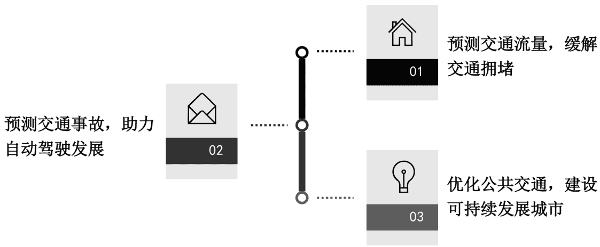

图 12-2 生成式技术优化交通的 3 个方面

### 1. 预测车流缓解道路拥堵
生成式技术可基于历史交通数据建立集成模型预测未来车流，实时获取信号灯信息提醒驾驶员前方红绿灯分布并提供替代路线。同时为管理部门提供决策支持，根据拥堵状况动态调整信号灯配时，改善拥堵。

2023 年 4 月百度发布全域信控缓堵方案，以多种交通基座为底座，通过机器视觉实时感知数据变化，及时发现分析拥堵，协助优化信号配时，为驾驶员提供多条路线。该方案可应对常态化与异常拥堵，并针对学校、景区等易堵点单线区进行分析。

方案具备四大功能：

#### (1) 全域感知
利用百度地图浮动车、交管部门监测及路口智慧监控等多源数据，宏观把握态势、微观监测各干道，通过图神经网络预测未来车流量，补全轨迹、流量等数据并分析道路关联性，为优化布局提供支撑。

#### (2) 全域优化
实时感知宏观中观微观环境，细分管理区域并评估效果，及时反馈形成区域化管理闭环。

#### (3) 全域协同
借助基座强大的自然语言理解能力实现人机交互，促进各系统高效信息交换，助力精细化管理。

#### (4) 全域服务
通过车载端、手机端触达能力实时推送事故、施工、红绿灯状态等信息，为驾驶员提供绕行路线、终点停车场等信息，节省时间优化体验。

### 2. 预测道路事故助力自动驾驶发展
生成式技术可分析历史事故预测易发路段，交管部门可据此增设标志、加派巡逻。结合智能车载健康监测系统，利用云端驾驶员生理参数实时监测健康状态，避免疲劳驾驶引发事故。

在自动驾驶领域，生成式技术可训练数据集学习道路规则与行为模式，借助行车记录仪、毫米波激光雷达等硬件精准感知车辆、行人及障碍物，建立全面环境认知。紧急情况下可迅速判断并采取制动，避免事故，并随学习迭代实时更新系统，适应复杂环境，提升安全与效率。

### 3. 优化公共交通建设可持续城市
在公共交通上，生成式技术可汇集各干道车流、公交与地铁换乘及站点客流信息，为民众推荐最优乘车路线，并实时监测交通状态缩短应急处置时间。

收集路面与天气数据可帮助优化行驶路线，提升出行效率；结合高精度传感器监测路面磨损并自动报警，防患于未然。

基于 AI 算法与空气质量指标，生成式技术可识别空气污染物，并通过对交通系统的全面分析规划新增公共交通线路，在缓解拥堵的同时减少排放，助力节能减排与可持续发展。

### 12.1.3 气象预报让预测更精准
应对气候变化、保障生命财产安全需要更准的预报。生成式内容融入后能显著提升预报精度，已有机构开始探索。

### 1. 谷歌发布深度学习模型 MetNet-2
2021 年谷歌发布的 MetNet-2 是一种深度神经网络，为气象预测提供新思路：基于观测数据直接预测。相较物理模型预测，深度学习降低了计算门槛，提升速度、扩大范围并提高准确度。MetNet-2 将预测边界从 8 小时延至 12 小时，空间分辨率达 1 千米、时间分辨率 2 分钟，直接连接输入输出，减少步骤提升准确性，以雷达卫星图像为输入，结合物理模型预处理状态捕捉更全面的大气快照。

### 2. 清华大学和中国气象局联合研发 NowcastNet
极端降水临近预报基座 NowcastNet 用 6 年雷达观测数据训练，可为全国极端降水提供更精准预报。在测试中能清晰预测强降水强度、落区、运动形态，并精准追踪强降水超级单体的演变，应用价值突出。模型融合深度学习与传统物理理论，可提供长达 3 小时的强降水近预报，填补研究空白，为城市防灾提供技术指导。

### 3. 华为发布盘古气象基座
2023 年 7 月华为盘古气象基座成果登上《自然》期刊。其三维神经网络结构结合层次化时间聚合算法，可精准提取风速、温度、湿度、大气压、重力势能等关键要素，台风路径误差降低 20%，提供 1 小时至 7 天的预报。

盘古模型可结合多场景赋能城市管理与企业发展。气象能源领域可给企业提供及时精准数据助力能源生产管理；航空航天领域可给机场提供实时气象数据提升飞行效率；农业领域可提供精准预报保障农产品质量；智能家居领域可与家电联动监测室内温湿度，优化居家体验。

### 12.1.4 城市安防满足多场景需求
生成式内容出现前，AI 已在安防用于视频分析、目标跟踪。生成式内容则提供更强智能支持，应对更复杂场景。

智能安防应用虽安全可靠，但灵活性不足，难以快速适应场景变化。生成式内容底层基座通用与开发能力强，大幅降低定制化成本。企业可提交安防数据训练聚焦场景的安防基座，打造更先进系统。

基于生成式内容支持，智能安防系统可适配校园、医院、住宅等多场景。如校园场景可联动电子门锁设置教室、宿舍、办公室权限，结合高精度摄像头人脸识别完善刷脸进校与机器人巡逻，确保师生安全。

生成式内容还能提供更准确的解决方案。可学习历史数据快速响应未知事件，通过数据分析预测潜在风险为决策提供支持；基于多模态技术融合文本、图像、视频实现全面预警；分析图像声音实现行为识别与异常检测。

借助高分辨率成像设备，生成式内容可提取更细微特征，如人物外貌、面部表情识别，车辆颜色型号精准判断，节约人力提升效率。

融合应用已出现成果。2023 年 6 月第十六届中国国际社会公共安全产品博览会在北京召开，围绕自主创新、数智融合的主题展示生成式内容、生物特征识别、物联网等技术。

会上联汇科技展示了视觉基座服务、基座智能助手、城市基础数据分析平台等产品，为安防厂商提供智能化技术与产品。其视觉语言预训练基座能力获得关注。视觉操作平台 OmVision OS 更斩获重大行业创新贡献奖。未来公司将依托基座推动产品落地，提升客户体验，助力安防智能化。

随着融合加深，智能安防竞争将更激烈，解决方案将在更多场景落地。

## 12.2 企业探索多元化城市治理产品
在生成式内容赋能城市治理方面，企业积极探索并推出先进方案，为布局指引方向。

### 12.2.1 城市治理基座模型注入新动能
智慧城市建设如火如荼，生成式内容与智慧城市结合将实现“智理”。城市治理基座为垂直化落地提供方案。

2023 年 4 月城市数据智能服务商软通智慧发布多模态模型产品“孔明”基座，实现生成式内容在城市治理的垂直应用。模型具备强泛化能力，可快速整合行业知识，适配多种治理场景；具备强推理能力，可自动生成并分类治理事件，协助部门制定方案提升效率；具备良好工程化能力，可理解部署需求降低操作难度，并对隐私数据设权保护安全。

模型搭载“城市慧眼”“一语通办”等业务模块，内建庞大行业知识库，给用户提供便捷准确的业务查询与办理服务，助力治理降本增效。

模型赋能 城管迈向数智化

在生态修复赛道，孔明大模型锁定废弃物分选与河段水质修复两大难点。围绕分选，模型学习各城标准，为管理部门的科普宣传提供支撑。其一，用通俗语言解释再利用类、其他类、餐厨残余、危废的内涵，帮助市民投放准确；其二，可对接桌面程序与移动应用，持续推送分选资讯，在日常使用中培养分类习惯。

在硬件协同上，模型推动自动化分拣终端更进一步。基于海量样本训练，辨识精度显著提升，可实现单件检测与批量分拣。通过联动地下式收集容器，箱内装置实时感知装载程度，触发自动压缩与清运。箱外装置同步采集周边温湿度，及时发出高温自燃风险预警，让分选作业更安全更高效。

面向水体污染管控，模型连接各类监测设备采集流量、pH、重金属、塑料等参数，并实时汇聚至云端。结合历史水文及周边环境数据深度挖掘，可精准判定污染成因，并推演水质变化趋势。基于分析结果提出可执行的治理建议，远程协同部署水体过滤装置、药剂投放等作业，有效改善水质，助力城内水循环。

消防安全同样获得主动提升。对不同层高、不同用途的建筑进行分区评估，综合历史火情、生态环境与近期气象信息判断风险。针对高发的电气火灾，模型监测室内温度、电压、电流及漏电断路器运行态势，进行关联度研判，提前揪出隐患，做到提前化解风险。

在算力推动下，城市治理进入换挡期。孔明大模型持续迭代，带动市政设施数字化转型，创造就业机会并培育高水平人才。下一步将整合全城治理数据，延伸至智慧停车、社区服务、安保巡查等场景，深度渗透各行业，提升公共服务的温度与水准，实现降本增效，为城发展注入新动力。

### 12.2.2 360 公司：探索城市安防新服务

2023年5月，360 公布“360 智脑·视觉”大模型。该模型能看懂图像和视频，也能听懂声音，为城市安防提供多维助力。其核心能力如图 12-3 所示。

#### 1. 开放目标检测
实体店场景里人为遮挡、摄像头偏移带来的干扰较为常见，360 智脑·视觉的开放域识别可以有效解决。用户用开放式自然语言描述目标，例如“墙面白色中文字标”，模型即可理解语义并通过摄像头精准识别。车辆统计场景中，模型可迅速统计车流总量，也能按需求筛选特定车型，如蓝色两厢轿车、红色重型货车。

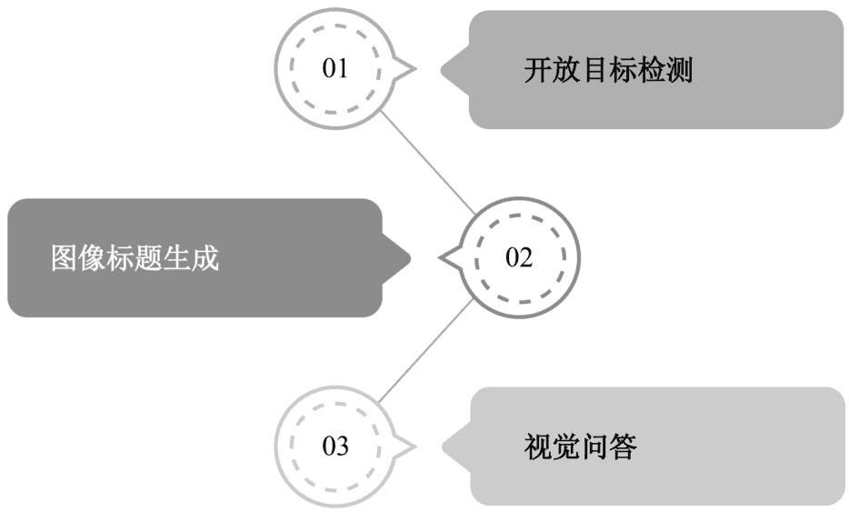

图 12-3 360 智脑·视觉大模型的能力

#### 2. 图像标题生成
该能力让模型以接近人类的视角理解画面。360 智脑·视觉可快速为图像标注并提炼要点，如“中年男子位于白底地面”“黑鸟在雨中飞行”，避免因图文本相似导致检索效率下降。

#### 3. 视觉问答
在门店巡检中，巡检人员用语言描述待检查项目，模型即可解析画面并输出巡检打分表，交互更自然。

模型还可拓展至其他安防场景。物品存放时，可对区域进行分割并用开放域识别实时监控分割轮廓是否变化，确保物品完好无损；设备巡检时，通过视差估计判断设备位置是否偏移。当前能力主要在软件层运行，未来接入各类智能硬件后将实现真正落地应用。

### 12.3 城市探索，向着智慧城市迈进

除企业探索外，哈尔滨、无锡、深圳等城市正引入 AIGC 方案推进智慧城市建设，在 AIGC 支撑下，城市服务与治理明显更智能。

### 12.3.1 哈尔滨：融媒体中心接入 AIGC 能力

2023年2月，哈尔滨市融媒体中心客户端“冰城+”成为百度文心一言首批生态合作伙伴。接入后客户端服务更智能、更完善。

“冰城+”于2021年上线，是哈尔滨权威新闻资讯平台，携手央视新闻、哈尔滨日报、哈尔滨广播电视台等实时更新教育、文化、财经、体育等内容。下设“冰城 60s”栏目，以60秒视频推送天气、限号、防诈骗等生活信息。

新闻传播方面，结合文心一言实现个性化推荐。通过采集浏览时段、新闻类型、停留时长等行为数据，分析阅读习惯，面向用户定制推荐界面，及时触达感兴趣的热点。文心一言的自然语言处理能力可学习网络热词，将专业新闻转化为通俗生动的表达，提升传播效果与阅读体验。

网络问政方面，文心一言提供底层技术，打造智能问政平台。用户可直接在平台提问，无需依赖传统网站，模型结合问题描述与阅读兴趣给出全面答复。同时实时监测留言，清洗重复与无效符号、补全缺失语句后自动分类，按问政数量排序，快速发现热点并反馈相关部门。对部门而言，模型可分析历史问政信息，辅助制定更合理方案，并全流程追踪办理进度，按用户反馈评估成效。

城市生活服务方面，模型在保障信息安全前提下整理用户个人家庭信息，客户端推出一体化缴费平台，支持水电燃气等费用即时缴纳。结合气象预报与交通数据，提供未来天气、私家车限号、实时路况等出行信息，还聚合微信公众号、小红书等渠道资讯，提供美食、旅游、健身等内容，提升幸福感并带动经济发展。

此次合作是哈尔滨智慧城市建设的关键一步。文心一言可整合各部门专业信息，构建统一预训练模型，提升客户端开发效率。未来合作将持续深化，推动数字经济发展，让 AIGC 为产业与公益服务贡献力量。

### 12.3.2 无锡：借 AIGC 提升公共服务水平

2023年4月，无锡城市服务客户端“灵锡”接入阿里巴巴通义千问大模型，借助 AIGC 能力完成系统升级。

“灵锡”是无锡官方数字化公共服务平台，覆盖教育、医疗、交通、文化、就业、社会保障等近千项服务，设有便民地图提供周边医疗、教育培训等信息。对儿童、老年人、残障人士提供母婴、药店、康复机构等专属信息。依托通义千问的自然语言理解与智能问答，服务效率与水平显著提升。

教育模块深度融合通义千问，整合各年级各学科资料，提供个性化教育服务。基于中文语义理解与迁移学习能力，建立覆盖幼儿园至高三的电子教师用书资源库，并按最新政策及时更新。结合无锡电子地图，对培训机构按区域、是否面向义务阶段分类，方便查询。

交通出行方面，整合分析交通数据，为电动车、油电混动车用户提供加油站、充电桩信息。连接交通设施可实时推送故障信息，对接公安政务服务平台方便查询违章并缴纳罚款。

文化旅游方面，通义千问整合博物馆、知名历史建筑信息，加速开通预约、景点查询服务，助力旅游业发展。汇聚图书资源打造数字图书馆，实现一键借阅，促进文化产业。

“灵锡”在通义千问加持下旨在优化体验、提升幸福感，推动城市治理数字化升级。未来将持续优化系统，扩展服务场景，打造全领域一体化数字生活平台，为无锡智慧城市建设添砖加瓦。

### 12.3.3 深圳福田：携手华为创新城市治理模式

深圳提出打造“模都”，推进大模型在智慧城市、智慧交通等领域应用。福田区落地“城市智能体”理念与开放架构，构建创新数字底座，融合多模态大模型，让城市可感知、可思考、有温度、可进化。

探索离不开华为盘古大模型支持。政务服务方面打造政务助手“小福”，基于海量政务数据学习掌握热线、法规、办事流程等政务信息。同时，基于学习与推理能力，其能够解决政务热线在问题理解、意图识别、政策关联等方面的问题，提供专业且有温度的服务。

城市治理方面，视频大模型的检测分析能力应用于市政智能巡查，识别治理事件，实现快速响应与触达。

政务办公方面，携手华为基于大模型打造办公助手。办公助手具有对公文数据的深入学习能力、内容生成能力等，可完成标注、语义检索等任务，还能够进行公文撰写、校对、签批、督办等，实现政务办公的全流程智能化，提升办公效率。

未来福田将持续推进大模型应用，不断创新城市治理手段、模式与理念，提升智能化数字化水平，让城市运转更顺畅、更智慧，增强市民幸福感与安全感。