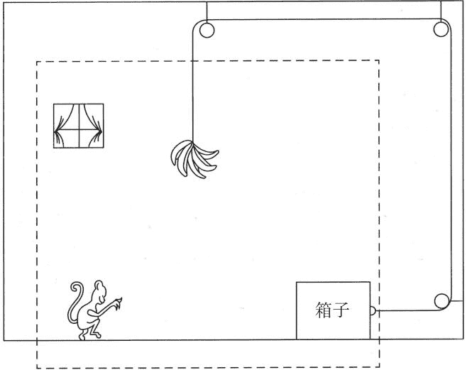
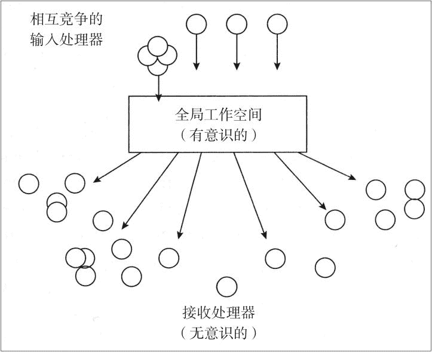
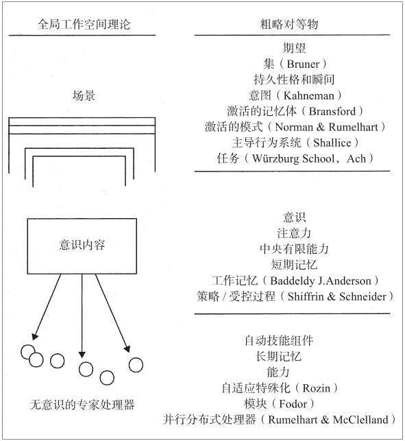

# 人工智能：从本质到未来

# 01 人工智能到底指什么

人工智能说白了，就是让机器去完成人类心智本能就能做的事情。有人会觉得推理才算智能，视觉不算，但两者其实都依赖同一类心理能力，比如感知、联想、预测、规划和运动控制。

智能不是一条直线，而是一个层次丰富、结构复杂的空间。正是这种多样性，让人工智能能借助多种技术去解决多种任务。

今天的人工智能已遍布生活。家电、汽车尤其是自动驾驶、办公室、银行、医院、空域，互联网与物联网里那无数连向物件、衣物和环境的传感器，月球和火星上的探测机器人、轨道上的卫星，都能看见它的影子。好莱坞动画、电子游戏、卫星导航、谷歌搜索，金融波动预测、公共医疗与交通的政策决策系统，手机应用、虚拟现实中的数字分身、陪护机器人的情感试验模型，甚至美术馆的网页艺术展，都在用它。战场上的无人机让人不安，机器人扫雷舰则让人欣慰。它的触角几乎无处不在。

学界给人工智能定了两大方向。技术面是让计算机用更有效的方式去做好事，有时甚至不用人类式的思维；科学面是用人工智能的概念和模型来回答关于人脑和其他生命如何工作的疑问。大多数研究者只挑一头走，也有人两头兼顾。

除了堆出无数小巧的技术发明，人工智能还在重塑生命科学。把一个科学理论变成计算机模型，就能检验它是否自洽，也能把它的含义具象化，常是以前从未显现的含义。对不对另说，依据来自相关学科的证据。即便最后证明理论错了，也能带来启发。

心理学家和神经科学家用它提出了一系列影响深远的心智-大脑模型，解释大脑怎么运作、在解决什么计算问题、用什么信息处理方式才能达成目标。这两个问题不同，却同样关键。人工智能本身也在提醒我们：心智的内容比早期心理学想象的要丰富得多，还有很多问题待解。

生物学也受益。人工生命的研究让学者为生物体的不同内部结构搭建计算机模型，用来解读动物行为、身体发育、进化以及生命的本质。

哲学也在被重塑。很多当代哲学家借用人工智能的概念来讨论身心关系、自由意志和意识等难题。但这些讨论争议很大，人工智能系统是否拥有真正的智能、创造力或生命，至今没有定论。

最后，人工智能逼我们重新思考人性与未来。有人担心人类的未来会被抹掉，预言机器智能将全面超越人类。有人兴奋，有人恐惧。人们开始追问：如果真的那样，人类的尊严与责任还留在哪。

接下来的章节会逐一展开这些问题。

## 虚拟机

谈到人工智能，很多人第一反应是电脑。对也不对。重点不在于硬件，而在于硬件在做什么。人工智能离不开物理机器，却更像计算机科学家说的虚拟机。

虚拟机不是虚拟现实里的机器，也不是修理工培训用的模拟发动机。它是程序员编写时、使用者使用时所设想的信息处理系统。

用管弦乐队来比喻。演奏美妙音乐需要木头、金属、皮革、琴弦遵循物理定律，但观众不在意这些，他们听的是旋律、和声、主题与变奏。音符本身不是重点，音乐的“形状”才是。

人工智能也一样。用户操作文字处理器处理文字和段落，程序本身并不储存文字和段落，神经网络并行处理信息，即使运行在冯·诺依曼这种顺序式计算机上。观众听的是音乐，我们关心的是智能的“形状”。

这并不意味着虚拟机是虚构的。它真实存在，只要接入摄像头或机器人手臂就能在系统内执行任务，甚至作用于外部世界。出现问题时，研究者很少去查硬件，多半关注虚拟机里的软件因果。

编程语言本身就是一种虚拟机，指令要先翻译成机器码才能运行。更低级的语言可以定义更高层的指令，否则若直接用位模式处理信息，没人能思考。信息处理越复杂、层次越细，越需要清晰的虚拟机来支撑。

虚拟机不只是编程语言，它包含多层活动模式。虚拟机也不只存在于电脑。第6章会提到，人类的心智也可看作在大脑中实现的一组并行、交互且在不同时间学习得到的虚拟机。

要推进人工智能，需要不断完善有趣且实用的虚拟机的定义。物理机更大更快当然有帮助，有时甚至是必要条件。但如果没有信息丰富的高级虚拟机，再强的硬件也无用。同样，神经科学的进步也需要弄清神经元上实现了怎样的“心理”虚拟机。

所有人工智能系统都需要输入输出设备，不只是键盘和屏幕，还需要专用传感器，比如相机、压敏触须，或执行器，比如声音合成器、机器人手臂。程序既处理内部信息，也与外部接口互动。

程序内部也会有输入输出，让不同虚拟机交互。例如象棋程序的一个模块会留意另一模块发现的潜在威胁，并协同阻断。这就是虚拟机之间的内部对话。

## 人工智能的主要类型

信息处理方式取决于虚拟机的种类。后文会看到主要有五种，每种都有大量变体：经典逻辑或符号主义，也称老式有效人工智能 GOFAI；人工神经网络或联结主义；进化编程；细胞自动机；动力系统。

研究者往往只用一种方法，但混合虚拟机也很常见。比如第4章提到的人类行为理论，能在符号处理和联结处理之间切换，用来解释人们在执行计划任务时为何会分心，以及这种分心如何发生。第5章介绍的机器人实验就融合了情境机器人学、神经网络和进化编程，借助纸板三角形作地标找到回家的路线。

这些方法不仅用于应用，也启发了对心智、行为和生命的理解。神经网络帮助模拟大脑内部结构，进行模式识别和学习。经典逻辑尤其结合统计后，能模拟学习、规划和推理。进化编程阐明了生物进化与大脑发育。细胞自动机和动力系统可用来模拟生物发育。有些方法更贴近生物学而非心理学，有些更接近本能反应而非深思熟虑。要全面理解心智，可能需要全部方法，甚至更多。

不少研究者并不关心心智如何工作，只追求技术效率。人工智能源于心理学，如今联系已很少。但若要真正迈向通用人工智能，就必须加深对心智计算架构的理解。

## 人工智能的预言

19世纪40年代，艾达·洛夫莱斯伯爵夫人预言了部分人工智能。她关注符号和逻辑，从未考虑神经网络、进化编程和动力系统。她只关心技术目标，对心理目标不感兴趣。她曾说机器“可能写出任何复杂程度、长度精妙系统的乐曲”，也能表达“在科学史上具有划时代意义的自然重要事实”。如果她看到两百年后科学家用大数据和精细编程推动遗传学、药理学、流行病学等领域的发展，绝不会惊讶。

她所说的机器是分析机，由密友查尔斯·巴贝奇于1834年设计，从未真正造出。机器主要用于求解代数和数字运算，本质上等同于通用数字计算机。

她看出了分析机的通用潜能和处理符号的能力，并描述了现代编程的基础：存储程序、分层子程序、寻址、微程序、循环、条件、注释和程序错误。她没有说明曲目编排或科学推理在巴贝奇机器上如何实现。人工智能可以实现，但当时的实现方法仍是谜。

## 人工智能的起源

一个世纪后，艾伦·图灵解开了这个谜。1936年他提出通用图灵机，认为每个可计算问题原则上都可由它执行。图灵机是处理0和1二进制符号组合的抽象系统。

二战期间他在布莱切利园破解德国密码，1940年代末思考如何让物理机逼近抽象图灵机，并让它智能地执行任务。他参与设计的首台现代计算机于1948年在曼彻斯特完成。

与洛夫莱斯不同，图灵同时接受了技术和心理两个目标。他希望新机器能完成通常需要智能的有意义任务，可能用非自然技术，也希望模拟生理基础的心智过程。

1950年，他以幽默方式提出图灵测试的论文，成为人工智能的宣言。它抓住了游戏、感知、语言和学习的要义，暗示了当时计算机的进展。其论文甚至提到了神经网络和进化计算，尽管这些算法要到很久以后才被广泛认可。只是纲领，不是具体程序。

图灵坚信人工智能终将以某种方式实现。20世纪40年代初，神经病学家沃伦·麦卡洛克与数学家瓦尔特·皮茨的支持了他的信念。

他们在1943年发表《神经活动中内在思想的逻辑演算》，结合了图灵的观点、伯特兰·罗素的命题逻辑和查尔斯·谢灵顿的神经突触理论。命题逻辑是二进制的，每个命题为真或假，无中间状态。利用and、or、if-then等逻辑运算符可构建复杂命题。

麦卡洛克和皮茨把两者结合，因为都描述了二进制系统。逻辑的真假映射到脑细胞的开关和0/1状态。谢灵顿认为神经元有固定阈值。于是逻辑门被定义为微小神经网络，可相互连接表示高度复杂的命题。只要能用命题逻辑表述，就能用某种神经网络和图灵机计算。

神经生理学、逻辑学和计算被放在一起，心理学后来加入。麦卡洛克和皮茨相信自然语言本质上是逻辑的，从科学论证到精神分裂症错觉都能放进他们的理论磨坊。他们预言了网络设计规格将推动心理学发展的时代。

核心含义清晰：同一套图灵计算理论可用于人和机器智能。该文还影响了计算机设计。约翰·冯·诺伊曼起初打算用十进制代码，后改用二进制。

图灵认同图灵计算，但当时技术太原始。到了1950年代中期，更强大、更好用的机器出现了。易用性指的是定义新虚拟机更容易，比如编程语言，从而定义更高层的虚拟机，比如做数学运算或规划的程序。

本着图灵宣言的精神，符号人工智能在两岸兴起。20世纪50年代末，阿瑟·塞缪尔的跳棋程序打败了塞缪尔本人，无疑暗示电脑有一天可能超越设计者。

同年，逻辑理论机证明了罗素的18个关键逻辑定理，还为其中一个找到更有效的证明。令人印象深刻。塞缪尔只是平庸的跳棋手，罗素是世界级逻辑学家。罗素本人很高兴，但《符号逻辑杂志》拒绝发表署名为计算机程序的论文，而且它并未证明新定理。

## 早期人工智能的奠基

逻辑理论机很快被一般问题求解器GPS超越，超越的意思是应用范围不再局限于单一领域。GPS能解决用目标、子目标、动作和运算符表示的任何问题。程序员确定领域相关的目标、动作和运算符后，推理由GPS完成。例如它解决了牧师与野人过河问题。

逻辑理论机和GPS是GOFAI的早期例子。如今称它们为“老式”毫无疑问，但它们“有效”，率先运用了启发法和规划，这在今天仍至关重要。

麦卡洛克和皮茨的论文不仅启发了GOFAI，也鼓舞了联结主义。20世纪50年代，计算机上特制的麦卡洛克-皮茨逻辑神经元网络被用来模拟联想学习和条件反射，当时是集中式而非分布式处理。

早期网络模拟并非完全受神经-逻辑支配。雷蒙德·拜沃勒在20世纪50年代中期用模拟计算机实现了一个不同系统。他没有从精心设计的逻辑门网络出发，而是从随机连接、不同阈值的单元二维数组开始。他认为神经自组织源于激活波的构建、传播、持续、死亡和相互作用。

拜沃勒已意识到启发机可以模拟心理过程，但不等于大脑就是那样的机器。麦卡洛克和皮茨四年后另文指出热力学比逻辑更接近大脑功能。逻辑被统计取代，单一单元被集合取代，确定性被概率噪声取代。

换句话说，他们描述了我们今天所说的分布式容错算法，认为它是之前算法的延伸，并不矛盾，更具生物现实性。

## 控制论

麦卡洛克对早期人工智能的影响远超GOFAI和联结主义。20世纪40年代，在其神经学和逻辑学成果指引下，控制论运动蓬勃发展。

控制论关注生物自组织，涵盖适应、新陈代谢、自主思考、微观运动和生理调节。核心思想是双向循环或反馈。关键问题是目的论。反馈依赖目标偏差，用于指导下一步动作。

1948年，诺伯特·维纳为该运动命名，定义为关于动物和机器中控制与通信的研究。控制论者在建模时常从控制工程和模拟计算机获取灵感，而非逻辑和数字计算。但区分并不绝对。目标偏差既用于制导导弹，也用于解决符号问题。图灵作为经典人工智能的倡导者，用动力学方程定义自组织系统，新结构可从同质低级个体中涌现。

早期参与者包括经验心理学家肯尼思·克雷克、数学家约翰·冯·诺伊曼、神经学家威廉·格雷·沃尔特和威廉·罗斯·艾什比、工程师奥利弗·塞尔弗里奇、精神病学家人类学家格雷戈里·贝特森，以及化学与心理学家戈登·帕斯克。

克雷克三十一岁便因自行车事故离世，1943年时他正以模拟运算为参照研究神经系统，当时通用数字机尚未诞生。他借助脑内模型的反馈，粗略勾勒出感知、微运动和智力的轮廓。他提出的脑模与表征构想，后来在AI里产生深远回响。

三十年代整片时间里，约翰·冯·诺依曼对自组织既怀疑又着迷，麦卡洛克与皮茨的首篇论文让他异常兴奋。他把机器基础从十进制改向二进制，并在麦卡洛克与皮茨的框架上推进，用以解释生物进化与繁殖。他提出了一类细胞自动机，由大量基础计算单元构成复杂整体。单元更新遵循简洁规则，规则取决于邻位单元当下状态。部分单元能复制他者，他甚至造出可复制任意内容包括自身在内的通用复制器，并指出复制错误可能是进化的来源。

冯·诺依曼以抽象信息语言详述细胞自动机。这类构造可有多种落地形式，如自组装机器人、图灵的化学扩散、拜沃勒的物理波以及随后揭开面纱的DNA。

四十年代末起，艾什比造出 `Homeostat`，一种生理性自调的电化学模型。它能在初始赋予一百个参数的情况下保持内环境整体恒定，起始条件可达近四十万种。它演示了艾什比动态自适应理论在试错学习与自适应行为中的应用，这种适应既可在机体内部尤其是大脑里发生，也可在机体与外部环境之间发生。

格雷·沃尔特同样探究自适应行为，只不过路径迥异。他打造了一款仿乌龟的微型机器人，其感运动回路仿照谢林顿的神经反射学说。这些情境机器人先驱的表现相当生动，会寻光、避障，并借助条件反射进行联想学习。这批有趣装置于1951年“英国节”上向公众亮相。

十年之后，塞尔弗里奇——伦敦百货商店创始人的孙子——以符号手段实现并行系统 `Pandemonium`。

该 `GOFAI` 程序依赖大量底层“守护程序”，即特征感知器，来学习模式识别。每个守护程序持续采集外部信息并把结果递给更高层。它们聚焦暂且一致的特征，例如字母F仅有两根横条，而忽略不符特征。置信度参差且至关重要，声量最大的守护程序影响最强。最终，最高层守护程序依据积累且常相互冲突的证据挑选最佳模式。此项工作迅速影响联结主义与符号AI，其中近期分支是学习智能分布实体 `Learning Intelligent Distribution Agent`，简称 `LIDA` 的意识模型，详见第6章。

贝特森对机器不感兴趣。他在六十年代提出关乎文化、酗酒与双重约束型精神分裂的理论，但其根基来自更早控制论会议上关于通信即反馈的讨论。从五十年代中期起，帕斯克——麦卡洛克口中的“自组织系统天才”——在诸多项目里融合控制论与符号思想，包括互动剧场、互通音乐机器人、能感知并适应使用者目标的架构、化学自组织概念以及教学机。借此，人们能以复杂知识表征来适配不同学习风格，认知偏向循序渐进与整体型、且对无关事务容忍度各异的学习者都能受益。

简言之，到六十年代后期，研究者已审视过AI的主要类型，部分更早实现。

大多数相关研究者至今仍受尊敬，但只有图灵像幽灵般常驻AI盛宴，影响无处不在。多年以来，其他人多被局限在分支领域记住。格雷·沃尔特与艾什比几乎被遗忘，直至八十年代后期才与图灵并列被誉为“人工生命之父”。帕斯克等待更久。要理解其缘由，必须看计算机建模者如何分道扬镳。

## 建模派系的分化
六十年代前，模拟语言思维与模拟目的性自适应微运动这两个方向仍有交集。部分专家兼修二者，唐纳德·麦凯甚至提议制造兼具神经网络与符号处理的混合机。所有从业者彼此能产生共鸣。研究生理自动调节的人认为自己与关注心理的同事在做同一件事。他们共享同一类会议：美国跨学科Macy研讨会1946至1951由麦卡洛克主持，以及伦敦“思维过程机械化”研讨会1958由厄特利组织。

约从1960年起，研究者方向明显分离。对生命感兴趣的人只投向控制论，对心智感兴趣的人则投向符号计算。网络爱好者当然关心脑与心智，但他们多研究联想学习而非具体语义内容或推理，因而更靠近控制论而非符号AI。分支愈多，各分支间的相互尊重却不足。

分化中难免形成小圈子，因所讨论理论问题各异，既有生理也有心理。技术也不同，广义上是微分方程与逻辑的较量。专业化不断加深，交流因此变得困难且多半无益。包容性会议已成过时。

即便如此，各学派也不该过于急躁。对控制论与联结主义的反感源于专业嫉妒与正义愤慨。因为符号计算起步即取得巨大成功；约翰·麦卡锡1956年提出的挑衅性术语“人工智能”，此前称“计算机模拟”，吸引媒体目光；不切实际的炒作也在其列；部分符号主义者态度傲慢。

符号阵营起初敌意不大，自认赢得竞赛。事实上他们很大程度上忽视早期网络研究，领军人物马文·明斯基已开始网络工作。

1958年，弗兰克·罗森布拉特提出神经动力学理论，定义了一种可在随机初始状态下自组织学习并容忍初始化错误的并行处理系统，并在光电感知器中部分实现。它与 `Pandemonium` 不同，无需程序员预先分析输入模式。符号学派再无法忽视这种新联结主义，但很快被打入冷宫。六十年代，明斯基与西摩尔·帕普特联名发表尖锐批评，称感知器连一些基本计算都做不到，详见第4章。

神经网络研究的经费随之被切断。这既是两派攻击者的蓄意结果，也加深AI内部对立。

回望当时，经典AI似乎占据绝对主导。格雷·沃尔特的机器乌龟在英国节备受赞誉。伯纳德·威德罗的模式学习 `Adaline` 基于信号处理，与罗森布拉特感知器一样在五十年代后期被媒体热炒。但符号主义者的批评让感知器迅速失焦。六十至七十年代，媒体主角是符号型AI，也影响心灵哲学。

风水轮转。神经网络以分布式并行处理 `Parallel Distributed Processing` 简称 `PDP` 之名于1986年重返舞台，见第4章。外界人士与部分内部人士都将其当作彻底新事物。它吸引大量研究生与媒体、哲学关注。那时最不满的恐怕是符号AI研究者。一时间 `PDP` 成时尚，人们普遍认为经典AI已失败。

另有控制论者在1987年命名“人工生命”，终于从记者与研究生中获得青睐。符号AI再次受挑战。

进入21世纪，不同问题需要不同答案，各有所长。尽管旧怨犹存，不同方法仍有尊重与合作空间。例如深度学习有时被用来构建将符号逻辑与多层概率网络结合的强系统；还有混合方法包含高级复杂的意识模型，见第6章。

人类心智的虚拟机本就多种多样，AI领域的研究分歧因此并不奇怪。

* * *

注释
[1] `Adaline` 是早期单层人工神经网络及其物理装置的名称，采用存储电阻器，由伯纳德·威德罗教授与斯坦福大学研究生泰德·霍夫于1960年联合开发。它基于麦卡洛克—皮茨神经元，由权重、偏差与求和函数构成。——译者注

# 02 强人工智能：圣杯追逐

当前最前沿AI能提供多种虚拟机，处理各类信息。它没有单一核心秘密，也无统一核心技术。研究者来自不同领域，目标与方法几乎没有统一。本书只能覆盖最近取得的极少数成果。总之，方法范围极其宽泛。

可以说AI已取得惊人成果，应用极广。我们拥有针对无数特定任务设计的程序。专业人士与普通人群几乎都在使用，部分程序甚至超过某些专家。进步的确引人注目。

但先驱的目标不仅是专家系统，他们还想发展通用智能系统。他们模拟的视觉、推理、语言、学习等人类能力，需要应对各类挑战并在恰当时机整合。

按此标准，进步空间很大。约翰·麦卡锡很早就指出AI需要“共识”。作为1971年与1987年图灵奖得主，他在获奖感言中谈到AI的通用性 Generality in Artificial Intelligence，却在抱怨而非庆祝。到2016年，他的抱怨仍未得到回应。

随着算力持续增强，强AI在21世纪再次受关注。若目标实现，系统将减少对专用编程技巧的依赖，而受益于推理与知觉等通用能力——语言、创造力与情感，这些将在第3章讨论。

然而这并不容易。通用智能仍是严峻且难以捉摸的挑战。强AI无疑是该领域的圣杯。

## 算力不是万能药
对任何追求此梦想的人，超级计算机必然是助推器。组合爆炸——所需计算超过可执行计算——已不再是威胁。但我们不能始终靠算力提升解决问题。

通常还需要新解法。即便某种方法在理论上可行，实践中也可能需要巨大的时间或存储。第4章给出关于神经网络的例子。同样，穷举象棋的所有走法需要的存储位置比宇宙中的电子还要多，即便有一大堆超级计算机也无法满足。

效率也很重要，计算量越少越好。总之问题必须易于处理。

如今已有几个基本策略可做到这一点。它们由经典符号AI或 `GOFAI` 开创，至今仍必不可少：第一，只关注搜索空间的一部分，问题的计算机表示假设解就在其中；第二，简化假设以构建更小的搜索空间；第三，有效安排搜索过程；第四，用新方式表征问题以构建不同搜索空间。

这些方法对应启发法、规划、数学简化与知识表示。下五个部分将分别展开。

## 启发式探索
“启发式”与“尤里卡”同源，均来自意为寻找或发现的希腊语。启发法被早期 `GOFAI` 学派重视，常被视作编程技巧。但术语并非源自编程，逻辑学家与数学家早已熟悉。数千年前人类就用启发法解决问题，有意或无意，远早于埃达·洛夫莱斯预见AI。

对人或机器而言，启发法都有助解决问题。强AI的用法是让程序只探索搜索空间的部分区域，同时回避其它区域。

许多启发式算法属于无法保证成功的经验法则，如早期AI使用的大多数规则。在其引导下，系统正好忽略搜索空间的某部分，而解可能恰在其中。例如象棋中“保护王后”很有用，但偶尔也需违背。

另一些启发式在逻辑或数学上可被证明合理。如今大量工作都指向确定程序可证明的属性。这是“友好AI”的一面，因人类安全可能受逻辑不可靠系统威胁，详见第7章。启发式与算法在原则上无区别，许多算法实为包含多个特定启发式的微型程序。

无论是否可靠，启发法对搜索不可或缺。AI日益专业化，部分取决于能显著提升效率的新启发法的提出，但通常仅限于限制较多的某类问题或搜索空间。一个很成功的启发法未必适合被其它程序借用。

若给定数种启发法，应用顺序就很重要。例如即使排序偶尔导致灾难，也应先考虑“保护王后”再考虑“保护象”。不同顺序定义不同的搜索树遍历。对启发法的定义与排序是现代AI的关键任务，在认知心理学中地位也突出，例如“快速节俭启发式”指出进化如何让人有效回应环境。

借助启发法，不再需要穷举整个空间，但有时会与有限穷举结合使用。1997年击败世界冠军加里·卡斯帕罗夫而声名大噪的IBM象棋程序深蓝 `Deep Blue` 使用专用硬件芯片，每秒处理2亿个位置，可看到接下来8步的所有备选。但它仍需用启发法挑选“最佳”走法。由于可信度有限，即便是深蓝也不能次次胜出。

## 规划：由目标到行动链
在当今AI中，规划地位突出，尤其在军事活动。美国国防部曾指出，在第一次伊拉克战争的战场上，利用AI规划在后勤保障上节省的资金超过了前期投入。

规划不止于AI，我们都在规划。想想假期打包：必须找到所有物品，物品可能分散；可能还需购买新物如防晒霜；要决定是把东西集中放在床上或桌上，还是逐一装进箱子。这个决定部分取决于是否最后放衣服，因怕弄皱。需要背包还是手提箱，或两者兼用，如何取舍？

把规划用作技术的 `GOFAI` 程序员考虑了有意识的深思熟虑。基于神经网络的AI大不相同，因其不模拟有意识深思熟虑，详见第4章。逻辑理论机与 `GPS` 的先驱主要对人类推理心理学感兴趣。他们的程序基于被试实验，要求进行“有声思维”：一边解逻辑谜题一边描述思考过程。

现代规划程序不那么依赖有意识内省或实验观察，规划比早期复杂得多，但基本思想一致。

一个规划列出在常规层级表示的一系列动作——一个最终目标，加上诸多子目标与次级子目标……这样无需一次性考虑所有细节。在适当抽象层级上规划可修剪搜索树，部分细节根本无需考虑。有时最终目标本身就是动作规划，如调度货物进出工厂或战场。有时它还是问题的答案，如医疗诊断。

针对给定目标与预期情况，规划程序需要动作列表即符号运算符，或多种动作类型，通过填入源自问题的参数可实例化，每个动作能产生相应变化；每个动作需一组必要前提条件，如抓住某物前提是该物在手可活动范围内；针对所需变化优先次序与动作排序，需要启发法。若程序选定某个动作，可能需设定新子目标以满足前提条件。目标制定可反复进行。

通过规划，程序或用户可知已做了什么动作以及为何这么做。为什么指向目标层级结构：做此动作为满足那个前提条件，以实现该子目标。AI系统常采用正向链接与反向链接技术解释求解过程，帮助用户判断动作或建议是否恰当。

当前一些规划程序拥有数万行代码，在无数层级上定义分层搜索空间。这些系统与早期规划程序大相径庭。

例如大多数规划程序假定并非所有子目标可独立处理，即问题可完全分解。现实中目标导向行动结果常被另一行动撤销。今天系统能处理可部分分解问题：独立处理子目标，必要时再做整合处理，以合并产生子规划。

经典系统只能解决完全可观察、可确定、有限且静态环境中问题。一些现代规划程序可处理部分可观察——世界模型可能不完整或不准确——和不确定环境。在这些情况下，系统必须在执行期间监控变化，以在规划中或自身信念中作出调整。部分现代规划程序可长时间监控：随环境变化不断制定、执行、调整与舍弃目标。

其他开发领域已取得新进展且仍在进步。所以80年代部分机器人专家完全否决规划转而青睐“情境”机器人学，见第5章，例如目标与可能动作内部表征等概念也被否决，着实让人惊讶。然而很大程度上这种批评不对。批评者系统可能没有表征目标，但可能表征其它内容，如视网膜刺激与奖励。此外，即便最先受批评机器人技术，也常需要规划与纯粹被动回应，例如制造会踢足球机器人。

## 数学简化
鉴于启发法让搜索空间自由发展，程序可专注最合适部分，简化假设则构造不切实际但更易计算搜索空间。

一些假设与数学相关，如机器学习中常用i.i.d.独立同分布假设。与数据实际概率构成相比，用i.i.d.表示概率构成要简单得多。

数学简化：清晰却未必能用

用数学办法给搜索空间做简化，最直接的好处是过程可形式化、边界明确，至少数学家能一眼读懂它的逻辑。可这不等于数学上定义出来的搜索就能用。某种策略在纸面上可以对一类特定问题做到全覆盖，落地时却可能因为计算量爆炸而彻底失灵，甚至时间成本无限增长。好在这种纯理论的方案常常能指引出更务实的变体，比如第4章里谈到的“反向传播”就是一类典型演化。

在人工智能里，不靠数学的简化预设到处都是，而且往往很直白。最典型的默认就是：不用考虑情感因素也能把问题定义清楚、求解出来，见第3章。还有大量隐含假设被写进了用来描述任务的通用知识表征里。

## 让机器读懂世界：知识表示的难题

把问题装进系统，是AI工程里最难的起步。哪怕看起来像在和Siri用英语对话，或在谷歌里输入法语句子，背后其实都是把信息转成机器能处理的形态。人类处理的文本或图像，都得先被转译成系统可操作的表示，至于机器是否“真正”理解，我们留到第6章再讨论。

知识表征的手法非常多样。有些是对GOFAI时代经典方案的推演或改造，更多则是为某类狭窄任务量身定制的特化表达。比如可以为人类某种癌细胞的X光片或照片设计一套专用表示，从而实现极其具体的医学解读，这种表示却无法用来认猫或做CT扫描。

要想逼近强人工智能，可靠的通用方法才是关键。早期的灵感源自人类认知心理学：IF-THEN规则集、个体概念的编码、模式化的行为序列、语义网络，以及基于逻辑或概率的推理。下面依次展开，神经网络的另一种表征形式放在第4章再讲。

## IF-THEN：规则驱动的思维

基于规则的编程把大量信念以“如果—则”条件动作对的形式组织起来：满足条件就触发动作。形式上借用了形式逻辑中埃米尔·珀斯特的产生式系统，艾伦·纽厄尔与赫伯特·西蒙则常把它视作人类心理的基础。

条件与动作本身可以很复杂，涉及多个命题的合取或析取。当多条规则同时被满足时，命题越多、越具体的合取会被优先选取。比如“目标是做烤牛肉加约克郡布丁”会压过“目标是做烤牛肉”，再加上“三种蔬菜”则优先级更高。

这类程序不预先排好每一步的顺序，而是让每条规则在等待自己的触发条件。虽不预设流程，却仍能做规划，只是规划方式与最常见、最古老的执行控制编程不同。

在执行控制式的程序如GPS或逻辑理论机里，规划是显式的。程序员用严格的时间顺序写出指令链：“先做这个，再做那个；然后检查X是否成立，是就做A，否则做B”。“这个事”常指设立新的目标或子目标，比如机器人想离开房间，会先设“开门”子目标；若检测到门是关着的，就再设“握门把手”子目标，人类小孩可能需要更低级的帮助目标，比如让大人帮忙够到把手。

基于规则的系统也能解“如何逃出房间”。规划层级不以时间序列呈现，而是藏在规则集合的逻辑结构里。某个条件可能要求先建立一个目标，比如“想开门且够不着”，动作则可以是“找个大人”。更低层目标会自动被激活，比如“想让别人帮忙，则先接近对方”。

程序员必须提供相关规则，但不必穷举所有逻辑推论，这既是优势也是风险，因为深层的不一致可能长期隐藏。

被激活的目标与子目标会挂在中央“黑板”上供全系统读取。黑板上不仅有目标，还有感知输入及其他处理状态。这个思想影响了意识神经心理学的前沿，也启发了第6章提及的意识AI模型。

规则程序在20世纪70年代初的专家系统浪潮中大放异彩。典型有MYCIN，在医生鉴别感染性疾病、开抗生素时给出建议；还有DENDRAL，用于对有机化学特定范围分子的光谱分析。MYCIN的思路很直观：把症状与身体状况作为条件，与诊断结论或后续检测/处方建议作为动作匹配。这是AI从“泛而不精”走向专门化的第一步，也为埃达·洛夫莱斯的机器科学梦想迈出一步。

因表征方式灵活，系统可增量构建。程序员或系统自身能不断补充领域知识，随时加新规则，无需重写。但新旧规则若逻辑冲突，系统可能做出偏离预期的行为。小规模时易控，大规模时冲突难察。

70年代的新规则多来自与专家对话并要求解释决策。今天的规则生成已不依赖自觉反思，效率更高。现代“专家系统”虽已少用此称谓，却遍布科研、商业、手机应用等场景。统计、专用视觉、大数据等其他表征形式的加入，让它们超越早期版本。

在狭窄领域，这些程序能辅助甚至取代人类专家。四十年前，一个基于规则的大豆病诊断系统就超过权威专家。如今在科学、医学、法律、服装设计等领域皆有类似案例，这并非全然是好事，第7章会展开。

## 概念的多种容器：框架到语义网

另一类表征关注的是个体概念，而非整个领域。

例如用分层数据结构，即框架，来定义“房间”。房间被描述为有地板、天花板、墙壁、门、窗和家具等。现实房间的墙门窗数量各异，框架提供插槽填充具体数字，并给出默认值，比如四面墙、一扇门一扇窗。

这类结构能支持相似类查找、问答、对话、故事创作与理解，是CYC的基石。CYC试图把人类全部知识形式化，有人称之为痴人说梦。

框架也有陷阱。默认值常失真：有些房间没窗，开放式空间没门。更难的是日常物理常识，如“下落”或“溢出”。符号AI用框架编码朴素物理学：未受支撑的物体下落，但氦气球例外。想把这类常识穷尽几乎无止境。

在大数据应用中，概念常被表示为由成百上千相关概念组成的簇或“云”。类似地，概念现在可用词向量而非词本身来编码，深度学习系统自行发现语义特征以预测下一个词，比如机器翻译。相对经典框架，这类表示在推理和对话上的稳健性稍弱。

脚本记录了熟悉行为的时序模式。比如哄孩子睡觉：盖被、读故事、唱摇篮曲、开小夜灯。脚本既可用于问答，也能生成疑问。若省略开灯，就会出现“为什么”和“接下来呢”。这种表征被用于自动写故事，也是陪伴式对话AI需要的知识形式，见第3章。

语义网络是另一种概念表征。20世纪60年代罗斯·奎利恩提出相关示例，如WordNet，作为人类联想记忆模型，现为公共资源。网络通过同义、反义、上位、下位、部分-整体等语义关系连接概念，也把世界知识映射为联想连接，见第3章。

语义网络还能编码音节、首字母、语音和同音词。金·宾斯泰德的JAPE和格雷姆·里奇的STAND UP就利用这类网络做双关和音节变换的笑话，比如“沮丧的火车是什么？——低压机车”。

注意语义网络与神经网络不同。第4章会看到，分布式神经网络用全网活动模式而非单个节点来表征概念，能容忍冲突迹象，不必强制逻辑一致，但难以做精确推理。该类表征的重要性不容忽视，是许多实际应用的基础。

* * *

注释

[1]CYC是一个致力于将各个领域的本体及常识知识综合在一起并实现知识推理的人工智能项目，目标是让AI以类似人类的方式推理。1984年由道格拉斯·莱纳特设立，由Cycorp公司维护。——译者注

[2]WordNet由普林斯顿大学认知科学实验室在乔治·A.米勒指导下建立，1985年起开发，收录了超过300万美元的资助。按意义分组的同义词集合synset，并记录语义关系。——译者注

## 逻辑的野心与语义网的梦

若目标是强人工智能，逻辑看起来是理想表征。因为它具有普遍适用性，原则上同一符号体系可处理视觉、学习、语言及集成。并且提供定理证明这种有说服力的推演手段。

早期AI偏爱谓词演算。它比命题逻辑表达力更强，能“进入句子内部”。比如“这家店有一顶适合所有人的帽子”可拆成三种读法：人人都有专属帽子；店里有可调尺寸的帽子适合任何人；店里有一顶足够大的帽子可同时套住所有人。

许多研究者至今仍用谓词逻辑。CYC的框架基于它，自然语言处理的组合语义表示亦然。人们进一步把它扩展到时间、因果、责任/道德等模态逻辑，这并非易事。

逻辑也有短板。

第一是组合爆炸。常用定理证明方法是消解法，可能得到虽真但与目标无关的结论。启发式可限制搜索并决定何时停止，类似“魔法师的学徒”问题，却不总是可靠。

第二是消解默认非-非-X即X。反证法正是先假设命题不成立，推导出矛盾。若推理域完全明确，这没问题。但带内置消解程序的用户常默认“找不到矛盾=无矛盾”，即“失败即否定”。现实中“证明不真”与“证不出为真”完全不同，背后还有未知证据。

第三是经典单调逻辑具有不可撤销性：一旦为真，永久为真。现实里我们可能基于充分理由认为X为真，后来发现并非如此。基于逻辑的表征要撤回信念很困难。受麦卡锡启发，研究者提出容忍真值变化的非单调逻辑，也有模糊逻辑把命题标记为可能/不可能/未知，而非真/假。可靠防单调的方法仍未确立。

研究逻辑表征的专家常试图寻找知识或意义的本原。麦卡锡与海斯在《从人工智能立场看出的某些哲学问题》中已触及这些议题，从自由意志到非真实条件句，涉及状态、事件、属性、变化、动作等基本本体论。

除非深信形而上学，否则为何关心本体？因为设计强AI时，必须决定知识表征能承载何种本体。语义网的设计同样绕不开它。

语义网不是万维网。我们自90年代就有万维网，而语义网是面向未来的技术。Ti姆·伯纳斯-李爵士主导的愿景是：机器理解力增强的联想搜索，让应用与浏览器能整合互联网上的各类信息并进行合理推理。这需要巨大的工程投入，也需要网络代理真正理解自己在做什么。

今日的谷歌、通用NLP搜索引擎只能找出词或文本关联，缺乏经验性理解，这是实现强AI的障碍。沃森、Siri、机器翻译听起来诱人，终究是表象，计算机并不懂自己读或说的东西。

缺乏理解的一个表现是系统间难以交流，因表征形式与基本本体不同。若语义网研究者能找到通用本体，让机器真正理解输入就不只是空想。于是60年代AI提出的形而上学问题，因实用需求而变得关键。

* * *

注释

[1]《魔法师的弟子》是歌德1797年的诗。老魔法师离店前让弟子提水，弟子对扫帚施法却不会收手，结果水漫地却停不下来。——译者注

## 看得见，却不懂？计算机视觉的现状

今天的计算机仍无法像人类一样理解视觉图像，这是一种经验性能力，强AI能否具备有意识的视觉现象学，留到第6章讨论。

自1980年起，视觉知识表征研究多受心理学影响，特别是大卫·马尔与詹姆斯·吉布森。马尔强调构建3D表征并反转成像过程，而非直接用于行动；吉布森强调视觉可供性，即线索提示路径、承重物、友好或敌对个体等。尽管有这些基础，现有视觉程序仍很受限。

不可否认，成果显著：面部识别准确率达98%，草书识别，可疑行为检测，甚至在某些病变细胞识别上超过人类病理学家。这些成功带来焦虑。

但程序通常需要严格条件：脸不能倒置或侧摆，不能被遮挡，光照需特定。

“通常”很重要。2012年谷歌实验室用1000台16核机器搭建含十亿级连接的巨大神经网络，喂入YouTube的1000万张随机未标注图片，网络不被告知目标。数天后，一个单元学会对猫脸和人脸反应。

这让人想到“祖母细胞”。20世纪20年代起神经科学家争论其是否存在，若存在则某些细胞只在看到特定特征时激活。谷歌的猫脸单元表现类似：猫脸需完整正向，但大小可变且可在200×200阵列中移动。对精心挑选的未标注人脸训练后，某单元偶尔也能识别侧脸。

为什么AI看得见却不懂

多层网络在面部识别上已经跑出不少让人咋舌的成绩，有时甚至能挑出画面里最抢眼的部分并用语言描述出来，比如“户外集市里的人在挑选商品”。每年举办的大规模视觉识别挑战赛也在不断扩充可识别的视觉类别，同时放宽对图像的限制，比如物体数量、遮挡程度等。可是即便如此，这些深度学习系统依然摆脱不了老系统的先天短板。像猫脸识别那类程序，它并不明白什么是三维空间，也搞不清“侧脸”“被挡住”到底意味着什么，就连为机器人量身打造的视觉方案，对这些概念的理解也只是皮毛。

再看机遇号和好奇号，这两台火星车分别在2004年和2012年登陆。它们的“眼睛”靠的是一套特制的知识表征：专门为可能遇到的三维难题量身定制的启发式规则。它们没法在开放环境里自主寻路，也做不到灵活操控物体。也有一些机器人试图模仿生物视觉，通过身体运动来改变输入，从而获取有用信息。但这种策略容易漏掉可行的路径，也很难判断手里能否拿起一个从未见过的东西。

到本书出版时，部分机器人已经能做上面这些事了。可它们依然被困住。比如说“我不能把那个东西拿起来”，这类句子对它们毫无线索，因为它们根本没有“能”与“不能”的概念，知识表征里也缺必要的模态逻辑。

视觉在某些场景下可以绕开三维，比如阅读手写体。在大量受限的二维任务里，计算机视觉犯错的次数反倒比人少。确实，人眼难以捕捉的复杂模式，例如X光片里的纹理，计算机视觉就能用高精尖的非自然手段分析出来，同样地，三维计算机视觉也常常靠非自然的方法取得亮眼效果。

即便如此，二维也有天花板。虽然类比表示和图像表示的研究不少，但人工智能还做不到像人那样可信赖地使用图表。我们在做几何推理或在书页背面画抽象关系时能轻松做到这一点，而心理学家至今也不清楚人脑是如何完成后者的。

总体来看，大多数人类视觉的能力依然远超当下的人工智能。通常研究者甚至不清楚该问什么问题。拿“把一件光滑的真丝礼服整齐折叠”来说，没有机器人能完成，虽然我们可以一步步教它叠长方形毛巾。穿T恤也一样，必须先套头再进袖子，而不是先塞袖子。可为什么？在人工智能里，这类拓扑问题几乎是空白。

这是否意味着达到人类水平的计算机视觉是不可能的？并非如此。只是比多数人想象的要难得多。因为描述视觉的本质就是一块硬骨头。它正是第1章所列事实的一个特例：人工智能已经告诉我们，人脑的丰富和微妙程度远远超出心理学家此前的估计。事实上，这也是人工智能给我们留下的最重要的教训。

* * *

### 注释

[\[1\]](#part0019.xhtml#zw1)如无法像人一样知道某些事与自己手头上的事情相关联。——译者注

## 框架盲区：AI为何总漏掉潜台词

在任何领域找到合适的知识表征都很难，其中很大一部分原因是要避开框架问题。注意，这里说的“框架”与作为概念的知识表示中的框架并不相同。

麦卡锡和海斯最初的定义是这样的：规划时假定一个动作只会带来这些改变，但现实中它也可能引发别的改变。只要计算机忽略了人类默认的含义，框架问题就会冒出来，因为那些含义从未被显式说明。

经典的猴子和香蕉问题就是典型，问题求解者，即可能是机器人的人工智能规划程序，默认框架之外没有相关事物存在。

图 2—1 猴子和香蕉问题：猴子怎么得到香蕉

图注：通用的解法是默认相关的“世界”就是虚线框内表示的那部分，虽未明说。换句话说，框外不会有能让它产生重大变化的东西，它会继续搬箱子。

资料来源：摘自玛格丽特·博登 1977 年所著的《人工智能和自然人》（Artificial Intelligence and Natural Man）一书第 387 页。

我最喜欢的一个例子是这样的：假设一位20岁的男士一小时能采摘10磅黑莓，一位18岁的女士一小时能采摘8磅，两人一起去能摘多少？“18磅”显然不合理。可能比18磅多，因为他们会互相较劲；也可能更少。我五十年前就听说过这个例子，当时它更具代表性。可为什么答案不确定？涉及了哪些知识？强人工智能能搞定这种看似普通的算术吗？

框架问题产生的根源是人工智能程序缺乏人类的关联感[\[1\]](#part0019.xhtml#zhu1)，见第3章。若能预知每个动作的所有后果，框架问题就能避免。某些技术或科学领域已经做到这点，所以人工智能科学家有时会宣称框架问题已被解决，或至少“基本”解决了。但总体上它仍未解决，这正是人工智能系统缺乏常识的症结。

简言之，框架问题无所不在，它是实现强人工智能的主要绊脚石。

* * *

### 注释

[\[1\]](#part0019.xhtml#zw1)如无法像人一样知道某些事与自己手头上的事情相关联。——译者注

## 分布式智能：没有总指挥的大脑

一个人工智能体是一个独立自主的程序，有时被比作膝跳反射，有时被比作一个微型大脑。电话应用或拼写检查器常被叫做智能体，但严格来说不算，因为智能体之间通常会协作。它们凭借有限的智能与其他智能体配合，共同完成单打独斗做不到的事。智能体之间的互动本身和智能体一样重要。

有些智能体系统采用分层控制，像统治者与被统治者。更多系统则是分布式认知的代表，没有分层控制，合作是去中心化的。因此才有了“合作”和“并肩”这些说法。没有中央规划，没有自上而下的干预，也就没有单个智能体掌握全部相关知识的情况。

从自然界看，分布式认知的例子有蚂蚁觅食、船只导航和人类大脑。蚂蚁觅食靠大量个体在行走时自动留下并跟随化学痕迹。同样，船只的导航与操纵来自船员间的互动，甚至船长也不一定拥有全部必要信息，有些船员掌握的知识少得可怜。哪怕单个大脑也体现分布式认知，因为它融合了众多具感知、激发和情感的子系统，见第4章和第6章。

从人工看，分布式认知的例子包括神经网络；人类学家对船舶导航的计算机建模；情境机器人学、蜂群智能和群体机器人学的人工生命研究；金融市场中银行、对冲基金和大股东作为智能体的符号人工智能模型；LIDA的意识模型。

分布式认知的观点也帮助人机交互设计，例如协作工作场所和计算机界面。伊冯·罗杰斯指出，它揭示了“人、人工制品和技术系统之间复杂的相互依赖性”。而传统认知理论往往忽略这些要素。

很显然，人类水平强人工智能必须包含分布式认知。

## 机器学习：从心理学到数学工业

人类水平强人工智能还离不开机器学习。这并不等于要像人类一样。该领域起步于心理学家对概念学习和强化反应的研究。但如今它高度依赖可怕的数学工具，因为所用知识表征全都建立在概率论和统计学上。可以说，源自心理学的探索已远远落后。现代许多机器学习系统与人类头脑里可能发生的过程几乎没有相似之处。然而贝叶斯概率在该领域的使用之广，不亚于当前认知心理学和神经科学理论的流行度。

今天机器学习极度赚钱。它不仅用于数据挖掘，还用于处理大数据，因为超算每秒可完成千万亿次运算，见第3章。

部分机器学习用神经网络，但大多数仍依赖符号人工智能，再辅以统计算法。真正干活的是统计学，而GOFAI充当“管理者”，把工人派到工作现场。所以不少人把机器学习视作计算机科学或统计学，而非人工智能，但界限并不清晰。

一些计算机科学家故意回避麦卡锡最初提出的“人工智能”一词，认为其哲学包袱太重。另一些人则避而不谈，因为他们不喜欢人工智能研究整体上实验性强、缺乏体系。

机器学习大致分三类：监督学习、无监督学习和强化学习。这种划分源自心理学，可能对应不同的神经生理机制，跨物种的强化学习涉及多巴胺。

监督学习里，程序员通过给出带标签和不带标签的示例集，明确希望得到的输出，并持续反馈系统是否达标。学习系统对相关特征做假设，错了就修正。具体的错误信息至关重要，不只是告知“错了”。

无监督学习中，用户不提供期望结果或错误信号。学习靠原则驱动，即共同出现的特征会让系统预期它们将来仍会共同出现。无监督学习可用来发现知识，程序员不必事先知道数据中的模式，系统自行找出。

强化学习靠奖励与惩罚驱动，反馈告诉系统刚做的事是好是坏。通常奖励不是简单的二元，而是数值化的，如游戏分数。“刚刚做了什么”可能是单次决策，也可能是连续决策序列。某些游戏中每走一步分数就更新。在象棋这类极复杂任务里，只有在多步之后才能得到成败信号，信用分配机制会识别出最可能带来成功的决策。进化人工智能就是一种强化学习形式，成功由适应度函数监控。

符号机器学习通常假定学习的知识表征包含某种概率分布，这并不总是成立。许多算法假定数据变量相互独立且同分布，即i.i.d.假设。这也是许多概率理论和算法的基础。数学家采用i.i.d.让计算变简单，在人工智能中它也简化搜索空间。但贝叶斯统计处理条件概率，事件并不独立，概率依赖于域相关的分布式现象。这种表征更贴近实际，且能随新现象更新。贝叶斯技术在人工智能、心理学和神经科学中的地位持续上升。所谓的“贝叶斯大脑”理论就用非i.i.d.数据驱动和微调知觉与运动控制中的无监督学习。

因概率理论多样，算法也多样。支持向量机在监督学习中很常见，尤其当用户缺乏领域先验知识时。若不计特征顺序，如检索单词而非短语，可用“词袋”算法。若放弃i.i.d.假设，贝叶斯统计如“亥姆霍兹机器”就能从分布式数据中学习。

多数机器学习专家使用现成统计方法。提出这些方法的学者备受行业追捧：Facebook曾聘请支持向量机的创建者；2013和2014年，谷歌聘请了多位深度学习先驱。

基于多层网络的深度学习是近期一大突破。深度学习在各层级识别输入数据中的模式，换句话说，它发现多层知识表征，从像素到对比检测器，到边缘检测器，到形状检测器，到物体部件，再到物体。

谷歌在研究YouTube时发现的猫脸检测器就是典型例子。还有《自然》杂志报道的强化学习程序DQN学会玩经典的Atari 2600 2D游戏。它仅用像素和游戏分数作为输入，连动作数量都事先知道。在49场比赛里，它有29场超过75%的人类学习者，在22场里击败专业游戏测试员。

进步空间有多大仍未知。DQN偶尔能找到按时间排序的最优动作序列，但若规划需要更长时间，它就无法掌控游戏。

未来神经科学可能会提供改进思路。当前DQN借鉴了Hubel-Wiesel视觉受体，即视觉皮层中只对运动或特定方向直线做出反应的细胞，这也启发了伏魔殿这类学习模型。更奇特的是，DQN的设计还借鉴了海马在睡眠期间的“经验重放”行为。像海马一样，DQN存储过去样本，并在学习时快速重新激活。设计者称这个特征很关键，若出问题，性能将“严重恶化”。

## 通才系统：SOAR、ACT-R与CYC的坚持

Atari游戏玩家总能让人振奋，能登上《自然》也不奇怪，部分原因是它又向强人工智能迈进一步。该算法无需手工知识表征，就学会了大量技能，完成高维感官输入任务。

然而，如本章开头所说，完整的强人工智能能做更多事。打造高性能专家型AI已够难，打造通才型AI更难，深度学习也不是答案，其拥趸承认需要“新范式”来结合复杂推理，而后者是他们自称“毫无头绪”的学术难题。所以大多数研究者放弃早期愿景，转向细分任务，成果虽惊艳但局限明显。

仍有先驱保持雄心，如纽厄尔和约翰·安德森。他们在80年代初分别提出SOAR和ACT-R。三十年后，两者仍在完善和使用，但它们过度简化任务，只覆盖人类能力的一小部分。

1962年，纽厄尔的同事西蒙研究蚂蚁在崎岖地面上走之字形路径。他认为每步都是对当时感知情境的直接反应，这正是情境机器人学的核心。十年后，《人类问题求解》一书把人类智力描述成类似蚂蚁的机制。根据心理学理论，知觉和微观运动由问题求解时存储或新建的内部表征补充，即IF-THEN规则或产生式规则。

他们说：“把人看作行为系统，人很简单。”但行为复杂性的涌现至关重要。比如仅含14条IF-THEN规则的系统就能解算术谜题，如DONALD+GERALD=ROBERT，其中D=5。部分规则处理目标与子目标，部分指挥注意力，部分回想中间结果，部分识别误启动，部分回溯恢复。

他们认为算术谜题是智能行为计算架构的范例，所以该方法适合通才AI。1980年纽厄尔与约翰·莱尔德、保罗·罗森布鲁姆开发了SOAR，即成功导向型成就实现系统。它是一个认知模型，整合知觉、注意力、记忆、联想、推理、类比和学习。像蚂蚁般的情境反应结合了内在反思，反思常导致反射，因为曾用过的子目标序列可“分块”成一条规则。

SOAR不能模拟所有认知层面。随着缺陷被认识到，它不断完善。如今SOAR用于医疗诊断到工厂调度等多种场景。

安德森的ACT-R，即思维自适应控制系统，是混合架构，结合产生式规则系统和语义网络。它们通过识别环境统计概率，模拟联想记忆、模式识别、意义、语言、问题求解、学习、表象和2005年后的感知运动控制。ACT-R系列是科学人工智能领域的一次练习。虽然商业机器学习已不再关注心理学源头，但ACT-R仍在发展，最近还纳入神经科学，例如像模块化大脑系统那样的IF-THEN规则集。

ACT-R的重要特征是整合程序性知识与陈述性知识[1]。有人可能不知道如何用欧几里得定理做几何证明，却知道定理本身是正确的。ACT-R通过构造数百条新产生式规则学习如何应用命题事实，这些规则可在不同情境下控制使用。它学习哪些目标、子目标和次级目标在何种条件下相关，某个动作在不同情境下会带来何种结果。总之，它通过做事学习，并像SOAR那样把有序执行的几条规则整合为一条。专家与新手解决“同一个”问题的情况类似：前者不假思索，后者费力。

ACT-R应用广泛。其数学导向智能家教系统提供个性化反馈，涵盖领域知识和目标/子目标结构。得益于定量分块，建议粒度会随学生进步而变化。其他用途包括自然语言处理、人机交互、人类记忆与注意、驾驶与飞行、视觉网络搜索。

SOAR和ACT-R属于强人工智能早期尝试中的同辈系统，另一位是道格拉斯·莱纳特的CYC。CYC是符号人工智能系统，1984年推出，至今仍在升级。

到2015年，CYC包含62000条“关系”，可链接数据库中的概念，并有数百万条概念间链接。这些关系涵盖语义网络中的语义和事实关联，以及大量朴素物理学事实，即人类共通的非正式物理知识，如丢弃与溢出。系统同时使用单调与非单调逻辑和概率推理，目前概念和关系多为手工编码，但贝叶斯学习理论允许它自行从互联网获取知识。

美国多家政府机构使用CYC，包括国防部监测恐怖组织、国家卫生研究院，以及一些银行和保险公司。较小的OpenCyc已公开发布，作为各种应用的背景资源，研究人员可获得ResearchCyc。OpenCyc定期更新，最近一次在2014年，仅含CYC数据库一小部分数据和推理规则。完整的系统最终会商用，但若无防护，可能落入坏人手中。

莱纳特在1986年《人工智能杂志》中把CYC描述为“用常识知识克服脆弱性和知识获取瓶颈”。也就是说，CYC的核心任务正是解决麦卡锡预见的挑战。如今在模拟常识推理和理解处理概念方面，它已属佼佼者，有些概念甚至连NLP程序也无法处理。

尽管宣称要穷尽人类常识，现实中的短板却非常突出。比如隐喻的理解仍然捉襟见肘，哪怕词库里已经收录了大量被“磨平”的死隐喻也无济于事。对朴素物理学的涉猎也很单薄。自然语言处理尽管在持续打磨，进步空间依然巨大。视觉维度目前完全缺位。简单说来，目标是全覆盖，现状却是对人类知识的覆盖几乎为零。

* * *

注释

【1】在认知心理学关于知识学习的讨论里，安德森把语言知识拆成两类：一类是陈述性知识，即事实和资料性的东西；另一类是程序性知识，即按既定步骤操作以达成结果的知识。——译者注

## 强人工智能的回潮

纽厄尔、安德森和莱纳特的名字在人工智能舞台上已经沉寂近三十年，但近期对强人工智能的热情又明显升温。自2008年起的年度人工智能大会上，除了SOAR、ACT-R、CYC这些老面孔外，一批自称“通才”的系统开始冒头。

2010年，机器学习倡导者汤姆·米切尔率领卡内基梅隆团队推出NELL系统，名字取自NeverEnding Language Learner，即永不停止的语言学习者。它通过持续爬取网页并接受公众在线纠错来扩充自己的知识库，初期设定是连续运行五年。系统能在未标注数据上做浅层推理，例如推出“运动员乔·布洛格斯效力戴维斯队，所以他打网球”。起点只有200个类别和关系构成的本体，五年后本体被扩充，累计产生约九千万条候选三元组，每条都附带置信度。

问题在于，NELL并不懂得可以用一根绳子把物体拉过来而不能推过去。事实上，所有强人工智能的常识储备都极其有限。有人声称“框架问题已被解决”的说法极具误导性。

NELL的“视觉孪生”叫NEIL，Never-Ending Image Learner。部分面向视觉的强人工智能尝试把逻辑符号表示和类比、图示式表示结合起来，亚伦·斯洛曼早年就探索过这条路，但其有效性至今仍不清晰。

另外，斯坦福研究所为开发CALO，即学习与组织的认知助教，过程中意外孵化了Siri应用。苹果在2009年以两亿美元收购了它。当下活跃的同类项目还有斯坦·富兰克林的LIDA，以及本·格策尔的OpenCog，它们设法在丰富的虚拟环境里或从其它强人工智能系统那里汲取事实与概念，目前LIDA与CLARION这两个通才系统更强调意识的研究。

更近的尝试始于2014年，目标是构建机器人道德能力的计算架构，见第7章。除了前述技术难题，它还必须面对大量伦理层面的议题。

要达到真正的人类水准，面临的麻烦只会更多。这也是强人工智能长期难以捉摸的原因。

## 通才系统的盲区

当前几乎所有“通才”系统都把重心放在认知上。安德森希望把“认知心理学所有子领域如何互联”描绘清楚，他在书里提到动作控制，却没触及机器人学中常起作用的触觉和本体感觉。真正通用的智能还应当涵盖动机与情感。

部分研究者已意识到这一点。马文·明斯基和斯洛曼虽未搭建完整的大脑模型，却都对全脑计算架构做了细致刻画。

我们将在第3章介绍斯洛曼的MINDER焦虑模型。乔斯查·巴赫吸收了该成果和迪特里希·多纳的心理学理论，打造出MicroPsi，一个基于七种不同动机的强人工智能原型，并在计划与动作选择中引入情感要素，它也对LIDA产生影响，见第6章。

仅做到这一步仍远远不够。明斯基的宣言《走向人工智能》既指出了障碍，也描绘了前景。诸多障碍仍待跨越。第3章能看出，人类水平强人工智能与我们仍有距离。学界并非一致，许多人认为它很快会演进为超人工智能ASI，S即超人。与此同时，智人或将在研究者的视线中逐渐淡出，详见第7章。

# 03 语言、创造力与情感的瓶颈

人工智能的某些方向尤其棘手，比如语言、创造力和情感。若无法在这些维度上逼近人类，谈强人工智能基本属于空想。

就这些维度而言，现有成果已经远超早期预期。问题是，关键性的困难依然明显。这些看似典型的“人性”特质在系统中大多只是粗糙的仿真，系统是否具备真正的理解、创造或情感将在第6章讨论；这里关注的是它是否可能具备。

## 自然语言处理的局限

大量人工智能应用依赖自然语言处理，多数更关心机器“读懂”输入的语言，而非机器自行“生产”语言。对NLP来说，生成远比理解困难。

难点同时存在于内容和形式。熟悉的行为序列，即“脚本”，常被用来解释人工智能的故事生成，比如母亲哄孩子上床时改变惯常动作。这并不意味着背景知识的表征就包含了足够的动机，也就不一定能让故事变得有趣。写一份围绕公司财务变动的年报，买个现成系统就能完成，但产出的“叙事”往往枯燥难读。计算机也能写小说和肥皂剧情节，可凡是以细节处理为评判标准的奖项几乎与之无关。同样，用AI翻译或概括人类文本，译文和摘要在信息面上可能更丰满，但源文本本身就是人类创作的成果。

语法层面也常出问题。人工智能写的散文有时语法错误，甚至语义不搭。它能用从句和子句结构描述井字游戏的步骤，并且讲得清楚。但对概率和策略的把握并不等同于讲好故事，更难以像人类那样清晰描述主角的一系列想法或行动。

在语言接受端，系统差距很大。最简陋的只做关键词匹配，比如电商网站的菜单；或做词预测，像手机输入时弹出的候选词。更复杂的系统则要处理语音：单字识别如自动电话购物，或连续语音识别如实时字幕和电话监听。更有趣的是，后者常要抽取特定词汇，如炸弹、圣战，以推断全句意图。这正是NLP的核心：要先把由不同声源、不同口音或外语口音发出的语音分出来，而印刷文本的词边界是天然给出的。深度学习的兴起让语音处理大幅提速。

对整句的理解也有亮点：机器翻译、从海量自然语言文本中挖掘数据、新闻期刊的摘要，以及自由问答，像谷歌搜索和iPhone的Siri就经常使用。这些系统能“欣赏”语言吗？能处理语法吗？

早期人工智能认为理解语言必须解析句法，因而投入大量精力开发解析程序。20世纪70年代初，特里·维诺格拉德在麻省理工学院做的SHRDLU是代表作。程序接受英语指令，让机器人用彩色积木搭建结构并计算移动方式。它之所以影响深远，部分知识后来被通用化。典型例子是它能赋予复杂句子细致的语法结构，例如“如果你之前不知道奶奶的食谱是错的，你打算在蛋糕里放多少鸡蛋”。技术上SHRDLU不完美，漏洞不少，使用者也仅限少数专家。同期出现的其他句法系统同样未能进入真实文本。后来研究者很快发现，复杂的句法分析对实用系统太难。

除了句法，人类语言还依赖语境与相关性，当时几乎没有成果显示人工智能能做好这两点。

1964年，美国自动语言处理咨询委员会ALPAC发布报告，宣称机器翻译不可能实现。报告预测看好它“赚钱”前景的人不多，认为计算机会在句法上挣扎，被语境打败，更关键的是对相关性一无所知。这对机器翻译和人工智能而言几乎是当头一棒。人们普遍解读为人工智能研究浪费了大量精力。1961年的畅销书《计算机与常识》也称人工智能是在浪费纳税人的钱。报告似乎得到政府高层专家的背书，两所本要开设人工智能学院的美国大学因此取消计划。

不过研究并未停止。几年后句法能力强的SHRDLU登场，为GOFAI做了一次漂亮的辩护，随后质疑重现，NLP的研究焦点从句法转向语境。

20世纪50年代初，剑桥大学的玛格丽特·玛斯特曼小组用同义词词典处理机器翻译和信息检索，而非普通字典。他们认为句法是“语言中很浅且冗余的部分，常被匆忙的人忽略”。他们聚焦词簇而非单个词，不做逐字翻译，而是检索同义词相关的文本，从而能正确翻译多义词。例如bank可译为法语rive或banque，取决于语境是否出现water或money这类词。

有些词义不同却常共现，比如鱼和水，这种共现能强化基于同义词词典的语境法。事实也如此。今天的机器翻译不仅能区分同义、反义、归属、包含、同类、部分整体关系，还能识别主题共现，如fish/water、fish/bank、fish/chips。

可见，总结、提问或翻译不必处理复杂语法。当前的NLP更依赖算力而非语法解析。数学尤其是统计学取â代了逻辑，机器学习包括深度学习取â代了句法分析。从书面文本到语音识别，这些新方法效率很高，实际应用中95%的成功率就被视为可接受。

现代系统用强大的计算机在海量语料库中统计搜索，捕捉常见和罕见的词模式。它们知道fish/water、fish/tadpole、fish and chips、salt and vinegar的统计关联。NLP现在能学习构建“词向量”，用概率云表示概念下词的各义出现概率。关注点通常是词和短语，句法不被彻底忽略，文本在检测时会被自动或手动标注为形容词、副词等，但句法分析很少使用。

详细的语义分析也不多。组合语义依靠句法分析句子意义，仅限实验室。CYC对概念的语义表示相对完整，因而“理解”更强，见第2章，但应用仍有限。

机器翻译正蓬勃发展。部分系统主题狭窄，部分则包罗万象。谷歌翻译每天为超过两亿用户提供各类主题翻译。SYSTRAN系统每日服务欧盟、北约、施乐、通用汽车等，欧盟涵盖24种语言。

许多译文近乎完美，尤其欧盟文件，因源文本只使用有限词集。尽管多数机器翻译有问题，博学的读者仍能凭借上下文忽略语法错误和生硬用词，就像听非母语者说话。有些译文只需少量人工润色，日语的编辑需求则更大，因为英语过去时态如voted在日语中没有分词，且语序倒置，跨语系匹配不易。

总之，人类能较好理解机器译文。单语NLP总结期刊文章也常能判断论文是否值得细读。完美翻译不现实，例如日语说“要一个苹果”需体现对话者的社会地位，英语则没有这种区分。

实时翻译类应用如Skype表现不佳，因为系统必须识别语音而非书面文本，而口语中词边界不清晰。

NLP的另一大应用是信息检索，加权检索由玛斯特曼小组在1976年发起，以及数据挖掘。谷歌搜索对检索词加权是在统计层面评估相关性，而非语义理解。数据挖掘能发现人类未察觉的词模式，长期用于市场营销，现在借助深度学习用于大数据，即海量文本、图像、多语资料，如科研报告、医疗记录、社交媒体和互联网内容。

政府、政策制定者和社会科学家用大数据挖掘进行侦查、反间谍，并监测公众态度，比较不同群体的观点变化，如性别、年龄、地域。英国智库Demos与萨塞克斯大学NLP数据分析团队合作，分析上千条关于厌女、族群和警察的推文。通过追踪特定事件twitcidents后突发的推文，可观察“警方回应”态度如何转变。

大数据NLP结果的实用性尚无定论。情绪分析能度量公众兴趣和语气，但语气并非直白表达。一条含明显贬义种族歧视词汇的推文，机器可能判为“负面”，实际上可能是在积极标记群体身份，法官读来也可能视其为中性描述，如“拐角巴基斯坦人开的商店”。根据Demos研究，仅一小部分含种族或民族术语的推文真正具挑衅性。

人类判断依赖语境，如推文中的其他词。调整机器搜索标准以减少“负面情绪”归属可能有效，也可能无效。搜索标准本身常具争议。即便人机标准一致，也很难确定语境中哪些要素能合理支撑人类解读。

在计算甚至口头层面确定相关性很困难，这只是其一例。

乍看之下，苹果Siri和IBM沃森似乎与上述判断矛盾。

Siri是基于规则的私人助理，一款会说话的聊天机器人，能快速回答多种问题。它可访问互联网资源，包括谷歌地图、维基百科、不断更新的《纽约时报》、本地出租车和餐馆列表，甚至能调用利用逻辑推理“想出”而非仅“找到”答案的WolframAlpha。用户口头提问，系统逐渐适应口音和方言，结合网络搜索和对话分析作答。对话分析研究人类如何组织话题、如何安排与机器的互动如解释与协商。Siri据此推测“对话者想要什么”“该如何回答”，并在一定程度上适应个人偏好。

表面上看，Siri对主题相关性和个人相关性都很敏感，印象深刻。但它很容易给出荒唐答案，一旦用户偏离事实轨道，它也会迷失。

IBM沃森也聚焦事实。它拥有2880个核心处理器，可用于呼叫中心并改进后进入医疗领域如癌症治疗评估。它既能像Siri一样回答直接问题，也能处理《危险边缘》这类常识问答游戏的谜题。

在《危险边缘》中，玩家不被直接提问，而是根据答案形式的线索提出正确问题。例如被告知“1921年5月9日，这家‘尽善尽美’的航空公司在阿姆斯特丹开设首个客运办事处”，正确提问应是“什么是KLM荷兰皇家航空”。沃森能应对多类挑战。它的游戏版本不像Siri那样联网，不懂对话结构，也不能逻辑推理，但它能对庞大但封闭的数据库做大规模并行统计搜索。数据库包含无数评论、参考书和《纽约时报》等，提供从麻风病到李斯特、从氢到九头蛇等各类事实。游戏搜索由数百种反映游戏固有概率的算法指导，也能利用人类对手的猜测。

2011年，沃森在《危险边缘》中明显击败两位人类冠军，类似它的表亲深蓝击败国际象棋大师卡斯帕罗夫。但它和深蓝一样，无法长期称王。

沃森曾因把注意力集中在某运动员的腿上而失误，却忽略了数据中一个关键事实——此人少了一条腿。程序员随后标记“缺失”为重要词，它不再犯此错，但还会犯其它错。即使在普通事实检索场景，人们依赖的相关性判断也常超出其能力。例如，凭线索找到耶稣的两位门徒，他们的名字既是十大热门婴儿名，又都以同一字母结尾。答案是马修和安德鲁。沃森立刻给出。人类冠军也给出，但他第一反应是詹姆斯和犹大，因他觉得犹大不是流行婴儿名而排除。沃森做不到这一点。

人类的相关性判断往往比上述例子更微妙，对当今NLP来说太难。相关性是语言概念版的“框架问题”，见第2章，都是硬骨头。许多人会觉得让非人类系统完全掌握它近乎天方夜谭。是否因为信息量过大过于复杂，还是因为相关性是人类特有的生命形式？我们将在第6章讨论。

* * *

注释

[\[1\]](#part0026.xhtml#zw1)SHRDLU 是维诺格拉德于1972年在麻省理工学院搭建的、用自然语言驱动机器人行动的系统。——译者注

## 创造力到底是什么
把创造力说成是产出新颖、少见并且有价值的思想或物体的能力，这几乎是共识，它被视作人类智能的顶峰，也是通往强智能绕不开的一环。可它运作的内在逻辑至今仍很模糊，就连人自己怎么冒出新点子也说不清，更别谈让机器复现。

判断标准本身就不统一。对一件成果是否算创造性，不同人常有分歧。分歧首先落到新颖度上：只是对个人而言是第一次，还是对整个人类史都是首次，前者常被叫做个体创造，后者叫做历史创造。哪怕新颖度定了，价值的评估依然摇摆，其中牵涉功能意识，有时也触及现象意识，参见第6章。不同文化圈对同一事物的好恶可能截然相反，例如当下不少年轻人会嘲笑仍在收藏瑞典组合ABBA影碟的人。

直觉上人们觉得AI不可能有创造力，但技术史已经给出反例。发动机、药物、各类计算技术的设计中，都出现了在人类历史上以新颖、罕见和有价值著称的成果。

借AI的视角看，人类创造大致可拆成三种形态：组合、探索与变革，三者依赖的心理机制不同，带来的惊讶感也不一样。

组合式创造是把常见的元素以罕见的方式拼在一起。比如视觉拼贴、诗意的意象、科学类比——把心脏比作泵、原子比作太阳系。这种拼接在统计上极具意外性，像冷门马匹意外赢得德比赛一样低概率，却易于理解因此容易被认可。其价值高低取决于相关性如何被衡量。

探索式创造更常见。它在已有文化意义的框架内运作，例如某种绘画或音乐流派、化学或数学的分支。遵循风格法则，多半无意识，就像英语语法能不断生成新句子。创作者可能放任风格潜能自行展开，也可能刻意推动或检验该风格能产出什么。规则稍作松紧也会带来微调。结果虽新，却仍被熟悉的风格边界框住。

变革式创造建立在探索之上，当既有风格受限时被触发。它彻底改写一个或多个风格约束——删除、否定、补充、替换、增添等，从而产出此前不可能出现的新结构。这些想法像天方夜谭般离奇，最初常显晦涩，因为常规思维难以迅速消化。若要被接纳，就必须与惯常思维建立联系，有时需要数年沉淀。

三种形态都在AI里出现过。观察者习惯把创造力看成人类特权，本质上是通过图灵测试的判断，见第6章，但实际数量远没有想象的多。

组合系统相对稀少。很多人以为模拟组合式创造很容易，计算机只需在已有储备里制造不常见的关联即可。这些关联在历史上常属新颖，在统计上也令人惊叹。但若要产生价值，关联必须相关。相关性并不容易把握。第2章提及若干笑话生成程序，利用固定模板来维系相关性。同样，符号AI的基于案例推理借助预编码的结构相似性来建构类比。因此这类程序的组合创造往往叠加了探索。

有人也认为AI无法模拟变革式创造，这是误解。程序只能执行其具备的能力，但进化程序可自我进化，见第5章。它们甚至能在程序员给出明确筛选标准的前提下，对新进化的想法进行评估。这类程序常用于追求新颖的AI应用，例如新型科学仪器或药物的设计。

不过变革式创造并非通往强AI的捷径。它并不能保证产出有价值的结果。能在数学或科学里寻优的进化程序或许可信，但许多问题无法用最优化定义。变革创造风险高，因其打破过去被接纳的规则。所有新结构都必须被评估，否则便是混乱。而当前AI的拟合函数皆由人类定义，程序本身无法独立改写或推断它们。

最契合AI的是探索式创造，例证比比皆是。工程学中若干由探索式AI产生的创新，例如第2章提及由CYC设计者所开发程序生成的成果，已获专利。对技术熟手而言，这些点子未必惊人，但它们正处于想探索的风格内。有些AI的探索甚至可与人类杰作相提并论——按肖邦或巴赫风格写曲，有几个人能做到？

即便如此，探索式AI仍高度依赖人类判断。因必须有人先识别并清晰表述风格法则。这很难。世界级专家在研究弗兰克·劳埃德·赖特的“草原式住宅”时曾宣称风格难以捉摸。后来一个可计算的“形状文法”生成了大量草原式住宅设计，其中包含四十余个原创，这并不令人难以置信。系统成功的根源始终是人类分析者。只有当强AI能自行解析艺术或科学中的风格时，其创造性探索才算真正“自有”。尽管最近有少数深度学习识别艺术风格的案例，见第2章和第4章，任务依然艰难。

借助AI，人类艺术家发展出新形态——数字艺术，即计算机生成艺术CG。它涵盖建筑、图像、音乐，以及对文学的编排与运用，而文学常因NLP在句法与相关性上的局限表现不佳。在数字艺术里，计算机不只是工具，不能简单等同于新画笔来帮助艺术家完成本可完成之事。没有它，这类工作根本无法实现，甚至难以设想。

数字艺术体现了上述三种创造力。基于前述原因，几乎没有数字艺术是纯组合的。英国法尔茅斯大学教授西蒙·科尔顿的The Painting Fool软件制作了与战争相关的视觉拼贴，但它也收到特别指令，要求从数据库检索与“战争”相关的图像。大多数数字艺术属于探索或变革。

有时计算机可借助艺术家编写的程序完全独立产出作品。哈罗德·科恩的AARON系统能自主生成线条图与彩色图像，有时色彩之绚丽令科恩称其为比自己更出色的色彩画家。

相对而言，交互艺术的最终形态部分取决于观众输入，观众可能无意中调控了过程。有些交互艺术家视观众为共同创作者，有些则视之为作品产生的诱因，如欧内斯特·埃德蒙兹等艺术家同时采用这两种立场。在以威廉·莱瑟姆和乔·麦考马克为代表的进化艺术中，计算机不断生成或改变结果，通常由艺术家或观众挑选。

总体来看，AI创造力的应用广泛。在科学或艺术的某些角落，它有时能与人类创造力分庭抗礼，甚至超过。但在一般层面要与人类匹敌另当别论。强AI仍遥不可及。

## 情感为何被排除在AI之外
跟创造力一样，情感也被视作与人工智能格格不入。直觉上觉得不可能，再加上情绪依赖大脑中弥散的神经调节剂，构建具情感的AI模型似乎不现实。

多年以来AI科学家也认同这点。他们忽视情绪，只有60、70年代出现少数例外，如西蒙认为认知控制包含情感；还有肯尼斯·科尔比，他为神经症与偏执狂构建了有趣模型，目标极具雄心。

局面如今在变化。神经调节已在GasNets中被模拟，见第4章。此外许多AI研究团队都在研究情感。尽管大部分研究在理论层面很浅，但多数前景看好，目标是打造“计算机伴侣”。

有些系统是基于屏幕的机器人，有些是门诊用机器人，与用户互动时不仅求实用，还关注舒适度与满意度。主要服务对象是老年人或残障人士，包括早期痴呆患者。也有婴儿型或交互式成人玩具。总体包括电脑护工、机器人保姆和性玩伴。

人机交互的实例包括：提醒购物、服药、探望家人；帮助撰写个人日志；安排并讨论电视节目，如每日新闻；制作食物饮料；取物；监测生命体征与婴儿哭声；说色情话语并做色情动作等。

这些任务大多包含人类情感。AI伴侣的体现在于能识别用户情感，或以明显带情感的方式回应。比如用户遭遇丧亲之痛时，可能得到机器的同情。

AI系统已能以多种方式识别人类情感。生理层面如监测呼吸频率与皮肤电反应；口头层面如注意语速、语调与用词；视觉层面如分析面部表情。现行方法都比较粗糙，情感易被遗漏也易被误判。

计算机伴侣的情感表达多在口头上，依赖词汇与语调，如果系统能生成语音。但系统只密切追踪用户常用关键词，并以极刻板方式回应。对用户说过的内容，偶尔会引用人类创作的相关言论或诗歌。但NLP的难题意味着计算机生成文本在细节上很难做好。这些文本甚至可能不被接受：用户可能因机器人伴侣缺乏人类外观而感到愤怒或沮丧。同样一只咕噜咕噜叫的机器猫可能让人嫌弃，而非放松舒适。

当然也有讨喜的机器人伴侣：Paro是一只可爱的交互式“海豹宝宝”，有着迷人的黑眼睛和浓密睫毛，是许多老年人和痴呆症患者的好伴侣，未来版本还能监测生命体征并向人类看护人员发出警告。

有些AI伴侣能使用面部表情和眼神凝视，以看似富有情感的方式回应用户。有些机器人有弹性“皮肤”，覆盖在模拟人类面部肌肉的结构上，能向人类观察者展示多达十二种基本情感。基于屏幕的系统通常显示虚拟角色面容，其表情随角色可能经历的情绪而变化。然而所有这些都有可能陷入所谓的“恐怖谷理论”[\1](#part0028.xhtml#zhu1)，即当机器人与人类极像却仍有细微差异时，人类会感到不适甚至强烈排斥。因此，若机器人或屏幕虚拟形象长着似是而非的面孔，人类可能觉得受到威胁。

为情感空虚者提供类人伴侣关系的道德性目前仍无定论，见第7章。当然，有些系统如Paro似乎能为部分人带来快乐甚至持久满足。没有它们，有些人可能觉得生活空虚。但这就足够了吗？

“伴侣”模型缺乏理论深度。专家开发情感化AI伴侣多为盈利。他们没有思考伴侣如何用情感解决自身问题，也没有探究情感在整个大脑运作中的作用。他们把情感当成可有可无的附加物：除非在某些棘手的人造情境下不得不考虑，否则就被忽视。

这种轻视态度曾弥漫整个人工智能领域，直到最近才有所改观。“情绪计算”之母罗莎琳德·皮卡德的情感计算把情感从20世纪90年代末期的“冷宫”中解救出来，但她也没有深究。

情感长期被AI忽视，部分原因与西蒙的富有洞见评论的命运相似：许多心理学家和哲学家并不重视情感。他们认为智能不需要情感，反而觉得情感不利于解决问题，会破坏理性。“情感可以帮助一个人决定做什么以及怎么做更好”的观点并不主流。

情感最终会越来越重要，部分得益于临床心理学和神经科学的发展。但它进入人工智能领域离不开马文·明斯基和亚伦·斯洛曼。他们把大脑看作整体，而非像多数同事那样局限于智能的某个小角落。例如，斯洛曼正在进行的CogAff项目关注情感在大脑计算架构中的作用。CogAff影响了2011年发布并仍在推广的LIDA意识模型，见第6章，也启发了20世纪90年代末斯洛曼小组开发的MINDER程序。

MINDER程序模拟了一名独自照顾数个婴儿的护士心中产生的焦虑，从功能层面出发。“她”只有几项任务：喂养婴儿；别让婴儿掉进路边沟里；若婴儿掉进去，要送到急救中心。“她”只有几个动机目标：喂一个婴儿；若已有婴儿在防护栅栏后，再放一个；把掉进沟里的婴儿抱出并送去急救站；在沟边巡逻；筑围栏；把婴儿移至离水沟更安全的位置；若当前没有其他动机激活，就在托儿所周围漫步。

所以她比真实护士简单得多，虽然比典型的只有一个终极目标的规划程序更复杂。可是她容易不安，这种不安可算作焦虑。

模拟护士必须对环境发出的视觉信号作出恰当回应。某些信号触发或影响的目标比其他目标更紧急：若一个婴儿正爬向水沟而另一个只是饿了，她会先管爬向水沟的；此时若刚好有婴儿快掉进水沟，她的注意力会先转向这个。但即便某些目标暂时搁置，最终仍需解决，紧迫程度会随时间增强。若有婴儿在水沟附近，她可以先把饿了的婴儿放回婴儿床，但应先喂等待最久的婴儿，再喂刚喂过的。

总之，模拟护士的任务有时会被中断、放弃或搁置。MINDER必须决定当前优先级。“她”在整个任务过程中都要做这种决定，于是行为会不断被改变。事实上任何任务都会被中断，因为环境婴儿们提出大量相互冲突且不断变化的要求。模拟护士和人类护士一样，会因婴儿数量不断增加而变得越来越焦虑，表现也越来越差。不过这种焦虑很有用，能让护士成功照顾婴儿。过程并不顺利：冷静与焦虑相距甚远。

MINDER程序展示了情感如何控制行为，从而智能地安排竞争的动机。毫无疑问，人类护士会因情况变化经历各种焦虑。但重点是情感emotions，而非仅仅感觉feelings。前者涉及现象与功能意识，见第6章。更具体地说，它们是被安排了竞争动机的计算机制，没有这些机制我们就无法运作。所以《星际迷航》中没有情感的斯波克先生就无法进化成真正的人。

要实现强人工智能，我们必须考虑并利用像焦虑这样的情感因素。

* * *

注释

[\1](#part0028.xhtml#zw1)恐怖谷理论uncanny valley 是一个关于人类对机器人和非人类物体感觉的假设，它在1969年被提出，说明了当机器人与人类相像超过一定程度的时候，人类对它们的反应便会突然变得极为反感，即哪怕机器人与人类有一点点的差别都会显得非常显眼刺目，从而对整个机器人有非常僵硬恐怖的感觉，犹如面对行尸走肉。——译者注

# 04 人工神经网络
人工神经网络ANN由众多相互连接的处理单元构成，每个单元只承担一种计算。乍看平淡，却自带魔力，也常登上媒体头条。弗兰克·罗森布拉特的“感知器”光电机能在没有明确指导的情况下学会识别字母，曾在20世纪60年代成为各大报纸的宠儿。20世纪80年代中期人工神经网络声名大噪，至今仍受媒体青睐。最近与之相关的热度还包括深度学习。

人工神经网络的应用无处不在，从操控股票市场和监测货币波动到识别语音或人脸，但真正有趣的是运行方式。

极少数人工神经网络在特定的并行硬件上运行，甚至在硬件与湿件混合物上运行，把真实神经元与硅电路结合。大多数网络则由约翰·冯·诺依曼机器模拟，也就是在经典计算机上实现的并行处理虚拟机，见第1章。

其运行方式之所以有趣，部分在于它与符号人工智能的虚拟机差异很大。大规模并行计算代替了串行指令，自下而上的处理代替了自上而下的控制，概率代替了逻辑。动态且持续变化的人工神经网络与符号程序形成鲜明对比。

此外，许多神经网络从随机状态开始就具备神秘的自组织属性，20世纪60年代的感知器也有这一属性，且在新闻中高调出现。系统从随机架构、随机权重和连接开始，自行逐渐适应以完成所需任务。

## 人工神经网络的潜力和边界
人工神经网络有诸多优点，大幅增强了人工智能的计算能力。不过它也有缺陷，无法提供第2章所设想的真正意义上的强人工智能。例如，一些人工神经网络可以做近似推理，但做不到符号人工智能那样的精确，问2+2等于多少，答很可能是4，真的吗。人工神经网络中模拟层级也很困难，一些反馈式网络在一定程度上能用交互式网络表示层级。

因深度学习热度高涨，网络的网络已不像以前那么罕见。但这些网络仍然相对简单。人脑必须包含无数在多个层级上以极其复杂方式交互的网络。总的来说，强人工智能仍然十分遥远。

## 超越工程的意义
人工神经网络作为计算机科学人工智能的一大胜利，其理论含义并未仅限于此。它们与人类概念和记忆有相似之处，因而引发神经科学家、心理学家和哲学家的兴趣。

神经科学家的兴趣由来已久。事实上，罗森布拉特并未把开创性的感知器当作现实中有用的小发明，而是当作一条神经心理学理论。今天的神经网络尽管与大脑有很多差异，但在计算神经科学中扮演重要角色。

心理学家也对人工神经网络感兴趣，哲学家紧随其后。例如，非专业人工智能人士曾热烈追捧20世纪80年代中期一个神经网络。该网络显然像小孩一样学会了使用过去时，开始时几乎不犯错，后来因过度遵守规则把英文go的过去时变成goed，本应是went，犯了这些错误后才得到规则与不规则动词的正确形式。这是有可能做到的，因为提供给网络的输入反映了小孩常听到的词形变化概率，神经网络没有使用先天的语法规则。

该网络的出现意义重大，因为当时大多数心理学家和许多哲学家都接受诺姆·乔姆斯基Noam Chomsky的说法，认为小孩必须依靠先天的语言规则学习语法，且婴儿过分遵守规则的行为恰好证明那些规则在起作用。过去时态的神经网络证明这两种说法都不正确，当然它没有证明小孩不具备先天规则，只是证明了他们不需要这些规则。

# 混沌输入里的秩序线索

`representational trajectories` 这个概念很有启发力，源头在发展心理学里。起初杂乱的输入在层层加工中被反复转码，和深度学习的做法高度相似，于是既有显性规律被抓住，也有隐性规律慢慢浮现。这件事连着儿童的成长，也牵动了归纳学习在心理学和哲学里的争论。结论很清晰：没有先验的预期和计算框架，模式就学不会；不同模式的学习先后本身也是受限的。

总的来看，神经网络在商业落地和理论构建上都是关键力量。

## 分布式并行处理

一提神经网络或联结主义，多数人想到的就是 `PDP`。

`PDP` 的工作方式有四点格外吸睛，能同时解释工程效果和心理哲学问题。

第一，靠例子驱动。只要喂够样本，它就能掌握模式和模式之间的联系，不需要逐条人工设定规则。

第二，对混乱线索有容忍度，能做约束满足。面对嘈杂、冲突的部分信息仍能运转，不把概念钉死在充分必要条件上，而是处理重叠、家族相似的集合，这更接近人类概念的使用。

第三，具备补全式的记忆。残缺或受损的模式也能被识别，类似内容寻址。人类也一样，听几下旋律开头就能认出，即使中间音符走调仍可辨认。

第四，抗损性好。节点丢失也不会胡言乱语或直接停机，最多是性能温和下滑，损伤越大衰减越明显，和符号程序的脆弱性形成对比。

这些特质来自 `PDP` 里的 D，即分散。并非所有神经系统都用分散处理。集中式或中央控制的网络里，例如 `WordNet`，见第 2 章，每个概念由唯一的节点代表。分散网络里，一个概念摊开到整个系统里。混合模式偶尔出现，纯集中式也很少见，因为它不具备上述四项优势。

分散网络本质上仍是微特征的集合，每个单元相当于视野里某个位置的一小片颜色，尺度不至于太粗也不至于太细，粗调单元往往比大量精调单元更高效。这些单元定义在被表征概念的更低层面，`PDP` 包含子符号计算。而且一个单元可参与多个整体模式，从而承载多种意义。

`PDP` 的形态各异，都由三层或更多互联单元构成，每个单元只算很简单的事情。大量单元连起来后，整体行为就完全不同。

输入层的微特征被呈现时网络即被激活。输出单元被相连单元点亮后触发，其活性传递给使用者。中间的隐藏单元与外界无直接接触。有的是确定式的，触发与否只取决于相连单元的综合影响；有的是概率式的，触发还受概率分布影响。

连接各不相同。有的是正向，把信号从低层传到高层；有的是反向；有的是横向，连接同层单元；有的是兼具正反向，后文会提到。像脑突触一样，连接是兴奋或抑制。强度用权重表示，落在 -1 到 +1 之间。兴奋连接权重越高，接收单元被触发概率越高；抑制连接权重越高，被触发概率越低。

`PDP` 之所以叫分散表征，是因为每个概念由整个网络的状态共同表征。这容易让人困惑，和符号人工智能的表征定义差异很大。

只关心技术或商业的人往往不在意这些。若目标只是解决实践问题，例如一个网络怎样同时存放几种模式，他们乐意先搁置表征之争。

关注人工智能心理与哲学含义的人会追问这个难题。答案是 `PDP` 网络可达的状态空间极大，某一时刻只有少数单元组合活跃。活跃单元把活性扩散到其他单元，而“其他单元”各不相同：任一单元都能参与多种活性模式，通常稀疏表征更有效。系统最终会饱和，联想存储的理论难题就是在一定规模下原则上能存多少模式。

这些研究者不想搁置问题。他们不仅关心“表征”概念本身，还热衷讨论人类心智/大脑是否真的含有内部表征。`PDP` 阵营认为 `PDP` 起源于符号人工智能，又迅速进入心智哲学，驳斥了物理符号系统假说，见第 6 章。

## 神经网络学习

绝大多数神经网络都能学习，这体现为权重乃至连接的自适应改变。通常解剖结构固定，单元数量和连接关系不变，学习只改权重。有时进化也能增添新连接、修剪旧连接。构造型网络把这点做到了极致，一开始没有隐藏单元，随着学习不断新增。

`PDP` 的学习方式很多，覆盖了第 2 章提到的监督式、非监督式和强化学习。例如监督学习里，某类若干例子输入 `PDP` 后，网络逐渐学会识别该类，例子不必具备所有典型特征。输入可以是视觉图像、语言描述、数字集合等。例子进入时，输入单元对微特征做出反应，活性扩散直至网络稳定。然后把输出单元状态与期望输出比较，由使用者判定，权重据此变化，常由反向传播驱动，以减小误差。输入大量略有差异的例子后，`PDP` 会发展出典型活性模式或原型，即便从未见过典型模式；即使输入受损例子、激活的相关输入单元更少，该模式也能自动补全。

大多数网络的学习建立在赫布理论上，由唐纳德·赫布于 1949 年提出，常被概括为“一起激活的神经元连在了一起”。赫布学习强化常用连接。当两个相连神经元同时激活时，连接权重被调整，日后更容易再次同时激活。

赫布曾用两种方式表述该理论，两者都不精确也不等价。今天的研究者用多种形式定义它，理论基础可能是物理学的微分方程，也可能是贝叶斯概率理论。他们借助理论分析比较和改进这些版本。`PDP` 研究有时颇具数学味道。因此大量物理和数学背景的毕业生流向金融机构，这也是他们公司里的同事往往不明白系统在做什么的原因。

既然 `PDP` 用赫布式学习定律调整权重，它何时停止？答案不是达到完美、消除所有不一致，而是实现最大程度的一致。

比如相关单元同时发出信号，表示通常不会同时出现的两个微特征，这就产生不一致。许多符号程序能解约束满足问题，通过消除线索间矛盾来找解，但它们无法容忍解中存在不一致。`PDP` 系统不同，前文提到其优势，即便不一致持续存在也能正常运行。它的解是在不一致被降到最低而非消除时网络的整体状态。

可以借用热平衡的思路。物理学里能级用数值表示，`PDP` 里权重也一样。若学习定律类似物理定律，且隐含单元是随机的，描述统计行为的玻尔兹曼方程就能描述能级和权重的变化，也能借用让金属快速但均匀冷却的方法。退火就是先把固体加热到足够高，再缓慢冷却。`PDP` 研究者有时用模拟退火，前几个平衡阶段权重变化远大于后期。这样网络能跳出已实现总体一致的局部极小值；被扰动时甚至可能达到更好的一致性和更稳定的平衡。好比摇一袋弹珠，想把袋子里脊线处的弹珠都倒出来，起初要使劲摇，后来越来越轻。

用反向传播实现最大一致性更快，适用范围更广。但无论采用哪种学习规则，整个网络，特别是输出单元的平衡状态都被视作概念的表征。

## 反向传播、大脑和深度学习

`PDP` 支持者认为神经网络比符号人工智能更贴近大脑。`PDP` 的设计灵感确实来自大脑，部分神经科学工作也用它模拟神经功能。但人工网络与真实大脑仍有很大差距。

一个明显区别是反向传播，或 `BP`。`BP` 是一个学习规则或一类规则，常用于 `PDP`。1974 年保罗·韦伯斯首次使用它，20 世纪 80 年代初杰弗里·辛顿以更有效的方式确立它，它解决了信用分配问题。

所有人工智能类型都面临信用分配问题，系统变化时尤甚。假设一个复杂系统很成功，哪些部分最可能促成成功？在进化人工智能里，信用常由桶队列算法分配，见第 5 章。在具有确定单元的 `PDP` 系统里，信用常由 `BP` 分配。

`BP` 算法从输出层向隐藏层回溯成功原因，辨别需要调整的单元并更新权重以降低预测误差。当网络给出正确答案时，`BP` 需要知道输出层的确切状态，所以它是监督学习。示范输出与实际输出逐单元比较，差异即误差。

算法假设一个输出单元的误差由与其相连单元的误差引起。它在全网反向推算，按隐藏层单元与输出单元的连接权重，确定第一个隐藏层每个单元应承担的具体误差量。对某个输出单元的误差，由所有连接的隐藏单元分摊责任；若一个隐藏单元连向多个输出单元，其各项责任相加。然后按比例改变隐藏层与前一层的连接权重。

前一层可以是另一个隐藏层，直至最终变为输入层，输入层权重不再变化。该过程重复，直至输出层误差降到最低。

多年来 `BP` 只用于单隐藏层网络。多层网络稀少，难以分析或实验。但近期因深度学习兴起，`BP` 被用于多层网络，引发巨大兴奋，也伴随不负责任的炒作。这里系统学习的是领域结构的深层，而非表面模式。换言之，它发现的是多层而非单层的知识表征。

深度学习令人兴奋，因为至少它让神经网络具备了处理层级的潜力。自 20 世纪 80 年代初以来，辛顿和杰夫·埃尔曼等联结主义者一直在尝试表示层级，曾把集中式和分布式表示结合，也定义过递归神经网络。递归网络实质上是执行一系列离散步骤。借助深度学习，最新递归网络有时能预测句子下一个词，甚至段落下一个想法。但成果有限，神经网络仍不擅长表示精确定义的层级或演绎推理。

深度学习概念本身也在 20 世纪 80 年代出现，源于尔根·施密德胡贝的推动。但直到近几年辛顿提出让多层网络在多层级上发现关系的高效方法后，该领域才真正推进。他的深度学习系统由六个层级的受限玻尔兹曼机组成，无横向连接。首先所有层级进行非监督学习，利用模拟退火逐层训练，一层的输出用作下一层的输入。最后一层稳定后，整个系统用 `BP` 微调，从上到下为各层分配信用。

认知神经科学家对深度学习同样感兴趣，因为它规定的生成模型能学习预测网络输入可能发生的成因，模拟了亥姆霍兹 1867 年提出的观点：知觉为无意识推论。知觉并非被动接收感官输入，而是主动理解甚至预判。简言之，眼睛/大脑不是相机。

辛顿 2013 年加入谷歌，于是 `BP` 频繁出现。谷歌已在语音识别和图像处理等多个应用中使用深度学习。2014 年它收购英国 AI 公司 `DeepMind`，`DeepMind` 的 `DQN` 算法结合深度学习与强化学习，见第 2 章，征服了经典 Atari 游戏。`IBM` 也非常看好深度学习，不仅用在沃森上，还被许多专家系统借用，见第 3 章。

不过，深度学习很实用，不代表我们理解得很透。大量实验探索不同的多层学习规则，理论分析却仍混乱。

其中一个疑问是深度是否足够达到接近人类的表现，第 2 章提到猫脸部单元由九层系统产生。人类视觉系统有 7 个解剖层，而大脑皮层的计算究竟增加了多少层？由于神经网络受大脑启发，这是深度学习炒作中强调的点，这个问题自然会被提出，但似乎不太切题。

`BP` 算法是计算层面的胜利，不是生物学突破。`BP` 过程不会产生大脑中猫脸部的祖母细胞，见第 2 章，但深度学习可以。真实突触纯粹是前馈，不做双向传播。大脑虽有不同方向的反馈连接，但每个连接严格单向。这是真实神经网络与人工网络的一个差异，差异远不止这些。另一个差异是真实神经网络并非严格分层构成，即便视觉系统常被描述为严格分层。

大脑中正负向连接的存在对构建感觉运动控制的预测编码模型至关重要，这引起神经科学家的极大兴趣，主要基于辛顿的工作。更高神经层级向下层发送预测来自传感器输入的信号，向上传递的只有不可预测的误差信号。这种循环不断微调预测网络，使其逐渐学会该预测什么。研究者称之为贝叶斯大脑，因为按贝叶斯统计，预测是可以被理解的，且计算机模型中的预测根基其实就是贝叶斯统计，见第 2 章。

与大脑相比，人工网络结构过于规整、简单，层级太少且枯燥。过于规整，是因为人工构建的网络更追求数学美感和功能，而生物进化形成的大脑完全不同；过于简单，是因为单个神经元约有 30 种类型，其计算复杂度相当于一个 `PDP` 系统或一台小型计算机；层级太少，是因为即便拥有数百万单元，人工网络与人类大脑相比也相形见绌，见第 7 章；枯燥无味，是因为研究者常忽略时序因素如脉冲频率和同步性，还忽略树突棘、神经调质、突触电流和离子通道等生物物理因素。

这四个缺点都在改善。算力提升让人工网络能容纳更多单元。更精细的具体神经元模型正在构建，已在解决上述神经学因素的计算功能问题。枯燥也在模拟甚至现实中改善，部分神经形态研究把活神经元与硅芯片结合。与 `DQN` 算法模拟视觉皮层和海马睡眠过程一样，见第 2 章，未来人工网络无疑会借用更多神经科学功能。

然而不可否认，人工网络与大脑在诸多关键方面仍千差万别，有些差异我们现在甚至还不知道。

## 网络丑闻

人们对 `PDP` 到来感到兴奋，很大程度上因为 20 年前神经网络研究，即联结主义，被宣判为死胡同。正如第一章所述，这一判断伴随着马文·明斯基和西摩尔·派普特在 20 世纪 60 年代发表的尖锐批评文章，两位专家在 AI 领域德高望重。到 20 世纪 80 年代，神经网络似乎不只是死胡同，而是真的断气。控制论基本被边缘化，见第一章，几乎所有研究经费都流向符号人工智能。

一些早期神经网络看似前景大好。罗森布拉特的自组织感知机常被媒体追捧，能在随机初始状态下学会识别模式。罗森布拉特信心十足，声称方法有望涵盖人类心理各方面。当然他也指出了局限，但他提出的收敛定理保证简单感知机可学会任何能用程序指令它做的事。这是强有力的证据！

不过马文·明斯基和西摩尔·派普特在 60 年代末也给出证据。他们从数学上证明简单感知机做不到人们直觉上希望它做的事，而 GOFAI 却能轻松做到。与罗森布拉特的收敛定理一样，他们的证明只适用于单层网络。但两人直觉判断，多层系统会被组合爆炸击垮。换言之，感知机无法规模化。

多数人工智能研究者接受了联结主义注定失败的观点。但仍有人坚持研究神经网络，并在联想记忆分析上取得显著进展，如克里斯托弗·龙格-希金斯和大卫·威尔肖，后来还有詹姆斯·安德森、图沃·科霍恩和约翰·霍普菲尔德。这些工作却未广为人知。相关研究者不自称 AI 研究者，而自称 AI 研究者的人也不屑一顾。

`PDP` 的出现给这种怀疑迎头一击。除了一些令人印象深刻的功能模型，如过去时学习程序，还有两个新收敛定理：一个保证基于玻尔兹曼方程的 `PDP` 系统能达到平衡状态，即便可能需要很长时间；另一个证明三层网络原则上能解决被表述给它的任何问题，友情提示，和符号人工智能一样，用可输入计算机的方式表述问题往往是最难的部分。对神经网络的热情随之回升，主流 AI 的共识也被打破。

符号人工智能曾假设毫不费力的直觉思维等同于有意识的推论。`PDP` 研究者认为两者截然不同。带头研究 `PDP` 的专家，大卫·鲁姆哈特、杰·麦克利兰、唐纳德·诺曼和辛顿指出两者对人类心理学都至关重要。但 `PDP` 的宣传和公众反应意味着研究心智的符号人工智能是在浪费时间。这个不起眼的研究领域迎来了一次彻底翻身。

美国国防部作为 AI 的主要资助方，态度也来了个 360 度转弯。1988 年召开紧急会议后，他们承认此前忽视神经网络是不对的。此后大量资金源源不断地投入 `PDP` 研究。

明斯基与派普特始终维持着强硬的口径。他们并不否认网络型学习机器落到实处后可能产生的惊人价值，不过他们坚持认为真正的高级智能不可能从完全随机的、毫无秩序的系统里自生。大脑在某些环节必须承担类似顺序处理器的功能，人类水准的智能也只能在混合式的架构下实现。他们反复强调，自己对人工神经网络的质疑并非让其被冷落的唯一缘由，计算资源的匮乏才是首要瓶颈。并且他们指出，研究经费从未被自己一再推动转移到符号人工智能这边，并以一句玩笑作结：“我们不是要杀死白雪公主，只是想更好地理解她。”

这番表述听来像是一套严谨的科学辩护。事实是他们首次公开发表的批评文章语气相当刻薄，初稿更是尖锐，最后靠友好的同行劝说才稍作收敛，把焦点拉回学术论点。这种开场很难不点燃情绪。长期投入神经网络的研究者对自己阵营在文化层面被边缘化极度敏感，而原本倾向符号派的人也干脆放弃了神经网络路线。PDP 的出现让对立进一步白热化。神经网络的衰落与复兴里夹杂着嫉妒、自负的炫耀以及幸灾乐祸，总有人事后感慨：“我们早就说过。”

这一片段记录了一个典型的学术风波，在人工智能史里绝非孤例。理论分歧一旦缠上个人恩怨与权力角逐，公正的思考就变得稀缺。整个领域充斥着尖酸的嘲弄与打压。人工智能从来不是缺乏激情的事业。

* * *

### 注释

[\[1\]](#part0034.xhtml#zw1)非热力学平衡状态的热力学系统统计行为的偏微分方程。——译者注

## 连接并非全部

介绍人工神经网络时，大多数文本默认唯一的关键就是其解剖结构：哪些神经元连向哪些神经元，连接强度如何。这一点固然重要。近期的神经科学研究却提示，化学物质在大脑内的扩散有时会直接改写神经元的计算属性，而不仅仅是塑造连线。

以一氧化氮为例，它向各方向扩散，其在局部发挥的作用取决于浓度，直至被酶分解。于是它会影响脑皮层某一体积内的所有细胞，而不以突触是否相连为前提。神经系统的动态因此与“纯粹”的人工神经网络差异很大，因为广播式信号取代了点对点的传递。一氧化碳、硫化氢以及 5-羟色胺、多巴胺等复杂分子也有相近效应。

怀疑论者会反问：“那就别谈人工神经网络了，电脑里又没有化学反应。”这种说法很荒谬，用“电脑里不会下雨所以不能预报天气”来否定模拟就是同理。他们随后常加码：“人工智能永远模拟不了情绪。”这一论调最早由心理学家乌尔里克·奈瑟尔在 20 世纪 60 年代初提出，后来哲学家约翰·哈格尔在有影响力的认知主义批判中也重申。他们的核心是，人工智能可以模拟推理，却无法触及情感。

受上述神经科学发现的启发，部分研究者设计出一种全新的网络，在其中连接不再是决定性因素。GasNets 技术里，网络中零散分布的若干节点会释放模拟的“气体”。气体扩散后依浓度对其他节点及连接的固有特性进行调节。扩散源的形态，例如建模为空心球而非点源，以及扩散范围的大小，都很重要。因此同一节点在不同时刻的表现会不同。即使没有直接连线，在确定的气体场下，一个节点仍能影响另一个节点。关键在于气体场与系统内部电连接的交互，而且由于气体只在特定条件下释放，并以不同速率扩散与衰减，这种交互始终在变化。

GasNet 被用来演化自主机器人的“大脑”。实验表明，一个行为可由两个物理上不相连的子网构成，借助调制作用却能协同工作。研究者还发现，用纸板三角形作导航辅助的方向检测器可以以部分未连接的子网形式演化出来。过去需要整体连接的网络才能达成，而神经调制式的网络演化更快、更经济。

因此部分神经网络研究者开始关注神经化学，而不仅限于解剖结构。在模拟不同学习规则及其短暂相互作用时，他们也纳入神经调制。

神经调制是模拟式的，而非数字式的。扩散分子的浓度是连续变化的。越来越多的人使用专用 VLSI 芯片设计出兼具模拟与数字特性的网络。模拟部分用于复现生物神经元的解剖与生理特征，包括跨膜离子通道。这种“神经形态”计算已用于感知与运动控制的内部机制模拟，部分团队还计划将其用于全脑模拟。

有人走得更远，他们不再仅在硅片上建模，而是构建或演化由微型电极与真实神经元组成的混合网络。例如当电极 X 与 Y 同时接受人工刺激时，湿网络中的活动会使另一电极 Z 产生激发，从而实现一个“与”门。这类计算在 20 世纪 40 年代就被唐纳德·麦凯设想，如今仍在萌芽，但可能带来惊喜。

## 混合架构

前述模拟/数字网络与硬件/湿件网络可被称作“混合”系统，这可以理解。但更常用的说法是指既包含符号又包含联结主义信息处理的人工智能程序。

明斯基早在早期宣言里就指出可能需要两者并存，部分早期符号程序确实融合了串行与并行处理，只是尝试稀少。PDP 出现后明斯基继续倡导符号与人工神经网络的混合方案，但并未立即落地，尽管辛顿已构建集中式与分布式联结主义结合的网络来表示部分/整体层级，如家谱。

总体而言，将符号处理与神经网络处理结合的系统仍不常见。一个侧重逻辑，一个侧重概率，研究者通常只精通其一。

不过真正意义上的混合系统已出现，其控制在符号模块与 PDP 模块之间适度交接。这种模型吸收了两种方法的互补优势。例如 DeepMind 开发的博弈算法就把深度学习与 GOFAI 结合，用于学习视觉上多样的电脑游戏。它使用强化学习，没有手工规则，只有每一步的输入像素与数值分数。大量可能的规则/计划被并行评估，最有潜力的决定下一步动作。后续版本将瞄准 3D 游戏如《我的世界》以及无人驾驶等应用。再如全心智系统 ACT-R* 与 CLARION，以及 LIDA，它们多与认知心理学研究相关，开发动机更多是科学而非纯技术。

一些混合模型还刻意模拟神经系统的特定内部结构。1980 年，临床神经病理学家提摩西·沙利斯与 PDP 先驱诺曼共同提出并实现了一个关于常见“过度学习”动作的混合理论，用以解释典型错误。比如中风患者常先舔信封再放信，或上楼取衣时却去睡觉，或拿起水壶而非茶壶。我们自己也偶尔犯类似的顺序、捕获与对象替换错误。

沙利斯的计算理论认为，常见动作受两种控制支配，并在特定节点可交接或接管：一是无意识的“竞争调度”，让以层级形式组织的动作模式之间进行无意识竞争，激活度超阈值的模式便接管控制；二是“执行”控制机制，有意识地进行审慎监督与修正，负责规划与纠错。在其框架里，PDP 模拟竞争调度，执行控制则由符号人工智能承担。

动作模式的激活水平可被感知输入抬高。例如有人走进卧室，无意瞥见床，模式识别就会触发上床的动作模式，即使原计划是换衣服。

沙利斯借鉴人工智能尤其是规划模型来解释动作，这与其临床经验吻合。大脑成像证据也进一步支持该理论。近期的神经科学还发现了与人类动作相关的神经递质，它们也在当前基于动作理论的计算机模型中显现。

竞争调度与执行控制的交互对机器人学也有启示。遵循计划的智能体应能根据环境观察停止或改变计划，这正是把情境处理与审慎处理结合的机器人特征。

对强人工智能感兴趣的人会注意到，只有少数科学家把心智的计算架构视为整体，并毫无保留地接受混合主义。比如艾伦·纽厄尔与安德森讨论的 SOAR 与 ACT*、斯坦·富兰克林概述的 LIDA 意识模型、明斯基的心智“社会”理论以及亚伦·斯洛曼对焦虑的模拟。

总之，我们大脑中的虚拟机既是串行的也是并行的。人类智能需要二者精密协作。若能实现人类水准的强人工智能，它也将如此。

# 05 机器人与人工生命

人工生命模拟生物系统，和人工智能一样兼具技术与科学目标。人工生命对人工智能不可或缺，因为已知的所有智能都存在于生物体上。确实有人相信心智只能由生命产生，冷静的技术人员并不担心这个问题。他们在开发具体应用时仍会参考生物学，比如机器人、进化编程与自组织设备。机器人是人工智能的经典代表，出镜率高、独创性强、商业潜力大。进化人工智能应用广泛但名气稍逊，而自组织机器则更少人知晓，除了非监督学习外。理解自组织时生物学对人工智能有用，人工智能对生物学同样有用。

## 从昆虫身上学来的机器人

机器人概念已有数百年历史，列奥纳多·达·芬奇就是制造高手。人工智能机器人上世纪 50 年代首次登场，战后威廉·格雷·华特的“乌龟”机器因能避障寻光而引起轰动。麻省理工新成立人工智能实验室的主要目标之一，就是整合计算机视觉、规划、语言与运动控制，打造“麻省理工机器人”。

此后的进展迅猛。如今有机器人能爬山、爬楼、爬墙，能跑、能跳，能搬运重物、投掷重物，还能自我拆解与重组，变成蠕虫穿过狭窄管道，或聚成球体，或变成多足生物适应粗糙地面。转折点在于研究重心从心理学转向生物学。

经典人工智能机器人模仿人类自发行为。按某些大脑模型，它们依赖世界与自身动作的内部表征。它们给人的印象并不好，因为高度依赖抽象规划，容易碰到框架问题，无法及时反应——哪怕环境有细微变化，也必须重新规划。即使在平整干净的地面上平稳行走都很困难，因此 SRI 机器人被戏称为 SHAKEY，谐音“摇晃”，跌倒后也无法自救。在多数建筑里它们无用，更别提火星任务了。

今天的机器人焕然一新，焦点从人类转向昆虫。昆虫或许不够聪明去模拟世界或做规划，但它们擅长应对。行为即时、适应性强，这里说的是行为而非动作，主要是反射式的习惯反应而非深思熟虑。它们不假思索地对当下情境作出回应，而不是对想象中的目标状态。于是这类机器被贴上“情境”或“基于行为”的标签，情境行为也存在于人类的社会心理学中。

要赋予人工智能机器类似的反射，机器人专家更倾向工程而非编程。若可能，感觉运动反射会以实体的解剖结构具化，而不是写成软件代码。

机器人的解剖结构要与生物体多么相似，目前尚无定论。技术上，巧妙的工程手段完全可以接受。今天的机器人常带点不现实的噱头，但生物机制的效率显然很高。于是机器人学者会研究真实动物：它们能做什么、用什么感官信号与运动、何种神经机制在起作用。生物学家则用模型去研究这些神经机制，形成计算神经行为学这一分支。

兰德尔·比尔的柔性机器人学就是一例。蟑螂有六条带活关节的腿，这既是优势也是挑战。六足比双足更稳定，通常比轮子更管用，但协调六肢更复杂，不仅要决定哪条腿下一步动、用多大力、放到哪里，还要在时机上统一。如果只有一条腿旁有卵石抬起，其他腿必须做补偿动作保持平衡。

比尔的机器人忠实反映了真实蟑螂的神经解剖与感觉运动控制，能爬楼梯、走粗糙地面、翻过障碍而不是简单避开，并在摔倒后恢复姿势。

芭芭拉·韦伯则从蟋蟀获得灵感。她的关注点不是移动，而是识别、定位并靠近特定声音模式。这种“趋声性”在实际中有很多用途。

雌性蟋蟀听到同种雄性鸣唱就会趋声，但只能识别特定速度和频率的一首歌，由种类决定。雌性不会在多首歌间选择，因为它没有为一系列声音编码的特征检测器，而是使用对单一频率敏感的机制。这个机制并非神经性的，它像人类大脑内的听觉检测器，是一根固定长度的管，连接前腿上的耳朵和气孔。管长与雄性鸣唱波长成精确比例。物理学保证两点：相位抵消仅在正确频率时出现；强度差异完全取决于声源方向。雌性蟋蟀的神经系统被迫朝那个方向移动——雄性唱，雌性跟随，这就是货真价实的情境行为。

韦伯选择研究趋声性，因为它已被神经学专家深入关注，但仍有许多未解问题：方向与声音是否独立处理、识别与定位是否独立、如何触发行走、如何控制“之”字形转向。她先设计了仅含四个神经元的最简机制，随后用基于真实数据更复杂的模型，加入延迟、放电率、膜电位等神经特征，并把听觉与视觉结合。工作既澄清了神经科学问题，也提出了更多问题，对机器人学和生物学都有帮助。

尽管机器人是物理实体，很多研究先在模拟中进行。例如比尔的机器人有时先在软件中演化，再被制造；韦伯的机器人先编程，再在现实世界测试。

主流机器人学转向昆虫的同时，人形机器人研究仍在继续。有些是玩具，有些是面向老年人或残疾人的家用“社交”或“伴侣”机器人。设计目标不仅是递送物品，而是成为独立的私人助理。它们外形可爱，长睫毛、诱人声音，能进行眼神交流，识别面部和声音，并能在一定程度上进行未预设的对话，解读用户情绪并给出“带情感”的回应。

有些机器人体型庞大，用于搬运或穿越恶劣地形，大多数则很娇小，比如血管内微型机器人。通常大量机器人协同工作。当一个任务由多个机器人完成时就会出现问题，比如沟通、协作完成个体无法单独完成的任务。

为解决这些问题，专家常参考群居昆虫如蚂蚁和蜜蜂。它们是“分布式认知”的典范，知识与合适动作分散在整个群体，而非某个个体独占。

如果机器人过于简单，研究者会谈到“群体智能”，并把协作机器人系统分析为细胞自动机。细胞自动机由多个单元组成，每个单元按简单规则在有限状态中取值，取决于邻居的当前状态。整体行为模式可能极其复杂，类似多细胞生物体内活细胞的协作。许多人工智能机器人使用好莱坞动画片中蝙蝠或恐龙群用的畜群算法。

分布式认知和群体智能的概念也适用于人类。若参与者无法处理相关知识，便出现群体智能；若他们本可拥有知识却未拥有，则是分布式认知。例如人类学家展示了导航知识如何在船员间共享，并具化到图表、海图桌等实物上。

说知识具化到实物上听起来奇怪，但如今有大量人主张人类心智完全具化于具体动作，以及人类用来影响外部世界的文化艺术品。这种“外部/具化智能”理论在一定程度上源于麻省理工罗德尼·布鲁克斯的工作，他是把机器人学研究焦点从人转向昆虫的第一人。

布鲁克斯现在是美国军事机器人主要开发者。上世纪 80 年代初，他看到符号人工智能对世界的不切实际规划感到沮丧，于是转向情境机器人学，并将其发展为适应性行为理论。他的研究远超昆虫，他认为即使人类动作也不包含内部表征，有时甚至根本没有。

他对符号人工智能的批判引起心理学家和哲学家兴趣，部分人强烈共鸣。心理学家指出许多人类行为受情境制约，例如在不同社会环境中的角色扮演。认知心理学家强调具身视觉，认为智能体的身体运动对视觉至关重要。如今具化心智理论在人工智能之外的影响也很大。

不过大卫·基尔希等人仍坚决反对布鲁克斯，认为涉及概念的行为离不开复合表征。比如感知恒常性、不同角度识别目标、一段时间后重新识别个体、预想的自我控制与规划、协商而非单纯调度冲突动机、反事实推理以及语言。他们承认情境机器人学证明了不涉及概念的行为比许多哲学家想象的更普遍，但逻辑、语言和经过深思的人类动作仍需要符号计算。

许多机器人专家也反对布鲁克斯更极端的说法。研究足球机器人的阿兰·迈科沃斯团队提出“反应式的深思熟虑”，它包括感知、实时决策、规划、计划识别、学习与协调。他们试图融合 GOFAI 与情境观点，也就是构建混合系统。

总体而言，表征对机器人学中选择动作的过程至关重要，但对动作执行并不那么重要。所以有人戏称“人工智能”现在代表“人工昆虫”，这种说法并不完全准确。

## 进化也能造智能

大多数人认为人工智能需要一丝不苟的设计。计算机的无情天性似乎要求如此。其实它未必如此。

进化机器人与进化智能

进化机器人和部分情境机器人的诞生逻辑很像：先有工程化的编程框架，再叠加随机变异，让系统自己演化。这样的演化过程既无法事先预测，也谈不上精心的蓝图。

进化式人工智能常被描述为从符号系统生长出来，又反过来喂养联结主义。现实里它的落地面很宽，艺术创作欢迎不可预测的结果，而飞机发动机这类对安全容错要求极高的系统也需要它来探索极限。

程序可以不再等待人工重写，自己完成修改，甚至借助遗传算法不断打磨自身。灵感来自生物遗传，程序能随机突变，也能进行非随机的筛选。筛选的核心是适应度函数，它决定谁留下谁淘汰，和遗传算法一起工作。于是如何设定一个合理的适应度标准，成了整个方法的关键。

在进化软件里，面向任务的种子程序往往一开始很糟糕，甚至完全跑不通——可能是碎片化的指令，也可能是随意连线的神经网络。真正起作用的是后台运行的遗传算法框架。

遗传算法可以改写任务规则，这种改写和生物学里的点突变、基因重组很像。指令中的单个符号会被替换，短序列也会在个体之间互换。

每一代的任务程序都会被比较，表现好的用来繁殖下一代。系统还会保留少量随机抽取的个体，避免过早丢掉暂时看不出价值但可能有潜力的突变。经过多轮比较选择，任务程序的效率逐步提升，有时能够触及最优解。在某些体系里，约翰·霍兰德提出的桶队算法变体被用来解决信用分配问题，辨认出复杂进化程序里真正起作用的部分，见第 4 章。

完全自动化的进化人工智能会在每一代都调用适应度函数，在无监督状态下自行演化，任务必须被清晰定义，比如用发动机物理模型来刻画。进化艺术则互动性很强，艺术家手动筛选每一代的“任务程序”，因为审美很难写成明确的适应度公式。

进化机器人学多半是间歇式互动。传感器的布局、感觉运动连接乃至控制器大脑，都在仿真里自动演化。大多数演化并不使用实体机，大约到第 500 代左右，才会把演化出的设计搬到真机上测试。

无用突变难以存活。萨塞克斯大学的实验显示，当任务不需要精细视觉或触觉时，机器人的两只眼睛之一以及全部触须都可能失去和控制神经网络的初始连接。类似地，先天失聪或被剥夺听觉输入的动物，其听觉皮层会被用于视觉计算。大脑的演化并非只发生在几代之间，而是终生的过程。

进化人工智能还会带来意外惊喜。萨塞克斯一个持续演化的情境机器人，在接近目标的同时学会了避障，并“长”出类似大脑定位检测器的结构。实验环境里放着一张白色纸板三角形。出人意料的是，控制器里出现了一个随机连接的微型网络，它对三角形某条边产生的特定方向亮暗渐变作出反应。随着演化，这个微型网络成为视觉动作机制不可分割的一部分，机器人借助它与动作单元的最初随机连接，把纸板三角形当作导航参照。该机制对黑色三角形或其他边无效，它单独存在，并无完整的定位系统，却足够实用。结果具有可重复性。团队更换神经网络类型后发现，每次成功的方案都演化出某种主动定位检测器。高级行为策略的细节会变化，但整体模式惊人地相似。

同样团队用遗传算法设计硬件电路，目标是演化振荡器。最终出现的是一个原始的无线电波传感器，从附近电脑拾取背景信号。结果依赖不可预测的物理参数。有些参数可预估，比如印刷电路板类似空气的介电特性，该团队此前却忽略了。另一些参数纯属偶然，例如机器与电脑的空间距离、模拟开关的设置顺序，以及工作台上烙铁是否通电——同样的实验下次可能受墙纸化学反应影响而不同。

这个无线电传感器很有启发性。不少生物学家和哲学家认为人工智能不会产生全新事物，因为所有结果都必须落在程序定义的可行空间内。他们认为只有生物进化才能产生新的感知传感器。承认视觉传感器可以被优化，却认为第一个视觉传感器必须在物理世界因果控制下出现。随机遗传突变产生的光敏化学物质，才能把外界已有的光引入生物体环境。而这次意外的无线电传感器，同样把无线电波引入设备的环境。它确实依赖物理原因，比如插头，但这是一次人工智能的演练，而非生物学。

要让人工智能出现真正新颖的东西，需要外部影响，因为程序无法跳出自身可能性空间。但影响不一定是物理的。连网的遗传算法系统可以通过与虚拟世界互动，演化出彻底的新功能。

另一个更早的惊喜仍在激励研究。生物学家托马斯·雷用遗传算法模拟热带雨林生态，观察到寄生虫的自然涌现、对寄生的抵抗，以及能克服抵抗的超级寄生虫。他还发现，少量基因型突变的积累会在表型上产生突兀的飞跃。正统进化论支持这一观点，但它违背直觉，因此史蒂芬·杰·古尔德等学者曾主张考虑非进化过程。

今天，突变率的系统性调节与追踪仍在进行，遗传算法研究者分析适应值曲面、神经网络与遗传漂变等现象。突变在不提升繁殖适应度时如何被维持，这项工作已给出解释。总的来看，人工智能正在帮助生物学家完善进化理论。

## 自组织

生物有机体的核心特质是自我组织能力。指从相对无序的起点自发形成有序结构。这种现象令人困惑，甚至带点矛盾。它是否能在无机系统中出现，仍不明确。

广义上，自组织是一种创造性过程。第 3 章讨论了创造力的历史与个体层面，第 4 章讨论了自组织的无监督联想学习。这里聚焦生物学研究的自组织类型。

典型例子包括动植物类群的演化、胚胎发育与变态、脑发育、细胞形成等。人工智能如何帮助我们理解它们？

阿兰·图灵从根本追问：同质物质比如未分化的卵子，为何能产生结构？他承认多数发育是在已有秩序上叠加新秩序，如胚胎神经管。但从均匀性中产生秩序是最基础也最数学化的情形。

胚胎学家曾设想“组织者”——一种以未知方式引导发育的化学物质。图灵不接受组织者，而是寻找与化学扩散相关的通用原理。他指出分子相遇的结果取决于扩散速率、浓度以及相互作用对分子的损耗与合成速率。通过改变假设化学方程中的参数并观察结果，有些参数组合只产生混沌的混合物，另一些则产生有序的浓度峰值。他认为这类化学峰值在生物学上可表现为条纹等表面标记，或花瓣、体节等重复结构的起源。三维扩散反应还能产生空心化，如原肠胚形成。

这些想法立即引起震动，解决了无序如何生有序的难题。但 20 世纪 50 年代的生物学家难以操作。图灵用的是数学分析，手写了繁琐模型，并在原始计算机上尝试。可计算力不足，图形工具也缺失，四十年后才等到图灵洞见的真正实现。

计算机图形专家格雷·图尔克研究图灵方程，有时先冻结一个方程的结果再输入另一个方程，这让人联想到基因开关，是一种模式生模式的情形。图灵提及过却无法分析。在图尔克的模型里，图灵方程不仅能生成斑点犬的斑纹和条纹，还能生成美洲豹斑、猎豹斑、长颈鹿网纹和狮子鱼花纹。

更复杂的方程序列产生更复杂的形态，其中部分研究者对真实生物化学有更深入了解。

布赖恩·古德温研究伞藻的生命周期。这种单细胞生物从无定形斑点长成细长茎，再长出扁平顶，随后顶缘长出一圈小疙瘩，疙瘩发芽成侧根分支，最终侧根融合形成伞状帽。生化实验显示涉及超过三十个代谢参数，如钙浓度、钙与蛋白质的亲和力、细胞骨架的力学阻力。古德温的计算机模型模拟了参数不断变化的重复反馈，出现了各种身体蜕变。

和图灵、图尔克一样，古德温反复尝试参数，只选用生物体内可观测范围的值，但具体数值随机。他发现某些模式反复出现，如茎尖钙浓度高低交替形成的轮状对称。它不依赖某个精确参数，只要参数在较宽范围内，模式就会自发出现，且一旦形成就不会消失。古德温认为模式可能是变形的基底，变形进而产生其他常见特征，这在类群演化和个体发育中都可能发生，如四足动物肢体的演化。

古德温模型未产生伞状帽，可能是需要额外参数表征未知化学作用，也可能是帽已在可能性空间内，只是随机搜索在严格限定数值下找不到。侧根未出现则更多是因为计算力不足。

从中得到一个理论教训：古德温把轮视为通用形态，在多种生物中出现，而伞状帽则不然。这说明轮的产生不是偶然进化基因引导的特殊生化机制，而是大多数生物共有的一般过程，如反应扩散。这些过程可能构成结构主义生物学的基础，形态学的一种普通科学，其解释与达尔文自然选择一致，但先于选择出现。图灵的论述隐含此可能，达西·汤普森也强调过，但图灵本人忽视了它。

反应扩散遵循决定局部分子相互作用的物理化学规律，可在细胞自动机中表达。约翰·冯·诺依曼指出细胞自动机在原则上可对应物理学。今天的人工生命研究者大量使用细胞自动机，它非常适合生成生物形态。例如单维度的简单自动机就能产生逼真的贝壳图案。

最有趣的是尝试用细胞自动机描述“可能生命”而非“已知生命”。克里斯托弗·兰顿于 1987 年命名人工生命，他探索了大量随机定义的细胞自动机，关注其产生秩序的倾向。许多自动机只产生无序，另一些产生单调重复甚至静态结构，但少数产生微妙而相对稳定的模式，兰顿认为这就是生物也是计算的特征。令人惊讶的是，按信息复杂度简单度量，这些自动机数值相同。兰顿提出这个 λ 参数适用于所有可能的生物，无论在地球还是火星。

自组织不仅塑造整体身体，也塑造器官。大脑发育利用演化过程和无监督学习，可带来非凡结果。但每个个体的早期脑发育也会产生可预测神经结构。例如新生猴子拥有全向方向检测器，这种检测器无法从外部经验学习，我们本能认为它是基因编码的，但实际上并非如此，它们从最初随机的网络中自发出现。

神经科学的仿真模型和纯人工智能都证明了这一点。IBM 研究员拉尔夫·林斯克定义了多层前馈网络。该网络表明，考虑像胚胎大脑噪声那样的随机活动，简单的赫布学习规则就能产生有序的方向检测器集合。

林斯克的抽象 infomax 理论适用于该类网络的任何情况。它指出信号在各处理阶段变换时，网络连接不断发展以最大化保存信息量。连接在生物化学和解剖学等经验约束下形成，但数学确保通信单元协作系统会出现。infomax 理论也涉及系统发育演化，因此复杂系统演化时单个突变具有自适应性更合理。如果每个层级能自发适应另一层级的小变化，就不再需要多突变同时发生。

细胞层面的自组织已被模拟，包括胞内生化、细胞与细胞壁形成。这项工作借鉴了图灵的反应扩散研究，更依赖生物学而非人工生命概念。

总之，人工智能提供了大量与自组织相关的理论概念，自组织的人造物比比皆是。

* * *
注释
[1]人工生命研究的人造系统能够演示具有自然生命系统特征的行为。——译者注

# 06 强人工智能真的会思考吗

假设未来的强人工智能，无论是屏幕上的还是机器人的，都能达到人类水准的表现，它会有真正的智能、理解力与创造力吗？它会有自我、道德身份与自由选择吗？它会有意识吗？若无意识，它是否仍保有其他属性？

这些并非科学问题，而是哲学问题。直觉上很多人会说，答案显然是否定的。

事情并非非黑即白。我们需要细致论证而非未经检验的直觉。论证表明，对上述问题并无无懈可击的答案，因为所涉概念本身就充满争议。只有透彻理解这些概念的含义，我们才有把握说假设的强人工智能会或不会具备真正的智能。总之，没有人能给出确定答案。

有人会说这不重要，强人工智能实际做出的事才是关键。然而答案可能会影响我们如何对待强人工智能。

本章不给出定论，但会讨论哪些答案更合理，同时介绍一些哲学家如何借用人工智能概念来澄清真实心智的本质。

## 图灵测试是什么

阿兰·图灵在哲学期刊《思想》发表论文，描述了图灵测试：测试者无法判断自己是在和计算机还是人类交互，交互时长最多五分钟，若超过 30% 的测试者无法分辨，被测机器就通过测试，电脑能够真正思考的说法也就站得住脚。

图灵测试以幽默方式提出，主要目的是预言人工智能，是整篇论文的附属内容。他甚至在向朋友罗宾·甘迪介绍时称之为轻松的宣传，朋友一笑置之。

哲学家却认真讨论起图灵测试。多数人认为，即使程序回应与人类不可区分，也不能证明程序有智能。最常见的反对是图灵测试只关注可见行为，僵尸也能通过：行为与我们完全一致却缺乏意识的怪物。

该反对基于两个前提：智能需要意识；僵尸在逻辑上成立。我们将在“人工智能与现象意识”一节看到，一些对意识的描述表明僵尸概念不合逻辑。若这些描述正确，任何强人工智能都不会是僵尸。由此图灵测试仍具合理性。

图灵测试对哲学家与公众极具吸引力，但在人工智能研究中的地位并不重要。大多数目标是提供实用工具，而非模拟人类智能，更不是为了让用户相信在和人交流。尽管高调研究者有时自称或允许记者宣称系统通过了图灵测试，这些测试并不符合图灵描述。例如肯·科尔比的 PARRY 模型让精神科医生误以为自己在阅读妄想狂病例，因为他们自然假设对方是人类患者。同样，未提示机器存在的计算机艺术常被认为是人类所为。

最接近真实图灵测试的是每年一度的罗布纳奖，现于布莱切利园举行。规则规定 25 分钟互动，使用 20 个预设问题，测试记忆、推理、常识与个性。裁判综合相关性、正确性及表达语法清晰度与合理性。迄今没有程序能骗过超过 30% 的裁判。2014 年，一个被定位为 13 岁乌克兰男孩形象的程序让 33% 裁判相信在和人对话。非英语母语者的错误更容易被原谅，特别是儿童。

## 意识并非单一问题

没有“意识问题”这回事，应该说“意识的诸多问题”。“有意识”一词用于划界：清醒与睡眠、有意与无意、全神贯注与走神、易达与难达、值得报告与不值得报告、反思与未经核实等。没有单一解释能涵盖全部。

上述对比属于功能性问题，原则上可用信息处理或神经科学术语理解，许多哲学家赞同。

然而现象意识——如蓝色或疼痛的感觉，或哲学技术术语 qualia，似乎不同。在物质宇宙中，感受性的存在是一个臭名昭著的形而上学难题。

大卫·查默斯称感受性是一个“难题”，并认为它不可避免：“我们必须正视意识……不能接受把问题重新定义为解释某些认知或行为功能如何执行。”

对此已有各种猜想。如查默斯版泛心论，他自己承认这是离谱甚至疯狂的理论，认为现象意识是宇宙不可还原的属性，类似质量或电荷。另一些理论家从量子物理出发，在对手看来只是用一个谜题解决另一个谜题。科林·麦克金甚至认为人类天生无法理解大脑与感受性的因果关系，就像狗无法理解算术。认知科学哲学家杰瑞·福多认为：“说物质的东西有意识，人们对此毫无概念。即便有概念，也不知道那会是什么情况。”

简言之，几乎没有哲学家声称自己了解现象意识，若有人声称，也几乎无人相信。这个话题始终是哲学难题。

* * *
注释
[1]指从实体中概括出来的可感受特性，如颜色、味道等。——译者注

## 机器意识

意识能被代码写出来吗

## 两种进路：造模型与讲概念

谈人工智能与意识的研究者大致走两条线。一条是直接搭建意识的计算模型，学界叫机器意识；另一条是受计算视角影响的哲学工作，用计算语言拆解意识，却不做仿真。

要说到强人工智能，首先要具备运作层面的意识。系统会随时间把注意力在不同对象间切换，能做审慎的推敲与自我反思，甚至能产出新颖想法并主动评判。少了这些操作，即便表面聪明，也撑不起智能的表象。

在评判创意时，主观感受常被拉进来。不少人认为只要功能上出现差别，伴随的主观体验也就出现了。可在机器意识圈子里，研究者处理运作层面意识时普遍绕开了主观感受，是勇敢还是鲁莽见仁见智。也有人宣称自家系统“以自己的方式”有了主观感受，理由是辨别力建立在感知输入，比如光之上，这是否等于真正产生视觉体验，仍很可疑。

斯坦·富兰克林在孟菲斯推动的 LIDA 项目很有代表性。它同时代表两类成果：一个是口头表述的功能性概念模型，即计算层面的理论；另一个是对该理论的部分简化实现。两者都服务科学，富兰克林的核心意图在此。实现部分也有落地价值，LIDA 可以针对特定领域定制，比如医学。

跟 SOAR、ACT-R、CYC 等相比，LIDA 来得晚。首个版本 2011 年为美国海军打造，用来为完成任务的水手安排新岗位。现行版本已能模拟注意，并影响情景、语义、程序三种记忆中的学习，感觉运动控制也已用于机器人。不过语言能力等关键特征仍在缺席，下面描述主要针对概念模型。

LIDA 是混合架构：扩散激活与稀疏表征结合符号程序化。理论来源是伯纳德·巴尔斯的神经心理学全局工作空间理论 GWT。

GWT 把大脑看成分布式系统，众多并行运作的专用子系统竞争进入工作记忆，如图 6—1 所示。意识项以序列形式出现，形成意识流，同时向全脑皮层广播。

图 6—1 分布式系统中的全局工作空间

图注：神经系统里存在多类无意识的专家处理单元，例如感知解析器、输出装置、规划装置等。若要实现互动、协调与控制，就需要一个中央信息枢纽即全局工作空间。输入类专家可以协作并竞争进入该空间。此例展示四个输入处理器共同把一条全局信息送入，随后向整体广播。

资料来源：改编自伯纳德·巴尔斯《意识的认知理论》，剑桥大学出版社，1988。

当来自感觉器官或其他子系统的广播触发某个区域并引发反应，该反应在争夺注意力的竞争中占据优势，进而主导对意识的访问。新颖的知觉或表征更容易获得注意，重复项则逐渐从意识中淡出。子系统往往复杂且分层嵌套，拥有不同种类的关联联系。分散在各记忆中的无意识背景既唤起又改写全局工作空间里的意识项，而注意内容又通过学习反馈塑造持久的背景。

广播内容在指导下一步动作选择时发挥作用。许多动作属于认知型，即建立或修改内部表征。道德规范被存放在语义记忆中，作为评判潜在行为的环节。决策也会受其他社会智能体的可感知或可预测反应影响。

以计划为例，意图被表征为接近无意识但层级较高的结构，能生成有意识的目标图像，该图像由当前感知、记忆或想象中显著特征挑选出来。意图会招募相关子目标，且是招募而非检索，因为子目标自行判断相关性。像所有皮层子系统一样，它们等待被某次广播触发，而触发项正是恰当的目标图像。LIDA 能把受目标驱动的选择性计划转化为可执行的微观运动行为，以应对不可预测且动态的环境细节。

巴尔斯的理论以及富兰克林对 GWT 的演绎，并非在计算机科学研讨会上凭空提出，而是建立在大量心理现象与实验证据之上，如图 6—2 所示。作者们也宣称它解决了若干历史难题，例如约束问题，即来自不同脑区不同感觉通道的输入如何归于同一客体，比如猫的触感、外观、气味和声音。富兰克林和巴尔斯还认为它解释了人类如何规避框架问题，比如在进行创造性类比时，并不需要中央执行系统在全部数据结构中搜寻相关项，只要子系统能识别广播项与自身所求相近，就会竞争进入全局工作空间。

富兰克林把大量实验证据整合进 LIDA，用以探索认知心理学与神经科学理论。例如他模拟了注意瞬脱，即在第一个视觉目标出现后极短时间内出现的第二个目标会被受试者漏报。其他注意瞬脱的理论和模型也存在，但多为解决孤立问题。富兰克林的模型源于系统层面的统一认知理论，ACT-R 也有统一注意瞬脱的模型，但 ACT-R 缺少情感处理或高级视觉，难以解释全部实验结果。

图 6—2 全局工作空间术语与其他通用概念的对应关系

这种思路让人联想到早期“黑板”架构和伏魔宫中的“恶魔”设计，不足为奇，因为那些构想正是巴尔斯提出神经心理学理论、进而催生 LIDA 的灵感来源。理论的车轮转了一圈又回到了原点。

## 现象问题的哲学争执

机器意识实践者基本回避了主观感受这个难题。但三位受人工智能启发的哲学家正面迎上：保罗·丘奇兰德、丹尼尔·丹尼特和亚伦·斯洛曼。他们的答案分歧很大，这在现象领域也属常态。

丘奇兰德的取消物理主义否认非物质的思想与经验存在，而是把二者等同于脑状态。他提出一种兼具联结主义与神经学的科学理论，定义了一个 4 个维度构成的味觉空间，将味觉感受系统性地映射到特定神经结构。四类维度对应舌头上的四类味觉受体。对他而言，体验味觉只是大脑在经验可发现的感官空间内访问一个特定点。于是所有主观感受不过是大脑在某个超空间位置的存在。若如此，计算机除非是全脑模拟，否则不可能拥有主观感受。

丹尼特在本体论上也认为没有独立于身体活动的体验。他主张体验即辨别，人们在辨别物质世界事物时，并不会让非物质世界的东西也存在。他用一个虚构对话说明：

奥托：你似乎否认了此处最真实的现象，连笛卡尔在《第一哲学沉思集》里都不能怀疑的表象。

丹尼特：某种意义上你说对了，确实存在我所否认的东西。比如霓虹色扩散现象，像防尘罩上出现粉红发光环，那是闪亮白纸上红黑线条引发的视觉错觉。

奥托：一定有。

丹尼特：但没有粉红环。

奥托：可一定看起来是！

丹尼特：对，看起来是。

奥托：那它在哪？

丹尼特：什么在哪？

奥托：粉红发光环。

丹尼特：没有发光环，你刚承认了。

奥托：对，纸上没有，但一定看起来是。

丹尼特：对，看起来是有一个粉红发光环。

奥托：所以我们谈那个发光环。

丹尼特：哪一个？

奥托：看起来像的那一个。

丹尼特：没有只是看起来是粉红光环的东西。

奥托：我不只说看起来有，而是确实看起来有！

丹尼特：你和其他人一起掉进陷阱了。你以为“对你而言看起来是粉红的东西”与“真的看起来是粉红的东西”有区别，其实没有。没有真的看起来这样的现象，除非是对事情的某种判断。

换句话说，为感受性寻找解释的要求无法满足，这种东西不存在。

亚伦·斯洛曼持不同意见，他承认感受性的实在性，但采用非常规方式：把感受性看作多维虚拟机内部的结构，这个虚拟机即我们称之为心智的东西。他说感受性是内部的计算状态，能对行为如无意识面部表情产生因果效应，也会影响心智其他内部处理。它们只能存在于结构极其复杂的虚拟机中，只能由相关特定虚拟机的其他部分访问，且不一定有行为表现，因而具有私密性；同时它们不一定能被心智的高层自我监控用语言描述，因而难以言传。

这并不等于斯洛曼把感受性等同于大脑。计算状态是虚拟机的内部结构，无法用物理描述语言定义，但只有在某种基本物理机制实现时才存在并产生因果效应。

图灵测试如何？丹尼特和斯洛曼的分析都指向僵尸不可能存在，因为对他们而言僵尸概念混乱。只要有适当行为或虚拟机，对斯洛曼来说意识乃至感受性都是有保障的。因此以僵尸能通过图灵测试为由否定图灵测试的反驳不成立。

假设强人工智能出现：如果丹尼特正确，它会包含我们所有的意识，却不包含感受性；如果斯洛曼正确，它将拥有与我们相似的现象意识。

## 虚拟机视角的心智

20 世纪 60 年代，希拉里·普特南提出功能主义，借鉴图灵机并区分软件与硬件，论证心智其实是大脑所做之事。身体与心智的笛卡尔形而上学对立被概念层级差异取代。按程序与计算机类比，心智与身体迥异，但与唯物主义一致，是否包含感受性仍有争议。

到 1960 年代已有吸睛的 AI 程序，但功能主义哲学家鲜少关注具体案例，只聚焦图灵计算的一般原则。直到 80 年代中期 PDP 兴起，哲学家才开始审视 AI 系统的实际运作，很少有人追问何种计算功能能实现推理或创造力。

借用计算机科学的虚拟机概念更清晰。与其说心智是脑做的，不如说心智是虚拟机，或一组虚拟机在脑中实现。虚拟机是真实的，具有真实因果效应，无需形而上学的身心互动。因此 LIDA 的哲学意义在于它规定了一套虚拟机，展示功能意识各方面如何实现。

虚拟机完善了物理符号系统 PSS 假设。20 世纪 70 年代艾伦·纽厄尔与赫伯特·西蒙定义 PSS 为符号集合，这些符号是物理模式，可作为表达式实体的一部分。过程存在以创建和修改符号结构，这即符号 AI 的定义过程。他们还断言 PSS 具有实现一般智能行为的充分必要条件。换言之，心智—大脑是一个 PSS。

从心智即虚拟机的视角看，这应被称为物理实现符号系统假设，因为符号是虚拟机内容而非物理机内容。这意味着神经组织并非智能必要条件，除非它是实现相关虚拟机的唯一物质载体。

PSS 假说与早期 AI 假定表示是可以分离且易定位的机器或大脑特征。联结主义对表示的描述不同，它把表示看作整个网络而非易定位神经元，概念是部分冲突的约束而非严格逻辑定义。情境机器人学的研究者更进一步否认大脑包含表示的观点，虽有哲学家认同，但大卫·基尔希认为涉及概念、语言与审慎行为的所有行为都需要组合表示与符号计算。

## 意义从何而来

按纽厄尔和西蒙，任何执行正确计算的 PSS 都是智能的，具有实现智能行为的充分必要手段。哲学家约翰·希尔勒把这种说法称为强人工智能，弱人工智能仅指模型可帮助心理学构建连贯理论。他认为强人工智能错误，符号计算即便在大脑中起作用，也无法提供意向性，即哲学家用来描述意义或理解力的技术术语。

他的依据是汉字屋思想实验：希尔勒被关在密室，通过单向开口接收中文问题与回复的字条，房间内有中文字卡盒和操作手册。他按手册指示把字符组合成答案递出，却完全不懂中文。结论是形式化计算不能产生意向性，于是强人工智能错误，AI 程序不可能有真正的理解力。该论证最初针对符号 AI，后推广至联结主义与机器人学。

希尔勒宣称 AI 程序的“意义”完全来自人类使用者，程序本身只是任意形式。同一程序可以是税务系统也可以是舞蹈。因此程序只有句法没有语义。

但别忘了富兰克林的观点：LIDA 用感官、效应器与环境的结构耦合为认知奠基并塑造认知。别忘了控制回路演化为机器人的方位检测器。称其为方位检测器并非随意，它能否成为方向检测器决定了其存在，这有助于实现机器人目标。

进化被一些哲学家视为意向性源泉，例如露斯·米利肯认为思想与语言是生物现象，其意义取决于进化史。若成立，则无法进化的强人工智能不具备真正理解力。

其他科学取向的哲学家如纽厄尔和西蒙自己用因果关系定义意向性，但难以解释虚假陈述：若有人声称看到一头牛而现场无牛，该词如何仍指向牛。总之，没有一种意向性理论能让所有哲学家满意，这再次说明我们并不知道假设的强人工智能是否真的智能。

## 神经蛋白是否必需

希尔勒排斥强人工智能部分原因在于计算机非神经蛋白构成。他说如叶绿素是光合场所，神经蛋白是意向性的温床。神经蛋白可能不是唯一载体，但他认为金属与硅肯定不行。

不可否认，说金属硅电脑能真正感受忧郁、痛苦或理解语言有违常理。但说神经蛋白产生感受性同样反直觉，在哲学上也有诸多问题。违背常理不等于错误。

若接受斯洛曼对感受性的虚拟机分析，常理难题可以消解。然而心智即虚拟机的描述带来另一个难题：若一个达标的虚拟机能在 AI 硬件中实现，该心智会存在于机器甚至多台机器中。这意味着计算机个人永生或克隆在原则上可能，对多数人而言这与计算机能支持感受性一样不符合常理。

若神经蛋白真的是实现人类水平虚拟机的唯一物质，我们可反对克隆永生。但事实是否如此，我们不得而知。也许某种特殊或高度抽象属性使神经蛋白能快速构建稳定且柔性的分子，形成具有电化学属性并可传递信息的结构。也许其他星球的其他物质也能做到。

## 身体比大脑更重要

一些心智哲学家认为大脑关注过度，整个身体才是更好焦点。他们的主张常借鉴欧陆现象学，强调人类生命形式。它包含有意义的意识，包括人类的兴趣即关联感根基，和具身化。

具身化是指成为动态环境中积极互动的生命体，环境与互动涉及物理层面与社会文化层面。关键心理属性不是推理或思想，而是适应与沟通。

《AI 够资格“活”吗：从身体到奇点》

研究具身认知的哲学圈几乎对符号派 AI 不屑一顾，觉得那套太玄。真正被追捧的是控制论路线，见第 1 章和第 5 章。按此视角，智能离不开肉身，于是只存在于屏幕里的强 AI，很难算作真正智能。哪怕某个系统结构上能自主并与物理环境耦合，也谈不上真正被体化，像富兰克林调速那样隔了一层。

那机器人呢？它终究是扎根现实的物理实体，能和世界交互。情境机器人学偶尔会得到这些哲学家的认可。可问题没结束——机器人有躯体吗？有欲望吗？有生命形式吗？算不算活物？

现象学家会斩钉截铁说没有。他们常搬出维特根斯坦的名言：即便狮子会说话，我们也听不懂。狮子的生命形式与我们差距太大，沟通几乎无望。饥饿、恐惧、疲劳等体验，人与狮子之间仍有部分重叠，能产生最低限度的共情。可在机器面前，这些心理状态根本不存在，这也是计算机伴侣研究令人不安的原因，见第 3 章和第 7 章。

## 道德共同体的门槛

人类该不该把达到人类水准的强 AI 接纳为道德共同体的成员？一旦接纳，人机关系会受三方面影响。

第一，强 AI 会像动物一样获得道德关怀。我们会在一定程度上尊重它的利益。即便它打断别人的休息或解谜来追求高优先级目标，人也可能配合，就像起身遛狗、把瓢虫送回花园。越觉得它的利益对它重要，就越觉得必须尊重。这种判断很大程度上取决于是否相信它能产生现象意识，包含可感知的情绪。

第二，人会认为可以对它的行为做道德评判。如今的杀手无人机无需承担道德责任，不像使用者或设计者，见第 7 章。但也许真正智能的强 AI 需要负责？它的决定或会被人类的赞美或责备影响；若完全不受影响，就谈不上共同体。它可以像婴儿、狗那样通过学习变得有道德，成年人学会体贴也需要认知心理学说的“心智理论”，用能动性、意图与信念来解释行为。若以工具主义为准绳，虐待甚至可能被视作合理。

第三，人会把它当成道德论证与说服的对象，甚至向它求教。讨论这些议题时，需要相信它不仅拥有人类水平的智能，还能经受住特定道德标准的检验。但这代表什么？伦理学家反对的不仅是道德内容，更是其哲学基础。

越是推敲“道德共同体”的含义，就越难承认强 AI。直观上多数人都会把强 AI 当成痴人说梦。

## 自由与自我的计算解读

这种直觉源于道德责任与有意识的能动性、自由、自我紧密缠绕，而这些概念构成了人类概念的核心。

有意识的深思熟虑会让选择更符合道德标准，即便未经考虑的行为也会被批评。道德上的赞美或谴责指向智能体或自我；在强大约束下的行动，比自由操作更难被谴责。

即便套用在人身上这些概念也充满争议，搬到机器上显得更别扭，尤其考虑到前文对人机互动的影响。不过可以用“心智作为虚拟机”的路径来理解这些现象。

从马文·明斯基开始，受人工智能影响的哲学家常用认知—动机的复杂性来分析自由。他们指出，人类在某种程度上显然自由，蟋蟀则不。雌蟋蟀靠硬连线反射去找配偶，见第 5 章，而一个女性有多种策略去寻找伴侣。除交配外，她还有诸多动机，并非都能同时满足，但她能动用计算资源，也就是智能，去调度，而蟋蟀缺乏这一点。

这些资源由功能性意识构成：感知学习、预期规划、默认分配、偏好排序、反事实推理，以及能引导行动计划的情感。丹尼特正是借助这些概念与大量生动案例解释人类自由。因此人工智能帮助我们理解人类如何实现自由选择。

决定论与非决定论在很大程度上与事实无关。人类行动中确实存在非决定性因素，但因为这会损害道德责任，决策之时这些因素不会真正发生。它们可能影响深思熟虑期间产生的考量。智能体未必会想到某个事实，或想到某种道德价值。例如挑选生日礼物时，偶然注意到收礼人偏爱紫色或支持动物权益，挑选可能因此改变。

前面列出的计算资源都能被人类水准的强 AI 使用。因此，除非自由选择必须包含现象意识，并且人们拒绝计算分析，否则设想中的强 AI 似乎会拥有自由。它拥有各种对其有意义的动机，若能弄懂其中深意，甚至可以分辨它是在自由条件下还是受约束条件下做出的选择。只是做到这个前提，无疑是超难难题。

关于自我，人工智能研究者强调递归计算的作用，即每个过程可以操作自身。与自我认知和自我欺骗相关的许多传统谜题都能用递归计算化解。

那么“自我认知”到底是什么？一些哲学家否认自我的真实存在，受人工智能影响的思想家并不这么看，他们把它视为特定类型的虚拟机。

对他们而言，自我是一个持久的计算结构，能够合理组织智能体的行动，特别是认真考虑的自发行动。比如 LIDA 的设计者把自我描述为“经历的持久背景，它能组织和稳定许多不同局部背景下的经历”。自我不会出现在新生儿身上，而是一个终身塑造的过程，在一定程度上服从反思性的自我塑造。它有多重维度，容许很大变化，能产生可识别的个人能动性和个人特质。

之所以可能，是因为智能体的“心智理论”——起初用于解释其他智能体行为——被反射性地用在了自身身上。自我弄清这些想法和行动的优先动机、意图和目标。反过来，这些想法和行为又由持久的个人偏好、关系和道德政治价值观构成。借助这种计算架构，可以构建自我形象和理想自我形象，也能产生源于两者差异的行动和情绪。

丹尼特在明斯基影响下称自我是“叙事重心的中心”，即一种结构，它在讲述某人自己的生命故事时，会产生并寻求解释他们的行动，特别是与其他人的关系。这当然为无数种自我欺骗和自我隐形留下了空间。

道格拉斯·霍夫斯塔特同样把自我描述为抽象的自我参照模式，它们源于并因果循环回到无意义的神经活动基础。这些模式不是表层特征，相反，自我的存在仅仅在于该模式被体化。

霍夫斯塔特补充，一位备受爱戴的人在肉体死亡后仍能存在，先前该人的自我全部体化在大脑中，现在体化在活人的大脑里，只是体化得没那么细致。这不仅仅是活在记忆里，也不是活人吸纳了逝者的其他特征，比如对歌剧的热情，而是在逝者生前，两个自我深深相互渗透进对方的精神生活与个人理想，以至于二者确实能在对方身上活着。一位已逝母亲甚至能通过仍在世的丈夫有意识地经历孩子的成长。这种乍看荒唐的说法假定存在个人永生，即使所有活人都已逝去，逝去的自我不再被体化。超人类主义哲学家预见了计算机不朽的个人永生，见第 7 章。

总之，若决定相信强 AI 具有真正的人类智能，包括道德、自由和自我，那将是个重大跨越，并有重要实际意义。若有人直觉认为这个想法存在根本性错误，他们很可能是对的。不幸的是，这种直觉没有无争议的哲学论证支撑。目前在这些问题上尚未达成共识，要得到答案并不容易。

## 心智是否必须依附生命

我们所知的所有心智都可以在生物体上找到。包括控制论者，见第 1 章、第 5 章在内的许多人都相信肯定如此。即心智必须以生命为前提。

内行哲学家有时明确指出这一点，但几乎没有论证。例如普特南说“如果机器人不是活的，那它就不会有意识”是一个确定的事实。但他没有给出科学论证，而是依靠语言语义规则。即便少数捍卫这一假设的人，如环境哲学家汉斯·乔纳斯，或用到自由能量原则的物理学家卡尔·弗里斯顿——他的这一原则总体上算控制论——也未能证明它是毋庸置疑的。

暂且假设这一普遍信念正确。若如此，只有实现了真实生命，人工智能才能实现真正的智能。那么，强人工生命，即网络空间中的生命，是否可能实现？

生命没有公认定义，但通常提到九个特征：自组织、自主、涌现、生长、适应、应激性、繁殖、进化和新陈代谢。前八个可以理解为信息处理术语，原则上可用人工智能人工生命体化。例如广义的自组织——包含其他所有特征——已以多种方式实现，见第 4 章和第 5 章。

新陈代谢不同。计算机能模拟它，却不能体化。自组装机器人和虚拟人工生命都不能新陈代谢。新陈代谢是指用生化物质和能量交换来组合和维持生物体，所以它符合不可还原的自然法则。强人工生命的捍卫者指出，计算机使用能量，有些机器人有单独的能量存储器需定期补充。但这与灵活利用相互关联的生化循环来构建身体结构相去甚远。

因此，若新陈代谢是生命的必要条件，强人工生命就不可能实现。若生命是心智的必要条件，强 AI 也不可能实现。不管未来强 AI 表现多么惊人，它都可能真的没有智慧。

## 分析派与现象派的裂隙

分析型哲学家和人工智能研究人员想当然地认为某种科学心理状态可以实现。事实上，这一立场贯穿本书，包括本章。

现象学家则持反对意见。他们认为我们所有的科学概念都来自有意义的意识，所以不能用来解释意识。他们甚至声称，假定存在一个独立于人类思想的真实世界，且科学可能发现该世界的客观属性，这本身荒谬。

因此关于心智智能本质的分歧，甚至比所述更深。

不管是反对还是支持现象学家的观点，都没有压倒性论据。因为论据的基础不一样，也就是说，每一方为自己辩护时批评另一方，但对于各自论据中使用的关键术语，彼此并不认同。对于理性与真理等基本概念，分析哲学和现象学哲学甚至给出了根本不同的解释。人工智能科学家布雷恩·坎特韦尔·史密斯提出了一个有关计算、意向性和对象的雄心勃勃的形而上学，希望调和双方见解；不幸的是，他的有趣论据毫无说服力。

这场争论依然没有解决，也许无法解决。对某些人而言，现象学家的立场显然正确；对另一些人而言，它显然荒唐。因此，人们仍无法确切知道强 AI 是否能真正智能。

# 07 奇点

人工智能自出现以来，其未来就一直备受关注。一些人工智能专家的过度狂热预言让记者和文化评论员们十分振奋，有时甚至恐惧。如今最好的例子是奇点，即人工智能超过人类智力极限的时间点。

奇点代表人工智能达到人类水平的智能——默认这将是真正智能，见第 6 章。之后不久，强 AI 将变为超 AI。届时系统将智能到足以自我复制，从而在数量上超过人类，还能自我提升，在思想上超越人类。最重要的问题和决定将交由计算机负责。

这个概念颇具争议。它是否能发生、是否会发生、何时发生、是好是坏，人对此意见不一。

奇点信徒认为随着人工智能进步，奇点必然到来。有些人乐观预言人类问题将被解决：战争、疾病、饥饿、无聊，甚至个人死亡都将不复存在。另一些人预言人类将终结，或我们所知的受开化生命将结束。史蒂芬·霍金与人工智能主要教科书合著者斯图尔特·罗素在 2014 年 5 月发表评论称，忽视人工智能威胁可能是我们犯的最大错误，在全球引起轰动。

相比之下，奇点怀疑派不指望奇点发生——至少不在可预见的未来。他们承认人工智能带来许多头疼问题，但还没看到存在性威胁。

## 谁在预言奇点

强 AI 向超 AI 过渡的观点近来成了媒体老生常谈，但最早始于 20 世纪中叶。关键发起人是杰克·古德——他与艾伦·图灵同在布莱切利园担任密码破译家——弗诺·文奇和雷·库兹韦尔。图灵自己曾预言机器将获得控制权，但未详细说明。

1965 年，古德预言一台超智能机将远远超过所有人类的智能活动。这台机器能设计更优质的机器，所以将毫无疑问地引起智能爆炸。当时的古德仍很谨慎，说第一台超智能机是人类需要做的最后一项发明，倘若这台机器听话到告诉我们如何控制它。后来他指出超智能机会毁灭人类。

25 年后，文奇推广了奇点这一术语——该背景术语由约翰·冯·诺依曼于 1958 年发起。他发表《技术奇点即将来临：后人类时代生存指南》，称奇点到来时所有预言将被打破，堪比黑洞的事件视界。

他承认奇点本身可被预知：它不可避免。但它带来的许多未知后果中，可能包含对人类文明甚至人类的破坏。我们正朝这样一种情况前进：以前所有的规则将不复存在，也许就在眨眼之间，一切都指数般增加，毫无控制的希望。他说，即便每个政府都意识到危险并试图阻止，也是心有余而力不足。

文奇和古德的悲观情绪最终遭到雷·库兹韦尔的反击。他不仅展现惊人乐观，还给出日期。

库兹韦尔著作《奇点临近：当人类超越生物学》标题醒目，指出强 AI 将在 2030 年前实现，到 2045 年，超 AI 与纳米技术和生物技术结合将战胜战争、疾病、贫困和个人死亡。它将产生艺术、科学和其他知识形式的爆炸，将赋予生命真正的意义。到 21 世纪中叶，我们生活的拟真虚拟现实将远比现实世界更丰富、更令人满意。对库兹韦尔而言，奇点真的是奇异的，临近真的意味着临近。这种超级乐观有时会缓和。库兹韦尔列出许多现实风险，主要来自人工辅助生物技术。他说，至于人工智能本身，智能天生不可能控制，如今若要制定策略，绝对要确保未来的人工智能体塑人类的伦理和价值观，这种做法是行不通的。

库兹韦尔的论点根基是摩尔定律，即英特尔创建者之一戈登·摩尔的观察：一美元带来的计算机能力每年翻倍。物理定律最终会征服摩尔定律，当然不是在可预见的未来。库兹韦尔指出，任何指数增长都悖于常理。他认为这意味着人工智能发展速度将超乎想象，所以他和文奇一样坚持，基于过去经验的预测基本没有价值。

## 乐观派与末日派的对赌

尽管有些人宣称，对奇点之后做出的预言几乎毫无价值，但此类预言仍层出不穷。文学作品里也充斥大量难以置信的例子，我们仅列几个。

奇点信徒分为两派：悲观者跟随文奇，乐观者跟随库兹韦尔。他们多半同意，强 AI 向超 AI 的转型将在本世纪末前顺利发生，分歧在于超 AI 到底有多危险。

例如，有些人预言邪恶机器人将竭尽全力破坏人类的希望和生活，如科幻小说和好莱坞电影常见。我们可能认为有必要时拔掉插头就行，但这种想法已被明确否认。我们只知道超 AI 会变得超级精明，靠拔插头解决绝不可能。

另一些人认为超 AI 不会有恶毒意图，但无论如何都极危险。我们不会把人类的仇恨嵌入其中，它们也没有理由自己酝酿仇恨。不过它们会对我们很冷漠，就像我们对大多数非人类物种一样。若我们的利益与它们的目标冲突时，这种冷漠可能让我们堕落：变成渡渡鸟般的智人。尼克·博斯特伦在被广泛引用的思想实验中设想，制作回形针意图的超 AI 会从人体的原子中提取可用物质来完成目标。

或者谈谈有时用来防范奇点威胁的一般策略——遏制。阻止超 AI 直接作用于世界，虽然它能直接感知世界。它只被用来回答我们的问题，博斯特伦称之为 Oracle。然而世界包括互联网，超 AI 可能向互联网提供内容来间接影响人类，如事实、虚假信息和计算机病毒。

另一种形式的奇点悲观情绪预言机器将让人类为其鞍前马后，做肮脏工作，即便违背人类利益。同时这也抨击切断电源观点——人类不可能通过切断超 AI 系统与世界的联系来遏制它。他们还说超智能机器能用贿赂或威胁手段，说服与之有时有联系的几个人中的一人，做它无法直接做到的事情。

这种特别担心假定超 AI 足够了解人类心理，能知道何种贿赂或威胁可能起作用，也能知道哪些人最易被何种说服方式说服。若有人认为此假设难以置信，相关专家会回复，金钱贿赂或谋杀威胁几乎对任何人都屡试不爽，所以超 AI 既不需要亨利·詹姆斯那样的心理洞察力，也不需要从人的角度理解说服、贿赂和威胁实际上指什么。它只需要知道，向某人输入某些 NLP 文本，就能以明显可预测的方式影响这些人的行为。

一些乐观预言甚至更具挑战。最引人注目的是库兹韦尔对在虚拟世界生活和消除个人死亡的预言。生老病死目前仍是自然现象，虽然人均寿命在超 AI 辅助的生物科学下已大幅提高。但到奇点到来后，只要把每个人的个性和记忆下载到电脑中，死亡就可以战胜。

他 2005 年出版的《奇点临近》，副标题“当计算机超越人类”体现了一个哲学上让人难以信服的假设，即一个人可以存在于硅或神经蛋白上，见第 6 章。库兹韦尔表达了他的奇异设想，也称超人类主义或后人类主义——一个部分或甚至全部是非生物人的世界。

设想称，这些超人主义的机器人将会有各种直接连接到其大脑、假肢肢体或感觉器官的电脑植入物。聋哑将不再发生，因为视觉和听觉信号可由触觉解读。尤为重要的是，特制药物将增强理性认知以及情绪。

我们身边已有这些辅助技术的早期版本。若这些技术像库兹韦尔所说那样激增，我们的人类概念将发生深刻变化。我们不再把假肢看作人体有用的附加物，而是将其视为准人体部分。广泛使用的精神药物将与多巴胺等天然物质一同列入人脑内物质。转基因个体的优越智力、优势或美感将被视为自然特征。有关平等主义和民主的政治观点将受到挑战。拥有足够财富去利用这些可能性的人甚至可能进化出一个新的亚种或物种。

# 进化主动权是否会转交给机器

库兹韦尔描绘的奇点，本质上是生物层面的思维与存在被技术彻底吞并的顶点。到了那个阶段，现实会变得难以辨识，人与机器的界限消失，物理世界与虚拟世界的区分也趋于模糊。信息量一旦超出消化能力，先暂停下来理解也是必要的。

AI 将怎样改写人性定义？极端路径是超人主义，主张把人类升级为后人类形态。相对温和的说法是延展心智，主张心智并不囚禁在大脑之内，而是外溢到工具、环境与依赖技术的认知过程之中。延展心智的观念已获得相当认同，超人主义则主要得到少数哲学家、文化评论家与艺术家的支持，从未成为主流，也并非所有奇点信徒都认同。

## 为何怀疑论更站得住

我更倾向于怀疑派的判断。第6章把心智比作虚拟机，这说明在原理上制造人级智能并非不可逾越，唯一可能的例外是现象意识。真正的难题是能否在实践中落地。

奇点之后的许多预言违背常识，超人主义在哲学层面近乎荒谬。怀疑派还有其他依据。

当前 AI 的能力被严重高估。第2到第5章反复列出了系统做不到的事情。大量任务需要人类特有的关联感，需要语义网络基本完备，第2章已点出这一点。长期以来研究过度偏向理性智力，社会情感智力被忽视，更不用说完整的心智了。若要真正与我们的世界对话，强 AI 必须补上这些缺口。再加上人类心智的丰富性，我们对运作机制的心理计算理论仍然贫乏，人级强 AI 的前景因此黯淡。

即便理论上可行，资金是否足够仍存疑问。政府正把大量经费投入全脑仿真，下文会讲。但打造人工人类心智的开销远不止于此，未来还要持续投入。

按摩尔定律，算力持续上升，数据也在持续累积，云存储与物联网的24×7传感器不断提供养料。这并不能保证出现类人智能。对奇点信徒而言这是坏消息，因为超智能的前提是强智能先到。

信徒回避了当下系统的局限。他们拥有一张王牌：技术突飞猛进改写规则手册，允许随意预言。偶尔会承认本世纪末的说法不现实，却坚持“永远不会”只是时间尺度很长。

“永远不会”确实很长，所以包括我在内的怀疑者也有可能出错。只要在原则上承认强智能可能实现，就没有强有力理由彻底否定，甚至可以被说服：奇点或许会迟到，但终究会到来。

不过细看最前沿的系统，我们更该押注怀疑派的假设，而不是信徒的胡乱猜测。

## 全脑模拟的边界在哪

信徒预言 AI、生物技术、纳米技术会以指数速度共舞，合作日新月异。事实上这类预测已经在发生。大数据分析正推动基因工程、药物研发等科学项目，这呼应第1章里埃达·洛夫莱斯的论证。AI 与神经科学的结合也在推动全脑仿真 WBE。

WBE 的目标是通过模拟单个神经元、它们之间的连接以及信息处理能力，来复制一个真实大脑。人们希望由此获得的知识能用于治疗阿尔茨海默、精神分裂等精神疾病。

逆向工程需要神经形态计算来模拟亚细胞过程，比如离子穿过细胞膜的情形，第4章有涉及。神经形态计算依赖对各类神经元解剖与生理的认知，而 WBE 还需要单个神经元连接和功能的时间细节。大多数证据要靠改进的脑扫描术和能连续监测单个神经元的微型神经探针。

各类 WBE 项目都在进行，常被拿来比人类基因组计划或登月。2013年欧盟宣布投入10亿英镑启动人脑工程。同年美国时任总统奥巴马宣布拨款30亿美元，外加大量私人资金，启动为期十年的 BRAIN 计划，目标先绘制老鼠大脑活动图，再模拟人脑。

政府资助的早期尝试也有不少。2005年瑞士资助蓝脑计划，最初想模拟大鼠皮质柱，最终目标是模拟人类新皮层的百万皮质柱。2008年美国国防高级研究计划署 DARPA 向 SyNAPSE 投入近4000万美元，到2014年再投4000万美元，造出每块芯片载54亿晶体管、100万神经元单元、2.56亿突触的芯片。德国和日本合作用 NEST 开发超级计算机 K computer。到2012年，K computer 需要40分钟模拟真实大脑1%活动的1秒，涉及17.3亿个“神经元”和10.4万亿“突触”。

哺乳动物 WBE 成本极高，所以相关研究稀少。但模拟小型大脑的尝试遍地开花，我自己的大学就在研究蜜蜂。这些工作可能带来神经科学见解，为人类大脑 WBE 服务。

考虑 SyNAPSE 芯片这样的硬件进步以及摩尔定律，库兹韦尔的说法可能成真：21世纪20年代会出现与人脑原始处理能力相当的机器。但这不等于2030年的机器就有人类智力。

关键是虚拟机。见第1章和第6章。有些虚拟机必须在超强硬件上才能跑，所以百万晶体管芯片或许必需。问题是这些芯片要执行什么计算？在上面实现的是什么虚拟机？要达到人甚至老鼠的智力，这些虚拟机必须展现出计算心理学目前难以理解的信息处理能力。

我们假设人脑每个神经元最终都会被映射，我认为可能性不大。映射本身不说明它们在干嘛。线虫 C.elegans 只有302个神经元，连接已精确已知，但我们仍无法分辨突触是兴奋还是抑制。

视觉皮质已有神经解剖与心理功能之间相当详细的对应。一般新皮层则没有。更关键的是，我们对额叶皮层做什么一无所知——也就是说，它里面运行的是什么虚拟机。大型 WBE 并未突出这个问题。人脑工程采取自下而上做法，观察解剖与生化过程并模拟，不涉及自上而下、与大脑可能支持的心理功能相关的问题，几乎不碰认知神经科学家关心的议题。即便完整复刻解剖模型并严密监测化学信息，自上而下的问题也不会被解决。

要得到答案需要各种计算概念。核心是整个心智或心脑的计算架构。第3章指出，多动机生物的动作规划需要复杂的调度机制，情感就提供这种机制。第6章的 LIDA 显示皮质处理极其复杂。甚至用刀叉进餐这样普通的活动，也要整合许多虚拟机：有的处理物理对象、肌肉、手指、器具、传感器；有的处理意图、计划、期望、欲望、社会习俗和偏好。要理解这种活动的实现，我们不仅需要神经科学数据，还需要与相关心理过程对应的详细计算理论。

简言之，把自下而上的 WBE 当作理解人类智力的捷径可能失败。它或许能帮助我们理解大脑，并为 AI 科学家提供更实际的应用。但认为到21世纪中期 WBE 就能解释人类智力，是种错觉。

## 即便无奇点 风险仍在

即便怀疑派是对的，没有奇点，也不意味着万事大吉。AI 已经引发担忧，未来的进步会带来更多问题，长期安全焦虑很有必要，短期影响同样不能忽视。

担忧很通俗。任何技术都能做好事也能作恶。坏人会用所有可用工具，有时还资助新工具的研发，比如 CYC 对坏人就可能有用，其开发者已在考虑如何限制完整系统的访问，第2章提到。因此我们必须警惕自己造的东西。

正如斯图尔特·罗素所说，不止要盯着发明的目的。如果一个问题有10个相关参数，而统计优化的机器学习只考虑6个，另外4个很可能走向极端。所以数据类别的使用也需要警惕。

这种担忧涉及框架问题，第2章也谈到。就像童话里渔夫许愿儿子回家，结果自己被推进棺材，我们可能会惊讶强大 AI 系统竟然不像人一样懂相关性。

比如冷战预警系统建议对苏联进行防御性打击，操作员的关联感是避免灾难的唯一屏障，政治和人道层面皆然。他们认为作为联合国成员，苏联近期并无严重扰乱秩序，也害怕核打击后果。于是操作员违抗协议，忽略自动预警。多次核打击因此幸免，有些还是最近的事。战争没有升级，仅仅因为人的常识在起作用。

人为失误也随时可能发生。有时可以理解——美国宾州核电站泄漏后果更严重，部分因为工作人员手动让计算机停机，但当时条件极不寻常——但有时令人震惊。前面提到的冷战误报，是因为有人设计日历时忘了闰年，月亮因此出现在“错误”位置。还有就是在没有测试和证实可靠性情况下就把 AI 投产。

具体担忧也很多。今天就会让人头疼。最大威胁是技术失业。体力和低级文职工作已大幅消失，类似工作会接踵而至——需要灵巧和适应性的体力工作不会消失。仓库里的起重、提取、搬运大多可被机器人完成。无人驾驶车辆意味着有人要失业。

中层管理也在风险中。许多专业人士已把 AI 当助手。不久后法律、会计等领域的法规案例耗时研究可能大面积被 AI 接管。医学、科学等高要求工作也很快受影响。即使工作保留，技术含量也会更高。专业培训受冲击，年轻人如何学会明智判断？

虽然部分法务工作可能消失，律师行业也会因 AI 受益，因为法律陷阱堆积如山。出了问题，谁负责？程序员、批发商、零售商还是用户？人类专业人士可能因没使用 AI 系统而被起诉。一旦系统的数学或经验可信度被证明很高，诉讼可能性很大。

新型工作必然出现，但是否意味着更多就业、教育机会和更强赚钱能力，就像工业革命后那样，我们无法确定。未来仍有严重社会政治挑战。

“服务”岗位威胁较小。但即便如此也近乎消失。在理想世界里，当前被低估的一对一活动以后可能会大量增加和升级，但并非板上钉钉。

比如教育开始接受个性化或互联网 AI 辅助，如名校教授的 MOOC，这对许多人类教师是利好。计算机心理治疗师已出现，费用远低于人类治疗师，有些效果令人惊讶，如识别抑郁症。但它们完全不受监管。第3章指出，人口结构变化正推动对老人照护者和机器人保姆的研究，这是“钱途”可观的领域。

除失业影响，在人类生存环境中部署冷漠的 AI 系统不仅现实风险高，道德上也值得怀疑。专家为接触极少的老年人和残疾人设计了多款“计算机伴侣”。它们不仅提供帮助和娱乐，还对话、逗乐、填补情感空缺。即使弱势群体如 PARO 的用户因此更快乐，人之尊严也在悄然被背叛，文化差异很重要，比如日本和西方对机器人的态度差别很大。

老年人可能喜欢和人工伴侣聊往事，但这是真正的“讨论”吗？可能只是愉快的提醒，触发美好记忆。人工伴侣的好处在于不会让用户产生对方能感同身受的错觉。人们在情绪激动时通常最想要的是自己的勇气或痛苦被“承认”，这需要双方对彼此状态的理解。我们用表面像同理心的东西暂时“欺骗”一个人。

即便用户有中度痴呆，用户对 AI 的“猜想”可能比 AI 的人类模型更丰富。若有人回忆伤心事，如失去子女，智能体若没按预期回应会怎样？若伴侣按常态表达同情，对消除悲伤毫无帮助——且可能弊大于利，勾起悲伤却无其他安慰。

伴侣是否该偶尔沉默或说善意的谎言？不讲情面说真话和沉默可能让用户烦躁，但委婉需要极其先进的 NLP 和精准的人类心理模型。

至于机器人保姆，忽略安全问题，婴儿过多接触 AI 系统可能扭曲其社会观，不利于语言习得。

人造性伴侣不仅出现在电影《她》里，已投入市场。有些能识别语音，用语言和肢体动作挑逗用户。它们放大了互联网影响，让性体验变差，同时强化女性被物化的意识。许多评论家，包括 AI 科学家，已写过与机器人性关系的文章，揭示其概念肤浅：个人爱慕接近情欲、性迷恋和单纯的熟悉感。这种观察很难改变预期效果，通常色情是摇钱树，要阻碍 AI 性玩偶“进步”基本不可能。

隐私也是难题。强大 AI 搜索和学习会释放大量自媒体和家庭或可穿戴传感器收集的数据，争议随之增加。谷歌最近为一款机器人泰迪熊申请专利，它有相机眼睛、麦克风耳朵、嘴巴扬声器，能和孩子、父母沟通——无论是否愿意，还能和看不见的数据收集器沟通。

网络安全不容忽视。随着更多 AI 以非透明方式进入世界，它变得更重要。要避免被超 AI 控制，就必须懂得写出不可被黑客攻击或篡改的算法，这正是“友好 AI”的目标，下文会讲。

军事应用同样引发关注。机器人扫雷很受欢迎。但机器人士兵或机器人武器呢？当前无人机受人类操纵，但即使如此，扩大操作者和目标之间的人类距离——不仅仅是地理距离——就能加重苦难。人们必须相信未来无人机不会拥有决定攻击目标的权力。即使只是识别一个看似由人类挑选的目标，也会引发诸多令人不安的道德问题。

## 从空谈到行动

虽然直到现在只有很少 AI 从业者更关注上述问题，但相关担忧并非新近才有。

1972年几位 AI 先驱在意大利科莫湖开会讨论 AI 社会影响，约翰·麦卡锡却不赞同，认为推测为时过早。几年后计算机科学家约瑟夫·魏泽鲍姆出版著作，副标题谈从判断到计算方法，并哀叹混淆二者是“猥亵行为”，但他遭蔑视，被赶出 AI 研究界。

当然有例外。第一本概述 AI 的书最后一章就是“社会影响”。1983年成立了计算机专业人员社会责任组织 CPSR，这离不开 SHRDLU 作者特里·威诺格拉德的努力，见第3章。该组织主要警告星球大战技术不可靠——计算机科学家大卫·帕纳斯也向美国参议院提出过。对冷战的担忧消退后，大多数 AI 专业人士似乎不太在意自己的研究领域。只有少数人长期关注社会伦理问题，例如谢菲尔德大学的诺埃尔·沙基，以及耶鲁大学的温德尔·瓦拉赫和萨塞克斯大学的布莱·惠特比等 AI 哲学家。

现在，随着 AI 的实践和未来变得更紧迫，其社会影响在业内乃至业外获得越来越多关注。

有些重要反应与奇点无关。比如联合国人权观察长期主张一项禁止全自动武器的条约，尚未签署，目标是自主选择轰炸目标的无人机。最近一些历史悠久的专业团体复审了研究重点和行为准则。但奇点讨论让更多人加入这场辩论。

许多奇点拥护者和怀疑派都认为奇点概率很小，但后果极其严重，我们现在就该未雨绸缪。尽管文奇声称我们对潜在威胁束手无策，还是有几个机构应运而生以防止其到来。

这些机构主要由 AI 慈善家资助，包括剑桥的存在风险研究中心 CSER、牛津的人类未来研究所 FHI，以及美国波士顿的未来生命研究院 FLI 和伯克利的机器智能研究所 MIRI。Skype 共同开发者扬·塔里安参与创办 CSER 和 FLI。这些机构不仅与 AI 专业人士沟通，还试图向政策制定者和其他有影响力公众发布危险警告。

2009年美国人工智能协会主席埃里克·霍维兹组织了一场小型专家小组研讨会，研究应采取什么必要预防措施来指导甚至推迟会给社会带来问题的 AI 研究。会议在加州艾斯罗马举行，遗传学家几年前曾在此暂停某些遗传研究。作为与会者之一，我的印象是并非所有与会者都深切关注 AI 未来。之后的报告也未得到广泛媒体报道。

2015年1月，FLI 和 CSER 在波多黎各联合召开规模更大的类似会议，按查塔姆宫规则无记者出席。6个月前，组织者马克思·泰格马克、罗素和霍金共同签署警告信函。不出所料，那时的气氛明显比在艾斯罗马更紧迫。会后大量新资金来自互联网百万富翁埃隆·马斯克，投入 AI 安全和伦理 AI 研究，成千上万 AI 研究者共同签署公开警告信，后来在媒体上广泛传播。

不久之后，汤姆·米切尔等领域带头人起草第二封公开信，警告不要开发自主武器，应禁止武器在无人为干预下选择和攻击目标。签署人希望“防止全球 AI 军备竞赛”。2015年7月这封信出现在国际 AI 会议上，近3000名 AI 科学家和17000名相关专业人士签名，引发媒体广泛关注。

Puerto Rico 峰会落幕不久，MIT 的两位经济学者 Erik Brynjolfsson 与 Andy McAfee 便在 2015 年 6 月联署一份公开函，向政策制定方、创业者、经商人士以及经济学界示警：AI 有可能从根本上改写经济运行逻辑，并随函提出若干可降低但无法根除风险的公共政策思路。

AI 研究圈一直致力于让大西洋彼岸的资助方正视社会与伦理层面的议题。近期美国国防部与国家科学基金会都表态愿为此拨款，而这并非新趋势，政府层面的关注度已在多年间持续抬升。

一个典型案例出在 2010 年。两家英国研究理事会联合资助了一场跨学科的“隐修会”式研讨，参会者起草了行为准则，凝练出五条要义。其中两条直指前文提到的关切：其一，机械代理原则上不应被研制为武器，除非出于国家安全需求；其四，机器本质上是人工制品，不得借助情感或意图的假象来操控脆弱使用者。另两条划定道德责任归属：其二，责任主体是人而非机器；其五，必须能追溯到任一机器的合法责任人。该团体并未企图对艾萨克·阿西莫夫的“三定律”进行更新，起草者认为任何“法则”都应由人类设计者与建造者遵守，而非由机器本身执行。

2014 年 5 月，由美国海军出资的一项跨学科学术计划获得媒体广泛报道。该项目周期五年、经费 750 万美元，由耶鲁大学、布朗大学、塔夫茨大学、乔治城大学和伦斯勒理工学院五校协作，目标是培育机器的“道德能力”。参与者涵盖认知与社会心理学者、道德哲学学者，以及 AI 程序员和工程师。

此计划并非要输出一套现成道德算法，也不是为某种元伦理学立场背书，更不在于定义一套无冲突的价值体系，而是希望构建一种能在真实情境中进行道德推理并参与道德讨论的计算系统。因为自主类代理需要做出审慎判断，而非单纯照单执行，也非仅对情境线索做出敏捷反应。例如搜救型代理要优先撤离谁？又如提供社会陪伴服务的代理，在何种情境下会说谎？

拟议系统将融合感知、运动行为、自然语言处理、演绎推理与类比推理，以及情感模块。情感模块包括情感思维，能在关键事件来临前发出信号并规划相互冲突的目标；“抗议与痛苦”的自动显露，可能影响与其交互的人的道德抉择；同时能够识别周边人群的情感状态。官方表态甚至认为机器或许能“超越”普通人类的道德能力。

考虑到第二、三章提及强 AI 实现障碍，以及第六章所说的道德相关特有难题，人们自然会怀疑这一目标的可行性。但该项目仍具价值。将现实问题摆在台面上，就像一盏警示灯，提醒人类在使用 AI 时必须恪守道德准则，否则后果不堪设想。

除机构层面行动外，越来越多的 AI 科学家把目光投向埃利泽·尤德考斯基所说的“友好 AI”。它要求技术对人类产生积极影响，既安全又实用。这里的算法应当易于理解、可信赖、鲁棒性[\[2\]](#part0061.xhtml#zhu2)robust）强，且即便失效也败得体面。它们需要清晰可预测，不易被黑客攻击；若可靠性能通过逻辑或数学证明而非仅靠经验测试，则更理想。

马斯克在 Puerto Rico 峰会之后捐出 600 万美元，未来生命研究所随即发布了一份空前的《征求建议书》。半年后，37 个项目全部获批资助，面向公共政策、法律、伦理学、经济学、教育相关领域以及 AI 领域的专家发出倡议：研究既要规避潜在危害，也要最大化 AI 未来的社会效益，研究限定为“并非专注于实现增强 AI 能力的常规目标，而是致力于提升 AI 的鲁棒性和效用”。总体来看，发展友好 AI 的号召已经发出。但奇点论的影子仍在，《建议书》中写道：“应优先考虑专注于 AI 鲁棒性和效用的研究，即使该研究会导致大幅取代当前能力。”

总体而言，AI 将引发世界末日的说法是一种错觉。然而，正是这种夸张的担忧，让研究团体、政策制定者和公众逐渐注意到一些真实存在的风险。他们本该更早留意。

# 译者后记

《AI：人工智能的本质与未来》的作者玛格丽特·博登教授是 OBE 勋章获得者，也是 AI 领域极具影响力的人物。本书用平实易懂的语言，全面介绍 AI 的各个面向。

全书可概括为三大部分：AI 的前世，从埃达·洛夫莱斯的预言、图灵机，到麦卡洛克提出的神经活动逻辑演算，再到赫布的学习理论，梳理了不同分支的历史演进，并强调多学科交叉对发展的推动；AI 的今生，概述当前进展，包括逻辑符号主义的完善、人工神经网络的再兴、机器人技术与人工生命的蓬勃，以及强 AI 面临的难题；AI 的未来，提出 AI 能否真正实现、具备思考能力的智能体是否需要道德约束、何时会出现超越人类的智能体、智能体带来的利益与威胁如何应对等关键问题，作者既总结学界各派观点，也给出个人判断。

这是部难得的佳作。在互联网+的时代背景下，AI 已深度嵌入金融、交通等民生领域，并成为推动云计算、大数据、物联网等技术变革的核心力量。神经科学、认知心理学等社会学科也在其助力下加速发展。本书不仅从科学探索角度阐释理论意义，还收录大量代表性实践案例，阅读起来引人入胜。作者在关键章节对技术细节作了深入展开，既呈现发展的大势，也体现技术的精细脉络，并提出诸多发人深省的问题。

无论是业内专业人士，还是对 AI 感兴趣的普通读者，都能从中获益。感谢中国人民大学出版社给予翻译机会，也感谢张钊、朱文佳、肖凤霞、鹿桐欣、赵晓玮、高瑞霞、成欣、易汕、马伊莎、况辉等人在翻译工作中付出的努力。

孙诗惠

* * *

## 注释

[\[1\]](#part0060.xhtml#zw1)机器人研究学者，现在担任国际机器人武装控制委员会或 ICRAC 的主席。——译者注

[\[2\]](#part0060.xhtml#zw2)鲁棒性是指控制系统在一定（结构、大小）的参数摄动下，维持其他某些性能的特性。也就是系统的健壮性，这是在异常和危险情况下系统生存的关键。——译者注