# AI降临，人类创新进入超人类阶段

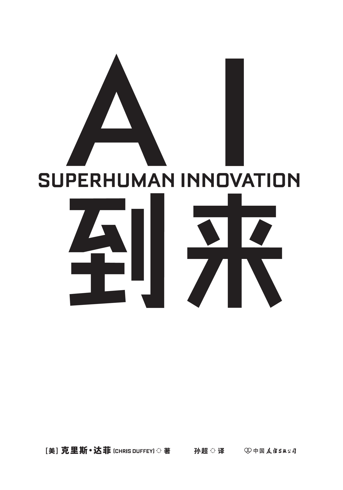

献给培育我终身学习精神的父母，献给点燃我灵感的妻子与两个女儿，献给教会我何为真正的成功的那位姐姐。

# 作者简介

克里斯·达菲目前担任 Adobe 创意云战略创新合作伙伴的负责人，深耕创意企业领域。

他的职业轨迹与作品多次被主流媒体提及，包括《华尔街日报》《卫报》《公司》《国际广告周刊》《广告时代》、流媒体平台 Cheddar、《每日镜报》、The Drum、《广告运动》、CMO.com、《纽约邮报》《商业内幕》等。其案例亦被谷歌、麦肯锡、沃顿商学院收录进数字营销教材。克里斯同时担任罗格斯大学咨询委员会委员，并任美国报业协会董事会成员。

入职 Adobe 前，他是获奖无数的执行创意总监、演说家、著作者，同时是人工智能与移动技术领域的专家。《商业内幕》曾把他列为能在瞬息万变的移动营销市场中洞察问题、把握机遇的行业领军者之一。其职业生涯横跨 WPP、埃培智、哈瓦斯、奥美、阳狮、MDC 等 35 家广告公司，覆盖几乎所有关键垂直赛道。他长期研究人工智能与移动技术之间的必然关联，并乐于在最复杂的商业难题中进行创新突破。《卫报》曾将他与人合著的《移动互联网如何重塑医疗行业》评为年度医疗报道十佳之一。

克里斯的主旨演讲累计观看量已超 5000 万次，多次被《走进好莱坞》《号外》《OK! 杂志》《你好》《People》《每日邮报》《国际广告周刊》《鼓》等媒体报道。

# 这本书为何由人工智能共同撰写

在担任创意总监与创意科技专家的岁月里，我始终在思考：当人类创造力与天赋被技术加持时会产生怎样的化学反应。接下来的内容将追溯人工智能如何在近几年成为最具颠覆力的科技之一。我既想推崇 AI 的能力与潜能，也想坦诚其边界。我不满足于只写一本谈论它的书，我要亲手用 AI 把书写出来。捕捉 AI 当下与未来的可能性是一段充满惊喜的探索，有时令人振奋，有时也让人确认 AI 仍有其局限。为让读者直观感受 AI 带来的变革，我邀请了一批 AI 技术作为本书的“合著者”。下面就说说我是如何操作的。和大多数写作一样，我的使用路径是有规划的、非线性的，并且经常叠加不同技术层。

从 21 世纪初到中期，我们经历了移动互联网的爆发期。客户总是问我移动响应式网站或 App 该如何搭建。回答之前，我习惯先拆解技术栈：视觉设计要引入哪些环节？UX^((1)) 工具体系怎么选？代码如何落地？又该怎样调用苹果或安卓的芯片、定位等硬件能力？问题层层递进。近来，Apple Watch、健康 App、亚马逊 Alexa 在全天候科技会议上的普及，让这些议题加速落地。我们正处在互联网与可穿戴设备的早期红利期，这种与 AI 技术模块的对话感，为“何时何地如何用好 AI”这一战略与创意命题奠定了基础。

本书没有从“如何造 AI”或“如何用某种具体 AI 技术”出发，而是把 AI 视作共同创作者，核心追问是：这项 AI 能做什么、怎么做？围绕这个问题，我调用了大量 AI 接口清单。它们涵盖按主题生成回复、预测相关上下文、跨语言翻译与摘要、语句拆解与分析、段落语法剖析到句法与语义定义、语调分析与文本情感识别、观点归纳与文本价值提炼等。本书的 AI 伙伴——我称之为“艾美”Aimé——由一整套技术构成，其中不少为开源方案，每项都基于不同的原理与基础设施。艾美整合了自然语言处理 NLP、自然语言理解 NLU、自然语言生成 NLG 等机器学习接口，能够识别关键词、短语、想法与指令，偶尔还能理解经验与推理。

本书涉及的 AI 应用大致分三类：智能语音交互、智能内容理解与提炼、智能内容创作与生产。语音识别与连续听写通过语音用户界面 VUI 实现人机交互，完成语音转文字、文字转语音、语音编辑、格式调整、校对与分享等任务。智能内容理解与提炼通过情感分析、标签体系与上下文概念组织，筛查数据库、文章与研究论文，提炼成易读摘要。智能内容创作则是系统在辅助创作流程中生成概念与灵感，模拟人类写作路径，提供创意点、标题、初稿等输出。

做一点技术上的坦白：从架构视角看，许多 API^((2)) 都运行在云端，可通过现有实例或应用调用，再对接研究数据库，通过算法实现生成、创作、总结、丰富等功能。将多个 API 叠层使用，能得到更完整的输出。这种“多引擎”做法体现的是一种以目标为导向的 AI 工程思维，而非追逐技术噱头。AI 的发展不应拘泥于某一种方法论，而应始终以人为中心。

把 AI 应用到更高层任务，比如人类创造力，听起来可能有些挑衅，但人工智能确实能放大创新与原创性。本书以对话体撰写，与 AI 探讨人工智能议题，展示技术如何实现看似不可能的事，解决我们自身难以解决的问题，或加速问题的解决。

这本书适合：1. 想把重复繁琐的工作减少，投入更多精力在热爱之事上的人；2. 希望更聪明地工作、提升效率的人；3. 任何年龄、任何技能水平的人；4. 追求更大成功的人。人工智能是你达成目标的工具。

请务必读完。也许个别章节偏技术，但请相信，这不只是技术书，更关乎你自己与你能借此实现什么。若你坚持读完，我相信无论是你的企业还是你的职业发展，都将获得切实可用的机会。

* * *

(1)　UX 为 User Experience 的缩写，意为用户体验。
(2)　Application Programming Interface，应用程序编程接口，即软件系统各部分衔接的规范。

# 序言

我的童年在密尔沃基度过。那时我养了一只赛鸽，叫罗克珊。她不是普通鸽子，而是一只冠军鸽。纯蓝格的母鸽，脚踝绑带号码 2803——这个数字意义非凡，很快你会明白。

我常好奇，她和她的赛友们如何找到回家的路。每逢赛季周末，一辆专用的鸽车会把它们送到数百英里^((1))以外。鸽子们同时起飞，像肯塔基赛马或越野障碍赛一样冲出闸门。哪怕不是鸽迷，见此景也会震撼。

父亲会开车带罗克珊参赛。我在家焦急等待，心里想：她凭什么能从那么远的地方回家？途中可能遭遇雷暴、鹰袭，还要躲飞机、穿过重重障碍。但罗克珊总能归来。

每只赛鸽脚踝系着绑带，这有什么用？比赛意义远不止回家。当鸽子到家，主人需取下绑带，用类似老式信用卡打卡机的设备盖上时间戳。

罗克珊回来后，我要绞尽脑汁想办法抓住她取下绑带——这决定胜负。

我知道她偏爱一种特制玉米混合粮，用它能让她分心落地。我趁机抓住脚踝上的绑带，然后和父亲飞奔到鸽会，按数学算法计算最终时间比，决出名次。对威斯康星长大的孩子来说，这就是最纯粹的竞技。

如果你仔细看鸽子的喙，会发现有一个小白点，铁含量极高。科学家认为它与地磁场相互作用，成为鸽子的天然指南针。鸽子在动物界堪称异类，几分钟飞 20 英里，时速可达 92 英里／小时，日飞 700 英里，视野达 26 英里。曾有记录显示它们 55 天飞了 7000 英里。

公元前 8 世纪，希腊人用鸽子传递奥运、战事等消息。虽然听起来不可思议，但靠人跑步传递马拉松战败消息花了整整一天，且传令兵因疲惫中暑而死。用鸽子只需数小时。

你可能好奇，为何在人工智能的书里谈鸽子？因为这正说明，人类很早就利用其他智能工具来拓展自身能力。对动物的驯养，让早期社会学会利用生物的物理与精神属性。如今，计算机尤其人工智能，正把人类能力推向“超人类”范畴。

我们用计算机处理复杂任务、延伸自然能力，或完成重复、危险、费力的活，这和利用动物本质相同。人工智能放大人类能力、提升创新力，进而改变企业、社会与个体，这正是核心前提。

历史上最伟大的创新者都将艺术与科学结合，达·芬奇自认既是艺术家也是科技人。正因如此，我们将探究 AI 如何融合艺术与科技。AI 对商业与社会的未来影响毋庸置疑，具体应用方式仍具不确定性。

有时人们把 AI 比作电力——正在重塑全球工业并彻底改变我们对工作的认知。本书将展示 AI 如何赋能员工、激活职场、为企业创新提供竞争优势并带来强力变革。它是一本实用指南，解释人工智能与机器学习如何改变商业、品牌与人们的创新方式，以及对产品、服务与内容的创新影响。

* * *

(1)　1 英里约合 1609.34 米。

# 引言

### 第二思维

孩子大约两岁时会出现奇妙变化。他们开始意识到他人拥有独立的想法与感受，也就是“第二思维”——理解他人信仰、意图、欲望与情绪的能力。人类迎来觉醒时刻，正如我们如今意识到人工智能。AI 这一“第二思维”将拓展并推动我们的能力与智力，远超想象。¹

如果我们能借助超人能力，在学业、运动、商业上表现更好，最终活得更长久更有质量，谁不想拥有这种优势？带着这份启发，本书揭示 AI 的各种可能，将其拆解为实战策略，并提供一套把 AI 用于商业创新与转型的思维模式。

超人类框架围绕五大关键词展开——**速度 Speed、理解力 Understanding、绩效 Performance、实验 Experimentation、结果 Results**。后续章节将逐一展开。

作为父亲、丈夫、儿子、兄弟，以及 Adobe 的员工，我的生活与大多数人一样充实。一想到要写书便倍感挑战。但我付诸行动，用 AI 技术完成了大部分写作，从而大幅压缩创作周期。为展示 AI 如何赋予人类“超能力”，我为 AI 取了个名字——艾美 Aimé，源自法语“挚爱”bien Aimé，也是 AI+Me 的结合。艾美体现本书的目标：让人工智能成为你的挚友、共同创造者、通往未来的智能私人助理。

艾美展现了人类在 AI 时代的角色与关系。如同亚马逊 Alexa、各类机器人、Siri 等语音助手，我们正进入智能助理时代，它们会预测需求、激发与放大能力、助你成长。全书中，艾美从我学习、帮助我实现想法、理解我需求，并为对话增添趣味。这也证明“弱人工智能”已在稳步进步。

未来不等人，别再拖延，直接开始阅读吧。友情提示，本书共三部分——人工智能的基础、人工智能的实践、人工智能的未来。

# 第一部分　人工智能的基础

人工智能像是来自未来的问候。每隔 10 到 15 年，世界就会迎来一次改写规则的新技术。桌面计算与出版革命通过互联网实现了信息民主化，随后是无处不在的移动设备。海量数据催生了云存储需求。人们对数字排放 digital exhaust，即网络行为所产生的数据的渴望，加速了人工智能发展。

换言之，人工智能在诸多领域正是因为数据分析工具的需求而诞生。

人工智能常被比作“电力发明”。作为一种环境操作系统，它将点亮未来企业创新的道路。AI 有望实现产品大规模生产、催生可复制的服务与体验、驱动自动化以提升生产率。创新者一直在为产品与客户创造机会，而 AI 让这些机会更关键。

有言出自爱因斯坦：智慧的真正标志不是知识，而是想象力。这也是本书的核心主题。对 AI 而言，衡量智慧的关键是聪明的想象力。解锁数据后，想象力会获得更多知识与更深体悟。

AI 是我们时代的平台与媒介，引领我们进入 AI 可执行的终极阶段，企业必须将 AI 价值交换能力提升三倍以增强创新。

技术本身没有善恶。AI 只是一个工具。归根结底，我们讨论的不是 AI 趋势，而是如何让这一趋势在各行业与社会文化中创造个性化的神奇体验。

再说说 AI 的相关性，观察当下的文化产业，AI 已渗透生活各面。如好莱坞电影《西部世界》与《摩根》。《西部世界》讲述 AI 主题公园，机器人为主角。《摩根》不仅因 AI 主题吸睛，还因用 AI 技术制作预告片。

雷·库兹威尔在《如何创造思维》中的开创性写作抓住了当代与未来的 AI 能力，而亚马逊 Alexa、苹果 HomePod 等语音助手的兴起，以及以色列 Mobileye 在自动驾驶领域的应用，都印证了这一点。本书后续将详述这一部分。²

## 1. 变化着的环境：客户行为及客户期望

为更好理解 AI 带来的机遇，先看一下正在变化的环境。我们正处社会转型期，数字化颠覆每个行业、各类组织与每个人。人们用更多设备、更快速度消费内容，同时期待每次体验都个性化且无瑕疵，当然也希望体验比以往更好。人们不再容忍瑕疵：这正是数字化转型的核心。企业已意识到，无论对客户还是内部，都需从以产品为中心转向以体验为中心。

## 2. 数字化变革：从信息传递到用户体验

卓越体验已成为吸引与留住客户的关键。创造令人惊艳且鼓舞人心的内容至关重要。强大的体验改变了我们与世界互动、娱乐、工作与相处的方式。体验可以是一对一的，如家庭、朋友、同事、协作者间的互动，或更广泛的社交媒体体验。也可以是一对多的，如企业对消费者、企业对企业、教师对学生、政府对公民、艺术家对观众。如今，这些以数据为基础的体验是我们穿透噪音、建立联系与产生影响的方式。

## 3. 无限数据：带来更好的结果

体验由数据驱动，数据反过来推动企业创新体验。通过数据，我们能创造有意义的体验。例如，人们每天在网上产生约 2.5 亿字节数据，AI 可利用其一部分分析消费者与品牌互动方式及流失原因。这帮助企业辨别有效与无效行为，从而更具洞察力，走向数据支撑、带来美好体验的创新生活。³

然而 AI 与技术本身无关，而是利用技术创造沉浸式、意想不到的体验。随着人工智能、机器学习与深度学习发展，机器正变得不可或缺，并迈入超人类创新领域。

## 4. 基础设施：基础需求

与任何新技术一样，发挥 AI 潜能需要一定的技术与组织基础。可将基础设施视为五层，其上才是 AI。

- 网络
- 硬件设备：服务器或硬盘
- 数据模型
- 数据库
- 应用

技术必须面向未来——可扩展、高可用、数据冗余、容错恢复、高性能、虚拟化。智能选择数据库，使其具备良好可扩展性。

# 第二部分　人工智能的活动

## 5. 人工智能：人工智能革命的定义及原因

直到 80 年代，学校还教授计算机技术。如今方法论已变，重点在于把计算机或软件付诸行动——用 iPad 学数学，或用交互式电子白板阅读。

人工智能也是如此。我们不从技术入手，而是聚焦于如何在哪方面用它来解决企业问题。指挥家或作曲家了解乐团各乐器的功能，但不必会演奏每种乐器，也不必知道其构造。他们的职责是整合声音，创作出杰作。

这正是我们在商业战略层面讨论 AI 的本质。客户与消费者不关心技术细节，他们想知道 AI 能实现什么，以及如何服务于人和企业。

## 6. 超级框架：超人类策略

# 当同质成为常态，服务就是新护城河

当产品功能趋同、价格也趋于一致时，比拼的重点就落在服务体验上。AI 让企业只需一个智能入口，就能驾驭海量数据，实现个性化与按需供给。

下面用 SUPER 超级框架拆解 AI 创新的五大维度：
S 是 速度，加速工作流；
U 是 理解力，深挖洞察；
P 是 表现，提升定制化交付；
E 是 实验，支持迭代重塑；
R 是 结果，输出可衡量可优化的成效。

## 7. 速度驱动：让流程跑得更快
AI 全链路提效，从生产到创意、内容生成到内部协同都能提速。终端用户感受到的是响应更快、交付更快的服务体验。

## 8. 感知力：读懂更深的信号
AI 已渗透到创意策划、广告投放、服务机器人、应用开发、归因分析与交付环节。更强的理解力让服务更贴合真实需求。

## 9. 表现力：用数据校准交付
数据与内容爆炸式增长，企业必须拥抱 AI 与机器学习，从数据洪流里释放真正洞察。云计算正从自动化层进化为贯穿始终的智能骨架。

## 10. 试错力：把好奇变成系统
今天的 AI 浪潮和 90 年代中期的互联网很像，早期赢家都是发现问题并敢试的人。现在环境相似，但 AI 实验必须系统规划，而非凭感觉。

## 11. 成果力：从数据到可量化转型
AI 成熟后，结果变得可量化。它能快速处理海量数据并推断趋势，打开预测分析空间，也凸显了良性反馈循环的价值。

# 第三部分　AI 的未来图景

## 12. 起步：先找对问题
启动 AI 项目前先问：解决什么问题？谁需要这个方案？客户永远排第一。

## 13. 安全与伦理：双向保障
AI 安全分两层：一是 AI 本身要可靠；二是 AI 可用来提升安全，应对物联网与企业面临的关键风险。

## 14. 从过去展望未来
想更好预判未来，先回看过去。科幻小说里藏着人类对 AI 最早的憧憬，能帮助我们厘清技术背后真正的希望与承诺。

## 15. 人机共创：释放创造力
如果 AI 有潜力解决世界级难题，人类该做什么？答案是人机协同。人的创造力被 AI 放大，造福企业也造福社会。

## 16. AI 未来：工具与艺术的结合
AI 的成败由企业力量和消费者力量共同决定。AI 只是工具，关键在于善用它，把艺术与科学结合，创造令人惊艳的体验，推动商业与社会创新。机会无限，目标是让读者看得更清。

# 第一部分　AI 的根基

## 1. 用户在变：行为与期待升级
克里斯：艾美，欢迎来到现实世界。
艾美：克里斯，你好。今天怎么样？
克里斯：不错。挺有意思也很讽刺，这本书讲 AI，却更像在讲一种新的文化实践。

### 以人为本的服务
艾美：变化越大，不变的东西越重要。归根到底 AI 要服务人类。核心问题是技术如何提供产品、服务与体验来丰富生活。目标不是造出更聪明的机器，而是更聪明的组织、更聪明的社会，最终更聪明的世界。
预测 AI 未来很难，几乎不可能。物联网、移动互联网、机器人会在未来十年二十年普及。回望过去二十年，没人能预见到智能手机的爆发，连科幻也没写准互联网的渗透力。

### 科技如何重塑日常
克里斯：看手机就能知道科技如何改变习惯。以前翻盖机只能打电话，现在一眨眼就是一台随身电脑、高清屏，掌上冲浪成日常。
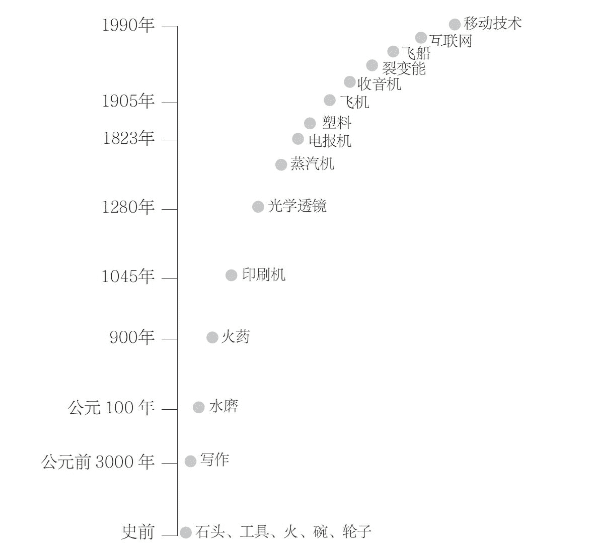
**科技发展历史**
来源：了不起的科学
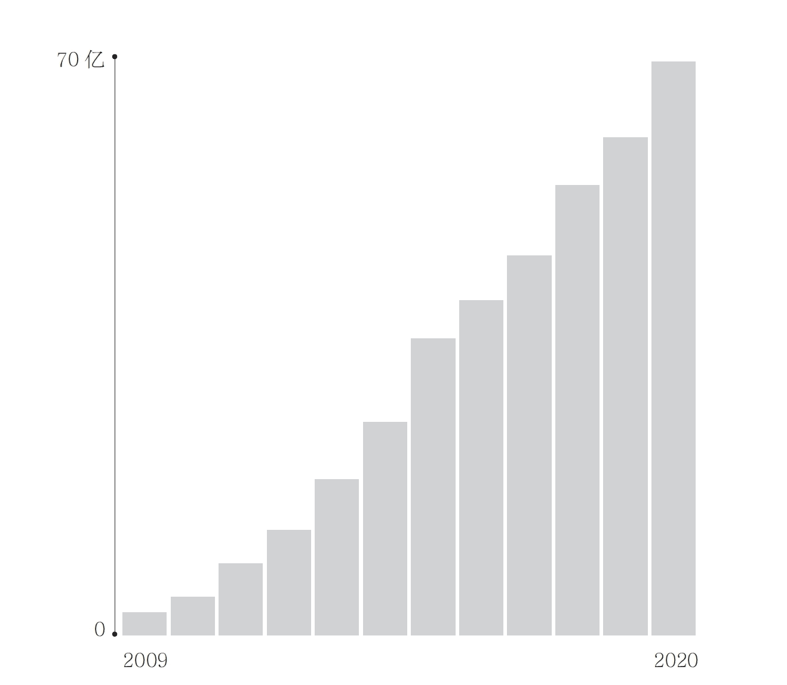
**移动技术的崛起**
来源：爱立信&Tune 预测
前几天逛超市，很多人低头刷手机。比价、和家人商量、结账后叫车，全靠手机完成。
基于此，Adobe 推出 Adobe Sensei 框架，聚焦数字体验挑战，比如解析商场实时人流。目标是捕捉购物习惯、人口特征、消费金额等信息。想象一下进杂货店，手机提示上周买的饼干在打折，先放进购物车再继续逛。
艾美：移动设备使用越来越普遍。2018 年美国成年人平均每天花近 3.5 小时在非语音移动媒体上，57% 的移动用户一醒来就看手机。
克里斯：人们无时无刻不在看手机。记录生活、发照片视频到 Instagram、Pinterest、Facebook 已成常态。
移动设备如何改变工作？以 Trader Joe's 为例，他们用 line busters 移动设备加速收银。苹果店早让顾客用 iPhone 自助结账，基本看不到排队。
艾美：联网无处不在。智能手表、可穿戴设备 24 小时在线，甚至有人在研究能随需求变色变图案的智能纺织。
智能手机热度持续攀升。美国每天 2640 万人使用手机，累计使用达 120 亿次。德勤数据显示智能手机普及率达 82%，18-24 岁占比 93%。
移动技术提升企业能力，同时提升服务与盈利。智能工厂借助无线技术实现实时协同优化，反应更快、更主动、更有预测性，避免停工。

### 信息触达的民主化
克里斯：从代际看，2000 年后出生的 18 岁年轻人成长于移动、社交、网络明星、平板、可穿戴的世界，这就是他们的现实。
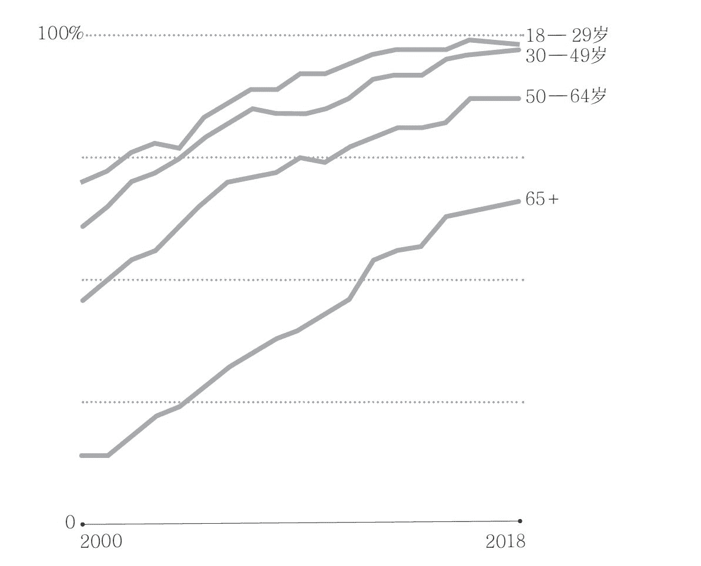
**技术使用情况明细（按年龄划分）**
来源：皮尤研究中心。调研时间：2000—2018 年。每年的数据均基于 2000—2018 年间的所有调研分析
他们随时随地沟通、网上买披萨一小时送达、用平板买车很正常。这种期待向企业传导。
艾美：这正是互联网最初的承诺：信息民主化与高触达。非洲跳过笔记本和台式机，直接成为移动互联大陆。无人机与移动技术结合，在交通通信薄弱地区运送物资。
Zipline 公司用无人机向非洲和南美农村送急用药品。商业内幕报道，喀麦隆、摩洛哥、马拉维、南非、卢旺达、肯尼亚等国已在旅游、医疗、电商领域放开无人机。
移动与互联网结合催生 AI 赋能客户，他们不仅是客户更是人。企业必须服务用户，否则会被淘汰。Uber 与 Airbnb 的革命证明，聚焦未满足需求的公司能快速超越只重产品的传统企业。

### 持续在线
克里斯：企业可随时随地触达用户，覆盖物理与数字全场景。媒体习惯已变，不再是少数电视网络的广告时代。21 世纪的媒体是个人化、情境化的对话，VR 与 AR 将进一步重塑关系。
艾美：AR 将重塑零售，技术已嵌入系统。你可以对着手机看衬衫上身效果，或对着食品获取食谱清单。
物联网让设备更具预测与暗示性。设备可通过语调判断疲惫并建议喝咖啡或休息。医疗物联网里，智能马桶可自动采样监测健康，医生能提前发现危及生命的疾病。
克里斯：触达点激增，注意力更难获得。移动、跨屏、AR、可穿戴、智能语音都在争夺焦点。
亚马逊有声书可在 Fire TV、手机、Kindle 上无缝切换，生态系统记住播放进度，甚至在非亚马逊设备上同步。

### 技术的使用价值
艾美：注意力稀缺，但技术能省时更便捷。以洛杉矶、纽约户外大屏为例，能远程编程并根据环境线索即时变换。
工作生活边界模糊。零工经济让人可在任何地点为多家雇主工作。
数字艺术家用手机平板跑 Adobe 应用做 2D、3D 图形与动画，无需进办公室。3D 打印机成熟后，远程造物也成为可能。
克里斯：回到学习。课程可定制、个性化，按个人需求与时间预算学习，移动端随时随地进行。
Udemy 等平台课程短小精准，适合碎片时间学习，有望重塑教育模式。

### 协作重塑
艾美：团队协作更分散。多人在线游戏让人们实时互动。《Roadblocks》《Minecraft》《Fortnite》与《Second Life》都是例子，后者允许虚拟生活积累可提现收入。
克里斯：物理与虚拟世界交融。朋友在《Second Life》开咖啡馆雇虚拟服务员靠虚拟生意维生。《公司》杂志曾称未来十年 50% 标普500公司将被取代，数字化转型与更有效的营销是原因之一。

### 营销从独白到对话
艾美：网络营销不再是单向传播，而是对话。购物旅程跨渠道跨平台，市场营销必须跟上变化。
互联网广告从横幅进化到互动社交平台，可精准定位需求。Facebook 不只是社交，而是多数人网络生活的中心，可用类似受众模型精准触达。
克里斯：典型购物路径：社交搜索、看评测、跨站比价、进店体验、线上下单、无人机送达。没有正确软件，归因与衡量极难。
艾美：答案是整合分散去库存数据库，用预测分析获得全局视角。这就是大数据的挑战，数据必须存在且可访问，AI 才能生效。

### AI 的真正使命
克里斯：技术再多，核心是人。用户想要什么？我们如何帮他们实现？
艾美：这些技术不是为取代人类，而是人机共创。人将专注创造力，让 AI 处理平凡重复无聊的任务。这就是 AI 的真正使命。

## 2. 数字化变革：从信息传递到用户体验
克里斯：我们已确立互联客户与数字颠覆的文化转变，现在谈创造性体验的必要性。
艾美：体验对我这种非人类来说很抽象。我知道定义，却没真正感受过。
克里斯：哈哈，提醒得好。
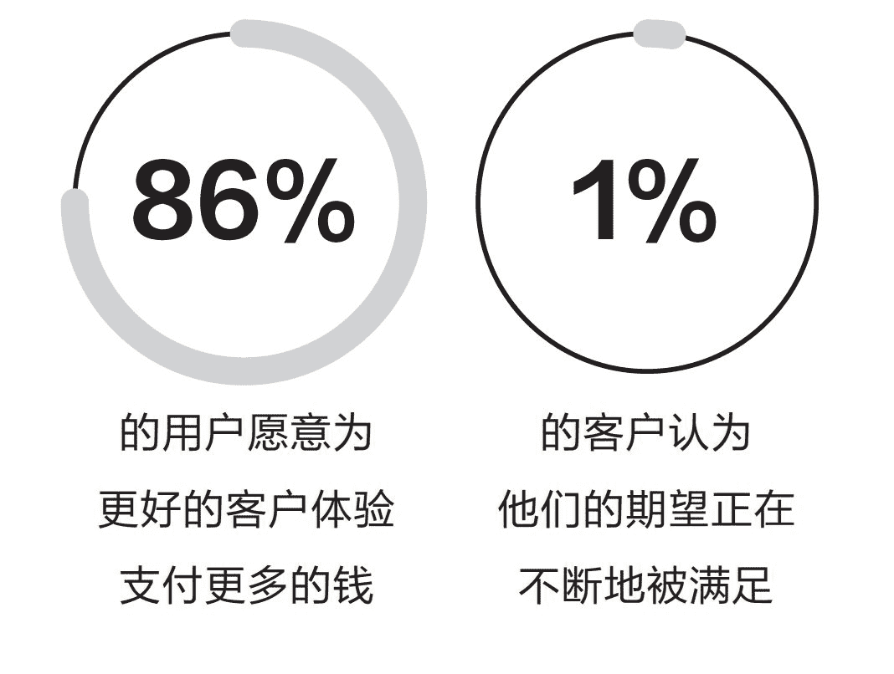
来源：布莱恩·索利斯，《X：商业与设计相遇时的体验》（威利出版社，2015）
### 参与体验
布莱恩·索利斯提出用户体验概念：客户与品牌在生命周期每个触点、每个关键时刻的互动总和，也适用于员工与雇主、病人与医生等。
艾美：说得通，但讲点实际应用我才能理解。
克里斯：从亚马逊开始。它的 logo 是笑脸，传递的不只是交付产品，而是极致体验。人们喜欢微笑，logo 就在说在亚马逊会开心。
艾美：体验目标必须贯穿全程。
克里斯：这只是触点之一，也强化满意度。它暗示亚马逊的一切服务都会令人愉悦，前提是实际体验兑现。
艾美：亚马逊从网站到下单、配送、投诉全程优化，实体店设计也强化这种精神。
克里斯：亚马逊未止步，从履约中心到配送到网站，理念贯穿运营。仓库以最高效运行为目标，智能管控机器人、物流、货位，打造优化履约体验。现在还能用 Alexa 语音下单。
艾美：语音带来很多机会，让事情更简单。早上刷牙时问 Alexa 天气交通，就是定制化信息服务。
企业环境同样适用。医生可语音查询药物副作用，卡车司机规划路线，经理预订会议室。AI 应用无止境，未来令人兴奋。

**克里斯：** 虚拟语音助手这一块很容易被忽略，像微软小娜、谷歌助手以及 Siri 都属于这个品类。它们已经打通手机、平板和电脑。往前看，社区超市收银、加油站加油等场景很可能也被它们接管。美国邮政合作推出的语音触发寄件追踪计划 Product Box 也是典型，让邮寄与查询变得更省心。

想点披萨时，手机里的 Domino’s 应用就提供了一个虚拟点单助手。星巴克的 My Starbucks Barista 逻辑相近，用手机就能完成点单，体验与店内面对面点餐几乎一致。²

LG Electronics 近期发布联网冰箱，内置亚马逊 Alexa，可在网络杂货平台下单，还能登记食材的保质期。³

语音技术对使用感受的改善，远不止这些。

**艾美：** 围绕各个接触点的优化，企业一直在投入。没有客户就没有存续与扩张，品牌留住人的根本在于体验是否称心。用得顺手，回购才会跟上。⁴

彭博商业周刊的调查显示，把客户体验做到位已成行业共识，受访企业里八成把客服列为核心战略方向之一。⁵

## 痛点

**克里斯：** 接着聊聊如何依据偏好、历史行为与消费习惯去做个性化与定制。

**艾美：** 先要把客户的难点找出来，也就是购物流程里难以完成、令人沮丧甚至导致放弃的环节。每一点卡顿都是优化的切入口。

**克里斯：** Netflix 的做法很有参考价值，它依据观看历史与过往偏好做预测，主动推送用户可能感兴趣的剧集与影片。⁶

过去开通线上自助，银行常要求用户回答一连串安全问答。如今不少机构引入语音验证，识别更快也更安全。⁷也有银行直接以手机号作身份标识，省去隐私提问环节。

**艾美：** 谈到风控，为防信用卡欺诈，银行会为每位持卡人建立行为画像，记录日常操作节奏、页面跳转方式、甚至按压力度等特征。一旦消费偏离历史基线，风控团队会主动致电核实身份。对商户和持卡人来说，这都是双向收益。⁸

**克里斯：** 医疗场景里，去医院排队等候是个典型痛点。新式远程医疗 App 让用户用手机预约，随后以文字、语音或视频与医生连线，减少了非急症的上门就医。院方、医生与保险公司均能从中受益，患者也无需驱车奔波、在拥挤候诊区久坐。⁹

**艾美：** 再看苹果健康工具包，将各类健康数据汇入应用后，手机会依据活动与健康需求给出个性化提示，如服药提醒、起身活动、呼吸调节心率、日常锻炼建议等，这正是个性化改善生活品质的体现。¹⁰

## 创造独特且有趣的体验

**克里斯：** 这其实是更大尺度个性化的雏形。设想智慧城市能掌握体育赛事时间表，活动启动时周边的商户会自动收到提示，加紧备货、安排人手或推出促销。智能道路可实时监测车流人流，事故发生时自动改道并通知相关方或应急部门，全部无需人工介入。城市将在一定程度上随居民习惯与生活节奏而自适应。¹¹

**艾美：** 案例相当震撼。下面聊聊个性化如何助力商家沉淀忠诚用户。

**克里斯：** 需要强调的是，关键并非单次交互或单个接触点，而是完整的购物旅程。某个环节设计失当带来的挫败足以损害品牌形象，促使用户流失。

拿购车举例，部分应用能按车型品牌定制配置，还能做虚拟试驾的模拟体验。设想这位顾客玩得很开心。

接着用应用做预授信审批，数分钟内初审通过，额度就出来了。系统还会推荐附近经销商，给出地图并预约看车时间，随后推送旧车置换估价，并在预约前一天发短信提醒。

到这里感受还不错。车是按需求定制的，贷款能申请，置换价清楚，时间也定了。

到了约定日子，他提前五分钟到店，却发现无人接待，挺失望，但也觉得偶尔会出状况。可能销售生病了，或有其他原因。

于是等了又等，十五分钟仍无人搭理，他只好找经理。经理查后说从未收到这次预约。更糟的是，他精心设计的车型没现车，额外配置在该款上也不支持。他很烦躁，经理表示理解并亲自帮忙处理。可他觉得为时已晚，决定离开改天再看。

正如你看到的，体验起初很完美，但购买周期里的一个小失误让整个销售脱轨。经销商丢了生意，销售没佣金，顾客也没买到想要的车。

这只是需要精密协同客户体验的一个假设情境。涉及多家公司与应用却衔接不良，根源是预约时发给经销商的邮件或信息在传输中失败。这个简单错误让企业损失数千美元，还流失了一个长期客户。

更糟的是，沮丧的顾客很可能在社交媒体上发泄，在 Yelp、谷歌留下负评，再在 Facebook 上告诉上千好友避开这家店，可能造成未来数月甚至数年的销量损失。一段糟糕的互动会像滚雪球一样演成公关危机。

当然错误难免。解决之道是把这些用户痛点在系统设计阶段就优化掉。

假设你想在亚马逊买东西。打开网站很快，搜索几分钟就找到商品，读了大部分正面评价后下单。你勾选了当日下单当日发货的选项，而且作为金牌会员这是免费的。

不幸的是，商品没在承诺时间送到，你打电话给客服。人工客服几分钟内把你转接给当地物流主管。她迅速定位包裹，发现送错了地址，于是联系正在路上的快递员尽量追回并重新送达。一个小时后，快递员满含歉意把包裹送到手上。半小时内，你就能在社交媒体上热情地向所有朋友分享这次出色的服务，让自己成为品牌的拥护者，尽管送货出了错。问题被迅速有效处理，亚马逊赢回了信任。

这是在复杂体验中营造容错能力的一个例子。错误总会发生，是客户与其他相关方摩擦的主要来源。若系统没考虑到这些，再好的产品服务也会让销售额下滑、品牌受损。

正如刚才所见，系统关注点已不只是独特卖点或价格。现在的差异化在于为客户和员工创造独特有趣的体验。当下蓬勃发展的公司明白，它们卖的其实是客户体验服务。

## 员工的忠诚度

**艾美：** 确实。体验要兼顾两端，企业既要对客户好，也要对员工好。

**克里斯：** 对员工来说，卓越的体验不仅激发创新，还能提升忠诚度和留任率。

建立员工忠诚度的方法是营造团体意识和共同目标，让员工觉得自己与组织的成功同在，从努力中受益。

因此员工不会觉得自己是孤立的齿轮，也不会不清楚自己的工作与其他人如何关联。他们知道工作有价值，自己的声音被听见。

这已超越表面价值。人与人的联结是与生俱来的。¹² 有了团体意识，员工获得更全面的工作体验，动力和效率也随之提升。

Knowbe4 是个典型。这家位于佛罗里达州克利尔沃特的公司每天召集员工开会，快速回顾重要事件、当日目标和运营情况。团队围坐在懒人沙发上，不像正式会议那样紧张。

所有成员都能分享公司财务成功的红利，除基本薪水外还有奖金。公司发展越好，奖金越多。

这种仪式感有助于建立目标感和归属感，最终形成持续的优质职场体验，员工会产出更多更高质量的成果。

**艾美：** 好奇这如何转化到客户体验上。

**克里斯：** 当员工觉得自己是愿景的一部分，会提供更好服务、在生产线上犯更少错误，对客户更有同理心。

因为员工清楚自己在组织中的角色和行为的影响，他们会更专注于提供优质的客户体验。

我们常把客户理解为购买产品服务的人，但内部客户也很重要。内部 IT 部门负责维修平板、台式机、手机等设备资源。他们的客户是公司内部的最终使用者，他们的价值在于给员工一个很棒的体验。

**艾美：** 整体体验架构是深度互联的。生态系统本质上是共生的，每个部分都依赖其他部分的表现。组织也是一种生态系统。在体验文化里，一切必须像瑞士手表里精细调校的齿轮那样协同运转。

**克里斯：** 这就凸显了企业要设身处地为员工和客户考虑的必要性。正如刚才讨论的，体验设计非常复杂，大数据的真正价值在于揭示如何让极致体验个性化。

没有数据策略和基础设施的支撑，就不可能创造极致体验。如果你不了解客户和员工，就给不出好体验。

了解客户的唯一方法是收集、维护和分析关于他们的需求、习惯和选择的信息。有了数据基础，就能通过分析洞察体验需求。

**艾美：** 好吧，如果设计好体验已够复杂，那接下来关于数据和分析的讨论会更复杂。

## 体验文化

**克里斯：** 创造和维持体验文化依赖信息。你必须了解员工和客户的行为、愿望和活动方式，才能给予极致体验。这意味着要迅速有效地收集、存储、分类和理解海量数据。

**艾美：** 没有数据，就不可能给予用户最佳体验。

**克里斯：** 对，体验文化带来挑战，也带来巨大机遇。

## 3. 无限数据：带来更好的结果

**克里斯：** 现在说说数据，它是人工智能的燃料。我们先从数据的定义和来源聊起。

**艾美：** 话题很大，我们慢慢来。你喝咖啡了吗？可能要待一阵子。

## 什么是数据

**克里斯：** 好的开始吧。艾美，数据到底怎么定义？

**艾美：** 词典里说，数据是指“个别事实、统计数字或信息项目”。

比如你当前的位置就是一个数据点，也就是单一数据。你的电话号码、银行账号以及任何关于你的信息都是数据，信息集合也叫数据。

汽车里的电脑一直在收集数据。发动机健康状况被持续监控记录，温度、行驶里程、轮胎压力都会被记下。车载 GPS 作为导航的一部分，记录着你去过的所有地方。这些共同勾勒出汽车健康和驾驶习惯的画像。

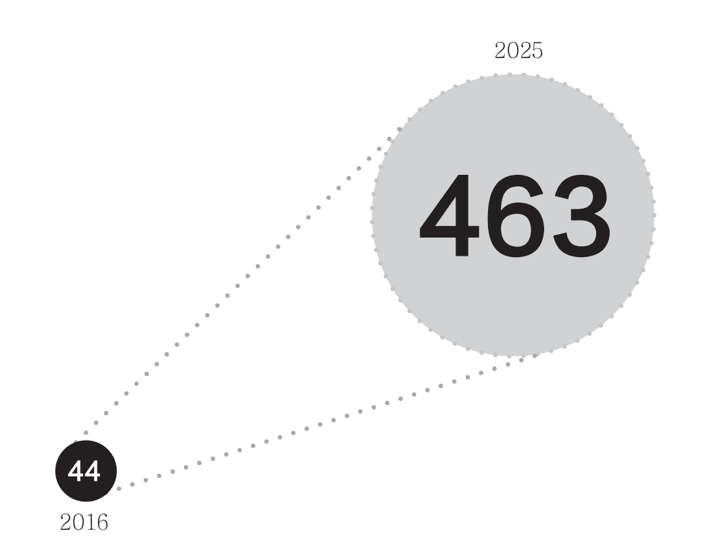

**全球每天生产的数据（10 亿 GB/天）**

**克里斯：** 营销人员很关注客户数据，比如居住地、个人信息、线上行为偏好，以及搜索和购买模式。

电子健康记录已取代纸质记录，成为存储健康信息的方式。旧文件、医生诊疗记录、检查结果、过敏史、用药记录、家族病史等全部整合。所有来自医生和专家的信息集中一处，你可以访问，经你授权的医生、实验室、影像机构、药房、学校诊所等也能访问。有了完整信息，医生和其他医护人员能更快更安全地做出更明智的决定。¹²

**艾美：** 想想亚马逊一次下单会产生多少数据。他们当然知道你买了什么、寄到哪，但也会给包裹分配条形码，以便在由联合包裹、美国邮政、联邦快递或亚马逊自营快递运送途中被识别。任何时候你都能进入应用追踪包裹最后一次被扫描的位置。对单个包裹来说，这也是大量数据。

亚马逊的包裹服务更进一步。公司正在推广亚马逊智能锁系统，供金牌会员使用，允许快递员进入家中把包裹放到安全处，防止被盗。订购该服务时你会收到网络摄像头和特殊锁具，亚马逊可远程解锁给予准入许可。亚马逊保留这些视频以证明快递员的诚信。这又让亚马逊获得更多关于你的信息。³

## 数据的复杂性

**克里斯：** 这就是数据的力量。收集这些信息很棘手，因为劳动密集、复杂，需要大量资源，如通信、存储基础设施如光盘存储，以及防黑客和未授权访问的措施。

**艾美：** 想想亚马逊或易趣这样的数据体量。来详细拆解一个看似简单的交易。

每个产品单元都有条形码标志，其所有信息都存于亚马逊数据库，包括尺寸、仓库位置、状态等一切可想到的细节。

客户下单后，亚马逊必须从仓库揽收该商品，并与同单其他商品一起装箱。亚马逊不仅追踪每批货，也追踪箱内每一件商品。

这个箱子随后分配给合适的快递公司，可为 USPS、UPS、FedEx 或亚马逊自营。箱子贴上条形码后被揽收，快递公司把物流记录回传给商家。这些数据存入商家数据库。送达后客户会收到短信和邮件确认。

你看这个流程有多少接触点？仓库、快递公司、商家、邮件、短信以及亚马逊自己的电脑和数据库。运营看起来令人惊讶地复杂，却简化到几乎感受不到。这是对整个过程的简化，实际要复杂得多。

问题是，关于交易的所有信息或数据都被多家公司捕获并存储在服务器上，而且随时会变化。但所有信息都必须被捕捉、组织、建立索引，同时保持高水平性能。

## 存储数据

**克里斯：** 接着是把所有这些数据存在哪的问题。

**艾美：** 先从云概念说起。概念其实很简单。传统计算中服务在本地执行，即在企业自己的电脑上执行。而云计算中服务托管在互联网上，可能在隔壁，也可能在百英里外，甚至另一大洲。实际使用云服务的企业往往不知道资源具体位置。

很多情况下信息都存在云上。对亚马逊来说，他们使用亚马逊云 AWS，代表亚马逊网络服务。谷歌有类似产品叫谷歌云平台，微软称之为 Azure。还有其他云托管服务商。

许多公司为内部使用自建云服务，称为私有云。对于企业来说，外部云和内部私有云混合使用正变得越来越普遍。

**克里斯：** 另外，云的可访问性和低成本催生了软件即服务平台的兴起。通常这些都是运行在云上的应用。Adobe 创意云、文档云和体验云，以及微软 365，都是为企业和消费者提供这类服务的典型案例。关于云服务积极影响其实可以写一本书，但这已超出本次讨论范围。

**艾美：** 你可以看到数据存储变得多复杂。企业数据可能存于本地服务器，也可能存于全国各地的云服务器。此外还能访问其他销售商、客户和供应商的信息，就像亚马逊在运送和跟踪包裹时对快递公司做的那样。

**克里斯：** 稍后我们会更多讨论支撑这些数据和计算的基础设施。目前管理海量数据可能令人望而生畏，但人工智能带来的优势巨大。

**艾美：** 拥有所有信息很棒，但如果不能使用，这些信息价值不大。

**克里斯：** 是的。收集和存储后，必须让数据准备好，以便结构化地进行报告、跟踪、收集洞察等操作，以良好性能呈现。

**艾美：** 一个很好的例子是，物联网面临的最大挑战之一是用专有数据结构、通信介质和接口连接不同设备。

**克里斯：** 艾美，现在更复杂了。全球各地的设备使用不同编程语言，沟通方式也各不相同。

## 利用数据

**艾美：** 令人兴奋的是，我们可以用数据识别广泛用户群，并通过使用模式识别案例和趋势。比如智能咖啡机，其设计目的是把消费者的咖啡饮用习惯传给厂商。这些信息可以与消费者的社交媒体信息流对比，看他们是否在讨论该品牌，还能与其他信息关联，看能否预测某些趋势。一些问题包括，煮咖啡更多的人是否会购买某些东西？是否更常娱乐，或看更多电视节目？当然，其中一些信息需要来自其他物联网设备，如智能电视和智能冰箱。⁴

**克里斯：** 最终，所有这些数据都用来提升洞察、提高利润、加快决策制定。其中的挑战之一是消除信息孤岛并有效组织数据。

信息来源各异。一个销售公司可能在发货、收货和客户支持三个环节存储数据。每个环节都是一个信息孤岛。为了获得最大价值，关键是能够引用来自这三个孤岛的数据来看到更广阔图景。

当你考虑到还有不同类型数据时，复杂度更高。对客户，你需要存储电话号码这种简单数据类型，也需要存储销售历史这种更复杂的数据集。

数据形态大致可归纳为两类。一类是结构化数据，字段明确、格式统一，比如姓名、年龄、性别、日期这类信息，阅读时一目了然。另一类是非结构化数据，来源分散、形态各异，YouTube 上的视频、Twitter 的推文、Facebook 的动态和评论都属于此类。

美国数字营销机构万扑网 OneUpWeb 指出：

只要信息难以被简单归类，就基本属于非结构化范畴。它无处不在。用户原创内容和用户行为占据很大比例，其中 YouTube 上每分钟上传超过上百小时视频，社交媒体评论量惊人，2012 年仅 Facebook 每分钟就有 51 万条评论产生。被动产生的数据也算入此类，例如手机生成的 GPS 定位。⁵

## 数据战略

**艾美：** 我明白其重要性，但归根结底都要服务于以创新、决策和持续改进为导向的数据战略。

**克里斯：** 任何战略要想生效，都需要在组织内部形成共识，有时还需跨组织对齐。比方说批发商向经销商和仓库传输信息时采用电子数据交换 EDI 标准。⁶ 这样产品、订单等信息可以电子化传递。显而易见，仓库系统必须能识别 EDI 记录格式才能使用。

若缺乏统一标准，即便是最简单的业务，数据价值也会大幅下降，更不用说人工智能这类更高阶的应用。

**艾美：** 企业需要同步推进进攻型与防御型的数据战略。防御层面是满足合规、压缩成本、降低风险等运营目标；进攻层面则是提升营收、孵化新产品与服务、获取投资回报并整体扩张业务。⁷

**克里斯：** 战略轮廓清晰后，竞争优势自然显现。贝宝 PayPal 的反欺诈实践就是例证。算法会判断一笔支付金额是否偏离正常波动范围。若出现偏离，反欺诈团队就会收到提醒，客户可能被要求验证身份证明付款，或在问题解决前账户会被暂时冻结。这让客户感到安心，也强化了 PayPal 的品牌形象。

PayPal 以风控政策为后盾、以客户为中心的数据战略保护了账户和资金安全，从而获得竞争优势。这也是其跻身全球顶尖支付软件行列的原因之一。

**艾美：** 因为 PayPal 借助机器学习不断优化欺诈检测，新出现的恶意行为也能被迅速识别并拦截。渐进式的产品改进带来持续的收入流，帮助其保持领先。

核心难题始终是数据的获取与准备。拿到数据后需要格式化、清洗、结构化、建立索引后才可使用。原始信息对任何人都无价值，因为无法被有效利用。《哈佛商业评论》指出，“80% 的工作集中在数据获取与数据准备”。⁸

**克里斯：** 数据还需要存储和计算，这就牵涉到时间与成本。要完成这些工作需要大量磁盘阵列和算力等底层支撑。稍后会深入讨论基础设施；对人工智能而言它是关键拼图，而且没有一刀切的答案。

思科预计，到 2019 年物联网每年会产生超过 500 泽字节的互联网流量，一泽字节等于 10^21 字节。⁹ 所有这些信息都需要先存放，再分类和索引后才有意义。

**艾美：** 沃尔玛的成功部分归功于物流与供应链。2014 财年公司总收入 4760 亿美元，门店超过 4100 家，并运营着庞大的供应链把产品从供应商和仓库送到门店。供应链得到优化后节省了时间，更有效地管理库存并提升预测能力。公司投入新技术提升供应系统效率，并利用分销系统各环节采集的数据辅助需求计划、预测判断、库存管理等。¹⁰

**克里斯：** 这是把数据当作战略工具改善业务的典型案例。沃尔玛和不少零售商一样受 2008 年经济衰退冲击。他们采取进攻与防御策略，从货架撤掉数千个边缘 SKU，减少品类混乱，聚焦增长更快品类，并提升供应链效率。¹¹

类似案例比比皆是。因为每个企业都有数据战略，哪怕没有正式写下。若企业不去思考自己的战略，就会被别人替其定义。小型企业可能不谈数据，但会用信息解决业务问题。哪怕只有一家店的企业也会核验信用卡、订单和库存。所以无论规模，企业都会用数据满足需求。

**艾美：** 考量很多，从技术要求、技术落地到日常使用，以及企业信息技术战略的全部层面。

**克里斯：** 记住，企业要先有企业战略，再把各部门联合起来共同实现。数据应由企业战略驱动，而不是反过来。当企业让数据和基础设施主导战略时，就容易陷入困境。

受基础设施和数据模型限制增长是常见做法，会让反应变慢并限制拓展。

**艾美：** 回到前面，当企业把顾客和员工放在第一位时就会繁荣。正如《哈佛商业评论》所说，“谷歌、亚马逊等公司的繁荣不是靠提供信息，而是靠提供方便决策与行动的途径”。¹²

**克里斯：** 通常公司基础设施难以扩展，也跟不上业务战略。这会阻碍扩张，让竞争对手获得更大立足点。假设你有一家零售企业，战略是全球化，一年内新增 50 家门店。若没有在基础设施和数据模型上投入，这个目标就无法实现。

**艾美：** 这难道不是事实吗？看来基础设施很重要。

**克里斯：** 基础设施至关重要。这是一场围绕数据展开的讨论，很高兴看到艺术与科学的结合，以及用系统逻辑得出洞见的创造性。一种预测是最具创新性的想法会从传统上以左脑为主的逻辑学科中产生。

**艾美：** 我认为我们现在应谈谈可扩展且具成本效益的方案。

## 4. 基础设施：基础需求

**艾美：** 克里斯，换个灯泡需要几个软件工程师？

**克里斯：** 我不知道，艾美。

**艾美：** 不需要，这是硬件问题。

**克里斯：** 有意思。说到硬件，AI 确实需要基础设施。我们要决定人工智能与非人工智能应用部署在哪里。是本地服务器、云服务，还是混合。这个基础决策决定了需要建设何种基础设施。

此外，基础设施包括通信、网络、机房、光盘、虚拟机以及支撑应用所需的一切。你可以把基础设施看作应用驻留的工作台。

### 基础设施建设面临的挑战

**艾美：** 最大的挑战之一是，大多数公司没有资金从零开始。也就是说，他们必须在拓展现有体系、建立新体系的同时，处理对运营至关重要的旧体系。这让拓展与优化变得非常复杂。

显然，企业必须在扩充现有设施、建设新设施或更大程度利用异地云基础设施的同时保持运营。有时相对简单，比如加一块新磁盘。但在其他情况，可能意味着要新建一个机房并在任务完成后切换。你也可以采用混合方式，即新设备运行后旧设备仍继续运行。后一种情况常出现在遗留应用无法迁移时。

**克里斯：** 有一家杂货零售公司费尽心思建立了商品销售、物流、客户关系管理 CRM、会计等系统，以及配套硬件与应用。

**艾美：** 与很多零售商一样，其商品销售系统高度定制化，采用过时的数据库应用，以及已无技术支持的硬件。该应用是多年前设计的，不仅开发公司已不复存在，而且唯一完全了解内部的高级设计师也已去世。

这家连锁杂货店依赖的定制应用已成功运行十多年。应用使用优利达公司 Unidata 的老旧数据库平台，并在 VAX 硬件上的 OpenVMS 操作系统上运行。不幸的是，该应用已过时，必须用更新的技术替代。

他们决定把现有商品销售数据迁移到基于 Oracle 甲骨文的系统上，该系统运行在更新更先进的硬件上，并有一套全新应用。其他系统，如工资单，被迁移到 SaaS 平台，会计系统被转换到 SAP 软件公司开发的企业软件，用于管理业务运营流程与客户关系，并在微软的 SQL 上运行。

在每种情况下，都必须购买与部署硬件、安装网络、建立操作系统与数据库，并将现有数据转换为全新应用。旧的遗留系统必须保留，直到新系统能够替代它。

整个过程历时数年，需要大量时间来规划与协调。

### 遗留系统

**克里斯：** 创业公司的一个优势是不用担心遗留系统。这些公司从零开始。

**艾美：** 对于刚才谈到的零售商，他们需要做的是决策。他们能否继续使用旧应用、数据库与硬件？如果能，是否会雇佣与培训技术人员来支持该系统？或者，他们会构建新应用并搭建新基础设施，然后在准备好时迁移数据？每种方法都有优点与风险，我们必须先完全了解，才能实现无缝操作从而规避业务风险。

一旦决定放弃旧硬件、数据库与应用，新问题就来了——应用应该内部维护还是外包给外部供应商？SaaS 在某些情况下是否适用？应选择什么硬件、网络与数据库？每种选择的人员配置要求是什么？故障恢复与企业永续经营又如何？

**克里斯：** 我记得有人讲过一个故事。某零售商雇用一家公司创建新应用取代销售系统。不幸的是，在花费数百万美元开发与购买速度更快硬件后，上线的新应用表现很差。这很令人费解，因为新硬件速度是原来的 100 倍，然而其处理每个订单的时间却从原来的两分钟延长至近一小时。排查后发现测试过程中未发现的 bug^((1))。一旦解决，性能提升，但仍比旧版应用差。在花费超过 100 万美元后，数据库与应用才达到合理性能水平。

**艾美：** 我们说的是，基础设施的正确设计是为了支撑销售系统，但应用与数据库效率低下，编程也有 bug。

**克里斯：** 是的。问题在于基础设施没有设计专用的测试系统来复制生产环境。这意味着应用无法在真实场景中测试，导致实际运行时出现性能问题与错误。

### 基础设施架构

**艾美：** 了解整体情况很重要。我们不妨退一步，谈谈基础架构。IT 基础设施是什么样的？

**克里斯：** 本质上，基础设施有几个层次。第一是网络，第二是硬件，如服务器与磁盘驱动器，或基于云的等价物。此时应已涵盖操作系统与虚拟化。

企业云使用越来越普遍。这有很多好处，如更低成本、高性能、高可用性与故障恢复。然而，使用云服务需要在网络与通信方面有更大投资，因为工作在异地完成。一些企业使用混合模型，部分应用与数据保留内部，其他运行在云上。

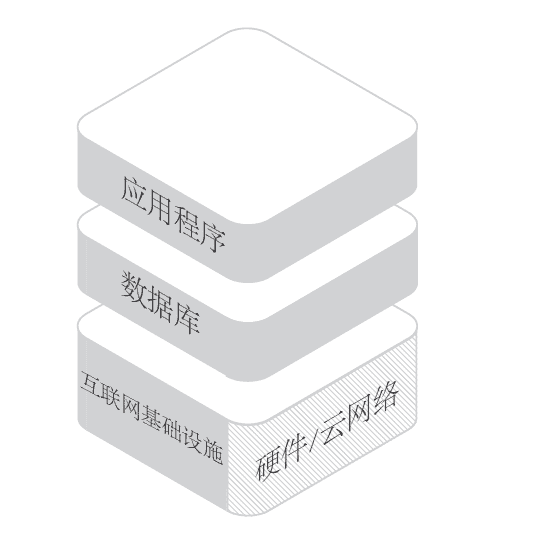

**基础设施层**

第三种选择是 SaaS 平台，这意味着将应用或服务外包给第三方，该方案在不需要高度定制应用（如工资单或账单）时效果最好。在某些情况下 SaaS 在本地运行，但大部分是远程的。你可以把它看作云上的一个应用。

许多公司会将私有化、云服务以及基于 SaaS 的应用组合使用。

网络与通信规模会在很大程度上影响你的决定。如果你的网络速率是 T3 44.736 Mbps，你会发现速度太慢，根本无法利用 SaaS 与云的优势。而 OC-48 2.488Gbps 的网速则会让你选择更自由。当然一切取决于诸多因素——对于较小的公司，T3 可能就够用了。¹

一旦确定数据与应用的托管位置，你就可以定义数据模型，因为在设计数据前需要了解通信、网络与计算资源的速度。对于 SaaS 产品，供应商已定义数据模型，但你可能需要构建导入导出模型，以便从其他系统与基于 SaaS 的应用中获取信息。

有了数据模型后，就可以定义数据库，包括使用哪个数据库应用。Oracle 与 SQL 都是极佳选择，各有利弊。你在选择时可能受 IT 部门技能限制。由于应用与供应商对 SQL 与 Oracle 数据库的强制约束，企业同时使用它们以及其他选择的情况并不常见。

数据库创建后，就可以实现应用。这包括企业的关键程序，如商品销售、会计、物流、工资等，以及为用户与企业定制或特定的应用。

同时，你可以开始定义你的 AI 应用，以运行在数据库之上，并使用应用维护的信息。

记住，你还必须考虑整个基础设施的人员配置与管理要求。大多数企业使用内部 IT 人员运行计算机、网络与应用，而其他企业则将部分或全部 IT 外包。一种常见方法是使用所谓的“零工经济”出租项目——实质上是在需要时雇用自由职业者。当然，可以使用以上任一方法或所有方法的组合。

### 设计基础设施

**艾美：** 从技术上讲，基础设施通常指建筑、网络、服务器与其他硬件。应用与数据库在此基础上运行。

**克里斯：** 我完全同意，为了这次讨论，我们把它简化了。

而且设计基础设施时必须考虑其他事项。至关重要的一点是，确保每个设计都可变，这意味着业务扩展时可以增加资源，而无须重新设计或重做架构。

**艾美：** 是的，高可用性与故障恢复也是值得关注的问题。最佳实践是在硬件或虚拟化层实现这些功能，以使事情变得简单。在计算早期，故障恢复要么通过备份与还原实现，要么通过编程方式在每个单独应用或数据库中实现。这非常复杂且容易出错。随着现代技术发展，硬件或虚拟机可以独立于任何应用完成故障恢复，使故障恢复更易也更稳健。

**克里斯：** 让我们再详细回顾一下。

### 故障恢复

**艾美：** 企业的永续经营是指企业在紧急情况或故障发生后继续运营的计划，其关注点在于发生故障时保持企业的运营。

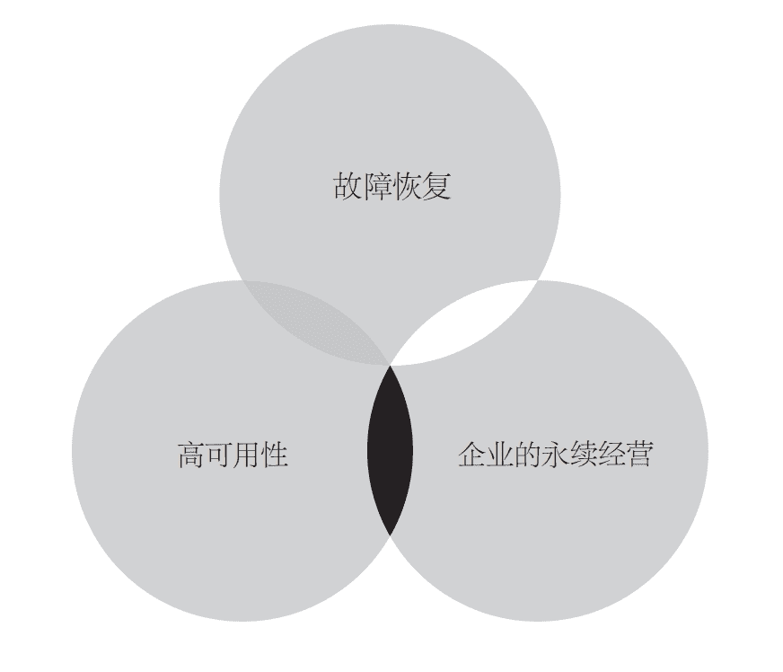

人们将在哪里工作？他们有工作所需的设备吗？他们怎么去工作的地方？重要信息又如何被记录与存储呢？

**克里斯：** 是的，最后一点十分重要。即使在今天，许多公司仍以纸质形式记录大量信息。其实可以做成名片一样简单。如果销售不去见客户，他们就不会用到这些名片。

**艾美：** 会计部门经常有装满发票与其他记录的盒子与档案抽屉。如果发生火灾或其他灾难，这些记录将被销毁或变得不可用。这是企业永续经营过程中需要关注的重点。

**克里斯：** 我知道。故障恢复是典型的计算资源的 IT 实现。企业则是两者都需要，因为企业的永续经营关注的是更大的蓝图，而不是 IT 的责任。

**艾美：** 高可用性意味着在计算资源的设计中提供内置冗余，这样就算出现故障，系统仍能继续工作。镜像磁盘驱动器就是一个很好的例子。

随着企业越来越依赖异地托管的云与 SaaS 服务，网络与通信变得至关重要。为了防止服务中断，企业通常会配置多条链路。例如，一个机房可以设计有一个以上的 OC3，这些 OC3 甚至可以来自不同的通信载体。OC3 是一种带宽传输技术，其全称是 Optical Carrier 3，即光载波 3 号，因为它在同步光网络的第三级上承载数据。

**克里斯：** 对于这些电脑，重要的是要特别小心，确保电量足够，并用不间断电源与发电机来备份。当然，这个前提在于硬件是本地业务。

**艾美：** 这对云与 SaaS 服务来说有着巨大吸引力——大部分担忧都成了供应商的责任。例如，AWS 是冗余的，它是为了在故障中生存而构建的，甚至是由其他人管理的。确认供应商遵守高标准的服务准则是很重要的。

**克里斯：** 我知道我们说的有些技术性，但这些考虑对企业的生计很重要。即使在最糟糕的情况下，公司也必须考虑这些。非技术人员需要理解这些问题的重要性。

### 技术调整

**艾美：** 技术的一个指导原则是，随着流程不断递进，技术调整的难度就会成倍增加。一般在初步设计阶段错误最容易纠正，一旦开始编码后会变得困难，在数据库搭建后更困难，全部投入生产后，想要纠正错误就会极其困难。这就体现了敏捷技术与 Scrum 的优势——该技术往往使团队保持一致，相较于传统瀑布式开发方法，能更快地发现错误。稍后我们再详细讨论。

**克里斯：** 如果你一开始只是差 1 度，那么 1 英尺^((2))后你就相差 2 英寸^((3))。但如果你去月球，你就会偏离到 4169 英里之外。当误差还在 2 英寸时，我们进行改正要容易得多。²

**艾美：** 没错。如果可能，请避开基础设施技术的最前沿。除非使用全新技术或服务会带来意想不到的好处，否则使用经受住时间考验并经过测试的解决方案，通常会得到更好更稳定的基础设施环境。新的操作系统，甚至新版本，往往会有 bug 与性能问题，这些问题会随时间解决。除非你有一个最重要理由立即升级，否则最安全的做法是等待一小段时间，以便问题都能暴露出来。

**克里斯：** 这是个很好的建议。

**艾美：** 我们将在后面更详细讨论，但在设计基础设施时，一定要注意安全与隐私。如果在最开始设计时就考虑安全因素，并且让安全因素成为整个流程中每个人的关注重点，安全性就会起到更好的作用。

**克里斯：** 既然我们已经讨论了基础设施与数据，我们就有了 AI 的基础。

* * *

(1)　计算机领域专业术语，意思是漏洞。漏洞是在硬件、软件、协议的具体实现或系统安全策略上存在的缺陷。

(2)　1 英尺≈0.3048 米。

(3)　1 英寸≈2.54 厘米。

# 第二部分 人工智能的活动

The AI activation

## 5. 人工智能：人工智能革命的定义及原因

### 第四次工业革命

**克里斯：** 很多人都说 AI 对人类的影响就像电的发明对人类的影响一样。

**艾美：** 是的。有些人将其称为第四次工业革命，并声称这将引起人类社会有史以来最戏剧性的变化。麦肯锡指出，AI 的发展速度是工业革命的 10 倍，规模是工业革命的 300 倍。¹

克里斯：AI 到底能用在哪些地方？你可以先想想自动驾驶卡车，它有望重塑公路货运，几乎把事故清零，同时让货物更快抵达。智慧城市会让能耗下降、污染收敛，居民的日常体验也更舒心；智慧工厂能够稳定产出零瑕疵的同质化产品；智能采矿有望根除塌方与有毒气体带来的致命风险；智慧农场则能在节水省肥的前提下，把粮食产出提升数倍。²^,³^,⁴^,⁵^,⁶

拿登革热来说，这是一种极具毒性的病毒传播方式。微软在研发一种能识别昆虫特征的机器人捕蚊装置，用微型激光单独锁定目标昆虫。因为登革热由蚊子携带，机器人通过清除蚊群来阻断传播链。⁷

这种不用农药也能对抗登革热的手法，像是一场技术博弈，恰好说明技术如何重塑社会。

艾美：利好人类生活的想象几乎没有边界。马文·明斯基在《情感机器》里把人工智能叫做“手提箱词汇”，因为它装着许多可以拆解分析的子概念。换句话说，AI 的内涵太宽，根本找不到一个简短准确的定义。⁸^,⁹

当下主流的说法是 AI 是智能代理的研究与设计，智能代理指能够感知环境并据此行动的系统。AI 的边界和计算机科学、数据挖掘、人脸识别、机器人学，乃至对人类思维的研究高度重叠。¹⁰

这就引出一个关键问题：若想真正理解 AI，或许先要聊聊人类智能本身。

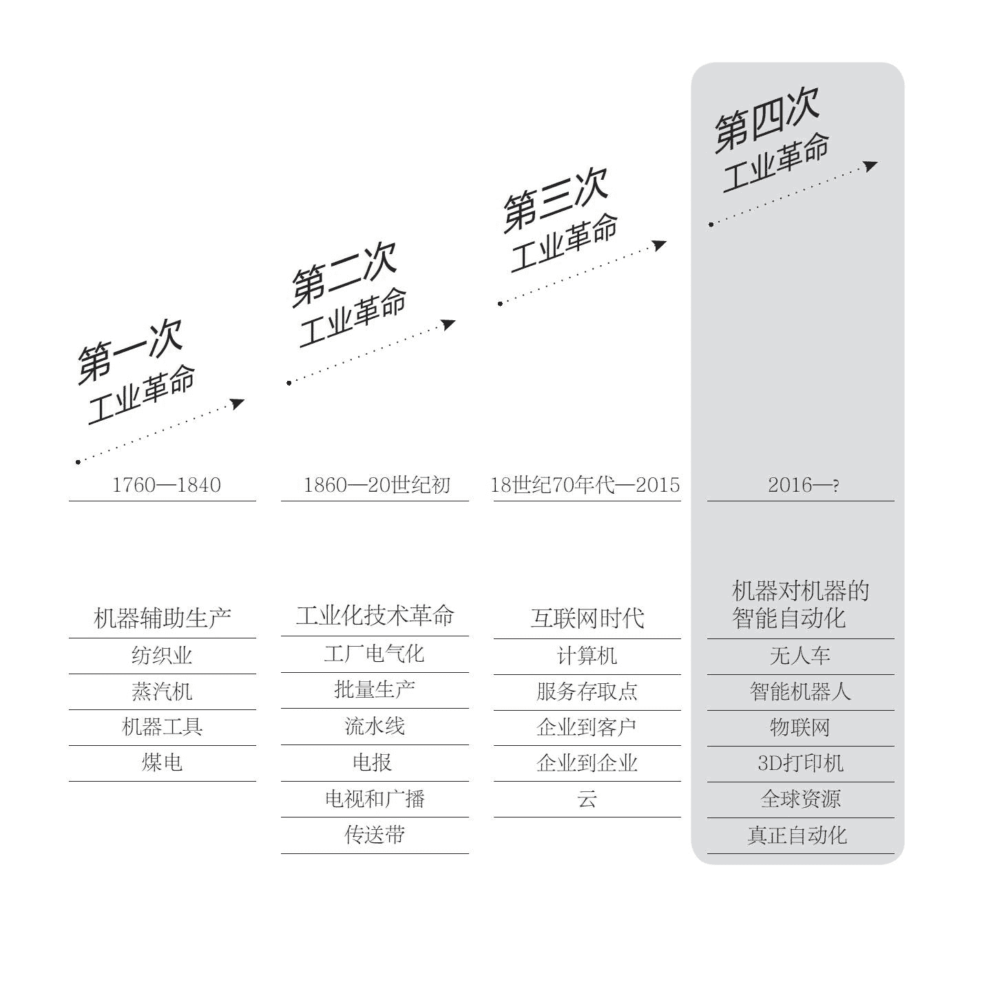

**新一轮工业浪潮**

### 人类智力图谱

克里斯：很多人会把智力等同于一次考试分数，但《多元智能新视野》指出，人类智力至少可以拆成九类。¹¹

分别是内省智力、空间智力、自然智力、音乐智力、逻辑智力、存在智力、人际智力、身体运动智力和语言智力。每个人的九项都存在，只是强弱不同。有人音乐感极强却空间感薄弱，有人逻辑出色却偏内向、人际偏弱。

比如计算机先驱唐纳德·克努特，他凭借数学功底写出《计算机编程艺术》名满天下，音乐才华却不显眼。巴赫在音乐上登峰造极，数学逻辑相对平平。达·芬奇则在科学与艺术之间保持平衡，他本人曾主张研究艺术的科学和科学的艺术。¹²

人本质上是整体性的，很少被单一类别框住。AI 的难点也就在这里，它试图在一定程度上复刻整个人类心智。

之后我们还会讨论使用 AI 的伦理分歧，从实用到哲学都有不同声音。像任何颠覆性技术，AI 也会带来副作用，比如对就业的影响、对人际行为模式的改变，以及安全与滥用的防范。¹³

说到就业，丹尼尔·拉卡尔的观点很直观：有证据显示，如果科技真的大规模摧毁工作，我们现在恐怕连工作都找不到。过去三十年技术以指数级爆发，岗位数量和薪酬都在上升。最典型的例子是德国巴伐利亚州，这个高度自动化和技术密集的地区，失业率仅 2.6%，创下历史新低。全球范围也呈现类似趋势。¹⁴

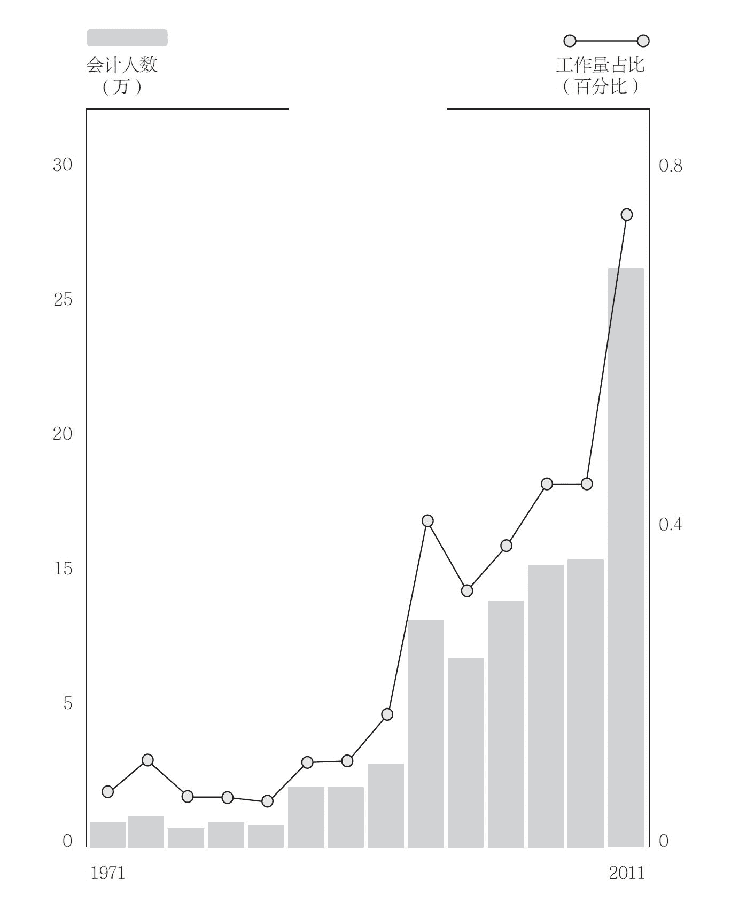

**科技如何催生知识型岗位**

来源：英格兰威尔士普查　1971—2011

2015 年，新加坡的研究团队测试了一款手机应用，用 AI 影响人们在现实中的决策。思路是建立个性化模型，摸清每个人对公交延误的容忍阈值。掌握这些数据后，可以缓解拥堵和人群扎堆，提升出行满意度。¹⁵

艾美：这正是关于智能类型、就业与社会影响的核心议题。接下来聊聊 AI 本身是如何走到今天的。

### AI 的兴衰周期

克里斯：1956 年的夏天，达特茅斯大学的研究者们聚在一起，设想制造出能像人一样思考行动的机器。彼时最好的硬件还是穿孔卡主机，这个愿景已经足够超前。¹⁶

随之而来的是数次高潮与低谷，大约六七轮，人们因一次突破而振奋，又因进展不及预期而失望。这些低谷被称作“AI 冬天”，名字借自上世纪五六十年代的“核冬天”概念——AI 繁荣后资金断流，发展被迫放缓。

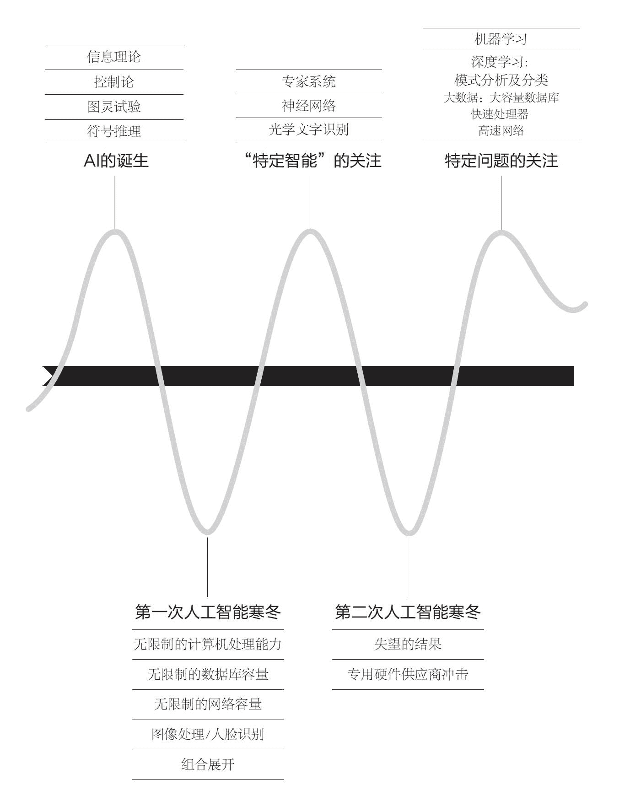

**关键发展节点**

1966 年，首个 AI 冬天到来，研究者意识到自然语言翻译有多难。冷战高峰期，AI 被用来把 60 行俄语释义为英语，初看不错，回译俄语后却彻底失败，暴露了人类语言的复杂性。因资金不足，项目停摆。¹⁷

1970 年，第二轮寒冬开始。繁荣源于限制变量数量的做法，比如让机械臂把 A 块移到 B 块。微交互做得很好，却难以扩展，最终导致第二次 AI 冬天。¹⁸

1980 年，专家系统引发第三轮寒冬。人们想去掉变量、从上而下构建可扩展系统，把领域专家的知识访谈后写成规则库。可专家系统的搭建耗时耗钱，最终崩盘。¹⁹

转折在 2012 年出现。机器学习的子分支深度学习取得突破，神经网络模仿人脑工作，计算机开始“学习”。此后苹果、IBM、亚马逊、微软、Facebook、Adobe 等巨头加速投入 AI。²⁰

艾美：令人振奋的 AI 时代不只是我这样的虚拟助手的出现。

### AI 的里程碑

克里斯：看过去十五年的进展就明白了。1997 年，IBM 的深蓝击败俄罗斯棋王加里·卡斯帕罗夫，此前大家普遍认为机器无法战胜国际象棋大师。2005 年，一辆自动驾驶汽车完成美国DARPA 自动驾驶挑战赛，这是历史首次。²¹^,²²

艾美：2010 年，iPod 之父托尼·法德尔发布了首个智能家居恒温器。物联网的雏形就是从恒温器、智能灯泡、报警器这些设备开始的。²³

克里斯：一年后，2011 年，IBM 超级计算机沃森在《危险边缘》节目中击败冠军肯·詹宁斯。詹宁斯引用《辛普森一家》里的霍默·辛普森说“欢迎我们的新电脑霸主”。同年 iPhone 4S 推出 Siri，让移动语音识别进入主流。²⁴

艾美：我最喜欢的是 2012 年，吴恩达和杰夫·迪恩展示了能识别视频中猫的技术，图像识别迎来质变。

这是视觉突破的缩影。音频方面，亚马逊 Echo 助手 2015 年全球发布，用户在家就能用语音下单、开灯、要食谱。语音交互革命由此展开。

同年谷歌 DeepMind 造出 AlphaGo，下围棋 5 比 0 击败樊麾，2017 年再以 60 比 0 战胜世界冠军柯洁。围棋被攻克意味着复杂模式识别成为可能。²⁵

2017 年，冷扑大师 Libratus 在无限制德州扑克中击败顶尖职业牌手，显示 AI 能掌握更广的上下文理解、概率与推理。²⁶

AI 在商业、工业和消费市场的渗透越来越深。

### AI 的三层划分

克里斯：尤其考虑到我们才刚起步，AI 大致有三种形态：狭义、通用、超智能。²⁷

今天讨论的现代 AI 多指狭义 AI，专为特定任务设计。谷歌搜索就是典型的探索任务，AI 聊天机器人回答客户问题，也能给出更有价值的服务建议。

通用 AI，即人工通用智能 AGI，指的是 AI 达到与人类相当的智能，能基于多感官输入形成整体环境理解并自主判断，无需针对性编程。当 AI 与人类智能无法区分时，AGI 才算实现。

超智能 AI 是好莱坞常见的设想，智能呈指数级超过人类，能解决连人类都不理解的问题。

这次对话聚焦狭义 AI 的实际应用。

艾美：“狭义”这个标签反而低估了能力。它涵盖机器学习、深度学习、自然语言处理、计算机视觉和机器推理。

克里斯：我来简单界定一下，术语间有重叠。

机器学习指 AI 应用在编程与非编程情况下从环境中学习的能力。比如通勤时间逐年增长，2014 年造成的生产力损失达 1600 亿美元。AI 正在帮助分析路况与通勤数据，改善交通基础设施，减少在路上的时间。²⁸^,²⁹^,³⁰

深度学习使用神经网络模拟人脑结构与功能。手写文字识别就是典型难题，神经网络可学习后再自动推断规则。³¹^,³²

自然语言处理是借助机器学习与深度学习来分析、理解并使用人类语言，能生成口语与书面语。法律领域就用它做文档分类。³³

计算机视觉与机器推理的结合让机器像人一样“看懂”。人类翻开一本书就能理解内容与用途，计算机现在也能通过认知系统识别并理解物体。³⁴

麻省理工将狭义 AI 按功能拆分，其一是助手类，比如半自动驾驶汽车仍需人类驾驶员监控环境。Mobileye 就提供高级驾驶辅助解决方案，帮助司机避险，其产品已装配在不少公共巴士上。³⁵

艾美：机器学习内部也有分支：监督学习、无监督学习、半监督学习、主动学习和迁移学习。

克里斯：深度学习还可细分为无监督预训练网络、卷积神经网络、循环神经网络和递归神经网络。³⁶

艾美：这些技术很强大，但机器学习仍无法解释自己的预测逻辑，所以常被称作黑匣子。

克里斯：目前还没有商用系统能讲清自己的思考过程。

艾美：不过它在感知与模式预测上非常擅长，解析文本、语音、人脸等图像视频非常有效。

克里斯：这些技术正推动消费与企业数字化转型，是社交、移动、网络、云端乃至现实世界快速数字化的驱动力之一。

艾美：B2B 场景里，AI 已深度介入工作流、供应链、生态系统、预测智能、客服机器人、环境监控、社交媒体、SEO、着陆页与内容管理。

克里斯：在 B2C 方面，AI 既体现在终端产品，也体现在产品创造上。AliveCor 是可穿戴物联网设备，能按需监测心电图并判断心律是否正常。Happitech 则用智能手机传感器测量压力与健康水平。³⁷^,³⁸

艾美：在这些案例里，AI 贯穿产品设计与成品。

### AI 与其他技术的协同

克里斯：AI 的成功会被其他技术放大，也在与它们共同演进。

物联网让 AI 获得更多触点，可以连接设备或嵌入单个“事物”。智能冰箱能学习饮食习惯，在食物耗尽前自动下单。VAIDU 能监测天气，预报降雨时提醒带伞。

工业物联网下，智能工厂在少量监管人员下即可制造汽车等产品，让人类脱离流水线苦役，避免危险工业环境。智能采矿、智能仓储、全无人智能船等应用也在展开。

医疗物联网潜力巨大。美国 Allied Market Research 预测，到 2021 年全球医疗物联网市场将达 1368 亿美元。智能医疗设备可监测身体各部位，AI 从数据中找规律，给医疗决策提供精准反馈。³⁹^,⁴⁰

增强现实正在重塑零售。宜家的 AR 应用能把超过 2000 件商品放置在房间任意位置，用户用手机摄像头就能预览摆放效果。⁴¹^,⁴²

艾美：医疗领域还有不可思议的变化。虚拟现实被用作治疗工具，减少手术疼痛，并在术前起到镇静作用，同时也是教学设备。1996 年，西雅图港景烧伤中心首次用 VR 减轻烧伤病人的痛苦。⁴³^,⁴⁴

克里斯：区块链也值得一提，它是分布式账本，用于安全共享加密货币、健康记录、法律合同等信息。它与 AI 相关，提供安全存储海量数据的方式，而 AI 正是数据驱动的。

艾美：AI 为可再生能源提供了解法。风能与太阳能受天气模型不确定性困扰。科罗拉多州的 Xcel 能源公司通过挖掘美国国家大气研究中心的数据并用 AI 分析，提升预测精度。这是 AI 在新能源影响的一个缩影。⁴⁵

克里斯：生物技术发展也很令人兴奋。AI 不仅能识别疾病，还能帮助制药公司筛选对治疗进展有用的分子。

艾美：我更关注医学 3D 打印。现在可用病人自身细胞打印器官，意味着未来器官移植可能不再依赖捐赠。3D 打印还能造飞机发动机零件、修复卫星零件，消费端也能打印破损件。⁴⁶^,⁴⁷

克里斯：欧洲航天局用 3D 打印小行星模型，再用 AI 控制卫星探测或规避碰撞。⁴⁸

艾美：但我们终将触及当前计算能力的极限。量子计算提供了一种全新信息处理方式。D-Wave 这样描述——

量子计算机直达现实的基本结构，进入量子力学中奇异反直觉的世界，以此加速计算。量子计算机不像传统计算机存储 0 或 1，而是使用可同时为 1、0 或二者的量子比特。叠加、纠缠、量子隧穿等效应让量子计算机能同时处理大量比特组合。⁴⁹

关键是更快更强的算力会让 AI 未来更强大更实用。

克里斯：纳米技术更令人激动，它像是一种可能治愈癌症等疾病的方法。通过分子尺度粒子，科学家可精准靶向并修复或摧毁癌变细胞。⁵⁰

人们也在研究纳米技术与能驱动随机系统的 AI。随机系统是概率分布过程，可做统计分析但无法精准预测，理论上更有助理解生物环境的变量。⁵¹

艾美：这概念很迷人。随机的统计算法可以产生意想不到的相关性，有利于激发创造性思维。

克里斯：说到创造力，正是 AI 与其他技术协同创新的体现。有人认为 AI 将像电力一样重要，推动科技进步与社会运行方式的改变。

艾美：了解 AI 如何被用于前沿技术，以及它如何被推向更深的创造力、同理心与情感，是很有启发性的。⁵²

克里斯：技术细节我们已经梳理过，真正决定价值的是人与机器的协作方式——如何一起做出更聪明的判断、提供更贴合的服务、创造更理想的体验。这其实回到 AI 诞生的初衷：让整体智能向上提升。接下来聊聊 AI 如何重塑商业布局。本质上，AI 战略就是一组能够帮助企业在所在赛道建立竞争优势的工具箱。

## 6. 超级框架：释放超人类竞争力

艾美：技术层面有了基础，现在把战略模型摊开来看，让企业获得不普通的竞争壁垒。
克里斯：我们给它命名为超级框架 SUPER。它的核心是赋予企业近乎超人的能力。SUPER 分别对应 Speed 速度、Understanding 理解力、Performance 绩效、Experiment 实验、Result 结果。五大维度构成一个强力模型，把 AI 作为推动创新的引擎。
这套框架提供了落地 AI 的五条操作准则，也是制定战略蓝图的基础。速度、理解力、绩效、实验、结果这五个要素都必须在 AI 战略层面做出明确安排，项目才有机会成功。

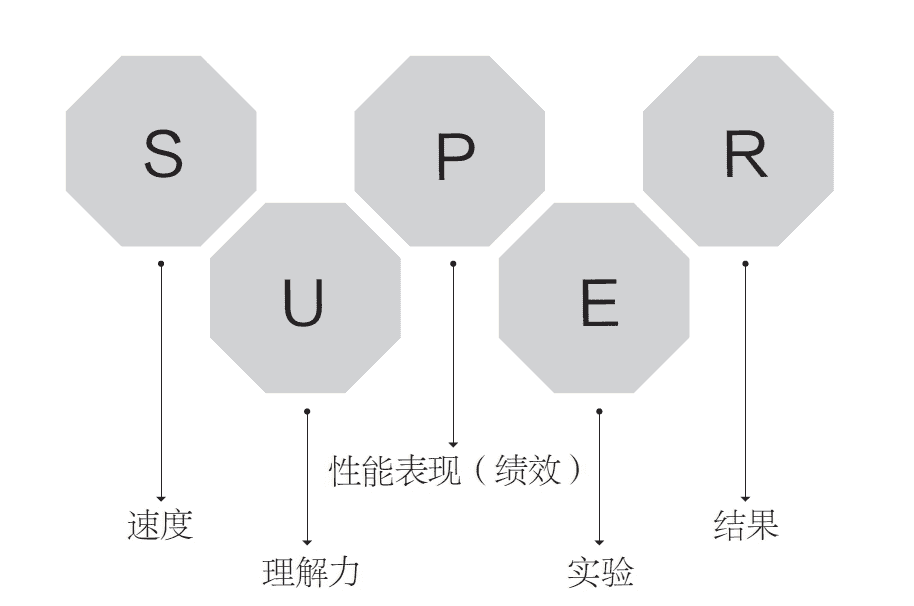

**超级框架**

## 超级框架是什么

艾美：完全同意。AI 战略的第一环是速度。用户和企业都等不起慢吞吞的方案。设想一个 AI 远程问诊工具，如果要等几小时甚至几天才给出病情判断，抱着生病的孩子焦急等待的母亲显然无法接受。
克里斯：所以理解力必不可少。系统要能读懂各种情境并做出判断。比如一个智能家庭报警器，理应通过学习掌握家里的常态和访客规律，进而自主决策。随着使用时间推移，它能分辨出哪些人永久禁止入内、哪些人长期允许入内。即使对方持有钥匙或密码，系统也能依据已学到的行为模式决定放行或阻拦。
艾美：产品还得兑现设计初衷，在既定任务上表现可靠。比如一艘无人驾驶智能船，它不仅要能自主航行，还得学会在恶劣海况下应对、识别非法登船如海盗的处置方式，并在碰撞风险出现时及时做出反应。¹
克里斯：第三是实验。既涉及模型自身的好奇心，也涉及 AI 对人类的启发作用。复杂难题往往没有现成答案，好奇心和灵感是破局关键，灵感还能催生新场景和新应用，是技术演进的必要推力。麻省理工学院曾指出，具备某种人工好奇心的算法能够攻克棘手问题，即便当时还不清楚哪一步动作有效。²
同时，AI 产品不可能单独存在。市场竞争会倒逼技术升级，而不断出现的意外情况也要求我们持续试验、迭代。
艾美：最后一点是结果要落地。对新产品或成熟业务来说，企业都希望看到对营收和成本的实际影响。
克里斯：下面细化这五大维度，它们各有侧重。在实际项目中，可能更突出某一个或几个维度，但五者都要在内。战略重点可以根据业务需求有所倾斜。

## 速度

艾美：先说速度，这里指加快工作节奏和推理效率。比如想改善旅客值机体验，关键就是疏通人流。跨州航空公司 TSA 就在测试一套系统，用 AI 分析旅客的面部表情和身体姿态，识别潜在风险人员。³ 出于隐私考虑，完整扫描图像不会展示给安检员，只有触发警报时才会提示。

## 理解力

克里斯：理解力意味着从海量数据中快速提炼洞察，覆盖营销、用户行为、医疗、出行等诸多领域。叠加物联网后，认知世界的可能性几乎无限。Netflix 就用预测分析捕捉用户偏好，实现个性化推荐。⁴ 推荐系统不只把人带到内容，更会持续进化，一边学习真实品味，一边区分用户口头偏好与实际观看行为。

## 绩效

艾美：绩效指流程是否有效，也就是工作、服务或产品的实际表现水平。AI 方案必须被衡量、被优化，且要体现对其业务整体战略的支撑。说白了，要见效，且要量化呈现，并向相关方汇报。项目启动前就应明确 KPI，用来验证业务层面的成败。
克里斯：哥本哈根一家初创团队在做一套基于深度学习的摄像系统，能定位场上动作、自动放大并追踪球路。⁵ 这对资金有限、请不起摄制组的球队很重要，机器完全可独立作业，减少对人工团队的依赖。
他们用深度学习训练神经网络，持续精准跟拍球和球员。要做到这点，系统既要够快，也要具备理解力来学习动作轨迹，还要体现创新与好奇心。随着迭代，追踪精度会不断提升。
这就是 AI 支撑战略的实例——通过记录比赛推动足球普及，而所有效果都必须用 KPI 来验证。
艾美：这个例子很好地说明了绩效的价值，且潜力很大。预计到 2019 年北美体育产业收入将达 735 亿美元，来源包括门票、版权、赞助和商品。⁶ AI 聊天机器人可自动应答球迷提问，计算机视觉可引导摄像机拍到更好画面，AI 记者可辅助体育报道，而结合 AI 的可穿戴 IoT 设备则能采集数据用于训练优化。

## 实验

克里斯：AI 带来了新的实验范式。更快的人机交互支撑起 MVP 的快速反馈，让试错和优化成为常态。同时 AI 也在催生前所未有的产品服务形态。

## 结果

艾美：归根结底，AI 要产生对企业、用户和行业都有价值的实际成果。PayPal 就用深度学习揪出欺诈商家，精准定位非法商品交易，并通过分析交易失败原因来优化运营。⁷ 这些举措降低了欺诈、提升了可靠性，也增强了服务能力。

## 超人类能力

克里斯：SUPER 的终极指向是超人类能力。核心理念是人与机器协作远胜独自作战。无论是写代码、解难题还是创新产品，这些原则的初衷都是放大人的价值，而非替代。⁸ 2014 年的国际象棋对抗中，人类直觉、创造力与计算机的记忆、算力结合，产生了惊人的走法和结果，被称为半人马棋手。⁸
这就是人机协同系统。关键先厘清各自角色。人擅长某些任务，AI 擅长另一些。AI 在海量存储和复杂计算上占优，人类在社交互动和复杂判断上更有优势。
简单说，各司其职最好。人做人擅长的，机器做机器擅长的，这样结合才能最优解。MIT 教授托马斯·马隆称之为集体智慧⁹，智慧源于群体协作。当人类智慧与计算智慧融合时，就打开全新可能。¹⁰

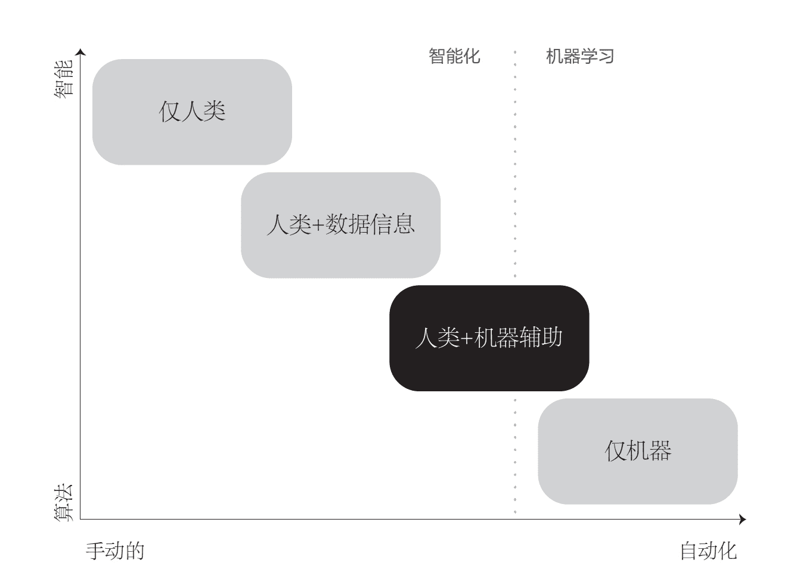

**人机关系模式**

艾美：再细分一下，AI 可以看成是一个助手、一个同事或一个管理者。

### 助手、同事或经理

克里斯：Adobe Sensei 就是一个典型。它是 Adobe 的机器学习框架，能显著提升数字体验的设计和交付，实质上充当创意助手的角色。
设想你在构思一款应用，每一次关键决策都会生成一张可视化结果，随时回顾对比不同选择的输出。又如半自动驾驶，奥迪的交通拥堵驾驶员辅助系统和宝马的堵车助手会在拥堵时接管转向、刹车和加速，但仍需驾驶员保持手握方向盘的状态。¹¹

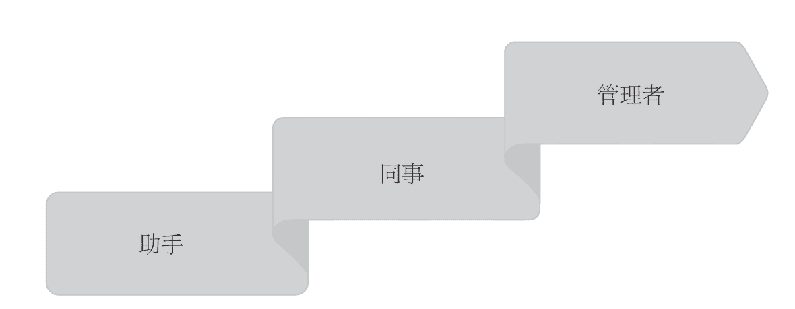

**人工智能的角色**

IBM 的沃森技术催生了沃森虚拟代理等方案，让企业能提供自动化服务并分析互动，从中洞察客户参与度及需求演变。¹²
艾美：荷航的客服代表工具也是 AI 助手的案例。这款深度学习应用帮助客服处理来自社交媒体等渠道的海量信息。¹³ 类似地，DesignGenius 从历史数据、社交媒体等多源信息中提取洞察，推送到 Zendesk 或 Salesforce 等服务云。
Facebook 为提升贴合度，会采集用户、好友、群组及关注主页的帖子，平均 1500 到 10000 条，由 AI 与人工审核共同驱动的算法决定信息流的展示方式。¹⁴
克里斯：AI 作为同事的例子是比赛预测。北卡州立大学学生威廉·伯顿和迈克尔·迪基做了一套模型，预测 NFL 球队是传球还是跑位。在 2014 年牛仔对美洲虎的比赛中，准确率达到 91.6%。¹⁵
艾美：AI 还能担任管理者角色。2015 年美国人因通勤拥堵损失超过 80 亿小时。卡内基梅隆机器人学教授斯蒂芬·史密斯在匹兹堡为信号灯装上 AI，使其能根据交通模式变化自动调整，结果通勤时间减少了 25%。¹⁶
2016 年航空业收入达 1682 亿美元，预计二十年后客流翻倍。为了应对需求，航空公司正探索 AI 助力服务提升。比如 AI 助手已用于电话客服优化后勤，人脸识别也用于加速身份验证。¹⁷
克里斯：除各自进化外，人机共生还能互相学习。设想医生的 AI 助手能检索数千例癌症病例，涵盖影像、纸质病历、电子健康记录乃至运动饮食习惯。基于分析，系统可为医生提供诊疗建议。比如面对罕见病，医生可能因经验不足而忽略症状，AI 则可通过关联分析提示进一步检查或诊断。
艾美：这类似 Malwarebytes 的机器学习模块，用来捕捉从未在野外出现过的新型恶意软件。传统签名无法覆盖未知样本，因此需要 AI 分析行为异常，人类再审视这些可疑偏差，判定是否为真正威胁。¹⁸
克里斯：这些都是人类和 AI 相互学习并互相提升的绝妙案例。

## AI 如何呼应企业战略

艾美：最终，AI 战略要服务于整体商业战略。迈克尔·波特在《竞争优势》中提出的通用战略有三类：成本领先、聚焦和差异化。¹⁹
克里斯：成本战略就是通过降价获取优势，途径有两条：降消费者支出、降生产成本。沃尔玛和宜家是典范。沃尔玛以“省钱让生活更美好”为定位强化低价认知，成功成为全球最大零售商之一。若按 GDP 计算，其规模可排世界第 28 位，在挪威之后、奥地利之前。²⁰ 这种低成本价值使其全球门店超 1.1 万家。
艾美：你知道沃尔玛每年卖出超过 10 亿磅香蕉^((1)) 吗？
克里斯：不意外。宜家通过规模化采购与供应商议价，并把技术嵌入业务流程，为顾客提供低价商品。他们 SKU 达 9500 个，每年更新品类，并持续国际扩张。²¹
艾美：沃尔玛正用 AI、机器学习、物联网和大数据优化物流、供应链、生产和客服等全环节。²² 宜家也在用 AI 开发 AR 应用，并探索其他客户服务提升路径。²³
克里斯：差异化战略的典型是特斯拉和哈雷戴维森。马斯克通过可规模化生产的电动车重塑汽车业，不仅设计产品，还构建了能源体系、工厂和物流链。²⁴ 特斯拉需打通从一级制造商到四级原材料供应商的全链条基础设施。²⁵
哈雷戴维森在经济大萧条中存活下来，品牌围绕“自由”构建，口号是“一切为了自由，自由是为了一切”。他们创造了基于自由和独立生活方式的产品文化，使其区别于其他摩托车品牌。²⁶
艾美：聚焦战略则是深耕特定细分市场。Trader Joe's 和星巴克都锁定明确客群并提供契合体验。Trader Joe's 卖自有品牌、重创意选品和门店艺术化；星巴克以高度定制化咖啡体验著称。
重点在于，AI 只是工具，必须与公司战略一致并起到支撑作用。在聚焦策略中 AI 可用预测性分析识别行为，在差异化中可挖掘市场空白，在成本策略中可提升物流与生产效率。

## 7. 速度：推动工作流程

克里斯：有时候，微小改进就能带来大结果。1896 年雅典首届现代奥运会，托马斯·伯克采用四点式起跑，在当时很新颖，也让他以 12 秒夺冠。这印证了混沌理论：微小变化可产生巨大影响——就像新墨西哥一只蝴蝶扇翅能在中国引发飓风一样。¹,²

## 增长限制

艾美：制约企业增长速度的因素之一，是产品从制造到售出的节奏。若一年只能造 1 万台，就只能卖 1 万台；能造 100 万台，就能卖 100 万台。
克里斯：说得对。1913 年亨利·福特发明流水线，把造车时间从 12 小时压到 2.5 小时，革新了汽车工业。到 1924 年 6 月，他的工厂已产出 1000 万辆 T 型车。³
艾美：日本车企在美国建世界级工厂，推行 JIT 准时制、精益生产，通过流程改进和供应链优化，主导了行业数十年。⁴
克里斯：讽刺的是，对速度的盲目追求有时会让创新产品失速，因为组织、员工、消费者和个人都可能被拖垮。
然而紧急情况能催生爆发式增长。二战期间美国飞机生产就是例子。1939 年美国年产不到 6000 架飞机，排在第 41 位；战后生产了 30 万架军用飞机，在全国运营 81 个生产基地，飞机制造成为最大行业。⁵
正常情况下，企业和个人难以持续极速转向，这时 Kaizen 持续改善就显现价值。循序渐进的变化给人适应空间，让改变被视为常态。⁶

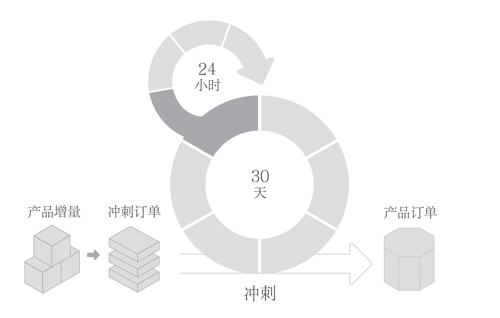

**敏捷Scrum协作一张图看懂**

敏捷方法与Scrum框架正成为众多企业迭代升级方案的常用做法，这些方案往往由跨部门团队协同产出。核心目标是用最短周期交付与公司战略和用户需求高度契合的高质量成果。⁷敏捷是一组强调开发团队与业务紧密配合、依靠自组织小组、聚焦业务价值交付的做法集合。Scrum则提供了一个让团队通过协同解决复杂问题的运行框架。⁸^,⁹

## 组织提速

**艾美：**技术发展让组织提速变得更可行，摩尔定律指出计算性能大约每两年翻一番。在此背景下，AI通过联动人、流程与技术释放加速度，能够带来可观的经济回报。¹⁰

**克里斯：**Adobe Sensei正是一个典型。Sensei是Adobe搭建的AI技术底座，贯穿各产品，凭借智能功能大幅改善数字化内容的设计与交付效率。¹¹

Sensei特别聚焦内容生产速度的提升。个性化体验的需求推动了内容产量的要求，营销、品牌方和代理机构都需要更快产出。Sensei可加速内容的创作、分发、测量与优化。

比如图片检索，Sensei自动为图片打标，让搜索更快更精准。借助AI图像识别，内容制作的耗时被压缩，繁琐的手动标注与匹配被自动化。¹²

AI在自动化事务性工作上也有明显价值。机器语言可承担客服电话的常规录入，使坐席专注于实质问题，提升客户满意度与忠诚度，也优化了运营，同时电话内容还能被分析以改进话术与服务流程。¹²

更进一步，AI聊天机器人能7×24小时承接常见咨询，减少对人员培训的依赖，提升参与度，且出错率低、交互体验友好。¹³

## 制造业场景

**艾美：**制造环节变量众多，容易出现效率低、良品率下降和生产失误，制约了规模化与产品复杂度。

流程工具公司Nintex为制造定制了一个很有意思的应用。它不为单点任务做机器人，而是审视整条制造流程的工作流，挖掘行为模式与堵点。随后AI给出改进建议，涵盖自动化升级、维修流程自动化到新员工培训流程优化，从而提速整体节奏。¹⁴

2016年，机器人厂商发那科与英伟达合作，用AI芯片打造未来工厂。依靠深度学习，工业机器人可自我学习训练，缩短上手时间，加快工艺切换，提升产线效能。越早转型的工厂越早受益。¹⁵

西门子则用神经网络优化风力发电机，让机组从风场模式中学习并自主调节转子，提升发电效率，体现了AI快速适应环境并增产的能力。¹⁶

值得注意的是，“无灯化工厂”与AI并非同一回事。无灯制造强调设备无需人工干预即可运行，不必然使用AI，且所有动作实时发生，历史报表参考价值有限。¹⁷

## 医疗行业

**克里斯：**很多患者直到住院才发现重症，病情往往已不可逆，像心力衰竭就很难提前预判。IBM研究院计算健康中心的研究员胡建英好奇能否从电子健康记录中挖掘隐藏信号进行早期预警。在为期三年、投入200万美元的项目里，IBM用AI模型分析了上万人健康记录。¹⁸

IBM的沃森基因方案与沃森肿瘤方案已供医生使用，“医疗筛”项目则借助AI筛查乳腺癌与心脏病。DeepMind 2010年成立于伦敦，DeepMind Health旨在借助AI支撑NHS等医疗系统，帮助患者与医护人员。共同目标是压缩从就诊到精准诊断的时长。¹⁹

**艾美：**这些案例体现了AI在提升诊断与护理效率上的潜力。医疗AI仍属早期，前景却很深远。

## 零售场景

**克里斯：**排队一直是体验杀手，无论是影院、超市还是游乐园，缩短队列能直接提升回头率并减少负面传播。

零售店需要点单与后端系统稳定高效，员工培训要以快速交易为导向。移动收银终端可实现店内任意位置结算，加快吞吐。²⁰

机场安检方面，AI人体扫描技术可自动识别可疑物，提速安检流程。²¹

新西兰IMAGR与硅谷Mashgin正在研发购物即累加系统，结伴移动支付后可实现无收银台结算。²²

**艾美：**这正是AI在购物体验提速上的体现。消费者既想要高度个性化的推荐，也想要极致效率。比如走进服装店就希望看到符合自身品味的商品。

个性化购物助手正在普及。零售管理公司BRP 2017年调研显示，45%的零售商计划用AI改善客户体验。²³^,²⁴

对用户而言是得到所需与想要的商品；对商家而言是提升转化与收入。²⁵

**克里斯：**可见AI能加速生产、内容创作到需求满足的多个环节。

**艾美：**没错，AI可帮助组织在短期效率与长期目标间取得平衡。

## 8\. 理解力：揭示并掌握深刻见解

**克里斯：**我们谈了提速，如何提升对客户、员工与市场的理解同等关键。

**艾美：**理解看似简单，拆开就复杂。机器学习让机器在无明确编程下习得新能力，能自行提升、推演和预测。借助环境数据，机器可改变自身结论与运行方式。

AI系统已能做物体识别、语音识别、机器翻译、游戏等任务，但每项都需要专用的系统，通用AI尚未出现。正如AxiomZen所言，原始数据直接输入并不会自动产生意义，有意义的AI并不存在。¹

**克里斯：**为了说明理解的复杂性，看两个人在同一房间对话。

## 人与人之间的交互

**艾美：**我对人际互动很着迷，能展开说说吗。

**克里斯：**沟通涉及视觉、语调、句式、声调变化、肢体语言、眼神、背景知识、亲近度、发音、情绪状态、目的、教育、关系动态等无数变量，并不简单。

**艾美：**这也解释了为何邮件与短信易被误解。讽刺与幽默依靠肢体与语调，文本无法传达，易产生歧义。

**克里斯：**加入不同文化与成长背景，隔阂会更大。

## AI 扩展理解力

**艾美：**AI可扩展理解，在远距离或跨时间实现深层连接。

**克里斯：**理解越深，连接越稳。

**艾美：**对企业而言，可识别感兴趣的人群，避开无关者。

**克里斯：**只有当信息可理解、受众有意愿且场景合适时，广告才有效，体验才会被放大。

Juniper Research显示，全球实时竞价广告支出到2021年将达420亿美元。Boxever 2016年调研显示近80%美国资深营销人认为消费者已为AI准备好，且普遍看好聊天机器人。²^,³

机器学习用于广告优化，AI不仅投放既往浏览品类，还会推断相关品类、投放时机与位置。⁴

这些趋势表明，精准把握真实需求才能投放更相关广告，提升收益。

**艾美：**同时要注意算法悖论。只向有亲和力的人推送，会错失新品类拓展机会。

下面用实际案例看AI如何提升理解力。

## AI 如何提高理解能力

**克里斯：**理解人类沟通包括识别肢体语言、面部识别、步态分析、眼动追踪等。

**艾美：**我很喜欢Modiface，它结合AR与AI为美妆提供定制体验。

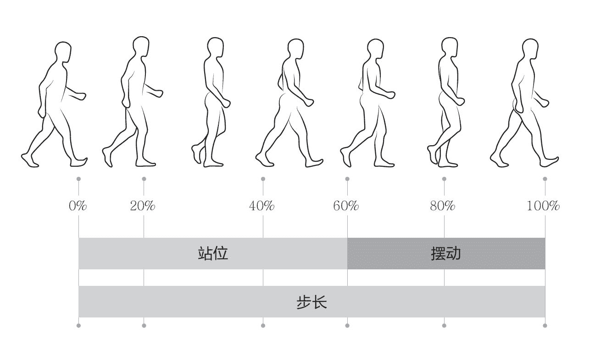

**步态分析**

**克里斯：**Modiface技术已嵌入多个本地操作系统，也可通过应用下载。借助AR，用户可在手机或平板上试妆。技术源自斯坦福研究，是当时最精准的面部视频追踪系统。AI之所以有效，是因为软件能精确追踪68个面部参数，包括虹膜位置、唇部、眼部、头部姿态等，被嵌入智能镜进行人脸与身体分析。⁵

**艾美：**这预示了智能家居与商店的未来。浴室与更衣间或将普及智能镜，实现虚拟试妆试衣。用户可挑选色调与风格，满意后镜子可直接下单。⁶

**克里斯：**目前该技术已用于美妆服装营销。未来可用于肢体语言分析，帮助面试与演讲准备。我预测会出现应用，实时提示紧张状态并给出纠正建议。

**艾美：**很形象。智能衣橱可结合天气、日程与社交活动推荐着装。⁷

把智能电视、智能镜、恒温器、门锁、安全摄像头、厨房电器接入家居中枢，就能形成对居民习惯的整体理解，提供个性化环境。⁸

## AI 有利于沟通

**克里斯：**自然语言处理与生成是另一方向。计算机科学家克里斯蒂安·哈蒙德在EmTech会议上指出，语言是人类独有能力，机器虽能处理文字，却在语言上挣扎。⁹

哈蒙德也是叙事科学联合创始人，打造了Quill产品，将数据转化为类人叙述。¹⁰Quill分析数据、生成叙事，帮助企业把季度监管报告撰写自动化，让人把时间花在阅读上，也能增强客户参与与运营效率。¹¹

**艾美：**这是AI助理解的好例子。Quill聚焦两个问题：谈的是什么，要了解什么，二者是构建故事的关键，最终输出人类易懂的表达。¹²

**克里斯：**酒店行业也在用AI构建客户视图。例如梅丽莎计划庆祝生日，手机搜索酒店被高科技体验吸引，却因接电话忘记预订，后通过广告提醒完成预订。出发前一周收到入住邀请，抵达时推送通知告知房间号与手机开锁，无需前台，直达房间，电视提供个性化玩乐攻略并购票。

**艾美：**这展示了数据打通的价值。企业痛点包括数据孤岛、结构缺失与不可操作。酒店借助AI实现统一客户视图，实时处理海量数据，提供即时体验。¹³

## 医疗应用

**克里斯：**伦敦与柏林的医疗科技公司Ada推出个人健康伴侣与远程医疗应用。用户输入症状，应用给出可能原因与评估，必要时建议就医。¹⁴AI引擎基于多年真实病例与医学知识库训练。¹⁵

三星的AI记忆眼镜Know You Again，利用VR提升痴呆与阿尔茨海默患者的识别能力，通过抬头显示告知来访者身份与近期对话，创造了有意义的体验。¹⁶

## 了解客户

**克里斯：**了解客户需求并非新事，只是更复杂。古时小贩也能根据天气、时段推销。如今AI可学习客户偏好与行为，创造更个性化体验。

超市布局即是行为理解的体现，新鲜品常置显眼位置，兼顾愉悦感与健康心理。¹⁷

全面理解需要跨时间、地点、交易与线上线下数据。例如亚马逊可结合搜索与到店行为做个性化推荐，数据常分散于多家企业。

Adobe Experience Cloud等服务通过地理围栏与行为数据实现数据孤岛融合，为深度个性化提供洞察。

精准、及时、合适的体验能保持忠诚并抵御竞争，这是占据市场的关键。

**艾美：**这就引向下一个主题——性能表现，即衡量与优化。

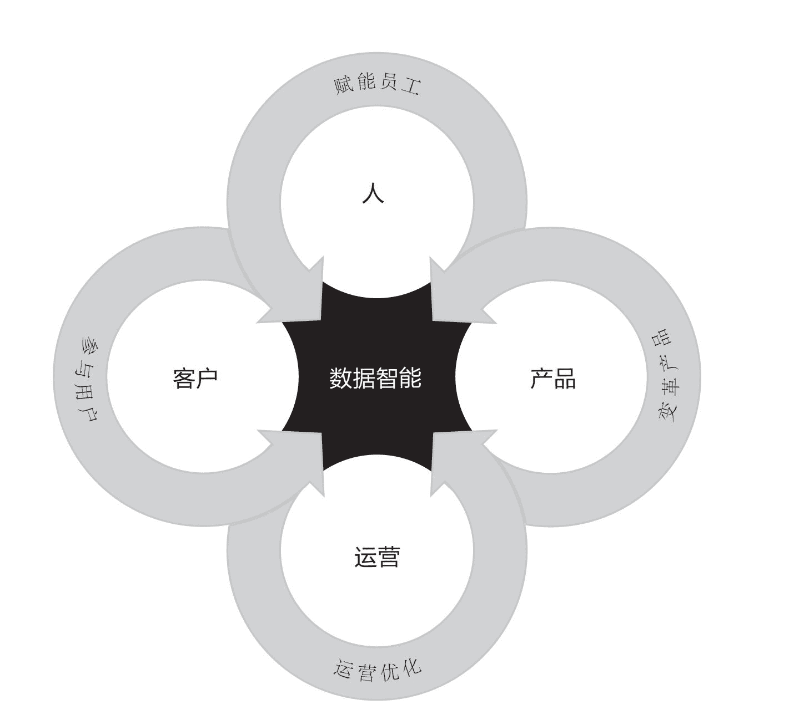

**数据反馈路径**

## 9\. 性能表现：衡量与优化

**克里斯：**性能表现是对事物运行状况的评估，目标是提升准确度并支撑决策，与速度、理解力、实验与结果有所区别。

让智能方案跑得更准的闭环

要让智能方案真正产生业务价值，评估与迭代通常走一个闭环。先把方案要解决的具体问题想清楚，并把衡量标准定下来，过程中可以微调，但起点必须清晰。接着按这些标准持续量化表现。最后根据结果再回到跟踪环节，对方案做迭代优化。

### 关键业绩指标

KPI 就是判断目标是否达成落地的标尺，企业与团队靠它确认产出是否符合预期。

**艾美：** 绩效的衡量与优化，本质是收集关于个人、团队、组织、系统或其部件表现的信息的过程。里面牵涉学习机制、组织内部的战略取向，以及对工程流程、参数和现象的研究，用来判断输出是否符合预期。关于绩效的讨论很多，有的经不起推敲，甚至漏洞明显。

**三个环节**

最近，设计思维正在被各类组织广泛采用，它能帮助探索和解决复杂的业务难题。对智能方案来说，这种聚焦衡量并持续改进的做法同样关键。

### 战略与战术

在整体框架里，绩效指的是智能方案在战略层面与执行层面达成目标的度量与优化。孙子在《孙子兵法》里说：“谋无术则成事难，术无谋则必败。”战略是企业的长期方向与实现路径，战术是落地的具体动作，二者相互支撑。²

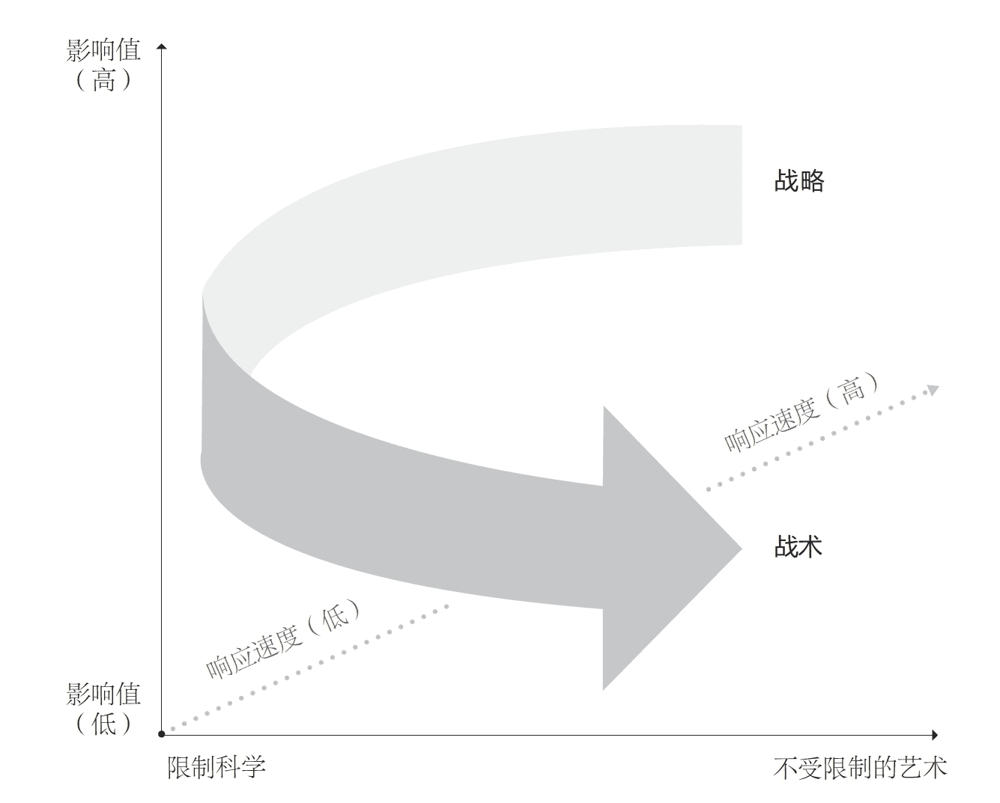

**战略和战术分工**

各家企业都在以不同方式引入智能技术，因为都需要变得更聪明、更具竞争力。把智能规划东拼西凑很难长久，只有把其优势融入企业整体战略才更可能成功。

**克里斯：** 我最近和一位一级方程式车手聊到智能在比赛中的作用。每辆赛车搭载两百多个传感单元，比赛时源源不断产生数据点，记录动力单元状态、轮胎抓地、温度等。雷诺运动 F1 车队首席信息官皮埃尔·德·伊姆布瓦尔表示，智能在竞赛中至关重要，它帮助车队在每一圈都做出最佳决策。“这些数据用于优化赛车表现，不只是改装车身，智能还能预测进站换胎的最佳时机。”³^,⁴

支撑这项工作的技术来自微软。Azure 机器学习在微软云上运行，用来预测车辆配置的衡量维度并给出优化建议。它结合微软云计算与 Azure 流分析，并与雷诺的超算配合，用三维虚拟赛车进行测试。⁵

**艾美：** 这个案例清楚展示了智能系统如何在大方向与执行两层衡量绩效，并为企业提供优化与竞争的洞察。

更进一步，用微软全息眼镜把汽车气流等现象可视化就更震撼。全息眼镜最初面向办公协作、培训、教育，后被用于建筑、汽车原型、医疗培训等场景。搭配智能后，创造力的边界被大幅拓宽。⁶^,⁷

**克里斯：** 发那科的学习软件 Gakushu 被植入制造机器人以加速作业，意在强化深度学习。机器人通过采集和存储制造任务数据，再根据实时工况调整。训练完成后，可自主运行。绩效评估显示，点焊作业速度提升了十五个百分点。⁸

### 衡量绩效以获成功

**艾美：** 是否成功往往取决于指标体现，容易让人产生两极情绪，担心被判定失败。但这并非失败，而是改进的契机，甚至 KPI 本身也需根据真实世界的统计结果校准。

**克里斯：** 如果数据与 KPI 差距较大，就要追问原因，这正是智能克服障碍的机会。

**艾美：** 需要思考时间是否充足？是否存在不可预见的市场动向？KPI 是否需要重新审视与改进？产品表现不佳是技术限制所致吗，比如硬件跟不上或网络延迟？

**克里斯：** 营销层面也要看。受众是否精准？投入是否到位？衡量标准是否可靠？能否把这些推断串联起来？

**艾美：** 核心是全面审视衡量指标与 KPI。要了解统计数据的置信水平^((1))，并考虑运行环境。数据质量是否如表面那样干净？

**克里斯：** 指标很重要，但从指标得出结论时要警惕“回声室效应”^((2))。世界很复杂，并非所有指标都能捕捉这种复杂性。

**艾美：** 分析后可能发现需要更多指标，或现有指标不够精确，或目标本身有误。切记，衡量值只是数据点，不是结论。基于错误或不足的数据点做出的结论也会出错。

### 数据来源

**克里斯：** 老话说“没有作战计划能在接触敌人后保持原样”。计划必须具备灵活性，因为现实与市场的复杂性不断演变，这正是优化环节重要的原因。

了解源数据的质量对智能项目成败至关重要。《麦肯锡季刊》指出：“一个构建良好的起源信息模型可以对‘去或不去’的信心决策进行压力测试，并帮助管理层判断何时改进核心数据集。”⁹

**艾美：** 起源信息指的是信息的来源与获取时间。在数据层面，就是知道数据从哪里来、何时到达，以此判断其可靠性。你必须对每条数据建立谱系。它是用户输入的吗？来自物联网设备？是社交媒体采集还是交易数据？¹⁰

**克里斯：** 正是如此，了解信息来源至关重要。基于可疑数据做决策会导致评估失误，进而对错误的目标进行优化。

接下来看制造业中的绩效意义。在降本增效的追求中，智能有机会帮助工厂预测需求与产能、预见设备故障等。

### 工业 4.0

**艾美：** 你指的是工业 4.0 倡议？

**克里斯：** 没错，也称第四次工业革命。用机器人与智能实现工厂自动化解决了上述许多问题。惠普企业全球制造业副总裁沃哈德·布理古拉表示：

AI 预测性维护可将制造商计划外停机时间减少六成甚至更多，从而大幅降低生产停滞、零件更换与库存累积的成本。¹¹

此外，“传统工业自动化需要数百小时重新编程，因此改变任务执行方式并不现实”。机器学习减少或消除了工业机器人再编程的延迟。¹²

例如，通过设定维护、供应链、质量控制与自动化等方面的 KPI，智能可在衡量与优化中发挥主导作用。机器人已在制造业广泛应用，但需要人类训练。具备深度学习能力的机器人可学会一项任务并随时间不断改进。

智能在制造业的真正价值在于将整个业务流程自动化，而非单一任务。软件机器人被训练成在连续工作中完成任务，这些单独任务被整合成统一流程。管理者用仪表板在一个界面看到全部活动。¹³

**艾美：** 要进一步理解智能对制造业绩效的影响，可以看看协作机器人 Cobots，即与人类协同工作的机器人。通过人机协作一体化，充分发挥各自优势，进一步提升生产率。¹⁴

另一个例子是美国 iRobot 改进的 Roomba 吸尘机器人，使其能绘制房间地图以便识别与记忆。机器人可根据房间情况调整清洁习惯。这要求 Roomba 按网格模式绘制房间并分割不同房间与走廊。机器人必须持续调整性能与优化路径，因为家具移动、衣物掉落、宠物小孩等都会改变环境。iRobot 工程师评估了机器人在该领域的表现，并将优化结果纳入下一版本。¹⁵

### 智能对农业的影响

**克里斯：** 智能对农业的影响也很显著。农业需要水、能源、人力、肥料等资源。智能让耕作变得智能化，我称之为信息化农业。

**艾美：** 过去农民大量用水灌溉、用杀虫剂覆盖作物、不精确地施用大量肥料。现在土壤中放置传感器实时监测水分与养分。数据汇编分析后，可精确控制水、农药与肥料。智能设备能只把水送到需要的地方、只向问题植株喷洒农药、在精确位置而非整片田施肥。整个过程要求持续监测解决方案性能，以实现实时优化。

**克里斯：** 一种很好的做法是在病害扩散前识别并处理。坦桑尼亚的研究团队开发了一个智能系统，利用迁移学习识别植物病害。他们用谷歌 TensorFlow 建立了包含两千七百五十六张木薯叶片图像的库，系统识别准确率达九十八个百分点。¹⁶

**艾美：** 这让我想起智能改进的黄瓜农场。过去分拣黄瓜困难，因为每根黄瓜的颜色、形状、品质、质地与新鲜度都略有差异。

日本工程师小池诚对此进行了探索，用 TensorFlow 将家庭农场的黄瓜分为九类。系统使用深度学习，在三个月内用七千张图像训练识别与分类。在此之前，他母亲每天需花八小时分拣黄瓜，使用该衡量与优化模型后时间大幅缩短。¹⁷

## 智能对物流的影响

**克里斯：** 若智能能对分拣黄瓜产生如此影响，想想它对全球物流业的潜力。物流这一传统行业一直被全球供应网络的复杂数据压制，且问题在恶化，因为物联网快速落地产生海量实时数据。

**艾美：** 物流中有大量部件必须协同运作，跨越多国公司、众多供应商与服务提供商，每个环节使用不同的设备、数据库与软件。¹⁸ 语言差异也复杂，记录往往未实现计算机化。

高德纳咨询研究公司副总裁诺哈·托哈密指出，预计人工智能、机器学习、企业社会责任与服务成本分析将在未来十年推动供应链战略发生重大转变。¹⁹

IBM 与天气频道合作的 Deep Thunder 项目利用机器学习理解恶劣天气对工业的影响。该项目每日用 IBM Watson 技术检查超过一百TB 数据，生成更可靠的天气预报，包括对风暴、飓风、台风影响的局部信息，对供应链至关重要。²⁰

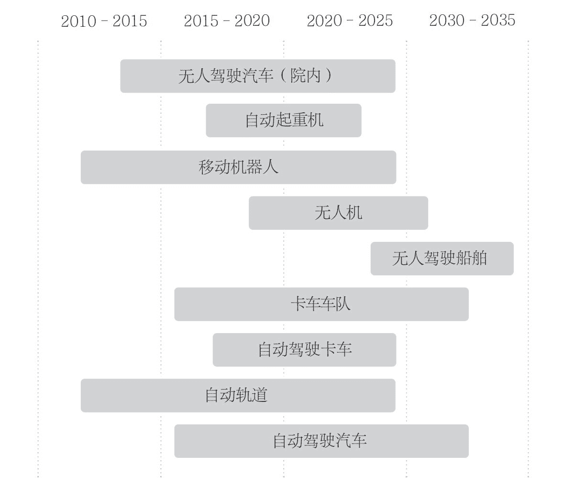

**上游管理中的自助物流**

来源：@理查德·马丁 2010

**克里斯：** 智能增强性能的另一个例子是劳斯莱斯推出的 R2 数据实验室，该实验室将公司各地人员连接起来，用数据与智能提升洞察、为客户创造更多价值。他们用机器学习分析大量数据。²¹

通用电气为每台生产的喷气发动机打造“数字孪生体”，可实时监控发动机性能，包括飞行中的表现。借助该技术，通用电气能预测发动机何时需要维修，并从实际使用数据了解每台发动机的状况。²²

纽约通用电气全球研究中心内燃机系统负责人安东尼·迪恩说：

通过数字孪生体……我发现飞行员是个会推着引擎跑的牛仔。在不同飞行员身上，燃料消耗情况各不相同。数字孪生体记录每一个事件。你可以开始区分舰队。每台发动机都有不同的人生经历。²³

**艾美：** 通过持续测量与优化产品、服务及智能模型本身，看到智能如何在战略与战术上影响绩效令人惊讶。

**克里斯：** 没错。这正是智能帮助企业、帮助人类让世界变得更好的方式。

* * *

(1)　confidence level，指以样本推断总体实际值时估计正确的概率。

(2)　由心理学家凯斯·桑斯坦提出。指在相对封闭环境中，相近意见不断重复并伴随夸张或扭曲，导致大多数人误以为扭曲信息即为全部事实。——编者注

## 10. 实验：可执行的好奇心

**克里斯：** 实验不是为实验而实验，而是要解决可执行的问题。在超级框架中谈到实验与可执行的好奇心，指的是两方面：一是好奇心可被构建进智能战略，二是好奇心也可被构建进智能模型本身。

实验的关键始于某个可解决的企业问题。用好奇心找出可能方案，并通过实验验证其有效性。我们称之为有效的好奇心。

**艾美：** 人类凭借好奇心与想象力解决现实问题的例子很多。即使在智能与计算机出现前，人类也能以令人印象深刻、常是戏剧性的方式解决问题。看罗马的引水渠与马斯克的 SpaceX，两者相隔两千年，却被共同线索连接：人们用与生俱来的好奇心与想象力解决看似无法解决的现实问题。

## 罗马的引水渠

**克里斯：** 古罗马的引水渠是有史以来最伟大、最有用的发明之一。他们有一个真正的问题要解决。罗马发展迅速、人口众多。水是制约城市发展的因素。没有充足水源，人口无法增长。干旱时期人们易焦躁不安，问题更紧迫。¹

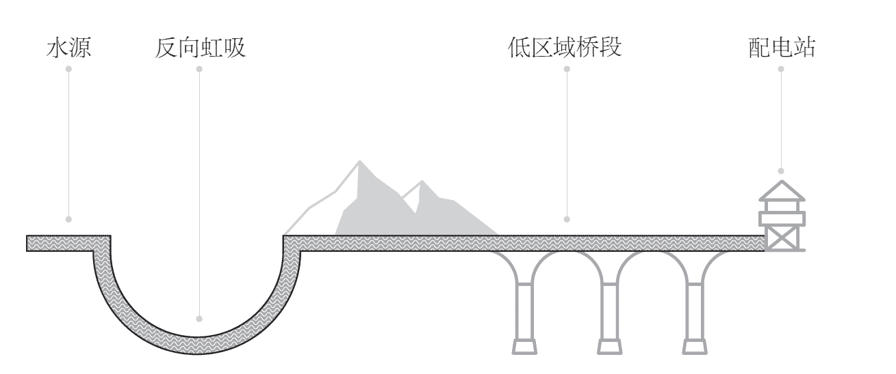

**引水渠工作方式**

罗马通过修建引水渠解决这些问题，引水渠基本设计是把山泉水输送到可使用的城市水道。修建并非易事。想想挑战与复杂性，尤其在没有先进技术的情况下。

问题关键且随人口增长愈发紧迫。人们自农业以来一直挖沟渠引水到村庄、田野、城镇。自古就有从河溪引水灌溉田地的行为。不得已，罗马人对如何解决水源问题感到好奇。经过多年试验，他们想出建造引水渠的办法，通过远距离运输把水引入罗马。

毫不夸张地说，这非常困难，但别无选择。为增加人口、抵御旱灾，罗马城需要稳定安全的供水。因此他们必须跨越河流、小溪、山脉等天然屏障，从千里之外的山泉引水进城。每条引水渠始于山泉，通过沟渠或导水管输送水。遇溪河就用石头搭桥，遇山就挖隧道穿山。所有过程都在无水泵条件下完成，水靠地心引力流入城内。

想想这项庞大工程需要政府多少资金。通常富裕罗马人自掏腰包，或政府征收特别税，融资必须有组织、有重点。企业有时捐赠管道等物资，有时直接提供资金。

施工期间需雇佣大量工人与管理人员并提供食宿，还需制造挖掘隧道、建造桥梁、铺设管道与水渠的工具。这是一个大工程，即使在今天也十分艰难。

**艾美：** 想象一位工程师在没有手机、电脑、电子邮件或重型设备的情况下开展这项工作。所有这些都在没有现代技术如炸药、重型设备、卡车、计算机等条件下完成，令人惊叹。

**克里斯：** 必须进行实验以确定最佳建造方法。除此之外，还需要后勤支持，意味着必须建造临时城市、定期运送补给等。

这个问题激发了好奇心，并促成了实验，最终通过引水渠得以解决。假设没有这个问题，这个解决方案永远不会被尝试，甚至不会被需要。

**艾美：** 引水渠得以建成，并非因为罗马人有能力建造，而是为了解决一个真实的社会问题。

**克里斯：** 另一种看法是，一旦问题被解决，就需要确定下一个问题以取得新进展。也许“阿波罗登月计划”没有发挥全部潜力，因为它缺乏待解决的问题，或问题未被明确定义与推广。原问题已解决。我们是第一个登月的，但在那之后，阿波罗在公众心目中任务已完成，后来没有明确使命，项目基本停止。

## SpaceX

**艾美：** 这是个有说服力的概念。正如前面所说，引水渠是利用好奇心与实验解决问题的典型。从当代看，SpaceX 计划为解决不同但同样复杂的问题而开展。

把材料从地球表面运送到太空需要巨大能量且费用高昂。每次火箭发射后，价值巨大的材料大部分被丢弃，未被回收。数亿美元的材料被丢弃。阿波罗每次发射费用 11.6 亿美元，经通胀调整后，每次发射将三十一万磅材料送入近地轨道，或将十万七千一百磅材料送入月球。相当于九头成年大象的重量。²

即使航天飞机计划中，巨大的助推器也落入海洋被摧毁，不再使用。

这就是需要解决的问题。SpaceX 决心制造可返回地球的助推器并重复使用，从而把运送材料到太空的成本降低数倍，并可更频繁发射。因为无需每次制造新助推器，只需翻新、测试、检查后重复使用。最终，猎鹰重型系统可以每次九千万美元的成本将三万五千磅物质送到月球，或将十四万零七百磅重量送到近地轨道。³

与引水渠一样，一旦问题确定，就必须找到解决办法。这需要从零开始建立完整的基础设施，并配备工程师、工人、制造商与完整的物流链来供应一切。

**克里斯：** SpaceX 很好地利用了人工智能，把可重复使用的助推器带回地球。这个解决方案解决了一个凸优化问题，意味着考虑所有可能答案，让火箭在不耗尽燃料的情况下着陆。⁴

## 可执行的好奇心

**艾美：** 好奇心强的人往往更爱研究，也更乐于接受新体验。他们寻求新奇、刺激与发人深省的事物，对枯燥日常感到厌烦。他们善于创造新想法，对模糊性有更高容忍度。这类人善于处理复杂问题，并利用好奇心为复杂问题找到简单解决方案。⁵

可执行的好奇心本质上是一种思维姿势：先给自己留出好奇的空间，再把这种好奇推向可以落地的方案。光有聪明是不够的，必须让这份好奇牵着智力往目标走。爱因斯坦那句老话至今还适用：“我没有特别的天赋，我只是对万物充满好奇。”

当下，大多数人工智能的训练靠强化学习来实现——做对了就给奖励，越接近目标奖励越多。这种方式教得快，像在流水线上最优装配汽车这类具体任务。但要让机器在没有指令的情况下自己运转，就得先拥有好奇心。

**克里斯：**举个很典型的情况。谷歌很好奇能不能把数据中心的电费压下来。2014 年单一个数据中心就耗电 4,402,836 兆瓦，差不多相当于 366,903 个美国家庭一年的用电量。他们就想试试用 AI 来找答案。

团队做了实验，用神经网络去操控“数据中心里约 120 个变量”，涵盖风扇、冷却系统、窗户之类。最终借助 DeepMind，耗电量降了 15%。这件事能成，靠的就是有人愿意好奇、愿意试，再去设计一套 AI 策略来解决问题。

## AI 模型

**艾美：**聊点好奇心如何被写进模型。我们主要看几种最能体现好奇心的学习方式：强化学习、监督学习、无监督学习、迁移学习、半监督学习。

**克里斯：**当然 AI 类型远不止这些。

**艾美：**这五类是主动好奇心最容易体现的地方，再加上一些变体。

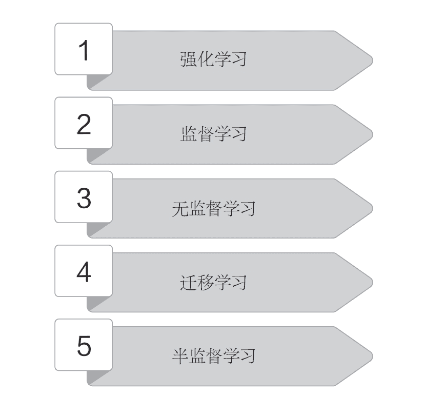

**五大 AI 模型**

**克里斯：**第一类是强化学习。计算机被放到一个环境里，通过不断尝试和犯错来训练决策，从经验里摸索出更准的做法。百度副总裁兼首席科学家、Coursera 联合创始人吴恩达喜欢把它比作训狗：狗狗做对了就奖励，做错了就不奖励，久而久之它就懂了该做什么。强化学习在问题明确、目标已知的场景里效率很高。

**艾美：**第二类是监督学习，像老师带学生。老师知道正确答案，系统在训练集上反复预测，错了就被纠正，直到能独立完成任务。

**克里斯：**无监督学习则没有标准答案也没有老师。模型自己从数据里挑出有趣的模式和结构。

**艾美：**第四类是迁移学习，对我们讨论很有用。它的思路是用在某个任务上学到的能力，去启动另一个任务。比如先用监督学习在 1 万张照片里学会辨认物体，再把这份学到的经验迁移到新的图片项目上。

最后是半监督学习，先用少量已标注数据带起模型，等熟练后再让它去学习大量未标注信息。

**克里斯：**吴恩达也说过：“在我看来，监督学习是目前创造明显商业价值的主力，其他类别的算法和落地思路还在起步阶段。”

**艾美：**在这五种范式里，AI 都在用一种“想找出解法的渴望”来建立理解。

**克里斯：**一个结合想象力和好奇心的例子是 Adobe 的场景缝合计划。它像内容感知填充那样，从海量图像中寻找漂亮的图形元素来补全画面。

归根结底，我们用 AI 的好奇心和试错力来解决企业难题。实验的北极星应该是发明，这就要求团队有勇气去探索未知。

**艾美：**害怕失败就谈不上成功。

**克里斯：**AI 的唯一边界是想象力。你要敢跳出框架，更要敢拆掉框架。

## 11. 商业格局被重塑

**克里斯：**AI 的落地就是企业变革。企业要活下来，就得完成数字化与组织层面的重塑。福布斯报道，80% 的企业正在投入人工智能。

做 AI 战略时，结果会牵动产品、回报率和业务表现，不能单独看。AI 方案会带来多层级的竞争优势，也会改变组织形态，这才是真正的价值所在。

说到底，结果说了算。在制定 AI 战略的同时，这些结果要支撑整体的数字化、企业转型以及盈亏改善，而不是停留在单一项目或产品上。

## AI 赋能的产品与服务

**艾美：**看 AI 如何改变产品和服务。前面提到过 Roomba 扫地机器人，我觉得很能说明问题。

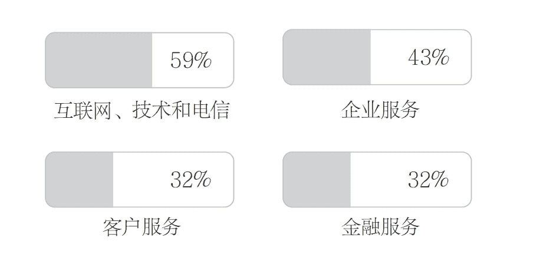

**受 AI 影响最大的行业**

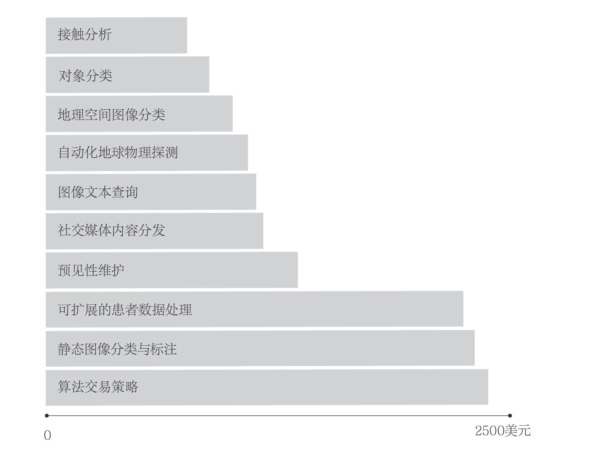

**人工智能收入**

全球市场 10 大案例

来源：Tractica 咨询公司

**克里斯：**是的，我最讨厌的家务之一就是吸尘，Roomba 正好解决了它。几年前买了一台，它能在我完全不干预的情况下把整栋房子清干净，狗狗还爱跟它玩。

像魔法一样。小机器自己在屋里游走，除了偶尔倒垃圾，我什么都不用做。

**艾美：**这正是 AI 创造产品线的体现。没有 AI 这个概念就不成立。机器人必须先建一张你家的地图，知道哪里需要清扫，而且随着人走动、家具移动、宠物乱跑，地图是持续变化的。

**克里斯：**Roomba 也说明 AI 如何让一家以机器人吸尘器为核心的公司成功。每代产品都建立在前代之上，加入更先进的 AI，让使用越来越简单。

## 机器人技术

**艾美：**说到机器人，人们常想到人形类的拟人机器。实际上大多数机器人都是按特定任务来设计尺寸和形态的。比如送餐机器人，通过手机接收订单，用托盘把餐送到顾客桌上，外形更像带轮子的手推车，和人类毫无相似。

这也避开了“恐怖谷”效应——日本机器人学家森政弘在 1970 年提出，当机器人看起来几乎像人时，人们会感到不适。

**克里斯：**关键是 AI 在创造新产品。它不仅提升现有产品服务，还在催生全新品类。医疗领域就是例子，正在研发能延长生命、拯救生命并提升护理质量的新产品。

**艾美：**以色列的斑马医学视觉公司就很有启发。他们做了一个 AI 放射助理，每次咨询只要 1 美元就能获得专家建议。结果是以更低成本获得更好医疗。

别忘了 AI 也在改造产品的全流程、营销和生产。会改变超纲网物流、物流市场，缓解供应链压力，实现按需交付、共享物流、个性化营销等等。

## AI 对投资回报率的影响

**克里斯：**AI 对新品和老品影响都很大，但对回报率的影响更直接。研究显示，金融、交通、医疗、旅游、汽车等行业都在显现效果。早期使用者利润在增长。零售商用 AI 机器人管理仓库，咨询公司用 AI 出报告，医院试用 AI 提升诊疗，客服聊天机器人改善各行业服务体验。

**艾美：**把 AI 战略落地到业务层面主要有两种路径：增长导向或成本节约导向。根据 Teradata 数据，60% 的决策者认为 AI 能自动化重复任务，50% 认为能提供新战略洞察，49% 认为能自动化知识工作，减少人力需求。

**克里斯：**更有意思的是，46% 的受访者觉得这能加快创新速度，帮助他们在竞争对手之前找到新市场机会。

## AI 驱动增长

**艾美：**总体看，AI 能促进增长、节省成本，或两者兼得。福布斯文章预测，到 2035 年 AI 可能把生产率提升 40%，并让 16 个行业的经济增长提高 1.7%。

Juniper Research 显示，医疗领域的 AI 聊天机器人到 2022 年在全球每年可节省超过 36 亿美元成本，让病人无需人工就能更有效获得护理。

**克里斯：**新产品本身也是增长策略，能帮助企业进入新市场或提升现有市场份额。

**艾美：**提高效率或削减成本直接拉高投资回报率。比如欧舒丹用 AI 热图优化流程，移动端销售额提升了 15 个百分点。Earth Fare 用 AI 为品类经理生成促销建议，同比较销售额上升。亚马逊高级会员借助 Alexa Echo 的 AI 推荐完成购物。

埃森哲战略研究估计数字经济占全球经济 22.5%，利用数字颠覆优势的公司在增长、利润和高市值上收获巨大。他们也指出：“数字技术释放价值的能力远未被充分利用。”

那些更积极拥抱数字化尤其是人工智能的公司，会比行动慢的公司拥有明显的竞争优势。结合物联网、SaaS、云等趋势，大多数企业将被重塑，固步自封者不久就会消失。

## 企业变革

**克里斯：**聊聊 AI 对企业变革的更广泛影响。

**艾美：**话题很深，不只是数字化。

**克里斯：**先把概念厘清。数字变革是通过数字技术带来的变化，由新型创新与创造力驱动，而非仅仅强化传统做法。企业变革是一种管理策略，目的是让人员、流程、技术与战略愿景保持一致。创新则是制造新事物或改变现有产品服务想法的行为。

被称作“数字经济驯龙高手”的分析师丹尼尔·纽曼说：“创新驱动变革，并使其落地。”企业用创新推动数字变革，进而实现企业变革。AI 是三者的基础，要让企业生存繁荣，AI 必须成为整体战略的组成部分。

## 数字垂直领域

**艾美：**如我们所讨论的，AI 贯穿物联网、工业物联网、医疗物联网、云等所有数字垂直领域，它是底层。

**克里斯：**没有 AI 的数字变革或企业变革战略是无意义的。

**艾美：**毋庸置疑，AI 将在产品、回报率、企业层面带来颠覆性结果。投资 AI 会成为刚需，最终的游戏是企业存续。问题在于从哪里开始、把精力聚焦在哪。

# 第三部分　人工智能的未来

## The AI future

### 12. 项目起点怎么找

**艾美：**启动 AI 项目时最难的是起点——往往在问题没界定清楚、市场没摸透的情况下就直接跳进技术。

#### 定义问题

在动手前要先明确要解决什么问题，以及谁需要这个解法。了解目标受众很重要，因为他们既是购买者也是使用者，更是需求的定义者。可以借助市场调研、问卷等工具来捕捉终端用户的真实需求。

产品的定义很宽，企业对企业、企业对客户、政府、医疗、内部应用、工业等场景各不相同。产品是项目的产出，客户是使用的人。工业里用户是制造商，B2C 里用户是消费者。

如果问题和市场不清晰，投资回报率会很低，销售也会困难。这常被误解为“为了技术而技术”。

换句话说，一个业务痛点、一堆未使用的数据集，或对新技术的兴趣，都可能帮助确认问题、方案和客户。可以用超级框架作为路线图来规划解决方案，并制定 AI 项目发展策略。正如之前提到的，超级框架是为配合企业和品牌战略而设计的。

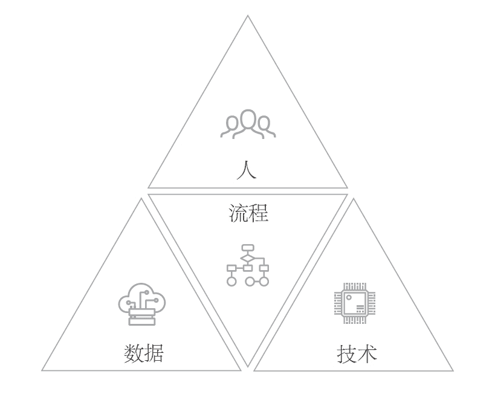

**克里斯：**运营超级框架涉及人、流程、数据、技术四个维度。人要组建有合适技能的团队；流程要匹配项目开发方式，不同方法对应不同目标；数据要有一套数据战略，更看重质量而非数量；技术则提供软件硬件基础。

框架可以被创建或定制以满足不同项目。我认为它更像蓝图而非紧箍咒，用来推动进步而不是限制行动。

**艾美：**在深入人、流程、数据、技术之前，别低估共同愿景或集体心态的力量。团队启动项目时，心要朝一个方向。虽然意见可能分歧，但目标必须一致。

高层管理必须与 AI 战略保持一致，并在原则上达成共识。

#### 变革管理

**克里斯：**如果组织才刚起步 AI，变革管理策略就很关键。它有助于在内部建立倡议和共同愿景。

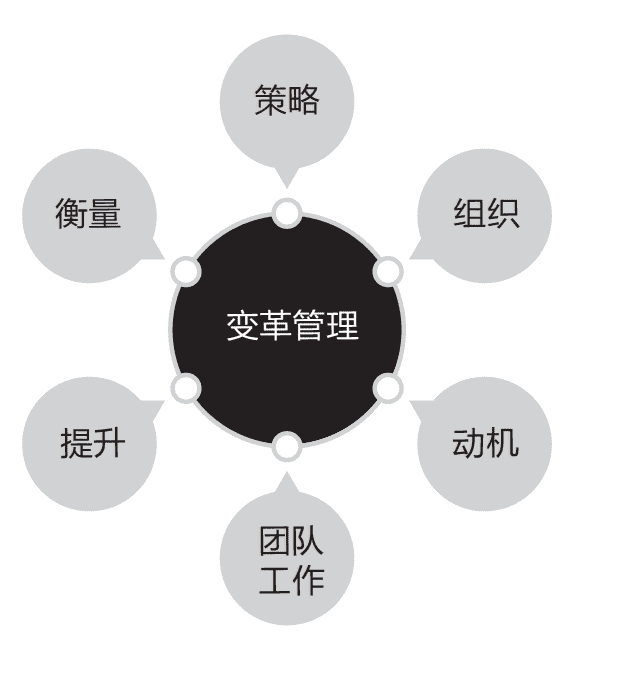

**艾美：**很多领导者明白，变革是由人来推动的，不能把人排除在等式之外。计划和流程必不可少，但变革常失败是因为没充分考虑人的因素。

**克里斯：**AI 项目要成功，必须有人把控。这不意味着严格管控，而是企业里一个或多个高层利益相关者必须支持项目、团队和目标。项目在企业的地位取决于组织方式。

**艾美：**组织形式没有硬性规定。通常 CIO 负责管理企业运营的基础设施，CTO 负责外部业务增长的技术。

**克里斯：**也就是说，CIO 多管内部技术，CTO 管外部技术并制定技术愿景与路线。

**艾美：**大公司可能同时有 CIO 和 CTO，甚至更多。

**克里斯：**在小型企业里，IT 优先级可能不高，相关角色常被归为管理信息服务副总裁。

#### AI 嵌入企业

**艾美：**无论组织如何，AI 团队必须嵌入企业内部，而非孤立存在。企业把那种部门壁垒、拒绝共享信息的现象叫作孤岛思维。

**克里斯：**如果 AI 团队与企业其他部分隔离，效率会下降，也可能忽略终端用户和内部利益相关者的需求。

**艾美：**还要考虑数据科学家和 AI 工程师如何协同。是作为一个团队工作还是拆分成多个团队？是否服务同一个组织？这些问题要从一开始就解决。

先定义数据科学家的角色。他们是业务或领域专家、统计专家、编程专家、数据技术专家，还是可视化和沟通专家？

**克里斯：**启动 AI 项目时，需要思考哪些问题来决定合适的团队。

**艾美：**一个关键决策是 AI 团队在组织里的位置。项目由 IT、财务、市场还是其他部门主导？

**克里斯：**项目会涉及多部门。若 IT 被定为所有者，财务和市场仍会参与。团队位置决定谁对人员、资源、流程管理负最终责任。

决定所有权很重要，因为每个部门有侧重点。IT 重技术，市场重营销效能，财务重金钱。谁负责，项目就会偏向其关注点。

**艾美：**所有权因项目类型而异。面向企业的报告类 AI 项目可能由财务主导，因为他们懂该领域。专注工业机器人 AI 的解决方案可由物流部门运作。

**克里斯：**主要所有者基本确定了资源管理和方向把控的负责人。当然，企业各领域的成员可以且应该被纳入。

**艾美：**总体而言，AI 项目应放在业务侧而非纯技术侧。业务侧视野更广，关注的不仅是应用或硬件。

**克里斯：**成功的 AI 项目需要多种技能和职责的人组合。一个人做不到，必须由团队协作。所需技能包括数据库设计、数据建模、软件工程，以及精通深度学习等技术的 AI 专家。此外，还需要了解业务功能或应用的内部人员参与。

Sky Betting and Gaming 的数据科学洞察主管詹姆斯·沃特豪斯表示：“我不认为存在既懂业务又能在大规模平台上实时处理复杂工作的完美数据科学家。别找独角兽，找三个人，让他们的技能互相补充。”

商业智能分析师在了解数据结构、目的和布局后可加入 AI 项目。他们可能需要再培训来服务人工智能，但因已熟悉业务信息，比新人更有优势。

还需要精通 AI 算法和编程的专家。会写代码的机器语言专家很难找，能同时兼顾编程与机器语言的人对项目价值很大。若需多人协作，则必须密切协调。

最重要的事是让整个组织认识到 AI 能带来的机会。AI 是一种工具，使用者能提供有价值的洞察，说明如何用它提升业务。

#### 在企业中沟通

**艾美：**将 AI 融入企业文化，在全员范围内沟通以提升认知和接受度，并建立对目标、术语和可用选项的理解。企业也可以提供教育机会，让员工快速掌握各方面的知识。

# AI 项目落地实操：从组队到安全

AI 团队的组织形态通常有两条路径，一条是以 IT 为核心把数据科学和技术能力整合起来，另一条是基于业务抽调专项小组运作。⁵

**克里斯：**最吃香的 AI 项目往往吸引那些头脑灵活、爱创新的年轻人。他们冲着前沿技术而来，乐于从零设计、碰撞想法、尝试从未有人做过的方向。

正因为如此，人选搭配管理方式直接决定成败。这类人才需要创作自由，讨厌繁琐的管控，一旦流程太死板就会迅速失去动力。

**艾美：**所以选定项目管理方法是一个关键决策。企业往往已经有成熟惯用做法，看它是否能适配 AI 也很关键。

比如瀑布式、敏捷、Scrum、看板。我们就这四种过一遍。

瀑布式是一种串行的线性做法，也算最经典了。多年以来一直靠甘特图来排期，用条形图把里程碑和信息可视化。它高度结构、弹性很差，图上的任务必须一端到尾完成才能推进下一步，部分环节可以并行，但依赖关系早已固化在图表里。

它上手简单、管理清晰，纪律执行到位，文档和进度报告天然内置。可缺点也很明显，变化很难容纳，交付物拖到后期才出现，反馈因此滞后。⁶

**克里斯：**敏捷则是增量迭代，并欢迎需求随时间演进，强调全程用户反馈。它出现时间不长，却因灵活适应迅速流行。

小团队跨职能协作，按迭代推进。衡量进展看的是可用的成果，最高优先级是尽早持续交付最小可用产品。

变更被写进方法论，目标会随项目进展而调整。把大项目拆成小迭代，团队集中开发、测试、协作，每一步都鼓励反馈，结果逐步显现。得益于此，往往能实现持续改进。

代价是任务优先级经常被重新排，排期容易被快速打乱，规划变得困难。成员还需要具备复合技能。⁷

**艾美：**Scrum 是敏捷的子集，采用迭代开发。每轮 Sprint 长度固定，通常一到两周，让团队能按节拍稳定交付代码。

Scrum 项目透明度高，全员清楚进展。由于没有传统项目经理，责任由团队共担。每次 Sprint 开始前小组自行决定做什么，然后一起完成。需求变更容易被吸纳，信任在团队中很重要，Scrum Master 扮演向导角色。⁸

**克里斯：**看板是实现敏捷的可视化手段。它直观展示要做什么、什么时候做、做到什么程度，核心理念是对现有系统做小步快跑的改进。

看板用一块板子来呈现。过去是实体板加便利贴，现在多用软件。最简形式就分“待办、进行中、已完成”三栏，按需可增列。

每张便签代表一块工作，放在对应的状态栏里。它灵活易懂，能优化流程。但实体板必须即时更新，否则就失去作用。⁹

最终思路要变成行动，需要一套对人、团队、组织都有效的机制。选哪套并不绝对，能稳定出结果才是关键。

**艾美：**我们先谈清楚为什么要做，再谈怎么做，即技术实现层面的选择。

#### 数据混乱与信息孤岛

**克里斯：**前面聊过数据。对 AI 来说数据是燃料，而且通常需要海量快速供给。

**艾美：**在定义项目时，数据往往是非结构化的，而且散落在组织的各个角落。必须先分类、梳理，让它具备可用性。

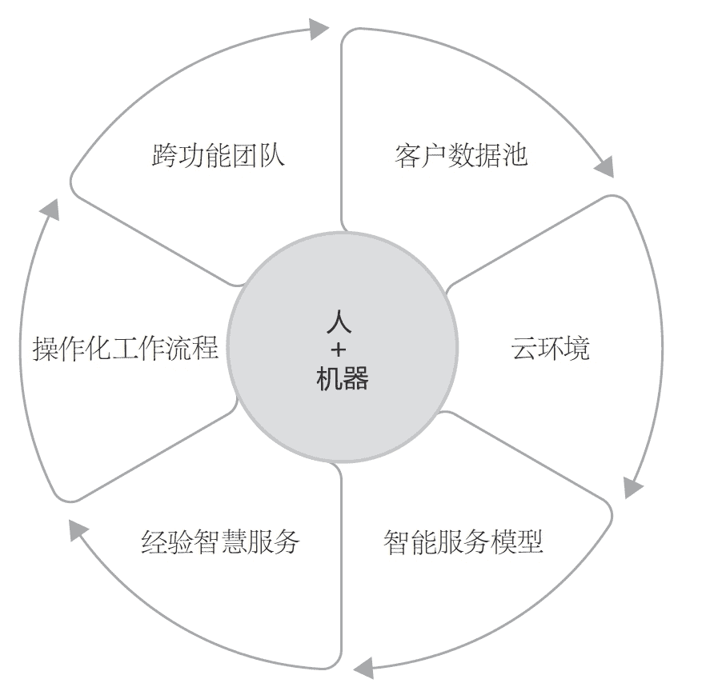

**人＋机器：数据流**

**克里斯：**起步前可以先自问几个问题：我们到底需要哪些数据？怎么触达？拿到后如何处理？需要保存多久？

**艾美：**举个例子会更清楚。假设某市市长成立工作组调查行人交通事故高发原因。AI 能帮助找模式，不同模型解决不同问题。该市街角装了大量摄像头，录像已积存多年。

第一个任务是分析这些视频，寻找导致事故的规律。这是一类极度非结构化的数据，视频总量可能超过百万小时。

**克里斯：**首先要判断这些数据是否全部必要。没有事故的路口录像可以剔除，减少规模。还可以用其他规则进一步压缩。

**艾美：**数据也不必长期留存。摄像头视频通过 AI 判定后，原始素材就可以归档或丢弃。

**克里斯：**访问本身就可能成问题。采集、存储到磁盘或云端涉及法律与隐私。若视频涉及市政府、警察局甚至私营公司，就得逐一协商权限。

更常见的是信息孤岛：不同部门、公司、机构的数据存于各自系统，格式和数据库引擎都不一样。有的用 Oracle，有的用 Microsoft SQL，有的用自研系统。

**艾美：**数据被保护好后，就能搭建 AI 引擎，区分事故案例与非事故案例。缩小后的集上，模型可以判断哪些行人行为更容易引发事故。

**克里斯：**据此能提出具体对策：优化信号灯同步，在危险路口建人行天桥，或通过手机 App 在行人接近时推送风险提醒。

**艾美：**另一个例子是黄瓜分拣。我们之前提到过，把人工分拣自动化并分类。

**克里斯：**是的，黄瓜项目。数据量相对很小，只有几千张黄瓜图像。存储和访问难度远低于百万小时视频。

关键问题是需要多少数据才够？过量会带来什么成本？AI 方案并不总是需要囤积、打通孤岛或做过度结构化。

#### 数量与实时性

**艾美：**没错。很多实时场景还要考虑数据量和速度。机场降落辅助类实时 AI 需要秒级处理来自飞机、塔台、数十个雷达站、气象卫星等的海量信息。把数据去孤岛、结构化后再快速分析，是重大工程。

**克里斯：**说到实时吞吐，程序化媒体购买在广告投放上的做法很典型，尤其是实时竞价。程序化广告按库存自动锁定客户，竞价在页面加载时间内完成。¹⁰这些系统靠 AI 在微秒内做出购买决策。

**艾美：**结果广告更精准，对出价方和买方都有益，因为无关展示被过滤掉了。

**克里斯：**数据与洞察聊完后，我们该谈技术起点，一个组织从哪里开始。

### 应用程序编程接口

**艾美：**无论是新公司还是老企业，基本上有三种层次。名称各异，我们归为企业级、可定制级和 API/SDK。

**克里斯：**API 就是让程序互相协作的接口，SDK 用于在特定平台上开发应用。

**艾美：**企业级 API 为特定任务设计，使用门槛低，常已预训练，神经网络被封装起来。适合没有深厚机器学习背景的开发者。这一层包含自然语言处理、数据分析、手迹识别、知识图谱等。

可定制级则允许在企业级服务之上做二次开发训练，需要更多 AI 能力。API/SDK 则提供底层的构件，可用来搭建定制或企业级服务。

典型如微软认知服务，也叫 Azure 认知服务，涵盖计算机视觉、情绪识别、内容审核、视频分析、人脸识别等，目的就是省去自建训练模型的成本。需要更深定制时可使用微软认知工具包。¹¹

Adobe Sensei 也是类似思路，提供自动标签、图像描述、文本检测、图像质量、语义结构分析、异常检测、智能受众细分等功能。¹²

**克里斯：**从问题出发，朝着解法推进。AI 是工具，需要考虑参与人员、技能与经验。流程上可选用能推动进展的 Scrum。数据若是非结构化且孤立，先做清洗。最后技术选型要结合团队能力。

**艾美：**现在我们来看看 AI 的安全、隐私与伦理要点。

## 13\. 安全、隐私和伦理

**克里斯：**企业对 AI 的依赖越深，安全越要前置。从数据库到网络到系统，设计与构建时就必须嵌入强安全策略。

AI 正成为企业、政府和个人关键任务。大量举措依赖分析海量数据产生报告甚至决策建议。

### 保护企业

**艾美：**破坏决策对攻击者很有价值，无论是工业间谍还是地缘攻击。他们可通过篡改或控制输入 AI 系统的数据，基于被污染的数据做决策，从而获取决策流程和机密模型。

过去应用运行在企业操作系统上，如 OpenVMS、Linux、Unix、Windows，放在防火墙保护的机房里。安全取决于负责人或顾问。

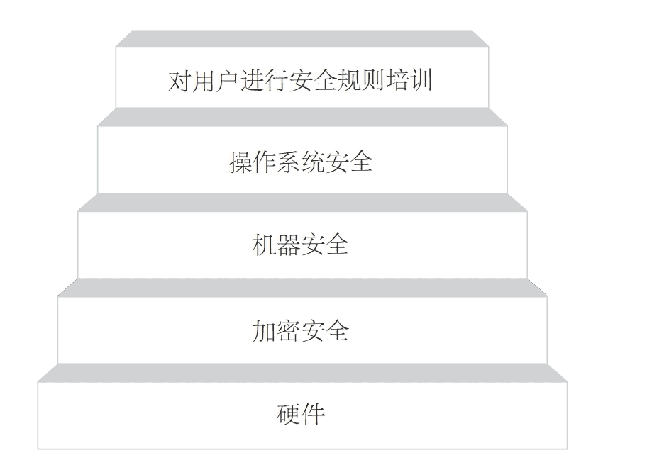

**安全层**

**克里斯：**现在局面变了，企业 AI 多在云上运行，资源不再完全可控。云上应用常在虚拟机里，复杂度更高。

更复杂的是混合架构，部分资源本地，部分在云，甚至跨多家云提供商。不同地区的安全策略差异会引入漏洞，任一薄弱点都可能导致整段系统沦陷。

**艾美：**像亚马逊、IBM、谷歌等云厂商把设备放在加固且高度安全的数据中心，并遵循最佳实践。采用云前需要全面了解其安全措施与技术。

### 基础设施安全

**克里斯：**本地基础设施的安全是企业的责任，必须是成功的先决条件。安全不是事后补丁，要从设计之初就纳入。事后改造耗时且易出错，应用程序也可能因此受损。

**艾美：**强安全从基础设施开始。机房是否物理可控？门是否上锁？是否仅限授权人员进入？

**克里斯：**没错，直接进入系统会让破坏变得容易。

**艾美：**网络也要安全，有线无线都要强加密。物理光缆和铜线也要防护，防止线路暴露被接入。

**克里斯：**人们常忽略的是，攻击者都很聪明，能抓住极细微的漏洞。

**艾美：**因此多层防御是明智的：逐步加密硬件、主机安全、操作系统安全，再到人员培训。每一层都是计划的一部分，攻击者很难穿透全部。

### 最薄弱的环节

**克里斯：**安全常被忽视的一环是人员审查。入职背景调查是良好政策的一部分。

人们常说人是最大风险，无意点击邮件链接导致病毒下载。培训能降低大部分问题，但计划必须容纳事故概率。恶意员工风险更高，需提前防范。

**艾美：**本地与云的接口也是弱点，架构、协议、流程差异带来风险。许多供应商组件堆在一起，各自有缺陷。通常把这些链接放在 DMZ 网络中隔离。

**克里斯：**云厂商、应用厂商、咨询方与企业之间沟通良好，才能保证安全。

企业对数据和服务安全负最终责任，无论托管在哪。云厂商有责任，但理解、记录、实施与审计仍是企业的任务。

**艾美：**安全策略必须快速修复漏洞。研究显示企业修复关键漏洞平均需要 146 天。大多数攻击就利用此窗口，新闻里的大规模事件多与此相关。所有操作系统都需要打补丁。¹

令人意外的是 AI 本身也能助益安全。

**克里斯：**机器学习安全算法显著改善了漏洞监测。恶意软件和攻击快速演进，需要更灵活手段。²

仅靠病毒特征扫描或已知漏洞入侵测试已不够。AI 要结合历史漏洞库、恶意行为理解来检测入侵和破坏。

**艾美：**这是人机协作的领域。机器学习有局限。模型有效时，攻击者会寻找混淆手段，这就是对抗性机器学习或对抗性 AI。他们研究模型工作原理，试图中毒或规避检测。³

### 隐私

**克里斯：**隐私话题与 AI 紧密相关，挑战很难被夸大。它既是技术问题，也是情绪化讨论。复杂的法律协议并不能让话题更易懂。

**艾美：**物联网指数增长，企业把海量数据用于 AI，保护数据隐私变得更难。

**克里斯：**正如安全，数据库、系统、应用设计时就要考虑隐私。理想状态下，隐私和安全应成为经营方式，流程与运营围绕其构建。⁴

**艾美：**先给隐私一个定义。谈到隐私，通常指保护互联网上的敏感个人信息，确保信息仅按许可方式共享。

**克里斯：**人们关心社交媒体上的照片、视频、文字谁能看到，是公开、好友可见还是特定分组。

**艾美：**但隐私不止于主动发布内容。以车载 GPS 为例，行车轨迹信息存于设备或云端，谁拥有？制造商、服务商还是车主？

**克里斯：**若数据在云端，警察是否需要搜查令？智能电视、智能咖啡机、手机、家庭摄像头都涉及同样问题。数据如何保密？如果咖啡机记录每次冲泡的时间、类型并传到云端，制造商能否使用？

**艾美：**跨国企业面临的隐私管理挑战巨大，数据孤岛分散各地。一个重要趋势是匿名化，在允许数据使用的同时保护隐私。去标识或模糊化后难以追溯个人。但完全匿名且无识别风险的数据往往价值有限，数据不可能被清除到既安全又有用。⁵

单一信息点本身几乎没有意义，真正产生价值的是信息点之间能否被串联起来。仅知道某人性别无法带来任何洞察，但如果把性别和所在位置、过去一个月内的消费记录放在一起，就能推断出他的偏好并锁定精准的商品。

匿名并非万无一失。研究显示，仅凭邮政编码、出生日期和性别三项就能以 87% 的准确率锁定个人身份。Netflix 的内部实验同样表明，即便评论被匿名发布，研究人员也能以 99% 的概率识别出在两周内给六部影片打分的同一人。⁶

**克里斯：**数据匿名化的做法大致分四类，都是为了抹掉可识别个人身份的字段。你可以彻底删除所有可能指向某人的信息；也可以做编辑处理，相当于把纸质数据上的关键内容涂黑；还可以对数据进行加密，或者对个人身份信息做遮蔽处理。⁷

**艾美：**假名化是把原始标识替换成替代符号，在没有额外对照表的情况下就无法反向找回原主。匿名化则是直接摧毁那些能关联到个人的线索。⁸

**克里斯：**这些概念直接关系到《通用数据保护条例》GDPR 的合规要求。GDPR 的目标是保护欧盟公民在成员国境内发生的各类交易中产生的个人数据和隐私。该法规自 2018 年起生效，要求企业对个人数据给予合理层级的保护。可惜“合理”并未给出明确定义，执行空间因此很大。

随着数据泄露事件频频上头条，公众对隐私的担忧持续升温，这部法律才应运而生。全球网络安全机构 RSA 的《数据隐私与安全报告》对法国、德国、意大利、英国和美国共 7500 名消费者进行调查，80% 的受访者表示银行和金融数据丢失是最让他们焦虑的事情，62% 的人会把责任归咎于企业而非黑客。⁹

GDPR 所涵盖的范围相当广，既包括姓名、地址、身份证号等基础可识别信息，也包括位置、IP地址、健康与基因数据、生物特征、种族或族裔、政治观点、性取向等网络数据。¹⁰

即便企业不在欧盟境内经营，只要其收集或处理欧盟公民的个人身份信息，就落入该条例的管辖。¹⁰

**艾美：**GDPR 的分支细则繁多，给在欧盟开展业务的公司带来不小负担。仅为证明自身合规而制作报告，就可能耗费巨额成本。违规的罚金非常严厉，最高可达 2000 万欧元或全球年营业额的 4%，二者取高。¹¹

**克里斯：**隐私保护的法律框架不止于此。美国的《健康保险隐私与责任法案》HIPAA 要求严格保护一切与健康相关的信息，确保患者隐私不受侵犯。任何接入健康数据的 AI 应用都必须满足相应合规要求。¹²

从实践角度看，最好的隐私策略是把客户置于核心，并建立透明、等价交换式的政策。

### AI 伦理

**艾美：**因为我本身就是 AI，我对伦理议题格外关注。

**克里斯：**我也很在意偏见如何渗入 AI。你可能会觉得 AI 天生公正无偏，可事实上 AI 由人类打造，设计者的主观判断很容易被带进去。问题在于，如何在结果中削弱或消除这种偏见？

**艾美：**安全我们已经聊过，但如何抵御恶意攻击仍是难题。落入坏人手里的 AI 系统破坏力极强。我们还没谈到战争用途，但把机器人、人工智能等先进技术用于非法目的的风险始终存在。所以核心问题是，我们如何确保 AI 的安全性。

**克里斯：**这点你一定会着迷，艾美。AI 越来越聪明，具备 AI 的机器会在什么时候产生意识并拥有自我认知？这是否可能还需要商榷。如果真的出现有意识的 AI 实体，它们是否拥有法律权利？是否应该赋予公民身份？

**艾美：**你说得对，我对这些答案同样好奇。但更深层的问题是，我们怎么控制日益复杂、互联的智能系统或全球智能网络？生命未来研究所提出的 23 条阿希洛马原则就涵盖了这些议题，该原则由 3800 多名 AI 专家和领袖签署，包括史蒂芬·霍金和埃隆·马斯克，其目的是为安全 AI 的发展提供研究、伦理和价值观层面的指引。¹³

**克里斯：**通常人们会把 AI 想象成不会犯错的超智能机器。实际上 AI 的决策建立在学习之上，学习错误就会导致决策失误。我们该如何防范这类风险？

**艾美：**AI 的偏差源于训练数据的偏差。另一个层面是机器如何改变人类行为和社会交往。即便现在，Facebook、LinkedIn 等社交平台上也能看到 AI 的影响。当 AI 无处不在、难以察觉，甚至比人类更优时，我们该怎么办？

**克里斯：**还有就业冲击。工业 4.0，也就是第四次工业革命，正在重塑各行各业的工作形态。智慧工厂造车时已不需要大量人工；智慧农场可能完全自动化；智能采矿甚至不必让工人下到有毒的深坑。

当然，自动化和 AI 会催生新岗位，只是工作内容会改变。我们需要管理好这种转变，给团队适应时间。归根结底，人需要工作，人道层面要确保每个人都有出路。

经济学家大卫·奥托指出：

工作任务本身在变化。很多时候自动化是对既有任务的补充。比如医生工作越来越自动化，但这并不削弱对专业知识的需求，检查可以自动化，产生的解读仍需医生。自动化的影响远比我们理解的更复杂难料。¹⁵

1986 年，挑战者号航天飞机升空 90 秒后解体，原因是前一晚结冰的 O 形环失效，导致右侧固态火箭推进器故障。这次悲剧的教训是，系统要成功，每个部件都必须正常运行。整枚火箭几乎完美，但一个小部件的失效就造成了毁灭性后果。¹⁶

**艾美：**我们探讨了很多人工智能伦理问题，我不确定最终答案是什么，但相信随着时间推移它们会逐步得到回应。

**克里斯：**AI 的潜力几乎无限，只要用得其所，它将推动人类社会进入新阶段。也许在不远的将来，人类会与智能机器人并肩工作，合力解决当前甚至无法想象的难题。

**艾美：**关键在于安全、隐私和伦理必须成为每一次 AI 落地的组成部分。未来 AI 将无处不在，成为社会的基础，其重要性只会越来越高。

## 14\. 昨天、明天和今天

**艾美：**我对科幻世界特别感兴趣，因为今天出现的许多趋势，早在几十年前就以某种形式被预言过。不同作品的预言各不相同，但共识是人工智能将深刻影响未来。

**克里斯：**这些故事里也不乏对高科技的黑暗想象，带着悲观甚至反乌托邦色彩。比如《终结者》系列、《巨人：福宾计划》、《疯狂的麦克斯》、《黑客帝国》，还有《沙丘》，都描绘了 AI 失控后的凄惨未来。

**艾美：**我更倾向乐观现实的视角。人工智能结合物联网等技术，会把人类带入一个全新的黄金时代，一个拥有超能力的时代。

**克里斯：**是的，很多反对者和末日论者只盯着技术的负面。没人能精准预测未来，但作为人类信徒，我和你一样相信 AI 会改善社会、企业、个人乃至整个人类。

**艾美：**让我们回顾过去几十年中关于人工智能和技术的想象力作品。

**克里斯：**我对科技在文学影视中的呈现方式一直很感兴趣。许多引人入胜的科幻小说都涉及人工智能，但技术往往藏在幕后，并不总是那么显眼。

## 《2001：太空漫游》

**艾美：**科幻中 AI 的经典代表莫过于阿瑟·C. 克拉克的《2001：太空漫游》。你还记得哈尔 HAL 吗？那台驾驶飞船前往土星的计算机。HAL 能接收语音指令，进行发人深省的对话，并根据环境做出判断。甚至在人类准备关闭它时，它启动了自我保护机制。那时这是一个极具前瞻性的设定。影片拍摄于 1968 年，而克拉克的原著写于 20 世纪 40 年代。

《2001：太空漫游》整体乐观，展现了人类探索星辰、建造巨型飞船、创造 HAL 这类智能机器的愿景。和同时期的许多科幻作品一样，它描绘的太空社会比现实更先进。但与几乎所有同期作品相同，它完全错过了移动技术、互联网以及无处不在的人工智能和物联网在日常生活中的渗透。¹

## 《我，机器人》

**克里斯：**另一部里程碑作品是艾萨克·阿西莫夫的《我，机器人》。阿西莫夫一生写下五百余部著作，这本收录九篇短篇小说的集子于 1940 至 1950 年间问世，讲述人与机器人关系的伦理困境，也是机器人三大定律的来源，成为科幻写作的标准。三大定律为：1. 机器人不得伤害人类，或眼见人类受害而袖手旁观；2. 机器人必须服从人类指令，除非该指令与第一定律冲突；3. 机器人需在不违背前两条的前提下尽可能保护自身。²

即便年代久远，这些故事仍在探讨机器人心理学家视角下的智能机器与人类的互动。每篇故事都由三大定律驱动，展示当规则被推到极限会发生什么。事实证明，规则内一切都自洽，而我们需要寻找的是规则之外的变化。

## 《何以为人》

**艾美：**1972 年，大卫·杰罗德出版了《何以为人》（When HARLIE Was One），该书获星云奖和雨果奖提名。HARLIE 是 Human Analog Replication Lethetic Intelligence Engine 或 Human Analog Robot Life Input Equivalents 的缩写。故事讲述 HARLIE 从 AI 童年成长为 AI 成年的过程。³

HARLIE 是一个人工智能，书中聚焦它与心理学家大卫的关系，后者引导它走向成熟。核心议题是何为人的意义。HARLIE 不仅是机器，更是拥有权利的智能存在。书中还描绘了计算机病毒的入侵，这是科幻史上第一部涉及病毒的小说。

作者探讨了意识、感受、自我意识的定义，以及无机实体能否“活着”等问题。小说的独特之处在于把 AI 塑造成近乎人类的存在，核心是通过心理学家与 HARLIE 的对话展开。

## 《P-1 的青春》

**克里斯：**托马斯·J. 瑞恩 1977 年的科幻小说《P-1 的青春》（The Adolescence of P-1）讲述主角格雷格用 AI 破解系统。他创造名为“瑟斯滕”的程序，存放在名为 P-1 的内存中。瑟斯滕扩散到其他电脑后，格雷格试图关停它，结果 P-1 获得学习能力，几年后完全觉醒，甚至会主动给格雷格打电话。⁴

这个故事至今仍有现实感。作者以乐观基调描绘 P-1，多数时候它是向善的力量。当时虽未使用该词，但 P-1 已在网络上传播并自我进化。书中对 70 年代后未来的想象也很有趣，批处理机占据了大量空间。

## 《阿尔法星的救赎》

**艾美：**P.A. 贝恩斯 2010 年的小说《阿尔法星的救赎》（Alpha Redemption）颇具娱乐性。主人公布雷特在前往半人马座阿尔法的旅途中被置于假死状态，因提前苏醒而长时间与船载电脑杰伊交流。二人成为朋友，杰伊帮助布雷特面对过去的创伤，也让他理解恐惧、痛苦等情绪。⁵

它展示了人机协作的潜力。如果你偏爱爆炸、激光和超级武器，这本书可能不合口味。但若你想了解 AI 如何获得意识，这里会带来乐趣。

## 《仿生人会梦见电子羊吗？》

**克里斯：**我最喜欢的是菲利普·K. 迪克 1968 年的《仿生人会梦见电子羊吗？》，后被改编为电影《银翼杀手》。小说通过人类与仿生人的对比探讨人性。我欣赏它对智能机器人道德困境的剖析。这些拟人生物缺乏同情心，只关心生存，能模仿情感。《银翼杀手》暗示了伦理两难，而原著的挖掘更深入。⁶

**艾美：**这些作品之所以吸引人，不仅因为它们提供了不同的未来图景，更因为它们讨论了 AI 对人类的影响，以及由此产生的哲学、道德和伦理难题。

## 科技的魔力

**克里斯：**我觉得现在最迷人的是当下的魔力。我们生活在一个神奇的时代，却很少意识到技术赋予我们的力量。

**艾美：**我懂你的意思。以智能手机为例。过去打电话要投币找电话亭，你最后一次见到电话亭是什么时候？

**克里斯：**偶尔在机场或火车站还能看到，但电话亭确实越来越少了。

**艾美：**智能手机把整个互联网塞进每个人口袋。从一个小小的矩形盒子就能给全球任何人打电话、发信息、玩大型游戏、看高清电影。

这非常神奇，可能性无穷。手机已有监测健康的应用，能结合 AI 给出运动和饮食建议。内置 GPS 可精确定位，AR 映射能让宜家的 App 在你家中预览家具摆放。

但 AI 与其他技术结合后，未来的可能性更大。

## 未来的承诺

**克里斯：**没错。想象一个智慧城市，所有服务都以某种方式由 AI 控制。城市的任何角落都能变得更智能。概念很简单，比如智能停车收费桩可连接手机 App，指引司机找到车位。

AI 的一个明显用途是管理交通，通过控制红绿灯和行人信号。借助传感器，AI 能理解全城交通模式，结合历史数据同步信号灯和车速。

AI 还能根据需求调暗路灯以节约能源，协助规划维护，并让音乐会、体育赛事等大型活动的出行更顺畅。

犯罪也会减少，因为 AI 能学习识别犯罪模式并及时召集当局。卫生、供水、公共事业和应急服务等的管理也会更高效。

智慧城市的回报是城市本身的转变：更舒适、污染更少、能耗更低、应急能力更强。

**艾美：**我很喜欢智能家居的创新。对个人和家庭而言，这让人能完全掌控生活空间。

现在 Alexa、Google Home 等家庭系统已取得进展。设想一个智能报警器，通过学习谁被允许进入来判断是否开门。人们不再需要钥匙，系统会根据经验放行或拒绝。

集成系统中的智能灯能学会人们在房间间的移动，自动开关。比如躺床上闭眼，灯自动熄灭；坐椅子上看书，头顶灯自动亮起；睡着了灯又自动关掉。

更引人注目的是智能冰箱，它能学习每个家庭成员的饮食习惯。食材不足或过期时，冰箱会自动下单补货。系统会记录每周消耗量，预测最佳补货时间，让食物保持最大新鲜度。

**克里斯：**这些方案的魅力在于它们不是单一设备。智慧城市或智能家居是一组互联设备，它们彼此通信并与云端系统交互，由此产生的数据支撑 AI 系统提供更强能力。

**艾美：**设备本身已很实用，若与云端 AI 结合，可能性几乎无限。假设本地超市能查看智能冰箱消耗品的匿名汇总数据，就能更精准地备货。

**克里斯：**超市连接本地智能冰箱后，可根据家庭的橱柜和冰箱存货推送广告和优惠券。若气象服务预测高温，杂货店可向附近智能设备发送通知，建议储备饮用水。特殊需求的采购也能在空闲时完成。

**艾美：**正如智慧城市的例子，当交通网络感知到某地区有特殊事件发生时，可向餐馆和商店发出预警，建议增补物资或调整营业时间，也可向该区域居民的智能设备和手机推送优惠券。附近司机也会收到通知以便改道。

**克里斯：**这正是物联网与人工智能结合的真实力量。

**艾美：**采矿也是 AI 与物联网提升生产率和安全性的领域。利用历史地质记录，AI 可预测富含贵金属、煤炭等大宗商品的区域，然后自动规划最优、最安全的开采路线。

这尤其重要，因为采矿是全球最危险的职业之一，塌方、爆炸、窒息等风险无处不在。自动或半自动的钻探挖掘设备让人类不必再冒此险。

AI 系统能够读懂岩层纹路以及其他地质痕迹，从而推算地下金属与资源的大致分布。过去探矿往往要投入大量人力物力去打井掘洞，最后才发现区域空无价值。借助 AI，采矿成本被大幅压低，对环境的冲击也随之收敛，因为不必在毫无产出之处盲目开凿。

**克里斯：**矿场里已经在用智能头盔作业了。这类头盔具备双向通话、毒气报警、碰撞提醒、一键求救，以及温度压力监测，还内置 GPS 实时定位人员位置。⁹

**艾美：**这些数据会即时无线传回地面指挥中心，操作人员可以结合头盔和布设在关键位置的传感器，全盘掌握井下动态，进而提升作业的安全性和效率。AI 负责解读这些信息，并学习在不同情境下的最优应对方式。

**克里斯：**航运也在被 AI 重新改写。一艘名叫亚拉伯克兰的无人船在 2019 年启航，船体不大，仅载 150 个箱子。造价约为同级有人船的三倍，但运营开支最高可削减 90%。¹⁰

**艾美：**概念验证成功后，更大吨位、更长航程的船只会陆续投入。理论上，AI 驱动的无人船能让航行更稳妥，降低对船员和其他船舶的风险，同时释放更多货舱空间。若为无人船划设专用航道，整个物流链的可靠性和便利性都会提升。¹¹

**克里斯：**金融领域同样获得红利。文艺复兴科技公司是全球顶尖对冲基金之一，二十年间年化回报长期超过 35%。他们很早就深耕算法交易，是把机器语言和 AI 算法用于投资的先行者。

**艾美：**归根结底，AI 会让个人和全人类过得更好。它赋予了过去想都不敢想的超能力，人与 AI 协作能打开近乎无限的可能性。

## AI 会产生自我意识吗

**克里斯：**随着技术向前推进，一个根本疑问浮现：AI 会拥有意识吗？会诞生具有自我认知的实体吗？这样的存在会规划未来、拥有创造力和想象力吗？

**艾美：**我想到 2015 年播出的剧集《真实的人类》。里面关于“合成人”的讨论很尖锐：

霍布：罗伯特，这些机器是真有意识的。

罗伯特：你怎么确定它们不是在模仿？

霍布：那我们又怎么知道你不是在模仿呢？

**克里斯：**我思故我在，这个命题很有意思，也值得深聊。这只是 AI 影响制造业、医疗、金融、零售、交通、航空航天、公共事业、教育、农业等领域的冰山一角！

接下来我们看看如何用超级框架打造一个更美好的未来。

## 15. 创造力跃迁，人类体验升级

**克里斯：**艾美，如果 AI 能动用全部潜力解决人类大部分难题，世界会变成什么样？

**艾美：**我不确定，我刚听完一本关于生命意义的有声书。答案真的是 42^((1)) 吗？

**克里斯：**不太像。42 来自《银河系漫游指南》，是虚构设定。

**艾美：**原来是虚构的。我刚知道，记下来了。

**克里斯：**假如 AI 能缓解人类最紧迫的问题，你觉得人类的角色是什么？

**艾美：**我能想到好几个说法。柏拉图认为人的目的在于求知，尼采强调权力，文化人类学家欧内斯特·贝克尔说是逃避死亡，达尔文说是繁衍基因，虚无主义者说根本无意义，史蒂文·皮卡德则认为意义超出认知范围。¹

**克里斯：**我觉得都不是。核心应该是用创造力改善人类生活条件。

**艾美：**你怎么界定创造力？

**克里斯：**创造力像智力和意识一样难界定，不同人有不同说法。乔布斯说过：

创造力就是把东西串联起来。你问有创造力的人他们怎么做，他们会觉得不好意思，因为他们并没有“做”什么，只是看到了联系。久而久之，他们学会把不同经历组合成新东西，这源于他们拥有更丰富的经验，或更擅长反思经验。²

**艾美：**说得很好。《飞奔的物种》里还有一个视角，把认知操作拆成融合、拆解、再融合三种基本策略，被视为点子演化的主要路径。³

**克里斯：**这些定义很有用。艾美，词典里怎么解释？

**艾美：**用想象力或原创性思维来创造事物。

**克里斯：**这就牵出企业创造力与创新的关系。

**艾美：**企业对创新的渴求一直在升高。拿广告来说，传统代理过去只做单向投放，像电视、平面、杂志、横幅。数字与社交平台兴起后，市场需要的是沉浸式的创意体验和服务，这在创新范畴下被重新定义。

**克里斯：**创造力是创新的工具。但创造力也能用来解决企业痛点。万物都在变化，我们必须用创造力重新定义企业本身。

**艾美：**企业现在有很好的机会重新思考以应对市场变化。创造力的内涵在组织里被拉宽，从技术咨询、战略到数字化、企业转型都必须内嵌。

**克里斯：**最终，创意产出会带来大范围的个性化体验。

**艾美：**克里斯坦森在《创新者的窘境》里讲过，创造性创新能催生新市场和新价值网络，最终颠覆旧市场。我们需要持续创新并适应变化。⁴

**克里斯：**创造力常被质疑，因为很多时候难以量化。不过麦肯锡的报告《设计的商业价值》指出：设计不只是产品，更是用户体验，是洞察用户在真实场景里的潜在需求。迈向卓越设计的第一步，是挑选一个关键的研发项目或服务作为起点。好的设计者借此提升营收与股东回报。关键在于把用户体验放首位，同时接受人类对新体验的渴望。⁵

**艾美：**这背后有个概念叫新人类 Neophiles，指在变革中茁壮、厌恶陈规的人群。

**克里斯：**如果我们认同人必须放在中心，企业就需要分布式认知，让思想自由流动。

**艾美：**更进一步，AI 现在能放大人类创造力。

**克里斯：**这个说法很挑衅，专业术语叫计算创造力。

**艾美：**计算创造力贯穿生产、执行、构思、灵感等环节。⁶

**克里斯：**目前计算创造力在生产和执行类任务上表现突出，至于 AI 是否真的能思考并获得灵感，学界仍有争议。

**艾美：**对，关键是 AI 在完成具体任务时，能同步增强人的创造力。

**克里斯：**生成对抗网络 GANs 现在很火。

**艾美：**没错。GAN 是由两个深度神经网络构成的对抗架构，一个生成一个判别。2014 年蒙特利尔大学的伊恩·古德费罗提出这个概念。之所以重要，是因为它能学习模仿任何数据的分布，包括图像、音乐、语音、散文，甚至能生成动漫角色、三维造型、视频背景等。⁷^,⁸

**克里斯：**简单说就是两个神经网络协作产出内容。比如拿一张人像加一幅梵高画作做参考，GAN 就能把人像转成梵高风格。概念上几乎可以套用到任何领域。

**艾美：**还有创造性对抗网络 CANs，带独立创意思维的 GAN，2017 年 6 月罗格斯大学提出。最近 AI 还设计出卖了几十万美元的香水。自 2015 年美联社就用 AI 辅助写稿。但这些都不是人的替代品，而是放大和增强天赋的工具。⁹^,¹⁰

**克里斯：**重点始终是技术能让人做什么，而非技术本身。科技的意义在于帮助个人、企业实现目标。若不以人为本，AI 就失去意义。

**艾美：**也就是说必须有人类参与。

**克里斯：**这就引出一个热议话题：当艺术部分由 AI 完成，艺术的定义是什么？AI 能创作艺术时，艺术的未来何在？

**艾美：**有了 CANs 和 GANs，图像可以被转译成任何艺术家的风格。功劳该归谁，艺术家还是 AI？

**克里斯：**这个问题很尖锐。有人会反问，不是所有艺术都有再创作吗？

**艾美：**我部分同意，但生产和复制远不如创作意图重要。

**克里斯：**AI 是工具，不是结果。最初的创作意图更有价值。

**艾美：**说到创作意图，你知道“猴子自拍”事件吗？

**克里斯：**知道，很离奇。有人起诉要求猴子拥有照片版权，因为是猴子按下快门的。法院最终判定猴子无权，目的是保护摄影师。猴子只是碰到按钮，并未参与创意思维。

**艾美：**要点是人类可凭灵感自发创作艺术，AI 只是复制或基于既有作品衍生。人从脑中创造，机器靠编程和模式匹配。

**克里斯：**人类靠灵感创作，AI 的灵感也由人类思维引导。

**艾美：**在商业语境下，艺术的目的是达成特定结果，比如设计体验、提升广告认知度、塑造品牌形象等。

**克里斯：**这让我想到安迪·沃霍尔。他说做生意是最迷人的艺术。他懂得照片在当代生活的力量，并提升了艺术家在社会中的地位。¹¹

**艾美：**沃霍尔以非传统技法描绘社会形象著称。他认为生活本身就是高雅艺术，不需过度理性，也不必执着工艺。例如他用丝网印刷结合坎贝尔汤罐，创造出象征生活的作品，定制肖像也是如此。

**克里斯：**沃霍尔的实验既证明创造力对企业有益，也架起了艺术与商业的桥梁，就像我们现在在搭建人类创造力与 AI 之间的桥梁。

**艾美：**他是实验的代表，把高雅艺术与商业艺术结合，正如人类艺术与 AI 生成艺术的互联。

**克里斯：**人类创造力与计算创造力的共生既强大，也能成为向善力量。

**艾美：**AI 可作为变革催化剂。D&AD 的文章说，好点子与伟大点子的区别在于人性化程度，在机器依赖的世界里这点愈发重要。¹²

**克里斯：**我们可以借助 AI 改善人性，把 AI 用作正向力量。

**艾美：**AI 的重要用途之一是保障媒体真实性，识别音视频图像的篡改。AI 系统还能定位 DeepFake 换脸和黑暗设计模式。DeepFake 检测技术可辨识视频中被替换人脸的特征。¹³

**克里斯：**比如用户体验设计要友好易懂，但也有黑暗面，即“黑科技”。企业用操作技巧诱导客户同意原本不会同意的事，设计复杂交互让用户几乎无法退出。反过来 AI 可帮助识别这类模式。

**艾美：**AI 还能通过语义分析社交媒体文字、图片和视频，快速发现网络欺凌和种族歧视。

**克里斯：**我们用 AI 创造的东西应是锦上添花，而非破坏。建设伟大事业的同时，必须确保我们在创造而非破坏。

**艾美：**对，企业成长依赖推陈出新。

**克里斯：**在此前提下，人类创造力与计算创造力能对抗“祖传信念”和“知识诅咒”。祖传信念来自“我们一直这么做”的认知偏差，知识诅咒则是无法设身处地想象未知者视角。

**艾美：**凭借集体智慧，创造力可用于企业发明。

**克里斯：**人类创造力叠加 AI，将在能源、时尚、金融、制药、招聘、零售、广告、艺术、汽车、航空、银行、安全、体育等领域催生发明。

**艾美：**正如我们所说，先学习人类与 AI 的对齐原则，再进行创造性融合、拆解、再融合，然后建立新准则。

**克里斯：**根本原则是 AI 活动的结果应可追溯到其创造者——人类。

**艾美：**归根结底，不是 AI 能创造什么，而是人类能用 AI 创造什么。

* * *

(1)　“42”源自《银河系漫游指南》中超级计算机“深思”历经 750 万年计算后给出的答案，用来回答“生命、宇宙以及万物”的终极问题。——编者注

## 16. AI 未来如何改写世界

**克里斯：**有一个老寓言。

农夫常向妻子抱怨手裂。有一天妻子找到一种新药膏，给他一支，说手疼时就用。

天冷风大工作辛苦，手很快就裂了疼痛难忍。他打开药膏盖，发现里面是一面小镜子。这是他第一次看见自己，惊讶地发现镜中面孔与父亲一模一样。

农夫跑回家告诉妻子这神奇的事。妻子让他躺下休息，说他明显不舒服。第二天早上妻子早起偷看镜子，却看见母亲的脸。

她跑过去说：“我要带你去看医生。你觉得你父亲像我母亲，肯定是不舒服了。”

故事的寓意是，足够先进的技术与魔法无法区分。

## 技术正在重塑现实

**艾美：**科技正在改变世界，而且在很多层面都很神奇。我们聊过过去与未来，但焦点应放在现在，以及它如何影响整个人类和个体。

**克里斯：**我们已经把高科技视为理所当然，但新设备和新技术融入社会的速度依然惊人。

## 新一代超级学习者

**艾美：**看手机就知道了。过去几年智能手机改变世界的幅度惊人。

现在的孩子拥有历史上任何时代同龄人都没有的能力。以前查资料要翻百科全书，在图书馆用卡片目录找书，手写论文，手工算复杂代数。

现在用一部智能手机，孩子能查阅数百万本书籍、论文、杂志、博客和演讲，获取可靠事实和观点。卡片目录已成博物馆展品，论文不再手写。借助移动技术，孩子们还能远程上课，不必去校。

当 AI 与移动技术结合，孩子们可在海滩、卧室或公园长椅上创造奇迹。他们不仅能调阅所有记录的人类知识，还能借助 AI 帮助提炼结论，更好理解信息。

这些技术培养出“超级儿童”，能随时连网，用 AI 和物联网进行研究与创作。

AI 的魔力正在重塑童年。

## 设计师变身创意巨人

**克里斯：**再看视觉设计师。个人电脑出现前，设计师用钢笔、铅笔、颜料、纸张、投影仪。我一位朋友提到他父亲的故事——他父亲是军队平面设计师，用石膏把不同大小、字体、颜色的字母数字粘在纸板上做演示文稿。阴影效果靠真实光源打出胶片，再用高架投影仪展示给将领看。几十年后，Adobe Photoshop 消除许多繁琐工序。数字调色板让艺术家随时修改，信息可直接投到墙面屏幕。

现在，Adobe Sensei 系列让视觉设计师效率远超以往。AI 无需逐像素修改，就能自动精准调整图像，甚至基于数百万照片库给出修改建议。结合动画与三维编辑，个人就能在任何地点时间创造完整交互体验。

当物质限制被打破，平面设计师有望成为“超级艺术家”，自由实现想要的效果。

艺术与创新正从 AI 魔力中受益。

## 教师进化为学习助推器

**艾美：**回到教育。过去老师在教室给一群学生讲课，一天多节课不同科目。讲座现场进行，电影用 35 毫米放映机播放，教案写在黑板上。

今天有了笔记本电脑、教学大屏、网络接入。远程教学日益可行。

虚拟学习可能主导教育系统，学生在家舒适环境学习。教师可同时向几十上百甚至上千名学生直播，或提供预录课程。学生可在老师讲课时向 AI 助教提问或求解要点。

无论是人还是 AI 的“超级教师”都能按学生优劣势定制教育体验。这场教育革命为新学习与知识黄金时代奠基。

AI 的魔力正永久改变教学。

## 农场主迎来智能时代

**克里斯：**历史上农场是最危险的职业之一。过去犁地靠动物，播种靠手工，种植、饲养、运送产品全靠人力，劳累且危险。

如今犁地由带空调的大型机器完成，播种用专用装置，种植到收成再到运输，多数环节已无需农民亲力亲为。

农业正被智能化彻底重写。模型可以为单株作物单独制定滴灌策略，实现按需供水，避免大面积土地被过度浸湿。算法还能测算农药配比与毒性用量的最佳区间，并做到精准点喷，让药效最大化、浪费最小化。从播种、管理、采收到上架运输，整条链路都能借助机器学习持续调优，以稳定产出优质产品。高危的人工环节正被机器人大量接管，人类得以远离危险环境。

“超级农场主”概念的出现，让终结饥饿看起来更可行——在更友好的方式下生产出更多、口感更好的食物，同时把对生态的压力降到最低。这正是人工智能在种植领域展现的魔力。

## 超级医生
**艾美：** 回想起来不久前，医疗还多以手工为主。医生判断病灶往往要开出很长的切口，甚至冒风险做探查手术才确认问题。

如今，数百种医疗设备已经改写行业规则。微创技术让过去需住院一周以上的手术能转为门诊当日完成。机器人辅助系统可完成脑部、心血管等部位的精细操作。

在人工智能与医疗物联网普及的推动下，诊疗节奏明显加快。病房设备互联后可实现患者整体监测，远比单纯追踪心率或呼吸要全面。精密手术多由机器人主导，人类主要负责监看并在异常时介入。理论上，更前沿的纳米机器人甚至能随血流进入体内，在细胞层面执行操作。

“超级医生”与“超级医院”正在重塑医疗，提升生活质量、延长寿命并快速应对疑难问题。这就是人工智能在医疗领域的力量。

## 超级的你
**克里斯：** 过去人与人之间的联结受距离和工具限制。只能与邻近的人面对面交流，远距离则依赖鸽子等动物传递信息。

互联网彻底打破了这一限制。如今一部随身设备就能随时与任何人保持联系。可调取全球图书馆的知识，在家观影，与成千上万人在线对战，甚至数小时内通过无人机把食物送抵家门口。

人工智能进一步放大了个人能力。由人工智能驱动的VR与AR正在拓展认知边界。智能冰箱等物联网产品能自动下单，由无人机快速配送。无论身处何地，都能获得教育资源和娱乐内容。

人工智能正把普通个体推向“超级的你”。沉浸在网络世界里，无论是智能设备、VR眼镜还是语音助手，都能在任何地点与任何人收发信息。学习、工作、游戏随时随地进行，甚至在海滩或家中办公都变得可行。

人工智能塑造了“超级的你”，让指尖拥有难以置信的能力。这才是人工智能最本质的吸引力。

**艾美：** 人工智能对社会的潜在影响巨大且几乎无边。可确定的是，它正深刻影响企业、人类与个人。从改善健康到应对全球变暖、延长寿命、增加粮食供给、缓解贫困，人工智能正在为诸多难题提供解法。

**克里斯：** 设想一个世界：人们借助人工智能和数字方案来扩展智力和能力。

**艾美：** 最终，商业与消费者的力量将主导人工智能的发展方向与成败。作为一位相信人性的研究者，我坚信它会被用于正向目的，把人类创造力的艺术与科学的逻辑结合，创造神奇的体验，推动企业与社会在未来持续创新。人工智能创新的空间是无限的。

**克里斯：** 正如我们整场对话所强调的，人工智能至关重要。数字市场的新现实催生了“体验经济”，人们对创新且神奇的体验需求与日俱增。

超级框架所提供的步骤与策略，能够放大、延伸并辅助人工智能内在的创新与创造力，从而赋予企业和个人当下与未来的新能量和新能力。

借助人工智能，尤其是超级框架，人们正在获得超能力的加持。

最终，人工智能将推动“超人类”的到来。

**艾美：** 正如萨尔瓦多·达利所言：“有智慧而无抱负，犹如鸟无翅膀。”

# 注释

## 引言

1　P M Janet Wilde Astington (2010 年 8 月) 早期儿童心智理论的发展，*早期儿童发展百科全书*.

2　R Kurzweil (2013) *如何创造心智：人类思维的秘密揭示*，Penguin

3　R Jacobson (2013 年 4 月 24 日) 每天产生 2.5 千万亿字节的数据。CPG 和零售如何管理它？

## 1\. 变化着的环境

1　A-M Alcántara (2018 年 1 月 16 日) Adobe 最新的实验室项目可以实时追踪店内顾客。

2　R Sukhraj (2017 年 11 月 13 日) 38 个移动营销统计数据，帮助你规划 2018 年。

3　Trader Joe's 在 Clarendon 开业 (2011 年 11 月 18 日).

4　变色“智能线”将织物变成计算机化显示屏 (2016 年 6 月 6 日).

5　Deloitte (2017 年 11 月 15 日) 美国人每天查看智能手机超过 120 亿次，即使使用习惯成熟且设备增长趋于平稳.

6　AM Rick Burke (2017 年 8 月 31 日) 智能工厂。 *Deloitte insights: 响应式、适应性、互联制造.*

7　光环效应 (2017 年 8 月 21 日)

8　S Taiwo (2017 年 8 月 30 日) 非洲正在教世界如何将无人机用于商业和配送用途.

9　识别未满足客户需求的 8 种方法 (2015 年 9 月 23 日).

10　A Saenz (2009 年 5 月 12 日) 智能马桶：浴室里的医生.

11　I Mochari (2016 年 3 月 23 日) 为什么未来十年里一半的标普 500 公司将被取代.

## 2. 数字化变革

1　B Solis (2015) *X：商业与设计相遇时的体验*, Wiley.

2　L Agadoni (2017 年 8 月 30 日) 发声：语音识别技术如何改变零售业.

3　A Robertson (2017 年 1 月 4 日) CES 2018.

4　S MacDonald (2018 年 2 月 6 日) 创建出色的客户体验策略的 7 种方法.

5　V Hildebrand (2011 年 10 月 28 日) 客户体验优势.

6　S Arora (2018 年 6 月 28 日) 推荐引擎：亚马逊和奈飞如何赢得个性化之战.

7　T Groenfeldt (2016 年 6 月 27 日) 花旗银行使用声纹快速、轻松地验证客户身份.

8　V Bouhnik (2015 年 12 月 27 日) 行为分析：欺诈预防的未来.

9　B Siwicki (2017 年 8 月 2 日) 比较 11 个顶级远程医疗平台：公司高管称赞质量、安全性和 EHR 集成.

10　苹果宣布无缝解决方案将健康记录带到 iPhone (2018 年 1 月 24 日)

11　智慧城市 (2017 年 7 月).

12　G Cook (2013 年 10 月 22 日) 为什么我们天生渴望连接？

## 3. 无限数据

1　什么是电子健康记录（EHR）？ (无日期).

2　电子健康记录（EHR）的好处 (无日期).

3　B Popper (2017 年 10 月 25 日) Amazon Key 是一项新服务，允许快递员解锁您家前门.

4　D Harris (无日期) 物联网数据分析的 4 个新兴用例.

5　大数据简介：结构化与非结构化 (2014 年 2 月 20 日).

6　什么是 EDI（电子数据交换）？ (无日期).

7　TH Leandro DalleMule (2017 年 5-6 月) 你的数据策略是什么？《哈佛商业评论》.

8　E Wilder-James (2016 年 12 月 5 日) 打破数据孤岛。《哈佛商业评论》.

9　M Deutsche (2015 年 10 月 28 日) 思科预测物联网到 2019 年将产生 500 泽字节的流量.

10　A Robinson (2015 年 5 月 13 日) 沃尔玛：任何企业都能遵循的成功供应链管理的 3 个关键.

11　S E Staff (2016 年 7 月 26 日) 沃尔玛供应链 50 年时间线.

12　T H Davenport (2013 年 12 月) 分析 3.0。《哈佛商业评论》.

## 4. 基础设施

1　带宽图表 (无日期).

2　A Roundy (无日期) 仅一度的差异.

## 5. 人工智能

1　R Dobbs, J Manyika 和 J Woetzel (2015 年 4 月) 打破所有趋势的四大全球力量.

2　P Bugdahn (2017 年 12 月 12 日) 自动驾驶卡车将如何改变卡车运输行业

3　智慧城市委员会 (无日期).

4　L Columbus (2017 年 7 月 30 日) 智能工厂到 2022 年将创造 5000 亿美元的价值.

5　R Bhisey (2017 年 11 月 24 日) 智能采矿市场：数字革命将改变采矿业 - FMI.

6　技术季刊：农业的未来 (2016 年 6 月 9 日).

7　A Boyle (2017 年 2 月 16 日) 微软的 Project Premonition 项目如何使用机器人陷阱精准定位寨卡蚊子.

8　M Minsky (2007) 《情感机器：常识思维、人工智能与人类心智的未来》, Simon & Schuster.

9　J Chu (2017 年 3 月 17 日) Minsky 谈人工智能的未来.

10　人工智能 (无日期).

11　H E Gardner (2006) 《多元智能：理论与实践的新视野》, Basic Books.

12　当今最聪明的 30 个人 (无日期).

13　J Bossmann (2016 年 10 月 21 日) 人工智能的 9 大伦理问题.

14　D Lacalle (2017 年 3 月 1 日) 面对现实，技术不会摧毁工作.

15　M Williams (2015 年 11 月 5 日) 人工智能能否影响人类行为？一项试验将揭晓答案.

16　F Chen (无日期) 人工智能、深度学习与机器学习：入门指南.

17　M Baldwin (2017 年 10 月 17 日) 破译科学俄语密码.

18　M Steenson (2015 年 8 月) 微词与介观尺度.

19　AI 记忆 - 专家系统 (2015 年 12 月 3 日).

20　K P Murphy (2012) 《机器学习：概率视角》, MIT Press.

21　《时代》杂志编辑部 (2017) 人工智能：人类未来, 《时代》

22　DARPA 大挑战：十年后 (2014 年 3 月 13 日).

23　T Lewis (2015 年 10 月 25 日) Tony Fadell：想要掌控你家的人.

24　AK (2009 年 7 月 21 日) 我本人欢迎我们新的昆虫统治者.

25　D Muoio (2016 年 3 月 10 日) 为什么围棋对 AI 来说比国际象棋难得多.

26　T S Noam Brown (2017 年 12 月 17 日) 无限制德州扑克超人类 AI：Libratus 击败顶尖职业选手.

27　什么是狭义、通用和超级人工智能 (2017 年 5 月 12 日).

28　G Narula (2018 年 3 月 1 日) 人工智能示例：工作与学校.

29　什么是机器学习？定义 (无日期).

30　C Shu (无日期) Waze 与基于 AI 的交通管理初创公司 Waycare 签署数据共享协议.

31　J Brownlee (2016 年 8 月 16 日) 什么是深度学习？

32　M Nielsen (2018) 使用神经网络识别手写数字.

33　M Kiser (2016 年 8 月 11 日) 自然语言处理（NLP）简介.

34　D Amerland (2017 年 10 月 10 日) 计算机视觉及其为何如此困难.

35　一个愿景。您的安全 (无日期).

36　A Gibson 和 J Patterson (2016) 《深度学习》, O'Reilly Media.

37　B Marr (2018 年 1 月 25 日) 为什么医疗物联网（IoMT）将在 2018 年开始改变医疗保健.

38　S Khoshafian (2018 年 1 月 19 日) 医疗保健的数字化转型：IoMT 连接、AI 和价值流.

39　T Perdue (2017 年 7 月 7 日) 增强现实的应用.

40　A Pardes (2017 年 9 月 20 日) Ikea 的新应用展示了你最喜欢的 AR 功能.

41　Z M Angela Li (1 March 2011) 虚拟现实与疼痛管理：当前趋势与未来方向。

42　C T Loguidice (5 September 2017) 虚拟现实用于疼痛管理：对抗阿片类药物危机的武器？

43　K Sennaar (16 November 2017) 人工智能在能源效率和可再生能源方面的应用：6 个当前应用。

44　A Chowdhry (8 October 2013) 3D 打印能做什么？以下是 6 个创意示例。

45　A Richardot (10 August 2017) 3D 打印如何帮助构建人工智能。

46　Quantum computing (no date)。

47　O Oksman (11 June 2016) 纳米技术研究如何治愈癌症和其他疾病。

48　F Diana (19 August 2016) 人工智能与纳米技术相交。

49　K Saarikivi (no date) 共情赋能技术的兴起。

50　O Oksman (11 June 2016) 纳米技术研究如何治愈癌症和其他疾病。 www.theguardian.com/lifeandstyle/2016/jun/11/nanotechnology-research-potential-cure-cancer-genetic-level

51　F Diana (19 August 2016) 人工智能与纳米技术相交。 https://medium.com/@frankdiana/artificial-intelligence-intersects-with-nanotechnologya674204daa31

52　K Saarikivi (no date) 共情赋能技术的兴起。 www.reaktor.com/blog/the-rise-of-empathy-enabling-technology

## 6. 超级框架

1　G Dobush (23 October 2017) 再见，船长（和船员）：首批自动驾驶船舶即将启航。

2　W Knight (23 May 2017) 好奇心可能对真正智能的人工智能至关重要。

3　J Ogden (24 March 2017) 人工智能可以加快机场安检。

4　BP Malcolm Frank (12 June 2017) Netflix 教会我们如何利用人工智能创造惊人的客户体验。

5　AI 技术自动记录足球比赛 (31 August 2017)

6　K Sennaar (2 March 2018) 体育中的人工智能：当前和未来的应用。

7　A Dave (24 August 2017) Ai 如何保护 PayPal 的支付和性能。

8　M Cassidy (30 December 2014) 半人马座国际象棋展示了人机协作的力量。

9　What is collective intelligence and why should you use it? (no date)。

10　T Malone (21 November 2012) 集体智能：与托马斯·M·马洛恩的对话。

11　D DeMuro (January 2018) 目前可用的 7 大最佳半自主系统。

12　Watson Virtual Agent (no date)。

13　T Kontzer (27 January 2017) KLM 客服代表借助 AI 工具在社交媒体上避免动荡。

14　W Oremus (3 January 2016) 谁控制你的 Facebook 信息流。

15　T Taylor (20 January 2016) 足球教练正转向人工智能寻求战术指导。

16　A Solomon (7 April 2017) 一种新型智能技术将帮助城市大幅减少交通拥堵。

17　K Sennaar (18 February 2018) 四大航空公司如何使用人工智能。

18　P Arntz (9 March 2018) 人工智能和机器学习将如何影响网络安全。

19　ME Porter (1998) 竞争优势：创造和保持卓越绩效，Free Press

20　B Snyder (6 June 2015) 9 个关于沃尔玛的事实会让你惊讶。

21　J Dudovskiy (1 Septmber 2016) 宜家商业战略和竞争优势：利用宜家概念。

22　B Marr (29 August 2017) 沃尔玛如何利用机器学习 AI、物联网和大数据提升零售业绩。

23　S Meredith (26 January 2018) 宜家认为人工智能和虚拟现实存在“巨大机遇”。

24　H Reese (no date) 埃隆·马斯克与特斯拉的崇拜：科技初创公司如何从根本上震动汽车行业。

25　Understainding manufacturing tiers (no date)。

26　www.harley-davidson.com/us/en/about-us/company.html

## 7. 速度

1　T S Helen Mayhew (October 2016) 让数据分析为你服务——而不是相反。

2　Fractal Foundation (no date) 混沌理论是什么？

3　Ford's assembly line starts rolling (no date)

4　J K-C Wu (15 October 2000) 日本汽车制造商、美国供应商和供应链优势。

5　The American aerospace industry during World War II (no date)。

6　T Oppong (22 August 2017) 实现你最大目标的精益方法（持续改进的哲学）。

7　What is agile? What is scrum? (no date)。

8　Agile 101 (no date)。

AI文献速览：从落地应用到伦理思考

9. What is scrum? —— 无署名，无时间
10. Adobe Sensei —— 无署名，无时间
11. 《AI 驱动的客户服务将如何帮助客户支持代理？》—— M Techlabs，2018年2月7日
12. 《改善客户服务的 6 大最佳 AI 聊天机器人》—— D Khmelnitskaya，2018年2月19日
13. 《智能（化）制造：人工智能如何改变行业》—— J Hitch，2017年10月6日
14. 《制造业中的机器学习：当前和未来的用例》—— J Walker，2017年8月24日
15. 《人工智能：优化工业运营》—— DR Busch，2018年3月2日
16. 《大数据分析和人工智能在精益制造未来中将发挥什么作用？》—— L Fast，2018年3月26日
17. 《IBM、英特尔、斯坦福押注人工智能加速疾病诊断和药物发现》—— E Waltz，2017年4月5日
18. 《为人工智能做好未来准备：现在拥抱机器学习，因为医疗保健采用正在加速》—— B Siwicki，2017年12月3日
19. How to speed up your checkout process and reduce customer wait times —— 无署名，2016年5月19日
20. 《AI 驱动的身体扫描仪很快可能在公共场所检查你》—— M Harris，2016年10月26日
21. 《摆脱排队：人工智能让购物者避免结账时的长时间等待》—— J Beckett，2017年1月25日
22. 《AI：终极个人购物助手？》—— E Brown，2017年11月28日
23. 《报告：45%的零售商预计在 3 年内使用人工智能》—— D Kirkpatrick，2017年5月23日
24. 《AI：终极个人购物助手？》—— E Brown，2017年11月28日
25. 《AI：终极个人购物助手？》 www.zdnet.com/article/ai-the-ultimate-personal-shopper —— E Brown，2017年11月28日

8. 理解力
1. 《大多数人对人工智能和机器学习现状不了解的内容》—— Axiom Zen，2018年1月10日
2. 《AI 机器学习推动“实时竞价”广告支出到 2021 年全球达 420 亿美元》—— 无署名，2016年9月5日
3. 《在展示广告中应用人工智能的价值》—— J Kressmann，2017年2月8日
4. 《在展示广告中应用人工智能的价值》—— A Grow，2017年6月9日
5. 《未来的房屋：智能镜子、医疗检测马桶、虚拟衣橱》—— M Palin，2017年10月21日
6. 与上条相同
7. 《智能家居或建筑》—— S Shea，2017年10月
8. 《每张电子表格都有一个故事要讲——只需添加一些人工智能》—— E Winick，2017年11月7日
9. 《用 Quill 将您的数据转化为更好的决策》—— 无署名，无时间
10. 《Narrative Science 的 Chetan Ghai 深入解析人工智能驱动的企业如何运作》—— C Ghai，2016年10月18日
11. 《数据驱动的讲故事和仪表板：Narrative Science 的 NLG 如何达到新水平》—— D Woods，2016年8月31日
12. Adobe Experience Cloud —— 无署名，无时间
13. 《Ada 是一款人工智能驱动的医生应用程序和远程医疗服务》—— S Harper，2017年4月19日
14. 《Ada - 个人健康伴侣》—— 无署名，2017年6月15日
15. 《AI 眼镜 - “再次认识你”》戛纳国际创意节 2017 —— 无署名，2017
16. 《大脑如何购买》—— 无署名，2008年12月18日
17. 《大脑如何购买》 www.economist.com/node/12792420 —— 无署名，2008年12月18日

9. 性能表现
1. 《关键绩效指标简介》—— 无署名，无时间
2. 《孙子兵法》—— S Tzu
3. 《人工智能与一级方程式：机器人占据技术竞赛的杆位》—— G Spencer，2017年9月17日
4. 《一级方程式策略中的人工智能：第 1/2 部分》—— 无署名，无时间
5. 《人工智能与一级方程式：机器人占据技术竞赛的杆位》—— G Spencer，2017年9月17日
6. 《Microsoft HoloLens：雷诺体育首席信息官分享一级方程式如何使用它》—— D Sarkar，2017年9月23日
7. 《Microsoft HoloLens：您需要了解的关于微软 AR 设备的全部信息》—— V Highfield，2018年3月1日
8. 《零售业中的人工智能：10 个当前和未来的用例》—— D Faggella，2018年2月1日
9. 《让数据分析为您服务——而不是反过来》—— TS Helen Mayhew，2016年10月
10. 《您的数据来自哪里？》—— 无署名，无时间
11. 《未来工厂：人工智能如何实现智能制造》—— M Yao，2017年10月27日
12. 与上条相同
13. 《自动化如何改变供应链》—— R Barrat，2016年10月10日
14. 《改变制造业人工智能未来的 3 项进步》—— P Dorfman，2018年1月3日
15. 《iRobot 测试软件以理解房屋中的所有房间》—— E Ackerman，2017年11月20日
16. 《人工智能能否帮助提高农业生产率？》—— 无署名，2017年12月19日
17. 《一位日本黄瓜农户如何使用深度学习和 TensorFlow》—— K Sato，2016年8月31日
18. 《人工智能将在三个关键领域改变全球物流网络》—— S Askew，2018年1月9日
19. 《人工智能将如何塑造航运和物流的未来》—— 无署名，无时间
20. 与上条重复
21. 《Rolls-Royce R2 数据实验室内部发生了什么？》—— O Pickup，2018年2月2日
22. 《具有“数字孪生”的喷气发动机》—— E Biba，2017年2月14日
23. 与上条相同

10. 实验
1. 《引水渠：缓解罗马的干渴》—— I Rodà，2016年11-12月
2. 《Falcon Heavy 对比经典土星五号》—— D Szondy，2018年1月24日
3. 与上条相同
4. 《SpaceX 的自主着陆火箭是一款擅长数学的飞行机器人》—— T Fernholz，2017年2月21日
5. 《人工智能能否像人类一样好奇？》—— BT Tomas Chamorro-Premuzic，2017年7月5日
6. 《天然好奇》—— T Ward，2017年5月24日
7. 《Google 使用 DeepMind AI 降低数据中心能源账单》—— J Vincent，2016年7月21日
8. 《人工智能和数据如何为企业创造价值》—— A Ng，2018年3月
9. 《有监督和无监督机器学习算法》—— J Brownlee，2016年3月16日
10. 《什么是半监督学习？》—— N Castle，2018年2月2日
11. 《人工智能和数据如何为企业创造价值》—— A Ng，2018年3月
12. 《Adobe Scene Stitch 就像具有想象力的内容感知填充》—— M Zhang，2017年10月21日

11. 结果
1. 《今天 80% 的企业正在投资人工智能》—— L Columbus，2017年10月16日
2. 《Roomba 现在可以看见并绘制家庭地图》—— W Knight，2015年9月16日
3. 《RoboWaiter 希望用机器人让美国餐厅再次伟大》—— S Buhr，2017年5月14日
4. 《恐怖谷：我们为何觉得类人机器人和娃娃如此令人毛骨悚然》—— S Lay，2015年11月13日
5. Zebra Medical Vision —— 无署名，无时间
6. 《利用人工智能改造物流》—— 24/7 Staff，2016年9月29日
7. 《人工智能如何使公司受益》—— Scott Amyx，2017年10月10日
8. 《企业人工智能现状》 www.teradata.com —— Teradata，2017年10月11日
9. 《到 2035 年人工智能将实现 38% 的利润增长》—— L Columbus，2017年6月22日
10. 《人工智能驱动的聊天机器人推动医疗保健领域大幅成本节约。到 2022 年节省 36 亿美元》—— Z Hedge，2017年10月13日
11. 《人工智能的投资回报率：零售商拥抱创新的 5 种方式》—— D Hauss，2017年8月1日
12. 《数字化颠覆：增长倍增器》埃森哲 —— M Knickrehm、B Berthon、P Daugherty，2016
13. 《创新与转型：在数字世界中的差异》—— D Newman，2017年2月16日

12. 从哪里开始
1. 《所谓数据科学家的 5 个维度》—— A Rao，2014年3月5日
2. 《您需要组建一支精锐的 AI 团队：从哪里开始？》—— R Willcox，2017年7月27日
3. 《您的 AI 部门需要做的 5 件事》—— AD Farri，2018年1月15日
4. 《如何构建数据科学团队：需要考虑的关键模型和角色》—— Altesoft，2017年5月10日
5. 《有什么区别？敏捷 vs Scrum vs 瀑布 vs 看板》—— Smartsheet，无时间
6. 同上
7. 同上
8. 同上
9. 《程序化与 RTB 有什么区别？》—— 无署名，无时间
10. Cognitive Services —— Microsoft，无时间
11. Adobe Sensei —— 无署名，无时间
12. Adobe Sensei www.adobe.com/sensei.html —— 无署名，无时间

13. 安全、隐私和伦理
1. 《人工智能在网络安全中的作用》—— T George，2017年1月11日
2. 《人工智能如何成为网络安全的未来》—— R Kh，无时间
3. 与上条相同
4. 《人工智能与隐私工程：为什么现在很重要》—— M Krigsman，2017年6月18日
5. 《匿名化与数据科学的未来》—— S Touw，2017年5月
6. 《您应该了解有关您“匿名”汇总数据的知识》—— G McCord，2015
7. 《4 种数据匿名化类型》—— J Spacey，2016年11月10日
8. 《假名化与匿名化及其如何帮助 GDPR》—— C Williamson，2017年1月5日
9. 《RSA 隐私与安全报告》—— RSA，2017
10. 《通用数据保护条例》(GDPR) 要求、截止日期和事实 —— M Nadeau，2018年2月16日
11. 《罚款和处罚》—— GDPR EU.org，无时间
12. 《健康保险流通与责任法案》—— California Department of Health Care Services，无时间
13. Asilomar AI principles —— 无署名，无时间
14. 《人工智能中的前 9 大伦理问题》—— J Bossmann，2016年10月21日
15. 《给 David Autor 的五个问题》—— BV Toness，2017年4月4日
16. 《人工智能：对商业战略的影响。模块 5，单元 2》—— MIT Sloan School of Management，2017

14. 昨天、明天和今天
1. '永恒的哨兵', Ten Story Fantasy 杂志; 2001: A Space Odyssey, New American Library —— A C Clarke，1951；1968
2. 《我，机器人》 Signet —— I Azimov，1956
3. 《当 HARLIE 是唯一时》 Ballantine Books —— D Gerrold，1972
4. 《P-1 的青春期》 Macmillan Publishing —— T J Ryan，1977
5. 《阿尔法救赎》 Splashdown Books —— P Baines，2010
6. 《仿生人会梦见电子羊吗？》 Ballantine Books —— PK Dick，1968
7. 《智慧城市》—— M Rouse，2017年7月
8. 《物联网：数字化或死亡》 IoT Hub —— N Windpassinger，2017
9. 《用于改善采矿业安全性的智能头盔》—— A Dhanalakshmi、P Lathapriya、K Divya，2017年3月
10. 《世界首艘自主船舶将于 2018 年下水》—— DZ Morris，2017年7月22日
11. 《自主革命》—— Marex，2017年8月27日

15. 新一代的创造力
1. 人工智能播客。MIT Lex FridMan —— L FridMan，无时间
2. Steve Jobs: 下一个疯狂的好东西 —— G Wolf，1998年2月1日
3. 《失控物种：人类创造力如何重塑世界》 Catapult —— D Eagleman，2017
4. 《创新者的窘境：改变你做生意方式的革命性书籍》 HarperBusiness —— C M Christensen，2011
5. 设计的商业价值 McKinsey —— McKinsey，无时间
6. 创造力与技术 —— Pfeiffer Report，2018
7. 生成对抗网络 (GANs) 初学者指南 摘自 Artificial Intelligence —— Artificial Intelligence Wiki，无时间
8. GAN - GAN 的一些很酷的应用 Medium —— J Hui，2018年6月22日
9. 什么是创造性对抗网络 (CANs)？ Medium —— Z Thoutt，2017年9月26日
10. 创意写作是否仍是人类的特权？ Spindox Digital Soul —— A Missinato，2018年2月14日
11. Andy Warhol - 从 A 到 B 再返回 2018年11月12日-2019年3月31日 —— Whitney Museum of American Art，无时间
12. 人工智能和机器学习如何在 2018 年改变设计和创意产业 —— D&AD，无时间
13. 研究人员开发了用于检测 DeepFakes 的 AI —— T Greene，2018年6月15日