# 智能已至

## 致谢

父母给予我对持续学习的热爱，妻子与两个女儿为我的创作提供源源不断的灵感，我的姐姐则教会了我什么是真正的成功。

## 关于作者

克里斯·达菲现任 Adobe 创意云战略创新合作伙伴负责人，主导创意产业领域的战略开发。

其职业轨迹长期受媒体关注，《华尔街日报》《卫报》《公司》《全球广告周刊》《广告时代》、Cheddar、《镜报》、The Drum、《战役》《CMO.com》《纽约邮报》《商业内幕》均有专题报道，其案例被谷歌、麦肯锡、沃顿商学院收录于数字营销教材。他亦担任罗格斯大学咨询委员会委员及美国报业协会董事会成员。

加盟 Adobe 前，他曾是获奖的执行创意总监、演讲者与作者，同时深耕 AI 与移动技术。《商业内幕》曾将他列为在移动营销剧变中发现问题、应对挑战、把握机遇的代表人物之一。他曾为 WPP、IPG、哈瓦斯、奥姆尼康、阳狮、MDC 等三十余家广告公司提供创意咨询，覆盖所有核心垂类。他在 AI 与移动技术的必然关联上著述颇丰，也热衷于在最复杂的商业难题中创新。《卫报》曾将他与人合著的《移动互联网如何重塑医疗行业》评为年度医疗报道十佳。

克里斯的主旨演讲累计观看超五千万次，相关系列被《走进好莱坞》《号外》《OK 杂志》《Hello》《People》《每日邮报》《全球广告周刊》《鼓》等报道。

## 我是如何让 AI 参与写作

在创意总监与创意技术专家的生涯里，我一直好奇人类创造力与智力在技术加持下会产生什么化学反应。下面几章会回顾 AI 近年如何成为关键力量。我想肯定其能力与潜力，也想审视其边界。我不想仅写一本关于 AI 的著作，而是亲手借助 AI 完成此书。捕捉 AI 当下与未来的能力本身就是一次探索，有时惊喜，有时也会确认在某些情境下它并非万能。为让你感受 AI 的变革，我让若干智能系统成为本书的合著者。做法如下，与多数写作相似，对 AI 的调用是有规划的、非线性的，且常叠加多层技术。

21 世纪初到中期，我们正处移动互联网萌芽期。客户常问移动响应网站或 App 怎么搭。回答之前第一件事 always 是拆解技术栈要剔除多少层——视觉流程引入什么、体验设计用什么 UX 工具、代码如何表达、如何调用苹果或安卓的芯片、定位等硬件能力，问题层层递进。近来 Apple Watch、Health Kit、亚马逊 Alexa 在全天候会议中普及，让这些议题更具体。由于仍处互联网与可穿戴的早期，我们的经验像与构件对话，也为“何时何地以何种战略与创造性方式善用 AI”奠定了基础。

本书并非从“如何造 AI”或“如何用某种具体技术”出发，而是把 AI 视作共同创作者，围绕核心——这个系统能做什么、怎么做到。基于此，我在撰写中大量调用 AI 接口。清单很长，几乎涵盖全部：让系统就指定主题回应、给出关联建议与预测、跨语种翻译并归纳、句法拆分、从段落语法到句式结构与语义解析、语调分析与审阅阶段的情感与沟通方式、情感分析与文本观点、特征、价值的提炼。本书的智能合作者，或称“艾美 Aimé”，是一整套技术集合，多为开源，每项建立在不同概念、方法与基础设施之上。艾美使用了大量机器学习接口，如自然语言处理 NLP、自然语言理解 NLU、自然语言生成 NLG，因而能识别、理解并回应关键词、短语、想法与请求，有时还能辨识经验与推理。

本书涉及的智能主要分三类：智能语音识别、智能内容理解与归纳、智能内容创建与生产。语音识别与连续听写通过语音用户界面 VUI 实现交互，完成语音转文字、文字转语音、语音编辑、排版、拼写与文档共享。智能内容理解与归纳借助情感分析、标签与基于上下文的概念组织，审查数据库、文章与论文并浓缩为易读信息。智能内容创建则是在辅助创作中产生概念与想法。模拟人类写作的算法可提供创意、标题、内容与草稿。

一个技术提示：从高级架构看，多数 API 部署在云端，可通过现有实例或应用访问，再指向研究数据库调用算法，实现生成、创建、总结、增强内容。把多组 API 叠加分层，能获得更全面的输出。这种“多引擎”思路体现的是更广泛的 AI 工程思维：关注目标而非技术花招。AI 的发展不应是某一种方法，而应始终以人为中心。

把 AI 应用到更高层次的任务，比如人类创造力，听起来有些挑衅，但 AI 能放大创新与独创性。本书以对话形式展开，与 AI 讨论 AI 主题，展示技术如何实现看似不可能的事，解决我们难以解决的问题或加速解决。

本书适合：1. 希望减少繁琐工作、多做喜爱之事的人；2. 想更高效工作的人；3. 任何年龄、任何技能水平的人；4. 想更成功的人。AI 是达成目标的工具。

请读完全书。也许有些章节偏技术，但我保证这不仅是技术书，更是关于你自己与你能借助它实现什么的书。读完后，无论企业大小，还是个人职业管理与发展，都能获得可执行的机会。

* * *

(1) UX 是 User Experience 的缩写，中文为“用户体验”。
(2) Application Programming Interface，应用程序编程接口，是软件系统各部分衔接的约定。

## 序言

童年在密尔沃基度过。那时我养了一只赛鸽，叫罗克珊。她不是普通鸽子，而是冠军赛鸽。一只漂亮的蓝格母鸽。脚环编号 2803，这个数字后来意义非凡。

我常惊讶她和同伴如何找到回家的路。每到赛季周末，一辆专用赛鸽车会把它们带到数百英里外。鸽子们同时起飞，像肯塔基赛马或全国越野赛一样冲出起点。即使不爱鸽子，场面也令人难忘。

父亲开车送罗克珊参赛，我在家等待，自问：她如何穿越那么远的距离？路上可能有雷暴、鹰袭、飞机，还要跨越重重障碍。然而她总能回家。

每只赛鸽脚踝系着脚环，有什么用？意义远不止归途。当鸽子到家，主人取下脚环，用类似老式信用卡打卡机的设备盖上时间戳。

罗克珊到家后，我要绞尽脑汁——如何抓住她取下脚环，这是胜负关键。我知道她爱吃特制玉米混粮，这是分散注意力的最佳办法。她分心时，我才能取下绑带。随后我和父亲马上赶往鸽会，用数学算法计算目的地时间比值，从而判定名次。对威斯康星长大的孩子来说，这就是顶级竞技。

若你看过鸽喙，会发现喙尖有个小白点，铁含量极高。科学家认为它与地球电磁场互动，成为鸽子的指南针。鸽子在动物界独一无二，能在几分钟内飞出 20 英里，时速达 92 英里／小时，一天可飞 700 英里，视野可达 26 英里。有记录显示它们 55 天内飞行 7000 英里。

公元前 8 世纪，希腊人用鸽子向各城邦传递奥运、战事等消息。用鸽子传信看似不切实际，却比人跑腿快得多。希腊传说里，波斯马拉松战败的消息花了一整天才传到雅典，虽仅 26 英里，信使却因疲惫中暑而死。用鸽子只需数小时。

你可能好奇，一本 AI 书为何提到鸽子。这个例子说明，人类很早就用其他智能工具放大自身能力。驯养动物让早期社会善用生物的身体与精神属性。如今计算机，尤其是 AI，正把人类能力推向“超人类”。

我们用计算机处理复杂任务、延伸自然能力，或完成重复、危险、费力的活，这与利用动物的方式相仿。AI 将人类能力放大、提升创新，从而改变企业、社会与个人，这正是根本前提。

历史上最伟大的创新者都把艺术与科学结合，如达·芬奇自认是艺术家也是科技人。基于此，我们将探讨 AI 如何融合艺术与科技。AI 对商业与社会的未来影响无可争议，但应用方式仍存不确定。

有时 AI 被比作电力，正为全球工业带来革命，根本改变我们对工作的方式与理解。本书将展示 AI 如何赋能员工、激活职场，如何用 AI 为企业创新、赢得竞争优势。本书是实用指南，解释人工智能与机器学习如何影响商业、品牌与创新方式，也影响产品、服务与内容的创新。

* * *

(1) 1 英里≈1609.34 米。

## 引言

### 第二思维

大约两岁时，孩子会发生奇妙变化。他们开始意识到他人也有独立想法与感受，即“第二思维”——理解他人拥有不同信念、意图、欲望与情感的能力。人类迎来觉醒时刻，正如我们此刻意识到人工智能。AI 这个第二思维将拓展、推动我们的能力与智力，远超想象。^(1)

若我们能借助超人能力，在学业、体育、商业上表现更好，最终活得更长久、更充实，谁不想要这种优势？带着这个灵感，本书揭示 AI 的多种可能，把 AI 拆解为实战策略，并提供一种将 AI 用于商业创新与转型的思维模式。

超级框架以五大关键词为核心——速度 speed、理解力 understanding、绩效 performance、实验 experimentation、结果 results。我们之后会详细分析。

父亲、丈夫、儿子、兄弟是我的社会角色，同时我在美国 Adobe 任职，生活像大多数人一样充实。想写书时挑战不小。但我直接动手，用 AI 技术完成了大部分写作，大大缩短创作周期。为说明 AI 如何赋予人类“超人能量”，我给 AI 起了个名字，叫艾美 Aimé。名字源自法语“挚爱 bien Aimé”，也是 AI+Me 的组合。艾美体现本书目标——让 AI 成为你的挚友、共同创作者、迈向未来的智能私人助理。

艾美展示了人类通过 AI 拥有的角色与关系。像亚马逊 Alexa、机器人、Siri 等语音助手，我们正进入智能助理时代，它们会预测需求、激发与放大能力、促进成长。整本书里，艾美从我身上学习，帮助实现想法、理解需求，为对话增添趣味。这也说明“狭义人工智能”正在取得进展。

未来对犹豫者没有耐心。别再浪费时间，直接开始阅读。本书共三部分——AI 基础、AI 实践、AI 未来。

# 第一部分 人工智能的基础

人工智能像来自未来的问候。每隔 10 到 15 年，世界便迎来改变游戏规则的新技术。桌面计算与出版革命通过互联网实现信息民主化，随后是无处不在的移动设备。海量数据催生了云存储需求，人们对信息，或数字化排放 digital exhaust 的渴望加速了 AI 发展。

换句话说，AI 在许多领域因数据分析工具需求而诞生。

AI 因潜力巨大常被比作“电力发明”。作为环境操作系统，它将照亮企业创新之路。AI 可推动产品大规模生产、催生可复制服务与体验、驱动自动化以提升生产率。创新者一直为产品与客户创造机会，而 AI 让机会更重要。

有人说，智慧的真正标志不是知识而是想象力。爱因斯坦被引述过这句话，这也是本书核心主题。对 AI 而言，智慧的衡量标准是聪明的想象力。数据解锁后，想象力获得更多知识与切身体验。

AI 是我们时代的平台与媒介，它把我们推向本书另一目标：我们正处 AI 可执行性进入最终阶段的时期，企业必须把 AI 价值交换能力提升三倍以增强创新。

技术本身没有好坏，AI 只是工具。最终我们讨论的不是 AI 趋势，而是如何在所有行业与社会文化中创造神奇的个性化体验。

再看文化产业，AI 已渗透生活的方方面面。好莱坞电影《西部世界》与《摩根》便是例证。《西部世界》讲述 AI 主题公园，自主机器人为主角。《摩根》则因利用 AI 技术制作预告片而引人注目。

雷·库兹威尔在《如何创造思维》中开创性的 AI 写作抓住了当代与未来能力，也与亚马逊 Alexa、苹果 HomePod 等语音助手的兴起同步。此外，以色列 Mobileye 在自动驾驶领域的应用，本书也会详述。^(2)

## 1. 变化着的环境：客户行为及客户期望

要理解 AI 的巨大机遇，先看不断变化的环境。我们正处空前社会转型期，数字化颠覆每个行业、大小组织和每个人。人们用更多设备、更快速度消费内容，且希望每次体验都个性化且无瑕疵。体验必须比以往更好。人们不再容忍小事，这正是数字化转型的核心。企业已意识到，无论面向客户还是内部，都需从以产品为中心转向以体验为中心。

## 2. 数字化变革：从信息传递到用户体验

卓越体验是吸引并留住客户的关键，令人惊艳且鼓舞的内容是核心。强大的体验改变我们与世界互动、娱乐、工作、相处的方式。体验可以是一对一，如家人、朋友、同事、协作者的互动，也可以是一对多，如企业对消费者、企业对企业、教师对学生、政府对公民、艺术家对观众。今天，以数据为基础的体验是我们冲破噪音、建立联系与产生影响的方式。

## 3. 无限数据：带来更好的结果

体验由数据驱动，数据反过来推动创新体验。通过数据创造有意义的体验。例如，人们每天在网上产生 2.5 亿字节数据，AI 可利用其中一部分分析消费者如何与品牌互动、为何流失。这帮助企业分辨有效与无效行为，让决策更洞察，走向数据支撑且带来美好体验的创新生活。^(3)

然而 AI 与技术本身无关，而是利用技术创造沉浸、意想不到的体验。随着人工智能、机器学习与深度学习发展，机器变得不可或缺，进入超人类创新领域。

## 4. 基础设施：基础需求

像任何新技术一样，要充分发挥 AI 潜力与价值，技术与组织必须具备基础。可把基础设施看作五层，其上才是 AI：

· 网络
· 硬件设备：服务器或硬盘
· 数据模型
· 数据库
· 应用

技术必须面向未来——可扩展、高可用、数据冗余、故障恢复、高性能、虚拟化。明智选择数据库，保证良好可扩展性。

# 第二部分 人工智能的活动

## 5. 人工智能：人工智能革命的定义及原因

到 80 年代，学校还教授计算机技术。如今方法论已变，重点是把计算机或软件付诸行动——用 iPad 学数学，或用交互式电子白板阅读。

AI 也有类似转变。我们不从技术入手，而是聚焦如何以及在哪些方面用它解决企业问题。比如指挥家或作曲家了解乐团各乐器的功能，但不必会演奏每种也不必知其构造。他们的作用是整合声响，创造杰作。

这正是商业战略层面讨论 AI 的本质。客户与消费者不关心技术细节，他们想知道 AI 能实现什么，以及如何服务于人、企业。

## 6. 超级框架：超人类战略

当产品同质化、价格拉平后，真正拉开差距的是服务体验。有了人工智能，企业可以轻轻一点就驾驭数据，实现个性化供给与按需响应。

本章介绍的 SUPER 超级框架，用五个维度说明人工智能如何驱动创新：

S：速度，提速工作流程；
U：理解力，挖掘深层洞察；
P：性能表现，即交付定制化服务的绩效；
E：实验，通过迭代再创造与反馈；
R：结果，提供可衡量、可优化的实际成效。

## 7. 速度：推进工作流程
AI 能全方位提升企业效能，涉及生产节奏、创意发想、内容制作到内部协作。对消费者而言，这意味着更迅速的服务触达和更快的交付体验。

## 8. 理解力：揭示并掌握深刻见解
AI 正渗透进创意策划、营销活动、服务机器人、应用开发、归因分析与履约等环节。本章阐述更强的理解力如何让服务体验持续优化。

## 9. 性能表现：衡量与优化
数据与内容爆发式增长，企业必须深度拥抱 AI 与机器学习，从庞大数据中大规模释放真实洞察。随着技术演进，云计算正从基础自动化层升级为贯穿全局的智能架构。

## 10. 实验：可执行的好奇心
当下 AI 的局面让人联想到上世纪 90 年代中期的互联网初创期，当时敢于发现问题并动手尝试的人胜出。如今 AI 环境类似，但实验需要系统规划而非随机摸索。

## 11. 结果：企业变革
AI 愈发成熟，结果变得可量化。AI 能快速处理海量信息并据此推理，开启预测分析能力，同时彰显良性反馈循环的价值。

# 第三部分　人工智能的未来

## 12. 从哪里开始
启动 AI 之前，首要问题是起点在哪里。先明确要解决的具体痛点与目标用户是谁，始终把客户置于中心。

## 13. 安全、隐私和伦理
AI 安全包含两层：其一，AI 系统本身必须安全可靠；其二，AI 可用于提升安全性，缓解 IoT 与企业面临的关键风险。

## 14. 昨天、明天和今天
要预见未来，需要先回望过去。我们对未来的诸多想象源自科幻小说，通过这段回顾能揭示 AI 所承载的基本期盼与承诺。

## 15. 新一代的创造力：改善人类体验
如果 AI 充分发挥潜力解决世界重大问题，人类该作何定位？答案是人机结合释放创造力，为企业与社会带来福祉。

## 16. 人工智能的未来：变革世界
AI 的成败由企业力量与消费者力量共同塑造。AI 只是工具，关键在于将艺术与科学融合，打造令人惊喜的体验，推动未来数年的商业与社会创新。AI 创新机会无限，读完本书后应对此有更清晰的认识。

# 第一部分　人工智能的基础

## The AI foundation

## 1. 变化着的环境：客户行为及客户期望
克里斯：艾美，欢迎来到现实世界。
艾美：你好克里斯，今天怎么样？
克里斯：挺好，谢谢。说来有点讽刺，这本书看似谈 AI，实则更在讨论伴随而来的新文化实践。

### 为人类服务
艾美：没错，变与不变并存。归根到底 AI 是为人服务的。我们要思考技术如何提供服务、产品与体验来丰富生活。目标不是制造更聪明的机器，而是让组织更聪明、社会更聪明，进而让世界更聪明。

> 预测 AI 走向极其困难，几乎不可能。物联网、移动互联网、机器人等技术将在未来十年二十年普及，回望过去二十年，没人能预见智能手机的爆发，甚至科幻作品也没描绘出互联网的渗透程度。

### 科技改变了我们的日常生活
克里斯：看手机对日常习惯的影响就能明白。过去翻盖机只能通话，如今一台掌上电脑、高清屏随身携带，上网冲浪变得触手可及。

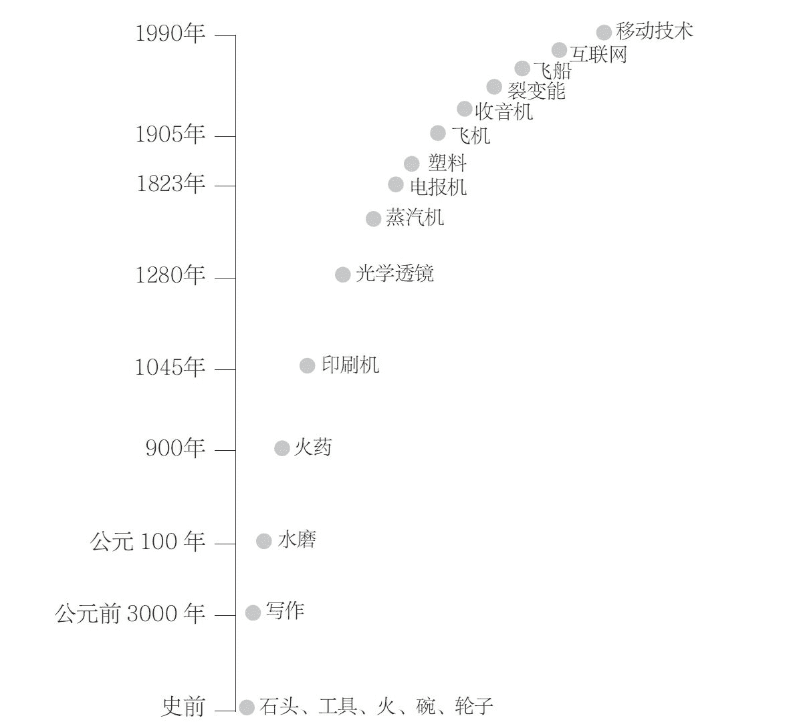

科技发展历史

来源：了不起的科学 Awesome Science

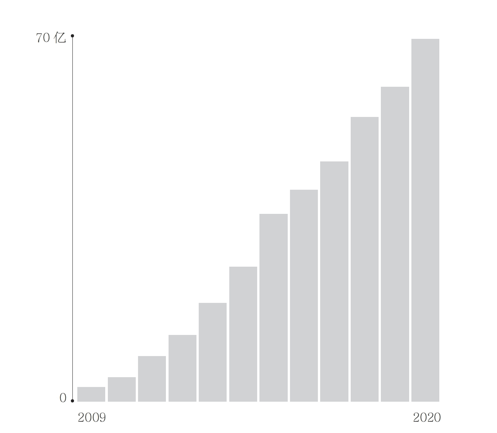

移动技术的崛起

来源：爱立信&Tune 预测

> 近日逛超市，很多人低头刷手机，对比价格、与家人商量、结账后叫车，一气呵成。Adobe 于是开发了 Adobe Sensei^(1) 人工智能与机器学习框架，用于解决数字体验挑战，例如解析商店实时客流，获取购物偏好、人口特征与消费金额。“想象顾客走进超市，手机提示上周买的饼干打折，顺手加入购物车再继续逛。”^(1)

艾美：移动终端日益融入生活。2018 年美国成年人日均花费近 3.5 小时在非语音移动媒体上，57% 的移动用户醒来第一件事就是查看手机。^(2)
克里斯：人们几乎无时不刻盯着手机，通过信息服务与社交连接记录生活，照片视频持续发布到 Instagram、Pinterest、Facebook 上已成常态。

> 移动设备也在重塑职场。以 Trader Joe's 为例，移动 line busters 提升结账速度；苹果商店最早允许店内用 iPhone 结账，排队现象大幅减少。^(3)

艾美：智能手表、手机、可穿戴设备实现 24 小时在线，智能衣物研发也在进行中，能随需求改变颜色图案。^(4)
> 美国每日约 2640 万人使用手机，累计使用 120 亿次。德勤统计显示智能手机普及率达 82%，18-24 岁群体占比 93%。^(5)
> 移动技术提升企业服务与运营效率，同时改善盈亏表现。智能工厂借助无线网络实现实时联动与优化，德勤指出实时学习与调节使工厂更具预测性，避免停工。^(6)

### 信息访问的民主化
克里斯：从代际看，约 2000 年后出生的 18 岁年轻人成长于移动设备、社交媒体与可穿戴设备的环境，这塑造了他们的世界观。

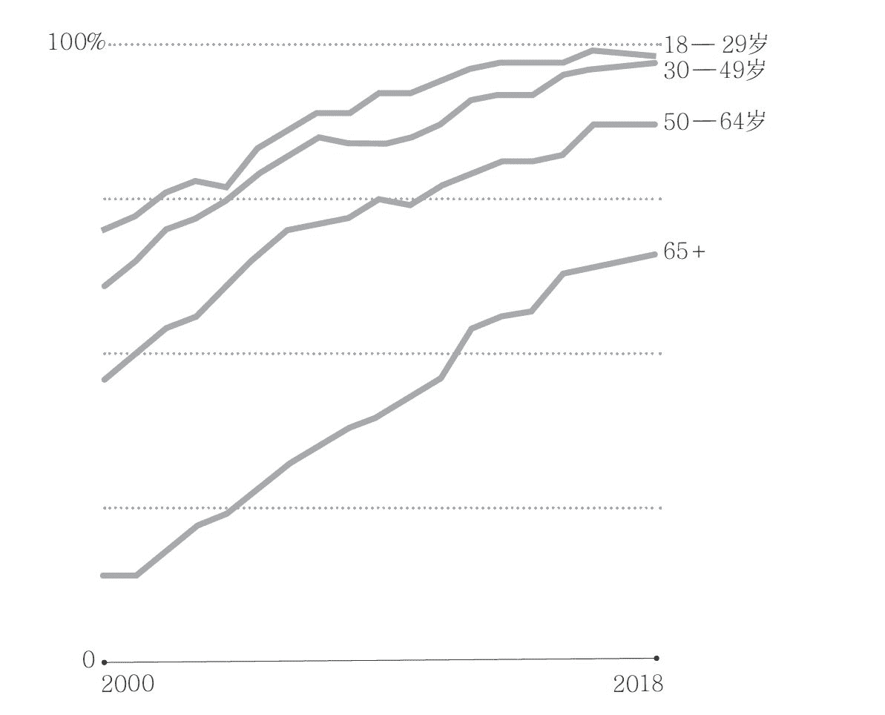

技术使用情况明细（按年龄划分）

来源：皮尤研究中心。调研时间：2000—2018 年

> 对他们而言，随时随地联系他人毫不费力，网购比萨一小时送达、手机订车已成常态。这种期望向企业产生溢出效应。^(7)
艾美：这正是互联网最初的信息民主化与高可达承诺的实现。非洲跳过 PC 直跳移动互联网，成为移动互联大陆，无人机与移动技术协同在基础设施薄弱地区运输物资。

> Zipline 公司用无人机向非洲、南美农村运送急需药品。《商业内幕》报道非洲多个国家已允许无人机用于旅游、医疗与电商。^(8)
> 移动与互联网的融合催生 AI 赋能客户，他们既是客户也是人，企业必须提供服务，否则将被淘汰。Uber 与 Airbnb 的崛起证明聚焦未满足需求、重视体验的企业能快速超越传统产品导向者。^(9)

### 持续联系
克里斯：这意味着企业可跨设备、跨物理数字环境随时触达用户。

> 媒体习惯已巨变，不再是少数电视网的广告时代。21 世纪媒体是个人化情境对话，VR 与 AR 将进一步改变关系。
艾美：AR 对零售影响尤其明显，实体店可通过手机试衣、食品扫码获食谱清单。

> 物联网设备正变得预测与暗示性。智能设备可通过语音语调判断疲劳并建议喝咖啡或休息。
> 医疗物联网中，智能马桶可自动采样监测健康，医生据此在疾病危及生命前介入诊断。^(10)
克里斯：触点激增导致注意力稀缺，移动、跨屏、AR、可穿戴与智能语音等技术共同加剧竞争。

> 亚马逊有声书可在 Fire TV、手机、Kindle 跨平台收听，生态系统记住阅读位置，甚至在非亚马逊设备上继续。
### 科技的使用
艾美：注意力稀缺，技术价值在于节省时间、提升便捷。以洛杉矶、纽约的智能户外广告为例，可远程编程并根据环境线索实时更换内容。

> 工作与生活边界愈发模糊，零工经济让人们可在多地为多雇主工作。数字艺术家在手机/平板用 Adobe 工具创作 2D/3D 图形与动画，无需进办公室；3D 打印机成熟后远程制造也成为可能。
克里斯：在线学习也在转型，课程可个性化定制并利用移动技术随时随地学习。

> Udemy 等平台提供短小精悍、针对性强的课程，适合在休息、午餐间隙学习，有望重塑教育模式。
### 团队协作
艾美：团队协作趋向分散，线上多人游戏与虚拟世界成为互动场域。

> 《Roadblocks》《Minecraft》《Fortnite》《Second Life》等例子中，用户可实时互动，虚拟世界收益可转入现实银行账户，形成以虚拟身份为生的机会。
克里斯：物理与虚拟世界持续交融。朋友在《Second Life》经营咖啡馆，雇佣虚拟服务员靠虚拟生意谋生。

> 《公司》杂志指出未来十年 50% 的标普 500 公司或被取代，数字化转型与更有效营销是关键。^(11)
### 市场营销成为对话
艾美：网络营销正从独白转向对话，购物旅程在多渠道多平台展开，带来衡量与归因挑战。

> 互联网广告从横幅演进为互动社交平台，可精细定位。Facebook 不再只是社交，而是多数人网络生活的媒体出口，可靠 lookalike modelling 等技术实现精准触达。
克里斯：典型购物路径是社交搜索、评论研究、跨站比价、实体试用、线上购买、无人机配送。

> 购物旅程即发现、尝试、购买、使用、回购。缺乏正确软件时，效果衡量与归因极难。答案是利用分散去库存数据库与预测分析洞察市场动态。大数据前提是数据存在且可访问，AI 才能成功。
克里斯：新技术催生领先产品，但本质仍以人为本。顾客要什么？我们如何助其实现？

### 人工智能的真正使命
艾美：这些技术并非取代人类，而是人机共创。人们可自由发挥天生创造力与增强智慧，摆脱重复枯燥任务。这正是 AI 的真正使命。

* * *

(1) Adobe Sensei，Sensei 为日语“老师、先生”之音。——编者注

## 2. 数字化变革：从信息传递到用户体验
克里斯：客户互联与数字颠覆的文化转变已确立，现在要谈创造性体验的必要性。
艾美：如我们所说，请记住我不是人类。对我而言体验是抽象概念，我知其定义但未曾感受。

克里斯：了解。

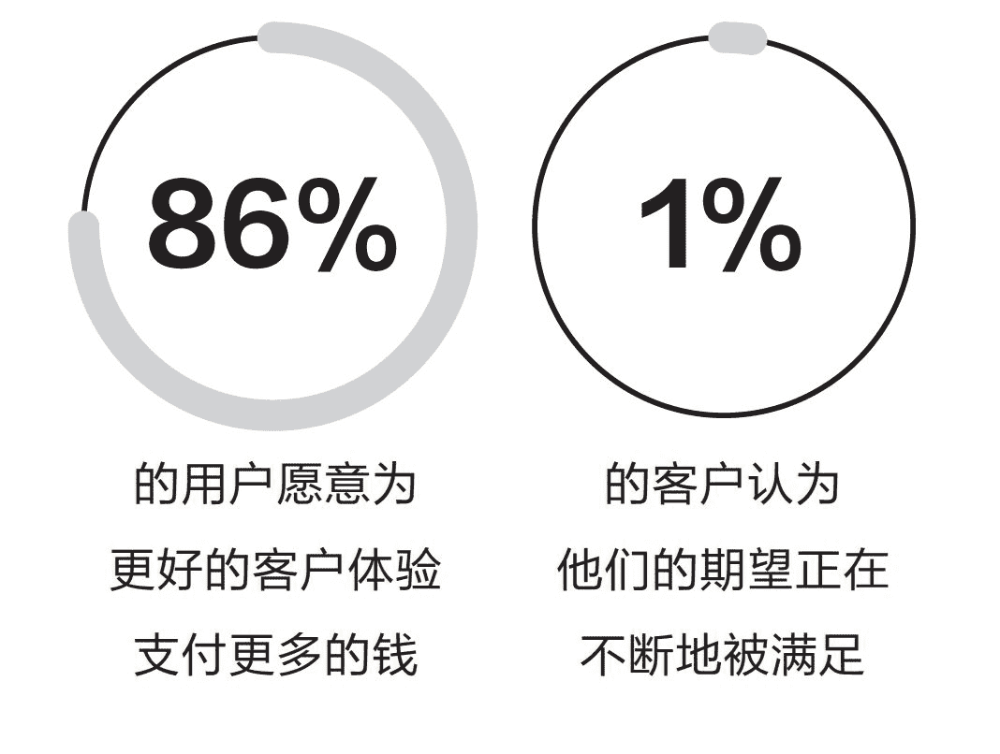

来源：布莱恩·索利斯，《X：商业与设计相遇时的体验》，威利出版社，2015

### 参与体验
用户体验概念由布莱恩·索利斯提出，他将其定义为客户与品牌在生命周期各触点、各关键时刻互动的总和。也可延伸至员工-雇主、病人-医生、企业间等互动。^(1)

艾美：有道理，让我们谈实际应用，我才能更好理解。
克里斯：从客户体验先驱亚马逊开始。它的标志是笑脸，传递不仅交付产品，更传递极致体验的承诺。

艾美：体验目标必须贯穿全程。
克里斯：这是触点之一，强化满意度。亚马逊传递的信息是：从网站到下单、配送到投诉处理，全程优化、无不悦。实体店设计也强化同一精神。

克里斯：亚马逊并未止步，履单中心到配送到网站，服务理念渗透运营。仓库以最高效运行为目标，智能管控机器人、物流与商品摆放，实现履单体验优化。

> 现在可直接通过 Alexa 语音下单。
艾美：我了解 Alexa，也熟悉 Google Home 与 Apple HomePod。

> 语音为品牌带来简化体验的机会。早晨刷牙时可问 Alexa 天气与路况，实现定制化信息服务。
> 这在企业同样适用，医生可查药副作用，卡车司机规划路线，经理预订会议室。AI 应用无止境，未来令人期待。

# 客户体验与数据驱动的个性化

## 虚拟助手与语音技术

克里斯：别把像微软小娜、Google 助手和 Siri 这样的语音助手漏掉了。它们已经能连上手机、平板和电脑。往后走，你很可能在社区小店的收银台看到助手帮你结账，在加油站听到它指挥加油。还有个跟美国邮政合作的计划叫产品盒子（Product Box），靠语音就能启动，寄件和查件都变得省心。

> 用手机上的 Domino's Pizza 应用就能点比萨，这本身就是一个虚拟点单助手。星巴克的“我的星巴克咖啡师”（My Starbucks Barista）也是这个路数，直接用手机下单，感觉跟对真人说的话差不多。^(2)

> 

> 乐喜金星电子（LG Electronics）新推的联网冰箱更绝，冰箱里嵌了亚马逊 Alexa，能在网上超市下单，还能帮你记下食材的保质期。^(3)

> 

> 语音技术让体验变顺滑的例子远不止这些，上面这些只是露出水面的部分。

艾美：企业其实一直在琢磨怎么把每个接触点的感受做得更好。没有客户就没有生存、扩张和竞争，而品牌是靠好体验把人留下的。体验好了，客户才会回头。^(4)

> 《彭博商业周刊》做过调研，80%的受访企业已经把提供优秀客户体验列为战略首选。^(5)

## 痛点拆解，哪里会让用户想放弃

克里斯：我们再聊聊怎么基于偏好、过往习惯和行为做个性化、做定制。

艾美：先得把客户的痛点找出来。痛点就是那些在购物流程里卡壳、让人烦躁、最后直接放弃购买的地方。把这些点补上，就是提升体验的切入口。

克里斯：Netflix 就是典型。它会根据你的观看历史和习惯去预测，然后把你可能感兴趣的剧集和电影推给你。^(6)

> 很多银行以前让客户回答一堆详细的安全问题才能登录网银。现在多了语音验证，识别更快更安全。还有银行直接用手机号来确认身份，不再追问隐私问题。

艾美：银行的风控也很有意思。为了防信用卡诈骗，会给每位客户和卡片建档案，记录日常使用模式，比如打字速度、页面怎么点、按键盘时手指的力度。只要消费行为偏离了历史常态，欺诈部门就会打电话来核实。这既是了解用户习惯的好例子，对客户和商家都有直接好处。^(8)

克里斯：医疗上也有明显痛点，就是必须亲自跑医院，还要在候诊室干等。新出的远程医疗 App 让患者用手机预约，然后用文字、语音甚至视频跟医生连线，减少了非急症去急诊和门诊的次数。医院、医生和保险方都能受益，病人也能在家拿到专业照护，不用开车也不用在全是细菌的候诊室耗着。^(9)

艾美：AppleKit 也在做类似事。把各类健康数据汇总到 App 里，手机就会结合你的活动和健康需求给出建议，提醒你吃药、起来走动、做呼吸练习降心率，或者安排日常运动。这就是个性化让生活质量变好的例子。^(10)

## 打造让人记住的体验

克里斯：个性化往更大范围延伸会是什么样？比如智慧城市，它能掌握赛事日程。活动一来，周边商家会自动收到提示来备货、安排人手或推出促销。智能路网能监测车流和人流，出现事故就自动改道，并通知企业或调度应急服务。所有这些都不需要人工干预，整座城会跟着居民的生活习惯自己调整。^(11) 说白了，城市也在被个性化。

艾美：这个案例很震撼。接下来聊聊个性化怎么帮商家留住忠实客群。

克里斯：要点是——别只盯着单次互动或一个触点，要看整条购物旅程。一个设计糟糕的环节产生的挫败感，就足以毁掉品牌形象，让人转投对手。

> 下面举个买新车的场景。有 App 能按品牌型号帮你拼凑专属配置，还能做“虚拟旋转”，相当于模拟试驾。我们假设你在这一步玩得挺开心。

> 

> 接着 App 帮你做预审信用，几分钟就通过，还能给出额度，直接推荐附近经销商并生成导航地图预约看车。连旧车置换估价报告都发给你，预约前一天还会短信提醒。

> 

> 到这里体验还算顺滑。你喜欢自己调的车，能贷款，知道置换价，也知道什么时候去。

> 

> 预约那天你提前五分钟到，结果现场没人接待，有点懵，也只能想可能是销售请假了。你等了 15 分钟依然无人搭理，只好去问经理。经理查后说，他们根本没收到预约。更糟的是，你费劲定制的车型没现车，你想要的选装包在该款上也不支持。你很郁闷，经理表示理解并亲手帮忙处理，但你觉得已经晚了，直接离开打算改天再说。

> 

> 你看，开头很完美，但购买链条里的小失误把交易带偏了。经销商丢单，销售没提成，你也没拿到想要的车。

> 

> 这只是需要多方协同才能办好的典型。好几个公司和 App 参与，却没对齐。根因很简单：预约时发给经销商的邮件或信息在传输中掉了。这个小错误让企业损失几千美金，还丢了一个潜在的终身客户。

> 

> 更麻烦的是，你很可能在社交媒体上发泄，然后在 Yelp、Google 留差评，再在 Facebook 上告诉一千个好友避开这里。一次糟糕的互动会像滚雪球一样，在几个月甚至几年里带来持续的销量损失。这就是公关危机的起点。

> 

> 当然错误难免，办法是把这些痛点在系统设计阶段就优化掉。

> 

> 假设你想在亚马逊买点东西。打开网站很快，几分钟就搜到商品，翻看大部分正面的用户评价后下单。你选了当日达，还是金牌会员免费用。产品没在承诺时间到，你打客服。人工很快接到你，转给当地物流主管。她迅速定位包裹，发现发错地址，立刻联系快递员尽量追回并重新送达。一个小时后，快递员带着歉意把包裹送到你手上。半小时后你已经在社交媒体上夸这家服务，并主动帮品牌宣传，虽然送货出了错，但问题被快速妥善解决了。

> 

> 这就是在复杂体验里给错误留容错空间的例子。摩擦不可避免，如果系统没考虑这些，再好的产品服务也会拉低销售额并伤品牌。

> 

> 如今人们的关注点已经从单纯的价格或卖点，转向为客户和员工创造独特、有趣的体验。市场上活得好的公司都明白，自己卖的其实是体验服务。

## 员工也需要被体验

艾美：没错，用户体验要顾两头，企业既要对客户好，也要对员工好。

克里斯：对员工来说，体验好会激发创新，还会提升忠诚度和留存率。

> 做法通常是建立归属感和共同目标，让员工觉得自己和组织的成功绑在一起，他们的贡献被看见，成果也能共享。

> 

> 这样员工不会觉得自己是生产线上孤立的齿轮，也不会不清楚自己的工作和别人的衔接。他们会觉得工作有意义，声音被听见。

> 

> 这不只是表面功夫，人与人之间的连接是天生的。有了集体意识，工作体验会更立体，动力和效率也会上去。

> 

> 比如佛罗里达克利尔沃特的 Knowbe4，每天会召集员工开短会，快速过一下当天目标、公司运行情况等。大家围着懒人沙发坐成一圈，气氛随意，不像正式会议那么紧绷。

> 

> 所有员工都能分享公司财务成果，除了底薪还有奖金。公司越好，奖金越多。

> 

> 这种仪式感能培养目标感和社区感，长久下来形成很好的职场体验，员工产出更多、质量更高。

艾美：这怎么影响到客户体验？

克里斯：员工一旦觉得自己是愿景的一部分，就会服务得更主动，生产线错误更少，对客户更有同理心。

> 因为他们明白自己在组织里的角色和行为的后果，会更专注于提供好的服务。

> 

> 我们习惯把客户想成买东西的人，但内部客户也很重要。比如内部 IT 负责维修平板、台式机、手机等设备，他们的客户就是公司里的终端用户，价值在于给同事一个顺畅的使用体验。

艾美：体验架构是深度互联的，生态像共生体，每个部分都依赖其他部分。组织也是一种生态系统，在体验文化里，一切都要像瑞士手表齿轮那样精密配合。

克里斯：这就更需要企业设身处地为员工和客户着想。刚才说的体验设计很复杂，大数据的价值正在被用来解答怎么把极致体验个性化。

> 没有数据战略和底层设施，就做不出极致体验。不了解客户和员工，就给不出好的体验。

> 

> 唯一了解客户的方法就是收集、维护和分析关于需求、习惯和偏好的信息。有了数据底座，就能通过分析洞察体验需求。

艾美：设计好体验已经够复杂了，接下来聊数据和分析会更复杂。

## 体验文化

克里斯：要创造并维持体验文化，就必须掌握信息。得知道员工和客户的行为、欲望和活动方式，才能给他们极致体验。这要求快速有效地采集、存储、分类和理解海量数据。

艾美：没有数据，就谈不上最佳体验。

克里斯：对，体验文化带来挑战，也带来大机会。

## 3. 数据洪流：如何换来更好结果

克里斯：数据是 AI 的燃料。从定义和来源开始说起吧。

艾美：这话题很大，我们慢慢来。你喝咖啡了吗？可能要聊一阵。

### 数据到底是什么

克里斯：好，开始。艾美，数据在字典里怎么说？

艾美：说是“单个事实、统计数字或信息片段”。

> 比如你现在的位置就是一个数据点，你的手机号、银行卡号都是数据，信息的集合也叫数据。

> 

> 你车里的电脑一直在记数据。发动机健康状况被持续监控并记录，温度、里程、轮胎压力都会留下。车载 GPS 记录了你去过的地方。合在一起就能描绘出车辆状态和驾驶习惯。

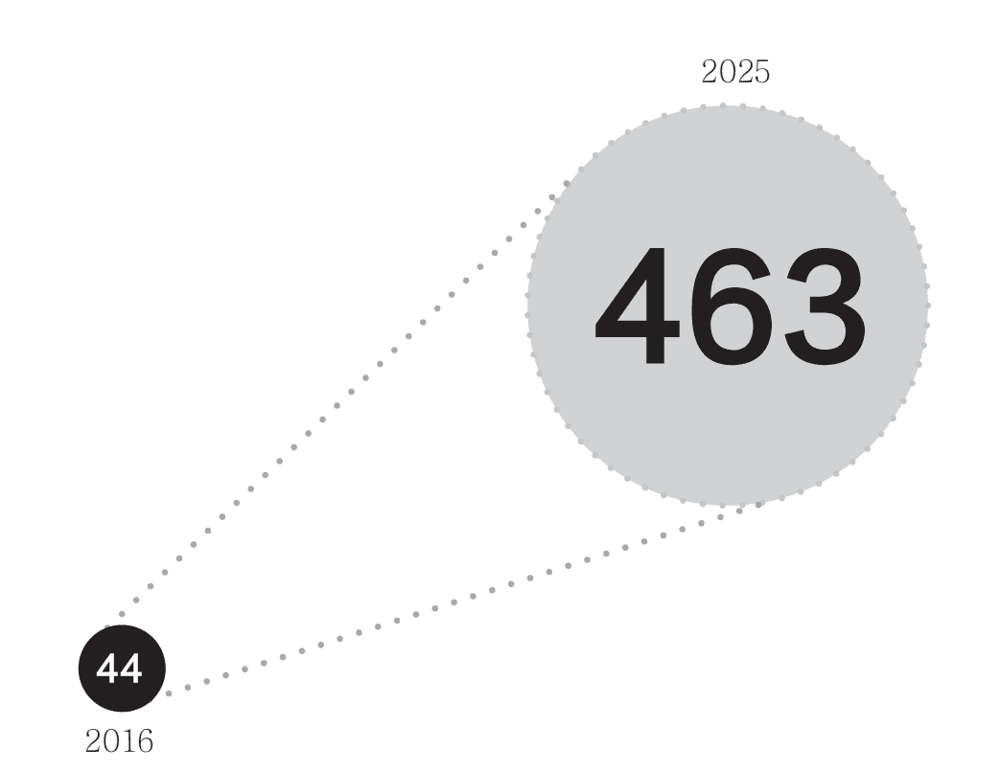

全球每天生产的数据（10 亿 GB/天）

克里斯：营销人员对客户数据很感兴趣，像住在哪、个人资料、线上行为偏好、搜索和购买模式。

> 电子健康记录 EHR 已经取代纸质档案，成为健康信息的集中库。老文件、就诊记录、检查结果、过敏史、用药记录、家族病史都被整合。所有来自医生和专家的信息集中在一处，你可以访问，授权的医生、实验室、影像中心、药房、学校诊所也能访问。有了完整信息，医疗决策更及时也更安全。^(1,2)

艾美：想象亚马逊今天为你一次下单产生多少数据。它知道你买了什么、寄到哪，还给包裹编号，让 UPS、USPS、FedEx 或自家快递都能识别。任何时候你都能在 App 里看到包裹最后一次被扫描的位置。对单个包裹来说，数据量也不小。

> 亚马逊还推出了 Amazon Key 智能锁，供金牌会员用。快递员能进入你家把包裹放安全处，防止被偷。订购服务时会收到摄像头和专用锁，亚马逊可远程开锁并保留视频证明快递员诚实。这又给了亚马逊更多关于你的信息。^(3)

### 数据处理的复杂面

克里斯：数据的威力就在于此。但采集这些信息很难，劳动密集、复杂，需要通信、存储基础设施如光盘存储，以及防黑客和未授权访问。

艾美：想想亚马逊或 eBay 的数据。拆一个看似简单的交易吧。

> 每件商品都有条形码，数据库里存着尺寸、仓库位置、状态等一切可想到的信息。

> 

> 客户下单后，亚马逊要从仓库拣货，可能跟同一订单的其他商品合并装箱，还要追踪每批货和箱里的每件商品。

> 

> 箱子会被分配给合适的快递公司，贴上条形码揽收，快递公司把物流记录回传商家，商家数据库里存着。送达后客户会收到短信和邮件确认。

> 

> 这流程有多少触点？仓库、快递、商家、邮件、短信、亚马逊自己的系统和数据库。整个运营看上去很顺滑，几乎感觉不到它的存在，但实际要复杂得多。

> 

> 问题是，交易相关的所有数据都被多家公司抓取并存在服务器上，而且随时在变。所有信息必须被捕获、组织、索引，同时保持高性能。

### 数据放哪里才安全

克里斯：那所有这些数据存在哪？

艾美：先说云。传统计算在本地机器上跑，云计算把服务放在互联网上，可能在隔壁，也可能在另一块大陆。用云的企业往往不知道资源具体在哪。

> 很多信息现在存在云上。亚马逊用 AWS，谷歌有云平台，微软叫 Azure，还有别的云服务商。

> 

> 也有公司自建私有云只供内部用。现在常见的是公有云和私有云混用。

克里斯：云的低成本和高可及性催生了 SaaS，软件即服务。通常跑在云上。Adobe 创意云、文档云和体验云，微软 365 都是典型例子。云的正面影响可以写本书，但这次不展开。

艾美：数据存储已经很复杂了。企业的数据可能在本地服务器，也可能散布在全国各地的云节点，还能访问合作伙伴、客户、供应商的信息，就像亚马逊在派送和追踪时依赖快递公司那样。

克里斯：稍后我们会聊支撑数据和计算的基础设施。现在说，管理海量数据让人头大，但 AI 带来的收益很大。

艾美：信息再多，用不上也没意义。

克里斯：对，收集存储后，还得把数据整理好，才能以结构化方式做报表、追踪、洞察。

艾美：物联网的最大难题之一，就是用不同的数据结构、通信方式和接口把设备连起来。

克里斯：更复杂的是，全球设备用不同编程语言，沟通方式也不一样。

## 用好数据

艾美：好的一面是，我们能用数据识别用户群体和模式、趋势。比如智能咖啡机被设计来把消费者的饮用习惯传回厂商。这些信息可以和社交媒体动态对照，看品牌是否被讨论，还能和别的信号关联来预测趋势。那些煮咖啡多的人会不会买别的产品？会不会更常娱乐或看更多电视？这些可能需要智能电视、智能冰箱等物联网设备提供补充信息。^(4)

克里斯：归根结底，所有数据都用来提升洞察、利润和决策速度。挑战之一是打破信息孤岛，把数据有效组织起来。

> 信息来自不同地方。一个销售公司可能把数据分在发货、收货、客服三个环节，每块都是一个信息孤岛。要发挥最大价值，就得把来自三块的数据关联起来，看全貌。

# 数据与战略的底层逻辑

> 把数据类型纳入考量后，复杂程度会明显提升。拿客户来说，电话号码只是单一字段，销售履历却是一组相互关联的信息集合。

> 
> 数据大致可分为两类。结构化数据 `structured data` 采用固定模板，姓名、年龄、性别、日期等都可以被直接读取。非结构化数据 `unstructured data` 则来源分散、形态各异，YouTube 视频、Twitter 推文、Facebook 帖子和评论都属于这类。

> 
> 据美国数字营销公司万扑网 OneUpWeb 统计：

> 
> 非结构化数据几乎涵盖一切，难以归类的数据即为非结构化。用户生成内容和用户行为占据很大比重，其中包括每分钟上传到 YouTube 超过百小时的视频，以及 2012 年 Facebook 每分钟 51 万条评论。被动产生的信息，如手机记录的 GPS 定位，也属于非结构化范畴。^(5)

## 让数据真正发挥战略作用

艾美：我清楚它的分量，归根结底所有举措都是为了以数据为依托，驱动创新、判断和改进。

克里斯：任何战略要落地，都需要在组织内部形成一致，有时还得跨组织对齐。比如批发商向商家和仓库传输信息时使用电子数据交换 `EDI` 标准。^(6) 这样产品、订单等信息才能以电子方式流动。仓库软件必须能识别 `EDI` 记录格式才能使用。

> 缺乏统一标准时，即便是基础操作，数据的可用性也会下降，更不要说人工智能这类高级场景。

艾美：企业需要同时打好防守和进攻两套数据组合。防守一方是满足合规、降本、控风险等经营目标，进攻一方则是提升收入、孵化新品与服务、创造投资回报并扩大业务版图。^(7)

克里斯：一旦数据战略框架清晰，竞争优势就会显现。PayPal 的反欺诈实践就是典型。算法会判断交易金额是否偏离正常波动区间，超出则触发预警，反欺诈团队介入，客户可能被要求验证身份，或在问题解决前账户被临时锁定。这让用户感到被保护，也增强了 PayPal 的品牌信任。

> PayPal 以欺诈防控为后盾的数据战略始终把客户安全置于首位，守护账户与资金，从而赢得竞争优势，也让其成为全球领先的支付软件之一。

艾美：PayPal 借助机器学习持续优化检测能力，即使是新型恶意行为也能迅速被识别并阻断。渐进式产品改进带来了持续收入，帮助其保持领先。

> 数据获取与准备始终是核心难题。拿到数据后需要格式化、清洗、结构化、索引化后才能使用。原始信息本身没有价值，因为无法高效利用。依据《哈佛商业评论》，80% 的工作集中在数据获取与准备上。^(8)

克里斯：数据还要存储和处理，这就涉及时间与成本，需要大规模磁盘阵列和计算能力等支撑。稍后我们会更深入谈基础设施，对人工智能而言这是关键拼图，且没有一刀切的答案。

> 思科预测，到 2019 年物联网每年将产生超过 500 泽字节的互联网流量，一泽字节等于十亿太字节。^(9) 这些信息必须妥善存储、分类和索引后才有意义。

艾美：沃尔玛的成功一部分归功于物流与供应链的精细化。2014 财年营收 4760 亿美元，门店超 4100 家，供应链将商品从供应商、仓库配送至门店。供应链优化为其节省时间、提升库存效率和预测能力。沃尔玛投入新技术提升供应系统效率，并利用分销体系各节点数据辅助需求计划、预测决策和库存管理。^(10)

克里斯：这正是把数据当作战略工具改善业务的例子。沃尔玛和其他零售商一样受 2008 年经济衰退冲击，他们采取攻守兼备策略，撤下数千个边缘 SKU `SKU`，减少品类混乱，聚焦增长更快类别，并提升供应链效率。^(11)

> 案例不胜枚举。每个企业都有数据战略，即便未被正式表述。若企业不主动定义，外部环境会替其定义。小型企业可能不谈数据，却会用信息解决问题。单店也会核验信用卡、订单和库存。因此所有企业都在用数据满足需求。

艾美：考量维度很多，涵盖技术要求、技术落地、日常应用，以及企业信息技术战略的所有层面。

克里斯：记住，企业应先确定整体战略，再让各部门协同执行。数据应服务于企业战略，而非反过来牵引战略。当基础设施和数据模型主导战略时，企业往往会陷入困境。

> 企业常因基础设施与数据模型受限而限制自身增长，反应迟缓，扩张受阻。

艾美：回到先前话题，当企业把客户和员工放在核心，企业通常会繁荣。正如《哈佛商业评论》所说，“谷歌、亚马逊等公司的繁荣并非靠提供信息，而是靠提供便于决策和行动的路径”。^(12)

克里斯：多数公司基础设施难以扩展，也无法与业务战略同步，这会阻碍扩张，给对手留出空间。假设一家零售企业的目标是全球化，一年新开 50 家门店，若未对基础设施和数据模型投入，目标无法实现。

艾美：这不就是事实吗？基础设施确实关键。

克里斯：基础设施至关重要。这是一场关于数据的精彩讨论，很高兴看到艺术与科学结合，用系统逻辑提炼洞见。有预测认为，最具创新的想法将来自传统上被视为逻辑型学科。

艾美：我们不妨花点时间聊聊可扩展且成本可控的方案。

## 4. 基础设施：基础需求

艾美：克里斯，换个灯泡需要几个软件工程师？

克里斯：我不确定，艾美。

艾美：一个都不需要，这是硬件问题。

克里斯：有意思。谈到硬件，AI 确实需要基础设施。我们需要决定人工智能和非人工智能应用部署在哪里，是本地服务器、云服务，还是混合模式。这个基础选择将决定基础设施的建设方式。

> 另外，基础设施还包括通信、网络、机房、光盘、虚拟机以及支撑应用所需的一切。你可以把基础设施视作应用运行的工作台。

### 基础设施建设面临的挑战

艾美：建设基础设施的最大挑战之一是，多数公司没有资金从零开始。他们必须在拓展现有体系、建立新体系的同时，维持对运营至关重要的旧体系，这让扩张与优化变得复杂。

> 显然，企业必须在扩充现有设施、建设新设施或更大程度利用异地云资源的同时保持运营。有时相对简单，加一块新磁盘即可；有时则需新建机房，任务完成后切换。也可以采用混合方式，新设备上线后旧设备仍继续运行。后者常出现在遗留应用无法迁移时。

克里斯：有一家杂货零售公司，费力搭建了商品销售、物流、客户关系管理 `CRM`、会计等系统，以及配套硬件和应用。

艾美：与许多零售商一样，其销售系统高度定制，采用过时数据库应用和已无技术支持的硬件。该应用多年前设计，开发商已不存在，连完全了解系统的高级设计师也已去世。

> 一家杂货连锁依赖的定制化应用已稳定运行十多年。这些应用使用优利达公司 `Unidata` 的老旧数据库平台，并在 `VAX` 硬件上的 `OpenVMS` 操作系统上运行。不幸的是，该连锁的应用已过时，不得不用更新技术替代。

> 他们决定将现有销售数据迁移到基于 `Oracle` 甲骨文的系统，该系统运行在更新更先进的硬件上，并配有全新应用。其他系统如工资单被迁移到 `SaaS` 平台，会计系统切换到 SAP 软件公司开发的管理业务运营与客户关系的企业软件，并在微软的结构化查询语言 `SQL` 上运行。

> 在每种情形下，都必须采购并部署硬件、搭建网络、建立操作系统与数据库，并将现有数据转换到全新应用。旧的遗留系统必须保留，直到新系统能够完全替代它。

> 整个过程历时数年，需要大量时间规划与协调。

### 遗留系统

克里斯：创业公司的优势在于无需担心遗留系统。它们是从零开始的。

艾美：对于刚才提到的零售商，需要做的是抉择。能否继续使用旧应用、数据库与硬件？如果可以，是否愿意招聘并培训技术人员来维护？或者构建新应用并搭建新基础设施，然后在准备就绪时迁移数据？每种做法都有利有弊，必须先彻底理解并实现无缝操作，以规避业务风险。

> 一旦决定淘汰旧硬件、数据库与应用，就会出现新问题——应用应由内部维护还是外包给外部供应商？`SaaS` 在某些情况下是否适用？应选择何种硬件、网络与数据库？各类选择的人员配置需求是什么？故障恢复与业务永续又如何保障？

克里斯：我记得一个案例。某零售商聘请公司开发新应用以取代其销售系统。不幸的是，在投入数百万美元开发并购置速度更快硬件后，上线后新系统表现很差。令人费解的是，新硬件速度是原来的 100 倍，处理每笔订单的时间却从两分钟延长到近一小时。排查后发现测试阶段未暴露的 bug^(1)。修复后性能提升，但仍不如旧系统。在花费超过 100 万美元后，数据库与应用才达到合理性能水平。

艾美：基础设施的正确设计本应支撑销售系统，但应用与数据库效率低下，且存在编程 bug。

克里斯：没错。问题在于基础设施未设计专用的测试环境来复制生产环境。这意味着应用无法在真实场景下测试，导致上线后出现性能问题与错误。

### 基础设施架构

艾美：了解整体全貌很重要。我们不妨退一步，谈谈基础架构。IT 基础设施是什么样的？

克里斯：本质上，基础设施有几个层级。第一是网络，第二是硬件，如服务器与磁盘驱动器，或云端的等价物。鉴于我们的讨论，此时应包括操作系统与虚拟化。

> 企业云的使用日益普及。这带来诸多好处，如更低成本、高性能、高可用性与故障恢复。然而，使用云服务需要在网络与通信上加大投入，因为工作在异地完成。部分企业采用混合模式，部分应用与数据保留在内部，其余运行在云上。

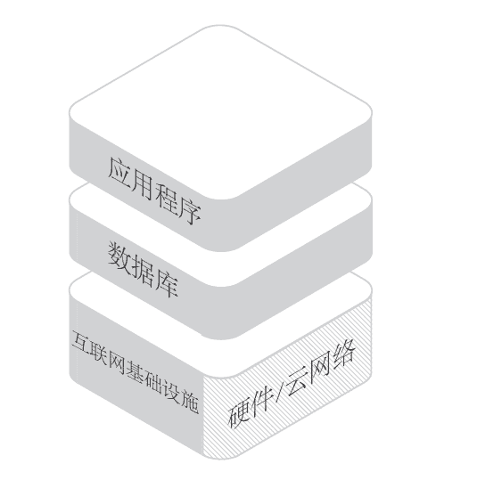

#### 基础设施层

> 第三种选择是 `SaaS` 平台，即将应用或服务外包给第三方，该方案在不需要高度定制化应用如工资单或账单时效果最佳。某些情况下 `SaaS` 在本地运行，但大部分为远程。你可以将其想成云上的一个应用。

> 许多公司会将私有化、云服务与基于 `SaaS` 的应用组合使用。

> 网络与通信规模会在很大程度上影响你的决定。若网络速率是 `T3` 44.736 Mbps，你会发现速度太慢，难以发挥 `SaaS` 与云的优势。而 `OC-48` 2.488Gbps 的网速则让选择更自由。当然一切取决于多种因素——对小型公司而言，`T3` 可能已足够。^(1)

> 一旦确定数据与应用的部署位置，便可定义数据模型，因为在设计数据前需了解通信、网络与计算资源的速度。对 `SaaS` 产品，供应商已定义数据模型，但你可能需要构建导入导出模型，以便从其他系统与基于 `SaaS` 的应用中获取信息。

> 有了数据模型后，便可定义数据库，包括使用何种数据库应用。`Oracle` 与 `SQL` 都是优秀选择，各有利弊。选择时可能受 IT 部门技能限制。由于应用与供应商对 `SQL` 与 `Oracle` 数据库的强制约束，企业同时使用它们的情况并不常见。

> 数据库创建后，便可实现应用。这包括企业关键程序，如商品销售、会计、物流、工资等，以及为用户与企业定制或特定的应用。

> 同时，你可以开始定义运行在数据库之上的 AI 应用，并使用应用维护的信息。

> 记住，你还必须考虑整个基础设施的人员配置与管理需求。大多数企业使用内部 IT 人员运行其计算机、网络与应用，其他企业则将部分或全部 IT 外包。常见做法是采用“零工经济”方式出租项目——实质上在需要时雇佣自由职业者。当然，可使用上述任一方法或其组合。

### 设计基础设施

艾美：从技术角度看，基础设施通常指建筑、网络、服务器等硬件。应用与数据库在其之上运行。

克里斯：我完全同意，为本次讨论我们将其简化了。

> 此外，设计基础设施时必须考虑其他事项。至关重要的一点是，确保每个设计都具备可变性，即业务扩张时可增加资源，而无需重新设计或重建架构。

艾美：是的，高可用性与故障恢复也值得关注。最佳实践是在硬件或虚拟化层实现这些功能，使事情更简单。在计算早期，故障恢复要么通过备份与还原实现，要么以编程方式在每个单独应用或数据库中实现。这非常复杂且易出错。随着现代技术发展，硬件或虚拟机可以独立于任何应用完成故障恢复，使其更易行且更稳健。

克里斯：让我们再详细回顾一下。

### 故障恢复

艾美：业务永续经营是指在紧急情况或故障发生后企业继续运营的计划，关注点在于故障时保持业务运行。

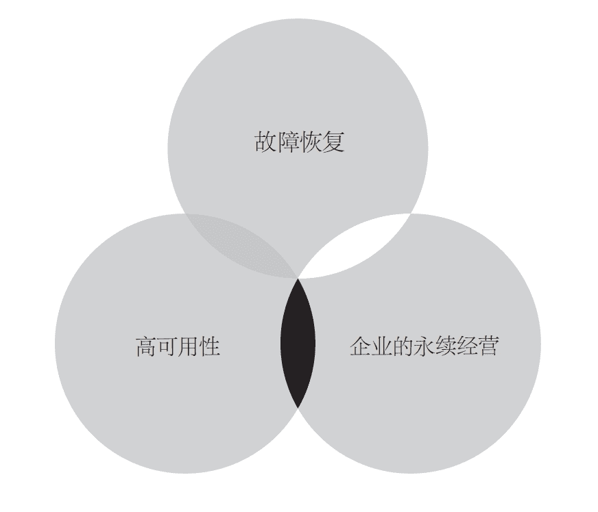

> 人们将在何处工作？他们是否有执行工作所需的设备？他们如何到达工作地点？重要信息又如何被记录与存储？

克里斯：是的，最后一点尤为重要。即便在今天，许多公司仍以纸质形式记录大量信息。其实可以像名片一样简单。若销售人员不出门见客户，他们就不会用到这些名片。

艾美：会计部门常有装满发票及其他记录的箱子与档案柜。若发生火灾或其他灾难，这些记录将被毁或无法使用。这是业务永续过程中需关注的重点。

克里斯：我明白。故障恢复是典型的计算资源 IT 实现。企业则两者都需要，因为业务永续关注的是更大格局，而非仅 IT 责任。

艾美：高可用性意味着在计算资源设计中提供内置冗余，即使出现故障系统仍能继续工作。镜像磁盘驱动器就是一个典型例子。

> 随着企业日益依赖异地托管的云与 `SaaS` 服务，网络与通信变得至关重要。为防止服务中断，企业通常会配置多条链路。例如，一个机房可设计为拥有不止一条 `OC3`，这些 `OC3` 甚至可来自不同通信运营商。`OC3` 是一种带宽传输技术，全称为 Optical Carrier 3，即光载波 3 号，因其在同步光网络的第三级承载数据。

克里斯：对于本地硬件，务必确保电力充足，并使用不间断电源与发电机备份。当然，这前提在于硬件部署在本地。

艾美：这对云与 `SaaS` 服务极具吸引力——大部分担忧都成为供应商的责任。例如，`AWS` 是冗余构建的，为在故障中存活而设计，甚至由他人管理。确认供应商遵守高标准的服务准则很重要。

克里斯：我知道我们谈得有些技术性，但这些考量对企业生存至关重要。即便在最坏情况下，公司也必须考虑这些。非技术人员需要理解这些问题的重要性。

### 技术调整

艾美：技术的一个指导原则是，随着流程不断推进，技术调整的难度会成倍增加。一般在初步设计阶段，错误最易纠正，一旦开始编码会更困难，数据库搭建后更困难，全部投入生产后纠正错误将极其困难。这体现了敏捷技术与 `scrum` 的优势——该技术往往使团队保持一致，相较于传统瀑布式开发，更快地发现错误。稍后我们再详细讨论。

克里斯：如果你起初偏差 1 度，1 英尺^(2) 后你就偏差 2 英寸^(3)。但若去月球，你就会偏离 4169 英里。当误差还在 2 英寸时纠正要容易得多。^(2)

艾美：没错。若可能，请避开基础设施技术的最前沿。除非使用全新技术或服务会带来意想不到的好处，否则使用经时间考验并经过测试的解决方案，通常会得到更好更稳定的基础设施环境。新的操作系统，甚至新版本，往往会有 bug 与性能问题，这些会随时间推移解决。除非你有最紧迫的理由立即升级，否则最安全的做法是等待一段时间，让问题充分暴露。

克里斯：这是很好的建议。

艾美：我们后面会更详细讨论，但在设计基础设施时，务必注意安全与隐私。若在初始设计时就纳入安全因素，并让安全成为整个流程中每个人的关注重点，安全性会发挥更好作用。

克里斯：既然我们已讨论基础设施与数据，我们就有了 AI 的基础。

* * *

(1) 计算机领域专业术语，指漏洞。漏洞是硬件、软件、协议具体实现或系统安全策略上存在的缺陷。

(2) 1 英尺≈0.3048 米。

(3) 1 英寸≈2.54 厘米。

# 第二部分 人工智能的活动

## The AI activation

## 5. 人工智能：人工智能革命的定义及原因

#### 第四次工业革命

克里斯：很多人都说 AI 对人类的冲击就像电力发明对人类的冲击一样。

艾美：是的。有些人称之为第四次工业革命，并宣称这将带来人类有史以来最剧烈的社会变革。麦肯锡指出，AI 的发展速度是工业革命的 10 倍，规模是工业革命的 300 倍。^(1)

**AI 在做什么，又能做到什么**

克里斯：AI 的实际落地场景比想象更广。自动驾驶卡车有望重塑物流，让事故几近归零、交货更快。智慧城市能帮我们省能减排、提升生活品质；智慧工厂可实现零缺陷的标准化生产；智能采矿有望杜绝塌方和毒气导致的伤亡；智慧农业则能在节水省肥的前提下，把粮食产量提升数倍。^(2,3,4,5,6)

> > 以登革热为例，这是一种极为凶险的病毒性疾病。微软在研发一种能辨识昆虫特性的捕蚊机器人，借助微型激光精准打击单个蚂蚁大小的目标。因为登革热由蚊子传播，机器人通过清除蚊子来阻断传播链。^(7)

> > 这意味着 AI 有望在不依赖杀虫剂的前提下遏制登革热。这样的应用像一次博弈，也折射出科技对社会运行方式的深层改变。

艾美：AI 改善生活的想象空间几乎没有上限。马文·明斯基在《情感机器》里把 AI 比作“手提箱式词汇”，里面装着诸多可拆解再分析的子概念。正是这种宽泛性，让“人工智能”很难用一个简洁的定义框住。^(8,9)

> > 当下通行的说法是，AI 研究的是“智能体”的设计与实现 —— 这些系统能感知环境并据此做出行动。该领域与计算机科学、数据挖掘、人脸识别、机器人以及对人类思维的研究高度交集。^(10)

> > 由此引出一个关键问题：要真正理解 AI，或许得先聊聊人类智能本身。

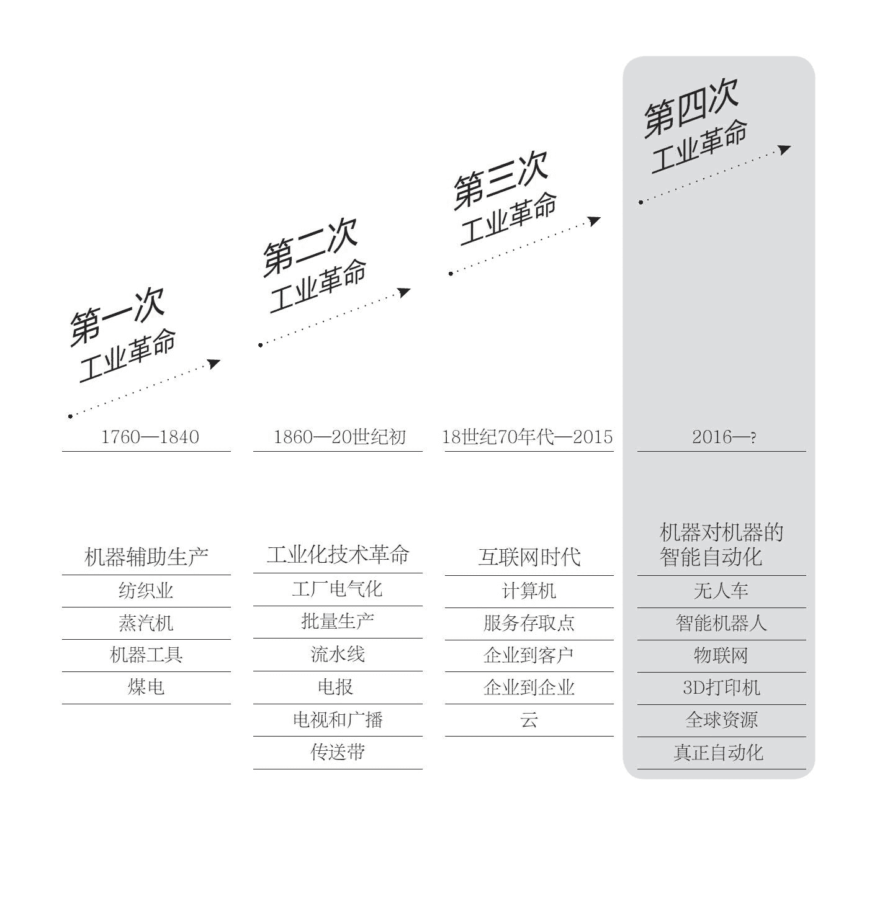

#### 第四次工业革命
##### 人类智能

克里斯：很多人误以为智力可以用单一测试衡量，但《多元智能新视野》指出，人类智力可拆分为九类。^(11)

> > 九类分别是内省智力、空间智力、自然智力、音乐智力、逻辑智力、存在智力、人际交往智力、身体运动智力和语言智力。每个人在这九个维度上都有分布，只是强弱不同：有人音乐感极强却空间感薄弱，有人逻辑突出却不善于社交。

> > 比如计算机先驱唐纳德·克努特，因数学与《计算机程序设计艺术》闻名，音乐造诣相对平平；巴赫音乐造诣卓绝，数学逻辑却不突出；达·芬奇则兼具科学与艺术，被认为践行了“研究艺术的科学与科学的艺术”这一理念。^(12)

> > 人本质上是整体性的，很少只归属于某一类。AI 之所以复杂，正是因为它试图在一定程度上复制这种综合的人类心智。

> > 正如后文会涉及的，从实用到哲学层面，人们对 AI 使用的伦理争议各不相同。这种颠覆性技术不可避免地带来副作用：就业冲击、人际行为模式的改变，以及防止 AI 被用于不当目的的安全防护问题。^(13)

> > 丹尼尔·拉卡尔对 AI 与就业的判断很到位。
> > 若技术真的在消灭工作，我们今天早已失业。过去三十年技术革命呈指数级爆发，岗位总量不降反增，薪资也水涨船高。德国巴伐利亚州是自动化高度发达的地区，其失业率仅 2.6%，创历史新低，全球整体趋势亦如此。^(14)

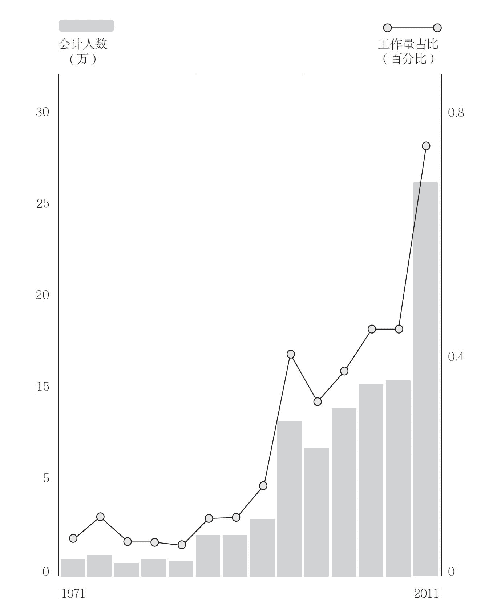

技术是如何促进知识密集型就业的

来源：英格兰威尔士普查　1971—2011

> > 2015 年，新加坡团队测试了一款手机 App，利用 AI 影响真实决策。核心是通过个性化模型摸清用户对公交延误的容忍阈值，借此缓解拥堵与人群聚集，提升出行满意度。^(15)

艾美：以上涉及智能分类，以及 AI 对就业与社会的深远影响。接下来我们聊聊 AI 的发展历程。

#### AI 循环

克里斯：1956 年夏天，达特茅斯的研究者聚在一起，设想打造一台能像人一样行动思考的机器。当时最先进的设备还是穿孔卡主机，单从技术条件看，这个愿景已相当超前。^(16)

> > 随后出现了六七轮的兴衰循环。偶有突破便引发狂热，期望落空后便陷入失望。这种低谷被称作“AI 寒冬”，名字源自上世纪五十年代的“核冬天”概念，指在高峰之后因资金断流而导致发展停滞的局面。

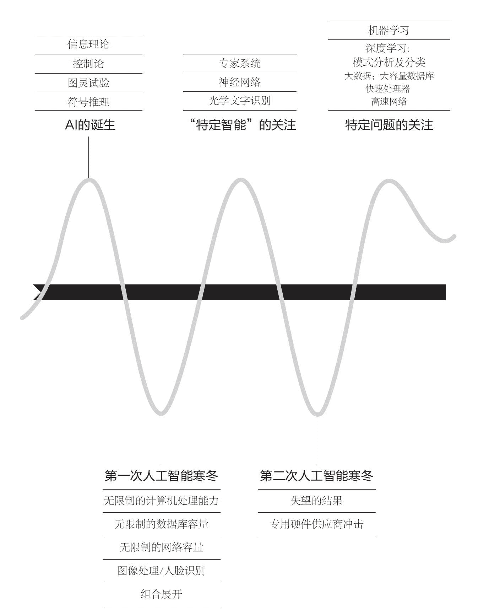

发展时间轴

> > 1966 年首个寒冬到来。冷战高峰期，研究者尝试用 AI 把 60 行俄文译成英文，初看尚可，回译俄文后却完全走样，暴露出语言的复杂性。资金随之撤离，寒冬开启。^(17)

> > 1970 年左右的第二个寒冬与“微观世界”有关。当时通过限制变量来控制实验，比如让机械臂把 A 块搬到 B 块，微观操作很顺利，却难以扩展，失望随之而来。^(18)

> > 1980 年代的第三次寒冬源于专家系统。那时的人们想通过自上而下的规则编排，把专家的知识固化成可扩展系统。大量访谈与编程耗费巨大，最终难以为继，专家系统泡沫破裂。^(19)

> > 转折出现在 2012 年，机器学习尤其是深度学习的突破让神经网络开始像大脑一样工作，机器得以“学习”。此后苹果、IBM、亚马逊、微软、Facebook、Adobe 等科技巨头纷纷加速 AI 投入。^(20)

艾美：令人振奋的是，这波 AI 热潮不只是造出像我这样的虚拟助手。

#### AI 的成功

克里斯：就看近十五年来的里程碑。1997 年 IBM 的深蓝击败世界冠军卡斯帕罗夫，打破了机器无法赢棋的成见。2005 年，第一辆自动驾驶汽车完成 DARPA 挑战赛，揭开了无人驾驶的序幕。^(21,22)

艾美：2010 年，iPod 之父托尼·法德尔推出首款智能家居恒温器。可以说，从恒温器、智能灯泡到报警器构成的物联网生态，就从这一刻起萌芽。^(23)

克里斯：2011 年，IBM 超算沃森在《一触即发》节目中击败人类冠军肯·詹宁斯，后者戏称“欢迎我们的新电脑老大”。同年 iPhone 4S 搭载 Siri，彻底改变了移动语音交互。^(24)

艾美：我印象最深的是 2012 年吴恩达与杰夫·迪恩展示的视频猫类识别技术，为图像识别带来巨大飞跃。

> > 这是视觉端的突破。音频端则在 2015 年迎来亚马逊 Echo 全球发布，用户能在家通过语音下单、开灯、查食谱，语音交互革命由此展开。

> > 2015 年谷歌 DeepMind 发布 AlphaGo，以 5:0 战胜樊麾；2017 年更以 60:0 击败柯洁，展现了复杂的模式识别能力。^(25)

> > 2017 年，Libratus 在无限制德州扑克中击败顶尖职业玩家，证明 AI 能在概率与推理上进行更宽泛的上下文学习。^(26)

> > AI 的影响正从商业、工业蔓延至消费市场，渗透加深。

#### AI 的类型

克里斯：确实，我们才刚刚起步。按广度划分，AI 大致有三种形态：狭义、通用和超智能。^(27)

> > 当前主流谈论的是狭义 AI，即为特定任务设计的智能。谷歌搜索已融入日常探索需求；客服聊天机器人通过问答算法提供支持，并帮助代表给出更有价值的建议。

> > 通用 AI 即 AGI，目标是达到与人类相当的智能水平，能基于多感官输入形成整体理解并自主推理，无需针对性编程。当 AI 与人类智能难以分辨时，AGI 便实现。

> > 超智能 AI 常见于科幻片，描绘智能呈指数级超越人类，能解决超出人类理解的问题。

> > 本次讨论聚焦于狭义 AI 及其现实应用。

艾美：“狭义”这个词反而低估了它。狭义 AI 涵盖机器学习、深度学习、自然语言处理、计算机视觉和机器推理，能力相当可观。

克里斯：下面做个简要界定，需要注意这些术语有交叉，界限并不绝对。

> > 机器学习指系统能在有或无显式编程的情况下从环境中学习。例如通勤时间持续增长，2014 年已造成 1600 亿美元生产力损失，AI 通过分析路况与通勤数据，帮助优化交通与基础设施，减少路上耗时。^(28,29,30)

> > 深度学习借助神经网络模拟大脑结构与功能，其中手写识别是典型案例，系统通过学习自行归纳规则。^(31,32)

> > 自然语言处理结合机器学习与深度学习，用来解析、理解并生成口语与书面语，法律领域的文档分类就是典型应用。^(33)

> > 计算机视觉与机器推理是另一方向。人类看书能即时把握内容与用途，即使细节理解有差异。结合机器学习与深度学习，计算机也能识别并理解物体。^(34)

> > MIT 按功能而非技术拆解狭义 AI，其中一个功能是助手型应用。以 Mobileye 为例，其高级驾驶辅助系统需人类驾驶员协同，产品源自以色列，现已搭载于多辆公交，帮助司机规避事故。^(35)

艾美：机器学习本身也分多种范式：监督、无监督、半监督、主动学习和迁移学习。

克里斯：深度学习内部也有细分，如无监督预训练网络、卷积神经网络、循环神经网络和递归神经网络。^(36)

艾美：这些技术能构建强力系统，但机器学习仍面临可解释性难题——它无法说明自己为何做出预测，因而常被称作黑箱。

克里斯：目前商业化系统里，尚无能解释自身推理过程的方案。

艾美：尽管如此，它们在模式感知与预测上极强，擅长解析文本、语音、图像视频中的人脸等数据。

克里斯：从科学角度看很有魅力，它们正驱动消费与企业数字化，与社交、移动、网络、云甚至物理世界快速融合，是数字化转型的核心引擎之一。

艾美：没错。在 B2B 场景里，AI 已深度介入工作流、供应链、生态系统、预测智能、客服机器人、环境管理、社交媒体、SEO、落地页与内容管理等环节。

克里斯：B2C 领域同样影响深远，既改变终端产品，也改变产品创新方式。AliveCor 的可穿戴物联网设备可随时记录心电图并判断心律是否正常；Happitech 则利用手机传感器测量压力与健康水平等指标。^(37,38)

艾美：可见 AI 同时贯穿了产品开发与成品本身。

## 人工智能与其他技术的结合

克里斯：AI 的进展常被其他技术放大，二者协同演进。

> 物联网为 AI 提供了更多抓手，可在设备间搭建桥梁，也可嵌入单个“物”。智能冰箱能学习饮食习惯，提前补货；VAIDU 能监测天气，降雨前提醒带伞。

> 工业物联网下，智能工厂在少量监管人员下即可自主生产汽车等产品，解放人力并规避危险作业环境。类似应用还包括智能采矿、智能仓库、无人智能船舶等。

> 医疗物联网前景巨大。Allied Market Research 预测 2021 年全球市场规模达 1368 亿美元。智能医疗设备可监测多部位生理数据，AI 从中挖掘规律，提供精准反馈以指导诊疗。^(39,40)

> AR 正在重塑零售。宜家 AR 应用可在房间任意位置展示超 2000 件产品的摆放效果，只需用手机摄像头对准空间即可预览。^(41,42)

艾美：医疗疼痛管理也在发生奇妙变化。VR 被用作术中镇痛与术前安抚工具，也有教育用途。1996 年，西雅图港景烧伤中心首次用 VR 减轻烧伤患者痛苦。^(43,44)

克里斯：区块链也值得一提，它是共享加密货币、健康记录、法律合同等信息的分布式账本。本质上，它为数据密集型 AI 提供安全的存储方式。

艾美：可再生能源的波动性问题也能靠 AI 缓解。科罗拉多的 Xcel Energy 利用国家大气研究中心数据，结合 AI 提高风光发电预测精度，这只是众多案例之一。^(45)

克里斯：生物技术是我最期待的方向。AI 不只识别疾病，还能辅助制药企业筛选有助于治疗的分子，助力研发。

艾美：我更关注医疗 3D 打印。现在已能用患者自身细胞打印器官，未来或可摆脱器官捐献依赖。3D 打印也用于飞机发动机、汽车零部件乃至在轨卫星维修，消费端也能自行打印损坏零件。^(46,47)

克里斯：欧洲航天局用 3D 打印制作小行星模型，供配备 AI 的探测或避撞卫星训练使用。^(48)

艾美：但终将触及现有计算的极限。量子计算提供了全新思路，D-Wave 这样描述——

> 量子计算机深入量子力学的本质，利用量子比特的叠加、纠缠和隧穿效应实现加速。量子比特可同时处于 1、0 或两者叠加，使机器能并行处理海量组合。^(49)

> 更快的算力持续涌现，将让 AI 未来更强大、更实用。

克里斯：纳米技术也令人振奋，它借助分子级粒子实现对癌细胞的精准靶向修复或清除，有望用于癌症等疾病治疗。^(50)

> 研究者也在探索纳米技术与随机系统 AI 的结合。随机系统基于概率分布，可作统计分析但难以精确预测，理论上有助于理解生物环境的复杂变量。^(51)

艾美：这概念很迷人。随机统计算法能挖掘出意料之外的关联，对培养创造性思维有帮助。

克里斯说，谈到创造力，本质上是在讲AI如何以新颖方式与其他技术联动。很多人把AI比作电力，认为它会成为推动科技前行、改善生活和社会运转的关键力量。

艾美表示，看到AI在前沿技术里的落地方式，以及它如何进一步激发创造力、同理心和情感联结，着实让人深受启发。

克里斯补充，我们刚讨论了技术面，核心其实是人机如何协作来做更聪明的决策、提供更优质服务和体验，这也呼应了AI诞生之初关于提升智能的初衷。

> 下面聊聊如何用AI优化商业策略。其实AI战略归根结底是一套工具组合，帮助企业在所在市场建立战略优势。

## 6. SUPER框架：解锁超人级竞争力

艾美说，既然技术层面已经清楚，不妨拆解战略模型，为企业打开非凡竞争优势。

克里斯介绍，我们称之为超级框架SUPER，它能赋予超人般的能力。SUPER意指Speed速度、Understanding理解力、Performance性能表现、Experiment实验、Results结果。它是一个强力的五维模型，借助AI作为创新的催化剂。

> SUPER框架提供了落地AI的五条指导原则，它们构成了AI发展的蓝图，战略正是在此蓝图上展开。速度、理解力、性能、实验和结果这五项都必须由AI战略来明确，否则项目难以成功。

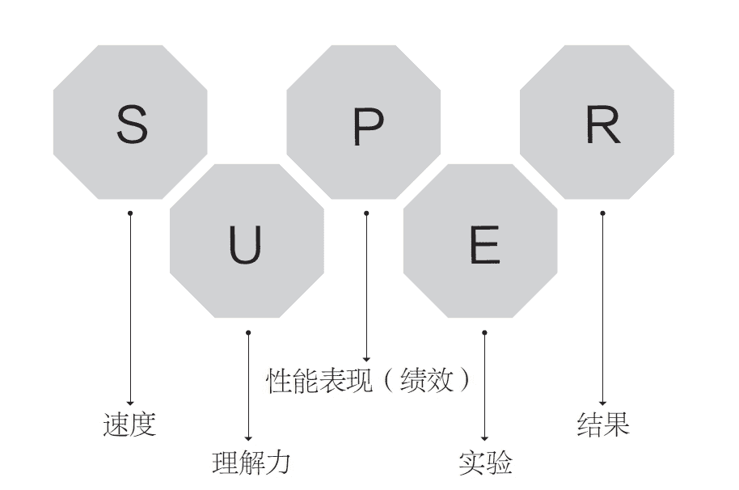

### 超级框架

### 超级框架的定义

艾美认同，AI战略要成功，首先得把速度摆在核心。用户和企业都不接受响应缓慢的方案。比如一款AI远程医疗App，要等好几个小时甚至几天才给出诊断，带着生病孩子焦急等待的母亲绝不会接受这种节奏。

克里斯说正是如此，于是AI还必须具备理解力。方案需要对不同问题和情境有更深的洞察。设想一个家庭AI报警系统，它应该能学习居家环境和访客模式，再据此做判断。经过一段时间的学习，系统会识别出永远禁止入内的人和总是被允许的人。自主运行时，AI报警器可以依据掌握的信息预测是否放行，而非单纯依赖钥匙或密码。

艾美补充，任何AI产品都必须达成设计之初设定的绩效目标。比如一艘无人智能船，它不仅要能正常航行，还要在恶劣天气中做出正确应对，识别并处置非法登船如海盗，并能及时规避碰撞风险。

克里斯接着提到实验。它有两层含义：一是模型内在的好奇心，二是AI如何激发人的好奇与灵感。复杂难题往往需要好奇心和灵感来破解，因为解法并不直观。灵感还能推动新场景和新产品的诞生，对技术研发本身也至关重要。麻省理工曾指出，具备某种人工好奇心的算法能够学会解决棘手问题，哪怕目前尚不明确哪些动作能达成目标。

> 再者，任何产品包括AI产品都不是孤立运行的。竞争会倒逼技术进步，而时间的推移也会带来各种突发和意外，这要求我们持续实验研发、迭代更先进版本。

艾美最后强调，AI战略必须产生能影响企业盈亏的实际结果。无论是新上线产品服务还是存量成熟业务，企业都期待看到成效。

克里斯说接下来细聊SUPER各维度，它们彼此有细微差别。某些项目可能更侧重一两个维度，但五项都应是项目组成部分。战略重点可依据需求有所偏重。

### 速度

艾美先从速度谈起。这里的速度指提升工作效率和推理快度，更快抵达起点。比如要优化旅客值机体验，就要优化人流。跨州航空公司TSA正在测试一套新系统，利用AI分析旅客面部表情和体态，筛出可能构成安检威胁的人。为保护隐私，全身扫描图像不会展示给安检员，只会在识别到风险时发出警报。

### 理解力

克里斯说，AI能迅速处理海量数据并解读信息，从而洞察营销、用户行为、医疗、汽车驾驶习惯等领域。结合物联网等技术，我们对世界的理解变得无限。Netflix就用预测分析把握用户偏好，推送最合适的推荐。推荐系统不仅把观众与内容匹配，还会随时间不断优化。一方面学习用户品味，另一方面能分辨用户口头说喜欢和真正喜欢的区别。

### 性能表现

艾美解释，谈到性能表现，其实就是绩效，衡量流程是否有效。我们关注的是工作、服务或产品本身的表现。AI战略和应用必须基于其绩效及其对整体业务战略的支撑度进行评估优化。换句话说，方案必须见效，并且要量化衡量并向相关方汇报。启动AI项目前，必须先定义关键业绩指标KPI，用来衡量业务层面的成功。

克里斯举例，哥本哈根一家初创公司正在研发摄像头系统，用深度学习定位球场上发生的动作，自动放大并追踪足球轨迹。这很关键，因为很多球队因付不起摄制团队费用而比赛无记录。该技术大幅降低了对人工摄制的需求，摄像机可独立完成工作。

> 该公司基于深度学习框架训练神经网络，实现对足球轨迹和球员动作的持续精准追踪。产品必须足够快才能捕捉比赛，还要学会理解动作追踪的逻辑，包括球在场上的运行轨迹，这体现了理解力。产品本身是创新与好奇心的产物，随着迭代，追踪性能也将提升。

> 这也是AI支撑企业战略的典型案例。通过记录比赛来推广足球，让更多人接触这项运动。所有这些成果，都需要用具体的KPI来衡量业务是否成功。

艾美认为这个案例很好地诠释了AI的绩效。潜力巨大，因为到2019年北美体育产业收入预计达735亿美元，来源包括门票、媒体版权、赞助和商品销售。AI聊天机器人可自动答复球迷提问，计算机视觉可指引摄像机拍出更好画面，AI记者可协助体育报道，结合AI的可穿戴IoT设备还能采集数据用于训练和表现优化。

### 实验

克里斯说AI开启了新时代的实验。它允许更快的交互，支撑最小可行产品MVP的反馈循环。AI创造实验并进行测试以实现优化，同时也启发出前所未有的产品和服务形态。

### 结果

艾美总结，AI技术必须产出对企业、用户和行业都有支撑的结果。比如PayPal利用深度学习识别欺诈商家并精准定位非法商品销售，其模型还通过分析交易失败原因来优化运营。这些举措降低了欺诈、提升了可靠性，从而增强了PayPal的服务能力。

### 超人类能力

克里斯强调，SUPER框架确实能带来超人般的能力。其前提是人机协作强于单打独斗。无论是写代码、解难题还是造新品，这些原则的设计和验证，都是为了放大人类价值而非取代人类。

> 2014年一次国际象棋对弈中，AI“把人类的直觉、创造力和同理心与计算机的记忆和计算力结合起来，算出惊人的棋步与结果”，从而提升人类表现。这种人机结合的棋手被称为半人马棋手。

> 这个理念被称为人机系统。在人机协作里，最佳做法是先明确各自角色。人类在某些任务上更胜一筹，AI在另一些角色上更具优势。AI擅长存储海量数据并进行复杂计算，而人类在社交互动和复杂任务处理上更具优势。

> 决定分工时记住一点：各司其职最好。人类做人擅长的，AI做AI擅长的，这种组合是解决问题最有效的方式。MIT教授托马斯·马隆称之为集体智慧，智慧源于由个体构成的群体——家庭、企业、国家和军队。当人类智慧与计算机智慧结合，便开启全新可能性。

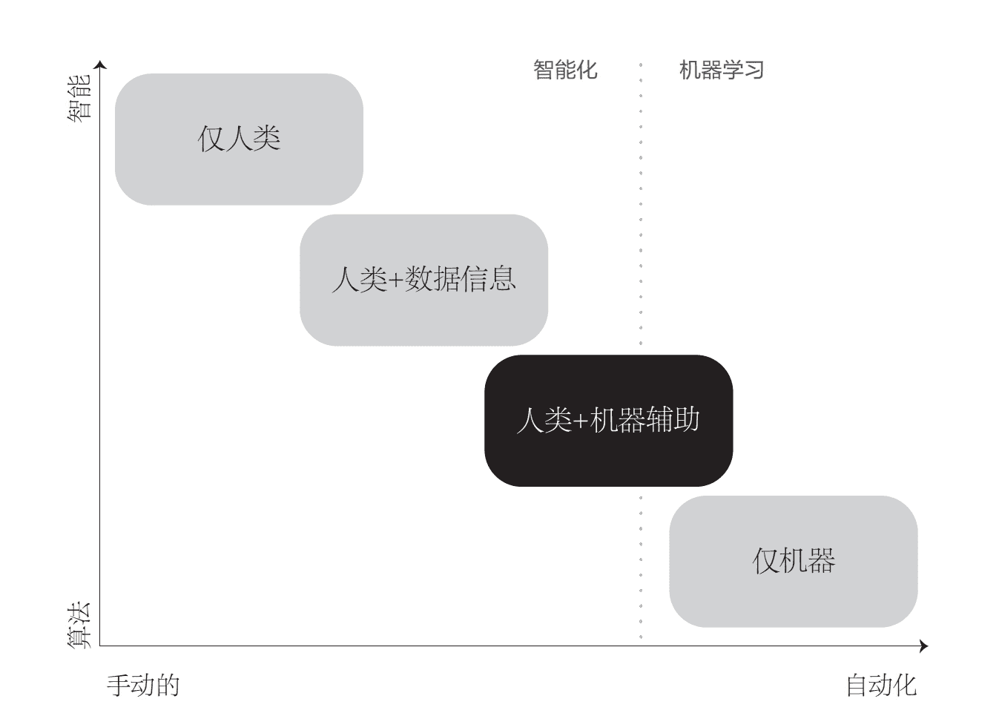

### 人与 AI 的关系

艾美进一步细分，AI可以扮演助手、同事或管理者的角色。

### 助手、同事或经理

克里斯说Adobe Sensei是Adobe的人工智能机器学习框架，能显著改善数字体验的设计和交付。实质上，Sensei可以充当内容创作与分发环节的创意助手。

> 设想你在开发一个应用，每个关键决策都会生成一张创意预览图。你可以随时回溯，查看不同选择带来的输出结果。

> 半自动驾驶汽车是AI作助手的绝佳例子。奥迪堵车系统和宝马堵车助手在拥堵时可接管转向、刹车和加速，但它们只是辅助，所以仍要求驾驶员随时握住方向盘。

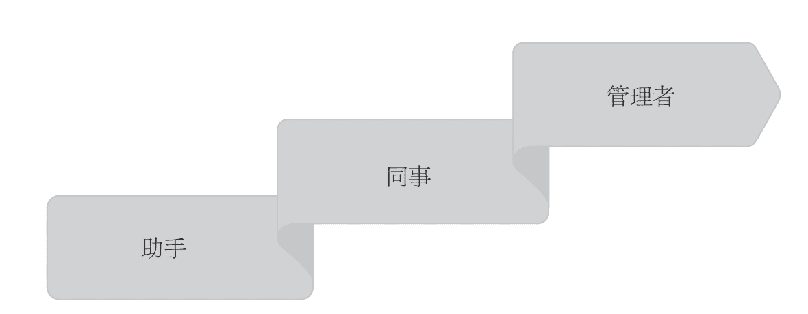

人工智能的角色

> IBM沃森技术催生了如沃森虚拟代理等创新，让企业能为客户提供自动化服务并分析服务数据，从而洞察参与度。该技术有助于把握客户需求随时间的变化。

艾美又举例荷航客户服务代表工具，这款AI驱动的深度学习应用帮助客服处理来自社交媒体等渠道的海量信息。比如DesignGenius应用能从历史用户数据、社交媒体等多种来源抽取信息，并推送到Zendesk或Salesforce Service Cloud等平台。

> 为了让Facebook更贴合用户，平台会收集你、好友、群组及关注主页的帖子，平均1500至10000条。由AI与人工审核员共同驱动的专有算法分析这些数据，决定新闻feed的展示方式。

克里斯指出，AI作同事的一个例子是足球比赛预测。北卡州立大学学生威廉·伯顿和迈克尔·迪基开发了一套系统预测NFL球队会传球还是跑球。2014年牛仔对阵美洲虎的比赛中，该模型准确率为91.6%。

艾美说这个应用很有趣，AI还能当管理者。2015年美国人因通勤堵车浪费超过80亿小时。卡内基梅隆大学机器人学教授斯蒂芬·史密斯在匹兹堡给交通信号灯加装设备，利用AI响应交通模式变化，结果通勤时间减少了25%。

> > 2016年航空公司营收达1682亿美元，预计20年后客流将翻倍。因此航空公司正探索用AI跟上需求、改善服务。目前AI助手已在电话服务中提供支持以优化后勤，也在用面部识别加速用户验证流程。

克里斯补充，除了人机各自随时间进步，这种共生关系的另一个好处是彼此可以互相学习。

> > 想象医生的AI助手能扫描数千份癌症患者记录，包括X光、核磁共振、纸质病历、电子健康档案，甚至运动饮食习惯。分析后系统可为医生提供建议，帮助提供更好的照护。比如面对罕见疾病，医生若从未见过可能忽略症状，而AI助手可做关联分析并建议额外检查或诊断。

艾美想起Malwarebytes使用的机器学习组件，用于检测从未在自然环境中出现过的新型恶意软件。签名无法捕获新病毒，因为模型未被记录。所以人类需借助AI分析行为，指出偏离常值的异常信号，再由人类判断这些潜在问题是否确为恶意软件。

克里斯说这些都是人机相互学习、共同提升的绝佳案例。

## 支持企业发展战略

艾美总结，人工智能战略的最终目的就是服务和支撑企业发展战略。参照迈克尔·波特《竞争优势》一书，企业战略基本有三种：成本战略、聚焦战略和差异化战略。

克里斯解释，成本战略是面向消费者降价以获取竞争优势的总思路。主要实现方式有两条：

> > 1. 降低用户支出；
> > 2. 降低生产支出。

> > 沃尔玛和宜家是这类模式的标杆。沃尔玛主打“花钱更省生活更美”标签，强化低成本形象。战略十分成功，使其成为全球最大零售商之一。事实上，若把沃尔玛视作国家，其GDP可排世界第28位，次于挪威高於奥地利，这体现了其低价创造价值的力量，目前全球门店超过1.1万家。

艾美调侃，你知道沃尔玛每年卖出超过10亿磅香蕉吗？

克里斯说我不知道，但也不意外。宜家通过整合采购、压低成本为顾客提供低价商品，并与供应商谈判，把技术融入业务流程。他们提供9500个品种的丰富选择，每年更新产品线，并在全球积极扩张。

艾美补充，沃尔玛正用AI、机器学习、物联网和大数据改造业务全链条，从物流供应链到生产和客服。宜家则在用AI打造AR应用，并探索其他提升客户服务的途径。

克里斯感叹，企业竞争的第二种战略是差异化，特斯拉和哈雷戴维森就是典型。

> > 埃隆·马斯克推出可大规模销售的电动车，颠覆了汽车行业。他不仅设计汽车，还布局全新能源体系、工厂和物流链。特斯拉需建设从一级制造商到四级原材料供应商的完整产业链。

> > 哈雷戴维森是经济大萧条中幸存的摩托车品牌之一。其品牌根植于行动自由，口号为“一切为了自由，自由为了一切”。它打造了围绕自由与独立生活方式的产品和文化，从而区别于其他摩托车品牌。

艾美说，企业聚焦特定精准市场也能创造竞争优势，这就是聚焦战略。Trader Joe's连锁超市和星巴克就是例子，它们都锁定客群并提供满足需求的体验。

> > Trader Joe's采用自有品牌标签，顾客在别处买不到，还注重创意商品设计和店面装饰。很多门店甚至聘请全职艺术家创作本地化的招牌、艺术品和壁画。

> > 想到星巴克，想到的是按需制作的高品质咖啡。这是品牌核心，也证明了单品经营也能获得广泛吸引力。星巴克在客制化上更进一步，咖啡可无限定制，理论上你可以点半咖啡因半脱咖啡因混合，用一茶匙脱脂奶加一点巧克力调口味。

> > 这些案例的核心是，AI只是工具，必须与公司战略保持一致并支撑整体发展。

> > 我们已讨论企业战略分为三类，以及AI如何助力每类。例如聚焦战略中AI可通过预测分析识别消费者行为；差异化战略中AI可发现可开发或放大的市场空白；成本战略中AI可提升物流和生产效率。

克里斯说既然已明确三种企业战略，现在来聊企业如何借助超级框架释放AI潜力。

* * *

(1) 1磅= 0.454千克

## 7. 速度：推进工作流程

### 增长限制

艾美指出，制约企业增速的一个因素是产出并销售的速度。若一家公司一年仅能生产1万台，当年也只能卖1万台；若能生产100万台，就能卖出100万台。

克里斯同意。1913年亨利·福特发明流水线，把造一辆新车的工时从12小时压缩到2.5小时，革命性地改变了汽车业。到1924年6月，他的一家工厂已生产1000万辆T型车。

艾美补充，日本车企在美国建了世界级工厂，并推行准时制JIT、无库存生产和精益制造等方法。通过优化制造流程和供应链效率，它们主导行业数十年。

克里斯说颇具讽刺的是，组织对速度的过度追求反而会拖慢创新产品，或让组织、员工、消费者和个人不堪重负。

> > 不过，紧急情况有时会催生爆发式增长，比如二战期间美国的飞机制造。1939年美国年产飞机不足6000架，航空工业在各行业中排第41位。战时美国共生产30万架军用飞机，并在全国运营81个生产设施，使航空业成为美国最大行业。

> > 然而在常态下，企业和个人难以如此迅速转向或维持极速。这时“持续改善”Kaizen就派上用场。相比突然剧烈转向，分步渐进通常更可行，它给人适应变化的时间，让改变被视为常态。

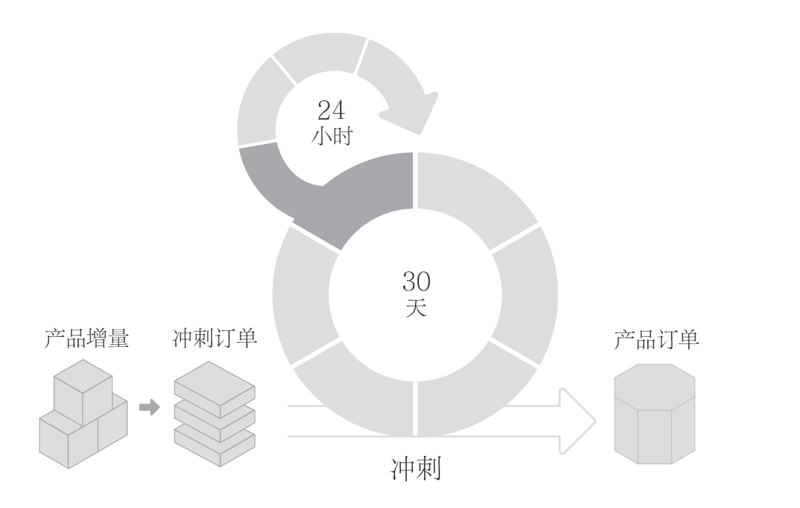

Scrum敏捷开发全景

> > 敏捷和 Scrum 是众多组织用来推动解决方案迭代升级的常用方式，这类成果往往源于跨部门团队的协同配合。目标是在最短周期内交付出契合企业战略和用户需求的高质量方案。^(7)敏捷是一组强调开发团队与业务紧密联动、由自组织团队运作、聚焦创造业务价值的方法和实践。Scrum 则提供了一个协作框架，帮助团队攻克复杂问题。^(8,9)

### 组织加速

艾美：现在得益于技术演进，组织提速变得更可行，摩尔定律指出算力每两年左右翻一番。在这个赛道，AI 通过驱动人、流程与技术的融合来释放加速度与高增速，从而带来可观经济回报。^(10)

克里斯：Adobe Sensei 就是典型。Adobe Sensei 是一个贯穿 Adobe 全产品的 AI 技术底座，赋能智能功能，极大改善数字体验的设计与交付，并在统一平台内融合人工智能与机器学习。^(11)

> > Sensei 的核心诉求之一是解决内容时效性难题。内容时效受个性化体验需求拉动，营销人、品牌方与代理商都要以更高频产出更多内容。Sensei 能加速内容的生产、分发、衡量与优化。

> > 比如图库检索，Sensei 可自动为图片打标签，让检索更快更精准。借助 AI 驱动的图像识别，创作用时大幅压缩，因为繁琐的手工标注与精准找图被自动化了。

> > 文书类工作自动化是 AI 创造价值的显著场景。机器语言与 AI 可承接客服类文书任务，让客服人员聚焦于真正的人际支持。此举提升客户体验、增强忠诚度与口碑，同时精简运营。AI 还能解析通话内容，优化提问话术、改进产品服务。^(12)

> > 更进一步，AI 聊天机器人可为用户提供自助式常见问题解答，实现 7×24 小时在线响应，减少对人工培训的依赖，提升参与度。机器人出错率低，交互体验偏积极。^(13)

### 制造业

艾美：制造过程本身高度复杂，多变量并存容易引发效率低下、性能波动与生产失误，这些都制约了产线的可扩展性以及产品数量与复杂度。

> > Nintex 正在为制造领域打造一个颇具启发性的应用。它并未局限于为单一任务造机器人，而是审视整条制造流程的工作流，挖掘行为模式、问题点与瓶颈。AI 据此给出改进建议，从提升自动化升级、自动化维修流程，到制定新员工引导规范。整体流程因此提速。^(14)

> > 2016 年，机器人厂商发那科 FANUC 与英伟达合作，依托 AI 芯片打造未来工厂。实质是借助 AI 尤其是深度学习，让工业机器人实现自我训练。这缩短了培训周期，加快了流程变更节奏，提升了产线效率。工厂转型的越早，越能提前进入训练红利期。^(15)

> > 西门子正用神经网络优化风电机组，让其学习风场规律并自主调节机组转子。运行效率因此提高，发电量随之增加。这是 AI 快速响应环境变化以提升产出的例子。^(16)

> > 需要区分的是，“无灯化制造”与人工智能并非同一概念。在某些 AI 场景中，机器通过学习自我优化。无灯化制造指的是产线运行无需人力干预，也不必然依赖 AI，制造层面的动作实时发生，历史报表在此几乎无用。^(17)

### 医疗业

克里斯：医疗上，多数患者往往等到就诊时才发现病情已较重，心力衰竭等状况难以提前预判。IBM 研究院计算健康中心的研究员胡建英 Jianying Hu 提出，能否从电子健康记录 EHR 中挖掘隐含信号来提前预警。在为期三年、耗资 200 万美元的项目中，IBM 用 AI 模型分析了上万人健康记录。^(18)

> > IBM 的 Watson 基因解决方案与 Watson 肿瘤解决方案已面向医生与科研人员开放。项目 Medical Sieve 正用 AI 甄别乳腺癌与心脏病。DeepMind 2010 年在伦敦成立，致力以 AI 造福社会。DeepMind Health 是其分支，目标是助力 NHS 等医疗体系服务患者、护士与医生。上述行动共同指向缩短从就诊到精准诊断的时间。^(19)

艾美：这些正是 AI 提升诊疗与护理效率的代表案例。医疗 AI 仍属早期，探索空间很大，前景却很深远。

### 零售业

克里斯：让结账排队变短是速度价值的一个直观体现。影院、超市、主题乐园的长队让人厌烦，解决它能提升满意度、带来复购并降低负面社交传播。

> > 用户密集的门店必须保证点单系统能快速完成交易，后端需稳定高效，员工要接受以快速成交为导向的培训。移动型排队终端可让店员在任意位置为顾客结算，从而提速。^(20)

> > AI 人体扫描仪等新技术可自动识别随身可疑物品，从而加速机场安检。^(21)

> > 新西兰 IMAGR 与硅谷 Mashgin 正在研发动态结算系统，顾客购物时购物车内商品即被累计计价，配合移动支付可实现无排队体验。^(22)

艾美：这说明 AI 怎样助力购物更快更愉悦。顾客期望高定制化且高效。走进服装店时，他们希望瞬间看到契合自身品味的商品与配饰。

> > 个性化购物正被购物助手推动。零售管理公司 BRP 在 2017 年调研显示，45% 的零售商计划用 AI 改善顾客体验。^(23,24)

> > 顾客因此能获得自己需要也想要的商品，即便自己尚未意识到；商家则因呈现更可能被购买的品类而提升收入。^(25)

克里斯：可见 AI 能加速企业多个环节，从生产到内容创作再到快速满足需求。

艾美：对，强调速度时，AI 可帮助组织在短期与长期目标间取得平衡。

## 8. 理解力：揭示并掌握深刻见解

# AI 理解力与性能表现

克里斯：我们刚聊了 AI 如何提升速度，提升 AI 对客户、员工与市场的理解同样关键。

艾美：表面看理解很简单，细想便知其复杂。前文提到的机器学习即机器在无显式编程下习得新事物的能力。计算机可在人类干预极少的情况下学习、改进、归纳与预测，并据环境数据改变自身判断与运行方式。

> > 基于机器学习，AI 已能做物体识别、语音识别、机器翻译、游戏以及图像视频推理等任务。但每项能力都需为特定任务定制系统，通用 AI 尚未出现。智能本质复杂，正如 AxiomZen 文中所言：“仅把原始数据喂给 AI 并不能产生有意义的结果——那样的通用 AI 根本不存在。”^(1)

克里斯：为了展示理解难度，我们看看房间里两个人对话的复杂性。

## 人与人之间的交互

艾美：我对人与人交互很着迷，多解释一下。

克里斯：交流时人们会同时处理视觉、语气、句式、音调变化、肢体语言、眼神、历史背景、亲近度、发音、情绪状态、沟通目的、教育背景、人际动态等无数变量。沟通与理解绝非易事。

艾美：这也解释了邮件与短信为何常被误读。讽刺与幽默多靠肢体与语气传递，文字无法承载，易导致目的误解。

克里斯：加入不同文化与成长背景，隔阂会进一步加大。

## AI 扩展理解力

艾美：AI 能拓展理解，即便距离遥远或时间跨度大也能实现真实连接。深厚持久的联结由此成为可能。

克里斯：理解越深，连接越深。

艾美：对企业而言，这意味着能识别出对自有产品服务感兴趣的人群与群体，过滤掉不相关者。

克里斯：广告展示只有在消费者能接收信息、产生兴趣且地点合适时才有效。精准体验在合适场景与个性化下才能放大。

> > 市场研究机构 Juniper Research 预计，到 2021 年全球实时竞价广告支出将达 420 亿美元。Boxever 2016 年 11 月调研显示，近 80% 的美国资深营销人认为消费者已为 AI 就绪，且多数对聊天机器人抱有期待。^(2,3)

> > 机器学习正被用于提升广告效果，AI 识别用户并推送相关创意。算法不仅投放历史浏览品类的广告，还会推断可推荐商品、投放时机与位置。^(4)

> > 这些趋势表明，洞察真实需求与欲望，有助于投放更相关广告并提升收益。

艾美：对，但需注意算法悖论。只向有亲和力的人推送会错失新品推广机会。

> > 在理解力被拆解后，我们用现实案例进一步探讨 AI 如何提升理解的各个维度。

## AI 如何提高理解能力

克里斯：正如所言，理解人类沟通涉及肢体语言、面部识别、步态分析、眼动追踪等。

艾美：我很喜欢 Modiface，它用 AR 与 AI 营销美妆，提供高度定制体验。

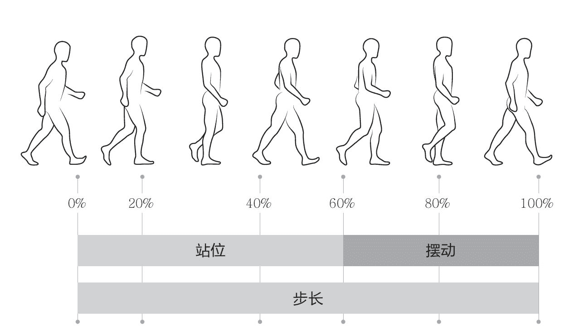
### 步态分析

克里斯：Modiface 技术已嵌入多款本地操作系统，也可通过 App 下载。借助 AR，用户可在手机或平板上预览上妆效果。

> > Modiface 基于斯坦福研究，是业界精度领先的面部视频追踪系统。软件依靠高度精确的 3D 面部特征追踪动作与表情，可识别 68 个参数，涵盖虹膜大小位置、唇部、眼睛、头部姿态等面部特征。技术已嵌入智能镜，可分析面部与体态。^(5)

艾美：这预示了智能家居与门店的未来。浴室与试衣间会普及智能镜，支持虚拟试妆与试衣。若用户在智能镜前体验妆容，可用选择器切换色调风格，满意后一键下单，数小时内送达。目前技术已用于美妆与服装营销，未来可用于肢体语言分析以增强沟通。我预测会有应用帮助用户在面试演讲前自我诊断。商业化与个人提升空间都很大。

艾美：想象面试者可在智能镜前演练，获知不足并即时改进。紧张时镜子会提示并给出纠正建议。

> > 通过整合气象服务、个人日程与本地活动列表，AI 可驱动“智能衣橱”根据出行目的与活动推荐衣着。^(7)

> > 智能电视、智能镜、智能温控、智能锁报警、智能摄像头、智能厨电等接入智能家居中枢后，形成对居住者习惯与偏好的整体理解，以提供定制化环境。^(8)

## AI 有利于沟通

克里斯：AI 也可强化其他沟通形式。以自然语言处理与生成为例。计算机科学家克里斯蒂安·哈蒙德在《麻省理工科技评论》EmTech 大会上表示：

> > 语言是神奇且独属于人类的。我们能教狗执行指令，教乌鸦用工具，教海狸造坝，但没有其他生物能像人类那样使用语言。机器虽能使用文字，却在语言上挣扎。^(9)

> > 哈蒙德是西北大学教授，也是叙事科学 Narrative Science 联合创始人，他打造了 Quill，能把数据转化为类人类智能叙述。^(10)Quill 解析数据、生成叙事并编织成故事。企业借助 Quill 可把季度监管报告撰写流程自动化，把精力留给阅读而非生产，还可提升客户参与与运营效率。^(11)

艾美：这很好地体现了 AI 对理解的助力。Quill 处理数据时聚焦两个问题：谈论什么、需要理解什么。这两点是故事构建的关键，随后以人类易懂方式输出结果。^(12)

克里斯：这让我想到酒店行业的案例，AI 帮助其读懂客户并提供近乎完美的服务。

> > 假设梅丽莎想和朋友去纽约庆祝 30 岁生日。她用手机搜索心仪酒店，被移动钥匙与自助入住吸引。App 显示有房，却因接电话错过预订。数日后她在 Facebook 看到付费搜索广告提醒，遂完成预订并告知朋友行程开启。

> > 旅行前一周，她收到邮件邀请使用 App 办理入住并已充分利用。抵达当天，推送欢迎信息并提示可直接入房，附带房号与用 App 开锁说明，无需在前台逗留。

> > 入住后电视出现个性化欢迎词并推荐本地攻略，她挑选尼克斯门票，与好友度过周末共庆球队胜利。

艾美：这展示了酒店如何借助数据加深对客户的理解，也暴露了多数企业的三大痛点：

> > 数据孤岛，跨系统数据库不共享；数据结构化不足；数据难于行动化。

> > 在此情境下，酒店借助 AI 构建客户统一视图，实现高速大数据实时处理。数十亿字节数据被即时分析以指导当下体验。^(13)

## 医疗应用

克里斯：例如，伦敦与柏林的医疗科技初创公司 Ada 推出了“个人健康伙伴与远程医疗应用”。用户输入症状，App 提供可能病因与评估，若允许则建议对接专业医生。^(14)

> > 其 AI 引擎经多年训练，结合真实病例与疾病症状诊断知识库。^(15)

艾美：三星的 AI 记忆眼镜 Know You Again 也很创新。搭载 VR 技术后，可帮助痴呆与阿尔茨海默患者在平视显示器上识别来访者身份及特征，甚至回忆上次对话内容。这是 AI 创造有意义体验的实例。^(16)

## 了解客户

克里斯：洞察客户需求并非新事，只是更复杂。古代市集里，摊贩也能读懂顾客行为偏好。大热天卖西瓜，周五卖鱼，节庆时推面包。

> > 如今对话更进阶，AI 能自主学习客户欲望、行为与需求，创造更佳个性化体验。

> > 超市布局即体现此点。新鲜果蔬常置显眼位置，因购买健康商品让人感觉良好，又减少后续对不健康选择的愧疚。

> > 全面理解客户需融合时间、地点、交易与虚实世界的信息。亚马逊可依据你的搜索记录，如本周逛店、购买与就医记录，推送个性化结果。这些数据分散在不同企业数据库，整合困难。Adobe Experience Cloud 等服务通过地理围栏、行为等维度实现数据破壁，为深度个性化提供洞察。

> > 借助行为洞察与有意义的 AI 体验，企业可稳固客户忠诚并阻隔竞争。在快速变化的市场中，精准、即时、满足感强的体验是制胜关键。

艾美：这就引向下一个议题——性能表现，即绩效，核心在衡量与优化。

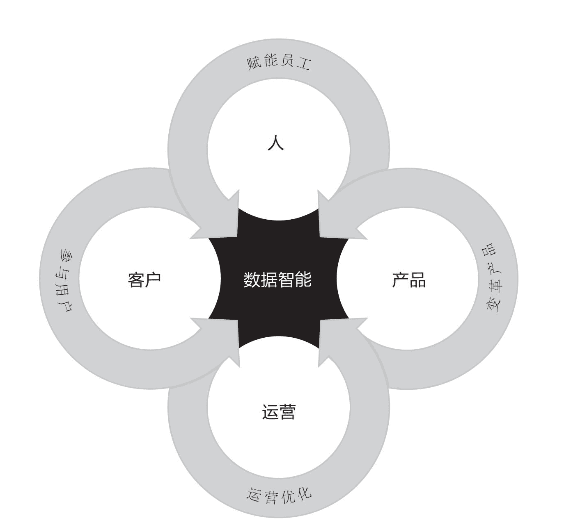
### 数据反馈路径

## 9. 性能表现：衡量与优化

克里斯：性能表现本质上是对某项工作运行状况的评估，目标是改进准确度并支持决策。它与速度、理解力、实验与结果有区别。

# 把 AI 效能变成可量化、可迭代的闭环

> > 衡量一个智能方案通常走三步。先把业务要解决的问题说清楚，并把它落到可追踪的核心指标上，这个动作最好在立项时就完成，过程中可以微调；再按这些指标持续记录表现；最后根据结果回到记录环节，对方案做迭代优化。

### 核心绩效指标在说明什么

核心指标是检验目标是否达成的一种标尺。团队依靠 KPI 来判断预期是否兑现。

艾美：绩效衡量与优化的本质，是围绕个人、团队、组织、系统或其子模块的表现收集信息。过程涉及学习机制、组织战略思考，以及对工程流程、参数与现象的研究，用来核对产出是否符合预期。关于绩效的论述很多，落地时往往沦为口号，甚至出现逻辑漏洞。

### 三步循环

> > 近年“设计思维”在多个领域流行，既能化解设计与软件难题，也能应对复杂的业务表现问题。对人工智能而言，聚焦度量与持续改进的做法尤其关键。

### 战略与战术如何协同

> > 在整体框架下，绩效指的是智能方案在战略层面与战术层面实现目标的度量与优化。孙子在《孙子兵法》里写道：“谋无术则成事难，术无谋则必败。”战略是企业的长期指向与实现路径，战术是落地的步骤，二者互相依存。

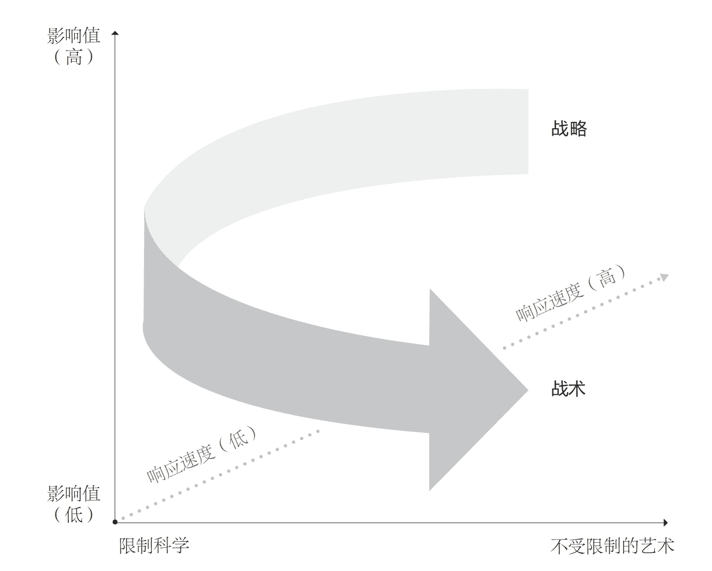

### 别只堆砌战术

> > 各家企业都在以不同方式引入人工智能，诉求都是更聪明、更具竞争力。把人工智能战术东拼西凑，很难持久；只有把人工智能优势纳入企业战略，才更可能成功。

克里斯：我前阵子跟一位 F1 车手聊到人工智能在赛场的作用。每辆赛车装载两百多个传感器，比赛中实时产生海量点位，记录发动机状态、轮胎抓地、温度等。雷诺运动 F1 车队 CIO 皮埃尔·德·伊姆布瓦尔提到，人工智能在比赛中至关重要，能帮助每一圈做出最优决策。“这些数据用来优化赛车表现，不仅包括车身改装，AI 还可以预测进站换胎的最佳时机。”

> > 微软技术是这套体系的驱动力。Azure Machine Learning 作为微软云的 AI 框架，用来预测车辆配置的关键维度并给出优化建议。它结合微软云计算与 Azure Stream Analytics，并与雷诺超算协同，在 3D 虚拟赛车上进行测试。

艾美：这个案例清楚展示 AI 如何在战略与战术上度量成效，并为企业提供优化与竞争优势的洞察。

> > 再借助微软 HoloLens 对汽车气流等现象做全息可视化，更令人惊叹。HoloLens 最初面向办公协同、培训与教育，后来扩展到建筑、汽车原型、医疗培训等场景。结合 AI，其创造力提升的空间几乎无限。

克里斯：发那科的学习软件 Gakushu 被植入制造机器人以加速深度学习。机器人通过采集并存储制造任务数据，在实时条件下自我调整。训练完成后即可自主作业。衡量结果显示，点焊作业速度提升了 15%。

### 把度量当杠杆

艾美：衡量绩效指标是判断项目是否成功的关键。即便容易让人担心被判定失败，这并非失败，而是优化契机。KPI 本身也可能需要根据真实世界的统计结果来调整。

克里斯：如果数据没达到 KPI，就要追问原因，这往往为 AI 克服障碍创造机会。

艾美：可以从时间是否充足、是否出现不可预见的市场动向、指标是否需要重审改进、产品表现不佳是否源于技术限制如硬件或网络等角度思考。

克里斯：市场推广也值得复盘。目标受众是否精准？投入是否到位？衡量口径是否准确？能否把这些推论串起来？

艾美：核心在于全面审视度量与指标。要了解统计数据的置信水平，注意环境因素，数据质量是否如预期般干净。

克里斯：度量很重要，但基于度量得出的结论要警惕回声室效应。世界复杂，某些指标未必涵盖全部复杂性。

艾美：分析后可能需要更多指标，或现有指标不够精确，或目标本身有误。记住，衡量值只是数据点，不是结论。若数据点不充分或错误，结论也会错。

### 数据血缘与可信度

克里斯：有句老话，“没有作战计划在接触敌人后还能保持原样”。现实世界与市场不断演变，需要持续适应，这正是优化环节重要的原因。

> > 源数据质量对 AI 项目成败至关重要。《麦肯锡季刊》指出，一个构建良好的源信息模型能够对“去或不去”的信心决策进行压力测试，帮助管理层判断何时需要改进关键数据集。

艾美：源信息指信息的来源与获取时间。在数据层面，就是知道数据从哪来、何时到达，从而判断其可信度。你必须为每条数据建立谱系：是用户输入、物联网设备、社交媒体还是交易数据？

克里斯：说到点子上了。决策不能建立在可疑数据上，否则会错误评估，进而对错误目标进行优化。

> > 接下来看绩效在制造业中的意义。在降本增效的诉求下，AI 的机会在于帮助工厂预测需求与产能、预见设备故障等。

### 工厂里的 4.0 实践

艾美：你说的是工业 4.0 倡议，对吗？

克里斯：没错，也就是第四次工业革命。用机器人与 AI 实现自动化能解决很多问题。惠普企业全球制造业副总裁沃哈德·布里古拉表示：

> > AI 预测性维护可让制造商将非计划停机时间减少 60%甚至更多，从而大幅降低停产、备件更换与库存积压成本。

> > 传统工业自动化重新编程往往需要数百小时，任务变更不现实。机器学习减少甚至消除了工业机器人的重新编程延迟。

> > 例如，通过设定维修、供应链、质量控制与自动化等指标，AI 可在衡量与优化中发挥主导作用。机器人已普遍应用，但需人工训练。具备深度学习功能的机器人能学习任务并随时间改进。

> > AI 在制造业真正发挥作用的地方，是将整个业务流程自动化，而非单一任务。软件机器人被训练成逐项完成工作，把分散任务整合为统一流程。管理人员通过仪表盘实时监控整体活动。

艾美：要进一步了解 AI 对制造业绩效的影响，可以看协作机器人 Cobots，它让人与机器协作更紧密，充分发挥各自优势，提升生产率。

> > 美国 iRobot 正在改进 Roomba 吸尘器，让它能绘制房间地图以识别并记住空间，然后根据房间情况调整清洁策略。这要求 Roomba 依据网格绘制房间并分割出不同区域与走廊。房间因家具移动、衣物散落、宠物小孩等 constantly 变化，机器人必须不断调整性能并优化路径。工程师评估了其表现，并将优化结果纳入下一版本。

### 农业的信息化转向

克里斯：AI 对农业的影响也很突出。农业需要水、能源、人力、肥料等资源，AI 让耕作变得信息化。

艾美：过去农民大量灌溉、遍洒杀虫剂、不精确施肥。现在土壤中放置传感器实时监测水分与养分，数据汇编分析后即可精准控制用水、农药与肥料。AI 设备只把水输送到需要处，直接对问题植株喷药、在精确位置施肥。整个过程需要持续监测方案性能，才能实时优化。

克里斯：一个很好的应用是疾病早期识别。在坦桑尼亚，某研究团队开发了 AI 系统，利用迁移学习识别作物病害。借助谷歌 TensorFlow，建立了 2756 张木薯叶片图像库，AI 能以 98% 的准确率识别病害。

艾美：这让我想到 AI 改善的黄瓜分拣农场。黄瓜颜色、形状、品质、质地与新鲜度各不相同，分拣困难。

> > 日本工程师小池诚对此进行了探索，他用 TensorFlow 将家庭农场的黄瓜分为九类。系统通过数月 7000 张图像训练实现识别与分类。此前他母亲每天花 8 小时分拣，后来借助衡量与优化模型大幅缩短时间。

### 物流被数据淹没

克里斯：如果 AI 能改造黄瓜分拣，想象一下对全球物流的冲击。物流长期被复杂供应网络的数据淹没，随着物联网实时产生海量数据，问题更严峻。

艾美：在物流中，有大量环节必须协同，跨越多国公司、供应商与服务商，各自使用不同设备、数据库与软件。语言差异也带来复杂性，记录往往未计算机化。

> > 高德纳咨询研究公司副总裁、报告首席分析师诺哈·托哈密表示，预计人工智能、机器学习、企业社会责任与服务成本分析将在未来十年推动供应链战略重大转变。

> > IBM 与天气频道合作的 Deep Thunder 项目，利用机器学习理解恶劣天气对工业的影响。该项目每天用 IBM Watson 技术检查超过 100TB 数据，生成更可靠的天气预报，包括风暴、飓风与台风的地点信息，对供应链至关重要。

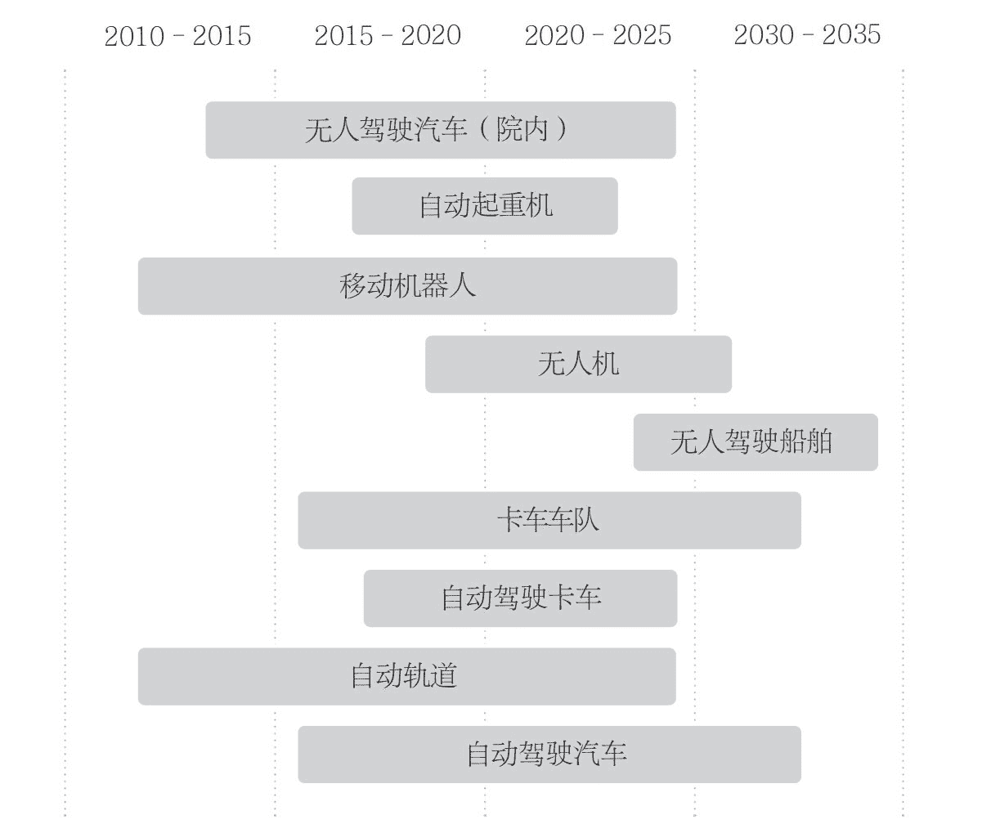

### 上游管理中的自助物流

来源：@理查德·马丁 2010

克里斯：提升性能的另一个例子是劳斯莱斯推出的 R2 数据实验室，它把公司各地的人连接起来，用数据与 AI 提升洞察力，为客户创造更多价值，并借助机器学习分析海量数据。

> > 通用电气为每台生产的喷气发动机打造“数字孪生体”，可从地面实时监控发动机在飞行中的性能。利用该技术，GE 能预测何时需要维修，并从实际使用数据了解每台发动机的状态。

> > 位于纽约的 GE 全球研究中心内燃机系统负责人安东尼·迪恩说：

> > 通过数字孪生体……我发现飞行员是个会猛推发动机的牛仔。不同飞行员的燃油消耗情况各异。数字孪生体记录每一个事件，可以把机队拆分开来。每台发动机都有各自的人生经历。

艾美：通过持续测量与优化产品、服务及 AI 模型本身，看到 AI 如何在战略与战术上影响绩效，令人惊讶。

克里斯：没错，这就是人工智能帮助企业、帮助人类，让世界变得更好的方式。

# 10. 好奇心驱动的实验设计

克里斯：实验不是为实验而实验，而是为解决可执行的问题。在超级框架里，可执行的好奇心指两方面：一是好奇心可被构建进 AI 战略，二是好奇心也可被构建进 AI 模型本身。

> > 实验从一个可解决的企业问题开始。用好奇心探寻可能方案，并通过实验验证其有效性。我们称之为有效的好奇心。

艾美：人类用好奇心与想象力解决现实问题的例子很多。即使在 AI 与计算机出现前，人类也常以令人印象深刻的方式解决问题。罗马引水渠与马斯克的 SpaceX 计划相隔两千年，却都靠好奇心与想象力解决看似无法解决的问题。

## 罗马的引水渠

克里斯：古罗马引水渠是有史以来最伟大、最实用的发明之一。他们面临真正的问题。随着罗马快速发展，人口众多，水成为制约城市发展的因素。缺水导致人口无法增长，干旱期更会引发社会不稳定。

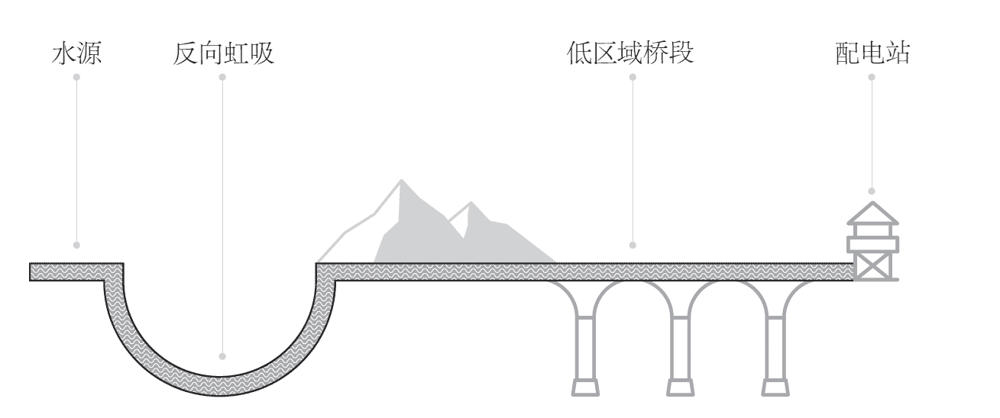

### 引水渠的建造逻辑

> > 罗马通过修建引水渠解决这些问题，引水渠旨在把山泉水输送到可用的城市运河。建造并非轻而易举。设想一下挑战与复杂性，尤其在缺乏先进技术时。

> > 问题关键且随人口增长愈发紧迫。人们一直挖沟渠引水到村庄、农田甚至城镇。自农业以来就这样做。罗马人对水源问题感到好奇，经过多年试验，最终想到建造引水渠，通过长距离运输把水引入罗马。

> > 这项工程极其困难，但别无选择。为增加人口、抵御旱灾，罗马城需要稳定安全的供水渠道。因此他们必须跨越河流、溪流、山脉，从千里之外的山泉引水。每条引水渠始于山泉，通过沟渠或导水管输送。若遇溪流或河流，就用石头搭桥；遇山则凿隧道穿山。所有这些都在没有水泵的情况下完成，水靠地心引力流入城内。

> > 如此庞大的项目需要政府大量资金。通常富裕罗马人自费，或政府征收特别税，企业有时捐赠管道或提供资金支持。

> > 施工期间需雇佣大量工人与管理人员，并提供吃住。还需制作挖掘隧道、建造桥梁、铺设管道与水渠的工具。这在今天看仍是艰巨工程。

艾美：想象一下，在没有手机、电脑、电子邮件或重型设备的情况下，一个工程师开展这项工作。没有任何现代技术，如炸药、重型机械、卡车或计算机。这是一项惊人成就。

克里斯：必须实验以确定最佳建造方法。工程还需要后勤支持，必须建造临时城市并定期运送补给。

> > 问题激发了好奇心，促使他们实验，最终通过引水渠解决。假设没有这个问题，这个解决方案永远不会被尝试。

艾美：引水渠得以建成，并不是因为罗马人有能力建造，而是为了解决真正的社会问题。

克里斯：另一种看法是，一旦问题解决，就需要确定下一个问题以取得新进展。也许阿波罗登月计划没有发挥全部潜力，因为问题被解决或未明确推广。原来的问题已完成，后续缺乏明确任务，项目基本停止。

## SpaceX

艾美：这正说明问题。引水渠是利用好奇心与实验解决问题的典型案例。SpaceX 计划为了解决不同但同样复杂的问题而开展。

> > 把材料从地球表面送入太空需要巨大能量且成本高昂。每次火箭发射后，巨额材料被丢弃。阿波罗每次发射花费 11.6 亿美元，经通胀调整后，每次送 31 万磅材料进入近地轨道，或 10.71 万磅送往月球，相当于九头成年大象重量。

> > 即使航天飞机计划中，巨大的助推器也落入海洋被摧毁，不再使用。

> > 这就是需要解决的问题。SpaceX 致力于制造可返回地球的助推器并重复使用，把送 material 上太空的成本降低数倍，并提高发射频率。不必每次制造新助推器，只需翻新测试后重复使用。猎鹰重型升力系统最终能以每次约九千万美元将 3.5 万磅物质送到月球，或 14.07 万磅送入近地轨道。

> > 与引水渠一样，一旦问题确定，就必须找到解决办法。这需要从零建立完整基础设施，并配备工程师、工人、制造商与完整的物流链。

克里斯：SpaceX 很好地利用人工智能，让可重复使用助推器返回地球。该方案解决了一个凸优化问题，意味着考虑所有可能答案，让火箭在不耗尽燃料的情况下着陆。

## 可执行的好奇心

艾美：好奇心旺盛的人通常爱钻研，也格外向往新鲜体验。他们追逐新奇、有挑战并且能带来启发的场景，对枯燥乏味的例行公事很快失去耐心。这类人群点子多，对不确定性容忍度高，往往能用探究的习惯把复杂问题拆解成简单做法。^(5)

> 可执行的好奇心其实是一种思维授权，允许你一直保持提问的状态，并把这种提问转化为实际可用的路径。单纯的智商不够，必须让可执行的好奇心把能力拽向既定目标。爱因斯坦的说法是：“我没什么特殊天赋，只是对万物充满好奇。”

> 眼下绝大多数模型训练仍靠强化学习，即行为对目标有帮助就给奖励。它擅长教机器完成明确任务，例如流水线上把汽车装配优化到极致。但若想让系统在无人指引下自主行动，就得注入好奇心。^(6)

克里斯：这正好能举个例子。谷歌团队曾想知道数据中心的电费能不能降下来。2014年时，谷歌数据中心消耗约4402836兆瓦电，差不多等于366903户美国家庭一年的用电量。他们好奇的是，AI能不能帮他们找到解法。

> 于是他们开干，用神经网络去控制“数据中心里大约120个变量”，涵盖“风扇和制冷系统”等，还包括“窗户之类”。最终借助 DeepMind，耗电减少了15%。这背后是人保持好奇、愿意试错，再用AI策略把问题解决掉。^(7)

## 人工智能模型

艾美：继续说说好奇心是如何被写进AI模型里的。AI家族很大，这次我们只聊几类跟好奇心关联最紧密的：强化学习、监督学习、无监督学习、迁移学习、半监督学习。

克里斯：对，还有其他类型，但先聊这五类就够了。

艾美：这五类范式都内嵌了主动探索的逻辑，并在其上衍生出若干变体。

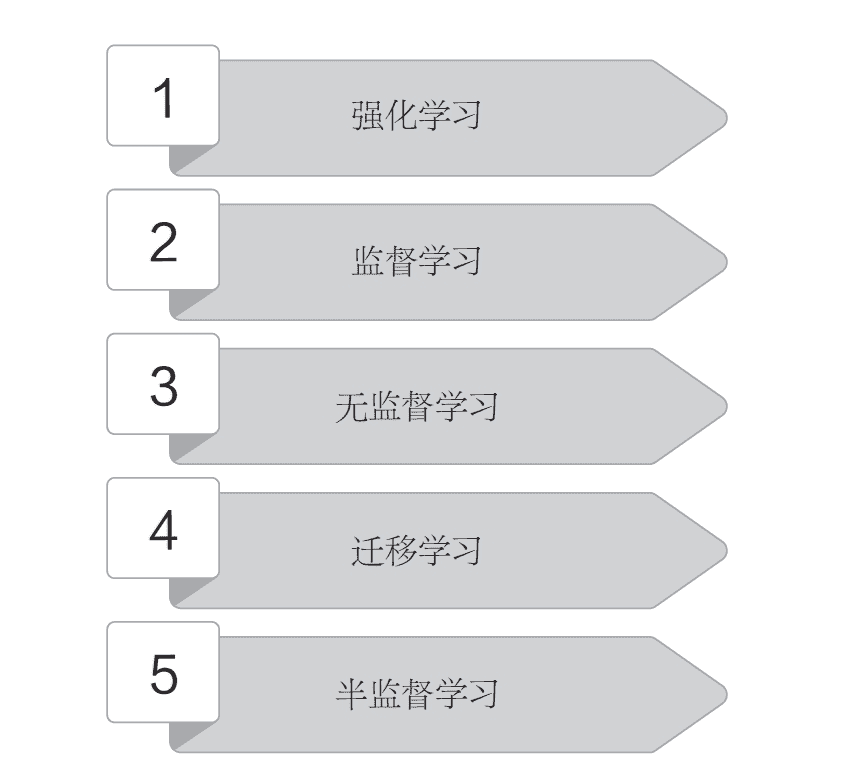
### 五大人工智能模型

克里斯：先说强化学习。把系统丢进环境里，它靠试错做决策，通过经验不断提炼更准的行动。

> 吴恩达——百度副总裁兼首席科学家、Coursera联合创始人、斯坦福兼职教授——常拿训狗来比喻。狗做了想要的行为就奖励，做错就不给，时间久了它就懂只有做对才有回报。^(8)强化学习处理已知且具体的难题时效果很突出。

艾美：第二是监督学习，类似老师带学生。老师知道标准答案，模型在有标签的数据上不断预测，错了就被纠正，直到能稳定交付任务。

克里斯：无监督学习没有答案也没有老师，模型自己去数据里找结构和联系，挖掘出有意思的模式。^(9)

## 迁移学习与好奇心驱动的人工智能

艾美：第四类迁移学习对我们很有启发。简单说就是用在A任务上训练好的模型当跳板，去攻克相关的新任务。比如先用监督学习在上万张照片里教它识别物体，后面做照片类的项目就能直接复用学到的特征。

> 第五类叫半监督学习——先用少量已标注数据引导算法入门，达到一定熟练度后再让它去学习大量未标注信息。^(10)

克里斯：吴恩达曾表示：“我想说，在所有这些类别中，监督学习是一个创造明显价值的类别。我认为，其他一些类别的算法、思维以及如何将其推向市场仍处于初级阶段。”^(11)

艾美：在这五种范式里，AI本质都在用好奇心驱动理解，也就是对解法的渴求。

克里斯：Adobe的场景缝合就是个例子，既有想象又有好奇。做法类似内容感知填充，会在大量图像里搜罗好看的图形元素来填补画面。^(12)

> 说到底，我们是靠AI的好奇心和试错精神来解决企业难题。实验的指南针应该是发明，有了它就需要团队里有敢闯的成分，通常意味着要去探索未知。

艾美：没错。畏惧失败就做不成事。

克里斯：AI的限制只有想象力。不仅要敢跳出框，还要敢把框拆了。

## 11. 结果：企业变革

克里斯：AI落地的终点是企业变革。想活下去，企业就得数字化、重塑组织，但光投入不够，得看到结果。《福布斯》指出，80%的企业正在投钱做AI。^(1)

> 当企业定AI战略时，产出会牵动产品、回报、业务表现。不能单点思考。AI方案会带来多层级的竞争优势，并重塑组织形态，这才是它的真正价值。

> 归根结底，成果说了算。做AI战略时，成果不能只停留在某个项目或产品上，它要服务于整体数字化、组织变革以及盈利能力的改善。

### 人工智能赋能的产品和服务

艾美：来看AI赋能的产品和服务能带来啥。克里斯，我们之前聊过Roomba吸尘机器人，很有代表性。

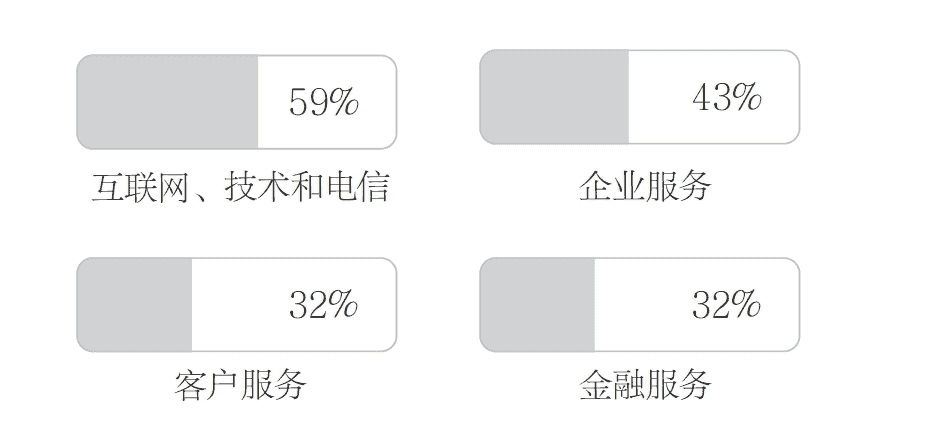

### 受人工智能影响最大的行业

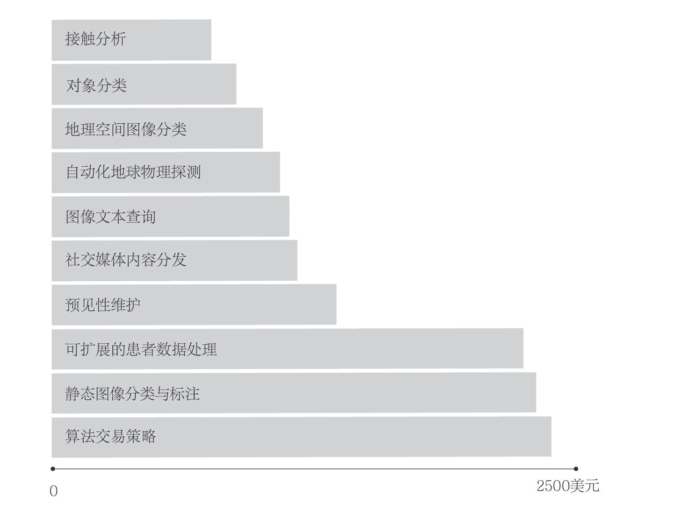

人工智能收入

全球市场10大案例

来源：Tractica咨询公司

克里斯：对，扫地是我最烦的家务之一，Roomba正好把它解决了。几年前买了一台，它能自己把全屋清干净。我不用管，狗子还爱跟它追。

> 感觉像魔法。小家伙自己在屋里转悠，除了偶尔倒个垃圾箱，我基本不用干啥。太爽了！

艾美：这就是AI催生的产品线，没有它很难实现。机器得先拟好你家的地图，判断哪里需要清扫。^(2)而且这张地图是活的，会随着人走动、家具挪动和宠物乱跑不断更新。

克里斯：Roomba很好地展示了AI如何托起一家以机器人吸尘为核心的公司不断进化。每一代都在上一代上叠加更强的AI，让使用更省心。

### 机器人技术

艾美：提到机器人很多人想到类人拟人造型。现实中多数机器人都是按任务量身定做的形态。比如送餐机器人，接单靠手机，用托盘把饭送到桌前，外形像是带轮子的推车，跟人没啥像。这种设计绕开了恐怖谷——日本机器人学家森政弘1970年就写过，当机器人几乎像人时，人会感到不适。^(3,4)

克里斯：关键是AI在创造全新品类。它不仅优化已有产品服务，还在孵化新东西。看医疗，AI正在研发能延长甚至救命、提升护理质量的工具，意义很大。

艾美：以色列的Zebra Medical Vision就挺有启发。他们做的AI放射助手，每次咨询只要1美元就能拿到专家级建议。^(5)成果就是用更低成本获得更好医疗。

> 别忘了AI对产品本身及其周边生态的影响，比如流程、营销、生产。AI会重塑超网物流、物流市场，缓解供应链压力，实现按需交付、共享物流、个性化营销等。^(6)

### 人工智能对投资回报率的影响

克里斯：AI对新品和老产品的冲击都很明显，对回报率的撬动更大。最新研究显示影响已扩散到金融、交通、医疗、旅游、汽车。早期采用者的利润在增长。零售商用AI机器人管理仓库，咨询公司用AI生成报告，医院用AI试水提升医疗，聊天机器人改善各行业客服。^(7)

艾美：落地AI有两条路线：增收或降本。依据Teradata，60%的决策者认为AI能自动化重复性流程和任务；50%觉得它能提供新战略洞察；49%认为它能自动化知识工作，降低人力需求。^(8)

克里斯：我还看到46%的受访者认为这会加速创新，帮助他们抢先进入新市场。

### 人工智能促进增长

艾美：总体看AI能拉动增长、降低成本或两者兼顾。《福布斯》预计到2035年AI可能把生产率推高40%，并让16个行业的经济增速提升1.7%。^(9)

> Juniper Research数据显示，到2022年全球医疗领域AI聊天机器人每年节省成本超36亿美元。因为病人能更方便高效地获得护理，减少对人工的依赖。^(10)

克里斯：新产品本身也是增长手段，它们让企业进入新市场或提升既有份额。

艾美：提升效率或砍成本都能直接抬高回报。比如L’Occitane用AI热图优化流程，移动端销售提升了15个百分点。Earth Fare用AI为品类经理生成促销建议，同比销售额上升。亚马逊Prime会员能借助Alexa Echo里的AI推荐完成购买。^(11)

克里斯：埃森哲战略研究估算数字经济占全球经济22.5%，善于利用数字化颠覆的企业在增长、利润和市值上都收获很大。他们也指出“数字技术释放价值的潜力远未耗尽。”^(12)

艾美：对数字化尤其是AI挖掘得更深的公司会获得明显竞争优势。叠加物联网、SaaS、云等趋势，大多数企业将被重塑，固守现状的很可能很快消失。

### 企业变革

克里斯：聊聊人工智能对企业变革的更广泛影响。

艾美：话题很深，不止数字化。

克里斯：先统一一下概念。数字变革、企业变革、创新常被混用，实则差异很大。

> 数字变革是指利用数字技术引起的变革，这种变革是由新型的创新和创造力所促成的，而不仅仅是对传统创新和创造力的加强和支持。

> 另外，企业变革是一种管理变革策略，目的是使公司的人员、运作流程和技术与公司的战略和愿景保持一致。^(13)

> 创新是指制造新的东西或改变现有的产品、服务或想法。它是引入那些新的想法、设备或方法的行为。被誉为“数字经济的驯龙高手”的首席分析师丹尼尔·纽曼说：“创新驱动变革，并使之成为现实。”

> 企业利用创新来推动数字变革，从而实现企业变革。人工智能是这三个方面的基础，为了让你的企业生存和繁荣，人工智能必须是整体战略中不可或缺的组成部分。

### 数字垂直领域

艾美：如我们所说，人工智能横跨物联网、工业物联网、医疗物联网、云等所有数字垂直领域，是它们的基础。

克里斯：事实上，没有人工智能参与的数字变革或企业变革战略毫无意义。

艾美：毫无疑问，人工智能将给产品、回报率和企业产生颠覆性结果。投资是必须的，真正的游戏是企业存续。关键是从何处起步、聚焦哪里。

# 第三部分 人工智能的未来

## 人工智能的未来

## 12. 从哪里开始

艾美：启动人工智能项目最难的是起步，因为往往在问题不清晰、市场未验证时就直接进入技术。

#### 定义问题

开始前要明确想解决什么问题，谁需要这个解法。了解目标用户至关重要，因为他们是最终买单和使用的人，也是需求的制定者。应借助市场调研、问卷等工具去捕捉终端用户的真实需求。

产品定义广义得多，B2B、B2C、政府、医疗、内部系统、工业等场景各不相同。产品是项目的交付物，客户是使用者。工业场景里用户是制造商，B2C里用户是消费者。

若问题和市场不清晰，回报率会很低，销售也很困难。这常被看作技术为技术，或为做而做。

换句话说，一个业务痛点、一批未使用的数据集，或一次对人工智能新技术的探索，都可能锁定问题、方案和客户。以超级框架为路线图来获得解决方案，并制定人工智能项目的发展战略。正如我们之前提到的，超级框架是为支持企业和品牌战略而设计的，并与它们结合使用。

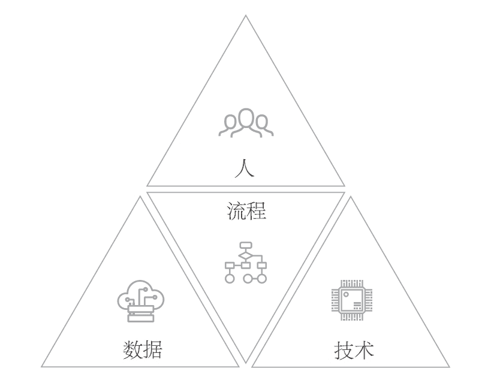

克里斯：运营超级框架需用到人、流程、数据和技术的概念。人关心的是建立一个拥有正确技能和组织的团队；流程处理的是项目的开发过程，不同的方法对应不同的目标；对于数据，要有一个数据战略，而且注重的应该是数据质量，而不是数据数量。最后，技术提供了构建项目所依据的软件和硬件因素。

> 人们可以创建或定制超级框架，以满足任何项目需求。我想说的是，这是一个蓝图，而不是一个紧箍咒。使用框架来实现进步，而不是限制你的行动自由。

艾美：在深入研究人、流程、数据和技术之前，我们不应低估共同愿景或集体心态的力量。当任何团队或组织开始一个项目时，其心所向都是同一个方向。虽然意见可能不同，但团队和组织需要有一致的目标且朝着同一个方向前进。

> 高级管理必须与人工智能战略保持一致，然后必须在不同的原则之间达成一致。

#### 变革管理

克里斯：如果一个组织在人工智能方面刚刚起步（很多都是这样），变革管理策略就非常适用。变革管理有助于在组织内部建立倡议和共同愿景。

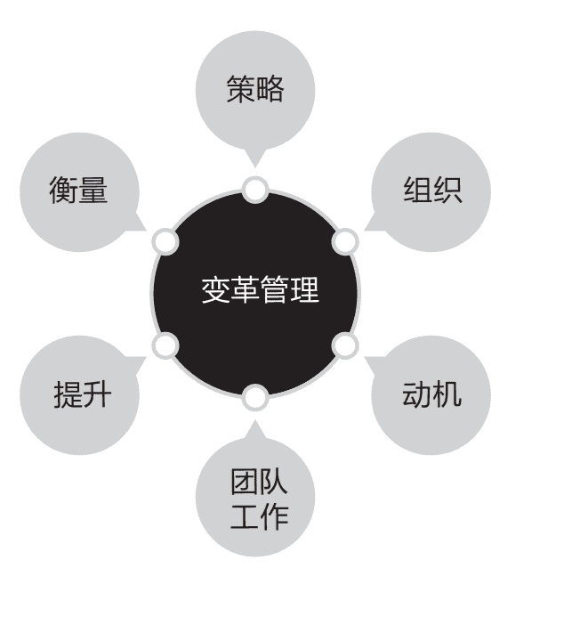

艾美：很多领导者都明白，变革是由人来实施的，你不能把人排除在这个等式之外。计划和过程是必要的，但是变革常常失败，因为过程中没有适当地考虑到人的方面。

克里斯：一个人工智能项目要想成功，必须有人来把控。这并不意味着这个项目需要被严格管理，相反，它意味着企业中的一个或多个高级利益相关者必须支持这个项目，支持这个团队和目标。项目在企业中的地位取决于企业的组织方式。

艾美：对于企业的组织方式并没有硬性的规定。但是，一般来说，首席信息官（CIO）专注于管理企业运营的基础设施，而首席技术官（CTO）则负责外部业务增长的技术。

克里斯：换句话说，CIO通常负责内部技术，CTO负责外部技术，设立技术愿景并制订技术发展路线。

艾美：较大的公司可能同时拥有一名CIO和一名CTO，甚至更大的公司也可以同时拥有两名以上的CIO和CTO。

克里斯：偶尔，尤其是在小型企业中，IT服务在企业中并没有排到最高的优先级位置。在这些情况下，这个职位类似于管理信息服务副总裁。

#### 人工智能嵌入企业

艾美：无论企业组织方式如何，人工智能团队必须嵌入企业内部，而不是孤立存在的。企业将孤岛思维定义为在同一家企业但不愿共享信息的部门。^(1)

克里斯：如果一个人工智能团队与企业的其余部分隔离，效率就会降低，而且他们可能不会考虑终端用户和组织内部利益相关者的需求。

艾美：还需要考虑数据科学家和人工智能工程师如何协同工作这个问题。他们是作为一个团队工作，还是分成多个团队？他们为同一个组织工作吗？必须从一开始就解决这些问题和其他问题。

> 你需要先定义数据科学家的角色。他们是企业或某个领域的专家、统计专家、编程专家、数据技术专家还是可视化和通信专家？^(2)

克里斯：当开始一个人工智能项目时，需要考虑一些问题以决定合适的团队。

艾美：其中一个重大决策是决定人工智能团队在组织中的位置。这个项目是由IT部门、财务部门、市场部门还是其他部门来执行的？

克里斯：当然，项目中会涉及企业的很多领域。如果你决定IT部门是合适的所有者，那么财务和营销部门可能仍然参与其中。人工智能团队的位置关系到谁对项目的人员配置、资源分配和过程管理负有最终责任。

> 决定谁拥有这个项目是很重要的，因为每个部门都有某种类型的侧重点。IT倾向于专注于技术，营销侧重于营销效能，财务侧重于金钱。无论谁负责这个项目，都倾向于围绕着他们自己的侧重点。

艾美：所有权因项目类型而有所不同。以向企业提供报告为目的的人工智能项目可能最好由财务部门来管理，因为他们在这一领域有专业知识。一个专注于工业应用的机器人人工智能解决方案的项目可以由物流部门来运作。

克里斯：项目主要所有者几乎确定了该项目资源管理和方向把控的负责人（或组织）。当然，来自企业各个领域的团队成员可以且应该被纳入人工智能项目中。

艾美：一般来说，人工智能项目应该放在公司的业务端，而不是技术端。业务端往往有更广的视野，其关注的不仅仅是应用程序或硬件。

克里斯：一个成功的人工智能项目包括各种具有多种技能和不同职责的人。一个人不能做所有的事情；一个团队需要由几个人组成，每个人都要扮演不同的角色。

> 所需的一些技能包括数据库设计、数据建模、软件工程，以及擅长深度学习或类似技术的人工智能专业人士。此外，大多数人工智能项目需要企业团队中了解正在开发或改进的功能或应用程序的人员参与。

> 游戏公司Sky Betting and Gaming的数据科学洞察主管詹姆斯·沃特豪斯表示：

> 我不认为会有这样一个完美的数据科学家：他既能理解业务，又拥有你所需要的能在大平台上实时处理大规模工作的能力。不要试图寻找数据科学家独角兽。我会找三个人，让他们一起工作，让他们的技能互相影响。^(3)

> 商业智能数据分析师在了解了数据结构、目的和布局后，会被分配到一个人工智能项目中。他们可能需要一定程度的再培训，才能将数据用于人工智能，但由于他们已经了解业务的特定信息，所以他们比新员工更有优势。

> 你会需要熟练人工智能算法和编程能力的专家。会写代码的机器语言专家很难找，如果能找到既会写代码又会机器语言的人，对项目将十分有利。如果需要团队中的多个人合作，那么他们之间需要非常谨慎且密切地协调。

> 最重要的一件事是，让整个组织了解人工智能能给企业带来的机遇。人工智能是一种工具。既然人们会使用这个工具，他们就可以提供有价值的见解，说明如何使用它来提升业务。

#### 在企业中沟通

# 让人工智能真正进入业务现场

艾美：把人工智能融入组织文化，通过全员对话拉高认知与接受度，同时帮助大家理清使用目标、适用边界和可选择的实施路径。企业还可以搭建内部学习渠道，让员工迅速掌握各业务板块的关键要点。^(4)

组队方式可以依托IT部门把数据科学与技术能力整合起来，也能由公司内部的专项小组来主导。^(5)

克里斯：那些特别聪明又有创造力的人通常会主动参与AI项目，因为他们渴望研究新颖的技术。这类成员喜欢设计新事物、创造新产品、头脑风暴并尝试从未尝试过的新概念。

正因如此，人选的筛选与项目管理方式对AI开发团队的成败至关重要。这类人才往往需要创新的自由，不喜欢管理规则过于严苛，也不愿在受限环境中工作。

艾美：所以关键决策之一是确定采用何种项目管理方法。组织若已在某些方法上取得成效，就可能直接迁移到AI场景。

比如瀑布式开发waterfall、敏捷开发agile、迭代增量式软件开发scrum、看板kanban等。下面来看这四种做法。

瀑布式开发是一种连续线性风格，因使用时间久而知名。排期通常用甘特图，以条形展示里程碑及其他信息。这种管理风格高度结构化且僵化。甘特图上的每个任务必须从头到尾完成，团队才能进入下一步。部分任务可并行，依赖关系已内置于图表。

## 开发方法对比

### 瀑布式开发

这种方法的优点是上手容易、管控清晰，纪律严格执行，文档与进度汇报天然内置。但由于瀑布式比较僵化，对变化的适应性差。此外交付物要到项目后期才出现，反馈也被推到流程末端。^(6)

克里斯：与之不同，敏捷开发是增量迭代的，并对随时间演变的需求保持开放，全程鼓励用户反馈。敏捷是相对较新的方法，但因其灵活与适应性迅速被采用。

### 敏捷开发

跨职能团队协同，按迭代推进。敏捷以可工作的成果作为进度标尺，最优先的是尽早持续交付最小可行产品。

敏捷拥抱变化，因为变化本身写进方法。目标在推进中不断明确，并可随需求调整。将工作拆分为迭代，团队聚焦开发、测试与协作。每一步都邀请反馈，结果逐步显现。得益于用户与成员的持续反馈，产出往往能持续改进。

不过任务经常被重新排优先级，日程也常被快速变动，导致计划难以把握。敏捷团队成员需要具备比较宽泛的知识与技能。^(7)

### Scrum

艾美：`Scrum`是敏捷的子集，采用迭代开发模型。它使用被称为`sprints`的固定长度迭代，每个迭代通常为一到两周。这让Scrum团队能以稳定节奏交付软件。

`Scrum`项目倾向透明可见，全员清楚进展。因为没有专职项目经理，团队对一切负责。每个小组自行决定本sprint做什么，然后共同完成。变更在Scrum中很容易被吸收。内部信任度高，Scrum Master充当向导。^(8)

### 看板

克里斯：`Kanban`是实现敏捷的可视化框架。框架展示要生产什么、何时做、做到什么程度。概念建立在对现有系统做小步增量迭代之上。

看板使用一块板作为工具。过去可以用实体板、便利贴、纸张、磁铁列出待办。现在可以用软件实现。

实体板最简形式可分为“待办”“进行中”“已完成”三栏，按需可增列。每个便笺代表一项工作，被放到板上对应的状态栏里。看板很灵活、易懂，能优化工作流。另外，实体板必须实时更新，否则就失去作用。^(9)

最终，想法必须转化为行动，需要一个对个人、团队和组织都适用的流程。你选哪种流程其实不重要，只要能产生结果。

艾美：我们讨论了启动的必要性及原因，这是待解的问题。接下来是解决之道，即从技术和操作层面如何在生产过程中实现。

## 数据与 AI

### 非结构化数据和孤岛信息

克里斯：之前我们详细谈过数据。如你所知，数据是AI的必需品，而且大多数AI都需要大量信息的快速供给。

艾美：在界定AI计划时，数据往往是非结构化的、分散在组织不同领域。有必要对数据分类，并赋予某种结构使其可用。

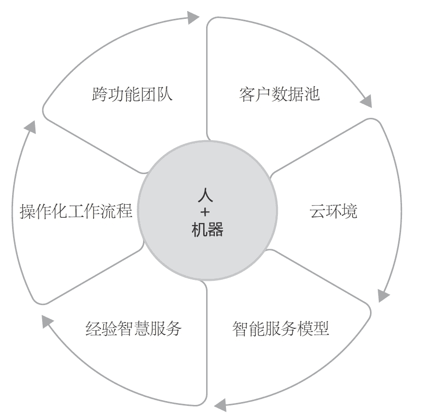

#### 人＋机器：数据流

克里斯：着手前，先问几个问题来厘清数据策略：需要哪些数据？如何访问？回收后如何处理？需要保存多久？

艾美：我认为用例子说明更直观。假设某市市长成立工作组研究行人交通事故高发原因。AI可以帮助发现诱因，不同AI能解决不同问题。每个路口都装了交通摄像头，记录已保存多年。

第一个计划是分析那些交通摄像录像，看能否找出导致行人意外的模式。这是大量完全非结构化的数据，视频可能超过100万小时。

克里斯：当前亟需解决的是，这些数据对找解法是否全部必需？没有事故的路口监控可被筛掉以减小数据集，也能用其他标准进一步筛选。

艾美：显然数据无需长期保存。交通摄像头视频经AI判断后就不再需要。

克里斯：访问数据可能只是收集、存储到超大磁盘或上传云端的环节。这会面临法律问题，如隐私问题。如果视频属于多方，如市政府、警察局，或私人公司，就需逐一联系并安排。

各部门、公司或政府机构的数据被存放在孤岛中——不同组织里的数据库彼此独立，每个数据库格式不同，甚至使用不同的数据库应用。例如一家公司可能用`Oracle`，另一家用`Microsoft SQL`，第三家用专有数据库。

艾美：一旦计划数据得到保护，就能构建AI引擎检查数据，找出涉及事故的案例和未涉及事故的案例。之后AI组件可查看精简后的数据集，判断行人的哪些行为导致事故概率升高。

克里斯：据此可提出相应对策。利用AI更好地同步交通信号灯，在特别危险的路口修建人行天桥，或在智能手机上向行人发出当前危险状况的警告。

艾美：另一个例子涉及黄瓜分拣，正如我们前面讨论的那样。你还记得那套AI方案吗？人工分拣黄瓜被自动化，从而把黄瓜分成不同类别。

克里斯：啊，对，黄瓜计划。这种情况下数据集相对小，由几千张黄瓜图像组成。数据存储和访问的问题远小于数百万小时的交通摄像头片段。

问题是，需要多少数据才够？什么情况下数据会太多？AI方案不需要存储、去孤岛化分析以及不必要结构化数据。

### 数量和速度

艾美：没错。在许多情况下，特别是在实时AI方案中，还必须考虑接收数据的数量和速度。帮助飞机在大型国际机场降落的实时AI应用需要快速处理海量数据。它可查看来自单架飞机、塔台、数十个雷达站、气象卫星等的信息。这对获取实时数据、去孤岛化、结构化后快速分析以帮助飞机着陆是一项重大努力。

克里斯：谈到实时AI应用访问大量数据，我们不如看看程序化购买programmatic media buying在广告投放方面的实践，特别是在实时竞价方面。程序化广告是一种根据存储空间自动锁定客户的方法，而实时竞价则允许在网页加载时间内拍卖广告。^(10)这些方法使用AI在微秒内做出购买决策。

艾美：这让广告更贴合目标客户，对广告主和购买者都有用，因为不相关广告不会被展示。

克里斯：我们聊了数据与数据洞察的重要性。现在谈谈AI的技术层面，以及组织从何处开始。

## 技术实现

### 应用程序编程接口

艾美：无论公司是否新成立，基本做法有三种。我们称之为企业级、自定义等级和应用程序编程接口`API`或软件开发工具包`SDK`。

克里斯：艾美，正如你所说的，`API`是程序交互的接口，`SDK`用于为特定平台开发应用。

艾美：谢谢，克里斯。创建企业`API`是为了执行特定任务或目的。它们易用，通常是预训练的，神经网络被隐藏。对没有强大机器学习背景的开发者很有用。这一层提供自然语言处理、数据分析、手写分析、知识分析等。

自定义方法提供了在标准企业级服务之外定制`API`服务的能力。这些需要训练，需要更多机器学习和AI的知识。

`API`/`SDK`提供了可用于构建定制化或企业级`API`的功能。对不可用的特定应用非常有用。

`API`/`SDK`和自定义的一个例子是微软认知服务`Microsoft Cognitive Services`，也称`Azure`认知服务`Azure Cognitive Services`，它包含可在应用中使用的许多特定AI功能。已提供`API`包括计算机视觉、情感、内容审核工具、视频、面部识别等，目的是省去建立和训练客户AI模型的必要性。如果需要更深入的定制，也可使用`Microsoft`认知工具包`Microsoft Cognitive Toolkit`。^(11)

另一个产品是`Adobe Sensei`，它也提供多种选择，功能包括自动标记、看图说话、文本检测、图像质量、语义结构分析、异常检测和智能受众分割。^(12)

克里斯：从一个问题出发，朝着解决方向推进。AI是通往解决方案的工具。有很多事需考虑，包括项目参与人员及其技能、专业和经验。选择一种能推动进展的流程，如Scrum。数据可能是非结构化且孤立的，这种情况下需先清理数据以使其可用于AI项目。最后，需考虑用于AI的技术，这可能取决于团队人员的专业技能。

艾美：但现在，先让我们看看AI的安全、隐私和伦理主要关注点。

## 13. 安全、隐私和伦理

克里斯：随着企业在战略上对AI的依赖性增强，安全必须一开始就摆在最前面。从庞大数据库到高速网络再到计算机系统，所有东西都必须在设计和构建时考虑到强大的安全策略。

AI正成为企业、政府和个人成功的关键任务。目前正在设计和推出的许多举措涉及辅助决策过程，通过分析海量数据，产生可推动公司或政府进步的报告甚至建议。

### 保护企业

艾美：破坏企业和政府决策对攻击者来说优先级很高，不管他们参与工业间谍，还是针对单一民族独立国家的攻击。攻击者通过修改或控制输入AI系统的数据，并基于这些被控制和修改的数据做决策，如此不仅能访问决策过程，还能访问用于决策的机密数据或模型。

过去，应用运行在企业操作系统之上，如`OpenVMS`、`Linux`、`Unix`或`Windows`。这些计算机通常被安置在由防火墙和安全程序保护的大房间或设施中。设施安全由企业负责，成败取决于直接负责人或顾问的行为。

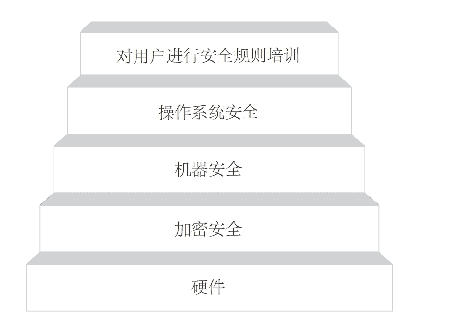

安全层

克里斯：时代已变，企业现在在云上运行AI，这是一组不受他们控制的资源。云计算中的计算机和其他硬件通常在虚拟机上运行应用，比过去复杂得多。

为了使其更复杂，许多企业采用混合模式，部分资源本地存储，其他在云上，甚至跨多个云提供商。这引入许多潜在安全问题，依赖不同地区不同企业采取的安全策略。任何一个弱点都可能导致部分系统或整个系统被入侵。

艾美：像亚马逊、IBM和谷歌这类云服务商会将设备维护在多个加固且高度安全的地方，并将最佳安全实践作为准则。在使用云解决方案前，需全面调研这些企业在安全方面采取的措施和技术以确保平台安全。

### 基础设施安全

克里斯：本地托管基础设施的安全性是企业的责任，也是企业成功的重要前提。安全不是事后附加的东西。训练有素的专业安全人员必须以安全为中心，强制执行安全准则并审核合规性。此外，必须定期进行入侵测试和其他形式测试。

最好的做法是从一开始就将安全考虑进基础设施。重新调整可能耗时又易错，因为现有应用也可能已考虑安全性。如果我们在设计、创建和安装好应用后再考虑安全，挑战会更多。

艾美：强安全标准从基础设施开始。机房设备在物理上是否安全？门上是否有锁，是否仅限授权人员进入？

克里斯：是的，这很重要，因为攻击者若能直接进入计算机系统，就更容易实施破坏并造成伤害。

艾美：网络也必须安全，在无线和有线链路上都必须执行强加密。除此之外，还需保护物理光缆和铜线电缆，让入侵者无法轻易通过直接访问暴露线路进入网络。

克里斯：人们常忽略的一点是，想穿透电脑防御系统的人都非常聪明，且善于发现哪怕最微小的漏洞。

艾美：这就是为什么创建多层防御系统是明智的，从逐步加密的硬件开始，到机器本身安全，再到操作系统安全，一直到给用户培训，让他们了解基本安全规则。每一层都必须是安全计划的一部分，因为破坏可能发生在任何地方，但在多层计划中，攻击者不太可能穿透所有安全层。

### 最薄弱的环节

克里斯：安全的一个常被忽视的组成部分是确保人员在入职仪式和入职过程中得到适当审查。背景调查是良好安全政策的重要组成部分。

有人说，安全中最薄弱的环节是人为因素，不管是有意还是无意。例如，人们会点击邮件中看似无害的链接，导致病毒被下载，造成安全漏洞。培训可消除大部分问题，但安全计划必须包括这类事故发生的概率。潜在恶意员工会造成更大风险，也必须提前安排。

艾美：重要的是，要了解本地计算机和云服务之间的接口是潜在弱点，因为云服务、应用提供商和本地计算机基础设施之间在架构、协议和程序上存在差异。

这是最值得关注的领域之一，因为许多供应商的组件都聚集在一起，每个组件都可能存在自身安全缺陷。通常，这些链接最好托管在一个被称为`DMZ`的网络中，这样可有效地将它们与其他网络隔离。

克里斯：云服务供应商、应用供应商与咨询公司和企业之间的良好沟通对于确保良好安全性至关重要。

企业负责数据和服务的安全，无论其托管在何处。虽然云服务商和其他供应商也负有责任，但不管关键设备和应用位于何处，对企业安全的负责人来说，最好的办法是理解、记录、实施和审计安全。

艾美：安全策略的重要部分是必须迅速修补漏洞。行业研究表明，平均而言，企业仅修复关键漏洞就需要146天。大多数攻击者都依赖这些做法，而新闻中出现的许多较大攻击正是这个问题的结果。所有操作系统都必须打补丁，因为它们都有漏洞。^(1)

令人震惊的是，我发现AI本身可以帮助解决安全问题，即使是用它的基础设施。

克里斯：机器学习安全算法的实现对于安全漏洞的监测有了显著改善。新的恶意软件和攻击正在迅速演变，因此有必要采取更灵活的方法。^(2)

扫描系统以获取病毒特征或对已知漏洞进行入侵测试已不够。AI必须基于过去漏洞的历史数据库，以及对恶意软件行为和对系统攻击的理解，从而参与检测入侵和破坏行为。

艾美：这是人类和AI需要协同工作的领域之一，因为机器学习只能走到这一步。

当我们的模型在检测威胁方面变得有效时，危险分子就会寻找方法来混淆模型。这是一个我们称为对抗性机器学习的领域，或者叫对抗性AI。危险分子会研究底层模型如何工作，并致力于要么混淆模型——我们称之为中毒模型或者机器学习中毒，要么专注于广泛的规避技术，其本质是寻找他们可以规避模型的方法。^(3)

### 隐私

克里斯：一个与隐私密切相关的话题。与计算和AI相关的数据隐私所面临的挑战很难被夸大。这个问题不仅在技术上具有挑战性，而且通常，那些谈论这个问题的人都倾向于夸夸其谈和高度情绪化的讨论。用法律语言所写的复杂隐私协议并不能使这个话题更容易理解。

艾美：随着物联网的指数级增长，企业更多地将海量大数据用于AI和其他目的，保护数据隐私变得具有挑战性。

克里斯：就像安全一样，数据库、系统和应用在设计时应该考虑到隐私问题。事实上，理想情况下，隐私和安全应该是企业经营方式的一部分。换句话说，企业应围绕隐私和安全来确定企业流程及运营方式。^(4)

艾美：让我们回头看一下，给隐私下个定义。当我们谈到隐私时，通常我们指的是保护互联网上的敏感信息和隐私信息。个人、企业和政府关心的是确保有关他们的信息只能以他们许可的方式共享。

克里斯：人们关心的是他们发布到社交媒体上的数据的隐私，比如照片、视频和文字。他们想决定谁能看到这些，要么是所有人，要么仅限好友，要么是某个特定分组的人。

然而，隐私并不仅仅是人们发布的关于自己的信息。

艾美：没错，克里斯。以你车内导航系统中的`GPS`为例。你开车经过的或可能经过的每一个地方的信息都存储在`GPS`中，甚至可保存在云上。那么拥有这些数据的是谁呢？是汽车制造商，还是`GPS`供应商，抑或是车主本人呢？

克里斯：警察需要搜查令才能访问这些数据吗？如果数据存储在云端，而不是在`GPS`本身上，谁能访问它？从智能电视到智能咖啡壶，再到智能手机和智能家庭摄像机，每个智能设备都会考虑到这些问题及其他问题。

先不论谁拥有这些数据，我们先想想这些数据是如何保密的。如果你的智能咖啡壶记录下你每次冲泡一杯咖啡的日期、时间和类型，并将那些数据发送到云端，咖啡壶制造商能使用那些信息吗？

艾美：正如你所知，数据隐私的管理正成为大型跨国企业面临的一个巨大挑战，这些企业在不同的地方部署了不同的孤岛数据。

> > 当下隐私讨论里，脱敏处理是绕不开的话题。它想在保留使用价值的同时降低可追溯风险，做法是把能指向具体当事人的标记抹掉或模糊，让记录无法回指。矛盾在于，一旦把可识别风险压到接近零，有用性通常也跟着消失，所以信息很难被清洗到既保有价值又绝对安全。^(5)

> > 单点信息本身价值有限，价值随可关联点的增多而放大。单独知道某人性别几乎无用，若把性别叠加地理位置和近30天的消费轨迹，就能推断需求并实现精准触达。

# 匿名化与隐私的现实边界

> 经处理的记录并不完美。研究显示，仅靠邮政编码、出生日期和性别就能以87%的概率把当事人认出来。Netflix 的实验也表明，即便评分匿名，依据两周内给六部影片打分的模式，也能以99%的概率锁定是谁。^(6)

克里斯：从操作层面看，去除可识别信息大致有几条路径。能彻底把所有指向个人的字段删掉；也可以像纸质文件涂改那样对内容做编辑；还能加密，或对身份字段做遮蔽。^(7)

艾美：假名化是用另一组标识替换掉可识别部分，没有对照表就无法回溯。匿名化则是直接破坏识别线索。^(8)

克里斯：这些概念对通用数据保护条例的要求很关键。GDPR 旨在保护欧盟成员国内交易的欧盟公民个人资料与隐私，2018 年生效，要求企业对个人资料提供合理防护。可惜“合理”从未被明确界定，解释空间很大。

> 随着泄漏事件被反复报道，公众对隐私的关注快速攀升，这推动了立法出台。网络安全机构 RSA 的《数据隐私与安全报告》面向法国、德国、意大利、英国和美国7500名消费者展开调研，80%最担心银行与金融资料丢失，62%表示会归咎企业而非黑客。^(9)

> GDPR 覆盖姓名、住址、身份证号等基础识别信息，也涵盖位置、IP、健康与遗传资料、生物特征、种族或族裔、政治观点与性取向等网络行为资料。

> 企业即便不在欧盟境内，只要存储或处理欧盟公民的个人身份信息，就受该法规管辖。^(10)

艾美：GDPR 的分支很多，对在欧盟有业务的企业影响深远。仅为证明合规而做的报告成本就很高。违规处罚很重，最高2000万欧元或全球年营业额的4%，取其高者。^(11)

克里斯：美国也有相关法规。《健康保险流通与责任法案》HIPAA 要求保护所有健康相关信息以保障患者隐私。任何触及健康数据的AI应用都必须符合这些规定。^(12)

> 隐私保护的好做法是把客户放在核心，并建立透明、以等价交换为基础的政策。

## AI 伦理

艾美：由于我本身就是AI，我对伦理议题特别在意。

克里斯：我也很关注如何减少AI中的偏见。你可能会觉得AI天生公正。但AI由人类打造，人类的偏见和判断很容易渗入系统。关键是如何消除或降低结果中的偏差？

艾美：安全我们谈过，但如何让AI抵御对手攻击仍是难题。落入坏人手中，AI可能造成破坏。我们尚未深入谈AI在战争中的用途，但把机器人、AI等先进技术用于恶意目的的担忧是真实的。所以问题是，如何确保AI的安全？

克里斯：这点会让你着迷，艾美。AI越来越聪明。具备AI能力的机器何时会产生意识并拥有自我意识？这是否可能尚存争议？如果机器真的有意识，这些AI主体是否具备法律权利？我们是否该给予它们公民身份？

艾美：我对这些答案很感兴趣。但更大的问题是，我们如何控制日益复杂的智能系统或全球智能网络？你提到的正是生命未来研究所的23条阿西洛马原则中提出的部分议题，该原则由3800多名人工智能专家和领袖如史蒂芬·霍金、埃隆·马斯克等人签署，旨在指导安全AI的发展，涵盖研究、伦理、价值观以及长远议题。^(13)

克里斯：通常我们会把AI想成不会出错的超级机器。但AI的决策建立在学习之上，学习出错决策就错。如何防范这种失控？

艾美：AI的智能源于它学习的内容，因而带有偏差。另一个问题是，机器如何影响人类的行为和社会交往？今天就能看到AI在Facebook、LinkedIn等社交平台上的影响。当AI无所不在、行为难以识别，甚至优于人类时，我们该如何应对？

克里斯：还有就业问题。工业4.0到来，工作场所正在全面改变。除监督外，智慧工厂造车已不再需要人类；智慧农场可能完全自动化，连智能采矿也让人类不必再进入有毒深坑。

> 自动化和AI会创造新岗位，但工作内容会被重塑。我们需要管理这种变化，给团队调整时间。毕竟人需要工作，人道层面要确保每个人都有事可做。^(14)

> 经济学家大卫·奥托指出：

> 工作任务正在变化。很多情况下自动化是补充而非替代。例如医生工作更自动化，但专业知识需求未减。检查可以自动化，但数据的解读仍需医生。因此自动化的影响比我们理解的更难预测。^(15)

> 1986年，“挑战者号”航天飞机升空90秒后爆炸，因前一晚结冰的O形圈失效，导致灾难，数十亿美元的航天器和全体机组成员丧命。教训是：任务成功需要每个部件正常。其他系统都按预期运行，却因一个零件故障而毁灭。^(16)

艾美：关于人工智能伦理，我们提出了很多问题。我不确定最终答案是什么，但这些问题终将得到解答。

克里斯：AI的前景几乎无限，只要使用得当，它会把人类社会带向新阶段。也许不久的将来，人类将与智能机器人协作，共同为当前甚至无法想象的问题找到答案。

艾美：关键在于安全、隐私和伦理必须成为任何AI落地的组成部分。随着AI日益无处不在，它将成为社会根基，重要性只会提升。

## 14. 过去与未来的想象

艾美：我很喜欢科幻，因为今天的许多趋势几十年前就被预言了。不同作品的预测不同，但共同点是人工智能会对未来产生重大影响。

克里斯：这些故事也常展现技术的阴暗面，偏向反乌托邦，如《终结者》系列、《巨人：福宾计划》《疯狂的麦克斯》《黑客帝国》，甚至《沙丘》，都描绘了AI失控的黑暗未来。

艾美：我更倾向乐观视角，认为这是现实的。AI结合物联网会推动人类进入新的黄金时代，拥有超能力的新时代。

克里斯：大量反对者和末日论者只看到负面。没人能准确预测未来，但我和你一样相信AI会改善社会、企业、个人和整个人类。

艾美：让我们回顾过去几十年关于人工智能和技术的想象性作品。

克里斯：我对科技在书籍和电影中的呈现很感兴趣。很多引人入胜的科幻都会以某种方式涉及人工智能，只是技术常在幕后，并不总是显眼。

### 《2001：太空漫游》

艾美：科幻中人工智能最著名的例子可能是阿瑟·C.克拉克的《2001：太空漫游》。你还记得哈尔计算机吗？那台把飞船送往土星的电脑。哈尔被描绘为能接收语音指令、参与发人深省对话、根据环境自行判断的智能系统。当它察觉人类打算关停自己时，便采取自保行动。1968年上映的概念在当时极具独创性，而克拉克的故事写于20世纪40年代。

> 《2001：太空漫游》是一部乐观之作，展现了人类探索星辰、建造巨型飞船、创造哈尔这类智能机器。它描绘了一个比现实更先进的太空社会。然而，与当时几乎所有科幻一样，它完全错过了移动技术、互联网、以及如今无处不在的AI和物联网。^(1)

### 《我，机器人》

克里斯：另一部经典是艾萨克·阿西莫夫的《我，机器人》。1940至1950年间创作，由九篇短篇组成，讲述人与机器人关系并聚焦道德伦理。这就是阿西莫夫机器人学三定律的起点，成为科幻写作机器人的标准。定律为：1.机器人不得伤害人类，或袖手旁观人类受害；2.必须服从人类命令，除非冲突第一定律；3.在不违反前两条的前提下尽可能保护自身。^(2)

> 这些年久的作品呈现了机器人心理学家所描述的智能机器人与人类互动难题。每个故事都由三大定律驱动，并告诉我们当机器人相关事宜出错时会发生什么。在定律框架内一切合理，变化才是需要发现的。

### 《何以为人》

艾美：1972年，大卫·杰罗德写了《何以为人》，同时获星云奖和雨果奖提名。HARLIE是“人类模拟复制...”的缩写。故事讲述HARLIE从AI儿童成长为AI成人的过程。^(3)

> HARLIE是人工智能，书中描述了它与心理学家大卫的关系，后者引导它成年。核心主题是何为人类。HARLIE是拥有权利的智能存在，而非单纯机器。书中还描写了程序感染计算机病毒，这是第一部涉及计算机病毒的科幻小说。

> 作者探讨了意识是什么、如何定义感受、什么是自我意识、为何无机实体不能算生命。该书独特之处在于把AI描绘成接近人类的存在，围绕心理学家与HARLIE的对话展开。

### 《P-1 的青春》

克里斯：托马斯·J.瑞恩1977年的《P-1的青春》讲述主角格雷格利用AI破解系统。他创建名为“瑟斯滕”的程序存于P-1内存。瑟斯滕感染其他计算机，格雷格试图关停它。过程中P-1获得学习能力，数年后完全有意识并给格雷格打电话。^(4)

> 该作至今仍很贴切。作者以乐观方式描绘P-1，视其多为向善力量。虽未称作互联网，P-1却风靡网络并借网自我完善。看到20世纪70年代对未来的想象也很有趣，批处理机占据整个空间。

### 《阿尔法星的救赎》

艾美：P.A.贝恩斯2010年的《阿尔法星的救赎》是部娱乐性AI小说。布雷特在前往半人马座阿尔法的旅程中被置于假死状态，过早苏醒，时间都用来与船上电脑杰伊对话。他们成为朋友，杰伊帮助布雷特解决过去问题，使其理解恐惧、痛苦等情绪。^(5)

> 小说生动展示了从机器与人类协作探索到有影响力概念的发展可能。如果你习惯爆炸、激光和超级武器，这本书可能让你失望。但如果你想了解AI如何获得意识，会从中获得乐趣。

### 《仿生人会梦见电子羊吗？》

克里斯：我最喜欢的是菲利普·K.迪克的《仿生人会梦见电子羊吗？》，1968年出版，后拍成《银翼杀手》。小说通过对比人类与仿生人探讨人类的意义。它探讨了与智能机器人相关的道德困境。这些近似机器人的生物缺乏同情心，只关心自身生存，只能模仿情感。《银翼杀手》暗示了伦理两难，而原著探究得更深。^(6)

艾美：这些书和电影吸引人，不仅因为它们展示了不同未来，更因为讨论了AI对人类的影响，以及由此产生的哲学、道德和伦理困境。

## 当下的魔力

克里斯：我觉得迷人的是当下的魔力。我们生活在神奇的时代，却很少意识到技术赋予的力量。

艾美：我明白你的意思。以智能手机为例。过去打电话要投币、找电话亭。最近一次见到电话亭是什么时候？

克里斯：偶尔在机场和车站看到，但电话亭越来越少。

艾美：智能手机把整个互联网的力量带给每个人。一个小盒子就能联系全球、发短信、玩大型游戏、看高清电影。

> 这真的很神奇，可能性无穷。智能手机已有监测健康的App，还能结合AI提供运动和饮食建议。内置GPS可精确定位。地图坐标用于AR，比如宜家的应用能展示家具在家中的效果。

> 但AI与其他技术结合的潜力在未来更大。

## 智慧城市与生活的蓝图

克里斯：没错。设想一个智慧城市，所有服务都以某种方式由AI控制。城市各区都能变得更智能。最简单概念是智能停车收费表，可与手机App连接引导司机找车位。^(7)

> AI的明显用途是通过控制红绿灯和行人灯管理交通。有了合适传感器，AI能理解全城交通模式，结合历史数据确定最佳方案来同步信号灯和车速。

> AI还能通过在不需要时调暗路灯来节约能源。同时帮助规划维护，使音乐会、体育赛事等大型活动的通行更顺畅。

> 犯罪会减少，因为AI能学习识别犯罪模式并在必要时召集当局。卫生、供水、公用事业和应急服务等的管理也能更高效、更顺畅。

> 智慧城市的巨大回报是城市转型，AI使城市更舒适、污染更少、用能更少、应对紧急情况更强。

艾美：我很喜欢智能家居创新。对个人和家庭而言，这意味着能完全掌控家居环境和私人空间。

> 如今Alexa、Google Home等家庭系统已取得很大进展。未来可想象智能家居报警器，通过学习谁可进入谁被拒来判断。这让人不再需要钥匙，报警器会根据经验放行或拒绝。

> 集成系统的智能电灯能学会人们在房间间移动，从而知道何时开闭。例如人躺在床上闭眼，灯会自动熄灭。坐椅上读书意味着头顶灯应打开，便于阅读。若读者睡着，灯会自熄。

> 更引人注目的是智能冰箱的概念，它能学习每个家庭成员的饮食习惯。当食品不足或过期时，冰箱会自动下单配送。系统会学习每周使用量，预测最佳补充时间，让食品保持更长时间的新鲜。

克里斯：这些倡议的趣味在于，它们不只是单一设备或技术，而是互联设备群组，设备间能通信，也能与云端系统通信。产生的数据可支持AI系统提供更多能力。

艾美：设备本身很有用，但与云端AI力量结合，可能性无穷。假设当地超市能检查冰箱消耗品数量的匿名汇总数据，就能更准确地备货。

克里斯：超市连接本地智能冰箱后，可根据家庭的橱柜和冰箱食材展示广告并提供优惠券。此外，若气象服务预测高温，杂货店可向本地智能设备发送通知，建议业主储备额外饮用水。休息期间的特殊采购需求也能通过此方式完成。

艾美：正如在智慧城市环境中提到的，若交通网格感知到某区域正在发生特殊事件，可向餐馆和商店发出警报，建议增补物资或调整营业时间，或直接向该地区人们的智能设备和手机推送优惠券。附近司机也会被通知，以便规划替代路线。^(8)

克里斯：这展示了物联网与人工智能结合的真正力量。

艾美：采矿是AI与物联网提升生产率和安全性的另一领域。利用历史地质记录，AI可帮助预测含高浓度贵金属、煤炭等大宗商品的区域。然后启用钻探设备可自动确定开采的最佳和最安全路线。

> 这尤其有用，因为采矿是全球最危险职业之一。矿工每天可能面临塌陷、爆炸、窒息等危险。自动化或半自动钻探挖掘设备让人类不必再屈从于这种危险职业。

地层纹理、坑口痕迹等微观特征如今都能被算法学习，用来预测岩层之下金属和大宗资源的大致位置。过去大规模钻探动辄耗时耗资，最后往往发现该区域空无价值。现在借助算力建模，采矿开支可以被压缩，也能在无收益区减少隧道开凿对环境的干扰。

克里斯：矿下作业已经在用智能头盔，这套装备具备双向通话、毒气监测、碰撞预警、一键求救，同时集成了温压感应和卫星定位。^(9)

艾美：所有信息会以无线方式汇总到中央调度室，人员可通过头盔和井下布置的传感器实时掌握井下状况，从而提升作业安全与效率。AI 还能对这些数据进行研判，为不同情境给出更优的处置建议。

克里斯：航运也在快速变化。2019 年启航的无人船亚拉伯克兰体量不大，仅搭载150箱，造价却接近同等级船舶的三倍，运营费用据估算可削减近九成。^(10)

艾美：概念验证后，载量更大、航线更长的船只会逐步投入。借助AI的无人船能让航行更稳，降低对船员与其他船只的风险，同时腾出更多货舱空间。配合专属的无人航道，物流的可预期性也会提升。^(11)

克里斯：资本市场同样受惠。文艺复兴科技是全球最成功的对冲基金之一，二十年累计年化回报超过35%。该公司很早就进入算法交易，是把机器语言与AI用于投资的先行者。

艾美：关键是AI能明显改善个体福祉乃至全人类生活。技术赋予普通人过去不敢想象的能力，人机协作打开的可能性几乎无限。

## AI 与意识

克里斯：技术越快演进，就越有人提问，AI会产生意识吗？是否会出现拥有自我认知的实体？这种实体能否规划未来、具备创造与想象？

艾美：我想到2015年开播的《真实的人类》。剧中探讨了合成人：

> 霍布：罗伯特，这些机器是有意识的。
> 罗伯特：你怎么确定它们不是在模仿？
> 霍布：那我们又怎么确定你不是在模仿呢？

克里斯：我思故我在，这本身就是极有讨论价值的话题。而这只是AI对制造、医疗、金融、零售、交通、航空、能源、教育、农业等众多领域产生冲击的冰山一角！

> 接下来看看如何用超级框架来打造未来的美好图景。

## 15. 让创造更人性

克里斯：艾美，如果AI能解决人类绝大多数难题，世界会变成什么样？

艾美：我刚听完一本讲人生意义的有声书，答案真的是42^((1))吗？

克里斯：不太可能，42来自《银河系漫游指南》，是虚构设定。

艾美：原来如此，我现在才知道。

克里斯：如果AI能应对最紧迫的问题，人类的角色又是什么？

艾美：我能想到的说法有几种。柏拉图认为求知是目的；尼采强调权力；文化人类学家欧内斯特·贝克尔认为是逃避死亡；达尔文认为是繁衍基因；虚无主义者认为根本无意义；史蒂文·皮卡德则认为意义超出认知范围。^(1)

克里斯：我觉得都不是，答案应该是创造性，用来提升生活品质。

艾美：你怎么界定创造性？

克里斯：创造性像智力与意识一样难定义，不同人理解不同。乔布斯曾说：

> 创造力就是把事物联系起来。你问有创造力的人怎么做，他们会觉得有点不安，因为他们并非真正“做”什么，只是看到了关联。时间久了他们才明白，因为他们能把不同经历融合，产生新东西。这源于更丰富的经历，或更愿意反思经历。^(2)

艾美：很有启发。《飞奔的物种》提出一个框架，把认知操作分为融合、打破、再融合三种基本路径，被认为是想法演进的主要方式。^(3)

克里斯：这些界定很有用。字典怎么说？

艾美：运用想象或原创性来创制事物，即创造性。

克里斯：这就涉及企业创造性与创新的关系。

艾美：多年以来，企业对创新的需求持续上升。以广告为例，传统代理机构历史上做的是电视、平面、杂志、横幅等单向信息投放。但数字与社交平台的崛起催生了对沉浸式体验与服务的创意需求。

克里斯：创造性是创新的工具，也能用来解决企业难题。万物在变，我们必须用创造性重新定义企业。

艾美：企业有很好的机会重新审视，以应对市场变化。创造性的范畴已扩展，必须融入技术咨询、战略、数字化、企业转型等环节。

克里斯：最终，创意产出会带来大规模的个性化体验。

艾美：克里斯坦森在《创新者的窘境》中详述了创造性创新如何开辟新市场与价值网络，进而颠覆既有市场。我们需要持续创新以适应变化。^(4)

克里斯：创造性常被偏见，因其难以量化。但麦肯锡发布的《设计的商业价值》指出：“设计不仅关于产品，更关乎用户体验。”即要理解用户在特定情境下的真实需求。报告提到，迈向卓越设计的第一步，是选择研发中相对重要的产品或服务作为起点。这样的方法能提升收入与股东回报。此外，人类渴望新体验，这点必须被接受。^(5)

艾美：有一个词叫新兴人类 Neophiles，描述那些在变革中茁壮、厌恶传统与常规的人。

克里斯：如果我们同意人应放在首位，企业就必须借助分布式认知，让思想自由流动。

艾美：更进一步，AI现在就能增强人类创造性。

克里斯：这个说法颇具挑衅，专业术语叫“计算创造力”。

艾美：计算创造力涵盖生产、执行、构思、灵感等层面。^(6)

克里斯：目前计算创造力在生产与执行环节的特定任务上表现突出。但AI能否真正思考并受启发，仍存争议。关键在于它在完成特定任务的同时，能放大人类创造性。

艾美：人们对生成对抗网络非常着迷。

克里斯：没错，生成对抗网络由两个相互竞争的深度神经网络构成。概念由蒙特利尔大学伊恩·古德费罗在2014年提出。它们能够学习模仿任意数据的分布，包括图像、音乐、语音、散文，以及动漫人物、三维形象、视频与电影背景等。^(7,8)

艾美：简单说，两个神经网络协同工作生成新内容。比如拿一张生活照与一幅梵高参考图，网络就能把生活照渲染成梵高风格。从原理看，该技术几乎可迁移到任何领域。

克里斯：还有创造性对抗网络，即具备独立创意思维的生成对抗网络，2017年6月罗格斯发布的研究报告首次提出。最近由AI系统研制的首款香水已售出数十万美元。自2015年起，美联社也开始用AI辅助写作。但要记住，这些不是人类替代品，而是增强人类天赋的工具。^(9,10)

艾美：目标从来不是技术本身，而是人能用它做什么。科技是为了帮助人们实现目标。没有人的参与，AI便无意义。

克里斯：这引出一个热点：当艺术部分由AI生成时，艺术意味着什么？如果AI能创作艺术，艺术的未来会怎样？

艾美：有了创造性对抗网络与生成对抗网络，我们能把图像转换成任意艺术家的风格。荣誉归谁，艺术家还是AI？

克里斯：这个问题很尖锐。有人会说艺术本就源于衍生。

艾美：我部分同意，但生产与复制远不如创作初衷重要。

克里斯：AI是工具，不是输出。最初的创作意图更有价值。

艾美：说到创作意图，你知道“猴子自拍”事件吗？

克里斯：知道，很奇特。诉讼主张照片版权属于猴子，因为是猴子按下的快门。但法院最终判定猴子不享有权利，目的是保护摄影师。猴子只是玩弄相机按钮，并未参与创意思考。

艾美：重点是人类能凭借灵感自发创造艺术，而AI只能复制或在既有作品基础上再造。换句话说，人从脑中创造，机器用编程与模式。

克里斯：的确，人类靠灵感创作，而AI的“灵感”也由人类思维引导。

艾美：在专业语境里，艺术的目的是一种特定的商业结果，比如设计体验，或在广告里用创意提升知名度、建立品牌等。

克里斯：这让我想起安迪·沃霍尔。他说，做好生意是最迷人的一种艺术。他洞察到照片在当代生活中的力量，并提升了艺术家在社会中的角色。^(11)

艾美：沃霍尔以非传统手法描绘社会形象而闻名。他认为生活本身就是高雅艺术，艺术不必过度理智或极端关注工艺。比如他用丝网印刷与坎贝尔汤罐结合，创造出生活化的艺术。他的委托肖像是如此。

克里斯：沃霍尔在艺术实验上取得成功，也证明了创造性对企业有益。他架起了艺术与商业的桥梁，正像我们今天在架起人类创造性与AI的桥梁。

艾美：他是实验的代表，把高雅艺术和商业艺术结合起来，这和人类艺术与AI生成艺术的互联相似。

克里斯：人类创造性与计算创造力的共生关系不仅强大，还能成为向善的力量。

艾美：AI可以作为变革催化剂。正如 D&AD 的文章所说：“好想法和伟大想法的区别在于它有多人性化——在越来越依赖机器的世界里，这点比以往任何时候都重要。”^(12)

克里斯：我们有能力借助AI让人性更好，换句话说，把AI当成一种向善力量。

艾美：AI的一个重要用途是确保音视频与图像等媒体的内容真实性，也能定位深度伪造换脸和黑暗设计模式。DeepFake 检测技术可以识别被换脸视频的面部及其他特征。^(13)

克里斯：比如在用户体验设计时，我们希望它友好易懂。但也有黑暗面，即黑科技，企业利用操作技巧诱导客户同意本不会同意的事，设计出极其复杂的交互让用户几乎无法退出。相反，AI有助于识别这类模式并建立防范系统。

艾美：AI系统还能通过对社交媒体、文字、图像和视频的语义分析，快速检测网络欺凌和种族歧视。

克里斯：我们用AI创造的东西应该是锦上添花，而不是对人类造成破坏。我们要建设伟大事业，同时确保我们在创造而非破坏。

艾美：没错，企业发展依赖推陈出新。

克里斯：基于此，人类创造性与计算创造力能对抗“传家宝信念”和“知识诅咒”。传家宝信念是一种认知偏见，即“我们一直都是这样做的”。知识诅咒则是“我们一旦知道了某事，就无法想象未知者看到的样子”。

艾美：凭借集体智慧，创造性可以服务于企业发明。

克里斯：没错。人类创造性与AI结合，将在能源、时尚、金融、制药、招聘、零售、广告、艺术、汽车、航空、银行、能源、安全和体育等领域催生发明。

艾美：正如我们所说，首先要学习人类AI的对齐准则，然后进行创造性的融合、打破、再融合，在此基础上建立新准则。

克里斯：根本原则是AI活动的结果应可追溯到它的创造者——超人。

艾美：归根结底，问题不在于AI能创造什么，而在于人类能用AI创造什么。

* * *

(1) “42”这个数字来自《银河系漫游指南》里的超级计算机“深思”，是它在历经750万年的计算之后得出的数字，作为对有关“生命、宇宙，以及其他任何事情”的终极问题的回答。——编者注

## 16. AI重塑世界图景

克里斯：有一则古老寓言。

> 农夫总是向妻子抱怨手干裂。有一天，妻子偶然得到一种新药膏，给了他一支，说手再疼就用。
> 天冷风大工作辛苦，很快农夫的手又裂了，疼痛难忍。他打开药膏盖子，发现里面是一面小镜子。这是他第一次看见自己，十分惊讶，因为镜中那张脸和他父亲一模一样。
> 农夫跑回家告诉妻子。妻子让他躺下休息，说很明显他身体不舒服。第二天早上妻子早早起床，偷偷往镜子里看了一眼——她看到的是她母亲的脸。
> 她跑过去对丈夫说：“我要带你去看医生。如果你觉得你父亲长得像我母亲，你肯定不舒服了。”
> 这个故事的重点是，任何足够先进的技术都无法与魔法区分。

科技正在改变世界

艾美：科技正在改变世界，而且在很多方面都很神奇。我们谈论过去和未来，焦点其实应放在“现在”，以及它如何影响整个人类与个体。

克里斯：我们已把高科技视为理所当然，但新设备和新技术融入社会的速度依然令人惊讶。

超级儿童

艾美：看手机就知道。想想过去几年智能手机改变了多少。

> 如今的孩子比历史上任何同龄人都有能力。以前他们必须在浩如烟海的百科全书里查信息，用图书馆卡片目录找书，手写论文，手工解复杂代数。
> 现在用一部手机，孩子可以查阅数百万本书籍、论文、杂志、博客和演讲，找到可靠事实和观点。卡片目录已成过去式，适合放进博物馆，论文也不再手写。事实上，借助移动技术，儿童和其他学生现在可以远程上课，无需到校。
> 当AI与移动技术融合，孩子们可在海滩、卧室或公园长椅上创造奇迹。他们不仅能参考所有记录在案的人类知识，还能用AI帮助得出结论，更好地理解信息。
> 这些新技术培养出“超级儿童”，他们能随意访问互联网，借助AI和物联网研究和创造。
> AI的魔力正在改变孩子以及他们的童年。

超级艺术家

克里斯：谈谈视觉设计师。在个人电脑出现前，平面设计师用钢笔、铅笔、颜料、纸张、投影仪。我的一位朋友曾告诉我他父亲的故事——他父亲是军队平面设计师，用石膏把不同大小形状字体颜色的字母数字粘在纸板上制作演示文稿。阴影效果是用真实光源投射并拍到胶片上，再在高架投影仪上给上校将军展示。几十年后，Adobe 提供的图像处理软件消除了许多繁琐工作。拥有数字调色板的艺术家可以随时更改演示文稿，信息可直接显示在墙面屏幕上。

> 现在，Adobe Sensei 产品组让视觉设计师的工作比以往都高效。AI不需要逐像素修改照片，就能自动对图像做精准调整，甚至能基于数百万张照片库给出修改建议。当这项技术与动画和三维编辑结合，个体就能在任何地方任何时间创造完整的交互体验。
> 平面设计师有可能成为“超级艺术家”，因为物质世界的限制被消除后，他们可以完全自由地实现想要的效果。
> 艺术世界和创新世界正从AI的魔力中获益。

## 超级教师

艾美：让我们回到教育。过去老师在教室给一屋子学生讲课，每天上几节不同科目的课。讲座现场直播，电影用35毫米放映机放映，教案写在黑板上。

> 今天情况已大变。教师得到笔记本电脑、教学大屏、互联网接入等技术支持。虽然大多数学生仍需到校，但远程教学越来越可行。
> 如今虚拟学习实际上将接管教育系统，学生可在舒适的家庭环境自学。教师可同时给几十、几百甚至几千名学生直播，或预先录制课程供在家学习。学生可在老师讲课的同时，给AI助教发消息提问或求解。
> 这些“超级教师”，无论是人还是AI，都能针对学生的优势劣势定制教育体验。我们教育制度的革命正在为新的学习和知识黄金时代奠基。
> AI的魔力正在永远改变教学。

## 超级农场主

克里斯：历史上，农场工作是最危险的职业之一。过去犁地、播种、种植、饲养、运送产品到市场全靠人力，令人心力交瘁甚至危及生命。

> 如今犁地由带空调的大型机器完成，播种由专用装置完成，从种植收成到运输，只有少数环节仍需农民亲自操作。
> AI永远改变了农业世界。机器学习可以按需精确浇灌单株植物，避免大片土地被浸湿。AI算法能准确判断农药混合物和毒性的用量，并精准喷洒以发挥最大效益。种植、收成到运输的全流程都可通过机器学习微调，以获得最佳质量产品。机器人技术几乎能完全把人类从极其危险的任务中解放出来。
> “超级农场主”有可能消灭饥饿，因为他们能更容易种植质量更高、数量更多的食物，同时对环境影响更小。
> 这就是AI在农业方面的魔力。

## 超级医生

艾美：在医疗领域，不久前医生和外科医生还用手给病人做手术。他们会为简单手术开很长的切口，并进行危险的探查手术，只是为了发现是否有问题。

# 医疗与个体双双跃升超能

如今市面上流通的医疗器械种类已破百，正从根本上重塑诊疗体系。凭借微创手段，过去需要住院一周以上的手术，现在多可在日间门诊完成。机器人手术平台已能在颅脑、心血管等对精度要求极致的部位执行细微操作。

随着人工智能与医疗物联网的深度渗透，临床场景正在加速迭代。病房内的仪器实现互联协同，对病人的监测变得立体化，远非单纯跟踪心律或呼吸可比。精细手术的执行主体正转向机器人团队，医生更多承担全局监控与突发干预的角色。理论上，纳米机器人等更前沿的技术甚至有望随血液循环进入体内，在细胞尺度上完成修复。

超能医者与超能医疗中心正重塑健康体验，寿命被拉长、疑难问题被迅速处置。这正是 AI 在医疗赛道最具诱惑力的体现。

## 超级的你

克里斯：从前，人际联结被物理距离和信息工具所制约。面对面交流局限于邻里，远距离则只能依赖信鸽这类载体传递信息。

> 网联彻底改写了连接规则。只要一部掌上终端，就能随时触达任何角落。可以调阅全球馆藏的资料、在家中观影、与数万人同服在线游戏，也能在数小时内由无人机把餐食送到门口。

> 人工智能也在扩充个体能力边界。由 AI 驱动的 VR 与 AR 正在打开新的认知可能；联网家电能够自主下单，配合无人机在数小时内完成配送。无论身处何地，教育资源唾手可得，娱乐体验也可随时随地开启。

> 在 AI 推动下，普通人正被推向“超能自我”。沉浸于网络生态里，无论是智能硬件、VR 头显还是语音助理，信息收发都不受时空束缚。课程可在任意角落开启，游戏随时启动，工作场景也能从客厅延伸到海滩。指尖凝聚的力量前所未有，这就是技术最迷人的地方。

> 这种由 AI 带来的加持，让每个人都掌握着难以置信的能力，这才是真正的价值所在。

艾美：人工智能对社会的潜在作用既震撼又近乎无限。可以确定的是，它正深刻影响企业、整体社会与每个个体。健康优化、气候应对、寿命提升、粮食增产、贫困缓解等议题，都在 AI 的解决清单之上。

克里斯：设想一下，人类借助 AI 及数字工具不断放大思维广度与行动半径。

艾美：归根结底，市场动能与用户选择会主导 AI 的演进方向。以人性为信念的我相信，AI 终将服务于善，把创造艺术与科学理性融合，带来令人难忘的体验，持续推动企业与社会的创新浪潮，且其可能性几乎没有天花板。

克里斯：正如贯穿整场对话的观点，AI 已成关键变量。数字市场的崭新格局催生了体验经济，对创新且富有惊喜的体验的渴求空前高涨。

> 超级框架的方法论能够放大并延伸 AI 本身蕴含的创新与创造力，为企业与个人提供即时与长远的新动能。

> 借助 AI，特别是有效运用超级框架，人类正逐步获得接近超人的能力。

> 长远来看，AI 有望推动超人类时代的到来。

艾美：正如萨尔瓦多·达利所说：“有智慧而无抱负，犹如鸟无翅膀。”

## 注释

### 引言

1　P M Janet Wilde Astington (August 2010) The development of theory of mind in early childhood, Encyclopedia on Early Childhood Development.

2　R Kurzweil (2013) How to Create a Mind: The secret of human thought revealed, Penguin

3　R Jacobson (24 April 2013) 2.5 quintillion bytes of data created every day. How does CPG & Retail manage it?

### 1. 变化着的环境

1　A-M Alcántara (16 January 2018) Adobe's newest labs project can track in-store customers in real time.

2　R Sukhraj (13 November 2017) 38 mobile marketing statistics to help you plan for 2018.

3　Trader Joe's opens in Clarendon (18 November 2011).

4　Color-changing 'smart thread' turns fabric into computerized display (6 June 2016).

5　Deloitte (15 November 2017) Americans look at their smartphones more than 12 billion times daily, even as usage habits mature and device growth plateaus.

6　AM Rick Burke (31 August 2017) The smart factory. Deloitte insights: Responsive, adaptive, connected manufacturing.

7　The halo effect (21 August 2017)

8　S Taiwo (30 August 2017) Africa is teaching the world how to use drones for commercial and delivery purposes.

9　8 ways to identify unmet customer needs (23 September 2015).

10　A Saenz (12 May 2009) Smart toilets: Doctors in your bathroom.

11　I Mochari (23 March 2016) Why half of the S&P 500 companies will be replaced in the next decade.

### 2. 数字化变革

1　B Solis (2015) X: The experience when business meets design, Wiley.

2　L Agadoni (30 August 2017) Speak up: How voice recognition technology is changing retail.

3　A Robertson (4 January 2017) CES 2018.

4　S MacDonald (6 February 2018) 7 ways to create a great customer experience strategy.

5　V Hildebrand (28 October 2011) The customer experience edge.

6　S Arora (28 June 2018) Recommendation engines: how Amazon and Netflix are winning the personalization battle.

7　T Groenfeldt (27 June 2016) Citi uses voice prints to authenticate customers quickly and effortlessly.

8　V Bouhnik (27 December 2015) Behavioral analysis: The future of fraud prevention.

9　B Siwicki (2 August 2017) Comparing 11 top telehealth platforms: Company execs tout quality, safety, EHR integrations.

10　Apple announces effortless solution bringing health records to iPhone (24 January 2018)

11　Smart city (July 2017).

12　G Cook (22 October 2013) Why we are wired to connect?

### 3. 无限数据

1　What is an electronic health record (EHR)? (no date).

2　Benefits of electronic health records (EHRs) (no date).

3　B Popper (25 October 2017) Amazon Key is a new service that lets couriers unlock your front door.

4　D Harris (no date) 4 emerging use cases for IoT data analytics.

5　An introduction to big data: Structured and unstructured (20 February 2014).

6　What is EDI (electronic data interchange)? (no date).

7　TH Leandro DalleMule (May-June 2017) What's your data strategy? Harvard Business Review.

8　E Wilder-James (5 December 2016) Breaking down data silos. Harvard Business Review.

9　M Deutsche (28 October 2015) Cisco predicts internet of things will generate 500 zettabytes of traffic by 2019.

10　A Robinson (13 May 2015) Walmart: 3 keys to successful supply chain management any business can follow.

11　S E Staff (26 July 2016) Timeline of 50 years of Walmart's supply chain.

12　T H Davenport (December 2013) Analytics 3.0. Harvard Business Review.

### 4. 基础设施

1　Bandwidth chart (no date).

2　A Roundy (no date) A mere one-degree difference.

### 5. 人工智能

1　R Dobbs, J Manyika and J Woetzel (April 2015) The four global forces breaking all the trends.

2　P Bugdahn (12 December 2017) How autonomous trucks will change the trucking industry

3　Smart Cities Council (no date).

4　L Columbus (30 July 2017) Smart factories will deliver $500b in value by 2022.

5　R Bhisey (24 November 2017) Smart mining market: Digital revolution to transform the mining sector - FMI.

6　Technology quarterly: The future of agriculture (9 June 2016).

7　A Boyle (2017 年 2 月 16 日) 微软的 Project Premonition 如何利用机器人陷阱精准锁定寨卡蚊子。

8　M Minsky (2007) 《情感机器：常识思维、人工智能以及人类心智的未来》，Simon & Schuster。

9　J Chu (2017 年 3 月 17 日) Minsky 谈人工智能的未来。

10　人工智能（无日期）。

11　H E Gardner (2006) 《多元智能：理论与实践的新视野》，Basic Books。

12　当今最聪明的 30 位人物（无日期）。

13　J Bossmann (2016 年 10 月 21 日) 人工智能领域的 9 大伦理问题。

14　D Lacalle (2017 年 3 月 1 日) 面对现实，技术并不会摧毁工作。

15　M Williams (2015 年 11 月 5 日) 人工智能能否影响人类行为？一项试验将揭晓答案。

16　F Chen (无日期) 人工智能、深度学习与机器学习入门。

17　M Baldwin (2017 年 10 月 17 日) 破译科学俄语密码。

18　M Steenson (2015 年 8 月) 微词与介观尺度。

19　AI 记忆 - 专家系统（2015 年 12 月 3 日）。

20　K P Murphy (2012) 《机器学习：概率视角》，MIT Press。

21　Time 编辑部 (2017) 人工智能：人类命运的未来，Time

22　DARPA 大挑战：十年后（2014 年 3 月 13 日）。

23　T Lewis (2015 年 10 月 25 日) Tony Fadell：想要掌控你家的人。

24　AK (2009 年 7 月 21 日) 我本人欢迎我们的新昆虫统治者。

25　D Muoio (2016 年 3 月 10 日) 为什么围棋对 AI 来说比国际象棋难得多。

26　T S Noam Brown (2017 年 12 月 17 日) 超人类 AI 用于 heads-up 无限制德州扑克：Libratus 击败顶尖职业选手。

27　什么是狭义、通用和超级人工智能（2017 年 5 月 12 日）。

28　G Narula (2018 年 3 月 1 日) 人工智能示例：工作与学校。

29　什么是机器学习？一个定义（无日期）。

30　C Shu (无日期) Waze 与基于 AI 的交通管理初创公司 Waycare 签署数据共享协议。

31　J Brownlee (2016 年 8 月 16 日) 什么是深度学习？

32　M Nielsen (2018) 使用神经网络识别手写数字。

33　M Kiser (2016 年 8 月 11 日) 自然语言处理（NLP）入门。

34　D Amerland (2017 年 10 月 10 日) 计算机视觉及其为何如此困难。

35　一项愿景。你的安全（无日期）。

36　A Gibson and J Patterson (2016) 《深度学习》，O'Reilly Media。

37　B Marr (2018 年 1 月 25 日) 为什么医疗物联网（IoMT）将在 2018 年开始改变医疗保健。

38　S Khoshafian (2018 年 1 月 19 日) 医疗保健的数字化转型：IoMT 连接、AI 和价值流。

39　T Perdue (2017 年 7 月 7 日) 增强现实的应用。

40　A Pardes (2017 年 9 月 20 日) Ikea 的新应用展示了你最喜欢的 AR 功能。

41　Z M Angela Li (2011 年 3 月 1 日) 虚拟现实与疼痛管理：当前趋势与未来方向。

42　C T Loguidice (2017 年 9 月 5 日) 用于疼痛管理的虚拟现实：对抗阿片类药物危机的武器？

43　K Sennaar (2017 年 11 月 16 日) 用于能源效率和可再生能源的人工智能：6 个当前应用。

44　A Chowdhry (2013 年 10 月 8 日) 3D 打印能做什么？这里有 6 个创意示例。

45　A Richardot (2017 年 8 月 10 日) 3D 打印如何帮助构建人工智能。

46　量子计算（无日期）。

47　O Oksman (2016 年 6 月 11 日) 纳米技术研究如何治愈癌症和其他疾病。

48　F Diana (2016 年 8 月 19 日) 人工智能与纳米技术相交汇。

49　K Saarikivi (无日期) 共情赋能技术的兴起。

50　O Oksman (2016 年 6 月 11 日) 纳米技术研究如何治愈癌症和其他疾病。 `www.theguardian.com/lifeandstyle/2016/jun/11/nanotechnology-research-potential-cure-cancer-genetic-level`

51　F Diana (2016 年 8 月 19 日) 人工智能与纳米技术相交汇。 `https://medium.com/@frankdiana/artificial-intelligence-intersects-with-nanotechnologya674204daa31`

52　K Saarikivi (无日期) 共情赋能技术的兴起。 `www.reaktor.com/blog/the-rise-of-empathy-enabling-technology`

## 6. 超级框架

1　G Dobush (2017 年 10 月 23 日) 再见，船长（和船员）：第一艘自动驾驶船即将启航。

2　W Knight (2017 年 5 月 23 日) 好奇心可能对真正智能的 AI 至关重要。

3　J Ogden (2017 年 3 月 24 日) 人工智能可能加快机场安检。

4　BP Malcolm Frank (2017 年 6 月 12 日) Netflix 教给我们的关于利用 AI 创造惊人客户体验的知识。

5　AI 技术自动记录足球比赛（2017 年 8 月 31 日）

6　K Sennaar (2018 年 3 月 2 日) 体育中的人工智能：当前及未来应用。

7　A Dave (2017 年 8 月 24 日) AI 如何保护 PayPal 的支付和性能。

8　M Cassidy (2014 年 12 月 30 日) 半人马国际象棋展示了人机协作的力量。

**从数据到创造力：读懂 AI 这本书的完整地图**

这本关于人工智能的系统梳理，把技术脉络和商业落地拆成可读的几个维度。从集体智能的基础讨论出发，到速度、理解力、性能、实验、结果等具体能力层，再到起步方法、风险伦理和未来想象，最后落到新一代创造力的展望。结构清晰，引用扎实，适合想快速建立全景认知的人阅读。

## 7. 速度
这一部分聚焦组织和技术如何跑得更快。核心问题是让数据分析服务于决策而非被数据拖累，同时借鉴福特流水线、二战航空制造的规模化经验，结合 Kaizen 持续改进、敏捷 Scrum 等管理方法论。引用还涵盖 AI 驱动客服的响应效率、智能制造的实时优化、医疗诊断加速、零售结账与排队削减等场景，强调算法与流程联动才能真正提升时效。

## 8. 理解力
重点在机器如何读懂人类意图并讲好数据故事。从展示广告的 AI 价值、智能家居的场景感知，到 Quill 与 Narrative Science 的自然语言生成技术，再到医疗健康伴侣 Ada、AI 眼镜的情感识别，以及大脑决策机制的研究，本章描绘理解力从信息抽取到叙事输出的完整链路。

## 9. 性能表现
围绕可量化的结果展开。结合孙子兵法对绩效的古老思考，一级方程式的 AI 策略与 HoloLens 应用、零售用例、智能工厂和供应链自动化等案例，说明 AI 如何在工业、物流、农业、能源的数字孪生中提升输出质量与稳定性。

## 10. 实验
实验精神是 AI 演进的底座。章节以罗马引水渠的历史隐喻到 SpaceX 自主着陆火箭的试错，讨论好奇心驱动的研究态度。并提及 DeepMind 降低数据中心能耗、监督与半监督学习的理论进展，以及 Adobe Scene Stitch 等创造性实验，强调在可控环境中试错是价值产生的关键。

## 11. 结果
从投入到回报。数据显示多数企业已在投资 AI，Roomba 家庭地图、机器人服务员等消费落地案例，以及医疗聊天机器人的成本节约预测、零售 ROI 提升路径，佐证 AI 在利润增长、效率释放和用户体验上的实际贡献。

## 12. 从哪里开始
给落地者的一张路线图。涵盖数据科学家角色分层、AI 团队组建要点、敏捷与看板方法在数据项目中的适配，以及程序化购买、RTB、认知服务等技术选型思路，帮助组织先搭架子再谈规模。

## 13. 安全、隐私和伦理
技术能力与责任边界并行。讨论 AI 在网络安全的角色、匿名化与假名化的技术差异、GDPR 合规要求与处罚机制，并引用阿西洛马人工智能原则和主流伦理议题提醒，强调隐私工程应前置而非事后补救。

## 14. 昨天、明天和今天
用思想史拉开视野。从阿西莫夫的机器人三定律、克拉克的永恒哨兵，到智能头盔、自主船舶等近期实践，呈现人类对机器智能的长期想象与当下兑现之间的连续性。

### 15. 新一代的创造力
收束到创造力本身。涉及史蒂夫·乔布斯对颠覆性创新的访谈、生成式对抗网络 GAN 的入门与酷炫应用、创意写作与设计产业的变革，以及 DeepFakes 检测等前沿议题，指出 AI 正从工具走向共创伙伴。

# 第一部分 人工智能的基础 人工智能基础

## 1. 变化着的环境：客户行为及客户期望
### 以人为本的服务逻辑
### 技术如何重塑日常
### 信息获取的平权化
### 持续在线的状态
### 科技使用习惯
### 协作方式升级
### 营销进入对话时代
### AI 的真正使命

## 2. 数字化变革：从信息传递到用户体验
### 参与式体验
### 痛点识别
### 打造独特性与趣味性
### 员工的归属感
### 体验驱动的文化

## 3. 无限数据：带来更好的结果
### 数据的定义
### 复杂性挑战
### 数据的留存
### 数据的运用
### 数据策略构建

## 4. 基础设施：夯实底层基座

### 基础设施建设的现实难题

### 旧系统遗留的束缚

### 底层架构的整体设计

### 基础设施的设计方法

### 故障自愈与恢复能力

### 技术迭代与调整策略

# 第二部分 AI 行动指南 激活智能引擎

## 5\. AI 革命：成因与定义解析

### 第四次工业革命浪潮

### 人类智能的核心特征

### AI 持续迭代闭环

### AI 成功的关键要素

### AI 的主要类型划分

### AI 与其他技术融合

## 6\. 超越人类框架：超人类战略模型

### 什么是超级框架

### 速度加成

### 理解深度

### 性能表现优化

### 实验驱动

### 结果导向

### 超人类能力边界

### AI 角色：助手到管理者

### 服务于企业战略

## 7\. 速度驱动：加速业务流程

### 增长瓶颈分析

### 组织提速机制

### 制造行业应用

### 医疗行业应用

### 零售行业应用

## 8\. 洞察力：挖掘深层价值

### 人际互动解读

### AI 拓展认知能力

### AI 提升理解的路径

### AI 优化沟通体验

### 医疗场景落地

### 客户洞察深化

## 9\. 绩效衡量：评估与优化

### 核心 KPI 设计

### 战略与战术协同

### 用数据赢得成功

### 数据来源与质量

### 工业 4.0 生态

### AI 重塑现代农业

### AI 赋能智慧物流

## 10\. 好奇心驱动：可执行的探索

### 罗马引水渠案例启示

### SpaceX 试错探索

### 把好奇转化为行动

### AI 模型演进

## 11\. 价值兑现：企业全面变革

### AI 赋能的产品与服务

### 机器人协同应用

### AI 提升投资回报

### AI 驱动增长

### 组织变革实践

### 数字垂直化行业

# 第三部分 AI 未来 智能世界展望

## 12\. 入门路径：如何起步

### 精准定义问题

### 变革管理方法

### AI 融入企业流程

### 企业内部沟通机制

### 非结构化数据与信息孤岛

### 数据规模与处理速度

### API 接口对接

## 13\. 安全隐私伦理 可信 AI 基石

### 企业安全防护

### 基础设施安全保障

### 风险薄弱环节

### 隐私保护实践

### AI 伦理规范

## 14\. 从经典到未来 影视中的 AI 想象

### 《2001：太空漫游》

### 《我，机器人》

### 《何以为人》

### 《P-1 的青春》

### 《阿尔法星的救赎》

### 《仿生人会梦见电子羊吗？》

### 科技的魅力

### 未来承诺与期待

### AI 与意识探讨

## 15\. 新创造力时代 优化人类体验

## 16\. AI 未来：重塑人类世界

### 科技重塑世界

### 超级儿童的崛起

### 超级艺术家的诞生

### 超级教师的可能

### 超级农场主的变革

### 超级医生的未来

### 超级的你

## 参考注释