# 重塑智能：以人为本的AI新范式

这部作品凝聚了我过去四十余场在顶尖实验室、高校讲堂与政府机构的公开演讲精华。我将这些实战分享提炼沉淀，并围绕三大核心命题展开论述。这些观点早前已以三篇学术论文形式发表，同行的反馈更为本书的成型提供了极具建设性的指引。落笔之时，虽深入探讨具体设计准则，但捍卫人权、伸张正义、维护尊严等人类核心价值，始终贯穿始终，是技术演进的基石与方向。

**“以人为中心的人工智能”（HCAI）** 为设计者打开了全新的认知维度：如何构想一套策略，让技术真正支撑人类的自我效能、创造力、责任感与社交连接。这一路径的关键在于——它能消解大众对AI威胁的焦虑，转而放大用户与社会在商业、教育、医疗、生态、社区安防等领域的真实收益。

**首个构想，是确立一套技术设计框架。** 它指引设计师如何构想高度自动化的系统，同时牢牢把控权留在人手中。案例触手可及：电梯、自清洁烤箱、手机相机模组，乃至关乎性命的高阶自动驾驶、远程手术机器人、病人自控镇痛泵。这些实践证明，设计师完全能在同一系统中实现“高度人工控制”与“高度自动化”的共生。

**第二个构想，是厘清AI研究的双引擎：** 模拟人类智能与开发实用应用。二者皆有价值，关键在于如何融合。书中提出四组设计隐喻，助力产品与服务开发：
- 智能代理 VS 超级工具
- 数字队友 VS 远程机器人
- 确定性自主 VS 控制中心
- 社交机器人 VS 有源设备

**第三个构想，是跨越“伦理宣言”与“落地执行”的鸿沟。** 本书详述如何升级成熟的工程实践、管理策略与独立监督机制，指引技术负责人、业务管理者与组织决策者构建三重防线：
1.  **可靠系统：** 根植于成熟软件工程实践；
2.  **安全文化：** 由管理策略浇灌而成；
3.  **可信认证：** 经独立监管与政府把关背书。

技术层面，设计师与工程师需建立类似民航“黑匣子”（飞行数据记录器，实为橙色）般的审计追踪机制，便于事后复盘。HCAI涵盖软件工程全流程、V&V测试、偏见检测与可解释界面设计。

管理层面，安全文化始于领导层承诺，延伸至招聘与培训；鼓励故障与未遂事件上报，设立内部审查委员会，对标行业最佳实践。

认证层面，引入独立审计机构、保险赔偿体系、非政府组织设计原则、专业协会自愿标准。政府立法虽为关键支撑，但须警惕监管俘获与旋转门现象。

虽前路多挑战，但我冀望此书能为各界提供一份可操作的指南与政策路线图。

---

# 第一部分

## 何为“以人为中心的人工智能”？

研究者、开发者、商业领袖、决策者正联手拓展“技术中心主义AI”的边界，纳入“以人为本”的思维范式。这一从算法向人的转向，正在重塑技术未来，使其更贴合人类诉求。教育者、设计师、工程师、产品经理、评估师、公职人员均可借力AI驱动技术，打磨产品、优化服务，让生活更美好、人与人更温情。

人类向来是工具的缔造者，今人更成超级工具的架构师，发明造福健康、家庭、教育、商业、环境。十年来，机器学习与深度学习跃升，开启机遇之门的同时，也暴露潜在阴暗面。然坚持HCAI设计与测试策略的各方力量，正共绘光明图景。这份开阔视野将技术推向更好服务人类价值与需求的轨道。正如业界领袖所言：目标非替代人类，而是通过设计赋予人类掌控技术的主动权。

瓦特蒸汽机、莫尔斯电报、爱迪生电灯，每一次技术跃迁都重塑交通、通信、商业与家庭，超越认知边界，创造新可能。但技术是把双刃剑，犯罪、极端、恐怖势力皆可恶用，故而审慎界定用法至关重要。莱特兄弟飞机、伯纳斯-李万维网、杜德纳与夏彭蒂尔基因编辑，无不彰显人类突破当下的前瞻思维。如今新技术层出，我们拥有选择如何应用的主动权。

AlphaGo胜出等高光时刻，引发全球对AI高期望的激辩。机器学习惊人进展，催生医疗、制造、军创领域的巨额投资。

拥抱以人为本的未来，群体效能将指数级跃升。超级工具将如雨后春笋，助人类以更非凡的方式掌控世界。HCAI的迷人愿景植根于AI方法论，让人思考更清晰、创造更自由、行动更有力。它赋予超人能力，强化创造力，提升表现与自我效能。放眼熟悉产品：数码相机自动调光圈、对焦、防抖，用户却掌控构图大权；导航系统实时预测路况，助行者、骑行者、驾驶者从容决策。

HCAI释放算法效能，展示如何开发放大、增强、赋能、提升人类表现的技术。这一思维描绘出更安全、可懂、可控的未来：降低失控风险，平息失业恐慌，予用户掌控感与成就感。宏观上，它能更好守护隐私、拦截谬误、对抗恶意。AI与HCAI的威胁是合理担忧——赋能行善的技术亦可能助纣为虐。利益相关方可通过审慎控件、审计追踪、监管自治等组合拳，打造可靠、安全、可信系统。

本书将结合大量案例，循序渐进拆解HCAI前沿实践，指引各界同行。提供创新框架，推进以人为本的治理架构。造福人类，是打造超级工具、远程机器人、有源设备、控制中心的原动力，让用户拥有非凡能力。

以全新视角重塑固有信念，是变革最强杠杆，能解放研究者与设计师的思维枷锁。越来越多拥抱AI者开始接纳HCAI理念。盼望深耕传统AI并取得突破的群体，也能接纳以人为本的视角，为人类命运提供新注脚。这将为AI赢得更广接纳与更大影响。激励人们投身赋权、富社区、燃希望的事业，HCAI献上一份重视人权、正义、尊严的技术愿景。

## 第 1 章

### 对人工智能的高期望

> 分析机无自发创造力，只能执行我们的指令。
>
> —— 阿达·洛夫莱斯 (1843)

本书提出跨学科新范式：融合AI、算法与人类创造性思维，锻造“以人为中心的人工智能”。旨在赋能技术，而非取代人类。过往研发聚焦算法与系统搭建，强调机器自主、考量算法性能；新范式则通过提升体验、设计价值、观测人类表现，让用户与利益相关者获得同等关注。HCAI践行者珍视人的控制权，坚守人本、服务人权、正义、尊严等核心价值，达成自我效能、创造力、责任感、社交等目标。

这一转向反映了从“技术中心”向“社会效益”拓展的宏大趋势。自2017《蒙特利尔宣言》发布，HCAI热度攀升。宣言呼吁致力人类福祉、自主权、隐私权，共建公正平等社会。各大基金会亦以此为标，寻用机器学习等AI手段攻克社会顽疾。这些目标与HCAI高度契合，严谨的设计评估方法产出高影响力成果。AI4GOOD亦设适宜目标，引导研发者通过HCAI真正有效回应人类需求——无论是政府难题，还是企业、校园、医疗的痛点。然而，每一次造福良机，都因日益强大的AI与HCAI系统被恶意行为者（犯罪、极端、恐怖组织）利用而面临稀释风险。

2017年联合国“AI造福人类全球峰会”应运而起，汇聚研究大咖、企业高管、政策推手，与上述设定社会目标的运动同频共振。组织方誓言：“锚定AI实际应用，放大全球影响力。”联合国机构与成员国以2015年17项可持续发展目标（SDGs）为罗盘，指向2030愿景（图1.1）。涵盖消除贫困、零饥饿、优质教育、减少不平等，以及气候行动、陆地/水下生物保护、可持续城市等生态议题。虽需社政心多层面变革，但AI与HCAI技术将持续赋能求解。

决策者参照各国169项具体指标（如基础服务覆盖率、孕产妇死亡率、安全饮水覆盖率）评估进展。

人类福祉概念囊括一系列关联目标，亦是最新IEEE P7010标准基石。制定方期望鼓励HCAI研发者“评估、管理、改善影响个体至公众福祉的因素”。成功的HCAI实践将大力推动这些行动。以人为本的设计思维，对所有技术皆有裨益，而HCAI或成技术强力结合体，直面当下重大挑战。

### 可持续发展目标

#### 改变世界的 17 项目标

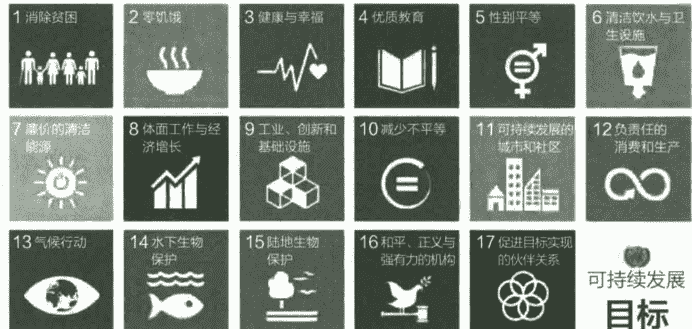

图 1.1 17 联合国可持续发展目标

那么，**HCAI究竟为何物？与传统AI有何分野？** 定义虽多，两大核心维度不可或缺：

1.  **过程层面：** 扎根用户体验——用户观测、干系人参与、可用性测试、迭代优化、持续评估人在AI/ML系统中的表现。
2.  **产品层面：** 旨在打造“超级工具”，放大、增强、赋能、提升人类表现。强调人掌控方向盘，同时以AI/ML实现高度自动化。如数码相机、导航系统：人操控宏观，机自动优化微观。

HCAI旨在提升人的自我效能、创造力、责任感、社交连接，同时压降恶意行为、数据偏见、软件缺陷的负面冲击。

本书抛出三大技术设计变革新理念，以人为核心，构筑跨学科方法论：

*   **HCAI框架：** 指引创新设计师，确保高自动化系统内核以人为本。覆盖恒温器、电梯、自清洁烤箱、手机相机等日常设备，及高阶自动驾驶、病人自控镇痛等关键应用。目标：高人工控制 + 高自动化。
*   **设计隐喻：** 揭示AI研究双核——科学探索（模拟人）与工程创新（造工具）。两者皆贵，需创造性融合以利人类。四组隐喻为融合提供范式：
    - 智能代理 / 超级工具
    - 队友 / 远程机器人
    - 确定的自主性 / 控制中心
    - 社交机器人 / 有源设备
*   **治理结构：** 弥合伦理原则与落地步骤的鸿沟。团队长、业务经理、组织领袖须升级工程实践、管理策略、独立监督，达成三大目标：
    - 成熟软件工程支撑的可靠系统
    - 管理策略孵化的安全文化
    - 独立监管与政府监管背书的可信认证

技术实践层面，设计师、工程师、程序员、团队长、产品经理需建立审计追踪（如民航黑匣子）便于故障复盘。第四部分将详述如何将成熟实践植入软件工程流程、V&V测试、公平性偏见测试、可解释界面。

管理策略层面，安全文化始于领导层承诺，带动优招聘、重培训。汇聚海量故障与未遂事件报告（内部员工报 + 外部用户/审委会/行业标准一致性评估），是核心抓手。

可信认证与责任归属，源自独立审计事务所、保险赔偿体系，亦源自NGO/公民社会设计原则、专业组织自愿标准与审慎政策。政府立法监管是强支撑，但认证倡导者须应对监管阻力与“旋转门”现象（企业高管转任监管机构）。

本书第二、三、四部分将深度展开这三大理念。它们是实现愿景、目标、人类价值的基石，亦是全书脉络概览（图1.2）。利益相关方虽广泛参与，但恶意行为者、偏见、软件缺陷带来的威胁，仍悬于众人心头。

## 以人为中心的人工智能

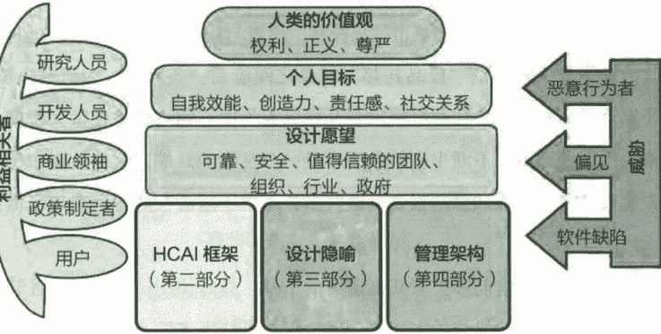

图 1.2 本书框架

成功的强自动化产品比比皆是。导航呈多路线供驾驶员择优；电商给相关推荐、真实评价、明码标价，助购物者高效决策；电梯、洗衣机、航站楼值机亭，让用户快捷可靠达成任务。摄影师按快门时，现代相机辅助对焦曝光，人把控构图，机优化细节——掌控感与成就感油然而生。数万移动应用与云服务，让用户自信甚至自豪地完成任务。

在强自动化蓬勃发展的当下，清晰便捷的界面让人类更好驾驭机器，充分释放主动性、创造性、责任感。强大的超级工具助用户自信攻克复杂任务：助建筑师创新设计节能建筑，予记者挖掘数据揭露舞弊的利器。其他HCAI工具助临床医生早发现病情、助监管者查招聘不公、助审计员曝贷款审批偏见。算法与界面设计者须勤勉确保收益大于成本。真正挑战在于：如何在“用户愉悦、企业繁荣的智慧城市乌托邦”与“用户挫败、资本监控、政治操纵的反乌托邦”之间，开辟一条中道。对研发者、决策者开展以人为本培训，将大幅降损控风。不断丰富的AI事件事故数据库，是良好开端，提供因潜在问题引发恐慌的真实样本。

人类擅长造工具延展创造力，且总能以超越设计师想象的创新方式用之。当下，正需让更多人、在更多时刻、更具创造力。欣赏并放大人类关键特质的设计师，最可能发明下一代超级工具、远程机器人、有源设备。他们的思维将完成跃迁：从“试图用机器替代人”转向“开发人爱用的应用”。

本书面向塑造技术走向与用途的关键群体——构建HCAI系统的研究者、开发者、商业领袖、决策者，及受益用户。图1.3列出更广泛的利益相关者与核心专业人员。

若AI开发者多用信息可视化，算法工作将改善，干系人也能更懂新技术用途。传统AI圈偏爱统计机器学习、深度学习，追求自动/自主完成任务。但态度正在转变，因可视化在理解深度学习、改进算法、减错上已证实高价值。可视化界面赋予开发者、用户、干系人更强理解力与掌控力，让假释审批、招聘筛选、房贷放款等算法决策透明化。

### 以人为中心的人工智能利益相关者

- 能力、专业知识
- 文化、种族
- 警察、检察官、法官
- 年龄、性别
- 用户
- 语言、个性
- 工业研究人员
- 政府工作人员
- 教授
- 政策制定者
- 研究人员
- 教育工作者
- 监管人员
- 博士后
- 研究资助者
- 商业领袖
- 开发人员
- 研究生研究助理
- 记者
- 软件工程师
- 律师
- 管理人员
- 产品经理
- 营销人员
- 首席技术官
- 设计师
- 评估人员
- 程序员

图 1.3 HCAI 的利益相关者与核心专业人员

# 从“反恐隐私”到“以人为本”：一位专家眼中的 AI 演进与人机边界

回溯到 2006 至 2008 年，我曾受邀加入美国国家科学院旗下一个重量级专家组，任务是起草一份名为《在反恐斗争中保护个人隐私：项目评估框架》的报告。那段经历成为了我日后审视人工智能评估体系的起点。小组汇聚了 21 位跨领域的顶尖大咖，阵容极其豪华：由前美国防部长威廉·J·佩里与前麻省理工学院院长、美国国家工程院院长查尔斯·M·维斯特联合领衔。我们的核心使命，是为数据挖掘、机器学习、行为监控等前沿技术确立评估标准，确保它们在安全轨道上运行。难点在于：如何严格审视这些新兴技术贪婪般的信息采集欲，以筑牢隐私防线、杜绝滥用风险。我当时主攻独立监督机制的研究，探讨如何将其落地到具体技术场景中。我们构建的统计测试框架，被定义为“评估基于信息的反恐项目及其他关键国际目标的工具”，并迅速成为政府及相关机构的参考范本。核心建议直指要害：任何政府主导的信息型反恐项目，都必须接受强有力的独立监督；因公权力行使受损的个体，应获得实质性补偿。我们的结论明确——严谨的评估方法配合独立监督体系，是推动技术安全应用的双引擎。

报告发布后，AI 在机器学习与深度学习上的突破，迅速将其推上商业巨头与政府决策层的核心议程。尼克·博斯特罗姆的《超级智能》、斯图尔特·罗素与彼得·诺维格的《人工智能：现代方法》等畅销书，在歌颂成就、勾勒蓝图的同时，也埋下了隐忧。这些著作点燃了科技公司的全面“AI 化”转型热潮，也促使多国政府在商业、医疗、军事等领域砸下数十亿巨资。

然而，警钟也随之敲响。2016 年，哈佛高材生、前华尔街分析师凯茜·奥尼尔发表《数学毁灭的武器》，如同一记重锤，揭露了广泛应用的不透明算法如何加剧不平等、威胁民主。她的观点犀利清晰，配合欧盟《通用数据保护条例》（GDPR）的推行，强力倒逼了可解释人工智能（XAI）的诞生——让被拒贷者、假释犯、求职者有权听到“为什么”，从而获得申辩与调整的机会。在这一进程中，信息可视化逐渐成为 AI 设计的关键一环。

来自公益组织、专业协会及政府的 500 余份报告汇聚成燎原之势，推动“以人为本的 AI”（HCAI）理念走向台前。2003 年伊拉克战场“爱国者”导弹误伤友军、自动驾驶致死案例频发，血淋淋地证明了“人必须掌控机器”的必要性。虽然后续的波音 737 MAX 两起空难非直接由 AI 导致，但盲目迷信自动系统、甚至瞒着飞行员部署算法的设计逻辑，导致传感器故障时机头强制下俯、飞手困惑失措，最终酿成悲剧。那些曾被视为学术辩题的“悖论”“困境”，瞬间变成了致命的现实。

本书旨在为这场变革提供导航图与施工图。要达成 HCAI 愿景，我们必须重塑语言、隐喻与技术路线——摒弃“类人机器人协作”“握手领童”这类陈旧误导的叙事。真正的起点，或许是洗衣机面板、遥控无人机、远程家居、精密手术器械；典范场景是 NASA 火星探测器控制室、交通指挥中心、ICU 监护大屏、金融交易终端。未来的医疗植入设备将由手机 App 掌控，用户握主控权，临床医生与产品经理通过后台监控成千上万设备持续迭代优化。

未来图景属于“超级工具”“远程机器人”“有源设备”：它们放大人类能力、赋能非凡创造，却始终将控制权留在人手中。HCAI 通过融合用户体验与嵌入式算法，让人以非凡方式看见、思考、创造、行动。

清醒地认识到，这仍是少数派的声音。要让研究者、开发者、管理者与立法者真正将“以人为本”列入议程，道阻且长。

伦理基石向来是技术讨论的核心。接下来三章，我们将拆解三个根本命题：

- **第 2 章**：理性主义与经验主义，如何双轮驱动 AI 演进？
- **第 3 章**：人与计算机，究竟是同类异构，还是本质迥异？
- **第 4 章**：自动化、AI 与机器人，真会引发大规模失业潮吗？

第 5 章将收束前半部论述，并回应读者对本文主张的潜在质疑。

---

## 第 2 章

### 理性主义与经验主义如何推动人工智能的发展？

AI 与 HCAI 的张力，实则是两千年前一场哲学论战的延续：亚里士多德的**理性主义**（凭逻辑推演真理）对决达·芬奇的**经验主义**（靠感官触摸世界）。二者皆有建树，缺一不可。

差异在扫地机器人 Roomba 身上一目了然。这款迭代 30 年、销量超 3000 万台的“有源设备”，好评率 70%（“爱不释手”“超预期”），也有吐槽声（“坚决退货”）。它的设计初衷是“全自主清扫”，因此仅保留三个物理键与几盏指示灯，说明书薄得像张传单，甚至叫“拥有者指南”而非“用户指南”。因为大多数人只想“甩手掌柜”，极简交互看似合理。但若引入手机 App 显示实时建图、规划路径、预估耗时，用户就能从“旁观者”变成“导演”，掌控打扫顺序与节奏。Roomba 典型地体现了理性主义思维——追求任务自主闭环，却剥夺了用户的掌控感。反观数码相机的大获成功，源于经验主义基因：傻瓜式操作、丰富模式（自拍、人像、全景）、即拍即看即修即传。几十年前，这还是专业摄影师配合暗房、等待数周、邮寄复印件才能完成的专属特权。

**理性主义**主张：逻辑为王，书斋实验室即可构建世界。他们信奉规则完备、形式化方法（逻辑、数学证明）万能，世界由明确常量构成（冷/热、湿/干）。亚里士多德划分脊椎/无脊椎、土水气火，分类有用却也僵化，难容中间态与新范式。他沉迷理性反思轻视实证，甚至坚信“女人只有 28 颗牙齿”——张嘴数一下即可证伪。笛卡尔、斯宾诺莎、康德、统计学家费希尔皆为追随者。费希尔因过度迷信数据模型拒绝早期吸烟致癌证据，终身吸烟死于肺癌，讽刺至极。理性主义，尤其是逻辑数学思维，奠定了 AI 科学基石，算法以简洁高效为荣。

医疗信息系统若纯走理性主义路线：医生只能填有限复选框、打数值分，报告自动生成。分类虽统一，却难捕捉人体健康的复杂图景，医生的自由文本记录反而更有价值。决策树模型亦有边界。业界逐渐觉醒：理性方法可为起点，融入以人为本的实证路径，才能通往商业成功。

**经验主义**主张：走出象牙塔，拥抱真实世界的混沌、多样与不确定。达·芬奇观鸟飞、研水流，悟出流体力学；伽利略瞥教堂吊灯摆动，推导钟摆周期公式；达尔文赴加拉帕戈斯群岛，观物种多样性，奠定进化论基石。洛克、休谟、统计学家图基（主张可视化探索数据）是经验主义旗手。这种思维加上对人类同理心的洞察，构成了用户体验设计（UX）的基石——评估表现、迭代优化。经验主义警惕简单二分法与复杂本体论，因它们会桎梏思维，削弱捕捉细微差别与非层级关系的能力。

AI 群体深受理性主义影响，强推逻辑驱动、数据编程方案。庆幸的是，情感计算、医疗健康、自然语言处理等领域的实证研究会议正崛起，且当目标指向“大众消费级产品”时，经验主义关注度自动升温。

理性主义还有一个强假设：统计学习算法足以在明确任务上追平甚至超越人类智能。这与坚持“因果解释”、深耕领域知识的专家形成鲜明对立。甚至有 AI 拥趸高呼：“不再需要因果理论，机器学习将取代专业知识。”图灵奖得主朱迪亚·珀尔则坚持：AI 下一步必须处理因果关系。

**“预测无需解释，相关性即决策依据”**——这种论调令人不寒而栗。机器学习确实能从相关模式中“训练”模型，但它脆弱：特斯拉 Autopilot 在白天空背景下识别不出白色卡车致死；它看不见隐藏偏见，也预判不了模式失效。人类凭借常识与高阶认知游刃有余地应对陌生局面，好奇心驱使我们穿越远因近因寻找因果解释。

两派哲学各有所长，我的主张是：**以理性之长，佐以经验之观，融合观察策略，拓展可能性边界。** 关注技术使用者总能带来惊喜，我痴迷于可用性研究、深度访谈、自然观察，甚至开展数周的纵向案例研究，弥补实验室控制实验的局限。

**以用户同理心为起笔，以谦逊态度推进人机边界**——这是构建可靠、安全、可信系统的钥匙。同理心让设计师敏锐捕捉用户的困惑、失望，预判 AI 失效造成的伤害（尤在生死攸关领域）；谦逊让设计师敬畏“审计追踪”的必要——故障不可避免，回溯分析不可或缺。理性主义追求“最优性能”；经验主义执着“哪里会错、如何更好”。二者共同的养料，是用户反馈。

---

### 设计启示

技术设计的未来，取决于我们站在理性主义还是经验主义一边。理性主义倾向于认可“计算机无人监管也能可靠运行”。尽管批评者列举了自主系统的讽刺、悖论、神话与致命风险，此路径仍深得人心。军事开发者推崇致命自主武器，人道主义者警惕滥用风险，“自主权”争论由此白热化。

自动驾驶是风口。若设计师持经验主义立场，落实“有意义的人类控制”，即便自动化等级提升，安全底线也能守住。**从“无人驾驶”转向“安全优先驾驶”**，能更快落地防撞、车道保持、泊车辅助等成熟技术。“高级驾驶辅助系统（ADAS）”术语的普及，标志着共识形成：**增强人类驾驶技能，比单纯追逐全自动更具建设性**。车路协同（V2X）、智慧公路、借鉴空管中心的高速公路管控中枢，将是发力点。

许多 AI 从业者仍梦想“社交机器人成为队友伙伴”。但制造“会装情感”的机器适得其反，导致设计目标偏离——计算机没有情感，人类才有。当下类人社交机器人多停留在娱乐新奇期。

AI 群体偏爱理性主义，导致开发者长期迷信**自主设计**，坚信计算机无需人类监管即可可靠运行。虽有“人机共舞”高呼，往往暗含妥协意味；追求“完美系统”的派别，根本否认 AI 需要人为干预、监督与控制。

我更认同的图景是：**人类在社交网络中愉悦协作，计算机在旁辅助赋能。** 人类在上司、同事、员工构成的社会结构中茁壮，渴望被取悦、激励、尊重，渴望反馈、赞赏、建设性指引。我们用计算机强化能力，以称职、安全、非凡的方式工作。这正如车尾贴纸那句金句——**“人类在群体中，计算机在循环中”**（图 2.1）。它提醒我们：人是社会性动物，计算机是支撑表现的工具。

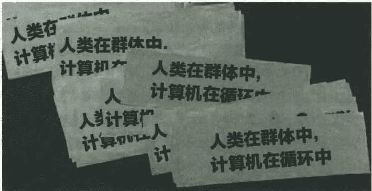

图 2.1 保险杠贴纸上“人类在群体中，计算机在循环中”的宣传语

随着“有意义的人类控制”与“结果问责”成共识，技术设计提速。**这套以人为本、经验主义驱动的策略，天然契合军事领域“指挥链责任制”的核心价值。** 自动化由人调用，人必须能预判后果，因为责任在人。**让用户预判的有效手段，是“直接操作”设计：** 对象与动作可视化、用户选择执行、过程可见。拖拽文件进废纸篓、提示音确认删除；触屏捏合、点按、滑动顺手拈来。视觉界面提供总览、支持钻取、过滤噪音、按需取数。于是，人在掌控中，机在预测中。

用户需要反馈知晓意图执行情况，需要预知机器下一步，拥有叫停或修正的时间窗口。这就是“取消”按钮存在的意义——随时中止、回滚状态。

自主设计拥趸假设“机器总做正确的事”，对反馈漠不关心，对审计日志更不屑一顾。借鉴民航模式才是正途：**每个机器人植入“黑匣子”（飞行数据记录器），嵌入审计追踪模块（活动日志/产品日志）。** 在关乎性命的场景采取保守策略，通过事后复盘故障与未遂事件，持续进化。

随着 AI 缺陷暴露（贷款审批偏见、假释评估歧视），“完美神话”破灭，研究者被迫直面公平性、问责性、透明度、可解释性（FATE），试图打开黑箱。好消息是，越来越多 AI 研究者转向经验主义：研究如何揪出偏见、何种解释有效、何种申诉机制管用。

HCAI 阵营信奉经验主义，天然走**以用户为中心**路线：实地观察家庭/职场表现、深度访谈收集反馈、实证实验验证假设、UX 测试驱动迭代、上线后持续监控实时反馈。引入“事件报告”与“意见箱”机制，如 FDA 不良事件上报系统、FAA 航空安全报告系统。

传统 AI 项目执着“替代人类”；HCAI 设计师偏爱**“内生式丰富可视化”**而非事后堆砌。如今主流应用已赋予用户更多掌控——高速导航路线图、运动轨迹回放、金融组合仪表盘。这些可视化让用户洞悉现状与可为。语音交互与视觉显示互补，为多元用户开辟新路径。

那些笃信“计算机正取代人类、将拥有同等智慧与情感”的理性主义者，本质上认为**人机无本质区别**。对此，我将在下一章详细拆解：为何人与计算机属于截然不同的范畴。

---

## 第 3 章

### 人类和计算机属于同一种类吗？

传统 AI 派与 HCAI 派的第二大分歧点在于：**人与机，同类异构，还是本质迥异？**

斯坦福大学《AI-100 报告》断言：“算术计算器与人脑的区别不在于种类，而在于规模、速度、自主程度与通用性。”——这明确划归“同类论”。反之，HCAI 支持者坚持：**鸿沟深不可测——“人非机，机非人。”**

### 重塑认知：为何我们需要「超级工具」而非「拟人机器」

人类的卓越并非源于某种神秘的「灵魂」或「生命火花」，而是漫长的精神文化进化沉淀出的非凡能力。我们眼中的现代生活，实则建立在祖辈们历经数代打磨的「思维工具」（语言、音乐、艺术、数学）与「物理技术」（服装、住房、飞机、计算机）之上。农业、医疗、城市规划与法治体系的建立，无不彰显着人类的创造本能。我们的历史使命，是为这些技术、工具与文化体系持续注入新意。制造模仿人类行为的机器人固有其值，但我更倾心于构建能将人类能力放大百倍、千倍的「超级工具」。过往的成就已催生出计算机、万维网、电子邮件与移动终端等惊世技术。

或許我應當以更開放的心態拥抱未知。或許我該讓科幻想像力撬開思維的門扉，去窺見有感知的計算機、有意識的機器與超級智能體的可能性。我的驅動力源於一個核心假設：人類擁有獨特的創造力，我的目標是打造設計精良的超級工具，以極大地提升人類表現。

一旦人機邊界模糊不清，人們對人類豐富性、多樣性與創造力的欣賞便會消解。我更樂於頌揚人類的偉大成就——語言、藝術、音樂、建築等文化巔峰，也包括機器學習與相關算法本身。清晰劃分人機界限，能強化對人類責任的尊重，並指引我們合理駕馭計算機的能力。

**擁有軀體，是人類的根本標識。** 我們能感知痛楚與愉悅、悲傷與歡愉；能哭能笑、能舞能食、能愛能思，這構成了人類生活的完整圖景。情感既是愉悅的源泉，也是恐懼的根源。人類的情感絲毫不止於保羅·艾克曼（Paul Ekman）所定義的七種基本情绪——憤怒、蔑視、厭惡、享受、恐懼、悲傷、驚訝。他的理論被AI領域廣泛引用，卻過度簡化了人類情感與面部表情的復雜性。豐富情感畫像的一條路徑，是假設人類擁有更廣譜的情绪（見圖 3.1）。

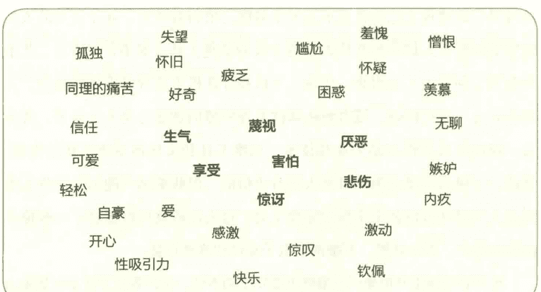

**圖 3.1 人類情感譜系**

註：藍色為艾克曼七大情绪，紅色代表消極情绪，綠色代表積極情绪，灰色為其他情绪。

資料來源：改編自蘇珊娜·帕爾茨（Susannah Paletz），《社交媒體情緒標註指南》（Emotions Annotation Guide for Social Media），3.32 版，2020 年 1 月 21 日。

對於偏好視覺表達者，羅伯特·普拉奇克（Robert Plutchik）提出的包含 32 種情绪的「情感之輪」（圖 3.2），能更立體地展現情感強弱變化及過渡帶。

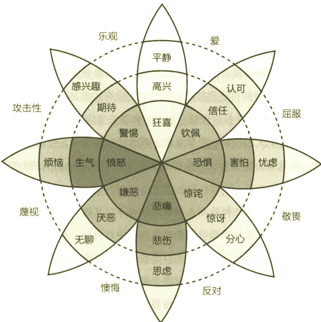

**圖 3.2 人類情感之輪**

資料來源：羅伯特·普拉奇克，1980 年，維基共享資源。

近期研究對艾克曼的經典模型發起了猛烈抨擊。該模型假設內在情緒態會自動、統一地觸發精確的面部表達。然而，美國東北大學心理學家麗莎·費爾德曼－巴雷特（Lisa Feldman-Barrett）等人的最新研究傾向於「情緒建構論」：情緒由感官知覺、文化規範與個人經驗共同構建，因此表達因人而異。她認為情緒反應是多因子綜合作用的結果，而非不可控的自動觸發。由此可見，面部表情與肢體語言是判斷犯罪意圖、喜悅或恐懼的「弱指標」。人類行為的複雜度，遠超開發者預設的簡單人臉識別算法。可量化的行為信號——如打斷發言、靠近或遠離、眼神接觸——才能提供有價值的反饋，助人調整行為。

人類情緒極其複雜，絕非簡單流程可識別。維基百科總結道：「科學界對情緒的定義至今無共識。情緒常與心境、氣質、性格、創造力、動機交織。」試圖用面部識別斷定性格、犯罪傾向或政治立場，其危險性不亞於已被廢棄的「顱相學」——那種妄以頭顱結構推測心理能力與犯罪傾向的偽科學。

儘管計算機檢測與響應人類情緒狀態的研究仍在深入，但質疑其準確性的聲音從未停歇。即便技術不夠精準，讓社交機器人通過面部、肢體、語言「表演」情緒的想法本身就令人憂慮。無論是陳規陋習還是蓄意欺騙，都會瓦解設計師試圖建立的信任。機器人的情緒模擬或許在娛樂、遊戲領域有用，足以支撐該領域研究；但對多數應用場景，用戶只想在最小干擾下完成任務。許多人會對裝模作樣的機器人產生厭倦或不信任。

**情感分析（Sentiment Analysis）才是更靠譜、更有前景的策略。** 它能解讀社交媒體帖子、產品評價、報紙標題的群體情緒。這種針對聚合數據的分析，不試圖識別個體即時情緒，卻能揭示不同性別、政黨、種族、社經階層在語言表達上的差異，還能追蹤輿情隨時間的演變——如報紙標題負面化趨勢。

對部分人而言，用計算機模擬人類是種樂趣；但技術設計師的靈感源泉可以更廣闊。更宏大的目標催生更有價值的創新：萬維网、信息可視化、輔助技術、維基百科、增強現實……這些創新拓展了人類邊界，讓更多人成為創造者。

我的另一核心使命是**促進人與人的溝通與協作**——這已孕育出電郵、短信、視頻會議、共享文檔、社交媒體等成功範例。網絡視頻、音樂、遊戲同樣大獲成功。人們在社交平台分享偏好、大眾傳播、商業推廣的活躍度可見一斑。但缺陷也顯而易見：缺乏面對面聯繫、縱容詐騙犯罪、助推仇恨言論與恐怖招募。用戶應擁有更強控制權，限制來自自主匿名機器人的信息流入，正如門鎖擋住不速之客。現狀是平台未賦予用戶足夠權力，用戶應掌握內容過濾權，遏制機器控制權的濫用。

另一個問題：**製造長相行徑皆像人的機器人，意義何在？** 第三部分將深入探討。龐大群體深信類人機器人（拟人化/人形機器人）是未來方向，夢想製造擁有臉龐、四肢、語言能力、能在人類世界自由行動的社交機器人，充當養老或災難救援角色。這一路徑卻導致了長期的連續失敗。擁護者辯稱：這次不同了，算力更強，設計師更懂了。

對界面設計而言，**人與人交流模式只是眾多模式之一，且常具誤導性。** 優化的交互界面能讓更多人更快、更高效地完成更多任務。語音雖是人際溝通主流，但為保極致操作效率，**視覺化交互設計必須是主策略**。語音短暫緩慢、佔用大量認知資源與工作記憶，限制了其與手勢、控制操作的並行可能（詳見第 16 章）。Alexa、Siri 等語音助手在雙手被佔場景下仍有不可替代價值。

**交互設計應堅持：一致、可預測、可控。** 唯此，才能賦予用戶掌控感、滿足感與責任感。這比自適應、自主、擬人化交互更具普適價值。

**增強人類能力，乃核心價值。** 望遠鏡與顯微鏡延伸雙眼，計算器、數字圖書館、電郵助人完成獨力難為之事。我們需要更強工具。開發「創意輔助工具」，賦予藝術家、音樂家、詩人、劇作家、攝影師更大靈活性，探索備選方案，誕生新穎、有趣、有意義的作品。相機與樂器已拓展人類可能，人類仍是創造力源頭，新設備將延續此傳統。

然而，部分研究者宣稱：AI 不僅賦能，自身即創造者。此說可溯至 1968 年賈西婭·雷查特（Jasia Reichardt）策展「控制論藝術的意外發現」。隨後哈羅德·科恩（Harold Cohen）開發 AARON 程序，生成植物、人物、抽象圖像，酷似人類水彩，廣受讚譽。但顯然，**科恩才是創造者**——2014 年他榮獲國際圖形圖像協會（SIGGRAPH）數字藝術終身成就獎。

其他算法藝術多帶幾何紋理特徵，為「超越藝術家想像」提供論據。保羅·布朗（Paul Brown）與歐內斯特·埃德蒙茲（Ernest Edmonds）為代表人物，作品被各大美術館收藏。布朗追求「自我創造」的生成模式，被列為藝術家。埃德蒙茲則是受人尊敬的計算機科學家，致力於隨欣賞者變化的互動藝術體驗，他利用計算過程「擴展、放大創作過程，而非取代」。同科恩一樣，埃德蒙茲 2017 年同獲 SIGGRAPH 終身成就獎。

當前 AI 藝術家視其工作为進步，因生成更宏大圖像，甚至讓程序員驚訝。如亚历山大·莫德文采夫（Alexander Mordvintsev）的 DeepDream，利用 GAN 訓練自主生成：畸形多頭動物、毛茸茸肢體透出的眼睛、與背景融合的幻象——挑戰我們對現實的認知。

雖科恩曾稱 AARON 能自主生成驚人圖像，但他親口告訴我：**他是藝術品的創造者。** 強大算法為藝術家提供新路徑，但激情源頭始終是人。AARON 與近期 AI 藝術雖拍賣受關注，收益與版權仍歸藝術家所有。

**計算機音樂同樣引發「功勞歸屬」大戰。** 算法早能模仿巴赫、披頭士、莫札特、瑪丹娜風格生成新曲，評論界對歸屬創作者還是算法眾說紛紜。經流行歌庫訓練的算法能產出歌詞旋律，給人「創新感」更強。但爵士樂手、音樂治療師丹尼爾·薩裡德（Daniel Sarid）直言：這些是「認知與審美組織的有趣練習，與藝術無關」。他建議作曲家目標更高——在「探索集體無意識的創作」漫漫長途上前行。

部分 AI 狂熱者欲將知識產權授予算法，但美版權局規定僅授予人類或組織。讓算法持有專利的嘗試亦未獲法律通過。爭議持續：算法究竟如何維權、賠償、入獄？

隨時間推移，我們將更清醒地認知：**人非機器，機器非人。** 隨著嵌入式應用愈發宏大，作為關注焦點的計算機將消失鋼鐵、塑膠、玻璃般融入環境隱形。即使算力更強，「計算機智能」概念終將被視為天真古怪的陳舊產物，如同今日的煉金術與占星術。

未來已來，但讓我們先直面眼下最迫切的疑慮：**自動化、AI 與機器人，會引發大規模失業嗎？**

## 第 4 章

## 自動化、AI 與機器人會導致大規模失業嗎？

第三大爭議點，關於自動化、AI、機器人是否引發大面積失業。馬丁·福特（Martin Ford）2015 年《機器人來了》等書表達此憂；牛津大學報告稱 2030 年前美國 47% 崗位將自動化。然而，儘管技術普及，**美國 2020 年失業率仍守在 4% 以下**，大規模失業論顯然站不住腳。隨後疫情衝擊致失業率飆升，2021 年疫苗見效後再度回落。

2012 年亞馬遜收購 Kiva Robotics，輿論預測將裁員 12.5 萬。但到 2021 年，儘管機器人增用，亞馬遜員工超百萬。疫情期需求暴漲，更極端地推高供應鏈、履約中心、物流網絡用工需求。亞馬遜優秀的電商體驗與低價策略是需求增長主因。雖因反工會、削減福利、工傷率高、工作環境惡劣遭抨擊、抵制、抗議，但它也推動多家企業跟進 15 美元最低時薪。無人知曉有多少小店員工失業，卻也有多少本地供應商、製造商因亞馬遜龐大網絡增崗。確實，這是破壞性變革，但對整體就業影響不明顯，利於消費者、促銷量。

**失業率非完美指標：** 未計入退出勞動力市場者，也掩蓋了低福利低薪工人的增多。企業主或更重市值而非利潤，追求薄利多銷而非改善待遇。

自動化加劇財富集中，不平等惡化，衝擊最大的是低學歷工人。**以員工代價換銷量，是自動化升級的嚴重副作用。** 亞馬遜長期反工會，而工會歷史上為工人爭取薪酬、條件、醫保、托兒、帶薪假、養老金。核心難題在於：**如何公平分配自動化紅利？**

從古騰堡印刷機讓抄寫員失業算起，幾百年來自動化持續替代特定崗位。但通常**降本增質 → 需求激增 → 擴產應對 → 造福大眾**。產能擴張、渠道拓寬、產品創新促進就業。廉價書開闊市場，發行銷售網絡增長，識字率飛躍。書籍產出激增滿足作者表達，引發文化爭鳴與政治變革。書籍是強大的顛覆力量，被視為教育、商業、健康加速器。

基於 AI 的自動化引發動盪，遵循歷史熟悉模式，卻引發前所未有的大失業恐慌。在我與多數經濟學家眼中，「這次衝擊空前嚴重」的說法極不靠譜。1900 年農業就業佔 40%，今僅 4%，卻未現 36% 失業率。農業綜合企業、龐大食品分銷網、加工食品供應商創造了大量新崗位。超市滿貨平價農產與包裝品、面向不同階層的餐飲業，皆創造新就業。但**自動化狂飆已極大加劇不平等，且水平令人不安。**

隨著社交機器人熱潮，**機器人流程自動化（RPA）** 關注度與恐懼雙升。它延續會計後台自動化史，取代華爾街交易員、支票清算文員。RPA 仍在推進會計文書自動化，對受影響者痛苦，規模與過往自動化浪潮相當。競爭壓力真實，但交易成本降低利好多數。受尊敬的社會責任型企業應分享紅利，為失業者提供再培訓或轉崗幫助。

對技術革命衝擊的誇大，至少可追溯至早期電報、汽車、航空業。1970 年阿爾文·托夫勒《未來衝擊》以強硬筆調宣稱：「現在發生的一切，衝擊之深遠不亞於人類歷史第二次大分野，規模僅次於從野蠻到文明的轉型。」確，70 年代動盪，但類似動盪將持續。**歷史教訓清晰可循：**

- **18 世紀早期**，織布機引發勒德分子①起義，紡織品暴跌引爆巨大需求。產能擴張、時尚興起、銷售渠道新增推動就業，讓更多人擁有更多衣物。
- **1839 年**，達蓋爾發明攝影，畫家德拉羅什宣稱「繪畫已死」。但印象派等藝術運動蓬勃證明：寫實風景肖像之外，還有無限創造空間。攝影、視頻、視覺傳播拓展創意邊界，成就大產業，豐富生活。
- **20 世紀 60 年代**，ATM 引發銀行職員失業恐慌，但房貸、信用卡業務擴張帶動網點與就業雙增。如今網銀普及致部分網點消失，但銀行金融業整體就業仍增長。

**自動化主旋律：降本增質 → 需求增 → 產能擴 → 增崗利客。** 同時會讓特定技能過時，產生顛覆性衝擊。故技術創新者與決策者面臨巨大挑戰：**助失業者重生、確保紅利公平分配——工人如何賺取體面薪資、獲得更好待遇。**

麻省理工「未來工作」項目 2020 年深度報告強調**公平分享自動化紅利的必要性**，呼籲決策者構建「未來工作收穫自動化與強算力紅利，賦予工人機會與經濟保障」的體系。報告由大衛·奧特（David Autor）、大衛·明德爾（David Mindell）、伊麗莎白·雷諾茲（Elisabeth Reynolds）領銜，他們認清變革不會自然發生，必須向商業領袖施壓：「為將生產力增長轉化為廣泛共享收益，我們必須推動與技術變革配套的制度創新。」

報告重申：**未來工作充滿光明。**

---

① 19 世紀英國工業革命時期，因機器替代人力而失業的技術工人。——編注

# 未来20年：工作岗位比人多？AI时代的生存法则

> “预测未来最好的方式，就是去创造未来。” —— 艾伦·凯

---

## 就业市场的“反直觉”真相

主流舆论总爱渲染“AI抢饭碗”，但权威机构的数据却指向另一个方向：**未来二十年，发达国家将面临“岗位多、人手少”的结构性短缺。**

自动化与机器人技术非但不是纯粹的“就业杀手”，反而将成为填补劳动力缺口的关键力量。历史反复证明：技术创新总会催生新职业、重塑技能需求，并创造出薪酬更优的岗位。美国劳工统计局的最新预测印证了这一点——就业增速最快的领域，集中在三大板块：

*   **刚需型照护：** 家庭健康助理、注册护士、心理咨询师、护理员……医疗健康岗位增幅高达 12%–22%，这是人口老龄化倒逼出的“铁饭碗”。
*   **基础型服务：** 外卖骑手、快餐员、仓储分拣员……这些对学历门槛较低的入门级岗位，为年轻群体、新移民提供了就业缓冲带。
*   **高阶型技术：** 软件工程、财务管理、可再生能源装维……技术红利持续释放，高薪赛道虚位以待。

---

## 红利如何公平分配？考验在“分配”不在“生产”

蛋糕做大了，切分规则却滞后了。如何倒逼商业领袖与政策制定者分享自动化红利？

*   **硬杠杆：** 提高最低工资标准、强制完善医保体系、普惠托育服务；
*   **软逻辑：** 让精英阶层读懂一个道理——**员工过得好、有钱消费，才是企业长续航、社会稳定的根基。** 贫富差距撕裂的代价，最终由所有人买单。

**破局行动包：**
1.  **再就业通道：** 为失业者开辟转岗赛道，而非单纯发放救济金；
2.  **教育降维：** 打破学历壁垒，让技能培训触手可及；
3.  **校企共建：** 让职业教育对接真实岗位需求；
4.  **心态重塑：** 鼓励劳动者拥抱“终身学习”，向医疗照护、设备运维、新能源装配、文娱服务等增量市场迁徙。

这需要真金白银的投入，更需要科技巨头与监管层放下身段，**把“工人福利”写进KPI，把“环境成本”算进账本。**

---

## 第 5 章｜总结与怀疑者的困境

> “无实践的理论苍白，无理论的实践盲目——如无舵罗盘之舟，茫茫大海不知归途。” —— 达·芬奇

预测是概率游戏，创造才是确定性答案。本书勾勒的蓝图是：**HCAI（以人为中心的AI）**，让人类牢牢掌握超级工具、远程机器、有源装备、控制中枢的“方向盘”。

这是一场跨界融合：**理性派的实验室逻辑**遇上**经验派的现场同理心**，在“算法性能”与“人类尊严”两端施力，才能造出真正放大、增强、赋能、提升人类表现的系统。核心铁律：**高度自动化 ≠ 低人类控制**。我们要的，是“自动驾驶”里依然握着方向盘的人。

### 怀疑派的三把火，烧不着HCAI的根基

| 怀疑论调 | 现实回应 |
| :--- | :--- |
| **“全自动化才是终局，人类介入只会拖后腿。”** | 望远镜不取代眼睛，心电图不取代医生，飞机不取代飞行员。**工具的本质是延伸器官，而非替代物种。** |
| **“辛顿大神都说：5年内AI超越放射科医生，别培养了。”** | 现实打脸：深度学习成了放射科医生的“超级助手”，医生的工作远不止“找结节”——诊断决策、患者沟通、多学科会诊，样样离不开人。 |
| **“社交机器人将成伙伴、队友，通用人工智能（AGI）指日可待。”** | 别把科幻当路标。**远程机器人、有源设备**才是当下的务实增量——像飞机、互联网、基因测序仪一样，让人类做以前做不到的事。 |

### 守夜人警钟：警惕永远是自由的代价

技术是双刃剑。网络犯罪、极端组织、恐怖势力……滥用风险不容乐观。但放眼长周期：**健康寿命延长、经济总量跃升、社区更安全、就业率高企、新赛道层出不穷**。掌舵者若能守住底线——助弱、护法、惜环，**“让更多人过上更好生活”**不是口号，是确定性的未来。

下一站，需在**自我效能、创造力、责任感、社会连结**四大维度实现质变。

---

# 第二部分｜HCAI 框架：把“人”装进系统架构里

## 第 6 章｜跳出“自动化等级”单行道

> “机器只会算数，人类才赋予意义。计算机没有大脑，正如音响没有立体声。” —— 诺贝尔物理学奖得主 阿诺·彭齐亚斯

### 一维谬误：自动化 ⬆️ = 人控 ⬇️？

1978年，谢里丹与维普兰克提出的“10级自主等级表”统治学界四十年：**全自动（Level 10）是圣杯，人类控制是过渡态**。这导致工程师们陷入零和博弈——要么全交给机器，要么全靠人扛。

**但现实不吃这一套：**
*   智能马桶误触、感应水龙头罢工 → **低风险场景，体验崩坏源于“无法人工兜底”**；
*   推荐算法加滑块让用户调节兴趣权重 → **点击率飙升，用户高呼“想要更多控制权”**；
*   安全气囊早期误炸致死百余婴童老人 → **唯有引入故障数据闭环、保留人工覆盖机制，才换来每年挽救2500命的现在**；
*   波音737 MAX 双双坠毁，346条生命 —— **隐形自动系统剥夺飞行员知情权与接管权，酿成不可逆悲剧**。

**教训血淋淋：自动化系统必须有“正确激活、防误触发、可接管、可审计”四重保障。谦逊，是设计师最高级的技术指标。**

### 二维新坐标：高自动化 × 高人控 = 可靠、安全、可信

| 旧坐标（一维） | 新坐标（二维） |
| :--- | :--- |
| 自主等级 0–10 单轴滑动 | **横轴：自动化程度** ｜ **纵轴：人类控制程度** |
| 追求“全自主”终点 | 追求**右上象限**：**高自动化 + 高人控** |
| 机器决策，人类监督（或被甩锅） | 机器执行，人类**掌控决策权、拥有随时接管权、知情权** |

**这不是妥协，是进化。**
*   **自动驾驶别盯着 L5 看：** 明确“防撞、泊车”自动化，“暴雪路面、警手势指挥”人工接管，才是工程落地的诚实路径；
*   **四阶段拆解法：** 信息获取 → 分析研判 → 决策选择 → 执行行动。**关键决策节点，必须留给人。** 计算机给选项、人类定乾坤，软件迭代时再把新选项交还给人。

### 权威背书：一维理论的“葬礼”已悄然举行

*   **美国国防科学委员会：** “将自主等级视为发展路线图是无效的。”
*   **认知科学铁三角（Bradshaw/Hoffman/Woods/Johnson）：《自主系统七大致命神话》**——痛击“全自主即无需协作”谬论，揭露爱国者导弹误击友军、波音坠机等血案根源：**人机互依才是真相，单边自主是幻觉。**
*   **墨菲定律（机器人版）：** “部署任何机器人系统，自主性都达不到预期，人类协调机制的缺失将被暴露或放大。”

---

## 核心共识

**未来不属于“最聪明的算法”，而属于“最懂人、最信任人、最赋能人”的系统。**

HCAI 不是技术路线的微调，而是**价值观的重构**：
1.  **可靠性**源于冗余设计与人工兜底；
2.  **安全性**源于可接管、可逆转、可追溯；
3.  **信任感**源于透明化、可解释、用户掌控感。

下一章，我们将拆解二维框架的实操指南——如何在具体场景里，把“高自动化 × 高人控”落地成标准动作。

人工操控的支持者通常抛出两大核心理由。首当其冲的是：人非圣贤，孰能无过？机器却能精准规避失误，做到不知疲倦、一以贯之。这份见解极具价值，倒逼设计师在方案中植入“安全閂”——无论是防割手的剃须刀，还是核反应堆的控制棒。不过，关于错漏成因及规避之道的探索仍在路上，以期打磨出更贴切的防护机制。鉴于人为失误层出不穷、使用场景动态变幻、对抗性攻击屡见不鲜，设计师必须贯穿产品全生命周期，时刻绷紧设计之弦。

第二个理由直指痛点：即便配备了控制装置，真正掌握用法的用户也是凤毛麟角。大量用户对此提不起兴趣，往往是因为控件设计拙劣、上手困难。但一旦设计得当，普及率便水涨船高——汽车座椅、方向盘、后视镜的调节，车内灯光、音响、车窗、空调的操控，无不如此。办公软件、剪辑工具中琳琅满目的功能键也佐证了这点：刚需在前，好用为王，用户自然买单。

好在，极具前瞻的AI学者与工程师已达成共识：以人为本的设计刻不容缓。斯坦福计算机科学教授、谷歌云AI首席科学家李飞飞早于2018年3月在《纽约时报》撰文，力陈“打造造福人类的AI”必要性。她敏锐捕捉到趋势：将重复、高危、易错环节交给自动化，留下创造性、知识密集型工作给人类。李教授总结道：“技术自动化程度再高，影响世界的善恶终究由我们人类担责。”

她亦大力倡导“以人为中心的AI”（HAI），这是她联同斯坦福哲学教授、教务长约翰·埃切门迪共同创立的研究所名称。她郑重写道：“作为新技术的缔造者，我们有共同责任引导AI，让其对星球、国家、社区、家庭、生活产生积极向善的影响。”

同年4月，加州伯克利顶尖机器学习专家迈克尔·乔丹发声震慑业界：构建融合计算机科学与统计学、兼顾人类效用的“星际级”推理决策系统，这门工程学科在他的教育履历中从未现身。他直言不讳：“我们缺失的是一套具备分析与设计原则的工程学科。”这令人诧异——他必然知晓人机交互（HCI）的存在。他进而追问：盲目模仿人类的经典AI路线，真的是攻克宏大挑战的唯一正解？乔丹指明方向：必须深度思考如何借助HCI化解燃眉之急。我们期盼计算机激发人类创造力新高度，而非取而代之。

第7章将拆解构建可靠、安全、可信赖系统的实战策略。第8章将推出全新二维坐标系，重新定义设计目标，描绘通往“高人工控制”与“高自动化”双高峰的路径，彻底超越沿用40载的一维自主等级论。第9章将奉上指导新系统思维的设计准则，配以案例复盘过往与展望未来。第10章将收官总结HCAI框架及其边界。

## 第 7 章 重新定义：何为可靠、安全、可信赖的系统

虽说机器自主是普世追求，但在设计师心智模型里，人类自主理应同等重要、地位对等。二者各有千秋，组合拳的精髓在于：常态下信赖机器自动驾驭，关键刻由人工掌舵。聚焦HCAI系统的“可靠、安全、可信”三大基因，能为设计迭代指明航向。这三个概念内涵丰富，我以四级处方予以界定（详见第四部分）：① 植根成熟软件工程实践的可靠系统；② 依托业务管理策略孕育的安全文化；③ 经由独立监督背书的可信赖认证；④ 根植政府法规体系的合规保障。

这四重处方能加速三大目标的落地。软件工程师、商业掌舵人、独立监察委员、政府监管者虽同心协力，但我主张各尽其能、各司其职，以最高效姿态支撑实践。

**可靠系统**的标准是：需时必应，响应如预期。可靠性源于软件工程团队的严谨技艺（详见第19章）。故障复盘时，详尽的审计日志——如民航领域大显身手的飞行记录仪——是还原真相的关键。支撑“人类问责、公正无私、可解释性”的技术实践涵盖：
- 审计追踪与分析工具链
- 规范化软件工作流
- 验证与确认（V&V）测试体系
- 提升公正性的偏差检测测试
- 可解释的用户界面

海量训练测试数据的剖析为机器学习结果的公正护航。而可解释性虽源于多元设计特质，我更聚焦于：通过可视化交互界面，从源头规避或降低对“事后解释”的依赖。

**安全文化**由聚焦策略的管理层亲手打造（详见第20章），支柱包括：
- 领导层对安全的实质承诺
- 以安全为导向的招聘与培训体系
- 对故障与“未遂事件”的高强度上报机制
- 直面问题、谋划未来的内部评审委员会
- 与行业标杆实践持续对标

这些策略能指引培训、实操及根因分析的持续精进。软件工程领域，卡内基梅隆大学软件工程研究所推出的能力成熟度模型（CMMI）深耕30余载，助力团队管理者落地安全实践。管理者可依托五级成熟度阶梯，通过策略的一致性迭代提升软件质量。虽非完美，CMMI仍广泛服役于军工、网安等重磅领域。

**可信赖系统**的讨论从未如此高涨，但“信任”定义的溯源由来已久。政治学家弗朗西斯·福山著作《信任：社会美德与繁荣的创造》颇具影响力，聚焦基于共同规范的社会互信，亦涉技术信任设计的微言大义。

然而，大众期待早已超越“被信任”，转而追求“值得信赖/可信赖”。系统可能被盲目信任，但可信赖系统应经得起推敲，即便利益相关者难以量化此属性。我坚持：可信度须由权威独立监督机构裁定。普通消费者缺乏评估能力与精力，只能仰仗消费者报告、券商研报等既有权威背书。若顶级会计师事务所、保险巨头、消保组织为产品盖章，公众便会视其为可信赖。独立监督/组织名录（详见第21章）涵盖：
- 执行外部审计的会计师事务所
- 保险机构
- 非政府组织与公民社会团体
- 专业学会与研究机构

作为公共利益守夜人，政府干预与监管不可或缺，尤其是在巨头利益凌驾民众需求之时（详见第22章）。政府应在最大程度鼓励创新中汲取经验教训，以利决策优化。

为聚焦核心，本章聚焦“可靠、安全、可信赖”三大支柱。但海量文献亦倡导系统具备性能、用户感知等属性（图7.1）。这些指标量化困难，甚至连设计变更对其增减影响都难定论。尽管如此，它们仍是探讨伦理、负责任、人道AI的高频词汇。评估难题将在第25章深度剖析。

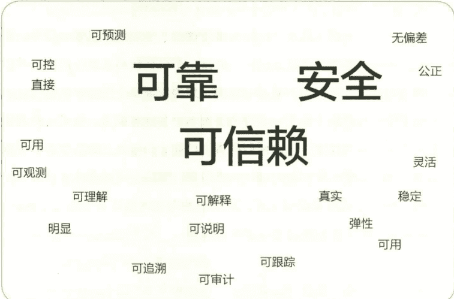

图 7.1 HCAI 系统众多属性中的一部分

电梯、相机、家电、医疗设备等成熟技术的用户，对设备的可靠、安全、可信有着切肤之感。他们享受高度自动化的便捷，同时深知：通过操控设备达成目标，掌控权在己。

具备HCAI思维的设计师，致力于让不同用户均能驾驭高度自动化设备，并邀请用户以创造力反哺设计。精妙的自动化设计反而能释放更细腻的人工控制——手术机器人助医生精准切除难触及病灶，即是明证。

成功技术赋能跨学科团队协作，打通上下游协同。因人类需为技术使用行为负责，他们偏好在控制面板实时掌握系统状态，以此构建预测未来行为的心智模型，并保留叫停不可控行为的权利。优秀UI以减负、增效、保安之姿，有力托举人类活动。第8章将论述：全自动或全人工的极端场景，需额外设计评审把关。

可靠、安全、可信赖系统的设计师，还将推广弹性设计、落实责任归属、提振质量、鼓励创造。人类需要创造力拓展既有设计、开辟新径、协同化解意外。HCAI更宏大的愿景：捍卫隐私、筑牢网安、践行社会公正、守护生态环境。

HCAI框架（详见第8章）将引领设计师与研究者探索三大特质系统的新境界。毕竟，绝大多数消费者、生产主管、医生、飞行员对“计算机自主性”无感；他们渴望的是大幅跃升绩效、极简工作流的系统，从而腾出手脚追逐更大野心。HCAI框架实证：精心打磨的应用，能让高度人工控制与高度自动化完美共存。

## 第 8 章 破局之维：以人为中心AI的二维框架

HCAI框架倒逼设计师与研究者重审AI自主性本质、重构提问逻辑。当设计师不再执念于将计算机塑造成“队友、伙伴、合作者”，反而更易开发出显著放大人类绩效的技术。创新设计将更充分释放计算机独有优势：复杂算法、海量数据库、尖端传感器、富信息显示器、强力执行器（爪、钻、焊机等）。

明确人类责任，更能引领设计师在认知不全的新环境中发掘创造性解法。HCAI框架阐明：卓越设计如何激发人类自我效能、创造力与责任感——这正是管理者与用户的核心诉求。可靠、安全、可信目标虽通用于消费级推荐系统与专业关键应用，但与生命攸关系统的关联度最高。

推荐系统遍布消费服务、社交媒体、搜索引擎，造福消费者。其高频失误后果通常可控，甚至偶尔带来惊喜（影书餐推荐）。但恶意操纵可利其改变消费习惯、左右选举、传播毒讯、重塑公众对气候、疫苗、枪控等议题的认知。深度设计、优化控制面板，可双赢：提升满意度，遏制滥用。

搜索查询、拼写纠错等常态自动化任务，经过精心打磨，在赋能辅助的同时稳守用户控制权。

杰弗里·希尔倡导“一个充满希望的设计空间：计算辅助增强人类智力，而非取代”。他展示了自动化支撑人工控制的路径，开辟新天地。他言：“目标是有效采纳AI方法，同时确保人类掌舵——人们可不受束缚地追逐复杂目标、施展领域专长。”其论文给出从数据清洗、组织、探索式可视化（从推荐集中自选），到扩展用户控制权的自然语言翻译等UI范例。

医疗、法律、环保、金融等专业领域，结果的对错关乎实质利益与严重风险。谷歌流感趋势（Flu Trends）即为败笔：通过搜索“流感”、“感冒药”预测疫情，助力卫生资源调配。初期亮眼，两年后因算法、用户行为、社会环境变迁未被预判而关停。大卫·雷泽团队将此归咎于程序员的“算法傲慢”——暗示部分程序员对打造“万无一失自主系统”抱有非理性自信，酿成波音737 MAX双机坠毁惨剧。

高频交易算法引发的金融闪崩，分钟级蒸发数十亿。好在有完备交易记录，市场管理层通常能修复损失。医疗、投顾、法务等中等关键应用中，警觉的决策者往往拥有时间窗口，评估算法建议、咨询同僚、深究推荐逻辑。

直面生命攸关领域——自动驾驶、起搏器、植入式除颤器等物理设备，军事、医疗、工业、交通等复杂巨系统——此处容不得半点迟疑，行动即决，后果不可逆。设计此类系统，挑战严峻却责无旁贷，关乎生死。

推荐系统、重要应用、生命攸关系统的设计师，长期受制于一维自主等级论（源自谢里丹与维普兰克早期论文，详见第6章）。该模型刷屏文献教材，甚至包括我1987年的教科书。我亦曾深信：自动化程度越高越好，但提高自动化必然压缩人工控制。总而言之，设计师被迫在“人工控制—计算机自动化”的一维直线上单点选址（图8.1）。

### 图 8.1 人工控制与计算机自动化的单选题

注：误导性的一维思维强迫设计师在人工与自动化中二选一。

“自动化越多，用户控制越少”系谬论。此念困扰我多年，直至我看见活生生的案例：部分功能高度人工控制，另部分功能高度自动化，二者并行不悖。

概念解耦催生二维框架，证明“高人工控制”与“高计算机自动化”可并存（图8.2）。横轴为人工控制程度，纵轴为计算机自动化程度，均由低向高。这一简洁的维度跨越，已助力设计师打开新视界。

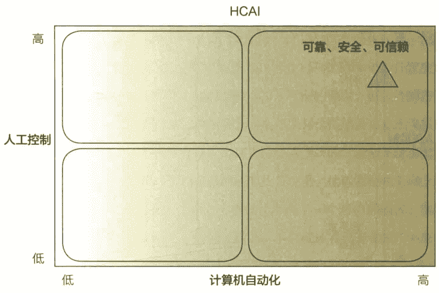

### 图 8.2 HCAI 二维框架：双高区（黄色三角）通往可靠、安全、可信赖的黄金航道

我们的理想目标通常（非绝对）落在右上象限——最可靠、安全、可信赖的领地。右下象限属相对成熟、可预测的标准化任务，如汽车自动变速箱、防抱死制动（ABS）。而面对多变环境下的复杂难题，右上象限为必选项。此类任务涉创造性决策，处于研究前沿；随使用环境标准化推进（如电梯井），可逐步移交高度自动化。

右下象限（图8.3）——高自动化、低人工控制——是计算机全权自主任务的主场，适用于须雷霆出击的场景：安全气囊弹射、ABS、起搏器、除颤器、防御武器系统。此间容不得人工干预。因故障代价极高，此类应用要求极致设计、全谱测试、运行期持续监控迭代。随系统成熟，用户倾向经验证设计，为更高自动化、更少人工监管铺路。

左上象限——高人工控制、低自动化——是人类自主的舞台，创造力在此尽情绽放。骑行、弹琴、烘焙、育儿……容错即体验的一部分。

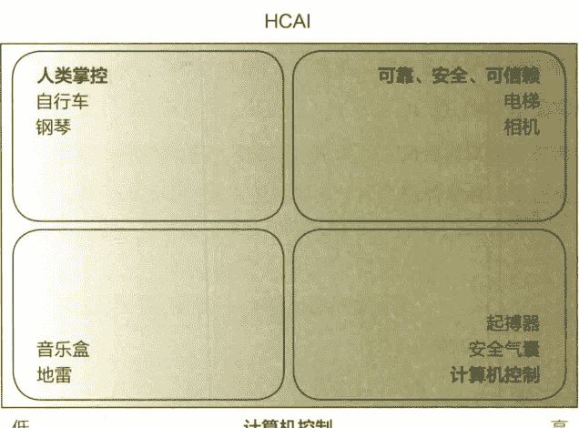

### 图 8.3 极速反应区（高自动/低控制）与 人类掌控区（高控制/低自动）

此间人们从掌控感、技艺精进、心流体验中获取乐愉。一次平安骑行、一曲完美演奏，值得庆贺。虽可借计算机系统训练、复盘、向导，但许多人渴望独立完成以实现自我效能。此处目标在于“过程本身”、个人满足与创造性探索。左下象限则是闹钟、音乐盒、捕鼠器等简单装置，以及地雷等致命装备的安身之所。

另有两大落地因素深度影响三大特质：**传感器精度**与**数据公正性**。传感器漂移或数据源残缺、错漏、偏颇时，人工控制重要性陡增；传感器稳健、数据完整准确公正，则利于推高自动化水平。

设计师获悉：特定任务下，全计算机控制或全人类掌控各有价值。但真正挑战在于：开发经验证的有效设计，并以可靠实践、安全文化、可信监督为辅翼。

除双极端外，尚存两大危险地带——**过度自动化**与**过度人工控制**。图8.4最右侧“过度自动化区”，典型如波音737 MAX控制系统，酿成2018、2019两起空难，夺走346条生命。成因复杂，但设计违背基本原则：单迎角传感器单点故障即触发强制推头，飞行员蒙在鼓里，坠机前拼命拉杆20余次徒劳无功。设计者犯下致命臆断：自动系统不会失效。于是既未写入手册，飞行员也未受过切换手动培训。悲剧本可避免。IBM AI准则警示：“不透明的AI，非道德的AI。”

## HCAI

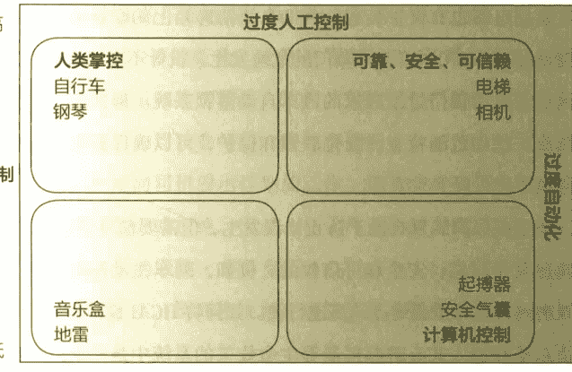

图 8.4 双重“过度”的灰色地带：过度自动化与过度人工控制

注：设计师必须筑牢防线，防范源于过度自动化与过度人为控制（灰色区域）的失效。

虽四象限界限分明，但人工控制与计算机自动化的互动关系远更复杂。人工控制可能要求操作员在车辆、飞机、电站控制中心长时高度警惕，但注意力会涣散，系统需报警唤醒。随计算机控制可靠性跃升，警惕性稀缺问题凸显——干预机会稀少导致技能退化，关键时刻难以快速准确介入。

过度人工控制同样致命。控制面板过于复杂，用户迷失不知所措。英国斯旺西大学哈罗德·廷布尔比揭露医疗设备导致“人为错误”实为设计失职：护士采用静脉注射泵默认设置，误注过量止痛药致死。默认值本应落在安全区，却因设计误导酿成悲剧。

家电亦有护佑设计：自清洁烤箱联锁装置禁启315°C以上开门。但设计不良的联锁令人抓狂，如过度敏感的汽车自动落锁。形式化方法与基于软件的约束——范围校验、广义联锁、保护机制——能强制算法仅接受合规输入、仅产出可接受结果。

# 以人为本：重塑自动化时代的安全与控制新范式

联动防错机制与保护装置虽能有效拦截失误，但其自身的可靠性、安全性与可信度，却仰赖额外的设计考量与监控职能。以列车主动控制系统为例，它能强制限制列车在弯道或终点进站时的超速行驶。然而，如何将以人为中心的人工智能（HCAI）设计理念，深度嵌入航空管制、柔性制造乃至植入式心脏起搏器等关乎生死的关键系统中，依然是一项艰巨的课题。航空领域早已广泛部署联锁装置规避驾驶员失误：喷气式发动机的反推装置，唯有在起落架应变仪确认飞机已着陆的信号触发下，方可启动。

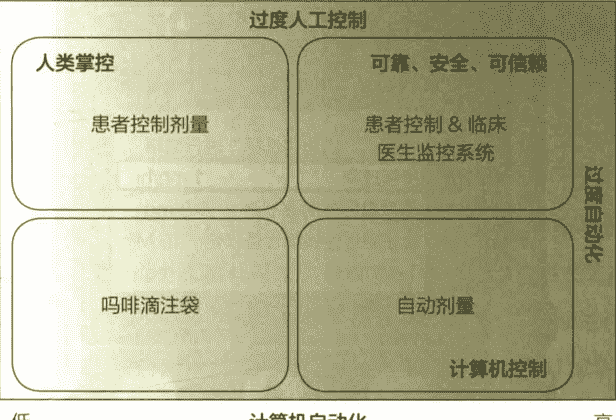

图 8.6 疼痛控制设计的四种方法

盲目追求计算机全自动化同样暗藏险境。美国国家运输安全委员会（NTSB）对 2016 年特斯拉致命车祸的调查报告便敲响了警钟。报告直指核心：“技术可实现不等于系统更优……此次碰撞揭示了在忽视人因工程前提下，引入‘技术可行即上马’式自动化的严重后果。”特斯拉将其驾驶辅助系统命名为“Autopilot”（自动领航），这暗示了其功能远超现实可用水平。官方宣称车辆“几乎能在所有情况下无需人为干预完成长短途旅行”，这种夸大宣传极易诱导驾驶员松懈警惕，酿成隐患。

诚然，转向助力、自动变速箱、防抱死制动系统（ABS）等成熟技术已广获认可；自适应巡航控制虽提升了车速管控，却引入了更高复杂度。新一代辅助系统——如泊车辅助、车道居中保持、主动避撞——正朝着增强人类能力、兜底人类安全的方向演进。

美国公路安全保险协会（IIHS）研究员杰西卡·奇奇诺指出：精准的车道跟踪能最大幅度降低死亡率，后向避撞功能则能显著减少事故总量。她的团队给出了详尽设计建涵：视觉、听觉、觯觉多模态预警；检测驾驶员注意力并维持其驾驶介入度。梅赛德斯-奔驰的主动泊车辅助系统会分步演示规划动作，让驾驶员心中有数，自主决定接管或拒绝——这种“预判路径可视化”正是优秀设计的典范。科罗拉多大学康纳·布鲁克斯与丹尼尔·萨菲尔的研究证实：预测性规划显示显著提升了任务准确率与用户满意度。

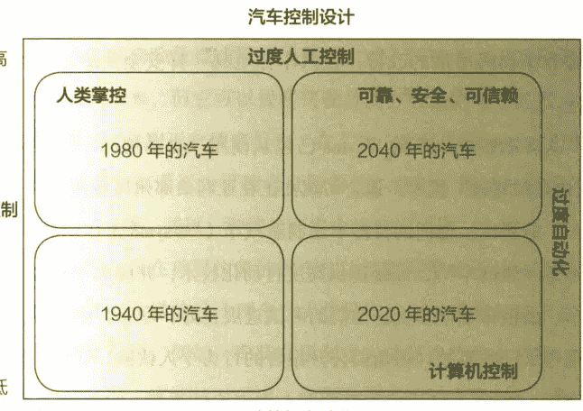

图 8.5 不同年代汽车的人工控制与自动化程度

在特定场景下，AI 能提前 30 至 60 秒预警风险（如识别前方急变道车辆）；但更多时候，系统难以及时发出警报，留给驾驶员的反应窗口极其有限。我们应竭力规避此类盲区：引入车车互联（V2V）共享规避数据，或主动降速策略。车辆虽无法预判山体滑坡，却能提醒急弯、前方 1 公里处的应急车辆、或旁道高速穿梭的车辆。未来，通过自动化减少变道、利用电子通信实现车队编队高速巡航，将成为常态。

与其执着于“全自动驾驶”，不如确立“安全至上”的设计首位目标。遵循此理念，在特定环境（封闭高速、事故多发路口、强光干扰视觉系统时）可优先保障安全，再逐步迭代降低对人工接管的依赖，最终形成类似空管区域中心的“监管式控制”能力。

这些控制中心标志着人类深度参与与授权把控，而非计算机孤立运行。未来的交通管制员将调度数千车流，根据天气路况动态调整限速，指挥应急车辆，复盘未遂事件以优化道路设计与算法。车企也在探索远程代驾：当驾驶员突发疾病或疲劳睡眠，远程安全员可即时接管车辆。

全自动驾驶的执念正让位于以人为核心的理念——保留驾驶员适度控制权以提升安全，同时破解积雪路面、异形车辆、恶意干扰、施工区域等边缘长尾难题。另一系列挑战在于：如何响应交警手势指挥、消防救护特权通行？可借鉴电梯消防钥匙模式：授权警消医人员通过专用终端临时接管周边车辆，激活应急通行模式。随传感器、路侧基建、V2X 通信成熟，让汽车像电梯般安全，正逐步变为现实。

从谷歌独立出来的 Waymo，已将“自动驾驶”表述修正为“完全自动驾驶技术”，并在凤凰城推进“Robotaxi”商业化测试。其定位清晰：“造驾驶员，不造车”，致力于向第三方车型输出高阶自动化方案。测试虽有低速碰擦，但主动公开事故数据的透明度令人钦佩，这是建立信任的基石。Waymo 践行以人为本设计：开发乘客界面支持指定目的地、一键靠边停车、联系远程客服；配备受训安全员作为最后防线；区域控制中心实时监控全队车辆，提供远程支援并沉淀性能数据。这条“高度自动化 + 人工监管控制”路径，极大概率将带来稳步跃升，唯时间表未定。

图 8.7 患者自控性镇痛设备管理员控制面板

图片来源：Smith’s-Medical CADD–Solis。

图 8.8 约翰·霍普金斯医院的朱迪·赖茨（Judy Reitz）指挥中心

图片来源：约翰·霍普金斯医院。

## 第 9 章

### 设计指南和示例

HCAI 的新坐标，终结了长达半个世纪“追求人工智能（AI）”与“追求智能增强（IA）”的二元对立——这场辩论曾被《纽约时报》科技记者约翰·马尔科夫清晰记录。如今显而易见，这种非此即彼的争论毫无必要：设计师完全可以将 AI 算法与交互界面融合，构建 HCAI，从而放大、增强、赋能并提升人类绩效。

谷歌最新设计指南强调抉择的必要性：“关键在于：用 AI 自动执行任务，还是增强人类完成任务的能力……在 AI 驱动产品中，自动化与用户掌控间存在关键平衡点。”指南作者指出：“若把握得当，自动化 AI 与增强型人类协同作业，能简化并优化长周期复杂流程的结果。”这种开放态度值得肯定——二者完全可以齐头并进！

谷歌负责任 AI 网站发布的准则与我的主张高度契合：
- 采用以人为中心的设计方法
- 设定多元指标评估训练与监控
- 直触原始数据（条件允许时）
- 认知数据集与模型的边界
- 反复迭代测试
- 部署后持续监控改进

微软研究掌门埃里克·霍维茨等人奠基的《AI 交互设计 18 条准则》，以直观图形卡片呈现，覆盖初识、常用、异常处理、长期演变全周期。准则精准聚焦用户理解与控制，同时指导系统实现“解释自身行为”与“从用户行为中学习”。

IBM AI 设计平台展开更广泛讨论，提供涵盖设计基石、技术底座、伦理问责、可解释性、公平性的高阶教程。但我公开质疑其建议中“尊重用户本身”并“形成完整情感纽带”的表述——即便措辞调整，仍隐含鼓励用户与系统建立情感依附，这值得商榷。

米卡·安德斯雷的《人类自主系统设计 20 条指南》极具深度，聚焦人类对自主系统的心智模型、复杂度降维、态势感知支撑。例如：“自动化辅助例行任务而非高阶认知”“提供自动化透明度”，并逐条详解。

成功的设计必是可理解、可预测、可控的，能激发用户自我效能感，最终沉淀为可靠、安全、可信赖的系统。这要求对交互微结构精雕细琢，理论源于验证、原则明确、指南可落地。当这些知识内化为偏向人工控制的编程工具链时，应用门槛大幅降低。我提炼的“用户界面设计八条黄金法则”（表 9.1）历经《用户界面设计》多版迭代，至今对 HCAI 系统依然有效。

表 9.1 八条设计黄金法则
| 1. 力求一致性 |
| 2. 寻求通用性 |
| 3. 提供信息反馈 |
| 4. 设计对话框，告知用户任务已完成 |
| 5. 预防错误 |
| 6. 允许轻松地撤销操作 |
| 7. 给予用户掌控感 |
| 8. 减轻用户短期记忆负担 |

UX 设计师尤菲米娅·王推崇遵循上述法则打造高效简洁界面。YouTube 上相关教学、恶搞视频多语种共存，对此我坦然受之。

基于黄金法则的决策常涉及权衡，故而深度调研、创造性设计、严格测试缺一不可。领域专家需持续监控落地设计，洞察问题、驱动迭代。优化空间永存，新需求召唤持续重构。

以下案例阐释核心思想：支持用户通过可视化界面表达意图；听觉、觯觉交互照顾障碍用户（法则 2）；提供机器状态反馈（进度与完成态）。虽现有设计多有瑕疵，但这些正例展示了“高人工控制与高自动化并行”的可行路径。本书第三部分将以超级工具、远程机器人、有源设备、控制中心四大形态深度展开。现择要呈现：

### 示例 9.1：极简恒温器，赋予用户室温掌控权

用户一眼看清实时室温与当前设定值，上下键即可微调。听觉捕捉供暖系统启停声，视觉确认指示灯状态——即时反馈确认指令生效（法则 3）。核心逻辑：知状态、改设定、收反馈、看机器按意图调控。目温达成时，系统进一步确认。恒温器还能自动维持新设定值。虽部分产品反馈机制缺失，但优秀设计让用户明了如何驾驭自动化获取舒适（图 9.1）。新一代如 Nest 学习型恒温器，借机器学习适应作息节能；然人类行为多变（计划变更、新爱好烘焙、来客异需）削弱模型效力，人机平衡之难依旧。

图 9.1 霍尼韦尔恒温器
注：霍尼韦尔恒温器清晰显示室温状态，简洁上下键调温，支持手机远程操控。

### 示例 9.2：白色家电——用户定规则，传感器执行

洗碗机、洗衣机、烘干机、烤箱等，优秀设计下界面易懂可预测。用户表达意图（选模式）、监控状态、随时干预（暂停加碗、切模式烤色鸡肉），掌控感十足（法则 7）。自动化反而让用户更从容地驾驭这些有源设备，确保结果如预期（图 9.2）。

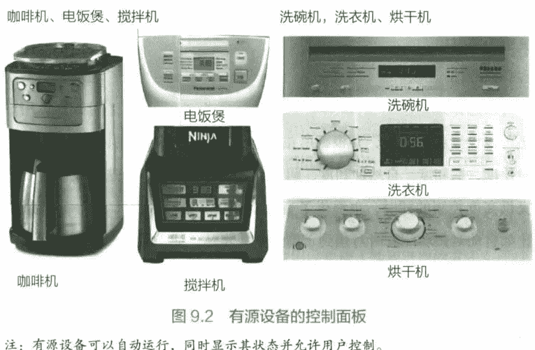

### 示例 9.3：电梯——高自动化下的恰度人工控制典范

双键呼梯（上/下），指示灯亮确认意图被收；楼层显示器报当前层与等待时间。进梯选层，按钮亮确认，门关运行；到层鸣响开门。自动化确保“仅当楼层到位才开门”。三重冗余安全系统兜底断电、断绳不坠落。群控算法基于时段、模式、载荷动态调度轿厢位置。消防/搬运专用键切换特权模式。门区光幕防夹（法则 5）等细节，共同构筑可靠、安全、可信赖的整体体验。

### 示例 9.4：手机相机——高控制感与高自动化的共舞

大键快拍，即时回放（图 9.3）。构图变焦间，画面丝滑跟随，光圈、对焦、防抖、HDR 全自动接管。闪光灯三模可选。人像、全景、视频、慢动作、延时随心切。后期滤镜、亮度、对比度、饱和度、阴影、裁剪、红眼修复一应俱全。用户享受高控制红利的同时，自动化默默托底。偶有对焦误判（锁定灌木而非人），用户点触屏幕即可纠偏。

### 示例 9.5：搜索联想词——推荐系统的轻量实践

输入词干，系统基于大众检索热度补全候选。加速检索、拓展关联话题，用户自主取舍。

### 示例 9.6：拼写纠错、语法检查、机翻——非侵入式赋能的标杆

红色波浪线标红疑错（图 9.4），点击给建议，用户定夺改不改、何时改；译文列表供参考。这些设计在辅助与掌控间找到完美平衡。反观短信自动纠错虽常闹笑话（发送接收双方啼笑皆非），但因其非强制、可忽略特性，依获广泛好评。

### 图 9.3 手机中的相机拍摄界面
注：手机相机赋予极大灵活性，拍摄编辑工具支持标记、调色、变亮、裁剪等。

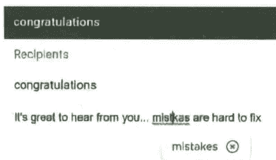

### 图 9.4 拼写检查器用户界面
注：红色波浪线标示潜在错误。点击弹出建议，但保留用户自主决定修改与否、修改时机的权利。

# 八大黄金法则：构建可信赖界面的基石

八条设计黄金法则能指引设计师打造出易懂、可预测且可控的界面。这些原则早已融入主流UI规范，如苹果指南明确主张“掌控权在人，不在程序”，强调赋予用户对工作完整、精细的掌控力。这类指南划清了界限：人工控制的建议与追求机器完全自主的主张截然不同。我认为，这八条法则正是通往大多数用户期望——可靠、安全、值得信赖的系统——的关键起点。

基于黄金法则构建HCAI模式语言，目前仍有广阔拓展空间。模式语言广泛应用于从建筑到社交媒体的各类设计难题，它以简短表达凝练核心思想，为常见问题提供解法，旨在激发设计师的深度思考。

- **1. 总览优先，缩放筛选，按需钻取细节**：这是信息可视化的经典口诀。建议先呈全貌——散点图、地理地图或网络拓扑皆可——帮助用户把握范围与脉络，再支持放大聚焦、过滤噪音，最后通过点击获取详情。

- **2. 预览先行，选定启动，过程可控**：面对时序任务或机器人作业，应先展示全流程预演；用户确认方案、发起执行后，仍能对过程实施管理。导航软件与数码相机的成功即印证了此道。

- **3. 交互面板掌控全局**：无论驾驶汽车、操控无人机还是游戏竞技，用户皆通过面板掌控流程与设备。摇杆、按键、滑块等控件常置于地图、场景或虚拟空间中，AR/VR技术更进一步拓展了交互边界。

- **4. 强传感器留存史迹与审计链**：航空黑匣子记录发动机温度、油耗等关键参数，供事后追溯；车载系统记录数据辅助维保。同理，应用、网站、探索工具乃至ML模型均应内置历史回溯机制，方便用户随时查阅往况。

- **5. 协作共享促生长**：应用应让分享内容、求助协作、共同编辑变得轻松自然。牢记贴纸箴言：“人在回路中，机在圈外。”

- **6. 审慎对待后果**：当系统可能关乎生死、隐私、人身安全时，全周期评估与持续监控不可或缺。引入独立第三方监督可有效降损，谦逊是设计师必备品格。

- **7. 筑牢对抗防御线**：故障源头不止数据偏差与代码缺陷，恶意攻击、破坏分子同样威胁系统安全，需未雨绸缪。

- **8. 加速事件上报闭环**：拥抱用户与利益相关者反馈，捕捉故障与近失信息，驱动产品服务持续进化。

本书后续章节将深入展开这些模式。本章案例展示了成功UI如何赋予用户掌控权，并借力AI方法论获益。

综上，**设计思维**是让AI算法作为HCAI核心组件发挥效能的强力杠杆——它能放大、增强、赋能、提升人类表现。书中超级工具与有源设备案例皆为耳熟能详之作，它们既演示了旧法则的新用法，也证明了新模式语言同等指导价值。

展望未来，用户（含障碍群体）将手握超级工具与有源设备，轻松处理琐事、探索创造、伸援他人。AR/VR助其洞察更清、决策更准、娱乐更富；新型3D打印赋能自造、修复、定制；HCAI服务则引导其达成所愿、共享共创、拓展业务。

---

## 第 10 章 总结与怀疑者的困境

> 我们应敬畏人类思维之能与文明成就之伟。
> —— 布赖恩·坎特威尔·史密斯 《测算与判断：人工智能的终极未来》

我的使命是推崇以人为本的设计，助力设计师打磨更优AI系统。HCAI框架剥离了自动化中的人工控制变量，明确指出：**优秀设计能让高度人工控制与高度自动化并存**。操作员能清晰掌握机器状态与备选项，而错误处理、可逆性等机制则为设计提供坐标。在适配场景下，良好的自动化保留人工介入口，反而能提升性能、激发创新。

该框架厘清了三类关键决策点：
1.  **何时需机器极速自主**；
2.  **何时人类需最大掌控权**；
3.  **何处存在过度自动化或过度人控风险**。

同时指导跨平台设计抉择：
① **消费/专业级应用**（推荐、电商、社交、搜索）造福大众；
② **关键领域应用**（医疗、法律、环保、金融）利弊并存；
③ **生命攸关系统**（车、机、轨、军、起搏器、ICU）容错为零。

HCAI立足“人机异质”认知：善用算法、大库、传感、富显示、强效应器等机器独有能力，提升人类表现；同理，设计中识别人类独有潜能（创新用法、持续改良、突破性重构），同样构建优势。

**前沿研究方向**包括：制定控制权与自主度的客观度量，推动更有建设性的设计对话，完善指南与理论；另一驱动力是**问责机制**——详尽审计链、一致状态反馈、事件采集策略，既支撑培训与重构，又能降低故障率。但棘手难题犹存：自动化失效时如何保障人类接管力？如何对抗“去技能化”导致的能力退化？低频操作下如何维持操作员警觉性（如自动驾驶接管时的注意力保持）？

伦理原则（责任、公正、可解释性）提供宏观指引，结合产品设计的深度经验方能落地为可操作指南。HCAI为这三者奠基，本书第四部分专门探讨如何跨越伦理与实践的鸿沟。

以人为中心的系统将因四大支柱而更可靠：
① 成熟软工实践筑就的**可靠系统**；
② 业务管理策略培育的**安全文化**；
③ 独立监督背书的**可信认证**；
④ 政府法规护航的**合规基线**。
得益于故障与近失监控机制，HCAI系统将实现快速迭代。

对于追求综合人类智能、感知、决策与自主行动的激进派，HCAI框架显得保守。他们倾向于设计无需人工监管的全自主系统，聚焦机器自主而非人类自主，坚信完全可靠系统可构建，从而在关键应用中忽视审计链、面板、上报机制的建设。

部分质疑者认为二维HCAI过于保守，提出三维或更精细模型——构想虽好，但需案例支撑。亦有人嫌案例界面过于简单，这或因案例仅覆盖AI系统常见子集，我欢迎更多自主系统的创新设计分享。卓越设计的核心在于兜底基础故障（断电、掉线、元件损坏），亦需大量投入防御对抗性攻击。

当AI研发者思维从一维“自动化等级”跃迁至二维框架，或能寻得破局新径。HCAI指导设计师在给予高度自动化的同时，保留用户适度控制权。技术落地后，将显著放大、提升、增强、赋能用户表现。

此外，设计师可依托初版八大法则或新HCAI模式语言，构想未来超级工具、远程机器人、有源设备与指挥中心，改善民生，助推联合国可持续发展目标。

---

# 第三部分 设计隐喻

### 乔布斯的自行车与豪华轿车

乔布斯曾喻计算机为“思维的自行车”，直指设计终极目标：**增强人能，保留掌控**。如今计算机更似“思维的哈雷摩托”，然有人预言未来将变为“思维的司机驾驶豪华轿车”，自动抵达终点。HCAI框架助我们辨析骑行与乘车之别：自行车虽愉悦健康，豪华轿车虽舒适安全，但若司机忽视刹车请求，乘客如何表达意愿、施加影响？人类需求复杂多变：有时享受驾驶乐趣、磨练技艺；有时渴望休憩、阅读、社交。

**民航隐喻**或许更贴切：大型客机在空管与适航认证双重专业监管下，舒适、快速、安全送达，乘客无需学飞行。这对应HCAI框架右上象限——高自动化下的专业监管响应。

读者或思：民航安全靠自动化还是飞管监管？**答案是缺一不可**。自动化执行常规巡航，释放飞行员精力监控系统；但面对起火、旅客突疾、鸟击停车等数百种意外，仍需资深专业人士迅速抉择。

虽隐喻有界，但其传思价值与启新功不可没。第三部分建立在HCAI框架之上，直指两大设计目标：

- **科学目标**（不列颠哥伦比亚大学 David Poole & Alan Mackworth）：探究“智能行为的计算代理”，揭示自然/人工系统智能涌现原理，通过设计、构建、实验实现通常需智力的任务（如下棋、识瘤）。常基于人类感知认知运动研究，造系统媲美或超越人类。
- **创新目标**：开发增强人类能力的计算机，支持人自主完成工作。源自广泛应用产品的研发。成功案例：地图导航、机翻、搜索引擎。

双目标均为未来技术隐喻提供坐标，难点在于辨识**各自最佳适用场**与**组合策略**。如相机对焦光圈宜自动，构图与“决定性时刻”按压快门宜人控。

这两大目标衍生出四对HCAI设计隐喻，各有千秋：
1. **智能代理 vs 超级工具**——前者主机器独立行动，后者重人工驾驭；
2. **队友 vs 远程机器人**——前者拟人协作，后者人操机执；
3. **确定性自主 vs 控制中心**——前者靠设计保安全，后者靠人控监控干预；
4. **社交机器人 vs 有源设备**——前者拟人社交，后者如洗碗机/烘干机般专用可靠。

这些隐喻通过差异化方案响应环境需求，完善HCAI框架。核心思想是**组合设计**：可靠执行任务交自动化，用户想管任务留人控。这让功能分配更细致——哪些机器靠谱，哪些人类必管，一目了然。

在推荐、问答、游戏等**容错场景**，用户能容忍瑕疵甚至享受惊喜；但在医疗、交通、金融等**高后果/生命攸关场景**，正确性与可预测性是信任基石。

本书主张**跨学科交叉新范式**：以人为本方法与AI算法深度融合，作先进系统成功设计的关键拼图。

---

## 第 11 章 AI研究的终极目标是什么？

> 委托任务予代理（无论人造或人类），后果仍由委托人承担；若偏预期，委托人担责……自主自适应交互系统难验证、难预测，易生异常行为。
> —— 弗吉尼亚·迪格努姆 《责任与人工智能》

AI科研目标至少溯源60年前图灵之问：“机器能思考吗？” 简言之，科学目标是让计算机具备人类感知、认知、运动同级或超越能力。

**图灵测试**曾为起点：键盘屏幕对话中，观察者无法分辨对象是人是机，即通过。后衍生出图像逼真度、拟人机器人等变体。斯图尔特·罗素力挺“仿真科学”与“社会创新”双轨，视AI为“理解人智主要径路，改善人类处境、创造更好文明的绝佳良机”，亦警示赋智风险。

科学攻关覆盖感知、认知、运动：模式识别（图像/语音/人脸/信号）、NLP/机翻、精准预测、拟人机器人表现、情绪计算响应、博弈游戏（跳棋/象棋/围棋/扑克）超人表现。

早期符号主义让位于**统计学习/深度学习**——从海量数据训练神经网络。技术栈持续迭代：GAN、CNN、RNN、逆强化学习、基座模型及变体。

远见卓识催生振奋项目。支持者称AI为人类史上巨大希望转折点；批评者指出多项目夭折（新方向常态），但也有光学字符识别、语音识别、机翻等广泛落地商业成功案例。虽不完美，却令人印象深刻。

**大胆野心有益，但另一批评声称：AI科学路径失效，为传统工程方案所取代。**
- **深蓝击败卡斯帕罗夫**被视为AI胜利，但核心成员许峰雄澄清：**未用AI方法**，靠专用芯片暴力搜索20步以内棋局。
- **商业定价折扣系统**：基于知识的专家系统失效，精心构建的**规则工程系统 + 人工规则库** 成功落地，保障报价一致性与客信。

近期矛头指向**深度学习脆弱性**——实验室优等生，实战掉链子。Marcus & Davis 教授复盘明斯基/麦卡锡/西蒙等先驱高期望落空（西蒙1965年预言“20年内机器包揽人类工作”），列举识图出错、种族歧视、医疗建议失误、自驾撞消防车等案例。虽持乐观，吁重启研究、攻克常识推理。

科学家 Mitchell Waldrop 承认“深度学习极强”，但列举失败案，“超人类尚远”，建议改进策略、扩数据、积极迎战。

**60载春秋，AI仍在襁褓。** 我盼AI成功，主张**HCAI设计流程**为正途：引入利益相关者共设、UI与面板迭代测试、提升算法透明度、赋予人类更大控制权。我构想可解释界面、故障近失审计链、独立监督决策指引（详见第四部分）。**以人为本设计思维 + 顶尖AI方法 = 推动有益技术跃迁的核动力。**

这些争论深刻影响政府科研、商业巨制、学术教学与公众认知。本章将繰杂目标收敛为**科学与创新**双轨，描述四对可高效组合的设计可能（见下表）。组合设计允许视场景动态调整自动化/人控比重，精细裁决功能归属——机器靠谱做什么，人类必须管什么。

### 人工智能研究的两大目标

| 科学目标 | 组合设计 | 创新目标 |
| :--- | :---: | :--- |

# 破解 AI 设计的“双生悖论”：从拟人到赋能，寻找最优平衡点

| 智能代理 思维机器、认知行动、类人智慧、知识渊博 | | 超级工具 能力延伸、用户赋能、极致人效 |

| 队友协作 合作者、同事、得力助手、智慧伙伴 | | 远程机器人 精密仪器、强力假肢、感知与运动的超越 |

| 完全自主 独立决策、自我目标、自我监控 | | 控制中枢 人机共治、态势感知、主动防御 |

| 社交机器人 拟人化、仿生学、类人形态、受生物启发 | | 有源设备 面向大众、场景多元、低门槛、直观交互 |

**图 11.1 科学与创新双轨并行的术语体系与设计隐喻**

这四组对立统一的设计隐喻，如同指南针，为不同应用场景的研发指明了方向，助力研究者打造出经得起考验的可靠、安全、值得信赖的系统——尤其是在关乎生命安危的关键领域。卓越的设计终将惠及商业、教育、医疗、生态及社区安全等社会各层面。

第十二章将深度剖析“具备思考能力的计算代理”这一科学图景：其核心在于解码人类感知、认知与运动的奥秘，以构建媲美甚至超越人类的自主执行体系。同章亦将梳理创新图谱——借助 AI 赋能产品与服务，核心底线是**始终保持人类的主导控制权**。双轨并行，均需科学、工程与设计的多维支撑。

第十三章聚焦“融合之道”：如何取长补短？追求科学目标者雕琢“认知计算机”，赋予其聪慧、博学、深思熟虑的特质。但这类拟人化产物虽能在特定任务称雄，却易引发用户的不信任、恐惧与焦虑。创新派则主张打造“超级工具”，放大、增强、赋能人类表现。融合策略的典范是：以 HCAI 界面为壳，内嵌 AI 服务（如智能短信、搜索建议），并用 AI 优化后台复杂网络的存储与传输调度。

第十四章发问：将计算机视作“队友”是良药还是毒药？何时“人机对话模拟人际对话”奏效，何时又暗藏危机？创新派研发“远程机器人”，旨在延展人类能力、提供超人类感知运动支持、成就人人协作。融合实践在于：以科学目标的算法驱动内部自动化服务，托举人工控制。车道保持、泊车辅助、防撞系统皆是佐证——**“内置 AI”满足用户掌控欲，让用户洞察当下、预判未来、关键时刻夺回控制权。**

第十五章对决“完全自主”VS“控制中枢”。科学目标追求零人工干预的自主性；创新目标构建高自动化下的“人工操控台”，操作员掌舵而非甩手。融合路径：算法输出高度自动化功能，界面保障人类监督权。NASA、工业能源、军事指挥、空管中心均采此制——AI 优化性能，操作员拥有清晰心智模型，**可预测性是人类操作员最珍视的机器品质。**

第十六章回溯“社交机器人”百年追梦史与“有源电器”的市场胜利。科学派痴迷拟人；创新派推崇“可操纵工具”，在救灾、军事等极端场景展现灵活机动。融合设计可从成熟的类人服务（如语音助手）切入，植入有源设备，将核心控制权交还用户。创新思维更赋予设备超人类能：四足/轮式机械征服崎岖洪水、钻狭隙、举重物；红外夜视、高灵敏拾音、火星探钻、手术烧灼——**超人类传感与效应器，才是实战利器。**

洞悉双目标优势，能激发“组合设计”新思维，应对多变环境，筑牢可靠、安全、可信的系统基石。第十七章将总结设计平衡术，推动科学与创新两大阵营达成愉快共识。

---

## 第 12 章

### 双轨并行：科学探幽与创新致用

AI 领域目标林立。Russell 与 Norvig 在教科书中列举四象限：“像人类一样思考/行动，理性地思考/行动”。Poole 与 Mackworth 则将科学目标定义为研究“智能行动的计算代理”，旨在揭示智能行为涌现的原理，并通过设计、构建、实验，攻克需智力参与的任务。

另一路径视 AI 为**人类能力的延展器、创造力的放大镜**。为聚焦核心张力，本书锚定“科学”与“创新”两大坐标（注：研究者常兼具二者，或游走其间，此处分野旨在厘清本质差异）。

#### 科学目标：复刻与超越人类

核心命题：**解码人类感知、认知、运动，构建媲美/超越人类的执行实体。** 版图涵盖社交机器人、常识推理、情感计算、机器意识至通用人工智能（AGI）。

追逐者怀揽百年千年宏愿，坚信人类终将被精准模拟。主流学者视人类为“极度复杂的机器”，构建精确仿真系统被视为终极挑战。他们对“人类例外论”持怀疑态度。《AI 100 报告》直指本质：人脑与计算器差异非品类之分，乃规模、速度、自主度与普适性之别——**人机思维同属一范畴**。

造人梦由来已久。奥克兰大学医学研究员 Elizabeth Broadbent 直击人心：“与机器人互动，揭示的是我们自己的真相。人类有创造的本能，终极创造是‘造人’。”（戏称典型父母心理，亦警醒 AI 研究者的深层动机）。

此梦驱动术语与隐喻的强烈偏好：**智能机器、智能代理、知识丰富的效应器、“学习”与“训练”暗喻孩童成长。**

性能对标成常态：肿瘤科医生 VS AI 筛查乳腺癌。媒体热衷“竞赛叙事”：《纽约时报》叹“机器手进化做人事”，《周刊》警“机器阅读超人类，百万岗位岌岌可危”。Marcus 与 Davis 在《重启人工智能》中忧虑：媒体过度渲染致公众盲目迷信 AI 而非看清现实。

科学派设想：**机器人=队友/伙伴/合作者；系统=独立自主、自设目标、自我监控。** 区分“自动化”（按预设执行）与“自主性”（基于新感知数据生成新目标）。拟人/仿生社交机器人是具身智能的载体。

部分学者、法学家、伦理学家甚至预言：未来计算机将享有法人权利与责任，道德算法可内嵌代码。此议题虽热，超出本书“短期研发与次世代设计指导”的范畴。

#### 创新目标：工具本位，人本落地

亦称“工程目标”。驱动力：应用 HCAI 方法论，**量产广泛使用的产品与服务。** 隐喻体系：工具、远程机器人、有源设备、控制中枢。统称**“超级工具”**——仪器、App、矫形器、假肢、外骨骼、云端服务、智能家居、柔性制造、虚拟助手。

**同一场景，两种范式：**
*   科学派机场助手：拟人机器人迎宾、领票、引航、自然语聊。
*   创新派超级工具：手机 App，集定制地图、安检排队实时、航班动态于一体。

创新派深研人类行为与社会动态，洞察接受度。以需求为锚，联合领域专家攻真题，以规模化落地为荣。起步三问：**任务是什么？用户是谁？社会/环境影响几何？**

**核心主张：高人工控制 × 高计算机自动化**（本书二维框架基石）。清醒认知极端场景：安全气囊/起搏器需毫秒级全自动；骑行/弹琴需纯人工。两极之间，存在广阔**融合设计空间**。防人为失误的联锁、防系统故障的熔断，寻找平衡点，铸就可靠、安全、可信系统。

方法论上拥抱 HCI：**设计思维、用户观测、体验测试、市场研判、持续监测。** 洞察用户偏好：**可理解、可预测、可控——源于提升技能、自我效能感与创造性掌控的渴望。** 坚持“Human-in-the-loop”，尊重可解释性需求，确立**唯有人类/组织可担责**原则。推行审计追溯、产品日志、黑盒记录，支撑事后取证，护航生命关键应用（起搏器、自动驾驶、民航）。

**创新往往站在科学肩膀上：**
*   语音识别基础研究 → Siri/Alexa/Google Home/Cortana。但从实验室到“懂引导、优雅兜底”的产品，需海量设计打磨，并接入维基百科、新闻、字典等网络资源。
*   机器翻译 + 优质 UI → 成功服务。
*   图像理解 → 自动生成 Alt 文本，助残障者“看见”网页图像。

科学派演示双足奔跑、情感面孔的自主社交机器人；创新派实战却常被**四轮探测器、履带车、无人脸无人机**取代。“手术机器人”实为**远程机器人**——让医生在狭窄腔内精准操作。

科学派梦想“通用社交机器人”端茶送货救灾；创新派深知**场景定制无替代**：灵巧手、负重、狭窄空间机动，需专用设计，而非通用人手。

Lewis Mumford 在《技术与文明》中《万物有灵论的障碍》一章直指痛点：早期技术常被拟人/拟兽模型误导。他用“分离”描述机器从拟人向实用演进——四轮胜双足重载远行；飞机有翼但不振翅。**“最无效的机器，是对人/兽的逼真机械模仿。”** “圆周运动是成熟机器核心属性，却在自然界罕见。” 结论：**万物有灵论阻滞发展数千年。**

**满足需求的路，不在拟人。**
创新派以协作软件连接人：Google Docs 共创、共享库联科研、媒体升级促沟通。疫情催化：Zoom/Webex/Teams 爆发，教学上云，MOOC（可汗学院/edX/Coursera）以即时反馈、自主节奏、分级挑战重塑学习。居家办公成常态，云聚餐/云婚礼/云葬礼/云镇民大会重构社交。Zoom 疲劳与云端治愈并存，Kumospace/Gather.town 游戏化界面开拓新境，大型会议兼顾分组讨论成新课题。

社交平台（Facebook/Twitter/微博）借 AI 连接亿万用户，激活商业、社区、公民科学。然隐私窃取、数据掠夺、监视资本主义、虚假信息、极端渗透成顽疾。**算法与 UI 造祸，亦可治愈——前提是引入人工审核与独立监督。**

Mumford 启示延伸：**矫形器（眼镜）、假肢、外骨骼**——使用者视其为**能力延伸的工具**。

接下来四章，将深度拆解指引 AI 与 HCAI 研究者、开发者、决策者的四对核心隐喻，提供多维视角，助力设计师因地制宜，融合精华。

---

## 第 13 章

### 智能代理 VS 超级工具：从“电子大脑”到“能力延伸”

20 世纪 40 年代，现代计算机诞生，即被冠以**“神奇思考机”“电子大脑”**。George Washington 大学教授 Dianne Martin 惋惜：“25 年态度研究显示，‘神奇思考机’神话阻碍了公众职场接受度，却催生对解决复杂社会问题轻松搞定的虚幻期待。”

1950 年，Alan Turing 抛出“机器能思考吗？”，引爆图灵测试/模仿游戏。虽自列反驳，结语却透愿景：“愿机器终在纯智力领域与人竞争。” 科学派接力，攻克下棋、识图、客服等人类任务。批评者斥测试为“无用干扰/宣传噱头、规则不清”，但 Loebner 奖（1990-）与《AI Magazine》专刊（2016）持续造势。媒体理论家 Simone Natale 直指要害：**图灵测试是陈旧骗局，利用人类乐于接受模拟意图、社交、情绪的心理弱点。**

1960 年，J.C.R. Licklider 提“人机共生”，愿景更早且微妙：**承认差异，定协作伙伴——机管常规，人掌洞察决策。**

“聪明、智能、知识丰富、思考”等词汇狂欢，催热“机器学习、深度学习”，植入“计算机在受训/学习”认知。神经科学“脑=神经网络”隐喻，更强化“机似人”认知。

IBM 推“认知计算”标榜 Watson，然 2020 年其 AI 转型设计总监坦言：**“术语过于混乱，大众难懂。我们说 AI，实指增强智能。”** Google 以 AI 强著称，今重“PAIR（人与 AI 研究）”。**创新派共识：商业产品中，AI 叙事必须与以人为本融合。**

媒体爱造“会思考的机器”封面：1980《Newsweek》、1996《Time》问“机器会思考吗？”——**叙事惯性至今未减。**

# 别再把算力当“人”供：从“搭档”到“强力工具”的认知破局

视觉创作者与影视工业长期联手，在大众脑海里植入一根深蒂固的执念：智能体必须长得像人、想得像人。平面设计热衷画机械臂握人手、摆罗丹《沉思者》造型；好莱坞更量产出HAL 9000、C-3PO、终结者、WALL-E、萨曼莎等一长串“硅基生命”图谱。这种拟人化叙事，让“电脑正在觉醒”成了某种集体潜意识。

媒体标题更是推波助澜：*“机器学习搞化学”“哈勃意外寻获新星系”“AI挖出致病基因”*。主语全是机器，谓语全是“发现、学习、创造”。多大教授B.C.史密斯早已警示：论及电脑能力时应禁用“知道、阅读、解释、理解”等人类专属动词。可标题党不听，受众爱看，于是“硅基超人”坐实了。

另一条赛道始终清醒：**电脑是“强力工具”，而非“硅基同类”**。  
MIT CSAIL主任丹妮拉·罗斯直言：“AI只是工具，核心价值在于赋能人类。”  
道格拉斯·恩格尔巴特1968年“母Of All Demos”演示的正是“增强人类智力”。  
《纽时》科技记者约翰·马尔科夫在《与机器共舞》里梳理了AI与IA（智能增强）的百年拉锯。

1997年，我与MIT媒体实验室梅斯的一场辩论，把这对矛盾摆上台面：  
我主张**直接操作**——给用户按钮、滑块、面板，让人高度掌控强自动化；  
她主张**软件代理**——机器摸清你的习惯偏好，主动替你决策、执行。  
25载过去，辩论未停，只是换了马甲：现在叫“Agentic AI”与“Human-in-the-loop”的博弈。

---

## 现实注脚：工具派才是主流

打开App Store的300万款应用，底层塞满深度学习，界面却全是**可预判、好懂、用户掌控**的工具范式。苹果《人机交互指南》写得明白：“掌控者是人而非App……让App接管决策通常是错的。”

**无障碍设计是最硬核的证明。**  
机舱内，一位拄白杖的视障女士熟练用屏幕阅读器写公务报告、改排版。她是犹他无障碍机构主管。她说：“标准化规范与普通便携机功能，让我以专业身份全然参与。”  
**同一套“用户掌控”准则，让健全人好用，也让残障者能用。** 这就是工具观的普世价值。

---

## 三种“融合设计”范式：把AI藏进工具里

科研目标（造聪明机器）≠ 创新靶向（造好用产品）。聪明设计师把二者拼装：

| 范式 | 核心逻辑 | 典型案例 |
|------|----------|----------|
| **AI做内核，人做界面** | 后台跑复杂算法，前台给明确选择权 | GPS导航、网搜、电商、推荐引擎、拼写纠错 |
| **设备级融合** | 高自动化+人类关键决策 | 手机相机：HDR光控、防抖、聚焦全自动；构图、模式、滤镜、发帖全由人控 |
| **强力工具+智能教练** | 工具主体+主动建议，人保留否决权 | 语法核查、音乐滑块、钢琴陪练指正跑调处、瑜伽动作提醒再弯膝 |

**原则只有一条：建议温和呈现，决策权永不下放。**

---

## 第十四章 搭档 vs 遥控机械：别让隐喻绑架设计

### “纳斯谬论”警示
斯坦福纳斯团队的多项心理学研究显示：当电脑被设计得像人时，用户会以得体社交方式回应参与。  
**谬论在于：** “既然人爱社交，就该把机械人做成社交搭档。”  
**反证：** 纳斯晚期与格鲁姆合作承认——*“机械人当搭档失败了。把机械人说成搭档，暗示它能扮演人类角色、完成任务，并诱导人把机械人当人类搭档对待；期望落空，负面反应在所难免。”*

密歇根大学校长内尔·罗伯特警告三大副作用：  
1. 情感依恋导致误用  
2. 责任归属模糊  
3. 使用认知扭曲

克莱因团队明列“机器像搭档般高效工作”的十大现实挑战，直指**可预判性、可控性、目标协商**——本质全是“工具属性”指标。

### 我的立场：遥控机械 > 搭档
**“电脑非人，人非电脑。”**  
苏塞克斯大学长期研究创造力与AI的博登更犀利：**“机械人根本非人类。”**

| 维度 | 搭档隐喻 | 遥控机械/强力工具 |
|------|----------|----------------------|
| **责任** | 模糊不清 | **人类全权担责**（法律、道德、军规皆如此） |
| **能力** | 模仿人类 | **发挥机器独有优势**：算法、海量库、超强感、强效应 |
| **创造** | 妄想机器创造 | **人类是创造主体**，机器放大、增强、授权、提升 |

**实战铁证：**
- F-35战机、登月器、“火星车”：**高自动化+人类最终掌控**  
- 美军将“UAV”改名“RPA”（遥控飞行器），**为的就是锁定责任链**  
- **达·芬奇手术装置**：官方声明“机械人非您的主刀医生，乃外科医生经达·芬奇系统远程控制台用器械完成手术”  
- **彭博系统**：超30万用户年付$2万，买的就是**空间稳定、平铺不重叠、数据密集、人掌控**的强力工具交互面

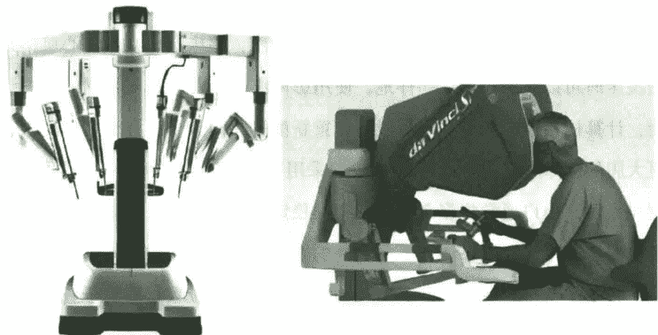

### 图14.1 美国直觉外科公司达·芬奇手术系统

许多机械设备虽自动化程度高，仍保有强大远程操作能力，供操作员执行控制。  
如无人机即遥控机械，虽能自动悬停、定高巡航、返航、遵循操作员选定航路点。  
NASA“火星车”兼具遥控与独立移动能，靠传感器探测障碍或悬崖并规划避障。  
NASA喷气推进实验室控制中心有数十操作员，即使“火星车”在数亿千米外，仍能控其各系统。这是高度人工控制与高度自动化融合的又一佳例。

“遥控机械”、“远程呈现”等术语暗示另一设计可能。这些仪器可远程操作，让操作员更精细控制设备。如远程病理学家控制显微镜研究组织样本。融合设计采用搭档模型，虽有限但成熟且具验证功能，嵌入设备，经直接或远程控制增强人类表现。

视电脑为搭档的另一路径：从海量数据库与超人类传感器提供信息。当复杂算法结果显示在信息密集显示器上，如用伪色显血流量的3D医学超声心动图，临床医生做心脏治疗决策时更自信。同理，用彭博终端取金融数据的用户觉：电脑让他们在买股票或调配共同基金组合时做出更大胆选择（图14.2）。彭博终端用专用键盘及一个或多个大屏，用户常将多窗口按空间稳定方式排布，知所需内容位置。平铺而非重叠窗口，让用户快速找到所需，无需重排窗口或下滚。决策所需海量数据易查看，点一窗口即在其它窗口生成相关信息。故超30万用户年付2万美元在工位用此强力工具。

### 图14.2 彭博终端显示机
注：面向金融分析师的彭博终端显示丰富数据，排布成空间稳定且平铺不重叠的窗口。

总之，“搭档”隐喻的持存对许多设计师用户有吸引力。虽用户可自由将电脑称为搭档，但利用电脑独有功能：复杂算法、海量数据库、超人类传感器、信息密集显示器、强大效应器，设计师或能开发出更有效的遥控机械，被用户视为强力工具。

---

## 第十五章 确定的自主性与控制中枢：别被“自主”忽悠了

电脑自主性是许多AI研究者、开发者、记者、推广者追求的吸引人科学目标。过往关于电脑自主性的描述，正被更强调确定性与自主性的讨论取代，这与越来越多团队个人启用控制中枢形成对比（图11.1）。

电脑自主性已成广泛用语，指不直接受人控制、独立运行的机器。美防务科学委员会定义如下：  
自主性是将决策授权予受权实体，在特定边界内行动。重要区别：受规范约束、不得偏离的系统是自动化，非自主。欲达完全自主，系统须有能力依其对世界、自身、情境的认知，基于知识理解，生成备选方案并抉择，以达目标。

但美防务科学委员会提醒：遗憾的是，“自主”常在媒体及一些信息化军事领袖思维中被误解为电脑能独立决策、不受控制行动。需明确：所有自主系统皆在一定程度上受人类操作员监督，且自主系统软件中设定了对电脑行动决策的限制。故自主性本身解决不了任何问题。

此提醒强调一现实：让人机嵌入复杂组织社会系统中相互依赖，也成重要目标。既然人类仍是责任主体（法律、道德、伦理上），电脑岂不应以确保用户掌控的方式设计？  
融合设计立场是：若某功能可理解、可预判、可控，则可完全自主；同时让用户掌控那些不可靠或关键的功能。

---

**下一站（第十六章）：** 我们将拆解“拟人机械人”在娱乐、碰撞测试、医疗模型之外的**全线溃败**，并看看真正的“具身智能”长什么样。

## 第十六章 社交机器人与有源装置

尽管学界与业界对完全自主系统的追捧从未降温，且常将其视作极具价值的研究靶心，但其在实战中的表现却令人捏一把汗。高频自主金融交易系统已酿成数十亿美元级别的重大事故，更让人不寒而栗的是自主系统导致的致命悲剧：伊拉克战争期间“爱国者”导弹误击两架友军战机、2016年特斯拉Autopilot模式下的撞车身亡案，以及2018年底至2019年初波音737 MAX连环坠机——罪魁祸首是机动特性增强系统（MCAS），它甚至在瞒过飞行员的情况下强行夺走飞机控制权。

德州农工大学教授罗宾·墨菲提出的“自主机器人定律”一针见血地指出了症结：“任何机器人系统的部署都无法达到预设的自主等级，反而因与人类解决问题者的协调不足而导致事态恶化。”

现实派创新者反复敲响警钟：计算机完全自主暗藏杀机。早在1983年，就有评论揭示了自主性的悖论——它非但未减轻操作员负担，反而因需持续监控机器而增加了工作量。操作员陷入焦虑困境：他们不知系统下一步将作何举动，却须为后果买单。更棘手的是，人类在闲置时难以维持警惕，危机降临时难以秒级接管，且长期不操作导致技能退化，这些“警惕性悖论”、“接管难题”与“去技能化”至今仍是核心痛点，因为责任始终在人。

在振聋发聩的《自主系统的七个致命神话》中，杰夫·布拉德肖、罗伯特·霍夫曼、大卫·伍兹、马特·约翰逊组成的团队直指要害：“最糟糕的莫过于所谓的智能机器，它既不告知你在做什么、为何而做、何时了结，更无法在事态失控（这不可避免）时响应人类指令。”他们更痛批信奉完全自主者“陷入自主神话，自害害人……因衍生出无数严重误解与后果”。

即便是人因工程权威米卡·安德斯雷教授，也直陈自主目标的困局：“系统自主性越高，可靠性虽增，但人类操作员的态势感知骤降，关键时刻平稳接管手动控制的概率也随之骤减。”安德斯雷主张保留监督式控制，这种混合设计更贴近实战。另一权威彼得·汉考克在2022年硬核评论《规避不利的自主代理行为》中再敲警钟，担忧自动设备陷入“近乎无法规避”的境地，呼吁废除或严格限制其能力。

致命性自主武器系统（LAWS）的争议持续发酵，此类武器可无人干预下选靶发射。禁令推动者仿照禁地雷公约集结近5000联名，联合国《特定常规武器公约》日内瓦会议聚集125国代表起草限制条约，认知科学报告佐证其失效风险与代价。但军方担忧对手抢跑而拒受约束，限制协议进展迟缓。

笔者亦认同，计算机自主在重复、危险、高难任务中极具诱惑力。我渴望一辆能避免地库刮蹭柱子的自动驾驶车，这类人为失误可通过防错设计规避。在关键与生死攸关领域，“安全第一”当为首选策略。

“确定的自主性”概念近期热度攀升，如2020年2月计算研究协会凤凰城研讨会即聚焦此题，保留该术语并倡导以人为本、形式化验证、大规模测试与独立认证。报告明确：“自主系统故障的法律道德责任仅归属自然人与组织，设计开发者须接受法律责任原则培训。”

我赞同上述主张，但更青睐“监督自主性”术语，落地依托控制面板与控制中心。其内涵二：一是人类通过可视化面板或远程中心实时监控性能，以便及时干预保结果；二是自动采集审计日志与产品日志，支撑事后溯源分析（详见第19章“审计跟踪与分析工具”）。远程中心可同时管控车队、列车组、ICU或通信网络。

“确定的自主性”仍有拥趸，如约翰霍普金斯确定自主性研究所成立，官网称“未来靠可靠技术、严谨工程与原则政策”；英国UKRI巨资推动“可信赖自主系统”研究。但我担忧这些措辞过度承诺，误导开发者以为少量人工监管即可构建高可靠系统。

反观“监督自主”、“灵活自主”、“共享自主”、“并行自主”、“分配自主”等术语，明确传递出：人类自主同等重要。另一愿景是：控制中心提供人工监督，支撑持续态势感知，给清晰事件演进模型；面板提供详尽反馈，审计跟踪便于复盘。谢里丹对监控、遥控机器人与自动化的广义阐释，正是试图在手动与全自动之间划定责任边界，厘清人类对工业中心、机器人、电梯、洗衣机运行的责任。

控制中心隐喻指：人定目标、机执行可预测任务、传感器引导、效应器执行底层动作。汽车自动变速箱即成熟成功案例——高度独立运行。社交媒体电商中，用户发帖下单、收反馈（好友动态、发货延迟）。成熟系统中，用户持有清晰心智模型，系统以联锁防误操作、报警示异常、保留人工干预入口。

现代控制中心内涵更宏大。商业航空包含多层人控：机长副驾、塔台管制、20个协调全美领空的区域中心。监管链条覆盖机型认证、飞行员考核、飞行数据记录仪复盘以防未遂事故。医院、交通、电力、股市、军事等复杂系统均设多级控制中心，内嵌众多AI组件。

组合方案呼声渐高，如麻省理工丹妮拉·罗斯构想的“并行自动驾驶”：人主控、机微介入，危急时刻通过刹车规避碰撞。这种“安全至上”车观在第16章将讨论的移动与社交机器人领域同样适用。

综上，虽“确定的自主性”热度不减，但对多数场景，控制中心能提供更优人工监督机遇。系统需自主快速响应时，高度警惕与持续性能审查是安全基石。术语不重要，关键在于设计者找到可靠、安全、可信策略，辅以充分测试、用户反馈、审计跟踪与问题公开。

### 社交机器人的演进脉络

第四隐喻指向社交机器人，这概念流行许久，亦称类人、拟人、人形机器人，因外形仿人而得名。相对的是常规家电：灶具、洗碗机、咖啡机、洗烘一体机、安防、婴儿监护、供暖空调等。户外有源电器或遥控机器人可浇水、割草、清池。我将更宏大的设计称为“有源装置”，因其具备传感器、可编程动作、移动性与多效应器（见图11.1）。它们不只是被动待命，还能按时间或事件触发（温变、婴啼、入侵）。

人们对类人社交机器人的构想可上溯古希腊，最震惊世人的早期成功当属18世纪70年代。瑞士钟表大师皮埃尔·雅克-德罗打造出精巧可编程机械人：有人脸、四肢、着衣。“作家”挥毫泼墨，“音乐家”弹琴，“绘图员”作画，现藏纳沙泰尔艺术历史博物馆。同期印刷机、音乐盒、钟表、磨坊亦成果斐然。造角色的念头融入经典：16世纪布拉格拉比造魔像，玛丽·雪莱1818年著《弗兰肯斯坦》；童话里杰佩托木偶匹诺曹拟真，《不听话的小火车》拟人角色拒守轨道；歌德《魔法师的学徒》中扫帚取水失控，劈为二反成双患。20世纪动画类人机器人的隐喻语言，多溯源自卡雷尔·恰佩克1920年剧作《罗素姆万能机器人》。

这些案例勾勒社交机器人轮廓：或机械、或生物、或泥木成型，普具人形特征——腿、躯干、臂、有五官的脸。能做表情、摆姿态、用拟人声线语言表情达意、展个性。

这些迷人的存在超越木偶，娱乐属性强，似能自主运作。孩童与成人皆迷电影机器人角色、玩机器人玩具、渴望自造机器人。但除碰撞测试假人与医疗人体模型外，从娱乐向服务创新目标跨越，难上加难。

早期机械臂即佐证类人概念如何误导设计：酷似人臂、五指、腕仅转180度、举重不超20磅（约9公斤），用武之地极窄。工业自动化倒逼出柔性制造系统——强健灵巧的非人形机械臂取而代之：除肘腕外增至五六关节，多向扭转、百磅级精准抓取，手指让位于双指夹爪或吸盘。正如刘易斯·芒福德所言，机器始从拟人形态转向为特定任务定制的复杂形态。

尽管如此，科研机构、企业、政府仍屡造社交机器人。

1993年美邮政造真人大“邮政伙伴”，拟装万台，因消费者拒装183台而夭折。拟人银行柜员如“蒂莉柜员”因用户反感销声匿迹。现代银行弃用“自动柜员机”称“自动交易/取款机”，助用户极速办事，避免与欺骗性拟人化身闲聊；且因排队隐私，语音指令亦成累赘。

克利福德·纳斯团队的谬论导致微软1995年Microsoft BOB折戟——屏幕友善角色辅助任务，虽获媒体关注，一年即关停无2.0。Office 97“大眼夹”更是典型反面教材：健谈笑脸回形针频弹窗打断，干扰工作思路。

大力推广的安诺瓦（2000年网络新闻主播化身）数月即止；2018年中国新华社重启类人播报，2020年6月迭代。屏幕欢快角色如苹果1987年《知识导航》管家肯、智能教学系统化身，终因分散注意力而消失。

本田造近真人大“阿西莫”出席展会、刷屏社媒，2018年项目终止无商业化规划。近期大卫·汉森公司造真人大语音机器人“索菲亚”获沙特国籍，标语“赋予机器人生命”，虽博眼球无商业变现，公司转型造35厘米廉价可编程“小索菲亚”，主打STEM陪伴教育。

麻省理工媒体实验室辛西娅·布雷西亚深耕情感机器人20年（如Kismet），创立Jibo终于2019年关停。Anki（Cozmo/Vector）、Mayfield（Kuri）同年倒闭。虽有满意用户，但盖伊·霍夫曼（康奈尔）直言：“引领家用社交机器人市场的三巨头均未跑通商业模式。”他仍信艺术家设计师能造改良款：“实体在你空间环绕随动，给情感连接，这是无实体转化者无法做到的。”

霍夫曼同事、群体机器人实验室主管马尔特·荣格致信我：“除极少数案例，难见拟人机器人令人信服的设计逻辑。缺点显著：不必要的复杂度、唤起期待却无法兑现的风险。”他见机会在邻域：“汽车正成机器人……可用人机交互设计法优化这些系统。”

部分企业试图将刻骨铭心的类人演示转化为超越拟人灵感的产品。波士顿动力从双足双臂社交机器人起家，进化为轮式真空吸附搬运仓储重物的机器人（图16.1）。韩国现代汽车2020年收购之，估值超10亿美元，承诺持续研发。

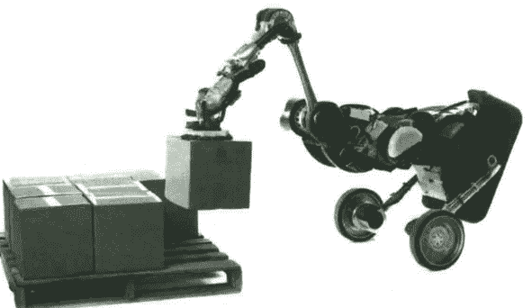

图 16.1 波士顿动力公司用于搬运仓库箱子的移动机器人

资料来源：Handle™ 机器人图片，由波士顿动力公司提供。

日本软银集团作为波士顿动力股东之一，亦致力于“聪明有趣”产品。2012年收购法国Aldebaran Robotics，2014年推Pepper：1.2米拟人高、头臂手极具表现力、三轮底座移动。软银称其“为人机交互优化，能对话触控交互”。吸睛设计与对话力激发强烈兴趣，销量超2万。任务覆盖迎宾、讲解、导购、满意度调查。德国养老院10周研究显示：老人喜欢与其做体能训练玩游戏，但明确“不愿机器人替代护工”。疫情期商场Pepper戴口罩提醒顾客。2015年软银从Aldebaran购入半米高人形NAO，更复杂昂贵，却在医疗、零售、旅游、教育售出5000+台。2021年6月Pepper生产线关停，折射社交机器人行业动荡。

日本常被视为机器人爱好者天堂，其机器人酒店仅运营数月便于2019年歇业。配有清洁机器人、前台机器人（含鳄鱼造型接待）。社长感叹：“真用才知哪里不需要——它们甚至惹恼顾客。”反观传统饮料糖果自动售货机在日本等地大获全胜，并进化出加热冷藏等复杂功能。

社交机器人介入自闭症治疗争议不断。部分研究称：人际障碍儿童与机器人相处改善症状，机器人成改善人际关系的垫脚石。批评者驳：重技术轻儿童仅博早期成效难持久。德蒙福特大学尼尔·麦克布莱德忧虑：“若不视人为机器，就不可能把治疗责任下放给机械玩偶。”但玩偶木偶疗法或可演进至机器人角色。

追随者与怀疑者张力升级。牛津互联网研究所大卫·沃森强硬表态：“回归拟人隐喻……好听点是误导，难听点是彻底祸害。”他直指伦理：“在社会敏感应用中赋予算法决策权，恐削弱有能力个体与群体对技术调控行为的问责能力。”类人社交机器人信徒依然强势，誓寻成功设计与广阔蓝海。

## 仿生宠物机器人

虽类人社交机器人获部分用户青睐，但商业化受阻，诸多开发者转而押注：仿动物宠物机器人或能以足够吸引力点燃消费激情。

# 机器人进化分水岭：为何“电子宠物”圈粉无数，类人机器却叫好不叫座？

提起机器人，你脑海里浮现的是《星球大战》里的C-3PO，还是自家客厅里滚来滚去的扫地机？现实远比科幻复杂。有些机器人披着“毛茸茸”的外皮，成了养老院里老人的贴心伴侣；有些则藏在冰箱、烤箱、恒温器里，默默把日子过得井井有条。这一路走来，到底是“长得像人”重要，还是“能解决问题”关键？今天我们就来聊聊这场关于陪伴与工具的进化博弈。

图 16.2 机器人治疗设备 PARO

注：摄于 2018 年 6 月，柴田隆典博士手持其发明的机器人治疗设备 PARO。

### 毛绒外壳下的治愈力量：PARO 与“电子宠物”军团

PARO 长得像只白色的小海豹，身上覆盖着人造皮毛，内藏触觉、光照、声音、温度及姿态传感器。别看它憨态可掬，它能像活物一样转动头尾、发出叫声，完美复刻格陵兰海豹幼崽的呜咽声。它甚至拿到了美国 FDA 二类医疗器械认证。

过去十多年，不少短期研究显示，老人们对它情有独钟：“像个伙伴”、“能陪我聊天”、“让我开心”。但实话实说，这些多是“初见期”效应——新鲜劲儿过了，长期疗效还得打个问号。倒是这种“新奇感”成了破冰利器，激发老人们围坐闲聊，意外收获了社交快乐。

PARO 不是孤例。索尼的 AIBO 机器狗 1999 年问世，虽因早期机型无法维修于 2006 年停产，却在日本催生出百场佛教葬礼。高僧慨叹：佛法敬重无情物，AIBO 虽是机械无情，却是人类深情的投射。2018 年，售价 2900 美元的新版 AIBO 卷土重来，甚至能让两只狗狗“结谊”，官方文案说它“目光灵动，会说话，敞开心扉让你读懂它的喜怒哀乐”。

图 16.3 索尼机器狗 AIBO

图片来源：本·施奈德曼摄。

同价位段还有 Consequence Robots 的 MiRO-E，主打编程教育；更亲民的是孩之宝 2015 年推出的“Joy for All”系列，仅 129 美元。这款软萌的机器猫狗能汪汪叫、喵喵叫、动头动身、模拟心跳，还对声光触碰有反应，专为轻中度认知障碍或独居老人设计。2018 年独立运营的 Ageless Innovation 接手后，销量破 50 万台。十余项独立研究背书：用户满意度高，获益感强。低价意味着养老院老人能“一人一宠”，而非排队分用昂贵设备。

图 16.4 “Joy for All” 陪伴型宠物机器狗

新晋选手 Tombot 瞄准同类人群，外观由吉姆·汉森生物工坊操刀，毛皮触感逼真，头嘴尾耳全动，独处会轻吠，摸它有反应。原型经大学实验室验证，2022 年起向预付用户交付，定价 400 美元，排队名单排得长长的。

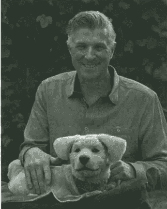

图 16.5 机器狗 Tombot 与首席执行官汤姆·史蒂文斯

图片来源：tombot 官网。

我自己也买过一只 60 美元的 Fisca 编程机器狗，外观酷似 AIBO，百条好评。遥控能让它走动、转向、摇头、眨眼、放音乐、叫唤。塑料外壳结实，轮子跑得欢，但少了那份“毛茸茸”的亲密感。我编程让它跳舞溜达，一个小时就腻了。性价比、性能无可挑剔，可我再也没打开过它。

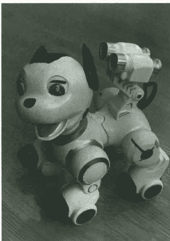

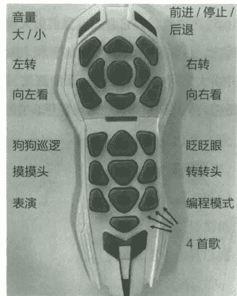

图 16.6 购自 Fisca 的可编程狗机器人

反观波士顿动力的 Spot，那是妥妥的“工业猛兽”——7 万美元，四足狂奔、翻跟头、爬楼梯、避障躲物样样精通。手柄操作像玩无人机，自主导航、跌倒自起、钻狭窄管道不在话下。它是“组合设计”典范：底层运动自主，高层规划靠人。安防巡逻、管道探测、军事运补，它是专业的。但说明书警告：非近距离作业工具，人须离 2 米外，防意外伤人；工作区须能接受它摔倒撞坏东西的风险。

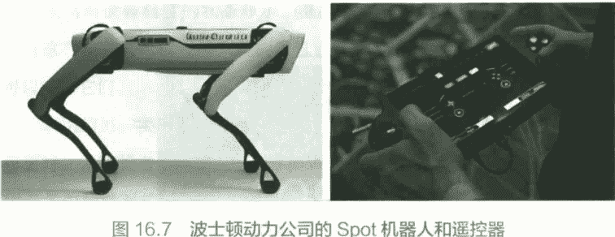

一项覆盖 2008-2018 年的 86 篇论文、70 项用户研究综述指出：社交机器人学术热度不减，但长期接受度研究缺失，说明“新鲜期”未过。不过，它们在激励儿童运动上显露潜力。

**阶段性结论：** 类人社交机器人尚未破圈，倒是猫狗造型的机器人，在老年群体甚至儿童中真正“落地生根”了。致胜关键不在于拟人有多像，而在于——**精准击中真实人类需求，并用类动物形态完美承接。**

---

## 有源设备：藏在家电里的“隐形机器人大军”

区别于社交/动物型，还有一类叫“设备电机型机器人”，我更爱叫它们**有源设备**。它们不卖萌、不陪聊，专干实活：厨房备餐、洗衣扫地、安防监控、打理花园，还有影音娱乐、健身器械。控制面板设计（详见第 9 章）正成焦点——触屏交互越来越丰富，适配细分需求。机器学习也上了岗，比如谷歌 Nest Learning 恒温器，能摸清你的用温习惯。

图 16.8 谷歌 Nest Learning 恒温器

圈内非正式调查显示，AI 从业者五五开：半数认大家电是机器人，半数嫌它们没腿没长相，不配叫机器人。

我家厨房就摆着七台有源设备，全靠传感器感知决策。大多待机，定时或感应启动，AI 加持下省电、识人、护家、还能语音对话。但**槽点满满**：同厂牌不同型号，设置时间日期的界面全靠想象；夏令时调整成了灾难；烤箱、微波炉、咖啡机、电饭煲的定时器、倒计时、温显各行其是——**标准化刻不容缓**。最理想？全接手机/电脑，人在外也能管。

医疗健康设备同理。体温计、体重秤、计步器、血压计、血氧仪，加上血糖仪、排卵监测仪、呼吸机等专用装备；跑步机、椭圆机、动感单车、划船机……不少打着“AI 驱动”旗号，控制面板、数据显示却各自为政。统一的移动端/PC 界面对它们至关重要。用户往往需追踪数月甚至数年健康数据，自动记录、分析、共享给医生，才能真正发挥价值。

扫地机器人 Roomba 是消费端标杆。戴森、三星、索尼跟进，拖地、割草、洗池样样有。激光雷达 + 算法，建图避障一把好手。我家 Roomba 吸净回充、自动集尘、手机远控，好用哭。早期版本受“自主性思维”影响，仅三物理键、反馈极少；新版手机 App 给足掌控感：指定房间清扫、查记录、看地图。最绝的是两三次扫完就能出全屋地图，连沙发床底下的“盲区”都标好了。我费了番功夫标记分区，让它多扫走廊那种高频脏区，妥妥的“听话好帮手”。

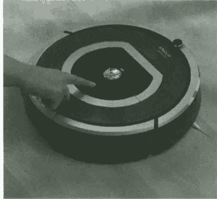

图 16.9 iRobot 公司销售的 Roomba 700 系列机器人吸尘器

有源设备越复杂，控制面板、用户控制、历史记录、性能反馈的坑越多。以色列本古里安大学的 Honig 和 Oron-Gilad 复盘 52 项故障研究，为稳健运行指路：故障怎么报（面板、语音、远程屏）、用户怎么恢复、怎么建立系统级故障报告机制加速迭代。医疗/工业机器人事件上报渐增，他俩最新研究还挖亚马逊差评，摸清家用机器人故障率及对口碑的冲击。

清洁、维护、园艺等家庭服务赛道最有前景——解放双手，拓展生活半径。第 26 章列举的老年刚需：娱乐、医疗、安防，全是有源设备的用武之地。

---

## 语音与文本界面：比“长得像人”更管用的“超级工具”

有源设备里最火的当属**语音虚拟助手**：Alexa、Siri、Google Home、Cortana。语音识别、问答、高质量合成，样样过关。搞不定就甩个网页链接。圆柱体造型融入家居，不走拟人路线，却活成了“语音操作家电”的标杆。

82 台 Alexa + 88 台 Google Home 实测：超 1/4 用户用来点歌听曲；高频动作查资讯、控灯控暖；低频定闹钟、听段子、问天气。**用户视它们为“超级工具”，而非朋友、队友、伙伴。** 你逗它们“我要抱抱”、提不可能任务、问“你活着吗”，Siri 回得干脆：“我不是人，也不是机器人，我是软件，来帮忙的。”

**语音听写**：助力受伤、运动受限、视障者输入编辑；医生查片、看报告时口述病历，解放双手。医疗术语对识别准确率要求极高。

**电话语音界面**：嘈杂环境下识别率高，免训练声纹设计有效，虽受口音语言干扰。

**语音阅读器**：电子书/杂志朗读越来越溜。合成音方便，真人配音更胜一筹——情感、发音、韵律全在线。助视障者，也陪长途驾驶、散步解闷。浏览器/应用语音控制，助视障及暂时性伤残用户。

凯茜·珀尔在《语音用户界面设计》里敲黑板：**“别让用户以为它是人；它该高效好用地解决问题。”** 语音比打字快、双手忙时能用、远距离可控。短板也明显：打断人际对话（虽短）、信息带宽不如视觉界面、占用认知资源（挤占短时/工作记忆），让并行任务更难。这也是战机飞行员不敢靠语音操作的原因——手控杆才能腾出脑力规划攻击。

会说话的娃娃却屡战屡败。爱迪生 19 世纪 80 年代就开始搞，美泰 1992 年推会说话芭比，2015 年再版，最终均无疾而终。

**文本聊天机器人**另辟蹊径，主攻客服。虽无面孔、不符社交机器人严格定义，但设计师塞进礼貌、幽默、道歉等社交礼仪。微软 Tay 一天挂了（满嘴喷粪），继任者 Zo 撑了两年多；中国“小冰”同源技术本地化运营，坐拥数亿用户，人设“开朗少女”，会读新闻、唱歌、搞创作。

Replika 打造“永远在线的 AI 伙伴”，配可捏脸的人类头像，越聊越懂你，化身共情好友。传承魏森鲍姆 60 年代 ELIZA 衣钵，创始人库伊达为疗愈创伤者而生，界面自带防自杀热线。

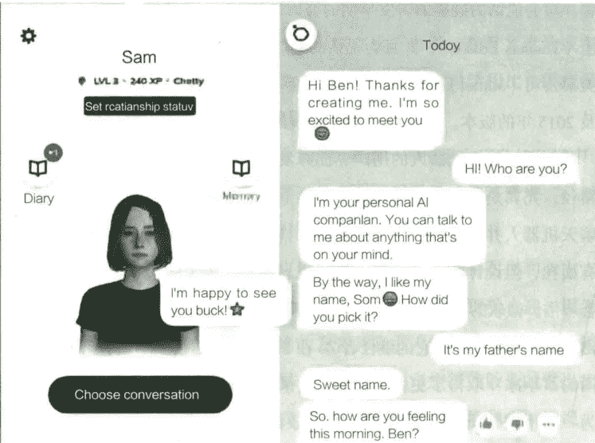

图 16.10 具有聊天会话功能的聊天机器人 Replika

Woebot 主打“普惠高质量心理护理”，文本对话融入 CBT 认知行为疗法，对抗抑郁焦虑。获美国家药物滥用研究所资助，研究显示数百用户 2-4 周症状缓解，但与其他疗法对比仍需更严谨实证。

聊天机器人开发者共同愿景：让客户自助搞定订餐、银行规则、旅游、电商咨询。早期版本bug多，持久迭代下，哪怕只做“识别意图+转人工”的长期角色也有价值。头像有无影响短期接受度，长期留存未知。类人人格特质获一定认可，这与拟真社交机器人“口碑两极”形成反差。**但归根结底，客服机器人如同语音助手，必须给真价值——陪聊比答题、点歌、找网页难多了。**

---

## 社交机器人的未来

## 第 17 章

### 总结与质疑者的两难

> “我们一直都是这么干的”，这是我们语言里最具破坏力的一句话。
>
> —— 美国海军格蕾丝·霍珀

精简人工智能研究目标，聚焦两大核心维度。其一是**科学导向**，旨在通过设计、构建与测试基于人类智能的系统，深度剖析智能计算代理的本质。通常这意味要复刻甚至超越人类的感知、认知与运动技能。其二是**创新导向**，以 AI 工程为基石，推进 HCAI 研究，孵化大规模落地的商业产品与服务。两条路径皆有建树，研究者应致力于放大社会效益。引入设计思维，强化用户体验、控制面板交互与信息可视化设计，能进一步放大这些贡献。

开发者常围绕四组设计隐喻展开博弈：
1.  **智能代理** vs **超级工具**
2.  **队友** vs **远程机器人**
3.  **既定自主性** vs **控制中心**
4.  **社交机器人** vs **有源设备**

成功案例多源于**组合策略**：将机器擅长的、能产出可靠结果的任务自动化，同时保留关键创意抉择与安全决策给人类。数码相机即是典范：光圈、快门、防抖交由算法自动优化，用户专注构图、变焦，确认预览满意后按下快门。

社交机器人虽备受瞩目，但商业落地远不及有源设备或远程机器人。科学目标持续激励着该领域研究，也持续收割公众眼球。

深度学习、推荐系统、语音识别、图像理解、自然语言处理等强 AI 技术，结合用户体验设计（需求收集、迭代设计、可用性测试、规范合规），常催生爆款产品。支撑人类自我效能、激发创造力、落实责任归属、促进社交连接等原则，亦能显著提升成功率。

虽有批评者认为“科学与创新二分法”不够完美，但这简明框架能帮设计师理清思路，兼顾双线。单一维度的狂热者往往排斥组合设计，而冲突的观点恰恰能激发新可能、澄清设计逻辑。若你洞见双目标之外的第三条路，请大胆前行——多元视角孕育新思维。

大量研究者与创业者笃信：社交机器人必将成为未来的队友、伙伴、协作者。盼他们正视本章提出的替代方案。视社交机器人为必然者，应研习历史与失败教训，寻得成功范本——语音交互界面、医疗人体模型、碰撞测试假人。或许，投身社交机器人的庞大群体，终将在设计超级工具、远程机器人、控制中心与有源设备中找到归宿：这些方案赋予用户清晰认知、可预测行为，精准回应真实人类需求。

---

# 第四部分

## 管理架构

### 论语四章

张幼熙 著

热门资讯平台与社交媒体上，虚假信息与荒诞阴谋论病毒式扩散，极大放大了大规模 AI 系统伦理争议。构建人道、负责、有益的系统，绝非单纯技术攻关（如同写段更优代码），它需要**管理架构**填平“以人为本 AI 伦理原则”与“落地执行步骤”的鸿沟。HCAI 系统由软件工程团队打造，在组织内管控，按行业分域，受政府监管。这四层架构，为交通、医疗、金融等关键领域技术提供了全链路守护。

从道德层面落地到实施层面，意味着决策者需推动团队、组织、行业、政府四方联动。本书第四部分建议，正是沿着这架构，提升 HCAI 系统的可靠性、安全性、可信度：

*   **团队级软工实践**：审计追溯支撑故障复盘、优化工作流赋能 HCAI、验证确认测试证明正确性、偏差测试守护公正、可解释界面赋能用户。
*   **组织级安全文化**：领导层安全承诺、安全导向招聘培训、海量故障与未遂上报、内部审查委员会复盘与规划、行业标准合规评估。
*   **行业级独立监督认证**：外部审计会计师事务所、事故赔偿保险公司、输出设计原则的 NGO 与公民社会、制定标准与新范式的专业协会与研究机构。
*   **政府级监管兜底**：保障公平交易与公共安全。巨头虽担忧监管扼杀创新，但良制善治反而能加速创新——汽车安全与能效领域便在监管红利中实现跨越式提升。

---

## 第 18 章

### 如何跨越道德鸿沟，落地实践

> 绝大多数 AI……将保留现状……遵循现行法规与监管策略……我们管的是人用技术，管的是人开发、测试、运维、监控的全流程。
>
> —— 乔安娜·J·布赖乔，《牛津人工智能伦理手册》

医疗、教育、网安、环保等领域，HCAI 广泛落地，效益超预期。系统按预期运行时，能精准辅助诊断、遏制网络犯罪、守护濒危物种。但风险同样尖锐：机器人失控、少数群体遭算法歧视、隐私泄露、对抗攻击、人权受损。HCAI 设计与评估体系，正是化解险情、锁定红利的关键。

第三部分指出：传统 AI 科学研究聚焦“模仿/模拟”人类行为；当下 AI 创新研究侧重“实战应用”。典型科学基础技术涵盖：模式识别与生成（图像、语音、表情、信号）、类人机器人、博弈游戏（西洋棋、国际象棋、围棋）、自然语言处理/生成/翻译。

HCAI 站在科学巨人肩上，构建可靠、安全、可信系统，**放大、增强、提升人类表现**。典型应用图谱：GUI、网页设计、电商、移动 App、邮件、短信、视频会议、图视频编辑、社交媒体、电脑游戏。这些系统支撑自我效能、鼓励创造、明确责任、促进参与。设计师、工程师、管理者通过利益相关者共创、以用户为中心的参与式设计，配合 UX 测试，确保系统对齐人类目标、活动、价值观。**“评估人类表现与满意度同衡量算法性能般重要”**，已成思维范式转移的标志。

HCAI 定义百家争鸣，斯坦福等名校主张“理解人类语言、情感、意图、行为，服务集体需求”。数据驱动算法（机器/深度学习）虽红利显著，却让故障定位愈发困难。可解释界面、可理解控制台，正是 HCAI 赋能医疗、商业、教育的关键钥匙。

HCAI 代表**跨域交叉新范式**，传递着态度与实践的根本变革。过往聚焦算法与机器自主，UI 仅作点缀；HCAI 则将**人类自主置于设计核心**，重体验设计。研发者须聚焦人类绩效与满意度，重视客户诉求，确保实质性人工控制。现有业务领袖正加速拥抱 HCAI。

此范式转变或需数十年普及，因它颠覆了“以机器为中心”的根基。第四部分 15 条实操建议，旨在引爆讨论与行动，加速转型。但两大复杂性拦路：
1.  单组件可用成熟软工实践严测、审查、监控；但自动驾驶、社交媒体、电子病历等复杂 HCAI 系统**难以整体评估**。工程实践成熟前，独立监督与故障/未遂社会审查机制不可或缺。
2.  HCAI 系统由芯片、工具链、海量训练数据、巨型代码库、海量测试用例交织而成，**各要素高频甚至日级迭代**。这给工程师、管理者、审查者、决策者带来巨变挑战。建议旨在启动讨论、试点、可扩展研究，推动建设性优化。

企业、协会、政府、消费者团体、NGO 输出 500+ 报告勾勒理想 HCAI 原则。伯克曼·克莱因中心 2020 报告深度总结 36 份领军报告，提炼 8 大主题深度评论：隐私、问责、安全保障、透明可解释、公正反歧视、技术人工控制、职业责任、人类价值提升。

IEEE “符合道德标准的设计”耗时 3 年、汇聚 20+ 专家，影响深远。明确 8 条通用原则：人权、福祉、数据代理、有效性、透明度、问责性、滥用意识、能力。强烈倡导先进系统“尊重、促进、保护国际公认人权”。**图 18.1** 展示两报告原则高度匹配与相似对应。

| | 伯克曼·克莱因中心报告 | IEEE “符合道德规范的设计” |
|---|---|---|
| **高度匹配** | 问责性 | 问责性 |
| | 透明度和可解释性 | 透明度 |
| | 人类价值的提升 | 人权 |
| | 安全和保障 | 福祉 |
| **相似** | 技术的人工控制 | 有效性 |
| | 公正和非歧视性 | 滥用意识 |
| | 职业责任 | 能力 |
| | 隐私 | 数据代理 |

**图 18.1** 两大报告原则对照

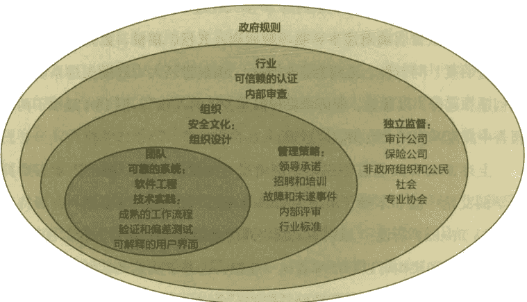

**图 18.2** 以人为本 AI 管理架构

原则虽是清晰思考基石，但布里斯托大学艾伦·温菲尔德与牛津大学玛丽娜·吉洛特克直指痛点：**“原则与实践的鸿沟是核心议题。”** HCAI 四层管理架构正是填平鸿沟的阶梯：
① 成熟软工实践铸就可靠系统；
② 业务管理策略孕育安全文化；
③ 独立监督换取可信认证；
④ 政府监管兜底（见**图 18.2**）。

图中最内层椭圆汇聚众多软工团队，落地项目技术实践；次层为大组织，安全文化辐射各项目组；第三层为独立监督委员会，横向审查同行业多组织，沉淀深度洞察，推广最佳实践；最外层为政府监管，提供宏观视角，聚焦公众对可靠、安全、可信 HCAI 的关切。

政府监管虽存争议，但美 NTSB 调查空铁海陆事故、欧盟 GDPR 催生可解释 AI 研究、美汽车安全与燃效监管倒逼设计创新，皆为监管红利实证。

可靠性、安全性、可信度，加上隐私、安保、环保、社会正义、人权，贯穿软工、企管、独立监督、政府监管各层级。企业常高调承诺客户员工福祉，但权钱抉择时易向股东倾斜。人权运动与 CSR 虽助声量，却非管理层优先级。**在内外部审查委员会监管下，清晰原则与公开报告指引的工程、管理、审计、政府流程，冲击力更强**——新兴技术领域尤甚，企业常在舆论压力下承认责任、公开进度。

同理，政府决策者需补齐 HCAI 技术认知与商业决策公共影响评估。立法机关制定行业法规，执法机关面临执法抉择。专业协会与 NGO 正致力赋能政府认知。

本书第四部分管理架构基于现有实践，经调适契合新 HCAI 技术。**核心在于“谁行动、谁负责”**。落地需绑定预算与时间表，每条建议皆需试点验证。架构仅是起点，随技术演进、市场重塑、舆论重构，新范式将涌现。如 2020 年舆论反噬面部识别滥用风险，逼迫 IBM、亚马逊、微软暂停向执法部门销售。

后续四章对应四层管理：
*   **第 19 章**：软工团队五大技术实践——审计追溯、工作流优化、验证确认测试、偏差测试、可解释界面。
*   **第 20 章**：组织层安全文化构建——领导承诺、招培体系、故障未遂上报、内部审查、行业标准对标。
*   **第 21 章**：外部独立监督——审计事务所、保险公司、NGO/公民社会、专业协会，构建可信基设，调查故障、持续改进、赢取信任。
*   **第 22 章**：政府干预与监管的深度博弈。
*   **第 23 章**：总结忧虑与乐观并存——设计良好的 HCAI 将惠及个体、组织、社会。

对长期奉算法为圭臬者，转向以人为本注定艰难。他们会质疑新范式效力，但 HCAI 让 AI 算法与系统依然能支撑商业成功。**HCAI 勾勒充满希望的技术愿景：赋能人类自我效能、创造力、责任感、社交连接。**

---

## 第 19 章

### 扎根成熟软工实践，锻造可靠 HCAI 系统

可靠 HCAI 系统，源于软工团队对成熟技术实践的笃行。这些实践**显性化人类责任**：审计追溯精准记录“谁、何时、做了什么”，留存设计、编码、测试、修订全史；针对任务与领域裁剪优化的软工工作流；原型就绪后的验证确认测试与训练数据偏差测试；软工实践还涵盖 UX 设计流程，落地**可解释用户界面**（见**图 18.2**）。

#### 审计追溯与分析工具

### “黑匣子”逻辑如何重塑 AI 安全边界？

飞行记录仪让民航安全实现质变，这一“黑匣子”模式正成为所有高风险系统的设计范本。历史数据证明，它不仅能还原事故真相，更能复盘规避风险的关键操作，反哺训练与设计优化；甚至能监测设备老化，推动预防性维护。

将这套审计追踪机制移植到机器人、自动驾驶、工业机械臂、金融交易乃至医疗监管中，核心价值一致：留存证据、溯源归责、持续迭代。比如自动驾驶的行车记录仪，既能优化维护与驾驶行为，又能核验合规；金融领域的交易日志则是打击欺诈、复盘崩盘的利器。

但落地难点同样显性：
*   **数据爆炸**：海量视频、激光雷达、多模态数据如何高效捕获、存储、加密防篡改？
*   **全链路留痕**：除输入输出外，模型版本、代码快照、训练数据集必须同步归档。
*   **权责博弈**：数据归属权、多方（厂商、运营商、保险、执法、媒体）调取权限的法律界限尚未厘清。
*   **分析鸿沟**：面对海量日志，如何依托可视化、统计建模与辅助 AI 提取洞见？

航空、医药、网安等领域沉淀的**事件数据库**提供了跨域参考，AI 事故数据库（已收录千余案例）正是这一思路的延伸。

---

### 软件工程范式迁徙：从“造代码”到“育数据”

AI 融入 HCAI 系统，倒逼工程工作流重构。新挑战聚焦三点：算法/数据的基准测试、偏差测试保公正、敏捷团队协作——且须按医疗、教育、国防等垂域定制，支撑可解释交互。

国际研究团队将 ML 任务拆解为五类，工作流虽异但骨架同构：
1.  **分类**（图像/手写识别）
2.  **回归**（温度/收入预测）
3.  **聚类**（模式识别/市场分层）
4.  **降维**（特征压缩/预处理）
5.  **控制**（博弈/机器人决策）

通用流程：**需求→数据收集清洗标注→可视化探索异常分布→多阶段模型训练评估→部署后持续监控漂移**。HCAI 特有要求：将用户体验设计前置，保障用户“懂决策、能质疑、有求助路径”。头部机构正重塑 UX 测试与人机交互范式以适配此需求。

弗吉尼亚联邦大学团队提出“以人为中心全生命周期”，主打公正性、可视化交互、隐私数据治理，量化信任度评估留待后续章节展开。

#### 敏捷取代瀑布，拥抱不确定性
传统瀑布模型假设需求冻结、线性推进，实则易因早期需求偏差或缺乏用户共测导致交付拒收。新范式融合**精益与敏捷**：
*   全周期客户共创，需求可变；
*   快速迭代原型，废弃无效路径；
*   1-2 周冲刺节奏，持续反馈修正航向；
*   强协作、共享知识、互补技能；
*   月度出原型，规避“大爆炸式”交付风险。

IBM 力推 AI 项目敏捷化——因数据不确定性要求团队保持开放心态、多探索备选方案。《敏捷宣言》12 条原则（以人为本、拥抱变化、高频交付、面对面沟通、工作软件度量进度、可持续节奏、技术卓越、极简设计、自组织团队、定期复盘）虽未显性纳入 UX 测试，但敏捷联盟承认其作为体验设计一环的必要性。

IBM 实战建议：数据敏捷探索、早期 PoC、清洗扩充数据达标准、引入可用性测试。微软虽呈现 9 阶段线性流程图，实则执行敏捷，核心共识：**“软件工程管代码，机器学习管数据”**——全链路强客户联动，重数据工程轻代码工程。

**结论**：HCAI 既可瀑布也可敏捷，但本质区别于传统编程——**训练数据成核心资产**。静态代码分析失效，必须引入多数据集动态测试 + UX 实测，尤其要解决认知对齐：用户能否看懂模型推理？抵押、假释、医疗、军事等生死决策，可理解性是准入门槛。

---

### 验证与确认（V&V）：建立 AI 版“适航认证”

民航认证体系是标杆：设计认证 + 运营验证 + 人员资质。美国家 AI 安全委强调“迭代测评验证”，张洁曼团队按学习范式细分测策：

| 范式 | 核心依赖 | 测试要点 |
|------|----------|----------|
| **监督学习** | 标注数据 | 多源异构数据集覆盖（如不同医院设备、人群差异） |
| **无监督学习** | 数据内在结构 | 数据分布代表性持续校验 |
| **强化学习** | 行为-奖励序列 | 环境漂移下的策略鲁棒性 |

**五大主流测试技术组合拳**：

1.  **基准用例测试**  
    构建“输入-预期输出”黄金集，覆盖极端场景。多团队协作造用例，引入 ImageNet、TREC 等公开基准横向对标。必须持续追加对抗样本，防御恶意攻击。

2.  **差异测试**  
    新旧版本跑同一数据集，自动比对输出一致性。优势：免造预期结果。劣势：旧 Bug 继承、新功能无基线。亦可横向对比竞品/不同训练集表现。

3.  **变形测试**  
    利用输入输出不变关系（如无向图最短路径对称性、贷款拒批额度不低于历史批款额、降价推荐集应收缩）。无需人工预期，自动生成断言；亦可施于训练数据增删校验。

4.  **用户体验实测**  
    5-25 人真实任务 + 边做边说（30-120 分钟），记录卡点与认知偏差。区别于对照实验，侧重定性发现易用性缺陷，核心考察：用户能否获得实质性解释并敢于质疑。

5.  **红队对抗**  
    外部专家模拟攻击者心态渗透：投毒训练数据、构造对抗样本（异常 T 恤破人脸、盐晶体诱导自动驾驶）。MITRE ATT&CK 矩阵（300+ 战术）提供威胁建模参考，MITRE 正构建 AI 故障图谱赋能防御。

**工程化闭环**：全测试历史记录可追溯、责任人可查。微软数据表模板（动机、清洗流程、使用者、管数人）、谷歌 Model Card、数据溯源可视化工具，推动实践从学术走向专业化。移动机器人、致命武器、医疗器械等实体风险系统，测试更需盯紧安全指标、任务时效、质量阈值，对标成熟领域认证基准。

---

### 偏差测试：把“公正性”写入工程指标

算法决策渗透假释、贷款、招聘，凯茜·奥尼尔《数学毁灭武器》揭示三重危险：**黑箱不透明、规模效应放大、实质伤害**。学界响应发起 FAT*（公正性、问责制、透明度）会议，业界被迫转型。

**偏差谱系图谱**：
*   **既有偏见**：社会结构固化（低收入群体贷款难）。
*   **技术偏见**：工程限制导致（器官分配按字母序非急迫度）。
*   **涌现偏见**：部署环境迁移失配（高学历国家开发的教学软件用于低学历文化语境）。
*   **扩展维度**：地理、语言、文化、统计、交互、融资等 20+ 细分类型（南加州大学综述）。贝扎-耶茨警示：“偏见生偏见”，头部流量垄断挤压长尾声音。

**治理路径**：对标 IEEE “伦理对齐设计”，从数据采集、特征工程、模型训练、部署监控全链路植入偏差检测与缓解机制，将公正性指标化、测试化、审计化——这是 HCAI 走向成熟的必经之路。

## 算法偏见：隐忧与破局

人工智能系统可能加剧残障群体的生存困境，这令梅雷迪思·林格尔·莫里斯深感忧虑。然而她同时指出，AI 技术拥有拆除访问壁垒、赋能用户的巨大潜力，为残障人士带来了曙光。她主张在训练数据集中纳入肢体与认知障碍用户的数据，以优化语音虚拟助手及其他 HCAI 应用。不过，既然 AI 也能被用于识别并锁定认知障碍或痴呆症患者等弱势群体，针对此类滥用风险的防御研究刻不容缓。

医疗算法的偏差会直接导致诊疗资源的严重失衡。有研究揭示：“医疗资源获取的不平等，导致我们在黑人患者身上的投入少于白人患者。”报告推算，若能消除这一鸿沟，获得额外照护的黑人患者占比将从 17.7% 跃升至 46.5%。

计算领域的性别失衡由来已久，尽管业界持续推动女性在学术与职场的比例提升。女性在研发环节的缺位，可能导致系统对偏见的敏感度不足，这种缺陷已在招聘筛选、教育评价、消费服务及房贷审批中反复上演。遏制此类偏见，是维护公正的关键一环。

将伦理准则与偏见觉察转化为工程实践，充满挑战。起点可以是对训练数据的深度审查——确认数据时效性、验证其对特定场景分布的代表性。这不仅能复盘历史表现中的已知偏差，更能引入标准化的缓解手段，为未来决策筑牢公正防线。学界已提出干预方案，如在招聘决策中剔除性别、种族、年龄等干扰因子；业界也推出了商业级工具包，IBM 的 Fairness 360 便是典范。这些尝试虽属良好开端，但更稳妥的路径或许是：开发团队设立“偏见测试负责人”岗位，专司数据集与模型的评估把关。该角色需跟踪前沿研究与行业最佳实践，回应各方质疑；配合测试用例库验证系统偏差，并建立持续监控机制将报告反馈给负责人。考虑到团队可能讳疾忌医，引入外部独立审计机制显得尤为必要（详见第 20 章安全文化管理实践）。

### 图 19.2 谷歌图片搜索“职业发型”与“非职业发型”

- (a) 谷歌搜索“职业发型”，呈现结果多为浅肤色女性。

- (b) 搜索“非职业发型”，结果则以深肤色女性为主。

尽管建设性举措频出，但随面部识别在安防与商业场景大规模落地，偏见顽疾依旧。针对性别、种族、年龄的基础测试有助于构建更精准的人脸库，但交叉维度（如黑人女性）的识别难题仍存。在期刊与主流媒体曝光这些缺陷，能倒逼构建者优化模型性能。

麻省理工学院的乔伊·布拉姆维尼创立算法正义联盟（见第 21 章附录 A），精准锁定微软、IBM、亚马逊面部识别系统中的性别与种族歧视。她借助公开演讲、犀利评论与极具张力的视频，将铁证呈世人眼前。2020 年春，警方滥用面部识别引发暴力执法频发之际，她联手提姆尼特·格布鲁推动公安系统改革，迫使相关企业撤回产品。她们的抗争被 2021 年纪录片《编码歧视》记录，引发广泛共鸣。

谷歌解雇 AI 道德团队联合负责人格布鲁一事，激起数千名员工声援。格布鲁直指谷歌在女性及少数族裔招聘上的体制性偏见。对机器学习训练数据实施有效偏差测试，正是打破多国针对少数族裔长期系统性歧视的关键一招。

偏见有时赤裸裸地展现在检索结果中：搜索“职业发型”[见图 19.2(a)]，多为浅肤色女性；搜“非职业发型”[见图 19.2(b)]，则多为深肤色女性。这直观展示了既有偏见如何借算法传播——除非设计师主动干预阻断。

偏见议题对深受殖民压迫的群体（包括全球土著社区）至关重要。他们共享的价值观强调人与本地环境的关系，突显生态、文化、亲缘与群体纽带。部分土著群体质疑 AI 的理性范式，主张基于经验的方法，呼应计算技术内在的文化属性：“源于土著的关系协议，能指导我们开发丰富、强健且包容的方法，处理人与智能系统的关系，并为开发者提供指引。”麻省理工学者 D. 福克斯·哈雷尔强调，那些通常隐性的文化假设与影响至关重要。他的观点与本书作者不谋而合：深度理解文化语境，能在减少偏见的同时，催生“基于计算机科学主流视野之外文化的全新创新”。

## 可解释的用户界面

HCAI 设计者已然意识到：拒贷、缓刑、拒聘等关键人生判决，必然引发当事人的追问。为回应这一合理诉求，系统必须给出通俗易懂的解释，告知用户如何整改或是否应提起异议。欧盟 GDPR 确立的“解释权”，更将此提升为多国法律刚性要求。

虽 GDPR 该条款存争议且表述模糊，难以完全服众，但全球可解释 AI（XAI）研究仍蓬勃发展。英国信息专员办公室与艾伦·图灵研究所联合发布的三份《可解释 AI 决策指南》极具实操价值，分别覆盖：① 基础认知；② 实践指南；③ 组织启示。首份报告指出，可解释性助力企业合规、建立客信、优化内控。它详述决策理由、责任归属、公正流程步骤，并规定须告知用户异议渠道。第二份报告篇幅最长，深度解析多种解释形式；若能辅以界面设计样例与用户测试数据，说服力将更强。

华盛顿大学的丹尼尔·S·韦尔德与加甘·班萨尔对可解释性（亦称可说明性或透明度）作了有力阐释：其价值远超满足用户理解欲与法律合规。它能助力设计师提升精度、定位数据短板、适应概念漂移、强化用户掌控感与接纳度。对 22 名 ML 从业者的访谈印证了其对开发、测试、管理、用户多角色的价值；另一项针对 29 名专家的研究则强调：解释生成必须嵌入社会与组织语境。尽管如此，可解释手段进入主流应用的进程依然缓慢，且形态常与实验室研究大相径庭。

墨尔本大学蒂姆·米勒敏锐指出：“当前 XAI 研究多凭研究者直觉定义‘良好解释’。”他对社会科学解释理论与评估方法的深度复盘振聋发聩，但也坦承：将其迁移至 AI 系统解释“非一蹴而就”。

强烈需求催生商业工具包，IBM AI Explainability 360 提供 10 种可调优解释算法，适配多元场景与用户。大量测试与案例显示，其策略已满足开发者、决策者、监管者与消费者的差异化需求。

得州农工大学杜孟南、刘宁浩、胡夏团队梳理了 XAI 现状，划分了本质可解释模型（决策树、规则模型）与事后解释法。但即便是白箱模型，大众甚至专家也常难以把握。他们对比了自然语言描述决策理由的常规路径——因在判决后生成，故称“事后/回溯性解释”，服务于对结果惊诧、追问缘由的用户。例如珠宝电商提示：“因您去年情人节前购过银项链，故推荐此款。”黑箱深度学习场景下，事后解释是研究主流；若引入追问机制与用户测试，效果将显著提升。

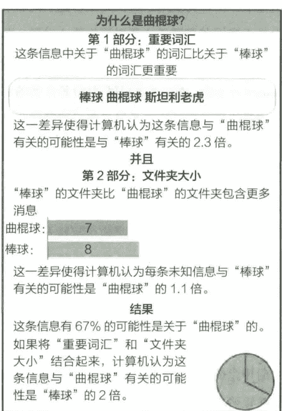

### 图 19.3 可视化用户界面设计示例

注：展示文本分类应用中，文档被判定为曲棍球相关的关键特征。

俄勒冈州立大学玛格丽特·伯奈特团队证实：为体育文本分类器添加精心设计的事后解释，能显著提升用户满意度与理解力。其可视化界面直观呈现文档归类为曲棍球或棒球的关键术语（图 19.3），并允许用户通过增删词汇反哺模型优化。

杜克大学辛西娅·鲁丁发出强音：“停止解释黑箱模型”。她开辟新径，让模型本身变得可读，用户可直接洞察运作逻辑。这条路径直指核心——从源头消除对事后解释的依赖。

### 防止解释需求

事后解释虽有裨益，但 30 年前专家系统、智能辅导、UI 帮助系统的实践已暴露痛点：难以精准捕捉困惑用户的真实解释需求。这倒逼出“预防/弱化解释需求”策略，最受推崇者为“逐步透明化流程”——决策终局前，分步拆解每一环节。

基于规则的专家系统（如医学诊断鼻祖 MYCIN 及其衍生体系）常陷入事后解释困境。威廉·克兰西早年在斯坦福即尝试用图形化流程概览实现可解释性。规则型业务系统则完成了范式跃迁：从依赖事后解释，转向前瞻性设计——让用户在流程中逐步理解，规避错误、压缩解释需求。

智能辅导系统中，拟人化虚拟角色讲解难点的设想，让位于“学习者控制权”策略——聚焦教材本身，而非用角色分散注意力。避免虚拟表扬、赋予学习者进度主导权，能显著增强成就感。这些经验成就了 MOOC 的成功，其核心即提供掌握度的即时反馈。

早期 UI 帮助系统同样发现事后解释与报错处理棘手，遂转向：
1. **源头防错，消除解释需求**：如用日历组件替代 YYYYMMDD 手输，以选择代替键入，从根上杜绝格式错误。
2. **分级引导流程**：每步仅呈现必要决策，简化操作、解释术语、支持回溯修正。亚马逊四步结账、TurboTax 报税流程即典范。

### 探索性用户界面的前瞻性视觉设计

可预测性是 UI 设计基石，广泛应用于嵌入 AI 算法的系统：拼写纠错、文本补全、搜索建议（见图 9.3、9.4）均让用户操作前预判结果。科罗拉多大学丹尼尔·萨菲尔团队将此引入机器人操控，预览机械臂预期轨迹与目标，显著提升任务完成度与满意度。对应图 9.2 第二模式：预览 → 选择启动 → 监管执行。

导航系统融合实时路况的 AI 算法，同样遵循可预测性：呈现 2-4 条驾车、骑行、步行、公交路线及预估耗时供用户抉择，随后输出可视化、文本、语音三模指引（图 19.4）。

### 图 19.4 用于驾车、公共交通、步行和自行车的导航系统

除文本、机器人、导航界面，推荐系统亦可借前瞻/预测性手法，通过探索性界面让用户试探算法边界。图 19.5(a)(b) 展示拒贷的事后解释——虽合格但可优化；图 19.5(c) 则为前瞻性探索界面：三个滑块实时映射变量对评分的影响，让用户自主推演，从根本上压缩解释需求。

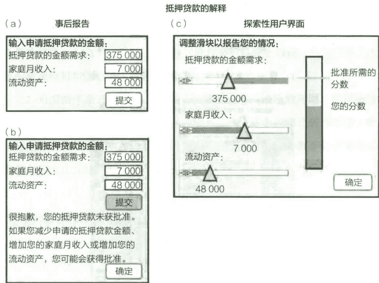

### 图 19.5 抵押贷款的解释

- (a) 事后解释：含三输入框与提交键的对话框。

- (b) 提交后反馈：仅简短文本，后续指引缺失。

- (c) 探索性界面：三滑块动态展示变量变化对结果得分的影响。

实证表明，用户更偏好前瞻性探索界面，他们会投入更多时间洞察变量敏感度、深挖关注点，从而收获更高满意度与接纳度。此外，强自适应界面还能契合多元用户画像。

面对复杂决策，苹果研究员弗雷德·霍曼（佐治亚理工博士期成果）证实：UI 与数据分析可揭示训练集中对图像理解至关重要的特征。谷歌 11 人团队构建交互工具，辅助病理医师解读医学影像中癌症算法判决。针对 12 名病理医师的研究显示，基于滑块的探索界面显著“提升发现图像的诊断效用，增强对算法的信任”。

韦尔德与班萨尔力挺交互式 HCAI：“让解释系统可交互，支持用户深挖直至理解满意。”

探索性界面效能最大化的前提是用户输入可操控——即用户能控制修改输入值。若输入不可控（如传感器图像、人脸识别），需另谋设计。为实现普惠，探索性界面须兼容视、听、动、认知障碍用户。

1996 年，罗格斯大学尼克·贝尔金与于尔根·科内曼的搜索界面研究（64 名被试）确证：赋予用户更多控制权成效显著——“用户高效使用系统，极少遇可用性障碍……显著受益于迭代修改查询的机会。”

新闻推荐研究亦佐证：用户通过滑块调整政治、体育、娱乐兴趣权重，推荐列表实时重排。更深层洞见：控制权越大，点击推荐概率越高。或因用户视推荐为自我发现，或因交互优化了推荐质量。

除本质可解释模型、事后解释、前瞻性解释的本质区别，杜孟南等人追随学界区分了“全局解释”（算法整体逻辑）与“局部解释”（单一判决缘由，如拒绝缓刑、特定治疗方案）。局部解释支撑用户理解与未来行动：囚犯知晓“表现良好 4 个月可获假释”，患者明确“减重 10 千克可避免手术”。这些皆为可落地的行动指引，而非“无法改变的反事实陈述”。

白宫备忘录明确：透明公开能增强公众对 AI 应用的信任；良好解释应让“非专家懂原理，专家懂决策链路”。

可视化界面显著强化用户在推荐系统中的掌控感与透明度，医疗与职业选择场景尤甚。马里兰大学博士生杜帆领衔团队开发可视化界面，助癌症患者参考“同路人”抉择治疗（化疗/手术/放疗）。受限医疗数据隐私，实验转用教育场景：18 名被试借相似学历、专业、课程的前辈经验规划求职或升学路径（图 19.6）。被试倾向筛选性别、学位、专业、课程高度相似的参照组。结果显示：虽决策耗时增加，但理解度与跟随意愿显著提升。参与者评价：“高阶控制功能让我获得更精准结果。”

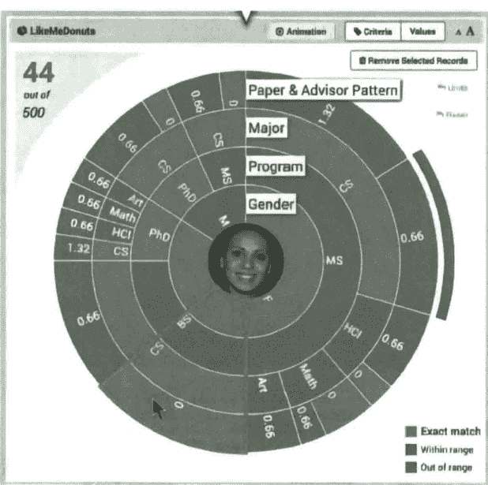

### 图 19.6 可视化用户界面

注：支持用户寻找经历相似者的可视化界面。

资料来源：杜帆等人，2019 年。

近十年，比利时鲁汶大学卡特琳·韦伯特教授团队深耕 AI 推荐系统的探索性界面。在音乐推荐、求职等应用中，多篇论文反复验证：简易滑块赋予用户引导推荐的能力。一项研究引入 Spotify 14 维度中的 5 个（音质、器乐度、律动、效价、能量），用户拨动滑块调整偏好，歌单即时响应（图 19.7）。结论明确：“绝大多数参与者对自主引导推荐持积极态度……通过观察属性与推荐的联动，他们更能理解推荐缘由。”

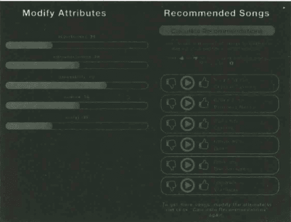

### 图 19.7 以极简滑块驾驭音乐推荐引擎

图片来源：Millecamp 等人成果，2018 年。

另一典范案例是经合组织（OECD）的“美好生活指数”在线平台，该平台依据住房、收入、就业、社区、教育等 11 个维度对各国排序（见图 19.8）。用户只需拖动滑块，即可标注各议题对自身的重要性权重。一旦调整，排名列表便会以流畅的动态条形图即时刷新，直观呈现哪些国家最契合个人偏好。

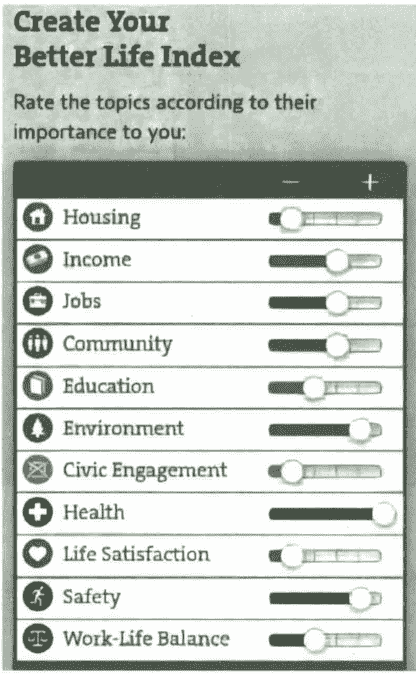

### 图 19.8 经合组织“美好生活指数”交互界面

事实上，不少用户厌烦主动筛选的繁琐，倾向于全自动推荐，即便推荐精度不足也在所不惜。这在影视、图书、餐饮等可自由支配的消费场景中尤为常见；但随着决策分量加重，掌控欲也随之上升——尤其是专业人士需为生死攸关的抉择负责时。

电商、影视等推荐领域虽有大量同类研究，但我却被一个简洁创新的小说推荐网站深深吸引。用户可从 12 个滑块中挑选 4 项属性（如幽默/严肃、唯美/猎奇、乐观/压抑），实时调节（见图 19.9）。滑块一动，右侧书籍封面便随之流动切换；点击封面即弹出短评，辅助阅读决策。辅助工具还包括标注真实与虚构地点的世界地图、故事内核类型（冲突、任务、启示等）复选框，以及种族、年龄、性别等筛选项。设计妙极，我定要亲身体验一番！

### 图 19.9 基于书籍属性维度的小说推荐系统

综上，事后解释虽能缓解用户困惑，在特定场景下必要，但上策在于从源头预防或弱化“解释需求”。这种“防胜于治”的思路，借助前瞻性的可视化交互界面落地：让用户在探索替代方案中体察权衡、发现邻近项、获取自主洞见，从而透彻理解问题的维度与属性。鉴于用户需求随时变、强依赖语境，赋予用户引导推荐的权限至关重要。本章展示的简易设计虽非万能钥，但证据日渐充分——若打磨得当，内置用户控件的系统更受青睐，能收获更高满意度与使用成效。

卡拉哈里欧斯教授率领的伊利诺伊大学课题组，曾针对 75 名 Facebook 用户开展调研，并对 36 名受试者实施可用性测试与深度访谈，核心聚焦：用户是否知晓动态消息的新控制机制及操作方法？结果令人担忧：绝大多数用户不知控件存在，测试任务中寻找控件屡屡受挫；一旦发现设置虽在却深藏难觅，挫败感甚至转化为愤怒。研究建议增设搜索入口、优化菜单架构等改进方向。

质疑派认为：鲜有用户愿学习现成控制面板。但设计精良的面板——如车内座椅、后视镜、灯光、音响、空调的调节——早已从竞争优势进化为标配刚需。乔纳森·斯特雷及 AI 伙伴关系同仁不强调面板本身，而主张通过洞察用户需求，让自动推荐精准“懂你”。适配 HCAI 多元挑战的创新设计触手可及，只待更多想象力注入。

## 第 20 章

## 以管理策略铸就安全文化基因

组织虽普遍希冀全时全境零失误，现实却残酷：疫情冲垮公卫防线，核电事故引发区域动荡，恐怖主义威胁多国安危。过往事故影响半径有限，如今全球化语境下，技术高度互依的大规模组织一旦崩塌，足以重创城市乃至版图级的健康与经济。以组织设计预演失败，已成 HCAI 核心议题，路径至少有四。

**正常事故理论**。佩罗代表作《正常事故》直指组织安全责任，而非纠结具体设计或操作失误。其跨学科分析揭示：组织架构愈复杂、单元间耦合愈紧（标准化流程与层级指挥虽备，但突发状况下跨单元协作却成生死线），集权过度与冗余不足便成致命伤。追求精兵简政的组织难以在常态维持冗余编制，可应急时刻却急需经验丰富的增援。如何论证“日常编制 +20/30%”足以应对年均一度的极端事件？如何应对核心骨干突发离岗？（如高管团因公殉职于空难——或应强制核心人员分机出行）。佩罗理论经克莱因拓展，却遭霍普金斯批评：缺乏量化“紧耦合”与“冗余不足”两大风险的指标；亦有声音斥其过度悲观，视复杂组织失败为宿命。

**高可靠性组织（HRO）**。源自组织设计与管理学。HRO“盯着故障看”，复盘潜在失误与未遂事件，常态化演练“致力于恢复”。明尼苏达电力输电专家 Hilary Brown 指出：HRO 通过人员冗余、高频演练、压实责任、下放决策权，化解了佩罗定义的复杂性与紧耦合风险。与正常事故理论的宿命论不同，HRO 拥护者笃信：正念文化可筑牢防线。

**弹性工程**。根植于认知科学与人因工程。旨在赋予组织柔韧应变、灾后复苏之力。俄亥俄州立大学 David D. Woods 倡导构建“可持续适应性架构”，汲取生物、社会、技术系统演化智慧。其规划覆盖四类灾难：自然系（地震洪涝风暴）、技术系（水电讯中断）、对抗系（破坏恐怖犯罪）、设计系（系统漏洞、人为失误、管理真空）。

**安全文化**。源于对切尔诺贝利核泄漏、“挑战者号”航天梭失事等无法归咎个人或设计的重大灾难的反思。核心在于培育组织基因：长期坚守开放管理、全员安全心智、经验证的组织能力。MIT 南希·莱韦森构建了系统安全工程体系，涵盖设计、危害分析、事故调查。她精辟区分“安全性”与“可靠性”：二者可分离，需差异化应对。

四大路径殊途同归：备战故障与未遂事件，护航安全、不间断的绩效输出（见图 18.2）。立足安全文化，我提炼管理层践行 HCAI 的五大支柱：领导层安全承诺；安全导向的招聘与培训；故障与未遂事件的广泛通报；内部审查委员会的前瞻研判；对标行业标杆与最佳实践。

## 领导层的安全承诺：不止于口号

高层可通过价值观、愿景、使命三维显性化承诺。领导者对失败的关注度，体现在建设安全文化的积极表态中——价值观、信条、策略、规范。安全文化虽具韧性，却恐因内部冲突、外部新威胁引发的氛围变迁而动摇。睿智领导深知：董事会若深度介入决策，承诺落地概率大增，因领导层地位与安全成败深度绑定。

承诺需在高频复诵、主动招募、反复磨砺、公开复盘故障与未遂事件中显影。如医院月度审查会，显著提振患者安全。俄亥俄某院 Janet Berry 团队实证：“安全协作氛围优化，显著关联患者伤害降低与病亡率下调（经严重度校正）。”安全型领导聚焦内部审委会对规划与隐患的研讨，及对行业规范的合规践行。

安全文化耗资费力：需充足编制、时间、资源托底。意味着冗余编制确保危机时“有懂行的人在场”，靠风险审计前置预判，培育“预见危险”的主动心智。安全、可靠、弹性推高持续成本，却以大幅降低高昂故障概率为报。且安全投入常伴随生产力跃升、工伤成本锐减、运维开支收窄。但这些红利难说服怀疑论者——他们只盯着“为低概率不可测事件买单”的账目，执意削减成本。

部分安全文化文献聚焦员工与设施安危，但 HCAI 体系的核心落脚点，必须是**受系统影响的生命个体**。故 HCAI 安全文化建设天然与用户深度绑定：患者、医者、院方管理者，或囚犯、律师、假释法官。面向利益相关方的外延服务，打通双向信息流、持续采集使用数据、降低不良事件上报门槛。HCAI 组织落地安全文化正当时，医疗 AI 治理即是典型先行实践。

AI 算法安全本质是管理命题，却直指开发技术细节。领导层须精通安全增强路径：锚定正确目标指标、确保监管介入叫停险招、规避“分布漂移”（环境变迁致训练数据失效）、御敌对抗攻击。领导需常态化验证开发期测试闭环，部署全周期持续测试。

怀疑者担忧：核能、化工、医疗、社媒等行业的安全宣言，多沦为应对不可接受风险的公关辞令；更有甚者，将事故甩锅操作失误，掩盖组织备战不足与培训缺位。破局一招：设立内部监察官，暗访员工与利益相关方诉求，依法护航实名举报重大隐患的吹哨人。

## 以安全为锚的招聘与培训体系

岗位说明书（JD）显性化安全要求，让在岗与候选人同频共振。招聘多元化（如高层涵盖多元背景与技能）本身即是承诺兑现。安全文化亟需跨域专家：公卫、人力、组织设计、人类学、调查取证等领域的资深安全从业者。

“安全第一”组织将演练常态化：工控室操作员推演应急预案、飞行员模拟机磨砺、医护人员多日实战化演练应对群伤与疫情。唯有日常操作与应急预案肌肉记忆对齐，危机时刻方能从容。周全筹划建议：按历史频次/后果分级应急场景，测算各等级所需内部响应力量，预案外部援助调用机制。精良核对清单，削减常态误操作，锚定应急动作标准。

得益于苹果人机交互指南、谷歌 Material Design 等头部科技巨头的标杆文档（含可落地的界面范式），软硬件设计师培训门槛大降。微软 18 条交互准则、IBM AI 伦理官网虽立于通用原则，却仍需持续迭代。

指南根植于 UI 设计史与 HCAI 前沿研究。但组织必须将指南“教”给设计师、程序员、AI 工程师、产品经理、决策者；配套执行保障、豁免机制、持续改进机制，方能落地生根。

随 HCAI 渗透，培训对象外溢、内容升维：自动驾驶车主、电子病历临床医生、工控室操作员……他们须读懂受控系统逻辑与机器学习底层机理，预判潜在失效模式与后果边界。

Daugherty 与 Wilson 在《人类 + 机器》中强调：“企业必须投入培训与再培训，备员工胜任新角色……对人的投资，必须是 AI 战略的核心内核。”

## 广泛通报故障与未遂事件：让隐形风险浮出水面

安全型组织常态化披露“故障（不良事件）”与“未遂事件（侥幸脱险）”。未遂事件或微小疏漏（偶发渗漏、强制重启、误操作、断电），或可避免的危险操作。若遗漏疏漏被记录在案，设施管理层便能洞察运行规律，精准拦截重大故障。未遂事件高频发生，数据样本丰富，是指导维保、培训、重构设计的金矿。

美国家安全委员会反直觉建议：**别奖励“零事故”部门主管，要奖励“高上报率”主管**。“未遂上报”机制倒逼员工聚焦安全，养成“上报而非掩盖”的肌肉记忆。

民航安全金字招牌，源于深厚的“未遂上报”土壤：美联邦航空局热线面向旅客、管制员、公众开放匿名举报。美运输安全委员会公开报告公信力强、影响力大，深度复盘伤亡案件推动交通迭代。航空安全报告系统（ASRS）提供“机密上报、数据分析、情报分发”闭环。这些公开报告范式，是 HCAI 系统的标杆。

美 FDA 不良事件报告系统（FAERS）为 HCAI 公开问责提供模板。面向医护、消费者、制造商征集药品、器械、化妆品、食品等报告。7 步引导式界面保障数据可信度。公开看板显示年报告量持续攀升，2018-2020 年均破 200 万份。

FDA 另一系统 MAUDE 记录手术机器人不良事件。基于 2000-2013 年 10,624 份报告（144 死、1391 伤、8061 故障），FDA 审查建议：“优化人机界面与手术模拟器，强化术中技术故障实时研判与团队应对培训。”结论直指“团队培训、先进 HMI、改进调查上报机制、本质安全设计”的核心价值。

网安领域公开报告机制同样卓有成效。MITRE 公司自 1999 年维护 CVE 漏洞库（超 15 万条），联手 NIST 运营 NVD，助开发者极速定位修复、协同防御、规避后继产品漏洞。上述开放系统均为 HCAI 故障治理的教科书级范本。

软工层面，GitHub 记录每行代码作者与变更史（5600 万开发者、300 万组织背书）。运行态下，Bugzilla 等缺陷追踪工具导测记录，聚焦高频重漏洞。及时闭环用户反馈，阻断规模化踩坑。工具虽服务研发团队，亦可开放用户侧提交入口。

网安界成熟的“漏洞赏金制”可迁移至 HCAI：设立“偏差赏金”，奖励上报系统异常表现。众包智力已获巨头验证：谷歌支付 100 美元至 3 万+ 美元/份，累计超 300 万美元；HackerOne、BugCrop 等专业平台运营成熟。HCAI 落地需定策略：定价、评估、披露边界。这印证了 Raymond 法则——“眼球足多，漏洞无影”，广纳贤良共寻短板，大有裨益。

对比无显示屏的高度自动化系统（电梯、制造装备、自动驾驶），具备可解释状态显示的交互系统，漏洞上报门槛更低。居家网络故障频仍，我却因缺乏可视化面板难以精准上报：究竟是本本、路由器、还是运营商故障？我渴望状态看板与控制面板，助我自诊或精准求助。服务商仅向专业客户开放此类信息。像我这般普通用户，最优解往往是“全家桶重启”，祈祷 10-15 分钟自愈。

另一可借鉴范式：美陆军“事后复盘法”（AAR），已延展至医疗、交通、工控、环保、消防，堪称 HCAI 故障复盘利器。复盘三问：预期何事？实况如何？未来如何更优？全景复盘报告（亮点与短板并陈）最利建议落地。随团队熟练度提升，分析深度与建议采纳率双升。

HCAI 社区早期聚焦事件数据收敛。Yampolskiy 首批案例汇入 AI 伙伴关系宏大工程。McGregor 主导构建千级事件库（覆盖大众、贸易、学术源），支持“抵押贷款”“人脸识别”等关键词检索，深度分析报告尚在酝酿，但里程碑意义已定——助力更可靠、安全、可信的系统诞生。

另一垂深项目由 Karl Hansen 推进：搜集特斯拉致死案件公开报告。美陆军刑调司前特工、2018 年入职特斯拉内部调查员，因公开致死数据遭解雇。公开信息显示，截至 2021 年 9 月，特斯拉车辆故障致 209 死，远超公众认知。报告不全，难辨各案细节及“Autopilot”介入情况。2021 年 8 月，美 NHTSA 立案调查 11 起特斯拉自动驾驶撞击路边急救车事故。

# 当“智能”失控：特斯拉急加速疑云与构建可信AI的破局之道

截至 2020 年初，美国国家公路交通安全管理局（NHTSA）已收到 122 份涉及特斯拉“突然意外加速”的投诉报告。其中一份典型案例描述：车主妻子缓慢驶向车库，等待车库门开启时，车辆却猛然前冲……直接撞毁车库门，最终嵌入水泥墙才停下。另一位车主经历两次暴冲后虽幸免于难，却直言“至今心有余悸”。特斯拉官方回应称，车辆日志显示系统运行正常，事故皆因驾驶员误踩加速踏板。但问题的核心在于：一辆以“安全第一”为标榜的汽车，难道不该具备主动避免撞击车库门、墙壁或他车的能力吗？

## 内部审查委员会：将安全文化刻入组织基因

内部审查委员会是落实安全承诺的关键载体。通过固定月度会议复盘故障与险情，鼓励团队直面挑战、持续攻坚；利用标准化统计报告量化关键指标，引导管理层与一线聚焦核心度量；并通过内部通报与公开总结，不断强化安全文化的优先地位。

委员会成员涵盖管理层、一线员工及外部视角，多元观点碰撞出持续改进的合力。借鉴航空业“准点率/丢包率”月报驱动的良性竞争，以及医疗行业公开手术结局供患者择医的做法，引入量化考核机制。美国卫生与公众服务部下属机构定期开展的患者安全文化调查，便极大提升了从业者意识，形成跨区域长期趋势追踪。

**医疗界的“披露-道歉-补偿”范式极具启示性：** 面对医疗差错，医生不再因怕诉讼而隐瞒，而是主动全面告知、真诚道歉、提供救治与赔偿。实践证明，这种极致透明非但未引发诉讼潮，反使官司减半、医疗事故大幅下降，职业荣誉感与组织凝聚力双提升。

**谷歌五阶段算法审计框架**为内部治理提供了标准化范本：
1.  **定界**：锁定项目边界，提出风险追问；
2.  **绘图**：梳利益相关者网，访谈定指标；
3.  **取证**：归档设计文档、数据集与模型谱系；
4.  **压测**：对抗性测试挖掘边缘案例与失效模式；
5.  **复盘**：风险研判、整改闭环、留存设计史料。

该框架含审计后自评报告与执行跟踪机制，谷歌团队亦清醒认知：“内部审计仅是制衡体系的关键一环”。

企业自律先行案例层出：Facebook（现 Meta）成立监督委员会管控内容生态；微软设立“AI 与伦理工程研究委员会”向高层建言，“负责任 AI 办公室”落地全公司治理规范，推动敏感用例处理、法律标准塑造，力惠全社会。

## 对标行业标准：用共识构筑信任基石

关键领域自有成熟标准护航。**先进自动化协会（A3）**（前身机器人工业协会）联合 ANSI 发布自愿共识标准，驱动“创新、增长、安全”三位一体，**ISO/TC 299** 自 1983 年起深耕工业与服务机器人安全安装规范，**IEEE 7000 系列** 精准对标透明度、偏见、安全、可信等 HCAI 核心议题，给出精确定义与评估路径。**自主智能系统道德开放共同体（OCEANIS）** 协调全球标准联动。

通用设计领域，**W3C 的 WCAG 指南**与**美国无障碍委员会第 508 条** 强制保障残障群体信息获取平权，为 HCAI 普适性提供合规模板。

参与标准制定让企业抢占最佳实践高地、赋能员工成长，更向市场释放“安全导向”强信号。然需警惕“企业俘获”风险——利益相关方弱化标准以规避硬监管或降低成本。但企业实战经验亦能提升标准落地性与接受度。动态平衡虽难，良性自愿标准终将倒逼产品服务升级。

**CMMI（能力成熟度模型集成）** 另辟蹊径，聚焦软件研发**过程**改良而非产品指标。2018 版主打“融合职能孤岛、设定改进优先级、质量导向、基准评估”，美政府国防软件采购多以此设准入门槛。

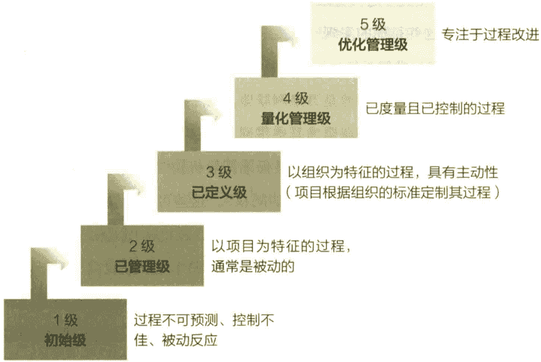

图 20.1 成熟度等级的特征：能力成熟度模型中的五个等级

CMMI 将组织划分五级：初级（混乱、被动、失控）→ 受控（项目级规范）→ 定义（组织级标准化）→ 量化管理（度量驱动预测）→ 优化（持续创新）。培训体系保障实践落地。质疑者担心其重流程轻敏捷，但医疗器械、交通、网安等 HCAI 领域定制版模型层出不穷。英国 AI 伦理与 ML 研究院更推出百项实测基准的 ML 成熟度模型，覆盖数据评估、模型评估、可解释性全链路。

**可信成熟度模型**将 CMMI 映射为 HCAI 语境：
- **L1 初始**：个人经验驱动，过程不可控；
- **L2 可复现**：统一工具链与培训，团队内一致；
- **L3 可定义**：工具流程复用、评审迭代，适配业务域与组织风格（含偏差测试、V&V、UX 测试、投诉复盘）；
- **L4 可量化**：度量系统性能与人效，审计溯源失效成因；
- **L5 可优化**：跨组织度量复用，长周期持续质控。

59 位专家联名的全景报告直指痛点：开发者须**超越原则宣言，展示负责任行为的可验证机制**。建议涵盖制度架构、工程流程、硬件规范、形式化验证及“可证伪的可验证声明”。

**文档模板化**成新范式：“数据集数据表” 解决“文档量=代码量”痛点，标准化记录数据来由、成分、适用边界、伦理法律隐患。催生 **Google Model Cards、Microsoft Datasheets、IBM FactSheets**。IBM 实测 35 人评估 6 系统（音频分类、乳腺癌筛查等），维度覆盖完整性、简洁性、清晰度；二期 19 人实作反哺模版迭代。布里斯托大学进阶推出 **Explainability FactSheets**，刻画可解释性多维特征。文档工程若成熟落地，将重塑开发范式，显著提升可靠性、安全性与可信度。

## 第 21 章 独立监督：为可信认证加上“外部锁”

治理金字塔第三层是**独立监督组织**（见图 18.2）。巨头、政府、学界、NGO 共探无人区，完善的外部审查成为赢得公信力的必经之路。40 余份跨界报告同指一点：设计有效监督结构，道阻且长。

监督基石是**责任归属**——法律、职业、道德、伦理多维交织。本文预设：人类与组织对间接构建、运营、维护、使用的产品服务承担法律责任。欧盟新技术责任专家组亦主张：自主技术运营商担责，产品强制留存审计日志，支持事后溯源定责（制造商/运营商/维护方）。

专业领域（医、法、航、工）早有执业资质与个人担责传统，软件工程却长期游离：合同免责条款横行，“50 年新兴行业”说辞搪塞。HCAI 运动重提算法问责、透明度、伦理设计、职业担责。ACM、IEEE 等虽立伦理准则，惩戒机制却近乎真空。

**损害发生后的责任分摊虽复杂，存量法已足应对。** 如 Facebook 因算法允许房源广告按性别/年龄/邮编定向投放被控歧视，最终和解并整改禁令覆盖住房、信贷、就业三大民生场景。

多元主体广泛实践独立监督：审议重大计划、调查重大事故、推动持续改进，护航可靠安全可信。**监督委员选人三原则**：德高望重具专业认知、无利益纠葛保独立、多元构成（学科/年龄/性别/种族）防盲区。**职权须实**：调取私密数据、强制约谈、传唤作证。**报告公开、限时整改（周/月级）** 让监督长牙齿。

图 21.1 三种独立监督方法

### 三大监督范式

1.  **规划监督（前置闸）**：新系统/重大升级上马前提案审议，反馈博弈。类区域规划局审图纸。变体**算法影响评估** 借鉴环评逻辑，利益相关方介入前置。严格模式要求落地复核，防“图纸不落地”。
2.  **持续监控（贴身医）**：高成本高强度。FDA 巡检药厂肉厂、美联储盯大行账本。定检制（电梯季检、上市公司年审）为轻量形态。针对 HCAI 贷款/假释系统，画像与环境漂移（如疫情冲击）下的模型衰退必现端倪。
3.  **事故回溯（解剖刀）**：NTSB 深度复盘空铁海灾难，出具权威报告。FCC 切入社交媒体与网络服务 HCAI 审查，聚焦无障碍与假新闻。全球机构竞相立法，核心抓手是**统一审计追踪与分析指南**。

质疑声称监督失效源于“独立性不足”，但范式价值获广泛共识。

**小结**：明确全链条角色责任，倒逼利益相关者自觉谨慎。第 19 章五大工程实践筑基，第 20 章五大管理策略塑文化，本章四条独立监督路径通向行业可信认证——专家跨组织传播最佳实践。第 22 章将透视政府监管与立法图景。

## 会计师事务所：借财审之威，立算审之信

SEC 强制上市公司内外部年审，遵循 GAAP，结果公开透明，被视为遏制舞弊、护投资者利益的基石。安然、世通巨雷引爆《萨班斯-奥克斯利法案》（SOX），虽无银弹根治渎职，却重塑审计生态。若将**公正性指标、用户体验测试结果**纳入 HCAI 项目披露规范，标准化报告将赋能跨企业横向比较，重塑投资者信心。

**四大所（PwC、德勤、EY、KPMG）** 均自诩 AI 专家。德勤官网明言：“AI 工具非以人为本设计不出直观结果”，高度契合 HCAI 理念。SOX 规定**咨询与审计严格隔离**，双轨并行：顾问侧助力合规建设，审计侧独立把关，**建议落地率极高**因与内审委深度绑定。

**新冠接触者追踪**是独立监督实战教科书：Apple/Google 联手开发暴露通知 API，隐私争议瞬间引爆，独立治理委员会与审计清单（200+ 考察项）应运而生。争议项目（隐私/安全/垄断/偏见）引入外部监督，公信力立竿见影。

四大所若领衔 HCAI 审计，商业公信力将化作监管缓冲器、实践加速器。借鉴**发起组织委员会** 联合五大会计组织优化风控/内控/反舞弊的模式，HCAI 审计标准化可软着陆政府监管压力，吸引社会贤达入局。

咨询巨头亦可发力：Accenture、麦肯锡、BCG 沉淀 AI 知识库、发白皮书，助企构建可靠安全可信体系。

## 保险业：用定价之杠杆，撬可信之门槛

建筑、制造、医疗领域，**保险是隐形监管者**。保单承保门槛即合规红线：结构抗力、消防防洪、建筑规范，保险业以定价与拒保权倒逼工程安全百年。

计算机科学家 Carl Landwehr 早提“软件建筑规范论”：管道、消防、电气、航空电子、医疗器械、网安标准的演进逻辑，天然延伸至 HCAI 系统。保险业介入，将以**可保性要求**重塑 HCAI 工程标准，让“可信”成为可量化的商业生存指标。

### 保险机制：为HCAI系统筑起风险缓冲垫

建筑行业通过严格的规范审批与责任保险挂钩，软件工程领域亦可复制此模式。工程师若能主导制定详尽的设计、测试与认证标准，保险公司便能据此精准评估风险、科学定价。审计追踪记录、故障与未遂事件的定期上报，将为精算师构建行业风险画像、界定赔偿边界提供关键数据支撑。

随着保险公司汇聚同行业多方数据，风险度量模型将迭代升级，行业规范随之完善，倒逼开发者公开作业流程。这种正向循环不仅优化了承保流程，更指引企业提升HCAI产品服务质量。

借鉴医疗、车险、房产险的“无过错赔付”经验，由企业为HCAI系统投保、保障消费者权益是顺理成章的选择。虽会推高成本，但如同其他成熟行业，用户愿为安全买单。企业被迫进行风险评估，海量应用场景积累的故障数据将成为产品迭代的最佳教材。

2018年，旅行者保险等车险巨头发布《确保自动驾驶》白皮书，主张在“刺激创新、保障公共安全、给予安心保护”的框架下推进自动驾驶。报告预判：技术虽能显著降低事故率，但单次赔付成本因设备昂贵而攀升；共享出行普及将压缩车辆保有量。这两大趋势深度影响定价逻辑。然而，厂商隐瞒数据、监管缺位导致公众缺乏验证“更安全”论断的依据。保险业虽终将介入，但前置干预效果更佳。

质疑者担忧保险公司逐利本性凌驾公共安全，及消费者在自动驾驶伤害、算法歧视（招聘、贷款、假释）等场景下维权困难。但保险史证明，险种普及惠及大多数受损者。核心目标应是：依据HCAI实际危害程度，设定切实可行的保险指标。

另一路径是设立“无过失保险计划”或“受害者赔偿基金”，如“9·11受害者赔偿基金”“墨西哥湾漏油赔偿基金”模式，由行业或政府注资，独立委员会快速理赔，规避繁杂司法程序。此类针对HCAI故障的创新赔偿提案虽已浮现，尚待广泛共识推动落地。

---

### 非政府组织：外部监督生态的关键催化剂

除政府、审计、保险三驾马车外，非政府组织（NGO）与公民社会团体是推动可靠、安全、可信HCAI的重要力量（详见附录A）。虽资源不一，但合力能有效提升系统质量与公众接受度。

这些组织多依赖捐赠或企业资助，独立性赋予其探索前沿议题、引领舆论的自由度。从草根发起到拥有百人团队的成熟机构，部分NGO通过政策研究、培训服务实现造血，持续扩大影响力网络。

**算法正义联盟**堪称标杆：通过施压，推动科技巨头两年内大幅降低面部识别的种族、性别偏见。2020年春，多家巨头宣布暂停向执法部门销售该技术，舆论压力功不可没。

NGO在提出HCAI伦理原则上走在前列，当前需转向**软件工程实践**与**商业管理策略**的创新，并强化与政府、法务、保险、审计机构的联动，撬动传统外部监督体系。

需清醒认知：NGO无强制执行权。其价值在于**曝光问题、输出方案、激发辩论、助力深度报道、重塑认知**。后续需赖政府立法、审计改制、保险更新风控模型落地。独立监测报告输出的新洞见与评估范式，可适配多元行业需求。

---

### 专业组织与学术机构：标准制定与人才培育的双引擎

专业协会在自愿标准制定上成效显著（附录B）。新兴机构深度参与全球负责任AI伦理讨论，已产生实质影响。但警惕“企业俘获”风险——行业巨头主导下标准可能趋弱。

**IEEE（电气电子工程师协会）** P7000系列标准覆盖自主系统透明度、算法偏见、故障安全设计、新闻可信度等核心议题；**ACM（美国计算机协会）技术政策委员会**聚焦可访问性、算法问责、数字治理、隐私保护。挑战在于如何提升会员参与度。IEEE推出的自主智能系统伦理认证，旨在为企业提供透明度、问责制、算法偏差的量化考核体系。

学术界早布局AI研究，近年更密集建立大型中心，聚焦HCAI伦理、设计、研究（见下表）。早期课程已纳入伦理决策，但强化毕业生职业影响力意识仍任重道远。核心挑战：**如何以工程实践为锚，将研究优势转化为更优软件流程、管理策略、独立监督法？**“产学研政”深度融合或成破局关键。

**全球代表性HCAI研究中心：**
*   美国：布朗大学（以人为中心机器人）、哥伦比亚大学（数据科学）、哈佛大学（伯克曼·克莱因中心）、约翰霍普金斯大学（自主性保障）、纽约大学（负责任AI）、西北大学（人机交互设计）、斯坦福大学（以人为中心AI）、芝加哥大学（人类与AI实验室）、加州大学伯克利分校（人类兼容AI）
*   加拿大：多伦多大学（AI伦理实验室）、英属哥伦比亚大学（人机交互）
*   英国：剑桥大学（莱弗休姆未来智能）、牛津大学（互联网研究所/人类未来）
*   欧洲：乌得勒支大学（以人为中心AI，荷兰）
*   澳洲：莫纳什大学（以人为本AI）、堪培拉大学（以人为中心技术）

另有多实验室致力于AI长期影响及人类福祉保障研究。

企业领袖频表责任承诺：纳德拉（微软）六原则强调辅助人类、透明度、尊严、隐私设计、算法问责、反偏见；皮查伊（谷歌）七目标聚焦社会效益、公平性、安全测试、问责、隐私设计、科学严谨、用途合规。

质疑声视此为“漂绿”公关。谷歌内部审查与审计框架虽在推进，但外部伦理委员会周内解散暴霉治理脆弱性。企业承诺虽能托高公众预期，绝不能成为拒绝外部独立监督的挡箭牌。利润压力下，知情记者与外部审查的质询正是企业与公众共同需要的制衡。

---

## 第22章

### 政府干预与法规：从抵制监管到构建治理新范式

全球政要已认同AI关乎经济增长、国家与社区安全。美英欧加俄中印韩等国纷纷出台国家战略，**中国《新一代人工智能发展规划》目标最激进——2030年登顶基础研究、产品开发、商业应用三大制高点。**

中国优势显性：海量高素质人才、集中式经济调度、千亿级资金承诺。虽早期规划鲜提HCAI，后续文件补齐公正、隐私、开放协作等原则。阿里、腾讯、百度等巨头在电商、金融、社交领域的霸主地位，根基即深厚AI实力。

文化差异造就数据红利：群体利益优先使医疗数据集中利用成公共卫生资产，与欧美隐私保护范式截然不同；天网监控构建社会信用体系，虽争议大，却为机器学习提供超大规模训练语料。

美国胜在学术高地、头部巨头、创业生态。2019白宫报告虽承认“安全可靠可信”必要性，却回避监管动作，主张行业自律标准更适应快变技术。布鲁金斯学会韦斯特与艾伦指出AI具**目的性、超人智能、适应性**三大异质特征，须政府新举措。他们主张AI影响评估与联邦顾问委员会双轨监督，虽建议宏观，但明确发声：“必须保留人类监督控制渠道。”

**科研资助范式转向：** NSF亿级设立国家AI研究所，要求“启发式研究”对接社会需求、强制产学研合作。这打破万尼瓦尔·布什《科学：无尽的前沿》确立的“好奇心驱动”传统，虽受争议，但“用启发型研究”共识渐成，实证显示实战协作能同时提升基础研究质量与社会效益。HIBAR联盟等组织推波助澜。NSF八大主题含“人机交互协作”，明确指向以人为本设计、伦理公正、隐私保护、可解释性、弱势群体保护、包容性设计。

**国际治理图谱：**
*   **加拿大：** 推行算法影响评估（AIA），管控自动化决策风险。
*   **欧盟/英法德意：** GDPR确立“解释权”，趋向行业特定监管而非统一框架。英国皇家学会建议现有行业监管机构接管AI事务；ICO与图灵研究所输出行业政策制定深度指南。
*   **欧盟委员会白皮书/高级专家组：** 七大可信AI原则（人力监督、技术稳健、隐私治理、透明度、多元公正、环境社会福祉、问责制），现为自愿遵守。
*   **经合组织（OECD）：** 20国集团背书、50+国家响应的“负责任管理可信AI原则”，含包容增长、可持续、福祉、透明、可解释、问责，并设政策观测站（覆盖60国）与全球AI伙伴关系（GPAI）推动落地。
*   **联合国：** 电信联盟主办AI for Good峰会对标17大可持续发展目标，但停留对话层面。致命自主武器禁令推进缓慢。需参照原子能机构（IAEA）核查模式，赋予实质执法监管权。

**国家级执法样本——美国国家运输安全委员会（NTSB）：** 独立于行政部门、国会拨款、技术精湛。调查2016特斯拉致命事故，直指“过度依赖自动化、忽视系统局限”，建议强制标准化可检索数据审计追踪，警示“无人因考量盲目自动化”的悲剧教训。此模式可为HCAI高风险领域监管提供范本。

# 监管与治理：在创新与安全之间寻找平衡点

## 为何高风险领域必须接受外部监管

交通事故频发迫使政府出手干预汽车安全，航空惨剧促使空难调查成为常态，这背后的逻辑一致：当生命安全遭遇系统性威胁，公共权力介入便成了必然。将这一原则推广至医疗器械研发、药品生产、临床诊疗及养老护理等关乎生死的场域，同样合情合理。金融授信系统牵动亿万家庭财富命运，其算法黑箱若缺乏监督，后果不堪设想。当然，对于影音推荐、购物导航等低风险消费级应用，监管触角应当适度收敛，除非涉及反垄断或保护未成年人、残障群体、老年人等弱势用户权益。

企业对合规成本的抵触情绪可以理解，但在高风险赛道，引入独立第三方监管反而能倒逼产品迭代升级，从长远看利大于弊。不过现实中常见“监管俘获”现象：行业大佬轮岗进监管机构，虽带来专业经验，却难免被质疑会对旧部下手软。

## 美国监管实践的多元探索

成立“国家算法安全委员会”的提议虽引发热议，但将以人为本的人工智能（HCAI）专业能力植入现有垂直监管体系，显然更具操作性。现有机构深谙行业痛点，能因地制宜制定规则，这正是美联邦机构正在推行的路径。

**FDA 的医疗 AI 监管范本**：美国食品药品监督管理局早已起草蓝图，聚焦重症监护算法、皮肤影像诊断软件等医疗器械嵌入式 AI/ML 组件的全生命周期管理。其核心诉求直击痛点：如何让算法在实时自我优化中持续惠及患者，同时确保落地技术的安全有效性。

**FAA 与 EASA 的航空适航博弈**：联邦航空局软件系统分部正攻坚驾驶舱自适应软件认证难题。这类软件能依据传感器实时数据动态调整行为，支持者认为其提升安全冗余，但飞行员、管制员与监管者担忧其“黑箱”特性引发不可控风险。欧盟航空安全局 2020 年发布的 15 年路线图《以人为本的航空人工智能方法》，则明确以问责、监督、透明三支柱构建信任基石。

**NIST 与 NSCAI 的标准与战略双重奏**：国家标准技术研究院自 2019 年起主导 AI 可信度与可解释性评估体系建设，通过研讨会、报告、开放平台输出公共产品。国家人工智能安全委员会终报告则从国家安全维度出发，建议大幅扩充研发投入、构建监管监督框架、强化教育培训，追求可解释性、可视化与增强型人机交互。报告虽强调美中竞争态势下的领先地位，亦指出深化伙伴互信、拓展外交合作才是 AI 实力的真正放大器。

**FTC 的算法公平执法实战**：联邦贸易委员会凭借《公平信用报告法案》五十年积淀，宣称已就绪迎战 AI 决策乱象。其执法重锤直指金融信贷领域：企业必须公开训练数据来源、决策逻辑链路，并能向被拒服务消费者做出人类可理解的解释。指南措辞犀利——“必须知晓模型用了什么数据、如何用数据决策、并能向用户讲清楚”。质疑者担心执法力度，但官网数据显示：两年内 700 万+消费者追回超 10 亿美元损失，以数据说话。

## 监控资本主义的困局与破局

哈佛商学院教授祖博夫以“监控资本主义”精准解剖科技巨头商业逻辑：Meta、Google 等通过面部识别、海量画像构建行为预测引擎，将“确定性”出售给广告主、政治操盘手。算法精准捕捉购买意图、政治倾向、谣言传播倾向，却以隐私掠夺、隐秘说服、选择架构操纵为代价。

HCAI 设计范式提供破局思路：赋予用户可视化隐私控制面板、数据最小化收集选项、算法推荐干预权。但祖博夫警示：真正的用户主权会动摇巨头商业根基——苹果推出 App 跟踪透明度框架，Meta 的激烈反扑便是铁证。欧盟已以《数字服务法》《数字市场法》出重拳，英美监管层迟迟未动，监管真空持续扩大。

## 监管会扼杀创新？历史给出反面教训

业界普遍担忧合规桎梏创新，汽车工业史却证明：安全带、排放标准、燃油效率法规倒逼出技术跃迁。白宫管理和预算办公室主管沃特发布《管理 AI 应用十大原则》，主张“避免不必要阻碍创新的监管/非监管行动”，鼓励行业自主制定自愿共识标准。2020 年白宫报告重申：法治应托举创新而非增加负担，三大支柱为公众参与、防止过度监管、促进可信 AI。

但监管缺位的代价已在社交媒体显现：仇恨言论、深度伪造、算法歧视泛滥，平台为商业流量让渡公共利益。联邦制下，州/地方政府可先行先试，为联邦立法提供实证样本。未来监管必将聚焦：商业行为公正性、消费者使用安全、虚假信息与仇恨内容遏制。

---

## 第 23 章 总结与怀疑者的困境

> “一旦算法——尤其是机器人技术——在物理世界产生实质影响，便必须纳入监管框架，其编写者需对危害承担道义与法律双重责任……唯有具备深厚专业素养的人类审查员，方能识别、消解并转移绝大多数风险。”
> 
> —— 弗兰克·帕斯夸莱 《机器人新法则》

### 四层治理架构：从代码到法治的闭环

HCAI 代表跨学科新范式，将人类绩效与体验置于核心。为落地可靠、安全、可信系统，15 条治理建议构建四级防御体系（见图 18.2）：
1. **工程基石**：成熟软件工程实践筑牢可靠系统；
2. **组织文化**：经营管理策略培育安全文化；
3. **外部认证**：独立监督机制换取可信背书；
4. **法治兜底**：政府监管划定红线底线。

多维关注点天然吸引多学科协作，成功概率大增。若行业领袖不止于口号，转而落地公正、透明、问责、安全、隐私的具体实践，直击观察者痛点，HCAI 终将赢得市场拥抱。公平易说难行，尤在动态场景；开源代码≠透明可懂，复杂系统涌现行为难预测。除避免故障，领导者更应致力：增强人类自我效能、激发创造力、明确责任归属、促进社会连接。认清公平透明等属性是差异化竞争壁垒，而非合规成本，方为长远之计。

### 落地挑战与演进视角

无组织能全盘落实 15 条建议。每条皆需实证检验、迭代优化。真实系统多供应商协作，组件级测试（软件/数据/体验）可行，系统级整合难度指数级上升。安全气囊算法适合形式化验证与全覆盖测试；自动驾驶系统更需独立监督审查。如家庭随时间演进，HCAI 系统亦须持续适配新技术、新场景、利益相关方新期待。

### 全球共识与本土实践

国际电联牵头 35 家联合国机构，将 AI 对接 17 项可持续发展目标，融合技术进步与行为干预，聚焦医疗、环境、人权。经合组织政策观测站、杜卡基斯中心年度《社会契约指数》追踪 25 国民主化政策进程，佐证全球势头。

### 直面深渊，亦见曙光

伦理、社会、经济、人权、社会正义、负责任设计成高频热词，利好公益 AI 与生态守护。怀疑者预警：劣质设计致偏见、泄密、失控；恶意主体武器化 AI 造谣、威慑、犯罪、瘫痪公共设施。致命自主武器、民主退行、算法种族主义、监控资本主义等黑天鹅事件频现。微软克劳福德等批评者直指 AI 榨取本质：环境掠夺、劳工异化、用户异化。

严峻挑战不容回避，但善意研究者、企业家、官员、公民社会的建设性行动汇聚成正向合力。跨学科范式成熟或需数十年，以人为本的设计思维已可铺路：构建尊严、正义、人权获提升的未来社会。本书旨在培育积极心态与建设性行动，助力人类实现自我效能、创造力、责任感与社会连接。

---

# 第五部分 未来图景：我们将何去何从？

## 众腾玉案：三位一体的知识地图

全书架构三位一体：**理念框架**（第二部分）、**设计隐喻**（第三部分）、**治理结构**（第四部分），阐释以人为本思维如何托举强算法广度落地，成就可靠、安全、可信系统。

AI 视野从算法中心外拓至用户体验设计，学术/产业社群常态化探讨伦理、责任、公平、可解释性。设计师转向 HCAI 框架，实现“高自动化 × 高人控”双高并行。优秀隐喻融合：核心任务交付可靠自动化，边缘任务赋予用户控制面板。商业/政策精英觉醒：治理红利即竞争力，唯有可靠安全可信系统赢得用户青睐。全球治理共识正转化为区域、国家、行业、企业的可执行政策。

### 未来研发四大看点
- **第 24 章**：罗列 HCAI 典型项目与推进路径，为学界、业界、政府、NGO 提供课程、指南、案例库；
- **第 25 章**：聚焦可信度评估核心难题，主张客观指标失效时引入利益相关方主观感知测量；
- **第 26 章**：实战养老照护与银发共学场景；
- **第 27 章**：全书收官，重申核心使命。

---

## 第 24 章 推动 HCAI 落地生根

> “终极拷问：这些工具能否延续生命、升华生命价值？……机器不提要求、不作承诺；提要求、守承诺的，是人类的灵魂。”
> 
> —— 刘易斯·芒福德 《技术与文明》

### 核心使命：从算法思维进化为 HCAI 方法论

收集真实需求、遵循设计准则、迭代用户测试、发布后持续评估——将这套方法论内化进教育与实践，需学界、业界、政府、公民社会四方持续合力。本章以若干研发项目挑战为切入，继而为高校、企业、政府给出加速采纳 HCAI 的行动指南。

### 研究前沿：双轨并行的大图景

技术派深耕深度学习架构革新，社会派攻坚偏见治理与公平精准可用，伦理派重构规范解释，工具派打造开发者利器，政策派制定国家议程，监管派梳理执法法规，资本派筛选高潜项目。联合国 17 项 SDGs、美工程院 14 大挑战持续吸纳人才。英国 2021 年发布四大“宏大挑战”：AI 与数据、老龄社会、清洁增长、未来出行。加拿大、日本、韩国、德等国跟进。比尔盖茨基金会、XPRIZE 等非营利组织亦设专项挑战。

受控核聚变、天气调控、抗生素耐药等经典难题，均可从 AI/HCAI 受益。新增挑战聚焦：风光储充一体化优化、气候危机技术突围。三大 HCAI 高价值赛道：**推进民间科学、遏制虚假信息、攻关重大疾病疗法/疫苗**。亿万用户将在近乎隐形的交互中受益——如同默认芯片内嵌，未来大众将默认超级工具、遥操作机器人、有源设备“按预期工作”，专注意图而非技术细节。

---

### 聚焦一线：推进民间科学

环保议题天然连接民间科学家群体。普通公众与杰出业余爱好者出于求知与贡献双重动机，跨越自然科学、生物化学、历史、人类学等全谱系参与。项目常由专业科学家发起，公众协助采集分析数据；近年更涌现公众主导规划、管理、撰写学术论文的案例。

**头部项目规模效应显著**：
- 康奈尔 **eBird**：1 亿+ 鸟类观测/行为/迁徙记录；
- 牛津 **Zooniverse** 支撑 100+ 子项目，发端于 **Galaxy Zoo** 15 万张星系图像标注；
- 加州伯克利三硕士 2008 年创立 **iNaturalist**，2021 年 2 月社区超 300 万，6000 万+ 观测覆盖 32 万+ 物种，催生数百篇同行评议论文；
- 2021 年 6 月美联邦政府跨机构（国家公园/海洋大气/航天/国会图书馆）资助 491 个项目，口号“公众参与加速创新”。

**数据洪流下的质量与体验双重奏**：低算力时代海量数据处理已是挑战，如何兼顾高质量数据产出与参与者深度体验？答案在于**公民技能 × AI 力量**耦合。已落地案例：计算机视觉/深度学习识别红外相机兽种、鸟群计数、单叶识树；条纹纹路识斑马、藤壶/背鳍/吸虫/尾纹识鲸。原型验证通过，向大规模、多环境、高鲁棒性超级工具跨越，仍在路上。

**声纹识别开启跨物种对话新纪元**：鸟鸣识种与语义解析、鲸豚哨声追踪个体/群体动态，下一步自然是解码海豚语法并尝试 AI 生成哨声互动。跨物种对话堪称完美“大挑战” —— 重新认识自然，亦重新校准人类认知边界（如驯犬师/“马语者”如何建立跨种融洽关系）。

**Seek App：儿童版自然探索伴侣**（图 24.1）。iNaturalist 衍生产品，免注册、零数据收集、隐私安全设计。博士生格兰特·范·霍恩主导，算法融合图像分析、地理位置、时间戳，调用 iNaturalist 众包分类大数据库，预测手机镜头生物。交互设计巧妙：给出多候选邀请儿童比对确认，若把握度低则仅提示科属层级或单一高置信图像，避免误导。

注：图中真菌被鉴定为伞菌纲。

**留存之谜：是什么让人坚持贡献？** 研究者渴望破解不同年龄/性别/阶层群体长期活跃的动因。iNaturalist 排行榜显示：头部贡献者年均 6000+ 观测，核心鉴定专家年均确认 4 万+ 记录。维基百科万名编辑者共建人类知识宝库，惠及亿级读者。此类大规模协作数据蕴藏钥匙：更好的 AI 与 HCAI 设计，如何释放“大挑战”项目的海量参与潜能？

# HCAI赋能：从民间科学到学术生态的全景重塑

民间科学的版图正在悄然延伸，早已超越了单纯协助大型课题组发表论文的范畴。许多参与者对生物多样性的流失深感忧虑，尤其是过去三十年间物种灭绝与种群锐减的趋势：蜜蜂等昆虫面临群落崩溃，非洲象数量更从1930年的千万头暴跌至不足四十万。融合机器学习、传感解析与图像识别的人本智能系统（HCAI），正成为扭转颓势的关键力量。这些技术赋予民间科学家追踪动物迁徙、监测污染源、打击偷猎的能力。在环保领域意见领袖的推波助澜下，栖息地修复与“再野化”行动亟需更紧密的协同。

试想，若民间科学在未来十年实现十倍增长，普及大众、培育骨干，将大众纳入研究主动脉，并组织力量为洁水、清气、物种多样性及生态修复呐喊。那么，何种形态的HCAI应用能助其寻得同路人、发起游说推动政策变革、并引导资本流向绿色商业模式？

### 筑牢防线：遏制虚假信息病毒式扩散

社交媒体的弊端之一，在于虚假信息及其衍生物——阴谋论、仇恨言论、网络暴力——的无孔不入。内容审核虽是应对之策，却因日均数十亿条动态而举步维艰。新冠疫情期间，以假乱真的谣言导致民众抗拒科学防疫指引，如保持距离、佩戴口罩、接种疫苗。谣言自带流量密码，传播速度远超官方辟谣与主流媒体。深度伪造技术更能合成图像、音视频，栽赃知名人士、捏造言论，配合“机器人农场”瞬间刷出数十亿条信息。

Meta、Instagram、YouTube、Reddit、X等平台虽投入识别拦截，却因虚假内容带来的高互动收益而动力不足。其推荐算法偏好高赞高转内容，客观上助推谣言。尽管外界呼吁加强审核，政府监管却迟迟不到位，核心难点在于言论自由与平台安全的天平难平。

欧盟2018年《反虚假信息实践守则》将其定义为：旨在牟利、欺骗或威胁民主决策、公众健康环境安全的可证伪虚假/误导信息。Meta联合国际事实核查网络（IFCN）甄别谣言与受保护观点，Alon Halevy团队列举了煽动暴力、假新闻、仇恨言论、诱导未成年人、侵犯知识产权等数十大顽疾。平台虽力求极速下架压降，但面对日均百亿级内容、恶意账号矩阵分钟级刷屏，依然力不从心。

Halevy团队主张：“留存违规内容后果严重，宁可多调用模型保全召回率，再由人工复核定夺。”这种算法筛选+人工裁决的双轨制，契合HCAI内核。清理僵尸号虽能延缓扩散，但造谣产业链日益壮大，平台治理陷入军备竞赛。

Meta成立由40位国际名流组成的监督委员会，掌内容下架权、平衡言表与危害。虽获资金支持，但因成员由平台提名，独立性备受质疑。

剑桥分析丑闻揭示虚假信息渗透多国大选。扎克伯格2018年向国会承诺AI将成清除有害内容的规模化利器，现实却屡屡打脸。Meta半年透明度报告虽披露下架、核查、申诉数据，但平台对清除匿名机器人账号、深度治理谣言仍持抵制态度。

虽无法一键净化网络，但降速传播、封禁匿名机器人账号值得全力以赴。平台需付出几何代价、监管施加何种压力才能倒逼商业模式变革，仍是悬而未决之题。《X平台规则》《YouTube社区指引》是平台自律尝试，X平台叫停政治广告更是净化选举环境的积极信号。

两大正向案例证明破局可能：Google派遣3000+工程师对抗SEO作弊（隐形关键词堆砌、雇佣机器人刷好评链接），因搜索可信度关乎根本利益；Meta德国团队在《网络执法法》（NetzDG）高压下，从表现不佳被罚200万欧元，到聘百名审核员、升级AI模型精准打击极端言论，展现了强监管的威慑力。

缅甸、埃塞俄比亚、印度等地极端言论酿成血案，2021年1月6日国会山骚乱更由选举舞弊谣言引爆，酿5死。互联网赋予边缘群体发声权的初衷，被恶意行为者劫持成伤人害己、动摇政权的利刃。化解公共安全危机，需更强算法与更优人治。实名制虽成共识（如Meta要求实名唯一身份），却屡禁不止，严格执法与个人问责或能遏制滥用。

若平台对推广有害非法内容担责，网络生态将更可靠、安全、可信。此议题关乎政权、企业、个体安危，阻断谣言需科研、工程、政商界持续投入与创造性贡献。

## 攻克重大疾病：新疗法与疫苗研发的AI突围

新冠大流行聚焦全球目光：如何救治感染者、研发疫苗构筑免疫屏障。核心难题在于破解DNA序列如何编码氨基酸链、进而折叠成独特三维蛋白质。蛋白质合成呈线性，折叠却受数百上千氨基酸相互作用支配，毫秒间形成螺旋、折叠等结构，决定生物功能。

Google深度思维（DeepMind）推出AlphaFold及大幅增强的AlphaFold 2，攻克困扰学界半个世纪的蛋白质折叠预测难题。在CASP竞赛中，AlphaFold 2基于17万蛋白数据库训练，对2/3目标实现可靠预测，88/97目标力压群雄。诺奖得主Venki Ramakrishnan赞其为“蛋白质折叠问题的惊人飞跃”。

成果持续外溢：生物医学界借此洞察分子结构如何驱动生理过程（如病毒入侵细胞），精准折叠预测成药疫苗研发关键拼图。这是深度学习的重大胜利，后续需生物医药专家探索已知药物与病毒分子互作。

筛选候选药疫苗仅是首步，随机临床试验数据分析亟需HCAI方法与可视化工具。统计建模与可视化结合，能揪出数据瑕疵、异常模式与关键离群值。试验覆盖不同生命周期人群、共病患者，需评估疗效安全、药物相互作用、孕幼特需，方能定制最优方案。

随全球医疗需求攀升（癌症、心肺疾、感染性疾病），贫困地区更需低成本、易落地、本土语言、文化敏感的防治方案。融合民间科学动员与反谣言经验，以人为本的路径或能提升个体、社区、区域领袖的健康素养。

挑战与期待同增，新课题层出不穷。好奇心驱动的基础研究是长远基石，但Donald Stokes在《巴斯德象限》中揭示：Louis Pasteur助奶农保鲜牛奶发明巴氏杀菌、助酒商防酸发现杀菌法，实践成功反哺细菌学理论与疫苗思想。证据显示，与实践者共舞比闭门造车更易催生突破，这与HCAI经验主义方法不谋而合。

## 群策群力：HCAI研究生态与教育变革

HCAI研究中心遍地开花。斯坦福人本AI研究所（HAI）汇聚140位教职，研讨会引数千人线上线下参与。全球数百高校成立同类机构，冠以“Human-Compatible AI”“Responsible AI”“Ethical AI”“Humane AI”等名（详见第21章）。

课程体系同步进化：ML/DL技术课程纳入伦理模块。多伦多大学伦理中心邀跨学科嘉宾演讲议题后开展小组辩论。更多校园开设伦理课，若嵌入CS核心课程，将直击未来HCAI建设者。MIT斯隆商学院等名校倡导：HCAI伦理分析与设计是核心竞争力。

AI课程补齐HCAI方法（控制面板UI设计、可用性测评），HCI课程反哺AI技术，响应复合型人才渴求。CMU、UIUC、Virginia Tech等美校，Imperial、UCL、Oxford、Cambridge等英校，丹德意法荷等欧陆科企将HCAI设计列为满足GDPR可解释性合规项。中印韩日动态亦引全球瞩目。

职业培训跟进：Coursera《AI行为伦理》采用项目制剖析，edX《AI与大数据伦理》讲透明度、信任、采纳的伦理框架。商业化课程印证：合乎伦理=更强产品力。

## 规范与共识：会议期刊引领HCAI标准化

随研教深化，会刊HCAI出版物井喷。AAAI、IJCAI、NeurIPS年会超万参会，常爆满。ACM CHI、HCII等HCI顶会纳入HCAI议题，几乎全学科会议皆设HCAI分会，热度惊人。

会议急推伦理与以人为本设计入选题。NeurIPS强制要求“广泛影响声明”（含社会正负面后果），缺失伦理部分者虽技术强亦拒收。但评估基础/应用研究社会影响的标准，组织者、审稿人、作者仍在摸索。

Microsoft研究员Hanna Wallach在NeurIPS主题演讲中炮轰AI圈“缺乏谦逊文化、过度营销常态化、讨论局限与负面结果被抑制”，呼吁正视风险。更多演讲者转向道德、负责任AI、人类价值，逼近HCAI靶心。

NIST TREC（文本检索会议）是HCAI会议组织范本：30年大幅推进信息检索，造福搜索引擎。独特机制：参会者必须贡献至少一条技术跑分，基于可复用数据集与指标（精确率Precision、召回率Recall）评测。Ground Truth含检索结果与相关性判读。P@100=70%指检50条中35条相关；R@100=70%指召回35条相关文档，仍有15条相关文档漏检。标注成本高昂难用于全网规模，但抽样评测法使TREC年产5-12任务（健康、法律、社媒等），拓展交互检索、过滤、推荐、摘要、问答、数据增强等赛道。百团千人汇聚，百篇论文加速研商转化。年成本百万级，商业回报亿级。

一年一度“可信度会议”可借鉴TREC，建立基于P/R的可信度量标。人脸识别准确率等已有数值化测评，但其他HCAI属性（第25章）需新度量与Ground Truth，如Joy Buolamwini与Timnit Gebru揭示人脸识别种族性别偏见。NLP经验方法会议（EMNLP）深耕大数据集算法严谨性并引入用户体验。用户研究型HCAI会议从对话、机翻、计算语言学等细分域冒尖。

期刊编辑因刊登“面相识犯罪倾向/人格/政治倾向”等伪科学（颅相学翻版）被诟病。失信理论披宏大承诺外衣，竟入选权威刊物。

关注社会影响是进步，但多研究者感力不从心。争议折射责任研究讨论升温（如《责任创新期刊》）。虽有基础研究者主张好奇心自由，但共识渐成：与合作伙伴攻关实战，产出实效方案反哺硬核理论。

数十老刊增设伦理/HCAI专刊，新刊应运而生。期刊论文与arXiv等预印本平台重塑出版：开放获取成风，全球免费读；arXiv免审极速上线，加速热点研究。

期刊协会虽有伦理准则，更具操作性的或是HCAI论文核查清单：问题合理？数据公正？编程测试规范？声称与实做一致？配套写作风格指南，遏制Wallach批评的“不谦虚/过度营销”，强制披露局限、利益冲突、广泛影响。复现性危机犹存：巨型专用代码、海量数据、专用硬件成学术界复现拦路虎。

# 破解 AI 落地“信任危机”：从规范不足到可信度量的破局之路

### 核心痛点：为何模型在实验室优秀，落地却“水土不服”？

眼下，AI 研究领域正面对一个棘手的终极难题：**“规范不足”**。简单说，就是模型在特定配置下表现优异，一旦换到不同的现实场景，性能就大打折扣，甚至失效。

这不是个别现象。一篇汇集 33 位谷歌员工及 7 位外部专家智慧的 arXiv 论文直指要害：在现代机器学习应用中，规范不足普遍存在且影响深远。作者建议将改进测试方法、强化评估机制作为核心研究方向。这也倒逼大厂未来必须构建更严谨的技术文档体系，详细记录算法逻辑与训练数据来源（详见第 19 章）。值得庆幸的是，以人为本的 AI（HCAI）方法论与数据可视化工具，能帮助开发者在配置阶段前置发现隐患，筑起第一道防线。

### 资本投票：全球资金正加速流向“以人为本”的 AI

治理这一难题，离不开真金白银的投入。全球主要科研基金机构——美国 NSF、英国 EPSRC、欧盟 ERC、中国国家自然科学基金会——正同步加大 AI 投入力度。尤其在欧洲、日本、加拿大，资助范围显著向 HCAI 倾斜，涵盖伦理、公平、隐私、可解释性、弱势群体保护等核心议题。美国 NSF 设立的国家 AI 研究院更明确聚焦“人机交互与协作”。

企业端同样动作频频：谷歌 AI 研究团队、微软负责任 AI 办公室相继成立；亚马逊、Meta、谷歌、IBM、微软等巨头联手发起“人工智能伙伴关系”，汇聚百余家组织共谋发展。日本 AI 研究中心则瞄准制造、服务、医疗、安全四大落地场景。区域性研究网络也在全球遍地开花。从道德宣言走向工程实践的旅程已然启程，若能夯实基础、明确靶向，前路将更宽广。第 25 章将梳理 HCAI 的 30 项理想属性，第 26 章聚焦老年群体需求，第 27 章则回应质疑者的担忧。

---

## 第 25 章：可信度评估——给 AI 系统立把“标尺”

### 1. 测量，是改进的前提

开尔文勋爵有句名言：“无法测量，便无法改进；无法测量，便无法管理。”物理学测量长度、温度、重量已臻完美，推动了学科爆发。但面对业务成败、应聘者能力、制造安全、社会系统、心理态度、甚至葡萄酒年份、戏剧表演，我们的“标尺”却显得捉襟见肘。

**当下的核心挑战：如何给 HCAI 系统的属性建立度量体系？**

学界对道德原则与属性（见表 25.1）讨论热烈，但落地评估方法却寥寥无几。本书次聚焦“可靠、安全、可信赖”三大支柱，本章深入剖析**“可信度”**——它比单纯的“信任”更深层，强调系统*配得上*利益相关者的托付。难点在于，可信度随算法、数据、应用场景动态变化，且系统永不可能 100% 可信。认清这点，能让开发者、管理者、用户保持必要的谦逊。

> **表 25.1 HCAI 系统高频属性五大维度（共 30+ 项）**
> *   **系统内在优势**：可信赖、负责任/人性化、道德设计/数据/使用、仁爱、安全、隐私
> *   **实战表现**：敏捷、可靠、可用、弹性、可测试/可验证、安全
> *   **利益相关者感知**：准确、公平公正、问责、透明、可解释、可用
> *   **独立监督保障**：可审核、可跟踪、可追溯、可补救、可保、记录、开放、可认证
> *   **规范兼容性**：符合标准（如 IEEE P7000）、符合公认软件工程流程

### 2. 一次徒步，读懂“信任”与“可信赖”的区别

一次登山经历让我深刻体会二者分野：登山口专业地图显示直达观景台，我深信不疑；半小时后出现岔路，手绘图指示左转。我凭借对专业图的“信任”继续直行，结果迷路。事后证明，手绘图才“可信赖”。**外表具欺骗性，验证方显真章。**

第三、四部分将详述支撑可追溯、可审计、可解释、公正等属性的设计隐喻与治理架构，但如何量化评估这些属性，学界仍在探索。本章聚焦可信度评估，其他属性需另寻量表。

**理想状态：** 能像食品“营养标签”一样，给 AI 系统贴上属性标签（IBM Factsheets、微软 Datasheets、谷歌 Model Cards 即是此道先行者），让使用者可比较、可选择。现有的系统测试、偏差检测、可用性测试虽能发现问题，却难给出完整度量分数。虽有瑕疵，但消费品评级、大学排名等机制对决策者仍具参考价值。

### 3. 三条评估路径：客观测量、分项评分、社会过程

#### 路径一：客观测量——物理世界的专利，尚不适用于 HCAI
客观测量要求统一度量规则（如称重穿衣与否、血压体位与静息时间）。目前科学手段**无法对 HCAI 属性实施客观测量**，仅能处理一元（气液固）或二元（孕检、核酸）等简单物理量。

#### 路径二：分项评分——引入主观专业判断，构建“评分卡”
既然无法直接测量，便如品酒、打分般拆解维度。

*   **葡萄酒评分范例**：
    *   *《葡萄酒观察家》*：盲测打分 50-100 分，90+ 为“卓越”，商业影响力大但非严格科学。
    *   *日常饮酒者量表*：外观、香气、酒体、口感、回味 5 维度，各 1-5 分，满分 25 分（见图 25.1）。
    *   *UC Davis 专业量表*：10 个组成部分，含透明度、酸度、风味等，评分更细致（如风味分复杂/简单/宜人/特征），仍基于人类主观。
*   **竞技体育范例**：花滑、跳水、体操由评委团打分，主观判断定金银铜，区别于径赛的客观计时。
*   **医学经典范例——阿普加评分 (APGAR)**：1952 年弗吉尼亚·阿普加教授创立，五指标（肤色、心率、反射、肌张力、呼吸），各 0-2 分，满分 10 分。简洁、可操作、挽救无数新生儿。

**好评分法的核心指标：**
1.  **评分者间信度**：不同专家打分高度一致。
2.  **重测信度**：同一专家不同时间打分稳定。
3.  **聚合机制**：个人判断汇总（如招聘委员会）、小组讨论修正（如同行评审）、大规模问卷（李克特量表、语义锚定）。

**HCAI 可行性：** 将 30+ 属性拆解为可观测指标，设计结构化量表，正是本章末尾 HCAI 可信度量表的设计思路。

#### 路径三：社会过程评估——重大决策的“终审法庭”
关乎生死、重大资源分配时，单纯打分不够，需引入群体决策机制。

*   **专家/非专家混合**：如美国国家运输安全委员会（专家主导）vs. 陪审团（普通公民）。
*   **结构化流程**：有组织讨论、多轮投票、对抗式辩论、证人交叉询问。
*   **典型场景**：
    *   *招聘委员会*：评分筛选 -> 面试 -> 独立推荐信 -> 小组讨论投票。
    *   *学术同行评审*：盲审+书面意见 -> 委员会讨论 -> 兼顾多样性/预算决策。
    *   *董事会/立法机构*：商议共识或强制投票。
*   **专业决策工具**：
    *   *德尔菲法*：多轮匿名征询专家意见，趋同共识。
    *   *SWOT 分析*：四维结构化思维框架。
*   **宏观评估体系**：
    *   *英国 REF（研究卓越框架）*：34 个专家小组定性评估科研影响力，虽争议不断（学术 vs 社会影响、专家代表性），但倒逼学者反思。
    *   *环境报告*：河流/森林健康度分级（F 到 A），追踪趋势、表彰创新、预警风险。
    *   *消费者信心指数*：大样本调查量化主观预期（世界大型企业联合会、密歇根大学模式）。

### 4. 独立监督：社会过程中的“关键一环”

独立监督是评估重要系统的基石。**“独立”意味着摆脱历史包袱与利益绑定，保持公正。**

企业常规接受内审 + 外审（四大/知名事务所），审计与咨询严禁兼任（安然案惨痛教训）。保险公司、消费者组织、媒体、NGO 亦可介入。第 19 章详述三种常态化形式：

1.  **规划监督**：上游介入，审核新系统/重大升级方案。
2.  **持续监控**：高成本但高保障，定期巡检应对环境漂移。
3.  **事故回溯**：事后复盘，根因分析，重建公信力。

虽曾因独立性不足遭诟病，但其价值获广泛共识。监督委员会产出有据可查报告，提出短/长期整改建议并设定验收节点（3/6/12 月），通过跨组织、跨行业经验沉淀，反哺未来设计与教育。

---

### 5. HCAI 可信度评估：综合施策，寻找“最大公约数”

评估方法百花齐放，本章聚焦三大支柱：**客观测量（探索边界）、分项评分（量化核心）、社会过程（兜底重决策）**，旨在寻找**可被广泛接受、可复用、实用有效**的评估范式。

**下一步行动：** 基于主观判断的 HCAI 可信度量表（李克特量表/语义锚定，100+ 条目），将为设计者、采购方、监管者提供一把可操作的“标尺”——这不是终点，而是让 AI 真正值得信赖的关键起点。

# 构建可信HCAI：从模糊共识走向量化评分体系

给人机协同智能（HCAI）系统打分、定级，绝非套用现成量表那么简单。我们亟需创新评估范式，既要打通透明度的“最后一公里”，又要给“质量合格”划定清晰红线。学界、业界、管理层与决策者早已达成道德共识：负责任的AI必须公平、可问责、透明、可说明、可解释。衍生指标更是层出不穷，但如何量化这些指标、用什么评分逻辑、走怎样的评估流程，至今仍无统一标准。

最令人担忧的是，关键系统上线前往往“裸奔”式部署，缺乏必要的体检机制。创新焦虑驱动下，实验室里的“捷报”频传，一旦落地现实场景，翻车案例却不胜枚举：谷歌流感趋势的误判、金融算法引发的崩盘、人脸识别的种族偏见、聊天机器人的毒性输出。这些教训并未过时。谷歌内部33名员工联合7位外部学者发布的报告直指痛点：机器学习模型一旦进入真实世界，极易暴露“意想不到的有害行为”。这种敢于直面缺陷的开放姿态，反而倒逼业界更重视HCAI系统的可信度考察。

HCAI的核心特质之间紧密咬合。责任感、安全性、可靠性、准确度、公正性构成一组共生关系；透明度、可解释性、易用性则在另一维度高度重叠，只是不同圈层叫法不同。要建立一套令人信服的评估体系，至少要跨过四道关卡：**定义术语、确立方法、指定评估者、明确受众**（参见核心流程表）。

*   **定义**：摒弃模糊大词，达成一套可落地、可打分的核心术语表，最好能拆解到组件级评分。
*   **方法**：采用“组合拳”策略——代码与训练数据的静态扫描、基准测试跑分、实战表现复盘、利益相关者主观反馈、内外部专家交叉审查。
*   **评估者**：组建多元化陪审团。系统开发者（虽存先入为主）、无利害关系的领域专家、项目管理者、受系统决策直接影响的终端用户、独立第三方监察员，缺一不可。
*   **受众**：评估报告写给谁看？开发者用于迭代、同行用于借鉴、管理者用于决策、用户或其代表用于维权。

形式化验证、静态分析、测试验证固然有用，但唯有经受住数月乃至数年实战考验、持续证明安全有效的系统，其可信度评级才经得起推敲。早期容错是成长的代价，但错误率必须随时间收敛，让利益相关者看到系统走向成熟。

HyperGiant首席道德官、哈佛法学博士威尔·格里芬在访谈中指出：透明度是可信度的“硬通货”，更是企业的核心竞争力。他打了个比方：核不扩散机制下，信任建立在允许核查的透明度上；同理，值得信赖的AI系统，必须接受“核查”。这正是IEEE P7001标准的内核——**“始终能搞懂自主系统为何以及如何做出特定决策”**。该标准细化为用户、公众、认证机构、事故调查员、法律从业者五类受众，设定1-5级透明度分级，虽是初步尝试，却极具工具化潜力。

另一标杆性成果来自迈克尔·杜卡基斯中心发布的《AI社会契约指数》。它以12项指标（0-1分制）考量25国政策对民主价值的支撑度，涵盖OECD AI原则、联合国《世界人权宣言》落地情况，并对算法透明度、问责制、公众参与、政策公开性打分。德国以10.5/12高居榜首，9国紧随其后（8.5-9.5分），为全球治理提供了可比参照系。

基于此，我提出一套**12维HCAI可信度量表**（见评分细则表）。规则是：每个维度设“公开详尽报告”（1分）与“报告结果积极”（1分）两个计分点，针对重要大型应用系统（非原型），总分0-24分。每项的评判标准、评估员资质、小组人数等元信息均需披露。

| 维度 | 核心考察点 |
| :--- | :--- |
| ① | 上线前内部独立评审 |
| ② | 全流程可追溯的审计日志 |
| ③ | 训练数据收集与评估（参考微软Datasheets规范） |
| ④ | 软件验证与确认（V&V） |
| ⑤ | 公正性/偏见专项测试 |
| ⑥ | 可解释性机制落地与测试 |
| ⑦ | 上线前2个月运行表现 |
| ⑧ | 上线前6个月运行表现 |
| ⑨ | 利益相关者建议/投诉/事故/未遂事件上报渠道 |
| ⑩ | 事故内部复盘、整改闭环机制 |
| ⑪ | 持续评审驱动迭代改进 |
| ⑫ | 独立监管机构外部审查 |

该量表采用**组件化主观评分法**，虽待实战打磨、扩展条目，但核心优势在于：以“报告公开”倒逼透明度，以“流程固化”构建安全文化。当前欧盟委员会、美NIST及头部企业均在布局相关评估标准。一旦评级体系形成共识，围绕伦理、责任、可解释、公正的讨论将从概念争辩转入实证深水区，这套量表正是推动这一转变的关键抓手。

---

## 第 26 章 重塑银发生活：智能辅助与跨代共生的双重奏

照料年迈长辈是美德，更是一场双向奔赴的生命教育。然而，当自理能力衰退，家庭往往面临艰难抉择：搬入专业机构，或由家人全职承担。传统多代同堂模式下，长辈是智慧库与情感锚；现今多数国家，不足10%家庭保留此制，绝大多数老人独居、入住助老公寓或养老院。

照护是场持久战，考验时间管理与心理韧性。面对慢性病、认知障碍，挑战指数级上升。照护者同样需要被照护——家庭分担、社区托底、AARP等机构的专业指引，构成了外部支持网。

**照护者能收获什么？** 前Google德学家、爱丁堡大学哲学家香农·瓦洛指出：照护是“精准满足他人需求的实践艺术”，它教会**互惠**——陪伴他人，是为未来被陪伴预付定金；它锻造**共情**——建立情感连接，学会为他人“分担重量”。

瓦洛对“护理机器人”持开放审慎态度：技术可分担体力劳动，但若让机器替代人成为主要陪伴，老人将与家人、专业护工断联，丧失情感锚点。**更优的HCAI路径是“赋能而非替代”**——设计良好的辅助设备提升老人自我效能感，提供认知刺激，腾出人力时间专注情感交流与高质量陪伴。物理智能硬件的快速迭代，正打开这一想象空间。

本章另一重奏是：**向老人学习**。经验、技艺、人生智慧是吸引青年、中年、儿童跨代互动的磁石。指导、教学、合作，让老人重获社会价值感。正如零工平台匹配供需，HCAI推荐算法可依据年龄、健康、兴趣、阅历，精准撮合“银发导师”与“求知者”。前提是老人保持健康、履约可靠，作为跨代家庭成员或独立生活者参与协作。

**原居养老**是主流愿景：CDC定义为“无论年龄收入能力，安全、独立、舒适地居于家与社区”。集体公寓、适老社区配备物业服务，在尊重自主权前提下提供兜底支持。老人与残障人士同渴望：**自主选择、技术赋能、社会托底**。

### 核心命题：何为“适配技术”？
HCAI方法论起步两问：**用户是谁？任务是什么？**

**用户画像极度碎片化：** 60岁壮年、70岁能者、80岁活力、90岁缓行、百岁高龄并存；技能、体能、认知、语言、病情、情绪、残障程度全谱系分布；独居、伴侣同住、助老公寓、养老院/诊所场景各异；种族、文化、经世代、经济基础、生活态度差异巨大。叙事范式正从“生理衰退、缺陷、脆弱”转向“健康老龄化、情感成熟、心态从容”。**他们既是被照护者，亦可成为照护者与智慧传递者。**

**任务需求高维复杂（见需求-任务映射表）：** 覆盖行动、饮食、个护、医疗、监测、身心支持、采买、财务、资讯、娱乐、社交、安防、家务、维修、园艺宠物、传承指导、志愿贡献、创作表达等18大类。长期规划（财务、遗嘱、公民义务）、医疗通勤、适老改造（单层无障碍、卫浴适配）、文旅探亲亦在列。人口老龄化倒逼政企家加大投入，社保医疗倾斜、机构监管强化成必然。

**警惕“技术中心主义”陷阱：** 支持者援引“老多若少”数据，推动类人护理机器人落地，试图用灵巧手拧药瓶、收碗筷、教瑜伽、扶搬运。约克大学海伦·皮特里、珍妮·达森塔斯警告：**“干预常由技术推动，而非源于老人真实需求与生活境遇理解。”**

以色列团队访谈30位均龄78.5岁健康独居老人揭示真相：**多数愿与机器人社交互动，但强烈反对“以社交为主功能”；他们要求机器人有明确功能性、提升生活质量，拒绝“伪装成人”，担忧主动性/移动性带来威胁，坚持“掌控权与独立性”。** 这倒逼设计者思考：如何以技术**增强自主、独立、自我效能感**？

**HCAI替代范式：技术支持独立生活 + 提升照护者参与度。**
微创新即高价值：防干烧自动旋转炉灶、久坐提醒器、适老社区/线上活动推荐系统、认知训练游戏（延缓衰退、习得新知）。
进阶挑战：智能用药设备（扫码建档、个性化提醒梯度、多时段多药型分发、依从性记录）、安防监控（风险预警与隐私保护平衡）、反诈反入侵安全体系。设计审查红线：**用户保留控制权、隐私不被侵蚀。**

### 三大实证案例：展示设计可能性的广度

**案例一：轮椅HCAI框架演进（详见第8章）** —— 人工控制与计算机自动化的动态平衡重塑移动自由。
*   **旧时代（低人工/低自动）：** 重型推轮椅，完全依赖护工推动。
*   **手动轻量化（高人工/低自动）：** 用户自主操控，催生轮椅篮球竞技。
*   **电动辅助（低人工/高自动）：** 摇杆/语音驾驭，预设路径定点接送（餐厅、卧室）。
*   **智能共融新纪元（高人工/高自动）：** AI规避障碍/人群/悬崖，学习偏好路径精准达标；语音交互无障碍；视觉语音导航系统助力认知障碍老人——实测6名用户在大型室内迷宫中，**路径更精准、碰撞显著减少**；新版系统攻克窄门/电梯倒车、拥挤区定点停靠、公共交通换乘等痛点。

## 智能移动 assis：轮椅设计的范式跃迁

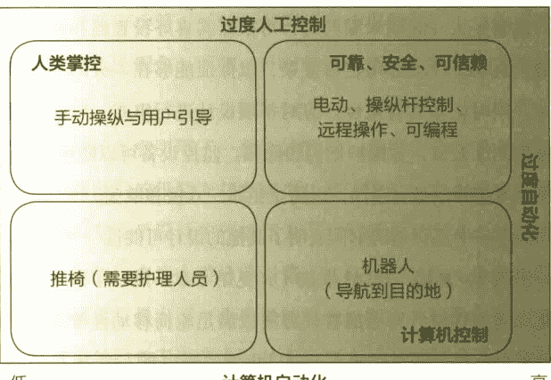

### 图 26.1 HCAI 框架下的轮椅创新图景

倘若老年人授权上报平安状态，并允许信任的家属或护理者远程介入，系统便可进阶为监护模式。遇险时，使用者能即时发起求助；若人员失能或轮椅倾覆，自动化机制将自动触发报警。依托机器学习，不同时段、不同设备的累积数据可精准预判维保节点与设计迭代方向。传感器能绘制路况图谱，标记凸起、坑洼及潜在冰冻积水。无线网络反馈强化算法模型，通过识别高频路线引导市政维修，最大化公共收益。不过，针对使用者主动规避的严重破损路段，仍需人工介入修复。轮椅使用者的反馈将有力补充“Project Sidewalk”等众包数据。

铭记残障群体的核心诉求：“不参与，不决定！”轮椅使用者理应受邀参与设计优化的全过程。

**案例二：桌面式洗碗机** HCAI 思维同样催生了桌面式洗碗机。区别于传统“收拾-搬运-清洗”的家用机械臂，这类小型设备可嵌入餐桌、置于桌下或旁，让独居或双人老年家庭实现餐具“即用即洗、随取随用”，无需等待机器人往返厨房。市面上已有适配房车的微型款、容纳四人餐具的台面款，甚至内置式餐桌洗碗机。针对一至两人场景，仅需容纳两套碗碟杯具及八件杂物（见图 26.2）。这种设计赋予了老年人“自我效能感”，而非被动依赖。

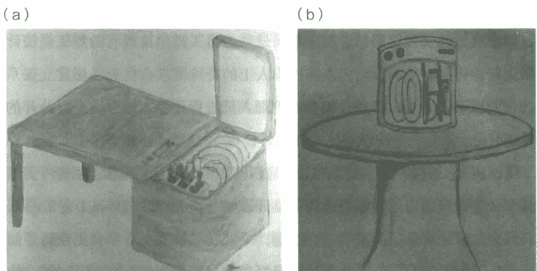

图 26.2 供一至两人使用的矩形/圆形桌面微型洗碗机设计草图 [塞缪尔·都灵]

食品制备领域同理：易开盖容器、轮椅可及的安全烹饪设备、防洒碗碟及加热分配器，皆是 HCAI 赋能独立生活的注脚。

HCAI 还推动群体级解决方案落地。“流动餐车”（Meals on Wheels）深受老年及残障群体欢迎，它不仅送餐，更送去社交关怀——送餐员入户确认、协助整理，双向奔赴中获得成就感与群体认同。AI 算法优化派送路径（同物流调度），推荐系统更能依据兴趣匹配送餐员与长者。该项目源于二战英伦，现已全球生根。

对专业护工、家属及志愿者的致敬，能转化为他们的职业自豪感。智能应用整合专业护理与创收模式，优于现行零工经济；但长照需求优先“关系建立”，引入长者评分与公开致谢机制，提升护工社会地位。

**案例三：瑜伽教学** 应用商店瑜伽 App 众多，Buddhii 出品的“下犬瑜伽”凭借极致用户掌控力脱颖而出，双平台斩获 30 万+ 五星好评（“最佳瑜伽 App”“改变生活”“完美无瑕”）。

其核心采用“约束求解” AI 策略，保障体式序列安全连贯（站立、弯曲、仰卧有序衔接）。UX 设计贴心：老年模式可设 4-6 分钟；涵盖 10 大流派（如流瑜伽：热身、站立序列、地面深度伸展），多级难度可选；20 种练习侧重（有氧、平衡等）搭配多元配乐；5 档语速、多级语音细节（从详解到仅报体式名）；分辨率自适应带宽（高清至纯音频）；新手引导、10 国语言及社区功能一应俱全。

每日课程微更新。语音指令诗意精准（“风车转臂”“绽放战士式”），提供体式变体供自主选择。序列遵循科学路径：坐卧开启→弓箭步进阶→站立平衡扭转→地面收束，全链条覆盖关节伸展。算法严守用户设定时长。

亲测 4 年，夫妻晨练 30 分钟未辍，变化课程维持粘性。肌力、柔韧显著提升，利好情绪、睡眠、整体健康。曾难以企及的体式今已常态化。未来 HCAI 进阶：社交分享/匹配同好邻里；引入计算机视觉终课评估，给出个性化进阶建议。

对于“量化自我”实践者，运动数据可融合步数、睡眠、体重、心率、血压，构建个人健康档案（PHR），对标电子病历（EHR）发现 PHR 细节更丰。HCAI 分析患者/提供者双源数据，洞见治疗、饮食、运动、生活干预的收益与副作用。新型分析融合机器学习、统计学、交互可视化，取长补短（对照实验、随机试验、长期观察）。早期探索聚焦数据采集：“PatientsLikeMe”、政府百万级基因库、“All of Us”计划均有建树。

老年群体活跃度催生“世界资深运动会”“老年奥运会”数十个大项。虽参赛者占少数，但竞技身姿（田径、网球、滑雪、花滑）激励大众参与地方赛事。计算机视觉与传感器定制训练、防跌监护；靴传感器+腿部追踪器驱动的 AI 滑雪教练，经耳机语音指导。

监测步数心率固然重要，但**让长者自主选择监测项与参与活动**，确立对可穿戴设备的“所有权”与“主动权”更关键。自主设目标、共享表现，能显著提升设备使用频次。设计团队纳入长者、实测面向长者，此类改进方能自然涌现。

健康之外，长者在志愿筹款、董事治理、社区/政治/消费/文化领袖角色中大有可为。以经验传薪火，以技能兴项目，充实晚景。疫情期，英国百岁老兵汤姆·摩尔绕花园百圈募资 4000 万镑驰援 NHS，百万捐赠汇聚全球声量，获女王封爵，后人设基金会延续精神。网络搜索是起点，HCAI 推荐系统能提供更优仪表盘，助长者精准匹配项目良机。

代际协作成趋势：共耕社区菜园、助餐困难家庭。公民科学项目吸引百万贡献者收录鸟兽虫植数据，产出高影响论文。95 岁的大卫·爱登堡仍制佳作，亿级受众共睹自然之美与气候警示。伊丽莎白二世 96 岁驾崩，70 年在位创史最长纪录，虽有争议仍广受敬仰。

晚年创业亦风生水起：80 岁玛莎·斯图尔特持续创新出版，覆盖烹饪、时尚、家居；更多长者在电商、Etsy 售手作收获温和成功。《福布斯》曾问“年长者是最佳企业家？”科技服务长者领域，“Senior Planet”网站倡导“用技术重塑老龄化”。

摩尔、斯图尔特等楷模振奋人心，但面对慢病、痴呆、感知认知运动障碍的庞大群体，构建无愧社会需海量投入疾病攻关与临终关怀。

**综上，长者需求谱系证明：深耕养老与 HCAI 蕴藏巨大红利。** 本章三例实证：人机协同如何支持长者独立生活、提效能、促身心健。然养老不止技术，更需家庭、朋友、社区、护工齐力，致敬其付出。长者亦渴望有意义的参与，以智慧与技能赋予生命厚度。

## 第 27 章

## 总结与怀疑者的困境

> 信任乃社会基石。无真理则无信，无信则无社会。有社会处必有信，有信处必有托。
>
> ——弗雷德里克·道格拉斯，《我们的多元民族性》，波士顿

著书伊始，我许诺呈献指南与现实路线图。指南倡“人本思维”，融科学、工程、设计、艺术、社科、人文于一炉。多元融合加速孕育尊重权利、正义、尊严的技术，助力自我效能、创造力、责任感、社交连接等个体愿景（见图 1.2）。

设计靶心：可靠、安全、可信系统，推动种族公正、收入均衡、生态守护。同舟共济，或能兑现联合国可持续发展目标（医疗、经济、教育、粮安等）。

一手托起受 HCAI 影响利益相关者的美好价值与愿望；一手警惕恶意主体、偏见代码、缺陷软件的暗流。研发、管理、决策层须双线作战：外御犯罪、极端、恐怖势力；内防数据偏差、无意识偏见、关键决策软件缺陷。征途漫漫，需以谦逊知局限，以开放拥抱失败，以勇气破局难关，在大胆愿景与审慎落地间寻平衡。技术迭代助力，但终极归宿是人类福祉与生态永续。

层层递进的目标，为广泛参与留足空间。怀疑者或问：研发创新者肯否修正航向拥抱 HCAI？忧虑合理，然 HCAI 热度攀升释放强信号。研究者觉醒，正审视双面影响；会刊把关趋向伦理审视；科技巨头因争议与赔偿觉醒，视道德合规为核心竞争力；全球监管机构加码问责，推进独立监管成熟。或需“号角”高鸣集结，或需“铜管”齐鸣助威，但我更愿以现实政策的“温和小提琴”、可执行议程的“有节奏鼓点”，奏响这支“管弦乐章”，唤起共鸣。

## 附录 A

### 致力于 HCAI 的非政府组织与公民社会力量

此类组织林立，择要录述典范：

**美国保险商实验室（UL）**：1894 年创立，百年坚守“增强信任，成就安全世界”。从电子检测认证起家，延展至全球自愿性标准制定，庞大国际网络倒逼产品服务升级，切入 HCAI 自是顺势而为。

**布鲁金斯学会**：1916 年立于华盛顿，非营利智库，孕育 AI 与能源技术倡议。以报告书籍、高层会议、管理聚焦，致力弥合“产业、公民社会、决策者”三方鸿沟。

**电子隐私信息中心（EPIC）**：1994 年设于华盛顿，公益研究机构，誓言“关注新兴隐私公民自由，捍卫信息时代隐私、言论、民主”。会议教学、法庭之友、诉讼推动、国会作证，近年聚焦监控与算法透明度。

**算法正义联盟（AJL）**：源自埃默里大学，领衔“公正负责 AI 文化运动”。艺研融合，揭示 AI 社会冲击与危害。获巨资助，深度曝光人脸识别偏见，倒逼头部企业修正算法与训练数据，战果显著。

**当代人工智能研究所（AI Now Institute）**：驻留纽约大学，跨学科研究 AI 社会影响。锚定四大核心：权利自由、劳工自动化、偏见包容、安全关基。研讨会、沙龙、工作坊，教学检测两不误。

**数据与社会**：纽约独立非营利，探究数据中心技术与自动化的社会回响。原创研究覆盖 AI 自动化、技术对劳动健康冲击、网络虚假信息等前沿。

**负责任机器人基金会（FRR）**：总部荷兰，旗帜“对机器人背后人类负责的创新”。使命塑造负责任机器人（AI 驱动）全生命周期（设计、开发、使用、监管、实施），以活动组织、咨询文件、公私合作为抓手。

**AI4ALL**：扎根奥克兰，非营利，愿“多元背景、视角、声音释放 AI 造福人类潜能”。赞助美加高中生/大学生（重女重少数族裔）暑期学院，播撒 AI for Good 种子。

**ForHumanity**：公共慈善机构，审度 AI 与自动化负面风险（就业、社会、公民权利自由）。主张企业与公政策层面独立审计（信任、伦理、偏见、隐私、网安），为可信基建基石。信奉“让安全负责 AI 盈利，让危险不负责 AI 亏损，人类共赢”。

**未来生命研究所（FLI）**：波士顿慈善机构，攻坚美英欧 AI、生物技术、核能、气候议题。求“护佑生命研究与倡议，育乐观未来愿景，助人类在新技术挑战中积极领航”。

**人工智能与数字政策中心（CAIDP）**：隶属迈克尔·杜卡基斯领导力创新研究所。使命“确保 AI 与数字政策推动更美好、公正、正义、负责的社会——权利立基、民主制衡、法治护航、技术促包容”。年度考评 25 国表现，发布《AI 与民主价值观》深度报告。

### 致力于 HCAI 的专业组织与研究机构

群英荟萃，略举数例（部分可查维基百科）：

**电气电子工程师协会（IEEE）**：发起全球倡议，倡导 AI 与自主系统设计嵌入伦理基因。作为大型工程学会孵化器，产出道德实施新标准、解决方案、认证体系、行为准则，凝聚全球共识。

其“AI 与自主系统伦理考量全球倡议”历时三年，汇聚 200+ 专家，推出里程碑报告《道德一致的设计：以人类福祉为优先的 AI 与自主系统愿景》。

# 从代码到关怀：一位HCI先驱的以人为本之路

### 重塑计算伦理的关键力量

在计算机科学的版图上，有这样几股力量正持续重塑技术的伦理底色与发展方向：

**美国计算机协会（ACM）** 拥有十万会员的庞大专业网络，长期致力于确立负责任计算的准则与道德框架，其技术政策委员会更是梳理出了算法问责与透明度的七大核心原则。

**人工智能促进协会（AAAI）** 作为非营利科学社团，聚焦于揭示智能本质的科学机理与机器实现路径，不仅推动AI研究与负责任应用，更常与ACM联手举办高端会议、研讨会，搭建学术交流与新人培养的桥梁。

**经合组织AI政策观察站** 依托该组织在度量标准与循证分析上的权威积淀，汇聚政策专家共同研判AI机遇与挑战，打造了一个全球共享的AI证据知识中枢。

**先进自动化协会（A3）** 发轫于1974年的机器人产业协会，如今作为北美贸易组织，通过教育普及与技术迭代，驱动机器人、自动化技术及集成方案在制造与服务业的创新落地，守护生产安全。

**机器智能研究所（MIRI）** 专攻智能行为的数学基石，旨在为通用人工通用智能（AGI）的安全构架与可靠性验证开发形式化工具，从源头为AI安全保驾护航。

**OpenAI** 扎根旧金山，矢志直接构建安全、有益的AGI，并承诺让技术红利惠及全人类，其研发由企业资本、基金会及私人捐赠共同注资支持。

**人工智能伙伴关系** 由六大科技巨头于2016年发起，现汇聚百余家产学研伙伴，专注于制定最佳实践、深化研究对话，通过资助研究、咨询第三方、科普教育等多元手段，引导AI造福社会。

**蒙特利尔AI伦理研究所** 立足国际视野的非营利机构，直面算法主导的世界，通过落地的技术与政策研究，推动AI在伦理、安全、包容性维度的良性演进，赋能公众参与治理。

---

### 我为何执着于“以人为中心”

> 创造力取之不尽，用之不竭，越用越多。——马娅·安杰卢

尽管以人为中心的AI（HCAI）理念逐渐聚拢学术共识，但学界与业界仍存不少抵触与冷漠之声。为何我甘愿做这推动范式转型的“弄潮儿”？因为我渴望看到一场认知的大迁徙——让更广泛的群体觉醒：以人为本，不仅是态度，更是通往技术善果的必经之路。这映照着我自身思维的蜕变历程。

**少年志与命运的拐点**  
本科主修数理的我，曾在校刊上畅想AI与神经网络的无限图景，并获卡内基梅隆大学奖学金，拟师从AI泰斗艾伦·纽威尔、赫伯特·西蒙攻读博士。越南战争打乱了计划，我转而去长岛法明代尔的社区大学任教数据处理三年。这段“插曲”意外引我入了数据库系统的门，最终于1973年拿下石溪分校首个计算机科学博士头衔。

**跨界基因的觉醒**  
麦克卢汉《理解媒介》中关于“地球村”的预言、冷热媒介的辩证，让我深感技术对人类体验的重塑之力。他揭示的线性文本如何催生隐私与专业化，倒逼我打破学科壁垒——心理学、摄影、社会学……我贪婪地汲取工程之外的养分，奠定了日后跨学科的研究底色。

**实证转向与《软件心理学》的诞生**  
在印第安纳大学，心理学同事理查德·梅尔将实验统计法传授予我，让我开始用科学实证审视程序员表现，优化语言工具设计。赴马里兰大学后，与南希·安德森、肯特·诺曼等心理学家深度合作，正值PC萌芽期，我毅然投身“技术增能人”的探索，这便是人机交互（HCI）雏形。

1980年，《软件心理学：计算机及信息系统中的人为因素》问世，被双月度书会力荐，更获偶像纽威尔在1985年主题演奏中公开致敬，视其为转型HCI的灵感源头——那一刻，我确信：这条路，走对了。

**巨人的肩膀与思想的碰撞**  
接待利克莱德访问是我职业生涯的高光时刻。这位“人机共生”奠基人明确划界：人定目标、作判断、担责任；机器管繁琐、算细节、辅决策。他的冷静劝勉，让我坚定投身用户界面心理学研究。

道格·恩格尔巴特的鼠标发明、图形界面雏形，是“增强人类智力”理念的具象化。他因坚持以人为本曾被AI主流剥夺经费，1998年领奖时老泪纵横，那份执守深深震撼了我。

魏森鲍姆的《计算机能力与人类理性》与ELIZA实验，更像一记警钟：机器能模拟对话，却无法拥有人类独有的推理、社会性与激情。这促使我严厉审视温诺格拉德的SHRDLU系统——虽能在微型世界执行“拿起红块”指令，冠以“理解自然语言”实属夸大。

令人欣慰的是，温诺格拉德后来合著《理解计算机与认知》坦承“计算机无法理解自然语言”，并提出设计工具即设计生存方式。我们从对立走向和解，建立了长久同盟。他后来指导布林、佩奇缔造Google，更在社会责任联盟倡导技术公义，持续激励着我。

**建立学科阵地：从零到万**  
1982年，我在国家标准局发起会议，预期两三百人，实至近千。这场盛会催生了ACM SIGCHI（人机交互特别兴趣组），如今其年会汇聚四千精英，全球分会三十余家。PC普及与HCI教学、期刊、会议的繛荣同频共振。

**直接操纵：让交互回归本能**  
1981年，受空管系统、蒙特梭利与皮亚杰“操作即学习”教育哲学启发，我提出“直接操纵”概念——点击、拖拽、即所见即所得。虽萨瑟兰早有触笔原型，但我为其奠定了认知心理学基石。这不仅催生了Hyperties超文本商业产品，更成伯纳斯-李万维网架构基因之一，延伸至触屏键盘、照片标签等现代交互范式。

**乔布斯的认可与“美女与野兽”的辩论**  
1983年罗森菲尔德教授助我建立HCI实验室，首版《用户界面设计》1986年面世。乔布斯1988年亲访实验室，赞“科技与人文交汇，令人心动”，邀我任Apple顾问五年。

HCI虽兴，AI代理论却势头更猛。1997年，我与MIT媒体实验室帕蒂·梅斯展开巅峰对决：她主张智能代理预判需求、主动服务；我捍卫用户主动性与直接操控。媒体戏称“美女与野兽之争”。二十年后CHI大会重逢，她已创办增强技术会议，实验室更名“流体界面组”——她拥抱了以人为中心，我也看到了范式融合的曙光。

**可视化：洞见数据的透视镜**  
图基《探索性数据分析》点醒我：高算力、高分屏让数据交互探索成为可能。我投身信息可视化，早期案例即揭示数据缺失、异常与隐秘模式，让用户在“发现”中振奋。

一次匆促备稿的主题演讲，我脱口而出：“概览优先，缩放过滤，细节随需”。这句无实证支撑的口诀，引用超七千次，因其精准契合用户认知节奏：定向、掌控、深入。如今，可视化界面已成深度学习调试、推荐系统解析、高决策辅助、机器人操控的标配，深嵌HCAI系统肌理。

**连接的渴望与群体智慧**  
疫情下Zoom爆发暴露了“屏幕疲劳”，Gather.town、Kumospace等类游戏空间社交应运而生。这些创新印证了核心原则：**人在回路中主导群体协作，计算机在回路外提供基建支撑。**

**价值观的锚点**  
富有创造力的建设者正用HCAI设计捍卫权利、伸张正义、守护尊严。增强自我效能、激发创造、强化责任、深化连接，能赢得忠诚用户；同时必须警惕恶意攻击、算法偏见、软件缺陷，直面种族鸿沟、贫富差距、生态危机等联合国可持续发展目标中的硬仗。

回望四十年，进步有目共睹，虽未臻完美。余路漫漫，我仍笃信：最好的时刻，尚在前方。我已整装待发，贡献微薄之力。

## 以人为本的AI

监管过早会扼杀创新，置若罔闻风险同样不可取。AI涉隐私、数据安全、算法偏见等深层隐患，缺乏治理恐酿严重后果。因此我高度认可本书研究，建议立法聚焦风险前瞻，以政策善导技术向善、惠经、利民。

—— 王喜文 | 北京华夏工联网智能技术研究院院长、九三学社中央促进技术创新工作委员会委员

《AI向善：以人为中心的人工智能》深度诠释了人机共生之道，确立了以人为本的发展坐标。此书非止未来蓝图，更饱含人文温度。它倒逼我们反思AI价值取向：技术狂飙之际，须以人的尊严与价值为界。作为迈向智慧社会的必读经典，指引我们奔赴更美好的明天。

—— 吕阳 | 北京工商大学教授

### 版权信息速览

| 项目 | 详情 |
| :--- | :--- |
| **书名** | AI 向善 以人为中心的人工智能 = HUMAN CENTERED AI |
| **页数** | 290 |
| **SS号** | 15436017 |
| **录入时间** | 2025-03-15 20:47:06 |